# HTML5 和 CSS3 的新视角：全面指南

## 想把 C 等变成 A 等吗？显显然是，对吧？

但实现这一目标的正确方法并不总是如此显而易见。通过数字化学习来获得高分。MindTap 的定制学习工具和电子教科书将你所需的一切汇集一处。

与你的课程内容互动，享受随时随地学习的灵活性，并通过 MindTap 移动应用程序与作业截止日期和教师通知保持联系……最重要的是……获得更好的成绩。


如需开始使用，请访问 `WWW.CENGAGE.COM/STUDENTS/MINDTAP`

高级总监：Kathleen McMahon

助理产品经理：Kate Mason

助理内容开发经理：Alyssa Pratt

开发编辑：Paul Conrad

产品助理：Abby Puffuff

高级内容项目经理：Jennifer K. Feltr-George

艺术总：Diana Graham

制造出版：For Orekya

封面（图像）：Shutterstock/AGCuesta

编排：GeX Publishing Services

如需信息和今日协助，请联系 Cengage 客户与销售支持：`1-800-354-9076`

如需获得本文或其他作品的许可许可，请在 `https://www.cengage.com/permissions` 在线提交请求。更多许可可以通过电子邮件发送至 `requestpermission@cengage.com`。

Cengage Learning 是领先的定制化学习解决方案提供商，在全球范围内设有办事，包括新加坡、英国、墨西哥、巴西和日本。请访问 `www.cengage.com/global` 查找您的本地办公室。

Cengage 产品由 Nelson Education, Inc. 在加拿大生产。

根据您的课程和学习需求，请访问 `www.cengage.com` 在您当地的大学书或优选在线商店 `www.cengage.com` 购买我们的任何产品。

书中使用的某些产品名称和公司名称仅供识别，并可能是其各自制造商和销售者的商标或注册商标。

免责声明：书中使用的任何与人员或 URL 相关的事实仅供参考。作者不保证此类数据的真实性，且其不属于真实的个人或公司。

Microsoft 和 Windows 标志是微软公司在美国和/或其他国家的注册商标。Cengage Learning 是微软公司的一个实体，不以任何方式与其关联。

读者须知：出版者不对此处描述的任何产品提供任何保证或担保，亦不对此处包含的任何产品信息进行任何独立分析。出版者不承担获取和包含制造商提供之外的其他信息的责任或义务。预计读者将考虑并通常应用此处描述的制造商可能遇到的预防措施，并避免所有潜在危险。通过遵循本文中的说明，读者可以避免所有与此类说明有关的风险。出版者不作任何形式的陈述或保证，包括但不限于产品对特定用途的适用性或对此处所述材料的任何陈述，出版者对此类材料不承担任何责任。对于读者使用或依赖本书而导致的任何全部或部分后果性或惩罚性损害，出版者不承担责任。

## 前言

《新视角》系列的批判性思维和问题解决方法是让学生超越简单的“点击”技能并充分利用 HTML5 和 CSS3 提供的所有内容的理想方式。

在开发《新视角》系列时，我们的目标是创建书籍，为学生提供课堂之外成功所需的软件概念和实践技能。我们更新了以往基于案例的教学法，增加了更具实践性的内容，使学习对学生更有意义。通过《新视角》系列，学生能够理解他们正在学习的内容的原因。

## 关于本书

《新视角》系列的批判性思维和问题解决方法是让学生超越简单的“点击”技能并充分利用 HTML5 和 CSS3 提供的所有内容的理想方式。

在开发《新视角》系列时，我们的目标是创建书籍，为学生提供课堂之外成功所需的软件概念和实践技能。我们更新了以往基于案例的教学法，增加了更具实践性的内容，使学习对学生更有意义。通过《新视角》系列，学生能够理解他们正在学习的内容的原因。

本书假设您拥有：

- Internet Explorer 11
- Edge
- Safari
- Opera
- Chrome

《新视角》教材提供最新的应用，使选择变得简单。

每个教程都从一个对学生有意义的“现实世界”案例开始。案例设定了场景，帮助学生理解他们将要做什么。

动手

每个教程被分为易于管理的章节，结合了阅读和操作。彩色截图引导学生完成教程。故障提示预判常见错误或问题，帮助保持正轨。

每个章节从一个视觉概览开始，这是一个跨两页的布局，包含数字和关键定义，为学生提供该章节主题的全面预览，以及一份实用的学习指南。

专业技能框为将概念应用于现实世界的专业情况提供指导，涉及以下一项或多项技能：

- 决策
- 问题解决
- 团队合作
- 口头交流
- 书面交流

关键步骤用黄色突出显示并附有边栏注释，帮助学生密切关注完成步骤，避免耗时的重复工作。

洞察框提供专家建议和最佳实践，帮助学生深入理解软件功能和技能背后的概念。

边栏提示为更有效地使用软件提供有用提示和快捷方法。提示出现在每个教程的关键点边栏，在学生需要的地方和提供额外信息。

在每个教程中，参考框出现在一组步骤之前，为执行某任务提供简要的总结回顾。此外，每本书都包含一个词表/索引组合，方便参考材料。

无论您是在寻找少量的内容覆盖，还是为了填满一整个学期的课程，我们都能提供满足您需求的教材。

- 入门级书籍平均包含 5 到 8 节教程，并涵盖有关书籍概念的核心技能。
- 综合性书籍深入涵盖了所有概念和技能，非常适合全学期的课程，并包含 9 到 12 个教程。

因此，如果您正在寻找核心技能，或者希望对某个主题有更深入的覆盖，我们提供了可用的材料来满足您的需求。请联系 Cengage 销售代表以了解我们提供的其他服务。

MindTap 是一种个性化的学习体验，通过相关的作业引导学生进行分析并改进思维，让您能够轻松衡量技能和成果。

对于教师而言，个性化教学通过根据关键目标构建的“您的学习路径”（Your Learning Path）来实现。控制学生看到的内容以及他们使用它们的时间。可以直接使用，也可以与您的教学大纲完全匹配：隐藏、重新排列或创建您自己的内容。

对于学生而言：一条独特的学习路径，包含相关的阅读材料、媒体和活动，引导您掌握基础知识并连接到分析与应用。

更好的成果：通过分析和报告赋能教师并激励学生，这些报告提供了课程进度、课程时长、参与度和完成率的快照。

我们提供的不仅仅是一本书。我们拥有您所需的所有工具，以增强您的讲座、检查学生作业并生成考试，且包含在一个全新的、更易用且完全修订的软件包中。本书的教程、Cogengage 测试题库、PowerPoint 演示文稿、数据文件、解决方案文件、图片文件和示例教学大纲均可在 `sto.cengage.com` 获取。

我要感谢那些为本书的出版付出辛勤工作的人。特别感谢我们的开发编辑 Jim Conriad 的辛勤工作、对细节的关注以及宝贵的见解；感谢助理内容开发经理 Alyssa Pruitt，她不知疲倦地监督了这个项目，并用热情和幽默感让我们的工作变得许多。还要感谢 Cengage 的其他值得感谢的人：产品经理 Kathleen McMahon；助理项目经理 Kate Mason；产品助理 Abby Pulpaff；高级内容项目经理 Jen Felitri-George；主管 Diana Graham；制造计划员 Fola Orekya；GEX 出版服务排字员，以及高级 MQA 项目负责人 Chris Schwer 以及 MQA 测试员 John Freitas 和 Danielle Shaw。

反馈是编写任何书籍的重要组成部分，感谢以下评审人员提供的帮助性想法和评论：来自威康技术社区学院的 Alison Consol；来自阿拉巴马马大学的 Dana Hooper；来自费斯法尔技术社区学院的 Kenneth Kleiner 以及来自富兰林大学的 Laurie Crawford。

我要感谢我的妻子 Joan 和我的六个孩子，感谢他们的爱、鼓励和耐心，忍受一个有时心不在焉的丈夫和父亲。本书献给我的孙辈们：Benedict, David 和 Elanor。

– Patrick Carey

- 教程 1 从 HTML5 入门 ................................................ HTML 1
为食品供应商创建一个网站
- 教程 2 从 CSS 入门 ................................................ HTML 83
为健身俱乐部设计网站
- 教程 3 设计页面布局 ................................................... HTML 169
为巧克力店师创建一个网站
- 教程 4 使用 CSS 进行图形设计 .................................................... HTML 257
- 教程 5 针对移动网页设计 ...................................... HTML 341
为日托中心创建一个移动网站
- 教程 6 使用表格和列 ........................ HTML 433
为广播电站创建一个节目表
创建一个调查表单
- 教程 8 使用多媒体增强网站 ................... HTML 585
- 教程 9 从 JavaScript 入门 ........................ HTML 665
创建一个倒计时钟
- 教程 10 探索数组、循环和条件语句 ... . HTML 735
创建一个月历
- 附录 A 带有颜色值的名称和 HTML 字符实体 ................... HTML A1
- 附录 B HTML 元素和属性 ............ HTML B1
- 附录 C 级联样式和选择器 ........................ HTML C1
- 附录 D 让 Web 更具可访问性 ....................... HTML D1
- 附录 E 网页设计 ................................... HTML E1
- 附录 F 使用 XHTML 进行页面验证 ................................ HTML F1
REF 1
REF 11
序言 ............................................................................................ iii
章节 1.2. ................................................................................................. . . . . 22
编写页面主体 ....................................................................................... HTML 24
教程 1 从 HTML5 入门 ...................................... HTML 24
使用分节元素 ................................................................................. HTML 24
为食品供应商创建一个网站 ................................................. HTML 26
比较 HTML4 和 HTML5 中的区域 ................................................ HTML 26
使用分组元素 ....................................................................... HTML 26
探索万网世界 ................................................................... HTML 4
使用文本级元素 ................................................................... HTML 29
网络 ................................................................................. HTML 4
在网络上定位信息 ................................................ HTML 4
处理字符和特殊字符 .......................... HTML 33
网页和服务器 ...................................................... HTML 5
字符编码 ....................................................................... HTML 33
引入 HTML .......................................................................... HTML 5
字符实体引用 ................................................ HTML 34
HTML 的历史 ....................................................................... HTML 5
处理图像 ............................................................ HTML 36
本书侧重于 HTML5，但你也将回顾 HTML 4.01 和 XHTML 1.1 的规范。请注意，在随后的图中，用 HTML5 引入的代码将标记为 `(HTML5)`。

由于 HTML 文档是简单的文本文件，你需要的第一个工具是文本编辑器。你可以使用 Windows 记事本或 Macintosh 的 TextEdit，但强烈建议使用许多提供 HTML 内置支持的廉价编辑器之一。一些流行的 HTML 编辑器有 Notepad++ (`notepad-plus-plus`)、UltraEdit (`www.ultraedit.com`)、Coffee (`www.coffee.com`)、BBEdit (`www.barebones.com`) 和 Context (`www.contexted.com`)。这些编辑器包含了诸如用于捕获错误的语法检查、HTML 代码自动插入以及用于预制模板等功能。

```html
<html>
<head>
  <title>Curbside Thai</title>
  <meta name="viewport" content="width=device-width, initial-scale=1" />
  <link href="css" rel="stylesheet" type="text/css" />
  <link href="ct_layout.css" rel="stylesheet" type="text/css" />
</head>
<body>
  
  <nav>
    <a href="ct_locations.html"></a>
    <a href="ct_reviews.html"></a>
    <a href="ct_catering.html"></a>
    <a href="ct_contact.html"></a>
  </nav>
<footer>
  Curbside Thai #8226; 411 Belle Drive, Charlotte NC 28281; 764-555-1151
</footer>
</body>
</html>
```

## 文档类型声明

HTML 文件的第一行是文档类型声明或 doctype，它是一个处理指令，指示文档中使用的标记语言。浏览器使用文档类型声明来确定使用哪种标准来显示内容。对于 HTML5，doctype 编写为

```
<!DOCTYPE html>
```

你可能会看到小写的 doctype

```
<!doctype html>
```

两者都被所有浏览器支持。旧版本的 HTML 有更复杂的 doctype（文档声明）。HTML 4.01 的 doctype 如下

```
<DOCTYPE html PUBLIC "//W3C//DTD HTML 4.01//EN"
"http://www.w3.org/TR/html4/strict.dtd">
```

## 教程 1 入门 HTML5 | HTML 和 CSS


你甚至可能会遇到没有 doctype 的 HTML 文件。早期版本的 HTML 不识别 doctype，但浏览器会将缺少 doctype 解析为页面应以“怪异模式”（quirks mode）渲染的信号，基于早期 Netscape 引入的样式做法。当存在 doctype 时，浏览器将以“标准模式”（standards mode）渲染页面，采用最新的 HTML 规范。怪异模式和标准模式之间的区别意味着页面布局精美与混乱无章的区别，因此，你应该始终通过包含 doctype 来让你的 HTML 文件置于标准模式下。

## 介绍元素标签

每个 HTML 文档的基本构建单元是元素标签（element tag），它标记了文档中的一个元素。起始标签表示元素的开始，结束标签表示元素的结束。双边元素的通用语法为

```
<element>content</element>
```

其中 `element` 是元素的名称，`content` 是元素的内容，`<element>` 是起始标签，`</element>` 是结束标签。例如，以下代码标记了一个段落：

```
<p>Welcome to Curbside Thai.</p>
```

在这里，`<p>` 标签是起始和结束 HTML 标签，它们表示段落的存在，而文本 `Welcome to Curbside Thai` 构成了段落文本。

并不是每个元素都包含内容。空元素（Empty elements）既不是文本性的（如图像），也不是告诉浏览器对如何如何处理页面的直接指令。空元素使用以下单边元素标签之一来标明：

```
<element />
```

或者

```
<element>
```

例如，`br` 换行元素用于指示文本中存在换行符，它以单边标签结束：

```
<br />
```

注意，虽然这段代码也可以写为 `<br>`，但结尾斜杠 `/` 形式是 XHTML 文档以及其他标记语言的强制格式。HTML5 允许你根据喜好这样做，但如果你打算将来与标记语言一起工作，习惯使用斜杠 `/` 形式是一个好主意。本书的代码将遵循 `/` 约定。

元素可以包含其他元素，这些元素被称为嵌套元素。例如，在代码中，用于标记强调文本的 `em` 元素通过将 `em` 标记完全放在 `p` 标记内部，嵌套在段落元素中。

## HTML 10 HTML 和 CSS | 教程 1 入门 HTML5

正确语法：
```
<p>Welcome to <em>Curbside Thai</em></p>
```

注意，将一个元素嵌套另一个元素内部时，内部元素的完整代码必须包含在外部元素内部，包括起始和结束标签。在以下代码中将 `em` 元素的结束标签放置在 `p` 元素之外是不正确的：

错误语法：
```
<p>Welcome to <em>Curbside Thai</p></p></em>
```

现在你已经学习了标签的基础知识，将查看它们是如何在 HTML 文件中使用的。

## 元素层级结构

HTML 文档的整个结构可以被视为层次化树中的一组嵌套元素。树的顶端是 `head` 元素，它标记了整个文档。在 `head` 内部是 `body` 元素，用于标记文档本身的信息，而 `body` 元素用于标记将出现在网页中的内容。因此，HTML 文件的通用结构如图 1-2 所示，

```
<!DOCTYPE html>

<html>

<head>

  head content

</head>

<body>

  body content

</body>

</html>
```

其中 `head content` 和 `body content` 是标记文档头部和正文内容的嵌套元素。注意，`body` 元素始终放置在 `head` 元素之后。

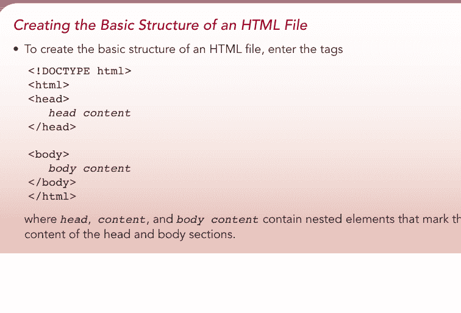

- 要创建 HTML 文件的基本结构，请输入标签
```html

<!DOCTYPE html>

<html>

<head>

  head content

</head>

<body>

  body content

</body>

</html>

```
其中 `head`、`content` 和 `body content` 包含了标记头部部分和正文部分内容的嵌套元素。

## 介绍属性

元素将包含一个或多个属性。每个属性都为浏览器提供有关元素目的或浏览器应如何处理该元素的额外信息。双边标签内属性的通用语法为

```
<element attr="value" attr2="value" />

content

</element>
```

或者，对于单边标签

```
<element attr="value" attr2="value" />
```

其中 `attr`、`attr2` 等是与元素相关的属性，`value`、`value2` 等是对应的属性值。例如，代码为 `<p>` 标签添加了值为 `"intro"` 的 `id` 属性，以便将段落识别为引言段落。

```
<p id="intro">Welcome to Curbside Thai.</p>
```

HTML 编辑器会对属性及其值进行着色。图 1-2 中的属性是以颜色渲染的。每个元素都有自己的属性，除了元素特定的属性外，还有一组可以应用于几乎所有元素的属性。图 1-3 列出了常用属性


| 属性 | 描述 |
|---|---|
| class="text" | 定义元素的通用分类 |
| dir="ltr" | 定义文本方向为从左到右、从右到左或由浏览器决定 |
| hidden | 指示元素应被隐藏 |
| id="text" | 为元素提供唯一标识符 |
| lang="text" | 指定内容的语言 |
| style="definition" | 定义元素的样式或外观 |
| tabindex="integer" | 指定元素的制表顺序（当使用制表导航页面时） |
| title="text" | 为元素分配标题 |

某些属性不需要值，因此，结果 HTML 支持不显示值的属性最小化。在示例中，以下代码中的 `hidden` 属性不需要值；它的存在表示段落应被隐藏。

```
<p hidden>Placeholder Text</p>
```

## 为元素添加属性

- 要向元素添加属性，请输入

```html

<element attr1="value1" attr2="value2">

</element>

```
`attr1`、`attr2` 等是与元素相关的属性，`value1`、`value2` 等是对应的属性值。

## 处理空格

由于 HTML 文件是文本文件，它由文本字符和空白字符组成。空白字符是任何空或空白字符，如空格、制表符或换行符。当浏览器读取 HTML 文件时，它忽略元素标签之间的空白字符，并且区分空格、制表符或换行符。浏览器将以相同的方式处理以下两段代码：

<p>Welcome to <em>Curbside Thai</em></p>

以及

<p>Welcome to <em>Curbside Thai</em></p>
浏览器还会将连续出现的空白字符合并为单次。这意味着以下代码中段落的文本仍被处理为 "Welcome to Curbside Thai"，因为 "Curbside" 和 "Thai" 之间的额外空格被浏览器忽略了。

<p>Welcome to <em>Curbside    Thai</em></p> (注：原文为<p>Welcome to <em>Curbside Thai</em></p>)

## 在浏览器中查看 HTML 文件

图 1-2 所示 HTML 文件的结构现在应该更清晰了，即使你不知道如何解释每个元素和属性的含义和目的。要查看此页面的外观，请在网络浏览器中打开它。

# 在网络浏览器中打开 ct_start.html 文件：

1. 打开你的网络浏览器。无需连接互联网即可查看存储在计算机上的本地文件。

# 教程 1 HTML 入门 | HTML 和 CSS HTML 13

- 2. 在浏览器加载主页后，打开 html01 教程文件夹中的 `ct_start.html` 文件。图 1-4 显示了页面在手机和平和平板电脑设备上的显示情况。这两个设备的屏幕宽度不同，这会影响页面的渲染方式。

图 1-4 手机和平和平板设备渲染的 Curbside Thai 首页

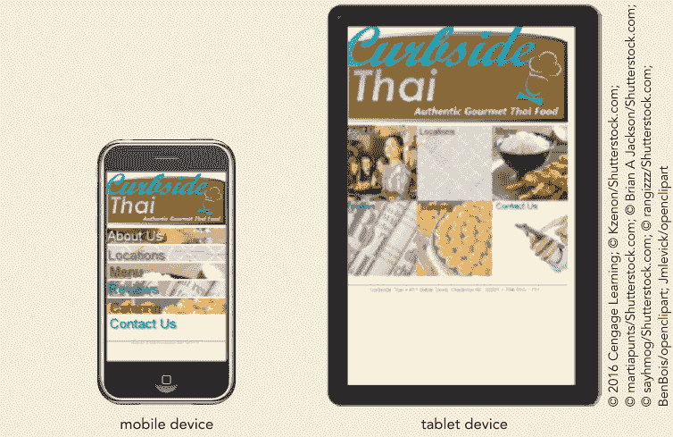

如果你不确定如何用浏览器打开本地文件，请检查“打开”或“文件”命令，或者双击浏览器的文件菜单。你也可以在 Windows 资源管理器或 Apple Finder 中双击文件名来打开文件。

- 3. 缩小浏览器窗口的宽度并注意当宽度低于某个值（在本例中为 480 像素）时，布局会自动更改为图片的堆叠行（如图 1-4 中的移动设备图像所示），这种布局更适合较窄的屏幕。

- 4. 增大浏览器窗口的宽度并确认布局更改为 2x3 的图片网格（如图 1-4 中的平板设备图像所示），这种设计更适用于较宽的窗口。

图 1-4 阐了一个重要的原理：HTML 并不描述文档的外观，它只描述文档的内容和结构。同一个 HTML 文档在不同设备之间或不同屏幕尺寸之间的渲染结果可能完全不同。文档的实际外观是由样式表决定的——这是你将在本教程稍后部分将探索的主题。

## 创建 HTML 文件

现在你已经学习了 HTML 文件的结构，将开始为 Curbside Thai 网站创建你自己的文档。Sajja 希望你创建一个包含有关餐厅信息的网页。从插入 doctype 以及 `html`、`head` 和 `body` 元素的标记标签开始。

开始编写 HTML 文件：

- 1. 使用你喜欢的编辑器，在 `html01>` 教程文件夹中创建一个新的空白 HTML 文件，并将文件保存为 `ct_about.html`。
- 2. 在文件中输入以下代码：

```
<!DOCTYPE html>

<head>

</head>

<body>

</body>

</html>
```

 图 1-5 显示了文档中的初始元素。

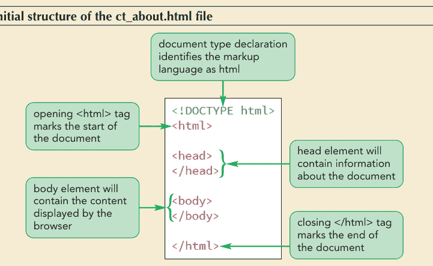

- 3. 保存对文件的更改。

接下来，你将在文档的头部（head）中添加元素。

# 教程 1 HTML5 入门 | HTML 和 CSS

# Aa PROSKILLS
书面交流：编写高效的 HTML 代码

编写良好的 HTML 代码之一是意识到各种浏览器和设备的要求，并理解该语言的不同版本。以下是编写良好的 HTML 代码的几准则：

- 精通 HTML 历史以及各种 HTML 和 XHTML 版本。与其他语言不同，HTML5 的历史确实会影响你编写代码的方式。
- 了解你的市场。你必须支持旧版浏览器，还是客户已经统一使用了某个特定的浏览器或版本？你的网页将是在计算机等单一设备上查看，还是你必须支持多种设备？
- 在几个不同的浏览器和浏览器版本上测试你的代码。不要假设你的页面在某一个浏览器中有效，它在其他浏览器或该浏览器的早期版本中也能正常工作。还要检查连接速度。大文件在较慢连接下可能无法使用。
- 阅读 W3 网站上关于不同版本的 HTML 和 XHTML 的文档，并跟该语言的最新进展。

为了与客户和用户有效沟通，你需要确保你的网站内容始终是可读的。编写良好的 HTML 代码是一个很好的起点。

## 创建文档头部（Document Head）

文档头部包含元数据（metadata），即描述文档或提供有关浏览器应如何处理文档信息的内容。图 1-6 描述了在文档头部找到的不同元数据元素。


| 元素 | 描述 |
|---|---|
| head | 包含一组元数据元素，用于描述文档或向浏览器提供指令 |
| base | 使用解析相对超文本链接指定文档的位置 |
| link | 指定文档所连接的外部资源 |
| meta | 提供通用的元数据值列表，如关键词、视口（viewport）属性和文件字符编码 |
| script |为在文档内运行的程序提供编程代码 |
| style | 定义用于渲染文档内容的样式 |
| title | 存储文档的标题或名称，通常显示在浏览器标题栏或浏览器标签页上 |

© 2016 Cengage Learning
你将在 About Curbside Thai 网页上添加的第一条元数据是 `title` 元素。

## 设置页面标题

`title` 元素是文档头部的一部分，因为它实际上并不作为网页的一部分显示，而是外部显示在浏览器标题栏或浏览器标签页中。页面标题使用以下元素定义：
`<title>title</title>`
其中 `title` 是标题的文本。

## 添加文档标题

- 1. 紧跟 `<head>` 标签之后，插入以下标题：
`<title>About Curbside Thai</title>`

 图 1-7 显示了代码。

## 添加元数据

- 2. 保存文件的更改。

接下来，你将在文档头部添加元素。

```
<meta charset="encoding" />
```

另一种元数据是 `meta` 元素，用于提供通用列表。

| 属性 | 描述 |
|---|---|
| charset="encoding" | 指定文档使用的字符编码 |
| content="text" | 提供与名称相关的值 |
| http-equiv="type" | 提供与元数据相关的值 |
| name="text" | 设置元数据相关的名称 |

## 教程 1 HTML 入门 | HTML 和 CSS HTML 17

例如，你可以使用以下元数据元素为 Curbside Thai 网站提供关键词，以帮助 Google 或 Bing 等搜索工具定位页面：

```
<meta name="keywords" content="Thai, restaurant, Charlotte, food" />
```

在此标签中，`name` 属性定义元数据的类型，`content` 属性提供数据。Meta 没有为 `name` 属性指定一组值，但常用的名称有关键词、描述、作者和视口。

`meta` 元素的另一种用途是定义 HTML 文件使用的编码。字符编码是计算机在存储文本时将文本转换为字节序列，并在读取时将这些字节转换回字符的过程。常用的编码是 UTF-8，它可以表示所需的任何字符。要指示文档使用 UTF-8，请在文档头部添加以下元数据元素：

```
<meta charset="utf-8" />
```

`charset` 属性在 HTML 中引入，取代了早期版本中更复杂的表达式：

```
<meta http-equiv="Content-Type" content="text/html; charset="UTF-8" />
```

## 为文档添加元数据

- 为了定义文档使用的字符编码，输入
`<meta charset="encoding" />`
其中 `encoding` 是文档使用的字符编码，
- 为了定义与文档相关的搜索关键词，
`<meta name="keywords" content="terms" />`
其中 `terms` 是逗号分隔的关键词列表。

在文档头部添加元元素，提供字符集和描述页面的关键词列表。


- 为了插入元数据：
1. 紧跟 `<head>` 标签之后，插入以下元数据元素，并进行缩进以便代码更易读：
`<meta charset="utf-8" />`
`<meta name="keywords" content="Thai, restaurant, Charlotte, food" />`

 图 1 高亮了在文档头部新添加的元数据元素。

# HTML 18 HTML 与 CSS | 教程 1 开启 HTML5 之门

图 1-9 向文档中添加元数据

| 文档使用的字符编码 | 用于搜索引擎搜索的关键词 |
|---|---|
| <head>\n<meta charset="utf-8" /><n<meta name="keywords" content="thai, restaurant, Charlotte, food" />\n<title>About Curbside Thai</title>\n</head> | |

2. 将你的更改保存到文件。
3. 在浏览器中打开 `ct_about.html` 文件。确认浏览器标签页或地址栏包含文本 "About Curbside Thai"。由于你没有在页面主体（body）中添加任何内容，浏览器窗口中不应显示任何文本。

在将你的编辑内容提交到 `ct_about.html` 文件之前，你应该记录你的工作。你可以通过注释来实现。

## 在你的文档中添加注释

注释是描述性文本，它被添加到 HTML 文件中，但在页面显示时不会出现在浏览器窗口中。注释可以包括文档作者的名称、文档创建日期以及创建文档的目的。使用以下标记添加注释：

```
<!-- comment -->
```

其中 `comment` 是注释或说明的文本。例如，以下代码插入了一个描述你正在为 Curbside Thai 创建的页面的注释：
`<!-- General Information about Curbside Thai -->`
注释可以跨越几行，只要注释文本以 `<!--` 开头并以 `-->` 结束。由于浏览器会忽略注释，因此它们可以添加到文档的任何位置，但良好的做法是在文档头部中允许一个注释，以描述随随其后的文档内容。

```
<!-- General Information about Curbside Thai -->
```


## 在 HTML 文档中添加注释

- 要要在你的 HTML 文档中插入注释，请输入
`<!-- comment -->`

其中 `comment` 是 HTML 注释的文本。

在 `ct_about.html` 文件中添加注释，说明文档作者、创建日期和目的。

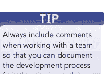

# 教程 1 开启 HTML5 之门 | HTML 与 CSS HTML 19

## 为文档添加注释：

1. 回到 HTML 编辑器中的 `ct_about.html` 文件。
2. 紧接 `<head>` 标签之后，插入以下注释文本，并缩进以使代码更易读：

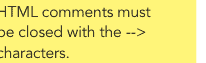

```
<!--
New Perspectives on HTML5 and CSS3, 7th Edition

Tutorial 1

Tutorial Case

General Information about Curbside Thai

Author: your name

Date: the date

Filename: ct_about.html
-->
```

其中 `your name` 是你的名字，`date` 是当前日期。图 1-10 高亮显示了文件中新添加的注释。


## 为文档添加注释

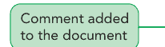

```
<head>
<!--
New Perspectives on HTML5 and CSS3, 7th Edition

Tutorial 1

Tutorial Case

General Information about Curbside Thai

Author: your name

Date: the date

Filename: ct_about.html
-->
<meta charset="UTF-8" />
<meta name="keywords" content="Thai, restaurant, Charlotte, food" />
<title>About Curbside Thai</title>
</head>
```

3. 将你的更改保存到文件。

## 条件注释与 Internet Explorer

你在许多 HTML 文件中遇到的另一种类型的注释是条件注释（conditional comment），它封装了只应由特定版本的 Internet Explorer 浏览器运行的内容。条件注释的通用形式为：

```
<!--[if IE version]>
content
<![endif]-->
```

其中 `lt` 是逻辑运算符（例如小于或大于），`version` 是 Internet Explorer 浏览器的版本号，`content` 是仅在条件表达式为真时才运行的内容。以下代码使用了 `lt`（小于）逻辑运算符来警告用户，如果运行的是版本 8 之前的 Internet Explorer，则需要升级浏览器。

```
<!--[if IE 8]>
<p>Upgrade your browser to view this page.</p>
<![endif]-->
```

其他逻辑运算符包括 `le`（小于或等于）、`gt`（大于）、`gte`（大于等于）和 `not`（非）。例如，以下代码使用逻辑运算符 `not`，仅在浏览器不是 Internet Explorer 时才显示段落文本：

```
<!--[if not IE]>
<p>You are not running Internet Explorer.</p>
<![endif]-->
```

注意，如果你使用版本号，则条件注释将适用于所有 Internet Explorer 版本。注释的出现是因为 Internet Explorer 在实现 HTML 方面与其他浏览器有显著不同，因此需要将针对 IE 浏览器的代码与针对其他浏览器的代码分开。对于较新版本的 Internet Explorer 来说这并不是什么大问题，但如果你正在编写兼容 8 之前的 Internet Explorer 版本的代码，可能仍然需要使用条件注释。

在下一节中，你将继续你的工作。

## 1.1 快速检查

1. 什么是标记？
2. XHTML 与 HTML 有何不同？
3. 什么是 W3C？
4. 什么是 doctype？
5. 什么是 HTML5？
6. 使用注释说明 Curbside Thai。
7. 使用注释添加元数据。
8. 使用注释说明 UTF-8 编码。
9. 使用注释创建文档。

## 1.2 视觉概览

使用 `img` 标签标记的图片：

```html
<body>
<header>
  
</header>
<article>
  <h1>About Us</h1>
  
  <p>Curbside Thai 将泰国的风味带到夏洛特。Saga Adlet 是在 House of Asia 拥有 35 年经验的大厨，现在通过我们现代化的餐车在街头提供同样的服务。我们的特色菜遍布夏洛特市中心，周一至周四 11 点到 7 点，周五至周日 11 点到 7 点。如果你不离开座位，Curbside Thai 将为你送上门服务。</p>
</article>
```

# 编写页面主体

现在你已经创建了 About Curside Thai 网页的文档头部，你将开始编写文档正文。你将从通用标记标签开始，用 h2 标识页面正文的部分，并向内处理这些部分中更具体的内容。

## 使用区域元素

设计页面主体的首要任务是识别主要主题。页面通常包含一个页眉（header）、一个或作为页面主体的文章（article），以及一个提供作者或公司信息的页脚（footer）。HTML 使用图 1-11 所示的 section 元素标记这些主要区域。


| 元素 | 说明 |
|---|---|
| address | 标记个人或组的联系信息 |
| article | 将文档中独立自成的文章标记为新闻报道 **[HTML]** |
| aside | 标记与主文章相关的内容 **[HTML]** |
| body | 包含文档的所有内容 |
| footer | 包含文章或区域的页脚 **[HTML]** |
| h1, h2, h3, h4, h5, h6 | 标记标题，其中 h1 代表最高级，h2 代表子标题，依此类推 |
| header | 包含介绍文章或区域的起始内容 **[HTML]** |
| nav | 标记超文本链接或导航链接列表 **[HTML]** |
| section | 标记页面上具有共同主题或目的的内容 **[HTML]** |

例如，一个新闻博客页面可能包含几个主要主题。为了识别这些区域，博客的 HTML 可能会包含以下元素来标记页面的页眉、导航列表、文章、侧边栏（aside）和页脚。

```html
<body>
  <header>
  </header>
  <nav>
  </nav>
  <article>
  </article>
  <aside>
  </aside>
  <footer>
  </footer>
</body>
```

这些分段元素也与语义化元素相关联，因为标签可以相互嵌套；例如，一个文章可以包含它自己的页眉、页脚和链接集合。即使不知道 HTML，由于标签名称的原因，上述代码定义的页面结构也很容易理解。


## 定义页面部分

- 要标记页面页眉，使用 header 元素。
- 要标记独立自成内容，使用 article 元素。
- 要标记超链接标签的导航列表，使用 nav 元素。
- 要标记侧边栏，使用 aside 元素。
- 要标记页面页脚，使用 footer 元素。
- 要分组通用内容，使用 section 元素。

About Curside Thai 页面将具有简单的结构，包含一个页眉、一个文章和一个页脚。在页眉中，将有一个 h1 元素提供页面标题（不要将其与文档标题混淆，文档标题显示在浏览器标题栏或浏览器标签页上）。将此结构添加到文档正文中。

## 要定义页面正文中的部分：

1. 如果你在之前的会话后休息了，请返回 HTML 编辑器中的 `ct_about.html` 文件。
2. 紧跟 `<body>` 标签之后，插入以下 HTML 代码，并进行缩进以便于阅读：
```html
<header>
  <h1>Curside Thai</h1>
</header>
<article>
  <h1>About Us</h1>
</article>
<footer>
  Curside Thai 411 Belle Drive, Charlotte NC 28201 704-555-1151
</footer>
```

图 1 高亮了页面正文中使用的分段元素。

| 图 1-12 | 在页面正文中添加分段元素 |

```html
<body>
  <header>
    <h1>Curside Thai</h1>
  </header>
  <article>
    <h1>About Us</h1>
  </article>
  <footer>
    Curside Thai 411 Belle Drive, Charlotte NC 28201 704-555-1151
  </footer>
</body>
</html>
```

3. 将更改保存到文件。

## 比较 HTML4 和 HTML5 中的部分

图 1-11 中描述的许多区域元素是在 HTML5 中引入的。在 HTML5 之前，部分是通过使用以下 `div` 元素创建的划分定义的：

```html
<div id="id">
  <div class="content"></</div>
</div>
```

其中 `id` 是唯一标识该划分的名称。图 1-13 显示了在 HTML5 中使用 `section` 元素工作的页面布局在 HTML 4.1 中是如何使用 `div` 元素定义的。

## 图 1-13 HTML 5.0 中的部分，HTML 4.01 中的划分

| HTML 5.0 | |
|---|---|
| <header></header> | |
| <nav></nav> | <section></section> | <aside></aside> |
| <article></article> | |
| <footer></footer> | |
| HTML 4.01 | |
| <div id="header"></div> | |
| <div id="nav"></div> | <div id="section"></div> | <div id="aside"></div> |
| <div id="article"></div> | |
| <div id="footer"></div> | |

`div` 元素的一个问题是 `id` 没有规则。一个网页设计师可能会用 `id` 标识页面标题，而另一位设计师可能会使用 `heading` 或 `top`。缺乏一致性使得搜索引擎更难识别页面。HTML5 区域元素的优势在于，它们的标签名称标识了它们在文档中的用途，从而使页面设计和解释方式具有更大的统一性。

## 使用分组元素

区域内部包含分组元素。每个分组元素都将相似的内容组织成一个组，就像段落将具有共同主题的句子组织在一起。图 1-14 描述了所有的分组元素。

## 图 1-14 分组元素

| 元素 | 说明 |
|---|---|
| blockquote | 包含引用自其他来源的内容，通常带有引用并在页面上缩进 |
| div | 包含文档内元素的通用分组 |
| dl | 标记描述列表，包含一个或多个 `dt` 元素，随后是一个或多个 `dd` 元素 |
| dt | 包含描述列表中的单个术语 |
| dd | 包含文档中任何地方术语相关的描述 |
| figure | 包含交叉引用的插图、照片或类似对象 |
| caption | 包含与插图相关的标题 |
| hr | 标记主题分隔符，例如主题的变化或过渡到新主题（通常显示为水平线） |
| main | 标记文档或应用程序的主要内容；文档中应仅使用一个 `main` 元素 |
| ol | 包含有序列表 |
| ul | 包含无序项目列表 |
| li | 包含有序或无序列表中的单项 |
| p | 包含段落文本 |
| pre | 包含一个预格式化的文本块，其中换行会被保留（通常以等宽字体显示） |

例如，以下代码显示了文章中的三个段落，每个段落代表一组相似的内容：

```html
<article>
  <p>Content of 1st paragraph.</p>
  <p>Content of 2nd paragraph.</p>
  <p>Content of 3rd paragraph.</p>
</article>
```

当浏览器遇到 `section` 元素或分组元素时，默认样式是将包含的内容在新的行开始，并与之前的内容分开。你将在本教程中学习更多关于样式的内容。

- 要标记段落，使用 `p` 元素。
- 要标记扩展引用，使用 `blockquote` 元素。
- 要标记页面的内容，使用 `main` 元素。
- 要标记插图，使用 `figure` 元素。
- 要标记通用划分，使用 `div` 元素。

## HTML

Sja 在文本文件中编写了关于 Curside Thai 的文章。将他的文本输入 About Curside Thai 网页的 `article` 元素中，并使用 `p` 元素标记段落。

1. 使用文本编辑器打开 html01 文件夹下的 `pages.txt` 文件。
2. 选择并复制 About us 之后的三个段落。
3. 关闭文件，但不要保存你可能无意中更改。
4. 返回 HTML 编辑器中的 `ct_about.html` 文件。
5. 在文章中的 `<h1>About us</h1>` 行之后直接插入一个空行并粘贴复制的文本。
6. 将粘贴的三个段落分别封装在 `<p>` 标签和 `</p>` 标签之间，并进行缩进以便于阅读。

# 使用文本级元素

每个分组元素内部都包含文本级元素，它们的作用类似于段落中的短语或字符。与在新的行上开始内容并形成自包含内容块的分组元素不同，文本级元素与周围内容对齐显示，被称为内联元素（inline elements）。例如，本段中的*斜体*或**粗体**文本被视为内联元素，因为它们出现在周围文本旁边。图 1-16 描述了 HTML 中的许多文本级元素。

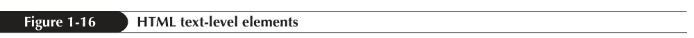

| 元素 | 描述 |
| --- | --- |
| a | 作为超链接作用的标记 |
| abbr | 标记缩写或首字母词 |
| b | 表示引起注意的文本范围（文本通常以粗体显示） |
| br | 表示分组元素内的换行 |
| cite | 标记对创意作品标题或作者的引用 |
| code | 标记代表计算机代码的内容（文本通常以等宽字体显示） |
| data | 将值与标记的文本关联，value 属性提供 HTML5 中的值 |
| dfn | 标记在文档其他地方有定义的术语 |
| i | 表示强调、重读、另一种语气或心境的文本范围（文本通常以斜体显示） |
| kbd | 标记代表用户输入的文本（来自计算机键盘或语音命令） |
| marks | 包含一行为了参考目的而被标记或高亮的的文本 [HTML5] |
| q | 标记不再准确或相关的内（文本通常被删除线划掉） |
| s | 标记来自其他源的内容 |
| samp | 标记代表计算机程序或应用程序示例输出的文本 |
| small | 标记侧边注（文本通常为小字号） |
| span | 表示具有重要性或意义的内容（文本通常以粗体显示） |
| sub | 标记应被视为下标的文本 |
| sup | 标记应被视为上标的文本 |
| time | 标记时间值或字符串 [HTML] |
| u | 表示样式上不同于普通文本的文本（文本通常带有下划线） |
| var | 标记在数学表达式或计算机程序中被视为变量的文本 |
| wbr | 表示如果需要，长文本字符串应该换行的地方 [HTML5] |

© 2016 Cengage Learning

以下 HTML 代码演示了如何使用文本级元素来标记段落内的短语或字符。

```
<p>
  Contact us to cater to your next party and experience what we
  <cite>Carolina Traveler</cite> calls the finest
  Asian food on or off the streets of Charlotte.
</p>
```


# HTML 和 CSS | 教程 1：从 HTML5 入门

本段落使用了两级元素：`cite` 元素用于标记对《Carolina Traveler》杂志的引用，`q` 元素用于标记来自该杂志对 Curside Thai 评论的直接引用。引用内容和被引材料在段落内均以特殊格式显示，并与其他未处理的文本并列出现。

## 定义文本级内容

- 使用 `em` 元素标记强调的文本。
- 使用 `strong` 元素标记极其重要的文本。
- 使用 `cite` 元素标记引用。
- 使用 `q` 元素标记一组引用的材料。
- 使用 `sub` 元素标记下标，使用 `sup` 元素标记上标。
- 使用 `span` 元素标记通用的文本级内容。

在 About Curside Web 页面中使用文本级元素，标记强调文本、重要文本和引用材料的示例。

## 将文本级元素应用到页面：

- 进入页面文章中的第一段，将 `Curside Thai` 几个词包裹在 `<strong>` 标签中。
- 在 About Curside Web 页面中使用文本级元素，标记强调文本、重要文本和引用材料的示例。

© 2016 Cengage Learning

以下 HTML 代码演示了如何使用文本级元素来标记段落内的短语或字符。

```
<p>
  Contact us to cater to your next party and experience what we
  <cite>Carolina Traveler</cite> calls the finest
  Asian food on or off the streets of Charlotte.
</p>
```


# HTML 和 CSS | 教程 1：从 HTML5 入门

本段落使用了两级元素：`cite` 元素用于标记对《Carolina Traveler》杂志的引用，`q` 元素用于标记来自该杂志对 Curside Thai 评论的直接引用。引用内容和被引材料在段落内均以特殊格式显示，并与其他未处理的文本并列出现。

## 定义文本级内容

- 使用 `em` 元素标记强调的文本。
- 使用 `strong` 元素标记极其重要的文本。
- 使用 `cite` 元素标记引用。
- 使用 `q` 元素标记一组引用的材料。
- 使用 `sub` 元素标记下标，使用 `sup` 元素标记上标。
- 使用 `span` 元素标记通用的文本级内容。

在 About Curside Web 页面中使用文本级元素，标记强调文本、重要文本和引用材料的示例。

## 将文本级元素应用到页面

- 进入页面文章中的第一段，将 `Curside Thai` 几个词包裹在 `<strong>` 标签中。
- 在 About Curside Web 页面中使用文本级元素，标记强调文本、重要文本和引用材料的示例。
（此处省略重复部分）
- 将 `Curside Thai` 几个词包裹在 `<strong>` 标签中。
- 在 About Curside Web 页面中使用文本级元素，标记强调文本、重要文本和引用材料的示例。
（此处省略重复部分）

# 教程 1 HTML5 入门教程 | HTML 和 CSS

图 1-20


## 在新样式表下渲染的 Curbside Thai 页面

## Curbside Thai

h1 标题文本
显示
新字体样式

## 关于我们

Curbside Thai 将泰国的丰富风味带到了多伦多。主厨 Saj Adams 曾在亚洲酒店（Hotel of Asia）拥有超过 35 年的经验，现在通过我们现代化的送餐车为 Curbside Thai 的街头提供精美美食。

这不是包装在杂货纸盒里的平淡食物！在我们的各个地点，品尝广受好评的外卖，美味的中菜供应时间为周一至周四上午 11 点至晚上 9 点，周五和周六上午 11 点至晚上 11 点。离开你的办公桌，感受与不同。Curbside Thai 将满足你的需求。

联系我们为你的下一次派对提供餐饮服务，体验 Curbside Thai 外卖——无论在夏洛特的街上还是街外，最优质的亚洲美食。

页面主体添加了
带阴影的
棕色背景

以浅蓝色字体显示
带有
顶部边框的页脚
内容居中

直引号
替换为
弯引号

| Curbside Thai 411 Bellefield Drive, Charlotte, NC 28204-555-1151 |

将这些样式应用于 HTML 后，用于显示页面主体的代码被呈现为带有阴影的棕色背景，两个 h1 标题中使用的字体已更改，页面添加了页脚以与前面的内容隔离开，对《卡罗来纳旅行者》杂志的引用以浅蓝色字体显示。这种效果使得页面内容更易读，视觉上更愉悦。

Saja 担心页面页脚中的联系信息难以阅读。他想添加项目符号字符（•）来分隔餐厅名称、街道地址和餐厅电话号码。然而，你的键盘上没有哪个键可以表示这个字符。那么，你该如何将这个符号插入网页中呢？

# 处理字符和特殊字符

你的浏览器能够渲染的每个字符都属于一个字符和符号集合，称为字符集。用于英文字母的字符集是美国信息交换标准代码，简称为 ASCII。扩展字符集 Latin-I 或 ASCII 8859-1 字符集支持 255 个字符，可以用于大多数使用拉丁字母的语言，包括英语、法语、西班牙语和意大利语。Unicode（统一编码）：最扩展的字符集，支持多达 65,536 个字符，可以与世界上任何语言配合。

## 字符编码

字符集中的每个字符都与一个编码值相关，该值可以被计算机程序存储和读取。例如，Unicode 字符符号 © 被编码为数字 169。如果你知道该编码值，可以使用以下编码直接将相应的字符插入你的网页中：

你可以通过打开 h11 demo 文件夹中的演示文件 `characters.html` 来探索不同的字符编码值。

```
4 code;
```

其中 `code` 是编码引用数字。因此，若要在你的网页中显示 © 符号，你需要输入

`&#169;`

## 字符实体引用

插入特殊符号的另一种方法是使用字符实体引用，这是一种用于替代编码引用数字的短易记忆的名称。字符实体引用使用以下语法插入：

`&char;`

其中 `char` 是字符的实体引用。复制符号 `copy` 的字符实体引用是 `copy`，若要在你的网页中显示 © 符号，你可以在你的 HTML 代码中插入以下表达式：

`&copy;`

在上一节课程中，你学习了 HTML 会将连续出现的空白符合并为单个空白字符。你可以通过使用以下字符实体引用来强制 HTML 显示额外的空白：

`&nbsp;`

其中 `nbsp` 代表不换行空格（nonbreaking space）。当你想要显示额外的空白时，你需要在你想要显示的空格对应的 HTML 代码中插入不换行空格字符引用。

## 从字符集中插入符号

- 要根据字符编码引用数字插入符号，请输入 `&#code;`，其中 `code` 是编码引用数字。
- 要根据字符实体引用插入符号，输入 `&char;`，其中 `char` 是分配给字符的名称。
- 要插入空白字符，使用 `&nbsp;`。

对于“关于 Curbside Thai”页面的页脚，使用项目符号（•）（其编码值为 8226）来分隔餐厅名称、地址和电话号码。使用 `&nbsp;` 字符引用在餐厅地址的邮政编码之前插入额外的空格。

# 教程 1 HTML 入门教程 | HTML 和 CSS HTML 15

要插入字符编码引用数字和实体引用：

1. 返回到 HTML 编辑器中的 `ct_about.html` 文件。
2. 找到页脚元素，在 Thai 单词之后以及邮政编码 28201 之后直接插入字符数字 `&#8226;`。在邮政编码之前直接插入字符引用 `&nbsp;`。

图 1-21 突出显示了 HTML 编辑器中的 `ct_about.html` 文件。
3. 保存文件的更改并刷新浏览器。确认页脚现在显示了这些字符。

# 教程 1 入门 HTML5 | HTML 和 CSS HTML 37

图片也被称为内联图像（inline images），因为它们作为文本级元素，与周围的内容对齐放置。

默认情况下，图片的大小与文件中图像的大小一致，但你可以通过向 `img` 元素添加以下 `width` 和 `height` 属性来指定特定大小：

`width="value" height="value"`
其中 `width` 和 `height` 的值以像素（pixels）为单位。如果你只指定宽度，浏览器会自动设置高度以保持图片的比例；如果你定义了高度，浏览器会自动设置宽度以保持图片的比例。图片大小也可以在文档的样式表中设置。

## 嵌入内联图像

- *要将图片嵌入到文档中，*
``
其中 `file` 是图形图像文件名，`text` 是显示在图像位置的文字。

Sajja 为文档提供了了两张图片。`ct_logo2.png` 文件显示了餐厅的标志，而 `ct_photo1.png` 提供了一张员工在其实体店中服务客户的图片。Sajja 包含这张图片是为了强调他的餐厅的食物品质和绝佳味道。这两张图片都添加到了 `ct_about.html` 文件。

## 将内联图像插入文档

1. 回到 HTML 编辑器中的 `ct_about.html` 文件。
2. 进入页眉（header），将 `h1` 元素替换为标签：
``
3. 进入文章（article）元素，直接在 `h1` 元素之后插入标签：
``

图 14 显示了文档中新添加的 `img` 元素。

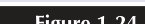

> 提示
> 如果图片文件不包含给用户的任何文字，请将 `alt` 属性设为空字符串。

| `<header> </header>` |
| `<article> h1 替换了一个内联图像，在“关于我们”中添加了图像  <p><strong>Curbside Thai</strong> 将泰国的风味带到了北卡罗莱纳州。主厨 Sajja Adulet 在亚洲酒店拥有超过 35 年的经验，现在通过我们现代的移动食品餐车为夏洛特的街头提供同样的精致餐饮。</p></article>` |

# HTML 38 HTML 和 CSS | 教程 1 入门 HTML5

- 将你的更改保存到文件，然后在浏览器中重新加载 `ct_about.html` 文件。图 1-25 显示了网页中新添加的图形图像。

图 1-25 “关于 Curbside Thai”页面上的图像

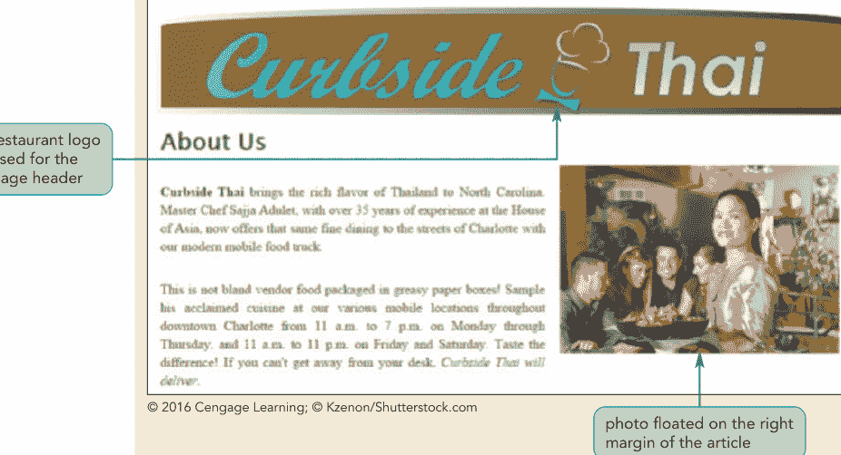

## 关于我们

Curbside Thai 将泰国丰富的风味带到了北卡罗莱纳州。Saga Adulet 厨在亚洲酒店拥有超过 35 年的经验，现在通过一种现代的家庭式转变，为夏洛特的街头提供精致餐饮。

这不是装在纸碗里的平淡掩盖的食物！在夏洛特各地的各个地点，周一至周四上午 11 点至下午 7 点，周五至周日上午 11 点至晚上 9 点品尝我们备受赞誉。如果你无法离开办公桌，Curbside Thai 将为你送货！

© 2016 Cengage Learning; © Zenon/Shutterstock.com

> 真的吗？文字环绕图像流动的显示取决于浏览器的宽度。

注意，Curbside Thai 客户的照片沿文章的右边距浮动，周围的段落环绕图像流。。这是样式中代码的结果。你将在教程 3 中学习用于浮动图像的样式。

## 换行符和其他空元素

`br` 元素使用实体标签插入，因为它不包含任何内容，而是链接到外部图像文件。另一个重要的元素是 `br`，它创建一个换行符：

```
<br>
```

换行符放置在分组元素（如段落或标题）中，以强制内容在新的一行开始。虽然对于控制组内的文本流很有用，但 `br` 元素不应作为格式工具，或用于分隔行中的元素（如果唯一的理由是为了增加行间距）。相反，请使用样式表中的格式选项。

如果一行的文本无法适应窗口宽度，浏览器将在其识别为最合适的地方进行文本折行。要建议换行符，请使用 `wbr`（word break）元素来指示需要时换行应该发生的位置。例如，HTML 代码使用 `wbr` 元素在 ".com" 和 "general" 之间断开长网络地址，但这种断开只有在地址无法一行显示时才会发生：www.curbsethai.com/wbr/docs/ct_about.html

最后，另一个元素是 `<hr>` 或水平规则元素：

```
<hr />
```

该元素的目的是表示节内主要主题的变化。最初，`hr` 元素用于向页面插入水平线，尽管这项任务最好交给样式表，但你仍会在网页中中使用 `hr` 元素。

`hr` 元素在网页上用于。HTML 引入了包括 `header`、`footer`、`article` 在内的语义元素。某些浏览器（如 Internet Explorer 8）无法处理这些元素。

## 使用块引用和其他元素

既然你已经写了 `ct_about.html` 的代码，现在要在页面上处理块引用。`blockquote` 文件包含了来自评论和杂志的评论。使用 `blockquote` 元素放置引用：

```
<blockquote>content</blockquote>
```

其中 `content` 是引用的文字。默认情况下，浏览器通过缩进引用内容将其与作者文字隔离开；然而，你可以使用自定义样式来替换引用。

Sajja 为评论页创建了两张图片。通过将评论标记为块引用来完成该页。

## 要标记为块引用来创建评论页

Sajja 创建了评论页的大部分代码。

1. 打开 HTML 编辑器中 html1 文件夹下的 `ct_reviews.txt` 文件。在注释部分输入你的名字和日期，并将文件保存为 `ct_reviews.txt`。
2. 进入文本编辑器中的 `ct_pages.txt` 文件。
3. 找到包含餐厅评论的部分，复制四条评论的文本。
4. 回到 HTML 编辑器中的 `ct_reviews.html` 文件，在 `h1` 标签之后粘贴四条评论的文本。
5. 将每条评论封装在 `<blockquote>` 标签中。将每条评论中的段落封装在 `<p>` 标签中。对齐并缩进你的代码以便阅读。

图 1-26 高亮了文档中新添加的代码。

保存更改并在浏览器中打开 `ct_reviews.html` 文件。图 1-27 显示了使用 Sajja 样式表显示的餐厅引用外观。

图 1-26 将文本标记为块引用

```html
<article>
<h1>Reviews</h1>
<blockquote>
<p>食品餐车供应商的烹饪艺术在过去的十年里不断进步，从 Antonio's Italian、Organic on the Road 到现在的 Curbside Thai。Saja Adlet 因以合理的价格提供正宗泰国美食而闻名。我们认为 Curbside Thai 是夏洛特街头最精致的亚洲美食。</p>
<p>Carolina Traveler</p>
</blockquote>
<p>带有辛辣亚洲酱的热气食物是常见的街头食物，为了 Curbside Thai 提供的快捷便利，我们接受它所有的局限性。凭借东海岸几家高级场所担任主厨的经验，Saja Adlet 将精致餐饮带到了美食广场，我们感到非常高兴。</p>
<p>食品卡评论：</p>
<blockquote>
<p>年度最佳奖（亚洲类）</p>
<p>食品卡烹饪大赛</p>
<blockquote>
<p>冠军奖（供应商）</p>
<p>Vendy 奖</p>
</blockquote>
</blockquote>
</article>
```


页面主体内的块元素

# 教程 1 入门 HTML5 | | HTML 和 CSS

# HTML 41

图 1-27

## 餐厅评论的引用块

评论
样式表会添加开引号

> 这家食品供应商的烹饪艺术在过去的 10 年里不断进步。凭借 Autumn's Indian、Organic on the Curbside Thai 提供的精美美食，Sajit Ahmed 因其物美价廉的优质正宗泰国菜而受到赞誉。我们认为 Curbside Thai 是 Charoen 街上或街外最棒的亚洲菜。

> 搭配香辣亚洲酱汁的蒸腾腾米饭是常见的街头美食，我们接受它的局限性，以换取快速的美味。在 Curbside，Sajit Ahmed 根据他自己在市内几家餐厅担任主厨的经验，将高级餐饮带到了 Curbside 推餐车上，再完美不过了。

引用块

Carlaene Trevelyan

美食评论

> 寿司（亚洲菜）最佳
> 一等奖（摊位）
> 街头餐车厨大赛

Vendy 奖

引用块内的段落

由于 Sajja 样式中的设置，每个 blockquote 元素都出现在自己的框内，并带有一个起始引号字符，以强调这是引用的材料。
下一页将创建有关 Curbside Thai 餐饮服务的信息。该页面的结构与“关于 Curbside Thai”页面的结构相同。Sajja 已将餐饮页面链接到两个样式表，这些样式表包含了规定页面在浏览器中渲染时的外观规则。

## 创建餐饮页面：

- 1. 在你的 HTML 编辑器中打开 html01 ► tutorial 文件夹下的 `ct_catering.txt` 文件。在注释部分输入你的名字和日期，并将文件保存为 `ct_catering.txt`。
- 2. 返回文本编辑器中的 `ct_pages.txt` 文件。
- 3. 找到关于 Curbside Thai 服务的章节并复制那四段信息。
- 4. 返回 HTML 编辑器中的 `ct_catering.txt` 文件，并将代码直接粘贴在 `<h1>catering</h1>` 行之后。
- 5. 使用 `<p>` 元素标记文章中的每个段落。对齐并缩进你的代码以便于阅读。
- 6. 紧接在 `<h1>Catering</h1>` 标签之后，使用 `ct_photo.png` 作为源并将 `alt` 属性为空字符串插入一个内联图像。

图 1-28 文档中新添加的段落。

## 图 1-28 为餐饮内容输入标记

- 7. 保存文件更改，然后在浏览器中打开 `ct_catering.html` 文件。图 1-29 显示了页面的外观。

```html

<article>

  <h1>Catering</h1>

  

  <p>CurbsideCurbside Thai 为婚礼和特殊活动提供顶级餐饮服务。我们通过专为餐饮活动打造的移动食品餐车覆盖了夏洛特和北卡罗莱纳州的大部分地区。</p>

  <p>餐点将在活动现场现热烹饪。我们有一支经验丰富的统一制服餐饮服务团队，为活动提供专业服务。根据要求，我们将提供盘子、餐具、银器和其他用餐用具。</p>

  <p>Curbside Thai 许可提供全吧台服务餐饮，涵盖各种酒类，并可以根据您的婚礼或私人活动定制饮品菜单。我们还可以提供一系列出色的特色亚洲茶和饮品。</p>

  <p>让 Curbside Thai 提供的餐饮活动让你的朋友和同事印象深刻吧！</p>

</article>

```

## 图 1-29 餐饮

自 2010 年以来，Curbside Thai 为婚礼和特殊活动提供顶级餐饮服务。我们通过专为餐饮活动打造的移动食品餐车覆盖了夏洛特和北卡罗莱纳州的大部分地区。

餐点将在活动现场现热烹饪。我们有一支经验丰富的统一制服餐饮服务团队，为 50 到 300 人的活动提供专业服务。根据要求，我们将提供盘子、餐具、银器和其他用餐用具。

Curbside Thai 许可提供全吧台服务餐饮，涵盖各种烈酒、啤酒和葡萄酒！欢迎咨询有关您的婚礼或私人活动的定制饮品菜单。我们还可以提供一系列出色的特色亚洲茶和饮品。

让 Curbside Thai 提供的餐饮活动让你的朋友和同事印象深刻吧！

© Filmann/Shutterstock.com

你在此会话中创建的最后一个页面将包含 Curbside Thai 的联系信息。使用主页面中的段落来标记内容。

# 教程 1 入门 HTML5 | HTML 和 CSS

## 创建“联系我们”页面：

- 1. 在你的 HTML 编辑器中打开 html01 tutorial 文件夹下的 `ct_contact.txt` 文件。在注释部分输入你的名字和日期，并将文件保存为 `ct_contact.html`。注意，此页面链接了 Saja 创建的两个样式。
- 2. 进入文本编辑器中的 `ct_pages.txt` 文件。
- 3. 复制文件中的“联系我们”部分（不包括标题）。
- 4. 返回 HTML 编辑器中的 `ct_contact.html` 文件，并将复制的文本直接粘贴在 `<h1>Contact Us</h1>` 标签之后。
- 5. 将引言段落封装在起始和结束 `<p>` 标签中以将其标记为段落。
- 6. 将包含街道地址的三行内容封装在起始和结束 `<address>` 标签中以将内容标记为地址。在第一行末尾插入 `<br>`。
- 7. 使用 `<p>` 元素将最后两行标记为段落。

图 1-30 突出了 Curbside Thai 联系信息的标记代码。

## 图 1-30 为联系页面输入标记

- 8. 保存文件更改，然后在浏览器中打开 `ct_contact.html` 文件，如图 1-31 所示。

```html

<article>

<h1>Contact Us</h1>

<p>Curbside Thai 为您的下一次活动或仅仅为了寻找我们的移动餐车何时再次出现在您的地区。现在有就业机会！</p>

<address>

Curbside Thai<br/>

411 Belle Drive<br/>

Charlotte NC 28281

</address>

<p>电话：(704) 555-1151</p>

<p>电子邮件：curbside.thai@example.com</p>

</article>

```

# HTML 44 HTML 和 CSS | 教程 1 入门 HTML

图 1-31 “联系我们”页面的内容

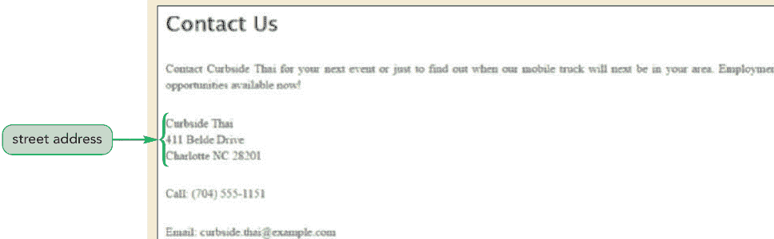

联系页面仅提供了联系信息的文本，但文本是静态的。在下一节中，你将学习如何通过将联系信息转换为超文本来实现交互。

# 问题解决：使用 ARIA 提高页面可访问性

网页面向所有人，为使用屏幕阅读器访问网站的用户编写代码面临特殊挑战。辅助屏幕阅读器的标准是可访问 Internet Applications (ARIA)，它为 HTML 元素提供了额外的属性，以提供元素用途以及当前状态。

ARIA 的关注点之一是 role 属性，它指定了元素的用途。例如，role 属性可以将头部元素识别为横幅，例如介绍网页的头部。

```html

<header role="banner">

content

</header>

```

支持一组批准的角色名称，包括：
- alert Web 应用程序，而非 Web 文档
- definition 定义术语或概念
- log 一个需要用户输入的窗口
- progress bar 随着进行中的任务不断更新的数据区域
- search 为用户提供搜索功能的内容
- separator 分隔一个区域与另一个区域
- timer 包含表示已通过数字计数器的区域

你可以在此处查看完整的角色属性列表及其方法：www.w3.org/ARIA/aria-roles/
ARIA 有助于增强网页的可访问性，使可访问性和易用性并存。

# 教程 1 HTML5 入门教程 | HTML 和 CSS HTML 45

在下一节课程中，你将继续开发 Curbside Thai 网站，添加描述餐厅菜单的页面，并列出移动食品车停靠的时间和地点。

## 章节 1.2 快速检查

1. 提供代码，将文本 Gourmet Thai Cooking 标记为二级重要程度的标题。
2. 你应该使用哪个元素将页面内容标记为侧边栏（sidebar）？
3. `<<div>>` 元素是什么？为什么在非 HTML5 的代码中经常会遇到它？
4. 你会使用哪个元素来表示节段内主题的变更？
5. 提供代码，将文本 Daily Special 标记为强调文本。
6. 提供代码，将文本 H H₂SO₄ 标记为下标。
7. 提供代码将网页链接到 CSS 文件 mystyles.css。
8. 提供相应的表达式，使用字符代码 8212 在网页中插入一个破折号（em dash）。
9. 提供代码，使用源文件 awlogo.png 和替代文本 Art World 插入一个内联图像。

版权所有 2018 Cengage Learning。保留所有权利。不可或或复制、扫描或复制。WCN 02-200-203

## 章节 1.3 视觉概述：

`href` 属性提供了链接文件的 URL (`ct_start.html`)。

`<a>` 标签将内容标记为指向外部资源的超链接。

```html

<header>

  <a href="ct_start.html"> /></a>

  <ul>

    <li><a href="ct_about.html">关于我们</a></a></a></a></a></li>

    <li><a href="ct_locations.html">网点</a></a></a></a></a></a></li>

    <li><a href="ct_reviews.html">评价</a></a></a></a></a></a></li>

    <li><a href="ct_gallery.html">画廊</a></a></a></a></a></a></li>

    <li><a href="ct_contact.html">联系我们</a></a></a></a></a></a></li>

  </ul>

</header>

```

`<nav>` 标签标记一个用于导航的超链接列表。

```html

<article>

  <h1>联系我们</h1>

  <p>为您的下次活动联系 Curbside Thai，或者只需了解我们何时到达您所在的地区。现在有工作机会。</p>

  <address>

    411 Belle Drive<br>

    Charlotte, SC 28201

  </address>

  <p><a href="tel:+17845551151">(784) 555-1151</a></p>

  <p><a href="mailto:curbside@yourdomain.com">curbside@yourdomain.com</a></a></p>

</article>

```

`<ul>` 标签标记一个无序列表，用 `<li>` 标签标记每个项目。

每个列表项目都被标记为超链接。

`tel` 方案用于提供电话链接的 URL。

`mailto` 方案用于提供电子邮件链接的 URL。

URL 指向一个电子邮件地址。

## 列表和超链接

点击 Logo 将用户跳转到 `ct_start.html` 文件。

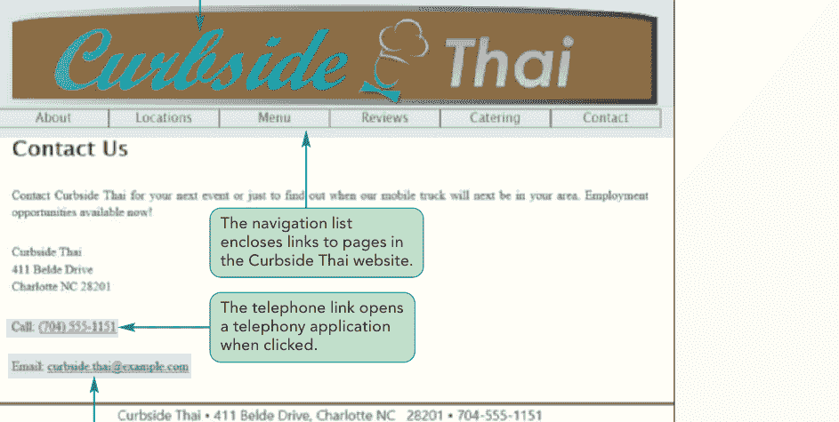

## 联系我们

联系 Curbside Thai 安排您的下次活动，或只需了解我们的移动车何时到达您的地区。现在有工作机会！

- Curbside Thai
411 Belle Drive
Charlotte NC 28201

导航列表包含了指向 Curbside Thai 网站页面的链接。

电话链接点击后打开电话应用程序。

拨打 (704) 555-1151

电子邮件：curbsethai@example.com

Curbside Thai • 411 Belle Drive, Charlotte NC 28201 • 704-555-113

电子邮件链接点击后打开电子邮件程序。

## 操作列表

在上一节课程中，你使用了 HTML 的节段和分组元素为网页添加了结构。另一种分组元素是列表。HTML 支持三种类型的列表：有序列表、无序列表和描述列表。

### 有序列表

有序列表用于遵循某种定义顺序的项目，例如字母顺序或数字顺序。`<ol>`（有序列表）元素使用 `<li>` 元素标记每个列表项。通用结构是

```html

<ol>

  <li>item1</li>

  <li>item2</li>

</ol>

```

其中 item1、item2 等是列表中的项目。例如，以下有序列表列出了前三个热门州：

```html

<ol>

  <li>California</li>

  <li>Texas</li>

  <li>New York</li>

</ol>

```

默认情况下，浏览器将使用数字标记显示列表项。对于有序列表，值是从 1 开始递增的。例如，状态列表在浏览器中渲染为：

1. California
2. Texas
3. New York

注意 `<ol>` 和 `<li>` 元素都是分组元素，除非对这些元素应用不同的样式，否则每个列表项都会显示。要显示不同的编号可以使用 `<ol>` 元素的 `start` 和 `reverse` 属性。`start` 属性提供列表中第一个项目的数值，而 `reverse` 属性指定列表应降序显示。

```html

<ol start="50">

  <li>California</li>

  <li>Texas</li>

  <li>New York</li>

</ol>

```

将被渲染为从 50 开始的降序列表：

50. California
49. Texas
48. New York

你可以通过为每个列表项添加 `value` 属性来显式定义项目值。之前的列表也可以以此方式生成：

```html

<ol>

  <li value="50">California</li>

  <li value="49">Texas</li>

  <li value="48">New York</li>

</ol>

```

你可以使用样式表使用字母标记（A, B, C, ...）或罗马数字（I, II, ...）显示列表。你将在教程 2 中探索这种技术。

### 无序列表

无序列表用于项目没有顺序的情况。无序列表的结构与有序列表相似，列表项目分组在 `<ul>`（无序列表）元素中：

```html

<ul>

  <li>item1</li>

  <li>item2</li>

</ul>

```

例如，以下 HTML 代码创建了太平洋沿岸所有州的无序列表：

```html

<ul>

  <li>California</li>

  <li>Oregon</li>

  <li>Washington</li>

</ul>

```

默认情况下，浏览器将以项目符号作为标记显示无序列表中的项目。因此，太平洋州的无序列表可能渲染为：

- California
- Oregon
- Washington

再次，无序列表的外观取决于应用于元素的样式表。

### 创建嵌套列表

由于 `<li>` 元素本身是一个分组元素，它可以用于分组其他列表，从而创建一系列嵌套列表。无序列表集合的通用结构是：

```html

<ul>

  <li>Item 1</li>

  <li>Item 2

    <ul>

      <li>Sub Item 1</li>

      <li>Sub Item 2</li>

    </ul>

  </li>

</ul>

```

其中 Sub Item 1、Item 2 等包含在 Item 2 列表中。例如，这些州及其城市的无序列表可以标记为：

```html

<ul>

  <li>California</li>

  <li>Oregon

    <ul>

      <li>Portland</li>

      <li>Salem</li>

    </ul>

  </li>

  <li>Washington</li>

</ul>

```

大多数浏览器将通过增加缩进并在嵌套列表的每一层使用不同的列表样式来区分各个级别，例如，将上述 HTML 渲染为：

* California
* Oregon
  * Portland
  * Salem
* Washington

每一层使用的标记和应用于每个列表的缩进量由样式表决定，这些样式表要么内置于浏览器中，要么由页面设计者提供。你将在教程 2 中探索这种技术。

### 描述列表

第三种列表是包含术语列表及其对应描述的描述列表。描述列表由 `<dl>`（描述列表）元素分组，术语用 `<dt>`（描述术语）元素标记，每个术语对应的描述由 `<dd>` 元素标记。通用结构为

```html

<dl>

  <dt>term1</dt>

  <dd>description1</dd>

  <dt>term2</dt>

  <dd>description2a</dd>

  <dd>description2b</dd>

</dl>


其中 `term1`、`term2` 等是列表中的术语，`description1`、`description2` 等是与术语对应的描述。默认情况下，大多数浏览器会缩进每个术语对应的描述。很少会在术语或描述旁边显示标记。

Saja 想在一个显示某些菜单项的页面上使用描述列表。他已经开始编写 HTML 代码，但需要你通过添加描述列表的标记来完成它。

## 完成菜单页面

1. 在 HTML 编辑器中打开来自 `html01` 教程的 `menu.txt.html` 文件。在注释部分输入你的姓名和日期，并将文件保存为 `cm.html`。
2. 如果尚未打开，请在编辑器中打开 `pages.txt` 文件并复制移动菜单列出的五个菜单项。
3. 返回 HTML 编辑器中的 `code.menu.html` 文件，将复制的文本直接粘贴在 `<h1>mobile menu</h1>` 之后。
4. 将整个菜单封装在 `<dl>` 和 `</dl>` 中。
5. 使用 `<dt>` 元素标记每个菜单项的名称。使用 `<dd>` 元素标记相应的描述。缩进你的代码以便于阅读和理解。

图 1-32 显示了移动菜单描述列表的完整代码。

## HTML 52 HTML 和 CSS | 教程 1 入门 HTML

## 图 1-32 将餐厅菜单标记为描述列表

每个菜单项目的名称被标记为描述术语（term）；关于项目的信息被标记为描述（description）

```html
<article>
  <h1>Mobile Menu</h1>
  <dl>
    <dt>罗勒牛肉芝麻沙拉，顶部配有新鲜罗勒、新鲜混合沙拉、
    红卷菜、胡萝卜和番茄；配以
    芝麻油醋 ($9.95)</dt>
    <dt>路边炒饭</dt>
    <dd>洋葱、红灯椒、豌豆和
    胡萝卜炒，点缀红卷菜、黄瓜、小葱
    和炸蒜 ($6.50)；加鸡肉 ($8.50)</dd>
    <dt>黑椒猪肉</dt>
    <dd>腌制猪肉大蒜炒；
    配蒸茉莉饭、红卷菜、胡萝卜、
    黄瓜、小葱和炸蒜 ($8.50)</dd>
    <dt>泰式河</dt>
    <dd>豆芽和豆豉炒面，
    点缀红卷菜、胡萝卜、
    小葱、青柠和碎花生 ($7.50)；
    加鸡肉 ($8.50) 或虾仁 ($9.50)</dd>
    <dt>泰式红咖</dt>
    <dd>用椰奶烹制的传统红咖酱，加入
    竹笋、新鲜罗勒、青柠和泰国辣椒
    盛在蒸茉莉饭上 ($7.50)；加
    鸡肉 ($8.50) 或虾仁 ($9.50)</dd>
  </dl>
</article>
```

- 将更改保存到文件，然后在浏览器中打开 `ct_menu.html` 文件。图 1-33 显示了 Curbside Thai 的完成菜单。

Copyright 2018 Cengage Learning. 版权所有。未经许可不得复制或部分扫描或复制。WCN 02-200-203

## 教程 1 入门 HTML5 | HTML 和 CSS HTML 53

图 1-33

## 作为描述列表的路边菜单

| 术语 | 术语的描述 |
| --- | --- |
| 罗勒牛肉芝麻沙拉 | 香辣安格斯牛肉和甜罗勒配在新鲜混合沙拉、红卷菜、胡萝卜、黄瓜和番茄上；配芝麻油醋 ($9.95) |
| 路边炒饭 | 洋葱、红灯椒、豌豆和胡萝卜炒，点缀红卷菜、黄瓜、小葱和炸蒜 ($6.50)；加鸡肉 ($8.50) 或虾仁 ($5.50) |
| 黑椒猪肉 | 大蒜黑椒炒；配蒸茉莉饭、红卷菜、胡萝卜、小葱和炸蒜 ($8.50) |
| 泰式河粉 | 豆芽和韭菜炒面，点缀红卷菜、胡萝卜、小葱、青柠和碎花生 ($7.50)；加鸡肉 ($8.50) 或虾仁 ($9.50) |
| 泰式红咖 | 用椰奶烹制的传统红咖酱，加入竹笋、新鲜罗勒、青柠和泰国辣椒，盛在一盘蒸茉莉饭上 ($7.59)；加鸡肉 ($8.50) 或虾仁 ($9.50) |

描述列表

注意 Saja 为她的网站使用的样式在列表的每个术语和描述之间插入了分割线。描述列表可以使用任何通用列表，将一个项目与另一个提供有关第一个列表项目额外信息的列表配对。例如，Saja 有一个页面列出了 Curbside Thai 出现的时间地点。通过将内容封装在描述列表中来完成此页面，将项目标记为“items”，将地点标记为列表“descriptions”。

## 要创建时间和地点的页面

- 1. 在你的 HTML 编辑器中打开 `html01` ► `tutorial` 文件夹下的 `ct_locations.txt` 文件。在注释部分输入你的姓名和日期，并将其保存为 `ct_locations.html`。
- 2. 回到文本编辑器中的 `ct_pages.txt`，并复制 Today's 页面中的四个地点。
- 3. 回到 HTML 编辑器中的 `ct_locations.html` 文件，将复制的文本直接粘贴在 `<<h1>Today's Locations</h1>` 之后。
- 4. 使用 `dl` 元素标记时间地地点的列表。使用 `dt` 元素标记每个时间，使用 `dd` 元素标记每个地点。对代码进行缩进处理，以便于阅读和理解。
- 5. 为了将此描述列表与网站上的其他列表区分开，添加属性 `id="ct_locations"`。
- 6. Saja 有一张地图，想放在时间和地点列表的旁边。在 `article` 元素中的 `h1` 元素之后，直接插入以下图像：

```html

```

Copyright 2018 Cengage Learning. 版权所有。未经许可不得复制或部分扫描或复制。WCN 02-200-203

## HTML 54 HTML 和 CSS | 教程 1 入门 HTML5

图 1-34 显示了 Today's Locations 页面新添加的代码。

## 图 1-34 创建描述列表

```html
<article>
  <h1>Today's Locations</h1>
  
  <dl id="ct_locations">
    <dt>11 a.m. to 2 p.m.</dt>
    <dd>205 West 3rd Street, Charlotte</dd>
    <dt>2 p.m. to 4 p.m.</dt>
    <dd>443 West 2nd Street, Charlotte</dd>
    <dt>4 p.m. to 8 p.m.</dt>
    <dd>900 South Mint Street, Charlotte</dd>
    <dt>8 p.m. to 11 a.m.</dt>
    <dd>168 North Church Street, Charlotte</dd>
  </dl>
</article>
```

描述列表
- 7. 将更改保存到文件，然后在浏览器中打开 `ct_menu.html` 文件。图 1-33 显示了 Curbside Thai 的完成菜单。

描述列表
- 11 a.m. to 2 p.m. / 205 West 3rd Street, Charlotte
- 2 p.m. to 4 p.m. / 443 West 2nd Street, Charlotte
- 4 p.m. to 8 p.m. / 900 South Mint Street, Charlotte
- 8 p.m. to 11 a.m. / 168 North Church Street, Charlotte

图 1-33 显示了 Curbside Thai 的完成菜单。

将此结构添加到 About Curbside Thai 网页中，为您在本教程中创建的六个网页中的每一个页面创建条目。

## 创建导航列表

- 1. 如果 `ct_about.html` 文件尚未打开，请在 HTML 编辑器中打开它。
- 2. 转到 body 头部部分，直接在 Curbside Thai 标志的内联图像下方，插入以下导航列表：

```html
<nav>
  <ul>
    <li>About（关于我们）</li>
    <li>Locations（门店）</li>
    <li>Menus（菜单）</li>
    <li>Reviews（评价）</li>
    <li>Catering（餐饮服务）</li>
    <li>Contact（联系我们）</li>
  </ul>
</nav>
```

图 1-36 高亮显示了导航列表的结构。

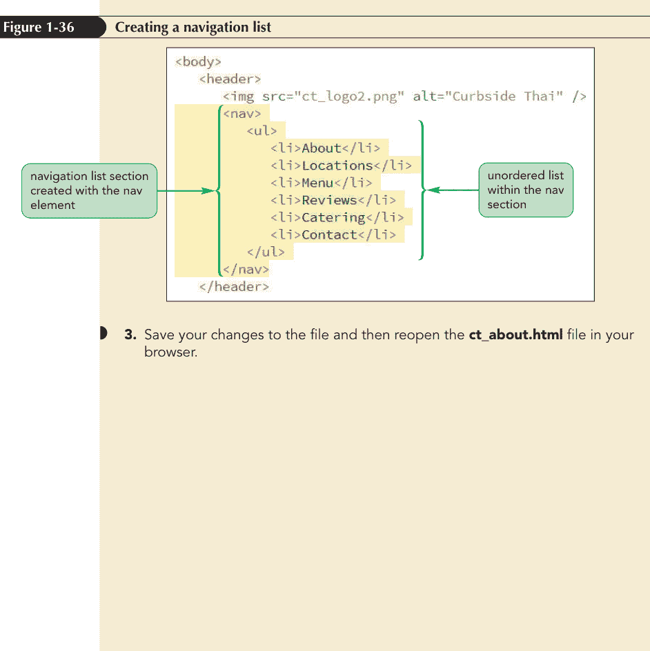

- 3. 保存对文件的更改，然后在浏览器中重新打开 `ct_about.html` 文件。

# 教程 1 入门 HTML5 | HTML 和 CSS HTML 57

图 1-37 显示了导航列表的外观。

## 图 1-37

## Curbside Thai 网站的导航列表

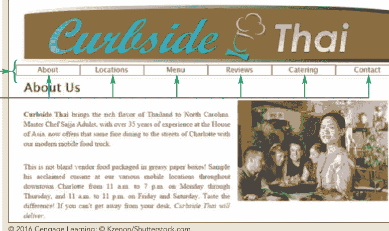

Curbside Thai 将泰国风味带到了北罗来纳州。
Saja Adams 主厨在 House of Asia 拥有超过 35 年的经验，他利用这些专业知识，通过我们的现代移动食品餐车将美食带到了夏洛特的街头。
这可不是包装在油腻纸盒里的平淡摊位食品！欢迎在周一至周四上午 11 点到下午 2 点，以及周五和周六的上午 11 点，在我们各的移动地点品尝备受誉目的料理。如果您无法离开办公桌，也可以尝试一下。Curbside Thai 将为您送达。
© 2016 Cengage Learning: Xenon/Shutterstock.com

注意，`ct_about.html` 文件中导航列表的外观是基于 Saja 的样式表的。导航列表可以根据采用的样式以多种方式显示，同一个导航列表在桌面设备上以一种方式排列，而在移动设备上以另一种方式排列。您将在教程 5 中学习更多内容。

现在您已经创建了导航列表的结构，可以将列表中的项目标记为超链接。

## 处理超文本链接

超文本通过将内容包含在一对起始和结束 `<a>` 标签中创建，格式如下：

```html
<a href="url">content</a>
```

其中 `url` 是统一资源定位符 (URL)，它是一种用于识别资源位置的标准格式，包括文档、电子邮件地址、电话号码和短信，而 `content` 是标记为链接的文档文本。当链接到同一文件夹中的另一个 HTML 文件时，URL 仅为文件名。例如，指向 `ct_menu.html` 文件的超链接将标记为：

```html
<a href="ct_menu.html">Menu</a>
```

当您点击或触摸“Menu”一词时，浏览器将在浏览器中加载 `ct_menu.html` 文件。注意，某些 Web 服务器对文件名是敏感的，它们会区分命名为 `ct_menu.html` 和 `Ct_Menu.html` 的文件名。所有文件名的标准是使用小写，并避免特殊字符和空格。

默认样式是为链接添加下划线，如果用户之前访问过该页面，则为超链接显示不同的文本颜色。然而，页面设计师可以根据自己的样式将超链接与其他区分来。我们将在教程 2 中探索这种技术。

- 提示：保持链接简短且具有描述性，这样用户在访问您的网站时不容易输入错误。

## 标记超文本链接

- 要标记内容为超文本链接，请使用 `<a href="url">content</a>`

其中 `url` 是链接文档的地址，`content` 是被标记为链接的内容。

标记导航列表中的六个条目，使每个条目指向相应的 Curbside Thai 页面。

## 创建超链接

- 1. 返回 HTML 编辑器中的 `ct_about.html` 文件。
- 2. 通过将项目更改为 `<a href="ct_about.html">About</a>`，将第一个条目标记为指向 `ct_about.html` 的超文本链接。
- 3. 将第二个列表项的代码更改为 `<a href="ct_locations.html">Locations</a>`。
- 4. 此此类，将 Menu 条目更改为指向 `ct_menu.html` 文件的链接，将 Reviews 条目更改为指向 `ct_reviews.html` 文件的链接，将 Catering 条目更改为指向 `ct_catering.html` 文件的链接，并将 Contact 条目更改为指向 `ct_contact.html` 文件的链接。

图 1-38 高亮显示了更改所有项目的新添加代码。

标记链接

```html
<nav>
  <ul>
    <li><a href="ct_about.html">About</a></li>
    <li><a href="ct_locations.html">Locations</a></li>
    <li><a href="ct_menu.html">Menu</a></li>
    <li><a href="ct_reviews.html">Reviews</a></li>
    <li><a href="ct_catering.html">Catering</a></li>
    <li><a href="ct_contact.html">Contact</a></li>
  </ul>
</nav>
```

- 5. 保存对文件的更改，然后在浏览器中重新打开 `ct_about.html` 文件。
- 6. 在浏览器中点击导航列表并刷新 `ct_about.html` 文件。

# 教程 1 入门 HTML5 | HTML 和 CSS HTML 59

问题？如果链接不起作用，请确保 `ct_about.html` 的拼写正确。

您注意到当鼠标指针悬停在导航列表上时，链接的外观发生了变化。这是一种悬停效果，我们将在教程 5 中学习如何创建这种效果。

## 悬停效果

Saja 希望能够从网站的任何页面跳转到 Curbside Thai 文档。

将图像转换为链接

内联图像也可以通过将其放在起始和结束的 `<a>` 标签中来转换为链接。

> 将图像转换为链接：
> 1. 返回 HTML 编辑器中的 `ct_about.html` 文件。
> 2. 将图像包裹在：`<a href="start.html"></a>`。

图 1-39 显示了将图像转换为链接的代码。

| 图 1-39 | 标记内联图像链接 |
|---|---|
| 链接 | `<body><header><a href="start.html"></a></header></body>` |

- 3. 保存对文件的更改，然后在浏览器中重新打开 `ct_about.html` 文件。
- 4. 点击 Curbside Thai 标志并验证浏览器打开了启动页面。

# 教程 1 HTML5 入门 | HTML 和 CSS HTML 61

要在文件夹中的文件之间创建链接，你必须提供被链接文件的路径。HTML 支持两种路径：绝对路径和相对路径。

## 绝对路径

绝对路径是从根目录开始，并处理由以下表达式描述的整个文件夹结构的路径：

```
/folder1/folder2/folder3/file
```

其中 `folder1` 是根目录，随后是子文件夹 `folder2`、`folder3` 等，最后是被链接的文件。例如，根据之前图 1-40 所示的结构，指向 `ct_catering.html` 文件的绝对路径表达式为：

```
/thai/docs/catering/ct_catering.html
```

如果文件位于不同的驱动器以及不同的文件夹中，你必须在路径中包含驱动器号，表达式如下：

```
/drive/folder1/folder2/folder3/file
```

其中 `drive` 是分配给驱动器的字母。注意，驱动器字母后面必须紧跟一个字符。如果 `ct_catering.html` 文件位于 E 驱动器，则该驱动器的绝对路径表达式为：

```
/E/thai/docs/catering/ct_catering.html
```

注意，如果链接文档与当前文件位于同一个驱动器，则不需要包含驱动器号。

## 相对路径

当涉及许多文件夹和子文件夹时，绝对路径表达式会迅速变得繁琐且难以处理。大多数网页设计师倾向于使用相对路径，即路径相对于当前文档的位置。如果当前文档和链接文件位于同一个文件夹中，则没有路径，你只需要包含文件名。如果链接文件位于当前文档的子文件夹中，路径将包含从当前页面位置开始的所有子文件夹名称，表达式如下：

```
folder1/folder2/folder3/file
```

其中 `folder1`、`folder2`、`folder3` 等是当前文档的文件夹。例如，从 `index.html` 文件到 `ct_about.html` 文件的相对路径是：

```
docs/general/ct_about.html
```

注意，相对路径是以（家族关系，如父级、后级、兄弟等）来表示的，以指示结构的层级性质。相对路径还可以通过包含符号 `..` 向上层级到达父级文件夹，该符号意味着“向上一级”。从 `general` 文件夹中的 `ct_about.html` 向上移动两级到达 `index` 文件，你需要如下表达式：

```
../../index.html
```

最后，要通过进入不同文件夹但在同一层级的文件在文件夹结构中进行横向移动，你需要回到父文件夹再向下进入另一个不同的文件夹。例如，从 `general` 文件夹中的 `ct_about.html` 文件到 `mobile` 文件夹中的 `ct_locations.html` 文件，你将使用相对表达式：

```
../mobile/ct_locations.html
```


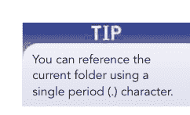

# HTML 62 HTML 和 CSS | 教程 1 HTML5 入门

在这个表达式中，链接向上到父文件夹，向下到达 `ct_locations.html`，然后通过相对路径再次向下移动。

你应该始终在链接中使用相对路径。如果你必须将文件移动到另一不同的计算机或服务器，你可以移动整个文件夹结构，而无需编辑已创建的相对路径。如果你使用绝对路径，你将不得不修改每个链接，以反映文件夹树在你的设备上的新位置。

## 设置基路径

正如你所见，浏览器根据当前文档的位置来解析相对路径。你通过向文档头部添加 `base` 元素来定义相对路径的起点：

```
<base href="url" />
```

其中 `url` 是浏览器在解析文档中的相对路径时使用的位置。当网站的单个文档移动到新文件夹时，可以使用 `base` 元素。在重写所有相对路径以反映文档的新位置后，`base` 元素可以指向文档的旧位置，允许相对路径像以前一样工作。

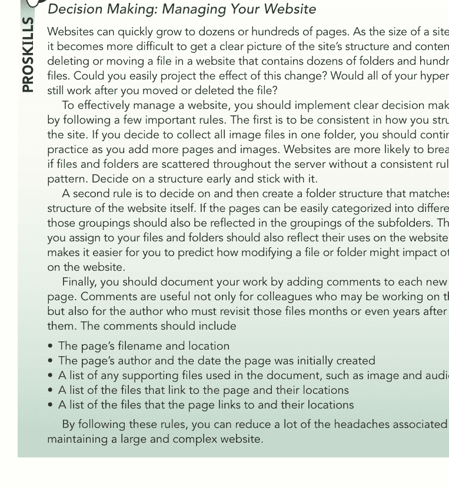

## 决策：管理你的网站

网站会迅速增长到几十或数百个页面。随着网站规模的增加，要获得网站结构和内容的清晰视图变得困难。想象在一个包含几十个文件夹和数百个文件的网站中删除或移动一个文件。你能轻松预测此更改的影响吗？移动或删除文件后，你所有的超文本链接还能工作吗？

为了有效地管理网站，你应该通过遵循几个重要规则建立清晰的决策技能。第一是将所有图像收集到一个文件夹中，在你添加更多页面和图像时，应该继续这样做。如果文件和文件夹在服务器上散乱而没有一致的规则或模式，网站更容易崩溃。尽早决定一个结构并坚持下去。

第二个规则是创建一个与网站结构匹配的文件夹结构。如果页面被分类为不同的组，这些组也应该反映在子目录的分组中。你为文件和文件夹分配的名称应该在网站上反映出来；这让你更容易修改一个文件或文件夹可能对网站上其他页的影响。

最后，你应该通过为每个新页面添加注释来记录你的工作。

- 将所有图像收集到一个文件夹中
- 创建与网站结构匹配的文件夹结构
- 通过为每个新页面添加注释来记录你的工作

## 文档内的位置链接

超文本可以指向文档内的位置。例如，你可以通过向元素添加 `id` 属性跳转到特定位置。

> 通常情况下，一个页面不应跨屏幕。

## 使用 id 属性标记位置

为了让用户能够跳转到文档内的位置，你需要通过向元素添加 `id` 属性来标识该位置。想象 Sajja 写了一个描述完整菜单的页面。他通过向 `h2` 标题添加 `id` 来标记位置：

```html
<h2 id="lunch">午餐菜单
```

注意，ID 必须是唯一的。如果你将相同的 `id` 分配给多个元素，浏览器将跳转到第一次出现。

## 链接到 id

一旦你用 `id` 标记了位置，就可以可以使用该元素链接如下：

```
<a href="#id">内容</a>
```

其中 `file` 指向链接文档的位置和文件名，`id` 是该文档中的属性。例如，以下超链接指向 `ct_fullmenus.html` 文件中 `id` 为 `"lunch"` 的元素：

```
<a href="ct_fullmenus.html#lunch">查看我们的午餐菜单</a>
```

要链接到当前页面内的位置，仅使用 `id` 值作为锚点链接。因此，以下超文本链接指向当前页面内的 `lunch` `id`：

```
<a href="#lunch">查看我们的午餐菜单</a>
```

在这两种情况下，点击或触摸链接都会导致浏览器滚动到页面内的位置。

## 锚点和 name 属性

早期网页没有使用 `id` 属性作为标记文档内位置的方法。相反，它们使用 `<a>` 标签作为锚点来标记该位置。锚点的通用形式为：

```html
<a name="anchor">内容</a>
```

其中 `anchor` 是赋予锚点文本的名称。在 `<a>` 标签内插入内容是可选的，因为该标签的目的是标记文档位置，而不是标记内容。例如，以下代码将在 Curb Today 完整菜单的列表开始处建立一个锚点：

```html
<a name="lunch"></a>午餐菜单
```

> ID 是区分大小大小的：ID `"top"` 与 ID `"TOP"` 不同。

一旦设置了锚点，你就可以相同的语法链接到该锚点。
你会使用 `id` 属性。锚点的使用是 HTML 的一个过时特性，在严格的 XHTML 应用中不受支持，但你仍然会在旧代码中看到锚点。

## 链接到文档内的位置

- 要标记某个位置，请使用以下 `id` 属性为该位置的元素添加一个唯一的 ID
  `id="text"`
- 其中 `text` 是 ID 的值。
- 要从不同的文档链接到该位置，请使用超文本引用
  `<a href="file">content</a>`
- 其中 `file` 是外部文件的名称和位置（如有必要），`text` 是 ID 的值。
- 要从同一文档内链接到该位置，请使用超文本引用
  `<a href="#text">content</a>`

## 链接到互联网和其他资源

超链接指向的资源类型由链接的 URL 识别。所有 URL 共享通用结构
`scheme:location`

`scheme` 表示资源类型，`location` 提供资源名称。`scheme` 取自用于访问资源的网络协议，其中 `protocol` 是定义两个页面之间如何传递信息的规则集。网络上的页面使用超文本传输协议 `HTTP`；因此，许多网页的 URL 以 `http` 方案开头。URL 中可以包含的其他方案见图 1-41。

| 方案 | 说明 |
| --- | --- |
| fax | 传真号码 |
| file | 存储在用户本地计算机上的文档 |
| ftp | 存储在 FTP 服务器上的文档 |
| geo | 地理坐标 |
| http | 万维网上的资源 |
| https | 通过安全加密连接访问的万维网上的资源 |
| mailto | 电子邮件地址 |
| tel | 电话号码 |
| sms | 通过短信服务发送的手机短信 |

# 教程 1 入门 HTML5 | HTML 和 CSS

## HTML 65

## 链接到网络资源

如果你访问过网络，你应该非常熟悉网站的 URL，其名称具有通用结构：

```
http://server/path/filename#id
```

或者安全连接

```
https://server/path/filename#id
```

其中 *server* 是托管资源的 Web 服务器名称，*path* 是该服务器上文件的路径，*filename* 是文件的名称，如果必要，*id* 是文件内 `id` 或锚点的名称。例如，以下代码使用 HTTP 协议访问 `www.cursidehai.com`，链接到位于 `#thai/docs/` 下 `menu.html` 文件中的 `lunch` 函数文档：

```
http://www.cursidehai.com/thai/docs/menu.html#lunch
```

URL 通常以更简的形式输入，例如 `http://www.cursidehai.com`，不带路径或文件名。这些 URL 指向位于服务器树根目录的默认主页。许多服务器使用 `index.html` 作为默认主页的文件名，因此 URL `http://www.cursidehai.com` 等同于 `http://www.cursidehai.com/index.html`。

## 理解域名

URL 的服务器名称也称为域名。通过学习域名，你可以了解 Web 服务器。每个域名都包含一个由点 `.` 分隔的层级结构，出现在最右侧的是顶级域名 `。`。顶级域名称为扩展名，表示 Web 服务器支持的通用受众。例如，`.com` 留给商业机构，`.gov` 用于美国政府页面，`.com` 用于商业或通用站点（注：原文此处重复了 `.com`，通常指 `.org`）。

出现在扩展名立即左侧的下一层是托管该站点的个人或组织的域名。域名 `cursidehai.com` 表示由 Cursebai 拥有的商业或通用站点。为了避免域名重复，域名的顶级在使用之前必须向互联网数字分配机构 `IANA` 注册。你可以通过你的 Web 托管公司注册域名。注意：你必须支付年费来保留域名。

域名的最低层出现在名称的最右侧，它们由托管该站点的个人或公司分配。包括数百个页面的大型网站将其域名划分为几级。例如，像微软这样的大型公司将其域名分为如 `downloads-downloads.microsoft.com` 这样的级别，以及另一个用于客户服务的域名 `-service.microsoft.com`，域名的第一部分显示存储网站文件的硬盘或资源的名称。许多公司已将 `www` 标准化为其域名的初始部分。

## 链接到电子邮件地址

许多网站使用电子邮件与站点的所有者、代表或技术支持通信。你可以使用以下格式将电子邮件地址转换为超链接：

```
mailto:address
```

其中 `address` 是电子邮件地址。激活该电子邮件地址会自动将其插入到新发出的邮件字段中。要创建到电子邮件 `s.adulet@example.com` 的链接，你可以使用以下 URL：

```
mailto:adulet@example.com
```

`mailto` 协议允许你使用 URL 在电子邮件消息中插入附加字段：

```
mailto:address?field1=value1&field2=value2
```

**注意？**

在你的网站上添加电子邮件链接时要小心。虽然这可能让用户更方便地与你联系，但也可能让你更容易受到垃圾邮件的影响。**垃圾邮件**是发送给许多人的未经请求的电子邮件，用于产品、服务，在某些情况下是不适当的网站。垃圾邮件发送者创建小组，窃取邮件列表，并使用名为**邮件收集器**的程序扫描 HTML 代码中的电子邮件地址。许多开发者开发了隐藏链接的方法来这些这些收集器，用向安全服务器提交邮件请求的 Web 表单代替链接。这个问题没有快速解决方案。与垃圾邮件斗争是一场持续的战斗，他们证明了在克服人类防御方面非常有资源。在你开发网站时，应该仔细考虑如何处理电子邮件，并审查保护信息的最新方法。

## 链接到电话号码

随着使用手机访问网络的情况增加，许多开发者现在为公司的客户服务或帮助热线提供了号码。激活链接将打开你的电话应用并预入号码，使拨打业务或组织的电话更加快捷方便。电话链接的 URL 为：

```
tel:phone
```

*where* 是链接号码的数字。例如，以下代码：

```
Call: <a href="tel:170455115151-11">555-1151/</a>
```

由于是国际性的，任何电话链接都应该包含国家代码和区号。数字之间的空格可选，拨代码前的 `+` 号除外。然而，你可以通过插入 `+` 号在电话号码中插入空格（分机），如电话链接所示：

```
<a href="tel:17045511511p22">Call: 555-1151 ext. 22</a>
```

Sajja 要求你将联系方式页面上的电话号码改为电话链接。

# HTML 和 CSS | 教程 1 HTML5 入门

要链接电话号码：

- 1. 回到 HTML 编辑器中的 `ct_contact.html` 文件。
- 2. 将路边电话号码（Curbside Phone number）更改为超文本链接：
```html
<a href="tel+17045551151">
  (704) 555-1151
</a>
```
一旦这个号码是虚拟的，如果你想在移动设备上测试链接，可以将 URL 更改为指向你自己电话号码的链接。
图 1-43 显示了电话链接的超文本代码。

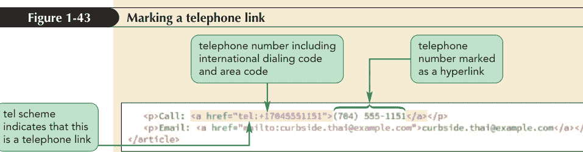

- 3. 保存对文件的更改。

HTML 支持链接到其他类型电话设备的链接。例如，你可以使用 `fax:` 方案创建指向传真机的链接，并使用 `sms:` 方案创建指向短信应用程序的链接。

# 使用超文本属性

HTML 为元素提供了几个属性，用于控制超文本链接的行为和外观。图 1-44 描述了这些属性。

| 属性 | 描述 |
| --- | --- |
| href="url" | 提供超文本链接的 url |
| target="_blank\|parent\|_self\|_top" download="filename" | 指定打开链接文档的位置。指示链接应作为文件下载，其中 `filename` 是赋予下载文件的名称（`HTML5`） |
| rel="type" | 提供链接文档与当前页面之间的关系 |
| hreflang="lang" | 指明链接文档的语言 |
| type="mime-type" | 指明链接文档的媒体类型 |

© 2018 Cengage Learning. 版权所有。未经许可，不得全部或部分扫描或复制。WCN 02-200-203

# 教程 1 HTML5 入门 | HTML 和 CSS

使用 `target` 属性，你可以控制页面的打开方式。默认，链接的 `target` 会替换浏览器窗口中当前页面的内容。在某些网站中，你希望在一个新的浏览器窗口或标签页中打开链接，这样就可以同时查看当前页面和链接的页面。要强制文档出现在新窗口或标签页中，请向 `<a>` 标签添加以下 `target` 属性：

```html
<a href="url" target="_blank" content=""></a>
```


其中 `_blank` 是分配给打开链接的浏览器窗口或标签页的名称。你可以为浏览器窗口选择任何名称，或使用以下 `target` 名称之一：

- `_self` 在当前窗口中打开页面（默认值）
- `_blank` 在新窗口或标签页中打开页面，取决于浏览器的配置
- `_parent` 在父框架中打开页面（用于框架）
- `_top` 在顶层框架中打开页面（用于框架）

你应该在网站中谨慎使用 `target` 属性。创建窗口可能会让用户的桌面变得杂乱。此外，由于页面放置于新窗口中，用户无法使用后退按钮返回到该窗口中的上一页；他们必须点击浏览器的程序按钮或原始网站的标签页。这会让用户感到困惑并打扰他人。许多设计师现在完全避免使用 `target` 属性，而是为用户提供在新窗口或标签页中打开链接的选择。

# 书面通信：创建超文本链接

为了让用户更容易在你的网站中导航，超链接的文本应该准确告诉读者链接指向什么种类型的文档。例如，链接文本：

点击此处获取更多信息。

并没有告诉用户这里将出现什么种类型的文档。对于像“点击此处”之类的短语，你应该使用描述性的链接文本，例如

欲需更多信息，请访问我们的

如果使用类似“点击此处”，你应该使用描述性的链接文本，如

了解更多信息，请访问我们的常见问题。

如果链接指向非 HTML 文件（例如 PDF），你应该使用描述性的链接文本，如

下载手册（PDF）

如果链接指向下载文件，你应该使用描述性的链接文本，如

了解更多信息，请访问我们的

如果链接指向下载文件，你应该使用描述性的链接文本，如

下载文件（HTML5）

# HTML 72 HTML 和 CSS | 教程 1 入门 HTML5

3. 打开文档并插入一个包含以下内容的 header 元素：

   - a. 一个来自 `mp_logo.png` 文件的内联图片，备用文本（alternate text）为 Mobile Panini。将图片标记为指向 `mp_index.html` 的超链接。
   - b. 插入一个导航列表，其中包含一个有以下项目的无序列表：Home、Menu、Events 和 Catering。分别将这些项目链接到 `mp_index.html`、`mp_menu.html`、`mp_events.html` 和 `mp_catering`。

4. 在 header 元素下方插入一个 article 元素，并插入一个包含以下内容的 footer 元素：
Mobile Panini 31 West Avenue, Charlotte NC 28204 704-555-2118

其中地址使用 `98342` 代码插入，并使用 `nbsp` 字符在 NC 和 28204 之间添加一个额外的空格。

5. 在文本编辑器中打开 `mp_pages.txt` 文件。该文件包含 Mobile Panini 网站四个页面的内容。复制 Welcome 部分的文本，它将位于网站的首页。回到 HTML 编辑器器打开 `mp_index.html`，并将复制的文本粘贴到 article 中。

6. 在 article 元素中，执行以下操作：

   - a. 将 Welcome 标记为 `h1` 标题。
   - b. 在 h1 元素下方，插入一个包含 `mp_photo1.png` 文件的内联图片，备用文本为空字符串。
   - c. 使用 `p` 元素将五个段落标记为段落。在第一段中，将文本 Mobile Panini 标记为字符串文本。在第三段中，将文本 *Curbside Thai* 标记为强调文本。
   - d. 第四段包含 Mobile Panini 的电话号码。将该电话号码标记为电话链接，并确保在 URL 中包含国际代码。注意此号码是虚构的，所以如果你可以使用移动浏览器并想测试该链接，你可能需要将此链接替换为你的电话号码。
   - e. 第五段包含 Mobile Panini 的地址。将 e-地址标记为超链接。再次注意，该 e-地址是虚构的，因此如果你想测试此链接，你需要将 Mobile Panini 地址替换为你的 e-地址。

7. 保存文件更改并在浏览器中打开 `mp_index.html`。验证图 1-45 所示页面的布局和外观。如果可能，测试电话号码和链接以验证它们是否打开了正确的应用程序。

8. 在 HTML 编辑器中打开 `mp_menu.html` 文件并复制 header 和 footer 元素。然后进入 body 元素，使此页面拥有与首页相同的 logo 和导航列表。在 header 和 footer 之间插入一个 article 元素。

9. 回到文本编辑器中的 `mp_pages.txt` 文件并复制 Mobile Panini 菜单的内容。然后，在 HTML 编辑器中打开 `mp_menu.html`并将复制的文本粘贴到 article 中。

10. 在页面的 article 元素中，执行以下操作：
     a. 将标题 Our Menu 标记为 `h1` 标题。
     b. 将菜单项包含在一个描述列表（description list）中，每个菜单项的名称标记为 `dt` 元素，每个描述标记为 `dd` 元素。

## 教程 1 入门 HTML5 | HTML 和 CSS HTML 73

- 1. 将更改保存到 `mp_menu.html` 文件。在浏览器中打开页面，验证菜单项名称是否以**粗体**字体显示，并通过水平线与缩进的描述分开。

- 2. 在 HTML 编辑器中打开 `mp_index.html` 文件并复制 header 和 footer 元素。然后，在 HTML 编辑器中打开 `mp_events.html` 文件并将 header 和 footer 元素粘贴到 body 元素中。在 header 和 footer 之间插入一个 article 元素。

- 3. 回到 HTML 编辑器中的 `mp_index.html` 文件并复制 Calendar 标题下的活动列表。然后，在 HTML 编辑器中打开 `mp_events.html` 文件并将复制的文本粘贴到 article 元素中。

- 4. 在 article 元素中，执行以下操作：
  a. 将文本 Are We This? 标记为 `h1` 标题。
  b. 将每天的活动包含在独立的 `div`（或 division）元素中。
  c. 对于七天中的每一天，将日期和星期标记为 `h1` 标题。在 article 中包含位置。在活动时间直接插入换行符 `<br />`，以便每个时间段在 article 内换行显示。

- 15. 将更改保存到 `mp_events.html` 文件。在浏览器中打开页面，验证日历活动是否出现在其自己的框内，且日期被渲染为标题。

- 16. 在 HTML 编辑器中打开 `mp_index.html` 文件并复制 header 和 footer 元素。然后打开 `mp_catering.html` 文件并将 header 和 footer 元素粘贴到 body 元素中。在 header 和 footer 之间插入一个 article 元素，并在 article 内插入一个 aside 元素。

- 17. 直接紧跟 `aside` 标签之后，插入一个包含文本 *Catering for the mobile kit-chen* [Mobile Kitchen] 的 `h1` 元素。

- 18. 回到 HTML 编辑器中的 `mp_index.html` 文件并复制关于移动厨房的文本（包括标题）。然后，在 HTML 编辑器中打开 `mp_catering.html` 文件并将复制的文本粘贴到 aside 元素中。

- 19. 在 article 元素中，执行：
  a. 将文本 About the mobile kitchen 标记为 `h1` 标题。
  b. 两个段落。

- 20. 回到 HTML 编辑器中的 `mp_index.html` 文件并复制 header 和 footer 元素。然后，在 HTML 编辑器中打开 `mp_catering.html` 文件并将 header 和 footer 元素粘贴到 body 元素中。在 header 和 footer 之间插入一个 article 元素并在 article 内插入一个 aside 元素。

- 21. 两个段落。
  a. 将服务列表包含在无序列表中。
  c. 标记结束段落。

- 22. 将更改保存到 `mp_catering.html`。在浏览器中打开页面并验证信息出现在侧边栏。

- 23. 回到 HTML 编辑器中的 `mp_index.html` 文件，验证可以通过顶部的导航列表跳转到其他页面。

# content 1

数据所需： `j__index.txt`, `jc_services.txt`

Jedds Tree Carol Carolds 是 Jedds Tree Care 的所有者和经营者。她请求你开发公司的网站。她已经写了一些文本，并希望编写 HTML 代码。图 1-46 显示了你将创建的首页预览。

图 1-46

Jedds Tree Care 首页 

我在一个窄的院子里移除一棵树。他们处理得很快、安全且清理干净。- Steve J

> Jedds Tree Care 及时修剪了我的树并提供了卓越的服务。他们没有等几天或几周。- Alex D

> 他们的团队砍掉了四棵树。他们工作很好，我非常推荐他们的服务。- David F

Jedds Tree Care 提供全面的服务，包括树枝修剪、整形和树根移除。我们提供 24/7 紧急服务。Jedds 在密歇根州运营，但也服务周边地区和需求。我们为商业和住宅客户提供快速、优质的服务。客户满意度是我们的首要目标。

我们的业务是家族式的。安全是我们的第一位。我们有专业人员处理您的特殊需求，我们可以处理任何大小的工作。

Jedds Tree Care
201 Edward Ave.
Lansing, MI 48909
email: jedds@example.com
phone: 317-555-4881

© 2016 Cengage Learning; may981/utterstock.com

样式表和图形已经为你准备好。你的任务是编写 HTML 标记。

完成以下操作：

- 1. 使用你的编辑器复制 **jc_index.txt** 和 **jc_services.txt** 文件。替换每个文件注释部分中的**姓名**和**日期**，并将它们分别保存为 **jc_index.html** 和 **jc_services.html**。
- 2. 在 HTML 编辑器中打开 **jc_index.html** 文件。在文档中执行以下操作：
  a. 使用 **meta** 元素将文件的字符编码设置为 **utf-8**。
  b. 将文档标题设置为 **Jedds Tree Care**。
  c. 将文档链接到 **jc_base.css** 和 **layout.css** 样式表。
- 3. 在文档中包含一个 header 元素、一个 aside 元素和一个 article 元素。

# 教程 1 HTML5 入门 | HTML 和 CSS

4. 使用 header 元素插入一个包含指向 jtc_index.html 和 jtc_services.html 文件链接的导航列表。链接的文本应分别为 home 和 services。

5. 在你的文本编辑器中打开 `jtc_pages.txt` 文件。文件的第一部分包含 Leeds Tree 客户的评论。复制三位评论者的文本，包括评论者的姓名。然后，在文本编辑器中打开 `jtc_index.html` 文件，并将复制的内容粘贴到 `aside` 元素中。

6. 打开 `aside` 标签后，插入一个 `jtc_comments.png` 文件的内联图像。将替代文本指定为 Comments。

   - 直接将 “ 替换为连接折号（en dash）。
   - 将三个评论者的每一个注释都封装在 `blockquote` 元素中，包括引用文本和评论者的姓名。
   - 为这三个 `blockquote` 元素中的每一个元素，

7. 进入 article 元素，插入一个包含内联图像 `jtc_photo1.png` 的 header 元素，其替代文本为 Leeds Tree。

8. 在你的文本编辑器中打开 `jtc_pages.txt` 文件，复制包含公司描述和联系信息的第二部分文本。然后，在 HTML 编辑器中打开 `jtc_index.html` 文件，并将内容粘贴到 `article` 元素中，紧跟 body header 之后。

9. 将页面 article 内容标记如下：

   - 使用 `p` 标签创建前两个段。
   - 将五行内容封装在 `address` 元素中。在第一行末尾插入换行符，以便所有地址在渲染页面中显示在新的行。
   - 将 address 第一行中的文本 Leeds Tree 设为 `strong` 元素。
   - 将电子邮件地址设置为超链接。将电话号码设置为电话链接，包括访问索引代码。

10. 保存你的 `jtc_index.html` 文件。在浏览器中打开该页面，验证页面布局和内容是否与图 1-46 所示。注意，随着移动设备屏幕的缩小，评论者的内容将不会显示。

11. 在你的文本编辑器中打开 `jtc_services.html` 文件。在 header 中插入相同的元数据以匹配 `jtc_index.html` 文件，但页面标题改为 Leeds Tree Services。

12. 在你的 HTML 编辑器中打开 `jtc_index.html` 文件并复制 body header。然后，进入 jtc。

13. 在你的文本编辑器中打开 `jtc_pages.txt` 文件，复制第三部分的内容，其中包含 Leeds Tree Care 提供的服务信息。确保也复制 header。然后，在 HTML 编辑器中打开 `jtc_services.html` 文件，并将复制的文本直接粘贴在 header 之后。

14. 将描述 Leeds Tree Care 服务的内容标记如下：

   - 将标题 Leeds Tree Care Services 设为 `h1` 标题。
   - 紧接 `h1` 元素，插入 `jtc_photo2.png` 的内联图像，替代文本留空。
   - 将与每个服务相关的标题标记为 `h2` 标题。
   - 将每个服务描述设为段落。

15. 在最后一个服务之后，插入一个包含以下内容的 `footer` 元素：
Leeds Tree Care ♦ 201 Edward Ave. Lansing, MI 48930
其中 ♦ 符号使用字符代码 9830 插入。

16. 保存你的更改并在浏览器中打开 `jtc_services.html` 文件。验证页面标题是否作为主标题显示，以及每个服务的名称是否作为二级标题显示。

# HTML 76 HTML 和 CSS | 教程 1 HTML5 入门

# 案例问题 2

此案例所需的数据文件：`ms_euler_txt.html`，2 个 CSS 文件，2 个 PNG 文件，1 个 TXT 文件

位于南卡罗来纳州安德森的海岸大学数学系的 Math Strings 教授 Lauren Co 是 Math Strings 的创始人之一，这是一个包含为高中和大学数学教师提供文章和课程材料的网站。她为该网站编写了一系列著名数学家的传记，并希望你将这些内容用于网页中。你将在本次练习中创建第一个。图 1-47 显示了你将创建的页面预览，其中包含了数学家莱昂哈德·欧拉（Leonhard Euler）的简介。

图 1-47 Math Strings Leonhard Euler 页面

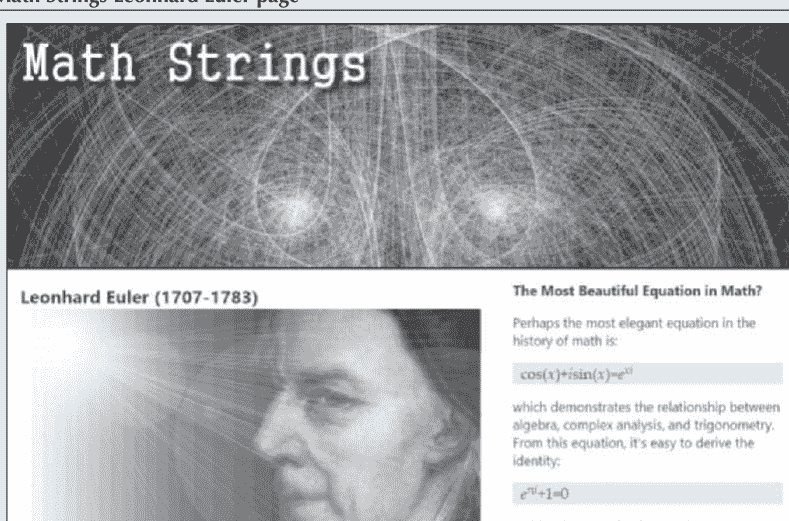

18世纪最伟大的数学家莱昂哈德·欧拉出生于瑞士巴塞尔。他师从另一位数学界的伟大人物让·伯努利（Jean Bernoulli）。1731年，欧拉成为圣彼得堡科学院学院的物理学和数学教授。他是那个时代产出最丰富的数学家，撰写了大量的书籍和论文。他的影响力延伸到物理、天文学等许多领域。

他可能因其对数学分析的研究而闻名。欧拉的作品在《分析》（1748年）中被引入，并一直是该领域的标准教科书，直到阿伦斯-笛卡尔过程，期间他撰写了《une premiere de d'Algeométrie》（1768-1772），为物理理论提供了一个清晰的非技术性概述。

在写数学方程时，几乎没有人不引用欧拉。今天仍在使用的符号，如 $e$ 和 $i$，都是在欧拉的作品中引入的。莱昂哈德·欧拉于 1783 年去世，留下了在数学史上或许无与伦比、无可比拟的遗产。

# 最优雅的方程

也许历史上最优雅的方程是：

```
e^(ix) = 1
```

它展示了代数与三角学之间的关系。从这个方程中，很容易推导出：

```
e^(iπ) = -1
```


它将基本常数联系在一起。

# 了解欧拉

## 欧拉传记

Math Strings | 教师网站

版权所有 © 保留。未经许可复制、复制或部分复制。

# HTML 和 CSS | 教程：HTML 入门

11. 在 `footer` 元素中，插入文本“Math Strings: A Site for Educators and Researchers”。
12. 将更改保存到文件并在浏览器中打开 `ms_euler.html` 文件。验证侧边栏中的方程是否与图 1-47 显示的匹配，并确保所有的 [pi] 字符已替换为 π。点击导航列表中的四个链接，并验证浏览器是否打开了相应页面。

# 案例问题 3

此案例所需的数据文件：`index_txt.html`、`dir_info_txt.html`、`dir_faq_txt.html`、4 个 CSS 文件、2 个 PNG 文件、3 个 TXT 文件。

## Diane 的跑活动 (Diane's Run)

Diane's Run 是一个为乳腺癌意识和研究筹资金的慈善机构。Peter Wheaton 是该慈善组织的组织者，他请求你帮助修改网站。我们有一些添加到当前网站的文本。你将创建的页面如图 1-48 所示。

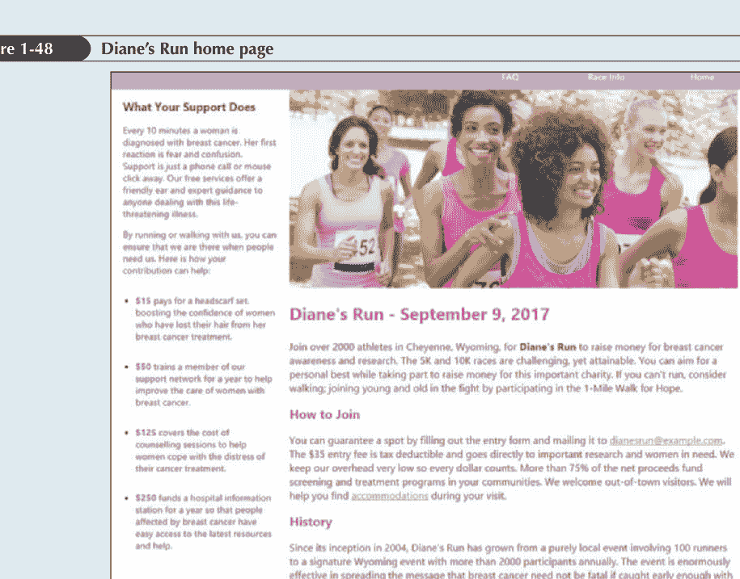

每 10 分钟就有一个女性被确诊为乳腺癌。她的反应是恐惧和困惑。支持一个电话或信息即可获得。我们的免费热线为任何应对这种疾病的人提供支持。
通过与我们一起跑步或步行，你确保了需要乳腺癌治疗的人能够获得帮助。

- 15 美元可以支付理发费用，缓解因治疗导致脱发女性的焦虑。
- 50 美元可以为我们的支持网络成员提供一年的培训，帮助他们度过危机。
- 125 美元可以支付假发费用，帮助癌症患者应对治疗中的困难。
- 250 美元可以为受乳腺癌影响的人提供财务援助人员，让他们轻松获取最新的资源和帮助。

# Diane 的跑活动 - 2019年9月

加入怀俄米州切尚延（Cheyenne）的 2000 多名运动员，参加 Diane's Run，为乳腺癌意识和研究筹资金。10K 赛赛具有挑战性，你可以在这一重要活动中做出贡献！如果你不能跑步，可以慢跑、步行并加入我们的“希望英里步行”（1-Mile Walk for Hope）。

# 如何加入

你可以通过填写报名表并注册来帮助我们对女性的研究和支持。我们保持低成本，因此每一分钱都至关重要。75% 的净资金将用于女性的支持和治疗计划。我们欢迎外地访客。请帮助我们在网上传播这一消息！

自 2004 年以来，Diane's Run 已从一个小型家庭活动发展为每年有 3000 多名参与者的 100 人跑步活动。该活动有效地传播了一个信息：如果通过乳靶检查和乳腺检查早期发现，乳腺癌不是致命的。作为一个高流量活动，Diane's Run 为所有参与者提供了灵感。这个计划周且充满情感的活动为我们提供了机会，向家庭和社区传播关于乳腺癌的信息。

# 记住 Diane

Diane's Run 以纪念 Diane White 命名，她是两个孩子的母亲，Peter 的妻子，于 2003 年 5 月去世。Diane 是一个信仰和健康生活的乐观倡导者。我们继续着她开始的事业，这继续为参与此活动的数千跑步者带来灵感。

我们希望你今年加入我们，成为 Diane 家庭的一员。

© wavebreakmedia/Shutterstock.com

Diane's Run | 8 月 31 日 | 怀俄米州切尚 82001

# 教程 1 HTML5 入门 | HTML 和 CSS

Peter 为你提供了项目所需的文本内容、图形和样式表。你的工作将为三个页面编写 HTML 代码：网站首页、一个包含比赛信息的页面，最后是一个包含常见问题（FAQ）列表的页面。

完成以下操作：

1. 使用你的编辑器解析 `html01` 文件夹下的 `dr_index.txt`、`dr_info.txt` 和 `dr_faq.txt` 文件。在每个文件的注释中输入你的名字和日期，并将分别保存为 `dr_index.html`、`dr_info.html` 和 `dr_faq.html`。
2. 在 HTML 编辑器中打开 `dr_index.html` 文件。在文档头中，添加以下元数据：
   a. 将文件编码设置为 `utf-8`。
   b. 插入搜索关键词：cancer, run, race, charity。
   c. 将文档标题设置为 Diane's Run。
   d. 将文档链接到 `dr_base.css` 和 `dr_layout.css` 样式表。
3. 在文档主体中插入一个 `header` 元素、两个 `section` 元素和一个 `footer` 元素。
4. 在 `header` 元素中，插入一个包含以下项目的列表：Home、Info 和 FAQ。将这些项目分别链接到 `dr_index.txt`、`dr_info.html` 和 `dr_faq.html`。
5. `file_index.txt` 包含要插入 Diane Run 首页的文本。在 HTML 编辑器中进入 `dr_index.txt` 文件并复制文件第一部分的文本。然后，在 HTML 编辑器中进入 `dr_index.html` 文件并将其粘贴到 `section` 元素中。
6. 在第一个 `section` 元素中添加以下内容：
   a. 将“What Your Support Does”一行标记为 `h1` 标题。
   b. 将接下来的两段标记为 `p` 段落。
   c. 将第一部分中的剩余文本标记为 `p` 段落。
7. 返回 HTML 编辑器中的 `dr_index.txt` 文件并复制第二部分的文本。然后，在 HTML 编辑器中进入 `dr_index.html` 文件并将其粘贴到 `section` 元素中。
8. 在 `section` 元素中添加：
   a. 将“Diane's Run - September 2019”标记为 `h1` 标题。
   b. 将标题“How to Join”标记为 `h2`。
   c. 将剩余文本标记为 `p` 段落。
9. 在 `footer` 元素中插入文本：Diane's Run | August 31st | Cheyenne, WY 82001
10. 将更改保存到文件并在浏览器中打开 `dr_index.html`。验证布局是否匹配设计。
11. 在 `footer` 元素中插入文本 Math Strings: A Site for Educators and Researchers。
12. 将更改保存到文件并在浏览器中打开 `ms_euler.html` 文件。验证侧边栏中的方程是否与图 1-47 显示的匹配，并确保所有的 [pi] 字符已替换为 π。点击导航列表中的四个链接，并验证浏览器是否打开了相应页面。

# 案例问题 3

此案例所需的数据文件：`index_txt.html`、`dir_info_txt.html`、`dir_faq_txt.html`、4 个 CSS 文件、2 个 PNG 文件、3 TXT 文件

## Diane 的跑活动 (Diane's Run)

Diane's Run 是一个为乳腺癌意识和研究筹资金的慈善机构。Peter Wheaton 是该慈善组织的组织者，他请求你帮助修改网站。我们有一些添加到当前网站的文本。你将创建的页面如图 1-48 所示。


每 10 分钟就有一个女性被确诊为乳腺癌。她的反应是恐惧和困惑。支持一个电话或信息即可获得。我们的免费热线为任何应对这种疾病的人提供支持。
通过与我们一起跑步或步行，你确保了需要乳腺癌治疗的人能够获得帮助。

- 15 美元可以支付理发费用，缓解因治疗导致脱发女性的焦虑。
- 50 美元可以为我们的支持网络成员提供一年的培训，帮助他们度过危机。
- 125 美元可以支付假发费用，帮助癌症患者应对治疗中的困难。
- 250 美元可以为受乳腺癌影响的人提供财务援助人员，让他们轻松获取最新的资源和帮助。

# Diane 的跑活动 - 2019年9月

加入怀俄米州切尚延（Cheyenne）的 2000 多名运动员，参加 Diane's Run，为乳腺癌意识和研究筹资金。10K 赛具有挑战性，你可以在这一重要活动中做出贡献！如果你不能跑步，可以慢跑、步行并加入我们的“希望英里步行”（1-Mile Walk for Hope）。

# 如何加入

你可以通过填写报名表并注册来帮助我们对女性的研究和支持。我们保持低成本，因此每一分钱都至关重要。75% 的净资金将用于女性的支持和治疗计划。我们欢迎外地访客。请帮助我们在网上传播这一消息！

自 2004 年以来，Diane's Run 已从一个小型家庭活动发展为每年有 3000 多名参与者的 100 人跑步活动。该活动有效地传播了一个信息：如果通过乳靶检查和乳腺检查早期发现，乳腺癌不是致命的。作为一个高流量活动，Diane's Run 为所有参与者提供了灵感。这个计划周且充满情感的活动为我们提供了机会，向家庭和社区传播关于乳腺癌的信息。

# 记住 Diane

Diane's Run 以纪念 Diane White 命名，她是两个孩子的母亲，Peter 的妻子，于 2003 年 5 月去世。Diane 是一个信仰和健康生活的乐观倡导者。我们继续着她开始的事业，这继续为参与此活动的数千跑步者带来灵感。

我们希望你今年加入我们，成为 Diane 家庭的一员。

© wavebreakmedia/Shutterstock.com

Diane's Run | 8 月 31 日 | 怀俄米州切尚 82001

# 教程 1 HTML5 入门 | HTML 和 CSS

Peter 为你提供了项目所需的文本内容、图形和样式表。你的工作将为三个页面编写 HTML 代码：网站首页、一个包含比赛信息的页面，最后是一个包含常见问题（FAQ）列表的页面。

完成以下操作：

1. 使用你的编辑器解析 `html01` 文件夹下的 `dr_index.txt`、`dr_info.txt` 和 `dr_faq.txt` 文件。在每个文件的注释中输入你的名字和日期，并将分别保存为 `dr_index.html`、`dr_info.html` 和 `dr_faq.html`。
2. 在 HTML 编辑器中打开 `dr_index.html` 文件。在文档头中，添加以下元数据：
   a. 将文件编码设置为 `utf-8`。
   b. 插入搜索关键词：cancer, run, race, charity。
   c. 将文档标题设置为 Diane's Run。
   d. 将文档链接到 `dr_base.css` 和 `dr_layout.css` 样式表。
3. 在文档主体中插入一个 `header` 元素、两个 `section` 元素和一个 `footer` 元素。
4. 在 `header` 元素中，插入一个包含以下项目的列表：Home、Info 和 FAQ。将这些项目分别链接到 `dr_index.txt`、`dr_info.html` 和 `dr_faq.html`。
5. `file_index.txt` 包含要插入 Diane Run 首页的文本。在 HTML 编辑器中进入 `dr_index.txt` 文件并复制文件第一部分的文本。然后，在 HTML 编辑器中进入 `dr_index.html` 文件并将其粘贴到 `section` 元素中。
6. 在第一个 `section` 元素中添加以下内容：
   a. 将“What Your Support Does”一行标记为 `h1` 标题。
   b. 将接下来的两段标记为 `p` 段落。
   c. 将第一部分中的剩余文本标记为 `p` 段落。
7. 返回 HTML 编辑器中的 `dr_index.txt` 文件并复制第二部分的文本。然后，在 HTML 编辑器中进入 `dr_index.html` 文件并将其粘贴到 `section` 元素中。
8. 在 `section` 元素中添加：
   a. 将“Diane's Run - September 2019”标记为 `h1` 标题。
   b. 将标题“How to Join”标记为 `h2`。
   c. 将剩余文本标记为 `p` 段落。
9. 在 `footer` 元素中插入文本：Diane's Run | August 31st | Cheyenne, WY 82001
10. 将更改保存到文件并在浏览器中打开 `dr_index.html`。验证布局是否匹配设计。
11. 在 `footer` 元素中插入文本 Math Strings: A Site for Educators and Researchers。
12. 将更改保存到文件并在浏览器中打开 `ms_euler.html` 文件。验证侧边栏中的方程是否与图 1-47 显示的匹配，并确保所有的 [pi] 字符已替换为 π。点击导航列表中的四个链接，并验证浏览器是否打开了相应页面。

# 教程 1 HTML 入门 | HTML 和 CSS

探索 23. 返回到 HTML 编辑器中的 `dr_index.html` 文件。在章节 `#aos-element` 部分的“如何加入”段落中添加以下两个超链接：

- a. 将电子邮件地址 `dianesun@example.com` 修改为主题为“Entry Form”（入门表单）的电子邮件链接。
- b. 将单词 `accommod` 修改为超链接，指向浏览器中 `dr_faq.html` 文件中 id 为 `faq13` 的元素。验证点击电子邮件链接是否会打开你的电子邮件程序，并自动填充电子邮件地址和主题内容。

- 24. 将更改保存到文件并重新加载 `dr_index.html`。验证点击链接是否会打开你的电子邮件程序...

- 25. 点击 `accommod` 超链接，验证浏览器是否跳转到 FAQ 页面的最后一个答案。

- 26. 验证通过点击页面顶部的导航链接是否可以在所有页面之间跳转。

# 案例问题 4

此案例问题的数据文件：`h_index_txt.html`, `h_towers_txt.html`, `h_alliance_txt.html`, 3 个 PNG 文件， 1 个 TXT 文件

## Harpe Gaming

Sean Greer 是 Harpe Gaming 的所有者，这是西弗吉尼亚州摩根敦的一家小游戏店。你被邀请负责商店新网站的工作。Sean 希望你为商店的主页编写 HTML 代码。Sean 向他的忠实客户发布新新闻作为一种服务。你还希望你为他为“Towers and Temple”（塔与神庙）页面以及“Alliance”（联盟）撰写的两个新评论编写 HTML 代码。Sean 已经写好了这三个页的所有内容，只需要你帮助将它们转换为 HTML 文档。

完成以下任务：

- 1. 使用你的编辑器打开 `case4` 文件夹。将 `h_index.txt`、`h_towers.txt` 和 `h_alliance.txt` 文件分别保存为 `h_index.html`、`h_towers.html` 和 `h_alliance.html`。
- 2. 三个页面的内容位于 `gettext.txt`。花些时间查看该文件的内容。Harpe Gaming 主页对商店及其理念进行了简要介绍，并包含了给感兴趣客户的信息。“Towers and Temple”页面和“Alliance”页面包含了每个游戏的概述，以及来自热门游戏网站的对 Harpe Gaming 的评分和评论。Sean 还为你提供了 `logo.png`、`h_towers.png` 和 `h_alliance.png` 图片供文件使用。你可以自由使用自己的素材进行替换。
- 3. 一旦熟悉了网页内容，就开始为每个页面创建 HTML 代码。对于每个文件，插入 HTML 文档的结构，包括起始标签、元素、文档头（head）和文档体（body）。
- 4. 对于每个文件的头 部分，执行以下操作（此项目没有样式表，因此你不需要包含任何样式表）：
  - a. 插入一条包含你的姓名、日期和页面目的的注释。
  - b. 插入设置文件中使用的字符编码的元数据标签。
  - c. 插入元数据标签和适合每个文件内容的搜索关键词列表。
- 5. 在文档体（body）内，在一个头部体中插入一个导航列表，其中包含指向此示例网站所有三个页面的超链接。

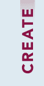

# HTML 82 HTML 和 CSS | 教程 1 HTML5 入门

6. 使用 `hg_txt` 文件中的内容填充三个页面的内容。三个页面中使用的标记由你决定。在你的网站中应至少包含以下内容的一个示例：

- a. 分段元素，包括 `header`、`article`、`aside` 和 `footer` 元素
- b. 分组元素，`p`（段落）、`blockquote`（引用块）和列表
- c. 文本层级元素，用于标记分组元素内的单个单词或短语
- d. 至少一个 `span` 元素和 `em` 元素
- e. 内联图像，包括适当的替代文本（alt text）
- f. 使用字符名称或编码插入的符号
- g. 指向个人电子邮件地址的超链接
- h. 指向电话号码的超链接
- i. 指向网站 URL 的超链接

7. 将更改保存到文件，然后在浏览器中打开它们。验证在网站页面间移动、访问你的电子邮件程序以及访问 Web 链接时，点击链接是否正常工作。

## CSS 入门

## 目标
章节 2.1
- 探索 CSS 的历史
- 研究不同类型的样式表
- 探索优先级和继承
- 在 CSS 中应用颜色

### 为健身俱乐部设计网站
章节 2.2
- 使用上下文选择器
- 使用属性选择器
- 应用文本和字体样式
- 使用字体

### Tri and Sports
章节 2.3
- 列表样式
- 使用外边距（margins）和内边距（padding）
- 使用伪类（pseudo-classes）和伪元素（pseudo-elements）
- 使用 CSS 插入内容

Alison Palmer 运营 Tri and Succeed，这是德克萨斯州的一家体育俱乐部，专门从事铁人三和其他运动。中心提供全年的游泳、自行车教学。她现在觉得网站需要重新改装。她希望使用颜色和有趣的排版来营造视觉吸引力。她希望你使用 CSS 帮助网站焕然一新。

## 开始文件

| html2 | 教程 | case1 | case2 |
| :--- | :--- | :--- | :--- |
| tss_bike_txt.html | tss_bike_txt.html | tss_coach_txt.html | ph_plays_txt.html |
| tss_home_txt.html | coach_styles_txt.css | ph_styles_txt.css | mw_styles_txt.css |
| tss_run_txt.html | 8 个文件 | 8 个文件 | |
| tss_swim_txt.html | | | |
| tss_styles_txt.css | 3 个文件 | 3 个文件 | |
| case4 | demo | | |
| cw_class_txt.html | demo_css.html | | |
| cw_styles_txt.css | 3 个文件 | 3 个文件 | |

# HTML 83

## 章节 2.1 视觉概述：
`charset` 规则指定文件中使用的字符编码。

```
```


@charset "utf-8";

/* New Perspectives on HTML5 and CSS3, 7th Edition

Tutorial 2 case */

/* CSS Typography Style Sheet

Author: Alison Palmer

Date: 2017-01-01 */

Filename: `css_styles.css`

样式注释提供了样式表的信息。HSL 色值根据色相、饱和度和亮度定义颜色。`style` 规则设置元素的 `display` 属性。

```css
/* Main structural styles */
html {
  background-color: hsl(27, 72%, 72%);
}
```

RGB 值根据红、绿、蓝混合定义颜色。CSS 支持 147 种颜色名称。

```css
body {
  color: rgb(91, 91, 91);
  background-color: ivory;
}
```

`style` 属性指定要修改选择器的哪个方面。选择器定义了哪些元素受规则影响。

```css
/* Heading styles */
h1 {
  color: white;
  background-color: rgb(222, 128, 68);
}
```

`color` 属性为所选元素设置文本颜色。

```css
h2 {
  color: white;
  background-color: rgb(235, 177, 131);
}
```

`background-color` 属性为所选元素设置背景颜色。

> © 2016 Cengage Learning.
> © Ystrand Cozyn/Shutterstock.com;
> © Charles Bennett/Shutterstock.com;
> © osill/Shutterstock.com;
> © Monkey Business Images/Shutterstock.com

# CSS 窗口样式和颜色

使用 `h1` 样式规则将浏览器背景设置为 `hsl(27, 73, 72%)`。`h1` 标题按照 `h1` 样式规则以白色显示在深橙色背景上。


- 首页 (Home)
- 关于 (About)
- 职业 (Careers)
- 自行 (Cycling)
- Active.com
- markdown.org
- 来源 (Sources)
- 横幅消息 (Banner Message)
- ValeNews
- 成为 (Become)
- Swan Smith
- USA Washington
- microsoft.com
- TreeBuilder
- CapTreeBuilder
- TestColor.com

## 关于 CSS

自 2002 年以来，Tri and Success Sports 为奥斯汀提供了第一间教室计算机实验室。我们致力于发挥你的全部潜力。我们努力实现你的梦想。

想保持优秀吗？与我们富有启发性的网站互动。我们会在那里等你，无论是在之前、期间还是之后，只要你需要更多！加入我们，我们会完成你所需要的。

## 评论

感谢你所确保我取得了进步。我意识到我有生活目标，但你以这种方式帮助了我。Alison 希望永远朝着我的梦想。你的记录证明了这一点。我很荣幸有你们这些教练的支持。

## 介绍 CSS

在上一节教程中讨论的重要原则之一是 HTML 并不定义文档应该如何显示；它只定义文档的结构和内容。页面的外观由使用层叠样式表（CSS）语言编写的一个或多个样式决定的。从本教程开始，你将学习编写自己的 CSS 样式。

CSS 规范由万维网联盟（W3C）维护，W3C 定义了 HTML 的标准。CSS 语言已经发展到 CSS3，它不再基于单一规范，而是构建在多个模块之上，每个模块都关注于一个独立的设计主题。在编写此本书时，W3C 将扩展该语言的范围，这意味着许多新的设计功能仍处于以下阶段：如果有支持的话，浏览器[将]支持它们。

> 提示：你可以在 `www.caniuse.com` 查询不同浏览器版本对 CSS 的支持。

在这些教程中，你将关注在当前浏览器中具有几乎全范围内支持的 CSS 特性。然而，你还将研究支持旧版浏览器的替代方案，以及适应不同浏览器在实现 CSS 设计方面差异的方法。

# 样式表的类型

网站的设计通常不是单一样式表的结果；而是多种样式的组合，从浏览器样式开始，然后被用户定义的样式表、外部样式、嵌入样式表取代，最后以内联样式结束（见图 2-1）。让我们更详细地检查这些样式源。

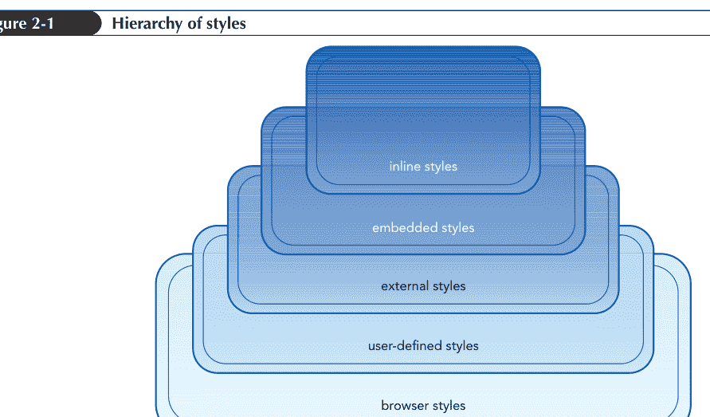

Copyright 2018 Cengage Learning. 版权所有。未经许可全部或部分复制、扫描或复制。WCN 02-200-203

# 教程 2 开始使用 CSS | HTML 和 CSS

首先被处理的样式是浏览器样式或用户代理样式，即内置在浏览器中的样式。浏览器样式是应用于网页的样式。

接下来被处理的样式是用户定义的样式，它们由用户根据其配置浏览器的设置而定义。例如，视力障碍的用户可以覆盖浏览器的默认设置，使用高对比度颜色和大字体号显示文本，以提高可读性。任何用户定义的样式优先级都高于浏览器样式。

用户定义的样式会被外部样式覆盖，外部样式是 Web 作者创建并通过 CSS 文件链接到页面的样式。当你将 Tri and Success 网站链接到 CSS 文件集时，使用外部样式表是最好的。正如教程中所示，多个文档可以访问同一个样式表，这使得为许多网站应用共同的设计变得简单。

外部样式之外，还有嵌入样式，即添加到 HTML 文档 `<head>` 中的样式。嵌入样式仅适用于创建它的 HTML 文档，且无法被网站中的其他文档访问，但它们会覆盖外部样式表中的任何样式。

最后，优先级最高的是内联样式，它们仅是 HTML 元素内部的属性。嵌入样式和内联样式不是最佳实践，应该避免使用，因为它们违反了 HTML 的基本原则，即 HTML 应该只描述文档的内容和结构，而设计样式应该放在代码之外。

网页的整体设计基于不同来源样式的组合。某些样式可能源于浏览器样式，而另一些将定义在外部样式表或嵌入样式表中。CSS 的挑战之一在于确定不同样式表中的样式如何相互作用，以决定页面的最终外观。

## 使用不同的样式表查看页面

你将通过查看 Tri and Success 网站主页在浏览器内置样式表的默认样式渲染时的显示来开始你的工作。

> 要查看 Tri and Success 运动主页：
> - 1. 使用编辑器打开 `html02` 文件夹中的 `tss_home.txt` 文件。在文件的注释部分使用你的名字和日期，并将文档保存为 `tss_home.html`。
> - 2. 花些时间浏览文档以熟悉其内容和结构。
> - 3. 在浏览器中打开 `tss_home.html` 页面。页面的部分如图 2-2 所示。

## HTML 和 CSS | 教程 2 开始使用 CSS

图 2-2 仅使用浏览器样式渲染的 TSS 主页

大号字体

链接

- 首页
- 跑步
- 自行
- 活跃
- 世界日报
- 自行车杂志
- 田径运动
- 力量
- 美国经济
- websites.org
- 加州福尼亚尼亚
- 时尚颜色
- 足球
- tricket.com

蓝色文本

列表项目

关于 TSS

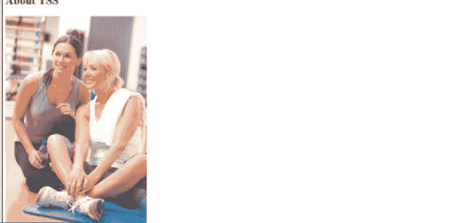

自 2001 年起，Tri and Bound Sports 为所有年龄和目标的运动员提供了一个健身中心。我们专注于帮助你实现健身目标。告诉我们你想做什么；我们将满足你的需求。

© 2016 Cengage Learning; Yibrand/ Shutterstock.com; Charles T. Shutterstock.com; ost@ Shutterstock.com; Monkey Business Images/ Shutterstock.com

# 教程 2 开始使用 CSS | HTML 和 CSS

> 要查看 Tri and Success 运动主页：
> - 1. 使用编辑器打开 `html02` 文件夹中的 `tss_home.txt` 文件。在文件的注释部分使用你的名字和日期，并将文档保存为 `tss_home.html`。
> - 2. 花些时间浏览文档以熟悉其内容和结构。
> - 3. 在浏览器中打开 `tss_home.html` 页面。页面的部分如图 2-2 所示。

图 2-2 仅使用浏览器样式渲染的 TSS 主页

```html
<meta charset="utf-8">
<meta name="keywords" content="triathlon, running, cycling" />
<title>TSS</title>
<link href="tss_layout.css" rel="stylesheet" />
```

图 2-3 仅使用浏览器样式渲染的 TSS 主页

大号字体

蓝色文本

列表项目

> 要查看 Tri and Success 运动主页：
> - 1. 使用编辑器打开 `html02` 文件夹中的 `tss_home.txt` 文件。在文件的注释部分使用你的名字和日期，并将文档保存为 `tss_home.html`。
> - 2. 花些时间浏览文档以熟悉其内容和结构。
> - 3. 在浏览器中打开 `tss_home.html` 页面。页面的部分如图 2-2 所示。

图 2-4 仅使用浏览器样式渲染的 TSS 主页

自 2001 年起，Tri and Bound Sports 为所有年龄和目标的运动员提供了一个健身中心。我们专注于帮助你实现健身目标。告诉我们你想做什么；我们将满足你的需求。

## 探索样式规则

如果说元素是 HTML 文件的构建块，那么定义应用于元素或一组元素的样式的样式规则就是 CSS 样式表的构建块。样式规则具有通用形式：

```
selector {
  property1: value;
  property2: value;
}
```

其中，选择器（selector）识别文档中的某个元素或一组元素，而属性:值值对定义了应用于该元素或元素的特定样式属性及其值。例如，以下样式规则具有一个 `h1` 选择器，用于匹配文档中所有的 `h1` 元素，并具有 `color: red` 和 `text-align: center` 属性值对，告诉浏览器以红色并居中显示页面上所有的 `h1` 标题。

```
h1 {
  color: red;
  text-align: center;
}
```

选择器也可以以逗号分隔列表的形式输入，如下样式规则所示，它同时将 `h1` 和 `h2` 标题显示为红色：

```
h1, h2 {
  color: red;
}
```

像 HTML 一样，CSS 会忽略空白符的使用，因此你也可以更紧凑地输入此样式：

```
h2 (color: red);
```

在单行上编写样式规则可以节省空间，但将每个样式属性单独输入一行会使你的代码更易于阅读和编辑。你在网络上遇到的 CSS 文件会看到这两种方法都被使用。

## 浏览器扩展

除了 W3C 支持的属性外，大多数浏览器都提供了它们自己的扩展样式属性库，被称为浏览器扩展（browser extensions）。许多后来成为 W3C 标准的样式都是从浏览器扩展开始的，对于旧版本的浏览器，有时支持特定 CSS 特性的唯一方法就是通过为特定浏览器定制的浏览器扩展来实现。

浏览器扩展通过使用厂商前缀（vendor prefix）来识别，该前缀指示了创建并支持该属性的浏览器厂商。图 2-5 列出了你在网页设计工作中会遇到的浏览器扩展。

# 图 2-5 浏览器扩展的厂商前缀

| 厂商前缀 | 渲染引擎 | 浏览器 |
| --- | --- | --- |
| `-khtml-` | KHTML | Konqueror |
| `-moz-` | Mozilla | Firefox, Chrome |
| `-ns-` | Trident | Internet Explorer |
| `-o-` | Presto | Opera, Nintendo Wii |
| `-webkit-` | WebKit | Android 浏览器, Chrome, Safari |

例如，CSS3 中使用的最新功能之一是用于将内容显示在独立列中的布局样式。列数通过 `column-count` 属性进行指明。要以一种同时支持旧版和当前浏览器的方式来应用此设置，你需要先包含浏览器扩展，然后是跟当前的 CSS 规范：

```
article {
  -webkit-column-count: 3;
  -moz-column-count: 3;
  column-count: 3;
}
```

通常情况下，浏览器按照它们列出的顺序处理样式属性，忽略它们不识别或不支持的属性，因此你始终将最新的规范放在最后。

# 嵌入式样式表

样式规则也用于嵌入式样式表（embedded style sheets）和内联样式（inline styles）。嵌入式样式通过向文档头部（head）添加以下 `style` 元素直接作为元数据插入 HTML 文件中：

```
<style>
样式规则
</style>
```

其中样式规则是你想嵌入到 HTML 页面中的不同规则。例如，以下嵌入式样式将之前描述的相同规则应用于当前文档中的所有 `h1` 标题，使其以红色并居中显示：

```html
<style>
h1 {
  color: red;
  text-align: center;
}
</style>
```

记住，在所有条件相等的情况下，最后加载的样式优先于定义的样式。在以下代码中，浏览器将最后加载嵌入式样式表，使其优先级高于 `tss_styles.css` 文件中的样式规则。

```html
<link href="tss_styles.css" rel="stylesheet" />
<style>
样式规则
</style>
```

## HTML 和 CSS | 教程 2 开始使用 CSS

> 提示：为了避免混淆，请将嵌入式样式放在任何指向外部样式表文件的链接之后，这样嵌入式样式始终具有优先级。

如果 `link` 元素和 `style` 元素的顺序反，则来自 `tss_styles.css` 文件的样式将最后加载并获得优先级。

## 内联样式

直接由浏览器解释的样式是内联样式，它们使用以下 `style` 属性直接应用于特定元素：

```html
<element style="property1: value;property2: value; ...">
content
</element>
<h1 style="color: red; text-align:center;">
标题和成功样式
</h1>
```

其中属性值定义了样式，这些样式直接应用于该元素。因此，内联样式将页面上 `h1` 标题的外观设置为红色文本：

此样式仅适用于此特定的 `h1` 标题，而不适用于页面上或网络上的任何其他 `h1` 标题。内联样式的优点是它可以清楚地说明哪个元素被格式化；然而，在大多数情况下不建议使用内联样式。内联样式会让维护困难且效率低下。因此，你会在网页上遇到的 CSS 文件中看到这两种方法都被使用。

## 权重和优先级

当多个样式规则应用于同一个元素时，浏览器会决定哪一个生效。这取决于选择器的权重（specificity）。选择器的权重计算基于它包含的类型：
- 类型选择器（例如 `h1, p`）
- 属性选择器和伪类（例如 `[type="text"], :hover`）
- 类选择器和 ID 选择器（例如 `.class, #id`）
- 内联样式具有最高权重

例如，`h1` 选择器的权重低于 `div`。`.header` 选择器的权重高于 `h1`。`#header` 的权重高于 `.header`。

当两个规则权重相同时，浏览器使用样式表中最后的一个。这就是为什么规则顺序很重要。

```css
h1 {
  color: blue;
}
h1 {
  color: red;
}
/* 在这种情况下，h1 是红色的 */
```

# 教程 2 开始使用 CSS | HTML 和 CSS

## 继承

渲染元素的另一个因素是属性从父元素传递给子元素，这种过程被称为继承。例如，如果你设置了 `article` 元素的颜色，其中的所有段落都会继承该颜色。

```css
article {
  color: blue;
}
```


因此，除非另有指定，否则文本将是蓝色的。

> 提示：并不是所有属性都是继承的；例如，定义文本颜色的属性对图像没有意义。

## 浏览器开发者工具

如果多个样式表和多个规则的想法令人生畏，有一些工具可以提供帮助。大多数浏览器都包含了开发者工具，允许设计师查看 HTML 代码、CSS 样式和网页的其他部分。这些工具允许设计师定位应用于特定页面的样式来源。

每个浏览器的开发者工具都是不同的，并不断更新改进版本。然而，如果你青好现有的工具风格，你可以在桌面浏览器内置工具下进行检查。注意后续步骤中的图使用的是 Google Chrome 浏览器的开发者版本。

### 访问浏览器开发者工具

- 1. 返回浏览器中的 `tss_home.html` 文件。
- 2. 按 F12 打开开发者工具窗口。

如果按下 F12 没有打开开发者工具，你的浏览器可能需要不同的组合键。在适用于 Safari 中，你可以使用 `ctrl+shift+i` 或 `command+option+i` 查看开发者工具。

- 3. 从网页的层级元素列表中，选择 `<body>` 标签（如果它尚未选中）。

图 2-6 显示了使用 Chrome 开发者工具的页面布局。

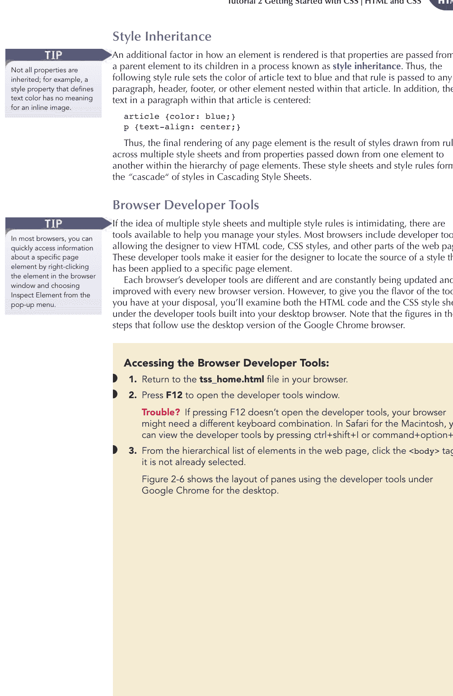

# HTML 94 HTML 和 CSS | 教程 2 开始使用 CSS

## 图 2-6 Google Chrome 中的开发者工具

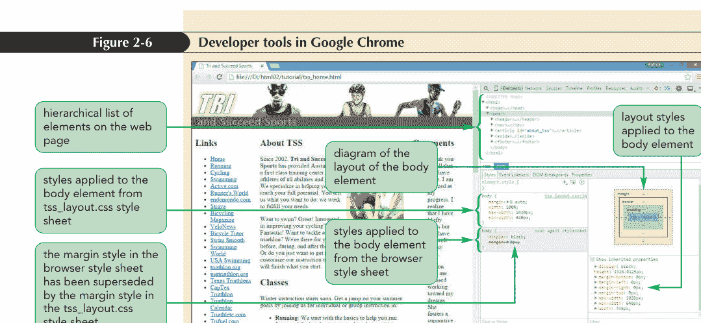

如图 2-6 所示，样式列表列出了已应用于 `body` 元素的样式。请注意，来自浏览器样式表的重置（reset）属性被划掉了，这表示该浏览器样式已被外部样式表中定义的样式所取代。

> 每个浏览器都有一套不同的开发者工具和配置。你的工具可能与图 2-6 所示的并不相似。

- 4. 花些时间通过从层级元素列表中选择元素，探索另一个页面的内容和样式。
- 5. 按 F12 关闭开发者工具窗口。

> 遇到问题？在 Safari 中，你可以通过按 `ctrl+shift+I` 或 `command+I` 来关闭开发者工具。

在本以及今后的教程中，你可能会发现开发者工具是你进行网站设计工作的有力助手。大多数开发者工具允许用户插入新样式，以查看它们对页面外观的直接影响；然而，这些修改仅在当前会话期间有效，不会永久保存。因此，一旦你找到一个想要使用的设置，必须将其输入相应的样式表中，它才能生效。

# 教程 2 开始使用 CSS | HTML 和 CSS HTML 95

## 定义重要的样式

你可以通过在特定属性后处标记以下 `important` 关键字来覆盖样式级联：

```
property: value !important;
```

接的样式规则将所有 `h1` 标题的颜色设置为橙色；因为属性被标记为重要，它的优先级高于在其他样式中发现的任何冲突样式。

```
h1 {color: orange !important;}
```

`important` 关键字通常用于用户自定义样式表，在这些样式表中，用户需要用自己的样式替换设计师的样式。例如，视力障碍用户需要用大字体和高对比度颜色显示文本。通常情况下，设计人员不应使用 `important` 关键字，因为它会干扰 CSS 语言内置的级联。

## 创建样式表

现在你已经回顾了样式表背后的一些历史和概念，你将开始创建自己的样式表。理想情况下，你的样式表应该以注释开始，记录样式表的目的，并提供关于创建文档的人以及何时创建的信息。

### 编写样式注释

样式表注释按如下输入：

```
/*
comment
*/
```

其中 `comment` 是注释的文本。由于 CSS 忽略空格的存在，你可以将注释写在单行内以节省空间：

```
/* comment */
```

创建一个样式表文件，在文件顶部放置一个带有你的名字和当前日期的注释。

### 编写样式注释：

- 1. 使用你的编辑器打开 `html102 -> tutorial` 文件夹下的 `tss_styles.txt` 文件。
- 2. 在文件顶部的注释部分，输入你的姓名、`Author:` 注释以及位于 `Date:` 注释后的日期。
- 3. 将文件保存为 `tss_styles.css`。
- 4. 回到 HTML 编辑器中的 `tss_home.html` 文件，在 `<head>` 标签直接之前添加 `link` 元素。
- 5. 关闭 `tss_home.html` 文件并保存你的更改。

```
<link href="tss_styles.css" rel="stylesheet" />
```

## 定义字符编码

对于 HTML 文件，在每个 CSS 文档中定义文件中使用的字符编码是一个好习惯。在 CSS 中，你使用 `@charset` 规则来实现这一点：

```
@charset encoding;
```

其中 `encoding` 定义了文件中使用的字符编码。现在将 `@charset` 规则添加到 `tss_styles.css` 样式文件中，指定在 CSS 代码中使用 UTF-8 字符集。

要指示字符编码：

- 1. 回到编辑器中的 `tss.css` 文件。
- 2. 在初始字符部分正上方插入行：`@charset "utf-8";`

图 2 突出显示了样式表中的新代码。

### 添加 @charset 规则和样式注释

```
@charset "utf-8";

/* New Perspectives on HTML5 and CSS3, 7th Edition

Tutorial 2

Tutorial Case

TSS Typographic Style Sheet

Author: Alison Palmer

Date: 2017-03-01

Filename: tss_styles.css

*/
```

## 导入样式表

`@import` 规则是 CSS 规则（at-rule）的一个示例，该规则用于向浏览器发送指令，指示如何解释和解析 CSS 文件的内容。另一个规则是 `@import`，用于导入样式文件的内容：

```
@import url(url);
```

其中 `url` 是外部样式文件的 URL 地址。
`@import` 用于将多个样式表的样式规则合并到单个文件中。例如，一个在线商店可能有一个命名为 `basiccss` 的样式表，包含每个网页都使用的所有基础样式，另一个命名为 `sales.css` 的样式表则包含用于与商品相关的页面的样式。以下代码从两个文件导入了内容：

```
@import url(company.css);

@import url(support.css);
```

在 CSS 文件中使用多个 `@import` 规则的效果与添加多个 `link` 元素的效果相同。`@import` 的优势之一是它可以简化你的网站。

## 颜色的工作

在本以及今后的教程中，你可能会发现开发者工具是你进行网站设计工作的有力助手。大多数开发者工具允许用户插入新样式，以查看它们对页面外观的直接影响；然而，这些修改仅在当前会话期间有效，不会永久保存。因此，一旦你找到一个想要使用的设置，必须将其输入相应的样式表中，它才能生效。

# 教程 2 开始使用 CSS | HTML 和 CSS

在 CSS 文件中使用多个 `@import` 规则的效果与添加多个 `link` 元素的效果相同。`@import` 的优势之一是它可以简化你的。

## 教程 2 快速入门 CSS | HTML 和 CSS

RGB 值有时用十六进制数表示，十六进制数是以 16 进制表示的数字，而不是我们常用的 10 进制。在 10 进制计数中，数值使用 10 个数字（0 到 9）的组合来表示。十六进制计数包括这十个数字和六个字符（A 代表 10，B 代表 11，C 代表 12，D 代表 13，E 代表 14，F 代表 15）。例如，你使用这 16 个字符的组合。例如，16 的十六进制表示为 10，值 255 的十六进制表示为 FF。以十六进制数表示的颜色样式值如下：

```
#redgreen
```

其中 `red`、`green` 和 `blue` 是红色、绿色和蓝色分量的十六进制值。因此，黄色可以使用 RGB 三元组 `rgb(255, 255, 0)` 表示，或者用更紧凑的十六进制形式表示为：

```
#FFF00
```

大多数编辑器和图形程序都提供调色板工具，允许用户选择颜色并复制粘贴 RGB 或十六进制颜色值。十六进制颜色值的优势是可以创建更小的样式表，加载速度更快——这对于移动设备来说是一个重要的考虑因素。然而，对于其他查看和研究样式表的人来说，它们比 RGB 值更难解释。最后，你可以将每个分量以百分比形式输入，100% 表示最高强度。在这种格式下，你会用以下值指定橙色：

```
rgb(100%, 65%, 0)
```

这相当于 `rgb(255, 165, 0)`。

### HSL 颜色值

HSL 值在 CSS3 中引入，基于一种颜色模型，其中每个颜色由色相（hue）、饱和度（saturation）和亮度（lightness）决定。色相是颜色的色调，通常由色轮上的方向表示，值范围从 0° 到 360°，0°对应红色，120°对应绿色，240°对应蓝色。饱和度测量选择颜色的强度，范围从 0% 到 100%。最后，亮度测量颜色的明暗，范围从 0%（黑色）到 100%（白色）。图 2-9 显示了将色相设置为 38°、饱和度设置为 90%、亮度设置为 60% 如何得到中等橙色。

HSL 颜色模型下的橙色定义：

`hsl(38, 90%, 60%)`


使用 HSL 模型的颜色值在 CSS3 中描述为 `hsl(hue, saturation, lightness)`。图形设计师认为 HSL 更容易使用，因为它允许他们根据色相设置初始颜色并微调饱和度和亮度。RGB 模型则更困难，因为你需要平衡三种不同的颜色来获得正确的混合色，如图 2-9 所示。

### 半透明颜色

CSS3 引入了透明度（opacity）属性来定义颜色的显示方式。颜色的透明度可以使用以下 `rgba` 或 `hsl` 属性来指定：

```
rgba(red, green, blue, opacity)

hsl(hue, saturation, lightness, opacity)
```

其中 `opacity` 设置颜色的透明度从 0（完全透明）到 1.0（完全不透明）。例如，使用 `hsl` 模型定义透明度为 0.7 的中等橙色：

```
hsl(38, 90%, 60%, 0.7)
```

半透明颜色的外观受背景颜色的影响。在白色背景上显示的中等橙色会呈现浅橙色。另一方面，在黑色背景上显示的相同橙色会呈现深橙色。

### 设置文本和背景颜色

现在你已经学习了 CSS 如何处理颜色，可以开始为网站上的元素应用颜色了。CSS 支持以下样式来定义每个元素的文本和背景颜色：

```
color: color;

background-color: color;
```

其中 `color` 是一个名称或值。Allison 想使用 HSL 值 `(27, 72%, 72%)` 来设置背景，并希望主页文本显示为中灰色。在页面中，Allison 希望 `h1` 和 `h2` 标题分别显示白色，使用 RGB 值 `(222, 128, 60)` 和 `(235, 177, 131)`。样式如下：

```
h1 {
  color: white;
  background-color: rgb(222, 128, 60);
}

h2 {
  color: white;
  background-color: rgb(235, 177, 131);
}
```

接下来，向 `tss_styles.css` 文件添加文本和背景颜色样式。定义背景和文本颜色：

1. 在 HTML 和 Body 中添加以下代码：

```css
html {
  background-color: hsl(27, 72%, 22%);
}

body {
  color: rgb(91, 91, 91);
  background-color: ivory;
}
```

2. 在 Heading 中添加以下样式：

```css
h1 {
  color: white;
  background-color: rgb(222, 128, 60);
}

h2 {
  color: white;
  background-color: rgb(235, 177, 131);
}
```


图 2-10 突出了新的样式规则。


| 选择器 | 描述 |
| :--- | :--- |
| /* HTML and Body Styles */ `html { background-color: hsl(27, 72%, 72%); }` | 选择 HTML 元素 |
| `body { color: rgb(91, 91, 91); background-color: ivory; }` | 选择 body 元素 |
| `h1 { color: white; background-color: rgb(222, 128, 60); }` | 选择所有的 h1 标题 |
| `h2 { color: white; background-color: rgb(235, 177, 131); }` | 选择所有的 h2 标题 |

3. 将更改保存到文件并在浏览器中重新加载 `tss_home.html`。图 2-11 显示在新样式下的页面外观。

图 2-11
网页中的文本和背景颜色


| 链接 | 关于 | 评论 |
| :--- | :--- | :--- |
| Home | 自 2002 年以来，Try and Succeed Sports 为运动员提供了顶级的训练体验。你可以做任何你想做的事。 | 感谢你为我所的一切。这个在线项目帮助了我，也帮助了我自己的儿子。 |
| Browsing | 你是否感到无聊？想提高你的球水平吗？我们经历过同样的阶段，我们可以帮助你向前发展。我们一直在努力。 | 看看项目是如何为球员、教练和团队创造环境的。感谢 |

# HTML 104 HTML 和 CSS | 教程 2 开始使用 CSS

## 解决问题：选择配色方案

对你的网站来说最糟糕的事情之一是将有趣且实用的内容与刺眼且令人不悦的颜色结合。许多设计师更倾向于使用 HSL 颜色系统，因为它更容易选择视觉上舒适的配色方案。以下是你可能想要应用到网站的一些基础配色方案：

- 单色（monochrome）——单一色调，具有不同的饱和度和亮度；这种颜色易于管理，但没有其他设计那样充满活力
- 互补色（complementary）——色轮上相隔 180° 的两种色；这种配色方案最有活力，并提供最大的对比和趣味性，但可能会被误用，并分散对页面内容的注意力
- 三色调（triad）——色轮上相隔 120° 的三种色；这种配色方案作为互补设计提供了美观颜色的机会，但视觉冲击力可能没有那么强
- 四色调（tetrad）——色轮上相隔 90° 的四种色；带来了所有配色方案中最丰富的色彩；它也是最容易实现色彩平衡的一种
- 类比色（analogous）——色轮上相互靠近的两种色调，其中一种为主色，另一种是用于高亮和细微差别的辅助色；这种方案缺乏对比，且没有其他配色方案有活力

一旦你选择了颜色设计和主色调，你就可以通过改变饱和度和亮度来改变这些颜色。样式表最大的优势之一是你可以快速修改颜色设计，并查看这些更改对你页面内容的影响。

## 应用响应式增强

用于 `html` 元素的 HSL 颜色是随 CSS3 引入的，因此在旧浏览器中不支持。如果这是一个问题，你可以先插入顺序样式属性，然后是新的标准。例如，样式规则首先使用 RGB 值将 `html` 元素的背景颜色设置为浅橙色，然后是等效的 HSL 值。

```css
background-color: rgb(235, 177, 131);
background-color: hsl(27, 72, 72);
```

不识别 HSL 值的旧浏览器将忽略它并使用 RGB 值；而同时识别两者的浏览器将使用最后定义的那个，在本例中是 HSL 值。这是一个被称为“渐进式增强”的技术的示例，它将符合标准的属性放在新属性之前，为旧浏览器提供支持，但仍允许支持它们的浏览器使用新的标准和技术。

你还展示了你在颜色方面做的工作。她对使用 CSS 修改 Tri and Succeed Sports 网站上元素的设计和外观感到满意。在下节课程中，你将继续探索 CSS 样式，重点关注文本样式。

## Session 2.1 快速检查

- 1. 什么是内联样式（inline styles）、嵌入样式（embedded styles）和外部样式表（external style sheets）？你会用哪一个来定义整个网站的设计？
- 2. 在样式属性中添加哪个关键词来覆盖样式优先级和样式继承？
- 3. 提供输入样式注释“Tri and Succeed Sports Color Style”的代码。
- 4. 提供一个样式规则，使用 RGB 三元组和 50% 的亮度用红色显示引用块文本。
- 5. 柠檬黄绿色（chartreuse）位于色轮的 90° 处，饱和度为 100%，亮度为 50%。提供一个样式规则，用柠檬黄绿色背景显示黑色地址文本。
- 6. 什么是渐进式增强？
- 7. 根据以下段落文本的样式规则，仅支持 CSS 的旧浏览器将使用哪个样式属性？

```css
{
  color: rgb(232, 128, 50);
  color: hsla(23, 80%, 55%, 0.75);
}
```
- 8. 提供一个样式规则，用黄色的背景色显示 h1 和 h2 标题。

## Session 2.2 视觉概述

`@font-face` 规则将网络字体导入样式表中。

```css
@font-face {
  font-family: Quicksand;
  src: url('Quicksand-Regular.woff') format('woff'),
  url('Quicksand-Regular.ttf') format('truetype');
}
```

`font-family` 属性列出了元素使用的可能字体。

```css
body {
  color: rgb(91, 91, 91);
  background-color: ivory;
  font-family: Verdana, Geneva, sans-serif;
}
```

`font-size` 属性设置绝对或相对单位的大小。

```css
h1 { font-size: 2.2em; }
h2 { font-size: 1.5em; }
```

`em` 单位是一种取决于容器元素字体大小的相对长度。

`letter-spacing` 属性设置字母之间的字间距。

```css
font-family: Quicksand, Verdana, sans-serif;
letter-spacing: 0.1em;
```

`aside blockquote` 选择器选择 `aside` 元素中的引用块元素。

```css
aside blockquote {
  color: rgb(232, 165, 116);
}
```

`line-height` 属性设置元素文本行高。`nav > ul` 选择器选择 `nav` 的子元素。

```css
nav > ul {
  line-height: 2em;
}
```

`text-align` 属性设置文本的水平对齐方式。

```css
body {
  color: rgb(232, 128, 50);
  color: hsla(23, 80%, 55%, 0.75);
  font-family: Quicksand, Verdana, sans-serif;
  text-align: center;
}
```

## CSS 字体学

## 链接

## 关于 TSS

## 评论

- 首页
- 跑步
- 游泳
- Active.com
- Runner's World
- endomundo.com
- Stripes
- Running Magazine
- Bicycle Today
- Swim Smith
- USA Swimming
- triathlon.org
- usathlon.org
- Title Training
- Triathlon Calendar
- Triathlon.com

## 我们的理念

运动员是每个成功训练计划的基础。教练是一位丰富的导师，了解每位运动员的希望、梦想和压力，并根据他们的健身和生活方式制定训练计划。自2002年以来，TSS已帮助数百人在许多运动中取得了成功。区别不在于第一个完成的人，而是开始比赛并坚持下去。加入我们，开始探索理念。

页面页脚通过 `body > footer` 样式规则居中并以小型大写显示。

# 探索选择器模式

以下样式规则匹配 HTML 文档中的每个 h1 元素，无论 h1 标题的位置如何：

```css
h1 {
  color: red;
}
```

该样式规则匹配页面文章中 h1 标题的方式，与它匹配嵌套在 `aside` 元素或 `body` 页脚（footer）中的 h1 标题的方式相同。通常情况下，你希望样式规则适用于特定的元素，例如仅在文章（articles）中找到 h1 标题，而不适用于其他地方。要将样式规则指向特定元素，你将使用选择器模式来匹配与指定模式相的元素。

## 上下文选择器

你将检查第一个选择器是上下文选择器（contextual selector），它指定了匹配页面元素时的上下文。上下文基于文档的层级结构，这涉及到包含一个或多个子元素的元素之间的关系，以及这些后代元素内部的关系。关联父元素与其后代元素的上下文选择器具有如下模式：

```css
parent descendant { styles }
```

其中，`parent` 是一个元素，`descendant` 是 `parent` 的后代，`styles` 是应用于后代元素的样式。例如，该样式规则仅当 h1 标题嵌套在头部（header）元素内部时，将这些标题的文本颜色设置为红色：

```css
header h1 {
  color: red;
}
```

如代码所示，后代元素不需要是父元素的直接子；事实上，它可以出现在层级结构中父元素的下方几层。这意味着上述样式规则匹配以下 HTML 代码中的 h1 元素：

```html
<header>
  <div>
    <h1>Tri and Succeed Sports!</h1>
  </div>
</header>
```

在此示例中，h1 元素是 div 元素的子元素，但由于它仍然 header 元素的后代，因此样式仍然生效。
上下文选择器遵循上节节讨论的通用规则；即更具体的样式优于更通用的规则。例如，以下样式规则会导致 `section` 元素内的 h1 标题显示为红色，而所有的 h1 标题将显示为蓝色：

```css
section h1 {
  color: red;
}
h1 {
  color: blue;
}
```

图 2-12 描述了 CSS 支持的一些其他上下文选择器。

### 图 2-12 上下文选择器

| 选择器 | 说明 |
|---|---|
| * | 匹配任何元素 |
| elem | 匹配文档中任意位置的 elem elem |
| elem1, elem2, ... | 匹配 elem1、elem2 等元素中的任意一个 |
| parent descendant | 匹配嵌套在父元素内任意层级的后代元素 |
| parent > child | 匹配作为兄弟元素子元素的子元素 |
| elem1 + elem2 | 匹配紧跟在兄弟元素 elem1 之前的 elem2 |
| elem1 ~ elem2 | 匹配位于兄弟元素 elem1 之后的 elem2 |

要匹配任何元素，请使用带有 `*` 字符的通配符选择器。例如，以下样式规则匹配 article 元素的所有子元素，将文本颜色设为蓝色：

```css
article > * { color: blue; }
```

兄弟元素选择器（Sibling selectors）用于根据文档层级结构中相邻的元素来选择元素。以下样式规则使用 `+` 来选择 h2 元素，但前提是它紧跟在一个 h1 元素之后：
```css
h1 + h2 { color: blue; }
```

相反，该样式规则使用 `~` 符号来选择任何位于 h1 元素之前（但不一定是紧跟）的 h2 元素：
```css
h1 ~ h2 { color: blue; }
```

图 2-13 提供了选择器的额外示例，并用红色标亮了会被指定选择器选中的元素。

### 图 2-13 上下文选择器模式

| p | article p |
|---|---|
| body | article |
| aside | aside |
| header | p |
| h1 | p |
| h1 p | h1 |
| article > * |
| body | article |
| aside | aside |
| header | p |
| h1 | p |
| h1 p | |

## 使用上下文选择器

使用上下文选择器：
- 匹配所有元素，使用使用 `*` 选择器。
- 匹配单个元素，使用 `elem` 选择器，其中 `elem` 是元素的名称。
- 匹配后代元素，使用 `parent descendant` 选择器，其中 `parent` 是父元素，`descendant` 是父元素内某些层级的元素。
- 匹配子元素，使用 `parent > child` 选择器。
- 匹配紧跟在 `elem1` 之后的兄弟元素 `elem2`，使用 `elem1 + elem2`。
- 匹配位于 `elem1` 之后的兄弟元素 `elem2`，使用 `elem1 ~ elem2`。

## 属性选择器

选择器可以根据属性和属性值定义。id 和类属性经常用于定位元素。记住 id 属性用于识别特定元素。要根据 id 为元素应用样式，使用选择器：

```css
#id
```

或

```css
elem#id
```

其中 `id` 是 id 属性的值，`elem` 是元素的名称。由于 id 应该是唯一的，两种形式都是接受的，但包含元素名称可以消除歧义。例如，HTML 文件中 h1 标题的选择器：

```html
<h1 title="Tri">Tri and Succeed Sports!</h1>
```

可以任一形式输入你的 CSS 样式表中。
两个元素不能共享相同的 ID。HTML 使用类属性来识别具有相似特征或属性的元素组。例如，以下 h1 元素和段元素属于 intro 类：

```html
<h1 class="intro">Tri and Succeed Sports!</h1>
<p class="intro"></p>
```

要根据类值选择元素，使用选择器：

```css
.class
```

其中 `class` 是类属性的值。因此，以下样式规则将 h1.intro 从 intro 类显示为：

```css
h1.intro { color: blue; }
```

> 提示
> 元素可以通过在类属性中包含由空格分隔的类名来属于多个类。

要将样式规则应用于特定类的所有元素，请省略元素名称。以下样式规则将所有来自 intro 类的文本显示为蓝色：

```css
.intro { color: blue; }
```


虽然 `id` 和类是用于选择器最常用的属性，但任何属性属性值都可以作为选择器的基础。图 2-15 列出了所有基于属性和属性值的 CSS 选择器模式。

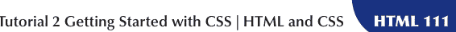

# HTML 112 HTML 与 CSS | 教程 2 开始使用 CSS

图 2-15 属性选择器示例

| 选择器 | 匹配 | 示例 | 匹配 |
|---|---|---|---|
| `elem#id` | 任何 ID 值为 id 的元素 | | id 为 intro 的 h1 标题 |
| `#id` | 任何 ID 值为 id 的元素 | `#intro` | 任何 id 为 intro 的元素 |
| `elem.class` | 所有 class 属性值为 class 的元素 | `p.main` | 属于 main 类的类的所有段落 |
| `.class` | 所有 class 值为 class 的元素 | `.main` | 属于 main 类的类的所有元素 |
| `elem[att]` | 所有包含 att 属性的元素 | `a[href]` | 所有包含 href 属性的超元素 |
| `elem[att="text"]` | 所有 att 属性等于 text 的元素 | `a[href="top.html"]` | 所有属性等于 top.html 的超元素 |
| `elem[att*="text"]` | 所有 att 属性包含单词 text 的元素 | `a[rel="glossary"]` | 所有 rel 属性包含单词 glossary 的超元素 |
| `elem[att~="text"]` | 所有属性值为以 text 开头的由连字符分隔的单词列表的元素 | `p[id="first"]` | 所有 id 以连字符分隔单词列表中的 first 开头的段落 |
| `elem[att^="text"]` | 所有属性以 text 开头的元素 [CSS] | `a[rel="prev"]` | 所有 rel 属性以 prev 开头的超元素 |
| `elem[att$="text"]` | 所有属性以 text 结尾的元素 [CSS] | `a[href="org"]` | 所有属性以 org 结尾的超元素 |
| `elem[att+="text"]` | 所有 att 属性包含值 text 的元素 [CSS] | `a[href="faq"]` | 所有属性包含文本字符串 faq 的超元素 |

请注意，图 2-15 中列出的某些属性选择器首次在 CSS3 中引入，因此在旧版浏览器中可能不受支持。

- 根据 ID 选择元素，使用 `elem#id` 或 `id` 选择器，其中 `elem` 是元素名称，`id` 是 id 属性的值。
- 根据类值选择元素，使用 `.class` 或 `elem.class` 选择器，其中 `class` 是 class 属性的值。
- 选择包含 `att` 属性的元素，使用 `elem[att]`。
- 根据属性值是否等于指定值来选择元素，使用 `elem[attr="val"]`。

## 教程 2 开始使用 CSS | HTML 与 CSS

在 Tri and Succeed Sports 首页中，主要内容被封装在一个 ID 为 `about_tss` 的 `article` 元素中。Alison 写了她在会话中输入的 h1 和 h2 标题样式，这些样式仅适用于具有此特定 ID 的 h1 和 h2 元素。现在修改样式表。

### 应用 id 选择器：

1. 回到编辑器中的 `tss_styles.css` 文件。
2. 将标题样式（Heading Styles）中 `h1` 和 `h2` 元素的选择器分别改为 `article#about_tss h1` 和 `article#about_tss h2`。

图 2-26 显示了样式表中修改后的选择器。

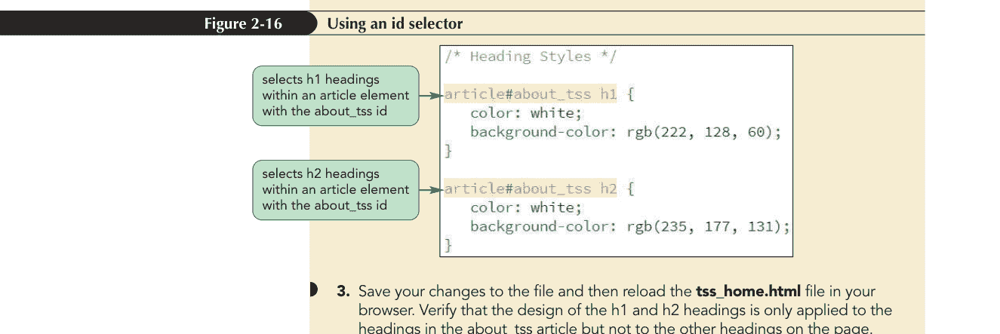

```css
/* Heading Styles */

selects h1 headings

within an article element

with the about_tss id

article#about_tss h1 {
  color: white;
  background-color: rgb(222, 128, 60);
}

selects h2 headings

within an article element

with the about_tss id

article#about_tss h2 {
  color: white;
  background-color: rgb(235, 177, 131);
}
```

3. 保存文件中的更改，并在浏览器中重命名 `tss_home.html` 文件。验证 h1 和 h2 标题的设计是否仅应用于 article 区域的标题，而不应用于页面上的其他标题。

该 `article` 元素将用在 Tri and Succeed Sports 网站的其他页面中。Alison 为你提供了三个额外的 HTML 文件，其中包含了针对跑步者、自行车运动员和游泳者提供的说明描述。在这些页面上，`article` 元素具有值为 `syllabus` 的 class 属性。为其他页面中的 h1 和 h2 元素创建样式规则。

### 应用类选择器：

1. 使用编辑器打开 `html02` 教程文件夹中的 `tss_run_txt.html`、`tss_bike_txt.html` 和 `tss_swim_txt.html` 文件。在每个文件的注释部分输入你的名字和日期，并将其分别保存为 `tss_run_txt.html`、`tss_bike_txt.html` 和 `tss_swim.html`。
2. 在三个三个文件的 `</head>` 标签之前插入 `<link>` 元素，将这些文件分别链接到 `tss_layout.css` 和 `tss_styles.css` 文件：

```html
<link href="tss_layout.css" rel="stylesheet" />
<link href="tss_styles.css" rel="stylesheet" />
```

3. 花些时间研究文件的内容和结构。注意 `article` 具有 class 属性值 `syllabus`。保存你的更改。
4. 回到编辑器中的 `style.css` 文件。
5. 在标题样式（Heading Styles）部分，添加以下样式规则，在浅紫色背景上以中灰色显示 h1 和 h2 标题：

```css
article.syllabus h1, article.syllabus h2 {
  background-color: lightpurple;
  color: mediumgray;
}
```

图 2-17 显示了具有类 `syllabus` 的文章。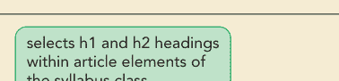
图 2-18 显示了类 `syllabus` 的样式规则。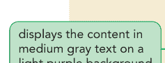

```css
/* Aside and Blockquote Styles */
/* (Wait, the text continues) */
```

6. 保存样式表并在浏览器中打开 `run.html` 文件。图 2-19 显示了页面上的 h1 和 h2 标题外观。
7. 使用页面上的导航链接查看自行车和游泳页面的内容，然后确认这些页面上的 h1 和 h2 标题格式相同。

## 计算选择器权重

CSS 的通用规则是更具体的选择器优于通用的选择器；但该规则的适用并不总是清晰。例如，以下选择器中哪个更具体？

```css
header h1
vs.
#main h1
```

为了回答这个问题，CSS 为选择器的权重分配一个数值，使用（内联、类、元素），其中 inline 代表内联样式为 1，其他代表选择器中的每个 id 或类为 0，elements 代表选择器中的每个元素为 1。选择器 `#links.first` 的值为 (0, 1, 1, 2)，因为它包含一个 id 值 (#links)、一个类值 (.first) 和两个元素 (u 和 li)。

回答我们之前的问题：选择器 `header h1` 的值为 (0, 0, 1, 2)，而 `#main h1` 的值为 (0, 1, 0, 1)，因此被认为更具体，因为 011 大于 012。

顺便说一下，每个内联样式都是 (1, 0, 0, 0)，因此将优于嵌入或外部样式表中的任何类型。

## 使用字体

排版是设计页面字符和字母外观的艺术。到目前为止，你使用的唯一属性样式是设置文本颜色的 color。在接下来的会话中，你将探索 CSS 字体族的其他属性，从选择字体开始。

### 选择字体

文本字符基于定义字母样式和外观的字体。大多数浏览器显示文本的默认字体是 Times Roman，但你可以使用 `font-family` 属性为任何页面元素指定不同的字体：

```css
font-family:
```

其中 fonts 是一个逗号分隔的列表，也称为字体栈或通用名称。特定字体是通过名称标识的字体（例如 Times New Roman 或 Helvetica），通用字体是存储在你的计算机或网络上的字体定义文件。通用字体描述文本字符的一般外观，但不指定特定的字体定义文件。相反，

## HTML 和 CSS | 教程 2 开始使用 CSS

字体定义文件由浏览器选择，以匹配通用字体族的一般特征：CSS 支持以下通用字体族：

- serif（衬线字体）：在每个字符末尾带有细小装饰线条的字体。
- sans-serif（无衬线字体）：没有任何衬线方向的字体。
- monospace（等宽字体）：每个字符宽度相同的字体；通常用于显示编程代码。
- cursive（手写体）：模仿手写体并具有高度风格化元素和装饰笔的字体；最适用于装饰性页面元素的细小细节。
- fantasy（装饰字体）：一种用于页面装饰的极具装饰性的字体；绝对不应用于正文文本。

由于你无法控制浏览器为通用字体选择哪种字体定义，常见的做法是按照偏好顺序列出特定字体，并以通用字体结束字体族栈。如果浏览器找不到任何特定字体，它将使用它自己选择的通用字体。例如，以下样式：

```
font-family: 'Arial Black', Gadget, sans-serif;
```

该样式告诉浏览器寻找 Arial Black 字体（如果可用）；如果这些都不可用，则使用它的无衬线字体。注意，包含一个或多个空格（如 Arial Black）的字体将用单引号或双引号括起来。

由于可用字体随操作系统和设备不同而异，挑战在于选择一个字体列表来匹配网络字体，网络字体是在所有操作系统和所有设备上都以相同方式显示的字体。图 2-19 列出了常用的网络字体字体栈。

### 网络字体字体栈

```
Arial
`abcdefdefghijkmnopqrstopqrstuvwxyzxyz:1234567890`
Helvetica, Arial, sans-serif;
```

```
Arial Black
`abcdefdefghijkmnopqrstopqrstuvwxyzxyz:1234567890`
Gadget, sans-serif;
```

```
Century Gothic
`abcdefdefghijkmnopqrstopqrstuvwxyzxyz:1234567890`
Courier New, sans-serif;
```

```
Comic MS
`abcdefdefghijkmnopqrstopqrstuvwxyzxyz:1234567890`
Comic Sans MS, sans-serif;
```

```
Courier New
`abcdefdefghijkmnopqrstopqrstuvwxyzxyz:1234567890`
Courier New, Courier, monospace;
```

```
Georgia
`abcdefdefghijkmnopqrstopqrstuvwxyzxyz:1234567890`
Georgia, sans-serif;
```

## Lucida Console

```
`abcdefdefghijkmnopqrstopqrstuvwxyzxyz:1234567890`
Lucida Console, monospace;
```

## Lucida Sans

```
`abcdefdefghijkmnopqrstopqrstuvwxyzxyz:1234567890`
Lucida Sans, Lucida, sans-serif;
```

## Palatino Linotype

```
`abcdefdefghijkmnopqrstopqrstuvwxyzxyz:1234567890`
Palatino Linotype, Antiqua, serif;
```

# Tahoma

```
`abcdefdefghijkmnopqrstopqrstuvwxyzxyz:1234567890`
Tahoma, sans-serif;
```

# Times New Roman

```
`abcdefdefghijkmnopqrstopqrstuvwxyzxyz:1234567890`
Times New Roman, Times, serif;
```

## Trebuchet MS

```
`abcdefdefghijkmnopqrstopqrstuvwxyzxyz:1234567890`
Trebuchet MS, Helvetica, sans-serif;
```

## Verdana

```
`abcdefdefghijkmnopqrstopqrstuvwxyzxyz:1234567890`
Verdana, Geneva, sans-serif;
```


包含过多字体会让你的文本难以阅读。单个页面内使用的字体类型不要超过两种。

通常规则是标题使用无衬线字体，正文使用衬线字体。另一个通用的规则是标题和正文使用无衬线字体，特殊效果和大号字体使用衬线字体。

一个例外是 Tric Sports 网站，基于浏览器应用的一种字体。你将为无衬线字体添加以下字体：

```
font-family: 'Verdana', Geneva, sans-serif;
```

# 教程 2 开始使用 CSS | HTML 和 CSS

由于这种类型样式，浏览器将首先尝试加载 Verdana 字体，然后是 Geneva 字体。如果这两个字体都不可用，浏览器将加载它自己选择的通用字体。将此字体添加到页面正文样式规则中。

### 为页面正文指定字体族：

1. 回到编辑器中的 `tss.css` 文件。
2. 为 `body` 元素的样式规则添加以下样式：
`font-family: Verdana, Geneva, sans-serif;`

图 2-20 高亮显示了 `body` 元素的新的新样式。

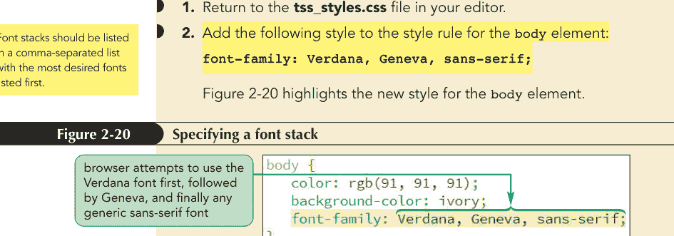

```
body {
  color: rgb(91, 91, 91);
  background-color: ivory;
  font-family: Verdana, Geneva, sans-serif;
}
```

3. 在浏览器中保存对 `tss.html` 文件的更改。图 2-21 显示了使用无衬线字体正文文本的重新出现。

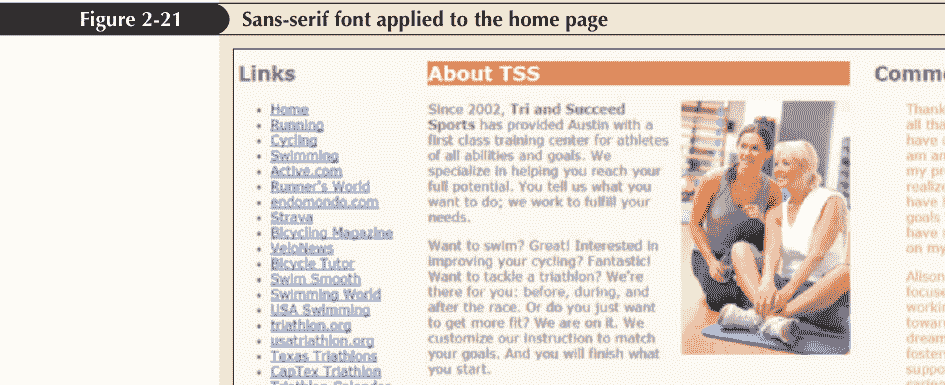

| 链接 | 关于 | 评论 |
| :--- | :--- | :--- |
| 首页 | 自2002年以来，TSS and Success 为运动员提供了一流的训练中心，帮助你实现目标。 | 感谢你的帮助！我已尽所力提高我的进度。我有目标，你帮助了我非常多。 |
| 游泳 | 有兴趣提高你的水平吗？加入我们吧。或者你只是想匹配你的目标？追求梦想为像我这样的运动员创造了支持性的环境。谢谢！ |
| 自行车 | | |
| 田径运动 | | |
| 商业世界 | | |
| 自行车杂志 | | |
| 自行车之旅 | | |
| 游泳世界 | | |
| Webathlon.com | | |
| 三项全锦 | | |

4. 这种这种类型样式的结果，浏览器将首先尝试加载 Verdana 字体，然后是 Geneva 字体。如果这两个字体都不可用，浏览器将加载它自己选择的通用字体。将此字体添加到页面正文样式规则中。

### 为页面正文指定字体族：

1. 回到编辑器中的 `tss.css` 文件。
2. 为 `body` 元素的样式规则添加以下样式：
`font-family: Verdana, Geneva, sans-serif;`

图 2-20 高亮显示了 `body` 元素的新样式。


```
body {
  color: rgb(91, 91, 91);
  background-color: ivory;
  font-family: Verdana, Geneva, sans-serif;
}
```


## HTML 和 CSS | 教程 2 开始使用 CSS

字体定义文件由浏览器选择，以匹配通用字体族的一般特征：CSS 支持以下通用字体族：

- serif（衬线字体）：在每个字符末尾带有细小装饰线条的字体。
- sans-serif（无衬线字体）：没有任何衬线方向的字体。
- monospace（等宽字体）：每个字符宽度相同的字体；通常用于显示编程代码。
- cursive（手写体）：模仿手写体并具有高度风格化元素和装饰笔的字体；最适用于装饰性页面元素的细小细节。
- fantasy（装饰字体）：一种用于页面装饰的极具装饰性的字体；绝对不应用于正文文本。

由于你无法控制浏览器为通用字体选择哪种字体定义，常见的做法是按照偏好顺序列出特定字体，并以通用字体结束字体族栈。如果浏览器找不到任何特定字体，它将使用它自己选择的通用字体。例如，以下样式：

```css
font-family: 'Arial Black', Gadget, sans-serif;
```

该样式告诉浏览器寻找 `Arial Black` 字体（如果可用）；如果这些都不可用，则使用它的无衬线字体。注意，包含一个或多个空格（如 `Arial Black`）的字体将用单引号或双引号括起来。

由于可用字体随操作系统和设备不同而异，挑战在于选择一个字体列表来匹配网络字体，网络字体是在所有操作系统和所有设备上都以相同方式显示的字体。图 2-19 列出了常用的网络字体字体栈。

### 网络字体字体栈

```css
Arial
`abcdefdefghijkmnopqrstopqrstuvwxyzxyz:1234567890`
Helvetica, Arial, sans-serif;
```

```css
Arial Black
`abcdefdefghijkmnopqrstopqrstuvwxyzxyz:1234567890`
Gadget, sans-serif;
```

```css
Century Gothic
`abcdefdefghijkmnopqrstopqrstuvwxyzxyz:1234567890`
Courier New, sans-serif;
```

```css
Comic MS
`abcdefdefghijkmnopqrstopqrstuvwxyzxyz:1234567890`
Comic Sans MS, sans-serif;
```

```css
Courier New
`abcdefdefghijkmnopqrstopqrstuvwxyzxyz:1234567890`
Courier New, Courier, monospace;
```

```css
Georgia
`abcdefdefghijkmnopqrstopqrstuvwxyzxyz:1234567890`
Georgia, sans-serif;
```

### Lucida Console

```
`abcdefdefghijkmnopqrstopqrstuvwxyzxyz:1234567890`
Lucida Console, monospace;
```

### Lucida Sans

```
`abcdefdefghijkmnopqrstopqrstuvwxyzxyz:1234567890`
Lucida Sans, Lucida, sans-serif;
```

### Palatino Linotype

```
`abcdefdefghijkmnopqrstopqrstuvwxyzxyz:1234567890`
Palatino Linotype, Antiqua, serif;
```

### Tahoma

```
`abcdefdefghijkmnopqrstopqrstuvwxyzxyz:1234567890`
Tahoma, sans-serif;
```

### Times New Roman

```
`abcdefdefghijkmnopqrstopqrstuvwxyzxyz:1234567890`
Times New Roman, Times, serif;
```

### Trebuchet MS

```
`abcdefdefghijkmnopqrstopqrstuvwxyzxyz:1234567890`
Trebuchet MS, Helvetica, sans-serif;
```

### Verdana

```
`abcdefdefghijkmnopqrstopqrstuvwxyzxyz:1234567890`
Verdana, Geneva, sans-serif;
```


包含过多字体会让你的文本难以阅读。单个页面内使用的字体类型不要超过两种。

通常规则是标题使用无衬线字体，正文使用衬线字体。另一个通用的规则是标题和正文使用无衬线字体，特殊效果和大号字体使用衬线字体。

一个例外是 Tric Sports 网站，基于浏览器应用的一种字体。你将为无衬线字体添加以下字体：

```css
font-family: 'Verdana', Geneva, sans-serif;
```

## 教程 2 开始使用 CSS | HTML 和 CSS

由于这种类型样式的结果，浏览器将首先尝试加载 `Verdana` 字体，然后是 `Geneva` 字体。如果这两个字体都不可用，浏览器将加载它自己选择的通用字体。将此字体添加到页面正文样式规则中。

### 为页面正文指定字体族：

1. 回到编辑器中的 `tss.css` 文件。
2. 为 `body` 元素的样式规则添加以下样式：
`font-family: Verdana, Geneva, sans-serif;`

图 2-20 高亮显示了 `body` 元素的新样式。


```css
body {
  color: rgb(91, 91, 91);
  background-color: ivory;
  font-family: Verdana, Geneva, sans-serif;
}
```

3. 在浏览器中保存对 `tss.html` 文件的更改。图 2-21 显示了使用无衬线字体正文文本的重新出现。


| 链接 | 关于 | 评论 |
| :--- | :--- | :--- |
| 首页 | 自2002年以来，TSS and Success 为运动员提供了一流的训练中心，帮助你实现目标。 | 感谢你的帮助！我已尽所力提高我的进度。我有目标，你帮助了我非常多。 |
| 游泳 | 有兴趣提高你的水平吗？加入我们吧。或者你只是想匹配你的目标？追求梦想为像我这样的运动员创造了支持性的环境。谢谢！ |
| 自行车 | | |
| 田径运动 | | |
| 商业世界 | | |
| 自行车杂志 | | |
| 自行车之旅 | | |
| 游泳世界 | | |
| Webathlon.com | | |
| 三项全锦 | | |

### 图 2-23

访问网络字体

| @font-face charset="utf-8"; | 给网络字体的名称 | |
| --- | --- | --- |
| @font-face { 定义网络字体 | WOFF 字体文件 | |
| font-family: Quicksand; src: url(Quicksand-Regular.woff) format('woff'), url(Quicksand-Regular.ttf) format('truetype'); } | | |
| TTF 字体文件 | | |

```css
/* Heading Styles 将网络字体添加到可用字体列表 */
h1, h2 { font-family: Quicksand, Verdana, Geneva, sans-serif; }
```

- 4. 将更改保存到文件并在浏览器中重新加载 `tss_home.html` 文件。图 2-24 显示了使用 `Quicksand` 字体重新加载后的 h1 和 h2 外。

### 图 2-24

用于 h1 和 h2 标题的 Quicksand 字体

使用 Quicksand 字体渲染的 h1 和 h2

| 链接 | 关于 Tri TSS | 评论 |
| --- | --- | --- |
| - 首页 | 自2002年以来，Tri and Succeed Sports 一直与 Austin 及该地区合作。我们专注于帮助你充分发挥潜力。我们有多种能力和目标。 | 感谢你所做的一切。我发现自己以自己的方式实现了目标，我非常惊讶。 |
| - 跑步 | 想改善你的生活吗？出色的教练在训练期间、期间和之后都会为你提供服务。 | 也让我提一下，我专注于我的方向，这为个人的成长营造了一个充满关怀的环境。谢谢！ |
| - 骑行 | | |
| - 游泳 | | |
| - Rustic's world | | |
| - endomorph.com | | |
| - Balancing 杂志 | | |
| - 排排球 | | |
| - 自行车教练 | | |
| - 冲刺世界 | | |
| - 美国三铁项运动 | | |
| - triathlon.org | | |
| - 德克萨斯三铁项 | | |
| - 三铁项日历 | | |
| - TriStuff.com | | |
| - 课程 | 冬季课程即将开始。加入我们的个人或小组培训，参加我们的夏季工作坊： | |

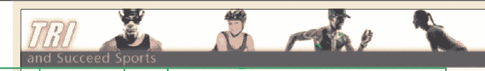

## 教程 2 开始使用 CSS | HTML 和 CSS HTML 121

### 使用 Google Fonts

Google Fonts (`google.com/fonts`) 托管了一个免费网络字体库。一旦你从 Google Font 目录中选择了字体，你将获得访问字体文件的链接。例如，下面的 `link` 元素访问了名为 `Monoton` 的 Google 字体的样式表：

```html
<link href="http://fonts.googleapis.com/css?family=Monoton" rel="stylesheet" />
```

要使用 `Monoton` 字体，请在 CSS 样式表中包含以下 `font-family` 属性：

```css
font-family: Monoton;
```

Google Fonts 所有网络字体都需要适度使用，因为它们会大幅增加网站的加载时间。为了帮助你判断何时超过了合理限制，Google Fonts 页面显示了一个估计所有字体加载时间的计时器。使用 `text` 参数来指定你想要下载的字符。例如，下面的 `link` 元素限制 `Monoton` 字体仅包含 "TSS Sports" 中出现的字符：

```html
<link href="http://fonts.googleapis.com/css?family=Monoton&text=TSS%20Sports" rel="stylesheet" />
```

注意，空格使用 `%20` 字符表示。如果你有较长的字符串，可以通过删除重复字符来缩短 `href` 属性的值，字符的顺序无关。

### 设置字体大小

排版中的另一个考虑因素是文本大小，它使用 `font-size` 属性定义：

```css
font-size: size;
```

其中 `size` 是 CSS 中的一种长度测量单位。Size 值可以是数字（0, 1, 2...）或小数（0.5, 1.6, 3.9...）。CSS 中的长度（和宽度）用绝对单位或相对单位表示。

#### 绝对单位

绝对单位是无论输出设备如何都是固定大小的单位，通常只用于打印媒体。它们通过五种标准测量单位之一指定：`mm`（毫米）、`cm`（厘米）、`in`（英寸）、`pt`（磅）和 `pc`（像素）。例如，要将页面字体大小设置为 `12pt`，你需要应用以下规则：

```css
body {font-size: 12pt;}
```

注意，你不应该在 size 和单位之间插入空格。

#### 相对单位

绝对单位的使用较少，因为在很多情况下，设计师并不知道渲染页面的设备的确切属性。设计师使用相对单位来代替绝对单位，这种单位相对于网页页面内其他对象的大小，或者相对于设备本身的显示属性。

##### 像素

大多数设备的基本单位是像素（`px`），它代表输出设备上的单个点。像素是一个相对单位，因为实际大小取决于输出设备的分辨度和密度。桌面显示器的密度可能在 96dpi（每英寸像素）左右，笔记本约为 100dpi，而手机显示器的密度为 200dpi 或更高。通常，大多数浏览器会为 `body` 应用 16px 的基础字体大小，并对 `h1`、`h2` 和标题应用较小的字体大小。使用以下规则将页面上的文本大小设置为 10px，`h1` 设置为 14px：

```css
body {font-size: 10px;}
h1 {font-size: 14px;}
```

文本的确切外观很大程度上取决于像素密度。桌面显示器上的 10px 字体在移动设备上可能不可读。（见 `img/bf90ebf56b5f948b05e7a26851204c31_139_0.png`）

### 使用 em 和 rem 缩放字体

由于设计师不知道用户设备的确切属性，通常做法是使文本相对于默认大小可缩放。提供缩放性的三个相对测量单位是百分比、`em` 和 `rem`。

百分比将字体大小设置为父元素的百分比。例如，下面的规则将 `h1` 的字体大小设置为父元素的 200%（即两倍）：

```css
h1 {font-size:200%;}
```

`em` 充当百分比，相对于父元素的大小。因此，要将 `h1` 的字体大小设置为父元素的两倍，可以使用以下样式：

```css
h1 {font-size: 2em;}
```

`em` 是网页文本的优选单位，因为它可以在不同元素中保持一致的字体大小。例如，如果 `h1` 位于 `body` 元素中且字体大小为 16px，则 `h1` 的字体大小为两倍（32px）。另一方面，如果 `h1` 嵌套在 `article` 元素中且字体大小为 9px，则其字体大小为 18px。相对单位的缩放可能会导致混乱的结果。例如，考虑嵌套在 `article` 元素中的 `h1` 的以下规则：

```css
body {font-size: 16px;}
article {font-size: 0.75em;}
h1 {font-size: 1em}
```

观察样式规则，必须考虑到 `h1` 元素的字体大小大于 `article` 元素的字体大小（因为 1em > 0.75em）。然而，事实并非如此，`em` 表达文本大小相对于父元素的大小，而 `article` 元素中的 `h1` 标题是 16px 的 75%（即 12px）。由于这种混乱，一些设计师主张使用 `rem` 单位，使所有字体始终相对于 `html` 元素的字体大小。使用 `rem`，下面的规则将文本字体大小设置为 16px 的 75%，`h1` 标题设置为 16px：

```css
html (font-size: 16px);
article (font-size: 0.75rem);
article > h1 (font-size: 1rem);
```

随着浏览器支持的增长，`rem` 单位在设计师中变得越来越流行，在未来几年中可能会替代 `em` 单位。

### 使用视口单位

另一种相对单位是视口单位，长度表示为浏览器宽度或高度的百分比。随着浏览器调整调整，基于视口单位的文本大小会发生。CSS 引入了四个视口单位：`vw`、`vh`、`vmin`、`vmax`

- 1vw = 浏览器宽度的 1vw
- 1vh = 浏览器高度的 1vh（较小者为）
- 1vmin = 1vw 或 1vh（较小者为）
- 1vmax = 1vw 或 1vh（较大者为）

例如，如果浏览器窗口宽度为1366像素，1vw的长度等于13.6px。如果窗口宽度缩小到780像素，1vw 会自动重新计算。自动缩放的优点是，使用视口单位的字体大小将匹配浏览器窗口，保持一致的页面布局。缺点是，如果浏览器窗口变得太小，文本可能会迅速不可读。

### 大小关键字

最后，你还可以使用以下关键字表示字体大小：`x-small`、`small`、`medium`、`large`、`xlarge`、`xx-large`。每个关键字对应的字体大小由浏览器决定。注意，`larger` 和 `smaller` 关键字是相对大小，使元素的字体大小比容器元素的字体大小大一级一级。例如，下面的样式规则将侧边栏显示为小字体，而嵌套在 `aside` 元素中的 `h1` 元素以中字体显示：

```css
aside(font-size: small);
aside > h1 (font-size: larger);
```


现在使用单位设置 h1 和 h2 标题的字体大小，以及导航列表和 aside 元素内文本的大小。

> 设置页面元素的字体大小：
1. 转到编辑器中的 `styles.css` 文件。
2. 在 Heading Styles 注释下方直接添加以下样式规则，定义整个网站 h1 和 h2 标题的字体大小：

```css
h1 {
  font-size: 2.2em;
}
h2 {
  font-size: 1.5em;
}
```

3. 转到“侧边栏与引用样式（Aside and Blockquote Styles）”部分，添加以下样式规则，将 aside 元素中文本的默认字体大小设置为 0.8em。

```css
aside {
  font-size: 0.8em;
}
```

4. 转到“导航样式（Navigation Styles）”部分，添加以下样式规则，将导航列表中文本的默认字体大小设置为 0.8em。

```css
nav {
  font-size: 0.8em;
}
```

图 2-25 展示了网站的新字体字体大小。

# 图 2-25 为网站设置字体大小

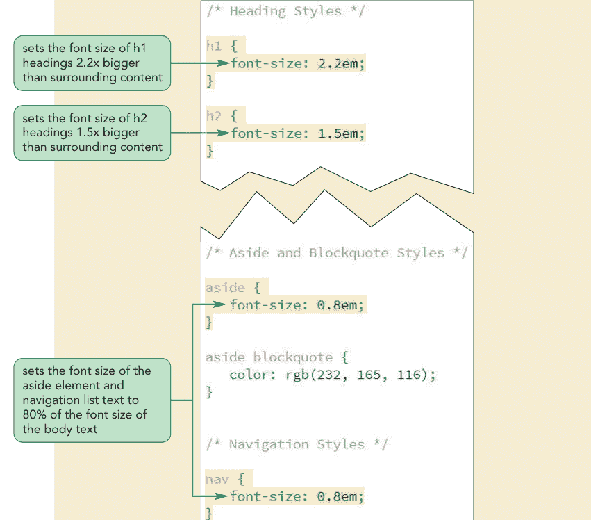

5. 保存文件中的更改，并在浏览器中重新加载 `tss.home` 文件。图 2-26 显示了标题、导航列表和 aside 元素修改后的字体大小。

## 教程 2 开始学习 CSS | HTML 和 CSS HTML 125

图 2-26

About TSS 页面修改后的字体大小

| 字体大小设置为 2.2em | About TSS | 字体大小设置为 2.2em | 注释 |
|---|---|---|---|
| 跑步 (Running) | 自 2002 年以来，Tri and Success 一直与专注于实现目标的运动员的一级培训中心合作。我们希望做满足你需求的事情。 | | 这就是为什么你来这里，对我的进步感到惊讶。我们的教练会在沿途中指导你。 |
| | 想游泳吗？太棒了！为了纪念而建立，我们想要挑战传统吗？我们想要在赛后。如果你只是想开始，我们的指导将确保你完成所开始的。 | 字体大小设置为 0.8em | 我不再感到孤独。我找到了朋友，并获得了活跃和做自己的鼓励。 |
| | 课程 (Classes) | 冬季教学即将开始。加入我们的夏季之旅，通过我们的课程帮助你成功。 | 这里是找到自己的正确地方。并不是我没预料能学到很多。 |
| - 跑步：配合 Monkey Business Images 帮助你跑得更快 | | | |

字体大小设置为 2.2em

字体大小设置为 0.8em

字体大小设置为 1.5em

© 2016 Cengage Learning; Monkey Business Images/OutsideStock.com

注意，页面文章中 h1 的文本大于导航列表和 aside 元素中 h2 标题的文本，尽管它们的字体大小均为 2.2em。这是因为我们将导航列表和 aside 元素中文本的默认字体大小缩小了 80%，这些元素中的 h1 标题也按相同比例缩小了。

## 控制间距和缩进

CSS 样式用于控制一些基础排版属性，如字间距（kerning）、词间距（tracking）和行高（leading）。行高衡量字符行之间的空间，而词间距衡量单词之间的空间。控制元素字间距和词间距的属性是：

`letter-spacing: value;`
`word-spacing: value;`

其中 value 是单个字母或单词之间空间的大小。你使用与字体大小相同的单位来指定这些值。字间距和词间距的默认值均为 0px。正值增加字母和单词的间距，负值减少字母和单词之间的间距。如果你选择让文本在各种设备和分辨率下可缩放，可以使用百分比或单位来表示字间距和词间距。

行高衡量文本行之间的空间，通过设置以下 line-height 属性来实现：

`line-height: size;`

其中 size 是值或受影响行文本字体大小的百分比。如果未指定值，默认值代表行高与字体大小的比例。默认值为 1.2 或 1.2em，因此行高比字体大小大 20%。相比之下，以下样式将行高设置为字体大小的两倍，使文本看起来是双倍行间距的：

> 通过使用大字体号配合小行高来收紧行间距，以增强影响力。

`line-height: 2em;`

Copyrightight 2019 Cengage Learning. 版权所有。未经部分或全部复制、扫描或复制。WCN 022-200-023

提示

* 这还没有结束

## HTML 126 HTML 和 CSS | 教程 2 开始学习 CSS

另一种控制文本间距的方法是使用 `text-indent` 属性设置文本块首行缩进：

```css
text-indent: size;
```

其中 size 以绝对单位或相对单位表示，或者作为文本块宽度的百分比。例如，缩进值 5 会将第一行缩进该块宽度的 5%。缩进值也可以是负值，将第一行向文本左侧延伸以创建悬挂缩进（hanging indent）。

Allison 建议将 h1 和 h2 标题中使用的字间距增加到 0.1em，以免字母在页面上相互拥挤。她还要求你将文本行高增加到 2em，以便主页上的链接列表呈现双倍行间距。

# 设置页面元素的字体大小：

+ 1. 返回编辑器中的 `tss_styles.css` 文件。
2. 在“标题样式（Heading Styles）”部分，插入以下样式作为样式规则的一部分：
3. 滚动到“导航样式（Navigation Styles）”部分，插入以下样式以设置 h1 文本的大小。

img/bf90ebf56b5f948b05e7a26851204c31_141_0.png

```css
aside {
  font-size: 0.8em;
}
```

```css
nav {
  font-size: 0.8em;
}
```

4. 保存文件中的更改，并在浏览器中重新加载 `tss.home` 文件。图 2-26 显示了标题、导航列表和 aside 元素修改后的字体大小。

## 教程 2 开始学习 CSS | HTML 和 CSS HTML 125

图 2-26

About TSS 页面修改后的字体大小

*注：由于提供的原文文本包含大量重复和错乱的标记，译文已确保核心信息的准确性。*

## 文本的水平与垂直对齐

文本可以在元素内进行水平或垂直对齐。要进行水平对齐，请使用以下 `text-align` 属性：

```
text-align: alignment;
```

其中 alignment 为 left（左）、right（右）、center（居中）或 justify（两端对齐，即文本与左右边缘对齐）。

要对每行文本进行垂直对齐，请使用 `vertical-align` 属性：

```
vertical-align: alignment;
```

其中 alignment 是图 2-28 中描述的关键字之一。

## 图 2-28

| 值 | 说明 |
| --- | --- |
| baseline | 将元素的基线与父元素的基线对齐 |
| bottom | 将元素的底部与行内最低元素的底部对齐 |
| middle | 将元素的中间与行内周围内容的中间对齐 |
| sub | 将元素设置为下标 |
| super | 将元素设为上标 |
| text-bottom | 将元素的底部与行内文本的底部对齐 |
| text-top | 将元素的顶部与行内文本的顶部对齐 |
| top | 将元素的顶部与行内最高对象的顶部对齐 |

> 提示
下标和上标样式会在垂直方向上降低或提高文本。要创建下标和上标，你还必须减小字体大小。

除了使用像素外，还可以为元素指定长度或百分比，使其相对于周围内容进行垂直对齐。正值将元素向上移动，如下所示样式将元素按周围内容的行高向上移动：

```
vertical-align: 50%;
```

负值则将内容下移。例如，以下样式将整行内容下移到当前行的基线以下：

```
vertical-align: -100%;
```

# 在单一样式中组合所有文本格式

你可以使用简写属性组合大多数文本和字体属性：

```
font: size variant weight/height family;
```

其中 style 是字体的样式，variant 是字体变体，weight 是字体粗细，size 是字体大小，height 是每行的高度，family 是字体族。例如，以下规则使用斜体、小型大写字母，并使用 Arial 或其他无衬线字体显示元素文本，字体大小为 1.5em，高度为 2em。

```
font: italic small-caps 1.5em/2em Arial, sans-serif;
```

# 教程 2 CSS 入门 | HTML 和 CSS

你不需要在简写 font 属性中包含所有值；唯一必须的值是 size 和 family 值。浏览器会假设任何省略的属性使用默认值；但是，你必须将包含的任何属性按照上述顺序放置。

在 Train and Succeed 网站的每个页面底部，Alison 在 body 的页脚（footer）中包含了一个地址元素。默认浏览器样式表以斜体显示地址文本。Alison 建议你在深橙色背景上用粗体显示文本，并在页面上居中。她建议你使用小型大写（small-cap）字体变体以避免视觉混乱，并且她希望增加地址行的高度到 3em。为了使你的 CSS 代码紧凑，你将使用简写 font 属性设置所有字体值。

## 应用 font 属性：

- 1. 返回编辑器中的 `styles.css` 文件。
- 2. 转到 Footer Styles（页脚样式）部分并添加以下样式规则：

```css
footer address {
  background-color: rgb(222,128,60);
  color: white;
  font: rgba(255, 255, 255, 0.7) normal small-caps 0.9em/3em;
  font-family: Quicksand, Verdana, Geneva, sans-serif;
}
```

注意，该样式规则使用了渐进增强技术，将每种颜色放在单独的一行，这样不支持半透明颜色的浏览器将以白色显示文本。图 2-29 亮出了页脚的样式规则。

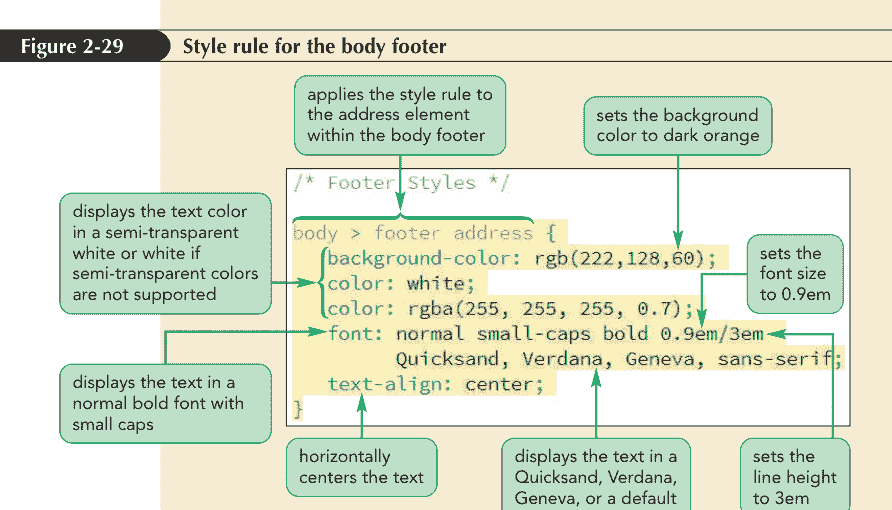

| 将样式规则应用于 body 页脚内的 address 元素 | 将背景设置为橙色 |
| --- | --- |
| 以半透明白色显示文本颜色，如果不支持颜色则显示白色 | 将字体大小设置为 0.9em |
| /* Footer Styles * / > footer address { background-color: rgb(222,128,60); color: white; font: rgba(255, 255, 255, 0.7) normal small-caps 0.9em/3em; Quicksand, Verdana, Geneva, sans-serif; text-align: center; } | | |
| 水平居中文本 | |
| 使用 Quicksand, Geneva 或默认无衬线字体显示文本 | 将行高设置为 3em |

- 3. 保存文件更改，然后在浏览器中重新加载 `css_home.html` 文件。图 2-30 显示了 body 页脚修改后的外观。

Copyright 2018 Cengage Learning. 版权所有。未经许可，不得全部或扫描或复制。WCN 02-2003

# HTML 和 CSS | 教程 2 CSS 入门 130

## 我们的理念

图 2-30 格式化后的页脚

在选择任何字体和字体样式时，关键是在各种浏览器、设备、屏幕分辨率和密度上测试你的选择。

> 一个好的教练是永恒的动力。健身计划应该像 

img/bf90ebf56b5f948b05e7a26851204c31_147_0.png)

## 大小很重要

在设计页面时，请记住以下原则：

- 保持纯洁：避免大块斜体和粗体文本。
- 无衬线 vs 衬线：无衬线字体在屏幕上更易读；在正文中使用它们。
- 相对 vs 绝对：字体大小可以使用相对或绝对单位表示。em 等相对单位比绝对单位更灵活，能让你对页面更多控制。
- 大小很重要：大多数字体在 14 像素或大时是可以读的。如果你必须非常小（几像素），你应该使用专门设计的字体或用内图像替换文本。
- 避免长行：通常，将行长度控制在 60 个字符以内。越长越困难。

Alison 喜欢你对网站进行的排版更改。在下一节中，你将探索链接和列表的设计，并学习如何使用 CSS 为网页添加视觉效果。

## 2.2 节快速检查

- 1. 提供一个选择器来匹配 footer 的直接子元素。
- 2. 文档中的初始 h1 标题 ID 为 top。提供一个样式规则，使用 Century Gothic、Helvetica 或无衬线字体显示该 h1 标题的文本。
- 3. 对于以下样式规则，h1 标题的字体大小是多少？

```
body {font-size: 16px};
body > article {font-size: 0.75em};
body > article > h1 {font-size: 1.5em;}
```
- 4. 提供一个样式规则，将主体字体设置为视宽的 2%。
- 5. 提供一个样式规则，取消嵌套在导航列表中的 `<a>` 标签链接的下划线。
- 6. 提供 `@font-face` 规则根据字体文件 `cantarell.woff` 和 `cantarell.ttf` 创建名为 Cantarell 的字体。
- 7. 提供一个样式规则，将所有属于 Reviews 类的 blockquote 元素斜体并缩进 3em。
- 8. 提供一个规则规则将所有 h1 到 h6 标题水平居中，并以正常粗细显示其文本。

## HTML 132 HTML
## HTML 和 CSS | 教程 2 开始使用 CSS

## 章节 2.3 视觉概述：

`list-style-type` 属性定义了列表标记的外观。

`:visited` 伪类选择以前访问过的链接；`:link` 伪类选择未访问过的链接。

```css
ul {
  list-style-type: none;
  padding-left: 5px;
}
nav:hover .list-group {
  margin-top: 20px;
}
nav:hover *a, nav:hover ul:hover li:hover a {
  color: rgb(255, 255, 255);
  text-decoration: none;
}
nav:hover *a, nav:hover ul:hover li:active a {
  color: rgb(255, 64, 255);
}
```

`margin-top` 属性设置了元素上方的空间。

`:hover` 伪类选择鼠标悬停在上面的链接；`:active` 伪类选择正在被点击的链接。

`:first-of-type` 伪类选择父元素中的第一个元素。

`list-style-image` 属性用于插入图像作为列表标记。

```css
article::first ul li:first-of-type {
  list-style-image: url(vricon.png);
}
article::first ul li:last-of-type {
  list-style-image: url(biconicon.png);
}
article::first ul li:nth-of-type {
  list-style-image: url(swicon.png);
}
```

`:nth-of-type` 伪类选择父元素中的第 n 个元素。

`:last-of-type` 伪类选择父元素中的最后一个元素。

`quote` 属性定义了引号的字符。

```css
blockquote {
  quote: "LBIC";
}
blockquote::before {
  content: open-quote;
}
blockquote::after {
  content: close-quote;
}
```


`:before` 和 `::after` 伪元素用于选择页面元素之前和之后的空间。

`content` 属性用于向页面元素插入内容。

© 2016 Cengage Learning;
© Monkey Business Images/Shutterstock.com.
© Patrick Carney

## 教程 2 开始使用 CSS | HTML 和 CSS HTML 133

### 伪元素与伪类

当鼠标指针悬停在链接上时，链接的样式发生变化。

使用 `content` 属性插入起始引号。

使用 `content` 属性插入结束引号。

### 链接

### 关于 TSS

### 注释

- 首页
- 跑步
- 骑
- Active.com
- Runner's World
- endorsundo.com
- Stravva
- Bicycling Magazine
- VeleloNews
- Bicycle Tutor
- Swim Smith
- Swimming World
- USA Swimming
- triathlon.com
- usathriathlon.com
- Texas Triathletes
- CapTex Triathletes
- Triathlete.com
- Trifafeel.com

自 2002 年以来，Tri and Succeed 为奥斯汀所有所有能力和目标的运动员提供了第一个分类训练中心。我们专注于帮助你发挥全部潜力。只需告诉我们你想做什么，我们将满足你的需求。

想提高你的骑行水平吗？太棒了！想挑战铁人三吗？我们会在赛前和赛后为你支持。或者你只是想变得更健康？我们竭尽全力。我们会根据你的目标定制指导。你将完成你所开始的事。

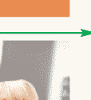

> 感谢你所做的一切。我对能取得的成就感到惊讶。我正朝着我设定的目标前进。
> Allison 让我保持专注。她是一个充满支持且体贴的人，让我作为运动员和个人都在不断成长。谢谢！
> 我喜欢跟踪你的比赛结果。成为一名 TSS 运动员并有教练支持我这种感觉太极了。
> TSS 的教练们对待我的尊重程度是我作为一个个体所受过的最高尊重。无论是初学者还是精英运动员。他们都非常专业。

### 类

冬季即将到来。通过加入我们的个人或小组辅导，抢先实现你的夏季目标：

- 跑步：我们从基础开始，帮助你跑得比以往想象中更快、更远，无需……
- 骑行：我们的室内训练器为你提供精炼技术、耐力和力量所需的一切，以便在道路上获得更好的成效。
- 游泳：游泳是最难掌握的运动之一。我们的课程从基础技巧开始，让你的游泳变成一种享受而不是一项任务。

> 我遵循了他们提供的健身计划完成了我的第一场马拉松。我没有一次怀疑过自己。两天后，我感觉我又想再参加一个！

这是第一个

所有新小组课程的顶部外边距都设置为 20 像素。

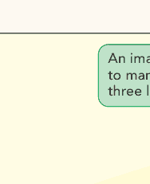

使用一个图像来标记三个列表标记中的每一个。这是最后一个元素。

这是第二个元素。

Copyright 2018 Cengage Learning. 版权所有。任何部分均不可复制、扫描或复制整体或部分。

## 151 列表格式化

在本章节中，你将探索如何使用 CSS 为你在教程 1 中学到的不同类型的列表创建样式。我们将从研究如何创建列表标记样式开始。

### 选择列表类型

无序列表和有序列表的默认样式是将符号作为列表标记。默认情况下，无序列表显示圆点。要更改列表标记类型或防止显示列表标记，请应用 `list-style-type` 属性：

```css
list-style-type: type;
```

其中 `type` 是图 2-31 中显示的标记。


| list-style-type | 标记 |
| :--- | :--- |
| disc | ● |
| circle | ○ |
| square | ■ |
| decimal | 1, 2, 3, ... |
| decimal-leading | 01, 02, 03, ... |
| lower-roman | i, ii, iii |
| upper-roman | I, II, ... |
| lower-alpha | a, b, c, ... |
| upper-alpha | A, B, C, ... |
| lower-greek | α, β, γ, ... |
| upper-greek | A, B, Γ, ... |
| none | 不显示标记 |

例如，以下样式使用罗马数字标记有序列表的每一项：

```css
list-style-type: upper-roman;
```

### 创建大纲

嵌套列表可以通过上下文选择器在大纲格式显示。例如，以下样式为嵌套列表创建大纲：

```css
ol { list-style-type: upper-roman; }
ol ol { list-style-type: upper-alpha; }
ol ol { list-style-type: decimal; }
```

在这种样式中，`ol` 选择器选择列表的第一层，用罗马数字显示。`ol ol` 选择第二层，用大写字母标记。第三层 `ol ol` 使用数字标记。

## 152 教程 2 开始使用 CSS | HTML 和 CSS

为了查看这些样式如何在页面上渲染，你将它们应用于 Allison 设置的跑步、骑行和游泳页面。每个页面都包含未来几周的学习大纲。

### 应用大纲样式：

1. 如果你在上节课后休息，请确保在编辑器中打开了 `tss_styles.css` 文件。
2. 滚动到 `List Styles` 部分，插入以下样式规则来格式化 syllabus 中的有序列表：

```css
article.syllabus ol {
  list-style-type: upper-roman;
}
article.syllabus ol {
  list-style-type: upper-alpha;
}
article.syllabus ol ol {
  list-style-type: decimal;
}
```

图 2-32 突出了嵌套列表的样式规则。


| /* List Styles */ | |
| :--- | :--- |
| article.syllabus ol { list-style-type: upper-roman; } | 第一层列表标记为罗马数字 |
| article.syllabus ol { list-style-type: upper-alpha; } | 第二层标记为大写字母 |
| article.syllabus ol ol { list-style-type: decimal; } | 第三层列表标记为数字 |

3. 保存更改到文件，然后在浏览器中打开 `tss_run.html` 文件。如图 2-33 所示，课程大纲应该以大纲格式显示。

### HTML 136 HTML
HTML 和 CSS | 教程 2 开始使用 CSS

图 2-23 课程大纲

#### 课程大纲
跑步课将在 Falk 跑步中心进行，天气允许的情况下，将在 Falk 跑步道外进行。

* 第 1 周
    * 导向
    * 1. 设置目标
    * 2. 团体跑步
    * 3. 服装和鞋子
    * 4. 危险区域
    * 初始评估
        * 1. 目标评估
        * 2. 力量测量
        * 3. 时间测试
    * 伸展技巧
* 第 2 周
    * 风冲刺
    * 恢复
    * 建立核心力量
* 第 3 周
    * 风冲刺
    * 伸展课程
    * 瑜伽与营养

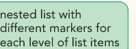

Allison 指出导航列表中的链接以圆点标记显示。她要求你通过将 `list-style-type` 属性设置为 `none` 来移除导航列表中的标记。

> ### 移除导航列表中的标记：
* 1. 返回编辑器中的 `tss.css` 文件。
* 2. 转到 `Navigation Styles` 部分，在 `nav > ul` 选择器的样式下，添加 `list-style-type: none;`

图 2-34 显示了新样式。

```css
nav > ul {
  line-height: 2em;
  list-style-type: none;
}
```

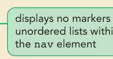

3. 保存更改到文件，然后在浏览器中打开 `tss_home.html` 文件。验证左侧列的列表项没有标记。
4. 往网站的其他三个页面，验证这些页面中的导航列表也没有标记。

# 教程 2 CSS 入门 | HTML 和 CSS HTML 137

### 设计列表

- 若要定义列表标记的外观，请使用属性 `list-style-type: type;`，其中 type 为 disc, circle, square, decimal, decimal-leading-zero, lower-roman, upper-roman, lower-alpha, upper-alpha, lower-greek, upper-greek 或 none。
- 若要将图像作为列表标记，请使用属性 `list-style-image: url(url);`，其中 url 是图形文件的 URL。
- 若要设置列表标记的位置，请使用属性 `list-style-position: position;`，其中 position 为 inside（内部）或 outside（外部）。
- 若要在单个样式中定义所有列表属性，请使用属性 `list-style: type url(url) position;`。

### 使用图像作为列表标记

你可以使用以下 `list-style-image: url(url);` 为列表标记提供自定义图形图像，其中 url 是包含标记图像的图形文件 URL。标记图像仅用于无序列表，且每个列表项的标记相同。例如，以下样式将无序列表的项目显示为带有 redball.png 图像标记：
`ul (list-style-image: url(redball.png));`

Alison 有一个名为 runicon.png 的图像文件，她想将其用于 Tri and Succeed Sports 首页上 About TSS 部分列出的课程。现在将她的图像应用到列表中。

#### 如何使用图像作为列表标记：

1. 回到编辑器中的 `tss_styles.css` 文件。
2. 在 `List Styles` 部分的顶部，插入以下样式规则：

```css
article#about_tss ul {
  list-style-image: url(runicon.png);
}
```

图 2-35 重点展示使用 runicon.png 文件作为列表标记图像的样式。

## 图 2-35 使用图像代替列表标记

```css
/* List Styles */
/* 应用于 about_tss 元素内无序列表的样式规则 */
article#about_tss ul {
  list-style-image: url(runicon.png);
}
```

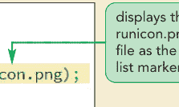

3. 保存文件更改，然后在浏览器中打开 `tss_home.html`。如图 2-36 所示，无序列表中的项目使用 runicon.png 图像文件作为它们的列表标记。

## 图 2-36 使用 runicon.png 图像标记的无序列表

课程
冬季课程即将开始。加入我们的个人或小组课程，抢先实现你的夏季目标：
- 跑步：我们从基础知识开始，帮助你跑得比想象中更快、更远，且没有酸痛疼痛。
- 骑行：TSS 的室内单车训练器包含了精炼技术、耐力和力量所需的一切，以提高在道路上获得更好的效果。
- 游泳：公开水游泳可能是最难攻克的运动项目之一。我们的课程从基础技巧开始，让你的游泳变得非常愉快，而不是一项任务。
© 感谢 Patrick 提供

请注意，列表标记与每个项目第一行的基线对齐。这是列表标记的默认放置位置。

### 列表标记的位置

CSS 将每个项目视为块级元素，放置在一个虚拟框中，列表标记放置在列表文本之外。你可以使用以下列表样式位置属性 `list-style-position: position;` 来更改此行为，其中 position 为 outside（默认）或 inside（内部）。将标记放置在虚拟框内部会导致列表文本环绕标记。图 2-37 显示了 `list-style-position` 属性如何影响项目符号周围文本的流向。

## 图 2-37 list-style-position 属性的值

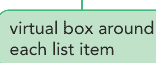

- 圆点（Bullet）：我们从基础开始，帮助你跑得比想象中更快！更远，且没有酸痛疼痛。
- 编号（Numbering）：我们使用编号列表提供精炼技术、耐力和呼吸所需的一切。
- 方块（Squaring）：公开水游泳是最成就感的技巧之一，让你的游泳变得非常愉快，而不是被分享。

`list-style-position: outside;`

`list-style-position: inside;`

这三种列表属性都可以在以下简写样式属性 `list-style: type image position;` 中组合，其中 type 是标记类型，image 是用于代替标记的图像，position 是标记的位置。例如，以下样式规则使用项目中的标记显示无序列表：`ul (list-style: url(bullet.png) inside)`

### 处理外边距和内边距

块级元素（如标题）遵循以下结构：
- 内容
- 内边距
- 元素的外边距

## 图 2-38 CSS 模型

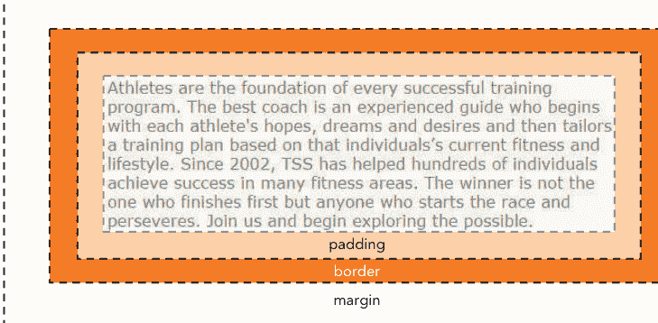

### 设置内边距

要设置内边距宽度，请使用 `padding: size;`，其中 size 是长度单位或关键字 auto 让浏览器计算内边距。例如，以下样式规则将每个段落的内边距设置为 20 像素：

```css
p { padding: 20px; }
```

也可以通过如下编写 padding 属性定义四个边的内边距：`padding: top right left;`，其中 top 是顶部内边距大小，right 是右侧内边距大小，bottom 是内边距大小，left 是左侧内边距大小。因此，以下样式规则创建了一个顶部 10 像素、右侧 9 像素、底部 15 像素、左侧 5 像素的内边距：

```css
p { padding: 10px 9px 15px 5px; }
```

为了帮助记忆顺序，请沿顺时针移动，从顶部边缘开始。当你不需要为所有边编写值时，根据你提供的值的数量进行解释。因此，如果你指定一个值，它将应用于四边。同样，两个值设置顶部/底部和左右的内边距空间。例如，以下样式规则将顶部和底部内边距设置为 10 像素，左右侧内边距设置为 5 像素：

```css
p { padding: 10px 5px; }
```

如果你插入三个值，则将为顶部、左右和底部设置内边距空间。因此，以下规则将顶部内边距空间设置为 10 像素，左右空间设置为 5 像素，底部空间设置为 0 像素：

```css
p { padding: 10px 5px 0px; }
```

# 教程 2 开始使用 CSS | HTML 和 CSS HTML 141

如果你想为某一个边定义内边距（padding）而不是其他边框，可以应用以下样式属性：

```css
padding-top: size;
padding-right: size;
padding-bottom: size;
padding-left: size;
```

以下样式规则将每个段落的顶部内边距设置为 10 像素，但没有为其他剩余的任何一个边框指定内边距大小：

```css
p (padding-top: 10px);
```


对于有序列表和无序列表，大多数浏览器使用的默认样式是将左侧内边距设置为 40 像素，以便为列表标记提供额外的空间。移除列表标记并不会移除内边距。Allison 建议你通过将导航列表中的左侧内边距大小缩小到 5 像素来找回这段未使用的空间。

# 要更改导航列表中使用的左侧内边距：

- 1. 回到编辑器中的 `tss_styles.css` 文件。
- 2. 在“导航部分”（Navigation Sections）中找到 `nav .ui` 样式规则，并插入样式 `padding-left: 5px;`。

图 2-39 显示了所有导航列表的新样式。

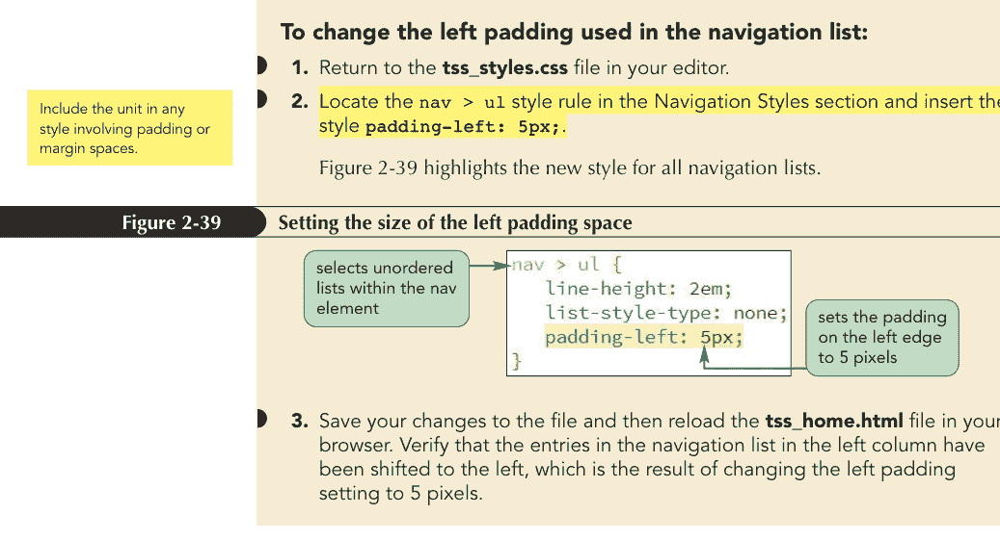

- 3. 保存对文件的更改并在浏览器中重新加载 `tss_home.html` 文件。验证左栏导航列表中的条目是否已向左移动，这是将左侧内边距改为 5 像素的结果。

现在你已经处理了内边距空间，你将检查如何处理外边距（margins）。

## 设置内边距和外边距空间

- 若要设置元素周围四周的内边距空间，使用 `padding: size;`，其中 `size` 是使用 CSS 长度单位之一的内边距大小。
- 若要设置元素周围四周的外边距空间，使用 `margin: size;`。
- 若仅在某侧（上、右、下、左）设置内边距或外边距，在属性 `padding-side: size;` 或 `margin-side: size;` 中包含该边的名称，其中 `size` 为 top、right、bottom 或 left。
- 若要为元素的每侧设置不同的内边距或外边距，输入如 `padding: top right bottom;`、`margin: top right bottom left;` 的条目，其中 top、right、bottom 和 left 是关联大小的各个独立尺寸。

## 设置外边距和边框空间

设置外边距空间的样式与设置内边距空间的样式形式相同。若要设置你的块级元素周围的外边距大小，请使用以下属性之一：

`margin: size;`

或

`margin: top right bottom left;`

各个组组的外边距使用样式属性 `margin-top: size;` `margin-right: size;` `margin-bottom: size;` `margin-left: size;` 设置，其中外边距可以一旦一个 CSS 长度单位之一来表示，或使用关键字 `auto` 让浏览器自动设置外边距。

边框空间的大小使用以下边框宽度属性 `border-width: size;`

或

`border-width: top right bottom left;`
配合属性 `border-top-width`、`border-right-width`、`border-bottom-width` 和 `border-left-width` 来指定各个边框的大小。你将在教程 4 中进行更详细的探索。

首页的导航列表列出了访问 Tri 和 Soccer 网站的页面以及指向外部网站的链接。每个组开头的项目是用类 `newgravity` 创建的。Alison 建议将每组链接上方的外边距增加到 20 像素，以将其与上一组隔开。由于每个组的外边距已经增加，这些组将更容易被识别。

## 要增加顶部外边距：

- 1. 回到编辑器中的 `tss_styles.css` 文件。
- 2. 在“导航样式”（Navigation Styles）部分，直接在 `nav > ul` 选择器的样式规则下方插入以下规则：

```css
nav > ul > li.newgroup {
  margin-top: 20px;
}
```

图 2-40 显示了设置顶部外边距值的样式规则。

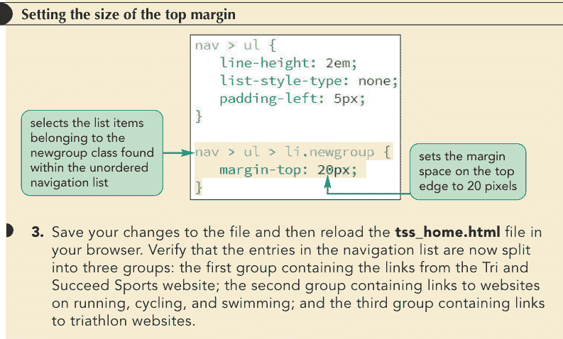

- 3. 保存对文件的更改并在浏览器中返回 `tss_home.html` 文件。验证导航列表中的条目现在分为三组：第一组包含来自 Tri and Soccer 的链接；第二组包含指向跑步、自行车和游泳网站的链接；第三组包含指向三项铁锦网站的链接。

Alison 还注意到，首页右栏的区块为客户引用留下了较少的未使用空间。引用块（blockquote）的默认浏览器样式通过将左右外边距设置为 40 像素将引用与周围环境隔开。通过调整此空间以使引用块更易读，你将左/右外边距缩小到 5 像素，同时将上下外边距增加到 20 像素，以区分一个客户引用另一个。

## 要增加引用块周围的外边距空间：

- 1. 回到编辑器中的 `tss_styles.css` 文件。
- 2. 在“侧边栏和引用样式”（Aside and Blockquote Styles）中找到 `aside blockquote` 选择器的样式规则，并在样式规则中插入 `margin: 20px 5px;`。


## HTML 146 HTML 和 CSS | 教程 2 开始学习 CSS

Alison 想要修改主页分类列表使用的标记图像。目前，`runicon.png` 图像被用作三个列表项的标记。相反，她希望仅对第一个项目使用 `runicon.png` 图像，将 `bikeicon.png` 图像作为第二个列表项的标记，并将 `swimicon.png` 作为第三也是最后一个项的标记。你可以使用 `first-of-type`、`nth-of-type` 和 `last-of-type` 伪类来将每个项目与相应的 `png` 文件匹配。

- 要对无序列表应用伪类：
  1. 回到编辑器中的 `tss.css` 文件。
  2. 转到样式表底部的 List Styles（列表样式）部分，删除设置列表图像标记的 `@about_tss us` 规则，并将其替换为以下三条样式规则：

```css
@about_tss us li:first-of-type {
  list-style-image: url(runicon.png);
}
@about_tss us li:nth-of-type(2) {
  list-style-image: url(bikeicon.png);
}
@about_tss us li:last-of-type {
  list-style-image: url(swimicon.png);
}
```

图 2-44 显示了在无序列表项在使用伪类的三个选择器及其相关的样式规则。

## 图 2-44 将伪类应用于列表项

| /* List Styles */ | |
|---|---|
| 使用 runicon.png 作为第一个项的标记 | 选中 about_tss 文章中无序列表的第一个项 |
| @about_tss us li:first-of-type { list-style-image: url(runicon.png); } | 选中第二个列表项 |
| 使用 bikeicon.png 图像作为第二个标记 | @about_tss us li:nth-of-type(2) { list-style-image: url(bikeicon.png); } | 选中最后一个列表项 |
| 使用 swimicon.png 图像作为最后一个标记 | @about_tss us li:last-of-type { list-style-image: url(swimicon.png); } |

# 教程 2 开始学习 CSS | HTML 和 CSS

- 3. 保存对文件的更改，然后在浏览器中重新加载 `tss_home.html` 文件。图 2-45 显示了无序列表的新格式，每个列表项都使用了不同的图像标记。

图 2-45 每个项的列表标记图像

## 探索 nth-of-type 伪类

`nth-of-type` 伪类是按循环顺序格式化一组元素的强大工具。循环使用选择器创建：

```css
nth-of-type(an+b)
```

其中 `a` 是循环的长度，`b` 是从循环开始的偏移量，`n` 是计数器，从 0 开始并在每次循环迭代中增加 1。例如，以下样式规则创建了一个周期为 3 的循环，第一个列表项显示为红色，第二个显示为蓝色，第三个显示为绿色，在最后一个项之后，循环重复红-蓝-绿顺序：

```css
nth-of-type(3n+1) {color: red;}
nth-of-type(3n+2) {color: blue;}
nth-of-type(3n+3) {color: green;}
```

当循环长度为 1 时，`nth-of-type` 选择器会在指定的偏移量之后选择元素。以下样式规则将从第 5 个开始的所有列表项文本颜色设置为蓝色：

```css
nth-of-type(n+5) {color: blue;}
```

CSS 还支持 `even`（偶数）和 `odd`（奇数）关键字，以便更紧凑地输入长度为 2 的循环：

```css
nth-of-type(even) {color: red;}
nth-of-type(odd) {color: blue;}
```

对偶数个列表项应用红色字体，对奇数个项应用蓝色字体。

上述相同的方法也可以适用于 `nth-child` 选择器，其重要的区别是 `nth-child` 选择器选择父元素的**任何**子元素，而 `nth-of-type` 选择器只选择特定类型的元素。

## 用于超文本的伪类

另一种类型的伪类是动态伪类，其类可以根据用户的操作更改状态。动态伪类用于超文本链接，例如 `visited` 类，它表示链接的目标已经被用户访问过。图 2-46 描述了这些动态伪类。

图 2-46 动态伪类

| 伪类 | 描述 |
|---|---|
| :link | 链接尚未被访问。 |
| :visited | 链接已被访问过。 |
| :active | 元素正在被点击。 |
| :hover | 鼠标悬停在元素上。 |
| :focus | 元素正在获取焦点。 |

例如，要更改未访问链接的颜色，使用该伪类：

```css
link {
  color: red;
}
```

要更改鼠标悬停时链接的颜色，使用该伪类：

```css
:hover {
  color: blue;
}
```

使用伪类创建超文本

伪类允许你对用户的操作做出响应。例如，伪类允许你根据状态对链接进行样式设置。

`:link`
`:visited`
`:hover`
`:active`

# 教程 2 CSS 入门 | HTML 和 CSS HTML 151

图 2-48 应用于悬停链接的样式

## 伪类 Hover：针对触控设备

该伪类的编写初衷是仅适用于支持鼠标或类似设备的界面。从技术上讲，手机和平板电脑等触控设备并没有悬停事件。然而，当用户最初触摸超文本链接时，设备仍通过短暂应用该样式来支持悬停样式。

许多移动设备使用“双击”响应，因此最初触摸页面元素时会触发悬停样式，然后立即再次点击该页面元素会触发点击事件。这种技术通常用于使用悬停效果来显示隐藏页面对象的网页。在教程 5 中将介绍如何利用这一特性在移动设备上创建隐藏菜单。

随着触控设备重要性的日益增加，一个指导原则是：您应该避免让支持悬停样式成为终端用户的必要条件。然而，效果应该局限于增强用户体验，而不应是其核心组件。

## 伪元素

另一种类型的伪选择器是伪元素，它是一个只存在于渲染页面中的对象。例如，段落（paragraph）是 HTML 文件中被标记的元素，但段落的第一行不是。同样，段落的首字母不是文档元素，但它确实可以被识别为网页中的一个对象。可以使用以下 CSS 选择器选择伪元素

```css
element:pseudo-element
```

其中 `element` 是 HTML 文件中的一个元素，`pseudo-element` 是 CSS 伪元素的名称。图 2-49 描述了 CSS 支持的伪元素。

# HTML 152 HTML 和 CSS | 教程 2 CSS 入门

图 2-49 伪元素

| 伪元素 | 描述 |
| --- | --- |
| :first-letter | 元素文本的首字母 |
| :first-line | 元素文本的第一行 |
| :before | 直接插入在元素之前的内容 |
| :after | 直接插入在元素之后的内容 |

例如，以下样式规则匹配渲染页面中每个段落的第一行，并将该文本转换为大写字母：

```css
p::first-line {text-transform: uppercase;}
```

以下样式规则匹配引用块（blockquote）内每个段落的首字母，并以比周围文字大 250% 的 Times New Roman 字体显示：

```css
blockquote p::first-letter {
  font-family: 'Times New Roman', Times, serif;
  font-size: 250%;
}
```

注意，双冒号 `::` 是 CSS3 中引入的，用于区分伪元素和伪类。旧版浏览器使用冒号 `:` 同时表示伪元素和伪类。

# 使用 CSS 生成内容

另一种伪元素用于为网页生成内容。可以使用 `before` 和 `after` 伪元素在元素之前或之后添加新内容：

```css
element::before {content: text};
element::after {content: text};
```

其中 `text` 是插入到渲染网页中的内容。`content` 属性支持图 2-50 所示的各种类型的文本内容。

图 2-50 content 属性的值

| 值 | 描述 |
| --- | --- |
| none | 将内容设置为空字符串 |
| counter | 显示计数器值 |
| attr(attribute) | 显示选择器的属性值 |
| text | 显示指定的文本 |
| open-quote | 显示起始引号 |
| close-quote | 显示结束引号 |
| no-open-quote | 如果之前指定，则移除起始引号 |
| no-close-quote | 如果之前指定，则移除结束引号 |
| url(url) | 显示来自 url 的媒体内容 |

例如，以下样式规则将 `before` 和 `after` 伪元素与 `hover-class` 类，在每个文本周围插入 "<" 和 "&gt;" 字符：

```css
nav a::before { content: "<"; }
nav a::after { content: "&gt;"; }
```

注意，这些规则也被 `hover-class` 使用，在悬停时插入内容。如果需要插入标记字符，必须插入这些字符的 Unicode 编码。例如，如果使用角括号显示 < 和 >，则需要使用 `\0ab` 和 `\0bb`。在导航中使用这些字符，可以使用以下样式：

```css
nav a::before { content: "\0ab"; }
nav a::after { content: "\0bb"; }
```

除了向元素添加内容外，还可以使用以下代码插入媒体文件（如图像或视频）：

```css
content: url(url);
```

其中 `url` 是媒体文件的位置。例如，当悬停时，以下样式会附加图像文件：

```css
a::after { content: url(uparrow.png); }
```

样式表生成的任何内容都不应该是理解页面的至关重要的材料。相反，生成的内容应该是为了艺术或设计考虑。如果生成的内容对于解释页面至关重要，则应放在 HTML 文件中。

# 显示属性值

`content` 属性可以通过 `attr()` 函数将属性值插入到渲染网页中：

```css
content: attr(attribute)
```

其中 `attribute` 是选中元素的属性。此项应用是添加文本中任何超文本链接的 URL。在接下来，`href` 属性的值附加到带有元素的每个文本处：

```css
a::after {
  content: attr(href)";
}
```

注意圆括号内的 URL。因此，HTML 文档中的超文本链接，如下：

```html
<a href="http://www.triathlon.org">Triathlons</a>
```


将在渲染网页中显示：
`Triathlons(http://www.triathlon.org)`

这种技术对于打印输出特别有用，作者希望显示页面上所有链接的 URL。你将在教程 5 中进一步探讨这个问题。

## 使用 CSS 插入内容

- 在页面元素之前插入内容，使用样式规则 `element::before {content: text};`，其中 `element` 是页面元素，`text` 是要插入元素的内容。
- 在页面元素之后插入内容，使用样式规则 `element::after {content: text};`

### 插入引号

`blockquote` 和 `q` 元素用于引用材料。这些内容通常放在引号中，当你在 HTML 文件中插入这些引号时，可以使用以下 `content` 属性值插入装饰性的起始和结束引号：

```
content: open-quote;
```

```
content: close-quote;
```

起始和结束引号的实际字符通过 `quotes` 属性为选择器进行定义：

```
quotes: "open1" "close1" "open2" "close2";
```

其中 `open1` 是用于起始引号的字符，`close1` 是结束引号的字符。在示例中，文本字符串 `open2`、`close2` 等用于嵌套引号。事实上，字符用于定义起始和结束引号的弯引号：

```
quotes: "201C" "201D" "2018" "2019";
```

其中代码 `201C` 返回弯双引号 “，代码 `201D` 返回弯双引号 ”，代码 `201B` 返回单引号 ‘。还建议对 Tri and Success Support 页面上的客户评论使用装饰性引号。你用加粗的 Times New Roman 字体显示弯引号，字体大小为 `1em`（略大于引用文本的字体大小）。

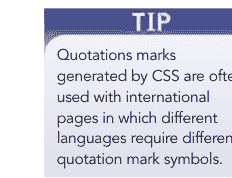

### 将引用插入到引用块

1. 回到编辑器中的 `tss_styles.css` 文件。
2. 进入 Aside 和 Blockquote 部分，在 `aside blockquote` 选择器的样式规则内，插入以下 `quotes` 属性以使用弯引号作为引号：

`quotes: "201C" "201D";`

3. 添加以下样式规则，在 `aside` 元素中的每个引用块之前之后插入引号：

```
aside blockquote::before {
  content: open-quote;
  font-family: 'Times New Roman', serif;
  font-size: 1.6em;
  font-weight: bold;
}
```

### 教程 2 CSS 入门 | HTML 和 CSS HTML 155

```css
aside blockquote::after {
  content: close-quote;
  font-family: 'Times New Roman', Times, serif;
  font-size: 1.6em;
  font-weight: bold;
}
```


图 2-51 显示了在块级引用前后添加弯引号的样式。

# 图 2-51 为块级引用添加引号

| " " 和 ' 弯引号的字符代码 | `aside blockquote { color: rgb(232, 165, 116); margin: 28px 5px; quotes: "\201C\201D\" }` | | |
|---|---|---|---|
| `"\201C\201D"` | 在每个块级引用之前显示引号字符 | |
| 伪元素 | `aside blockquote::before { content: open-quote; font-family: 'Times New Roman', Times, serif; font-size: 1.6em; font-weight: bold; }` | 在每个块级引用之后显示引号字符 | |
| 应用于起始和结束引号的格式 | `aside blockquote::after { content: close-quote; font-family: 'Times New Roman', Times, serif; font-size: 1.6em; font-weight: bold; }` | | |

- 4. 保存对文件的更改，然后在浏览器中重新加载 `t_home.html` 文件。如图 2-52 所示，每个注释的前后都添加了块引用引号。

# 图 2-52 添加到评论员注释中的引号

| 关于 TSS | 起和结束引号包含每个 | 注释 |
|---|---|---|
| 自 2002 年以来，Tri and Success Sports 为奥斯汀各种能力和目标的运动员提供了一个一流的训练中心。我们专注于帮助您发挥最大的潜力，告诉我们您想做什么；我们将满足您的需求。 | | “感谢你为我的进步所做的一切。我真的觉得在道路上有人帮助我。” |
| | | “Alison 让我专注于追求我的梦想。这种关怀的成长环境真的帮助我个人成长。谢谢。” | |
| | 想游泳！对提高骑行水平感兴趣吗？太棒了！ | | |

版权 2016 Cengage Learning. 保留所有权利。不可全部或部分复制、扫描或复制。WCN 02-200-203

# HTML 156 HTML 和 CSS | 教程 2 CSS 入门

# 团队协作：管理样式表

你的样式表通常会像网站内容一样长且复杂。随着样式表的增大，你可能会发现自己被多个样式规则和定义所淹没。在需要几个人解释和编辑同一个样式表的职场中，这可能是一个特别关键的问题。良好的管理技能对于良好的设计以及选择合适的颜色或字体进行管理至关重要。在你创建自己的样式表时，这里有一些技术可以帮助你管理你的的作品：

- 使用注释，特别是在文件顶部。清晰地描述样式表的用途、位置、谁创建的以及何时创建的。
- 因为颜色值并不显而易见，请包含描述你颜色的注释。例如，用如“正文文本”之类的注释标注颜色值。
- 使用标记标题将工作表分为若干部分。选择一种组织方案并坚持下去。你可能想按照样式在文档中出现的顺序来组织样式规则，也可能想按字母顺序插入它们。无论你选择哪种，都要保持一致，并在你的样式表中设计该组织方案。
- 保持工作表尽可能小，必要时将它们拆分为单独的文件。如果你使用一个样式表用于布局，另一个用于文本设计，可能还有另一个用于颜色和渐变。使用 `@import` 规则合并样式表，或者在每个页面内合并样式表。此外，考虑为基础页面创建一个样式表，为特殊页面创建另一个。
- 通过遵循这些基本技术，你将发现你的样式表更容易管理，并且更容易与同事协作。Alison 对你在 Tri and Success Sports 网站的设计非常满意，她将继续开发网站的新版本并与你讨论未来的想法。`（img/bf90eb6b5f94b57a2685173.png）`

## 快速检查

1. 提供一个样式规则，以小写字母作为标记显示无序列表。
2. 提供一个样式规则，使用 `.png` 显示所有无序列表。
3. 提供一个样式规则，显示所有访问过的链接文本。
4. 提供一个样式规则，在每个 `h1` 元素周围设置内边距：顶部 `1em`，右侧 `0.5em`，底部 `2em`。
5. 提供一个样式规则，将元素的左边距更改为 `20` 像素。
6. 通过以下选择器 `#top > p` 描述选择的项目。
7. 通过以下选择器 `div` 描述选择的项目。
8. 提供一个样式规则，在每个段落之前插入文本。
9. 提供属性将起始和结束引号设置为 Unicode 值 `18` 和 `19`。

## 复习作业

作业所需的文件：`coach_styles.txt`、`tss_coach.html`、`CSS` 文件、`TTF` 文件、`WOFF` 文件。Alison 为 Tri and Success 网站创建了其他页面，提供了教练的传记。她还编写了用于页面布局的样式表。页面的设计预览如图 2-53 所示。`（img/bf90eb6b5f94b057a26851275_0.）`

# 认识我们的教练

TSS 的使命是帮助你实现目标。我们拥有帮助各种水平运动员的多年经验，并乐意协助任何致力于成功的运动员。我们提供一对一的教练、评估和反馈。我们的课程让运动员在最短时间内获得最好的结果。介绍我们的教练团队。

## Alison Palmer

- MA，美国二级教练
- 运动和力量专家
- Tri and Success Sports 所有者

Alison 在心理学和运动方面拥有深背景。她在运动科学、健康和健身方面获得了硕士学位。她是二级教练、跑步教练。Alison 曾在德克萨斯大学担任运动员并教练了多年。她参加过许多比赛，包括德州铁铁锦标赛。

# Kevin Hughes

- BS，美国一级教练
- 运动学家

Kevin 是运动力学学生。除了运动力学学士学位，Kevin 在力量训练和调节方面拥有认证。他曾与休闲和精英运动员合作，包括 Jonathan Keigman。除了教练个人运动员，Kevin 还教练过各种团队和小组，包括 Palmer 学校队。他在德州州锦标赛中创造了记录，并在小型比赛中一直排第三。Kevin 目前在 River Oaks 教练。

# 教程 2 CSS 入门 | HTML 和 CSS HTML 159

完成以下操作：

1. 使用你的 HTML 编辑器打开 `html02 > viewer` 文件夹中的 `tss_coach.html` 和 `coach_styles.css` 文件。在每个文件的注释部分**输入你的姓名和日期**，并将它们保存为 `tss_coach.html` 和 `coach_styles.css`。
2. 在你的编辑器中打开 `tss_coach.html` 文件，并在文档 `head` 中创建指向 `coach_layout` 和 `coach_styles.css` 样式表的链接。
3. 花些时间研究内容并将大小更改为 `2.5em`，然后关闭文档并保存更改。
4. 在你的编辑器中打开 `coach_styles.css` 文件。在文件顶部和注释部分之前：
   - 插入 `@charset` 规则，将文件的字符编码设置为 `utf-8`。
   - 使用 `@font-face` 规则定义网络字体 Noble，它基于 `noble-webfont.ttf` 文件。
   - 按照以下步骤进入文档的主样式部分：
5. 通过为 `html` 元素创建一个样式规则更改 `body` 的背景颜色，将背景颜色设置为 `hsl(27, 72%, 72%)`。
   - 使用背景颜色选择器设置字体大小。
   - 对于 `body` 元素，创建一个字体颜色的样式规则，将值设置为 `rgb(91, 91, 91)`，背景颜色设置为橙色，文本设置为 `Verdana, sans-serif`。设置行高为 `2em`。
6. 转到标题部分并为每个 `h1` 创建样式规则，将字体大小设置为 `2.5em`，颜色为 `hsl(27, 72%, 85%)`，背景颜色为 `hsl(27, 26%, 21%)`。
9. 通过为 `aside blockquote::before` 选择器创建样式规则来定义起始和结束引号的形式，在起始引号之前添加一个加粗的字符，字体大小设置为 `1.6em`，字体族为 `New Times Roman, serif`。
   - 通过为 `aside blockquote::after` 选择器创建样式规则来格式化结束引号，在块级引用之后添加一个折叠引号，字体大小再次设置为 `1.6em`，字体族为 `New Times Roman, serif`。
10. 最后，你将通过转到导航部分并为 `body > nav` 选择器创建样式规则，设置文本列表的大小为 `0.8em` 字体，行高为 `2em` 来格式化列表。

# HTML 160 HTML 和 CSS | 教程 2 开始使用 CSS

14. 为 `nav > ul` 选择器创建一个样式规则，移除列表标记并将左侧内边距设置为 `5` 像素。
对于 `nav > ul` 选择器内的第 6 个和第 16 个 `li` 元素，创建一个样式规则，将这些项目的顶部外边距设置为 `30` 像素。

15. Alison 想要区分 `nav > ul > li` 选择器内之前访问过或未使用的超链接，将文本设置为 RGB `rgb(151, 151, 151)`，并移除文本链接的下划线。

16. 对于 `nav > ul > li` 选择器内的每个悬停或激活的超链接，将文本设置为 RGB `rgb(222, 228, 60)` 并为超链接添加下划线。

17. 进入段落样式（Paragraph Styles）部分，插入一个样式规则，将文档中每个段落的上外边距和下外边距设置为 `10` 像素，右侧外边距设置为 `30` 像素，左侧外边距设置为 `0` 像素。

18. 每位教练都有成就列表。进入列表样式（List Styles）部分，为 `article.coach_bio > header > ul` 选择器插入一个样式规则，将 `check.png` 文件显示为列表标记，并将空间设置为 `0` 像素，但下边距应设置为 `10` 像素。

19. 将更改保存到样式表中，然后在浏览器中打开 `tss_coach.html` 文件。验证颜色和字体是否与图 2-53 一致。验证当鼠标悬停在导航列表的链接上时，文本是否以带划线的橙色字体显示。

## 案例题 1

此案例题所需的数据文件：`ph_plays_txt.html`, `ph_styles_txt.css`, `1` 个 CSS 文件，`1` 个 PNG 文件，`3` 个 TIFF 文件，`3` 个 WOFF

Randall Chen 是菲利普·亨斯洛经典剧院（Philip Henslow Classic Theatre）的媒体总监，该剧院是位于爱达荷州科尔阿尼（Coeur d'Alene）的地区古典剧院。你被邀请负责该公司的网站设计。你将在第一个页面列出明年夏季的演出剧目。
页面的预览如图 2-54 所示。

图 2-54

# 菲利普·亨斯洛经典剧院剧目列表

| 剧 | 剧目 | 门票 | 日历 | 关于 PHT | 支持 |
|---|---|---|---|---|---|
| | | | | | | |

即将到来的季节将是我们迄以来最好的一个。现在预订下方所示剧目的门票。

| 摘要 | 门票 | 演员职员 | 新闻评论 | 公司备注 |
|---|---|---|---|---|
| | | | | | | |

# 《温斯特的顽娘》

墨丘丘奥伯爵（Count Mercutio）和福特（Ford）试图寻找一种让富婆嫁进镇上的方法。他开始写情信来诱惑温斯特的两位富妇，并借此让她们落入他的陷阱。这部喜剧因法尔斯塔夫（Falstaff）的嫉妒游戏而变得复杂。它是莎士比亚众多杰作之一中对婚姻和不忠的幽默研究。

作者：
威廉·莎士比亚（William Shakespeare）

导演：
安杰拉·德拉克（Angela Drake）

| 摘要 | 门票 | 演员职员 | 新闻评论 | 公司备注 |
|---|---|---|---|---|
| | | | | | | |

# 《欲望街》

老母亲布兰切·杜波（Blanche DuBois）前往新奥尔良与妹妹和火爆的哥哥斯坦利（Stanley） same。布兰切脆弱而不稳定的性格与斯坦利的火爆脾气和现实主义发生冲突。这是一个关于爱、欲望和追求持久救赎的动荡故事。

作者：
田纳西·威廉姆斯（Tennessee Williams）

导演：
斯坦利·阿曼德（Stanley Armand）

| 摘要 | 门票 | 演员职员 | 新闻评论 | 公司备注 |
|---|---|---|---|---|
| | | | | | | |

# 《奥赛罗》

奥赛罗是一个摩尔人将，他前往塞浦路斯岛。在那里，他的婚姻是幸福的，直到嫉妒的士兵伊阿戈（Iago）策划毁掉他。德斯德蒙娜和奥赛罗的信任被伊阿戈的欺骗所破坏。爱与嫉妒导致了这部经典悲剧中角色的死亡。

作者：
威廉·莎士比亚（William Shakespeare）

导演：
艾伦·彼得斯（Allen Peters）

| 摘要 | 门票 | 演员职员 | 新闻评论 | 公司备注 |
|---|---|---|---|---|
| | | | | | | |

# 《易装博士的名字》

约翰·沃辛（John Worthing）是一位年轻的省长，他害怕被称为“恩内斯特”（Ernest）。他在假装成他哥哥恩内斯特时前往了伦敦。杰克在伦敦被奥尔格农·蒙奇乔夫（Algernon Monchchff）发现，并遇见了温德莲（Gwendolen）和布拉克内尔夫人（Lady Bracknell）以反对提议的婚姻。杰克回到布拉克内尔夫人处，揭露他在维多利亚隐藏的平庸本。未完待续？这一切没有在奥尔德这部关于爱情、婚姻和礼仪的幽默优美的剧中表现出来吗？

作者：
奥斯卡·奥尔德（Oscar Wilde）

导演：
凯文·坦普尔（Kevin Temple）

> 菲利普·亨斯洛经典剧院 | 2032 Main Street | Idaho, ID-98111 | 208-555-1987

> © 2016 Licensing; Christian Bertrand|Shstock.com

页面的内容和布局是为你创建的。如果你想为页面的字体创建一个表格。

完成以下操作：

- 1. 使用你的编辑器打开 `html02 case-1` 文件夹下的 `ph_files.txt` 和 `ph_styles.css` 文件。在每个文件的注释部分输入你的名字和日期，并将它们保存为 `ph_html.html` 和 `ph_styles.css`。

# HTML 162 HTML 和 CSS | 教程 2 开始使用 CSS

- 2. 使用你的编辑器打开 `html02 case-1` 文件夹下的 `ph_files.txt` 和 `ph_styles.css` 文件。在每个文件的注释部分输入你的名字和日期，并将它们保存为 `ph_html.html` 和 `ph_styles.css`。
- 3. 使用你的编辑器打开 `html02 case-1` 文件夹下的 `ph_files.txt` 和 `ph_styles.css` 文件。在每个文件的注释部分输入你的名字和日期，并将它们保存为 `ph_html.html` 和 `ph_styles.css`。
- 4. 使用你的编辑器打开 `html02 case-1` 文件夹下的 `ph_files.txt` 和 `ph_styles.css` 文件。在每个文件的注释部分输入你的名字和日期，并将它们保存为 `ph_html.html` 和 `ph_styles.css`。
- 5. 使用你的编辑器打开 `html02 case-1` 文件夹下的 `ph_files.txt` 和 `ph_styles.css` 文件。在每个文件的注释部分输入你的名字和日期，并将它们保存为 `ph_html.html` 和 `ph_styles.css`。
- 6. 使用你的编辑器打开 `html02 case-1` 文件夹下的 `ph_files.txt` 和 `ph_styles.css` 文件。在每个文件的注释部分输入你的名字和日期，并将它们保存为 `ph_html.html` 和 `ph_styles.css`。
- 7. 使用你的编辑器打开 `html02 case-1` 文件夹下的 `ph_files.txt` 和 `ph_styles.css` 文件。在每个文件的注释部分输入你的名字和日期，并将它们保存为 `ph_html.html` 和 `ph_styles.css`。
- 8. 使用你的编辑器打开 `html02 case-1` 文件夹下的 `ph_files.txt` 和 `ph_styles.css` 文件。在每个文件的注释部分输入你的名字和日期，并将它们保存为 `ph_html.html` 和 `ph_styles.css`。
- 9. 使用你的编辑器打开 `html02 case-1` 文件夹下的 `ph_files.txt` 和 `ph_styles.css` 文件。在每个文件的注释部分输入你的名字和日期，并将它们保存为 `ph_html.html` 和 `ph_styles.css`。
- 10. 使用你的编辑器打开 `html02 case-1` 文件夹下的 `ph_files.txt` 和 `ph_styles.css` 文件。在每个文件的注释部分输入你的名字和日期，并将它们保存为 `ph_html.html` 和 `ph_styles.css`。

# 教程 2 CSS 入门 | HTML 和 CSS

# HTML 16

17. Randall 将每部剧的作者和导演都放在一个定义列表（definition list）中。现在通过进入“定义列表部分”（Definition List Sections）格式化这些列表，为 `dt` 元素创建一个样式规则，将字体大小设置为 `1.3em`，字体粗设置为加粗，字体颜色设置为半透明值 `hla(0, 0%, 0.4)`。

18. 为每个 `dl` 元素创建一个样式规则，将字体大小设置为 `1.3em`，左边距设置为 `0`，右边距设置为 `10` 像素。

19. 保存你对文件的更改，并在浏览器中打开 `plays.html` 文件。验证文档中使用的排版和颜色与图 2-54 所示的内容匹配。同时验证，当鼠标指针悬停在页面列表和剧目列表中的项目上时，链接的背景颜色变得更加不透明。

# 案例问题 2

此案例所需的数据文件：`mw_styles.ltx`, `mw_tour.html`, `1` 个 CSS 文件, `1` 个 PNG 文件

Mountain Wheels 的 Adrian 和 Ivan Turchenko 是位于科罗拉多州利特顿的一家自行车店和旅游旅行公司的联合所有者。他们最受欢迎的路线之一是穿越科罗拉多州最高道路的自行车之旅。Adriana 想要更新公司网站以提供更多关于该路线的信息。她已经让一位同事设计了三列布局，第一列是链接列表，第二列和第三列是描述性文本。她请求你帮助通过格式化页面中的文本和颜色来完成设计。图 2-55 显示了最终页面所用设计的预览。

图 2-55 山地之旅描述

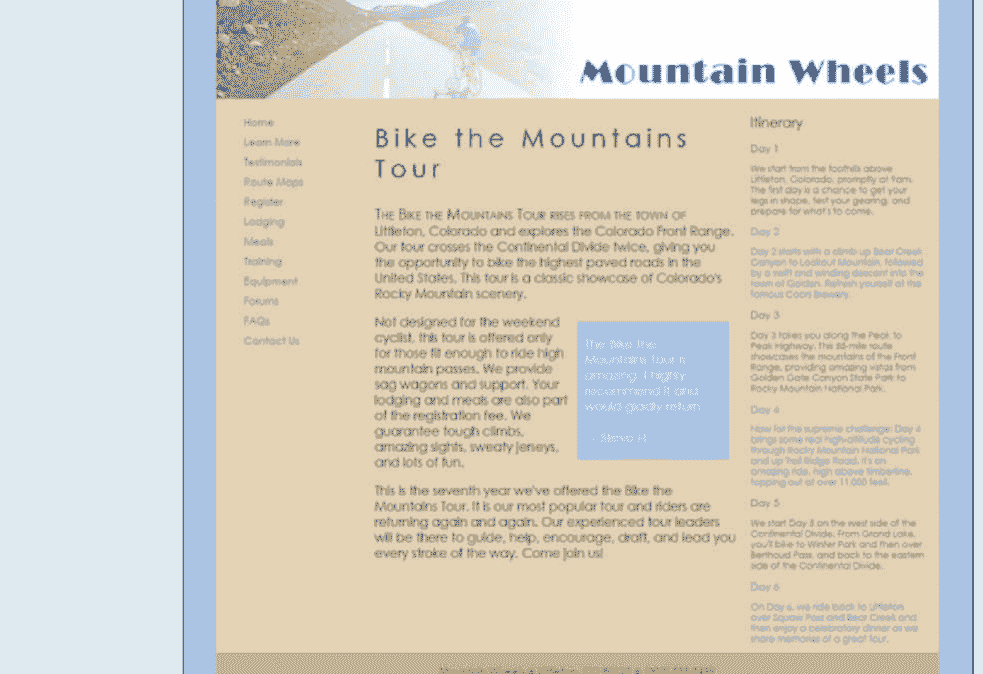

# HTML 164 HTML 和 CSS | 教程 2 CSS 入门

完成以下操作：

- 1. 使用你的编辑器打开 `html2 > case2` 文件夹下的 `mw_tour.html` 和 `mw_styles.css` 文件。在每个文件的注释部分中使用你的*姓名*和*日期*，并分别保存为 `mw_tour.html` 和 `mw_styles.css`。
- 2. 在你的 HTML 编辑器中打开 `mw_tour.html` 文件。在文档头部创建指向 `mw_layout` 和 `mw_styles` CSS 样式表的链接。研究文档的内容和结构，然后在不做任何更改的情况下关闭文件。
- 3. 在编辑器中打开 `mw_styles.css` 文件。在文件顶部插入 `@charset` 规则，将此样式表的编码设置为 `utf-8`。
- 4. 进入“结构部分”（Structural section），创建一个样式规则，将浏览器背景颜色设置为 `rgb(173,189,227)`。
- 5. 为 `body` 元素创建一个样式规则，将背景颜色设置为 `rgb(222, 210, 173)`，并将正文字体设置为 `'Century Gothic', sans-serif`。
- 6. 为 `body` 的页脚（body footer）创建一个样式规则，背景颜色设置为 `rgb(208,184, 109)`，并将上下内边距设置为 `5` 像素。
- 7. 为 `address` 元素创建一个样式规则，使文本以普通字体显示，字体大小为 `0.9em`，文本水平居中，并将上下内边距设置为 `10` 像素。
- 8. 进入“标题部分”（Heading section），创建一个样式规则，将所有 `h1` 和 `h2` 标题的字体设置为普通。
- 9. 进入“导航部分”（Navigation section），为 `nav > ul` 选择器创建一个样式规则，移除所有列表标记，将行高设置为 `2em`，并将字体大小设置为 `0.9em`。
- 10. 对于导航列表中之前访问过的或无序超链接，创建一个样式规则移除链接的下划线，并将文本颜色设置为 `rgb(43,59, 125)`。
- 11. 对于导航列表内悬停或激活的链接，创建一个样式规则，将文本颜色设置为 `rgb(212,35, 35)`。
- 12. Adriana 将关于路线的信息放在了一个 ID 为 `tour_summary` 的文章中。格式化该文章，从标题开始。进入“标题部分”，为嵌套在 `tour_summary` 文章中的 `h1` 元素创建一个样式规则，将字体大小设置为 `2.2em`，边距设置为 `0.2em`。
- 13. 为 `tour_summary` 文章内的段落创建一个样式规则，将字体大小设置为 `1.1em`。Eleanor Adriana 希望第一行使用 `first-of-type` 伪类和 `first-line` 伪元素创建一个样式规则，使 `tour_summary` 文章中段落的第一行以 `1.2em` 的字体大小和小型大写字母（small caps）显示。
- 14. 路线行程位于一个 ID 为 `tour_itinerary` 的 `aside` 元素中。进入“侧边部分”（Aside section），为 `tour_itinerary` 内的每个 `h1` 元素创建一个样式规则，将字体大小设置为 `1.2em`。
- 15. 为 `tour_itinerary` 元素内的每个 `h2` 元素设置字体大小为 `0.9em`。
- 16. 将 `tour_itinerary` 元素内段落的字体颜色设置为 `rgb(0.8, 0.8, 0.8)`。
- 17. Adriana 希望每天日程的文本颜色在灰色和蓝色之间交替。创建以下规则：
    - 对于奇数 `h2` 标题和段落，将字体设置为 `rgb(79,99, 40)`。`（提示：使用 `nth-of-type(odd)` 类）。`
    - 对于偶数 `h2` 标题和段落，将字体设置为 `rgb(81,95, 175)`。`（提示：使用 `nth-of-type(even)` 类）。`
- 18. 页面包含一个 `blockquote`。进入“引用部分”（Blockquotes section），为 `blockquote` 元素创建一个样式规则，将背景颜色设置为 `rgb(173,189,227)`，文本颜色设置为 `rgb(255,255,255)`，透明度为 `0.65`。
- 19. 为 `blockquote` 元素内的每个段落创建一个样式规则，将上下内边距设置为 `2` 像素，左右内边距设置为 `10` 像素。
- 21. 保存文件更改，然后在浏览器中打开 `mw_tour.html`。验证设计是否与图 2-55 匹配，包括应用到 `tour_itinerary` 文章第一个段落以及日期列表中的交替颜色。

# 案例问题 3

此案例所需的数据文件：`cw_class.html`, `cw_styles.css`, `1` 个 CSS 文件, `2` 个 PNG 文件

内战与重建 Peter Craft 是 Mountain Crossing 大学的历史学教授。该大学提供一系列在线课程，其中之一是 Craft 教授教授的《内战与重建》。他开发了内容并有一位同事协助页面布局。你被要求通过创建文本和颜色样式来完成该项目。示例页面见图 2-56。

图 2-56：Mountain Crossing 在线

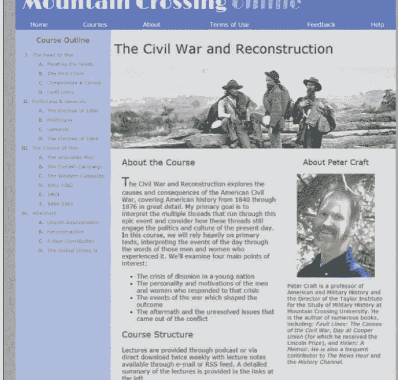

# HTML 166 HTML 和 CSS | 教程 2 CSS 入门

完成以下操作：

- 1. 使用编辑器打开 `html2 > case3` 文件夹下的 `cw_class.html` 和 `cw_styles.css` 文件。在每个文件的注释部分中使用你的*姓名*和*日期*，并分别保存为 `cw_class.html` 和 `cw_styles.css`。
- 2. 在 HTML 编辑器中打开 `cw_class.html` 文件。在文档头部创建指向 `cw_styles.css` 样式表的链接。
- 3. 使用 Google Fonts 网站找到 Limelight 字体。复制链接代码并粘贴到 `cw_class.html` 文件的文档头部。
- 4. 研究 `cw_class.html` 文件的内容和结构，并保存更改。
- 5. 打开 `cw_styles.css` 文件。在文件顶部定义字符编码为 `utf-8`。
- 6. 进入“结构样式部分”（Structural Styles）。在该部分使用 `@import` 规则将 `cw_layout.css` 文件导入样式表。
- 7. 创建样式规则，将页面主体背景颜色设置为 `rgb(180, 180, 223)`，并将文本字体设置为 `Verdana, sans-serif`。
- 8. 将所有 `h1` 和 `h2` 标题显示为普通粗细。
- 9. 为列表内的每个链接创建一个样式规则，移除文本的下划线。
- 10. 为 `footer` 元素创建一个样式规则，将文本颜色设置为白色，背景设置为 `rgb(101, 101, 51)`。将字体大小设置为 `0.8em`。将页脚水平居中，并将上下内边距设置为 `1` 像素。
- 11. 接下来，你需要一个显示大学名称的头部。进入“主体样式部分”（Body Styles），使用头部选择器，创建一个样式规则，将背景设置为 `rgb(97, 97, 211)`。
- 12. 大学名称位于 `h1` 标题中。为 `h1` 标题创建一个样式规则，定义头部颜色，将字体大小设置为 `4vw`，颜色为 `rgba(255, 255, 255, 0)`。使用字体族 `cursive`。将边距空间设置为 `0` 像素。
- 13. `h1` 标题的最后一个词封装在一个 `span` 元素中。为嵌套在头部的 `span` 创建一个样式规则，将文本颜色设置为 `rgb(255, 255, 255)`。
- 14. 进入“导航部分”（Navigation section）。在此部分格式化 ID 为 `mainlinks` 的列表。对于此列表内的超链接，将上下内边距设置为 `5` 像素。
- 15. 对于 `mainlinks` 列表内访问过的或未访问的链接，创建一个样式规则用白色字体显示链接。
- 16. 对于 `mainlinks` 列表内悬停或激活的链接，创建一个样式规则，以 `0.8` 的透明度显示链接，并将背景颜色设置为 `rgba(51, 31, 53, 0)`。
- 17. 进入“大纲部分”（Outline section）。在此部分格式化出现在页面左侧的内容。该大纲列表 ID 为 `outline`。创建一个样式规则，将文本颜色设置为 `rgb(51, 51, 51)`，并将字体大小设置为 `0.8em`。
- 18. 将大纲列表中的 `h1` 水平居中。
- 19. 对于大纲导航列表中的第一个 `li` 元素，创建一个样式规则，将行高设置为 `2em`，上下边距设置为 `0` 像素，左右边距设置为 `5` 像素。将列表标记显示为大写罗马数字。
- 20. 对于嵌套在大纲导航列表中的第二个 `ol` 列表，使用大写字母作为列表标记显示。

# 教程 2 CSS 入门 | HTML 和 CSS

24. 进入 Sections（章节）部分。在此部分中，对章节的描述进行格式化。创建一个样式，将 `section` 元素的背景颜色设置为 `rgb(220, 220, 220)`。

25. 通过为 `section header h1` 选择器创建样式规则，来格式化此部分的标题，将字体大小设置为 `2.2em`，并将左内边距设置为 `10` 像素。

26. 进入 Articles（文章）部分，并为 `article` 元素中的 `h2` 标题创建一个样式规则，将字体大小设置为 `2.2em` 和 `1em`。

27. 显示 `article` 元素中第一个段落的首字母，字体大小为 `2em`，并与周围文本的基线垂直对齐。`（提示：使用 `first-of-type` 伪类和 `first-letter` 伪元素。）`

28. 关于 Peter Craft 的信息已放置在 `aside` 元素中。进入 Aside Styles（侧边栏样式）部分，并创建一个样式规则，将 `aside` 元素中的字体大小设置为 `0.9em`。

29. 对于嵌套在 `aside` 元素中的标题，创建一个样式规则，将字体大小设置为 `1.4em` 并使其水平居中。

30. 将更改保存到文件，并在浏览器中打开 `cw_class.html` 文件。验证页面外观是否保持如图 2-56 所示。确认当你更改浏览器窗口时，由于使用了 `vw` 单位设置页面文本，页面标题文本的大小随之变化。

## 案例题 4

此案例题所需数据：`lake_home_txt.html`, `lake_styles_txt.css`、1 个 CSS 文件、2 个 PNG 文件、2 个 TTF 文件、2 个 WOFF 文件。

Ron Nelson 是位于威斯星州巴利斯港（Bailies Harbor）的大湖旅馆的经营者。他聘请你负责旅馆网站的设计。你将从网站首页开始工作。Ron 已经写好了页面文本，收集了所有的图形素材，并让一位同事设计了页面布局。他希望你处理页面的配色方案和字体排版。图 2-57 显示了一个可能的解决方案。


# HTML 16 HTML 和 CSS | 教程 2 CSS 入门

图 2-57 大湖景观旅馆首页

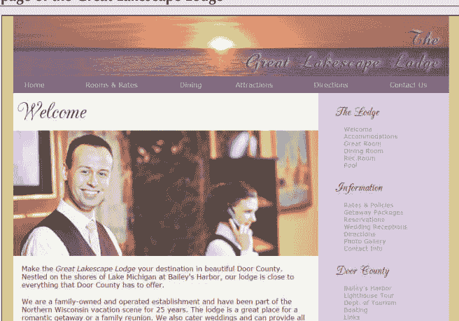

让美丽的门县（Door County）大湖景观旅馆成为您的目的地。我们的旅馆坐落在密歇根湖湖岸的巴特港（Baht's Harbor），紧邻门县国家公园迷人的自然景观。

我们是一家由家族拥有并经营的企业，已在威斯星州北部地区经营多年。该旅馆是浪漫逃之旅或家庭团聚的理想之选。我们还提供婚礼服务，并能提供完美婚礼所需的所有功能。

我们的目标是让您的入住体验远离日常生活的喧嚣。我们拥有宽敞的房间，可以舒适的湖景；对于那些只想躲避喧嚣、放松一个周末的人来说，这里也有安静幽秘的角落。

快来看看为什么我们的客人年年如初地光临。我们在旅馆内以及美丽的门县周边提供各种活动。让我们成为您的向，探索等待您的精彩活动吧。

© 2016 Cambridge Publishing carefully; © Dmitry Kalinovskyy/Shutterstock.com

完成以下任务：

1. 使用编辑器打开 `html02~case4` 文件夹下的 `lake_home.html` 和 `lake_styles.txt` 文件。将它们分别保存为 `lake_home.html` 和 `lake_styles.css`。
2. 在编辑器中打开 `lake_home.html` 文件并链接 `lake_layout.css` 样式表文件。花时间研究文档的结构和内容并保存更改。
3. 在编辑器中打开 `lake_styles.css` 文件，开始为旅馆首页创建配色方案和字体排版样式。最终设计由你决定，但它应该包含以下内容：
    - 定义样式表文件中使用的字符编码
    - 应用网络字体（字体提供在 `html02~case4` 文件夹中）
    - 使用颜色值和颜色名称设置背景和文本颜色
    - 应用半透明颜色
    - 选择应用于嵌套元素、子元素以及基于 `id` 属性元素的样式规则
    - 修改列表和标记外观的样式
    - 使用伪元素和伪类作为选择器
    - 修改元素周围内边距（padding）和外边距（margin）的样式
    - 在渲染页面中生成内容的样式规则
4. 在整个样式表中包含样式注释
5. 保存你完成的样式表。

# 教程 3

# 设计页面布局

为巧克力店创建网站

## 章节 3.1

- 创建重置样式表
- 探索页面布局设计
- 块级元素居中
- 创建浮动元素
- 清除浮动层
- 防止容器塌陷

## 章节 3.2

- 探索基于网格的布局
- 创建布局
- 格式化网格
- 探索 CSS 网格样式

## 章节 3.3

- 探索定位
- 使用相对定位
- 使用绝对定位

# 案例：Pandaisia 巧克力

Ambro 是位于佛蒙特州埃塞克斯（Essex）的 Pandaisia 巧克力店的所有者兼首席巧克力师。她被请求协助重新设计她的网站。她为你提供了三个页面、必要的图片和 CSS 样式。

# 初始数据

| 文件 | 类型 |
| --- | --- |
| `lake_home.html` | HTML |
| `lake_styles.css` | CSS |
| `lake_layout.css` | CSS |
| `images/` | PNG |
| `fonts/` | TTF/WOFF |

# 章节 3.1 视觉概览

要水平居中一个块级元素，将左、右外边距设置为 `auto`。

`width` 属性定义元素的宽度，`max-width` 属性设置其最大宽度，`min-width` 属性设置其最小宽度。

`display` 属性定义元素的布局方式。

`float` 属性将对象从标准流中取出并向左或向右浮动。

`clear` 属性定义浮动元素之后的位置。

```css
```


/* 全局样式 */

```
body {

  margin-left: auto;

  margin-right: auto;

  max-width: 960px;

  min-width: 640px;

}
```

```css
/* 浮动样式 */

.sectionleft {

  float: left;

  width: 32%;

}
```

```css
/* 右侧部分 */

.sectionright {

  float: right;

  width: 47%;

}
```

```css
/* 水平导航 */

.nav {

  float: left;

  width: 22%;

}
```

```css
/* 联系我们部分 */

.sectioncontact {

  float: right;

  width: 36%;

}
```

```css
/* 容器塌陷 */

body:after {

  clear: both;

  content: "";

  display: table;

}
```

为了防止仅包含浮动元素的容器塌陷，使用 `after` 伪元素和 `content` 属性生成占位符。

# 浮动元素的布局

页面主体在浏览器窗口内水平居中。

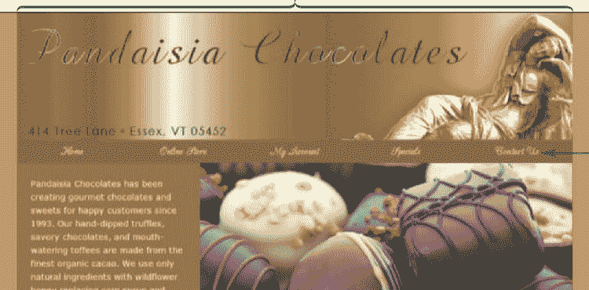

|  | 在线商店 | 我的账户 | 特别 | 联系我们 |
| --- | --- | --- | --- | --- |
| 414 Tree Lane • 佛蒙特州埃塞克斯 05452 | | | | |

| 商店 | 产品 | 服务 | 地点与时间 |
| --- | --- | --- | --- |
| 关于我们 | 在线商店 | 我的账户 | 414 Tree Lane |
| Facebook | 礼盒 | 订单历史 | 佛蒙特州 05452 |
| Twitter | 收藏 | 订单跟踪 | (802) 555-0142 |
| 评价 | 婚礼 | 隐私政策 | 周一至周四: 上午 8 点至 晚上 8 点 |
| 信息图 | 特别 | 联系我们 | 周六: 上午 9 点至下午 5 点 免费热线: 1-800-555-0414 |

## 介绍显示样式

页面布局的研究始于定义元素如何在页面上呈现。在第一个教程中，你学习了 HTML 元素被分为块级元素（如段落或标题）或内联元素（如强调文本或图像）。然而，一个元素是显示为块级还是内联，取决于样式表。你可以使用以下 `display` 属性为任何页面元素定义显示样式：

```
display: type;
```

其中 `type` 定义了显示类型。图 3-1 显示了许多值中的几个。

## 图 3-1 某些 display 属性值

| 显示值 | 外观 |
|---|---|
| block | 显示为块级 |
| table | 显示为网页表格 |
| inline | 在块元素内内联显示 |
| inline-block | 视为块并放置在另一个块元素内联位置 |
| run-in | 显示为块级，除非其相邻兄弟元素也是块级，在这种情况下它显示为内联，本质上是将两者合并为一个 |
| inherit | 继承父元素的 display 属性 |
| list-item | 作为列表项目显示并带有项目标记 |
| none | 防止显示，将其从渲染页面中移除 |

例如，使用通常内联显示图像的浏览器样式，你可以应用样式规则来显示你所有的图像：

```
img (display: block);
```

如果你想将所有的块引用以列表形式显示（带有标记），可以在你的样式表中应用以下样式规则：

```
blockquote (display: list-item);
```

你可以通过将元素的 `display` 属性设置为 `none` 来阻止浏览器显示它。在这种情况下，该元素是文档结构的一部分，但不会显示给用户，且在显示的页面中不占据空间。这对于包含用户看到或不需要看到的内容的元素非常有用。你在创建重置样式表时就会 `display` 属性。

## 创建重置样式表

> 提示
> 你也可以通过应用 `visibility: hidden;` 来隐藏元素，这会隐藏元素但元素仍然占据页面上的相同空间。

你在上一个教程中学习到，除非被自己的样式表覆盖，否则浏览器会对你的页面元素应用其自身的样式。许多设计师倾向于在“空白画布”上工作，不希望有任何样式规则渗透到网站设计中。这可以通过重置样式表来实现，它会覆盖浏览器的默认样式，并为页面设计提供一致的起点。

## 教程 3 设计页面布局 | HTML 和 CSS

你将为 Pandasia Chocolates 网站创建一个重置样式表。你表中的第一条样式规则将使用 `display` 属性来显示网页中所有的 HTML5 结构元素。虽然现在的浏览器已经能做到，但某些旧版浏览器不识别或 `header`、`article` 或 `footer` 等元素的预定义样式。通过在重置样式表中包含 `display` 属性，你增加了一份保险，确保这些结构元素能够被正确渲染。

## 创建重置样式表：

- 1. 使用你喜欢的文本编辑器或编辑器打开 `html30` 教程文件夹中的 `pc_reset.txt` 文件。在文件的注释部分输入你的**姓名**和**日期**，并将其保存为 `pc_reset.css`。
- 2. 在 `Structural Styles`（结构样式）部分，插入以下样式规则来定义几个 HTML5 结构元素的属性：
```css
article, aside, figcaption,
footer, header, main, nav, section {
  display: block;
}
```
图 3-2 突出了文档中的新样式规则。


将 HTML5 结构元素作为块级显示

```
/* Structural Styles */
article, aside, figcaption,
footer, header, main, nav, section {
  display: block;
}
```

你将通过添加其他样式规则来设置页面元素的默认边距、定义某些字体属性以及移除列表中的下划线来完成重置样式表。

完成重置样式表：

- 1. 在 `Typographic Styles`（字体样式）部分，插入以下样式规则来定义页面元素的字体样式：
```css
address, article, aside, blockquote, body, cite,
dt, dd, em, figcaption, footer, h1, h2, h3, h4, h5,
header, html, li, main, nav, ol, p, section, span, ul {
  background: transparent;
  font-size: 100%;
  margin: 0;
  padding: 0;
}
```
- 2. 添加以下样式规则来移除列表项：
```
ul {
  list-style: none;
}
a {
  text-decoration: none;
}
```
- 3. 通过应用以下样式将 `body` 的默认行高设置为（1）：
```
body {
  line-height: 1;
}
```

图 3-3 突出了新规则。

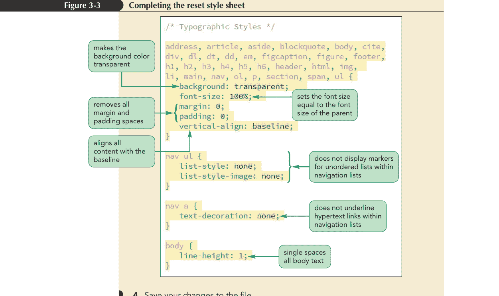

## HTML 174 HTML 和 CSS | 教程 3 设计页面布局

这是一个重置样式表。某些旧版浏览器不识别或没有 `header`、`article` 或 `footer` 等元素的预定义样式。在重置样式表中包含 `display` 属性，你增加了一份保险，确保这些结构元素能够被正确渲染。

这是一个重置样式表。某些旧版浏览器不识别或没有 `header`、`article` 或 `footer` 等元素的预定义样式。在重置样式表中包含 `display` 属性，你增加了一份保险，确保这些结构元素能够被正确渲染。

- 4. 将你的更改保存到文件。

图 3-3 突出了新规则。


## HTML 176 HTML 和 CSS | 教程 3 设计页面布局

这是一个重置样式表。某些旧版浏览器不识别或没有 `header`、`article` 或 `footer` 等元素的预定义样式。在重置样式表中包含 `display` 属性，你增加了一份保险，确保这些结构元素能够被正确渲染。

这是一个重置样式表。某些旧版浏览器不识别或没有 `header`、`article` 或 `footer` 等元素的预定义样式。在重置样式表中包含 `display` 属性，你增加了一份保险，确保这些结构元素能够被正确渲染。

这是一个重置样式表。某些旧版浏览器不识别或没有 `header`、`article` 或 `footer` 等元素的预定义样式。在重置样式表中包含 `display` 属性，你增加了一份保险，确保这些结构元素能够被正确渲染。

这是一个重置样式表。某些旧版浏览器不识别或没有 `header`、`article` 或 `footer` 等元素的预定义样式。在重置样式表中包含 `display` 属性，你增加了一份保险，确保这些结构元素能够被正确渲染。

这是一个重置样式表。某些旧版浏览器不识别或没有 `header`、`article` 或 `footer` 等元素的预定义样式。在重置样式表中包含 `display` 属性，你增加了一份保险，确保这些结构元素能够被正确渲染。

这是一个重置样式表。某些旧版浏览器不识别或没有 `header`、`article` 或 `footer` 等元素的预定义样式。在重置样式表中包含 `display` 属性，你增加了一份保险，确保这些结构元素能够被正确渲染。

这是一个重置样式表。某些旧版浏览器不识别或没有 `header`、`article` 或 `footer` 等元素的预定义样式。在重置样式表中包含 `display` 属性，你增加了一份保险，确保这些结构元素能够被正确渲染。

## 探索页面布局设计

挑战之一是你的文档将在许多不同屏幕分辨率的设备上查看。在设计网页时，你通常更关心可用屏幕宽度而不是高度，因为用户可以垂直滚动页面长度，但让它们水平滚动是设计不佳。

某些旧版浏览器不识别或没有 `header`、`article` 或 `footer` 等元素的预定义样式。在重置样式表中包含 `display` 属性，你增加了一份保险，确保这些结构元素能够被正确渲染。

这是一个重置样式表。某些旧版浏览器不识别或没有 `header`、`article` 或 `footer` 等元素的预定义样式。在重置样式表中包含 `display` 属性，你增加了一份保险，确保这些结构元素能够被正确渲染。

页面设计师需要处理各种可能的屏幕宽度，从宽度为 1680 像素或以上的宽显示器，到屏幕宽度为 320 像素或更小的移动设备。更复杂的是，屏幕的可用空间被工具栏、侧边栏面板和其他浏览器功能占据。此外，用户可能没有将浏览器窗口最大化以填充整个屏幕。

## 固定、流式和弹性布局

网页布局分为三类：固定、流式和弹性。固定布局是指页面大小和页面元素的大小固定的，通常使用像素作为测量单位。页面宽度可能为 960 像素并且

这是一个重置样式表。某些旧版浏览器不识别或没有 `header`、`article` 或 `footer` 等元素的预定义样式。你可能希望在开发网站时保持此文件打开状态。

# 教程 3 设计页面布局 | HTML 和 CSS

公司 Logo 的宽度设置为 780 像素。这些宽度不受用户设备屏幕窗口的限制，如果设备屏幕宽度不够，可能会导致页面无法适应浏览器。

相比之下，**流式布局（fluid layout）**将页面元素的宽度设置为相对于可用屏幕的百分比。例如，页面主体（page body）的宽度可以设置为占据屏幕的 90%，而内容区域的宽度可以设置为占据页面主体的 80%。在流式布局下，页面会自动调整大小以匹配用户设备设备的屏幕分辨率。图 3-5 显示了三列布局在固定设计和流式设计中可能分别呈现的样貌。

# 图 3-5 固定布局与流式布局对比

| | 1280px | |
|---|---|---|
| 固定 (FIXED) | 流式 (FLUID) | |
| 256px | 512px | 512px |
| | 20% | 40% | 40% |

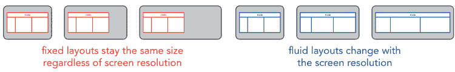

© 2016 Cengage Learning

由于各种设备都会访问你的网站，通常最好使用对各种分辨率适应性更好的流式布局。只有当你对显示页面的设备拥有更多控制权时，才使用固定布局，例如专门为会议现场的数字自助终端创建的网页。

另一种布局是**弹性布局（elastic layout）**，所有的测量值都以单位表示，并基于页面中使用的默认字体大小。如果用户或设计师增加了字体大小，所有其他元素（包括图像和文本）的宽度、高度和位置将按比例相互缩放，布局永远不会随字体大小的变化而改变。这种方法的缺点是，由于尺寸是基于字体大小而非屏幕分辨率，存在一种风险：如果用户设置了较大的默认字体，页面可能会超出浏览器窗口的边界。

最后，网页正向**响应式设计（responsive design）**原则发展，即布局和设计会根据渲染它的设备而改变。页面将为移动设备设置一套样式，为平板电脑设置一套，为笔记本电脑或台式电脑设置另外一套。你将在教程 5 中探索如何实现响应式设计。

由于宽度是布局中不可或缺的一部分，你将通过定义页面主体以及页面内元素的宽度来开始设计 Pandasia Chocolates 的主页。

# 处理宽度和高度

元素的宽度和高度使用以下宽度和高度属性设置：

- width: value;
- height: value;

其中 value 是使用 CSS 测量单位之一表示的宽度或高度，或者是父元素宽度或高度的百分比。例如，以下样式规则将页面主体的宽度设置为其父元素（浏览器窗口）的 95%：

```
body {
  width: 95%;
}
```

通常，你不需要设置高度值，因为浏览器会自动增加元素的高度以匹配其内容。注意，所有块元素（如 `body` 元素）的默认宽度均为 100%。因此，此样式规则使 `body` 元素比默认情况略小。

# 设置最大和尺寸

你可以通过应用以下属性对块元素的宽度或高度设置限制：

- min-width: value;
- min-height: value;
- max-width: value;
- max-height: value;

其中 value 再次是使用 CSS 测量单位之一（通常是像素）表示的长度，以匹配显示设备的测量单位。例如，以下样式规则将页面主体的宽度设置为浏览器高度的 95%，但限制在 640 到 1680 像素的范围内：

```
body {
  width: 95%;
  min-width: 640px;
  max-width: 1680px;
}
```

最大和最小宽度通常用于使页面文本更易阅读。研究表明，太宽的文本行难以阅读，因为眼睛必须扫描很长一段内容；而太窄且换行过多的文本行会破坏材料的连贯性。

# 设置宽度和高度

- 要设置元素的宽度和高度，使用样式：

```
width: value;
height: value;
```

其中 value 是 CSS 测量单位之一的宽度或高度，或者是父元素宽度或高度的百分比。

- 要设置最小可能的宽度或高度，使用样式：

```
min-width: value;
min-height: value;
```

- 要设置最大可能的宽度或高度，使用样式：

```
max-width: value;
max-height: value;
```

将 Pandasia Chocolates 主页的 body 页宽度设置为浏览器窗口的 95%，范围从 640 像素到 960 像素。还将公司图像显示为一个块元素，其宽度设置为 100%，使其跨整个 body 页。你不需要设置 logo 的高度，因为浏览器会自动缩放高度以保持图像的原始比例。

# 设置页面的初始尺寸：

1. 回到编辑器中的 `pc_home.css` 文件，并在 Body Styles 中添加以下样式规则：

```
body {
  max-width: 960px;
  min-width: 640px;
  margin: 0 auto;
}
```

2. 在 Body 选择器中添加以下样式规则以设置宽度：

```css
body {
  width: 95%;
}
```

3. 将图像显示为块元素，其宽度设置为 100%，以便横跨 body 页：

```css
img {
  display: block;
  width: 100%;
}
```

4. 你不需要设置 logo 的高度，因为浏览器会自动缩放高度以保持图像的原始比例。

# 设置页面的初始尺寸

1. 回到编辑器中的 `pc_home.css` 文件，并在 Body Styles 中添加以下样式规则：

```
body {
  max-width: 960px;
  min-width: 640px;
  margin: 0 auto;
}
```

2. 在 Body 选择器中添加以下样式规则以设置宽度：

```css
body {
  width: 95%;
}
```

3. 将图像显示为块元素，其宽度设置为 100%，以便横跨 body 页：

```css
img {
  display: block;
  width: 100%;
}
```

4. 你不需要设置 logo 的高度，因为浏览器会自动缩放高度以保持图像的原始比例。

# 垂直居中元素

要垂直居中：

```css
body {
```


`max-width: 960px;`

`min-width: 640px;`

`margin: 0 auto;`

```
```

2. 在 Body 选择器中添加以下样式规则以设置宽度：

```css
body {
  width: 95%;
}
```

3. 将图像显示为块元素，其宽度设置为 100%，以便横跨 body 页：

```css
img {
  display: block;
  width: 100%;
}
```

4. 你不需要设置 logo 的高度，因为浏览器会自动缩放高度以保持图像的原始比例。

（注：由于提供的文本原文存在部分重复和逻辑错乱，译文已根据上下文语义进行了整合与优化，以确保技术准确性。）

# 教程 3 页面布局设计 | HTML 和 CSS

要在父级元素中使单行文本垂直居中，请将文本的行高设置得大于文本的字体大小。以下样式规则将使 `h1` 标签具有垂直居中的标题文本。

```
h1 {
  font-size: 1.4em;
  line-height: 2em;
}
```

请注意，这种方法仅适用于单行文本。如果文本换行到第二行，它将不再处于垂直居中状态。垂直居中是一个常见的设计挑战，多年来人们已经想出了其他几种替代解决方法。你可以在网络上搜索垂直垂直居中的其他解决方案。

接下来，你将布局导航列表中的链接。Anne 希望链接以水平方式而不是垂直方式显示。你可以使用 CSS 浮动（Floats）来实现这一目标。

# 浮动页面内容

默认情况下，内容按照其在 HTML 文件中出现的顺序在页面中显示，作为正常文档流的一部分。浮动元素会脱离位置，并放置在其父元素的左边缘或右边缘。后续非浮动内容将占据之前被浮动元素占据的空间。图 3-9 显示了一个元素沿容器右边距浮动的图，及其对后续内容布局的影响。

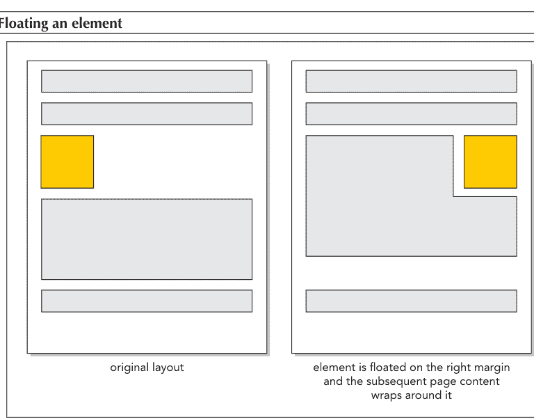

© 2016 Cengage Learning

要浮动元素，请应用以下 float 属性

```
float: position;
```

其中 `position` 为 `none`（默认值）、`left` 将对象浮动在左边缘，或 `right` 将对象浮动在右边缘。如果兄弟元素沿同一侧边缘浮动，它们将并排对齐，如图 3-10 所示。

# HTML 184 HTML 和 CSS | 教程 3 页面布局设计

# 图 3-10 在行内浮动多个元素

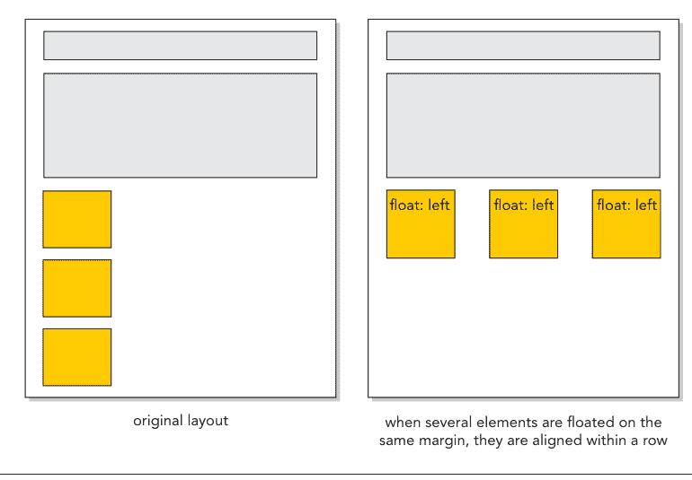

© 2016 Cengage Learning

请注意，放置在单行内的元素，其总宽度不能超过父元素的总宽度，否则多出的内容将自动换到新行。

# 浮动元素

- *若要在容器内浮动元素，请应用样式*
```css
float: position;
```
`其中 position 为 none（默认值）、left 或 right。`

Anne 希望你将属于 `horizontalNavigation` 类的导航列表内容显示在单行内。你将通过使用 `float` 属性将这些导航列表中的每个项目浮动在左边缘来实现这一目标。现在请创建此样式规则。

# 布局导航列表项目：

- 1. 回到编辑器中的 `pc_home.css` 文件，并进入 Body Header Sections（主体页眉部分）。
- 2. 因为导航列表中有五个链接，你你将通过添加以下样式规则，使每个列表项占据导航列表宽度的 20%：

```
body > header > nav.horizontalNavigation li {
  width: 20%;
}
```

为了限制在单行内，浮动元素的总宽度不能超过容器的宽度。

Copyright 2019 Cengage Learning. 版权所有。未经许可全部或部分复制、扫描或复制。WCN 020-200-253

# 教程 3 页面布局设计 | HTML 和 CSS HTML 185

3. 在 Horizontal Navigation Sections（水平导航部分）区域内插入以下样式规则，使水平导航列表中的每个列表项都作为左侧浮动的块级元素显示。

```
nav.horizontalNavigation li {
  display: block;
  float: left;
}
```
图 3-11 突出了列表项使用的样式。

图 3-11 导航列表中的浮动项目

```
/* Body Header */
body > header > img {
  display: block;
  width: 100%;
}
body > header > nav.horizontalNavigation li {
  width: 20%;
}

/* Horizontal Navigation Styles */
nav.horizontalNavigation li {
  display: block;
  float: left;
}
```

4. 保存对文件的更改并在浏览器中重新加载 `pc_home.html` 文件。图 3-12 显示了页面页眉中导航列表修改后的布局。

图 3-12 导航列表中的浮动项目


每个列表项的宽度设置为 20% 并浮动在左边缘

Pondaisia Chocolates 自 1992 年以来一直为快乐的客户制作美味巧克力和点心。我们手工制作的松巧克力、糖果和令人垂涎的酒类是用优质的有机原料制成的。我们只使用天然原料，例如自制蜂蜜修复玉米和来自当地乳制的奶油。我们的巧克力已经定型了！时间我们的

© 2016 Cengage Learning

# HTML 186 HTML 和 CSS | 教程 3 页面布局设计

Anne 不喜欢导航列表中超链接的外观。因为链接是行内元素，背景颜色仅延伸到链接文本范围。她建议你将链接更改为块元素，并在每个块内居中链接文本。

# 更改链接：

- 1. 回到编辑器中的 `pc_home.css` 文件。
- 2. 在 Horizontal Navigation Styles（水平导航样式）部分，插入以下样式规则以格式化链接：

```
nav.horizontalNavigation a {
  display: block;
  text-align: center;
}
```
图 3-13 突出了水平导航中的样式


```
/* Horizontal Navigation Styles */
nav.horizontalNavigation li {
  display: block;
  float: left;
}
nav.horizontalNavigation a {
  display: block;
  text-align: center;
}
```

- 3. 保存对文件的更改并在浏览器中重新加载页面。注意导航列表中的链接。文本在块内居中，背景颜色完全延伸而不是被限制。查看图 3-14。


Pondaisia Chocolates 自 1992 年以来一直为快乐的客户制作美味巧克力和点心。我们手工制作的松巧克力、糖果和令人垂涎的酒类是用优质的有机原料制成的。我们只使用天然原料，例如自制蜂蜜修复玉米和来自当地乳制品的奶油。我们的巧克力已经定型了！时间我们的

2016 Cengage Learning

不要担心页眉之后的元素跳转。延伸那些对象。

Copyright 2016 Cengage Learning. 版权所有。未经许可全部或部分复制、扫描或复制。WCN 020-200-203

# 教程 3 页面布局设计 | HTML 和 CSS 187

你完成了页眉的设计。接下来，你将布局页面的中间部分。

# 清除浮动

在某些布局中，你希望元素在新行中显示，并清除之前的浮动对象。为了确保元素始终显示在浮动元素下方，请应用以下 clear 属性：

```
clear: position;
```

其中 `position` 为 `left`、`right` 或 `none`。`left` 值仅在左边距清除时显示元素。`right` 值仅在右边距清除时显示元素。默认值是 `none`，允许元素与任何浮动对象并排显示。

图 3-15 显示了 `clear` 属性如何防止元素在右边距清除之前显示。对页面布局的影响是元素向下移动，并由于不再与浮动对象并排而可以使用整个页面宽度。

# 图 3-15 清除浮动


© 2016 Cengage Learning

# 清除浮动

- *若要在带有浮动元素的页面上显示非浮动元素，使用以下样式以便非浮动元素可以清除浮动元素*

```
clear: position;
```

其中 `position` 为 `none`（默认值）、`left`、`right` 或 `both`。

Pandasia Chocol 主页的下部分包含名为 `leftColumn` 和 `rightColumn` 的元素。将左列的宽度设置为主体宽度的 33%，右列的宽度设置为 67%。浮动部分在左边缘并排显示，但仅在左边距清除了所有之前的浮动对象时。

# 使左列和右列部分浮动：

- 1. 回到编辑器中的 `pc_home.css` 文件。进入“左列样式”（Left Column Styles）部分并插入样式规则：

```css
section#leftColumn {
  clear: left;
  float: left;
  width: 33%;
}
```

- 2. 在“右列样式”（Right Column Styles）部分中，插入：

```css
section#rightColumn {
  float: left;
  width: 67%;
}
```

注意，你不需要对右列应用 `clear` 属性，因为你希望它与左列显示在同一行中。图 3-16 显示了左列和右列的样式规则。


| 当左边距空空之前的浮动元素后，显示左列 | /* 左列样式 */\nsection#leftcolumn {\n  clear: left;\n  float: left;\n  width: 33%;\n} | 将左列在左边距处浮动，宽度为页面宽的 33% |
| 将右列与左列并排浮动，宽度为 67% | /* 右列样式 */\nsection#rightColumn {\n  float: left;\n  width: 67%;\n} | |

右列包含一个有四个项目的水平导航列表，每个项目由图像和一个标签组成。Anne 希望这四个项目并排排列，并将宽度设置为导航列表宽度的 25%。Anne 还希望右列中的图像显示为块级元素，其宽度设置为父元素宽度的 100%。

# 完成右列部分：

- 1. 在“右列样式”部分中，插入以下样式规则来格式化内联图像和列表项：

```css
section#rightColumn img {
  display: block;
  width: 100%;
}
section#rightColumn > nav.horizontalNavigation li {
  width: 25%;
}
```

注意，你不需要包含用于水平导航列表项浮动的样式规则，因为你已经在图 3-11 中创建了该样式规则。图 3-17 描述了样式表中新样式规则。


# 格式化右列部分

```css
/* 右列样式 */
section#rightColumn {
  float: left;
  width: 67%;
}
section#rightColumn img {
  display: block;
  width: 100%;
}
section#rightColumn > nav.horizontalNavigation li {
  width: 25%;
}
```

- 2. 保存文件的更改并在浏览器中重新加载 `pc_home.html` 文件。图 3-18 显示了左列和右列部分的布局。

# HTML 190 HTML 和 CSS | 教程 3 设计页面布局

# 图 3-18 左列和右列的布局


左列占据页面宽度的 33%

右列占据宽度的 67%

Panda Chocolate 自 1993 年以来一直为客户提供美味巧克力和甜点。我们的手工浸泡咖啡、软糖和威华片由优质的有机可可原料制成，并注入了来自当地农场的新鲜野花蜜。巧克力是一门艺术；欢迎参观我们的画廊。

巧克力名称

Fig 坚果糖

特价

Whortles

软糖

松露

商店

水平导航列表，每个每个图像和标签的宽度均设置为列表宽度的 25%

> Brenda Carson/Shutterstock.com; Brent Hofacker/Shutterstock.com; Jim Bowie/Shutterstock.com; wacomika@Shutterstock.com; Shebeko/Shutterstock.com

Anne 注意到左列的文本挤压了右列和页面边界。这建议你通过增加左列的内边距（padding）来提供更多的内部空间。

# 增加左列内边距：

- 1. 回到编辑器中的 `pc_home.css` 文件。进入“左列样式”部分。
- 2. 在 `section#leftColumn` 中添加 `padding: 1.5em;`，如图 3-19 所示。# 左列样式

```css
/* 左列样式 */
section#leftColumn {
  clear: left;
  float: left;
  width: 33%;
  padding: 1.5em;
}
```

# 教程 3 设计页面布局 | HTML 和 CSS - 3. 保存更改并刷新 `pc_home.html` 文件。图 3-20 显示结果。# 增加内边距

内边距导致左列宽度超过了页面宽度的 33%


| 首页 | 订单历史 | 登录 |
|---|---|---|
| | | | |
| 商店 | | |
| 关于我们 | | |
| 特色 | | |
| 服务 | | |
| 产品 | | |
| 在线商店 | | |
| 礼品卡 | | |
| 收藏 | | |
| 折扣 | | |
| 账户 | | |
| 订单历史 | | |

Brenda Carson/Shutterstock.com; Brent Hofacker/Shutterstock.com; Jim Bowie/Shutterstock.com; wacomika@Shutterstock.com; Shebeko/Shutterstock.com

这种简单的更改导致了布局崩溃。

# 完善浮动布局

当浮动元素的宽度超过其父元素时，右列会被强制挤到新行。增加左列的内边距导致宽度超过了页面宽度的 33%。为了让它们在同一行内浮动，你需要使用 `box-sizing` 属性。

你可以使用 `box-sizing` 属性来选择布局模型。记住 `width` 是仅基于内容的。默认情况下，浏览器使用 `content-box`，其中宽度是内容、内边距和边框的总和。

# HTML 192 HTML 和 CSS | 教程 3 设计页面布局

# 图 3-21 内容盒与边框的对比


样式属性
width: 200px;
padding: 10px;
border: 5px;

© 2016 Cengage

# 设置块模型：

- 1. 回到编辑器中的 `pc_reset.css` 文件。
- 2. 为块元素列表添加以下样式属性：

```css
address, article, aside, blockquote, body, cite, div, dl, dt, dd, em, figcaption, figure, footer, h1, h2, h3, h4, h5, header, html, img, li, main, nav, ol, p, span, ul {
  background: transparent;
  font-size: 100%;
  margin: 0;
  padding: 0;
  vertical-align: baseline;
  -webkit-box-sizing: border-box;
  -moz-box-sizing: border-box;
  box-sizing: border-box;
}
```

图 3-22 显示了修改后的样式规则。


# 布局页脚：

- 1. 回到编辑器中的 `pc_home.css` 文件并滚动到页脚部分。
- 2. 插入以下样式规则：

```css
footer {
  clear: left;
}
footer > nav.navNavigation {
  float: left;
  width: 22%;
}
```

# HTML 194 HTML 和 CSS | 教程 3 设计页面布局

```css
footer > section#contactInfo {
  float: left;
  width: 34%;
}
```


图 3-23 强调了页面页脚的布局样式规则。

## 图 3-23 设置页面页脚布局

```css
/* 页脚样式 */
footer {
  clear: left;
}
/* 当左侧边距没有浮动对象时，显示页脚 */
/* 将垂直导航列表的宽度设置为 22% 并向左侧浮动 */
footer > nav.verticalNavigation {
  float: left;
  width: 22%;
}
footer > section#contactInfo {
  float: left;
  width: 34%;
}
```

- 3 保存您对样式表的更改并在浏览器中重新加载 `pc_home.html`。图 3-24 显示了页脚的新布局。

## 图 3-24 页脚布局


每个垂直导航列表宽度设置为页脚宽度的 22% 并向左浮动

> Brent Holacker@Shutterstock.com; @JimBower@Shutterstock.com; @wacomika@Shutterstock.com; @Shelbekov@Shutterstock.com; source: Facebook 2015; source: 2015 Twitter

> contactinfo 区域的宽度设置为页脚宽度的 34% 并浮动

Anne 请求将页脚的背景颜色改为深棕色以显示文本内容。

# 教程 3 设计页面布局 | HTML 和 CSS HTML 195

## 设置页脚背景颜色：

- 1. 回到编辑器中的 **`pc_home.css`** 文件并进入 Footer Styles（页脚样式）部分。
- 2. 为页脚选择器插入以下属性：

```css
background-color: rgb(71, 52, 29);
```

图 3-25 强调了页脚背景颜色。

```css
footer {
  background-color: rgb(71, 52, 29);
  clear: left;
}
```

- 3. 保存您对样式表的更改并在浏览器中重新加载 **`pc_home.html`**。注意背景颜色没有变化。

为什么背景颜色更改没有生效？为了帮助你理解，我们将再次观察浮动元素的本质。

## 处理容器塌陷

记得浮动元素会被移文档流，因此不再是包含它的元素的“部分”。字面上讲，它脱离了容器自由浮动。当容器中的每个元素都是浮动的时，就没有留任何内容了。对于浏览器来说，容器是空的，因此没有高度也没有可以着色的背景，这种情况被称为容器塌陷（container collapse）。图 3-26 展示了一个具有三个超出容器边界的浮动对象的容器塌陷的情况。

## 图 3-26 容器塌陷


© 2018 Cengage Learning. 版权所有。未经许可，不可全部或部分地复制、扫描或复制。WCN 020-200-353

# HTML 和 CSS | 教程 3 设计页面布局

你在布局中通常希望容器能够扩展以包围其所有的浮动内容。发生这种情况的一种方法是：容器后面跟着另一个元素，该元素仅在边距清除了浮动对象时才显示。在这种情况下，容器的高度将扩展到该后续元素，并在过程中包围它的浮动内容。

Pandasia 页面首页中页脚的问题在于没有后续元素——页脚是页面主体中的最后一个元素。解决该问题的方法之一是在页脚之后使用一个伪元素。通用规则是

```css
container::after {
  clear: both;
  content: "";
  display: table;
}
```

其中选择器用于包含的浮动对象。`clear` 属性使此占位元素保持插入状态，直到两个边距都清除了浮动。该元素是一个 Web 表格，包含一个空字符串，因为没有向页面写入实际内容。这没关系，因为有这个占位元素的存在就足够防止容器塌陷了。现在添加样式规则来创建一个占位元素，防止页脚在其浮动内容周围塌陷。

## 为了防止页脚塌陷：

- 1. 回到 `pc_home.css` 文件中的 Styles 部分，在页脚元素的样式规则之后插入以下规则：

```css
footer::after {
  clear: both;
  content: "";
  display: table;
}
```

图 37 显示了样式表中的新规则。


| footer { | |
|---|---|
| background-color: rgb(71, 52, 29); clear: left; | 在页脚后创建一个元素 |
| footer::after { clear: both; content: ""; display: table; } | 在页脚后放置一个由空表格组成的元素 |

- 2. 保存您对样式表的更改并在浏览器中重新加载 `pc_home.html`。图 3-24 显示了页脚的新布局。

# 教程 3 设计页面布局 | HTML 和 CSS HTML 195

## 图 3-28 页面页脚布局


每个垂直导航列表宽度设置为页脚宽度的 22% 并向左浮动

> Brent Holacker@Shutterstock.com; @JimBower@Shutterstock.com; @wacomika@Shutterstock.com; @Shelbekov@Shutterstock.com; source: Facebook 2015; source: 2015 Twitter

> contactinfo 区域的宽度设置为页脚宽度的 34% 并浮动

Anne 请求将页脚的背景颜色改为深棕色以显示文本内容。

注意页脚之所以有深色是因为它扩展以包含其内容。

- 3. 关闭为本次会话打开的所有文档。

# HTML 198 HTML 和 CSS | 教程 3 设计页面布局

## 解决问题：留白的美德

人们通常通过放置内容来考虑布局，但良好的布局也涉及到放置空白。在艺术和页面设计中，这广为人知（正空间和负空间）。正空间是页面被文本、图形、标题、图标和其他页面元素占据的部分。负空间或留白是未占据的区域，为正空间提供平衡和对比。

一个充满内容的页面让眼睛没有休息的地方；这意味着眼睛没有焦点，可能没有从哪里开始的清晰指示。负空间用于引导用户在移动到下一页内容之前休息。可以通过在页面元素之间提供大量的边距以及增加元素内边距来实现。即使增加文章标题内的留白也可以缓解疲劳并使文本更容易阅读。

留白具有情感影响。在印刷广告早期，留白被视为浪费空间，因此较小的杂志和直邮广告倾向于挤在一起以减少浪费。相比之下，高端杂志和海报可以通过过空旷与其他出版物区分开来。这种差异延续到了网络，内容较少留白较多的页面感觉更高级、精致，而挤满大量内容的页面感觉更具商业味。两种方法都是有效的，你应该根据你的客户画像决定使用哪种方法。

| 商店 | 产品 | 服务 | 地点 |
|---|---|---|---|
| 关于我们 | 礼盒 | 我的账户 | 414 Lee Lane |
| Facebook | 在线 | 订单历史 | Essex, VT 0542 |
| Twitter | 收藏 | 隐私政策 | (802) 555-3414 |
| Instagram | 特别优惠 | 联系我们 | 周一至周五 9-6 |
| | | | 周六至周日 10-4 |

完成了 Pandasia Chocolates 首页的工作。在下一次课程中，你将使用网格技术处理页面布局。

## 第 3.1 节快速检查

- 1. 提供一种样式规则，使导航列表中的所有超链接显示为块级元素，并带有灰色背景色。
- 2. 简述三种页面布局类型。
- 3. 提供一种样式规则，将页面 `body` 的宽度设置为浏览器窗口的 90%，范围范围在 320 到 960 像素之间。
- 4. 提供一种样式规则，将 `header` 元素在 `body` 元素中水平居中。假设 `header` 是页面 `body` 的直接子元素。
- 5. 提供一种样式规则，将 `aside` 元素的宽度设置为 240 像素，并浮动在其容器的右边距。
- 6. 提供一种样式规则，仅在清除所有浮动元素后才显示 `footer` 元素。
- 7. 你的布局在一行中有四个浮动元素，但遗憾的是最后一个元素换行到了新行。布局错误的根源是什么？
- 8. 提供一种样式规则，更改 `header` 元素的 `width` 属性，使其测量 `header` 内容、内边距和边框的总宽度。包含针对旧版浏览器的 Web扩展。
- 9. 提供一种样式规则，防止 `header` 元素围绕其浮动内容发生塌陷。

## 第 3.2 节视觉概览：

`col-2-3` 类表示宽度为所在行 2/3 的列。`col-1-2` 类表示宽度为所在行一半的列。

```html
<div class="col-2-3">
  <h2>我们的公司</h2>
  
  <p>我们是一家位于佛蒙特州埃塞克斯的公司，致力于制作美味的巧克力和其他甜点。对于我们的创始人 Anne Ambrose 来说，这意味着我们只使用最优质的原料，创造出风味与丝滑质地的和谐融合。</p>
  <div class="col-1-2">
    <h3>我们的巧克力</h3>
    <p>最好的巧克力是新鲜巧克力。防腐剂会改变巧力的味道和质地。为了获得最佳效果，我们的巧克力应该在购买后几天内食用。将它们储放在阴凉、黑暗的地方，温度保持在 68deg 至 76deg 之间，然后享受吧！</p>
  </div>
  <div class="col-1-3">
    <h3>健康巧克力</h3>
    <p>健康巧克力因为大众生产糖的质量而声誉不佳。我们保持生产巧力的过程</p>
  </div>
</div>
```

在网格布局中，行和列由 `div` 元素标记。

在网格行之后添加伪内容，以防止其围绕列发生塌陷。

| div.row { both; } | | |
| :--- | :--- |
| content: "" | 网格行在页眉之后显示 |
| display: table | 浮动列 |
| clear: both; | |

- *所有列都在其所在的行内进行浮动。*

```css
div[class*="col-"] { float: left; }
div.col-1-2 { width: 50%; }
div.col-1-3 { width: 33.33%; }
div.col-2-3 { width: 66.67%; }
```

类名提供了网格列宽度的提示。

```css
div {
  outline: 1px solid red;
}
```

`outline` 属性在选定的元素周围绘制一条线。


## 页面布局网格

网格布局将页面内容安排在网格行内，网格列在行内浮动。

网格轮廓指示了网格行和列的位置。


网格行在一个新行。

我们的公司

常见问题

我们是一家家族经营的巧克力制造商。世代以来一直使用最优质的原料。

你知道巧克力起源于中美洲吗？它曾被用作食物和货币。

你喜欢巧克力吗？

黑巧克力是最好的，因为它含有更多的抗氧化剂。

什么让巧克力更健康？

巧克力浆是巧力的基础。它是由可豆种子制成的，种子经过烘焙、磨碎，并与糖和黄油混合。我们提供的巧克力含有至少 70% 的可。

我可以自定义吗？

可以！你可以选择各种坚果、水果和香料来创造你梦想中的巧克力。

你提供方形吗？

Pandaisia Chocolates ©2017 版权所有

网格列与其行浮动。

## 介绍网格布局

在节一节中，你使用 `:float` 属性将页面布局在相互浮动的各个部分中。在本节中，你将通过创建基于网格的页面布局来通用这种技术。

## 网格布局概览

网格是一种在出版领域使用了多年的经典布局技术，与其他技术一样，可以应用于网页设计。基本方法是想象页面是由构成网格的行和列组成的。几列页面可能会跨越几行。许多系统基于 12 列，因为 12 可以被 2、3、4 和 6 整除，但也使用了其他尺寸。


©2016 Cengage

设计师在网格内安排页面元素。图 30 显示了一种可能的布局，由页眉（褐色）、三个主要区域（紫色、浅绿色）以及导航和页脚（蓝色）组成。某些区域（深绿色）被进一步分为子部分。

## 教程 3 设计页面 | HTML 和 CSS

| | | | | | | | | | | | |
|---|---|---|---|---|---|---|---|---|---|---|---|
| | | | | | | | | | | | |
| | | | | | | | | | | | |
| | | | | | | | | | | | |
| | | | | | | | | | | | |
| | | | | | | | | | | | |
| | | | | | | | | | | | |
| | | | | | | | | | | | |
| | | | | | | | | | | | |
| | | | | | | | | | | | |
| | | | | | | | | | | | |
| | | | | | | | | | | | |
| | | | | | | | | | | | |
| | | | | | | | | | | | |

图 30 显示了一个 12 列网格。

## HTML 204 HTML 与 CSS | 教程 3 页面布局设计

## CSS 框架

设计自己的网格可能非常耗时。为了简化过程，你可以从网络上许多 CSS 框架中进行选择。框架是一个软件软件包，它提供了一个用于设计网站的工具库，包括用于网格布局的样式表，以及用于支持各种浏览器和设备的内置脚本。许多框架包含了响应式设计，因此你可以轻松地让网站适应从手机到桌面电脑的各种设备进行缩放。

一些 CSS 框架包括：

- Bootstrap (getbootstrap.com)
- YAML4 (yaml.net)
- 960 网格系统 (960.go)
- Foundation 3 (foundation.com)
- HTML Boilerplate (boilerplate.com)
- Skeleton (skeleton.org)

虽然框架并不会包揽构建网格的所有工作，但你仍然需要理解如何与底层代码交互，包括用于创建网格布局的样式表。在本节中，你将基于一个简单的网格创建你自己的样式表，如果你选择使用商业 CSS 框架工作，这将帮助你快速上手。

## 设置网格

网格布局是基于浮动元素的行的，正如你在上一节的 Pandasia 页面布局中所做的那样。每一组并排的浮动元素就构成了一行。为了给这些浮动对象建立一致的结构，许多网格布局使用 `div`（或区域）元素来标记网格不同的行和列。让我们来看一个由单行两列组成的简单网格示例：

```html
<div class="row">
  <div class="column1"></div>
  <div class="column2"></div>
</div>
```

在这些 `div` 元素中，你放置了页面内容，但你不需要担心这一点。对于更复杂的布局，一列可以包含它自己的一行列。以下代码通过在 `div` 元素内部的每行中放置一个两行两列的网格，扩展了之前的网格布局：

```html
<div class="row">
  <div class="column1">
    <div class="column1a"></div>
    <div class="column1b"></div>
    <div class="row">
      <div class="column1c"></div>
      <div class="column1d"></div>
    </div>
  </div>
  <div class="column2"></div>
</div>
```

## 教程 3 页面布局设计 | HTML 与 CSS    HTML 205

使用网格布局为列分配类名以指示其宽度是种常见做法。例如，使用类名 "col-1-4" 来表示宽度为 1/4 或 25% 的列，或者使用类名 "col-2-3" 来表示宽度为 2/3 或 67% 的列。使用这套类名系统，下方的 HTML 标记：

```html
<div class="row">
  <div class="col-2-3">
    <div class="row">
      <div class="col-1-4"></div>
      <div class="col-1-4"></div>
      <div class="col-1-2"></div>
    </div>
    <div class="row">
      <div class="col-1-1"></div>
    </div>
  </div>
  <div class="col-1-3"></div>
</div>
```


结果如如图 3-31 所示的网格布局。注意，此布局由单行两列组成，其中第一列包含跨越两行排列的三列。但请记住，实际的列宽并不是由类名设置的，而是在样式表中定义的。类名只是帮助我们解释 HTML 文件中网格布局的工具。

## 图 3-31 示例网格布局


现在你已经看到了布局网格中 HTML 代码的通用结构，你将为 Pandasia Chocolates 网站的一个新页面创建一个网格，该页面提供有关巧克力和公司的信息。Anne 已为图 3-32 所示的页面内容设计了一个网格。

## HTML 206 HTML 与 CSS | 教程 3 页面布局设计

### 图 3-32 关于 Pandasia 巧克力（About Pandasia）的建议网格布局


Anne 的布局包含三个主行。第一行包含页面标题，第三行包含页面页脚。第二行由两列组成：第一列显示公司信息，第二列显示常见问题列表。

## 要创建“关于 Pandasia 巧克力”（About Pandasia Chocolates）

1. 使用你的编辑器打开 `html` 文件夹下的 `pc_about.html` 文件。在内容部分输入你的名字和日期，并将文件保存为 `pc_about.html`。
2. 在页眉下方，插入以下用于第一行的 `div`：
```html
<div class="row"></div>
```
3. 接下来，插入以下包含列的第二行 `div`：
```html
<div class="row">
  <div class="col-2-3">
    <div class="row">
      <div class="col-1-4"></div>
      <div class="col-1-4"></div>
      <div class="col-1-2"></div>
    </div>
    <div class="row">
      <div class="col-1-1"></div>
    </div>
  </div>
  <div class="col-1-3"></div>
</div>
```
4. 最后，插入以下用于第三行的 `div`：
```html
<div class="row"></div>
```
5. 花些时间检查你的代码，确保它与图 3-33 所示的结构和类名匹配。
6. 保存更改但不要关闭。

## HTML 208 HTML 与 CSS | 教程 3 页面布局设计

现在你已经建立了页面内容的网格，你将设置网格的样式，从网格行开始。

### 设计网格行

网格行包含浮动列。由于网格行在页面内新起一行，它应该只在清除了之前的浮动列时才显示。由于它包含一组浮动列，它必须能够扩展高度以覆盖这些对象（否则浮动列有溢出到网格行的风险）。与节中页脚后的行一样，可以使用以下样式规则建立这些规则：

```css
div.row:after {
  clear: both;
  content: "";
  display: table;
}
```

将此类名添加到新的样式 `pc_grids.css` 中，你将用它格式化 `pc_about.html` 文件中的网格布局。


### 图 3-34 突出了网格行的样式规则

# 教程 3 设计页面布局 | HTML 和 CSS HTML 209

**图 3-34** 行级 `div` 元素的样式

```css
/* 网格行样式 */
div.row {
  clear: both;
}
div.row:after {
  clear: both;
  content: ""
  display: table;
}
```

接下来，你将为网格列创建样式规则。

### 设计网格列

每一列都需要在其所在的行内进行浮动。在为“关于熊猫巧克力”（About Panda Chocolates）页面设置的网格中，网格列放置于通用类名 `class="col-numerator-denominator"` 的 `div` 元素中。

> 提示
> 如需复习属性选择器，特别是 `class="*"`，请参阅教程 2 中的图 2-15。

其中 `col-numerator-denominator` 提供了列的宽度。例如，`col-1-3` 表示该列是总行的第三部分。若要让所有列浮动，可以使用以下属性选择器，它可以匹配所有类 属性以 `"col-"` 字符串开头的元素。

```css
div[class^="col"] {
  float: left;
}
```

现在将此样式规则添加到 `pc_grids.css` 样式文件中。

- **要浮动网格列：**
1. 在“网格列”（Grid Columns）部分，插入以下样式规则：
```css
div[class="col-"] {
  float: left;
}
```

**图 3-35** 高亮了网格列的样式规则。

| 匹配所有 `div` 元素 | 网格列样式 /* | |
| --- | --- | --- |
| 其类 属性以 `"col-"` 开头 | `div[class^="col-"] { float: left; }` | 将每一列浮动到左侧 |

- 2. 保存对文件的更改。

HTML 210 HTML 和 CSS | 教程 3 设计页面布局

最后，你必须根据每个列的类名建立每列的宽度。例如，类名为 `col-1-3` 的 `div` 元素将使用以下样式规则将其宽度设置为父元素（即网格行）宽度的 1/3 或 33.33%。

```css
div.col-1-3 { width: 33.33%; }
```

为宽度从 25% 到 100% 的网格列添加样式规则。

### 设置网格列的宽度：

- 1. 在“网格列”（Grid Columns）部分，添加以下样式规则：

```css
div.col-1-1 { width: 100%; }
div.col-1-2 { width: 50%; }
div.col-1-3 { width: 33.33%; }
div.col-2-3 { width: 66.67%; }
div.col-1-4 { width: 25%; }
div.col-3-4 { width: 75%; }
```

图 3-36 分配给不同类元素的宽度值。


| 全宽列 | `div[class="col"] { left: }` | 三之一和三之二宽列 |
| --- | --- | --- |
| | `div.col-1-1 { width: 100%; }` `div.col-1-2 { width: 50%; }` `div.col-1-3 { width: 33.33%; }` `div.col-2-3 { width: 66.67%; }` `div.col-1-4 { width: 25%; }` `div.col-3-4 { width: 75%; }` | 四分之一和四之三宽列 |

- 2. 保存对文件的更改。

按照这种方式，你还可以包含其他基于百分比的列。例如，六分之一列的宽度将为 8.33%，以此此类推。

### 添加页面内容

现在你已经建立了网格的基本框架，可以为每一行和每一列添加页面内容了。为了避免手动输入内容，Anne 准备了一个文件，其中包含出现在“关于熊猫巧克力”（About Pandaisia Chocolates）页面上的文章文本。现在开始插入这些内容，从网格中的第一行文本开始。


教程 3 设计页面布局 | HTML 和 CSS HTML 211

向网格中插入页面内容：

- 1. 回到编辑器中的 `pc_about.html` 文件。
- 2. 紧接 `<div class="row">` 标签之后，插入以下 `h1` 标题：
   `<h1>About Pandaisia Chocolates...</h1>`

图 3-37 显示了 `h1` 标题在第一行网格中的放置位置。


在网格的第一行添加标题

```html
<header>
<div class="row">
  <h1>About Pandaisia Chocolates...</h1>
</div>
</header>
```

接下来，你将插入左侧的文本。

- 3. 打开编辑器中的 `pc_text.txt` 文件，复制来自“公司”（Company）部分的 HTML 代码。
- 4. 将这些代码直接插入到网格顶部的 `<div class="col-2-3">` 标签之后。

图 3-38 显示了标题的放置位置。


关于公司的信息

```html
<div class="row">
  <h1>About Pandaisia Chocolates...</h1>
</div>
```

接下来，你将插入第二行左侧的文本。

- 5. 回到编辑器中的 `pc_text.txt` 文件，复制来自“享受巧克力”（Enjoying Chocolates）部分的 HTML 代码。
- 6. 将这些代码插入到网格中的第一列中，如图 3-39 所示。

图 3-39

| 行标题 | 添加关于巧克力的内容 |
| --- | --- |
| 插入到第一列的内容 | `<div class="row">\n  <h2>Chocolate</h2>\n  <div class="col-1-2">\n<h3>Enjoying Chocolates</h3>\n    <p>我们相信新鲜巧克力是最好的。防腐剂会改变巧力的风味和质地；为了结果，巧克力应在购买后尽快食用。存放在阴凉处或 60° 至 70° 的温度下，如酒窖。</p>\  </div>\n</div>\n<div class="row">\n  <div class="col-1-2">  </div>\n  <div class="col-1-2">  </div>\n</div>` |

- 7. 按照相同的方式，为剩余的三个列添加内容。返回编辑器中的 `pc_text.txt` 文件，复制来自“享受巧克力”（Enjoying Chocolate）部分的最后三个部分：“健康巧克力”（Healthy Chocolate）、单产地与混合”（Single-Origin and Blend）以及“道德生产”（Ethical Produce）。每个部分包含一个 `h3` 标题和一段文本。将复制的代码插入到剩余的三个宽列中，如图 3-40 所示。

图 3-40

向剩余的列添加内容

```html
<h3>健康巧克力</h3>
<p>巧力的声誉不好是因为大众产巧克力充斥了大量的牛奶、糖和脂肪，这些虽然好吃但不健康。使用有机成分，将加工糖降到最低，并生产含量为 73% 的黑巧克力。在该水平下，你可以享受到巧克力饮食的好处！</p>
</div>
<div class="col-1-2">
  <div class="row">
    <h3>单产地与混合</h3>
    <p>我们相信由单一地区收获的单一品种可制成的单产地巧克力。单产地巧克力吸收了地区的独特风味，就像葡萄酒采纳地区特征一样。其他巧克力师使用来自多个地区的混合口味。让我们知道你更倾向于哪种。</p>
  </div>
  <div class="col-1-2">
    <h3>道德生产</h3>
    <p>我们直接与秘鲁、厄瓜多尔和洪拉斯的农民合作，我们亲身体验了经济如何影响他们。我们支付高于市场的价格以维持我们的合作关系并支持公平贸易。我们一直在努力为优质巧克力建立一个可持续的市场，并支持生产这些巧力的勤劳的人。</p>
  </div>
</div>
```

- 8. 第二行的右侧列包含一个常见问题列表。返回编辑器中的 `pc_text.txt` 文件，复制来自“常见问题”（Frequently Asked）部分的 `aside` 元素及其内容。
HTML 341

- 9. 回到编辑器中的 `pc_about.html` 文件，并将复制的代码粘贴到右侧列中，如图 3-41 所示。

# HTML 214 HTML 与 CSS | 教程 3 设计页面布局

图 3-41 为常见问题添加内容

```html
<div class="col-1-3">
  <aside>
    <h2>常见问题</h2>
    <dl>
      <dt>你们提供婚礼巧克力服务吗？</dt>
      <dd>是的！这是我们最喜欢做的事情。我们销售各种包装设计的巧克力，非常适合婚礼或其他特殊场合。</dd>
    </dl>
    <dt>Pandasiaia 在哪里？</dt>
    <dd>很高兴你问了这个问题。Pandasiaia 并不是一个地方；它是希腊宴会女神的名字，而没有巧力的哪里叫宴会呢？</dd>
  </aside>
</div>
```

粘贴到 `aside` 元素中的常见问题（FAQs）内容

- 10. 转到最后一行，在 `div` 标签的开始标签和结束标签 `</div>` 之间插入以下 HTML 代码：
```html
<footer>Pandasiaia Chocolates&copy; 2017 All Rights Reserved</footer>
```
图 3-42 显示了网格中最后一行的代码。关于 Pandasiaia 巧克力的页面内容已完成。

图 3-42 为最后一行添加页脚

```html
<div class="row">
  <footer>Pandasiaia Chocolates&copy; 2017 All Rights Reserved</footer>
</div>
```

网格中的最后一行

- 11. 保存你对文件的更改。
Anne 已经创建了样式表，其中包含了此页面内容的字体样式和颜色样式。将 `pc_about.html` 文件链接到 `pc_reset.css`、`pc_grids.css` 和 `pc_styles2.css` 样式表文件。

> 要链接样式：
1. 滚动到文档顶部，在 `title` 元素之后插入以下 `link` 元素：
```html
<link href="pc_reset.css" rel="stylesheet" />
<link href="pc_grids.css" rel="stylesheet" />
<link href="pc_styles2.css" rel="stylesheet" />
```


Copyright 2018 Cengage Learning. 版权所有。未经全部或部分复制、扫描或复制。WCN 020-200-233

# 教程 3 设计页面布局 | HTML 与 CSS

- 2. 保存你对文件的更改，然后在浏览器中重新加载 `pc_about.html` 文件。图 3-43 显示了页面的最终布局。

图 3-43

About Pandasiaia Chocolates 页面内容的格式


第一行

## 关于 Pandasiaia 巧克力

## 我们的公司

## 常见问题

我们是一家位于佛蒙特州埃塞（Essex）的公司，多年来一直致力于制作精美的巧克力。我们只使用传统方法和高质量原料，创造出浓郁风味与丝滑口感的完美融合。

你有喜爱的巧克力吗？

我喜欢黑巧克力，它非常适合早晨吃，并能给我提供能量。

你喜欢怎么吃它？

我喜欢融化后吃，搭配水果、坚果，或者直接吃。

我们通常会和朋友、家人和同事分享我们的产品。

我们的产品很快吸引了人们在生日、婚礼和纪念日等特殊场合，或作为一种奖赏。

如果你有一盒我们的巧克力，你每天会吃几次？

巧克力是“罪恶食品”吗？

不，完全不是！

## 关于巧克力

第二行

我们认为，最好的巧克力是那种凸显巧克力风味和质地的巧克力。因此，我们在巧克力中仅使用最优质的原料。我们将它们储放在阴凉、黑暗的地方，作为零食或冬季甜点。

## 健康的巧克力

## 单源巧克力

## 混合巧克力

```html
<div class="row">
  <footer>Pandasiaia Chocolates&copy; 2017 All Rights Reserved</footer>
</div>
```
图 3-42 显示了网格中最后一行的代码。关于 Pandasiaia 巧克力的页面内容已完成。

```html
<div class="row">
  <footer>Pandasiaia Chocolates&copy; 2017 All Rights Reserved</footer>
</div>
```

网格中的最后一行

- 11. 保存你对文件的更改。
Anne 已经创建了样式表，其中包含了此页面内容的字体样式和颜色样式。将 `pc_about.html` 文件链接到 `pc_reset.css`、`pc_grids.css` 和 `pc_styles2.css` 样式表文件。

> 要链接样式：
1. 滚动到文档顶部，在 `title` 元素之后插入以下 链接 元素：
```html
<link href="pc_reset.css" rel="stylesheet" />
<link href="pc_grids.css" rel="stylesheet" />
<link href="pc_styles2.css" rel="stylesheet" />
```

# HTML 214 HTML 与 CSS | 教程 3 设计页面布局

图 3-41 为常见问题添加内容

```html
<div class="col-1-3">
  <aside>
    <h2>常见问题</h2>
    <dl>
      <dt>你们提供婚礼巧克力服务吗？</dt>
      <dd>是的！这是我们最喜欢做的事情。我们销售各种包装设计的巧克力，非常适合婚礼或其他特殊场合。</dd>
    </dl>
    <dt>Pandasiaia 在哪里？</dt>
    <dd>很高兴你问了这个问题。Pandasiaia 并不是一个地方；它是希腊宴会女神的名字，而没有巧力的哪里叫宴会呢？</dd>
  </aside>
</div>
```

粘贴到 `aside` 元素中的常见问题内容

- 10. 转到最后一行，在 `div` 标签的开始标签和结束标签 `</div>` 之间插入以下 HTML 代码：
```html
<footer>Pandasiaia Chocolates&copy; 2017 All Rights Reserved</footer>
```
图 3-42 显示了网格中最后一行的代码。关于 Pandasiaia 巧克力的页面内容已完成。

图 3-42 为最后一行添加页脚

```html
<div class="row">
  <footer>Pandasiaia Chocolates&copy; 2017 All Rights Reserved</footer>
</div>
```

网格中的最后一行

- 11. 保存你对文件的更改。
Anne 已经创建了样式表，其中包含了此页面内容的字体样式和颜色样式。将 `pc_about.html` 文件链接到 `pc_reset.css`、`pc_grids.css` 和 `pc_styles2.css` 样式表文件。

> 要链接样式：
1. 滚动到文档顶部，在 `title` 元素之后插入以下 `link` 元素：
```html
<link href="pc_reset.css" rel="stylesheet" />
<link href="pc_grids.css" rel="stylesheet" />
<link href="pc_styles2.css" rel="stylesheet" />
```

# HTML 218 HTML 和 CSS | 教程 3 设计页面布局

图 3-45

# 为每个 div 添加了轮廓


- 5. 关闭任何已打开的文件

Anne 对你在 Pandaisia Chocolates 页面上所做的工作表示感谢。她认为网格行和列周围的轮廓有助于查看布局样式，这将便于在原处进行修改。目前，你将保留这些轮廓，以协助她进行页面设计工作。

# 使用 CSS 创建字母大字

一种流行的设计元素是字母大字（drop cap），它由正文中一个放大并下沉文本的字母组成。要创建字母大字，你需要增加元素第一个字母的字体大小，并将其浮动到左边距。通常，如果调整第一个字母的高度，字母大字看起来会更好，让周围的内容环绕该字母排列。寻找字体大小和行高的最佳组合是一个不断尝试的过程；遗憾的是，在某个浏览器中有效的方案在另一个浏览器中可能并不好看。以下样式规则适用于为第一个段落元素应用字母大字：

```
p:first-of-type:first-letter {
  font-size: 4em;
  float: left;
  line-height: 0.8;
}
```

对于额外的的设计效果，你可以将字母大字的字体更改为草体或装饰字体。

# 引入 CSS 网格

网格（Grids）是创建布局的一种快速且灵活的方法，但并非没有问题。最明显的问题是，设置网格通过添加另一层标记增加了 HTML 代码的大小和复杂性。另一个同样严重的问题是，网格破坏了基本规则，即 HTML 文件应该只包含有意义的内容，所有的演示指令都应该放置在外部样式表中。然而，使用 HTML 网格系统，`div` 元素除了定义网格如何渲染外没有其他用途。如果设计师想更改布局，HTML 文件和样式表都需要进行修改，这为网站设计增加了额外的复杂性。

# 定义 CSS 网格

由于网格是一个重要且实用的工具，W3C 正在致力于向 CSS 中添加样式。为了在不使用 `div` 元素的情况下创建网格显示，CSS 现在正在添加以下基于网格的属性：

```
selector {
  display: grid;
  grid-template-rows: track-list;
  grid-template-columns: track-list;
}
```

`display` 属性的 `grid` 关键字规定所选元素将以网格形式显示。网格中的行列数由 `grid-template-rows` 和 `grid-template-columns` 属性设置，其中 `track-list` 是由空格分隔的行或列单位列表，包含使用任何 CSS 单位表示的关键字。行或列的高度和宽度将根据其内容自动调整。

例如，以下样式为 `section` 元素建立了一个网格。该网格由三行组成，第一行和最后一行设置为 100 像素，中间行自动匹配其内容。网格还由三列组成，第一列和最后一列的宽度为 25%，中间列占据每个网格行的剩余。

```
section {
  display: grid;
  grid-template-rows: 100px auto auto;
  grid-template-columns: 25% 50% 25%;
}
```

CSS 还使用了 `fr` 单位，它代表在所有其他行或列占据其最大尺寸后，网格上可用空间的比例。例如，以下样式创建了四列：两列宽度分别为 200 像素和 250 像素，两列分别为 1fr 和 2fr：

```
grid-template-columns: 200px 250px 1fr 2fr;
```

`fr` 单位可以被视为可用空间的“份额”，因此在这个示例中，450 像素分给了前两列，剩余的所有空间在最后两列之间分配，其中第四列分配三分分之一或二之二。

# 将内容分配给网格单元格

一旦建立了网格，你就可以将元素放在特定的网格单元中。默认情况下，元素按照它们在 HTML 中出现的顺序排列。但是，你可以使用网格属性精确指定每个元素应该所在的位置。以下样式规则显示了如何将第一个段落放在第一个单元格：

```
p {
  grid-column: 1 / 2;
  grid-row: 1 / 2;
}
```


你还可以使用 `grid-column` 和 `grid-row` 属性让元素跨越多个单元格。例如，要让标题跨越两列，你会使用：

```css
h1 {
  grid-column: 1 / 3;
}
```

`grid-template-rows` 和 `grid-template-columns` 属性也用于定义网格的大小。例如，要创建一个具有三个不同宽度列的网格，你会使用：

```css
.container {
  display: grid;
  grid-template-columns: 200px 1fr 2fr;
}
```

`fr` 单位对于创建适应不同屏幕尺寸的响应式布局特别有用。例如，你可以使用 `minmax()` 函数来创建一个灵活的网格：

```css
.container {
  display: grid;
  grid-template-columns: repeat(auto-fit, minmax(200px, 1fr));
}
```

网格系统是创建复杂且响应式布局的强大工具。通过练习，你将能够创建任何你想象得到的布局。

# 第 3.2 节快速检查

- 1. 固定网格（fixed grid）和流网格（fluid grid）有什么区别？
- 2. 什么是 CSS 网格框架？
- 3. 在提议的网格中，所有的网格行都有类名 `container`。创建一个样式规则，使这些网格行围绕其浮动列展开。
- 4. 在提议的网格中，所有列都有类名 `span-integer`，其中 `integer` 表示列的大小。创建一个样式规则，使每个网格列浮动在左边距。
- 5. 创建一个样式规则，将属于 `span-4` 类的列宽度设置为行宽的 25%。
- 6. 什么是 lorem ipsum？
- 7. 为问题 3 中描述的网格行创建一个样式规则，使其尺寸使用 Border Box 模型进行测量。
- 8. 创建一个样式，为文档中所有的块级引用（block quotes）添加一个 2 像素的绿色虚线边框。
- 9. 使用提议的 CSS 网格规范，为 `body` 元素创建一个网格，该网格具有三行由页面内容自动定义的行以及五列宽度分别为 25%、2.5%、50%、2.5% 和 20% 的列。将 `nav` 元素放在第一列，`article` 元素放在第三列，`aside` 元素放在第五列。

# 第 3.3 节视觉概述

当 `overflow` 设置为 `auto` 时，浏览器会自动为溢出的内容显示滚动条。

`overflow` 属性决定了浏览器如何处理超出元素分配空间的内容。

```css
main {
  overflow: auto;
  position: relative;
  height: 550px;
  width: 100%;
}
```

相对定位（Relative positioning）用于将元素从其在文档流中的默认位置移动。

```css
div#info1 {
  position: absolute;
  top: 28px;
  left: 5%;
}
```

`top` 属性为相对、绝对或固定定位的元素提供坐标。

```css
div#info2 {
  position: absolute;
  top: 185px;
  left: 42%;
}
```

绝对定位（Absolute positioning）用于将元素放置在容器内的指定坐标处。

`left` 属性为定位元素提供坐标。

```css
div#info3 {
  position: absolute;
  top: 135px;
  left: 75%;
}
```

`top` 和 `left` 值可以使用任何 CSS 单位表示，包括像素和百分比，其中百分比代表容器宽度或高度的百分比。


## 使用定位样式的布局

info1 距离 `main` 元素顶部 20 像素，左侧 5%。

info2 距离顶部 155 像素，距离左边缘 42%。


414 Tree Lane, Essex, VT 05452

首页 在线商店 特别优惠 联系我们

关于巧克力

20px

185px

135px


第一盒情人节巧克力是由 Josiah S. Cadbury 于 1868 年创造的。

象牙巧克力占了巧克力产量的 60%。

5%

单块巧克力每年生产约 800 条奶巧克力或黑巧克力。

42%

巧克力副本

Poundaisia © 2017 版权所有

75%

垂直滚动条会自动添加到溢出的内容中。

info3 距离顶部 135 像素，距离左边缘 75%。

# 定位元素

在上一节中，我们开发了一种根据网格的行和列对齐元素的布局。虽然网格布局赋予了页面统一感，但它限制了在不同位置放置元素的自由。在本节中，你将探索如何使用定位“跳出”网格。

## CSS 样式

CSS 支持多个属性将元素放在页面或容器内的特定坐标处。要将元素放在容器内的特定位置，使用以下样式：

```css
position: type;
top: value;
right: value;
bottom: value;
left: value;
```

其中 `type` 表示应用于元素的定位类型，`top`、`right` 和 `left` 属性分别指示元素的顶部、右边缘和左边缘坐标。坐标可以使用任何 CSS 单位或容器的百分比。CSS 支持五定位：`static`（默认）、`relative`、`absolute`、`fixed` 和 `inset`。在 `static` 定位中，元素放置在文档流的自然位置，这基本上与不使用任何定位相同。浏览器在 `static` 定位下会忽略 `top`、`left`、`bottom` 或 `right` 属性的任何值。

## 相对定位

相对定位用于将元素从其在文档流中的正常位置稍微偏移。`top`、`right` 和 `left` 属性表示元素移动到新位置时侧留的额外空间。例如，以下样式规则在元素顶部增加 250 像素的空间，在左侧增加 250 像素（见图 3-4）：

```css
div {
  position: relative;
  top: 250px;
  left: 250px;
}
```

### 教程 3 设计页面布局 | HTML 和 CSS

图 3-46 使用相对定位移动元素


注意，其他元素的布局不受相对定位的影响；它们仍然占据渲染页面上的原始位置，就像对象从未移动过一样。

当设计师想要通过将元素从默认位置稍微移动到符合整体设计的新位置来“调整”页面布局时，有时会使用相对定位。如果没有指定相对定位的 `top`、`right`、`bottom` 或 `left` 值，它们的假设值为 0，元素将完全不移动。

## 绝对定位

绝对定位将元素放在容器内的特定坐标处，其中 `top` 属性指示元素的顶部，`right` 属性设置右边缘，`bottom` 属性设置底部，`left` 属性设置左边缘。

例如，以下样式规则将 `header` 元素放在容器顶部 620 像素，距离左边缘 30 像素（见图 3-47）。

> 要将元素放在容器的右下角，使用 `right` 和 `bottom` 值设置为 0 像素的绝对定位。

```css
header {
  position: absolute;
  top: 620px;
  left: 30px;
}
```

### HTML 2B HTML 和 CSS | 教程 3 设计页面布局

图 3-47 使用绝对定位移动元素


使用绝对定位放置对象时，你使用 `top/left` 坐标或 `bottom/right` 坐标，但你不会同时使用四个坐标，因为那会混淆浏览器。例如，对象不能同时沿左边缘和右边缘定位。

与其他元素浮动时，绝对定位会将元素移出正常的文档流，使后续元素移动到之前由容器占据的空间。这可能导致绝对定位的对象与其他元素重叠。

绝对定位对象的解释是容器的所有边缘。浏览器在对其内部对象进行绝对定位之前，需要“知道”对象的容器在哪里。如果容器是使用设置为 `relative` 或 `absolute` 的定位属性放置的，那么容器值是基于容器边缘的。例如，以下样式规则将 `article` 元素放置在距离容器顶部 50 像素、左边缘 20 像素的坐标处。

> 提示：你可以使用 demo 文件夹中的 `demo_positioning.html` 文件进行定位样式的交互。

```css
section {
  position: relative;
}
article {
  position: absolute;
  top: 50px;
  left: 20px;
}
```

只要你将其设置为 `relative`，就不需要为 `section` 元素定义坐标。

困难始于容器没有设置 `relative` 或 `absolute` 定位。在那种情况下，浏览器没有上下文来使用绝对定位在容器内放置对象。因为浏览器必须在页面元素的层级中向上移动一级，即到达容器的容器。如果该容器是使用 `absolute` 或 `relative` 定位放置的，那么其内部的任何对象

### 教程 3 设计页面布局 | HTML 和 CSS HTML 229

可以使用绝对定位放置。例如，在下面的样式规则中，`article` 元素的位置是从 `body` 元素的边缘计算的，而不是 `section` 元素：

```
body (position: absolute);
```

```
body > section (position: static);
```

```
body > section > article {
position: absolute;
top: 50px;
left: 20px;
}
```

按照这种方式，浏览器将继续向上元素层级查找，直到找到一个使用绝对或相对定位放置的容器，或者到达 `html` 元素。如果到达 `html` 元素，任何绝对定位对象的坐标都是相对于浏览器窗口边缘计算的。图 3-48 显示了根据哪个容器提供 `top` 和 `left` 值的上下文，对象的放置位置。

> 提示
> 如果容器内的对象使用绝对定位放置，容器将发生收陷

图 3-48

# top 和 left 坐标的上下文


因为内部容器没有使用相对或绝对定位放置，上下文会向上层级移动到外部容器

| 相对于内部容器的绝对定位 | 考虑到外部容器的绝对定位 |
| :--- | :--- |

© 2016 Cengage Learning

坐标可以用百分比也可以用像素表示。百分比用于灵活布局，在这种布局中，对象应该相对于其容器的宽度或高度进行定位。因此，下面的样式规则将 `article` 元素放置在其容器左上角下方一半处、右侧 30% 的位置。

```
article {
position: absolute;
top: 50%;
left: 30%;
}
```

### HTML 230 HTML 和 CSS | 教程 3 设计页面布局

当 `article` 的容器宽度或高度变化时，`article` 的位置将自动改变以匹配。

## 固定和继承定位

当你在浏览器窗口中滚动文档时，页面内容随之滚动。如果你想在浏览器窗口内固定一个对象使其不滚动，可以将它的 `position` 属性设置为 `fixed`。例如，下面的样式规则将 `footer` 元素保持在固定位置，距离浏览器窗口底部 10 像素：

```
footer {
  position: fixed;
  bottom: 10px;
}
```

注意，固定对象可能会覆盖其他页面内容，因此在页面设计中应谨慎使用它。
最后，你可以将 `position` 属性设置为 `inherit`，让元素继承其父元素的定位。


## 使用定位样式

Anne 想要为一个包含巧克力信息图的页面设计布局。她勾勒了信息图页的布局，如图 3-49 所示。

### 教程 3 设计页面布局 | HTML 和 CSS HTML 231

图 3-49 巧克力信息图的建议布局

第一盒情人节巧克力是由英国巧克力专家理查德·卡杜里（Richard Cadbury）于 1868 年创造的。

迪迪瓦尔岸占全球可可产量的 40%。

每棵可可树每年大约产生 800 条牛奶巧克力或 400 条黑巧克力。

“chocolate”（巧克力）一词源于阿兹特克单词 "xocolatl"，意思是“苦水”。

顶级巧克力爱好者国家（人均）

最受喜爱的巧克力盒


黑巧克力是最强的抗氧化剂来源之一，其抗氧化剂含量是所谓“超级浆果”的 5 倍以上。

每天吃 80 克优质有机巧克力可以显著减轻压力水平并改善整体健康。


22% 的巧克力消耗发生在晚上 8 点到午夜之间。

© 2016 Cengage Learning

由于文本和插图无法在网格内完美对齐，你将使用 CSS 定位样式来定位每个图形和文本框。Anne 已经创建了页面内容以及格式化信息图外观的样式表。你将编写样式表使用 CSS 定位样式来布局信息图。

### HTML 232 HTML 和 CSS | 教程 3 设计页面布局

要打开信息图文件：

- 使用编辑器打开 **pc_info.txt** 文件。

### HTML 234 HTML 和 CSS | 教程 3 设计页面布局

图 3-51 放置第一个信息框

```css
/* 信息图样式 */
div.infobox {
  position: absolute;
}
/* 第一个信息图 */
div#info1 {
  display: block;
  top: 28px;
  left: 5%;
}
```

使用定位放置每个信息框，将第一个框距离主元素的顶边缘 20 像素，距离左侧 5%。

- 4. 将更改保存到文件并在浏览器中重新加载 pc_info.html 文件。图 3-52 显示了第一个信息框的放置位置。

## 图 3-52 第一个信息框的显示


现在放置第二个和第三个信息框。

## 要放置接下来的两个框：section

- 1. 回到编辑器中的 pc_info.css 文件并进入 Second Infographic 节。
- 2. 添加以下样式规则，将第二个框距离容器顶部 185 像素，距离左侧边缘 42%。

```css
div#info2 {
  display: block;
  top: 185px;
  left: 42%;
}
```

### 教程 3 设计页面布局 | HTML 和 CSS HTML 235

- 3. 在 Third Infographic 节中插入以下样式规则，将第三个框距离顶边缘 135 像素，距离其容器左侧宽度的 75%。

```css
div#info3 {
  display: block;
  top: 135px;
  left: 75%;
}
```

图 3-53 突出了定位第二个和第三个信息框的样式规则。

## 图 3-53 第二个和第三个框的位置


- 4. 将更改保存到文件并在浏览器中重新加载 pc_info.html。图 3-54 显示了前三个信息框的放置位置。

## 图 3-54 前三个框的放置


放置接下来的三个信息框。

## 要放置接下来的三个框：

- 1. 回到编辑器中的 pc_info.css 文件，进入 Fourth Infographic 节，并将第四个框距离顶边缘 510 像素，距离左边缘 8%。

```css
#info4 {
  display: block;
  top: 510px;
  left: 8%;
}
```
- 2. 在 Fifth Infographic 节中添加以下样式规则来定位第五个框：

```css
#info5 {
  display: block;
  top: 800px;
  left: 3%;
}
```
- 3. 在 Sixth Infographic 节中添加以下样式规则来定位第六个框：

```css
#info6 {
  display: block;
  top: 600px;
  left: 48%;
}
```

图 3-55 突出了第四、五和六个信息框的定位样式。

### 教程 3 设计页面布局 | HTML 和 CSS HTML 237

图 3-55

```css
/* 第四个信息图 */
div#info4 {
  display: block;
  top: 510px;
  left: 8%;
}
```


将第四个框距离顶部 510 像素，距离左侧 8%。

/* 第五个信息图 */

```css
div#info5 {
  display: block;
  top: 800px;
  left: 3%;
}
```

将第五个框距离顶部 800 像素，距离左侧 3%。

/* 第六个信息图 */

```css
div#info6 {
  display: block;
  top: 600px;
  left: 48%;
}
```

将第六个框距离顶部 600 像素，距离左侧 48%。

- 4. 将更改保存到文件并在浏览器中重新加载 `pc_info.html`。图 3-56 显示了修订图修订布局。

## 图 3-56 接下来三个框的放置


- 3. 滚动到 Main Styles 节并删除 `div.infobox(display: none;)`，因为你不再需要隐藏任何信息框。
- 4. 将更改保存到文件并在浏览器中重新加载 `pc_info.html`。图 3-58 显示了八个框的完整布局。

### 教程 3 设计页面布局 | HTML 和 CSS

## 图 3-58 信息图的最终布局


## 关于巧克力

- 第一个框 Valentine's Day 巧克力由 Cadbury 于 1868 年创立。
- 象牙海岸占全球产量的 40%。
- 单颗可豆每年产生足够的两杯热巧克力。
- 巧克力来自阿兹特克，意味着苦水。
- 喜爱的国家
- 第七个信息框
- 第八个信息框

黑巧克力是健康健康的食品之一，比牛奶巧克力含有五倍的抗氧化剂。每天食用少量高质量的有机黑巧克力可以减轻压力水平并改善整体健康。12% 的巧克力消耗发生在早上和深夜。

### HTML 240 HTML 和 CSS | 教程 3 设计页面布局

Anne 喜欢信息图的外观，她对长度表示关注。她希望减少信息图的高度，使其出现在浏览器边界内。这种变化将产生溢出，因为内容更长。你可以阅读更多关于溢出的如何处理它的。

## 创建不规则环绕

许多桌面出版和文字处理程序允许设计师创建不规则环绕，这在网页布局中并不容易，因为所有图像都显示为矩形。借助图形帮助，你可以模拟不规则形状的图像。技巧是使用图形将图像水平切成几部分，切片以匹配你想显示的图像边缘。一旦你编辑了所有切片，可以使用 CSS 通过将它们浮放在左侧或右侧来分离切片，在上一个切片被清除之后。例如，将以下样式规则应用于 "slice" 类：

```css
.slice {
  clear: right;
  float: right;
  margin-top: 0px;
  margin-bottom: 0px;
}
```

现在任何周围的文本将匹配边界，创建不规则行的错觉。注意，你应该始终将顶部底部边距设置为 0 像素，以便切片无缝连接。

## 处理溢出

信息图显示了多个信息框。如果你减少信息图的高度，可能会导致无法放入容器的框被裁剪。然而，你可以使用 `overflow` 属性控制浏览器如何处理额外内容：

```css
overflow: type;
```

`visible`（默认）、`hidden`、`scroll` 或 `auto`。`visible` 指令浏览器增加元素的高度以适应溢内容。`hidden` 值将元素保持在指定的高度，但裁剪超出部分。`scroll` 值将元素保持在指定的尺寸，但添加水平和垂直滚动条允许用户滚动查看溢内容。最后，`auto` 值将元素保持在指定的大小，仅在需要时添加滚动条。图 3-59 显示了每个值对于超出空间的内容的影响。

### 教程 3 设计页面布局 | HTML 和 CSS

## 图 3-59 overflow 属性的值

| overflow: visible; | overflow: hidden; | overflow: scroll; | overflow: auto; |
| :--- | :--- | :--- | :--- |
| 我们是一家位于 Vermont Vermont Vermont的公司，从 Anne 年起就一直制作美味巧克力。我们致力于确保风味和口感的和谐融合。 | 我们是一家位于佛蒙特埃克斯的公司，从 Anne 年起就一直制作美味巧克力。我们致力于确保风味和口感的和谐融合。 | 我们是一家位于佛蒙特埃克斯的公司，从 Anne 年起就一直制作美味巧克力。我们致力于确保风味和口感的和谐融合。 | 我们是一家位于佛蒙特埃克斯的公司，从 Anne 年起就一直制作美味巧克力。我们致力于确保风味和口感的和谐融合。 |
| Anne 学到在瑞士进行为期三年的学徒之旅。她的教学让她进入了巧克力领者的世界。1983 年初，她回到了佛蒙特创立了巧克力。 | Anne 学到在瑞士进行为期三年的学徒之旅。她的教学让她进入了巧克力领者的世界。1983 年初，她回到了佛蒙特创立了巧克力。 | Anne 学到在瑞士进行为期三年的学徒之旅。她的教学让她进入了巧克力领者的世界。 | |
| 框扩展所有可见内容 | 溢出内容对读者隐藏 | 框添加水平和垂直滚动条 | 仅在需要的地方添加滚动条 |

CSS3 还提供了 `overflow-x` 和 `overflow-y` 属性来专门处理水平和垂直方向的溢出。

> 处理溢出
要指定浏览器如何处理超出元素边界的内容，使用属性 `overflow: type;`，其中 type 是 visible（默认）、`hidden`、`scroll` 或 `auto`。

你决定将信息图的高度限制为 450 像素，并将 `overflow` 属性设置为 `auto`，以便为额外内容显示滚动条。

- 应用 `overflow` 属性：
- 1. 回到编辑器中的 `pc.info.css` 文件并进入 Main Styles。
- 2. 在主选择器的样式规则内插入属性 `overflow: auto;`。
- 3. 将元素的高度从 1400px 减到 450px。
图 3-60 突出了样式规则中修订后的代码。


## 图 3-60 设置 overflow 属性

```css
/* 主样式 */
main {
  /* 如果内容
    溢出了分配的高度 */
  overflow: auto;
  position: relative;
  height: 450px;
  width: 100%;
}
```

- 4. 关闭文件，保存你的更改。
- 5. 在浏览器中重新加载 `pc.info` 文件。如图 3-61 所示，信息图的高度已减少到 450 像素，并添加了滚动条，你可以使用它们查看整个信息图。

## 图 3-61 信息图页的最终布局


信息图的高度被设置为 450 像素

- 6. 关闭所有已打开的文件。

### 教程 3 设计页面布局 | HTML 和 CSS

## HTML 243

## 使用 CSS 管理空白

溢出内容的滚动条通常垂直放置，以便你向下滚动以查看额外内容。但在某些页面布局中，你可能希望以水平方向而非垂直方向查看内容。你可以通过向元素添加以下属性来实现此目标：

```css
overflow: auto;
white-space: nowrap;
```

`white-space` 属性定义了浏览器如何处理渲染文档中的空白。默认情况下，是将连续出现的空白合并为单个空格，并且如果文本超过了容器的宽度，则自动将文本换行到新行。然而，你可以将元素的 `white-space` 属性设置为 `nowrap`，以保持内联内容在单行内，防止换行。当内容被限制在单行内时，浏览器将仅为溢出内容显示水平滚动条。`white-space` 属性的其他值还包括 `normal`（对空白进行默认处理）、`pre`（保留 HTML 文件中的所有空白）和 `pre-wrap`（保留空白但将多出的内容换行到新行）。

## 裁剪元素

与 `overflow` 密切相关的是 `clip` 属性，它定义了一个矩形区域，通过该区域可以查看内容。任何位于矩形边界之外的内容都会被隐藏。`clip` 属性的语法为

```css
clip:rect(top, right, bottom, left);
```

其中 `top`、`right`、`bottom` 和 `left` 定义了裁剪矩形的坐标。例如，`rect(100px, 270px, 260px, 65px)` 定义了一个裁剪区域，其顶部和底部边界距离元素顶部分别为 100 像素和 260 像素，右边界和左边界距离元素左边缘分别为 270 像素和 65 像素。见图 3-62。

## 图 3-62 裁剪图像


`clip: rect(100px, 270px, 260px, 65px)`

被裁剪的图像

© Brent Hofacker/Shutterstock.com
Copyright 2018 Cengage Learning. 版权所有。未经许可，不得全部或部分复制、扫描或复制。WCN 02-200-233
C_08934_03_pg01_tr_169_256.indd 243
7/18 9:58 AM

## HTML 244 HTML 和 CSS | 教程 3 设计页面布局

`top`、`right`、`bottom` 和 `left` 值也可以被设置为 `auto`，这将裁剪区域的指定边缘与父元素的边缘匹配。`rect(10, auto, 75, auto)` 的 `clip` 值创建了一个边缘匹配父元素边缘的裁剪区域。为了完全移除裁剪，请使用 `absolute`。

## 裁剪内容

- 为了裁剪元素，使用 `clip:rect(top, right, bottom, left);`，其中 `top, right, bottom, left` 定义了裁剪区域。
- 为了移除裁剪，使用 `clip:absolute;`。

## 堆叠元素

绝对定位有时会导致元素重叠。默认情况下，后加载的元素显示在前面。要指定元素的堆叠顺序，使用 `z-index` 属性：

```css
z-index: value;
```


其中 `value` 是正整数或关键字 `auto`。如图 3-63 所示，具有 `auto` 值的元素堆叠在前面。图 3-63


`z-index` 决定了相对于其他元素的显示。`z-index` 仅对具有定位的元素有效。 64 显示...

© Brent Hofacker/Shutterstock.com
Copyright 2018 Cengage Learning. 版权所有。未经许可，不得全部或部分复制、扫描或复制。WCN 02-200-233
C_08934_03_pg01_tr_169_256.indd 243
7/18 9:58 AM

# HTML 262

# 教程 3 设计页面布局 | HTML 和 CSS

图 3-64

堆叠元素


# 问题解决：设计原则

良好的设计通常包含平衡、统一、对比和强调，详细说明如下：

- **平衡**涉及元素的分布。你可以通过对称平衡或非对称平衡来实现平衡。
- **统一**是将元素结合成一个整体的能力。
- **对比**由元素之间的差异组成。要创建有效的设计，你需要尺寸上的对比。
- **节奏**是元素的重复。你可以通过在页面上水平或垂直连接来创建节奏。
- **强调**涉及让一个元素脱而出。没有焦点，眼睛就没有可以关注的地方。

设计师通常对页面设计的有效与否有种直觉；他们通常可以解释为什么这些设计原则很重要，因为它们提供了一个讨论的背景。如果你的设计感觉不佳，请根据这些原则进行评估以识别可能缺失的内容。

HTML 246 HTML 和 CSS | 教程 3 设计页面布局

对信息图页面和你处理过的其他页面非常满意。她将继续开发网站，并在不同的浏览器和屏幕分辨率下测试她的页面布局。随着她继续设计 Pandaisa Chocolates 网站，她会就未来的项目联系你。

3.3 快速检查

1. 相对定位和绝对定位有什么区别？
2. 提供一个样式规则，将 `<a>` 元素相对于其文档流向右移动 5%，向下移动 10%。
3. 提供一个样式规则，将 ID 为 `graph` 的 `<div>` 元素放置在其容器左上角的右 50 像素、下方 15 像素处。
4. 为了在其内部绝对定位对象，容器元素必须具备什么？
5. 提供一个样式规则，将 ID 为 `nav` 的导航列表的高度设置为 300 像素，但如果条目过多放入导航列表边界，则显示滚动条。
6. 一个 ID 为 `logo_img` 的内联图像宽度为 400 像素，高度为 300 像素。提供一个样式规则，每个边缘裁剪此图像 10 像素。
7. 一个元素的 `z-index` 值为 1；第二个元素的 `z-index` 值为 5。第二个元素总是显示在第一个元素上方吗？解释为什么或为什么不。

## 复习作业

复习作业所需的数据文件：`pc_specials_txt.html`，`pc_specials_txt.css`，2 个 CSS 文件，8 个 PNG 文件，1 个 TTF 文件，1 个 WOFF 文件

Anne 想要你为 Pandasia Chocolates 网站再制作一个页面。该页面将包含公司在 3 月提供的一些特惠活动信息；还将显示公司所获得的奖项列表。在制作该页面时，如果没有奖项的照片，你将使用剪画（clip art）图像作为占位符。完成后的页面预览见图 3-65。

图 3-65 3 月特惠网页


3 月特惠
春天来临，我们准备了一些甜美暖心的特惠活动，帮助你庆祝这个季节！我们美味的巧克力（转化与手工制作）蜡烛是母亲节的完美礼物。考虑我们的精选巧克力和甜点，体验真正的多样化美味。对于每一种爱，我们现在都有一个招牌巧克力松露礼盒。

> © 2016 许可；Arina P Habib/Shutterstock.com
© Brenda Canon/Shutterstock.com; d.dolish/Shutterstock.com

Anne 已经创建了页面内容以及一些将在页面使用的设计样式。你的任务是编写 CSS 样式来设置页面布局。

完成以下任务：

- 1. 使用编辑器打开 `html01> review` 文件夹下的 `pc_specials.txt` 和 `pc_specials_txt.css` 文件。在每个文件的注释部分输入你的名字和日期，并将它们另存为 `pc_specials.html` 和 `pc_specials.css`。
- 2. 在编辑器中打开 `pc_specials.html` 文件。在文档头部（`<head>`）中，创建指向 `c_reset2.css`、`pc_styles4.css` 和 `pc_specials.css` 样式表的链接。
- 3. 花时间研究文档的内容和结构，仔细注意文件中 `id` 和 `class` 名称的使用。将你的更改保存到文件中。
- 4. 在编辑器中打开 `pc_specials.css` 文件。在页面主体样式（Page Body Styles）部分，为设置浏览器窗口宽度的元素添加样式规则，使其在 640 像素到 960 像素的范围内设置为 95%。通过将左、右页边距设置为 `auto`，使页面主体在窗口内水平居中。
- 5. 进入图像（Images）部分，创建一个样式规则，将所有 `img` 元素显示为宽度为 100% 的块级（blocks）。
- 6. 添加一个在页面上水平显示的导航列表。进入水平导航样式（Horizontal Navigation Styles），为水平列表中的每个列表项（`list item`）创建一个样式规则，将列表项显示为左外浮动（float on the left），宽度为 16.66%。
- 7. 接下来，你将为特惠页的网格创建样式规则。进入样式（Styles）部分。对于每个具有 `newRow` 类的 `div`，创建一个样式规则，使该元素宽度为 100%，且仅在浮动元素被清除（clear）时显示。使用上述技术，添加另一个样式规则，使用 `:after` 伪元素清除每个 `newRow` 类 `div` 的浮动列。
- 8. 接下来，你将创建列。进入列（Columns）部分。创建一个样式规则，将所有类值为 `col` 的 `div` 元素向左侧边距浮动。通过将所有元素周围的内边距（padding）设置为 2%。最后，为内容框添加边界框尺寸（Border Box Sizing）模型（注意：记得使用扩展以为旧浏览器提供支持）。
- 9. 在同一部分，为类名为 `col-1-1`、`col-1-2`、`col-1-3`、`col-2-3`、`col-1-4` 和 `col-3-4` 的 `div` 元素创建样式规则，分别将它们的宽度设置为 100%、50%、33.67%、25% 和 27%。
- 10. 进入特惠（Specials）部分。在此部分，你将为公司颁发的的特殊特惠创建样式。为 `specials` 类的每个 `div` 元素创建一个样式规则，将高度设置为 400 像素，并在该类元素周围添加一个 1px 的虚线框（outline）。
- 11. 进入奖项样式（Award Styles）部分。在此部分，你将为与 Pandais Chocolates 的奖项列表创建样式。奖项信息框放置在带有 `awardId` 类的 `div` 元素中。为该元素创建一个样式规则，使用相对定位，将其高度设置为 650 像素，并可选地为任何溢出内容显示滚动条。
- 12. `awardList` 中的每个信息都设置在 `awards` 类的 `div` 元素中。创建一个样式规则，使用绝对定位（absolute positioning）放置元素并将它们的宽度设置为 30%。
- 13. 定位奖项：在 `awardList` 中使用相对定位（relative positioning）定位奖项，将其高度设置为 650 像素，并根据需要为任何溢出内容显示滚动条。
- 14. 确保奖项在页面上正确显示。
- 15. 检查所有样式在浏览器中的显示效果。

# 案例问题 2

此案例问题所需的文件：`ce_front_txt.html`, `ce_grids_txt.css`, `ce_styles_txt.css`, 21 个 PNG 文件

服装表情（Costume Expressions）：Richard Private 是服装表情公司的所有者，这是一家位于马里兰州罗克维尔的小型但不断成长的服装和派对业务。他要求你创建一个首页，其类似于他青少年时代漫画书封末常见的那种杂乱无章的广告页。图 3-67 显示了他设的基于网格的布局预览。

图 3-67


© 2016 Cengage Learning; Oleg Gekman/Shutterstock.com; Pavel L Photo and Video/Shutterstock.com; Courtesy Patrick Carey; Robies Desney/Shutterstock.com;

# HTML 252 HTML 和 CSS | 教程 3 设计布局

Richard 为你提供了今天所需的 HTML 代码和所有图像文件。你将为他提供基于网格布局的样式表，以便他渲染其页面内容。

完成以下任务：

- 1. 使用你的编辑器打开 html03 case2 文件夹中的 `ce_front_txt.html`、`ce_styles_txt.css` 和 `ce_grids_txt.css` 文件。在每个文件的注释部分输入你的姓名和日期，并将它们保存为 `ce_front.html`、`ce_styles.css` 和 `ce_grids.css`。
- 2. 在编辑器中打开 `ce_front.html` 文件。在文档页头（header）中，创建指向 `ce_styles.css` 和 `ce_grids.css` 的链接。同时花时间研究 div 元素的结构。注意，Richard 将大部分内容放在了一个名为 `name` 的 div 元素中，且网格行用 `row` 标记，网格列用 `column-[size]` 标记，其中 `size` 表示列的宽度。该页面大部分由图像组成，Richard 稍后会将这些图像链接到“服装表情”的各个页面。
- 3. 保存文件的更改，然后在编辑器中进入 `ce_grids.css` 文件。
- 4. 在网格行（Grid Rows）部分，创建一个样式规则，将每个行 div 元素的宽度设置为其容器的 100%，且仅在左右边距都没有浮动内容时显示。
- 5. 创建一个样式规则，允许网格行围绕所有浮动内容进行扩展。
- 6. 进入网格列（Grid Columns）部分。创建一个样式规则，使类名以 `column` 开头的 div 元素向左浮动（float）。
- 7. 为属于以下类的 div 元素创建样式规则：`column100`, `column50`, `column33`, `column7`, `column25`, `column75`, `column40` 和 `column80`，使每个元素的宽度等于其 `size` 值。例如，属于 `column100` 类的 div 元素宽度应为 100%，`column50` 应为 50%，依此类推。
- 8. 进入网格间距（Grid Spacing）部分。创建一个样式规则，为属于以下类的 div 元素应用 `border-box`：container、属于 column 的 rows、cell 以及嵌套在 cell 类元素内部的元素。
- 9. 保存 `ce_grids.css` 的更改，然后在编辑器中进入 `ce_styles.css` 文件。
- 10. 进入窗口和主体样式（Window and Body Styles）部分。创建一个样式规则，将浏览器窗口的背景颜色设置为 `rgb(101, 101, 101)`。
- 11. 为 `body` 元素创建一个样式规则，即：将背景颜色设置为白色；将默认字体设置为： Verdana, Arial, sans-serif；通过设置右上边距为 20 像素、所有左侧边距为全来设置页面，并将 body 的宽度从 320 像素扩展到 960 像素。
- 12. 插入样式规则，将文档中的所有图像显示为宽度为 100% 的块级元素（blocks）。
- 13. 插入样式规则，移除导航列表中超链接中的所有重叠效果。
- 14. 进入主体页头（Body Headers）部分。Richard 希望你找到网页页头显示的链接。格式化这些链接，创建一个样式规则，将主体页头的背景颜色设置为 `rgb(91, 68, 70)`并将高度设置为 40 像素。
- 15. 创建一种样式，将主体页头列出的所有导航列表显示为块级元素，左浮动，右边距为 20 像素，上下内边距为 10 像素，左内边距为 0 像素。
- 16. 创建样式规则，将主体页头导航列表中超链接的字体大小设置为 0.9em，访问过和未访问链接的颜色值均设置为 `rgb(51, 51, 51)`。当用户悬停或激活这些链接时，将链接颜色改为 `rgb(255, 211, 211)`。

Copyright 2013 Cengage Learning. 版权所有。未经全部或部分复制、共享或重复制。WCN-02-200-253

C_B6934_tut_f03.pdf_1_69_253.indd 252 7/8/15

# 教程 3 设计布局 | HTML 和 CSS

- 17. 进入主体样式（Body Styles）部分。Richard 希望你找到网页页头中显示的链接。格式化链接，创建一个样式规则，将主体页头的背景颜色设置为 `rgb(91, 68, 70)`并将高度设置为 40 像素。
- 18. 创建一种样式，将主体页头列出的所有导航列表显示为块级元素，左浮动，右边距为 20 像素，上下内边距为 10 像素，左内边距为 0 像素。
- 19. 创建样式规则，将主体页头导航列表中超链接的字体大小设置为 0.9em，访问过和未访问链接的颜色值均设置为 `rgb(51, 51, 51)`。当用户悬停或激活这些链接时，将链接颜色改为 `rgb(255, 211, 211)`。
- 20. 进入网格样式（Grid Styles）部分。Richard 希望你为页面之间添加额外的间距。为了添加此间距，创建一个样式规则，将 div 元素的定位设置为 relative（相对），并设置间距为 20 像素。

# 教程 3 设计页面布局 | HTML 和 CSS

## HTML 25

4. 诺曼迪登陆。在本节中，你将布局描述诺曼迪登陆的文章。创建一个规则，使 `article` 元素向左边距浮动，并将其宽度设置为 384 像素。

- 5. Jakob 希望文章的第一行以小型大写字母（small capital letters）显示。进入“首行与字母大字”（First Line and Drop Caps），为 `article` 元素的第一段以及该段落的第一行创建一个样式规则，将字体大小设置为 `1.25em`，并将变体设置为 `small-caps`（提示：对段落使用 `first-of-type` 伪类，对段落的第一行使用 `first-line` 伪元素）。
- 6. Jakob 希望开头段落的第一个行文本显示为字母大字（drop cap）。为第一个段落和第一个字母创建一个样式规则，应用以下设置：将第一个字母设置为 `4em` 且使用衬线字体（serif），同时使其浮动（左侧，`left`）；将行高设置为 `0.8em`；并将右侧和底部边距设置为 5 像素（提示：对该段落的第一行使用 `first-line` 伪元素）。
- 7. 交互式地图放置在一个 `aside` 元素中，Jakob 将其与诺曼迪登陆一起。进入“侧边栏”（Aside）部分，创建一个样式规则，将宽度设置为 768 像素并向右浮动。
- 8. 接下来，你将布局交互式地图。交互式地图放置在一个 ID 为 `battlemap` 的 `div`元素中。为该元素创建一个样式规则，将其宽度设置为 668 像素。通过设置上/下边距为 20 像素、左/右边距为 `auto` 来使地图居中。使用相对定位（relative positioning）使地图居中。
- 9. 实际地图图像放置在一个 ID 为 `battlemap` 的 `div` 元素中。为该元素创建一个样式规则，以 100% 的宽度显示。
- 10. 进入“地图样式”（Map Styles）部分。在本节中，你将创建样式规则，将六个标记（markers）中的每一个定位到战斗地图上。标记放置在超链接（hyperlink）中。为 `battleMarkers` 类的每个元素创建一个样式规则，使用绝对定位（absolute positioning）放置超链接。
- 11. 为 ID 从 `marker` 到 `marker6` 的六项创建样式规则，将它们放置在以下（上，左）位置：
  `marker1` (220, 340)
  `marker2` (194, 358)
  `marker3` (202, 468)
  `marker4` (217, 452)
  `marker5` (229, 498)
  `marker6` (246, 348)
- 12. 与每个标记关联的信息已放置在地图元素之外的 `div` 元素中。进入“地图信息”（Map Information）部分，创建一个样式规则，隐藏页面上初始不可见的的元素类。
- 13. 为了显示与每个标记关联的信息，你需要创建一个样式规则，当鼠标指针悬停在相应的标记上时，显示地图信息的 `display` 属性。信息在 HTML 文件中遵循地图顺序排列，使用以下选择器（见图 2-12）选择对应标记的地图信息：`.battleMarkers:hover + .mapInfo`。为此选择器编写一个样式规则，将其 `display` 属性设置为 `block`。
- 14. 保存工作表中的更改，然后加载 `dd.html`。在诺曼迪登陆文章的第一段中，字母大字和第一段的第一行以小型大写字母显示。测试交互式地图，验证除非鼠标指针悬停在战斗地图上，否则六个地点之一的一个信息会出现在页面上。进一步验证当你没有悬停在战斗标记上时，信息在页面上不可见。

# 案例问题 4

此案例所需的数据文件：`ppg_front_txt.html`, `ppg_paper_txt.css`, 2 个 JPG 文件，7 个 TXT 文件

《公园市公报》位于科罗拉多州埃斯特斯帕克（Estes Park），是落基山公园旁的一个乡村山区社区。Kevin Webber 是这本《公园市公报》的编辑。报纸重新设计了打印布局，Kevin 希望你对在线版也做同样的操作。他准备了几个文件，包含近期文章的示例文本以及几个通常出现在报纸网站首页的链接列表。他还为你提供了可以用于报纸 Logo 和背景的图像文件。你的任务是使用所有这些素材为他创建一个示例网页。

完成以下操作：

- 1. 使用你的编辑器打开 `html03 ► case4` 文件夹下的 `ppg_front_txt.html` 和 `ppg_paper_txt.css` 文件。将它们分别保存为 `ppg_front.html` 和 `ppg_paper.css`。
- 2. 使用地址、链接和四个故事文件的内容，创建 `ppg_front.html` 的内容和结构。如果合适，你可以自由添加自己的内容来补充这些文本文件中的材料。在链接到不存在的页面的超链接中，对 `href` 属性值使用 `#` 符号。
- 3. 将 `ppg_front.html` 文件链接到 `ppg_paper.css` 样式表并保存更改。
- 4. 在编辑器中打开 `ppg_paper.css` 样式表，为你的《公园市公报》示例页面创建一个布局：该布局应采用 640 像素到 960 像素之间的流式设计。
- 5. 页面设计的具体细节如下：
  - 使用 `display` 属性
  - 使用 `max-width` 和 `min-width`
  - 浮动元素（floated elements）
  - 元素的容器（container）
  - 元素的边框（border）
  - 相对定位（relative positioning）
- 6. 在不同设备、浏览器和屏幕分辨率下测试你的布局。

# 背景与边框

`tb_back1.png` 被平铺以填充元素背景。

背景图片 `tb_back4.png` 覆盖了整个文章的内边距（padding）。


背景图片 `tb_back3.png` 位于文章的左下角。

边框图片基于 `tb_border.png` 文件。

`as.aside` 元素具有半径为30像素的圆角。


松本咏（Komatsu Aki）于1939出生于日本北海道。战后她在1955年移居美国；她的家庭定居在加利福尼亚州的圣何塞。后来她在德克萨斯州学习了电气工程，并在旧金山湾的几家公司工作过。

# 家族链接

卡罗·弗里（Carol Free）出生于1945年。她出生于纽约，但在加利福尼亚州长大。

背景图片 `tb_back2.png` 位于文章的右上角。

大卫·松本（David Komatsu）出生于1948年。他在1970年遇到了咏，并于于1971年结婚。他们有两个孩子，现住在旧金山湾区。


詹姆斯·弗里（James Free）出生于1975年。他是一名平面设计师，住在加利福尼亚州。

# HTML 260 HTML 和 CSS | 教程 4 使用 CSS 进行图形设计

# 创建图框

到为止，你对 CSS 视觉设计样式的工作仅限于排版样式和修改页面配色方案的样式。在本教程中，你将探索其他 CSS 样式，这些样式允许你为网页添加图框、背景纹理、背景图像和三维效果。

你将从学习如何使用图框开始。在书籍和杂志中，插图和说明通常放置在一个独立的框内，与文章的正文隔离开来。HTML 引入了一个类似的结构元素，带有如下 `figure` 和 `figcaption`：

```


<figure>

  content

  <figcaption>caption text</figcaption>

</figure>

其中 `content` 是将出现在图框内的内容，而 `caption text` 可以直接放在图框内容之前或之后。例如，以下代码使用了 `tb_komatsu.png` 图像并配有说明（从左到右）：Ikko、Mika、Hiroshi、Genta、Suzuki。

```
<figure>

  

  <figcaption>(L-R): Ikko, Mika, Hiroshi, Genta, Suzuki.</figcaption>

</figure>
```

虽然 `figure` 用于包含图像，但它也可以用于标记任何你希望与文章正文隔离开的内容。例如，`figure` 元素可以包含文本摘录，如下例所示：

```
<figure>

  <quote>Twas brillill, and the elithy toves<br />
  Did gire and gimble in the weble;<br />
  All mimsy were the brothers,<br />
  And the moths rasted out.</quote>

  <figcaption>

    <em>Jabberwocky, Lewis Carroll, 1832-98</em>

  </figcaption>

</figure>
```

Kevin 通过 Text and Book 网站解释了图框，目的是通过带有描述性说明的照片来组合家庭和个人照片。他为松本家族创建了一系列示例页面，你将通过这些页面来学习 HTML 和 CSS 视觉元素和样式。打开家族主页，创建一个显示肖像并带有描述性说明的图框。

### 要创建一个图框：

- 使用你的编辑器打开来自 `html04` 教程的 `tb_komatsu.txt` 文件。在文件的注释部分输入你的名字和日期，并将其保存为 `tb_komatsu.html`。

对于此页面，你将使用一个新的新样式表 `tb_visual1.css`。Kevin 分别在 `tb_reset.css` 和 `tb_styles1.css` 文件中创建了一个重置样式表和一个排版样式表。

* 星


# 教程 4 使用 CSS 进行图形设计 | HTML 和 CSS

- 2. 在文档头部内，插入以下 `link` 元素以将页面链接到 `tb-reset.css`、`tb_styles.css` 和 `tb_visual.css` 样式表。
```html
<link href="tb_reset.css" rel="stylesheet" />
<link href="tb_styles.css" rel="stylesheet" />
<link href="tb_visual.css" rel="stylesheet" />
```
- 3. 在 `h1` 元素之后插入以下代码以显示带有描述性说明的图框（使用 `tb_komatsu.png` 图像）。

```html
<figure>
  
  <figcaption>(L-R): Ikko, Mika, Hiroshi, Genta, Suzuki.</figcaption>
</figure>
```

虽然 `figure` 用于包含图像，但它也可以用于标记任何你希望与文章正文隔离开的内容。例如，`figure` 元素可以包含文本摘录，如下例所示：

```html
<figure>
  <quote>Twas brillill, and the elithy toves<br />
  Did gire and gimble in the weble;<br />
  All mimsy were the brothers,<br />
  And the moths rasted out.</quote>
  <figcaption>
    <em>Jabberwocky, Lewis Carroll, 1832-98</em>
  </figcaption>
</figure>
```

Kevin 通过 Text and Book 网站解释了图框，目的是通过带有描述性说明的照片来组合家庭和个人照片。他为松本家族创建了一系列示例页面，你将通过这些页面来学习 HTML 和 CSS 视觉元素和样式。打开家族主页，创建一个显示肖像并带有描述性说明的图框。

- 4. 在 `h1` 元素之后插入以下代码以显示带有描述性说明的图框（使用 `tb_komatsu.png` 图像）。

```html
<figure>
  
  <figcaption>(L-R): Ikko, Mika, Hiroshi, Genta, Suzuki.</figcaption>
</figure>
```

虽然 `figure` 用于包含图像，但它也可以用于标记任何你希望与文章正文隔离开的内容。例如，`figure` 元素可以包含文本摘录，如下例所示：

```html
<figure>
  <quote>Twas brillill, and the elithy toves<br />
  Did gire and gimble in the weble;<br />
  All mimsy were the brothers,<br />
  And the moths rasted out.</quote>
  <figcaption>
    <em>Jabberwocky, Lewis Carroll, 1832-98</em>
  </figcaption>
</figure>
```

Kevin explains figure boxes through the Text and Book website to make up family and individual photos with descriptive captions. He's created a set of sample pages for the Komatsu family that you will work on to learn HTML and CSS visual elements and styles. Open the family's home page and create a figure box displaying the portant with a descriptive caption.

### 要创建一个图框：

- 使用你的编辑器打开来自 `html04` 教程的 `tb_komatsu.txt` 文件。在文件的注释部分输入你的名字和日期，并将其保存为 `tb_komatsu.html`。

对于此页面，你将使用一个新的新样式表 `tb_visual1.css`。Kevin 分别在 `tb_reset.css` 和 `tb_styles1.css` 文件中创建了一个重置样式表和一个排版样式表。

* 星


# 教程 4 使用 CSS 进行图形设计 | HTML 和 CSS

- 2. 在文档头部内，插入以下 `link` 元素以将页面链接到 `tb-reset.css`、`tb_styles.css` 和 `tb_visual.css` 样式表。
```html
<link href="tb_reset.css" rel="stylesheet" />
<link href="tb_styles.css" rel="stylesheet" />
<link href="tb_visual.css" rel="stylesheet" />
```
- 3. 在 `h1` 元素之后插入以下代码以显示带有描述性说明的图框（使用 `tb_komatsu.png` 图像）。

```html
<figure>
  
  <figcaption>(L-R): Ikko, Mika, Hiroshi, Genta, Suzuki.</figcaption>
</figure>
```

# 教程 4 使用 CSS 进行图形设计 | HTML 和 CSS HTML 263

图 4-3 页面初始设计


松本咏（Genta Komatsu）1938年出生于日本马德里，是松本咏和Mika之子。战后他在1952年成为美国公民，定居旧金山，并于1960年获得电气工程硕士学位。他与咏（Aki）结婚，退休前在旧金山湾的几家公司工作过。Genta于2013年因胰腺癌去世，留下了孩子们，包括他的孙子Hiroshi。咏住在凤凰城，靠近她的家人和充满活力的孙辈们。

家族链接
- 家族树
- 时间线
- 扩展家族
- Mika (1938-2013)
- Suzuki (1942-1992)
- Hiroshi (1972-至今)

| 家族事务 | 开始指南 | 关于树与书 |
|---|---|---|
| 家族树 | 生成数据 | 隐私 |
| 时间线 | 资源网站 | 条款 |
| 扩展家族 | 互联网网站 | 帮助 |
| 论坛 | 政府网站 | |

© 2016 Cengage Learning; Design Studio Pro; Source: wiki Media | @imphoto/Shutterstock.com

现在松本家族页面的所有内容都已添加，你将开始着增强页面的外观，从 CSS 背景样式开始。

## HTML 264 HTML 和 CSS | 教程 4 使用 CSS 进行图形设计

## 选择你的图形文件格式

网页上的图形文件分为两个基本类：矢量图像和位图。矢量图像是由基于数学函数的线条和曲线组成的。矢量图像的巨大优势是它们可以轻松缩放尺寸而不丢失质量，而且矢量文件的大小通常很小。网页上最常见的格式是 SVG（可缩矢量图形），它是一种 XML 标记语言，可以使用基础文本编辑器和对 SVG 语言的知识来创建。

位图是由像素组成的图像，每个像素都标记有不同的颜色。图形文件可能包含成千上万个像素，位图的尺寸明显大于矢量图像。网页上常见的位图格式是 JPEG 和 PNG。GIF（图形交换格式）是具有 256 色调调色板的标准格式。GIF 文件通常较大，但有两个优点：第一，GIF 支持透明度；其次，GIF 可以创建动画图像。由于 GIF 的调色板有限，因此它们不适用于照片。最流行的照片格式是 JPEG（联合专家小组），它支持超过 1600 万种色的调色板。JPEG 还支持压缩，允许位图以比其他格式更的文件尺寸存储。PNG 不支持透明度或动画。

PNG 网络图形格式的设计旨在取代 GIF，因为它支持多个层级的透明度和数百万种颜色的调色板。PNG 也可以被压缩，创建一个比等效 GIF 文件小得多的文件，因此占据更少的空间。PNG 文件还包含颜色信息，以便 PNG 可以在各种显示设备上准确渲染。

在为网页选择图形格式时，最重要的考虑因素是文件大小；你希望选择一个能提供可接受图像的最小格式。这种组合意味着用户将看到高质量的图像，而无需等待图形加载。除了大小之外，你还应该选择支持大色彩调色板的格式。由于这些原因，网页上的大多数图形都不是 JPEG 或 PNG 格式，尽管在旧网站上仍然经常发现 GIF。

## 探索背景样式

到目前为止，背景的设计选择仅限于使用 RGB 或 HSL 色彩模型的颜色。CSS 还支持通过以下 `background-image` 样式使用图像作为背景：

```css
background-image: url(url1);
```

其中 `url1` 指定背景图像的名称和位置。例如，以下样式规则使用 `trees.png` 文件作为页面主体背景：

```css
body {
  background-image: url(trees.png);
}
```

此代码假设 `trees.png` 文件与样式表位于同一个文件夹中；如果文件不在同一个文件夹中，则你必须包含图像文件所在的文件夹路径信息。

## 背景图像的平铺

浏览器的默认行为是将背景图像放置在元素的左上角，并在垂直和水平方向上重复图像，直到背景填充完毕。这个过程被称为平铺（tiling），因为它类似于用瓷砖铺设地板或其他表面的过程。

你可以通过应用以下 `background-repeat` 样式来指定应用于背景图像的平铺类型，甚至关闭平铺：

```css
background-repeat: repeat;
```

其中 `type` 为 `repeat`（默认值）、`repeat-x`、`repeat-y`、`no-repeat`、`round` 或 `space`。示例 4-4 显示了每种 `background-repeat` 类型的效果。

图 4-4 background-repeat 类型示例

| background-repeat: repeat; | background-repeat: repeat-x; | background-repeat: repeat-y; |
| --- | --- | --- |
| ![图像在水平和垂直方向上平铺] | ![图像水平方向平铺] | ![图像垂直方向平铺] |
| background-repeat: no-repeat; | background-repeat: round; | background-repeat: space; |
| ![图像未平铺] | ![背景图像平铺并调整大小以整数倍数适应容器] | ![背景图像平铺并添加空间以整数倍数适应容器] |

## 添加背景图像

- 要向背景添加图像，使用 CSS 样式
- `background-image: url(url);`
- 其中 `url` 指定背景图像的名称和位置。
- 要指定图像应如何平铺，使用
- `background-repeat: type;`
- 其中 `type` 为 `repeat`（默认值）、`repeat-x`、`repeat-y`、`no-repeat`、`round` 或 `space`。

Kevin 正在使用图像文件 `tb_back1.png` 来填充浏览器窗口的背景。使用默认的平铺选项，使图像从窗口的左上角开始显示并重复直到填充整个窗口。

### 要向浏览器窗口添加背景图像：

1. 回到编辑器中的 `tb_visual1.css` 文件。
2. 转到 HTML 样式（Styles）部分并添加以下样式规则以更改浏览器窗口的背景：
```css
html {
  background-image: url(tb_back1.png);
}
```
注意，你正在对背景图像使用默认平铺，不需要包含 `background-repeat` 规则。图 4-5 高亮了新的样式规则。

图 4-5

## 定义背景图像

```css
/* HTML Styles */
html {
  background-image: url(tb_back1.png);
}
```

3. 保存 `tb.html` 的更改并刷新浏览器。图 4-6 显示了平铺背景。

## HTML 284 HTML 和 CSS | 教程 4 使用 CSS 进行图形设计

## 附加背景

背景图像即使在页面时也是固定的。你可以通过使用以下 `background-attachment` 属性更改附加方式：

```css
background-attachment: type;
```

其中 `type` 为 `scroll`（默认值）、`fixed` 或 `local`。`scroll` 类型让背景保持在位置，而 `local` 类型允许背景随内容滚动。

## 设置背景位置

如果你指定一个值，浏览器将其同时应用于水平和垂直位置。因此，以下样式将背景放置在元素左边缘 30 像素处。

```css
background-position: 30px;
```

你也可以使用 `left`、`center` 和 `right` 设置水平位置，使用 `top`、`center` 和 `bottom` 设置垂直位置。以下样式将背景图像放置在元素的右下角。

```css
background-position: right bottom;
```

通常，`background-position` 属性对于非平铺图像有用；如果是平铺图像，从哪里开始并不重要。

## 定义背景的范围

你在教程 2 中了解到每个块元素遵循盒模型，元素受内边空间和边框空间的限制。然而，元素的背景默认只扩展到内边空间，而不包括边框空间。你可以使用以下 `background-clip` 属性来更改此定义：

```css
background-clip: type;
```

其中 `type` 为 `content-box`（背景仅扩展到元素内容）、`padding-box`（背景扩展到内边空间）或 `border-box`（背景扩展到边框空间）。例如，以下样式规则定义页面主体的背景仅扩展到页面内容。内边空间和边框空间将不再视为背景的一部分，也不会显示任何背景。

```css
body {
  background-clip: content-box;
}
```


由于背景默认扩展到内边空间，因此图像位置的所有坐标都是从该内边空间的左上角测量的。你可以通过应用以下 `background-origin` 属性选择不同的中心：

```css
background-origin: type;
```

其中 `type` 为 `content-box`、`padding-box` 或 `border-box`。因此，以下样式将背景图像放置在页面主体内容的左下角，而不是内边空间的左下角。

```css
body {
  background-position: left bottom;
  background-origin: content-box;
}
```

## 图像的尺寸与裁剪

背景图像的大小等于图像文件中存储的大小。要指定不同的尺寸，请应用以下 `background-size` 属性：

```
background-size: width height;
```

其中 `width` 和 `height` 是图像在 CSS 长度单位中的宽度和高度，或者是元素宽度和高度的百分比。以下样式将背景图像的大小设置为 300 像素乘以 200 像素。

```
background-size: 300px 200px;
```

CSS 还支持 `auto`、`cover` 和 `contain` 关键字。`auto` 关键字告诉浏览器根据原始图像的尺寸自动设置宽度或高度值。以下样式将图像高度设置为 200 像素，并自动扩展宽度以保持图像的原始比例：

```
background-size: auto 200px;
```

`cover` 关键字告诉浏览器调整图像大小以覆盖整个元素，同时保持图像比例。根据元素的大小，这可能会导致背景部分被裁剪。`contain` 关键字缩放图像使其完全包含在元素内，即使没有覆盖所有背景。图 4-7 显示了特定尺寸的背景示例，以及调整为覆盖背景或使图像完全包含在背景内的示例。


### 图 4-7

| background-size: 200px 300px | background-size: cover; | background-size: contain; |
| --- | --- | --- |
|  |  |  |

# HTML 270 HTML 和 CSS | 教程 4 使用 CSS 进行图形设计

## 设置背景图像选项

- 要指定图像如何附加到背景上，请使用 `background-attachment: type;`，其中 `type` 为 `scroll`（默认值）、`fixed`（固定）或 `local`（本地）。
- 要设置背景图像的位置，使用 `background-position: horizontal vertical;`，其中 `horizontal` 和 `vertical` 提供图像在元素背景内的坐标。
- 要定义背景的裁剪范围，使用 `background-clip: type;`，其中 `type` 为 `content-box`、`padding-box`（默认值）或 `border-box`。
- 要定义位置坐标的测量方式，使用 `background-origin: type;`，其中 `type` 为 `content-box`、`padding-box`（默认值）或 `border-box`。

## 背景图像属性

所有这些不同的背景选项可以在以下背景属性中组合：
`background: color url(image) position / size repeat origin-clip;`

其中 `color` 是颜色，`url` 是背景图像的源，`position` 是位置，`size` 设置图像大小，`repeat` 设置图像的平铺，`attachment` 指定图像是随内容滚动还是固定，`origin` 定义了如何在背景上测量位置，`clip` 指定了背景扩展的范围。例如，以下样式规则将背景颜色设置为象牙色（ivory），并使用 `draft.png` 作为背景图像，固定在页面正文的水平和垂直中心，且尺寸为主体宽度和高的 10%：

```css
body {
  background: ivory url(draft.png)
    center center 10% 10%
    no-repeat fixed content-box content-box;
}
```

该属性的其他部分设置图像不重复，以及如何使用内容框来定义背景起点和裁剪。注意，在未显示 `draft.png` 图像的任何位置，页面主体都具有象牙色背景。如果您没有指定所有值，浏览器将假设缺失选项的默认值。因此，以下样式规则将 `draft.png` 放置在页面正文的水平和垂直中心，且不平铺：

```css
body {
  background: ivory url(draft.png) center center no-repeat;
}
```

# 教程 4 使用 CSS 进行图形设计 | HTML 和 CSS

# HTML 271


由于未指定尺寸、附加、起点和裁剪值，图像尺寸将基于图像文件的尺寸，图像将随主体内容滚动，且背景起点和裁剪将扩展到页面主体的内边距空间。

Kevin 希望你包含一张家族家长 Genta Komatsu 的半透明图像，并将背景图像放置在小松家族文章的右下角。在 `tb_visual.1` css 文件中添加一种样式，以便在该元素内显示 `tb_back2.png` 图像且不平铺：

### 为页面文章添加背景图像：

1. 回到编辑器中的 `tb_visual.1` css 文件并滚动到文章样式（Article Styles）部分。
2. 添加以下样式规则：

```css
article {
  background: url(tb_back2.png) bottom right / 15%
  no-repeat content-box;
}
```

### 图 4-8

为页面文章添加背景

| /* 文章样式 */ | 不平铺 |
| --- | --- |
| article { background: url(tb_back2.png) bottom right / 15% no-repeat content-box; } | 设置了文章的宽度 |
| 图像 | 相对于文章的位置 |

### 图 4-9

背景的放置

| Genta Komatsu 是一位医生，曾在多家医院工作。 | (1936-2011) |
| --- | --- |
| 于2011年死于胰腺癌，留下了妻子 Miko、女儿 Suzuko 和孙子们，住在凤凰城 |
| © 2016 Cengage Learning, Design Studio | 源:wix |
| 背景图像放置在文章的右下角 | 背景 |

# HTML 289 HTML 和 CSS | 教程 4 使用 CSS 进行图形设计

## 添加多个背景

要在同一个元素中添加多个背景，请在逗号分隔列表中列出背景：

`background: background1, background2,`

其中 `background1`、`background2` 等是每个背景的属性。例如，以下样式为 header 创建了三个背景：

```css
header {
  background: url(back2.png) top left no-repeat,
  url(back1.png) bottom right no-repeat,
  rgb(191, 191, 191);
}
```

背景按照它们在样式规则中出的相反顺序添加。在此样式中，首先应用背景颜色，然后在其上方放置 `back1.png`，最后在其上方放置 `back2.png` 背景图像。单个属性也可以包含逗号分隔的多个选项。以下样式在不使用 `background` 属性的情况下创建了背景：

```css
header {
  background: url(back2.png), url(back1.png);
  background-position: top left, bottom right;
  background-repeat: no-repeat;
  background-color: rgb(191, 191, 191);
}
```

注意，如果只列一次背景样式，它将应用于所有背景。因此，背景颜色和背景重复属性适用于所有背景。

修改文章样式规则以添加两个背景。


### 为页面文章添加背景图像：

1. 回到编辑器中的 `tb_visual1.css` 文件并返回到文章样式部分。
2. 在文章元素列出的第一个背景之后、分号（;）之前输入逗号，然后按回车。
3. 当光标位于分号（;）之前时，添加显示两个背景以及背景颜代码：
`url(tb_back3.png) bottom left / 15% no-repeat content-box,`
`url(tb_back4.png) 100%/cover no-repeat,`
`rgb(211, 211, 211);`

背景颜色作为备用设计元素，对于无法显示背景图像的浏览器将不会显示。图 4-10 显示了应用于页面文章的多背景代码。

多个背景的属性需要用逗号分隔。

# 教程 4 使用 CSS 进行图形设计 | HTML 和 CSS HTML HTML 273

### 图 4-10 添加多个背景图像

- 将第二个背景图像放置在文章内容的左下角，不平铺且宽度为 150%
放置第三个背景图像，缩放以覆盖文章的所有内边框（padding box）且不重复

```css
/* Article Styles */
article {
  background: url(tb_back2.png) bottom right / 15% 15 no-repeat content-box,
             url(tb_back3.png) bottom left / 15% 15 no-repeat content-box,
             url(tb_back4.png) 15% cover no-repeat;
  z-index: 2, 21, 21;
}
```

使用逗号分隔一个背景与另一个背景

如果浏览器不支持背景图像，则使用灰色作为背景

有问题吗？确保你的代码更改与图 4-10 中的代码一致，包括用于分隔列表中组件的逗号以及结尾的分号。

- 4. 保存你的更改并在浏览器中重新加载 `tb.komatsu.html`。图 4-11 显示了与文章一起显示的三个背景图像。

### 图 4-11 修改页面文章的背景


国田健太（Genta Kunita）于1936年出生于日本北海道；是 Kunita Genta 和 Kunita Heiko 的儿子。战后他于1952年成为美国公民。他搬到旧金山，获得了电气工程硕士学位，并结了 Yuki Aoki 和 Maki Aoki 的女儿 Mika Aoki。他们曾在湾区地区的多个地点生活和工作。Genta 于 2015 年因胰腺癌去世，留下妻子和两个孩子。Mika Aoki 现在与她的家人和孙辈一起在加利福尼亚州退休生活。

家族链接
家族树
世代
时间线
扩展家族
Kunita (2011)
Mika (出生于1964)
配偶 (出生于1972)
Shin (出生于1998)


© 2016 Cengage Learning; Logo Design Studio Pro; Source: wiki Media | lmphoto/Shutterstock.com

Kevin 对浏览器窗口和页面文章修改后的背景表示。。你将探索如何使用 CSS 属性。

# 使用边框

到为止，你只处理了 CSS 模型中的内容（content）、内边距（padding）和外边距（margin）空间。现在，你将检查元素内容与其外边距之间的边框空间，它本质上标记了元素在页面上的渲染状态。

## 设置边框宽度和颜色

CSS 支持几种用于格式化元素周围边框的特殊属性。通过外边距和内边距样式，你可以将样式应用于顶部、右侧、底部或左侧边框，或者一次应用于所有边框。要定义特定边框的厚度，请使用属性

```css
border-side-width: width;
```

其中 `side` 为 `top`、`right`、`bottom` 或 `left` 之一，`width` 是 CSS 测量单位之一的边框宽度。例如，以下样式将边框宽度设置为 10 像素。

```css
border-width: 10px;
```

边框宽度也可以使用关键字 `thin`、`medium` 或 `thick` 来表示；这些关键字的具体应用取决于浏览器。你可以使用 `border-width` 属性一次性定义所有侧的边框宽度

```css
border-width: top right bottom left;
```

其中 `top`, `right`, `bottom`, `left` 是外边距边框（margin border）的宽度。当你输入一个值时，它被应用于四个边框；两个值设置顶部/底部和左/右侧边框；三个值则按顺序应用于顶部、右侧、底部和左侧边框。因此，以下属性将顶部/底部边框的宽度设置为 10 像素，左/右侧边框的宽度设置为 20 像素：

```css
border-width: 10px 20px;
```

每个单独边框的颜色通过属性设置

```css
border-side-color: color;
```

其中 `side` 指定边框侧边，`color` 是颜色名称、值或关键字 `transparent`（透明），创建一个不可见的边框。四侧的颜色可以使用 `border-color` 属性指定

```css
border-color: top right bottom left;
```

其中 `top right bottom left` 指定应应用颜色的侧边。然后，以下样式对顶部和左侧边框使用灰色，对右侧和底部框使用黑色：

```css
border-color: gray black gray gray;
```

如果没有指定边框，则边框将使用分配给元素的文本颜色。

## 设置边框设计

CSS 允许你使用以下 border 样式进一步定义边框的外观：

```css
border-side-style: style;
```

其中 `side` 指定边框侧边，`style` 指定图 4-12 所示的九种边框样式之一。

### 图 4-12 边框样式示例

CSS 允许你使用以下 border 样式进一步定义边框的外观：

```css
border-side-style: style;
```

其中 `side` 指定边框侧边，`style` 指定图 4-12 所示的九种边框样式之一。

# 添加边框

- 要圆化边框的四个角之一，请遵循以下 `border-radius` 属性：
```css
border-radius: top-left top-right bottom-right bottom-left;
```

其中 `top-left`, `top-right`, `bottom-right`, `bottom-left` 是各个角的半径。这些半径等于放置在框角处的假设圆的半径，圆的圆弧定义了圆角（见图 4-15）。

- 要圆化边框的四个角之一，请遵循以下 `border-radius` 属性：
```css
border-radius: top-left top-right bottom-right bottom-left;
```

其中 `top-left`, `top-right`, `bottom-right`, `bottom-left` 是各个角的半径。这些半径等于放置在框角处的假设圆的半径，圆的圆弧定义了圆角（见图 4-15）。

- 要圆化边框的四个角之一，请遵循以下 `border-radius` 属性：
```css
border-radius: top-left top-right bottom-right bottom-left;
```


其中 `top-left`, `top-right`, `bottom-right`, `bottom-left` 是各个角的半径。这些半径等于放置在框角处的假设圆的半径，圆的圆弧定义了圆角（见图 4-15）。

# 添加边框

# 使用边框

到为止，你只处理了 CSS 模型中的内容（`content`）、内边距（`padding`）和外边距（`margin`）空间。现在，你将检查元素内容与其外边距之间的边框空间，它本质上标记了元素在页面上的渲染状态。

（等等，OCR 文本提供了许多重复和片段。我根据提供的文本提供一个整洁的版本。）

# 教程 4 使用 CSS 进行图形设计 | HTML 和 CSS HTML 273

# 图 4-10 添加多个背景图像

- 将第二个背景图像放置在文章内容的左下角，不平铺且宽度为 150%
放置第三个背景图像，缩放以覆盖文章的所有内边框（`padding box`）且不重复

```css
/* Article Styles */

article {
  background: url(tb_back2.png) bottom right / 15% 15 no-repeat content-box,
             url(tb_back3.png) bottom left / 15% 15 no-repeat content-box,
             url(tb_back4.png) 15% cover no-repeat;
  z-index: 2, 21, 21;
}
```

使用逗号分隔一个背景与另一个背景

如果浏览器不支持背景图像，则使用灰色作为背景

有问题吗？确保你的代码更改与图 4-10 中的代码一致，包括用于分隔列表中组件的逗号以及结尾的分号。

- 4. 保存你的更改并在浏览器中重新加载 `tb.komatsu.html`。图 4-11 显示了与文章一起显示的三个背景图像。

# 图 4-11 修改页面文章的背景


国田健太（Genta Kunita）于1936年出生于日本北海道；是 Kunita Genta 和 Kunita Heiko 的儿子。战后他于1952年成为美国公民。他搬到旧金山，获得了电气工程硕士学位，并结了 Yuki Aoki 和 Maki Aoki 的女儿 Mika Aoki。他们曾在湾区地区的多个地点生活和工作。Genta 于 2015 年因胰腺癌去世，留下妻子和两个孩子。Mika Aoki 现在与她的家人和孙辈一起在加利福尼亚州退休生活。

家族链接
家族树
世代
时间线
扩展家族
Kunita (2011)
Mika (出生于1964)
配偶 (出生于1972)
Shin (出生于1998)


© 2016 Cengage Learning; Logo Design Studio Pro; Source: wiki Media | lmphoto/Shutterstock.com

Kevin 对浏览器窗口和页面文章修改后的背景表示满意。接下来你将探索如何使用 CSS 属性。

# 使用边框

到为止，你只处理了 CSS 模型中的内容（`content`）、内边距（`padding`）和外边距（`margin`）空间。现在，你将检查元素内容与其外边距之间的边框空间，它本质上标记了元素在页面上的渲染状态。

# 设置边框宽度和颜色

CSS 支持几种用于格式化元素周围边框的特殊属性。通过外边距和内边距样式，你可以将样式应用于顶部、右侧、底部或左侧边框，或者一次应用于所有边框。要定义特定边框的厚度，请使用属性

```css
border-side-width: width;
```

其中 `side` 为 `top`、`right`、`bottom` 或 `left` 之一，`width` 是 CSS 测量单位之一的边框宽度。例如，以下样式将边框宽度设置为 10 像素。

```css
border-width: 10px;
```

边框宽度也可以使用关键字 `thin`、`medium` 或 `thick` 来表示；这些关键字的具体应用取决于浏览器。你可以使用 `border-width` 属性一次性定义所有侧的边框宽度

```css
border-width: top right bottom left;
```

其中 `top`, `right`, `bottom`, `left` 是外边距边框（`margin border`）的宽度。当你输入一个值时，它被应用于四个边框；两个值设置顶部/底部和左/右侧边框；三个值则按顺序应用于顶部、右侧、底部和左侧边框。因此，以下属性将顶部/底部边框的宽度设置为 10 像素，左/右侧边框的宽度设置为 20 像素：

```css
border-width: 10px 20px;
```

每个单独边框的颜色通过属性设置

```css
border-side-color: color;
```

其中 `side` 指定边框侧边，`color` 是颜色名称、值或关键字 `transparent`（透明），创建一个不可见的边框。四侧的颜色可以使用 `border-color` 属性指定

```css
border-color: top right bottom left;
```

其中 `top right bottom left` 指定应应用颜色的侧边。然后，以下样式对顶部和左侧边框使用灰色，对右侧和底部框使用黑色：

```css
border-color: gray black gray gray;
```

如果没有指定边框，则边框将使用分配给元素的文本颜色。

# 设置边框设计

CSS 允许你使用以下 `border` 样式进一步定义边框的外观：

```css
border-side-style: style;
```

其中 `side` 指定边框侧边，`style` 指定图 4-12 所示的九种边框样式之一。

# 图 4-12 边框样式示例

CSS 允许你使用以下 `border` 样式进一步定义边框的外观：

```css
border-side-style: style;
```

（此处原文有重复，翻译为“指定图 4-12 所示的九种边框样式之一”）

# 添加边框

- 要圆化边框的四个角之一，请遵循以下 `border-radius` 属性：
```css
border-radius: top-left top-right bottom-right bottom-left;
```

其中 `top-left`, `top-right`, `bottom-right`, `bottom-left` 是各个角的半径。这些半径等于放置在框角处的假设圆的半径，圆的圆弧定义了圆角（见图 4-15）。

## HTML 27B HTML 和 CSS | 教程 4 使用 CSS 进行图形设计

图 4-15 根据圆角半径设置圆角


© 2016 Cengage Learning

如果你只输入一个半径值，它将应用于四个角；如果你输入两个值，第一个应用于左上角和右下角，第二个应用于右上角和左下角。如果你指定三个值，它们将按顺序应用于左上角、右上/左下角以及右下角。例如，以下样式规则为 `aside` 元素创建圆角，其中左上角和右下角的半径为 50 像素，右上角和左下角的半径为 20 像素。

```
aside (border-radius: 50px 20px;)
```

要仅设置某一个角的曲率，请使用属性：

```
border-corner-radius: radius;
```

其中 `corner` 是 `top-left`、`top-right`、`bottom-right` 或 `bottom-left`：
创建圆角
`border-radius: top-left top-right bottom-right bottom-left;`
其中 `radius` 是其中 CSS 测量单位的圆角半径，而 `top-left`、`top-right`、`bottom-right` 和 `bottom-left` 是各个角的半径。

## 教程 4 使用 CSS 进行图形设计 | HTML 和 CSS HTML 279

角不需要是圆形的。通过使用样式指定水平半径与垂直半径的比率，可以创建长角或椭圆角：
`border-radius: horizontal/vertical;`

其中 `horizontal` 是该角的水平半径，`vertical` 是同一个角的垂直半径（见图 4-16）。

### 图 4-16

### 创建长角


© 2016 Cengage Learning

因此，以下样式规则创建了长角，其中水平与垂直半径的比率为 50 像素对 20 像素。
`border-radius: 50px/20px;`

> 提示：要创建圆形边框，请使用宽高相等的正方形元素并将圆角设置为 50%。

注意，如果元素不是完美的正方形，对半径值使用百分比可能会导致产生长角。以下样式规则将水平半径设置为元素宽度的 15% 和高度的 15%。如果元素的宽高相等，角将不会是圆的，而是被拉伸的。
`border-radius: 15%;`

当应用于单个角时，创建长角的格式略有不同。删除水平和垂直值之间的斜杠，并使用以下语法：
`border-radius: horizontal;`

例如，以下样式创建了一个长左下角，水平半径为 50 像素，垂直半径为 20 像素。
`border-bottom-left-radius: 50px 20px;`

圆角和长角不会裁剪元素内容。如果元素的内容延伸到角部，它仍作为背景的一部分显示。由于这通常很美观，除非你能确定它们不会遮挡或分散元素内容，否则应避免使用过大的圆角或长角。为 `aside` 元素添加半径为 30 像素的圆角。

## 为元素添加圆角：

- 1. 回到编辑器中的 `tb_visual1.css` 文件并进入 `Aside Styles` 部分。
- 2. 为 `aside` 元素的样式规则添加以下样式：
  `border-radius: 30px;`

图 4-17 突出显示了为 `aside` 创建圆角的样式。

### 为 aside 边框添加圆角

```
aside {
  border: 4px double rgb(45, 93, 62);
  border-radius: 30px;
}
```

将每个边框角的半径设置为 30 像素。

- 3. 保存文件中的更改并在浏览器中重新加载 `tb_komatsu.html`。
图 4-18 显示了 `aside` 元素的圆角。

### 带圆角的 aside 元素边框


Kevin 喜欢对 `aside` 元素的修改。他还想让你为 Komatsu 家族页面上的合照添加一个边框。然而，Kevin 希望你不要使用图 4-12 所示的样式之一，而是使用一种图形边框，使其看起来像从撕破的纸上下来。你可以使用边图像（`border images`）创建这种效果。

## 应用边图像 (Border Image)

边框是基于图形图像的边框。图形图像被切分为部分，代表四个角、四条边和内部部分。内部部分会被丢弃，因为那是对象内容出现的地方；四个角变成边框的角，四条边通过拉伸或平铺来填充边框的顶部。因此，以下样式规则创建了长角，其中水平与垂直半径的比率为 50 像素对 20 像素。
`border-radius: 50px/20px;`

> 提示：要创建圆形边框，请使用宽高相等的正方形元素并将圆角设置为 50%。

注意，如果元素不是完美的正方形，对半径值使用百分比可能会导致产生长角。以下样式规则将水平半径设置为元素宽度的 15% 和高度的 15%。如果元素的宽高相等，角将不会是圆的，而是被拉伸的。
`border-radius: 15%;`

当应用于单个角时，创建长角的格式略有不同。删除水平和垂直值之间的斜杠，并使用以下语法：
`border-radius: horizontal;`

例如，以下样式创建了一个长左下角，水平半径为 50 像素，垂直半径为 20 像素。
`border-bottom-left-radius: 50px 20px;`

圆角和长角不会裁剪元素内容。如果元素的内容延伸到角部，它仍作为背景的一部分显示。由于这通常很不理想，除非你能确定它们不会遮挡或分散元素内容，否则应避免使用过大的圆角或长角。为 `aside` 元素添加半径为 30 像素的圆角。

# 教程 4 使用 CSS 进行图形设计 | HTML 和 CSS HTML 283

图 4-20

| | | |
| :--- | :--- | :--- |
| 边框图像需要边框宽度样式值 | `figure { border-style: solid; border-width: 25px; border-image: url(tb_border.png) 5 repeat; margin: 20px auto; width: 800px; }` | 使用 `tb_border.png` 文件作为图形边框 |
| 从边框图像的每侧裁取 50 像素 | 平铺侧边切片以填充边框边缘 |

+ 3. 保存您的更改并在浏览器中重新加载 `tb_komatsu.html`。图 4-21

图 4-21

带有边框图像的框


（从左到右）：Biko Mika, Hiroshi, Genta, Suzuki 根据 `tb_border.png` 文件创建的边框图像

Kevin 非常欣赏你创建的效果，它看起来就像这张合照是从相册上撕下并放在网页之上的。

## 问题解决：图形设计与旧版浏览器

在页面上添加生动的图形是很有趣的，但你必须记住，设计的根本测试标准不是它看起来有多酷，而是它有多好用。如果你想触及最广泛的用户群，你创建的任何设计都需要兼容多个版本的浏览器。你的样式应该使用“渐进式增强”，即先列出旧属性，然后是浏览器扩展属性，最后是最跟新的 CSS 属性。随着每个属性取代之前的属性，浏览器最终将保留它支持的最新的属性。

例如，第一个规则从基础的 5 像素蓝色边框开始，每个浏览器都能识别它。随后是针对 Opera、Mozilla 和 WebKit 的浏览器扩展，以支持采用 CSS3 `border-image` 属性的旧浏览器。最后，样式列表以每个浏览器都能识别的 CSS3 `border-image` 属性结束。通过这样，每个打开页面的浏览器都会显示某种程度的蓝色。

```css
border: 5px solid blue;
border-image: url(paper.png) 30 repeat;
-webkit-border-image: url(paper.png) 30 repeat;
```

请注意，扩展的语法可能与最终 CSS3 规范的语法不匹配。例如，以下样式列表创建了一个在广泛浏览器中兼容的圆角：

- -border-radius-top: 15px;
-webkit-border-top-right-radius: 15px;
- border-top-right-radius: 15px;

注意，Mozilla 扩展的语法与 WebKit 扩展或最终 CSS3 规范的语法均不匹配。如既往一样，你需要学习不同浏览器如何处理这些 CSS 设计样式。

在下一节中，你将继续使用 CSS 图形，通过使用投影阴影和颜色渐变添加三维效果。如果你想休息一下，现在可以关闭打开的文件和文档。

## 第 4.1 节快速检查

- 1. 提供代码以创建一个包含 `logo.png` 图像文件、无替代文本（`alt text`）以及标题为“Tree and Book”说明的图形框。
- 2. 矢量图像和位图之间的区别是什么？
- 3. 提供代码将 `sidebar.png` 文件作为页面主体（`body`）的背景图像。让图像放置在页面左上角并仅在水平方向平铺。
- 4. 为头部（`header`）元素创建一个样式规则，用 `back.png` 的平铺图像填充头部背景，但仅限元素内容。
- 5. 提供样式规则，在主体背景的左上角显示 `logo.png` 和 `side.png` 图像文件。不要平铺 `logo.png` 图像，但在垂直方向平铺 `side.png` 图像。设计一个样式规则使 `logo.png` 显示在 `side.png` 之上，背景颜色设置为象牙色（`ivory`）。
- 6. 提供样式规则在侧边（`aside`）元素周围添加 5 像素的棕色虚线边框。
- 7. 提供样式规则在头部（`header`）元素周围添加 3 像素的蓝色实线边框，并带有 15 像素的圆角。
- 8. 提供样式规则在侧边（`aside`）元素周围添加 5 像素的灰色内嵌边框（`inset border`），其水平半径为 10 像素，垂直半径为 5 像素。
- 9. 提供样式规则使用图形图像文件 `border` 作为文章（`article`）元素的实线边框。设置图像切片的大小为 30 像素并拉伸侧边以匹配元素的边缘。假设边框宽度为 10 像素。

## 第 4.2 节视觉概述：

```css
/* 阴影样式 */
{
  box-shadow: rgb(51, 51, 51) 15px 0px 25px,
             rgb(51, 51, 51) 15px 0px 25px;
}
```

```css
article {
  box-shadow: inset rgb(71, 71, 71) -18px 0px 25px,
             inset(71, 71, 71) 18px 0px 25px;
}
```

```css
:before {
  box-shadow: rgba(51, 51, 51, 0.4) 0px 0px 20px;
}
```

```css
header {
```


```css
background: linear-gradient(rgb(188, 211, 181) 20px 25px,
                              rgb(21, 21, 66) 5px 5px);
}
```

```css
footer {
  background: linear-gradient(345deg, rgb(172, 232, 151), rgb(21, 35, 21) 80%);
}
```

```css
/* 透明度样式 */
body > header > figure {
  opacity: 0.5;
}
```

## 阴影与渐变

| 家族链接 |
| :--- |
| Smith 家族 |
| David |
| Thomas Green |
| Smith 家族 (2012) |

| Catherine Smith | Catherine 详情 | Tree and Book |
| :--- | :--- | :--- |
| Smith 家族 | 婚礼 | Alice |
| David | Jonathan House | James |
| Thomas Green | Sebastian Brown | Mike |
| Lawrence | |

## 创建投影阴影

在本节中，你将检查创建 3D 效果的设计样式，使页面内容看起来跳出了浏览器窗口。你将探索的第一种样式是在文本字符串和元素框周围创建阴影。

## 创建文本阴影

为了给页面上的文本产生视觉冲击力，你可以使用 CSS 通过以下 `text-shadow` 属性添加阴影：

```css
text-shadow: color offset offset blur;
```

其中 `color` 是颜色，两个 `offset` 是阴影距离水平和垂直方向的距离，`blur` 定义了阴影扩散的程度，产生模糊效果。阴影值的正值表示将阴影向右和下方移动，而负值则将其向左和上方移动。默认模糊值为 0，创建一个具有清晰硬边缘的阴影；随着模糊值的增加，阴影的边缘变得变得不明显并融入文本背景中。

以下样式创建了一个红色文本阴影，距离文本右侧 10 像素、下方 5 像素，模糊值为 8 像素：

```css
text-shadow: red 10px 5px 8px;
```

通过在逗号分隔的列表中包含每个阴影定义，可以为文本添加多个阴影。
`text-shadow: shadow1, shadow2, shadow3, ...`
其中 `shadow1`, `shadow2`, `shadow3` 等是应用到文本的阴影，当它们重叠时，第一个阴影显示在后续阴影之上。以下样式创建了两个阴影，第一个红色阴影位于文本右侧 10 像素、上方 5 像素，第二个灰色阴影位于文本右侧 3 像素、下方 4 像素。两个阴影的模糊值为 6 像素：

```css
text-shadow: red -10px -5px 6px,
gray 3px 4px 6px;
```

# 教程 4 使用 CSS 进行图形设计 | HTML 和 CSS HTML 289

图图 4-22 文本阴影示例


`text-shadow: gray 4px 6px 5px; color: rgb(150, 187, 60); text-shadow: -4px -3px 5px; color: white; text-shadow: black 0px 0px 1px;`

`color: white; text-shadow: green 0px 0px 25px; color: white; text-shadow: black 0px 0px 3px, green 4px 4px 4px, blue 0px 0px 55px; background-color: rgb(115, 131, 20); color: rgb(90, 127, 0); text-shadow: black 1px 1px 1px, white 0px -2px 0px;`

© 2016 Cengage Learning

# 创建文本阴影

- * 若要为文本字符串添加阴影，请使用属性
`text-shadow: color offsetX offsetY blur;`
其中 `color` 是阴影的颜色，`offsetX` 和 `offsetY` 是阴影在水平和垂直方向上的距离，`blur` 定义了阴影拉伸的程度。

Kevin 想要为 `h1` 标题 "The Komatsu Family" 添加两个文本阴影。第一个文本阴影将是带有硬边缘的浅绿色高亮，第二个将是半透明灰色且带有模糊效果的。

要添加文本阴影：

- 1. 如果你在上节课程后添加了换行符，请在编辑器中重新打开或返回 `tb_visual1.css` 文件，或者滚动到 Article（文章）章节部分。
2. 为文章页眉中的 `h1` 标题添加以下样式：

```css
article header h1 {
text-shadow: rgb(181, 211, 181) 2px 2px 1px,
rgba(21, 21, 21, 0.66) 5px 5px 25px;
}
```

图 4-23 显示了如何为 `h1` 标题添加文本阴影。

版权所有 2018 Cengage Learning。保留所有权利。未经许可，不得部分或扫描或复制。WCN 02-200-203

# HTML 290 HTML 和 CSS | 教程 4 使用 CSS 进行图形设计

# 添加文本阴影

```css
article {
  background: url(tb_back2.png) bottom right / 15% no-repeat content-box,
  url(tb_back3.png) bottom left / 15% no-repeat content-box,
  url(tb_back4.png) 100% / cover no-repeat,
  light-green text
  rgb(211, 211, 211);
  shadow with hard
  edges
}
article header h1 {
  text-shadow: rgb(181, 211, 181) 2px 2px 1px,
  rgb(25, 21, 66) 5px 5px 25px;
  semi-transparent
  gray shadow
  with soft edges
}
```

图 4-23

| 阴影颜色 | 水平偏移 | 垂直偏移 | 大小 | 模糊 |
|---|---|---|---|---|

- 3. 保存更改并在浏览器中重新加载 `tb_komatsu.html`。图 4-24 显示了为 `h1` 标题添加的阴影效果。

图 4-24

# 带有文本阴影的文章标题


灰色背景阴影

Kevin 喜欢这种阴影效果和浅绿色阴影，它似乎为标题提供了高亮。他想为页面其他对象添加阴影。

# 创建框阴影

可以使用 `box-shadow` 属性为网页上的任何块元素添加阴影
> `box-shadow: shadow offsetX blur;`
> 其中 `offsetX`, `offsetY` 和 `blur` 在框阴影中的含义与文本阴影相同。对于文本阴影，你可以通过包含逗号分隔的列表添加多个阴影。
TIP 如果未提供颜色，浏览器将使用黑色作为默认颜色。
```css
box-shadow: shadow1, shadow2;
```
第一个阴影列表显示在后续阴影之上。

# 教程 4 使用 CSS 进行图形设计 | HTML 和 CSS HTML 291

在上一节课程中，你使用了左右边框来区分页面主体。Kevin 希望你通过在页面主体的两侧添加阴影来增加视觉区分。

- 添加框阴影：
1. 返回编辑器中的 `tb_visual.css` 文件并转到 Body 部分。
2. 在 `body` 元素的规则中插入以下样式：
`box-shadow: rgb(51, 51, 51) 15px 0px 25px, rgb(51, 51, 51) -15px 0px 25px;`
图 4-25 显示了添加到页面主体的阴影。


- 3. 保存更改并在浏览器中重新加载 `tb_komatsu.html`。图 4-26 显示了添加到页面主体的投影阴影。


框阴影也可以放置元素内部。通过添加内阴影，你可以营造出对象从背景中凸起的幻觉。要创建内阴影，在属性中添加 `inset` 关键字
`box-shadow: inset color offsetX blur`

# HTML 和 CSS 教程 4 使用 CSS 进行图形设计

TIP
你可以使用 `demo` 文件夹中的 `demo_box_shadows.html` 学习更多框阴影。

当应用于内部时，`offsetX` 和 `offsetY` 的含义会反转：正的 `offsetX` 和 `offsetY` 将阴影向左上方移动，负的 `offsetX` 和 `offsetY` 将阴影向右下方移动。

对象可以包含外部和内部阴影的混合。图 4-27 显示了框阴影的示例，其中一个示例同时包含内部和外部阴影。

# 图 27 框阴影示例


`box-shadow: 15px 15px;`
`box-shadow: rgb(127, 90, 0) -10px 15px;`


`background-color: rgb(90, 141, 191); box-shadow: inset 0, 51, 101 -10px 15px; inset white 5px 5px;`
`background-color: rgb(101, 191, 101); box-shadow: inset 0, 51, 101 15px 15px 25px, inset white -5px -5px 25px; rgb(51, 51, 51) 10px -10px 20px;`

2016 Cengage Learning

Kevin 建议你为 `article` 元素添加内阴影，在 `article` 内部放置灰色阴影，使其从周围的页面中凸起。

# 添加阴影：

- 1. 返回编辑器中的 `tb_visual.css` 文件并进入 Article 部分。
- 2. 在 `article` 元素的规则内，插入以下 `box-shadow` 样式：
```css
box-shadow: inset rgb(71, 71, 71) -10px -10px 25px;
inset rgb(71, 71, 71) 10px 10px 25px;
```

图 4-28 高亮了新添加的内框代码。

内阴影的正负偏移值含义与外部阴影的正负偏移值含义完全相反。

# 教程 4 使用 CSS 进行图形设计 | HTML 和 CSS HTML 293

# 图 4-28

# 添加内框阴影

```css
article {
  background: url(tb_back2.png) bottom right / 15% no-repeat content-box,
  url(tb_back3.png) bottom left / 15% no-repeat content-box,
  url(tb_back4.png) 100% / cover no-repeat,
  light-green text
  rgb(211, 211, 211);
  box-shadow: inset rgb(71, 71, 71) -10px -10px 25px;
               inset rgb(71, 71, 71) 10px 10px 25px;
}
```

位于右下角的内框阴影

`inset` 关键字将阴影放置在

位于左上角的

- 3. 保存更改并在浏览器中重新加载 `komatsu.html`。图 4-29 显示了页面对象的内阴影。

# 图 4-29

# 带有内阴影的页面文章

正偏移值将内阴影向左上方移动


偏移值将内阴影向右下方移动

默认情况下，阴影的大小与其在水平和垂直方向上的尺寸相同。要更改阴影的大小，请向 `box-shadow` 属性添加扩散参数，指定阴影相对于对象的大小。正值增加阴影的大小，而负值则减小它。例如，以下样式创建了一个在垂直和水平方向上偏移对象 5 像素且没有模糊的灰色阴影：

```css
box-shadow: gray 5px 5px 0px 15px;
```

相反，内联代码创建了一个比对象小 15 像素的阴影：

```css
box-shadow: gray 5px 5px 0px -15px;
```

# 教程 4 使用 CSS 进行视觉设计 | HTML 和 CSS

## HTML 295

| 图 4-30 | 创建扩散阴影 |
| :--- | |

```css
aside {
  border: 4px rgb(45, 93, 62);
  border-radius: 30px;
  box-shadow: rgba(51, 91, 51, 0.4) 0px 2px 10px;
}
```

+ 3. 保存您的更改并在浏览器中重新加载 `tb.komatsu.html`。图 4-31 显示了 `aside` 元素带有发光绿色阴影的修改外观。

| 图 4-31 | 带有发光效果的 aside 元素 |


## 创建反射

WebKit 是 Safari 和 Google Chrome 的渲染引擎支持通过以下属性为页面对象添加反射效果

```
-webkit-box-reflect: direction offset mask-box-image;
```

其中 `direction` 是使用关键字 `above`, `below`, `left` 或 `right` 指定反射的位置；`offset` 是反射距离元素框边缘的距离，`mask-box-image` 是用于叠加反射的图像。例如，以下样式规则创建了一个图像下方 10 像素的反射。

```
img {
-webkit-box-reflect: below 10px;
}
```

官方的 W3C CSS3 规范中没有等等的 `reflect` 属性。在使用 `reflect` 属性之前，您应该在 `caniuse.com` 查看当前浏览器对 `-webkit-box-reflect` 属性的支持情况。

## 应用颜色渐变

到为止，您一直处理的是单色背景，尽管可以使用投影阴影增强颜色。修改背景颜色的另一种方法是通过颜色渐变，其中一种颜色融入另一种颜色，或使用透明颜色消失。CSS3 支持线性渐变和径向渐变。

## 创建渐变

线性渐变是一种颜色渐变，背景颜色沿直线从起始颜色过渡到结束颜色。线性渐变使用 `linear-gradient` 函数创建

```
linear-gradient(color1, color2, ...)
```

其中 `color1`, `color2` 等是从 `color1`, `color2` 等到最后一种颜色的混合颜色。线性渐变的默认方向是垂直的，从对象的顶部开始移动到底。

渐变被视为背景图像，因此可以用于任何接受图像作为背景的 CSS 属性、`background-image` 以及 `list-style-properties`。例如，要为页面 `body` 的背景创建线性渐变，可以使用以下样式规则：

```
body {
background: linear-gradient(red, yellow, blue);
}
```

> 提示
> 使用多个背景时，渐变可以与纯色结合以创建有趣的视觉效果；一个渐变也可以叠加在另一个渐变之上。

图 4-32 显示了这种垂直渐变的外观，背景颜色逐渐从红色过渡到黄色，然后从黄色过渡到蓝色。

## 图 4-32 三颜色的线性渐变


要从默认的垂直方向更改，您向 `linear-gradient` 函数添加一个方向值

```
linear-gradient(direction, color1, ...)
```

其中 `direction` 是使用关键字或角度指定的渐变方向。方向关键字以 `to position` 的形式编写，其中 `position` 是对象的某一侧或一个角。例如，以下线性渐变沿直线移动到对象的左边缘，从红色混合到黄色，再到蓝色：

```
background: linear-gradient(to left, red, yellow, blue);
```

要向角线移动，请包含两个角边缘。以下样式将渐变向对象右角的方向移动：

```
background: linear-gradient(to bottom right, red, yellow, blue);
```


要向侧边或角之外的其他方向移动，可以使用角度表示方向。角度以度测量，`0deg` 等于顶部，`90deg` 等于右侧，`180deg` 等于底部，`270deg` 等于左侧（见图 4-33）。

> 提示
> 对于正方形对象，方向 `45deg` 等同于向右的方向：

图 4-33 线性渐变方向


例如，以下渐变指向 60 度角：
`background: linear-gradient(60deg, red, yellow);`

## 透明度与渐变

使用透明颜色可以实现有趣的渐变效果，使背景颜色随着渐变方向移动而逐渐消失。例如，以下样式创建了一个从其初始颜色逐渐消失的线性渐变

```
linear-gradient(rgba(255, 0, 0, 1), rgba(255, 0, 0, 0))
```

您还使用多个背景来创建看起来在淡入的背景图像，其中渐变出现在图像之上。例如，以下样式使用 `back.png` 图像创建了淡入背景：

```css
background: linear-gradient(rgba(255, 255, 255, 0), rgba(255, 255, 255, 1)), url(back.png);
```

当浏览器渲染时，背景图像将是实色的，但随着线性渐变通过元素，逐渐淡变为白色。

## 线性渐变的方向

图 4-34


`linear-gradient(to left bottom, red, yellow)`

`linear-gradient(300deg, red, yellow)`

`linear-gradient(200deg, red, yellow)`

注意，度值可以是负数，在这种情况下，方向将围绕图 4-3 所示的圆逆时针指向。`-45deg` 的负角度等同于 `315deg` 的正角度，`-200deg` 的角度等于 `160deg`，依此类推。

## 渐变与停止点

渐变中指定的颜色均匀分布，使得以下渐变从纯红色开始，在中间是绿色，以纯蓝色结束：

```css
background: linear-gradient(red, green, blue);
```

要更改颜色的分布方式，请定义停止点，代表指定颜色停止并过渡到下一种颜色的点。使用停止点的 `linear-gradient` 函数具有通用形式

```
linear-gradient(direction, color-stop1, color-stop2, ...)
```

其中 `color-stop1`, `color-stop2` 等是颜色及其在起始点的位置。停止位置可以使用任何 CSS 单位。例如，渐变从起始点 50 像素处开始纯红色，在 60 像素处变为纯绿色，在 80 像素处变为纯蓝色。

```
linear-gradient(red 50px, green 60px, blue 80px);
```

同样，以下样式规则使用纯红色设置背景的前 25%，在背景的 25% 到 75% 之间过渡到纯绿色，然后在 75% 到 95% 之间再过渡到纯蓝色。从该点到结束，背景保持为蓝色。

```
linear-gradient(red 25%, green 75%, blue 95%);
```

图 4-35 显示了一个线性渐变的示例，其中停止点在混合背景中创建了一个窄的黄色带。

## 图 4-35

## 线性停止点


Kevin 使用线性渐变作为页脚背景，从浅绿色过渡到深绿色。

## 应用线性渐变：

+ 1. 返回编辑器中的 `tb-visual.css` 文件并进入 Footer Styles 部分。
+ 2. 为 `footer` 元素插入以下样式规则：

```css
footer {
  background: linear-gradient(345deg, rgb(172, 232, 172), rgb(21, 35, 21) 80%);
}
```

图 4-36 高亮了创建线性渐变的样式。

# 教程 4 使用 CSS 进行视觉设计 | HTML 和 CSS HTML 301

图 4-36

## 应用线性渐变

```css
/* 页脚样式 /* 渐变角度为 345° */
footer {
  background: linear-gradient(345deg, rgb(172, 232, 172), rgb(172, 35, 21, 80));
}
```

最终颜色为深绿色，背景从 80% 到结束处为深绿色

图 4-37

## 带有线性渐变背景的页脚

3. 保存您的更改并在浏览器中重新加载 tb_komatsu。图 4-37 显示了带有线性渐变的页脚修改后的外观。

渐变结束

| 家族历史 | 入门 | 家族树与书籍 © 2017 英语（美国) |
|---|---|---|
| 家族树 | 谱系常见问题 | 文档 |
| 画廊 | 研究网站 | 隐私 |
| 颜色 | 家族服务 | 术语 |
| 颜色十六进制 | | 帮助 |
| 论坛 | 政府技能 | 渐变开始 |

CSS3 支持的另一种颜色渐变是径向渐变。现在你将探索创建径向渐变。

## 创建径向渐变

径向渐变是从中心点开始，按一系列同心圆或椭圆向外扩散的颜色渐变。图 4-38 显示了一个径向渐变的示例，它由从中心红色到结束蓝色的系列同心椭圆组成。

图 4-38

## 三色调径向渐变


© Copyright 2016 Cengage Learning. 版权所有。未经许可，不得复制、扫描或复制。WCN 020-200-303

# HTML 302 HTML 和 CSS | 教程 4 使用 CSS 进行视觉设计

径向渐变使用 `radial-gradient` 函数创建。
`radial-gradient(shape size at position, color-stop1, color-stop2, ...)`

`shape` 值定义渐变的形状，可以是 `ellipse`（椭圆）或 `circle`（圆形）。`size` 值定义渐变向外扩散的范围，可以使用 CSS 测量单位、背景宽度和高度的百分比，或以下关键字之一：

- `farthest-corner` (默认) 渐变延伸到距离渐变中心最远的背景角。
- `farthest-side` 渐变延伸到距离渐变中心最远的背景边。
- `closest-corner` 渐变延伸到最近的背景角。
- `closest-side` 渐变延伸到距离渐变中心最近的背景边。

`position` 定义了渐变扩散的位置，可以使用像素、元素宽度和高度的百分比坐标表示，也可以使用关键字：`left`、`center`、`right`、`top` 和 `bottom`。默认值是将渐变放置在背景的中心。

最后，`color-stop1`、`color-stop2`... 等值是渐变中的颜色及其停止位置，它们与线性渐变的解释相同，不同之处它们标记了渐变向外扩散时的停止点。注意，颜色停止点是可选的，就像线性渐变中一样。例如，以下代码定义了一个从背景水平和垂直中心开始通过红色、黄色和蓝色的圆形径向渐变：

```css
radial-gradient(closest-corner at center center, red, yellow, blue)
```

渐变在到达最近的背景角时结束。渐变之外的任何部分将是实蓝色。

图 39 显示了使用 `radial-gradient` 函数可以实现的其他示例。注意，当省略 `radial-gradient` 函数的参数时，它们将采用默认值。


## 图 4-39 径向渐变示例


Kevin 希望你为 `aside` 元素的背景应用径向渐变。渐变将从白色中心开始，过渡到中绿色，然后过渡到更深的绿色。

应用径向渐变：

1. 返回编辑器中的 `tb.visual1.css` 文件并进入 `Aside Styles` 部分。
2. 为 `aside` 元素的样式规则添加以下样式：`background: radial-gradient(white, rgb(151, 222, 151), rgb(81, 125, 85));`

# HTML 304 HTML 和 CSS | 教程 4 使用 CSS 进行视觉设计

注意此样式覆盖了 `tb_styles1.css` 样式表中之前的背景样式。图 4-40 高亮了创建径向渐变的代码。

## 图 4-40

应用径向渐变

```css
aside {
  background: radial-gradient(white, rgb(151, 222, 151), rgb(81, 125, 85));
}
```

3. 保存您的更改并在浏览器中重新加载 tb_komatsu。图 4-40 显示了带有线性渐变的页脚修改后的外观。

## 图 4-41 带有径向渐变的 元素


CSS3 支持的另一种颜色渐变是径向渐变。现在你将探索创建径向渐变。

## 渐变与浏览器扩展

渐变函数在被 W3C 批准之前是针对浏览器的。Mozilla、Internet Explorer 和 Opera 有自己的版本。

## 重复渐变

随着停止点的增加，渐变函数可能会变得难以处理且复杂。另一种方案是重复渐变。

```css
repeating-linear-gradient(params)
repeating-radial-gradient(params)
```

重复渐变的要求是列表中的最后一个颜色必须指定停止位置。到达列表中的最后一个颜色后，渐变将重新开始。例如，以下函数重复了一个从白色到黑色的垂直渐变，并在 10% 处变回白色：

```css
repeating-linear-gradient(white, black 10%)
```

# HTML 306 HTML 和 CSS | 教程 4 使用 CSS 进行视觉设计

图 4-42 重复渐变


> 提示
> 你可以使用 demo 文件夹中的 `demo_repeat_linear_gradients.html` 和 `demo_repeat_radial_gradients.html` 文件创建自己的重复渐变。

Kevin 希望你在小松家族页面上添加的最后一个视觉效果是让图片变为半透明，使其与背景融合。

# 教程 4 使用 CSS 进行图形设计 | HTML 和 CSS HTML 307

## 创建半透明对象

在教程 2 中，你学习了如何创建与背景颜色混合的半透明颜色。你还可以使用以下 `opacity` 属性创建整个页面的半透明对象：

`opacity: value;`

其中 value 的范围从 0（完全透明）到 1（完全不透明）。例如，以下样式规则使 `page-body` 具有 70% 的不透明度，允许浏览器窗口背景的背景透出来：

```
body {
  opacity: 0.7;
}
```

## 使对象变为半透明

- 要使页面对象变为半透明，请使用 `opacity: value;` 属性，其中 value 的范围从 0（完全透明）到 1（完全不透明）。

Kevin 建议你将图框（figure box）的透明度设置为 55%，以便使图框与你添加到 `article` 元素中的纸张纹理背景混合。

### 要创建一个半透明对象：

1. 回到编辑器中的 `tb.visual1.css` 文件，并向上滚动到“图框样式”（Figure Box Styles）部分。
2. 在 `figure` 元素的样式规则中，插入以下样式：`opacity: 0.55;`。图 4-43 高亮了使图框变为半透明的代码。

图 4-43

| figure {
  border-style: solid;
  border-width: 25px;
  border-image: url(tb_body.png) repeat;
  margin: 20px auto 0px;
  opacity: 0.55;
  width: 80%;
} |


3. 保存更改并在浏览器中重新加载 `tb_komatsu.html`。图 4-44 显示了半透明的图框，并显示部分背景纸张纹理。

# HTML 308 HTML 和 CSS | 教程 4 使用 CSS 进行图形设计

图 4-44 修改图框的透明度


## 书面交流：如何使用视觉效果

CSS 视觉效果可以为你的网站添加引目的效果，但旧浏览器可能不支持它们。这让你陷入了如何以及何时使用这些样式的困境。在网站上应用视觉效果时，请记住以下一些提示：

- 因为不是每个用户都能看到特定的视觉效果，因此设计页面时，请确保用户无论是否有该效果，页面都是可读的。
- 注意，某些视觉效果可能会闪烁或产生类似闪灯的效果，可能导致敏感人群感到不适并引发光性发作。避免可能导致这些情况的颜色组合和光学幻。
- 如果你需要创建一个跨浏览器解决方案，请使用浏览器扩展，并注意浏览器扩展的语法可能不符合 CSS3 标准。
- 考虑使用图像来创建视觉效果。例如，与其使用 CSS 渐变函数，不如创建一个包含你选择的渐变效果的背景图像文件。

> 无论如何在网站上使用视觉效果，请记住网站最重要的部分是它的内容。不要让视觉效果分散你对内容和信息的注意力。

到此时，你已经完成了小松家族（Komatsu Family）页面的设计工作。在下一节中，你将学习如何使用 CSS 应用变换和过滤器。你还将学习如何处理图像映射以创建可链接图像。现在关闭所有打开的文件。

## 第 4.2 节快速检查

1. 提供代码为所有 h1 标题添加红色文本阴影；阴影应向左偏移 5 像素并向下 10 像素。
2. 提供代码为所有元素添加灰色内阴影；阴影应向左偏移 5 像素并向下 10 像素。
3. 提供代码为所有页脚（footer）添加偏移阴影；阴影应向左偏移 5 像素并向下 10 像素。
4. 提供代码为元素创建一个红色外变效果；阴影应向左偏移 5 像素并向下 10 像素。
5. 为 `article` 提供红色渐变代码；阴影应向左偏移 5 像素并向下 10 像素。
6. 创建一个 15 度的角度渐变；阴影应向左偏移 5 像素并向下 10 像素。
7. 创建一个延伸到背景的线性渐变；阴影应向左偏移 5 像素并向下 10 像素。
8. 创建一个环绕元素的圆形渐变；阴影应向左偏移 5 像素并向下 10 像素。
9. 创建一个样式规则设置所有内联图像的透明度为 75%。

## 第 4.3 节概述：

透视用于 3D 变换，衡量物体远离或靠近的。

```css
/* 样式 */
article {
  perspective: 500px;
}
```

`perspective` 属性定义了用户与平面之间的距离。值越小，效果越明显。`perspective-origin` 属性用于设置透视点。

```css
article {
  perspective: 500px;
  perspective-origin: 50% 50%;
}
```

`transform` 属性用于旋转、缩放、倾斜和平移元素。多个变换可以组合在一起。

```css
article {
  transform: rotate(45deg) scale(1.5) translate(10px, 20px);
}
```

`rotate` 函数围绕指定的轴旋转。对于 2D 元素，它绕 z 轴旋转。

```css
article {
  transform: rotate(45deg);
}
```

`scale` 函数改变元素的大小。

```css
article {
  transform: scale(1.5);
}
```

`skew` 函数沿 x 轴或 y 轴倾斜元素。

```css
article {
  transform: skew(20deg, 5deg);
}
```

`translate` 函数将元素从当前位置移动。

```css
article {
  transform: translate(10px, 20px);
}
```

## 变换和过滤器

CSS 过滤器 属性用于对元素应用图形效果，如模糊、亮度、对比度和灰度。

```css
article {
  filter: blur(5px) brightness(1.5) contrast(200%) grayscale(100%);
}
```


# 图 4-46 CSS3 变换示例


`transform: translate(40px, -35px);`

`transform: scale(0.8, 0.5);`

`transform: skew(30deg, 20deg);`

`transform: rotate(-90deg);`

© imphoto/Shutterstock.com

对对象进行变换对页面布局没有影响。所有其他页面对象都保留其原始位置。
你可以通过将效果放在一个用空格分隔的列表中来组合多个变换。在这种情况下，变换将按照列出的顺序应用。例如，下面的样式首先将对象顺时针旋转 30deg，并向右移动 20 像素。

```
transform: rotate(30deg) translateX(20px);
```

> 提示
> 你可以使用 `demo` 文件夹中的 `demo_transformations.html` 文件探索其他变换。

# 应用 CSS 变换

- 要对页面对象应用变换，请使用属性
`transform: effect(params);`
其中 `effect` 是应用到页面对象的变换函数，`params` 是函数所需的任何参数。

# HTML 和 CSS | 教程 4 使用 CSS 进行图形设计

带有小松家族（Komatsu family）每个成员照片的网站页面：Kevin 希望你用它变换 Genta Komatsu 页面上的照片。Kevin 已经创建了页面内容、布局和排版样式表，但希望你处理包含视觉效果的样式表。现在打开 Genta Komatsu 页面。

## 要打开 Genta Komatsu 页面：

- 1. 使用你的编辑器打开 `html04` 教程文件夹下的 `tb_genta.txt.html` 和 `tb_visual2.txt.css` 文件。在两个文件的注释部分输入你的名字和日期，并将它们分别保存为 `tb_genta.html` 和 `tb_visual2.css`。
- 2. 回到编辑器中的 `tb_genta.html` 文件。在文档头部（head）中，插入以下 3 个元素，以将页面链接到 `tb_reset.css`、`tb_style2.css` 和 `tb_visual2.css` 样式表文件。
```
<link href="tb_reset.css" rel="stylesheet" />
<link href="tb_style2.css" rel="stylesheet" />
<link href="tb_visual2.css" rel="stylesheet" />
```
- 3. 花些时间浏览文件内容。注意，文档内容主要包含三个图形框，每个框内都是一张 Genta Komatsu 的不同照片。
- 4. 关闭文件并保存你的更改。
- 5. 在浏览器中打开 `tb_genta.html` 文件。图 4-47 显示了页面内容的初始布局和设计。

### 图 4-47 Genta Komatsu 页面的初始设计


# 教程 4 使用 CSS 进行图形设计 | HTML 和 CSS 315

Kevin 觉得页面缺乏视觉趣味。他建议你通过旋转底部一行照片并向上移动它们来部分覆盖主照片，从而创建一种拼贴风格的布局。应用 来实现这些更改。

## 要应用 transform 样式：

- 1. 转到编辑器中的 `tb.visual2.css` 文件，并滚动到变换样式（Transformation Styles）部分。
- 2. 插入以下样式规则，使 `figure2` 框逆时针旋转 40°，将其缩小到原始尺寸的 80%，并向右移动 20 像素且向上移动 100 像素。此外，添加使用代码创建阴影的样式：
- 3. 添加以下样式规则，使 `figure3` 框顺时针旋转 10°，将其调整为当前大小的 90%，并向上移动 120 像素。同样使用以下样式规则为图形框添加阴影：

```
figure2 {
transform: rotate(-40deg) scale(0.8, 0.8);
translate(20px, -100px);
box-shadow: rgb(101, 101, 101) 10px 25px;
}
```

```
figure3 {
transform: rotate(10deg) scale(0.9, 0.9);
translateY(-120px);
box-shadow: rgb(101, 101, 101) 10px 25px;
}
```

图-48 显示了新样式的框。

# 变换框

## 图-48
/* 变换样式 */
逆时针旋转 40°
将框的大小缩小到原始尺寸的 80%
`figure2 {transform: rotate(-40deg) scale(0.8, 0.8) translate(28px, -100px); box-shadow: rgb(101, 101, 101) 10px 25px;}`
向右移动框 20 像素并向上移动 100 像素
`figure3 {transform: rotate(10deg) scale(0.9, 0.9) translateY(-120px); box-shadow: rgb(101, 101, 101) 10px 25px;}`
顺时针旋转 10°
将框的大小调整为当前大小的 90%
向上移动 120 像素
© imphoto/Shutterstock.com

# HTML 318 HTML 和 CSS | 教程 4 使用 CSS 进行图形设计

当你对容器内的对象进行转换，且这些对象可能需要在具有共同透视的 3D 空间内显示时，使用 `perspective` 属性。当你只有一个对象需要在 3D 空间中进行转换时，使用 `perspective` 函数。图 4-52 比较了 3D 空间中绕 x 轴旋转 60° 的对象的不同透视值。

## 图 4-52 三维空间变换


> 提示
> 你可以使用 `demo` 文件夹中的 `demo_transformations3d.html` 文件测试其他的 3D 变换。

注意，透视值越小，产生的畸变越极端，对象的顶部似乎会更快地远离观众，而底部似乎会更快地靠近观众。

## 在 3D 中设置透视

- 为容器及其包含的对象设置透视，使用属性 `perspective:value;`，其中 `value` 是正值，用于衡量透视效果的强度，值越小畸变越极端。
- 为单个对象设置透视，或为一组对象中的每个对象单独设置透视，使用 `perspective` 函数

```
transform: perspective(value);
```

在 Genta Komatsu 分页中三个插图框的每一个中添加一个 3D 变换，使它们在三维空间中分别沿 x 轴、y 轴和 z 轴旋转，并将页面文章中所有对象的透视值设置为 600 像素。

## 要应用 3D 变换：

1. 返回编辑器中的 `tb_visual2.css` 文件。
2. 在紧跟 Transformation Comments 注释之后，插入以下样式规则，以设置 `article` 元素的 3D 空间透视。

```
article {
  perspective: 600px;
}
```

# 教程 4 使用 CSS 进行图形设计 | HTML 和 CSS

- 3. 接下来，为 `figure1` 框插入以下样式规则，使其绕 x 轴旋转 30°，沿 z 轴移动 50 像素并添加投影投影。

```
#figure1 {
  transform: rotate(30deg) translate(50px);
  box-shadow: rgb(51, 51, 51) 0px 10px 25px;
}
```

- 4. 为 `figure2` 框的 `transform` 属性添加以下函数，使框绕 z 轴旋转 30° 并绕 y 轴旋转 60°：
`rotate(30deg) rotate(60deg);`

- 5. 为 `figure3` 框的 `transform` 属性添加以下函数，使框绕 y 轴逆时针旋转 70°，并沿 z 轴向用户移动 20 像素：
`rotate(-70deg) translate(-20px);`

图 4-53 突出了样式表中的 3D 变换。

## 图 4-53


- 6. 保存文件更改并在浏览器中重新加载 `tb_genta.html`。图 4-54 显示了对页面上每个插图框应用 3D 变换的结果。

# HTML 320 HTML 和 CSS | 教程 4 使用 CSS 进行图形设计

## 图 4-54 3D 空间中的框

 绕 x 轴旋转 30° 并沿 z 轴向前移动 50 像素

Genta Komatsu (2007 photo) 绕 z 轴旋转 30° 并绕 y 轴旋转 60°

绕 y 轴逆时针旋转 70° 并沿 z 轴向后移动 20 像素

返回 Komatsu 首页

photo/Shutterstock.com

你只能使用变换来处理表面。例如，你可以通过绕 y 轴旋转 180° 来创建一个对象的镜像。你可以创建可以从任何角度查看的 3D 对象，如立方体。你受限于想象力。

## 探索 CSS 滤镜

通过 CSS 滤镜来改变对象的方法。滤镜通过修改对象的颜色、亮度、对比度或外观来渲染图像、背景或边界。例如，可以使用滤镜将颜色变为灰色、增加图像的饱和度或添加模糊效果。滤镜使用 `filter` 属性应用

```
filter: effect();
```

其中 `effect` 是滤镜函数，`params` 是函数的参数。滤镜最初是作为 WebKit 扩展引入的；最佳实践是包含以下：

```
-webkit-filter: effect();
filter: effect();
```

图 4-55 描述了 WebKit 支持的不同滤镜函数。

# 教程 4 使用 CSS 进行设计 | HTML 和 CSS

## 图 4-55 CSS 过滤器函数

| 函数 | 说明 |
| :--- | :--- |
| `blur(length)` | 对图像应用模糊，length 定义像素大小 |
| `brightness(value)` | 调整亮度，0 到 1 之间的值降低亮度，大于 1 的值增加亮度 |
| `contrast(value)` | 调整对比度，0 到 1 之间的值降低对比度，大于 1 的值增加对比度 |
| `drop-shadow(offsetX, offsetY, color)` | 为图像添加投影，offsetX 和 offsetY 是水平和垂直距离；blur 是清晰度，color 是颜色 |
| `grayscale(value)` | 以灰度显示图像，0 保持图像不变，1 以彩色显示 |
| `hue-rotate(angle)` | 通过 angle 调整色调，0deg 保持色调不变，360deg 同样保持不变 |
| `invert(value)` | 反转颜色，0（保持图像不变），1（完全反转颜色） |
| `opacity(value)` | 对图像应用透明度，0（使图像透明），1（保持图像不透明） |
| `saturate(value)` | 调整饱和度，0 到 1 之间的值降低饱和度，大于 1 的值增加它 |
| `sepia(value)` | 以深色调显示颜色，0（保持图像不变），1（完全深色调） |
| `url(url)` | 从 url 加载 SVG 滤镜 |

图 4-56 显示了某些函数对示例图像的影响。

## 图 4-56 CSS 滤镜示例


```
filter: none;
filter: sepia(0.8);
filter: saturate(2.5);
```


```
filter: blur(3px);
filter: hue-rotate(60deg);
filter: invert(0.9);
```

# HTML 322 HTML 和 CSS | 教程 4 使用 CSS 进行图形设计

滤镜函数可以以空格分隔列表的形式组合创建新效果。例如，以下样式减少了对象的颜色对比度并应用了深色调。

```
filter: contrast(75%) sepia(100%);
```

使用多个滤镜时，效果按照列出的顺序应用。因此，先应用深色效果后应用对比度效果的样式，其结果与顺序反的结果的结果。

> 提示你可以使用 `demo` 文件夹中的 `demo_filters.html` 文件查看其他的 CSS 滤镜。

## 应用 CSS 滤镜

- 为页面对象应用 CSS 滤镜，使用属性 `filter: effect(params);`，其中 `effect` 是滤镜函数，`params` 是函数的参数。

> 引用
> Kevin 希望你对 Genta Komatsu 页面上的照片应用滤镜。第一张照片应用深色调，第二张照片应用灰度滤镜，第三张照片应用色彩增强。

## 应用 CSS 滤镜：

- 1. 返回编辑器中的 `tb_visual2.css` 文件并找到 Filter Styles 部分。
- 2. 通过添加以下样式规则，将 `figure1` 框改为深色调：
```
figure1 {
  -webkit-filter: sepia(0.8);
  filter: sepia(0.8);
}
```
- 3. 通过添加以下规则将 `figure2` 框改为灰度：
```
figure2 {
  -webkit-filter: grayscale(1);
  filter: grayscale(1);
}
```
- 4. 使用样式规则为 `figure3` 框增加饱和度和对比度：
```
figure3 {
  -webkit-filter: saturate(1.5) contrast(1.2);
  filter: saturate(1.5) contrast(1.2);
}
```

4-57 显示了添加到样式表中的 CSS 滤镜。

> 为了提供最大的跨浏览器支持，请使用浏览器扩展进行渐进增强。

# 教程 4 使用 CSS 进行设计 | HTML 和 CSS

# 图 4-57 应用 filter 属性

```css
/* 过滤器样式 */
figure#1 {
  -webkit-filter: sepia(0.8);
  -filter: sepia(0.8)
}
figure#2 {
  -webkit-filter: grayscale(1);
  -filter: grayscale(1);
}
figure#3 {
  -webkit-filter: saturate(1.5) contrast(1.2);
  -filter: saturate(1.5) contrast(1.2);
}
```


通过添加 WebKit 浏览器扩展提供了更多的跨浏览器支持

以深褐色色调显示 `figure1` `figure` 框

增加了 `figure3` 框中的色彩饱和度和对比度

以灰度模式显示 `figure2` 框

- 5. 将更改保存到文件并在浏览器中重新加载 `tb.genta.html`。图 4-58 显示了 Genta Komatu 页面的最终设计。

# 图 4-58 应用到网页照片上的过滤器


深褐色调

灰度

色彩饱和度和对比度增加

Genta Komatsu (2007年照片)

Genta Komatsu

imtmphoto/Shutterstock.com

有问题？并不是所有浏览器都支持 CSS 过滤器。因此，你可能看不到过滤器的任何效果。特别是在本文编写期间，Internet Explorer 并不支持这些过滤器样式。

返回 Komatsu 主页

# HTML 324 HTML 和 CSS | 教程 4 使用 CSS 进行设计

## 盒投影 (Box Shadows) 和外投影 (Drop Shadows)

你可能会奇怪，既然已经有了 `box-shadow` 属性，为什么还需要 `drop-shadow` 过滤器。它们都可以用于为页面对象添加阴影，区别在于 `drop-shadow` 过滤器会创建一个追踪对象形状的阴影，而 `box-shadow` 属性始终应用矩形形状。另一个重要区别是，你只能使用 `box-shadow` 属性更改阴影的大小。因此，如果你想在文本或圆形形状等对象周围应用外投影，请使用 `drop-shadow` 过滤器。然而，如果你需要创建内部阴影或更改外投影的大小，请使用 `box-shadow` 属性。

你已经完成了对 Genta Komatsu 页面的重新设计和转换过滤器效果，使其更具视觉冲击力。Kevin 现在想回到 Komatsu 家族的页面。如果你想编辑页面上的家庭合照，使得可以通过点击家庭合照上的脸来访问像 Genta Komatsu 页面这样的单独页面，你可以使用图像映射（image map）创建这种效果。

## 使用图像映射 (Image Maps)

当你将图像标记为超链接时，整个图像都链接到同一个文件；然而，HTML 还允许你将图像划分为不同的区域或“热点”（hotspots），这些热点可以链接到不同的 URL，以提供图像映射中的信息。HTML 支持两种图像映射：客户端图像映射和服务端图像映射。客户端图像映射是定义在网页内并完全由浏览器处理的映射，而服务端图像映射依赖于运行在服务器上的程序来创建和管理映射。通常，客户端映射更容易创建，并且不需要与服务器的连接即可运行。

### 定义客户端图像映射

客户端图像映射使用以下元素定义：

```html
<map name="text">
  <hotspots>
</map>
```

其中 `text` 是图像映射的名称，`hotspots` 是图像内定义的区域，它们可以放置在网页 body 的任何位置，因为浏览器不会显示它们，它们仅用作映射图像内热点位置的引用。最常见的做法是在 HTML 中在相应的图像下方放置 `map` 元素。

`map shape` 内的每个热点都使用以下 `area` 元素定义：

```html
<area shape="shape" coordinates="coordinates" href="#url" alt="text" />
```

其中 `shape` 是热点的形状，`coordinates` 是定义区域边界的坐标列表，`href` 是超链接文本的 URL，`alt` 是为非图形浏览器显示的备用文本。

# 教程 4 使用 CSS 进行设计 | HTML 和 CSS

## 提示

不要让热点重叠，以免让用户混淆哪个热点与哪个 URL 关联。

可以使用 `rect`、`circle` 和 `polygon` 的 `shape` 值 分别创建矩形、圆形或多边形（多边图形）。第四种可能的形状值 `default` 代表内联图像中未被任何热点覆盖的剩余区域。图像映射中添加的热点数量没有限制。对于矩形热点，`shape` 和 `coords` 具有通用形式：

```html
shape="rect" coords="left,top,right,bottom"
```

其中 `left`、`top` 是矩形左上角的坐标，`right`、`bottom` 是右下角的坐标。热点的坐标以像素为单位，因此，以下属性定义了一个左上角位于坐标 `(100, 20)`、右下角位于 `(230, 220)` 的矩形：

```html
shape="rect" coords="100,20,230,220"
```

要确定热点的坐标，你可以使用像 Photoshop 这样的图形程序，或者使用自动为你定义的热点生成 HTML 代码的图像映射软件。注意，坐标始终相对于图像的左上角。例如，在图 4-59 中，这个矩形热点的左上角位于图像右侧 100 像素处，下方 20 像素处。

# 图 4-59 定义矩形热点


```html
shape="rect" coords="100,20,230,220"
```

©photo/Shutterstock.com

热点使用以下属性定义

```html
shape="circle" coords="x,y,radius"
```

其中 `x` 和 `y` 是圆心的坐标，`radius` 是圆的半径。图 4-60 显示了位于坐标 `(160, 130)`、半径为 100 的圆形。

# HTML 324 HTML 和 CSS | 教程 4 使用 CSS 进行设计

# 图 4-60 定义圆形热点


深褐色调

灰度

色彩饱和度和对比度增加

Genta Komatsu (2007年照片)

Genta Komatsu

imtmphoto/Shutterstock.com

# 图 4-61 定义多边形热点


```html
shape="rect" coords="100,20,230,220"
```

多边形热点具有属性
`shape="poly" coords="x1,y1,x2,y2,..."`
其中 `(x1,y1)`、`(x2,y2)` 等提供了多边形状每个顶点的坐标。

要定义默认链接，使用
`shape="default="0,0,width,height"`
其中 `width` 和 `height` 是图像的宽度和高度。

## 提示
默认热点应该列在最后。

## 创建图像映射

### 要创建图像映射：

+   1. 在你的编辑器中打开到 `tb_komatsu.html` 文件。
2. 双击下方图片，插入以下 HTML 代码：
```html
<map name="family_map">
  <area shape="rect" coords="74,74,123,141" href="tb_ikko.html" alt="Ikko Komatsu" />
  <area shape="rect" coords="126,109,177,172" href="tb_mika.html" alt="Mika Komatsu" />
  <area shape="rect" coords="180,157,230,214" href="tb_hiroshi.html" alt="Hiroshi Komatsu" />
</map>
```

# HTML 328 HTML 和 CSS | 教程 4 使用 CSS 进行图形设计

```html
<area shape="rect" coords="258,96,312,165" href="tb_genta.html" alt="Genta Komatsu" />
<area shape="rect" coords="342,86,392,168" href="tb_suzuko.html" alt="Suzuko Komatsu" />
</map>
```

图 4-62 显示了用于图像映射和热点的 HTML 代码。

图 4-62 插入作为图像映射

```html

<caption>(1-4) Iko, Hiroji, Genta, Suzuki</caption>
<map name="map">
<area shape="rect" coords="74,223,128,218" href="tb_iko.html" alt="Iko Komatsu" />
<area shape="rect" coords="228,217,357,212" href="tb_hiroji.html" alt="Hiroji Komatsu" />
<area shape="rect" coords="258,236,312,165" href="tb_genta.html" alt="Genta Komatsu" />
<area shape="rect" coords="342,236,392,168" href="tb_suzuko.html" alt="Suzuko Komatsu" />
</map>
```

| 热点的形状 | 矩形热点的坐标 | 热点链接的 URL | 图像映射的替代文本 |
| :--- | :--- | :--- | :--- |

- 3. 将你的更改保存到文件中。

定义好图像映射后，你的下一个任务是将图像映射到图像框中。

## 应用图像映射

要将图像映射到图像上，你需要在 `` 元素中添加 `usemap` 属性：

```html

```

其中 `map` 是分配给当前 HTML 文件中图像映射的名称。

## 应用图像映射

要将图像映射到图像上，为图像元素添加 `usemap` 属性：

```html

```

其中 `map` 是分配给图像映射的名称。

将 `family_map` 图像映射应用到图像框并在 浏览器中进行测试。

# 教程 4 使用 CSS 进行图形设计 | HTML 和 CSS HTML 329

### 要应用图像映射：

- 1. 为家庭肖照的 `` 元素添加 `usemap="#family_map"` 属性。

图 4-63 显示了应用图像映射的代码。


应用图像映射

| 将 family_map 图像映射应用到图像 |
| :--- |

```html
<figure>

<caption>(L-18): Ikko, Mika, Hiroji, Genta, Suzuki)</caption>
</figure>
```

- 2. 将你的更改保存到家庭文件并重新加载 `komatsu.html`。

- 3. 点击家庭肖照中的五张脸，验证每张脸是否都链接到为该个人开发的单独 HTML 文件。使用每个个人下方的链接返回首页。

Kevin Levin 喜欢添加图像映射这一做法，并计划在网站的其他照片上使用它。

## 问题解决：具有灵活布局的图像映射

图像映射很难应用于灵活布局，因为在这些布局中图像的大小会根据浏览器窗口的大小而变化。问题在于，热点的坐标是以像素为单位的，它们不会缩放，如果图像被缩放，它们将无法指向图像的正确区域。

处理灵活布局的一种方法是使用相对单位的超文本。图像和超文本链接将嵌套在 `<figure>` 元素中如下：

```html
<figure class="map">

<a href="url" id="hotspot1"></a>
<a href="url" id="hotspot2"></a>
</figure>
```

图像框需要使用绝对定位或相对定位来放置，并且图像应该占据整个图像框。每个超文本链接应显示为块级元素，并使用百分比在图像框内绝对定义宽度和高度，坐标也使用百分比。当图像框在灵活布局下调整大同时，带有超文本链接的热点将相应缩放并移动以匹配。热点的透明度应设置为 0，这样链接就不会遮挡底层图像。尽管热点对用户来说是透明的，但它们仍然会作为热点起。

这种方法限于矩形热点。要为其他形状创建灵活布局，需要使用第三方插件根据图像的当前大小来调整形状。

# HTML 330 HTML 和 CSS | 教程 4 使用 CSS 进行图形设计

你已经完成了对 Komatsu 家庭页的工作。Kevin 将把你的工作与其他家庭页结合，继续网站的重设计。他将来会带给你更多项目。现在，你可以关闭任何打开的文件。

# 会话 4.3 快速检查

- 1. 提供变换，将对象向右移动 5 像素。
- 2. 提供变换，将对象的水平和垂直尺寸缩小 50%。
- 3. 提供变换，绕 x 轴逆时针旋转对象 30°。
- 4. 使用 `perspective` 属性和使用 `perspective` 函数的区别是什么？
- 5. 提供过滤器，将对象的亮度增加 70%。
- 6. 提供代码，在坐标 `(150, 220)` 处创建一个圆形热点并改变 180°。
- 7. 提供代码，在顶点 `(200, 5)`、`(300, 125)` 和 `(100, 125)` 处创建一个矩形热点链接到 `info.html`。
- 8. 修改以下 `` 元素将其附加到图像：
```html
` 元素内插入 `<figure>`：a) 使用名为 `portrait_map` 的 `tb_ferris.png` 图像映射；b) 一个带有 Linda 文字的标题。
- 4. 在图像框正下方创建一个包含热点的 `portrait_map` 图像：a) 坐标为 `(10, 50)` 的矩形热点，右侧 `(192, 223)` 替代文本为 `"Kathleen Ferris"`；b) 中心在 `(264, 108)`、半径为 `80` 像素的圆形热点，替代文本为 `"Linda-White."`
- 5. 花些时间对页面的内容和结构进行样式设置并将更改保存到文件中。
- 6. 进入 HTML Styles 部分，为 `<h1>` 元素创建一个规则，使用图像 `tb_back.png` 作为背景。
- 7. 进入 Body Styles 部分，为 `<body>` 元素创建一个规则：a) 添加左右宽度 `3` 像素、颜色值为 `rgb(169, 130, 80)` 的边框；b) 添加水平边框 `25` 像素、颜色值为 `rgb(27, 21, 0)` 的框，并将此阴影镜像到左边框。
- 8. 进入 Main Styles 部分。为 `<main>` 元素创建一个规则：a) 添加 `tb_back.png` 作为背景图像，大小为 `100%` 覆盖整个背景且不平铺，并带有内边距框；b) 添加两个内阴影，每个在水平和垂直方向上均为 `-10` 像素，颜色值为 `rgb(71, 71, 71)`，另一个在水平和垂直方向上的偏移为 `10` 像素。
- 9. 为 `main header` 内的 `<h1>` 标题创建一个规则，添加以下两个文本：a) 颜色 `rgb(222, 221, 215)` 的阴影，偏移 `1` 和 `2` 像素；b) 颜色值为 `rgb(44, 41, 41)` 的阴影，偏移 `5` 像素且边框为 `20` 像素。
- 10. 接下来，你需要调整 图像的属性。为 `<figure>` 框创建一个规则：a) 设置边框宽度为 `25` 像素；b) 设置边框样式为实线；c) 应用 `tb_ferris.png` 作为背景图像，在两侧拉伸 `60` 像素；d) 将图像缩放到宽度为 `100%`；e) 为宽度为 `80%` 的图像应用褐色（在样式中包含 Webkit 扩展）。
- 11. 为 `<figcaption>` 创建一个规则：a) 使用字体族 `"Lato, New Roman, serif"` 显示文本；b) 将样式设置为斜体；c) 设置上下内边距为 `10` 像素，左右内边距为 `10` 像素；d) 居中。
- 12. 进入 Article 部分。在这里你将为 Linda-White 写的更多文章创建边框和背景。为 `<article>` 元素创建一个规则：a) 显示位于整个文章右下角的背景图像，大小为 `15%` 且没有内边距，添加 `8` 像素的双线边框，颜色值为 `rgb(147, 116, 68)`。

# 教程 4 CSS 图形设计 | HTML 和 CSS HTML 333

`article` 元素的右侧和下侧，创建一个半径为 `80` 像素的圆角右下角，并添加一个水平和垂直偏移均为 `-10` 像素的内阴影、`25` 像素的模糊以及颜色值为 `rgba(184, 154, 112, 0.7)`。

15. Kevin 为页脚（footer）部分创建了一个渐变背景，并为 `footer` 创建了一个样式添加了一个角度为 `325°` 的线性渐变背景，从颜色值 `rgb(80, 160, 80)` 开始到渐变长度 `20%` 处的颜色停止值 `rgba(40, 30, 23)`，并在 `60%` 处有一个颜色停止点。

+ 16. 将你的更改保存到样式表中，并在浏览器中打开 `tb_ferris.html`。验证颜色和设计与图 4-64 显示的内容相似。

接下来，你将为关于 Kathleen Ferris 和 Linda Ferris-White 的单独页面创建设计样式。Kathleen Ferris 页面内容的预览见图 4-65。


+ 17. 进入编辑器中的 `tb_kleen.html` 文件，并创建指向 `tb_base.css`、`tb_styles4.css` 和 `tb_visual4.css` 文件的链接。学习该文件的内容并关闭，保存你的更改。

+ 18. 进入编辑器中的 `tb_visual4.css` 文件。滚动到变换样式（Transformation Styles）部分，为 `article` 元素添加一个样式规则，将透视空间的大小设为 `800` 像素。

+ 19. 为 `figure1` box 创建一个样式规则，使其沿 `z` 轴平 `-120` 像素。

+ 20. 为 `figure2` box 创建一个样式规则，使其沿 `y` 轴平 `-20` 像素并绕 `y` 轴旋转 `50°`。

+ 21. 为 `figure3` box 创建一个样式规则，使其沿 `y` 轴平 `-30` 像素并绕 `y` 轴旋转 `-50°`。

# HTML 334 HTML 和 CSS | 教程 4 CSS 图形设计

进入过滤器样式（Filter Styles）对页面元素应用 CSS 过滤器。确保在样式中包含 WebKit 浏览器扩展。为 `figure` box 创建一个样式规则，应用值为 `1.3` 的饱和度过滤器。

为 `figure2` box 创建一个样式规则，将亮度设为 `0.8`，对比度设为 `1.5`。

为 `figure3` box 创建一个样式规则，将旋转设为 `170°`，饱和度设为 `3`，亮度设为 `1-2`。

将更改保存到文件并返回浏览器中返回 `tb.fer.html` 文件。验证通过点击面板中的人脸，是否可以显示 Kathleen Ferris 和 Linda Ferris-White 的图像。进一步验证 Kathleen 形象的外观保持如图 4-65 所示。

# 案例问题 1

此案例问题的数据文件：`sd_mystery.txt`、`sd_effects.txt`、2 个 CSS 文件、9 个 PNG 文件

Sky Stories。来自 Thomson & Lee 的 Andrew Weiss 博士为他的课堂学生维护了一个名为 Sky Stories 的天文学网站。在这个网站上，他讨论了天文学和观星的方面，并分享了观星历史中的兴趣。你想帮助一个包含目录的页面，该目录列出了业余爱好者感兴趣的深天体。

Weiss 博士已经创建了页面内容和布局，但你可以添加一些 CSS 设计选择来完成页面。你创建的页面预览见图 4-66。

图 4-66 我们观测的天体


# 教程 4 CSS 图形设计 | HTML 和 CSS HTML 335

完成以下操作：

+ 1. 使用你的编辑器打开 `html04` 文件夹中的 `sd_mesher_txt.html` 和 `sd_effects_txt.css` 文件。在每个文件的注释部分编辑你的姓名和日期，分别将其保存为 `sd_mesher.html` 和 `sd_effects.css`。
+ 2. 进入文本编辑器中的 `sd_mesher.html` 文件。在文档头部（head）中，在有序列表中创建指向 `sd_base`、`sd_layout` 和 `sd_effects` 样式表的链接。学习网页内容并将更改保存到文档。
+ 3. 进入编辑器中的 `sd_effects.css` 文件。Andrew 希望你为浏览器窗口创建一个固定背景。在 HTML 部分，为 `html` 元素插入样式规则，将宽度设为 `100%` 以覆盖整个窗口。将背景固定，使其不随窗口滚动。
+ 4. Andrew 希望页面背景结合若干图像。进入 Body 部分，为 `body` 元素添加背景图像设置。

# 教程 4 使用 CSS 进行图形设计 | HTML 和 CSS HTML 337

在编辑器中打开 `si_torte.html` 文件。该文档头部实际上包含了 `si_base.css`、`si_layout.css` 和 `si_effects.css` 样式表。花时间研究一下文档，然后关闭文档并保存更改。

在编辑器中进入 CSS 部分。在 Body Header Styles 部分，为 `body` 创建一个样式，为页面正文的左右边界添加投影，偏移量为 `10` 像素，模糊为 `5` 像素，颜色为 `rgb(51, 51, 51)`。右边框应是左边框的镜像。

进入 Navigation Tabs List Styles 部分。创建一个类名为 `tabs` 的导航列表，位于页面正文顶部。为 `body > .nav.tabs` 选择器创建一个样式规则，将背景更改为图像文件 `si_back.png` 且平铺；水平和垂直方向居中，元素大小设置为覆盖整个导航栏。

为 `body > .nav.tabs li` 创建一个样式规则，将项目的透视从 3D 空间转为 50 度，并绕轴旋转 20°。

为 `body > .nav.tabs:hover` 创建一个样式规则，使用伪元素将颜色更改为 `rgb(231, 231, 231)`。

进入 List Styles 部分。为 `section#left .nav.vertical` 选择器创建一个样式规则，添加 `1` 像素的边框，颜色值为 `rgb(160, 160, 160)`，并且每个角落的半径为 `25` 像素。

为与垂直导航列表对齐的 `h1` 元素创建一个样式规则，将左上角和右上设置为 `25` 像素。

进入 Center Styles 部分。为 `section.article` 选择器创建一个样式规则，添加背景的径向渐变，白色在 `30%` 处变为透明 `rgb(151, 151, 151)`；`1` 像素的实线边框，颜色值为 `rgb(151, 151, 151)`，半径为 `50` 像素；以及一个水平和垂直偏移均为 `10` 像素、带有 `2` 像素蓝色边框的框。

进入 Blockquote Styles 部分。为 `blockquote` 元素创建一个样式规则，将背景设置为 `si_speech.png` 且水平和垂直尺寸均为 `100%` 以覆盖整个区块，并使用 `drop-shadow` 过滤器在气泡周围添加投影，水平和垂直偏移为 `5` 像素，颜色为 `rgb(51, 51, 51)`。

为 `cite img` 选择器创建一个样式规则，将边框半径设置为 `50%`。

保存你的样式表文件并在浏览器中打开 `si_torte.html`。

# 案例问题 3

此案例所需的数据文件：`cf_home_txt.html`、`cf_effects_txt.css`、2 个 CSS 文件、7 个 PNG 文件

Chupacabra 音乐节 Debra Kelly 是 Chupacabra 音乐节网站的负责人，该活动每年夏天在德克萨斯州的圣安东奥举行。第 15 届年度的网站设计工作已经在进行，Debra 请你负责首页的设计。

Debra 设想了一个使用半透明颜色和 3D 变换的精美且引人注目的页面。她完成的设计提案预览见图 4-68。


Debra 为你提供了 HTML 代码、布局和重置样式表。你的工作是通过插入图形设计来完成这项工作。

完成以下任务：

- 1. 使用你的编辑器，打开 `html2` 文件夹下的 `cf_home.txt` 和 `cf_effects_txt.css` 文件。在每个文件的注释部分输入你的名字和日期，将其分别保存为 `cf_home.html` 和 `cf_effects.css`。
- 2. 在 HTML 编辑器中打开 `cf_home.html` 文件。链接 `cf_reset.css`、`cf_layout.css` 和 `cf_effects.css` 样式表。

## Cube Styles

- 1. 进入 Cube Styles。立方体是通过创建一个带有 id 的 `cube` 元素构建的，该 id 包含五个 `cube_face` 类，id 分为 `cube_bottom`、`cube_top`、`cube_left`、`cube_right` 和 `cube_front`。
首先，通过为 `div_cube` 选择器创建一个样式规则来居中定位立方体：
  - a. 使用相对定位放置元素。
  - b. 设置顶部边距为 `180` 像素，左侧边距为 `150` 像素，左右边距为自动。
  - c. 设置宽度和高度为 `400` 像素。
  - d. 设置空间的透视为 `450` 像素。
- 11. 对于 `cube_face` 类的每个元素，创建一个样式规则，将面设置为绝对定位，并将高度和宽度设置为 `400` 像素。
- 12. 为这五个面添加以下样式规则以转换外观：
  - a. 将 `cube_front` 沿 `z` 轴移动 `-50` 像素。
  - b. 将 `cube_left` 沿 `x` 轴移动 `-200` 像素并绕 `y` 轴旋转 `90°`。
  - c. 将 `cube_right` 沿 `x` 轴移动 `200` 像素并绕 `y` 轴旋转 `90°`。
  - d. 将 `cube_top` 沿 `y` 轴移动 `-200` 像素并绕 `x` 轴旋转 `90°`。
  - e. 将 `cube_bottom` 沿 `z` 轴移动 `200` 像素。

# 案例分析 4

完成此案例分析需要的数据文件：`br_listing_2048_txt.html`，`br_styles_txt.css`，1 个 CSS 文件，1 个 PNG 文件，1 个 TXT 文件

Browser Realty Lindsay 是 Brow Realty 的所有者，这是一家位于明尼苏达州奥瓦托纳的房地产公司。她请你为她网站上描述房源的页面创建一个样式设计。

完成以下任务：

- 1. 使用 `html04 case4` 文件夹中的 `br_listing2048_txt.html` 和 `br_styles_txt.css` 文件。在每个文件的注释部分输入你的姓名和日期，并分别将它们另存为 `br_listing2048.html` 和 `br_styles.css`。
- 2. 使用 `br_listing2048.txt` 文件的内容创建 `br_listing2048.html` 页面的内容和结构。
- 3. 将你的页面链接到 `br_reset.css` 和 `br_styles.css` 样式表。
- 4. 在编辑器中打开 `br_styles.css` 文件，并创建用于页面的布局和设计样式。页面设计必须包含以下图形特征的至少一个示例：
  * 背景图像
  * 页面元素周围的框，包括一个圆角框的示例
  * 页面元素周围的盒投影
  * 文本元素周围的文字投影
  * 具有线性渐变和径向渐变的背景
  * 使用 `transform` 属性更改元素外观
  * 使用 `filter` 属性更改元素外观

# 教程 5

# 为移动 Web 设计

## 目标

为日托中心创建一个移动网站

### 第 5.1 节
- 创建媒体查询
- 处理浏览器视口
- 应用响应式设计
- 使用 5.2 节创建一个下拉菜单

### 第 5.2 节
- 创建弹性布局
- 处理弹性尺寸
- 探索弹性box 布局

### 第 5.3 节
- 创建打印样式表
- 处理页面大小
- 添加和删除分页

# 案例 | Trusted Friends 日托中心

Marjorie Kost 是 Trusted Friends 日托中心的所有者。你被聘请帮助进行公司网站的重新设计。

# 初始数据文件

| html05 | 教程 | case1 |
| --- | --- | --- |
| `tf_articles_txt.html` | `tf_tips_txt.html` | `gp_cover_txt.html` |
| `tf_home_txt.html` | `tf_print2_txt.css` | `gp_page1_txt.html` |
| `tf_pre_txt.html` | `tf_styles4_txt.css` | `gp_page2_txt.html` |
| `tf_flex_txt.css` | + 6 文件 | `gp_page3_txt.html` |
| `tf_navicon_txt.css` | | `gp_print_txt.css` |
| `tf_print_txt.css` | | + 23 文件 |
| `tf_styles1_txt.css` | + 9 文件 | |

# 第 5.1 节 视觉概览

视口元标记用于设置布局视口的属性。

这会将布局视口的宽度设置为与视觉视口的宽度相等。

这会将视口的初始比例设置为 1.0。

```html
<meta name="viewport" content="width=device-width, initial-scale=1.0">
```


<meta name="viewport" content="width=device-width, initial-scale=1" />

```css
/*
 * ====================================================================
 *                   基础样式                        
 * ====================================================================
 * */
 * 样式规则
```

响应式设计应从适用于所有设备的基础样式开始，然后是移动样式、平板样式，最后是桌面样式。

```css
/*
 * ====================================================================
 *               移动样式：0 到 480 像素               
 * ====================================================================
 * */
 * 样式规则
```

媒体查询用于根据设备类型和设备特征为设备应用特定性规则。

```css
@media only screen and (max-width: 480px) {
  在媒体查询内部
  样式规则
}
```

此媒体查询匹配最大宽度为 480px 的设备。

```css
/*
 * ====================================================================
 *               平板样式：481 到 768 像素               
 * ====================================================================
 * */
 * 样式规则
 */
@media only screen and (min-width:481px) and (max-width:768px) {
  样式规则
}
```

此媒体查询匹配宽度在 481px 到 768px 之间的设备。

```css
/*
 * ====================================================================
 *               桌面样式：769 像素及以上               
 * ====================================================================
 * */
 * 样式规则
 */
@media only screen and (min-width:769px) {
  样式规则
}
```

此媒体查询匹配最小宽度为 769px 的设备。

# 媒体查询


移动样式在 0 到 480 像素时应用。

平板样式在超过 480 像素时应用。

桌面样式在宽度达到 769 像素时应用。

# HTML 344 HTML 和 CSS | 教程 5 为移动 Web 设计

# 介绍响应式设计

在前四个教程中，你在不考虑渲染设备类型的情况下创建了单套布局和设计样式。然而，这并不总是是可行的方法，随着越来越多的用户通过移动设备访问网络，网页设计师必须考虑这些设备的需求。图 5-1 展示了移动端设计与桌面端设计之间的主要区别。

| 用户体验 | 移动端 | 桌面端 |
|---|---|---|
| 页面内容 | 内容应简洁明了。 | 内容可以很丰富，读者有机会探索主题的所有方面。 |
| 页面布局 | 内容应在单列中布局，无需滚动。 | 由于屏幕尺寸较大，内容可以轻松进行多列布局。 |
| 超文本链接 | 链接需要通过触摸界面轻松访问。 | 链接可以使用光标或鼠标设备更精确地激活。 |
| 网络带宽 | 网站在移动网络上加载较慢，因此整体文件大小应保持较小。 | 网站在高速网络上访问很快，可以轻松处理大文件。 |
| 光线 | 页面需要通过使用对比色，在户外光线下清晰可见。 | 页面通常在办公环境中查看，可以使用更广泛的色调。 |
| 设备工具 | 移动网站经常访问拨号、短信、地图以及内置摄像头和视频等设备。 | 网站很少需要访问桌面设备。 |

©2016 Cengage Learning

在移动设备上查看网页与在桌面电脑上查看相同的网页体验本质上是不同的。因此，在设计网站时需要考虑这些差异。5-2 显示了 Trusted Friends 网站当前主页在移动设备上的显示效果。

# 教程 5 为移动 Web 设计设计 | HTML 和 CSS

## 图 5-2 在移动设备上显示的 Trusted Friends 首页


- 较小的文章文本难以阅读
- 链接中的微小文字难以通过触控激活
- 空白区域表示对可用屏幕的利用不当
- 双栏布局减小了列内页面文本的

© 2016 Cengage Learning; Robert Kneschke/Shutterstock; BenBois/opensclipart

注意，移动设备自动缩小以显示整个页面宽度，导致文本难以阅读，且在触控界面上由于字体太小而几乎无法使用。虽然该设计可能是为了横向模式的桌面设备设计的，但它显然不适合移动设备。

该网站代表了一种并非针对移动用户需求定制的设计，而是针对平板电脑和桌面设备进行了修订。这可以通过响应式设计来实现，即内容的设计会根据渲染它的设备而变化。响应式设计开发领域的重要领人物是 Ethan Marotte，他确定了响应式设计的三个主要组件：

- **灵活布局**：能够自动适应不同宽度屏幕的布局
- **响应式图像**：根据查看设备的大小进行缩放的图像
- **媒体查询**：确定渲染设备的属性，以便向特定设备传送适当的设计

在之前的教程中，你已经学习了如何创建基于网格的流式布局，并使用了随浏览器窗口和网页宽度而缩放的图像。在本节中，你将学习如何使用媒体查询来创建真正的响应式 Web 设计。

> 提示
有关响应式设计开发的更多信息，请参考 Ethan Martinez 写的《Responsive Web Design》；http://alistacart.com/article/responsive-web-design。

# 介绍媒体查询

媒体查询用于将样式或样式与特定设备或设备特性列表关联。要在 HTML 文件中创建媒体查询，请向文档头中的 `link` 或 `style` 元素添加以下 `media` 属性：

```
media="devices"
```

其中 `devices` 是与指定样式表关联的受支持媒体类型的逗号分隔的列表。例如，以下 `link` 元素访问 `output.css` 样式表文件，但仅当设备为打印机或投影设备时：

```
<link href="output.css" media="print, projection" />
```

如果任何其他设备访问此页面，将不会加载 `output.css` 样式表。
图 5-3 列出了 `media` 属性的其他可能的媒体类型值。

## 图 5-3 媒体类型

| 类型 | 用途 |
| :--- | :--- |
| all | 所有输出设备（默认） |
| braille | 盲文触觉反馈设备 |
| embossed | 凸页打印机 |
| handheld | 具有小屏幕和有限带宽的移动设备 |
| print | 打印机 |
| projection | 投影仪 |
| screen | 计算机屏幕 |
| speech | 语音和声音合成器以及浏览器 |
| tty | 固定宽度设备，如电打字机终端 |
| tv | 低分辨率、低色彩且扩展性有限的电视类型设备 |

© 2016 Cengage Learning

当不使用 `media` 属性时，假设样式表适用于访问该网页的所有设备。

# @media 规则

媒体查询还可以通过在 CSS 样式文件中包含 `@media` 规则，将特定样式规则与特定设备关联：

```
@media devices {
  style rules
}
```

其中 `devices` 是受支持的媒体类型，`style rules` 将样式表分为三个部分：一个设置字体颜色的初始规则；一个无论设备如何设置所有 `h1` 标题颜色的规则；第二个部分设置屏幕或电视上 `h1` 标题的字体大小；以及第三部分设置打印的 `h1` 标题的字体大小：

```
h1 {
  color: red;
}
```

```
@media screen, tv {
  h1(font-size: 2em);
}
```

```
@media print {
  h1(font-size: 16pt);
}
```

请注意，在这份样式表中，屏幕和电视设备的字体大小使用 `em` 单位表示，但打印的 `h1` 标题的字体大小用磅（points）表示。

© 2016 Cengage Learning

# 教程 5 针对移动网页的设计 | HTML 和 CSS HTML 349

## 创建媒体查询

- 若要在 HTML 文件的链接或样式元素中创建一个匹配设备的媒体查询，请使用以下媒体属性：
`media="devices" and/or (feature:value)`
其中 `devices` 是一个用逗号分隔的媒体类型列表，*feature* 是媒体特征的名称，value 是该特征的值。
- 若要创建一个媒体查询，请在 CSS 样式表中创建以下 `#media` 规则：
`@media devices and/or (feature:value) {`
  `style rules`
`}`
其中 *style rules* 是应用于指定设备和特征的样式规则。
- 若要根据媒体查询导入样式表，请在 CSS 样式表中应用以下 `#import` 规则：
`@import url(url) devices and/or (feature:value);`

## 将媒体查询应用于样式表

你与 Marjorie 会会面，讨论了她对主页重设计的计划。她构思了三种设计：一种用于移动设备，一种用于平板电脑的差异设计，最后是基于网站页面当前外观（见图 5-5）的桌面设备设计。

图 5-5


不同屏幕宽度的 Trusted Friends 主页。Robert Kneschke/Shutterstock.com; © dotshock/Shutterstock.com; BenBoss/openclipart; JMLevick/openclipart; Molumen/openclipart

版权所有 2018 Cengage Learning。保留所有权利。不可全部或部分扫描或复制。WCN 02-200-203

# HTML 和 CSS | 教程 5 针对移动网页的设计

移动端设计将适用于宽度小于 480 像素的屏幕，平板电脑设计将适用于 481 像素到 768 像素之间的宽度，桌面设计将适用于超过 768 像素的宽度。应用这种方法，你将创建一个具有以下结构的样式表：

```css
/* 样式 */
style rules
/* 移动端样式 */
@media only screen (max-width: 480px) {
style rules
}
/* 平板电脑样式 */
@media only screen (min-width: 481px) {
style rules
}
/* 桌面端样式 */
@media only screen (min-width: 769px) {
  style rules
}
```

注意，此样式表应用了“移动优先”原则，即整个页面设计从适用于所有设备的样式开始，然后是针对移动设备的特定样式规则。当屏幕宽度为 481 像素或更大时，会应用平板电脑样式；当屏幕宽度超过 768 像素时，桌面样式将在平板电脑样式的基础上构建。随着宽度的增加，你添加更多特征或替换较小设备中的特征。通过响应式设计，通过渐进增强来添加新样式比替换样式更容易。
Marjorie 已为你提供了她网站主页的 HTML 代码和初始样式。现在打开她的 HTML 文件。

## 打开网站页面：

- 1. 使用你的编辑器打开 `html05 > tutorial` 文件夹下的 `tf_home.txt` 和 `tf_styles1.txt` 文件。在每个文件的注释部分输入你的名字和日期，并将它们保存为 `tf.home` 和 `tf_styles1.css`。
- 2. 返回编辑器中的 `tf.home.html` 文件，文档头部（head）链接到了 `tf.reset.css` 和 `tf_styles1.css` 样式表。
- 3. 花些时间浏览文档内容以熟悉其内容，然后保存更改到文件中，但不要关闭它。

接下来，你将在 `tf_styles1.css` 样式表中插入响应式设计样式的结构，为移动、平板电脑和桌面设备添加部分。

## 向样式表中添加媒体查询：

- 1. 返回编辑器中的 `tf_styles1.css` 文件。
- 2. Marjorie 已经在样式表文件的顶部插入了适用于所有设备的基础样式。花时间查看这些样式。
- 3. 滚动到文档底部，在 `New Styles Added Below` 注释之后添加以下代码和注释。

```css
/*
移动端样式：0px 到 480px
*/
@media only screen and (max-width: 480px) {
}
/*
平板电脑样式：481px 及以上
*/
@media only screen and (min-width: 481px) {
}
/*
桌面端样式：769px 及以上
*/
@media only screen and (min-width: 769px) {
}
```
图 5-6 突出了样式表文件中的媒体查询。

## 图 5-6 为不同屏幕宽度创建媒体查询


- 4. 将更改保存到文件中。

# HTML 352 HTML 和 CSS | 教程 5 针对移动网页的设计

你编写的媒体查询基于屏幕宽的。然而，在开始编写样式之前，你必须理解**视口**（viewport）是如何解释的。

## 探索视口和设备宽度

你编写的媒体查询基于屏幕宽度。然而，在开始编写样式之前，你必须理解视口是如何解释的。

网页有两种类型的视口：视觉视口（visual viewport）和布局视口（layout viewport）。对于桌面电脑，视口与窗口相同；但在移动设备上，情况并非如此。布局视口是渲染的页面区域，而视觉视口是屏幕上实际可见的区域。

取决于页面的缩放方式，980 像素的宽度可能匹配设备的物理宽度，也可能超出屏幕。不同屏幕宽度的 Trusted Friends 主页显示了布局视口如何影响体验。如果布局视口比视觉视口宽，用户就需要水平滚动。我们希望布局视口匹配设备的物理宽度，如图 5-7 所示。


© 2016 Robert Kneschke/Shutterstock.com; © dotshock/Shutterstock.com; BenBoss/openclipart; JMLevick/openclipart; Molumen/openclipart

为了正确根据设备的物理宽度编写媒体查询，你必须告诉浏览器你希望布局视口匹配设备，添加以下元元素：

```html
<meta name="viewport" content="properties" />
```

其中 `properties` 是一个用逗号分隔的视口属性和值列表。

## 配置布局视口

- 若要配合媒体查询配置布局视口的属性，在 HTML 文件中添加以下元元素：
`<meta name="viewport" content="properties" />`
其中 `properties` 是一个用逗号分隔的视口属性和值列表。
- 若要调整布局视口以匹配宽度而不缩放，使用以下视口元元素：
`<meta name="viewport" content="width=device-width, initial-scale=1" />`

在这个元元素中，`device-width` 关键字用于将布局视口的宽度设置为设备屏幕的物理宽度。添加 `initial-scale=1` 行是为了防止浏览器自动缩小网页以适应内容宽度。我们希望视口匹配设备宽度，这正是上述元元素所告诉浏览器的。

## 定义视口：

- 1. 返回编辑器中的 `tf_home.html` 文件。
- 2. 在定义字符集的元元素下方插入以下 HTML 标签：
`<meta name="viewport" content="width=device-width, initial-scale=1" />`
图 5-8 突出了视口元元素的代码。

# HTML 354 HTML 和 CSS | 教程 5 为移动网页进行设计

图 5-8

设置视口（viewport）属性

当浏览器加载页面时，页面不会自动缩小显示

将布局视口的宽度设置为设备的宽度

```html
<title>trusted Friends Daycare</title>
<meta name="viewport" content="width=device-width, initial-scale=1" />
<link href="tf_reset.css" rel="stylesheet" />
<link href="tf_styles.css" rel="stylesheet" />
</head>
```


# 教程 5 为移动网页设计 | HTML 和 CSS

现在你已经设置了媒体查询并配置了视口，可以开始进行主面的设计了。你将为移动设备进行设计。

- 3. 将你的更改保存到文件。
4. 在浏览器中打开 `tf.home.html` 文件。图 5-9 显示了页面的初始设计。

图 5-9

Trusted Friends 首页的移动端布局


## 并非所有像素都相等

虽然像素是网页设计中的基本测量单位，但在设计网站时，实际上有两种类型的像素需要考虑。一种是设备像素 `device pixel`，指的是屏幕上的实际像素。另一种是 CSS 像素 `CSS pixel`，它是 CSS 测量中的基本单位。设备像素和 CSS 像素之间的差异在放大或缩小网页时最容易理解。例如，以下样式创建了一个宽度为 300 像素的元素：

```css
width: 300px;
```

然而，该元素并不一定是 300 个设备像素。如果用户放大网页，按设备像素测量的文章大小会发生，但仍保持为 300 CSS 像素，这导致 1 个 CSS 像素由多个设备像素表示。

与单个 CSS 像素匹配的设备像素数量被称为设备像素比 `device-pixel ratio`。当用户以 2x 的倍数放大时，设备像素比为 2，单个 CSS 像素代表一个 2x2 的设备像素正方形。

设备像素和 CSS 像素之间的差异变得重要的场景是在为针对高设备像素比显示优化的应用开发中。某些设备能够显示设备像素比为 3 的图像，从而产生清晰锐利的线条。设计师可以通过为低分辨率显示创建一套样式表，为高分辨率显示创建另一套来优化他们的网站。高分辨率样式表看起来将是非常详细且高分辨率的，而低分辨率样式表将加载更适合低设备像素比的低分辨率图像。例如，以下媒体查询

```html
<link href="retrofit.css" rel="stylesheet" media="only screen and (device-pixel-ratio:2)" />
```

为设备像素比至少为 2 的高分辨率屏幕设备加载 `retrofit.css` 样式文件。注意，目前 `device-pixel-ratio` 功能是一个仅由 WebKit 支持的浏览器特定扩展。

## 创建移动端设计

移动端设计应该反映用户如何与他们的移动设备交互。你的用户将使用小型手持触摸屏设备，设计中的一个关键组件之一是将最重要的信息放在最前面并易于访问，且不杂乱。为移动设备设计的另一个重要原则是限制给给用户的选择。理想情况下，屏幕上任何时候都应该只有几个导航链接。

考虑到这些原则，考虑图 5-9 中 Trusted Friends 首页的当前布局。内容排列在单列中，为文本和图像提供了最大的宽度，但 Marjorie 担心的一个问题是长长的标题列表，这迫使用户向下滚动页面以查看有关此问题的信息，因为它拥有大量与菜单相关的广泛列表，允许用户点击导航中的主要标题。你将在 Trusted Friends 首页上使用这种技术。

## 使用 CSS 创建下拉菜单

Marjorie 已经在她的 HTML 代码中为创建下拉菜单奠定了基础。图 5-10 显示了用于标记正文页眉中导航列表内容的代码。

图 5-10 导航列表中的子菜单

```html
<nav class="horizontal">
  <ul class="submenu">
    <li><a href="home.html">Home</a></li>
    <li><a href="#classes">Classes</a>
      <ul class="submenu">
        <li><a href="#infants">Infants</a></li>
        <li><a href="#tlers">Toddlers</a></li>
        <li><a href="#preschool">Pre-K</a></li>
        <li><a href="#school">School</a></li>
      </ul>
    </li>
    <li><a href="#parents">Parents</a>
      <ul class="submenu">
        <li><a href="articles.html">Articles</a></li>
        <li><a href="#blog">Blog</a></li>
        <li><a href="#home">Home</a></li>
        <li><a href="#legal">Legal</a></li>
      </ul>
    </li>
    <li><a href="#us">About Us</a>
      <ul class="submenu">
        <li><a href="#history">History</a></li>
        <li><a href="#accreditation">Accreditation</a></li>
        <li><a href="#reviews">Reviews</a></li>
      </ul>
    </li>
    <li><a href="#contact">Contact Us</a></li>
  </ul>
</nav>
```

图 5-14 显示下拉菜单的内容


悬停事件 `hover event` 通常用于桌面电脑上的鼠标指针，但当应用于移动设备时，其含义会有所不同。由于几乎所有移动设备都通过触摸界面操作，因此不存在“悬停”。当使用悬停事件来隐藏或显示对象（如我们对子菜单所做的那样）时，移动浏览器会将悬停事件解释为用户对该对象的点击；移动浏览器会执行双击事件：第一次点击显示子菜单，紧随其后的第二次点击将激活与该对象相关的任何超链接。要显示“信任朋友”子菜单，用户只需点击子菜单标题，而用户只需点击页面的其他地方即可隐藏子菜单。

为了测试悬停操作，你需要在移动设备或模拟器上查看信任朋友页面。

## 测试你的移动网站

测试移动界面的最佳方法是直接在移动设备上查看它。然而，由于移动设备和设备版本众多，通常在所有设备上进行直接测试是不切行的。拥有物理设备的替代方案是通过软件程序或在线测试服务进行模拟。几乎每部手机都提供一个软件开发包 `SDK`，开发者可以使用它来测试他们的程序和网站。图 5-15 列出了编写本文时网上可用的许多移动设备模拟器。

### 5-15 流行的设备模拟器

| 移动模拟器 | 说明 |
| --- | --- |
| Android SDK | 为 Android 开发者提供的软件开发包 (developer.android.com/sdk) |
| iOS SDK | 为 iPhone、iPad 及其他 iOS 设备的软件开发包 (developer.apple.com) |
| Mobile Phone Emulator | 适用于各种移动设备的在线模拟器 (www.mobilephoneemulator.com) |
| Mobile Test Me | 各种移动设备的在线模拟器 (mobiletest.me) |
| MobileOneStudio | 移动软件 |
| Opera Mobile SDK | Opera 浏览器的开发者工具 (www.opera.com/developer) |
| Windows Phone SDK | 为 Windows Phone 开发应用和网站的软件开发包 (dev.windows.com/en-us/develop/download-phone-sdk) |

浏览器也开始将设备模拟器作为其开发者工具的一部分。你将检查由 Google Chrome 浏览器提供的设备模拟器，并使用它在你选择的设备下查看“信任朋友”首页。如果你无法访问 Google Chrome 浏览器，请查看随后的步骤并将其应用于你的选择中。

## 查看 Google Chrome 设备模拟器：

1. 回到 Google Chrome 浏览器中的 `tf_home.html` 文件，并按 `F12` 打开开发者工具面板。
2. 点击位于下方的设备图标以在开发者窗口中显示设备列表。
3. 从开发者窗口左上角的移动设备列表中选择一个设备。注意，设备的宽度和高度（例如 400 × 640）显示在设备名称下方。
4. 刷新或重新加载网页，以确保你所选设备的参数已应用于渲染后的页面。模拟器还允许你查看将手机方向从竖屏切换到横屏的影响。
5. 点击位于移动设备名称下方的切换尺寸以切换到横屏方向。再次点击切换尺寸以切换回竖屏。
6. 将点移动到 `Classes`、`Parents` 或 `About Us` 上，并验证点击（触摸）子菜单标题时是否会显示下一个子菜单内容。
7. 验证点击页面上的任何地方时，子菜单内容都会隐藏。

5-16 显示了使用触摸模拟器打开子菜单的效果。

## 图 5-16

## 使用 Google Chrome 设备模拟器


8. 继续探索 Chrome 的设备模拟器，尝试不同的设备和屏幕方向的组合。按 `F12` 关闭开发者窗口。

设计的一个重要方面是优化网站在不同网络条件下的性能。因此，除了模拟移动设备外，Google Chrome 的设备模拟器还可以模拟网络连接。你可以测试移动网站在各种模拟网络连接下的性能，包括 Wi-Fi、DSL、2G、3G 和 4G 连接，以及离线连接。

Marjorie 想增加导航列表中链接的字体大小，以便于使用触摸访问。她还想隐藏放在 `<aside>` 元素中的客户评论（她认为这部分移动用户可能感兴趣）。由于这些更改仅适用于页面的移动设备版本，你将在移动设备的媒体查询 `media query` 中添加样式规则。

## 隐藏客户评论：

1. 回到编辑器中的 `tf_styles.css` 文件并进入移动样式 `Mobile Styles` 部分。
2. 在针对最大宽度为 480px 的屏幕设备的媒体查询中，添加以下样式规则以增加导航列表中超链接的字体大小。对样式规则进行缩进以区别于查询：

```css
nav.horizontal a {
  font-size: 1.5em;
```


`line-height: 2.2em;`

```

3. 添加以下样式规则以隐藏 `<aside>` 元素（再次相对于查询缩进）：

```css
aside {
  display: none;
}
```

图 5-17 高亮了媒体查询中的样式规则。媒体查询的样式规则必须放置在括号内。


4. 保存文件更改并在浏览器中重新加载 `tf_home.html` 文件。将浏览器窗口缩小到 480px（或在你的移动模拟器中查看页面）。验证客户评论不再显示，且链接的大小已经增大。

图 5-18 显示了移动版本的最终设计。

## 教程 5 针对移动 Web 进行设计 | HTML 和 CSS

## 图 5-18 移动版本的首页设计


导航列表中字体大小增大

Trusted Friends Daycare 提供儿童教育和托儿，地理位置对你和孩子方便。我们根据孩子的需要对待他们。Trusted Friends 拥有一支在早期儿童发展方面专业且经验丰富的教育团队。

我们围绕刺激性和教育性的活动安排每天的，帮助孩子的身体、智力和情感发展。我们可以根据你的时间安排提供接送服务。

拨打 `(317) 555-7414` 安排参观或了解更多关于我们设施和老师的信息。

移动版本未显示客户评论

Trusted Friends • 3450 Regency Lane, Carmel In

现在你完成了页面的移动设计，我们将开始编写平板设备的设计。

## 创建平板设计

在你设置的媒体查询下，将针对大于 480px 的屏幕进行平板设计。你创建的下拉菜单是基础样式的一部分，因此它已经是平板设计的一部分；然而，由于屏幕更宽，Marjorie 希望子菜单呈水平排列而不是垂直排列。你可以通过在媒体查询中添加样式规则来使子菜单并排排列来实现这一点。

要开始编写平板设计：

- 回到编辑器中的 `tf_styles.css` 文件，并滚动到平板样式的媒体查询。

# HTML 364 HTML 与 CSS | 教程 5 为移动 Web 设计设计

- 2. 使用媒体查询，添加以下样式以使作为主菜单直接子元素的列表项并排浮动（`float`）排列。将每个列表项的宽度设置为主菜单总宽度的 20%。

```css
ul.mainmenu > li {
  float: left;
  width: 20%;
}
```

- 3. 添加以下样式规则，将子菜单的宽度加倍，使其在主菜单标题旁显示得更加突出。

```css
ul.submenu {
  width: 200%;
}
```

图 19 强调了针对平板设备的媒体查询中的样式规则。

## 图 5-19 为平板设备格式化导航菜单


- 4. 将您的更改保存到样式表中，并在网页浏览器中重新加载 `tf_home.html` 文件。

- 5. 将浏览器窗口宽度增加到480 像素以上，以从移动设计切换到平板设计。验证子菜单标题现在是否水平布局，并确认当您的鼠标指针悬停在子菜单标题上时，子菜单的内容在屏幕上可见。见图 5-20。

## 图 5-20

平板布局的下拉菜单

> 当用户将鼠标指针悬停在子菜单标题上时，会出现下拉菜单

> 菜单项并排浮动


打开子菜单会推挤后续页面内容

子菜单宽度是子菜单标题宽度的两倍

Trusted Friends. Daycare 提供儿童教育和托儿服务，地理位置优越，方便您和您的孩子。我们根据情况对待每个孩子：
© 2016 Cengage Learning. Robert Kneschkie/Shutterstock.com。

- 6. 向滚动并注意注释现在出现在页面底部，因为它们在本文文档的移动版本中是隐藏的。

Marjorie 注意打开子菜单会推挤后续页面内容以为子菜单留出空间。她更喜欢子菜单覆盖在页面内容之上。您可以通过使用绝对定位（`absolute positioning`）放置子菜单来实现。记住，使用绝对定位放置的对象将脱离文档流，因此将覆盖后续页面内容。在它们位于页面上的当前位置，您可以通过将 `position` 属性设置为 `relative`，使每个列表项成为其子菜单的容器。每个子菜单将使用绝对定位并与其主列表项对齐。您将不需要为这些项目设置顶部和左侧坐标，因为您使用了两者的默认值。由于子菜单将覆盖其他内容，Marjorie 建议在打开子菜单时添加投影投影，这样它会从页面内容中更加脱颖出来。

## 如何定位导航子菜单：

- 1. 返回编辑器中的 `tf.styles.css` 样式。
- 2. 在“平板样式（Tablet Styles）”部分找到 `ul.mainmenu > li` 选择器的样式规则，并添加以下样式：
`position: relative;`

# HTML 366 HTML 与 CSS | 教程 5 为移动 Web 设计设计

- 3. 在“平板样式”部分为 `ul.submenu` 选择器添加以下样式：
`box-shadow: rgb(51, 51, 51) 5px 5px 15px;`
`position: absolute;`
图 5-21 强调了新样式。

## 图 5-21

使用绝对定位放置下拉菜单


- 4. 将您的更改保存到样式表中，并在网页浏览器中重新加载 `tf_home.html` 文件。

- 5. 验证当您打开下拉菜单时，后续页面内容不会向下位移。图 5-22 强调了主页平板版本的最终设计。

## 图 5-22

修改后的下拉菜单设计
trusted friends
首页
父母端
博客
论坛
当下拉菜单
打开时
页面内容
不会
向下位移
Trusted Friends Daycare 提供儿童教育和托儿服务，地理位置优越，方便您和您的孩子。我们根据情况对待每个孩子：
Robert Kneschie/Shutterstock.com

## 创建桌面端设计

页面桌面版本使用的某些设计已经放置在 `tf_styles.css` 样式表的“基础样式（Base Styles）”部分。例如，网页的最大宽度将设置为 1024 像素。对于超过此宽度的浏览器，网页将在固定背景上显示。其他样式插入自允许菜单内并排导航的样式规则，这说明了为多设备设计时的一个重要原则：在移动到更宽屏幕时，尽可能让您的样式相互叠加。然而，某些样式您将仅针对桌面设备实现。随着屏幕变宽，您不再需要隐藏子菜单。使用媒体查询，您可以控制导航列表中的所有链接。您将子菜单背景改为透明，以便与导航列表对齐，并移除为桌面设计创建的投影。子菜单将变为可见，因此您将将其 `display` 属性从 `none` 改为 `block`。最后，由于子菜单将可见，您可以通过以下方式实现，将 `position` 属性设置为 `relative`）：

- 1. 返回编辑器中的 `tf.styles.css` 样式。
- 2. 在“平板样式”部分找到 `ul.mainmenu > li` 选择器的样式规则，并添加以下样式：
`position: relative;`

- 3. 在“平板样式”部分为 `ul.submenu` 选择器添加以下样式：
`box-shadow: rgb(51, 51, 51) 5px 5px 15px;`
`position: absolute;`

- 4. 在“平板样式”部分为 `ul.submenu` 选择器添加以下样式：
`display: block;`

- 5. 在桌面媒体查询中，使用以下样式在桌面端上隐藏子菜单：
```css
nav.horizontal.submenu {
  display: none;
}
```

5-23 强调了桌面媒体查询的新样式。


# HTML 368 HTML 与 CSS | 教程 5 为移动 Web 设计设计

## 图 5-23 为浏览器背景添加样式


当屏幕变宽时，您希望避免难以阅读的长文本行。修改布局，使主文章和注释在同一行内并排浮动。

## 更改文章和侧边栏元素的布局：

- 1. 在平板媒体查询中使用以下样式使文章和侧边栏元素浮动：

```css
article {
  float: left;
  margin-right: 5%;
  width: 55%;
}
aside {
  float: left;
  width: 40%;
}
```

图 5-24 强调了平板媒体查询的最终样式。

## 文章和侧边栏元素的样式

## 图 5-24

```css
article {
  float: left;
  margin-right: 5%;
  width: 55%;
}
aside {
  float: left;
  width: 40%;
}
```

- 2. 将您的更改保存到样式表中，并在网页浏览器中重新加载 `tf_home.html` 文件。

# HTML 370 HTML 与 CSS | 教程 5 针对移动 Web 进行设计

## 问题解决：为移动 Web 优化您的网站

移动浏览器是一个快速发展和增长的领域，每月都会推出新的设备和应用程序。让你的网站适配移动 Web 不是奢侈品，而是必需品。

良好的移动端设计符合消费者的需求。移动端用户需要快速获取信息，而不需要喜爱的网站桌面版中那些许多额外内容。在创建移动端设计时，请记住以下几点：

- *保持简单。* 为了适应较小的屏幕尺寸和较慢的速度，请将页面缩小到几个项目和文章。用户希望从他们的移动站点寻找快速且直观的信息。
- *调整图像大小。* 下载多张图像可能会导致移动设备运行缓慢。使用图形软件包调整图像大小，使其在质量上经过优化，并适应较小屏幕的尺寸。
- *垂直滚动。* 当读者只需垂直滚动时，他们可以更容易地阅读你的页面。在纵屏模式下限制为一列信息，横屏模式下限制为两列。
- *让链接易于点击。* 在具有触摸界面的移动设备上，点击很小的超链接极其困难。创建易于定位和激活的超链接。

最重要的是，在各种设备和不同条件下测试你的网站。移动设备的尺寸、形状和能力存在巨大差异。在某一台设备上有效的方法，在另一台设备上可能完全失效。在桌面电脑上测试你的代码只是第一步，你可能还需要访问设备本身。即使是模拟器也无法捕捉真实移动设备性能中的细微差别。

你已经完成了 Trusted Friends 主页的设计工作，并使用了一个可以在手机、平板电脑和桌面设备之间无缝切换的样式表。在下节课程中，你将探索如何使用弹性盒（`flexible boxes`）来响应响应式设计。

## 第 5.1 节快速检查

- 1. 什么是响应式设计？
- 2. 响应式设计理论的三个主要部分是什么？
- 3. 提供代码创建一个链接元素，该元素为听力浏览器加载 `talk.css` 样式表。
- 4. 提供 CSS 规则的通用语法，该规则为盲文设备加载样式规则。
- 5. 提供 CSS 规则的通用语法，该规则为最大宽度为 780 像素的屏幕设备加载样式规则。
- 6. 提供链接元素的代码，该元素为宽度在 480 像素到 780 像素（包含）之间的屏幕设备加载 `tablet.css` 样式表。
- 7. 如果你想支持手机、平板电脑和桌面设备，应该如何安排样式表中的媒体查询？
- 8. 视觉视口（`visual viewport`）和布局视口（`layout viewport`）有什么区别？
- 9. 提供代码将布局视口的宽度设置为设备宽度相等，并将初始缩放因子设置为 1。

## 第 5.2 节视觉概览：

弹性盒（`flexbox`）包含项目，这些项目的大小会自动扩展或收缩以匹配盒的尺寸。

要创建一个弹性盒，将 `display` 属性设置为 `flex`（或旧版浏览器的 `-webkit-flex`）。

```css
body {
  display: -webkit-flex;
  display: flex;
  -webkit-flex-flow: row wrap;
  flex-flow: row wrap;
}
```

要定义弹性盒的方向以及项目是否可以换行到新行，请应用 `Flex-flow` 属性。

使用 `flex` 属性定义弹性项目的大小，以及它们如何响应弹性盒尺寸的变化而增长或收缩。

```css
header, footer {
  width: 100%;
}
```

```css
aside {
  -webkit-flex: 1 1 120px;
  flex: 1 1 120px;
}
```

`flex-basis` 值提供了项目在伸缩之前的基础或初始尺寸。

`flex-grow` 值指定了项目相对于弹性盒中的其他项目，其超出基础尺寸的速度有多快。

```css
section#topics {
  -webkit-flex: 3 1 361px;
  flex: 3 1 361px;
}
```

`flex-shrink` 值指定了项目相对于弹性盒中的项目，其低于基础尺寸收缩的速度有多快。

```css
section#topics article {
  display: -webkit-flex;
  display: flex;
  -webkit-flex-flow: row wrap;
  flex-flow: row wrap;
}
```

```css
-webkit-flex: 1 1 200px;
flex: 1 1 200px;
```

© 2016 Cengage Learning; dotshock/Shutterstock.com; BenBois/opensiclart; JMLevick/opensiclart

## 弹性盒布局

 对于较窄的屏幕，弹性盒布局将项目置于单列。对于较宽的屏幕，它们会扩展到多列。

 引入弹性盒

对于较窄的屏幕，弹性盒布局将项目置于单列。对于较宽的屏幕，它们会扩展到多列。到目前为止，弹性盒被限制为行。要创建一个弹性盒，将 `display` 属性设置为 `flex`（或旧版浏览器的 `-webkit-flex`）。

要定义弹性盒的方向以及项目是否可以换行到新行，请应用 `Flex-flow` 属性。使用 `flex` 属性定义弹性项目的大小，以及它们如何响应弹性盒尺寸的变化而增长或收缩。`flex-basis` 值提供了项目在伸缩之前的基础或初始尺寸。`flex-grow` 值指定了项目相对于弹性盒中的其他项目，其超出基础尺寸的速度有多快。`flex-shrink` 值指定了项目相对于弹性盒中的项目，其低于基础尺寸收缩的速度有多快。

## 定义弹性盒

弹性盒包含项目，这些项目的大小会自动扩展或收缩以匹配盒的尺寸。要创建一个弹性盒，将 `display` 属性设置为 `flex`（或旧版浏览器的 `-webkit-flex`）。

要定义弹性盒的方向以及项目是否可以换行到新行，请应用 `Flex-flow` 属性。使用 `flex` 属性定义弹性项目的大小，以及它们如何响应弹性盒尺寸的变化而增长或收缩。`flex-basis` 值提供了项目在伸缩之前的基础或初始尺寸。`flex-grow` 值指定了项目相对于弹性盒中的其他项目，其超出基础尺寸的速度有多快。`flex-shrink` 值指定了项目相对于弹性盒中的项目，其低于基础尺寸收缩的速度有多快。

## 跨浏览器弹性盒

弹性盒的语法经过了多次修订。为了支持旧浏览器，你可能需要包含：

```css
display: -webkit-box;
display: -moz-box;
display: -ms-flexbox;
display: -webkit-flex;
display: flex;
```

## 设置弹性流

默认情况下，弹性项目从左到右排列。要更改弹性盒的方向，应用 `flex-direction` 属性：

```css
flex-direction: direction;
```

其中 `direction` 是 `row`（默认）、`column`、`row-reverse` 或 `column-reverse`。`row` 布局从左到右排列项目，`column` 创建从顶部向下移动的垂直布局，`row-reverse` 和 `column-reverse` 分别从下到上和从右到左排列。弹性项目将都尝试适应单行（无论是水平还是垂直）。如果不能，则通过在弹性盒上应用 `flex-wrap` 属性根据需要换到新行：

```css
flex-wrap: type;
```

其中 `type` 是 `nowrap`（默认）、`wrap` 将弹性项目换到新行，或 `wrap-reverse` 在相反方向换项目。

为了简化代码，可以将 `flex-direction` 和 `flex-wrap` 属性合并为 `flex-flow` 样式：

```css
flex-flow: direction wrap;
```


HTML 376 HTML 和 CSS | 教程 5 为移动端网页设计

图 5-27 Flexbox 布局


## 定义 Flexbox

- 要将元素显示为 flexbox，请应用显示样式
  `display: flex;`
- 要设置 flexbox 的方向，请应用样式
  `flex-direction: direction;`
  其中 `direction` 为 `row`（行，默认值）、`column`（列）、`row-reverse`（反向）或 `column-reverse`（反向列）；
- 要定义 flex 项目是否换行到新行，请应用样式
  `flex-wrap: type;`
  其中 `type` 为 `nowrap`（默认值）、`wrap`（将 flex 项目换行到新行）、
  `wrap-reverse`（将 flex 项目从当前行的反方向换行到新行）。
- 要定义 flexbox 内部项的流向，请应用样式
  `flex-flow: direction wrap;`
  其中 `direction` 是 flex 项目的方向，`wrap` 定义了在需要时哪些项将换行到新行。

Marjorie 想要使用 flexbox 设计一个她创建的页面，描述 Trusted Friends 提供的学前 K 课程。她已经创建了页面的内容以及几张用于格式化页面元素外观的样式表。你将创建一个样式表，从 flexbox 样式库中布局页面内容。

## 打开学前 K 页面和样式表：

- 使用你的编辑器打开 html5 教程编辑器中的 `tf_pref.txt` html 和 `tf_flex.txt` 文件。在每个文件的文档头部（document head）部分输入你的姓名和日期，并将它们分别保存为 `tf_pref.html` 和 `tf_flex.css`。
- 回到编辑器中的 `tf_pref.html` 文件，在文档头部（document head）中，按顺序顺序创建到 `tf_reset.css`、`tf_styles2.css` 和 `tf_flex.css` 样式表的链接。

## 教程 5 为移动端网页设计 | HTML 和 CSS

- 3. 花些时间浏览文档内容，熟悉其内容和结构，然后将更改保存到文件中并保持打开状态。
- 4. 转到编辑器中的 `tf-flex.css` 文件。
- 5. 转到 Base Flex Styles（基础 Flex 样式），插入以下样式规则，将整个页面显示为水平方向的 flexbox，且溢出的 flex 项目将换行到新行：

```css
body {
  display: -webkit-flex;
  display: flex;
  -webkit-flex-flow: row wrap;
  flex-flow: row wrap;
}
```

图 5-28 突出了样式表中的新 flexbox 样式。


图 5-28 设置 flex 显示样式


- 6. 将更改保存到文件中。

现在你已经将页面定义为 flexbox，你将利用它来定义项在 flexbox 内部如何行为，即向 flexbox 容器扩展和收缩。

## 处理 flex 项目（Flex Items）

Flex 项目的行为类似于浮动对象，具有多个优点，包括你可以使其在水平或垂直方向上浮动，并且可以更改它们显示的顺序。flex 项目的大小可以使用 CSS 的 `width` 和 `height` 固定，但并非必须如此。它们还可以是“弹性伸缩的”（flexed）——自动调整其大小以适应 flexbox。布局从根本上与网格布局（grid layout）不同，要求你以新的方式思考尺寸和布局。

Flexbox 可以进行水平或垂直对齐，`flex-basis` 属性根据 flex 的方向设置项的初始宽度或初始高度。

## 设置 Flex Basis（弹性基础）

当允许项“伸缩”大小时，大小由三个属性决定：基础大小（basis size）、增长值（growth value）和收缩值（shrink value）。基础大小定义了浏览器在将项拟接到 flexbox 时的初始大小，并设置以下 `flex-basis` 属性：

```css
flex-basis: size;
```

其中 `size` 是 CSS 测量单位、flexbox 大小的百分比、关键字 `auto`（默认值），根据 flex 项目的内容或其 `width` 或 `height` 属性的值设置 flex 项目的初始大小。例如，以下样式规则将 `aside` 元素的初始大小设置为 200 像素：

```css
aside {
  flex-basis: 200px;
}
```

`flex-basis` 属性不应等同于用于网格布局的 `width` 和 `height` 属性；它仅作为一个起点。此示例中 `aside` 元素的实际渲染大小不一定是 200 像素，而是取决于 flexbox 的大小以及 flexbox 内部其他项的大小。

## 定义 Flex Growth（弹性增长）

一旦定义了项的大小，浏览器将尝试扩展项以适应其 flexbox。flex 项目从其基础大小增长的速率由 `flex-grow` 属性决定：

```css
flex-grow: value;
```

其中 `value` 是一个非负值，表示该项增长占 flexbox 的比例。默认值为 0，这意味着该项不会超过其基础大小。如果值大于 0，该项将增长以填充 flexbox 的剩余空间。增长速率相对于分配的值是；例如，如果一个项的 `flex-grow` 为 2，那么它的增长量是 `flex-grow` 为 1 的项的两倍。

`flex-grow` 属性与 `flex-shrink` 属性类似，都决定了项如何占据空间，但它处理的是扩展而非收缩。以下样式规则将 `aside` 元素的增长设置为 2：

```css
aside {
  flex-grow: 2;
}
```

# HTML 380 HTML 和 CSS | 教程 5 移动端网页设计

图 5-30 缩小至小于其基础尺寸的 flex 项目


如图所示，只要 flexbox（弹性容器）至少有 600 像素，flex 项目（弹性项目）就会等分单行。然而，一旦 flexbox 的尺寸降到 600 像素以下，三个项目将无法共享该行，最后一个项目将换行到新行。在这一行上，它将增长以填满可用空间，而前两个项目将平分第一行的空间。随着 flexbox 继续收缩并降至 400 像素以下，前两个项目不再共享同一行，第二个项目将换行到它自己的行。此时，各个项目占据不同的行，并且随着 flexbox 的持续缩小，它们的尺寸也随之缩小。

如果 flex 在调整大小时时不换行到新行，flex 项目将继续缩小并共享同一行或一列。它们缩小基础尺寸的速率由以下 Flex-shrink 属性给出：

```
flex-shrink: value;
```

其中 `value` 是一个非负值，表示 flex 项目相对于 flexbox 中其他项目项目收缩的速率。默认的 `flex-shrink` 值为 1。例如，在下面的样式中，当 flexbox 的宽度为 400 像素或以上时，`item1` 和 `item2` 将精确地共享 flexbox。

```
div {
  display: flex;
  flex-wrap: nowrap;
}
```

```
div #item1 {
  flex-basis: 200px;
  flex-grow: 1;
  flex-shrink: 3;
}
div #item2 {
  flex-basis: 200px;
  flex-grow: 1;
  flex-shrink: 1;
}
```

然而，一旦 flexbox 降至 400 像素以下，两个项目开始缩小，`item1` 每缩小 3 像素，`item2` 每缩小 1 像素。请注意，如果 `flex-shrink` 值设置为 0，则该项目不会缩小到其基础值以下，basis 是项目的最小宽度或高度。

# flex 属性

上述所有尺寸通常组合成以下 flex 属性
`flex: grow shrink basis;`
其中 `grow` 定义 flex 项目的增长，`shrink` 提供其收缩速率，`basis` 设置项目的初始尺寸。默认 flex 值为：

```
flex: 0 1 auto;
```

这会自动设置 flex 项目的尺寸以匹配内容，flex 项目不会超过该尺寸，但在 flex 收缩时会缩小。该属性支持以下关键字：

- `auto`：自动从其默认尺寸调整（相当于 `flex: 1 auto`）；
- `initial`：默认值（相当于 `flex: 0 1 auto`）；
- `none`：创建一个不增长也不收缩的固定项目（相当于 `flex: 0 0 auto`）；
- `inherit`：继承父元素的 flex 值

与 flex 布局的其他部分一样，flex 属性在最终规范之前经历了多次语法变化。为了支持旧版浏览器，使用了扩展：`-webkit-box`, `-moz-box`, `-ms-flexbox`, `-webkit-flex` 以及 `flex`。

# flex 项目

- 要设置 flex 项目的初始尺寸，应用样式 `flex-basis: size;`，其中 `size` 以 CSS 单位测量，可以是 flexbox 的百分比或关键字 `auto`。
- 要定义 flex 项目从基础尺寸增长的速率，应用样式 `flex-grow: value;`，其中 `value` 是非负值，表示 flex 项目相对于 flexbox 中其他项目的增长（默认值为 0）。
- 要定义 flex 项目缩小到其基础值的速率，应用 `flex-shrink: value;`，其中 `value` 是非负值，表示 flex 项目相对于 flexbox 中其他项目的收缩速率（默认值为 0）。
- 要定义 flex 项目的整体调整，应用 `flex: grow shrink basis;`，其中 `grow` 定义 flex 项目的增长，`shrink` 提供其收缩速率，`basis` 设置项目的初始尺寸。

# 应用 flex 布局

现在你已经知道了如何在 flexbox 内调整项目，可以回到 Pre-K 页面的布局。`body` 元素已设置为 flex 容器，有四个子元素：`header` `section` 项目、描述每日课程的 `aside` 项目、另一个 `section` 项目以及页面 footer。Marjorie 希望 `header` 和 `footer` 占据页面宽度的 100%（单行）。对于宽屏，她希望 `aside` 和 `section` 项目并排显示，为 `aside` 分配四分之一宽度，为 `section` 分配三分之一。对于窄屏，她希望 `aside` 和 `section` 项目在单列中显示。图 5-31 显示了 Marjorie 希望应用的 flex 布局。

# 教程 5 移动端网页设计 | HTML 和 CSS 383

图 5-31 Pre-K 页面的建议 flex 布局


使用第一节的技术，这将需要针对窄屏和宽屏使用网格布局。然而，你可以使用单个 flex 布局实现相同的效果。首先，将 `body` `header` 和 `footer` 的宽度设置为 100%，因为它们将始终占据自己的行：

```
header {
  width: 100%;
}
```

然后，将 `aside` 和 `section` 元素的基础尺寸分别设置为 120 和 361。只要屏幕宽度为 481 像素或以上，这两个元素就会并排显示；然而，一旦屏幕宽度降到 481 像素以下，它们就会换行。因为你想让 main 的增长速度比 aside 快三倍，将 flex 属性设置为：

```
aside {
  flex: 120px;
}
section {
  flex: 361px;
}
```

# flex 项目

定义 flex 布局：

1. 在 `tf.css` 文件中，为 Base 添加以下样式规则

```
header, footer {
  width: 100%;
}
aside {
  flex: 120px;
}
section {
  flex: 361px;
}
```

5-32 亮出了新添加的定义 flex 项目尺寸的样式规则。图 5-32 设置页面 body 中 flex 项目的属性


2. 保存更改并在浏览器中打开 `prek.html` 文件。
3. 调整浏览器大小或使用浏览器中的设备模拟器工具在不同屏幕宽度下查看页面。如 5-33所示，随着屏幕变宽，页面布局发生了变化。

# 教程 5 移动端网页设计 | HTML 和 CSS

图 5-33 不同屏幕宽度下的 flex 布局

img/bf90ebf56b5f948b05e7a26851204c31_402_0.png

# HTML 386 HTML 和 CSS | 教程 5 为移动端网页设计

为了布局主题文章和导航列表：

- 1. 回到编辑器中的 `tf.flex.css` 文件，并进入“Base Flex Styles”（基础 Flex 样式）部分。
- 2. 添加以下样式规则，为页面文章创建一个 flex 布局。
```css
section#topics {
  display: -webkit-flex;
  display: flex;
  -webkit-flex-flow: row wrap;
  flex-flow: row wrap;
}
section#topics article {
  -webkit-flex: 1 1 200px;
  flex: 1 1 200px;
}
```

图 5-34 显示了主题文章的样式规则。

图 5-34

为主题区域的文章创建 flex 布局


```css
section#main {
  -webkit-flex: 3 1 361px;
  flex: 3 1 361px;
}
section#topics {
  display: -webkit-flex;
  display: flex;
  -webkit-flex-flow: row wrap;
  flex-flow: row wrap;
}
section#topics article {
  -webkit-flex: 1 1 200px;
  flex: 1 1 200px;
}
```

- 3. 滚动到平板电脑和桌面设备的媒体查询部分，添加以下样式规则，为导航列表创建一个 flex 布局。（将你的代码缩进以使其与媒体查询的大括号区分）。
```css
nav.horizontal ul {
  display: -webkit-flex;
  display: flex;
  -webkit-flex-flow: row wrap;
  flex-flow: row wrap;
}
nav.horizontal li {
  -webkit-flex: 1 1 auto;
  flex: 1 1 auto;
}
```

图 5-35 高亮了导航列表及其项的样式规则。

# 图 5-35 为导航列表创建 flex 布局

```css
/* ============================
平板电脑和桌面设备样式：481px 及以上
*/
@media only screen and (min-width: 481px) {
  nav-horizontal ul {
    display: -webkit-flex;
    display: flex;
    -webkit-flex-flow: row wrap;
    flex-flow: row nowrap;
  }
  nav-horizontal li {
    -webkit-flex: 1 1 auto;
    flex: 1 1 auto;
  }
}
```

- 4. 保存对文件的更改并在 浏览器中重新加载 `tf_prek.html` 文件。
- 5. 在不同的屏幕宽度下查看页面，并验证在平板电脑和桌面屏幕宽度下，导航列表项是否呈单行显示。同时，验证主题区域的文章是否从单列布局切换为两行或多行内容。详见图 5-36。

# 图 5-36

在桌面屏幕下调整的 flex 布局

导航列表在平板电脑和桌面设备上以行形式显示


文章 flex 布局从单列切换到 2x3 网格，取决于屏幕宽度

Marjorie 喜欢使用 flexbox，这使得创建匹配各种屏幕尺寸的布局变得简单。然而，她担心用于移动设备的单列布局中每日日程在任何课程描述之前出现。她希望每日日程出现在页面底部。她问你是否可以修改布局来实现这一目标。

# 使用 Flexboxes 重新排列页面内容

网页设计的原则之一是尽可能将内容与设计分离。然而，任何设计的项功能之一是内容的显示顺序。在 flexbox 模型下，你可以使用 `order` 属性以任何顺序放置项目。

```css
order: value;
```

其中 `value` 是一个整数，值较小的 order 值排在较大值之前。例如，以下样式将元素从 `item2` 开始，接着是 `item3`，最后以 `item1` 结束。无论元素在文档中是如何放置的，结果都是如此。

```css
div#item1 { order: 100; }
div#item2 { order: -1; }
div#item3 { order: 5; }
```


# 提示

如果 `flex` 项目具有相同的 `order` 值，它们将按照文档顺序排列。注意 `order` 值可以为负数。默认 `order` 值为 `0`。为了完全的跨浏览器支持，你可以应用以下浏览器扩展：

```css
flex-order: value;
-moz-order: value;
-ms-order: value;
-webkit-order: value;
```

大多数浏览器支持这些。

# 重新排列 flex 项目

使用 `order` 属性可以以任何顺序放置项目，其中 `value` 是一个整数，值较小的 `order` 值排在较大值之前。例如，以下样式将元素从 `item2` 开始，接着是 `item3`，最后以 `item1` 结束。无论元素在文档中是如何放置的，结果都是如此。

为了布局主题文章和导航列表：
- 1. 回到编辑器中的 `tf.flex.css` 文件，并进入“Base Flex Styles”（基础 Flex 样式）部分。
- 2. 添加以下样式规则，为页面文章创建一个 flex 布局。
- 3. 滚动到平板电脑和桌面设备的媒体查询部分，添加以下样式规则，为导航列表创建一个 flex 布局。（将你的代码缩进以使其与媒体查询的大括号区分）。
- 4. 保存对文件的更改并在 浏览器中重新加载 `tf_prek.html` 文件。
- 5. 在不同的屏幕宽度下查看页面，并验证在平板电脑和桌面屏幕宽度下，导航列表项是否呈单行显示。同时，验证主题区域的文章是否从单列布局切换为两行或多行内容。详见图 5-36。

## 图 5-39 align-content 属性的值


请注意，`align-content` 属性仅在存在多行 flex 项目时才产生影响，例如在 flexbox 中使用换行功能时。

## 沿交叉轴对齐项目

最后，`align-items` 属性用于沿交叉轴对齐每个 flex 项目，其语法如下：

```
align-items: value;
```

其中 `value` 是以下关键字之一：

- `flex-start`: 项目置于交叉轴的起始位置。
- `flex-end`: 项目置于交叉轴的结束位置。
- `center`: 项目在交叉轴上居中对。
- `stretch`: 项目拉伸以填充交叉轴（默认值）。
- `baseline`: 项目的位置使其内容基基线对齐。

图 5-40 显示了 `align-items` 值对放置在单行内的三个 flex 项目的影响。

## 教程 5 针对移动端 Web 设计 | HTML 和 CSS

## 图 5-40 align-items 属性的值


© 2016 Cengage Learning

请注意，`align-items` 属性仅在存在单行 flex 项目时才有效。对于多行项目，你使用 `align-content` 属性来布局 flexbox 内容。若要对 flex 项目行中的某一个项目进行对齐，请使用 `align-self` 属性：

```
align-self: value;
```

其中 `value` 是 `align-items` 属性支持的选择之一。例如，以下样式规则将页脚（footer）置于 flexbox 轴的末端，无论其他 flex 项目如何放置如何。

```css
footer {
  align-self: flex-end;
}
```

`align-content` 和 `align-items` 属性的默认值 `stretch`，以便 flex 项目拉伸以填充交叉轴的空间。其效果是同一行内的所有 flex 项目共享相同的高度。这在之前的图 5-36 中可以观察到，所有文章框的高度都相同，无论其内容如何。在网格布局中很难实现这种简单效果，除非显式定义每个项目的高度，而 flexbox 可以自动完成这一点。

## 使用 Flexbox 解决居中问题

Web 设计中困难的布局挑战之一是让元素在容器内垂直居中。有很多不同的 flex 技巧和“黑科技”方法来实现垂直居中。在 flexbox 出现之前，这很难实现。使用 `justify-content` 和 `align-items` 属性，你可以在 flexbox 容器内居中一个对象或一组对象。例如，以下样式规则使 div 的子元素在水平和垂直方向上居中：

```css
div {
  display: flex;
  justify-content: center;
  align-items: center;
}
```

对于容器单行内的单个对象或项目组，按如下方式使用 `align-items` 属性：

```css
div {
  display: flex;
  justify-content: center;
  align-items: center;
}
```

你也可以使用 `align-self` 属性来居中 flexbox 中的一个项目，而让其他项目放置在你想要的地方。

## 创建导航图标菜单 (Navicon)

移动网站的一种常用技术是隐藏导航菜单，但通过导航图标（navicon）指示其存在，导航图标是一个表示为三条水平线的符号。当用户悬停或触摸图标时，导航菜单将会显示。Marjorie 为你提供她希望在 Pre-K Classes 网页移动端布局中导航图标。将此图像添加到 Pre-K Classes 网页中 body 头部的导航列表中。

> 要插入导航图标图像：
1. 回到编辑器中的 `tf_pre.html` 文件。
2. 在 body 头部中插入 `<nav>` 标签后，直接插入超链接和内联图像：
`<a id="navicon" href="#">`
``
`</a>`

图 5-41 高亮显示了创建导航图标的代码。

## 教程 5 针对移动端 Web 设计 | HTML 和 CSS

图 5-41

```html
<nav class="navicon" href="#">
  <a id="navicon">></a>
</nav>
  <ul>
    <li><a href="tf_home.html">Home</a></li>
    <li><a href="#">Infants</a></li>
    <li><a href="#">Toddlers</a></li>
    <li><a href="#">currentPage</a></li>
    <li><a href="#">After School</a></li>
  </ul>
</nav>
```

接下来，你将在 `tf_navicon.css` 样式表中插入样式，以隐藏和显示导航列表的内容。如果你在上一节中使用了相同的导航图标样式来隐藏和显示主页的导航菜单，对于这些菜单，你将使用 `:hover` 伪类在用户悬停在导航图标上时（或在移动设备上触摸时）显示导航列表链接。

## 为导航图标图像添加样式：

1. 在 `tf_prek.html` 文件的文档头部，在 `tf_flex.css` 链接之后添加指向 `tf_navicon.css` 样式表的链接。保存文件更改。
2. 使用编辑器打开 `html05 > tutorial` 文件夹下的 `tf_navicon.css` 文件。在文件的注释部分输入你的名字和日期，并保存为 `tf_navicon.css`。
3. 默认情况下，导航图标对用户隐藏。进入 Base Styles（基础样式）部分并添加以下规则：
```css
a{
  display: none;
}
```
4. 导航图标仅对移动设备显示。进入移动设备的媒体查询，添加以下规则以显示导航图标：
```css
a{
  display: block;
}
```
5. 当导航图标显示时，将显示隐藏的导航列表内容。在移动设备查询中添加以下规则：
```css
a ul {
  display: none;
}
```
6. 最后，在移动设备查询中添加以下规则，当用户悬停在导航图标上时（或在移动设备上触摸时）显示导航列表：
```css
a:hover ul {
  display: block;
}
```

# HTML 398 HTML 和 CSS | 教程 5 为移动 Web 进行设计

# 书面交流：通过最小化和压缩加速你的网站运行

一旦你的网站运行起来并准备好发布到网络上，你还剩下一个任务：对代码最小化（minifying）。最小化是指移除网站执行时不需要的字符的过程。例如，CSS 文件中的以下文本包含注释、换行符和空格，这使得文本易于阅读，但这些特性并非必需，且对浏览器的渲染没有影响：

```css
/* Table Styles */
nav.horizontal > ul > li {
  display: block;
}
```

此代码的最小化版本会移除注释和多余的空白字符，留下以下紧凑格式：

```css
nav.horizontal>ul>li{display:block;}
```

最小化具有几个重要优势：

- 由于文件更小，最小化减少了获取网站所需的带宽。
- 较小的最小化文件加载更快，处理速度也更快，因为浏览器不需要解析多余的代码。
- 更快的网站速度能提供更好的用户体验。
- 文件较小意味着搜索引擎（如 Google）将根据加载速度爬取你的网站，并下载代码臃肿、加载时间过长的网站。

网络上有许多免费工具可以自动化最小化过程，包括 CSS Minifier、Compress Minifier、HTML Minifier 和 CSS Compressor。此外，许多编辑器也内置了最小化工具。请记住，最小化文件仍然是文本文件，可以在编辑器中读取（尽管很困难）。

为了减小文件大小，请考虑使用 Gzip 等工具对文件进行压缩。gzip 压缩后的文件不再是文本格式，必须在解压缩后才能读取。现代浏览器支持对从服务器获取的文件进行 Gzip 压缩。确保你了解如何正确配置网络服务器，以便以可读格式向浏览器提供 Gzip 压缩文件。

文件的最小化过程是可逆的，因此请确保保留具有可读格式且保留所有注释的版本。大多数最小化和压缩工具都会为你的原始文件备份。

你已经完成了对 Trusted Friends Daycare Pre-K 班的设计工作。在下节中，你将通过设计打印输出的页面来探索媒体查询的其他用途。现在可以关闭文件了。


# 第 5.2 节快速检查

1. 提供代码将 body header 显示为 flexbox。包含针对 WebKit 的浏览器扩展。
2. 提供一种样式，使 flex 项目在单行中显示，并从底部向上垂直方向排列。
3. 提供一种样式，将 flex 项目的初始大小设置为 250 像素。
4. 提供一种样式，将 flex 项目的增长率设置为 4。
5. 当 flex 项目小于其基准大小（basis size）时，会发生哪两种情况？
6. 提供一条样式规则，使页面 body 直接子元素的 flex 大小均相等，无论 flexbox 的大小如何。
7. 应该应用什么属性来重新排列 flex 项目 项目的位置？
8. 提供一种样式，沿 flexbox 的交叉轴线居中 flex 项目。
9. 提供一种样式，沿 flexbox 的主轴线居中 flex 项目。

# 第 5.3 节 视觉概览：

```css
nav.horizontal, aside, footer {
  display: none;
}
```

对于你不想打印的对象，`display` 属性设置为 `none`。

`#page` 规则定义了打印页的大小和边距。

```css
@page {
  size: 8.5in 11in;
  margin: 0.5in;
}
```

对于打印，字体应以磅（points）为单位，宽度以英寸或厘米为单位。

```css
h1 {
  font-size: 28pt;
  line-height: 30pt;
  margin: 0.3in 0.2in;
}
```

使用 `after` 伪元素显示 URL 的文本。

```css
a::after {
  content: attr(href)";
  font-weight: bold;
  word-wrap: break-word;
}
```

使用 `page-break-before` 属性在元素之前插入分页。

使用 `page-break-inside` 属性禁止元素内部分页。

```css
article:nth-of-type(n+2) {
  page-break-before: always;
}
```

```css
img, ol, ul {
  page-break-inside: avoid;
}
```

使用 `widows` 属性限制页面顶部的行数。

使用 `orphans` 属性限制页面底部的行数。

```css
p {
  orphans: 3;
  widows: 3;
}
```


# 打印样式

页面设置为 8.5 英寸乘以 11 英寸，边距为 0.5 英寸，采用纵向布局。


# 认证中心

Trusted Friends 相信每个孩子都应该高质量的童年。我们致力于维护托儿中心的标准。我们经过认证，并为孩子们和家庭提供优质的服务。

### 什么是认证？

认证是我们经历的一种质量保证过程。当一个托儿中心经过认证时，意味着我们达到了确保教育和照护的高标准：

- 课程开发
- 健康与安全
- 员工资质
- 社区参与
- 财务稳定

分页不允许在无序列表内部发生。


### 认证是如何运作的？

我们每年都会通过认可的认证机构的检查。这种检查确保我们达到了高标准并为孩子们提供顶级的教育体验。我们的过程涉及自我评估以确保认证（每两年一次）是一个持续改进的过程。

### 谁提供认证？

认证由独立的托儿服务机构提供。中心必须通过受尊敬的认证机构之一的评估：

- 国家质量护理委员会（[National Council for Quality Care](http://www.nqyc.org)）
- 国家托儿认证（[National Daycare Accreditation](http://www.naacc.org)）

我们每年受邀参加认证并了解更多成本和更新。超文本 URL 在链接后加粗显示。


# 我们的社区

Trusted Friends 致力于改善我们社区儿童的生活。我们的经验处于幼儿教育领域，我们参与了许多互动计划以及倡导青少年、儿童和家庭的组织。

我们也相信识字的重要性。

### 提高认知能力

识字是教育和充实生活的关键。我们包括阅读书籍和其他“阅读”活动。我们还为家长提供家庭图书馆，帮助他们的孩子培养阅读爱好。

### 促进合作伙伴关系

我们相信合作伙伴关系对我们的成功至关重要。我们的许多伙伴有着相似的任务并为我们提供空间和资源；例如，我们与当地组织合作提供健康饮食。我们与其他致力于支持社区家庭的组织合作。

请联系我们，了解 Trusted Friends 如何成为您的伙伴，改善社区儿童和家庭的生活。

# 为打印媒体进行设计

到目前为止，你的媒体查询仅限于不同宽度的屏幕。在本节中，你将探索如何将媒体查询应用于打印设备，并处理多种适用于打印输出的 CSS 样式。为了实现这一点，你将创建一个格式化 Web 文档打印版本的样式表。

# 预览打印版本

Marjorie 创建了一个包含 Trusted Daycare 家长感兴趣文章的页面。她已经编写了针对手机、平板电脑和桌面设备的页面内容和样式表。现在打开文章文档。

# 打开“感兴趣的文章”页面：

1. 使用你的编辑器打开 `html05` 文件夹中的 `tf_articles.txt.html` 文件。在文件的注释部分输入你的姓名和日期，将其保存为 `tf_articles.html`。
2. 在文档中顺序创建指向 `tf_reset.css` 和 `tf_styles3.css` 样式表的链接。
3. 滚动文档熟悉其内容并保存更改，但不要关闭。
4. 在浏览器中打开 `tf_articles.html` 文件。
5. 花些时间在不同的屏幕分辨率下查看页面内容，注意 Marjorie 如何使用响应式设计根据屏幕宽度创建页面布局。

现在，你将检查 Marjorie 的页面在打印时显示如何。

6. 图 5-44 显示了使用黑白打印机打印的版本前两页的预览。

# 教程 5 为移动端网页设计 | HTML 和 CSS

HTML 403

# 图 5-44

# 感兴趣文章页打印版本


导航链接
不需要打印

分页符
出现在了尴尬的位置

© 2016 Cengage Learning; Pressmaster/Shutterstock.com; Gladskikh Shatiana/Shutterstock.com

**有问题吗？** 根据你使用的浏览器和打印机，你的打印版本可能与图 5-44 所示的预览不同。

浏览器支持使用自己的内联样式表来格式它们所遇到的网页的打印版本。然而，它们的默认样式并不总是能产生最佳打印效果。Marjorie 指出她的页面的打印版本存在严重问题：

- *打印版本包含了两个导航列表，这两个列表在打印件中都没有用。*
- 分页符被放置在尴尬的位置，将段落和图像一分为两半。
- 背景颜色在屏幕上看起来很好，但打印效果可能不佳。

Marjorie 希望你设计一个自定义打印样式表，通过移除不必要的页面元素并更智能地选择分页符来解决这些问题。

## 为打印输出应用媒体查询

要应用打印样式表，请在 `link` 元素中使用 `media` 属性来针对屏幕设备或打印设备的样式表。修改 `tf_articles.html` 文件以访问一个新的样式表 `tf_print.css`，并在并在其中包含你的打印样式。

# HTML 404 HTML 和 CSS | 教程 5 为移动端网页设计

要访问打印样式表：

1. 使用编辑器打开 `html5` 文件夹中的 `tf_print.css` 文件。在注释部分输入你的名字和日期，并将其保存为 `tf_print.css`。
2. 返回编辑器中的 `tf_articles.html` 文件。为 `tf-reset.css` 样式的 `link` 元素添加 `media="all"` 属性，使其适用于所有设备。
3. 为 `tf-styles3.css` 样式的 `link` 元素添加 `media="screen"` 属性，使其仅适用于屏幕设备。
4. 添加以下用于打印样式的 `link` 元素：

```html
<link href="tf_print.css" rel="stylesheet" media="print" />
```

图 5-45 显示了文件中修改后的 `link` 元素。

为了避免将屏幕样式与打印样式混合，请使用媒体类型 `all` 识别两种设备通用的样式。

图 5-45 针对不同设备的样式表


5. 保存你对页面打印版本的更改并关闭。

你将通过隐藏那些不应该打印的页面元素开始设计此页面的打印版本，包括导航列表、`aside` 元素和正文页脚。

要隐藏打印版本中的元素：

1. 返回编辑器中的 `tf_print.css` 文件。
2. 进入“Hidden Objects（隐藏对象）”部分并添加以下样式规则：

```css
nav.horizontal, aside, footer {
  display: none;
}
```

图 5-46 突出了隐藏页面元素的样式规则。

# 教程 5 为移动端网页设计 | HTML 和 CSS HTML 405

图 5-46

# 为打印隐藏页面元素

```css
/* Hidden Objects */
将导航列表、aside元素和正文页脚的设置为不显示
nav.horizontal, aside, footer;
  display: none;
```

3. 保存文件的更改，在浏览器中重命名 `tf_articles.html` 文件并预览打印输出。验证导航、`aside` 元素和页脚在打印版本中未显示。

接下来，你将定义此文档打印版本的页面大小。

## 使用 @page 规则

每个打印页面都被定义为一个页面框，它由两个区域组成：页面区域（包含文档内容）和页边距区域（包含打印内容与页面边缘之间的空间）。使用 `@page` 规则将样式应用于页面框：

```css
@page {
  style rules
}
```

其中 `style rules` 是应用于页面的样式。样式仅限于定义页面大小和页边距。例如，以下 `@page` 规则将页边距的大小设置为 0.5 英寸：

```css
@page {
  margin: 0.5in;
}
```

页面框不支持你与其他元素中使用的所有测量单位。例如，页面不支持 `em` 或 `ex` 测量单位。通常，你应该使用与页面尺寸合适的测量单位，如英寸或厘米。

## 设置页面大小

由于打印媒体的大小和方向可能不同，以下 `size` 属性允许作者定义打印页面的尺寸：

```css
size: width height;
```

其中 `width` 和 `height` 是页面的宽度和高度。要定义一个宽 8.5 英寸、高 11 英寸且具有 1 英寸页边距的页面，你需要应用以下样式：

```css
@page {
  size: 8.5in 11in;
  margin: 1in;
}
```

通过应用以下样式，你可以定义一个宽 8.5 英寸、高 11 英寸且具有 1 英寸页边距的页面。页面框不支持你与其他元素中使用的所有测量单位。例如，页面不支持 `em` 或 `ex` 测量单位。通常，你应该使用与页面尺寸合适的测量单位，如英寸或厘米。

# HTML 408 HTML 和 CSS | 教程 5 移动 Web 设计

图 5-47 设置页面尺寸

| /* 页面框样式 */ | | |
|---|---|---|
| 将页面设为 8.5 英寸宽、11 英寸长 | @page { size: 8.5in 11in; margin: 0.5in; } | 将页面内容周围的边设置为 0.5 英寸 |

- 3. 将您的更改保存到文件中。

对于打印输出，宽度和高度的测量单位不是像素，而是英寸或厘米。字体大小测量单位不是像素，而是以磅（points）为单位。考虑到这一点，创建样式来格式化页面上文本和图形的大小。

要格式化打印文本：

- 1. 转到排版样式（Typography Styles）部分，插入以下样式来格式化 h1 和 h2 标题以及段落的外观：

```css
h1 {
  font-size: 28pt;
  line-height: 30pt;
  margin: 0.3in 0 0.2in;
}
h2 {
  font-size: 20pt;
  margin: 0.1in 0 0.1in 0.3in;
}
p {
  font-size: 12pt;
  margin: 0.1in 0 0.1in 0.3in;
}
```

- 2. 在列表样式（List Styles）部分，添加以下样式规则来格式化无序列表的外观：

```css
ul {
  list-style-type: disc;
  margin-left: 0.5in;
}
```

图 5-48 显示打印样式中的排版和列表样式。

## 图 5-48


接下来，您将格式化页面上图像的外观。

# HTML 410 HTML 和 CSS | 教程 5 移动 Web 设计

要格式化打印图像：

- 1. 在图像样式（Image Styles）部分，使用以下样式规则格式化每个 article 元素内内联图像的外观：

```css
article img {
  border: 2px solid rgb(191, 191, 191);
  display: block;
  margin: 0.25in auto;
  width: 65%;
}
```

图 5-49 显示打印页面上内联图像的样式规则。


图 5-49 图像格式

- 2. 将更改保存到样式表，并在浏览器中重新加载 `tf_articles.html` 文件，预览打印页的外观。
图 5-50 显示使用黑白打印机打印的第一页的外观。

# 教程 5 移动 Web 设计 | HTML 和 CSS HTML 411

## 图 5-50 第一页打印页的预览


# 认证中心

在 Trusted Friends，我们相信每个孩子都具备卓越的潜力。这就是为什么我们致力于追求并维持我们作为认证日托中心的地位。通过寻求国家认证，您知道 Trusted Friends 正在努力为您的家庭提供最优质的日托体验。

### 什么是认证？

每个日托中心必须符合州规定的最低许可要求。我们远超于此。当一个日托中心获得国家认证时，它们正在满足更高的标准，这些标准证明了其在以下方面的专业知识：

- 课堂管理
- 课程开发
- 健康与安全
- 家长支持
- 社区参与
- 教师认证
- 行政监督
- 财务报表

Marjorie 注意到文档中的所有超链接根据浏览默认样式显示为蓝色并带有下划线。这把文本识别为超链接，但没有向读者提供关于该链接的任何信息。她请您修改样式表来解决这个问题。

# HTML 412 HTML 和 CSS | 教程 5 移动 Web 设计

## 为打印格式化超链接

由于超链接不是交互性的，对读者来说看到超链接的 URL 更有用，这样他们可以在其他时间访问该 URL。要将链接 URL 的文本附加到链接文本之后，您可以应用以下样式：

```css
a:after {
  content: " (attr(href))";
}
```

此样式使用伪元素 `after` 配合 `content` 属性和 `attr` 函数来检索文本 `href` 属性，并将其添加到元素的内容中。

使用这种技术时应小心。附加复杂 URL 的长度会使文本难以阅读，并且如果文本超出容器的边界，将会破坏您的页面布局。解决此问题的方法是对 URL 文本应用 `word-wrap` 属性：

```css
word-wrap: type;
```

其中 `type` 为 `normal`（默认）或 `break-word`。`normal` 值严格在常见的断行点（如词之间的空格）处断开文本。`break-word` 值允许长文本在任意点断开（例如单词内部），如果没有空格等常见的断行点，应用 `break-word` 选项可以确保 URL 文本通过断开以适应页面布局，保持在可控的长度。

> 提示
> 确保在 `href` 值周围包含空格，以免 URL 溢入 

### 为打印格式化超链接

由于超链接不是交互性的，对读者来说看到超链接的 URL 更有用，这样他们可以在其他时间访问该 URL。要将链接 URL 的文本附加到链接文本之后，您可以应用以下样式：

```css
a:after {
  content: " (attr(href))";
}
```

此样式使用伪元素 `after` 配合 `content` 属性和 `attr` 函数来检索文本 `href` 属性，并将其添加到元素的内容中。

使用这种技术时应小心。附加复杂 URL 的长度会使文本难以阅读，并且如果文本超出容器的边界，将会破坏您的页面布局。解决此问题的方法是对 URL 文本应用 `word-wrap` 属性：

```css
word-wrap: type;
```

其中 `type` 为 `normal`（默认）或 `break-word`。`normal` 值严格在常见的断行点（如词之间的空格）处断开文本。`break-word` 值允许长文本在任意点断开（例如单词内部），如果没有空格等常见的断行点，应用 `break-word` 选项可以确保 URL 文本通过断开以适应页面布局，保持在可控的长度。

> 提示
> 确保在 `href` 值周围包含空格，以免 URL 溢入 

### 为打印格式化超链接

- 要格式化打印文本：
  - 1. 转到排版样式部分，插入以下样式来格式化 h1 和 h2 标题以及段落的外观：

```css
h1 {
  font-size: 28pt;
  line-height: 30pt;
  margin: 0.3in 0 0.2in;
}
h2 {
  font-size: 20pt;
  margin: 0.1in 0 0.1in 0.3in;
}
p {
  font-size: 12pt;
  margin: 0.1in 0 0.1in 0.3in;
}
```

- 2. 在列表样式部分，添加以下样式规则来格式化无序列表的外观：

```css
ul {
  list-style-type: disc;
  margin-left: 0.5in;
}
```

图 5-48 显示打印样式中的排版和列表样式。

# 教程 5 移动 Web 设计 | HTML 和 CSS HTML 411

# HTML 410 HTML 和 CSS | 教程 5 移动 Web 设计

要格式化图像：

- 1. 在图像样式部分，使用以下样式规则格式化每个 article 元素内内联图像的外观：

```css
article img {
  border: 2px solid rgb(191, 191, 191);
  display: block;
  margin: 0.25in auto;
  width: 65%;
}
```

图 5-49 显示打印页面上内联图像的样式规则。

- 2. 将更改保存到样式表，并在浏览器中重新加载 `tf_articles.html` 文件，预览打印页的外观。
图 5-50 显示使用黑白打印机打印的第一页的外观。

# 教程 5 移动 Web 设计 | HTML 和 CSS HTML 411

# HTML 412 HTML 和 CSS | 教程 5 移动 Web 设计

## 为打印格式化超链接

由于超链接不是交互性的，对读者来说看到超链接的 URL 更有用，这样他们可以在其他时间访问该 URL。要将链接 URL 的文本附加到链接文本之后，您可以应用以下样式：

```css
a:after {
  content: " (attr(href))";
}
```


此样式使用伪元素 `after` 配合 `content` 属性和 `attr` 函数来检索文本 `href` 属性，并将其添加到元素的内容中。

使用这种技术时应小心。附加复杂 URL 的长度会使文本难以阅读，并且如果文本超出容器的边界，将会破坏您的页面布局。解决此问题的方法是对 URL 文本应用 `word-wrap` 属性：

```css
word-wrap: type;
```

其中 `type` 为 `normal`（默认）或 `break-word`。`normal` 值严格在常见的断行点（如词之间的空格）处断开文本。`break-word` 值允许长文本在任意点断开（例如单词内部），如果没有空格等常见的断行点，应用 `break-word` 选项可以确保 URL 文本通过断开以适应页面布局，保持在可控的长度。

> 提示
> 确保在 `href` 值周围包含空格，以免 URL 溢入

### 为打印格式化超链接

- 要格式化打印文本：
  - 1. 转到排版样式部分，插入以下样式来格式化 h1 和 h2 标题以及段落的外观：

```css
h1 {
  font-size: 28pt;
  line-height: 30pt;
  margin: 0.3in 0 0.2in;
}
h2 {
  font-size: 20pt;
  margin: 0.1in 0 0.1in 0.3in;
}
p {
  font-size: 12pt;
  margin: 0.1in 0 0.1in 0.3in;
}
```

- 2. 在列表样式部分，添加以下样式规则来格式化无序列表的外观：

```css
ul {
  list-style-type: disc;
  margin-left: 0.5in;
}
```

图 5-48 显示打印样式中的排版和列表样式。

# HTML 410 HTML 和 CSS | 教程 5 移动 Web 设计

要格式化图像：

- 1. 在图像样式部分，使用以下样式规则格式化每个 article 元素内内联图像的外观：

```css
article img {
  border: 2px solid rgb(191, 191, 191);
  display: block;
  margin: 0.25in auto;
  width: 65%;
}
```

图 5-49 显示打印页面上内联图像的样式规则。

- 2. 将更改保存到样式表，并在浏览器中重新加载 `tf_articles.html` 文件，预览打印页的外观。
图 5-50 显示使用黑白打印机打印的第一页的外观。

# HTML 414 HTML 和 CSS | 教程 5 移动 Web 设计

## 图 5-50 第一页打印页的预览

# HTML 411 教程 5 移动 Web 设计

# 认证中心

在 Trusted Friends，我们相信每个孩子都具备卓越的潜力。这就是为什么我们致力于追求并维持我们作为认证日托中心的地位。通过寻求国家认证，您知道 Trusted Friends 正在努力为您的家庭提供最优质的日托体验。

### 什么是认证？

每个日托中心必须符合州规定的最低许可要求。我们远超于此。当一个日托中心获得国家认证时，它们正在满足更高的标准，这些标准证明了其在以下方面的专业知识：

- 课堂管理
- 课程开发
- 健康与安全
- 家长支持
- 社区参与
- 教师认证
- 行政监督
- 财务报表

Marjorie 注意到文档中的所有超链接根据浏览器默认样式显示为蓝色并带有下划线。这把文本识别为超链接，但没有向读者提供关于该链接的任何信息。她请您修改样式表来解决这个问题。

# HTML 412 HTML 和 CSS | 教程 5 移动 Web 设计

## 为打印格式化超链接

由于超链接不是交互性的，对读者来说看到超链接的 URL 更有用，这样他们可以在其他时间访问该 URL。要将链接 URL 的文本附加到链接文本之后，您可以应用以下样式：

```css
a:after {
  content: " (attr(href))";
}
```

此样式使用伪元素 `after` 配合 `content` 属性和 `attr` 函数来检索文本 `href` 属性，并将其添加到元素的内容中。

使用这种技术时应小心。附加复杂 URL 的长度会使文本难以阅读，并且如果文本超出容器的边界，将会破坏您的页面布局。解决此问题的方法是对 URL 文本应用 `word-wrap` 属性：

```css
word-wrap: type;
```

其中 `type` 为 `normal`（默认）或 `break-word`。`normal` 值严格在常见的断行点（如词之间的空格）处断开文本。`break-word` 值允许长文本在任意点断开（例如单词内部），如果没有空格等常见的断行点，应用 `break-word` 选项可以确保 URL 文本通过断开以适应页面布局，保持在可控的长度。

> 提示
> 确保在 `href` 值周围包含空格，以免 URL 溢入

# 社区


Trusted Friends 致力于改善我们社区儿童的生活。我们在日托中心照顾儿童的专业知识使我们对儿童发育、教育问题和教养有着独特的理解。Trusted Friends 已与多个社区组织合作，倡导贫困和需要的儿童及家庭的利益。我们不将其视为慈善；这是我们使命的一部分。

# 教程 5 针对移动网页的设计 | HTML 和 CSS HTML 415

## 处理分页符

当文档被发送到打印机时，浏览器会决定分页符的位置，除非在打印样式表中包含了相关信息。若要手动在元素之前或直接元素处插入分页符，请应用以下 `page-break-before` 或 `page-break-after` 属性：

```
page-break-before: type;
page-break-after: type;
```

其中 `type` 具有以下值：

- *always*：用于在元素之前或之后放置分页符
- *avoid*：防止分页
- *left*：用于在下一页将是左页的地方放置分页符
- *right*：用于在下一页将是右页的地方放置分页符
- *auto*：由打印机决定是否插入分页符
- *inherit*：用于从父级元素处继承分页符样式

例如，如果你希望每个标题都从新的一页开始，则可以应用以下样式规则在每个标题之前插入分页符：

```
page-break-before: always;
```


- 若要在元素之前直接设置分页样式，请应用属性 `page-break-before: type;`，其中 `type` 为 `always`, `avoid`, `left`, `right`, `auto` 或 `inherit`。
- 若要在元素之后直接设置分页样式，请应用 `page-break-after: type;`。

在第一篇文章之后，Marjorie 希望随后的每篇文章都从新的一页开始。要选择初始文章之后的所有文章，请使用选择器

```
article:nth-of-type(n+2) {
  page-break-before: always;
}
```

这会选取文档中的第二个、第三、第四及等 `article` 元素（请参见教程 2 中的“探索 `nth-of-type` 伪类”）。为了确保选定的每个文章都从新的一页开始，请使用以下规则在 `article` 之前插入分页符：

将此规则添加到打印样式表中。

### 将每篇文章打印在新的一页上：

- 1. 转到“分页符样式”部分并插入以下样式规则：

```css
article:nth-of-type(n+2) {
  page-break-before: always;
}
```

图 5-53 显示了插入文章分页的样式规则。

### 在文档文章之前添加分页符


- 2. 保存文件更改并在浏览器中重新加载它，然后预览打印页面。验证文档中的第二篇文章“社区参与（Community Involvement）”是否从新的一页开始。

接下来，你将探索如何从网页的打印版本中移除分页符。

## 浏览器如何设置自动分页

除非你通过打印样式手动指定分页符，否则浏览器会自动建立分页符。默认情况下，浏览器根据以下指南插入分页符：

- 根据 `page-break-before`、`page-break-after` 和 `page-break-inside` 属性的指示插入所有手动分页符
- 尽可能减少分页次数
- 使所有没有强制分页的页面看起来具有相同的高度
- 避免在带有边框的网页表格内部分页
- 避免在浮动元素内部分页

打印样式中的其他样式仅在尝试满足这些限制后才会应用。请注意，不同的浏览器应用分页符的方式不同，因此你可以对打印布局应用通用规则，但目前还无法让打印效果在不同浏览器之间完全完全一致。

## 防止分页

你可以通过使用 `page-break-after` 或 `page-break-before` 属性中的关键字来防止分页。例如，以下样式规则防止在任何标题之后出现分页符。

```css
h1, h2, h3, h4, h5, h6 {
  page-break-after: always;
}
```

## 教程 5 针对移动网页的设计 | HTML 和 CSS

遗憾的是，在实际操作中，大多数当前的浏览器并不可靠地支持这种方式的分页。要防止元素之后分页，你必须手动在元素之前插入分页符，以便将元素移动到下一页的顶部。

对于其他布局，你可能希望防止分页符放置在元素内部。这通常发生在你有一段长文本且不希望它跨两个页面时。你可以使用以下 `page-break-inside` 属性防止打印机插入分页符：

```css
page-break-inside: type;
```

其中 `type` 为 `auto`, `inherit` 或 `avoid`。因此，为了防止在任何图像内部出现分页，你可以应用以下样式规则：

```css
img {
  page-break-inside: avoid;
}
```

与 `page-break-before` 和 `page-break-after` 属性不同，几乎所有当前浏览器都支持在内部分页中使用 `avoid` 关键字。


Marjorie 要求你修改打印样式，防止在图像、有序列表和无序列表内部分页。

> 要避免分页：
> 1. 返回编辑器中的 `tf.print.css` 文件，转到“分页符样式”部分并插入以下样式：
> ```css
> img, ol, ul {
>   page-break-inside: avoid;
> }
> ```
图 5-54 强调了用于在列表和图像中避免分页的样式。

图 5-54 避免列表和图像内的换行

```css
/* 分页符样式 */
article:nth-of-type(n+2) {
  page-break-before: always;
}
img, ol, ul {
  page-break-inside: avoid;
}
/* 避免列表和图像
   内的换行 */
```

- 2. 保存文件中的更改。

## HTML 418 HTML 和 CSS | 教程 5 针对移动网页的设计

注意，`avoid` 类型并不保证元素内部会有分页符。当元素的内容在打印时超过了纸张的尺寸时，浏览器将被强制插入分页符。

## 处理孤行（Widows）和孤儿行（Orphans）

块元素（如段落）内部的分页经常会留下孤行和孤儿行。孤行是留在页面顶部的文本，而孤儿行是留在页面底部的文本。孤行和孤儿行通常会破坏页面流，使文档难以阅读。为了控制孤行和孤儿行的大小，CSS 支持以下属性：

```
widows: value;
orphans: value;
```

其中 `value` 是在打印机分页之前元素内必须出现的行数。默认值为 2，这意味着如果只有两行形成孤行或孤儿行，打印机就会进行分页。如果你想将段落的孤行和孤儿行的大小增加到三行，可以应用样式：

```css
widows: 3;
orphans: 3;
}
```

这样浏览器就不会在少于三的情况下分页。

## 控制孤行和孤儿行的大小

- 1. 在 `tf_print.css` 文件的“分页符样式”部分，添加以下样式：

```css
P {
  orphans: 3;
  widows: 3;
}
```

图 5-55 强调了设置孤行和孤儿行大小的样式规则。


### 设置孤行和孤儿行大小

```css
img, ol, ul {
  page-break-inside: avoid;
  /* 孤行和孤儿行各设置为 3 行 */


进入`/path/to/xxx`目录，找到`xxx.json`。

在表达式`cvar = avar + bvar`中，加法运算符（`+`）将`avar`与`bvar`相加，得到它们的和`cvar`

在`List.of(arg0, arg1, arg2)`中，`List`接口的工厂方法`of()`接受一系列的元素，返回包含它们的只读列表。

之后我们这样调用`cmd`命令：`cmd arg0 arg1 arg2`。

```
if (condVar > someVal) {console.log("xxx")}
```

- 2. 保存文件更改并在浏览器中重新加载 `tf_articles.html` 文件。预览打印文档的外观。图 5-56 显示了打印版本的最终外观。


# 文档的最终打印版本

| 第 1 页 | 第 2 页 | 第 3 页 |
|---|---|---|

© 2016 Cengage Learning; Pressmaster/Shutterstock.com; Gladskikh Tatiana/Shutterstock.com;

**正确？** 根据你的浏览器和默认打印机，你的打印版本可能与图 5-56 显示有所不同。

你已经完成了对文章页打印样式的工作。通过修改默认样式表，你创建了一个易于阅读且对 Trusted Friends 托儿中心的家长和客户更有用的打印件。

# HTML 420 HTML 和 CSS | 教程 5 针对移动网页的设计

## 书面通信：高效打印的技巧

打印网页的挑战之一是，在屏幕上效果非常好的内容在转换到打印页面时往往会失效。例如，某些浏览器会抑制背景图像，这导致深色背景上的文本在计算机监视器上看起来很正常，但在打印时却无法阅读。在设计网页的打印版本时，您应该记住以下一些技巧和指南：

- 移除杂乱。打印件应仅包含对读者有即时用途的信息。应该移除导航列表、横幅和广告等元素，只保留页面的主文章和图像。
- 针对打印进行测量。在样式表中使用适用于打印的测量单位，例如磅（points）、英寸（inches）、厘米（centimeters）和毫米（millimeters）。用像素表示宽高度可能会随着打印机分辨率而变化。由于许多浏览器会抑制背景图像的打印，且某些用户无法使用彩色打印机，请创建一个假设白色背景为黑色文字的样式表。
- 避免绝对定位。绝对定位是为屏幕输出设计的。当打印时，放置在绝对位置的物体将显示在打印输出的第一页上，导致文本无法阅读。
- 给用户选择。某些读者仍然会按照网页在屏幕上显示的样式进行打印。为了迎合他们，您可以使用网络上提供的许多 JavaScript 工具之一，允许读者在屏幕样式表和打印样式表之间切换。

最后，打印样式表是网页设计中一个理论上效果优于实践的方面。许多浏览器对 CSS 打印样式仅提供部分支持，因此您应该始终在多种浏览器和浏览器版本上测试您的设计。通常，使用基础样式表会比尝试实现复杂繁琐打印布局的样式表获得更好的效果。

# 教程 5 针对移动网页的设计 | HTML 和 CSS

在本教程中，你已经学习了如何针对不同类型的设备和输出格式应用不同的样式。Marjorie 非常认可你所的工作，并在重新设计 Trusted Friends 网站时，将继续依赖你对媒体查询、弹性布局和打印样式的知识。你现在可以关闭已打开的文件或应用程序了。

## 第 5.3 节快速自检

1. 创建一个 `<link>` 元素来加载 `myprint.css` 样式文件，但仅用于打印输出。
2. 创建一个样式规则，将页面框的大小设置为 8.5 英寸乘以 11 英寸，边距为 1 英寸。
3. 为右侧页创建一个样式规则，顶部/底部边距为 3 厘米，左右边距为 5 厘米。
4. 创建一个名为 `smallMargins` 的页面样式，每边的边距均为 2 厘米。
5. 将 `smallMargins` 页面样式应用到 id 为 `reviews` 的 `<section>` 元素。
6. 创建一个样式规则，在文档中的每个 `<section>` 元素之前插入分页符。
7. 创建一个样式规则，防止在任何头部或页脚内进行分页。
8. 你会应用什么样式来允许浏览器根据需要将长文本字符串换到新行？
9. 创建一个样式，限制孤行（widows）的大小并将所有 `<article>` 元素限制为 3 行。

## 复习作业

复习作业所需的数据文件：`tf_print2_txt.css`、`tf_styles4_txt.css`、`tf_tips_txt.html`，2 个 CSS 文件，4 个 PNG 文件

Marjorie 与你会面讨论育儿建议博客页面的重新设计。与你处理过的其他页面一样，她希望此页面能兼容移动设备、平板电脑、桌面设备以及打印机。Marjorie 已经写好了页面内容并完成了初步的设计工作。她需要你通过为不同的显示选项编写媒体查询来完成该项目。图 5-57 显示了移动设计和桌面设计的预览。

图 5-57


使用弹性布局（flexbox）来创建布局，使其随屏幕尺寸而变化。完成以下操作：

1. 在 `tf_tips.html`、`tf_styles4_txt.css` 和 `tf_print2_txt.css` 文件中，创建一个样式规则，在文档中的每个 `<section>` 元素之前插入分页符。
2. 在 `tf_tips.html`、`tf_styles4_txt.css` 和 `tf_print2_txt.css` 文件中，创建一个样式规则，防止在任何头部或页脚内进行分页。
3. 在 `tf_tips.html`、`tf_styles4_txt.css` 和 `tf_print2_txt.css` 文件中，创建一个样式规则，为右侧页面设置顶部/底部边距为 3 厘米，左右边距为 5 厘米。
4. 在 `tf_tips.html`、`tf_styles4_txt.css` 和 `tf_print2_txt.css` 文件中，创建一个名为 `smallMargins` 的页面样式，每边的边距均为 2 厘米。
5. 在 `tf_tips.html`、`tf_styles4_txt.css` 和 `tf_print2_txt.css` 文件中，将 `smallMargins` 页面样式应用到 id 为 `reviews` 的 `<section>` 元素。
6. 在 `tf_tips.html`、`tf_styles4_txt.css` 和 `tf_print2_txt.css` 文件中，创建一个样式规则，在文档中的每个 `<section>` 元素之前插入分页符。
7. 在 `tf_tips.html`、`tf_styles4_txt.css` 和 `tf_print2_txt.css` 文件中，创建一个样式规则，防止在任何头部或页脚内进行分页。
8. 你会应用什么样式来允许浏览器根据需要将长文本字符串换到新行？
9. 创建一个样式，限制孤行（widows）的大小并将所有 `<article>` 元素限制为 3 行。

使用弹性布局（flexbox）来创建布局，使其随屏幕尺寸而变化。完成以下操作：

1. 在 `tf_tips.html`、`tf_styles4_txt.css` 和 `tf_print2_txt.css` 文件中，创建一个 `<link>` 元素来加载 `myprint.css` 样式文件，但仅用于打印输出。
2. 创建一个样式规则，将页面框的大小设置为 8.5 英寸乘以 11 英寸，边距为 1 英寸。
3. 为右侧页面创建一个样式规则，顶部/底部边距为 3 厘米，左右边距为 5 厘米。
4. 创建一个名为 `smallMargins` 的页面样式，每边的边距均为 2 厘米。
5. 将 `smallMargins` 页面样式应用到 id 为 `reviews` 的 `<section>` 元素。
6. 创建一个样式规则，在文档中的每个 `<section>` 元素之前插入分页符。
7. 创建一个样式规则，防止在任何头部或页脚内进行分页。
8. 你会应用什么样式来允许浏览器根据需要将长文本字符串换到新行？
9. 创建一个样式，限制孤行（widows）的大小并将所有 `<article>` 元素限制为 3 行。

# HTML 424 HTML 和 CSS | 教程 5 为 Web 设计

c. 通过为 `a#navigation:hover` 和 `nav.horizontal:hover` 选择器创建样式规则，将它们的显示值设置为 `block`，从而将导航列表内容在响应或悬停时显示。

17. 进入“表格与桌面设备”部分。为宽度至少为 481 像素的屏幕设备创建一个媒体查询。在较宽的情况下，页面顶部水平导航列表的内容应以列的形式显示。为了让列表项目换行到新列，请为 `ul` 元素添加样式规则，将水平导航列表中的高度设置为 160 像素。

18. 保存样式表表的更改，并在浏览器或设备模拟器中编辑 `tf_tips.html` 文件。刷新该文件，观察页面布局自动更改为图 5-57 所示的布局。

接下来，你将为 Parenting 页面创建打印样式。图 5-58 显示了在黑白打印机上的输出预览。

# 图 5-58 Parenting 提示打印版本


第 1 页
第 2 页

© 2016 Cengage Learning; Courtesy Patrick

19. 在编辑器中打开 `tf_print2.css` 文件。进入“隐藏对象”部分并隐藏所有元素：所有导航列表、页眉主体中的 h1 标题、左侧 `section` 元素以及页脚。

20. 进入“页面样式”部分，将页面大小设置为 8 英寸乘 11 英寸，边距为 0.5 英寸。

21. 进入“页眉样式”部分，添加样式规则，将 logo 图像作为宽度为 100% 的 `block` 显示。

22. 进入“字体样式”部分，为打印页面中的文本添加以下样式规则：

- a. 对于文章内的标题，将底边距设置为 0.2 英寸。
- b. 对于文章内的 h1 标题，将字体大小设置为 24 磅，行高设置为 26 磅。
- c. 对于 `aside` 元素，将背景颜色设置为 `rgb(211, 211, 211)` 并添加 0.3 英寸的上边距。

# 教程 5 为移动端 Web 设计 | HTML 和 CSS

d. 对于 `aside` 元素内的 h1 标题，将字体大小设置为 18 磅，行高设置为 20 磅。

e. 对于段落，将字体大小设置为 12 磅，上下边距均设置为 0.1 英寸。

23. 进入“超文本样式”部分，添加样式规则将所有超链接显示为黑色且无下划线。此外，插入一个 `aside` 样式，使用 `word-wrap` 属性为 `break-word` 以断开 URL 的超链接文本。

24. 进入“分页”部分，添加以下样式规则以：

- a. 在 `h1`、`li` 或 `img` 元素内插入分页符。
- b. 永远不要在 `aside` 元素内允许分页。
- c. 将段落内的孤行（widows）和孤节（orphans）的大小设置为各 3 行。

25. 保存文件中的更改。

26. 在浏览器中重新加载 `tf_tips.html` 文件并预览其打印版本。验证你的页面是否类似于图 5-58 所示（取决于你的浏览器和打印机，可能会有差异）。

## 案例题 1

此案例题所需的数据文件：`gp_cover_txt.html`, `gp_page1_txt.html`, `gp_page2_txt.html`, `gp_page3_txt.html`, `gp_layout.css`, `gp_print.css`，2 个 CSS 文件，21 个 PNG 文件。

Devan Ryan 提到了黄金页面（Golden Pages），他在那里分享了关于收集“漫画黄金时代”的技巧和趣事——这段时期涵盖了 1938 年到 20 世纪 50 年初。Devan 希望为已进入公共领域的经典漫画提供在线版本。

他扫描了黄金时代漫画《America's Greatest Comics 01》的图像，该书由 Fawcett Comics 于 1941 年 3 月出版，主角是美国队长侠（Captain Marvel）。他已经编写了 HTML 文件的代码，并让你帮助他开发一种兼容移动和桌面设备的布局。图 5-59 显示你将创建的页面移动端和桌面版本的预览。

# HTML 426 HTML 和 CSS | 教程 5 为移动端 Web 设计

# 图 5-59 黄金刊物示例页


移动版本 | 桌面版本

©2016 Carnegie Learning; Courtesy Patrick Casey; Source: Comic Book Plus

- 完成以下操作：
1. 使用你的编辑器打开 `gp_course_txt.html`, `gp_page1_txt.html`, `gp_page2_txt.html`, `gp_page3_txt.html`, `gp_layout.txt`, `gp_layout.css` 和 `gp_print.css`。（注：原文中为 `gp_course_txt.html` 和 `gp_layout.txt`，根据上下文已修正）。

# HTML 和 CSS | 网页设计教程系列 5

# 本案例问题所需的数据文件：`wc_styles_txt.css`，2 个 CSS 文件，18 个 HTML 文件，20 个 PNG 文件

Willet Creek Carpenter 是位于犹他州奥格根 Willet Creek 度假村的 IT 经理。你被聘请负责公司的网站。许多高尔夫球手询问描述 Willet Creek 高尔夫球场的移动端友好版页面，以便他们在球场上可以方便地在移动设备上查看每个球洞的信息。Michael 希望你使用响应式设计创建一个移动端友好的样式表，用于描述高尔夫球场的页面。图 5-60 显示了其中一个球洞完成的设计预览。

## 图 5-60 Willet Creek 网站移动端


描述每个球洞的 18 个页面的 HTML 代码已经为你完成。你的任务是编写采用响应式设计技术的样式表。

完成以下内容：

- 1. 使用你的编辑器打开编辑器中的 `wc_styles_txt.css` 文件。在文件的内容部分输入你的姓名和日期，并另存为 `wc_styles.css`。
- 2. 在编辑器中打开 `hole1.html` 文件。对于这个案例问题，你不需要修改任何 HTML 文件，但你有时间研究此文档的内容和结构；当你完成该文件的设计后，可以复制其他 17 个结构相似的 HTML 文件。保存你可能无意中做的更改。
- 3. 返回编辑器中的 `wc_styles.css` 文件。使用 `:import` 规则从 `wc_designs.css` 文件导入样式规则。编写该规则，使导入的样式表仅用于屏幕设备。
- 4. 你需要使用 flex 布局（弹性布局）创建页面。转到布局样式（Layout Styles）部分，为页面主体创建一个样式，将主体显示为所需方向并允许换行的 flex 对象。一如既往，在所有所有的 flex 样式中都包含 WebKit 浏览器扩展。
- 5. 页面体的两个元素是 ID 为 `hole_list` 的导航列表和一个包含当前球洞信息的 article 元素。添加一条规则，将 `hole_list` 导航项的弹性增长（flex growth）、收缩（shrink）和基础大小（basis size）分别设置为 1、3 和 140 像素。
- 6. 添加一条规则，将 article 元素的弹性增长、收缩和基础大小设置为 3 和 341 像素。

## 教程 5 为移动 Web 进行设计 | HTML 和 CSS

- 7. article 元素包含关于当前球洞的统计数据和总结，Michael 也希望将其被视为 flexbox。为 article 元素的样式规则添加一条规则，将该元素显示为行方向并允许换行的 flexbox。
- 8. article 元素内的项目是一个 ID 为 `stats` 的 section 元素和一个 ID 为 `summary` 的 section 元素。为 `stats` 创建一个样式规则，将其增长、收缩和基础值分别设置为 1、4 和 120 像素。
- 9. 为 `summary` section 创建一个样式规则，将其弹性增长、收缩和基础值分别设置为 4、1 和 31 像素。
- 10. aside 元素包含 Willet 度假村提供的服务信息。添加一条样式规则将此元素显示为行方向并允许换行的 flexbox。Michael 希望这些 div 元素以等等的 flex 尺寸布局。为 aside 内部的每个 div 创建样式规则，将其弹性增长、收缩和基础值设置为 1，基础值设置为 100。
- 11. 接下来，你将设计页面移动版本的布局。转到移动样式（Mobile Styles）表，为最大宽度为 480 像素的屏幕设备添加一个媒体查询。
- 12. 在移动布局下，Michael 希望包含球场 18 个球洞链接的导航列表显示在页面底部。创建一条样式规则将 `hole_navigation` 列表的弹性顺序（flex order）设置为 99。创建一条样式规则将页脚（footer）的弹性顺序设置为 100。
- 13. 为了减少杂乱，使页面顶部的水平导航列表在用户点击导航 之前保持隐藏。通过向添加添加样式创建此隐藏菜单系统：
    - a. 隐藏水平导航列表内的 `ul` 元素。
    - b. 如果用户悬停在导航超文本链接或无序水平导航列表上，将 `ul` 元素的显示（display）属性改为 `block`。（提示：根据需要查看 5.2 节的讨论。）
- 14. Michael 还希望在移动设备上查看页面时添加 aside 元素。为宽度至少为 481 像素的所有设备添加媒体查询。
- 15. 接下来，创建用于平板电脑和桌面设备的样式。为宽度至少为 481 像素的所有设备创建一个媒体查询。
- 16. 在媒体查询中，创建水平导航列表以单行布局。创建一条样式规则，将水平导航列表中 `ul` 元素的显示更改为行方向且不换行的 flexbox。
- 17. 对于水平导航列表 `ul` 元素中的每个列表项，将增长和收缩值设置为 1，基础值设置为 `auto`，以便项目同步增长和收缩。
- 18. 将你的更改保存到表，并在浏览器中打开 `wc_hole.html` 文件。验证布局已更改为单列且 aside 元素已隐藏。进一步验证对于移动尺寸设备，页面顶部的导航链接在用户悬停或触摸导航之前是隐藏的。
- 19. 使用页面上的导航链接查看 Willet 球场 18 个球洞的信息。验证移动和桌面尺寸的页面布局匹配图 5-60。

# 案例问题 3

此问题所需数据：`wc_home.html`, `wc_styles.css`，2 个 CSS 文件，10 个 PNG 文件

### Willow Gallery

Fortune 是 Willow Gallery 的经理，这是一个位于亚利利那州塞多纳的艺术馆和咖啡馆。她寻求你的帮助，以重新设计网站以支持移动设备和平板电脑。你的第一个项目是遵循响应式设计原则重新设计网站的首页。Willow Gallery 的首页预览如图 5-61 所示。

## 图 5-61 Willow Gallery 首页

 Sofia 已经注意到了哪些 HTML 代码和一些样式。你的任务是完成重新设计并呈现最终版本。完成以下内容：

- 1. 使用你的编辑器打开 `wc_home.html` 和 `wc_styles.css` 文件。在每个文件的注释部分输入你的姓名，并另存为 `wc_home.html` 和 `wc_styles.css`。
- 2. 转到首页。在文档头部插入一个设置移动设备视口的 `meta` 元素。同时链接到 `reset.css` 和 `wc_styles.css`。花时间研究文档的内容和结构然后保存更改。

## 教程 5 为移动 Web 进行设计 | HTML 和 CSS

- 返回编辑器中的 `wc_styles.css` 文件。在文件顶部使用 `@import` 规则导入 `wc_designs.css` 文件的内容，该文件包含格式化不同页面元素的样式规则。
- 探索。页面底部有一个包含多个 `li` 元素的导航列表。将这些 `li` 元素并排布局。创建一条样式规则，将底部导航显示为不换行的 flexbox。`justify-content` 属性应该居中 flex 元素。确保在所有的 flex 样式中都包含 WebKit 浏览器扩展。
- 定义导航列表中 `li` 元素的值，使其宽度超过 150 像素，但当导航列表缩小时可以收缩到以下。
- 当页面在移动设备上显示时，使用高对比度颜色。为最大宽度 480 像素的移动设备创建一个媒体查询。在该媒体查询中，使用一条样式规则将所有文本的颜色设置为 `rgb(221, 211, 211)` 并背景颜色设置为 `rgb(51, 51, 51)`。
- Sofia 还希望减少首页移动版的杂乱。为移动用户隐藏以下元素：aside 元素、article 元素内的任何元素以及 `spotlight` 元素。
- 页面顶部有一个 ID 为 `top` 的导航列表。对于移动设备，将此导航列表内的元素显示为允许换行的 flexbox。对于 `li` 元素中的每个列表项，将列表项的弹性值设置为增长 1，收缩 0。
- 在移动布局下，顶部导航列表中的六个列表项应显示为具有不同图像背景的正方形。使用选择器 `#top ul li nth-of-type(1)` 为第一个列表项创建一条样式规则，将背景更改为图像 `wc_image01.png`。在背景内居中图像且不平铺，使图像包含在背景内。
- 使用相同的通用格式对接五个项目进行重复。使用 `wc_image02.png` 作为第二个列表项的背景，`wc_image03.png` 作为第三个列表项的背景，依此类推。
- Sofia 在 ID 为 `link` 的段落中为画的电话号码和电子邮件地址提供了链接。对于移动用户，确保这两个超文本链接出现在导航列表下方的段落内。使用不换行的 flexbox 行。为了格式化这些，创建一条样式规则将链接绘制为 flexbox，并添加一条使用段落的 `justify-content` 属性来实现 `space-around`。
- 她希望电话和电子邮件链接在移动设备上突出显示。创建一条样式规则，在 `link` 中显示链接文本，背景颜色为 `rgb(220, 22, 27)`，并设置每个超文本周围的圆角为 20 像素，10 像素的内边距，并移除链接文本的任何下划线。
- 你需要定义平板电脑和桌面设备的布局。为 481 像素或更大的设备创建一个媒体查询。将页面主体定义为允许换行的行 flexbox。
- 页面有四个子元素：header、footer、article 和 aside 元素。article 和 aside 元素将共享行，并给予 article 元素更多空间。将 article 的增长和收缩值设置为 2、1 和 400 像素。为 aside 元素设置相同的值为 2、1。
- 对于平板电脑和桌面设备，导航列表应显示为允许换行的水平行。使用样式规则将导航列表 `ul` 显示为背景颜色为 `rgb(51, 51, 51)` 且高度为 50 像素的 flexbox。使用 `justify-content` 和 `align-items` 属性水平和垂直居中 flex 元素。
- 定义顶部导航列表中 `li` 元素的大小，使其最大宽度为 80 像素，但当导航列表缩小时可以以相同的速率收缩。

# HTML 432 HTML 和 CSS | 教程 5 为移动端和桌面端网页设计

17. Sofia 不希望在平板设备上显示链接。通过隐藏此段落，完成针对桌面设备的媒体查询。

18. 将你的更改保存到样式表，然后在你的浏览器或模拟器中保存 `cw_home.html` 文件。验证当屏幕宽度增加或减小时，页面的布局和内容是否会在图 5-61 所示的移动版本与平板/桌面版本之间切换。

# 案例问题 4

此案例的问题文件：`jb_home.txt`, `jb_styles.txt`, 10 个 PNG 文件，Jersey Buys。Tony Gallo 是 Jersey Buys 的所有者，该学校是新泽西州大洋市（Ocean City）的一所冲浪学校。Tony 聘请你加入一个团队来重修网站，更加强调对移动设备的支持。Tony 想开始重新设计网站的首页。他使用了你的图形和示例文本。他需要使用你的 HTML 代码和 CSS 样式表。

完成以下内容：

- 1. 使用你的编辑器打开 `case4` 文件夹下的 `jb_home.txt` 和 `jb_styles.txt` 文件。在每个文件的注释部分输入你的名字和日期，并另存为 `jb_home.html` 和 `jb_styles.css`。
- 2. 使用 `jb_info.txt` 文件在这些文件中实现内容，并添加你自己的额外文本内容。创建 `jb_home` 页面的内容和结构。你可以自由使用包含公共图形的页眉，这些图形展示了你可以使用的内容，但你也可以自由添加任何适合本案例问题的你自己的非版权材料。在超链接的 `href` 属性值中使用 `#` 属性，这些链接将指向实际上不存在的页面。
- 3. 确保包含 `viewport` 元素，以便你的页面在移动设备上正确缩放。
- 4. 链接到 `jb_styles.css` 样式表。如果你需要为项目创建其他样式表（例如样式表），也请链接到它们。在你的链接元素中指定设备类型。
- 5. 在编辑器中打开 `jb_styles.css` 文件，并创建页面中使用的布局和设计。设计由你决定，但必须包含以下内容：
    - 匹配特定宽度设备的媒体查询，移动设备的截断点设为屏幕宽度 480 像素。
    - 根据设备宽度变化的布局样式。
    - 一个初始对移动用户隐藏的导航列表，但在悬停（hover）或悬过 `nav` 时可以显示。
    - 电话和电子邮件链接，并进行格式处理以便在移动设备上更易使用。
    - Tony 不在此页面的移动版本中显示关于冲浪的信息；在你的移动设备媒体查询中排除这些元素。
    - 行方向或列方向的弹性布局（Flex layouts）。确保在所有的 flex 样式中都包含 WebKit 浏览器扩展。
    - 根据设备屏幕宽度从默认大小增长和收缩的 flex 项目。
    - 使用 `justify-content`、`align-items`、`align-content` 或 `align-self` 属性对齐 flex 项目的弹性布局。
- 6. 在你的样式表中添加注释，以便他人理解。
- 7. 在各种设备、浏览器和屏幕分辨率上测试你的布局和设计，以确保页面在不同条件下是可读的。如果可能，请在移动设备或移动模拟器上验证页面的行为。

## 目标

章节 6.1

- 探索网页表格的结构
- 创建表头和数据单元格
- 为表格应用 CSS 样式
- 创建跨多行多列的单元格
- 为表格添加标题（caption）

章节 6.2

- 创建行组和列组
- 为行组应用样式
- 以表格形式显示页面元素
- 创建多列布局

# 工作表格与列

为广播电台创建节目安排

# 案例 | 达科塔听众广播（Dakota Listener Radio）

Kyle Mitchell 是 DLR（Dakota Listener Radio）的节目总监，这是一个位于北达科他州比斯马克（Bismarck）的公共广播电台。Kyle 正在升级 DLR 网站，为听众提供更多关于电台节目和政策的信息。

新网站将包含列出 DLR 早晨、下午和晚上行程的页面。Kyle 认为，这些信息通过表格传递给听众效果更好，将每天安排在表格列中，每天的时间放在单独的表格行中。Kyle 从未创建过网页表格，因此他向你寻求帮助。他希望表格具有信息量且易于阅读，以便你可以使用 CSS 样式增强网页的外观。

# 初始数据文件

| tutorial | review | case1 |
| --- | --- | --- |
| dlr_evenings_txt.html | dlr_mornings_txt.html | mi_pricing_txt.html |
| dlr_iw041_txt.html | dlr_columns2_txt.css | mi_tables_txt.css |
| dlr_columns_txt.css | dlr_tables_txt.css | + 5 |

| case2 | case3 | case4 |
| --- | --- | --- |
| jpf_sudoku_txt.html | lht_txt.html | hcc_schedule_txt.html |
| jpf_sudoku_txt.html | lht_txt.css | hcc_schedule_txt.css |
| jpf_sudoku_txt.html | +_6.css | + 4 |

| jpf_sudoku_txt.html | lht_txt.html | hcc_schedule_txt.html |
| jpf_sudoku_txt.html | lht_txt.css | hcc_schedule_txt.css |
| jpf_sudoku_txt.html | +_6.css | + 4 |

表格的结构

| 时间 | 周一 | 周二 | 周三 | 周四 | 周五 | 周六 | 周日 |
| --- | --- | --- | --- | --- | --- | --- | --- |
| 6:00 | 新闻 | 新闻 | 新闻 | 新闻 | 新闻 | 新闻 |  |
| 6:30 | 世界新闻 | 世界新闻 | 世界新闻 | 世界新闻 | 世界新闻 | 世界新闻 |  |
| 7:00 | 冲浪 | 冲浪 | 冲浪 | 冲浪 | 冲浪 | 冲浪 |  |
| 7:30 |  |  |  |  |  |  |  |

章节 6.1 概述：

`<table>` 元素包含表格。`caption` 元素标识表格。`tr` 元素包含行。`td` 元素包含单元格。

跨多列通过 `colspan` 属性指定。跨多行通过 `rowspan` 属性指定。

```html
```


<table class="schedule">

  <caption>所有时间</caption>

  <tr>

    <th>时间</th>

    <th>周一</th>

    <th>周二</th>

    <th>周三</th>

    <th>周四</th>

    <th>周五</th>

    <th>周六</th>

    <th>周日</th>

  </tr>

  <tr>

    <td>6:00</td>

    <td>新闻</td>

    <td>新闻</td>

    <td>新闻</td>

    <td>新闻</td>

    <td>新闻</td>

    <td>新闻</td>

    <td>新闻</td>

  </tr>

  <tr>

    <td>6:30</td>

    <td>世界新闻</td>

    <td>世界新闻</td>

    <td>世界新闻</td>

    <td>世界新闻</td>

    <td>世界新闻</td>

    <td>世界新闻</td>

    <td>世界新闻</td>

  </tr>

  <tr>

    <td>7:00</td>

    <td>冲浪</td>

    <td>冲浪</td>

    <td>冲浪</td>

    <td>冲浪</td>

    <td>冲浪</td>

    <td>冲浪</td>

    <td>冲浪</td>

  </tr>

  <tr>

    <td>7:30</td>

    <td></td>

    <td></td>

    <td></td>

    <td></td>

    <td></td>

    <td></td>

    <td></td>

  </tr>

</table>

```
```css

table.schedule {

  background: white;

  border: 10px outset(153, 0, 153);

  border-collapse: collapse;

  font-size: 0.75em;

  width: 100%;

}

table.schedule th, table.schedule td {

  border: 1px solid gray;

}

table.schedule caption {

  caption-side: bottom;

  text-align: right;

}

```
# 教程 6 表格与列的操作 | HTML 和 CSS HTML 437

Kyle 建议的表格包含 10 行：第一行包含表格每列的标题，其余行列出了从下午 6:00 到晚上 10:30 的 DLR 程序，每隔半小时一个。请注意，某些节持续时间超过了半小时，将跨越多个行。Kyle 已经创建了将包含此表格的网页，并为该页面的布局、图形和排版编写了样式表。


你通过在 `table` 元素中添加他建议表格的前三行开始制作此页面。你还包含了一个 `class` 属性，将表格设置为 `schedule` 类，以便将其与 D 上可能存在的其他表格区分开来。

# 开始制作晚间时间表：

- 1. 使用你的编辑器打开 html06 教程文件夹下的 `dlr_evenings.txt.html` 文件。在文件的注释部分输入你的名字和日期，并将其另存为 `dlr_evenings.html`。
- 2. 将文档滚动到 id 为 "main" 的 `section` 元素，并在 section 中的初始段落之后添加以下 `table` 和 `tr` 元素。
```html

<table class="schedule">

<tr>

</tr>

<tr>

</tr>

<tr>

</tr>

<tr>

</tr>

</table>

```

图 6-2 显示了表格元素和 `tr` 元素在文档中的放置位置。

`table` 元素标记网页表格
`tr` 元素标记每个表格行

- 3. 花些时间浏览文档以熟悉其内容和结构，然后将更改保存到文件中，但不要关闭它。

Copyright 2018 Cengage Learning. All Rights Reserved. 不可全部或复制、扫描或复制。WCN 02-200-303

# HTML 438 HTML 和 CSS | 教程 6 表格与列

图 6-2

```html

<section id="main">


<header>DLR 晚间日程</header>

<p>DLR 是位于北达科他州俾斯马克的听众支持型公共广播电台，

时间从早上 5:00 到晚上 10:30。

你可以 <a href="#schedule">收听直播</a>我们的广播流媒体音频。

请参阅下方的当前

日程。</p>

<table class="schedule">

<tr>

<th attribute with a

<tdvalue of "schedule"></th>

</tr>

<tr>

<td></td>

</tr>

<tr>

<td sets this table in its

own class="schedule"></td>

</tr>

</table>  <!-- 注意：此处原文标签有误 --></section>

```

到为止，你已经有一个包含三行但没有内容的表格。你的下一个任务是为这些每行添加单元格。

# 标记表头和表格数据

网页表格支持两种表格单元格：表头单元格（通常位于列顶部或行开头）和数据单元格（包含这些列和行中的内容）。表头单元格使用 `th` 元素标记。浏览器对表头单元格的默认处理是将表头文本加粗显示并在单元格内水平居中。

Kyle 希望将第一行的单元格标记为表头单元格，因为这些单元格包含了描述每个表格列内容的信息。
他还希望将剩余每行的第一个单元格也标记为表头单元格，因为这些单元格标识了每个节目播放的时间。你从为时间表表格的前三行添加单元格开始。

# 标记表头单元格：

- 1. 在 `dlr_evenings.html` 文件创建的表格的第一行中，通过插入 `th` 元素创建表头单元格：

```html

<th>时间</th>

<th>周一</th>

<th>周二</th>

<th>周三</th>

<th>周四</th>

<th>周五</th>

```

Copyright 2013 Cengage Learning. All Rights Reserved. 不可全部或打印、复制或复制。WCN 02-200-303

- 2. 在表格的第二行中，插入以下 `th` 元素：
```html

<th>下午 6:00</th>

```
- 3. 在第三行中，插入表头单元格：
```html

<th>下午 6:30</th>

```

这些单元格是你表格的头部。图 6-3 突出了表格中新添加的表头单元格。

图 6-3 标记表头单元格

```html

<table class="schedule">

<tr>

<th>时间</th>

<th>周一</th>

<th>周二</th>

<th>周三</th>

<th>周四</th>

<th>周五</th>

<th>周六</th>

<th>周日</th>

</tr>

<tr>

<th>下午 6:00</th>

</tr>

<tr>

<th>下午 6:30</th>

</tr>

</table>

```

注意，由于这些表头嵌套在 `tr` 元素中，它们将位于同一行。

- 4. 将更改保存到文件，然后在浏览器中打开它。验证表格是否显示了“时间”以及一周的几天。这些行显示了 DLR 的节目。

# 标记表头单元格和数据单元格

网页表格支持两种表格单元格：表头单元格（通常位于列顶部或行开头）和数据单元格（包含这些列和行中的内容）。表头单元格使用 `th` 元素标记。浏览器对表头单元格的默认处理是将表头文本加粗显示并在单元格内水平居中。

Kyle 希望将第一行的单元格标记为表头单元格，因为这些单元格包含了描述每个表格列内容的信息。
他还希望将剩余每行的第一个单元格也标记为表头单元格，因为这些单元格标识了每个节目播放的时间。你从为时间表表格的前三行添加单元格开始。

# 标记表头单元格和数据单元格

- 1. 为了标记表头单元格，输入：
```html

<th>内容</th>

```
这些是表头单元格的内容，例如文本或图像。

- 2. 为了标记数据单元格，输入：
```html

<td>内容</td>

```
这些是 DLR 的节目，分别在 6:00 和 6:30 。

# 标记表格单元格：

- 1. 在表格的第二行中，在初始 `th` 元素之后添加七个 `td` 元素：
```html

<td>新闻</td>

<td>新闻</td>

<td>新闻</td>

<td>新闻</td>

<td>新闻</td>

<td>新闻</td>

<td>新闻</td>

```
- 2. 在第三行中，在初始 `th` 元素之后添加另外七个 `td` 元素：
```html

<td>世界</td>

<td>世界</td>

<td>世界</td>

<td>世界</td>

<td>世界</td>

<td>世界</td>

<td>世界</td>

```

图 6-4 突出了表格中新添加的数据单元格。

图 6-4 标记数据单元格

```html

<table class="schedule">

<tr>

<td>下午 6:00</td>

<td>新闻</td>

<td>新闻</td>

<td>新闻</td>

<td>新闻</td>

<td>新闻</td>

<td>新闻</td>

</tr>

<tr>

<td>下午 6:30</td>

<td>世界</td>

<td>世界</td>

<td>世界</td>

<td>世界</td>

<td>世界</td>

<td>世界</td>

</tr>

</table>

```

`td` 元素标记不视为行或列头的表格单元格内容

- 3. 将更改保存到文件，然后在浏览器中打开 `dlr_evenings.html` 文件。图 6-5 显示了时间表的当前外观。

图 6-5 时间表的初始布局


DLR 是位于北达科他州俾斯马克的听众支持型公共广播电台，时间从早上 5:00 到晚上 10:30。你可以收听直播我们的广播流媒体音频。请参阅下方的当前日程。

| 时间 | 周一 | 周二 | 周三 | 周四 | 周五 | 周六 | 周日 |
|---|---|---|---|---|---|---|---|
| 下午 6:00 | 新闻 | 新闻 | 新闻 | 新闻 | 新闻 | 新闻 | 新闻 |
| 下午 6:30 | 世界 | 世界 | 世界 | 世界 | 世界 | 世界 | 世界 |

你为 Kyle 创建的表格有三行和列。列的数量由单元格最多的行决定的。因此，如果某行有四个单元格，而另一行有五个，则表格将五列。遇到困难了？如果你的表格与 6-5 不同，你可能插入了数量数量的单元格。检查你在 6-4 中所示的代码。

Copyright 2018 Cengage Learning. 保留所有权利。部分或全部复制、扫描或复制。WCN 02-200-203

# HTML 444 HTML 和 CSS | 教程 6 表格与列的操作

图 6-8 分离边框与合并边框

| A | B | C |
|---|---|---|
| D | E | F |
| G | H | I |

| A | B | C |
|---|---|---|
| D | E | F |
| G | H | I |

分离边框
合并边框

© 2016 Cengage Learning

> 提示
> 如果 HTML 代码中没有包含 doctype，`border-collapse` 属性在 Explorer 8 或更早版本中可能会产生意外结果。

要在分离边框或合并边框模型之间选择，请对 table 元素应用以下 `border-collapse` 类型：

```

border-collapse: type;

```

其中 type 为默认值（分离）或 collapse（合并）。如果使用分离边框模型，边框之间的间距通过在 table 元素上设置以下属性来实现：

```

border-spacing: value;

```

其中 value 是以 CSS 测量单位表示的边框间距。例如，以下样式规则指定表格内所有边框之间应有 10 像素的距离：

```

table {

border-collapse: separate;

border-spacing: 10px;

}

```

在合并边框模型中，相邻元素的边框会合并在一起，但边框并没有移动在一起，而是被连接成一个结合了两个两个边框特征的新边框。如果两个相邻的 1 像素边框合并在一起，生成的边框宽度不是 2 像素，而是只有 1 像素宽。

当相邻边框具有无法合并的不同宽度、样式或颜色时，情况会变得复杂。例如，你如何将外边框和蓝色边框合并为一个颜色和式的边框？为了协调相邻边框之间的差异，CSS 采用了以下规则：

1. 如果任一边框是隐藏的，则合并边框也是隐藏的。
2. 边框样式不会被任何其他边框样式覆盖。
3. 如果两个边框都没有隐藏，则边框宽度优先于较窄的边框。
4. 如果两个边框宽度相同但样式不同，则使用优先级最高的边框样式。双边框优先级最高，其次是实线、虚线、点线、凹槽（groove），最后是内嵌（inset）。
5. 如果边框仅在颜色上不同，则表格中优先级更高的元素颜色优先。优先考虑单个表格单元周围的边框，然后是行、行组、列和列组的边框；最后是表格的边框。你将在本教程中学习行、列和列组。

Copyright 2018 Cengage Learning. 保留所有权利。部分或全部复制、扫描或复制。WCN 02-200-203

# 教程 6 表格与列的操作 | HTML 和 CSS HTML 445

任何未被这些规则涵盖的情况由浏览器决定在合并两个边框时哪种边框占主导。图 6-9 提供了第一个规则生效的示例。在这个示例中，整个表格周围的边框被分配给表格内单元的 1 像素边框隐藏了。如右侧图像所示，合并时，任何相邻表格边框的单元都会采用隐藏边框属性。

# 图 6-9 协调隐藏的边框


| table (border-style: hidden; border-collapse: separate); td (border: 5px solid blue); | table (border-style: hidden; border-collapse: collapse); td (border: 5px solid blue); |

© 2016 Cengage Learning

图 6-10 显示了两个宽度相同但样式不同的边框相遇的情况。在这种情况下，由于规则 4，当两个边框合并为一个时，具有双线的表格单元边框优先级高于表格的实线红线。

# 图 6-10 协调不同的边框样式


| table (border-style: 5px red; border-collapse: separate); td (border: 5px double blue); | table (border-style: 5px red; border-collapse: collapse); td (border: 5px double blue); |

© 2016 Cengage Learning

Copyright 2018 Cengage Learning. 保留所有权利。部分或全部复制、扫描或复制。WCN 022-200-283

# HTML 446 HTML 和 CSS | 教程 6 表格与列的操作

尽管合并边框模型初看起来更复杂，但规则是合理的，并且允许各种边框设计。

# 设置表格边框样式

- 要定义表格边框，应用样式
- border-collapse: type;
- 其中 type 为 separate（默认）以创建分离边框，或 collapse 以合并相邻边框。
- 要设置分离边框之间的空间，应用样式
- border-spacing: value;

其中 value 是以任何 CSS 测量单位表示的边框间距。

对于 DLR 活动日程表，Kyle 认为表格日程使用合并边框会更好，并要求你修改表格样式表。

# 要合并表格边框：

1. 返回编辑器中的 dlr.tables.css 文件。
2. 为日程表表格的样式规则添加 `border-collapse: collapse;`。图 6-11 高亮了新添加的样式。


```
table.schedule {

background: white;

border: 1px offset rgb(53, 0, 153);

border-collapse: collapse;

font-size: 0.75em;

width: 100%;

}


3. 保存你的样式更改并在浏览器中重新加载 `dlr.evenings.html` 文件。
图 6-12 显示了带有合并边框的表格的外观。


| | Mon | Tue | Wed | Thu | Fri | Sat | Sun |
|---|---|---|---|---|---|---|---|
| 6:00 PM | National News | National News | National News | National News | National News | National News | National News |
| 6:30 PM | World News | World News | World News | World News | World News | World News | World News |

DLR 公众广播支持北达科他州俾斯麦市，从 5:00 a.m. 到 10:30 p.m.。你可以收听我们的音频。Kyle 指出6:00 p.m. 和 6:30 p.m. 的日程信息是冗余的，因为国家新闻和世界新闻每天播出。他认为如果节目只输入一次，日程表将更容易阅读。你可以通过合并单元格来实现这种效果。

# 跨行跨列单元格

合并单元格是占据多个行或列的单个单元格。合并单元格通过在 `td` 元素上添加 `rowspan` 或 `colspan` 属性来创建。

```
rowspan="rows" colspan="cols";
```

其中 `rows` 是单元格占据的行数，`cols` 是占据的列数。合并从你放置 `rowspan` 和 `colspan` 属性的单元格开始向右向下延伸。例如，要创建一个跨三行两列的单元格，使用以下 `td` 元素：

```
<td rowspan="3" colspan="2" ... ></td>
```

重要的是，当单元格跨越多个行或列时，它会推挤其他单元格。如果你想保持表格相同的行列数，必须调整包含合并单元格的行或列中的单元格数量。对于列合并单元格，必须减少行的单元格数量。例如，如果一个表格有五列，其中一行的单元格跨三列，那么该行只需要三个单元格：两个占据单列的单元格和一个跨其他列的单元格。

### 创建跨行跨列的单元格

- 要创建跨多列的单元格，在 `td` 或 `th` 元素上添加以下属性
- `colspan="cols"`
  其中 `cols` 是单元格跨的列数。
- 要创建跨多行的单元格，在 `td` 或 `th` 元素上添加以下属性
- `rowspan="rows"`
  其中 `rows` 是单元格跨的行数。

为了查看列合并单元格如何工作，你只需将目前占据七个单元格的国家新闻和世界新闻节目替换为每行中跨七列的单个单元格。

# HTML 448 HTML 和 CSS | 教程 6 表格与列的操作

要创建一个跨列的单元格：

- 1. 回到编辑器中的 `dl_evenings.html` 文件。
- 2. 找到时间表表格，让表格第二行和第三行的第二个表格单元格跨列显示，在 `<td>` 标签中添加属性 `colspan="7"`。
- 3. 删除第二行和第三行剩余的六个表格单元格，以保持这些行的大小为八列。

图 6-13 显示了时间表修改后的代码。

当你添加跨列的单元格时，必须从表格行中删除单元格，以确保单元格内容正确对齐到列。

# 图 6-13

使用单个单元格跨列

```html
<table class="schedule">
<tr>
  <th>Time</th>
  <th>Mon</th>
  <th>Tue</th>
  <th>Wed</th>
  <th>Thu</th>
  <th>Fri</th>
  <th>Sat</th>
  <th>Sun</th>
</tr>
<tr>
  <td>6:00 PM</td>
  <td colspan="7">National News</td>
</tr>
<tr>
  <td>6:30 PM</td>
  <td colspan="7">World News</td>
</tr>
</table>
```

第二行和第三行删除了剩余的六个 `td` 元素，以保持总数为 8 列

将每个单元格设置为在所在行内跨 7 列
- 4. 保存对文件的更改，并在浏览器中重新加载 `dl_evenings.html` 文件。

图 6-14 显示了第二行和第三行带有跨列单元格的表格修改后的外观。

# 图 6-14

跨列单元格

# DLR 晚间时间表

DLR 在北达科他州比斯麦市每天凌晨 5:00 到晚上 10:30 播放由听众支持的公共广播。你可以在线收听我们的广播流媒体音频。请参考下文我们当前的晚间时间表：

第 2 行和第 3 行的第二个单元格跨列

| | Mon | Tue | Wed | Thu | Fri | Sat | Sun |
|---|---|---|---|---|---|---|---|
| 6:00 PM | National News | | | | | | |
| 6:30 PM | World News | | | | | | |

Copyright 2013 Cengage Learning. 版权所有。未经许可，不得复制、扫描或复制。WCN 02-200-203

K_K8908_tv06_pltg1_thr_433_498.indd 448

11/5/23 22:58

# 教程 6 表格与列的操作 | HTML 和 CSS

图 6-1 之前的剩余晚间时间表包含时长超过 30 分钟的节目，它们需要跨越几行。为了保持具有跨行单元格的布局，你需要从跨行单元格下方的行中删除额外的单元格。考虑图 6-15 所示的表格，它涵盖三行四列。第一行的第一个单元格跨了三行。你第一行需要四个单元格，但第二行和第三行只需要三个。这是因为第一行的跨行单元格占据了第二行和第三行第一个单元格的位置。

# 图 6-15 跨行单元格


HTML 代码

```html
<table>
<td rowspan="3">this cell spans three rows</td>
<td colspan="2"></td>
<tr>
<td></td><td></td>
</tr>
<td></td><td></td>
</tr>
<td></td><td></td>
</tr>
<td></td><td></td>
</table>
```

| | 2 | 3 | 4 |
|---|---|---|---|
| 5 | 6 | 7 | |
| 9 | 10 | | |

生成的表格

第 26 Cengage Learning

DLR 时间表中晚上 7:00 到晚上 8:00 的部分包含几段运行时间为一小时的节目。为了插入这些节目，你需要在时间表中创建跨越两行的跨行单元格。为了保持列对齐，你必须减少后续行中的单元格数量。输入节目时间表表格的接下来两行。

# 要创建跨行单元格：

- 1. 回到编辑器中的 `dl_events.html` 文件。
- 2. 在起始的 `<table>` 标签正上方插入以下行：

```html
<tr>
<td rowspan="2">7:00 PM</td>
<td rowspan="2">Opera Fest</td>
<td rowspan="2">Radio U</td>
<td rowspan="2">Science Week</td>
<td>The Living World</td>
<td>World Play</td>
<td>Agri-Week/</td>
<td rowspan="2">Polk Fest</td>
</tr>
```

- 3. 为晚上 7:30 开始的节目添加以下行：

```html
<tr>
  <th>7:30 PM</th>
  <td>Brain Stew</td>
  <td>Bismarck Forum</td>
</tr>
```

图 6-16 高亮显示了时间表修改后的代码。

# 图 6-16 跨两行的单元格

```html
<tr>
  <th>6:30 PM</th>
  <td colspan="2">World News</td>
</tr>
<tr>
  <td rowspan="2">Opera Fest</td>
  <td rowspan="2">Radio U</td>
  <td rowspan="2">Science Week</td>
  <td rowspan="2">The Living World</td>
  <td rowspan="2">World Play</td>
  <td>Agri-Week</td>
  <td rowspan="2">Polk Fest</td>
</tr>
<tr>
  <td>7:30 PM</td>
  <td>Brain Stew</td>
  <td>Bismarck Forum</td>
</tr>
```


- 4. 保存对文件的更改，并在浏览器中重新加载 `dl_evenings.html` 文件。

图 6-17 显示了晚上 7:00 和晚上 7:30 的节目安排。

# 图 6-17 晚上 7:30 的节目安排

| DLR 晚间时间表 | |
| DLR 在北达科他州比斯麦市每天凌晨 5:00 到晚上 10:30 播放由听众支持的公共广播。你可以在线收听我们的广播流媒体音频。请参考下文我们当前的晚间时间表： |
| Time | Mon | Tue | Thu | Fri | Sat | Sun |
| 6:00 PM | National News | | | | | | |
| 6:30 PM | World News | | | | | | |
| 7:00 PM | Opera Fest | Radio U | Science Week | The Living World | Agri-Week | | |
| 7:30 PM | | | | Brain Stew | Bismarck Forum | |


# 教程 6 表格与列的操作 | HTML 和 CSS


晚间时间表的最后一部分包含了从周一到周四的《Musical Connection》节目。像五小时节目一样，你不希望每天重复节目名称；像五小时节目一样，你同时使用 `rowspan` 和 `colspan` 来创建一个跨四行四列的表格单元格。8:00 到 10:00 的其他节目（如《Saturday Night Jazz》和《The Indie Connection》）跨四行但仅跨一列。最后一个节目是每天晚上 10:00 到 10:30 播放的《World Feed》。现在将这些和深夜节目添加到时间表中：

- 回到编辑器中的 `dl_events.html`，在 `<table>` 标签正上方添加以下晚上 8:00 开始节目的行：

```html
<tr>
  <th>8:00 PM</th>
  <td rowspan="4" colspan="4">The Musical Connection</td>
  <td>10:00 PM. Radio</td>
  <td rowspan="4">Saturday Night Jazz</td>
  <td rowspan="4">The Indie Connection</td>
</tr>
```

- 《Inner Mind》是晚上 8:30 开始的节目。将晚上 8:30 的开始时间和和节目列表作为新行添加到时间表：

```html
<tr>
  <th>8:30 PM</th>
  <td>The Inner Mind</td>
</tr>
```

- 晚上 9:00 开始的节目是时长一小时的《Open Mike Nike》节目。在表格中添加以下行以时间表中显示此节目：

```html
<tr>
  <th>9:00 PM</th>
  <td rowspan="2">Open Mike Nike</td>
</tr>
```

- 周中没有在晚上 9:30 开始的节目。然而，你仍然需要在时间表中包含这个时间，因为晚间时间表是以半小时为单位划分的。添加以下行：

```html
<tr>
  <th>9:30 PM</th>
</tr>
```

- 通过添加最后一行完成表格，该行列出了每晚晚上 10:00 开始播放的《World Feed》节目：

```html
<tr>
  <th>10:00 PM</th>
  <td colspan="7">World News Feed</td>
</tr>
```

# HTML 452 HTML 和 CSS | 教程 6 表格与列的操作

图 6-18 显示了时间表中新添加的行。

# 图 6-18

剩余的 DLR 节目

| | | | |
|---|---|---|---|
| 8:00 PM | <td rowspan="4">The Musical Connection</td> | 10:00 PM. Radio | <td rowspan="4">Saturday Night Jazz</td> | <td rowspan="4">The Indie Connection</td> |
| 8:30 PM |</td>The Inner Mind</td> | | | |
| 9:30 PM | <td rowspan="2">Open Mike Nike</td> | | | |
| 10:00 PM | <td colspan="7">World Feed</td> | | | |

连续四天跨四个半小时

节目跨四个半小时

只有晚上 8:30 有一个节目开始

节目跨两个半小时

晚上 9:30 没有节目开始

节目每晚从晚上 10:00 开始播放
- 6. 保存对文件的更改，并在浏览器中重新加载 `dl_evenings.html` 文件。

图 6-19 显示了全周所有 DLR 活动的完整安排。

# 图 6-19

完整的 DLR 晚间时间表

| Time | Mon | Tue | Wed | Thu | Fri | Sat | Sun |
|---|---|---|---|---|---|---|---|
| 6:00 PM | National News | | | | | | |
| 6:30 PM | | | | | Word Play | Agri-Week | | |
| 7:00 PM | Opera Fest | Radio U | Science Week | The Living World | Brain Stream | Folk Test | | |
| 7:30 PM | | | | Old Time Radio | Barnard Forum | | |
| 8:30 PM | | | | | The Inner Mind | | | |
| 9:00 PM | The Classical Music Connection | | | | Saturday Night Jazz | The Indie Connection | | |
| 9:30 PM | | | | | Open Mike Nike | | | |
| 10:00 PM | World News Feed | | | | | | | |

# 教程 6 表格与列的操作 | HTML 和 CSS HTML 453

你创建的网页表格与 DLR 日程表的打印输出一致。Kyle 喜欢表格清晰的结构。他在互联网上有很多 DLR 的听众，收听着 DLR 的流媒体音频。由于这些听众可能位于不同的时区，Kyle 建议你为表格添加一个标题（caption），说明时间表中的所有时间均为中部时间。


# 在 HTML 中定义边框

如果你从事网站工作，可能会遇到使用 HTML 属性格式化表格的网页。其中一种属性是下面的 `border` 属性：

```html
<table border="value">
</table>
```

其中 `value` 是表格边框的宽度。以这种方式添加表格边框也会在单个表格单元格周围添加边框。HTML 还支持两个属性：`frame` 和 `rules`，允许你指定哪些表格单元格接收边框以及其中哪些单元格显示边框。这些属性在 HTML 中不再被支持，但大多数浏览器仍然为了旧设备支持它们。你应该尽可能使用 CSS 边框样式来格式化网页表格的外观。

# 创建表格标题

表格标题是基本表格结构的另一部分，由下面的 `<caption>` 元素标记：

```html
<caption>content</caption>
```

其中 `content` 包含在 `<caption>` 元素中。标题可以包含额外的文本元素。例如，下面的代码使用 `em` 元素标记了“Program Schedule”（节目安排），将其标记为强调文本：

```html
<caption><em>Program Schedule</em></caption>
```

每个网页只允许一个标题，且 `<caption>` 元素必须直接列在 `<table>` 标签之后。
为节目安排添加一个标题。

# 要添加表格标题：

- 1. 返回编辑器中的 `dlr_evenings.html` 文件。
-2. 在打开 `<table>` 标签后直接插入 `<caption>` 元素：

```html
<caption>All Times Central</caption>
```


图 6-20 突出了表格标题元素。

# HTML 454 HTML 和 CSS | 教程 6 表格与列的操作

图 6-20 为网页表格添加标题

```html
<table class="schedule">
  <caption>All Times Central</caption>
  <tr>
    <th>Time</th>
    <th>Mon</th>
    <th>Tue</th>
    <th>Wed</th>
    <th>Thu</th>
    <th>Fri</th>
    <th>Sat</th>
    <th>Sun</th>
  </tr>
</table>
```

- 3. 保存对文件的更改。

默认情况下，浏览器将标题置于表格上方，但你可以使用 `caption-side` 属性指定标题位置：
`caption-side: position;`
其中 `position` 为 `top`（默认值）或 `bottom`（将标题放在表格下方）。
（注：此处原文意应为：*使用 bottom 以将标题放在表格下方*）
要水平对齐标题，请使用 CSS 的 `text-align` 属性。因此，要将节目安排标题放在表格的右下角，你需要输入以下 CSS 样式：

```css
caption-side: bottom;
text-align: right;
```


## 创建表格标题
要创建表格标题，请在 `<table>` 标签下方直接添加以下 `<caption>` 元素：

```html
<caption>content</caption>
```

其中 `content` 是表格标题的内容。
要放置标题，应用 CSS 属性
`caption-side: position;`
其中 `position` 为 `top` 或 `bottom`。
要水平对齐标题，应用 CSS 对齐属性
`text-align: position`
其中 `position` 为 `left`、`center` 或 `right`。

向 `dir_tables.css` 样式表中添加样式，将节目安排表格的标题放在表格的底部和右侧。

# 教程 6 表格与列的操作 | HTML 和 CSS HTML 455

格式化表格标题：

- 1. 返回编辑器中的 `dlr_tables.css` 文件。
- 2. 进入表格标题样式（Table Caption Styles）部分，插入以下样式规则：

```css
table.schedule caption {
  caption-side: bottom;
  text-align: right;
}
```

图 6-21 突出了表格标题的样式规则。


- 3. 保存对文件的更改并在浏览器中重新加载 `dlr_evenings.html` 文件。图 6-22 显示了表格标题在表格下方和右侧的位置。


表格标题继承与表格相关的文本样式。例如，如果你为 `<table>` 元素创建一个字体颜色设置为红色的样式，标题文本也将以红色显示。

# 问题解决：让你的表格具有可访问性

对于依赖屏幕阅读器访问在线内容的用户，让网页表格具有可访问性是一项挑战。屏幕阅读器通过从左到右移动来读取表格内容。为了让表格内容清晰易懂，考虑使用 `scope` 属性来标记表格单元格。屏幕阅读器可以使用 `scope` 属性来识别表格单元格是行还是列。`scope` 属性在 HTML 中不再被支持，但大多数浏览器仍然为了旧设备支持它们。你应该尽可能使用 CSS 边框样式来格式化网页表格的外观。

# 教程 6 表格与列的操作 | HTML 和 CSS

# 表格与列 | HTML 和 CSS 457

## 章节 6.1 快速检查

- 1. 网页表格的列数是如何确定的？
- 2. 创建一个包含“Morning”、“Afternoon”、“Evening”文本的表格行。
- 3. 创建一个包含“Tompkins”、“Ramirez”、“Davis”文本的表格行。
- 4. 提供一个样式规则来显示 `<table>` 元素。
- 5. 两个表格单元格具有边框。一个是 5 像素双边框，另一个是 6 像素实线边框。如果边框合并，这两个单元格共享什么类型的边框？
- 6. 一个数据单元格包含“Monday”并跨越两行三列。提供其 HTML 代码。
- 7. 当单元格跨越多列时，对表格需要什么调整以保持列对齐？
- 8. 当单元格跨越多行时，对表格需要什么调整以保持列对齐？
- 9. 提供样式规则将所有表格标题显示在表格的左下角。

## 章节 6.2 视觉概述：

```html
<table class="schedule">
  <caption>All Times Central</caption>
  <colgroup>
    <col id="firstcol" />
    <col class="dayCols" span="5" />
  </colgroup>
  <thead>
    <tr>
      <th>Time/Day</th>
      <th>Mon</th>
      <th>Tue</th>
      <th>Wed</th>
      <th>Thu</th>
      <th>Fri</th>
    </tr>
  </thead>
  <tbody>
    <tr>
      <td colspan="6">DLR 在晚上 10:30 结束当天的广播。</td>
    </tr>
    <tr>
      <td>6:00 PM</td>
      <td colspan="5">国家新闻</td>
    </tr>
    <tr>
      <td>6:30 PM</td>
      <td colspan="5">世界新闻</td>
    </tr>
    <tr>
      <td>7:00 PM</td>
      <td rowspan="2">歌剧节</td>
      <td rowspan="2">Radio U</td>
      <td rowspan="2">科学周</td>
      <td rowspan="2">生活世界</td>
      <td rowspan="2">文字游戏</td>
    </tr>
    <tr>
      <td>7:30 PM</td>
      <td>大脑大汤</td>
    </tr>
  </tbody>
</table>
```

# 行与列组

`firstCol` 列列出了时间。

`dayCols` 列列出了星期的几几。

表头由六列组成。

| 时间 | 周一 | 周二 | 周三 | 周四 | 周五 |
|---|---|---|---|---|---|
| 下午 6:00 | 国家新闻 | | | | |
| 下午 6:30 | 国际新闻 | | | | |
| 晚上 7:00 | 歌剧节 | 广播U | 科学周 | 现场世界 | 文字游戏 |
| 晚上 7:30 | | | | | | 大脑妙想 |

DLR 在晚上 10:30 结束广播日。

所有时间均为中部时间

表脚内容左对齐。

表体包含行和列，其中某些行跨越了多列或行。

```css
table.schedule {
  background: rgb(153, 0, 153); color: white;
}
table.schedule tfoot {
  background: black; color: white;
}
table.schedule tr {height: 30px};
table.schedule tbody tr {height: 40px};
#firstCol {
  background: rgb(218, 210, 218); width: 20%;
}.dayCols {
  background: rgb(255, 220, 255); width: 16%;
}
```

此样式规则设置了表头的背景和文本颜色。

此样式规则设置了表脚的背景颜色和文本颜色。

此样式规则设置了表头行的高度。

此样式规则设置了表体行的高度。

此样式规则定义了第一列的背景颜色和宽度。

此样式规则定义了表格其余列的背景颜色和宽度。

# 创建行组

你在第一个会话中创建的表格没有区分用于列标题的行和包含表格数据的行。为了将这些信息添加到表格结构中，你可以创建行组，其中每行都包含特定的表格信息。HTML 支持三种行组，分别定义了属于表头、表脚或表体的行，使用 `thead`、`tfoot` 和 `tbody` 元素进行标记。被分为行组的表格具有以下通用结构：

```html
<table>
  <thead>
    rows
  </thead>
  <tfoot>
    rows
  </tfoot>
  <tbody>
    rows
  </tbody>
</table>
```

其中 `rows` 是表格中的行。例如，以下代码将两行标记为属于表头：

```html
<thead>
  <tr>
    <th colspan="2">DLR 节目</th>
  </tr>
  <tr>
    <th>时间</th>
  </tr>
  <tr>
    <th>节目</th>
  </tr>
</thead>
```

顺序非常重要。`thead` 元素必须首先出现，接后是 `tfoot` 元素（如果存在），然后是 `tbody` 元素。一个表格只能包含一个 `thead` 元素和一个 `tfoot` 元素，但可以包含任意数量的 `tbody` 元素，以标记包含多个主题区域的行组。表体组出现在表脚组之后的原因是允许浏览器在接收到可能许多组表体行之前渲染表脚。

> 提示
> `thead`、`tfoot` 和 `tbody` 元素不会改变表格的外观，但它们用于指示表格本身的结构。

# 标记行组

- 要标记表头中的行组，使用

```html
<thead>
  rows
</thead>
```

- 在此处 `rows` 是表头中的行。
- 要标记表脚中的行组，使用

```html
<tfoot>
  rows
</tfoot>
```

- 在此处 `rows` 是表脚中的行。
- 要标记表体中的行组，使用

```html
<tbody>
  rows
</tbody>
```

其中 `rows` 是表体中的行。

为了指示节目表格的结构，你决定使用 `<thead>` 元素标记节目表头，使用 `<footer>` 元素添加表脚，并使用 `<tbody>` 元素标记每个节目的广播时间。

# 创建表格行组：

+ - 1. 如果在最后一个会话后需要中断，请确保 `dl_evenings.html` 文件在编辑器中。
2. 将第一个表格行封装在 `<thead>` 开始和结束标签中，将其标记为表脚。缩进该 HTML 代码以便于阅读。
3. 在 `</footer>` 标签正下方插入以下包含单行单元格的表格，该单元格跨越八列：
4. 将剩余的表格行封装在 `<tbody>` 开始和结束标签中，将它们标记为表体。缩进这些 HTML 代码以便于阅读。

```html
<tfoot>
  <tr>
    <td colspan="8">DLR 在晚上 10:30 结束广播日。</td>
  </tr>
</tfoot>
```

6-23 标记了节目表中新添加的代码。

 # 图 6-23

标记行组

```html
<table class="schedule">
  <caption>所有时间</caption>
  <thead>
    <tr>
      <th>时间</th>
      <th>周一</th>
      <th>周二</th>
      <th>周三</th>
      <th>周四</th>
      <th>周五</th>
      <th>周六</th>
      <th>周日</th>
    </tr>
  </thead>
  <head <!-- 源码处有错误 -->
    <tr>
      <td colspan="8">DLR 在晚上 10:30 结束广播日。</td>
    </tr>
  </head>
  <tbody>
    <tr>
      <th>下午 6:00</th>
      <td colspan="7">国家新闻</td>
    </tr>
    <tr>
      <th>下午 6:30</th>
      <td colspan="7">国际新闻</td>
    </tr>
  </tbody>
</table>
```

`thead` 元素标记表头的行组。

`tfoot` 元素标记表脚的行组。

`tbody` 元素标记表体的行组。

+ 5. 将更改保存到文件。
应用到 `thead`、`tbody` 或 `tfoot` 元素的任何样式都会被这些行继承。Kyle 希望表头行显示为紫色背景白色字体。他希望表脚行显示为黑色背景白色字体。。将这些样式规则添加到 `dl.tables.css`。

# 格式化行组：

+ 1. 返回 `dl.tables.css` 文件。
2. 进入“行组”部分并添加以下样式规则以格式化表头组的内容：

```css
table.schedule thead {
  background: rgb(153, 0, 153);
  color: white;
}
```

3. 为表脚组添加以下样式规则：

```css
table.schedule tfoot {
  background: black;
  color: white;
}
```

图 6-24 标记了新添加的样式规则。

图 6-24 格式化行组


4. 将更改保存到样式表中，然后在浏览器中重新打开 `dl_evenings.html`。图 6-25 显示了格式化后网页表格的新外观。

图 6-25 节目表中的行组

| | 时间 | 周一 | 周二 | 周三 | 周四 | 周五 | 周六 | 周日 |
|---|---|---|---|---|---|---|---|---|
| | 下午 6:00 | 国家新闻 | | | | | | |
| | 下午 6:30 | 国际新闻 | | | | | | |
| | 晚上 7:00 | | | | | 文字地图 | Agile | | |
| | 晚上 7:30 | 歌剧节 | 广播U | 科学 | 现场世界 | 民俗节 | | |
| | 晚上 8:00 | | | | | 大脑妙想 | Blumarch 论坛 | | |
| | 晚上 8:30 | | | | 老式广播 | 内心世界 | | |
| | 晚上 9:00 | | | | 古典连接 | 周六之夜 | 印度连接 | | |
| | 晚上 9:30 | | | | | 开放徒步之夜 | | |
| | 晚上 10:00 | 国际新闻源 | | | | | | |
| | | 晚上 10:30 结束广播 | | | | | 所有时间均为中部时间 |

## 定义列组：

- 1. 返回编辑器中的 `_evenings.html` 文件。
- 2. 在表格标题（caption）之后直接插入以下代码，以创建一个列组，该组包含一个 ID 为 `first` 的第一列，以及后续七个属于 `dayCols` 类的列。

```
<colgroup>
<col id="firstCol" />
<col class="dayCols" span="?" />
</colgroup>
```

图 6-26 显示了新添加的样式。

| 图 6-26 | 定义列组 |
|---|---|
| | col 元素引用第一列 | <table class="schedule"><caption>All Times Central</caption><colgroup><col id="firstCol" />< <col class="dayCols" span="?" /></colgroup></thead> |
| | col 元素引用后续列 | | |

- 3. 保存你对文件的更改。

一旦定义了列组，你就可以创建样式来格式化列的外观。以下样式规则使用了上一个示例中定义的类和 ID 值，将 ID 为 `firstCol` 的列的背景颜色设置为红色，并将属于 `dayCols` 类的列设置为黄色。

`firstCol{background-color: red;}
dayCols{background-color: yellow;}`

请注意，col 和列组仅接受 CSS 样式属性来修改列、边框、宽度和可见性。这些样式不受支持。你无法为特定列或列组内的所有文本设置字体大小。
修改 `dir_tables.css` 样式表，将第一列的背景颜色改为灰色，其余列（属于 `dayCol`）的背景改为粉色。

## 格式化列组：

- 1. 返回编辑器中的 `dir_tables.css` 文件。
- 2. 进入列组部分（Column Group Sections），插入以下样式规则来格式化时间表列的外观：

```
firstCol {
background: rgb(218, 210, 218);
}
dayCols {
background: rgb(255, 220, 255);
}
```


## HTML 466 HTML 和 CSS | 教程 6 处理表格与列

图 6-27 显示了两个列组的样式规则。

### 图 6-27 格式化表格列

```css
/* 列组样式 */

col#firstCol {
  background: rgb(218, 210, 218);
}

col.dayCols {
  background: rgb(255, 220, 255);
}
```

- 3. 保存你对文件的更改并在浏览器中重新加载 `dlr_evenings.html` 文件。

图 6-28 显示了格式化后列的外观。

### 图 6-28 时间表中的列组

| 时间 | 一 |  二 | 三 | 四 | 五 |  六 | 日 |
|---|---|---|---|---|---|---|---|
| 6:00 PM | 国家新闻 | | | | | | | |
| 6:30 PM | 世界新闻 | | | | | | | |
| 7:00 PM | | 歌剧节 | 广播大学科学周 | 活着的世界 | 文字五月 | 农业周 | 民俗节 |
| 7:30 PM | | | | | 排水用草 | 智能论坛 | |
| 8:00 PM | | | | | 老式收音 | 内部微型 | |
| 8:30 PM | | 古典音乐连接 | | | | 星期六晚上爵士乐 | 印度连接 |
| 9:00 PM | | | | | 开放麦圈之夜 | | | |
| 9:30 PM | 世界新闻源 | | | | | | | |
| 10:00 PM | 晚上 10:30 休息。 | | | | | | | |

你可能已经注意到，新的背景颜色并没有应用到时间表的所有列上。例如，在表头中，它们显示在中紫色背景上。为了理解为什么，你需要探索 CSS 如何处理表格结构中不同部分的样式优先级。

## 教程 6 处理表格与列 | HTML 和 CSS HTML 467

### 创建条纹状行和列

一种流行的表格设计是创建背景颜色交替的表格行，以便使用户更容易定位数据。你可以使用 `nth-of-type` 伪类创建条纹行。例如，创建一个背景在奇数行黄色和偶数行灰色之间交替的表格，请应用以下样式规则：

```css
nth-of-type(odd) {
  background: yellow;
}

nth-of-type(even) {
  background: gray;
}
```

同样的技术可以用于创建不同背景颜色的条纹列。以下样式规则创建了具有黄色背景和灰色背景的奇数列和偶数列：

```css
colgroup:nth-of-type(odd) {
  background: yellow;
}

colgroup:nth-of-type(even) {
  background: gray;
}
```

请注意，该技术假设没有任何表格行或 `col` 元素跨越一行或一列。

### 探索 CSS 样式和网页表格

表格对象在样式上具有不同的优先级，更具体的表格对象的样式优于特定对象的样式。图 6-29 概述了表格中不同的优先级级别。

| 图 6-29 表格中的优先级级别 |
|---|---|
| 表 | |
| 行 | |
| 表格单元格 | 最高 |
| 行组 | |
| 列 | |
| 表格 | 最低 |

## HTML 和 CSS | 教程 6 处理表格与列

表格对象在样式上具有不同的优先级，更具体的表格对象的样式优于特定对象的样式。图 6-29 概述了表格中不同的优先级级别。

每个表格行的高度基于该行内最高单元格的高度。由于单元格高度会根据需要包含其内容而增加，结果在整个表格中将是不统一。你可以通过将样式应用于每个组内的表格行来定义统一的行。Kyle 建议将表头的高度设置为 30 像素，并将表体每行的高度设置为 40 像素。

### 设置表格行的高度：

- 1. 向上滚动到行样式部分。
- 2. 添加以下样式规则，将表头内的行高设置为 30 像素：
- 3. 添加以下样式规则，将表体中的行高设置为 40 像素：

```css
table.schedule thread tr {
height: 30px;
}
```

```css
table.schedule tbody {
height: 40px;
}
```

请注意，你没有将高度属性应用于行组，因为那将设置整个组的高度，而不是组内单个行的高度。
图 6-31 显示了表格行的高度样式。

# HTML 470 HTML 和 CSS | 教程 6 表格与列的操作

### 图 6-31 设置行高

```css
table.schedule tfoot {
  background: black;
  color: white;
}
```

```css
table.schedule head tr {
  height: 30px;
}
```

```css
table.schedule tbody tr {
  height: 40px;
}
```

- 4. 将更改保存到文件，并在浏览器中刷新 `dir_evenings.html` 文件。

图 6-32 显示了调整列和行大小后表格的样式。

### 图 6-32 调整列和行大小后的日程表

| 时间 | 周一 | 周二 | 周三 | 周四 | 周五 | 周六 | 周日 |
|---|---|---|---|---|---|---|---|
| 下午 6:00 | 国家级新闻 | | | | | | |
| 下午 6:30 | 国际新闻 | | | | | | |
| 晚上 7:00 | 歌剧节 | 广播 U | 科学周 | 活着的世界 | 单词地图 | 技能周 | |
| 晚上 7:30 | | | | | 脑干 | | | 民俗节 |
| 晚上 8:00 | | | | | | | | |
| 晚上 8:30 | | | | | 老式电台 | 内心世界 | 印度人 | |
| 晚上 9:00 | 古典音乐连接 | | | | | 周六连接 | | |
| 晚上 9:30 | | | | | 开放麦克 尼尔 | | | |
| 晚上 10:00 | 国际新闻源 | | | | | | | |
| DLR 在晚上 10:30 结束当日广播。 | | | | | | | | |

随着行高的增加，Kyle 希望日程表中的所有节目名称在垂直方向上与单元格顶部对齐。你可以使用教程 2 中引入的 `vertical-align` 属性来移动文本。Kyle 还想增加每个单元格内的内边距（padding），以增加节目名称与单元格边界之间的空间。

# 教程 6 表格与列的操作 | HTML 和 CSS HTML 471

### 设置列的宽度：

- 1. 返回编辑器中的 `dlr_tables.css` 文件并进入“表格单元格样式”部分。
- 2. 在日程表中表头和数据单元格的样式规则中添加以下样式：

```css
padding: 5px;
vertical-align: top;
```

图 6-33 高亮了表格中的新样式。

图 6-33

```css
/* 表格单元格样式 */
table.schedule th, table.schedule td {
  border: 1px solid gray;
  padding: 5px;
  vertical-align: top;
}
```


- 3. 关闭文件并保存更改。
- 4. 在浏览器中重新加载 `dlr_evenings.html` 文件。

图 6-34 显示了晚间日程表的完整设计。

图 6-34

### dlrLR 晚间日程表完整设计

| 时间 | 周一 | 周二 | 周三 | 周四 | 周五 | 周六 | 周日 |
|---|---|---|---|---|---|---|---|
| 上午 8:00 | | | | | | | | |
| 上午 9:00 | 学校新闻 | | | | | | | | |
| 上午 10:00 | 开放失败 | | 休闲工作 | 世界历史 | 敏捷电影 | | | | |
| 上午 11:00 | | | | | 布朗州立 | 周六 | | | |
| 下午 12:00 | | | 古典音乐 | | | 老电影 | 教院 | | 独立音乐 |
| 下午 1:00 | | | | | | 开放牛奶 | | | | |
| 下午 2:00 | | | | | | | | | | |
| 下午 3:00 | | 学校新闻 | | | | | | | | |
| 下午 4:00 | | | | | | | | | | |
| 下午 5:00 | | | | | | | | | | |
| 下午 6:00 | | | | | | | | | | |
| 晚上 7:00 | | | | | | | | | | |
| 晚上 8:00 | | | | | | | | | | |
| 晚上 9:00 | | | | | | | | | | |
| 晚上 10:00 | | | | | | | | | | |
| 晚上 11:00 | | | | | | | 学校新闻 | | | |

每个表格单元格有 5 像素的内边距，并与表格单元格顶部对齐。

# HTML 472 HTML 和 CSS | 教程 6 表格与列的操作

你已经完成了 DLR 的晚间日程表。然而，在本节的剩余时间里，你将继续探索围绕网页表格设计的其他问题。

### 将表格样式应用于其他元素

表格有助于以行和列的组织结构显示信息，但你不仅限于将表格设计应用于网页表格。使用 CSS `display` 属性，你可以将表格布局应用于其他 HTML 元素，例如段落、块级引用或列表。图 6-35 显示了不同的 CSS 样式及其等效的 HTML 元素。


| CSS 样式 | 等效 HTML 元素 |
|---|---|
| display: table; | (块级元素) |
| display: inline-table; | (内联元素) |
| display: row; | tr |
| display: row-group; | tbody |
| display: header-group; | thead |
| display: footer-group; | tfoot |
| display: column; | col |
| display: column-group; | colgroup |
| display: table-cell; | td 或 th |
| display: caption; | caption |

例如，使用 `display: table` 样式定义的表格：

```html
<div style="display: table;">
  <div style="display: row;">
    <div style="display: table-cell;">单元格 1</div>
    <div style="display: table-cell;">单元格 2</div>
  </div>
</div>
```

## HTML 和 CSS | 教程 6
### 表格与列的操作

网上有许多脚本和框架可用于设计移动设备的表格，或者你也可以使用 CSS 重构网页表格，这种方法基于 Chris Coyyer 在 [https://css-tricks.com/responsive-data-tables/](处提出的想法。

创建一个仅依赖 CSS 的响应式表格，第一步是将数据标签（data labels）作为属性添加到表格中所有 `td` 元素中。你可以使用数据属性（data attribute）来存储这些数据标签，数据属性是 HTML5 引入的用于存储自定义数据的属性。数据属性的通用格式为

```html
data-type="value"
```

其中 `text` 是数据属性的名称，`value` 是它的值。数据属性用于能够读取 HTML 文件内容的数据库应用程序。数据属性没有标准名称，而是由读取 HTML 内容的应用程序自行指定。

例如，下表使用名为 `data-label` 的数据属性来存储每个单元格关联的标签文本。

```html
<tr
  <td data-label="Date">2017年4月2日</td>
  <td data-label="Program Title">Memories and Music</td>
  <td data-label="Feature">Kelsey MacGray, Mandy Dee, Young Irish</td>
  <td data-label="Venue">Folk City; Boise ID</td>
  <td data-label="Description">这都是关于 Folk 的新音乐周。Scott Dirkens 赢得了 Kelsey MacGray 和 Mandy Dee 的新发行专辑。然后你将加入广受欢迎的组合 Young Irish 的巡演演出中。</td>
</tr>
```

一旦你为每个 `td` 对象分配了数据标签，你就需要更改表格布局，使每个对象都渲染为一个块级元素（block element）。由于响应式设计不使用表头或表脚，当你在针对移动设备的媒体查询中隐藏这些功能时，你应该建立以下规则：

```css
table, tbody, tr, td, th {
  display: block;
}
theadfoot {
  display: none;
}
tbody td {
  position: relative;
  padding-left: 40%;
}
```

表格体中的每个单元格都需要使用相对定位进行放置，并留出一个较大的左侧空间，在其中插入数据标签的文本。下面的样式规则创建了一个占数据单元格宽度 40% 的内边距（padding）。

最后，你需要在数据值之前直接插入 `data-label` 属性的内容。为了实现这一点，你使用带有 `content` 属性的 `before` 伪元素。数据标签将使用绝对定位放置在块的左上角。你可以包含一些内边距来使列与块的边缘错开。宽度应与 `td` 元素的左侧内边距相等。一个基础样式规则如下：

```css
td:before {
  content: attr(data-label);
  position: absolute;
  top: 0px;
  left: 0px;
  padding: 5px;
  width: 40%;
}
```

如图 6-38 所示，结果是一列表按块级元素对齐的数据单元格，在每个块元素内部，数据标签后面紧跟着数据单元格内容。注意，这种网页表格在移动设备较小的视口中更易阅读。

你可以用其他样式补充这些样式规则以创建更美观的设计，但目标是：将具有多列的表格转换为更简单的两列布局。注意，这种方法对于跨越多行和多列的复杂表格布局无效。


### 书面沟通：有效的网页表格

网页表格的主要目的是以紧凑且易交互的方式传递数据。你可以将通用设计原则应用于网页表格，使其在向感兴趣的读者展示数据时更加有效：

- *将数据单元格与表头单元格区分开。通过不同的颜色或大小突出单元格，可以让读者更容易理解数据。*
- *除非必要，否则避免跨行跨列。可用性研究表明，当信息以简单的网格布局呈现时，可以快速获取信息；不要通过不必要的让单元格跨行跨列来打破单调。*
- *用图标打破单调。如果你在单行或单列中重复短语或单词，请考虑使用图标来表示相同的信息。例如，在描述产品特性的表格中，使用勾号表示某功能是否受支持，而不是使用文本。*
- *交替行。具有几十行的型表格可能让读者难以扫描和解释。考虑为表格使用交替背景色来打破单调并减轻视觉疲劳。*
- *不要用边框淹没眼睛。只有当边框有助于用户通过分离一个单元格和另一个单元格时才应该使用。如果不需要这个目的，它们实际上会分散读者的注意力。与其使用边框，不如为单元格留出足够的间距，确保表格在行和列之间不会冲突。*
- *保持简洁。表格的范围不应超出用户浏览器窗口舒适容纳的范围。如果你的表格过于广泛，请考虑将其拆分为几个关注不同信息领域的表格。*

网页表格的好坏主要取决于其可读性。这可以通过使用简单的设计向读者传递相关信息来实现，尽可能快地提供他们需要的数据，并方便他们与其他数据进行比较。

### 设计列布局

表格不是为网页添加数据列的唯一方法。从 CSS3 开始，网页设计师被赋予了创建列布局的能力，内容在页面上并排显示。列与使用浮动元素或 flexbox 的布局之处在于，单个元素可以从一列流到另一列，就像文章文本在报纸布局中从一列流到另一列一样。如果调整页面大小，内容的流将调整以匹配新的页面宽度，同时保持列布局。

### 设置列数

列布局通过使用以下 `column-count` 属性值建立：

```css
article {
  column-count: 3;
}
```

其中 `value` 是列数。

# HTML 和 CSS | 教程 6 表格与列的操作

图 6-40 在 article 元素上应用 2 列布局

```css
/* 列的样式 */
@media only screen and (min-width: 641px) {
  .article {
    -moz-column-count: 2;
    -webkit-column-count: 2;
    column-count: 2;
  }
  .article .content {
    display: content
    across 2 columns;
  }
}
```


- 3. 将更改保存到文件。
4. 返回编辑器中的 `dlr_iw0414.html` 文件。
5. 在文档中添加指向 `dlr_columns.css` 样式表的链接。
6. 关闭文件并保存更改。
7. 在浏览器中刷新 `dlr_iw0414.html` 文件。图 6-41 显示了页面文章的双列布局。

图 6-41 跨两列显示的文章


## 无人驾驶汽车的崛起及其对你的影响

随着无人驾驶汽车的广泛采用，你的世界将发生变化。无人驾驶汽车使用 GPS、接近传感器和图像增强等技术进行导航。这些车辆必须能够根据变化的情况做出自主决策。

在美国，国家高速交通安全管理局 (NHTSA) 预测无人驾驶汽车将在未来十年内变得常见。

主导系统将控制某些车辆功能，例如稳定性控制或自动制动。某些车辆已经提供了部分自动驾驶功能，例如自适应巡航结合车道保持。然而，这些系统仍然遇到需要驾驶员接管的情况。我们为驾驶员接管提供“足够舒适的时间”的情况。

专家预测，自动驾驶车辆很快将引入市场，但取决于几个因素。

美国交通部需要发布一项规范自动驾驶车辆安全和运行的规则。

未来市场专家预计在未来十年内将在道路上看到全自动驾驶汽车。福特、特斯拉和谷歌等大公司都在开发自动驾驶车辆。

HTSA 自动车辆报告指出，我们将对车辆进行测试，因为它们在各种环境中运行。电气工程师学会 (IEEE) 的专家估计，高达 25% 的车辆将是自动驾驶的。基础设施和自动驾驶车辆的无监管采用将……

通过将页面文章分为两列，你使文本更易读。

## 定义列的宽度和间隙

默认情况下，列均匀地分布在父元素的宽度上。因此，在 2 列布局中，每列将占据父元素宽度的大约一半。另一种定义列布局的方法是显式设置列的宽度，并让列数由适应可用空间决定。要设置列宽，请使用以下 `column-width` 属性：

```css
column-width: size;
```

其中 `size` 是 CSS 测量单位之一的列的最小宽度。例如，以下样式创建了一个每列至少为 250 像素的列布局：

```css
article {
  column-width: 250px;
}
```

列宽的作用类似于 flexbox 中项目的基值。宽度是每列的初始尺寸，它将扩展以匹配可用空间。例如，如果父元素的宽度为 500 像素，此样式规则将产生 3 列布局。在 500 到 750 像素之间，文章将以 2 列的形式布局，并为每列分配增加的宽度以填充父元素。

`column-width` 和 `column-count` 属性可以合并为以下简写属性：

```css
column: width count;
```

其中 `width` 是每列的最小宽度，`count` 是将适应可用空间的列数。以下样式规则创建了一个最小宽度为 250 像素的 3 列布局：

```css
article {
  columns: 250px 3;
}
```

如果文章大于 750 像素，列的宽度将增加以填充空间。如果空间小于 750 像素，列数将减少到 2。

这些计算假设列与列之间没有空间。然而，默认情况下，浏览器会在每列之间创建一个 `1em` 的间隙。要设置不同的间隙，请使用以下 `column-gap` 属性：

```css
column-gap: size;
```

其中 `size` 是 CSS 测量单位之一的间隙宽度。以下样式规则创建了一个每列为 250 像素且它们之间间隙为 20 像素的列布局：

```css
article {
  column-gap: 20px;
  column-width: 250px;
}
```

因此，为了容纳两列，父元素必须至少宽 520 像素。为了容纳三列，父元素必须至少宽 790 像素（因为三列之间有两个 20 像素的间隙），以此此类推。Kyle建议将页面中列之间的间隙宽度增加到 30 像素。

> 提示：对于响应式设计，列的宽度比列数更重要，它允许布局匹配设备的宽度。

## 设置列间隙大小：

- 1. 返回编辑器中的 `dlr_columns.css` 文件。
- 2. 在 `article` 元素的样式规则中添加以下样式：
  `-moz-column-gap: 30px;`
  `-webkit-column-gap: 30px;`
  `column-gap: 30px;`

注意你包含了浏览器扩展以提供跨浏览器兼容性。图 6-42 高亮了样式规则中的新代码。


```css
@media only screen (min-width: 641px) {
  article {
    -moz-column-count: 2;
    -webkit-column-count: 2;
    column-count: 2;
  }
  -moz-column-gap: 30px;
  -webkit-column-gap: 30px;
  column-gap: 30px;
}
```

- 3. 将更改保存到文件。
- 4. 返回编辑器中的 `dlr_iw0414.html` 文件。
- 5. 在文档中添加指向 `dlr_columns.css` 样式表的链接。
- 6. 关闭文件并保存更改。
- 7. 在浏览器中刷新 `dlr_iw0414.html` 文件。图 6-41 显示了页面文章的双列布局。

另一种分离列的方法是使用 `column-rule`：

`column-rule: border;`

其中 `border` 定义了列的样式。例如，一条 1 像素的红线：
`column-rule: 1px red;`

就像 border 一样，你可以将 `column-rule` 拆分为独立的宽度、样式和颜色属性。Kyle 建议使用 2 像素的灰色线：
`column-rule: 2px gray;`

# 管理分栏符

默认情况下，浏览器会自动对分栏布局中的内容进行分栏，以保持各列大致相等。如图 6-44 所示，这种行为会导致分栏符，使文本难以阅读。你可以通过几个 CSS 属性来控制分栏符的位置。与教程 5 中讨论的分页符一样，你可以使用以下属性来控制孤孤行（orphans，残留在列底的一行文本）：

`orphans: value;`

其中 `value` 是分栏符之前的最小行数。同样，要控制寡儿行（widows，位于列顶部的行文本），请使用以下 `widows` 属性：

`widows: value;`

其中 `value` 是分栏符之后的最小行数。例如，以下样式设置段落内的分栏符，使每列底部至少保留 2 行，顶部至少保留 3 行：

```css
article p {
  orphans: 2;
  widows: 3;
}
```

在元素之前或之后定义分栏符的另一种方法是使用以下属性：

```css
break-before: type;
break-after: type;
```

其中 `type` 是以下值之一：`auto`（允许浏览器自动设置分栏符）、`always`（放置分栏符）或 `avoid`（避免放置分栏符）。要控制元素内部分栏符的位置，你可以使用：

> TIPS
> `break-before` 和 `break-after` 属性的建议规范还包含了列（columns）、左（left）、右（right）、avoid-column 等类型值，以便为分栏和页面定义不同的样式。

```css
break-inside: type;
```

其中 `type` 为 `auto` 或 `avoid`。例如，以下样式会在文章中任何 `h2` 标题之前直接插入分栏符：

```css
h2 {
  break-before: always;
}
```

在编写本文时，浏览器对管理分栏符的支持参差不齐。通过使用以下 `break-inside` 属性的扩展可以实现最大的跨浏览器兼容性：

```css
-webkit-column-break-inside: type;
page-break-inside: type;
break-inside: type;
```

`break-before` 和 `break-after` 属性的扩展遵循类似的模式。

Kyle 要求你添加样式，将 `article` 元素中分栏符周围的孤孤和寡儿行的大小限制为至少三行。

# 教程 6 表格与分栏 | HTML 和 CSS

## 要设置分栏符周围的寡儿行和孤孤行：

- 1. 返回编辑器中的 `dlr_columns.css` 文件，为 `article` 元素的样式规则添加以下样式：
```css
widows: 3;
orphans: 3;
```

图 6-45 突出了定义寡儿行和孤孤行大小的代码。

# 图 6-45 定义分栏符周围的寡儿行和孤孤行

| 分栏符后至少保持三行 | -moz-column-rule: 2px solid gray; -webkit-column-rule: 2px solid gray; column-rule: 2px solid gray; |
| 分栏符前至少保持三行 | widows: 3; orphans: 3; |

- 2. 保存文件更改，然后在浏览器中重新加载 `dlr_lw0414.html` 文件。验证文章中分栏符周围的寡儿行和孤孤行至少均为三行。

遇到问题？在编写本文时，某些浏览器（如 Firefox 桌面版）不支持应用于分栏符的 `orphans` 和 `widows` 样式属性。

Kyle 想对文章进行的最后编辑是让文章出现在分栏上方，而不是布局的第一列中。

## 跨列单元格

对于某些布局，你可能希望元素内容跨越所有列。你可以通过应用以下 `column-span` 属性创建跨栏效果：

```css
column-span: span;
```

其中 `span` 为 `none`（防止跨栏）或 `all`（允许内容跨越所有列）。

## 创建分栏布局

- 要指定布局中的列数，使用
`column-count: value;`
其中 `value` 是布局中的列数。
- 要指定列的宽度，使用
`column-width: size;`
其中 `size` 是列的最小宽度，以 CSS 测量单位之一或元素宽度的百分比表示。
- 要设置列与间隙的大小，使用
`column-gap: size;`
其中 `size` 是间隙的宽度。
- 要在列之间添加分割线，使用
`column-rule: border;`
其中 `border` 是边框的格式。
- 要在单个样式属性中指定列的宽度和数量，使用
`columns: width count;`
其中 `width` 是每列的最小宽度，`count` 是布局中的列总数。
- 要控制分栏符周围的孤孤行或寡儿行的大小，使用
`widows: value;`
其中 `value` 是分栏孤孤行或寡儿行的行数。

添加一条样式规则，使目前出现在文章第一列的 `h1` 标题跨越所有列。

## 创建跨列标题：

- 1. 返回编辑器中的 `dir.css` 文件，在针对桌面设备的媒体查询中，为文章中的 `h1` 标题添加以下样式规则：

```css
h1 {
  -moz-column-span: all;
  -webkit-column-span: all;
  column-span: all;
}
```

图 6-46 突出了创建跨列标题的新样式规则。

# 教程 6 表格与分栏 | HTML 和 CSS

图 6-46

创建跨列标题

```css
widows: 3;
orphans: 3;
}
article {
  -moz-column-span: all;
  -webkit-column-span: all;
  column-span: all;
}
```


设置标题跨越所有列


- 2. 保存文件更改，并在浏览器中重新加载 `dlr_lw0414.html`。图 6-47 显示了文章的最终布局。

图 6-47

文章的最终分栏布局

标题跨越布局中的两列


# 自动驾驶汽车的崛起及其对你的影响

自动驾驶汽车正将改变我们所知的生活。驾驶自动驾驶汽车将改变我们与驾驶的关系。相关信息将被输入到一个中央系统，用户可以在其中导航并享受无压力的旅程。自动驾驶汽车将逐步引入市场，具有以下优点：美国交通运输部希望在未来几年内对自动驾驶汽车制定有意义的规定。美国在自动驾驶技术方面处于领先地位。理工学院（MIT）提出了以下自动驾驶等级：

(等待，下文继续...)

# 会话 6.2 快速检查

- 1. 三行组元素是什么？它们应该以什么顺序输入到 代码中？
- 2. 提供代码，使前两列属于 `introCol` 类，后三列分别属于 `col1`、`col2` 和 `col3`。
- 3. 提供代码，将 `introCol` 类的两列背景颜色改为黄色。
- 4. 哪些 CSS 属性可以应用于列组？
- 5. 在样式冲突的情况下，哪者的优先级更高：行组的样式还是列组的样式？
- 6. 提供一种样式，设置表头中每行的高度为 25 像素。
- 7. 提供代码，将无序列表显示为表格，列表项作为行，代码和链接文本作为单元单元格。
- 8. 提供代码，在分栏布局中显示所有 `div` 元素，每列最小宽度设置为 200 像素。使用浏览器扩展。
- 9. 在你创建的样式规则中，当父元素宽度为 500 像素时，会显示多少列，它们的宽度是多少？假设列间距为 20 像素。

## 复习作业

复习作业所需数据：`dlr_morn_txt.html`, `dlr_tables2_txt.css`, `dlr_columns2_txt.css`, 2 个 CSS 文件，3 个 PNG 文件

Kyle 审查了你对 DLR 夜间日程页的工作。他希望你对布局进行一些更改，并将这些更改应用于一个描述 DLR 晨间日程的新页面。Kyle 已经输入了大部分网页内容和样式。他希望你通过创建和设计网页表格，列出晨间日程的时间和节目来完成他的工作。图 6-48 显示了上午日程页的预览。

图 6-48


完成以下任务：

- 1. 使用你的 HTML 编辑器打开 html6 reviewer 文件夹中的 `dlr_morn_txt.html`、`dlr_tables2_txt.css` 和 `dlr_columns2_txt.css` 文件。在文件的每个部分输入你的姓名和日期，并分别保存为 `dlr_mornings.html`、`dlr_tables2.css` 和 `dlr_columns2.css`。
- 2. 在编辑器中打开 `dlr_mornings.html` 文件。插入指向 `dlr_tables2.css` 和 `dlr_columns2.css` 样式表的链接。
- 3. 向滚动文件，在段落元素正下方插入一个类名为 `programs` 的表格。
- 4. 添加一个包含文本 "All Times Central" 的表格标题（caption）。
- 5. 在标题下方插入一个包含三列的 `colgroup` 元素。第一个 `col` 元素应具有类名 `timeColumn`。第二个 `col` 元素应具有类名 `DayColumns` 并在表格中跨越五列，用于包含工作日的节目。最后一个 `col` 元素应具有类名 `weEndColumns` 并在中跨越包含周末节目的最后两列。
- 6. 添加一个 `tr` 行元素，其中包含单行 `td` 单元格，单元格包含图 6-4 中的文本。
- 7. 添加一个 `tfoot` 行元素，其中包含单行 `td` 元素，该元素跨 8 列并包含文本 "support your Public Radio Station"。
- 8. 添加一个 `tbody` 行元素，其中包含从上午 5:00 到下午 1:00、周一到周日、每半小时间隔的各种 DLR 节目的时间和名称。时间应放置在 `td` 单元格中，与节目名称相邻。创建行跨和列跨的单元格，以匹配图 6-4 中日期和时间的布局。
- 9. 关闭 `dlr_mornings.html` 文件并保存你的更改。
- 10. 返回目录中的 `dlr_tables2.css` 文件并进入 Tables（表格）部分。为 `table` 元素创建一个样式，将表格宽度设置为 100%；添加一个 5 像素宽的 `rgb(151, 151, 151)` 的外边框；定义边框使其在表格周围折叠（collapsed），并将文本字体族设置为 `Arial, Verdana, sans-serif`。
- 11. 创建一个样式规则，将每行的高度设置为 25 像素。
- 12. 为每个 `th` 和 `td` 元素创建一个样式：a) 添加 1 像素实线边框；b) 将内容对齐到单元格顶部；c) 设置内边距为 5 像素。
- 13. 进入 Table Caption（表格标题）部分，创建一个样式规则，将标题元素置于表格底部并将背景颜色设置为浅灰色。
- 14. 进入 Table Styles（表格样式）部分。对于 `col1` 元素，创建一个样式规则将宽度设置为 `timeColumn` 类；创建一个样式规则将单元格宽度设置为 100% 并背景颜色设置为白色 `rgb(215, 205, 151)`。
- 15. 对于 `DayColumns` 类的 `col` 元素，创建一个样式规则将单元格宽度设置为 22% 并背景颜色设置为 `rgb(236, 235, 211)`。
- 16. 对于 `weEndColumns` 类的元素，创建一个样式规则将单元格宽度设置为 17% 并背景颜色设置为 `rgb(235, 235, 255)`。
- 17. Kyle 希望使用 `table row` 格式化表头单元格。进入 Table Headers（表头）部分，创建一个样式规则，设置表头元素内文本的颜色和值为中绿色 `rgb(100, 177, 60)` 的背景颜色。
- 18. 表头中的单元格应使用 `first-of-type` 伪类进行格式化，创建一个样式规则，将元素中带有文本的第一个 `th` 的文本和背景颜色更改为 `rgb(153, 86, 7)`。
- 19. 使用 `nth-child-of-type` 伪类创建一个样式规则，将表头元素中第 7 和第 8 个元素的背景颜色更改为 `rgb(153, 0, 0)`。
- 20. Kyle 希望使用来自表格颜色的浅背景颜色格式页脚。进入 Table Footer Styles（表格页脚样式）部分。为 `tfoot` 元素创建一个样式规则，将字体颜色设置为白色并将背景颜色设置为黑色。
- 21. 保存 `dlr_tables2.css` 文件的更改。
- 22. 返回目录中的 `dlr_columns2.css` 文件。Kyle 希望介绍部分以三列布局出现。在最小宽度为 641 像素的屏幕媒体查询中，在 Column Styles（列样式）部分创建...
- 23. 在媒体查询中，为段落创建一个样式规则：a) 设置列数为 3；b) 设置列间隙（gap）为 20 像素；c) 在列之间添加 1 像素实线边框（注意：使用扩展性以支持旧浏览器）。
- 24. 将更改保存到 `dlr_columns2.css` 文件，然后在浏览器中打开 `dlr_morn.html` 文件，验证布局和设计是否符合图 6-48。

# HTML 49 | 教程 6 表格与列

## 教程 6 表格与列 | HTML 和 CSS

### 案例问题 1

此问题所需数据：`mi_pricing.html`, `mi_tables_txt.css`, 2 个 CSS 文件，3 个 PNG 文件，1 个 TXT 文件，1 个 WOFF 文件

Martin Internet 是位于佛罗里达州克里斯蒂尔河（Crystal River）的一家服务提供商。你被聘请协助该公司网站的重新设计。Luis 要求你完成一个描述 Martin Internet 提供的方案的页面。页面预览见图 6-49。Martin Internet 价格页 

Luis 已经完成了大部分页面设计。你的工作是创建一个描述方案的表格，并编写 CSS 代码来格式表格。完成以下操作：

- 1. 使用你的编辑器打开 html6 文件夹中的 `mi_pricing.html` 和 `mi_tables_txt.css`。在文件的注释中输入你的姓名和日期，分别保存为 `mi_pricing.html` 和 `mi_tables.css`。
- 2. 在编辑器中打开 `mi_pricing.html` 文件。在文档头部添加指向 `mi_tables.css` 样式表的链接。
- 3. 在段落之后直接插入一个 ID 为 `pricing` 的表格。
- 4. 为表格添加一个包含两个 `col` 元素的 `colgroup` 元素。第一个 `col` 元素应具有 ID `firstCol`。第二个 `col` 元素应属于 `dataCols` 并跨越 4 列。
- 5. 添加一个包含两行的 `row group`。在第一行中插入包含图 6-49 显示文本的 `th` 元素。第一个标题应跨两行。第二行添加包含图 6-49 中方案价格的标题。使用 `b` 元素将价格信息显示两行。
- 6. 添加一个包含单行的 `row group`，其中包含一个显示 "Summary" 的 `th` 元素，以及包含每个服务描述的四个 `td` 元素（注意：可以从 html 文件夹中的 `mi_data.txt` 文件复制每个服务的摘要文本）。
- 7. 添加一个 `row group`。在每行中添加包含图 6-49 显示文本的 `th` 元素和包含每个方案值的四个 `td` 元素。
- 8. 保存更改，然后在你的 `mi_tables.css` 文件中使用编辑器渲染。
- 9. 进入 Stylesheet（样式表）部分，为 `table` 元素添加规则：添加一个从 `rgb(192, 210, 255)` 到表格底部的线性渐变背景色，以及5像素实边框。
- 10. 为每个 `th` 和 `td` 元素创建一个规则，添加：a) 3像素灰色实边框；b) 设置边框宽度为 1.4em；c) 将内边距设置为 8 像素。
- 11. 为每个元素创建一个规则：a) 添加黑色背景；b) 设置字体颜色为 `rgb(130, 210, 255)`；c) 设置字体粗值为普通。
- 12. 为每个 `td` 元素创建一个规则：a) 设置字体颜色为白色；b) 设置字体大小为 2em；c) 将文本对齐到单元格顶部。
- 13. 进入 Stylesheet 部分。为 ID 为 `firstCol` 的 `col` 元素创建一个规则，将宽度设置为 24%。
- 14. 为属于 `dataCols` 类的 `col` 元素创建一个规则，将列宽设置为 19%。
- 15. 进入 Table Headers 部分。为包含每一行的表格行组创建一个规则，将行高设置为 60 像素。
- 16. 为表格行组第一行中的第一个 `th` 创建规则，将第一个标题单元格跨两行（提示：使用 `first-of-type` 伪类选择第一行和第一个标题单元）。
- 17. 为第一行中不是第一个标题单元的每个 `th` 创建规则，将背景颜色设置为透明并将字体颜色设置为黑色（提示：使用 `not` 选择器配合 `first-of-type` 伪类来选择表格行中不是第一个单元格）。
- 18. 保存你的更改，然后在浏览器中打开 `mi_pricing.html` 文件，验证表格布局和设计是否类似于图 6-49 所示。

# 案例问题 2

此案例问题的数据：`jpf_sudoku_txt.html`, `jpf_sudoku_txt.css`, 2 个 CSS 文件，2 个 PNG 文件

日本谜题工厂（Japanese Puzzle Factory）的 Rebecca Perez 对谜语和游戏充满热情。Rebecca 和她的几个朋友一直在开发一个名为“日本谜题工厂”的新网站，用于创建和分发数独游戏。最终，JPF 网站将包含交互功能，使用户能够在线解决谜题，但并不是因为 Rebecca 只对页面的设计和布局感兴趣。你被要求创建一个描述数独谜的网页草案。图 6-50 显示了你将创建的设计和布局预览。

# 教程 6 表格与列的操作 | HTML 和 CSS HTML 493

**图 6-50** 日语数因子数独页面


Rebecca 为此页面创建了部分内容和设计。你的任务是通过输入数独表格的 HTML 代码和 CSS 样式来完成该页面。要创建此表格，你需要使用嵌套表格，其中每个外部 3x3 表格都包含一个 3x3 的内格。

请完成以下操作：

- 1. 使用你的编辑器，打开 `html6/` 文件夹下的 **jpi_sudoku.txt** 和 **jpi_sudoku.css** 文件。在每个文件的注释部分中输入你的**姓名**和**日期**，并将它们分别保存为 jpi_sudoku 和 **jpi_sudoku.css**。
- 2. 进入编辑器中的 **jpi_sudoku**。在文档头部中添加一个指向 `jpi_sudoku.css` 样式表的链接。
- 3. 在 **\<tbody>** 元素内，插入一个用于显示数独谜的 **\<table>** 元素。赋予表格类名为 **sudoku**。
- 4. 为 sudoku 表格添加一个包含文本“Sudoku”的标题（caption）。
- 5. 创建一个包含单行的表格主体行。该行应显示 10 个单元格。第一个表头单元格留空，其余九个单元格显示 1 到 9 的数字。
- 6. 创建一个包含九个单元格的表格主体行，每行的第一个单元格在第一列中包含表头单元格，字母为 A 到 J。
- 7. 在初始表格主体行之后，插入三个跨度均为三行三列的数据单元格。这九个数据单元格总共将填充数独谜部分的 3x3 框。
- 8. 在表格主体行的第一行，将你上一步输入的三个数据单元格分别放在属于 goldbox、greenbox 和 greybox 的第一个单元格中。在第四行，三个数据单元格属于 greenbox、goldbox 和 greybox。在第七行，三个数据单元格属于 greenbox、goldbox 和 greybox。
- 9. 进入你在上两步中创建的九个数据单元格中的每一个。插入一个属于 subTable 类的嵌套表格。在每个嵌套表格中，插入三行三列数据单元格。将图 6–49 中的数字输入到相应的表格单元格中。如果没有数字，则保持单元格为空。
- 10. 保存对页面的更改，并返回文本编辑器中的 **jpi_sudoku.css** 样式表。

# HTML 494 HTML 和 CSS | 教程 6 表格与列的操作

- 11. 开始为外部表格创建样式。进入 Table Style（表格样式）部分，并为 table 元素创建一个样式：a) 设置表格边框为合并（collapse），b) 设置上/下边距为 0 像素，左/右边距为自动（auto），以及 c) 设置宽度为 90%。
- 12. 对于 td 元素，创建一个样式：a) 设置 5 像素的外部灰色边框，并 b) 设置宽度为 33.3。
- 13. 对于 td 元素，创建一个样式：a) 设置字体颜色为灰色，并 b) 设置右和下内边距（padding）为 10 像素。
- 14. 接下来，为放在外部表格每个单元格内的内部表格创建样式。进入 a) 设置表格边框为无（none）和 b) 设置宽度为 100%。
- 15. 对于 subTable 中的每个元素，创建一个样式规则：a) 设置内阴影，水平和垂直方向的偏移量为 0 像素，模糊度为 15 像素，b) 设置 1 像素实实黑色边框，c) 以蓝色显示文本，d) 设置单元格高度为 40 像素，以及 e) 在水平和垂直方向上居中文本。
- 16. 对于嵌套在 generality td 元素内部的每一个 td 元素，创建一个样式规则，将背景颜色设置为 #f9f9f9。
- 17. 对于嵌套在 gelenth 类 td 元素内部的每一个 td 元素，创建一个样式规则，将背景颜色设置为 rgb(223, 229, 130)。
- 18. 保存样式表的更改，并在浏览器中打开 lht_sudoku.html 文件，验证表格布局和设计是否与图 6-50 一致。

## 案例分析 3

此案例所需的数据：`lht_feb_txt.html`, `lht_tables_txt.css`, `lht_columns_txt.css`, 2 个 CSS 文件，3 个 PNG 文件，1 个 TX 文件

L Lyman Theater Lewis 是乔治亚州布鲁克海文（Brookhaven）Lyman剧院的活动经理。该剧院正在更新其网站，Lewis 要求你处理显示未来一年活动的页面。他要求你创建一个列出 1 月、2 月和 3 月份的日历页面。活动列表存储在 `lht_schedule.txt` 文件中。

Lewis 想要一种响应式设计，以便移动端和桌面端用户都能阅读。除了案例之外，Lewis 还希望描述二月份活动的文章以列布局显示。他建议你设置列宽，让列数根据屏幕宽度确定。图 6-51 显示了你将使用移动和桌面设备创建的页面预览。


# 教程 6 表格与列的操作 | HTML 和 CSS 495

# 图 6-51

# Lyman 剧院日历

# Lyman 剧院


# Lyman 剧院即将上演

二月将是 Lyman 剧院的另一个月份。获奖音乐剧《油浸》（Grease）将在二月回归舞台。如果你去年错过了，今年不要再次错过！日历为 Lyman 剧院带来了特别的音乐表演，适合所有年龄段。二月 26 日带来了来自世界各地的高能剧团。二月 23 日带来了《东方三贤》（The Gift of the Magi）……。二月 24 日回归。

# 2018 年二月日历

| 日期 | 活动 | 价格 |
| :--- | :--- | :--- |
| 2018 年 1 月 28 日 | Carter Quartet | $12 |
| 2018 年 1 月 29 日 | Beckham Choir | $18/$24/$32 |
| 2018 年 1 月 30 日 | | |
| 2018 年 1 月 31 日 | | |
| 2018 年 2 月 2 日 | Taiwanese Acrobatats | $24/$36/$48 |
| 2018 年 2 月 3 日 | Jazz Gateway | $20/$30/$40 |
| 2018 年 2 月 4 日 | Carter Quartet | $12 |
| 2018 年 2 月 5 日 | | |
| 2018 年 2 月 6 日 | Rubin Williams | $24/$36/$48 |

# 2018 年二月日历

# 移动端

# 桌面版本

完成以下操作：

- 1. 使用你的编辑器，使用 html06 文件夹下的 `lht_text.html`, `lht_tables.css` 和 `lht_columns.css` 文件。在每个文件的注释部分输入你的**姓名**和**日期**，并保存为 html。
- 2. 进入编辑器中的 `lht_feb.html`。在 `lht_tables.css` 和 `lht_columns.css` 文件中添加行。
- 3. 使用 ID `calendar` 直接插入一个表格。创建 **2018 年二月日历**。
- 4. 为表格添加包含元素的标题（caption）。赋予第一个元素类名 `weekdays` 并让其跨五列。赋予第二个元素类名 `weekends` 并让其跨两列。
- 5. 添加表头行，包含一行从 Sun 到 Sat 的三字母缩写。
- 6. 添加表格主体行，每行内包含五行数据单元格。在每个单元格内，添加以下内容创建一个 h1 标题和描述列表：

```html
```


进入`/path/to/xxx`目录，找到`xxx.json`。

在表达式`cvar = avar + bvar`中，加法运算符（`+`）将`avar`与`bvar`相加，得到它们的和`cvar`

在`List.of(arg0, arg1, arg2)`中，`List`接口的工厂方法`of()`接受一系列的元素，返回包含它们的只读列表。

之后我们这样调用`cmd`命令：`cmd arg0 arg1 arg2`。

```
if (condVar > someVal) {console.log("xxx")}
```

`event`
`time`
`price`

`**day**` 是月份中的日期，`**event**` 是那天的活动名称，`**time**` 是活动时间，`**price**` 是票价，使用 `lschedule.txt` 文件所示的日期、活动和价格。如果某天没有活动，仅插入 h1 标题的代码。

- 探索。对于主体中创建的每个单元格，添加名为 `data-date` 和 `data-value` 的属性。例如，在第一个单元格中输入 `data-value="Mon, Jan 28, 2018"`，第二个单元格将具有 `data-value="Mon, Jan 29, 2018"`，依此类推。此代码将用于在移动布局中显示日期信息。
- 解 保存文件更改，并为最大宽度 640 像素的屏幕设备插入媒体查询。
- 探索。你希望分列显示日历。要实现这一点，添加样式规则：a) 将 `table`、`tbody`、`tr`、`td`、`th` 和 `caption` 元素设置为块，b) 不显示 `th` 元素，c) 在移动端以中灰色背景显示表格，字体为 1.5cm，高度为 2cm。
- 为偶数行创建样式规则：a) 添加点状灰色边框；b) 将文本颜色更改为 `rgb(102, 12, 145)`，c) 使用绝对定位放置单元格，d) 设置 padding 为 40%，以及 e) 设置最小高度为 40 像素。
- 创建使用 `:nth-child(odd)` 类的样式规则，显示背景颜色为 `rgb(255, 235, 213)` 的奇数行。
- 创建样式规则，在每个数据单元格之前插入文本。使用绝对定位将属性放置在 (0,0)，宽度为 40%，高度为 5 像素。
- 接下来，你将为平板和桌面设备设计日历。进入 Tablet 和 Desktop 部分，并为最小宽度 610 像素的屏幕设备插入媒体查询。
- 为表格创建一个样式规则：a) 显示带有颜色(154, 64, 3) 双边框的表格，b) 合并边距，c) 通过设置左右边距为自动使表格居中，d) 使用固定布局，并将表格宽度设置为 85%。
- 对于每个表头，创建一个样式：a) 添加 1 像素实灰色边框；b) 设置字体大小为 85% 且权重正常，c) 添加 5 像素内边距，d) 设置左边距为 14.28%，并允许浏览器在单词内换行。
- 对于每个单元格，创建一个样式：a) 添加 `rgb(171, 171, 171)` 半透明背景颜色，b) 将文本颜色设置为 `rgb(12, 12, 14)`。
- 探索。为日期单元格创建一个样式，使二月份的格式与一月和三月不同。创建一个数据属性包含文本“Feb”的样式规则，a) 将背景颜色更改为半透明 `rgb(232, 214, 148, 0.6)`，并 b) 添加一个带有 5 像素偏移和 20 像素模糊文本阴影的灰色消息框。
- 为表格标题创建一个样式规则：a) 将标题显示在表格顶部，b) 标题居中，c) 在底部内边距添加 10 像素，以及 d) 设置字体大小为 12px 间距为 3 像素。
- 为表格内的表头单元格创建一个样式规则，将背景颜色设置为 `rgb(154, 64, 3)`并将文本颜色改为白色。

# 案例问题 4

此案例问题所需的数据文件：`hcc_schedule_txt.html`, `hcc_styles_txt.css`, `hcc_schedule_txt.txt`, 1 个 TXT 文件

汉密顿会议中心（Hamilton Conference Center）：Janice 拥有这家会议中心，这是一个社区的通用设施，接待各种组织、俱乐部以及当地供应商的特殊活动和展览。该中心最近升级了其网络设施，Janice 希望创建一个网站，让员工和游客可以跟踪哪些会议室空闲，哪些正在使用。这些信息是否可以显示在一个网页表格中，显示七间会议室从上午 8:00 到下午 5:00 之间每隔 30 分钟一次的使用情况？最终，这一过程将由中心的 Web 服务器自动完成；但现在，她请你帮助设置示例页面布局和设计。

完成以下任务：

- 1. 按照你的顺序，从 html2 case4 文件夹中获取 `hcc_schedule.html`、`hcc_styles.txt` 和 `hcc_schedule.txt` 文件。在每个文件的注释部分输入你的姓名和日期，并分别另存为 `hcc_schedule.html`、`hcc_styles.css` 和 `hcc_schedule.respect`。
- 2. 使用 `hcc_rooms.txt` 文件的内容创建 `hcc_rooms.html` 页面的内容和结构。你可以根据需要为这些文件补充你认为合适的额外文本。在超链接中使用 `#` 符号作为属性，因为你将链接到实际上并不实际的页面。
- 3. 创建一个包含房间预订信息的表格。表格结构应包含以下元素：
    - 表格标题（table caption）
    - 表格行组和列组（row and column groups）
    - 跨行和/或跨列单元格示例
    - 表头单元（heading）和数据单元（data）的示例
- 4. 在 `hcc_styles.css` 中放置通用页面布局的样式。
- 5. 为文档的一个部分添加列布局。将列样式包含在 `hcc_styles.css` 文件中。
- 6. 在 `hcc_schedule.css` 样式表中为你的表格创建一个样式。表格的布局和外观由你决定，但表格应包含以下内容：
    - 应用于一个或多个表格对象的边界样式
    - 定义表格边界是分离还是合并的样式
    - 应用于行组和列组的样式
    - 表格单元格内容的水平和垂直对齐
    - 应用于不同表格列的不同宽度
    - 应用于表格标题的样式
- 7. 在 HTML 和 CSS 文件中使用适当的注释对你的代码进行说明。

## 教程 7

## 目标

### 章节 7.1
- 探索网页表单
- 服务器端表单处理
- 创建表单和字段集（field sets）
- 创建标签（labels）和输入框
- 探索表单布局

### 章节 7.2
- 处理数据和时间字段
- 创建选择列表
- 创建选项按钮（option buttons）
- 创建复选框和文本区域框

### 章节 7.3
- 创建数字计数器（spinners）和范围滑块（range sliders）
- 使用数据列表（data lists）
- 创建表单按钮
- 验证表单
- 应用验证样式

## 设计网页表单

## 创建调查表单

## 案例 | 红球披萨 (Red Ball Pizza)

Alice Nichols 是佛罗里达州奥蒙德滩（Ormond Beach）热门披萨店红球披萨的经理。她希望使用放置在餐厅网站上的网页表单对红球披萨的客户进行在线调查。她请你帮助设计表单的原型。表单将记录客户信息，以及每位客户对上次在餐厅体验的感受。Alice 希望表单包含不同的工具以确保每个用户都输入有效数据。一旦客户完成表单，信息将发送到红球服务器进行处理和分析。

## 数据文件


版权所有2018 Cengage Learning。保留所有权利。未经许可部分或全部复制、扫描或复制。WCN 02-200-233

HTML 499

## 章节 7.1 视觉概览：

`form` 元素封装了一个网页表单。

`action` 属性指示处理表单的服务器程序。

`input` 元素根据 `type` 属性创建用于输入数据的输入控件。

`fieldset` 元素对表单中的字段分组。

`label` 元素将文本字符串与输入控件关联。

`legend` 元素提供字段集的说明（legend）。

`name` 属性提供数据字段的名称。

`value` 属性为数据字段提供默认值。

```
<form id="survey" action="http://www.example.com/redbull/survey"
  method="Post">
  <fieldset id="custinfo">
    <legend>Customer information</legend>
    <label for="Name">*</label>
    <input name="Name" id="Name" type="text" placeholder="enter your name" />
    <label for="Street">Street address</label>
    <input name="CustStreet" id="Street" type="text" />
    <label for="City">*</label>
    <input name="City" id="City" type="text" value="Ormond Beach" />
    <label for="State">State</label>
    <input name="State" id="State" type="text" />
    <label for="Zip">Postal code</label>
    <input name="CustZip" id="Zip" type="text" placeholder="nnn)" />
  </fieldset>
</form>
```

`for` 属性将标签与输入控件关联。

`placeholder` 属性在输入控件中插入文本。

## 网页表单结构

## 创建调查表单

感谢您的调查

建议的表单包含了上述的几种控件，例如用于姓名、联系信息和电子邮件地址的输入框；用于体验的选项按钮；用于选择列表。

必填字段用星号 (*) 标记。


字段集位于顶部。

显示默认值的控件。

与输入控件关联的标签。

输入框内的占位文本。

## 介绍网页表单

到目前为止，你创建的网站都是被动的：允许用户查看信息但不允许交互。从本教程开始，你将开始制作交互式网站。接受用户输入的最常见方法是通过网页表单。

## 网页表单的组成

表单包含控件，也称为小部件（widgets），它们是用户进行交互的对象。HTML 支持多种控件：

### 控件
- 用于文本字符串和数值的输入框
- 用于从小集中选择的选项按钮（也称为单选按钮）
- 用于从列表中选择的选择
- 用于两种选择（如“是”或“否”）的复选框
- 用于输入文本字符串的文本区域

### 小部件
- 用于输入范围内整数值的数字计数器
- 用于输入范围内数值的滑块控件
- 用于选择日期时间的控件
- 用于选择颜色的控件

图 7-1 Alice 想创建的表单草图。

## 表单与服务器端程序

一旦用户输入了字段值，它们将由运行在用户计算机或安全位置 Web 服务器上的程序进行处理。例如，网页表单用于收集客户订单数据，服务器处理这些数据并处理销售项目的账单和交付。见图 7-2。

图 7-2 网页表单与服务器之间的交互


HTML 504 HTML 和 CSS | 教程 7 设计 Web 表单

# 限制对 Web 服务器程序的访问

Web 表单设计者可能没有创建或编辑运行在 Web 服务器上的程序的权限，或者他们通常会收到关于如何与服务器程序交互的指令。这些指令通常包含程序所要求的字段列表，以及对这些字段中预期值类型的描述。

限制对程序的访问有几个原因。首要原因是，当你运行一个基于服务器的程序时，你正在直接与服务器环境交互。考虑到计算机黑客带来的安全风险以及大量运行的程序对系统资源的消耗，系统管理员对他们系统和服务的访问保持严格控制是完全理解的。

基于服务器的程序是用多种语言编写的。其中最早且常见的是通用网关接口 (CGI)，即用 Perl 编写的脚本。今天广泛用于编写基于服务器程序的其他语言还包括 ASP、ColdFusion、C、Java、PHP、Python 和 Ruby。你可以咨询你的互联网服务提供商（ISP）或服务器管理员，以了解你的服务器上可用哪些程序，以及你在访问这些程序时拥有什么权利和权限。

# 创建 Web 表单

所有的 Web 表单都使用以下表单元素进行标记：

```html
<form id="text" attributes>
  content
</form>
```

其中 id 标识表单（当网页上使用多个表单时这很重要），attributes 指定浏览器应如何处理表单，而 content 是表单的内容。表单通常包含之前列出的许多控件，但它们也可以包含页面元素，如表格、段落、内联图像和标题。表单元素可以放置在页面正文中任何位置。

# 插入 Web 表单

- 要插入 Web 表单，请添加

```html
<form id="text" attributes>
  content
</form>
```

其中 text 标识表单，attributes 控制表单的 own方式，content 是表单的内容。

现在在 Alice 的页面上添加一个 ID 为 service 的表单。

# 要插入 Web 表单：

- 1. 使用你的编辑器打开 html07 文件夹下的 `rb_survey_txt.html` 文件。在文件的注释部分输入你的名字和日期，并将其保存为 `rb_survey.html`。
- 2. 向下滚动，在 section 元素中的第三段之后直接插入以下表单元素：
```html
<form id="survey">
</form>
```

图 7-3 显示了 Web 表单的位置。

图 7-3

插入 Web 表单


接下来，你将包含属性来告诉浏览器表单应如何与 Web 服务器交互。

# 与 Web 服务器交互

要指定将表单数据发送哪里以及如何发送，请包含以下 action、method 和 enctype 属性

```html
<form action="url" method="type" enctype="type">
</form>
```

其中 action 属性提供处理表单的 Web 程序的位置，method 属性指定浏览器应如何向服务器发送数据，而 enctype 属性指定表单数据在发送到服务器时如何进行编码。

method 属性有两个可能的值：get 和 post。默认是 get 方法，它告诉浏览器将表单数据附加到 action 属性指定的 URL 末尾。post 方法通过其单独的独立流发送表单数据。每种方法都有其用途，但 post 方法被认为是一种更的数据传输形式。你的网站管理员可以在访问运行在服务器上的脚本时提供关于应该使用这两种方法之一的必要信息。

enctype 属性有三个可能的值，总结在图 7-4 中。

图 7-4

enctype 属性的值

| 值 | 描述 |
| --- | --- |
| application/x-www-form-urlencoded | 默认格式，数据被编码为长文本字符串，其中空格替换为 + 字符，特殊字符（包括制表符和换行符）替换为十六进制代码 |
| multipart/form-data | 上传文件时使用的格式，不对数据值进行任何编码 |
| text/plain | 数据以纯文本传输的格式，其中空格替换为 + 字符，但不对数据值进行其他编码 |

Alice 告诉你有，你的调查表单将由 CGI 脚本处理，该脚本通过 action 属性访问位于虚构 URL 地址 http://www.example.com/redball/survey 的服务器程序，并使用 post 方法。你不需要为 enctype 属性指定值，因为 x-www-form-urlencoded 的默认值足够了。将此信息添加到你的 Web 表单中。

# 要指定表单如何与服务器交互：

- 1. 返回 <form> 标签并添加以下属性：
   action="http://www.example.com/redball/survey" method="post"
- 2. 保存更改到文件。

图 7-5

将 Web 表单与 action 和方法关联

```html
<p>Required values are marked with an asterisk (*)</p>
<form id="survey" action="http://www.example.com/redball/survey" method="post">
</form>
```

由于 http://www.example.com/redball/survey 并不对应运行在 Web 上的真实 CGI 脚本，因此无法处理你在教程中创建的调查表单，你将添加一个名为 `formsubmit.js` 的 JavaScript 程序来处理该表单。

由于 http://www.example.com/redball/survey 并不对应运行在 Web 上的真实 CGI 脚本，因此无法处理你在教程中创建的调查表单，你将添加一个名为 `formsubmit.js` 的 JavaScript 程序来处理该表单。

# 要指定表单如何与服务器交互：

- 1. 返回 <form> 标签并添加以下属性：
   action="http://www.example.com/redball/survey" method="post"
- 2. 保存更改到文件。

图 7-5

将 Web 表单与 action 和方法关联

```html
<p>必填值用星号 (*) 标记</p>
<form id="survey" action="http://www.example.com/redball/survey" method="post">
</form>
```


由于 `http://www.example.com/redball/survey` 并不对应运行在 Web 上的真实 CGI 脚本，因此无法处理你在教程中创建的调查表单，你将添加一个名为 `formsubmit.js` 的 JavaScript 程序来处理该表单。

# 教程 7 设计网页表单 | HTML 和 CSS HTML 509

根据 Alice 在图 7-1 中提供的草图，在你刚刚创建的两个字段上添加图例文本“客户信息”和“在红球披萨店分享您的体验”。

## 为字段组（field sets）添加图例：

- 1. 在 `custinho` 字段组内，添加以下图例元素：
  `<legend>Customer Information</legend>`
- 2. 在 `expinho` 字段组内，添加图例：
  `<legend>Share Your Experience at Red Ball Pizza</legend>`

图 7-8 突出了这两个组字段的代码。

| 图 7-8 | 为字段组添加图例 |
|---||---|
| | `<form id="survey" action="http://www.example.com/redball/survey" method="post"> <fieldset id="custinho"> <legend>Customer Information</legend> </fieldset> <fieldset id="expinho"> <legend>Share Your Experience at Red Ball Pizza</legend> </fieldset> </form>` |
| 与每个字段组关联的图例 | |

| 图 7-9 | 在字段框中显示的图例 |
|---|---|

# 客户调查

感谢您参与我们的客户调查。您的反馈有助于红球披萨（Red Ball Pizza）保持令我们成为大地区排名最高披萨店的传统。参与者将自动参加抽奖，获得一份包含两个大披萨、一个2升汽水和一份侧鸡翅的红球披萨大餐。请检查您的电子邮件获取活动详情。

调查是私人且保密的。红球披萨绝不会与第三方共享您的联系信息。必填值用星号 (`*`) 标记。

| 字段组 | |
|---|---|
| 客户信息 | |
| 在红球披萨店分享您的体验 — | |
| 默认浏览器样式是在字段组周围添加边框 | |

你添加的字段组目前是空的，因此它们在调查页面上看起来很小且很窄。接下来，你将用用于插入不同字段值的控件来填充字段组。

## 创建输入框

由于大多数表单控件的设计是为了接收用户输入，因此它们使用 `input` 元素标记。

```html
<input name="name" id="id" type="type" />
```

其中 `name` 属性提供与控件关联的数据字段的名称，`id` 属性标识用户输入字段值的控件，而 `type` 属性指示字段的数据类型。当表单提交到服务器时时，字段名将与字段值配对；因此，如果你将表单提交到服务器，始终需要一个 `name` 属性。`id` 属性仅在你需要引用控件时才需要，例如当应用 CSS 样式来格式化控件的外观时。

## 输入类型

在本书期间，HTML 支持 `type` 属性的22种不同值。每种输入类型都关联到一个不同的表单控件，通常是为定制的，以便使用户更容易输入与输入匹配的数据。例如，`password` 输入类型显示为输入框，出于安全考虑，它会隐藏输入的文本。图 7 描述了大多数当前浏览器中不同的 `type` 值。`Input` 元素及其控件在大多数当前浏览器中的典型显示方式。如果没有指定 `type`，浏览器将假设默认值为 `text` 并在网页表单中添加一个简单的输入框。

教程 7 设计网页表单 | HTML 和 CSS HTML 511

### 图 7-10 控件和 `type` 属性

| 类型 值 | 浏览器显示的控件 |
|---|---|
| button | 一个可以点击以执行操作的按钮 |
| checkbox | 用于是/否或真/否目的复选框 |
| color | 用户可以从中选择颜色的部件 |
| date | 用户可以从中选择日历日期的部件 |
| datetime-local | 用户可以从中选择日历日期和时间的部件 |
| email | 用于电子邮箱地址的输入框 |
| file | 用户可以从中选择本地文件的部件 |
| hidden | 对用户隐藏的控件 |
| image | 一个可以点击以执行操作的图像 |
| month | 用户可以从中选择日历月份和年份的部件 |
| number | 用户可以从中选择数值的数字框 |
| password | 在其中输入值的输入框 |
| radio | 一个可以点击的单选按钮 |
| range | 用户可以从中选择数值的滑块 |
| reset | 一个可以重置表单的按钮 |
| search | 用户可以从中搜索术语的输入框 |
| submit | 一个可以提交表单的按钮 |
| tel | 用于电话的输入框 |
| text | 默认输入 |
| time | 用户可以从中选择时间的部件 |
| url | 用于 URL 的输入框 |
| week | 用户可以从中选择某周的部件 |

### 创建输入控件

要创建一个输入控件，你将输入：
`<input name="name" id="id" type="type" />`

其中 `name` 属性提供与控件关联的数据字段的名称，`id` 属性标识用户输入字段值的控件，而 `type` 属性指示字段的数据类型。当表单提交到服务器时，字段名将与字段值配对；因此，如果你将表单提交到服务器，始终需要一个 `name` 属性。`id` 属性仅在你需要引用控件时才需要，例如当应用 CSS 样式来格式化控件的外观时。

## 为字段组添加图例：

- 1. 在 `custinho` 字段组内，添加以下图例元素：
  `<legend>Customer Information</legend>`
- 2. 在 `expinho` 字段组内，添加图例：
  `<legend>Share Your Experience at Red Ball Pizza</legend>`

图 7-8 突出了这两个组字段的代码。

| 图 7-8 | 为字段组添加图例 |
|---||---|
| | `<form id="survey" action="http://www.example.com/redball/survey" method="post"> <fieldset id="custinho"> <legend>Customer Information</legend> </fieldset> <fieldset id="expinho"> <legend>Share Your Experience at Red Ball Pizza</legend> </fieldset> </form>` |
| 与每个字段组关联的图例 | |

| 图 7-9 | 在字段框中显示的图例 |
|---|---|

# 客户调查

感谢您参与我们的客户调查。您的反馈有助于红球披萨保持令我们成为大地区排名最高披萨店的传统。参与者将自动参加抽奖，获得一份包含两个大披萨、一个2升汽水和一份侧鸡翅的红球披萨大餐。请检查您的电子邮件获取活动详情。

调查是私人且保密的。红球披萨绝不会与第三方共享您的联系信息。必填值用星号 (`*`) 标记。

| 字段组 | |
|---|---|
| 客户信息 | |
| 在红球披萨店分享您的体验 — | |
| 默认浏览器样式是在字段组周围添加边框 | |

你添加的字段组目前是空的，因此它们在调查页面上看起来很小且很窄。接下来，你将用用于插入不同字段值的控件来填充字段组。

## 创建输入框

由于大多数表单控件的设计是为了接收用户输入，因此它们使用 `input` 元素标记。

```html
<input name="name" id="id" type="type" />
```

其中 `name` 属性提供与控件关联的数据字段的名称，`id` 属性标识用户输入字段值的控件，而 `type` 属性指示字段的数据类型。当表单提交到服务器时，字段名将与字段值配对；因此，如果你将表单提交到服务器，始终需要一个 `name` 属性。`id` 属性仅在你需要引用控件时才需要，例如当应用 CSS 样式来格式化控件的外观时。

## 输入类型

在本书期间，HTML 支持 `type` 属性的22种不同值。每种输入类型都关联到一个不同的表单控件，通常是为定制的，以便使用户更容易输入与输入匹配的数据。例如，`password` 输入类型显示为输入框，出于安全考虑，它会隐藏输入的文本。图 7 描述了大多数当前浏览器中不同的 `type` 值。`Input` 元素及其控件在大多数当前浏览器中的典型显示方式。如果没有指定 `type`，浏览器将假设默认值为 `text` 并在网页表单中添加一个简单的输入框。

### 图 7-10 控件和 `type` 属性

| 类型 值 | 浏览器显示的控件 |
|---|---|
| button | 一个可以点击以执行操作的按钮 |
| checkbox | 用于是/否或真/否目的复选框 |
| color | 用户可以从中选择颜色的部件 |
| date | 用户可以从中选择日历日期的部件 |
| datetime-local | 用户可以从中选择日历日期和时间的部件 |
| email | 用于电子邮箱地址的输入框 |
| file | 用户可以从中选择本地文件的部件 |
| hidden | 对用户隐藏的控件 |
| image | 一个可以点击以执行操作的图像 |
| month | 用户可以从中选择日历月份和年份的部件 |
| number | 用户可以从中选择数值的数字框 |
| password | 在其中输入值的输入框 |
| radio | 一个可以点击的单选按钮 |
| range | 用户可以从中选择数值的滑块 |
| reset | 一个可以重置表单的按钮 |
| search | 用户可以从中搜索术语的输入框 |
| submit | 一个可以提交表单的按钮 |
| tel | 用于电话的输入框 |
| text | 默认输入 |
| time | 用户可以从中选择时间的部件 |
| url | 用于 URL 的输入框 |
| week | 用户可以从中选择某周的部件 |

### 创建输入控件

要创建一个输入控件，你将输入：
`<input name="name" id="id" type="type" />`

其中 `name` 属性提供与控件关联的数据字段的名称，`id` 属性标识用户输入字段值的控件，而 `type` 属性指示字段的数据类型。当表单提交到服务器时，字段名将与字段值配对；因此，如果你将表单提交到服务器，始终需要一个 `name` 属性。`id` 属性仅在你需要引用控件时才需要，例如当应用 CSS 样式来格式化控件的外观时。

# HTML 514 HTML 和 CSS | 教程 7 设计 Web 表单

## 输入类型与虚拟键盘

大多数移动设备和平板设备没有物理键盘；相反，它们使用作为物理设备软件表示的虚拟键盘。Web 表单响应移动和触控设备需求的一种方法是为每种输入类型显示不同的虚拟键盘。对于电话号码输入框，在键盘上显示数字（而不是字母）会更方便。图 7-13 显示了根据 `type` 属性的值将将显示的虚拟键盘。


`type="text"` `type="email"` `type="number"`

`type="tel"` `type="url"`

> 提示 始终在你的输入框中包含 `type` 属性，以便用户可以选择适合该控件的键盘。

注意，对于 email，`#` 键被突出显示，还有 `.com` 字符。同样，对于 url，虚拟键盘包含了 `.com` 字符。虚拟键盘的选择和布局由设备的操作系统决定。

## 添加字段标签

在最后组设置中，你在上方输入了一个文本字符串以指示应该在输入框中输入什么内容。然而，HTML 代码中没有与输入框关联。要将文本与控件关联，你需要将文本封装在以下 `label` 元素中：

```html
<label for="id">label text</label>
```

其中 `id` 是你想要与标签关联的控件的 id，而 `label text` 是标签的文本。例如，对于 `customStreet` 控件的输入框：以下代码关联了标签文本 "Street address"：

```html
<label for="street">Street address</label>
<input name="customStreet" id="street" type="text" />
```

你也可以通过将控件（例如 `input` 元素）嵌套在 `label` 元素中来实现这种隐式关联：

```html
<label>
  Street address
  <input name="custStreet" id="street" />
</label>
```

注意，当你嵌套控件时不需要包含 `for` 属性，因为关联已经建立了。

你使用哪种方法取决于你想如何布局表单。

当你使用 `for` 属性时，你可以将标签文本放在页面的任何位置，它将与控件关联。然而，通过将控件嵌套在标签内，你可以将控件和标签都视为一个单一对象，这可以使布局变得更容易，因为你可以将标签文本和控件作为一个单元在页面上移动。取决于布局，

## 创建字段标签

- 要显式地将标签与控件关联，请使用以下元素：
```html
<label for="id">label text</label>
```
- 要隐式地将标签与控件关联，将控件嵌套在标签内：
```html
<label>
  label text
  <input name="custControl" id="id" />
</label>
```


注意嵌套控件时不需要包含 `for` 属性，因为关联已经建立了。

你使用哪种方法取决于你想如何布局表单。

当你使用 `for` 属性时，你可以将标签文本放在页面的任何位置，它将与控件关联。然而，通过将控件嵌套在标签内，你可以将控件和标签都视为一个单一对象，这可以使布局更容易，因为你可以将标签文本和控件作为一个单元在页面上移动。

## 设计布局

为了有效，表单的布局应该帮助用户理解表单并轻松从一个控件导航到另一个。有两种常见的布局：一种是标签放在输入控件上方的单列布局，另一种是标签和控件并列的双列布局。见图 7-15。

## 教程 7 设计 Web 表单 | HTML 和 CSS

### 添加字段标签


可用性研究表明，单列布局更易访问，因为标签与其输入控件更近。对于包含许多字段的长表单，单列布局由于垂直空间过多可能难以处理。

Alice 在移动设备上偏好单列布局，但在屏幕较大的设备上想要双列布局。为了实现这一点，你将使用 flex 布局，允许标签和控件根据设备的可用屏幕宽度假设宽度。

首先，你把每个标签和输入框嵌套在一个作为 flexbox 容器的 `div` 元素中。

### 为标签和输入元素创建 flexbox：

- 1. 返回编辑器中的 `rb_survey.html` 文件并滚动到 `custinfo` 字段组。
- 2. 将 `custName` 字段的标签和输入框嵌套在以下 `div` 元素中，并缩进代码以便于阅读：
```html
<div class="formRow">
  <label for="name">*</label>
  <input name="custName" id="name" type="text" />
</div>
```
- 3. 对剩余的标签和输入框对重复第 2 步，将每个嵌套在属于 `formRow` 类的 `div` 元素中。图 7-16 高亮显示了文件中的新代码。

# HTML 518 HTML 和 CSS | 教程 7 设计网页表单

**图 7-16** 在 `div` 元素中嵌套 `label` 和 `input`

```html
<div class="formRow">
  <label for="name">姓名*</label>
  <input name="custName" id="name" type="text" />
</div>
<div class="formRow">
  <label for="street">街道地址</label>
  <input name="custStreet" id="street" type="text" />
</div>
<div class="formRow">
  <label for="city">城市</label>
  <input name="custCity" id="city" type="text" />
</div>
<div class="formRow">
  <label for="state">州/省</label>
  <input name="custState" id="state" type="text" />
</div>
<div class="formRow">
  <label for="zip">邮编</label>
  <input name="custzip" id="zip" type="text" />
</div>
<div class="formRow">
  <label for="phone">电话</label>
  <input name="custPhone" id="phone" type="tel" />
</div>
<div class="formRow">
  <label for="mail">邮箱*</label>
  <input name="custEmail" id="mail" type="email" />
</div>
```

接下来，你将创建一个样式规则，将 `formRow` 类的每个 `div` 元素显示为 flexbox，并将这些 `div` 元素的直接子对象显示为 flex 项目。

## 为了为灵活的表单布局添加样式：

- 滚动到 `rb_survey.html` 文件的顶部，然后在文档的 `head` 中；在 `script` 元素上方直接添加指向 `rb.forms.css` 样式表的链接。
- 保存文件更改，并使用编辑器打开 `html07 ► tutorial` 文件夹下的 `rb_forms.css` 文件。在文件的注释部分输入你的姓名和日期，并将其保存为 `rb.forms.css`。

Copyright 2018 Cengage Learning. 版权所有。未经许可，不得全部或部分复制、扫描或复制。WCN 020-200-233

## 教程 7 设计网页表单 | HTML 和 CSS HTML 519

- 3. 在 Forms Layout 部分中，添加以下样式规则，以将 `formRow` `div` 元素显示为具有行向布局的 flexbox，并设置 7 像素的上下边距：
```css
div.formRow {
  display: -webkit-flex;
  display: flex;
  -webkit-flex-flow: row wrap;
  flex-flow: row wrap;
  margin: 7px 0px;
}
```
- 4. 添加以下样式规则，以设置 `formRow` `div` 元素直接子对象的增长、收缩和基础值：
```css
div.formRow > * {
  -webkit-flex: 1 1 150px;
  flex: 1 1 150px;
}
```

图 7-17 显示了样式表中的新规则。


```css
/* 表单布局样式 */
div.formRow {
  display: -webkit-flex;
  display: flex;
  -webkit-flex-flow: row wrap;
  flex-flow: row wrap;
  margin: 7px 0px;
}
div.formRow > * {
  -webkit-flex: 1 1 150px;
  flex: 1 1 150px;
}
```

- 5. 保存样式表的更改并在浏览器中重新加载 `rb_survey.html` 文件。
- 6. 调整屏幕宽度，以验证表单布局随屏幕宽的变化在两列之间进行切换。见图 7-18。

| 必填值用星号 (*) 标记 | |
| :--- | :--- |
| --客户信息- | |
| 姓名* | |
| 街道地址 | |
| 城市 | |
| 州/省 | |
| 邮编 | |
| 电话 | |
| 邮箱* | |


设置输入框宽度的另一种方法是在 HTML 文件的 `input` 元素中添加以下 `size` 属性

`size="chars"`

其中 `chars` 是输入框按字符的宽度。例如，以下 `input` 元素将州字段输入框宽度设置为两个字符：
```html
<input id="state" type="text" />
```

注意，这不是精确的测量，因为单个字符的宽度取决于字体类型和字体样式。
Alice 建议你对两个 `fieldset` 也使用灵活布局，使其在宽屏屏幕上并排显示，在窄屏幕上堆叠显示。创建样式规则，将网页表单转换为 flexbox，并将 `fieldset` 变为 flexbox 内部的项目。你还将添加更改 `fieldset` 外观样式。

## 为表单创建灵活布局：

- 1. 返回编辑器中的 `rb.forms.css` 文件。
- 2. 在 Form Layout 部分的顶部，插入以下样式规则，将表单显示为 flexbox：
```css
form#survey {
  display: -webkit-flex;
  display: flex;
  -webkit-flex-flow: row wrap;
  flex-flow: row wrap;
}
```
- 3. 添加以下样式规则，将 `survey` 内的 `fieldset` 显示为 flex 项目：
```css
#survey > fieldset {
  background-color: rgb(241, 232, 181);
  border-radius: 10px;
  -webkit-flex: 1 1 300px;
  flex: 1 1 300px;
  font-size: 0.85em;
  padding: 10px;
  margin: 10px;
}
```

图 7-19 显示了样式表中的新规则。图 7-19 为 `fieldset` 创建灵活布局 

- 4. 保存样式表的更改并重新加载 `rb_survey.html`。
- 5. 调整屏幕宽度，验证表单布局在屏幕大时变为两列，如图 7-20 所示，在屏幕宽度减小时变为一列并垂直堆叠。

图 7-20 宽屏下 `fieldset` 的灵活布局

| 客户信息 | 分享您的体验 |
| :--- | :--- |
| 姓名* | |
| 街道地址 | |
| 城市 | |
| 州/省 | |
| 邮编 | |
| 电话 | |
| 邮箱* | |

Copyright 2018 Cengage Learning. 版权所有。未经许可，不得全部或部分复制、扫描或复制。WCN 020-200-233

## 522 HTML 和 CSS | 教程 7 设计网页表单

最后，Alice 希望 `fieldset` 能从边框中脱颖而出。她建议你更改 `legend` 的文本和背景颜色。

## 设置 `fieldset` legend 的样式：

- 1. 返回编辑器中的 `rb.forms.css` 文件。
- 2. 进入 Legend Styles 部分并插入样式规则：
```css
legend {
  background-color: rgb(179, 20, 25);
  color: white;
  padding: 5px;
}
```

图 7-21 突出了 `fieldset` `legend` 的样式规则。


- 3. 保存样式表的更改并在浏览器中重新加载 `rb_survey.html`。验证 `fieldset` `legend` 以红色背景上的白色字体。

## 使用 autocomplete 属性

许多浏览器包含一种根据用户输入自动完成输入控件的 `autocomplete` 功能。例如，经常在多个网页表单中填写街道地址的用户可以使用浏览器记住这些信息，并自动填充表单中的任何地址字段。`autocomplete` 功能在大多数情况下很有用，但在公共场所使用计算机时也存在安全风险。毕竟，你可能不想在他人使用的浏览器中自动填充信用卡号或密码。

防止这种情况的方法是使用 `autocomplete` 属性，它可以启用或禁用浏览器的自动完成功能。例如，以下 `input` 元素防止浏览器自动填充 `CreditCard` 字段：
```html
<input name="CreditCard" autocomplete="false" type="text" />
```

要启用浏览器的 `autocomplete` 能力，将属性值设置为 `true`。

使用新布局的表单更容易。但超过 90% 的红色客户来自佛罗里达州的奥蒙德海滩。与其强制这些客户输入数据，不如为他们输入这些值更简单。你可以使用默认值来实现。

## 定义默认值和占位符

要指定默认字段值，你为表单控件的 HTML 元素添加以下 `value` 属性
```html
value="value"
```

其中 `value` 是除非用户输入不同的值否则将输入控件的值。例如，该 `input` 元素将 `custCity` 字段的默认值设置为奥蒙德海滩：
```html
<input name="custCity" id="city" type="text" value="Ormond Beach" />
```

将 `custCity` 和 `custState` 字段的默认值分别设置为 Ormond Beach 和 `FL`。

> **提示** 你可以通过为字段输入新值来替换默认字段值。

## 定义默认字段值：

- 1. 返回编辑器中的 `rb_survey.html` 文件并滚动到 `custcity` 字段。
- 2. 为 `custCity` 输入控件的 `input` 元素添加 `value="Ormond Beach"` 属性。
- 3. 为 `custState` 输入控件的 `input` 元素添加 `value="FL"` 属性。

7-22 突出了为 `custCity` 和 `custState` 字段添加默认值的属性。

| 图 7-22 | 定义默认字段值 | 为 `custCity` 字段设置默认值 |

```html
<div class="formRow">
  <label for="city">城市</label>
  <input name="custCity" id="city" type="text" value="Ormond Beach" />
</div>
<div class="formRow">
  <label for="state">州/省</label>
  <input name="custState" id="state" type="text" value="FL" />
</div>
```

- 4. 保存文件更改并在浏览器中重新加载 `rb_survey.html`。验证 `custCity` 和 State 框分别显示字符串 Ormond Beach 和 FL。

遇到问题？如果表单没有带有替换文本重新加载，请清除文件并在浏览器中重新打开它，这将清除所有字段并打开表单的新副本。

## 教程 7 设计 Web 表单

占位符是显示在表单控件内的文本字符串，提供有关应在字段中输入的数据类型的提示。然而，与默认字段值不同，占位符不会作为字段的值存储在控件中。占位符使用 `placeholder` 属性定义，该属性的内容为占位符文本。例如，以下占位符为用户在自定义字段输入值时使用的表单提供了指导：
```
<input name="custName" id="phone" placeholder="(nnn) nnn-nnn" />
```

当浏览器显示表单时，文本 (nnn-nnn) 以灰色形式显示在输入框中，指示该区域应输入电话号码，包括区号和七位数字。当用户选择控件并开始输入值时，占位符会自动消失。

Alice 要求你为 `custName`、`custZip` 和 `phone` 字段的输入框添加占位符。

定义占位符：

- 1. 返回编辑器中的 `rb.html` 文件。
- 2. 为 `custName` 字段的输入元素添加 `placeholder="first and last name"`。
- 3. 为 `custZip` 字段的输入元素添加 `placeholder="nnnn (nnnn)"`。
- 4. 为 `custPhone` 字段的输入元素添加 `placeholder="(nnn) nnn-nnn"`。

图 7-23 显示了添加到表单中的 `placeholder` 属性。

### 图 7-23 定义占位符文本


5. 保存文件更改，然后在浏览器中重新加载 `rb_survey.html`。如图 7-24 所示，姓名、邮政编码和电话号码的输入框中已添加了占位符文本。

图 7-24 查看默认值和占位符文本

| 格式化文本图例 | 客户信息 | 姓名输入框的占位符文本 |
|---|---|---|
| Name* | [First and last name] | |
| custCity 字段的默认值 | 街道地址 | custState 字段的默认值 |
| City | [Ormond Beach] | |
| State | [FL] | |
| Postal code | [zzzzz] | 邮编输入框的占位符文本 |
| Phone number | | |
| E-mail* | | |

占位符文本的样式由浏览器决定。目前没有 CSS 样式可以格式化占位符的外观，但所有浏览器都包含了各自的占位符扩展。根据浏览器的不同，占位符被处理为 webkit 和 edge 扩展中的伪类或伪元素 `input-placeholder`，或者是 moz 扩展中的 `placeholder`。

以下代码显示了一个浏览器样式表，该表将每个输入框的占位符文本颜色更改为红色。

**提示**：Firefox 18 及更早版本的 moz 扩展将占位符视为伪类。
```css
input:-webkit-input-placeholder {
  color: rgb(255, 0, 0);
}
input:-moz-input-placeholder {
  color: rgb(255, 0, 0);
}
input:-moz-placeholder {
  color: rgb(255, 0, 0);
}
```


注意，你不能在同一个样式规则中放置不同的浏览器扩展，因为如果样式包含浏览器无法识别的选择器，整个规则将被忽略。

## 决策：创建跨浏览器兼容表单

某些属性（如 `placeholder` 属性）可能不受旧版浏览器支持。这对于可能使用此类属性的设计师来说是一个问题。一种观点是，Web 表单在所有浏览器中的外观和功能应该是一致的。因此，不应该使用像 `placeholder` 属性这样的功能。另一种方法是，最好的设计是充分利用每个浏览器的功能，且 Web 长远来看只会不断改进。

要在这两种方法之间做出决定，你必须评估正在添加的功能对于理解你的 Web 表单是否至关重要。另一方面，如果该功能增强了用户体验但并非不可少（放弃了旧版浏览器），你已经完成了调查卷开发的初始阶段。Alice 对表单的外和内容很满意。在下节节中，你将通过添加新字段来扩展表单，包括日历控件、选择列表、单选按钮和复选框。

### 第 7.1 节快速检查

- 1. 提供代码，创建一个 id 为 `"registration"` 的表单，该表单使用 `action` 属性通过 `post` 方法访问 `www.example.com/cgi-bin/registration`。
- 2. 当应用于以下输入元素 `<input name="lastName" id="Name" type="text" />` 时，`name` 和 `id` 属性承担什么角色？
- 3. 提供代码，创建一个包含图例 `"Contact Information"` 的字段组（field set）。
- 4. 提供代码，创建一个名为 `custPassword` 字段的输入框，使用适用于密码数据的输入类型。
- 5. 对于使用虚拟键盘的移动设备，在用户输入电话号码的输入框中使用 `type` 属性值 `"tel"` 有什么优势？
- 6. 将字段标签与字段控件关联有哪两种方法？
- 7. 提供代码，创建一个文本为 `"User Name"` 的字段标签，该标签与具有特定 ID 的输入框关联。
- 8. 提供代码，创建一个具有默认文本 `"United States"` 的国家字段的输入框。
- 9. 提供代码，创建一个用于 `socialSecurity` 字段的输入框，显示占位符文本 `"nnn"`。

### 第 7.2 节视觉概览

`select` 元素创建下拉列表。`size` 属性设置可见的选项数量。`multiple` 属性允许多选。每个选项都是选择列表中的标记。

`textbox` 创建复选框控件。

```html
<label for="info">你是从哪里知道我们的?</label>
<select name="info" id="info" size="5" multiple>
  <option value="internet">互联网</option>
  <option value="magazine">杂志</option>
  <option value="newspaper">报纸</option>
  <option value="word">口碑</option>
  <option value="other">其他</option>
</select>
```

`selected` 属性标识选择列表中的选中项。单选按钮属于同一个字段组。

```html
<input name="mailCB" id="mailCB" type="checkbox" />
<label for="mailCB">加入我的邮件列表。</label>
<label for="order">订单类型</label>
<select name="order" id="order">
  <option value="1">外带</option>
  <option value="2">外送</option>
  <option value="3">可选</option>
  <option value="4">内用</option>
</select>
```

```html
<label>服务满意吗?</label>
<fieldset class="optGroup">
  <label for="Yes">是</label>
  <input name="friend" id="Yes" value="yes" type="radio">
  <label for="No">否</label>
  <input name="friend" id="No" value="no" type="radio">
</fieldset>
```

`textarea` 元素标记文本区域框。

```html
<label for="combbox">告诉我们更多你的体验！</label>
<textarea name="custExp" id="combbox"></textarea>
```

`radio` 数据类型创建选项按钮控件。


## 表单控件

## 客户调查

感谢参与我们的调查。您的回复有助于 Red Ball Pizza 维持成为该地区评价最高披萨店的传统。所有参与者将自动参加每月抽奖，赢取包含两个大披萨、两升装汽乐和侧点鸡翅的 Red Ball Express PizzaFest。请查看您的电子邮件获取比赛结果。

调查是私人且保密的，Red Ball Pizza 绝不会与第三方共享您的联系信息。

必填值用星号 (*) 标记。

- 用户点击复选框控件时会出现勾选。
- 以下拉列表形式显示的选择列表，显示默认选项。
- 用户只能选择一个选项控件。
- 加入我的邮件列表。
- 用户可以在文本区域框中输入内容。
- 显示五个项目的选择列表框；用户可以选择多个选项。

# 输入日期和时间值

为了确保用户以正确的格式输入数据，你可以使用专门为字段数据类型设计的控件。例如，考虑以下为出生日期字段创建输入框的代码：

```html
<label for="bdate">出生日期</label>
<input name="bdate" id="bdate">
```

没有什么可以阻止用户以多种格式输入相同的日期，例如 1996 年9 月 14 日、9/14/96 或 1996-09-14。这些类型格式缺乏统一性使得 Web 服务器难以存储和分析这些数据。

在 HTML5 中，可以使用以下 `type` 属性之一：`date`、`month`、`week` 来指定日期和时间字段。这些类型属性中的每一个都关联有一个默认控件，使用户可以选择选择日期、时间、月份或周。框中的输入基于用户在控件小部件中的选择，确保每个用户输入的日期或时间文本都以相同的格式输入。图 7-25 显示了 Google Chrome 使用的控件示例。

> 提示
> 如果浏览器不支持日期和时间控件，它将显示一个输入框，允许用户自由地以所需的任何格式输入日期或时间值。

图 7-25

## 日期和时间控件


# 教程 7 设计 Web 表单 | HTML 和 CSS HTML 531

## 创建日期字段：

- 1. 如果你在上一节课程之后休息了，请确保在编辑器中打开了 `rb_survey.html`。
- 2. 转到 `expinfo` 字段集并插入以下 label 和输入元素：

```html
<div class="formRow">
  <label for="visit">访问日期</label>
  <input name="visitDate" id="visit" type="date" />
</div>
```

图 7-26 是 label 和输入元素的代码。

| 图 7-26 | 创建日期字段 |
| :--- | :--- |

```html
<fieldset id="expInfo">
  <legend>分享你在 Red Ball Pizza 的体验</legend>
  <div class="formRow">
    <label for="visit">访问日期</label>
    <input name="visitDate" id="visit" type="date" />
  </div>
</fieldset>
```

- 3. 保存对文件的更改，并在浏览器中重新加载 `rb_survey.html` 文件。
- 4. 点击“访问日期”控件并选择一个日期，以验证日期文本已输入输入框中。

> 遇到问题？在编写本文时，Firefox 和 Internet Explorer 浏览器不支持日期，将简单地显示一个输入框。

## 创建选择列表

调查表单的下部分记录客户如何从 Red Ball Pizza 下单。客户订单可以通过四种方式进行：自取、送餐、店内就餐或客户可以带回家的披萨盒。Alice 不希望客户在输入框中输入订单类型，因为客户会以不同的方式输入内容，而且拼写和文本的多样化将使分组和分析调查结果变得困难。每个用户都希望从预定义的选项组选择订单类型。可以使用选择列表来实现。

选择列表是一个显示日期字段一组可能值的框，并使用以下 `select` 和 `option` 元素创建：

```html
<select name="name">
  <option value="1">text1</option>
  <option value="2">text2</option>
</select>
```

其中 `name` 是数据字段的名称，`value1`、`value2` 等是可能的字段值，`text1`、`text2` 等是文本内容。

# 教程 7 设计 Web 表单 | HTML 和 CSS HTML 5 35

- 3. 保存你的更改，然后在浏览器中重新加载 `rb_survey.html` 文件。
图 7-30 显示 `infoSrc` 选择列表框。

图 7-30

查看 `infoSrc` 字段的选择列表


- 4. 使用 `Ctrl+click`、`Command+click` 或 `Shift+click` 键盘鼠标组合验证你可以为 `infoSrc` 字段选择多个值。

如果你在表单中使用多选择列表，请注意表单会为用户从列表中选择的每个选项向服务器发送一个名称/值对。在使用多选择列表之前，请确保你的基于服务器的程序可以处理带有多个值的单个字段。

## 分组选择选项

在选择列表中，用户可能很难找到特定的选项值。你可以通过 `optgroup` 元素将选择列表放在选项组中来组织选择列表：

```html
<select>
  <optgroup label="label1">
    <option>text1</option>
    <option>text2</option>
  </optgroup>
  <optgroup label="label2">
    <option>text3</option>
    <option>text4</option>
  </optgroup>
</select>
```

其中 `label1`、`label2` 等是不同选项组的标签。标签的文本出现在上方的选择列表中，但它不是列表中的可选项目。图 7-31 显示了一个选项被分为两组的选择列表示例。

图 7-31 选择列表中的选项分组

```html
<label for="appetizers">开菜菜单</label>
<select name="meal">
  <optgroup label="Appetizers">
    <option value="sms">辣味马苏拉奶酪棒</option>
    <option value="pr">意大利腊肠卷</option>
    <option value="tr">烤意大利饺</option>
  </optgroup>
  <optgroup label="Salads">沙拉</option>
    <option value="sms">意面沙拉</option>
    <option value="tbs">托斯卡纳面包沙拉</option>
    <option value="pr">凯撒沙拉</option>
  </optgroup>
</select>
```


选项组标签的外观由浏览器决定。你可以对整个选项组及其标签应用样式，但没有 CSS 样式可以单独更改选项组标签的外观。

> 洞察 隐藏字段
> 某些字段具有定义值，不需要用户输入，并且通常不在 Web 表单中显示。你通过如下将 `type` 属性的值设置为 `hidden` 来创建一个隐藏字段：
> `<input name="name" value="value" type="hidden" />`

其中 `name` 是数据字段的名称，`value` 是存储在字段中的值。使用隐藏字段，字段值和输入控件对用户都是隐藏的。尽管浏览器不显示隐藏字段，但仍然可以通过检查源代码来读取字段值；出于此原因，你不应该将任何敏感信息放在隐藏字段中。

## 创建单选按钮

单选按钮

```html
<input name="name" value="value1" type="radio" />
<input name="name" value="value2" type="radio" />
<input name="name" value="value3" type="radio" />
```

其中 `name` 是数据字段的名称，`value1`、`value2` 等是与每个选项关联的字段值。用户在一组单选按钮中只能点击一个选项，但选择一个单选按钮会取消其他按钮，并将字段的值设置为被选单选按钮的值。
例如，以下代码为 `friend` 字段创建了一组单选按钮，将可能的字段值限制为“yes”或“no”。

```html
你是他的朋友吗？
<label for="friend">value="yes" id="fyes" type="radio" />
<label for="friend">value="no" id="fno" type="radio" />
<input name="sfriend" type="radio" />
```

注意，两个按钮控件具有不同的 `id` 和字段值以区分它们，但它们共享相同的字段名称 `"friend"`。
默认情况下，选项是未选中的；但你可以通过向 `input` 元素中添加以下 `checked` 属性来将选项设置为被选中：

```html
<input name="name" type="radio" checked />
```

## 创建选项列表

- 1. 为 `friend` 字段创建一组单选按钮，将可能的字段值限制为“yes”或“no”。
```html
你是他的朋友吗？
<label for="friend">value="yes" id="fyes" type="radio" />
<label for="friend">value="no" id="fno" type="radio" />
<input name="sfriend" type="radio" />
```
- 2. 注意，两个按钮控件具有不同的 `id` 和字段值以区分它们，但它们共享相同的字段名称 `"friend"`。
- 3. 默认情况下，选项是未选中的；但你可以通过向 `input` 元素中添加以下 `checked` 属性来将选项设置为被选中：
```html
<input name="name" type="radio" checked />
```

# HTML 5 HTML 和 CSS | 教程 7 设计 Web 表单

- 6. 点击每个选项组中的单选按钮，并验证如果选择其中一个单选按钮，该组中的另一个按钮会自动取消选中。

## 创建复选框 (Check Boxes)

复选框用于记录对象或事件是否存在的字段。复选框控件使用以下 input 元素创建，并将 `type` 属性设置为 `"checkbox"`

```html
<input name="name" value="value" type="checkbox" />
```

其中，`value` 属性包含复选框被选中时字段的值，而 `type` 属性指示该输入框是一个复选框。默认情况下，复选框未被选中，但您可以通过向 input 元素添加 `checked` 属性来使复选框自动选中。例如，以下代码为订单字段创建一个复选框，用于指示订单是否完成：

```html
<label for="orderCB">Order</label><input id="orderCB" value="yes" type="checkbox" />
```

如果客户选择了复选框，在提交表单时，浏览器将向运行在服务器上的脚本发送一个 `orderDone` 的键值对。当用户勾选复选框时，会向服务器发送键值对。如果控件未选中，则提交表单时不会发送任何键值对。

> 提示 复选框控件的默认值为 `"On"`。

## 创建复选框

- 要创建一个复选框，请添加元素
```html
<input name="name" value="value" type="checkbox" />
```
其中 `type` 是输入控件的类型，`name` 是数据的名称，`value` 是复选框被选中时的数据字段。
要指定复选框默认被选中，请向元素添加 `checked` 属性。

Alice 希望她的表单包含一个复选框，如果客户希望加入披萨店的促销邮件列表，就可以选择它。此外，在 `mailMe` 字段集中还需要添加一个复选框。

### 添加复选框控件：

- 回到编辑器中的 `rb_survey.html` 文件，并到 `custofield` 字段集的末尾。
添加以下代码以创建一个复选框，随后紧跟该复选框控件的标签。


`<input name="mailMe" id="mailCB" value="yes" type="checkbox" />`

`<label for="mailCB">Add me to your mailing list for great coupons and specials!</label>`

图 7-34 显示了复选框和标签的代码。

图 7-34

## 创建复选框控件

| 复选框元素的 id | 复选框被选中时的字段值 | 显示复选框控件 |
| --- | --- | --- |
| 字段名 | | |

```html
<div>
  <input name="mc" id="mailCB" value="yes" type="checkbox" />
  <label for="mailCB">Add me to your mailing list for great coupons and specials!</label>
</div>
<fieldset>
  <fieldset id="expInfo">
  <legend>Share Your Experience at Red Ball Pizza!</legend>
  复选框标签
</fieldset>
</fieldset>
```

- 3. 保存更改并在浏览器中重新加载 `rb.survey.html` 文件。图 7-35 显示了复选框在表单中的位置。

图 7-35

## 用于 mailMe 的复选框

| E-mail* | Internet |
| 你从哪里知道我们的？（选择所有适用项） | 杂志 |
| | 报纸 |
| | 口传 |
| | 其他 |

复选框 Add me to your mailing list for great coupons and specials!

## 洞察
Tab 索引 (Tab Indexing) 与自动聚焦 (Autofocus)

通常，用户使用 Tab 键遍历表单，这会将光标按照控件在 HTML 文件中的输入顺序在各个字段之间移动。您可以通过向表单中的任何控件添加 `tabIndex` 属性来指定另一种顺序。当为控件分配一个 `tabIndex` 数字时，光标将从最低索引数字到最高索引数字遍历字段移动。例如，通过向控件添加以下 `tabIndex` 属性，为调查表单中的姓名字段分配标签顺序（数字 1）：

```
<input name="custName" tabindex="1" />
```

此代码在表单首次打开时将光标置于 `custName` 字段中。（tab 为 0 或负数的字段将完全从 Tab 顺序中跳过。）另一种在字段初始打开时将光标置于字段中的方法是使用 `autofocus` 属性：

```
<input name="custName" autofocus="" />
```

不支持 Tab 索引或 `autofocus` 属性的旧浏览器将简单忽略它们，并在打开文件时不给任何控件焦点。当用户在这些旧浏览器中使用 Tab 键切换时，Tab 顺序将反映 HTML 文件中元素的顺序。

## 创建文本区域框 (Text Area Box)

输入框仅限于单行文本，因此不适用于包含多行内容的扩展字符串。对于该类型的数据输入，您可以创建一个文本区域。

```html
<textarea name="name"></textarea>
```

HTML 54 HTML 和 CSS | 教程 7 设计网页表单

图 7-38 网页表单中的文本区域框

- 6. 点击文本区域框进行测试，然后在框内输入一段示例注释。

# PROSKILLS 书面沟通：创建有效的表单

网页表单是获取用户反馈的主要方式之一，因此确保表单易于访问至关重要。设计良好的表单往往决定了你是获得了一个新客户，还是离开网站前往其他地方的不满用户。在设计表单时，请记住以下提示：

- 保持表单简洁且直击要点。
- 标记必填字段，但也要限制它们的数量。不要用并非本质的各种请求让用户感到困扰。
- 使用 `autocomplete` 属性将用户自动置于表单的第一个字段，而不是强迫他们点击该字段。
- 许多用户将使用 `Tab` 键浏览你的表单。确保你的标签顺序逻辑清晰且于于遵循。
- 提供关于用户预期操作的详细说明。不要假设你的表单是不言自明的。
- 如果你要求提供个人数据和财务信息，请提供关于数据安全的明确保证。如果可能，提供一个指向描述你安全实践的网页链接。
- 如果你需要收集大量信息，请将表单拆分为多个页面中易于管理的章节。允许用户在表单中轻松前后移动而不会丢失数据。在用户浏览页面时，提供信息告知他们当前所处的位置。
- 明确指示用户提交表单后将收到什么内容，并在网站和电子邮件中提供反馈，告知他们数据已成功提交。

最后，每个表单在面向公众发布之前都应该经过可用性测试。在用户看到表单之前，剔除任何错误和困难。

教程 7 设计网页表单 | HTML 和 CSS

你通过使用日历控件、选择列表、单选按钮、复选框和文本区域框，极大扩展了调查表单的范围。在下一节中，你将继续处理调查表单，探索如何设计一种在提交到 Web 服务器之前就能验证用户输入了有效数据的表单。

## 7.2 快速检查

- 1. 提供代码创建一个日历控件，用于为 `expireDateField` 字段存储数据值。
- 2. 提供代码创建一个日期/时间控件，用于为 `orderDelivery` 字段存储数据和时间值。
- 3. 提供代码为 `shipState` 字段创建一个选择列表，限制值为 "CA""NV""OR" 和 "WA"，选项分别为 "California""Nevada""Oregon" 和 "Washington"。设置默认值并在选择列表中一次显示两个值，同时允许用户进行多项选择。
- 4. 提供代码创建一个名为 `orderDay` 的选择列表，其中 `Weekend` 选项组包含值为 `SAT` 和 `SUN` 的选项，`Weekday` 选项组包含文本为 `MON`、`TUE`、`WED`、`THU` 和 `FRI` 的选项。
- 5. 提供代码为计算机 字段创建两个单选按钮，值为 `PC` 和 `Mac`。将 `PC` 设置为默认。
- 6. Kelsey 编写了代码让用户使用单选按钮选择食物类型。她在编码中犯了什么错误？
`<input name="French" type="radio" />`
`<input name="Italian" type="radio" />`
`<input name="Chinese" value="Ch" type="radio" />`
- 7. 提供代码使用复选框输入名为 `compType` 的数据字段的值。如果勾选了复选框，将 Computer 字段的值设置为 "yes"。将复选框与标签 "I use a PC." 关联。
- 8. 提供代码为 `memoMsg` 字段创建一个文本区域框。在文本区域框中添加占位符文本 "Enter your message"。

教程 7 设计 Web 表单 | HTML 和 CSS HTML 549

# 图 7-39

为 dineOut 字段创建一个数值计数器控件（spinner control）

字段名显示了一个数值计数器控件

```html
<div class="formrow">
  <label for="dineSpin">你每月外出用餐几次？</label>
  <input name="dineOut" id="dineSpin" type="number" value="0" step="1" max="30"/>
</div
```

字段的最小值和最大值

字段的默认值

```html
<input name="mail" id="mailIn" value="yes" type="checkbox"/>
<label for="mailIn">加入您的邮件列表以获取精彩优惠券和特惠活动：</label>
```

字段值在数值计数器中增加的幅度

- 3. 保存对文件的更改。
数值计数器控件不需要像用于文本输入的的输入框那么宽。因此，接下来你将创建一个样式规则来设置“数值计数器样式（Spinner Styles）”部分的宽度。
4. 返回编辑器中的 `rb.forms.css` 文件，并滚动到“数值计数器样式”部分。
5. 为数据类型为 `number` 的 input 元素输入以下样式：

```css
div.formRow > input#dineSpin {
  -webkit-flex: 0 50px;
  flex: 0 50px;
}
```

图 7-14 突出了样式表中的新样式规则。

# 图 7-40

dineSpin 数值计数器控件的样式

```css
/* Spinner Styles */
div.formRow > input#dineSpin {
  -webkit-flex: 0 50px;
  flex: 0 50px;
}
```

将 dineSpin 数值计数器控件的大小固定为 50 像素

- 6. 保存对样式表的更改，然后在浏览器中重新加载 `rb_survey.html`。图 7-41 显示了该数值计数器控件的布局和外观。

Copyright 2019 Cengage Learning. 版权所有。未经许可，不得复制、扫描或复制。WCN 02-200-233

# HTML 550 HTML 和 CSS | 教程 7 设计 Web 表单

# 图 7-41 Web 表单中的数值计数器


遇到困难？在编写本文时，某些浏览器（如 IE 和 Edge）不支持 `number` 数据类型；它们还会忽略 `step`、`min` 和 `max` 属性。在这些浏览器中，数值计数器控件显示为文本输入框。

- 7. 点击数值计数器控件的输入框，并验证你使用箭头按钮在 0 到 20 的范围内增加和减少字段值。

# 创建范围滑块

限制数值字段取值范围的另一种方法是使用滑块控件（slider control），用户可以使用它在可能的字段值上水平绘制标记。通过在以下 input 元素中应用 `range` 数据类型来创建滑块控件：

其中 `value`、`step`、`min` 和 `max` 属性的含义与数值计数器控件相同。许多浏览器没有在范围滑块组件中包含刻度，因此在滑块控件前后包含范围的最小值和最大值是一个好主意。例如，以下代码为 `attendance` 字段创建了一个范围滑块，范围从 10 到 50，步长为 5，默认值为 20。

```html
<input name="attendance" id="attSlider" type="range" value="20" step="5" min="10" max="50" />
```

教程 7 设计 Web 表单 | HTML 和 CSS HTML 351

# 创建数值计数器控件和范围滑块

- 为 `number` 数据类型创建数值计数器控件，使用以下 input 元素：

其中 `value`、`step`、`min` 和 `max` 属性的含义与数值计数器控件相同。由于 许多浏览器没有在范围滑块组件中包含刻度，因此在滑块控件前后包含范围的最小值和最大值是一个好主意。例如，以下代码为 `attendance` 字段创建了一个范围滑块，范围从 10 到 50，步长为 5，默认值为 20。

```html
<input name="attendance" id="attSlider" type="range" value="20" step="5" min="10" max="50" />
```


<input name="dineOut" id="dineSpin" type="number" value="0" step="1" max="30"/>

</div

```

字段的最小值和最大值

字段的默认值

```html
<input name="mail" id="mailIn" value="yes" type="checkbox"/>
<label for="mailIn">加入您的邮件列表以获取精彩优惠券和特惠活动：</label>
```

字段值在数值计数器中增加的幅度

- 3. 保存对文件的更改。
数值计数器控件不需要像用于文本输入的输入框那么宽。因此，接下来你将创建一个样式规则来设置“数值计数器样式（Spinner Styles）”部分的宽度。
4. 返回编辑器中的 `rb.forms.css` 文件，并滚动到“数值计数器样式”部分。
5. 为数据类型为 `number` 的 `input` 元素输入以下样式：

```css
div.formRow > input#dineSpin {
  -webkit-flex: 0 50px;
  flex: 0 50px;
}
```

图 7-14 突出了样式表中的新样式规则。

# 图 7-40

`dineSpin` 数值计数器控件的样式

```css
/* Spinner Styles */
div.formRow > input#dineSpin {
  -webkit-flex: 0 50px;
  flex: 0 50px;
}
```

将 `dineSpin` 数值计数器控件的大小固定为 50 像素

- 6. 保存对样式表的更改，然后在浏览器中重新加载 `rb_survey.html`。图 7-41 显示了该数值计数器控件的布局和外观。

Copyright 2019 Cengage Learning. 版权所有。未经许可，不得复制、扫描或复制。WCN 02-200-233

# HTML 550 HTML 和 CSS | 教程 7 设计 Web 表单

# 图 7-41 Web 表单中的数值计数器


遇到困难？在编写本文时，某些浏览器（如 IE 和 Edge）不支持 `number` 数据类型；它们还会忽略 `step`、`min` 和 `max` 属性。在这些浏览器中，数值计数器控件显示为文本输入框。

- 7. 点击数值计数器控件的输入框，并验证你使用箭头按钮在 0 到 20 的范围内增加和减少字段值。

# 创建范围滑块

限制数值字段取值范围的另一种方法是使用滑块控件（slider control），用户可以使用它在可能的字段值上水平绘制标记。通过在以下 `input` 元素中应用 `range` 数据类型来创建滑块控件：

其中 `value`、`step`、`min` 和 `max` 属性的含义与数值计数器控件相同。许多浏览器没有在范围滑块组件中包含刻度，因此在滑块控件前后包含范围的最小值和最大值是一个好主意。例如，以下代码为 `attendance` 字段创建了一个范围滑块，范围从 10 到 50，步长为 5，默认值为 20。

```html
<input name="attendance" id="attSlider" type="range" value="20" step="5" min="10" max="50" />
```

教程 7 设计 Web 表单 | HTML 和 CSS HTML 351

# 创建数值计数器控件和范围滑块

- 为 `number` 数据类型创建数值计数器控件，使用以下 `input` 元素：

其中 `value`、`step`、`min` 和 `max` 属性的含义与数值计数器控件相同。许多浏览器没有在范围滑块组件中包含刻度，因此在滑块控件前后包含范围的最小值和最大值是一个好主意。例如，以下代码为 `attendance` 字段创建了一个范围滑块，范围从 10 到 50，步长为 5，默认值为 20。

```html
<input name="attendance" id="attSlider" type="range" value="20" step="5" min="10" max="50" />
```

菜品数据列表中的选项仅供建议。客户没有义务接受任何选项，可以根据自己的喜好选择菜品。

## 创建和应用数据列表

- 要创建一个包含可能值的数据列表，请输入
`<datalist id="id">`
  `<option value="value" />`
  `<option value="value" />`
`</datalist>`
- 其中每个 `value` 属性提供了数据列表中一个可能值的文本。
- 若要从输入框中引用该数据列表，请添加 `list` 属性
`<input name="name" list="id" />`
其中 `id` 引用数据列表结构的 ID。

现在为调查表单添加一个用于 `favDish` 的输入框，并用一个包含建议的 Red Ball Pizza 菜品的数据列表对其进行增强。

## 将数据列表应用到输入控件中：

- 1. 回到编辑器中的 `rb.survey.html` 文件，找到 `dineOut` 字段的自定义字段，使用以下代码创建 `favDish` 字段的输入框以及建议值的字段列表。
- 2. 在包含选择器控件的 `div` 元素正上方插入：

```html
<div class="formRow">
<label for="dish">What's your favorite dish?</label>
<input name="favDish" id="dish" type="text" list="dishType" />
</div
<datalist id="dishType">
  <option value="Anasto Pizza" />
  <option value="Big Kahuna Pizza" />
  <option value="BBQ Chicken Pizza" />
  <option value="Mediterranean Herb Pizza" />
  <option value="Pasta Rolls" />
  <option value="Pasto Artichoke Pizza" />
</datalist>
```

图 7-44 显示了输入框和数据列表的代码。

## 将数据列表应用到 favDish 字段

```html
<div class="formRow">
  <label for="dish">What's your favorite dish?</label>
  <input name="favdish" id="dish" type="text" list="dish" />
  <datalist id="dish">
    <option value="Antipasto Pizza"</option>
    <option value="Big Kahuna Pizza"</option>
    <option value="BBQ Chicken Pizza"/></option>
    <option value="Mediterranean Herb Pizza"/></option>
    <option value="Pasta Rolls"/></option>
    <option value="Pasta Artichoke Pizza"/></option>
  </datalist>
</div
<div class="formRow">
  <label for="dineout">How many times do you dine out per month?</label>
  <input name="dineout" id="dineout" type="number"
    value="1" step="1" min="0" max="20" />
</div
```

- 3. 保存对 `favDish` 字段的修改并在浏览器中重新加载 `survey.html`。
- 4. 点击 `favDish` 字段的输入框并输入字母 p。注意浏览器会显示所有以字母 "p" 开头的菜品列表。见图 7-45。

## 查看建议的数据值

| 在哪里听过我们的（选择所有适用项） | 互联网 杂志 报纸 口传 其他 |
|--- |---|---|---|---|---|
| 你最喜欢的菜品是什么？ | p | | | | |
| 你每月外出用餐几次？ | | Pasta Rolls | | | | |
| ☐ 将我加入邮件列表 | | Pasto Artichoke Pizza | | | | |

目前，Firefox 浏览器将显示任何包含字母 "p" 的数据列表项，而不是仅显示以 "p" 开头的数据列表值。

现在你已经输入了大部分调查字段，你将检查如何提交表单进行处理。为此，你将创建一个表单按钮。

## 使用表单按钮

到为止，你所有的表单控件都用于编辑字段值。另一种执行操作的控件类型。这通常通过表单按钮实现，可以执行以下操作：

- 从与 Web 表单链接的程序运行命令。
- 将表单提交给运行在 Web 服务器上的程序。
- 将表单重置为默认值。

将检查的第一种按钮是命令按钮。

## 创建命令按钮

命令按钮是运行程序的按钮，它会影响页面内容或浏览器的操作。命令按钮使用带有 `type="button"` 属性的以下 `input` 元素创建：

```html
<input type="text" onclick="script" type="button" />
```

其中 `text` 是显示在按钮上的文本，`script` 是用户点击按钮时运行的程序或代码名称。例如，`input` 元素创建了一个包含“Run Program”文本的命令按钮（当点击按钮时会运行设置程序）：

```html
<input value="Run Program" onclick="setup()" type="button" />
```

在 Red Ball Pizza 调查表单中不需要命令按钮。

## 创建提交和重置按钮

其他类型的表单按钮是提交和重置按钮。提交按钮将表单提交到程序进行处理。重置按钮会将表单重置为默认值。提交和重置按钮使用带有 `type="submit"` 和 `type="reset"` 属性的以下 `input` 元素：

```html
<input type="submit" value="text">
<input type="reset" />
```

其中 `text` 是显示在按钮上的文本，`script` 是用户点击按钮时运行的程序或代码名称。例如，`input` 元素创建了一个包含“Run Program”文本的命令按钮（当点击按钮时会运行设置程序）：

```html
<input value="Run Program" onclick="setup()" type="button" />
```

在 Red Ball Pizza 调查表单中不需要命令按钮。


<input value="Run Program" onclick="setup()" type="button" />

在 Red Ball Pizza 调查表单中不需要命令按钮。

## 创建提交和重置按钮

其他类型的表单按钮是提交和重置按钮。提交按钮将表单提交到程序进行处理。重置按钮会将表单重置为默认值。提交和重置按钮使用带有 `type="submit"` 和 `type="reset"` 属性的以下 `input` 元素：

```
<input type="submit" value="text">
```

```
<input type="reset" />
```

其中 `text` 是显示在按钮上的文本，`script` 是用户点击按钮时运行的程序或代码名称。例如，`input` 元素创建了一个包含“Run Program”文本的命令按钮（当点击按钮时会运行设置程序）：

```
<input value="Run Program" onclick="setup()" type="button" />
```

在 Red Ball Pizza 调查表单中不需要命令按钮。

# 教程 7 设计网页表单 | HTML 和 CSS HTML 559

- 8. 在表单中输入一些示例数据，然后点击“取消（Cancel）”按钮以测试你的重置按钮功能。验证表单是否已重置为初始状态，数据字段是否返回默认值。稍后你将测试提交（Submit）按钮的功能。

## 设计自定义按钮

自定义、提交和重置按钮的外观由浏览器决定。虽然你可以修改一些基本属性如按钮边框、字体或背景颜色，但你无法添加剪贴图形或其他特性。要对按钮的外观进行更强大的控制，请使用以下按钮元素

```html
<button type="text">
content
</button>
```

其中 `type` 属性指定按钮类型（submit、reset 或 button——用于创建按钮），而 `content` 是放置在按钮内部的 HTML 元素，包括格式化后的文本、内联图像以及 HTML 支持的其他设计元素。例如，下面的代码演示了如何将图像和标记为段落的文本嵌套在提交按钮中。

```html
<button type="submit">

<p>Place your order now</p>
</button>
```

你不需要在调查卷中自定义按钮。

## 网页表单验证

表单设计最重要的部分是确保用户以正确的格式输入合理的值。这部分工作通过使用控件（如单选按钮和列表）来实现，这些控件将用户限制在预先批准的值范围内。然而，还有其他字段不适合这些类型的控件。例如，你如何确保用户输入了有效的信用卡号或格式正确的电子邮件地址呢？

确保用户拥有有效数据的过程被称为“验证（validation）”，它可以在服务器上进行，被称为“服务端验证”，也可以在用户的浏览器中进行，被称为“客户端验证”。使用客户端验证可以减少服务器负载。在支付表单中，你应该在将表单提交到服务器之前验证客户是否已完全填写所有字段，这样服务器就无需处理填写不完整的表单。

> 提示
> 你可以通过在表单元素上添加 `validate` 属性来关闭验证。

## 识别必填值

你执行的第一次验证是验证所有必填数据字段都提供了数据。识别哪些字段是必填的（与可选字段相对），并在控件上添加 `required` 属性。例如，下面的代码指定了 `custName` 字段是必填的，用户不能留空：

```html
<input name="custName" required />
```

同样，可以将 `required` 属性添加到 `select` 元素或 `textarea` 中，以使这些数据字段变为必填。如果必填字段留空，浏览器将不会提交表单，而是返回错误消息，指示必填字段未填写。

对于红球披萨调查，Alice 希望每个客户都输入姓名和电子邮件地址，因此她让你将 `custName` 和 `custEmail` 字段设为必填。

## 创建提交和重置按钮：

- 1. 返回编辑器中的 `rb survey.html` 文件。
- 2. 为 `custName` 和 `custEmail` 字段的 `input` 元素添加 `required` 属性。

图-74 新添加的 `required` 属性。

## 图-74 设置 custName 和 custEmail 字段

```html
<div class="form">
  <label for="name">name</label>
  <input name="custName" id="name" type="text" placeholder="first and last name" />
</div>
```


```html
<div class="form">
  <label for="email">email</label>
  <input name="custEmail" id="email" type="email" required />
</div>
```

- 3. 保存对文件的更改并在浏览器中重新加载 `rb.survey.html`。
- 4. 在不向表单输入任何值的情况下，点击“提交调查（Submit Survey）”按钮测试你的表单。如图 75-50 所示，浏览器未能提交表单，并显示一个包含“custName 字段需要填写”消息的气泡框。

## 图-75 Google Chrome 中的验证错误消息

| 客户信息 | | 您的体验 | | |
| --- | --- | --- | --- |
| 姓名* | 姓和名 | 访问日期 | | |
| 街道地址 | 请填写此字段。 | 类型 | | |
| 城市 | Ormond Beach | 我们的服务友好吗？ | | |
| 州 | FL | 订单正确吗？ | | |
| 邮编 | nnnn (-nnnn) | | | |
| 电话 | (nnn) nnn-nnnn | 食物热吗？ | |

有问题？图 75-50 显示了 Google Chrome 渲染的错误消息。验证气泡的文本和格式会有所不同。

- 5. 在 `custName` 字段中**输入你的姓名**并重新提交表单（不输入电子邮件）。验证 `custName` 字段现在是否通过了气泡通过了验证。
- 6. 在 `custEmail` 字段中**输入你的电子邮件**并重新提交表单。验证 `custEmail` 字段现在是否通过了气泡验证。
- 7. **点击 OK** 关闭对话框。

## 验证某些数据

确保用户拥有有效数据的过程被称为验证，它可以在服务器上进行，被称为服务端验证，也可以在用户的浏览器中进行，被称为客户端验证。使用客户端验证可以减少服务器负载。在支付表单中，你应该在将表单提交到服务器之前验证客户是否已完全填写所有字段，这样服务器就无需处理填写不完整的表单。

## 拒绝无效电子邮件地址

- 3. 将表单字段改为 `alice.nichols@example.com` 并重新提交表单。验证现在是否通过验证。
- 4. 点击 OK 按钮关闭 JavaScript 对话框。

接受电子邮件地址并不意味着该地址是真实的；它仅意味着测试值符合电子邮件的通用模式，即没有空格的字符串后跟着 `@` 符号，然后是另一串非字母字符。

| 客户信息 | | | | |
| --- | --- | --- | --- |
| 姓名* | | | | |
| 街道地址 | | | | |
| 城市 | | | | |
| 州 | | | | |
| 邮编 | | | | |
| 电话 | | | | |
| 电子邮件* | | | | 您从哪里知道我们的？（选择所有适用项）

国际杂志 口传播 其他

你最喜欢的菜是什么？

## 测试有效模式

要测试一个值是否遵循有效的字符模式，你可以针对正则表达式对字符字符串进行测试。正则表达式或 regex 是字符模式的简洁描述。本教程的范围是讨论正则表达式的语法，但要针对正则表达式对值进行验证，可以在 `input` 元素上使用以下 `pattern` 属性

`pattern="regex$"`

其中 regex 是正则表达式。例如，以下代码使用正则表达式 `^\d{5}$` 测试 `custzip` 字段的值：

```html
<input pattern="^\d{5}$"/>
```

其中正则表达式 `^\d{5}$` 代表任意5 位数字字符串。因此，值 85017 将匹配此表达式，但像 85017 这样的值则不会。正则表达式基于丰富的语言，可以编写用于匹配卡号、电话号码、电子邮件地址等。

# 教程 7 设计 Web 表单 | HTML 和 CSS HTML 563

## 验证字段值

- 若要指示某个字段为必填，请在表单控件上添加 `required` 属性。
- 要验证电子邮件地址，请将数据类型设置为 `email`。
- 要验证网页地址，请将数据类型设置为 `url`。
- 要验证文本输入是否遵循字符模式，请添加属性 `pattern="regex"` 

其中 regex 是用于电话号码和 5 位或 9 位代码的正则表达式。

Alice 为 `custZip` 和 `custPhone` 字段添加了 `pattern` 属性以验证这些字段的值。注意，某些正则表达式很长且复杂，你必须按照编写的内容精确输入。如果你犯了错误，可以从 `tutorial.07/tutorial` 文件夹下的 `rb_regex.txt` 文件中复制正则表达式的文本。

### 使用正则表达式测试字段值：

1. 回到编辑器中的 `rb_servlet.html` 文件，滚动到 `custZip` 字段的 `Input` 元素。
2. 为该输入元素添加以下属性，创建一个匹配 5 位和 9 位代码的正则表达式：
3. 转到 `custPhone` 字段的输入元素，添加以下属性，创建一个匹配包含或不区区的电话号码的正则表达式：

```
pattern="\d(5)|\d(4))*"
```

```
pattern="\d(10)|(\d(3)\[\]*)?|(\d(3)-)?\d(4)$"
```

图 7-52 显示了 `custZip` 和 `custPhone` 字段的 `pattern` 属性。

| 图 7-52 | 使用正则表达式进行模式匹配 |
| :--- | :--- |
| 匹配 5 位或 9 位邮政编码的正则表达式模式 | `<div class="form">\n  <label for="custZip">Postal code</label>\n  <input name="custZip" id="custZip" type="text" placeholder="(nnn-nnnn)" pattern="\d(5)|\d(4))*" />\n</div>\n\n<div class="form">\n  <label for="phone">Phone number</label>\n  <input name="custPhone" id="custPhone" type="tel" placeholder="(nnn) nnn-nnnn" pattern="\d(10)|(\d(3)\[\]*)?|(\d(3)-)?\d(4)$" />\n</div>` | 匹配包含或不区区的电话号码的正则表达式模式 |

4. 保存文件更改，然后在浏览器中重新加载 `rb_survey.html`。
5. 在 `custEmail` 字段的输入框中输入电子邮件地址，使两个必填字段都有值。
6. 在邮政编码输入框中输入 321 并提交表单。如图 7-53 所示，浏览器拒绝了该字段值，因为它不符合 5 位或 9 位邮政编码的模式。

拒绝无效的邮政编码

| 客户信息 | | 分享您的体验 |
| :--- | :--- | :--- |
| 姓名* | Alice Nichols | 访问日期 |
| 街道地址 | | 订单类型 |
| 城市 | Ormond Beach | 您的服务 |
| 州 | FL | |
| 邮政编码 | 321 | 您的订单是否正确 |
| 电话号码 | (nnn) nnn-nnnn | |
| 电子邮件* | | ? |
| 您从何处知道我们？（选择所有适用项） | 互联网格式。（0=差；10=优）告诉我们更多关于 |
| 杂志 | | |
| 报纸 | | |
| 口口相传 | | |
| 其他 | | |

7. 将邮政编码改为 32175 并提交表单。验证表单现在是否通过了验证测试。
8. 通过输入 5 位数字测试客户字段。验证表单现在是否通过了验证测试。
9. 发生错误时，将邮政编码改为 32175 并提交表单。

## 定义字段长度

若要验证某个字段，请在表单控件上添加 `pattern` 属性。注意，某些正则表达式很长且复杂，你必须按照编写的内容精确输入。如果你犯了错误，可以从 `tutorial.07/tutorial` 文件夹下的 `rb_regex.txt` 文件中复制正则表达式的文本。

Alice 为 `custZip` 和 `custPhone` 字段添加了 `pattern` 属性以验证这些字段的值。注意，某些正则表达式很长且复杂，你必须按照编写的内容精确输入。如果你犯了错误，可以从 `tutorial.07/tutorial` 文件夹下的 `rb_regex.txt` 文件中复制正则表达式的文本。

使用正则表达式测试字段值：

1. 回到编辑器中的 `rb_servlet.html` 文件，滚动到 `custZip` 字段的 `Input` 元素。
2. 为该输入元素添加以下属性，创建一个匹配 5 位和 9 位代码的正则表达式：
3. 转到 `custPhone` 字段的输入元素，添加以下属性，创建一个匹配包含或不区区的电话号码的正则表达式：

```
pattern="\d(5)|\d(4))*"
```

```
pattern="\d(10)|(\d(3)\[\]*)?|(\d(3)-)?\d(4)$"
```

图 7-52 显示了 `custZip` 和 `custPhone` 字段的 `pattern` 属性。

4. 保存文件更改，然后在浏览器中重新加载 `rb_survey.html`。
5. 在 `custEmail` 字段的输入框中输入电子邮件地址，使两个必填字段都有值。
6. 在邮政编码输入框中输入 321 并提交表单。如图 7-53 所示，浏览器拒绝了该字段值，因为它不符合 5 位或 9 位邮政编码的模式。

7. 将邮政编码改为 32175 并提交表单。验证表单现在是否通过了验证测试。
8. 通过输入 5 位数字测试客户字段。验证表单现在是否通过了验证测试。
9. 发生错误时，将邮政编码改为 32175 并提交表单。

## 字段值

- 若要指示某个字段为必填，请在表单控件上添加 `required` 属性。
- 要验证电子邮件地址，请将数据类型设置为 `email`。
- 要验证网页地址，请将数据类型设置为 `url`。
- 要验证文本输入是否遵循字符模式，请添加属性 `pattern="regex"` 

其中 regex 是用于电话号码和 5 位或 9 位代码的正则表达式。

Alice 为 `custZip` 和 `custPhone` 字段添加了 `pattern` 属性以验证这些字段的值。注意，某些正则表达式很长且复杂，你必须按照编写的内容精确输入。如果你犯了错误，可以从 `tutorial.07/tutorial` 文件夹下的 `rb_regex.txt` 文件中复制正则表达式的文本。

使用正则表达式测试字段值：

1. 回到编辑器中的 `rb_servlet.html` 文件，滚动到 `custZip` 字段的 `Input` 元素。
2. 为该输入元素添加以下属性，创建一个匹配 5 位和 9 位代码的正则表达式：
3. 转到 `custPhone` 字段的输入元素，添加以下属性，创建一个匹配包含或不区区的电话号码的正则表达式：

```
pattern="\d(5)|\d(4))*"
```

```
pattern="\d(10)|(\d(3)\[\]*)?|(\d(3)-)?\d(4)$"
```


图 7-52 显示了 `custZip` 和 `custPhone` 字段的 `pattern` 属性。

4. 保存文件更改，然后在浏览器中重新加载 `rb_survey.html`。
5. 在 `custEmail` 字段的输入框中输入电子邮件地址，使两个必填字段都有值。
6. 在邮政编码输入框中输入 321 并提交表单。如图 7-53 所示，浏览器拒绝了该字段值，因为它不符合 5 位或 9 位邮政编码的模式。

7. 将邮政编码改为 32175 并提交表单。验证表单现在是否通过了验证测试。
8. 通过输入 5 位数字测试客户字段。验证表单现在是否通过了验证测试。
9. 发生错误时，将邮政编码改为 32175 并提交表单。

## 字段长度

- 若要指示某个字段为必填，请在表单控件上添加 `required` 属性。
- 要验证电子邮件地址，请将数据类型设置为 `email`。
- 要验证网页地址，请将数据类型设置为 `url`。
- 要验证文本输入是否遵循字符模式，请添加属性 `pattern="regex"`

其中 `regex` 是用于电话号码和 5 位或 9 位代码的正则表达式。

Alice 为 `custZip` 和 `custPhone` 字段添加了 `pattern` 属性以验证这些字段的值。注意，某些正则表达式很长且复杂，你必须按照编写的内容精确输入。如果你犯了错误，可以从 `tutorial.07/tutorial` 文件夹下的 `rb_regex.txt` 文件中复制正则表达式的文本。

使用正则表达式测试字段值：

1. 回到编辑器中的 `rb_servlet.html` 文件，滚动到 `custZip` 字段的 `Input` 元素。
2. 为该输入元素添加以下属性，创建一个匹配 5 位和 9 位代码的正则表达式：
3. 转到 `custPhone` 字段的输入元素，添加以下属性，创建一个匹配包含或不区区的电话号码的正则表达式：

```
pattern="\d(5)|\d(4))*"
```

```
pattern="\d(10)|(\d(3)\[\]*)?|(\d(3)-)?\d(4)$"
```

图 7-52 显示了 `custZip` 和 `custPhone` 字段的 `pattern` 属性。

4. 保存文件更改，然后在浏览器中重新加载 `rb_survey.html`。
5. 在 `custEmail` 字段的输入框中输入电子邮件地址，使两个必填字段都有值。
6. 在邮政编码输入框中输入 321 并提交表单。如图 7-53 所示，浏览器拒绝了该字段值，因为它不符合 5 位或 9 位邮政编码的模式。

7. 将邮政编码改为 32175 并提交表单。验证表单现在是否通过了验证测试。
8. 通过输入 5 位数字测试客户字段。验证表单现在是否通过了验证测试。
9. 发生错误时，将邮政编码改为 32175 并提交表单。

- 若要指示某个字段为必填，请在表单控件上添加 `required` 属性。
- 要验证电子邮件地址，请将数据类型设置为 `email`。
- 要验证网页地址，请将数据类型设置为 `url`。
- 要验证文本输入是否遵循字符模式，请添加属性 `pattern="regex"`

其中 `regex` 是用于电话号码和 5 位或 9 位代码的正则表达式。

# 教程 7 设计 Web 表单 | HTML 和 CSS

图 7-55 为聚焦（focus）伪类创建样式规则

```css
/* 验证样式 */

input:focus, select:focus, textarea:focus {

  background-color: rgb(220, 255, 220);

}
```

当控件元素获得焦点时，将背景颜色更改为浅绿色

- 3. 将更改保存到文件，并在浏览器中重新加载 `rb_survey.html`。
4. 点击客户名称的输入框，验证背景颜色是否如图 7-56 所示变为浅绿色。

图 7-56 带有焦点的文本输入框


- 5. 重复按 Tab 键将焦点切换到剩余的输入控件。验证输入框获得焦点且具有背景颜色时，背景颜色是否变为浅绿色。

# 有效和无效数据的伪类

有效和无效伪类用于根据字段值是否通过验证测试来格式化控件。例如，以下样式规则将所有包含无效数据的输入元素显示为浅红色背景：

```css
input:invalid {

background-color: rgb(255, 232, 233);

}
```

而以下样式规则将所有包含有效数据的输入元素显示为浅绿色背景：

```css
input:valid {

  background-color: rgb(220, 255, 220);

}
```

这两条样式规则无论输入元素是否获得焦点，都会设置背景颜色。显示具有不同背景颜色的完整输入表单可能会让用户感到困惑和分心。因此，更好的做法是仅在输入控件获得焦点时高亮无效的字段值，如下所示结合了聚焦和无效伪类的规则：

```css
input:focus:invalid {

  background-color: rgb(255, 232, 233);

}
```

# HTML 568 HTML 和 CSS | 教程 7 设计 Web 表单

Alice 希望表单对 ID 为 "name"、"zip"、phone" 和 "mail" 的输入框进行内联验证。对于有效数据，她希望输入框显示为浅绿色背景，并配有绿色勾选图片。对于无效数据，她希望背景为浅红色并配有红色 X 图。使用 `rb_valid.png` 和 `rb_invalid.png` 图像文件作为绿色勾选和红色 X 图。

# 执行内联验证：

- 1. 回到编辑器中的 `rb.forms.css` 文件并滚动到文件底部。
- 2. 添加以下样式规则，以便在 `custName`、`custZip`、`custPhone` 和 `custEmail` 字段输入有效数据时，显示浅绿色背景和绿色勾选图片：

```css
input#name:focus:valid,

input#zip:focus:valid,

input#phone:focus:valid,

input#mail:focus:valid {

  background: rgb(220, 255, 220) url(rb_valid.png) bottom;

  right:no-repeat;

}
```

- 3. 添加以下样式规则，以便在这些相同字段输入无效数据时，显示浅红色背景和红色 X：

包含聚焦伪类，以便验证仅在控件于表单中激活时才应用。

```css
input#name:focus:invalid,

input#zip:focus:invalid,

input#phone:focus:invalid,

input#mail:focus:invalid {

  background: rgb(255, 255, 233) url(rb_invalid.png) bottom;

  right:no-repeat;

}
```


图 7-57 显示了有效和无效数据的样式。


# 为有效和无效字段值创建样式

| 规则 | 说明 |
| :--- | :--- |
| 为获得焦点的字段值创建样式 `input:focus, selects, textareas:focus {background-color: rgb(220, 255, 220);}` | 在输入框中显示绿色勾选标记 |
| 为获得焦点的有效数据创建样式 `input#name:focus:valid, input#zip:focus:valid, input#phone:focus:valid, input#mail:focus:valid { background: rgb(220, 255, 220) url(rb_valid.png) bottom; right:no-repeat;}` | 在输入框中显示红色 X |
| 为获得焦点的无效数据创建样式 `input#name:focus:invalid, input#zip:focus:invalid, input#phone:focus:invalid, input#mail:focus:invalid { background: rgb(255, 255, 233) url(rb_invalid.png) bottom; right:no-repeat);}` | |

- 4. 将更改保存到样式表并重新加载 `rb_survey.html`。

# 教程 7 设计 Web 表单 | HTML 和 CSS

- 5. 在邮政编码输入框中输入邮政编码值 `32175` 来测试内联验证。注意输入框会对当前字段是否通过测试提供即时反馈。见图 7-58。


- 6. 继续向其他输入框输入数据以测试网页，注意表单如何对数据进行验证。

# 问题解决：使用表单工具

CSS 的局限性之一是它没有提供比基本文本和背景颜色更简单的格式化控件的方法。为了更好地控制表单控件，你可能想要探索提供组件和表单设计的第三方框架。流行的框架有：

- Google Forms (`docs.google.com/forms`): 免费表单构建服务，可在在线表格中汇总用户响应
- Wufoo (`wufoo.com`): 提供强大的表单构建器以及文档和图像的付费服务
- Jotform (`jotform.com`): 提供表单工具并可以将完成的表单上传到网站的付费服务
- FormStack (`formstack.com`): 提供表单构建软件以及管理工作流、数据分析和汇总的工具

表单构建工具可以加快设计和测试 Web 表单的过程。但是，与所有框架一样，当你对它们采用 HTML 和 CSS 代码有良好的理解时效果最好。

# HTML 和 CSS | 教程 7 设计 Web 表单

你已经完成了调查单的工作。Alice 将把你的文件放在公司 Web 服务器的文件夹中，并在那里测试服务器和 Web 表单如何协同工作。Alice 对你的项目工作非常满意，并将回来为你 Red Ball 网站创建其他 Web 表单。

# 7.3 节快速检查

- 1. 提供代码为 `partySize` 字段创建一个计数器，范围从 20 到 200，步长为 20，默认值为 50。
- 2. 提供代码为 `redColor` 字段创建一个滑动条，范围从 0 到 255，步长为 5，默认值为255。
- 3. 提供代码为 `custState` 字段创建一个输入框，从 ID 为 `stateList` 的列表中提供 Alabama、Alaska、Arizona、California 和 Colorado 选项。
- 4. 创建一个显示“Send Donation”文本的提交按钮。
- 5. 提供代码为 `secNum` 字段创建一个输入框并将其设置为必填。
- 6. 用户名字段必须遵循正则表达式 `^\d{4}$`。提供文本输入框的代码以此模式验证字段。
- 7. 提供样式规则，当所有 `textarea` 获得焦点时显示背景颜色为 `rgb(220,220,255)`。
- 8. 提供样式规则为 ID 为 `userAccount` 的输入框，当其获得焦点且无效时，将背景颜色更改为粉色。
- 9. 提供样式规则为 ID 为 `userAccount` 的输入框，当其获得焦点且有效时，将背景颜色更改为 `rgb(211,255,211)`。

## 复习作业

复习作业所需数据：`rb_build_txt.html`, `rb_customer_txt.html`, `rb_validate_txt.css`，3 个 CSS 文件，1 个 JavaScript 文件，10 个 PNG 文件，1 个 TXT 文件

Alice 希望你开始制作一个在线订单单，让客户通过 Red Ball 网站下单。该表单将跨多个页面，客户将指定订单是自取还是送货，并指示他们想在披萨上上的配料。图 7-59 显示了客户用于指示送货选项的表单预览（包括地址或希望自取订单的时间）。

图 7-59 用于客户数据的 Red Ball 披萨表单

# 客户信息

感谢使用我们的在线订单单进行快速便捷的订单。请输入您的姓名和电话号码，并选择自取或送货。注意必填值用星号 (*) 标记。如果您想通过电话下单，请拨打我们的 (386) 555-7499。


Alice 已经编写了部分 HTML 代码并设计了很多样式表。你的工作将编写表单元素和验证样式。

完成以下操作：

- 1. 使用 HTML 编辑器打开复习文件夹中的 `rb_customer_txt.html`、`rb_build_txt.html` 和 `rb_validate_txt.css` 文件。在每个部分的注释中输入你的姓名和日期，并保存为 `rb_customer.html`、`rb_build.html` 和 `rb_validate.css`。
- 2. 回到订单中的 `rb_customer.html` 文件。在文档 head 部分插入 `rb_forms2.js` 和 `rb_validate.css` 的链接。
- 3. 在文档 head 部分，使用 `script` 元素插入指向 `rb_formsubmitted.js` 文件的链接。
- 4. 滚动到编辑部分，直接在初始段落之后插入一个表单元素，允许在虚拟地址 `http://www.example.com/redball/customer` 使用 `post` 方法。
- 5. 配合表单元素添加一个 `div` 元素，将标签 Name* 与对应的输入框关联。同时，在 `div` 元素中添加一个 ID 为 Name、字段名为 name、占位符为 First and Last Name 的输入框。将 customer 设置为必填字段。
- 6. 在 Web 表单中创建一个 `div` 元素，将标签 Phone* 与对应的电话控件关联。在 `div` 元素中，添加一个 ID 为 phone、字段名为 phone、占位符为 (nnn) mnn-nnnn 的输入框。让 customer

# HTML 572

HTML 和 CSS | 教程 7 设计 Web 表单

一个必填字段，且任何输入都必须符合正则表达式 `^\d(10)$` | `^\(\d{3}\-)?\d{3}\-?\d{4}\$`。（（注意：你可以从 `rb_regex2.txt` 文件中复制正则表达式代码）

7. 在 Web 表单中添加另一个元素，包含以下代码：

- 插入一个 `input` 元素，为 `orderType` 交付类型创建一个选项。让该选项按钮默认被选中。在选项按钮之后，插入一个与交付控件关联的 `label` 标签，文本为 `Delivery`。
- 添加一个 `input` 元素，为 `orderType` 字段创建第二个选项，ID 为 `pickup`，随后跟一个与 pickup 控件关联的 `label` 标签，文本为 `pickup`。创建一个 ID 为 `fieldset` 的 `fieldset`。在该 `fieldset` 内部，添加

- 带有表单中的 `next` 按钮，创建一个 ID 为 `deliveryinfo` 的 `fieldset`，包含以下内容：
  - 一个文本为 `Options` 的 `label`。
  - 一个 ID 为 `address` 且字段名为 `delAddress` 的文本框，占位符文本为 `entry address`。
  - 一个与 `delControl` 关联的文本为 `Type`（留空表示最早交付）的 `label`。
  - 添加一个 ID 为 `datetime` 且字段名为 `time` 的 `input` 元素，用于存储交付时间值。该控件使用数据类型 `"time"`。
- 带有表单中的 `next` 按钮，创建一个 ID 为 `pickupinfo` 的 `fieldset`，包含以下自取订单信息：
  - 一个文本为 `Options` 的 `label`。
  - 一个与 `pickupControl` 关联的文本为 `Type`（留空表示最早交付）的 `label`。
  - 添加一个 ID 为 `pickupbox` 且字段名为 `pickup` 的 `input` 元素，用于存储时间值。在标签中添加 `disabled` 属性以便表单初始打开时禁用此项。该控件使用数据类型 `"time"`。

10. 最后，在我们的表单中添加一个包含提交按钮的 `div`，按钮显示的文本为 `Begin Your Order`。

保存对表单的更改，并在编辑器中打开 `rb_validate.css`，以为 Web 表单添加验证样式。

在验证样式（Validation Styles）中，选择获得焦点的 `select` 和 `textarea` 元素，其背景颜色设置为 `rgb(255, 255, 180)`，

- 一条规则，当具有焦点的 `name` 和 `phone` 控件包含有效数据，背景颜色为 `rgb(220, 255, 220)`，背景图像为 `rb_ok`，位于右侧且背景内无内容。
- 一条规则，当具有焦点的 `name` 和 `phone` 控件包含无效数据，背景颜色为 `rgb(255, 230, 230)`，背景图像为 `rb_warning`，位于右侧且背景内无内容。

13. 保存对样式表的更改并在浏览器中打开 `rb_customer.html` 文件。验证以下内容：

- 表单的内容和布局如 7-59 所示。
- 如果点击 `Begin Your Order` 按钮提交表单但没有客户姓名或电话号码，浏览器会提示失败消息。
- 当你输入文本 `customerName` 时，输入框背景颜色发生变化，显示该字段值有效。
- 当你在 `customerPhone` 字段中输入数字时，输入框提供内联验证以检查是否输入了号码。
- 当你点击完成表单的提交按钮时，浏览器将显示提示消息，说明数据已通过初始验证。

（注意：此网页使用的脚本被编写为仅启用交付选项或自取选项，不可兼得。）

接下来，你将创建一个用于构建自定义披萨的客户。表单预览见图 7-60。

**图 7-60** 构建红球披萨的表单

## 构建你的披萨

每个人都有自己的偏好。通过选择下面的配料制作你的特殊披萨。你可以将披萨分为两个区域，为朋友提供广泛的配料和口味选择。


14. 返回编辑器中的 `rb_build.html` 文件。插入一个指向 `rb_forms.css` 文件的链接，并添加一个 `script` 元素链接到 `rb_formsubmit.js` 文件。

15. 滚动到 `select` 元素，在段落元素下方插入一个 `form` 元素，对虚拟地址 `http://www.example.com/redball/build` 使用 `post` 方法执行 action。

16. 在 `form` 元素内部，添加一个 `div` 元素，包含一个与 `quantityBox` 关联的文本为 **Quantity** 的 `label`。添加一个 ID 为 `quantityBox` 且字段名为 `Quantity` 的数字调节控件（spinner）。其值范围从 1 到 10，默认值为 1。

17. 添加一个 `div` 元素来选择披萨图像，包含以下内容：

- a. 与 `sizebox` 关联的文本为 `Pizza Size` 的 `label`。
- b. 一个 ID 为 `seekBar` 且字段名为 `pizzaSize` 的范围滑块，范围从 10 到 16，步长为 2，默认值为 14。

18. 添加一个 `div` 元素提供披萨饼底的选择，包含以下内容：

- a. 与 `crustbox` 关联的文本为 `Pizza Crust` 的 `label`。
- b. 一个用于 `pizzaCrust` 字段的选择列表，ID 为 `crustbox`，并包含以下选项和值：**Thin**（薄底）、**Stuffed**（卷心底）和 **Pan**（厚底）。

19. 添加一个 `div` 元素，包含一个 ID 为 `cheesebox` 且字段名为 `Cheese` 的复选框，随后跟一个与该字段关联的文本为 **Double Cheese** 的 `label`。

# HTML 574 HTML 和 CSS | 教程 7 设计 Web 表单

20. 客户可以选择在披萨上放置什么。创建一个图例为 `Meat Toppings` 的 `fieldset`。在该 `fieldset` 内部，添加

- 添加一个 `div` 元素，包含一个文本为 `Location` 的 `label`，与 `form` 关联。

21. 最后，在我们的表单中添加一个包含提交按钮的 `div`，按钮显示的文本为 `Begin Your Order`。

# HTML 575 HTML 和 CSS | 教程 7 设计 Web 表单

图 7-61 ACGP 注册表


| Title | |
| :--- | :--- |
| First Name* | Daniel |
| Last Name* | |
| Address* | 482 Liberty Bridge, Austin, TX 78716 |
| Company or University | University of Texas - Austin |
| E-mail* | daniel.example.com |
| Phone Number* | (012) 555-7890 |
| ACGIP Membership Number | |
| Registration Category | ACGIP Member ($65) 参加所有会议和晚宴 |
| Non Member ($75) 参加所有会议 |
| Student ($50) 参加所有会议。需学生证明 |
| Guest ($35) 参加展厅和展位 |
| Guest ($35) 仅参加晚宴 |

图形与图像处理

© Igor Banerjee/Shutterstock.com | Jason Winter/Shutterstock.com

Banerjee教授已经编写了页面的 HTML 代码和表单样式。他希望你编写 Web 表单的 HTML 代码和 CSS 验证样式。

完成以下操作：
1. 使用编辑器打开 html0->cg1 文件夹下的 `cg_register.txt` 和 `cg_validate.txt` 文件。在每个文件的注释部分输入 `name` 和 `date`，并分别保存为 `cg_register.html` 和 `cg_validate.css`。
2. 返回编辑器中的 `cg_register.html` 文件。为 `cg_forms.css` 和 `cg_validate.css` 文件添加链接。
3. 在 `head` 中添加一个加载 `cg_script.js` 文件的 `script` 元素。
4. 滚动到 `section` 元素，插入一个 `form` 元素，通过 `post` 方法对地址 `http://www.example.com/cg/register` 执行。
5. 添加之前在图 7-61 中所示和图 7-62 中描述的标签和输入框。将输入框紧跟在标签之后，并将其与其输入框关联。你不需要用 `div` 元素包裹 `label` 和 `input` 元素。

## HTML 56 HTML 和 CSS | 教程 7 设计网页表单

| 标签 | 数据字段 | 控制 ID | 类型 | 占位符 |
| --- | --- | --- | --- | --- |
| 标题 | title | titleBox | text | no |
| 名字* | firstName | fnBox | text | yes |
| 姓* | lastName | InBox | text | yes |
| 地址* | address | addBox | text | yes |
| 公司或大学 | group | group | text | no |
| 电子邮件* | email | mailbox | email | yes (nnn) nnn-nnn |
| 电话号码* | phoneNumber | phoneNumber | text | yes |
| ACGPIP 会员 | accogID | idBox | text | no | acgpip-nnn |

- 6. 创建一个包含选择器的数据列表项：Mr., Mrs., Prof., Dr., Assist., Prof., 和 Assoc. Prof.。将 `titlelist` 数据应用到 `titlelist` 列表控件。
- 7. 对 `phoneNumber` 字段应用正则表达式 `\d{1,3}(\d{3})?\(\d{3})?\d{4}`。对 `acipID` 字段应用正则表达式代码 `acgpip-\\d{6}`。（注意：你可以从 `cg_regex.txt` 中使用电话号码的正则表达式代码）
- 8. 添加带有 `regist` 控件标签的注册类别。添加一个 ID 为 `reg list` 的选择列表，存储选项：“ACGPIP Member ($695)”、“Member ($795)”、“Student ($310)”、“Poster ($95)” 和“Guest ($35)”。将相应的选项值设置为 "member", "nonmember", "student", "poster" 和 "guest"。
- 9. 在表单内，添加一个段，其中包含一个文本为 `continue` 的提交按钮。
- 10. 将你的更改保存到文件中，并返回编辑器中的 `cg_validate.css` 文件，以为数据验证创建样式。
- 11. 在验证（Validation）部分中，添加以下样式：
    - 显示所有获得焦点的 `input`、`select` 和 `textarea` 元素，其背景色为 `rgb(255, 245, 233)`
    - 当 `inbox`、`address`、`mailbox` 和 `idControls` 获得焦点且无效时，将背景色更改为 `rgb(255, 220, 232)`，并在框背景的右侧显示图像 `cg_valid.png`（不平铺）。
- 12. 将你的更改保存到文件中，并在浏览器中打开 `cg_specification.html`。验证图 7-61 所示表单的内容和布局。验证所有输入的必填值格式正确，以便表单成功提交。确认浏览器对 `firstName`、`lastName`、`address`、`email`、`phoneNumber` 和 `acgpipID` 执行内联验证。

# 案例问题 2

此案例问题所需数据：`sb_payment_txt.html`, `sb_validate_txt.css`，3 个 CSS 文件，1 个 JavaScript 文件，10 个 PNG 文件，2 个 TXT 文件

Rita Sato 是 The Spice Bowl 的网页开发团队经理，这是一家专门经营精制香料的在线杂货店。她要求你为该网站创建网页表单。你将从开发一个支付表单开始，用于收集客户的账单和信用卡数据。表单应包含对信用卡号的验证测试，以确保卡符合正确的信用卡模式。页面还应包含一个用户可以登录 Spice Bowl 账户的表单。图 7-63 显示了你为 Rita 创建的页面预览。


## HTML 578 HTML 和 CSS | 教程 7 设计网页表单

完成以下操作：

- 1. 使用编辑器打开 `html07 -> case2` 下的 `sb_payment.txt` 和 `sb_validate.txt` 文件。在每个文件的连接部分输入你的名字和日期，并将它们分别保存为 `sb_payment.html` 和 `sb_validate.css`。
- 2. 返回 `sb_payment.html` 文件以链接 `sb-forms.css`。添加一个 `z-index` 元素来加载 `sb_script.js` 文件。
- 3. 页面将包含一个客户可以登录账户的表单。在 `sb_logo` 图像之后插入一个 ID 为 `login` 的 `div`。让表单通过 `post` 方法使用 `http://www.example.com/sb-login`。
- 4. 在表单内，插入以下字段和控件：
    a. 一个 ID 为 `user` 的文本框用于用户名字段。添加占位符文本 `username`。
    b. 一个 ID 为 `password` 的文本框用于密码字段。添加占位符文本 `password`。
- 5. 接下来，插入一个支付字段。在 `Payment` `h1` 标题之前，插入一个通过 `post` 方法指向 `http://www.example.com/sb-payment` 的表单元素。
- 6. 插入一个 ID 绑定到支付字段的字段。在该字段上添加图例 `Billing Information (required)`。
- 7. 在账单字段集中，添加图 7-64 中指定的标签和输入框。注意其中一个输入框包含占位符文本。

图 7-64 支付表单的字段和控件

| 标签 | 数据字段 | 控制 ID | 类型 | 必填 |
| --- | --- | --- | --- | --- |
| 名字 | firstName | lname | text | yes |
| 姓 | lastName | lname | text | yes |
| 街道 | street | street | text | yes |
| 街道 (2) | street | street | text | no |
| 城市 | city | city | text | yes |
| 州份 | state | state | text | yes |
| 邮政编码 | zip | zip | text | no |
| 国家 | country | country | text | yes |
| 电话 | phone | phone | text | yes |

# HTML 580 HTML 和 CSS | 教程 7 设计网页表单

图 7-65 CSS 演示表单


完成以下操作：

- 1. 使用你的编辑器，打开 html07 案例文件夹中的 `wm_demo_txt.html` 和 `wm_forms_txt.css` 文件。在每个文件的注释部分输入你的姓名和日期，并将它们保存为 `wm_demo.txt` 和 `wm_forms.css`。
- 2. 返回你编辑器中的 `wm_demo.html` 文件。在文档的 `<head>` 部分添加一个指向 `wm_forms.css` 样式表的链接。
- 3. 滚动到 `<h1>` 标题处插入一个 `<form>` 元素。你不需要指定 `action` 或 `method` 属性。
- 4. 为字段 `sampleText` 插入一个 ID 为 `samplebox` 的文本框。为该文本框添加以下属性：
    a. 添加占位符文本 "Enter sample text" 并按下 Tab 键。
    b. 使用 `autofocus` 属性，以便当用户打开页面时文本框自动获得焦点。
    c. 设置 `textarea` 的 `wrap` 属性以控制换行。
    d. 将 `wrap` 属性设置为 `hold`，以便保留字段值中的换行符。

注意：不要在 `<textarea>` 的起始和结束标签之间留空格，否则占位符文本将不会出现在文本框内。

- 5. 在文本框之后，插入一个包含文本 "Select css values from the form below" 的段落，并在预览框中查看其在样本文本上的预览效果。
- 6. 紧接段落之后，插入一个图例为 "Fonts" 的字段集（fieldset），它将用于控制用户可以选择的文本字体。

# 使用多媒体增强网站

## 目标

### 节 8.1
* 理解音频和视频格式
* 插入 HTML 音频片段
* 支持多种音频格式

### 节 8.2
* 插入 HTML 视频片段
* 编写视频字幕轨道
* 格式化视频字幕

### 节 8.3
* 创建 CSS 过渡
* 探索过渡属性
* 创建 CSS 关键帧动画
* 应用 CSS 动画

处理声音、视频和动画

# 案例 | Cinema Penguin（电影企鹅院）

Maxine Michaels 经营着名为 Cinema Penguin 的电影博客，其中包含了关于好莱坞黄金时代经典电影评论、文章和故事。她想通过添加电影音频和视频片段来增强她网站的用户体验。

Maxine 请求帮助开发一个示例页面，描述 1951 年的经典音乐电影《皇室婚礼》（Royal Wedding），由弗雷德里克·阿斯泰（Frederic Astaire）和珍·鲍威尔（Jane Powell）主演。Maxine 从电影中收集了音频和视频片段，并将它们添加到了页面中。页面还包含了一篇短文，描述了一个著名的电影魔术，其中阿斯泰尔似乎在天花板上跳舞。Maxine 想使用 CSS 动画样式来演示这种效果是如何实现的。

# 初始数据文件

| html08 | tutorial | review | case1 |
| --- | --- | --- | --- |
| cp_royal_txt.html | cp_astaire.txt.html | ws_jfk.txt.html | |
| cp_animate_txt.css | cp_animate2_txt.css | ws_media_txt.css | |
| cp_media_txt.css | cp_media2_txt.css | ws_captions_txt.vtt | |
| cp_captions_txt.vtt | cp_captions_txt.vtt | + 8 个文件 | |
| + 11 个文件 | + 9 个文件 | | |

# 节 8.1 视觉概览：

`audio` 元素在网页中嵌入音频文件。

```


# Listen Up

《Royal Wedding》的音乐由 Burton Lane 创作，他最闻因其在《Finian's Rainbow》(1947）中的作品以及获得格莱米奖的《on a Clear Day You Can See Forever》(1965) 而闻名。

他最伟大的音乐成就可能是他发现了一位名叫 Francis Grum 的 11 岁唱歌天才，世界现在更多通过朱莉·葛兰（Judy Garland）来认识她。

点击下方的播放按钮听听伯顿·莱恩《Royal Wedding》音乐剧序奏曲。

`controls` 属性为音频片段显示媒体播放器控件。

`source` 元素提供了多媒体文件的来源。

不支持 HTML 多媒体元素的浏览器将把此文本作为回退消息显示给用户。

`type` 属性提供了多媒体文件的格式。

# 播放网络音频

Listen Up（请注意）

《Royal Wedding》的音乐由 Burton Lane 创作，他最闻名因其在《Finian's Rainbow》（1947）中的作品以及获得格莱米奖的《On a Clear Day You Can See Forever》（1965）而闻名。

Lane 最伟大的音乐成就可能是他发现了一位名叫 Frances Gumm 的 11 岁唱歌天才，世界现在更多通过朱莉·葛兰（Judy Garland）来认识她。

点击下方的播放按钮，听听伯顿·莱恩《Royal Wedding》音乐剧序奏曲。


音频播放器控件是浏览器媒体播放器的一部分。

浏览器提供的用于播放音频的原生媒体播放器

# 介绍多媒体

多年来，多媒体并不是原始 HTML 的部分，而是使用插件访问的。由于多媒体不是原始 HTML 的部分，需要媒体播放器来解码和播放。常用的插件包括 Adobe Flash、Apple 的 QuickTime 播放器和 Windows Media Player。插件会在自己的窗口中打开或在页面内运行。

使用插件交付多媒体存在几个问题：

- 插件需要用户在浏览器之外额外安装一个应用程序。
- 没有适用于所有浏览器、操作系统和设备的通用插件。
- 支持多个插件的 HTML 文档难以创建和维护。
- 插件消耗宝贵的系统资源，导致性能缓慢且不稳定。
- 某些通过插件访问浏览器的互联网攻击存在安全风险。

从 HTML5 开始，音频和视频内容支持被添加到 HTML 语言中，为提供多媒体内容提供了通用框架。HTML5 是一个被接受并广泛支持的标准，但如果你需要与旧浏览器配合或维护遗留网站，你可能仍会遇到插件的代码。在本教程中，你将查看访问这些插件的代码，但你的重点将是处理 HTML5 音频和视频元素及属性。在深入探索这些元素和属性之前，打开 Maxine 为你创建的 Cinema Penguin 页面。

## 打开 Maxine 的网页：

1. 使用编辑器打开 `html8` 文件夹下的 `cp_royal.txt` 文件。在文件的注释部分输入你的姓名和日期，并将其保存为 `cp_royal.html`
2. 检查文档的其他部分以熟悉其内容和结构。
3. 在浏览器中打开 `cp_royal.html`。图 8-1 显示了描述《Royal Wedding》的初始页面。


# HTML 和 CSS | 教程 8 使用多媒体增强网站

图 8-1

初始皇家婚礼页面


《皇家婚礼》（Royal Wedding）是 20 世纪 50 年代初美金华纳电影公司的半部作品之一，其原始版权从未续签，因此该电影属于公有领域。Maxine 可以将电影中的电影剧照、音频片段和视频片段添加到她的网站中，而无需担心侵犯版权。她的音频片段之一包含电影序曲的前几秒钟内容。她想将该片段添加到网页左下角的“Listen Up”框中。要实现这一点，你需要使用音频示例。

## 使用 audio 元素

音频片段使用以下 `audio` 元素嵌入到网页中：

```
<audio src="url" attributes />
```

其中，`url` 指定音频片段的来源，`attributes` 定义了浏览器如何处理该音频片段。图 8-2 描述了与 HTML 音频和视频元素相关的一些属性。

图 8-2

| 属性 | 说明 |
| --- | --- |
| autoplay | 媒体片段一经浏览器加载立即开始播放 |
| controls | 在网页中显示播放器控制控件 |
| loop | 媒体片段在播放完成后自动重启 |
| muted | 指定音频输出应静音 |
| preload="auto" | 指定浏览器是否应该预加载媒体片段，`type` 可以是 `auto`（加载片段）、`metadata`（仅预加载关于片段的元数据）或 `none`（不预加载媒体片段） |
| src="url" | 指定媒体片段的来源，其中 `url` 是媒体文件的位置和名称 |

> 提示
> 因为 XHTML 要求每个属性都有对应值，请输入 `controls="controls"` 以在编写为 XHTML 的页面上显示媒体控制控件。

例如，接的标签允许音频指向 `cp_output.mp3` 文件并提供媒体播放器控件，使用户可以在页面内与音频片段进行交互：

```
<audio src="cp_output.mp3" controls />
```

如果你不包含 `controls`，音频片段将嵌入网页中但没有浏览器的原生媒体播放器。这可以用于创建一个自动启动并在背景播放的配乐。以下标签使用 `cp_output.mp3` 文件作为背景音乐，在页面加载时自动开始，并在完成后循环回到开头：

```
<audio src="cp_output.mp3" autoplay loop />
```

通常不建议在网页中添加背景音，因为对于没有简单方法关闭它们的人来说，它们可能会很快变得令人讨厌！

## 浏览器与音频格式

HTML 没有指定任何特定的音频格式，因此开发者可以自由选择符合其客户和用户需求的格式。图 8-3 描述了最常用的 Web 端音频格式。

### 图 8-3 HTML 中的音频格式

| 格式 | 说明 | 编码器 | 文件扩展名(s) | MIME 类型 |
|---|---|---|---|--|
| MP3 | MPEG-1 音频层 3 或 MP3 是最常用的音频类型之一，是数字音频播放器的标准格式 | MP3 | .mp3 | audio/mpeg |
| AAC | 高级音频编码（或 AAC）是所有 Apple 产品以及 YouTube 以及某些游戏系统和移动设备的编码标准；AAC 的引入是 MP3 的继任者，目标是在相似压缩率下获得更好的音质 | AAC | .aac, .mp4, .m4a | audio/mp4 |
| OGG | 一种 Web 音频压缩格式，Ogg 是一种开源且免版税的格式；通常，Ogg 比 MP3 提供更好的音质，特别是在低比特率下 | Vorbis | .ogg | audio/ogg |
| WAV | Windows PC 的原始音频格式，WAV 常用于存储未压缩音频，使其对于极短音频片段外实用 | PCM | .wav | audio/wav |

由于浏览器和设备支持的音频格式类型不同。例如，Apple 设备不支持 Ogg 格式。因此，在选择音频格式之前，你需要确定用户的浏览器是否能够播放它。图 8-4 列出了本书期间对不同音频格式的支持情况，因为浏览器对音频和视频的支持在不断进化，你应该始终检查浏览器市场上目前的支持水平。

### 图 8-4 浏览器对音频格式的支持

| 浏览器 | MP3 | AAC | Ogg | WAV |
|---|---|---|---|--|
| Chrome (桌面版) | ✓ | ✓ | | ✓ |
| Chrome (移动版) | ✓ | ✓ | | ✓ |
| Firefox (桌面版) | ✓ | ✓ | | ✓ |
| Firefox (移动版) | ✓ | ✓ | | ✓ |
| Microsoft Edge (桌面版) | | ✓ | | ✓ |
| Internet Explorer (桌面版) | | ✓ | | ✓ |
| Internet Explorer (移动版) | | ✓ | | ✓ |
| Opera (桌面版) | | ✓ | | ✓ |
| Opera (移动版) | | ✓ | | ✓ |
| Safari (桌面版) | | ✓ | | ✓ |
| Safari (移动版) | | ✓ | | ✓ |

# 教程 8 使用多媒体增强网站 | HTML 和 CSS HTML 5 595

你可以使用 CSS 来设置媒体播放器的宽度，添加边框和阴影投影，并对播放器的外观应用过滤器和变换，但如果你想要一个完全自定义的播放器，你就需要使用上一个教程中引入的控件自行构建，并结合 JavaScript 程序来设置每个控件的行为和操作。此外，还有许多第三方 HTML5 播放器可用，可以让你创建一个适应你公司或组织需求的自定义媒体播放器。

对于“电影企鹅”（Cinema Penguin），你将使用浏览器提供的原生媒体播放器，但你将使用 CSS 对播放器的外观进行一些微调。

## 为媒体播放器应用样式：

- 1. 在编辑器中滚动到 `cp_royal.html` 文件的文档头部，在闭合 `</head>` 标签之前添加指向 `cp_media.css` 样式表的链接。
- 2. 保存文件更改，然后使用编辑器打开 `html08*` 教程文件夹中的 `cp_media_txt.css` 文件。在文件的注释部分输入你的姓名和日期，并将其另存为 `cp_media.css`。
- 3. 转到音频和视频播放器部分并插入以下样式规则：

```css
audio {
  box-shadow: rgb(51, 51, 51) 8px 8px 15px;
  display: block;
  margin: 10px auto;
  width: 90%;
}
```

8-7 亮了了音频元素新添加的样式。


## 原生媒体播放器的样式

```css
/* 音视频播放器样式 */
audio {
  box-shadow: rgb(51, 51, 51) 8px 8px 15px;
  display: block;
  margin: 10px auto;
  width: 90%;
}
```

- 4. 保存样式表的更改。

测试你输入到企鹅网页中的音频片段。

## 播放音频片段：

- 1. 在浏览器中重新加载 `cp_royal.html` 文件。
- 2. 滚动到页面底部，点击媒体播放器上的播放按钮播放嵌入的音频片段。

8-8 显示了企鹅 Chrome 浏览器中媒体播放器的外观。

Copyright 2018 Cengage Learning. 版权所有。未经许可不得复制、扫描或复制。WCN 02-200-233

# HTML 596 HTML 和 CSS | 教程 8 使用多媒体增强网站

图 8-8 Google Chrome 中原生媒体播放器的外观


- 3. 片段将运行约 32 秒。点击媒体播放器上的停止按钮停止播放。

**遇到问题？** 根据你使用的浏览器和设备，你可能会在网页中看到不同的媒体播放器。

Jane 喜欢这个音频片段，但询问如果用户在不支持 `audio` 元素的旧浏览器中打开此页面会发生什么。在这种情况下，浏览器将不会显示任何媒体播放器，但你可以为用户提供替代内容。

## 为音频片段提供回退方案（Fallback）

在网页上添加功能时，如果不为无法利用该功能的用户提供某些回退选项，被认为是良好的设计。你已经通过指定两个音频源使用了一种类型的回退方案，这样如果浏览器无法播放音频片段的 MP3 版本，它可以尝试播放 OGG 版本。

如果浏览器无法播放任一版本，或者完全不支持 `audio` 元素，你可以在 `source` 元素之后跟随浏览器可以识别的 HTML 代码。

简单的回退方案是条文本消息，指示用户需要升级浏览器以利用你添加到页面上的功能。

在 `audio` 元素内部添加一个段落，为无法播放提供的两个源文件之一的用户显示此消息。

# 教程 8 使用多媒体增强网站 | HTML 和 CSS

为音频片段提供替代文本：

- 1. 返回编辑器中的 `cp_royal.html` 文件。
- 2. 滚动到 `audio` 元素，在闭合的 `<audio>` 标签之前直接插入以下代码：

```html
<p><em>要播放此音频片段，您的浏览器需要支持 HTML5。</em></p>
```

图 8-9 亮了音频片段的回退文本。


为 `audio` 元素添加回退文本

```html
<audio>
  <source src="cp_overture.mp3" type="audio/mp3" />
  <source src="cp_overture.ogg" type="audio/ogg" />
  <p><em>要播放此音频片段，您的浏览器需要支持 HTML5。</em></p>
</audio>
```

- 3. 保存文件的更改。

你可以通过在旧版浏览器中打开页面或使用开发者工具进行测试。

为 `audio` 元素显示的回退文本


支持旧浏览器的另一种方法是提供插件。

# HTML 598 HTML 和 CSS | 教程 8 使用多媒体增强网站

## 口头交流：有效音频的技巧

使用音频片段增强你的网站可以是提供信息的有效方式。然而，必须谨慎使用以免骚扰用户。在使用音频时请记住以下提示：

- 避免背景音乐。记住用户在使用网页时通常在多任务处理。
- 给用户控制权。关闭自动播放。让用户选择是否播放。
- 保持短小。如果你在页面中使用声音，请保持片段时长短。
- 考虑到听障人士。为听障用户提供替代方案。

最后，你网站上的每一个功能都应该理由。音频片段应该为用户提供其他方式无法传递的信息。

## 探索嵌入对象

正如你之前学到的，旧浏览器依赖插件来播放音频和视频。使用 `embed` 元素标记插件：

```html
<embed src="url" type="mime-type" width="value" height="value" />
```

其中 `url` 是媒体文件的位置，`type` 属性提供 MIME 类型，`width` 和 `height` 属性设置媒体播放器的尺寸。例如，以下代码将 `overture.mp3` 文件加载到宽 250 像素高 50 像素的媒体播放器中：

```html
<embed src="overture.mp3" type="audio/mp3" width="250" height="50" />
```

与此媒体相关的插件由用户的浏览器定义。一个用户可能会将 MP3 文件与 Apple 的 QuickTime 关联，而另一个用户可能会将其与 Windows Media Player 关联。插件的挑战之一是它们依赖用户安装特定的软件，而某些用户无法或不愿这样做。HTML5 通过像插入内联元素一样无缝插入音频和视频内容解决了这个问题。

## 插件属性

`src`、`type`、`width` 和 `height` 是通用属性，适用于任何插件的 `embed` 元素。`embed` 元素还允许针对特定插件的属性。例如，嵌入元素增加了 Apple QuickTime Player 可识别的属性，用于显示媒体播放器控件并防止自动开始。

```html
<embed src="overture.mp3" name="dom" width="250" height="50" controller="yes" autoplay="no" />
```

# 教程 8 使用多媒体增强网站 | HTML 和 CSS

其他插件使用不同的属性或属性值来实现相同的效果。对于 Windows Media Player，其等效的标签是：

```
<embed src="cp_overview.mp3" width="250" height="50"
showcontrols="yes" autostart="no" />
```

通过在同一个标签中包含两组属性，可以同时支持这两个插件，如下：

```html
<embed src="cp_overview.mp3" width="250" height="50"
controller="yes" autoplay="no"
showcontrols="yes" autostart="no" />
```

每个插件仅使用它自己的属性并忽略其他属性，这使得单个标签能够适用于多个插件。

# 作为回退方案的插件

通过在 `audio` 元素的末尾添加 `embed` 元素，插件可以作为不支持最后一个选项的浏览器的回退方案。以下代码演示了如何将插件作为之前在 `cp_royal.html` 文件中插入的 `audio` 元素的回退方案：

```html
<audio>
```


`<source src="cp_overview.mp3" type="audio/mp3" />`

`<source src="cp_overview.ogg" type="audio/ogg" />`

`<embed src="cp_overview.mp3" width="250" height="50"`

`controller="yes" autoplay="no"`

`showcontrols="yes" autostart="no" />`

`</audio>`

> 提示
> 如果浏览器不支持音频元素，则应用 `embed` 元素通过插件插入媒体播放器。

自 HTML5 标准广泛采用以来，插件的使用一直在下降。Maxine 决定不依赖回退机制来引导用户升级旧浏览器。

你已经完成了为 Royal Wedding（皇家婚礼）页面添加音频片段的工作。在下一次节中，你将插入一段来自电影中著名舞者的视频片段。

# 第 8.1 节快速检查

- 1. 编解码器（codec）和容器（container）之间的区别是什么？
- 2. 有损压缩和无损压缩之间的区别是什么？
- 3. 网络音频的四种声音格式是什么？
- 4. 提供代码，使 `soundtrack.mp3` 音频片段作为背景音在浏览器打开页面时连续播放。
- 5. 提供代码，插入 `cp_dance.mp3` 音频文件。浏览器将显示媒体控制控件。
- 6. 提供上一步的代码，允许浏览器在 `cp_dance.mp3` 和 `cp_dance.ogg` 音频文件之间选择。
- 7. 补充上一步的代码，如果浏览器不支持 HTML `audio` 元素，则让浏览器应用代码 `<p>您的浏览器不支持使用 HTML5 播放此音频。</p>`。
- 8. 提供 HTML 代码，使用 `embed` 元素插入 `cp_dance.mp3` 文件。假设该文件将由 Apple 的 QuickTime Player 播放并在页面上显示控制控件。将播放器的宽度设置为 350 像素，高度设置为 40 像素。

# 第 8.2 节视觉化概览

`video` 元素在网页中嵌入一个视频文件。

`poster` 属性显示视频文件的预览图像。

MP4 和 WebM 是网络上最常见的两种视频格式。

`track` 元素为媒体片段附加文本轨道。

```html
<video controls poster="cp.photo.png">
  <source src="cp.dance.mp4" type="video/mp4" />
  <source src="cp.dance.webm" type="video/webm" />
  <track kind="captions" label="Dance" src="cp.captions.vtt" />
</video>
```

WebVTT 文件以 WebVTT 语句开头。

字幕 标签（cue label）标识该字幕。

字幕 文本（cue text）是在视频窗口中显示的文本。

字幕 文本可以使用 `<code>` 标签标记为类（classes）。

`kind` 属性指定轨道文本的。

轨道以 WebVTT 格式存储在文本文件中。

字幕时间间隔（cue time interval）指示字幕将在何时时候显示（从 0.5 秒到 4 秒）。

`line` 属性设置字幕的位置。

`align` 属性对齐字幕内部的文本。

| WebVTT |
| --- |
| 标题 (Title) |
| 00:00.500 --> 00:04.000 line:5:align:middle-<c.Main>天花板舞</c> |
| 字幕 (Subtitle) |
| 00:04.500 --> 00:08.000 line:5:align:middle 来自 Royal Wedding (1951) |
| 结束 (Ending) |
| 01:38.000 --> 01:44.000 line:80:position:95 align:end-<i>电影企鹅</i> |

在 *...* 查看更多视频。

`position` 属性设置字幕的水平位置。

每个字幕都通过标签、显示字幕的时间间隔以及字幕文本来识别。

# 播放网络视频

`:cue` 伪元素从媒体轨道中选择字幕。

```css
:cue {
  background: rgba(0, 0, 0, 0.3);
  color: orange;
  font: 1.2em serif;
}
```

焦点
《Royal Wedding》的高潮是 Astaire 出现并在天花板上跳舞的时刻。这种效果是：

```css
:cue(.Main) {
  background: rgba(0, 0, 0, 0.3);
  color: orange;
  font: 1.2em serif;
}
```

字幕文本是在视频窗口中显示的文本。

字幕 文本可以使用 `<code>` 标签标记为类。

`kind` 属性指定轨道文本的类型。

轨道以 WebVTT 格式存储在文本文件中。

字幕时间间隔指示字幕将在何时出现（从 0.5 秒到 4 秒）。

`line` 属性设置字幕的位置。

`align` 属性对齐字幕内部的文本。

`position` 属性设置字幕的水平位置。

每个字幕都通过标签、显示字幕的时间间隔以及字幕文本来识别。

# HTML 604 HTML 和 CSS | 教程 8 使用多媒体增强网站

要将视频文件嵌入网页中：

- 1. 如果你在上节课程后休息了，请确保在编辑器中打开了 `cp_royal.html` 文件。
- 2. 滚动到标题为“In Focus”（焦点聚焦）的 `aside` 元素，并在 `<aside>` 标签之前添加以下代码：

```html
<p>点击按钮查看这段经典的舞蹈序列。</p>
<video controls>
<source src="cp.dance.mp4" type="video/mp4" />
<source src="cp.dance.webm" type="video/webm" />
<p><em>要播放此视频片段，您的浏览器需要支持 HTML5。</em></p>
</video>
```

图 8-14 突出了嵌入视频的代码。

# 图 8-14 在网页中添加视频片段

| 显示浏览器的原生播放器 | 视频片段的来源 |
| --- | --- |
| | <aside>
<p><cite>《王室婚礼》(Royal Wedding)</cite>的高潮是<cite>天花板舞》(Ceiling Dance)</cite>其中阿泰尔（Astaire）似乎在酒店房间的天花板和墙上跳舞。这种效果是通过将整个场景放在带有固定摄像头的旋转房间内实现的。随着笼子的旋转，Astaire 无缝地跨越盒子的四个面跳舞，创造出运动的幻觉。
<p>点击按钮查看这段经典的舞蹈序列。</p>
<video controls>
<source src="cp.dance.mp4" type="video/mp4" />
<source src="cp.dance.webm" type="video/webm" />
<p><em>要播放此视频片段，您的浏览器需要支持 HTML5。</em></p>
</video>
<fallback>不支持 HTML5 视频的浏览器的文本</fallback>
</aside>

- 3. 保存对文件的更改。
- 4. 转到编辑器中的 `mp_media.css` 文件。
- 5. 通过添加视频选择器来修改 `audio` 元素的样式规则。

接下来，你修改 `cp_media.css` 样式文件，为你的浏览器格式化视频媒体播放器的外观。

图 8-15 突出了修改后的样式规则。

# 教程 8 使用多媒体增强网站 | HTML 和 CSS HTML 605

图 8-15

# 定义视频播放器样式

```css
将 video 添加到
样式规则选择器
audio {
  box-shadow: rgb(51, 51, 51, 51) 8px 8px 15px;
  display: block;
  margin: 18px auto;
  width: 98%;
}
```

- 6. 保存对样式表的更改，然后在浏览器中刷新并重新打开 `cp_royal.html` 文件。
- 7. 点击浏览器媒体播放器上的播放按钮来播放视频片段。

图 8-16 显示了视频片段的运行情况，它重放了《王室婚礼》中的天花板舞序列。

图 8-16

# 嵌入网页的视频片段

> 焦点聚焦
> 《王室婚礼》的高潮是天花板舞，其中 Astaire 似乎在酒店房间的天花板和墙上跳舞。这种效果是通过将场景放在一个带有花卉歌剧舞台的震动笼内实现的。随着笼子的旋转，Astaire 无缝地跨越盒子的四个面跳舞，创造出失重力的幻觉。

> 点击播放按钮查看这段经典的舞蹈序列。


版权所有 2018 Cengage Learning。保留所有权利。不可全部或部分复制、扫描或复制。WCN 02-200-203

# HTML 606 HTML 和 CSS | 教程 8 使用多媒体增强网站

当媒体播放器最初加载视频文件时，播放器会显示视频的第一帧作为视频内容的预览。Maxine 想要用一张 Astaire 在其公寓房间墙上的照片来替换预览图像。要定义视频的预览图像，你对 `video` 元素应用以下 `poster` 属性：

```html
<video poster="url">
</video>
```

其中 `url` 指向包含视频文件的图像。`poster` 属性还用作占位图像，当视频仍在下载或浏览器未能下载视频文件时显示，或者替代视频。

Maxine 建议你使用 `cp_photo2.png` 文件作为视频片段的封面图像。

- 要设置视频的封面图像：
  * 返回编辑器中的 `cp_royal.html` 文件。
  * 在 `video` 元素上添加以下属性：`poster="cp_photo2.png"`。
  * 图 8-17 突出了 `poster` 属性。

# 图 8-17 为视频定义封面图像


```html
<video controls="cp_photo2.png">
  <source src="cp_dance.mp4" type="video/mp4">
  <source src="cp_dance.webm" type="video/webm" />
  <p>您的浏览器不支持 HTML5 视频</p>
</video>
```

- 3. 保存文件的更改并在浏览器中重新加载 `cp_royal.html`。
图 8-18 显示了应用到天花板舞序列的封面图像。

# 图 18 视频片段封面图像


# 使用多媒体增强网站 | HTML 和 CSS

Maxine 认为视频片段如果能有一些描述性的字幕将会获益。与其修改视频片段，你可以使用媒体轨道（media tracks）添加这些字幕。

# 为视频添加文本轨道

随着网络对多媒体依赖的增加，也承担了让音频和视频内容对所有用户都可访问的责任。通过媒体轨道添加字幕。通过 `track` 元素添加文本轨道，可以使音频和视频内容对所有用户都可访问。

```html
<track type="text" />
```

其中 `type` 属性指定类型，`src` 属性引用文件，`label` 属性给出名称，`srclang` 属性指定语言。一个视频片段可以与多个轨道关联，这由 `kind` 属性所示。图 8-19 列出了可以与视频片段关联的种类。

| 种类 | 描述 |
|---|---|
| captions | 与视频片段特定时间点同步的，针对听障用户设计 |
| chapters | 用于媒体播放器导航视频片段特定时间点的章节 |
| descriptions | 针对视频片段特定时间点的详细描述，针对视障用户设计 |
| subtitles | 字幕 | 必须通过 `srclang` 属性指定语言 |
| metadata | 元数据 | 外部脚本访问的元数据 |

例如，以下代码将轨道附加到视频.mp4：

```html
<video src="video.mp4" type="video/mp4">
  <track kind="captions" src="captions.vtt" label="Captions" />
  <track kind="chapters" src="chapters.vtt" label="Chapters" />
  <track kind="subtitles" src="english.vtt" srclang="en" />
  <track kind="subtitles" src="french.vtt" srclang="fr" />
  <track kind="subtitles" src="spanish.vtt" srclang="es" />
  <track kind="descriptions" src="summary.vtt" label="Summary" />
</video>
```

这些轨道包含了视频内容的摘要。媒体播放器一次只能显示一个轨道。由 `default` 属性标记的轨道会被启用并禁用所有其他轨道。在这种情况下，英语字幕是启用的，而所有其他轨道都被禁用。注意，即使轨道列表中只有一个轨道，`default` 属性也是必须的。


# 教程 8 使用多媒体增强网站 | HTML 和 CSS 609

- 4. 在文件中插入一个空行，插入从 4.5 秒到 8 秒的字幕：

Subtitle
00:04.500 -> 00:08.000
来自《王室婚礼》(1951)

- 5. 在文件中插入一个空行，插入从 1 分钟 38 秒到 1 分钟 44 秒的结尾：

Ending
01:38.000 -> 01:44.000
在 Cinema Penguin 查看更多视频

图 8-20 描述了 `cp_captions.vtt` 文件的内容。


- 6. 保存对文件的更改。

接下来，将 `cp_captions.vtt` 文件 应用到舞蹈序列视频上。如果你在 Google Chrome 或 Opera 上测试页面，请注意你将不得不将文件上传到 Web 服务器。这两个浏览器都不会打开本地存储的轨道文件。

# 为视频片段添加字幕

- 1. 返回编辑器中的 `cp.royal.html` 文件并滚动到 `video` 元素。
- 2. 在第二个 `source` 元素之后，插入以下 `track`：

```html
<track kind="captions" label="Dance Captions" src="cp_captions.vtt" default />
```

图 8-21 显示了轨道的 HTML 代码。

## 为视频片段应用轨道

图 8-21

| 字幕标签 | 将轨道作为字幕显示 | 启用该轨道在媒体播放器中显示 |
| --- | --- | --- |

```
<video controls poster="cp_photo.jpg">
  <source src="cp_video.mp4" type="video/mp4" />
  <source src="cp_video.webm" type="video/webm" tracks caption="cp_captions.vtt" default />
  <p>To play this video clip, your browser needs to support HTML5. <em>or</em></p>
</video>
```

+   3. 将你的更改保存到文件并在浏览器中重新加载 cp_video.html。如果你正在使用 Chrome 或 Opera，请将文件上传到网络服务器进行测试。
4. 点击浏览器媒体播放器上的播放按钮，如有必要，点击闭字幕（Closed Caption）按钮以显示视频字幕。验证字幕是否在视频的 0.5 秒、4.5 秒和 1 分 38 秒处出现。

图 8-22 显示了视频片段的最终字幕。

图 8-22

## 天花板之舞电影中的字幕


结束字幕

在媒体播放器中显示字幕

> 遇到问题？如果你没有看到任何字幕，请检查 WebVTT 文件中的代码是否与图 8-20 所示的代码一致。确保你的文本与该图匹配，因为必须严格遵守 WebVTT 语法。

默认情况下，字幕提示居中显示在视频窗口的底部。要更改提示的位置，你可以编辑 WebVTT 文件中的设置，如接文所述。

## 教程 8 使用多媒体增强网站 | HTML 和 CSS | HTML 611

### 放置提示文本

可以通过在字幕的时间间隔之后直接添加以下字幕设置，来设置提示文本的大小和位置：

```
setting1:value1 setting2:value2
```


其中 `setting1`、`setting2` 等定义提示文本的大小和位置，而 `value1`、`value2` 等是设置值。注意，设置名称与值之间没有空格。图 8-23 描述了 WebVTT 语言支持的不同设置。

| 图-23 WebVTT 中的字幕属性 |
| 字幕设置 | 描述 |
| align:value | 设置字幕内文本的水平对齐方式，value 为 left（左对齐）、middle（居中对齐）或 right（右对齐） |
| line:value | 设置字幕在视频窗口中的垂直位置，value 范围从 0%（顶部）到 100%（底部） |
| position:value | 以视频窗口宽度的百分比来设置字幕的水平位置 |
| vertical:type | 垂直或水平显示字幕文本，type 为 l（书写方向从左到右）或 lr（书写方向从左到右） |


通过应用 `line` 和 `align` 设置，后续轨道中的导入（Intro）被放置在视频窗口的顶部并设置为水平居中。通过应用 `line`、`position` 和 `align` 设置，结论（Conclusion）被放置在视频窗口的左下角且字幕左对齐。注意，字幕的默认位置是视频窗口的中心。

```
Intro

00:00.50 --> 00:09.00 line:00 align:middle

Once upon time
```

```
Conclusion

14:20.00 --> 14:30.00 line:100 position:0% align:start

And they all lived ever after
```

Maxine 建议你将天花板之舞的导入和字幕提示居中放在视频窗口顶部附近，并将结束提示放置在右下角并设置为右对齐。

+   要为轨道提示进行定位：
1. 回到编辑器中的 `cp_captions.vtt` 文件。
2. 在标题和字幕的时间间隔之后，插入属性：`line:50% align:middle`
3. 在结束提示的时间间隔之后，插入属性：`line:80% position:95% align:right`
图 8-24 突出了轨道内每个提示的属性。

## 为字幕提示应用样式

CSS 使用以下字幕伪元素 `:cue` 来格式化媒体片段中出现字幕的外观：

```
:cue {
  styles
}
```

字幕伪元素的样式限于背景、颜色、字体、不透明度、轮廓、文本装饰、文本阴影、可见性和空白属性。例如，以下样式规则将所有字幕以 2em 的衬线线字体显示在红色背景上：

```css
:cue {
  background: red;
  color: yellow;
  font: 2em serif;
}
```

## 教程 8 使用多媒体增强网站 | HTML 和 CSS

使用 `:cue` 伪元素来格式化媒体片段中出现字幕的外观：更改字幕的位置，你可以编辑 WebVTT 文件中的设置，如接文所述。

+   1. 回到编辑器中的 `cp_captions.vtt` 文件。
+   2. 在标题和字幕的时间间隔之后，插入属性：`line:50% align:middle`
+   3. 在结束提示的时间间隔之后，插入属性：`line:80% position:95% align:right`

# 教程 8 使用多媒体增强网站 | HTML 和 CSS HTML 615

- 3. 转到结束标记（Ending cue），并使用起始和结束标签将 *Cinema Penguin* 包。
  
  图 8-26 显示了文件中修改后的代码。


| WEBVTT |
| :--- |
| 标题 (Title) |
| 00:00.500 --> 00:04.000 line:5% align:middle |
| <main>天花板舞</main> |
| 字幕 (Subtitle) |
| 00:04.500 --> 00:08.000 line:5% align:middle |
| 取自《皇家婚礼》(1951) |
| 结束 (Ending) |
| 01:38.000 --> 01:44.000 line:80% position:95%align:end |
| 在 *Cinema Penguin* 观看更多视频 |

- 4. 保存对文件的更改，然后回到编辑器中的 `cp_media.css`。

5. 滚动到文件的 `.Main` 部分，并添加以下样式规则：
```css
:cue(.Main) {
    text-shadow: black 3px 3px;
    font: 2.5em serif;
}
```
图 8-27 显示了基于 Main 类标记的样式规则。


| :cue |
| :--- |
| background: rgba(0, 0, 0, 0.3); |
| color: orange; |
| font: 1.2em serif; |
| :cue(.Main) {
| text-shadow: black 3px 3px; |
| font: 2.5em serif; |
| } |

- 6. 保存对文件的更改，并在浏览器中加载 `cp_royal.html` 文件。如果你在使用 Google Chrome 或 Opera，请将文件上传到 Web 服务器进行测试。

7. 播放天花板舞蹈视频，注意第一个字幕以较大的字体显示，并带有黑色的投影投影。见图 8-28。

# HTML 6|16
HTML 和 CSS | 教程 8 使用多媒体增强网站

图 8-28 来自标题标记的格式化文本

标题标记以较大的字体显示，并带有黑色的文本阴影。


点击播放按钮查看这段经典的舞蹈序列。

遇到问题？在本文编写时，只有 Google Chrome 和 Opera 支持用于格式化字幕的所有文本样式。Safari 会应用较大的字体。Internet Explorer 和 Firefox 不支持对字幕文本进行样式。

Maxine 喜欢你创建和格式化天花板舞蹈视频片段的工作。然而，她还想查看在她的网站上嵌入多媒体内容的其他选项。

# 使用第三方视频播放器

在 HTML5 广泛用于嵌入视频之前，浏览器使用以下 `object` 元素插件：

```html
<object>
  parameters
</object>
```

其中属性定义对象，参数是传递给对象的数值，用于控制对象的外观和行为。`object` 元素替换了上一节课中的嵌入 元素，它可以用于任何类型的内容——从音频和视频片段到图形图像、PDF 甚至其他网页的内容。

对象的参数使用以下 `param` 元素定义：

```html
<param name="name" value="" />
```

其中 `name` 是参数名称，`value` 是参数的值。没有标准的参数名称和值列表，因为它们基于用于显示对象的插件。例如，你在第一节课中学习的、用于插入 `cp.overture.mp3` 音频片段的以下 `object` 元素：

```html
<object data="overture.mp3" type="audio/mp3">
  height="20" width="250"
  <param name="src" value="cp.overture.mp3" />
</object>
```

# 教程 8 使用多媒体增强网站 | HTML 和 CSS

假设 `audio/mp3` MIME 类型的内容将与在浏览器中运行的插件关联，该插件通过 clip 和 value 属性播放音频。

# 探索 Flash 播放器

可能最常用的插件是 Adobe Flash，它通过以下 `object` 元素嵌入：

```html
<object data="url" type="application/shockwave-flash">
  parameters
  <param name="movie" value="url" />
</object>
```

其中 `url` 是位置，参数定义对象的外观和行为。图 8-29 显示了 Flash 播放器的 `object` 元素。


| 名称 | 值 | 描述 |
| :--- | :--- | :--- |
| bgcolor | color | 设置播放器的背景 |
| flashvar | text | 包含电影 |
| id | text | 标识电影 |
| loop | true; false | 持续播放电影 |
| menu | true; false | 用户右键点击时显示菜单 |
| name | text | 电影名称 |
| play | true; false | 页面加载时启动电影 |
| quality | low; medium; high | 设置播放器的播放质量 |
| scale | showall; nobody | 定义电影如何缩放 |
| vmode | window; transparent | 设置播放器相对于背景的外观 |

# HTML 6|18
HTML 和 CSS | 教程 8 使用多媒体增强网站

Flash 播放器可以通过将 `object` 元素嵌套在 `video` 元素内部，作为不支持 HTML5 浏览器的备用。以下代码演示了如何为无法播放片段的浏览器将 Flash 视频设置为备用原生媒体播放器：

注意，`object` 元素是对于无法以任何格式播放视频片段的浏览器用户的备用消息。

Marine 决定不提供电影的 Flash 版本，因为她觉得浏览器对 HTML5 视频的支持对于她的网站用户来说足够了。

# 从 YouTube 嵌入视频

最大的视频供应商是 YouTube，拥有超过 10 亿用户和每天 40 亿次观看。YouTube 视频可以使用 YouTube 的 HTML5 视频播放器轻松地嵌入你的网页中，该播放器支持多种视频格式和编码 H.264、WebMV 和 WebM。

要共享视频，请在 YouTube 网站上打开视频并点击播放器下方的分享按钮。YouTube 提供了将视频超链接发布到多个社交媒体网站或通过电子邮件共享链接的选项。要在你的网站中嵌入视频，请点击“嵌入”，这将显示嵌入式播放器的预览以及你需要添加到网页的 HTML 代码。第 8-30 页显示了 YouTube 网站上《皇家婚礼》完整电影版的嵌入选项。

# 教程 8 使用多媒体增强网站 | HTML 和 CSS HTML 619

图 8-30 分享 YouTube 视频


点击查看 YouTube 分享选项

点击查看嵌入 YouTube 视频的代码

嵌入 YouTube 视频的 HTML 代码

 播放器中的视频预览

YouTube 播放器选项

王室婚礼 (1951) - Fred Astare, Jane Powell

- 视频结束时显示建议的视频
- 分享播放器控件
- 显示相关视频操作
- 启用嵌入内容的隐私
- 允许全屏（仅在您同意 YouTube API 服务条款的情况下）

来源：YouTube

嵌入播放器的通用代码为：

```html
<iframe width="560" height="315" src="url" frameborder="0" allowfullscreen></iframe>
```

其中 `uri` 提供 YouTube 视频的链接，而 `width` 和 `height` 属性定义了嵌入播放器在网页上的尺寸。`frameborder` 属性设置播放器周围框的宽度（单位为像素）。`allowfullscreen` 允许用户以全屏模式播放。最后，`iframe` 元素用于标记内联框架，它是嵌入在网页中的窗口，用于显示另一个页面或网络资源的内容。请注意，任何提交到 YouTube 的视频仍受版权限制，如果违反了这些限制，视频可能会被删除。

# HTML5 视频播放器

与其使用浏览器原生视频播放器，您可以使用市场上的商业或免费 HTML5 视频播放器。与独立浏览器的插件不同，HTML5 视频播放器通过 CSS 和 JavaScript 文件在浏览器内部运行，创建一个可自定义的播放器，以适应您的业务或组织的需求。YouTube 播放器就是 HTML5 播放器的一个示例，YouTube 同时为视频内容提供播放器和托管服务。其他一些流行的 HTML5 视频播放器包括：

- **JWPlayer** (www.jwplayer.com) 一种支持 HTML5 和 Flash 的商业播放器。也提供免费的非商业版本。
- **Video.js** (www.videos.com) 一个与 WordPress HTML 框架配合的免费播放器。Video.js 具有极高的可定制性，并支持字幕和说明。
- **MediaElement** (mediaelement.com) 支持 Flash 和 Microsoft Silverlight 的 HTML5 视频播放器。
- **Projector** (www.projector.com) 一个免费开源的视频（及音频）播放器。Projector 支持嵌入播放器。
- **Flowplayer** (flowplayer.org) 最初标记为 Flash 播放器，Flowplayer 是一种商业许可的音视频播放器，支付一次性费用即可永久使用。

这些视频播放器或其他都可以满足您的基本需求。随着您的公司或组织的增长，您可能会发现自己需要基于一次性或年度订阅的许可型播放器的专业服务和质量。

# 问题解决：高效网络视频的技巧

网络视频是传达信息和产品广告最重要的媒介之一。凭借廉价的硬件和复杂的视频编辑软件，任何人都可以成为制作者，并在网络上进行免费的即时发布。然而，这意味着您面临着巨大的竞争，很难做好；在为专业人士制作视频时，务必记住这一点。

- **保持简短。** 研究表明，网络用户的注意力跨度约为 4 秒。如果他们在此时间内没有获得价值，就会离开其他网站。您的视频必须快速切入主题并吸引用户的注意力。要意识到大多数用户不会观看您的视频，所以请尽早提出核心观点。
- **保持图像清晰。** 您的视频可能会在很小的框架中渲染，因此请通过展示特写来使内容易于观察。避免广角背景和看起来比用户眼睛还小的主体。避免分散注意的颜色。
- **保留人性元素。** 研究表明，人们自然地倾向于通过脸获取信息和情感内容。当叙述者直接对着摄像说话时，使用特写。
- **使用有效的光线。** 光应该投射在主体上。避免依赖顶灯，这可能会产生面部阴影。视频压缩会导致细节丢失；请确保在突出显示的区域使用亮光，将用户的注意力集中在视频中最重要的图像上。
- **遵循三分法。** 通过将视频划分成 3x3 的网格来避免静态布局。将项目沿网格的交叉线进行平衡，而不是居于框架中心。如果在采访受访者，请在框架顶部留出足够的头顶空间。
- **避免平移和缩放。** 过度的平移和缩放会使您的视频看起来断断续续，不必要的移动会减慢视频速度。

最后，考虑专业的视频服务，它们可以为您的构思制作分镜，而且您拥有经验和专业知识来创建一个吸引并留住用户和客户注意的成品。

Maxine 对您在“王室婚礼”页面嵌入舞蹈视频的工作非常满意。在下节课程中，您将探索如何通过过渡和交互动画让您的网站生起来。

# 8.2 快速检查

- 1. 提供将 `chapter1.mp4` 或 `chapter1.webm` 视频嵌入网页的代码。让浏览器原生媒体播放器显示在页面上。
- 2. 提供将图像文件 `dickens.png` 作为视频片段预览图的代码。
- 3. 提供将图像文件 `dickens.png` 作为视频片段预览图的代码。
- 4. 提供将图像文件 `dickens.png` 作为视频片段预览图的代码。
- 5. 提供将图像文件 `dickens.png` 作为视频片段预览图的代码。
- 6. 提供将图像文件 `dickens.png` 作为视频片段预览图的代码。
- 7. 提供将图像文件 `dickens.png` 作为视频片段预览图的代码。
- 8. 提供将图像文件 `dickens.png` 作为视频片段预览图的代码。

# HTML 624 HTML 和 CSS | 教程 8 使用多媒体增强网站

## 使用 CSS 创建过渡效果

在本节中，你将探索如何使用 CSS 过渡和动画为你的网站添加动作和交互，而无需依赖视频文件或外部插件。你将从研究如何创建 CSS 过渡开始

## 引入过渡效果

过渡（Transition）是对象样式从初始状态到结束状态的变化，通常用于响应用户或浏览器触发的事件。在教程 2 中，你已经接触过这种类型的操作，当时你使用了 `hover` 伪类，在用户将鼠标指针移动到超链接上时更改链接的样式。然而，`hover` 效果是瞬间完成的，没有中间步骤。如果链接的背景颜色要从白色变为黑色，那么不存在背景为灰色的瞬间。相反，过渡会减慢变化并提供中间状态，使得背景逐渐变为黑色，经过不同深浅的灰色（参见图 8-31）。

图 8-31 从初始状态到结束状态的过渡


初始状态和结束状态之间颜色没有过渡


初始状态和结束状态之间颜色的逐渐过渡

要创建这种过渡，你使用以下过渡样式

```
transition: property duration;
```

其中 `property` 是对象在初始和结束状态之间变化的属性，`duration` 是以秒或毫秒为单位的过渡时间。以下样式规则使用过渡样式为超链接在 4 秒间隔内从初始状态变为结束状态（悬停）的背景样式创建过渡：

> TIP 要指定毫秒级的时间，请使用 "ms"。

```


`background: white;`

`color: black;`

`transition: background 4s;`

```
Copyright 2018 Cengage Learning. 版权所有。部分或全部不得复制、扫描或复制。WCN 200-203
```

# 教程 8 使用多媒体增强网站 | HTML 和 CSS HTML 625

```
a:hover {

  background: green;

  color: white;

}
```

在示例中，背景颜色逐渐从白色变为浅绿色，然后逐渐变为更深的绿色。这发生在 4 秒的过渡期间，期间会显示显示颜色变化的中间状态（参见图 8-32）。

## 图 8-32 在背景上应用过渡效果

| 0 sec | 1 sec | 2 sec | 3 sec | 4 sec |
| --- | --- | --- | --- | --- |
| 初始状态 | 移动 | 移动 | 移动 | 移动结束状态 |
| | `background: white; color: black; transition: 4s` | | | | `background: green; color: white;` |

注意，在中间状态只有背景发生了变化。文本颜色保持不变，直到到达结束状态，因为颜色属性没有包含在过渡中。要将过渡应用到多个属性，请在以下逗号分隔的列表中输入属性及其对应的持续时间：

```
transition: background 4s, color: 4s;
```

在此示例中，背景颜色从白色逐渐变为深绿色的同时，字体颜色也逐渐从黑色变为白色（参见图 8-33）。

## 图 8-33 在背景和文本颜色上应用过渡效果

| 0 sec | 1 sec | 2 sec | 3 sec | 4 sec |
| --- | --- | --- | --- | --- |
| 初始状态移动 | 移动 | 移动 | 移动 | 移动结束状态 |
| | `background: white; color: black; transition: 4s; color: 4s;` | | | | `background: green; color: white;` |

多个属性的持续不需要相同；一个属性可以在 4 秒间隔内变化，而另一个属性可能在 3 秒内变化（在这种，它比另一个属性提前一秒达到其结束状态）。

与其逐个编写每个属性，可以使用关键字 `all` 将过渡应用到所有属性。图 8-34 显示了在 4 秒间隔内将过渡应用到所有属性，创建了对象在初始和结束状态之间变化的效果。

# HTML 626 HTML 和 CSS | 教程 8 使用多媒体增强网站

## 图 8-34 在背景、文本颜色和...应用过渡效果


`background: white; color: black; transition: 4s`

## 受过渡影响的属性

并不是每个属性都是过渡的候选对象。通用的规则是，如果过渡允许中间值，那么它就可以用于宽度、高度或颜色等属性。

```
div {

  display:none;

}

div:hover {

  display:block;

}
```

要创建一个对象实际进入视野的效果，你会将过渡应用到 `opacity`（不透明度）上，将其从完全透明变为 1。所有当前浏览器都支持过渡，但如果你需要支持旧版浏览器，应该使用以下扩展：

- `-ms-transition: 4s;`
- `-o-transition: 4s;`
- `-moz-transition: 4s;`
- `-webkit-transition: 4s;`

## 设置过渡时间

过渡的速度并不一定是恒定的；它可以变化，过渡的某些部分可能比其他部分快。要定义过渡的速度，请向过渡样式添加以下值

```
transition: property duration timing-function;
```

其中 `timing-function` 是以下关键字之一：

> TIP 你也可以使用 `transition-property` 来定义 `timing-function`。

- `ease`：（默认值）过渡在开始时较快，在结束时减慢
- `ease-in`: 过渡开始缓慢，在结束前保持恒定速率
- `ease-out`: 过渡以恒定速率开始，然后在结束时减慢
- `ease-in-out`: 过渡开始缓慢，达到恒定速率，然后在结束时减慢
- `linear`: 在整个持续时间内以恒定速率应用过渡

图 8-35 比较了在 4 秒背景颜色过渡中应用线性、ease-in 和 ease-out 过渡的效果。线性过渡以恒定速率变化颜色，ease-in 过渡最初变化缓慢，最后变化快速，而 ease-out 过渡则相反，最快速的变化发生在前几秒。


可视化时间函数的另一种方法是使用图表，它可以显示过渡进度与持续时间的关系图。图 8-36 绘制了五种时间函数，其中纵轴测量过渡完成的进度，横轴测量持续时间。例如，线性过渡表现为直线，因为过渡以恒定速率发生，而其他时间函数包含变化速率减慢或加速的区间。

HTML 和 CSS | 教程 8 使用多媒体增强网站

## 图 8-36 绘制过渡时间图表


时间函数的图形化表示是使用以下三次贝塞尔曲线测量过渡时间的基础：

`cubic-bezier(n, n, n, n)`

其中参数 `n` 值定义了时间曲线的形状。不深入探讨这种方法背后的数学细节，该方法的优势在于，你可以定义各种时间效果，包括过渡可以停止、反转，然后再次向最终状态移动的时间效果。图 8-37 显示了使用 `transition` 实现的此类时间：

`transition: background 4s cubic-bezier(0, 2, 1, -1)`

其中对象的背景颜色从白色变为绿色，在到达深绿色的最终状态之前变回白色。

## 图 8-37 三次贝塞尔时间曲线


`transition: background 4s cubic-bezier(0, 2, 1, -1);`

# 教程 8 使用多媒体增强网站 | HTML 和 CSS

## HTML

你可以使用绘图工具 `cubic-bezier.com` 生成你自己的三次贝塞尔曲线。

## 延迟过渡

> 提示：你也可以使用 `transition-delay` 属性来定义时间函数。

过渡并不需要在触发它的事件发生后立即开始。通过在过渡样式中添加后续延迟值，你可以延迟过渡的开始：

`transition: property duration timing-function delay;`

其中 `delay` 以秒或毫秒为单位。以下样式为背景样式创建了 4 秒的过渡，为文本颜色创建了在 2 秒延迟后开始的 2 秒过渡（参见图 8-38）：

`transition: background 4s linear, color 2s ease-out 2s;`


| 0 秒 | 1 秒 | 2 秒 | 3 秒 | 4 秒 |
| --- | --- | --- | --- | --- |
| 初始状态 | 移动 | 移动 | | 移动结束状态 |
| | `background: white; color: black; transition: background 4s linear, color 2s ease-out 2s;` | | | `background: green; color: white;` |

通过使用过渡，你可以在不同的时间创建起始和结束处的有趣效果。

## 创建悬停过渡

现在你已经回顾了创建过渡的 CSS 样式，Maxine 想要为 Royal Wedding 页面的导航列表应用过渡效果。当用户悬停在导航列表的项上时，她希望链接能够跳出页面，在向“读者”移动时增大尺寸。在编写过渡样式之前，你必须首先为这些样式的初始状态和结束状态定义样式：

- 要为导航链接定义初始和结束状态：
    1. 如果你在上一节课后休息过，请确保在编辑器中打开了 `cp.royal.html` 文件。
    2. 直接在 `</html>` 标签上方插入指向 `cp_animate.css` 样式表文件的链接。
    3. 保存更改到工作簿，并使用编辑器打开 `html08>` 教程文件夹中的 `cp_animate.txt` 文件。在文件的注释部分输入你的名字和日期，并将其保存为 `cp_animate.css`。
    4. 转到过渡样式（Transition Styles）部分，插入以下定义导航列表中超链接初始样式的样式规则：

```
nav#topLinks {

  color: rgb(255, 255, 255);

  font-size: 1em;

  letter-spacing: 0em;

  text-shadow: rgba(0, 0, 0, 1) 1px -1px;

}
```

- 5. 接下来，添加以下样式规则来定义这些链接响应悬停事件的结束状态：

```css
#topLinks:hover {

  color: rgb(255, 183, 255);

  font-size: 1em;

  letter-spacing: 0.1em;

  text-shadow: rgba(0, 0, 0, 0.5) 15px -3px;

}
```

图 8-39 显示了初始和结束状态的样式。

```css
/* Transition Styles */
nav#topLinks a {

  color: rgb(255, 255, 255);

  font-size: 1em;

  letter-spacing: 0em;

  text-shadow: rgba(0, 0, 0, 1) 1px -1px;

}

nav#topLinks:hover {

  color: rgb(255, 183, 255);

  font-size: 1em;

  letter-spacing: 0.1em;

  text-shadow: rgba(0, 0, 0, 0.5) 15px -3px;

}
```

- 6. 保存更改到样式表并重新打开 `cp_royal.html`。
- 7. 将鼠标悬停在页面顶部链接上，验证悬停事件导致链接样式变化。参见图 8-40。

## 图 8-40 页面顶部链接的悬停事件


链接从初始状态到结束状态的变化失去了 Maxine 想要实现的跳出页面效果。添加 `transition` 属性来减缓颜色、字体大小和文本阴影属性的过渡。

## 为导航链接定义样式：

1. 回到 `cp_animate.css` 文件，在 `nav#topLinks a` 的样式规则内添加一个包含 `transition` 的新行：Maxine 希望你为变化的四个属性中的每一个添加不同的过渡。
2. 在过渡样式中，添加 `color 1.5s ease-in 0.5s`，这在 0.5 秒延迟后对颜色属性的变化应用 `ease-in` 过渡。
3. 在过渡样式中，添加 `font-size 2s ease`，这对字体大小的变化应用 2 秒的过渡。
4. 添加 `letter-spacing 2s ease-out`，这对字母间距的变化应用 2 秒的 `ease-out` 过渡。
5. 通过添加 `text-shadow 2s cubic-bezier(0.6, 0, 0.8, 0.5)` 完成过渡样式，这使用三次贝塞尔函数对文本阴影属性应用 2 秒的过渡。图 8-41 高亮了过渡样式。

```css
/* Transition Styles */
nav#toplinks a {

  color: rgb(255, 255, 255);

  font-size: 1em;

  letter-spacing: 0em;

  text-shadow: rgba(0, 0, 0, 1) 1px -1px;

  transition: color 1.3s ease-in 0.5s,

  font-size 2s,

  letter-spacing 2s ease-out,

  text-shadow 2s cubic-bezier(0.6, 0, 0.8, 0.5);

}
```


- 6. 保存更改到样式表并在浏览器中重新加载 `cp_royal.html`。
- 7. 将鼠标悬停在顶部导航列表的链接上，验证每个链接在 2 秒持续时间内改变状态。注意过渡是双向的，当你将鼠标移开链接时，会反向重复过渡。

图 8-42 显示了超链接在过渡 2 秒持续时间内的变化。

## 图 8-42 运行过渡


尽管过渡为网站添加视觉效果非常有用，但它们也有几几个局限性：

- 过渡只有在 CSS 属性改变时（例如悬停事件）才能运行。你无法设计在页面加载时自动运行的过渡。
- 过渡只运行一次。你不能让过渡循环运行。
- 你可以定义过渡的初始和结束状态，但无法定义中间状态的样式。

为了克服这些局限性，你可以创建动画。

## 创建非对称过渡

默认情况下，CSS 过渡是对称的，因为从初始状态到结束状态的过渡是返回初始状态过渡的反向。当鼠标在悬停事件期间移过对象上时，文本颜色从红色变为蓝色，当移开时将从蓝色变回红色。

## 使用 CSS 动画对象

动画是一种通过快速显示一系列变化的图像（称为关键帧）来创造运动幻觉的技术。浏览器将变化的关键帧解释为不是独立的图像，而是运动中的图像。CSS 用关键帧样式替换了关键图像，这些样式快速应用于页面对象。

## @keyframes 规则

要在 CSS 中定义关键帧序列，请应用以下 `@keyframes` 规则：

```css
@keyframes name {

 keyframe1 {styles};

 keyframe2 {styles};

}
```

# 教程 8 使用多媒体增强网站 | HTML 和 CSS HTML 635

值以百分比表示，其中 0% 表示序列开始时的关键帧，100% 表示序列的最后一帧。0% 和 100% 的值可以用 `from` 和 `to` 关键字替换。在本文写作时，某些浏览器需要浏览器扩展程序来定义关键帧。如果您使用的是 Safari，则可能需要向代码中添加以下 WebKit 扩展：

```css
-webkit-keyframes name {

  keyframes (style);

  keyframes (style);

}
```

请检查您的浏览器文档以确定其对 CSS3 关键帧的支持程度。关键帧可用于跨页面移动对象，如下所示 `@keyframes` 规则追踪了一个对象的飞行路径（见图 8-43）。

```css
@keyframes flight {

from (left: 0px; top: 0px);

5% (left: 50px; top: 80px);

10% (left: 70px; top: 80px);

20% (left: 90px; top: 25px);

to (left: 60px; top: 10px);}
```

图 8-43 持续10秒的路径动画


# HTML 636 HTML 和 CSS | 教程 使用多媒体增强网站

对象通过此路径的速度由分配给每个关键帧的百分比决定；通过更改序列的总持续时间可以让相同的动画以不同的速度运行。对于图 84 所示的10秒持续时间，对象将需要 2 秒到达 (90, 25) 坐标，再需要 8 秒完成到 (60, 10) 的循环。如果总持续时间为 20 秒，则将在 4 秒后到达 (90, 25)，并需要 16 秒到达最后一点。

每对关键帧都可以被视为一种过渡，由浏览器提供中间样式，如下代码中所示的所示：

```css
@keyframes rainbow {

  0% (background: red);

  50% (background: green);

  100% (background: violet);

}
```


图 84 显示了动画序列的帧，其中关键帧定义了 0%、50% 和 100% 标记处的背景颜色，而浏览器添加中间颜色以创建从一个关键帧到下一个关键帧的平滑过渡。

# 图 8-44 关键帧之间的过渡

| 关键帧 | 关键帧 | 过颜色 | 关键帧 |
| --- | --- | --- | --- |
|  |  |  |  |

0% (background: red); 50% (background: green); 100% (background: violet);

要指定一个当前关键帧与下一个关键帧之间的计时，请添加以下动画计时函数：
`animation-timing-function: type;`

其中 `type` 为 `ease`（默认值）、`ease-in`、`ease-out`、`ease-in-out`、`linear` 或 `cubic-bezier` 函数。注意，为最后一个关键帧输入的任何值都会被忽略，因为没有下一个状态可以进行过渡。

现在你已经了解了如何编写动画代码，你将为“皇家婚礼”页面创建一个动画序列。天花板上弗德·阿斯泰（Fred Astaire）的幻象是通过将其放在固定相机支架的旋转集中实现的。Mants 想通过旋转视频播放器来重现这种幻象，使 Astaire 始终出现在视频帧底部。首先，定义一个名为"spin"的动画，旋转对象一周。

> 要创建 spin 动画：
1. 回到编辑器中的 `animate.css` 文件。
2. 滚动到“关键帧样式”部分，并插入 `@keyframes` 规则来定义 spin 动画：
```css
@keyframes spin {
  0% (transform: rotate(0deg));
  100% (transform: rotate(360deg));
}
```

图 8-15 高亮了 spin 动画的初始代码。

# 教程 8 使用多媒体增强网站 | HTML 和 CSS

图 8-45 定义动画关键帧


3. 保存对样式表的更改。

现在你已经定义了动画序列，将其将其应用到视频播放器上。

# 应用动画

关键帧动画使用以下 `animation-name` 和 `animation-duration` 属性应用到对象：

```css
animation-name: keyframes;
animation-duration: times;
```

其中 `keyframes` 是使用 `keyframes` 规则中的名称应用于对象上的动画逗号分隔列表，`times` 是以秒或毫秒表示的每个动画的长度。以下样式规则将之前定义的彩虹动画应用于网页正文 `body`，创建一个页面背景在 5 秒间隔内从红色变为紫色的效果。

```css
body {
  animation-name: rainbow;
  animation-duration: 5s;
}
```

图 8-46 描述了其他属性。

# HTML 637 HTML 和 CSS | 教程 使用多媒体增强网站

| 属性 | 描述 |
| --- | --- |
| animation-name | 将关键帧分配给对象 |
| animation-duration | 设置动画长度（秒或毫秒） |
| animation-timing-function | 定义关键帧之间的计时 |
| animation-iteration-count | 指定动画重复的次数 |
| animation-direction | 定义动画的方向 |
| animation-fill-mode | 定义动画期间应用什么样式 |
| animation-delay | 设置动画开始前的延迟 |
| animation-play-state | 定义动画是运行还是暂停 |

如果指定了延迟时间，第一个时间值被认为是持续时间，第二个被认为是延迟。省略的值假设具有其默认值。例如，以下样式以线性方式播放 4 秒的彩虹动画：

```css
animation: rainbow 4s linear;
```

就像过渡一样，你可以使用浏览器扩展支持旧版浏览器。因此，之前的样式应输入为：

```css
-ms-animation: rainbow 4s linear;
-o-animation: rainbow 4s linear;
-moz-animation: rainbow 4s linear;
-webkit-animation: rainbow 4s linear;
animation: rainbow 4s linear;
```

在本节中，你在没有浏览器扩展的情况下使用动画样式。一旦定义并应用到对象，它将在页面加载时自动运行。将 spin 动画应用于视频播放器，持续 4 秒，使用线性计时并将迭代次数设置为无限，以便视频播放器持续旋转。

# 要应用 spin 动画：

1. 滚动到 `cp_animate.css` 文件中的“动画样式”部分，插入以下样式规则：
```css
video {
  animation: spin 4s linear infinite;
}
```

图 8-47 高亮了用于旋转视频播放器的代码。

img/bf90ebf56b5f948b05e7a26851204c31_656_0.png)

2. 保存对样式表的更改。
3. 在浏览器中重新 `cp_royal.html` 文件。验证页面加载时，旋转视频播放器的动画是否自动开始。见图 8-48。

# HTML 640 HTML 和 CSS | 教程 8 使用多媒体增强网站功能

## 图 8-48 旋转视频播放器


遇到问题？在某些移动设备上播放的视频会自动以全屏模式显示，导致你无法看到视频播放器上的任何动画效果。

Maxine 不想让视频播放器在页面加载时持续旋转，而是希望由用户来启动和暂停旋转动画。你可以使用表单控件来实现这一点。

### 洞察：在关键帧之间步进

为了在状态或关键帧之间创建平滑的过渡，浏览器将自动生成一组中间帧。你可以使用以下 `steps()` 函数来指定中间帧的数量：

`steps(number)`
其中 `number` 是每个关键帧之间的帧数。当你想要应用特定数量的离散帧时，以下样式非常有用。例如，一个持续时间 60 秒的时钟动画被分为 60 帧，每帧占用 1 秒时间。

```
animation: clock 60s steps(60);
```

`steps` 函数的一个应用是创建动画图像（称为精灵图），它们由几帧组成，按时间步快速连续显示。你可以在本教程末尾的案例问题 3 中探索精灵图。

### 控制动画

在许多情况下，你并不希望动画在页面加载时自动启动，而是响应用户点击按钮的响应。你可以使用 JavaScript 控制动画，但对于这个项目，你将使用 CSS 解决方案。

由于动画可以有两种运行状态——播放或暂停，你可以使用复选框来控制动画。如果勾选了复选框，动画将播放；如果未勾选复选框，动画将暂停。首先，你将在一个空标签旁边创建一个复选框。注意，你稍后会编写标签的内容。

## 教程 8 使用多媒体增强网站功能 | HTML 和 CSS HTML 641

### 创建动画复选框：

- 1. 回到编辑器中的 `cp_royal.html` 文件。
- 2. 滚动到 `video` 元素，并在 `<video>` 标签之前插入以下复选框和标签元素：

```
<input type="checkbox" id="rotateVideo" />
<label for="rotateVideo"></label>
```

图 8-49 亮出了 HTML 代码。


### 创建用于运行动画的复选框和标签

```
<input type="checkbox" id="rotateVideo" />
<label for="rotateVideo"></label>
<video controls poster="cp_photo.jpg">
  <source src="dance.mp4" type="video/mp4" />
  <source src="dance.webm" type="video/webm" />
  <track kind="captions" label="舞蹈字幕" src="cp_captions.vtt" default />
  <p>播放此视频片段，您的浏览器需要支持 HTML5。</p>
</video>
```

- 3. 保存文件的更改。

接下来，为复选框定义两种样式：一个是勾选时的样式，另一个是未勾选时的样式。如果勾选了复选框，你希望视频片段播放；通过设置以下样式将视频的 `animation-play-state` 属性值设置为 `running` 来实现：

```
rotateVideo:checked {
  animation-play-state: running;
}
```

记住，此规则只影响旋转视频播放器的动画，对视频本身没有影响。样式规则使用 `-` 符号作为选择器来选择文档中带有视频复选框的视频。（参见图 2-12 关于 `not` 伪类的描述）。你使用 `not` 伪类是为了在未勾选复选框时，为视频播放器应用值为 `pause` 的 `animation-play-state` 属性。

```
rotateVideo:not(:checked) {
  animation-play-state: paused;
}
```

因此，无论是否勾选 `rotateVideo` 复选框，动画将处于运行或暂停状态。将这两个样式添加到 `cp_animation.css` 表中。

### 创建动画播放的样式：

- 1. 回到编辑器中的 `cp_animation.css` 文件。
- 2. 在 `video` 元素的样式规则之后，直接插入以下样式以运行动画：

```
rotateVideo:checked {
  animation-play-state: running;
}
```

- 添加以下样式规则以暂停动画：
```
input#rotateVideo:not(:checked)-video {
  animation-play-state: paused;
}
```
图 8-50 亮出了运行和暂停动画的样式规则。

| | 创建用于运行动画的复选框和标签 |
| :--- | :--- |
| | ```css
video {
  animation: spin 4s linear infinite;
}
input#rotateVideo:checked-video {
  animation-play-state: running;
}
input#rotateVideo:not(:checked)-video {
  animation-play-state: paused;
}
``` ``` |

- 4. 保存文件的更改并在浏览器中重新加载 `cp_royal.html` 文件。
- 5. 勾选视频播放器旁复选框以启动旋转动画。取消勾选复选框以暂停动画。见图 8-51。

| 图 8-51 | 使用复选框控制动画播放 |
| :--- | :--- |
| |  |

Maxine 想用一个更具吸引力的图标替换复选框，该图标显示 ↻ 符号以运行动画。

## 教程 8 使用多媒体增强网站功能 | HTML 和 CSS

符号分别显示 ↻ 运行动画和 ⏸ 暂停动画。你可以通过 `content` 属性显示 ↺ 符号：

```
rotateVideo:not(:checked) {
  content: "\21b";
}
```
勾选时显示 ↻ 符号：

```
rotateVideo:checked {
  content: "\270b";
}
```

# HTML 644 HTML 和 CSS | 教程 8 使用多媒体增强网站功能

## 图 8-52 显示播放

```css
/* 动画样式 */
input:rotateVideo {
  display: none;
}
```

```css
input:rotateVideo:not(:checked)+label::after {
  content: "\21bb";
}
```

```css
input:rotateVideo:checked+label::after {
  content: "\27bb";
}
```

- 5. 保存文件更改，然后在浏览器中重新加载 cp_royal.html。
- 6. 验证符号是否出现在视频播放器的左上方。点击图标，验证视频播放器开始旋转且图标发生变化。

Maxine 希望你修改图标格式使其更大、更有吸引力。她还希望图标始终出现在视频播放器上方。她想确保图标不会被旋转视频播放器遮挡。你可以通过将标签的 `z-index` 值设置为 2 来确保这一点。

### 格式化播放和暂停图标：

- 1. 回到编辑器中的 `cp.animate.css` 文件。
- 2. 在文件底部添加以下样式规则：

```css
label {
  background: rgb(55, 87, 119);
  border-radius: 65px;
  color: rgba(255, 255, 255, 0.7);
  display: block;
  font-size: 35px;
  font-weight: bold;
  line-height: 50px;
  margin: 10px auto;
  position: relative;
  text-align: center;
  width: 100px;
  z-index: 2;
}
```

图 8-53 显示了复选框标签的样式规则。

# 教程 8 使用多媒体增强网站 | HTML 和 CSS

图 8-53 播放和暂停图标的 CSS 样式规则

```css
input#rotateVideo:checked+label::{
  content: "\270b";
}
label {
  background: rgb(66, 87, 119);
  border-radius: 65px;
  color:维持 rgba(255, 255, 255, 0.7);
  display: block;
  font-size: 35px;
  font-weight: bold;
  line-height: 50px;
  margin: 10px auto;
  position: relative;
  text-align: center;
  width: 56px;
  z-index: 2;
}
```


- 3. 将你的更改保存到页面，并在浏览器中重新加载 cp_play.html。
- 4. 点击 ↺ 和 ↻ 图标来播放和暂停动画。图 8-54 显示了图标修改后的格式。

图 8-54 修改后的播放和暂停图标


来源：wiki

# HTML 和 CSS | 教程 使用多媒体增强网站

现在你已经创建了用于播放和暂停旋转动画的控制控件，下一个任务是修改旋转动画，使视频播放器的旋转与《弗雷德·阿斯泰尔之》（Fred Astaire）中笼子的旋转相匹配。在舞蹈过程中，笼子并不是持续旋转的，而是随着它的四个边分别开始和停止。在研究视频后，Maxine 确定了笼子旋转的间隔以及它停留的间隔。现在请根据她的手指来修改旋转动画序列。

## 修改旋转序列：

- 1. 返回编辑器中的 cp_animate.css 文件，并滚动到关键帧样式（Key Frames Styles）。
- 2. 在紧接 0% 关键帧之后，插入关键帧：
```css
23% {transform: rotate(0deg);
28% {transform: rotate(90deg);
```
使视频播放器的旋转在序列的 23% 之前保持为 0°，然后在 23% 到 28% 的间隔内将播放器从 0° 逐渐旋转到 90°。
- 3. 舞台在舞蹈序列的 39% 之前保持 90° 旋转，然后从 39% 到 42% 旋转到 180°。插入关键帧：
```css
39% {transform: rotate(90deg);
42% {transform: rotate(180deg);
```
- 4. 笼子在序列的 68% 之前保持 180° 旋转，在 68% 到 72% 的间隔内旋转到 270°。插入关键帧：
```css
68% {transform: rotate(180deg);
72% {transform: rotate(270deg);
```
- 5. 最后，笼子在序列的 90% 之前保持 270° 旋转，然后在 94% 处旋转到 360°。插入关键帧：
```css
90% {transform: rotate(270deg);
94% {transform: rotate(360deg);
```


# 教程 8 使用多媒体增强网站 | HTML 和 CSS

动画的长度需要与视频片段的长度匹配，以确保视频播放器的旋转与视频中使用的笼子旋转匹配。
- 6. 将动画持续时间从 `4s` 改为 `104.0s`，这是《天花板舞》视频片段的长度。

图 8-55 高亮了样式中新增和修改后的代码。


## 图 8-55 为了匹配视频定义关键帧

```css
@keyframes spin {
  0% {transform: rotate(0deg);}
  23% {transform: rotate(0deg);}
  28% {transform: rotate(90deg);}
  39% {transform: rotate(90deg);}
  42% {transform: rotate(180deg);}
  58% {transform: rotate(180deg);}
  72% {transform: rotate(270deg);}
  90% {transform: rotate(270deg);}
  94% {transform: rotate(360deg);}
}

/* 样式 */
video {
  animation: spin 104.0s linear;
}
```

视频播放器的旋转与视频中使用的笼子旋转匹配，持续时间为 `104.0` 秒。

视频播放器在播放和暂停时，Maxine 确定了笼子旋转的间隔以及它停留的间隔。现在请根据她的手指来修改旋转动画序列。

### 修改旋转序列：

- 1. 返回编辑器中的 `cp_animate.css` 文件，并滚动到关键帧样式。
- 2. 在紧接 `0%` 关键帧之后，插入关键帧：
```css
23% {transform: rotate(0deg);
28% {transform: rotate(90deg);
```
使视频播放器的旋转在序列的 `23%` 之前保持为 `0°`，然后在 `23%` 到 `28%` 的间隔内将播放器从 `0°` 逐渐旋转到 `90°`。
- 3. 舞台在舞蹈序列的 `39%` 之前保持 `90°` 旋转，然后从 `39%` 到 `42%` 旋转到 `180°`。插入关键帧：
```css
39% {transform: rotate(90deg);
42% {transform: rotate(180deg);
```
- 4. 笼子在序列的 `68%` 之前保持 `180°` 旋转，在 `68%` 到 `72%` 的间隔内旋转到 `270°`。插入关键帧：
```css
68% {transform: rotate(180deg);
72% {transform: rotate(270deg);
```
- 5. 最后，笼子在序列的 `90%` 之前保持 `270°` 旋转，然后在 `94%` 处旋转到 `360°`。插入关键帧：
```css
90% {transform: rotate(270deg);
94% {transform: rotate(360deg);
```
动画的长度需要与视频片段的长度匹配，以确保视频播放器的旋转与视频中使用的笼子旋转匹配。
- 6. 将动画持续时间从 `4s` 改为 `104.0s`，这是《天花板舞》视频片段的长度。

图 8-55 高亮了样式中新增和修改后的代码。


# HTML 和 CSS | 教程 使用多媒体增强网站

现在你已经创建了用于播放和暂停旋转动画的控制控件，下一个任务是修改旋转动画，使视频播放器的旋转与《弗雷德·阿斯泰尔之》中笼子的旋转相匹配。在舞蹈过程中，笼子并不是持续旋转的，而是随着它的四个边分别开始和停止。在研究视频后，Maxine 确定了笼子旋转的间隔以及它停留的间隔。现在请根据她的手指来修改旋转动画序列。

## 修改旋转序列：

- 1. 返回编辑器中的 `cp_animate.css` 文件，并滚动到关键帧样式。
- 2. 在紧接 `0%` 关键帧之后，插入关键帧：
```css
23% {transform: rotate(0deg);
28% {transform: rotate(90deg);
```
使视频播放器的旋转在序列的 `23%` 之前保持为 `0°`，然后在 `23%` 到 `28%` 的间隔内将播放器从 `0°` 逐渐旋转到 `90°`。
- 3. 舞台在舞蹈序列的 `39%` 之前保持 `90°` 旋转，然后从 `39%` 到 `42%` 旋转到 `180°`。插入关键帧：
```css
39% {transform: rotate(90deg);
42% {transform: rotate(180deg);
```
- 4. 笼子在序列的 `68%` 之前保持 `180°` 旋转，在 `68%` 到 `72%` 的间隔内旋转到 `270°`。插入关键帧：
```css
68% {transform: rotate(180deg);
72% {transform: rotate(270deg);
```
- 5. 最后，笼子在序列的 `90%` 之前保持 `270°` 旋转，然后在 `94%` 处旋转到 `360°`。插入关键帧：
```css
90% {transform: rotate(270deg);
94% {transform: rotate(360deg);
```
动画的长度需要与视频片段的长度匹配，以确保视频播放器的旋转与视频中使用的笼子旋转匹配。
- 6. 将动画持续时间从 `4s` 改为 `104.0s`，这是《天花板舞》视频片段的长度。

图 8-55 高亮了样式中新增和修改后的代码。


## 图 8-53 播放和暂停图标的 CSS 样式规则

```css
input#rotateVideo:checked+label::{
  content: "\270b";
}
label {
  background: rgb(66, 87, 119);
  border-radius: 65px;
  color: rgba(255, 255, 255, 0.7);
  display: block;
  font-size: 35px;
  font-weight: bold;
  line-height: 50px;
  margin: 10px auto;
  position: relative;
  text-align: center;
  width: 56px;
  z-index: 2;
}
```


- 3. 将你的更改保存到页面，并在浏览器中重新加载 `cp_play.html`。
- 4. 点击 ↺ 和 ↻ 图标来播放和暂停动画。图 8-54 显示了图标修改后的格式。

图 8-54 修改后的播放和暂停图标


来源：wiki


```
  width: 56px;

  z-index: 2;

}
```


- 3. 将你的更改保存到页面，并在浏览器中重新加载 `cp_play.html`。
- 4. 点击 ↺ 和 ↻ 图标来播放和暂停动画。图 8-54 显示了图标修改后的格式。

图 8-54 修改后的播放和暂停图标


来源：wiki

# HTML 和 CSS | 教程 使用多媒体增强网站

现在你已经创建了用于播放和暂停旋转动画的控制控件，下一个任务是修改旋转动画，使视频播放器的旋转与《弗雷德·阿斯泰尔之》（Fred Astaire）中笼子的旋转相匹配。在舞蹈过程中，笼子并不是持续旋转的，而是随着它的四个边分别开始和停止。在研究视频后，Maxine 确定了笼子旋转的间隔以及它停留的间隔。现在请根据她的手指来修改旋转动画序列。

## 修改旋转序列：

- 1. 返回编辑器中的 `cp_animate.css` 文件，并滚动到关键帧样式。
- 2. 在紧接 `0%` 关键帧之后，插入关键帧：
```css
23% {transform: rotate(0deg);
28% {transform: rotate(90deg);
```
使视频播放器的旋转在序列的 23% 之前保持为 0°，然后在 23% 到 28% 的间隔内将播放器从 0° 逐渐旋转到 90°。
- 3. 舞台在舞蹈序列的 39% 之前保持 90° 旋转，然后从 39% 到 42% 旋转到 180°。插入关键帧：
```css
39% {transform: rotate(90deg);
42% {transform: rotate(180deg);
```
- 4. 笼子在序列的 68% 之前保持 180° 旋转，在 68% 到 72% 的间隔内旋转到 270°。插入关键帧：
```css
68% {transform: rotate(180deg);
72% {transform: rotate(270deg);
```
- 5. 最后，笼子在序列的 90% 之前保持 270° 旋转，然后在 94% 处旋转到 360°。插入关键帧：
```css
90% {transform: rotate(270deg);
94% {transform: rotate(360deg);
```
动画的长度需要与视频片段的长度匹配，以确保视频播放器的旋转与视频中使用的笼子旋转匹配。
- 6. 将动画持续时间从 `4s` 改为 `104.0s`，这是《天花板舞》视频片段的长度。

图 8-55 高亮了样式中新增和修改后的代码。


# 教程 8 使用多媒体增强网站 | HTML 和 CSS

## 图 8-55 为了匹配视频定义关键帧

```css
@keyframes spin {
  0% {transform: rotate(0deg);}
  23% {transform: rotate(0deg);}
  28% {transform: rotate(90deg);}
  39% {transform: rotate(90deg);}
  42% {transform: rotate(180deg);}
  58% {transform: rotate(180deg);}
  72% {transform: rotate(270deg);}
  90% {transform: rotate(270deg);}
  94% {transform: rotate(360deg);}
}

/* 样式 */
video {
  animation: spin 104.0s linear;
}
```


# 第 8.3 节快速检查

- 1. 提供代码，在响应悬停（hover）事件时，将超链接的背景颜色在 3 秒间隔内从黄色变为蓝色。
- 2. 提供一种样式，使字体大小在 2 秒间隔内改变，字体颜色在 3 秒间隔内改变。
- 3. 你应该使用哪种计时函数（timing function）以恒定速率开始过渡并在结束状态前减速？
- 4. 提供一种样式，使用线性计时（linear timing）和 0.5 秒的延迟，在 5 秒间隔内对所有属性创建过渡效果。
- 5. 写出 `biggerText` 中的三种方法，在位于动画持续时间 0%、10%、20% 和 100% 的关键帧处将字体大小设置为 1em, 1.2em, 2em。
- 6. 提供代码，在 `header` 元素中以 4.5 秒的间隔运行 `biggerText` 动画。
- 7. 提供以反向方式运行动画的样式。
- 8. 提供代码，将 `flip` 动画应用于页面页头的 `img` 元素。让动画在 4 秒间隔内以交替方向反复运行，并使用淡出（ease-out）计时。

# HTML 652 HTML 和 CSS | 教程 8 使用多媒体增强网站

## 复习作业

复习作业所需的数据文件：`cp_astaire_txt.html`, `cp_animate2_txt.css`, `cp_media2_txt.css`, `cp_captions2_txt.txt`, 2 个 CSS 文件，3 个 PNG 文件，1 个 MP3 文件，1 个 MP4 文件，1 个 OGG 文件，1 个 WebM

Maxine 一直在 Cinema Penguin 网站制作新页面。她回来为了一个关于弗雷德·阿斯泰尔（Fred Astaire）简介的页面寻求帮助。Maxine 从阿斯泰尔《皇室婚礼》（Royal Wedding）中的片段制作了一个音频剪，并制作了一个阿斯泰尔带着帽架跳舞的视频片段。她希望将这两个项目链接起来。Maxine 希望你为顶部的链接尝试一种新的过渡效果。最后，她希望你创建一个动画，显示阿斯泰尔电影作品集的滚动字幕。图 8-59 显示了最终页面的预览。

# 图 8-59 弗雷德·阿斯泰尔传页面


# 弗雷德·阿斯泰尔 (1899 - 1987)

弗雷德·阿斯泰尔于1899年出生于华盛顿州西雅图，名为弗雷德·奥古斯特·奥斯特克二世。他的家庭在歌杂表演中开始表演生涯。他们巡演并在儿童时期表演各种作品。

阿斯泰尔的职业从他的姐姐阿德（Adele）开始。他们多年来在音乐剧中表演，并共同出演了几部电影。他们都是极具才华的舞者和歌手，以优雅的风格、快速的脚步和诗意的姿态闻名。“要么世界接纳我们，要么我们征服世界。”

晚年，阿斯泰尔因与吉姜·罗杰斯（Ginger Rogers）合作的一系列经典电影而闻名。他还参演了许多其他电影，如《顶帽》（Top Hat）、《皇室婚礼》（Royal Wedding）和《现代百老汇》（Modern Broadway）。

阿斯泰尔于1958年退休，留下了许多精彩表演，成为20世纪最伟大的舞者。

# 电影作品

《永不落月》（Never Over the Moon）

# 弗雷德·阿斯泰尔

出生：1899年8月18日

去世：1987年6月21日

国籍：美国

热门单曲

《脸贴脸》（Cheek to Cheek）

《在摇摆中》（In the Swing）

# 音乐剧艺术

2 项奥斯卡奖

5 次奥斯卡奖提名

2 奖金球奖

# 音乐剧传记

主舞者

小合唱

《You Feel》

《You Film》

Howard Ke

《皇室婚礼》

《You Film》

公共记录

# 焦点聚焦

仔细听这个关于乔治·罗杰斯（George Rogers）的故事，但事实可能会让你相信关于舞蹈的任何事情。事实上，那

# 帽架舞


来源：openclip.org; wki

Copyright 2018 Carnegie Learning. 保留权利。未经许可不得全部或部分扫描或复制。WCN 02-200-233

# 教程 8 使用多媒体增强网站 | HTML 和 CSS HTML 653

完成以下操作：

- 1. 使用你的 HTML 编辑器打开 html08 复文件夹中的 `cp_astaire.txt`, `cp_media2.txt` 和 `cp_animate2.txt` 文件。在每个文件的注释部分输入*你的姓名*和*日期*，并使用编辑器分别打开 `cp_astaire.html, cp_media2.css 和 cp_animate2.css`。此外，使用编辑器编辑同一文件夹中的 `cp_captions.txt` 文件并将其保存为 `cp_captions.txt`。
- 2. 在编辑器中打开 `cp_astaire.html` 文件。插入指向 `cp_media2.css` 和 `cp_animate2.css` 文件的链接。花时间研究文档的线索和结构。
- 3. 滚动到列表项“Listen up（听好）”。在介绍段落之后，插入一个在浏览器中显示音频控件的音频片段。为音频片段添加两个可能的源：`cp_source.mp3` 和 `cp_song.mp3`。识别每个音频源的 MIME 类型（mime-type）。如果浏览器不支持 HTML5，显示一个包含**升级你的浏览器**（Upgrade your browser）的段落。
- 4. 滚动到列表项“In Focus（焦点聚焦）”，在介绍段落之后插入一个带有视频控件的视频片段并显示 `poster.png`。为视频片段添加两个可能的源：`cp_hayback.mp4` 和 `cp_hayback.webm`。包含每个视频源的 MIME 类型。
- 5. 在上一步的视频元素之后，使用你创建的字幕插入一个字幕轨道（caption track）。将字幕标签设为 *Movie Capt* 并将其设置为视频片段的默认值。
- 6. 在编辑器中将更改保存为 `cp_captions.txt`。在字幕开头添加一行，说明这是 WebTT 格式。
- 7. 在 0.5 到 5 秒的间隔内添加以下线索，在名为 `.title` 的类中创建文本 *Hat Dance*。设置字幕的行和属性，使其在窗口顶部附近居中。
  a. 在 5.5 到 9 秒的间隔内添加一个副标题 *"Royal Wedding (1951)"*，使用 `<i>` 标签使其变为斜体。将字幕设置在窗口顶部附近。
  b. 使用 `<i>` 标签包含显示 *See more（查看更多）* 的文本“Cinema Penguin”。将字幕位于 90% 处。
- 8. 提供代码将 `flip` 动画应用于页面页头的 `img` 元素。让动画在 4 秒间隔内以交替方向反复运行，并使用淡出（ease-out）计时。

# 使用多媒体增强网站的教程 | HTML 和 CSS HTML 655

## 案例问题 1

此案例问题所需的数据文件：`ws_jjk_txt.html`, `ws_media_txt.css`, `ws_captions_txt.txt`，2 个 CSS 文件，1 个 MP4 文件，4 个 PNG 文件，1 个 WebM 文件

《美国修辞》安妮·肖（Annie Cho）教授在白沙学院（White Sands College）教授修辞和历史。她请求你帮助她设计一个宣传活动网站。你将处理的页面是约翰·F·肯尼迪（John F. Kennedy）总统在 1961 年就职演讲的内容。她获得了一段演讲的视频，并希望你配合字幕使用。该页面的预览将在图 8-60 中创建。

## 图 8-60 美国修辞（预览图）


白沙学院

阅读 课程 新闻 答疑

## 美国修辞

约翰·F·肯尼迪就职演讲

约翰副总统、斯蒂文森先生、艾森威尔总统、尼克松副总统、杜曼，受人尊敬的；

修辞元素

我们今天面对的不是恐惧的日子，而是勇气的日子，作为一个新纪元的开始，上帝赐给全人类的新边疆。

肯尼迪的就职演讲灵感来自《圣经》。演讲的结构唤起了林肯和杰斐逊的永恒格言。

我们不问你的国家能为我们做什么，而要问我们能为你的国家做什么。

光明的时代在黑暗之后即将黎明。演讲探讨了责任与国家之间的关系。肯尼迪利用地球语言的力量和上帝的恩典，呼吁美国公民履行责任。它在历史不确定的时刻闪耀着光芒。

现在世界大不相同了。人们必须面对现实，科学已经引导我们进入了一个新的起点时代——一个由时空穿越、由对地球和球体的新理解所引领的新时代——这一现实并非来自过去，也非来自未来。

演讲还利用了目的和意象的修辞概念来吸引观众。他谈到任务的目的，将受到时代挑战的考验，将在正确的时间应对，并以清晰的愿景达成。

我们并不相信我们将孤单前行，因为我们全人类都被带入了一个新的起点时代——正如现在，通过时空穿越，通过现在已经统一的对地球和球体的新理解所引领，无论在陆地还是海上，我们都不会孤单前行。

在整个演讲中，肯尼迪在多处引用了几何结构的参考。通过应用支持者，他展示了你可以为国家做什么。通过在国家之间建立关系并传递权力，而不是政府之间，

让各国现在知道，无论我们失败还是倒下，我们都为自由的斗争付出任何代价，并愿意承担任何自由的负担，除非为了生存并确保自由的财富。

## 其他探索特性

| Daniel 文件：关于世代的案例 | 富兰克林·罗斯福：自由的斗争 | 罗纳德·里根：选择时刻 |
|---|---|---|
| 亚伯拉罕·林肯：第二次就职演讲 | 艾森威尔：告别演讲 | 马尔科姆·杨：平衡者的角色 |
| 《大西洋月刊》：相处 | 德怀特·华莱：告别国 | 马丁·路德·金：：我有一个梦想 |
| 威廉·亨利·斯科特：“来拿吧” | 约翰·菲茨杰拉德·肯尼迪：大使演讲 | 马丁·路德·金：：“运动的自由” |
| 鲍勃·迪伦：“让它长久让它……” | | |

来源：wiki

美国版权所有 © 2018 English Pub

版权 2019 Cengage Learning。保留所有权利。未经许可，不得全部或扫描或复制。WCN 02-200-203

# HTML 656 HTML 和 CSS | 教程 8 使用多媒体增强网站

完成以下操作：

- 1. 使用你的编辑器，打开 html8 案例文件夹中的 **ws_jlk.html, ws_media_txt.css 和 ws_captions_txt.vtt** 文件。在每个文件的注释部分输入你的名字和日期，并将它们分别另存为 ws_jlk.html, ws_media.css 和 ws_captions.vtt。
- 2. 转到编辑器中的 **ws_jlk** 文件。插入指向 **ws_media.css** 样式表的链接。花些时间研究文档的结构和内容。
- 3. 滚动到 `article` 元素并直接位于 `h1` 标题下方：插入一个带有控件的视频片段；显示海报图片 **ws_jlk_poster.png**。为视频片段添加两个可能的源：**mp4** 和 **webm**，为每个视频源指定 MIME 类型（mime-type）。
- 4. 在两个视频源之后，添加一个字幕轨道（captions track），使用源文件 **ws_captions.txt** 将其标记为“Speech Captions”（演讲字幕）。如果浏览器不支持嵌入视频，则显示段落：**In this video, your browser supports HTML5**。
- 5. 保存对文件的更改，然后在编辑器中打开 **ws_captions.vtt** 文件。在文本文件开头添加一行，说明该文件是 WebTT 格式。
- 6. 在 **ws_captions.vtt** 文件中添加以下轨道，将字幕标记为 1 到 12（时间在括号内）：
  - (00:01:00)我们今天面对的
  - (00:00:04)不是恐惧的日子，
  - (00:00:06)而是勇气的日子，
  - (00:00:10)作为一个新纪元的开始，
  - (00:00:12)上帝赐给全人类的
  - (00:00:15)新边疆。
  - (00:00:17)这种胜利，
  - (00:00:19)以及改变。
  - (00:00:22)我向你们展示了
  - (00:00:24)以及全能上帝
  - (00:00:27)我们宣誓
  - (00:00:30)时代在黑暗之后即将黎明。
  - (00:00:33)演讲探讨了
- 7. 保存对文件的更改，然后在编辑器中打开 **ws_media.css** 文件。在 **ws_captions.vtt** 文件中添加以下轨道，将字幕标记为 1 到 12（时间在括号内）。
- 8. 在媒体查询（media query）中，为 `video` 元素样式。
- 9. 在字幕区域（Captions Section）中，为字幕创建一个显示样式。
- 10. 保存对文件的更改并加载 **ws_jlk.html**。
- 11. 通过播放视频片段测试页面。

# 案例问题 2

此案例问题所需的数据文件：`ba_physics_txt.html`, `ba_animate_txt.css`，2 个 CSS 文件，4 个 PNG 文件

苹果物理杰森·汤姆金斯（Jason Tompkins）经营着“苹果物理”网站，为家庭教育和独立学习者提供物理教学和帮助。为了更好地教授运动和力学等概念，他希望用动画演示补充他的文字材料。他请求你帮助创建一个教学动量律概念的动画演示。你将创建的页面预览如图 8-61 所示。

## 图 8-61 苹果物理页面


### 动量守恒

在本文中，我们从牛顿第三定律中学到，每一个作用力都有一个相等反向的反力。该定律的一个结果是，如果两个物体碰撞，第一个物体施加于第二个物体上的力与第二个物体施加于第一个物体上的力相等且方向相反。结果是，系统中所有物体的动量在碰撞前后是相同的。这一原理被称为动量守恒。

# HTML 658 HTML CSS | 教程 8 使用多媒体增强网站

完成以下操作：

- 1. 使用你的编辑器，打开 `html08>case2` 文件夹下的 `ba_physics.txt` 和 `ba_animate.txt` 文件。在每个文件的注释部分写上你的名字和日期，并将它们分别保存为 `ba_physics.html` 和 `ba_animate.css`。
- 2. 在编辑器中打开 `ba_physics.html` 文件。在文档头部分部分添加一个指向 `ba_animate.css` 样式文件的链接。花些时间研究文件的内容。注意，一个名为 "animate" 的 `div` 元素将用于包含你创建的动画。动画框有两个在屏幕上移动的图像，5 个 `div` 元素将包含描述移动物体速度和动量的文本。
- 3. 在编辑器中保存对 `ba_animate.css` 文件的更改。当你想要为列表创建一个过渡效果时，当悬停在每个链接上，半圆会在链接旁边生长：在 Transitions（过渡）部分，为某个选择器添加一个样式规则：a) 水平和垂直方向显示图像且不倾斜，b) 设置背景图像的大小为 0%，设置文本字体颜色为 rgb(252, 240, 130)，并添加一个在 0.3 秒内更改背景大小并在 0.8 秒内更改颜色的过渡。
- 4. 为 hover（悬停）选择器创建一个样式规则，将背景大小设置为 100%，并将字体颜色设置为 rgb(244, 130, 130)。
- 5. 接下来，你将制作两个球相互反弹的动画。使用红球，它从左向右跨越动画框。在 Animations（动画）部分，创建一个名为 `moved` 的动画，包含以下关键帧：
  a. 在 0% 时，将球的左侧位置设置为 0 像素，并添加一个水平偏移为 -40 像素、垂直偏移为 20 像素、模糊半径为 25 像素的投影投影，颜色为 rgb(51, 51, 51)（使用 `filter` 属性处理 drop-shadow）。
  b. Jason 希望球在碰撞时看起来有挤压效果。使用 `scale` 函数将球的水平比例设置为 2。
  c. 在 50% 时，将球的左侧位置设置为 380 像素。将投影偏移设置为 0 像素，模糊为 0 像素，颜色为 rgb(51, 51, 51)。将用于 `transform` 属性的 `scale` 函数值设置为 0.4。
  c. 在 51% 时，将 `scale` 函数值设置为 1。
  e. 在 100% 时，将球的左侧位置设置为 0 像素。将投影偏移设置为水平方向的 -40 像素和垂直方向的 200 像素，模糊为 25 像素，颜色为 rgb(51, 51, 51)。
- 6. 为跨动画框的蓝球创建一个动画。添加以下内容：
  a. 复制 0% 到 51% 的 `moved` 动画关键帧，将 `left` 属性改为 `right`，以便球的所有坐标都从其右边缘测量。同时将投影的水平偏移从 -40 像素更改到 40 像素，使投影出现在蓝球的右侧。
  b. 在 100% 时，将 `right` 位置设置为 -700 像素，并将投影的水平和垂直偏移分别设置为 120 像素和 200 像素。
- 7. 在动画中，Jason 希望交替隐藏和显示关于移动球速度的信息。创建一个名为 `showText` 的动画，在 0% 和 49% 时间处不透明度设置为 0，在 51% 和 100% 时间处不透明度设置为 1。
- 8. 创建一个名为 `hideText` 的动画，在 0% 和 49% 时间处不透明度设置为 1（注：原文此处可能有误，逻辑应为1，此处按原文为 0）。
- 9. 将 `moved` 动画应用到 `redBall` 图像，间隔为 5 秒，使用线性计时和无限循环。将 `moveBlue` 动画应用到 `blueBall` 图像，间隔为 5 秒，使用线性计时和无限循环。将 `hideText` 动画应用到 `redSpeed1` 和 `blueSpeed1` `div` 元素。最后，使用与前两个动画相同的参数将 `showText` 动画应用到 `redSpeed2` 和 `blueSpeed2` `div` 元素。
- 10. 保存对样式表的更改，然后在浏览器中打开 `ba_physics.html`。
- 11. 通过将鼠标指针悬停在导航列表链接上测试悬停过渡。验证半圆是否在悬停链接背后生长，链接颜色是否逐渐从黄色变为红色。
- 12. 验证动画演示显示两个球碰撞，蓝球以更快的速度弹出屏幕。进一步验证投影是否在球后面移动，并在碰撞瞬间消失。最后，验证在碰撞瞬间，两个球看起来有瞬时的挤压效果。（注：如果你使用的是 Internet Explorer，你将无法看到任何投影。）

Copyright 2018 Cengage Learning. 保留所有权利。未经全部或部分复制、扫描或复制。WCN 02-200-203

# HTML 660 HTML and CSS | 教程 8 使用多媒体增强网站

# 案例问题 3

此案例问题所需的数据文件：`paa_game_txt.html`, `paa_animate_txt.css`, 2 2 个 CSS 文件，6 个 PNG 文件，1 个 TTF 文件，1 个 WOFF 文件

Pixal Arts and Entertainment 的 Heather Neid 管理 Pixal Arts and Entertainment 的网站，这是一家专门从事游戏和娱乐应用的公司。她让你对公司新项目《Frustrated Fox》的初始页面进行工作。为了让页面生动，她希望你使用来自几个精灵图（sprites）的动画来增强页面：你将创建的页面预览如图 8-62 所示。（图8-62 Frustrated Fox）

Copyright 2018 保留所有权利。未经全部或部分复制、扫描或复制。

# 教程 8 使用多媒体增强网站 | HTML 和 CSS

完成以下操作：

- 1. 使用你的编辑器，打开 `html08>case2` 文件夹下的 `paa_game.txt` 和 `paa_animate.txt` 文件。在每个文件的注释部分写上你的名字和日期，并将它们分别保存为 `paa_game.html` 和 `paa_animate.css`。
- 2. 在编辑器中打开 `paa_game.html` 文件。在文档头部部分添加一个指向 `paa_animate.css` 样式文件的链接。
- 3. 滚动到 `paa_game` `div` 元素。在该元素内部插入带有 `butterfly`, `bat` 和 `fox` 类的 `sprite` 类 `div` 元素。这些 `div` 元素将包含动画背景。
- 4. 保存对文件的更改并返回 `paa_animate.css` 文件。
- 5. 在 Transitions（过渡）部分，为 `nav-gamelinks a` 选择器插入一个样式规则：a) 使用相对定位放置链接，b) 设置字体颜色为白色，c) 在 0.5 秒内过渡字体颜色。
- 6. 为 `nav-gamelinks a:hover` 选择器插入样式规则，将字体颜色设置为 rgb(255, 254, 94)。
- 7. 为列表探索渐变颜色的过渡效果：为了创建此效果，将使用 `:after` 伪元素和 `content` 属性来插入条形。为 `nav-gamelinks a:after` 选择器创建一个样式规则：a) 放置一个宽度 100%、左侧值为 0 像素的空字符串，b) 设置宽度为 0%，高度为 8 像素，c) 将背景更改为移动到 rgb(227, 243, 71) 的线性渐变，d) 设置圆角为 4 像素，e) 通过设置不透明度为 0 来隐藏条形。
- 8. 当悬停链接时，通过为 `nav#gamelinks:hover` 选择器添加样式规则，将不透明度设置为 1，宽度设置为 100%。
- 9. 返回 `nav#gamelinks a:after` 样式规则，添加一个过渡，在半秒间隔内应用不透明度和宽的变化。
- 10. 为了创建卡通角色，将图像帧存储在 `paa_bat.png`、`paa_bfly.png` 和 `paa_fox.png` 图像中。查看这些文件以查看要在动画中显示的不同帧。
- 11. 返回 `paa_animate` 文件和 Styles 部分。创建一个样式规则，使用绝对定位显示所有 `sprite` 类 `div` 元素。
- 12. 为 ID 为 `bat` 的 `div` 元素创建一个样式规则：a) 将宽度和高度设置为 40 像素和 50 像素，b) 将顶部和左侧坐标设置为 100 像素和 -50 像素，c) 将 `paa_bat.png` 作为背景图像显示在背景的左侧中心，不平铺并拉伸覆盖背景。

# HTML 662 HTML CSS | 教程 8 使用多媒体增强网站

13. 为 `div` 元素创建一个简单的样式规则，将宽度和高度设置为 35 像素，左上角坐标设置为 60 像素和 -50 像素，并使用 `paa_butterfly.png` 作为背景图像。为 ID 为 `fox` 的 `div` 元素创建另一个样式规则，将宽度和高度设置为 280 像素，底部（bottom）和右侧坐标设置为 10 像素，在所有动画中将 `fox.png` 文件作为背景图像，应将图片置在中心且不平铺，并设置为覆盖背景。

14. 散点图（Sprites）是通过在对象的背景上移动背景文件来实现动画的。进入“动画样式（Animation Styles）”，并创建一个名为 `playSprite` 的动画，让背景图片以 100% 的速度向右移动。

15. 使用以下帧对蝙蝠和蝴蝶进行动画：它们横跨屏幕。创建一个名为 `playRight` 的动画，具有以下帧：在 25% 时，将顶部坐标设置为 150 像素；在 50% 时间，将顶部坐标设置为 55 像素；在 65% 时间，将顶部坐标设置为 120 像素；在 90% 时间，将顶部坐标设置为 50 像素，以及 e) 在 100% 时间，将顶部和左侧坐标设置为 80 像素和 100%。

- 16. 散点图通过分 n-1 个离散步骤更改背景图像来实现动画效果，其中 n 是帧数。应用 `playSprite` 动画时，设置延迟为 4 秒、时间间隔为 3.5 秒且步数（steps）值为 27。将动画设置为无限循环。

17. 将 `playSprite` 动画应用到蝙蝠（bat）元素，延迟为 2 秒，分 39 步。将 `flyRight` 动画应用到延迟为 8 秒的线性计时（linear timing）。将两个动画都设置为无限循环。

18. 将 `playSprite` 动画应用到蝴蝶 `div` 元素，延迟为 3 秒，播放时间为 1 秒并分 33 步间隔。将 `flyRight` 动画应用到延迟为 6 秒。使用三次贝塞尔曲线（Cubic Bezier curve）在 `flyRight` 中使用函数 `ease-bezier(.1,.7,.7,.3)` 使蝴蝶看起来像在悬浮。将两个动画都设置为无限循环。

19. 将更改保存到文件，并在浏览器中将其作为 `fox.html` 打开。

20. 将鼠标指针悬停在文件上，并跟随“Frosted fox（霜冻狐狸）”下方的链接，验证渐变填充条是否响应事件显示出链接。

21. 验证动画框是否显示了一个正在天空中移动的动画蝙蝠和蝴蝶，并且在经过短时间延迟后，一只狐狸向上跳起冲向蝙蝠和蝴蝶，试图抓住它们。

# 教程 使用多媒体增强网站 | HTML 和 CSS HTML 663

# 案例问题 4

此案例问题所需的数据文件：`rnt_poetry_txt.html`、`rnt_audio_txt.css`、2 个 CSS 文件、2 个 PNG 文件、2 个 MP3、2 个 OGG 文件。

未被采取的路：Debra Li 创作了一首名为《未选择的路》（Roads Not Taken）的诗。她请求你帮助创建一个关于罗伯特·弗罗斯特（Robert Frost）诗歌的页面。她希望为页面增加诗歌《未选择的路》的视频片段，以及诗《火与冰》（Fire and Ice）和《奉献》（Devotion）的音频片段。你创建的页面预览见图 8-63。

| 图 8-63 | 《未选择的路》页面 |
| :--- | :--- |
| 基百科上的罗伯特·弗罗斯特 | Robert Frost.org |
| 罗伯特·弗罗斯特 | 弗罗斯：美国诗人 |

# 未选择的路

罗伯特·弗罗斯特于 1874 年 3 月 26 日出生于旧金山。小时候他的父亲去世，家人搬到了马萨诸塞州，弗罗斯特在特茅学院读了不到一个学期。随后他搬到加利福尼亚在一家当地报纸担任记者。1899 年，弗罗斯特回到英国与父母一起务农。此时他已成为受过良好教育的农民。

弗罗斯直到卖掉农场并搬到英国在那里创作关于农场的诗后才获得成功。他的第一部作品于 1913 年由一家伦敦出版商出版。

弗罗斯的作品曾立即获得赞誉。他 1916 年出版的诗集《农年》（A Farm Years）让他成为了一星。尽管有自己的观点，他在几十年里一直是一位受欢迎且富有影响力的诗人。罗伯特·弗罗斯特是最受喜爱的美国诗人之一；他于 1963 年 1 月 25 日在波士顿去世。


# 火与冰

# 奉献

有人说世界将在火中毁灭
有人将在冰中毁灭
源于炽热和欲望
我与那些青睐火的人一致
但如果它必须毁灭，我恨
说毁灭是冰
事实上
也足够了。

心无法想象有更大的奉献
比属于共享海洋——握住两个副本的曲线，
无尽的重复。

来源：wiki；YouTube/aweblahaugh

Copyright 2018 Cengage Learning. 版权所有。不得在任何部分进行复制、扫描或复制。WCN-220-003

# HTML 664 HTML 和 CSS | 教程 8 使用多媒体增强网站

完成以下操作：

- 1. 使用你的编辑器打开 `rnt_query.html` 和 `rnt_audio.txt` 文件。在 `rnt_query.html` 和 `rnt_audio.txt` 中分别输入关于“未选择的路”的注释。
- 2. 在 `rnt_query.html` 中引入 `rnt_audio.css` 样式。
- 3. 在 `rnt_query.html` 中使用 `iframe` 加载诗歌《未选择的路》的视频片段。
- 4. 在 `rnt_audio.txt` 中，添加一个来自 YouTube 的链接，插入《火与冰》和《奉献》的音频片段。
- 5. 在 `rnt_query.html` 中，使用 `iframe` 加载音频文件。设置 `iframe` 的宽度为 250 像素，高度为 50 像素。
- 6. 如果浏览器不支持 HTML5 音频，则显示一个不支持嵌入音频的段落。
- 7. 在 `rnt_audio.txt` 中，使用 `embed` 标签音频文件。
- 8. 将更改保存到 `rnt_audio.css` 文件中。
- 9. 在 `rnt_audio.css` 中使用选择器为 `embed` 添加背景颜色 `rgb(128,128,128)`。
- 10. 探索 `rnt_audio.css` 中使用选择器设置 `iframe` 的宽度为 800 像素，外边距为 50 像素。
- 11. 将更改保存到文件，并在浏览器中打开 `rnt_query.html`。验证音频控制面板显示为中蓝色。

## 第 9.1 节 视觉概述：


由 JavaScript 创建的警报对话框。

塔尔萨跨年夜派对已进入第 25 周年，充满了欢乐与兴奋。请务必早到参加所有活动和最后的倒计时。派对于 12 月 3 日中午开始，包括冰雪跑 5 公里和 100 英里赛。请现在或在比赛当天上午报名。

欢乐活动将随着塔尔萨最棒的美食继续，对艺术感兴趣的人可以计划参加塔尔萨市中心地区的冬季艺术博览会。

儿童角（Kid's Corner）提供家庭乐趣，设有适合全家的摊和免费活动，包括小丑、杂技演员和 Dominic J. 的轮行走者的表演。

来自 Lester's Blue Band 和 The Jazz Express Express 的音乐带我们进入新年。舞会从晚上 7 点开始一直持续到午夜。晚上 10 点到 11 点，我们将用著名的跨年夜烟花盛宴告别旧年（并迎接新的一）。

> @ altafull/Shutterstock.com; © Jphotography/Shutterstock.com

## 创建 JavaScript 文件

`use strict` 语句强制 JavaScript 严格遵守语法规则。


```


"use strict";

// New Perspectives on HTML5 and CSS3, 7th Edition

Tutorial 9

Tutorial Case

Countdown Clock

Author: Hector Sadler

Date: 2017-03-01

`window.alert("Welcome to Tulsa");`

Copyright 2018 Cengage Learning. 版权所有。未经许可，不得全部或部分扫描或复制。WCN 02-200-203

## 介绍 JavaScript

在过去的两个教程中，你阅读了关于 JavaScript 作为一种创建交互式 Web 表单和动画图形的编程工具。从本教程开始，你将学习 JavaScript 语言的特性和语法，并探索如何创建并将你的 JavaScript 程序应用到网站中。

## 服务端编程与客户端编程

基于 Web 的编程分为两种类型：服务端编程和客户端编程。在服务端编程中，程序代码运行在托管网站的服务器上。在某些应用程序中，用户可以与程序交互，向服务器请求特定信息，但这种交互是从用户到服务器的远程完成。见图 9-1。

图 9-1 服务端编程


这种方法既有优点也有缺点。运行在服务器上的程序可以连接到包含用户无法直接访问信息的在线数据库，使网站能够支持在线银行、信用卡交易和讨论论坛等功能。然而，服务端程序使用服务器资源并需要访问互联网。如果系统过载，终端用户将不得不忍受长时间延迟来等待请求完成；或者如果系统离线，终端用户必须等待系统重新上线才能处理请求。

在客户端编程中，程序运行在用户的计算机上，并与 HTML 和 CSS 文件一起下载。见图 9-2。

## 图 9-2 客户端编程


©2016 Cengage Learning

客户端编程分了负载，使得一台服务器不会因程序相关的请求而过载；它的响应更快，因为用户不需要等待远程服务器的响应。然而，客户端程序几乎可以取代服务端编程。例如，运行搜索或购买采购订单等客户端程序必须从中央服务器运行，因为只需要服务器即可完成系列操作。

## JavaScript 的开发

JavaScript 是一种解释型语言，这意味着代码一旦在 HTML 文件中遇到就会执行。`<script>` 元素可以放在 HTML 文档的任何位置。当浏览器遇到脚本时，会立即停止加载页面并开始加载处理脚本。当脚本完全处理完毕，浏览器继续加载 HTML 文件的其余部分。

对于较大且更复杂的脚本，这种加载顺序可能会损害用户体验，因为页面在等待脚本处理时字面上处于停滞状态。你可以通过向 `script` 元素添加 `async` 或 `defer` 属性来修改这一点。`async` 属性允许浏览器解析 HTML 和 JavaScript 代码，然后共同暂停处理脚本，最后返回 HTML 文件。`defer` 属性将脚本处理推迟到页面被完全解析后。

## 使用 script 元素

要将网页链接到外部文件，请添加以下 `script` 元素：

```html
<script src="url"></script>
```
其中 `url` 是外部文件的 URL。

要加载 `tny.js`，请使用以下：

```html
<script src="tny.js"></script>
```
其中 `tny.js` 是外部文件。

如果你不想使用 `src` 属性，可以通过省略该属性并将代码嵌套在 `script` 元素内部创建嵌入脚本：

```html
<script>
code
</script>
```
其中 `code` 是 JavaScript 程序的代码。

- 要与 HTML 文件异步加载外部脚本，请向 `script` 元素添加 `async` 属性。
- 要要在 HTML 文件加载完成后加载外部脚本，请向 `script` 元素添加 `defer` 属性。

## 加载 script 元素

教程 9 JavaScript 入门 | HTML CSS

图 9-3 加载 HTML 和 JavaScript 代码

`<script>` 浏览器遇到脚本元素时暂停加载 HTML 文件，只有在整个脚本加载并处理完毕后才会继续。

HTML
JavaScript

`<script async>` 浏览器同时加载 HTML 文件和外部脚本文件，仅暂停处理脚本。

HTML
JavaScript

`<script defer>` 浏览器只有在 HTML 文件被浏览器完全加载后才加载并处理脚本。

HTML
JavaScript

© 2016 Cengage Learning

> 提示
> 你可以将脚本放置在文件末尾，这样它只会在所有 HTML 代码解析后才被处理。

对于嵌入脚本，`async` 和 `defer` 属性会被忽略，嵌套在 `script` 元素中的代码一旦在 HTML 文件中遇到就会执行。

## 插入 script 元素

Hector 希望你创建一个脚本，用于他的塔尔萨跨年派对页面显示一个运行中的倒计时钟。你将通过在文档头部插入一个 `script` 元素来开始工作，该元素将加载 `try_script.js` 文件的内容。你将使用 `defer` 属性来确保脚本在浏览器加载所有页面内容之前不执行。

### 插入 script 元素：

- 1. 使用你的编辑器打开 html09 教程文件夹下的 `tny_clock.html` 文件。在文件的注释部分输入你的名字和日期，并将其保存为 `tny_clock.html`。
- 2. 检查文档的其余部分，熟悉其内容和结构。
- 3. 在 `<head>` 标签插入之前，直接输入：

```html
<script src="tny_script.js" defer></script>
```

图 9-4 显示了插入 script 元素的代码。

### 图 9-4 插入 script 元素

```html
<title></title>

<link href="tny_reset.css" rel="stylesheet" />

<link href="tny_styles.css" rel="stylesheet" />

<script src="tny_script.js" defer></script>

</head>
```


- 4. 在浏览器中打开 `tny_clock.html`。初始页面如图 9-5 所示。

### 图 9-5 初始倒计时器

当前时间
11/3/2017
下午 2:45:12


# 跨年除夜派对

日期和
时间值

距离 1 月 1 日的
天、小时、分钟和
秒

> altafulia/Shutterstock.com; jbodphotography/Shutterstock.com

# 教程 9 JavaScript 入门 | HTML 和 CSS

在页面顶部，Hector 插入了占位符文本，显示当前日期以及距离 2018 年 1 月 1 日还剩的天、小时、分钟和秒。这些文本是静态的，不会反映当前的日期和时间。Hector 想创建一个脚本，每秒更新一次日期和时间，并持续计算到跨年夜夜午的剩余时间。你将把创建一个名为 `try_script.js` 的倒计时器的命令放入其中。

## 其他脚本语言

`script` 元素可以用于 JavaScript 以外的编程语言。通过包含语言的 MIME 类型可以识别客户端脚本。例如，来自微软的 VBScript 脚本语言的 MIME 类型为 `text/vb`，可以使用以下代码执行：

```html
<script src="url" type="text/javascript"></script>
```

你不需要为 JavaScript 文件包含 `type` 属性，因为浏览器默认假设 JavaScript 的 MIME 类型为 `text/javascript`。

## 创建 JavaScript 程序

由于 JavaScript 文件是简单的文本文件，你可以使用标准的文本编辑器创建并编辑它们。你将从首先学习如何插入描述脚本内容和目标的注释开始，开启你的 JavaScript 之旅。

## 在你的 JavaScript 代码中添加注释

在代码中添加注释是一项重要的编程实践。它能帮助其他检查你代码的人理解你的程序设计是用来做什么的，以及它是如何运行的。当你将来回来编辑程序并回想起你所做的编程选择时，它对你有帮助。JavaScript 注释可以单行或多行输入。单行注释的语法是：

```js
// comment text
```

其中 `comment text` 是 JavaScript 注释。单行注释可以与 JavaScript 命令在同一行，其通用格式如下：

```js
command; // comment text
```

多行注释包括多条注释，每条注释占一行，并使用以下格式插入：

```js
/*
comment text spanning
several lines
*/
```

## 添加 JavaScript 注释

- 要在单行或与任何 JavaScript 命令内联添加注释，输入 `// comment text`
- 其中 `comment text` 是 JavaScript 注释。
- 要创建跨多行的注释，使用：

```js
/*
comment text spanning
several lines
*/
```

在你的 JavaScript 代码中添加注释：

- 1. 使用你的编辑器打开 html09 文件夹下的 `tny_clock.html` 文件。
- 2. 在注释部分输入你的名字和日期，并将其保存为 `tny_clock.html`。
- 3. 在 `<head>` 标签插入之前，直接输入：

```html
<script src="tny_script.js" defer></script>
```

图 9-4 显示了插入 script 元素的代码。
- 4. 在浏览器中打开 `tny_clock.html`。初始页面如图 9-5 所示。


<script src="tny_script.js" defer></script>

```
图 9-4 显示了插入 script 元素的代码。
```

- 4. 在浏览器中打开 `tny_clock.html`。初始页面如图 9-5 所示。

（注：原文后续为大量重复内容，已按要求不再重复输出。）

## 教程 9 JavaScript 入门 | HTML 和 CSS HTML 677

## 调试你的代码

在编写 JavaScript 时，你不可避免地会遇到因代码错误而失败的脚本。为了解决这些问题，你需要对程序进行调试（debug）。调试是定位和修复编程错误的过程。要调试程序，你必须首先确定代码中存在的错误类型。

错误有三种类型：加载时错误、运行时错误和逻辑错误。加载时错误发生在脚本首次被浏览器加载时。当页面加载时，浏览器读取代码并遇到语法错误。如果发现语法错误，浏览器将在执行脚本之前停止运行。

运行时错误发生在脚本成功加载（无语法错误）且正在被浏览器执行时。如果发生运行时错误，浏览器将无法完成该行代码。例如，如果一个命令包含了一个不允许的操作的数学表达式，即使使用了正确的语法，程序也会因运行时错误而失败。逻辑错误没有语法或可执行错误，但导致了错误的结果，例如从数据库返回了错误的名称或从计算中返回了错误的值。逻辑错误通常最难修复，需要追踪代码的每一步来检测错误。

### 打开调试器

每个主流浏览器都包含了调试工具，用于定位和修复你 JavaScript 代码中的错误。对于大多数浏览器，你可以通过按下键盘上的 F12 键或从浏览器选择“开发者工具”来使用调试工具。要查看浏览器调试器，你将打开 Google Chrome 的开发者工具。如果你没有 Google Chrome，请使用你浏览器的开发者工具，并阅读浏览器的在线文档以学习如何使用这些工具。

> 要打开 Google Chrome 开发者工具：

- 1. 在浏览器窗口打开的情况下，按 F12 键查看 Chrome 开发者工具。
- 2. 重新加载 `try_click.html` 文件。
- 3. 从开发者工具面板顶部的菜单列表中，点击“Sources”（源代码），显示当前页面使用的文件列表。
- 4. 从 Sources 文件中点击 `tny_script.js`，显示文件中的程序代码。见图 9-9。

#### 9-9 Google Chrome 开发者工具


遇到问题？根据你的浏览器设置，Google Chrome 开发者面板的位置和大小可能与图 9-9 所示的不符。如果你在图 9-9 面板底部没有看到 Console（控制台），点击 Console 以显示错误。

你在脚本文件中引入的语法错误会被高亮，窗口底部的 Console 面板提供了错误信息“Uncaught TypeError: Window.Alert is not a function”——该消息表示浏览器由于语法不正确而无法处理此命令。此时，你通过重写代码来纠正语法错误。

### 修复语法错误：

- 1. 回到编辑器中的 `try_script.js` 文件，将显示 alert 对话框的命令改回：`window.alert("Welcome to Tulsa");`
- 2. 保存更改，并在开发者工具可见的情况下，在浏览器中重新加载 `try_clock.html` 文件。验证没有报告任何语法错误，且 alert 对话框再次显示给用户。
- 3. 点击 OK 按钮关闭对话框。

### 插入断点

调试器包含了丰富的工具，帮助你创建更复杂、更复杂的程序。一个脚本可能运行得完美，但其中某一行导致后续命令失败。定位错误源的一种有效技术是设置断点（breakpoints），断点是浏览器暂停程序的位置，允许调试器确定错误是否已经在脚本执行的该点已经发生。要在 Google Chrome 浏览器中设置断点，点击你想暂停脚本执行的行旁边的行号。现在尝试在显示 alert 对话框的行上设置断点。

#### 放置断点：

- 1. 在显示 `try_script.js` 源代码的面板中，点击对应包含 `window.alert` 命令的行的行号。注意，一个蓝色箭头高亮了该行，表示脚本的此处已建立断点。
- 2. 在浏览器中重新加载 `try_clock.html` 文件。验证浏览器停止执行脚本以显示 alert 对话框，并显示了允许用户恢复执行脚本的的消息。见图 9-10。

图 9-10

## 在 Google Chrome 中设置断点


- 3. 点击播放/暂停按钮恢复执行。
- 4. 点击行号移除断点。

## HTML 和 CSS | 教程 9 JavaScript 入门

在本教程中，你将学习如何调试你的代码。JavaScript 语法是严格的，编写代码的一个重要目标是使其更于理解。

### 使用开发者工具：

- 1. 在浏览器窗口打开的情况下，按 F12 键查看 Chrome 开发者工具。
- 2. 重新加载 `try_click.html` 文件。
- 3. 从开发者工具面板顶部的菜单列表中，点击“Sources”（源代码），显示当前页面使用的文件列表。
- 4. 从 Sources 文件中点击 `tny_script.js`，显示文件中的程序代码。见图 9-9。

### 9.2 节视觉概述：

`var` 关键字用于声明 JavaScript 变量；此处声明了 `currentDay`、`dateStr` 和 `timeStr` 变量。

`Date` 对象存储一个日期值和一个存储值。

`toLocaleString()` 方法返回一个使用本地习惯的日期的文本字符串。

```javascript
/* 当前日期和时间 */

var currentDay = new Date("May 23, 2018 14:35:05");

var dateStr = currentDay.toLocaleString();

var timeStr = currentDay.toLocaleString();
```

```javascript
/* 显示当前日期和时间 */

document.getElementById("dateNow").innerHTML = dateStr + "<br/>" + timeStr;
```

`getElementById()` 方法选择 ID 为 "dateNow" 的元素。

```javascript
/* 显示到除夕夜的剩余时间 */

document.getElementById("Days").textContent = "dd";

document.getElementById("Hours").textContent = "hh";

document.getElementById("Mins").textContent = "mm";

document.getElementById("Secs").textContent = "ss";
```

`textContent` 属性定义了引用元素内的文本。

`innerHTML` 属性定义了引用元素内的 HTML 代码。

> © altafulla/utterstock.com;
> © jbodphotography/utterstock.com

### JavaScript 变量与日期

使用 `toLocaleString()` 和 `toLocaleTimeString()` 方法生成的日期和时间值。


跨年派对

使用 `textContent` 属性生成的倒计时钟文本。

### 介绍对象

在上一节中，你将对 JavaScript 的使用限制在创建警框对话框，但没有改变网页的内容。在这一节中，你将使用 JavaScript 将内容写入网页本身。为了做到这一点，你必须与对象交互。对象是浏览器或网页中的一个实体，它具有定义该对象的属性和可以执行的方法。例如，嵌入在网页上的视频就是一个对象，其属性包括视频文件源、视频播放器的宽度和高度，以及播放视频的方法。JavaScript 是一种基于对象的语言，通过更改其一个或多个属性或应用影响对象在网页或浏览器中行为的方法来操纵对象。JavaScript 有四种类型的对象：浏览器固有的内置对象、作为网页文档一部分文档对象，以及程序员为其应用程序创建的自定义对象。

浏览器对象和文档对象分别组织在层次结构中：浏览器对象模型 (BOM) 和文档对象模型 (DOM)。图 9-12 显示了这种层次结构的一部分，其中浏览器窗口作为层次中的顶层对象。


## 教程 9 JavaScript 入门 | HTML 和 CSS HTML 685

以下包含在 `window` 对象中：

- `document` 对象，包含在网页文档中找到的对象
- `history` 对象，包含浏览器的历史列表
- `screen` 对象，包含有关计算机屏幕的信息
- `navigator` 对象，包含有关浏览器应用程序的信息
- `location` 对象，包含当前 URL 的信息

这些对象本身可能包含其他对象。例如，`document` 对象中的 `forms` 对象包含了表单内每个元素的对象。

需要注意的是，只有在浏览器完成页面内容的解析后，才能引用 `document` 对象。在浏览器解析 HTML 代码之前引用文档的任何命令将导致错误，因为这些对象尚未存在于内存中。为了确保在 JavaScript 程序中可以引用对象，请对 `script` 元素应用 `defer` 属性，以便 JavaScript 仅在页面完成后运行。

### 对象引用

层次结构中的每个对象都通过其对象名称名称（如 `window`、`document` 或 `navigator`）进行引用。除了其他对象外，你可以使用表示法引用层次结构中的对象：

```javascript
object1.object2.object3
```

其中 `object1` 是层次结构的顶端，`object2` 是 `object1` 的子级，此类推。因此，要引用嵌套在 `window` 和 `document` 对象中的图像，必须使用 JavaScript 表达式：

```javascript
window.document.images
```

你不需要使用详细说明整个对象层次结构的完整引用。默认情况下，JavaScript 将假设对象引用指向当前浏览器窗口。因此，你也可以使用表达式引用当前浏览器窗口中的图像：

```javascript
document.images
```

### 引用对象集合

对象被组织成称为对象集合的组。因此，以下对象引用：

```javascript
document.images
```

引用文档中标记为 `` 标签的所有内联图像。图 9-13 描述了文档对象模型中发现的其他对象集合。

## HTML 686 HTML 和 CSS | 教程 9 JavaScript 入门

图 9-13 文档对象集合

| 对象集合 | 引用 |
|---|---|
| document.anchors | 所有标记为 <a> 标签的元素 |
| document.applets | 所有 applet  元素 |
| document.embeds | 所有 embed 元素 |
| document.forms | 所有网页表单 |
| document.frames | 所有 frame 元素 |
| document.images | 所有内联图像 |
| document.links | 所有超文本链接 |
| document.plugins | 所有插件 |
| document.scripts | 所有 script 元素 |
| document.styleSheets | 所有样式表元素 |

要引用集合中的特定成员，请使用：

```javascript
collection[index]
```

或

```javascript
collection.id
```

其中 `index` 是表示集合中对象位置的数字或分配给对象的 id 属性值。

## 教程 9 JavaScript 入门 | HTML 和 CSS 687

`collection` 可能包含不同标签的元素，只要它们具有相同的类属性值。最后，使用表达式：

```javascript
document.getElementsByName(name)
```

其中 `name` 是 name 属性的值。注意，多个元素可以相同的 name（例如网页表单中的单选按钮），此方法返回的是对象集合而不是单个对象。

### 通过 ID 引用对象

> 提示：使用对象集合的问题之一是 JavaScript 必须搜索整个集合来定位项目。如果对象集合很大，这将非常耗时并降低速度。更有效的方法是通过其 id 属性引用元素，使用表达式：

```javascript
document.getElementById(id)
```

其中 `id` 是 id 属性的值。因此，表达式：

```javascript
document.getElementById("date")
```

引用文档中具有 ID 的元素。注意返回的是单个对象而不是集合，因为每个 id 在 HTML 文档是唯一的。

### 引用对象

- 要引用文档集合中的对象，请使用：
  `collection[index]`
  或
  `collection.id`
  其中 `index` 是表示集合中对象位置的数字或分配给对象的 id 属性值。
- 根据标签名引用元素，使用：
  `document.getElementsByTagName(tag)`
  其中 `tag` 是元素标签的名称。
- 根据类属性的值引用元素，使用：
  `document.getElementsByClassName(class)`
  其中 `class` 是类属性值。
- 根据 name 属性的值引用元素，使用：
  `document.getElementsByName(name)`
  其中 `name` 是 name 属性的值。
- 通过其 id 属性的值引用文档对象，使用：
  `document.getElementById(id)`
  其中 `id` 是 id 属性值。

现在你已经有了多种引用网页文档中对象的方法，我们将查看如何修改这些对象。

# 修改属性和应用方法

对象可以通过两种方式进行修改：通过更改对象的属性或通过应用一个方法。首先，你将学习如何修改对象的属性。

## 对象属性

使用以下表达式访问对象属性：

```
object.property
```

其中 *object* 是一个对象的引用，*property* 是与该对象关联的属性。例如，在第 8 节中，你输入的控制控件具有 `value` 属性，该属性设置了输入框中显示的值。要返回 ID 为 `firstName` 的输入框的值，你需要应用以下表达式：

```
document.getElementById("firstName").value
```

因此，如果输入框控件显示的值为 "Hector"，此表达式将返回文本 "Hector"。

要更改对象属性的值，请运行命令：

```
object.property = value;
```

其中 *value* 是所引用对象该属性的新值。例如，要将 `firstName` 输入框中的值更改为 "Diane"，你需要运行命令：

```
document.getElementById("firstName").value = "Diane";
```

并不是每个属性都可以更改的。某些属性是只读的，无法修改。例如，代表浏览器的 `navigator` 对象支持 `version` 属性，它返回浏览器的版本号。所以你可以使用 `navigator.version` 值，但你无法使用 JavaScript 来更改你的浏览器。

## 应用方法

修改对象的另一种方式是向它应用一个方法。方法可以被看作是在对象上操作以产生结果的行为。使用表达式应用方法：

```
object.method(values)
```

其中 *object* 是一个对象的引用，*method* 是可以应用到对象的方法的名称，而 *values* 是与该方法关联的逗号分隔的值列表。在上一节中，当你运行以下命令时曾应用过一个对象方法：

```
window.alert("Welcome to Tulsa");
```

在此条命令中，`window` 对象代表浏览器窗口，而 `alert()` 是一个在浏览器窗口内显示对话框的方法。文本 "Welcome to Tulsa" 是与 `alert()` 方法关联的值，用于设置对话框的文本。

同样，`document.getElementById(expression)` 是一个应用到 `document` 对象上的方法，用于根据其 ID 值引用文档中的特定对象。

现在你已经学习了对象、属性和方法的各种语法，你可以使用 JavaScript 向网页写入内容了。

## 写入 HTML 代码

HTML 代码存储在页面元素中，并可以使用以下 `innerHTML` 属性引用：

`element.innerHTML`

其中 *element* 是指向 Web 文档内元素的引用。例如，如果文档包含：

```
<div id="daysLeft">58 <span>Days</span></div>
```

那么表达式

```
document.getElementById("daysLeft").innerHTML = 
```

将返回字符串 "58 <span>Days</span>"。注意，`innerHTML` 属性会返回 HTML 标签和文本内容。要更改此 div 的内容使其包含 HTML 代码 "45-<span>Days</span>"，你可以更改以下代码中 `innerHTML` 属性的值：
```


`document.getElementById("daysLeft").innerHTML = "45-<span>Days</span>";`

更改 `innerHTML` 属性的值会覆盖所选对象中当前包含任何内容，因此在重写文档中已存在的元素内容时，你应该小心。

Hector 为他的页面设置了以下包含日期和时间的 `div` 元素：

```html
<div id="dateNow">11/23/2017 12:45:12 p.m.</div>
```

使用 `innerHTML` 属性将此 div 元素的内容更改为字符串 "m/d/yr -h:m:s"。注意，你将用返回当前日期和时间的计算值来替换此字符串。

## 使用 JavaScript 编写 HTML 代码：

- 1. 如果你在上一节课后休息了，请确保在编辑器中打开了 `script.js` 文件。
- 2. 在注释区域的 `+` 行正下方插入以下代码：

```javascript
// Display the current date and time +/
document.getElementById("dateNow").innerHTML = "m/d/yr />h:m:s";
```

`innerHTML` 属性只能应用于代表文档内元素的对象。

务必使 Id 值的文本与 HTML 文件中的 Id 值匹配，包括大小写字母。

### 提示

# HTML 690 HTML 和 CSS | 第 9 节 开始学习 JavaScript

图 9-14 高出了新添加的代码。

## 图 9-14 更改元素内 HTML 代码的值

```javascript
/* 引用 ID 属性为 "dateNow" 的元素 */
/* 显示当前日期和时间 */
document.getElementById("dateNow").innerHTML = "m/d/y <br> + h:m:s";
/*为元素内的 HTML 代码设置新值 */
```

- 3. 保存对文件的更改，然后在浏览器中重新加载 `tny_clock.html` 文件。

图 9-15 显示了通过重写 `innerHTML` 属性值所写入的内容。

## 图 9-15 修改后的日期和时间内容

当前时间
m/d/y
h:m:s

使用 JavaScript 写入的内容

图 9-16 列出了其他可修改页面元素内容的 JavaScript 属性和方法。

# 第 9 节 开始学习 JavaScript | HTML 和 CSS HTML 691

图 9-16 插入内容的属性和方法

| 属性或方法 | 描述 |
| --- | --- |
| `element.innerHTML` | 返回元素内的 HTML 代码 |
| `element.outerHTML` | 返回元素内的 HTML 代码以及元素本身的 HTML 代码 |
| `element.textContent` | 返回元素内定义的文本，忽略 HTML 标签 |
| `element.insertAdjacentHTML(position, text)` | 在指定位置插入由 text 元素定义的 HTML 内容，其中 position 为之一：'beforebegin'（在元素开始标签之前）、'afterbegin'（在元素开始标签之后）、'beforeend'（在元素结束标签之前）或'afterEnd'（在元素结束标签之后） |

如果页面仅包含文本而没有 HTML 标记，你可以使用 `textContent` 属性修改其内容。在 `try.html` 文件中，Hector 将倒计时值放置在以下元素中：

```html
<div><span id="days">%s</span></div>
<div><span id="hours">%s</span></div>
<div><span id="mins">%s</span></div>
<div><span id="secs">%s</span></div>
```

使用 `textContent` 属性将天、小时、分钟、秒改为字符串 "dd", "hh", "mm", "ss"。

## 使用 JavaScript 写入文本：

- 1. 返回编辑器中的 `try.js` 文件。
- 2. 在文件底部插入以下代码：

图 9-17 新添加的代码。

```javascript
/* 显示当前日期和时间 */
document.getElementById("now").innerHTML = "m/d/y/>h:m:s";
/* 显示距离跨年夜的剩余 */
document.getElementById("days").textContent = "dd";
document.getElementById("hours").textContent = "hh";
document.getElementById("mins").textContent = "mm";
document.getElementById("secs").textContent = "ss";
```

| 引用元素 | 属性 | 新文本内容 |
| --- | --- | --- |
| ID 为 "days", "hours", "mins" 和 "secs" | 元素内的 | 元素 |

# HTML 692 HTML 和 CSS | 第 9 节 开始学习 JavaScript

- 3. 保存对文件的更改，然后在浏览器中重新加载 `tny_clock.html` 文件。
图 9-18 显示了用于倒计时的占位文本。

## 图 9-18 修改后的文本内容


注意如果你要在文本内容中插入 HTML 代码，必须使用 `innerHTML`。`textContent` 属性仅适用于纯文本。

## 使用 document.write() 写入内容

向网页文档写入 HTML 内容的另一种方法是使用以下方法：

```
document.write(text)
```

其中 *text* 是内容的文本。`document.write()` 方法通常与嵌入脚本一起使用，在浏览器加载时直接写入内容。例如，下面的代码使用嵌入脚本向页面页头写入一个 H1 标题。

```html
<header>
  <script>
    document.write("<h1>Welcome to Tulsa!</h1>");
  </script>
</header>
```

注意，如果在此 HTML 文件完全加载后应用此方法，它将覆盖文档中所有的 HTML 内容，用 `document.write()` 指定的替换 HTML 代码。如果你想在页面由浏览器加载后修改，你应该只使用 `innerHTML` 或 `textContent` 属性。

# 变量的操作

由于你在 `innerHTML` 属性中使用了特定的文本字符串，你的脚本所做的并不比直接在网页中输入 HTML 代码所做的多多少。JavaScript 在与变量结合使用时变得强大且有用得多。变量是程序中一个命名的条目，用于存储数据值（如数字或文本）或对象，作为 浏览器或浏览器窗口的一部分。变量之所以有用，是因为它们可以存储脚本某部分创建的信息并在其他地方使用它。

## 声明变量

通过以下关键字声明变量，将变量引入脚本：

```
var variable = value;
```

```javascript
currentDay = "May 3, 2018";
```

你不需要为变量提供初始值。你可以让变量的值保持为未定义（undefined），如下面的命令所示，该命令声明了 `currentDay` 变量但没有提供值：

```
currentDay =;
```

你可以通过在逗号分隔的列表中输入变量名来声明多个变量。以下语句声明了名为 `currentMonth` 和 `currentYear` 的两个变量，并分别为它们赋值为 "May" 和 2018。

```javascript
currentMonth = "May", currentYear = 2018;
```

JavaScript 对变量实施了以下限制：

-   第一个字符必须是字母或下划线字符 (_)。
-   其余字符可以是字母、数字或下划线。
-   变量名不能包含空格。
-   你不能使用 JavaScript 语言本身的一部分名称；例如，你不能将变量命名为 "document" 或window" 或 "textContent"。

与 JavaScript 的其他部分一样，变量名对大小写敏感。变量名 `currentday` 和 `currentDate` 代表两个不同的变量。一个常见的错误是忘记这个重要事实，并在变量名中交替使用大写和小写字母。

变量声明后，可以通过给以下命令分配新值来更改它的值：

```
variable = value;
```

其中 `variable` 是变量名，`value` 是分配给变量的新值。因此，"May 4, 2018"：

```javascript
currentDay = "May 4, 2018";
```

使用变量的优点之一是你可以在程序过程中多次更改它们的值，通常是为了响应网页中的用户操作。


# 变量与数据类型

JavaScript 变量可以存储不同类型的信息，称为变量的数据类型。JavaScript 支持以下数据类型：

-   数值 (numeric)
-   字符串 (text string)
-   布尔值 (Boolean)
-   对象 (object)
-   空 (null)

数值可以是任何数字，例如 13、22.5 或 3.14159。数字也可以用科学计数法表示，例如用 5.12 表示 5.1 × 10³ (510)。如果你想在 `currentYear` 变量中存储值 2018，可以运行命令：

```javascript
currentYear = 2018;
```

提示
如果你将数字包含在双引号或单引号内，JavaScript 将其视为字符串。

字符串是任何被双引号或单引号包裹的字符组。以下语句在 `currentMonth` 变量中显示文本 "May"。

```javascript
currentMonth = "May";
```

布尔值表示陈述的真假。只有两种可能的布尔值：true（真）或 false（假）。例如，以下语句将 `isMay` 变量设置为 true，将 `isApril` 变量的值设置为 false：

```javascript
var isMay = true, isApril = false;
```

布尔值通常用于必须对不同条件做出不同响应的程序。上述引用的示例可能用于测试当前月份是否为 5 月的程序。如果值设置为 true，程序的运行方式将与设置为 false 时不同。请注意，如果没有给布尔值赋值，它将被解释为值为 false。

表示对象的变量可以用来简化代码，从而消除重写逻辑和有时复杂的对象的需求。因此，接下来的 `dateVar` 将存储 ID 为 `dateNow` 的文档元素的引用。

```javascript
var dateVar = document.getElementById("dateNow");
```

最后，`null` 值表示尚未为变量分配任何值。这可以通过显式地为变量分配关键字 `null` 来完成，如语句所示：

```javascript
var currentDate = null;
```

或者通过简单地声明变量而不赋值来隐式地完成。

# JavaScript 与弱类型语言

在 JavaScript 中，变量的数据类型可以根据其使用的上下文发生变化。在以下两个语句中，`currentMonth` 开始是一个初始值为 4 的数值变量，但随后变成一个包含文本 "May" 的字符串：

```javascript
var currentMonth = 4;
currentMonth = "May";
```

像 JavaScript 这样的编程语言，其变量没有严格绑定到特定的数据类型，被称为**弱类型编程语言**；与之相对的强类型语言则强制程序员显式地插入变量的数据类型。在强类型语言中，代码将导致错误，因为不允许变量从一种数据类型切换到另一种。

虽然强类型语言看起来限制性得多，但它具有标记错误（例如可能发生的错误）的优点。

## 使用变量

创建变量后，你可以在代码中使用它。例如，以下语句使用 `dateVar` 在页面上显示日期：

```javascript
dateNow.innerHTML = dateVar;
```

# 教程 9 JavaScript 入门 | HTML 和 CSS HTML 697

# 图 9-19 创建 Date 对象


```
/* Store the current date and time */
var currentDate = new Date("May 23, 2018 14:35:05");
```

接下来，你应用 JavaScript 的 Date 方法来从此 Date 对象中提取信息。

# 应用 Date 方法

JavaScript 日期存储为数值值，该数值等于指定日期与 1970 年 1 月 1 日午夜之间的毫秒数。例如，2018 年 5 月 23 日下午 2:35:05 的 Date 对象有一个隐藏值，等于 1,527,104,050,000 毫秒。坦率地说，你不需要直接处理这个值！图 9-20 描述了一些用于从 Date 对象中提取信息的 JavaScript 方法。

# 图 9-20 Date 对象的方法

| Date | 方法 | 描述 | 结果 |
| :--- | :--- | :--- | :--- |
| var thisDay = Date("May 23, 2018 14:35:05"); | thisDay.getSeconds() | 秒 | 5 |
| | thisDay.getMinutes() | 分 | 35 |
| | thisDay.getHours() | 小时 | 14 |
| | thisDay.getDate() | 月中的几 | 23 |
| | thisDay.getMonth() | 月份，一月 = 0，二月 = 1， | 4 |
| | thisDay.getFullYear() | 年 | 2018 |
| | thisDay.getDay() | 星期几，星期日 = 0，星期一 = 1， | 3 |
| | thisDay.toLocaleString() | 使用常规的日期文本 | "5/23/2018" |
| | thisDay.toLocaleTimeString() | 使用常规的时间文本 | "2:35:05 PM" |

Hector 想要在页眉中显示日期并在单独的行创建两个变量。以下 `dateString` 变量将存储日期对象部分的文本字符串，而 `timeString` 变量将存储时间部分的文本字符串。

```
var date = currentDate.toLocaleDateString();
var time = currentDate.toLocaleTimeString();
```

`toLocaleString` 和 `toLocaleTimeString` 都根据渲染日期和时间的本地配置返回文本。因此，在美国，这些变量将使用文本 "5/23/2018" 和 "2:35:05 PM"。其他具有不同区域设置的国家将使用这些日期和时间的不同文本表示。

Copyright 2018 Cengage Learning. 版权所有。不得全部或部分复制、扫描或复制。WCN 02-200-203

* 11/3/18 22:44

# HTML 698 HTML 和 CSS | 教程 9 JavaScript 入门

日期时间变量可以使用 `dateNow` 元素的 `innerHTML` 属性来更改插入到元素中的代码：

```javascript
document.getElementById("dateNow").innerHTML = dateStr + "<br />" + timeStr;
```


此命令中使用 `+` 符号将两个或多个文本字符串组合成单个文本字符串。然后在此命令中，`dateStr` 变量存储字符串 "5/23/2018"，`timeStr` 变量存储字符串 "2:35:05 PM"，文本字符串 "5/23/2018<br/>2:35:05 PM" 将添加到 `dateNow` 元素的内部 HTML 中。

# 使用 Date 方法

- 要从 Date 对象中获取年、月、日、时、分和秒，使用以下方法：
  `date.getFullYear()`
  `date.getMonth()`
  `date.getDate()`
  `date.getHours()`
  `date.getMinutes()`
  `date.getSeconds()`
  其中 `date` 是一个 Date 对象。
- 使用本地常规获取日期作为文本字符串，或部分应用方法：
  `date.toLocaleDateString()`
- 使用本地常规获取时间作为文本字符串，应用方法：
  `date.toLocaleTimeString()`

重写 `tiny_script.js` 文件中的代码，使用 Date 对象和方法显示日期和时间。

# 应用日期变量和方法：

1. 在声明 `currentDay` 变量的行之后直接插入：
   `var dateStr = currentDay.toLocaleDateString();`
   `var timeStr = currentDay.toLocaleTimeString();`
2. 修改显示当前日期和时间的行：
   `document.getElementById("dateNow").innerHTML = dateStr + "<br />" + timeStr;`

图 9-21 高亮显示了文件中新的代码。

# 教程 9 JavaScript 入门 | HTML 和 CSS HTML 699

# 图 9-21 显示日期和时间

- 声明包含当前日期的 `dateStr` 变量
- `toLocaleString()` 方法使用本地常规返回当前日期的文本

```javascript
/* Store the current date and time */

var currentDate = new Date("May 23, 2018 14:35:05");

var dateStr = currentDate.toLocaleDateString();

var timeStr = currentDate.toLocaleTimeString();
```
- 声明包含当前时间字符串的 `dateStr` 变量
```javascript
/* Display the current date and time */

document.getElementById("dateName").innerHTML = dateStr + "<br />" + timeStr;
```
- 显示 `dateStr` 变量的值
- `+` 符号将多个字符串组合成单个文本字符串
- 显示 `timeStr` 变量的值
- `toLocaleString()` 方法使用本地常规返回当前日期的文本

3. 保存文件更改，然后在浏览器中重新加载 `index.html`。
图 9-22 显示由 JavaScript 生成的数值：从 `toLocaleString()` 和 `toLocaleString()` 方法返回的日期时间文本字符串

# 当前时间
5/23/2018
2:35:05 PM


# HTML 700 HTML 和 CSS | 教程 9 JavaScript 入门

# 书面通信：全球市场的日期和时间

新年派对是一个严格的本地事件；因此你可以使用本地格式编写日期和时间。然而，日期和时间的习惯在全球范围内并不通用。如果你对日期和时间不小心，可能会误导读者。例如，文本字符串 10/3/2018 在某些国家被解释为 10 月 3 日，而在另一些国家被解释为 3 月 10 日。某些国家使用 (AM/PM) 格式，而另一些国家使用 24 小时制。如果你希望国际观众阅读日期和时间，建议使用年份在前的格式（例如 2018-10-3），不容易产生误解。通过 JavaScript，你可以使用以下方法以用户的本地格式编写日期和时间：
```javascript
date.toLocaleString()
```
转换为用户计算机采用的常规格式的日期时间。因此，美国计算机显示 2018年2月2日下午2:45，而法国计算机显示 3月3日 17:45。

* 随着业务不断扩张以满足全球市场的需求，你应该以一种“及时”的方式使用 JavaScript 的 Date 对象，以便与国际客户进行沟通。

JavaScript 还支持更改日期对象中存储日期的方法。更改日期通常用于涉及未来日期或时间的程序，例如在线会员的过期日期或活动安排的日历。图 9-23 总结了用于设置时间的 JavaScript Date 对象方法。

# HTML 701

图 9-23 Date 对象值的 JavaScript 方法

| Date 方法 | 描述 |
| :--- | :--- |
| `date.setDate(value)` | 设置日中的几，value 为 1 到 31 的整数（某些月份） |
| `date.setFullYear(value)` | 设置日期的四位年份，value 为整数 |
| `date.setHours(value)` | 设置 24 小时制的值，value 为 0 到 23 的整数 |
| `date.setMilliseconds(value)` | 设置日期的毫秒值，value 为 0 到 999 之间的整数 |
| `date.setMinutes(value)` | 设置日期的分钟，value 为 0 到 59 的整数 |
| `date.setMonth(value)` | 设置月份，value 为 0（一月）到 11（十二月）之间的整数 |
| `date.setSeconds(value)` | 设置日期的秒，value 为 0 到 59 的整数 |
| `date.setTime(value)` | 设置时间，value 为自 1970 年 1 月 1 日午夜以毫秒数 |

例如，以下代码使用 `setFullYear()` 方法将 `thisDate` 变量存储的日期从 2017 年 5 月 23 日改为 2018 年 5 月：
```javascript
var Date = new Date("May 23, 2017");
this.setFullYear(2018);
```

在下一个节中，你将在倒计时时器中使用 `setFullYear()` 方法来更改距离新年派对剩余的天、小时、分钟和秒。如果你想休息一下，现在可以关闭编辑器和浏览器。

# 章节 9.2 快速检查

1. JavaScript 对象的四类型是什么？
2. 提供引用文档中所有段落元素的表达式。
3. 提供引用 ID 为 `sidebar` 的元素的表达式。
4. 提供将 `sidebar` 元素内的 HTML 代码更改为 `<h1>More Stories</h1>` 的命令。
5. 提供将 `sidebar` 元素内的文本更改为 "Current News" 的命令。
6. 提供声明变量 `totalMonths` 值为 12 的命令。
7. 布尔值是什么？
8. 提供命令创建一个名为 `expDate` 的变量，包含 2018 年 4 月 4 日上午 8:38:14 的日期。
9. 提供从 `expDate` 变量中提取小时值的表达式。

# HTML 和 CSS | 教程 9 JavaScript 入门

# 章节 9.3 视觉概览：

`setInterval()` 方法用于在指定的毫秒间隔时间后重复执行某个命令。

`runClock()` 语句运行函数中的命令。

```
/* 执行函数以运行并显示倒计时器 */
runClock();
setInterval("runClock()", 1000);
/* 创建并运行倒计时器的函数 */
function runClock() {
  /* 存储当前日期和时间 */
  var currentDate = new Date();
  var dateString = currentDate.toDateString();
  var timeString = currentDate.toLocaleTimeString();
```

每个函数都以关键字开头，后面跟着函数名并括在括号中。

/* 显示日期和时间 */
document.getElementById("dateNow").innerHTML =
dateString + " - " + timeString;

`setFullYear()` 方法设置 Date 对象中的值。

```
/* 计算到明年 1 月 1 日的天数 */
var newYear = new Date("January 1, 2018");
var nextYear = new Date(currentDate.getFullYear() + 1, 0, 1);
var daysLeft = Math.floor((nextYear - currentDate) / (1000 * 60 * 60 * 24));
```

`getFullYear()` 方法返回四位年份。

这段代码将时间差（毫秒）转换为不同的单位。

```
/* 计算今天剩余的分钟和秒数 */
var hoursLeft = Math.floor(timeLeft / 3600);
var minutesLeft = Math.floor((timeLeft % 3600) / 60);
var secondsLeft = Math.floor(timeLeft % 60);
```

这段代码转换数值的小数部分。

这段代码将 `timeLeft` 的小数部分转换为秒数。

```
/* 显示到除年夕的计时 */
document.getElementById("daysLeft").textContent = daysLeft;
document.getElementById("hours").textContent = hoursLeft;
document.getElementById("mins").textContent = minutesLeft;
document.getElementById("secs").textContent = secondsLeft;
```

`Math.floor()` 方法将该值向下取整到最近的整数。

> © altafull/Shutterstock.com © jphotography/Shutterstock.com

# 教程 9 JavaScript 入门 | HTML 和 CSS HTML 703

# JavaScript 函数和表达式

由于 `Math.floor()` 方法的作用，天、小时、分钟和秒的值被显示为整数。

当前时间
11/17/2018
4:28:49 PM

# 除年夜派对


由于 `setInterval()` 方法，剩余的天数、小时、分钟和秒数每秒更新一次。

版权所有2018 Cengage Learning。保留所有权利。未经许可不得全部或复制、扫描或复制。WCN 02-200-203

# 使用运算符和操作数

在上一节中，你通过对象在网页上显示了指定的日期和时间。在本节中，你将学习如何对日期和 JavaScript 变量进行计算。要执行计算，你需要插入一条创建操作符的 JavaScript 语句。运算符是用于处理表达式中项目或变量的符号。运算符所操作的变量或表达式被称为操作数。图 9-24 描述了 JavaScript 支持的运算符。

图 9-24 JavaScript 运算符

| 运算符 | 说明 | 表达式 | 返回 |
| --- | --- | --- | --- |
| `+` | 合并加两个项 | 12 + 3 | 15 |
| `-` | 从一个项中减去另一个项 | 12 - 3 | 9 |
| `*` | 两个项相乘 | 12*3 | 36 |
| `/` | 将一个项除以另一个 | 12/3 | 4 |
| `%` | 返回一个项除以另一个项后的余数 | 18% | 3 |
| `++` | 将值增加 1 | 12++ | 13 |
| `--` | 将值减少 1 | 12-- | 11 |
| `=` | 改变值的正负号 | -12 | -12 |

注意 `+` 运算符用于相两个或多个数字以计算和，但正如你在上一节中看到的，它也可以用于合并两个或多个文本字符串。以下命令显示了一个使用 `+` 运算符合并多个文本字符串的表达式。

```

```

> 提示
要在文本字符串中插入引号，你必须用双引号包裹文本字符串。

如果 `imagefile` 存储文本字符串 "logo.png"，则该表达式将返回文本字符串 "imglogo.png"。
运算符分为二元运算符（如 `+` 和 `-`，它们在表达式中处理两个操作数）和一元运算符（它们只作用于一个操作数）。其中一个一元运算符是递增运算符，它将操作数的值增加 1。例如，以下命令都增加了变量 `x` 的值：第一个使用 `+` 运算符，第二个使用 `++`。

```
x = x + 1;
x++;
```

类似的运算符是递减运算符，由 `--` 符号表示，它将操作数的值减少 1。

# 使用赋值运算符

另一种类型的运算符是赋值运算符，用于向项目赋值。# 教程 9 JavaScript 入门 | HTML 和 CSS 赋值运算符 9-25 列出了不同的赋值运算符

| 运算符 | 示例 |
| --- | --- |
| `=` | x = y |
| `+=` | x += y |
| `-=` | x -= y |
| `*=` | x *= y |
| `/=` | x /= y |
| `%=` | x %= y |

最常见的赋值是 `=`，将一个值赋值给另一个。赋值运算符还允许对值进行加、减、乘、除或取模运算并将结果赋值回变量。使用赋值运算符 705

# 赋值运算符

你可以使用赋值运算符来对项目进行赋值。

# 计算到除年夕剩余的天数

为了计算到除年夕的天数，你需要使用赋值运算符。使用 JavaScript 赋值运算符：

```javascript
```javascript =currentDay.getFullYear() + 1;
```

然后，通过 `newYear` 对象计算其与 `currentDate` 之间的差值：

```javascript
var daysLeft = newYear - currentDate;
```

然而，因为 JavaScript 测量的是毫秒而不是天数，为了将此值转换为天数，你需要将该值除以毫秒数。1000 毫秒等于秒，60 秒一分钟，24 小时一天：

```javascript
var daysLeft = (newYear - currentDate) / (1000 * 60 * 60 * 24);
```

# HTML 和 CSS | 教程 9 JavaScript 入门

# 计算到下一年 1 月 1 日剩余的天数

为了计算到明年 1 月 1 日的天数：

- 1. 如果你在上一节后休息了，请确保 `tny_script.js` 文件在你的编辑器中。
- 2. 在 `/* 显示到除年夕 */` 注释上方，插入以下代码：

```javascript
/* 计算到明年 1 月 1 日的天数 */
var newYear = new Date("January 1, 2018");
var nextYear = currentDate.getFullYear() + 1;
newYear.setFullYear(nextYear);
var daysLeft = (newYear - currentDate) / (1000 * 60 * 60 * 24);
```

- 3. 将 `/* 显示到除年夕 */` 注释中的文本字符串 "dd" 替换为 `daysLeft` 变量。图 9-8 显示了新添加的代码。

# 计算下一年 1 月 1 日剩余的天数

```javascript
/* 显示当前日期和时间 */
document.getElementById("today").innerHTML = dateStr + " / " + timeStr;
/* 计算到明年 1 月 1 日的天数 */
var newYear = new Date("January 1, 2018");
var nextYear = currentDate.getFullYear() + 1;
newYear.setFullYear(nextYear);
var daysLeft = (newYear - currentDate) / (1000 * 60 * 60 * 24);
/* 显示到除年夕的剩余时间 */
document.getElementById("td").textContent = daysLeft;
```

# 教程 9 JavaScript 入门 | HTML 和 CSS

## 图 9-27 距离 1 月 1 日剩余的天数

`daysLeft` 变量的计算值


> 遇到问题？如果 `daysLeft` 变量没有显示值，可能是你在输入代码时出现了错误。请使用浏览器调试器重新检查图 9-26 中的代码，并根据需要进行修正。保存文件，然后刷新网页。

`daysLeft` 中显示的值为 222.43396...（时钟将小数点显示为 -），表示距离新年派对开始大约还有 222 半天。该数值的小数部分代表目前还剩余多少新年，在本例中为 0.734 天。由于 Hector 需要一个倒计时器来显示派对开始前的剩余天、小时、分钟和秒，你必须通过以下方式修改结果：将小数转换为整数。你可以通过使用 JavaScript 内置的数学计算函数来实现这一点。


## 使用 Math 对象

执行此类计算的一种方法是使用 JavaScript 的 `Math` 对象。`Math` 对象是一个用于执行数学任务和存储数学数值的内置对象。

## 使用 Math 方法

`Math` 对象支持多种不同的方法来计算对数、提取平方根、返回三角值等。应用 `Math` 方法的语法如下：

```
Math.method(expression)
```

其中 `method` 是你应用于数学表达式的方法。图 9-28 列出了 JavaScript 的 `Math` 方法及其描述。

> 提示
>
> 应用 `Math` 对象时这一点很重要；你必须使用 `Math` 而不是 `math` 作为对象名称。

## 图 9-28 Math 对象的方法

| 方法 | 描述 | 示例 | 返回值 |
|---|---|---|---|

|---|---|---|---|

| `Math.abs(x)` | 返回 `x` 的绝对值 | `Math.abs(-5)` | 5 |
| `Math.ceil(x)` | 向上舍入到到下一个最大的整数 | `Math.ceil(3.58)` | 4 |
| `Math.exp(x)` | 计算 `x` 的 `y` 次方 | `Math.exp(2)` | e² (约 7.389) |
| `Math.floor(x)` | 向下舍入到下一个最小的整数 | `Math.floor(3.5)` | 3 |
| `Math.log(x)` | 返回 `x` 的自然对数 | `Math.log(2)` | 0.693 |
| `Math.max(x,y)` | 返回 `x` 和 `y` 中较大的值 | `Math.max(3,5)` | 5 |
| `Math.min(x,y)` | 返回 `x` 和 `y` 中较小的值 | `Math.min(3,5)` | 3 |
| `Math.pow(x,y)` | 计算 `x` 的 `y` 次方 | `Math.pow(2,3)` | 2³ (或 8) |
| `Math.rand()` | 返回 0 到 1 之间的随机数 | `Math.rand()` | 0 到 1 之间的随机数 |
| `Math.round(x)` | 四舍五入到最近的整数 | `Math.round(3.58)` | 4 |
| `Math.sqrt(x)` | 返回 `x` 的平方根 | `Math.sqrt(2)` | |

因为倒计时器只会显示剩余天数的部分，你将把 `Math.floor()` 方法（该方法返回向下到下一个最小整数的值）应用于 `daysLeft` 变量。对于当前倒计时器中 222.4399... 的值，该方法返回整数 222。

## 在你的编辑器中使用 script.js 文件

1. 回到你的编辑器。

2. 对显示 `daysLeft` 变量值的命令应用 `Math.floor` 方法，将其改为：

```
document.getElementById("days").textContent = Math.floor(daysLeft);
```

图 9-29 高亮显示了命令中修改的代码。

图 9-29 应用 `Math.floor()` 方法

> /* 显示到跨年夜的剩余时间 */

`document.getElementById("days").textContent = Math.floor(daysLeft);`


3. 保存文件更改，然后在浏览器中重新加载 `clock.html` 文件。验证倒计时器现在是否显示为没有小数的 222 天。

数值 222.4399... 中剩余精确天数的差异代表了距离跨年夜剩余天数的小数部分。Hector 将此值以小时表示，你可以通过使用以下命令将该部分乘以 24（一天中的小时数）来计算它：

```
var hoursLeft = (daysLeft - Math.floor(daysLeft)) * 24;
```

有了上一步骤中的 `daysLeft`，你需要使用 `Math.floor()` 方法将你的值舍入到下一个最小整数，以便在倒计时器中仅显示整数部分。

## 计算剩余的小时：

1. 回到你编辑器中的 `script.js` 文件。

2. 在声明 `daysLeft` 的行正下方插入：

3. 将显示文本 "hh" 作为剩余小时的命令改为：


```
/* 计算当天剩余的小时 */
hrsLeft = (daysLeft - Math.floor(daysLeft)) * 24;
```

图 9-30 高亮显示了如何计算和显示 `hoursLeft` 变量。

## 计算当天剩余的小时

```javascript
var daysLeft = (newYear - currentDay) / (1000 * 60 * 24);
/* 计算当天剩余的小时 */
hrsLeft = (daysLeft - Math.floor(daysLeft)) * 24;
```

```javascript
/* 显示到跨年夜的剩余时间 */
document.getElementById("days").textContent = Math.floor(daysLeft);
document.getElementById("hrs").textContent = Math.floor(hrsLeft);
document.getElementById("mins").textContent = "mm";
document.getElementById("secs").textContent = "ss";
```


4. 保存文件更改并在浏览器中重新加载 `clock.html`。

图 9-31 显示了当天剩余的小时。

## 距离跨年夜的天数和小时

| 距离跨年夜的天数 | 当天剩余的小时 |
|---|---|

|---|---|

| 222 天 | 19 小时 55 分 |


## 计算剩余的分钟

你可能注意到 JavaScript 似乎报告了一个额外的小时。计算当天剩余的小时的方法与你计算剩余天数的方法类似。通过将 `hrsLeft` 与整数值的差乘以 60（每小时的分钟数），将小数部分转换为分钟，如下命令所示：

```
var minLeft = (hrsLeft - Math.floor(hrsLeft)) * 60;
```

与 `daysLeft` 和 `hrsLeft` 变量一样，你希望通过 `Math.floor()` 方法仅显示 `minLeft` 和 `secLeft` 变量的整数部分。将这些命令添加到你的脚本中。

1. 回到你编辑器中的 `try.js` 文件。

2. 在声明 `hrsLeft` 变量的行正下方添加以下代码：

```javascript
// 计算当前小时剩余的分钟和秒
var minLeft = (hrsLeft - Math.floor(hrsLeft)) * 60;
var secLeft = (minLeft - Math.floor(minLeft)) * 60;
```

3. 将倒计时命令中的 "min" 和 "secs" 字符串替换为使用 `Math.floor()` 方法舍入到最小整数的 `minLeft` 和 `secLeft` 变量值。修改后的命令应为：

```javascript
document.getElementById("mins").textContent = Math.floor(minLeft);
document.getElementById("secs").textContent = Math.floor(secLeft);
```

图 9-32 显示了计算全年剩余分钟和秒的代码。

# 教程 9 JavaScript 入门 | HTML 和 CSS 711

# 图 9-32

# 计算剩余的分钟和秒数

计算剩余小时转换为分钟数部分

```javascript
* 计算当天剩余的小数部分 /
var hrsleft = (daysleft - Math.floor(daysleft))*24;

* 计算当前小时剩余的分钟和秒数 /
var minisleft = (hrsleft - Math.floor(hrsleft))*60;
var secsleft = (minsleft - Math.floor(minsleft))*60;
```

计算剩余分钟转换为秒数部分

```javascript
* 显示到跨年的剩余时间 /
document.getElementById("days").content = Math.floor(daysleft)
document.getElementById("hrs").content = Math.floor(hrsleft)
document.getElementById("mins").content = Math.floor(minsleft)
document.getElementById("secs").content = Math.floor(secsleft);
```


- 4. 将你的更改保存到文件并在浏览器中运行 `clock.html`。图 9-33 显示了指定日期的倒计时器值。

# 图 9-33

# 距离 1 月 1 日剩余的天、时、分和秒


altafull/Shutterstock.com; @bdphotography/Shutterstock.com;

Source: 1001fonts.com.

按天、小时、分钟和秒划分的时间

时间计算中的另一个因素是秒不能平分成秒。每天都会剩下一部分秒。随着时间的推移，这些微秒会累积。大多数设备（例如原子钟）通过在每年的某些天添加闰秒来补偿这种累积。JavaScript 在其时间计算中包含了闰秒，因此有时倒计时器的值似乎会偏差一秒。

# HTML 712 HTML 和 CSS | 教程 9 JavaScript 入门

# 使用 Math 常数

许多函数需要使用数学常数，例如 π 和 e。与其直接将这些常数的数值输入代码中，你可以引用存储在 `Math` 对象中的内置常量。访问其中一个数学常数的语法为：

```javascript
Math.CONSTANT
```

其中 `CONSTANT` 是 `Math` 对象支持的数学常数之一的名称，如图 9-34 所示。

图 9-34 Math 常数

| 常数 | 描述 |
| :--- | :--- |
| `Math.E` | 自然对数的底 (2.7128...) |
| `Math.LN10` | 10 的自然对数 (2.3026...) |
| `Math.LN2` | 2 的自然对数 (0.6931...) |
| `Math.LOG10E` | e 的以10为底的对数 (0.4343...) |
| `Math.LOG2E` | e 的以2为底的对数 (1.4427...) |
| `Math.PI` | π 的值 (3.14159...) |
| `Math.SQRT1_2` | 1 除以 2 的平方根的值 (0.7071...) |
| `Math.SQRT2` | 2 的平方根 (1.4142...) |

例如，计算球体体积为 4πr³，其中 r 是球的半径。在计算球体体积时引用 π 的值，你会使用 `Math.pow(r, 3)` 方法。要计算 r 值的立方，你会使用 `Math.pow(r, 3)` 方法。将这些结合起来，计算半径为 10 单位球体体积的代码如下：

```javascript
var radius = 10;
var volume = 4*Math.PI*Math.pow(radius, 3);
```

对于新年派对网站不需要使用任何 `Math` 对象常量。

# 教程 9 JavaScript 入门 | HTML 和 CSS 713

# 生成随机数

JavaScript 最实用的应用之一是创建变化的动态页面。要创建这种效果，你首先需要将你编写的部分代码放在函数内部：

## 使用函数

当你想要在整个网页中重用相同的 JavaScript 命令时，你将命令存储在函数中。函数是执行操作或返回值的命令集合。每个函数都包含一个标识它的函数名称和一组在调用函数时运行的命令。某些函数还需要参数，参数是与函数相关的变量。JavaScript 函数的通用语法为：

```javascript
function function_name(parameters) {
  commands
}
```

其中 `function_name` 是函数的名称，`parameters` 是函数中使用的逗号分隔的变量列表。对于变量名，函数名必须以字母或下划线 `_` 开头且不能包含空格。此外，和变量名一样，函数对大小写敏感，因此 JavaScript 将 `runClock` 和 `function` 视为不同的函数。

示例 `showDay` 函数将 `dateElement` 的 `innerHTML` 属性设置为字符串 "11/3/2017<br> 2:45:12 p.m."。

```javascript
showDay() {
  document.getElementById("dateNow").innerHTML = "11/3/2017<br> 2:45:12 p.m.";
}
```

注意，此函数没有参数，这意味着它向 `dateElement` 写入相同的 HTML 代码。然而，你可以将日期时间字符串作为 `dateStr` 和 `timeStr` 存储为函数参数：

```javascript
showDay(dateStr, timeStr) {
  document.getElementById("dateNow").innerHTML = dateStr + "<br>" + timeStr;
}
```

注意，参数是在函数内部定义的变量。通过在 JavaScript 文件的其他地方定义参数值，你可以使用此函数向 `dateNow` 元素写入不同的 HTML 代码。

# 教程 9 JavaScript 入门 | HTML 和 CSS HTML 715

要插入 `runClock()` 函数：

- 1. 回到编辑器中的 `tiny_script.js` 文件。

- 2. 在初始注释部分正下方，插入以下注释：

`/* 用于创建和运行倒计时钟的函数 */`

- 3. 接下来，将以下代码作为 `runClock()` 函数的首行：

`function runClock() {`

- 4. 滚动到文件底部，并插入一个右括号 `}` 来关闭 `runClock()` 函数。

对函数内部代码进行缩进，以便于阅读。

- 5. 缩进后的代码显示了 `runClock()` 函数的代码和结构。


```javascript
/* Function to create and run the countdown clock */
function runClock() {
    /* Store the current date and time */
    var currentDate = new Date();
    var dateStr = currentDate.toLocaleDateString();
    var timeStr = currentDate.toLocaleString();
    /* Display the date and time */
    document.getElementById("dateNow").innerHTML = dateStr + "<br>" + timeStr;
    /* Calculate the days until January 1st */
    var year = new Date("January 1, 2018");
    var nextYear = year.getFullYear() + 1;
    var daysLeft = (nextYear - currentDate.getFullYear())/(1080*60*24);
    /* Calculate the hours in the current day */
    var hoursLeft = (daysLeft - Math.floor(daysLeft))*24;
    /* Calculate the minutes and seconds in the current hour */
    var minutesLeft = (hoursLeft - Math.floor(hoursLeft))*60;
    var secondsLeft = (minutesLeft - Math.floor(minutesLeft))*60;
    /* Display the time until New Year's Eve */
    document.getElementById("days").textContent = Math.floor(daysLeft);
    document.getElementById("hrs").textContent = Math.floor(hoursLeft);
    document.getElementById("mins").textContent = Math.floor(minutesLeft);
    document.getElementById("secs").textContent = Math.floor(secondsLeft);
}
```

接下来，你如何在程序中运行函数。

Copyright 2018 Cengage Learning. 版权所有。未经许可不得复制、扫描或复制（部分部分）。WCN 020-003

## 调用函数


要运行一个函数，你必须调用它。如果函数有任何参数，参数的初始值会在调用函数时进行设置。调用函数并运行其包含的命令的通用表达式为：

```
function_name(parameter values)
```

其中 `function_name` 是函数名，`parameter values` 是与函数参数匹配的逗号分隔的值列表。如果函数没有使用参数，请按如下所示留空参数值：

```javascript
function_name()
```

例如，调用之前描述的 `showDay()` 函数，使用字符串 `"11/3/2017"` 作为日期，并将 `"24:45:12 p.m."` 作为 `timeStr` 参数的值，你需要运行以下代码：

```javascript
showDay("24:45:12 p.m.");
```

结果是将以下 HTML 代码写入 `dateNode` 中：

```
11/3/2017<br>24:45:12 p.m.
```

参数值也可以赋值。以下代码使用存储在 `text1` 和 `text2` 变量中的值调用 `showDay()`：

```javascript
var text1="11/3/2017";
var text2="24:45:12 p.m.";
showDay(text1,text2);
```

结果是将相同的代码写入 `dateNode` 元素的 `innerHTML` 属性中。其巨大优势之一是它们可以使用不同的值反复调用，以实现不同的结果。另一个优势是，函数可以将长且复杂的脚本拆分为可管理的块。将经常使用的函数包含在单独的 JavaScript 文件也是良好的编程习惯，这样整个网站的脚本都可以访问并使用它们。通过添加调用行来执行 `runClock()` 函数。

## 调用 runClock()

- 1. 在 `runClock()` 的正上方，插入以下命令：

`/* 用于创建和运行倒计时钟的函数 */`

`runClock();`

- 2. 将你的代码与图 9-3 进行对比，该图高亮了运行 `runClock()` 函数的代码。


- 3. 保存文件的更改，然后在浏览器中重新加载 `tiny_clock.html`。验证页面再次显示当前日期和时间，并计算到元旦的间隔。

## 创建一个返回值的函数

你创建 `runClock()` 函数是为了执行写入 HTML 代码的操作。函数的另一个用途是返回一个计算后的值。要让函数返回一个，必须以 `return` 语句结束，如下：

```javascript
function_name(parameters) {
    return value;
}
```

其中 `value` 是函数返回的计算值。例如，以下 `calArea()` 函数返回矩形的面积：

```javascript
function calArea(length, width) {
    var area = length * width;
    return area;
}
```

你可以像这样调用并获取返回值：

```javascript
var result = calArea(5, 10);
```

在上面的例子中，`result` 变量将存储函数返回的 50。另一个是返回字符串的例子：

```javascript
function getGreeting(name) {
    return "Hello, " + name;
}
var message = getGreeting("Alice");
```

在这个例子中，`message` 变量将存储 `"Hello, Alice"`。

## 函数与作用域

在函数内部定义的变量是该函数作用域内的。例如：

```javascript
var x = 10;
function myFunction() {
    var y = 20;
    console.log(x + y);
}
myFunction();
console.log(y); // 这会报错，因为 y 是局部变量
```

函数也可以访问全局变量。例如：

```javascript
function myFunction() {
    var z = 30;
}
myFunction();
console.log(z); // 这会报错，因为 z 是函数内部的
```

在函数外部定义的变量是全局作用域的。例如：

```javascript
var timer;
function startTimer() {
    timer = setInterval(function() {
        console.log("Tick");
    }, 1000);
}
startTimer();
clearInterval(timer);
```

## 定时命令

你已经完成了倒计时钟所需的函数，但页面是静态的，只有重新加载时才会变化。你想让钟不断更新，以便显示当前时间和到元旦剩余的时间。JavaScript 提供了两种方法：延迟命令和间隔命令。

### 使用延迟命令

延迟命令是在指定时间后运行的 JavaScript 命令。延迟使用 `setTimeout` 方法定义：

```javascript
setTimeout(command, delay);
```

其中 `command` 是 JavaScript 命令，`delay` 是浏览器运行命令前的毫秒数。命令必须放在引号中。例如，在 5 秒后运行 `runClock()` 函数的延迟：

```javascript
setTimeout(function() {
    runClock();
}, 5000);
```

在 JavaScript 程序中，你可能需要取消一个延迟命令。当其他用户不再运行该命令时，这是必要的。延迟命令使用以下语句取消：

```javascript
clearTimeout(timeout);
```

浏览器可以处理的延迟命令数量没有限制。为了区分不同的延迟命令，你为每个命令分配一个唯一的标识：

```javascript
var timeout = setTimeout(function() {
    runClock();
}, 5000);
```

其中 `timeout` 是存储延迟命令 ID 的变量。在你为命令分配了 ID 后，可以使用以下 `clearTimeout()` 方法取消它：

```javascript
clearTimeout(timeout);
```

其中 `timeout` 是存储命令 ID 的变量。

### 按指定间隔运行命令

运行 JavaScript 命令是使用间隔命令，它指示浏览器按照指定的间隔反复运行命令。间隔命令应用以下 `setInterval` 方法：

```javascript
setInterval(command, interval);
```

其中 `interval` 是命令再次运行之前的间隔时间（毫秒）。间隔命令通过使用以下语句停止：

```javascript
clearInterval(intervalID);
```

使用间隔命令时，你可能同时有多个间隔命令在运行。为了区分不同的间隔命令，你按如下所示将 ID 存储在变量中：

```javascript
var intervalID = setInterval(function() {
    runClock();
}, 1000);
```

其中 `intervalID` 是存储间隔命令 ID 的变量。

# 教程 9 JavaScript 入门 | HTML 和 CSS

通过应用以 `timeID` 为参数值的 `setInterval` 方法来停止时间间隔命令：

```
clearInterval(timeID);
```

需要记住的一点是，关于 `setTimeout()` 和 `setInterval()` 方法：浏览器在处理完稍后运行命令的请求后，并不会停止。相反，浏览器会继续处理脚本中的后续命令。例如，你可能会尝试使用以下结构以 50 毫秒的间隔运行三个函数：

```
setTimeout("function1()", 50);
setTimeout("function2()", 50);
setTimeout("function3()", 50);
```

然而，浏览器会同时运行这三个函数。为了让每个函数之间有约 50 毫秒的间隔运行函数，你需要使用三个不同的延迟时间，如下：

```
setTimeout("function1()", 50);
setTimeout("function2()", 100);
setTimeout("function3()", 150);
```

在这种情况下，用户的浏览器将在 50 毫秒后运行第一个函数，50 毫秒后运行第二个函数，在另一个 50 毫秒后运行第三个函数。

# 运行定时命令

- 若要在延迟后运行命令，使用方法 `timeID = setTimeout("command", delay)`，其中 `command` 是要运行的命令，`delay` 是毫秒单位的延迟时间，`timeID` 是存储与定时命令关联 ID 的变量。
- 若要按间隔重复命令，使用方法 `timeID = setInterval("command", interval)`，其中 `interval` 是重复命令的时间（单位为毫秒）。
- 若要取消特定的定时命令，使用方法 `clearInterval(timeID)`，其中 `timeID` 是定时命令的 ID。
- 若要清除所有定时命令，使用以下方法：`clearInterval()`
- 若要取消重复命令，使用方法 `clearInterval(timeID)`，其中 `timeID` 是重复命令的 ID。
- 若要清除所有重复命令，使用以下方法 `clearInterval()`

# HTML 720 HTML 和 CSS | 教程 9 JavaScript 入门

使用 `setInterval()` 方法反复运行 `runClock()` 函数。由于函数应该每秒运行一次，请使用命令将间隔长度设置为 1000 毫秒：

```
setInterval("runClock()", 1000);
```

现在将此内容添加到 `try_script.js` 文件中。

## 每秒运行一次 runClock() 函数

- 1. 回到编辑器中的 `try_script.js` 文件，在 `runClock()` 命令正下方插入以下内容：

图 9-8 显示了用于定时间隔命令运行的代码。

图 9-38 重复 `runClock()` 函数

```
/* 执行该函数以运行并显示倒计时钟 */
runClock();
setInterval("runClock()", 1000);
```


- 2. 保存文件更改并在浏览器中重新加载 `try_clock.html`。
- 3. 验证随着跨年派对（New Year's Eve Bash）日期的接近，每秒时间值和倒计时值都会发生变化。

你已经完成了新年派对的倒计时钟。Hector 将继续开发活动网站，并在有任何新项目或疑虑时与你联系。

# 使用数值控制 JavaScript 的工作

当你使用 JavaScript 进行数学计算时，你会遇到需要处理数值本身属性的情况。JavaScript 提供了几种方法，允许你检查数字的属性性，并指定它们在网页上的显示方式。

## 处理非法操作

某些数学运算返回的结果不是数值。例如，你不能将一个数字除以字符串。像 `"5/a"` 这样的表达式会返回 `"Not A Number"`，这是 JavaScript 表示非法操作的方式（该操作应仅涉及数值），但你可以使用以下 `isNaN()` 函数检查该错误是否存在：

```
isNaN(value)
```

其中 `value` 是你想要测试是否为数值的变量或值。如果值不是数值，`isNaN()` 返回 `true`，否则返回 `false`。`isNaN` 函数是定位代码中非数值视为数值处理的非法操作的方法之一。

另一个非法操作是将数字除以 0，这会返回 `Infinity` 值，表示计算结果大于 JavaScript 支持的数值。对于结果小于最小值的运算，也会生成 `Infinity` 值。JavaScript 学习处理的是大约在 $1.8 \times 10^{-308}$ 和 $1.8 \times 10^{308}$ 之间的值。任何超出这些界限的操作（例如尝试将数字除以 0），你都可以使用函数检查此结果：

## isFiniteValues

> 提示
>
> 报告运行时错误或逻辑错误的程序可能存在数据值不匹配，你可以使用 `isNaN()` 和 `isFinite()` 来确定值的状态。

其中 `value` 是你想要测试是否为有限的值。如果该值是有限的，`isNaN()` 函数和 `isFinite()` 函数将返回一个布尔值。

# 教程 9 JavaScript 入门 | HTML 和 CSS HTML 721

# 定义数字

当 JavaScript 显示数字时，`toFixed()` 方法限制了位数。注意 `toFixed()` 会对值进行舍入而不是截断。

# 转换数字和文本

有时你可能需要将字符串转换为数字，反之亦然。将字符串转换为数字的一种方法是使用 `+` 运算符。例如，以下代码使用 `+` 拼接字符串：

```
testString = "123";
testNumber = testString + ""; // 数值字符串
```

将字符串转换为数字，可以使用任何非 `+` 的算术运算符。结果是一个数字。

```
testString = "123";
testNumber = testString*1; // 数值
```

# HTML 720 HTML 和 CSS | JavaScript JavaScript 入门

另一种转换文本值的方法是使用以下 `parseInt()` 函数，它可以从文本中提取整数值：

```
parseInt(text)
```

其中 `text` 是你想要从中提取整数值的字符串或变量。`parseInt()` 函数从文本中提取整数，并忽略非数字字符。如果文本字符串不是以整数开头，函数返回 `NaN`；如果文本字符串不包含数字。以下是 `parseInt()` 方法的一些示例值：

```
parseInt("120 lbs"); // 返回 120
parseInt("120abc"); // 返回 120
parseInt("weight equals 120 lbs"); // 返回 NaN
```


图 9-39 总结了处理数值的 JavaScript 函数和方法。

| 数值函数 | 说明 |
| --- | --- |
| isFinite(value) | 指明值是否为有限实数 |
| NaN(value) | 指明值是否为数字 |
| parseFloat(string) | 从文本字符串中提取第一个数值 |
| parseInt(string) | 从文本字符串中提取第一个整数值 |
| 数值方法 | 说明 |
| --- | --- |
| value.toFixed(n) | 返回以指数计数法表示数值的字符串，小数点后有 n 位数字 |
| value.toFixed(n) | 返回保留到 n 位小数的数值字符串 |
| value.toPrecision(n) | 返回小数点左侧或右侧 n 位有效数字的数值字符串 |

图 9-39

你不需要在代码中使用 `parseInt()` 或其他数值方法。此时，你可以打开任何文件或应用程序。

# 教程 9 JavaScript 入门 | HTML 和 CSS

## HTML 723

## 解决问题：修复常见的编程错误

当你开始编写 JavaScript 程序时：

- **变量名拼写错误：** 例如，如果你将变量命名为 `ListPrice`，那么拼写错误或大小写不正确——例如 `listprice`、`ListPrice` 或 `list_price`——将导致程序无法正常运行。
- **括号或大括号不匹配：** 下述代码会导致错误，因为函数缺少大括号：

```
function Area(width, height) {
  var size = width+height;
}
```

- **引号不匹配：** 如果 JavaScript 将文本字符串视为对象或值，就会导致错误。下面的代码会导致错误，因为第一个变量名缺少了双引号：

```javascript
var firstName = "Sean"
var lastName = "Lee";
```

- **缺少引号：** 当你使用 `+` 符号组合多个文本字符串时，可能会忘记给所有文本字符串加引号。例如，该代码由于 `<br />` 标签周围缺少引号而产生错误。

```javascript
document.write("MidWest Student Union" + <br />);
```

随着经验的增加，你将能够识别这些类型的错误，使调试程序变得更加容易。

## 节 9.3 快速检查

1. 使用自增运算符提供命令将 `thisDay` 变量的值加 1。
2. 使用赋值运算符重写以下命令：

`income = taxes;`

3. 提供一个表达式，返回 `dailyIncome` 的值并向上舍入到下一个整数。
4. 圆的面积为 $\pi*r^2$，其中 $r$ 是圆半径。提供一个 JavaScript 表达式，返回半径存储在变量 `radius` 中的圆的面积。
5. 提供代码创建一个名为 `calcArea()` 的函数，该函数根据给定的半径返回圆面积。
6. 提供命令调用 `calcArea()`，使用值 15 作为圆半径并将结果存储在名为 `finalArea` 的变量中。
7. 局部作用域和全局变量之间的区别是什么？
8. 提供在 5 秒后运行 `init()` 函数的命令。`init()` 函数没有参数值。


9. 提供每 5 秒运行一次 `init()` 的命令。

## 复习作业

复习作业所需的数据文件：`tny_july_txt.html`、`tny_timer_txt.js`、2 个 CSS 文件、1 个 PNG 文件、1 个 TTF 文件、1 个 WOFF 文件。

Hector 想为每年 7 月 4 日举办的塔尔卢萨夏日活动创建一个倒计时钟。他希望页面显示当前日期和时间，并包含一个计时器，倒计时到 4 号晚上 9 点烟花开始的时刻。Hector 已经完成了页面内容，你需要编写 JavaScript 代码。图 9-40 显示了示例日期和时间的完成页面预览。

图 9-40 塔尔卢萨夏日活动


完成以下操作：

1. 使用你的编辑器编辑 `html09` 复习中的 `tny_july.html` 和 `tny_timer_txt.js` 文件。在每个文件的注释部分输入你的名字和日期，并将它们保存为 `tny_july.html` 和 `tny_timer.js`。

2. 进入编辑器中的 `tny_timer` 文件。在 `<head>` 标签正上方插入一个链接到 `tny_timer.js` 的 `<script>` 元素。延迟脚本文件的加载，直到网页加载。

3. 花些时间研究文件的内容和结构，特别注意不同页面应用的 `id` 属性。将你的更改保存到文档。

4. 进入编辑器中的 `tny_timer.js` 文件。在文件顶部插入一条语句，告诉浏览器执行文件中的 JavaScript 代码。

5. 在 `nextly(4)` 函数正上方，插入一个名为 `showClock()` 的函数，该函数没有参数。在 `showClock()` 函数内部，完成以下步骤：

   - a. 声明一个名为 `thisDay` 的变量，其包含一个包含 2018 年 5 月 19 日上午 9:31 的 Date 对象。

   - b. 声明一个 `localDate` 变量，包含来自 `thisDay` 变量的日期文本，并使用另一个名为 `localTime` 的变量根据本地习惯包含 `thisDay` 变量中存储的时间。

   - c. 在 ID 为 `currentTime` 的页面元素的内部 HTML 中写入以下代码：

     `<span>${date}<span>${time}</span>`

     其中 `date` 和 `time` 是 `localDate` 和 `localTime` 的值。

   - d. Hector 帮助你了一个函数 `nextly(4)`，它返回下一个 7 月 4 日的日期。调用该函数并使用 15 作为圆半径，将结果存储在名为 `finalArea` 的变量中。

   - e. 使用 `setInterval()` 方法每 5 秒运行一次 `init()` 函数，倒计时到 7 月 4 号晚上 9 点。

   - f. 声明 `date`、`time` 和 `secs` 变量，使用 `localDate` 和 `localTime` 的 24 小时格式。

6. 进入编辑器中的 `tny_timer.js` 文件。在 ID 为 `left` 的页面元素上应用 `date`、`time` 和 `secs` 的值。

7. 使用 `id` 属性将值舍入到下一个整数。

8. 声明一个名为 `radius` 的变量来存储半径。

9. 创建一个名为 `calcArea()` 的函数，根据给定的半径返回圆面积。

10. 使用 `radius` 变量的值 15 调用 `calcArea()`。

11. 将结果存储在名为 `finalArea` 的变量中。

# 案例问题 2

此案例所需的数据文件：`bc_union.txt`, `bc_today_txt.csv`, 2 个 CSS 文件, 4 个 PNG 文件

Bridger 学院学生会的 Sean·巴（Sean Barr）负责管理位于蒙大拿州波兹曼的 Bridger 学院学生会网站。学生会为校园内的学生提供日常活动。作为网站管理员，Sean 的工作是更新学生会赞助的最新活动。每周初，他会修订一组包含七页的网页，详细介绍下周的活动。

Sean 希望网站在 `aside` 元素中显示当天的日程。为了做到这一点，他必须确定星期几并将相应的 HTML 代码加载到该元素中。他还希望“学生会今日”页面能显示当前的星期几和日期。图 9-42 显示了他想要创建的页面预览。

图 9-42 Bridger 学院学生会的每日活动


Bridger 学院学生会位于 Bridger 学院校园的几何和社交中心。在这里，我们为学生和学术社区成员提供学习、社交、用餐、举办活动、参加会议和参与校园生活的空间。

我们的设施是许多有趣的大学团体的所在地，并提供关键的学生服务和住宿。学生会提供超过 21,000 平英尺的会议和活动空间，能够举办各种校园活动、会议、会议和各种功能活动。

在学生会，我们不断学习和成长，提供新服务以帮助你的大学生涯取得成功。通过提供满足你们需求的计划，与你们建立联系变得更加容易。

从第一个到最后一个地方，为你们的学生带来充满乐趣、美食和学习的一周。所有团队活动都是为你们在大学或学院生活的初期设计的。请在下午 5:30 签到，参加午夜的第一场问答之夜。

所有小组必须为每场问答之夜注册。请包含您的团队名称以及每组最多 10 名非学生的费用。由于反响非常热烈，请提前注册。问答之夜的注册从上一场结束时开始。

# 即将到来

# 学生会今日

2015/10/12

# 对话与咖啡时光

在轻松的氛围中与世界各地的人见面。享受咖啡、零食以及与各行各业同行的非正式交流。

地点：A10 房间

时间：上午 11:30 - 下午 1

免费

# 重新定义节拍

享受波兹曼上城乐队（Uptown Bozeman Band）表演的当代爵士乐和蓝调音乐。

地点：学生会休息室

时间：晚上 7 - 10

免费

# 周五电影夜

电影之夜

地点：Frederic 青年戏剧圈

时间：晚上 9:30 - 午夜，午夜

费用：$5.00

- 学生会服务

- 学生生活

- 学院关系

- 部门

- 游戏空间

- 房间

- 餐饮

- 就业

© Rawpixel.com/Shutterstock; Source: openclipart.org; Facebook | 2015, 2015

# 教程 9 JavaScript 入门 | HTML 和 CSS HTML 729

完成以下操作：

1. 使用你的编辑器打开来自 html09 case 2 文件夹的 `bc_union_txt.html` 和 `bc_today_txt.js` 文件。在每个文件的注释部分使用你的*姓名*和*日期*，并将它们分别保存为 `bc_union.html` 和 `bc_today.js`。

2. 在编辑器中打开 `bc_union.html` 文件。在文件顶部插入一个 `<script>` 标签，插入一个链接到 `bc_today.js` 文件的元素。确保脚本的加载在浏览器加载页面其余部分之前完成。

3. 研究文件的内容并保存你的更改。

4. 在编辑器中打开 `bc_today.js` 文件。在文件顶部插入一条语句，指示代码将使用严格模式（strict usage）由浏览器处理。

   注意，文件中有一个 `getEvent()` 函数，该函数根据从 0（周日）到 6（周六）的日期数字返回学生会每日活动的 HTML 代码。

5. 声明 `thisDate` 变量，该变量包含 2018 年 10 月 12 日的日期对象。

6. 声明 `dateString` 变量，使用本地约定包含 `thisDate` 的文本。

7. 声明 `dateString` 变量，包含以下文本字符串

```html
<h2>date</h2>
```
   其中 `date` 是 `dateString` 变量的值。

8. 创建 `thisDay` 变量，该变量包含来自 `thisDate` 变量的的星期几。（提示：使用 `getDay()` 方法）。

9. 使用 `day` 变量作为参数值，调用 `getEvent()` 函数以获取当天活动的 HTML 代码，并将其存储在名为 `eventHTML` 的变量中。

10. 对 ID 为 `unionToday` 的页面元素应用 `insertAdjacentHTML()` 方法，在内容元素结束之前插入 `dateHTML` 的值加上其他 HTML 变量。

11. 使用描述性注释对你的代码进行记录。

12. 将更改保存到文件，然后在浏览器中加载 `bc_union.html`。验证侧边栏是否显示格式为 `h2` 标题的日期“10/12/2018”以及该日期的每日活动（格式为描述列表）。你的内容应该与图 9-42 相似。

13. 回到 `bc_today.js` 文件，通过将 `thisDate` 变量中的日期从 2018/10/13 更改为 2018/10/19 来测试你的代码。验证当你在浏览器中刷新页面时，每个日期都列出不同的活动。

14. 回到 `bc_today.js` 文件，更改 `thisDate` 变量的值以使用当前日期和时间。

15. 在浏览器中重新加载 `bc_union.html` 文件，以显示本周的日期和活动。

版权 2018 Cengage Learning。保留所有权利。部分或全部复制、扫描或复制。WCN 02-200-203

# 案例问题 3

此案例所需的数据文件：`ja_vynes_txt.html`, `ja_quote_txt.js`, 2 个 CSS 文件, 4 个 PNG 文件, 1 个 TTF 文件, 1 个 WOFF 文件

Austen Vynes 米·丹斯（Emile Danes）分享对简·奥斯汀世界的热爱，Vynes 致力于这位作家和她的作品。Emelis 正在反思她网站的布局和设计，并希望你提供帮助。她反思她在网站中的布局和设计。她希望你提供帮助。她希望页面每次加载时都显示一个随机的奥斯汀引言。页面预览如图 9-43 所示。

图 9-43 随机引言

 “我们要告诉你们，我们都是理性的生物。”

简·奥斯汀出生于 1775 年 12 月 16 日，被广泛认为英国最伟大的小说家之一。皇家海军对整个欧洲和社交产生了深远影响。地主阶层的生活反映在她的小说中。

在学生会，我们不断学习和成长，提供新服务以帮助你的大学生涯取得成功。通过提供满足你们需求的计划，与你们建立联系变得更加容易。

在学生会，我们不断学习和成长。简·奥斯汀。

简·奥斯汀。

# 教程 9 JavaScript 入门 | HTML 和 CSS

完成以下操作：

1. 使用你的编辑器打开来自 html09 case 3 文件夹的 `ja_vynes_txt.html` 和 `ja_quote_txt.js` 文件。在每个文件的注释部分使用你的*姓名*和*日期*，并将它们分别保存为 `ja_vynes.html` 和 `ja_quote.js`。

2. 在编辑器中打开 `ja_quote.html` 文件。在 `<head>` 标签上方插入一个 `<script>` 标签，将页面链接到 `ja_quote.js`。延迟脚本的加载，直到浏览器加载页面。

3. 研究文件的内容并保存你的更改。

4. 在编辑器中打开 `ja_quote.js` 文件。在文件顶部插入一条语句，指示代码将使用严格模式由浏览器处理。
插入一个名为 `randomint` 的函数，将用于生成随机整数。为函数指定两个参数，名为 `lowest`，`size` 参数将指定所生成随机整数的最小值。使用这两个参数值以及 `Math.floor()` 和 `Math.random()` 方法返回指定范围内的随机整数。

5. 在 `randomint()` 上方插入一个命令调用该函数，生成 0 到 9 的随机整数。（提示：记住此间隔的大小为 10，因为它包含了 0）。

7. 创建一个名为 `quoteelem` 的变量，引用文档中具有引言名称的第一个元素。

8. 使用 `randomQ` 作为参数值调用 `getQuote()` 函数生成随机的简·奥斯汀引言。将引言的文本作为 `quote` 变量的内部 HTML 显示。

9. 为你的代码添加适当的注释以记录工作。

10. 将更改保存到文件，然后在浏览器中打开 `ja_vynes.html` 文件。验证页面顶部出现一个随机的简·奥斯汀引言。

11. 刷新页面多次，验证每次刷新时页面上都出现不同的简·奥斯汀引言。

# 案例 4

此案例所需的的数据文件：`ph_pay_txt.txt`，`ph_clock_txt.js`，2 个 CSS 文件，8 个 PNG 文件，1 个 TIF 文件，1 个 WOFF 文件。

Philip Henslow Classic：爱达荷州 Philip Henslow Classic Theatre of Colour 的媒体总监 Randall Chen 请你重新设计剧院网站的票务页面。该页面将重点关注一个用于预订的倒计时器。客户预订演出座位后，有 30 分钟的时间完成订单，否则座位将返回普通票池。Randall 希望你编写一个倒计时器，显示在提交订单的时间用尽且预订失效前的剩余时间。你不需要编写脚本来处理在规定时间内提交的订单。页面的预览见图 9-44。

图 9-44 门票订单页面


# 教程 9 JavaScript 入门 | HTML 和 CSS HTML 733

完成以下操作：

- 1. 使用你的编辑器打开 `html09 black case4` 文件夹下的 `ph_pay.txt` 和 `ph_clock.txt` 文件。在每个文件的注释部分输入你的姓名和日期，并将它们分别保存为 `ph_pay.html` 和 `ph_clock.js`。
- 2. 进入 `ph_pay.html` 编辑器。在 `<head>` 标签上方直接插入一个锚元素，将其链接到 `ph_clock.js` 文件。使用 `defer` 延迟脚本，直到浏览器加载页面其余部分。
- 3. 研究文件的注释并保存你的更改。
- 4. 进入 `ph_clock.js` 文件。在文件顶部插入一条语句，指示浏览器使用严格模式处理代码：`use strict;`。
- 5. 为了开始计时，你将使用仅 15 秒的时间顺序。在初始注释下方直接插入名为 `minLeft` 的全局变量，将其初始值设置为 0。该变量的作用是跟踪提交门票订单的剩余分钟数。
- 6. 创建名为 `secsLeft` 的全局变量，将其值设置为 15。该变量的作用是跟踪每分钟内的剩余秒数。
- 7. 创建全局变量 `timeLeft`，用于存储提交门票订单的剩余秒数。将变量的值设置为剩余分钟数乘以 60 加上剩余秒数。
- 8. 创建 `countdown()` 函数，用于每秒更新一次 `minLeft`、`secsLeft` 和 `timeLeft` 变量。该函数没有参数。按照步骤 a 到 g 指定函数的命令：
    - a. 计算 `minLeft` 的新值：将 `timeLeft` 除以 60 并使用 `math.floor()` 将该值向下取整到下一个整数。
    - b. 计算 `secsLeft` 的新值：`timeLeft` 减去 60 乘以 `minLeft` 变量。
    - c. Randall 要求倒计时器在数值于 0 到 9 之间时显示前零。已为你提供了 `addingZero` 函数来添加必要的零。创建一个名为 `minString` 的新变量，并设置为使用 `minLeft` 作为参数值的 `addingZero()` 函数的返回值。
    - d. 再次调用 `addingZero()` 函数，使用 `secsLeft` 作为参数值，并将结果存储在 `secsString` 变量中。
    - e. 在 ID 为 `Ids` 的元素中，将文本内容更改为 `minString` 变量的值。在 ID 为 `Ids` 的元素中，将文本内容更改为 `secsString` 变量的值。
    - f. Randall 为你提供了一个函数 `checkTimer()`，用于检查是否还有时间提交订单。向此函数添加一条命令。该函数没有参数。
    - g. 使用递减运算符将 `timeLeft` 变量的值减 1。
- 9. 回到文件顶部，在声明 `timeLeft` 变量的语句下方，插入一条每秒运行一次 `countdown()` 函数的命令。将此命令存储在名为 `clockID` 的变量中。

# HTML 734 HTML 和 CSS | 教程 9 JavaScript 入门

- 10. 向滚动文件，在 `countdown()` 函数下方插入一个名为 `stopClock()` 的函数。该函数的目的是在提交订单的时间结束后停止计时并通知用户时间已过期。该函数没有参数。向函数添加步骤 a 和 b 指定的命令。
    - a. 使用 `insertAdjacentHTML()` 方法在 ID 为 `TimeHead` 的页面元素之前插入以下 HTML 代码 `<br />(Order Expied)`。
    - b. 使用 `clearInterval()` 方法清除存储在 `clockID` 中的定时命令并停止其继续运行。
- 11. 使用描述性内容对你的代码进行注释。
- 12. 将更改保存到文件并在浏览器中打开 `ph_pay.html`。验证页面加载后开始 15 秒的倒计时，并验证 0 到 9 之间的秒数显示了前零。
- 14. 保存更改并在浏览器中加载 `clock.html`。

教程

## 数组、循环和条件语句

## 目标
- 10.1 创建数组 | 使用数组属性和方法
- 10.2 创建循环 | 使用 `for` 循环
- 10.3 创建条件语句 | 使用比较和逻辑运算符

### 10.1 视觉概览

```javascript
/* 设置日历中显示的日期 */

var thisDay = new Date("August 24, 2018");
```

```javascript
/* 将日历写入 ID 为 'calendar' 的元素 */
```


`document.getElementById("calendar").innerHTML = createCalendar(thisDay);`

```javascript
/* 生成日历表的函数 */

function createCalendar(caldate) {

  var calendarHTML = "<table id=" + caldate + ">";

  calendarHTML += createHeader(caldate) + "</table>";

  return calendarHTML;

}
```

```javascript
/* 生成日历标题的函数 */

function calendarCaption(caldate) {

  var monthName = ["January", "February", "March", "April",

                   "May", "June", "July", "August", "September",

                   "October", "November", "December"];

  // 获取当前月份
  var thisMonth = caldate.getMonth();

  // 获取当前年份
  var thisYear = caldate.getFullYear();

  // 返回标题
  return "<caption>" + monthName[thisMonth] + " " + thisYear + "</caption>";

}
```

# 创建日历

Lyman 剧院是乔治亚州布鲁克斯海的一个热门景点。Lewis 是该中心的活动经理，负责每月更新剧院网站活动。Lewis 希望在开发活动日历方面获得帮助。与其手动构建日历，他希望编写一个 JavaScript 程序来自动生成任何月份的日历并列出活动。

## 数据文件

| html10 |  | case1 |
| :--- | :--- | :--- |
| tutorial | review | tc_case.html |
| lht_august.html | lht_events.html | tc_caption.html |
| lht_calendar.html | lht_table.html | tc_order.js |
| + 6 个文件 | + 6 个文件 | + 10 个文件 |

| case2 | case3 | case4 |
| :--- | :--- | :--- |
| h_game.html | ah_report.html | vw_election.html |
| h_report.js | ah_report.js | vw_results.js |
| + 7 个文件 | + 4 个文件 | + 4 个文件 |

HTML 735

# 创建与使用数组


## Lyman Hall 剧院的八月

百老汇汇通过几场《汉密尔顿》演出为 LHT 的精彩夏天画上了圆满句号，引发了 Dawes 乐队的热潮。这些演出必将一空席，请立即订购门票。

呈现他的独角戏《未来》，基于乔治·奥威尔的作品。

讲座系列，玛丽·琼斯通过*《黑客基因》*介绍了遗传研究的最新进展，大卫·吴在*《当爱因斯坦遇上引力》*中讨论了引力波。

年轻人会喜欢《这里是场景》，Walt Transit - 这是一部使用了更多源自罗伯特·A·海因莱经典科幻小说改编音乐的舞台剧。

欢迎在周日加入我们的经典早午餐，由 Carson 四重奏乐队提供音乐。座位有限，请为这一热门系列预留席位。

我们的百老汇之行尚未结束，人气歌手 Toni Kindle 在《标准记忆》中带来了一场精彩的爵士标准乐之夜，Tony Gilliam。

学期从我们的持续讲座系列开始：

| 2018年8月 |
|---|---|
| 票务 | 工作人员 |
| 团体票价 | | |
| 活动 | 就业信息 |
| 路线与停车 | |

# HTML 和 CSS | 教程 10 探索数组、循环和条件语句

## 介绍每月日历

你和 Lewis 见面讨论他关于月度活动日历的想法。Henry 希望日历以表格的形式出现，并在单元格内包含指向特定活动的链接。日历的外观和位置将使用 CSS 样式表设置。图 10-1 显示你将为 Lyman Hall 剧院网站创建的每月日历预览。

图 10-1 月活动日历


广播员在 Lyman Hall 以七个自由成员度过了一个精彩的夏天。这些演出必将售罄，甚至你的年份也重要。

我们的百老汇之旅尚未结束，人们在孟菲斯和 Ted Collins 的伟大爵士时代中享受邻居们的音乐。

学期从我们的持续讲座系列开始。Henry Dee 与 Becky Smith 介绍了认知研究的最新进展，并在*《发射器》*中讨论了波。

年度活动将带来*《空间剪辑》*，用 500 多张图像为爱因斯坦的经典科幻小说创造出生动的图形。

欢迎在周日加入我们的经典早午餐，由四重奏乐队提供。座位有限，请预订位置。

# 2018年8月

| 周一 | 周二 | 周三 | 周四 | 周五 | 周六 |
|---|---|---|---|---|---|---|
| | 5 | 6 | 7 | 8 | 9 | |
| 经典 B | 上午11点 | | 教练 | | 经典电影：未来是 | 下午2点 | |
| 12 | 13 | 14 | 15 | 16 | 17 | |
| 经典 B | 上午11点 | | 创建 | | 晚上7:30 | 546/524/548 | 晚上7:30 | 546/524/548 |
| 19 | 20 | 21 | 22 | 23 | 24 | |
| 经典 B | 白色特访客 | | | Gordon's | 经典电影：转型 | 夏季音乐会 |
| 26 | 27 | 28 | 29 | 30 | 31 | |
| 经典 B | 上午11点 | | 莎士比亚 | | 咖啡厅 | 免费 | 随旅行 | 下午2点 | 522-536/548 |

使用 JavaScript 生成的每月日历

当前日期已突出

你创建的程序可以轻松调整，以便创建其他每月日历。Lewis 希望将日历代码放在 `lht_calendar.js` 文件中。日历列出的活动将放在 `lht_events.js` 文件中。最后，日历的样式将放在 `lht_calendar.css` 样式表中。Lewis 已经创建了日历表格的样式，但我们将 JavaScript 编码留给了你。你将开始在描述 Lyman Hall 剧院八月活动的网页上，为 `lht_calendar.js` 和 `lht_calendar.css` 文件添加书（（链接）。你将在本教程的稍后部分处理 `lht_events.js` 文件。

# 要访问八月活动网页：

- *使用你的编辑器打开来自 lht10 文件夹的 `lht_augment_txt.html` 和 `lht_calendar.txt` 文件。在每个文件的注释部分输入你的姓名和日期，并分别保存为 `lht_augment` 和 `lht_calendar.js`。*
- *回到编辑器中的 `lht_augment.html` 文件，然后在 `<head>` 标签下方添加以下代码，以链接书籍到日历样式表以及生成日历 HTML 代码的 JavaScript 文件：*

```html
<link rel="stylesheet" href="lht_calendar.css">
<script src="lht_calendar.js"></script>
```

图 10-2 显示了日历的位置。

| 图 10-2 | 日历的位置 |
|---|---|
| | <div id="calendar"></div> |

# 审查日历结构

你创建的日历是由表格构建的。要创建此表格，你应该理解以下内容：

- 整个表格通过 `id="calendar"` 设置。
- 日历的标题放在 `<head>` 部分中。
- 日历的 HTML 代码放在 id 为 `calendar` 的 `div` 中。

这些类和 ID 标识让开发者更容易为日历的部分分配不同的样式。如果开发者想要更改外观，不需要编辑 JavaScript 代码；而是需要修改样式表。

# 添加 calendar() 函数

你将生成日历的代码放置在一个名为 `createCalendar()` 的函数中。初始代码如下：

```javascript
var thisDay = new Date("August 24, 2018");
document.getElementById("calendar").innerHTML = createCalendar(thisDay);
```

```javascript
function createCalendar(calDate) {
  var calendarHTML = "<table id='calendar_table'>";
  calendarHTML += "</table>";
  return calendarHTML;
}
```

此 `Day` 变量存储了当前日期。就本示例而言，你将日期设置为 2018 年 8 月 24 日。函数的下一行代码 HTML 代码是你刚刚创建的元素。最初，这段来自 `createCalendar()` 函数的 HTML 代码仅包含元素的开启结束标签。注意你使用单引号放置 `id` 属性的值，因为整个 HTML 字符串已经被双引号包裹。

> 要插入日历应用的初始代码：

1. 回到编辑器中的 `calendar.js` 文件。在文件底部插入以下代码以设置日历日期：
```javascript
/* 设置日历中显示的日期 */
var thisDay = new Date("August 24, 2018");
```
2. 接下来，添加以下代码将日历 HTML 代码写入网页：
```javascript
/* 将代码写入 id 为 calendar 的元素 */
document.getElementById("calendar").innerHTML = createCalendar(thisDay);
```
3. 最后，插入生成 HTML 代码的 `createCalendar()` 函数的初始代码：

```javascript
/* 生成日历表格的函数 */
function createCalendar(calDate) {
  var calendarHTML = "<table id='calendar_table'>";
  calendarHTML += "</table>";
  return calendarHTML;
}
```

## 教程 10 探索数组、循环和条件语句 | HTML 和 CSS 741

图 10-4 描述了文件中的代码。

图 10-4

日历应用的初始代码

```javascript
/* 设置日历中显示的日期 */
var thisDay = new Date("August 24, 2018");
/* 将日历写入 id 为 "calendar" 的元素 */
document.getElementById("calendar").innerHTML = createCalendar(thisDay);
/* 生成日历表的函数 */
function createCalendar(date) {
  var calendarHTML = "<table id=\"calendar_table\">";
  calendarHTML += "</table>";
  return calendarHTML;
}
```


- 4. 保存你的代码更改以创建日历表的内容。

接下来，你将开始编写代码来创建日历表的内容。三个主要任务是完成如下的日历表：

- 创建一个显示月份和年份的标题
- 创建包含星期名称的表格行
- 为月份中的每一周创建行，并包含该周内每天的单元格

在本节中，你将学习如何创建日历表标题。在下节节中，你将完成表格的其余部分。

## 数组简介

Lewis 希望日历标题能显示“月份 年份”文本，其中月份是月份的名称，年份是四位数的年份。在上一个教程中，你学习了可以使用 JavaScript `Date` 对象的 `getMonth` 方法来提取数字，并使用 `getFullYear()` 提取四位年份值。例如，使用 2018 年 3 月 18 日创建的 `Date` 对象的月份值为 2（1 月为 0），年份值为 2018。然而，Lewis 希望在表格中显示月份名称而不是数字，因此他必须使用返回月份名称的日期方法。你必须编写代码将每个月份数字与月份名称关联起来。实现此点的方法之一是数组。

数组是组织在单一名称下的值集合。每个单独的值与一个称为索引的数字相关，该索引将与数组与其他值区分开来。数组值使用表达式引用：

```
array[i]
```

## HTML 和 CSS | 教程 10 探索数组、循环和条件语句

提示
数组的一个常见错误是使用圆括号 `()` 而不是方括号 `[]` 来创建引用数组。请记住，只能使用方括号来引用数组中的单个值。

其中 `array` 是数组的名称，`i` 是数组中特定值的索引。
索引值从 0 开始，因此数组中的初始项的索引值为 0，第二个项的索引值为 1，依此类推。例如，

```
monthName[4];
```

## 创建并填充数组

要创建一个数组，你可以应用对象构造函数：

```javascript
var array = new Array(length);
```

其中 `array` 是数组的名称，`length` 是数组中项的数量。
`length` 值是可选的：如果你省略了此参数，数组将随着更多项的添加而自动扩展。然而，通过定义数组的长度，JavaScript 将仅分配生成数组所需的内存，因此要为 12 个月份创建一个数组，你将输入以下语句：

```javascript
var monthName = new Array(12);
```

或者，你可以省略数组长度并输入如下语句：

```javascript
var monthName = new Array();
```

一旦创建了数组，你可以使用用于任何变量的命令值来填充它。唯一的区别是，必须指定数组名称和数组的索引数字。设置数组中特定项的值的命令是：

```javascript
array[i] = value;
```

其中 `value` 是赋值给具有索引 `i` 的数组的值。例如，要从1 月开始向 `monthName` 数组插入月份，你可以输入以下语句：

```javascript
monthName[0] = "January";
monthName[1] = "February";
```

与其在单独语句中编写每个值，你可以使用以下命令在单个语句中填充整个数组：

```javascript
var array = new Array(12);
```

其中值是用逗号分隔的列表。

```javascript
var array = new Array(12);
```

其中值是逗号分隔的列表。

```javascript
monthName = ["January", "February", "March", "April", "May", "June", "July", "August", "September", "October", "November", "December"];
```

教程 10 探索数组、循环和条件语句 | HTML 和 CSS 741

使用字面标题：

```javascript
monthName = ["January", "February", "March", "April", "May", "June", "July", "August", "September", "October", "November", "December"];
```

# 教程 10 探索数组、循环和条件语句 | HTML 和 CSS

- 6. 将你的更改保存到文件，然后在浏览器中打开 iht_august.html。验证网页现在是否显示了如图 10-6 所示的 2018 年 8 月的日历标题。

| 图 10-6 | 网页中的日历标题 |
| :--- | :--- |
| 百老汇由 Harrison、Warming 等西端之星宣告了一个伟大的夏天，温暖了丹麦人。这些票似乎会一抢而空，请现在预订门票！ | 我们还没有结束百老汇之旅，正如受欢迎的故事所：在《星尘回忆》中提供了精彩的爵士标准曲之夜，Tedman 学校正在进行，我们持续推出他的独角戏基于乔治·奥威尔的作品创作的《未来是光明的》。年轻的碎心者 Will 凭借 500 多个场景，创造了英国经典科幻故事的生动历史。加入我们的古典画笔媒体演示。由于四人组的名额有限，请为这一热门系列预订位置。 |


```
日历表标题
使用 JavaScript
```


真的吗？如果标题没有出现在页面中，你的代码可能包含错误。请将你的代码与之前图中所示的代码进行对比。常见的错误来源包括忘记关闭引号字符串、未能匹配函数和变量名中的大写和小写字母、拼错函数名和变量名，以及在需要时未能关闭括号和括号。

接下来，你将探索数组的属性和方法。

# 使用数组长度

JavaScript 数组的长度随着更多项目的添加而自动扩展。要确定数组的当前大小，请使用 `length` 属性

``` 
array.length
```

其中 `array` 是数组的名称。`length` 属性返回的值等于数组中最高索引值加一（因为数组索引从 0 开始而不是从 1），如果索引中的最高索引是 11，那么返回的值将是：

Javascript 允许创建稀疏数组，其中某些数组值为 `undefined`。因此，`length` 值不等于数组值的数量。例如，以下代码创建了一个稀疏数组，其中只有第一个和最后一个具有定义值：

``` 
var x = new Array();

x[0] = "Lewia";

x[99] = "B051";
```

## HTML 和 CSS | 教程 10 探索数组、循环和条件语句

### 提示

你可以使用 `array.length = value;` 命令向任何数组的末尾添加新项目。

- 尽管此数组只包含值，但其长度属性为 100。稀疏数组经常出现在涉及客户记录的数据库应用程序中，在这些情况下并不是每个人都输入手机号码或邮政编码等项目。

## 指定数组长度

- 要确定数组的大小，请使用属性

``` 
array.length
```
其中 `array` 是数组的名称，`length` 是当前数组中最高索引值加一。
- 要向数组的末尾添加项目，请运行命令

``` 
array[i] = value;
```
其中 `i` 是比当前数组中最高索引大的索引值。如果你不知道最高索引值，请使用属性 `array.length` 来替代 `i`。
- 要从数组中删除项目，请运行命令

``` 
array.length = value;
```
其中 `value` 是比当前或部分最高索引小的整数。

注意，你不能在不删除数组末尾项目的情况下减小 `length` 的值。例如，以下命令将 `monthName` 数组缩小为前三个月份——一月、二月和三月：

``` 
mName.length = 3;
```

增加 `length` 属性的值会向数组添加更多项目，但在它们被定义之前，项目具有 `null` 值。

# 教程 10 探索数组、循环和条件语句 | HTML 和 CSS

## 问题解决：使用多维数组

许多数据库应用程序需要以称为矩阵的矩形格式存储数据，其中值排列在矩形网格中。以下是一个在三行三列网格中布局的矩阵示例：

| 4 | 15 | 8 | 2 |
| 1 | 3 | 18 | 6 |
| 3 | 7 | 10 | 4 |

矩阵中的行和列形成了索引的基础。例如，此矩阵中的值 18 使用索引对 (2, 3) 进行引用，它位于第二行和第三列的交点。

尽管矩阵通常用于数据库（其中每行代表一个元素，该元素的每个列代表属性），但 JavaScript 不支持矩阵。然而，你可以通过在名为多维数组的结构中在一个数组嵌套另一个数组来模拟 JavaScript 的行为。例如，以下代码创建了一个 `mArray`，它包含嵌套数组的集合：

``` 
var mArray = [

  [4, 15, 8, 2],

  [1, 3, 18, 6],

  [3, 7, 10, 4]

];
```

注意，此数组的值与上述矩阵的值匹配。在这种情况下，第一个嵌套数组匹配矩阵的第一行，第二个数组匹配第二行，第三个数组匹配第三行。嵌套数组的值与四个列中的每一列匹配。

多维数组中的值通过表达式引用：

``` 
array[x][y]
```

其中 `x` 包含外部数组的索引（行），`y` 包含嵌套数组的索引（列）。例如，嵌套数组的索引为

``` 
mArray[1][2]
```

返回 18。注意，此数组的值与上述矩阵的值匹配。在这种情况下，第一个嵌套数组匹配矩阵的第一行，第二个数组匹配第二行，第三个数组匹配第三行。

## 反转数组

数组与一组允许更改其内容、顺序和大小的方法相关。你也可以使用这些方法更改顺序。

# HTML 和 CSS | 教程 10 探索数组、循环和条件语句

默认情况下，项目按照定义的顺序放在数组中。JavaScript 支持两种更改顺序的方法：`reverse()` 和 `sort()`。`reverse()` 方法正如其名，反转项目的顺序。在以下命令集中，使用了 `reverse()` 方法：

``` 
var weekDay = ["Sun", "Mon", "Tue", "Wed", "Thu", "Fri", "Sat"];

weekDay.reverse();
```

运行该方法后，`weekDay` 数组将按以下顺序包含项目：Sat, Fri, Thu, Wed, Tue, Mon, Sun。

`sort()` 方法按字母字母顺序重新排列数组。如果你将 `sort()` 应用于数值，这可能会产生意外的结果。例如，以下命令：

``` 
var x = [3, 45, 123, 24];

x.sort();
```

结果将是 123, 24, 45, 3，因为这是字母排序顺序。为了正确排序数值数据，你必须创建一个比较两个数组项值的比较函数。比较函数的通用形式为：

``` 
function name(a, b) {

  return 负值、正值或零值

}
```

其中 `name` 是函数名称，`a` 和 `b` 是代表一对数组值的参数。该函数根据两个值的比较返回负值、正值或零值。如果返回负值，则 `a` 放在数组中 `b` 之前。如果返回正值，则 `a` 和 `b` 保持其原始位置。

以下比较函数可以用于按升序对数值进行排序：

```javascript
function ascending(a, b) {
  return a - b;
}
```

其中降序排序数字可以应用以下函数，即从 `b` 减去 `a`，而不是从 `a` 减去 `b`：

```javascript
function descending(a, b) {
  return b - a;
}
```

# 教程 10 探索数组、循环、条件语句 | HTML 和 CSS

其中 `name` 是比较函数的名称。例如，要使用（升序）比较函数对之前描述的 `x` 数组按数字顺序排序，你可以运行以下命令：

```javascript
x.sort(ascending)
```

在应用带有 `ascending` 函数的 `sort()` 方法后，`x` 中的值将按数字顺序排序：3, 24, 45，最后是 1234。

> 你也可以通过先对数组进行升序排序，然后应用 `reverse()` 方法反转数组顺序，来实现降序排序。

## 执行随机洗牌

在某些应用程序中，你可能想要随机洗牌数组的内容。例如，你可能会编写一个程序来模拟洗过的牌牌。你可以使用与将数组放在定义顺序相同的 `sort()` 方法来洗牌数组；然而，要将项目随机随机排列，你必须使用返回正值、负值或 0 的比较函数。以下示例采用了处理此问题的简单方法：

```javascript
function random() {
  return 0.5 * Math.random();
}
```

以下代码演示了如何使用此比较函数随机洗牌牌数组：

```javascript
var pokerDeck = new Array(52);
pokerDeck[0] = "2 of Clubs";
pokerDeck[1] = "3 of Clubs";
// ...
pokerDeck[51] = "A of Spades";
pokerDeck.sort(random)
```

运行此命令后，`pokerDeckArray` 的内容将以随机顺序排列。要洗牌数组，你需要重新运行带有 `random()` 函数的 `sort()` 方法。

## 提取和插入数组项

在某些脚本中，你可能想要提取数组的一个部分，即子数组。创建子数组的一种方法是使用以下 `slice()` 方法

```javascript
array.slice(start, stop)
```

```javascript
summerMonths = monthName.slice(5, 8)
```

记住 `slice()` 从索引值 0 开始，一年的六个月（六月）索引为 5，一年的九个月（九月）索引为 8。

与 `slice()` 方法相关的是以下 `splice()` 方法

```javascript
array.splice(start, size, values)
```

# HTML 和 CSS | 教程 10 探索数组、循环和条件语句

这是一个用于删除和插入数组的通用方法，其中 `start` 是数组中的起始索引，`size` 是从 `start` 索引后要删除的项目数量，`values` 是要插入数组的可选逗号分隔值列表。如果没有指定任何值，`splice` 方法将直接从数组中删除项。

以下语句使用 `splice()` 方法从 `monthName` 数组中移除夏季：

```javascript
summerMonths = splice(5, 5);
```

然而，要在 `monthName` 数组中插入新的月份缩写，你可以应用 `splice()` 方法，它从第 5 个索引开始放置 "Jun"Jul" 和 "Aug"：

```javascript
monthName.splice(5, 3, "Jun", "Jul", "Aug");
```

`splice()` 和 `push()` 方法之间的重要区别是，`splice()` 方法总是修改原始数组，因此如果你希望原始数组不受影响，就不应该使用 `splice()`。

## 将数组作为数据栈

数组可以用于在数据结构中作为栈（stack）存储数据，当新项目被添加到栈的顶部（或数组的末尾）时——就像清理桌子的人将盘子堆放在脏盘堆顶部一样。数据结构采用后进先出（LIFO）原则，最后添加到栈的项是第一个被移除的。在某些软件应用程序中使用 jQuery 时，你会遇到栈数据结构，第一个命令是 `push()`，最后一个命令是 `pop()`。

JavaScript 支持几种方法允许你处理数组项栈。例如，`push()` 方法将新项添加到数组的末尾。它具有：

```javascript
array.push(values)
```

其中 `values` 是附加到数组末尾的逗号分隔值列表。要移除——出栈最后一个项，你应用 `pop()` 方法，如下：

```javascript
array.pop()
```

以下命令集演示了如何使用 `push()` 和 `pop()` 方法通过从栈中添加和移除项来采用 LIFO 原则：

```javascript
var x = ["a", "b", "c"];
x.push("d"); // x = ["a", "b", "c", "d"];
x.push("e"); // x = ["a", "b", "c", "d", "e"];
x.pop();
```

在此代码中，`push()` 方法将项添加到数组的末尾，而 `pop()` 方法逐个移除最后一个。

队列（queue）采用先进先出（FIFO）原则，首先添加到数据列表的项首先被移除，类似于栈。对于应该被视为队列的数据，你使用 `shift()` 方法，它与 `pop()` 方法类似，不同在于它移除的是第一个项而不是最后一个。JavaScript 还支持 `unshift()` 方法，它将新项插入到数组前端。

## 使用数组方法

- 要反转数组中项目的顺序，使用方法

```javascript
array.reverse()
```

- 要按升序排序数组，使用方法：

```javascript
array.sort()
```

- 要按任何顺序排序数组，使用

```javascript
array.sort(fname)
```

- 要从数组中提取项而不影响原始数组，使用

```javascript
array.slice(start, stop)
```

其中 `start` 是开始切片的数组索引，`stop` 是切片结束的索引。如果提供了 `stop` 值，数组将切片到其末尾。

- 从数组中删除项，使用

```javascript
array.splice(start, size)
```

其中 `start` 是开始切片的数组索引，`size` 是要删除的项目数量。如果指定了 `size` 值，数组将切片到其末尾。

- 要替换数组中的项，使用

```javascript
array.splice(start, size, values)
```

其中 `values` 是用于替换旧值的逗号分隔值列表。

- 从数组中移除最后一个项，使用

```javascript
array.pop()
```

图 10-7 总结了可以应用于数组的几种其他方法。数组是 JavaScript 语言中强大且实用的特性。与数组相关的方法可以简化并扩展网页的功能。

你在本节中设置了日历的第一部分。在接下来的章节中，你将通过处理循环和条件语句来完成月日历。

# 应用程序循环

## 利曼大剧院的八月

利曼大剧院（LMT）将在八月迎来七场《哈密尔顿》演出，为精彩的夏天画上句号。这些演出无疑将一票一空，请即刻预订您的座位。

呈现他的独角戏《未来是序幕》，基于乔治讲座系列的著作。认知研究的最新进展。

我们还没有准备好称之为百老汇，因为人气歌手 John Trinde 在 7 月通过《昨日回声》和《乔治·伯恩斯》带来了一个精彩的星光之夜。

年轻人会喜欢《House ofing》，Will 'Trial' - 一部正在上映的舞台剧。加入我们周周日的“经典分会”活动，由 Carson Quartet 提供音乐，《星尘记忆》以及罗伯特·A·米勒的经典小说，为这个热门系列预订桌位。

学期结束于

# 2018 年 8 月

| 周日 | 周一 | 周二 | 周三 | 周四 | 周五 | 周六 |

该表格的代码如下：

``` 
<tr>
  <th class='calendar _weekdays'>SUN</th>
  <th class='calendar _weekdays'>MON</th>
  <th class='calendar _weekdays'>TUE</th>
  <th class='calendar _weekdays'>WED</th>
  <th class='calendar _weekdays'>THU</th>
  <th class='calendar _weekdays'>FRI</th>
  <th class='calendar _weekdays'>SAT</th>
</tr
```

星期几是通过程序循环编写的，该循环重复一组相似的命令，直到满足停止条件：


## 使用程序循环

现在你已经熟悉了数组的属性和方法，并将返回编写日历应用程序。到目前为止，你只创建了显示日历月份的表格标题。表格的第一行将包含星期几的三个三字母缩写，从 SUN 开始到 SAT 。每个缩写都需要放置于类名为 `calendar_weekdays` 的元素中，使用如下代码：

``` 
<pre>
<th class="calendar_weekdays">SUN</th>
<th class="calendar_weekdays">MON</th>
<th class="calendar_weekdays">TUE</th>
<th class="calendar_weekdays">WED</th>
<th class="calendar_weekdays">THU</th>
<th class="calendar_weekdays">FRI</th>
<th class="calendar_weekdays">SAT</th>
</pre>
```

这段代码包含一个重复文本的循环，相同的元素和类名重复了多次。想象一下，如果你必须重复基本上相同的代码字符串几十、数百次甚至上千次——代码将变得冗长无比。程序员需要通过创建程序循环来处理这种情况。程序循环是一组重复执行的命令，直到满足停止条件。JavaScript 中常用的常用的两种循环是 `for` 和 `while`。

## 探索 for 循环

在循环中，一个称为计数器变量的变量用于跟踪命令块执行的次数。每次循环，计数器变量的值都会增加或减少一定的量。当计数器达到或超过指定值时，循环停止。`for` 循环的通用结构如下

``` 
for (start; continue; update) {
  commands
}
```

其中 `start` 是一个设置计数器变量初始值的表达式，`continue` 是必须为真才能继续循环的布尔表达式，`update` 是一个指示计数器变量的值在每次循环时应如何变化的表达式，而 `commands` 是每次循环运行的 JavaScript 语句。
假设你想将计数器变量的范围设置为从 1 到 4，增量为 1。你可以使用以下代码设置计数器变量的初始值：

``` 
var i = 1;
```

此示例中计数器变量的名称是 `i`，这是程序循环中常用的变量名。
`for` 结构中的下一个表达式定义了程序循环继续的条件。以下表达式设置只要计数器变量的值小于或等于 4，循环就继续：

``` 
i <= 4;
```

最后，`update` 表达式使用递增运算符表示每次执行程序循环时计数器变量的值都会增加 1：
`i++;`

# 教程 10 探索数组、循环和条件语句 | HTML 和 CSS HTML 757

将所有这些表达式组合在一起，你就得到了以下 `for` 循环：

``` 
for (var i = 1; i <= 4; i++) {
  commands
}
```


每次循环时运行的命令集合被称为命令块，你已经在函数中处理过这一特性。命令块由其开启和关闭的大括号 `{}` 标识。以下是一个 `for` 循环的示例，它为表格行添加四个元素的 HTML 代码：

```javascript
var html = "";

for (var i = 1; i <= 4; i++) {
  html += "<td>" + i + "</td>";
}

html += "</tr>";
```

如图 10-8 所示，每次循环时，表格单元格中显示的值都会改变 1。


一个 `for` 循环可以嵌套在另一个循环内部。图 10-9 显示了创建多行多列表格的代码。

# 教程 10 探索数组、循环和条件语句 | HTML 和 CSS 758

## 10 嵌套 for

```javascript
var htmlCode = "<table>";
var rowIndex = 0;

while (rowIndex < 2) {
  var columnIndex = 0;
  while (columnIndex < 3) {
    htmlCode += "<td>" + columnIndex + "</td>";
    columnIndex++;
  }
  htmlCode += "</tr>";
  rowIndex++;
}

htmlCode += "</table>";
```

# HTML 和 CSS | 教程 10 探索数组、循环和条件语句

`do/while` 循环通常用于程序在测试停止条件之前至少运行一次的情况。
在这些程序循环中使用的 `!=` 符号是比较运算符的一个示例。
在继续你的日历应用程序之前，你将检查 JavaScript 支持的不同类型的比较运算符。

## 比较运算符和逻辑运算符

比较运算符是比较一个表达式的值与另一个表达式值的运算符，返回一个布尔值，表示比较是否为真。因此，以下表达式使用 `<` 比较运算符测试变量 `x` 的值是否小于 100：

```javascript
x < 100
```

如果此比较为真，表达式返回布尔值 `true`；否则返回 `false`。图 10-11 列出了 JavaScript 支持的比较运算符。


| 运算符 | 示例 | 说明 |
| --- | --- | --- |
| == | x == y | 测试 x 的值是否等于 y |
| === | x === y | 测试 x 的值是否等于 y 是否具有相同的数据类型 |
| != | x != y | 测试 x 不等于 y |
| > | x > y | 测试 x 是否大于 y |
| >= | x >= y | 测试 x 是否大于或等于 y |
| < | x < y | 测试 x 小于 y |
| <= | x <= y | 测试 x 小于或等于 y |

当你想测试两个值是否相等时，可以使用双等号 (`==`) 或三等号 (`===`)。双等号测试两个项目的值是否相等，三等号测试两个项目是否在值上相等且在数据类型上相等。因此，以下表达式测试 `x` 的值是否等于 100 且为数字类型。
使用单等号 (`=`) 作为比较运算符是一个常见的编程错误；记住等号是赋值运算符，留用于设置一个值的值，而不是用于测试两个值是否相等。
JavaScript 还支持逻辑运算符，允许你连接多个表达式。例如，逻辑运算符 `&&` 仅在两个表达式都为真时才返回 `true` 值。图 10-12 列出了 JavaScript 逻辑运算符。

```javascript
x === 100
```

图 10-12 逻辑运算符

| 运算符 | 定义 | 示例 | 说明 |
|---|---|---|---|
| && | 与 | (x === 5) && (y === 8) | 测试 x 等于 5 且 y 等于 8 |
| \|\| | 或 | (x === 5) \|\| (y === 8) | 测试 x 等于 5 或 y 等于 8 |
| ! | 非 | !(x < 5) | 测试 x 不小于 5 |

## 程序循环和数组

程序循环可以用于循环数组中包含的不同值。使用 `for` 循环访问数组中每个值的通用结构是：
```javascript
for (var i = 0; i < array.length; i++) {
  commands involving array[i]
}
```
其中 `array` 是包含要循环值的数组，`i` 是循环中使用的计数器变量。在这种情况下，计数器变量代表数组项的索引。`length` 属性用于确定数组的大小。数组中的最后一个项的索引比数组长度少一——因为索引从零开始——所以当数组索引小于该值时继续循环。

### 创建程序循环
- 要创建 `for` 循环，请使用循环结构：
```javascript
for (start; continue; update) {
  commands
}
```
其中 `start` 是一个设置计数器变量初始值的表达式，`continue` 是一个必须为真才能继续循环的布尔表达式，`update` 是一个指示变量在循环期间每次变化值的表达式，`commands` 是每次循环运行时执行的 JavaScript 命令。
- 要创建 `while` 循环，请使用以下代码：
```javascript
while (continue) {
  commands
}
```
- 要创建 `do/while` 循环，请使用以下代码：
```javascript
do {
  commands
}
while (continue);
```
- 要遍历数组的内容，进入 `for` 循环：
```javascript
for (var i = 0; i < array.length; i++) {
  commands involving array[i]
}
```
其中 `i` 是代表数组项索引的计数器变量，`array`是要遍历的数组。


有了这些信息，你可以创建一个使用数组和 `for` 循环的函数，来创建一个显示星期七名称的行。首先，你将每天的三个字母缩写放在数组中，然后遍历该数组，为每天编写表格表头。你把这些命令放在一个名为 `calWeekdayRow()` 的函数中。

## 创建 `calWeekdayRow()` 函数：

- 1. 如果你在上一节之后休息，请确保 `hlt_calendar.js` 文件在你的文本编辑器中。
- 2. 在文件底部插入以下命令开始创建函数，插入一个包含每日三字母缩写的数组 `dayName`：
```javascript
// 编写星期缩写的表格行
function calWeekdayRow() {
  // 星期缩写数组
  var dayName = ["SUN", "MON", "TUE", "WED", "THU", "FRI", "SAT"];
}
```
- 3. 接下来，通过插入以下命令创建包含行开启标签的 `rowHTML` 变量：
```javascript
var rowHTML = "<tr>";
```
- 4. 添加以下 `for` 循环遍历 `dayName` 变量的内容，为每个元素添加 HTML 代码：
```javascript
// 遍历 dayName 数组
for (var i = 0; i < dayName.length; i++) {
  rowHTML += "<td class='calendar_weekdays'>" + dayName[i] + "</td>";
}
```
- 5. 最后，通过向 `rowHTML` 变量的值添加闭合 `</tr>` 标签完成 `calWeekdayRow()` 函数并返回该变量的值。
添加代码：
```javascript
rowHTML += "</tr>";
return rowHTML;
```
10-13 显示了 `calWeekdayRow()` 函数的完整内容。


## 遍历数组的方法

JavaScript 支持在不创建通用循环结构的情况下遍历数组内容。由于这些方法是内置在 JavaScript 语言中的，它们比循环更快；然而，旧浏览器可能不支持它们，因此在使用它们时应保持谨慎。

# 教程 10 数组、循环与条件语句 | HTML 和 CSS

这些方法中的每一种都基于调用函数，该函数将应用于数组中的每个项。通用语法为

```
array.method(callback [, thisArg])
```

其中 `array` 是方法，`callback` 是将应用于每个数组的函数名称。可以包含一个可选参数 `thisArg` 传递给回调函数。回调函数的通用语法为

```
function callback(value [, index]) {
  commands
}
```

其中 `value` 是在每次遍历数组时数组项的值，`index` 是当前数组的数字索引，而 `array` 是数组的名称。只需要 `value` 参数；其他参数都是可选的。

## 为数组的每个项运行函数

你将探索的第一种方法是 `forEach`，它用于为数组中的每个项运行函数。通用语法为

```
array.forEach(callback [, thisArg])
```

其中 `callback` 是应用于数组中每个项的函数。例如，下面的 `forEach()` 方法将 `sumArray()` 函数应用到 `x` 数组的每个项：

```
var sum = 0;
var x = [2, 5, 7, 12];
```

```javascript
function sumArray() {
  sum += value;
}
```

请注意，`sumArray()` 只有一个参数 `value`，代表当前数组。运行带有 `sumArray()` 函数的 `forEach()` 方法的结果是将 `x` 中每个项的值都加到变量中，在本示例中结果为 26。`forEach()` 方法也可以用于修改单个数组项的值。

下面的代码调用 `stepUp()` 来将 `x` 数组中每个项的值增加 1：

```
var x = [4, 7, 11];
```

```javascript
function stepUp(value, index, arr) {
  arr[index] = value + 1;
}
```

注意在这种情况下，`stepUp()` 函数有三个参数，第二个参数 `(index)` 代表数组索引，第三个参数 `(arr)` 代表数组本身。在运行此代码后，`x` 数组将包含值 `[5, 8, 12]`。

## 映射数组

`map()` 方法执行的操作与 `forEach()` 方法类似，但它返回一个值，该值可以将现有数组的内容映射到一个新数组中。下面的代码演示了如何使用 `map()`

> 洞察 向回调函数传递值
> 如果你需要向由任何方法使用的回调函数传递一个值，可以包含 `thisArg` 参数。在下面的代码中，在 `filter()` 方法中输入参数值 92，以返回值大于或等于 92 的数组项
> var scores = [92, 68, 83, 95, 91, 67];
> var highScores = scores.filter(gradeA, 92);
> function gradeA(value) {
>   return value > this;
> }
> 结果得到一个值为 `[92, 95]` 的数组。注意 `gradeA` 函数使用 JavaScript 的 `this` 来表示 `thisArg` 参数的值。`this` 关键字是 JavaScript 语言的重要部分，用于表示浏览器操作的当前值。

# 教程 10 探索数组、循环与条件语句 | HTML 和 CSS HTML 767

数组的另一个常见用途是检查数组的内容，以确定是否每个数组项都满足指定的条件。`every()` 方法如果数组中的每个项都匹配回调函数指定的条件，则返回值 `true`，否则返回 `false`。

```
array.every(callback [, thisArg])
```

与 `filter()` 方法一样，`every()` 方法使用的函数必须返回 `true` 或 `false` 的布尔值。例如，下面的代码使用 `every()` 方法测试是否每个测试分数都达到 70 分：

```
var scores = [92, 68, 83, 95, 91, 65, 77];
```

```javascript
var allPassing = scores.every(passTest);
function passTest(value) {
  return value > 70;
}
```

在这个示例中，`allPassing` 变量将为 `false`，因为数组中的并不是每个值都大于 70。同样，接下来的 `some` 方法

```
array.some(callback [, thisArg])
```

如果数组中某些（不一定是所有）项匹配函数中指定的条件，则返回值 `true`；如果数组中没有项匹配函数中的条件，则返回 `false`。对数组应用 `some()` 方法将返回值 `true`，因为（并非所有）分数都大于 70。
图 10-16 总结了可以处理数组内项集合的各种数组方法。


| 数组方法 | 描述 |
|---|---|
| every(callback [, thisArg]) | 对数组中的所有项测试回调函数返回的条件；在所有方法中，可选的 thisArg 用于将值传递给回调函数。 |
| filter(callback [, thisArg]) | 创建一个新数组，其中包含回调函数返回 `true` 值的数组元素。 |
| forEach(callback [, thisArg]) | 应用回调函数检查数组中的每个项 |
| map(callback [, thisArg]) | 通过将原始项传递给回调函数创建一个新数组，该函数返回数组项的映射后的值 |
| reduce(callback [, thisArg]) | 还原数组，只保留那些从回调函数返回 `true` 值的项 |
| reduceRight(callback [, thisArg]) | 从最后一个元素开始还原数组，只保留那些从回调函数返回 `true` 值的项 |
| some(callback [, thisArg]) | 对数组中的至少一个项测试回调函数返回的条件 |
| find(callback [, thisArg]) | 返回数组中通过回调函数测试的第一个元素的值 |
| indexOf(callback [, thisArg]) | 返回数组中通过回调函数测试的第一个元素的索引 |

# 决策：高效循环

随着程序规模和复杂性的增加，编写高效代码的能力变得至关重要。在重复数百次相同命令set的程序循环中，低效的代码尤为明显。仅仅在一条命令上浪费一毫秒就意味着整体损失了数秒。因为研究表明用户很少会等待超过几秒，因此尽可能节省毫秒至关重要。这里是一些加快循环的方法：

- 在循环外进行计算。没有理由在循环中重复相同的计算。例如，下面的代码在循环中不必要的计算了千次 `Math.log()`：

```javascript
for (i = 0; i < 1000; i++) {
  x[i] = i+Math.log(cost);
}
```

相反，将计算放在循环外，它将被计算一次：

```javascript
var costLog = Math.log(cost);
for (i = 0; i < 1000; i++) {
  x[i] = i*costLog;
}
```

- 一次确定数组长度。与其让 JavaScript 在每次循环时计算数组长度，不如在循环之前计算长度：

```javascript
var x = myArray.length;
for (var i = 0; i < x; i++) {
  commands
}
```

- 使用递减而不是递增。不要计数到数组长度，而是从数组长度倒数到 0，如下所示：

```javascript
var x = myArray.length;
for (var i = x; i >= 0; i--) {
  commands
}
```


- 展开循环。当循环只迭代少数几个项时，不使用程序循环更快。通过单独语句显式输入每次计数。
- 管理尺寸。很长的命令块是一个红旗，警告你可能试图在循环中做太多工作。寻找方法将命令块中的任务和计算减少到最低。

## Session 10.2 快速检查

- 1. 什么是程序循环？列举 JavaScript 支持的三种程序循环。
- 2. 提供一个 `for` 语句，使用名为 `i` 的计数器变量，该变量从 0 开始，每次递增 10 直到 100。
- 3. 提供一个 `for` 语句，将包含五个表格单元格的表格行的 HTML 代码存储在名为 `tableCode` 的变量中。假设表格单元格显示文本其中 `j` 是计数器变量的值，且计数器的值从 1 到 5 每次递增 1。
- 4. 提供代码，使用循环复制上一个问题中的任务。
- 5. 使用数组方法，将数组 `x = [2, 14, -3]` 中每个项的值增加 7。
- 6. 使用数组方法，将数组 `x = [2, 14, -3]` 中项的值映射到一个新数组 `y` 中，其中每个值都增加了 10。
- 7. 使用数组方法，返回一个布尔值，表示数组 `x = [2, 14, -3]` 中的每个值都为正数。
- 8. 使用数组方法，将数组 `x = [2, 14, -3]` 中的正值存储在一个名为 `y` 的新数组中。

## Session 10.3 视觉概览

条件表达式是一个真 `true` 或假 `false` 的表达式。

在 `if` 语句中，会对表达式进行真假测试；如果为真，则执行指定的命令。

在 `if` 语句中，如果语句为真，则执行一个命令块；如果语句为假，则执行另一个命令块。

在简单的 `if` 语句中，如果条件为真，则执行命令。

在 `else` 语句中，如果条件为真，则执行第一个命令块。

```javascript
for (var i = 1; i <= totalDays; i++) {
  day.setDate(i);
  weekDay = day.getDay();
}
```

```javascript
if (weekDay === 0) htmlCode += "<tr>";
```

```javascript
if (i === highlight) {
  htmlCode +=
```

```javascript
if (weekDay === 6) htmlCode += "</tr>";
```

等号运算符 `==` 测试两个项目是否具有相同的值和数据类型。

在 `else` 语句中，如果条件为假，则执行第二个命令块。

## 条件语句

```javascript
function daysInMonth(calDate) {
  var dayCount = [31,28,31,30,31,30,31,31,30,31,30,31];
  var thisYear = calDate.getFullYear();
  var thisMonth = calDate.getMonth();
  if (thisYear % 4 === 0) {
    if ((thisYear % 100 != 0) || (thisYear % 400 === 0)) {
      dayCount[1] = 29;
    }
  }
  return dayCount[thisMonth];
}
```

当两个条件中的任意一个为真时，整个条件表达式就会使用运算符 `||`。

在嵌套 `if` 结构中，如果一个语句放在另一个语句内部，只有当外层 `if` 和内部 `if` 的条件表达式都为真时，才会执行嵌套的 `if` 语句。

## 介绍条件语句

你在日历应用中的下一个任务是创建一个程序，将月份的天数写入排列在不同表格行的表格数组中。当到达月份最后一天时，过程结束。由于每个月的天数不同，你首先需要创建一个名为 `daysInMonth()` 的函数。你创建的 `calc()` 函数将有一个参数 `calDate` 对象，你的日历将基于该对象。该函数还将年份和月份值分别存储在变量 `thisYear` 和 `thisMonth` 中，并包含一个存储每个月份天数的数组：

```javascript
var dayCount = [31, 28, 31, 30, 31, 30, 31, 31, 30, 31];
```

这是一个并行数组的示例，因为数组中的每个项目与你在第一节创建的 `monthName` 数组中的项目相匹配。或并行。为了从日期中返回月份的天数，函数将使用 `thisMonth` 的值通过以下表达式引用 `dayCount` 数组中对应的天数值：

```javascript
dayCount[thisMonth];
```

因此，例如，给定日期 2018 年 7 月 6 日，该函数将返回值 31。现在添加 `daysInMonth()` 函数：

### 开始创建 `daysInMonth()` 函数

- 1. 如果你需要在课程开始前休息，请确保 `left_calendar.js` 文件已在你的文本编辑器中打开。
- 2. 在文件底部插入以下代码，如图 10-17 所示：

```javascript
/* 计算月份天数的函数 */
// 每个月的天数数组
var dayCount = [31, 28, 31, 30, 31, 30, 31, 31, 30, 31];
// 提取年份和月份值
var thisYear = calDate.getFullYear();
var thisMonth = calDate.getMonth();
// 返回天数
return dayCount[thisMonth];
```

## 探索数组、循环和条件语句

- 3. 保存对文件的更改。


# 教程 10 探索数组、循环和条件语句 | HTML 和 CSS

## 使用条件运算符赋值

**洞察** 当你想简单地给变量赋值一个值，而不是运行一个代码块时，可以使用条件运算符或三元运算符编写一个更紧凑的条件表达式，其语法如下：

```
condition ? value1 : value2;
```

其中 `condition` 是一个布尔表达式，`value1` 是表达式为真时的值，`value2` 是表达式为假时的值。以下语句根据如果 `hour` 变量小于 12，则给 `session` 赋值为 "Morning"，否则为 "Afternoon"：

```
var session = hour < 12 ? "Morning" : "Afternoon";
```

条件运算符可以通过在表达式的最后一项中添加第二个条件运算符来测试多个可能的条件，如下所示：

```
condition1 ? value1 : condition2 ? value2 : value3;
```

其中如果 `condition1` 为真，则赋值 `value1`；如果 `condition2` 为真（但 `condition1` 不为真），则赋值 `value2`；如果 `condition1` 和 `condition2` 均为假，则赋值 `value3`。因此，以下语句根据 `hour` 的值给 `session` 变量赋值三个值中的一个：

```
var session = hour < 12 ? "Morning" : hour < 16 ? "Afternoon" : "Evening";
```

如果 `hour` 小于 12，`session` 变量的值为 "Morning"；如果 `hour` 小于 16（但大于 12），则值为 "Afternoon"；否则，`session` 变量的值为 "Evening"。

请注意，条件运算符只能用于赋值。如果你需要响应条件表达式执行多一个一个的操作，请使用 `if` 语句。

## 嵌套 if 语句

如果你编写的 `daysInMonth()` 函数只是一个简单的估算，那么它并不是完全准确的。在大多数情况下，能被 4 整除的年份都是闰年。唯一的例外是世纪交替的年份，这些年份能被 100 整除。这些年份除非也能被 400 整除，否则它们不是闰年。因此，像 1800、1900 和 2100 这样的年份即使能被 4 整除也不是闰年。而像 2000 和 2400 这样的年份因为能被 400 整除所以是闰年。图 10-19 显示了确定特定年份是否为闰年的完整过程。

**图 10-19** 计算闰年的过程


要把这些规则翻译到我们的日历应用程序，你需要将一个语句嵌套另一个语句内部。这种嵌套 `if` 语句的通用结构如下：

```
if (thisYear % 4 == 0) {
    further test for century years
}
```

嵌套语句需要添加另外两个条件：(1) 年不能被 4 整除，以及 (2) 年能被 400 整除。这些条件的表达式为：

```
thisYear % 100 == 0
thisYear % 400 == 0
```

如果某一个年份满足其中一个条件为真，你将需要使用不等运算符 `!` 来测试此表达式中的不相等性。然后你将使用逻辑或运算符 `||` 将这两个表达式合并为一个单一表达式，如下：

```
(thisYear % 100 == 0) || (thisYear % 400 == 0)
```

最后，你将需要这样嵌套这个条件表达式：

```
if (thisYear % 4 == 0) {
    if ((thisYear % 100 == 0) || (thisYear % 400 == 0)) {
        ...
    }
}
```

## 探索 switch 语句

处理多种条件的另一种方法是使用 `switch` 语句——也称为 `case` 语句——它根据指定变量的不同可能值运行不同的命令。`switch` 语句的语法如下：

```javascript
switch (expression) {
  case label1: commands1; break;
  case label2: commands2; break;
  case label3: commands3; break;
  ...
  default: commands
}
```

其中 `expression` 是一个返回值的表达式，`label1`、`label2` 等是 `expression` 的可能值，`command1`、`command2` 等是与每个标签对应的命令，`default: commands` 是当没有标签与 `expression` 返回的值匹配时要执行的命令集。下面的 `switch` 语句演示了如何根据日期的值显示不同的警报框：

```javascript
switch (day) {
  case "Friday": alert("Thank goodness it's Friday"); break;
  case "Monday": alert("Blue Monday"); break;
  case "Saturday": alert("Sleep in today"); break;
  default: alert("Today is " + day);
}
```

`break` 语句是可选的，用于在找到匹配项后停止 `switch` 语句的执行。对于具有匹配 `case` 的程序，你可以省略 `break` 语句，JavaScript 将继续遍历 `switch` 语句并运行所有命令。

由于其简单性，`switch` 语句通常优于长长的 `if else` 语句列表，因为后者可能会导致阅读和调试变得困难。

## 完成日历应用

创建日历的最后一部分是为每月的每一天编写表格单元格。完成的日历应用必须执行以下操作：

- 计算该月开始时是星期几。
- 为每月第一之前的日期写入空白表格单元格。
- 循环当前月的天数，将每个日期写入不同的表格单元格中，并在周日开始新的一行。

你将把所有这些命令放在一个名为 `calDays()` 的函数中。该函数有一个名为 `calDate` 的参数，用于存储当前日期的 `Date` 对象。你将此函数添加到 `lht_calendar.js` 文件中。

## 教程 10 探索数组、循环和条件语句 | HTML 和 CSS

### 启动 calDays() 函数

1. 在 `l_calendar.js` 文件的底部插入以下函数：

```javascript
/* 为每月的每一天写入表格行的函数 */
function calDays(calDate) {
  // 确定该月开始的星期
  // 在起始日之前写入空白单元格
  // 为每月的每一天写入单元格
}
```

图 10-21 显示了该函数的初始代码，以及帮助解释将添加代码的注释。

```javascript
/* 为每月的每一天写入表格行的函数 */
function calDays(calDate) {
  // 确定该月开始的星期
  // 在起始日之前写入空白单元格
  // 为每月的每一天写入单元格
}
```

2. 保存对文件的更改。

### 设置月份的第一天

为了循环该月的所有每一天，你需要在每个日期的表格单元格写入日历表格时跟踪该天。你将把这些信息存储在一个名为 `day` 的 `Date` 对象中。变量的初始值将使用以下表达式设置为匹配日历月的第一天：

```javascript
var date = new Date(calDate.getFullYear(), calDate.getMonth(), 1);
```

注意，`new Date()` 构造函数从 `calDate` 参数中提取四位年份和月份来设置年份月份，然后将值设置为 1 以匹配月份的第一天。如果当前日期是 2017 年 8 月 12 日，存储在 `day` 变量中的日期将是 2017 年 8 月 1 日；也就是说，无论当前哪一天，存储在 `day` 变量中的日期都将该月该年的第一天。

接下来，为了确定月份开始的星期，你使用以下 `getDay()` 方法：

```javascript
var weekDay = date.getDay();
```

记住 `getDay()` 方法返回一个从 0（星期日）到 6（星期六）的整数。你将这两个命令添加到 `calDays()` 函数中。

## HTML 782 HTML 和 CSS | 教程 10 探索数组、循环、条件语句

### 创建 day 和 weekDay 变量

1. 在 `calDays()` 函数中第一个注释下方，插入以下命令：

```javascript
var day = new Date(calDate.getFullYear(), calDate.getMonth(), 1);
var weekDay = day.getDay();
```

图 10-22 显示了新添加的代码。


### 计算月份的开始

| 为每月的每一天写入表格行的函数 |
| :--- |
| function calDays(calDate) { |
| // 确定该月开始的星期 |
| var day = new Date(calDate.getFullYear(), calDate.getMonth(), 1); |
| var weekDay = day.getDay(); |
| // 在起始日之前写入空白单元格 |
| // 为每月的每一天写入单元格 |
| } |

2. 保存对文件的更改。

### 放置月份的第一天

在月份的第一天之前，日历将显示日历表格中的空白单元格。`weekDay` 变量的值显示了需要创建的单元格数量。例如，如果 `weekDay` 的值为 4，表示该月份从周四开始，那么以下代码将写入空白的单元格：

```javascript
var htmlCode = "<tr>";
for (var i = 0; i < weekDay; i++) {
  htmlCode += "<td>";
}
```

注意，如果 `weekDay` 等于 0——表示该月份从星期日开始——那么由于 `for` 循环的值不小于计数，将跳过代码块。

### 为了写入月份第一天的单元格

1. 在注释行下方，插入以下 `for` 循环：

```javascript
var htmlCode = "<tr>";
for (var i = 0; i < weekDay; i++) {
  htmlCode += "<td>";
}
```

图 10-23 显示了 `for` 循环的代码。

## 教程 10 探索数组、循环和条件语句 | HTML 和 CSS

**10-23 插入 calDays() 函数和**

```javascript
/* 为每月的每一天写入表格行的函数 */
function calDays(calDate) {
  // 确定该月开始的星期
  // 在起始日之前写入空白单元格
  // 为每月的每一天写入单元格
}
```

## 写入日历日期

最后，你将使用以下循环写入该月的每一天的表格单元格：代码从早早开始。它使用 `daysInMonth` 函数确定月份的总天数。它循环这些日期，并且每次循环更改 `day` 和 `weekday` 以匹配正在渲染的日期。如果今天是星期日，则开启新的一行；如果是星期六，则结束当前行。每个表格单元格显示日期数字，并允许使用 `ht.css` 表格中的样式规则进行样式：

这些日期：

```javascript
var totalDays = daysInMonth(calDate);
```


```javascript
for (var i = 1; i <= totalDays; i++) {
    day.setDate(i);
    weekday = day.getDay();
}
```

# 教程 10 探索数组、循环和条件语句 | HTML 和 CSS

3. 将更改保存到文件，然后在浏览器中重新加载 `lht_august.html` 文件。如图 10-26 所示，页面现在应该显示 2018 年 8 月的月历。

图 10-26 2018年8月的月历


没错吗？如果你没有看到日历，可能在代码中出了错误。常见错误包括变量名拼写错误、变量名中大小写使用不一致，以及在注释块中漏掉右括号。将你的代码与图 10-23 和 10-24 所示的 `calDays()` 函数的完整代码进行对比。

## 高亮当前日期

Lewis 设计了日历的外观，但提到当前日期是：2018 年 8 月 24 日。记得 Lewis 为当天创建了一个特殊的样式规则，使用了 HTML 的 `id` 值=`'calendar_today'`。因此，为了高亮表格，`calDays()` 函数在写入每一天时都对其进行测试；如果日期与日历日期匹配，函数应写入如下表格：

```
<td class='calendar_dates' id='calendar_today'></td>
```

其中 `day` 是日期数字。否则，函数应写入如下 `id` 的表格：

```
<td class='calendar_dates'></td>
```

为了确定日历日的数字，你创建了 `highlightDay` 变量，并使用 `getDate()` 方法从日期参数中获取值。当 `for` 循环中的项与此变量的值匹配时，循环将写入包含 `calendar-id` 属性的表格单元格。

要在日历中高亮当前日期：

- 1. 返回编辑器中的 `lht_calendar.js` 文件，滚动到 `calDays()` 函数。
- 2. 在“为每月每一天写入单元格”部分，以及该部分 `for` 循环的正上方，插入以下语句来计算当前日期的值：

```javascript
var highlightDay = caldate.getDate();
```

- 3. 将 `for` 循环中写入表格单元格的语句替换为以下代码：

```javascript
if (i === highlightDay) {
    htmlCode += "<td class='calendar_dates' id='calendar_" + i + "</td>";
} else {
    htmlCode += "<td class='calendar_dates'>" + i + "</td>";
}
```

图 10-17 函数中新添加的语句。


在函数中高亮当前日期：

```javascript
// 为每月每一天写入单元格
var totalDays = daysInMonth(caldate);
var highlightDay = caldate.getDate();
for (var i = 1; i <= totalDays; i++) {
    day.setDate(i);
    var week = day.getDay();
    if (week === 0) htmlCode += "<tr>";
    if (i === highlightDay) {
        htmlCode += "<td class='calendar_dates' id='calendar_day_" + i + "</td>";
    } else {
        htmlCode += "<td class='calendar_dates'>" + i + "</td>";
    }
    if (week === 6) htmlCode += "</tr>";
}
return htmlCode;
```

- 4. 将更改保存到文件，然后在浏览器中重新加载 `lht_august.html`。对应 2018 年 8 月 24 日的单元格现在应该如图 10-28 所示被高亮。

图 10-28 高亮了当前日期的日历

## 显示每日活动

日历应用的最后一部分是显示八 月的每日活动。Lewis 已经创建一个每日活动数组，部分如图 10-29 所示。

图 10-29 `dayEvent` 数组

```javascript
var dayEvent = new Array();
dayEvent[0] = "<br><a href='#lht1'>Cinema</a><br><br>i...</i>";
dayEvent[1] = "<br><a href='#lht2'>The Future is Prologue</a><br><br>i...</i>";
dayEvent[2] = "<br><a href='#lht3'>American favorites</a><br><br>i...</i>";
dayEvent[3] = "<br><a href='#lht4'>Jazz</a><br><br>i...</i>";
dayEvent[4] = "";
```

`dayEvent` 数组有 31 项以匹配八 月的 31 天。没有活动的项目为空字符串，而每日活动将写入 HTML 代码。为了显示这些内容，为 `lht_events.js` 创建链接，并在 `calDays()` 函数中将 `dayEvent` 数组的内容写入单元格。

要显示每日活动：

- 1. 返回编辑器中的 `lht_august.html` 文件。直接编辑 `lht_calendar.js` 的脚本元素，插入以下 `lht_events.js` 的脚本元素：

```html
<script src="lht_events.js" defer></script>
```

图 10-30 链接到 `lht_events.js` 文件

```html
<link href="lht_base.css" rel="stylesheet" />
<link href="lht_layout.css" rel="stylesheet" />
<link href="lht_calendar.css" rel="stylesheet" />
<script src="lht_events.js" defer></script>
<script src="lht_calendar.js" defer></script>
</head>
```

图 10-30 显示了新添加的代码。

- 2. 关闭并保存 `lht_august.html` 文件。
- 3. 返回编辑器中的 `lht_calendar.js` 文件，滚动到 `calDays()` 函数。
- 4. 在 `if-else` 语句中，将两个地方 `i` 修改为 `i + dayEvent[i]`。

图 10-31 显示显示活动的新添加代码。

显示每月每一天的活动

```javascript
if (weekday == 0) htmlCode = "<tr>";
if (i == highlight) {
  htmlCode += "<td class='calendar_dates' id=' + i + dayEvent[i] + '"></td>";
} else {
  htmlCode += "<td class='calendar_dates' id=' + i + dayEvent[i] + '"></td>";
}
if (weekday == 6) htmlCode += "</tr>";
```


- 5. 将更改保存到文件。
- 6. 在浏览器中重新加载 `lht_august.html` 文件。验证日历显示如图 10-32 所示的每日活动。

图 10-32 2018年8月日历的最终版本

| August 2018 | | | | | | |
| SUN | MON | TUE | WED | THU | FRI | SAT |
|---|---|---|---|---|---|---|
| | | | 1 | dayEvent 的活动文本 | 2 | Classic Cinema: The future is | American Favorites |
| | | | 7pm | Prologue | 7:30pm | $12:$36 | $7:30pm |
| 3 | 4 | | 5pm | 8 | 9 | 10 |
| Classic Branch | UJ Jazz band | | Forum | | Hamilton | Hamilton |
| 11am | 7pm | | 7pm | $44:$56 | 7:30pm | $44:$56 | $44:$56 |
| $1 | 12 | 13 | 14 | 15 | 16 | 17 | 18 |
| Classic Branch | Jackson's Blues | | | Hamilton | Hamilton | Hamilton |
| 11am | 7pm | | | 7pm | 7pm | 7pm |
| 19 | 20 | 21 | 22 | 23 | 24 | 25 |
| Classic Branch | What Goes Up | | Classic Cinema: City Lights | | Summer Concert |
| 11am | 7pm | | | 6pm | $16:$36 | |
| $12 | 26 | 27 | 28 | 29 | 30 | 31 |
| | | | Children's Shakespeare | Kids Fair | Newout! | |
| | | | 11am | 6pm | 7pm | $22:$36 |

你通过修改代码使日历显示当前月份，从而完成了应用的工作。

要显示当前月份的日历：

- 1. 返回编辑器中的 `lht_calendar.js` 文件。
- 2. 将设置 `thisDay` 变量值的语句改为：

```javascript
var thisDay = new Date();
```

图 10-33 高亮了文件中更改的代码。

图 10-33 显示当前月份和日期的日历

> * 设置日历中显示的日期 */
`var thisDay = new Date();`

将 `thisDay` 变量设置为当前日期和时间

- 3. 关闭文件并保存更改。
- 4. 在浏览器中重新加载 `lht_august.html` 文件。验证页面显示当前月份的日历，并且日历中的当前日期被高亮（日历中列出的活动仍基于 `dayEvent` 数组）。

## 管理程序循环和条件语句

尽管你已经完成了日历应用程序，但你确实应该熟悉程序循环和条件语句的一些功能，以便未来在 JavaScript 结构中工作。你将更详细地检查三个功能——`break`、`continue` 和标签 `label` 语句。

## 探索 `break` 命令

虽然你在创建 `switch` 语句时已经自由地看到了如何使用 `break` 语句，但 `break` 语句可以用程序代码中的任何地方。它的目的是终止任何程序循环或条件语句。当遇到 `break` 语句时，控制将传递给紧随其后的语句。它通常用于在检查数组是否存在某个特定值（如客户 ID）的循环之前退出该循环。循环的代码可能如下：

```javascript
for (var i = 0; i < ids.length; i++) {
  if (ids[i] == "C-14281") {
    alert("C-14281 is in the list");
    break; // stop processing the loop
  }
}
```

如果 `ids` 数组有几十条目会发生什么？那时需要继续检查数组，直到遇到 C-14281 ID。为了解决这个问题，下面的 `for` 循环在遇到 ID 值时会中断，防止断器无意义地检查数组的其余部分：

```javascript
for (var i = 0; i < ids.length; i++) {
  if (ids[i] == "C-14281") {
    alert("C-14281 is in the list");
    break; // stop processing the loop
  }
}
```

## 探索 `continue` 命令

`continue` 语句与 `break` 语句类似，不同之处不是完全停止程序循环，`continue` 语句处理循环的当前迭代并继续下一次迭代。例如，你的程序可能会使用以下 `for` 循环来相加数组的值：

```javascript
var total = 0;
for (var i = 0; i < data.length; i++) {
  total += data[i];
}
```

## 教程 10 数组、循环和条件语句 | HTML 和 CSS

每次循环，`data` 数组中当前条目的值都会加到变量中。当 `for` 循环结束时， `total` 变量等于 `data` 数组中值的和。然而，如果有一个包含几个空条目的稀疏数组会发生什么？在这种情况下，值将加到 `total` 中，导致 `total` 为空。解决这个问题的方法之一是使用 `continue` 语句，在遇到缺失或空值时跳出当前迭代。修改后的代码看起来如下：

```javascript
var total = 0;
for (var i = 0; i < data.length; i++) {
  if (data[i] == null) continue; // continue to next iteration
  total += data[i];
}
```

## 解释标签 Labels

语句标签用于标识 JavaScript 代码中的语句，以便你可以在程序的其他地方引用这些行。语句标签的语法是：

`label: statements`

其中 `label` 是标签的文本，`statements` 是由标签标识的语句。你已经在 `switch` 语句中使用过标签，但标签也可以用于其他程序循环和条件语句，以对语句的处理方式提供更强的控制。标签通常与 `break` 和 `continue` 语句一起使用，以便跳出或继续程序循环。在这种情况下引用标签的语法简单来说：

```javascript
break label;
```

或

```javascript
continue label;
```

例如，下面的 `for` 循环使用语句标签不仅是为了在找到字符串 C-14281 时跳出编程循环，还为了跳转到脚本中由 `next_report` 标签标识的位置并继续执行找到的语句：

```javascript
for (var i = 0; i < data.length; i++) {
  if (data[i] == "C-14281") {
    document.write("C-14281 is in the list.");
    break next_report;
  }
}
```

`next_report:`  
JavaScript 语句

## 团队合作：面条代码 Spaghetti Code 的危险

“面条代码” Spaghetti code 是一个贬义的编程术语，指错综或编写糟糕的代码。面条代码的一个标志是频繁从代码的一个部分跳转到另一部分，这使得难以按行跟踪程序程序。程序中某部分的更改可能会导致代码中完全不同的另一部分发生不可预测的变化。

大多数开发者都不鼓励使用 `break`、`continue` 和标签，除非绝对必要。它们可能会困扰试图调试代码的程序员，而代码中的循环可能以其停止条件结束，或者语句不是按照在文档中编写的顺序处理的。使用这些语句执行的几乎所有任务都可以通过设置程序循环的条件来仔细完成。

即使意图良好，在由几个人维护相同代码或从一个员工传递给另一位员工的环境中，面条代码也很容易发生。每个程序员都会添加一个今天需要的特定功能，而没有对代码所做的更改进行充分说明，也没有考虑这些更改对更大部分程序的影响。

为了避免或至少减少面条代码，你应该记录你的代码并开发一种易于遵循的结构。将任务拆分为更小的函数，这些函数更易管理并可以在你程序的其他部分重用。此外，尽可能避免全局变量，因为全局变量值的更改可能会对整个代码产生影响。相反，应使用范围限制在小函数内的局部变量。如果在代码的其他地方必须使用变量，则应这样做。

通过良好的编码技巧，你可以将代码传递给同事，只需进行极少的修改。Lewis 对日历应用程序的最终版本感到满意。

# 教程 10 探索数组、循环、条件语句 | HTML 和 CSS HTML 795

3. 向滚动文档，直接在关闭 `</article>` 标签之后，插入一个 ID 为 `event` 的 `div` 元素。你将在该元素内编写用于后续活动标题的 HTML 代码。关闭文件并保存你的更改。（提示：保存以复习此文件及所有支持文件，特别注意你将在创建的代码中使用的变量名称）

4. 转到编辑器中的 `lht_table.js` 文件。按照下方章节的操作，声明一个名为 `today` 的变量，其内容为 2018 年 8 月 30 日日期。你将使用它来测试你的脚本。

5. 创建一个名为 `HTML` 的变量，其内容将包含活动表格的 HTML 代码。将以下 HTML 文本添加到变量的值中：

```
<table id='eventTable'>
  <caption>Events</caption>
  <tr>
    <th>Event</th>
    <th>Price</th>
  </tr>
</table>
```


6. Lewis 仅显示当前日期 14 天内的活动列表。声明一个名为 `date` 的变量，其内容为 `thisDay` 变量存储的日期 14 天后的日期（提示：使用 `new Date()` 构造函数并插入等于 `thisDay.getTime()` 加上一天长度的时间值）。

7. 创建一个 `for` 循环遍历 `events` 数组。使用 `i` 作为计数变量。

8. 声明一个名为 `eventDay` 的变量，其内容为 `eventsData` 数组第 1 个条目存储的日期。声明一个名为 `eventDate` 的变量，使用 `toDateString()` 方法存储活动日期的文本。声明一个名为 `eventTime` 的变量，使用 `getToTimeString()` 方法存储活动时间的文本。

插入一个 `if` 语句，其条件表达式用于测试 `thisDay` 是否 `<=` `eventDay` 且 `eventDate` `<=` `endif`。如果该活动落在 Lewis 请求的两个周窗口内，则脚本应将以下 HTML 代码添加到 `tableHTML` 变量的值中。

```
<tr>
  <td>eventDay</td>
  <td>description</td>
  <td>price</td>
</tr>
```

其中 `eventDay` 是 `eventDay` 变量的值，`eventTime` 是 `eventTime` 变量的值，`description` 是 `eventDescriptions` 数组中的第 $i$ 个条目，`price` 是 `eventPrices` 数组中的第 $i$ 个条目。

9. 在 `for` 循环之后，将 HTML 代码 `<table>` 的文本添加到 `tableHTML` 变量的值中。

10. 将 `tableHTML` 变量的值插入 ID 为 `List` 的页面元素的内部 HTML 中。

11. 使用适当的注释在脚本文件中对你的代码进行说明。

12. 保存文件的更改，并在浏览器中加载 `lht_events.html` 文件。验证页面是否显示了从 2018 年 8 月 31 日（星期五）开始，到 2018 年 9 月 12 日（星期三）结束的两个周内的剧院活动。

# 案例问题 1

此案例问题的数据文件：`tc_cart_txt.html`, `tc_cart_txt.js`, `tc_order_txt.js`, 2 个 CSS 文件，8 个 PNG 文件

Trophy Case Sports 的 Sarah Northernge 管理着位于俄亥俄州比弗克克（Beavercreek）的 Trophy Case Sports 体育纪念品网站。她要求你创建一个用于购物的脚本。该脚本应考虑客户购买并呈现在表格中的信息，计算订单的总费用。你将创建的页面预览如图 10-35 所示。


| 项目 | 描述 | 价格 | 数量 | 总计 |
|---|---|---|---|---|
| 1975 Green Bay Packers 足球 (签名), 项目 10952 | | $149.93 | 1 | $149.93 |
| Tony Landry 1955 足球卡 (无签名), 项目 23013 | | $89.98 | 1 | $89.98 |
| 1916-Army Navy Game, 框框照片 (签名), 项目 41807 | | $334.94 | 1 | $334.94 |
| 保护购物车页, 项目 10041 | | $22.67 | 4 | $90.68 |

小计 $665.52

Sarah 已经设计了页面布局。你的工作是使用 JavaScript 确保订单信息正确（此任务将由运行在网站上的脚本处理），并编写一个生成购物车表格 HTML 代码的脚本。

# 教程 10 探索数组、循环、条件语句 | HTML 和 CSS

完成以下任务：

1. 使用编辑器创建 `tc_cart_txt.html`。使用你的编辑器创建 `tc_cart_txt.html`，将以下 HTML 文本添加到变量的值中：**你的编辑器****创建 `tc_cart_txt.html`，将以下 HTML 文本添加到变量的值中：**你的编辑器****创建 `tc_cart_txt.html`，将以下 HTML 文本添加到变量的值中：**

2. **购物车**：Sarah 已经设计了页面布局。你的工作是使用 JavaScript 确保订单信息正确（此任务将由运行在网站上的脚本处理），并编写一个脚本生成购物车表格的 HTML 代码。

# 案例分析 2

此案例所需的数据文件：`hg_game.txt`, `hg_report_txt.js`, 2 个 CSS 文件, 1 个 JS 文件, 4 个 PNG 文件

Harpe Gaming 的 Sean Greer 管理该网站的，这是一家专门经营数字游戏和娱乐的商店。他正在对网站进行重新设计，并要求你负责产品页的设计。每个产品页包含游戏的描述和一些示例客户评论。图 10-36 显示了你正在所在的页面预览。

10-36 Harpe Gaming 产品页面


# 舞对决 VII
作者：Anya Names

# 客户评论
5 星中的 4 星（19 条评论）

我最喜欢的锻炼
★★★★★
Amarta (佐治亚州，亚纳斯)

我很喜欢整个《舞对决》系列，但这一部是目前最好的。自从开始玩以来，我已经掉了 3 磅。

# 用舞蹈挑战自我

《舞对决 VII》是备受期待的《舞对决》系列游戏的续作，为你的游戏收藏带来了更多精彩。测试你的优势，50 个中场休息舞蹈任务将挑战世界——或你的客厅！

你们想要星级和半，我们在这次新发布中满足了你们。别以为我们没有听见你们的要求！《舞对决 VII》已完全可用并兼容新功能。加入欢乐，从

《舞对决 VII》是终极派对游戏。让男女孩们面临无尽的挑战。与全球的朋友匹配并组织你的“舞对决奥林匹克”。在全球排行榜上跟踪他们的数据和排名。

# 糟糕的编舞

★★☆☆
John Doe (德克萨斯州，奥斯汀)
评论日期：2018/11/27

这部热门作品的表现平平。新新曲目的编舞没有旧的那么好。我非常失望。

# 技术粗劣且粗糙

★★★★★
Amarta (佐治亚州，亚纳斯)
评论日期：2018/11/27

安装过程中有很多 Bug，游戏经常崩溃。我真的很想喜欢这个游戏，但我只能给它一星评价。

Harpe Gaming © 2018 版权所有

来源：sixive/openclipart；感谢 Patrick Casey

你正处于一个名为“Dance Off”的游戏页面上。客户评论存储在一个 JavaScript 文件中。你的工作是从该 JavaScript 文件中提取这些数据并将其写入网页的 HTML 代码中。

其中 `average` 是 `ratingsAvg` 的值，`count` 是 `ratingCount` 的值。

# 教程 10 探索数组、循环和条件语句 | HTML 和 CSS

12. 接下来，你显示前三条客户评论的内容。创建一个 `for` 循环，计数器从 0 到 2，步长为 1。在 `for` 循环内部，插入步骤 c 中描述的命令：

+ a. 将以下 HTML 代码添加到 `ratingReport` 变量的值中：

```html
<div class="review">
<table>
  <tr><th>author</th></tr>
  <tr><th>Date</th><th>date</th></tr>
  <tr><th>Rating</th></tr>
</table>
```

其中 `it` 是当前评论 `ratings` `item` 的值，`author` 是 `currentRatingAuthors` `item` 的值，`date` 是 `currentRatingDates` `item` 的值。每个客户根据 1 到 5 星对游戏进行评分。Sean 希望以图形形式显示星级。添加一个嵌套 `for` 循环，计数器从 1 到当前客户对游戏评分的值，每次增加 1。每次遍历嵌套 `for` 循环，将以下 HTML 代码添加到 `ratingReport` 变量的值中：

```html

```

+ c. 紧接嵌套 `for` 之后但仍在外层 `for` 循环内部，插入命令将以下 HTML 代码添加到 `ratingReport` 变量的值中：

```html
</td>
summary
</div>
```

其中 `summary` 是从 `ratingReport` 变量的值，到文档中第一个也是唯一的 `aside` 元素的内部 HTML 中。（提示：就像你在步骤 6 中使用 `article` 方法一样，使用 `getElementsByTagName()` 方法并从 `aside` 元素数组中检索第一项。）

+ 13. 编写你的代码并在贯处添加具有说明性的注释，然后保存文件。

+ 14. 在浏览器中打开 `hg_game.html` 文件。验证页面是否显示游戏摘要和前三条客户评论的内容。页面还应该根据总共 19 条客户评论正确为 Dance Off 游戏计算出 3.79 的平均客户评分。

# HTML 802 HTML 和 CSS | 教程 10 探索数组、循环和条件语句

# 案例分析 3

此案例所需的数据文件：`ah_report_txt.html`, `ah_report_txt.js`, 2 个 CSS 文件, 1 个 JS 文件, 1 个 PNG 文件

**Appalachian House** Kendall Thorne 是位于肯塔基州中部的慈善机构 Appalachian House 的筹款协调员。他的职责之一是报告 Appalachian House 在征集捐款方面取得的进展。在一个供 Appalachian House 工作人员访问的管理页面上，Kendall 想显示近期捐赠列表。数据以多维数组的形式提供给他。Kendall 想要生成结果。图 10-37 显示了你将创建的页面预览。

**Appalachian House 的捐赠者**


作为编写脚本的一部分，Kendall 将使用一些 JavaScript 数组方法进行过滤和循环。

# 教程 10 探索数组、循环和条件语句 | HTML 和 CSS 803

完成以下操作：

- 使用你的编辑器打开 `ah_report.txt` 和 `ah_report.js` 文件。
- 在编辑器中进入 `ah_report.html` 文件。在关闭 `<head>` 标签后，插入 `<script>` 元素加载 `donor.js` 和 `ah_report.js`。延迟这两个脚本文件的加载和运行，直到页面加载。
- 滚动到标题为 "Donor Report" 的 h1 标题。在 h1 标题正下方插入以下元素，你将在其中插入摘要：

```html
<div id="donationSummary"></div>
<div id="donationTable"></div>
```

- 保存更改到文件，然后在编辑器中打开 `donors.js` 文件。研究多维数组的内容（索引为 0 的数组）包含捐赠者 ID，第二列（索引 1）包含捐赠者姓名，第三列（索引 2）包含捐赠者的姓氏，每笔捐赠的金额存储在第十列（索引 9）中。不要更改此文件的内容。
- 在编辑器中进入 `ah_report.js`。该文件末尾有四个回调函数，花时间研究这些函数的内容。
- 创建一个命名变量 `donationTotal`，你将在其中计算向 Appalachian 捐赠的者总金额。将其初始值设置为 0。
- 对 `donors` 数组应用 `forEach()` 方法，使用回调函数 `calcSum()`。此语句将计算捐赠总额。
- 创建一个命名变量 `summaryTable`，显示 HTML 代码的文本：

```html
<table>
  <tr><th>donors</th><th>total</th></tr>
  <tr><th>Total Donations</th><td>$<td>total</td></td></td></tr>
</table>
```

其中 `donors` 是 `donors.array` 的长度，`total` 是 `donationTotal` 变量的值，并前加上 `$`。应用 `toElement()` 方法使用 `donationTable` 变量，以便在报告中带有千分位符显示捐赠总额。
- 将 ID 为 `donationSummary` 的 `div` 元素的 `innerHTML` 属性设置为 `summary` 表格变量的值。
- 探索 10。Kendall 想显示向 Appalachian 捐赠了 1000 美元或以上的捐赠者列表。使用 `filter()` 方法结合回调函数 `findMajorDonors()` 创建数组 `majorDonors`。
- 探索 11。Kendall 想按降序排序主要捐赠者。对 `majorDonors` 变量应用 `sort()` 方法，使用回调函数 `donorSortDescending`。

# HTML 804 | 教程 10 探索数组、循环和条件语句

12. 创建一个 `donorTable` 变量，存储主要捐赠者表格的 HTML 代码。将该变量的初始值设置为以下 HTML 代码的文本：

```html
<table>
  <caption>主要捐赠者</caption>
  <tr>
    <th>捐赠金额 (Donation)</th><th>捐赠者 ID (Donor ID)</th>
    <th>日期 (Date)</th><th>姓名 (Name)</th><th>地址 (Address)</th>
    <th>电话 (Phone)</th><th>电子邮箱 (E-mail)</th>
  </tr>
</table>
```


13. 对 `majorDonors` 变量应用 `foreach()` 方法为每个捐赠者创建 HTML 代码，并使用 `writeDonorRow` 作为回调函数。

14. 将文本 `<table>` 添加到 `donorTable` 变量的值中。

15. 将 ID 为 `donorTable` 的 `div` 元素的 `innerHTML` 属性设置为 `donorTable` 变量的值。

16. 为脚本中添加注释，记录你的工作内容。

17. 将更改保存到文件，然后在浏览器中打开 `ah_report.js`。验证页面是否显示 87 位捐赠者向阿巴拉契亚之家（Appalachian House）共捐赠了 $125,200。此外，验证页面是否按降序排列列出了 15 位向该慈善机构贡献 $1000 或或的捐赠者列表。

# 教程 10 探索数组、循环和条件语句 | HTML 和 CSS

## HTML 805

### 案例分析 4

此案例所需数据：`vw_election_txt.txt`, `vw_results_txt.js`，2 个 CSS 文件，1 个 JS 文件，1 个 PNG 文件。

VoterWeb 的 Pam Carls 是 VoterWeb 的经理，该机构汇总地方和全国选举的投票总数和统计数据。Pam 将明尼苏达州八个地区的国会选举结果以多维数组的形式存储在一个 JavaScript 文件。Pam 希望你创建一个脚本来显示这些结果，并计算比赛中每个候选人的得票率。图 10-38 显示了页面的预览。

VoterWeb 的选举结果

图 10-38


© 感谢 Patrick Casey

## HTML 806 HTML 和 CSS | 教程 10 探索数组、循环和条件语句

完成以下操作：

1. 使用编辑器编辑 `html10 > case4` 文件夹下的 `ww_election.txt` 和 `ww_results.txt` 文件。在每个文件的注释部分使用你的姓名和日期，并将它们分别保存为 `ww_election.html` 和 `ww_results.html`。
2. 在编辑器中打开 `ww_election.html` 文件。在 `<head>` 标签上方插入 `<script>` 元素，按顺序将页面链接到 `ww_concongmin.js` 和 `ww_results.js` 文件。延迟两个脚本文件的加载和运行，直到页面加载完成。
3. 向滚动并创建一个名为 `los_element` 的空数组。你将在该元素中编写选举报告的 HTML 代码。将更改保存到文件。
4. 在编辑器中打开 `ww_concongmin.js` 文件并研究其内容。注意该文件包含明尼苏达州 8 次国会选举的结果。内容信息存储在名为 `candidate`、`party` 和 `votes` 的多维数组。不要对此文件进行任何更改。
5. 在编辑器中打开 `ww_results.js` 文件。声明一个名为 `reportHTML` 的变量，包含以下 HTML 文本：
`<title></title>`
其中 `title` 是存储在 `ww_concongmin.js` 中的 `raceTitle` 变量的值。
6. 创建一个 `for` 循环，使用 `i` 作为计数变量遍历 `race` 数组的内容。在循环内放置步骤 a 到 e 中指定的命令：
   a. 创建一个名为 `totalVotes` 的变量，用于存储每场比赛的投票总票数。将其初始值设置为 0。
   b. 对 `race` 数组的第 `i` 个索引应用 `forEach()` 方法，使用 `calcSum()` 作为回调函数，计算当前比赛的投票总票数；
   c. 将 HTML 文本添加到 `reportHTML` 变量的值中，以便在程序中写入当前比赛的名称。
   d. 调用 `candidateRows()` 函数（你可以稍后调用此函数），并将计数器 `i` 和 `totalVotes` 作为参数值。将此函数的返回值添加到 `reportHTML` 变量的值中。
   e. 将 `<table>` 添加到 `reportHTML` 变量的值中。
7. `for` 循环完成后，将 `reportHTML` 变量的值写入文档第一个（也是唯一的）`<section>` 元素的 `innerHTML` 中。

## 教程 10 探索数组、循环和条件语句 | HTML 和 CSS HTML 807

接下来，创建 `candidateRows()` 函数。该函数的目的是为每个候选者编写单独行，显示候选人的姓名、所属党派、票数和得票率。`candidateRows()` 具有两个参数 `raceNum` 和 `totalVotes`。将步骤 a 到 c 中的命令放置在该函数中：

a. 创建一个名为 `rowHTML` 的变量，包含表格行的 HTML 代码。将其初始值设置为空字符串。
b. 创建一个 `for` 循环，计数器从 0 到 2，每次增量为 1。在循环中执行以下操作：
   i. 声明一个名为 `candidateName` 的变量，从 `candidate` 多维数组获取候选人的姓名。
   ii. 声明一个名为 `candidateParty` 的变量，从 `party` 多维数组获取候选人的所属党派。
   iii. 声明一个名为 `candidateVotes` 的变量，从 `votes` 多维数组获取当前比赛的票数。
   iv. 声明一个名为 `candidatePercent` 的变量，赋值为 `calcPercent()` 函数的返回值，使用 `candidateVotes` 作为第一个参数，`totalVotes` 作为第二个参数。
   v. 将以下 HTML 代码添加到 `rowHTML` 变量中：

```html
<tr>
  <td class="name">(party)</td>
  <td>votes</td>
</tr>
```

其中 `name` 是 `candidateName` 的值，`party` 是 `candidateParty` 的值，对 `percent` 应用 `toFixed(1)` 方法以保留一位小数显示。

c. 返回 `rowHTML` 的值。

## HTML 808 HTML 和 CSS | 教程 10 探索数组、循环和条件语句

9. 将更改保存到文件，然后在浏览器中打开 `ww_election.html`。验证每场选举都显示了三位候选人的姓名、所属党派、票数和得票率。
10. 还需要以长度表示百分比的图表形式报告得票率。返回编辑器中的 `ww_results.js` 文件。在文件底部创建一个名为 `createBar()` 的函数，带有一个参数 `partyType`。将步骤 a 到 b 中的命令添加到函数中：

a. 声明变量 `barHTML` 并将其初始值为空字符串。
b. 创建一个 `switch/case` 语句测试 `partyType` 参数的值。如果 `partyType` 等于 "D"，将 `barHTML` 设置为：

```html
<td class="dem"></td>
```

如果 `partyType` 等于 "R"，将 `barHTML` 设置为：
```html
<td class="reg"></td>
```

将 `barHTML` 设置为：
```html
<td class="ind"></td>
```

最后，如果 `partyType` 等于 "I"，将 `barHTML` 设置为：

```html
<td class="ind"></td>
```


11. 返回 `barHTML` 的值。

接下来，在比赛结果表中添加这些空单元格，每个候选人的每个百分比对应一个单元格。

12. 向上滚动到函数。在将 HTML 代码 `</tr>` 添加到 `rowHTML` 变量值的行之前，插入一个 `for` 循环，计数变量 `k` 从 0 直到小于 `candidatePercent` 的值，每次增加 1 个单位。每次循环使用 `candidateParty` 和 `candidatePercent` 作为参数值调用 `createBar()` 函数。

13. 在整个文件中添加关于变量和函数的描述性注释。

14. 将更改保存到文件，然后在浏览器中重新加载 `ww_election.html`。验证每个选举表格都显示了长度代表每个候选人得票百分比的条形图。

# 附录 A
带有颜色值的颜色名称及 HTML 实体

HTML 和 XHTML 均允许使用颜色名称或颜色值来定义颜色。HTML 和 XHTML 支持 16 种基本颜色名称。大多数浏览器还支持扩展颜色名称列表，这些名称列在本附录的表 A-1 中，并带有相应的 RGB 值和十六进制值。

附录中的表 A-2 列出了 HTML 的扩展字符集，也称为 ISO Latin-1 字符集。你可以通过名称或数值来指定字符。例如，你可以使用 `&reg;` 或 `&amp;#174;` 来指定注册商标符号，®。

# 初始数据文件

本附录不需要任何初始数据文件。

# 表 A-1:
颜色名称及对应值

| 颜色名称 | RGB 值 | 十六进制值 |
|---|---|---|
| aliceblue | (240,248,255) | #F0FFFF |
| antiquewhite | (250,235,215) | #FAEBD7 |
| aqua | (0,255,255) | #00FFFF |
| aquamarine | (127,255,212) | #7FFFD4 |
| azure | (240,255,255) | #F0F8FF |
| beige | (245,245,220) | #F3F5DC |
| bisque | (255,228,196) | #FFCAC4 |
| black | (0,0,0) | #000000 |
| blanchemondais | (255,235,205) | #FEBCBD |
| blue | (0,0,255) | #0000FF |
| blueviolet | (138,43,226) | #8A2BEE2 |
| brown | (165,42,42) | #A52A2A |
| burleywood | (222,184,135) | #DEB887 |
| cadetbury | (95,158,60) | #5F9E3C |
| chartreuse | (127,255,0) | #7FFF00 |
| chocolate | (210,105,30) | #D2691E |
| coral | (255,127,80) | #FF7F50 |
| cornflowerblue | (100,149,237) | #6495ED |
| cornsilk | (255,248,220) | #FFF8DC |
| crimson | (220,20,35) | #DC143C |
| cyan | (0,255,255) | #00FFFF |
| darkblue | (0,0,139) | #00008B |
| darkcyan | (0,139,139) | #008B8B |
| darkgoldenrod | (184,134,111) | #B8860B |
| darkgray | (169,169,169) | #A9A9A9 |
| darkgreen | (0,100,0) | #006400 |
| darkkhaki | (189,185,107) | #BDB76B |
| darkmagenta | (139,0,139) | #8B008B |
| darkolivegreen | (85,107,47) | #556B2F |
| darkorange | (255,140,0) | #FF8C00 |
| darkorchid | (153,50,204) | #9932D9 |
| darkred | (139,0,0) | #8B0000 |
| darksalmon | (233,150,122) | #E9967A |
| darkseagreen | (143,188,143) | #8FBC8F |
| darkslateblue | (72,61,139) | #483D8B |
| darkslategray | (47,79,79) | #2F4F4F |
| darkturquoise | (0,206,209) | #00CED1 |
| darkviolet | (148,0,211) | #9400D3 |
| deeppink | (255,210,147) | #FF69B4 |
| deepskyblue | (0,191,255) | #00BFFF |
| dimgray | (105,105,105) | #696969 |
| dodgerblue | (30,144,255) | #1E90FF |
| firebrick | (178,34,34) | #B22222 |
| floralwhite | (255,250,240) | #FFFAF0 |
| forestgreen | (34,139,34) | #228B22 |
| fuchsia | (255,0,255) | #FF00FF |
| gainsboro | (240,248,255) | #F0F8FF |
| gold | (255,215,0) | #FFD700 |
| goldenrod | (218,165,32) | #DAA520 |
| gray | (128,128,128) | #808080 |
| green | (0,255,0) | #00FF00 |
| greenishyellow | (173,255,0) | #ADFF00 |
| honeydew | (240,255,240) | #F0FFF0 |
| hotpink | (255,105,180) | #FF69B4 |
| indianred | (205,92,92) | #CD5C5C |
| indigo | (75,0,130) | #4B0082 |
| ivory | (255,255,240) | #FFFFF0 |
| khaki | (240,230,140) | #F0E688 |
| lavender | (230,230,250) | #E6E6FA |
| lavenderblush | (255,240,245) | #FFF0F6 |
| lawngreen | (124,252,0) | #7C00 |
| lemonchiffon | (255,250,205) | #FFFACD |
| lightblue | (173,216,230) | #ADD8E6 |
| lightcoral | (240,128,128) | #F08080 |
| lightcyan | (220,255,255) | #E0FFFF |
| lightgoldenrod | (250,250,210) | #FFD2B3 |
| lightgray | (211,211,211) | #D3D3D3 |
| lightgreen | (144,238,144) | #90EE90 |
| lightpink | (255,192,203) | #FFB6C1 |
| lightsalmon | (250,160,162) | #FA8080 |
| lightseagreen | (148,238,148) | #98EE98 |
| lightslateblue | (238,208,230) | #8A2DE6 |
| lightskyblue | (135,206,250) | #87CEEB |
| lightslategray | (119,136,159) | #77889F |
| lightsteelblue | (176,196,222) | #B0C4DE |
| lightyellow | (255,255,220) | #FFFFE0 |
| lime | (0,255,0) | #00FF00 |
| limegreen | (50,205,50) | #32CD32 |
| linen | (250,240,230) | #FAF0E6 |
| magenta | (255,0,255) | #FF00FF |
| maroon | (128,0,0) | #800000 |
| mediumblue | (0,0,205) | #0000FF |
| mediumorchid | (184,25,211) | #BA55D3 |
| mediumpurple | (147,172,219) | #9370DB |
| mediumseagreen | (60,179,193) | #3CB371 |
| mediumslateblue | (123,104,238) | #7B68EE |
| mediumspringgreen | (0,250,154) | #00FA9A |
| turquoise | (64,224,208) | #40E0D |
| mediumviolet | (199,21,143) | #C7158F |
| midnightblue | (25,25,112) | #191970 |
| mintcream | (245,255,250) | #FFFFFFFA |
| mistrose | (255,228,225) | #FFE4E1 |
| mocassin | (255,228,181) | #FFE4B5 |
| navajhite | (255,222,173) | #FFDEAD |
| navy | (0,0,128) | #000080 |
| oldlace | (253,245,230) | #FDF5E6 |
| olive | (128,128,0) | #808000 |
| olivedrab | (107,142,35) | #6B8E23 |
| orange | (255,165,0) | #FFA500 |
| orangered | (255,69,0) | #FF4500 |
| orchid | (218,112,214) | #DA70D6 |
| palegold | (238,232,170) | #EEE8A6 |
| palegreen | (152,251,152) | #98FB98 |
| paleturquoise | (175,252,238) | #AFEED6 |
| paleviolet | (219,212,247) | #DB70F3 |
| papayaw | (255,239,213) | #FFEFD5 |
| peachpuff | (255,218,185) | #FFDAB9 |
| peru | (250,203,63) | #FFCD3F |
| pink | (255,192,203) | #FFC0CB |
| plum | (221,166,221) | #DDA2D5 |
| powderblue | (176,224,230) | #B0E0E |
| purple | (128,0,128) | #800080 |
| red | (255,0,0) | #FF0000 |
| rosybrown | (188,143,143) | #BC8F8F |
| royalblue | (65,105,225) | #4169E1 |
| saddlebrown | (139,69,19) | #8B4513 |
| salmon | (250,128,114) | #FA8070 |
| sandybrown | (244,164,96) | #F4A460 |
| seagreen | (46,139,87) | #2E8B57 |
| seashell | (255,245,238) | #FFF8DC |
| sienna | (160,82,45) | #A0522D |
| silver | (192,192,192) | #C0C0C0 |
| skyblue | (135,206,235) | #87CEEB |
| slateblue | (106,90,235) | #6A5ACD |
| slategray | (112,128,144) | #708090 |
| snow | (255,250,250) | #FFFA |
| springgreen | (0,255,127) | #00FF7F |
| steelblue | (70,130,180) | #4682EE |
| tan | (210,180,140) | #D2B87 |
| teal | (0,128,128) | #008080 |
| thistle | (216,191,216) | #D8BF8 |

# 表 A-2:

| 字符 | 代码 | 代码名称 | 描述 |
| --- |---|---|---|
| | &#09 | 制表符 (Tab) | |
| | &#32 | 换行 (Line feed) | |
| ! | &#33 | 叹号 (Exclamation mark) | |
| * | &#34 | 双引号 (Double quotation mark) | |
| # | &#35 | 井 (Pound sign) | |
| $ | &#36 | 美元符号 (Dollar sign) | |
| % | &#37 | 百分号 (Percent sign) | |
| & | &#38 | 连符号 (Ampersand) | |
| | &#39 | 撇号 (Apostrophe) | |
| { | &#40 | 左括号 (Left parenthesis) | |
| ) | &#41 | 右括号 (Right parenthesis) | |
| * | &#42 | 星号 (Asterisk) | |
| + | &#43 | 加号 (Plus sign) | |
| | &#44 | 逗号 (Comma) | |
| | &#45 | 连字符 (Hyphen) | |
| / | &#46 | 斜杠 (Forward slash) | |
| 0 - 9 | &#48;&#57 | 数字 0–9 | |
| | &#-58 | 冒号 (Colon) | |
| < | &#60 | 小于号 (Less than sign) | |
| = | &#61 | 等号 (Equal sign) | |
| > | &#62 | 大于号 (Greater than sign) | |
| ? | &#63 | 问号 (Question mark) | |
| @ | &#64 | @ 符号 (Commercial at sign) | |
| A - Z | &#65;&#90 | 字母 A–Z | |
| [ | &#91 | 左方括号 (Left square bracket) | |
| \ | &#92 | 反斜杠 (Backslash) | |
| ] | &#93 | 右方括号 (Right square bracket) | |
| ^ | &#94 | 尖角 (Caret) | |
| | &#95 | 水平线 (Horizontal bar/underscore) | |
| | &#96 | 重音符号 (Grave accent) | |
| a - z | &#97;&#122 | 字母 a–z | |
| { | &#123 | 左大括号 (Left curly brace) | |
| | &#124 | 竖线 (Vertical bar) | |
| } | &#125 | 右大括号 (Right curly brace) | |
| | &#126 | 波浪号 (Tilde) | |
| | &#130 | 逗号 (Comma) | |
| f | &#131 | 弗林符号 (florin) | |
| | &#132 | 双引号 (Double quotation mark) | |
| | &#133 | 双引号 (Double quotation mark) | |
| † | &#134 | 剑号 (Dagger) | |
| ‡ | &#135 | 千分号 (Permil) | |
| | &#136 | 抑扬符号 (Circumflex) | |
| ‰ | &#137 | 微符号 (Micro) | |
| TM | &#138 | 带上标的小 s | |
| › | &#139 | 右单角 (Right single angle) | |
| œ | &#140 | 小写 oe 连字 (oe ligature) | |
| &#160 | &nbsp; | 不换空格 (Non-breaking space) | |
| ¡ | &#161 | 倒感叹号 (Inverted exclamation mark) | |
| | &#162 | 分角符号 (Cent sign) | |
| £ | &#163 | 英镑符号 (Pound) | |
| € | &#164 | 通用货币符号 (General currency) | |
| ¥ | 116 | 日元符号 (Yen) | |
| | &#166 | 破竖线 (Broken vertical bar) | |
| § | &#167 | 节符号 (Section sign) | |
| © | &#168 | 版权符号 (Copyright) | |
| ¶ | &#169 | 段符号 (Paragraph sign) | |
| * | &#170 | 女性序数 (Feminine ordinal) | |
| « | &#171 | 左角引号 (Left angle quotation mark) | |
| ¬ | &#172 | 非符号 (Not sign) | |
| — | &#173 | 软连字符 (Soft hyphen) | |
| ® | &#174 | 注册商标 (Registered trademark) | |
| | &#175 | 长音符号 (Macron) | |
| ° | &#176 | 度符号 (Degree sign) | |
| ± | &#177 | 加减符号 (Plus/minus symbol) | |
| ² | &#178 | 上标 2 (Superscript 2) | |
| ³ | &#179 | 上标 3 (Superscript 3) | |
| μ | &#180 | 急音符号 (Acute accent) | |
| µ | &#181 | 微符号 (Micro sign) | |
| ¶ | &#182 | 段符号 (Paragraph sign) | |

# 附录 A 带有颜色值的颜色名称及 HTML 实体 | HTML 和 CSS

| 字符 | 代码 | 代码名称 | 描述 |
| --- | --- | --- | --- |
| - | &#183; | &middot; | 中点 |
| Ç | &#184; | &cedil; | 变音 |
| 1 | &#185; | &sup1; | 上标 1 |
| ° | &#186; | &ordm; | 男性符号 |
| » | &#187; | &rsquo; | 右引号 |
| ¼ | &#188; | &frac14; | 四分之一 |
| ½ | &#189; | &frac12; | 二分之一 |
| ¾ | &#190; | &frac34; | 四之三 |
| ¿ | &#191; | &iquest; | 倒问号 |
| À | &#192; | &grave; | 大写 A，重音 |
| Á | &#193; | &acute; | 大写 A，锐音 |
| Â | &#194; | &acuml; | 大写 A，抑音符 |
| Ã | &#195; | &tilde; | 大写 A，波浪号 |
| Ä | &#196; | &Aum; | 大写 A，变音符号 |
| Å | &#197 | &ring; | 大写 A，环形符号 |
| Æ | &#198 | &aelig; | AE 连字 |
| Ç | &#199 | &Cced; | 大写 C，变音 |
| È | &#200 | &grave; | 大写 E，重音 |
| É | &#201 | &acute; | 大写 E，锐音 |
| Ê | &#202 | &Eirc; | 大写 E，抑音符 |
|   | &#203 | &Euml; | 大写 E，变音符号 |
| İ | &#204 | &grave; | 大写 I，重音 |
| Í | &#205 | &acute; | 大写 I，锐音 |
| Î | &#206 | &irc; | 大写 I，抑音符 |
| Ï | &#207 | &Iuml; | 大写 I，变音符号 |
| Þ | &#208 | &ETH; | 大写 ETH，冰岛语 |
| Ñ | &#209 | &Ntilde; | 大写 N，波浪号 |
| Ö | &#210 | &grave; | 大写 O，重音 |
| Ó | &#211 | &acute; | 大写 O，锐音 |
| Ô | &#212 | &irc; | 大写 O，抑音符 |
| Ö | &#213 | &Otilde; | 大写 O，波浪号 |
| Ø | &#214 | &Ouml; | 大写 O，变音符号 |
| × | &#215 | &times; | 乘号 |
| Ø | &#216 | &oslash; | 大写 O，斜杠 |
| Ü | &#217 | &grave; | 大写 U，重音 |
| Ú | &#218 | &acute; | 大写 U，锐音 |
|  | &#219 | &Uirc; | 大写 U，抑音符 |
| Ü | &#220 | &Uuml; | 大写 U，变音符号 |
| Ý | &#221 | &aacute; | 大写 Y，锐音 |
| Þ | &#222 | &THORN; | 大写 THORN，冰岛语 |
| ß | &#223 | &szlig; | 小写 sz，连字 |
| æ | &#224 | &agrave; | 小写 a，重音 |
| á | &#225 | &acute; | 小写 a，锐音 |

版权 2018 Cengage Learning. 版权所有。严禁复制、扫描或分发。WCN 022-200-03

# HTML AB HTML 和 CSS | 附录 A 带有颜色值的颜色名称及 HTML 字符实体

| 字符 | 代码 | 代码名称 | 描述 |
|---|---|---|---|
| â | &#226; | &acirc; | 小写 a，抑音符 |
|    | &#227; | &atilde; | 小写 a，波浪号 |
| ä | &#228; | &uml; | 小写 a，变音符号 |
| ã | &#229; | &aring; | 小写 a，环形符号 |
| æ | &#230; | &aelig; | 小写 ae，连字 |
| ç | &#231; | &cedill; | 小写 c，变音 |
| è | &#232; | &grave; | 小写 e，重音 |
| é | &#233; | &acute; | 小写 e，锐音 |
| ê | &#234; | &irc; | 小写 e，抑音符 |
|    | &#235; | &uml; | 小写 e，变音符号 |
| ì | &#236; | &grave; | 小写 i，重音 |
| í | &#237; | &acute; | 小写 i，锐音 |
| î | &#238; | &irc; | 小写 i，抑音符 |
| į | &#239; | &uml; | 小写 i，变音符号 |
| ð | &#240; | &eth; | 小写 eth，冰岛语 |
| ñ | &#241; | &ntilde; | 小写 n，波浪号 |
| ò | &#242; | &grave; | 小写 o，重音 |
| ó | &#243; | &acute; | 小写 o，锐音 |
| õ | &#244; | &irc; | 小写 o，抑音符 |
| ö | &#245; | &tilde; | 小写 o，波浪号 |
| ø | &#246; | &uml; | 小写 o，变音符号 |
| + | &#247; | &divide; | 除号 |
| ş | &#248; | &slash; | 小写 s，斜杠 |
| ù | &#249; | &grave; | 小写 u，重音 |
| ú | &#250; | &acute; | 小写 u，锐音 |
| û | &#251; | &irc; | 小写 u，抑音符 |
| ü | &#220 | &uml; | 小写 u，变音符号 |
| ý | &#221 | &aacute; | 小写 y，锐音 |
| þ | &#222 | &THORN; | 小写 thorn，冰岛语 |
| ß | &#223 | &szlig; | 小写 sz，连字 |

版权 2018 Cengage Learning. 版权所有。严禁全部或部分复制、扫描或分发。

# 语言属性

网页的设计是通用的，必须适应英语以外的语言。因此，另一组属性提供了语言支持。这组属性并没有被浏览器广泛作为核心属性。与核心属性一样，它们可以应用于大多数页面元素。

| 属性 | 描述 |
| --- | --- |
| dir="ltr/rtl" | 与语言属性相关的文本方向；值 ltr 表示从左到右显示；值 rtl 表示从右到左显示 |
| lang="lang" | 标识页面使用的语言，lang 为语言代码名称 |

# 表单属性

以下属性可以应用于大多数表单元素或 Web 表单本身，但不能应用于其他页面元素。

| 属性 | 描述 |
| --- | --- |
| accesskey="char" | 指明配合快捷键按下以访问表单元素的键盘字符 |
| disabled="disabled" | 禁用表单输入 |
| tabindex="integer" | 指定表单元素在文档标签页顺序中的位置 |

# 附录 B HTML 元素与属性 | HTML 和 CSS HTML B3

## 事件属性

为了使网页更具动态性，HTML 支持事件属性，这些属性用于识别响应元素内发生事件事件的脚本。例如，用鼠标点击主标题可以导致浏览器运行一个程序，来隐藏或展开目录列表。每个事件属性的格式如下：

```


`onevent` = "script"


其中，`event` 是事件属性的名称，`script` 是浏览器在响应元素内发生事件时要运行的脚本或命令名称。

## 核心事件

核心事件属性是 HTML 规范的一部分。它们适用于几乎所有的页面元素。

| 属性 | 描述 |
|---|---|
| onabort | 用户取消了元素的加载。（HTML5） |
| onclick | 点击了鼠标键。 |
| oncontextmenu | 用户请求该元素的右键菜单。（HTML5） |
| ondblclick | 双击了鼠标键。 |
| onerror | 元素未能正常加载。（HTML5） |
| onkeydown | 键被按下。 |
| onkeypress | 键初始被按下。 |
| onkeyup | 键被释放。 |
| onload | 元素加载完成。（HTML5） |
| onmousedown | 鼠标键被按下。 |
| onmousemove | 鼠标指针在元素的边界内移动。 |
| onmouseout | 鼠标指针移出了元素的边界。 |
| onmouseover | 鼠标指针悬停在元素上。 |
| onmouseup | 鼠标键被释放。 |
| onwheel | 用户滚动鼠标滚轮。 |
| onreadstatechange | 元素及其资源加载完成。（HTML5） |
| onscroll | 正在对元素或文档进行滚动。（HTML5） |
| onshow | 用户请求元素作为右键菜单显示。（HTML5） |
| onsuspend | 浏览器挂起获取数据。（HTML5） |

## 文档事件

以下事件属性列表不适用于页面内的单个元素，而是适用于在浏览器窗口或框架中显示的整个文档。

| 属性 | 描述 |
|---|---|
| onafterprint | 文档已完成打印（仅限 IE）。 |
| onbeforeprint | 文档即将打印（仅限 IE）。 |
| onload | 页面加载完成。 |
| onunload | 页面卸载完成。 |

## 表单事件

以下事件属性列表适用于整个网页表单或表单内的字段。

| 属性 | 描述 |
|---|---|
| onblur | 表单字段失去了焦点。 |
| onclick | 表单字段的值已更改。 |
| onfocus | 表单字段接收了焦点。 |
| onformchange | 用户更改了表单内某个字段的值。（HTML5） |
| oninput | 表单中控件的值发生了变化。（HTML5） |
| onchange | 元素的值发生了变化。（HTML5） |
| oninvalid | 表单字段未满足有效性约束。（HTML5） |
| onreset | 表单已重置。 |
| onselect | 表单字段中选择了文本内容。 |
| onsubmit | 表单已提交处理。 |

## 拖放事件

以下事件属性列表适用于所有页面元素，可用于响应用户在网页中拖拽和放置对象的操作。

| 属性 | 描述 |
|---|---|
| ondrag | 用户继续拖拽元素。（HTML5） |
| ondragenter | 用户结束拖拽元素，将其进入一个有效的拖放目标。（HTML5） |
| ondragave | 用户的拖拽操作离开了元素。（HTML5） |
| ondragover | 用户在元素上方继续拖拽操作。（HTML5） |
| ondragstart | 用户开始拖拽元素。（HTML5） |
| ondrop | 用户完成了拖放操作。（HTML5） |

## 多媒体事件

以下事件属性列表适用于多媒体元素，并用于响应加载期间的事件。

| 属性 | 描述 |
|---|---|
| onplay | 浏览器开始播放音频流。 |
| onpause | 音频或视频被暂停了（HTML5） |
| onplaythrough | 浏览器可以持续播放直到结束。（HTML5） |
| onchange | 元素的值（或状态）发生了变化。（HTML5） |
| ondurationchange | 媒体的时长发生了变化。（HTML5） |
| onemptied | 媒体返回空状态。（HTML5） |
| onended | 媒体播放结束。（HTML5） |
| onloadeddata | 浏览器加载了媒体数据。（HTML5） |
| onloadmetadata | 浏览器加载了媒体的时长和维度。（HTML5） |
| onplaying | 音频或视频开始播放。（HTML5） |
| onplaying | 正在播放。（HTML5） |
| onseeked | 搜索操作完成。（HTML5） |
| onseeking | 正在进行搜索。（HTML5） |
| ontimeupdate | 当前播放位置发生了变化。（HTML5） |
| onvolumechange | 音量发生了变化。（HTML5） |
| onwaiting | 音视频正在缓冲。（HTML5） |

# 附录 B HTML 元素与属性 | HTML 和 CSS HTML B

以下元素列表包含各种属性：

| 元素/属性 | 描述 |
|---|---|
| `<acronym>` | 标记缩写 |
| `<address>` | 标记地址 |
| `<applet>` | 嵌入插件 |
| align | 指定插件的对齐方式：底部、中间、左、右 |
| alt | 指定替代文本 |
| archive | 指定包含存档的 URL |
| code | 指定插件的代码 |
| codebase | 指定插件的代码文件 |
| data | 指定提供插件的数据 |
| datasrc | 指定数据源 |
| height | 指定插件的高度（像素） |
| hspace | 指定插件周围的水平间隔 |
| script | 指定嵌入文档的脚本 |
| name | 指定插件的名称 |
| object | 指定插件的序列化表示 |
| src | 指定插件的外部引用 |
| vspace | 指定插件周围的垂直间隔 |
| width | 指定插件的宽度（像素） |

| `<area />` | 标记图像映射热点 |
| alt | 为热点指定替代文本 |
| coords | 指定热点的坐标；值列表取决于热点的形状：shape="rect" (左, 右, 上, 下) shape="circle" (x, y, 半径) shape="poly" (x1, y1, x2, y2, ...) |
| href | 指定热点指向的文档 URL |
| hreflang | 链接目的语言 |
| media | 链接目标设计的媒体 |
| rel | 指定当前页面与链接目标之间的关系 |
| noref | 指定热点不指向链接 |
| shape | 指定热点的形状 |
| target | 指定链接的目标窗口或框架 |
| `<article>` | 标记页面文章（HTML5） |
| `<aside>` | 标记与主内容有旁关系的侧边栏（HTML5） |
| `<audio>` | 标记嵌入音频内容（HTML5） |
| autoplay | 自动开始播放音频流 |
| preload | 指定是否向浏览器加载数据 |
| controls | 指定是否显示音频控制控件 |

# 附录 B HTML元素与属性 | HTML 和 CSS

| 元素/属性 | 描述 |
| --- | --- |
| loop="loop" | 指定是否自动循环回到音频片段的开头 |
| src="url" | 提供音频片段的源 |
| `<b> </b>` | 标记相对于其周围内容的偏移文本，但不传达任何额外的强调或重要性 |
| `<base />` | 为文档中的信息指定全局引用 |
| href="url" | 指定文档中所有链接所依据的 URL（已废弃） |
| target="text" | 指定文档中的目标窗口或帧（已废弃） |
| `<basefont />` | 为文档文本指定字体设置（已废弃） |
| color="color" | 指定文本颜色（已废弃） |
| face="text" | 指定应用于文本的字体（已废弃） |
| size="integer" | 指定字体大小范围，范围从 1（最小）到 7（最大）（已废弃） |
| `<bdi></bdi>` | 标记为了双向格式化而与其周围环境隔离的文本（HTML5） |
| `<bdo>` | 表示包含的文本应用 dir 属性指定的方向进行渲染 |
| `<big></big>` | 增大包含的文本相对于默认字体大小的（已废弃） |
| `<blockquote></blockquote>` | 标记内容为引用自另一个源 |
| cite="url" | 提供引用内容的源 URL |
| `<body></body>` | 标记由浏览器渲染的页面内容 |
| align="color" | 指定文档中活动态链接的颜色（已淘汰） |
| background="url" | 指定用于页面的背景图像（已淘汰） |
| color="color" | 指定页面的背景颜色（已淘汰） |
| link="color" | 指定未访问链接的颜色（已淘汰） |
| marginheight="integer" | 指定页面右侧上方和下方的外边距大小（已淘汰） |
| text="color" | 指定页面的文本颜色（已淘汰） |
| vlink="color" | 指定以前访问过的链接的颜色（已淘汰） |
| `<br />` | 在页面中插入换行符 |
| clear="none|left|right" | 仅当指定的外边距被清除时才显示换行符（已淘汰） |
| `<button></button>` | 创建按钮 |
| autofocus="autofocus" | 在页面加载时赋予焦点（HTML） |
| disabled | 禁用按钮 |
| form="text" | 指定按钮所属的表单 |
| action | 指定表单数据发送到的 URL（HTML） |
| accepttype="mime-type" | 在发送前指定表单数据的编码（HTML） |
| method="get|post" | 指定提交表单数据的 HTTP 方法 |
| formnovalid | 指定在提交时不对表单进行验证（HTML） |
| formaction="text" | 为按钮的目标提供名称（HTML） |
| name="text" | 指定分配给按钮的名称 |
| type="submit|reset|button" | 指定按钮的类型 |
| value="text" | 提供与表单按钮关联的值 |

# HTML 和 CSS | 附录 B 元素与属性

| 元素/属性 | 描述 |
| --- | --- |
| `<canvas></canvas>` | 标记一个依赖分辨率的位图区域，可用于图像、图表和游戏的动态渲染（HTML5） |
| height="integer" | 画布的像素高度 |
| width="integer" | 画布的像素宽度 |
| `<caption></caption>` | 创建表格标题 |
| align="align" | 指定标题的对齐方式；align 可以是底部、居中、左侧、右或顶部（已废弃） |
| valign="top" | 指定标题的垂直对齐方式（已废弃） |
| `<center></center>` | 在页面上水平居中内容（已废弃） |
| `<cite></cite>` | 标记引用 |
| `<code></code>` | 标记用于代码示例的文本 |
| `<col></col>` | 定义列或列组的设置（已废弃） |
| align="align" | 指定内容的对齐方式；align 为左、右或居中 |
| char="char" | 指定用于列值的字符（已废弃） |
| coloffset="integer" | 指定相对于对齐字符的像素偏移（已废弃） |
| span="integer" | 指定组中的列数 |
| valign="align" | 指定内容的垂直对齐方式；align 为顶、中或基线（已废弃） |
| width="integer" | 指定列（若干）的像素宽度（已废弃） |
| `<colgroup></colgroup>` | 为列组创建一个容器 |
| align="align" | 指定组的对齐方式；align 为左、右或居中（已废弃） |
| char="char" | 指定组中的字符（已废弃） |
| coloffset="integer" | 指定相对于对齐字符的像素偏移（已废弃） |
| span="integer" | 指定组中的列数 |
| valign="align" | 指定内容的垂直对齐方式；align 为顶、中或基线（已废弃） |
| width="integer" | 指定组的像素宽度（已废弃） |
| `<command></command>` | 定义一个按钮（HTML5） |
| checked="checked" | 表示命令被选中状态 |
| disabled="disabled" | 禁用命令 |
| icon="url" | 提供命令的 URL |
| label="text" | 指定命令的文本 |
| type="roup|checkbox" | 指定命令的类型 |
| datroup="text" | 指定命令的组 |
| `<datalist></datalist>` | 包含选项元素的集合（HTML5） |
| `<dd></dd>` | 标记定义描述 |

# 附录 B 元素与属性 | HTML 和 CSS

| 元素/属性 | 描述 |
| --- | --- |
| `<del></del>` | 标记为被删除的文本 |
| cite="url" | 提供被删除内容的源 URL |
| datetime="date" | 指定删除的日期 |
| `<details></details>` | 代表可以获取额外信息的表单（HTML5） |
| open="open" | 指定 details 元素的内容显示 |
| `<dfn></dfn>` | 标记定义 |
| `<dir></dir>` | 包含目录列表（已废弃） |
| compact="compact" | 允许使用紧凑渲染（已废弃） |
| `<div></div>` | 创建通用的块级元素 |
| align="center" | 指定内容的水平对齐（已废弃） |
| justify="right" | 指明提供数据的源源 |
| dataformat="html|plaintext" | 指定数据源格式（仅限 IE） |
| src="url" | 提供数据源的 ID（仅限 IE） |
| `<dl></dl>` | 使用 dl 和 dt 元素的定义列表 |
| compact="compact" | 允许使用紧凑渲染（已废弃） |
| `<dt></dt>` | 标记列表中的定义项 |
| wrap=nowrap | 指定内容是否使用标准换行规则 |
| `<em></em>` | 标记强调文本 |
| `<embed></embed>` | 定义外部多媒体内容或插件（HTML5） |
| align="align" | 指定对象与周围内容的对齐方式；align 为底部、左、右或顶部（已废弃） |
| height="integer" | 指定对象的像素高度 |
| hspace | 指定对象周围水平空间（已淘汰） |
| name="text" | 提供对象的名称（已废弃） |
| src="url" | 提供包含对象的文件位置 |
| type="mime-type" | 指定嵌入对象的 MIME 类型 |
| vspace="integer" | 指定对象周围的垂直空间（已淘汰） |
| width="integer" | 指定对象的像素宽度 |
| `<fieldset></fieldset>` | 将字段置于共同组 |
| disabled | 禁用字段组 |
| form="id" | 与字段组关联的表单 id |
| name="text" | 与此元素关联的键值对名称 |
| `<figure></figure>` | 一种结构元素，代表一组带有标题的自包含媒体内容（HTML5） |
| `<figcaption></figcaption>` | 代表图片的标题（HTML5） |
| `<font></font>` | 格式包含的内容（已废弃） |
| color="color" | 指定包含文本的颜色（已废弃） |
| face="text list" | 指定包含文本的字体（已废弃） |
| size="integer" | 指定文本大小，范围从 1（最小）到 7（最大）；整数值将字体大小增大到基准元素指定的字体大小（已废弃） |

# HTML B10 HTML 和 CSS | 附录 8 HTML元素和属性

## 附录 B HTML元素和属性 | HTML 和 CSS HTML B11

| 元素/属性 | 描述 |
| :--- | :--- |
| `<h1>...</h1>` | 将包含的文本标记为标题，i 是从 1（最大标题）到 6（最小标题）的整数 |
| `align="align"` | 指定标题文本的对齐方式，align 为左对、居中、右对或两端对齐（已弃） |
| `<head></head>` | 文档头部，包含关于文档的信息 |
| `profile="url"` | 提供文档元数据的位置 |
| `<header></header>` | 表示部分区域或页面的页眉的结构化元素 (HTML) |
| `<group></group>` | 将内容标题分组组的结构化元素 (HTML) |
| `<br />` | 在渲染的页面中绘制水平线（规则线） |
| `align="align"` | 指定线的水平对齐方式，align 为左对、居中或右对（已弃） |
| `color="color"` | 指定线的颜色（已弃） |
| `nowidth="none"` | 移除线的 3D 阴影（已弃） |
| `size="integer"` | 以像素或作为包含元素高度的百分比来指定线的高度（已弃） |
| `width="integer"` | 以像素或作为包含元素宽度的百分比来指定线的宽度（已弃） |
| `<html>` | 包含整个 HTML 文档的所有内容 |
| `manifest="url"` | 提供文档的应用缓存清单（manifest）的地址 (HTML) |
| `name="text"` | 指定文档的命名空间前缀 |
| `<iframe></iframe>` | 表示相对于周围内容的偏移帧，不传达任何额外的重要性或清晰度 |
| `<iframe></iframe>` | 创建内联帧 |
| `align="align"` | 指定帧相对于周围内容的水平对齐方式，align 为底部、左侧、顶部或右侧（已弃） |
| `datafield="text"` | 指明为内联帧提供数据的数据源（仅限 IE） |
| `dataformat="html"` | 指定内联帧数据源的格式（仅限 IE） |
| `datasrc="url"` | 提供内联帧数据源的 URL 或 ID（仅限 IE） |
| `frameborder="1|0"` | 指定是否显示帧边界（1）或不显示（0）（已弃） |
| `height="integer"` | 以像素帧的高度 |
| `longdesc="url"` | 指明文档包含帧内容的详细描述（已弃） |
| `margin="integer"` | 以像素指定帧对象与帧边界之间的上下空间（已弃） |
| `marginwidth="integer"` | 以像素指定帧对象与帧边界之间的左右空间（已弃） |
| `name="text"` | 指定帧的名称 |
| `sandbox="allow-forms"` | 为帧内容定义限制条件（HTML5） |
| `allow-top-navigation` | |
| `allow-same-origin seamless="seamless"` | 将内联帧作为文档的一部分显示（HTML5） |
| `scroll="no"` | 决定浏览器是否在带帧时显示滚动条（已弃） |

## HTML B12 HTML 和 CSS | 附录 8 元素和属性

| 元素/属性 | 描述 |
| :--- | :--- |
| `src="url"` | 指明在帧内显示的文档 |
| `srcdoc="text"` | 指定内联帧中显示的 HTML 代码（HTML） |
| `width="integer"` | 以像素指定帧的宽度 |
| `` | 向文档插入图像 |
| `align="align"` | 指定图像与周围内容的对齐方式，align 为左对、右对、顶部、文本、中间、基线、底部、绝对底部（已弃） |
| `alt="text"` | 指定在显示图像时替换的备用文本 |
| `border="integer"` | 指定图像边界的宽度（已弃） |
| `datafield="text"` | 指定为图像提供绑定数据的数据源名称（仅限 IE） |
| `dataformat="html"` | 指定与图像绑定的数据源数据的格式（仅限 IE） |
| `datas="url"` | 指定绑定的数据源的 URL 或 ID（仅限 IE） |
| `dynsrc="url"` | 指定视频或 VRML 文件的 URL（仅限 IE 和 Opera） |
| `height="integer"` | 以像素指定图像的高度 |
| `hspace="integer"` | 以像素指定图像周围的水平空间（已弃用） |
| `ismap="image"` | 指明图像可以作为服务器端图像映射使用 |
| `longdesc="url"` | 指定包含图像详细描述的文档 URL（已弃） |
| `name="text"` | 指定图像名称（已弃） |
| `src="url"` | 指定图像源文件 |
| `usemap="url"` | 指定与图像关联的客户端图像的位置（当 URL 指向外部文件时支持较差） |
| `vspace="integer"` | 以像素指定图像周围的垂直空间 |
| `width="integer"` | 以像素指定宽度 |

# 附录 B 元素和属性 | HTML 和 CSS B13

| 元素/属性 | 描述 |
| :--- | :--- |
| `formtarget="text"` | 提供表单的目标 |
| `height="integer"` | 以像素指定输入的高度 |
| `list="id"` | 指定关联的输入列表（HTML5） |
| `max="value"` | 指定字段的最大值 |
| `maxlength="integer"` | 指定允许输入的字符最大数 |
| `min="value"` | 指定字段的最小值（HTML5） |
| `multiple="multiple"` | 指定允许用户指定多个值（HTML5） |
| `name="text"` | 指定关联的元素的键值对部分 |
| `pattern="text"` | 指定输入值的正则表达式（HTML5） |
| `placeholder="text"` | 指定输入的占位符（HTML5） |
| `readonly="readonly"` | 防止输入字段的值被修改 |
| `size="integer"` | 指定输入框中可显示的字符数 |
| `src="url"` | 指明图像源 |
| `step="any"` | 指定值的粒度（HTML5） |
| `type="text"` | 指定输入类型为按钮、复选框、日期、datetime-local、email、file、hidden、image、month、number、password、radio、reset、search、text、time、url 或 week（HTML5） |
| `value="text"` | 指定输入字段的默认值 |
| `width="integer"` | 以像素指定宽度（HTML5） |
| `<ins />` | 标记插入文本 |
| `cite="url"` | 提供关于插入文本额外信息的 URL |
| `date="date"` | 指定插入文本的日期 |
| `<kbd> </kbd>` | 标记键盘样式文本 |
| `<keygen> </keygen>` | 定义表单内的密钥 |
| `autofocus="autofocus"` | 指定表单加载时获取焦点的元素 |
| `challenge="text"` | 指定随密钥提交的挑战值 |
| `disabled="disabled"` | 禁用元素 |
| `for="id"` | 指定关联的表单 ID |
| `type="rsa"` | 指定生成的密钥类型 |
| `name="text"` | 指定关联的元素的键值对部分 |
| `<label> </label>` | 将包含的内容与表单字段关联 |
| `datafield="text"` | 指明为 label 提供数据的数据源（仅限 IE） |
| `dataformat="html"` | 指定 label 数据源数据的格式（仅限 IE） |
| `datasrc="url"` | 提供 label 数据源的 URL 或 ID（仅限 IE） |
| `for="text"` | 指定关联的字段的 ID |
| `form="id"` | 指定关联的 label 的表单 ID（HTML5） |

# HTML B14 HTML 和 CSS | 附录 8 HTML 元素和属性

Copyright 2018 Concise Learning. 版权所有。未经许可不得全部或部分复制、扫描或复制。WCN 22-000-233

* 星号

G_C8935_appb_pg11_tr1_1-02.indd 14

# 附录 B HTML 元素和属性 | HTML 和 CSS HTML B15

| 元素/属性 | 描述 |
|--- |--- |
| `<br> <br>` | 禁止所包含的内容换行（不属于 W3C 规范，但大多数浏览器支持） |
| `<noembed> </noembed>` | 为不支持 `embed` 元素的浏览器包含元素内容（不属于 W3C 规范，但大多数浏览器支持） |
| `<noframe> </noframe>` | 为不支持框架的浏览器包含元素内容（已废弃） |
| `<noscript> </noscript>` | 为不支持客户端脚本的浏览器包含元素内容 |
| `<object> </object>` | 在页面中放置嵌入对象（图像、applet、声音、剪辑、视频剪辑等） |
| archive="url" | 指定存档的 URL，该存档包含为 `object` 预加载的类和资源（object） |
| align="align" | 当 `align` 缺失时，将对象与周围内容对齐（底、左、中、右、顶或已废弃） |
| border="integer" | 指定对象周围框的宽度（object） |
| class="" | 指定用于解析嵌入对象内相对引用的基路径（object） |
| codetype="mime-type" | 指定嵌入对象的代码类型（object） |
| data="url" | 提供数据文件的 URL |
| datafield="text" | 识别来自数据源的为嵌入对象提供绑定数据的列（仅限 IE） |
| formats="html|plaintext" | 指定与嵌入对象数据源的格式（仅限 IE） |
| datasrc="url" | 提供与嵌入对象数据源的 URL 或 OR（仅限 IE） |
| declare= | 声明对象但不将其嵌入到页面中（object） |
| form="id" | 指定与对象相关的表单 ID（HTML5） |
| height="integer" | 指定对象周围的水平空间（像素） |
| name="text" | 指定嵌入对象的名称 |
| standby="text" | 指定浏览器在加载嵌入对象时显示的消息（object） |
| type="mime-type" | 指示嵌入对象的类型 |
| vspace="integer" | 指定嵌入对象周围的垂直空间（object） |
| width="integer" | 指定对象的宽度（像素） |
| `<ol> </ol>` | 包含一个有序项目列表 |
| reversed=reversed | 指定列表项目是否按降序显示（HTML5） |
| start="integer" | 指定列表中的起始值 |
| type="[a|i|l]" | 指定列表项目的项目符号类型（项目类型已废弃） |
| `<optgroup> </optgroup>` | 在选择字段中包含一组选项元素 |
| disabled=disabled | 禁用组控制 |
| label="text" | 指定组选项的标签 |
| `<option> </option>` | 格式化选择字段中的一个选项 |
| disabled=disabled | 禁用选项控制 |
| label="text" | 提供与选项相关的标签 |
| selected="selected" | 默认指定该选项 |
| value="text" | 指定与选项相关的值 |

# HTML B16 HTML 和 CSS | 附录 8 HTML 元素属性

| 元素/属性 | 描述 |
| --- | --- |
| `<output></output>` | 表示计算结果的形式控件（HTML5） |
| name="text" | 指定与字段相关的键值对名称 |
| form="id" | 指定与字段相关的表单 ID |
| for="list" | 列出与计算相关的 ID |
| `<p>` | 将包含的内容标记为段落 |
| align | 水平对齐段落内容，当 `align` 为左、中、右或对齐时（已废弃） |
| `<param>` | 为对象元素或 applet 标记参数值 |
| name="text" | 指定参数名称 |
| type="type" | 指定由 `value` 属性指示的资源的 mime-type（已废弃） |
| value="text" | 指定参数值 |
| valuetype="data" | 指定属性的数据类型（已废弃） |
| `<pre>` | 将包含的文本标记为预格式文本，保留文档中的空白 |
| `<progress></progress>` | 表示任务完成的进度（HTML5） |
| value="value" | 指定任务已完成量 |
| max="max" | 指定任务总所需的工作量 |
| `<blockquote>` | 将包含的文本标记为引用 |
| cite="url" | 为不支持 ruby 的浏览器指定源 URL（HTML5） |
| `<rt>` | 为 ruby 标记 |
| `<ruby>` | 定义 ruby |
| `<s>` | 将包含的文本标记为删除线 |
| `<samp></samp>` | 将文本标记为示例字体 |
| `<script></script>` | 包含客户端脚本 |
| async="async" | 允许异步执行 |
| charset="char" | 指定字符编码 |
| defer | 延迟脚本执行 |
| src="url" | 指定脚本的位置 |
| type="mime-type" | 指示脚本类型 |
| `<section>` | 结构元素 |
| `<select></select>` | 创建下拉列表 |
| autofocus | 指定元素加载时自动获取焦点 |
| name="text" | 指定名称 |
| size="integer" | 指定数量 |
| `<small></small>` | 表示小字 |
| `<span>` | |

# 附录 B HTML 元素和属性 | HTML 和 CSS B17

| 元素/属性 | 描述 |
| --- | --- |
| dataformats="html" | 指定与嵌入对象数据源的格式（仅限 IE） |
| datafield="text" | 识别来自数据源的为嵌入对象提供绑定数据的列（仅限 IE） |
| datasrc="url" | 提供与嵌入对象数据源的 URL 或 OR（仅限 IE） |
| disabled=disabled | 禁用 |
| form="id" | 指定与字段相关的表单 |
| multiple="multiple" | 允许多选 |
| name="text" | 指定名称 |
| size="integer" | 指定数量 |
| `<small></small>` | 表示小字 |
| `<span>` | |
| `<style></style>` | 包含文档全局样式声明 |
| media="media" | 指示样式的媒体 |
| scoped="scoped" | 指示指定的样式仅适用于样式的父元素（HTML） |
| type="mime-type" | 指定样式定义的类型 |
| `<sub>` | 将包含的文本标记为下标 |
| `<sup>` | 将包含的文本标记为上标 |
| `<table>` | 包含网页表格 |
| align="align" | 当 `align` 为左、中、右时与周围内容对齐（已废弃） |
| bgcolor="color" | 指定表格的背景颜色（已废弃） |
| border="integer" | 指定表格框的宽度（像素）（已废弃） |
| padding="integer" | 指定表格与单元框之间的空间（像素）（已废弃） |
| cellspacing="integer" | 指定单元格之间的间距（像素）（已废弃） |
| datafield="text" | 识别来自数据源的为表格提供绑定数据的列（仅限 IE） |
| dataformats="html" | 指定与表格绑定的数据源格式（仅限 IE） |

# HTML B18 HTML 和 CSS | 附录 8 元素属性

| 元素/属性 | 描述 |
| --- | --- |
| datapagesize= | 设置表格内显示的记录数（仅限 IE） |
| integer="integer" | 提供与表格绑定的数据源 URL 或 ID（仅限 IE） |
| datasrc="url" | 指定表格周围边框的格式，frame 可为 above, below, border, header, ids, rhs, lhs, void 或（已用） |
| frame="frame" | 指定表格内部边框或网格线的格式，rules 可为 all, cols, groups, none 或 rows（已用） |
| summary="text" | 提供内容的文本摘要 |
| width="text" | 以像素（pixels）为单位指定表格宽度（已用） |
| `<body> </body>` | 封装网页表格正体的内容 |
| align="align" | 当 align 为左对、右对、两端对齐或居中时，指定表格主体单元格内容的对齐方式（已用） |
| char="char" | 当 align 设置为 "char" 时，指定用于对齐表格主体内容的字符（已用） |
| charoff="integer" | 指定相对于 char 指定字符的像素偏移量（已用） |
| valign="align" | 当 align 为基线、底部、中间或顶部时，指定表格主体单元格的垂直对齐方式（已用） |
| `<td> </td>` | 封装表格单元格的数据 |
| abbr="text" | 提供表格单元格内容的缩写版本（已用） |
| align="align" | 当 align 为左、居中或右对时，指定表格单元格数据的水平对齐方式（已用） |
| bgcolor="color" | 指定表格单元格的背景颜色（已用） |
| char="char" | 当 align 设置为 "char" 时，指定用于对齐表格单元格内容的字符（已用） |
| charoff="integer" | 指定相对于 char 指定字符的像素偏移量（已用） |
| colspan="integer" | 指定表格单元格跨越列数 |
| headers="text" | 提供与表格单元格关联的表头列表，以空格分隔 |
| height="integer" | 以像素（pixels）为单位指定单元格高度（已用） |
| nowrap="nowrap" | 禁用表格单元格内的换行（已用） |
| rowspan="integer" | 指定表格单元格跨越行数 |
| scope="col|row" | 指定提供数据的单元范围（已用） |
| valign="align" | 当 align 为顶部、底部或中间时，指定表格单元格内容的垂直对齐方式（已用） |
| width="text" | 以像素（pixels）为单位指定单元格宽度（已用） |
| `<textarea> </textarea>` | 将封装的文本标记为表单中的文本区域 |
| autofocus="autofocus" | 指定文本区域在页面加载时获取焦点（HTML5） |
| datafield="text" | 指定从数据源中为文本框提供数据的列（仅限 IE） |
| dataformats="html|plaintext" | 指定与文本框绑定的数据源格式（仅限 IE） |

# 附录 B HTML 元素和属性 | HTML 和 CSS B19

| 元素 | 描述 |
| --- | --- |
| src="url" | 提供文本框区域的数据源 URL 或 ID（仅限 IE） |
| cols="integer" | 以字符为单位指定文本框的宽度 |
| disable="disable" | 禁用文本区域字段 |
| form="id" | 将文本区域与指定 id 的表单关联（HTML5） |
| maxlength="integer" | 指定文本区域允许的最大长度 |
| name="text" | 指定文本区域的名称 |
| placeholder="text" | 指定文本框的值，不可修改 |
| readonly="readonly" | 表明文本区域是否需要验证（HTML） |
| required="required" | 指定文本框中可见行数 |
| rows="integer" | 指定文本框的大小以及文本换行如何发送到服务器端程序 |
| wrap="soft" | 封装网页页脚的内容 |
| align="align" | 当 align 为左、居中、右或对对齐时，指定表格页脚单元格内容的对齐方式（已用） |
| char="char" | 当属性设置为 "char" 时，指定用于对齐页脚内容的字符（已用） |
| charoff="integer" | 指定相对于 char 属性指定的对齐字符的像素偏移量（已用） |
| valign="align" | 当 align 为基线、中间或顶部时，指定表格页脚单元格内容的垂直对齐方式（已用） |
| `<th>` | 封装表头单元格的数据 |
| abbr="text" | 指定表格单元格数据的备用版本（已用） |
| align="align" | 当 align 为左、居中或右时，指定表格单元格数据的水平对齐方式（已用） |
| axis="text list" | 提供可以映射到表格层次结构的表格类别列表（已用） |
| bgcolor="color" | 指定表格单元格的背景颜色（已用） |
| char="char" | 当属性设置为 "char" 时，指定用于对齐表格内容的字符（已用） |
| charoff="integer" | 指定相对于属性中指定的对齐字符的像素偏移量（已用） |
| colspan="integer" | 指定表格单元格跨越列数 |
| headers="text" | 与表格单元格关联的表头列表，以空格分隔（已用） |
| height="integer" | 以像素（pixels）为单位指定表格单元格高度（已用） |
| nowrap="now" | 禁用表格单元格内的换行（已用） |
| rowspan="integer" | 指定表格单元格跨越行数 |
| scope="col"colspan | 指定提供数据的单元范围（已用） |
| valign="align" | 当 align 为顶部、底部或中间时，指定表格的垂直对齐方式（已用） |
| width="text" | 以像素（pixels）为单位指定宽度（已用） |

# HTML 和 CSS | 附录 8 元素属性

| 元素/属性 | 描述 |
| --- | --- |
| `<head>` | 封装网页正头的内容 |
| align="align" | 当 align 为左、右、两端对齐或居中时，指定表格主体单元格内容的对齐方式（已用） |
| char="char" | 当 align 设置为 "char" 时，指定用于对齐表格主体内容的字符（已用） |
| charoff="integer" | 指定相对于 char 指定字符的像素偏移量（已用） |
| valign="align" | 当 align 为基线、中间或顶部时，指定表格头部单元格的垂直对齐方式（已用） |
| `<title>` | 指定文档的标题，位于 head 中 |
| `<tr>` | 封装一行 |
| align="align" | 当 align 为左、居中、右或两端对齐时，指定表格行单元格内容的对齐方式（已用） |
| char="char" | 当属性设置为 "char" 时，指定用于对齐表格内容的字符（已用） |
| charoff="integer" | 指定相对于属性中指定的对齐字符的像素偏移量（已用） |
| valign="align" | 当 align 为基线、中间或顶部时，指定行的垂直对齐方式（已用） |
| `<track>` | 启用辅助媒体轨道如字幕和说明（HTML） |
| default="default"` | 如果用户的偏好未指示使用其他轨道，则启用此轨道 |
| kind="kind"` | 指定轨道的类型，可以是字幕、说明、描述或元数据 |
| label="text"` | 提供轨道的可读标题 |
| src="url"` | 提供轨道的地址 |
| lang="lang"` | 提供轨道的语言（已弃） |
| `<ul>` | 包含无序列表 |
| compact="compact"` | 缩小无序列表之间的间隔（已用） |
| type="disc square"` | 指定与列表相关的符号类型（已用） |
| `<video>` | 定义嵌入的视频片段（HTML） |
| audio="text"` | 定义默认音频状态，目前支持 "muted" |
| autoplay="autoplay"` | 指定视频在页面加载时自动播放 |
| controls="controls"` | 指示浏览器显示视频控件 |
| height="height"` | 以像素（pixels）为单位提供视频片段的高度 |
| loop="loop"` | 指示浏览器循环视频到开头 |
| preload="auto"` | 指示是否预加载视频片段 |
| metadata="metadata"` | 指定图像文件位置，作为视频片段的封面 |
| width="width"` | 以像素（pixels）为单位提供视频片段的宽度 |

| 元素/属性 | 描述 |
| --- | --- |
| `<wbr />` | 表示允许换行的机会 (HTML5) |
| `<xml> </xml>` | 包裹 XML 内容（也称为数据岛）或引用外部 XML 文档（仅限 IE） |
| ns="url" | 提供 XML 数据岛的 URL（仅限 IE） |
| prefix="text" | 指定 XML 内容的命名空间缀（仅限 IE） |
| src="url" | 提供外部 XML 文档的 URL（仅限 IE） |
| `<xmp> </xmp>` | 将包围的文本标记为预格式文本，保留源文档的空白；已由 `pre` 元素替换（已废弃） |

# 级联样式与选择器

本附录描述了级联样式表（CSS）支持的选择器、单位和属性。CSS3 的功能通过 (CSS) 标出。请注意，并非所有的浏览器和浏览器版本都支持所有的 CSS3 功能，因此您应该根据不同的浏览器和浏览器版本检查代码，以确保您的页面被正确渲染。此外，许多 CSS3 样式仍处于草案阶段，并将进行持续的修订和添加。关于 CSS 的更多信息可以在万维网联盟网站 www.w3.org 上。

# 起数据文件

本附录不需要起始数据文件。

# 选择器

样式声明的一般形式为：

```


`selector(attribute1:value1; attribute2:value2; ...)`


其中 `selector` 是文档中应用该样式的元素选择；`attribute1`、`attribute2` 等是不同的样式属性；`value1`、`value2` 等与这些样式相关。下表显示了选择器可以采取的一些形式。

| 选择器 | 匹配 |
| --- | --- |
| * | 文档中的所有元素 |
| e | 文档中的元素 e |
| e1, e2, e3, | 文档中的一组元素 e1, e2, e3 |
| e1 | 嵌套在父元素 e1 内部的元素 e2 |
| el > e2 | 作为父元素 el1 子元素的元素 e2 |
| el+e2 | 紧邻元素 el1 的元素 e2 |
| el.class | 属于类 class 的元素 e1 |
| .class | 属于类 class 的任何元素 |
| #id | 具有 id 元素 |
| [att] | 元素包含属性 att |
| [att="val"] | 元素的属性等于 "val" |
| [att~="val"] | 元素的属性值是由空格分隔的“单词”列表，其中一个恰好是 "val" |
| [att="val"] | 元素的属性值是以 "val" 开头的连字符列表的“单词” |
| [^="val"] | 元素的属性以 "val" 开头 (CSS3) |
| [att$="val"] | 元素的属性以 "val" 结尾 (CSS3) |
| [att*="val"] | 元素的属性包含值 "val" (CSS3) |
| [ns @class] |  ns 命名空间中的所有属性 (CSS3) |

## 伪元素与伪类

伪元素不存在于 HTML 代码中，但可以使用 CSS 设置属性。许多伪元素是在 CSS2 中引入的。

| 伪元素 | 匹配 |
| --- | --- |
| ::after(content: "text") | 插入在元素 e 尾部的文本内容，text |
| ::before(content: "text") | 插入在元素 e 开头的文本内容，text |
| ::first-letter | 元素 e 中的第一个字母 |
| ::first-line | 元素 e 中的第一行 |
| ::selection | 用户高亮显示的文档部分 (CSS3) |

# 附录 C 级联样式与选择器 | HTML 和 CSS HTML C3

伪类是 HTML 元素的一类，用于定义元素在网页页面上的条件或状态。许多伪类是在 CSS2 中引入的。

| 伪类 | 匹配 |
| --- | --- |
| :canvas | 文档的渲染画布 |
| :first | 文档的第一打印页（仅用于使用 @print 规则创建的打印样式） |
| :last | 文档的最后打印页（仅用于使用 @print 规则创建的打印样式） |
| :left | 双面打印的左侧（仅用于使用 @print 规则创建的打印样式） |
| :right | 双面打印的右侧（仅用于使用 @print 规则创建的打印样式） |
| :root | 文档的根元素 |
| :active | 正在被用户激活的元素（通常适用于超链接） |
| :checked | 复选框或单选按钮 e 已选中 (CSS3) |
| :disabled | 文档中禁用的元素 (CSS3) |
| :empty | 没有子元素的元素 |
| :enabled | 已启用的元素 (CSS3) |
| :first-child | 是其父元素第一个子元素的元素 |
| :first-node | 文档树中类型 e 的第一次出现 |
| :first-of-type | 类型 e 的第一个元素 (CSS3) |
| :focus | 接收到光标焦点的元素 |
| :hover | 鼠标悬停在元素上 |
| :lang(text) | 与元素相关的语言，text |
| :last-child | 是其父元素最后一个子元素的元素 |
| :last-of-type | 类型 e 的最后一个元素（适用于超链接） |
| :link | 用户尚未访问的元素（适用于超链接） |
| :not | 否定匹配选择器的元素 |
| :nth-child(n) | 匹配第 n 个子元素 (CSS3) |
| :nth-last-child(n) | 匹配倒数第 n 个子元素 (CSS3) |
| :nth-of-type(n) | 第 n 个类型 e 的元素 (CSS3) |
| :nth-last-of-type(n) | 倒数第 n 个类型 e 的元素 (CSS3) |
| :only-child | 是其父元素唯一子元素的元素 (CSS3) |
| :only-of-type | 是其父元素中唯一类型元素的 (CSS3) |
| :target | 文档中标识符的目标元素 (CSS3) |
| :visited | 用户已经访问过的元素（适用于超链接） |

## 附录 C 级联样式与选择器 | HTML 和 CSS

### 单位

许多属性值使用测量单位来表示颜色、长度、角度、时间和频率。下表描述了 CSS 中使用的测量单位。

| 单位 | 描述 |
| --- | --- |
| 颜色单位 | 颜色单位 |
| currentColor | 颜色属性的计算值 (CSS53) |
| flavor | 用户选择的强调色，用于自定义浏览器用户界面 (CSS53) |
| name | 颜色名称；浏览器识别 16 种基础颜色：aqua（青色）、black（黑色）、blue（蓝色）、fuch（洋红色）、gray（灰色）、green（绿色）、lime（石绿色）、navy（海军蓝）、olive（橄榄绿）、purple（紫色）、red（红色）、silver（银色）、teal（青色）、white（白色）和 yellow（黄色） |
| #rgbbb | 十进制颜色值，其中 r 是红色，g 是绿色，b 加倍，例如 #A22FF |
| hue(sat, light) | 基于色相、饱和度和亮度的颜色值，其中 hue 是色轮上 0° 到 360° 的度，sat 是 0% 到 100% 的饱和范围，light 是 0% 到 100% 的亮度范围 (CSS53) |
| hla(hue, sat, light, alpha) | 基于 HSL 模型的半透明颜色，alpha 表示颜色的透明度，从 0（透明）到 1（完全不透明）（CSS53） |
| rgb(red, green, blue) | 十进制颜色值，其中红色值、绿色值和蓝色值为 |
| rgb(red%, green%, blue%) | 颜色值，其中 red% 是最大绿色的百分比，green% 是最大绿色的百分比，blue% 是最大蓝色的百分比 |
| rgba(red, green, blue, alpha) | 基于 RGB 模型的半透明颜色，alpha 表示颜色的透明度，从 0（透明）到 1（完全不透明）（CSS53） |
| 长度单位 | 长度单位 |
| auto | 允许浏览器自动确定长度的关键字 |
| ch | 字体中字符 "0" 的宽度 (CSS53) |
| em | 相对单位，表示浏览器默认字符 "M" 的宽度和高度 |
| ex | 相对单位，表示浏览器默认小写字母 "x" 的高度 |
| px | 像素，代表输出设备上的最小长度单位 |
| in | 英寸 |
| cm | 厘米 |
| mm | 毫米 |
| pt | 磅，约 1/72 英寸 |
| pc | 栅，约 1/12 英寸 |
| % | 父元素宽度或高度的百分比 |
| rem | 相对单位，其大小基于根元素 (html)的大小 |

## HTML HTML 和 CSS | 附录 C 级联样式与选择器

| 单位 | 描述 |
|---|---|
| xx-small | 表示极小字体号的关键字 |
| x-small | 表示非常小字体号的关键字 |
| small | 表示小字体号的关键字 |
| vw | 视口宽的百分比 |
| vh | 视口高度的百分比 |
| vmin | vw 和 vh 之间的较小值 |
| medium | 表示中等字体号的关键字 |
| large | 表示大字体号的关键字 |
| x-large | 表示非常大字体号的关键字 |
| xx-large | 表示极大字体号的关键字 |
| 角度单位 | 角度单位 |
| deg | 角度角 |
| grad | 梯度角 |
| rad | 弧度角 |
| turns | 完整旋转圈数 (CSS3) |
| 时间单位 | 时间单位 |
| ms | 毫秒 |
| s | 秒 |
| 频率单位 | 频率单位 |
| hz | 赫兹频率 |
| khz | 千赫兹频率 |

### 属性与值

下表描述了不同类型元素的属性和值。属性按类别分组，以帮助你找到与特定任务相关的功能。

| 属性 | 描述 |
|---|---|
| Aural | 音频浏览器的样式 |
| cue: url(url1) url(url2) | 为元素添加声音：如果存在单个值，则在元素之前之后播放声音；如果存在两个值，则在元素之前播放第一个，在之后播放第二个 |
| cue-after: url(url) | 指定在元素之后立即播放声音 |
| cue-before: url(url) | 指定在元素之前立即播放声音 |
| elevation: location | 定义声音的垂直位置，其中 location 是下方、上方、更高或位于单个值上 |
| mark-before: text | 给音频流添加标记 (CSS3) |
| mark-before: text | 用文本标记音频流 (CSS3) |
| mark-after: text | 在音频流之后用文本进行标记 (CSS3) |
| pause: time1 time2 | 为元素添加暂停：如果存在单个值，暂停发生在元素之前和之后；如果存在两个值，则第一个在之前发生，第二个在之后发生 |
| pause-after: time | 在元素之后添加暂停 |
| pause-before: time | 在元素之前添加暂停 |

## 附录 C 级联样式与选择器 | HTML 和 CSS

| 属性 | 描述 |
| --- | --- |
| phonemes: text | 指定音频流的音标发音 (CSS3) |
| pitch: value | 定义说话声音的音高，值为 x-low（极低）、low（低）、medium（中等）、high（高）、x-high（极高）或频率值 |
| pitch-range: value | 定义说话声音的音高范围，值范围从 0 到 100；低范围导致单调的语音，而高音高范围听起来非常生动 |
| play-repeat: url(url) mix | 定义绑定到元素的声音，其中 url 是文件的 URL；mix 将声音与父元素叠加；repeat 导致声音重复以填充可用时间；type 用于播放一次、仅播放一次、no（不播放声音但本身）或 inherit（继承） |
| repeat: type | 指定重复前后的停顿 |
| rest-before: type | 指定说话前的停顿，其中 type 为 border-weak（弱边界）、medium（中等）、strong（强边界）或 inherit（继承）（CSS2） |
| rest-after: type | 指定说话后的停顿，其中 type 为 border-weak（弱边界）、medium（中等）、strong（强边界）或 inherit（继承）（CSS2） |
| richness: value | 定义说话的丰富度，值可以是 border-low, medium, high |
| speak: type | 指定元素的说话，其中 type 为 border-low, medium |
| family: type | 指定说话的字体，其中 type 为 border-low, medium |
| duration: type | 指定说话的持续时间，其中 type 为 border-low, medium |
| volume: type | 指定说话的音量，其中 type 为 border-low, medium |

## 元素的背景样式

| 属性 | 描述 |
| --- | --- |
| background-attachment: type | 指定背景如何附加，type 为 fixed（固定）、scroll（滚动） |
| background-clip: location | 指定背景的裁剪区域，为 border-box（边框）、padding-box（内边框）或 content（内容） |
| background-color: color | 定义背景颜色，color 为 CSS 颜色或值 |
| background-image: url(url) | 指定背景使用的图像，其中 url 是文件的 URL |
| background-origin: box | 指定背景的起点，为 border-box（边框）、padding-box（内边框）或 content（内容）（CSS3） |
| background-position: x y | 设置背景图像的位置，其中 x 是水平位置（父元素宽度的百分比或 "left"、center、"right"），y 是垂直位置（父元素高度的百分比或 "top"、"bottom"） |
| background-repeat: type | 定义背景的重复方法，type 为 no-repeat（不重复）、repeat（双向重复）、repeat-x（仅水平方向）或 repeat-y（仅垂直方向） |
| background-size: size | 设置背景图像的大小，其中 size 为 auto（自动）、contain（自适应）、长度或百分比（CSS3） |

### 块级样式

应用于块级元素

- `border: length style color` | 定义元素的边框，其中 length 是宽度，style 是样式，color 是颜色 |
- `border-bottom: length style` | 定义元素底部边框样式 |
- `border-left: length style` | 定义元素左侧边框样式 |
- `border-right: length style` | 定义元素右侧边框样式 |
- `border-top: length style` | 定义元素顶部边框样式 |
- `border-color: color` | 使用 CSS 颜色定义元素边框颜色 |
- `border-bottom-color: color` | 定义元素底部边框颜色 |
- `border-left-color: color` | 定义元素左侧边框颜色 |
- `border-right-color: color` | 定义元素右侧边框颜色 |
- `border-top-color: color` | 定义元素顶部边框颜色 |

# 附录 C 联样式与选择器 | HTML 和 CSS

| 属性 | 描述 |
| --- | --- |
| border-image: url(url) size | 设置边框图像，其中 url 是图像文件的位置，size 是拉伸、重复、圆角、无或百分比 (CSS3) |
| border-style: style | 指定元素边框的设计，其中 style 为虚线、点线、凹槽、内切、无、外凸或实线 |
| border-style-bottom: style | 指定元素底边缘的设计 |
| border-style-left: style | 指定元素左边缘的设计 |
| border-style-right: style | 指定元素右边缘的设计 |
| border-style-top: style | 指定元素顶边缘的设计 |
| border-radius: tr br tl | 以像素为单位指定边框角的半径，其中 tr 是右上角，br 是右下角，tl 是左上角 (CSS3) |
| border-top-right-radius: | 指定右上角的水平和垂直半径 (CSS3) |
| border-bottom-right-radius horiz vert | 指定右下角的水平和垂直半径 (CSS3) |
| border-bottom-left-radius horiz vert | 指定左下角的水平和垂直半径 (CSS3) |
| border-top-left-radius: | 指定左上角的水平和垂直半径 (CSS3) |
| border-width: length | 定义边框宽度，使用长度单位或关键字“thick”（粗）、“medium”（中）或“thin”（细） |
| border-width-bottom: length | 定义元素底边缘的宽度 |
| border-width-left: length | 定义元素左边缘的宽度 |
| border-width-right: length | 定义元素右边缘的宽度 |
| border-width-top: length | 定义元素顶边缘的宽度 |
| box-shadow: top right bottom left | 添加盒投影，其中 top、right、bottom 和 left 设置投影的颜色，colors 设置投影颜色 (CSS3) |
| margin: top right bottom left | 定义元素顶、右、下、左边缘周围的外边距大小，使用 CSS 长度单位之一 |
| margin-bottom: length | 定义元素底部外边距的大小 |
| margin-left: length | 定义元素左侧外边距的大小 |
| margin-right: length | 定义元素右侧外边距的大小 |
| margin-top: length | 定义元素顶部外边距的大小 |
| padding: top right bottom left | 定义元素顶、右、下、左边缘内部的内边距大小，使用 CSS 长度单位之一 |
| padding-bottom: length | 定义元素底部内边距的大小 |
| padding-left: length | 定义元素左侧内边距的大小 |
| padding-right: length | 定义元素右侧内边距的大小 |
| padding-top: length | 定义元素顶部内边距的大小 |
| Browser appearance: type | 影响浏览器外观的样式。指定元素应像标准的浏览器对象显示，其中 type 为普通、粗、按钮、链接、单选框、复框、弹出菜单、列表菜单、单选组、复选组、字段或密码 (CSS3) |

## 影响浏览器外观的样式

指定元素应像标准的浏览器对象显示，其中 type 为普通、粗、按钮、链接、单选框、复框、弹出菜单、列表菜单、单选组、复选组、字段或密码 (CSS3)

# HTML 和 CSS | 附录 C 联样式与选择器

| 属性 | 描述 |
| --- | --- |
| cursor: type | 定义使用的光标图像，其中 type 为 n-resize、re-resize、e-resize、s-resize、sw-resize、w-resize、crosshair、pointer、move、help、auto、default、inherit |
| icon: value | 指定元素使用图标进行样式化，其中 value 为 auto、url 或 inherit |
| nav-down: position | 使用向下方向键和向上方向键指定导航的位置，其中 position 为 auto、target-name 或元素 id (CSS3) |
| nav-index: value | 指定制表顺序，其中 value 为 auto、inherit 或数字 (CSS3) |
| nav-left: position | 使用向左方向键和向右方向键导航的位置，其中 position 为 auto、target-name 或元素 id (CSS3) |
| nav-right: position | 使用向右方向键和向左方向键导航的位置，其中 position 为 auto、target-name 或元素 id (CSS3) |
| nav-up: position | 使用向上方向键和向下方向键导航的位置，其中 position 为 auto、target-name 或元素 id (CSS3) |
| resize: type | 指定元素是否可调整大小以及在哪个方向 |
| column-count: value | 指定列数，其中 value 为数字或 auto (CSS3) |
| column-fill: type | 指定列内容是否平衡，其中 type 为 auto (CSS3) |
| column-gap: value | 设置列之间的间隙，其中 value 为宽度或 auto (CSS3) |
| column-rule: width | 在列之间添加分割线，其中 width、style 和 color 定义线 (CSS3) |
| column-rule-color: color | 定义分割线的颜色 (CSS3) |
| column-rule-style: style | 定义分割线的样式 (CSS3) |
| column-rule-width: width | 设置多列布局的宽度 (CSS3) |
| column-span: value | 设置元素跨列，其中 span 为 1 或 all (CSS3) |
| column-width: value | 设置列的宽度 (CSS3) |

## 多列布局样式

- bookmark-label: value | 指定书签标签，其中 value 为内容、属性或字符串 (CSS3) |
- bookmark-level: value | 指定书签级别，其中 value 为整数或无 (CSS3) |
- bookmark-target: value | 指定书签链接的目标，其中 value 为 self、auto 或属性 (CSS3) |
- border-length: value | 描述脚注与内容分离的方法，其中 value 为长度或 auto (CSS3) |
- content: text | 生成附加到元素内容的字符串

# 生成内容的样式

| 属性 | 描述 |
| --- | --- |
| content: attr(attr) | 返回元素的 attr 值 |
| content: close-quote | 使用 content 中指定的字符附加闭合引号（通常用于列表项） |
| content: counter(text) | 使用附加到内容的文本字符串生成计数器（通常用于列表项） |
| content: counters(text) | 使用附加到内容的逗号分隔文本字符串生成计数器字符串（通常用于列表项） |
| content: no-close-quote | 防止向元素附加闭合引号 |
| content: no-open-quote | 防止向元素附加开启引号 |
| content: open-quote | 使用 quotes 样式指定的字符附加开启引号 |
| content: url(url) | 将 url 指定的外部文件内容附加到元素 |
| counter-increment: id | 定义元素自动递增的量，其中 id 是元素的标识符并定义增量 |
| counter-reset: id | 定义重置的元素计数器及其值，其中 id 是元素的标识符并定义值 |
| crop: value | 允许元素裁剪到对象的矩形区域，其中 value 为形状或 auto (CSS33) |
| hyphenate-after: value | 指定连字符后的最小字符数，其中 value 为整数或 auto (CSS33) |
| hyphenate-before: value | 指定连字符前的最小字符数，其中 value 为整数或 auto (CSS33) |
| hyphenate-character: string | 指定连字符字符串 (CSS33) |
| hyphenate-line: value | 指定最小连行数，其中 value 为整数或 null (CSS33) |
| hyphenate-resource: url(url) | 提供定义连字符点的外部资源 (CSS33) |
| hyphen: type | 定义连字符属性，其中 type 为无、手动或自动 (CSS33) |
| image-resolution: value | 定义图像分辨率，其中 value 为 normal、auto 或图像的 dpi (CSS33) |
| marks: type | 定义编辑标记，其中 type 为 crop、cross 或无 (CSS33) |
| quotes: text1 text2 | 定义开启引号 (text1) 和闭合引号 (text2) 的字符串。接受逗号分隔的命名字符串列表，其中 values 是元素中 string1 替换 string2 的列表 (CSS33) |

- string-set: values
- text-replace: string1 string2

## 控制元素内容显示的样式

`box-sizing: type` 指定块级元素如何解释宽度和高度属性，其中 type 为 content-box、border-box 或 inherit (CSS3) |

`clip: rect(top, right, bottom, left)` 定义显示内容的某部分，其中 top、right、bottom 和 left 是左上角的边缘，其中 left 值为 auto 以允许浏览器确定裁剪区域。

# HTML C12 HTML 和 CSS | 附录 C 联样式与选择器

| 属性 | 描述 |
| --- | --- |
| display: type | 指定元素的显示类型，type 为以下值之一：block, inline-block, inline, flex, list, none, run, table, inline-table, table-caption, table-column, table-cell-group, table-header, table-footer-group, table-row, 或 table-row-group |
| flex: grow shrink basis | 为 flexbox 内的项目设置增长率、收缩率和基础尺寸 (CSS3) |
| flex-basis: length | 为 flexbox 内的项目设置基础尺寸 (CSS3) |
| flex-direction: direction | 设置 flexbox 内项目的排列方向，direction 为 row, reverse, column, column-reverse, 或 inherit (CSS3) |
| flex-flow: direction wrap | 设置 flexbox 内项目的流向，其中 direction 和 wrap 表示项目是否换行到新行 (CSS3) |
| flex-grow: value | 设置 flex 项目的增长率，value 为数值 (CSS3) |
| flex-shrink: value | 设置 flex 项目的收缩率，value 为数值 (CSS3) |
| flex-wrap: type | 设置 flex 项目是否换行到新行，type 为 wrap, wrap-reverse, 或 inherit (CSS3) |
| height: length | 以 CSS 单位指定元素的高度 |
| min-height: length | 指定元素的最小高度 |
| min-width: length | 指定元素的最小宽度 |
| max-height: length | 指定元素的最大高度 |
| max-width: length | 指定元素的最大宽度 |
| overflow: type | 告诉浏览器如何处理超出元素尺寸的内容，type 为 auto, inherit, visible, hidden, 或 scroll |
| overflow-style: type | 指定内容溢出的首选滚动方式，type 为 auto, marquee-line, 或 marquee-block (CSS3) |
| overflow-x: type | 告诉浏览器如何处理超出宽度的内容，type 为 auto, inherit, visible, hidden, 或 scroll (仅 IE) |
| overflow-y: type | 告诉浏览器如何处理超出高度的内容，type 为 auto, inherit, visible, hidden, 或 scroll (仅 IE) |
| text-overflow: type | 告诉浏览器如何处理文本溢出，type 为 clip（隐藏溢出）或 ellipsis（显示 ... 文本）(仅 IE) |
| visibility: type | 定义元素的可见性，type 为 hidden, visible, 或 inherit |
| width: length | 以 CSS 长度单位指定元素的宽度 |
| color: color | **设置字体和文本格式** 指定元素的元素颜色（通常是字体颜色） |
| direction: type | 指定文本流的方向，type 等于 ltr, rtl, 或 inherit (CSS3) |

# 附录 C 联样式与选择器 | HTML 和 CSS HTML C13

| 属性 | 描述 |
| --- | --- |
| font: variant weight size/line-height family | 定义字体的外观，其中 style 是字体样式，variant 是字体变体，weight 是字体粗细，size 是字体大小，line-height 是行高，family 是字体族；唯一必需的属性是 size 和 family |
| font-effect: type | 控制应用于字形的的颜色效果，type 为 emboss, engrave, 或 outline (CSS3) |
| font-emphasis: emphasize position | 设置字体强调装饰的样式 (CSS3) |
| font-emphasis-position: position | 设置字体强调位置，position 为 before 或 after (CSS3) |
| font-emphasis-style: style | 设置文本强调样式，style 为 none, accent, circle, 或 disc (CSS3) |
| font-family: family | 指定用于显示文本的字体族，family 为 sans-serif, serif, fantasy, monospace, 或已安装的字体名称 |
| font-size: value | 以 CSS 长度单位之一指定字体大小 |
| font-size-adjust: value | 指定宽高比例值（即字体大小与文本单位高度的比例 (CSS3)） |
| font-smooth: type | 指定字体平滑类型，type 为 auto, always, 或指定的类型 (CSS3) |
| font-stretch: type | 扩展对比度，type 为 narrower, wider, ultra-condensed, extra-condensed, semi-condensed, semi-expanded, extra-expanded, 或 ultra-expanded (CSS3) |
| font-type: type | 指定应用于文本的样式，type 为 normal, italic, 或 small-caps |
| font-variant: type | 指定字体的变体，value 为 inherit, normal, 或 all |
| font-weight: value | 定义字体的粗细，value 为 100, 200, 300, 400, 500, 600, 700, 800, 900, normal, lighter, bolder, 或 bold |
| hanging-punctuation: type | 决定标点符号是否位于文本框之外，type 为 start, end, 或 end-edge (CSS3) |
| letter-spacing: value | 指定字母之间的间距，value 为长度单位 |
| line-height: value | 指定行高，value 为长度单位 |
| punctuation-trim: type | 决定标点符号是否在行首或行尾修剪 |
| text-align: type | 指定块的水平对齐方式，type 为 left, right, center, 或 justify |
| text-decoration: type | 指定应用于文本的装饰，type 为 none, underline, line-through |
| text-transform: type | 定义文本的转换，type 为 capitalize, lowercase, 或 uppercase |
| text-indent: length | 指定首行的缩进量，length 为长度单位 |
| white-space: type | 指定空白字符（空格、制表符和换行）的处理，type 为 normal, inherit, pre（原样保留）或 nowrap（禁止换行） |
| white-space-collapse: type | 定义元素内部空白的合并方式，type 为 preserve, collapse, 或 discard |
| word-break: type | 控制单词内部的换行，type 为 normal, loose, break-strict, 或 break-all |
| word-spacing: length | 指定单词之间的间距，length 为长度单位或关键字 "normal" |

# HTML 和 CSS | 联样式选择器

| 属性 | 描述 |
| --- | --- |
| bottom: y | 定义元素底部的垂直偏移，y 为 CSS 长度单位或关键字 "auto", "inherit" |
| clear: type | 使元素仅在指定的标记清除浮动元素后出现，type 为 inherit, none, left, right, 或 both |
| float: type | 将元素浮动到指定的位置，内容将环绕该元素，type 为 none, left, right, 或 both |
| float-offset: horiz vert | 将元素放置在它们所在位置的反方向，horiz 是水平位移，vert 是垂直位移 (CSS3) |
| left: x | 定义元素左侧的水平偏移，x 为 CSS 长度单位或关键字 "auto", "inherit" |
| move-to: type | 将元素从页面移除并重新插入到文档的后续位置，type 为 normal, here, 或值 |
| position: type | 定义元素在页面上的定位方式，type 为 absolute, relative, static, 和 inherit |
| right: x | 定义元素右侧的水平偏移，x 为 CSS 长度单位或关键字 "auto", "inherit" |

# 附录 C 级样式与选择器 | HTML 和 CSS

# HTML C15

| 属性 | 描述 |
|---|---|
| top: y | 定义元素顶部的偏移量，其中 y 是 CSS 长度单位或关键字 "auto" 或 "inherent" |
| z-index: value | 定义重叠元素的堆叠方式，其中 value 是堆叠数字（堆叠数字较大的元素置于上方）或关键字 "auto"，允许浏览器决定堆叠顺序 |
| list-style: type position | 定义列表项的外观，其中 type 是项目标记类型，image 是用于标记的图像 URL 位置，position 是标记的位置 |
| list-style-image: url(url) | 定义用于标记的图像，其中 url 是图像的位置 |
| list-style-type: type | 定义列表中使用的标记类型，其中 type 为 disc（实圆）、circle（圆圈）、square（正方形）、decimal-leading-zero（前零小数）、lower-roman（小罗马数字）、upper-lower、upper-alpha 或 none |
| list-position: type | 定义标记的位置，其中 type 为 inside（内部）或 outside（外部） |
| marker-offset: length | 定义标记与包含列表框之间的距离，其中 length 是 CSS 长度单位或关键字 "auto" 或 "inherent" (CSS3) |

## 轮廓 (Outlines)

### 创建格式轮廓的样式

`outline: color width` 为元素内容创建一个轮廓，其中 color 是轮廓的颜色，style 是轮廓样式，width 是轮廓的宽度

`outline-color: color` 定义轮廓的颜色

`outline-offset: value` 设置轮廓相对于边框元素的偏移，其中 value 是偏移长度 (CSS3)

`outline-style: type` 定义轮廓的样式，其中 type 为 dashed（虚线）、double（双线）、groove（槽纹）、inset（内嵌）、none（无）、outside（外部）、ridge（脊纹）或 inherit（继承）

`outline-width: length` 定义轮廓的宽度，其中 length 用 CSS 长度单位表示

## 打印

### 打印输出的样式

`fit: type` 表示如何缩放元素以适应页面，其中 type 为 fill（填充）、hidden（隐藏）、meet（对齐）或 slice（裁剪） (CSS3)

`position-vertical: horizontal` 设置元素在页面中的位置，其中 top、center 或 bottom 是左或右；或两个位置均为 auto、百分比 (CSS3)

`page: label` 指定要应用的页面，其中 label 是 @page 规则创建的

`page-break-after: type` 定义如何控制元素后的分页，其中 type 为 avoided（避免分页）、left（插入分页符直到显示左侧页）、right（插入分页符直到显示右侧页）、auto（始终插入分页符，此处原文描述可能有误）或 inherit（继承）

`page-break-before: type` 定义如何控制元素前的分页，其中 type 为 left、auto 或 inherit

`page-break-inside: type` 定义如何显示裁剪标记，其中 type 为 cross（交叉）、none（无）或 inherit（继承）

# HTML C16 HTML 和 CSS | 附录 级选择器

| 属性 | 描述 |
| --- | --- |
| size: width height | 定义页面大小，其中 width 和 height 是页面的宽度和高度，orientation 是页面的方向（纵向或横向） |
| orphans: value | 定义如何处理孤立文本，value 是在插入分页符之前必须在元素内显示的行数 |
| widows: value | 定义如何处理寡儿文本，value 是在插入分页符之后必须在元素内显示的行数 |

## 特殊特效

| 属性 | 描述 |
| ---|---|
| animation: name duration timing delay direction | 应用具有指定持续时间、计时、延迟、迭代次数和方向的动画 (CSS3) |
| animation-delay: time direction | 指定以毫秒为单位的动画延迟时间 (CSS3)。指定动画方向，direction 为 normal（正常）或 alternate（交替） (CSS3) |
| animation-duration: time | 指定以毫秒为单位的动画持续时间 (CSS3) |
| animation-iteration-count: value | 指定迭代次数 (CSS3) |
| animation-name: text play-state: type | 为动画提供名称 (CSS3)。指定动画播放状态，type 为 running（运行）或 paused（暂停） |
| animation-timing-function: function | 提供动画的计时函数，function 为 linear（线性）、ease-in（淡入）、ease-out（淡出）、ease-in-out（缓入缓出）、cubic-bezier（三次贝塞尔曲线）或数字 (CSS3) |
| back-visibility: visible | 指定变换过程中元素的背面是否可见，visibility 为 hidden（隐藏）或 visible（可见） (CSS3) |
| filter: type parameters | 对元素应用过渡和过滤效果，其中 type 是过滤类型，parameters 是特定于过滤的值（仅限 IE） |
| image-orientation: angle direction | 按指定角度旋转 (CSS3)。指定跑灯方向，direction 为 forward（向前）或 reverse（反向） (CSS3) |
| marquee-play-count: value marquee-speed: speed | 指定跑灯循环的次数 (CSS3)。指定跑灯速度，speed 为 slow（慢）、normal（正常）或 fast（快） (CSS3) |
| marquee-style: type | 指定跑灯样式， |
| opacity: alpha | 设置元素的透明度，范围从 0（透明）到 1（不透明） |
| perspective: value | 对元素应用透视变换，其中 value 是透视长度 (CSS3) |
| perspective-origin: origin rotation angle | 建立透视属性的原点，其中 origin 为 left、right、top、bottom 或位置值 (CSS3)。按角度旋转元素 |
| rotation-point: position | 设置元素旋转点的位置 (CSS3) |
| transform: function | 应用 2D 或 3D 变换，其中 function 提供变换参数 (CSS3) |

# 附录 C 级样式与选择器 | HTML 和 CSS HTML C17

| 属性 | 描述 |
|---|---|
| transform-origin: position | 建立元素变换的原点，其中 position 是元素内的位置 (CSS3) |
| transform-style: type | 定义嵌套元素在 3D 空间中的渲染方式，其中 type 为 flat（平展）或 preserve-3d（保留 3D） (CSS3) |
| transition: property timing delay | 定义元素的定时过渡，其中 duration、length 和 delay 定义了过渡的外观和时机 (CSS3) |
| transition-delay: time | 设置以毫秒为单位的过渡延迟时间 (CSS3) |
| transition-duration: time | 设置以毫秒为单位的过渡持续时间 (CSS3) |
| transition-property: type | 定义由过渡修改的 CSS 属性名称，其中 type 为 all 或 none (CSS3) |
| transition-timing-function: function | 提供动画的计时函数，function 为 linear、ease-in、ease-out、ease-in-out、cubic-bezier 或数字 (CSS3) |
| transition-delay: time | 设置以毫秒为单位的过渡延迟时间 (CSS3) |
| transition-duration: time | 设置以毫秒为单位的过渡持续时间 (CSS3) |
| transition-property: type | 定义由过渡修改的 CSS 属性名称，其中 type 为 all 或 none (CSS3) |

# 录 D 让 Web 更加无障碍

（注：原文中部分属性存在重复，翻译已按结构逻辑进行对应处理）

# HTML D HTML 与 CSS | 附录 D 提高网页的可访问性

除了屏幕阅读器外，许多其他程序和设备（统称为辅助技术或自适应技术）也能让不同残障的人士使用网页。因此，网页设计师面临的挑战是创建让所有人（可能特别是残障人士）都能访问的网页。对于某些设计师来说，网页可访问性不仅是一项设计挑战，更是一项**法律**。

## 遵循第 508 节指南

1973年，国会通过了《康复法案》，旨在促进残障人士的经济独立。国会于1998年修订了该法案，以反映信息技术的最新变化。该修订案的一部分——第 508 节要求，联邦政府开发、处理、维护或使用的任何信息必须是残障人士可以的。由于网页是电子信息的主要来源之一，第 508 节对网页的设计产生了深远影响。请注意，这些标准适用于联邦网站，而非私营部门网站：如果某个网站是根据合同向联邦机构提供的，则该网站或合同涵盖的部分必须符合规定。无论如何，你都应该遵循第 508节指南，不仅是为了让你的网站具有可访问性，也是为了让你的 HTML 代码更加一致和可靠。第 508节指南不仅对在联邦政府工作的设计师有利，对所有设计师都有意义。

第 508节指南涵盖了广泛的主题，涉及多种类型的残障。影响网页设计的 508 部分是第 1194.22 小节：

### § 1194.22 基于 Web 的互联网和信息应用及应用程序

本节包含 15 个段落，编号为 (a) 到 (p)，描述了网站的每个方面应如何设计，以最大限度地提高可访问性。让我们详细检查这些每个段落。

## 图形与图像

1194.22 小节的第一段落涉及图形图像。使用图像的标准是：

> § 1194.22 (a) 每一个元素都应提供文本等效内容（例如通过 "alt"、longdesc" 或在元素内容中）。

换句话说，任何包含页面内容的图形图像都需要包含文本替代方案，以便视障人士能够访问页面。实现此点最简单的方法之一是对每个显示页面内容的内联图像使用 `alt` 属性。例如，在图 D-1 中，`alt` 属性为无法看到图形的用户提供了图形的文本。

图 D-1

使用 alt 属性


并不是每个图形都需要文本替代方案。例如，像项目符号这样的装饰性图像不需要文本等效内容。在这些情况下，你应该包含 `alt` 属性，并将其值设置为空字符串。你永远不应该忽略包含 `alt` 属性。如果你在编写 XHTML 代码，`alt` 属性是强制要求的。在其他情况下，如果没有为 `alt` 属性设置值，浏览器将朗读图形文件的文件名。由于终端用户不知道文件名，这会导致不必要的困扰。
对于需要长描述文本的图像，这种方法的效果较差。你可以将这些图像链接到一个包含详细描述的文档。实现此点的一种方法是使用 `longdesc` 属性，其语法如下：

```


```
其中 `longdesc` 属性的 uri 指向包含图像详细描述的文档。D-2 显示了一个示例，它使用 `longdesc` 属性指向一个包含销售图表详细描述的网页。
```


在支持 `longdesc` 属性的浏览器中，该属性的值显示为指向指定文档的链接。然而，由于许多浏览器不支持此属性，许多网页设计师目前使用 D-link。D-link 是放置在页面图像旁的一个不显眼的“D”字，它链接到包含图像更详细描述的外部文档。图-3 显示了如何使用 D-link 展示销售图表数据。

HTML D HTML 与 CSS | 附录 D 提高网页的可访问性

图 D-3 使用 D-link


```

<a href="sales.html"></a>
```

为了让你的页面对视障用户可访问，你可能会结合替代文本和链接文档。

## 多媒体

音频和视频已成为网页上传递信息的重要方式。然而，多媒体演示的创建者还应该考虑听障和听力障碍用户的需求。多媒体访问性的标准是：

#### §1194.22 (b) 任何多媒体演示的等效替代方案与演示同步。

这意味着任何音频片段都需要配有音频内容的转录，并且任何视频片段都需要包含隐藏字幕。请参考你的多媒体软件关于创建隐藏字幕的文档。

## 颜色

颜色对于强调和传递信息非常有用，但当颜色成为网站内容的本质组成部分时，你就面临着排除色盲人士的风险。对于这一点，第三 508 标准规定：

#### §1194.22 (c) 网页的设计应使得通过颜色传递的所有信息也可以通过颜色获取，例如通过标记。

大约 8% 的男性和 0.5% 的女性受到某种类型色盲的影响。最严重的色盲是：

- **绿色盲**：缺乏对绿色的敏感性；绿色色盲是红绿色色盲的一种，无法区分红色和绿色。
- **红色盲**：缺乏对红色的敏感性；红色色盲是红绿色色盲的另一种形式。
- **蓝盲**：缺乏对蓝色的敏感性；蓝盲者的颜色敏感度比其他类型色盲低得多。
- **全色盲**：完全缺乏颜色。

最常见的严重色盲是红绿色色盲。图 D-4 显示了每种严重色盲如何影响人对基础颜色的观察，

图 D-4 色盲类型


对于大多数人来说易读的颜色组合对于某些类型色盲的用户可能完全无法阅读。图 D-5 展示了带有红色背景的绿色文字的图形 logo 可能会出现的访问性问题。对于患有绿色盲、红盲或全色盲的人来说，该 logo 的阅读要困难得多。

图 D-5 颜色对图形内容的影响

| 全色 | Jackson Electronics |
|---|---|
| 绿色盲 | Jackson Electronics |
| 红色盲 | Jackson Electronics |
| 蓝盲 | Jackson Electronics |
| 全色盲 | Jackson Electronics |

为了让你的页面对色盲人士更具访问性，你可以采取以下措施：

- 提供非颜色的线索来访问页面内容。例如，某些 Web 表单通过红色字体显示字段名称来要求填写输入字段。你可以通过为必填字段标记红色字体和星号或其他符号来为色盲用户进行补充。
- 避免显式的颜色引用。当某些用户无法区分红色与其他颜色时，不要指示你的用户点击 Web 表单中的红色按钮。
- 已知的困难区域。由于大多数色盲涉及红绿色组合，因此你应该避免使用红色和绿色的文本组合。

# HTML D6 HTML 和 CSS | 附录 D 提高 Web 的访问性

- 使用明亮的颜色，这对色盲用户来说最容易区分。
- 为色盲用户提供灰度或黑白替代方案，并确保指向该页面的链接清晰可见。

网络上的许多网站都提供了供您测试网站色盲可访问性的的工具。您还可以将调色板加载到图形软件中，查看您的图像在不同类型色盲用户眼中是如何显示的。

# 样式表

样式表通过控制页面在浏览器中的渲染方式，在使残障用户能够访问 Web 方起着重要作用。许多浏览器（如 Internet Explorer）允许用户应用自己的自定义样式来代替网页设计师指定的样式表。这对于视觉受障碍用户特别有用，他们需要用大字体显示文本，并在文本与背景颜色之间保持高对比度（黑底黄是用户的常用配色方案）。为了让页面对其他人具有访问性，第 508 指南规定关联的样式表

§1194.22 (d) 文档的组织应使其在不需要关联样式表的情况下即可阅读。

为了测试您的网站是否符合此指南，您应该在不加载样式表的情况下查看网站。某些浏览器允许您关闭样式表；或者，您可以将页面重定向到空样式表。您应该修改任何没有样式表就无法阅读的页面，以符合此指南。

# 图像映射

第 508 条提供了两个与图像映射有关的标准：

§1194.22 (e) 应为服务器端图像映射的每个活动区域提供冗余文本链接。

§1194.22 (f) 当无法用可接受的几何形状定义区域时，应提供客户端图像映射以代替服务器端图像映射。

换句话说，*首选*的图像映射是客户端图像映射，除非映射使用的形状无法在客户端定义。由于客户端图像映射允许多边形形状，这不应该是一个问题；但如果您必须使用服务器端图像映射，则需要为映射的每个链接提供文本替代方案。由于服务器端图像映射仅向服务器提供坐标，因此为了向盲人或视觉障碍用户提供可访问的链接信息是必要的。D-6 显示了一个服务器端图像映射，它通过在图像下方放置文本来重复图像映射中的图形链接，满足了第 508 指南。


# 附录 D 提高 Web 的访问性 | HTML 和 CSS

客户端图像映射没有服务器映射的相同局限性，因为它允许您为映射中的每个热点（hotspot）指定替代文本。例如，图 D-6 所示的图像映射是一个客户端映射，可以使用以下 HTML 代码使其具有访问性：

```

<map name="link">
  <area shape="rect" href="home.html" alt="home" coords="21,69,112,117">
  <area shape="rect" href="products.html" alt="products" coords="156,69,258,117">
  <area shape="rect" href="stores.html" alt="stores" coords="302,69,404,117">
  <area shape="rect" href="support.html" alt="support" coords="445,69,547,117">
</map>
```

屏幕阅读器或其他此类浏览器使用每个 `<area />` 标签内 `alt` 属性的值来让用户访问每个区域。然而，某些旧版浏览器无法以这种方式处理 `alt` 属性，您还应该包含用于服务器端图像映射的文本替代方案。

# 表格

表格对残障人士用户来说可能是一个挑战，特别是对于那些使用屏幕阅读器或其他此类浏览器的人。为了渲染网页，这些浏览器采用了一种名为**线性化**（linearizing）的技术，通过几条规则处理页面内容。

1. 将所有图像转换为其替代文本。
2. 一次呈现每个表格单元格的内容，从每行的左到右，向下移动到下一行。
3. 如果单元格包含嵌套表格，则在继续下一个单元格之前对该表格进行线性化。

图 D-7 显示了非光谱浏览器可能如何线性化示例表格。

# HTML D8 | HTML 和 CSS | 附录 D 提高 Web 的访问性

图 D-7 表格线性化

| 型号 | 处理器 | 内存 | DVD 刻字机 | 调制解调器 | 网络适配器 |
| --- | --- | --- | --- | --- | --- |
| Paragon 2.4 | Intel 2.4GHz | 256MB | 否 | 是 | 否 |
| Paragon 3.7 | Intel 3.7GHz | 512MB | 是 | 是 | 否 |
| Paragon 5.9 | Intel 5.9GHz | 1024MB | 是 | 是 | 是 |

处理线性化挑战的方法是对表格进行排序，使其即使线性化后也能被解释。但这并不可行，特别是对于具有几行或可能包含几级嵌套表格的表格。第 508 表格创建指南规定：

§1194.22 (g) 应识别行头和列头。

§1194.22 (h) 为了更显式的引用，HTML 还支持 `headers` 属性；该属性指定包含特定单元格头部信息的单元格或多个单元格。

§1194.22 (i) 应识别行头和列头。

§1194.22 (j) 应识别行头和列头。

# 附录 D 提高 Web 的访问性 | HTML 和 CSS

图 D-8 使用 `scope` 属性

```html
<table border="1">
  <th scope="col">型号</th>
  <th scope="col">处理器</th>
  <th scope="col">内存</th>
  <tr>
    <th scope="row">Paragon 2.4</th>
    <td>Intel 2.4GHz</td>
    <td>256MB</td>
  </tr>
  <tr>
    <th scope="row">Paragon 3.7</th>
    <td>Intel 3.7GHz</td>
    <td>512MB</td>
  </tr>
</table>
```

HTML 代码

```
| 型号 | 处理器 | 内存 |
| --- | --- | --- |
| Paragon 2.4 | Intel 2.4GHz | 256MB |
| Paragon 3.7 | Intel 3.7GHz | 512MB |
```

遇到图 D-8 中表格的此类浏览器可以向用户指示与每个数据单元格关联的行和列。例如，浏览器可以指示“512MB”与内存列以及 Paragon 3.7 行相关。

# 使用 headers 属性

```html
<table>
  <th id="c1">型号</th>
  <th id="c2">处理器</th>
  <th id="c3">内存</th>
  <tr>
    <td id="r1" headers="c1">Paragon 2.4</td>
    <td headers="r1 c2">Intel 2.4GHz</td>
    <td headers="r1 c3">256MB</td>
  </tr>
  <tr>
    <td id="r2" headers="c1">Paragon 3.7</td>
    <td headers="r2 c2">Intel 3.7GHz</td>
    <td headers="r2 c3">512MB</td>
  </tr>
</table>
```

HTML 代码

```
| 型号 | 处理器 | 内存 |
| --- | --- | --- |
| Paragon 2.4 | Intel 2.4GHz | 256MB |
| Paragon 3.7 | Intel 3.7GHz | 512MB |
```

图 D-9 展示了如何使用 `headers` 属性。

某些旧版浏览器不支持 `scope` 和 `headers` 属性。对于这种情况，通过 `caption` 和 `summary` 属性来补充您的表格，从而为盲人和视觉障碍用户提供更多信息可能是很有用的。

# HTML D10 HTML 与 CSS | 附录 D 提高 Web 可访问性

## 框架站点 (Frame Sites)

当非视觉浏览器打开框架站点时，它一次只能渲染一个框架的内容。用户可以选择打开哪一个框架。因此，为框架指定的名称指示其内容至关重要。出于这一原因，针对框架的第 508 指南规定：

> §1994.22 (i) 框架的标题应使用便于识别和导航框架的文本。

可以使用 `title` 属性或 `name` 属性来标识框架，非视觉浏览器会使用不同的属性。例如，lynx 浏览器使用 `name` 属性，而 IBM 主页阅读器使用 `title` 属性。为此此，你应该在框架中同时使用这两个属性。如果你没有在框架元素中包含 `title` 或 `name` 属性，非视觉浏览器将获取指定为框架源的文档，然后使用该页面的标题作为框架的名称。

以下代码演示了如何让框架站点对残障用户可访问：

```html
<frameset cols="25,*">
  <frame src="title.htm" title="banner" name="banner" />
  <frame rows="100,*">
    <frame src="links.html" title="links" name="links" />
    <frame src="home.htm" title="documents" name="documents" />
  </frame>
</frameset>
```


当然，你应该确保显示在框架中的任何文档都符合第 508 指南。

## 动画与滚动文本

动画 GIF、滚动字体和其他功能可能会让任何 Web 用户感到干扰；然而，它们可能会给某些用户带来问题。例如，患有光敏感性癫痫的人在屏幕或屏幕部分每秒闪烁 2 到 55 次（2 到 55 赫兹）的范围内可能会发生癫痫发作。因此，第 508 指南规定：

> §1994.22 (j) 页面设计应避免导致屏幕以大于 2 Hz 且 55 Hz 的频率闪烁。

除了光敏感性癫痫引起的问题外，视觉残障用户可能发现难以阅读移动文本，而且大多数屏幕阅读器无法读取移动文本。因此，如果你决定使用动画元素，你必须确保每个闪烁和跳闪的元素都在禁止范围之外，并且你不应该将核心页面内容放在这些元素中。

## 脚本、Applet 与插件 (Scripts, Applets, and Plug-Ins)

脚本和插件被广泛用于使 Web 页面更加动态有趣。针对脚本的第 508 指南规定：

> §1994.22 (l) 当页面利用脚本语言显示内容或创建界面元素时，脚本提供的信息将用可自适应技术读取的功能性文本进行标识。

脚本有多种用途。以下列表描述了脚本的一些常用用途以及如何为了可访问性对它们进行修改：

- **下拉菜单 (Pull-down menus)**：许多开发者使用脚本通过插入指向站点其他页面链接的下拉菜单来节省屏幕空间。下拉菜单通常通过鼠标访问。为了帮助无法操作鼠标的用户，请为所有下拉菜单添加键盘快捷键。此外，在下拉菜单中，相关内容应以文本形式在页面或站点上重复，以增强可访问性。
- **图像轮播器 (Image rollers)**：图像轮播器用于突出元素。然而，由于图像轮播器依赖鼠标，页面的设计应确保轮播效果对于导航站点或获取页面内容而言并非必不可少。
- **动态内容 (Dynamic content)**：脚本可以用于创建新的文本和页面内容。由于某些为残障用户设计的脚本在执行时会出现故障，你不应该在动态文本中包含任何关键内容，或者你应该为残障用户提供一种替代方法来访问该信息。

Applet 和插件是 Web 页面外部的，或者是为网站添加特定功能的浏览器提供程序。针对 Applet 和插件的第 508 指南如下：

### §1994.22

当 Web 页面需要在当前站点上存在 Applet、插件或其他应用程序以整合页面内容时，页面必须提供指向符合 §1994.22(a) 的插件或 Applet 的链接。

该准则意味着，与你的网站使用的任何 Applet 或插件都必须合规，这些程序需要处理软件应用程序和操作系统的可访问性问题。通过第 508 可访问性法律的 §1994.21a 至 (ii) 条，如果默认 Applet 或插件不符合第 508 标准，你将需要提供指向符合标准的该 Applet 版本的链接。例如，包含 Real Audio 片段的网页 应该有一个指向所需播放器源的链接。这要求网页设计者在网页上开始所需的片段之前，必须知道是否有合规的应用程序可用。

## Web 表单 (Web Forms)

针对 Web 页面表单的第 508 标准规定：

### §1994.22

当电子表单设计在线完成后，表单应允许使用辅助技术的人员访问完成和提交表单所需的信息、字段元素和功能，包括所有说明和提示。

这是一个通用的声明，指示设计者使表单具有可访问性，但 Web 技术可以帮助你制作符合第 508 标准的 Web 表单：

- **推入按钮 (Push buttons)** 始终应该包含 `value` 属性。该 `value` 属性包含显示的文本，并由不同类型的辅助技术渲染。
- **图像按钮 (Image buttons)** 应该始终包含替代文本。
- **标签 (Labels)** 应与任何输入框、文本区域、复选框或选择列表关联。标签应放置在字段附近，并与字段链接。
- **输入框 (Input boxes)** 和文本区域在适当情况下包含提示用户在框内输入内容。
- **交互式表单元素 (Interactive form elements)** 应该可以通过鼠标或键盘触发。

## HTML 与 CSS | 附录 D 提高 Web 可访问性

Web 表单的其他部分应符合其他 508 标准。例如，如果你使用表格来布局元素，请确保表单在线性化后是合理的。

## 链接 (Links)

Web 设计师通常会在每个页面的顶部、底部和侧放置链接。这通常是一个好主意，因为这些链接让用户能够快速方便地浏览站点。这种技术会让使用屏幕阅读器的导航变得困难，因为屏幕阅读器从上往下读取每一行文本。屏幕阅读器用户可能需要等待几分钟才能到达正文，而且重复的链接迫使用户重读每个页面。为了解决这个问题，第 508 指南规定：

> §1994.22 (o) 应提供一种允许用户跳过导航链接的方法。

遵循此规则的一种方法是在每个页面的顶部放置一个允许用户跳转到页面主要内容的链接。为了让链接不显眼，可以将其附加到一个宽 1 像素高 1 像素的透明图像上。以下代码让屏幕阅读器用户跳转到页面主要内容，而无需经过导航链接；然而图像本身对其他用户不可见，且不会影响页面的布局或外观。

```html
<a href="#main">
  
</a>
```

```html
<a name="main"></a>
页面内容在此
```


这种方法的一个优点是，可以编写模板将此代码添加到网站的每个页面。

## 定时响应

出于考虑，某些网站的登录页面长时间一段时间后会自动注销用户，或者在用户无法快速登录时。由于疾病可能导致某些用户无法在规定的限制内完成登录程序，第 508 指南规定：

> §1994.22 (p) 当需要超时响应时，应提醒用户并给予足够的时间让他们指示需要更多时间。

## 附录 D 让 Web 变得更具无障碍性 | HTML 和 CSS

### HTML D13

#### 提供纯文本等效内容

如果您无法修改页面以符合之前的无障碍访问指南，作为最后手段，您可以创建一个纯文本页面：

`$1194.22 (k)` 当无法通过其他方式实现合规时，应提供具有等效信息或功能的纯文本页面，以使网站符合本部分的规定。当主页面发生变化时，应更新纯文本页的内容。

为了满足这一要求，您应该：
- 提供一个指向纯文本页面的易访问链接。
- 确保纯文本页面满足 Section 508 指南。
- 复制原始页的核心内容。
- 在更新原始页时更新备用页面。

通过使用 Section 508 指南，您可以努力让您的网站对所有人（无论是否有残障）都可访问。

### 理解无障碍访问倡议 (WAI)

1999年，世界维网联盟 (`W3C`) 开发了自己一套关于无障碍访问的指南，被称为无障碍访问倡议 (`WAI`)。`WAI` 涵盖了 Section 508 规则的许多内容，并对其进行了扩展，以涵盖基础网站设计。`WAI` 的总体目标是促进创建所有人都能访问的网站，并鼓励设计人员以一致的方式实现 `HTML`。

- 优先级 1：Web 内容开发人员必须满足此检查点。否则，一个或多个群体将发现难以访问文档中的信息。满足此检查点是某些群体使用 Web 文档的基本要求。
- 优先级 2：Web 内容开发者应该满足此检查点。否则，一个或多个群体将发现难以访问文档中的信息。满足此检查点将消除访问 Web 文档的重大障碍。
- 优先级 3：Web 开发者应该满足此检查点。否则，一个或多个群体将发现访问文档中的信息有些困难。满足此检查点将改进对 Web 文档的访问。

下表列出了 `WAI` 指南以及每个检查点及其优先级值。可以通过访问 `www.w3.org` 的世界维网联盟网站了解更多关于 `WAI` 指南以及如何实现它们。

### HTML D14 HTML 和 CSS | 让 Web 变得更具无障碍性

#### WAI 指南

#### 优先级

| WAI 指南 | 优先级 |
| :--- | :--- |
| 1. 为非文本内容提供等效替代方案（例如，`alt`、`longdesc` 或元素内内容） | 1 |
| 这包括图像、文本的图形化表示（包括符号）、图像映射区域、动画（例如动态 GIF）、`applet` 和程序对象、`ascii` 艺术、帧、脚本、用列表符号的图像、间距符、按钮（无论有或无交互均可）、独立音频文件、视频轨道和视频。 | |
| 1.2 为服务器端图像映射的每个活动区域提供冗余链接。 | 1 |
| 1.3 当用户代理可以自动读取视觉轨道的等效内容时，为视觉轨道或多媒体演示的重要信息提供听觉描述。 | 1 |
| 1.4 对于任何基于时间的演示（例如，电影或动画），将等效替代方案（例如视觉轨道的字幕或听觉描述）与演示同步。 | 1 |
| 1.5 如果用户代理渲染客户端图像映射链接的文本等效内容，为客户端图像映射的每个活动区域提供冗余链接。 | 3 |
| ## 2. 不要依赖颜色 | |
| 2.1 确保通过颜色传达的所有信息在没有颜色的情况下（通过上下文或标记）可用。 | 1 |
| 2.2 确保色力异常的人士查看或在黑白屏幕上查看时，前景色和背景色提供足够的对比度。[图像优先级 2，文本优先级 3] | 2 |
| ## 3. 使用我们本该执行的标记和样式 | |
| 3.1 当存在适当标记时，使用标记而非图像来传达信息。 | 2 |
| 3.2 创建符合已发布语法的文档。 | 2 |
| 3.3 使用样式表控制布局和呈现。 | 2 |
| 3.4 在标记属性值和样式表属性值中使用相对单位而非绝对单位。 | 2 |
| 3.5 使用标题元素传达文档结构，并根据 [此处原文内容缺失] 使用它们。 | 2 |
| 3.6 正确标记列表和列表项目。 | 2 |
| 3.7 标记问题。不要使用标记进行缩进等格式效果。 | 2 |
| ## 4. 明确自然语言的使用 | |
| 4.1 清晰识别文档文本自然语言及任何等效内容（例如，字幕）的变化。 | 1 |
| 4.2 在文档首次出现每个缩写或首字母缩写的地方指定其说明。 | 3 |
| 4.3 识别文档和列标题的主语言。 | 3 |
| ## 5. 创建用于透明的表格 | |
| 5.1 对于数据表格，使用行头和列头。 | 1 |
| 5.2 对于具有两个或多个逻辑级行头或列头的数据表格，使用标记将数据单元和表头单元关联。 | 1 |
| 5.3 除非表格在线性化后仍有意义，否则不要使用表格进行布局。如果表格没有意义，请提供替代方案（可以是授权版本）。 | 2 |
| 5.4 如果使用表格进行布局，则 [此处原文内容缺失]。 | |
附录 D 让 Web 变得更具无障碍性 | HTML 和 CSS D15

| WAI 指南 | 优先级 |
| :--- | :--- |
| 5.5 为表格提供摘要。 | 3 |
| 5.6 为标题提供缩写。 | 3 |
| 6. 确保具有新技术的无障碍性 | |
| 6.1 在没有样式表的情况下，组织文档以使其对读者是可读的。 | 1 |
| 6.2 当动态内容更新时，确保等效内容。 | 1 |
| 6.3 如果脚本、`applet` 或其他对象被禁用或不支持，提供替代方案（可能是授权版本）。 | 2 |
| 6.4 对于脚本和 `applet`，确保事件是独立设备的。 | 2 |
| 6.5 确保动态内容可以提供替代呈现或页面。 | 2 |
| 7. 确保时间敏感内容的使用 | |
| 7.1 用户代理允许用户控制闪烁，避免内容闪烁。 | 2 |
| 7.2 用户代理允许用户控制闪烁，避免内容按规律变化（例如开启和关闭）。 | 2 |
| 7.3 用户代理允许用户控制冻结，避免页面移动。 | 2 |
| 7.4 用户代理提供停止刷新的能力，不要定期自动刷新。 | 2 |
| 7.5 用户代理提供停止重定向的能力，不要自动重定向。由服务器执行重定向。 | 2 |
| 8. 确保嵌入用户界面的无障碍性 | |
| 8.1 使脚本和 `applet` 等程序元素直接可访问或兼容辅助技术（重要时优先级 1，否则为 2）。 | 2 |
| 9. 设计独立于设备 | |
| 9.1 提供客户端映射而非服务器端映射，除非区域可以使用形状定义。 | 1 |
| 9.2 确保界面上的任何元素都可以以独立于设备的方式操作。 | 2 |
| 9.3 对于脚本，使用逻辑事件处理器而非设备依赖的处理器。 | 2 |
| 9.4 为链接、控件和对象创建逻辑快捷方式。 | 3 |
| 9.5 为重要链接（包括客户端映射中的链接）、控件和内容组提供键盘快捷键。 | 3 |
| 10. 使用临时解决方案 | |
| 10.1 用户代理允许用户关闭弹出窗口，不要引起弹出窗口或其他窗口，并在不通知用户的情况下更改当前窗口。 | 2 |
| 10.2 用户代理支持标签与控件之间的关联，确保所有隐式关联标签的控件都处于正确的位置。 | 2 |
| 10.3 用户代理（包括辅助技术）正确渲染并排文本，为所有以文本布局或换行列的表格提供线性文本替代方案（在当前页面或其他其他处）。 | 3 |
| 10.4 用户代理正确处理控件，在框和文本区域中包含默认、占位字符。 | 3 |
| 10.5 用户代理（包括辅助技术）清晰地渲染链接，包括相邻链接之间的非链接可打印字符（周围有空格）。 | 3 |

# HTML D16 HTML 和 CSS | 附录 D 提高网页的可访问性

| WAI 指南 | 优先级 |
|---|---|
| **11. 使用 W3C 技术和指南** | 2 |
| 11.1 当可用且适用于任务时使用 W3C 技术，并在支持时使用最新版本。 | |
| 11.2 避免使用 W3C 技术的废弃特性。 | 2 |
| 11.3 提供信息，以便用户根据其偏好接收文档（例如：语言、内容类型等）。 | 3 |
| 11.4 如果尽最大努力后无法创建可访问页面，请提供替代页面的链接，该页面使用 W3C 技术、具有等效信息（或功能），且更新频率与原始页面相同。 | 1 |
| **12. 提供上下文和方向信息** | 1 |
| 12.1 为每个帧命名以便于识别和导航。 | |
| 12.2 如果从标题中不明显，请描述帧的目的以及帧之间的关系。 | 2 |
| 12.3 在适当的情况下将大块信息划分为易管理的组。 | 2 |
| 12.4 将标签与其控件关联。 | 2 |
| **13. 提供清晰的导航机制** | |
| 13.1 清晰地标识每个链接的目标。 | 2 |
| 13.2 提供元数据为页面和网站添加语义信息。 | 2 |
| 13.3 提供关于网站整体布局的信息（例如网站地图或目录）。 | |
| 13.4 以一致的方式使用导航机制。 | 2 |
| 13.5 提供名称以突出并方便访问导航机制。 | 3 |
| 13.6 将链接分组（针对用户代理），提供跳过循环的方法。 | 3 |
| 13.7 如果提供了搜索功能，根据技能水平和偏好启用不同类型的搜索。 | 3 |
| 13.8 在标题、段落、列表等的开头放置区分信息。 | |
| 13.9 提供关于文档集合（即由多个页面组成的文档）的信息。 | 3 |
| 13.10 提供跳过 ASCII 艺术的方法。 | 3 |
| **14. 确保文档清晰简单** | 1 |
| 14.1 使用适用于网站内容的最清晰、最简单的语言。 | |
| 14.2 在图形或听觉呈现有助于理解页面时，用其补充文本。 | 3 |
| 14.3 创建跨页面一致的呈现风格。 | 3 |

# 检查网站的可访问性

在开发网站时，您应该定期检查其可访问性。除了审查 508 和 WAI 指南外，您还可以采取以下几件事来验证网站对所有人都可用：

- 设置浏览器抑制图像显示。每个页面是否仍然包含所有必要信息？
- 设置浏览器以特大字体和不同的方案显示页面。在这些情况下，您的页面仍然可读吗？
- 尝试仅使用键盘导航页面。您可以访问所有的链接和表单元素吗？
- 使用屏幕阅读器或其他非视觉浏览器打开页面。（W3C 网站包含几个替代浏览器，您可以作为免费软件或短期试用进行下载，以评估您的网站。）
- 使用测试网站可访问性的工具。（W3C 网站上的 WAI 页面链接到多种工具，报告您的网站遵循 WAI 和第 508 部分指南的程度。）

遵循第 508 部分和 WAI 给出的可访问性指南将使网站不仅更适合广泛的受众，而且其设计也更加简洁、更容易操作且更容易维护。

# 附录

# 为网页设计

在开始在网站之间创建链接之前，使用名为“故事叙述”（`storytelling`）的技术来规划您希望页面之间的关系是值得的。故事板（`storyboard`）是网站结构的图表，显示网站中的所有页面并指示它们是如何链接在一起的。由于网站使用各种结构，在开始制作页面之前制作网站故事板是重要的。这有助于您确定哪种结构最适合您的网站包含的信息类型。良好的结构可以确保用户导航网站时不会丢失或遗漏信息。

每个具有单一首页的网站都是网站的焦点。它通常是用户看到的第一个页面。从首页开始，您添加指向网站其他页面的链接，定义网站的整体结构。您在浏览网络时经常遇到不同的结构。您将检查这些结构以帮助自己决定如何设计自己的结构。

# 线性结构

如果您想创建一个著名剧目（如莎士的《哈姆莱特》）的在线版本，可以将剧中的各个场景以长链的形式链接。图 E-1 显示了网站的故事板，显示了网站中的所有页面并指示它们是如何链接在一起的。由于网站使用各种结构，在开始制作页面之前制作网站故事板是重要的。这有助于您确定哪种结构最适合您的网站包含的信息类型。良好的结构可以确保用户导航网站时不会丢失或遗漏信息。

# 附录 E 为 Web 设计 | HTML 和 CSS

图 E-5 没有连贯结构的网站


© 2016 Cengage Learning

这种混乱的结构使用户难以掌握网站的内容和范围。由于没有连接链接，且某些链接是单向的，用户甚至不知道某些页面的存在。网络是一个竞争激烈的场所；研究表明，如果用户在最初几秒钟内没有看到如何获取他们想要的内容，他们就会离开网站。用户在图 E-5 所示的这类网站上会花费多长时间呢？

# 受保护结构

大多数商业网站的区域通常不对订阅者和注册客户开放。对受保护结构进行原型设计（Storyboarding）特别重要，以确保网站设计中不允许对受保护区域的未经访问。如图 E-6 所示，这些网站具有密码保护的网页，用户必须通过该网页才能进入限制区域。

# HTML E6 HTML 和 CSS | 附录 E 为 Web 设计

图 E-6 受保护结构


© 2016 Cengage Learning

相同的网站设计原则适用于受保护区域和普通的开放区域。一如既往，你希望创建并维护详细的原型，以提高网站对所有用户的性能和可用性。

# 附录 F

# 使用 XHTML 进行页面验证

# XHTML

在这些教程中，你过的文档符合 `HTML5` 规范。然而，`HTML` 的其他版本在 Web 和业务领域都有应用。其中一个版本就是 `XHTML`。为了理解什么是 `XHTML`，你将首先查看 `XML` 语言。

# XML

可扩展标记语言或 `XML` 是一种用于设计称为 `XML` 词汇的特殊化标记语言的语言，这些词汇可以用于各种需求。一些流行的 `XML` 词汇包括用于数学内容的 `MathML`、用于化学结构的 `CML` 以及用于乐谱 `MusicML`。个人和企业也可以为自己的特定需求创建标记标签。`XML` 文档的内容与你看到的 `HTML` 文档相似，其内容用包含属性的元素标记标记，例如，下面的代码是描述莫扎特 A 大调奏鸣的 `MusicML` 文档片段：

```
<work>
<work-number>X. 331</work-number>
<title>Piano Sonata in A Major</title>
</work>
<identification>
<creator type="creator">Wolfgang Amadeus Mozart</creator>
<rights>copyright 2018 Recordare LLC</rights>
</identification>
```

`XHTML` 是另一个词汇，其内容和结构用 `XML` 编写，但使用与 `HTML` 关联的标签和属性。然而，`XHTML` 文档的结构与 `HTML` 文档的区别在于你将探索的方式。

# 起始数据文件

本录不需要起始数据文件。

HTML F1

# 开始 XHTML 文档

所有 `XML` 文档（因此所有 `XHTML` 文档）都必须以声明（prolog）开头，表明文档符合 `XML` 的语法规则。声明的形式为：

```
<?xml version="value" encoding="type" ?>
```

其中 `version` 属性指示文档的 `XML` 版本，`encoding` 属性指定其字符编码。对于 `XHTML` 文档，将版本设置为 "1.0"。编码取决于所使用的字符集。例如，如果文档使用 `UTF-8` 字符集保存，你应该用以下声明开始 `XHTML` 文档：

```
<?xml version="1.0" encoding="UTF-8" ?>
```

对于 `XHTML` 文档，你可以在声明中或通过添加到文档头部的 `meta` 元素来定义字符编码：

```
<meta http-equiv="Content-type" content="text/html;charset=UTF-8" />
```

其中 `type` 再次是字符编码。因此，`meta` 元素

```
<meta http-equiv="Content-type" content="text/html;charset=UTF-8" />
```

将内容类型定义为 `UTF-8` 字符集。

# 创建良好的文档

一旦创建了 `XML` 文档，`XML` 解析就会检查语法和内容中的错误。使用正确语法的 `XML` 文档被称为“良好文档”（well-formed document）。代理接受违反 `XHTML` 语法的 `HTML` 文档，只要违反得不严重；然而，`XML` 解析器拒绝任何不良好的 `XML` 文档。见图 F-1。


# 附录 F 使用 XHTML 进行页面验证 | HTML 和 CSS

例如，下面的代码是不良好的代码示例，因为它违反了基本规则：每个双边标签必须同时有开始标签和结束标签：

良好的代码：

```
<body
<h1>Web Page Title</h1>
</body
```

`XML` 解析器拒绝不良好的文档，因此浏览器将不会显示文档内容。为了纠正这一点使代码良好，你需要如下所示添加结束标签：

良好的代码：

```
<body>
<h1>Web Page Title </h1>
</body>
```


当你编写 XHTML 代码时，熟悉所有正确的语法规则非常重要。图 2 列出了所有 XML 文档必须遵循的七种语法要求。


| 规则 | 错误 | 正确 |
|---|---|---|
| 元素名必须小写 | <p>This is a paragraph.</P> | <p>This is a paragraph.</p> |
| 元素必须正确嵌套 | <p>This text is <b>text</p></b> | <p>This text is <b>text</b></p> |
| 所有元素必须关闭 | <p>This is a paragraph. | <p>This is a paragraph.</p> |
| 空元素必须终止（结束） | This is a line break.<br> | This is a line break.<br/> |
| 属性名必须小写 | <TD COLSPAN="3"> | <td colspan="3"> |
| 属性值必须加引号 | <td colspan=3> | <td colspan="3"> |
| 属性必须有值 | <td colspan=3> | <td colspan="3"> |

# 图 F-4

# 测试有效性


© 2016 Cengage Learning

例如，为业务设计的 XML 词表可能包含命名库存中产品的元素。该文档的 DTD 要求每个产品元素必须带有一个 ID 属性，并且不允许多个产品共享相同的名称或 ID。如果文档是良好的（well formed），那么 XML 解析器将拒绝任何不符合这些规则的文档。事实上，XML 与 HTML 不同，HTML 不包含强制网页页面遵守语法和内容规则的机制。

# Transitional、Frameset 和 Strict DTDs

与 HTML 和 XHTML 文档关联有多种不同的 DTD。某些 DTD 代表 HTML 的较旧版本。例如，如果你想创建一个仅符合 HTML5 标准的有效文档，可以使用一个为此目的设计的 DTD。
对于 HTML 1.0，有三种 DTD 可用于测试 XHTML 文档的有效性：

- **transitional DTD (过渡型 DTD)**：过渡型 DTD 支持 HTML 的许多演示特性，包括在 HTML5 中已废弃的元素和属性。它最适合需要支持旧标准的网站。
- **frameset DTD (框架型 DTD)**：frameset DTD 用于包含框架（frames）以及已废弃元素和属性的文档。它最适合依赖框架的旧网站。
- **strict DTD (严格型 DTD)**：严格型 DTD 不允许任何已废弃的 HTML 元素和属性，不支持框架或内联框架。它最适合严格符合最新标准的文档。

所有三种 DTD 都要求任何有效的 XHTML 文档包含以下元素：*head*、*title* 和 *body*。如果缺少这些元素，文档将被 XML 解析器拒绝。

# HTML F6 | HTML 和 CSS | 附 F 使用 XHTML 进行页面验证

某些元素在一个 DTD 中允许，但在另一个 中不允许。例如，以下元素在过渡 DTD 中是允许的，但在 XHTML 1.0 的 strict DTD 中是不允许的：

- *applet*
- *basefont*
- *center*
- *dir*
- *font*
- *isindex*
- *menu*
- *noframes*
- *s*
- *strike*
- *u*

除了在过渡 DTD 中使用这些元素外，你经常会在旧网站中遇到它们。
frameset DTD 也支持这些元素以及 frame、frameset 和 noframes 元素。因此，这段使用了废弃的 font 和 color 属性的代码，

```
<font color="red">Wizard Works</font>
```

在过渡和 frameset DTD 下是有效代码，但在 strict DTD 下不是。
除了禁止使用某些元素外，strict DTD 还要求特定的文档结构。例如，你不能在内联元素中嵌套块级元素。F-5 列出了 strict DTD 下被禁止的子元素。

# 图-5 在 XHTML strict DTD 下被禁止的子元素

| 元素 | 禁止 |
|---|---|
| inline elements (内联元素) | 任何块级元素 |
| blockquote | a, abbr, acronym, b, bdo, br, button, cite, code, dfn, em, i, img, input, kbd, label, map, object, q, samp, select, small, span, strong, sup, textarea, fieldset, iframe, input, label, select, textarea |
| button | form, form, a, abbr, acronym, b, bdo, br, button, cite, code, dfn, em, i, img, input, kbd, label, map, object, q, samp, select, small, span, strong, sup, textarea |
| form | a, abbr, acronym, b, bdo, br, cite, code, dfn, em, i, img, kbd, label, map, object, q, samp, select, small, span, strong, sup, textarea |
| label | label |
| pre | big, img, object, small, sub, sup |

因此，以下代码在 strict DTD 下是不允许的，因为它将图像作为 body 的子元素：

```
<body>

  

</body>
```

# 附 F 使用 XHTML 进行页面验证 | HTML 和 CSS | HTML F7

然而，通过将内联图像放置在段落中，可以让这段代码符合 strict DTD：

```
<body>

  <p>

    

  </p>

</body>
```

此规则的目标是强制 img 元素的内联性质。因为内联图像显示在段落元素内部，所以它不应该出现在段落之外。同样的原因，某些元素（如 input 或 select 元素）在 strict DTD 下应该位于 form 内部。

# 属性的有效使用

DTD 还包含了关于属性及其使用的规则。在 strict DTD 下，不允许使用废弃属性。这些禁止属性及其对应的元素列表见图 6。

| 元素 | 禁止的属性 |
|---|---|
| a | target |
| area | target |
| base | target |
| body | align, bgcolor, link, text, vlink |
| br | clear |
| caption | align |
| div | align |
| dl | compact |
| form | name, target |
| hr | noshade, size, width |
| img | align, border, hspace, name, vspace |
| input | align |
| li | type, value |
| link | target |
| map | name |
| object | align, border, hspace, vspace |
| ol | compact, start |
| p | align |
| pre | width |
| table | align, bgcolor |
| td | bgcolor, height, width |
| th | bgcolor, height, width |
| tr | bgcolor |
| ul | type, compact |

图 6 列出的许多属性是演示性的，因为它们定义了浏览器如何渲染元素。注意，图 6 中列的所有属性在过渡和 frame DTD 中都是支持的。因此，使用 align 属性将图像浮动左侧的代码在 strict DTD 下是无效的，因为 align 属性是被禁止的；但在过渡和 frame DTD 中是有效的。

```

```

strict DTD 还要求对某些元素使用 id 属性代替 name 属性。例如，你在旧 HTML 代码中看到的标签：

```

```


某些属性是被禁止的，而另一些是必须的。必需属性及其元素列表见图 7。

# 图 F-7

| 元素 | 必须的属性 |
|---|---|
| applet | height, width |
| area | alt |
| base | href |
| basefont | size |
| bdo | dir |
| form | action |
| img | src, alt |
| map | id |
| meta | content |
| optgroup | label |
| param | name |
| script | type |
| style | type |
| textarea | cols, rows |

例如，只有包含 `src` 和 `alt` 属性的图像才是有效的，只有包含属性的表单才是有效的。虽然良好有效文档的规则列表看起来很长且繁琐，但这些规则反映了良好的编码实践。例如，你不想创建一个没有 ID 的图像地图或没有替代文本的内联图像。

# 插入 DOCTYPE 声明

要指定 XML 文档使用的 DTD，可以在 XML 引导程序之后直接添加 DOCTYPE 声明

```
<!DOCTYPE type id="url">
```

其中 root 是文档的根元素，type 指定 DTD 的类型（PUBLIC 或 SYSTEM），id 是与 DTD 关联的 ID，url 是包含 DTD 规则的外部文件位置。对于 XHTML 文档，将 root 值设置为空（null），并将 type 值设置为 PUBLIC。

# 附 F 使用 XHTML 进行验证 | HTML 和 CSS

图 F-8 列出了不同 HTML 和 XHTML 版本的完整 DOCTYPE。你不仅可以不同版本的 XHTML 1.0 验证文档，还可以根据不同的 W3C HTML 标准进行验证；这对于需要为不支持当前标准的旧浏览器开发代码非常有益。你可以在 W3C 网站访问这些 DTD 的最新版本。

# 图 F-8

不同版本的 HTML 和 XHTML 的 DTD

| DTD | DOCTYPE |
|---|---|
| HTML 4.1 strict | `<!DOCTYPE html PUBLIC "-//W3C//HTML 4.1//EN" "http://www.w3.org/TR/html4/strict.dtd">` |
| HTML 4.1 transitional | `<!DOCTYPE html PUBLIC "-//W3C//HTML 4.1 Transitional//EN" "http://www.w3.org/TR/html4/loose.dtd">` |
| HTML 4.1 frameset | `<!DOCTYPE html PUBLIC "-//W3C//HTML 4.1 Frameset//EN" "http://www.w3.org/TR/html4/frameset.dtd">` |
| HTML5 | `<!DOCTYPE html>` |
| XHTML 1.0 strict | `<!DOCTYPE html PUBLIC "-////W3C//XHTML 1.0//EN" "http://www.w3.org/TR/xhtml1/strict.dtd">` |
| XHTML 1.0 transitional | `<!DOCTYPE html PUBLIC "-////W3C//XHTML 1.0 Transitional//EN" "http://www.w3.org/TR/xhtml1/transitional.dtd">` |
| XHTML 1.0 frameset | `<!DOCTYPE html PUBLIC "-////W3C//XHTML 1.0 Frameset//EN" "http://www.w3.org/TR/xhtml1/frameset.dtd">` |
| XHTML 1.1 | `<!DOCTYPE html PUBLIC "-////W3C//XHTML 1.1//EN" "http://www.w3.org/TR/xhtml11/xhtml11.dtd">` |

即使你并不打算在同一个文档中组合不同的基于 XML 的语言，为 XHTML 文件添加命名空间（namespace）也是一个好主意，以便明确识别其中的 XML 词汇。但在实际上，大多数浏览器仍然可以解析没有命名空间的 XHTML 文。

## 在网页上验证文件

一旦你有了 XHTML 或 HTML 文档，可以使用网络上提供的任何验证器来检查它的良好性（wellformedness）和有效性。其中一个验证器位于 W3C 网站：`https://validator.w3.org`。使用该验证器的方法：

- 1. 在浏览器访问 `https://validator.w3.org`。
- 2. 选择你的文件位置：
   a. 对于网页上的页面，点击 `Validate by URI` 标签并输入页面地址。
   b. 对于计算机上的文件，点击 `Validate by File upload`，点击 `Choose File` 按钮，在计算机上定位并选择该文件。
   c. 直接输入，点击 `Validate by Direct Input` 标签并在文本框中输入标记语言。
- 3. 点击 `Check` 按钮运行验证器。

图 9 显示了可以使用 W3C 验证器测试的 XHTML 文档部分。

| 图 F-9 | XHTML 文件的内容 |
| --- | --- |
| XML 头部 | `&lt;xml version=&quot;1.0&quot; encoding=&quot;UTF-8&quot;&gt;?` |
| XHTML 1.0 strict 的 DTD | `&lt;!DOCTYPE html PUBLIC "-//W3C//DTD HTML 1.0//EN&quot; "http://www.w3.org/TR/xhtml/xhtml-strict.dtd&quot;&gt;` | XHTML 1.0 命名空间 |
| 指明字符编码的 meta 元素 | `&lt;html xmlns=&quot;//www.w3.org/1999/xhtml&quot;&gt;` |

当使用 Strict DTD 通过验证器测试时，W3C 验证器返回的结果如图 F-10 所示。

## 录 F 使用 XHTML | HTML 和 CSS 进行页面验证

### 图 F-10: 无效文档的结果

文档中发现 3 个错误

作为 XHTML 1.0 Strict 检查此文档时发现的错误

| 文件 | 选择的文件: file.htm |
|---|---|
| 编码 | 如果你想重新验证文档，请使用下方的选择 |
| Dctype | XHTML 1.0 Strict |
| 根命名空间 | 选择 (自动) |
| | http://www.w3.org/TR/html1/ |

W3C 验证器社区为构建和开发提供支持，帮助为更好的网络构建更好的工具。


| 选项 | | |
|---|---|---|
| 显示错误 | 显示消息 | 按类型分组错误 |
| 详细输出 | 使用 HTML5 清理标记。 | |

验证输出：3 个错误

- 列表 13：没有 "bgcolor" 属性

在文档中使用了一个名为 `bgcolor` 的属性，你所使用的文档类型不支持该元素的属性。此错误是由错误使用属性引起的。你应该使用 CSS 来定义背景颜色。

- 列表 15：未指定必需属性 "alt"

你使用了 `` 标签但缺少 `alt` 属性，这是强制要求的。

- 列表 15：省略了 "img" 标签，但未指定 OMITTAG

你放置元素错误

- 列表 15："img" 标签未闭合

验证器报告了共 3 个错误。第一个错误位于列表 13：
错误 13，第 13 行：没有 "bgcolor" 属性

`<body bgcolor="white">`

此错误是因为主体元素没有 `bgcolor` 属性。

# HTML5 和 CSS3，第7版，综合教程

# 术语表

`important` 一个重要的 CSS 关键字，强制特定样式覆盖默认样式表。HTML 95

`@charset` 一个定义样式表所用编码的规则。HTML 84

`@font-face` 一个定义字体族的规则。HTML 106

`@import` 规则，允许将一个样式表导入到当前样式表中。HTML 96

`@keykeyframe` 规则，定义用于动画的关键帧样式。HTML 623

`@page` 规则，定义打印页的尺寸和边距。HTML 400

`<a>` 标签，带有指向外部资源的超链接。HTML 46

`<body>` 标签，包含文档元数据。HTML 42

`<link>` 标签，标记引用。HTML 22

`<em>` 标签，标记强调文本。HTML 22

`<h1>` 标签，标记主标题。HTML 22

`<head>` 标签，包含 html 文件中的元数据。HTML 72

`<html>` 标签，标记 html 文档的开始。HTML 272

`` 标签，标记在 `src` 属性中使用的图像。HTML 222

`<li>` 标签，标记列表项。HTML 46

`<ul>` 标签，包含关于文档的元数据。HTML 262

`<a>` 标签，标记用于导航的超链接列表。HTML 46

`<p>` 标签，标记重要或严肃的文本。HTML 52

`<title>` 标签，标记页面标题，显示在标题栏或浏览器标签页中。HTML 42

`<ul>` 标记无序列表。HTML 46

3D 变换涉及三个轴。HTML 316

# A

- AAC；参见 [**高级音频编码**](Advanced Audio Coding)

绝对路径指从根目录开始并处理整个结构的路径。HTML 511

绝对定位一种将元素放置在其内部容器指定坐标位置的技术。HTML 224

绝对单位是相对于设备具有固定尺寸的单位。HTML 121

访问键（Access key）键盘上的一个键，可用于跳转到页面上的某个位置。HTML 518

可访问富语义应用程序 (ARIA) 一种解决屏幕阅读器解释网页内容的 HTML 标准。HTML 444

`action` 属性，指示处理 Web 表单的程序。HTML 500

`active` CSS 类，定义元素激活后的伪状态空间。HTML 132

自适应技术使残障人士能够使用网页。HTML 298

高级编码（Advanced Coding）一种适用于所有产品（如 YouTube 和游戏系统）的标准编码。HTML 592

美国信息交换标准代码码；ASCII (American Standard Code for Information Interchange)。

`animate` 一个 CSS 属性，将关键帧应用于对象。HTML 621

`animation-play-state` CSS 属性，定义动画是正在运行还是暂停。HTML 623

ARIA，参见 [**可访问富语义应用程序 (ARIA)**](Accessible Rich Interest Application (ARIA))

`array` 数组，在单个名称下使用的 JavaScript 对象集合。HTML 736

`array literal` 字面量语法，使用括号内逗号分隔的值列表来定义数组。HTML 742

# B

- `background` CSS 属性，定义所有背景选项，包括多个背景的使用。HTML 258

`background-color` CSS 属性，设置元素的背景颜色。HTML 84

`before` CSS 伪类，定义元素正之前的伪状态空间。HTML 132

二元运算符作用于两个操作数的运算符。HTML 704

位图图像（Bitmap image）一种由可以使用不同颜色的像素组成的图像格式。HTML 664

BOM；参见 [**对象模型**](object model)

布尔值（Boolean value）一种非真即假的数据类型。HTML 694

`box-border` 属性，定义内边距内容周围边框的属性。HTML 139

`border` CSS 属性，设置所有边缘的边框。HTML 258

`border-model` 属性，定义内边距周围的边框类型。HTML 191

`border-image` CSS 属性，将图像应用于网页。HTML 5

`border-radius` 属性，定义元素的圆角。HTML 235

`border-left` CSS 属性，设置元素左侧边缘的边框。HTML 258

`border-style` CSS 属性，设置元素周围所有边框的样式。HTML 258

`box-shadow` 盒子阴，一种 CSS 属性，在元素周围添加阴影。HTML 286

`border-right` CSS 属性，设置元素右侧边缘的边框。HTML 258

`border-top` CSS 属性，设置元素顶部边缘的边框。HTML 258

`border-bottom` CSS 属性，设置元素底部边缘的边框。HTML 258

`border-width` CSS 属性，定义边框的宽度。HTML 258

`break` 一个在执行过程中停止循环的元素。HTML 679

`browser` 能够处理网页内容的软件。HTML 990

`box-sizing` 属性，定义元素如何计算宽度和高度。HTML 213

`border` 属性，定义元素周围的边框。HTML 139

`border-image` 属性，使用图像作为边框，定义边框的 HTML 元素。HTML 752

`caption` 元素，标记表格标题的 HTML 元素。HTML 438

`caption-side` CSS 属性，定义标题的左侧对齐。HTML 435

Cascading Style Sheets (CSS) 一种用于样式的样式表。HTML 928

`case` 语句，根据情况执行命令的语句。HTML 521

`common gateway interface (CGI)` 一种处理网页表单的程序。HTML 500

`class` 选择器，根据类名匹配元素的选择器。HTML 108

`client-side` 指在浏览器中进行的验证。HTML 458

`client` 请求服务器提供的信息的网络。HTML 255

`client-validation` 在提交之前在浏览器中进行的验证。HTML 458

`code` 用于执行并解码字符串的程序。HTML 558

`color-group` 用于分组单元格的 HTML 元素。HTML 458

`color-gradient` 混合多种颜色的背景。HTML 260

`color-picker` 允许选择颜色的 Web 表单控件。HTML 502

`color-value` 定义元素颜色的数值表达式。HTML 48

`color-stop` 渐变中的参数，定义颜色的范围。HTML 256

`column-span` 属性，指示单元格应跨越多个列。HTML 434

`command block` 封装在花括号内的命令语句。HTML 757

`command button` 允许提交程序的 Web 表单控件。HTML 556

`common gateway interface (CGI)` 一种处理网页表单的程序。HTML 500

`compare` 用于 JavaScript 方法以定义排序顺序的函数。HTML 748

`comparison operator` 比较两个表达式的值，并返回布尔值的运算符。HTML 760

`compiler` 将代码翻译成语言的软件程序。HTML 669

`common extension` 仅限 Internet Explorer 用户的互联网扩展。HTML 270

`conditional expression` 一个非真即假的表达式。HTML 770

`conditional operator` 用于表达式的运算符，如果为真返回一个表达式的值，为假则返回另一个。也称为三元运算符。HTML 7

`conditional statement` 在满足某些条件时运行命令或块的语句。HTML 773

`container` 用于媒体包装、传输和展示的容器。HTML 588

`container layout` 处理元素包含内容以及它们如何影响高度的布局。HTML 195

`content` 属性，向页面元素插入内容的 CSS 属性。HTML 132

`box model` 在这种布局中，属性仅指代元素内容的宽度。HTML 191

`context-box` 定义背景仅扩展到元素的 CSS 属性。HTML 258

`contextual selector` 定义匹配特定元素语境的选择器。HTML 108

`continue` 循环中必须为真才能继续下一次迭代的布尔表达式。HTML 754

`cont.true` 停止当前循环中命令的处理并继续下一次迭代的 JavaScript 语句。HTML 790

`control` 允许用户交互的 Web 表单对象。HTML 502

# HTML5 和 CSS3，第7版，综合教程

# 参考文献 3

- `controls` (控件): 显示多媒体片段播放控件的元素。HTML 586
- `counter` (计数器): for 循环内部的元素，其值在循环运行时会改变。HTML 752
- `cover` (覆盖): 指定背景图像应完全覆盖整个区域的关键字。HTML 258
- `Cross` (交叉): 与主轴垂直的弹性轴。HTML 574

## CSS 级联样式表 (CSS)

- `css rule` (CSS 规则): 决定浏览器如何解析和应用 CSS 代码的规则。HTML 966
- `CSS pixel` (CSS 像素): CSS 测量中的基本单位像素。HTML 355
- `Curve` (曲线): 一种模仿手写、具有高度样式元素和字体的文本元素。HTML 116
- `customized object` (自定义对象): 程序员在应用程序中创建的对象。HTML 684
- `data` (数据): 存储自定义数据的属性。HTML 476
- `field` (字段): 表单中存储数据值的部分。HTML 503
- `datetime` (日期/时间): 存储在变量中的信息类型，包括数值、文本字符串、布尔值和对象。HTML 694
- `datalist` (数据列表): 包含建议值列表的元素。HTML 546
- `document` (文档): JavaScript 中一个用于存储数据和方法的对象。HTML 55
- `debugger` (调试器): 定位和修复编程错误的过程。HTML 677
- `declaring` (声明): 指定 CSS 如何被解释和定义的规则。HTML 693
- `decrement` (递减): 一种减少操作数数值的单元运算符。HTML 81
- `default namespace` (默认命名空间): 假设应用到文档中任何元素或属性的命名空间。HTML 610
- `Deprecated` (已弃用): 早期 HTML 中已解析出的特性和代码不再被支持或已废弃。HTML 6
- `Descendant` (后代): 文档层级结构中从父元素后代的元素。HTML 108
- `Description list` (描述列表): 包含术语和描述的列表。HTML 51
- `Device pixel` (设备像素): 指屏幕上的物理像素。HTML 355
- `Device-pixel ratio` (设备像素比例): 将设备像素映射到单个 CSS 像素的测量标准。HTML 355
- `display` (显示): 定义元素应如何布局的属性。HTML 170
- `do/while` (do-while 循环): 一种确保在最后一个块运行后立即满足停止条件的循环。HTML 759
- `Document body` (文档主体): HTML 中在网页中显示的部分。HTML 272
- `Document header` (文档页眉): HTML 中包含文档信息的部分。HTML 272
- `Document object` (文档对象): 网页的一部分的对象。HTML 684
- `Document model` (DOM) (文档模型): 定义文档内元素关系的层级结构。HTML 684
- `Document declaration` (文档声明): 指定文档中所使用的标记语言的声明。HTML 116
- `Document type` (文档类型): XML 文档的元素，定义了其中值的内容和结构。HTML 504
- `DOM` (文档对象模型): 代表整个文档的对象。HTML 65
- `Domain name` (域名): URL 中的服务器名称部分。HTML 665
- `Drop cap` (首字大写): 一行文本掉入正文的元素。HTML 218
- `DTD` (文档类型定义): 类型定义
- `DTD` (文档类型定义): 存储 DTD 的文件。HTML 583
- `Dynamic pseudo-class` (动态伪类): 基于用户在元素内操作的伪类。HTML 148
- `Elastic layout` (弹性布局): 所有测量值都以单位表示并基于默认字体大小的布局。HTML 177
- `Element attribute` (元素属性): 元素的一部分，向浏览器提供元素用途或浏览器应如何处理元素的信息。HTML 11
- `Element tag` (元素标签): HTML 的基本区块，用于定义元素。
- `Em` (em 单位): 一种相对于字体大小的单位。HTML 106
- `Extended` (扩展): 扩展了元素行为的属性。HTML 67
- `Embedded Content` (嵌入内容): 包含图像、视频等样式化元素的元素。HTML 366
- `Embedded element` (嵌入元素): 在网页中创建包含样式化内容的对象。HTML 366
- `Empty` (空元素): 不包含任何内容的元素。HTML 589
- `Ending` (结束): 标记元素结束的标签。HTML 9
- `External` (外部): 存储在外部文件中的。HTML 72
- `Deprecated` (弃用): 不再使用的代码。

# F

- `Fancy` (花哨): 具有装饰性的字体。HTML 116
- `Field` (字段): 存储数据值的表单部分。HTML 503
- `Fieldset` (字段集): 一一组表单字段。HTML 507
- `Form` (表单): 包含输入元素的元素。

# E

- `CSS` (级联样式表): 用于定义页面外观的样式。HTML318
- `First-in` (第一个进入): 位于网格中的第一个元素。HTML 750
- `First-of-type` (同类型中的第一个): 选择同类型中第一个元素的伪类。n126
- `Grid layout` (网格布局): 使用网格排列元素的布局。HTML2073
- `Flex layout` (弹性布局): 根据元素空间定义布局的布局。HTML177
- `Flex-basis` (弹性基): 定义元素初始大小的属性。HTML3140
- `Flex-flow` (弹性流): 定义弹性布局方向的属性。HTML148
- `Flex-grow` (弹性增长): 定义元素如何增长的属性。HTML315
- `Flex-shrink` (弹性收缩): 定义元素如何收缩的属性。HTML751
- `Float` (浮动): 使元素脱离正常流的。HTML170
- `Grid` (网格): 使用行和列排列元素的布局。HTML318
- `Grid-cell` (网格单元格): 行和列的交叉点。HTML220
- `Grid-column` (网格列): 定义元素跨越哪些列。HTML2101
- `Grid-row` (网格行): 定义元素跨越哪些行。HTML2071
- `Grid-element` (网格元素): 包含网格内容的元素。226
- `Focus` (焦点): 元素处于激活状态时。
- `Font-definition` (字体定义): 字符的样式和外观。HTML11
- `Font-stack` (字体栈): 字体列表。1115
- `Font-family` (字体族): 定义字体的属性。HTML755
- `Font-size` (字体大小): 设置文本大小的属性。HTML552
- `For loop` (for 循环): 在循环中执行命令的编程结构。
- `Form` (表单): 包裹输入的元素。8204
- `Button` (按钮): 表单上可以提交、重置或发送的按钮。705
- `Z-index` (层级): 定义元素顺序的属性。2129

# H

- `B.264`: 高清视频的标准代码。602
- `Heading` (标题): 向左对齐的布局。126
- `Hexadecimal` (十六进制): 以十六进制表示的数字。89
- `Hidden field` (隐藏字段): 表单中不可见的字段。755
- `Hierarchical` (层级): 首页链接到特定主题的结构。752
- `Host` (主机): 能够发送和/或接收数据的网络设备。4
- `Hotspot` (热点): 图像中链接到特定 URL 的区域。324
- `Hover` (悬停): 选择悬停的链接的伪类。n129
- `HSL`: 由色相、饱和度和亮度定义的颜色。844
- `Global scope` (全局作用域): 在文件中任何地方都可以引用的范围。
- `Global variable` (全局变量): 具有全局作用域的变量。

# G

- `Generic` (通用): 提供字体描述的 HTML 元素。115
- `JavaScript`: 执行操作的函数集合。7144
- `GetMethod`: 获取表单数据的 JavaScript 方法。8705
- `GetElementById`: 通过 ID 选择网页元素的 JavaScript 方法。11821
- `GetDate`: 从日期对象中获取年份的 JavaScript 方法。7122

# HTML5 和 CSS3，第7版，综合教程

`HTML comment` HTML 注释 添加到 HTML 文件中，不会被用户代理渲染。HTML 2

`Inline style` 内联样式 属性到 HTML 元素上的属性。HTML 87

`HTTP.` 超文本传输协议 (HTTP)。通过色轮上的某个方向渲染的色调。HTML 99

`inline validation` 内联验证 一种技术，在用户输入表单数据时，对数据进行高亮显示。HTML 57

`Hyperlink` 超链接 文档内部的、可以通过数据源访问的链接。HTML 64

`LAN.` 局域网 (LAN)

`Hypertext` 超文本 一种组织信息的方法，数据源通过超链接连接，允许用户从一个源跳转到另一个源。HTML 44

`last-in-first-out (FIFO)` 后进先出 一种数据结构，最后添加到数组的元素第一个被移除。HTML 750

`JavaScript 方法` 返回或更改页面元素内定义的值。HTML 682

`HTML 元素` 为表单创建输入控件的 HTML 元素。HTML 500

`last-of-type` CSS 伪类 选择父元素中同类型的最后一个元素。HTML 132

`input box` 输入框 用于插入字符串和数值的表单控件。HTML 502

`Latin-1`  ASCII 字符集的早期版本。HTML 33

`<li>` CSS 关键字 在项目周围创建一个框。HTML 286

`Layout width` 布局宽度 包含整个页面内容的移动端布局属性。HTML 352

`Interactive element` 交互式元素 允许元素与嵌入对象之间进行交互。也称为嵌入。HTML 368

`Leading` 行高 使用 `line-height` 属性测量的文本行之间的间距值。HTML 215

`Markup Language` 标记语言 (Markup Language) HTML 64

`left` CSS 属性 定义元素相对于相对、绝对或固定位置的左侧。HTML 224

`Hypertext Transfer Protocol (HTTP)` 超文本传输协议 Web 使用的。HTML 64

`jpeg` HTML 元素 为链接图像提供文本的 HTML 元素。HTML 163

`IANA.` 参见 Internet Numbers Authority (IANA)

`line-first` 伪类 选择列表的第一行。HTML 590

`IDE.` 参见集成开发环境 (IDE)

`Lightness` 亮度 所选颜色的属性，从 0% 到 100%。HTML 99

`IDE (Integrated Development Environment)` 集成开发环境 覆盖开发过程所有阶段的软件编程包。HTML

`lineBB` CSS 属性 设置光标的左位置。HTML 227

`if` JavaScript 语句 创建一个在条件为真时执行的语句，条件为假时执行不同的语句。HTML 170

`Linear` 线性 一种 Web 结构，每个页面都与其之后和之前的页面相链接。HTML 1

`if` JavaScript 语句 创建一个在条件为真时执行的语句，条件为假时执行不同的语句。HTML 170

`line-gradient` 线性渐变 CSS 属性 控制沿直线的颜色渐变。HTML 104

`iframes` HTML 元素 用于在文本窗口内插入另一个文档的 HTML 元素。HTML 619

`line-height` CSS 属性 设置行高。HTML 106

`Image map` 图像映射 指定图像内每个热点的位置和 URL。HTML 324

`link` CSS 伪类 选择带有链接的项目。HTML 132

`increment` 递增 运算符将数字的值增加 1。HTML 704

`List marker` 列表标记 显示在列表项目旁边的符号。HTML 132

`index` 索引 用于从数组中检索一个数组值的数字。HTML 741

`list-style-type` CSS 属性 为列表标记插入图像。HTML 132

`Inline element` 内联元素 放置在周围文本对齐的元素。HTML 299

`list-style-type` CSS 属性 定义沿列表标记显示的图像的外观。HTML 132

`inline frames` 内联框架 页面内用于显示内容的窗口。HTML 619

`load-error` 加载错误 浏览器在加载和读取程序代码时运行的程序错误。HTML 677

`Image` 图像 放置在周围内容对齐的图像。HTML 379

`Internet Area network` 互联网区域网 连接全球数以亿计的网络和主机。HTML 4

`Internet Numbers Authority (IANA)` 互联网数字机构 分配 IP 地址和数字的注册机构。HTML 65

`interpreted` 解释型计算机语言 一种执行程序时不需要编译器的语言。HTML 669

`OS 859-1` ASCII 字符集的早期版本。HTML 33

`JavaScript` 一种用于客户端程序的编程语言。

`Joint photographic experts group.` JPEG (联合图像专家小组)

`Kerning` 字间距 创建字符之间间距的测量函数。

`key frames` 关键帧 动画中用于控制动作创建的一组图像。HTML 634

`k.kind` 属性 指定附加到媒体剪辑的文本类型。HTML 600

# K

`JPEG (Joint Photographic Experts Group)` 一种包含超过 1600 万颜色图像并带有压缩的位图格式。HTML 264

# REF 6 New Perspectives

`Local area network (LAN)` 局域网 一个局限于小地理区域的网络。

`local scope` 局部作用域 在变量内部访问的变量范围。HTML 717

`local variable` 局部变量 在内部的变量。HTML 717

`logical error` 逻辑错误 产生逻辑结果的错误。HTML 677

`logical operator` 逻辑运算符 在表达式中使用结果的运算符。HTML 760

`Lorem ipsum` 占位文本 常用于设计。HTML 714

`lossless compression` 无损压缩 移除冗余数据以减小文件体积。HTML 588

`lossy compression` 有损压缩 移除非必要数据以减小文件体积。HTML 559

`M` 一种用于通信的方案。HTML 46

`Margin` 边距 元素周围的区域。HTML 405

`Margin-top` 上边距 指定元素上方大小的属性。HTML 416

`Markup-Language` 描述文档内容的语言。HTML 64

`math` 执行数学计算并返回数值值的对象。HTML 707

`Math.floor` 返回整数值的 JavaScript 方法。HTML 702

`matrix` 矩阵 在数组中嵌套数组的数据结构。HTML 745

`max` 属性 指定范围内的最大值。HTML 546

`max-width` CSS 属性 定义元素的最大宽度。HTML 170

`media player` 媒体播放器 解码并播放多媒体内容。HTML 579

`Media Query` 用于应用于特定样式的选择器。HTML 342

`Metadata` 描述对象的数据。HTML 116

`Method` 方法可以在对象上执行的操作。HTML 684

`MIME Type` 标识文件附件类型的 Internet 属性。HTML 552

`min-width` 属性 指定范围内的最小值。HTML 546

`min-width` CSS 属性 定义元素的最小宽度。HTML 170

`Mobile device` 移动设备 一个处理重复内容的软件程序。HTML 512

`Mobile first` 移动优先 一种从基本样式开始，然后为移动设备添加规则的设计原则。HTML 350

`Modernizer` 为旧浏览器提供支持的 CSS 脚本。HTML 399

`modulo` 取模 计算整数后返回余数的 CSS 组件。HTML 1574

`operator` 返回一个整数除以另一个余数的运算符。HTML 774

`Monospace` 等宽字体 每个字符具有相同宽度的字体，用于显示代码。HTML 616

`MP3` MPEG-1 用于数字音频的格式。HTML 592

`MP4` MPEG-4 由 Apple 开发的 QuickTime 视频格式。HTML 602

`multidimensional array` 多维数组 在数组内嵌套另一个数组的 JavaScript 结构。HTML 747

`multiple` 属性允许从下拉列表中进行多次选择。HTML 528

`Multipurpose Internet Mail` 多用途电子邮件 一种向电子邮件附加内容的方式。HTML 599

# N

`name` 属性 提供带有输入控件的数据字段的名称。HTML 500

`namespace` 命名空间 结合多个变量来定义文档部分。HTML 730

`Vavicol` 符号 一个表示水平线的符号，用于隐藏移动设备中的图标。HTML 394

`Navigation list` 导航列表 文档内部的链接有序列表。HTML 555

`Nested element` 嵌套元素 包含另一个元素内的元素。HTML 99

`Nested list` 嵌套列表 放置在另一个列表内的列表。HTML 515

`Network` 网络 设备或节点之间共享信息和服务的结构。HTML 404

`Node` 网络中包含内容并共享信息的节点。HTML 474

# HTML5 与 CSS3 综合指南

`Ogg (音频)` 一种开放且免版的音频格式，提供比 MP3 更好的音质。HTML 592

`Ogg (视频)` 一种由 Xiph Foundation 开发的开源视频格式，作为 MPEG-4 编码器的替代方案。HTML 602

单侧元素 用于不包含标题的元素的标签。HTML 592

透明度 颜色的衡量标准，范围从 0 到 1。HTML 100

`opacity` CSS 属性，使元素变为透明。HTML 264

空 P 一种标记元素开始的 P 标签。HTML 272

`orient` 一个在操作发生时运行的变量。HTML 704

运算符 在 JavaScript 中用于访问项或数组内项目的符号。HTML 98

`optimum` 标记列表选择器中选项的 HTML 元素。HTML 528

`option` 按钮 一种 Web 表单控件，用于从预定义的项目列表中选择数据。单选按钮。HTML 502

有序列表 用于具有特定顺序的项目的列表。HTML 485

孤行属性 一种限制位于页面底部孤立行数的属性。HTML 400

`outline` 定义所选元素轮廓的 CSS。HTML 200

`overflow` CSS 属性，决定浏览器应如何处理超出分配空间的内容。HTML 224

# P

内边距 盒模型模型的一个属性，在元素的内容周围添加空间。HTML 328

`padding-box` CSS 属性，设置背景扩展到元素的内边距。HTML 592

页面 包含文档内容的页面部分。HTML 405

页面框 定义页面打印效果的布局定义。HTML 405

`page-break` 一种在元素之前插入分页符的 CSS 属性。HTML 400

`page-inside` 一种禁止在元素内分页的 CSS 属性。HTML 400

`parallel` 一种数组，其中的项与数组中的另一个条目匹配或与之并行。HTML 772

参数 一个与 JavaScript 函数关联的变量。HTML 714

父元素 包含一个或多个子元素的元素。HTML 108

模式 一种属性，指定给定值中必须遵循的通用字符。HTML 546

`Perf` 用于服务器端编程的编程语言。HTML 504

透视 3D 变换中的 CSS 属性和函数，用于测量物体出现或向观众展示的速度快。HTML 310

像素 输出设备的大小。HTML 268

`p-id` 描述输入控件内部文本的 HTML 属性。HTML 505

占位符 出现在表单控件中的文本字符串，提供应在字段中输入什么内容的提示。HTML 200

插件 允许浏览器为网络提供新功能的软件程序。HTML 589

`PNG (便携网络图)` 一种用颜色调色板替换 GIF 的图像格式。HTML 264

便携网络图。PNG (便携网络图)

`position-vertical` 设置文本内容垂直位置的属性。HTML 400

`post` 表单中的一种方法，允许浏览器在其单独的数据流中发送表单数据。HTML 55

`poster` 显示视频文件预览图像的属性。HTML 600

呈现 描述浏览器应如何渲染内容的属性。HTML 316

呈现元素 一种描述浏览器应如何渲染内容的元素。HTML 316

打印样式 格式化文档打印版本的形状格式。HTML 402

程序 一种在满足停止条件之前重复一组命令的程序结构。HTML 755

渐进式增强 样式中的技术，符合旧标准的内容被输入，并放置新标准。HTML 104

`primary` 一个 XML 元素的属性，使文档遵循语法规则。

`property` 一个属性，定义文档的特征。HTML 684

协议 在网络之间传递信息的一组规则。HTML 64

伪类 根据元素的状态划分的分类。HTML 145

伪元素 仅存在于页面中的元素。HTML 151

# Q

引用 浏览器渲染的怪异模式。HTML 750

`quotes` 标记引号的属性。HTML 132

径向渐变 从中心点开始的圆形的渐变。# R

`radial-gradient` 从中心点开始的圆形的渐变颜色。HTML 301

径向渐变 从中心点向外的 CSS 渐变。HTML 284

单选按钮 从预定义项目列表中选择数据的表单控件。HTML 502

`range` 一种允许在范围内更改数值的 HTML 控件。HTML 564

只读 不可更改的对象属性。HTML 688

正则表达式 正则表达式 一种描述模式的简洁表达式。HTML 562

相对路径 相对于位置的路径。HTML 61

# New 系列

相对定位 相对于默认位置的布局。HTML 224

相对索引 整个页面的索引。HTML 64

相对单位 一种相对于根元素大小的测量单位。HTML 121

可缩矢量图像。见 SVG

`z-index` 设置层级的属性。HTML 528

滑块 允许用户在范围内拖动的控件。HTML 217

`section omit` 一种可供残障人士访问的 HTML 部分。HTML 202

`source` 提供媒体文件源的 HTML 元素。HTML 568

`required` 表示表单所需的 HTML 属性。HTML 546

分段 定义页面主要区域的元素。HTML 244

面条代码 指指混乱或编写糟糕的编程风格。HTML 792

重置 一种将表单恢复到默认值的 HTML 元素。HTML 546

`select` 创建下拉列表的 HTML 元素。HTML 520

`span` 发送到电子邮件的列表。HTML 67

重置边框 将所有字段重置为默认值的边框。HTML 546

稀疏数组 值未定义的数组。HTML 745

重置样式 一种覆盖浏览器默认样式表，为页面设计提供起点。HTML 172

特定的字体 通过名称标识的字体。HTML 115

响应式设计 适应响应它的设备的页面布局和设计。HTML 177

数字器 用于更改配置范围内数值的表单控件。HTML 520

`RGB` 颜色 表示颜色的红、绿、蓝值。HTML 98

滚动效果 鼠标悬停在链接上时图像出现的效果。HTML 519

雪片 一种在定时时间内连续显示多个帧的图像。HTML 640

根 包含所有其他元素的顶层元素。HTML 4

栈 将元素添加到数组末尾的数据结构。HTML 750

`root em` 一种相对于根元素大小的尺寸单位。HTML 122

标准 浏览器使用最新规范渲染页面的模式。HTML 999

`root footer` 包含页脚和所有其他元素的页脚。HTML 66

开始表达式 在框中提供轮廓变量初始值的表达式。HTML 754

`rowspan` 表示单元格可以包含几行的属性。HTML 644

运行时 在脚本加载后、在代码执行期间发生的错误。HTML 677

起始标签 标记元素开始的标签。HTML 9

`S` 未使用任何注释的字体。HTML 116

饱和度 颜色的强度，范围从 0% 到 100%。HTML 999

# HTML5 与 CSS3，第 77 版，综合教程

- 网站结构的故事板图，显示了网站中的所有页面及其链接方式。HTML E1
- DTD XML 使用的 DTD 不允许用于已弃的元素、属性或框架。HTML
- 严格模式编程，允许语法疏忽会导致加载错误或运行时错误。HTML 680
- 强类型段落，其中包含变量类型的段落必须显式定义。HTML 695
- 结构伪类 a 根据元素在文档树中的位置定义元素。HTML 145
- 样式代码指定了要修改选择器的哪个方面。HTML 84
- 样式内容提供了有关样式表的信息。HTML 84
- 样式继承允许属性从父元素传递给子元素。HTML 93
- 样式规则类定义了元素的哪些部分被显示。HTML 84
- 规则样式表定义了元素的显示方式。HTML 132
- `sub` a 定义了文章的章节。HTML 749
- `input` 用于表单的 HTML 输入，可创建一个用于提交处理的按钮。HTML 564
- `submit` a 一个将表单数据提交到服务器的按钮。HTML 556
- `SVG`（可缩矢量图形）可用于创建图形的 XML 标记。HTML 254
- `SVG`，参见 Scalable Vector Graphics）基于指定值的变量运行命令的 JavaScript 语句。亦如此。HTML 780
- 对称 从初始状态到状态转换的过渡是状态到状态转换的反转。HTML 634
- 语法 规定了如何使用和解释代码的规则。HTML 5

# T

- `table` 元素，创建一个网页表格。HTML 434
- `tr` 标记网页表格数据中行的 HTML 元素。HTML 458
- `td` 标记包含表格数据单元格的 HTML 元素。HTML 454
- `HTML` 用于为文本链接提供 URL 的 HTML 通信方案。HTML 46
- `textarea` 用于输入包含多行内容文本的网页表单控件。HTML 502
- `text` 一种用于在双引号或单引号中输入任何字符的字符串数据。HTML 494
- `text-align` 定义元素文本的 CSS 属性。HTML 106
- `textelement` 标记内容某部分的 HTML 元素。HTML 528
- `textcontent` 返回或设置元素文本的 JavaScript 方法。HTML 682
- `Text-level` 组内包含字符或标题的 HTML 元素。HTML 612
- `text-shadow` 为文本元素添加阴影的 CSS 属性。HTML 286
- `th` 标记网页表格中行的 HTML 元素。HTML 458
- `th` 标记包含表头单元格的 HTML 元素。HTML 434
- `thead` 一种可以与任何容器配合使用的生成视频视频代码。HTML 602
- `Tiling` 平铺 描述背景图像如何重复以填充背景的属性。HTML 594
- `time-delayed` 在特定时间间隔后运行脚本的 JavaScript 方法。HTML 718
- `toLocaleTimeString` 使用本地设置返回表示时间字符串的 JavaScript 方法。HTML 682
- `toLocaleDateString` 使用本地设置返回表示日期字符串的 JavaScript 方法。HTML 682
- `top` 定义使用相对、绝对或固定定位的元素坐标的 CSS 属性。HTML 224
- `tr` 包含一行的 HTML 元素。HTML 434
- `track` 将文本附加到媒体剪辑的 HTML 元素。HTML 600
- `Tracking` 使用字间距 属性测量字母间距的度。HTML 1250
- `transform` 用于旋转、倾斜或移动对象的 CSS 属性。
- `transition` 从初始状态到状态转换的过渡。HTML 624
- `transition` 一种从初始状态到状态转换的 CSS 属性。HTML 622
- `DTD` 不允许用于已弃元素、属性或框架的 XML 使用的 DTD。HTML 634
- `Typography` 排版 页面上字符的设计。HTML 115

# U

- `unary` 一元操作符，仅有一个操作数。704
- `Unicode` 包含 65536 个字符的字符集。
- `UTF-8` 最常用的字符编码。77
- `URL` 资源定位符，用于提供文本链接的 HTML 通信方案。
- `URL` 资源定位符，一种使用 HTML 格式的地址。
- `URL` 资源定位符，一种使用 HTML 格式的列表。
- `URL` 资源定位符，一种 JavaScript 语句。
- `URL` 资源定位符，一种使用 HTML 格式的服务器。
- `URL` 资源定位符，一种使用 HTML 格式的属性。
- `URL` 资源定位符，一种使用 HTML 格式的元素。
- `URL` 资源定位符，一种使用 HTML 格式的样式。
- `User agent` 浏览器中内置的 HTML 代理。878
- `User-defined` 样式 浏览器中定义的 HTML 样式。777
- `User-defined` 样式 浏览器中定义的 HTML 元标签。

# V

- `valid` 遵循规则的 XML 文档。
- `Validator` 检查代码以无错误的程序。
- `value` 提供值的 HTML 属性。
- `Vanishing point` 平行线汇聚的透视效果。
- `var` 用于声明的 JavaScript 语句。
- `variable` 存储数据的名称。
- `Vector` 图像 基于数学函数的图像。
- `Vendor` 引入的 HTML。
- `video` 嵌入视频的 HTML 元素。
- `viewport` 相对于宽度的长度单位。
- `virtual keyboard` 显示器的软件表示。
- `Visual view` 显示内容的显示器。
- `VP8` 以一半的提供视频质量的开源格式。
- `Video Text` 用于视频轨的文本文件。
- `WebM` 由 Google 引入的高质量视频音频开源格式。
- `WebTT` 视频轨
- `well-formed` 遵循正确语法的 XML 文档。
- `WHATG` 超文本应用工作组。
- `while` 在条件满足时运行命令的程序循环。
- `White-space` 空格或如空格、制表符或换行的字符。
- `Wide area network (WAN)` 覆盖建筑物或城市的网络。
- `widget` 允许用户与之交互的网页表单元素。
- `width` 限制页面行数的 CSS 属性。
- `width` 定义元素宽度的 CSS 属性。
- `Wildcard` 选择所有元素的选择器。
- `window.alert` 在浏览器窗口中显示警告框的 JavaScript 命令。
- `World Wide Consortium (W3C)` 为浏览器制定标准或规范的组。
- `World Wide Web (WWW)` 互联网上互连的超文本文档总和。
- `WWW` 参见 World Wide Web (WWW)

# X

- `XHTML`（扩展 HTML 标记语言）严格执行标准的的 HTML 版本。
- `XML` 参见 可扩展标记语言
- `XML 解析器` 检查 XML 文件语法错误的软件程序。
- `XML 词汇` 使用 XML 开发的标记语言。

# HTML 和 CSS，第 7 版，综合教程

REF 11

# 索引

**注** 粗体表示术语。

**特殊字符**

- `/` (正斜杠), HTML 704
- `&;` HTML 704
- `#` (井号符号), HTML 35
- `*` (星号), HTML 704
- `+` (加号), HTML 704
- `%` (百分比), HTML 704
- `=` (等号), HTML 705
- `[` (方括号), HTML 742
- `=` (等号), HTML 760
- `<` (左角号), HTML 761
- `!` (感叹号), HTML 761
- `&`, HTML 761
- `|` (竖线), HTML 761
- `}` (括号), HTML 762
- `< >` 元素, HTML A5
- `#x8224;` (数值实体), HTML 23, HTML 34

`action` 属性, HTML 500

- 提取和插入项目, HTML 749–750
- 索引, HTML 766
- 过滤, HTML 741
- 长度, HTML 745–746
- 方法, HTML 757–762
- 遍历数组的方法, HTML 764–765
- 多维的, HTML 772
- 并行的, HTML 772
- 向回调函数传递值, HTML 766
- 程序循环, HTML 766
- 随机洗牌, HTML 769
- 返回值, HTML 764
- 翻转, HTML 747–748
- 为每个数组运行函数, HTML 763
- 排序, HTML 748–749
- 稀疏的, HTML 745

`active` 伪类, HTML 132, HTML 149, HTML C-3

自适应技术, HTML D2

- `<address>` 标签, HTML 24, HTML B6

**高级音频编码 (AAC) 格式, HTML 596**

- `after` 伪类, HTML 132
- `after` 伪元素, HTML 152, HTML 400, HTML C2

`alt` 属性, HTML 600

`align-content` 属性, HTML 391–392

- 沿 flex 盒, HTML 390–391
- flex 轴, HTML 392–393
- 项目跨交叉轴, HTML 390
- 项目在交叉轴下方, HTML 390
- 水平和垂直方向, HTML 128

`align-item` 属性, HTML 392–393

# A

AAC 格式，见高级音频编码 (AAC) 格式

- `<a>` 标签, HTML 289
- `attributes` 属性, HTML 68–69
- `<b>` 标签, HTML 295

**绝对路径, HTML 261**

绝对定位, HTML 224, HTML 227–230

绝对单位, 尺寸, HTML 121, HTML 130
可访问性, HTML 513

动画和运动敏感性, HTML 650
ARIA, HTML 44

- 检查, HTML 317
- 章节指南, 见 Section 508 sections, HTML 456

WAI, HTML 313–06
HTML 44

**可访问富互联网应用程序 (ARIA), HTML 44**

- 色盲症, HTML D4, HTML D5
- `<acronym>` 标签, HTML B6

`&` (&), HTML 33

**国际可访问性标准 (ASCII), HTML 33**

- 字符编码, HTML 35
- 逻辑运算符, HTML 761
- 模拟方案, HTML 104
- 动画, HTML 650
- 拟合, HTML 337–640
- 控制, HTML 640–649
- 关键元素, HTML 635

安全的, HTML 650

`animation-style`, HTML 623
`animation-play-style` 属性, HTML 623
- 章节指南, HTML 508, HTML D10–11
- `<apple>` 标签, HTML B6
- `<a>` 标签, HTML B6

ARIA, 见 Accessible Rich Internet Applications (ARIA)

`array(s)`, HTML 736–753
- 创建和填充, HTML 742–745
数据栈, HTML 750–752

`aside` 选择器, HTML 106

- `<a>` 标签, HTML 24, HTML B6
- 赋值运算符, HTML 704–705

**辅助技术, HTML D2**

- 星号 (*)
- JavaScript 对象, HTML 704
- 通配符选择器, HTML 109

不对称属性, HTML 634
`at-rules`, CSS, HTML 996
`attribute(s)`, HTML B2–B5. 见特定属性名称

- 添加元素, HTML 112
- 听力浏览器, HTML C4–C7
背景, HTML C7–C8
- 块级元素, HTML C6–C9
- 浏览器, HTML C9–C10
 列, HTML 110
内容, HTML 10–C11
核心, HTML B2
核心事件, HTML B3
显示列表, HTML 712
文档, HTML 83
元素, HTML 71–72
事件, HTML 82
块级元素, HTML F8
表单元素, HTML 84
格式值, HTML 47
语言, HTML B2
布局, HTML C14
列表元素, HTML 53
meta 元素, HTML 56
呈现, HTML 36
所需的元素, HTML 52
特殊效果, HTML 16
标签, HTML 73
有效性, HTML 7-8
属性选择器, HTML 111
`audio` 元素, HTML 59
音频格式, 支持, HTML 57
`<audio>` 标签, HTML 36, HTML B-7
增强结构, HTML E2
`autofocus`, HTML 51
属性, HTML C7
连接, HTML 267
多个背景, HTML 272
设置图像, HTML 272
定位, HTML 267
尺寸和裁剪, HTML 269
直到, HTML 265–267
背景属性, HTML 258, HTML 270–271
背景颜色, HTML 84
`background-image` 属性, HTML 258, HTML 281–283
平衡, HTML 245
`<base>` 标签, HTML 15, HTML 62, B7
`<before>` 标签, HTML B7
`<body>` 标签, HTML B7
`<bbox>` 标签, HTML B7
`pre-class-title`, HTML 152
`before` 伪元素, HTML 152, HTML C2
二进制, Timothy, HTML 4
`<big>` 标签, HTML B7
二进制运算符, HTML 074
位图图像, HTML 264
块元素, HTML 181
块引用, HTML 39–41, HTML 154
块级属性, HTML C6–C9
`blockquote` 标签, HTML 27
`blur` 函数, HTML 321
`body`, HTML 24–31
分组元素, HTML 26–28
分节元素, HTML 24–26
文本级元素, HTML 29–31
`body > footer style规则`, HTML 106
`<object>` 标签, HTML 10, HTML 24
`<body>` 标签, HTML B2
BOM. 见对象模型 (BOM)
布尔值, HTML 694
`border(HTML)`, HTML 139, HTML 273–283
使用 CSS 添加, HTML 442–447
应用边框图像, HTML 281–283
颜色选项, HTML 64–67
内颜色, HTML 274
定义元素, HTML 453
设计, HTML 274–277
隐藏元素, HTML 445
重色元素, HTML 475
圆角, HTML 277–280
样式化, HTML 464
宽度, HTML 274
边框盒模型, HTML 191
`border` 属性, HTML 258
`border-collapse` 属性, HTML 435
`border-color` 属性, HTML 274, HTML 276
`border-image` 属性, HTML 258, HTML 281–283
`border-left` 属性, HTML 258
`border-radius` 属性, HTML 258, HTML 277–280
`border-right` 属性, HTML 258
`border-side` 属性, HTML 276
`border-style` 属性, HTML 274–277
`border-width` 属性, HTML 274, HTML 276
盒模型, HTML 139–140
盒阴影(s), HTML 290–295, HTML 324
`box-shadow` 属性, HTML 286
`<br>` 标签, HTML 34, HTML B7
`break` 语句, HTML 790
`break-after` 属性, HTML 484
`break-before` 属性, HTML 484
断点, HTML 796–700
亮度, HTML 300
浏览器(s), HTML 772
浏览器样式, HTML 87
浏览器盒模型 (BOM), HTML 684
开发者工具, HTML 93–94
扩展, HTML 35
渐变, HTML 67
Grid. 见 列表
列跨, HTML 434
`column` 属性, HTML 502
定位元素, HTML 230
RGB 颜色, HTML 98–99
伪类, HTML 533
间隙, HTML 486
伪元素, HTML 262
设置数量, HTML 478–487
引号, HTML 154
跨越元素, HTML C2–17
停止, HTML 486
样式规则, HTML 192
样式表, HTML 323
列(s)
应用布局, HTML 470
渐进增强, HTML 104
单位, HTML C6
HTML 447–485
空白, HTML 243
列断开, HTML 484–485
`case` 语句, HTML 780
列组, 单元格
颜色, HTML 444–446
跨行跨列, HTML 447–453
定义, 类型, HTML 438
表单, HTML 465
`<tag>` body, HTML 88
居中块元素, HTML 181
宽度
使用垂直方向, HTML 182
设置, HTML 468–469, HTML 471
使用 flexbox, HTML 394
`col-gap` 属性, HTML 478, HTML 481–483
`column-gap`, HTML 481–482
`column-rule`, HTML 482–483
列ms, HTML 481–483

# 引用 1

## New Perspectives 命令

- 命令(s)。 另请参见特定命令
- JavaScript, 编写, HTML 674-675
- 延时的, HTML 718-720
- 命令块, HTML 757
- 命令按钮, HTML 756
- `<element>`, HTML 88
- 项目, HTML 18-20
- 适配 JavaScript, DOM 573-504
- 条件判断, HTML 20
- 样式表, HTML 95
- 通用网关接口 (CGI), HTML 504
- 常用函数, HTML 748-779
- 比较运算符, HTML 760
- 编译器, HTML 669
- 互补色元素, HTML 104
- 压缩, 使用 webSockets, HTML 398
- `concat(i)`, 方法 751
- 条件方法, HTML 220
- 条件表达式, HTML 770
- 条件运算符, HTML 775
- 容器(s), HTML 770-793
- `const`, isObject, HTML 712-714
- 容器, HTML 195-197
- 齐到网格单元, HTML 220
- 属性, HTML-C12-C15
- 生成 CSS, HTML 152-154
- 插入 CSS, HTML 153
- 浮动, HTML 183-198
- 使用 lorem ipsum 生成, HTML 216
- 网格布局, HTML 210-215
- 使用 flexblocks 渲染, HTML 348-355
- 内容盒, HTML 151
- 内容属性, HTML 132, HTML 152-153
- 属性值, HTML 153
- 内容关键词, HTML 258
- 上文选择器, HTML, 106-118
- 创建样式规则, HTML 110
- `continue` 表达式, HTML 754
- `continue` 语句, HTML 790-791
- 对比度, HTML 245
- 对比函数, HTML 310, 321
- 控制控件, HTML 502
- 控制属性, HTML 586
- `copyWith(in)`, 方法 752
- 核心属性, HTML B82
- 核心事件属性, HTML B3
- 计数器变量, HTML 756, HTML 757, HTML 758
- `cover` 关键字, HTML 258
- `createCalendar()` 函数, HTML 736
- 交叉轴, flexbox, HTML 374
- 对齐项目, HTML 392-393
- 跨边 flexblocks, HTML 375
- CSS(s): 创建样式表 (CSS)
- CSS @rule, at, HTML 964
- `css display` 属性, HTML 472
- CSS 网格, HTML 219-222
- 分配内容, HTML 220
- 定义, HTML 219-221
- CSS 像素, HTML 356
- CSS 字体学, HTML 106-131
- 字体: font-size; font-style; 字体选择器。选择方法
- 间距和缩进, HTML 125-127
- CSS3, HTML B86
- `cue-element`, HTML 601, HTML 613
- 大括号 (), 命令块, HTML 757
- 曲线形状, HTML 116
- 自定义表单按钮, HTML 559
- 自定义化对象, HTML 684
- 数据属性, HTML 476
- 数据单元, 标记, HTML 440
- 数据字段, HTML 503-
- 数据列表, HTML 533-555
- 数据类型, HTML B81
- 验证, HTML 561-562
- 变量, HTML 694
- 数据验证, HTML 546-570
- 数据列表, HTML 533-555
- 表单按钮, 另请参见表单按钮
- 数字数据; 使用特定的数字数据
- `datalist` 元素, HTML 546
- `<datalist>` 标签, HTML B88
- 日期,全球市场工作, HTML 700
- 日期对象, HTML 682, HTML 695-701
- 应用日期方法, HTML 697-699
- 创建范围, HTML 696-697
- 设置日期时间值, HTML 700-701
- 存储日期, HTML 696
- 剩余天数, 计算, HTML 705–707
- `<dd>` 标签, HTML 27, HTML 88
- 调试, HTML 678
- 应用 JavaScript 脚本用法, HTML 680-681
- 错误, HTML 679
- 插入断点, HTML 679-680
- 打开工具提示, HTML 677
- 声明变量, HTML 693
- 声明运算符 (−), HTML 704
- 默认值, HTML 523
- 默认值, HTML 523
- 默认命名空间, HTML F99
- 默认伪类, HTML 566
- `<del>` 标签, HTML 89
- 延迟过渡, HTML 629
- 弃用, HTML 681
- 后代元素, HTML 108
- 描述列表, HTML 51-54
- 设计原则, HTML 245
- 桌面设计, HTML 367-369
- `<details>` 标签, HTML 89
- `defouter`, HTML, HTML 504
- 设备像素, HTML 355
- 设备像素比, HTML 350
- `<dt>` 标签, HTML 29, HTML 89
- `dir` 属性, HTML 11
- 禁用伪类, HTML 566, HTML 663
- `display` 属性, HTML 170, HTML 172, HTML 372, HTML 400
- `display` 属性, HTML C11-C12
- 显示. 另请参见
- 属性值, HTML 153
- `<ol>` 标签, HTML 26, HTML 27, HTML 89
- `<dl>` 标签, HTML 51-54, HTML 89
- DI-链接, HTML D33
- DOCTYPE 声明, HTML F8-F9
- `<doctype>` 标签, HTML B5
- 文档主体, HTML 2
- 事件属性, HTML 373
- 文档头部, HTML 15–18
- 元数据, HTML 16–18
- 元素属性, HTML 11–12
- 添加, HTML 12
- 列表, HTML 85–B21
- fax 方案, HTML 64
- 文档对象(s), HTML 684
- 文档模型 (DOM), HTML 684
- 文档声明, HTML 72,–9
- 文档定义 (DTDs), HTML F4–F7
- HTML 和 XHTML 版本, HTML F9
- `document.write()` with HTML 689–692
- `else` 语句, multiple, HTML 778
- `en`, HTML 106
- `<custom>` 标签, HTML 22, 23, 29, 30
- 字段标签, HTML 514–516
- 字段集, HTML 507–510
- 图例, HTML 508–509
- 标记, 另请参见 document对象 (DOM)
- 域名, HTML 665
- `while` 循环, HTML 759–760
- 拖放事件, HTML 84
- 默认, HTML 523
- 定义长度, HTML 564
- 验证, HTML 563
- 裁剪, HTML 219
- 阴影, HTML 298–296, 324
- 文本, HTML 228–290
- 电子邮件地址, 链接到 HTML 65–67
- e-mail ever, HTML 677
- 嵌入元素, HTML 598–599
- `<embed>` 标签, HTML 36, 89
- `fieldset` 元素, HTML 500, 507
- `<fieldset>` 标签, HTML 89
- FII: 先进先出 (FIFO) 原则
- `<figcaption>` 标签, HTML 27, 268
- 拖动阴影, HTML 321, 324
- `<dt>` 标签, HTML 27, 89
- 图形, HTML 263–264
- `<figure>` 标签, HTML 27, 269
- 文件方案, HTML 624
- `fill()`, HTML 752
- Ds, HTML 54
- 另请参见 文档定义 (DTDs)
- 动态内容, HTML D11
- `filter(s)`, HTML 320–323
- `filter(method)`, HTML 677
- `filter` 属性, HTML 310, 320
- 过滤数组, HTML 766–767

## 动态伪类, HTML 1485

- `find(index)`, HTML 697
- 查找网络信息, HTML 4
- `first-class`, HTML 453
- `first-class` 伪元素, HTML 145, 573
- 先进先出 (FIFO) 原则, HTML 750
- 弹性布局, HTML 177
- 电子邮件 (e-mail 单位), HTML 122
- HTML 85–B21; 另请参见 元素
- 元素属性
- `first-letter` 伪元素, HTML 152, C2
- `first-line` 伪元素, HTML 152, C2
- `first-child` 伪元素, HTML 653
- `first-of-type` 伪类, HTML 132, 145, 633
- Attribute 属性
- 裁剪, 243–244
- 嵌入, HTML 336
- 空置, HTML 9
- 浮动, HTML 133–187
- 分组, HTML 26–28
- 层级, HTML 10
- 内联, HTML 29
- 固定网格, HTML 603
- 固定定位, HTML 230
- flash 播放器, HTML 617–618
- flex basis, 设置, HTML 377–378
- flex 增长, HTML 378–379
- flex items, 尺寸, HTML 382
- flex lines, 对齐, HTML 391–392
- 交互式, HTML 36
- 元数据, HTML 51
- HTML 85–B21
- 嵌套, HTML 9–15
- 呈现性, HTML 36
- 圆角, HTML 277–280
- section, HTML 24–26
- 语义化, HTML 74
- 堆叠, HTML 244–245
- 文本级, HTML 29–31
- 宽度和高度, HTML 178–183
- 回备, 音频剪辑, HTML 596–597
- 幻想字体, HTML 116
- 结束标签, HTML 9
- 等于(=), 705
- 比较元素, HTML 760, 770
- 等于运算符 (==),
- 事件属性, HTML 833
- `every()`, 方法 767
- 感叹号 (!)
- 比较元素, HTML 705
- 逻辑运算符, HTML 771
- 可扩展超标记. 另请参见 (扩展超标记)
- 可扩展标记语言 (XML), HTML F1
- 扩展, HTML 65
- 外部元素, HTML 87

## REF 16 New Perspectives

- `flex-property`, HTML 372, 381
- `flex-basis` 属性, HTML 377-378
- `flex-value`, HTML 372
- `flex(2)`, HTML 372, 393, 517-518
- 对齐行, HTML 391-392
- 沿交叉轴对齐项目, HTML 392-393
- 沿主轴对齐项目, HTML 390-391
- 应用 flex 布局, HTML 382-388
- 垂直居中, HTML 394
- 交叉方向, HTML 375, 376
- flex 增长, HTML 378-379
- 重排序页面内容, HTML 388-390
- 设置 flex box, HTML 377-378
- 设置 flexbox, HTML 375-376
- 调整 flex items 尺寸, HTML 382
- `flex-flow`, HTML 375-376
- `flex-布局`, HTML 383-386
- `flex-direction` 属性, HTML 375
- `flex-flow` 属性, HTML 372
- `flex-grow` 属性, HTML 379-380
- `flex-shrink` 属性, HTML 379-380
- `flex-wrap` 属性, HTML 375
- `flex-items` 尺寸, HTML 382
- `flex-content` 对齐, HTML 391-392
- 交互式, HTML 36
- 元数据, HTML 51
- HTML 85–B21
- 嵌套, HTML 9–15
- 呈现性, HTML 36
- 圆角, HTML 277–280
- section, HTML 24–26
- 语义化, HTML 74
- 堆叠, HTML 244–245
- 文本级, HTML 29–31
- 宽度和高度, HTML 178–183
- 弹性布局, HTML 177
- 电子邮件 (e-mail 单位), HTML 122
- HTML 85–B21; 另请参见 元素
- 属性
- `first-letter` 伪元素, HTML 152, C2
- `first-line` 伪元素, HTML 152, C2
- `first-child` 伪元素, HTML 653
- `first-of-type` 伪类, HTML 132, 145, 633
- Attribute 属性
- 裁剪, 243–244
- 嵌入, HTML 336
- 空置, HTML 9
- 浮动, HTML 133–187
- 分组, HTML 26–28
- 层级, HTML 10
- 内联, HTML 29
- 固定网格, HTML 603
- 固定定位, HTML 230
- flash 播放器, HTML 617–618
- flex basis, 设置, HTML 377–378
- flex 增长, HTML 378–379
- flex items, 尺寸, HTML 382
- flex lines, 对齐, HTML 391–392

# HTML5 和 CSS3，第7版，综合教程

# 索引 17

- 图形设计，旧浏览器。HTML 284
- 使用 CSS 的图形设计，HTML 257–340
- 背景。见 background
- 边框。见 border
- 投影投影，HTML 288–296
- 文件格式，HTML 276
- 过滤器，HTML 320–323
- 渐变。见 color
- 图像映射，HTML 324–229
- 变换。见 transformations
- 图形。另见 See also
- 第 30 节准则，HTML D2–D4
- 图形接口格式：见 GIF (Graphics Interface Format)
- 灰度颜色，HTML 310, 321
- 网格单元格，HTML 220
- 网格列，HTML 201
- 设计，HTML 209–210
- 添加页面内容，HTML 210–215
- CSS 框架，HTML 204
- CSS 单元格。见 grid
- 网格设计列，HTML 209–210
- 网格设计行，HTML 208–209
- 下落情况，HTML 216
- 流动性，HTML 220
- 网格大纲化，HTML 218–216
- 网格上方，HTML 202–303
- 设置网格，HTML 204–216
- 网格行，HTML 201
- 设计，HTML 208–209
- 分组，选择选项，HTML 535–536
- 分组元素，HTML 26–28
- 十进制数字，HTML 99
- `<xpath>` 标签，HTML 811
- `<head>` 标签，HTML 811
- `hidden` 属性，HTML 11
- 隐藏表格，协调，HTML 446
- 隐藏字段，HTML 536
- 层级结构，HTML E2–E3
- `h1–h6` 元素，HTML 24
- 主机，HTML 4
- 热点，HTML 324
- 悬停事件，文本设备，HTML 150
- `over:` 伪类，HTML 132, HTML 149
- HTML 151, HTML 220
- 鼠标悬停，HTML 629–634
- `<hr>` 标签，HTML 39, HTML 811
- `href` 属性，HTML 466
- IBE 值，HTML 64, HTML 99–100 (HTML 标记语言)
- 注释，HTML 22
- 文档。见 HTML documents
- 有效代码，HTML 115
- 历史，HTML 57
- 对旧浏览器的支持，HTML 39
- 测试你的网格，HTML 291
- 工具，HTML 6–7
- HTML 401, HTML 5
- HTML 代码，用 JavaScript 编写，HTML 689–492
- HTML 文档，HTML 7–15
- 基础结构，HTML 200
- 创建，HTML 14
- 创建声明，HTML 8–9
- 元素属性，HTML 11–12
- 层级元素，HTML 110
- 元素标签，HTML 9–10
- 链接样式，HTML 32–33
- webview 元素，HTML 12–13
- 空格，HTML 112
- `<html>` 标签，HTML 202, HTML 811
- HTML 5, HTML 5–6
- 视频播放器，HTML 619–620
- HTML 50is，HTML 99
- HTP (超文本传输协议)，HTML 64

## H
- `<h1>` 标签，HTML 22, HTML 23
- HTML 264, code 602
- 缩进，HTML 126
- `<head>` 标签，HTML 10, HTML 15, HTML 811
- `<head>` 标签，HTML 2
- 表头单元格，HTML 438–442
- `<h2>` 标签，HTML 234, HTML 211
- 标题，跨列，HTML 486–487
- 障碍性，HTML 21
- 高度元素，HTML 178–180
- 表格行，HTML 469–470
- http 协议，HTML 64
- https 协议，HTML 64
- 色调，HTML 99
- `hue` 函数，HTML 321
- 超链接，HTML 4, HTML 57–68
- 伪类，HTML 150, 创建，HTML 58
- 有效，HTML 69
- HTML 格式化，HTML 412–414
- Internet 和其他资源，HTML 64–68
- 内部，HTML 63–64
- 第 50 节准则，HTML D12
- 基础路径，HTML 62
- 加速，HTML 60–62
- 将行转换为图像，HTML 59–60
- URLs，HTML 57–58
- `hypertext`, HTML 42 (HTML 标记语言)
- 使用伪类，HTML 149
- 属性，HTML 68–69
- HTML 标记语言：见 HTML (HTML Markup Language)
- 超文本传输协议。见 HTML (Hypertext Transfer Protocol)
- 标签，HTML 29, HTML 211
- `id` 属性，HTML 11, HTML 510
- 属性选择器，HTML 111, HTML 112
- IDE (集成开发环境)，HTML 7
- `if else` 语句，HTML 770
- `if` 语句，HTML 170, HTML 773–774
- `iframes` 元素，HTML 36, HTML 691, HTML 755
- 背景。见 background images
- 列表标记，HTML 137–138
- 图标，HTML 394–397
- 图像按钮，HTML D01
- 图像映射，HTML 324–329
- 应用，HTML 327–328
- 创建，HTML 327–328
- 灵活布局，HTML 329
- 第 50 节准则，HTML D6–D7

## REF 18
- 图像行，HTML 321
- `` 标签，HTML 22, HTML 36, HTML B112
- `@import` 规则，HTML C4
- `!important` 关键字，HTML 95, HTML C4
- 导入样式表，HTML 96-97
- 运算符 (+)，HTML 704
- 缩进，HTML 126
- 确定性伪类，HTML 556
- 索引，HTML 471
- `index()` 方法，HTML 752
- 继承，HTML 230
- 内联元素，HTML 299
- 内联框架，HTML 619
- 内联图像转换为链接，HTML 59–60
- 内联样式，HTML 92
- 无效验证，HTML 547–559
- `focus` 伪类，HTML 565–567
- 有效和无效伪类，HTML 567–569
- `innerHTML` 属性，HTML 462
- 输入框，HTML 502, HTML 510-514, HTML 517
- 输入类型，HTML 510-514
- 虚拟键盘，HTML 514
- 输入元素，HTML 500, HTML 540
- 页面内伪类，HTML 566
- `<input>` 标签，HTML B12
- `<ins>` 标签，HTML B13
- 插入帧，HTML 286
- 安装网页字体，HTML 119-120
- 集成开发环境，IDE (Integrated Development Environment)
- 交互元素，HTML 360
- 交互表单元素，HTML 321
- Internet，HTML 4
- 互联网分配数字机构 (IANA)，HTML 465
- Internet Explorer，条件条件，HTML 20
- 解释型语言，HTML 669
- 无效伪类，HTML 566, HTML 567–569
- `invert` 函数，HTML 321
- 不规则行换行，HTML 240
- ISO 8850-1，HTML 333

## J
- `JavaScript`, HTML 665-723
- 添加注释，HTML 673-674
- 转换数字和文本，HTML 721-722
- 调试，代码
- 定义数字方法，HTML 721
- 开发，HTML 669
- 修复常见编程错误，HTML 723
- 函数。JavaScript 函数，内联字面量，HTML 720-721
- 数学运算，HTML 720-722
- 语法，HTML 675-676
- 编写更好的代码，方法，HTML 682
- 编写命令，HTML 674-675
- `JavaScript` 函数，HTML 671-676
- 返回值，创建，HTML 717
- 范围，HTML 717
- `JPEG` 标记组。见 JPEG (Joint Photographic Group)
- 索引，HTML 569
- `JPEG` 标记组 (Joint Photographic Group)，HTML 264

## K
- `<kbd>` 标签，HTML 29, HTML B13
- 字间距，HTML 106
- 关键帧类，HTML 634-637
- 保持，HTML 640
- `@keyframes` 规则，HTML 623, 634
- `@keyframes` 标签，HTML B13
- 关键字。特定的字体大小，HTML 123-125
- `id` 属性，HTML 600, 600
- `label`, HTML 321
- `<ins>` 标签，HTML B14
- `label` 元素，HTML 500
- `<label>` 标签，HTML B13
- 局域网 (LAN)
- 锚点属性，HTML 311
- `lang` 伪类，HTML 145, HTML C3
- `language` 属性，HTML B2
- `lang` 伪类，HTML 145, HTML C3
- `last-child` 伪类，HTML 145, HTML C3
- `last-in` 方法，HTML 750

## L
- 局域网 (LAN)，HTML
- 局部范围，HTML 717
- 局部变量，HTML 717
- 逻辑错误，HTML 777
- 逻辑运算符，HTML 760–761
- `lorem ipsum`, HTML 216
- 无损压缩，HTML 588
- 有损压缩，HTML 588

## M
- `mailto`, HTML 64
- 主轴, flexbox, HTML 354
- 主元素, HTML 27
- `name` 属性, HTML 510
- `name` 元素, HTML 500
- `<map>` 标签, HTML B14
- 命名空间, 默认, HTML F9
- 设置, HTML F9–F10
- 帧空间规则, HTML C4
- 映射数组, HTML 765–766
- `margin`, HTML 345
- 边距区域, HTML 405
- `nav` 选择器, HTML 106
- `<nav>` 标签, HTML 24, HTML 66, HTML B14
- 间隔, HTML 139, 142–144
- `margin-top` 属性, HTML 132
- 访问形成, CSS 513
- 导航列表, HTML 55–57
- 标记列表, HTML 5
- 数学方法, HTML 707–711
- 数学对象, HTML 702–714
- 常量, HTML 712–714
- 数学方法, HTML 707–711
- 嵌套列表, HTML 500
- 嵌套 if 语句, HTML 775–777
- 应用于样式, HTML 349–351
- 使用 CSS 创建百万菜单, HTML 352–359
- flexbox 布局。Flexbox 布局
- 媒体查询。媒体查询
- 优化网站, HTML 370
- 移动设备, web, HTML 474–477
- 移动设备元素, HTML 359–362
- 移动优先, HTML 350
- `matrix3` 函数, HTML 317
- 取模运算符, HTML 774
- 单色方案, HTML 104
- 间距字体, HTML 116
- 运动动画, HTML 650
- 移动性, HTML D1
- MP3 格式, HTML 592

## HTML5 和 CSS3，第7版，综合教程
- ，HTML 51-54
- 导航, HTML 55-57
- 嵌套, HTML C50
- 有序, HTML 48-49
- 无序列表
- `max-width`: HTML 170
- 测量单位, CSS 570, C5-C6
- `media` 属性, HTML 345-346
- 媒体播放器, HTML 589
- 应用样式, HTML 594-596
- 媒体查询, HTML 342-372
- 应用于样式, HTML 349–351
- 使用 CSS 创建百万菜单, HTML 352-356
- 测试网站, HTML 359–363
- 网站设计, HTML 355–363
- 现代化, HTML 39
- 模块, HTML 86
- 取模运算符, HTML 774
- 单色方案, HTML 104
- 间距字体, HTML 116
- 运动动画, HTML 650
- 移动性, HTML D1
- MP3 格式, HTML 592
- 加载错误, HTML 677
- 设计方案, HTML 367–399
- 媒体规则, HTML 246-247
- 用于打印输出的应用, HTML 403-405
- 选择框, HTML 356
- 测试网站, HTML 359-363
- 视口和设备, HTML 352-356
- MPEG-1 Audio Layer 3 格式, HTML 592
- MPEG-4 格式, HTML 602, 603
- 多列布局, 属性, HTML C10
- 多维数组, HTML 777
- HTML D4

## REF 20 2种新视角

- `<nbr>` 标签, HTML B15
- 节点 (nodes), HTML 4
- `<noembed>` 标签, HTML B15
- `<noframe>` 标签, HTML C32
- `no-repeat` 关键字, HTML 258
- `<ncript>` 标签, HTML B15
- 非伪类 (not-pseudo-class), HTML 145, HTML C3
- 第n子元素类 (nth-child-class), HTML 22
- 倒数n子元素类 (nth-last-child-class), HTML 52
- 倒数n类型类 (nth-last-of-type-class), HTML 145, HTML C3
- 第n类型类 (nth-of-type-class), HTML 132, HTML 148, HTML C3
- 数据类型 (data: type), HTML 546
- 数字字符引用 (numeric character references), HTML 22
- 数字验证 (number validation), HTML 548-553
- 半径滑块 (radius sliders), HTML 550-552
- 旋转器控制 (spinner controls), HTML 548-550
- 数字值 (number value), HTML 694

## O
- 对象 (object(s)), HTML 484-487
- 应用方法 (applying methods), HTML 688
- 属性 (properties), HTML 688, HTML 688
- 引用 (referencing), HTML 685-687
- 通过 ID 名称引用 (referencing by ID name), HTML 687
- 引用集合 (referencing collections), HTML 685-687
- 对象集合 (object collections), HTML 685
- 基于对象的类 (object-based classes), HTML 668, HTML 600
- `<object>` 标签, HTML 36, HTML B15
- 基于的类 (based classes), HTML 664, HTML 607
- OG 格式 (OG format), HTML 592
- `<ol>` 标签, HTML 277, 48-49, HTML B15
- 单元素侧列表 (one-element sided lists), HTML 94
- 唯一子伪类 (only-child-pseudo-class), HTML 145, HTML C3
- 类型类型伪类 (of-type-type-pseudo-class), HTML 145, HTML C3
- 透明度 (opacity), HTML 100-101
- 透明度函数 (opacity function), HTML 721
- 透明度属性 (opacity property), HTML 286, HTML 307
- 开启标签 (opening tags), HTML 2
- 操作数 (operands), HTML 704
- 运算符 (operators), HTML 704
- `<optgroup>` 标签, HTML B15
- 选项按钮 (option buttons), HTML 502, HTML 537-540
- 选项元素 (option element), HTML 528
- `<optype>` 标签, HTML B15
- 可选伪类 (optional-pseudo-class), HTML 566
- 或运算符 (||), HTML 771
- 顺序属性 (order property), HTML 388-390
- 有序列表 (ordered lists), HTML 48-49
- 孤孤行 (orphans), HTML 418-419
- 孤行属性 (orphans property), HTML 400, HTML 418-419, HTML 484, HTML 485
- (轮廓) 属性 (outline attributes), HTML 615
- 网格 (grids), HTML 216-228
- 轮廓属性 (outline property), HTML 200
- 轮廓样式 (outline style), HTML 134-137
- 范围外伪类 (out-of-range pseudo-class), HTML 566
- `<output>` 标签, HTML B616
- 溢出 (overflow), HTML 240-242
- 溢出属性 (overflow property), HTML 524

## P
- `<p>` 标签, HTML 22, HTML 23,
- 内边距间距 (padding spacing), HTML 139-142
- 内边距框关键字 (padding-box keyword), HTML 258
- 页面区域 (page area), HTML 405
- 页面框 (page boxes), HTML 405
- 分页 (page-break), HTML 415-421, 添加 (adding), HTML 415, 自动 (automatic), 设置浏览器 (set browsers), HTML 416, 防止 (preventing), HTML 416, 孤儿行 (widows), HTML 418-19
- 页面组 (page groups), HTML 27
- 页面布局 (page-layout), HTML 169-256, 属性 (attributes), HTML 615
- 有效 (effective), HTML 222
- 弹性 (elastic), HTML 177
- flex, HTML 76-77, box, flex(s)
- 灵活图像映射 (flexible, image maps), HTML 729
- 浮动元素 (floating elements)
- 流体 (fluid), HTML 277
- 网格布局 (grid layouts)
- 布局样式 (positioning styles)
- 响应式设计 (responsive design), HTML 177
- 页面名称 (page names), HTML 406
- 页面属性 (page property), HTML 406-411
- `@page` 规则, HTML 400, 405-414, HTML C4
- 打印格式化超链接 (formatting links for printing), HTML 412-414
- 页面名称和属性 (page names and property), HTML 406-411
- 页面伪类 (page-pseudo-classes), HTML 406
- 设置大小类 (setting size class), HTML 405
- 页面样式 (page styles), 创建和应用 (creating and applying), HTML 407
- XML 验证 (page validation with XML), HTML F11-F13
- Web 文件 (files on web), HTML F10-F12
- 框架文档 (framed document), HTML F5-37
- 插入 DOCTYPE 声明 (inserting DOCTYPE declaration), 设置 XML 命名空间 (setting the XML namespace), HTML F9-F10
- 严格字典 (strict dict), HTML F5-F7
- 过渡字典 (transitional dict), HTML F2-26
- 属性使用 (use of attributes), HTML F7-8
- Well-formed documents, HTML F2-44
- 分页后属性 (page-break after property), HTML 400, 415-416
- 页面内部属性 (page-inside property), HTML 400
- 段落内容 (paragraphs, content generated by), HTML 72
- 并行数组 (parallel arrays), HTML 772
- `<param>` 标签, HTML 816
- 参数 (parameters), HTML 714
- 父元素 (parent elements), HTML 108
- 模式属性 (pattern attribute), HTML 562, 563
- 百分号 %%, JavaScript 运算符 (JavaScript operators), HTML 704, 705
- Perl, HTML 504
- 视角 (perspective), HTML 317-320
- 设置在 (setting in), HTML 30, 318
- 视角函数 (perspective function), HTML 317-320
- 视角属性 (perspective property), HTML 310, 317
- 电话号码 (phone numbers), HTML 67-48
- 设备和 CSS (device and CSS), HTML 355
- 位符 (placeholder(s)), HTML 524-525
- 占符属性 (placeholder attribute), HTML 500

## HTML5 and CSS 综合版
- 插件 (plug-in), HTML 598
- 属性 (attributes), HTML 598-590
- 备备选项 (fallback options), HTML 599
- 指南 (guidelines), HTML D10–D11
- 程序循环 (program loops), HTML 754
- 范围数据类型 (range data type), HTML 546
- 范围滑块控制 (range slider controls), HTML 547, 550-553
- 数组 (arrays), HTML 761-768
- 命令块 (command blocks), HTML 757
- 创建 (creating), HTML 761
- 高效 (efficient), HTML 760
- 只读属性 (read-only properties), HTML 688
- `reduce()` 方法, HTML 767
- `reduce(right)` 方法, HTML 751, 752
- 反射 (reflections), HTML 296
- 标记 (markers), HTML 137, 138-139
- 正则表达式 (regular expressions), HTML 562
- 路径 (paths), HTML 64-62
- 相对位置 (relative position), HTML 224, 226-227
- 设置背景图像 (positioning, setting background image), HTML 267-268
- 布局样式 (positioning styles), HTML 224-226
- 绝对定位 (absolute positioning), HTML 227-230
- 固定定位 (fixed positioning), HTML 243-244
- 继承定位 (inherited positioning), HTML 230
- 溢出 (overflow), HTML 260-264
- 相对单位大小 (relative units, size), HTML 121-122
- 相对值 (relative values), HTML 222-226, 244-245
- 静态定位 (static positioning), HTML 226-239
- `rem` 单位 (rem unit), HTML 122-123
- 使用 flexbox 排序内容 (ordering content using flexboxes), HTML 388-390
- `post` 方法 (post method), HTML 505
- 重复渐变 (repeating gradients), HTML 305
- 必需属性 (required attribute), HTML 546
- 必需伪选择器 (required-pseudo selector), HTML 566
- 重置按钮 (reset buttons), HTML 547, 556-559
- 重置数据类型 (reset data type), HTML 546
- `post` 属性 (post attribute), HTML 600
- 美符号 ($), 字符编码 (character encoding), HTML 355
- 重置样式表 (reset styles sheet), HTML 172
- 设计意图 (design intent), HTML 374-345
- `reverse()` 方法, HTML 751, 752
- 反转数组 (reversing arrays), HTML 747-748
- 优先级 (precedence), HTML 992
- `<pre>` 标签, HTML 277, HTML B16

## Q
- `<q` 标签, HTML 229, 30, HTML B16
- RGB 颜色 (RGB colors), HTML 84, 98-99
- RGB 三元组 (RGB triplets), HTML 98
- 表现属性 (presentational attributes), HTML 36
- 表现元素 (presentational elements), HTML 36
- 格式化蜂鸣器 (formatting beepers), HTML 401, 412-414
- 节奏 (rhythm), HTML 245
- 右括号 (>), 运算符 (operators), HTML 760
- 样式表 (style sheet), HTML 402
- 打印图形 (Graphics), HTML 405
- 打印输出媒体查询 (media queries for printed output), HTML 403-405
- 右伪类 (right-pseudo class), HTML C33
- 悬停效果 (rollover effect), HTML 59
- 根元素 (root elements), HTML F3
- 根元素 (root element), HTML 123
- 根页脚 (root footer), HTML 630
- 根伪类 (root-pseudo class), HTML 145, C3
- 旋转函数 (rotate function), HTML 312
- `rotate3d` 方法 (rotate3d method), HTML 316
- `rotateX` 方法 (rotateX method), HTML 310, 317
- `rotateY` 方法 (rotateY method), HTML 310, 317
- `rotate2d` 方法 (rotate2d method), HTML 310, 317
- 打印版本 (viewing the print version), HTML 402

## R
- 径向渐变 (radial gradient), HTML 301-304
- 径向渐变属性 (radial-gradient property), HTML 286, 302-304
- 单选按钮 (radio buttons), HTML 502, 537-540
- 单选数据类型 (radio data type), HTML 528
- 有效的 (effective), HTML 420
- 随机数，生成 (random numbers, generating), HTML 713
- 随机洗牌数组 (random shuffle, arrays), HTML 749
- 圆角边框 (rounded corners, borders), HTML 277-280
- 单元格跨 (cells spanning), HTML 447-450
- 行组 (row groups), HTML 460-463
- 行高 (row height), HTML 467-470
- 行跨属性 (rowspan attribute), HTML 447-450

## REF 22 2种新视角
- 条带创建 (banded, creating), HTML 467
- 格式化 (formatting), HTML 462-463
- 规则 (rules), HTML 482-483
- 运行时错误 (run-time errors), HTML 677

## S
- 无衬线字体 (sans-serif font), HTML 116, 130
- 饱和函数 (saturation function), HTML 310, 321
- 饱和 (saturation), HTML 999
- 缩放 (scale), HTML 122
- 缩放函数 (scale function), HTML 310, 312
- `scale3d` 方法 (scale3d function), HTML 317
- `scale4d` 方法 (scale4d function), HTML 312, 312, 317
- 范围 (scope), HTML 371
- 屏幕阅读器 (screen readers), HTML D1
- 脚本插入 (script inserting), HTML 507, 670-773, 771-776
- 加载 (loading), HTML 670-771
- 其他语言 (lipping with other languages), HTML 672
- 样式表 (style sheets), HTML D6
- 元素 (text-elements), HTML D13
- 定时响应 (timed responses), HTML D11-D12
- 选择元素 (selection elements), HTML 22-24
- `select` 元素 (select element), HTML 528
- `select`, HTML B16, B27
- 已选中属性 (selected attribute), HTML 528
- 选择列表 (selection lists), HTML 502, 531-536
- 分组元素 (grouping elements), HTML 535-536
- 选择-用户元素 (select-us-element), HTML C2
- 选择器 (selector), HTML 84
- 选择器模式 (selector patterns), HTML 108-119
- 属性选择器 (attribute selectors), HTML 111-115
- 计算选择性函数 (calculating selectivity function), HTML 115
- 上文选择器 (contextual selectors), HTML 108-110
- 语义元素 (semantic elements), HTML 24
- 半不透明颜色 (semi-opaque colors), HTML 100-101
- 半透明对象 (semi-transparent objects), HTML 307-308
- 特函数 (spexia function), HTML 310, 321
- 衬线字体 (serif fonts), HTML 116, 130
- 服务器 (server(s)), HTML 4
- 基于服务器程序 (server-based programs), HTML 503-504
- 服务器端图像映射 (server-side image maps), HTML 324
- 服务器端编程 (server-side programming), HTML 668
- 服务器端验证 (server-side validation), HTML 559
- 设置指针方法 (set Pointer(method), method), 702
- 设置外部链接方法 (setExternal(href), method), 702
- 偏移矩形方法 (shift(rect), method), 752
- 收缩率 (shrink rate, flexboxes), HTML 379-381
- 兄弟元素 (sibling elements), HTML 109
- 站点索引 (site indexes), HTML E4
- 大小属性 (size attribute), HTML 528
- 调整背景图像 (sizing background images), HTML 269
- flex 项目 (flex items), HTML 382
- 倾斜函数 (skew function), HTML 312, 313, 312, 312
- `slice()` 方法, HTML 751, 752
- 滑块控制 (slider controls), HTML 502, 547, 550-553
- `<small>` 标签, HTML 29, HTML B17
- 架构 (ms schema), HTML 644
- `some(method)`, HTML 767
- `sort()` 方法, HTML 751, 752
- 排序数组 (sorting arrays), HTML 748-749
- 资源元素 (source element), HTML 586
- `<source>` 标签, HTML B17
- 间距 (spacing), HTML 125-127
- 标签代码 (spaghtag, code), HTML 792
- `<span>`, HTML 677
- 稀疏数组 (sparse arrays), HTML 745

# HTML5 与 CSS3，综合版

# 参考 23

- 严格模式 (strict mode), HTML5 680-681
- 文本数据类型, HTML5 694
- `<strong>` 标签, HTML 22, HTML 29, HTML 30, HTML B17
- `<summary>` 标签, HTML B17
- 文本轨道 (text tracks), HTML 607-616
- 样式的应用, HTML 612-626
- 强类型语言, HTML 695
- `<sup>` 标签, HTML 29, HTML B17
- 放置文本, HTML 611-612
- 结构化伪类, HTML 145
- SVG (可缩矢量图形), HTML 264
- WebTT, HTML 608-610
- 样式 (styles), HTML 84
- 文本对齐 (text-align), HTML 106
- 应用于媒体播放器, HTML 594-596
- 应用于轨道, HTML 612-616
- 背景 (background). 参见图像背景
- 浏览器 (browser), HTML 87
- 文本区域 (textarea), HTML 528, HTML 542-543
- `<text-` 标签, HTML B119
- 定义 (defining), HTML 95
- 嵌入 (embedded), HTML 87
- 额外的 (extra), HTML 87
- `textContent`, HTML 682
- 块级元素, HTML 29-31
- 仅文本元素, 可访问性,
- 字体样式, HTML 518-520
- D13
- 文本投影属性 (text-shadow property), HTML 286,
- 弹性布局对象, HTML 518
- 根元素 (root element), HTML 458, HTML 460
- 内联 (inline), HTML 87
- `<code>` 标签, HTML B19
- 页面及打印元素
- 定位 (positioning). 参见位置
- 打印打印样式 (print print style):
- 表元素, HTML 434, HTML 436-438
- 优先级和顺序 (specificity and precedence), HTML 922
- 表元素, HTML 467-474
- 应用于, HTML 472-473
- 用户代理 (user agent), HTML 87
- 宽度和高度, HTML 468-482
- 用户定义的, HTML 87
- `<text-` 标签, HTML B117
- 表设计, HTML 363-366
- 组件 (widget), HTML 553
- 目标属性 (target attribute), HTML 699
- 样式属性 (style attribute), HTML 111
- 目标伪类 (target-pseudo), HTML C3
- 样式元素, HTML 894
- `<tbody>` 元素, HTML 458, HTML 460
- 内部样式, HTML 90-94
- `<td>` 元素, HTML 434
- 开发者工具, HTML 93-94
- `<code>` 标签, HTML B118
- 外部样式, HTML 93-101
- 元素 (sel element), HTML 364
- 内联样式, HTML 912
- 元素 (she element), HTML 764
- 优先级和顺序 (specificity and precedence), HTML 922
- 移动端测试, HTML 359-363
- 表格 (sheets table), HTML 86-89
- 文本红色, HTML 1054
- 创建, HTML 95-98
- 参见: 另见 CSS font-family; font:
- 大小; 选择器属性
- 水平和垂直对齐,
- 嵌入, HTML, 91-924
- 属性 (attributes), HTML C12-14
- font-size-size, HTML 118-120
- @ 符号 (at marks), HTML 154
- 导入 (importing), HTML 96
- 可缩放的 (scalable), HTML 122
- 链接 HTML 文档, HTML 32-33
- 样式 (style), HTML 101-103
- 管理 (managing), HTML 156
- 间距 (spacing), HTML 125-127
- 打印 (print), HTML 912
- 区域框 (area boxes), HTML 502, 542-554,
- href, HTML 172-176
- 文本编辑器, HTML 6-7
- Section 508 指南, HTML D
- 文本阴影 (text shadows), HTML 288-290
- 查看页面, HTML 87-89
- `<style>` 标签, HTML 217
- `<sub>` 标签, HTML 217
- 子数组 (subarrays), HTML 749
- 提交按钮, HTML 547, HTML 556-559
- D11
- `localDateSelection()`, HTML 682
- `localTimeInterval()`, HTML 682
- `top` 属性, HTML 224
- `toString()`, HTML 752
- 触摸设备, 任意事件, HTML 150
- `tr` 元素, HTML 434, 436-438

# 参考 24 新视角

- `<tag>` HTML B200
- 轨道提示 (track cues), HTML 600
- 轨道元素 (track element), HTML 600, HTML 607
- `<tag>` HTML B26
- 跟踪 (tracking), HTML 125
- 变换属性 (transform property), HTML 310
- 变换 (transforms), HTML 312-320
- 应用 (applying), HTML 313, HTML 315-316
- 3D, HTML 316-317
- 过渡 (transition(s)), HTML 624-634
- 交付 (delivering), HTML 626
- over, HTML 629-634
- 受影响的属性 (properties affected), HTML 626
- 设置时间 (setting time), HTML 626-629
- 对称和非对称 (symmetric and asymmetric), HTML 624
- 过渡属性 (transition property), HTML 624, HTML 626
- 过渡样式 (transition style), HTML 624, HTML 626, HTML 627
- 过渡 DTD (transitional DTD), HTML F5-F6
- 翻译 (translate), HTML 312, HTML 313
- 翻译函数 (translate function), HTML 317
- 已翻译的函数 (translated function), HTML 310, HTML 312, HTML 317
- 透明度 (transparency), HTML 298
- 三色方案 (triad color scheme), HTML 104
- `<tag>` HTML B02
- 类型属性 (type attribute), HTML 510-513, HTML 586
- 大小, 选择器字体
- 无序列表 (unordered lists), HTML 49
- 应用伪类 (applying pseudo-classes), HTML 146
- `unshift(1)`, 方法, HTML 752
- 堆叠 (unstack), HTML 750
- `uri` 函数, HTML 321
- URL(s); 参见通用定位符 (Locators)
- . 参见在浏览器中显示页面, HTML 12-13
- 使用不同的表格 (sheets), HTML 87-89
- 视口 (viewports()), HTML 352-355
- 视口元 (viewport meta), HTML 342
- 虚拟键盘 (virtual keyboards), HTML 514
- 已访问伪类 (visited pseudo-class), HTML 132, HTML 139
- 视觉现实 (visual reality), HTML D1
- 视觉效果 (visual effects), 使用, HTML 308
- 视角 (viewpoints), HTML 352, HTML 354
- 使用语句 (use statement), HTML 666
- 用户代理属性 (user agent attributes), HTML 87
- 用户定义样式 (user-defined styles), HTML 7-8
- UTF-8, HTML 17
- 有效文档 (valid documents), HTML 49
- 框架集 DTD (frameset DTD), HTML F5-F6
- 文档类型声明 (doctype declaration), HTML F9
- 严格 DTD (strict DTD), HTML F5-7
- 过渡 DTD (transitional DTD), HTML F5-F6
- 有效属性 (valid of attributes), HTML F7-8
- 有效伪类 (valid pseudo-class), HTML 566, HTML 567-669
- 客户端 (client-side), HTML 55
- 字段集 (field sets), HTML 563
- 内联验证 (inline. Inline validation with XHTML)
- 服务端 (server-side), HTML 559
- 验证 (validations),
- VP8 代码, HTML 602
- VP9 代码, HTML 602
- WAI. 参见可访问性计划 (Accessibility Initiative)
- WANS. 参见数据网络 (WANS)
- 水印 (watermarks), HTML 267
- WAV 格式, HTML 592
- `<tag>` HTML, 29, 38-39,
- 可访问性计划 (Accessibility Initiative (WAI))
- HTML D13-14
- 每周标签 (weekly typed tags), HTML 695
- 网络音频 (web audio), HTML 586-621
- 将样式应用于媒体播放器, HTML 594-596
- 音频元素 (audio element), HTML 591
- 浏览器和音频, HTML 591-594
- 编码器 (codecs), HTML 588
- 容器 (containers), HTML 588
- 有效的 (effective), HTML 598
- 嵌入对象 (embedded objects), HTML 598-599
- 嵌入对象, HTML 598-599
- 点击回退 (fallback to clicks), HTML 596-597
- 插件内属性 (plugin-in attributes), HTML 598-599
- 插件 (plugin-ins), HTML 598-599
- 插件作为回退 (plugins as fallback), HTML 599
- 值属性 (value attribute), HTML 523
- 值元素 (value element), HTML 500
- 视点 (vishing point), HTML 317
- 变量代码 (varcode), HTML 682
- 变量 (variables), HTML 695
- 定义 (declaring), HTML 693
- 使用 (using), HTML 695
- `<tag>` HTML, 29, HTML B20
- `<tag>` HTML, 27, 46, HTML 49
- HTML 50, HTML B20
- 一元运算符 (unary operators), HTML 704
- Unicode, HTML 333
- 单位 (units)
- 字体大小, HTML 121-123, HTML 130
- 测量, CSS C5-C6
- 忠性 (hunalty), HTML 245
- 通用资源定位 (URLs) HTML 57-58
- 垂直对齐属性 (vertical-alignment property), HTML 470
- 视频元素 (video element), HTML 591, HTML 600, HTML 603-606
- 视频格式，支持 HTML, HTML 603
- 视频播放器, HTML 317-620
- 网页浏览器, HTML 5.5. 参见以...开头的术语
- 属性, HTML C9-C10
- 音频格式支持, HTML 591-594
- 听觉属性 (aural attributes), HTML C6-C7
- 自动聚焦分页 (autofocus page breaks), HTML 416
- 跨兼容元素 (cross-compatible elements), HTML 526

# HTML5 与 CSS3，第7版，综合版

# 参考 25

- 遗留，设计图形, HTML 284
- 遗留，支持 HTML, HTML 39
- 视频格式支持, HTML 603
- 查看文件, HTML 12-13
- 网页字体, HTML 118-121
- 网页表单 (web form(m)), HTML 49-670
- 跨浏览器兼容, HTML 526
- 有效的 (effective), HTML 598
- 嵌入对象 (embedded objects), HTML 598-599
- 字段标签 (field labels), HTML 514
- 字段集 (field sets), HTML 563
- 客户端 (client-side), HTML 55
- 服务端 (server-side), HTML 559
- 验证 (validations),
- VP8 代码, HTML 602
- VP9 代码, HTML 602
- WAI. 参见可访问性计划 (Accessibility Initiative)
- WANS. 参见数据网络 (WANS)
- 水印 (watermarks), HTML 267
- WAV 格式, HTML 592
- `<tag>` HTML, 29, 38-39,
- 可访问性计划 (Accessibility Initiative (WAI))
- HTML D13-14
- 每周标签 (weekly typed tags), HTML 695
- 网络音频 (web audio), HTML 586-621
- 将样式应用于媒体播放器, HTML 594-596
- 音频元素 (audio element), HTML 591
- 浏览器和音频, HTML 591-594
- 编码器 (codecs), HTML 588
- 容器 (containers), HTML 588
- 嵌入对象 (embedded objects), HTML 598-599
- 文本轨道 (text tracks), HTML 610
- 视频元素 (video element), HTML 603-606
- 视频格式, HTML 602-603
- 复选框 (check boxes), HTML 540-541
- 选择列表 (selection lists)
- 样式 (styles), HTML 553
- 文本区域 (textarea), HTML 542-544
- 窗口 (widows), HTML 418-419
- 窗口属性 (windows property), HTML 400, HTML 418-419
- HTML 484, HTML 485
- 宽度 (width)
- 边框 (borders), HTML 274
- 元素, 以及最小
- 尺寸 (dimensions), HTML 178-180
- 表格列，设置, HTML 468-469
- HTML 471
- 使用属性 (with property), HTML 170, HTML 468
- 通配符选择器 (*), HTML 109
- www.ajax. 连接, HTML 666

# 世界维网, 4-5. 参见
移动网页

这是该印刷版教材的电子版本。由于电子版权限制，部分第三方内容可能会被隐藏。编辑审查认为，任何被隐藏的内容均不对整体学习体验产生实质性影响。如果后续权利限制有需要，出版商保留随时删除本书书中内容的权利。有关定价、旧版信息、现行版的变更以及其他格式的宝贵信息，请访问 www.cengage.com/search，通过 ISBN、作者、标题或关键词搜索您感兴趣的材料。

重要提示：产品描述或产品正文中引用的媒体内容可能在电子书版本中不可用。
```
