# 非线性波动方程：解析与计算技术：AMS 专题会议 非线性波与可积系统 2013年4月13-14日 ... Boulder, CO (当代数学)


## Preface

The field of nonlinear waves is an active mathematical research area with a long tradition and storied history. Starting with the observation of John Scott Russell in 1834 of the great “wave of translation,” now called a soliton, nonlinear dispersive wave equations have proven over the years to be fundamental for modeling nonlinear wave phenomena in such diverse fields as fluid and gas dynamics, nonlinear optics, low-temperature physics, biology, and more. The discipline can be succinctly described as a study of waves usually resulting from a precise balance between nonlinearity and dispersion. While dispersion attenuates in physical problems, it does so weakly and typically over long spatial and temporal scales. Coupled with an intricate process of wave mixing due to nonlinearity, the analysis and computation of nonlinear dispersive waves becomes challenging and complicated. Furthermore, computing solitons and describing their elastic collisions requires mathematical methods that are quite distinct from those used to analyze and solve linear partial differential equations.

Major progress in the study of soliton equations came with the discovery of the “Inverse Scattering Transform” (IST) by Gardner, Greene, Kruskal, and Miura in 1967. As the name suggests, the IST combines techniques from inverse problems and scattering theory to solve a special class of nonlinear dispersive equations, called completely integrable systems, of which the Korteweg–de Vries (KdV) and nonlinear Schrödinger (NLS) equations are prototypical examples. The IST method can be viewed as a nonlinear analog of the Fourier transform. Not only does the IST allow one to solve the initial-value problem for nonlinear integrable equations for fairly general initial conditions, it has also provided unprecedented insight into how nonlinear and dispersive effects influence one another. Research in integrable systems has developed into a rich discipline at the crossroads between analysis, geometry, algebra, and mathematical physics. Recently discovered connections with the study of Riemann–Hilbert problems and Riemann surfaces are examples of such intersections.

Unfortunately, not every nonlinear dispersive system can be solved with the IST. Notably, the problem of modeling free surface irrotational waves in incompressible and inviscid fluids is beyond the scope of the IST. As a “parent” model for several of the most important problems in integrable systems though, one might question how phenomena seen in integrable systems manifest themselves in this more complicated, yet physically more realistic setting. Likewise, within the last several years, techniques from integrable systems have found their way into research of the free surface problem. Despite such efforts to solve a problem with a nearly 200 year history, the benefits and limitations of these novel lines of attack are still unclear.


为了将研究这些不同问题的研究人员聚集在一起，2013年春季在科罗拉多州博尔德市举行的美国数学会（AMS）西部区域会议上，组织了一个名为“非线性波与可积系统”的特别分会。组织者很幸运能邀请到如此多元化的演讲者群体，他们同意展示其研究，并承诺为本卷撰写研究论文，以力求展现该特别分会的广度。尽管绝非详尽无遗，本卷仍阐述并解释了许多在非线性波动方程研究多个子学科中使用的主要分析和计算技术。

本卷以 Ben Herbst、Garrett Nieddu 和 A. David Trubatch 的文章开篇，他们回到了可积系统领域发端时的问题。作者研究了连续可积系统的离散化是否会从连续模型的可积性中继承其动力学性质，此处的案例是“回归”。

接下来，呈现了一系列与 IST 相关的技术论文。Francesco Demontis、Cornelis van der Mee 和 Federica Vitale 研究了具有非零边界条件的散焦 Zakharov–Shabat 系统的散射数据。这一问题与色散冲击波的研究尤为相关，而后者是近期备受关注的课题。

接下来的两篇论文涉及与 Novikov–Veselov（NV）方程相关的问题，该方程是 KdV 方程的一个二维推广。第一篇论文由 Ryan Croke、Jennifer L. Mueller、Michael Music、Peter Perry、Samuli Siltanen 和 Andreas Stahel 合著，专门利用 IST 研究 NV 方程。作者展示了来自反问题和散射理论的强大技术，用以确定 NV 方程在何种类型的初始条件下是适定的。第二篇论文中，Ryan Croke、Jennifer L. Mueller 和 Andreas Stahel 研究了 NV 方程特定解的稳定性。

最后一篇涉及可积系统的论文由 Gregory Lyng 撰写，他研究了聚焦 NLS 方程的半经典极限，展示了 Riemann–Hilbert 问题在研究可积系统中的作用。

随后的系列论文讨论流体中的自由表面问题。Jon Wilkening 的第一篇论文探讨了一个经典问题，即 KdV 方程中发现的现象与其推导所依据的自由表面问题之间的对应关系。

在下一篇论文中，Katie Oliveras 和 Bernard Deconinck 研究了自由表面问题中的调制不稳定性。调制不稳定性首先在 NLS 方程中发现，而 NLS 方程正是由自由表面问题导出的。作者利用由 Ablowitz、Fokas 和 Musslimani（AFM）首次提出的自由表面问题公式——这一方法的动机深受可积系统方法的启发——将 NLS 方程的结果推广到了一个更符合物理实际的模型。

本着同样的精神，Katie Oliveras 和 Vishal Vasan 展示了如何使用 AFM 公式，根据“海底”沿线的压力测量值来确定自由表面波的高度。这项工作对海洋学家具有实际意义，并且是对现有方法的显著改进。

最后，Jon Wilkening 和 Vishal Vasan 研究了用于模拟自由表面问题的几种相互竞争的数值格式。他们详细考察了 AFM 方法在数值解方面的优缺点，并提供和解释了优于该方法的选择。

编辑们谨向为本卷投稿的作者们表示感谢。没有他们的辛勤努力，本卷不可能问世。同样，我们也谨向匿名审稿人表达感激之情，他们帮助使本卷成为对非线性波界乃至更广泛数学界的一大贡献。最后，我们要感谢特别分会的所有参与者，正是他们推动促成了本卷的诞生。

Christopher W. Curtis
Anton Dzhamay
Willy A. Hereman
Barbara Prinari

## 特别分会参与者名单

- Douglas E. Baldwin，科罗拉多大学博尔德分校
- Michael Benfield，北卡罗来纳州立大学
- Gino Biondini，纽约州立大学布法罗分校
- Sarbarish Chakravarty，科罗拉多大学科罗拉多斯普林斯分校
- Christopher W. Curtis，科罗拉多大学博尔德分校
- Francesco Demontis，卡利亚里大学
- Anton Dzhamay，北科罗拉多大学
- Willy A. Hereman，科罗拉多矿业学院
- Mark A. Hoefer，北卡罗来纳州立大学
- Matthew Johnson，堪萨斯大学
- Stéphane Lafortune，查尔斯顿学院
- Héctor E. Lomelí，德克萨斯大学奥斯汀分校
- Gregory Lyng，怀俄明大学
- Kenichi Maruno，德克萨斯大学泛美分校
- Jennifer L. Mueller，科罗拉多州立大学
- Katie Oliveras，西雅图大学
- Peter A. Perry，肯塔基大学
- Barbara Prinari，科罗拉多大学科罗拉多斯普林斯分校
- Harvey Segur，科罗拉多大学博尔德分校
- Thomas Trogdon，华盛顿大学
- Vishal Vasan，宾夕法尼亚州立大学
- Jon Wilkening，加利福尼亚大学伯克利分校

## Korteweg–de Vries 方程中的回归？

Ben Herbst、Garrett Nieddu 和 A. David Trubatch

摘要. Zabusky–Kruskal 格子（ZK）是作为 Korteweg–de Vries 方程的有限差分近似而导出的，目的是对该偏微分方程进行数值模拟。与最终导出它的 Fermi–Pasta–Ulam 格子一样，ZK 也被观察到其初始状态会在规则的时间间隔内近似回归。尽管这种回归被归因于孤子，或更宽泛地说，归因于 KdV 连续极限的可积性，但它尚未被完全解释。将回归归因于连续极限（即 KdV）的可积性，自然会引出以下假设：在（i）更小的网格间距上，（ii）使用作为空间离散系统可积的离散化，或（iii）使用更高阶的离散化进行模拟，都应比最初 ZK 模拟中观察到的回归更强。然而，使用 ZK 在一系列网格尺度上进行的系统性模拟，以及本文引入的一种可积离散化和一种 KdV 的谱离散化，都与这些假设不符。相反，对于 ZK 和一种可积的有限差分离散化 KdV，观察到低模态初始状态的回归在中等尺度上最强且最持久。我们得出结论：观察到的回归是格子的性质，而不是 KdV 可积动力学的反映。

2010 年数学主题分类：主分类 34C60, 37J35。第二作者和第三作者衷心感谢美国国家科学基金会（NSF）项目 DMS 1009517 对本工作的支持。

### 1. 引言

当 Zabusky 和 Kruskal [36] 对 Korteweg–de Vries 方程（KdV）进行数值模拟时，

$$
(1.1)\quad u_t + u u_x + \delta^2 u_{xxx} = 0,
$$

在周期边界条件 \((u(0,t) = u(2,t))\) 下，他们寻找的是单模态初始条件

$$
(1.2)\quad u(x,0) = \sin(\pi x), \quad 0 \le x \le 2,
$$

在规则时间间隔上的回归。初始条件的回归是意料之中的，因为在这种情况下，KdV（1.1）被认为是 Fermi、Pasta 和 Ulam（FPU）[15] 首次研究的非线性振子格子的渐近极限。除了观察到重复的（部分）回归之外，Zabusky 和 Kruskal 还著名地观察到了局域波的弹性非线性相互作用，并创造了“孤子”一词来指称它们的类粒子相干性 [36]。

FPU 首次研究的故事——以及 Kruskal 等人的后续发现——已经被讲述过许多次，因此这里不再重复。此外，关于 FPU 问题和 KdV 的后续文献过于庞大和多样，无法在此处充分总结。就我们的目的而言，基本要素如下：FPU 将其非线性格子系统视为一般宏观物理系统的“玩具”模型，其中非线性项引起线性系统简正模（即傅里叶模）之间的相互作用。根据支撑宏观热力学统计推导的假设，FPU 预期看到单模态初始条件演化到能量在所有傅里叶模之间均匀分布的状态（“热化”）。然而，数值模拟却产生了单模态初始状态在等间隔时间上重复近似回归的结果。

鉴于 FPU 发现了回归，且 KdV 被推导为 FPU 格子的渐近模型（例如，参见 [31]），Zabusky 和 Kruskal 并未将 KdV 模拟中观察到的回归 [36] 视为新奇事物。相反，对 Zabusky 和 Kruskal 而言，在 KdV 模拟中观察到的令人惊讶的新结果是孤子的弹性相互作用（以经典 sech² KdV 行波的近似形式出现）。孤子的发现（更确切地说是其弹性相互作用）启发了求解 KdV 的逆散射变换（IST）方法的发展 [16]，进而使 KdV 被刻画为完全可积的哈密顿系统（例如，参见 [13]）。尽管 Kruskal [27] 最初有所怀疑，但孤子和 IST 理论当然并非 KdV 所独有，它已扩展到直线上诸多物理重要且数学丰富的非线性演化方程（例如，参见 [3]），以及具有周期和准周期边界条件的系统（例如，参见 [11, 23, 29]）。

通过援引 KdV 的孤子来解释 Zabusky 和 Kruskal 观察到的回归（例如，[30, 36]），逻辑循环得以闭合。进而，FPU 格子模拟中观察到的回归也因 FPU 动力学受 KdV 支配而得到解释（例如，[8, 32]）。即使乍一看，这些联系也并非平凡：单个 sech² 孤子和多孤子解是 KdV 在全直线上具有消失边界条件的解 \((u \to 0 \text{ as } x \to \pm\infty)\)，而具有周期边界条件的 KdV 解则更为复杂（例如，参见 [11, 23, 29]）。然而，如果单个孤子相对于空间周期来说是狭窄的，那么孤子就“看”不到周期边界条件，而是作为近似解存在（周期“椭圆余弦波”的极限）。实际上，即使对于空间周期解的支集相对于空间周期并不小的情况，也可以建立周期解与全直线解之间的对应关系 [30]。即便如此，周期边界条件对于回归的孤子论解释而言仍是一个重要成分：要实现（近似）回归，全直线 KdV 的单向孤子必须“绕回”，以便在系统演化过程中几乎恢复其原始排列。

严格来说，Zabusky 和 Kruskal [36] 所积分的系统并不是 KdV（1.1）本身，而是格子（1.3）

$$
\frac{\mathrm{d}}{\mathrm{d}t} u_n = \frac{(u_{n-1}+u_n+u_{n+1})(u_{n-1}-u_{n+1})}{6h} + \delta^2 \frac{u_{n-2} - 2u_{n-1} + 2u_{n+1} - u_{n+2}}{2h^3}
$$


which, by inspection, is an $O(h^2)$ discretization of KdV. The system of equations for the lattice can be written in vector-matrix form as

$$\frac{\mathrm{d}}{dt}\boldsymbol{u} = -\left(\boldsymbol{A}_3\boldsymbol{u}\right)\times\left(\boldsymbol{D}_c\boldsymbol{u}\right)-\delta^2\boldsymbol{D}_{3c}\boldsymbol{u}$$

where: $\boldsymbol{u}$ is an $N$-component vector of the values $u_n$, the matrices $\boldsymbol{A}_3$, $\boldsymbol{D}_c$ and $\boldsymbol{D}_{3c}$ represent the differences in (1.3) and $\times$ represents a component-by-component vector product. (Of course, a scheme is also required to discretize the time steps. However, consideration of the time-stepping method used in [36] is not essential, as the results described there, and here, can be obtained with any of a number of sufficiently accurate ODE integration schemes.) Further simulations [17] with the same lattice (1.3), but with a two-mode initial condition and a different value of $\delta^2$, also showed repeated near-recurrences of the initial state.

The averaging coefficient, $\boldsymbol{A}$, in the nonlinear term of the lattice (1.3) leads to the exact preservation of the quantities

$$m_1 = \sum_n u_n \qquad m_2 = \sum_n u_n^2,$$

with the imposition of periodic or vanishing (on a bi-infinite lattice) boundary conditions. These conserved quantities correspond to the preserved quantities

$$m_1 = \int u\,dx \qquad m_2 = \int u^2\,dx$$

for KdV under the same boundary conditions. In particular, the conservation of $m_2$ on the lattice precludes runaway growth of the solution as it evolves.

An alternative explanation for the observed near-recurrence of the low-mode initial condition is to assert that the evolution of the ZK lattice (1.3) is governed by the properties of KdV (1.1) as a completely integrable (infinite-dimensional) Hamiltonian system, but without reference to the solitons of KdV (1.1) on the line. In rough summary, for KdV with periodic boundary conditions, the “finite gap” quasiperiodic (in time) solutions are dense in the space of solutions [25, 26], and these quasiperiodic solutions are almost periodic (in time).

While a generic perturbation of an integrable system destroys the integrability, the well-known KAM theorem describes the persistence of quasiperiodic orbits of finite-dimensional integrable systems under Hamiltonian perturbations (cf. [9] and references therein). In this regard, we note that, even though the ZK lattice (1.3) is not integrable as a system of ODEs [24], it can be understood as a perturbation of KdV, which, as noted, is a completely integrable Hamiltonian PDE. In this regard, there has been significant work to extend KAM to infinite-dimensional systems, including especially KdV with periodic boundary conditions [20, 22].

The Nekhoroshev theorem [28] complements the KAM theorem by providing a bound, valid for exponentially-long times, on the divergence of orbits of the perturbed system from the quasiperiodic orbits of the unperturbed (integrable) system. (See [10] for a unified treatment of KAM and Nekhoroshev theorems.) In the standard Nekhoroshev theorem, both (i) the bound on the divergence of the orbit of the perturbed system from the orbit of the integrable system and (ii) the expression for the maximum time of the validity for that bound include the a term in which the perturbation parameter is raised to a power of $\frac{1}{N}$, where $N$ is the dimension of the system. If we consider the ZK lattice (1.3) as a perturbation of KdV with spatial period $L$, we have $L = Nh$, where $N$ is the number of grid points

and h is the grid spacing and the perturbation parameter. Then, because

```
(1.4) $$h^{(\frac{1}{N})}=h^{(\frac{h}{L})}\to 1,\quad\text{as}\quad h\to 0,$$
```

the bound provided by the standard Nekhoroshev theorem becomes ineffective in the continuum (PDE) limit. Notwithstanding this complication, there has been some progress in the development of Nekhoroshev-like theorems for infinite-dimensional systems (e.g., [6, 7, 14, 33]. Hence, it would be reasonable to hypothesize Nekhoroshev-like bounds on the orbits of discretizations of KdV.

The supposition that recurrence in the ZK lattice (1.3) is a manifestation of the solitons and/or integrability of KdV leads one naturally to hypothesize that stronger and more-persistent recurrences than described in [36] will occur:

- H1 as the lattice spacing h approaches zero (with Nh = L fixed), and the lattice converges to KdV;
- H2 with a higher-accuracy discretization of KdV, such as a spectral or pseudo-spectral discretization;
- H3 with a discretization that is itself integrable as a system of ODEs.

In this article, we present evidence obtained by numerical simulation that the above hypotheses are false. Consequently, we infer that the underlying structure which leads to recurrence in the lattice is not a result of either the (approximate) existence of solitons nor of integrability more generally.

The original expectation of FPU (that they would observe the equipartition of energy among the modes in nonlinear lattices) is, in some sense, diametrically opposite from the results of their simulations (repeated recurrence of a single-mode state). However, while recurrence precludes equipartition, the absence of recurrence is, by itself, insufficient to imply equipartition. Instead, a system can evolve to a state in which energy is shared unequally between the modes (or a subset of the modes), but there is no recurrence of the single-mode state. Therefore, the question of the mechanism of recurrence is distinct from, though likely related to, the question of equipartition in KdV and FPU lattices.

Following the original work of Zabusky and Kruskal [36], we consider simulations of the ZK lattice (1.3) with the single-mode initial condition (1.2) restricted to an evenly spaced lattice,

```
(1.5) $$u_n(0)=\sin\pi h n,\quad n=0,\dots,N-1,$$
```

where Nh = L = 2. Moreover, following the original simulations, we take δ = .022 in (1.3). In an examination of 1, Section 2 describes the results of simulations of ZK (1.3) with 70 ≤ N ≤ 300. To examine Hypothesis 1 we consider the spectral discretization of (1.1), as described in Section 3. To shed light on the role of integrability in the recurrence (1), we construct a semi-discretization (i.e., a spatial discretization) of KdV which is integrable as a lattice/ODE system (indeed, a family of integrable systems that converges to KdV as the grid-spacing parameter h → 0) in Section 4. For all three spatial discretizations, the time evolution was computed with the variable-step-size "ode5r" routine in the "odepkg" [35] extension of Octave [12]. The ode5r routine of odepkg uses the radau5.f Fortran code [19] to compute the time evolution.

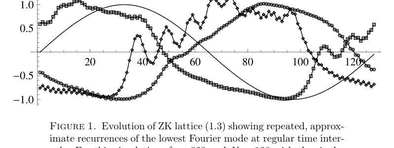

FIGURE 1. Evolution of ZK lattice (1.3) showing repeated, approximate recurrences of the lowest Fourier mode at regular time intervals. For this simulation, δ = .022 and N = 128 with the single-mode initial condition (1.5). Legend: circles t = 9.956; squares, t = 19.910; diamonds, t = 29.856.

### 2. Zabusky-Kruskal Lattice

The approximate recurrence to the low-mode condition (with a phase shift) is plainly visible in plots of the simulation (Figure 1). However, the recurrence is more striking in Fourier space (Figure 2). Moreover, the Fourier-space view of the evolution of (1.3) clearly shows that the regular recurrence of the low-mode state is a transient phenomenon.

The strength and persistence of the recurrence (or, inversely, the decay rate of the recurrence peaks) depends strongly on the number of nodes of the lattice (inversely proportional to the discretization length, h). Specifically, the recurrences are strongest and most persistent for a middle range of N (centered on N ≈ 100) values. Notably recurrence weakens as N → ∞ and the lattice approaches KdV. In contrast, the time of recurrences, is not observed to be dependent on N. (See Figure 3.)

These simulations suggest, surprisingly, that the mechanism of recurrence is a property of the ZK lattice itself, not simply a reflection of the properties of the continuum limit, KdV. In other words, recurrence in KdV occurs because KdV is “close” to the ZK lattice, and not vice-versa. Given the narrow range (in N) of the strongest and most persistent recurrence, it was a stroke of good luck that Zabusky and Kruskal considered simulations in the middle of this set values.

### 3. Spectral Discretization

The spectral discretization of KdV (1.1) is obtained by truncation of the Fourier-series expansion of the PDE [2]. That is, we write KdV with periodic boundary conditions in terms of the Fourier series (in x) of u to obtain

d/dt û_k = - i 2πk / L ∑_ℓ û_{k-ℓ} û_ℓ - δ² (i 2πk / L)³ û_k ,

where

u = ∑_k û_k e^{i (2πk / L) x} ,


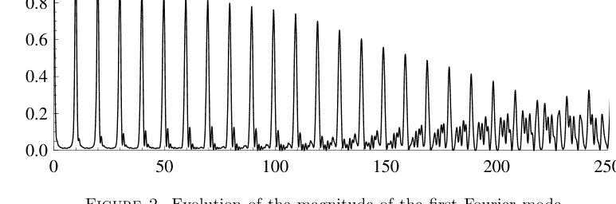

FIGURE 2. Evolution of the magnitude of the first Fourier mode of ZK (1.3) lattice showing repeated, approximate recurrences at regular time intervals. For this simulation, δ = .022 and N = 128 with the single-mode initial condition (1.5).

and then truncate the convolution sum for some maximum |k|. In vector-matrix form, the spectral discretization is

```
(3.1) d/dt u = - D_f F^{-1} [ (F u) * (F u) ] - δ² D_f³ u
```

where: D_f = F^{-1} Ω F is the Fourier differentiation matrix; F is the matrix form of the discrete Fourier transform; Ω is the (diagonal) matrix of wavenumbers; and * is the convolution operation,

```
(u * v)_k = Σ_j u_{k - j} v_j
```

where the subscript is the index label of the component.

In comparison with the O(h²)-approximation given by the ZK lattice (1.3), the spectral discretization is accurate beyond all orders in h [18,21] (and is exponentially accurate for spatially analytic data [34]).

The distinction between the spectral discretization and a pseudo-spectral discretization (collocation), in which the convolution term in (3.1) is replaced with a pointwise product, should not be overlooked. The pseudospectral discretizations of KdV are nonlinearly unstable, even for relatively fine discretizations, due to aliasing. Hence, we instead consider the stable numerical spectral method (3.1) as a high-accuracy discretization of KdV (1.1).

The spectral scheme shows repeated, decaying recurrences reminiscent of the result for the ZK scheme (1.3). However, for N = 128 (equivalently, 128 Fourier modes) the spectral discretization (3.1) evolves like the ZK lattice with a much larger N value. (See Figure 4.) As expected, the spectral scheme converges to the common continuum limit, KdV (1.1), much faster (in N) than the ZK scheme. As a consequence, there is no intermediate lattice scale for which the recurrence is stronger than for N large. Instead, as N increases, the scheme has a relatively abrupt transition from N values with no discernible recurrence to the limiting recurrence behavior. (See Figure 3.) Previous investigation of the spectral method for KdV [1] did not reveal recurrence due to the small number of modes used (as limited by computing capacity available at that time).

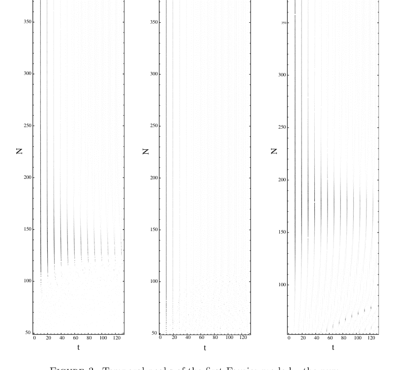

FIGURE 3. Temporal peaks of the first Fourier mode by the number of nodes (N), for the ZK lattice (1.3) (left), Spectral Discretization (3.1) (center), and Integrable Discretization (4.6) (right), all with δ = .022 and single-mode initial condition (1.5). The intensity of the peak is indicated by the gray level of the point: |c₁| = 0, white to |c₁| = 1, black.

### 4. Integrable Discretization

We construct an integrable discretization of KdV (1.1) by (i) discretizing the linear scattering problem of the zero-curvature condition associated with KdV (1.1) and then (ii) choosing a time-dependence matrix so that the evolution equation that results from the discrete compatibility condition has KdV as a continuum limit. This approach is an adaptation of the method used to construct integrable discretizations of nonlinear Schrödinger equation [4] as well as matrix and vector generalizations [5].

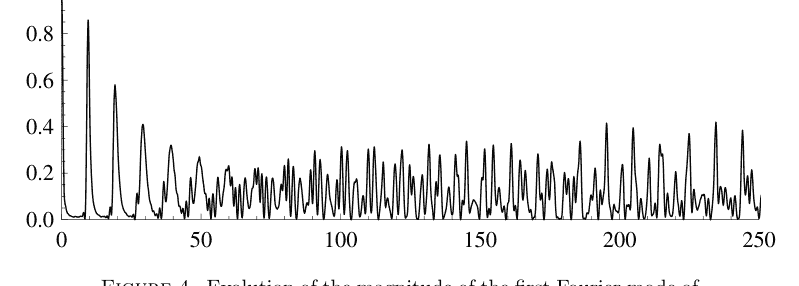

FIGURE 4. Evolution of the magnitude of the first Fourier mode of the spectral scheme (3.1), with δ = .022, N = 128 and single-mode initial condition (1.5), showing repeated, approximate recurrences at regular time intervals with rapid decay of the recurrence strength.

We recall that KdV (1.1) is equivalent to the zero-curvature condition,

```
(4.1)    S_t = T_x + T S - S T ,
```

where

```
S = ( i k   u ; -1/(6δ²)  -i k ),    T = ( -1/6 u_x - i/3 u k   1/3 u² - δ² u_xx - 2 i δ² u_x k + 4 δ² u k² ; 1/(18δ²) u - i/3 k²   1/6 u_x + i/3 u k - 8 i δ² k³ ) ,
```

and k is a space- and time-independent parameter. The zero-curvature condition (4.1) is equivalent to the equality of mixed derivatives (ψ_xt = ψ_tx) for simultaneous solutions of

```
ψ_x = S ψ ,      ψ_t = T ψ .
```

These two linear equations are used to construct the Inverse-Scattering Transform, which makes integrability operational, but we do not discuss this here.

The spatially discrete equation

```
(4.2)    ψ_{n+1} = S_n ψ_n ,   where   S_n = ( z   U_n ; α   z^{-1} ) ,
```

with

```
(4.3)    U_n = h u_n , α = h/(6δ²) , z = 1 + i k h + O(h²) = e^{i k h} ,
```

is a forward-difference discretization of the linear differential equation (in x) above. With the time-dependence equation

```
(4.4)    d/dτ ψ_n = T_n ψ_n ,
```

where

```
T_{1,1} = \frac{1}{2}z^{-4} - \alpha U_{n-1}z^{-2} + \alpha(U_n - U_{n+1}) - \alpha^2 U_n(U_{n-1} + U_n + U_{n+1}) + (2 + \alpha U_n)z^2 - \frac{1}{2}z^4
T_{1,2} = -U_{n-1}z^{-3} - (U_{n-2} - 2U_{n-1} - \alpha U_{n-1}(U_{n-2} + U_{n-1}))z^{-1} + (2U_n + U_{n+1} + \alpha U_n(U_n + U_{n+1}))z + U_n z^3
T_{2,1} = -\alpha z^{-3} + \alpha\left(1 + \alpha(U_{n-1} + U_n)\right)z^{-1} + \alpha\left(1 + \alpha(U_{n-1} + U_n)\right)z - \alpha z^3
T_{2,2} = -\frac{1}{2}z^{-4} + (2 + \alpha U_{n-1})z^{-2} + \alpha(U_{n-2} - U_{n-1}) + \alpha^2 U_{n-1} + \alpha U_n z^2 + \frac{1}{2}z^4 ,
```

the compatibility condition (counterpart of the zero-curvature condition),

```
\frac{\mathrm{d}}{\mathrm{d}\tau} S_n = T_{n+1} S_n - S_n T_n ,
```

is equivalent to

```
(4.5)
\frac{\mathrm{d}}{\mathrm{d}\tau} U_n = (1 + \alpha U_n) \{ \alpha [U_{n-1}(U_{n-2} - U_n) + U_{n+1}(U_n - U_{n+2}) + (U_{n-1} + 2U_n + U_{n+1})(U_{n-1} - U_{n+1})] + U_{n-2} - 2U_{n-1} + 2U_{n+1} - U_{n+2} \} .
```

Under the rescaling (4.3) and \tau = \frac{1}{h^4} t, equation (4.5) becomes

```
(4.6)
\frac{\mathrm{d}}{\mathrm{d}t} u_n = \left(1 + \frac{h^2 u_n}{6\delta^2}\right) \left[ \frac{u_{n-1}(u_{n-2} - u_n)}{12h} + \frac{(u_{n-1} + 2u_n + u_{n+1})(u_{n-1} - u_{n+1})}{12h} + \frac{u_{n+1}(u_n - u_{n+2})}{12h} + \delta^2 \frac{u_{n-2} - 2u_{n-1} + 2u_{n+1} - u_{n+2}}{2h^3} \right] ,
```

which converges to KdV (1.1) as h → 0. We note that, reminiscent of the ZK discretization (1.3), the nonlinear terms of (4.6) are equivalent to averages of elementary discretizations of the nonlinear term of KdV (1.1).

The integrable scheme (4.6) manifests a recurrence behavior similar to that of the ZK lattice (1.3): the strongest and most-persistent recurrence occurs in a middle range of N values, the solutions converge to the KdV limit (with weaker recurrences) as N gets large and recurrences are weak or non-existent for N below a threshold. Moreover, as with ZK (1.3), the time of recurrences, when they do occur, does not depend on N. However, the range of N where recurrence is strongest and most persistent is not the same as for the ZK scheme. (See Figure 3.) The strongest and most persistent recurrence in the integrable scheme is more pronounced than that of the ZK scheme (which can be seen by comparison of Figure 2 and Figure 5).

### 5. Conclusion: Recurrence as a Property of the Lattice

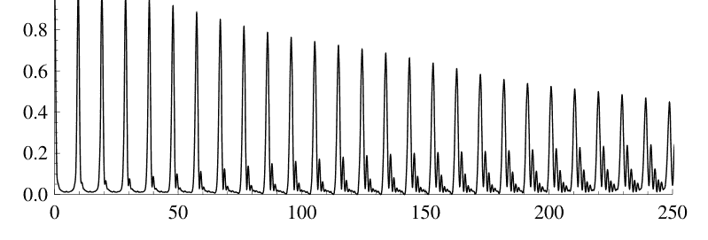

FIGURE 5. Evolution of the magnitude of the first Fourier mode of the integrable scheme (4.6), with δ = .022, N = 170 and single-mode initial condition (1.5), showing repeated, approximate recurrences at regular time intervals.

Taken together, the systematic simulations described in the preceding sections suggest that recurrence of the low-mode initial condition observed by Zabusky and Kruskal [36] is a property of nonlinear lattices and not primarily a manifestation of properties of the PDE limit (i.e., KdV (1.1)). On the other hand, a reduction of the number of degrees of freedom in the system leads to a complete breakdown of recurrence as the number of degrees of freedom falls below a threshold. Hence, recurrence can not be attributed to a restriction of the phase space. In the ‘middle’ range between the breakdown of recurrence (N small) and dynamics dominated by the PDE limit (N large), the Zabusky-Kruskal (1.3) and integrable (4.6) lattices exhibit their strongest recurrence, due to some as-yet-undetermined property of the lattices. We emphasize that the existence of this middle-N region of maximal recurrence in the integrable scheme demonstrates that integrability itself is not decisive in determining the recurrence behavior of a lattice.

The representation of the state of the lattice systems by Fourier coefficients can be interpreted as an (isometric) change of coordinates. The convention of using the Fourier coefficients and the low-mode initial condition to investigate recurrence goes back to FPU [15] and is grounded in the fact that the magnitudes of these coefficients are the power in the normal modes of the linear part of the system. However, for the configurations considered here (and previously by Zabusky and Kruskal [36]), the linear term is not dominant and the Fourier modes interact strongly. Therefore, the Fourier coefficients are not intrinsic to the observed dynamics. Instead, the integrable system has a natural set of coordinates, the action-angle variables. In action-angle coordinates, the mechanism of recurrence may be clearer. However, the development of the action-angle coordinates is probably best realized through the development of the semi-discrete Inverse-Scattering Transform for the pair (4.2),(4.4), which is beyond the scope of this work.

### References

- [1] Kanji Abe and Takashi Abe, Recurrence of initial state of the Korteweg-de Vries equation, Phys. Fluids 22 (1979), no. 9, 1644–1646, DOI 10.1063/1.862824. MR542702 (80e:65110)
- [2] Kanji Abe and Osamu Inoue, Fourier expansion solution of the Korteweg-de Vries equation, J. Comput. Phys. 34 (1980), no. 2, 202–210, DOI 10.1016/0021-9991(80)90105-9. MR559996 (81a:65113)
- [3] M. J. Ablowitz and P. A. Clarkson, Solitons, nonlinear evolution equations and inverse scattering, London Mathematical Society Lecture Note Series, vol. 149, Cambridge University Press, Cambridge, 1991. MR1149378 (93g:35108)


[4] M. J. Ablowitz 和 J. F. Ladik, *非线性微分-差分方程*, J. Mathematical Phys. **16** (1975), 598–603. MR0377223 (51 #13396)
[5] M. J. Ablowitz, B. Prinari, 和 A. D. Trubatch, *离散与连续非线性薛定谔系统*, London Mathematical Society Lecture Note Series, vol. 302, Cambridge University Press, Cambridge, 2004. MR2040621 (2005c:37117)
[6] Dario Bambusi, *非线性薛定谔方程中小振幅解的 Nekhoroshev 定理*, Math. Z. **230** (1999), no. 2, 345-387, DOI 10.1007/PL00004696. MR1676714 (2000h:35146)
[7] D. Bambusi 和 N. N. Nekhoroshev, *完全共振 PDE 扰动中的长时间稳定性*, Acta Appl. Math. **70** (2002), no. 1-3, 1-22, DOI 10.1023/A:1013943111479. 对称与扰动理论. MR1892373 (2003f:37141)
[8] Dario Bambusi 和 Antonio Ponno, *FPU 中的亚稳态*, Comm. Math. Phys. **264** (2006), no. 2, 539-561, DOI 10.1007/s00220-005-1488-1. MR2215616 (2007a:37087)
[9] *光滑遍历理论及其应用*, Proceedings of Symposia in Pure Mathematics, vol. 69, American Mathematical Society, Providence, RI, 2001. 由 Anatole Katok, Rafael de la Llave, Yakov Pesin 和 Howard Weiss 编辑. MR1858533 (2002d:37005)
[10] Amadeu Delshams 和 Pere Gutiérrez, *有效稳定性与 KAM 理论*, J. Differential Equations **128** (1996), no. 2, 415-490, DOI 10.1006/jdeq.1996.0102. MR1393828 (97e:58202)
[11] B. A. Dubrovin 和 S. P. Novikov, *Korteweg-de Vries 方程的多孤子解的周期和条件周期类比* (俄文, 附英文摘要), Ž. Èksper. Teoret. Fiz. **67** (1974), no. 6, 2131-2144; 英文译, Soviet Physics JETP **40** (1974), no. 6, 1058-1063. MR0382877 (52 #3759)
[12] J. W. Eaton 等, *GNU Octave*, http://www.octave.org.
[13] Ludwig D. Faddeev 和 Leon A. Takhtajan, *孤子理论中的哈密顿方法*, Reprint of the 1987 English edition, Classics in Mathematics, Springer, Berlin, 2007. 由 Alexey G. Reyman 从 1986 年俄文原版翻译. MR2348643 (2008f:37145)
[14] Erwan Faou 和 Benoît Grébert, *半线性可逆 PDE 的拟不变修正 Sobolev 范数*, Nonlinearity **23** (2010), no. 2, 429-443, DOI 10.1088/0951-7715/23/2/011. MR2578486 (2011j:37156)
[15] E. Fermi, J. Pasta, 和 S. Ulam, *非线性问题研究 I*, Tech. Report LA-1940, Los Alamos Scientific Laboratory of the University of California, 1955.
[16] C. S. Gardner, J. M. Greene, M. D. Kruskal, 和 R. M. Miura, *求解 Korteweg-de Vries 方程的方法*, Physical Review Letters **19** (1967), 1095-1097.
[17] K. Goda, *Korteweg-de Vries 方程的复现数值研究*, Journal of the Physical Society of Japan **42** (1977), 1040-1046.
[18] David Gottlieb 和 Steven A. Orszag, *谱方法数值分析：理论与应用*, Society for Industrial and Applied Mathematics, Philadelphia, Pa., 1977. CBMS-NSF Regional Conference Series in Applied Mathematics, No. 26. MR0520152 (58 #24983)
[19] E. Hairer 和 G. Wanner, *求解常微分方程. II*, 2nd ed., Springer Series in Computational Mathematics, vol. 14, Springer-Verlag, Berlin, 1996. 刚性和微分代数问题. MR1439506 (97m:65007)
[20] T. Kappeler 和 J. Pöschel, *KdV & KAM*, Ergebnisse der Mathematik und ihrer Grenzgebiete. 3. Folge. A Series of Modern Surveys in Mathematics [Results in Mathematics and Related Areas. 3rd Series. A Series of Modern Surveys in Mathematics], vol. 45, Springer-Verlag, 2003.
[21] H. Kreiss 和 J. J. Oliger, *求解时变问题的近似方法*, GARP publications series, Global Atmospheric Research Programme - WMO-ICSU Joint Organizing Committee, 1973.
[22] S. B. Kuksin, *近可积无限维哈密顿系统*, Lecture Notes in Mathematics, vol. 1556, Springer-Verlag, 1993.
[23] Peter D. Lax, *KdV 方程的周期解*, Comm. Pure Appl. Math. **28** (1975), 141-188. MR0369963 (51 #6192)
[24] Decio Levi 和 Christian Scimiterna, *通过多尺度展开求解 Kruskal-Zabusky 离散方程的可积性*, Nonlinear and modern mathematical physics, AIP Conf. Proc., vol. 1212, Amer. Inst. Phys., Melville, NY, 2010, pp. 66-80. MR2648953 (2011f:37137)
[25] H. P. McKean 和 E. Trubowitz, *在存在无限多个分支点时 Hill 算子与超椭圆函数论*, Comm. Pure Appl. Math. **29** (1976), no. 2, 143-226. MR0427731 (55 #761)

[26] H. P. McKean 和 E. Trubowitz, *Hill 曲面及其 theta 函数*, Bull. Amer. Math. Soc. **84** (1978), no. 6, 1042–1085, DOI 10.1090/S0002-9904-1978-14542-X. MR508448 (80b:30039)

[27] R. Miura, 个人通信.

[28] N. N. Nekhoroshev, *近可积哈密顿系统稳定时间的指数估计* (俄文), Uspehi Mat. Nauk **32** (1977), no. 6(198), 5–66, 287. MR0501140 (58 #18570)

[29] S. P. Novikov, *Korteweg-de Vries 方程的周期问题. I* (俄文), Funkcional. Anal. i Priložen. **8** (1974), no. 3, 54–66. MR0382878 (52 #3760)

[30] A. R. Osborne 和 L. Bergamasco, *Zabusky 和 Kruskal 的孤子再访：以周期谱变换为视角*, Phys. D **18** (1986), no. 1-3, 26–46, DOI 10.1016/0167-2789(86)90160-0. 孤子与相干结构 (Santa Barbara, Calif., 1985). MR833809 (87j:35342)

[31] Richard S. Palais, *孤子的对称性*, Bull. Amer. Math. Soc. (N.S.) **34** (1997), no. 4, 339–403, DOI 10.1090/S0273-0979-97-00732-5. MR1462745 (98i:58111)

[32] A. Ponno 和 D. Bambusi, Korteweg-de Vries 方程与 Fermi-Pasta-Ulam 中的能量共享, Chaos **15** (2005), no. 1, 015107, 5, DOI 10.1063/1.1832772. MR2133458 (2005k:37160)

[33] Jürgen Pöschel, *关于非线性薛定谔方程的 Nekhoroshev 估计及 Bambusi 定理*, Nonlinearity **12** (1999), no. 6, 1587–1600, DOI 10.1088/0951-7715/12/6/310. MR1726666 (2001e:37100)

[34] Eitan Tadmor, *傅里叶和切比雪夫差分法的指数精度*, SIAM J. Numer. Anal. **23** (1986), no. 1, 1–10, DOI 10.1137/0723001. MR821902 (87c:65048)

[35] T. Triebel, *OdePkg*, http://octave.sourceforge.net/odepkg.

[36] N. J. Zabusky 和 M. D. Kruskal, *无碰撞等离子体中孤子的相互作用及初始态的复现*, Physical Review Letters **15** (1965), 240–243.

应用数学系，斯泰伦博斯大学，斯泰伦博斯，南非

数学科学系，蒙克莱尔州立大学，蒙克莱尔，新泽西州 07043

数学科学系，蒙克莱尔州立大学，蒙克莱尔，新泽西州 07043

*电子邮件地址:* david.trubatch@montclair.edu

### 1. 引言

非线性薛定谔 (NLS) 方程是一个众所周知的重要非线性演化方程，在过去四十多年中被广泛研究。例如，NLS 方程已在海洋水波建模 [2,21]、玻色-爱因斯坦凝聚 [18] 和光纤中的色散激波 [10,11] 中得到推导。

在本工作中我们考虑去聚焦 NLS 方程，即

```
(1.1)  i q_t + q_{xx} - 2 |q|^2 q = 0 ,
```

[下标 x 和 t 在全文中表示偏微分] 具有非零边界条件 (NZBCs)

```
(1.2)  q(x,t) → q_±(t) = q_0 e^{2 i q_0^2 t + i θ_±} ,  as x → ±∞ ,
```

其中 i 表示复单位，q_0 > 0 且 0 ≤ θ_± < 2π 为任意常数。众所周知，方程 (1.1) 与所谓的 Zakharov-Shabat (ZS) 系统相关：

```
(1.3)  ∂X/∂x (x,k) = (-i k σ_3 + Q(x)) X(x,k),      x ∈ ℝ,
```

其中

```
(1.4)  σ_3 = (1 0; 0 -1) ,      Q(x) = (0 q(x); q*(x) 0) ,
```

q(x) 是势，k 是复谱参数，星号表示复共轭，通过逆散射变换。

最近，具有 NZBCs 的去聚焦 NLS (1.1) 因其在玻色-爱因斯坦凝聚体 [8,9] 和光纤中色散激波 [19] 的应用而受到 renewed 关注。这证明了我们努力研究与此主题相关问题的合理性。特别是，我们关注逆散射变换 (IST) (见 [1,2,20] 用于


对该方法（对该方法的一般回顾）应用于方程 (1.1) 带有非零边界条件 (1.2)。事实上，(1.1) 带有 NZBCs 的 IST（见 [3, 4, 7, 12, 13, 17, 22]）比 (1.1) 带有衰减势的情形要复杂得多，特别是关于散射问题 (1.3) 的特征函数的解析性质以及相应的散射数据。最近在 [6] 中朝着这一方向迈出了一步，其中证明了当势 q 满足 q − q± 属于函数类 L^{1,2}(ℝ±) 时，直接散射问题是良定义的（L^{1,p}(ℝ±) 由所有满足 ∫ℝ dx (1 + |x|)^p |f(x)| < ∞ 的函数 f(x) 组成）。因此，我们将假设 q − q± ∈ L^{1,2}(ℝ±)。

研究是否可以为具有 NZBCs 的去聚焦 NLS (1.1) 证明一个面积定理也是值得的，这意味着将离散特征值（见第 2 节中对离散特征值的定义）作为解 (1.1) 的初始轮廓面积的函数存在性及位置。众所周知，对于具有消失边界条件的聚焦 NLS，这样的结果已经存在 [2, 14–16]：事实上，如果势的 L¹-范数小于 π/2，则 (1.3) 没有离散特征值。只有最近 [5] 才证明了方程 (1.1) 带有 NZBCs 的情况下不存在类似结果。 在 [5] 中，作者通过给出盒型初始条件的显式例子证明了对于具有 NZBCs 的去聚焦 NLS 不可能存在面积定理，其中至少存在一个离散特征值。在本文中，我们分析了一类比 [5] 中考虑的更一般的势（我们仅要求 q − q± ∈ L^{1,2}(ℝ±)），并建立了势必须满足的条件（第 4 节中的方程 (4.8) 和 (4.13)），以使 (−q₀, q₀) 的一个特定但明确指定的子集不包含任何离散特征值。

本文组织如下。第 2 节回顾了 (1.1) 带有 NZBCs (1.2) 的直接散射问题的基本事实，并讨论了一个显式例子（不同于 [5] 中考虑的例子），该例子建立了 (−q₀, q₀) 中至少存在一个离散特征值。第 3 节显式构造了来自 (1.3) 的谱问题的自由哈密顿量的 resolvent，最后在第 4 节中，借鉴消失情形在 [14–16] 中使用的技术，我们陈述了我们的主要结果，即定理 4.3 和 4.4。

### 2. 预备知识

在本节中，我们使用 [6] 中采用的相同记号研究直接散射问题 (1.3)，感兴趣的读者可参考其细节以了解更多信息。此外，我们讨论了一个重要的例子，该例子表明在谱间隙 (−q₀, q₀) 中可能存在离散特征值，如果 q₊ ≠ q₋。

为了研究 (1.1) 带有 NZBCs (1.2) 的直接散射问题，引入一个新的谱参数

λ = √(k² − q₀²)

它是从 Riemann k-曲面 𝕂 到 Riemann λ-曲面 Λ 的保角映射。这里 𝕂 由两个叶 𝕂⁺ 和 𝕂⁻ 组成，它们都与沿半直线 Σ = (−∞, −q₀] ∪ [q₀, +∞) 割开的复 k-平面重合，其中其边缘被粘合在一起，使得 λ(k) 在割线上连续。Riemann 曲面 Λ 是复 λ-平面，由上半复平面 Λ⁺ 和下半复平面 Λ⁻ 沿实 λ-线粘合而成。变换 k ↦ λ 将 K± 映射到 Λ±，将割线 Σ 映射到实 λ-线，并将点 ±q0 映射到零。并且 {λ + k, λ − k} ⊂ Λ± 对任意 k ∈ K± 成立。

为方便起见，我们将 (1.3) 写成形式

(2.1) ∂X/∂x (x, k) = A±(k)X(x, k) + (Q(x) − Q±)X(x, k),

其中

(2.2) A±(k) = −ikσ3 + Q± = ( −ik  q± ; q±*  ik ),   Q± = ( 0  q± ; q±*  0 ).

于是 (1.3) 和 (2.1) 也可以写成等价形式

(2.3) ∂X/∂x (x, k) = A(x, k)X(x, k) + (Q(x) − Qf(x))X(x, k),

其中，

(2.4) A(x, k) = θ(x)A+(k) + θ(−x)A−(k),   Qf(x) = θ(x)Q+ + θ(−x)Q−,

且 θ(x) 表示 Heaviside 函数，定义为 θ(x) = 1 当 x ≥ 0 且 θ(x) = 0 当 x < 0。我们将 ZS 系统 (2.3) 与哈密顿算子关联

(2.5) H = iσ3(d/dx − Q)

它在两个 L²(R) 的正交直和上自伴。引入自由哈密顿量也很方便

(2.6) Hf = iσ3( d/dx − Qf ).

对于 k ∈ Σ，我们定义基本特征解 Ψ̃(x, k) 和 Φ̃(x, k) 为满足

(2.7a) Ψ̃(x, k) = e^{xA+(k)}[I2 + o(1)],      x → +∞,
(2.7b) Φ̃(x, k) = e^{xA−(k)}[I2 + o(1)],      x → −∞.

的 (1.3) 的平方矩阵解。我们可以证明它们的存在性，对于 k ∈ Σ，作为 Volterra 积分方程 [6, Prop. 1] 的唯一解

(2.8a) Ψ̃(x, k) = G(x, 0; k) − ∫_x^∞ dy G(x, y; k)[Q(y) − Qf(y)]Ψ̃(y, k),
(2.8b) Φ̃(x, k) = G(x, 0; k) + ∫_{−∞}^x dy G(x, y; k)[Q(y) − Qf(y)]Φ̃(y, k).

这里基本矩阵 G(x, y; k) 给出为

(2.9) G(x, y; k) = { e^{xA+(k)}e^{−yA+(k)},  x, y ≥ 0;  e^{xA+(k)}e^{−yA−(k)},  x ≥ 0 ≥ y;  e^{xA−(k)}e^{−yA+(k)},  y ≥ 0 ≥ x;  e^{xA−(k)}e^{−yA−(k)},  x, y ≤ 0. }

事实上，方程 (2.8) 在条件 q − q± ∈ L¹(R±) 下在 ±q0 ≠ k ∈ Σ 时唯一可解；它们在条件 (1 + |x|²)[q − q±] ∈ L¹(R±) 下在 k = ±q0 时唯一可解。

现在我们引入 Jost 解（作为关于基本特征解的 (2.1) 的列向量解）以及“过渡散射”矩阵 $S(k)$。于是我们定义特征向量矩阵：

(2.10) $$W_{\pm}(k)=\begin{pmatrix}1 & \frac{-i q_{\pm}}{\lambda+k}\\\frac{i q_{\pm}^*}{\lambda+k} & 1\end{pmatrix},$$
其中 $\det W_{\pm}(k)=2\lambda/(\lambda+k)$ 且 $A_{\pm}(k)W_{\pm}(k)=W_{\pm}(k)\operatorname{diag}(-i\lambda,i\lambda)$。从右和从左的 Jost 解分别定义为

(2.11) $\tilde{\Psi}(x,k)W_{+}(k)=(\bar{\psi}(x,k)\quad \psi(x,k))$, $\tilde{\Phi}(x,k)W_{-}(k)=(\phi(x,k)\quad \bar{\phi}(x,k))$, 
并且它们的解析性质的详细研究见 [6, Prop. 3]。由于 $\tilde{\Psi}(x,k)$ 和 $\tilde{\Phi}(x,k)$ 是齐次一阶系统 (1.3) 的平方矩阵解，我们有

(2.12) $\tilde{\Psi}(x,k)=\tilde{\Phi}(x,k)\mathbb{A}_{l}(k),\qquad \tilde{\Phi}(x,k)=\tilde{\Psi}(x,k)\mathbb{A}_{r}(k),$ 
其中 $\mathbb{A}_{l}(k)$ 和 $\mathbb{A}_{r}(k)$ 称为过渡系数矩阵，其表达式为

(2.13a) $\mathbb{A}_{l}(k)=I_{2}-\int_{-\infty}^{\infty}dy\,\mathcal{G}(0,y;k)[Q(y)-Q_{f}(y)]\tilde{\Psi}(y,k),$ 

(2.13b) $\mathbb{A}_{r}(k)=I_{2}+\int_{-\infty}^{\infty}dy\,\mathcal{G}(0,y;k)[Q(y)-Q_{f}(y)]\tilde{\Phi}(y,k).$

由 (2.11) 和 (2.12) 的结果，我们得到

(2.14a) $(\phi(x,k)\quad \bar{\phi}(x,k))=(\bar{\psi}(x,k)\quad \psi(x,k))\,S(k)$, 
(2.14b) $(\bar{\psi}(x,k)\quad \psi(x,k))=(\phi(x,k)\quad \bar{\phi}(x,k))\,\bar{S}(k)$, 
其中 [6]

(2.15) $S(k)=W_{+}^{-1}(k)\mathbb{A}_{r}(k)W_{-}(k)=\begin{pmatrix}a(k)&\bar{b}(k)\\b(k)&\bar{a}(k)\end{pmatrix}$, 
且 $\bar{S}(k)=W_{-}^{-1}(k)\mathbb{A}_{l}(k)W_{+}(k)=S^{-1}(k)$。散射系数 $a(k),\bar{b}(k),b(k),\bar{a}(k)$ 的解析性和连续性性质可由 Jost 解的解析性和连续性性质利用其 Wronskian 表示得到 [6]。众所周知，与 ZS 系统 (1.3) 相关的散射数据是（见 [1,2,20,22]）：反射系数 $\rho(k)=b(k)/a(k)$，$a(k)$ 在 $k\in\mathbb{K}\setminus\Sigma$ 的零点（所谓的离散特征值）以及与离散特征值相关的一组适当的常数，称为归一化常数。然而，重要的是要指出，对于具有 NZBCs 的方程 (1.1)，离散特征值属于谱间隙 $(-q_{0},q_{0})$ 且是简单的（在 [7] 中证明），并且在假设 $q-q_{\pm}\in L^{1,4}(\mathbb{R}^{\pm})$ 下，其个数是有限的（在 [6] 中建立）。

我们通过分析一个显式例子来结束本节，该例子证实了 [5, Sec. 4] 中得到的结果

#### EXAMPLE 2.1 (自由哈密顿量)

让我们计算在 (2.6) 中引入的自由哈密顿量的离散特征值[这对应于在 ZS 系统 (1.3) 中假设 $Q(x)=Q_{f}(x)$]。在这种情况下由 (2.13) 我们有 $\mathbb{A}_{l}(k)=\mathbb{A}_{r}(k)=I_{2}$


[I₂ 表示 2 × 2 单位矩阵]，并利用 (2.12) 可得

(2.16) \[\tilde{\Psi}(x,k)=\tilde{\Phi}(x,k)=\begin{cases}e^{xA_{+}(k)},&\text{for }x>0,\\e^{xA_{-}(k)},&\text{for }x<0.\end{cases}\]

由 (2.16) 并结合 (2.15) 和 (2.10)，我们得到

\[S(k)=\begin{pmatrix}a(k)&\bar b(k)\\b(k)&\bar a(k)\end{pmatrix}=W_{+}^{-1}(k)W_{-}(k)=\frac{\lambda+k}{2\lambda}\begin{pmatrix}1-\frac{q_{+}q_{-}^{*}}{(\lambda+k)^{2}}&i\frac{(q_{+}-q_{-})}{\lambda+k}\\i\frac{(q_{-}^{*}-q_{+}^{*})}{\lambda+k}&1-\frac{q_{-}q_{+}^{*}}{(\lambda+k)^{2}}\end{pmatrix}.\]

令 λ = iℓ，其中 ℓ ∈ (0, q₀)，由上式可得：

\[a(k)=\frac{(k+i\ell)^{2}-q_{0}^{2}e^{i(\theta_{+}-\theta_{-})}}{2i\ell(k+i\ell)}=\frac{k^{2}-\ell^{2}-q_{0}^{2}\cos(\theta_{+}-\theta_{-})+i\left(2k\ell-q_{0}^{2}\sin(\theta_{+}-\theta_{-})\right)}{2i\ell(k+i\ell)}.\]

于是 a(k)=0 当且仅当

(2.17) \[\cos(\theta_{+}-\theta_{-})=\frac{k^{2}-\ell^{2}}{q_{0}^{2}},\qquad \sin(\theta_{+}-\theta_{-})=\frac{2k\ell}{q_{0}^{2}}.\]

除非 q₊ = q₋，方程 (2.17) 在 (−q₀, q₀) 内有唯一解 k₀。 该特征值 k₀ = 0 当且仅当 θ₊ − θ₋ 是 π 的奇数倍。

从现在起，我们用 k₀ 表示与散射问题 (1.3) 相关联的自由哈密顿算子的唯一离散特征值，并在上面的例子中计算得到。

### 3. 自由哈密顿量的解析式

本节计算自由哈密顿量 H_f 的解析式 (k − H_f)⁻¹。 所得结果将在下一节用于确定离散特征值的位置。

设 k ∉ σ(H_f) = Σ ∪ {k₀} 若 q₊ ≠ q₋ [或 k ∉ σ(H_f) = Σ 若 q₊ = q₋]，我们计算自由哈密顿量的解析式 (k − H_f)⁻¹。 令 F(x) 为 L²(ℝ)² = L²(ℝ) ⊕ L²(ℝ) 中的列向量函数，我们寻求 L²(ℝ)² 中的唯一向量函数 Ψ(k, x)，使得 H_f Ψ = k Ψ − F。 写 Ψ(x, k) = W(x, k) ψ(x, k)，其中 W(x, k) = W₊(k)θ(x) + W₋(k)θ(−x)，我们得到对 0 ≠ x ∈ ℝ

(3.1) \[\psi'(x,k)=-i\lambda\sigma_{3}\psi(x,k)+iW^{-1}(x,k)\sigma_{3}F(x),\]

其中我们利用了 A(x,k)W(x,k) = −iλW(x,k)σ₃。

### THEOREM 3.1. 设 q₊ ≠ q₋ 且 k ∈ ℂ⁺。 则对 F ∈ L²(ℝ)² 且 k ∉ Σ ∪ {k₀} 有

(3.2) \[[(k-H_f)^{-1}F](x)=\int_{-\infty}^{\infty}dy\,[K_f(x,y;k)+K_{f1}(x;k)K_{f2}(y;k)]F(y),\]

其中 $K_f(x,y;k)$ 由

(3.3a) $K_f(x,y;k)=\begin{cases}-i\,e^{i\lambda(y-x)}W_{+}(k)\begin{pmatrix}1&0\\0&0\end{pmatrix}\sigma_3W_{+}^{-1}(k)\sigma_3,&y>x>0,\\-i\,e^{i\lambda(x-y)}W_{+}(k)\begin{pmatrix}0&0\\0&1\end{pmatrix}\sigma_3W_{+}^{-1}(k)\sigma_3,&x>y>0,\\-i\,e^{i\lambda(y-x)}W_{-}(k)\begin{pmatrix}1&0\\0&0\end{pmatrix}\sigma_3W_{-}^{-1}(k)\sigma_3,&0>y>x,\\-i\,e^{i\lambda(x-y)}W_{-}(k)\begin{pmatrix}0&0\\0&1\end{pmatrix}\sigma_3W_{-}^{-1}(k)\sigma_3,&0>x>y,\\0,&xy<0,\end{cases}$

(3.3b) $K_{f1}(x;k)=\begin{cases}e^{i\lambda x}\begin{pmatrix}0&0\\0&1\end{pmatrix}W_{+}^{-1}(k),&x>0,\\e^{-i\lambda x}\begin{pmatrix}1&0\\0&0\end{pmatrix}W_{-}^{-1}(k),&x<0,\end{cases}$

(3.3c) $K_{f2}(y;k)=\begin{cases}-i\,e^{i\lambda y}Z^{-1}(k)\begin{pmatrix}1&0\\0&0\end{pmatrix}W_{+}^{-1}(k)\sigma_3,&y>0,\\i\,e^{-i\lambda y}Z^{-1}(k)\begin{pmatrix}0&0\\0&1\end{pmatrix}W_{-}^{-1}(k)\sigma_3,&y<0,\end{cases}$

(3.3d) $Z(k)=\begin{pmatrix}1&0\\0&0\end{pmatrix}W_{+}^{-1}(k)+\begin{pmatrix}0&0\\0&1\end{pmatrix}W_{-}^{-1}(k)=\frac{1}{2\lambda}\begin{pmatrix}\lambda+k&i q_r\\-i q_l^{*}&\lambda+k\end{pmatrix}.$

若 $q_{+}=q_{-}\neq0$，则对 $k\notin\Sigma$

(3.4) $[(k-H_f)^{-1}F](x)=-i\int_{-\infty}^{\infty}dy\,e^{i\lambda|x-y|}W_{+}(k)E(y-x)W_{+}^{-1}(k)\sigma_3F(y), $

其中

$E(w)=\theta(w)\begin{pmatrix}1&0\\0&0\end{pmatrix}+\theta(-w)\begin{pmatrix}0&0\\0&-1\end{pmatrix}.$

类似的结果也可以在 $k\in\mathbb{K}^{-}$（或 $\lambda\in\Lambda^{-}$）时证明。

Proof. 设 $q_{+}\neq q_{-}$。 则 (3.1) 蕴含恒等式

$\frac{\partial}{\partial y}\left\{e^{-i\lambda(x-y)\sigma_3}\psi(y,k)\right\}=i\,e^{-i\lambda(x-y)\sigma_3}W^{-1}(y,k)\sigma_3F(y),$

其中 $0\neq y\in\mathbb{R}$ 且 $k\notin\Sigma$。 因此，对 $0\neq y\in\mathbb{R}$ 且 $k\notin\Sigma$ 我们得到

(3.5a) $\frac{\partial}{\partial y}\left\{e^{i\lambda(y-x)}\begin{pmatrix}1&0\\0&0\end{pmatrix}\psi(y,k)\right\}=i\,e^{i\lambda(y-x)}\begin{pmatrix}1&0\\0&0\end{pmatrix}W^{-1}(y,k)\sigma_3F(y),$

(3.5b) $\frac{\partial}{\partial y}\left\{e^{i\lambda(x-y)}\begin{pmatrix}0&0\\0&1\end{pmatrix}\psi(y,k)\right\}=i\,e^{i\lambda(x-y)}\begin{pmatrix}0&0\\0&1\end{pmatrix}W^{-1}(y,k)\sigma_3F(y).$

设 $k$ 属于 $\mathbb{K}^{+}$ [或 $\lambda\in\Lambda^{+}$]，并对 $x\ge0$ 将 (3.5a) 关于 $y\in(x,+\infty)$ 积分，对 $x<0$ 关于 $y\in(x,0)$ 积分；对 $x\le0$ 将 (3.5b) 关于 $y\in(-\infty,x)$ 积分，对 $x>0$ 关于 $y\in(0,x)$ 积分。 把对 $x>0$ 和 $x<0$ 分别得到的结果合并，我们得到 [Ψ(x, k) 在 x = 0 处连续但 ψ(x, k) 不连续]

(3.6a) Ψ(x, k) = −iW₊(k) ∫ₓ^∞ dy e^{iλ(y−x)} (1 0; 0 0) W₊⁻¹(k)σ₃F(y) + iW₊(k) ∫₀ˣ dy e^{iλ(x−y)} (0 0; 0 1) W₊⁻¹(k)σ₃F(y) + e^{iλx}W₊(k) (0 0; 0 1) W₊⁻¹(k)Ψ(0, k) 对 x > 0，

(3.6b) = iW₋(k) ∫₋∞ˣ dy e^{iλ(x−y)} (0 0; 0 1) W₋⁻¹(k)σ₃F(y) − iW₋(k) ∫ₓ⁰ dy e^{iλ(y−x)} (1 0; 0 0) W₋⁻¹(k)σ₃F(y) + e^{−iλx}W₋(k) (1 0; 0 0) W₋⁻¹(k)Ψ(0, k) 对 x < 0，

(3.6c) = Z⁻¹(k) [ −i ∫₀^∞ dy e^{iλy} (1 0; 0 0) W₊⁻¹(k)σ₃F(y) + i ∫₋∞⁰ dy e^{−iλy} (0 0; 0 1) W₋⁻¹(k)σ₃F(y) ] 对 x = 0，

前提是矩阵 Z(k) 非奇异。 令 k ∈ (−q₀, q₀) 且 λ = iℓ，我们得到

(3.7) det Z(k) = [ℓ² − k² + q₀² cos(θ₊ − θ₋) + i[−2kℓ + q₀² sin(θ₊ − θ₋)]] / (4ℓ²)，

它只能在 (2.17) 成立时为零。 换句话说，在 q₊ ≠ q₋ 的情况下，我们必须排除离散特征值 k = k₀。

现在考虑 q₊ = q₋ 的情况。 写 Ψ(x, k) = W₊(k)ψ(x, k) 为 (3.4) 左边，我们验证它满足 Ψ′(x, k) = A₊(k)Ψ(x, k) + iσ₃F(x)。

并且公式 (3.4) 由 (3.3a)-(3.3d) 得出，如果考虑到 q₊ = q₋ 蕴含 W₊ = W₋，从而完成证明。

我们强调：

- a. 若 q₊ ≠ q₋，解析式算子 (k − H_f)⁻¹ 是对 k ∉ Σ 的积分算子，其积分核为 K_f(x, y; k)，加上对 k ∉ Σ ∪ {k₀} 的秩二算子；
- b. 若 q₊ = q₋，解析式算子 (k − H_f)⁻¹ 是积分算子，其积分核为 −i e^{iλ|x−y|}W₊(k)E(y − x)W₊⁻¹(k)σ₃。

### 4. 离散特征值的位置

本节的目的是刻画 (−q₀, q₀) 中离散特征值的位置。 事实上，例 2.1 显示如果 q₋ ≠ q₊ 至少存在一个这样的特征值。 我们模仿 Klaus 等人在 [14–16] 中对衰减势的聚焦 NLS 给出的证明来得到主要结果。 我们需要以下技术结果，即下面的定理 4.1 和 4.2。

### THEOREM 4.1. 设 W^(1)(x) 和 W^(2)(x) 是两个 2 × 2 矩阵，其元素属于 L^2(ℝ)，且 k ∉ Σ。 则在 L^2(ℝ)^2 上具有积分核

W^(1)(x) K_f(x, y; k) W^(2)(y)

的积分算子是希尔伯特-施密特算子，即使我们取 k 趋于 Σ 的内部点时的极限也是如此。

PROOF. W^(1)(k − H_f)^−1 W^(2) 减去秩二贡献的平方希尔伯特-施密特范数由

∫_{−∞}^{∞} dx ∫_{−∞}^{∞} dy ‖W^(1)(x)‖_{HS}^2 ‖W^(2)(y)‖_{HS}^2 |K_f(x, y; k)|^2

给出。 由于 K_f(x, y; k) 表达式中的指数因子 e^{iλ|x−y|} 的绝对值被 1 所限制，我们得到 W^(1)(k − H_f)^−1 W^(2) 减去秩二贡献的平方希尔伯特-施密特范数的以下上界：

(4.1)  k^2/λ^2 (∫_{−∞}^{∞} dx ‖W^(1)(x)‖_{HS}^2) (∫_{−∞}^{∞} dy ‖W^(2)(y)‖_{HS}^2)，

它对每个 ε > 0，在满足 √(|k^2 − q_0^2|) ≥ ε 的 k 下一致有界。

下面的定理是希尔伯特-施密特范数定义的一个直接推论。 在范数估计中，使用哪种酉等价的矩阵范数并不重要，因为 K_{f1}(x; k) 和 K_{f2}(y; k) 都是秩一的。

### THEOREM 4.2. 设 W^(1)(x) 和 W^(2)(x) 是两个 2 × 2 矩阵，其元素属于 L^2(ℝ)，且 k ∉ Σ。 则在 L^2(ℝ)^2 上具有积分核

W^(1)(x) K_{f1}(x; k) K_{f2}(y; k) W^(2)(y)

的积分算子是秩二的，其范数与

(4.2) [∫_{−∞}^{∞} dx ‖W^(1)(x) K_{f1}(x; k)‖^2]^{1/2} [∫_{−∞}^{∞} dy ‖K_{f2}(y; k) W^(2)(y)‖^2]^{1/2}

一致。

由 [14, Eq. (4.10)] 和 [16, proof of Thm. 4.2] 可知，核为 e^{−τ(y−x)}θ(y−x)√(m(x)m(y)) 的 L^2(ℝ) 上积分算子的范数小于 (2/π)‖m‖_1。 为了将该结果推广到非消失情形，我们从极分解开始

Q(x) − Q_f(x) = ( 0 σ(x); σ(x)* 0 ) √|q(x)−q_f(x)| I_2 · √|q(x)−q_f(x)| I_2
(4.3) = U_δ(x) |Δ(x)|^{1/2} |Δ(x)|^{1/2}，

其中
(4.4) q_f(x) = (q(x)−q_−)θ(−x) + (q(x)−q_+)θ(x),      Δ(x) = |q(x)−q_f(x)| I_2，
|σ(x)| = 1，且因此 U_δ(x) = ( 0 σ(x); σ(x)* 0 ) 是一个酉矩阵。 对 k ∉ Σ 我们现在定义

(4.5) 𝒲(k) = I + |Δ|^{1/2} (k − H_f)^{−1} U_δ |Δ|^{1/2}。


然后，对于 $k \notin \Sigma$ [且当 $q_+ \neq q_-$ 时 $k \neq k_0$]，$\mathcal{W}(k) - I$ 是 $L^2(\mathbb{R})^2$ 上的 Hilbert-Schmidt 算子，其积分核为

(4.6) $\begin{cases} |\Delta(x)|^{1/2}[K_f(x,y;k)+K_{f1}(x;k)K_{f2}(y;k)]U_{\delta}(y)|\Delta(y)|^{1/2}, & q_+ \neq q_- ,\\ -i\,e^{i\lambda|x-y|}W_+(k)E(y-x)W_+^{-1}(k)\sigma_3, & q_+ = q_- . \end{cases}$

现在已验证¹

(4.7) $(k-H)^{-1}-(k-H_f)^{-1}=-(k-H_f)^{-1}U_{\delta}|\Delta|^{1/2}\mathcal{W}^{-1}(k)|\Delta|^{1/2}(k-H_f)^{-1}$ 只要 $\mathcal{W}(k)$ 可逆。该恒等式的右端当 $k$ 趋近于 $\Sigma$ 的内部点时具有有限极限，只要 $\mathcal{W}(k)$ 可逆。² 对于 $k_0 \neq k \notin \Sigma$，$\mathcal{W}(k)$ 的不可逆点恰好是离散特征值。

我们的第一个结果如下：

## 定理 4.3. 设考虑情形 $q_+ \neq q_-$。则，对于 $k \in (-q_0,q_0)$，若方程 (4.8) 右端

(4.8) $\|\mathcal{W}(k)-I\| \le \|q-q_f\|_1 \left|\frac{k(k+\lambda)}{2\lambda^2 \det Z(k)}\right| \left\{\frac{2}{\pi}+\sqrt{\left|\frac{k(k+\lambda)}{2\lambda^2}\right|}\right\}.$

严格小于一，则 $\mathcal{W}(k)$ 可逆。 作为推论，离散特征值属于 $(-q_0,q_0)$ 中 $q_0$、$-q_0$ 和 $k_0$ 邻域内的点，其中 (4.8) 的右端至少为一。

## 证明. 如第 3 节末尾所述，当 $q_+ \neq q_-$ 时，预解算子 $(k-H_f)^{-1}$ 是积分算子之和，其积分核为 $k \notin \Sigma$ 时的 $K_f(x,y;k)$，以及 $k \notin \Sigma \cup \{k_0\}$ 时的秩二算子。 思路是利用 (4.1) 估计积分核 $K_f(x,y;k)$，并通过 (4.2) 处理秩二贡献。 为使用方程 (4.1) 和 (4.2)，我们引入 $W^{(1)}(x)$ 和 $W^{(2)}(y)$ 为

(4.9a) $W^{(1)}(x)=|\Delta(x)|^{1/2}=\sqrt{|q(x)-q_f(x)|}\,I_2,$

(4.9b) $W^{(2)}(y)=U_{\delta}(y)|\Delta(y)|^{1/2}=\sqrt{|q(y)-q_f(y)|}\begin{pmatrix}0 & \sigma(y)\\ \sigma(y)^* & 0\end{pmatrix}.$

首先，容易验证 $W^{(1)}(x)K_{f1}(x;k)$ 的 (谱) 范数为

(4.10) $e^{-|x|\operatorname{Im}\lambda}\sqrt{|q(x)-q_f(x)|}\sqrt{\left|\frac{k(k+\lambda)}{2\lambda^2}\right|}.$

通过直接计算，我们也得到 $K_{f2}(y;k)W^{(2)}(y)$ 的 (谱) 范数

(4.11) $e^{-|y|\operatorname{Im}\lambda}\sqrt{|q(y)-q_f(y)|}\left|\frac{k(k+\lambda)}{2\lambda^2\det Z(k)}\right|,$

并且，最后

(4.12) $\left|\frac{K_f(x,y;k)}{e^{i\lambda|x-y|}}\right|=\left|\frac{k}{\lambda}\right|.$

> ¹ 通过使用式 (4.3) 和 (4.5) 以及 $kI-H=kI-H_f+Q-Q_f$，长但直接的计算表明，将 (4.7) 两边乘以 $kI-H$ 后得到的方程的右边和左边重合，从而恒等式 (4.7) 成立。

> ² 对于 $k$ 为 $\Sigma$ 的内部点，$\mathcal{W}(k)$ 的不可逆点将是谱奇点，但已知它们不存在 [6]。

将 (4.10)、(4.11) 和 (4.12) 应用于 (4.1)，可容易验证 $L^2(\mathbb{R})$ 上的积分算子具有形式为 $e^{-\tau(y-x)}\theta(y-x)\sqrt{m(x)m(y)}$ 的积分核，其对于 $\tau \ge 0$ 的范数至多为 $(2/\pi)\|m\|_1$（如上所述）。 于是，$\mathcal{W}(k)-I$ 减去秩二贡献的范数至多为 $$\frac{2}{\pi}\|q-q_f\|_1\left|\frac{k(k+\lambda)}{2\lambda^2\det Z(k)}\right|.$$ 利用 (4.2)，我们还验证 $\mathcal{W}(k)-I$ 的秩二贡献的范数至多为 $$\|q-q_f\|_1\sqrt{\left|\frac{k(k+\lambda)}{2\lambda^2}\right|}\left|\frac{k(k+\lambda)}{2\lambda^2\det Z(k)}\right|.$$ 作为结果， $$\|\mathcal{W}(k)-I\|\le\|q-q_f\|_1\left|\frac{k(k+\lambda)}{2\lambda^2\det Z(k)}\right|\left\{\frac{2}{\pi}+\sqrt{\left|\frac{k(k+\lambda)}{2\lambda^2}\right|}\right\},$$ 从而完成证明。

下一个定理阐明了情形 $q_+ = q_-$。

## 定理 4.4. 设 $q_+ = q_-$。 则，对于 $k \in (-q_0, q_0)$，若方程 (4.13) $$\|\mathcal{W}(k)-I\| \le \frac{2}{\pi}\|q-q_f\|_1\left|\frac{k}{\lambda}\right|.$$ 的右端严格小于一，则 $\mathcal{W}(k)$ 可逆。 作为推论，离散特征值属于右端 (4.13) 至少为一的 $q_0$、$-q_0$ 的这些邻域。

## 证明. 方程 (4.13) 立即由 (4.6) 的第二式得出，考虑到 (4.10)、(4.11) 和 (4.12)。

我们注意到这些结果与 [5, Sec. 4] 中找到的结果一致。 最后，对于 $q_+ \ne q_-$，我们证明当 $\|q-q_f\|_1$ 足够小时谱隙中存在离散特征值。

## 定理 4.5. 设 $q_+ \ne q_-$ 且 $(k_0-\epsilon, k_0+\epsilon) \subseteq (-q_0, q_0)$。 置 $C_\epsilon = \max_{|k-k_0|=\epsilon}\|(k-H_f)^{-1}\|\|\mathcal{W}^{-1}(k)\|$。 则对于 $$\|q-q_f\|_1 < \frac{1}{\epsilon C_\epsilon}$$ 存在一个简单的离散特征值 $k \in (k_0-\epsilon, k_0+\epsilon)$。

## 证明. 设 $\Gamma(\epsilon)$ 为以 $k_0$ 为中心、半径为 $\epsilon$ 的正向圆。 利用 (4.7) 和 $|||\Delta|^{\frac12}||^2 = \|q-q_f\|_1$（其中 $|\Delta|$ 由 (4.4) 定义），我们估计 $$\left\|\frac{1}{2\pi i}\int_{\Gamma(\epsilon)} dk\{(k-H)^{-1}-(k-H_f)^{-1}\}\right\| \le \epsilon\|q-q_f\|_1 C_\epsilon < 1$$ 只要 $\|q-q_f\|_1 < \frac{1}{\epsilon C_\epsilon}$。 现在回忆 $P = \frac{1}{2\pi i}\int_{\Gamma(\epsilon)} dk(k-H)^{-1}$ 和 $P_f = \frac{1}{2\pi i}\int_{\Gamma(\epsilon)} dk(k-H_f)^{-1}$ 是 $H$ 和 $H_f$ 对应于 $(k_0-\epsilon, k_0+\epsilon)$ 中特征值的联合特征向量子空间上的正交投影。 我们已证明 $\|P-P_f\| < 1$。

由于 $I + P - P_f$ 和 $I - P + P_f$ 均非奇异且

$$(I + P - P_f) P_f = P P_f = P (I - P + P_f),$$

投影 $P$ 和 $P_f$ 具有相同的秩，等于 +1。 这完成了证明。

### 致谢

本文的研究部分得到 INdAM-GNFM、INFN IS-CSN4 以及 MIUR 在 PRIN 2011 资助 *Teorie geometriche e analitiche dei sistemi Hamiltoniani in dimensioni finite e infinite* 的支持。

### 参考文献

- [1] M. J. Ablowitz, B. Prinari, and A. D. Trubatch, *Discrete and continuous nonlinear Schrödinger systems*, London Mathematical Society Lecture Note Series, vol. 302, Cambridge University Press, Cambridge, 2004. MR2040621 (2005c:37117)
- [2] Mark J. Ablowitz and Harvey Segur, *Solitons and the inverse scattering transform*, SIAM Studies in Applied Mathematics, vol. 4, Society for Industrial and Applied Mathematics (SIAM), Philadelphia, Pa., 1981. MR642018 (84a:35251)
- [3] Naruyosi Asano and Yusuke Kato, *Nonselfadjoint Zakharov-Shabat operator with a potential of the finite asymptotic values. I. Direct spectral and scattering problems*, J. Math. Phys. 22 (1981), no. 12, 2780–2793, DOI 10.1063/1.525185. MR638083 (83a:35086)
- [4] Naruyoshi Asano and Yusuke Kato, *Nonselfadjoint Zakharov-Shabat operator with a potential of the finite asymptotic values. II. Inverse problem*, J. Math. Phys. 25 (1984), no. 3, 570–588, DOI 10.1063/1.526181. MR737304 (86c:35128)
- [5] Gino Biondini and Barbara Prinari, *On the spectrum of the Dirac operator and the existence of discrete eigenvalues for the defocusing nonlinear Schrödinger equation*, Stud. Appl. Math. 132 (2014), no. 2, 138–159, DOI 10.1111/sapm.12024. MR3167091
- [6] F. Demontis, B. Prinari, C. van der Mee, and F. Vitale, *The inverse scattering transform for the defocusing nonlinear Schrödinger equations with nonzero boundary conditions*, Stud. Appl. Math. 131 (2013), no. 1, 1–40, DOI 10.1111/j.1467-9590.2012.00572.x. MR3081238
- [7] L. D. Faddeev and L. A. Takhtajan, *Hamiltonian methods in the theory of solitons*, Springer Series in Soviet Mathematics, Springer-Verlag, Berlin, 1987. Translated from the Russian by A. G. Reyman [A. G. Reiman]. MR905674 (89m:58103)
- [8] C. Hamner, J.J. Chang, P. Engels, and M. Hoefer, *Generation of dark-bright soliton trains in superfluid-superfluid counterflow*, Phys. Rev. Lett. 106:065302 (2011).
- [9] D. Yan, J.J. Chang, C. Hamner, P.G. Kevrekidis, P. Engels, V. Achilleos, D.J. Frantzeskakis, R. Carretero-Gonzáles, and P. Schmelcher, *Multiple dark-bright solitons in atomic Bose-Einstein condensates*, Phys. Rev. A 84:053630 (2011).
- [10] A. Hasegawa and F. Tappert, *Transmission of stationary nonlinear optical pulses in dispersive dielectric fibers. I. Anomalous dispersion*, App. Phys. Lett. 23(3) 142-144 (1973).
- [11] A. Hasegawa and F. Tappert, *Transmission of stationary nonlinear optical pulses in dispersive dielectric fibers. II. Normal dispersion*, App. Phys. Lett. 23(3) 171-172 (1973).
- [12] Tutomu Kawata and Hiroshi Inoue, *Eigen value problem with nonvanishing potentials*, J. Phys. Soc. Japan 43 (1977), no. 1, 361–362. MR0450809 (56 #9102)
- [13] Tutomu Kawata and Hiroshi Inoue, *Inverse scattering method for the nonlinear evolution equations under nonvanishing conditions*, J. Phys. Soc. Japan 44 (1978), no. 5, 1722–1729. MR0499839 (58 #17600)
- [14] Martin Klaus, *On the Zakharov-Shabat eigenvalue problem*, Mathematical studies in nonlinear wave propagation, Contemp. Math., vol. 379, Amer. Math. Soc., Providence, RI, 2005, pp. 21–45, DOI 10.1090/conm/379/07023. MR2149044 (2006k:34232)
- [15] Martin Klaus, *On the eigenvalues of the Lax operator for the matrix-valued AKNS system*, Topics in operator theory. Volume 2. Systems and mathematical physics, Oper. Theory Adv. Appl., vol. 203, Birkhäuser Verlag, Basel, 2010, pp. 289–323, DOI 10.1007/978-3-0346-0161-0.12. MR2683245 (2011m:34259)


- [16] M. Klaus 和 J. K. Shaw, *关于 Zakharov-Shabat 系统的特征值*, SIAM J. Math. Anal. **34** (2003), no. 4, 759–773, DOI 10.1137/S0036141002403067. MR1969601 (2004c:34260)

- [17] Jérôme Jp. Leon, *Dirac 逆谱变换：kinks 和 boomerons*, J. Math. Phys. **21** (1980), no. 10, 2572–2578, DOI 10.1063/1.524362. MR586340 (82d:81022)

- [18] C. J. Pethick 和 H. Smith, *稀薄气体中的玻色-爱因斯坦凝聚*, Cambridge University Press, Cambridge (2002).

- [19] A. Fratalocchi, C. Conti, G. Ruocco, 和 S. Trillo, *非相互作用非线性波粒子气体中的自由能转变*, Phys. Rev. Lett. **101**, 044101 (2008).

- [20] C. van der Mee, *可积类型的非线性演化模型*, 100 页, SIMAI e-Lecture Notes **11**, 2013.

- [21] V. E. Zakharov 和 A. B. Shabat, *二维自聚焦和非线性介质中一维自调制的精确理论* (俄文，附英文摘要), Ž. Èksper. Teoret. Fiz. **61** (1971), no. 1, 118–134; 英文译文, Soviet Physics JETP **34** (1972), no. 1, 62–69. MR0406174 (53 #9966)

- [22] V. E. Zakharov 和 A. B. Shabat, *稳定介质中孤子的相互作用*, Sov. Phys. JETP **37**, 823–828 (1973).

Università di Cagliari, Dip. Matematica e Informatica, Viale Merello 92, Cagliari
*E-mail address:* fdemontis@unica.it

Università di Cagliari, Dip. Matematica e Informatica, Viale Merello 92, Cagliari
*E-mail address:* cornelis@krein.unica.it

Università del Salento, Dip. Matematica e Fisica “E. De Giorgi”, Via per Arnesano, Lecce and Sezione INFN
*E-mail address:* federica.vitale@le.infn.it

### 1. Introduction

Novikov-Veselov (NV) 方程是完全可积的、非线性色散方程

```
(1.1)
q_t = 4 Re (4∂³ q + ∂ (q w) − E ∂ w)
\bar{∂} w = −3 ∂ q
```

这里 $E$ 是一个实参数，未知函数 $q$ 是两个空间变量和时间的实值函数，且算子 $\partial$ 和 $\overline{\partial}$ 由下式给出

```
$\partial = \frac{1}{2}\left(\partial_{x_1} - i\partial_{x_2}\right)$

$\overline{\partial} = \frac{1}{2}\left(\partial_{x_1} + i\partial_{x_2}\right).$
```

在零能 ($E = 0$) 时，经过平凡重标定后它也可以写成

```
(1.2) $q_t = -\partial_z^3 q - \overline{\partial}^3 q + 3\partial_z(q\nu) + 3\overline{\partial}_z(q\bar{\nu}),\quad \text{where } \overline{\partial}_z\nu = \partial_z q.$
```

NV 方程 (1.2) 将著名的 Korteweg-de Vries (KdV) 方程

```
$q_t = -6 q q_x - q_{xxx}$
```

推广了，因为如果 $q(x_1,t)$ 解 KdV 且 $\nu_{x_1}(x_1,t) = -3 q_{x_1}(x_1,t)$，则 $q(x_1,t)$ 解 NV。

NV 方程由 Novikov 和 Veselov 在 [64, 65] 中引入，作为生成固定能量 $E$ 下二维 Schrödinger 算子的等谱流的完全可积方程族之一。事实上，Novikov-Veselov 方程 (1.1) 允许 Manakov 三元组表示 [48]

```
(1.3) $\dot{L} = [A, L] - B L$
```

其中

```
$L = -\Delta + q - E,$

$A = 8\left(\partial^3 + \overline{\partial}^3\right) + 2\left(w\partial + \overline{w}\overline{\partial}\right),$

$B = -2\left(\partial w + \overline{\partial}\overline{w}\right).$
```

这里 $B$ 是函数 $2\left(\partial w + \overline{\partial}\overline{w}\right)$ 的乘法算子。即，一对 $(q,w)$ 解 NV 方程当且仅当算子方程 (1.3) 成立。

Manakov 三元组表示意味着 NV 方程在形式上至少是完全可积的。因此我们期望，对于固定能量 $E$ 下 $L$ 的“散射数据”的合适概念，相关的散射变换将线性化流。

对于非零能量 $E$ 且势 $q$ 在无穷远处消失的情形，散射变换和逆散射方法由 P. Grinevich、R. G. Novikov 和 S.-P. Novikov 发展 (参见 Kazeykina 的论文 [36] 提供了极好的综述，原始论文见 [23, 26–28])。粗略且非正式地说，存在一个散射变换 $\mathcal{T}$ 将势 $q$ 映射到散射数据，如果 $q$ 满足 NV 方程则该数据满足线性方程，并且存在逆散射变换 $\mathcal{Q}$ 逆转 $\mathcal{T}$，使得函数

```
(1.4) $q(x,\tau) = \mathcal{Q}\left[e^{i\tau\left(\partial^3 + \overline{\partial}^3\right)}\mathcal{T}(q_0)\right](x)$
```

解具有初值 $q_0$ 的 NV 方程。逆散射方法可由以下交换图可视化：

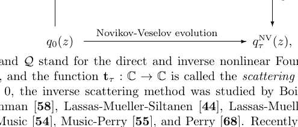

其中 $T$ 和 $Q$ 分别代表直接和逆非线性傅里叶变换，且函数 $t_\tau : \mathbb{C} \to \mathbb{C}$ 称为散射变换。在 $E = 0$ 的情形，逆散射方法由 Boiti 等 [9]、Tsai [89]、Nachman [58]、Lassas-Mueller-Siltanen [44]、Lassas-Mueller-Siltanen-Stahel [45, 46]、Music [54]、Music-Perry [55] 和 Perry [68] 研究。最近，Angelopoulos [1] 证明了 $E = 0$ 时的 Novikov-Veselov 方程在 Sobolev 空间 $H^s(\mathbb{R}^2)$ 中对 $s > 1/2$ 是局部适定的，为该方程的局部存在理论奠定了坚实基础。逆散射方法的潜在效用在于阐明解的全局行为。

$E = 0$ 的情形有些特殊，与二维 Schrödinger 算子 $L$ 在零能时的以下行为三分法密切相关。

**Definition 1.1.** 算子 $L = -\Delta + q$ 称为：

- (i) 亚临界，如果算子 $L$ 具有正的格林函数且方程 $L\psi = 0$ 具有严格正的分布解，
- (ii) 临界，如果 $L\psi = 0$ 具有有界严格正解但没有正的格林函数，且
- (iii) 超临界，否则。

这种区分最初出现在 Schrödinger 半群的研究中，即算子 $e^{-tL}$ 其中 $L = -\Delta + q$。Simon [79, 80] (参见 [81]) 研究了 $e^{-tL}$ 的 $L^p$-映射性质以及 $\|e^{-tL}\|_{p,p'}$ 的渐近性，其中 $\|\cdot\|_{p,p}$ 表示从 $L^p$ 到自身的算子范数。Simon 表明 $\alpha_p(q) = \lim_{t\to\infty} t^{-1} \ln \|e^{-tL}\|_{p,p}$ 与 $p \in [1,\infty]$ 无关。在 Schrödinger 半群的语言中，势 $q$ 是：

- (i) 亚临界，如果对某个 $\varepsilon > 0$ 有 $\alpha_\infty((1+\varepsilon)q) = 0$，
- (ii) 临界，如果 $\alpha_\infty(q) = 0$ 但对所有 $\varepsilon > 0$ 有 $\alpha_\infty((1+\varepsilon)q) > 0$，且
- (iii) 超临界，如果 $\alpha_\infty(q) > 0$。

显然，$L$ 具有负特征值的充分条件是 $q$ 为超临界。

在 [52] 中，Murata 表明，对于势 $q$ 满足 $q(x)$ 均匀 Hölder 连续且 $q(x) = O(|x|^{-4-\varepsilon})$ 对某个 $\varepsilon > 0$ 的二维 Schrödinger 算子，Schrödinger 半群的行为三分法等价于定义 1.1。Murata 在 [52] 中进一步研究了 Schrödinger 方程正解的存在性和性质，并表明对于他的势类，三分法可表征如下：势是


+   (i) 当且仅当 Lψ = 0 存在形如 c log(|x|) + d + O(|x|⁻¹) 且 c ≠ 0 的严格正解时为次临界，
+   (ii) 当且仅当 Lψ = 0 存在严格正有界解时为临界，且
+   (iii) 若 Lψ = 0 没有严格正解则为超临界。

推广了 Murata 的结果，Gesztesy 和 Zhao [20] 利用布朗运动技术证明了临界势的最优结果。设 q 是一个实值可测函数且满足

lim_{α↓0} { sup_{x∈ℝ²} ∫_{|x−y|≤α} ln(|x−y|)⁻¹ |q(y)| dy } = 0

且

∫_{|y|≥1} ln(|y|) |q(y)| dy < ∞.

则 q 为临界当且仅当存在 Hψ = 0 的正有界分布解 ψ。这两个条件本质上意味着

q(x) = O( |x|⁻² (ln(|x|))⁻²⁻ε )

对某个 ε > 0 成立。我们将读者引向 [20] 以获取进一步的参考文献和历史。

正如我们将看到的，对应于定义 1.1 中的三分法，q 的散射变换要么是轻微奇异的，非奇异的，或高度奇异的。这在 Music、Perry 和 Siltanen [56] 研究的例子中得到了显著的说明，描述于下文第 5 节。我们期望散射变换的奇点会在 NV 方程解的行为中得到反映。我们将在本文的最后一节讨论以下猜想，以及为其解决所做的部分结果：

## Conjecture 1.2. Novikov-Veselov 方程 (1.1) 对临界和次临界初值具有整体解，但其解对超临界初值可能在有限时间内爆破。

为了阐明这一猜想，有助于回忆散射变换如何与 Schrödinger 方程和 Calderón 的逆电导问题 [15] 相联系。临界势在文献中也被称为“电导型势”，因为它们与 Calderón 逆电导问题有关：设想通过边界测量来确定有界平面区域 Ω 的电导率 σ。区域 Ω 在边界上电压为 f 的势 u 由方程决定

∇·(σ∇u) = 0
u|_{∂Ω} = f

Calderón 问题是从 Dirichlet-to-Neumann 映射重构 σ。定义如下。若 Ω 具有光滑边界，则上述边值问题对给定的 f ∈ H^{1/2}(∂Ω) 存在唯一解 u，使得

Λ_σ f = σ ∂u/∂ν|_{∂Ω}

唯一确定。映射 Λ_σ : H^{1/2}(∂Ω) → H^{-1/2}(∂Ω) 是 Dirichlet-to-Neumann 映射。

在变量替换 $u = \sigma^{-1/2}\psi$ 下，该边值问题等价于 Schrödinger 问题

$\Delta \psi - q\psi = 0$

其中 $q = \sigma^{-1/2}\Delta\left(\sigma^{1/2}\right)$。对于严格正的 $\sigma \in L^{\infty}$（以及一些额外的正则性），这种形式的势称为 *电导型势*。更精确地，Nachman [58] 最初研究的势类如下。我们用 $L^{p}_{\rho}(\mathbb{R}^{2})$ 表示具有范数 $\|f\|_{L^{p}_{\rho}} = \|\langle x\rangle^{\rho} f\|_{p}$ 的可测函数空间。

## DEFINITION 1.3. 设 $p \in (1,2)$ 且 $\rho > 1$。实值可测函数 $q \in L^{p}_{\rho}(\mathbb{R}^{2})$ 是电导型势，如果存在函数 $\sigma \in L^{\infty}(\mathbb{R}^{2})$ 满足 $\sigma(x) \geq c_{0} > 0$ 使得 $q = (\Delta(\sigma^{1/2}))/(\sigma^{1/2})$ 在分布导数意义下成立。

$L^{p}_{\rho}(\mathbb{R}^{2})$ 中的实值势是电导型势当且仅当它是临界的：$\Delta \psi - q\psi = 0$ 的有界正解恰好是 $\psi = \sigma^{1/2}$。

如 Murata [52,53] 所示，临界势非常不稳定：如果 $w \in \mathcal{C}_{0}^{\infty}(\mathbb{C})$ 是一个非负的 bump 函数，且 $q_{0}$ 是一个临界势，则势 $q_{\lambda} = q_{0} + \lambda w$ 对任意 $\lambda < 0$ 都是超临界的。这意味着临界势的集合在任何合理的函数空间中都无处稠密！Music、Siltanen 和 Perry [56] 研究了当 $q_{0}$ 和 $w$ 均为光滑、紧支且径向时，这类族的散射变换的行为。对应的散射变换对次临界势是轻微奇异的，对临界势是正则的，对超临界势具有奇点圆。

NV 方程可通过逆散射对次临界和临界势求解，但目前尚不清楚如何通过逆散射构造超临界势的解。

在本文中，我们主要关注零能量的 Novikov-Veselov 方程。我们将报告该方程理论和数值分析方面的最新进展，并提出若干开放问题。第 2 节回顾逆散射方法的历史、色散关系、对称性和尺度性质，以及 NV 方程的守恒律。第 3 节从 Manakov 三重表示的角度阐述了零能量 NV 方程的逆散射方法，对“电导型光滑势”情形（见定义 3.2）进行了严格的数学处理。我们在第 3.2 节和第 3.3 节分别讨论映射 $\mathcal{T}$ 和 $\mathcal{Q}$ 的数值实现。第 4 节讨论 NV 方程的特殊闭式解，包括环状孤子和呼吸子。第 5 节使用计算逆散射方法研究零能量的例外点以及超临界、临界和次临界势之间的关系。最后，第 6 节讨论开放问题。附录中收集了一些用于直接和逆散射映射数学分析的有用工具。

*Notation.* 在下文中，我们使用变量 $t$ 表示时间，除非讨论通过逆散射方法求解 NV 的情况。在这种情况下，$\tau$ 表示时间以区别于 $t$ 和 $\mathbf{t}$，散射变换。

### 2. Background for the Zero-Energy NV Equation

首先，我们总结导致零能量 NV 方程图 (1.5) 完成的历程。1987 年，Boiti、Leon、Manna 和 Pempinelli [9] 在假设 $q_0$ 使得解 $q_\tau^{\mathrm{NV}}$ 对 (1.1) 存在且没有例外点的前提下研究了演化，并建立了散射数据演化为

$$\mathcal{T}(q_\tau^{\mathrm{NV}})=e^{i\tau(k^3+\bar{k}^3)}\mathcal{T}(q_0).$$

1994 年，Tsai [89] 考虑了一类小且快速衰减的初值（排除了电导型势），并假设 $q_0$ 没有例外点且 $q_\tau$ 良定义。在此假设下，他证明了 $q_\tau$ 是 Novikov-Veselov 方程 (1.1) 的解。1996 年，Nachman [58] 建立了电导型初值没有例外点且散射数据 $\mathcal{T}(q_0)$ 良定义。Nachman 的工作为严格结果铺平了道路：在 [58] 之前发表的所有关于图 (1.5) 的研究都是形式化的，因为它们必须在未指定可接受初值的情况下假设例外点的不存在。2007 年，Lassas、Mueller 和 Siltanen [44] 对光滑、紧支的电导型初值且 $\sigma \equiv 1$ 在 $\mathrm{supp}(q_0)$ 外成立，建立了从逆散射方法得到的良定义连续函数 $q_\tau : \mathbb{R}^2 \to \mathbb{C}$，满足估计 $|q_\tau(z)| \le C(1+|z|)^{-2}$ 对所有 $\tau > 0$ 成立。在 [45] 中证明了初始径向对称的电导型势在 ISM 下演化没有例外点且本身仍为电导型。注意在 [56] 中，电导型势的集合被证明在 $C_0^\infty$ 扰动下不稳定。在 [46] 中，从旋转对称、紧支电导型初值的逆散射方法数值实现计算得到的演化与从 NV 的半隐式有限差分离散化计算得到的 NV 方程演化进行了比较，发现二者以高精度一致。这支持了随后在 [67] 中对更大类初值使用 Davey-Stewartson 方程的逆散射映射和 Bogdanov 的 Miura 变换建立的完全可积猜想。

本文第 4 节中，我们给出了 NV 方程的若干闭式解。我们简要回顾 NV 方程解的早期构造，但不提供详尽列表。Grinevich、Manakov 和 R. G. Novikov 在 [22–24, 24,27] 中使用非局部 Riemann 问题技术构造了非零能量和小初值的孤子解。此外，孤子由 Grinevich 使用有理势在 [22] 中构造，由 Tagami 使用 Hirota 方法在 [82] 中构造，由 Athorne 和 Nimmo 使用 Moutard 变换在 [2] 中构造，由 Hu 和 Willox 使用非线性叠加公式在 [32] 中构造，由 Xia、Li 和 Zhang 使用双曲线函数方法和 Wu-消去方法在 [95] 中构造，由 Ruan 和 Chen 使用分离变量在 [71–73,98] 中构造，由 J.-L. Zhang、Wang、Wang 和 Fang 使用齐次平衡原理和 Bäcklund 变换在 [32] 中构造。Lump 解由 Dubrovsky 和 Formusatik 使用 $\bar{\partial}$-dressing 方法在 [16] 中构造。Dromion 解由 Ohta 和 Ünal 使用 Pfaffians 在 [66,90] 中构造。Darboux 变换由 Hu、Lou、Liu、Rogers、Konopelchenko、Stallybrass 和 Schief 用于在 [33,70] 中构造解。Taimanov 和 Tsarëv [84–88] 使用 Moutard 变换构造零能量处具有 $L^2$ 本征值的 Schrödinger 算子 $L$ 的例子，以及


NV 在有限时间内爆破。 在 [96,97] 中，Zheng, J.-F. Zhang 和 Sheng 探讨了 NV 方程解的混沌和分形性质。

#### 2.1. 色散、群速度和相速度。

孤子形成时非线性和色散达到平衡。色散关系是给出频率作为波矢 \((k_1,k_2)\) 的函数的關係。 为了求出 NV 方程的色散关系，考虑方程的线性部分

$$
(2.1) \quad q_t = -\frac{1}{4}q_{xxx} + \frac{3}{4}q_{xyy}
$$

平面波函数 \(q(x,y,t) = e^{i(k_1 x + k_2 y - \omega t)}\) 是 (2.1) 的解，只要

$$
(2.2) \quad \omega = -\frac{1}{4}k_1^3 + \frac{3}{4}k_1 k_2^2.
$$

方程 (2.2) 定义了 NV 方程的色散关系。

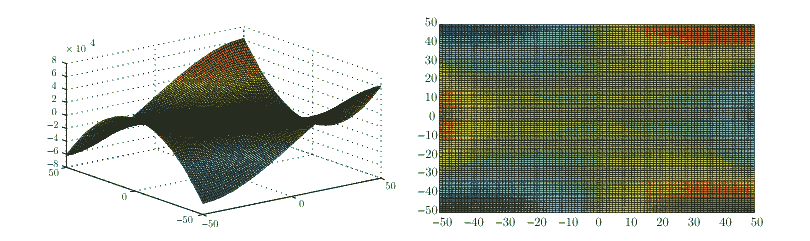

**FIGURE 1.** Surface plot (left) and heat map (right) of the NV dispersion relation \(\omega(k) = -k_1^3/4 + 3k_1k_2^2/4\)

相速度，\(c_p\)，给出波前的速度，定义为 \(c_p = \frac{\omega(k)}{|k|^2}(k_1,k_2)^T\) 且对于 NV 方程为

$$
(2.3) \quad c_p = \frac{k_1^3 - 3k_1k_2^2}{4(k_1^2+k_2^2)}(k_1,k_2)^T.
$$

群速度，给出波包的速度，为

$$
c_g \equiv \nabla\omega = \frac{3}{4}(-k_1^2+k_2^2,\; 2k_1k_2)^T.
$$

#### 2.2. 对称性和标度。

为了理解从属变量和独立变量的标度如何改变 NV 方程，让我们首先考虑方程 (1.2) 中的辅助 \(\bar\partial\) 方程的形式

$$
\bar\partial\nu = \partial q, \qquad \nu = v + iw.
$$

注意在变换 \(r(x,y,t) \equiv \gamma\nu(\alpha t,\beta x,\beta y)\) 和 \(s(x,y,t) \equiv \gamma q(\alpha t,\beta x,\beta y)\) 下，\(\bar\partial\) 方程保持不变，即 \(\bar\partial\nu = \partial q\) 当且仅当 \(\bar\partial r = \partial s\)。 则 \(r_x(x,y,t) = \beta\gamma\nu_x(\alpha t,\beta x,\beta y)\) 且 \(r_y(x,y,t) = \beta\gamma\nu_y(\alpha t,\beta x,\beta y)\)。

现在，我们考察如方程 (1.2) 所给出的主方程。 注意 \(s_t(x,y,t) = \alpha\gamma q_t(\alpha t,\beta x,\beta y)\)，\(s_{xxx}(x,y,t) = \beta^3\gamma q_{xxx}(\alpha t,\beta x,\beta y)\)，\(s_{xyy}(x,y,t) = \beta^3\gamma q_{xyy}(\alpha t,\beta x,\beta y)\)，且 \((qv)_X + (qw)_Y = \frac{1}{\gamma^2\beta}\big((s\Re(r))_x + (s\Im(r))_y\big)\)。 假设 \(q\) 是 NV 方程 (1.1) 的解，我们得到

$$
4q_t = -q_{xxx} + 3q_{xyy} + 3(qv)_x + 3(qw)_y
$$

$$
\Rightarrow \frac{4}{\alpha\gamma}s_t = -\frac{1}{\beta^3\gamma}s_{xxx} + \frac{3}{\beta^3\gamma}s_{xyy} + \frac{3}{\beta\gamma^2}(s\Re(r))_x + \frac{3}{\beta\gamma^2}(s\Im(r))_y.
$$

乘以 \(\alpha\gamma\) 得到

$$
(2.4) \quad 4s_t = -\frac{\alpha}{\beta^3}s_{xxx} + \frac{3\alpha}{\beta^3}s_{xyy} + \frac{3\alpha}{\beta\gamma}\big((s\Re(r))_x + (s\Im(r))_y\big).
$$

下表显示了方程 (2.4) 右端每一项可能的符号约定。

| \(\alpha\) | \(\beta\) | \(\gamma\) | Signs in (2.4) |
|---|---|---|---|
| + | + | + | -   +   + |
| - | - | + | -   +   + |
| - | + | + | +   -   - |
| + | - | + | +   -   - |
| + | + | - | -   +   - |
| - | - | - | -   +   - |
| - | + | - | +   -   + |
| + | - | - | +   -   + |

因此，线性空间项系数的比值固定为 \(-3\)，而通过独立变量和从属变量的适当重标度，其他系数都是可能的。

我们还考虑 Novikov-Veselov 方程在何种旋转下不变。 将 NV 方程写成

$$
(2.5) \quad q_t = -\partial^3 q - \bar\partial^3 q + 3\partial(q\nu) + 3\bar\partial(q\bar\nu),
$$

$$
(2.6) \quad \bar\partial\nu = \partial q,
$$

通过共轭 (2.5)，易见如果 \(q\) 在时间 \(t_0\) 时为实数，则 \(q\) 保持实数。

如果初值 \(q_0(z)\) 在旋转 \(\pm 2\pi/3\) 下不变，则 Novikov-Veselov 演化保持该对称性，见 [46]。 特别地，所有径向对称的初值都将导致具有这种三重对称性的解。

在这种旋转下，方程 (2.5) 变为

$$
(2.7) \quad q_t = e^{i\theta}\partial_{z'}(\nu' q) + e^{i\theta}\bar\partial_{z'}(\bar\nu' q) - e^{3i\theta}\bar\partial_{z'}^3 q - e^{-3i\theta}\partial_{z'}^3 q
$$

其中 \(\nu' = e^{-i\theta}\nu\)。 辅助方程变为

$$
e^{i\theta}\bar\partial_{z'}\nu = e^{-i\theta}\partial_{z'}q
$$

或

$$
\bar\partial_{z'}\nu' = e^{-3i\theta}\partial_{z'}q,
$$

因此我们在 \(2\pi/3\) 和 \(4\pi/3\) 的旋转下有不变解。 这表明如果 NV 方程的解具有这种对称性，则它必须在演化下保持。 这并不意味着所有解都会显示这种类型的对称性。

#### 2.3. NV 方程的守恒律。

为了给出 (1.1) 的守恒律，我们需要回顾逆散射方法中的一些思想。 对于导电型光滑势，守恒律的严格推导在下面第 3 节中给出。

假设 \(q \in L^p(\mathbb{R}^2)\) 对于某个 \(p \in (1,2)\)。 散射数据，或散射变换 \(\mathbf{t}: \mathbb{C} \to \mathbb{C}\)，通过 Faddeev 的 [18] 复几何光学 (CGO) 解定义，我们现在回顾。 设 \(z = x + iy\) 且 \(k = k_1 + ik_2\)。 对于 \(k \in \mathbb{C}\) 且 \(k \neq 0\)，函数 \(\psi(z,k)\) 是薛定谔方程的指数增长解

$$
(2.8) \quad (-\Delta + q)\psi(\cdot,k) = 0
$$

其渐近行为为 \(\psi(z,k) \sim e^{ikz}\)，意义如下：对于 \(\tilde p\) 定义为 \(\frac{1}{\tilde p} = \frac{1}{p} - \frac{1}{2}\)，我们有

$$
(2.9) \quad e^{-ikz}\psi(z,k) - 1 \in L^{\tilde p}(\mathbb{R}^2) \cap L^{\infty}(\mathbb{R}^2).
$$

更方便地使用归一化复几何光学解 (NCGO) \(\mu(z,k)\) 定义为

$$
(2.10) \quad \mu(z,k) = \psi(z,k)e^{-ikz}.
$$

直接计算表明 \(\mu\) 满足方程

$$
(2.11) \quad \bar\partial(\partial + ik)\mu = \frac{1}{4}q\mu, \qquad \mu(\cdot,k) - 1 \in L^{\tilde p} \cap L^{\infty}.
$$

可以将问题 (2.11) 归约为 Fredholm 型积分方程（见第 3 节的讨论）。 Faddeev 的格林函数 \(g_k\) 是方程的基本解

$$
-4\bar\partial(\partial + ik)u = f
$$

（因子 \(-4\) 的选择使得，如果 \(k = 0\)，方程化为 \(-\Delta u = f\)，其基本解是对数势；详见附录 A.1）。 有

$$
(2.12) \quad \mu = 1 - g_k * (q\mu)
$$

然后，如果 \(q\) 在无穷远处迅速衰减（例如 \(q \in \mathcal{S}(\mathbb{R}^n)\)），函数 \(\mu(z,k)\) 满足大-\(z\) 渐近公式

$$
(2.14) \quad \mu(z,k) \sim 1 + \frac{1}{4\pi i k z}s(k) - \frac{e_{-k}(z)}{4\pi i k \bar z}\mathbf{t}(k) + \mathcal{O}\left(|z|^{-2}\right)
$$

其中

$$
(2.15) \quad \mathbf{t}(k) = \int e_k(z) q(z) \mu(z,k)\, dz,
$$

$$
(2.16) \quad s(k) = \int q(z) \mu(z,k)\, dz.
$$

注意 \(s(k)\) 和 \(\mathbf{t}(k)\) 总是对于大的 \(|k|\) 定义，无论势 \(q\) 是亚临界、临界还是超临界。

渐近公式 (2.14) 是以下简单引理的推论。

### Lemma 2.1.

假设 \(k \in \mathbb{C}\) 且 \(k \neq 0\)，\(p > 2\)，并且 \(u \in C^2(\mathbb{C}) \cap L^p(\mathbb{C})\) 满足

$$
-4\bar\partial(\partial + ik)u = f
$$

对于 \(f \in \mathcal{S}(\mathbb{C})\)。 则

$$
(2.17) \quad u(z) \underset{|z|\to\infty}{\sim} \sum_{\ell \ge 0} \frac{a_\ell}{z^{\ell+1}} + e_{-k}(z)\frac{b_\ell}{\bar z^{\ell+1}}
$$

其中

$$
a_0 = \frac{1}{4\pi i k}\int f(z)\, dz,
$$

$$
b_0 = \frac{1}{4\pi i k}\int e_k(z) f(z)\, dz.
$$

**Proof.** 条件对 \(u\) 意味着 \(u = g_k * f\)，因此使用 \(g_k\) 的渐近展开式 (A.3) 我们得到

$$
(2.18) \quad u(z) = -\frac{1}{4\pi}\sum_{j=0}^{N}\int\left[\frac{j!}{(ik(z-z'))^{j+1}} + e^{-i(kz+\bar k\bar z)}\frac{j!}{(-i\bar k(z-z'))^{j+1}}\right] f(z')\, dz' + \mathcal{O}\left(|z|^{-N-2}\right)
$$

不难看出对于 \(f \in \mathcal{S}(\mathbb{C})\) 和任意正整数 \(N\)，展开式

$$
\int \frac{1}{(z-z')^j} f(z')\, dz' = \sum_{\ell=0}^{N} c_{\ell,j} z^{-j-\ell} + \mathcal{O}\left(|z|^{-N-1-j}\right)
$$

成立，对于涉及 \(\bar z - \bar z'\) 的项有类似的展开。 展开式 (2.17) 的存在是直接的。 主导项来自 (2.18) 的 \(j=0\) 项。

如果 \(q(z,\tau)\) 在零能下求解 NV 方程，可以证明 \(\mathbf{t}(\cdot,\tau)\)，即 \(q(\cdot,\tau)\) 的散射变换，然后由

$$
(2.19) \quad \mathbf{t}(k,\tau) = \mathbf{m}(k,\tau)\mathbf{t}(k,0),
$$

给出，其中

$$
m(k,\tau) = \exp\big(i\tau(k^3 + \bar k^3)\big).
$$

另一方面，

$$
(2.20) \quad s(k,\tau) = s(k,0).
$$

这里 \(\mathbf{t}(k,\tau)\) 和 \(s(k,\tau)\) 由

$$
(2.21) \quad \bar\partial_z(\partial_z + ik)\mu(z,k,\tau) = \frac{1}{4}q(z,\tau)\mu(z,k,\tau)
$$

的解 \(\mu(z,k,\tau)\) 计算得到。

对于光滑的导电型势，(2.19) 和 (2.20) 的严格证明在下面第 3 节给出。

如果 \(q\) 是光滑的、迅速衰减的，并且是临界或亚临界的，薛定谔势 \(q\) 可以使用 Beals 和 Coifman [5] 的 \(\bar\partial\)-方法恢复（见 [44] 临界情形，[54] 亚临界情形）。 这两篇论文都使用了 Nachman [58] 在逆电导问题背景下发展的技术。

我们现在可以通过使用 \(s(k)\) 的大-\(k\) 渐近展开来推导 NV 方程的一组守恒律。 由于 \(s(k,\tau)\) 是守恒的，我们设 \(\tau = 0\) 并在此后省略 \(\tau\)-依赖性。 我们将通过使用 \(\mu(z,k)\) 的大-\(k\) 渐近展开并将该展开代入公式 (2.16) 来形式地推导守恒量。 由于 \(s(k)\) 是守恒的，该大-\(k\) 展开的系数也是守恒量。 目前，我们假设 \(\mu(z,k)\) 允许形式为

$$
(2.22) \quad \mu(z,k) \sim 1 + \sum_{j=1}^{\infty} \frac{a_j(z)}{k^j}.
$$

的大-\(k\) 展开。 我们将在下一节为光滑的导电型势推导出此类展开（见引理 3.7）。 预计它一般成立。

将级数 (2.22) 代入 (2.21)，我们可以求解由此产生的系统以得到系数 \(a_j\)：

$$
(2.23) \quad -\sum_{j=1}^{\infty} \frac{\Delta a_j(z)}{k^j} - \sum_{j=1}^{\infty} \frac{4i\bar\partial a_j(z)}{k^{j-1}} + q\sum_{j=1}^{\infty} \frac{a_j(z)}{k^j} = -q.
$$

我们得到

$$
a_1 = \frac{1}{4i}\bar\partial^{-1}q.
$$

然后可以推导出递推公式，

$$
(2.24) \quad a_{j+1} = \frac{1}{4i}\bar\partial^{-1}(-4\bar\partial\partial a_j + qa_j) = i\partial a_j + \frac{1}{4i}\bar\partial^{-1}(qa_j).
$$

由此可知

$$
s(k) \sim \sum_{j=0}^{\infty} \frac{s_j}{k^j}, \qquad s_j = \int_{\mathbb{R}^2} q(z)a_j(z)\,dz.
$$


因此，前三个守恒量为

\[
s_0=\int_{\mathbb{R}^2} q(z)\,dz,
\]
\[
s_1=\int_{\mathbb{R}^2}\frac{1}{4}q(z)(\bar\partial^{-1}q)(z)\,dz,
\]
\[
s_2=\int_{\mathbb{R}^2}\left(\frac{1}{4}q(z)v(z)-\frac{1}{16}q\,\bar\partial^{-1}\!\left(q\,\bar\partial^{-1}q\right)\!(z)\right)dz,
\]

其中当 \(z=x+iy\) 且 \(\zeta=\zeta_1+i\zeta_2\) 时，

\[
(\bar\partial^{-1}q)(z)=\frac{1}{\pi}\int_{\mathbb{R}^2}\frac{q(\zeta)\,d\zeta}{z-\zeta}.
\]

### 3. 通过 Manakov 三元组的逆散射

在本节中，我们发展逆散射方法来求解零能 Novikov-Veselov (NV) 方程的柯西问题

\[
q_\tau=2\operatorname{Re}\!\left(\partial^3 q-\frac{3}{4}\partial(uq)\right),\qquad
\bar\partial u=\partial q,\qquad
q|_{\tau=0}=q_0
\]

对于光滑的导电型柯西数据 \(q_0\)（见定义 3.2）。注意我们对 NV 方程的约定与 (1.1) 略有不同；这里使用的形式更便于零能逆散射形式体系。本节应被视为解释性的，且这里的材料无疑是“专家们熟知的”（参见 Manakov 的原始论文 [48]，以及例如 Boiti, Leon, Manna 和 Pempinelli [9] 关于 NV 方程），尽管我们给出了本质上自包含且数学上严格的表述。这些思想向更广类势的推广将在 [54]、[55] 和 [69] 中出现。

在本节中，我们借鉴了 Lassas, Mueller 和 Siltanen [44]、Lassas, Mueller, Siltanen 和 Stahel [45] 以及 Perry [67] 的先前工作，特别是关于散射变换及其逆在光滑导电型函数空间上的映射性质，如下定义。我们的分析中主要成分（与 [44,45,67] 相比）是系统地使用 NV 方程的 Manakov 三元组表示。

为了描述 Manakov 三元组表示，设 \(q\) 是 \(z\) 和 \(\tau\) 的光滑函数。设存在光滑函数 \(u(z,\tau)\) 满足 \(\bar\partial u=\partial q\)（对于合适的 \(q\) 类，此类函数的存在性可由 Beurling 变换的性质推出；见附录）。定义¹

\[
L=\partial\bar\partial-\frac{q}{4},
\tag{3.2}
\]

\[
A=\partial^3+\bar\partial^3-\frac{3}{4}\left(u\partial+\bar u\,\bar\partial\right),
\tag{3.3}
\]

\[
B=\frac{3}{4}\left(\partial u+\bar\partial\bar u\right),
\tag{3.4}
\]

并且 DN 方法使用分部积分将 (3.6) 转化为

\[
\mathbf{t}(k)=\int_{\partial\Omega}e^{i\bar{k}\bar{z}}(\Lambda_q-\Lambda_0)\psi(\cdot,k)\,dS(z),
\tag{3.7}
\]

其中 \(\Lambda_q\) 是下面定义的 *Dirichlet-to-Neumann map*。公式 (3.6) 和 (3.7) 的严格推导由 Nachman 在 [58] 中给出。

LS 方法需要数值求解 *complex geometrical optics solutions* \(\psi(z,k)\)。数值上，更好地求解 Lippmann-Schwinger 方程求 \(\mu\)

\[
\mu(z,k)=1-\int_{\Omega}g_k(z-w)q(w)\mu(w,k)\,dw.
\tag{3.8}
\]

方程 (3.8) 的严格可解性分析可在 [56–58] 中找到。这里 \(g_k\) 是满足 \((-\Delta-4ik\partial)g_k(z)=\delta(z)\) 的基本解。\(g_k\) 的起源是 Faddeev 1965 年的文章 [18]。计算上，\(g_1(z)\) 可使用 Matlab 表达式 `exp(-1i*z).*real(expint(-1i*z))/(2*pi);` 求值。对称关系 \(g_k(z)=g_1(kz)\) 将其推广到所有 \(k\neq0\) 的值。注意 \(g_k\) 在 \(k\to0\) 时有 \(\log k\) 奇点，导致 \(k\) 接近零时出现数值困难。

方程 (3.8) 在整个平面 \(z\in\mathbb{R}^2\) 上定义，因此实际计算需要某种截断。复杂几何光学解的首次数值计算在 [75] 中报道，背景为 (3.8)。该计算被用作 \(\bar\partial\) 方法用于电阻抗断层成像的首次数值实现 [76] 的一部分。计算 \(\mu\) 的更有效方法基于 Gennadi Vainikko 在 [91] 中引入的周期化技术；参见 [74, Section 10.5]。Vainikko 方法对方程 (3.8) 的改编首次在 [50] 中引入。更多细节见 [51, Section 14.3]。

现在我们转向 DN 方法。该方法在 \(\bar\partial\) 重建方法用于电阻抗断层成像中具有实际用途。（参见 [51] 及其相关参考文献。）我们首先定义 Dirichlet 问题

\[
(-\Delta+q)u=0\ \text{in}\ \Omega,\qquad u|_{\partial\Omega}=f.
\tag{3.9}
\]

的 Dirichlet-to-Neumann map \(\Lambda_q\)。

如果零不是 \(-\Delta+q\) 在 \(\Omega\) 中的 Dirichlet 特征值，则问题 (3.9) 对给定的 \(f\in H^{1/2}(S^1)\) 有唯一解 \(u\)，我们设

\[
\Lambda_q f=\left.\frac{\partial u}{\partial\nu}\right|_{\partial\Omega},
\tag{3.10}
\]

其中 \(\partial/\partial\nu\) 表示在 \(\partial\Omega\) 上关于外法向的微分。

公式 (3.7) 需要迹 \(\psi(\cdot,k)|_{\partial\Omega}\)。根据 [58]，迹可由边界积分方程求解

\[
\psi(z,k)|_{\partial\Omega}=e^{ikz}-\int_{\partial\Omega}G_k(z-w)(\Lambda_q-\Lambda_0)\psi(w,k)|_{\partial\Omega}\,dS(w),
\tag{3.11}
\]

如果 \(k\) 不是 \(q\) 的例外点。这里 \(G_k(z):=e^{ikz}g_k(z)\) 是 Laplace 算子的 Faddeev Green 函数。关于 (3.11) 数值求解的细节见 [51, Section 15.3]。

#### 3.3. 逆散射映射

事实证明 NCGO 解 \(\mu(z,k)\) 也满足由 \(\mathbf{t}(k)\) 确定的 \(k\) 变量中的 \(\bar\partial\)-问题。令

\[
\mathbf{t}^\sharp(k)=\frac{\mathbf{t}(k)}{4\pi\bar{k}},
\]

我们有，对任意 \(p>2\)：

**引理 3.5.** 设 \(q\) 是光滑的导电型势，\(\mu(z,k)\) 为相应的 NCGO 解。则：

\[
\bar\partial_k\mu(z,k)=e_{-k}\mathbf{t}^\sharp(k)\overline{\mu(z,\bar{k})},
\qquad
\mu(z,\cdot)-1\in L^p(\mathbb{C}).
\]

而且，\(q(z)\) 可由 \(\mathbf{t}\) 和 \(\mu(z,k)\) 通过公式恢复

\[
q(z)=\frac{4i}{\pi}\bar\partial_z\left(\int e_{-k}(z)\mathbf{t}^\sharp(k)\overline{\mu(z,k)}\,dk\right).
\]

**注记 3.6.** 该方程对每个 \(z\) 至多有一个解，前提仅为 \(\mathbf{t}^\sharp\in L^2\)，由 \(\bar\partial\)-问题的标准唯一性定理（见 Brown-Uhlmann [11]，推论 3.11）。

\(\mu(z,k)\) 在 \(k\)-变量上满足 \(\bar\partial\)-方程这一事实也意味着 \(\mu(z,k)\) 的大 \(k\) 渐近展开。

**引理 3.7.** 设 \(q\) 是光滑的导电型势，\(\mu(z,k)\) 为相应的 NCGO 解。则

\[
\mu(z,k)\sim 1+\sum_{\ell\ge0}\frac{c_\ell(z)}{k^{\ell+1}},
\]

其中

\[
c_0=-\frac{i}{4}\bar\partial^{-1}q,
\]

\[
c_1=-\frac14\partial\bar\partial^{-1}q+\frac{1}{16}\bar\partial^{-1}\!\left(q\,\bar\partial^{-1}q\right),
\]

且其余 \(c_j\) 由递推式确定

\[
i\bar\partial c_{j+1}=\left(\frac{q}{4}-\partial\bar\partial\right)c_j.
\]

**证明.** 渐近展开中的系数可从方程 \(\bar\partial(\partial+ik)\mu=(q/4)\mu\) 递归计算，一旦渐近展开的存在性被建立。为此，注意

\[
\mu(z,k)=1+\frac{1}{\pi}\int_{\mathbb{C}}\frac{1}{k-\kappa}e_{-\kappa}\mathbf{t}^\sharp(\kappa)\overline{\mu(z,\kappa)}\,dm(\kappa).
\]

写

\[
(k-\kappa)^{-1}=k^{-1}\sum_{j=0}^{N}(\kappa/k)^j+(\kappa/k)^{N+1}\frac{1}{k-\kappa},
\]

我们得到所需形式展开，其中

\[
c_j(z)=\frac{1}{\pi}\int\kappa^j e_{-\kappa}\mathbf{t}^\sharp(\kappa)\overline{\mu(z,\kappa)}\,dm(\kappa),
\]

余项为

\[
\frac{1}{\pi}k^{-(N+1)}\int\frac{\kappa^{N+1}}{k-\kappa}e_{-\kappa}\mathbf{t}^\sharp(\kappa)\overline{\mu(z,\kappa)}\,dm(\kappa).
\]

最后为了得到 \(c_j\) 的显式公式，我们将展开式 (3.15) 代入 (2.11) 得到

\[
i\bar\partial c_0=\frac14 q,
\]

以及递推式 (3.18)，由此得到 (3.17)。

受这些结果启发，设给定 \(\mathbf{t}^\sharp\in\mathcal{S}(\mathbb{C})\)，并令 \(\mu(z,k)\) 为 (3.13) 的唯一解。定义 \(q\) 由重建公式 (3.14)。则 \(\mu\) 的解满足偏微分方程

\[
\bar\partial(\partial+ik)\mu=\frac{q}{4}\mu,\qquad \lim_{|z|\to\infty}\mu(z,\cdot)-1=0.
\]

**定义 3.8.** 映射 \(\mathcal{Q}:\mathbf{t}\to q\) 由 (3.13) 和 (3.14) 定义，称为逆散射映射。

我们通过得到编码 \(s\) 与 \(\mathbf{t}\) 之间关系的 \(\mu(z,k)\) 的完整渐近展开来结束本小节。

**引理 3.9.** 设 \(q\) 是光滑的导电型势，\(\mathbf{t}^\sharp\) 由 (3.12) 给出。则展开式

\[
\mu(z,k)\underset{|z|\to\infty}{\sim}1+\sum_{\ell\ge0}\left(\frac{a_\ell}{z^{\ell+1}}+e_{-k}\frac{b_\ell}{\bar z^{\ell+1}}\right)
\tag{3.19}
\]

成立，其中：

\[
a_0=-i\bar\partial_k^{-1}\!\left(|\mathbf{t}^\sharp|^2\right),\qquad
b_0=i\mathbf{t}^\sharp,
\]

且后续 \(a_\ell,b_\ell\) 由递推关系确定

\[
\bar\partial_k a_\ell=\mathbf{t}^\sharp\overline{b_\ell},\qquad
b_{\ell+1}=i\bar a_\ell\mathbf{t}^\sharp-i\bar\partial_k b_\ell.
\]

**证明.** 形式为 (3.19) 的展开的存在性已在引理 2.1 中建立。为了计算系数，我们将渐近级数代入 (3.13)。

**注记 3.10.** 比较引理 2.1 和 3.9，我们看到

\[
s(k)=4\pi k\bar\partial_k^{-1}\!\left(|\mathbf{t}^\sharp|^2\right).
\]

#### 3.4. 逆散射变换的计算

计算逆散射映射的第一步是求解 \(\bar\partial\) 方程

\[
\bar\partial_k\mu_\tau(z,k)=\frac{\mathbf{t}_\tau(k)}{4\pi\bar{k}}e_{-k}(z)\overline{\mu_\tau(z,k)}
\tag{3.20}
\]

其中固定参数 \(z\in\mathbb{R}^2\)，并要求大 \(|k|\) 渐近 \(\mu_\tau(z,\cdot)-1\in L^\infty\cap L^r(\mathbb{C})\) 对某个 \(2<r<\infty\)。由于 \(q_0(z)\) 是紧支集且为导电型，由 [44] 散射变换 \(\mathbf{t}_\tau(k)\) 属于 Schwartz 类，


从这个简单的计算和定理 3.11，我们可以推导出 NCGO 解的运动方程，并通过渐近式的仔细计算恢复 (2.19) 和 (2.20)。稍后，我们将通过显式构造证明，如果 q0 是导电类型的光滑函数，则 NV 方程存在解 q(z,τ)，使得 q(z,τ) 对每个 τ 都是光滑的且为导电类型。

## 引理 3.12. 假设 q(z,τ) 是 NV 方程的解，其中对每个 τ，q(z,τ) 都是导电类型的光滑函数。令 u = \overline{∂}^{-1}∂q。则

(3.23)      \dot{μ} = i k^3 μ + (∂ + i k)^3 μ + \overline{∂}^3 μ - \frac{3}{4} u (∂ + i k) μ - \frac{3}{4} u \overline{∂} μ

证明. 在给出证明之前我们做若干说明。由于 ψ = e^{i k z} μ，演化方程 (3.23) 等价于

(3.24)      ψ_τ = i k^3 ψ + ∂^3 ψ + \overline{∂}^3 ψ - \frac{3}{4} (u ∂ + \overline{u} \overline{∂}) ψ.

接下来，令 φ(z,k,τ) = e^{i S} μ(z,k,τ) 其中 S(z,k,τ) = k z - k^3 t。根据上面的论证我们有

L(τ) [\dot{φ}(τ) - A(τ) φ(τ)] = 0.

要得出 \dot{φ}(τ) = A(τ) φ(τ)，我们必须证明

\lim_{|z|→\infty} (e^{-i k z} [\dot{φ}(τ) - A(τ) φ(τ)]) = 0.

写

f ∼_k g

如果

\lim_{|z|→\infty} [e^{-i k z} (f - g)] = 0

注意到 μ - 1 及其在 z 和 \overline{z} 中的导数当 |z| → ∞ 时消失，一个简单的计算表明

\dot{φ} - A φ ∼_k e^{i S} \left( -i k^3 μ - (∂ + i k)^3 μ \right) ∼_k 0

故 \dot{φ} = A φ 由此可得 (3.24)。

因此：

## 引理 3.13. 假设 q(z,τ) 是 NV 方程的解，其中对每个 τ，q(z,τ) 都是导电类型的光滑函数。令 μ(z,k,τ) 为对应的 NCGO 解且

(3.25)      μ(z,k,τ) ∼ 1 + \frac{1}{4π i k z} s(k,t) - \frac{e_{-k}(z)}{4π i k \overline{z}} t(k,t) + O(|z|^{-2}).

则

(3.26)      \dot{s}(k,t) = 0,

(3.27)      \dot{t}(k,t) = i \left( k^3 + \overline{k}^3 \right) t(k,t).

证明. 将渐近关系 (3.25) 代入 (3.23)，我们可计算，模去 z^{-2} 阶项，
$$-\frac{1}{\pi i k z}\dot{\mathbf{t}}+\frac{e_{-k}(z)}{\pi i \overline{k} \bar{z}}\dot{s}=-\frac{e_{-k}(z)}{\pi i k \bar{z}}\left(i k^{3}+\overline{i k}^{3}\right)\mathbf{t}.$$ 
该计算使用了以下事实。如果 
$$\mu(z,k,\tau)=1+\frac{a_{0}}{z}+e_{-k}\frac{b_{0}}{\bar{z}}+\mathcal{O}\left(|z|^{-2}\right)$$ 
则（“∼” 表示当 |z|→∞ 时渐近于，模去 $\mathcal{O}\left(|z|^{-2}\right)$） 
$$\partial^{3}\mu\sim e_{-k}(-i k)^{3}\frac{b_{0}}{\bar{z}},$$ 
$$\bar{\partial}^{3}\mu\sim e_{-k}(-i\bar{k})^{3}\frac{b_{0}}{\bar{z}},$$ 
$$3 i k \partial^{2}\mu-3 k^{2}\partial\mu\sim0$$ 
以及由 $\bar{\partial}u=\partial q$ 定义的 $u$ 满足 $u=\mathcal{O}\left(|z|^{-2}\right)$ 的事实。恒等式 (3.26) 和 (3.27) 立即可得。 

## 3.6. 逆散射求解。受前一小节计算的启发，我们现在考虑问题 
(3.28) 
$$\bar{\partial}_{k}\mu=e^{i\tau S}\mathbf{t}^{\sharp}\mu$$ 
$$\mu(z,\cdot,t)-1\in L^{p}(\mathbb{C})$$ 
对于函数 μ(z,k,τ) 以及拟重构 
(3.29) 
$$q(z,\tau)=\frac{4i}{\pi}\bar{\partial}_{z}\left(\int_{\mathbb{C}}e^{i\tau S}\mathbf{t}^{\sharp}(k)\overline{\mu(z,k,\tau)}\,dk\right).$$ 
这里 
(3.30) 
$$S(z,k,\tau)=-\frac{1}{\tau}\left(kz+\bar{k}\bar{z}\right)+\left(k^{3}+\bar{k}^{3}\right)$$ 
且 $\mathbf{t}^{\sharp}$ 由 Cauchy 数据 q0 得到。我们将证明 q(z,τ) 通过推导 μ(z,k,τ) 的运动方程并利用该方程计算 q_τ 来求解 NV 方程，如果 q 由 (3.29) 给出且 μ 是 (3.28) 的唯一解 
首先，我们建立解 μ 的运动方程。虽然该方程与直接问题的解的方程 (3.23) 相同，但我们这里的出发点是 (3.28)。 

## 引理 3.14. 假设 $\mathbf{t}^{\sharp}\in\mathcal{S}(\mathbb{C})$ 且 μ 解 (3.28)。对每个 τ，定义 q(z,τ) 由 (3.29) 且定义 u(z,τ) 由 $u=\bar{\partial}^{-1}\partial q$。则 
$$\dot{\mu}=i k^{3}\mu+(\partial+i k)^{3}\mu+\bar{\partial}^{3}\mu-\frac{3}{4}u(\partial+i k)\mu-\frac{3}{4}\bar{u}\bar{\partial}\mu$$ 
其中 ∂ 和 $\bar{\partial}$ 表示对 z 和 $\bar{z}$ 变量的微分。 

证明. 令 
$$w=\dot{\mu}-\left(i k^{3}\mu+(\partial+i k)^{3}\mu+\bar{\partial}^{3}\mu-\frac{3}{4}u(\partial+i k)\mu-\frac{3}{4}\bar{u}\bar{\partial}\mu\right).$$ 
我们将证明 w=0 分两步进行。首先，我们证明 
$$\bar{\partial}_{k}w=e^{i\tau S}\mathbf{t}^{\sharp}\bar{w}.$$

这是公式

\[\overline{\partial}_k (\partial + i k)\,\mu = e^{i\tau S}\mathbf{t}^{\sharp}\overline{\mu},\]
\[\overline{\partial}_k (\overline{\partial}\mu) = e^{i\tau S}\mathbf{t}^{\sharp}\overline{(\partial + i k)\,\mu}\]

的一个容易的推论，且对任意光滑函数 u 都成立。

接下来，我们证明对参数 τ 和 z 的任意固定值， 

\[\lim_{|k|\to\infty} w(z,k,\tau)=0.\]

这里我们必须选择 $u = \overline{\partial}^{-1}\,\partial q$ 才能使断言成立。由引理 3.7 和公式

\[w = \dot{\mu} - \left(\partial^3\mu + \overline{\partial}^3\mu + 3i k\partial^2\mu - 3k^2\partial\mu - \frac{3}{4}u(\partial + i k)\mu - \frac{3}{4}\overline{u}\overline{\partial}\mu\right),\]

我们有

\[w = -3i k\partial^2\mu + 3k^2\partial\mu + \frac{3}{4}u(\partial + i k)\mu + \mathcal{O}\left(k^{-1}\right)\]
\[= A_{-1}k + A_0 + \mathcal{O}\left(k^{-1}\right)\]

其中

\[A_{-1}=3\left(\partial a_0 + \frac{i}{4}u\right)\]

且

\[A_0 = 3\left[-i\partial^2 a_0 + \partial a_1 + \frac{i}{4}u a_0\right].\]

条件 $A_{-1}=0$ 迫使选择 $u = \overline{\partial}^{-1}\,\partial q$。我们可随后计算

\[A_0 = \frac{3}{16}\left[\overline{\partial}\overline{\partial}^{-1}\left(q\overline{\partial}^{-1}q\right) - \left(\overline{\partial}^{-1}q\right)\cdot\left(\partial\overline{\partial}^{-1}q\right)\right].\]

一方面，$A_0$ 当 |z|→∞ 时对每个固定的 τ 由 q 的衰减而消失。另一方面，一个直接的计算表明 $\overline{\partial}A_0 = 0$。现在由 Liouville 定理可得 $A_0 = 0$，从而 $w = O\left(k^{-1}\right)$。我们现在使用广义 Liouville 定理得出 $w = 0$。

最后，我们证明：

## 命题 3.15. 假设 $\mathbf{t}^{\sharp}\in\mathcal{S}\left(\mathbb{R}^2\right)$。则，公式

\[q(z,\tau)=\frac{4i}{\pi}\overline{\partial}_z\left(\int e^{i\tau S(z,k,\tau)}\mathbf{t}^{\sharp}(k)\overline{\mu(z,k,\tau)}\,dm(k)\right)\]

给出 NV 方程的经典解。

证明. 在下文中，我们将自由使用交换关系

(3.31) \[\partial e^{i\tau S}=e^{i\tau S}(\partial - i k),\]

(3.32) \[\overline{\partial}e^{i\tau S}=e^{i\tau S}(\overline{\partial} - i\overline{k})\]

以及方程

(3.33) \[\overline{\partial}(\partial + i k)\mu = \frac{1}{4}q\mu.\]

为记号简便我们写 $c = 4i/\pi$。我们计算

$$\dot{q} = c\bar{\partial}\left(\int e^{i\tau S}\mathbf{t}^{\sharp}\{ik^{3}+i\bar{k}^{3}\}\mu\right)$$ 
$$+c\bar{\partial}\left(\int e^{i\tau S}\mathbf{t}^{\sharp}\{-i\bar{k}^{3}+(\bar{\partial}-i\bar{k})^{3}+\partial^{3}-\frac{3}{4}u(\bar{\partial}-i\bar{k})-\frac{3}{4}u\partial\}\bar{\mu}\right)$$ 
其中在第二项我们使用了引理 3.14。利用上面的交换关系将微分算子移到 $\exp(i\tau S)$ 的左边，我们得出

$$\dot{q}=\partial^{3}q+\bar{\partial}^{3}q-\frac{3}{4}\bar{\partial}\left(u\partial\bar{\partial}^{-1}q\right)-\frac{3}{4}\bar{\partial}(\bar{u}q)+I$$
其中

$$I=c\bar{\partial}\left(\int\{3ik\partial^{2}-3k^{2}\partial-\frac{3}{4}iku\}e^{i\tau S}\mathbf{t}^{\sharp}\bar{\mu}\right).$$
我们断言
(3.34)
$$I=\frac{3}{4}\left\{\bar{\partial}\left(u\partial\bar{\partial}^{-1}q\right)-\partial(uq)\right\}.$$ 
如果成立，则 q 如所断言地求解 NV 方程。为了计算 I，写 $I=I_{1}-I_{2}$ 其中

$$I_{1}=c\bar{\partial}\left(\int\{3ik\partial^{2}-3k^{2}\partial\}e^{i\tau S}\mathbf{t}^{\sharp}\bar{\mu}\right),$$
$$I_{2}=c\bar{\partial}\left(\int e^{i\tau S}\mathbf{t}^{\sharp}\left\{\frac{3}{4}iku\right\}\bar{\mu}\right).$$
利用 (3.33) 和 (3.32) 我们可写

$$I_{1}=\frac{3}{4}c\bar{\partial}\left(\int e^{i\tau S}(ik)\mathbf{t}^{\sharp}q\bar{\mu}\right)$$
$$=\frac{3}{4}c\bar{\partial}\left(q\int(-\partial e^{i\tau S})\mathbf{t}^{\sharp}\bar{\mu}\right)$$
$$=-\frac{3}{4}c\bar{\partial}\left(q\bar{\partial}\left(\int e^{i\tau S}\mathbf{t}^{\sharp}\bar{\mu}\right)-q\int e^{i\tau S}\mathbf{t}^{\sharp}\partial\bar{\mu}\right)$$
$$=-\frac{3}{4}\partial\left(q\partial\bar{\partial}^{-1}q\right)+\frac{3}{4}c\bar{\partial}\left(q\bar{\partial}^{-1}\bar{\partial}\left(\int e^{i\tau S}\mathbf{t}^{\sharp}\bar{\partial}\bar{\mu}\right)\right)$$
其中在第三行我们使用了 $u\partial v=\partial(uv)-v\partial u$。在第四行的第二项中，我们可使用
(3.35)
$$\bar{\partial}e^{i\tau S}\partial\bar{\mu}=e^{i\tau S}\partial(\bar{\partial}-i\bar{k})\bar{\mu}$$ 
和 (3.33) 得出

$$\frac{3}{4}c\bar{\partial}\left(q\bar{\partial}^{-1}\bar{\partial}\left(\int e^{i\tau S}\mathbf{t}^{\sharp}\bar{\partial}\bar{\mu}\right)\right)=\frac{3}{16}c\bar{\partial}\left(q\bar{\partial}^{-1}q\left(\int e^{i\tau S}\mathbf{t}^{\sharp}\bar{\mu}\right)\right)$$
$$=\frac{3}{16}\partial\left(q\bar{\partial}^{-1}\left(q\bar{\partial}^{-1}q\right)\right)$$
从而

$$I_{1}=-\frac{3}{4}\partial\left(q\partial\bar{\partial}^{-1}q\right)+\frac{3}{16}\partial\left(q\bar{\partial}^{-1}\left(q\bar{\partial}^{-1}q\right)\right)$$
$$=-\frac{3}{4}\partial(qu)+\frac{3}{16}\partial\left(q\bar{\partial}^{-1}\left(q\bar{\partial}^{-1}q\right)\right).$$


Similarly, we may compute

```
I₂ = 3/4 c ∂̄ ( u ∫ i k e^{i τ S} t^{±} μ̄ ) = 3/4 c ∂̄ ( u ∫ (-∂ e^{i τ S}) t^{±} μ̄ ) = -3/4 c ∂̄ ( u ∂ ( ∫ e^{i τ S} t^{±} μ̄ ) - u ∫ e^{i τ S} t^{±} ∂̄ μ̄ ) = -3/4 ∂̄ ( u ∂̄^{-1} ∂ q ) + 3/4 c ∂̄ ( u ∂̄^{-1} ( ∫ t^{±} ∂̄ ( e^{i τ S} ∂̄ μ̄ ) ) ).
```

Using (3.35) again we find

```
I₂ = -3/4 ∂̄ ( u ∂̄^{-1} ∂ q ) + 3/16 ∂̄ ( u ∂̄^{-1} ( q ∂̄^{-1} q ) ) = -3/4 ∂̄ ( u² ) + 3/16 ∂̄ ( u ∂̄^{-1} ( q ∂̄^{-1} q ) )
```

where we used (3.33) in the first line, and in the second line we used u = ∂̄^{-1} ∂ q. Hence

```
I₁ - I₂ = -3/4 ∂ ( q u ) + 3/4 ∂̄ ( u² ) + 3/16 ∂ ( q ∂̄^{-1} ( q ∂̄^{-1} q ) ) - 3/16 ∂̄ ( u ∂̄^{-1} ( q ∂̄^{-1} q ) ).
```

Since ∂ q = ∂̄ u and ∂̄^{-1} ( q ∂̄^{-1} q ) = 1/2 ( ∂̄^{-1} q )² we can conclude that the second line is zero and (3.34) holds. The conclusion now follows.

### 4. Special Solutions

There are various powerful methods to find solutions of nonlinear evolution equations, most notably the inverse scattering method. However, the inverse scattering method is not readily useful for finding closed-form solutions to the NV equation, and so techniques including Hirota’s method and the extended mapping approach (EMA) are presented here to construct closed-form solutions of several types of solitons. We begin by explaining the close connection between plane-wave solutions to NV and solutions to the KdV equation and present evolutions of KdV ring-type solutions. Although the KdV ring-type soliton is not of conductivity type, the scattering transform is computed in Section 4.3, and the numerical results provide evidence of the presence of an exceptional circle.

#### 4.1. KdV-type Solutions.

Consider the NV equation (3.1) in the form

```
(4.1)  q̇ = -1/4 q_{xxx} + 3/4 q_{xyy} + 3/4 div( (q - E) u ),
```

where u = u₁ + i u₂ and u = (u₁, u₂), and the auxiliary equation ∂̄ u = ∂ q as

```
(4.2)  { (u₁)_x - (u₂)_y = + q_x  (u₂)_x + (u₁)_y = - q_y }
```

As in [13] we use a FFT-based method to solve the equations on the square −L ≤ x, y ≤ +L with periodic boundary conditions.

## THE NOVIKOV-VESELOV EQUATION

To examine the linear contributions we introduce a function

q(t, x, y) = exp(i (ξ x + η y)).

Then the ∂̄ equation (4.2) is solved by

u_1(t, x, y) = \frac{ξ^2 - η^2}{ξ^2 + η^2} exp(i (ξ x + η y))
u_2(t, x, y) = \frac{-2 ξ η}{ξ^2 + η^2} exp(i (ξ x + η y)),
and thus the linear part of the NV equation (4.1)
\dot q = - \frac{1}{4} \frac{\partial^3 q}{\partial x^3} + \frac{3}{4} \frac{\partial^3 q}{\partial x \partial y^2} + E \frac{3}{4} \nabla \cdot \mathbf{u}
is transformed into a elementary linear ODE for the Fourier coefficient c(t)
4 \frac{d}{dt} c(t) = i (ξ^3 - 3 ξ η^2) \left(1 - \frac{3E}{ξ^2 + η^2}\right) c(t).

Assuming a Fourier approximation of the solutions

q(t, x, y) = \sum_{j,k=0}^{N-1} c_{j,k}(t) exp(i π (k x + j y)/L )

this leads to a coupled system of ODEs for the Fourier coefficients c_{j,k}(t). We use a Crank–Nicolson scheme for the linear part of NV and an explicit method for the nonlinear contribution div(q u). For details see [13,14].

There is a close connection between plane wave solutions to NV and solutions to KdV (see [13]):

REMARK 4.1. Assume the solutions to NV are planar waves

q(t, s) = q(t, x, y) = q(t, n_1 s, n_2 s)
u_i(t, s) = u_i(t, x, y) = u_i(t, n_1 s, n_2 s)

for some direction vector n = (n_1, n_2) = (cos(α), sin(α)). Then the bounded solutions to the ∂̄ equation (4.2) are given by

u_1(t, s) = +(n_1^2 - n_2^2) q(t, s) + c_1

u_2(t, s) = -(2 n_1 n_2) q(t, s) + c_2

for arbitrary constants c_1, c_2, and the NV equation (4.1) reduces to an equation similar to the KdV equation,

(4.3) \frac{4}{\kappa} q_t = -q''' + 6 q q' + \frac{3\beta}{\kappa} q'

with κ = cos(3α) and β = -κ E + c_1 n_1 + c_2 n_2. If v(t, s) denotes a solution to the standard KdV equation

(4.4) \dot v(t, x) = -v''(t, x) + 6 v(t, x) v'(t, x),

we obtain explicit solutions to NV by

q(t, s) = v(\frac{\kappa}{4} t, s + k_1 t) - k_2 = v(\frac{\kappa}{4} t, s + \frac{3}{4} (c_1 n_1 + c_2 n_2) t ) + \frac{E}{2}.

For the special case $c_1 = c_2 = 0$ we find

$$q(t, n_1 s, n_2 s) = q(t, s) = v\left(\frac{\kappa}{4} t, s\right) + \frac{E}{2}$$

Thus we can relate all solutions to KdV as planar solutions to NV, with different speeds of propagation depending on the direction of the plane wave.

### EXAMPLE 4.2. Based on the above remark we have an exact solution of the NV equation at zero energy given by

$$q(t, x, y) = -2 c \cosh^{-2}(\sqrt{c}(x - c t)).$$

This solution is unstable with respect to perturbations periodic in $y$ direction with period $\frac{2\pi}{k\sqrt{c}}$ for $0.363 < k < 1$, see [13]. This is confirmed by numerical evolution of the NV equation using the above spectral method.

### EXAMPLE 4.3. A KdV ring initial condition.

Using $r = \sqrt{x^2 + y^2}$ we choose a radially symmetric initial value

$$q_0(x, y) = q(0, x, y) = f(r) = -\frac{1}{2} \cosh^{-2}\left(\frac{1}{2}(r - 20)\right) < 0.$$

This corresponds to a solution of equation (4.3) in the radial variable $r$, a KdV ring with radius 20.

Using the argument in [56, Appendix B] (based on [53]) we may consider $q_0$ as a non-positive deviation from 0, which is a potential of conductivity type. Thus $q_0$ is subcritical and consequently not of conductivity type. In [53] Murata classifies general solutions of the Schrödinger equation $\Delta u = q u$, For our special case we have an elementary proof for the required result. For $q(0, x, y)$ to be of conductivity type we would need a positive, radially symmetric function $u$ such that $\Delta u = q u$ or in radial coordinates $(r u'(r))' = r f(r) u(r)$. Since the function is radially symmetric we use $u'(0) = 0$ and an integration leads to

$$r u'(r) = 0 + \int_0^r s f(s) u(s) ds < 0$$

Thus $u'(r)$ is negative and $r u'(r)$ is decreasing. Consequently we have a constant $C = -r_0 u'(r_0) > 0$ and for all $r \ge r_0$ we conclude $u'(r) \le -C/r$. This implies

$$u(r) = u(r_0) + \int_{r_0}^r u'(s) ds \le u(r_0) - \int_{r_0}^r \frac{C}{s} ds = u(r_0) - C(\ln(r) - \ln(r_0))$$

and for $r$ large enough this is in contradiction to $u(r) > 0$ and thus $q_0(x, y)$ is not of conductivity type.

We solve the NV equation at zero energy $E = 0$ with the above initial condition. Based on the speed profile with the angularly dependent speed factor $\kappa = \cos(3\alpha)$ from Remark 4.1, one expects that the initially circular shape will be deformed and its shape will be more triangular at later times. This is confirmed by Figure 2, which shows graphs of $-q(t, x, y)$ at different times $t$.

To examine the possible blowup of the solution at a finite time we ran the algorithm based on the spectral method on a domain $-50 \le x, y \le +50$ with Fourier grids of sizes $1024 \times 1024$, $2048 \times 2048$ and $4096 \times 4096$. With time steps $dt = 0.01$ and $dt = 0.001$ we examined the solution and its $L_2$ norm. In all cases the solution either blew up at times just beyond $t = 38$ or displayed a sudden occurrence of sizable noise. For a final decision of a blow up time the exact shape and size of the spikes in Figure 2 have to be examined carefully.

Letting the KdV ring initial condition evolve for negative times, we observed the same solutions as for positive times, but rotated by in the spatial plane by 60°. We observed blowup at times smaller that t = −38 .

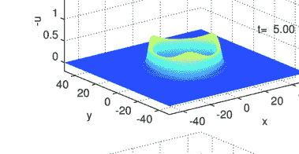

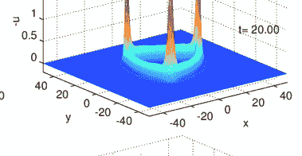

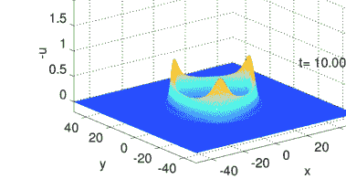

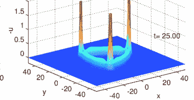

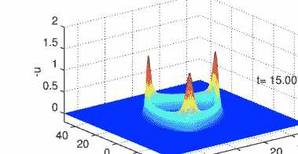

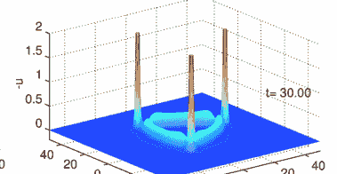

FIGURE 2. Evolution of a KdV ring by NV at zero energy

### EXAMPLE 4.4. With the initial value of the KdV ring in Example 4.3, we evolve the solution by the NV equation (4.1) and (4.2) with a positive energy E = 1/8. Time snapshots of the evolution are plotted in Figure 3. The initial dynamics are comparable to the previous example at zero energy: three spikes appear and grow rapidly in size, but as time progresses, these spikes decay in amplitude, and separate from the previous KdV ring, and a new triple of spikes appears. The process is repeated. Observe that the solution exists at least until time t = 100, also confirmed by the graph of the L₂ norm of the solution as function of time in Figure 4.

#### 4.2. Closed-form Solutions.

Most, if not all, soliton equations admit traveling waves solutions that involve the hyperbolic secant function, which can be


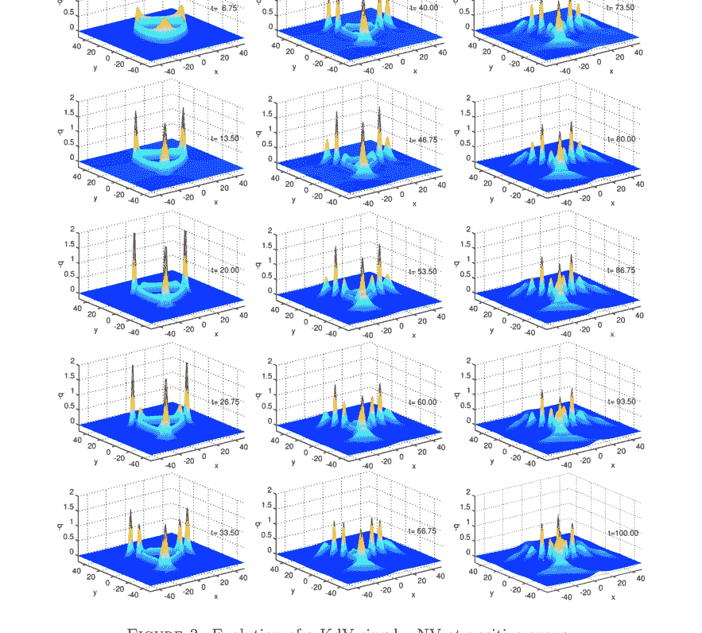

图 3. 正能量下 NV 的 KdV 环演化

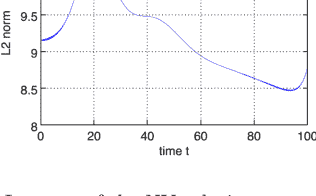

图 4. 正能量下 NV 解的 L₂ 范数

用双曲正切函数表示。此外，双曲正切函数是 Riccati 方程 φ' = l₀ + φ² 在 l₀ < 0 且满足特定初始条件时的解。双曲函数作为行波解的普遍存在自然地导致了求解孤子方程的展开方法思想。

文献中 NV 方程的解包括逆散射变换的解 [44–46, 64]、经典的双曲正割和椭圆余弦解 [60]，以及利用 Darboux 变换得到的导致有限时间爆破的有理解（参见 [88] 及其中参考文献）。在本节中，我们使用 Hirota 双线性方法和扩展映射方法 EMA 提出了 NV 方程的新解。利用修正扩展双曲正切函数法得到的新多行波解可在 [14] 中找到。该方法得到闭式解，其中大多数含有奇点。我们注意到 Hirota 方法得到的解是平面波解，即 KdV 型解，而 EMA 导出的解则不是。

##### 4.2.1. Hirota 方法。

遵循 Hirota [31] 的开创性工作，多孤子解可利用 Hirota 双线性方法导出。该方法将多孤子解作为指数的多项式之和，并在 [94] 中用于寻找 Nizhnik-Novikov-Veselov 方程的多孤子解

```
q̇ = −a qₓₓₓ + b qᵧᵧᵧ − 3a(q u₁)ₓ − 3b(q u₂)ᵧ
qₓ = (u₁)ᵧ
qᵧ = (u₂)ₓ
```

主要思想是通过涉及对数函数的变换将非线性方程化为双线性形式。为了用色散系数表示波速 c，假设 u 是平面波解且 k₁ = k₂ = k，u = e^{k x + k y − c t}，并将 u 代入 (2.1)。由此得到 c = −k³/2。在变换 q = R(ln(f))ₓₓ，v = R(ln(f))ₓᵧ，w = R(ln(f))ᵧᵧ 且 f(x, y, t) = 1 + C e^{k x + k y + k³/2 t}，C 为任意常数时，可代数求解 R 得到双线性形式（可求得 R = 2）。该方法得到孤子解

```
(4.5) q(x, y, t) = u₁(x, y, t) = u₂(x, y, t) = \frac{2 C k² e^{k (2 x + 2 y + k² t)/2}}{\left(1 + e^{k (2 x + 2 y + k² t)/2}\right)²}.
```

选择

```
f(x, y, t) = 1 + e^{θ₁} + e^{θ₂} + a₁₂ e^{θ₁ + θ₂},
```

其中 θᵢ = kᵢ x + kᵢ y + ½ kᵢ³ t，i = 1, 2，在上述对数变换中代入可得到双孤子解，其中 a₁₂ 用 k₁ 和 k₂ 表示为 a₁₂ = (k₁ − k₂)²/(k₁ + k₂)²

```
q(x, y, t) = \frac{2\left(k₁² e^{θ₁} + k₂² e^{θ₂} + (k₁ − k₂)² e^{θ₁ + θ₂}\right)}{1 + e^{θ₁} + e^{θ₂} + \frac{(k₁ − k₂)²}{(k₁ + k₂)²} e^{θ₁ + θ₂}} − \frac{2\left(k₁ e^{θ₁} + k₂ e^{θ₂} + \frac{(k₁ − k₂)²}{k₁ + k₂} e^{θ₁ + θ₂}\right)²}{\left(1 + e^{θ₁} + e^{θ₂} + \frac{(k₁ − k₂)²}{(k₁ + k₂)²} e^{θ₁ + θ₂}\right)²}. (4.6)
```

双孤子解的演化在图 5 中绘制。更多细节和三孤子解见 [14]。

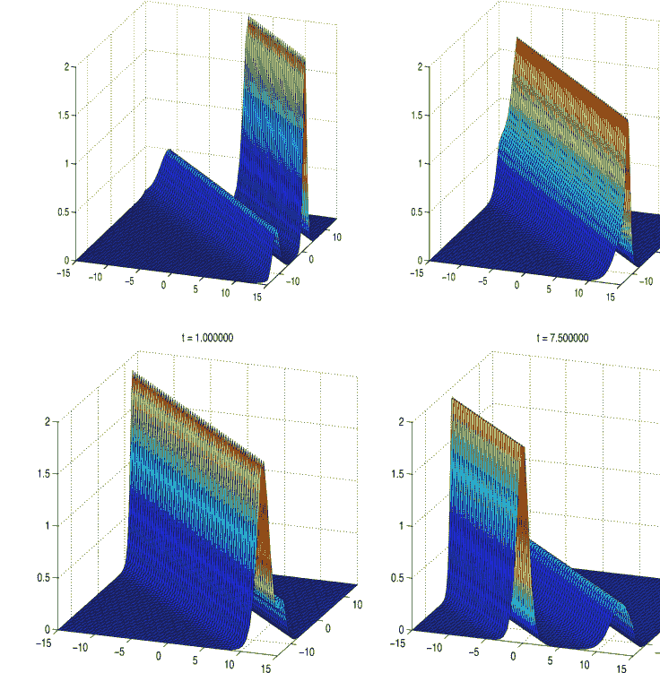

图 5. 由 Hirota 双线性方法导出的 2-孤子解演化的时间快照。

##### 4.2.2. 扩展映射方法。

扩展映射方法 EMA 由 Zheng [97] 正式提出，并扩展了 Lou 和 Ni [47] 的结果。该方法旨在寻找非线性 PDE 之间的映射。在该方法中，q、v、w 用满足 Riccati 方程的函数 φi 展开

\frac{d\phi}{dR} = \ell_0 + \phi^2,

其中 R = R(x, y, t)。因此，q(x, y, t) = \sum_{i=0}^n a_i \phi^i，v(x, y, t) = \sum_{i=0}^m b_i \phi^i，w(x, y, t) = \sum_{i=0}^k c_i \phi^i，其中 n、m 和 k 的值由平衡 PDE 的最高阶导数项与非线性项确定。该方法在 [78] 中有很好的描述。平衡方法得到 n = m = k = 2。将这些展开式代入 NV 方程并等同 φ 的结果多项式的系数可得到由

我们需要求解系数 $a_i(x,y,t)$、$b_i(x,y,t)$ 和 $c_i(x,y,t)$，$i = 1,2$ 的十三个 PDE 系统。使用 R 的分离技术，即 $R(x,y,t) = p(x,t) + q(y,t)$ 可得到 $sech^2$ 解、静态（时间无关）解以及 NV 方程的呼吸子型解。更多细节，包括 φ 的选择见 [14]。一个时间无关解为

$q(x,y,t) = \frac{-1728 y^6 + (-96 + 1728 C) y^4 + (-40 + 288 C) y^2 - 36 C + 5}{432 y^4 - 36 y^2} - 4 \tanh(x + y^2) + (2 + 8 y) \tanh^2(x + y^2)$

$v(x,y,t) = \frac{144 y^4 + (-12 + 432 C) y^2 - 36 C + 5}{36 y^2} + 4 \tanh(x + y^2) + (2 - 8 y) \tanh^2(x + y^2)$

$w(x,y,t) = 8 y - 8 y \tanh^2(x + y^2)$

其中 $C$ 为任意常数。图 6 显示了 $C = 1$ 时解 $q$ 的图像。

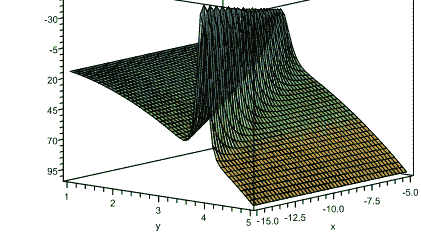

图 6. NV 方程的一个静态解

呼吸子解是具有时间上周期性往返运动类型的解。来自 [14] 的一个特定呼吸子解为

```
q(x, y, t) = [-1728 y^6 + (-96 + 1728 C) y^4 + (-40 + 288 C) y^2 - 36 C + 5] / [432 y^4 - 36 y^2] - 4 tanh(1 + x + y^2 + 4 cos t) + (2 + 8 y^2) tanh^2(1 + x + y^2 + 4 cos t)
```

```
v(x, y, t) = [-192 sin(t) y^2 + 144 y^4 + (-12 + 432 C) y^2 - 36 C + 5] / [36 y^2] + 4 tanh(1 + x + y^2 + 4 cos t) + (2 - 8 y^2) tanh^2(1 + x + y^2 + 4 cos t)
```

```
w(x, y, t) = 8 y - 8 y tanh^2(1 + x + y^2 + 4 cos t).
```

若干时间快照显示在图 (7) 中。对于多孤子解，读者可参阅 [14]。

对于多孤子解，读者可参阅 [14]

#### 4.3. 时间零点处环孤子的散射变换。

在本节中，我们数值计算了示例 4.3 中讨论并在图 2 中示意的 KdV 环孤子的散射变换。由于初始势是超临界的，我们期望散射变换具有奇点。由于初始势在 z 平面中为实值且旋转对称，散射变换也在 k 平面中为实值且旋转对称。参见 [56, 附录 A] 的证明。因此只需计算 t(k) 在实数且正的 k 上即可。

我们同时使用第 3.2 节中描述的 LS 和 DN 方法，并比较结果以验证精度。在范围 0.1 ≤ |k| ≤ 4 内结果可靠，因为 NV 和 LS 方法的结果在该处非常接近。然而，DN 方法对 |k| > 4 的结果不可靠。

为确保 |k| > 4 的精度，我们比较了 z 域中两种不同网格的 LS 方法结果。较粗网格有 4096 × 4096 个点，较细网格有 8192 × 8192 个点。较粗网格不是较细网格的子集。我们指出，这两个网格都比我们通常用于计算导电性型势的散射变换的网格精细得多。由于内存需求高，我们使用了配备 192 GB 内存的液冷 HP Z800 工作站。即使使用如此强大的机器，使用较细网格评估一个点值也需要超过 11 小时。LS 方法在区域 3 ≤ |k| ≤ 5 和 |k| > 9 中给出非常匹配的结果。

图 8 显示了散射变换的轮廓。在区间 5 < |k| < 9 中，数值计算不收敛，导致散射变换点值的错误评估或由于耗尽所有内存而导致算法完全失败。我们怀疑观察到的数值发散源于区间 5 < |k| < 9 中至少存在一个例外圆。

## NOVIKOV-VESELOV 方程

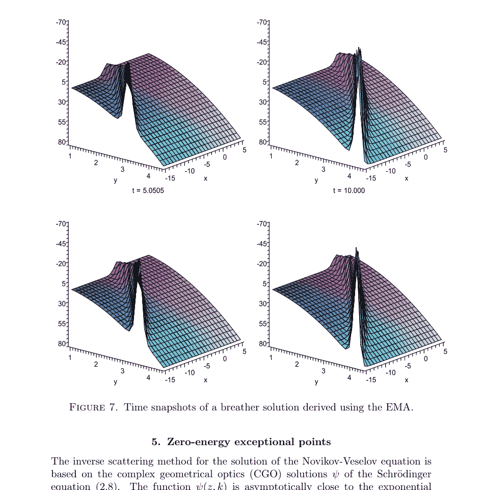

图 7. 利用 EMA 导出的呼吸子解的时间快照。

### 5. 零能量例外点

Novikov-Veselov 方程逆散射方法的解基于薛定谔方程 (2.8) 的复几何光学 CGO 解 ψ。函数 ψ(z,k) 在公式 (2.9) 的意义上渐近地接近指数函数 e^{ikz}；关键在于 ψ 可用于定义专门为线性化 NV 方程而设计的非线性傅里叶变换 t(k)。参见上文图 (1.5)。

然而，使用 ψ 和 t 可能存在困难。即使对于光滑且紧支撑的势 q ∈ C₀^∞，也可能存在复数 k ≠ 0，使得方程 (2.8) 不存在满足渐近条件 (2.9) 的唯一解。这样的 k 称为 q 的例外点。文献 [56] 中表明，q 的例外点以以原点为中心的圆出现，且散射变换具有强


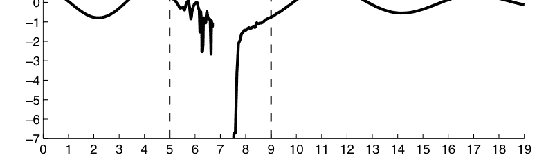

FIGURE 8. KdV 环状孤子散射变换 t(k) 的剖面，k 在正实轴上取值。计算在区域 5 < |k| < 9 内不稳定，暗示存在一个例外圆。

在圆上出现奇点。该奇点阻止了目前所理解的逆非线性傅里叶变换在图式 (1.5) 中的任何使用。似乎可以安全地假设，对于更一般的势，情况只会更糟。

例外点与 Novikov-Veselov 方程解的动力学之间有什么联系？例如，初始数据中不存在例外点是否能保证光滑的 NV 演化？例外点是否可能对应于孤子或有限时间爆破？这种猜想已在 [9, page 27] 中提出，但问题仍然开放。

本节致力于一个计算实验，说明旋转对称势的参数族的例外点。该示例阐明了例外点与 Definition 1.1 中给出的超临界/临界/亚临界三分法之间的关系。

取一个径向 C₀² 函数 w(z) = w(|z|)，如图 9 所示。w 的详细定义见 [55, Section 5.1]。定义势族 q_λ = λ w，由 λ ∈ ℝ 参数化。现在 λ = 0 时 q₀ ≡ 0，它是一个临界势，因为它以正函数 σ ≡ 1 作为 q₀ = σ⁻¹Δσ 而出现。根据 Murata [52] 可知 λ < 0 给出超临界势而 λ > 0 给出亚临界势。详见 [56, Appendix B]。

我们使用第 3.2 节描述的 DN 方法来计算势 q_λ 的散射变换，参数 λ 在区间 [−25,5] 中取值。由于每个势 q_λ(z) 在 z 平面中为实值且旋转对称，散射变换在 k 平面中也为实值且旋转对称。详见 [56, Appendix A]。因此只需计算 t(k) 沿正实轴取值即可。在图 11 中我们以二维灰度图像的形式展示了计算结果。

已知临界势没有非零例外点；见 [56,58]。因此在图 11 中 λ = 0 时没有奇点（实际上在这个简单例子中我们有 T q₀ ≡ 0）。此外，Neumann 级数论证表明，对于固定的 λ，存在正常数 K = K(λ)，使得对于满足 |k| > K 的 q_λ 没有例外点。见 [58, above formula (1.12)] 中的分析。

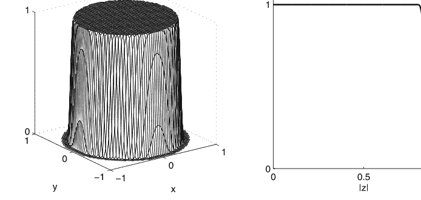

FIGURE 9. 左：旋转对称测试函数 w(z)。右：剖面 w(|z|)。

根据 [54]，亚临界势没有非零例外点。因此在参数值 λ ≥ 0 时图 11 中没有奇点。（我们指出，[56] 中图 3 和图 9 右上角看似例外的曲线是由于 λ 的正值很大时数值精度下降造成的。那些图仅在 λ 接近零时才可信。）

对于接近零的负 λ，根据 [56] 知道恰好存在一个例外点圆。该半径作为 λ 的函数的渐近形式在 [56] 中被显式计算。

对于 λ << 0，截至目前对例外点的理解并不精确；数值证据如 图 11 表明可能存在多个例外圆。此外，在 λ ≈ −8 和 λ ≈ −20.5 附近似乎发生了某些有趣的事情；目前尚无解释。

见 [56] 了解更多零能例子，见 [77] 了解正能情况下例外点的类似证据。

### 6. Open Problems

#### 6.1. Applications of the NV Equation.

平稳 NV 方程 [19] 和修正 NV 方程 [83] 在微分几何中有应用。虽然 NV 方程 (1.1) 不为人所知是任何物理动力学系统的数学模型，但对于色散less Novikov-Veselov (dNV) 方程已有一些研究

```
(6.1)
q_ξ = (u q)_z + (\bar{u} q)_\bar{z}
u_\bar{z} = -3 q_z.
```

方程 (6.1) 在 [43] 中被推导为各向异性介质中 Maxwell 方程的几何光学极限。该模型支配高频 ω 的单色电磁 (EM) 波的传播。特别是，他们考虑了介电函数和磁导率对频率具有 Cole-Cole 依赖性 [12] 的非线性介质。假设所有量沿 z 轴缓慢变化，证明 Maxwell 方程化为 (6.1)，其中 q = n² 为折射率，ξ 是由 z = ω'' ξ 定义的“慢”变量。电场的相位受 [43] 支配

```
(6.2)
S_x^2 + S_y^2 = n^2(x, y, ξ)
S_ξ = φ(x, y, ξ; S_x, S_y)
```

对于实值函数 φ，dNV 层级表征相位和折射率两者。

在 [8] 中给出了 dNV 方程的流体动力学型约化，但这些约化的物理解释留待未来工作。有趣的开放问题是，NV 方程中色散项的加入是否以与 dNV 方程推导出的相关方式建模 EM 波，以及 NV 或 dNV 是否作为任何流体动力学现象的物理模型。

# Profile of potential

# Profile of scattering transform

λ = 5

λ = 0

λ = −5

λ = −10

FIGURE 10. 左列：由不同 λ 值产生的旋转对称势 q_λ(|z|) 的剖面。右列：相应散射变换 t_λ(|k|) 的剖面。请注意，λ 的负值导致散射变换奇异的例外圆。另见图 11，其中显示了对应于更多 λ 值的散射变换剖面。

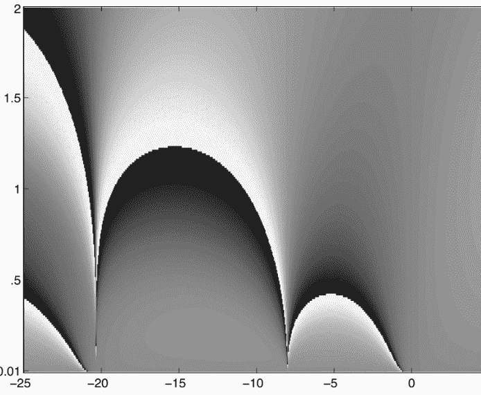

FIGURE 11. 旋转对称散射变换的剖面。较浅的阴影表示较大值，较暗的阴影表示较小值。水平轴为势定义 q_λ(z) = λ w(z) 中的参数 λ。垂直轴为 |k|。存在沿其出现奇异跳跃“从 −∞ 到 +∞”的曲线，以从黑色到白色的急剧变化表示。那些曲线上的 k 值是例外点。请注意，对应于 λ = −10、−5、0、5 的剖面也在图 10 中显示。

#### 6.2. Exceptional Sets and Large-Time Behavior for the NV Equation.

回顾势 q0 的例外集是所有使得不存在唯一的 NCGO 解 μ(z,k) 的 k ∈ ℂ 的集合。这里我们讨论以下之间的关系：(1) “例外集的‘大小’”，(2) 势 q0 是否为亚临界、临界或超临界（回顾这一三分法，见引言中的 Definition 1.1）以及 (3) 以 q0 为初始数据的 NV 方程是否有整体解。在这些评论中，我们通常将注意力限制在属于空间 Lpρ(ℝ²) 且 ρ > 1 且 p ∈ (1,2) 的实值势 q0 上（见 Definition 1.3 前的说明）；可以认为势的阶为 O(|z|⁻²⁻ᵉ) 当 |z| → ∞。回顾在逆散射文献中，临界势通常被称为“电导率型势”。

迄今为止，关于零能 NV 方程例外集大小的唯一严格结果是 Nachman [58] 和 Music [54] 的结果。如上所述，Nachman 证明势是电导率型（或等价地，如引言 Definition 1.1 中定义的临界势）当且仅当例外集为空且散射变换 t(k) 为 O(|k|ᵉ) 当 |k| → 0 对某个 ε > 0。Music 扩展了 Nachman 的思想和技术，证明具有无穷远充分衰减的亚临界势具有空的例外集并刻画了 |k| → 0 时势的奇异性。Perry [67] 证明了，如果 q0 是足够光滑的临界势，则以 q0 为初始数据的 NV 方程具有整体时间解。有强有力的证据表明，类似的结果可以证明 NV 方程具有亚临界初始数据，这基于 Music [54] 的工作。

因此，仍需理解超临界势的散射变换的奇异性。Grinevich 和 Novikov [30] 以及 Music、Perry 和 Siltanen [56] 的例子表明超临界势可能具有例外点圆。尚不清楚超临界势必须或可能具有例外点，也尚不清楚如何将逆散射形式主义扩展到具有非空例外集的势。Brown、Music 和 Perry [10] 的以下结果给出了对特别好的势的例外集大小的初始约束。

THEOREM 6.1. [10] 假设 q 是实值可测值函数，具有性质 |q(z)| ≤ C1 exp(−C2|z|) 对某些常数 C1 和 C2 成立。则 q 的例外集至多由孤立点组成，外加至多有限条光滑曲线，且至多有有限个交点。

为了分析例外集，作者定义了一个重整化行列式，其零点集恰好是例外集。为描述它，设 Tk 是积分算子

```
Tkψ = 1/4 gk * (qψ).
```

μ(z,k) 的微分方程，NCGO 解，可重写为 μ = 1 + Tkμ。因此解的唯一性等价于 (I − Tk) 的可逆性，例外集恰好是 (I − Tk) 失效可逆的 k 点集合。可以证明 Tk 是从 Lp 到自身的紧线性算子


对于任意 p > 2，且 T_k 属于 L^p 上积分算子的所谓 Mikhlin-Itskovich 代数。因此我们可以应用 Gohberg、Goldberg 和 Krupnik [21] 提出的重正化行列式理论并定义

```
Δ(k) = det₂(I − T_k)
```

其中行列式 det₂ 是重正化行列式。Brown、Music 和 Perry 证明了对于指数衰减势，该行列式是 k 的实解析函数。现在由 Weierstrass 准备定理可知，Δ(k) 的零点集局部上是多项式的零点集。由于例外集已知是闭且有界的，可以利用有限多个这样的局部表示完全分析 Δ(k) 在例外集附近的行为。可以证明 Δ(k) 也是实值函数，由此可知零点集具有所声称的形式。

定理 6.1 为进一步研究开辟了多个领域。

首先，确定在 t(k) 具有点或线奇异性时，从 t(k) 重构势所需的额外数据将是很有意义的。

其次，很有兴趣知道奇异性是否对超临界势总是存在，或者相反，奇异性在一般情况下是否不存在。

第三，通过将散射变换的‘谱’性质（即其奇异性的性质）与解的长期行为联系起来，我们对 NV 方程及其动力学的理解将得到极大改善。t(k) 的时间演化形式表明，亚临界、临界和超临界势的‘三分法’在 NV 流下是不变的。已知临界初值数据会产生整体解（见 [68]），并且有强有力的证据表明亚临界初值数据也是如此。另一方面，像环状孤子、例 4.3 这样的数值实验，以及 Taimanov 和 Tsarev [85–88] 产生的解析解，都强烈表明超临界初值数据会导致 NV 的解在有限时间内爆破。得到严格证明该情况成立，并通过逆散射方法分析爆破的性质，将是很有趣的。

### 附录 A. 有用的分析

在零能量的直接散射问题中，Faddeev 的格林函数在阐明定义散射变换的 CGO 解的性质方面起着关键作用。回想一下，归一化的 CGO 解满足方程

```
∂̄(∂ + i k) μ = (1/4) q μ
```

并且 Faddeev 的格林函数是算子 ∂̄(∂ + i k) 的格林函数。另一方面，固体 Cauchy 变换是 ∂̄ 算子的逆，其值域在 p > 2 的 L^p 函数中，因此是求解定义逆散射变换的 ∂̄ 问题的根本工具。最后，Beurling 变换是一个积分算子，它为 NV 方程中非线性定义中出现的算子 ∂̄⁻¹ ∂ 赋予了意义。在这里我们收集了这些变换的一些有用性质和一些基本估计。

#### A.1. 零能量下的 Faddeev 格林函数。

我们回顾 Faddeev 格林函数 g_k 的一些关键事实。我们将读者引向 Siltanen 的论文 [75] 以获取细节和文献参考。

回想一下 $g_k$ 由公式定义

$$g_k(z) = \frac{1}{(2\pi)^2} \int e^{i\xi\cdot x} \frac{1}{\xi(\xi + k)} \, dm(\xi)$$

其中 $z = x_1 + i x_2$, $\xi \cdot x = \xi_1 x_1 + \xi_2 x_2$, $\xi = \xi_1 + i \xi_2$, 且 $\bar{\xi} = \xi_1 - i \xi_2$。由 Hausdorff-Young 不等式可知，$g_k \in L^p$ 对任意 $p > 2$ 成立。事实上，估计

$$\|g_k\|_p \le C_p |k|^{-2/p}$$

（见 Siltanen [75]，定理 3.10）对任意 $k \neq 0$ 成立。需要注意的是

$$g_k(z) = g_1(kz).$$

$g_1(x)$ 的以下大 $x$ 渐近展开在 [75]，定理 3.11 中证明。

# 引理 A.1. 设 $z = x_1 + i x_2$ 且 $z \neq 0$ 且 $x_1 > 0$。对任意整数 $N \ge 0$,

(A.1)
$$g_1(z) = -\frac{1}{4\pi} \sum_{j=0}^{N} \left[ \frac{j!}{(iz)^{j+1}} - e^{-2 i x_1} \frac{j!}{(-i \bar{z})^{j+1}} \right] + E_N(z)$$

其中

(A.2)
$$|E_N(z)| \le \frac{(N+1)! 2^{(N+1)/2}}{\pi |z|^{N+2}}.$$

由于 $g(-x_1 + i x_2) = \overline{g_1(x_1 + i x_2)}$，当 $x_1 < 0$ 时有类似公式。

# 备注 A.2. 由于误差估计 (A.2) 不依赖于条件 $x_1 > 0$，并且 $g_1(z)$ 是连续的，我们可以得出结论，展开式 (A.1) 对 $z \neq 0$ 且 $\operatorname{Re}(z) = 0$ 仍然成立。

现在考虑 $g_k(z) = g_1(kz)$。由于 $\operatorname{Re}(kz) = \frac{1}{2}(kz + \bar{k}\bar{z})$，我们立即得到：

# 引理 A.3. 设 $z = x_1 + i x_2$ 且 $k \in \mathbb{C}$。对任意整数 $N \ge 0$，展开式

(A.3)
$$g_k(z) = -\frac{1}{4\pi} \sum_{j=0}^{N} \left[ \frac{j!}{(i k z)^{j+1}} - e^{-i(kz + \bar{k}\bar{z})} \frac{j!}{(-i \bar{k}\bar{z})^{j+1}} \right] + E_N(kz)$$

成立，其中

$$|E_N(kz)| \le C_N |kz|^{-(N+2)}.$$

#### A.2. Cauchy 变换和 Beurling 算子。

遵循 [3]，第 4 章，我们通过与二维 Poisson 方程相关的对数势研究 Cauchy 变换和 Beurling 算子。对于 $\varphi \in \mathcal{C}_0^\infty(\mathbb{R}^2)$，我们可以定义对数势

$$(L\varphi)(z) = \frac{2}{\pi} \int \log|z - z'| \, \varphi(z') \, dm(z')$$

它具有性质

$$\bar{\partial}\bar{\partial}(L\varphi) = \varphi.$$

与 $L$ 相关的是 Cauchy 变换，

$(P\varphi)(z) = \frac{\partial}{\partial z} (L\varphi)(z),

变换

$(\overline{P}\varphi)(z) = \frac{\partial}{\partial \overline{z}} (L\varphi)(z),

以及 Beurling 变换

$(\mathcal{S}\varphi)(z) = \frac{\partial^2}{\partial z^2} (L\varphi)(z).

由这些定义和 (3.2) 可知

(A.4) $P \circ \frac{\partial}{\partial \overline{z}} = \frac{\partial}{\partial \overline{z}} \circ P = I$

其中 $I$ 是 $\mathcal{C}_0^\infty(\mathbb{R}^2)$ 上的恒等算子，且

(A.5) $\mathcal{S}\left(\frac{\partial \varphi}{\partial \overline{z}}\right) = \frac{\partial \varphi}{\partial z}.$

我们有

$(P\varphi)(z) = \frac{1}{\pi} \int \frac{1}{z - z'} \varphi(z') \, dm(z'),

$(\overline{P}\varphi)(z) = \frac{1}{\pi} \int \frac{1}{\overline{z - z'}} \varphi(z') \, dm(z'),

且

(A.6) $(\mathcal{S}\varphi)(z) = -\frac{1}{\pi} \lim_{\varepsilon \downarrow 0} \left( \int_{|z - z'|>\varepsilon} \frac{1}{(z - z')^2} \varphi(z') \, dm(z') \right).$

关于 $P$ 的以下估计将 Cauchy 变换推广到 $L^p$ 空间，并且是 Hardy-Littlewood-Sobolev 和 Hölder 不等式的标准推论（见 Vekua [92] 或 [3]，§4.3）。它们用于证明定义逆问题的 $\overline{\partial}$ 问题的存在性和唯一性。

# 引理 A.4. (i) 对任意 $p \in (2, \infty)$ 和 $f \in L^{2p/(p+2)}(\mathbb{R}^2)$,

(A.7) $\|P f\|_p \le C_p \|f\|_{2p/(p+2)}.$

(ii) 对任意满足 $1 < q < 2 < p < \infty$ 的 $p,q$ 和任意 $f \in L^p(\mathbb{R}^2) \cap L^q(\mathbb{R}^2)$，估计

(A.8) $\|P f\|_\infty \le C_{p,q} \|f\|_{L^p \cap L^q}$

成立。此外，$P$ 是阶为 $(p-2)/p$ 的 Hölder 连续的，且有

(A.9) $|(Pf)(z) - (Pf)(w)| \le C_p |z - w|^{(p-2)/p} \|f\|_p.$

(iii) 若 $v \in L^s(\mathbb{R}^2)$ 且 $q > 2$ 满足 $q^{-1} + 1/2 = p^{-1} + s^{-1}$，则对任意 $f \in L^p(\mathbb{R}^2)$,

(A.10) $\|P(vf)\|_q \le C_{p,q} \|v\|_s \|f\|_p.$

# 备注 A.5. 由于 $\mathcal{C}_0^\infty(\mathbb{R}^2)$ 在 $L^p \cap L^q$ 中稠密，并且 $(Pf)(z) = \mathcal{O}(z^{-1})$ 当 $|z| \to \infty$ 对任意 $f \in \mathcal{C}_0^\infty(\mathbb{R}^2)$ 成立，由 (ii) 可知，若 $f \in L^p \cap L^q$ 对 $1 < p < 2 < q < \infty$，则 $Pf \in C_0(\mathbb{R}^2)$，即在无穷远处消失的连续函数。

# 备注 A.6. 注意在 (A.10) 中取 s = q 时有

‖P(vf)‖_p ≤ C_p ‖v‖_2 ‖f‖_p.

对任意 $f \in L^{2p/(p+2)}(\mathbb{R}^2)$，引理 A.4 连同 (A.4) 意味着 $u = Pf$ 在分布意义下求解 $\bar{\partial}u = f$。另一方面，假设 $u \in L^p(\mathbb{R}^2)$ 对某个 $p \in [1,\infty)$ 且 $\bar{\partial}u = 0$ 在分布意义下成立。则可知 $\partial\bar{\partial}u = 0$ 在分布意义下成立，从而由 Weyl 引理可知 $u \in C^\infty$。因此，$u$ 实际上是全纯的，由 Liouville 定理可知 $u$ 恒等于零。由这一事实和 (A.4)，我们推得：

# 引理 A.7. 设 $p \in (2,\infty)$，$u \in L^p(\mathbb{R}^2)$，$f \in L^{2p/(p+2)}(\mathbb{R}^2)$，且 $\bar{\partial}u = f$ 在分布意义下成立。则 $u = Pf$。反之，若 $f \in L^{2p/(p+2)}(\mathbb{R}^2)$ 且 $u = Pf$，则 $\bar{\partial}u = f$ 在分布意义下成立。

以下关于 $f$ 快速衰减时 $\bar{\partial}u = f$ 的解的展开式导致了 $\mu(z,k)$ 的大 $k$ 渐近展开。

# 引理 A.8. 设 $p \in (2,\infty)$，$u \in L^p(\mathbb{R}^2)$，$f \in L^{2p/(p+2),N}(\mathbb{R}^2)$，且 $\bar{\partial}u = f$。则

z^N [ u(z) - Σ_{j=0}^{N-1} 1/z^{j+1} ∫ ζ^j f(ζ) dm(ζ) ] ∈ L^p(ℝ²).

# 证明. 估计 (A.7)、引理 A.7 以及公式

1/(z - ζ) = 1/z Σ_{j=0}^{N-1} (ζ/z)^j + 1/z^N ζ^N/(z - ζ).

的直接推论。

# 备注 A.9. 若 $f \in S(\mathbb{R}^2)$ 且关于参数光滑依赖，则渐近展开在逐点意义下成立并且关于参数可微。

主值积分 (A.6) 将 S 识别为 Calderón-Zygmund 型积分算子。我们有（见例如 [3]，§4.5.2）：

# 引理 A.10. 设 $p \in (1,\infty)$。算子 S 延拓为从 $L^p(\mathbb{R}^2)$ 到自身的有界算子，若 $p = 2$ 则为酉算子。此外，若 $\nabla\varphi$ 属于 $L^p(\mathbb{R}^2)$ 对 $p \in (1,\infty)$，则 $S(\partial\varphi) = \bar{\partial}\varphi$。

### 参考文献

- [1] Angelopoulos, Y. Well-posedness and ill-posedness results for the Novikov-Veselov equation. Preprint, arXiv:1307.4110[Math.AP].
- [2] C. Athorne and J. J. C. Nimmo, On the Moutard transformation for integrable partial differential equations, Inverse Problems 7 (1991), no. 6, 809–826. MR1140316 (92k:35011)
- [3] Kari Astala, Tadeusz Iwaniec, and Gaven Martin, Elliptic partial differential equations and quasiconformal mappings in the plane, Princeton Mathematical Series, vol. 48, Princeton University Press, Princeton, NJ, 2009. MR2472875 (2010j:30040)
- [4] Kari Astala and Lassi Päivärinta, Calderón’s inverse conductivity problem in the plane, Ann. of Math. (2) 163 (2006), no. 1, 265–299, DOI 10.4007/annals.2006.163.265. MR2195135 (2007b:30019)
- [5] Richard Beals and R. R. Coifman, Linear spectral problems, nonlinear equations and the ∂̄-method, Inverse Problems 5 (1989), no. 2, 87–130. MR991913 (90f:35171)


...[/content]中。注意原文开头和结尾都有[content]标记，我们输出时也要包含。

另外，注意用户要求“不要重复输出原文”，我们只输出译文。

现在，检查格式：列表项以"- "开头，我们保持。注意原文中每个列表项是单独一行，我们保持。

现在，考虑是否需要对作者名进行翻译？不，保留。

注意[36]中“Thèse”是法语，我们翻译为“博士论文”。注意“École Polytechnique”我们翻译为“巴黎综合理工学院”。但也可以保留原文。我选择翻译。

注意[14]中“ProQuest LLC”保留，“Ann Arbor, MI”保留，但“Thesis (Ph.D.)–Colorado State University”翻译为“博士论文——科罗拉多州立大学”。注意破折号。

注意[21]中“Birkhäuser Verlag”保留，但“Basel”可译为“巴塞尔”。我保留“Basel”或翻译？通常地名可以翻译。我选择保留“Basel”，因为常见。或者翻译为“巴塞尔”。为了统一，我保留原文地名。实际上，在参考文献中，地名通常保留。我决定保留所有地名，除了“Moscow”等？不，保留。

注意[26]中“Kiev”可译为“基辅”，但保留原文也可以。我选择保留“Kiev”，因为这是英文拼写。但中文中常用“基辅”。为了翻译，我可以翻译。但注意这是会议地点，保留原文更安全。我决定保留原文地名，除非是常见翻译。实际上，用户要求翻译内容，但地名是专有名词，可以保留。我保留。

注意[36]中“École Polytechnique”是专有名词，我翻译为“巴黎综合理工学院”可能更好。但也可以保留。我选择翻译。

注意[14]中“Colorado State University”翻译为“科罗拉多州立大学”。

注意[15]中“Soc. Brasil. Mat.”是“Brazilian Mathematical Society”的缩写，保留。

注意[26]中“World Sci. Publishing”保留。

注意[33]中“Chinese Physics Letters”是期刊名，保留。

现在，检查一些翻译的准确性：

- [8] “real dispersionless Bessel-Novikov equation” 中的“real”可能指“实的”，即实值。我译为“实无色散Bessel-Novikov方程”。正确。
- [16] “New lumps” 我译为“新团块解”。注意“lumps”是复数，但中文没有复数。可以。
- [17] “Modified extended tanh-function method” 我译为“修正的扩展tanh函数法”。注意“tanh-function”保留。
- [18] “Increasing solutions” 我译为“递增解”。正确。
- [22] “Rational solitons” 我译为“有理孤子”。正确。
- [23] “with a potential that decreases at infinity” 我译为“具有无穷远处衰减势”。注意“at fixed nonzero energy”修饰整个？实际上“at fixed nonzero energy”是“在固定非零能量下”。我翻译为“固定非零能量下具有无穷远处衰减势的二维薛定谔算子的散射变换”。顺序有点乱。原文是“The scattering transform for the two-dimensional Schrödinger operator with a potential that decreases at infinity at fixed nonzero energy”。意思是“在固定非零能量下，对于具有无穷远处衰减势的二维薛定谔算子的散射变换”。我的翻译“固定非零能量下具有无穷远处衰减势的二维薛定谔算子的散射变换”可以理解。但更准确的是“固定非零能量下，具有无穷远处衰减势的二维薛定谔算子的散射变换”。我调整一下：*固定非零能量下具有无穷远处衰减势的二维薛定谔算子的散射变换*。可以。
- [28] “A two-dimensional “inverse scattering problem” for negative energies, and generalized-analytic functions. I. Energies lower than the ground state” 我译为“负能量的二维‘逆散射问题’与广义解析函数。I. 低于基态的能量”。注意“for negative energies”修饰“inverse scattering problem”，所以是“负能量的二维逆散射问题”。正确。
- [29] “Transparent potentials at fixed energy in dimension two. Fixed-energy dispersion relations for the fast decaying potentials” 我译为“二维固定能量下的透明势。快速衰减势的固定能量色散关系”。注意“in dimension two”是“在二维中”，我译为“二维固定能量下的透明势”有点歧义，应为“二维中固定能量下的透明势”。我调整：*二维中固定能量下的透明势。快速衰减势的固定能量色散关系*。但为了简洁，可以。我修改为“二维中固定能量下的透明势”。
- [31] “Exact N-soliton solutions of the wave equation of long waves in shallow-water and in nonlinear lattices” 我译为“浅水长波与非线性晶格中波动方程的精确N-孤子解”。注意“wave equation of long waves”是“长波的波动方程”，我译为“波动方程”可能不够准确。应为“浅水中长波和非线性晶格中波动方程的精确N-孤子解”。我调整：*浅水中长波与非线性晶格中波动方程的精确N-孤子解*。但原文是“the wave equation of long waves in shallow-water and in nonlinear lattices”，意思是“浅水中和非线性晶格中长波的波动方程”。所以翻译为“浅水中和非线性晶格中长波波动方程的精确N-孤子解”。我修改。
- [34] “Examples of the nonexistence of a traveling wave” 我译为“行波不存在性的例子”。正确。
- [35] “A large-time asymptotics” 我译为“长时间渐近”。注意“asymptotics”是复数形式，但中文用单数。
- [40] “Regularized D-bar method” 我译为“正则化D-bar方法”。正确。
- [41] “dbar-equation” 我保留。

现在，注意[16]中“$\bar{\partial}$-dressing method” 我写了“$\bar{\partial}$- dressing方法”，注意空格。原文是“$\bar{\partial}$-dressing method”，没有空格。我应保留“$\bar{\partial}$-dressing方法”。注意LaTeX代码中的反斜杠和花括号要保留。我写为“$\bar{\partial}$-dressing方法”。注意“dressing”保留英文。

现在，注意[27]中“∂-method” 我写为“∂-方法”。注意“∂”是Unicode字符，保留。

现在，检查标点：原文中有些条目以句点结尾，我们保留。注意[10]以“In preparation.”结尾，我们翻译为“准备中。”注意句点。

注意[13]以“Preprint (2013).”结尾，我们翻译为“预印本（2013年）。”注意句点。

注意[36]以URL结尾，没有句点，我们保留。

现在，考虑是否需要在翻译后的标题后加句点？原文中标题后可能有逗号或句点。我们保持原样。

例如[6]中，斜体标题后是空格和括号，我们保持。

注意[18]中，标题后是逗号，我们保持。

现在，我们需要确保输出中没有多余的空格或换行。原文中每个列表项是单独一行，我们输出也单独一行。

现在，让我们组装整个译文。

注意：原文开头有[content]和结尾[/content]，我们输出时也要包含。注意用户要求“输出应包含在[content]...[/content]中”，所以我们输出：

[content]
- [6] ...
...
[/content]

注意不要漏掉任何一行。

现在，让我们仔细检查是否有任何条目被遗漏。我们数一下：6,7,8,9,10,11,12,13,14,15,16,17,18,19,20,21,22,23,24,25,26,27,28,29,30,31,32,33,34,35,36,37,38,39,40,41,42。共37条。我们全部翻译了。

现在，检查一些细节：

- [8] 中“Fundam. Prikl. Mat.”是期刊名，保留。注意“English transl.”我们翻译为“英文翻译：”。注意分号保留。
- [23] 中“Uspekhi Mat. Nauk”保留。注意“no. 6(336)”保留。
- [28] 中“Funktsional. Anal. i Prilozhen.”保留。
- [34] 中“Vestnik Mosk. Univ. Ser. XV Vychisl. Mat. Kibernet.”保留。

注意[23]中“DOI 10.1070/rm2000v055n06ABEH0000333”保留。

注意[28]中“DOI 10.1007/BF01077719”保留。

注意[34]中“DOI 10.3103/S0278641911010043”保留。

注意[35]中“055017, 21” 这是文章编号和页数？保留。

注意[42]中“(electronic)”我们翻译为“（电子版）”。

现在，考虑是否需要对“no.”翻译？不，保留。

注意[6]中“no. 2”保留。

现在，检查中文翻译的流畅性。例如[6]“Veselov-Novikov方程作为Korteweg-de Vries方程的自然推广”可以。注意“Korteweg-de Vries”保留。

注意[9]“关于平面中与薛定谔算子相关的类KdV方程的谱变换”可以。

注意[11]“二维非光滑电导率的逆电导率问题的唯一性”有点拗口。原文“Uniqueness in the inverse conductivity problem for nonsmooth conductivities in two dimensions”意思是“二维中非光滑电导率的逆电导率问题的唯一性”。我翻译为“二维非光滑电导率的逆电导率问题的唯一性”可以。或者“二维中非光滑电导率下逆电导率问题的唯一性”。我调整一下：*二维中非光滑电导率的逆电导率问题的唯一性*。但“二维非光滑电导率”可能被理解为“二维的”修饰“非光滑电导率”，实际上“in two dimensions”修饰整个问题。所以更准确的是“二维中非光滑电导率的逆电导率问题的唯一性”。我修改。

注意[20]“关于二维临界薛定谔算子的正解”可以。

注意[22]“Veselov-Novikov方程的有理孤子是固定能量下无反射的二维势”可以。

注意[23]“固定非零能量下具有无穷远处衰减势的二维薛定谔算子的散射变换”可以。

注意[24]“二维薛定谔算子的多孤子势的类似物”可以。

注意[26]“固定负能量下二维薛定谔算子的逆散射问题与广义解析函数”可以。

注意[29]“二维中固定能量下的透明势。快速衰减势的固定能量色散关系”可以。

注意[31]“浅水中和非线性晶格中长波波动方程的精确N-孤子解”可以。

注意[35]“具有非奇异散射数据的负能量Novikov-Veselov方程Cauchy问题解的长时间渐近”有点长，但可以。

注意[38]“负能量Novikov-Veselov方程不存在指数局部化孤子”可以。

注意[39]“正能量Novikov-Veselov方程透明势的长时间渐近”可以。

现在，注意[16]中“New lumps”我译为“新团块解”。但“lumps”在数学中常译为“lump波”或“团块”。我选择“团块解”可以。

注意[17]“修正的扩展tanh函数法求解非线性偏微分方程”可以。

注意[21]“线性算子的迹与行列式”可以。

注意[30]“二维点势的Faddeev本征函数”可以。

注意[33]“Darboux变换与变量分离方法：Nizhnik-Novikov-Veselov方程”可以。

注意[40]“逆电导率问题的正则化D-bar方法”可以。

注意[41]“平面dbar-方程的数值解法”可以。

注意[42]“三阶色散方程的局部光滑性与局部可解性”可以。

现在，我们需要确保斜体标记正确。我们翻译的标题放在*...*中。注意有些标题没有斜体，我们保持正体。例如[10]、[13]、[18]的标题？[18]中“Increasing solutions of the Schrödinger equation”没有斜体，我们保持正体。注意[18]中期刊名是斜体，我们保留。

注意[25]标题没有斜体，我们保持正体。

注意[26]标题没有斜体，我们保持正体。

注意[27]标题没有斜体，我们保持正体。

注意[28]标题没有斜体，我们保持正体。

注意[29]标题没有斜体，我们保持正体。

注意[30]标题没有斜体，我们保持正体。

注意[31]标题没有斜体，我们保持正体。

注意[32]标题没有斜体，我们保持正体。

注意[33]标题没有斜体，我们保持正体。

注意[34]标题没有斜体，我们保持正体。

注意[35]标题没有斜体，我们保持正体。

注意[36]标题没有斜体，我们保持正体。

注意[37]标题没有斜体，我们保持正体。

注意[38]标题没有斜体，我们保持正体。

注意[39]标题没有斜体，我们保持正体。

注意[40]标题没有斜体，我们保持正体。

注意[41]标题没有斜体，我们保持正体。

注意[42]标题没有斜体，我们保持正体。

实际上，在参考文献中，文章标题通常用正体，期刊名用斜体。但有些条目中标题是斜体，可能是因为他们是预印本或书籍？例如[6]中标题斜体，可能因为这是期刊文章？实际上，在数学参考文献中，文章标题通常用正体，期刊名用斜体。但这里有些条目标题是斜体，有些不是。我们按照原文格式保留。

注意[6]中标题是斜体，我们保留斜体并翻译。

注意[7]中标题是斜体，我们保留。

注意[8]中标题是斜体，我们保留。

注意[9]中标题是斜体，我们保留。

注意[11]中标题是斜体，我们保留。

注意[14]中标题是斜体，我们保留。

注意[15]中标题是斜体，我们保留。

注意[16]中标题是斜体，我们保留。

注意[17]中标题是斜体，我们保留。

注意[19]中标题是斜体，我们保留。

注意[20]中标题是斜体，我们保留。

注意[21]中标题是斜体，我们保留。

注意[22]中标题是斜体，我们保留。

注意[23]中标题是斜体，我们保留。

注意[24]中标题是斜体，我们保留。

注意[12]中标题不是斜体，期刊名是斜体。我们保持。

注意[18]中标题不是斜体，期刊名是斜体。我们保持。

其他条目标题不是斜体，我们保持。

现在，检查[15]中“Seminar on Numerical Analysis and its Applications to Continuum Physics”是会议名称，我们保留原文。注意括号中的地点和年份保留。

注意[26]中“Plasma theory and nonlinear and turbulent processes in physics”是会议录名称，保留。

现在，考虑是否需要对“Vol.”、“no.”、“pp.”等缩写进行翻译？不，保留。

注意[21]中“vol. 116”保留。

注意[26]中“Vol. 1, 2”保留。

注意[15]中“pp. 65–73”保留。

注意[42]中“(electronic)”我们翻译了。

现在，检查是否有需要保留的链接？没有链接，只有URL在[36]。我们保留。

现在，注意[36]中“Available at”我们翻译为“可参见”。注意URL后没有句点，我们保留。

现在，组装最终输出。

注意：原文中每个列表项以"- "开头，我们保持。注意在Markdown中，列表项需要空格。我们保持。

现在，让我们写出完整的译文。注意不要漏掉任何一行。

我将在脑海中逐条写出，然后检查。

[content]
- [6] L. V. Bogdanov, *Veselov-Novikov方程作为Korteweg-de Vries方程的自然推广* (俄文，附英文摘要), Teoret. Mat. Fiz. **70** (1987), no. 2, 309–314. MR894472 (88k:35170)
- [7] L. V. Bogdanov, *关于二维Zakharov-Shabat问题* (俄文，附英文摘要), Teoret. Mat. Fiz. **72** (1987), no. 1, 155–159. MR910489 (89j:58040)
- [8] L. V. Bogdanov, B. G. Konopel’chenko, and A. Moro, *实无色散Bessel-Novikov方程的对称约化* (俄文，附英文和俄文摘要), Fundam. Prikl. Mat. **10** (2004), no. 1, 5–15, DOI 10.1007/s10958-006-0234-3; 英文翻译：J. Math. Sci. (N. Y.) **136** (2006), no. 6, 4411–4418. MR2119748 (2005k:37145)
- [9] Marco Boiti, Jérôme Jp. Leon, Miguel Manna, and Flora Pempinelli, *关于平面中与薛定谔算子相关的类KdV方程的谱变换*, Inverse Problems **3** (1987), no. 1, 25–36. MR875315 (88b:35167)
- [10] Brown, R. M.; Music, M. E.; Perry, P. 二维中的行列式与逆散射，I：Davey-Stewartson和Novikov-Veselov方程的线性系统。准备中。
- [11] Russell M. Brown and Gunther A. Uhlmann, *二维中非光滑电导率的逆电导率问题的唯一性*, Comm. Partial Differential Equations **22** (1997), no. 5-6, 1009–1027, DOI 10.1080/03605309708821292. MR1452176 (98f:35155)
- [12] Cole, K. S., Cole, R. H. 电介质中的色散与吸收。*J. Chem. Phys.*, **9** (1941), 341–351.
- [13] Croke, R. P., Mueller, J. L., Stahel, A. Novikov-Veselov方程平面波孤子解的横向不稳定性，预印本（2013年）。
- [14] Ryan P. Croke, *Novikov-Veselov方程的研究：新解、稳定性及其对逆散射变换的意义*, ProQuest LLC, Ann Arbor, MI, 2012. 博士论文——科罗拉多州立大学. MR3034716
- [15] Alberto P. Calderón, *关于一个逆边值问题*, Seminar on Numerical Analysis and its Applications to Continuum Physics (Rio de Janeiro, 1980), Soc. Brasil. Mat., Rio de Janeiro, 1980, pp. 65–73. MR590275 (81k:35160)
- [16] V. G. Dubrovsky and I. B. Formusatik, *Veselov-Novikov可积非线性方程的新团块解以及通过$\bar{\partial}$-dressing方法得到的二维定态薛定谔方程的新精确有理函数解*, Phys. Lett. A **313** (2003), no. 1-2, 68–76, DOI 10.1016/S0375-9601(03)00715-1. MR2012392 (2004h:37114)
- [17] S. A. El-Wakil and M. A. Abdou, *修正的扩展tanh函数法求解非线性偏微分方程*, Chaos Solitons Fractals **31** (2007), no. 5, 1256–1264, DOI 10.1016/j.chaos.2005.10.072. MR2262131
- [18] Faddeev, L. D. 薛定谔方程的递增解, *Dokl. Akad. Nauk SSSR*, **165** (1965), 514–517（英文翻译：*Sov. Phys. Dokl.* **10** (1966), 1033–1035）.
- [19] E. V. Ferapontov, *射影微分几何中的定态Veselov-Novikov方程与等温渐近曲面*, Differential Geom. Appl. **11** (1999), no. 2, 117–128, DOI 10.1016/S0926-2245(99)00028-5. MR1712135 (2000m:53009)
- [20] F. Gesztesy and Z. Zhao, *关于二维临界薛定谔算子的正解*, J. Funct. Anal. **127** (1995), no. 1, 235–256, DOI 10.1006/jfan.1995.1010. MR1308624 (96a:35037)
- [21] Israel Gohberg, Seymour Goldberg, and Nahum Krupnik, *线性算子的迹与行列式*, Operator Theory: Advances and Applications, vol. 116, Birkhäuser Verlag, Basel, 2000. MR1744872 (2001b:47035)
- [22] P. G. Grinevich, *Veselov-Novikov方程的有理孤子是固定能量下无反射的二维势*（俄文，附英文摘要）, Teoret. Mat. Fiz. **69** (1986), no. 2, 307–310. MR884498 (88b:81208)
- [23] P. G. Grinevich, *固定非零能量下具有无穷远处衰减势的二维薛定谔算子的散射变换*（俄文，附俄文摘要）, Uspekhi Mat. Nauk **55** (2000), no. 6(336), 3–70, DOI 10.1070/rm2000v055n06ABEH0000333; 英文翻译：Russian Math. Surveys **55** (2000), no. 6, 1015–1083. MR1840357 (2002e:37115)
- [24] P. G. Grinevich and R. G. Novikov, *二维薛定谔算子的多孤子势的类似物*（俄文）, Funktsional. Anal. i Prilozhen. **19** (1985), no. 4, 32–42, 95. MR820082 (88a:58090)
- [25] P. G. Grinevich and R. G. Novikov, 二维薛定谔算子的多孤子势的类似物及非局部Riemann问题（俄文）, Dokl. Akad. Nauk SSSR 286 (1986), no. 1, 19–22. MR822090 (87h:35297)
- [26] P. G. Grinevich and S. P. Novikov, 固定负能量下二维薛定谔算子的逆散射问题与广义解析函数, Plasma theory and nonlinear and turbulent processes in physics, Vol. 1, 2 (Kiev, 1987), World Sci. Publishing, Singapore, 1988, pp. 58–85. MR957156 (90c:35199)
- [27] P. G. Grinevich and S. V. Manakov, 二维薛定谔算子的散射理论逆问题、∂-方法及非线性方程（俄文）, Funktsional. Anal. i Prilozhen. 20 (1986), no. 2, 14–24, 96. MR847135 (88g:35197)
- [28] P. G. Grinevich and S. P. Novikov, 负能量的二维“逆散射问题”与广义解析函数。I. 低于基态的能量（俄文）, Funktsional. Anal. i Prilozhen. 22 (1988), no. 1, 23–33, 96, DOI 10.1007/BF01077719; 英文翻译：Funct. Anal. Appl. 22 (1988), no. 1, 19–27. MR936696 (90a:35181)
- [29] Piotr G. Grinevich and Roman G. Novikov, 二维中固定能量下的透明势。快速衰减势的固定能量色散关系, Comm. Math. Phys. 174 (1995), no. 2, 409–446. MR1362172 (96h:35036)
- [30] P. G. Grinevich and R. G. Novikov, 二维点势的Faddeev本征函数, Phys. Lett. A 376 (2012), no. 12-13, 1102–1106, DOI 10.1016/j.physleta.2012.02.025. MR2899587
- [31] Ryogo Hirota, 浅水中和非线性晶格中长波波动方程的精确N-孤子解, J. Math. Phys. 14 (1973), 810–814. MR0338588 (49 #3352)
- [32] Xing-Biao Hu and Ralph Willox, Novikov-Veselov方程的一些新精确解, J. Phys. A 29 (1996), no. 15, 4589–4592, DOI 10.1088/0305-4470/29/15/026. MR1413220 (97g:35151)
- [33] Hu, H.-C., Lou, S.-Y., Liu, Q.-P. Darboux变换与变量分离方法：Nizhnik-Novikov-Veselov方程, Chinese Physics Letters 20 (2003), no. 9, 1413–1415.
- [34] A. V. Kazeykina, 广义Korteweg-de Vries-Burgers方程行波不存在性的例子（俄文，附英文和俄文摘要）, Vestnik Mosk. Univ. Ser. XV Vychisl. Mat. Kibernet. 1 (2011), 17–24, 56, DOI 10.3103/S0278641911010043; 英文翻译：Moscow Univ. Comput. Math. Cybernet. 35 (2011), no. 1, 14–21. MR2848748 (2012f:35468)
- [35] A. V. Kazeykina, 具有非奇异散射数据的负能量Novikov-Veselov方程Cauchy问题解的长时间渐近, Inverse Problems 28 (2012), no. 5, 055017, 21, DOI 10.1088/0266-5611/28/5/055017. MR2923202
- [36] Kazeykina, A. V. Novikov-Veselov方程解的孤子与长时间渐近。博士论文，巴黎综合理工学院，2012年。可参见 http://hal.archives-ouvertes.fr/docs/00/76/26/62/PDF/these.pdf
- [37] A. V. Kazeykina and R. G. Novikov, Grinevich-Zakharov势的长时间渐近, Bull. Sci. Math. 135 (2011), no. 4, 374–382, DOI 10.1016/j.bulsci.2011.02.003. MR2799814 (2012m:35287)
- [38] A. V. Kazeykina and R. G. Novikov, 负能量Novikov-Veselov方程不存在指数局部化孤子, Nonlinearity 24 (2011), no. 6, 1821–1830, DOI 10.1088/0951-7715/24/6/007. MR2802306 (2012d:37167)
- [39] A. V. Kazeykina and R. G. Novikov, 正能量Novikov-Veselov方程透明势的长时间渐近, J. Nonlinear Math. Phys. 18 (2011), no. 3, 377–400, DOI 10.1142/S1402925111001660. MR2846100 (2012k:35472)
- [40] Kim Knudsen, Matti Lassas, Jennifer L. Mueller, and Samuli Siltanen, 逆电导率问题的正则化D-bar方法, Inverse Probl. Imaging 3 (2009), no. 4, 599–624, DOI 10.3934/ipi.2009.3.599. MR2557921 (2011d:35518)
- [41] K. Knudsen, J. Mueller, and S. Siltanen, 平面dbar-方程的数值解法, J. Comput. Phys. 198 (2004), no. 2, 500–517, DOI 10.1016/j.jcp.2004.01.028. MR2062911 (2005g:65185)
- [42] Herbert Koch and Jean-Claude Saut, 三阶色散方程的局部光滑性与局部可解性, SIAM J. Math. Anal. 38 (2006/07), no. 5, 1528–1541（电子版）, DOI 10.1137/050630659. MR2286018 (2008c:35307)


- [43] Boris G. Konopelchenko and Antonio Moro, *非线性介质中的几何光学与可积方程*, J. Phys. A **37** (2004), no. 10, L105–L111, DOI 10.1088/0305-4470/37/10/L105. MR2039848 (2004m:78001)
- [44] M. Lassas, J. L. Mueller, and S. Siltanen, *二维情形下非线性傅里叶变换的映射性质*, Comm. Partial Differential Equations **32** (2007), no. 4-6, 591–610, DOI 10.1080/03605300500530412. MR2334824 (2009b:81207)
- [45] M. Lassas, J. L. Mueller, S. Siltanen, and A. Stahel, *Novikov-Veselov 方程与逆散射方法，第一部分：分析*, Phys. D **241** (2012), no. 16, 1322–1335, DOI 10.1016/j.physd.2012.04.010. MR2947348
- [46] M. Lassas, J. L. Mueller, S. Siltanen, and A. Stahel, *Novikov-Veselov 方程与逆散射方法：II. 计算*, Nonlinearity **25** (2012), no. 6, 1799–1818, DOI 10.1088/0951-7715/25/6/1799. MR2929603
- [47] Sen Yue Luo and Guang Jiong Ni, *某些 (D + 1) 维非线性方程中一类特殊解之间的关系*, J. Math. Phys. **30** (1989), no. 7, 1614–1620, DOI 10.1063/1.528294. MR1002269 (90c:35182)
- [48] S. V. Manakov, *逆散射问题方法与二维演化方程* (Russian), Uspekhi Mat. Nauk **31** (1976), no. 5(191), 245–246. MR0467037 (57 #6906)
- [49] Robert M. Miura, *Korteweg-de Vries 方程及其推广。I. 一个 remarkable 的显式非线性变换*, J. Mathematical Phys. **9** (1968), 1202–1204. MR0252825 (40 #6042a)
- [50] Jennifer L. Mueller and Samuli Siltanen, *从边界测量直接重建电导率*, SIAM J. Sci. Comput. **24** (2003), no. 4, 1232–1266, DOI 10.1137/S1064827501394568. MR1976215 (2004c:78036)
- [51] Jennifer L. Mueller and Samuli Siltanen, *具有实际应用的线性与非线性反问题*, Computational Science & Engineering, vol. 10, Society for Industrial and Applied Mathematics (SIAM), Philadelphia, PA, 2012. MR2986262
- [52] Minoru Murata, *正解与 Schrödinger 半群的大时间行为，Simon's 问题*, J. Funct. Anal. **56** (1984), no. 3, 300–310, DOI 10.1016/0022-1236(84)90079-X. MR743843 (85j:35050)
- [53] Minoru Murata, *R^n 中 (−Δ + V)u = 0 的正解结构*, Duke Math. J. **53** (1986), no. 4, 869–943, DOI 10.1215/S0012-7094-86-05347-0. MR874676 (88f:35039)
- [54] Music, M. 二维亚临界势的非线性傅里叶变换. arXiv:1312.0567[Math.AP], submitted to *Inverse Problems and Imaging*, Special Issue on Inverse Problems and Complex Geometrical Optics Solutions.
- [55] Music, M., Perry, P. 具有亚临界初值的 Novikov-Veselov 方程. *In preparation*.
- [56] M. Music, P. Perry, and S. Siltanen, *径向势的例外圆*, Inverse Problems **29** (2013), no. 4, 045004, 25, DOI 10.1088/0266-5611/29/4/045004. MR3042080
- [57] Adrian I. Nachman, *二维反边界值问题的整体唯一性*, Ann. of Math. (2) **143** (1996), no. 1, 71–96, DOI 10.2307/2118653. MR1370758 (96k:35189)
- [58] Adrian I. Nachman, *二维反边界值问题的整体唯一性*, Ann. of Math. (2) **143** (1996), no. 1, 71–96, DOI 10.2307/2118653. MR1370758 (96k:35189)
- [59] Nikolai A. Kudryashov, *求解非线性微分方程精确解的七个常见错误*, Commun. Nonlinear Sci. Numer. Simul. **14** (2009), no. 9-10, 3507–3529, DOI 10.1016/j.cnsns.2009.01.023. MR2509943 (2010m:35451)
- [60] Nickel, J., Serov, V. S., Schürmann, H. W. Novikov–Veselov 方程的一些椭圆行波解 *Progress In Electromagnetics Research* (2006) **61**, 323–331.
- [61] L. P. Nizhnik, *逆问题方法积分多维非线性方程* (Russian), Dokl. Akad. Nauk SSSR **254** (1980), no. 2, 332–335. MR591004 (82k:35096)
- [62] R. G. Novikov, *固定能量水平上二维 Schrödinger 算子的逆散射问题*, J. Funct. Anal. **103** (1992), no. 2, 409–463, DOI 10.1016/0022-1236(92)90127-5. MR1151554 (93c:35080)
- [63] R. G. Novikov, *正能量下 Novikov-Veselov 方程指数局域孤子的不存在*, Phys. Lett. A **375** (2011), no. 9, 1233–1235, DOI 10.1016/j.physleta.2011.01.052. MR2770407 (2011k:35208)
- [64] A. P. Veselov and S. P. Novikov, *有限间隙二维势 Schrödinger 算子。显式公式与演化方程* (Russian), Dokl. Akad. Nauk SSSR **279** (1984), no. 1, 20–24. MR769198 (86d:58053)
- [65] S. P. Novikov and A. P. Veselov, *二维 Schrödinger 算子：逆散射变换与演化方程*, Phys. D **18** (1986), no. 1-3, 267–273, DOI 10.1016/0167-2789(86)90187-9. Solitons and coherent structures (Santa Barbara, Calif., 1985). MR838332 (87k:58114)
- [66] Yasuhiro Ohta, *Veselov-Novikov 方程的 Pfaffian 解*, J. Phys. Soc. Japan **61** (1992), no. 11, 3928–3933, DOI 10.1143/JPSJ.61.3928. MR1196152 (93j:35164)
- [67] Perry, P. 在 $H^{1,1}(\mathbb{R}^2)$ 中去聚焦 Davey-Stewartson II 方程的整体适定性与大时间渐近性. Preprint, arXiv:1110.5589 [math.AP], 2011. Submitted to Journal of Spectral Theory.
- [68] Peter A. Perry, *Novikov-Veselov 方程的 Miura 映射与逆散射*, Anal. PDE **7** (2014), no. 2, 311–343, DOI 10.2140/apde.2014.7.311. MR3218811
- [69] Perry, P. Novikov 与 Veselov 遇见 Lippmann 与 Schwinger. *In preparation*
- [70] C. Rogers, B. G. Konopelchenko, M. P. Stallybrass, and W. K. Schief, *Nizhnik-Veselov-Novikov 方程：相关边值问题*, Internat. J. Non-Linear Mech. **31** (1996), no. 4, 441–450, DOI 10.1016/0020-7462(96)00012-1. MR1409721 (97f:35194)
- [71] Hang-Yu Ruan and Yi-Xin Chen, *(2 + 1)-维广义 Nizhnik-Novikov-Veselov 方程中的局域相干结构*, J. Phys. Soc. Japan **70** (2001), no. 6, 1499–1504, DOI 10.1143/JPSJ.70.1499. MR1847111 (2002e:35213)
- [72] Ruan, H.-Y., Chen, Y.-X. (2 + 1)-维 Nizhnik-Novikov-Veselov 方程中直线孤子与 Y-周期孤子的相互作用. Z. Naturforsch **57a** (2002), 948–954
- [73] Hang-yu Ruan and Yi-xin Chen, *(2 + 1)-维 KdV 型方程的 Dromion 相互作用*, J. Phys. Soc. Japan **72** (2003), no. 3, 491–495, DOI 10.1143/JPSJ.72.491. MR1978363 (2004c:35366)
- [74] Jukka Saranen and Gennadi Vainikko, *周期积分与伪微分方程及其数值逼近*, Springer Monographs in Mathematics, Springer-Verlag, Berlin, 2002. MR1870713 (2003h:47088)
- [75] Samuli Siltanen, *电导率层析成像与 Faddeev  Green 函数*, Ann. Acad. Sci. Fenn. Math. Diss. **121** (1999), 56. Dissertation, Helsinki University of Technology, Espoo, 1999. MR1719277 (2001b:35301)
- [76] Samuli Siltanen, Jennifer Mueller, and David Isaacson, *A. Nachman 重建算法在二维反电导率问题中的实现*, Inverse Problems **16** (2000), no. 3, 681–699, DOI 10.1088/0266-5611/16/3/310. MR1766226 (2001g:35269)
- [77] Siltanen, S., Tamminen, J. P. 正能量下径向势的例外点. arXiv:1307.2037 [Math.NA]
- [78] Shingareva, I., Lizarraga-Celaya, C. 用 Maple 和 Mathematica 求解非线性偏微分方程. Springer (2011)
- [79] Barry Simon, *布朗运动、Schrödinger 算子的 $L^p$ 性质与束缚的局域化*, J. Funct. Anal. **35** (1980), no. 2, 215–229, DOI 10.1016/0022-1236(80)90006-3. MR561987 (81c:35033)
- [80] Barry Simon, *Schrödinger 半群 $L^p$ 范数的大时间行为*, J. Funct. Anal. **40** (1981), no. 1, 66–83, DOI 10.1016/0022-1236(81)90073-2. MR607592 (82i:81027)
- [81] Barry Simon, *Schrödinger 半群*, Bull. Amer. Math. Soc. (N.S.) **7** (1982), no. 3, 447–526, DOI 10.1090/S0273-0979-1982-15041-8. MR670130 (86b:81001a)
- [82] Yukiko Tagami, *(2 + 1)-维 KdV 方程推广的类孤子解*, Phys. Lett. A **141** (1989), no. 3-4, 116–120, DOI 10.1016/0375-9601(89)90770-6. MR1025708 (90k:35248)
- [83] Iskander A. Taimanov, *修正的 Novikov-Veselov 方程与曲面的微分几何*, Solitons, geometry, and topology: on the crossroad, Amer. Math. Soc. Transl. Ser. 2, vol. 179, Amer. Math. Soc., Providence, RI, 1997, pp. 133–151. MR1437161 (98c:53071)
- [84] I. A. Taimanov and S. P. Tsarëv, *具有快速衰减有理势的二维 Schrödinger 算子与多维 $L_2$-核* (Russian), Uspekhi Mat. Nauk **62** (2007), no. 3(375), 217–218, DOI 10.1070/RM2007v062n03ABEH004423; English transl., Russian Math. Surveys **62** (2007), no. 3, 631–633. MR2355430


[85] I. A. Taimanov 和 S. P. Tsarev, *Veselov-Novikov 方程解的爆破* (俄文), Dokl. Akad. Nauk **420** (2008), no. 6, 744–745, DOI 10.1134/S1064562408030393; 英文译文, Dokl. Math. **77** (2008), no. 3, 467–468. MR2484029

[86] I. A. Taimanov 和 S. P. Tsarev, *通过 Moutard 变换构造的二维有理孤子及其衰变* (俄文, 附俄文摘要), Teoret. Mat. Fiz. **157** (2008), no. 2, 188–207, DOI 10.1007/s11232-008-0127-3; 英文译文, Theoret. and Math. Phys. **157** (2008), no. 2, 1525–1541. MR2493777 (2009k:37164)

[87] Iskander A. Taimanov 和 Sergey P. Tsarev, *Moutard 变换：通过伪微分算子的代数形式及其应用*, Riemann surfaces, harmonic maps and visualization, OCAMI Stud., vol. 3, Osaka Munic. Univ. Press, Osaka, 2010, pp. 169–183. MR2605796 (2012f:37155)

[88] I. A. Taimanov 和 S. P. Tsarev, *关于 Moutard 变换及其在谱理论和孤子方程中的应用* (俄文, 附俄文摘要), Sovrem. Mat. Fundam. Napravl. **35** (2010), 101–117, DOI 10.1007/s10958-010-0092-x; 英文译文, J. Math. Sci. (N. Y.) **170** (2010), no. 3, 371–387. MR2752642 (2012c:37149)

[89] T.-Y. Tsai, *平面上的 Schrödinger 算子*, Inverse Problems **9** (1993), no. 6, 763–787. MR1251205 (94i:35154)

[90] Üna, M. *Pfaffian 在孤子理论中的应用*, PhD thesis, University of Glasgow, 1998.

[91] Gennadi Vainikko, *Lippmann-Schwinger 方程的快速求解器*, Direct and inverse problems of mathematical physics (Newark, DE, 1997), Int. Soc. Anal. Appl. Comput., vol. 5, Kluwer Acad. Publ., Dordrecht, 2000, pp. 423–440, DOI 10.1007/978-1-4757-3214-6.25. MR1766314 (2001b:78021)

[92] I. N. Vekua, *广义解析函数*, Pergamon Press, London-Paris-Frankfurt; Addison-Wesley Publishing Co., Inc., Reading, Mass., 1962. MR0150320 (27 #321)

[93] Veselov, A. P., Novikov, S. P. 有限带、二维、势 Schrödinger 算子、显式公式和演化方程, *Sov. Math. Dokl.* **30** (1984) 558–591

[94] Abdul-Majid Wazwaz, * (2 + 1)-维非对称 Nizhnik-Novikov-Veselov 方程的多孤子解*, Nonlinear Anal. **72** (2010), no. 3-4, 1314–1318, DOI 10.1016/j.na.2009.08.012. MR2577533 (2010k:35438)

[95] Tie-cheng Xia, Biao Li, and Hong-qing Zhang, *Nizhnik-Novikov-Vesselov 方程的新显式精确解*, Appl. Math. E-Notes **1** (2001), 139–142 (electronic). MR1980552 (2004c:35372)

[96] Jie-Fang Zhang, *齐次平衡法及 Nizhnik-Novikov-Veselov 方程的混沌与分形解*, Phys. Lett. A **313** (2003), no. 5-6, 401–407, DOI 10.1016/S0375-9601(03)00803-X. MR2013995 (2004k:35342)

[97] Chun-Long Zheng, Hai-Ping Zhu, and Li-Qun Chen, * (2 + 1)-维广义 Broer-Kaup 系统的精确解和半折叠结构*, Chaos Solitons Fractals **26** (2005), no. 1, 187–194, DOI 10.1016/j.chaos.2004.12.017. MR2144550

[98] Chun-Long Zheng, Jian-Ping Fang, and Li-Qun Chen, *通过扩展映射方法得到的 (2 + 1)-维色散长水波系统的新的变量分离激发*, Chaos Solitons Fractals **23** (2005), no. 5, 1741–1748, DOI 10.1016/j.chaos.2004.06.082. MR2102786

科罗拉多大学应用数学系，科罗拉多州博尔德，80309-0526
*电子邮件地址:* ryan.croke@colorado.edu

科罗拉多州立大学数学系，科罗拉多州 Fort Collins，80523-1874
*电子邮件地址:* mueller@math.colostate.edu

肯塔基大学数学系，肯塔基州 Lexington，40506-0027
*电子邮件地址:* Michael.Music@uky.edu

肯塔基大学数学系，肯塔基州 Lexington，40506-0027
*电子邮件地址:* Peter.Perry@uky.edu

赫尔辛基大学数学与统计系，P.O. Box 68，FI-00014 UNIVERSITY OF HELSINKI
*电子邮件地址:* samuli.siltanen@helsinki.fi

伯尔尼应用科技大学 工程与信息技术学院 数学系，BFH-TI BIEL，邮政信箱 CH-2501 BIEL，瑞士
*电子邮件地址:* Andreas.Stahel@bfh.ch

## Novikov-Veselov 方程平面波孤子解的横向不稳定性

Ryan Croke, Jennifer L. Mueller, and Andreas Stahel

摘要. Novikov-Veselov (NV) 方程是一个色散的 (2+1)-维非线性演化方程，它推广了 (1+1)-维 Korteweg-deVries (KdV) 方程。本文研究了 NV 方程平面波孤子解对横向扰动的稳定性。为了数值计算时间演化，开发了一种适用于其他非线性偏微分方程组的混合半隐式/谱格式。利用谱格式给出了横向扰动平面波解演化的数值模拟。证明了平面波孤子解对横向扰动是不稳定的。

### 1. 引言

Novikov-Veselov (NV) 方程关于 u(z,t)=u(x,y,t) 由 Novikov 和 Veselov [28] 在周期设定下以形式引入

(1.1)    u_t = -∂_z^3 u - ∂̄^3 u + 3∂_z(u f) + 3∂̄_z(u f̄),   其中 ∂̄_z f = ∂_z u,

其中 ∂̄_z = ½(∂_x + i∂_y), ∂_z = ½(∂_x - i∂_y)。它从 Lax 三元组代数推导而来，从这个角度看被认为是 KdV 方程 [5] 最自然的推广。

虽然 NV 方程的物理应用尚不清楚，但无色散 NV 方程模拟了某些非线性介质中高频电磁波的传播 [24,25]。它还与另外两个已被更广泛研究的 (2+1)-维可积系统相关，包括描述浅水表面波复振幅的 Davey-Stewartson II 方程，并在 [31] 中被证明是完全可积的。

Novikov 和 Veselov 证明了方程 (1.1) 是完全可积的 [28]。Perry [29] 给出了零能情形下 Novikov-Veselov 方程完全可积方法的实现，该方法使用 Davey-Stewartson 方程的逆散射映射结合 Bogdanov 的 Miura 变换。

如果我们考虑实解 $u(x, y, t)$ 并令 $f(x, y, t) = v(x, y, t) + i\,w(x, y, t)$，则 NV 方程在 $(x, y)$ 空间中有等价表示：

(1.2) $4\,u_t = -u_{xxx} + 3\,u_{xyy} + 3\,(uv)_x + 3\,(uw)_y$, (1.3) $u_x = v_x - w_y$, (1.4) $u_y = -w_x - v_y$.

本文在整个过程中使用此公式，因为它对数值计算和稳定性分析都很有用。如果函数 $u, v$ 和 $w$ 不依赖于 $y$，则 NV 方程退化为 KdV 型方程

(1.5) $4\,u_t + u_{xxx} - 6\,u\,u_x = 0, \quad u = v, \quad w = 0$

并允许形如的孤子解

(1.6) $u(x, y, t) = -2\,c\,\operatorname{sech}^2(\sqrt{c}(x - c t))$, (1.7) $v(x, y, t) = -2\,c\,\operatorname{sech}^2(\sqrt{c}(x - c t))$, (1.8) $w(x, y, t) = 0.$

为了研究 NV 方程解的定性性质，我们给出了一种半隐式伪谱数值格式的版本，该格式由 Feng 等人 [13] 引入，用于求解 NV 方程的 Cauchy 问题。Feng 等人引入的方法是为了计算二维非线性波动方程的解。它在 [2] 中用于计算修正 KP 方程的演化，初始条件选为扰动孤子。我们已将其改编为求解方程组。我们证明该方法保持 KdV 型方程 (1.5) 的 $L_2$ 范数，并且比 [26] 中为求解 Cauchy 问题引入的有限差分格式快得多，且所需的计算机内存分配更少。谱方法可用于计算各种初始条件的演化。在这里，我们取具有微小横向扰动的行波解作为 Cauchy 问题的初始条件，并计算其数值演化以研究第 4 节中证明的不稳定性性质。读者可参考 [8, 22, 23] 了解谱方法在孤子偏微分方程中的其他应用示例。

行波解的横向稳定性问题已对许多经典孤子方程进行了研究，包括 KP 方程 [2, 4, 7, 19]、Boussinesq 方程 [4]、ZK 方程 [3, 14, 16, 17]，以及最显著的 KdV 方程 [20]。对于 NV 方程，我们通过考虑波前垂直于传播方向的正弦扰动来进行线性稳定性分析。为了对孤子解的不稳定性得出结论并近似增长率，我们应用了 Rowlands 和 Infeld 发展的 K-展开方法。参见 [18] 了解该方法的阐述，[3] 了解该方法对线性化 Z-K 方程的应用，以及 [6] 了解在模拟薄载流金属膜表面小振幅长波传播的孤子系统中的应用。K-展开方法基于非线性波同时经历长波长扰动和波长周期性变化的假设 [18]。

在 [4] 中，作者提出了以下猜想："有趣的是可以推测，当 Allen 和 Rowlands [3] 引入的展开方法应用于任何可积系统时，它将揭示在每一阶特征函数都出现自相似性，从而使我们能够写出精确解的形式。


因子 κ = cos(3α) 进一步证明了 Novikov–Veselov 方程的三重旋转不变性。现在我们考虑 Novikov–Veselov 方程

```
u_t = -\frac{1}{4} u_{xx} + \frac{3}{4} u_{yy} + \frac{3}{4} \mathrm{div}(u \vec{v})
= -\frac{1}{4} n_1^3 u''' + \frac{3}{4} n_1^2 u'' + \frac{6}{4} n_1 u u' + \frac{3}{4} \beta u'
= -\frac{1}{4} \kappa u''' + \frac{6}{4} \kappa u u' + \frac{3}{4} \beta u'
```

因此，Novikov–Veselov 方程的一个平面解必须是如下 KdV 型方程的解

```
\frac{4}{\kappa} u_t = -u''' + 6 u u' + \frac{3\beta}{\kappa} u'
```

唯一实质性的修正是与 u' 成正比的项，因此解之间存在关联也就不足为奇了。若 q(t,s) 是标准 KdV 方程的一个解

```
\dot{q}(t,x) = -q''(t,x) + 6 q(t,x) q'(t,x)
```

那么

```
u(t,s) = q(\frac{\kappa}{4} t, s + \frac{3\beta}{4} t)
```

是 Novikov–Veselov 方程 (1.2) 的一个解，验证如下：

```
u_t = \frac{\kappa}{4} q_t + \frac{3\beta}{4} q'
\frac{4}{\kappa} u_t + u''' - 6 u u' - \frac{3\beta}{\kappa} u' = q_t + \frac{3\beta}{\kappa} q' + q''' - 6 q q' - \frac{3\beta}{\kappa} q' = q_t + q''' - 6 q q' = 0
```

对于 KdV 的一个解 q(t,s)，选取常数 k_1 和 k_2，使得

```
\frac{3\beta}{4} = k_1 + k_2 \frac{3\kappa}{2}
```

并验证

```
u(t,s) = q(\frac{\kappa}{4} t, s + k_1 t) - k_2
```

是 Novikov–Veselov 方程的一个解：

```
u_t = \frac{\kappa}{4} q_t + k_1 q'
\frac{4}{\kappa} u_t + u''' - 6 u u' - \frac{3\beta}{\kappa} u' = q_t + \frac{k_1 4}{\kappa} q' + q''' - 6 (q - k_2) q' - \frac{3\beta}{\kappa} q' = q_t + q''' - 6 q q' + (\frac{k_1 4}{\kappa} + 6 k_2 - \frac{3\beta}{\kappa}) q' = q_t + q''' - 6 q q' + \frac{4}{\kappa} (k_1 + k_2 \frac{3\kappa}{2} - \frac{3\kappa}{4}) q' = 0
```

注记：

+   • 考虑选择 β = k_1 = k_2 = 0。则 q(\frac{\kappa}{4} t, s) = u(\frac{\kappa}{4} t, s) 是 KdV 解，其中时间尺度乘以 κ/4。由于 κ = κ(α) = cos(3α)，解的速度随角度相关的分布而变化，如图 1 所示。
+   • 加法常数 k_2 在图中使 KdV 解上下移动。

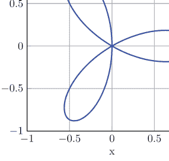

图 1. Novikov–Veselov 方程平面解的速度分布

+   - 将 s 替换为 s + k₁ t（其中 k₁ = 3β/4 − k₂ 3κ/2）相当于在移动坐标系中观察 KdV 解，该坐标系以速度 −k₁ 移动。

### 3. 求解 (2+1) 维非线性波动方程的伪谱方法

为了数值求解 (1.2)–(1.4)，我们采用基于文献 [13] 方法的半隐式蛙跳谱方法。我们将空间区域限制为具有周期边界条件的有限区域 Ω = [0,Wₓ] × [0,Wᵧ]。因此，我们在环面拓扑上工作，对于数值结果，我们需要观察穿过边界的行波。我们还必须针对所处理的问题选择足够大的区域。

该方法使用快速傅里叶变换 (FFT) 计算空间演化，并使用蛙跳格式进行时间推进。数值格式可总结如下：

(1.2)–(1.4) 的傅里叶变换为

(3.1) 4 ûₜ = i (ξ³ − 3 ξ η²) û + 3 i ξ ℱ[(uv)] + 3 i η ℱ[(uw)],
(3.2) ξ û = ξ v̂ − η ŵ,
(3.3) η û = −η v̂ − ν ŵ.

如常，û 表示 u 的傅里叶变换 ℱ，由下式给出：

ûₚ,ₙ = ℱ[uₗ,ₘ] = Σₗ₌₀ᴸ⁻¹ Σₘ₌₀ᴹ⁻¹ uₗ,ₘ e⁻ⁱ(ξₚ xₗ + ηₙ yₘ),
 uₗ,ₘ = ℱ⁻¹[ûₚ,ₙ] = 1/(L M) Σₚ₌₋L/2ᴸ/²⁻¹ Σₙ₌₋M/2ᴹ/²⁻¹ ûₚ,ₙ eⁱ(ξₚ xₗ + ηₙ yₘ).

参数 L 和 M 分别是 [0,Wₓ] × [0,Wᵧ] 中的网格点数。为了使用标准 FFT，它们必须是 2 的幂。空间网格定义为 (xₗ,yₘ) = (lΔx,mΔy)，其中 l = 0,…,L−1，且

m = 0, …, M − 1。谱变量为 (ξ_p, η_q) = (2πp/W_x, 2πq/W_y)，其中 p = −L/2, …, −1, 0, 1, …, L/2，q = −M/2, …, −1, 0, 1, …, M/2。

方程 (3.2) 和 (3.3) 可以用 û 求解

(3.4)  v̂ = (ξ² − η²)/(ξ² + η²) û,      ŵ = (−2ηξ)/(η² + ξ²) û

必须特别注意 ξ² + η² = 0 的情形。相应的傅里叶系数表示函数 v 和 w 的平均值。

设 ĉ(t) 为解 u(x, y, t) 的 LM 个傅里叶系数构成的向量。则求解 (3.2)、(3.3) 并计算 −3i(ξ ℱ[(uv)] + η ℱ[(uw)]) 可写为一个非线性函数 F⃗(ĉ)。利用适当的对角矩阵 D，NV 方程 (3.1) 可写成

(3.5)  4 d/dt ĉ(t) = D ĉ(t) + F⃗(ĉ(t))

对于时间积分，我们对线性项采用对称三层差分格式，对非线性项采用蛙跳格式。对于参数 0 ≤ θ ≤ 1，我们用上标表示时间迭代，则上述格式可写为

(3.6)  4/(2Δt)(ĉ^{n+1} − ĉ^{n−1}) = θ D(ĉ^{n+1} + ĉ^{n−1}) + (1 − 2θ) D ĉ^n + F⃗(ĉ^n)
      (2 − θ Δt D) ĉ^{n+1} = (1 − 2θ) Δt D ĉ^n + (2 + θ Δt D) ĉ^{n−1} + Δt F⃗(ĉ^n)

因此，我们对线性部分采用隐式格式，对非线性部分采用显式格式。由于矩阵 D 是对角阵，我们不需要在每一步求解线性方程组。对于特殊情况 θ = 1/2，我们得到 Crank-Nicolson 格式

(4 − Δt D) ĉ^{n+1} = + (4 + Δt D) ĉ^{n−1} + 2 Δt F⃗(ĉ^n)

对于三层格式，我们需要单独的方法来处理第一个时间步。为简单起见，我们可以选择 ĉ^{−1} = ĉ^0。对于具有已知解的计算，例如 (1.6)，我们使用解在 −Δt 时刻的已知值。

为了检验谱方法的效率，我们将其与文献 [26] 中提出的有限差分 (FD) 方法进行比较：

+   - FD 方法可用于周期边界条件和 Dirichlet 型边界条件。谱方法非常适合周期边界条件。
+   - 对于两种方法，每个时间步都需要求解一个线性方程组。相应的矩阵大小为 N² × N²。
+     - 对于谱方法，矩阵 D 是对角的，因此我们不需要求解方程组。计算量为 N²。
+     - 对于 FD 方法，矩阵的半带宽为 2N。因此，需要稀疏 LU 分解，存储约 4N³ 个数值。对于大的 N，这是不可行的。因此，必须使用迭代求解器，例如 bicgstab，无论是否使用预处理。每次迭代的计算量与 N² 成正比，且比例常数相当大。
+   - 对于两种算法，非线性项都需要使用二维 FFT。对于 FD 方法，这通过在扩大域上的 Dirichlet 边界条件来实现。这是总计算时间中相当大的一部分。
+   - 两种算法都守恒线性部分的 $L_2$ 范数，且稳定性行为相似。
+   - 对于两种方法，都缺乏完整非线性方程的稳定性证明。这并不意外，因为 NV 方程确实具有指数不稳定的解，这将在第 4 节中讨论。

基于以上分析，我们得出结论：对于具有周期边界条件的问题，谱方法是更好的方法。这已被几个测试用例所证实。对于精确的经典 KdV 孤子初值条件，谱方法能在相当长的时间区间内以高精度再现已知精确解。

#### 3.1. 线性数值稳定性分析。

为了深入了解谱方法的稳定性，我们进行了线性稳定性分析。此处确定的参数将用于后续的数值实验。我们在区域 $\Omega = [0,W] \times [0,W] \subset \mathbb{R}^2$ 上研究该问题，并使用周期边界条件。因此，我们研究如下初边值问题

```
(3.7)
$4 u_t = -u_{xxx} + 3 u_{xyy} + 3 \alpha (v_x + w_y),$ 
$u_x = v_x - w_y, \qquad u_y = -w_x - v_y$
```

情形 $\alpha = 0$ 是 (1.2)-(1.4) 关于零解的线性化。对于非线性系统进行线性稳定性分析的实用性已在文献 [13] 中针对 KP 和 ZK 方程进行了讨论，他们发现其线性稳定性分析结果得到了数值结果的验证，并指出虽然该分析不能证明非线性格式的稳定性和收敛性，但所获得的稳定性条件在实践中通常已经足够。当在具有周期边界条件的区域上实现时，(3.7) 变为

```
(3.8)
$4 u_t = -u_{xxx} + 3 u_{xyy} + 3 \alpha (v_x + w_y), \quad (x,y) \times t \in \Omega \times \mathbb{R},$ 
$u_x = v_x - w_y, \qquad u_y = -w_x - v_y$ 
$u(x,y,0) = u_0(x,y), \qquad \qquad \qquad \qquad \qquad (x,y) \in \Omega,$ 
$u(x,y,t) = u(x+W_x y,t), \qquad \qquad \qquad \qquad \qquad (x,y) \times t \in \mathbb{R}^3,$ 
$u(x,y,t) = u(x,y+W_y,t), \qquad \qquad \qquad \qquad \qquad (x,y) \times t \in \mathbb{R}^3,$
```

利用傅里叶级数和 (3.4)，这导致

```
$4 \hat{u}_t = i (\xi^3 - 3 \xi \eta^2) \hat{u} + 3 i \xi \alpha \frac{\xi^2 - \eta^2}{\eta^2 + \xi^2} \hat{u} + 3 i \eta \alpha \frac{-2 \eta \xi}{\eta^2 + \xi^2} \hat{u} = i \omega \hat{u} + i \frac{3 \omega \alpha}{\eta^2 + \xi^2} \hat{u},$
```

其中 $\omega = \xi^3 - \xi \eta^2$。这是一个如下形式的常微分方程 (ODE)

```
(3.9)
$4 \frac{d}{dt} u(t) = i \lambda u(t) + i \gamma u(t),$
```

其中 $\lambda = \omega = \xi^3 - 3 \xi \eta^2$，$\gamma = \omega \frac{3 \alpha}{\eta^2 + \xi^2}$。利用数值格式 (3.6)，可得

```
$(2 - i \theta \lambda \Delta t) u^{n+1} = i (1 - 2 \theta) \lambda \Delta t u^n + (2 + i \theta \lambda \Delta t) u^{n-1} + i \gamma \Delta t u^n,$
```

即

```
(3.10)
$b_1 = 2 + i \theta \lambda \Delta t \in \mathbb{C}, \qquad b_2 = i ((1 - 2 \theta) \lambda + \gamma) \Delta t \in \mathbb{C},$
```


到迭代矩阵
$$
\begin{pmatrix} u^{n+1} \\ u^{n} \end{pmatrix} = \mathbf{M} \begin{pmatrix} u^{n} \\ u^{n-1} \end{pmatrix} = \begin{bmatrix} \frac{b_2}{b_1} & \frac{b_1}{b_1} \\ 1 & 0 \end{bmatrix} \begin{pmatrix} u^{n} \\ u^{n-1} \end{pmatrix}.
$$

为了使系统稳定，我们必须验证 $\mathbf{M}$ 的特征值 $z_{1,2}$ 的范数小于或等于 1。特征方程为
$$\Phi_{NV}(z) = z^2 - \frac{b_2}{b_1}z - \frac{b_1}{b_1} = 0$$

因此，我们得出 $|z_1 \cdot z_2| = |\frac{b_1}{b_1}| = 1$ 且解的稳定性等价于 $|z_{1,2}| = 1$，即我们有 $|u^{n+1}| = |u^{n-1}|$。利用二次方程的显式解和
(3.11)
$$b_2 \in i\mathbb{R}, \qquad |b_2| \le 2|b_1|,$$

我们得到 $2\overline{b_1}\,z_{1,2} = b_2 \pm \sqrt{b_2^2 + 4|b_1|^2}$ 且 $|2\overline{b_1}|^2|z_{1,2}|^2 = |2b_1|^2$。因此，$|z_{1,2}| = 1$。结合 (3.10)，ODE (3.9) 的稳定性条件 (3.11) 变为
$$((1 - 4\theta)\lambda^2 + 2(1 - 2\theta)\lambda\gamma + \gamma^2)(\Delta t)^2 \le 16.$$

对于 $\gamma = \alpha = 0$ 且 $\frac{1}{4} \le \theta \le 1$，稳定性条件与步长 $\Delta t > 0$ 无关地得到满足，我们对初边值问题 (3.8) 有一个稳定性结果。这证明了下面的定理。

THEOREM 1. *数值格式 (3.6) 应用于关于零解的 (1.2)–(1.4) 的线性化在 $\frac{1}{4} \le \theta \le 1$ 时是稳定的。*

证明 (3.8) 在 $\alpha \ne 0$ 时的稳定性需要更多的计算。利用 (3.9) 中的 $\lambda$ 和 $\gamma$ 的表达式得到稳定性条件
$$(1 - 4\theta) + 2(1 - 2\theta)\frac{3\alpha}{\eta^2 + \xi^2} + \left(\frac{3\alpha}{\eta^2 + \xi^2}\right)^2 \le \left(\frac{4}{\omega\Delta t}\right)^2.$$

对于 $\theta = \frac{1}{2}$ 我们得到充分条件
$$-2 + \left(\frac{3\alpha}{\eta^2 + \xi^2}\right)^2 \le \left(\frac{3\alpha}{\eta^2 + \xi^2}\right)^2 \le \left(\frac{4}{(\xi^3 - 3\xi\eta^2)\Delta t}\right)^2$$

$$(\Delta t)^2 \le \left(\frac{4(\xi^2 + \eta^2)}{3\alpha(\xi^3 - 3\xi\eta^2)}\right)^2.$$

由于 $|\xi^3 - 3\xi\eta^2| \le (\xi^2 + \eta^2) \cdot \max\{|\xi|,|\eta|\}$，我们得到 $\Delta t$ 的充分条件
$$\Delta t \le \frac{4}{3|\alpha|\max\{|\xi|,|\eta|\}}.$$

对于 DFT，$\Delta x = \Delta y = \frac{W_s}{L}$ 时我们得到 $\max\{|\xi|,|\eta|\} = \frac{\pi}{\Delta x}$，因此我们有稳定性条件
(3.12)
$$\Delta t \le \frac{4}{3|\alpha|\pi}\,\Delta x.$$

作为推论，我们对初边值问题 (3.8) 在 $\alpha \ne 0$ 时有稳定性结果，定理 2。

THEOREM 2. *数值格式 (3.6) 应用于 (3.8) 在 $\theta = \frac{1}{2}$ 时是稳定的，如果时间步长 $\Delta t$ 满足条件 (3.12)。*

现在我们考察形如的扰动函数

```
(4.5)    u(x, y, t) = u0(x) + ε f(x) e^{i k y + γ t}, (4.6)    v(x, y, t) = v0(x) + ε g(x) e^{i k y + γ t}, (4.7)    w(x, y, t) = w0(x) + ε h(x) e^{i k y + γ t}.
```

因此我们考察具有指数增长的周期横向扰动。对于数值目的，我们也可以使用纯实数形式。

```
(4.8)    u(x, y, t) = u0(x) + ε f(x) cos(k y) e^{γ t}, (4.9)    v(x, y, t) = v0(x) + ε g(x) cos(k y) e^{γ t}, (4.10)   w(x, y, t) = w0(x) + ε h(x) sin(k y) e^{γ t}.
```

将这些表达式代入 (4.2)–(4.4) 并舍去与 ε² 成比例的项得到（用 ′ 表示 d/dx）

```
0 = 4 γ f − 4 f′ + f′′′ + 3 k² f′ −3 (u0 g)′ − 3 (v0 f)′ − 3 u0 i k h (4.11) f′ = + g′ − i k h (4.12) i k f = − h′ − i k g (4.13)
```

这是一个具有非恒定系数的线性常微分方程组。利用 h(x) = 1/(i k) (g′(x) − f′(x))，上述方程可以写成

```
f′′′(x) = (−4 γ + 3 u0′(x)) f(x) + (4 − 3 k²) f′(x) + 3 u0′(x) g(x) + 6 u0(x) g′(x) (4.14) g′′(x) = k² g(x) + f′′(x) + k² f(x) (4.15)
```

#### 4.2. 已知解。

由于 fc(x − c t + s) 是原 NV 方程 (1.2)–(1.4) 的解，我们得出 (u0(x − s), v0(x − s), w0(x − s)) 求解系统 (4.2)–(4.4)，因此它们的导数必须求解线性化问题 (4.11)–(4.13)。由于 d/dx sech²(x) = −2 sech²(x) tanh(x)，我们得到解

```
(4.16)    f(x) = g(x) = sech²(x) tanh(x),    h(x) = 0
```

对于 k = γ = 0 时系统 (4.14)–(4.15) 的解。对于 k = 1 且 γ = 0 我们找到了

```
f(x) = + sech³(x) g(x) = − sech(x) tanh²(x) h(x) = − i sech(x) tanh(x) (4.17)
```

作为 (4.11)–(4.13) 的第二个显式解。借助这些解，我们将构造 Novikov-Veselov 方程关于参数 k 和 γ 的不稳定解。因此我们需要 (4.14)–(4.15) 的非零解。

#### 4.3. 定位不稳定解。

利用函数 u0(x) = −2 sech²(x)，矩阵记号将高阶系统 (4.14)–(4.15) 转化为

一阶常微分方程组。

```
d/dx ( f \n f' \n f'' \n g \n g' ) = [ 0 1 0 0 0 \n 0 0 1 0 0 \n -4γ + 3 u0' (4 - 3 k²) 0 3 u0'(x) 6 u0 \n 0 0 0 0 1 \n k² 0 1 k² 0 ] ( f \n f' \n f'' \n g \n g' )
```

我们寻求满足 x → ±∞ 时衰减条件的非平凡解。我们使用渐近分析和数值方法的组合。必须分别考虑大 |x| 和小 |x|。我们采用以下方法：

- 选择一个大的值 M > 0。对于 |x| > M，我们使用 u0(x) ≈ 0 和初等渐近分析来构造满足衰减条件的解。
- 对于 |x| ≤ M，渐近分析不可行，因为 (4.14)–(4.15) 中的贡献 u0(x) 和 u0'(x) 必须被考虑。因此我们使用数值求解器在域 −M ≤ x ≤ +M 上构造一个基本矩阵 T，其中包含 −M ≤ x ≤ M 时线性系统解的信息。
- 然后将上述两个结果结合起来找到非平凡解存在准则 (4.23)。

##### 4.3.1. 大 |x| 时解的行为。

对于 |x| 的大值，我们使用 u0(x) ≈ 0 并得到常系数线性微分方程的解耦系统。

```
(4.18) d/dx ( f \n f' \n f'' ) = [ 0 1 0 \n 0 0 1 \n -4γ (4 - 3 k²) 0 ] ( f \n f' \n f'' )
```

```
(4.19) d/dx ( g \n g' ) = [ 0 1 \n k² 0 ] ( g \n g' ) + ( 0 \n k² f' + f'' )
```

(4.18) 中矩阵的特征方程为

```
(4.20) λ³ + (3 k² - 4) λ + 4 γ = 0,
```

我们将该系统的特征值 λ₁, λ₂ 和 λ₃ 分别记为 p₁, p₂ 和 p₃。(4.19) 中的非齐次系统导致特征值 λ₄,₅ = ±k。利用三次多项式零点的 Cardano 公式，我们验证 (4.20) 在

```
4 γ² + (3 k² - 4)³ / 27 < 0.
```

时有三个不同的实值。对于我们要考察的 (k, γ) 域，我们可以使用

```
p₃ ≤ 0 ≤ p₁, p₂
```

并且对于 |γ| 的小值我们得到

```
(4.21) λ(γ) = { p₁ ≈ 0 + 4/(4 - 3 k²) γ \n p₂ ≈ +√(4 - 3 k²) - 2/(4 - 3 k²) γ \n p₃ ≈ -√(4 - 3 k²) - 2/(4 - 3 k²) γ }
```

解的形式为 $f(x) \approx c_1 e^{p_1 x} + c_2 e^{p_2 x} + c_3 e^{p_3 x}$。我们考察 $\gamma \ge 0$，并且对于 $x \to +\infty$，我们要求 (4.18) 的解 $f(x)$ 有界，因此 $$f(x) \approx f_+(x) = c_3 e^{p_3 x}。$$

接下来，考察 (4.19) 的形式 $$g''_+(x) - k^2 g_+(x) = k^2 f_+(x) + f''_+(x) = c_3 \left(k^2 + p_3^2\right) e^{p_3 x}$$ 解为 $$g_+(x) = \beta_1 e^{+k x} + \beta_2 e^{-k x} + c_3 \frac{k^2 + p_3^2}{p_3^2 - k^2} e^{p_3 x}。$$

由于该解必须在 $x \to +\infty$ 时保持有界，我们得到 $$g_+(x) = \beta_2 e^{-k x} + c_3 \frac{k^2 + p_3^2}{p_3^2 - k^2} e^{p_3 x}。$$

对于 $\gamma \ge 0$ 且 $x \to -\infty$ 的情况，类似地得到 $$f(x) \approx f_-(x) = c_1 e^{p_1 x} + c_2 e^{p_2 x}$$ 且 $$g(x) \approx g_-(x) = \beta_1 e^{+k x} + c_1 \frac{k^2 + p_1^2}{p_1^2 - k^2} e^{p_1 x} + c_2 \frac{k^2 + p_2^2}{p_2^2 - k^2} e^{p_2 x}。$$

对于 $0 < k^2 \ll 1$ 我们得到 (4.22) $$p_1^2 \approx \frac{4^2}{(4 - 3 k^2)^2} \gamma^2 \approx \gamma^2$$ 因此上述 $g(x)$ 的公式对于 $\gamma^2 \approx k^2 \ll 1$ 可能无效。对于 $k = 0$，$g$ 的方程简化为 $g''(x) = f''(x)$，并且 $x = \pm \infty$ 处的条件意味着 $g(x) = f(x)$。

##### 4.3.2. 中间 |x| 的解

选择一个大的值 $M > 0$，我们构造 (4.14)–(4.15) 在 $-\infty < x \le -M$、$-M \le x \le +M$ 以及 $+M \le x < +\infty$ 时的非平凡解。我们寻求参数 $(c_1, c_2, c_3, \beta_1, \beta_2)$ 的非零值，使得我们找到一个非零解。利用解 $f_-$ 和 $g_-$ 定义矩阵

$$\mathbf{T}_- = \begin{bmatrix} e^{-p_1 M} & e^{-p_2 M} & 0 & 0 & 0 \\ p_1 e^{-p_1 M} & p_2 e^{-p_2 M} & 0 & 0 & 0 \\ p_1^2 e^{-p_1 M} & p_2^2 e^{-p_2 M} & 0 & 0 & 0 \\ \frac{p_1^2 + k^2}{p_1^2 - k^2} e^{-p_1 M} & \frac{p_2^2 + k^2}{p_2^2 - k^2} e^{-p_2 M} & 0 & e^{-k M} & 0 \\ \frac{(p_1^2 + k^2) p_1}{p_1^2 - k^2} e^{-p_1 M} & \frac{(p_2^2 + k^2) p_2}{p_2^2 - k^2} e^{-p_2 M} & 0 & k e^{-k M} & 0 \end{bmatrix}$$

其中 $$\mathbf{T}_- \begin{pmatrix} c_1 \\ c_2 \\ c_3 \\ \beta_1 \\ \beta_2 \end{pmatrix} = \begin{pmatrix} f(-M) \\ f'(-M) \\ f''(-M) \\ g(-M) \\ g'(-M) \end{pmatrix}$$


使用解 $f_+$ 和 $g_+$ 定义一个矩阵

```
$$\mathbf{T}_+ = \begin{bmatrix} 0 & 0 & e^{p_3 M} & 0 & 0 \\ 0 & 0 & p_3 e^{p_3 M} & 0 & 0 \\ 0 & 0 & p_3^2 e^{p_3 M} & 0 & 0 \\ 0 & 0 & \frac{p_3^2 + k^2}{p_3^2 - k^2} e^{p_3 M} & 0 & e^{-k M} \\ 0 & 0 & \frac{(p_3^2 + k^2) p_3}{p_3^2 - k^2} e^{p_3 M} & 0 & -k e^{-k M} \end{bmatrix}$$
```

其中

```
$$\mathbf{T}_+ \begin{pmatrix} c_1 \\ c_2 \\ c_3 \\ \beta_1 \\ \beta_2 \end{pmatrix} = \begin{pmatrix} f(+M) \\ f'(+M) \\ f''(+M) \\ g(+M) \\ g'(+M) \end{pmatrix}$$
```

然后使用常微分方程求解器在区间 $[-M, M]$ 上将系统 (4.14)-(4.15) 作为初值问题进行考察。这导致一个矩阵 $\mathbf{T}$ 使得

```
$$\mathbf{T} \begin{pmatrix} f(-M) \\ f'(-M) \\ f''(-M) \\ g(-M) \\ g'(-M) \end{pmatrix} = \begin{pmatrix} f(+M) \\ f'(+M) \\ f''(+M) \\ g(+M) \\ g'(+M) \end{pmatrix}$$
```

现在我们有两种方法来计算解在 $x = +M$ 处的值，并且系统 (4.14)-(4.15) 当且仅当

```
$(4.23)\qquad D(k,\gamma) = \det(\mathbf{M}(k,\gamma)) = \det(\mathbf{T} \cdot \mathbf{T}_- - \mathbf{T}_+) = 0$
```

时存在非零解。因此我们将该方程的解作为参数 $k$ 和 $\gamma$ 的函数进行考察。

## 4.4. 特殊情形 $k = 0$。当 $k = 0$ 时，方程 (4.15) 写为 $g''(x) = f''(x)$ 且满足 $g(\pm\infty) = f(\pm\infty)$ 的唯一解为 $g(x) = f(x)$。于是 (4.14) 导出

```
$(4.24)\qquad \frac{d}{dx} \begin{pmatrix} f \\ f' \\ f'' \end{pmatrix} = \begin{bmatrix} 0 & 1 & 0 \\ 0 & 0 & 1 \\ -4\gamma + 6 u_0' & 4 + 6 u_0 & 0 \end{bmatrix} \begin{pmatrix} f \\ f' \\ f'' \end{pmatrix}$
```

使用与上一节相同的方法我们定义

```
$$\mathbf{T}_- \begin{pmatrix} c_1 \\ c_2 \\ c_3 \end{pmatrix} = \begin{pmatrix} f(-M) \\ f'(-M) \\ f''(-M) \end{pmatrix} = \begin{bmatrix} e^{-p_1 M} & e^{-p_2 M} & 0 \\ p_1 e^{-p_1 M} & p_2 e^{-p_2 M} & 0 \\ p_1^2 e^{-p_1 M} & p_2^2 e^{-p_2 M} & 0 \end{bmatrix} \begin{pmatrix} c_1 \\ c_2 \\ c_3 \end{pmatrix}$$
```

```
$$\mathbf{T}_+ \begin{pmatrix} c_1 \\ c_2 \\ c_3 \end{pmatrix} = \begin{pmatrix} f(+M) \\ f'(+M) \\ f''(+M) \end{pmatrix} = \begin{bmatrix} 0 & 0 & e^{p_3 M} \\ 0 & 0 & p_3 e^{p_3 M} \\ 0 & 0 & p_3^2 e^{p_3 M} \end{bmatrix} \begin{pmatrix} c_1 \\ c_2 \\ c_3 \end{pmatrix}$$
```

```
$$\mathbf{T}_0 \begin{pmatrix} f(-M) \\ f'(-M) \\ f''(-M) \end{pmatrix} = \begin{pmatrix} f(+M) \\ f'(+M) \\ f''(+M) \end{pmatrix}$$
```

其中 $\mathbf{T}_0$ 是利用常微分方程求解器对 (4.24) 构造的。于是当 $k = 0$ 时，系统 (4.14)-(4.15) 当且仅当

```
$(4.25)\qquad D_0(\gamma) = \det(\mathbf{M}_0(\gamma)) = \det(\mathbf{T}_0 \cdot \mathbf{T}_- - \mathbf{T}_+) = 0$
```

时存在非零解。

### 5. 平面波孤子解不稳定性的数值结果

#### 5.1. 定位不稳定解。

在我们的数值测试中我们使用了 M = 5 且对于 |x| > 5 我们知道 |u0(x)| = 2 cosh⁻²(x) ≤ 3.6 · 10⁻⁴ ≪ 2 且 |u0'(x)| ≤ 7.3 · 10⁻⁴ ≪ 2。 使用更大的 M 值进行测试结果没有显著变化。我们使用了 Octave 提供的数值常微分方程求解器 lsode。基于表达式 (4.23) 我们在区域 0 ≤ k ≤ 1 且 0 ≤ γ ≤ 0.5 上生成函数 D(k,γ) = det(M(k,γ)) 的图像，得到图 2。在角落 k ≈ 1 且 γ ≈ 0.5 处函数的实部消失，但第二个图像验证虚部不同于零。因此图 2 表明我们有一个明确定义的解曲线 det(M(k,γ)) = 0，远离原点。

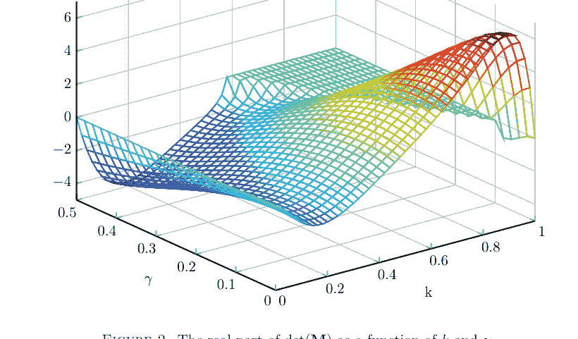

图 2. det(M) 的实部作为 k 和 γ 的函数

由于在 (k,γ) ≈ (0, 0) 附近的行为是关键的，我们以更精细的分辨率考察该部分，得到图 3(a)。明显的尖峰是由条件 (4.22) 中的分母零点引起的。图 3(a) 暗示存在沿轴 k = 0 的解。使用 (4.25) 我们生成图 3(b)。因此沿轴 k = 0 的唯一解在 γ = 0 时出现。于是已知的解 (4.16) 在参数空间 (k,γ) 中在 (0, 0) 处是一个孤立解。

在上述准备之后，我们现在可以构造使 (4.14)–(4.15) 存在非零解的 (k,γ) 值，从而对于 γ > 0 时得到 NV 方程 (1.2)–(1.4) 的不稳定孤子解。

我们通过生成曲线的弧长参数化来追踪 (4.23) 的解曲线。使用曲线上的任意初始点（使用

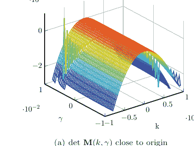

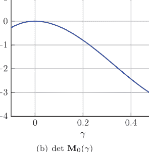

(a) det M(k,γ) 在原点附近

(b) det M0(γ)

# 图 3. 原点附近的行为以及沿轴 k = 0 的行为

图 2 的等值线图）和一个起始方向，我们沿着与步进方向正交的直线段最小化 |det(M(k,γ))|。利用该局部最小值，我们调整步进方向然后做一个小步以跟随解曲线。沿曲线步进时我们验证我们确实有 (4.23) 的解，而不仅仅是最小值。这证明是一个稳定的算法并生成了图 4。

注意图 4(a) 也显示了 γ 的负值，这不会导致 (1.2)–(1.4) 的不稳定解。我们显示这些值是为了确认我们有一个没有分支点的闭合曲线。

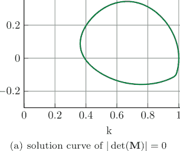

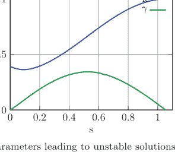

(a) |det(M)| = 0 的解曲线

(b) 导致不稳定解的参数

# 图 4. |det(M)| = 0 的解曲线以及导致不稳定解的参数 k 和 γ

对于图 4(b) 中的 (k,γ) 参数值，存在非零函数 f(x), g(x) 和 h(x)，使得对于小的 ε，方程 (4.2)–(4.4) 的解具有形式 (4.5)–(4.7)。由于这些函数的 y 依赖性为 e^{i k y} 的形式，函数在 y 方向上以周期 L_y = 2π/k 为周期。相应的

指数显示在图 (4(b)) 中。因此 Novikov–Veselov 方程 (1.2)–(1.4) 在初始条件 $u(x,y,0) = -2\,c\,\operatorname{sech}^2(\sqrt{c}\,x)$ 下将导致不稳定孤子解。

> 定理 3. NV 方程 (1.2)–(1.4) 的孤子解 $u(x,y,t)=v(x,y,t)=-2\,c\,\operatorname{sech}^2(\sqrt{c}(x-ct))$ 且 $w(x,y,t)=0$ 不是稳定的。对于 $0.363<k\le 1$ 的值，存在 $y$-周期性的不稳定贡献，其周期为 $L_y = \frac{2\pi}{k\sqrt{c}}$。

#### 5.2. 数值构造不稳定解。

作为一个例子，本节中我们使用第 3 节中用于 $x$ 和 $y$ 周期解的算法数值构造上述不稳定解之一。由于孤子解 $\operatorname{sech}^2(x)$ 衰减迅速，上述结果在足够大的域上工作时仍然适用。算法的步骤如下：

- (1) 选择图 4(b) 中的 $(k,\gamma)$ 值并确定零特征值的特征向量 $(c_1,c_2,c_3,\beta_1,\beta_2)$。
- (2) 使用导致矩阵 $\mathbf{T}$、$\mathbf{T}_-$ 和 $\mathbf{T}_+$ 的算法构造非零函数 $f(x),g(x),h(x)$。
- (3) 选择一个大小域使得 $\frac{2\pi}{k}$ 周期函数在 $y$ 上是可容许的。
- (4) 构造初始值，使用 (4.8)–(4.10)，使用小的 $\epsilon$ 值。不考虑变换 (4.1) 我们得到未扰动孤子的速度 $c=1$。
- (5) 求解 NV 方程 (1.2)–(1.4)，使用第 3 节中介绍的算法。
- (6) 与单孤子解的偏差不应改变其形状，但大小预计与 $e^{\gamma t}$ 成正比。
- (7) 速度 $c\neq1$ 的孤子可以类似地构造，使用变换 (4.1)。

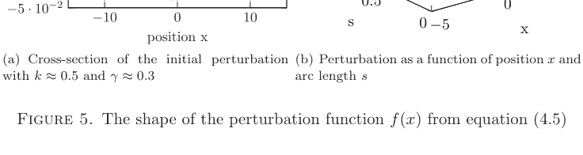

图 5. 方程 (4.5) 中扰动函数 $f(x)$ 的形状

来自定理 3 的扰动孤子的演化是使用半隐式伪谱方法计算的。作为初始数据，我们选择了一个扰动 KdV


-   [2] M. A. Allen和S. Phibanchon，*修正Kadomtsev-Petviashvili方程中扰动孤子的时间演化*，Computational Science and Its Applications, 2007. ICCSA 2007. International Conference on (2007), 20–23.
-   [3] M. A. Allen和G. Rowlands，*线性化Zakharov-Kuznetsov方程增长率的确定*，Journal of Plasma Physics **50** (1993), no. 03, 413–424.
-   [4] M. A. Allen和G. Rowlands，*论孤立波的横向不稳定性*，Phys. Lett. A **235** (1997), no. 2, 145–146, DOI 10.1016/S0375-9601(97)00618-X. MR1479603
-   [5] L. V. Bogdanov，*Veselov-Novikov方程作为Korteweg-de Vries方程的自然推广*（俄文，附英文摘要），Teoret. Mat. Fiz. **70** (1987), no. 2, 309–314. MR894472 (88k:35170)
-   [6] R. M. Bradley，*金属表面电迁移诱导的孤子传播*，Phys. Rev. E **60** (1999), no. 4, 3736–3740.
-   [7] T. J. Bridges，*水波问题孤立波态的横向不稳定性*，J. Fluid Mech. **439** (2001), 255–278, DOI 10.1017/S0022112001004530. MR1849635 (2003e:35257)
-   [8] B. Dubrovin，T. Grava和C. Klein，*论聚焦非线性薛定谔方程中临界行为的普适性、椭圆脐点突变以及Painlevé-I方程的tritronquée解*，J. Nonlinear Sci. **19** (2009), no. 1, 57–94, DOI 10.1007/s00332-008-9025-y. MR2480731 (2010b:35428)
-   [9] John W. Evans，*神经轴突方程。I. 线性近似*，Indiana Univ. Math. J. **21** (1971/72), 877–885. MR0292531 (45 #1616)
-   [10] John W. Evans，*神经轴突方程。II. 静息稳定性*，Indiana Univ. Math. J. **22** (1972/73), 75–90. MR0323372 (48 #1729)
-   [11] John W. Evans，*神经轴突方程。III. 神经冲动的稳定性*，Indiana Univ. Math. J. **22** (1972/73), 577–593. MR0393890 (52 #14697)
-   [12] John W. Evans，*神经轴突方程，IV：稳定与不稳定的冲动*，Indiana Univ. Math. J. **24** (1975), 1169–1190.
-   [13] B.-F. Feng，T. Kawahara和T. Mitsui，*若干二维非线性波动方程的守恒谱方法*，J. Comput. Phys. **153** (1999), no. 2, 467–487, DOI 10.1006/jcph.1999.6286. MR1705941 (2000d:65184)
-   [14] P. Frycz和E. Infeld，*磁化等离子体中非线性离子声波和孤子的自聚焦，第3部分。任意角度扰动，波的周期倍增*，J. Plasma Phys. **41** (1989), 441–446.
-   [15] P. Frycz和E. Infeld，*磁化等离子体中非线性离子声波和孤子的自聚焦，第3部分。任意角度扰动，波的周期倍增*，J. Plasma Phys. **41** (1989), no. 03, 441–446.
-   [16] E. Infeld，*磁化等离子体中非线性离子声波和孤子的自聚焦*，J. Plasma Phys. **33** (1985), no. 02, 171–182.
-   [17] E. Infeld和P. Frycz，*磁化等离子体中非线性离子声波和孤子的自聚焦，第2部分。数值模拟，双孤子碰撞*，J. Plasma Phys. **37** (1987), no. 01, 97–106.
-   [18] Eryk Infeld和George Rowlands，*非线性波、孤子与混沌*，第2版，Cambridge University Press，英国剑桥，2000. MR1780300 (2001f:76019)
-   [19] E. Infeld，G. Rowlands和A. Senatorski，*一维和二维Kadomtsev-Petviashvili波与孤子的不稳定性和振荡*，R. Soc. Lond. Proc. Ser. A Math. Phys. Eng. Sci. **455** (1999), no. 1992, 4363–4381, DOI 10.1098/rspa.1999.0505. MR1809365 (2001j:35239)
-   [20] B. B. Kadomtsev和V. I. Petviashvili，*论弱色散介质中孤立波的稳定性*，Soviet Physics Doklady **15** (1970), 539–541.
-   [21] T. Kapitula，*利用Evans函数对脉冲的稳定性分析：耗散系统*，Dissipative solitons, Lecture Notes in Phys., vol. 661, Springer, Berlin, 2005, pp. 407–428, DOI 10.1007/10928028.16. MR2174303 (2007a:37096)
-   [22] C. Klein和K. Roidot，*Kadomtsev-Petviashvili和Davey-Stewartson方程的四阶时间步进*，SIAM J. Sci. Comput. **33** (2011), no. 6, 3333–3356, DOI 10.1137/100816663. MR2862016
-   [23] C. Klein和C. Sparber，*KP方程中周期行波的横向稳定性：数值研究*，Preprint (arXiv:1108.3363v1 16 Aug 2011) (2011).
-   [24] B. Konopelchenko和A. Moro，*非线性几何光学中的可积方程*，Stud. Appl. Math. **113** (2004), no. 4, 325–352, DOI 10.1111/j.0022-2526.2004.01536.x. MR2094235 (2005e:78004)
-   [25] Boris G. Konopelchenko和Antonio Moro，*非线性介质中的几何光学与可积方程*，J. Phys. A **37** (2004), no. 10, L105–L111, DOI 10.1088/0305-4470/37/10/L01. MR2039848 (2004m:78001)
-   [26] M. Lassas，J. L. Mueller，S. Siltanen和A. Stahel，*Novikov-Veselov方程与逆散射方法：II. 计算*，Nonlinearity **25** (2012), no. 6, 1799–1818, DOI 10.1088/0951-7715/25/6/1799. MR2929603
-   [27] S. Munro和E. J. Parkes，*修正Zakharov-Kuznetsov方程的推导及其解的稳定性*，J. Plasma Phys. **62** (1999), no. 03, 305–317.
-   [28] A. P. Veselov和S. P. Novikov，*有限间隙二维势薛定谔算子。显式公式与演化方程*（俄文），Dokl. Akad. Nauk SSSR **279** (1984), no. 1, 20–24. MR769198 (86d:58053)
-   [29] Peter Perry，*Novikov-Veselov方程的Miura映射与逆散射*，Anal. PDE **7** (2014), no. 2, 311–343, DOI 10.2140/apde.2014.7.311. MR3218811
-   [30] A. Stahel, staff.ti.bfh.ch/sha1/NovikovVeselov/NovikovVeselov.html
-   [31] Li-Yeng Sung，*Davey-Stewartson II方程的逆散射变换。I*，J. Math. Anal. Appl. **183** (1994), no. 1, 121–154, DOI 10.1006/jmaa.1994.1136. MR1273437 (95c:35237)

数学系，科罗拉多州立大学，科罗拉多州柯林斯堡，80523  
*当前地址：* 应用数学系，科罗拉多大学，科罗拉多州博尔德，80309  
*电子邮箱：* rpcroke@gmail.com

数学系与生物医学工程学院，科罗拉多州立大学，科罗拉多州柯林斯堡，80523  
*电子邮箱：* mueller@math.colostate.edu

伯尔尼应用科学大学，工程与信息技术学院，瑞士比尔  
*电子邮箱：* Andreas.Stahel@bfh.ch

## 聚焦非线性薛定谔方程的半经典孤子系综：最新进展

**摘要.** 我们概述了通过半经典孤子系综对聚焦非线性薛定谔方程的半经典（零色散）极限的分析，并描述了该方向的一些最新进展。

### 1. 引言

#### 1.1. 半经典极限问题。

半经典孤子系综（SSE）是聚焦非线性薛定谔（NLS）方程的一族特定的精确多孤子解

(1.1) iε ∂u/∂t + ε²/2 ∂²u/∂x² + |u|²u = 0,  0 < ε ≪ 1.

给定固定数据

(1.2) u(x,0) = A₀(x),  x ∈ ℝ,

其中 A₀ 是一个解析的、正的、钟形函数，当 |x| → ∞ 时迅速衰减到零。相应的SSE通过对数据 A₀ 加上一个特殊的、渐近可忽略（当 ε ↓ 0 时）的扰动序列，并求解所得的初值问题序列来生成。这些扰动由相关谱问题的形式WKB分析所引起，我们将用

u^(ε)(x, t)

表示这一族特殊解的元素，该族由实参数 ε > 0（递减值序列）标记。

**2010年数学主题分类。** 主要：35Q55。

本文中的图3转载自Phys. D, 241, no. 21, Long Lee、Gregory Lyng和Irena Vankova，“高斯半经典孤子系综及聚焦非线性薛定谔方程的数值方法”，1767–1781，版权所有2012，经Elsevier许可。

本文中的图4转载自Phys. Lett. A, 377, no. 16–17, Long Lee和Gregory D. Lyng，“重新审视聚焦非线性薛定谔方程的高斯半经典孤子系综”，1179–1188，版权所有2013，经Elsevier许可。

本文中的图5经Journal of Mathematical Physics, 55, no. 8, Yeongoh Kim、Long Lee和Gregory Lyng，“Zakharov–Shabat问题半经典特征值的Wentzel–Kramers–Brillouin近似”，版权所有2014–2015，AIP Publishing LLC许可转载。


对 $u^{(\epsilon)}(x,t)$ 在极限 $\epsilon \downarrow 0$ 下的行为进行详细研究是其中一种主要方法的一个关键要素——该方法由 Kamvissis、McLaughlin 和 Miller 在其开创性的专著 [16] 中首次提出——用于分析方程 (1.1) 的半经典（零色散，$\epsilon \downarrow 0$）极限。最基本的形式，半经典极限问题是要提供真实解的完整渐近描述——以 $\epsilon > 0$ 为指标，这里记为 $u(x,t;\epsilon)$ 以将其与 SSE 的元素 $u^{(\epsilon)}(x,t)$ 区分开——的 (1.1)，(1.2)。然而，正如我们下面所描述的，方程 (1.1) 具有调制不稳定性，其指数增长率在半经典极限下无界增长。因此，即使对初始数据的微小扰动对极限行为的影响也远非明朗。事实上，理论中尚未解决的开放问题之一是，严格地确定 $u^{(\epsilon)}(\cdot,\cdot)$ 的半经典渐近是否与真实解 $u(\cdot,\cdot;\epsilon)$ 的渐近一致，例如在 $x$ 和 $t$ 的固定值邻域内。我们的目标在这里是给出使用 SSE 研究半经典极限问题的全景视图，特别是描述最近年代的若干数值研究，这些研究涉及这两个解族渐近之间的联系。综合来看，这些数值实验为以下主张提供了非常有力的支持：这两个解族的极限行为是相同的。

## 1. 备注（数据）。

这里，我们只关心钟形实数据；我们有时说这种数据是 Klaus–Shaw 型，以 Klaus & Shaw [18] 的结果命名，该结果限制了具有此类钟形势的相关非自伴 Zakharov–Shabat 特征值问题（下面方程 (2.1)）的点谱在虚轴上。然而，考虑复振幅-相位形式的数据也是可取的

```
(1.3) $$u(x,0)=A_0(x)\mathrm{e}^{\mathrm{i}S_0(x)/\epsilon}.$$
```

此外，从应用的角度来看，考虑非解析的数据是自然的。一般而言，半经典极限问题在两个特定解析数据族之外在很大程度上抵制完全严格的分析（对于这两个族，正向散射问题 (2.1) 可以精确求解 [27,30]）；因此，将其推广到整个钟形数据类可以被视为半经典极限问题全面理论的重要第一步。

#### 1.2. 关于问题：调制不稳定性。

方程 (1.1) 是一个普遍的模型方程，它在各种物理现象的多尺度分析中自然出现，作为描述弱色散非线性介质中近单色波演化的包络方程。在这种设定下，实参数 $0 < \epsilon \ll 1$ 是色散与非线性之间竞争的度量，而正是这种竞争——非线性效应放大波，色散效应将其拉开——导致了感兴趣的行为。事实上，(1.1) 中的聚焦非线性（非线性项前的“+”号）在非线性和色散效应的组合使周期波列失稳时出现。这种不稳定性例如在深水有限振幅平面波理论中已知为 Benjamin–Feir 不稳定性。参见例如 [28] 对这些点的更详细讨论。

长期以来，获得方程 (1.1)，(1.2) 解的详细半经典渐近已被确定为可积非线性波方程奇异渐近理论中的核心挑战之一（参见例如 Bronski & McLaughlin [7]，Forest 和 Lee [14] 对该问题的早期报告），并且近年来这一挑战一直是大量工作的焦点 [2–4, 8, 16, 20–22, 24, 32, 33]。这一问题的数学兴趣在很大程度上归因于上述调制不稳定性现象。为了更详细地描述这一现象，我们只需指出，验证形如 $u(x,t;\epsilon)=U_0 \exp(i(kx−ωt))$ 的平面波是方程 (1.1) 的解是直接的练习，前提是 $ω=ω(k;\epsilon)$ 满足色散关系

(1.4) ω = ε/2 k² − |U0|²/ε .

但是，线性稳定性分析，略微扰动振幅和相位，表明所有波数在色散消失的极限下都被失稳 [28]。方程 (1.1) 的这一特征对半经典极限的分析有深远影响。事实上，调制不稳定性表现为预期描述大尺度极限动力学的形式模型（称为 Whitham 或调制方程）的椭圆性。为了得到 Whitham 系统，我们做出标准定义 ρ=|u|²，μ=−iε/2 (u* ∂u/∂x − u ∂u*/∂x)，并且我们从 (1.1) 精确地——即完全没有近似——得到系统

(1.5a) ∂ρ/∂t + ∂μ/∂x = 0,

(1.5b) ∂μ/∂t + ∂/∂x ( μ²/ρ − ρ/2 ) = ε²/4 ∂/∂x [ ( ∂²/∂x² log(ρ) ) ρ ] .

Whitham 方程对于 (1.1) 然后是从 (1.5) 简单地忽略 (1.5b) 右端形式上很小的 O(ε²) 项而得到的。然而，从由此得到的一阶系统开始的标准计算立即揭示 Whitham 方程是椭圆型的，因此预期作为初值问题一般是不适定的。这种不适定性令人担忧，原因有几个。首先也是最重要的是，它使 Whitham 系统的实用性受到质疑；人们希望 Whitham 系统应提供半经典动力学振荡行为的相对简单的描述。其次，由于人们只期望能够用 Cauchy–Kovalevskaya 定理对解析数据在短时间内求解椭圆初值问题，方程的椭圆性质表明极限动力学可能对数据中解析性的存在（或不存在！）极其敏感。正如上面在备注 1 中所述，鉴于 (1.1) 在应用中的重要性，而非解析数据在应用中无处不在，这尤其令人困扰。最后，正如上面指出的，SSE 的形成基于对初始数据的无控制修改，而与椭圆性相关的不适定性模糊了引入即使是初始数据的微小扰动的影响。

#### 1.3. 计划。

在 §2 中，为设定场景，我们概述了 (1.1)，(1.2) 的逆散射变换（IST）的 rudiments。特别是，我们回顾了 Zakharov–Shabat 问题 [34] 的形式以及 [12] 中的 WKB 分析，这是构造与钟形初始数据相关联的 SSE 的基础。为完整起见，在 §3 中我们简要描述了与 SSE 相关联的逆散射 Riemann–Hilbert 问题的渐近分析。该分析根本上基于 Deift & Zhou [9] 的最速下降技术。值得注意的是，该分析给出了半经典极限中非线性焦散的清晰数学解释；这些焦散是半经典行为的戏剧性特征之一（见下图 2）。事实上，在 §3.3 中我们展示了由 Miller & Kamvissis [26] 最初提出并实现，后来由 Lyng & Miller [22] 改进的数值逆散射技术所做的新的、此前未发表的计算。这些计算显示，除了先前研究的初级和次级焦散外，还存在三级焦散。最后，在 §4 中我们描述了一组协调的数值实验（取自 [17,20,21]），旨在探索 SSE 的极限行为与其对应真实解之间的联系，并在 §§5 中，我们讨论与 SSE 相关的可能未来发展及其在半经典极限问题理论中的作用。

## 2. 备注（半经典聚焦 NLS 方程的其他方面）。

我们将这里的讨论限制在与 SSE 相关的问题上，并且不会涉及时尚的半经典极限问题的其他方面。然而，我们确实注意到，近年来在其他方面取得了实质性进展，包括例如以下内容。

- (a) Bertola & Tovbis [3,4] 对非线性焦散及其“普适”性质进行了详细分析；另见 [11]。
- (b) Tovbis、Venakides 和 Zhou [31–33]  extensively 撰写了关于该问题的文章。他们的大部分工作基于 Tovbis & Venakides [30] 识别的一个参数复数据族（具有非平凡相位）。对于某些参数值，他们的数据不产生孤子（在某些方面与这里考虑的情况相反），并且在此设定下他们能够建立半经典极限的长时间（t → ∞）行为。
- (c) Tovbis & Venakides [29]——通过使用一种复杂化的 Abel 变换来绕过 WKB 问题——最近提出了一种在半经典区域中正向散射映射的替代方法。

### 2. 背景与框架

#### 2.1. 逆散射变换与非自伴 Zakharov–Shabat 问题。

SSE 的构造与非线性方程 (1.1) 的可积性密切相关。我们回顾 Zakharov & Shabat [34] 发现了 NLS 方程的 Lax 对。也就是说，他们表明非线性方程 (1.1) 可以表示为两个辅助线性问题的相容性条件，并且这种结构允许通过 IST 构造初值问题的解。对于 (1.1)，(1.2)，这两个辅助问题中的第一个是特征值问题

```
(2.1) ε d/dx w = [ -iλ  A0 ; -A0  iλ ] w .
```

在 (2.1) 中，我们写 $w(x; λ, ε) = (w1(x; λ, ε), w2(x; λ, ε))ᵀ$ 为解且 $λ ∈ ℂ$ 为特征值参数。如上所述，实参数 $ε$ 假定为正但很小。我们主要感兴趣的是 $λ ∈ ℂ$ 的那些值，使得 (2.1) 在 $L²(ℝ)²$ 中有解；这些值构成离散谱——特征值。此外，为完全实现 IST，我们回顾初值问题的初始数据的基本性质被编码在散射数据中。除了特征值之外，这还包括归一化常数和反射系数。在 SSE 的构造中，反射被假定为


由于 A₀ 的光滑性而恒等于零，并且为了简便起见，我们在本文的论述中很大程度上忽略了归一化常数的角色。如上所述，Klaus & Shaw [18] 已证明特征值（对于 (2.1) 中的钟形势 A₀）是纯虚数。谱域中散射数据的随时间演化由 Lax 对的另一半、一个线性问题控制，并且是简单且显式的。最后，t > 0 时的解通过逆散射映射恢复；即解 u(x,t;ε) 由时间演化的散射数据（特征值、归一化常数、反射）恢复。关于 (1.1) 的该方法论的完整且详细的描述例如可在专著 [1,13] 中找到。

#### 2.2. WKB 分析

在 Klaus–Shaw 势的情况下，如 (2.1) 中所示，可以通过执行 WKB 分析获得关于特征值精确位置的进一步形式信息。我们仅在此总结结果；细节可在 Ercolani 等 [12] 的文章中找到。我们从密度函数开始

(2.2) ρ⁰(η) := η/π ∫_{x₋(η)}^{x₊(η)} dx / √(A₀(x)² + η²) = 1/(π η) d/dη ∫_{x₋(η)}^{x₊(η)} √(A₀(x)² + η²) dx ,

定义于 η ∈ (0,iA) 其中 x±(η) 是由我们假设 A₀ 为钟形而保证存在的两个实转折点，A := max_{x∈ℝ} A₀(x)；见图 1。从 ρ⁰ 我们得到函数

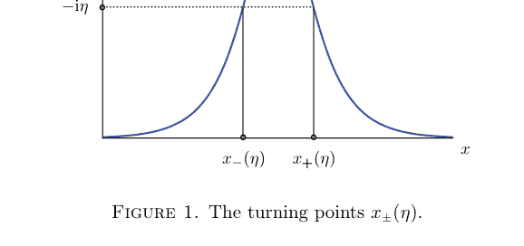

图 1. 转折点 x±(η)。

(2.3) θ⁰(λ) := -π ∫_{λ}^{iA} ρ⁰(η) dη 。

该函数衡量在段 (λ,iA) ⊂ iℝ 中的 WKB 特征值数目。我们然后对 N = 1,2,3,… 定义

ε_N := -1/N ∫₀^{iA} ρ⁰(η) dη = 1/(π N) ∫_{-∞}^{∞} A₀(x) dx 。

最后，WKB 特征值 λ_{N,k}^{wkb} 定义为（对 ε_N 有 N 个）由公式给出

(2.4)  -∫_{λ_{N,k}^{wkb}}^{iA} ρ^0(η) dη = ε_N (k + 1/2) = θ^0(λ_{N,k}^{wkb})/π ,  k = 0, …, N - 1.

显然，我们可以将左边重写为 -∫_{λ_{N,k}^{wkb}}^{iA} ρ^0(η) dη = 2/π ∫_0^{x_+(λ_{N,k}^{wkb})} √{A_0(x)^2 + (λ_{N,k}^{wkb})^2} dx 。

因此，写 λ_{N,k}^{wkb} = i τ_{N,k}^{wkb} 对于 τ_{N,k}^{wkb} ∈ (0, A) ⊂ ℝ，特征值位置（A_0 的散射数据的重要组成部分）近似由方程的解给出

(2.5) ∫_0^{x_+(i τ_{N,k}^{wkb})} √{A_0(x)^2 - (τ_{N,k}^{wkb})^2} dx = π ε_N /2 (k + 1/2) , k = 0,1,2,…, N - 1.

### 3. 半经典孤子系综

#### 3.1. 起源

我们现在可以精确描述 SSE 的起源。如上所述，将 WKB 方法应用于 (2.1) 表明反射系数可忽略，且纯虚特征值由 Bohr–Sommerfeld 型量子化条件 (2.5) 给出。值得注意的是，这一信息与 Lax & Levermore [19] 在分析 Korteweg–de Vries (KdV) 方程零色散极限时所使用的信息完全平行。Lax & Levermore 忽略了反射并采用 WKB 特征值¹ 代替真实特征值。也就是说，他们用在极限下逼近真实初值的反射less 势族来近似初值数据。由于关于真实散射数据（(2.1) 的特征值和反射系数）的精确信息未知，采用 Lax & Levermore 策略的诱惑是压倒性的，我们用（形式上的）WKB 散射数据代替。此过程，忽略反射并使用 WKB 特征值，等价于用另一个依赖于小参数 ε 的初值条件 A_0^{(ε)} 替换真实初值 A_0，使得 WKB 数据为真实数据。因此，此过程引入了对初值数据的扰动，我们写

(3.1) A_0^{(ε)}(x) = A_0(x) + q^{(ε)}(x),

使得 q^{(ε)} 为诱导的扰动；见图 4 (b) 中此类扰动初值条件的示例。由于反射被忽略，(1.1) 以初值 A_0^{(ε)} 的每个解都是 N-孤子，其中 N ∼ ε^{-1}。所有这些 (1.1) 的精确 N-孤子解的集合（当 N → ∞ 且 ε ↓ 0）是与钟形数据 A_0 相关的半经典孤子系综。

然而需要注意的是，在 KdV 方程的情况下，Whitham 方程是双曲的，因此局部适定。Lax & Levermore 诉诸于这种局部适定性来吸收由其反射less 近似诱导的渐近消失的扰动族。如上所述，我们无法诉诸于 Whitham 系统的适定性

¹ 在他们的情形中，这些特征值与由 IST 与 KdV 解关联的定态 Schrödinger 算子的谱问题的 WKB 分析相关，而非与 (2.1) 相关。

最后，一旦求得 RHP 4 的解，便可通过公式恢复 $N$-孤子解

$$u(x,t)=2i\lim_{\lambda\to\infty}\lambda m_{12}(\lambda;x,t),$$

其中 $m_{12}$ 是 $\mathbf{m}$ 的 $(1,2)$ 项。

##### 3.2.2. 最陡下降法

我们将渐近分析浓缩为最简略的形式²。大致而言，经过坐标变换后，亚纯 RHP 可以交换为截面全纯 RHP。这使得能够使用“$g$-函数机制” [10]，即最陡下降法 [9] 的一种修正，来研究 $N\to\infty$（等价于 $\epsilon\downarrow0$）问题。这种渐近分析方法依赖于能够找到一个适当的复相位，或“$g$-函数”，使得 RHP 在极限下过渡到可处理的形式。在当前设定中，这样的 $g$ 选择复平面上 RHP 应该放置的某些轮廓；轮廓由固定的带和可能位于满足某一不等式的任意位置的隙组成。如果能找到 $g$ 和适当的轮廓（带与隙），则 RHP 的解（对于小的 $\epsilon$）可近似由带端点处的超椭圆曲面上的黎曼 theta 函数构建。（注：在 [16,22] 中，$g$ 和带/隙轮廓是通过关于带数目的假设和数值计算找到的。与对小 $\epsilon$ 的 (1.1) 的直接模拟相比，这些计算极其良态；“坏”行为已被剔除。）结果是，聚焦 NLS 的半经典渐近由用 theta 函数表示的调制多相波描述，其中相位数与曲面的亏格 $G$ 相关。非线性焦散（相变）对应于曲面亏格的变化。分析的一个基本特征，影响到下面的问题，是 RHP 的该全局参数化（在整个 $\mathbb{C}$ 上均匀接近真实解）是通过将“内部”部分（靠近分支点）与“外部”部分（其他地方）匹配而构建的。

上述描述概述了 Kamvissis 等 [16] 采用的策略。这是半经典 NLS 方程分析中的第一次分析突破，此后在该问题的许多后续工作中使用了这种基本方案的变体；参见例如 [2,22,31–33]。

#### 3.3. 非线性焦散

如前一小节所述，非线性焦散是时空中的曲线，它们分隔了由于相位数不同而导致的不同调制振荡。尖锐的边界在初值问题的良好分辨模拟中清晰可见；见图 2。任何合理的 (1.1) 半经典极限理论都应该能够预测此类动力学重要特征的数量和位置。然而，在这些现象完全被理解之前仍有许多工作要做（但参见 Bertola & Tovbis [3,4] 的有趣最新工作）。

应用上述 Kamvissis 等 [16] 的方法，寻找焦散就等价于随着参数 $x$ 和 $t$ 变化，寻找复平面中必须满足某一不等式以使隙轮廓位于其中的区域的拓扑变化。利用这些思想，Kamvissis 等证明了 $G=0$ 假设正确描述了 $t\neq0$ 且 $t$ 足够小（但与 $\epsilon$ 无关）时的半经典行为。他们还证明了


G = 0 拟设的失效是由于间隙不等式区域的夹断；这是主焦散线。他们还证明了主焦散线之后的半经典动力学可以通过将拟设修正为 G = 2 来描述，正如预期的那样。

次焦散线由 Lyng 和 Miller 研究[22]，其分析与主焦散线的研究方法不同。特别是，[24] 的对偶插值方法被以关键方式使用，Lyng 和 Miller 表明次焦散线的数学机制也是由夹断事件引起的。然而，在这种情况下，夹断与使用对偶插值方法而产生的另一个变分不等式（针对一个“不同”的间隙）的失效有关。在相关工作中，Belov [2] 在主焦散线之后识别出一个“灾难性断裂”。在他的分析中，一条相关水平曲线（例如，随着 t 增加）与一个对数分支点碰撞，这成为继续渐近分析的障碍。灾难性断裂与 Lyng 和 Miller 的变分不等式失效之间的关系尚不完全清楚。事实上，我们不知道其他关于第二和更高阶焦散线的结果。然而，图2中显示的数值模拟清楚地表明存在一个三次非线性焦散线。焦散线的总数未知。是否存在无穷多个？能否预测它们在时空中的位置？初始数据中决定焦散线位置的显著特征是什么？这些关于聚焦NLS方程半经典极限的基本问题仍然悬而未决。

### 4. 与真实初值问题的联系

#### 4.1. WKB近似的合理性

上面§3的概述说明了用 A₀^{(ε)} 代替 A₀ 的优势；强大的数学工具随后可用于半经典极限问题的渐近分析。然而，如上所述，诱导扰动的影响先验地远非清楚。在本节中，我们旨在理解扰动 q^{(ε)} 对半经典动力学的影响。一方面，Miller [24] 已经证明 WKB 近似和初始数据在渐近意义上是逐点接近的。

5. 定理 (Miller [24])。在上述情形下，存在一个序列 (ε_N)_{N=1}^∞，使得

(4.1)  lim_{N→∞} ε_N = 0,

并且对于每个 x ≠ 0，存在一个常数 K（依赖于 x），使得

(4.2)  |A₀^{(ε_N)}(x) − A₀(x)| ≤ K ε_N^{1/7−ν},   N = 1,2,3,… 

对所有 ν > 0 成立。

然而，另一方面，如上所述且正如 Miller 本人所指出的，聚焦NLS方程具有调制不稳定性，其指数增长率随着 ε ↓ 0 变得任意大。因此，定理5不允许我们对

|u^{(ε)}(x,t) − u(x,t;ε)|

在任意 t > 0 时的量级得出任何结论。为了研究这个问题，我们进行了一系列数值实验。本节的实验结果在 [17,20,21] 中有更详细的报道。

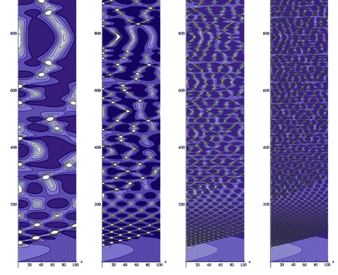

图2. 对应于数据 A₀(x) = 2 sech x，ε_N = 2/N（N = 10,20,40,60）的平方模量 |u(x,t;ε_N)|² 在 (x,t) ∈ [0,1] × [0,5] 上的绘图。主焦散线和次焦散线清晰可见。三次焦散线也可以看到。

#### 4.2. 高斯SSE

在我们的数值实验中，我们仅限于高斯SSE。也就是说，我们考虑具有由下式给出的固定初始数据的问题(1.1)

(4.3) u₀(x) = A₀(x) = e^{-x²}.

然后，由(2.4)

(4.4) ε_N = (1/(π N)) ∫_{-∞}^{∞} e^{-x²} dx = 1/(√π N).

且公式(2.5)可化为

(4.5) ∫₀^{√{-ln τ_{N,k}^{wkb}}} √{e^{-2x²} - (τ_{N,k}^{wkb})²} dx = (√π)/(2N) (k + 1/2), k = 0,1,2,…,N-1.

正是(4.5)的解 τ_{N,k}^{wkb}，k = 0,…,N-1，将生成(1.1)的精确N-孤子解。这些解对于N∈ℕ的集合就是高斯SSE。

我们首先以非常高的精度³求解(4.5)。有了数值计算的WKB谱数据后，我们使用[26]和[22]的数值线性代数程序在t=0（以及之后的时间）重构SSE的各个成员。然后，我们将高斯SSE成员在t=0处的数值重构与真实初始数据 A₀ = e^{-x²} 以及 t>0 演化的近似值进行比较。我们系统地计算了SSE解的平方模量（通过数值逆散射计算）与有限差分法（表示初始数据 A₀(x) = exp(-x²) 的真实演化）在 N=5 到 N=20 以及 t=0.0 到 t=0.5 范围内的解的平方模量之间的2-范数差异。图3显示了这些数据；标记分别显示了在时间 t = 0.0、0.1、0.2、0.3、0.4 和 0.5 时，2-范数差异随 N 的变化。该图显示了随着 N 增加（ε 减小）误差衰减的显著一致性。

*事实上，对数据的最小二乘拟合表明，SSE解以 O(ε) 的速率收敛到真实解！确实，这种收敛速率在正时间持续存在，甚至包括第一个焦散线之后的时间。* 图4（面板(a)和(b)）展示了这一现象的代表性示例。尽管存在剧烈的调制不稳定性，由扰动 q^{(ε)} 引起的小振荡几乎立即消散，解的大尺度结构彼此几乎无法区分。

## 6. 注记（数值方法）

我们使用了两种不同的数值方法来逼近(1.1)的解。首先，为了计算多孤子解（SSE的元素），我们采用了之前使用的数值逆散射方法[22,26]；该方法也用于生成图2所示的解。另一方面，在ε较小时，为更一般地逼近(1.1)的解而构造精确的数值方法是出了名的困难问题。我们建议感兴趣的读者参阅Jin等人[15]的最新综述，其中全面讨论了即使在线性情况下也会出现的各种挑战；另见[21]及其参考文献，了解ε较小时(1.1)的数值方法的更多细节。这里给出的结果是通过[21]中开发的二阶隐式有限差分算法获得的，并在该文中被证明是求解ε较小时半经典聚焦非线性薛定谔方程的合适数值方法。

#### 4.3. “邻近”初始数据与半经典极限的稳定性

作为一种控制实验，我们接下来考虑了函数族⁴

```
(4.6) q^ε(x) = 0.3ε cos( x / (0.54ε) ) exp(-x²)
```

其中 ε > 0 作为参数。我们将 q^ε 作为初始数据 A₀ 的依赖于ε的扰动，并将此函数族的成员称为“余弦扰动”。图4（面板(c)）显示了在 ε = 1/(15√π) 时，使用方程(4.6)中的余弦扰动 q^ε 对初始数据的修改。从粗略的定性角度来看，这些数据与图4（面板(b)）中SSE的修改数据看起来非常相似。实际上，如果没有高斯模板，这些差异几乎无法分辨。

³高精度的特征值位置知识是必要的，因为解是通过求解一个病态线性系统获得的[26]。

⁴(4.6)中出现的数值0.3和0.54的选择使得余弦扰动 q^ε 的幅度和频率与其对应物 q^{(ε)} 相匹配；比较图4（面板(b)和(c)）。

很容易证明，如果 0 < ε < 1，则

(4.7)  ∫_{-∞}^{∞} |q^ε(x)|² dx ≤ (0.09)ε² √(π/2) ,

因此当 ε ↓ 0 时，||q^ε||_{L²(ℝ)} = O(ε)。我们注意到余弦扰动 q^ε 也是偶函数（如 q^{(ε)}），且振荡频率依赖于 ε（如 q^{(ε)}）。此外，对于每个固定的 ε > 0，q^ε 是实解析函数的复合，因此是实解析的。现在，基本问题是，当 ε 趋于零时，初始数据族

A₀^ε = A₀ + q^ε

的演化是否具有与图3所示的、由数据 A₀^{(ε)} = A₀ + q^{(ε)} 获得的解相同的显著结构。答案是否定的；参见图4（面板(c)）中的示例性可视化，它展示了 q^ε 中的小振荡如何被立即检测到，并触发调制不稳定性。我们将此结果视为支持[21]中主张的证据，即SSE情况下观察到的 O(ε) 衰减确实是嵌入在 A₀^{(ε)} 中的特殊可积结构的结果，而不是由于其表面特征（即 A₀^ε 中也存在的那些特征）。换句话说，这些结果使我们怀疑WKB近似对


> 图 4。左图：初始数据 (a) 纯高斯，A₀(x) = exp(−x²)；(b) t = 0 时的 SSE，A₀^(ε)(x) = A₀(x) + q^(ε)(x)；(c) 余弦扰动，A₀^(ε)(x) = A₀(x) + q^c(x)。右图：(a) 高斯初始数据的时空图，|u(t, x; t)|²；(b) SSE 修改后的初始数据，|u^(ε)(x, t)|²；(c) 由余弦扰动初始数据演化得到的解的平方模，|u^c(x, t)|²。在此图中 ε = 1/(15√π) ≈ 0.01175 对三种情况均相同。图片取自 [20]。

用于构造 A₀^(ε) 的 (2.1) 的特征值确实是对与高斯相关的真实（未知）特征值的极好近似。事实上，我们直接测量近似的质量，并在下一小节中简要总结这些结果。

#### 4.4. 谱域中的 SSE。

我们使用了 Bronski [5, 6] 的数值协议来计算具有高斯势的 (2.1) 的特征值，

```
A₀(x) = e^{-x²}
```

对于多种 ε 值。我们的目标是计算 SSE 公式中使用的近似（WKB）特征值收敛到真实特征值的速率。我们这样做既是为了直接验证我们对 WKB 近似高质量的预期（我们仅从先前描述的模拟中推断出这一点），也是为了支持我们相信的速率的最终证明，我们认为该速率将是 Kamvissis 等人 [16] 分析的任何严格扩展中必不可少的组成部分，该分析考虑了在 (1.1) 的渐近分析中使用 WKB 特征值。简而言之，我们在谱平面中直接数值测量了差异，我们的实验表明当 ε ↓ 0 时收敛速率为 O(ε²)。该计算的细节可在 [17] 中找到。

简而言之，我们对数据进行了最小二乘拟合，形式为

```
(4.8) D^N = C · N^α
```

其中常数 C 和 α 有待确定。这里 D 表示数据，即 WKB 特征值与用于构造 SSE 的（数值计算的）真实特征值之间的计算差异的集合。现在对于每个 N = 10,⋯,20，我们有 k = 0,⋯,N−1 的数据，对于 N = 21 和 22，我们有最大（k = 0）特征值的数据。因此我们总共有 167 个数据点。图 5(a) 显示了全部 167 个数据点的最小二乘拟合。三角形为计算得到的差异。例如，对于 N = 10，有 10 个特征值，因此有 10 个计算得到的差异。实线为计算得到的最小二乘曲线，表示 D^N 随 N 衰减的总体趋势。衰减速率为 α = −2.00848。另一种监测衰减速率的方法是跟踪每个 N 的最大特征值之间的差异。也就是说，我们计算了

```
(4.9) D_{N,0} = |λ_{N,0}^{app} − λ_{N,0}^{wkb}|,  N = 10,⋯,22
```

并再次进行最小二乘拟合。图 5(b) 显示了该 13 个数据点的集合的数据和最小二乘曲线。在这种情况下，衰减速率为 α = −2.0135。这些实验支持衰减速率约为小参数平方的阶。

#### 4.5. 总结：A₀ 与 A₀^{(ε)}。

总之，以上描述的数值实验强烈支持这样一种观点：用于生成与 (1.1) 的特定钟形初始条件相关的 SSE 的扰动族 q^{(ε)}，非常适合于半经典极限的分析。事实上，如图 3 所示，聚焦 NLS 方程的极端模不稳定性（在半经典极限下会变得更糟）似乎根本不会被这些扰动触发，我们由此推测，源自 A₀ 的解的半经典渐近性与源自 A₀^{(ε)} 的极限的解的渐近性一致。 presumably，这在很大程度上是由于这些扰动与方程的可积结构紧密交织。事实上，一个额外的实验表明，定性相似但与方程的可积结构没有特殊联系的扰动会被立即检测到（图 4）。最后，数值计算证实了构造修改数据时使用的近似（WKB）特征值以 ε 的二次速率趋近于真实特征值；这也是 WKB 近似在此问题背景下可行性的另一个迹象。

### 5. 展望

在本节最后，我们简要指出基于 SSE 工作可供未来研究的若干可能方向。

#### 5.1. 估计。

一个自然的起点是尝试建立 Klaus–Shaw 数据 A0 的真实特征值与其由 (2.5) 给出的 WKB 近似之间的偏差的严格估计。假设能够实现这一点，下一步将是把对特征值的控制纳入整体渐近分析中。出现的一个直接问题是由于 [16] 中的分析框架的第一步是坐标变换，将亚纯 RHP 交换为分段全纯的 RHP。该坐标变换基于对极点位置（特征值位置）的精确了解。但如果这些位置仅近似已知，整个过程将在第一步就受阻。然而，假设这些挑战可以克服，结果将是为一整个合适的 Klaus–Shaw 数据族建立半经典动力学的严格理论。这将是对当前最先进技术的巨大扩展。事实上，具有非平凡相位如 (1.3) 的一般数据的对应问题仍然几乎完全开放。

#### 5.2. 更高次的焦散。

如 §3.3 中所述，关于更高次的焦散（在初次焦散之后出现——或如情况可能出现的不出现——的那些非线性焦散曲线）知之甚少。Lyng & Miller 的结果表明，半经典动力学这些特征的数学机制可能因焦散而异，这是由于引入了新的变分不等式。事实上，我们不知道以下看似基本问题的答案，例如。

- 有多少个焦散？无限多个吗？
- 它们的位置可以预测吗？
- 在什么情况下我们可以计算长时间极限？

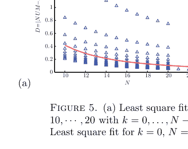

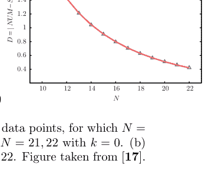

#### 5.3. 稳定性。

最后，我们提到由 [20] 中的实验激发的一个可能的进一步研究方向。图 4 表明，(1.1) 的半经典极限的敏感性性质（即使对于解析类中的实数据）可能非常微妙。一个有趣的后续问题是开始研究敏感性，例如研究半经典极限的一个或多个重要特征（例如 x = 0 处初次焦散的 t 坐标）相对于 Clarke & Miller [8] 提出的空间 F_K——带限函数空间⁵——中扰动的连续性性质。

### 致谢

作者感谢 Christopher Curtis、Anton Dzhamay、Willy Hereman 和 Barbara Prinari 组织了 2013 年 5 月在科罗拉多州博尔德举行的 AMS 分会会议上的一个令人振奋的专题会议；该专题会议促使撰写了本 SSE 最新结果的综述。此外，作者衷心感谢美国国家科学基金会项目号 DMS-0845127 的支持。

### 参考文献

- [1] M. J. Ablowitz, B. Prinari, and A. D. Trubatch, Discrete and continuous nonlinear Schrödinger systems, London Mathematical Society Lecture Note Series, vol. 302, Cambridge University Press, Cambridge, 2004. MR2040621 (2005c:37117)
- [2] Sergey M. Belov, Breaking in the semiclassical solution of the focusing nonlinear Schrodinger equation, ProQuest LLC, Ann Arbor, MI, 2008. Thesis (Ph.D.)–Duke University. MR2713942
- [3] Marco Bertola and Alexander Tovbis, Universality in the profile of the semiclassical limit solutions to the focusing nonlinear Schrödinger equation at the first breaking curve, Int. Math. Res. Not. IMRN 11 (2010), 2119–2167, DOI 10.1093/imrn/rnp196. MR2646356 (2011e:35348)
- [4] Marco Bertola and Alexander Tovbis, Universality for the focusing nonlinear Schrödinger equation at the gradient catastrophe point: rational breathers and poles of the tritronquée solution to Painlevé I, Comm. Pure Appl. Math. 66 (2013), no. 5, 678–752, DOI 10.1002/cpa.21445. MR3028484
- [5] Jared C. Bronski, Semiclassical eigenvalue distribution of the Zakharov-Shabat eigenvalue problem, Phys. D 97 (1996), no. 4, 376–397, DOI 10.1016/0167-2789(95)00311-8. MR1412550 (98c:81062)
- [6] J. C. Bronski, Spectral instability of the semiclassical Zakharov-Shabat eigenvalue problem, Phys. D 152/153 (2001), 163–170, DOI 10.1016/S0167-2789(01)00167-1. Advances in nonlinear mathematics and science. MR1837906
- [7] Jared C. Bronski and David W. McLaughlin, Semiclassical behavior in the NLS equation: optical shocks—focusing instabilities, Singular limits of dispersive waves (Lyon, 1991), NATO Adv. Sci. Inst. Ser. B Phys., vol. 320, Plenum, New York, 1994, pp. 21–38. MR13211192
- [8] S. R. Clarke and P. D. Miller, On the semi-classical limit for the focusing nonlinear Schrödinger equation: sensitivity to analytic properties of the initial data, R. Soc. Lond. Proc. Ser. A Math. Phys. Eng. Sci. 458 (2002), no. 2017, 135–156, DOI 10.1098/rspa.2001.0862. MR1879462 (2002k:35288)
- [9] P. Deift and X. Zhou, A steepest descent method for oscillatory Riemann-Hilbert problems. Asymptotics for the MKdV equation, Ann. of Math. (2) 137 (1993), no. 2, 295–368, DOI 10.2307/2946540. MR1207209 (94d:35143)
- [10] P. Deift, S. Venakides, and X. Zhou, New results in small dispersion KdV by an extension of the steepest descent method for Riemann-Hilbert problems, Internat. Math. Res. Notices 6 (1997), 286–299, DOI 10.1155/S1073792897000214. MR1440305 (98b:35155)

⁵ F_K 是 L²(ℝ) 的线性子空间，由其傅里叶变换满足 \hat{φ}(k) = 0 对 |k| > K 的函数 φ 组成。


- [11] B. Dubrovin, T. Grava, and C. Klein, 关于聚焦非线性薛定谔方程临界行为的普适性，椭圆脐点灾变以及 Painlevé-I 方程的 tritronquée 解，J. Nonlinear Sci. 19 (2009), no. 1, 57–94, DOI 10.1007/s00332-008-9025-y. MR2480731 (2010b:35428)
- [12] Nicholas M. Ercolani, Shan Jin, C. David Levermore, and Warren D. MacEvoy Jr., 聚焦 Zakharov-Shabat 层级中奇数流的零色散极限，Int. Math. Res. Not. 47 (2003), 2529–2564, DOI 10.1155/S1073792803130851. MR2007539 (2005h:37158)
- [13] Ludwig D. Faddeev and Leon A. Takhtajan, 孤子理论中的哈密顿方法，Reprint of the 1987 English edition, Classics in Mathematics, Springer, Berlin, 2007. Translated from the 1986 Russian original by Alexey G. Reyman. MR2348643 (2008f:37145)
- [14] M. Gregory Forest and Jong Eao Lee, 周期非线性薛定谔方程的几何与调制理论，Oscillation theory, computation, and methods of compensated compactness (Minneapolis, Minn., 1985), IMA Vol. Math. Appl., vol. 2, Springer, New York, 1986, pp. 35–69, DOI 10.1007/978-1-4613-8689-6.3. MR869821
- [15] Shi Jin, Peter Markowich, and Christof Sparber, 半经典薛定谔方程的数学与计算方法，Acta Numer. 20 (2011), 121–209, DOI 10.1017/S0962492911000031. MR2805153 (2012e:81070)
- [16] Spyridon Kamvissis, Kenneth D. T.-R. McLaughlin, and Peter D. Miller, 聚焦非线性薛定谔方程的半经典孤子系综，Annals of Mathematics Studies, vol. 154, Princeton University Press, Princeton, NJ, 2003. MR1999840 (2004h:37115)
- [17] Y. Kim, L. Lee, and G. Lyng, Zakharov-Shabat 问题半经典特征值的 Wentzel-Kramers-Brillouin 近似，J. Math. Phys. 55 (2014), no. 083516, 18 pages.
- [18] M. Klaus and J. K. Shaw, Zakharov-Shabat 系统的纯虚特征值，Phys. Rev. E (3) 65 (2002), no. 3, 036607, 5, DOI 10.1103/PhysRevE.65.036607. MR1905252 (2003c:34144)
- [19] Peter D. Lax and C. David Levermore, Korteweg-de Vries 方程的小色散极限 II，Comm. Pure Appl. Math. 36 (1983), no. 5, 571–593, DOI 10.1002/cpa.3160360503. MR716197 (85g:35105b)
- [20] Long Lee and Gregory D. Lyng, 聚焦非线性薛定谔方程高斯半经典孤子系综的再审视，Phys. Lett. A 377 (2013), no. 16-17, 1179–1188, DOI 10.1016/j.physleta.2013.03.009. MR3040497
- [21] Long Lee, Gregory Lyng, and Irena Vankova, 高斯半经典孤子系综及聚焦非线性薛定谔方程的数值方法，Phys. D 241 (2012), no. 21, 1767–1781, DOI 10.1016/j.physd.2012.08.006. MR2982055
- [22] Gregory D. Lyng and Peter D. Miller, 聚焦非线性薛定谔方程的 N 孤子，N 很大时，Comm. Pure Appl. Math. 60 (2007), no. 7, 951–1026, DOI 10.1002/cpa.20162. MR2319053 (2008k:35454)
- [23] Peter D. Miller, 关于非自伴 Zakharov-Shabat 特征值问题的 WKB 方法的若干注记，势为解析且相位快速时，Phys. D 152/153 (2001), 145–162, DOI 10.1016/S0167-2789(01)00166-X. Advances in nonlinear mathematics and science. MR1837905 (2003d:34187)
- [24] Peter D. Miller, 半经典孤子系综的渐近性：WKB 近似的严格证明，Int. Math. Res. Not. 8 (2002), 383–454, DOI 10.1155/S1073792802109020. MR1884077 (2003j:30060)
- [25] Peter D. Miller, 具有大量离散谱的 Riemann-Hilbert 问题，Integrable systems and random matrices, Contemp. Math., vol. 458, Amer. Math. Soc., Providence, RI, 2008, pp. 163–181, DOI 10.1090/conm/458/08935. MR2411906 (2010a:37147)
- [26] Peter D. Miller and Spyridon Kamvissis, 关于聚焦非线性薛定谔方程半经典极限，Phys. Lett. A 247 (1998), no. 1-2, 75–86, DOI 10.1016/S0375-9601(98)00565-9. MR1650432 (99e:81058)
- [27] Junkichi Satsuma and Nobuo Yajima, 色散介质中非线性波一维自调制的初值问题，Progr. Theoret. Phys. Suppl. No. 55 (1974), 284–306. MR0463733 (57 #3675)
- [28] Catherine Sulem and Pierre-Louis Sulem, 非线性薛定谔方程，Applied Mathematical Sciences, vol. 139, Springer-Verlag, New York, 1999. Self-focusing and wave collapse. MR1696311 (2000f:35139)
- [29] Alexander Tovbis and Stephanos Venakides, *聚焦非线性薛定谔方程散射变换的半经典极限*，Int. Math. Res. Not. IMRN **10** (2012), 2212–2271, DOI 10.1093/imrn/rnr092. MR2923165
- [30] Alexander Tovbis and Stephanos Venakides, *聚焦非线性薛定谔方程的特征值问题：新的可解情形*，Phys. D **146** (2000), no. 1-4, 150–164, DOI 10.1016/S0167-2789(00)00126-3. MR1787410 (2001i:35266)
- [31] Alexander Tovbis, Stephanos Venakides, and Xin Zhou, *半经典聚焦非线性薛定谔方程 I：逆散射映射及其对辐射初值演化*，Int. Math. Res. Not. IMRN **22** (2007), Art. ID rnm094, 54, DOI 10.1093/imrn/rnm094. MR2376209 (2009a:37146)
- [32] Alexander Tovbis, Stephanos Venakides, and Xin Zhou, *关于聚焦非线性薛定谔方程半经典（零色散极限）解的长时间极限：纯辐射情形*，Comm. Pure Appl. Math. **59** (2006), no. 10, 1379–1432, DOI 10.1002/cpa.20142. MR2248894 (2007e:37041)
- [33] Alexander Tovbis, Stephanos Venakides, and Xin Zhou, *关于聚焦非线性薛定谔方程的半经典（零色散极限）解*，Comm. Pure Appl. Math. **57** (2004), no. 7, 877–985, DOI 10.1002/cpa.20024. MR2044068 (2005c:35269)
- [34] V. E. Zakharov and A. B. Shabat, *二维自聚焦和非线性介质中波一维自调制的精确理论* (Russian, with English summary), Ž. Èksper. Teoret. Fiz. **61** (1971), no. 1, 118–134; English transl., Soviet Physics JETP **34** (1972), no. 1, 62–69. MR0406174 (53 #9966)

with U an N-periodic continuous function, i.e. U ∈ C(T^N), and k̄, ω̄, ᾱ ∈ ℝ^N. Throughout the manuscript, we will use the phrase “solitary waves” in a broad sense to describe waves that, most of the time, remain well-separated from one another and propagate with nearly constant speed and shape. “Stokes waves” will refer to periodic progressive solutions of the free-surface Euler equations of permanent form, or waves that began at t = 0 as a linear superposition of such traveling waves. They comprise a special class of solitary waves. “Solitons” will refer specifically to superpositions of sech² solutions of the KdV equation on the whole line, while “cnoidal solutions” will refer to their spatially periodic, multi-phase counterparts; see §5 for elaboration.

It was found in [49] that decreasing the fluid depth causes standing waves to transition from large-scale symmetric sloshing behavior in deep water to pairs of counter-propagating solitary waves that collide repeatedly in shallow water. In the present work, we consider unidirectional waves of different amplitude that collide due to taller waves moving faster than shorter ones. We present two examples of solutions of this type: one where the resulting dynamics is fully time-periodic; and one where it is relative-periodic, returning to a spatial phase shift of the initial condition at a later time. Both examples exhibit behavior typical of collisions of KdV solitons. In the first, one wave is significantly larger than the other, and completely subsumes it during the interaction. In the second, the waves have similar amplitude, with the trailing wave bumping into the leading wave and transferring energy without fully merging.

Despite these similarities, the amplitude of the waves in our examples are too large for the assumptions in the derivation of the KdV equation to hold. In particular, the larger wave in the first example is more than half the fluid depth in height, and there is significant vertical motion of the fluid when the waves pass by. A detailed comparison of the Euler and KdV equations for waves with these properties is carried out in §5. A review of the literature on water wave collisions and the accuracy of the KdV model of water waves is also given in that section.

Rather than compute such solutions by increasing the amplitude from the linearized regime via numerical continuation, as was done for counter-propagating waves in [49], we use collisions of right-moving Stokes waves as starting guesses. The goal is to minimally “tune” the background radiation generated by the Stokes collisions so that the amount coming out of each collision is identical to what went into it. In the first example of §4, we find that the tuned background radiation takes the form of a train of traveling waves of smaller wavelength moving to the right more slowly than either solitary wave. By contrast, in the counter-propagating case studied in [49], it consists of an array of smaller-wavelength standing waves oscillating rapidly relative to the time between collisions of the primary waves. In the second example of §4, the background radiation is essentially absent, which is to say that the optimized solution is free from high-frequency, low-amplitude disturbances in the trough, and closely resembles a relative-periodic cnoidal solution of KdV. We call the collisions in this solution “elastic” as they repeat forever, unchanged up to spatial translation, and there are no features to distinguish radiation from the waves themselves. This process of tuning parameters to minimize or eliminate small-amplitude oscillations in the wave troughs is reminiscent of Vanden-Broeck’s work [45] in which oscillations at infinity could be eliminated from solitary capillary-gravity waves by choosing the amplitude appropriately.


为了寻找相对周期解，我们使用作者及其合作者在先前工作中为研究若干相关问题而开发的超定打靶方法的变体：Benjamin-Ono 方程的时间周期解 [3,5] 和带表面张力的涡旋片 [4,6]；锁模激光中的 Hopf 分岔和稳定性转变 [50]；带纹胎面滚动的循环稳态 [21]；大振幅驻立水波波峰处的自相似性（或缺乏自相似性）[47]；临界深度下驻立水波的谐振和新分支的自发成核 [49]；以及三维驻立水波 [42]。这些论文中发展的三种方法是伴随延拓方法 [5,50]、Newton-Krylov 打靶方法 [21]，以及基于 Levenberg-Marquardt 算法 [39] 的信赖域打靶方法 [49]。我们在此采用后一种方法，以利用同时并行计算雅可比矩阵多列的 Dirichlet-Neumann 算子的机会来整合计算工作。

本工作的一个计算新颖之处在于，我们直接搜索非线性两点边值问题的大振幅解，而不使用数值延拓来达到该解。这通常很困难。然而，在本例中，由于非光滑分岔“曲线”布满 Cantor 样间隙 [41]，以及单向情形下碰撞之间出现的长时间模拟，数值延拓也很难。我们的打靶方法已证明足够稳健，即使在初始猜测很差的情况下，只要解存在，就能成功找到时间周期解。通过将解谱解析到机器精度并过度约束最小化问题来避免假阳性。挑战的很大一部分在于确定初始条件的形式和目标函数，以避免在锁定到附近的相对周期解之前，偏离正确方向并陷入非零局部最小值。

### 2. 运动方程

自由表面 \(\eta(x,t)\) 在理想流体中随速度势 \(\phi(x,y,t)\) 演化的运动方程可写为 [17,18,27,46]

\[
\begin{aligned}
\eta_t &= \phi_y - \eta_x \phi_x,\\
\varphi_t &= P[\phi_y \eta_t - \tfrac12\phi_x^2 - \tfrac12\phi_y^2 - g\eta],
\end{aligned}
\tag{2.1}
\]

其中下标表示偏导数，\(\varphi(x,t)=\phi(x,\eta(x,t),t)\) 是 \(\phi\) 在自由表面上的限制，\(g=1\) 为重力加速度，\(\rho=1\) 为流体密度，\(P\) 为投影

\[
P f = f - \frac{1}{2\pi}\int_0^{2\pi} f(x)\,dx,
\tag{2.2}
\]

其中我们假设 \(2\pi\)-周期域。自由表面处的速度分量 \(u=\phi_x\) 和 \(v=\phi_y\) 可由 \(\varphi\) 通过

\[
\begin{pmatrix} \phi_x \\ \phi_y \end{pmatrix}
= \frac{1}{1+\eta'(x)^2}
\begin{pmatrix} 1 & -\eta'(x) \\ \eta'(x) & 1 \end{pmatrix}
\begin{pmatrix} \varphi'(x) \\ G\varphi(x) \end{pmatrix},
\tag{2.3}
\]

计算，其中撇号表示导数，\(G\) 为 Dirichlet-Neumann 算子 [16]

\[
G\varphi(x)=\sqrt{1+\eta'(x)^2}\,\frac{\partial\phi}{\partial n}(x+i\eta(x))=\phi_y-\eta_x\phi_x,
\tag{2.4}
\]

对应 Laplace 方程，在 \(x\) 方向具有周期边界条件，在上边界具有 Dirichlet 条件 \((\phi=\varphi)\)，在下边界假设为平坦的 Neumann 条件 \((\phi_y=0)\)。由于 Laplace 方程中时间被冻结，我们在记号中省略了 \(t\)。我们使用边界积分配点法 [7, 8, 30, 34, 36] 计算 \(\mathcal{G}\varphi\)，并使用 8 阶 Runge-Kutta 格式 [23] 配合 36 阶滤波 [25]推进解。详见 [49]。

### 3. 相对周期解的计算

行波具有如下对称性

\[
\eta(x,0)\text{ 为偶},\qquad \varphi(x,0)\text{ 为奇}.
\tag{3.1}
\]

若将 \(x\) 替换为 \(x-\pi\) 仍成立。作为新一类时间周期和相对周期解的初始猜测，我们设想叠加两个行波，一个以 \(x=0\) 为中心，另一个以 \(x=\pi\) 为中心。这样做将保持性质 (3.1)，但波现在会相互作用，而不再是纯行波。若存在时间 \(T\) 和相位偏移 \(\theta\) 使得

\[
\eta(x,t+T)=\eta(x-\theta,t),\qquad \varphi(x,t+T)=\varphi(x-\theta,t)
\tag{3.2}
\]

对所有 \(t\) 和 \(x\) 成立，则称该解为 *相对周期*。时间周期性是 \(\theta\in 2\pi\mathbb{Z}\) 的特例。我们可以通过施加替代条件来节省 2 倍的计算工作

\[
\eta(x+\theta/2,T/2)\text{ 为偶},\qquad \varphi(x+\theta/2,T/2)\text{ 为奇}.
\tag{3.3}
\]

由此可得

\[
\eta(x+\theta/2,T/2)=\eta(-x+\theta/2,T/2)=\eta(x-\theta/2,-T/2),
\]
\[
\varphi(x+\theta/2,T/2)=-\varphi(-x+\theta/2,T/2)=\varphi(x-\theta/2,-T/2).
\]

但此时 (3.2) 的等式两边在时间 \(t=-T/2\) 处一致。因此，(3.2) 对所有时间成立。

在深水行驻波的背景下 [48]，自然定义 \(T\) 为上述值的两倍，将所有 \(T/2\) 的因子替换为 \(T/4\)。这样纯驻波在时间 \(T\) 内返回其原始构型，而不是在时间 \(T\) 内在空间中平移 \(\pi\)。在本工作中，我们考虑以不同速度向右运动的孤立波的碰撞，因此更自然地定义 \(T\) 为存在 \(\theta\) 使得 (3.2) 成立的第一个（而非第二个）时间。

#### 3.1. 目标函数。

我们将 [47, 49] 中的超定打靶方法改编为计算 (3.1)–(3.3) 的解。该方法采用 Levenberg-Marquardt 方法 [39] 配合延迟雅可比更新 [49] 来求解下面描述的非线性最小二乘问题。

对于 (3.1)，我们将对称性构建到打靶方法允许搜索的初始条件中：我们选择整数 \(n\) 并考虑形如

\[
\hat{\eta}_k(0)=c_{2|k|-1},\qquad \hat{\varphi}_k(0)=\pm i c_{2|k|},
\tag{3.4}
\]

的初始条件，其中 \(k\in\{\pm1,\pm2,\dots,\pm n/2\}\) 且 \(\hat{\eta}_k(t),\hat{\varphi}_k(t)\) 为 \(\eta(x,t),\varphi(x,t)\) 的傅里叶模态。数 \(c_1,\dots,c_n\) 假定为实数，所有其他傅里叶模态（除 \(\hat{\eta}_0\) 外）均为零。我们将 \(\hat{\eta}_0\) 设为流体深度，使得 \(y=0\) 为对应底部壁面的对称线。这对计算 Dirichlet-Neumann 算子很方便 [49]。在 \(\hat{\varphi}_k\) 的公式中，若 \(k<0\) 则取负号，使得 \(\hat{\varphi}_{-k}=\overline{\hat{\varphi}_k}\)。我们还求解周期

\[
T=c_{n+1}.
\tag{3.5}
\]

相位偏移 \(\theta\) 在此作为预设参数。或者，在行驻波的研究中 [48]，作者定义行进参数 \(\beta\) 并将 \(\theta=c_{n+2}\) 作为算法的一部分进行变化以获得期望的 \(\beta\) 值。该参数 \(\beta\) 对于浅水孤立波碰撞意义不大，因此在本研究中我们使用 \(\theta\) 本身作为行进参数。我们还需要指定波的振幅。这可以通过多种方式完成，例如指定能量值

\[
E=\frac{1}{2\pi}\int_0^{2\pi}\left(\tfrac12 \varphi\mathcal{G}\varphi+\tfrac12 g\eta^2\right)\,dx,
\]

通过约束傅里叶模态如 \(\hat{\eta}_1(0)\)，或通过指定波在 \(x=0\) 处的初始高度：

\[
\eta(0,0)=\hat{\eta}_0+\sum_{k=1}^{n/2}2c_{2k-1}.
\]

因此，为强制 (3.3)，我们可以最小化目标函数

\[
f(c)=\tfrac12 r(c)^T r(c),
\tag{3.6}
\]

其中

\[
r_1=(\text{选择其一：}\quad E-a\quad,\quad \hat{\eta}_1(0)-a\quad,\quad \eta(0,0)-a),
\]
\[
r_{2j}=\operatorname{Im}\{e^{ij\theta/2}\hat{\eta}_j(T/2)\},\qquad
r_{2j+1}=\operatorname{Re}\{e^{ij\theta/2}\hat{\varphi}_j(T/2)\},\qquad (1\le j\le M/2).
\tag{3.7}
\]

这里 \(a\) 为所选振幅参数的期望值。或者，我们可以直接施加 (3.2) 通过最小化

\[
\tilde f=\tfrac12 r_1^2+\frac{1}{4\pi}\int_0^{2\pi}\Big(\big[\eta(x,T)-\eta(x-\theta,0)\big]^2+\big[\varphi(x,T)-\varphi(x-\theta,0)\big]^2\Big)\,dx,
\tag{3.8}
\]

该式也可写成 \(\tfrac12 r^T r\) 的形式，若我们定义 \(r_1\) 如上并令

\[
r_{4j-2}+i r_{4j-1}=\sqrt{2}\,\big[\hat{\eta}_j(T)-e^{-ij\theta}\hat{\eta}_j(0)\big],
\]
\[
r_{4j}+i r_{4j+1}=\sqrt{2}\,\big[\hat{\varphi}_j(T)-e^{-ij\theta}\hat{\varphi}_j(0)\big],\qquad (1\le j\le M/2).
\tag{3.9}
\]

注意 \(f\) 衡量 \(\eta(x+\theta/2,T/2)\) 的偶性和 \(\varphi(x+\theta/2,T/2)\) 的奇性偏离程度，而 \(\tilde f\) 衡量 \(\eta(x+\theta,T)\) 和 \(\varphi(x+\theta,T)\) 与其初始状态的偏离。在 §4 的第一个示例中，我们直接最小化 \(\tilde f\)，而在第二个示例中我们最小化 \(f\) 并检查 \(\tilde f\) 也很小，作为验证手段。方程数 \(m=M+1\) 对 \(f\) 而言，\(m=2M+1\) 对 \(\tilde f\) 而言，通常大于未知数数 \(n+1\)，这是由于初始条件的零填充。这增加了打靶方法的稳健性，并导致算法所变化的所有傅里叶模态，即 (3.4) 中的模态，在网格上得到良好的分辨。


#### 3.2. 雅可比矩阵的计算。

为了计算雅可比矩阵 J = ∇_c r 的第 k 列，该矩阵由 Levenberg-Marquardt 方法所需，我们求解线性化方程与非线性方程一起：

```
(3.10) ∂/∂t (q \dot{q}) = ( F(q) \ DF(q) \dot{q} ),   q(0) = q0 = (η0, φ0), \dot{q}(0) = \dot{q}0 = ∂q0/∂c_k.
```

这里 q = (η, φ), \dot{q} = (\dot{η}, \dot{φ}), F(q) 给出于 (2.1)，DF 是其导数（见 [49] 具体公式），点表示相对于初始条件扰动的变分导数，而不是时间导数。为了计算 i ≥ 2 且 k ≤ n 时的 ∂r_i/∂c_k，只需在 (3.7) 或 (3.9) 右侧的每个傅里叶模式上加上点，包括 (3.9) 中的 \hat{η}_j(0) 和 \hat{φ}_j(0)。如果 k = n + 1，则 c_k = T 且

```
∂r_{2j}/∂T = Im{ e^{i j θ/2} (1/2) ∂_t \hat{η}_j (T/2) },   ∂(r_{4j} + i r_{4j+1})/∂T = √2 [∂_t \hat{φ}_j (T)]
```

分别在 (3.7) 和 (3.9) 中，具有 ∂(r_{4j-2} + i r_{4j-1})/∂T 和 ∂r_{2j+1}/∂T 的类似公式。r1 的三种可能性处理如下：

- case 1: ∂r1/∂c_k = \dot{E} = 1/(2π) ∫0^{2π} [\dot{η} η_t - η \dot{φ}_t]_{t=0} dx,   (k ≤ n),   ∂r1/∂c_{n+1} = 0,
- case 2: ∂r1/∂c_k = \hat{η}_1(0) = δ_{k,1},   (k ≤ n + 1),
- case 3: ∂r1/∂c_k = η(0,0) = 2δ_{k,odd},   (k ≤ n),   ∂r1/∂c_{n+1} = 0,

其中 δ_{k,j} 和 δ_{k,odd} 分别在 k = j 或 k 为奇数时等于 1，否则等于零。式 (3.10) 中的向量 \dot{q} 批量计算，每个都用不同的初始扰动初始化，以在每个时间步长中计算 Dirichlet-Neumann 算子时整合工作。详见 [48,49]。

### 4. 数值结果

如引言中所述，我们的想法是使用单向 Stokes（即行进）波的碰撞作为起始猜测来寻找 Euler 方程的时间周期和相对周期解。我们首先计算不同波高的行进波并记录其周期。这在 §3 的框架中很容易完成。我们设 θ = π/64（或任何其他小数值）并最小化 (3.8) 中的 \tilde{f}。所得的“周期” T 将通过 c = θ/T 给出波速。下面我们报告 T = 2πc，即 T 按 θ 为 2π 的方式重新缩放。我们通过指定 \hat{η}_1(0) 来控制振幅，这是 §3 中定义残差第一分量 r1 的第二种选项。计算行进波的更常规方法是把 η(x - ct), φ(x - ct) 代入 (2.1) 并通过牛顿法求解所得的定常问题（或等价的积分方程）[11,12,37]。注意这里的波速 c 与 (3.4) 中未知向量 c 无关。

有了行进波后，我们下一步的目标是碰撞其中两个并搜索附近的时间周期解，θ = 0。如图 1 所示，将 \hat{η}_1(0) 从 0 变到 7.4×10^{-4} 会使波长 λ = 2π 且平均流体深度 h = 0.05 的 Stokes 波的周期从 T_O = 28.1110 减小到 T_A = 22.9739，波高（垂直波峰到波谷距离）从 0 增加到 0.02892。我们计算的 Stokes 波中，解 C 是最接近满足 5T_C = 6T_A 的一个，其中 p = 5 是满足 (p+1)/p T_A < T_O 的最小整数。然后我们组合

FIGURE 1. Plots of wave height and first Fourier mode versus period for Stokes waves with wavelength 2π and fluid depth h = 0.05. The temporal periods are 6T_A = 137.843 ≈ 137.738 = 5T_C.

FIGURE 2. Wave profile and velocity potential of Stokes waves labeled A and C in Fig. 1, plotted over one spatial period at t = 0.

解 A 与解 C 在 t = 0 时的空间相位偏移。所得的初始条件为

(4.1)
η₀^{A+C}(x) = h + [η₀^{A}(x) − h] + [η₀^{C}(x − π) − h],
φ₀^{A+C}(x) = φ₀^{A}(x) + φ₀^{C}(x − π),

其中 h = 0.05 为平均流体深度。η₀^{A}(x)、η₀^{C}(x − π)、φ₀^{A}(x) 和 φ₀^{C}(x − π) 的图示见图 2。如果波不相互作用，组合解将是时间周期的（在 5T_C = 6T_A 的程度上，即约 0.076%）。但波确实相互作用。除了碰撞时发生的复杂相互作用外，它们在碰撞之间也会相互减速，通过在各自波峰之间引入速度势的负梯度产生负向背景流。确实，如图所示

FIGURE 4. Evolution of two Stokes waves that collide repeatedly, at times t ≈ T/2 + kT, k ≥ 0. (left) Traveling solutions A and B in Figure 1 were initialized with wave crests at x = 0 and x = π, respectively. The combined solution is approximately time-periodic, with period T = 138.399. (right) The same solution, at later times, starting with the second collision (t = 3T/2).

FIGURE 5. A different view of the solutions in Figure 4 shows the generation of background waves. Shown here are the functions η(x + 8πt/T, t), which give the dynamics in a frame moving to the right fast enough to traverse the domain four times in time T. In a stationary frame, the smaller and larger solitary waves traverse the domain 5 and 6 times, respectively.

已经很小了。令人惊讶的是，这将式 (3.8) 中初始猜测的时间周期性改善到 f̃ = 2.3 × 10⁻⁸。

我们强调，我们的目标是通过调整初始条件使 f̃ 降为零来找到任何附近的时间周期解。能量会随着从给定初始条件演化的解而守恒，但在搜索初始条件时仅作为约束（以惩罚形式）施加，当残差 (3.7) 的第一分量设为 r₁ = E − a 时。在本次计算中，我们使用 r₁ = η(0, 0) − a。下面的第二个例子中我们将约束

FIGURE 6. Time-periodic solutions near the Stokes waves of Figure 4. (left) h = 0.05, η(0,0) = 0.0707148, T = 138.387, f̃ = 4.26 × 10⁻²⁷. (right) h = 0.0503, η(0,0) = 0.0707637, T = 138.396, f̃ = 1.27 × 10⁻²⁶. The background radiation was minimized by hand in the right panel by varying h and η(0,0).

FIGURE 7. Same as Figure 5, but showing the time-periodic solutions of Figure 6 instead of the Stokes waves of Figure 4. The Stokes waves generate new background radiation with each collision while the time-periodic solutions are synchronized with the background waves to avoid generating additional disturbances.

能量。在任何情况下，投影到满足 (3.4) 的初始条件空间都可能使 r₁ 增加，但在最小化 f̃ 的过程中它会降为零。该投影对于 §3.1 的对称性论证有效是必不可少的。

我们在约束 η(0,0) = 0.0707148 的条件下最小化 f̃，这是 §3 中指定振幅的第三种情况。这使得 f̃ 从 2.3 × 10⁻⁸ 减小到 4.26 × 10⁻²⁷，使用 M = 1200 个网格点和 N = 1200 个时间步长（到 t = T）。结果显示在图 6 和图 7 的左面板中。Stokes 碰撞与此附近时间周期解之间的主要区别在于 Stokes 波每次碰撞都会产生额外的背景涟漪，而

FIGURE 8. A relative-periodic solution found using a superposition of the Stokes waves labeled B and C in Figure 1 as a starting guess. Unlike the previous case, the waves do not fully merge at t = T/2.

周期。第一个是波在碰撞时并未完全合并。相反，后随波撞上前导波，传递了大部分振幅和速度。峰值在 t = T/2 时仍以 d = 0.52462 的距离分离，这是波具有相同振幅的过渡点。因此，峰值分离在半个周期内改变了 π − d 而不是 π。第二个效应是较大波减慢较小波的速度比较小波减慢较大波更明显。回顾图 2，每个波在另一个波上诱导负势梯度，从而产生与运动方向相反的背景流。定量地，当波彼此分离良好时，我们发现较高和较小的波以速度 c_B = 0.231077 = 0.994049c_{B,0} 和 c_C = 0.226153 = 0.991531c_{C,0} 传播，分别为。相对速度则为 (c_B − c_C) = 1.12526(c_{B,0} − c_{C,0})。因此，

```
(4.4)      (π − d)/(c_B − c_C) < T/2 < (π − d)/(c_{B,0} − c_{C,0}) < T_0/2 = π/(c_{B,0} − c_{C,0}),
```

数值值为 531.5 < 554.1 < 598.0 < 717.9。这意味着两个效应共同高估了从 T_0 得到 T 所需的修正。这是因为相对速度随着波彼此接近而减慢，这是可以预期的，因为在这种相互作用状态下，后随波的振幅减小而前导波的振幅增加。事实上，波的平均速度为

```
(4.5)   \overline{c_B} = (θ/2 − d/2)/(T/2) = 0.993388c_{B,0},      \overline{c_C} = (θ/2 + d/2 − π)/(T/2) = 0.991737c_{C,0},
```

它们分别略小于和略大于彼此分离良好时的速度。注意式 (4.4) 中的 T/2 可写为 T/2 = (π − d)/(\overline{c_B} − \overline{c_C})。我们在式 (4.5) 中使用了 θ/2 = 2.54258 + 40π 来考虑在时间 T/2 内波穿过区间 (0, 2π) 20 次外加图 8 所示的偏移。


### 5. 与 KdV 的比较

在上一节中，我们观察到水波的两种超车碰撞类型：一种是较大的波在一段时间内完全吞没较小的波，另一种是两个波在整个相互作用过程中保持区分。类似的行为当然也曾在 Korteweg-de Vries 方程中被观察到，这也是我们寻找此类解的动机之一。Lax [32] 将两个 KdV solitary 波的超车碰撞分为双峰、混合或单峰。单峰和双峰波与我们上面计算的波类似，而混合模式碰撞则在相互作用开始和结束时较大的波大多吞没较小的波，但在相互作用中途会出现双峰结构重新出现。Lax 证明了如果 1 < c₁/c₂ < A = (3 + √5)/2，碰撞为双峰；如果 c₁/c₂ > 3，碰撞为单峰；如果 A < c₁/c₂ < 3，碰撞为混合。这里 c₁ 和 c₂ 分别是在 t = −∞ 时后行波和前行波的波速。LeVeque [33] 研究了振幅几乎相等两个孤立波相互作用的渐近动力学。Zou 和 Su [53] 对超车水波碰撞进行了计算研究，将结果与 KdV 相互作用进行了比较，发现水波碰撞在三阶时不再是弹性的。Craig 等人 [15] 也发现孤立水波碰撞是非弹性的。这并不与我们的结果冲突，因为我们优化了初始条件以使碰撞具有弹性。迎面碰撞已由 Su 和 Mirie [38, 44] 在数值上研究，由 Maxworthy [35] 在实验上研究，并由 Craig 等人 [15] 通过分析和计算的混合方式研究。

KdV 作为水波模型的验证也已被广泛研究。形式推导可在 Ablowitz 和 Segur [1] 中找到。Bona、Colin 和 Lannes [9] 给出了严格的证明，建立在 Craig [14] 以及 Schneider 和 Wayne [43] 的早期工作之上。根据 [9]，在空间周期情形下理论中仍存在一些空白。Zabusky 和 Galvin [52] 以及 Hammack 和 Segur [24] 对 KdV 描述表面波的有效性进行了实验研究。最近，Ostrovsky 和 Stepanyants [40] 将实验室实验中的内孤立波与各种模型方程（包括 KdV）的预测进行了比较，并对该主题的文献进行了全面概述 [40]。

本节我们的目标是定量确定我们在 §4 中计算的水波方程的解是否能被 KdV 方程很好地近似。遵循 Ablowitz 和 Segur [1]，我们引入一个小参数 ε 和无量纲变量

```
$$\hat y=\frac{y}{h},\qquad \hat x=\sqrt{\varepsilon}\frac{x}{h},\qquad \hat t=\sqrt{\frac{\varepsilon g}{h}}\,t,\qquad \hat\eta=\frac{\eta}{\varepsilon h},\qquad \hat\phi=\frac{\phi}{\sqrt{\varepsilon gh^3}}.$$
```

其中 h 为流体深度。我们假设底部边界在 y = −h 而非 0，因此在该推导中 ŷ 从 −1 跑到 εη̂。拉普拉斯算子变为 Δε = h⁻²(εδ²ₓ + ∂²ᵧ)，这使得 φ̂ = φ̂₀ + εφ̂₁ + ε²φ̂₂ + ··· 可以逐阶计算，且主导项满足

```
$$\hat\phi_{0,\hat y}=0,\qquad \hat\phi_1=-\frac{1}{2}(1+\hat y)^2\hat\phi_{0,\hat x\hat x},\qquad \hat\phi_2=\frac{1}{24}(1+\hat y)^4\hat\phi_{0,\hat x\hat x\hat x\hat x}.$$
```

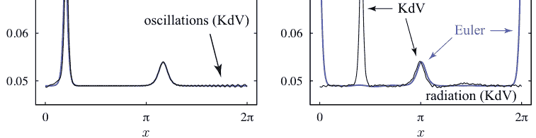

图 9. KdV 与 Euler 方程解的比较，初始条件相同，均以图 1 中标记为 A 和 B 的 Stokes 波的叠加初始化。终时刻 T 设为 138.399，与图 3 相同，此时 Euler 解在一次超车碰撞后几乎恢复到其初始构型。

这里我们使用了 Δφ = 0 且 φ_y(x, −h) = 0。注意 ˆφ_0 与 ˆy 无关，且与底部边界上的速度势 φ 一致，至多为重标定：

```
ˆφ_0(ˆx, ˆt) = (ε g h³)^(-1/2) φ(x, −h, t).
```

由运动方程 η_t = φ_y − η_x φ_x 和 φ_t + ½ φ_x² + ½ φ_y² + g η = 0 可得

```
ˆη_t + ˆu_x = ε { 1/6 ˆu_xxx − (ˆη ˆu)_x } + O(ε²),
ˆu_t + ˆη_x = ε { 1/2 ˆu_xxt − 1/2 ∂_x(ˆu)² } + O(ε²),
```

其中 ˆu(ˆx, ˆt) = ∂_x ˆφ_0(ˆx, ˆt)。展开 ˆη = ˆη_0 + ε ˆη_1 + ⋯，ˆu = ˆu_0 + ε ˆu_1 + ⋯，我们发现

```
ˆη_0 = f(ˆx − ˆt; τ) + g(ˆx + ˆt; τ),      2 f_τ + 3 f f_r + (1/3) f_rrr = 0,
ˆu_0 = f(ˆx − ˆt; τ) − g(ˆx + ˆt; τ),      −2 g_τ + 3 g g_l + (1/3) g_lll = 0,
```

其中我们引入了特征坐标 r = ˆx − ˆt，l = ˆx + ˆt 以及慢时间尺度 τ = ε ˆt，以消除 ε 的一阶关于 r 和 l 的解的长期增长；详见 [1]。符号冲突 g(l, τ) 与重力加速度 g 是标准的，在下面不会造成困难。

在我们的情形中，波向右传播，因此我们可以令 g(l, τ) = 0。回到量纲变量，我们则有

```
η(x, t) = h ε f( √ε ( x/h − √(g/h) t ), √(g/h) ε^(3/2) t ),
```

它满足

```
(5.1) η_t + α η_x + (3√(g h))/(2 h) η η_x + (1/6) √(g h) h² η_xxx = 0,
```

其中 α = √(g h)。注意 ε 消掉了。为了与 §4 的结果进行比较，我们将在 η 上加上 h 并设 α = −½ √(g h)。在图 9 中，我们比较了 (5.1) 的解，其初始条件为 η(x,0) = η_0^{A+B}(x)，定义方式类似于 (4.1) 中的 η_0^{A+C}(x)，与图 3

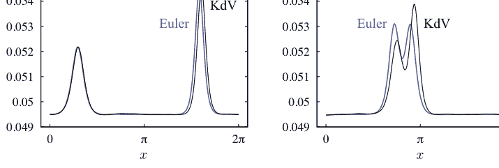

## 图 10. KdV 与 Euler 方程解的比较，两者均以图 1 中标记为 B 和 C 的 Stokes 波的叠加初始化。此处 T = 1108.11。

和 4 中所示的自由表面 Euler 方程的解。波开始运动后不久，KdV 解在较大峰值后面产生了高频振荡，向左传播并迅速用辐射填满计算域。Euler 方程的解则保持得更光滑。KdV 解的较大峰值平均传播速度比 Euler 解对应的峰值快 3.4%，因此在 t = 138.399 时，当较高的 Euler 波已穿过域 6 次时，较高的 KdV 波已穿过 6.206 次。对于我们的目的而言，这些差异过大，KdV 不能作为有用的模型，我们得出结论 §4 中的第一个例子远在 KdV  regime 之外。

在此比较中，对 KdV 方程的时间推进采用了 Kennedy 和 Carpenter [28] 的 8 阶段、5 阶隐式/显式 Runge-Kutta 方法。空间导数使用 Hou 和 Li [25] 的 36 阶滤波器以谱方法计算。我们发现 2048 个空间网格点和 96000 个时间步足以将 t = 138.399 时的误差降低到较大峰值附近低于 5 × 10⁻⁶，其他地方低于 6 × 10⁻⁷，这是通过将解与使用 3072 个网格点和 192000 个时间步的解进行比较得出的。我们的 Euler 方程解的精度更高，因为方程中没有二阶或三阶空间导数项导致刚性。因此，我们可以使用 8 阶或 15 阶显式时间推进，而非 5 阶隐式/显式时间推进。监测能量守恒并进行网格细化研究表明，我们在 Euler 方程解中获得了 13–14 位精度的解，之后由于双精度算术中的舍入误差无法进一步改进。

在图 10 中，我们使用初始条件 η₀^{B+C}(x) 重复此计算，该条件用作 §4 中第二个例子的起始猜测。此时 KdV 解在波谷中没有产生可见的高频辐射，且 KdV 与 Euler 的解在更长时间内保持接近。然而，碰撞的相互作用时间也增加，从第一个例子中的 T = 138.399 增加到此处的 T = 1108.11。在图 10 中，到 t = T/6 时，较高的 KdV 和 Euler 波已明显彼此分离，而到 t = T/2 时，当 Euler 波达到最小接近距离时，KdV 解已明显领先于 Euler 解。因此，尽管 KdV 与 Euler 解之间存在良好的定性一致，


或 H_B 的 1.1%。周期相对变化为 (T_Euler − T_KdV)/T_Euler = 3.6%。虽然图 11 和图 12 的左侧面板显示在 t = 0 时 Euler 方程与 KdV 方程的相对周期解之间存在密切一致，但应注意，这些图中余弦波解的波幅是经过选择的，以最小化这些图中的差异。周期分别变化 18% 和 3.6%，或许是衡量一致性的更好指标。

对两个方程的最后一次比较在图 13 中进行，其中我们用 KdV 初始条件演化 Euler 方程。这需要 φ(x) = φ(x, η(x)) 的初始条件，其中我们在此讨论中省略了 t 的记号，因为它固定为 0。基于上面给出的推导，我们首先在底部边界上求解 φ_x(x,0) = √(g/h) [η(x) − h] 得到 φ。然后我们使用近似

```
φ(x,η(x)) ≈ φ(x,0) − η(x)²/2 φ_xx(x,0) + η(x)⁴/24 φ_xxxx(x,0)
```

来在自由表面上求值 φ。在图 13 的左侧面板中，较大的波在 t = T/400 之前在 Euler 方程下演化时增长并翻转，而不是像 KdV 演化时那样向右传播。为了处理波破碎，我们改用自由表面 Euler 方程的角度-弧长公式 [4, 26]。在右侧面板的小振幅示例中，Euler 解产生了可见的辐射并略微落后于 KdV 解，尽管在 T/2 时相位比在图 10 中用 KdV 演化 Stokes 波的结果更接近。我们还尝试求值

```
φ(x,y) = √(g/h) Σ_{k=1}^∞ 2k^{-1} η̂_k sin(kx) cosh(ky)
```

在 y = η(x) 处以获得 φ(x) 的初始条件，其中 η̂_k 是 t = 0 时 η(x) 的傅里叶模态，但对于大振幅示例结果更差——波破碎得更快——而在小振幅示例中在视觉上与图 13 中绘制的结果无法区分。

总之，§4 中找到的 Euler 方程的大振幅时间周期解在任何衡量标准下都远超出 KdV 区域，而小振幅相对周期解更接近，但不够接近，无法在感兴趣的整个时间间隔内实现定量一致。

### 6. 结论

我们证明了当两列 Stokes 波在浅水中相互作用时产生的少量背景辐射通常可以调节，以获得自由表面 Euler 方程的时间周期和相对周期解。就像 Korteweg-de Vries 方程一样，波在碰撞时可以完全合并或保持良好分离。然而比较仅是定性的，因为波太大而无法被 KdV 理论很好地近似。

在未来的工作中，我们将使用 Floquet 理论研究这些解的稳定性。初步结果表明，上面考虑的第一个示例对谐波扰动不稳定，而第二个示例是稳定的。在稳定情况下，一个有趣的开放问题是，作为最小化算法起始猜测的 Stokes 波，其能量与找到的相对周期解相同，是否可能永远保持接近它，围绕它执行近周期振荡。 presumably θ 需要稍微变化才能使这一点成立，因为 θ 是我们手动选择的自由参数，以使初始猜测的 f 具有较小值。另一个开放问题是 Euler 方程是否存在 KdV 方程中 N ≥ 3 的 N 相拟周期解的类似物。我们有信心本文的方法可用于构造 N ≥ 3 的孤立水波沿时间周期或相对周期方式弹性碰撞的退化情况，类似于 [3] 中对 Benjamin-Ono 方程所做的那样。计算形式为 η(x,t)=H(κx+ωt+α), φ(x,t)=Φ(κx+ωt+α) 且 H,Φ∈C(T^N) 且 κ, ω, α∈R^N 的更一般拟周期动力学在原则上似乎是可能的，使用更复杂的打靶方法来确定 H、Φ 和 ω。Euler 方程此类解的存在将表明非可积方程也可以支持复发弹性碰撞，即使它们不能表示为椭圆函数的 N 相叠加。

**大振幅示例** **小振幅示例**

**图 11.** §4 中找到的时间周期解与 KdV 的附近相对周期两相余弦波解的比较。周期分别为 T = 138.387 和 113.079。

**图 12.** §4 中找到的相对周期解与 KdV 的附近相对周期两相余弦波解的比较。周期分别为 T = 1108.11 和 1068.73。

**图 13.** KdV 与 Euler 解的比较，两者均以 2 相余弦波初始化，其峰值与图 1 中标记为 A 和 B（左）或 B 和 C（右）的 Stokes 波的高度相匹配。这里 T = 138.387（左）和 T = 1068.73（右）。

### 参考文献

- [1] Mark J. Ablowitz and Harvey Segur, Solitons and the inverse scattering transform, SIAM Studies in Applied Mathematics, vol. 4, Society for Industrial and Applied Mathematics (SIAM), Philadelphia, Pa., 1981. MR642018 (84a:35251)
- [2] H. Airault, H. P. McKean, and J. Moser, Rational and elliptic solutions of the Korteweg-de Vries equation and a related many-body problem, Comm. Pure Appl. Math. 30 (1977), no. 1, 95–148. MR0649926 (58 #31214)
- [3] David M. Ambrose and Jon Wilkening, Global paths of time-periodic solutions of the Benjamin-Ono equation connecting pairs of traveling waves, Commun. Appl. Math. Comput. Sci. 4 (2009), 177–215, DOI 10.2140/camcos.2009.4.177. MR2565874 (2010j:35437)
- [4] David M. Ambrose and Jon Wilkening, Computation of symmetric, time-periodic solutions of the vortex sheet with surface tension, Proc. Nat. Acad. Sci. 107 (2010), no. 8, 3361–3366.
- [5] David M. Ambrose and Jon Wilkening, Computation of time-periodic solutions of the Benjamin-Ono equation, J. Nonlinear Sci. 20 (2010), no. 3, 277–308, DOI 10.1007/s00332-009-9058-x. MR2639896 (2011d:65146)
- [6] David M. Ambrose and Jon Wilkening, Dependence of time-periodic vortex sheets with surface tension on mean vortex sheet strength, Procedia IUTAM 11 (2014), 15–22.
- [7] Gregory R. Baker, Daniel I. Meiron, and Steven A. Orszag, Generalized vortex methods for free-surface flow problems, J. Fluid Mech. 123 (1982), 477–501, DOI 10.1017/S0022112082003164. MR687014 (84a:76002)
- [8] Gregory R. Baker and Chao Xie, Singularities in the complex physical plane for deep water waves, J. Fluid Mech. 685 (2011), 83–116, DOI 10.1017/jfm.2011.283. MR2844303
- [9] Jerry L. Bona, Thierry Colin, and David Lannes, Long wave approximations for water waves, Arch. Ration. Mech. Anal. 178 (2005), no. 3, 373–410, DOI 10.1007/s00205-005-0378-1. MR2196497 (2007a:76012)
- [10] R. K.-C. Chan and R. Street, A computer study of finite amplitude water waves, J. Comput. Phys. 6 (1970), 68–94.
- [11] G. A. Chandler and I. G. Graham, The computation of water waves modelled by Nekrasov's equation, SIAM J. Numer. Anal. 30 (1993), no. 4, 1041–1065, DOI 10.1137/0730054. MR1231326 (94e:65144)
- [12] B. Chen and P. G. Saffman, Numerical evidence for the existence of new types of gravity waves of permanent form on deep water, Stud. Appl. Math. 62 (1980), no. 1, 1–21. MR557677 (80k:76014)
- [13] M. J. Cooker, P. D. Weidman, and D. S. Bale, Reflection of a high-amplitude solitary wave at a vertical wall, J. Fluid Mech. 342 (1997), 141–158, DOI 10.1017/S002211209700551X. MR1460657 (98d:76026)
- [14] Walter Craig, An existence theory for water waves and the Boussinesq and Korteweg-de Vries scaling limits, Comm. Partial Differential Equations 10 (1985), no. 8, 787–1003, DOI 10.1080/03605308508820396. MR795808 (87f:35210)
- [36] G. N. Mercer and A. J. Roberts, Standing waves in deep water: their stability and extreme form, Phys. Fluids A 4 (1992), no. 2, 259–269, DOI 10.1063/1.858354. MR1146134 (92k:76014)
- [37] Paul A. Milewski, J.-M. Vanden-Broeck, and Zhan Wang, Dynamics of steep two-dimensional gravity–capillary solitary waves, J. Fluid Mech. 664 (2010), 466–477, DOI 10.1017/S0022112010004714. MR2747492 (2011m:76026)
- [38] R. M. Mirie and C. H. Su, Collisions between two solitary waves, Part II, J. Fluid Mech. 115 (1982), 475–492.
- [39] Jorge Nocedal and Stephen J. Wright, Numerical optimization, Springer Series in Operations Research, Springer-Verlag, New York, 1999. MR1713114 (2001b:90002)
- [40] L. A. Ostrovsky and Y. A. Stepanyants, Internal solitons in laboratory experiments: comparison with theoretical models, Chaos 15 (2005), no. 3, 037111, 28, DOI 10.1063/1.2107087. MR2184887 (2006h:76025)
- [41] P. I. Plotnikov and J. F. Toland, Nash-Moser theory for standing water waves, Arch. Ration. Mech. Anal. 159 (2001), no. 1, 1–83, DOI 10.1007/PL00004246. MR1854060 (2002k:76019)
- [42] Chris H. Rycroft and Jon Wilkening, Computation of three-dimensional standing water waves, J. Comput. Phys. 255 (2013), 612–638, DOI 10.1016/j.jcp.2013.08.026. MR3109807
- [43] Guido Schneider and C. Eugene Wayne, The long-wave limit for the water wave problem. I. The case of zero surface tension, Comm. Pure Appl. Math. 53 (2000), no. 12, 1475–1535, DOI 10.1002/1097-0312(200012)53:12<1475::AID-CPA1>3.0.CO;2-V. MR1780702 (2002c:76025a)
- [44] C. H. Su and Rida M. Mirie, On head-on collisions between solitary waves, J. Fluid Mech. 98 (1980), no. 3, 509–525, DOI 10.1017/S0022112080000262. MR583060 (81g:76023)
- [45] J.-M. Vanden-Broeck, Elevation solitary waves with surface tension, Phys. Fluids A 3 (1991), 1989–1993.
- [46] G. B. Whitham, Linear and nonlinear waves, Wiley-Interscience [John Wiley & Sons], New York-London-Sydney, 1974. Pure and Applied Mathematics. MR0483954 (58 #3905)
- [47] J. Wilkening, Breakdown of self-similarity at the crests of large amplitude standing water waves, Phys. Rev. Lett. 107 (2011), 184501.
- [48] ———, Traveling-standing water waves, (2014), (in preparation).
- [49] J. Wilkening and J. Yu, Overdetermined shooting methods for computing standing water waves with spectral accuracy, Comput. Sci. Disc. 5 (2012), 014017:1–38.
- [50] M. O. Williams, J. Wilkening, E. Shlizerman, and J. N. Kutz, Continuation of periodic solutions in the waveguide array mode-locked laser, Physica D 240 (2011), no. 22, 1791–1804.
- [51] Wolfram Research, Inc., Mathematica, version 8.0, Champaign, IL, 2010.
- [52] N. J. Zabusky and C. J. Galvin, Shallow-water waves, the Korteweg-de Vries equation and solitons, J. Fluid Mech. 47 (1970), 811–824.
- [53] Qisu Zou and Chau Hsing Su, Overtaking collision between two solitary waves, Phys. Fluids 29 (1986), no. 7, 2113–2123, DOI 10.1063/1.865599. MR848314 (87h:76033)


一维情形中的行波[DO]。除了恢复预期结果（即深水中的波相对于长波扰动是模不稳定的）之外，我们发现存在特定类别的拟周期扰动，即使对于小振幅波，也会在浅水中产生不稳定性。

如所述，上述结果仅限于一维周期行波受一维周期或拟周期扰动扰动的情况。作为研究一维和二维问题之间的中间步骤，不同的研究者考虑了二维扰动对一维行波解的影响。换句话说，他们研究了一维解的横向不稳定性。关于欧拉方程解的横向不稳定性的早期重要工作由 Bryant[Bry78] 完成。利用有限水深欧拉方程的一组截断非线性近似，他使用少量波相互作用探索了不稳定性。几年后，McLean 提出了关于有限水深欧拉方程一维解横向不稳定性的第一个结果。McLean 等人（参考文献 [McL82a, McL82b, MMM⁺81]）考虑了如下形式的扰动

$$\eta_1=e^{-\sigma t}e^{ipx+iqy}\sum_{j=-\infty}^{\infty}a_je^{ijx},\quad\text{and}$$

$$\phi_1=e^{-\sigma t}e^{ipx+iqy}\sum_{j=-\infty}^{\infty}b_je^{ijx}\frac{\cosh(\kappa_j(z+h))}{\cosh(\kappa_jh)}.$$

这里 η₁ 和 ϕ₁ 分别是流体内部自由表面高程和速度势的扰动。将这些展开式代入原始运动方程，McLean 计算了深水中波的线性问题所对应的增长率 −σ。他发现，在深水中，小振幅一维波最不稳定的是对一维扰动。然而，随着波振幅的增大，波相对于二维扰动变得更加不稳定。最近，McLean 的稳定性计算已被 Kharif & Ramamonjiarisoa[KR90] 扩展到振幅更大的波，并已被 Francius & Kharif[FK06] 扩展到更浅水深的波。

本文的目的是证明我们可以使用 Ablowitz、Fokas 和 Musslimani[AFM06] 的非局部公式以更少的计算工作量复制这些横向不稳定性结果。为了数值计算谱不稳定性，我们必须确定 (i) 一维行波解，以及 (ii) 这些一维行波的二维扰动所对应的增长率。我们最近已证明，一维周期行波解可以通过数值求解单个方程来确定

$$\int_0^L e^{-ikx}\sqrt{(1+\eta_x^2)(c^2-2g\eta)}\,\sinh\bigl(k(\eta+h)\bigr)\,dx=0,$$

∀k ∈ 2π/L ℤ₀，求解随波速 c 运动的表面高程 η(x)，见参考文献 [DO]。使用 Deconinck & Oliveras[DO] 中概述的数值格式，我们确定了各种波振幅和

水深的一维行波解。这些一维解被二维（拟）周期扰动所扰动。将二维扰动代入运动方程，我们使用傅里叶- Floquet 分解计算线性增长率，参见例如参考文献 [DK06]。我们发现我们的稳定性结果总体上与 Francius & Kharif [FK06] 以及上述其他来源的结果一致。虽然无法进行直接比较（见第 5 节），但似乎我们的方法以显著降低的计算成本产生了更准确的结果。

### 2. 运动方程

我们考虑描述理想流体表面在三维中动力学的欧拉方程。对于周期性问题，这要求我们在流体域 D 内求解拉普拉斯方程，并在水平方向 x 和 y 两个方向上具有周期性边界条件。流体域 D 如图 1 所示。运动方程为

(2.1) φ_xx + φ_yy + φ_zz = 0,                          (x, y, z) ∈ D,

(2.2) φ_z = 0,                                          z = −h,

(2.3) η_t + φ_x η_x + φ_y η_y = φ_z,                     z = η(x, y, t),

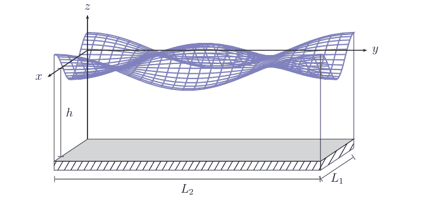

图 1. 具有周期性边界条件的波浪表面的流体域。

我们仅考虑一维解的稳定性，我们通过消除 (2.5) 和 (2.6) 中的 y 依赖性来简化运动方程，以确定沿 x 方向以速度 c 运动的行波解。在参考文献 [DO] 中，我们证明了周期性一维行波解是

(2.7) $$\int_{0}^{L} e^{-ikx} \sqrt{(1+\eta_x^2)(c^2-2g\eta)}\sinh\left(k(\eta+h)\right)dx = 0,$$

∀ k ∈ \frac{2π}{L}\mathbb{Z}_0，求解表面高程 η(x) 的解。该方程提供了完全非线性问题的解，并且易于数值求解。为了确定表面处的速度势 q(x)（在研究行波稳定性时需要），我们使用关系式

(2.8) $$q_x = c \pm \sqrt{(1+\eta_x^2)\left(c^2-2g\eta\right)}.$$

其中我们采用负号以强制在流体主体以及自由表面上，除极限波外，u − c < 0。一维解是使用如参考文献 [DO] 中所述的迭代伪延拓方法计算的。所有解均使用至少 64 个傅里叶模态计算，残差误差 < 10^{−14}。

### 3. 稳定性公式

在我们继续研究行波轮廓的稳定性之前，我们讨论我们希望允许的扰动。在本文中，我们计划研究二维扰动的影响。考虑与底层驻波在 x 方向上具有相同周期的扰动，并在 y 方向上改变扰动的周期似乎是自然的。然而，我们希望处理更一般的扰动类别，即在整个实平面上有界的扰动。具体而言，对于某个扰动 U(x, y)，我们使用记号 ||U(x, y)|| < ∞ 表示 sup_{ℝ²} |U(x, y)| < ∞ 且 U(x, y) 对所有 (x, y) ∈ ℝ² 连续。必须认识到，这一类是所讨论物理问题允许的最大扰动类。事实上，扰动应是有界且连续的函数，但没有物理原因将其空间依赖性限制为周期性。

为了研究行波轮廓相对于此类扰动的稳定性，有必要重新表述控制方程。方程 (2.6) 是一个局部陈述，不需要修改。然而，非局部方程 (2.5) 的当前形式专门适用于 x 方向周期为 L₁、y 方向周期为 L₂ 的波。令 ⟨⟨f⟩⟩ 表示函数 f(x)，f : ℝ² → ℝ 的平均值，定义为

$$\langle\langle f\rangle\rangle = \lim_{|A|\to\infty} \frac{1}{|A|} \iint_A f(x,y) dA,$$

其中 A 是 ℝ² 中的矩形，|A| 表示其面积。

很明显，如果 f(x, y) 在 x 和 y 方向上分别以周期 L₁ 和 L₂ 周期，则 ⟨⟨f⟩⟩ 是良定义的。然而，这一二维空间平均对于包含

拟周期函数集[Boh47] 的所谓几乎周期函数这一更大类是定义的。这促使我们用更一般的非局部方程

(3.1) \left\langle\left\langle e^{-i\bar{k}\cdot\mathbf{x}}\left(i(\eta_t - \bar{c}\cdot\nabla\eta)\cosh(\kappa(h+\eta)) - \frac{\bar{k}\cdot\nabla q}{\kappa}\sinh(\kappa(h+\eta))\right)\right\rangle\right\rangle = 0,

替换 (2.5)，该方程对所有 $\bar{k}\in\mathbb{R}_0^2 = \mathbb{R}^2 - \{(0,0)\}$ 成立。事实上，如果我们考虑周期越来越大的扰动，则方程 (2.5) 中要考虑的 $\bar{k}$ 值集合将趋近于实平面的稠密子集。

在将动力学方程推广以适应我们希望考虑的扰动之后，我们简要讨论谱稳定性的定义。非线性问题的驻定解如果对应线性问题的指数增长模不存在，则是谱稳定的。为了确定周期行波解的谱稳定性，我们首先考虑一维行波解 $(\eta_0(x-ct), q_0(x-ct), c)$，它满足方程 (2.7)。在相同的行进坐标系中，我们在 x 和 y 两个方向上添加一个小的扰动，形式为

$q(x-ct, y, t) = q_0(x-ct) + \epsilon q_1(x-ct, y, t) + \mathcal{O}(\epsilon^2),$
$\eta(x-ct, y, t) = \eta_0(x-ct) + \epsilon\eta_1(x-ct, y, t) + \mathcal{O}(\epsilon^2),$

其中 $\epsilon$ 是一个小参数。扰动以速度 $\bar{c} = (c,0)$ 在行进参考系中运动。我们的目标是确定扰动的时间依赖性，以便确定偏离未扰动解的演化。

我们从局部方程 (2.6) 开始。将上述式代入方程 (2.6) 并只保留 $\epsilon$ 阶项，我们得到

(3.2) $q_{1,t} - c q_{1,x} + q_{0,x} q_{1,x} + g \eta_1 - f\cdot\left(\eta_{1,t} + \eta_{1,x}(q_{0,x} - c) + \eta_{0,x} q_{1,x} - f\cdot\eta_{0,x}\eta_{1,x}\right) = 0,$

其中

$f = \frac{\eta_{0,x}(q_{0,x} - c)}{1 + \eta_{0,x}^2}$

由于问题在显式上不依赖于 $t$ 或 $y$（请注意函数 $\eta_0$ 和 $q_0$ 均与 $y$ 和 $t$ 无关，仅依赖于 $x$），我们可以使用分离变量法将 $\eta_1(x,y,t)$ 和 $q_1(x,y,t)$ 分解为

(3.3a) $\eta_1(x,y,t) = e^{\lambda t} e^{i\rho y} \tilde{\eta}_1(x) + c.c.,$

(3.3b) $q_1(x,y,t) = e^{\lambda t} e^{i\rho y} \tilde{q}_1(x) + c.c.,$

而不失一般性。这里 $\rho$ 是扰动的横向波数。代入 (3.2)，我们得到

(3.4) $\lambda \tilde{q}_1 - c \tilde{q}_{1,x} + q_{0,x} \tilde{q}_{1,x} + g \tilde{\eta}_1 - f\cdot\left(\lambda \tilde{\eta}_1 + \tilde{\eta}_{1,x}(q_{0,x} - c) + \eta_{0,x} \tilde{q}_{1,x} - \eta_{0,x} f \cdot \tilde{\eta}_{1,x}\right) = 0,$

这与 (Ref. [DO]) 中针对局部方程相对于一维扰动所得到的线性化相同。

现在我们转向非局部方程。对于非局部方程，我们将扰动展开式代入 (3.1)。这给出

\left\langle\left\langle e^{-i\bar{k}\cdot\mathbf{x}}\left(i\eta_{1,t}\mathcal{C}_{\kappa} - i c \eta_{0,x}\kappa\eta_1\mathcal{S}_{\kappa} - i c \eta_{1,x}\mathcal{C}_{\kappa} - \frac{1}{\kappa}\left(k_x q_{1,x} + k_y q_{1,y}\right)\mathcal{S}_{\kappa} - k_x q_{0,x}\eta_1\mathcal{C}_{\kappa}\right)\right\rangle\right\rangle = 0,


其中
\[
\mathcal{S}_\kappa = \sinh(\kappa(\eta_0 + h)),\quad \mathcal{C}_\kappa = \cosh(\kappa(\eta_0 + h)).
\]

如前所述，由于问题不显式依赖于 \(y\) 或 \(t\)，我们使用分离变量法将 \(\eta_1(x,y,t)\) 和 \(q_1(x,y,t)\) 分解为 (3.3) 中的形式。利用此分解，我们得到

\[
\left\langle\!\left\langle e^{-i\vec{k}\cdot\mathbf{x}}e^{i\rho y}\left(i\tilde{\eta}_{1,t}\mathcal{C}_\kappa - i c\eta_{0,x}\tilde{\eta}_1\mathcal{S}_\kappa - i c\tilde{\eta}_{1,x}\mathcal{C}_\kappa - \frac{1}{\kappa}\left(k_x\tilde{q}_{1,x}+i k_y\rho\tilde{q}_1\right)\mathcal{S}_\kappa - k_x q_{0,x}\tilde{\eta}_1\mathcal{C}_\kappa\right)\right\rangle\!\right\rangle = 0,
\]

由于新的被积函数仅通过 \(e^{i(\rho-k_y)y}\) 依赖于 \(y\)，我们完全消除了对 \(y\) 的积分。计算 \(y\) 方向上的平均值得到

\[
\lim_{M\to\infty}\frac{1}{M}\int_{-M/2}^{M/2} e^{-i(k_y-\rho)y}\,dy
= \lim_{M\to\infty}\frac{2}{M(k_y-\rho)}\sin\left(\frac{M(k_y-\rho)}{2}\right).
\]

取 \(M\to\infty\) 的极限，若 \(k_y\neq\rho\)，贡献恒为零。否则，若 \(k_y=\rho\)，积分的贡献为 1。因此，非局部方程的线性化简化为

\[
\left\langle e^{-i k_x x}\left(i\lambda\tilde{\eta}_1\mathcal{C}_\kappa - i c\tilde{\eta}_{1,x}\mathcal{C}_\kappa - \eta_{0,x}c\kappa\tilde{\eta}_1\mathcal{S}_\kappa - \frac{1}{\kappa}\left(k_x\tilde{q}_{1,x}+i\rho^2\tilde{q}_1\right)\mathcal{S}_\kappa - k_x q_{0,x}\tilde{\eta}_1\mathcal{C}_\kappa\right)\right\rangle = 0,
\tag{3.5}
\]

其中现在 \(\kappa = \sqrt{k_x^2+\rho^2}\) 且
\[
\langle f\rangle = \lim_{M\to\infty}\frac{1}{M}\int_{-M/2}^{M/2} f(x)\,dx.
\]

需要指出的是，若令 \(\rho=0\)，上式将化为其他地方给出的关于一维表面情形的表达式 [DO]。

对行波解线性化方程后，我们得到如下广义特征值问题：

\[
\tag{3.6}
\lambda\tilde{q}_1 - c\tilde{q}_{1,x} + q_{0,x}\tilde{q}_{1,x} + g\tilde{\eta}_1
- f\left(\lambda\tilde{\eta}_1 + \tilde{\eta}_{1,x}(q_{0,x}-c) + \eta_{0,x}\tilde{q}_{1,x} - \eta_{0,x}f\tilde{\eta}_{1,x}\right) = 0,
\]

\[
\tag{3.7}
\lambda\left\langle e^{-i k_x x}\left(i\tilde{\eta}_1\mathcal{C}_\kappa\right)\right\rangle
= \left\langle e^{-i k_x x}\left(i c\tilde{\eta}_{1,x}\mathcal{C}_\kappa + i\eta_{0,x}c\kappa\tilde{\eta}_1\mathcal{S}_\kappa + \frac{1}{\kappa}\left(k_x\tilde{q}_{1,x}+i\rho^2\tilde{q}_1\right)\mathcal{S}_\kappa + k_x q_{0,x}\tilde{\eta}_1\mathcal{C}_\kappa\right)\right\rangle.
\]

方程 (3.6) 和 (3.7) 对 \((k_x,\rho)\in\mathbb{R}^2-\{(0,0)\}\) 成立，可紧凑地重写为

\[
\tag{3.8}
\lambda\mathcal{L}_1U(x)=\mathcal{L}_2U(x)
\]

其中 \(\mathcal{L}_1\) 和 \(\mathcal{L}_2\) 是依赖于 \(\rho\) 的 \(2\times2\) 线性算子矩阵，其元素可直接从 (3.6) 和 (3.7) 中读出。

由于扰动的时变依赖于 \(\lambda\) 的指数形式，我们可通过求解此广义特征值问题来确定底层行波稳定性的信息。若存在对应 \(\lambda\) 的实部为正的解 \(U(x)\)，则解的线性近似在时间上呈指数增长，扰动解将在线性近似下偏离平稳解。基于此直觉，谱稳定性的概念适用于广义特征值问题 (3.8)，定义如下：

#### 定义 3.1（谱稳定性）

方程 2.7 和 2.8（从而欧拉方程）的关于一维周期行波解 \((\eta_0(x), q_0(x), c)\) 对于参数为 \(\rho\) 的二维扰动是谱稳定的，若广义特征值问题 3.8 的谱中没有元素的实部严格为正。

为了使用此定义，我们回顾广义特征值问题的谱的定义。

#### 定义 3.2（广义特征值问题的谱）

广义特征值问题 \(\lambda\mathcal{L}_1U(x)=\mathcal{L}_2U(x)\) 的谱由下式给出

\[
\tag{3.9}
\sigma(\mathcal{L}_2,\mathcal{L}_1)=\{\lambda\in\mathbb{C}:\|U(x)\|<\infty\},
\]

其中 \(U(x)\) 求解 \(\lambda\mathcal{L}_1U(x)=\mathcal{L}_2U(x)\)。

为了检验谱稳定性或不稳定性，我们需要定位广义特征值问题 3.8 的谱。根据谱的定义，我们确定使方程 3.8 具有有界解的 \(\lambda\in\mathbb{C}\) 的值。由于方程 (3.8) 的系数函数在 \(x\) 方向上以周期 \(L_1\) 周期性，我们进一步利用 Floquet 定理对扰动进行分解，参见例如文献 [DK06]。因此，\(\tilde{q}_1(x)\) 和 \(\tilde{\eta}_1(x)\) 可写为

\[
\tilde{q}_1(x)=e^{i\mu x}\bar{q}_1(x),\qquad
\tilde{\eta}_1(x)=e^{i\mu x}\bar{\eta}_1(x),
\]

其中 \(\mu\in[-\pi/L_1,\pi/L_1)\) 且 \(\bar{q}_1\) 和 \(\bar{\eta}_1\) 为 \(2\pi\) 周期函数。

将 Floquet 分解代入特征值问题得到

\[
\begin{aligned}
\lambda(\bar{q}_1-f\bar{\eta}_1)
&= c(i\mu+\partial_x)\bar{q}_1-q_{0,x}(i\mu+\partial_x)\bar{q}_1-g\bar{\eta}_1 \\
&\quad + f\big((q_{0,x}-c)(i\mu+\partial_x)\bar{\eta}_1+\eta_{0,x}(i\mu+\partial_x)\bar{q}_1-\eta_{0,x}f(i\mu+\partial_x)\bar{\eta}_1\big),\\[2pt]
\lambda\Bigl\langle e^{i(\mu-k_x)x}\left(i\bar{\eta}_1\mathcal{C}_\kappa\right)\Bigr\rangle
&= \Bigl\langle e^{i(\mu-k_x)x}\Bigl(ic\mathcal{C}_\kappa(i\mu+\partial_x)\bar{\eta}_1+i\eta_{0,x}c\kappa\bar{\eta}_1\mathcal{S}_\kappa \\
&\qquad+\frac{1}{\kappa}\left(k_x(i\mu+\partial_x)+i\rho^2\right)\bar{q}_1\mathcal{S}_\kappa+k_xq_{0,x}\bar{\eta}_1\mathcal{C}_\kappa\Bigr)\Bigr\rangle=0.
\end{aligned}
\tag{3.10}
\]

我们用傅里叶级数表示特征函数 \(\bar{q}_1\) 和 \(\bar{\eta}_1\) 的 \(2\pi\) 周期部分。换言之，

\[
\bar{q}_1(x)=\sum_{m=-\infty}^{\infty}\hat{Q}_m e^{imx},\qquad
\bar{\eta}_1(x)=\sum_{m=-\infty}^{\infty}\hat{N}_m e^{imx}.
\]

此外，我们也用傅里叶级数表示周期变系数函数。将级数表示代入 Floquet 分解，我们能够确定一个双无穷矩阵特征值问题，其中特征向量为 \(j\in\{0,\pm1,\pm2,\ldots\}\) 的傅里叶系数 \(\hat{Q}_j\) 和 \(\hat{N}_j\)。对于局部方程，傅里叶分解进行得相当直接。将傅里叶展开代入局部方程，我们得到

\[
\tag{3.12}
\lambda\left(\sum_{m=-\infty}^{\infty}\hat{F}_{3,n-m}\hat{N}_m-\hat{Q}_n\right)
= -g\hat{N}_n+\sum_{m=-\infty}^{\infty}(i\mu+im)\hat{F}_{1,n-m}\hat{N}_m
+\sum_{m=-\infty}^{\infty}\hat{F}_{2,n-m}(i\mu+im)\hat{Q}_m,
\]

对 \(n\in\mathbb{Z}\setminus\{0\}\) 成立，其中系数 \(\hat{F}_{j,n}\) 由下式给出：

\[
\hat{F}_{1,n}=\int_0^{L_1} e^{-2in\pi x/L_1} f(\eta_0,q_0)(q_{0,x}-c-\eta_{0,x}f(\eta_0,q_0))\,dx,
\]
\[
\hat{F}_{2,n}=\int_0^{L_1} e^{-2in\pi x/L_1} (q_{0,x}-c-\eta_{0,x}f(\eta_0,q_0))\,dx,
\]
\[
\hat{F}_{3,n}=\int_0^{L_1} e^{-2in\pi x/L_1} f(\eta_0,q_0)\,dx.
\]

对于非局部方程，我们采用与别处 [DO] 类似的策略。有两点细微差别。首先，双曲正弦和余弦项依赖于 \(\kappa=\sqrt{k_x^2+\rho^2}\) 而非直接的 \(k_x\)。其次，还有一个额外项依赖于速度势的扰动和 \(\rho\)。将傅里叶级数代入非局部方程并用傅里叶级数表示所有变系数，我们得到

\[
\tag{3.13}
\sum_{j=-\infty}^{\infty}\sum_{m=-\infty}^{\infty}
\left[
\left(\hat{G}_{1,j}^{(k_x)}+ic(i\mu+im)\hat{G}_{2,j}^{(k_x)}\right)\hat{N}_m
+\left(\frac{k_x}{\kappa}(i\mu+im)+\frac{i\rho^2}{\kappa}\right)\hat{G}_{3,j}^{(k_x)}\hat{Q}_m
\right]\langle E_{jm}\rangle
=i\lambda \sum_{j=-\infty}^{\infty}\sum_{m=-\infty}^{\infty}\hat{G}_{2,j}^{(k_x)}\hat{N}_m\langle E_{jm}\rangle.
\]

其中

\[
\hat{G}_{1,n}^{(k_x)} = \int_0^{L_1} e^{-2in\pi x/L_1}\left(i\kappa c\eta_{0,x}\mathcal{S}_\kappa+k_x q_{0,x}\mathcal{C}_\kappa\right)dx,
\]
\[
\hat{G}_{2,n}^{(k_x)} = \int_0^{L_1} e^{-2in\pi x/L_1}\mathcal{C}_\kappa\,dx,
\]
\[
\hat{G}_{3,n}^{(k_x)} = \int_0^{L_1} e^{-2in\pi x/L_1}\mathcal{S}_\kappa\,dx.
\]

双重无穷和中的每一项都包含

\[
E_{jm}=\exp\left[i x\left(\mu-k_x+m+j\right)\right].
\]

的平均值。此平均值恒为零，除非 \(\mu-k_x+m+j\) 为零，此时 \(\langle E_{jm}\rangle=1\)。换言之，除非

\[
k_x=\mu+n,
\]

对某个整数 \(n\) 成立，否则积分的贡献恒为零。因此，积分方程中唯一的贡献发生在 \(k_x\) 为原始对偶格子的平移时。这使我们能够将双重无穷和化为单重无穷和：

\[
\tag{3.14}
\begin{aligned}
&\sum_{m=-\infty}^{\infty}\left(\hat{G}_{1,n-m}^{(k(\mu))}+ic(i\mu+im)\hat{G}_{2,n-m}^{(k(\mu))}\right)\hat{N}_m\\
&\qquad+\sum_{m=-\infty}^{\infty}\left(\frac{k(\mu)}{\kappa}(i\mu+im)+\frac{i\rho^2}{\kappa}\right)\hat{G}_{3,n-m}^{(k(\mu))}\hat{Q}_m\\
&= i\lambda\sum_{m=-\infty}^{\infty}\hat{G}_{2,n-m}^{(k(\mu))}\hat{N}_m
\end{aligned}
\]

其中 \(k(\mu)=\mu+n\)。上式对所有 \(n\in\mathbb{Z}\) 成立。

将上式与 (3.12) 结合得到关于平稳行波解线性化算子的谱的广义双无穷特征值问题。我们定义量 \(\hat{\mathbf{X}}\) 为所有 \(j\in\mathbb{Z}\) 的傅里叶系数 \(\hat{Q}_j\) 和 \(\hat{N}_j\) 的双无穷向量：

\[
\hat{\mathbf{X}}=[\ldots,\hat{N}_{-1},\hat{N}_0,\hat{N}_1,\ldots,\hat{Q}_{-1},\hat{Q}_0,\hat{Q}_1,\ldots]^T.
\]

用此记号，我们将广义特征值问题重写为

\[
\begin{bmatrix} A(\mu) & B(\mu) \\ C(\mu,\rho) & D(\mu,\rho) \end{bmatrix}\hat{\mathbf{X}}
=
\lambda
\begin{bmatrix} -I & S(\mu) \\ 0 & V(\mu,\rho) \end{bmatrix}\hat{\mathbf{X}}.
\]


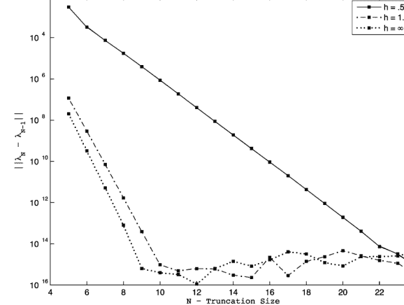

图 2. 不同水深下振幅 a = .01 的解对应的最大特征值的柯西误差。

其中

A(μ)_{n,m} = -gδ(n − m) + (iμ + im) \hat{F}_{1,n−m},

B(μ)_{n,m} = \hat{F}_{2,n−m} (iμ + im),

C(μ)_{n,m} = \hat{G}^{(k(μ))}_{1,n−m} + ic(iμ + im)\hat{G}^{(k(μ))}_{2,n−m},

D(μ)_{n,m} = (iμ + im)\hat{G}^{(k(μ))}_{3,n−m},

S(μ)_{n,m} = \hat{F}_{3,n−m},   V(μ)_{n,m} = i\hat{G}^{(k(μ))}_{2,n−m},   以及

δ(n − m) = { 1 若 m = n
0 若 m ≠ n }.

我们通过将傅里叶级数表示从 ℤ 截断到 {0, ±1, ±2, …, ±N}，对所有可能的 μ 和 ρ 值进行离散采样，从而数值求解该广义特征值问题。我们注意到，由于问题中蕴含的对称性，我们可以进一步将 μ 的区间从 [−π/L₁, π/L₁] 限制到 [0, π/L₁]。对于周期为 2π 的行波解，μ ∈ [0, .5]，而参数 ρ 可以是 [0, ∞) 中的任意数。

这种截断的收敛性和可靠性已由 Curtis & Deconinck [CD10] 以及 Johnson & Zumbrun [JZ12] 研究过。这些结果并不正式适用于我们的情形，但一旦我们注意到

S(μ, ρ) 是可逆的，

就可以很容易地推广。因此，我们可以相信所获得的数值结果。在这种截断下，我们得到 2(2N + 1) 个方程，对应 2(2N + 1) 个未知傅里叶系数 Q̂_n 和 N̂_n。

如图 2 所示，最大特征值的修正量随着 N 的增大而衰减到 ε_mach。应当指出的是，h = .5 时的衰减速率明显慢于相同振幅下其他水深 h = 1.5 和 h = ∞ 的衰减速率。这并不奇怪：对于 h = .5，a = .1 所对应的波比其他两种水深下的波具有显著更强的非线性。

我们通过研究其柯西收敛性，进一步确立了对数值方法的信心。设 λ_N 表示对应于截断大小 N（对应 2N + 1 个傅里叶系数）的某个特征值。我们将柯西误差定义为

e_N = |λ_N − λ_{N−1}|.

随着截断矩阵规模的增大，计算出的特征值应当数值收敛。我们追踪在三个不同水深（对应于无量纲振幅 ak = 0.1 的行波解）下，实部最大的特征值近似值随截断大小的变化。柯西误差见表 1。

### 4. 结果

#### 4.1. 平坦水面

由于我们采用延拓方法，我们首先仔细考虑平凡解 η(x) = 0, q(x) = 0（对应于零振幅行波）的稳定性。我们可以解析地确定这个平凡行波的谱。我们选择与周期解分岔分支起点对应的波速 c 为

c = √( g tanh(hk) / k ),

其中对于 2π 周期解，我们取 k = 1。其他分岔分支从别处开始，但这些分支只是我们所考虑分支的缩放。它们的稳定性性质完全相同，因此仅考虑这一个分支不会丢失任何信息。

表 1. 在 h = .5、h = 1.5 和 h = ∞、a = .1 时，计算实部最大的特征值所得的柯西误差。

| N | h = .5 | h = 1.5 | h = ∞ | | N | h = .5 | h = 1.5 | h = ∞ |
|---|---|---|---|---|---|---|---|
| 5 | 3.1e-03 | 1.2e-07 | 2.0e-08 | | 13 | 8.9e-09 | 5.1e-16 | 1.3e-15 |
| 6 | 3.2e-04 | 3.0e-09 | 3.3e-10 | | 14 | 2.0e-09 | 5.7e-16 | 2.1e-15 |
| 7 | 7.5e-05 | 7.2e-11 | 5.2e-12 | | 15 | 4.3e-10 | 2.4e-15 | 2.8e-15 |
| 8 | 1.8e-05 | 1.7e-12 | 7.9e-14 | | 16 | 9.3e-11 | 3.5e-15 | 3.0e-15 |
| 9 | 4.0e-06 | 4.0e-14 | 6.7e-16 | | 17 | 2.0e-11 | 7.0e-16 | 2.2e-15 |
| 10 | 8.7e-07 | 1.2e-17 | 6.8e-16 | | 18 | 4.3e-12 | 3.4e-15 | 4.0e-15 |
| 11 | 1.9e-07 | 4.0e-16 | 1.9e-16 | | 19 | 9.2e-13 | 6.6e-16 | 3.1e-15 |
| 12 | 4.1e-08 | 6.4e-16 | 1.2e-15 | | 20 | 1.9e-13 | 1.2e-15 | 8.1e-17 |

由于该解的线性稳定性问题具有常系数，我们可以轻松地解析确定谱。重复上一节概述的方法，我们考虑如下形式的扰动：

```
(4.1) $$\eta(x) = \epsilon^{i\mu x + i\rho y + \lambda t} \sum_{j=-\infty}^{\infty} \hat{\eta}_j e^{ijx},$$
```

```
(4.2) $$q(x) = \epsilon^{i\mu x + i\rho y + \lambda t} \sum_{j=-\infty}^{\infty} \hat{q}_j e^{ijx},$$
```

其中 $\epsilon$ 是一个小参数。

将这种解的形式代入运动方程并像之前那样化简，我们发现特征值 $\lambda$ 是纯虚数，这与预期一致。它们由下式给出：

```
(4.3) $$\lambda_m^s = -i c (\mu + m) + i s \sqrt{g \kappa \tanh(\kappa h)}$$
```

其中 $s = \pm 1$，$m \in \mathbb{Z}$，$\kappa = \sqrt{(\mu + m)^2 + \rho^2}$，且 $\kappa \neq 0$。因此，对每个由 $\mu$ 和 $\rho$ 参数化的扰动，我们可以确定所有 $m \in \mathbb{Z}$ 的增长率 $\lambda_m^s$。

由于所有特征值都是纯虚数，因此平水面是谱稳定的。利用 MacKay & Saffman [MS86] 的结果，我们知道，要使水波系统出现不稳定性，必须有两个符号相反的特征值发生碰撞，其中某个特征值的符号由下式给出：

```
$$\operatorname{sig}(\lambda_m^s) = -\operatorname{Im}(s \lambda_m^s).$$
```

利用符号和特征值 $\lambda$ 的形式，我们可以看到出现不稳定性的一个必要条件为：

```
$$\lambda_m^{s_1} = \lambda_n^{s_2}, \quad -\operatorname{Im}(s_1 \lambda_m^{s_1}) = \operatorname{Im}(s_2 \lambda_n^{s_2}).$$
```


图 3. $h = .5$ 时的共振曲线。实线与 $m = 1$ 和 $m = 2$ 的第一类不稳定性相关，虚线与 $m = 1$ 和 $m = 2$ 的第二类不稳定性相关。

解这两个方程，可得 $s_1 = -s_2$。这意味着我们可以将上述两个条件简化为单一条件

$\lambda_m^s = \lambda_n^{-s}$

沿用 McLean [McL82a, McL82b] 和 Francius & Kharif [FK06] 的工作，对于符号相反特征值的碰撞，我们需要研究两个主要条件：

- **第一类：** $n = -m$（共轭复数特征值在原点处碰撞的情形），
- **第二类：** $n = -m - 1$（在虚轴上、远离原点的碰撞）。

还有其他值得关注的碰撞（例如 $n = -m - 2$ 等）。然而，考虑到扰动关于 $\mu$ 以 1 为周期，我们可以不考虑这些额外的碰撞。这些条件产生了文献中常见的著名共振曲线（例如参见文献 [McL82a, McL82b, FK06]）。图 3 给出了 $h = .5$ 时的这些曲线。这些曲线连接了符号相反特征值发生碰撞时对应的 $\mu$ 和 $\rho$ 值。

#### 4.2. 一般结果

如引言所述，关于欧拉方程一维解的横向稳定性已有大量研究。我们的目的是证明，使用 AFM 方法能够以更少的计算量重现 Francius & Kharif [FK06] 最近在相同参数值下得到的这些已知结果；等价地说，在相当的计算量下达到更高的精度。这种比较并非直截了当。在 [FK06] 中，作者允许解在固定水深下具有非零平均值；而我们的方法则严格强制解具有零平均值。

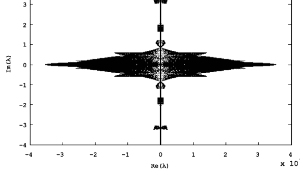

图 4. 在 $h = .5$、振幅 $a = .1$ 时的谱 {$\lambda$}（实部与虚部）。计算使用 $N = 16$ 个傅里叶模态、1000 个 $\mu$ 值和 300 个 $\rho$ 值。

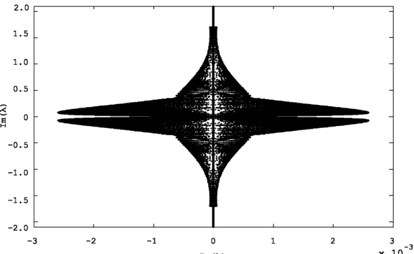

图 5. 在 h = 1.5、振幅 a = .1 时的谱 {λ}（实部与虚部）。计算使用 N = 16 个傅里叶模态、1000 个 μ 值和 300 个 ρ 值。

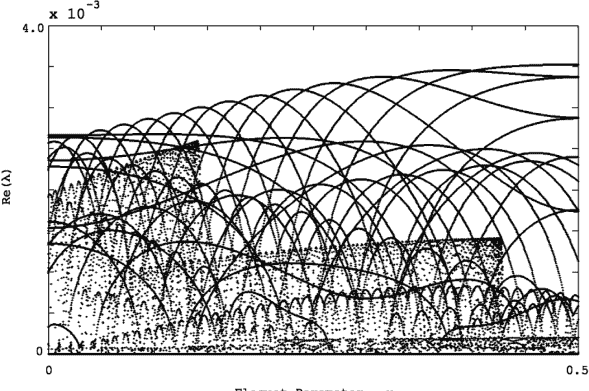

图 6. 谱的实部作为 Floquet 参数 μ 的函数，水深 h = .5，振幅 a = .1。计算使用 N = 16 个傅里叶模态、1000 个 μ 值和 300 个 ρ 值。


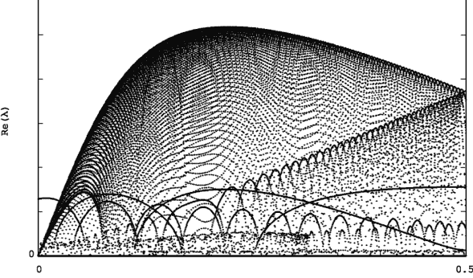

图 7. 深度 h = 1.5 且振幅 a = .1 时，谱的实部作为 Floquet 参数 μ 的函数。采用 N = 16 个傅里叶模态，1000 个 μ 值和 300 个 ρ 值计算。

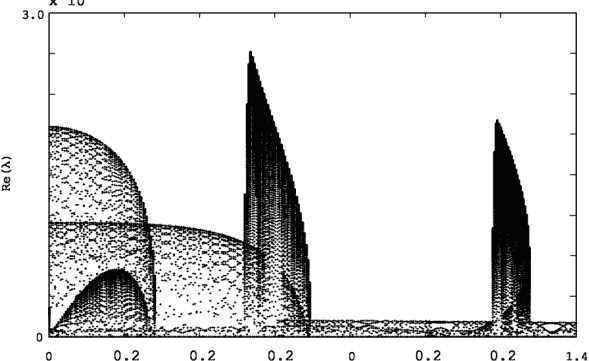

图 8. 深度 h = 1.5 且振幅 a = .1 时，谱的实部作为横向波数 ρ 的函数。采用 N = 16 个傅里叶模态，1000 个 μ 值和 300 个 ρ 值计算。

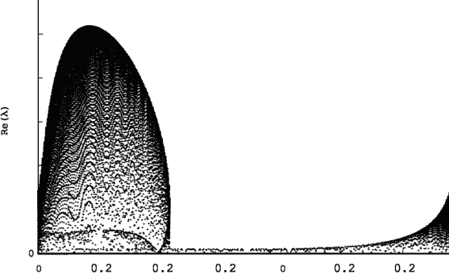

图 9. 深度 h = 1.5 且振幅 a = .1 时，谱的实部作为横向波数 ρ 的函数。采用 N = 16 个傅里叶模态，1000 个 μ 值和 300 个 ρ 值计算。

我们从浅水区（h = .5）开始研究，采用中等振幅的解（a = .1）。我们知道，对于这种特定的波高 ak = .1 和深度 h = .5 的选择，该波相对于一维扰动是不稳定的[DO]。此外，正如预期的那样，我们发现该波相对于二维扰动也是不稳定的，如图 4 所示的全谱所示。同样，h = 1.5 的全谱如图 5 所示。需要指出的是，在这两种情况下，谱的最大实部都远大于仅考虑一维扰动时最大实谱元素（参见文献 [DO] 进行比较）。这表明这些波的主导不稳定性是源于横向或完全二维扰动的不稳定性。然而，这并非总是如此。对于 h = ∞ 且 a = .3，我们发现主导不稳定性是由于一维扰动的结果。

##### 4.2.1. μ 和 ρ 的函数关系下的最大增长率。

图 4 和图 5 所示的全谱很好地展示了不稳定性中存在的增长率和频率。我们还可以将不稳定部分的谱作为 μ 和 ρ 的函数来检查。首先，我们考虑谱作为 μ 的函数。在图 6 和图 7 中，我们展示了 h = .5 和 h = 1 时谱的实部。此外，我们还在图 8 和图 9 中以 ρ 的函数形式展示了相同的谱。

需要指出的是，随着参数 ρ 值的增大，大不稳定性的带开始出现（图 8 中 ρ = .6 和 ρ = 1.25 附近）。随着 ρ 的增大，这些带会继续出现。然而，这些带中主导不稳定性的幅度会随着每个后续带的出现而减小。这些带中的每一个都对应于平凡解的特定共振曲线，如图 3 所示。

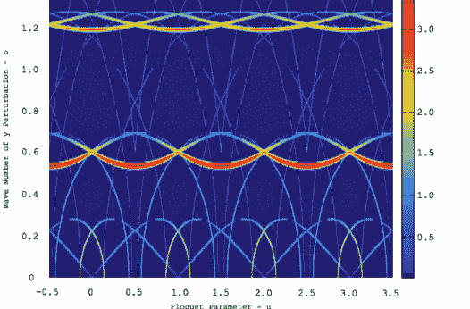

图 10. 深度 h = .5 且振幅 a = .1 时，谱的最大实部作为 Floquet 参数 μ 和横向波数 ρ 的函数。采用 N = 16 个傅里叶模态，1000 个 μ 值和 300 个 ρ 值计算。

此外，我们在 (μ, ρ) 平面上可视化不稳定性，其中使用颜色表示为每个扰动计算的谱最大实部的大小。图 10 和图 11 显示了不稳定性带。在此表示中，相对于 Floquet 参数 μ 的周期性是明显的。图 10 中给出的不稳定性带再次对应于零振幅解的共振曲线。我们注意到与其他地方发现的相同趋势

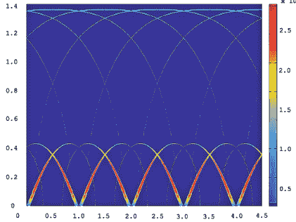

图 11. 深度 h = 1.5 且振幅 a = .1 时，谱的最大实部作为 Floquet 参数 μ 和横向波数 ρ 的函数。采用 N = 16 个傅里叶模态，1000 个 μ 值和 300 个 ρ 值计算。

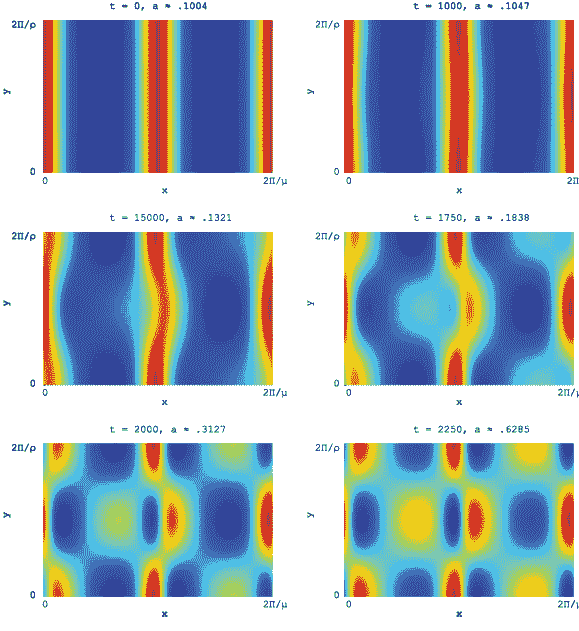

**图 14.** 深度 $h = .5$ 且振幅 $a = .1$ 时，对应于最不稳定扰动的线性问题的解。动力学显示了所谓的蛇形不稳定性，其中波峰被变形但沿这些变形波峰的振幅基本保持不变，至少在初始阶段是如此。

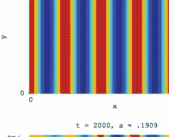
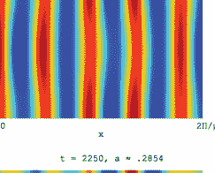
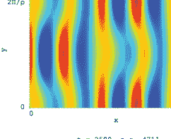
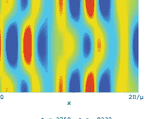
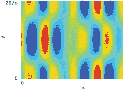


图 15. 深度 h = 1.5 且振幅 a = .1 时，对应于最不稳定扰动的线性问题的解。动力学显示了所谓的颈部不稳定性，其中波峰沿线的振幅振荡（在第三帧中最明显），随后出现次级的蛇形不稳定性。

回想一下，一维解的扰动形式为

\(\eta(x,y,t)=\eta_0(x)+\epsilon e^{\lambda t}e^{i\theta y}e^{i\mu x}\eta_1(x)+c.c.+\mathcal{O}(\epsilon^2)\)

除了对应于复共轭特征值的模态外，我们还添加了对应于相反特征值及其复共轭的模态。我们用此来检查行波的线性时间演化。对于短时间，在非线性效应变得重要之前，这展示了扰动波形的动力学。这里“短时间”应相对于特征值的大小来考虑：重要的度量是乘积 \(\lambda t\)。时间步长如图 14 和图 15 所示。由于扰动是不稳定的，如每个图所示，解的振幅随之增长。

### 5. 结论

我们使用 AFM 公式展示了一维行波解相对于二维扰动的不稳定性的一个小样本。通过结合 Hill 方法使用非局部公式，我们已以高度精度数值确定了各种谱。此外，如图 2 所示，最不稳定特征值的近似误差会随着截断中使用的傅里叶模态数而迅速收敛。

将我们的结果与 Francius & Kharif [FK06] 提出的方法进行比较时，我们的方法在相似解下使用更少的傅里叶模态即可收敛。为了量化这一点，在 [FK06] 中需要 80 个傅里叶模态才能获得 Cauchy 误差约为 10⁻⁸ 的特征值，而当 h = 0.3 且 a ≈ 0.10 时，我们仅需 48 个模态即可获得最不稳定特征值可比的 Cauchy 误差（数据取自文献 [FK06] 的附录，仅在线提供）。

表 2. 与 Francius & Kharif 对 h = 0.3 的结果比较，收敛至六位精度。对于 [FK06] 的结果，a = .1。然而，对于我们的结果，a = .1003。

| 不稳定性类别 | 参数值 | Francius & Kharif (a = .1) |  |
|---|---|---|---|
|  |  | 模态数 | \(\mathcal{R}(\lambda)_{max}\) |
| I 类 (n = 4) | \(\mu = 0, \rho = 0.954\) | 60 | .034650 |
| I 类 (n = 6) | \(\mu = 0, \rho = 0.954\) | 70 | .041305 |
| II 类 (n = 3) | \(\mu = 0, \rho = 0.954\) | 70 | .021491 |
| II 类 (n = 5) | \(\mu = 0, \rho = 0.954\) | 70 | .040446 |

| 不稳定性类别 | 参数值 | 非局部 (a = .1003) |  |
|---|---|---|---|
|  |  | 模态数 | \(\mathcal{R}(\lambda)_{max}\) |
| I 类 (n = 4) | \(\mu = 0, \rho = 0.954\) | 48 | .033527 |
| I 类 (n = 6) | \(\mu = 0, \rho = 0.954\) | 52 | .042458 |
| II 类 (n = 3) | \(\mu = 0, \rho = 0.954\) | 50 | .020000 |
| II 类 (n = 5) | \(\mu = 0, \rho = 0.954\) | 60 | .040528 |

表 3. 与 Francius & Kharif 对 h = 0.5 的结果比较，收敛至六位精度。对于 [FK06] 的结果，a = .17。然而，对于我们的结果，a = .1696。

| 不稳定性类别 | 参数值 | Francius & Kharif 模态数 | R(λ)_max | 非局部公式 模态数 | R(λ)_max |
|---|---|---|---|---|---|
| I 类 (n = 4) | μ = 0, ρ = 1.102 | 70 | .068502 | 48 | .073054 |
| I 类 (n = 6) | μ = 0, ρ = 3.169 | 70 | .056946 | 52 | .061713 |
| II 类 (n = 3) | μ = 0.5, ρ = 0.475 | 80 | .051826 | 48 | .053728 |
| II 类 (n = 5) | μ = 0.5, ρ = 1.973 | 80 | .067256 | 58 | .073044 |

除了收敛率之外，我们还将计算的增长率与先前已知的结果进行了比较。表 2 & 3 显示了当 h = .3 和 h = .5 时，计算的增长率与 Francius & Kharif[FK06] 的结果的比较。虽然对于所选的 (μ, ρ) 值，最终计算的增长率之间存在一些细微差异，但这些差异很容易解释，因为 (1) 行波的振幅略有不同，以及 (2) Francius & Kharif [FK06] 中行波的平均值不为零，而使用非局部公式的行波的平均值被设为零。此外，结果表明与 Francius & Kharif[FK06] 发现的不稳定性模式相同。例如，他们表明对于 a = 0.1 且 h = 0.3，主导不稳定性对应于 I 类不稳定性（当 n = 6 时）。同样，我们发现我们的计算也存在相同的趋势（见表 2）。


图 16. h = .5 且振幅 a = .160 时，谱的最大实部作为 Floquet 参数 μ 和波数 ρ 的函数，与 Francius 和 Kharif[FK06] 获得的结果进行比较（轮廓区域）。


我们获得了与 Francius & Kharif 一致的结果。然而，我们注意到我们的不稳定区域（谱与右半平面相交的 (μ, ρ) 平面区域）似乎比 [FK06] 中给出的要小。例如，在图 16 中，我们展示了 [FK06] 中获得的不稳定区域以及我们自己在 h = .5 和 a = .160 下计算的结果。如图 16 所示，总体形状相当，但我们的不稳定区域似乎比 Francius & Kharif 呈现的要小。

对于稳定区域大小的差异，有几种可能的解释。最合理的也许是我们能够使用远少于 Francius & Kharif [FK06] 所用的傅里叶模式数，以高精度计算出底层行波解。这是一维行波解非局部公式复杂度降低的益处，或许也归功于其对谱数值方法的适用性。此外，值得注意的是，由于我们在计算谱时计入了关于 μ 的周期性，我们的结果本质上是 Francius & Kharif [FK06] 所示结果的平铺版本。

总而言之，我们证实了对于小振幅波，主要不稳定性是二维的（发生在 ρ ≠ 0 时），且主要二维不稳定性的量级有时比主要一维不稳定性高出多个数量级。这一结果早先由 Bryant [Bry78] 发现。对于 h = .5，他发现对于四波相互作用，主要不稳定性完全是二维的。然而，当扰动在他的截断方程中随时间演化时，二维不稳定性占主导。正如 Francius & Kharif [FK06] 中所提到的，探索同时受到主要一维和二维不稳定性扰动的行波的时间演化，以确定每种不稳定性如何影响长时间动力学，将是很有趣的。这对未来工作是一个有趣的可能方向，因为目前对于使用完全非线性方程在浅水中扰动的时间传播知之甚少。另一个有趣的结果是，对于 h = .5，主要不稳定性对应于 μ = 1/2，这一点在之前的文献 [FK06] 中也有提及。这意味着主要不稳定性与在原始周期两倍上展开的原始解相位锁定。

### 参考文献

- [AFM06] M. J. Ablowitz, A. S. Fokas, and Z. H. Musslimani, On a new non-local formulation of water waves, Journal of Fluid Mechanics 562 (2006), 313–343.
- [AH08] M. J. Ablowitz and T. S. Haut, Spectral formulation of the two fluid Euler equations with a free interface and long wave reduction., Analysis and Applications 6 (2008), 323–348.
- [Ben67] T.B. Benjamin, Instability of periodic wave trains in nonlinear dispersive systems., Proceedings, Royal Society of London, A 299 (1967), 59–79.
- [BF67] T.B. Benjamin and J.E. Feir, The disintegration of wave trains on deep water. part i. theory., Journal of Fluid Mechanics 27 (1967), 417–430.
- [Boh47] H. Bohr, Almost periodic functions, Chelsea Publishing Company, New York, N.Y., 1947.
- [Bry78] P. J. Bryant, Oblique instability of periodic waves in shallow water, Journal of Fluid Mechanics 86 (1978), 783–792.
- [CD10] C. W. Curtis and B. Deconinck, On the convergence of Hill's method, Mathematics of Computation 79 (2010), 169–187.
- [CS93] W. Craig and C. Sulem, Numerical simulation of gravity waves, J. Comput. Phys. 108 (1993), no. 1, 73–83.
- [DK06] B. Deconinck and J. N. Kutz, Computing spectra of linear operators using Hill's method, Journal of Computational Physics 219 (2006), 296–321.
- [DO] B. Deconinck and K. Oliveras, The instability of periodic surface gravity waves, J. Fluid Mech. Submitted.
- [FK06] M. Francius and C. Kharif, Three-dimensional instabilities of periodic gravity waves in shallow water, Journal of Fluid Mechanics 561 (2006), 417–437.
- [JZ12] Mathew A Johnson and Kevin Zumbrun, Convergence of hill's method for nonselfadjoint operators, SIAM Journal on Numerical Analysis 50 (2012), no. 1, 64–78.
- [KR90] C. Kharif and A. Ramamonjiarisoa, On the stability of gravity waves on deep water, Journal of Fluid Mechanics 218 (1990), 163–170.
- [LH78a] M. S. Longuet-Higgins, The instabilities of gravity waves of finite amplitude in deep water II. subharmonics, Proceedings, Royal Society of London, A 360 (1978), 489–505.
- [LH78b] M.S. Longuet-Higgins, The instabilities of gravity waves of finite amplitude in deep water I. superharmonics, Proceedings, Royal Society of London, A 360 (1978), 471–488.
- [McL82a] J. W. McLean, Instabilities of finite-amplitude gravity waves on water of finite depth, Journal of Fluid Mechanics 114 (1982), 331–341.
- [McL82b] J. W. McLean, Instabilities of finite-amplitude water waves., Journal of Fluid Mechanics 114 (1982), 315–330.
- [MMM+81] J. W. McLean, Y.C. Ma, D. U. Martin, P. G. Saffman, and H. C. Yuen, Three-dimensional instability of finite-amplitude water waves, Physical Review Letters 46 (1981), no. 13, 817–820.
- [MS86] R. S. MacKay and P.G. Saffman, Stability of water waves, Proceedings, Royal Society of London, A 406 (1986), 115–125.
- [Nic09] D. P. Nicholls, Spectral data for travelling water waves: singularities and stability, Journal of Fluid Mechanics 625 (2009), 339–360.
- [Whi67] G. B. Whitham, Non-linear dispersion of water waves, Journal of Fluid Mechanics 27 (1967), 399–412.
- [Zak68] V. E. Zakharov, Stability of periodic waves of finite amplitude on the surface of a deep fluid., J. Appl. Mech. Tech. Phys. 9 (1968), 190–194.

数学系，西雅图大学，西雅图，华盛顿州 98122
电子邮箱：oliveras@seattleu.edu

应用数学系，华盛顿大学，西雅图，华盛顿州 98195
电子邮箱：bernard@amath.washington.edu

## 压力与自由表面之间独立于波速的关系

Katie Oliveras 和 Vishal Vasan

摘要。本文的重点是推导二维无粘重力行波表面与流体中任意点压力之间的直接关系。我们在不做近似且无需知道行波速度的情况下获得了这一关系。利用这一关系，我们数值生成了行波下方任意深度处的压力。我们还证明了这一关系可用于从流体域内部的压力测量中确定正确的表面轮廓。

### 1. 引言

在现场实验中，表面高程通常通过测量流体底部的压力来间接确定。利用这些数据，人们通过压力 p(x)、恒定水深 h 与零平均态表面高程 η(x) 之间的经典关系来重建表面高程，该关系由下式给出：

(1) p = ρg(h + η)，

其中 ρ 是密度，g 是重力加速度。这一关系是通过在平凡解（即无流体运动的平坦自由表面）附近将流体运动方程线性化而得到的。虽然这一简化关系在某些尺度上是准确的，但该模型（我们称之为线性模型）在最受关注的条件下——非线性波——无法准确重建表面高程。正如文献 [3] 中所讨论和文献 [14] 中所证明的，对于浅水波，公式 (1) 给出的 p 与 η 之间的关系在峰值振幅方面的误差很容易超过 20%。因此，我们必须考虑对方程 (1) 的非线性修正。

最近，人们发现了水波表面高程剖面 η(x) 与流体底部压力 p(x, −h) 之间的若干非线性关系 [4, 6, 7, 11, 14]。虽然这些新模型相比线性理论有了显著改进，但它们要求压力在流体域底部测量，并且排除了流体内部压力与自由表面之间的任何直接关系。最近，在文献 [20] 中，作者提出了一个


方法用于将自由表面 η 与流体域内任意点 (x, z) 处的压力联系起来，该方法适用于具有恒定涡度 γ 的行进波。该方法在无旋情况下同样有效。此外，压力与自由表面之间的关系可用于无旋情况（γ = 0）进行反演，从而根据流体内部某一垂直高度处的流体压力重建表面高程剖面 [14]。

即使 [4, 14] 中给出的完全非线性关系，即流体主体中的压力与自由表面之间的关系，也存在与其他模型相同的局限性；它们都需要知道波速 c（或等价地，伯努利常数）。在实践中，这是一个难以测量的量。如果要在野外实验中尝试测量波速，则需要一组传感器全部直接沿波传播方向排列。

对于某些物理条件，知道波速 c 并不是将 p 和 η 联系起来的绝对前提。显然，关系式 (1) 表明对于线性波，重建可以在没有波速的情况下进行。如 [14] 所示，某些非线性修正不依赖于波速，并且可以提供非常精确的表面剖面重建。此外，在浅水区域，波速可很好地近似为量 √g h̄，并且足以根据压力测量重建波剖面 [11,14]。然而，随着波剖面非线性的增加，这些近似会在浅水中引入重建误差。如果将速度 c 从关系式中消除，则不需要此类近似（即 c = √g h̄）。因此，波速的误差不会导致高度非线性波重建的误差。

证明波速 c 可以完全从 p 与 η 之间的关系中移除，将会对当前公式产生有趣的改进。在此，我们证明这是可能的。所获得的新公式在实践中并不产生最有效的重建方法（尤其是与 [14] 中给出的启发式公式相比）。然而，它确实解释了先前数值结果中观察到的对波速 c 不敏感的现象 [11,14]。除了消除波速 c 之外，我们还证明了确实可以找到流体主体内任意点处的压力 p 与自由表面 η 之间的关系，而该关系不涉及波速 c。

本文的内容安排如下。第 2 节，我们给出了不可压缩、无旋、无粘水波的流体运动相关方程。第 3 节，推导了流体中任意点处压力与自由表面之间的关系。这直接源自 [20] 的工作，并给出了依赖于波速 c 的 η 与 p 之间的隐式关系。在下一节中，我们将展示波速可以通过采用将法向导数映射到切向导数的算子来消除。最后在第 5 节，我们展示了使用流体域内部压力测量对自由表面进行数值重建的结果。

### 2. 运动方程

我们首先考虑理想、无旋二维流体中行进波的欧拉方程。一维表面剖面以

速度 c 运动。这些方程由

```
(2)  φ_xx + φ_zz = 0,  (x, z) ∈ D
(3)  φ_z = 0,  z = −h,
(4)  η_x (φ_x − c) = φ_z,  z = η(x),
(5)  −c φ_x + 1/2 (φ_x² + φ_z²) + g η = 0,  z = η(x),
```

给出，其中 φ(x, z) 表示流体的速度势，η(x) 表示表面高程，我们忽略了表面张力的效应。在由 (2-5) 给出的公式中，流体自由表面的压力已归一化为零。


## FIGURE 1. The fluid domain.

本文的主要目标是在 x 方向周期性边界条件下，将流体内部任意点处的压力 p(x, z) 与流体表面高程 η(x) 联系起来（不失一般性，我们假设周期为 2π）。虽然压力在上述公式中没有明确出现，但我们知道伯努利方程在无旋流体流体域内处处成立。对于以速度 c 运动的行进波，我们有

```
(6)  −c φ_x + 1/2 (φ_x² + φ_z²) + p(x, z) = B,
```

其中 B 表示伯努利常数，且

```
p(x, z) = g z + P(x, z)/ρ,
```

表示压力的非静止部分。因此，如果我们能找到流体域内 φ(x, z) 与表面高程 η 之间的关系，我们就可以直接联系这两个感兴趣的量。方程 (6) 将作为将流体中任意点处的压力与自由表面联系起来的基础。

> REMARK 1. 在下文中我们设 B = 0。这相当于适当地重新定义波速，从而相对于参考系引入水平流 [18]。

### 3. 压力与自由表面之间的关系

为了将流体内部任意点处的压力与自由表面 η 联系起来，我们首先将 z = η 处的伯努利条件仅用表面变量表示。令 q(x) = φ(x, η(x)) 表示表面处的速度势。方程 (4) 和 (5) 可以合并得到

```
(7)      -c q_x + 1/2 q_x^2 + g η - 1/2 (η_x (q_x - c))^2 / (1 + η_x^2) = 0.
```

如 [10] 所示，(7) 可以显式求解 q_x 得到

```
(8)      q_x - c = -√(c^2 - 2g η) (1 + η_x^2),
```

其中我们选择负平方根以保持流体中和自由表面处 φ_x - c ≤ 0。

#### 3.1. 流体域内部。

为了用自由表面表示流体中任意点的压力，我们需要确定 φ_x(x, z) 和 φ_z(x, z)，即流体域中任意点的流体速度，如何依赖于自由表面 η。我们通过以与 [19,20] 类似的方式运用格林定理来实现。我们注意到对于无旋行进波，可以将流体域扩展为形式为 (x, z) ∈ [0, 2π] × [−h, max(η)] 的矩形。如 [4] 第 468 页所述，这是由于行进波剖面傅里叶系数的特定衰减率 [15]。

在建立了扩展的调和域之后，我们继续推导流体域中任意点处流体速度的关系。为此我们采用 [1,19] 中的程序并考虑函数 E，其由

```
E = e^{-i k x + l z}.
```

给出。对于 l = ±k，E 是 x 和 z 的调和函数。然后可以很容易地证明

```
(9)      (φ_x E_z + φ_z E_x)_x + (-φ_x E_x + φ_z E_z)_z = 0,
```

这可以通过展开括号中的项来轻松验证 [1]。由于上述方程在流体域内恒等于零，并且我们的目标是将 z = z0 处的某些信息与 z = η 处的自由表面联系起来，我们选择在域 (x, z) ∈ [0, 2π] × [z0, η(x)] 上积分 (9)。图 2 (a)-(b) 描绘了我们可以积分 (9) 的两种可能域。因此我们得到

```
(10)     ∫_0^{2π} ∫_{z0}^{η(x)} (φ_x E_z + φ_z E_x)_x - (φ_x E_x - φ_z E_z)_z dz dx = 0,
```

这是一个散度形式的积分。运用平面上的格林定理，方程 (10) 变为

```
(11)     ∫_{∂D} (E (-i k φ_x - l φ_z)) dx + (E (l φ_x - i k φ_z)) dz = 0.
```

如果我们将 k 限制为 ℤ\{0}，则 x = 0 和 x = 2π 处的积分贡献由于周期性而相互抵消。因此我们得到关系式


## FIGURE 2. Integration paths for various values of z = z₀.

∫₀²π e⁻ⁱᵏˣ eˡᶻ⁰ (−ikφₓ(x, z₀) − lφ_z(x, z₀)) dx = ∫₀²π e⁻ⁱᵏˣ eˡη (−ik(φₓ + ηₓφ_z) − l(φ_z − φₓηₓ))_{z=η} dx.

由于 q = φ(x, η(x)) 且 (4) 成立，我们可以将上述方程重写为

(12) ∫₀²π e⁻ⁱᵏˣ eˡᶻ⁰ (−ikφₓ(x, z₀) − lφ_z(x, z₀)) dx = −ik ∫₀²π e⁻ⁱᵏˣ eˡη (qₓ − c) dx,

其中我们出于方便对右端进行了分部积分。

遵循 [1, 19] 的工作，我们可以考虑 l = k 和 l = −k 的单独情况。将两个方程相加我们得到

(13) ∫₀²π e⁻ⁱᵏˣ (φₓ(x, z₀)) dx = ∫₀²π e⁻ⁱᵏˣ ((qₓ − c) cosh(k(η − z₀))) dx,

而相减两个方程我们得到

(14) ∫₀²π e⁻ⁱᵏˣ (φ_z(x, z₀)) dx = ∫₀²π e⁻ⁱᵏˣ (i (qₓ − c) sinh(k(η − z₀))) dx.

方程 (13) - (14) 形成一个方程组，可用于将两个未知数 φₓ 和 φ_z 沿水平线 z = z₀ 联系起来。具体而言，由于


φ_x 和 φ_z 均为 2π 周期函数，(13) 和 (14) 分别表示速度势 φ 对 x 和 z 的导数的傅里叶系数。因此

```
(15)    φ_x(x, z0) = Σ_{k≠0} e^{ikx} ( ∫_0^{2π} e^{-iky} ((q_x - c) cosh(k(η - z0))) dy ) ,
```

```
(16)    φ_z(x, z0) = Σ_{k≠0} e^{ikx} ( ∫_0^{2π} e^{-iky} (i (q_x - c) sinh(k(η - z0))) dy ) .
```

此外，由于利用 (8) 可以将 q_x - c 直接用 c 和 η 表示，因此 φ_x(x, z0) 和 φ_z(x, z0) 可以显式地用自由表面 η 表示。于是，将 (15-16) 代入 (6) 后，我们得到自由表面 η 与流体域内任意一点压力 p(x, z0) 之间的直接关系。

### 4. 消去波速

上一节中推导出的表达式通过将 (15-16) 代入 (6)，将流体内部任意一点 (x, z) 处的压力与自由表面 η 联系起来。然而，由此得到的压力表达式需要知道波速 c。具体地说，将 (15-16) 代入 (6)（并利用 (8)）后，方程 (6) 表示一个关于三个未知量 η、p 和 c 的单一方程。当限制在自由表面上且 p = 0 时，我们得到该方程的一个特殊情况。因此我们有两个方程：一个在流体域内部成立，涉及 η、p 和 c；另一个在自由表面上成立，只涉及 η 和 c。给定这两个关系，我们证明可以消去 c，从而得到仅关于 p 和 η 的关系。

消去波速是可能的，因为流体速度 (15-16) 与 c 成比例。这是自由表面切向速度 q_x 本身与波速 c 成比例的推论。在下文中，使用 [13] 中概述的方法，我们给出 q_x 与 η 之间的一种关系，以通过算子 ℋ(η) 明确地说明这一事实，该算子将自由表面处的法向导数映射为 z = η 处 Dirichlet 条件的导数。

#### 4.1. 确定算子 ℋ(η)。

为了刻画 ℋ(η)，我们考虑如下边值问题的解

```
(17)        φ_xx + φ_zz = 0,                                 (x, z) ∈ D
```

```
(18)        φ_z - η_x φ_x = f(x),                             z = η(x)
```

```
(19)        φ_z = 0,                                         z = -h,
```

其中 f(x) 是 2π 周期且适当光滑的。如前所述，我们对速度势的梯度施加 2π 周期边界条件。注意，(18) 规定速度势沿自由表面的法向导数由函数 f(x) 给出。

我们引入算子 ℋ(η)，使得 ℋ(η) 将 φ 在自由表面上的法向导数映射为 φ 在自由表面上的切向导数。换句话说，

```
ℋ(η){φ_z - η_x φ_x} = d/dx φ(x, η(x)).
```

根据 [1, 2, 13]，可以证明 ℋ(η){f(x)} 满足如下关系

(20) \(\int_{0}^{2\pi} e^{-ikx} \left[i \cosh(k(\eta + h))f(x) - \sinh(k(\eta + h))\mathcal{H}(\eta, D)\{f(x)\}\right] dx = 0,\)

其中 $k \in \mathbb{Z}$。

算子 $\mathcal{H}(\eta)\{f\}$ 既可以从上述表达式数值确定，也可以表示为关于 $\eta = 0$ 的泰勒级数展开（更多细节见 [9, 13]）。或者，可以使用拉普拉斯方程的标准求解器来确定 $\mathcal{H}(\eta)\{f\}$。这里我们简要概述该算子关于零振幅解 $\eta = 0$ 展开的泰勒级数。

为了确定 $\mathcal{H}(\eta, D)$ 的泰勒级数表达式，我们假设 $\mathcal{H}(\eta, D)$ 具有如下关于 $\eta$ 的级数表示

\(\mathcal{H}(\eta, D)\{f\} = \sum_{j=0}^{\infty} \mathcal{H}_j(\eta, D)\{f\},\)

其中每个 $\mathcal{H}_j(\eta, D)$ 关于 $\eta$ 是 j 次齐次的，即 $\mathcal{H}_j(\lambda \eta, D) = \lambda^j \mathcal{H}_j(\eta, D)$。与 [2] 中给出的计算类似的计算使我们能够用低阶项确定 $\mathcal{H}_j(\eta, D)$ 的如下递推关系：

(21) \(\int_{0}^{2\pi} e^{-ikx} \mathcal{H}_j(\eta, D)\{f\} dx = i \int_{0}^{2\pi} e^{-ikx} \frac{(k\eta)^j}{j!} \left[ \begin{array}{c} \coth(kh); \quad j \text{ even} \\ 1; \quad j \text{ odd} \end{array} \right] f dx - \int_{0}^{2\pi} e^{-ikx} \sum_{m=1}^{j} \left( \mathcal{H}_{j-m}(\eta)\{f\} \frac{(k\eta)^m}{m!} \left[ \begin{array}{c} 1; \quad m \text{ even} \\ \coth(kh); \quad m \text{ odd} \end{array} \right] \right) dx.\)

在上式中，我们使用方括号 [ ] 作为适当求和下标处的条件乘子。因此，对于适当的函数 $f(x)$，我们可以通过 (20) 或 (21) 确定 $\mathcal{H}(\eta)\{f\}$。

注2：从 (21) 给出的关系可以清楚地看出，$\mathcal{H}(\eta)$ 是作用于 $f(x)$ 的线性算子。具体而言，$\mathcal{H}(\eta)\{f + g\} = \mathcal{H}(\eta)\{f\} + \mathcal{H}(\eta)\{g\}$，且对于任意标量 $\alpha$，$\mathcal{H}(\eta)\{\alpha f\} = \alpha \mathcal{H}(\eta)\{f\}$。当然，算子 $\mathcal{H}(\eta)$ 可以通过边值问题 (17-19) 的解来抽象定义。利用标准技术可以证明该算子以线性方式作用于 Neumann 条件，正如经典的 Dirichlet-to-Neumann 算子被证明是有界线性算子那样 [5]。

#### 4.2. 联系自由表面与波速。

回到我们感兴趣的问题，假设 $(q_x, \eta, c)$ 是方程 (2-5) 的一组解，且 $-c\eta_x$ 是由 (4) 给出的速度势的法向导数。回顾 $q_x$ 是速度势在自由表面上的切向导数，我们有

(22) \(\mathcal{H}(\eta)\{-c\eta_x\} = q_x.\)

将 $q_x = \mathcal{H}(\eta)\{-c\eta_x\}$ 代入自由表面处的伯努利方程 (7)，我们得到

(23) \(-c\mathcal{H}(\eta)\{-c\eta_x\} + \frac{1}{2} \left(\mathcal{H}(\eta)\{-c\eta_x\}\right)^2 + g\eta - \frac{1}{2} \frac{\eta_x^2 \left(\mathcal{H}(\eta)\{-c\eta_x\} - c\right)^2}{1 + \eta_x^2} = 0.\)

由于 ℋ(η){f} 是线性算子，ℋ(η){−cηₓ}=−cℋ(η){ηₓ}。因此，(23) 可以显式地解出参数 c²，得到

(24) c² = −2gη(1+ηₓ²) / [ (ℋ(η){ηₓ}+1)² − (1+ηₓ²) ] ,

这里我们注意到 (24) 的右端不依赖于参数 c。关于方程 (24) 右端分母的注：对于满足行波问题 (2-5) 的适当光滑的 η，方程 (23) 逐点满足，并且 (24) 右端的任何奇点都是可去奇点。当然，具有适当正则性的行波解 (2-5) 的存在性已在 [8,12,16,17] 中得到证明，因此我们消除了 (24) 右端可能的奇点。

#### 4.3. 联系自由表面与流体内部。

表达式 (24) 是在自由表面处评估伯努利条件的结果。假设在流体内部存在一个用流体内部速度表示的类似陈述，那么由于 c 是流动的均匀常数，我们可以消去波速。然而，从 (15) 和 (16) 可以看出，φₓ(x,z₀) 和 φ_z(x,z₀) 的表达式不仅依赖于 η，还依赖于量 c。因此，我们重新定义 φₓ(x,z₀) 和 φ_z(x,z₀) 为

φₓ(x,z₀) = −c𝒰{η}, φ_z(x,z₀) = −c𝒱{η},

其中我们引入了算子 𝒰{η} 和 𝒱{η}。这些算子类似于 (15) 和 (16) 中给出的算子，只是将 qₓ 替换为 −cℋ(η){ηₓ}。可以直接证明 𝒰{η} 和 𝒱{η} 由下式给出

(25) 𝒰{η} = Σ_{k≠0} e^{ikx} ( ∫₀^{2π} e^{−iky} ((ℋ(η){ηₓ}+1) cosh(k(η−z₀))) dy ),

(26) 𝒱{η} = Σ_{k≠0} e^{ikx} ( ∫₀^{2π} e^{−iky} (i(ℋ(η){ηₓ}+1) sinh(k(η−z₀))) dy ).

将 𝒰{η} 和 𝒱{η} 的表达式代入流体内部有效的伯努利方程 (6)，我们得到

(27) c²𝒰{η} + ½c²(𝒰{η})² + ½c²(𝒱{η})² + p(x,z₀) = 0.

我们再次注意到算子 ℋ(η){ηₓ}、𝒰{η} 和 𝒱{η} 与波速 c 无关。因此我们对方程 (27) 求解参数 c²。将其与方程 (24) 结合，我们得到

(28) p(x,z₀) ((ℋ(η){ηₓ}+1)² − (1+ηₓ²)) = gη(1+ηₓ²) (2𝒰{η} + (𝒰{η})² + (𝒱{η})²).

方程 (28) 在不需要知道行波速度 c 的情况下，将流体中任意一点的压力 p(x,z₀) 与自由表面 η 联系起来。注意，算子 𝒰{η} 和 𝒱{η} 也可以像 ℋ(η){ηₓ} 那样通过边值问题的解来定义。因此在上面的表达式中，对 ℋ(η){ηₓ}、𝒰{η} 和 𝒱{η} 使用的具体表示只是一种方便的选择。一

我们同样可以采用边界积分方法或共形映射来指定这些算子。这些替代方法不需要此处所用的流体延拓。在本文中，我们使用文献[1]的全局关系方法，它为获得完整表达式的渐近约化提供了相当大的便利。此类渐近表达式将在未来的工作中加以研究。

最后，我们指出，给定自由面高程剖面后，流动主体内部的压力可由(28)唯一确定，这是显而易见的。自由面重构问题考虑的正是逆映射。在下一节中，我们给出在未知波速 c 的情况下，从底部压力到自由面高程剖面的映射的数值证据。

### 5. 数值实验

在本节中，我们对数值计算得到的行波解，数值检验压力与自由面之间的关系。我们考虑两个独立的问题：正问题（给定 η(x)，求 p(x, z₀)）和反问题（给定 p(x, z₀)，求 η(x)）。在以下各小节中，我们首先考虑这一正问题，并假设 η 已知。利用该正问题生成的压力数据，我们证明逆关系可以数值求解。也就是说，给定压力数据 p(x)，我们可以数值求解(28)，从而恢复原始自由面 η。

#### 5.1. 正问题

如前一节所述，正问题是直接的。具体来说，给定 η，(20) 给出了从 η → ℋ(η){ηₓ} 的直接映射，从而允许我们直接映射到 p。在以往的工作中，为了计算自由面高程 η(x) 与压力 p(x) 之间的完全非线性关系，必须知道波速 c。前面几节提出的思想在已知和未知波速两种情况下均适用。这里，我们概述两种情形下的数值步骤：(1) 已知波速 c；(2) 未知 c。

##### 5.1.1. 已知波速 c 的情形

我们首先考虑正问题，其中波速 c 和自由面均为已知量。就正问题而言，给定周期行波解 η(x) 和 c，可以利用(6)和(28)确定流体域内不同位置的压力。例如，若给定 η(x) 及测得的波速 c，我们可以通过以下步骤直接利用(6)计算流体中任意一点的压力。

首先，利用 η(x) 和 c，我们可以通过(8)确定量 qₓ − c。这可以用简单的拟谱方法实现：非线性运算在物理域中计算，导数在傅里叶域中计算。接下来，利用计算得到的 qₓ − c，通过(15)和(16)可在所需深度 z = z₀ 处确定 φₓ 和 φ_z。最后，将 φₓ 和 φ_z 的表达式直接代入(6)，即可得到流体中任意一点的压力 p(x, z₀)。

##### 5.1.2. 未知波速 c 的情形

类似地，在未知 c 的情况下，给定 η(x)，我们通过(28)数值计算从自由面 η 到 p(x, z₀) 的映射。作为第一步，利用 η(x)，我们必须首先确定算子 ℋ(η){ηₓ}。这可以通过两种不同方式之一实现。

一种选择是数值求解(20)以获得量 ℋ(η){ηₓ}。由于(20)关于量 ℋ(η){ηₓ} 是线性的，求解该量涉及对一个线性算子求逆。


**图 4.** 在不同深度处计算的压力，针对 h = 0.1、g = 1、L = 2π 且 ‖η‖∞ = 0.01 的周期行波进行评估。实线表示使用文献[20]中概述的方法计算的压力。符号‘o’表示使用(6)计算的压力，而‘+’表示使用(28)计算的压力。

该压力存在一个最小值。在这一点上，压力与边界条件 p(x, η) = gη 给出的规定值精确一致（误差在 10⁻¹⁵ 以内）。此外，图 4(a) 考察了沿直线 z₀ = 0 的压力。在这种情况下，我们只绘制了使得 (x, 0) 位于流体域 D 内部或边界上的 x 值所对应的压力（参见图 2(b)）。

#### 5.2. 反问题

我们现在考虑反问题：给定在某一高度 z = z₀ 处测得的 p(x, z)，我们能否确定 η(x)？为此，我们只使用(28)，因为波速 c 在该公式中已被完全消去。具体而言，利用上一节得到的在不同深度处测得的压力，我们使用牛顿法数值求解(28)以得到自由面 η，误差容限为 10⁻¹⁴。与之前一样，我们使用拟谱方法，其中微分在傅里叶空间中完成，乘法在物理空间中完成。

作为牛顿法的初始猜测，我们使用给定压力的零均值部分；基于压力测量深度，该部分可给出自由面 η 的流体静力近似。我们发现，如文献[14]所示并在图 5(a-c) 和图 7(a-c) 中再次看到的那样，该初始猜测低估了行波的波峰高度。正如预期，随着 z₀ 从流体底部 (z = −h) 增大到自由面 z₀ = η(x)，初始猜测（自由面的流体静力近似）与真实自由面 η 之间的误差逐渐减小。


(a) z₀ = min(η(x))


(b) z₀ = −h/2


(c) z₀ = −h

**图 5.** 在不同深度处计算的压力，针对 h = 0.1、g = 1、L = 2π 且 ‖η‖∞ = 0.003 的周期行波进行评估。实线表示自由面 η(x) 的真实值。虚线表示自由面的流体静力近似，而‘+’表示通过(28)得到的自由面重构。

具体来说，对于小振幅波，当压力测量在自由面附近进行时，流体静力近似可以非常接近地估计自由面 η（例如参见图 6(a) 和图 8(a) 中 z₀ = min(η(x)) 的情形）。然而，对于强非线性波，当压力测量在流体底部进行时，该近似的误差可能超过 20%（见图 8(c)）。

尽管本节展示的解是在浅水中测量的，但其无量纲振幅已远远超出线性/KdV 范畴（详见文献[14]）。对于这些非线性波，如图 8(a-c) 所示，我们能够在未知波速 c 的情况下，利用(28)从多个深度 z₀ 处测得的压力确定正确的自由面剖面，精度可达 10⁻¹⁴。


(a) z₀ = min(η(x))
(b) z₀ = −h/2
(c) z₀ = −h

**图 6.** h = 0.1、g = 1、L = 2π 且 ‖η‖∞ = 0.003 时，自由面 η 的真实值与基于不同深度压力测量得到的重构自由面之间的绝对误差。实线表示 |η − ηr|，其中 ηr 是由(28)得到的重构。虚线表示真实表面与流体静力近似之间的误差，点线（仅子图(c)）表示基于 KdV 重构的误差（详见文献[14]）。


(a) z₀ = min(η(x))


(b) z₀ = −h/2


(c) z₀ = −h

**图 8.** h = 0.1、g = 1、L = 2π 且 ‖η‖∞ = 0.03 时，自由面 η 的真实值与基于不同深度压力测量得到的重构自由面之间的绝对误差。实线表示 |η − ηr|，其中 ηr 是由(28)得到的重构。虚线表示真实表面与流体静力近似之间的误差，点线（仅子图(c)）表示基于 KdV 重构的误差（详见文献[14]）。


### 参考文献

[1] M. J. Ablowitz, A. S. Fokas, and Z. H. Musslimani, *关于水波的一种新的非局部表述*, J. Fluid Mech. **562** (2006), 313–343, DOI 10.1017/S0022112006001091. MR2263547 (2007k:76013)

[2] M. J. Ablowitz and T. S. Haut, *具有自由界面的两流体欧拉方程的光谱表述及长波约化*, Anal. Appl. (Singap.) **6** (2008), no. 4, 323–348, DOI 10.1142/S0219530508001213. MR2459114 (2010a:76016)

[3] C. T. Bishop and M. A. Donelan. 用压力传感器测量波浪. *Coastal Engineering*, 11:309–328, 1987.

[4] D. Clamond and A. Constantin, *由床面压力测量恢复定常周期波剖面*, J. Fluid Mech. **714** (2013), 463–475, DOI 10.1017/jfm.2012.490. MR3008068

[5] R. R. Coifman and Yves Meyer, *非线性调和分析与解析依赖性*, Pseudodifferential operators and applications (Notre Dame, Ind., 1984), Proc. Sympos. Pure Math. vol. 43, Amer. Math. Soc., Providence, RI, 1985, pp. 71–78, DOI 10.1090/pspum/043/812284. MR812284

[6] A. Constantin, *由压力测量恢复孤立波剖面*, J. Fluid Mech. **699** (2012), 376–384, DOI 10.1017/jfm.2012.114. MR2923684

[7] Adrian Constantin, Joachim Escher, and Hung-Chu Hsu, *孤立水波下的压力：数学理论与实验*, Arch. Ration. Mech. Anal. **201** (2011), no. 1, 251–269, DOI 10.1007/s00205-011-0396-0. MR2807138 (2012f:76032)

[8] Walter Craig and David P. Nicholls, *行进的二维和三维毛细重力水波*, SIAM J. Math. Anal. **32** (2000), no. 2, 323–359, DOI 10.1137/S0036141099354181. MR1781220 (2002c:76016)

[9] W. Craig and C. Sulem, 数值模拟重力波, J. Comput. Phys. **108** (1993), no. 1, 73–83, DOI 10.1006/jcph.1993.1164. MR1239970 (94h:76064)

[10] Bernard Deconinck and Katie Oliveras, *周期表面重力波的不稳定性*, J. Fluid Mech. **675** (2011), 141–167, DOI 10.1017/S0022112011000073. MR2801039 (2012j:76057)

[11] B. Deconinck, K. L. Oliveras, and V. Vasan, *水波问题中底部压力与表面高程的关系*, J. Nonlinear Math. Phys. **19** (2012), no. suppl. 1, 1240014, 11, DOI 10.1142/S14029251124000141. MR2999408

[12] T. Levi-Civita, *有限振幅永久波的严格确定* (法文), Math. Ann. **93** (1925), no. 1, 264–314, DOI 10.1007/BF01449965. MR1512238

[13] Katie Oliveras and Vishal Vasan, *描述行进水波的一个新方程*, J. Fluid Mech. **717** (2013), 514–522, DOI 10.1017/jfm.2012.591. MR3018618

[14] K. L. Oliveras, V. Vasan, B. Deconinck, and D. Henderson, *由压力测量恢复水波剖面*, SIAM J. Appl. Math. **72** (2012), no. 3, 897–918, DOI 10.1137/110853285. MR2968755

[15] Pavel I. Plotnikov and John F. Toland, *Stokes 波的傅里叶系数*, Nonlinear problems in mathematical physics and related topics, I, Int. Math. Ser. (N. Y.) vol. 1, Kluwer/Plenum, New York, 2002, pp. 303–315, DOI 10.1007/978-1-4615-0777-2.18. MR1970618 (2004c:76023)

[16] D. J. Struik, *有限深度渠道中无旋周期波的严格确定* (法文), Math. Ann. **95** (1926), no. 1, 595–634, DOI 10.1007/BF01206629. MR1512296

[17] J. F. Toland, *Stokes 波*, Topol. Methods Nonlinear Anal. **7** (1996), no. 1, 1–48. MR1422004 (97j:35130)

[18] Vishal Vasan and Bernard Deconinck, *行进水波的 Bernoulli 边界条件*, Appl. Math. Lett. **26** (2013), no. 4, 515–519, DOI 10.1016/j.aml.2012.12.008. MR3019985

[19] Vishal Vasan and Bernard Deconinck, *浴底探测的水波逆问题*, J. Fluid Mech. **714** (2013), 562–590, DOI 10.1017/jfm.2012.497. MR3008073

[20] V. Vasan and K. L. Oliveras. 具有常涡度的行进波下的压力. *submitted for publication*, 2013.

Mathematics Department, Seattle University, Seattle, Washington 98102
*E-mail address:* `oliveras@seattleu.edu`

Department of Mathematics, Pennsylvania State University, University Park, Pennsylvania 16802
*E-mail address:* `vasan@math.psu.edu`

## 水波问题中 Dirichlet–Neumann 算子的五种计算方法的比较

Jon Wilkening and Vishal Vasan

摘要. 我们比较了通过 Craig–Sulem (CS) 展开、Ablowitz–Fokas–Musslimani (AFM) 隐式表述、双 AFM 表述 (AFM*)、边界积分配点法 (BIM) 以及变换场展开 (TFE) 方法求解 Dirichlet–Neumann 问题时的有效性。前三种方法涉及高度病态的中间计算，我们证明使用多精度算术可以克服这一问题。后两种方法避免了中间结果中数位的灾难性抵消，更适合数值计算。

对于 Craig–Sulem 展开，我们研究了三种波剖面类型，即带限、实解析或光滑，在每一阶（最高到 150 阶）的项的抵消情况。对于 AFM 和 AFM* 方法，我们给出一个例子，其中 Dirichlet 或 Neumann 数据用 AFM 基函数展开是不可能的，导致方法失效。该例子涉及振幅任意小的带限波剖面，具有解析的 Dirichlet 数据。然后我们展示如何通过过采样基函数并使用奇异值分解或 QR 分解来正交化它们，从而正则化 AFM 和 AFM* 方法。另两个例子用于比较所有五种方法在水波背景下的表现，即深水中的大振幅驻波，以及有限深度中相互作用的一对行进波。

### 1. 引言

水波方程，也称为无粘、无旋波的 Euler 方程，描述了理想流体自由表面的运动。对于二维周期波，在无表面张力且表面平坦的情况下，它们如下给出 [9]：

```
φ_xx + φ_yy = 0,      −h < y < η,
η_t + φ_x η_x = φ_y,    y = η(x,t),
φ_t + 1/2 φ_x² + 1/2 φ_y² + g η = 0,    y = η(x,t),
φ_y = 0,               y = −h.
```

这里 φ 是速度势（与流体速度的关系为 u = ∇φ），η 是水体自由表面的图，g 是重力加速度，h 是未扰动流体的深度，下标表示偏导数。由于我们感兴趣的是周期波，因此在水平方向考虑周期边界条件。我们注意到上述方程代表了 Laplace 方程的自由边界值问题，即 η 和 φ 都是未知量。这些方程很容易推广到三维流体（具有二维表面）；然而，在本工作中，我们将自己限制在一维表面。

水波方程可以用仅表面变量 η(x, t) 和 q = φ(x, η, t) 表示为 [11,33]

```
∂η/∂t = G(η)q,
∂q/∂t = -gη - q_x²/2 + (G(η)q + η_x q_x)² / [2(1 + η_x²)],
```

其中 G(η) 表示 Dirichlet-Neumann 算子 (DNO) 定义为

```
G(η)q = φ_y(x, η) - η_x φ_x(x, η),
```

其中 φ 是以下边界值问题的解

```
φ_xx + φ_yy = 0,      -h < y < η,
φ(x, y) = q(x),      y = η,
φ_y = 0,             y = -h.
```

因此 G(η) 将给定的 Dirichlet 数据 q 映射到自由表面上的相应 Neumann 数据。因此，为了使用某种数值格式在时间上演化表面变量，我们需要在每一步求解 Laplace 方程。数值求解每一步的 Laplace 方程代价高昂，尤其是在三维情况下。

一种避免昂贵数值求解 Laplace 方程的 G(η) 刻画是可取的。在当前工作中，我们讨论了在水波背景下开发的四种此类刻画。这四种方法是 Craig & Sulem 的算子展开法 (CS) [11]、Bruno & Reitich 的变换场展开法 (TFE) [7] 和 Nicholls & Reitich [23,24]、Ablowitz、Fokas & Musslimani 给出的 DNO 的非局部隐式表述 (AFM) [1]，以及由 Ablowitz & Hal [2] 推导的 AFM 方法的对偶版本，我们将其记为 AFM*。每种方法在推导水波在各种物理区域的简化模型 [10]、推导守恒量 [1] 以及为提出某些逆问题提供理论框架 [25,28] 方面都具有显著的理论效用。此外，每种方法都可以很容易地推广到具有变化底部边界和三维流体的情况。

当然，数值求解 Laplace 方程的传统方法很多，包括边界积分法、保角映射技术和有限元法。在本工作中，我们选择将 CS 和 TFE 算子展开以及 AFM/AFM* 非局部表述与边界积分法进行比较。我们不考虑保角映射 [14]，因为它不能推广到三维问题，也不考虑传统有限元 [26]，因为当需要高精度时，高阶单元与刚度矩阵稀疏性之间的权衡使其代价高昂。虽然通常不是这样描述的，但我们将 TFE 方法视为有限元方法的一个谱精度变体。边界积分法在二维中特别高效。


对于周期性问题，由于所涉及的晶格求和具有显式的解析表示，维度问题得以简化。然而，在三维情况下，边界积分方法的实现要困难得多。

本工作的总体目标是理解二维流体中每种方法的相对有效性和精度。CS、AFM 和 AFM* 方法涉及高度病态的中间计算，因此本文的大部分内容集中于：如果在这些中间计算中使用多精度算术，是否可以获得准确结果。特别是，对于水波的时间步进，重要的是当输入数据仅以有限的精度已知时，方法仍然有效——只要输出的精度大致与输入相当，中间计算中的额外精度是允许的。考虑到在本工作中获得高精度所需的谨慎态度，在使用双精度且不仔细监测条件数和数字抵消的情况下，必须谨慎使用这些方法。

本文的结构如下。在第2节中，我们简要介绍 CS 算子展开、AFM 和 AFM* 非局部公式，以及 DNO 的边界积分和 TFE 表示。在第3节中，我们对自由表面 η 的特定选择进行了前四种方法的比较。在这里，我们试图量化 CS、AFM 和 AFM* 方法的准确程度。我们假设精确的 DNO 由边界积分方法获得，并在适当的情况下使用更高精度进行计算。第3.1节讨论了与 Craig & Sulem 级数表示相关的微妙抵消性质。在第3.2节中，我们给出了一个具体示例，其中 AFM* 方法（在其通常解释为某个级数系数的方程组时）必然失败，以及其他 AFM 和 AFM* 成功收敛到正确 Neumann 数据的实例。CS 展开的微妙抵消与 AFM/AFM* 方法相关的快速衰减奇异值相对应。这使我们考虑 AFM/AFM* 的正则化版本，这些版本涉及对 AFM 基函数进行过采样，以通过 QR 分解或奇异值分解精确逼近 Gram-Schmidt 正交化过程。在 SVD 方法中，我们还研究了伪逆截止阈值的应用。我们发现，AFM 基函数在表示解方面比 Fourier 基更有效，但缺点是条件数较差。最后，在第3.3节中，我们讨论了所有方法在与水波相关的示例上的行为。

### 2. Dirichlet–Neumann 算子的表示

正如引言中提到的，Dirichlet–Neumann 算子在表面重力波运动的数学表述中起着重要作用。为了有效计算随时间变化的运动，我们需要一种快速有效的方法来求解 Laplace 方程，或者另一种直接计算 Dirichlet–Neumann 算子的方法。在本节中，我们概述五种常用方法。第一种由 Craig & Sulem [11] 提出，涉及将 DNO 展开为 Taylor 级数。第二种由 Ablowitz, Fokas 和 Musslimani [1] 提出，涉及推导 Dirichlet 和 Neumann 数据之间的全局关系，该关系可用作求解 Neumann 数据的积分方程。第三种 [2,12,25,28] 是第二种的对偶变体，表述更直接。第四种是边界积分配置方法 [5,6,16,19,20,31,32]。第五种是 Bruno & Reitich [7] 和 Nicholls & Reitich [23,24] 的变换场展开方法。

类似地，继续推进到更高阶，我们得到 DNO 展开中的更多项。例如，

$G_1 = D\eta D - G_0\eta G_0,$

$G_2 = -\frac{1}{2}\left(G_0\eta^2 D^2 - 2G_0\eta G_0\eta G_0 + D^2\eta^2 G_0\right),$

其中 $D = -i\partial_x$，$G_0 = D\tanh(hD)$。像 $\tanh(hD)$ 这样的项被理解为伪微分算子，即它们通过相关的 Fourier 乘子来定义。我们注意到，$G$ 的 Taylor 展开的更高阶项涉及越来越高阶的导数。虽然 $G$ 的 Taylor 级数对于光滑度有限（甚至是有界）的 $\eta$ 存在，但 $G_i(\eta)$ 的公式在这种情况下并不有效，或者必须作为一个整体，而不是作为各个算子的和，非常谨慎地解释。即使当 $\eta$ 是实解析的，各项之间也存在微妙的平衡，导致高度抵消 [23]。这在有限精度算术中造成数值困难。我们在第3节中探讨了任意精度算术中这些抵消的程度。当然，许多这些问题可以通过变量替换来展平区域 [7, 17, 23]，或使用边界积分方法计算 DNO [31, 32] 来避免。然而，原始的 Craig–Sulem 展开仍然具有理论意义，并且是与接下来讨论的 AFM 方法关系最密切的一种。

#### 2.2. AFM 隐式表示

遵循 [1, 2]，我们现在推导水波问题的 Ablowitz–Fokas–Musslimani 重新表述的全局关系。这种重新表述的显著特征是 Dirichlet–Neumann 算子的隐式非局部表征。求解所得积分方程给出完整的 DNO，有效地求和 Craig & Sulem 展开中的所有项，而无需逐阶计算。

如上所述，函数

(2.2)

$\psi = \exp(ikx)\cosh(k(y+h))$

起作用，但现在是作为对偶函数而不是基函数。根据 Green 第二恒等式，我们有

$0 = \int_D \left(\psi(\phi_{xx}+\phi_{yy}) - \phi(\psi_{xx}+\psi_{yy})\right) dx\,dy,$

$= \int_{\partial D} \left(\psi\frac{\partial\phi}{\partial n} - \phi\frac{\partial\psi}{\partial n}\right) dS,$

$= \int_0^L \psi(x,\eta)\left[\phi_y(x,\eta) - \eta_x\phi_x(x,\eta)\right] dx - \int_0^L \phi(x,\eta)\left[\psi_y(x,\eta) - \eta_x\psi_x(x,\eta)\right] dx,$

(2.3)

$= \int_0^L \psi(x,\eta)\mathcal{N}(x)dx - \int_0^L \mathscr{D}(x)\left[\psi_y(x,\eta) - \eta_x\psi_x(x,\eta)\right] dx,$

其中 $\partial/\partial n$ 是表面的法向导数。利用 $\psi$ 的定义并注意到

$e^{ikx}\left(k\sinh(k(\eta+h)) - ik\eta_x\cosh(k(\eta+h))\right) = -i\partial_x\left(e^{ikx}\sinh(k(\eta+h))\right),$

我们得到

(2.4) $\int_{0}^{L} e^{ikx} \cosh(k(\eta + h)) \mathscr{N}(x) \,dx = \int_{0}^{L} i e^{ikx} \sinh(k(\eta + h)) \partial_x \mathscr{D}(x) \,dx,$

这就是 Laplace 方程的 Ablowitz-Fokas-Musslimani (AFM) 全局关系 [1]。注意，由此得到的全局关系只是 Green 恒等式的重新表述。在 [1] 中，作者以不同但等价的方式获得了该表达式。通过谱配置技术，这产生了一种算法，在该算法中，通过求解线性系统，在网格 $\{x_j\}_{j=0}^{M-1}$ 上获得近似值 $\mathscr{N}(x_j)$。在这种情况下，对波数 $|k| \le (2\pi/L)M/2$ 强制执行 (2.4)。

第三种方法由 Ablowitz & Haut [2] 提出，可以通过一种逆 Fourier 变换从 (2.4) 推导出来。所得的 DNO 算法归结为求解

(2.5) $\sum_{k} \hat{\Psi}_k e^{ikx} \cosh(k(\eta + h)) = \mathscr{D}(x),$

以获得展开系数 $\hat{\Psi}_k$，然后计算

(2.6) $\mathscr{N}(x) = -i \partial_x \left( \sum_{k} \hat{\Psi}_k e^{ikx} \sinh(k(\eta + h)) \right).$

对于那些允许形如 (2.5) 的展开的函数 $\mathscr{D}(x)$，法向导数预计（通过逐项微分）具有 (2.6) 的形式。

求解积分方程 (2.4) 的操作是求解方程组 (2.5)、(2.6) 的形式伴随。实际上，如果前者（的共轭）写成 $\mathscr{N} = (A^*)^{-1} B^* \partial_x \mathscr{D}$，那么后者变成 $\mathscr{N} = -\partial_x B A^{-1} \mathscr{D}$，由于 G(\eta) 是自伴的，两者是一致的。这里

$A c = \sum_{k} c_k e^{ikx} \frac{\cosh(k(\eta(x) + h))}{w_k}, \quad (A^* f)_k = \int_{0}^{L} e^{-ikx} \frac{\cosh(k(\eta(x) + h))}{w_k} f(x) \,dx,$

(2.7) $B c = \sum_{k} c_k i e^{ikx} \frac{\sinh(k(\eta(x) + h))}{w_k}, \quad (B^* f)_k = \int_{0}^{L} e^{-ikx} \frac{\sinh(k(\eta(x) + h))}{i w_k} f(x) \,dx,$

权重 w_k 的选择使得 A 和 B 从 $\ell^2(\mathbb{Z})$ 到 L^2(0,L) 有界。形式上，这些权重在乘积 $(A^*)^{-1} B^*$ 和 $B A^{-1}$ 中内部抵消。实际上，如果将 (2.4) 的两边乘以 w_k^{-1}，或者将权重吸收到 (2.5)、(2.6) 中的 $\hat{\Psi}_k$ 中，结果形式上不变。这些陈述只是形式上的，因为 A 和 A^* 不可逆。

#### 2.3. 边界积分方法

AFM* 方法将流体中的 $\phi$ 表示为 Laplace 方程基本解 e^{ky} e^{ikx} 的叠加，而边界积分方法将 $\phi$ 表示为沿表面分布的偶极子的叠加，

$\phi(z) = \int_{-\infty}^{\infty} -\frac{\partial N}{\partial n_\zeta}(z, \zeta(\alpha)) \mu(\zeta(\alpha)) |\zeta'(\alpha)| \,d\alpha, \qquad N(z, \zeta) = \frac{1}{2\pi} \log |z - \zeta|.$


这里 \(\zeta(\alpha)=\alpha+i\eta(\alpha)\) 是自由表面的参数化，而 \(z=x+iy\) 是流体中的场点。我们随后使用

\[
-\frac{\partial G}{\partial n_\zeta}\,ds
=\operatorname{Im}\!\left\{\frac{\zeta'(\alpha)}{z-\zeta(\alpha)}\right\}d\alpha,
\qquad
\frac12\cot\frac z2
=\operatorname{PV}\sum_{k\in\mathbb Z}\frac{1}{z+2\pi k}
\]

将积分化归到一个周期单元上，并得到

\[
\phi(z)=\frac{1}{2\pi}\int_0^{2\pi}\widetilde A(z,\alpha)\mu(\alpha)\,d\alpha,
\qquad
\widetilde A(z,\alpha)=\operatorname{Im}\!\left\{\frac{\zeta'(\alpha)}{2}\cot\frac{z-\zeta(\alpha)}{2}\right\}.
\]

利用 Plemelj 公式 [22]，我们取场点从下方趋于边界的极限，得到关于 \(\mu\) 的第二类 Fredholm 积分方程：

\[
(2.8)\quad
\frac{\mu(\alpha)}{2}+\frac{1}{2\pi}\int_0^{2\pi}A(\alpha,\beta)\mu(\beta)\,d\beta=\mathscr D(\alpha),
\]

\[
A(\alpha,\beta)=\operatorname{Im}\!\left\{\frac{\zeta'(\beta)}{2}\cot\frac{\zeta(\alpha)-\zeta(\beta)}{2}
-\frac12\cot\frac{\alpha-\beta}{2}\right\}.
\]

在公式中包含 \(\frac12\cot\frac{\alpha-\beta}{2}\) 对 \(A(\alpha,\beta)\) 并无影响，但它表明当 \(\eta\) 光滑时，\(A\) 实际上是一个光滑函数。事实上，当 \(\beta\to\alpha\) 时，花括号内各项中的 \((\alpha-\beta)^{-1}\) 奇异性相互抵消，得到

\[
A(\alpha,\alpha)=\operatorname{Im}\!\left\{-\frac{\zeta''(\alpha)}{2\zeta'(\alpha)}\right\}.
\]

一旦 \(\mu\) 已知，可以很容易地证明 Neumann 数据满足

\[
(2.9)\quad
\mathscr N(\alpha)=\frac12 H[\mu'](\alpha)+\frac{1}{2\pi}\int_0^{2\pi}B(\alpha,\beta)\mu'(\beta)\,d\beta,
\]

\[
B(\alpha,\beta)=\operatorname{Re}\!\left\{\frac{\zeta'(\alpha)}{2}\cot\frac{\zeta(\alpha)-\zeta(\beta)}{2}
-\frac12\cot\frac{\alpha-\beta}{2}\right\},
\]

其中 \(H\) 是 Hilbert 变换，其符号为 \(\hat H_k=-i\operatorname{sgn}(k)\)。为了在数值上实现这一过程，使用 \(M\) 个配置点将积分方程 (2.8) 转化为一个 \(M\times M\) 矩阵方程，其中积分用梯形法则近似。式 (2.9) 中的导数和 Hilbert 变换可以方便地用 FFT 计算。建立并求解这些积分方程所需的工作量与 AFM 和 AFM* 方法非常相似。然而，在 BIM 方法中，条件数要好得多，因为其底层无穷维系统是第二类 Fredholm 积分方程。这在实践中会产生很大差异，因为中间计算只需采用双精度即可获得双精度结果，而且可以采用 GMRES 等迭代方法将求解方程的计算量从 \(O(M^3)\) 降至 \(O(M^2)\)。关于类似的边界积分方法，包括包含底部边界并允许界面翻转的公式，可参见 [4–6,16,19–21,27,32]。

#### 2.4. 变换域展开方法

该方法 [7,23] 的目标是通过在浮点运算中不会遭受数字灾难性抵消的公式来计算 Craig–Sulem 展开中的逐项。我们为这一改进付出的代价是必须对流体内部进行离散化。为简单起见，我们仅考虑二维情形下的有限深度问题。三维情形在 [23,24] 中讨论，而无限深度问题在 [24] 中通过引入一个虚构界面来处理，该界面将半空间上的无界问题与具有弯曲上边界和平坦下边界的有限深度问题耦合起来。

与上文 (2.1) 中使用病态基函数 \(e^{ikx}e^{\pm ky}\) 推导 \(G(\eta)\) 的摄动展开不同，我们执行一次边界拉平变换：

\[
u(x,y)=\phi\bigl(x,(1+h^{-1}\eta)y+\eta\bigr),\qquad 0\le x<L,\qquad -h<y<0.
\]

直接计算可得

\[
u_{xx}=\phi_{xx}+(1+h^{-1}y)(1+h^{-1}\eta)^{-1}\eta_x\,\partial_y[u_x-\circledast]+\partial_x[\circledast],
\]

\[
u_{yy}=\phi_{yy}+\Bigl[1-(1+h^{-1}\eta)^{-2}\Bigr]u_{yy},
\]

其中 \(\circledast=(1+h^{-1}y)(1+h^{-1}\eta)^{-1}\eta_x u_y\)。由于 \(\Delta\phi=0\)，我们发现

\[
\Delta u=\partial_x(F_1)+\partial_y(F_2)+F_3,
\]

其中

\[
F_1=(1+h^{-1}y)E\eta_x u_y,\qquad E=(1+h^{-1}\eta)^{-1},
\]

\[
F_2=(1+h^{-1}y)E\eta_x u_x-(1+h^{-1}y)^2E^2\eta_x^2u_y+(1-E^2)u_y,
\]

\[
F_3=-h^{-1}E\eta_x u_x+h^{-1}(1+h^{-1}y)E^2\eta_x^2u_y.
\]

接下来，我们写出 \(\eta(x)=\varepsilon f(x)\)，并将 \(E\) 和 \(E^2\) 按 \(\varepsilon\) 的幂次展开，从而得出级数 \(u(x,y)=\sum_{n=0}^\infty \varepsilon^n u_n(x,y)\) 的各项满足

\[
(2.10)\quad \Delta u_0=0,\qquad u_0(x,0)=\mathscr D(x),
\]

\[
(2.11)\quad \Delta u_n=\partial_x(F_1^n)+\partial_y(F_2^n)+F_3^n,\qquad u_n(x,0)=0,
\]

以及 \(u_{n,y}(x,-h)=0\) 和 \(u_n(x+L,y)=u_n(x,y)\)。这里

\[
F_1^n=(1+h^{-1}y)f_x\sum_{m=0}^{n-1}(-h^{-1}f)^m u_{n-1-m,y},
\]

\[
F_2^n=(1+h^{-1}y)(F_4^n-F_5^n)+\frac{f}{h}\sum_{m=0}^{n-1}(m+2)(-h^{-1}f)^m u_{n-1-m,y},
\]

\[
F_3^n=h^{-1}(F_5^n-F_4^n),\qquad
F_4^n=f_x\sum_{m=0}^{n-1}(-h^{-1}f)^m u_{n-1-m,x},
\]

\[
F_5^n=(1+h^{-1}y)f_x^2\sum_{m=0}^{n-2}(m+1)(-h^{-1}f)^m u_{n-2-m,y}.
\]

最后，我们利用

\[
G(\eta)\mathscr D=\mathbf n\cdot[\nabla\phi]_{y=0}
=\Bigl[-\eta_x u_x+(1+\eta_x^2)(1+h^{-1}\eta)^{-1}u_y\Bigr]_{y=0},
\]

\[
\mathbf n=(-\eta_x,1),\qquad
\nabla\phi=\bigl(u_x-(1+h^{-1}y)(1+h^{-1}\eta)^{-1}\eta_x u_y,\,(1+h^{-1}\eta)^{-1}u_y\bigr)
\]

得出 \(G(\varepsilon f)=\sum_{n=0}^\infty \varepsilon^n G_n(f)\)，其中

\[
G_n(f)\mathscr D=-f_x u_{n-1,x}+\sum_{m=0}^n(-h^{-1}f)^m u_{n-m,y}
+f_x^2\sum_{m=0}^{n-2}(-h^{-1}f)^m u_{n-2-m,y},
\]

其中空和（即上标小于下标的情形）为零。

在我们的代码中，\(u_{n,x}(x,y)\) 和 \(u_{n,y}(x,y)\) 存储在一个矩形网格上，该网格在 \(x\) 方向上有 \(M\) 个均匀分布的网格点，在 \(y\) 方向上有 \(N+1\) 个 Chebyshev–Lobatto 节点，并通过仿射变换映射为 \(y_0=-h\) 和 \(y_N=0\)。网格上的函数存储为矩阵，其条目按 \(x\) 索引列排列，同时保持 \(y\) 固定。\(F^n(x,y)\) 的公式根据已知的 \(f(x)\)、\(f_x(x)\)、\(u_{m,x}(x,y)\) 和 \(u_{m,y}(x,y)\)（\(m=0,\ldots,n-1\)）在网格上逐点求值。零阶项 \(u_0(x,y)\) 的 FFT 通过将 \(\mathscr D(x)\) 展开为 Fourier 级数并计算

\[
\hat u_0(k,y)=\hat{\mathscr D}_k\cosh(k(y+h))\operatorname{sech}(kh)
\]

在网格点 \(y_j\) 处的值，从而由 (2.10) 得到。为了获得 \(u_{0,x}(x,y)\)，我们将 \(\hat u_0(k,y)\) 乘以 \(ik\) 并取逆 FFT。类似地，\(u_{0,y}(x,y)\) 通过取 \(\partial_y\hat u_0(k,y)\) 的逆 FFT 得到。后一个函数通过对 \(\hat u_0\) 的各行进行变换得到其 Chebyshev 系数（同样使用 FFT），对 Chebyshev 多项式进行微分，并使用 Clenshaw 递推公式在网格上计算结果。微分过程实质上是由 \(\hat u_0\) 的系数确定 \(\partial_y\hat u_0\) 的系数：

\[
\hat u_0(k,y)=\sum_j \alpha_j(k)T_j(1+2h^{-1}y),\qquad
\partial_y\hat u_0(k,y)=\sum_j \beta_j(k)T_j(1+2h^{-1}y)\,2h^{-1},
\]

\[
\beta_N=0,\quad \beta_{N-1}=N\alpha_N,\quad
\beta_j=(j+1)\alpha_{j+1}+\beta_{j+2},\qquad (j=N-2:-1:0),
\]

其中 \(T_j(y)\) 是第 \(j\) 个 Chebyshev 多项式。最后，通过沿 \(x\) 方向使用 FFT 来求解 (2.11)，将 PDE 转化为一组关于 \(y\) 的解耦边值问题。第 \(k\) 个 BVP 为

\[
\partial_y^2\hat u_n(k,y)-k^2\hat u_n(k,y)
=ik\hat F_1^n(k,y)+\partial_y\hat F_2^n(k,y)+\hat F_3^n(k,y),
\]

满足 \(\partial_y\hat u_n(k,-h)=0\)，\(\hat u_n(k,0)=0\)。我们没有使用 Chebyshev tau 方法 [8,24] 来求解该 BVP，而是乘以一个测试函数，对第一项进行分部积分，然后按照使用 Chebyshev 多项式作为基函数的有限元方法来处理。我们的实现与文献 [30] 中研究正交多项式空间中动力学扩散方程的投影动力学时所采用的方法类似。一旦对每个 \(k\) 求出 \(\hat u_n(k,y)\)，我们就按照上面针对 \(u_{0,x}\) 和 \(u_{0,y}\) 的描述来计算 \(u_{n,x}\) 和 \(u_{n,y}\)。

关键的观察是，式 (2.11) 中对 \(F_1^n\) 和 \(F_2^n\) 的导数，以及过程结束时对 \(u_n\) 的导数（以获得 \(u_{n,x}\) 和 \(u_{n,y}\)），都被式 (2.11) 中的逆 Laplacian 所平衡。换言之，在算法中由于在 Fourier 空间施加导数而导致大数进入计算的时刻，我们通过施加逆 Laplacian 除以更大的数。相比之下，在 CS 展开中，\(G_n(f)\) 表示为若干项之和，每一项都涉及对 \(\mathscr D\) 与 \(\eta\) 的幂次之积的 \(n\) 次导数。每次导数都会放大舍入误差，使得提取所需的和变得困难，因为该和往往比各个单项小若干个数量级，如下文所示。

### 3. 方法比较

在本节中，我们评估 CS 方法以及 AFM/AFM* 方法的优缺点。在 §3.1 中，我们探讨 CS 展开的收敛性，并量化 [23] 中提到的项间精细抵消。在 §3.2 中，我们给出一个例子，说明在何种情况下 AFM* 方法（按其通常解释）必定失效。通过对 AFM/AFM* 方法中所涉及的线性算子列进行过采样，我们再次能够以谱精度计算真实的法向导数。我们还报告了 CS 展开方法在针对 AFM 方法所考虑的示例上的表现。最后在 §3.3 中，我们考察这三种方法以及 TFE 和 BIM 方法在两个示例上的性能，其中 Dirichlet 数据


and free surface come from solutions of the water-wave equations. The first is a standing water wave and the second involves two interacting traveling water waves.

#### 3.1. Cancellation properties of the DNO expansion

For simplicity, until §3.3, we restrict to the case of two-dimensional fluids of infinite depth. In that case, the DNO expansion takes the form [23]

\[
(3.12)\qquad G_0(f)=|D|,
\]

\[
(3.13)\qquad
G_n(f)=|D|^{n-1}\frac{D f^n D}{n!}
-\sum_{s=0}^{n-1}|D|^{n-s}\frac{f^{n-s}}{(n-s)!}G_s(f),
\qquad n=1,2,3,\ldots,
\]

where the symbols of \(D\) and \(|D|\) are \(k\) and \(|k|\), respectively. Note that \(G_n(\eta)=\varepsilon^n G_n(f)\) when \(\eta=\varepsilon f\). Computationally, it is convenient to absorb the \(s=0\) term into the first term:

\[
(3.14)\qquad
G_n(f)=A_n(f)-\sum_{s=1}^{n-1}\frac{1}{(n-s)!}|D|^{n-s}f^{n-s}G_s(f),
\qquad n=1,2,3,\ldots,
\]

where \(A_n(f)=\frac{1}{n!}|D|^{n-1}\bigl(D f^n D-|D| f^n |D|\bigr)\) for \(n\ge1\). In Fourier space, \(A_n(f)^\wedge\) is an infinite matrix with the quadrants containing the main diagonal zeroed out:

\[
(3.15)\qquad
A_n(f)^\wedge_{kj}=
\begin{cases}
-\dfrac{2|k|^n |j|}{n!}(f^n)^\wedge_{k-j}, & kj<0,\\[4pt]
0, & kj\ge0.
\end{cases}
\]

This already accomplishes a fair amount of cancellation since \(|k-j|>|k|\) when \(jk<0\), so the rapid growth of \(|k|^n/n!\) is balanced by decay of \((f^n)^\wedge_{k-j}\) when \(f\) is smooth. Indeed, if \(f\) is real analytic, one may show that there exist \(C\) and \(\rho\) such that \(|(f^n)^\wedge_k|\le C^n e^{-\rho|k|}\), which is enough to guarantee that \(A_n(f)^\wedge\) maps \(\ell^2\) sequences \(\hat\varphi\) to exponentially decaying sequences:

\[
\left|\bigl(A_n(f)\varphi\bigr)^\wedge_k\right|
\le \frac{|Ck|^n e^{-\rho|k|}}{n!}
\sum_{j\in J(k)}2|j|e^{-\rho|j|}|\hat\varphi_j|
\le \left(\rho^{-3/2}e^{2\rho}\|\hat\varphi\|_{\ell^2}\right)
\frac{|Ck|^n}{n!}e^{-\rho|k|}.
\]

Here \(J(k)\) is the set of positive integers when \(k\) is negative and the set of negative integers when \(k\) is positive. Thus, if \(f\) is real analytic, (3.14) implies that \(G_n(f)\varphi\) is real analytic for \(n\ge1\) when \(\varphi\) is merely \(L^2\). Also, aside from \(n=0\), \(G_n(f)\) is bounded on \(L^2\) when \(f\) is real analytic.

Numerical experiments reveal that significant additional cancellations occur in (3.14), beyond combining \(D f^n D\) with \(|D| f^n |D|\). Indeed, without these cancellations, even when \(f\) is real analytic, one would expect \((|D| f)^{n-1}A_1(f)\), which is one of the terms in (3.14) when the recursion is unrolled, to grow super-exponentially with \(n\). In Figure 1, we plot the Frobenius norm of the operators \(A_n(f)^\wedge\) and \(G_n(f)^\wedge\) versus \(n\) for the functions

\[
(3.16)\qquad \text{Example 1:}\quad f(x)=\cos(x-\pi/6),
\]

\[
(3.17)\qquad \text{Example 2:}\quad f(x)=\frac{\sinh(1)}{\cosh(1)-\cos(x)},
\]

\[
(3.18)\qquad \text{Example 3:}\quad f(x)=\sum_k \exp\left(-\frac32 |k|^{2/3}\right)e^{ikx},
\]

which are band-limited, real-analytic, and \(C^\infty\), respectively.

**Figure 1.** Illustration of the cancellations that occur in the recursion (3.14) for three types of functions: band-limited, real-analytic, and \(C^\infty\). In the third panel, the Frobenius norm of \(A_n(f)^\wedge\) grows so much faster than that of \(G_n(f)^\wedge\) that we had to re-scale it by \(\varepsilon^n\), \(\varepsilon=0.075\). Note that \(\varepsilon^{150}\approx1.8\times10^{-169}\).


The Frobenius norm of a matrix (in this case doubly-infinite) is the root sum of squares of the matrix entries. We computed it in arbitrary precision arithmetic using (3.15) to evaluate \(A_n(f)^\wedge\) and (3.14) to evaluate \(G_n(f)^\wedge\). The computations were done column by column, in parallel. We worked in Fourier space except when computing \(f^{n-s}G_s(f)\), which was done by applying the inverse FFT to a column of \(G_s(f)^\wedge\), then multiplying by \(f^{n-s}\) in real space, and finally applying the FFT again. The Frobenius norm of \(A_n(f)^\wedge\) was computed from the indices in the range

\[
(3.19)\qquad k<0,\quad j>0,\quad |k-j|<M/2,
\]

where \(M\) was chosen large enough that, for the range of \(n\)’s considered, the terms \(A_n(f)^\wedge_{kj}\) with \(|k-j|\ge M/2\) are small compared to the largest of those satisfying \(|k-j|<M/2\), and may be set to zero. As explained above, this is possible since the exponential decay of \((f^n)^\wedge_{k-j}\) dominates the polynomial growth of \(|k|^n|j|\) in (3.15). This \(M\) was also used as the number of grid points in the FFT. We include a factor of 2 when summing the squares of the matrix entries to account for the entries \(A_n(f)^\wedge_{-k,-j}=\overline{A_n(f)^\wedge_{kj}}\) in the opposite quadrant, \(k>0\), \(j<0\).

The other consideration for choosing \(M\) is that errors near the boundary propagate inward when computing \(G_n(f)^\wedge_{kj}\). Thus, we choose a smaller integer \(K\) and compute the Frobenius norm of \(G_n(f)^\wedge\) from the entries with indices

\[
(3.20)\qquad -K/2<k<K/2,\quad 0<j<K/2.
\]

The remaining columns of \(G_n(f)^\wedge\) (with \(K/2\le j<M/2\)) are not computed, although the rows are computed out to \(-M/2<k<M/2\). We always zero out the Nyquist frequency, \(|k|=M/2\). As before, \(G_n(f)^\wedge_{-k,-j}=\overline{G_n(f)^\wedge_{kj}}\) is accounted for in Figure 1 with a factor of \(\sqrt{2}\) in the root sum of squares.

The parameters used in these computations were

| Example | M | K | n_max | bits |
|:---|---:|---:|---:|---:|
| 1 | 256 | 128 | 100 | 300 |
| 2 | 2048 | 330 | 100 | 500 |
| 3 | 24576 | 768 | 150 | 1500 |

The double-precision calculation is particularly fast due to the use of Intel's Math Kernel Library. The higher-precision examples were parallelized using OpenMP, but do not employ block-matrix algorithms to re-use data that has been pulled from main memory to cache. Our general experience (excluding level 3 BLAS routines such as matrix-matrix multiplication) is that switching from double to quadruple to arbitrary precision slows down the calculation by a factor of 10 each.

In Figure 2, we plot the non-zero matrix entries of \(A_n(f)^\wedge\) and \(G_n(f)^\wedge\) for Example 1. Because \(f(x)=\cos(x-\pi/6)\), the Fourier modes \((f^n)_k^\wedge\) are zero for \(|k|>n\) or \(k-n\) odd. As a result, \(A_n(f)^\wedge\) and \(G_n(f)^\wedge\) have only finitely many nonzero terms in this example:

\[
A_n(f)^\wedge_{kj}=0\quad\text{if}\quad kj\ge0,\ |k|>n-|j|,\ \text{or}\ k-j-n\ \text{is odd},
\]

\[
G_n(f)^\wedge_{kj}=0\quad\text{if}\quad kj=0,\ |k|>n-|j|,\ \text{or}\ k-j-n\ \text{is odd}.
\]

In Figure 2, we explicitly filtered the data to zero out matrix entries of \(A_n(f)^\wedge\) and \(G_n(f)^\wedge\) with indices in these ranges. If this is not done, roundoff error from the FFT is rapidly amplified by the recurrence (3.14), and requires additional precision to maintain accuracy. This is demonstrated in Figure 3, where we did not filter the data. Increasing the precision from 300 bits to 600 causes the correct values of \(G_n(f)^\wedge\) to emerge from the roundoff noise. This is less of an issue for \(A_n(f)^\wedge\), which involves errors from taking the FFT of \(f^n\), amplified by \(|k|^n/n!\), but no recurrence.

In Figures 4 and 5, we plot selected columns of \(A_n(f)^\wedge\) and \(G_n(f)^\wedge\) for Examples 2 and 3. The main change from the band-limited case of Example 1 is that the matrices are no longer of finite rank, and do not have compactly supported columns. For small \(n\), the decay rate of each column (with respect to row index \(k\)) is still very fast, and the cancellations in obtaining \(G_n(f)^\wedge\) from \(A_n(f)^\wedge\) are fairly mild. However, as \(n\) increases, the cancellations become quite severe. The cancellations can be seen in the figures as the vertical difference from one curve to the other. Recall that \(A_n(f)^\wedge\) is the first term in the formula (3.14) for \(G_n(f)^\wedge\). The functions (3.17) and (3.18) have Fourier modes of the form

\[
(3.21)\qquad \text{Examples 2 and 3:}\qquad \hat f_k=e^{-\alpha|k|^\beta},
\]

where \(\alpha=\beta=1\) in Example 2 and \(\alpha=\beta^{-1}=3/2\) in Example 3. Example 2 is intended to represent a typical real-analytic function, while Example 3 was designed to check if super-exponential growth in the norms of the operators \(A_n(f)\) might cause \(G_n(f)\) to also grow super-exponentially with \(n\). To see why \(A_n(f)\) grows super-exponentially, note that iterated convolution of \(\hat f\) with itself yields \((f^n)_k^\wedge \ge \hat f_k = e^{-\alpha|k|^\beta}\) for functions of the form (3.21). We then consider the \(j=1\) column of (3.15) and maximize

\[
\max_k A_n(f)^\wedge_{k,1}\ge \max_k \frac{|k|^n e^{-\alpha|k|^\beta}}{n!}.
\]

The maximum on the right occurs near \(k^*=-(n/\alpha\beta)^{1/\beta}\), so we set \(\alpha=\beta^{-1}\) and obtain, via Stirling's formula,

\[
A_n(f)^\wedge_{k^*,1}\ge (\sqrt{2\pi n})^{\beta^{-1}}(n!)^{\beta^{-1}-1}.
\]

We tried \(\beta=1/2\) and \(\beta=2/3\). The decay in the former case was too slow for the problem to be computationally tractable beyond \(n=50\). So we present the results in Figure 5 with \(\beta=2/3\), where we were able to compute terms out to \(n=150\). Returning to Figure 1, the right panel shows that the Frobenius norm of \(A_n(f)^\wedge\)


**图3.** 重复图2的计算，但在构建矩阵时不施加零模式滤波器。\(n=20\)的解已被\(n=100\)的第二个实例所取代。（左上和底部）在300位精度下，\(\widehat{G_n(f)}\)几乎完全被舍入误差破坏。（右上）在600位精度下，舍入误差被充分抑制以获得准确结果。误差在\(k=\pm M/2\)附近最大，并随着\(n\)的增加向内传播。
确实以超指数方式增长，但抵消足够强，使得\(\widehat{G_n(f)}\)保持相当平坦。因此，对于大的\(n\)，\(\|\widehat{G_n(\varepsilon f)}\|_F\)像\(\varepsilon^n\)一样衰减，即使\(\|\widehat{A_n(\varepsilon f)}\|_F\)对于任何正\(\varepsilon\)最终停止衰减。

**j = 10, n = 10**　　**j = 10, n = 30**　　**j = 10, n = 100**


**图4.** 对于示例2，绘制了\(\widehat{A_n(f)}\)和\(\widehat{G_n(f)}\)第\(j=10\)列矩阵元素的幅度，其中\(n=10,30,100\)。对于较小的\(n\)，\(\widehat{G_n(f)}_{kj}\)的幅度与\(\widehat{A_n(f)}_{kj}\)相似，表明几乎没有发生抵消。当\(n\)达到100时，对于典型的\(j,k\)值，\(\widehat{A_n(f)}_{kj}\)的前90位数字已在递推(3.14)中被消去，从而得到\(\widehat{G_n(f)}_{kj}\)。


**图5.** 对于示例3，绘制了\(\widehat{A_n(f)}\)和\(\widehat{G_n(f)}\)第10列矩阵元素的幅度，其中\(n=10\)和150。必须选择相当大的\(M\)（\(M=24576\)）以防止在\(n=150\)之前误差向内传播到\(k=0\)。注意，当\(n=150\)时，对于该列，\(\widehat{A_n(f)}\)的超过250位前导数字相消以形成\(\widehat{G_n(f)}\)。

除了直观确认舍入误差没有破坏小\(|k|\)时的\(\widehat{G_n(f)}_{jk}\)（如图3–5所示），我们还通过检查每个\(\widehat{G_n(f)}\)的自伴性来验证结果。这是通过测量

\[
r_n=\frac{\max_{j,k\in\mathcal K}\left|\widehat{G_n(f)}_{kj}-\overline{\widehat{G_n(f)}_{jk}}\right|}{\|\widehat{G_n(f)}\|_F},\qquad \mathcal K=\{k:|k|<K/2\}. \tag{3.22}
\]

实现的。在图6中，我们绘制了三个示例的\(r_n\)随\(n\)的变化。注意，在示例1的无滤波情况下，300位精度不足以避免\(\widehat{G_n(f)}\)对称性中的\(O(1)\)误差，而600位精度至少给出90位正确数字。这与图3的结果一致，其中左上面板中信号与噪声几乎无法区分，而在右上面板中信号则高出许多个数量级。事后看来，1500位精度对示例3而言是多余的，因为当\(n=150\)时，\(\widehat{G_n(f)}\)的对称性误差仍低于\(10^{-200}\)。DNO展开正确性的进一步验证将在下一节给出，届时将在一个已知解的情况下用它来计算\(G(\eta)\mathcal{D}\)。

**示例1**　　**示例2**　　**示例3**


**图6.** 矩阵\(\widehat{G_n(f)}\)中对称性误差随\(n\)的变化图。虽然对数据进行滤波能显著改善带限情形，但更重要的因素是底层浮点运算的精度。

#### 3.2. 说明AFM方法成功与失败的示例

在本节中，我们给出的示例表明，即使对于任意小振幅的带限波剖面\(\eta\)，系统(2.5)–(2.6)（将其中的和理解为无穷级数）也可能无法为某类狄利克雷数据产生诺依曼数据，该类数据包括实解析函数，无论计算中使用多少位精度。

AFM和AFM*方法都涉及作用于未知诺依曼数据的线性算子。在本节中，我们研究这些线性算子截断的奇异值分解（SVD）。通过对列进行过采样，我们获得了(2.7)中底层拟矩阵\(A\)和\(B\)（其列为连续函数）的SVD的更好近似。这引出了AFM/AFM*方法的正则化版本，其中最简单的版本（无伪逆截断）等价于在尝试使用基函数\(e^{ikx}\cosh(k(\eta(x)+h))\)表示\(\mathcal{D}(x)\)或\(\mathcal{N}(x)\)之前，先对它们执行Gram-Schmidt正交化。即使对于\(\mathcal{D}(x)\)不存在形如(2.5)的级数，正则化方法也能使这些方法得以使用。

我们现在构造一个不存在这种级数的函数\(\mathcal{D}(x)\)。考虑函数

\[
\varphi(x,y)=\frac{1}{2}\operatorname{Im}\left\{\cot\left(\frac{x+iy}{2}\right)-\cot\left(\frac{x+iy+2ih}{2}\right)\right\}. \tag{3.23}
\]

它在\(x\)方向是\(2\pi\)-周期的，并且在集合\((2\pi\mathbb{Z})\times\{0,-2h\}\)之外的所有\(x,y\)上是调和的。此外，\(\varphi(x,-h-y)=\varphi(x,-h+y)\)，因此对所有\(x\)有\(\varphi_y(x,-h)=0\)。

在\(y=-h\)处求值，我们得到

\[
\varphi(x,-h)=\frac{\sinh h}{\cosh h-\cos x}=1+2\sum_{k=1}^{\infty} e^{-kh}\cos kx=\sum_{k=-\infty}^{\infty} e^{-|k|h}e^{ikx}.
\]

对于\(-2h<y<0\)范围内的\(y\)值，我们还可以写出

\[
\varphi(x,y)=1+2\sum_{k=1}^{\infty} e^{-kh}\cosh(ky+kh)\cos kx
=1+\sum_{k=1}^{\infty}\left(e^{ky}+e^{-k(y+2h)}\right)\cos kx, \qquad (-2h<y<0). \tag{3.24}
\]

在形式(3.23)中，\(\varphi\)除极点外表现良好。然而，AFM公式基于通过级数(3.24)表示\(\mathcal{D}\)，而该级数对于\(y\ge 0\)是发散的。因此，我们预期对于延伸到\(y=0\)上方的波剖面\(\eta(x)\)会出现问题。

说明这些困难的最简单示例是无限深度情形，其中

\[
\eta(x)=-\varepsilon\cos(x). \tag{3.25}
\]

在(2.7)中引入权重\(w_k=\cosh(k(\eta_{\max}+h))\)，并取\(h\to\infty\)的极限，系统(2.4)变为

\[
\int_0^L e^{|k|(\eta-\eta_{\max})} e^{-ikx}\mathcal{N}(x)\,dx
=
\int_0^L -i\operatorname{sgn}(k)e^{|k|(\eta-\eta_{\max})} e^{-ikx}\partial_x\mathcal{D}(x)\,dx, \tag{3.26}
\]

其中\(\eta_{\max}=\max_{0\le x\le 2\pi}\eta(x)=\varepsilon\)。类似地，(2.5)和(2.6)变为

\[
\sum_k c_k e^{|k|(\eta-\eta_{\max})} e^{ikx} = \mathcal{D}, \tag{3.27}
\]

\[
\mathcal{N} = (-i\partial_x)\sum_k c_k \operatorname{sgn}(k) e^{|k|(\eta-\eta_{\max})} e^{ikx}. \tag{3.28}
\]

在我们的情形中，在(3.23)中使用\(\cot\frac{x+iy}{2}=\frac{\sin x-i\sinh y}{\cosh y-\cos x}\)，我们有

\[
\varphi(x,y)=\frac{1}{2}\left(-\frac{\sinh y}{\cosh y-\cos x}+1\right),
\qquad
\mathcal{D}(x)=\frac{1}{2}\left(\frac{\sinh(\varepsilon\cos x)}{\cosh(\varepsilon\cos x)-\cos x}+1\right), \tag{3.29}
\]

\[
\mathcal{N}(x)=\varphi_y-\eta_x\varphi_x
=\frac{\cosh(\varepsilon\cos x)\cos x-1+\varepsilon\sin^2 x\,\sinh(\varepsilon\cos x)}{2(\cosh(\varepsilon\cos x)-\cos x)^2}.
\]

由于\(\eta\)在\(x\in2\pi\mathbb{Z}\)处下探至极点之下，\(\varphi\)在\(-\infty<y<\eta(x)\)上是调和的。此外，\(\mathcal{D}(x)=\varphi(x,\eta(x))\)是实解析的且是\(2\pi\)-周期的。尽管如此，在整个区间\(0\le x\le2\pi\)上，不存在(3.27)的有效解。从(3.24)中，我们看到系数

\[
c_k=
\begin{cases}
1, & k=0,\\
\frac{1}{2} e^{|k|\eta_{\max}}, & k\ne 0,
\end{cases} \tag{3.30}
\]

在\(\{x:\eta(x)<0\}\)上有效，但在其他地方无效；见图7。


**图7.** 对于\(\eta(x)=-\varepsilon\cos x\)，\(\varepsilon=0.5\)，比较\(\mathcal{D}\)和\(\mathcal{N}\)的级数表示(3.27)、(3.28)、(3.30)（蓝色曲线）与精确公式(3.29)（红色标记）。级数在\(|k|=64\)处截断，结果在128个网格点上绘制。使用中心有限差分来计算(3.28)中的导数。正如所料，级数在\(\frac{\pi}{2}\le x\le\frac{3\pi}{2}\)处发散，此时\(\eta(x)\ge0\)。

仍然存在这样的可能性：对于任意给定的容差，可以选择\(c_k\)使得(3.27)在指定容差内近似满足。换句话说，左边不再被视为级数，而是被视为可以任意精度逼近\(\mathcal{D}\)的基函数的有限线性组合。为了提高精度，可能不仅要增加更多项，还需要改变所有系数\(c_k\)。为了探索这种可能性，我们构造\(M\times(K-1)\)矩阵\(A\)和\(B\)，其元素为

\[
A_{jk}=\frac{1}{M}\exp(|k|[\eta(x_j)-\eta_{\max}]) e^{ikx_j},\qquad
B_{jk}=i\operatorname{sgn}(k)A_{jk}, \tag{3.31}
\]

其中\(-K/2<k<K/2\)，\(x_j=2\pi j/M\)，且\(M\ge K\)。然后我们计算奇异值分解\(A=USV^*\)，其中\(S\)和\(V\)为方阵，\(U\)的维度为\(M\times(K-1)\)，并计算

\[
\mathcal{N} = U \operatorname{pinv}(S) V^* B^* \partial_x \mathcal{D}, \qquad \mathrm{(AFM)}, \tag{3.32}
\]

\[
\mathcal{N} = -\partial_x B V \operatorname{pinv}(S) U^* \mathcal{D}, \qquad \mathrm{(AFM^*)}. \tag{3.33}
\]

这里\(\partial_x\)通过FFT以谱方式计算（无滤波器）。此处的想法是，对(2.7)中\(A\)和\(B\)的每一列进行足够多的点采样，使得对(3.31)中所得矩阵\(A\)计算SVD，等价于对(2.7)中拟矩阵\(A\)（其列为连续的\(L^2\)函数）计算SVD（除了在若干位置有\(\sqrt{M}\)的缩放）：

\[
A=USV^*, \qquad U:\mathbb{C}^{K-1}\to L^2, \qquad S:\mathbb{C}^{K-1}\to\mathbb{C}^{K-1}, \qquad V:\mathbb{C}^{K-1}\to\mathbb{C}^{K-1}. \tag{3.34}
\]

这里\(A\)已被截断为有\(K-1\)列，\(U\)和\(V\)是酉矩阵，\(S\)是对角矩阵且对角元素为正且递减，\(L^2\)配备内积\(\langle f,g\rangle=\frac{1}{2\pi}\int_0^{2\pi} f\bar g\,dx\)以避免在其他地方出现\(\sqrt{2\pi}\)因子。\(U\)的列构成\(A\)的列张成空间的一组标准正交基。一旦达到足够的网格分辨率，在\(M\)个配置点上逼近\(\mathcal{D}\)和\(\mathcal{N}\)，就可以利用三角多项式在网格点之间插值，从而在整个\((0,2\pi)\)上获得精确的逼近。矩阵形式的\(U\)的列可以看作是(3.34)中拟矩阵\(U\)的列的采样版本，相差一个\(\sqrt{M}\)因子。对于较小的\(M\)值，三角插值变得不太精确，并且误差在除以小奇异值时可能被显著放大。我们注意到，如果将(3.32)和(3.33)中的伪逆替换为逆，则可以使用QR分解代替SVD来获得\(A\)的列张成空间的标准正交基\(U\)。这在正则化AFM/AFM*方法时失去了一些灵活性，但计算成本更低，并且具有优势：当\(K\)增大时，前导基函数不会改变。当列被充分采样时，这种QR方法等价于Gram-Schmidt正交化。


**图 8.** 奇异值（A）、精确解（D），以及在 AFM 和 AFM* 方法中改变 \(M\) 和伪逆截断参数 \(k_\text{cutoff}\) 的影响（B,C,E,F）。误差是相对于 (3.29) 中给出的精确解 \(N\) 计算的。在 AFM 和 AFM* 计算中使用了 360 位精度，以确保混叠和截断误差主导舍入误差。

从 (3.29) 中的 \(D\) 计算 \(N\) 的结果如图 8 所示。第一个面板显示了 \(K = 256\) 且 \(M \in \{256, 320, 288, 384\}\) 时 \(A\) 的奇异值。在所有四种情况下，奇异值都衰减得非常快，当 \(M\) 较大时衰减稍慢。相比之下，边界积分方法（BIM）中 \(A\) 的奇异值几乎保持不变。面板 B 显示了 (3.32) 中 \(N\) 的误差，

```text
(3.35)    误差 = sqrt(1/M sum_{j=0}^{M-1} |E_j|^2)，    E_j = N(x_j) - [U pinv(S) V* B* ∂_x D]_j，
```

其中 \(N\) 指精确解 (3.29)，如图 D 所示。误差取决于伪逆截断指数 \(k_\text{cutoff}\)，其定义为

```text
pinv(S)_ij = { S_ii^{-1}  i = j ≤ k_cutoff; 0 否则。 }
```

它由两部分组成，一部分取决于 \(N\) 被 \(U\) 的前 \(k_\text{cutoff}\) 列逼近的程度，另一部分取决于系数 \(c = U U^* N\) 被下式逼近的程度：

```text
c ≈ pinv(S) V* B* ∂_x D。
```

**图 9.** 同图 8，但使用了修正的波剖面 \(\eta(x)\)。

病态的 \(A\) 矩阵。我们不知道为何一旦 \(M\) 达到 384，AFM* 方法的精度就会高出 25 个数量级。和之前一样，BIM 方法优于 AFM 和 AFM* 两种方法。

在图 10 中，我们检查了 Craig-Sulem 展开在此示例中的收敛性。如图 8 所示，我们考虑 \(\eta(x) = -\varepsilon \cos x\)，\(\varepsilon = 0.5\)，狄利克雷数据如 (3.29) 所示。计算在 256 点网格上以 360 位精度完成。面板 A 显示了部分和的误差，定义为

```text
(3.36) ‖E⁽ⁿ⁾‖ = √[1/M Σⱼ=0^{M−1} |E⁽ⁿ⁾(xⱼ)|²]，      E⁽ⁿ⁾(x) = 𝒩(x) − Σⱼ=0ⁿ [Gⱼ(η)𝒟](x)。
```

误差稳步下降，直到 \(n = 95\)，此时 \(\|E^{(n)}\|\) 达到 \(10^{-32}\)，这是 256 点网格上傅里叶表示中 \(\mathcal{D}\) 和 \(\mathcal{N}\) 的混叠误差水平。回想一下，使用 256 个点的边界积分方法的误差也大约在 \(10^{-32}\) 左右。面板 B 显示了 \(\mathcal{N}(x)\)（来自精确解）和 \(E^{(0)}(x)\) 的傅里叶谱。\(E^{(0)}(x)\) 的傅里叶模式快速衰减表明，零阶近似在预测 \(\mathcal{N}(x)\) 的高频分量方面做得非常好，但在低频分量上则不然。所有进一步的修正将仅针对前 50 个傅里叶模式进行。换句话说，我们实际使用

```text
(3.37)  Êₖ⁽ⁿ⁾ = { 𝒩̂ₖ − Σⱼ=0ⁿ [Gⱼ(η)𝒟]̂ₖ，   |k| < 50，
          {
          { 𝒩̂ₖ − [G₀(η)𝒟]̂ₖ，          |k| ≥ 50
```

在图 E–H 中重建 \(E(x)\)。结果，面板 B 中标记为“不可恢复误差”的模式被固定，不会因后续修正而改变。


**图 11.** \(\eta(x,t)\) 在四分之一周期 \(T/4\) 内的演变，步长为 \(T/40\)，以及对应于 \(t = 9T/40\) 的狄利克雷和诺伊曼数据。

向右传播。两个示例都可以使用边界积分方法 [29, 32] 高效地演化。我们在此关注的是 DNO 展开方法和两种 AFM 方法能否获取仅具有双倍或四倍精度已知的数据（\(\eta\) 和 \(D\)），并以相同的精度返回诺伊曼数据（\(\mathcal{N}\)）。我们允许在中间计算中使用额外的精度。

图 11–13 展示了大振幅驻立水波 DNO 算子的计算。我们为此示例选择了对应于波高（波峰到波谷垂直距离的一半）第一个局部最大值处的无限深度波。当波长设为 \(L = 2\pi\)，重力加速度为 \(g = 1\) 时，该波的周期 \(T = 6.53996\)，波高 \(h = 0.620173\)，波峰加速度 \(A_c = 0.926312\)，在 \(t = 0\) 时 \(\phi\) 的第五个傅里叶模式（该状态下良好的分岔参数）为 \(\hat{\phi}_5(0) = 0.00245499\)。关于该波的计算方式详见 [31, 32]。由于波在 \(t = T/4\) 时静止，此时 \(D \equiv 0\)。因此，为了避免无意义的 DNO 计算，同时保持 \(\eta\) 接近其最大振幅状态，我们为此示例选择了 \(t = 9T/40\) 时刻的波剖面。图 11 显示了在四分之一周期内以 \(\Delta t = T/40\) 等间隔拍摄的 \(\eta(x,t)\) 快照，以及对应于 \(t = 9T/40\) 的狄利克雷和诺伊曼数据。

**图 12.** 驻波在 \(t = 9T/40\) 时的 Craig-Sulem 计算诺伊曼数据的误差。在重构 \(\mathscr{N}(x)\) 和计算 \(E^{(n)}(x)\) 时，\(k = 1152\) 以上的傅里叶模式被设为零。

图 12 显示了使用 Craig-Sulem 方法计算 DNO 的结果。第一个面板显示了 \(0 \le n \le 150\) 阶数的误差函数。第二个面板显示了在 \(n = 20, 120\) 和 150 阶数时的误差傅里叶分解，以及“精确”解的傅里叶模式。与图 10 的结果不同，零阶近似并未导致高频模式的显著改善（在图 10 中表现为 \(|\hat{E}_k^{(0)}|\) 的衰减速率快于 \(|\hat{\mathcal{N}}_k|\)）。实际上，\(|\hat{E}_k^{(0)}|\) 很难与 \(|\hat{\mathcal{N}}_k|\) 区分开来，因此我们改绘了 \(|\hat{E}_k^{(20)}|\)，它具有相似的衰减速率但略微下移。该问题的数据 \(\eta(x)\) 和 \(D(x)\) 通过其前 750 个傅里叶模式（以四倍精度记录，即 32 位数字）指定。这将驻波近似到 25 位精度，但在此处被视为以无限精度指定 DNO 问题。“精确”解是使用边界积分方法，采用 2304 个配置点和 212 位精度计算得到，精度约为 40 位数字。由此产生的 1152 个傅里叶模式在第二个面板中标记为 \(\hat{\mathscr{N}}_k\)。

Craig-Sulem 展开使用 \(M = 16384\) 个 FFT 网格点和 900 位精度的中间计算执行，以便在 \(|k| < K/2\)，\(K = 2304\) 的模式下，直到 \(n = 150\) 阶都能获得精确结果。选择该截止值 \(|k| < 1152\) 以与“精确”解的最后一个计算模式一致。第三个面板显示了 120 阶近似的误差随 \(x\) 的变化。我们看到误差是一个量级约为 \(10^{-20}\) 的光滑函数，在波峰顶端 \(x = \pi\) 附近最大。总之，使用 900 位（271 位数字）和 \(M = 16384\) 个网格点，150 阶 Craig-Sulem 方法能够实现约 \(10^{-25}\) 的误差，这与原始的驻波计算相当——原始计算使用边界积分方法，采用四倍精度（32 位数字）和 2048 个网格点。尽管 Craig-Sulem 方法不具备竞争力，但如此大振幅的波能落在 DNO 展开的收敛半径内，仍然是非常了不起的。


**图 13.** 驻波在 \(t = 9T/40\) 时诺伊曼数据的 AFM 和 AFM* 计算。第三个面板中的最优截止值对应于第二个面板中的误差最小值：\(k_\text{cutoff} = 643\)（AFM），\(k_\text{cutoff} = 759\)（AFM*）。

图 13 显示了使用 AFM 和 AFM* 方法进行的相同计算。使用与图 12 中相同的“精确”解来测量误差。巨大的（波峰到波谷）波高导致了非常快速的奇异值衰减。尽管如此，使用 \(K = 1024\) 个模式和 \(M = 3072\) 个配置点，配合 360 位（108 位数字）精度，我们能够在求解中实现 25 位精度。AFM 和 AFM* 方法在截止值大约在 \(k_\text{cutoff} = 640\) 之前效果相当。之后


**图 14.** (3.38) 中 Stokes 波叠加及流体深度 \(h = 0.05\) 时的 \(\eta(x)\)、\(\mathcal{D}(x)\) 和 \(\mathcal{N}(x)\) 图。

我们还在图 16 中注意到，随着 \(n\) 的增加，\(\Gamma_n\) 呈现下降趋势，表明 TFE 展开中的各项在 \(\|E^{(n)}\|\) 达到平台区域（即后续各项的幅度小于前导各项的绝对误差的点）之后，仍保持了数位正确的相对精度。在双精度情况下，平台区域的大部分误差归因于零阶项的误差——\(\Gamma_0\) 大于其他 \(\Gamma_n\) 的总和。在四倍精度下，\(\Gamma_0\) 仍然最大，尽管 \(15 \le n \le 30\) 的 \(\Gamma_n\) 大小相当。这可能部分归因于图 15 中 CS 展开使用的 \(k = 1750\) 截止值，用于消除高频噪声。当然，图 16 中 \(n \ge 80\) 时 \(\Gamma_n\) 的快速增长是由于 CS 展开的误差而非 TFE 展开造成的。实际上，图 15 中的 \(\|E^{(n)}\|\) 在增长


FIGURE 15. Errors in the Craig-Sulem calculation of the Neumann data for a pair of traveling Stokes waves with parameters (3.38) and fluid depth h = 0.05.

rapidly for n ≥ 90 while it remains flat for n < 90 in Figure 16. Recall that a third method (the BIM method) was used for the exact solution in both plots.

The second and third panels of Figure 16 were used to decide how many grid points to use in the TFE method. We used M = 2048, N = 32 in double-precision and M = 4096, N = 48 in quadruple-precision. These plots show the partial norms

(3.40) κ_{nj} = √∑_k |α_j^n(k)|², γ_{nk} = √∑_j |α_j^n(k)|²,

where α_j^n(k) are the Chebyshev coefficients of the k-th Fourier mode of u_n:

û_n(k,y) = ∑_{j=0}^N α_j^n(k) T_j(1 + 2h^{-1} y), (|k| ≤ M/2, −h < y < 0).

It is worth noting that many fewer grid points are needed in the y-direction than in the x-direction, so the price of discretizing the bulk fluid is not as severe as one might imagine. Moreover, as with the BIM method, intermediate calculations can be done in double or quadruple-precision arithmetic to achieve similar levels of accuracy in the solution. The overall running times (in seconds) of the various methods on this example are given in the following table:

| method | BIM(d) | BIM(q) | TFE(d) | TFE(q) | CS | AFM | AFM-QR |
|---|---|---|---|---|---|---|---|
| time | 0.156 | 3.53 | 2.46 | 24.0 | 2762 | 11222 | 920 |

The code was run on a 3.33 GHz Intel Xeon X5680 system with 12 cores. Here (d) and (q) stand for double and quadruple-precision, and the other methods were run with 360 bits (108 digits) of precision. The running time of AFM* is nearly identical to that of AFM, and the AFM-QR variant will be described below. Clearly, the BIM and TFE approaches are superior to the CS and AFM-based methods since arbitrary-precision arithmetic is not required.

We conclude with the results of the AFM and AFM* methods on this example, which we selected initially as being relevant to water waves and likely to cause difficulties for the AFM and AFM* methods. Our reasoning was that the second wave is large enough to require many Fourier modes to resolve its shape, but small enough that cosh(kη(x)) is many orders of magnitude larger at the crest of the first wave than at the crest of the second (for large k). Thus, substantial cancellation must occur near x = 0 in order to resolve the behavior of φ near x = π. However, the singular values in the first panel of Figure 17 decay slowly in comparison to the infinite-depth standing wave case of Figure 13. This is because the waves in these two examples have similar Fourier decay rates for η̂_k and Ĝ_k, but the deep-water standing wave has a much larger vertical crest-to-trough height. To the extent that this is generally the case for waves in deep versus shallow water, the AFM and AFM* methods appear to be better suited for finite depth problems.

The errors in the AFM and AFM* methods are nearly identical for every choice of pseudo-inverse cutoff in the second panel of Figure 17. Thus, the methods are equally effective at computing the DNO for this example. Beyond k_cutoff = 970, the error in the second panel reaches a plateau of 3 × 10^−28. This is due to errors in the “exact” solution. Since this plateau is reached already at k_cutoff = 970, it would appear that K and possibly M can be reduced while still achieving the target accuracy of 10^−28. However, reducing K leads to worse results (not shown). The reason is that the high-index columns of A in

A_{j0} = 1/\sqrt{M},   (A_{j,2k-1}, A_{j,2k}) = \sqrt{2/M} \cosh(k(\eta(x_j)+h))/\cosh(k(\eta_{\max}+h)) (\cos kx, \sin kx),   (1 ≤ k < K/2)

comprise a small but important part of the low-index singular vectors U of the singular value decomposition, A = U S V^T. A better way to understand how large K needs to be in order to achieve a prescribed accuracy is to perform a QR factorization, A = Q R, which is a numerically robust way to perform a Gram-Schmidt orthogonalization of the columns of A. We then define the “discrete AFM transform”

𝒩̃_0 = c_0,   𝒩̃_k = c_{2k-1} + i c_{2k},   {c_k}_{k=0}^{K-2} = 1/\sqrt{M} Q^T {𝒩(x_j)}_{j=0}^{M-1}


FIGURE 17. AFM and AFM* calculation of the Neumann data for the superposition of Stokes waves in Figure 14. These AFM methods are much better conditioned in this shallow water regime than the deep water cases considered above. The optimal cutoff modes at right were k_cutoff = 2046 (AFM) and 2045 (AFM*).

and, in Figure 18, compare it to the discrete Fourier transform

\hat{\mathscr{N}}_k = 1/M \sum_{j=0}^{M-1} \mathscr{N}(x_j) e^{-2\pi i j k},      0 ≤ k ≤ M/2.

Standing wave

Superposition of traveling waves


FIGURE 18. Comparison of the coefficients in an expansion of the Dirichlet and Neumann data in an orthogonalized AFM basis versus a Fourier basis.

The red curves give the Fourier modes of the input Dirichlet data, which are taken to specify the problem with infinite precision even though they only describe the standing wave and traveling waves to around 25 and 30 digits, respectively. The black curves give the Fourier modes of the boundary integral solutions, which were computed with 212 and 106 bits of precision, respectively. The orange and blue curves give the “AFM transform” of the Dirichlet and Neumann data. The observation that K cannot be reduced significantly below 2048 for the traveling wave problem is seen clearly in the right panel, which shows that \hat{\mathscr{N}}_k does not reach roundoff error until just below k = 1024.

The fact that the AFM coefficients \tilde{\mathscr{D}}_k and \tilde{\mathscr{N}}_k decay faster than the Fourier coefficients \hat{\mathscr{D}}_k and \hat{\mathscr{N}}_k suggests that the Gram-Schmidt version of the AFM basis is more efficient at representing the Dirichlet and Neumann data of many problems of physical interest (such as standing and traveling waves) than the Fourier basis. The abrupt change in slope of the orange and blue curves in the left panel occurs when the AFM method begins to resolve errors in the given Dirichlet data, which is taken to be exact even though it only agrees with physical standing waves to 25 digits. While it is interesting that the Gram-Schmidt version of the AFM basis is more efficient than a Fourier basis for these problems, computing the orthogonal AFM basis is expensive since it requires a great deal of additional precision to avoid losing all significant digits during the QR factorization process.

### Conclusions

We have shown that the Craig-Sulem expansion of the DNO operator, the implicit formulation due to Ablowitz, Fokas and Musslimani, and its dual, due to Ablowitz and Haut, can all be used to compute spectrally accurate solutions of the Dirichlet-Neumann problem. All three methods involve ill-conditioned intermediate calculations when the vertical crest-to-trough distance becomes large relative to the inverse of the highest-frequency wave numbers involved in a Fourier description of the wave profile η(x) and the Dirichlet data \mathscr{D}(x). However, this ill-conditioning can be tamed using extended precision arithmetic. Most importantly, η(x) and \mathscr{D}(x) need only be specified in double-precision to obtain double-precision results for \mathscr{N}(x); extended precision is only required in intermediate calculations. While it is undesirable to work in extended precision arithmetic, a spectrally accurate method requiring 64 digits of accuracy in intermediate calculations may require less work than a more traditional 16-digit calculation using a 2nd or 4th order method if high accuracy is desired.

Nevertheless, our goal in writing the paper was not to advocate the use of these methods, but to explore their limits of applicability. We originally thought that the AFM and AFM* would break down if the potential φ cannot be extended analytically to a strip containing the peak of the wave profile. This was the motivation for studying a potential φ with poles on the real axis and a wave profile that dips below the poles but also extends above them. It is surprising that the AFM basis can still be used to approximate 𝒟 in this case to arbitrary accuracy, and that the term-by-term Neumann data turns out to be a good approximation of the correct solution. We also did not expect the CS expansion to converge for realistic large-amplitude standing waves, but it was able to achieve 25 digits of accuracy at 150th order. For the same problem, the AFM and AFM* methods achieved 25 digits of accuracy in spite of singular values dropping below 10⁻¹⁰⁰. For waves in shallow water, the condition numbers are much more reasonable, making the AFM methods more appealing.

As noted in [23], the CS expansion suffers from significant cancellation requirements. Our numerical investigations confirm this behavior. We note that a suitable rearrangement of the series permits one to account for some of these cancellations, though not all. One of the goals of the present work was to understand whether this behavior is present in the AFM formulation and to what extent as the AFM method may be interpreted as a certain summation of the CS expansion [2]. Our investigations reveal the AFM method is similarly ill-conditioned. Indeed the rapid decay of singular values in the AFM (and AFM*) method mirrors the cancellation properties observed in the CS expansion. Given the delicate nature of CS, AFM and AFM* we recommend the BIM, especially for two-dimensional flows. The TFE version of the CS expansion also performs remarkably well without the need for extended precision arithmetic in intermediate calculations.

Regarding extension to three dimensions, the CS and TFE expansions work with little change. Since the latter can be run effectively in double-precision, it is a viable method. Although the bulk fluid must be discretized, the system of equations that must be solved decouples into many one-dimensional boundary value problems rather than a large system of equations such as arise in finite element methods. The AFM and AFM* methods will lead to large, highly ill-conditioned linear systems that are easy to set up but nearly impossible to solve. Performing the SVD or QR factorization of such a large matrix in extended precision arithmetic would be extremely costly, and iterative methods such as GMRES will not converge when the condition number grows to 10¹⁵ or higher. By contrast, the boundary integral method yields condition numbers close to 1; hence, GMRES converges in just a few iterations. Although it is difficult to implement boundary integral methods in three dimensions due to the slowly decaying lattice sums involved, techniques such as Ewald summation [3,13,18] are available to accelerate convergence.

### Acknowledgments

The author was supported in part by the Director, Office of Science, Computational and Technology Research, U.S. Department of Energy under Contract No. DE-AC02-05CH11231, and by the National Science Foundation through grant


DMS-0955078. 本材料中表达的任何意见、发现、结论或建议均为作者本人观点，不一定反映资助方的观点。

### 参考文献

- [1] M. J. Ablowitz, A. S. Fokas, and Z. H. Musslimani, *关于水波的一种新的非局部表述*, J. Fluid Mech. **562** (2006), 313–343, DOI 10.1017/S0022112006001091. MR2263547 (2007k:76013)
- [2] M. J. Ablowitz and T. S. Haut, *具有自由界面的两流体欧拉方程的光谱表述及长波约化*, Anal. Appl. (Singap.) **6** (2008), no. 4, 323–348, DOI 10.1142/S0219530508001213. MR2459114 (2010a:76016)
- [3] David M. Ambrose, Michael Siegel, and Svetlana Tlupova, *表面张力下三维边界积分计算的小尺度分解*, J. Comput. Phys. **247** (2013), 168–191, DOI 10.1016/j.jcp.2013.03.045. MR3066169
- [4] Gregory Baker and André Nachbin, *表面张力存在下涡旋片运动的稳定方法*, SIAM J. Sci. Comput. **19** (1998), no. 5, 1737–1766 (electronic), DOI 10.1137/S1064827595296562. MR1617821 (99c:76073)
- [5] Gregory R. Baker, Daniel I. Meiron, and Steven A. Orszag, *自由表面流动问题的广义涡方法*, J. Fluid Mech. **123** (1982), 477–501, DOI 10.1017/S0022112082003164. MR87014 (84a:76002)
- [6] Gregory R. Baker and Chao Xie, *深水波在复物理平面中的奇点*, J. Fluid Mech. **685** (2011), 83–116, DOI 10.1017/jfm.2011.283. MR2844303
- [7] Oscar P. Bruno and Fernando Reitich, *通过将边界变化到复域求解亥姆霍兹方程的边值问题*, Proc. Roy. Soc. Edinburgh Sect. A **122** (1992), no. 3-4, 317–340, DOI 10.1017/S0308210500021132. MR1200203 (94e:35131)
- [8] Claudio Canuto, M. Youssuff Hussaini, Alfio Quarteroni, and Thomas A. Zang, *流体动力学中的谱方法*, Springer Series in Computational Physics, Springer-Verlag, New York, 1988. MR917480 (89m:76004)
- [9] I. M. Cohen and P. K. Kundu, *流体力学*, Academic Press, 2004.
- [10] Walter Craig, Philippe Guyenne, David P. Nicholls, and Catherine Sulem, *粗糙底部上水波的哈密顿长波展开*, Proc. R. Soc. Lond. Ser. A Math. Phys. Eng. Sci. **461** (2005), no. 2055, 839–873, DOI 10.1098/rspa.2004.1367. MR2121939 (2006e:76019)
- [11] W. Craig and C. Sulem, *重力波的数值模拟*, J. Comput. Phys. **108** (1993), no. 1, 73–83, DOI 10.1006/jcph.1993.11164. MR1239970 (94h:76064)
- [12] Bernard Deconinck and Katie Oliveras, *周期性表面重力波的不稳定性*, J. Fluid Mech. **675** (2011), 141–167, DOI 10.1017/S0022112011000073. MR2801039 (2012j:76057)
- [13] Z.-H. Duan and R. Krasny, *基于 Ewald 求和的多极方法*, J. Chem. Phys. **113** (2000), no. 9, 3492–3495.
- [14] A.I. Dyachenko, E.A. Kuznetsov, M.D. Spector, and V.E. Zakharov, *理想流体自由表面动力学的解析描述（正则形式和保角映射）*, Phys. Letters A **221** (1996), 73–79.
- [15] Laurent Fousse, Guillaume Hanrot, Vincent Lefèvre, Patrick Pélissier, and Paul Zimmermann, *MPFR：具有正确舍入的多精度二进制浮点库*, ACM Trans. Math. Software **33** (2007), no. 2, Art. 13, 15, DOI 10.1145/1236463.1236468. MR2326955 (2008e:65157)
- [16] Robert Krasny, *通过点涡近似研究涡旋片中奇点的形成*, J. Fluid Mech. **167** (1986), 65–93, DOI 10.1017/S0022112086002732. MR851670 (87g:76028)
- [17] David Lannes, *水波方程的适定性*, J. Amer. Math. Soc. **18** (2005), no. 3, 605–654 (electronic), DOI 10.1090/S0894-0347-05-00484-4. MR2138139 (2005m:76021)
- [18] D. Lindbo and A.-K. Tornberg, *2-周期静电系统的快速且谱精度 Ewald 求和*, J. Chem. Phys. **136** (2012), 164111.
- [19] M. S. Longuet-Higgins and E. D. Cokelet, *水面上陡峭表面波的变形 I. 计算的数值方法*, Proc. Roy. Soc. London Ser. A **350** (1976), no. 1660, 1–26. MR0411355 (53 #15091)
- [20] G. N. Mercer and A. J. Roberts, *深水中的驻波：其稳定性及极端形式*, Phys. Fluids A **4** (1992), no. 2, 259–269, DOI 10.1063/1.858354. MR1146134 (92k:76014)
- [21] G. N. Mercer and A. J. Roberts, *有限水深上驻波的形式*, Wave Motion **19** (1994), no. 3, 233–244, DOI 10.1016/0165-2125(94)90056-6. MR1276940
- [22] N. I. Muskhelishvili, *奇异积分方程*, Dover Publications, Inc., New York, 1992. 函数论的边值问题及其在数学物理中的应用；由 J. R. M. Radok 根据第二版（1946 年）俄文版翻译并作序；1953 年英文译本的校正重印。MR1215485 (94a:45001)
- [23] David P. Nicholls and Fernando Reitich, *Dirichlet-Neumann 算子解析性的一种新方法*, Proc. Roy. Soc. Edinburgh Sect. A **131** (2001), no. 6, 1411–1433, DOI 10.1017/S0308210500001463. MR1869643 (2003b:35216)
- [24] David P. Nicholls and Fernando Reitich, *三维行进水波的稳定高阶计算*, Eur. J. Mech. B Fluids **25** (2006), no. 4, 406–424, DOI 10.1016/j.euromechflu.2005.11.003. MR2241379 (2007d:76026)
- [25] K. L. Oliveras, V. Vasan, B. Deconinck, and D. Henderson, *由压力测量恢复水波轮廓*, SIAM J. Appl. Math. **72** (2012), no. 3, 897–918, DOI 10.1137/110853285. MR2968755
- [26] Chris H. Rycroft and Jon Wilkening, *三维驻水波的计算*, J. Comput. Phys. **255** (2013), 612–638, DOI 10.1016/j.jcp.2013.08.026. MR3109807
- [27] D. H. Smith and A. J. Roberts, *驻波的分支行为——共振的特征*, Phys. Fluids **11** (1999), no. 5, 1051–1064, DOI 10.1063/1.869976. MR1683714 (99m:76024)
- [28] Vishal Vasan and Bernard Deconinck, *水波逆问题：地形探测*, J. Fluid Mech. **714** (2013), 562–590, DOI 10.1017/jfm.2012.497. MR3008073
- [29] J. Wilkening, *行进-驻水波*, (2014), (submitted).
- [30] J. Wilkening, A. Cerfon, and M. Landreman, *正交多项式空间中具有能量扩散的动理学方程的投影动力学*, (2014), (submitted).
- [31] Jon Wilkening, *大振幅驻水波波峰处自相似性的破裂*, Phys. Rev. Lett. **107** (2011), 184501.
- [32] Jon Wilkening and Jia Yu, *用于计算驻水波的超定射击方法，具有谱精度*, Comput. Sci. Disc. **5** (2012), no. 1, 014017.
- [33] V. E. Zakharov, *深流体表面有限振幅周期波的稳定性*, Zhurnal Prikladnoi Mekhaniki i Tekhnicheskoi Fiziki **8** (1968), 86–94.

## 本系列选刊

635 Christopher W. Curtis, Anton Dzhamay, Willy A. Hereman, and Barbara Prinari, Editors, Nonlinear Wave Equations, 2015
632 Gohar Kyureghyan, Gary L. Mullen, and Alexander Pott, Editors, Topics in Finite Fields, 2015
631 Siddhartha Bhattacharya, Tarun Das, Anish Ghosh, and Riddhi Shah, Editors, Recent Trends in Ergodic Theory and Dynamical Systems, 2015
630 Pierre Albin, Dmitry Jakobson, and Frédéric Rochon, Editors, Geometric and Spectral Analysis, 2014
629 Milagros Izquierdo, S. Allen Broughton, Antonio F. Costa, and Rubi E. Rodríguez, Editors, Riemann and Klein Surfaces, Automorphisms, Symmetries and Moduli Spaces, 2014
628 Anita T. Layton and Sarah D. Olson, Editors, Biological Fluid Dynamics: Modeling, Computations, and Applications, 2014
627 Krishnaswami Alladi, Frank Garvan, and Ae Ja Yee, Editors, Ramanujan 125, 2014
626 Veronika Furst, Keri A. Kornelson, and Eric S. Weber, Editors, Operator Methods in Wavelets, Tilings, and Frames, 2014
625 Alexander Barg and Oleg R. Musin, Editors, Discrete Geometry and Algebraic Combinatorics, 2014
624 Karl-Dieter Crisman and Michael A. Jones, Editors, The Mathematics of Decisions, Elections, and Games, 2014
623 Pramod N. Achar, Dijana Jakelić, Kailash C. Misra, and Milen Yakimov, Editors, Recent Advances in Representation Theory, Quantum Groups, Algebraic Geometry, and Related Topics, 2014
622 S. Ejaz Ahmed, Editor, Perspectives on Big Data Analysis, 2014
621 Ludmil Katzarkov, Ernesto Lupercio, and Francisco J. Turrubiates, Editors, The Influence of Solomon Lefschetz in Geometry and Topology, 2014
620 Ulrike Tillmann, Søren Galatius, and Dev Sinha, Editors, Algebraic Topology: Applications and New Directions, 2014
619 Gershon Wolansky and Alexander J. Zaslavski, Editors, Variational and Optimal Control Problems on Unbounded Domains, 2014
618 Abba B. Gumel, Editor, Mathematics of Continuous and Discrete Dynamical Systems, 2014
617 Christian Ausoni, Kathryn Hess, Brenda Johnson, Wolfgang Lück, and Jérôme Scherer, Editors, An Alpine Expedition through Algebraic Topology, 2014
616 G. L. Litvinov and S. N. Sergeev, Editors, Tropical and Idempotent Mathematics and Applications, 2014
615 Plamen Stefanov, András Vasy, and Maciej Zworski, Editors, Inverse Problems and Applications, 2014
614 James W. Cogdell, Freydoon Shahidi, and David Soudry, Editors, Automorphic Forms and Related Geometry, 2014
613 Stephan Stolz, Editor, Topology and Field Theories, 2014
612 Patricio Cifuentes, José García-Cuerva, Gustavo Garrigós, Eugenio Hernández, José María Martell, Javier Parcet, Keith M. Rogers, Alberto Ruiz, Fernando Soria, and Ana Vargas, Editors, Harmonic Analysis and Partial Differential Equations, 2014
611 Robert Fitzgerald Morse, Daniela Nikolova-Popova, and Sarah Witherspoon, Editors, Group Theory, Combinatorics, and Computing

欲查看本系列的完整书目，请访问 AMS 书店 www.ams.org/bookstore/conmseries/。


<!-- no content -->
