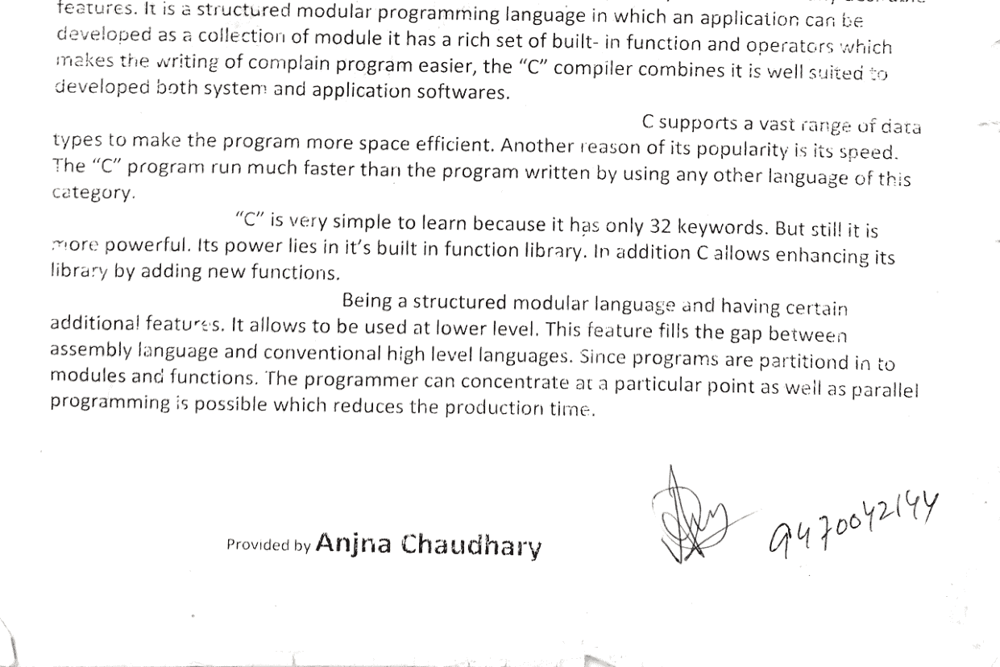
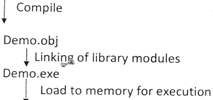

# C语言笔记


到1960年，用于编程的高级语言都是为了特定目的开发的。这种情况限制了程序员只能针对特定类型的问题的解决方案进行工作。为了克服这一局限性，需要一种通用的编程语言；设立了一个国际委员会来开发这种语言。该委员会推出了 ALGOL-60，这是一种通用的高级编程语言。

然而，ALGOL-60 并没有流行起来，因为它过于通用化。由于这种通用性，剑桥大学开发了一种新语言 CPL（组合编程语言），但 CPL 具有许多难以学习且难以实现的特征。

后来，AT&T 贝尔实验室的 Martin Richards 开发了另一种名为 BCPL 的语言。但不幸的是，它被证明太强大了。在 AT&T 贝尔实验室的同时，一位名为 KEN THOM 的程序员开发了一种作为 CPL 进一步简化的语言，名为 B。但它也被证明非常具有特殊性。之后，在实验室，一位名为 DENNIS RITCHIE 的程序员继承了 BCPL 的特征并加入了一些自己的特性，于 1972 年开发了这种语言。这种语言被命名为“C”，作为语言“B”的下一步。1983年，成立了一个委员会来创建 C 的 ANSI 版本。ANSI 最终于1989年12月被采用。第一个版本于1990年作为 C89 发布。该标准也被 ISO 采用，作为 ANSI/ISO 标准 C。

1990年期间，C 的工作作为 C99 继续。通常，C99 保留了 C89 的所有特征并进行了少量补充。




“C”是最强大且最流行的语言之一。它的流行归于它的许多理想的特征。它是一种结构化模块化编程语言，可以作为模块集合来开发应用程序；它拥有丰富的内置函数和运算符，这使得编写符合标准的程序变得更容易；“C”编译器非常适合开发系统软件和应用程序。

C 支持广泛的数据类型，使程序更具空间效率。“C”程序的运行速度比使用此类别的任何其他语言编写的程序快得多。

“C”语言非常容易学习，因为它只有 32 个关键字。但它更强大。它的力量在于它的内置函数库。此外，C 允许通过添加新函数来增强其库。

作为一种结构化模块化语言并具有某些额外特征，它允许用于更底层。这一特征填补了汇编语言与传统高级语言之间的空白。由于程序被划分为模块和函数，程序员可以专注于某一点，并且可以并行编程，从而减少了生产时间。

由 Anjna Chaudhary 提供


1) 程序员通过 IDE（集成开发环境）的编辑器编写并保存源代码。

2) 要运行 C 语言，我们按下 ctrl+F9，之后编译器编译程序并保存目标代码。

3) 链接器将库模块与目标代码链接起来并生成可执行代码。

4) 加载器将 exe 代码加载到主内存中。

5) 处理器逐条提取指令并执行它们。

6) 结果显示在文件中或发送到输出终端。

Demo.c




```
# include <stdio.h>
void main () {
    int n,m, sum, diff;
    puts("enter two numbers");
    scanf("%d.%d",&n,&m);
    Sum = n+m;
    if (n>m)
        Diff = n-m;
    else
        Diff = m-n;
    printf("N=%d m=%d",n,m);
    printf("Sum=%d difference=%d",sum, diff) 
    getchar();
}
```


指令指示编译器必须出现如 include 或 define 这样的预处理器命令。

include - 这是一个预处理器命令，它将指定头文件的内容引入目标代码中。

由 Anjia Chaudhary 提供

stdio.h - 这是一个头文件。头文件包含与特定类型工作相关的函数声明。stdio.h 包含了 printf、scanf 等标准输入/输出函数的原型。

main () - 由于 C 程序遵循自自而下的分解，必须有一个用户定义的函数作为应用程序的管理函数；该管理函数的固定名称为 main。


在 C 编程中，每个函数和结构都有自己的块。这些块通过在一对左大括号和右大括号内进行区分。

块内部将 C 语句。在 C 中，我们可能会得到五种语句：声明、输入/输出语句、算术语句和逻辑语句。

语句是处理器选择执行的完整指令。每种语言都有其自己的语句结束字符。在 C 中，它是分号 (;)。一个语句可以由一个或多个表达式组成。

表达式是处理器在一次内采取的操作。一个表达式由一个运算符和一个或多个操作数组成。

C 语言非常容易学习，因为它只有 32 个关键字。但它更强大。它的力量在于它的内置函数库。此外，C 允许通过添加新函数来增强其库。

作为一种结构化模块化语言并具有某些额外特征，它允许用于更底层。这一特征填补了汇编语言与传统高级语言之间的空白。由于程序被划分为模块和函数，程序员可以专注于某一点，并且可以并行编程，从而减少了生产时间。

| 关键字 | 常量 | 标识符 | 特殊符号 |
| :--- | :--- | :--- | :--- |
| C 标记 | | | |


变量是经标识的内存位置，我们可以在程序的一次或多次执行过程中在这些位置中存储不同的值。

常量和变量之间的主要区别是，常量只有读值（R），而变量既有读值（R）也具有位置值（L）。由于它们具有 L 值，我们可以引用它们并更改内存位置的值。每个变量都能持有特定类型的值。

在 C 程序中，我们在函数使用的变量必须在编写程序的任何其他语句之前进行声明。

# 声明语法为

数据类型 变量;


为了将我们的值存储在主内存中，我们需要声明变量。变量声明需要指定该变量的字长有多长，以及该变量将存储什么类型的值。数据类型是告诉编译器关于这些规格的技术。

C 语言为整数和实数提供了极其广泛的范围。它甚至为整数提供了六种独立的数据类型，我们可以根据需求选择最合适的一种。


- Short :- 由关键字 `int` 或 `short` 指定。我们用它来存储非常小的数字。字长取决于机器，在最高 16 位的机器上，它是 2 字节长，即 -128 到 +127 或 -32768 到 +32767。

- Int :- 如果我们使用整数变量的大小，C 提供了 `int` 数据类型。在最高 16 位的机器上它的大小是 2 字节，但在高配置机器上是 4 字节。变量的第一位用于存储符号位（用于正数 + 和负数 -），其余位用于存储数字的二进制幅度。值的范围是 -32768 到 +32767 或 -2147483648 到 +2147483647。

- Long :- 用于存储整数值。它的大小为 4 字节。在第一位中，用于存储符号，范围是 -2147483648 到 +2147483647。所有数据类型的无符号部分长度相同，但由于它们不存储符号位，因此值的范围增加了一倍。


为了存储实数，C 提供了以下数据类型：

- Float :- 用于通过 4 字节存储较小的浮点数，其中以小数和指数格式提供字长，我们可以在其中存储最多多少位小数。值的范围是 -3.4e-38 到 +3.4e+37。

- Double :- 它具有 8 字节的精度，对于我们的问题足够了，我们可以使用 double 数据类型。范围 -1.7e-308 到 +1.7e+308。

- Long double :- 有时我们可能需要比 double 更精度，C 提供了 long double 类型，字长为 10 字节，值的范围是 -1.1e-493 到 +1.1e+493。


为了存储单个字符：
- Char :- 它具有一个固定的字长，字符以有符号和无符号的形式存储，有符号为 -128 到 +127，无符号的为 0 到 255。

## 变量的声明
在 c 程序中使用的任何变量都必须在开头声明。变量声明指定了存储类和数据类型，如果省略了存储类，编译器将将其视为自动存储类（auto）。变量声明系统如下：

```
auto int n;
static int k;
int p;
char nm, a;
```


当我们在程序中声明变量时，它占据指定的字长，并用名称来标识它，初始值由编译器存储在这个空间中。编译器给出的初始值称为默认值。对于 auto 和 register 存储类，初始值是垃圾值，它是不可预测的。这个值可能会在程序的输出中产生错误。因此，我们应该定义变量。

变量的定义是通过直接给出初始值来进行声明。我们可以说语句中的赋值表达式称为定义。

存储类 数据类型 名称 = 属性;

```
static int n = 5;
float x=0.5, y=1.3, z=3.6;
char key = 'k';
char nm [20] = "anja";
```


任何表达式都至少由一个运算符和一个操作数组成。操作数是作为常量或变量给出的值，而运算符是告诉处理器对给定的操作数执行某些动作的符号。C 语言提供了极其广泛的运算符。

根据操作数的数量，它们分为 C 一元运算符、二元运算符、三元运算符 :-

- 一元运算符 :- 此类的运算符有一个操作数，一些示例有 `+`, `-`, `&`, `*`, `!`...

- 二元运算符 :- 这种运算符有两个操作数，示例如 `+`, `*`, `<>` 等...

- 三元运算符 :- 这种运算符有三个操作数。它们由两个符号组成。有一种三元运算符，即条件运算符 (?:)；

根据执行动作，运算符分为类型 :-

- 算术运算符 :- 这种运算符执行计算操作。包括以下运算符：
    - +( 可作为一元和二元运算符，使值变为正数或执行加法。
    - -(减号) 也用于一元和二元形式，用于取负值或提供差值。
    - *(乘号) 用于给出两个值的乘积；用于执行除法并返回商。结果的类型取决于操作数的类型。如果两个操作数都是整数，结果将是整数，否则将是实数。
    - %(取模) 用于执行整除并返回余数。

- (2) 增减运算符 :- 我们经常需要从变量中加或减一个值，例如 v = v+1/v = v-1。为了这个目的，C 支持两种短路运算符作为增减运算符，符号分别为 `++` 和 `--`。这些被称为一元运算符，可以以前缀或后缀形式给出：++V; V++; V--;

如果作为单独语句给出，前缀和后缀没有区别。但如果作为另一个语句中的表达式，它们的行为就不同。如果是前缀，它们会在语句的其他部分之前执行，否则先执行语句的其他部分。

- (3) 关系运算符 为了执行逻辑处理，即比较和选择，可以使用此类别的运算符。它们检查两个值之间的关系——运算符如下：
    - == (等于) 用于检查两个操作数之间的相等性，如果两者相同则返回真。
    - != (不等于) 如果它的两个操作数值不同，则返回真。
    - > (大于) 如果左操作数大于右操作，则返回真。
    - >= (大于等于) 如果左操作数大于或等于右操作，则返回真。
    - < (小于) 如果左操作数小于右操作，则返回真。
    - <= (小于等于) 如果左操作数小于或等于右操作，则返回真。

    - && (与) 它基于逻辑乘，只有当它的两个关系表达式都返回真(true)时才返回真(true)。
    - || (或) 它基于布尔运算“加”。当它的操作数关系表达式中有任何一个返回真(true)时，它返回真。
    - ! (非) 它基于布尔补码运算。它是一元运算符，当它的操作数关系表达式返回假(false)时返回真。


## 位位与 (&) :-

这是一种二进制运算符，它按位比较两个操作数，如果两个操作数在相应位置上的位均为 1，则返回 1。
```
Using short Y = 15 ;   00001111
R = x & y         00001010
```


与位位与运算符类似，它比较其操作数的位并返回 1 位。如果其中任意一个在相应位置上为 1，则返回 1。


通过比较数值的位来返回 1 位。如果该位置上的位不同，则返回 1 位，否则返回 0 位。


该运算符不是比较操作数的位，而是根据其右侧操作数，将其左侧操作数的位模式向左移动。

例如，通常情况下 n<<p = N*2^p，
因为将最高位移动一位会使数值翻倍。

- (f) 位位右移 (>>) : :
与左移类似，它也将位从左向右移动。结果为 n>>p=n/2^p，
因为将最高位移动一位会使数值减半。

赋值意味着给变量赋予一个值。通常通过使用 "=" 运算符完成。除了等号 '='，C 语言还支持复合赋值运算符，它们由任何其他运算符和等号组成。它们根据左侧和右侧操作的值执行某些操作，然后将结果赋值给左侧操作数。常见的有 =, +, -= = = , * = , /, % = 。


运算符组包括符号，每个符号负责执行特定的操作。

以下是该组包含的运算符。


用于函数定义和函数调用。它也用于将任何其他运算符的优先级提高到一级。


此运算符用于指定数组的大小或提供数组元素的索引。


用于分隔列表中的项。


用于选择结构体变量的单个成员。


这是一个一元运算符，返回操作数所存储内存位置的地址。


这也是一种用于声明指针变量以及通过指针访问内存位置值的运算符。


优先级（precedence）术语描述了运算符的属性，用于指定执行权限。当一个语句中存在多个运算符时，C 语言中的每个运算符都会被分配一个排名。由于运算符很多，其排名并不像 BODMAS 那样有限。算术运算符的排名也与 BODMAS 不同。

## 运算符结合性 :-


| 运算符 | 符号 | 排名 | 结合性 |
| :--- | :--- | :--- | :--- |
| 括号 | ( ) | 1 | 左 → 右 |
| 下标 | [ ] | | |
| 一元加 / 减 / 增位 / 减位 / 逻辑 | +,+,+,-,,~*,& | 2 | 右 → 左 |
| 非 / 位位非 / 大小 / 乘 / 除 / 取模 | *,|% | 3 | 左 → 右 |
| 二元加 / 减 | +- | 4 | 左 → 右 |
| 位左移 / 位右移 | <<>> | 5 | 左 → 右 |
| 大于 小于 包含等于 | <,,>= | 6 | 左 → 右 |
| 等于 / 不等于 | ==,! | 7 | 左 → 右 |
| 位位与 | & | 8 | 左 → 右 |
| 位位异或 | | | 9 | 左 → 右 |
| 位位或 | ^ | | 10 | 左 → 右 |
| 逻辑与 | && | 11 | 左 → 右 |
| 逻辑或 | || | 12 | 左 → 右 |
| 条件运算符 | ? | 13 | 左 → 右 |
| 赋值 | X=, | 14 | 右 → 左 |
| 运算符 | +=,- | | |
| 逗号 | , | | |


类型转换是将一种数据类型转换为另一种类型的过程。在 C 语言中，转换有两种类型：隐式和显式。

- 隐式转换：当将一个类型的值赋值给另一个兼容的类型时，编译器会自动执行此转换。例如，将整数赋值给浮点数。
- 显式转换：由程序员使用转换运算符手动完成。例如，将浮点数转换为整数。

当你需要对不同类型的变量执行操作，或者当你想要更改计算的精度时，类型转换非常有用。


```c
printf( );
```

`printf()` 帮助我们向显示器上打印任何类型的值。它至少有一个参数，如果这里只有一个参数，那么它必须是一个常量字符串。如果有多个参数，则第一个参数必须是一个包含常量字符和与后续参数相对应的类型说明符的字符串。类型说明符与 `scanf` 相同，但说明符 `"%s"` 不会忽略空格。

```c
printf("constant specifier");
printf("constant specifier", variable/ expression);
```


`printf` 不会以任何特定方式组织输出。它从光标所在的位置开始打印值，即显示完之前执行语句的结果后光标所在的位置。特别是当我们顺序打印两个或多个值时，这些值会混合在一起。`printf` 提供了不理想的结果，使得它们看起来像一个单一的值。

为了产生理想输出，我们可以在格式化字符串中使用转义字符来产生换行或制表符。此外，通过类型说明符，我们有一些格式化特性来组织输出。这些如下：

- 使用 `%d`，我们可以在 `%` 和 `d` 之间添加一个整数值来指定输出宽度为 `%7d`。我们还可以添加一个点和一个整数来指定打印的数字位数，如 `%.3d`。我们可以将两者结合使用为 `%10.3d`。
- 使用 `%c`，我们可以添加宽度指定为 `%6c`。
- 使用 `%s`，我们可以同时指定宽度和字符数为 `%7.3s`。
- 使用 `%f`，我们可以同时指定宽度和精度，但 `n` 是用来指定小数点后的数字位数的，如 `%9.3f`。


我们有许多需要执行的算术和三角运算工作。对于所有这些常用操作，C 库中预先并存储了一系列库函数。所有这些与数学相关的函数都在 `math.h` 头文件中声明。如果我们在程序中包含此文件，就可以使用这些函数。以下是一些常见的数学函数。

- `pow()`：此函数接受两个参数，double 类型的 `n` 和另一个整数 `p`——计算 `n` 的 `p` 次方并以 `double` 类型返回结果。
  语法 - `pow(n,p);`
- `sqrt()`：它接受一个参数并返回传入值的平方根。
  语法 - `sqrt (n);`
- `abs()`：它接受一个 double 类型参数并返回参数的绝对值，即不带符号符号的值。
  语法 - `abs(n);`
- `round()`：此函数接收两个参数 `n` 和 `d`，其中 `n` 是 double 类型值，`d` 是整数。它返回将 `n` 向上舍入到指定的 `d` 位数后的结果。
  语法 - `round (n, d);`
- `ceil()`：此函数取一个小数并通过对小数部分向上取整来返回该值，但不小于当前值。因此它通过加 1 返回其参数的整数部分。
  语法：`ceil(n);`
- `floor()`：它的工作原理类似于 `ceil`，但不会返回大于其参数的值。因此它返回参数的整数部分。
  语法 - `floor(n);`
  语法 : `sin(a);`
- `cos()`：它接受一个角度作为参数并返回该角度的余弦值。
  语法 - `cos(a);`
- `tan()`：它接受一个角度作为参数，计算正切值并返回。
  语法 - `tan(a);`
- `acos()`：它接受一个角度作为参数，计算双曲余弦并返回。
- `asin()`：它接受一个角度作为参数，计算该角度的双曲正弦值。
  语法 - `asin(a);`
- `atan()`：它接受一个角度作为参数，计算该角度的双曲正切值。
  语法 - `atan(a);`


`type.h` 头文件包含适用于单个字符的库函数。其中一些函数用于检查传递给它的字符状态。以下是组中一些常见的字符。
| 函数 | 描述 |
| :--- | :--- |
| isprint(char) | 检查是否可打印 |
| isalnum(char) | 检查是否为字母|数字|数字 |
| isalpha(char) | 检查是否为字母 |
| ispunct(char) | 检查是否为标点符号 |
| isspace(char) | 检查是否为空格 |
| isupper(char) | 检查是否为大写 |
| islower(char) | 检查是否为小写 |

所有这些函数返回 0 或非零值。0 表示假，非零表示真。我们可以检查返回的值或根据其做出决定。

还有两个函数接受字符作为参数并返回其大小反转后的参数。这些函数是：
- `tolower(char)` – 返回小写字母。
- `toupper(char)` – 返回大写字母。

## 分支和条件语句:-

通过计算条件的真假值来执行一个指令块的技术称为分支。作为一种结构化（语言），'C' 语言也支持分支技术。为了使用这种技术，'C' 提供了两个条件语句：`if-else` 语句和 `switch-case` 语句。


### 简单 if

在某些情况下，我们只需要当给定条件为真时执行一个语句块。在这些情况下，我们使用简单 `if`。

```c
if (condition)
{
    statement;
}
```
### if-else

在某些情况下，我们只需要当给定条件为真时执行一个语句块。如果条件为假，我们需要执行另一个语句块。在这种情况下，我们使用 `if-else` 。

```c
if (condition)
{
    statement;
}
else
{
    statement;
}
```


在实际编程中，可能会出现在评估一个条件为真后我们需要检查另一个条件，或者在评估第一个条件为假后我们需要检查另一个条件的情况。为了处理这种情况，我们在另一个 `if` 或 `else` 块中给出 `if-else` 语句。这被称为嵌套 `if-else`。嵌套深度可达 255 层。

```c
a) If (condition1)
{
    If (condition2)
    {
    }
    else
    {
        inner else block;
    }
}
else
{
    outer else block;
}
```

```c
b) If(condition1)
{
}
else
{
    If(condition2)
    {
    }
}
```

```c
c) If(condition1)
{
}
else
{
    If(condition3)
    {
    }
    else
    {
    }
    }
}
```


在很多情况下，我们有多个执行单一任务的选择，或者我们可能需要在相互检查的各个条件下执行不同的工作。在这种情况下，`if` 语句随语句连续出现，如果正确缩进，就形成了阶梯状结构。因此被称为 `if` 阶梯。在这种 `if` 形式中，当条件被评估为真时，控制流传递到随后的块，执行完该块后传递到最后一个 `else` 的下一个条件，依此类推。

```c
If (condition1)
{
}
else
If (condition2)
{
}
else
If (condition3)
{
}
else
{}
```


当我们需要检查多个条件是否为真以执行特定任务时，为了这个目的，我们需要嵌套 `if`。但嵌套的 `if` 可以通过 `&&` 运算符来减少。我们知道 `AND` 运算符接受两个输入并在仅当所有这些都为真时才返回真。因此我们可以使用 `AND` 运算符消除嵌套。格式为

提供：Anjana Chaudhary


## If (cond01 && cond2 && cmd 3.........)

在我们需要逐一个检查多个条件，但在评估其中任何一个条件为真后执行工作的情况下。通常情况下，我们使用 if 阶梯，但它也可以用逻辑或 (||) 运算符来代替。因为或运算符接受两个真或假值作为输入，并且如果其中任何一个被求值为为真，则返回真。


在 C 程序中，可能会有很多块，其中一些是任意块，另一些与分支和循环结构有关。有时我们需要在不完全执行某个块的情况下将控制流移到块之外。`break` 语句就达到了此目的。当遇到 `break` 语句时，控制将直接传递到该块之外。`break` 语句本身是无条件的。但在特定情况下想要跳出块是很自然的。因此，我们通常将此语句与如 if 和 else 等分支语句一起使用。


```c
switch (value)
{ 
    case condition 1:
        Work to do
        break;
    case condition 2:
        Work to do
        break;
    default:
        Work
}
```


这是 C 提供的另一种用于执行分支技术的结构。它由三个关键字组成：`switch`、`case` 和 `default`。
`switch` 关键字后紧跟括号内的一个变量，该变量的值将与给定的条件进行比较。如果在对大括号内围有一个块，其中包含不同的 `case` 语句，每个后面跟着一组在评估条件为真后要执行的语句集。每个 `case` 语句后面都跟着一个带有冒号后缀的值。`switch` 后给出的变量将与这些值进行比较。

首先比较第一个 `case`，如果其求值为真，控制将传递到下方并执行给出的语句；否则，控制将传递到下一个 `case`。如果所有 `case` 都求值为假，则执行 `default` 之后给出的语句。由 Anjina Chaudhary 提供

`switch` 结构是 `if-else` 阶梯的更好替代方案。特别是当我们为每个条件执行一组不同类型的指令时，因为 `case` 语句没有独立的块，我们不需要每次都跟踪大括号的开启和关闭。由于其局限性，它在替换 `if-else` 阶梯时具有以下局限性：

- 只有整数可以切换。
- `case` 后面只放置一个单一值，因此我们只能检查相等性。一旦某个 `case` 求值为真，控制将传递到下方并忽略其他 `case`。因此，我们需要在每个 `case` 之后添加 `break` 语句以获得想要。虽然我们不能在 `case` 中使用任何关系和逻辑运算符，但上述局限性让我们能够实现类似于或运算符的情况。


尽管人们说结构化编程减少了跳转，但它在 C 和 C++ 编程仍然在使用。该语句用于将控制流发送到程序的任何位置，即标签（Labeled）。标签是任何值标识符后跟冒号（如果标签位于程序末尾，则必须有分号）。当我们使用 `goto` 时，通控制流（即指令从上到下的流）会被重叠，并且可能会跳回或通过跳过某些语句向前跳转。由于 `goto` 是无条件的，即使让程序无限循环它也可能出现问题。如果它与分支语句配合使用，则用于实现循环技术。
语法 - `goto label;`


对于结构化编程，有必要为一组指令的重复提供机制。循环是 ANSI 设计的技术，允许我们重复/迭代一组指令，直到给定的条件被求值为真。
根据 ANSI 规则，每种结构化语言必须支持三种循环结构：

- While
- Do while
- For

所有这些循环结构可以分为两个基本类型，称为入口循环（entry）和退出循环（exit）。对于入口循环，在执行循环体之前检查条件。如果求值为真，则执行循环体，并从循环结束处传回控制。一旦条件变为假，控制流就会移动到循环体之后。对于退出循环，首先执行循环体，然后检查条件。确定性循环的重复次数可以在开始之前预测。

由 Anjna Chaudhary 提供

对于不确定性循环，无法预测它将重复多少次。程序的每次执行方式都通过分配新值而发生变化。


`while` 循环是一种入口控制循环，可以是确定的，也可以是不确定的。在 'C' 语言中，`while` 关键字后紧跟括号内的条件。接着是包含在大括号内的循环体（如果有语句，则没有大括号）。`while` 给出的条件会被求值，如果结果为真，控制将传递到循环体。从循环结束处传回控制。它再次被求值以重复循环。一旦条件变为假，控制流就会移动到循环体之后。

```c
{
    Statement
}
```


`for` 循环由 ANSI 设计，使其可以作为确定性的入口循环使用。C 语言也遵循与 ANSI 设计的相同格式。但在这种语言中，`for` 结构增加了一些特殊功能。因此，它可以作为中间循环使用。

C 语言中语法的通用格式由三个由分号;) 分隔的部分组成。第一部分是初始化，为计数器分配初始值。第二部分是指定将导致循环终止的条件，第三部分是表达式，我们在其中给出下一次评估条件之前执行的任何类型的表达式。

当控制流到达该语句时，它首先执行初始化块并检查控制，如果求值为真，控制将传递到循环体。执行循环体后，控制传递到表达式语句。之后它传递到控制语句。根据条件的结果，控制将传递到循环体或循环体之后。


```c
For (initialization; condition; expression)
{
    loop body
}
```


- 通常 `for` 循环中只能初始化一个计数器，但 C 语言的格式允许我们在初始化块中用逗号分隔来初始化多个变量。
 如果 如果循环由一个已经有值的变量控制，我们可以省略初始化块，但必须给出相应的分号。


- 即使条件语句也可以省略。但这样的话条件规范将始终被求值为真。因此，控制流始终传递到循环体，导致循环无限。所以，我们必须在循环体内执行某些操作来终止循环。
- 表达式语句也可以包含多个一个由逗号隔开的表达式。
- 表达式语句可以是任意类型的算术表达式。
- 表达式语句也可以省略。
- 所有构成 `for` 循环的语句也可以省略。但必须有相应的分号。


`do while` 结构是一种退出控制循环。在某些情况下，我们需要循环体至少执行一次。在这样的情况下，我们可以使用 `do while` 循环。
该结构以关键字 `do` 开头，后面跟着循环体，即随后是关键字 `while`，其括号内有条件，最后后面跟有一个 `;`。控制流直接传递到循环体并执行，然后检查 `while` 内部的条件。如果条件求值为真，则控制流传回关键字处；否则，传递到 `while` 之后的下一个语句。


```c
do
{
    loop body
} while (condition);
```


在某些情况下，我们需要重复一段指令，而在该指令块内部还有一些也必须重复的语句。为了处理这种情况，我们允许在另一个循环的体内嵌套一个循环结构。这种嵌套可以多达 255 层。在外层循环的每一次重复中，内层循环都会完成所有的周期。
因此，内层循环的总次数将内层循环次数乘以 (*) 外层循环的次数。
任何循环都可以嵌套在任何循环中，无需忽略其类型。


```c
for (----)
{
    while (condition)
    {
    }
}
```


`continue` 是一种无条件语句，即位于循环体内。当遇到 `continue` 语句时，控制流被传回待检查的条件处。`continue` 之后的语句将保持不执行。在循环体内执行该语句是完全自然的。但在某些情况下，某些语句是不希望执行的。为了处理这种情况，我们可以使用 `continue` 语句。但它应该配合 `if` 语句或 `case` 语句一起使用。

### 格式
循环结构 ( )
{
    Continue:
}


当我们需要存储一组数据项时，我们必须遵循某种方式来组织存储。创建该组的数据项通过产生它们之间的关系被收集在一起，这被称为数据结构。

数组是一种静态数据结构。它是存储在连续内存位置中的同类数据项集合。这意味着数组元素之间存在物理和数学上的关系。如果已知元素的地址，我们就可以很容易地出其他元素的地址。

当我们必须存储和处理具有相同类型信息且以相同方式操作的变量时，我们会创建一个数组。然而，创建一个大小为 $n$ 的数组并声明 $n$ 个变量会占用一些内存容量。但处理数组元素是很容易，因为构成数组元素的所有内存位置共享同一个名称，但可以通过它们的偏移量（索引）单独指定。


数组也是一种变量，因此在使用之前必须对其进行声明。数组的声明方式与其他变量相同，只是数组的维度跟在标识符后面。

```c
Syntax -
Data type identifier[dimension];
int A[5];
float x[2];
double D[25];
```

维度值必须是常量整数，然而，可以通过宏创建或使用 `const` 关键字进行符号声明。


由于我们定义了一些基本变量，我们也可以通过为其元素提供初始值来定义数组。可以通过以下方式实现：

```c
Data type identifier[dimension]={x1, x2};
Datatype name[]={v1,v2,v3....};
```

DataType name[size]={v};

当我们声明一个大小为 $n$ 的数组时，会留出 $n$ 倍数据类型长度的数据，并跟踪第一个字节的地址，通过计算可以访问数组的哪个元素。


数组的任何元素都可以通过关联一个称为索引的名字来随机引用。索引通常是偏移量（以字长度计算的距离基地址的距离），元素索引从零开始到 $n-1$ 结束。如下 -

| | | | | | | |
|---|---|---|---|---|---|

`Array[index]=value;`
### 遍历数组 :-

遍历意味着接触数组的每个元素以便对元素执行某种工作。遍历可以针对整个数组，也可以针对数量个元素。正如我们所知，元素是通过索引编号引用的，因此为了遍历数组，我们可以使用一个核心循环并关联其计数器来逐个引用元素。随着计数器的增加或减少，它会引用相应的元素。
格式-
`For(counter=0;counter<size; counter++)`
`Do with a [counter]`


除了具有特定数量元素的一维数组外，C 还支持 2D 数组。（此处省略重复的描述性文本）

2D 数组也被称为矩阵。


除了具有特定数量元素的一维数组外，C 还支持 2D 数组。2D 数组的声明定义也被称为矩阵：

```c
Data type identifier[dimension1][dimension2];
int A[3][3];
```

#### 2D 数组的内存映射：
当我们声明一个大小为 $n \times m$ 的 2D 数组时，会留出 $n \times m$ 倍数据类型长度的数据，并跟踪第一个字节的地址，通过计算可以访问数组的哪个元素。在 C 中，2D 数组通常按行优先存储。


2D 数组的任何元素都可以通过关联一个称为索引的名字来随机引用。索引通常是偏移量（以字长度计算的距离基地址的距离），元素索引从零开始到 $n-1$ 结束。如下 -

| | | | | | | |
|---|---|---|---|---|---|---|

`Array[row][column]=value;`


遍历意味着接触数组的每个元素以便对元素执行某种工作。遍历可以针对整个数组，也可以针对部分元素。正如我们所知元素是通过索引编号引用的，因此为了遍历数组，我们可以使用嵌套循环并关联其计数器来逐个引用元素。随着计数器的增加或减少，它会引用相应的元素。
格式-
`For(row=0;row<n; row++)`
`  For(column=0;column<m; column++)`
`    Do with a [row][column]`


变量被声明为一个单维字符数组。


```
char variable name[size];
```
以这种方式声明的变量可以接受多达 `size` 个字符。它将提供完整长度的字符，并自动为 NULL 留空间。

字符串的初始化或定义：
### 逐个字符法：


```c
char variable name[size]={char1,char2,........};
char name[30]={'-', '-', '-', '-'};
```


```c
char variable name[size]="string";
```


为了给字符串变量赋值值，我们可以使用 `scanf` 的 `%s` 格式或 `gets` 函数。`scanf` 遇到空白符结束，因此无法接受包含多个单词的字符串。`gets(s)` 仅遇到回车键结束，因此它可以接受空格，但它一次只能读取一个变量输入。


```c
scanf("%s", variable name);
gets(var);
```


为了在显示器上打印字符串，我们可以使用 `printf %s` 和 `puts` 函数。
`printf` 函数能够打印多个值，但在打印后不会移动光标；而 `puts` 函数一次只能打印一个值，并在打印后将光标置下一行。

```c
printf("%s",variable name);
puts(variable);
```


以下是我们需要经常使用的某些字符串处理函数。要使用其中任何函数，我们必须包含 `string.h` 头文件。


在很多情况下，我们需要知道字符串变量或常量的长度，以便我们从头到 `n` 或从 `n` 到头进行处理。我们可以使用 `strlen()` 并返回字符串中存在的字符数，包括空格但不排除 Null。


```c
l=strlen(string);
```


众所周知，字符串变量不能直接赋值，但我们经常需要给字符串变量赋予新值（即已存在的值）。为了满足这一需求，有了 `strcpy()`，它有两个参数：第一个参数必须是需要赋予新值的字符串变量；第二个参数可以是字符串或常量，即赋值给第一个参数。

```c
strcpy(target string variable, source string variable or constant);
```


它的工作原理与 `strcpy()` 相同，但有一个修改。它还接受第三个参数，即从源到目标的字符数量。格式：`strncpy(target string variable, source string variable/constant,number of character);`


此函数接受两个字符串参数，通过逐个字符比较它们，用第一个字符串的 ASCII 码减去第二个。比较持续到减法结果为 '0' 或未找到 NULL 值。它返回以下值之一：

- 零表示两者相同
- 正值表示第一个字符串更大
- 负值表示第二个字符串更大

```c
strncmp(string1, string2);
```


此函数接受字符串参数并通过逐个字符比较它们，用第一个字符串的 ASCII 码减去第二个。比较在忽略字符大小写的情况下持续到末尾。`strncmp()` 是大小敏感的。

```c
strncmp(str1, str2);
```


它的工作原理与 `strcpy` 类似，但接受第三个参数即一个整数值，并且只比较给定的字符数量。

```c
strcat(str1, str2, no of character);
```


像 `strcpy` 一样，它接受目标字符串和源字符串作为参数，但不是用源赋值目标，而是将源附加到目标字符串的末尾。

```c
strcat(targetstr,sourcestr);
```


它的工作原理与 `strcat` 相同，但有一个额外的参数即字符数量，这意味着只有指定数量的字符会被附加或拼接到目标字符串的末尾。

```c
strncat(source string, target string, number of characters);
```


此函数帮助我们在字符串内搜索字符。它的第一个参数是字符串，第二个是字符。它检查字符串中的字符并返回其首次出现的地址。如果未找到字符，则返回 NULL。


它的工作原理与 `strchr()` 相同，但从右侧开始扫描，并返回找到的地址，否则返回 NULL。

```c
strchr(string, char);      -> 左侧
If (strchr(string,char)!=NULL);
    If(strchr(get,'I')==NULL)
        puts("found");
else
```


这两个函数的工作方式与 `strchr` 和 `str` 相同，唯一的区别在于它们的第二个参数也是字符串，这意味着它们用于字符串内从左或从右对应的字符序列。
语法：`strstr(string, string)`


这是一个非常实用的函数，它接受单个字符串参数并反转字符。最后一个字符放在第一个位置，第一个字符放在最后一个位置，依此类推。

```c
strrev(str1)
```


在很多情况下，我们需要存储单词列表或某些行文本。为了满足这一需求，我们定义了字符串数组。字符串数组实际上是一个二维字符数组，其中行包含特定数量的字符并以 NULL 字符结束，由于字符数组可以作为一个整体值来处理，我们不需要对每个字符串数组单独操作。
语法：`char str[row][column];`


作为一种结构化语言，每个 C 应用程序都被分为一个或多个模块。每个模块都是一个或多个函数的集合。函数是一个自包含的指令集，通过标识符存储以执行与应用程序相关的特定子任务。在 'C' 应用程序中，每项工作都由函数完成。C 应用程序中的函数可以分为两类 :-

- 库函数
- 用户定义函数

库函数是那些预定义的、预编译并作为单独程序存储在语言目录层次结构中特殊目录下的函数。对于几乎所有的常见工作，C 库中都有相应的函数。但每个程序员都有特定的工作领域。因此，库中的函数不太可能满足所有类型程序员的需求。C 语言允许程序员根据自己的需求开发一套函数。

由程序员定义的、带有特定名称并存储在源文件中的函数称为用户定义函数（UDF）。UDF 存储在应用程序的上下文中。每个 'C' 应用程序至少有一个 UDF，即主函数。

用户定义函数的优点：使用定义函数有许多优点，因为 UDF 为我们提供了可用性。使用 UDF 我们的代码比单体代码更小。

它减少了存储需求和编译时间。因为代码写在一个处并在处处。因此错误数量也减少了，调试变得更容易。最后减少了程序的维护时间。

应用程序内的函数由其他函数调用。函数是被动实体，在被其他函数调用之前保持静止。函数存在于应用程序中，处于调用者和被调用者的关系中。虽然应用程序中的函数地位相似，但任何人可以是调用者或被调用者。主函数只有一个特殊之处，即执行始终从 main 开始，main 由操作系统内核调用。其余函数由 main 在任何层级调用。


它包含分号的函数头。函数头由返回类型、函数名以及可能包含参数列表的括号组成。

```c
Return type functions(function argument ---------------);
void print();
long sums(int x y);
```


函数定义与函数原型相似，但函数头的括号后面跟着一对括号，这构成了函数体并将其区分开。函数原型可以在另一个函数内部，也可以在全局空间。但函数定义始终存在于全局位置，它不会出现在任何其他函数内部。

```c
Return type function (argument)
{------
;
------};
```


调用语法不包含任何数据类型。它仅由函数名组成，后面跟着括号内的值；传递值是可选的。调用语法始终存在于函数的体内部。
格式：
`function name (value to pass):`

如我们所知，结构化编程数据存在两个层面：
(a) 全局数据
(b) 局部数据。全局数据对所有函数可用，而局部数据在调用者和被调用者之间通过传递和返回参数或参数共享。根据数据共享的级别，函数可以分为以下几类。
## 无参数无返回的函数：

这类函数既不接受调用者传递的值，也不向调用者返回值。
示例- 库函数 `clrscr()`。


这一类的函数可以接受来自调用者的一个或多个值，但不会向调用者返回值。例如- 库函数 `puts()` 和 `putchar()`。


当控制权传递给被调用者时，此类函数不向函数传递任何值，但它们总是向调用者返回一个值。
例如- 库函数 `get()`、`getch()` 和 `getche()`。


大多数函数属于这一类。这类函数从调用者进程获取某些值，处理该值并将处理后的值返回给其被调用者。库函数 `printf`、`scanf`、`isalpha`、`strlen` 都是这一类的示例。
当遇到调用语法时，被调用者的执行被暂停，控制流转移到被调用者处，并带有传递的值以及返回的地址。被调用者体内的指令被执行，控制权返回到调用者中的地址。调用者的执行继续。


所有函数在程序内存块中都有各自的内存区域来存储其局部变量。当被调用者向其被调用者传递值时，即称为实参数。为了接收实参，在函数头中声明了变量。这些变量被称为形参数。实参存储在调用者的栈中，而形参存储在被调用者的栈中。

由 Anjana Chaudhary 提供

形式参数始终是实参数的副本。因此，如果形式参数的值发生变化，则不会反映在实参数上。当控制权返回时，调用者的栈存储实参。当控制权传递给它时，函数的栈被创建。形参作为实参传递的初始值分配在栈中。当控制权返回时，函数的栈被释放。因此，在程序的程序执行过程中，形式参数会被创建和销毁。

| HEAP | RUNTIME |
| :--- | :--- |
| TIMEstack | PRIME AREA |


`return` 关键字用于在函数体内将控制权返回给调用者。然而，在函数大括号结束前，需要 `return` 关键字来返回控制权。如果需要向调用者返回一个值，则作为实参数的返回。在函数体内，`return` 可以出现多次。


这是另一个与变量相关的术语，声明时变量被存储在特定的存储类中。存储类描述了变量的四种属性：
- 存储位置：告诉编译器将变量存储在 RAM 位置还是 CPU 寄存器。
- 初始值：存储类指定在分配时给变量的初始值（或零）。
- 作用域：存储类定义变量是局限于函数还是在整个程序范围内有效。
- 存周期：变量在程序执行期间存活多久。

有四种存储类：

- (a) 自动存储类 (Auto)
- (b) 静态存储类 (Static)
- (c) 寄存器存储类 (Register)
- (d) 外部存储类 (Extern)

自动存储类：自动存储类指定变量存储在 RAM 位置，初始值为零。它的作用域是局部的，在函数的每次调用中有效。声明如下：

```
auto data type variable;
int x;
```

由 Anjana Chaudhary 提供

静态存储类：它是静态的，因为静态变量在程序执行期间保持稳定。这意味着静态变量存储在主区域而不是函数的栈中。因此，它们会被分配和释放。默认初始值为零。静态变量位于 RAM 位置，作用域是局部的。使用关键字声明：`static data type var;`。

寄存器存储类：它与自动存储类一样，要求将变量存储在 CPU 寄存器中。但如果寄存器为空，变量将存储在 RAM 位置并转换为自动。

外部存储类：该类的变量也被称为全局，因为它们对所有函数可用，其生命周期贯穿程序。全局空间中声明的所有变量都属于此类。为了在外部类中保留变量，我们不需要用 `extern` 关键字声明。在某些情况下，当在函数未使用变量时，需要用 `extern` 关键字声明。

形式参数始终是实参数的副本。因此，如果形式参数的值发生变化，当控制权返回时不会反映在实参数上。当控制权传递给它时，函数的栈被创建。形参作为实参传递的初始值分配在栈中。当控制权返回时，函数的栈被释放，因此在程序的程序执行过程中，形式参数会被创建和销毁。

| HEAP | RUNTIME |
| :--- | :--- |
| TIMEstack | PRIME AREA |

...（根据指令合并重复内容）

## 寄存器类型

- 内存缓冲寄存器
- 内存地址寄存器
- 程序计数寄存器
- 法器
- 寄存器
- 输入输出寄存器

## 递归：

递归另一种直接或间接调用函数自身的工具。递归非常有用，例如树遍历、搜索。但事实是递归可能是无限的。所以我们必须设置某些基准条件，以便递归结束。

```
Format()
void main()
{
puts("recursion going to infinite");
main();
}
```

## 指针：

指针是常量的二级类型，实际上内存位置的地址。指针变量可以持有指向常量、另一个变量或函数的内存位置地址。一旦地址存储在指针变量中，就可以通过解引用访问内存位置。由于这些变量指向另一个位置，被称为指针。指针的使用使得 C 语言成为中间语言。等一下，这就是为什么人们说 C 语言

通过指针处理地址工作有许多优势，例如：
- 如果一个应用程序包含许多变量，并且某些函数必须操作调用者声明的变量的值。
- 通过指针获取输入可以减少处理需求。
- 由于数组内部通过指针处理，如果我们直接通过指针处理，就可以提高执行速度。
- 字符串也是字符数组，使用指针处理字符串提供了许多便利。如果处理指针，我们可以对字符串进行直接赋值和比较。
- 通过指针，我们可以创建一个字符串数组，其中所有元素可以有不同的字节分配。
- 指针帮助我们根据需求动态分配和释放内存。
- 动态分配内存允许我们创建自动大小的列表。

指针变量的声明和定义：
与任何其他变量一样，指针变量之前必须先声明。然而，指针持有指向常量、另一个变量或函数的内存位置地址。一旦地址存储在指针变量中，就可以通过解引用访问内存位置。由于这些变量指向另一个位置，被称为指针。指针的使用允许 C 语言成为中间语言。格式为：

```
Data type *Identifier;
int ptr;
char *cpt; doit *fp;
```


由于任何变量分配的内存都会被赋予一个默认初始值，指针分配的内存也会赋予一个默认初始值，即在某些情况下为垃圾值。指针拥有垃圾值更为危险。它可以导致指针悬空（悬空指针指向一个内存位置，即尚未分配的内存位置）。另一方面，指针可能会被赋值另一个内存位置的地址，即被分配给另一个指针，解引用该指针可能会破坏该位置的内存。甚至会导致系统崩溃，因此指针必须被定义。在定义中，指针可以赋值为 0；Null 或已声明变量的地址，因此说声明指针的正确方法是：

```
data type *identifier=0; *ptr=0;
int n; *ptr=n;
```

有一种特殊的指针类型，它可以持有任何类型的地址，即空指针，在进行类型转换之前它们是没有区别。

## 访问值的地址:-

`&`（取地址）运算符用于访问变量的地址。指针变量可以赋值为带有此操作符的变量以获取地址。
```c
printf("%d",*ptr);
ptr=&var;
```

## 通过指针获取变量的值:-

`*`（地址的差值或递减）运算符用于访问存储在指针中的变量地址的值。
```c
printf("%d",*ptr);
```
差值运算符可以用任何类型的算术或逻辑语句中。

## 指针算术与逻辑:-

通过指针本身的值，我们可以执行两种算术操作——加法和减法。对指针加减 `n` 实际上是加减了 `n * 指针类型的字长`：
```
ptr=ptr+n;
*ptr=ptr+n*(data type);
```

通过对指针进行递减，我们可以移动相邻的位置。指针可以使用任何关系运算符相互之间、与常量值或 Null 值进行比较。
例：
If(ptr1==ptr2)
While (ptr<5)
If (ptr!=Null)

## 指针与数组:-

指针和数组之间存在关系。当我们声明一个数组时，编译器本身也会声明一个与数组同名的常量指针，该指针被赋值为第一个元素的地址，称为基地址。当我们在数组上使用下标来引用数组的元素时，实际上是将指定的索引乘以字长，并将结果加到该常量指针的值上。我们

基于这种关系，我们可以通过指针轻松处理数组。我们可以拥有一个赋值给基地址的指针；然后通过增加它来遍历数组。如下——

```
int a[10], *ptr;
ptr=&a[0]; ptr=a;
both are same
a[i] means
a+i*wl(a)
```

## 指针与字符串:-

由于字符串也是字符数组，指针和字符串之间也存在同样的关系。这种关系允许我们以不同的方式处理字符串。我们可以将字符指针赋值为常量字符串或另一个字符指针，我们可以进行比较，并可以创建一个变长度字符串数组。

## 按值传递和按地址传递:-

众所周知，调用者向被调用者传递参数。实际参数的副本被传递给形式参数。因此，调用者不能更改实际参数的值。如果需要调用者更改所传递变量的值，那么调用者可以发送它们的地址。这被称为按地址传递。

按地址调用。如果实际参数是一个地址，被调用者必须在头文件中声明一个指针来接收该地址。传递参数的默认设置是按值传递。

```c
void change(int *n)
{
  *n=7;
}
void main()
{
  int x;
  scanf("%d", &x);
  printf("%x=%d",x);
  change(&x);
  printf("%x=%d",x);
}
```

## 将数组传递给函数 :-

数组总是按地址传递的。要向函数传递数组，我们只需传递它的名称，即实际上持有基地址的常量指针。同时还会传递要处理的元素个数。如果在向函数传递数组时指定了任何值，则传递的是特定的元素，而不是整个数组。

函数可以通过下标符号或指针表示法接收数组。使用指针表示法使函数能够用于数组或单值。

```c
void input(int *a, int n)
{
  int c;
  for(c=0;c<n;c++)
  scanf("%d",a[c]);
}
```

由 Anjia Chaudhary 提供

## 结构体:-

在现实世界的编程中，我们经常需要处理记录。众所周知，记录是字段或属性的集合。其中属性描述了对象的单一特征。构成记录的值可以是不同的类型。使用结构体 'C' 处理记录允许我们使用不同类型的值。这种组合被称为结构体。结构体是一个模板或蓝图，代表现实世界条目的特定类型的记录。要处理此类实体，我们首先需要通过收集表示实体的字段来定义结构体。

## 结构体的定义 :-

定义结构体使用 `struct` 关键字，后面跟着结构体的名称。之后是一个声明成员的结构块。块以分号结束。然而，我们可以在 `struct` 关键字之前使用 `typedef` 语句，然后在大括号或分号之间给出名称。

## 格式 :-

```c
struct name
{
  data type member1;
  data type member2;
};
```

或者使用 `typedef`：

```c
typedef struct
{
  data type member1;
  data type member2;
} name;
```

## 声明结构体变量 :-

```c
struct name
{
  data type member1;
  data type member2;
} var1;
```

或者使用 `typedef`：

```c
typedef struct
{
  data type member1;
  data type member2;
} name;
name var1;
```

如果使用指针：

```
struct name *ptr;
```

```
typedef name *ptr;
```

## 访问结构体的成员 :-

当我们在处理结构体变量时，向其成员写入或读取值。因此我们需要单独引用成员。点运算符配合结构体变量，后面跟着成员名。如下——例：
```c
sn.roll=101;
```

## 结构体与数组:-

由于结构体是异构值的集合，它可以拥有成员，即任意类型的数组。另一方面，我们可以声明一个结构体类型的数组。在这两种情况下，下标运算符都用在相应的位置。

作为成员的数组：

```
Var.A[index]
```

结构体数组：

```
Var[index].Member
```

## 结构体中的结构体或嵌套结构体 :-

很多时候可能会发生结构体需要有一个成员，即也由多个值描述。在这种情况下，结构体可能会声明属于另一个结构体的变量。表示成员的类型可以定义在全局位置或所有者结构体的块内部。

当一个结构体定义在另一个结构体的块内部时，被称为嵌套结构体。

嵌套结构体类型的变量只能在所有者结构体的块内声明。如果结构体变量有一个结构体成员，其成员需要通过使用双运算符来访问。如下：

```
Var.member.member
```

## 将结构体传递给函数 :-

结构体变量的成员和变量本身都可以像其他变量一样传递给函数。这种传递再次有两种方式，即按值传递和按地址传递（引用）。

## 结构体与指针:-

正如我们可以将变量的地址存在指针中，结构体类型变量的地址也可以存储在指针中。声明结构体指针使用 `struct` 关键字。如果没有使用 `typedef`，类型名称如下：

```
struct name *pointer;
```

```
Struct *pointer ;
```

如果使用指针，通过指针访问成员。我们使用以下方法之一。

使用点运算符配合差值：

```c
(*pointer).member
```


## 使用箭头运算符:-

指针 -> 成员

例如:-

```
struct sn, *sptr;
sptr=&sn;
(*sptr).marks=78;
```

或者

```
sptr->marks=78;
```

## 联合体 (Union):

它是一种节省空间的类型，就像结构体一样。它也被用于表示记录。但结构体和联合体的主要区别在于，内存中只能存储联合体变量中的一个成员。

联合体变量的内存映射：存储联合体变量所需的字节数等于其最大成员的字长。成员在相同的位置的不同时间被存储。在处理过程中操作哪个成员取决于当前存储的成员类型（动态决定）。

## 联合体数据类型的定义:-

联合体的定义方法与结构体相同，均使用关键字 `union`。

```c
typedef union
{
    Data member;
} name;
```

## 联合体变量的声明:-

union name variable;

联合体变量的内存映射。联合体变量映射的内存字节等于其最大数值的大小。注意 – 其他与结构体相同，只是我们需要逐个操作成员。

## ‘C’语言中的文件处理:-

文件是操作系统提供的用于存储数据或程序的存储设备上的最小单元。任何想要长期保留的内容都以文件的形式存储在质质设备上。每当我们需要文件中存储的数据时，它会以主内存的形式打开，以便处理器可以进行读取。

当我们执行程序时，它会创建数据，即存储在主内存中。由于主内存具有易失性，程序创建的数据将会丢失，除非将其写入文件。另一方面，某些程序可能需要为了以后使用写入数据，我们在执行时必须频繁地输入大量数据。在这种情况下，从键盘输入数据非常耗时，我们希望将这些数据存储在文件中，以便从那里输入到程序内存区域。为了满足这一需求，编程提供了一些处理文件的方法，C语言也是如此。C语言中任何其他内容的处理也依赖于在头文件 "stdio.h" 中声明的函数。此外，该头文件中还定义了名为 `FILE` 的类型，它描述了文件的属性，如名称、大小、读/写指针、EOF 字符等。

要操作文件，首先需要打开它并记录其基地址以便进行访问，因此，文件处理的工作从声明一个

`FILE *name;` 指针开始。

示例- `FILE * fp;`

## 之后我们使用以下函数完成工作 :-

fopen ();- 此函数用于打开文件，这意味着将文件加载到主内存中并返回其基地址 `FILE` 指针。有时它可能无法加载文件，此时返回空指针。文件可以用不同的模式打开，因此它接受两个字符串参数，指定文件名和模式类型。以下是我们可以传递给 `fopen()` 的模式指定符：-

- (A) "r" - 如果文件存在，则以只读模式打开，并将读指针设置在第一个字节。如果不存在则返回 NULL。
- (B) "r+" - 与 "r" 模式类似，也允许向文件中写入。
- (C) "w" - 以可写模式打开指定的文件，这意味着创建一个新文件来保存我们的数据。它将写指针设置在第一个字节。如果指定的文件已存在，则覆盖它。
- (D) "w+" - 与 "w" 模式类似，但如果指定的文件已存在则不会覆盖，允许对其进行读取和修改。
- (E) "a+" - 以追加模式打开指定的文件，然后写指针被设置为文件末尾；如果不存在，则创建一个新文件。
- (F) "a" - 与 "a" 模式类似，但也允许从文件中读取并修改文件。

示例- `fp = fopen ("text", "a+");`

- fclose ();- 完成工作后应关闭文件，以便释放被占用的内存并用于其他工作。文件的关闭通过将持有文件地址的指针传递给 `fclose()` 来。
- ftell ();- 我们可以使用此函数来了解读/写指针当前所在的位置。知道这对于进行随机操作非常有用。它以字节的形式返回位置：示例 - `n = ftell (fp);`

## rewind ( ):--

此函数用于将读/写指针从当前位置重置到第一个字节。

## fseek( ):--

这对于随机访问文件进行读/写非常有用。向函数传递多种参数，以便将读/写指针放置在特定字节处。它可以使用以下形式：

- fseek(ptr, n, 0) - 将指针置于当前位置的第 n 个字节。
- fseek(ptr, n, 1) - 将指针置于当前位置的第 n 个字节（注：此处示例逻辑与上相同，通常指偏移）。
- fseek(ptr, n, 2) - 将指针置于文件末尾的第 n 个字节。
- fseek(fp, 0, 0) - 置于开头。
- fseek(fp, 0, 2) - 置于末尾。
- fseek(fp, 0, 1) - 保持在当前位置。

## 从文件中读取和写入:--

putc( ):- 可用于在指定文件的当前位置写入一个字符。语法如下为

```c
putc('char', file pointer)
```
putw( )- 用于向文件写入一个值 `putw(int, fp);`
puts()- 可向文件中写入一个字符串 `puts("string", fp);`
fprintf( ): 可用于向文件写入不同类型的值。
fprintf(fp, "specifier", var);
fprint(fp ("%s", var);
```

getc( ):- 从文件中读取一个字符如 `vn = getc(fp);`
getw( ): 从文件中读取一个整数如

```c
Var = getw(fp);
```

fgets( ):- 类似于 gets，但用于从文件中读取字符串。它接受一个字符串文件指针和要读取的字符串长度。
`gets( string,length,filepointer );`

示例. `gets( str, 20, fpn );`
scanf( ):- 用于从文件中读取不同类型的值。

```c
scansf( filepointer, " format specifier ", &var)
ansf( fp, "%f", &val );
```

eof( ):- 如果找到文件末尾，则返回真。因此，可以作为从头到尾读取文件时的循环条件。

