# C++ 面向对象编程简化

本书《面向对象编程 C++ 简化版》是一本全面的 C++ 编程实践指南，但它并不假设你之前编程过。（熟悉早期编程或另一种结构化编程语言的人，当然会更容易上手，可以快速浏览前几章。）

很快，你将编写出充分利用 C++ 令人兴奋且强大的面向对象特性的复杂程序。你将从初学者开始，当你读完这本书时，你将走得很远，通往 C++ 精通之路。我努力至少涵盖了 C++ 专业人士需要掌握的每一种技术的 fundamentals。

我也确保强调掌握 C++ 编程所需的新思维方式，因此即使是更传统语言的专家也能从本书中受益。我采取这种方法是因为试图将 C++ 强行纳入旧编程语言的框架最终是自相矛盾的，如果你继续在旧范式中思考，就无法利用其强大功能。

为了使本书更有用，其中对大多数其他入门书中遗漏的重要主题进行了广泛讨论。有整章讲述对象，包括使用 C++ 构建自己的对象的非平凡示例。当我教你继承的过程时，我向你介绍了如何根据继承图开发 C++ 代码。有专门介绍输入输出操纵符的章节，展示了 C++ 中用于输入/输出控制的众多函数。在同一章节中，我教你关于操纵符以及如何开发自己的操纵符。有整章介绍 C++ 的各种新特性。还有一章介绍异常处理。本书还通过文件处理章节讨论了文件信息的保存。它还包含标准模板库和字符串类的章节，以及一整章展示 C++ 的隐藏秘密。本书还包含大量带逐步解释的示例，以及对排序和搜索技术的广泛讨论和大量技巧。在总的来说，与市面上许多入门书不同，我不仅想向你介绍一个主题，而且深入到足以让你实际使用这些技术编写实用程序的程度。

现在坦白一下：我最初的目标是让这本书成为“一站式资源”，但现实是，C++ 已经变得太大、太强大，任何一本书都无法做到这一点。尽管如此，如果你读完这本书，我真诚地相信你将有能力开始编写商业质量的 C++ 程序！真正的精通需要更长时间。我已尝试给出一些建议，帮助你迈向下一个水平。


**传递和返回对象。** 在本章中，我介绍了一些 C++ 中非常关键的元素，如 **对象数组、友元函数、静态类成员和常量成员函数**。所有这些概念在软件开发中起着非常重要的作用。

**第7章：** 本章涵盖**构造函数**的行为。这里我展示了不同类型构造函数的作用，如**默认构造函数、带参数的构造函数、拷贝构造函数**。本章还介绍了动态构造函数和析构函数的概念。

**第8章：** 向程序员介绍**重载 C++ 中使用的不同类型运算符**，如**二元运算符、赋值运算符、一元运算符**。还介绍了借助**友元函数**进行重载的方法、重载任何运算符的规则以及**类型转换**的方式。

**第9章：** 在本章中，我们将讨论**继承**的概念，不同类型的继承，*即*，**单级、多级、多重、层次和混合继承**。在这里，我还定义了与继承相关的不同可见性修饰符。**构造函数和析构函数**在继承中的应用以及**包含性**（containership）的概念也在同一章中定义。

**第10章：** 本章介绍了实现**对象指针、this 指针**、**绑定**方式等概念的方法，什么是**虚函数**以及如何使用**虚函数**，**虚函数**的规则。本章还比较了**虚函数**和**纯虚函数**。此外还包括**对象切片**和**虚析构函数**的基本概念。

**第11章：** 在这里，我解释了 C++ **流类**以及应用于 C++ 的**格式化**和**非格式化**输入输出操作的概念，以及**操纵器**（manipulator）的概念。

**第12章：** 本章介绍如何在 C++ 编程语言中处理**文件**，并向程序员介绍 **文件流、打开和关闭文件的方式、在 C++ 中打开文本文件的不同模式** 等基本概念。本章还提供了**检查任何文件结尾、文件随机访问**的方法。在同一章中，我还介绍了**命令行参数**的基础知识，以及使用**二进制模式**的方式和**错误处理机制**与文件处理。

**第13章：** 涵盖**模板编程**的入门概念，*即*，**函数模板和类模板**。

**第14章：** 本章涉及**异常处理机制的基本概念以及如何借助类处理异常**，如何**重新抛出**异常，如何**捕获**所有异常。

**第15章：** 涵盖教学大纲中给出的所有实验。

**附录1** 介绍了一些语言技术要素。

**附录2** 讨论了技术面试中通常会问到的技术问题。

## 实现说明

本书使用的语言是 C++ 标准所定义的“纯 C++”。因此，这些示例应当能在每个 C++ 实现上运行。本书中的主要程序片段已在多种 C++ 实现上进行了尝试。使用了 C++ 最近才采用的特性的示例并未在所有实现上编译通过。然而，我认为没有必要提及哪些实现未能编译哪些示例。这类信息很快就会过时，因为实现者们正在努力确保他们的实现能够正确接受每一个 C++ 特性。

## 给 C 程序员的建议

越熟悉 C，就越难避免以 C 风格编写 C++，从而失去 C++ 的一些潜在优势。请看一下附录 B，其中描述了 C 和 C++ 之间的区别。以下是一些关于 C++ 在某些方面比 C 有更好做法的提示：

- 1. 在 C++ 中几乎不需要宏。使用 `const` 或 `enum` 定义明示常量，使用 `inline` 避免函数调用开销，使用 `templates` 指定函数族和类型族，使用 `namespaces` 避免名字冲突。
- 2. 不要在需要变量之前声明它，以便立即初始化。声明可以出现在语句可以出现的任何位置、`for-statement` 初始化部分以及条件中。
- 3. 不要使用 `malloc()`。`new` 运算符能更好地完成同样的工作；不要使用 `realloc()`，试试 `vector`。
- 4. 尽量避免使用 `void *`、指针运算、联合体和强制转换，除非深入某个函数或类的实现内部。在大多数情况下，强制转换表明存在设计错误。如果必须使用显式类型转换，请尝试使用“新的强制转换”之一，以便更精确地说明你要做什么。
- 5. 尽量减少数组和 C 风格字符串的使用。与传统 C 风格相比，C++ 标准库中的 `string` 和 `vector` 类通常可以简化编程。总的来说，尽量不要自己造标准库已经提供的东西。

为了遵循 C 链接约定，C++ 函数必须声明为具有 C 链接。最重要的是，尝试将程序视为一组相互交互的概念（用类和对象表示），而不是一堆数据结构加上操作它们位（bit）的函数。

## 给 C++ 程序员的建议

到目前为止，许多人已经使用 C++ 达十年之久。还有更多的人在单一环境中使用 C++，并且已经学会了忍受早期编译器和第一代库所带来的限制。多年来，经验丰富的 C++ 程序员往往没有注意到的，并不是新特性的引入本身，而是特性之间关系的变化，这些变化使全新的编程技术变得可行。换句话说，你在最初学习 C++ 时没想到的或觉得不实际的东西，今天可能正是一种更优越的方法。只有重新审视基础知识，你才能发现这一点。

按顺序阅读各章。如果你已经了解某一章的内容，几分钟就可以读完。如果你还不了解，你会学到一些意想不到的东西。我在写这本书时学到了不少东西，我怀疑几乎没有哪个 C++ 程序员知道书中介绍的所有特性和技术。此外，要很好地使用这门语言，你需要一种视角，将各种特性和技术梳理得井井有条。通过其组织和示例，本书提供了这样的视角。

## 练习

练习位于各章末尾。练习主要属于“编写程序”一类。务必编写足够的代码，使解决方案至少能在几个测试用例下编译和运行。练习的难度差别很大，因此都标注了难度估计。难度等级是指数式的，所以如果一个练习花你十分钟，那么可能要花一个小时，也可能要花一天。编写和测试程序所需的时间更多取决于你的经验，而不是练习本身。如果你需要先熟悉一个新的计算机系统才能运行它，一个练习可能需要一天。另一方面，如果有人碰巧手头有合适的程序集合，一个练习可能一个小时就能完成。

任何关于 C 编程的书都可以用作某些入门章节的额外练习来源。任何关于数据结构和算法的书都可以用作某些中间章节的算法形成练习来源。

## 致谢

首先，我要感谢 **“BABA VISVNATH”**，感谢他在写作本书过程中始终如一的祝福。因为对这类研究的理解永远不是一个人努力的结果，而是许多直接或间接帮助我完成本书的人的印记。如果我不向所有提供了真诚建议以使这本书具有教育性、有效性和愉悦性的人道一声感谢，那就是失职。我要感谢**我的父亲 Dr. V. V. N. Pandey、我的母亲 Smt. Madhuri Pandey、我的姐妹 Ms. Anjana Pandey、Ms. Ranjana Pandey 和我的兄弟 Mr. Man Mohan Pandey。**

我非常高兴地向 **Prof. RR Sedamkar（MPSTME 副院长）** 表示衷心的感谢，感谢他在本书写作过程中提供的帮助和指导。

我还想感谢我的许多学生，他们的概念性问题总是帮助我深入挖掘主题内容。

我感谢 **MPSTME、NMIMS 大学**的所有员工，特别是 **Mr. Bharat Thodji** 和 **Mr. Mahendra Joshi**，他们在本书写作期间一直支持我进行各种实验室活动。

我怎能忘记我的亲密好友**讲师 Shreedhar Desmukh**，他在本书写作期间大部分时间都在支持我？我还要感谢 MPSTME Shirpur 校区的图书馆员 **Mr. Anand Gawdekar**，他及时提供了每一本好书。

——作者


## 书籍的主要特点
- (a) 对 OOP 概念的清晰解释。
- (b) 用精简的方式涵盖 C 语言特性。
- (c) 重点在于 C++ 的新特性。
- (d) 重载了几乎所有类型的运算符。
- (e) 12 个关于类型转换的详细解释程序。
- (f) 虚函数被深入探讨。
- (g) 涵盖高级特性。
- (h) 对异常处理和模板的详细覆盖。
- (i) 超过 600 个经过详细解释的程序。
- (j) 充足的练习题。
- (k) 对文件处理的详细描述，包含超过 40 个经过详细解释的程序。

## 实验列表
## 面向对象程序设计实验
- 1. 展示函数重载特性的程序。
- 2. 展示各种运算符重载的程序：
  Ex: 二元运算符，一元运算符，new 和 delete 运算符等。
- 3. 展示以下函数使用的程序：
  (a) 友元函数 (b) 内联函数
  (c) 静态成员函数 (d) 带默认参数的函数。
- 4. 创建单向链表和双向链表并执行插入和删除操作的程序。
  使用自引用类，new 和 delete 运算符。
- 5. 展示析构函数以及各种类型构造函数的程序
  （无参数构造函数，构造函数，带参数的构造函数，拷贝构造函数等）。
- 6. 展示各种形式的继承的程序：
  Ex. 单继承，多继承，多层继承，层次继承等。
- 7. 编写一个程序，将学生作为抽象类，并从学生类创建多个派生类，如 Engg、Science、Medical 等。创建它们的实例并进行处理。
- 8. 编写一个展示虚函数使用的程序。
- 9. 编写一个展示虚基类使用的程序。
- 10. 编写一个使用以下排序方法对元素按升序排序的程序。
  注：使用函数模板
  (a) 冒泡排序 (b) 选择排序 (c) 快速排序。
- 11. 编写一个展示类模板使用的程序：
  Ex. (a) 栈类 (b) 队列类。
- 12. 编写展示文件处理操作的程序：
  Ex. (a) 复制文本文件 (b) 显示文件内容等。
- 13. 编写展示控制台 I/O 操作的程序。
- 14. 编写展示如何处理异常的程序（例如：除零、栈中的溢出和下溢等）。

## 第 0 章
## OOPs 简介
## 结构化编程

结构化编程（有时也称为模块化编程）是过程式编程的一个子集，它在编写程序时强制执行逻辑结构，使其更高效、更易于理解和修改。结构化编程经常采用自顶向下设计模型，在该模型中，开发人员将整体程序结构映射到不同的子部分。定义的函数或一组相似函数被编码在单独的模块中，可以在其他程序中重用。在模块单独测试后，它将被与其他模块集成到整体程序结构中。程序流程遵循简单的层次模型，采用“for”、“repeat”和“while”等循环结构。应避免使用“Go To”语句。

结构化编程最初由 Corrado Bohm 和 Giuseppe Jacopini 提出。这两位数学家证明，任何计算机程序都可以用三种结构编写：决策、序列和循环。

程序员应将较大的代码块分解为较短的子例程（函数、过程、方法、块或其他），使其足够小以便易于理解。一般来说，程序应使用局部变量，并通过值或引用传递参数。这些技术有助于使孤立的小段代码更易于理解，从而一次性理解整个程序。PASCAL、Ada、C 是结构化编程语言的一些例子。

### 序列结构

序列结构由单个入口和单个出口语句组成，即按顺序流动。

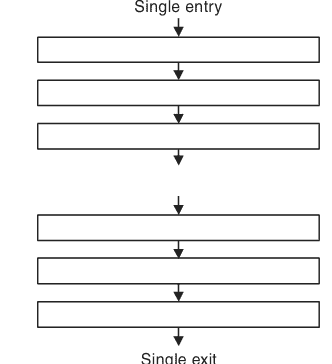

图 1. 序列结构的实现。

### 循环或迭代结构

循环由多个序列语句组成，这些语句基于条件执行。

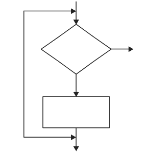

图 2. 循环或迭代结构的实现。

### 决策结构

它包含一个条件，该条件可能为真或假。根据条件为真或假，取不同的分支并执行。

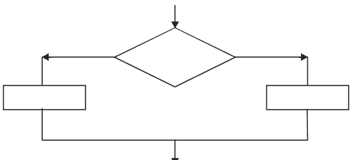

图 3. 决策结构的实现。

# 1. 自底向上和自顶向下方法

任何问题都可以用两种方法处理，即自顶向下或自底向上。这里给出一个简单示例来说明概念。对一组数字进行排序涉及以下操作：

- (a) 比较
- (b) 交换。

在顶层，需要制定一个算法来使用上述操作进行排序。一旦算法确定，然后在实现整个算法之前制定比较和交换的算法。因此，在这种方法中，人们从顶层开始，而不一开始就关心实现的细节。

自底向上的方法正好相反。先完成低层任务，然后再集成以提供解决方案。在此方法中，先完成低层结构。在这里，将在为整个问题制定算法之前先制定交换和比较的算法。

无论如何，将问题分解为小任务然后逐一解决即可提供解决方案。因此，必须采用自顶向下或自底向上的方法来将问题分解为更小的模块然后解决它。在自顶向下方法中，在深入细节之前先定义整体结构，但在自底向上方法中，先解决细节然后再定义整体结构。

## 自底向上方法的要点
- 1. 在自底向上设计中，系统的各个部分被详细指定。然后将这些部分链接在一起形成更大的组件，这些组件再链接起来直到形成完整的系统。
- 2. 自底向上设计产生更小、更灵活的程序。较短的程序不必分成许多组件，而较少的组件意味着更易于阅读或修改的程序。
- 3. 自底向上设计促进代码重用。当你编写两个或多个程序时，你为第一个程序编写的许多实用程序在后续程序中也很有用。这就是为什么代码重用是自底向上方法的主要好处之一。
- 4. 自底向上设计使程序更易于阅读。
- 5. 自底向上工作有助于澄清你对程序设计的想法。
- 6. 自底向上编程可能允许单元测试，但在系统的大部分组合起来之前，系统整体无法测试，这通常导致项目接近尾声时出现编译问题。
- 7. 使用这种方法的编程示例是 C++ 和 java。

## 自顶向下方法的要点
- 1. 在自顶向下模型中，系统的概述被制定，而不深入任何部分的细节。然后通过更详细地设计每个部分来细化系统的每个部分。
- 2. 每个新部分可能再次被细化，以更详细地定义它，直到整个规范详细到足以验证模型。
- 3. 自顶向下方法强调规划和对系统的完整理解。固有地，在系统的至少某个部分的设计达到足够详细程度之前，不能开始任何编码。
- 4. 自顶向下编程是一种编程风格，是传统过程式语言的主流，其中设计始于指定复杂部分，然后将其划分为越来越小的部分。
- 5. 使用自顶向下方法编写程序的技术是编写一个主过程，该过程调用其他过程，直到程序完成。
- 6. 自顶向下编程可能使测试复杂化，因为在项目接近尾声之前不会有任何可执行的东西出现。
- 7. 使用这种方法的编程示例是 C 和 Pascal。

# 面向对象编程

在计算机科学中，面向对象编程 OOP 简称是一种计算机编程范式。

面向对象编程背后的思想是，计算机程序可以被视为由独立单元或对象组成的集合，它们相互作用，而不是传统的观点，即程序被视为一组函数或简单地作为计算机指令列表。每个对象能够接收消息、处理数据并向其他对象发送消息。每个对象都可以被视为一个独立的小机器或行为者，具有独特的作用或责任。为了使一种语言充当面向对象编程语言，它必须支持三个面向对象的特性：

- 1. 多态。
- 2. 继承。
- 3. 封装。

它们一起被称为 PIE 原则。

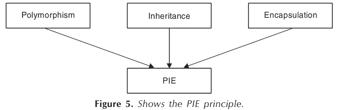

## OOPs 的基本概念

在面向对象编程语言中应用了以下基本概念。

- 1. 类和对象
- 2. 封装
- 3. 抽象


+   4. 数据隐藏
+   5. 多态
+   6. 继承
+   7. 动态绑定
+   8. 消息传递。

# 1. 类和对象

类被称作封装的基本单元。它是函数代码和数据的集合，形成面向对象编程的基础。类是一种**抽象数据类型 (ADT)** *即，* 类定义仅提供逻辑抽象。类中定义的数据和函数只有在创建类类型的变量时才会焕发生机。类类型的变量称为对象，它具有物理存在，也称为类的实例。从一个类可以创建多个对象。每个对象都具有类中定义的一样的 数据集合，并且可以使用类中定义的函数来操作数据。

*例如：* 我们可以创建一个名为 car 的类，它具有公司、型号、制造年份、燃料类型等属性，并且可能具有 **acceleration ( )**、**brake ( )** 等动作。

对象是 C++ 程序中的基本运行时实体。所有对象都是类的实例。根据类的类型，一个对象可能代表任何事物，如人、手机、椅子、学生、员工、书籍、讲师、演讲者、汽车、车辆或我们在日常生活中看到的任何事物。对象的状态由它们在特定时刻所具有的数据值决定。对象在内存中占用空间，并且所有对象共享在创建类时定义的一样的 数据项集合。两个对象可以通过传递消息通过函数相互通信。

**通俗地说：**

+   1. **动物** 可以被表述为一个类，而 **狮子、老虎、大象、狼、牛** 等则是其对象。
+   2. **鸟** 可以被表述为类，而 **麻雀、鹰、鹰隼、鸽子** 等则是其对象。
+   3. **音乐家** 可以被表述为一个类，而 **Himesh Reshmia、Anu Malik、Jatin-Lalit** 则是其对象。

# 2. 封装

*封装是将函数和数据绑定在一起形成称为类的紧凑形式 的机制。* 数据和函数可以是私有或公共的。私有数据/函数只能在类内部访问。公共数据/代码可以在类外部访问。封装的使用隐藏了实现的复杂性。函数代码和数据链接在一起产生了对象，这些对象是类类型的变量。

# 3. 抽象

抽象是一种机制，用于仅表示具有重要意义的本质特征并隐藏不重要的细节。为了做出良好的抽象，我们需要对要使用 **OOP** 原则实现的 问题域 有深入的了解。作为抽象的示例，考虑一个 **Vehicle** 类。当我们创建 **Vehicle** 类时，我们可以决定将哪些函数代码和数据放入类中，如车辆名称、车轮数量、燃料类型、车辆类型等，以及诸如换挡、加速/减速车辆等函数。此时我们不关心车辆的工作方式，如加速、换挡如何进行。

我们也不关心将车辆的更多部件作为类的部分，如型号号码、车辆颜色等。

# 4. 数据隐藏

数据隐藏将数据从用户的外部访问中隐藏起来。在 OOP 语言中，我们有 private、protected 等特殊关键字来隐藏数据。

# 5. 多态

如果我们将单词 Polymorphism 分解，我们得到 “Poly” 表示许多，而 “Morphism” 表示形式。

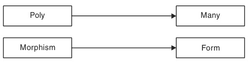

图 6

因此，多态意味着多种形式。因此多态为实体提供了一种以多种形式表现的方式。通俗地说，印度教方法论中湿婆神克里希纳就是多态的绝佳例子。从程序员的角度来看，多态意味着“一个接口，多种方法”。

它是一种属性，允许一个接口控制对一类操作的访问。例如，我们想要找出三个数字的最大值；无论我们传递什么类型的输入，即整数、浮点数等。因为多态，我们可以用名称 max3 定义三个变量版本的同一个函数。此函数的每个版本都接受 3 个相同类型的参数，即 max3 的一个版本接受 3 个整数参数，另一个接受 3 个双精度参数，等等。编译器根据传递给函数 max3 的数据类型自动选择正确的函数版本。这也被称为函数多态或函数重载。

多态的类型：多态有两种类型，如下所示：

+   1. 编译时多态。
+   2. 运行时多态。

# 6. 继承

继承是从早期已存在的类派生新类的机制。继承为面向对象编程提供了代码重用的基本思想。新类继承旧类的特征。旧类和新类被称为（成对）基-派生、父-子、超-子。

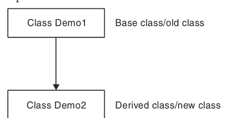

图 7. 继承的演示。

继承支持分类的思想。在分类中，我们可以形成不同类的层次结构，每个类除了一些共同属性外都有一些特殊特征。通过分类，一个类只需定义那些使其在其类中独一无二的品质。

# 示例：

+   1. 作为示例，在层次结构的最顶端我们可以有一个 **vehicle class**。车辆的所有共同特征都可以放在这个类中。从中我们可以派生一个新的类，比如 **two_wheeler**，它只包含特定于两轮车辆的特征。

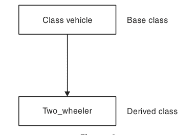

图 8

+   2. 作为另一个示例，我们可以举 **工程学院** 作为顶级类，其子类是其各个系，如 **计算机、电子、电气** 等。同样，工程学院可能有其父类作为其隶属的 **大学**。

## 7. 动态绑定

绑定意味着链接。它是将函数定义链接到函数调用。

+   1. 如果函数调用到函数定义的链接，即控制转移的位置是在编译时完成的，则称为静态绑定。
+   2. 当链接推迟到运行时或在程序执行期间完成时，这种类型的链接称为动态绑定。响应函数调用将调用哪个函数是在程序执行时确定的。

## 8. 消息传递

在 C++ 中，对象通过相互传递消息进行通信。消息包含成员函数的名称和要传递的参数。在消息传递中显示如下：

```
object. method (parameters);
```

这里的消息传递意味着对象调用方法并传递参数。消息传递本质上就是调用类的方法并发送参数。方法随后响应消息执行。

# OOPs 的特征

+   1. 程序分为类和函数。
+   2. 数据被隐藏，外部函数无法访问。
+   3. 使用继承提供了代码重用。

## 1.2 对象

我们将描述的现实涉及执行某些活动的一系列人。我们的任务是尝试对该系统进行建模。我们将看到，构建一个模拟这一现实的模型是非常自然的。我们在此描述中使用“人”和“对象”表示相同的含义；我们实际上指的是代表该人的对象。正如通常一样，应该注意区分现实和模型。

“对象”一词被滥用，并在几乎所有上下文中使用。我们所说的对象是指能够保存状态（信息）并提供一系列操作（行为）来检查或影响该状态的实体。

对象由一系列操作和记住这些操作效果的状态来表征。

面向对象的模型由一系列对象组成；这些是所建模系统的明确分隔的部分。对象通常对应于现实生活中的实体对象，例如发票、汽车或移动电话。每个对象都包含单独的信息（例如，一辆汽车有其注册号）。

## 1.3 类和实例

在我们制作的系统中，将会有一些相互通信的对象。其中一些对象将具有共同的特征，我们可以根据这些特征对对象进行分组。当我们查看示例中的对象时，我们注意到这三个人具有相似的行为和信息结构。这些对象具有相同的模具或模板。这样的组代表一个类。为了描述所有具有相似行为和信息结构的对象，我们因此可以识别并描述一个类来代表这些对象。

类是一个定义、模板或模具，用于创建新对象，因此是对多个对象的共同特征的描述。构成某个类的对象具有共同的模板。作为示例，我们可以查看这本书。你手中的这本书是书的一个实例。出版商处的书籍描述代表可以创建实例的类。

+   - 一个类代表多个对象的模板并且
+   - 描述这些对象在内部是如何结构化的。
+   - 同一类的对象在其操作和信息结构方面具有相同的定义。

类有时被称为对象的类型。然而，类型和类不是同一回事。正如我们上面提到的，抽象数据类型是由一组操作定义的。类型是由你可以用该类型进行的操作定义的。类比这更多。你也可以查看类的内部，例如查看其信息结构。我们因此更愿意将类视为一种类型的（可能有很多种）特定实现之一。

使用类概念，我们可以将某些特征与一组对象关联起来，我们可以将类视为描述构成该类的对象的全部共同特征的抽象。


在面向对象系统中，每个对象都属于一个类。属于某个类的对象被称为该类的一个实例。因此，我们常将对象和实例视为同义词。

实例是从类创建出来的对象。类描述了实例的（行为和信息）结构，而实例的当前状态则取决于对实例执行的操作。

## 1.4 多态

从类创建的实例共同为我们提供期望建模的动态行为。当这些实例开始相互通信时，系统的行为才得以呈现。一个实例可能知道可以向哪些其他实例发送刺激。如果一个实例向另一个实例发送刺激，但不必知道接收实例属于哪个类，我们就说存在多态。多态意味着，至少在面向对象语境中，发送实例不需要知道接收实例的类，并且这个类可以是任意类。多态意味着刺激的发送者：

- 不需要知道接收实例的类。
- 接收实例可以属于任意类。

## 1.5 继承

如果类 B 继承类 A，那么类 A 中描述的操作和信息结构都将成为类 B 的一部分。

通过继承，我们可以展示类之间的相似性，并在一个类中描述这些相似之处，其他类可以继承这个类。因此，我们可以复用公共描述。所以继承常被推崇为软件行业中复用的核心思想。然而，尽管继承在正确使用的情况下，在许多场景（包括复用）中是非常有用的机制，但它并非复用的先决条件。

## 1.6 面向对象分析

面向对象分析的目的是与其他所有分析一样，获得对应用程序的理解：这种理解仅依赖于系统的功能需求。

面向对象分析按某种顺序包含以下活动：

- 发现对象。
- 组织对象。
- 描述对象之间如何交互。
- 定义对象的操作。
- 定义对象的内部细节。

## 1.7 发现对象

对象可以作为应用领域中自然存在的实体被发现。目标是找到那些在系统整个生命周期中保持本质性的关键对象。稳定性还取决于以下事实：修改往往从这些对象中的某些开始，因此是局部性的。例如，在控制水箱的应用程序中，典型对象可能包括所容纳的水、调节器、阀门和水箱。

## 1.8 概念建模

自 20 世纪 70 年代出现以来，概念建模已在多个不同场景中使用，例如信息管理系统分析和组织理论。其目的是为待分析的系统或组织创建模型。概念建模这一概念常被用作数据建模的同义词，并经常与数据库的结构化及使用一起讨论。

## 1.9 需求模型

所做的第一个转换是从需求规格说明到需求模型。需求模型由以下部分组成：

- (a) 用例模型。
- (b) 接口描述。
- (c) 问题域模型。

用例模型使用参与者和用例。这些概念仅仅是一种辅助手段，用于定义系统外部存在什么（参与者），以及系统应执行什么（用例）。

## 1.10 分析模型

我们已经看到，需求模型旨在定义系统的边界并规定其行为。当需求模型已开发完成并经系统用户或订购方批准后，我们就可以开始开发实际系统。

这从开发分析模型开始。分析模型旨在独立于实际实现环境来组织系统。这意味着我们关注系统的逻辑结构。正是在这里，我们定义了稳定、健壮、可维护且可扩展的结构。

## 1.11 设计模型

在构造过程中，我们使用分析模型和需求模型来构造系统。首先，我们创建设计模型，它是对分析模型的细化和形式化。

**设计**强调的是满足需求的*概念性解决方案*，而不是其实现。例如，对数据库模式和软件对象的描述。最终，设计可以被实现。与分析一样，该术语最好加以限定，如*对象设计*或*数据库设计*。分析与设计被概括为以下阶段：*做正确的事（分析），并把事情做正确（设计）*。

## 1.12 实现模型

实现模型由带注释的源代码组成。其信息空间是编程语言所使用的空间。请注意，我们并不要求必须使用面向对象编程语言；该技术可以用于任何编程语言，以获得系统的面向对象结构。然而，面向对象编程语言是可取的，因为所有基本概念都可以很容易地映射到语言构造上。

## 1.13 测试模型

测试模型是系统开发中开发的最后一个模型。简而言之，它描述测试的结果。测试中的基本概念主要是测试规格说明和测试结果。

### 1.13.1 分析

**分析**强调的是对问题和需求的*调查研究*，而不是解决方案。例如，如果需要一个全新的计算机化图书馆信息系统，它将如何被使用？

“分析”是一个宽泛的术语，最好加以限定，如*需求分析*（对需求的调查）或*对象分析*（对领域对象的调查）。

### 1.13.2 分析中要做什么？

在分析中会开发两个不同的模型：需求模型和分析模型。真正的依据是需求规格说明以及与潜在用户的讨论。例如，系统控制一台回收可回收瓶子、罐子和周转箱（在欧洲用于装多个瓶子）的回收机。

### 1.13.3 为什么要有构造过程？

我们在构造阶段根据分析期间创建的分析模型和需求模型来构建系统。构造过程持续到编码完成且代码单元已经过测试为止。构造由设计和实现组成。

## 1.14 面向对象分析与设计

面向对象技术建立在扎实的工程基础之上，我们将这些要素统称为对象模型。对象模型包含了抽象、封装、模块化、层次结构、类型、并发和持久性原则。对象模型的重要性在于这些要素以协同的方式结合在一起。

毫无疑问，面向对象分析与设计在根本上不同于传统的结构化设计方法。它需要一种不同的分解思维方式，并且产生的软件架构在很大程度上超出了结构化设计文化的范畴。这些差异源于以下事实：结构化设计方法建立在结构化编程之上，而面向对象设计则建立在面向对象编程之上。面向对象编程对不同的人有不同的含义。

## 1.15 对象模型的演变

当我们回顾软件工程相对短暂但丰富多彩的历史时，会看到编程语言的代际演进。我们不禁注意到两大趋势：从小规模编程向大规模编程的转变，以及高级编程语言的演进。

### 1.15.1 对象模型的基础

结构化设计方法逐步发展，用于指导试图以算法为基本构建块来构建复杂系统的开发者。类似地，面向对象设计方法逐步发展，以帮助开发者利用基于对象和面向对象编程语言的表达力，以类和对象为基本构建块。

因此，面向对象分析与设计代表了一种演进式发展，而非革命性发展；它没有割裂过去的进步，而是建立在已被证实的成果之上。不幸的是，如今大多数程序员只在正式和非正式的训练中接受了结构化设计的原理。

## 1.16 面向对象编程

面向对象编程是一种实现方法，程序被组织为相互协作的对象集合，每个对象代表某个类的一个实例，并且这些类都是通过继承关系联合而成的类层次结构的成员。

面向对象编程以对象而非算法作为其基本的逻辑构建块。每个对象都是某个类的实例。类之间通过继承关系相互关联。一个程序可能看起来是面向对象的，但如果缺少其中任何要素，它就不是面向对象的程序。

它支持作为数据抽象的对象，这些对象具有带命名操作的接口和隐藏的局部状态。

- (a) 对象具有关联的类型（类）。
- (b) 类型（类）可以从超类型（超类）继承属性。

## 1.17 面向对象设计

面向对象设计是一种设计方法，涵盖面向对象分解的过程，以及用于描绘所设计系统的逻辑与物理、静态与动态模型的表示法。


这个定义有两个重要部分：

- 1. 面向对象设计会产生面向对象的分解。
- 2. 它还使用不同的表示法来表达系统逻辑设计和物理设计的不同模型，以及系统的静态和动态方面。

## 1.18 面向对象分析

面向对象分析是一种从问题领域词汇中发现的类和对象的角度来考察需求的分析方法。

OOA、OOD 和 OOP 之间有什么关系？基本上，面向对象分析的产物充当模型，我们可以从这些模型开始面向对象设计；面向对象设计的产物随后可用作使用面向对象编程方法完整实现系统的蓝图。

## 1.19 对象模型的要素

- 面向过程：算法。
- 面向对象：类和对象。
- 面向逻辑：目标，通常用谓词演算表达。
- 面向规则：if-then 规则。
- 面向约束：不变关系。

这些编程风格各自基于自己的概念框架。每种风格都需要不同的思维模式，即思考问题的不同方式。对于一切面向对象的事物，其概念框架就是对象模型。

对象模型有四个主要元素：

- (a) 抽象
- (b) 封装
- (c) 模块化
- (d) 层次结构。

对象模型有三个次要元素：

- (i) 类型
- (ii) 并发
- (iii) 持久性。

面向对象分析和设计可能是我们当今唯一能够用来攻克大型系统固有复杂性的方法。然而，平心而论，在某些领域使用面向对象开发可能并非明智之举，这不是出于任何技术原因，而是出于非技术原因，例如缺乏训练有素的员工或良好的开发环境。

## 1.20 OOAD 在软件生命周期中的作用

要理解 OOAD 的优劣，你需要知道 OO 方法论在软件生命周期中的位置。这些方法论不会取代传统方法（如数据流、过程流和状态转换图），它们是工具箱中重要的新成员。

根据 Donald Firesmith 在其著作《Dictionary of Object Technology》（SIGS Books，1995）中的定义，分析是“由需求的发现、建模、规格说明和评估组成的开发活动”，而 OO 分析是“从具有身份的对象（这些对象封装了属性和操作）、消息传递、类、继承、多态和动态绑定的角度对需求进行发现、分析和规格说明”。Firesmith 还指出，OO 设计是“从对象、类、簇、框架及其交互的角度对应用程序进行设计”。

在比较传统分析与 OOAD 的定义时，唯一真正新颖的方面是从对象和对象类的角度来思考世界或问题。类是对一组逻辑相关、具有相同或相似特征的实例所做的任何唯一标识的抽象（即模型）。对象是对单个事物建模的任何抽象；“对象”一词与实例同义。类拥有属性和方法。例如，对于一个名为 Customer 的对象类，属性可能是 Name 和 Address，方法可能是 Add、Update、Delete 和 Validate。类定义定义了 Customer 类的属性和方法，而诸如“XYZ Corp.”这样的真实客户就是该类的一个实例。如果你有不同类型的客户，例如住宅客户和商业客户，你可以创建两个新的客户类，它们是 Customer 类的后代。这些后代通过继承访问 Customer 类的所有属性和方法，但可以覆盖任何祖先的属性和方法，也可以包含任何所需的新属性和新方法。

类之间存在三种关系类型：继承、聚合和关联。继承（也称为泛化/特化）通常用短语“is a kind of”标识。例如，Student 和 Faculty 都是 Person 的一种，因此继承自 Person 类。聚合用短语“is a part of”标识，例如包含零件的产品。如果前两种关系都不适用，但对象之间明显相关（例如，员工与公司关联），则该关系就是关联。

抽象类是没有实例的类，仅用于继承。具体类是可以实例化的类，也就是说，可以有直接实例。

所有主要的 OOAD 方法论对对象、类、继承和关系都有类似的基本观点。每种方法的绘图表示法略有不同；方法论之间真正的差异更为微妙。

在选择方法论时，重要的不仅是要考虑方法论的特性，还要考虑使用它的成本、它最适合的问题类型、它的局限性和可用的培训。在典型的使用 OOAD 方法论开发客户端/服务器应用程序的初期尝试中，所有方法论都存在相同的基本缺陷：

- 1. 总体上过度强调面向对象方法，即使对于问题的某些部分，其他方法可能更好。

对于具有复杂规则的系统，状态图适用于状态数较少的系统，但不适用于状态数较多的系统。一旦某个状态转换图的状态数超过 8 到 10 个，它就变得难以管理；超过 20 个状态时，状态转换图就会变得极其笨重。

# 建模原则

建模在所有工程学科中都有着丰富的历史。这些经验提出了建模的四个基本原则。

- 1. 选择创建哪些模型会对问题的处理方式以及解决方案的形成方式产生深远影响。
- 2. 每个模型都可以在不同精度的层次上表达。
- 3. 最好的模型与现实相连。
- 4. 没有一个模型是足够的。对于每个非平凡的系统，最好的方式是通过一小组几乎独立的模型来研究。

# C++ 入门

C++ 是一种面向对象的编程语言。它由**比雅尼·斯特劳斯特鲁普**于 80 年代初在美国新泽西州默里山的 AT&T 贝尔实验室开发。它是 C 语言的扩展，并添加了许多新特性。C++ 这个名字来源于 C 语言的递增运算符 ++，因为它被认为是 C 的一个超集，比 C 领先一个版本，因此被命名为 C++。

编程语言中类构造的首次使用出现在 1967 年的 **Simula** 语言中，该语言源自 Algol。C++ 的发明者**比雅尼·斯特劳斯特鲁普**在博士研究中使用了 **Simula** 语言来编写模拟程序，以对计算机系统进行建模。他发现 **Simula** 语言非常有表现力，使他能够在较高的抽象层次上工作。但当需要运行程序以获得论文所需的数值结果时，他发现性能实在太慢，无法及时完成工作。于是，他用 C 语言重新编写了这些程序。但他做了一件非常聪明的事：他没有手工编码，而是编写了一个翻译程序，该程序接受带有类扩展的类 C 程序，并将其翻译成纯 C。结果产生了一种最初称为“C with classes”的语言，后来成为 C++。这个翻译程序后来成为 AT&T 的“cfront”编译器，用于将 C++ 翻译成 C。“cfront”是第一个用 C++ 编写的应用程序。

C++ 程序是按有意义顺序编写的大量指令的集合。指令又由关键字、变量、函数、对象等组成，这些元素使用了 C++ 定义的字符集。它是可在 C++ 程序中使用的各种字符、数字和符号的集合。它包含以下内容：


**表 2.1**

| 序号 | C++ 字符集的元素 |
| --- | --- |
| 1. | 大写字母：A 到 Z |
| 2. | 小写字母：a 到 z |
| 3. | 数字：0 到 9 |
| 4. | 符号（见下表） |

**表 2.2：C++ 字符集**

| 符号 | 名称 | 符号 | 名称 |
| --- | --- | --- | --- |
| ~ | 波浪号 | > | 大于 |
| < | 小于 | & | 与号 |
| \| | 或/管道 | # | 井号 |
| >= | 大于或等于 | <= | 小于或等于 |
| == | 等于 | = | 赋值 |
| != | 不等于 | ^ | 插入符号 |
| { | 左大括号 | } | 右大括号 |
| ( | 左括号 | ) | 右括号 |
| [ | 左方括号 | ] | 右方括号 |
| / | 正斜杠 | \\ | 反斜杠 |
| : | 冒号 | ; | 分号 |
| + | 加号 | - | 减号 |
| * | 乘法 | / | 除法 |
| % | 模 | , | 逗号 |
| ' | 单引号 | " | 双引号 |
| >> | 右移 | << | 左移 |
| . | 句点 | _ | 下划线 |

## 2.3 C++ 标记

C++ 程序中最小的独立单元称为 C++ 标记。C++ 定义了六种类型的标记。

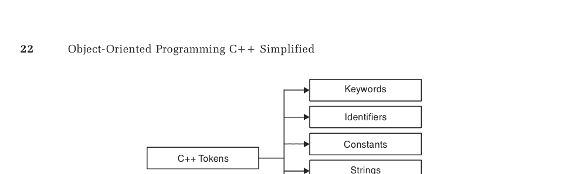

### 1. 关键字

关键字是编译器已知的含义的词。也就是说，每个关键字的含义是固定的。你可以直接使用关键字来实现其预期含义。你不能改变关键字的含义。并且你不能将关键字用作变量、函数、数组等的名称。所有关键字均以小写形式书写。

C++ 中有 63 个关键字。以下表格列出了 C++ 中可用的所有关键字。

| asm | auto | bool | break | case | catch |
| char | class | const | const_cast | continue | default |
| delete | do | double | dynamic_cast | else | enum |
| explicit | export | extern | false | float | for |
| friend | goto | if | inline | int | long |
| mutable | namespace | new | operator | private | protected |
| public | register | reinterpret_cast | return | short | signed |
| sizeof | static | static_cast | struct | switch | template |
| this | throw | true | try | typedef | typeid |
| typename | union | unsigned | using | virtual | void |
| volatile | wchar_t | while |  |  |  |

### 2. 标识符

标识符是赋予各种程序元素（如变量、数组、函数、结构等）的名称。

**编写标识符的规则：**

- 规则 1：第一个字母必须是字母或下划线。
- 规则 2：从第二个字符开始，允许任意组合的数字、字母或下划线。
- 规则 3：只允许数字、字母、下划线。不允许其他符号。
- 规则 4：关键字不能用作标识符。
- 规则 5：对于 ANSI（美国国家标准学会）C++，标识符的最大长度为 32，但许多编译器支持超过 32。

**有效和无效标识符的示例（基于上述规则）：**

**有效标识符：**

- order_no    name    _err    _123
- xyz    radius    a23    int_rate

**无效标识符：**

- order-no    12name    err    int
- x$    s name    hari+45    123

### 3. 常量

常量在 C++ 中指的是程序执行期间不改变的固定值。C++ 中有各种类型的常量。它们被归类为以下类别：

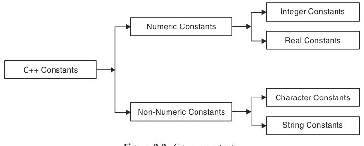

*图 2.2. C++ 常量。*

**(i) 整数常量**

它们有三种类型：

- (a) **十进制常量：** 它们是 0 到 9 的数字序列，没有小数部分。它们可以为负、正或零。
  - *示例：12, 455, -546, 0 等。*
- (b) **八进制常量：** 它们由 0 到 7 的数字序列组成，且第一位数字必须是 0。
  - *示例：034, 0, 0564, 0123 等。*
- (c) **十六进制常量：** 它们由 0 到 9 的数字和 A 到 F（代表 10 到 15）的序列组成。它们以 0x 或 0X 开头。
  - *示例：0x34, 0xab3, 0X3E 等。*

**(ii) 实数常量**

它们是带小数部分的小数。它们也称为浮点常量。

示例：34.56, 0.67, 1.23 等。

实数常量也可以用指数或科学计数法表示，它由两部分组成。例如，数字 212.345 可以表示为 2.12345e + 2，其中 e + 2 表示 10 的 2 次方。这里 e 前的部分，即 2.12345，被称为尾数，+2 是指数。指数始终是整数，可以用小写或大写书写。

上述给出的数字可能有更多表示方法。我只给出了科学计数法的示例。

**(iii) 单字符常量**

它们用单引号括起来。它们由单个字符或数字组成。

示例：'4', 'A', '\n' 等。

字符常量具有整数值，称为 ASCII（美国信息交换标准代码）。例如，A 的 ASCII 值为 65。

**(iv) 字符串常量**

它们是双引号括起来的字符、数字或任何符号的序列。

示例："hello", "23twenty three", "& ^ ABC", "2.456" 等。

**(v) 反斜杠常量**

C++ 定义了几个用于特殊目的的反斜杠常量。之所以这样称呼是因为每个反斜杠常量都以反斜杠（\\）开头。它们用两个字符表示，其一般形式为 \char，但被视为单个字符。它们也称为转义序列。下面给出了反斜杠字符（转义序列）常量的列表：

**表 2.4：反斜杠字符常量表**

| 序号 | BCC | 含义 | ASCII |
| --- | --- | --- | --- |
| 1 | \b | 退格 | 08 |
| 2 | \f | 换页 | 12 |
| 3 | \n | 换行 | 10 |
| 4 | \r | 回车 | 13 |
| 5 | \" | 双引号 | 34 |
| 6 | \' | 单引号 | 39 |
| 7 | \? | 问号 | 63 |
| 8 | \a | 警报 | 07 |
| 9 | \t | 水平制表符 | 09 |
| 10 | \v | 垂直制表符 | 11 |
| 11 | \0 | 空 | 00 |

### 4. 字符串

参见字符串常量。

### 5. 运算符

它们在第 3 章和第 4 章中讨论。

### 6. 特殊符号

它们也称为分隔符，它们是方括号 `[]`、大括号 `{}`、括号 `()` 等。`[]` 用于数组并称为下标运算符，`()` 称为函数符号。

## 2.4 变量

变量是内存中用于保存程序指令可以修改的值的命名位置。所有变量在使用前必须声明。它们必须在函数或块的开头声明（全局变量除外）。变量声明的一般形式为：

```
data type variable [list];
```

这里 list 表示由逗号分隔的一个或多个变量。

**示例：**

```
int a;
float b,c;
char p,q;
```

这里 `a` 是 `int` 类型的变量，`b` 和 `c` 是 `float` 类型的变量，`p`、`q` 是 `char` 类型的变量。`int`、`float` 和 `char` 是 C 中使用的数据类型。编写变量的规则与编写标识符的规则相同，因为变量本质上就是一个标识符。

C++ 允许你在程序的任何地方声明变量。也就是说，与 C 不同，不必在程序开头声明所有变量。你可以在任何你想声明的地方声明它，即在你想使用它的地方。它的一个优点是，有时在程序开头提前声明了大量变量，其中许多未被引用。在实际需要的地方声明变量很方便。你不需要在使用前提前声明所有变量。另一方面，查找程序中声明的所有变量很费力，因为变量声明会散布在整个程序中。

C++ 还允许你在使用的位置动态初始化变量。也就是说，你可以在程序的任何地方这样写：

```
int x = 23;
float sal = 2345;
char name[ ] = "Hari";
```

这被称为变量的“动态初始化”。

声明和动态初始化的示例在给出的虚拟程序中给出：

```
void main()
{
    int x;
    ..........;
    ..........;
    ..........;
    float y,z;
    char str [] ="hello";
    ..........;
    ..........;
    double d1, d2;
    char s='M';
    ..........;
}
```

## 2.5 计数标记

1. `int a,b,c;`

   - `int` 是关键字（1）
   - `a`、`b` 和 `c` 变量（3）
   - 逗号（`,`）是运算符（2）
   - `;` 是分隔符（1）

   因此，标记总数 = 1 + 3 + 2 + 1 = 7

2. `c = a + b - 10;`

   - `a`、`b` 和 `c` 变量（3）
   - `+`、`=`、`-` 是运算符（3）
   - `;` 是分隔符（1）
   - `10` 是整数常量（1）

   因此，标记总数 = 3 + 3 + 1 + 1 = 8

## 2.6 数据类型

C++ 定义了几种数据类型，可在不同的编程情况下使用，例如 `int` 数据类型可用于表示人的年龄、学号等整数，或 `float` 数据类型可用于表示人的薪水、利率等。基本数据类型如下所示：


### 1. 內建類型
- (a) 整數類型
    - (i) int
    - (ii) char
- (b) 浮點類型
    - (i) float
    - (ii) double
- (c) void
- (d) bool
- (e) wchar_t

### 2. 使用者自訂資料型別
- (a) class
- (b) struct
- (c) union
- (d) enumeration

### 3. 衍生資料型別
- (a) array
- (b) function
- (c) pointer
- (d) reference

wchar_t 是一種支援長字元的新資料型別。wchar_t 關鍵字指定一種寬字元型別。wchar_t 型別定義為 unsigned short（16 位元）資料物件。wchar_t 常數可以透過在前面加上 L 來宣告，例如 L"abc"、L'a'。要使用此資料型別，你必須包含標頭檔 wchar.h。

## 2.7 限定符

限定符修飾資料型別的含義。Unsigned、signed、short 和 long 是 C++ 中可用的 4 個限定符。它們的使用方式如下：

```
signed int x, y, b;
unsigned int p,q;
long int num;
short int n;
```

long int 是前面提到的資料型別，而 short int 在大多數 C++ 編譯器上與 signed int 或簡單的 int 相同。當我們需要處理正負值時，使用 signed 限定符。當我們只需要正值時，可以使用 unsigned 限定符。它們只能與 char 和整數資料型別一起使用。使用 unsigned 時，可用範圍會向正方向增加，例如，signed char 或簡稱 char 的範圍是 −128 到 127，而 unsigned char 的範圍是 0 到 255。對於 int 或 long int 也是如此。除了這兩個重要關鍵字外，const 和 volatile 也用作限定符。const 限定符用於將變數宣告為常數，例如 const int x=10; 宣告一個型別為 int、常數值為 10 的常數 x。關於常數的更多內容請參閱下一章。

## 2.8 資料型別的範圍

表 2.5：資料型別及其範圍

| 序號 | 資料型別 | 大小（位元組） | 範圍 |
|---|---|---|---|
| 1 | int or short | 2 | −32768 到 32767 |
| 2 | Unsigned int | 2 | 0 到 65535 |
| 3 | Long int | 4 | −2147483648 到 2147483647 |
| 4 | Float | 4 | 3.4e-38 到 3.4e+38 |
| 5 | Char | 1 | −128 到 127 |
| 6 | Unsigned char | 1 | 0 到 255 |
| 7 | Unsigned long | 4 | 0 到 4294967295 |
| 8 | Double | 8 | 1.7e-308 到 1.7e+308 |
| 9 | Long double | 10 | 3.4e-4932 到 3.4e+4932 |

對於資料型別範圍的計算，我們有一個固定公式：

- 1. 對於有符號資料型別，如果它在記憶體中佔用 n 位元，則此資料型別的特定變數可以取的值的範圍是
    - −2^(n-1) 到 2^(n-1) − 1
    - 例如：對於 n=16（int），範圍是
    - −2^15 到 2^15 −1
    - 對於 char 資料型別，n=8，範圍是
    - −2^7 到 2^7−1

- 2. 對於無符號資料型別，如果它在記憶體中佔用 n 位元，則此資料型別的特定變數可以取的值的範圍是
    - 0 到 2^n−1
    - 例如，對於 n=16（unsigned short int），範圍是 0 到 2^16−1；對於 unsigned char 資料型別，n=8，範圍是 0 到 2^8−1。

## 2.9 你的第一個 C++ 程式

```
/*PROG 2.1 PRINTS HELLO C++ ON THE SCREEN */

#include <iostream.h>
int main()
{
    cout << " Hello C++";
    return 0;
}

OUTPUT :
Hello C++
```

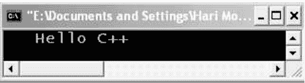

圖 2.3. 程式 2.1 的輸出畫面。

說明：在第一行，#include 是預處理指令，iostream.h 是標頭檔，寫在 < 和 > 或 "" 中。"io" 在 iostream 中代表輸入輸出，.h 代表標頭檔。每個 C++ 程式都必須包含 iostream.h 檔案。#include 和 <iostream.h> 之間可以有空格。下一行是 main() 函數，其中 () 被稱為函數符號。每個 C++ 檔案都必須有這個函數，因為 C++ 程式的執行是從 main() 開始的。{ 是 main 函數的起始大括號，} 是結束大括號。所有語句和指令都寫在 main 函數內部。main 之前的 int 被視為其返回型別。cout 是定義在 iostream.h 中的類別 iostream_withassign 的預定義物件。符號 << 是一個運算子，稱為輸出運算子或插入運算子。cout << 的組合效果是將其後雙引號中的內容列印到螢幕上，這就是輸出。C++ 程式中的每個語句都必須以 ;（分號）結束。C++ 是區分大小寫的程式語言，因此你使用的所有 C++ 內建功能都必須使用小寫。return 0; 這一行只是為了避免警告。如果你不寫 return 0;，不會得到錯誤，但會得到警告。上述程式可以修改為（對 main 函數的返回型別稍作更改）：

```
void main()
{
    cout << "Hello C++";
}
```

### 2.9.1 編譯和執行過程

要在 Windows 環境下執行你的第一個程式，請遵循以下步驟。

- 1. 在 Visual Studio 6.0 中開啟 Microsoft Visual C++ 6.0。
- 2. 在 IDE 中，從 file 選單中選擇 new。
- 3. 在 Project 標籤下，選擇 win 32 Console Application 選項，並給專案命名，例如 "CPP"。選擇你想要放置專案的位置，例如 D:\。你的所有檔案都將保存在該專案中。

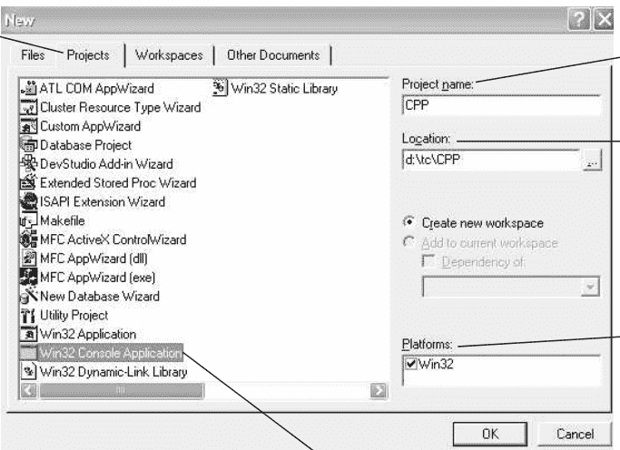

圖 2.4

4. 按一下 Finish。會出現一個新的對話方塊，直接按 OK。此時你已成功在 D:\ 下建立了一個名為 CPP 的新專案。

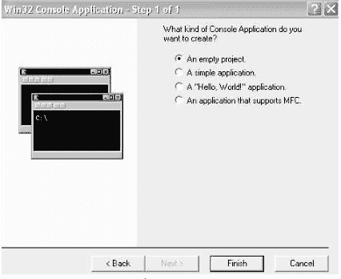

圖 2.5

5. 現在從 file 選單中選擇 new。選擇 Files 標籤和 C++ source file 選項。給一個合適的檔案名稱，例如 first。按 OK。

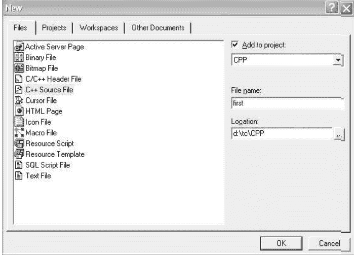

圖 2.6

6. 會出現一個新視窗。在視窗中輸入上述程式，保持原樣。

7. 從 build 選單中選擇 build CPP.exe 選項。假設程式沒有錯誤，會在底部出現一個新視窗，顯示 0 error 0 warnings。

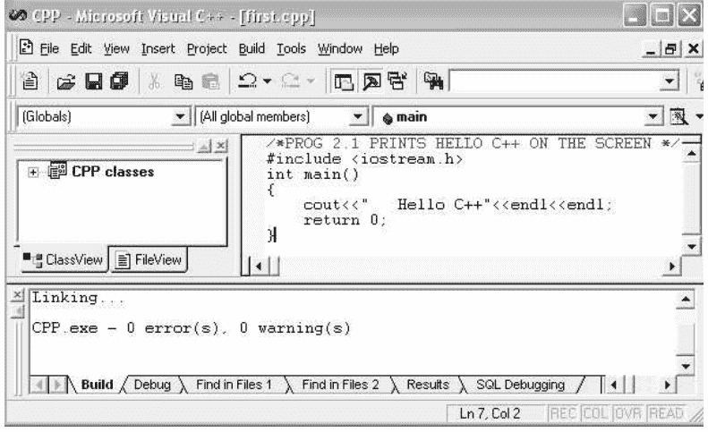

圖 2.7

一天工作後，當你想開啟同一個專案時，只需尋找副檔名為 .dsp 的檔案，它代表 **資料來源專案**。之後你可以繼續製作 C++ 程式。

## 2.10 C++ 程式的結構

任何 C++ 程式的一般結構如下。它簡單地說明一個標準 C++ 程式可能根據結構中各個部分呈現的樣子。

|  |
|---|---|
| 文件註解 |
| 標頭檔 |
| 符號常數 |
| 全域變數、函數 |
| 類別宣告 |
| 成員函數定義 |
| main()
{
  ....................;
  ....................;
} |
| 全域函數定義 |

圖 2.10. C++ 程式的一般結構。

- - 第一部分「文件註解」是可選的，用於為程式加入註解，通常如我們所給的程式標題。
- - 在第二部分中，我們包含 C++ 程式所需的各種標頭檔。
- - 符號常數和全域變數、函數在需要時定義於其後。
- - 類別是 C++ 程式設計的主要建構區塊，其宣告包含資料成員和函數的宣告。成員函數可以在類別中宣告並定義，或者它們在類別中宣告但在類別外部定義，即在類別宣告之外完成。
- - **main()** 函數必須存在於每個 C++ 程式中。它包含所有要執行的語句。在這個 main 函數內部，我們建立先前建立的類別的物件。所有語句都放在大括號內，並以分號結束。

下面給出一個完整的 C++ 程式。如果你此時不理解額外的內容，不要擔心。這只是為了讓你了解 C++ 程式的結構。

```
/*Documentation*/
/* DEMO PROGRAM FOR C++ STRUCTURE, DOES NOT SERVE ANY PURPOSE EXCEPT DEMONSTRATION */

#include <iostream.h> /*header file inclusion */
#include <iomanip.h>
```

```
int x;float y; char z; /* global variables */
void disp(); /* global function */
/*class declaration starts here */
class demo
{
private :
    int x, y;
public :
    void input(int a, int b);
    void show();
};
/*class declaration ends here */
/*class function definition */
void demo ::input(int a, int b)
{
    x = a;
    y = b;
}
/*class function definition */
void demo ::show()
{
    cout << "x=" << x << endl;
    cout << "y=" << y << endl;
}
void main() /*main function definiton */
{
    demo d1,d2; //creating objects
    d1.input(10,20);
    ..............;
    ..............;
    d1.show();
    int num;
    show(); //local function call
}
/*global function definitions */
void show()
{
    cout << "in show" << endl;
}
```


## 2.11 C++ 程序的编写风格

你的第一个程序可以用另外两种方式编写，这是一种较新的 C++ 程序编写风格。你所看到的程序被认为是旧式的 C++ 程序编写风格。新的风格是

```
#include <iostream>
using namespace std;
void main()
{
    cout << "hello C++" << endl;
}

or
#include <iostream>
    int main()
{
    std :: cout << "hello C++" << endl;
    return 0;
}
```

iostream.h 是头文件，iostream 也是一个头文件。区别仅仅在于 iostream 提供了全局命名空间（参考第 13 章）std，在其中声明了 cout 和 cin（稍后讨论）。如果你没有写 using namespace std，就必须写 std :: cout 和 std :: cin 来访问 cout 和 cin。函数 main 的返回类型可以是 void 也可以是 int。这并不会使你的程序出现错误。在 main 为 int 类型的情况下，main 必须返回一个值。我们将遵循旧式的程序编写风格。你可以选择任何一种风格你想要的，注意 main 函数与旧风格和新风格无关。使用 main 函数的方式由你自己决定，是采用旧风格还是新风格。

## 2.12 编程示例

```
/*PROG 2.2 WRITING MULTIPLE STATEMENTS WITH SINGLE COUT */
#include <iostream.h>
int main( )
{
    cout << "Hello NMIMS University" << endl
        << "Hello MPSTME Mumbai Campus" << endl
        << "Hello MPSTME Shirpur Campus" << endl;
    return 0;
}
```

OUTPUT :
Hello NMIMS University
Hello MPSTME Mumbai Campus
Hello MPSTME Shirpur Campus

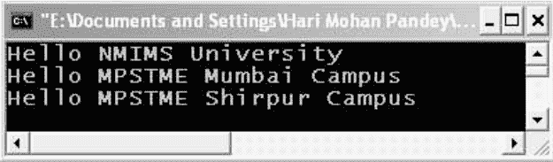

图 2.11. 程序 2.2 的输出屏幕。

EXPLANATION : 上述程序说明了可以用单个 cout 和多个 << 运算符编写多个语句的事实。endl 会换行。分号必须放在末尾。然而，如果你不想按上述方式编写，你也可以像下一个程序中那样使用多个 cout 语句编写。

```
/* PROG 2.3 THREE COUT STATEMENT IN A C++ PROGRAM */

#include <iostream.h>
int main()
{
    cout << "Hello NMIMS University" << endl;
    cout << "Hello MPSTME Mumbai Campus" << endl;
    cout << "Hello MPSTME Shirpur Campus" << endl;
    return 0;
}
```

OUTPUT :
Hello NMIMS University
Hello MPSTME Mumbai Campus
Hello MPSTME Shirpur Campus

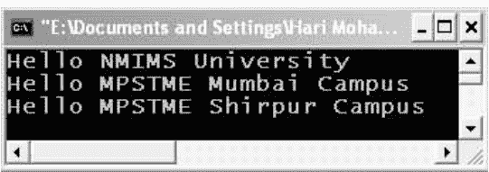

图 2.12. 程序 2.3 的输出屏幕。

EXPLANATION : 该程序不言自明。

```
/* PROG 2.4 DISPLAYING DIFFERENT TYPES OF CONTENTS */

#include <iostream.h>
void main()
{
    cout << 123 << endl;
    cout << 23.567 << endl;
    cout << 12345678 << endl;
    cout << 'P' << endl;
    cout << "Hari" << endl;
}

OUTPUT :
123
23.567
12345678
P
Hari
```

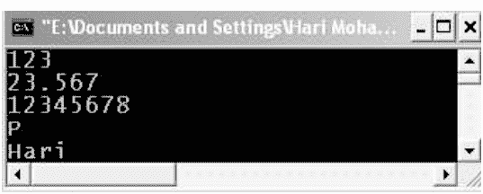

图 2.13. 程序 2.4 的输出屏幕。

EXPLANATION : 该程序简单地显示了 int、char、double、char* 和 char 类型的各种常量。endl 是内置的操纵符，其作用类似于 ‘\n’。有关操纵符的更多内容请参见第 11 章。

```
/* PROG 2.5 WORKING WITH VARIABLES VER 1 */

#include <iostream.h>
void main()
{
    int x = 10;
    float y = 2.34f;
    char *s = "NMIMS UNIVERSITY";
    cout << "Value of x :" << x << endl;
    cout << "Value of y :=" << y << endl;
    cout << "Value of s :=" << s << endl;
}

OUTPUT :
Value of x :=10
Value of y :=2.34
Value of s :=NMIMS UNIVERSITY
```

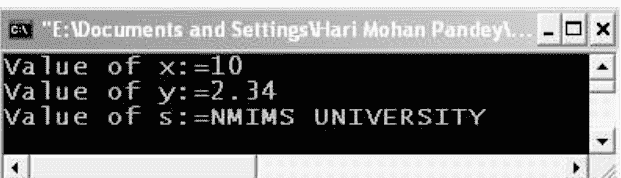

# 图 2.14. 程序 2.5 的输出屏幕。

EXPLANATION : 在程序中我们声明并初始化了 3 个变量 x、y 和 s，类型分别为 int、float 和 char*。注意 y 的值为 2.34f 而不是 2.34。浮点数后加上后缀 f 或 F 使其成为 float 数。如果不写，则该数被视为 double。显示变量值非常简单，如代码所示。只需写成 cout << variable_name。同样，对于连接，只需在变量前后使用 <<，例如 cout << "x=" << x << endl; 已声明但未初始化的变量包含垃圾值。

# /*PROG 2.6 WORKING WITH VARIABLES VER 2*/

```
#include <iostream.h>
void main()
{
    int x(10);
    float f(23.34);
    char ch('P');
    cout << "x=" << x << endl;
    cout << "f=" << f << endl;
    cout << "ch=" << ch << endl;
}

OUTPUT :
x=10
f=23.34
ch=P
```

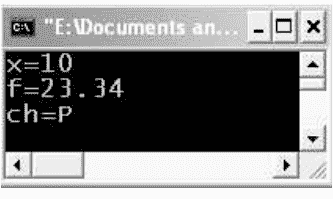

图 2.15. 程序 2.6 的输出屏幕

EXPLANATION : 在 C++ 中，所有内置数据类型都被视为类，而在 C 中它们被视为结构体。这里你可以假设 int 是一个类，x 是它的一个对象，我们通过调用构造函数来初始化 x。这与写 int x =10 相同，但给出的记法称为类构造函数记法。float 和 char 类型也适用同样的类比。

```
/*PROG 2.7 DYNAMIC INITIALIZATION OF VARIABLES */

#include <iostream.h>
void main()
{
    int num=20;
    cout<<"int num="<<num<<endl;
    double d=23.45;
    cout<<"double d="<<d<<endl;
    char ch='P';
    cout<<"char ch="<<ch<<endl;
    char*s="CPP";
    cout<<"char*s="<<s<<endl;
}

OUTPUT :
int num=20
double d=23.45
char ch=P
char*s=CPP
```

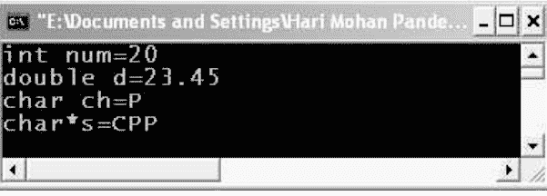

图 2.16. 程序 2.7 的输出屏幕。

EXPLANATION : 该程序演示了变量可以在程序的任何地方声明和初始化的事实。在程序的任何地方动态初始化变量被称为动态初始化。

```
/* PROG 2.8 WORKING WITH VARIABLES INPUT FROM THE USER */

#include <iostream.h>
void main()
{
    int x;
    cout << "Enter a number" << endl;
    cin >> x;
    cout << "You have entered" << endl;
    cout << "x := " << x << endl;
}

OUTPUT :

Enter a number
40
You have entered
x :=40
```

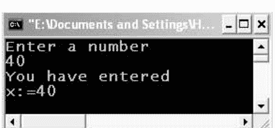

图 2.17. 程序 2.8 的输出屏幕。

EXPLANATION : 要从键盘读取用户数据，我们有对象 cin。它代表标准输入流。其语法为

```
cin >> var1 >> var2 >> var2...... >> var n
```

输入的值从左到右赋值，即第一个值赋给 var1，以此类推。这里我们只有一个 int 类型的变量 x。我们通过写 cin >> x 从用户处获取变量 x 的输入。随后使用 cout 将同一个变量显示出来。cin 是 iostream_with_assign 类的对象，>> 被称为 get from 或提取运算符。

# /*PROG 2.9 INPUT MIX DATA FROM USER */

```
#include <iostream.h>
void main()
{
    int x;
    float y;
    char ch;
    cout<<"Enter an int, char and"
        <<" a float value "<<endl;
    cin>>x>>ch;
    cin>>y;
    cout<<"You entered"<<endl;
    cout<<"Int value x :="<< x<<endl;
    cout<<"float value y :="<< y<<endl;
    cout<<"char value ch :="<< ch<<endl;
}
```

# OUTPUT :

Enter an int, char and a float value
15 h 12.45
You entered
Int value x :=15
float value y :=12.45
char value ch :=h

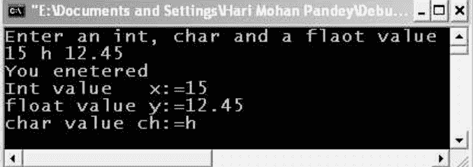

图 2.18. 程序 2.9 的输出屏幕

# EXPLANATION :

在程序中我们有 3 个变量 x 为 int 类型，y 为 float 类型，ch 为 char 类型。这 3 个变量不是通过单个 cin 语句 cin>>x>>ch>>y 读取的。相反，我们通过写 cin>>x>>ch 读取了 int 和 char 类型的数据，然后通过写 cin>>y 读取了下一个数据，即 float 变量 y。

```
/*PROG 2.10 TAKING STRING DATA FROM USER */

#include <iostream.h>
void main()
{
    char s[15];
    cout << "Enter your name" << endl;
    cin >> s;
    cout << "Hello " << s << endl;
}
```

# OUTPUT :

Enter your name
Hari
Hello Hari

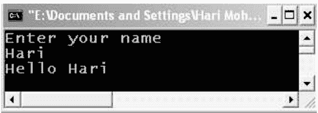

图 2.19. 程序 2.10 的输出屏幕。

# EXPLANATION :

要从用户读取字符串，我们创建一个大小为 15 的字符数组 s。使用 cin >> s 我们接受了字符串 s。注意 cin 会在输入字符串中遇到第一个空白字符时停止，即遇到空格或制表符。所以如果你写 Hari Pandey，只有 Hari 会被接受到 s 中。

```
/* PROG 2.11 FINDING LIMITS OF INTEGRAL DATA TYPES */

#include <iostream.h>
#include <limits.h>
void main()
{
    cout << "CHAR_MIN    := " << CHAR_MIN << endl;
    cout << "CHAR_MAX    := " << CHAR_MAX << endl;
    cout << "INT_MIN     := " << INT_MIN << endl;
    cout << "INT_MAX     := " << INT_MAX << endl;
    cout << "SHRT_MIN    := " << SHRT_MIN << endl;
    cout << "SHRT_MAX    := " << SHRT_MAX << endl;
    cout << "LONG_MIN    := " << LONG_MIN << endl;
    cout << "LONG_MAX    := " << LONG_MAX << endl;


```
cout << "SCHAR_MIN  := " << SCHAR_MIN << endl;
cout << "SCHAR_MAX  := " << SCHAR_MIN << endl;
cout << "UCHAR_MAX  := " << UCHAR_MAX << endl;
cout << "UINT_MAX   := " << UINT_MAX << endl;
cout << "USHRT_MAX  := " << USHRT_MAX << endl;
cout << "ULONG_MAX  := " << ULONG_MAX << endl;
}
```

# OUTPUT :

CHAR_MIN   := -128
CHAR_MAX   := 127
INT_MIN    := -2147483648
INT_MAX    := 2147483647
SHRT_MIN   := -32768
SHRT_MAX   := 32767
LONG_MIN   := -2147483648
LONG_MAX   := 2147483647
SCHAR_MIN  := -128
SCHAR_MAX  := -128
UCHAR_MAX  := 255
UINT_MAX   := 4294967295
USHRT_MAX  := 65535
ULONG_MAX  := 4294967295

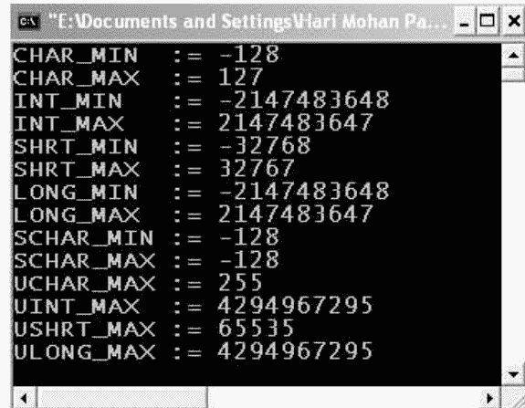

图 2.20. 程序 2.11 的输出屏幕。

解释：为了查找整型数据类型的限制，我们在头文件 limits.h 中有预定义的常量。在程序中我们使用了这些常量并显示了整型数据类型的范围。SHRT 代表 short，UCHAR 代表 unsigned char，SCHAR 代表 signed char 等等。

```
/* PROG 2.12 FINDING RANGES OF FLOATING POINT DATA */

#include <iostream.h>
#include <float.h>

void main()
{
    cout << "FLT_MIN   := " << FLT_MIN << endl;
    cout << "FLT_MAX   := " << FLT_MAX << endl;
    cout << "DBL_MIN   := " << DBL_MIN << endl;
    cout << "DBL_MAX   := " << DBL_MAX << endl;
    cout << "LDBL_MIN  := " << LDBL_MIN << endl;
    cout << "LDBL_MAX  := " << LDBL_MAX << endl;
}

OUTPUT :
FLT_MIN   := 1.17549e-038
FLT_MAX   := 3.40282e+038
DBL_MIN   := 2.22507e-308
DBL_MAX   := 1.79769e+308
LDBL_MIN  := 2.22507e-308
LDBL_MAX  := 1.79769e+308
```

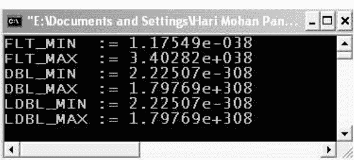

图 2.21. 程序 2.12 的输出屏幕。

解释：为了查找浮点数据类型的范围，我们在头文件 float.h 中有预定义的常量。在 Windows 中 double 和 long double 被视为相同。

# 2.13 可思考要点

- 1. C++ 由 Bjarne Stroustrup 在 80 年代初期在美国新泽西州 Murray Hill 的 AT & T 贝尔实验室开发。
- 2. `cout` 被认为是标准输出流，用于在屏幕上显示数据。
- 3. `cin` 被认为是标准输出流，用于从键盘接收数据。
- 4. 名称 C++ 来自 C 的自增运算符 ++，因为它被认为是 C 的超集，是 C 的一个版本 ahead，所以命名为 C++。
- 5. C++ 中主要有 63 个关键字。
- 6. C++ 程序中最小的独立单元被称为 token。
- 7. `cout` 是 `ostream_withassign` 类的对象，而 `cin` 是 `istream_withassign` 类的对象。
- 8. `>>` 被称为 get from 或提取运算符，并与 `cin` 一起使用。
- 9. `<<` 被称为 put to 或插入运算符，并与 `cout` 一起使用。
- 10. 所有 C++ 程序必须包含基本头文件 `iostream.h`。
- 11. 在 C++ 中开发的第一个应用程序是 “cfront”。
- 12. 为了查找整型数据类型的范围，我们可以使用头文件 `limits.h`，而为了查找浮点数据类型的范围，我们可以使用头文件 `float.h`。
- 
在 C++ 中，变量可以在程序的任何地方声明。变量也可以在声明时进行初始化。这被称为变量的动态初始化。

## 练习

## A. 真假题：

- 1. 提取运算符 `>>` 可以写入字符。
- 2. `cout` 是 ostream 类的对象。
- 3. `cin` 是 iostream 类的对象。
- 4. 面向过程语言基于对象。
- 5. `//` 也可以用于多行注释。
- 6. volatile 关键字不能用于声明变量。

## B. 填空题：

- 1. ........................ 声明指定对象可以在不同的翻译单元之间使用。
- 2. ........................ 被称为提取运算符。
- 3. ........................ 被称为插入运算符。
- 4. ........................ 是 `ostream_withassign` 类的对象。
- 5. ........................ 头文件必须在所有 C++ 程序中使用。

## C. 回答以下问题：

- 1. 什么是 C++？它是如何演变的？
- 2. 什么是 token？C++ 中有哪些不同类型的 token？
- 3. C++ 程序的结构是什么？
- 4. C++ 程序的各种书写风格有哪些，请举例说明？
- 5. 什么是限定符？它们为什么特殊？
- 6. 讨论 C++ 中所有不同类型的数据类型。
- 7. 什么是动态声明和动态初始化？它的优点和缺点是什么？
- 8. >> 和 << 如何工作？
- 9. 解释第一个 C++ 程序的所有组成部分。
- 10. 我们如何找出数据类型的范围，请用程序说明？

## D. 脑力激荡：

- 1. 假设每立方英尺有 7.481 加仑，编写一个程序，要求用户输入加仑数，并显示其相当于立方英尺的数值。
- 2. 编写一个程序生成以下输出：
- 10
- 20
- 19
- 使用整数常量表示 10，使用算术赋值运算符生成 20，并使用递减运算符生成 19。
- 3. 编写一个程序显示你最喜欢的诗。使用适当的转义序列表示换行。
- 4. 你可以将温度从摄氏度转换为华氏度，通过乘以 9/5 并加上 32。编写一个程序，允许用户输入一个代表摄氏度的浮点数，然后显示相应的华氏度。
- 5. 库函数 islower 接受一个字符作为参数并返回一个非零整数，如果该字母是小写字母，或者如果它是大写字母则返回零。该函数需要头文件 CTYPE.H。编写一个程序，允许用户输入一个字母，然后显示零或非零，取决于输入的是小写字母还是大写字母。
- 6. 在某一天，英镑相当于 $1.487US，法国法郎为 $0.172，德国马克为 $0.584，日本日元为 $0.0095。编写一个程序，允许用户输入美元金额，然后将此值转换为这四种其他货币单位。

# 二元运算符

所有需要两个操作数进行操作的操作符被称为 *二元运算符*。例如，如上表所示，所有算术、关系、逻辑（除 !（NOT）运算符外）、逗号、赋值、按位（除 ~ 运算符外）运算符等都是二元运算符。

示例：-2 + 4, 35 > 45, x = 30, 2 & 5.

# 一元运算符

一元运算符是只需要一个操作数进行操作的操作符。例如，如上表所示，自增/自减、!（NOT）、~（按位取反运算符）、sizeof 等都是<|message|> 一元运算符。C 还提供了一元加法和一元减法，即 +20 和 -35。这里 + 和 - 被称为一元加法和一元减法运算符。

示例：+4, -3, ++x, sizeof (int), sizeof(2.0).

注意：? : 运算符被称为三元运算符，因为它需要三个操作数进行操作。一个在 ? 之前，第二个在 ? 之后，第三个在 : 之后。

# 表达式

运算符与操作数构成一个表达式，或常数、变量和运算符的有效组合形成一个表达式，通常由表达式中使用的运算符类型识别。根据该类型，你可能有整数表达式、浮点表达式、关系表达式等。你可能在表达式中有不同类型的运算符，这是一个混合模式表达式。参见下表中的一些示例。

## 表 3.2：表达式类型

| S.No | Expression | Type of Expression |
|---|---|---|
| 1. | 2+3*4/6-7 | Integer Arithmetic |
| 2. | 2.3*4.7/6.0 | Real Arithmetic |
| 3. | a>b!=c | Relational |
| 4. | X && 10 || y | Logical |
| 5. | 2>3+x && y | Mixed |

# 1. 算术运算符

各种算术运算符如表所示

## 表 3.3：算术运算符

| S.No. | Operator | Meaning/ used for |
|---|---|---|
| 1. | + | Addition |
| 2. | - | Subtraction |
| 3. | / | Division |
| 4. | * | Multiplication |
| 5. | % | Remainder |


前四个运算符是自解释的。余数运算符只能与整数一起使用。对于所有其他运算符，如果一个操作数是浮点数而另一个是整数，则结果将在浮点数中。

百分号符号“%”用于求一个数的模。a/b 产生商，而 a%b 其中 % 称为余数运算符，当 a 被 b 除时产生余数。余数运算符背后的数学公式是：
a % b = a – (a / b) * b （其中 a / b 是整数除法）
% 运算符仅适用于整数操作数。切勿使用浮点操作数。C++ 不允许 % 运算符使用浮点操作数。

```
/*PROG 3.1 DEMO OF ARITHMETIC OPERATORS */
#include <iostream.h>
void main()
{
int a,b,sum,sub,div,mul,rem;
cout << "Enter two numbers\n";
cin >> a >> b;
sum = a+b;
sub = a-b;
div = a/b;
mul = a*b;
rem = a%b;
cout << "Sum of " << a << " and " << b << " is " << sum << endl;
cout << "Sub of " << a << " and " << b << " is " << sub << endl;
cout << "Div of " << a << " and " << b << " is " << div << endl;
cout << "Mul of " << a << " and " << b << " is " << mul << endl;
cout << "Rem of " << a << " and " << b << " is " << rem << endl;
}
```

OUTPUT :
Enter two numbers
35 20
Sum of 35 and 20 is 55
Sub of 35 and 20 is 15
Div of 35 and 20 is 1
Mul of 35 and 20 is 700
Rem of 35 and 20 is 15

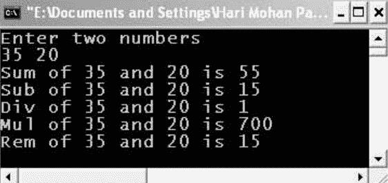

图 3.1. 程序的输出屏幕。

EXPLANATION : 该程序是自解释的。

```
/*PROG 3.2 DEMO OF MODULUS(%)OPERATOR*/

#include<iostream.h>
void main()
{
cout<<17<<"/"<<5<<"="<<17/5<<"\t"<<17<<"%"<<5<<"="<<17%5<<endl;
cout<<-17<<"/"<<5<<"="<<-17/5<<"\t"<<-17<<"%"<<5<<"="<<-17%5<<endl;
cout<<17<<"/"<<-5<<"="<<17/-5<<"\t"<<17<<"%"<<-5<<"="<<17%-5<<endl;
cout<<-17<<"/"<<-5<<"="<<-17/-5<<"\t"<<-17<<"%"<<-5<<"="<<-17%-5<<endl;
}
OUTPUT :
17/5=3 17%5=2
-17/5=-3 -17%5=-2
17/-5=-3 17%-5=2
-17/-5=3 -17%-5=-2
```

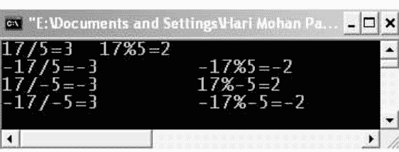

图 3.2. 程序的输出屏幕。

EXPLANATION : 在除法运算中，商的符号取决于两个操作数，即遵循数学规则。在余数运算符 % 中。余数的符号由分子或第一个操作数 % 左侧的操作数的符号决定。如果是 +ve 答案将是 –ve。

# 2. 条件和关系运算符

### 表 3.4 : 关系运算符

| S.No. | Operator | Meaning/ Used for |
| --- | --- | --- |
| 1. | > | 大于 |
| 2. | < | 小于 |
| 3. | >= | 大于等于 |
| 4. | <= | 小于等于 |
| 5. | == | 等于 |
| 6. | != | 不等于 |

两个符号 ? : 一起称为三元或条件运算符。? 之前使用关系运算符指定条件，其中的运算符可以是表 3.4 中给出的任意一个运算符。如果 ? 之前指定的条件为真，则 ? 之后执行的任何表达式或语句都会执行。如果条件为假，则 : （冒号）之后的语句或表达式将被求值。一般语法是：

```
(Condition)? True part: false part;
```

所有关系运算符都产生布尔值，即 true 或 false。true 值用 1 表示，false 值用 0 表示。在表达式中，任何非零值都被视为 true 值。

```
/*PROG 3.3 DEMO OF EQUAL(= =) AND TERNARY(? :) OPERATOR*/

#include <iostream.h>
void main()
{
int a =0;
a ==0 ?cout << "a is zero\n" :
cout << "a is not zero\n";
}
OUTPUT :
a is zero
```

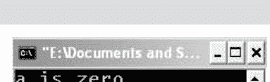

图 3.3. 程序的输出屏幕。

### EXPLANATION :

? 运算符称为条件运算符（也称为三元运算符）工作如下：要检查的条件（此处为 a = =0）写在 ? 之前。条件成功后要执行的操作写在 ? 之后。在本例中语句 cout<<"a is zero\n";。条件失败后要采取的操作写在 : 之后。在本例中语句 cout<<"a is not zero\n";。在条件中检查 a 的值是否等于 0。运算符 == 称为相等运算符。它检查其两侧的操作数是否相等。如果相等则条件为真，否则为假。尝试更改 a 的值，您将得到不同的输出。

Note : 条件运算符始终与关系运算符一起使用。

```
/*PROG 3.4 DEMO OF RELATIONAL OPERATORS*/

#include <iostream.h>
void main()
{
int a=5,b=6,c,d,e,f,g,h;
c=a>b;
d=a<b;
e=(4!=3);
f=(8>=17);
g=(123<=123);
h=(a==b);
cout<<"value of c= "<<c<<endl;
cout<<"value of d= "<<d<<endl;
cout<<"value of e= "<<e<<endl;
cout<<"value of f= "<<f<<endl;
cout<<"value of g= "<<g<<endl;
cout<<"value of h= "<<h<<endl;
}
OUTPUT :
value of c= 0
value of d= 1
value of e= 1
value of f= 0
value of g= 1
value of h= 0
```

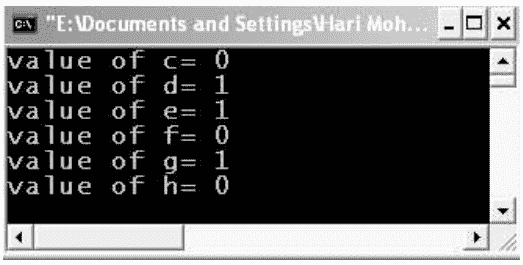

图 3.4. 程序的输出屏幕。

EXPLANATION : 如果条件为真，则返回的值为 1，否则为 0，因此输出。对于真，C++ 假定值为 1，对于假，假定值为 0。

```
/*PROG 3.5 MAXIMUM OF TWO NUMBER VER 1*/

#include<iostream.h>
void main()
{
int a,b,c;
cout<<"Enter the two integer numbers \n";
cin>>a>>b;
c=a>b ?a :b;
cout<<" max of "<<a<<" and "<<b<<" is "<<c<<endl;
}
OUTPUT :
Enter the two integer numbers
15 20
max of 15 and 20 is 20
```

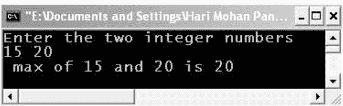

图 3.5. 程序的输出屏幕。

EXPLANATION : 如果 a 大于 b，则 a 被赋给 c，否则 b 被赋给 b。在任何情况下，两个数的最大值都存储在 c 中，然后由 cout 打印。程序中未检查两个数相等的条件，这在下面的修改程序中显示。

### /*PROG 3.6 MAXIMUM OF TWO NUMBERS VER 2*/

```
#include <iostream.h>
void main()
{
int a,b;
cout << "Enter two integer numbers \n";
cin >> a >> b;
(a == b) ? cout << a << " is equal to " << b : (a > b) ? cout << a << " is max \n " : cout << b << " is max\n";
}
```

### OUTPUT :

(First run)
Enter two integer numbers
50 50
50 is equal to 50
(Second run)
Enter two integer numbers
50 67
67 is max

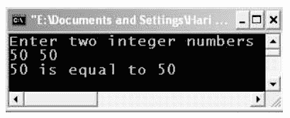

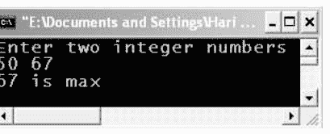

图 3.6. 程序第一次和第二次运行的输出屏幕。

### EXPLANATION :

仔细观察上面的程序。嵌套三元运算符（一个在另一个内部）是为了实现目标而完成的。如果第一个条件失败，则在冒号 (:) 部分我们检查是否 a>b。如果这是真的，则 ? 之后的语句（在 a>b 之后）执行，即在三元运算符的失败部分我们有另一个三元运算符。这称为三元运算符的嵌套。

# 3. 逻辑运算符

逻辑运算符用于检查两个表达式之间的逻辑关系。根据表达式的真假或假，它们被赋值为 1（真）和 0（假）。表达式可以是变量、常量、函数等。见下表：

### 表 3.5 : 逻辑运算符

| S.No. | Symbol | Meaning |
| --- | --- | --- |
| 1. | && | AND |
| 2. | || | OR |
| 3. | ! | NOT |

&& 和 || 是二元运算符。对于 && 要返回真值，其两个操作数都必须产生真值。对于 || 要产生真值，至少有一个操作数产生真值。NOT (!) 运算符是单目运算符。它否定其操作数，即如果操作数为真则将其转换为假，反之亦然。

```
/*PROG 3.7 DEMO OF LOGICAL OPERATOR && (LOGICAL AND) VER 1*/

#include <iostream.h>
void main()
{
int res,a=10,b=20;
res=(a>=10 && b==20);
cout << "Returned value in res= " << res << endl;
}
OUTPUT :
Returned value in res= 1
```

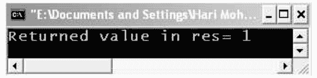

# 图 3.7. 程序的输出屏幕。

EXPLANATION : && 称为 AND 运算符。在此运算符的两个条件上都指定了条件。如果两个条件都为真，则返回值为真即 1，否则返回假值即 0。在上面的程序中，表达式中的两个条件都为真，因此 res 包含 1 作为结果。

```
/*PROG 3.8 DEMO OF LOGICAL OPERATOR && (AND)VER 2*/

#include <iostream.h>
void main()
{
int res, a=0,b=2;
res=(a!=0 && b<=2);
```


```cpp
cout << "Returned value in res= " << res << endl;
}
```

**输出：**

```
Returned value in res= 0
```

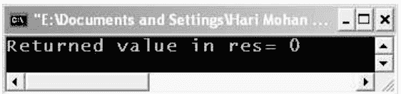

**图 3.8.** *程序的输出屏幕。*

**说明：** 在该表达式中，`&&` 之前的条件为假，`&&` 之后的条件为真，因此整个表达式的值为假，所以将 `0` 赋给 `res`。

## 逻辑或 (||)

该运算符作用于两个操作数，操作数可以是任何表达式、变量、常量或函数。它检查其任一操作数是否返回真值。如果其中任何一个返回真值，则返回真值，即十进制 1。如果两个操作数都为假，则返回假值，即十进制 0。

```cpp
/*PROG 3.9 DEMO OF LOGICAL OR OPERATOR (||)*/

#include <iostream.h>
void main()
{
    int res, a = 100, b = 120;
    res = (a >= 100 || b < 0);
    cout << "Returned value in res= " << res << endl;
}
```

**输出：**

```
Returned value in res= 1
```

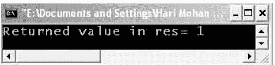

**图 3.9.** *程序的输出屏幕。*

**说明：** `||` 称为或运算符。该运算符两侧都指定了条件。如果任一条件为真，则返回值为真，即 1，否则为 0。在上述程序中，表达式中的第一个条件为真，但第二个条件为假，因此 `res` 中的结果为 1。

## 逻辑非 (!)

该运算符将真值转换为假值，反之亦然。同样，操作数可以是任何表达式、常量、变量或函数。

```cpp
/*PROG 3.10 DEMO OF LOGICAL OPERATOR !(NOT) VER 1*/

#include <iostream.h>
void main()
{
    int res, a = 1;
    res = !a;
    cout << "Returned value in res= " << res << endl;
}
```

**输出：**

```
Returned value in res= 0
```

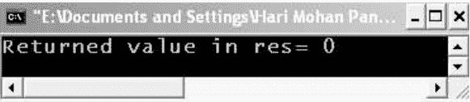

**图 3.10.** *程序的输出屏幕。*

**说明：** `!` 称为非或否定运算符。它是一个一元运算符，意味着它只需要一个操作数。如果操作数的值非零，则转换为假值，即 0，反之亦然。同样，如果指定了真条件，它将变为假，反之亦然。尝试将 `a` 的值改为零，`res` 中的返回值将为 1。

```cpp
/*PROG 3.11 DEMO OF LOGICAL OPERATOR (NOT ! OPERATOR) VER 2*/

#include <iostream.h>
void main()
{
    int res;
    res = !(10 > 5 && -4 <= 1);
    cout << "returned value in res  := " << res << endl;
}
```

**输出：**

```
returned value in res  := 0
```


**图 3.11.** *程序的输出屏幕。*

**说明：** `&&` 运算符中的两个条件都为真，因此整个内部表达式为真；取反后，返回值将为 0。

# 4. 赋值运算符

`=` 运算符称为赋值运算符。在前面许多程序中我们已经见过该运算符的多个实例。该运算符的另一个用途是缩短以下类型的表达式：

```
x = x + 1, y = y * (x - 5), a = a / 10, t = t % 10;
```

在上述所有表达式中，`=` 运算符两侧的变量相同，因此我们可以将上述表达式改为更短的形式，如下所示：

```
x = x + 1        =>   x += 1
y = y * (x - 5)  =>   y *= (x - 5)
a = a / 10       =>   a /= 10
t = t % 10       =>   t %= 10
```

这种 `op=` 形式（其中运算符可以是任何运算符）称为复合运算符或简写赋值运算符。

# 5. 自增运算符 (++) 和自减运算符 (--)

运算符 `++` 称为自增运算符，运算符 `--` 称为自减运算符。两者都是一元运算符。`++` 将其操作数的值增加 1，`--` 将其操作数的值减少 1。例如，`++x` 变为 11，`--x` 变为 9（假设操作前 `x = 10`）。

更多解释请参见下面的程序：

```cpp
/*PROG 3.12 DEMO OF ++ OPERATOR VER 1*/

#include <iostream.h>
void main()
{
    int x;
    x = 20;
    cout << "Before increment x = " << x << endl;
    x++;
    cout << "After increment x = " << x << endl;
}
```

**输出：**

```
Before increment x = 20
After increment x = 21
```

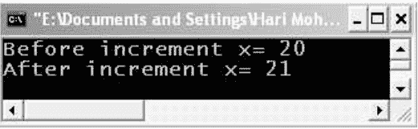

**图 3.12.** *程序的输出屏幕。*

**说明：** `++` 运算符称为自增运算符。它是一个一元运算符，即它只需要一个操作数即可操作，使操作数的值增加 1，即 `x++` 等价于 `x = x + 1`。如果 `++` 写在操作数之前，即 `++x`，则称为前自增；如果 `++` 写在操作数之后，即 `x++`，则称为后自增。在上述程序中，我们使用了后自增运算符。如果我们使用前自增，输出结果相同。要区分两者，请看接下来的两个程序。

```cpp
/*PROG 3.13 DEMO OF ++ OPERATOR VER 2*/

#include <iostream.h>
void main()
{
    int x, y;
    x = 20;
    y = x++;
    cout << "x=" << x << "\t" << "y=" << y << endl;
}
```

**输出：**

```
x = 21 y = 20
```

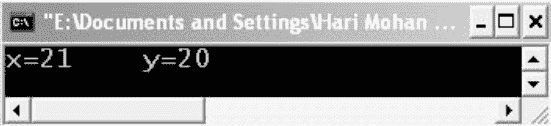

**图 3.13.** *程序的输出屏幕。*

**说明：** 在上述程序中，我们对 `x` 使用了后自增运算符，并将值赋给 `y`。由于后自增，首先将 `x` 赋给 `y`，然后 `x` 增加 1，即 `y = x++` 等价于以下语句：

```
y = x;
x = x + 1;
```

如果我们写 `x = 20; y = ++x;`，那么由于前自增，首先 `x` 将增加 1，然后这个增加后的值被赋给 `y`。`y = ++x` 等价于以下两条语句：

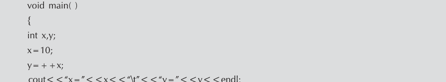

> 注意：只有 `++` 运算符用于将操作数的值增加 1。没有像 `+++` 或 `++++` 这样的运算符可以将值增加 2 或 3。

```cpp
/*PROG 3.14 DEMO OF ++ OPERATOR VER 3*/

#include <iostream.h>
void main()
{
    int x, y;
    x = 10;
    y = ++x;
    cout << "x=" << x << "\t" << "y=" << y << endl;
    --x;
    cout << "x=" << x << endl;
    y--;
    cout << "y=" << y << endl;
    x = y++;
    cout << "x=" << x << "\t" << "y=" << y << endl;
    y = --x;
    cout << "x=" << x << "\t" << "y=" << y << endl;
    x = y++;
    cout << "x=" << x << "\t" << "y=" << y << endl;
}
```

**输出：**

```
x=11 y=11
x=10
y=10
x=10 y=11
x=9 y=9
x=9 y=10
```

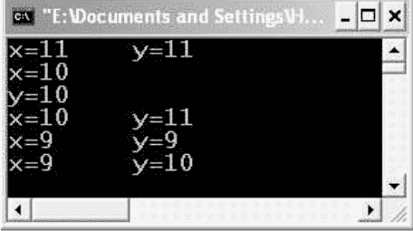

**图 3.14.** *程序的输出屏幕。*

**说明：** 为了解释，请观察下表：

| 语句 | x 的值 | y 的值 |
|---|---:|---:|
| `y = ++x` | 11 | 11 |
| `--x` | 10 | 11 |
| `y--` | 10 | 10 |
| `x = y++` | 10 | 11 |
| `y = --x` | 09 | 09 |
| `x = y++` | 09 | 10 |

```cpp
/*PROG 3.15 DEMO OF ++ OPERATOR VER 4*/

#include <iostream.h>
void main()
{
    int x;
    x = 10;
    cout << --x << endl << ++x << endl << x << endl << x++ << endl
         << x-- << endl;
}
```

**输出：**

```
10
11
10
9
10
```

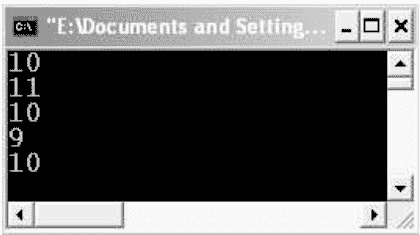

**图 3.15.** *程序的输出屏幕。*

**说明：** 输出将从 `cout` 语句的右侧开始确定：

| 语句 | x 的值 | 解释 |
|---|---:|---|
| `x--` | 10 | 先打印 x 的值，然后递减 |
| `x++` | 09 | 先打印 x 的值，然后递增 |
| `x` | 10 | 打印 x 的值 |
| `++x` | 11 | 先递增 x 的值，然后打印 |
| `--x` | 10 | 先递减 x 的值，然后打印 |

所以输出为 10 11 10 9 10。

# 6. 位运算符

它们之所以被称为位运算符，是因为它们对位进行操作。它们可用于位的操作。所有这些运算符在硬件接口对接以及设备寄存器中位的设置方面被广泛使用。C 语言共提供了 6 种位运算符，如下所示：

**表 3.6：位运算符**

| 序号 | 运算符 | 含义/用途 |
|---|---|---|
| 1. | `&` | 按位与 |
| 2. | \| | 按位或 |
| 3. | `^` | 按位异或 |
| 4. | `~` | 按位取反 |
| 5. | `>>` | 右移 |
| 6. | `<<` | 左移 |

对于以下所有程序，为了便于解释，我们只考虑数字的前 4 位。因此，在有符号数的情况下，可能的数字范围是 -8 到 7（`-2^3` 到 `2^3 - 1`），在无符号数的情况下是 0 到 `2^4 - 1`。如果你假设数字使用 8 位，那么即使可以用 4 位表示，也要使用完整的 8 位。例如，10 可以用 4 位写成 1010，用 8 位写成 00001010。


## 按位与 (&)

它将两个位作为操作数，如果两者都是 1 则返回值为 1。如果其中任一为 0，结果为 0。

## 表 3.7：按位与真值表

| 第一个位 | 第二个位 | 结果 |
|---|---|---|
| 0 | 0 | 0 |
| 0 | 1 | 0 |
| 1 | 0 | 0 |
| 1 | 1 | 1 |

```
/*PROG 3.16 DEMO OF BITWISE OPERATOR &(BITWISE AND)*/

#include<iostream.h>
void main()
{
int a,b;
a=2;
b=3;
int c=a&b;
cout<<"The value of c :="<<c<<endl;
}
OUTPUT :
The value of c : =2
```

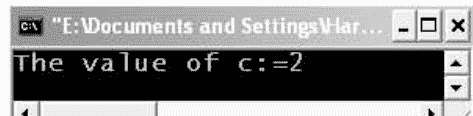

图 3.16. 程序的输出屏幕。

解释：a=2 的二进制值为 0010，b=3 为 0011

对这些值进行按位与运算如下：

0 0 1 0
0 0 1 1
--------
0 0 1 0   (输出到 c 的值为十进制 2)

如果两个位都是 1，使用 & 运算符输出位将为 1，否则为 0。

## 按位或 (|)

它将两个位作为操作数，如果至少一个为 1 则返回值为 1。如果两者都为 0，则结果为 0，否则为 1。

## 表 3.8：按位或真值表

| 第一个位 | 第二个位 | 结果 |
|---|---|---|
| 0 | 0 | 0 |
| 0 | 1 | 1 |
| 1 | 0 | 1 |
| 1 | 1 | 1 |

```
/*PROG 3.17 DEMO OF BITWISE OPERATOR |(BITWISE OR)*/

#include<iostream.h>
void main()
{
int a,b;
a=12;
b=7;
int c= a|b;
cout<<"The value of c :="<<c<<endl;
}
OUTPUT :
The value of c :=15
```

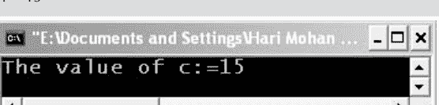

图 3.17. 程序的输出屏幕。

解释：a=12 的二进制值为 1100，b =7 为 0111

对这两个值进行或运算如下：
    1 1 0 0
    0 1 1 1
  ---------
    1 1 1 1   (输出到 c 的值为十进制 15)?

如果任一位为 1，使用或运算符输出将为 1。

## 按位异或 (^)

该运算符至少接受两个位（可能多于两个）。如果 1 的个数为奇数，则结果为 1，否则结果为 0。

## 表 3.9：按位异或真值表

| 第一个位 | 第二个位 | 结果 |
|-----------|------------|--------|
| 0 | 0 | 0 |
| 0 | 1 | 1 |
| 1 | 0 | 1 |
| 1 | 1 | 0 |

```
/*PROG 3.18 DEMO OF BITWISE OPERATOR ^(XOR)*/
#include <iostream.h>
void main()
{
int a,b;
a=5;b=6;
int c = a^b;
cout << "The value of c : " << c << endl;
}

OUTPUT :
The value of c : = 3
```

图 3.18. 程序的输出屏幕。

解释：a =5 的二进制值为 0101，b = 6 为 0110
对这两个值进行异或运算如下：

 0 1 0 1
 0 1 1 0
-----------
 0 0 1 1 
 (输出到 c 的值为十进制 3)

如果存在奇数个 1，使用异或运算符输出将为 1，否则输出为 0。

## 左移运算符 (<<)

我们之前在几乎所有程序中都见过这个运算符，它也被称为插入或 put to 运算符。该运算符用于移位其操作数的位。它写为 x<<num; 表示将 x 的位向左移动 num 次。最低有效位 (LSB) 位置会填入一个新零。 （见下面给出的程序）

```
/*PROG 3.20 DEMO OF BITWISE OPERATOR <<(LEFT SHIFT) VER 1*/

#include<iostream.h>
void main()
{
int a,b;
a=2;
b=a<<1;
cout<<"The value of b :="<<b<<endl;
}
OUTPUT :
The value of b : = 4
```

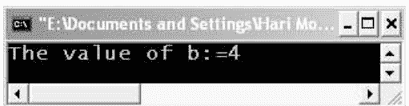

图 3.20. 程序的输出屏幕。

解释：a<<1 表示将 ‘a’ 的内容向左移动 1 位。如果我们将数字 2 表示为二进制：

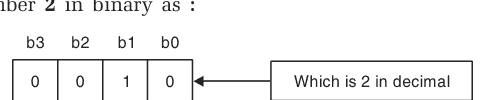

其中 b0 是从左起的第一位，称为最低有效位 (LSB)，b3 称为最高有效位 (MSB)。向左移动 1 位会导致 b3 丢失其值并从 b2 获取，b2 从 b1 获取，b1 从 b0 获取，在 b0 插入一个新零。因此结果位模式为：

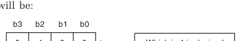

如果您写：a<<2 表示将 a 的内容向左移动两次。

## 面向对象编程 C++ 简化

a 中的原始值为 0010

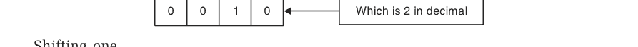

移动一次

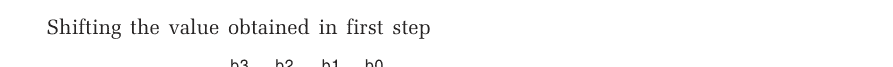

移动第一步得到的值


注意：向左移动一位会使数字乘以 2。

该运算符用于移位其操作数的位。它写为 x >> num; 表示将 x 的位向右移动 num 次。最高有效位 (MSB) 位置会填入一个新零。

见下面给出的程序：

```
/*PROG 3.21 DEMO OF BITWISE OPERATOR >>(RIGHT SHIFT)VER 1*/
#include <iostream.h>
void main()
{
int a=8,b;
a>>=1;
b=a>>1;
cout<<"The value of b :="<<b<<endl;
}

OUTPUT :
The value of b : = 4
```

图 3.21. 程序的输出屏幕。

解释：a>>=1 表示将 'a' 的内容向右移动 1 位。如果我们将数字 8 表示为二进制：


向右移动 **1 位** 会导致 **b0** 丢失其值并从 **b1** 获取，**b1** 从 **b2** 获取，**b2** 从 **b1** 获取，在 **b3** 插入新零。因此结果位模式为：

| b3 | b2 | b1 | b0 |
|---|---|---|---|
| 1 | 0 | 0 | 0 |

| b3 | b2 | b1 | b0 |
|---|---|---|---|
| 0 | 1 | 0 | 0 |

如果您写 a>>2，表示将 ‘a’ 的内容向右移动两次
a 中的原始值 =1000

| b3 | b2 | b1 | b0 |
|---|---|---|---|
| 1 | 0 | 0 | 0 |

移动一次后

| b3 | b2 | b1 | b0 |
|---|---|---|---|
| 0 | 1 | 0 | 0 |  → (十进制 4)

移动第一步得到的值。

| b3 | b2 | b1 | b0 |
|---|---|---|---|
| 0 | 0 | 1 | 0 |

即十进制 2，是最终输出。

注意：向右移动一位会使数字除以 2。

# sizeof 运算符

该运算符用于查找特定类型或常量的特定变量在内存中占用的字节数。这是唯一既可作为运算符又可作为函数工作的运算符。

```
/*PROG 3.22 DEMO OF SIZEOF OPERATOR VER 1*/

#include <iostream.h>
void main()
{
short int a;
int b;
float c;
double e;
cout << "Size of short int variable  a :=" << sizeof(a) << endl;
cout << "size of int variable        b :=" << sizeof(b) << endl;
cout << "Size of float variable      c :=" << sizeof(c) << endl;
cout << "Size of double variable e :=" << sizeof(e) << endl;
cout << endl;
}
OUTPUT :
Size of short int variable  a : =2
size of int variable        b : =4
Size of float variable      c : =4
Size of double variable     e : =8
```

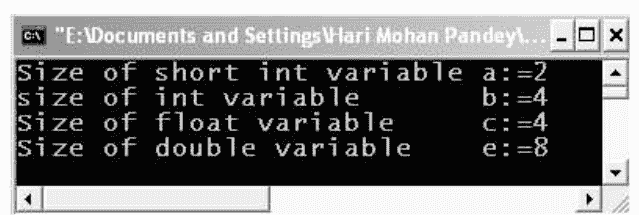

图 3.22. 程序的输出屏幕。

解释：该程序给出不同类型变量占用的内存字节数。Turbo C/C++ 中 int 变量的大小为 2 字节，而在 Windows 中为 4 字节。

```
/*PROG 3.23 DEMO OF SIZEOF OPERATOR VER 2*/

#include <iostream.h>
void main()
{
cout << "Size of char constants  : = " << sizeof('A') << endl;
cout << "Size of int variable    : = " << sizeof(14) << endl;
cout << "Size of float variable  : = " << sizeof(5.6F) << endl;
cout << "Size of double variable : = " << sizeof(56.78) << endl;
cout << endl;
}
OUTPUT :
Size of char constants  : = 1
Size of int variable    : = 4
Size of float variable  : = 4
Size of double variable : = 8
```

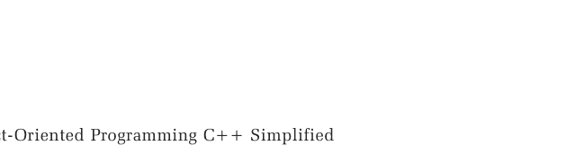

# 图 3.24. 程序的输出屏幕。

逗号运算符的结合性（见下一节）是从左到右，最右值赋给 x，即上述程序中 c 的值。

```
/*PROG 3.25 DEMO OF COMMA OPERATOR VER 2*/
#include <iostream.h>
void main()
{
int a=2,b=3,c=4,x=2;
x=(c--,c++,c++,+a);
cout<<"The value of x :="<<"<x<"<<"\nThe value of c :="
<<c<<endl;
cout<<endl;
}

OUTPUT :
The value of x : = 3
The value of c : = 4
```


# 图 3.25. 程序的输出屏幕。

如前所述，逗号运算符从左到右工作。因此 c 在 c-- 后变为 3，在 c++ 后再次变为 4。‘a’ 的值由于 ++a 变为 3，该值被赋给 x，因此输出。

## 3.3 声明常量

常量是不可更改的值。例如，π 的值为 22/7 或 3.14，这是一个常量。为了在程序中使用常量，C 主要定义了三种声明常量的方法。我们逐一讨论它们。


# 1. #define 指令的使用

#define 预处理指令可用于声明常量。其一般语法如下：

```
#define constant_name value
```

#define 与 constant_name 之间必须至少有一个空格。例如：#define PI 3.14 声明了一个名为 PI 的常量（实际上是宏常量），其值为 3.14。PI 与 3.14 之间不应有赋值运算符（=）。每个宏常量必须单独声明在一行上。宏常量也称为符号常量，因为我们使用字符串符号来定义常量。

```
/*PROG 3.26 DEMO OF CONSTANT #DEFINE*/

#define PI 3.14
#define H "hello"
#define DMC "Demo of macro constant"
#include <iostream.h>
void main()
{
cout << H << endl;
cout << DMC << endl;
cout << "The value of PI" << PI << endl;
}
OUTPUT :
hello
Demo of macro constant
The value of PI3.14
```


图 3.26. 程序的输出屏幕。

EXPLANATION : 我们在程序中使用了三个符号常量，名为 PI、H 和 DMC。第一个（PI）是浮点常量，另外两个是字符串常量。在编译之前，它们会被一个名为预处理器的特殊程序处理，该程序用其值替换宏常量出现的所有位置。每个宏常量都写成大写，这不是必须的，但为了区分宏名和变量，我们将宏声明为大写，变量声明为小写。

**EXPLANATION :** 对于字符串常量，我们使用了 **char** 指针变量。其余内容不言自明。

## 3. 使用 enum 声明常量

我们通过一个示例来理解 **enum** 的使用：

```
enum my_cons
{
    MIN;
    MID;
    MAX;
};
```

上述声明使用 **enum** 关键字创建了新的数据类型 **my_cons**。{ } 内的声明语句创建了三个 **int 类型** 常量，**MIN、MID 和 MAX**，它们被称为 **枚举常量。** 默认情况下，**MIN 的值为 0，MID 的值为 1，MAX 的值为 2。** 由于它们是常量，因此在程序中无法更改。它们只能是 **int** 和 **char** 类型。不允许其他类型。再举一个例子。

```
enum colors
{
    RED;
    GREEN=25;
    BLUE;
};
```

在此示例中，**RED** 的值将为 **0**，**GREEN** 将为 **25**，**BLUE** 将为 **26。** 关键字 **enum** 用于创建枚举常量，也称为符号常量。创建枚举常量后，可以创建枚举类型变量，例如：

```
enum colors col1, col2;
```

这些枚举变量 **col1** 和 **col2** 可以赋予之前创建的枚举常量，如：

```
col1 = RED; col2 = BLUE;
```

尽管变量 **col1** 和 **col2** 可以赋予任何整数值，但通常它们被赋予枚举常量。即以下内容也是有效的 **col1=34; col2= 45;**

我们给出一些编程示例。

```
/*PROG 3.28 DEMO OF ENUMERATION CONSTANTS VER 1*/

#include <iostream.h>
void main()
{
enum colors
{
red, green,blue
};
enum OS
{
dos=1,linux,windows,unix
};
cout << "red=" << red << "\tgreen=" << green << "\tblue="
<< blue << endl;
cout << "dos=" << dos << "\tlinux=" << linux << "\twindows="
<< windows << "\tunix=" << unix << endl;
}
OUTPUT :
red=0 green=1 blue=2
dos=1 linux=2 windows=3 unix=4
```


图 3.28. 程序的输出屏幕。

EXPLANATION : 该程序不言自明。枚举常量主要用于 switch-case 构造中。

注意：关于枚举器的以下几点：

- 枚举器在同一枚举类型中的值不必是不同的。
- 不同枚举类型中枚举器的名称必须不同。
- 枚举器的名称必须与其他普通变量不同。
- 编译器仅将枚举器视为整数常量。

# 3.4 类型转换

有时在表达式中我们需要将变量或常量的数据类型进行转换，例如从 float 到 int 或 int 到 float 等。C 支持两种类型的转换：

- 1. 隐式类型转换。
- 2. 显式类型转换。

## 1. 隐式类型转换

在此类转换中，编译器根据表达式在内部转换类型，而不让用户知道。例如，如果你写

```
int num = 34.56;
```

那么 **num** 将被赋值为 **34** 而不是 **34.56** 被视为 **double** 并发生内部转换从 **double** 到 **float** 再从 **float** 到 **int**，并将 **34** 赋给变量 **num。**

再举一个例子，考虑以下代码片段。

```
int a = 10;
float b = 2.5, c;
c = a + b;
```

在表达式 **c = a + b** 中，‘**a**’ 和 ‘**b**’ 的类型不同。根据大小，**float** 大于 int，因此变量 ‘**a**’ 在内部转换为 **float**，然后执行加法，因此得到的结果也将为 **float。**

转换总是从较低数据类型到较高数据类型进行。例如，**char** 可以转换为 int、long int、float、double 和 long double。类似地，int 可以转换为 float、long int 和 long double 等等。

## 2. 显式类型转换

在此类转换中（也称为类型 **强制转换**），我们显式地将变量或常量的数据类型从一种转换为另一种。例如，

```
int a = 10;
float x = a/3;
```

在上述表达式 **x = a/3** 中，**x 和 3** 都是 int 类型，因此输出将为 3.000000 而不是 **3.333333**，即使 **x** 的类型为 float。为了得到所需的结果，我们将 a 强制转换为 float，写法为

```
x = (float) a/3;
```

我们也可以写 **a/3.0** 来得到相同的结果。

# 3.5 决策制定：简介

决策制定语句是根据某些情况改变程序中语句执行顺序所必需的。在没有决策制定语句的情况下，程序按 **串行方式** 逐条语句执行。我们在前面章节给出的程序中见过示例。在本章中，我们将编写语句，根据某些决策控制执行流程。决策可以基于某些逻辑条件的成功或失败做出。它们允许我们控制程序的流程。这些条件可以使用决策制定语句放置在程序中。C 语言支持以下决策制定控制语句：

- (a) if 语句
- (b) if-else 语句
- (c) if-else-if 阶梯语句
- (d) switch-case 语句。

所有这些决策制定语句都检查给定的条件，然后在条件为真时执行其子块。在条件为假时，块将被跳过。（块是一组用打开和关闭大括号 { 和 } 括起来的语句）。所有控制语句都使用关系运算符和逻辑运算符的组合来形成条件，以满足程序员的需求。

## 1. if 语句

if 语句的一般语法如下：

```
if (condition)
{
    Statements;
    Statements;
    Statements;
    ...........;
}
```

if 语句用于根据条件的真假执行/跳过一组语句。需要检查的条件放在 if 关键字后面的括号内。

```
/*PROG 3.29 DEMO OF IF STATEMENT */

#include <iostream.h>
void main()
{
int x;
cout << "Enter the value of x\n";
cin >> x;
if(x >= 1000)
{
cout << "x is greater than or equal to 1000" << endl;
cout << "You think high" << endl;
}
cout << "X is less than 1000";
}
```

# OUTPUT :

(First run)
Enter the value of x
275
x is greater than or equal to 100
You think high
X is less than 100

(Second Run)
Enter the value of x
90
X is less than 100


# EXPLANATION :

你可以在 if 之后的大括号内放置任意数量的语句，并且所有语句都依赖于 if 条件。

- 1. if (x) 等价于 if(x!=0)
- 2. if (!x) 等价于 if(x==0)

### 2. if-else 语句

在所有上述程序中，我们没有编写 if 条件的另一面，即我们没有在条件失败时采取行动。if-else 构造允许我们做到这一点。


其一般语法是：

```cpp
if(condition)
{
    Statements;
    Statements;
    ............;
}
else
{
    Statements;
    Statements;
    ............;
}
```

如果 if 中的条件为真，则 if 后面的块中的所有语句都会被执行，否则它们将被跳过并执行 else 部分。

```cpp
/*PROG 3.30 CHECKING THE NUMBER IS EVEN OR ODD USING IF–ELSE STATEMENT*/
#include<iostream.h>
void main( )
{
    int a;
    cout << "Enter any integer number \n";
    cin >> a;
    if(a%2 == 0)
        cout << "number is even\n";
    else
        cout << "number is odd\n";
}
```

```text
OUTPUT :
(First run)
Enter any integer number
40
number is even
(Second Run)
Enter any integer number
17
number is odd
```


Figure 3.31. Output screen of first and second run of program.

### EXPLANATION :

% 的优先级高于 ==，因此 a%2 与 0 进行比较。如果为真，则该数字为偶数，否则数字不是偶数。仅当 if 部分为假时 else 部分才执行，反之亦然。在程序中，if 和 else 部分都只包含一个语句，因此不需要大括号，不过如果加上也不会有任何危害。条件也可以按以下方式书写：

```cpp
if(num%2!=0)
    printf("number is odd\n");
else
    printf("number is even\n");
```

```cpp
/*PROG 3.31 TO CALCULATE GROSS SALARY OF THE PERSON. GIVEN BASIC SALARY(BS) AS INPUT. IF BS IS >5000 DA=55% OF BS AND HRA=15% BS ELSE DA=45% OF BS AND HRA=10% OF BS*/

#include <iostream.h>
void main()
{
    float bs,gs,hra,da;
    cout<<"Enter your basic salary"<<endl;
    cin>>bs;
    if(bs<=5000)
    {
        da=(bs*45)/100;
        hra=(bs*10)/100;
    }
    else
    {
        da=(bs*55)/100;
        hra=(bs*15)/100;
    }
    gs=bs+da+hra;
    cout<<"Basic salary is="<<bs<<endl;
    cout<<"HRA is="<<hra<<endl;
    cout << "DA is=" << da << endl;
    cout << "Gross salary is=" << gs << endl;
}
```

```text
OUTPUT :
Enter your basic salary
8825
Basic salary is=8825
HRA is=1323.75
DA is=4853.75
Gross salary is=15002.5
```


Figure 3.32. Output screen of program.

### EXPLANATION :

我们将基本工资输入到 bs 中。通过 if 条件我们检查基本工资 bs 是否为 5000。根据 if 条件为真或为假，hra 和 da 按照问题中指定的条件计算。

## 3. if-else 的嵌套

if-else 的嵌套意味着一个 if-else 或简单的 if 作为另一个 if-else 或简单 if 语句的一部分。if-else 的嵌套可能有各种语法，我们介绍其中几种：

### Syntax-1

```cpp
if(condition)
{
    if(condition)
    {
        Statements;
        Statements;
        Statements;
        .................
    }
    else
    {
        Statements;
        Statements;
        Statements;
    }
}
```

在上述情况下，第一个 if 没有 else 部分。

### Syntax-2

```cpp
if(condition)
{
    if(condition)
    {
        Statements;
        Statements;
        Statements;
    }
    else
    {
        Statements;
        Statements;
        Statements;
    }
}
else
{
    Statements;
    Statements;
    Statements;
}
```

### Syntax-3

```cpp
if(condition)
{
    if(condition)
    {
        Statements;
        Statements;
        Statements;
    }
    else
    {
        Statements;
        Statements;
        Statements;
    }
}
else
{
    if(condition)
    {
        Statements;
        Statements;
        Statements;
    }
    else
    {
        Statements;
        Statements;
        Statements;
    }
}
```

```cpp
/* PROG 3.32 TO CHECK WHETHER A YEAR IS LEAP YEAR OR NOT VER 1*/

#include <iostream.h>
void main()
{
    int year;
    cout << "Enter any year\n";
    cin >> year;
    if(year % 100 == 0)
    {
        if(year%400 == 0)
            cout<<"The given year is leap year\n";
        else
            cout<<"The given year is not a leap year\n";
    }
    else
    {
        if(year %4 == 0)
            cout<<"The given year is leap year\n";
        else
            cout<<"The given year is not a leap year\n";
    }
}
```

```text
OUTPUT :
(First Run)
Enter any year
2000
The given year is leap year
(Second run)
Enter any year
2007
The given year is not a leap year
```


Figure 3.33. Output screen of first and second run of program.

### EXPLANATION :

一年是闰年，如果它能被 100 和 400 整除，或者不能被 100 整除但能被 4 整除。最初如果 year %100 为零，内部的 if 检查 year %400 是否为零。如果是，则该年为闰年，否则该年不是闰年。如果外部的 if 失败，则执行其对应的 else 部分，在其中我们检查 year % 4 ==0，如果为真则该年为闰年，否则该年不是闰年。

```cpp
/*PROG 3.33 MAXIMUM OF THREE NUMBERS*/

#include <iostream.h>
void main()
{
    int x,y,z;
    cout << "Enter the three numbers\n";
    cin >> x >> y >> z;
    if((x == y) && (y == z))
        cout << "All three are equal\n";
    else if(x>y)
    {
        if(x>z)
            cout << "Maximum is=" << x << endl;
        else
            cout << "Maximum is=" << z << endl;
    }
    else
    {
        if(y>z)
            cout << "Maximum is=" << y << endl;
        else
            cout << "Maximum is=" << z << endl;
    }
}
```

```text
OUTPUT :
Enter the three numbers
34 765 234
Maximum is=765
```


Figure 3.34. Output screen of program.

### EXPLANATION :

如果三个数字不相等，我们检查 a>b，如果为真意味着 a 大于 b，我们然后检查 a>c，如果是则 a 为最大，否则 c 为最大。如果 a>b 最初为假意味着 b 大于 a，我们然后检查 b>c，如果是则 b 为最大，否则 c 为最大。

# 4. else-if 阶梯

else-if 阶梯的一般语法如下所示：

```cpp
if (condition)
    Statements;
else if(condition)
    Statements;
else if(condition)
    Statements;
.................;
.................;
```

如果第一个 if 条件得到满足，则执行其所有相关语句，并且所有其他 else-if 都被跳过。仅当第一个 if 失败时，控制才会到达第一个 else-if。第二个、第三个和其他 else-if 也是如此，取决于你的程序需要。即在这个 else-if 阶梯中只有一个 if 条件会被满足。

```cpp
/*PROG 3.34 TO ARRANGE THREE NUMBERS IN ASCENDING ORDER*/

#include <iostream.h>
void main()
{
    int a,b,c,min,max,mid;
    cout<<"Enter the three number"<<endl;
    cin>>a>>b>>c;
    if(a>b && a>c)
        max=a;
    else if(b>a && b>c)
        max=b;
    else if(c>a && c>b)
        max=c;
    if(a<b && a<c)
        min=a;
    else if(b<a && b<c)
        min=b;
    else if(c<a && c<b)
        min=c;
    mid=(a+b+c)-(min+max);
    cout<<"Number in ascending order "<<min
        <<"\t"<<mid<<"\t"<<max<<endl;
}
```

```text
OUTPUT :
Enter the three number
34 57 90
Number in ascending order 34 57 90
```


Figure 3.35. Output screen of program.

### EXPLANATION :

在变量 max 中我们存储了三个数中的最大值，在变量 min 中我们存储了三个数中的最小值。mid 是通过用 (min + max) 从 a、b、c 的和中减去得到的，即 (a + b + c)。

# 5. switch-case 语句

switch-case 语句可用于替换 else-if 阶梯结构。其一般语法如下：

```cpp
switch(expression)
{
    case choice1 :
        statements;
        break;
    case choice2 :
        statements;
        break;
    case choice3 :
        statements;
        break;
        ...........................;
        ...........................;
    default :
}
```

表达式可以是任何整数或字符类型，其结果仅为字符或整数。choice 1、choice 2 和 choice n 是我们将与表达式进行测试的可能值。如果从 choice 1 到 choice n 的值中没有一个与表达式的值匹配，则执行 default 分支。

### Some Points For switch-case Statements

- switch 语句是一个多分支语句。
- 如果有可能从多个选项中做出选择，这种结构化选择是有用的。


- switch 语句计算表达式然后在 case 常量中查找其值。
- 如果值与 case 常量匹配，则执行该特定 case 语句。如果不匹配，则执行 default。
- Switch、case 和 default 是保留关键字。
- switch() 中使用的 break 语句将控制权传递到 switch() 块之外。错误地，如果没有给出 break 语句，则其后的所有 case 都会被执行。

```
/*PROG 3.35 DEMO OF SWITCH-CASE VER 1*/

#include<iostream.h>
void main()
{
int num;
cout<<"Enter 0,1,or 2\n";
cin>>num;
switch(num)
{
case 0 :
    cout<<"U entered zero\n";
    break;
case 1 :
    cout<<"U entered one\n";
    break;
case 2 :
    cout<<" U entered two\n";
    break;
default :
    cout<<"other than 0,1,or 2\n";
}
}
OUTPUT :
Enter 0,1,or 2
1
U entered one
```


Figure 3.36. Output screen of program.

**EXPLANATION :**

要检查的条件放在 switch 内部，用括号括起来。不同要检查的值使用 case 语句给出。在第一个 case 中，值被检查为 0。这类似于写 if (num == 0)。case 值后的冒号 (:) 将其与要执行的语句分开。同样，如果 num 的值为零，则第一个 case 匹配，并且该 case 下的所有语句都会被执行。同样，如果 num 的值为 1，则执行第二个 case，其余 case 语句也适用。需要 break 语句来忽略其余的 case 语句，并在找到匹配项时退出 switch 块。如果没有任何 case 匹配，则执行 default。编写 default 是可选的。

```
/*PROG 3.36 DEMO OF SWITCH-CASE VER 2*/

#include<iostream.h>
void main()
{
int num;
cout<<"Enter 0,1 or 2\n";
cin>>num;
switch(num)
{
case 0 : cout<<"U entered zero\n";
break;
case 1 : cout<<"U entered one \n";
case 2 : cout<<"U entered two\n";
break;
default :cout<<"Other than 0,1,or2\n";
}
}
OUTPUT :
Enter 0,1 or 2
2
U entered two
```


**EXPLANATION :**

case 1 中没有 break 语句，因此 case 2 也会被执行。事实上，由于第一个 case 缺少 break 语句，其余语句被视为第一个 case 的一部分，直到找到 break 为止。case 2 中的 break 导致控制退出 switch。如果 case 2 中也没有 break，则 default 也会被执行。

```
/*PROG 3.37 TO CHECK GIVEN CHARACTER IS VOWEL OR NOT USING SWITCH CASE VER 3*/

#include <iostream.h>
#include <ctype.h>
void main()
{
char ch;
cout<<"Enter any character \n";
cin>>ch;
ch=tolower(ch);
switch(ch)
{
default :
    cout<<"Not a vowel\n";
    break;
case 'a' :
case 'e' :
case 'i' :
case 'o' :
case 'u' :
    cout<<"It's a vowel\n";
}
}
OUTPUT :
Enter any character
e
It's a vowel
```


Figure 3.38. Output screen of program.

**EXPLANATION :**

我们使用了内置函数 tolower 将字符从大写转换为小写。这随后存储回 ch。需要包含头文件 ctype.h。现在无论你输入元音是大写还是小写，它都会以小写形式传递到 switch 块并检查是否属于五个元音之一。

# 3.6 UNCONDITIONAL BRANCHING USING GOTO

goto 语句用于将程序的控制从一个点转移到另一个点。事实上，它使程序控制跳转到标签指定的语句。这种使用 **goto** 的 **无条件转移控制称为分支。** 标签必须在 **goto** 使用的同一函数中。一般的 goto 语句语法如下：

```
goto label;
```

我们通过一个程序来理解 **goto** 的使用。

```
/*PROG 3.38 DEMO OF GOTO VER 1*/

#include <iostream.h>
#include <math.h>
void main()
{
int x;
start :
cout << "Enter a +ve number\n";
cin >> x;
if(x < 0)
goto start;
cout << "sqrt of number is" << sqrt(x) << endl;
}
OUTPUT :
Enter a +ve number
-30
Enter a +ve number
40
sqrt of number is 6.32456
```


Figure 3.39. Output screen of program.

**EXPLANATION :**

start: 被称为标签。start 是标签名，后面必须跟冒号 (:)。任何有效的标识符名都可以作为标签名。当输入 -ve 数字时，如果条件返回 true，控制会使用 goto start; 语句转回 start。在程序中跳转是向后的；这里控制被转移到 goto start; 语句之前的语句，因此它是向后跳转。如果它在 goto start; 语句之后，则将是向前跳转。

```
/*PROG 3.39 LOOP CREATION USING GOTO STATEMENT*/

#include <iostream.h>
void main()
{
    int n=0;
    cout<<"Loop starts\n";
    loop :
        n++;
        cout<<"n="<<n<<endl;
        if(n<5)
            goto loop;
    cout<<"Loop Ends\n";
}
OUTPUT :
Loop starts
n=1
n=2
n=3
n=4
n=5
Loop Ends
```


Figure 3.40. Output screen of program.

**EXPLANATION :**

n 的初始值为 0。它在标签 loop 处递增然后打印。使用 if 检查 n 的值是否小于 5。如果 n<5，则控制转移回 loop 标签，即同一组语句会重复执行有限次数（这里次数为 5）。这就是循环，我们使用 goto 和 if 实现的。

# 3.7 INTRODUCTION TO LOOPING

循环是一个过程，其中一组语句会重复执行有限或无限次数。C 提供了三种执行循环的方式，提供三种不同类型的循环。循环可以同义地称为迭代或重复。循环是几乎所有编程语言如 C、C++、Java、VB、C#、Delphi 等中最重要的一部分。

在我们的实际生活中，我们看到很多需要执行重复任务的例子，比如查找班级学生成绩的平均分、查找一组员工的最大薪水、计数数字等。

循环是一块语句，只要满足特定条件就会一遍又一遍地执行。C 提供了三种循环来执行重复操作：

- 1. while
- 2. for
- 3. do-while

要使用任何类型的循环，必须执行三件事：

- 循环控制变量及其初始化。
- 控制循环的条件。
- 控制变量的递增/递减。

## 3.7.1 The While Loop

while 循环的语法很简单：

```
while (condition)
{
    Statements;
    Statements;
    ....................;
}
```

{ } 内的语句称为 while 循环的主体。如果没有大括号，则 while 之后的第一条语句被视为 while 循环的主体。主体内的所有语句都会重复执行，直到 while 中括号内指定的条件满足为止。一旦条件变为 false，主体将被跳过，控制转移到循环外的下一条语句。while 后面不应有分号。我们将看到如果这样做会发生什么。

```
/*PROG 3.40 DEMO OF WHILE LOOP (PRINTING NUMBER 1 TO 10) VER 1*/
#include <iostream.h>
void main( )
{
    int t = 1;
    while(t <= 10)
    {
        cout << "t= " << t << endl;
        t++;
    }
}
OUTPUT :
t = 1
t = 2
t = 3
t = 4
t = 5
t = 6
t = 7
t = 8
t = 9
t = 10
```


**Figure 3.41.** *Output screen of program.*

**EXPLANATION :**

在 **while** 循环中，我们声明了条件 **t <= 10**。**t** 被称为循环控制变量。最初 **t 的值为 1**。该 **t** 值与 10 比较，为真，因此控制进入 while 循环，循环内的 cout 语句执行，打印 **t** 的值。然后 **t** 增加 **1**，*即* 变为 **2**。控制回到 while 循环的条件，为真。此过程继续。当 **t** 的值变为 **11** 时，while 循环中的条件变为 false，控制退出循环。由于循环外没有语句，程序终止。

```
/*PROG 3.41 MAXIMUM OF N ELEMENTS */

#include <iostream.h>
void main()
{
    int n,max,t=1,m;
    cout << "Enter how many numbers\n";
    cin >> n;
    cout << "Enter the number\n";
    cin >> m;
    max = m;
    while(t <= n-1)
    {
        cout << "Enter the number\n";
        cin >> m;
        if(max < m)
            max = m;
        t++;
    }
    cout << "Maximum element is" << max << endl;
}
OUTPUT :
Enter how many numbers
3
Enter the number
10
Enter the number
20
Enter the number
30
Maximum element is 30
```


Figure 3.42. Output screen of program.

EXPLANATION : Initially numbers of elements are taken is n. The first number is taken outside the loop and assumed to be maximum; this number is stored in max. Then remaining numbers are taken inside the loop. On each iteration the number is compared with the max, if the max is less than number taken then number will be the maximum one. This is checked through if statement. In the end when control comes out from while loop max is displayed.

### Break Statement

Break statement is used to come out early from loop without waiting for the condition to become false. We have seen one such usage of break in the switch-case statements. When the break statement is encountered in the while loop or any of the loops which will see later, the control immediately transfers to first statement out of the loop i.e., loop is exited prematurely. If there is nesting of loops the break will exit only from the current loop containing it.

Let’s write some programs which make use of break statement.

```
/*PROG 3.42 DEMO OF BREAK STATEMENT*/

#include <iostream.h>
void main()
{
    int x =1;
    while(x <= 5)
    {
    if(x == 3)
    break;
    cout << "Inside the loop x=" << x << endl;
    x ++;
    }
    cout << "Outside the loopx=" << x << endl;
}
```

> OUTPUT :
> Inside the loop x = 1
> Inside the loop x = 2
> Inside the loop x = 3


### Figure 3.43. Output screen of program.

When x is 3 if condition becomes true, the body of the if statement is single break statement so all the statement in the loop following the break are skipped and control is transferred to the first statement after the loop which is printf which prints outside the loop x = 3.

```
/*PROG 3.43 TO CHECK WHETHER THE NUMBER IS PRIME OR NOT*/
#include <iostream.h>
void main()
{
int num,flag=0,c=2;
cout << "Enter the number\n";
cin >> num;
while(c < num/2)
{
if(num%c == 0)
{
flag = 1;
break;
}
c ++;
}
if(!flag)
cout << "Number is prime\n";
else
cout << "Number is not prime\n";
}
```

> OUTPUT :
> Enter the number
> 17
> Number is prime


> Figure 3.44. Output screen of program.

A number is prime if it completely divisible by 1 and itself e.g., 1, 3, 5, 7, 11, 13, 17, 19, 23 etc. To check whether a number is prime or not we start from a counter c=2(every number divides by 1) continues till c<=num/2 since no number is completely divisible by a number which is more than half of that number. For example, 12 is not divisible by 7, 8, 9, 10, 11 which are more than 6. So we check if the number is divisible by any number<=num/2 then it cannot not be prime so if c%2==0 is true control sets flag =1 and come out from the loop. The flag was initialized to 0 in the beginning so if c%2==0 is true control sets flag =1 which means number is not prime else flag remains zero which means control never transferred to if block i.e., number is prime. So outside the loop we check this value of flag and prints accordingly.

### The Continue Statement

The continue statement causes the remainder of the statements following the continue to be skipped and continue with the next iteration of the loop. So, we can use continue statement to bypass certain number of statements in the loop on the basis of some condition given by if generally.

The syntax of continue statement is simply

```
continue;
```

Lets write a program to illustrate continue statement.

```
/*PROG 3.44 DEMO OF CONTINUE STATEMENT*/
#include <iostream.h>
void main()
{
int t=0;
while(t <= 10)
{
t ++;
if(t%2)
continue;
cout << "t=" << t << endl;
}
}
```

# OUTPUT :

- t = 2
- t = 4
- t = 6
- t = 8
- t = 10


Figure 3.45. Output screen of program.

# EXPLANATION : When t is an odd number continue in the body of if condition causes loop to continue with next iteration of loop skipping printf statement. If number is even the number is simply printed as continue itself is skipped.

## 3.7.2 The For Loop

This is the second loops which are going to examine in this section. The for loop is most frequently used by programmers just because of its simplicity. The syntax of for loop is given here :

```
for (initialization; condition; increment/decrement)
{
    Statements;
    Statements;
    ...........;
}
```

There are various other syntaxes of for loop which we will see in a short while.

# /*PROG 3.45 DEMO OF FOR LOOP VER 1*/

```
#include <iostream.h>
void main()
{
    int t;
    for(t=1;t<=5;t++)
    cout << "t=" << t << endl;
}
```

OUTPUT :
 t = 1
 t = 2
 t = 3
 t = 4
 t = 5
 t = 6
 t = 7
 t = 8
 t = 9
 t = 10


Figure 3.46. Output screen of program.

EXPLANATION : The first part of for loop t =1 is the initialization i.e., we are providing an initial value of 1 loop counter t. Next statement t<=10 is the testing condition for which this loop runs if condition is true. The last part is increment of loop works by first making t = 1 and then checking the condition whether t<=10 if so it executes the next statement following for i.e., printf. Recall as there is no braces after for loop only first statement is considered the body of the for loop. It hen goes to the increment the value of t, checks the test condition and executes the printf. This continues till the condition t<=10 is true. As soon as the condition becomes false in this case t =11 control comes out from loop and program terminates.

There are various syntaxes of writing for loop see the next few programs.

```
/*PROG 3.46 FOR LOOP SYNTAX-1 VER 1*/

#include <iostream.h>
void main()
{
    int t;
```

```
t = 10;
for(;t <= 100;t += 10)
cout << " " << t;
}
OUTPUT :
10 20 30 40 50 60 70 80 90 100
```


Figure 3.47. Output screen of program.

EXPLANATION : In this program we have left the initialization part and have put this before the for loop, still semicolon (;) is must in the for loop.

The general syntax for such type of for loop as given in the above program is given below :

```
for (; condition; increment/decrement)
{
    Statements;
}
```

```
/* PROG 3.47 FOR LOOP SYNTAX2 VER 2*/

#include <iostream.h>
void main()
{
int t;
for(t=1;t <= 10;)
{
cout << " " << t;
t++;
}
}
OUTPUT :
1 2 3 4 5 6 7 8 9 10
```


Figure 3.48. Output screen of program 3.47.

EXPLANATION : In this program we have written within braces. Note braces are must because you are having two statements which we want to make as body of the for loop.

The general syntax is given as :

```
for (initialization; condition;)
{
    Statements;
    Increment/decrement;
}
```

```
/*PROG 3.48 FOR LOOP SYNTAX3 VER 2*/

#include <iostream.h>
void main()
{
    int t;
    for(t=1;t<=10;)
    cout<<" "<<t;
    t++;
}
OUTPUT :
1 1 1 1 1 1 1 1 1 1 1...................(INFINITE TIMES)
```


Figure 3.49. Output screen of program.

EXPLANATION : As there is no braces after the for loop only first statement is assumed as body of the for loop and t++ is not considered as part of the for loop so t<=10 remains true forever, result is infinite loop.

# Object-Oriented Programming C++ Simplified

```
/*PROG 3.49 FOR LOOP SYNTAX-4 VER*/
#include <iostream.h>
void main()
{
int t;
for(t=1;t<=10;)
cout << " " << t++;
}

OUTPUT :

1 2 3 4 5 6 7 8 9 10
```


EXPLANATION : Here the mistake done in the above program has been removed. After printing the value of t it will be incremented (due to post increment). for loop works fine and prints 1 to 10.

```
/*PROG 3.50 FOR LOOP SYNTAX-3 VER 1*/
#include <iostream.h>
void main()
{
int t;
t = 1;
for(t<=10;)
cout << "t: " << t++ << endl;
}

OUTPUT :

t: 1 t: 2 t: 3 t: 4 t: 5 t: 6 t: 7 t: 8 t: 9 t: 10
```


EXPLANATION : In this program we have left both unitization and increment/decrement part, still semicolon is necessary on both sides. The general syntax is :


```
for(initialization; condition; increment/decrement)
{
    Statements;
}
```

## for 循环的嵌套

for 循环的嵌套在许多编程场景中使用得最为频繁，也是显示各种图案时最重要的用途之一，我们将在接下来的程序中看到这些图案。

for 循环嵌套的语法如下：

```
for(initialization; condition; increment/decrement)
{
    for(initialization; condition; increment/decrement)
    {
        Statements;
    }
    Statements;
}
```

对于第一个 for 循环（外层 for 循环）的每次迭代，内层 for 循环都会执行，因为它是外层 for 循环循环体的一部分。内层 for 循环拥有自己的一组语句，这些语句会一直执行，直到内层 for 循环的条件为真。请看下面给出的几个程序：

```
/* PROG 3.51 TO PRINT THE FOLLOWING PATTERN, INPUT IS NUMBER OF LINES

1
2 2
3 3 3
4 4 4 4
5 5 5 5 5
*/

#include <iostream.h>
void main()
{
    int line, row, col;
    cout << "Enter the number of lines" << endl;
    cin >> line;
    cout << "The pattern is" << endl;
    for(row = 1; row <= line; row++)
    {
        for(col = 1; col <= row; col++)
            cout << " " << row;
        cout << "\n";
    }
}
```

**输出：**

```
Enter the number of lines
4
The pattern is
1
2 2
3 3 3
4 4 4 4
```


图 3.52. 程序输出界面。

我们在程序中使用了两个 for 循环。一个用于控制行数，另一个用于控制列数。初始时假设 line = 4，那么外层 for 循环会执行四次。第一次执行时 row = 1，内层循环只执行一次。打印换行的语句位于第二个 for 循环之后，因此在打印 1 之后会输出一个换行。当控制流第二次进入外层 for 循环时，row 的值为 2；内层循环通过将 col 的值设为 1 重新开始；这一次内层循环执行两次，即打印 row 的值（当前为 2）两次。此过程一直持续到 row <= 4 为止。

```
/* PROG 3.52 TO PRINT THE FOLLOWING PATTERN, INPUT IS NUMBER OF LINES

1
0 1
1 0 1
0 1 0 1
1 0 1 0 1
*/

#include <iostream.h>
void main()
{
    int line, row, col;
    cout << "Enter the number of lines" << endl;
    cin >> line;
    cout << "The pattern is" << endl;
    for(row = 1; row <= line; row++)
    {
        for(col = 1; col <= row; col++)
        {
            if(row % 2 == 0)
                cout << !(col % 2);
            else
                cout << (col % 2);
        }
        cout << "\n";
    }
}
```

**输出：**

```
Enter the number of lines
4
The pattern is
1
01
101
0101
```


图 3.53. 程序输出界面。

**解释：**

仔细观察该图案。偶数行是一种图案，奇数行是另一种图案。在偶数行，即 row = 2, 4, 6, ...... 时，如果打印 col % 2 的补值，就能得到所需的图案。在 row = 1, 3, 5, ...... 时，直接打印 col % 2 即可。

## 3.7.3 do-while 循环

最后一种循环是 do-while 循环。其语法如下：

```
do
{
    Statements;
    Statements;
    Statements;
    ...........;
    ...........;
} while (condition);
```

它与 while 循环类似，区别在于条件是在末尾检查，而不是在开头检查。

```
/* PROG 3.53 DEMO OF DO-WHILE LOOP*/

#include <iostream.h>
void main()
{
    int t = 1;
    do
    {
        cout << t << endl;
        t++;
    } while(t <= 15);
}
```

**输出：**

```
1
2
3
4
5
6
7
8
9
10
11
12
13
14
15
```


图 3.54. 程序输出界面。

**解释：** do-while 循环与 while 循环类似，区别在于条件是在末尾检查的。循环以 `do` 开头，后跟循环体，在循环体末尾使用 `while` 来书写条件。`while` 是 do-while 循环的一部分，并且必须以分号结尾。初始时 t 的值为 1，程序打印该值；然后 t 变为 2。在循环体末尾条件为真，因此控制流返回到 do 循环体，过程继续。

### 关于 do-while 循环的一些要点

-   它也被称为底部测试循环或出口控制循环，因为条件位于循环的底部。
-   无论循环体末尾给定的条件如何，该循环至少会执行一次。
-   do-while 循环主要用于编写菜单驱动程序。

```
/* PROG 3.54 TO FIND NUMBER OF DIGITS IN A GIVEN NUMBER TILL SINGLE DIGIT*/

#include <iostream.h>
void main()
{
    int num, r;
    int sum = 0, save;
    num = 0;
    cout << "Enter the number\n";
    cin >> num;
    do
    {
        sum = 0;
        while(num != 0)
        {
            r = num % 10;
            sum = sum + r;
            num = num / 10;
        }
        if(sum > 9)
            num = sum;
    } while(num > 9);
    cout << "Sum of digits up to single digit"
         << " is := " << sum << endl;
}
```

**输出：**

```
Enter the number

4275

Sum of digits up to single digit is := 9
```


图 3.55. 程序输出界面。

**解释：** 例如，如果数字是 4275，那么各位数字之和为 4 + 2 + 7 + 5 = 18。由于 18 大于 9，我们重复该过程，得到结果 1 + 8 = 9。这一次结果是一个个位数，因此我们停止该过程。在求各位数字之和的程序中，我们使用了 while 循环；但在求逐位相加直到个位数的数字和时，我们使用了 do-while 循环。当 sum > 9 时，将 sum 赋给 num，然后使用 do-while 循环求出该 num 的各位数字之和。

# 3.8 思考要点

-   赋值运算符 (=)，其两侧各有一个操作数。右侧操作数的值被赋给左侧的操作数。
-   算术赋值运算符 +=、-=、*=、/= 和 %=，它们是由算术运算符与赋值运算符组合而成的。
-   一元负号运算符 (−)，它返回数值的相反数。
-   自增运算符 ++ 的两种版本。你知道，在 ++x 中，++ 运算符称为前置自增运算符；而在 x++ 中，++ 称为后置自增运算符。
-   自减运算符 -- 的两种版本。你已经学过，例如在 --x 中，-- 运算符是前置自减运算符；而在 x-- 中，-- 称为后置自减运算符。
-   C 中的六个关系运算符：==（等于）、!=（不等于）、>（大于）、<（小于）、>=（大于或等于）和 <=（小于或等于）。
-   如何通过在数据前加上强制类型转换运算符来改变数据的类型。
-   sizeof 运算符返回指定数据类型所占的字节数。你可以使用该运算符来测量数据类型在机器上的大小。
-   逻辑与运算符 (&&) 仅在其两个操作数（即表达式）都为 TRUE 时返回 1，否则返回 0。
-   逻辑或运算符 (||) 仅在其两个操作数都为 FALSE 时返回 0，否则返回 1。
-   逻辑非运算符 (!) 将操作数的逻辑值取反。
-   共有六种位操作运算符：按位与运算符 (&)、按位或运算符 (|)、按位异或运算符 (^)、按位取反运算符 (~)、右移运算符 (>>) 和左移运算符 (<<)。
-   条件运算符 (?:) 是 C++ 中唯一可以接受三个操作数的运算符。
-   程序的一项重要任务是让计算机根据指定的分支条件跳转到代码的不同部分。
-   if 语句是 C++ 中用于条件分支的非常重要的语句。
-   if 语句可以嵌套使用，以便在程序中做出一系列决策。
-   if-else 语句是 if 语句的扩展。
-   当代码中需要做出的决策不止几个时，switch 语句可以帮助你保持程序的可读性。
-   case 和 default 关键字后跟冒号 (:) 和一个整数值，在 switch 语句中用作标签。
-   break 语句可用于退出 switch 结构或循环（通常是无限循环）。
-   continue 语句用于让你在跳过某些语句的同时保持在循环内。
-   goto 语句使计算机能够跳转到程序中的其他位置。不建议使用该语句，因为它可能导致程序不可靠且难以调试。
-   循环可用于反复执行同一组语句，直到满足指定条件。
-   循环使程序更加简洁。
-   C++ 中有三种用于循环的语句：for、while 和 do-while。
-   for 语句中有三个表达式字段。第二个字段包含用作指定条件的表达式。
-   for 语句不以分号结尾。
-   空的 for(; ;) 语句可用于构成无限循环。


- `for` 语句中可以使用多个由逗号分隔的表达式。
- `while` 语句中只有一个表达式字段，该表达式用作指定的条件。
- `while` 语句后面不加分号。
- `while (1)` 语句可以创建 **无限循环**。
- `do-while` 语句将其表达式放在循环的 **底部**。
- `do-while` 语句后面必须加分号。
- 在嵌套循环中，**内层循环必须先完成，外层循环才会继续其迭代**。

## EXERCISE

## A. True and False

- 1. 表达式 ++(4+6) 是一个有效的表达式。
- 2. +++p 使 p 的值增加 2。
- 3. char 数据类型在内存中始终占用两个字节。
- 4. 在程序执行期间会进行赋值操作。
- 5. 表达式 ++(x + y) 是有效的。
- 6. 按位取反 ~ 是一个二元运算符。
- 7. 赋值 a*1=b; 是有效的。
- 8. sizeof 是一个关键字但不是函数。
- 9. 构造 if a>b; 是 if 的正确语法。
- 10. C++ 支持 if-else-then 构造。
- 11. if(x) 表示 if(x==0)。
- 12. switch-case 是一种选择性控制结构。
- 13. 在 C++ 中进行决策时使用 if-else-endif。
- 14. continue 可以在 switch-case 内使用。
- 15. goto 可以在 switch-case 内使用。
- 16. 在 do-while 中，分号放在 while 之后，这是必须的。
- 17. 在 while 中，分号放在 while 之后，这是必须的。
- 18. 一种类型的循环可以嵌套在另一种类型的循环中。
- 19. continue 和 break 不能在同一个循环中一起使用。
- 20. for 循环中最多只能放置 2 个初始化。
- 21. continue 语句会导致循环提前退出。
- 22. C++ 支持 repeat-until 循环。
- 23. 循环用于控制程序的执行。

## B. Fill in the Blanks

- 1. 表达式 (**double (22/7)**) 的结果为 ...................... 。
- 2. 取模运算符只能应用于 ...................... 类型。
- 3. 将一个数字左移等价于 ................................ 。
- 4. 运算符 % 和 / 的第二个操作数必须是 .............................. 。
- 5. 赋值运算符使用 .............................. 的结合性。
- 6. 表达式 `(float (22/7))` 的结果为 .............................. 。
- 7. **按位与** 的符号是 .............................. ，**逻辑与** 的符号是 .............................. 。
- 8. 在 C++ 中声明常量的方式有 .............................. 种。
- 9. `if(!x)` 等价于 .............................. 。
- 10. .............................. 可以放在 switch-case 语句的任何位置。
- 11. 在 switch 中只能使用 .............................. 表达式。
- 12. `if` 在 C++ 中用于 .............................. 。
- 13. 在编程中应避免使用 .............................. 。
- 14. 在 else-if 阶梯中一次只能使用 .............................. 条件。
- 15. 对于字符操作函数，所使用的头文件是 .............................. 。

## C. Answer the Following Questions

- 1. 解释 C++ 中可用的不同类型的运算符。
- 2. 解释 C++ 中的各种一元运算符。
- 3. 用其返回值描述逻辑运算符。
- 4. 什么是关系运算符？
- 5. 解释 C++ 中的三元运算符。
- 6. ‘=’ 和 ‘==’ 有什么区别？
- 7. 解释算术运算中运算符的优先级。
- 8. 为什么按位运算符有用？它们适用于哪些地方？
- 9. 为什么需要类型转换？
- 10. 你对类型转换的理解是什么？给出隐式和显式类型转换的例子。
- 11. 逗号 (,) 和条件 (?) 运算符有什么用途？
- 12. 除法和取模除法操作有什么区别？
- 13. 什么是 ASCII 码？列出数字 1 到 9、A 到 Z 和 a 到 z 的代码。
- 14. switch-case 语句的局限性是什么？
- 15. 是否可以在 if 语句中使用多个 else？
- 16. 我们可以在 C++ 的 switch-case 中使用多个 default 语句吗？
- 17. 我们可以在 switch-case 结构中将 default 语句放在任何位置吗？
- 18. 避免使用 goto 语句的原因是什么？
- 19. 为什么 break 语句在 switch-case 结构中是必不可少的？哪些其他函数或关键字可以用作 break 语句的替代？
- 20. 简要解释 if...else 和 switch-case 语句中 else 和 default 语句的使用。
- 21. 通过示例解释 break 和 goto。
- 22. 为什么在编程中不鼓励使用 goto 语句？
- 23. 什么是循环？为什么程序中需要它？
- 24. 如果你创建一个永远不会结束的循环会发生什么？
- 25. (!0) 和 (!1) 有什么区别？while 循环如何处理这些值？
- 26. 是否可以在 for 循环内嵌套 while 循环？
- 27. 如何在 while 和 for 循环之间选择？
- 28. 是否可以创建一个从未执行的 for 循环？
- 29. 是否可以使用多个 while 语句与一个 do 语句？
- 30. 给出 for 循环的语法并解释 for 循环的功能。
- 31. 解释 break 和 continue 的区别。解释循环和分支的区别。

## D. Brain Drill

- 1. 编写一个程序输入一个数字（<100 且 >15）。使用 % 和 / 运算符以逆序显示该数字。
- 2. 编写一个程序将输入的摄氏温度转换为华氏温度。
- 3. 编写一个程序输入一个四位数并使用 % 和 / 运算符求出其各位数字之和。
- 4. 编写一个程序显示所有字母（大写和小写）及其 ASCII 值。
- 5. 编写一个程序输入两个数字并比较它们。如果第一个更大，则求出这两个数字的除法；否则求出这两个数字的乘法。
- 6. 编写一个程序使用三元运算符打印输入的数字是偶数还是奇数。
- 7. 编写一个程序计算表达式 2X + 3Y-10。X 和 Y 的值应从用户处获取。
- 8. 编写一个程序将两个浮点数相乘并以指数形式将乘积作为 double 打印出来。
- 9. 编写一个程序对给定数字从 R 开始到 S 结束的位进行取反，并以二进制、八进制和十六进制形式打印被操作数字的值。
- 10. 编写一个 8 位数字带进位二进制加法的程序。
- 11. 编写一个程序将一个数字右移 4 位并将位存储到另一个数字中。程序应以十进制和二进制形式打印出由移位位形成的数字的值。
- 12. 编写一个程序输入两个数字并找出其中较小的那个。使用条件运算符。
- 13. 编写一个程序将输入的数字右移三位并显示结果。
- 14. 编写一个程序将输入的数字左移三位并显示结果。
- 15. 编写一个程序检查投票者是否符合投票资格。如果他的/她的年龄大于或等于 18，则显示 "Eligible"；否则显示 "Not eligible"。
- 16. 编写一个程序检查是否可以用三个正整数构成三角形。
- 17. 编写一个程序检查三角形是否为直角三角形。
- 18. 编写一个程序判断一个数字是否能被 2、3、4、5 和 6 整除。
- 19. 编写一个 C++ 程序使用 if 和 goto 仅找出 10 个数字中的最大值。
- 20. 编写一个 C++ 程序读取 x 的值并计算以下函数。
    Y =  1  for x > 0
    Y =  0  for x = 0
    Y = -1  for x < 0
- 21. 编写一个程序计算以下工作的账单金额。
    - (a) 护照照片扫描和硬拷贝 ₹ 5。
    - (b) 扫描和硬拷贝（超过 10 张）₹ 3。


# C++ 中的运算符和引用

## 4.1 引言

本章讨论 C++ 引入的所有新运算符。它还讨论了一些 C++ 支持而 C 不支持的新特性。C 和 C++ 共有的运算符已在第 3 章讨论过。C++ 的一个新特性“引用”将被讨论。C++ 的新运算符在下面的表中给出：

表 4.1：C++ 中的新运算符

| S.No. | Operator | Meaning |
|---|---|---|
| 1. | :: | 作用域解析运算符 |
| 2. | >> | 提取运算符 |
| 3. | << | 插入运算符 |
| 4. | :: * | 指向成员声明 |
| 5. | ->* | 指向成员运算符（用于解引用） |
| 6. | .* | 指向成员运算符（用于解引用） |
| 7. | new | 动态内存分配器 |
| 8. | delete | 动态内存去分配器。 |

我们已在前面章节介绍的几乎所有程序中看到过 >> 和 << 的使用。因此我们从作用域解析运算符的讨论开始。

## 4.2 作用域解析运算符

运算符 :: 在 C++ 中称为作用域解析运算符。该运算符用于两个目的：

目的-1：用于访问全局变量。

目的-2：标识类成员所属的类。

我们将理解第一个。第二个将在介绍类时讨论。在 C++ 中，可以使用 {和} 创建块。在该块内声明的任何变量仅限于该块内。现在如果在任何块内声明了一个变量并且有一个同名的全局变量，则优先使用局部变量。如果我们想在块中也使用同名的全局变量怎么办？作用域解析运算符在这些情况下有所帮助。要访问任何全局变量，例如 gb，我们可以写成 :: gb。现在如果我们有一个局部变量 gb，则可以通过引用 gb 简单地访问该变量。也就是说作用域解析运算符 :: 允许我们在局部和全局变量同名时使用全局版本的变量。

如果一个块包含在另一个块内并且两者具有相同的变量名，则会优先考虑内部块。外部块的变量可以在内部块中使用，但反之则不行。

我们下面给出作用域解析运算符使用的众多示例。

# /*PROG 4.1 作用域解析运算符 :: 的演示 VER 1*/

```
#include <iostream.h>
#include <conio.h>
int num = 100;
void main()
{
    int num = 30;
    clrscr();
    cout << "In main\n";
    cout << "Local num = " << num << "\t";
    cout << "Global num = " << :: num << endl;
    {
        int num = 40;
        cout << "In block1\n";
        cout << "Local num = " << num << "\t";
        cout << "Global num = " << :: num << endl;
    }
    {
        int num = 50;
        cout << "In block2\n";
        cout << "Local num = " << num << "\t";
        cout << "Global num = " << :: num << endl;
    }
    getch();
}
```

# # 面向对象编程 C++ 简化

- In main
- Local num =30 Global num =100
- In block1
- Local num =40 Global num =100
- In block2
- Local num =50 Global num =100

:: 如前所述称为作用域解析运算符。任何全局变量，例如 gb，可以通过写成 :: gb 在程序的任何地方访问。在程序中我们已在四个地方声明了 num，一个是全局的，第二个是在 main 函数中，第三个在一个块中，第四个是在第二个块中。块可以通过 {和} 创建。一个块的变量 num 只能在该块内使用，但 main 的 num 可以在 main 函数的任何地方使用。全局 num 可以通过写成 :: num 访问。基于此，我认为弄清楚程序的输出会很容易。

```cpp
/*PROG 4.2 作用域解析运算符 :: 的演示 VER 2*/
#include <iostream.h>
#include <conio.h>
int num =100;
void main( )
{
 int num=30;
 cout << "In main\n";
 cout << "Local num =" << num << "\t";
 cout << "Global num =" << :: num << endl;
 int copynum=num;
 {
 int num=40;
 cout << "In block 1\n";
 cout << "Local num =" << num << "\t";
 cout << "Global num =" << :: num << "\t";
 cout << "num of main =" << copynum << endl;
 }
 {
 int num=50;
 cout << "In block 2\n";
 cout << "Local num =" << num << "\t";
 cout << "Global num =" << :: num << "\t";
 cout << "Num of main =" << copynum << endl;
 }
}
```

# 输出：

In main
Local num = 30      Global  num = 100
In block1
Local num = 40      Global  num = 100
In block2
Local num = 50      Global  num = 100
In main
Local num = 30      Global  num = 100
In block 1
Local num = 40      Global  num = 100  num of main = 30
In block 2
Local num = 50      Global  num = 100  Num of main = 30

解释：在之前的程序中，我们无法在任何块中使用在 main 中声明的 num，并且局部变量 num 优先于 main 的 num。但在这里我们已将 main 的 num 保存到一个新的变量 copynum 中。现在，我们可以使用此 copynum 变量在任何块中打印 main 的 num 值。

```
/*PROG 4.3 作用域解析运算符 :: 的演示 VER 3*/

#include <iostream.h>
#include <conio.h>
int num = 100;
char *str = "I am Global";
void main()
{
    int num = 30;
    clrscr();
    char *str = "I am in main\n";
    cout << str;
    cout << "Local num =" << num << "\t";
    :: num = :: num + 10;
    cout << "Global num =" << :: num << endl;
    cout << "Global str =" << :: str << endl;
    {
        int num = 40;
        char *str = "I am in block1\n";
```

```
```cpp
clrscr( );
cout << "Global data\n";
cout << :: g1 << "\t" << :: g2 << "\t" << :: g3 << endl;
getch( );
}
```
```

**输出：**  
多个错误

**解释：** 全局变量必须在声明时初始化。你不能将全局变量的声明和初始化分开。你将得到 **编译错误 missing storage class or type specifies。**

```
```cpp
/*PROG 4.6 作用域解析运算符 :: 的演示 VER 6*/
#include <iostream.h>
#include <conio.h>
int num = 20;
void main( )
{
    int num = 30;
    clrscr( );
    cout << "Local num\n";
    cout << "Value =" << num << "\t" << "address =" << &num << endl;
    cout << "Global num\n";
    cout << "Value =" << :: num << "\t" << "Address =" << & :: num << endl;
    getch( );
}

OUTPUT :
Local num
Value =30        address=0x8fdcfff4
Global num
Value =20        Address =0x8fdc00aa
```
```

**解释：** 该程序简单地演示了如何获取全局数据的地址。

## 4.3 引用变量

引用变量是 C++ 中的一个新概念。引用变量是一个可以引用先前定义的变量或任何常量的变量。例如：

```
```cpp
int x = 10;
int &refx = x;
```
```

行 int & refx = x; 创建了一个引用变量 refx，其中包含变量 x 的引用。为变量创建引用意味着为该变量创建新的名称，即在上述情况下 refx 和 x 都引用相同的内存位置。对这两个变量 refx 或 x 中的任何一个进行的任何更改都会反映到另一个变量。假设 x 的初始值为 10；当我们写 x++ 并显示 refx 时我们会得到 11。如果我们现在写 refx++ 并显示 x 的值，我们会得到 12。下面给出的图显示内存位置的地址为 1020，但它有两个名称 x 和 refx。如果我们现在尝试打印 &x 或 &refx，我们会得到 1020。


定义引用变量的一般语法是：

```
data_type &reference_name = referent;
```

这里 & 不是被理解为地址运算符。例如 int & 表示对 int 的引用。引用变量必须在声明时初始化，即，如果你写 int & x; 然后写 x = y 将是无效的。

```
/*PROG 4.7 引用变量的演示 VER 1*/

#include <iostream.h>
#include <conio.h>
void main()
{
int x=10;
int &refx=x;
clrscr();
refx++;
cout<<"x="<<x<<endl;
cout<<"refx="<<refx<<endl;
getch();
}
OUTPUT :
X=11
Refx=11
```

解释：语句 int &refx =x; 创建了一个引用变量 refx，其中包含变量 x 的引用。如前所述，引用变量必须初始化。你不能写 int &refx。创建引用就像为同一变量创建新名称一样，因此对 refs 所做的任何更改都会发生在 x 上，反之亦然。所以输出。

```
/*PROG 4.8 引用变量的演示 VER 2*/

#include <iostream.h>
#include <conio.h>
```


```cpp
void main()
{
    float f = 23.34;
    float &reff = f;
    char *s = "hello";
    char * &refs = s;
    clrscr();
    reff++;
    cout << "f=" << f << "\t" << "reff=" << reff << endl;
    f++;
    cout << "f=" << f << "\t" << "reff=" << reff << endl;
    *s = 'M';
    cout << "s=" << s << "\t" << "refs=" << refs << endl;
    *refs = 'P';
    cout << "s=" << s << "\t" << "refs=" << refs << endl;
    getch();
}

OUTPUT:
f = 24.34  reff   = 24.34
f = 25.34  reff   = 25.34
s = Mello  refs   = Mello
s = Pello  refs   = Pello
```

**说明**：在程序中我们有两个引用变量：一个是用于 float 变量 f 的 reff，另一个是用于 char* 变量 s 的 refs。注意如何为字符串创建引用变量。在程序中，我们两次更改变量 f 的值。一次是通过 f 本身，第二次是通过引用变量 reff。由于两个名称都指向同一个位置，对一个名称所做的更改会反映到另一个名称上。总体效果是 f 的值递增了两次。因此得到该输出。由于 refs 包含 s 的引用，写入 *s='M' 会改变字符串 “hello” 的第一个字符，字符串变为 “Mello”。同样地，由于 refs 和 s 指向同一个内存位置，所以 s 和 refs 都输出 “Mello”。下一次更改是通过 refs 对字符串进行的。随后字符串 s 变为 “Pello”。

```cpp
/*PROG 4.9 TAKING REFERENCE OF A REFERENCE VARIABLE VER 1*/
#include<iostream.h>
#include<conio.h>
void main()
{
    char ch      = 'p';
    char & rch   = ch;
    char & rch1 = rch;
```

```cpp
cout << "cref=" << cref << endl;
getch( );
}

OUTPUT :
Error message
Cannot modify a constant object
```

**说明**：语句 **const int & cref = x;** 创建了对 **x** 的常量引用。该常量引用无法以任何方式更改。当我们编写 **x=20;** 时，x 发生了变化；不会产生错误，cref 中的值将为 **20**。但是，当您尝试更改 cref 的值时，会出现编译错误，因为您无法修改常量引用。

```cpp
/*PROG 4.11 TAKING REFERENCE OF A CONSTANT */

#include<iostream.h>
#include<conio.h>
    void main( )
    {
        const int x=10;
        int & ref=x;
        clrscr( );
        ref=20;
        cout << "ref=" << ref << "\t" << "x=" << x << endl;
        getch( );
    }
    Output :
    ref=20  x=10
```

**说明**：在程序中，我们将一个 int 常量引用给 ref。通过 ref，我们试图更改 x 的值。这在 Visual Studio C++ 编译器中是不允许的，但在 Turbo C++ 中可以工作。

```cpp
/* PROG 4.12 TAKING REFERENCE OF AN ARRAY*/

#include<iostream.h>
#include<conio.h>
    void main( )
    {
        int arr[ ] = {10,20,30,40,50};
        int (&pt)[5] = arr;
        int i;
        clrscr( );
        for(i=0;i < 5;i++)
```

```
ptr[i]=i+1;
cout<<"Array elements \n";
for(i=0; i<5; i++)
cout<<arr[i]<<" ";
cout<<endl;
getch();
}
OUTPUT :
Array elements
1 2 3 4 5
```

说明：如程序所示，我们可以创建引用数组。现在 ptr 可以被视为数组 arr 的新名称。通过这个新名称，我们修改了数组，随后使用 arr 显示数组。我们得到了修改后的数组元素。

## 4.4 bool 数据类型

bool 数据类型是 C++ 中的一种新数据类型，用于布尔值。我们可以创建 bool 类型的变量，用于存储 true 或 false 值。甚至可以将整数值赋给 bool 类型变量。任何非零值都视为 true，任何 0 值都视为 false。整数值 1 用于表示 true，0 用于表示 false。我们也可以使用关键字 true 和 false 来表示真值和假值。

```
/*PROG 4.13 DEMO OF BOOL DATA TYPE VER 1*/
#include<iostream.h>
#include<conio.h>
void main()
{
int x=20,y=40;
bool b1,b2,b3,b4,b5;
clrscr();
b1=x;
b2=y;
b3=x>y;
b4=true;
b5=false;
cout<<"b1="<<b1<<endl;
cout<<"b2="<<b2<<endl;
cout<<"b3="<<b3<<endl;
cout<<"b4="<<b4<<endl;
cout<<"b5="<<b5<<endl;
```

```
getch();
}
OUTPUT :
b1 = 1
b2 = 1
b3 = 0
b4 = 1
b5 = 0
```

说明：对于 bool 数据类型，任何非零值都被视为 true，0 值被视为 false。在程序中我们创建了 5 个 bool 类型变量。输出不言自明。

## /*程序 4.14 bool 数据类型演示版本2*/

```
#include <iostream.h>
#include <conio.h>
void main()
{
    int x=20,y=40,z;
    bool b1,b2,b3;
    clrscr();
    b1=x+y;
    b2=true + true;
    z=true + true;
    b3=b1+b2+false;
    int bx=b3+b2;
    cout<<"b1 ="<<b1<<endl;
    cout<<"b2 ="<<b2<<endl;
    cout<<"b3 ="<<b3<<endl;
    cout<<"bx ="<<bx<<endl;
    cout<<"z  ="<<z<<endl;
    getch();
}
OUTPUT :
b1  =1
b2  =1
b3  =1
bx  =2
z   =2
```

说明：在程序中请注意，true + true 赋给 bool 类型变量时，该变量存储 1；但赋给 int 类型变量时存储 2。对 bool 类型变量执行的任何算术运算都会产生布尔值，即 true 或 false。

## 4.5 new 和 delete 运算符

当我们声明变量、数组、结构（在定义中）等时，它们的内存是在编译时分配的。这种分配是静态分配。当你声明数组如 int a[5] 时，我们给出了数组的大小，即元素个数。我们不能在程序执行期间从用户获取 x 的值，然后通过写 int a[x] 来声明数组。上面声明中的数组内存是在编译时分配的，因此编译器需要数组的大小。大小一旦固定，在程序执行期间就不能更改。这有时可能会导致内存浪费，因为最初指定的大小超过了程序中实际使用的内存。

当你编写 C++ 程序时，程序的数据和代码存储在 RAM 中。程序中使用的所有局部变量和全局变量都存储在为该程序分配的固定内存区域中。该分配区域是固定的，并且在程序执行期间保持不变。局部变量总是存储在栈上，一旦控制离开作用域，它们就会被自动销毁。全局变量和静态变量称为加载时变量，它们在程序加载时产生。因此，我们可以说全局变量和局部变量由 C++ 编译器高效地处理。但程序员必须知道每个程序所需的空间量。

程序在执行期间而非编译期间获得 RAM 空间的技术称为动态内存分配。在这种方法中，变量（数组、字符串、结构等）的空间从称为堆的空闲内存区域中分配。该区域在本质上不是固定的，并且随着内存的分配和释放而不断变化。程序内存的整个运行时视图如下所示。


**图 4.1.** *C++ 程序的运行时内存区域*

delete ptr;
要删除由 ptr 指向的动态创建的数组，我们可以这样写：
delete [ ] ptr;

```cpp
/*PROG 4.15 DEMO OF NEW AND DELETE VER 1 */

#include<iostream.h>
#include<conio.h>
void main()
{
    int *p=new int;
    *p=20;
    char *ch=new char('p');
    float *fp=new float(2.34);
    cout<<"int value ="<<*p<<"\t"<<"Address="<<p<<endl;
    cout<<"charvalue ="<<*ch<<"\t"<<"Address value="
    <<(void *)ch<<endl;
    cout<<"Float value ="<<*fp<<"\t"<<"Address="<<fp<<endl;
    delete p;
    delete ch;
    delete fp;
    getch();
}

OUTPUT :
Array elements
1 2 3 4 5
int value  =20          Address =0x8f98128e
char value =p           Address value =0x8f981296
Float value =2.34       Address =0x8f98129e
```

**说明**：在程序 3.15 中，我们使用动态内存分配器 new 创建了三个 int、char 和 float 类型的动态变量。程序中使用了两种语法。注意在显示 char 类型的地址时，进行了 void* 动态类型转换。如果不这样做，编译器会认为 ch 是字符串的地址，并将开始显示 ch 之后内存位置存储的字符，直到遇到空字符为止。因此，你可能会在输出中看到字符 P 后面跟着垃圾数据。最后，使用 delete 运算符释放动态分配的内存。


# /*程序 4.16 为字符串分配内存*/

```
#include <iostream.h>
#include <conio.h>
void main()
{
    int n;
    clrscr();
    cout << "Enter the length of your name\n";
    cin >> n;
    char *str = new char[n + 1];
    cout << "Enter your name\n";
    cin >> str;
    cout << "Hello " << str << endl;
    delete str;
    getch();
}
```

# 输出：

输入你的名字的长度
8
输入你的名字
MADHURI
你好，MADHURI

说明：在程序 3.16 中，我们首先将用户输入的名字长度存入变量 n，这样就能确定需要动态分配多少内存。语句 `char *str = new char[n + 1];` 从堆中动态分配 n + 1 字节的内存（其中 1 字节用于空字符），并返回所分配内存首字节的地址，该地址被赋给 char 类型指针 str。然后从用户处读取字符串并显示。最后使用 delete 释放内存。

# /*程序 4.17 使用 new 和 delete 运算符为数组动态分配与释放内存*/

```
#include <iostream.h>
#include <conio.h>
#include <stdlib.h> //for exit ()
void main()
{
    int i,n;
    clrscr();
    cout << "How many elements you want in array\n";
    cin >> n;
    int* arr = new int[n];
    for(i = 0; i < n; i++)
    {
        cout << "\n Enter arr[" << i << "]" element :;
        cin >> arr[i];
    }
    int ele;
    cout << "Enter the element you want to search\n";
    cin >> ele;
    for(i = 0; i < n; i++)
    {
        if(arr[i] == ele)
        {
            cout << "Element found at" << "index " << i << endl;
            exit(0);
        }
    }
    delete arr;
    cout << "Element does not exist in array\n";
    getch( );
}
```

# 输出：

（第一次运行）
你想在数组中存放多少个元素？
10

输入 arr[0] 元素：10

输入 arr[1] 元素：20

输入 arr[2] 元素：30

输入 arr[3] 元素：40

输入 arr[4] 元素：40

输入 arr[5] 元素：50

循环检查数组中是否有任何元素与 ele 匹配。如果有，就显示该元素的位置。如果数组中不存在该元素，for 循环会正常结束，最后显示“数组中不存在该元素”。

```
/* PROG 4.18 DEMO OF ARRAY OF POINTERS AND NEW OPERATOR*/

#include <iostream.h>
#include <stdlib.h>

void main()
{
    int n,i;
    cout << "How many elements you want in array\n";
    cin >> n;
    int* arr = new int [n];
    int **ptr = new int*[n];
    for(i=0;i<n;i++)
    {
        cout << "\n Enter arr[" << i << "]element : ";
        cin >> arr[i];
        ptr[i] = &arr[i];
    }
    cout << "Element\t\t Address\n";
    for(i=0;i<n;i++)
    {
        cout << *ptr[i] << "\t\t" << ptr[i] << endl;
    }
    delete arr;
    delete [] ptr;
}
```

输出：
你想在数组中存放多少个元素？
5

输入 arr[0]元素：12

输入 arr[1]元素：13

输入 arr[2]元素：14

输入 arr[3]元素：15

输入 arr[4]元素：16

| 元素 | 地址 |
|---|---|
| 12 | 0x8fd20f00 |
| 13 | 0x8fd20f02 |
| 14 | 0x8fd20f04 |
| 15 | 0x8fd20f06 |
| 16 | 0x8fd20f08 |

说明：语句 `int*arr [] = new int [n];` 动态创建了一个大小为 n 的数组。为了存储数组元素的地址，可以通过 `int **ptr = new int *[n]` 创建一个指针数组。在 for 循环中，我们将数组 arr 各元素的地址赋给指针数组 ptr 的对应元素。现在，`ptr[0]` 与 `&ptr[0]` 相同；而 `arr[0]` 与 `*ptr[0]` 的值相同。借助 ptr 数组，我们可以显示数组 arr 的地址和元素。

```
/*PROG 4.19 DYNAMIC MEMORY ALLOCATION FOR 2-D ARRAY */

#include <iostream.h>
#include <conio.h>
void main()
{
    int **ptr;
    int i,j;
    int row,col;
    clrscr();
    cout<<"Enter the number of rows\n";
    cin>>row;
    cout<<"Enter the number of columns\n";
    cin>>col;
    ptr=new int *[row];
    for(i=0;i<row;i++)
        ptr[i]=new int [col];
    int *max= new int [row];
    for(i=0;i<row;i++)
        for(j=0;j<col;j++)
        {
            cout<<"\nEnter ptr["<<i<<"] element : ";
            cin>>(*(ptr+i)+j);
        }
    cout<<"\n\n Matrix is \n";
    for(i=0;i<row;i++)
    {
        for(j = 0; j < col; j++)
            cout << ptr[i][j] << " ";
        cout << endl;
    }
    for(i = 0; i < row; i++)
    {
        max[i] = ptr[i][0];
        for(j = 1; j < col; j++)
        {
            if(max[i] < ptr[i][j])
            max[i] = ptr[i][j];
        }
    }
    cout << "Max of each row is as follows\n ";
    for(i = 0; i < row; i++)
        cout << "Row" << i + 1 << "->" << max[i] << endl;
    delete [] ptr;
    delete max;
    getch();
}
```

# 输出：

输入行数
3
输入列数
3

输入 ptr[0] 元素：1

输入 ptr[0] 元素：2

输入 ptr[0] 元素：3
输入 ptr[1] 元素：4

输入 ptr[1] 元素：5

输入 ptr[1] 元素：6

输入 ptr[2] 元素：7

输入 ptr[2] 元素：8
输入 ptr[2] 元素：92

矩阵是
1 2 3
4 5 6
7 8 92

每一行的最大值如下
第1行->3
第2行->6
第3行->92

说明：要动态创建二维数组，需要使用双重指针。最初，指针 ptr 指向为 3 行分配的内存。语句 `ptr = new int *[row];` 创建了一个大小为 row 的指针数组。由于每一行都由一个有 3 个元素的一维数组组成，所以用 for 循环按行数（输出中为 3）为各列分配内存（此处为 3），代码如下：

for(i=0; i< row; i++)
ptr[i] = new int [col];

我们在这里有三行，因此 `ptr[0]` 指向第一个一维数组，`ptr[1]` 指向第二个一维数组，`ptr[2]` 指向第三个一维数组。现在，指针 ptr 可以看作一个二维数组（三个一维数组的组合）。要访问任意元素，可以写 `ptr[i][j]` 或 `*(*(ptr+i)+j)`。

为了找出每一行的最大值，我们创建了一个大小为 row 的动态数组 max。最初，每一行的第一个元素被视为最大值。然后对每一行运行 for 循环，找出该行元素的最大值。

要删除二维数组，我们写 `delete [] ptr;`。该语句首先释放每一行的内存，然后再删除指针本身。

```
/*PROG 4.20 DYNAMIC ARRAY OF STRINGS */
#include <iostream.h>
#include <conio.h>
void main( )
{
 int n,i;
 clrscr();
 cout << "Enter how many strings \n ";
 cin >> n;
 char **ptr = new char*[n];
 int *len=new int [n];
for(i=0;i<n;i++)
{
    cout << "\n Enter the length of string no." << i+1 << endl;
    cin >> len[i];
    cout << "\nEnter string no." << i+1 << endl;
    ptr[i] = new char [len[i]+1];
    cin >> ptr[i];
}
cout << "STRING \t\t LENGTH\n";
for(i=0;i<n;i++)
    cout << ptr[i] << "\t\t" << len[i] << endl;
delete len;
delete [] ptr;
getch();
}
```

# 输出：

输入有多少个字符串
3
输入第1个字符串的长度
6
输入第1个字符串
Hari
输入第2个字符串的长度
6
输入第2个字符串
Ranjana
输入第3个字符串的长度
7
输入第3个字符串
Manmohan
字符串        长度
Hari          6
Ranjana       6
Manmohan      7

# 说明：

语句 `char **ptr = new char*[n];` 创建了一个大小为 n 的 char 类型指针数组 ptr。`ptr[0]` 将指向第一个字符串，`ptr[1]` 指向第二个字符串，依此类推。在 for 循环中，我们首先依次询问每个字符串的长度。然后使用语句 `ptr[i] = new char [len[i]+1];` 为每个字符串动态分配内存。内存分配完成后，从用户处读取字符串并赋给 `ptr[i]`。最后，显示字符串及其长度。

# 4.6 malloc 与 new 的比较

两者之间有许多区别：

+   1. **malloc** 不能被重载，而 **new** 可以。
+   2. new 运算符可以用来创建对象。
+   3. malloc 的默认返回类型是 **void ***，而 new 返回适当的指针类型，*即*，int 对应于 int 指针，float 对应于 float 指针；在为对象或结构体分配内存时，返回指向用户自定义数据类型的指针。
+   4. **new** 运算符会根据数据类型自动计算对象的大小，无需使用 **sizeof** 运算符。

# 4.7 指向成员的指针运算符

有三个运算符用于指向成员或对象的指针。建议你先弄清楚类的概念，再阅读这一节。这三个运算符是：

+   1. `:: *` 称为指向成员的指针声明符。
+   2. `->*` 称为指向成员的指针解引用运算符（通过指针）。
+   3. `.*` 称为指向成员的指针解引用运算符（通过值）。

要创建指向类成员的指针，可使用 `:: *` 运算符。一般语法如下：

```
data_type class_name :: *ptr_name =&class_name :: member _name;
```

例如，对于类 demo，它有一个名为 data 的 int 数据成员，可以这样声明指针：

```
int demo :: * ptr = &demo :: data;
```

为了更清楚地理解它，回忆一下如何创建指向整数的指针并存储数据的地址。我们会这样写：

```
int * ptr = &data;
```

现在，在 = 运算符左侧的 int 和 *ptr 之间插入 demo ::，在 = 运算符右侧的 & 和 data 之间插入 demo ::。你会得到什么？

```
int demo :: * ptr = &demo :: data;
```

看，定义指向类成员的指针就是这么简单。

定义指针 ptr 后，可以这样使用：

```
demo d;

d.*ptr = 20; // assign value 20 to num of object d.
cout<<d.num<<endl; //display value 20.
```

一旦按照上述方式创建了指针，它就可以用于该类创建的所有对象。与为类的数据成员创建指针类似，我们也可以为对象创建指针。对于类 demo：

```
demo d;
demo *ptr = &d;
```


现在数据成员或函数可以作为 `ptr->num` 或 `(*ptr).num` 访问。

```
ptr->input(x), ptr->show() etc.
```

`->` 运算符被称为指向成员的指针运算符。其左侧始终是一个指针。

就像我们创建指向数据成员的指针一样，我们也可以创建指向类成员函数的指针。但在告诉你如何做之前。我们先看看如何创建指向普通函数的指针，这些函数不是类的成员函数。我们举两个例子：

```
void show();
int disp(int, float);
```

为了创建一个指向函数的指针，我们必须注意函数的原型。在程序中，函数的返回类型为 void 且函数不带参数。要创建指向这种类型函数的指针，我们这样写。

```
void (*pf)();
```

这里 `pf` 是指向不带参数的函数的指针。`*pf` 周围的括号是必须的，否则它会变成 `void *pf(void);` 这意味着 `pf` 是一个不带参数且返回 void 类型地址的函数。

对于第二个函数，返回类型为 int 且函数带两个 int 和 float 类型的参数。要创建指向这种类型函数的指针，我们写。

```
int (*pdisp)(int, float);
```

上面的声明告诉编译器指针 `pdisp` 是指向函数的指针，可以存储一个返回类型为 int 且带两个 int 和 float 类型参数的函数的地址。

这两个指向函数指针都可以用作：

```
pf = &show; // assigning address of function show
(*pf)(); // calls function show using pointer
pdisp = &disp; // assigning address of function disp
int ans = (*pdisp)(20, 34.5f); // call function disp using pointer.
```

与号（&）不是必需的，因为函数名本身就代表其地址。

现在，假设上面提到的两个函数 `show` 和 `disp` 是类 `demo` 的公有成员。我们现在看看如何创建指向 `demo` 类的这些函数的指针。

我们首先为函数 `show` 编写。返回类型为 void 且函数不带任何参数。按照我们之前做的方式，只是简单地插入 `demo::` 作为。

```
void (demo :: *pf)() = &demo :: show;
```

同样对于 `disp` 函数我们写成：

```
int (demo :: *pdisp)(int, float) = &demo :: disp;
```

现在，对于 `demo` 类的一个对象 `d`，函数可以这样调用：

```
(d.*pf)();
int ans = (d.*pdisp)(20, 34.56f);
```

```

/*PROG 4.21 DEMO OF POINTER TO CLASS MEMBERS VER 1*/

#include <iostream.h>
#include <conio.h>
class demo
{
public :
    int num;
};
void main()
{
    int demo :: *ptr=&demo :: num;
    demo d;
    clrscr();
    d.*ptr = 30;
    cout<<"Number is : = "<<d.num<<endl;
    getch();
}
```

### OUTPUT :

```
Number is : = 30
```

### EXPLANATION :

类 demo 只有一个公有成员 num。在 main 中我们声明了 demo 类的指针 ptr 来保存数据成员 num 的地址。注意 num 是公有的，可以在类外访问。如果它是私有的，那么我们就不会在类外使用它。

```

/*PROG 4.22 DEMO OF POINTER TO CLASS MEMBERS VER 2*/

#include <iostream.h>
#include <conio.h>
class demo
{
public :
    int num;
    float f;
    char *str;
};
void main()
{
    int demo :: *iptr=&demo :: num;
    float demo :: *fptr=&demo :: f;
    char *demo :: *cptr=&demo :: str;
    demo d;
    clrscr();
    d.*iptr=30;
    d.*fptr=24.56;
    d.*cptr="Object Oriented Programming C++";
    cout<<"num := "<<d.num<<endl;
    cout<<"f := "<<d.f<<endl;
    cout<<"str := "<<d.str<<endl;
    getch();
}
```

### OUTPUT :

```
num := 30
f := 24.559999
str := Object Oriented Programming C++
```

### EXPLANATION :

在程序中我们已声明了指向类的所有数据成员的指针。这里值得注意的是，类数据成员的赋值是通过指向成员的指针完成的，如：

- `d.*iptr = 30`
- `d.*fptr = 24.56`
- `d.*cptr = "Object Oriented Programming C++"`

稍后我们将使用数据成员 num、f 和 str 显示这些值。

```

/*PROG 4.23 DEMO OF POINTER TO CLASS MEMBERS VER 3*/

#include <iostream.h>
#include <conio.h>
class demo
{
public :
int num;
};
void main()
{
int demo :: *iptr=&demo :: num;
demo d;
clrscr();
d.*iptr=30;
cout<<"num := "<<d.num<<endl;

demo d1;
d1.*iptr=50;
cout << "num := " << d.*iptr << endl;
cout << "num := " << d1.*iptr << endl;
getch();
}
```

### OUTPUT :

```
num := 30
num := 30
num := 50
```

### EXPLANATION :

此程序的目的是简单地展示，一旦你声明了指向 demo 类中任何成员的指针，该指向成员的指针将成为每个创建的对象的一部分，作为单独的副本。这里对于两个不同的对象 d 和 d1，iptr 的单独副本是可用的。

```

/*PROG 4.24 POINTER TO MEMBER AND POINTER TO OBJECT */
#include <iostream.h>
#include <conio.h>
class demo
{
public :
int num;
};
void main( )
{
int demo :: *iptr = &demo :: num;
demo d,*ptr;
clrscr( );
ptr = &d;
d.*iptr=30;
cout << "num = " << d.num << endl;
cout << "num = " << d.*iptr << endl;
cout << "num = " << (&d)->num << endl;
cout << "num = " << (&d)->*iptr << endl;
cout << "num = " << ptr->num << endl;
cout << "num = " << (*ptr).num << endl;
cout << "num = " << (*ptr).*iptr << endl;
cout << "num = " << ptr->*iptr << endl;
getch();
}
```

### OUTPUT :

```
num = 30
num = 30
num = 30
num = 30
num = 30
num = 30
num = 30
num = 30
```

### EXPLANATION :

在程序中我们有一个对象 d 和一个 demo 类的指针 ptr，它保存了对象 d 的地址。我们还有一个指向成员的指针 iptr，它保存了数据成员 num 的地址。现在注意以下几点：

- (a) 由于 num 的地址由 iptr 持有，写 num 或 *iptr 是相同的。
- (b) 对象 d 的地址由 ptr 持有，写 d 和 *ptr 是相同的。
- (c) num 或 *iptr 可以通过对象或指针 ptr 访问，如：
  - `d.num` 或 `d.*iptr`; // 使用对象 d。
  - `ptr->num` 或 `ptr->*iptr`; // 使用指针 ptr。

由于 `&d` 是一个地址，我们也可以写 `(&d)->num` 和 `(&d)->*iptr`。同样由于 `*ptr` 和 `d` 相同，我们可以写 `(*ptr).num` 和 `(*ptr).*iptr`。

```

/*PROG 4.25 POINTER TO FUNCTION*/

#include <iostream.h>
#include <conio.h>
void show();
int sum(int,int);
void main()
{
    void (*pshow)();
    int(*psum)(int,int);
    clrscr();
    pshow=show;
    psum=sum;
    (*pshow)();
    int x=(*psum)(30,30);
    cout << "x= " << x << endl;
    getch();
}
int sum(int x,int y)
{
    return x+y;
}
void show()
{
    cout<<"HELLO\n";
}
```

### OUTPUT :

```
HELLO
x= 60
```

### EXPLANATION :

在程序中我们有两个函数 show 和 sum。在 main 内部为 show 和 sum 创建了两个指向函数的指针。过程如前所述。接下来我们使用这些指针调用函数。

```

/*PROG 4.26 POINTER TO MEMBER FUNCTION OF CLASS VER 1*/

#include <iostream.h>
#include <conio.h>
class demo
{
public :
int num;
void show();
int max(int);
};
void demo :: show()
{
cout<<"num = "<<num<<endl;
}
int demo :: max(int x)
{
if(x>num)
    return x;
else
    return num;
}
void main()
{
void (demo :: *pshow)() = &demo :: show;
int (demo :: *pmax)(int) = &demo :: max;
demo d;
clrscr( );
d.num = 30;
int x = 60;
cout << "x= " << x << endl;
(d.*pshow)();
int m = (d.*pmax)(x);
cout << "max= " << m << endl;
getch( );
}
```

### OUTPUT :

```
x= 60
num= 30
max= 60
```

### EXPLANATION :

阅读开头程序的解释。

## 4.8 PONDERABLE POINTS

1. 引用变量是变量的另一个名称。
2. 程序中可以使用 { 和 } 创建一个块。
3. 引用必须在声明时初始化。
4. 在块中声明的所有变量都被认为是该块的局部变量，不能在类外使用。
5. bool 数据类型可以存储逻辑值 true 和 false。任何非零值被认为是 true，0 值被认为是 false。
6. 运算符 `::` 被称为作用域解析运算符，用途有两个：目的 1：访问全局变量和函数；目的 2：解析函数属于哪个类。
7. 在 C++ 中，内存可以使用 `new` 运算符动态分配，并可以使用 `delete` 运算符释放。
8. 不能创建引用的数组，但可以创建指向数组的引用。
9. 要删除指向由 new 分配的内存块的指针 ptr，我们可以写 `delete p`。
10. 运算符 `.*` 和 `->*` 被称为指向成员的访问运算符。
11. 要删除 2-D 数组，我们必须写 `delete [] ptr`。
12. 运算符 `::*` 被称为指向成员的声明符。
13. `delete` 只能用于释放先前由 `new` 运算符分配的内存。


## 练习
## A. 判断对错 :
- 1. 可以创建引用数组。
- 2. 数组的大小可以动态改变。
- 3. 可以使用 delete 运算符删除指向常量的指针。
- 4. 我们可以创建指向引用变量的指针。
- 5. new 运算符总是返回 void 指针。

## B. 填空 :
- 1. .............. 运算符只能应用于由 new 运算符显式分配的指针。
- 2. 可以使用 :: 运算符访问 .............. 变量。
- 3. 引用类型变量必须 .............. 。
- 4. 运行时内存分配称为 .............. 。
- 5. .............. 被称为作用域解析运算符。
- 6. 编译时内存分配称为 .............. 。
- 7. 我们不能创建引用的 .............. 。

## C. 回答下列问题 :
- 1. 作用域解析运算符的用途是什么？请用合适的例子说明。
- 2. 什么是引用？
- 3. 什么是常量引用？
- 4. 在 C++ 中如何分配和管理内存？
- 5. 我们可以创建 bool 数据类型的数组吗？
- 6. 如何创建指向函数的指针？
- 7. 如何在你的 C++ 程序中使用 bool 数据类型？
- 8. 解释如何声明指向类成员的指针？
- 9. new 和 delete 运算符如何工作？
- 10. 为什么 new 比 malloc 更好？
- 11. 编写代码，使用 new 动态分配三维数组。

## D. 头脑风暴 :
- 1. 编写一个程序，使用 new 为 10 个字符串分配内存并显示它们。
- 2. 使用 malloc 为一个包含 10 个整数的数组分配内存。显示字符串后，使用 delete 释放内存。观察你得到了什么？
- 3. 编写一个程序来查找给定数据类型的取值范围。
- 4. 使用 new 为一个字符串分配内存。显示字符串后，使用 free 释放内存。观察你得到了什么？
- 5. 编写一个包含两个数据成员的类。使用指向成员的指针、指向对象的指针和指向函数的指针找出这些数据成员的最大值。
- 6. 编写一个程序，为三维数组动态分配内存。显示数组后，使用 delete 释放内存。

执行从这个函数开始。因此，这可以放入用户自定义函数中。我们的整个讨论将完全基于用户自定义函数。

# 5.2 函数声明/原型

在 C++ 中，每个使用的函数必须首先被声明。函数的声明也称为原型化。函数原型告诉编译器关于函数的三个信息：

- 1. **它的名称。**
- 2. **返回类型。**
- 3. **参数个数。**

例如：要编写一个 sum 函数，它接受两个 int 类型参数并返回一个 int，可以写成：


上述语句告诉编译器，sum 是一个接受两个 int 类型参数且函数返回类型为 int 的函数。我们给出几个函数示例。

# /*PROG 5.1 DEMO OF FUNCTION VER 1*/

```
#include <iostream.h>
#include <conio.h>
void main()
{
    void show();
    clrscr();
    show();
}
void show()
{
    cout<<"Hello from show function\n";
}
```

**输出：**
Hello from show function

**说明：** 行 void show ( ) 被称为函数的声明或原型。通用语法如上所示：

```
void function_name ();
```

在上述上下文中，void 是返回类型，**show** 是函数名，show 后面的 ( ) 表示该 show 函数不接收任何参数。任何时候你在名称后面看到 ( )，那就是一个函数。显然，你可以在 ( ) 中包含参数。这里的 void 表示函数不接收任何参数，也不返回任何值。函数声明必须以分号结尾。

函数的实际工作由函数定义完成，即：

```
void show( )
{
cout << "Hello from show function";
}
```

函数定义的起始语法与声明相同，但不用分号结尾，函数执行的实际工作以 C++ 语句的形式写在 {} 内。函数 {} 内的所有语句称为函数体。

当我们写 **show ( )** 时，表示我们在调用 **show ( )**。每当遇到 **show ( )** 语句时，控制权转移到函数体，函数体中所有语句都会被执行。当遇到函数的右花括号时，函数返回到从调用处开始的下一条语句。在 C++ 中，每个函数都会从另一个函数调用。这里我们从 **main ( )** 内部调用了 show ( )。因此，**main ( )** 被称为调用函数，而 **show ( )** 被称为被调用函数。

```
/*PROG 5.2 WORKING WITH TWO FUNCTIONS*/

#include <iostream.h>
#include <conio.h>
void main()
{
    void show();
    void disp();
    clrscr();
    cout << "In main\n";
    show();
    disp();
    cout << "Back in main\n";
}
void show()
{
    cout << "In show function\n";
}
void disp()
{
    cout << "In disp function\n";
}
```

输出：
In main
In show function
In disp function
Back in main

说明：这里我们在处理两个函数。同样，原型在开头给出。从输出可以清楚看到，最初先执行 main() 中的第一条 cout，然后调用 show () 并执行 show () 中的 cout。当 show () 返回后，调用 disp () 并执行 disp () 中的 cout。当 disp () 返回后，执行 main () 中的第二条 cout，最后程序终止。

```
/*PROG 5.3 DISPLAY OF INTEGER THROUGH FUNCTION VER 1*/

#include <iostream.h>
#include <conio.h>
void main()
{
    void show(int);
    int a;
    clrscr();
    cout<<"Enter a number \n";
    cin>>a;
    show(a);
    cout<<"after function a="<<a<<endl;
}
void show(int x)
{
    cout<<"U entered ="<<x<<endl;
}
```

输出：
Enter a number

12

U entered =12

after function a=12

说明：声明 void show (int) 表示 show 函数不返回任何值，但接受一个 int 类型的参数/形参，即可以将 int 变量或 int 常量传递给此函数。当我们调用这个函数时，我们传入一个 int 值，如语句 show (a) 所示。这里我们调用 show 函数并将 a 作为实参传递。这称为按值调用，因为我们调用了函数并传递了变量 a 的值。发送的 a 值必须在函数定义中的某个变量中接收。我们将这个值收集在变量 x 中。注意，定义函数时，参数的类型和数量必须匹配。在 main 函数中，当调用函数 show 时，会发送 a 的一个副本，该副本被收集在 x 中。在函数中，我们只打印 x 的值。show 函数中 x 的变化不会影响 a 的原始值。

```
/*PROG 5.4 COMPUTE SQUARE OF FUNCTION AND RETURN USING FUNCTION*/

#include <iostream.h>
#include <conio.h>

void main()
{
    int sqr(int);
    int num, s;

    clrscr();
    cout << "Enter the number \n";
    cin >> num;

    s = sqr(num);

    cout << "num = " << num << endl;
    cout << "square of number = " << s << endl;
}
int sqr(int x)
{
    int t;
    t = x*x;
    return t;
}
```

输出：
Enter the number
2
num = 2
square of number = 4

说明：声明 int sqr(int) 告诉编译器，sqr 是一个接受 int 类型参数的函数，函数名 sqr 前面的 int 表示 sqr 函数的返回类型，即通过 return 语句从 sqr 函数返回一个 int 值。在函数的定义/主体中，我们计算 x*x 存入 t，然后通过语句 return t 返回 t 的值。此时，t 返回到调用 sqr 函数的位置，因此语句 s = sqr(num) 变为 s = t。如果 x 的值恰好是 5，则返回时 t 将为 25，并且同样的值将被赋给 t。

另一种函数定义可以写成：

```
int sqr(int x);
{
    return x*x;
}
```

## 5.3 C++ 中的 main 函数

C++ 中的 main 函数必须返回一个值。在 C++ 中，我们可以用两种方式定义 main 函数：

```
int main()
{
    function body;
}

OR

int main(int argc, char **argv);
```

即使你不定义 main 的返回类型，也不会产生错误，但编译器只会发出一个警告。要消除警告，请定义 main 的返回类型并从中返回一个值。你也可以在 main 前面写 void，但专家界表示，从 main 返回值是一种良好的编程实践。

## 5.4 递归

递归是一种编程技术，函数反复调用自身，直到满足特定条件。这是需要理解的一项非常重要技术，一旦理解，许多冗长的代码列表可以缩减为几行。递归基本上是一个主要用于数学中的词，用前一项来表达新项，例如：

Xₙ₊₁ = Xₙ + 1 for n>=1 and X₁ = 1

然后我们可以根据 X₁ 计算 X₂，根据 X₂ 计算 X₃，依此类推。

通过递归解决问题时，必须满足两个条件。

- 1. 问题必须以递归方式表达。
- 2. 必须有一个条件来停止递归，否则会导致栈溢出。


/*PROG 5.6 FACTORIAL OF A NUMBER USING RECURSION*/

#include <iostream.h>
void main()
{
    int fact(int);
    int ans;
    int num;
    cout << "Enter an integer number \n";
    cin >> num;
    ans = fact(num);
    cout << "Factorial is" << ans;
}
int fact(int n)
{
    return (n < 1 ? 1 : n * fact(n - 1));
}

OUTPUT :
Enter an integer number

5

Factorial is 120

EXPLANATION : Assume n is 4, now recursion works as :

| N | function returns |
| --- | --- |
| 4 | 4 * fact (3) |
| 3 | 4 * (3 * fact (2)) |
| 2 | 4 * (3 * (2 * fact (1))) |
| 1 | 4 * (3 * (2 * 1)) |

When recursion starts each call to function fact creates new set of variables here only one. Whenever recursion starts the recursive function calls does not executes immediately (in reality function addresses are put). They are saved inside the stack along with the value of variables. (A stack is a data structure which grows upward from max_limit to 1. Each new item is “pushed” in the stack takes its place above the previously entered item. The items are “popped” out in the reverse order in which they were entered item. That’s why they are called LIFO (last in first out).

This process is called **winding** in the recursion context. When recursion is stopped in the above program when **n becomes 1** and function return the value **1**, *all the function call saved inside the stack are popped out from the stack in the reverse order and get executed i.e., fact (1) returns to fact (2) fact (2) returns to fact (3) and in the end fact (3) returns to fact (4) which ultimately return to the **main**. This process is called unwinding.*

## 5.5 CALL BY REFERENCE

In the earlier chapter, we have studied how to pass value to the function (known as call by value mechanism) and how to pass the variable to the function (known as call by address mechanism). C++ also supports call by reference mechanism in which reference of variable is passing as argument. As variable is passed by reference a new name is generated for the variable passed and whatever changes we perform inside the function, they are actually done on the actual parameter.

For example:

```
void show (int &);    //declaration of function show takes one
//argument of int by reference

int x=10;
show(x); // function call
void show(int & y)    // equivalent to int & y=x when
// function call is made
{
    y=y+10;
}
```

Given below we illustrates few programs which this new features of C++

```
/*PROG 5.7 REFERENCE VARIABLE AS FUNCTION ARGUMENT VER 1*/

#include <iostream.h>
#include <conio.h>

void main()
{
    void change (int &);
    int x=20;

    cout<<"Before calling change \n";
    cout<<"x="<<x<<endl;

    change(x);
cout << "After calling change \n";
cout << "x=" << x << endl;
}
void change(int & y)
{
    y ++;
}
```

# OUTPUT :

Before calling change
x=20
After calling change
x=21

EXPLANATION : The declaration void change (int &); tells the compiler that change is a function which accepts a parameter of type int by reference and returns nothing. In the main we call the function as change (x) and pass x by reference. Note in the function call we does not come to know that we are passing value x or reference of x. This is resolved only when function definition is encountered. In the function definition the statement appears as int & y= x i.e., reference of x is assigned to y. Now x and y become one name for the common location. So any changes made in either x or in y become one name for the common location. So any changes made in either x or y actually occurs to the data at location. In the function change we increment the value of y by 1. This change also occurs in x. So, in the main when we display the value of x, 21 will be displayed.

## /*PROG 5.8 REFERENCE VARIABLE AS FUNCTION ARGUMENT SWAPPING TWO VALUES VER 1*/

```
#include <iostream.h>
#include <conio.h>

void main()
{
    void swap(int &, int &);
    int x,y;

    cout << "Enter the two numbers\n";
    cin >> x >> y;

    cout << "Before calling swap\n";
    cout << "x=" << x << "\t" << "y=" << y << endl;
    swap(x,y);
    cout << "After calling swap\n";
cout << "x=" << x << "\t" << "y=" << y << endl;
}
void swap(int &rx, int & ry)
{
    int t;
    t=rx;
    rx=ry;
    ry=t;
}
```

OUTPUT :
Enter the two numbers
23
45
Before calling swap
x=23    y=45
After calling swap
x=45    y=23

EXPLANATION : When function show is called as show (a, b) to the compiler it appears as : int & rx = x and int & ry = y. Now any changes done is rx and ry will reflect back to x and y. In the function we are swapping the value of x and y with the help of third variable t. In the main after the function call swapped values of x and y will be displayed.

## /*PROG 5.9 REFERENCE VARIABLE AS FUNCTION ARGUMENT SWAPPING TWO VALUES VER 2*/

```
#include <iostream.h>
#include <conio.h>

void main()
{
    void swap(int &, int &);

    int x,y;
    clrscr();

    cout << "Enter the two numbers \n";
    cin >> x >> y;

    cout << "Before calling swap\n";
    cout << "x=" << x << "\t" << "y=" << y << endl;
swap(x,y);

cout << "After calling swap\n";
cout << "x=" << x << "\t" << "y=" << y << endl;
}

void swap(int & rx,int & ry)
{
    rx = rx + ry;
    ry = rx - ry;
    rx = rx - ry;
}
```

# OUTPUT :

Enter the two numbers

23  45

Before calling swap

x=23   y=45

After calling swap

x=45   y=23

# EXPLANATION : The program remains same but the logic to swap two values changes. Without using third variable we change the values. Check the logic against any value of x and y. Take an example for x=10 and y=5

x = x + y => x = 10 + 5 => x =15
 y = x - y => y = 15 - 5 => y = 10
 x = x - y => y = 15 - 10 => x= 5

```
/*PROG 5.10 REFERENCE VARIABLE AS FUNCTION ARGUMENT SWAPPING TWO VALUES VER 3*/

#include <iostream.h>
#include <conio.h>

void main()
{
void swap(int &, int &);
int x,y;

clrscr();
cout << "Enter the two numbers \n";
cin >> x >> y;

cout << "x = " << x << "\t" << "y = " << y << endl;
getch();
}
void swap(int & rx, int &ry)
{
    rx = rx ^ ry;
    ry = rx ^ ry;
    rx = rx ^ ry;
}
```

# OUTPUT :

Enter the two numbers

23

45

x = 23    y = 45

EXPLANATION : The program uses third method of swapping two variables with the help of bitwise XOR operator ^. Take an example for better understanding point of view.

- Let   a = 5 (0101 in binary)
-         b = 7 (0111 in binary)
-   1.    a = a ^ b (a = 0101 ^ 0111 => a = 0010)
-   2.    b = a ^ b (b = 0010 ^ 0111 => b = 0101)
-   3.    a = a ^ b (a = 0010 ^ 0101 => a = 0111)

## /*PROG 5.11 REFERENCE VARIABLE AS FUNCTION ARGUMENT SWAPPING TWO STRING*/

```
#include <iostream.h>
#include <conio.h>
#include <string.h>
```
```cpp
void main( )
{
    void swap(char* &, char* &);
    char s1[10],s2[10];

    clrscr( );
    cout << “Enter first name \n”;
    cin >> s1;

    cout << “Enter second name \n”;
    cin >> s2;

    cout << “Before calling swap\n”;
    cout << “s1 = ” << s1 << “s2 = ” << s2 << endl;

    swap(s1,s2);

    cout << “After calling swap\n”;
    cout << “s1 = ” << s1 << “\t” << “s2 = ” << s2 << endl;

    getch( );
}

void swap(char* & rx, char* & ry)
{
    char temp[10];
    strcpy(temp,rx);
    strcpy(rx,ry);
    strcpy(ry,temp);
}
```

# OUTPUT :

```
Enter first name

HARI

Enter second name

MOHAN

Before calling swap
```
s1 = HARI  s2 = MOHAN

After calling swap

s1 = MOHAN  s2 = HARI

**EXPLANATION** : Similar to swapping two numbers we can swap two strings also. But the string has to copy via built-in string copy function strcpy. Reference to string has been explained earlier.

```
/*PROG 5.12 TAKING REFERENCE OF A VARIABLE VER 2*/

#include <iostream.h>
#include <conio.h>

void main( )
{
    void show1(int &);
    void show2(int &);

    int x = 10;
    clrscr( );

    show1(x);
    cout << "x =" << x << endl;
    getch( );
}

void show2(int & z)
{
    z++;
}

void show1(int & y)
{
    y++;
    show2(y);
}

OUTPUT :
x = 12
```


EXPLANATION : x 在 main 中，y 在 show1 中而 z 是 show2 都引用同一个内存位置并且 x 被递增了两次，一次在 show1 中一次在 show2 中。所以输出。

```
/*PROG 5.13 TAKING REFERENCE OF A REFERENCE VARIABLE VER 3 */

#include <iostream.h>
#include <conio.h>

void main()
{
    void show1(int);
    void show2(int &);

    int x = 10;
    clrscr();

    show1(x);

    cout << "x = " << x << endl;
    getch();
}

void show2(int & x)
{
    x ++;
}
void show1(int x)
{
    x ++;
    show2(x);
}

OUTPUT :
x=10
```

EXPLANATION : 在 show1() 函数中 x 是按值传递的所以 show1 中的 x 是形式参数并且 show1 中的 ++x 不会影响 main 中的原始 x。在 show2() 中参数是按引用传递的但 show2 是从 show1 调用的并且 show1 的局部 x 被传递给 show2。在 show2 中将 x 递增 1 会影响 show1 的 x。

## 5.6 按引用调用 Vs 按地址调用

为了比较按引用调用和按地址调用我们考虑一个函数 change 作为：

Table : Shows the Difference between Call by Address and Call by Reference

| Call By Address | Call By References |
|---|---|
| void change(int *, int *);<br>void change(int * x, int *y)<br>{<br>    *x = *x + 10;<br>    *y = *y + 20;<br>}<br>int a = 10, b = 20;<br>change (&a, &b); | void change (int &, int &);<br>void change(int & x, int & y)<br>{<br>    x = x + 10;<br>    y = y + 20;<br>}<br>int a =10, b=20;<br>change(a,b); |

Let CBA CALL BY ADDRESS
CBR CALL BY REFERENCE

现在，我们可以看到在按地址调用（CBA）声明中我们必须写 int* 并且在调用函数时我们写我们传递变量 a 和 b 的地址作为 change (&a, &b)。在按引用调用（CBR）的情况下，在声明中我们写 int & 并且在调用时我们写 change (a, b)。

当函数在 CBA 中被调用时，a 和 b 的地址被传递并且为形式参数 x 和 y 创建了新的位置。在 CBR 的情况下只有 a 和 b 的引用被创建，即为位置 a 和 b 创建了新的名称，但没有为 x 和 y 创建新的位置。

正如我们从列中所看到的，与 CBA 方法相比，CBR 方法看起来更简洁干净。

## POINTER Vs REFERENCE

- (a) 引用是一个常量指针。这对于指针来说不是这种情况。
- (b) 使用引用进行函数调用时我们写 show (a) 但使用指针时我们写 show (&a)。
- (c) 我们不能创建引用的数组，但可以创建指针的数组。
- (d) 引用必须在声明时初始化。指针不是这种情况。

## 5.7 按引用返回

在正常的函数调用中，如果函数返回任何类型的某个值，则函数调用被放在赋值运算符的右侧并且存储值的变量写在左侧。但在 C++ 中一个函数可以按引用返回，这意味着函数调用可以被放在 = 运算符（赋值运算符）的左侧。作为按引用返回的函数我们必须在右侧为其提供某个值。一般的按引用返回函数的语法如下所示：

```
return_type & function_name (arguments)
{
    function body;
}
```

在函数内部，函数不得返回任何局部变量的引用，因为局部变量一旦控制离开作用域就消失了。所以要么你返回任何局部变量的引用或将参数按引用传递给函数。我为更好的理解目的提供了几个例子。

```
/*PROG 5.14 DEMO OF RETURN BY REFERENCE VER 1*/

#include <iostream.h>
#include <conio.h>

int x;

int & retref(int p)
{
    x = x + p;
    return x;
}
void main()
{
    clrscr();

    retref(5) = 45;

    cout << "x=" << x << endl;
    getch();
}

OUTPUT :
x = 45
```

EXPLANATION : 按引用返回如上所述函数调用可以出现在赋值运算符的左侧。该程序简单地演示了如何做到这一点。函数 retref 返回 x 的引用而 x 是一个全局变量。在函数中我们传递 5。这个值 5 被收集在 p 中并且函数返回 x 的引用。由于函数按引用返回并且引用必须被初始化所以 x 包含值 45。

Note: Never return reference of a local variable as local variable dies as soon as control returns from the function and what is the use of value of a variable which no longer exists.

# CHAPTER 1

## EMOTIONS & MOODS

### Understanding and Managing Emotions

- **Key Concepts:** primary emotions, self-awareness, empathy, regulation

Emotions are complex psychological and physiological states that influence how we think, behave, and interact with others. Understanding the difference between emotions and moods is essential for personal and professional growth.

| Emotion | Typical Trigger | Response |
|---------|----------------|----------|
| Joy | Achievement, connection | Smiling, approach behavior |
| Anger | Injustice, frustration | Raised voice, fight response |
| Fear | Threat, danger | Sweating, flight response |
| Sadness | Loss, disappointment | Crying, withdrawal |
| Disgust | Contamination, aversion | Nausea, avoidance |

This table groups common emotions by their typical triggers and observable responses, providing a quick reference for self-reflection.

### Case Study: Managing Conflict in the Workplace

Maria, a project manager, faced a challenging situation when two team members disagreed over the direction of a project. By applying emotional regulation strategies, she acknowledged each person's concerns, facilitated a constructive dialogue, and reached a compromise that satisfied both parties.

- 1. What primary emotions did Maria likely observe?
- 2. How can empathy improve conflict resolution?

```
/*PROG 5.16 DEMO OF RETURN BY REFERENCE VER 3*/

#include <iostream.h>
#include <conio.h>

#define S 5

int a[S], *p;

void main()
{
    int i;
    int* & fun();
    int b[S]={1,2,3,4,5};

    clrscr();
    cout << "Before calling function\n";
    for(i=0;i<S;i++)
    cout << a[i] << " ";
    cout << endl;
    fun() = b;
    cout << "After calling function";
    cout << endl;
    for(i=0;i<S;i++)
    cout << p[i] << "";
    cout << endl;
    getch();
}
int* & fun()
{
    p = a;
    return p;
}

OUTPUT :
Before calling function

0 0 0 0 0

After calling function

12345
```

# Function in C++

EXPLANATION : 函数声明 int* & fun ( ); 告诉编译器函数 fun 返回一个指向 int 类型指针的引用。在 main 中我们创建了一个包含 5 个值的数组 b。数组 a 是全局的并且其所有元素都初始化为零。语句 fun ( ) = b; 首先调用函数 fun ( )。在函数中我们最初将数组 a 的 case 地址赋给 p 并返回 p。在 main 中 fun ( ) = b; 变为 p=b 即 p 指向数组 b。现在 p 可以被视为一个整数数组打印 b 的元素。

内联函数是内联展开的函数。要使函数内联我们只需在函数定义前加上关键字 inline。这些函数与普通函数不同，在普通函数调用中控制转移到实际函数定义所在的位置。例如，考虑以下程序的虚拟代码：

```
void main ()
{
 void show( );
 statements;
 statements;
 show ( ); //function called here
 statements; // next statement where function returns
 statements;
}
void show ()
{
 statements;
 statements;
 statements;
}
```

在程序执行期间当遇到函数调用 show 时，编译器保存函数调用 show 之前程序中发生的各种寄存器、变量的状态。它还保存函数调用 show 之后的下一条指令的地址因为当函数 show 返回时它必须返回到该语句。所有这些都被保存到栈中作为栈帧或激活记录。函数 show 的主体被执行。当函数即将返回时，在返回之前它会弹出栈帧中的各种值，最后弹出它必须恢复的地址。该地址被放入程序计数器并且执行从函数调用 show 之后的语句恢复。

所有这些调用函数、保存寄存器、变量和返回地址到栈帧、在函数返回时将其弹出会造成开销。因为这些将为每次函数调用完成。

内联函数不是按上述解释的方式工作。它们在被调用的地方展开。也就是说内联函数的整个主体被放在


function was called. This saves time as there is no control transfer, no saving and popping back from stack-frame. So inline function executes faster than normal function. But at the place of inline function call, the code is expanded. If you have called inline function from 100 places in your program, the code will be expanded 100 places in your program thus increasing program size. So a trade-off between program size and execution efficiency is there. The general syntax of defining the inline functions as:

```
inline return type function_name (parameters)
{
    function definition;
}
```

## Some Important Points About Inline Function

- 1. Inline function is a request to the compiler thus inline function may not work as inline some times. In this regard they differ from macro, which work as macro always.
- 2. Inline function executes faster than normal function.
- 3. Strict type checking is performed for variables that are passed as arguments, which is not done in case of macro.
- 4. Inline function does not produce side effects whereas macro does.
- 5. All inline functions must be defined prior to their use.
- 6. Inline function does not work as inline when code contains loops, recursions, goto, switch, static variable etc.
- 7. They are used where function definition are small so calling cost and overhead for normal functions can be minimized.

```
/*PROG 5.17 DEMO OF INLINE FUNCTION VER 1*/

#include <iostream.h>
#include <conio.h>

inline void show()
{
    cout << "Hello from inline show\n";
}

void main()
{
    clrscr();
    show();
    getch();
}
```

OUTPUT :
Hello from inline show

EXPLANATION : The function show is inline so when it is called in the main it is simply expanded in the main. That is, all the statements written in the function show appear at the place of function call. Here we are having just one cout statement so it appear through we have written cout statement within main itself similar to macro.

```
/*PROG 5.18 DEMO OF INLINE FUNCTION VER 2*/

#include <iostream.h>
#include <conio.h>

inline void show( );

void main( )
{
    show( );
}
inline void show( )
{
    cout << "Hello from inline show\n";
}

OUTPUT :
Hello from inline show
```

EXPLANATION : An inline function has to be defined before it can be used. But the above program works fine in Visual Studio C++ compiler. However, in Turbo C 3.0 on executing the program makes system halts. There is no compilation error in Turbo C3.0.

```
/*PROG 5.19 SQUARE OF A NUMBER USING INLINE FUNCTION VER 1*/

#include <iostream.h>
#include <conio.h>

inline int square(int x)
{
    return x*x;
}

void main( )
{
```

```
{
 int num,snum;

clrscr();
cout << "Enter a number \n";
cin >> num;
cout << "Square of " << num << " is " << square(num) << endl;
getch( );
}
```

OUTPUT :

```
Enter a number
8
Square of 8 is 64
Square of 8 is 64
```

EXPLANATION : When the function is called as square (num), the function call is expanded in line as num*num. Rest is easy to understand.

```
/*PROG 5.20 SQUARE OF A NUMBER USING INLINE FUNCTION VER 2*/
#include <iostream.h>
#include <conio.h>
inline int square (int x)
{
return x*x;
}
void main ()
{
int s1 = square (2+3);
int s2 = square (3*4-5 + 6/2);
int s3 = square (+ +s1);
clrscr ();
cout << "s1 = " << s1 << endl;
cout << "s2 = " << s2 << endl;
cout << "s3 = " << s3 << endl;
}
```

```
getch();
}
```

## OUTPUT :

s1 = 26

s2 = 100

s3 = 676

## EXPLANATION :

Before expanding the function as function call is encountered compiler first computes the expression written as argument and make a single argument. So square (2+3) first turned into square (5) then expanded, similarly square (3*4-5+6/2) turned into square (10) and finally square (+ +s1) turned into square (26).

## /*PROG 5.21 SQR OF A NUMBER USING MACRO*/

```
#include <iostream.h>
#define SQR(x) (x*x)
#include <conio.h>

void main()
{
    int s1 = SQR(2 + 3);
    int s2 = SQR(3*4 - 5 + 6/2);
    int s3 = SQR(+ +s1);

    clrscr();
    cout << "s1 = " << s1 << endl;
    cout << "s2 = " << s2 << endl;
    cout << "s3 = " << s3 << endl;
    getch();
}
```

## OUTPUT :

s1 = 13

s2 = 41

s3 = 156

## EXPLANATION :

The side effect of macro can be seen in the above program. When macro SQR is expanded all three statements appear as :
    int s1 = 2 + 3*2 + 3;

int s2= 3*4-5*6/2*3*4-5+6/2;
int s3=++s1 * ++s1;
Now,
s1= 2+6+3=11;
s2= 12-5+3*3*4-5+3;
s2= 12+36+3-10;
s2=41
Due to pre increment twice and same value is used in the expression so s3= 13 * 13 = 169.

```
/*PROG 5.22 FINDING CUBE OF A NUMBER USING INLINE FUNCTION*/

#include <iostream.h>
#include <conio.h>

inline int cube(int x)
{
    return x*x*x;
}

void main()
{
    int num;
    clrscr();

    cout<<"Enter a number \n";
    cin>>num;
    cout<<"Cube of"<<num<<"is"<<cube (num)<<endl;

    getch();
}
OUTPUT :
Enter a number

12

Cube of 12 is 1728
```

EXPLANATION : The program is self-explanatory.

```
/*PROG 5.23 MAXIMUM OF TWO NUMBERS USING INLINE FUNCTION */

#include <iostream.h>
#include <conio.h>

inline int max(int x,int y)
{
    return x>y ? x :y;
}

void main()
{
    int n1,n2;

    clrscr();

    cout<<"Enter two numbers \n";
    cin>>n1>>n2;

    int m=max(n1,n2);

    cout<<"Max="<<m<<endl;
    getch();
}

OUTPUT :
Enter two numbers
12
45
Max=45
```

EXPLANATION : At the place of function call max (n1, n2), function is explained as return x>y ? X : y, value of n1 and n2 is assigned to x and y.

## 5.9 FUNCTION OVERLOADING

Overloading refers to use of same thing for different purpose. Function overloading refers to creating numbers of functions with the same name which performs different tasks. Function overloading is also known as function polymorphism. Function overloading relieves us from remembering so many functions names with type of arguments they take. In function overloading we can create number of functions with the same name but either number of arguments or type of arguments must be different. We provide few examples:

- 1. int sum (int);
      float sum(float);
      double sum(double);

Here, we have declared three functions with the same name sum. Each function takes just one parameter but all are of different types. That is number of parameters in all overloaded function sum is same but type of parameter is different.

- 2. void show(int,int);
      Void show(int);
      Void show(int,int,int);

Here number of parameters a re not same in show functions but type is same.

- 3. void show(int,char);
      void show (char,int,float);
      void show(int);
      int show(int,int);
      float show(char,char,char);

Here we have a mix of overloaded show functions. Some have same number of arguments but type is different and some have same type of argument but numbers of argument are different.

When we have number of overloaded functions in a program, which function to call is determined by either checking type of argument or number of argument. Note return type does not play any role in function overloading as which function to call is determined by checking type and number of argument a function accepts. When control is transferred to function and function is about to return after execution then return type comes to play.

In function overloading compiler first tries to find an exact match. If exact match is not find then integral promotion/ demotion is used. User defined conversion methods may be used also in case a class object is to be converted to any built-in type or vice-versa.

## /*PROG 5.24 DEMO OF FUNCTION OVERLOADING VER 1*/

```
#include <iostream.h>
#include <conio.h>

void main( )
{
    void show(int);
    void show(float);
    void show(char);
    void show(char*);

    int x =10;
    float y =23.45;
    char ch = 'p';
```

```
char * s ="overload";

clrscr( );
show(x);
show(y);
show(ch);
show(s);
getch( );
}

void show(int x)
{
    cout << "int show x =" << x << endl;
}

void show(float y)
{
    cout << "float show y =" << y << endl;
}

void show(char ch)
{
    cout << "char show ch =" << ch << endl;
}

void show(char*s)
{
    cout << "char *s show s =" << s << endl;
}

OUTPUT :
int show x      =10
float show y    = 23.45
char show ch    = p
char *s show s = overload
```

EXPLANATION : In the program we have functions show overloaded 4 times. The function takes a single parameter but each parameter is different in each function as can be seen from the program. In the main 4 variable of type int, char, float and char * type are generated and show is called with these parameters. Each parameter is passed to show and show is called 4 times. The compiler depending upon type of argument to function show calls the respective


version of the show function i.e., in case of show(x), show function of int version will be called and so on.

```
/*PROG 5.25 DEMO OF FUNCTION OVERLOADING VER 2*/

#include <iostream.h>
#include <conio.h>

void main()
{
    void show(int);
    void show(double);

    clrscr();

    show(23);
    show('p');
    show(2.5f);
    show(3.45);
    getch();
}

void show(int x)
{
    cout << "int show x=" << x << endl;
}

void show(double s)
{
    cout << "double show s=" << s << endl;
}

OUTPUT :
int show x=23
int show x=112
int show x=2.5
int show x=3.45
```

EXPLANATION : In the program we have just overloaded function show which takes a single parameter of int and double respectively. In function call show (23), int version of show is called as 23 is an integer. In function call show ('p'), int version of show is called why ? The compiler searches for an overloaded show function which takes a parameter of type char, but it fails as there is no such overloaded function we have written. So it does
integral promotion from char to integer and calls the int version of show function displaying ASCII value of `p`. Similarly in function call show (2.5f), compiler look for an overloaded function show which takes float type argument. If fails and overloaded function show with double type value is called.

```
/*PROG 5.26 DEMO OF FUNCTION OVERLOADING VER 3*/

#include <iostream.h>
#include <conio.h>

void main()
{
    void show(float);
    void show(double);

    clrscr();

    show(23);
    show(2.5f);
    show(3.45);

    getch();
}

void show(float x)
{
    cout << "float show x=" << x << endl;
}

void show(double s)
{
    cout << "double show s=" << s << endl;
}

OUTPUT :
ERROR
‘show’ : ambiguous call to overloaded function
```

EXPLANATION : The function call show (23) is ambiguous as there is no overloaded function show which takes an int type of value. Now compiler is in dilemma whether to call overloaded float version of show or overloaded double version of show as can be converted to float as well as to double.

## 180 Object-Oriented Programming C++ Simplified

```
/*PROG 5.27 DEMO OF FUNCTION OVERLOADING VER 4*/
#include <iostream.h>
#include <conio.h>

void main()
{
 void show(int);
 void show(float);

 clrscr();
 show('p');
 show(3.45);
 getch();
}

void show(float x)
{
 cout << "float show x = " << x << endl;
}

void show(int s)
{
 cout << "int show s = " << s << endl;
}
```

OUTPUT :
Error
'show' : ambiguous call to overloaded function

EXPLANATION : The error is clear as we have not defined an overloaded function show for the double data type. When function call show (3.45) is encountered compiler look for an overloaded function show which takes a single parameter of double type. But the error is not what we are thinking. The function call show ('p') calls the int version of show. In the function call show (3.45) as overloaded show for double data type was not written, int or float version of show can be called. Deciding this confuses the compiler and it generates the error. One more example of demotion is given.

```
/*PROG 5.28 DEMO OF FUNCTION OVERLOADING VER 5*/
#include <iostream.h>
#include <conio.h>

void main()
{
    void show(int);
    clrscr();
    show(5.47f);
    show(3.45);
    getch();
}

void show(int s)
{
    cout << "int show s=" << s << endl;
}

OUTPUT :
int show s=5
int show s=3
```

EXPLANATION : Demotion takes place from float to int in function call show (5.47f) and from double to int in function call show (3.45).

```
/*PROG 5.29 DEMO OF FUNCTION OVERLOADING VER 6*/

#include <iostream.h>
#include <conio.h>

void main()
{
    void show(float);
    void show(char);

    clrscr();
    show(4.76f);
    show(345);
    getch();
}
void show(char x)
{
    cout << "Char show x=" << x << endl;
}

void show(float s)
{
    cout << "int show s=" << s << endl;
}

OUTPUT :
Error
'show' : ambiguous call to overloaded function.
```

EXPLANATION : As there is no overloaded int version of show, the compiler is in confusion whether to demote int or char and call version of show or promote int to float and call float.

```
/*PROG 5.30 FUNCTION OVERLOADING MAX OF TWO NUMBERS */

#include <iostream.h>
#include <conio.h>

void main()
{
    int x,y, intmax;
    float f1,f2,fmax;
    char ch1,ch2,chmax;

    int max2(int,int);
    float max2(float,float);
    char max2(char,char);

    clrscr();
    cout << "Enter two integers \n";
    cin >> x >> y;

    cout << "Enter two floats\n";
    cin >> f1 >> f2;
    cout << "Enter two chars \n";
    cin >> ch1 >> ch2;

    intmax = max2(x,y);

    fmax = max2(f1,f2);

    chmax = max2(ch1,ch2);

cout << "Max of two int is "<<intmax<<endl;
cout << "Max of two float is "<<fmax<<endl;
cout << "Max of two char is"<<chmax<<endl;

getch();
}
int max2(int x,int y)
{
    return(x>y ?x :y);
}

float max2(float x,float y)
{
    return(x>y ?x :y);
}

char max2(char x,char y)
{
    return(x>y ?x :y);
}
```

### OUTPUT :

Enter two integers
123 567
Enter two floats
12.34
56.78
Enter two chars
a g
Max of two int is 567
Max of two float is 56.78
Max of two char is g

**EXPLANATION :** We have in the program three over of function max2 which takes two parameters of type int, char, and float and returns the maximum of two numbers. Depending upon type of parameter appropriate version of max2 function is called.

## 5.10 FUNCTION WITH DEFAULT ARGUMENTS

In C ++ it is possible for a function not to specify all its arguments. Some of the arguments may be specified their default values at the time of declaring the function. When a function
having default argument is called, compiler checks for the number and type of argument as well as was not specified during the function call, default value of that argument is assumed. In case we provide a new value, default argument is overridden.

For example :

```
void show (int x, int y = 20);
```

The function show takes two argument of int type out of which second argument from left is default. In case function is called as show (10), default value of y i.e., 20 is assumed. If function is called as show (10,100) than default value of y i.e., 20 is overridden. It is possible not to provide even the formal parameter names during function declaration i.e., we may declare the above function show as

```
void show (int, int = 20);
```

In a function with default argument, if one argument is default, all successive arguments must be default. We cannot provide default values in the middle of the arguments or towards left side. We provide few examples:

- 1. void fun(int x, int y = 20, int z=35);
- 2. void fun(int x, int y = 30, int z);
- 3. void fun(int x = 45, int y);

Out of three examples given only 1 is valid and 2 and 3 are invalid. In the 2 middle argument is default and the next argument z is not default. In the 3 first argument is default and next argument is not default.

```
/*PROG 5.31 DEMO OF FUNCTION WITH DEFAULT ARGUMENT VER 1*/

#include <iostream.h>
#include <conio.h>

void main( )
{
    void show(int x = 10);

    clrscr( );

    cout << "Called show with argument 20\n";
    show(20);

    cout << "Called show without argument \n";
    show( );

    getch( );
}
void show(int y)
{
    cout << "Argument to show was" << y << endl;
}

OUTPUT :
Called show with argument 20
Argument to show was20
Called show without argument
Argument to show was10
```

**EXPLANATION :** The function show takes just one argument of type int which is a default argument. Note default argument has to be specified in the function declaration. Writing it in function definition is optional. In the function call show (20), the default argument is overridden and y takes the value 20. In the function call show ( ) as no argument was specified, the compiler assumes default value 10 for y. Note argument name is declaration and definition are different, they may be same. Note function declaration can be written in the following manner too:

```
void show (int=10);
```

```
/*PROG 5.32 DEMO OF FUNCTION WITH DEFAULT ARGUMENTS VER 2*/

#include <iostream.h>
#include <conio.h>

void main( )
{
    void show(char* s = "Good Morning");
    clrscr( );
    show( );

    show("Good Evening");
    getch( );
}
void show(char *s)
{
    cout << "Argument to show was" << s << endl;
}

OUTPUT :
Argument to show was Good Morning
Argument to show was Good Evening
```


**说明：** 该程序与之前的程序类似，不同之处在于我们使用了 char * 类型的默认参数。

```
/*PROG 5.33 DEMO OF FUNCTION WITH DEFAULT ARGUMENT VER 3*/

#include <iostream.h>
#include <conio.h>
void main()
{
    void show(int, int =30);

    clrscr();

    show(20);

    show(23,34);

    getch();
}

void show(int q,int r)
{
    cout << "Argument to show was\n";
    cout << "q=" << q << "\t r=" << r << endl;
}
```

**输出：**
Argument to show was
q=20 r=30
Argument to show was
q=23 r=34

**说明：** 在函数调用 show (20) 中，20 传递给 q，r 采用默认值 20。在函数调用 show (23, 34) 中 q 取值为 23，默认参数被覆盖，因此 r 取值为 34。

```
/*PROG 5.34 DEMO OF FUNCTION WITH DEFAULT ARGUMENT VER 4*/

#include <iostream.h>
#include <conio.h>

void main()
{
    void show(int =20,int =30, int =40);

    clrscr( );

    show(1,2,3);
    show(1,2);
    show(1);
    show( );

    getch( );
}

void show(int p,int q,int r)
{
    cout << "Argument to show was\n";
    cout << "p=" <<p<< "\tp=" <<q<< "\tr=" << r << endl;
}
```

# **输出：**

```
Argument to show was

p=1        p=2        r=3

Argument to show was

p=1        p=2        r=40

Argument to show was

p=1        p=30       r=40

Argument to show was

p=20       p=30       r=40
```

**说明：** 在函数 **show** 中三个参数均为默认值。在函数调用 **show (1, 2, 3)** 中三个默认参数均被覆盖，**1, 2, 3** 分别赋给 **p, q, r**。在函数调用 **show (1, 2)** 中从左起的两个参数被覆盖，**r** 采用默认值。类似的类推适用于其余的 **show** 语句。

```
clrscr();

cout << "Enter the salary \n";
cin >> s;

if(s >= 5000)
    incr(s,15);
else
    incr(s);

cout << "Salary with bonus=" << s << endl;
getch();
}

void incr(float & sal, float bonus_pr)
{
    sal = sal*(1+bonus_pr/100);
}
```

**输出：**  
Enter the salary  
7000  
Salary with bonus=8050

**说明：** 函数 **incr** 在原工资上加上奖金后计算新的工资。如果工资 **<5000** 我们提供 **sal** 的 **10%** 奖金，否则我们提供工资的 **15%** 奖金。

# 5.11 思考要点

+   1. 根据创建的性质，函数分为两类：**内置和用户定义**。
+   2. 对于所有内置函数（也称为库函数），原型存储在头文件中，编译后的代码（我们看不到）以 **.obj 文件** 形式存储在称为库的特殊文件中。一个库可能包含多个编译后的函数。
+   3. 预定义并随编译器提供的函数称为 *内置函数*。
+   4. 函数 **main( )** 在 C 程序中只能出现一次，因为执行从 **main ( )** 函数中的第一条语句开始。如果有多个 **main( )** 函数，在开始执行时会出现混淆。
5. 不执行任何操作的函数称为哑函数。它是一个有效的函数。哑函数可作为占位符，便于以后添加新函数。例如：

```
void dummy ( ) { }
```

6. 递归的优点：

+   (a) 更易于理解程序逻辑。
+   (b) 有助于实现递归定义的数据结构。
+   (c) 可以编写更紧凑的代码。

7. 使用 return 语句有助于提前从函数退出，除返回函数值外。

8. C++ 允许三种向函数传递参数的方式：按值调用、按地址调用和按引用调用。

9. 按引用传递参数不会创建新的内存位置，而按地址或按值传递参数会创建内存位置。

10. 对 C++ 中使用的每个函数，必须先声明。

11. 函数原型、声明或签名都是同一件事。

12. 函数声明告诉编译器三件事：函数名、它接受的参数类型和数量、函数的返回类型。

13. 在线扩展的函数称为内联函数。

14. 使用内联函数可使程序执行更快，但会增加程序大小。

15. 内联函数优于宏，因为它们不会产生副作用，并且会对参数进行类型检查。

16. 当函数按引用返回时，函数调用可以放在 =（赋值）运算符的左侧。

17. 函数重载是在同一名称下创建多个函数，但它们在参数类型或参数数量上有所不同。

18. 程序中可以重载的函数数量没有限制。

19. 返回类型在函数重载中不起任何作用。

20. 在 C++ 中，函数可以有默认参数，当未向函数提供所有参数时使用。

21. 在具有默认参数的函数中，当一个参数为默认值时，则其后所有参数（向右）必须为默认值。

## 练习

A. 真假题：

+   1. Inline 关键字使函数内联，这是对编译器的请求。
+   2. 内联函数可能内联也可能不内联。
+   3. 内联函数加快执行但增加程序大小。
+   4. C++ 允许函数具有多个参数。
+   5. 对内联函数的调用总是被编译器展开。
+   6. 按引用调用优于按地址调用。
+   7. bool 数据类型可以有 float 类型的参数。

# B. 回答以下问题：

+   1. 什么是函数原型？它关于函数说明了什么？
+   2. main 在 C++ 中如何声明？
+   3. 什么是递归？为什么需要它？
+   4. 解释内联函数的概念。
+   5. 内联函数与宏有何不同？
+   6. 内联函数的优点是什么？
+   7. 什么是函数重载？
+   8. 函数重载与函数覆盖有何区别？
+   9. 按值/地址/引用调用之间有何区别？
+   10. 写出指针与引用之间的区别。
+   11. 向函数传递默认参数的优点是什么？
+   12. 从一个函数可以返回多少个值？
+   13. 函数返回类型在哪里指定？
+   14. 这里有一个函数：
+   15. 当函数按引用返回时，你可以在什么不寻常的地方使用函数调用？
+   16. 函数声明中空括号的意义是什么？
+   17. 在函数声明中使用参数名称的目的是什么？

```
int times2(int a)
{
    return (a*2);
}
```

编写一个包含调用此函数所需一切的 main( ) 程序。

## C. 思维训练：

+   1. 编写一个程序，使用引用变量从函数返回多个值。
+   2. 编写一个内联函数以显示不同图案的行。
+   3. 编写一个 C++ 程序，使用指向字符串的指针数组按升序排列名称列表。
+   4. 编写一个 C++ 程序，使用指针查找圆的面积和周长。
+   5. 编写一个程序通过键盘接受一个浮点数。计算该数的平方。将浮点数分离为整数和小数部分。分别计算整数和小数部分的平方并将它们加到另一个变量中。比较得到的两个平方。
+   6. 编写一个程序，使用函数和指针列出所有以给定输入字符开头的字符串。
+   7. 编写一个程序查找字符串数组中第 k 个元素，即长度最大的字符串。
+   8. 编写一个函数查找给定数字的幂，如 pow( ) 函数。
+   9. 编写一个程序仅显示给定浮点数的整数部分而不进行类型转换？
+   10. 编写一个使用函数对浮点数进行向上取整和向下取整的程序。
+   11. 编写一个名为 swap( ) 的函数，它交换调用程序传递给它的两个 int 值。注意此函数交换的是调用程序中变量的值，而不是函数中的值。你需要决定如何传递参数。创建一个 main( ) 程序来测试该函数。
+   12. 编写一个函数，当你调用它时，显示一条消息说明它已被调用了多少次：“我已被调用 3 次”，或类似内容。编写一个 main( ) 程序至少调用该函数 10 次。尝试以两种不同方式实现此函数。首先，使用外部变量存储计数。其次，使用局部静态变量。哪种方法更合适？为什么不能使用自动变量？
+   13. 将数字 n 提高到幂 p 与将 n 自乘 p 次相同。编写一个名为 power( ) 的程序，接受 n 的 double 值和 p 的 int 值，并以 double 值返回结果。对 p 使用默认值 2，以便如果省略此参数，数字 n 将被平方。编写一个 main( ) 函数从用户获取值来测试此函数。
+   14. 编写一个名为 zeroSmaller( ) 的函数，它按引用接收两个 int 参数，然后将两个数字中较小的一个设为 0。编写一个 main( ) 程序来测试此函数。
+   15. 编写一个函数，接受两个 Distance 值作为参数并返回较大的一个。包含一个 main( ) 程序，从用户接受两个 Distance 值，进行比较并显示较大的值。


# 第6章
# C++ 中的类和对象
## 6.1 使用类

C++ 最显著的特性是类。类将数据和操作数据的方法绑定在一起。类是一种抽象数据类型 ADT，因此创建类只是创建了一个模板。在 C++ 中创建类的一般语法如下所示：

```
class class_name
{

    public :
        data & function;
    private :
        data & function;
    protected :
        data & function;
};
```

class 是关键字。在此关键字之后，class_name 表示类的名称。类名必须遵守标识符的书写规则，因为 class_name 本质上就是一个标识符。类由左大括号 { 打开，由右大括号 } 关闭。类的定义/声明必须以分号结束。在类内部我们定义数据成员和成员函数。它们可以定义为 public、private 或 protected 模式。有三种不同的模式：

- 1. public
- 2. private
- 3. protected.

模式也称为可见性修饰符或访问说明符。在 public 模式下声明的数据成员和函数可以在类内部和外部使用。私有数据成员和函数只能在类内部使用。受保护的数据成员和函数也只能在类内部使用。受保护的数据成员和函数也只能在类内部使用，但其用途不同，你将在继承中学习到。

类的成员数据在类的成员函数内部使用。数据成员在类内部声明，但在类的成员函数中使用。通常数据成员是私有的，而成员函数是公有的。因此数据成员只能在类的函数内部使用。这是为了保护私有数据不被外部访问。

如果没有写可见性模式，则默认可见性模式为 private。

仅声明一个类没有任何意义。为了使用类，我们需要创建该类型的变量。类类型的变量称为对象。当创建类的第一个对象时，类被加载到内存中。创建对象会为对象创建内存空间，这取决于类中数据成员的大小。对于每个对象都会创建数据成员的单独副本。但成员函数只有一个副本，由整个对象共享。

对象使用点运算符 (.) 调用类的成员函数。它被称为句点或成员运算符？

在成员函数能够操作类的成员数据之前，必须通过调用一个函数来初始化它们，该函数为类的成员数据提供初始值。

让我们现在以一个实际的类为例。

# /*PROG 6.1 DEMO OF CLASS AND OBJECT VER 1*/

```
#include <iostream.h>
#include <conio.h>
class demo
{
private :
    int cx,cy;
public :
    void input_data(int x,int y)
    {
        cx=x;
        cy=y;
    }
    void show_data()
    {
        cout<<"cx="<<cx<<"\t"<<"cy="<<cy<<endl;
    }
};
void main()
{
```

```
demo d1;
clrscr();
d1.input_data(10,20);
d1.show_data();
getch();
}

OUTPUT :
 cx=10 cy=20
```

EXPLANATION : 使用关键字 class 后跟类名来创建一个类。类名遵循标识符的书写规则。在类 demo 内部我们有两个变量 cx 和 cy，类型为整数。private 和 public 被称为可见性修饰符或访问说明符。每个可见性修饰符必须以 : （冒号）结束。在 private 可见性修饰符下声明的所有变量、函数等都具有该可见性修饰符的原型。这里 cx 和 cy 写在 private 下，因此它们成为私有的。如果我们不写 private，它们也将被视为私有，因为在类中默认的访问级别是私有。函数 input_data 接受两个 int 类型的参数，返回类型为 void，因此不返回任何内容。函数 show_data 显示两个数据成员 cx 和 cy。请注意，两个函数都在类内定义。我们也可以在类内声明它们，并在类外定义它们。类声明必须以分号结束。

在 main 中，语句 demo d1; 创建了一个类 demo 类型的变量。我们不需要写 class demo.d1;。类 demo 类型的变量 d1 被称为类 demo 的实例或对象。创建对象会根据类的大小分配内存，即数据成员大小之和。函数不会增加类或对象的大小。这里将为对象 d1 分配 8 字节的内存。当类被加载到内存中时，函数会被分配内存。

所有公共成员（数据 + 函数）都可以通过对象使用点运算符 (.) 在 main 中访问，该运算符也称为成员运算符或句点。通过语句 d1.input_data (10, 20) 我们调用函数 input_data 并传递两个 int 常量 10 和 20。它们被收集在形式参数 x 和 y 中，然后赋给 cx 和 cy。现在 cx 和 cy 可以在 demo 的所有函数中使用。每当你使用类和对象工作时，你需要做的第一件事就是通过函数为类的成员数据赋值。你不能直接在类中初始化它们。由于 cx 和 cy 是私有的，它们只能在类的成员函数内部访问，而不能在任何地方访问。通常我们在设计类时将数据成员设为私有，函数设为公有。类内定义的所有函数都被视为内联函数。

```
/*PROG 6.2 DEMO OF CLASS AND OBJECT VER 2*/

#include <iostream.h>
#include <conio.h>
class demo
{
private :
```

```
int cx, cy;
public :
    void input_data(int,int);
    void show_data();
};
void demo ::input_data(int x,int y)
{
    cx = x;
    cy = y;
}
void demo ::show_data()
{
    cout << "cx=" << cx << "\t" << "cy=" << cy << endl;
}
void main()
{
    demo d1;
    clrscr();
    d1.input_data(10,40);
    d1.show_data();
    getch();
}
```

# OUTPUT :

cx=10 cy=40

# EXPLANATION :

在程序中我们已在类内声明函数，并在类外定义函数。当我们在类外定义函数时，必须使用作用域解析运算符(::) 与函数一起使用，以告诉编译器该函数属于哪个类。函数的声明为 void show_data(); 要在类外定义此函数，我们首先给出一般语法：

```
return_type class_name :: function_name(arguments/parameters)
{
    function code;
}
```

这里 return_type 是 void，类名是 demo，函数名是 show_data，它不接受任何参数，因此我们定义：

```
return_type
↓
class_name
↓
function_name
↓
void demo :: show_data ()
{
cout << "cx = " << cx << "\t" << "cy = " << cy << endl;
}
```

使用 : : 将类名与函数关联起来的这种记法是必须的。它允许我们在两个不同的类中拥有同名的两个函数。然后为了解决它们，我们必须使用 : : 运算符。

## 6.2 编程示例（第1部分）

```
/*PROG 6.3 DEMO OF CLASS AND OBJECT VER 3 */
#include <iostream.h>
#include <conio.h>

class demo
{
private :
int cx,cy;
public :
void input_data();
void show_data();
};

void demo :: input_data()
{
cout << "Enter the value of cx and cy \n";
cin >> cx >> cy;
}

void demo :: show_data()
{
cout << "cx = " << cx << "\t" << "cy = " << cy << endl;
}
```

```
void main()
{
    demo d1;
    d1.input_data();
    d1.show_data();
    getch();
}

OUTPUT :
Enter the value of cx and cy
12
56
cx=12 cy=56
```


# FIGURE 6.1. Output Screen of Program.

EXPLANATION : 在前两个程序中，我们通过形式参数 x 和 y 为 cx 和 cy 赋值。在这里，我们完全改变了函数 input_data。在函数内部，我们从键盘获取两个值并直接存储到 cx 和 cy 中。因此该函数不接受任何参数。

# /* PROG 6.4 STUDENT CLASS & OBJECT DEMO */

```
#include <iostream.h>
#include <string.h>
#include <conio.h>
class student
{
    char sname[10];
    int sage;
    char sclass[10];
public :
    void getdata (char[], int, char[]);
    void showdata();
};
```


Age= 21
Class= Third

Student2

Name= Ravi
Age= 24
Class= fourth

EXPLANATION : 在 student 类中我们有三个数据成员：sname、sage、sclass 和两个成员函数。一个用于输入数据，另一个用于显示数据。在 main 中我们创建了两个对象 s1 和 s2。由于类的大小为 24 字节，因此为 s1 和 s2 各分配了 24 字节的内存块，并且两者各自拥有每个数据成员的不同副本。我们在局部变量中输入这些数据成员的值并为两个对象调用函数 getdata 和 showdata。注意字符串数据必须通过 strcpy 函数赋值。你不能在 get 函数中写 sname = sn

## /* PROG 6.5 FINDING FACTORIAL OF A NUMBER */

```
#include <iostream.h>
#include <conio.h>

class Fact
{
    int num;
public :
    void input(int x)
    {
        num = x;
    }
    void getfact();
};

void Fact ::getfact()
{
    long int f = 1;
    short i;
    for(i=1;i<=num;i++)
        f=f*i;
    cout<<"Factorial of"<<num<<" is "<<f<<endl;
}
```

```
void main()
{
    int n;
    clrscr();
    Fact obj;
    cout << "ENTER THE NUMBER :=";
    cin >> n;
    obj.input(n);
    obj.getfact();
    getch();
}
```

# OUTPUT :

(FIRST RUN)

ENTER THE NUMBER :=8
Factorial of8 is 40320

(SECOND RUN)

ENTER THE NUMBER :=6
Factorial of6 is 720

# EXPLANATION :

假设数字为 5，其阶乘是通过计算 5*4*3*2*1 或 1*2*3*4*5 得到，结果为 120。类 Fact 使用函数 getfact 来求一个数字的阶乘，该数字通过 input 函数赋给数据成员 num。函数 getfact 的工作方式如下：

最初 f 为 1。我们从 1 运行到 num 的循环，也可以从 num 到 1。在每次迭代中，f 的值乘以 i 并存储回 f，后续迭代会使用它。为了更好地理解，让我们取 num = 4。

|  | i = | f = | => |
|---|---|---|---|
| S1 | 1 | 1 * 1 | 1 |
| S2 | 2 | 1 * 2 | 2 |
| S3 | 3 | 2 * 3 | 6 |
| S4 | 4 | 6 * 4 | 24 |

## /* PROG 6.6 FINDING THE REVERSE OF A NUMBER */

```
#include <iostream.h>
#include <conio.h>

class Revnum
{
int num;
public :
    void input(int x)
    {
        num =x;
    }
    int getnum()
    {
        return num;
    }
    long int getrev();
};

long int Revnum ::getrev()
{
    int save = num, r, rev = 0;
    while (save!=0)
    {
        r = save % 10;
        rev = rev*10 + r;
        save = save/10;
    }
    return rev;
}

void main()
{
    Revnum obj;
    int x;
    clrscr();
    cout<<"ENTER THE NUMBER";
    endl(cout);
    cin>>x;
    obj.input(x);
    cout<<"reverse of "<<obj.getnum()
    <<" is "<<obj.getrev()<<endl;
    getch();
}
```

# OUTPUT :

ENTER THE NUMBER
5678
reverse of 5678 is 8765

# EXPLANATION :

类 Reverse 计算数字的反转。输入通过 input 函数传递。函数 getrev 计算数字的反转并返回它。save 变量用于在 while 循环结束时 save 变为零而 num 保持不变。下面以逐步方式解释逻辑。

|  |  |  |  |  |
|---|---|---|---|---|
| S1 save = 3456 r = 3456 % 10 = 6 rev = 0*10 + 6 = 6 save = 3456/10 =345 |  |  |  |  |
| S2 save = 345 r = 345 % 10 = 5 rev = 6*10 + 5 = 65 save = 345/10 = 34 |  |  |  |  |
| S3 save = 34 r = 34 % 10 = 4 rev = 65*10 + 4 = 654 save = 34 /10 = 3 |  |  |  |  |
| S4 save = 3 r = 3 % 10 = 3 rev = 654*10 +3 = 6543 save = 3/10 = 0 |  |  |  |  |

由于 save 为 0，所以 while 循环内部的条件为假，控制流离开循环。反转数字存储在变量 rev 中，它被返回到 main 并打印。

## /* PROG 6.7 CHECKING NUMBER IS PALINDROME */

```
#include <iostream.h>
#include <conio.h>

class Palin
{
    int num;
public :
    void input(int x)
    {
        num = x;
    }
    int getnum()
    {
        return num;
    }
    int checkpalin();
};

int Palin ::checkpalin()
{
    int save = num, r, rev = 0;
    while(save!=0)
{
    r = save%10;
    rev = rev*10 + r;
    save = save/10;
}
if(rev == num)
    return 1;
else
    return 0;
}
void main()
{
    Palin obj;
    int x;
    clrscr();
    cout << "Enter the number to be checked for palindrome\n";
    cin >> x;
    obj.input(x);
    if(obj.checkpalin() == 1)
        cout << obj.getnum() << "is palindrome\n";
    else
        cout << obj.getnum() << "is not palindrome\n";
    getch();
}
```

# OUTPUT :

(FIRST RUN)

Enter the number to be checked for palindrome

4554

4554is palindrome

(SECOND RUN)

Enter the number to be checked for palindrome

4567

4567is not palindrome

# EXPLANATION :

如果一个数字反转后等于原数字，则称该数字为回文，例如 121、3223、656 等。要检查输入的数字是否为回文，只需反转数字并与原数字比较，但正如我们在反转数字程序中看到的，控制流离开循环时原数字变为零。因此我们在开始处理前将原数字保存在一个变量中，在上述程序中它就是 save 变量。如果数字是回文，函数 checkpalin 返回 `1`（真），在 main 中进行检查并显示结果。

## /* PROG 6.8 CHECKING PERFECTNESS OF A NUMBER */

```
#include <iostream.h>
#include <conio.h>

class perfect
{
    int num;
public :
    void input(int x)
    {
        num = x;
    }
    void check_perfect( )
    {
        int sum = 0, t;
        for(t = 1; t <= num/2; t++)
        {
            if(num%10 == 0)
                sum = sum + t;
        }
        if(sum == num)
            cout << "NUMBER :=" << num << "IS PERFECT" << endl;
        else
            cout << "NUMBER :=" << num << "IS NOT PERFECT" << endl;
    }
};
void main( )
{
    perfect obj;
    int x;
    cout << "ENTER THE NUMBER TO BE CHECKED FOR PERFECTNESS" << endl;
    cin >> x;
    obj.input(x);
    obj.check_perfect( );
getch();
}
```

# OUTPUT :

(FIRST RUN)

ENTER THE NUMBER TO BE CHECKED FOR PERFECTNESS
28
NUMBER :=28 IS PERFECT

(SECOND RUN)

ENTER THE NUMBER TO BE CHECKED FOR PERFECTNESS
5
NUMBER :=5IS NOT PERFECT

EXPLANATION : 如果一个数字的因子之和等于它本身，则称该数字为完全数，例如 6，其因子为 1、2、3，因子之和为 6，等于数字 6，所以它是完全数。同样 28 也是完全数。在函数 check_perfect 中，在 while 循环中我们将 sum 初始化为 1 并运行到 num/2 的循环，因为对于任何大于 num/2 的数字 t，num%t 不会为零（不包括 num 本身）。

## /*PROG 6.9 TO CHECK WHETHER A NUMBER IS ARMSTRONG OR NOT */

```
#include <iostream.h>
#include <math.h>
#include <conio.h>

class Armstrong
{
    int num;
public :
    void input(int x)
    {
        num =x;
    }
    void checkAS();
};
void Armstrong ::checkAS()
{
    int save = num, count = 0, newnum = 0, r;
    while(num!=0)
```

```
{
	num = num /10;
	count ++;
}
	num = save;
	while(save!= 0)
	{
		r = save%10;
		newnum = newnum +pow(r, count);
		save = save/10;
	}
	if(newnum == num)
		cout << "Number := " << num << "is Armstrong\n";
	else
		cout << "Number " << num << " is not Armstrong\n";
}
void main()
{
	Armstrong obj;
	int x;
	clrscr();
	cout << "Enter the number to be checked for Armstrong \n";
	cin >> x;
	obj.input(x);
	obj.checkAS();
	getch();
}
```

OUTPUT :

(FIRST RUN)

Enter the number to be checked for Armstrong

153

Number := 153is Armstrong

(SECOND RUN)

Enter the number to be checked for Armstrong

150

Number 150 is not Armstrong

# EXPLANATION : 如果每个数字的 count 次幂之和等于原数字，则称该数字为 Armstrong 数。

例如，要检查 153 是否为 Armstrong 数，我们看到数字位数为 3，然后 1³ + 5³ + 3³ => 1 + 125 + 27 = 153，等于原数字，所以数字 153 是 Armstrong 数。

让我们看一个四位数 1634。数字位数为 4
所以 1⁴ + 6⁴ + 3⁴ + 4⁴ => 1 + 129 + 81 + 25 = 1634

因此，函数 checkAS 的执行过程如下。首先找出数字位数，在此之前将数字保存在 'save' 变量中。现在位数存储在 count 变量中。现在位数存储在 count 变量中。Num 现在为 0，所以将 'save' 的值复制到 'num'。'pow' 是一个库函数，其原型在头文件 math.h 中给出。它返回数字的幂，其中第一个参数是数字，第二个是幂，例如 pow(2,3) 给出 2³=8，pow(3,2) 给出 3²=9。由于 pow 函数的返回类型为 double，我将其类型转换为整数以作为整数使用。

现在这里我列出了第二个循环的步骤如下：
最初 num = 153 newnum = 0 count = 3
S1 num = 153%10 = 3 newnum = 0 + pow(3,3) = 0+27 = 27 num = 153/10 =15
S2 num = 15%10 = 5 newnum = 27 + pow(5, 3) = 27+125 =152 num =15/10 =1
S3 num =10%10 = 1 newnum = 152+pow(1,3) = 152+1 = 153 num =1/10=0
由于 'newnum' 包含 153，它与存储在 'save' 中的原数字进行比较。我们得到输出 153 是 Armstrong 数。

## /* PROG 6.10 GENERATION OF FIBONACCIN SERIES */

```
#include <iostream.h>
#include <conio.h>

class Fibbo
{
    int term;
public :
    void input(int x)
    {
        term = x;
    }
    void gen_ser()
    {
        int c, a=0,b=1, t;
        cout << "fibbonaci series is \n";
        cout << a << " " << b;
        for(t=1;t<=term-2;t++)
```

```
{
    c= a+b;
    a=b;
    b=c;
    cout<<" "<<c;
}
cout << endl;
}
};

void main()
{
    Fibbo obj;
    int x;
    clrscr();
    cout<<"Enter the number of terms \n";
    cin>>x;
    obj.input(x);
    obj.gen_ser();
    getch();
}
```

# 输出：

（第一次运行）

输入项数
7
斐波那契数列为
0 1 1 2 3 5 8

（第二次运行）

输入项数
8
斐波那契数列为
0 1 1 2 3 5 8 13

# 解释：

斐波那契数列是一种数列，其中每一项都是前两项之和。最初我们假设前两项为 0 和 1，因此下一项为 0 + 1 = 1，再下一项为 1 + 1 = 2，依此类推。所以，斐波那契数列为 0, 1, 1, 2, 3, 5, 8, 13, 21, 34,.......

数列的项数作为输入。在函数 `gen_ser` 中，我们首先使用‘a’和‘b’显示前两项。在‘for’循环中，我们计算 c = a + b，并将‘b’的值赋给‘a’，然后把在‘c’中计算出的新值传递给‘b’，用于下一次迭代。然后显示‘c’。此过程持续到 t <= term - 2。

```
/*PROG 6.11 USE OF ENUM AS CLASS MEMBER */

#include <iostream.h>
#include <conio.h>
class demo
{
public :
    enum
    {
        RED,
        GREEN,
        BLUE,
        YELLOW,
        WHITE
    };
};

void main()
{
clrscr();
cout << demo :: RED << endl;
cout << demo :: GREEN << endl;
cout << demo :: BLUE << endl;
cout << demo :: YELLOW << endl;
cout << demo :: WHITE << endl;
getch();
}

OUTPUT :
0
1
2
3
4
```

解释：与基本数据类型 int、float、char 等的其他数据成员类似，我们可以将枚举类型作为类的成员。枚举常量可以直接（如果是 public）在 main 中通过类名和作用域解析运算符访问。

```
cout << "ENTER THE CITY\n";
    cin >> addr.city;
    cout << "ENTER THE STATE\n";
    cin >> addr.state;
}
void show()
{
    cout << "NAME := " << name << endl;
    cout << "AGE :=" << age << endl;
    cout << "SALARY := " << sal << endl;
    cout << "ADDRESS :=" << addr.hno << "," << addr.street << endl;
    cout << "\t" << addr.city << "," << addr.state << endl;
}
};

void main()
{
    person p;
    clrscr();
    p.input();
    cout << "\n\t PERSON DETAILS\n\n";
    p.show();
    getch();
}
```

# 输出：

输入姓名
Hari

输入年龄
24

输入工资
26000

输入门牌号
s17/127

输入街道号
23

# 输入城市

Varanasi

# 输入州

UP

# 个人信息

+   姓名 := Hari  
+   年龄 := 24  
+   工资 := 26000  
+   地址 := s17/127,23  
+       Varanasi, UP

**解释**：该程序演示了如何将结构体作为类的成员。类 *person* 中有一个名为 address 的结构体，其成员为 *hno（门牌号）、street（街道）、city（城市）*和 *state（州）*。在结构体声明之后，我们创建了一个结构体类型的变量 *'addr'*，它现在成为类 *person* 的成员。注意，在 *main* 中，我们通过类的这个‘addr’数据成员访问了结构体 address 的所有成员。

```
/* PROG 6.13 DEMO OF STRUCTURE AS A MEMBER OF CLASS VER 2*/

#include <iostream.h>
#include <string.h>
#include <conio.h>

class person
{
    char name[15];
    int age;
    float sal;

public :

    struct
    {
        char hno[15];
        char street[15];
        char city[15];
        char state[15];
    }addr;
```

```
void input(char s[], int a, float f)
{
    strcpy(name, s);
    age = a;
    sal = f;
}
void show()
{
    cout << "Name =" << name << endl;
    cout << "Age =" << age << endl;
    cout << "Salary =" << sal << endl;
    cout << "Address :=" << addr.hno << "," << addr.street << endl;
    cout << "\t" << addr.city << "," << addr.state << endl;
}
};

void main()
{
    person p;

    clrscr();

    p.input("HARI",24,15000);
    strcpy(p.addr.hno,"s17/127");
    strcpy(p.addr.street,"23");
    strcpy(p.addr.city,"Varanasi");
    strcpy(p.addr.state,"UP");

    cout << "\n\t PERSON DETAILS\n\n";

    p.show();
    getch();
}
```

# 输出：

个人信息

姓名 = HARI
年龄 = 24
工资 = 15000

地址 : =s17/127,23
Varanasi,UP

# 解释：

在之前的程序中，结构体被命名为 address，但这不是必需的，所以这里我们去掉了名称。同时我们将结构体设为 public，以便向你展示如何通过 person 类的对象在类外使用它。三个数据成员 name、age 和 sal 是私有的，因此我们通过函数 input 来初始化它们。结构体的成员在 main 中通过 person 类的对象初始化，如下：

```
strcpy(p.addr.hno,"s17/127");
strcpy(p.addr.street,"23");
strcpy(p.addr.city,"Varanasi");
strcpy(p.addr.state,"UP");
```

注意：首先通过对象 p 访问 addr，然后通过点运算符访问结构体的成员。

## 6.3 C++ 中的结构体

我们已经知道，类的默认访问说明符是 private，即如果没有指定访问模式，所有数据成员和函数都被视为私有。C++ 中的结构体与类类似，区别在于结构体的默认访问说明符是 public。除此之外，C++ 中的结构体和类没有其他区别。下面左栏写了一个类，右栏写了对应的结构体。注意，对于类，我们没有为数据成员指定 private 说明符，因为默认模式是 private。同样，对于结构体，我们没有为成员函数指定 public 说明符，因为默认模式是 public。

## 表：显示类与结构体的区别

| 简单演示类 | 对应结构体 |
|---|---|
| Class demo
{
  int x;
  int y;
public :
  void input(int a,int b)
  {
    x = a;
    y = b;
  }
  void show()
  { | struct demo
{
  void input(int a,int b)
  {
    x=a;
    y=b;
  }
  void show()
  {
    cout<<"x="<<x<<endl;
    cout<<"y="<<y<<endl;
  }
} |

## 6.4 访问私有数据

我们将数据声明为 **private**，以便它只能在类的函数内部访问，其他外部函数不能使用这些 **私有** 数据。但有时我们需要 **私有** 数据可以在类外部访问。一种方法是将其设为 **public**，但这会违背 **数据隐藏** 的原则。另一种解决方案是创建 **public** 成员函数，返回这些 **私有** 数据成员。这是通常用于访问 **私有** 数据的方法。同样，除了 **私有** 数据，你也可以拥有类的私有成员函数。它们不能从类外部调用。

让我们通过一个示例来理解如何访问私有数据。

```
cout << "x =" << x << endl;
    cout << "y =" << y << endl;
}
};

private :
    int x;
    int y;
};
```

```
/*PROG 6.14 ACCESSING PRIVATE DATA OUTSIDE THE CLASS VER 1*/

#include <iostream.h>
#include <conio.h>

class demo
{
    int num;
public :
    void fun()
    {
        num = 20;
    }
    int getnum()
    {
        return num;
    }
};
void main()
{
    demo d;
    clrscr();
    d.fun();
    cout << "num is " << d.getnum() << endl;
    getch();
}
```

# 输出：

num is 20

# 解释：

在程序中，我们有一个类 demo，它有一个私有数据成员 num。在 main 中，当我们通过类 demo 的对象 d 调用函数 fun 时，num 被初始化为 20。为了在类外部访问 num 的这个值，我们编写了一个公共成员函数 getnum()，它返回 num 的值。由于 num 的类型是 int，我们将函数 getnum 的返回类型写为 int。在 main 中，当该函数以 d.getnum() 的形式调用时，num 从函数 getnum 返回。这样，我们就能够在类外部访问私有数据成员。

```
/* PROG 6.15 ACCESSING PRIVATE DATA OUTSIDE THE CLASS VER 2*/

#include <iostream.h>
#include <conio.h>
#include <string.h>

class Person
{
    char name[15];
    char sex;
    float sal;

public:

    void input(char n[], char s, float f)
    {
        strcpy(name, n);
        sex = s;
        sal = f;
    }

    char * getname()
    {
        return name;
    }

    char getsex()
    {
        return sex;
    }
```


float getsal()
{
    return sal;
}
};

void main()
{
    Person p;

    clrscr();

    p.input("MANMOHAN",'M',15000);
    cout << "NAME :=" << p.getname() << endl;
    cout << "Sex :=" << p.getsex() << endl;
    cout << "Salary :=" << p.getsal() << endl;

    getch();
}

OUTPUT :
NAME : =MANMOHAN
Sex : =M
Salary : =15000

EXPLANATION : 这次为了访问私有数据成员 name、`sex` 和 `sal`，我们编写了三个公共成员函数 getname、getsal 和 getsex，它们分别返回 `name`、`sal` 和 `sex` 的值。注意根据从公共成员函数返回的数据成员的类型，我们设置了返回类型。

## /*PROG 6.16 COMPARING SALARY OF TWO EMPLOYEE'S */

```
#include <iostream.h>
#include <conio.h>
#include <string.h>
class Emp
{
    char ename[15];
    float sal;

public :
```

```
void input(char n[15], float s)
{
    strcpy(ename, n);
    sal = s;
}

float getsal()
{
    return sal;
}

char * getname()
{
    return ename;
}
};
void main()
{
    Emp e1;
    clrscr();
    e1.input("HARI", 26000);
    Emp e2;
    e2.input("VIJAY",30000);
    if(e1.getsal() > e2.getsal())
        cout << e1.getname() << " 's salary is higher \n";
    else
        cout << e2.getname() << " 's salary is higher \n";
    getch();
}
```

# OUTPUT :

VIJAY 's salary is higher

# EXPLANATION :

类 Emp 有两个数据成员 ename 和 sal。我们希望比较两个员工的薪水。我们最初将姓名和薪水分配给两个员工，它们由两个对象 e1 和 e2 表示。两个数据成员是私有的，我们不能在 main 中使用它们。将它们设为 public 会违背数据隐藏的目的，因此我们创建了公共成员函数 getsal 和 getname，它们返回这些数据成员的值。在 if 条件中，e1.getsal() 返回对象 e1 的薪水，e2.getsal() 返回对象 e2 的薪水。比较薪水并显示适当的结果。

## 6.5 PROGRAMMING EXAMPLE (PART-2)

```
/*PROG 6.17 DEMO OF ARRAY WITHIN CLASS, INPUT AND DISPLAY */

#include <iostream.h>
#include <conio.h>
#define S 5 // condition compilation (MACRO)
class demo_Arr
{
    int arr[S];

public :

    void input()
    {
        for(int i = 0; i<S; i++)
        {
            cout << "\n Enter arr[" << i << "]element :=";
            cin >> arr[i];
        }
    }

    void show()
    {
        cout << "ARRAY ELEMENTS ARE \n";
        for(int i =0; i<S;i++)
            cout << "arr[" << i << "] := " << arr[i] << endl;
    }
};

void main()
{
    demo_Arr obj;

    clrscr();

    obj.input();
    obj.show();

    getch();
}
```

```
cout << "arr[" << i << "] := " << arr[i] << endl;
}
void sort()
{
    int i,j,t;
    for(i = 0; i < S; i++)
        for(j = i + 1; j < S; j++)
            if(arr[i] > arr[j])
            {
                t = arr[i];
                arr[i] = arr[j];
                arr[j] = t;
            }
    show();
}
};
void main()
{
    clrscr();
    demoArr obj;
    obj.input();
    obj.show();
    cout << "SORTED ARRAY IS SHOWN HERE\n";
    obj.sort();
    getch();
}
```

# OUTPUT :

Enter arr[0]element := 45
Enter arr[1]element := 23
Enter arr[2]element := 90
Enter arr[3]element := 15
Enter arr[4]element := 67

ARRAY ELEMENTS ARE GIVEN HERE
arr[0] := 45
arr[1] := 23
arr[2] := 90
arr[3] := 15
arr[4] := 67

```
SORTED ARRAY IS SHOWN HERE
ARRAY ELEMENTS ARE GIVEN HERE
arr[0] := 15
arr[1] := 23
arr[2] := 45
arr[3] := 67
arr[4] := 90
```

# EXPLANATION :

排序意味着将数组元素按升序或降序排列。在程序中，我们将数组按升序排序。

为了理解程序背后的逻辑，我们取数组的 5 个元素并追踪逻辑如下：

初始


对于 i = 0，内部 for 循环对 j = 1 到 j = 4 运行，它将 a[0] 与数组的其他所有元素即 a[1]、a[2]、a[3] 和 a[4] 进行比较。如果有任何元素大于 a[0]，则交换这两个元素。例如，a[0] 为 4 且 a[1] 为 0，如果条件为真，则交换 a[0] 和 a[1]。现在数组变为：


图 6.2. 排序的实现逻辑。

因此，在内部 for 循环结束时，数组将如上图所示，即第二小的数字位于数组的第二位。所以，当外层循环结束时，数组将按升序排序。

```
/* PROG 6.19 REVERSING ARRAY ELEMENTS */

#include <iostream.h>
#include <conio.h>
#define S 5

class demoArr
{
    int arr[S];

public :

    void input()
    {
        for(int i =0;i<S; i++)
        {
            cout << "\n ENTER ARRAY[" << i << "] element :=";
            cin >> arr[i];
        }
    }

    void show()
    {
        cout << "ARRAY ELEMENTS ARE \n";
        for(int i = 0; i<S; i++)
            cout << "arr[" << i << "] := " << arr[i] << endl;
    }

    void reverse()
    {
        int i,j;
        for(i =0;i<S;i++)
            for(j = i +1;j<S;j++)
            {
                arr[i]=arr[i]+arr[j];
                arr[j]=arr[i]-arr[j];
                arr[i]=arr[i]-arr[j];
            }

```

```
show();
}
};

void main()
{
clrscr();
    demoArr obj;
    obj.input();
    obj.show();
    cout << "REVERSE";
    obj.reverse();
    getch();
}
```

OUTPUT :
ENTER ARRAY[0] element := 12
ENTER ARRAY[1] element := 13
ENTER ARRAY[2] element := 14
ENTER ARRAY[3] element := 15
ENTER ARRAY[4] element := 16

ARRAY ELEMENTS ARE

arr[0] := 12
arr[1] := 13
arr[2] := 14
arr[3] := 15
arr[4] := 16

REVERSE ARRAY ELEMENTS ARE

arr[0] := 16
arr[1] := 15
arr[2] := 14
arr[3] := 13
arr[4] := 12

EXPLANATION : 在之前的排序程序中，两个数组元素的交换是基于比较进行的。如果我们去掉这个 if 条件，两个元素将在条件基础上交换，并且当一个内部循环结束时，顶部元素将被存储在数组底部。

```
/*PROG 6.20 DEMO OF 2-D WITHIN CLASS */

#include <iostream.h>
#include <conio.h>
#define R 2
#define C 3

class demo_arr
{
    int arr[R][C];
public:
    void input()
    {
        int i,j;
        for(i=0;i<R;i++)
            for(j=0;j<C;j++)
            {
                cout << "\n Enter arr[" << i << " ][" << j << "]element :";
                cin >> arr[i][j];
            }
    }
    void show()
    {
        int i,j;
        cout << "Array elements are \n";
        for(i=0;i<R;i++)
        {
            cout << "Row " << i+1 << "-->\t";
            for(j=0;j<C;j++)
                cout << arr[i][j] << "\t";
            cout << endl;
        }
    }
};
void main()
{
    clrscr();
    demo_arr obj;
    obj.input();

```
obj.show();
getch();
}
```

EXPLANATION : 我们只是简单地定义了一个大小为 R 行 C 列的 2-D 数组 arr。通过 input 函数我们在数组中输入元素，通过 show 显示元素。

```
/*DEMO 6.21 SORTING OF EACH ROW OF 2-D ARRAY WITHIN CLASS */

#include <iostream.h>
#include <conio.h>
#define R 2
#define C 4
class demo_arr
{
    int arr[R][C];

public :

    void input()
    {
        int i,j;
        for(i=0;i<R;i++)
            for(j=0;j<C;j++)
            {
                cout<<"\nENTER arr["<<i<<"]["<<j<<"]"
ELEMENT :=";
                cin>>arr[i][j];
            }
    }

    void sort()
    {
        int i, j, k, t;
        for(i=0;i<R;i++)
        {
            for(j=0;j<C;j++)
                for(k=j+1;k<C;k++)
                    if(arr[i][j]>arr[i][k])
                    {
                        t=arr[i][j];

```
arr[i][j] = arr[i][k];
arr[i][k] = t;
}
}
show();
}

void show()
{
    int i,j;
    cout << "ARRAY ELEMENTS ARE \n";
    for(i = 0; i < R; i ++)
    {
        cout << "ROW " << i + 1 << "->\t";
        for(j = 0; j < C; j ++)
            cout << arr[i][j] << "\t";
        cout << endl;
    }
};
void main()
{
    clrscr();

    demo_arr obj;
    obj.input();
    obj.show();
    cout << "SORTED ARRAY ELEMENTS ARE \n";
    obj.sort();
    getch();
}
```

# OUTPUT :

ENTER arr[0][0]ELEMENT := 12

ENTER arr[0][1]ELEMENT := 45

ENTER arr[0][2]ELEMENT := 89

ENTER arr[0][3]ELEMENT := 11


输入 arr[1][0] 元素 := 17

输入 arr[1][1] 元素 := 19

输入 arr[1][2] 元素 := 10

输入 arr[1][3] 元素 := 26

数组元素为

行 1-> 12      45      89      11
行 2-> 17      19      10      26

排序后的数组元素为

数组元素为

行 1-> 11      12      45      89
行 2-> 10      17      19      26

**说明：** 前面已经介绍了一维数组排序的逻辑。现在，将二维数组的每一行视为一维数组，排序已经完成。第二个和第三个循环共同执行排序，外层循环对所有行执行此操作。

## /* 程序6.22 方阵对角线元素之和 */

```
#include <iostream.h>
#include <conio.h>
#define R 3
#define C 3

class sqr_mat
{
    int arr[R][C];
public :
    void input();
    int diag_sum();
    void display();
};

void sqr_mat ::input()
{
	int i,j;
	for(i=0;i<R;i++)
	for(j=0;j<C;j++)
	{
		cout << "\nEnter arr[" << i << "][" << j << "] elements :";
		cin >> arr[i][j];
	}
}
```

```
int sqr_mat :: diag_sum()
{
	int i,j,sum = 0;
	for(i=0;i<R;i++)
	{
		for(j=0;j<C;j++)
		if(i==j)
			sum += arr[i][j];
	}
	return sum;
}
```

```
void sqr_mat ::display()
{
	int i, j;
	cout << "Matrix is \n";
	for(i=0;i<R;i++)
	{
		for(j=0;j<C;j++)
		{
			cout << arr[i][j] << "\t";
		}
		cout << endl;
	}
}
```

```
void main()
{
	clrscr();
	sqr_mat obj;
	obj.input();
	cout << "Sum of diagonal elements is" << obj.diag_sum() << endl;
	getch();
}
```

## 输出：

输入 arr[0][0] 元素 := 1
输入 arr[0][1] 元素 := 2
输入 arr[0][2] 元素 := 3
输入 arr[1][0] 元素 := 4
输入 arr[1][1] 元素 := 5
输入 arr[1][2] 元素 := 6
输入 arr[2][0] 元素 := 7
输入 arr[2][1] 元素 := 8
输入 arr[2][2] 元素 := 9
矩阵为
1    2    3
4    5    6
7    8    9
对角线元素之和为 15

## 说明：

行数和列数相等的二维数组称为方阵。对角线元素是指数组中行号和列号相等的那些元素，例如 [0,0]、[1,1]、[2,2] 等。为了求对角线元素之和，我们比较 ‘i’ 和 ‘j’，当它们相等时，将 arr[i][j] 加到 sum 中。这个操作在函数 diag_sum( ) 中完成。

```
/*PROG 6.23 DEMO OF STRING, FINDING LENGTH VER 1 */
```

```
#include <iostream.h>
#include <conio.h>
class demo_str
{
char str[12];
int len;
public :

void input( )
{
	cout << "ENTER A STRING :=";
	cin >> str;
}

void find_len( )
{
	int i=0;
	while(str[i++]!=0);
	len =i;
}

void show( )
{
	cout << "String :=" << str << endl;
	cout << "Length :=" << len << endl;
}
};

void main( )
{
	demo_str str;
	clrscr( );
	str.input( );
	str.find_len( );
	str.show( );
	getch( );
}
```

输出：

输入一个字符串 :=Hari Mohan

字符串 :=Hari

长度 :=5

字符串只不过是以空字符 `\0` 结尾的字符数组。我们有三个函数：input、find_len 和 show。函数 input 从用户获取输入，并将字符串存储在变量 str 中。函数 find_len 通过控制变量 i 查找字符串的长度，直到 str[i]!=0。while 循环的循环体只是一个空语句。最后，当循环终止时，将 `` 赋给 len。通过 show 我们显示 str 和 len。从输出可以得出，cin 在第一个空白字符处停止，并且“hari”（包括它停止处的空格）被赋给 str。


# 图6.3 cin语句的逻辑实现。

若要扫描整个字符串，请参见下一个程序。

```
/* PROG 6.24 DEMO OF STRING, FINDING LENGTH OF STRING VER 2*/
```

```
#include <iostream.h>
#include <conio.h>

class demostr
{
    char str[12];
    int len;

public :

    void input()
    {
        cout << "Enter a string \n";
        cin.getline(str,12);
    }

    void find_len()
    {
        int i =0;
        while(str[i]!=0)
        i++;
        len = i;
    }

    void show()
    {
        cout << "String := " << str << endl;
        cout << "Length := " << len << endl;
    }
};
void main()
{
    demostr str;
    clrscr();
    str.input();
    str.find_len();
    str.show();
    getch();
}
```

输出：

输入一个字符串
Hari Mohan
字符串 :=Hari Mohan
长度 :=11

说明：getline 函数会扫描整行，直到按下回车键或先扫描了最多19个字符。该函数甚至会扫描空白字符，如空格、制表符等。这次整个字符串被扫描，输出也如我们所预期。

## /* 程序6.25 字符串字符大小写转换 */

```
#include <iostream.h>
#include <conio.h>
#include <ctype.h>
class demo_str_case
{
    char str[12];

public :

    void input();
    void change_case();
};
void demo_str_case ::input()
{
    int i=0;
    cout<<"ENTER A STRING \n";
    char ch;
    ch=cin.get();
    while(i<12)
    {
        str[i]=ch;
        if(ch=='\n' || i==11)
        {
            str[i] = '\0';
            break;
        }
        ch = cin.get();
        i++;
    }
}
void demo_str_case ::change_case()
{
int i =0;
    char ch;
    while(str[i]!=0)
    {
        if(islower(str[i]))
        {
            ch = str[i]-32;
            cout.put(ch);
        }
        else if(isupper(str[i]))
        {
            ch = str[i]+32;
            cout.put(ch);
        }
        else
            cout.put(str[i]);
        i++;
    }
}
void main()
{
    demo_str_case str;
    clrscr();
    str.input();
    cout<<"STRING IN CHANGE CASE"<<endl;
    str.change_case();
    getch();
}
```

输出：

输入一个字符串
Hari Mohan
字符串大小写转换
hARI mOHAN

说明：在函数 input 中，我们借助 cin.get( ) 函数逐字符获取输入，该函数每次从键盘接受一个字符。字符数组 str 的最大大小为 12，因此我们使用一个控制变量 ‘i’ 运行 while 循环，当 ‘i’ 达到循环上限时退出循环。但在那之前，我们将空字符赋给 str[i] 以表示字符串结束。在函数 change_case 中，我们通过宏 islower 检查字符串 str 的每个字符是否为小写，通过宏 isupper 检查是否为大写，这要感谢 ctype.h。如果字符是小写，我们将其减去 32；如果字符是大写，我们将其加上 32。如果字符不是字母，则直接显示。

```
/*PROG 6.26 REVERSE A STRING */
```

```
#include <iostream.h>
#include <string.h>
#include <conio.h>

class string
{
    char str [20];
    int len;
public :
    void input( )
    {
        cout<<"Enter a string \n";
        cin.getline(str,20);
        len=strlen(str);
    }
    char* reverse( )
    {
        int i,j;
        char* rev = new char[len+1]; // Dynamic memory allocation
        for(i=len-1,j=0;i>=0 && j<len;i--,j++)
            rev[j]=str[i];
        rev[j]='\0';
        return rev;
    }
};
```

```
void main()
{
    string obj;
    clrscr();
    obj.input();
    cout << "Reverse string is\n";
    cout << obj.reverse() << endl;
    getch();
}
```

输出：

输入一个字符串
NMIMS
反转字符串为
SMIMN

说明：反转字符串的逻辑非常简单。我们从字符串末尾取出最后一个字符，放到新的反转字符串的起始位置。然后递减原字符串的计数器，递增反转字符串的计数器（即本例中的 j++ 和 i--）。由于我们是逐字符反转字符串，所以在复制完成时必须添加空字符。请注意，用于反转字符串的空间是根据原字符串的长度动态分配的。

## /* 程序6.27 检查字符串是否为回文 */

```
#include <iostream.h>
#include <string.h>
#include <conio.h>

class string
{
    char str[20];
    int len;

public :

    void input()
    {
        cout << "Enter a string \n";
        cin.getline(str,20);
        len=strlen(str);
    }
```

```
char* reverse()
{
    int i,j;
    char* rev= new char[len +1];
    for(i=len-1,j=0;i >=0 && j<len;i--,j++)
        rev[j]=str[i];
    rev[j]='\0';
    return rev;
}

void checkpalin()
{
    if(strcmp(reverse(),str)==0)
        cout<<"String is palindrome\n";
    else
        cout<<"String is not palindrome\n";
}
};
void main()
{
    string obj;
    clrscr();
    obj.input();
    cout<<"Reverse string is \n";
    cout<<obj.reverse()<<endl;
    obj.checkpalin();
    getch();
}
```

输出：

（第一次运行）

输入一个字符串
HARI
反转字符串为
IRAH
字符串不是回文

（第二次运行）


输入一个字符串
MADAM
反转后的字符串是
MADAM
该字符串是回文

**说明：** 当一个字符串反转后与自身相同时，该字符串被称为回文，例如 peep、sos 等。我们只是将字符串反转，然后使用 `strcmp` 函数检查原始字符串和反转后的字符串是否相同。注意，`reverse` 函数是在 `checkpalin` 函数中被调用的。`strcmp` 函数比较两个字符串，如果两者相等，则返回 0。

### 程序 6.28 字符串数组演示

```cpp
#include <iostream.h>
#include <string.h>
#include <conio.h>
#define S 5

class string
{
    char str[S][15];

public:
    void input()
    {
        for (int i = 0; i < S; i++)
        {
            cout << "Enter a string \n";
            cin.getline(str[i], 15);
        }
    }

    void show()
    {
        for (int i = 0; i < S; i++)
            cout << str[i] << endl;
    }
};

void main()
{
    string obj;
    getch();
    obj.input();
    cout << "String are \n";
    obj.show();
    getch();
}
```

**输出：**

```text
Enter a string
hari
Enter a string
vijay
Enter a string
mohan
Enter a string
ranjana
Enter a string
anjana
String are
hari
vijay
mohan
ranjana
anjana
```

**说明：** `char str[S][15]` 表示一个包含 5 个字符串的数组，每个字符串最多可以有 14 个字符。我们使用 `for` 循环在每个字符串（`str[0]`、`str[1]`、.... `str[4]`）中录入，并使用函数 `show()` 显示这些字符串。

## 6.6 传递和返回对象

与向函数传递和返回 `int`、`char`、`double`、`float`、`char*` 等基本类型参数类似，我们可以将类对象传递给函数，甚至从函数返回对象。要传递对象，只需在函数声明中写入将要传递的对象所属的类名。类似地，要返回对象，我们需要将类名写为返回类型。例如，对于一个接受 `demo` 类类型对象并返回 `demo` 类对象的函数 `show`，我们这样写声明：

```
demo show(demo);
```

### 程序 6.29 演示将对象传递给函数 版本 1

```cpp
#include <iostream.h>
#include <conio.h>

class demo
{
    int num;

public:
    void input(int x)
    {
        num = x;
    }

    void copy(demo);
    void show()
    {
        cout << "num =" << num << endl;
    }
};

void demo :: copy(demo d)
{
    num = d.num;
}

void main()
{
    demo d1, d2;
    clrscr();
    d1.input(20);
    d2.copy(d1);
    cout << "Object d1\n" << endl;
    d1.show();
    cout << "Object d2\n";
    d2.show();
    getch();
}
```

**输出：**

```text
Object d1
num =20
Object d2
num =20
```

**说明：** 声明 `void copy(demo);` 告诉编译器，`copy` 是一个接受 `demo` 类类型对象且不返回任何值的函数。该函数在类外定义，但你也可以在类内定义。在 main 中，`d2` 调用函数 `copy`，并将对象 `d1` 作为参数传递。对象 `d1` 通过按值传递机制传递，并被复制到函数 `copy` 内部的形参 `d` 中。将一个对象复制到另一个对象涉及复制所有数据成员。在这里，函数 `copy` 内部的 `d.num` 表示 main 中对象 `d1` 的 `num`，而单独的 `num` 是调用该函数的对象的 `num`，在这里是 `d2`。因此，`d1` 的 `num` 被赋给 `d2` 的 `num`。最后，通过调用 `show` 显示两个 `num`。

### 程序 6.30 演示将对象作为参数传递 版本 2

```cpp
#include <iostream.h>
#include <conio.h>
#include <string.h>

class employee
{
    float sal;
    char name[10];

public:
    void input(float s, char n[])
    {
        sal = s;
        strcpy(name, n);
    }

    void comp_sal(employee temp);
};

void employee :: comp_sal(employee temp) // object as argument
{
    if (temp.sal > sal)
        cout << temp.name << "'s salary is higher "
             << "than " << name << "'s salary" << endl;
    else
        cout << name << "'s salary is higher "
             << "than " << temp.name << "'s salary\n";
}

void main()
{
    employee e1, e2;

    e1.input(10000.275, "Hari");
    e2.input(11000.0, "Ravi");
    e1.comp_sal(e2);

    getch();
}
```

**输出：**

```text
Ravi's salary is higher than Hari's salary
```

**说明：** 声明 `void comp_sal(employee temp);` 告诉编译器，`comp_sal` 是一个接受 `employee` 类类型对象且不返回任何值的函数。该函数比较两个员工的工资。在 main 中，对象 `e1` 调用函数 `comp_sal`，并将对象 `e2` 作为参数传递。对象 `e2` 按值传递，`e2` 的所有数据成员被复制到对象 `temp`。在函数中，对工资进行比较并显示结果。

### 程序 6.31 演示将对象作为参数传递 版本 3

```cpp
#include <iostream.h>
#include <string.h>
#include <conio.h>

class time
{
    int hours;
    int minutes;
    int secs;

public:
    void input_time(int hh, int mm, int ss)
    {
        hours = hh;
        minutes = mm;
        secs = ss;
    }

    void comp_time(time);
};

void time :: comp_time(time temp)
{
    long int t1, t2;
    t1 = hours * 60 * 60 + minutes * 60 + secs;
    /* calling by object of the class */
    t2 = temp.hours * 60 * 60 + temp.minutes * 60 + temp.secs;
    if (t1 > t2)
        cout << "FIRST TIME DURATION (IN SECONDS) " << t1 << "\n"
             << "IS GREATER THAN SECOND (IN SECONDS) "
             << t2 << endl;
    else
        cout << "SECOND TIME DURATION (IN SECONDS) " << t2 << "\n"
             << "IS GREATER THAN FIRST (IN SECONDS) "
             << t1 << endl;
}

void main()
{
    clrscr();
    time time1, time2;
    time1.input_time(5, 34, 45);
    time2.input_time(4, 78, 50);
    time1.comp_time(time2); // object of class as
                            // argument here
    getch();
}
```

**输出：**

```text
FIRST TIME DURATION (IN SECONDS) 20085
IS GREATER THAN SECOND (IN SECONDS) 19130
```

**说明：** 类 `time` 有 3 个数据成员：`hours`、`minutes` 和 `secs`，分别存储小时、分钟和秒。在 main 中，我们为 `time` 类创建两个对象 `time1` 和 `time2`，并通过为两个对象调用 `input_time` 函数来给 `hours`、`minutes` 和 `secs` 赋值。函数 `comp_time` 通过将时间转换为秒并存储在临时变量 `t1` 和 `t2` 中来比较两个时间段。然后比较 `t1` 和 `t2`，并相应地显示结果。

### 程序 6.32 从函数返回对象 版本 1

```cpp
#include <iostream.h>
#include <conio.h>

class demo
{
    int num;

public:
    void input(int x)
    {
        num = x;
    }

    demo copy();

    void show()
    {
        cout << "num = " << num << endl;
    }
};

demo demo :: copy()
{
    demo temp;
    temp.num = num;
    return temp;
}

void main()
{
    clrscr();
    demo d1, d2;

    d1.input(20);
    d2 = d1.copy();

    cout << "Object d1\n";
    d1.show();

    cout << "Object d2\n";
    d2.show();

    getch();
}
```

**输出：**

```text
Object d1

num = 20

Object d2

num = 20
```

**说明：** 声明 `demo copy()` 告诉编译器，函数 `copy` 不接收任何参数，并返回一个类型为 `demo` 的对象。注意函数在类外的定义方式：

```cpp
demo demo :: copy()
{
    demo temp;
    temp.num = num;
    return temp;
}
```

在 `demo demo :: copy()` 这一行中，`demo` 是返回类型，`demo :: copy` 指定 `copy` 是 `demo` 类的一个函数。在函数内部，我们创建一个临时对象 `temp`。我们将对象 `d1` 的 `num`（`d1` 是在 main 中实际调用 `copy` 的对象，调用方式为 `d2 = d1.copy()`）赋值给 `temp` 的 `num` 数据成员。当函数 `copy` 返回对象 `temp` 时，它被赋值给 `d2`，即 `d2 = temp`，这将 `temp` 的 `num` 复制到 `d2` 的 `num`。

### 程序 6.33 演示将对象作为参数传递并返回对象

```cpp
#include <iostream.h>
#include <string.h>
#include <conio.h>

class time
{
    int hours;
    int minutes;
    int secs;

public:
    void input_time(int hh, int mm, int ss)
    {
        hours = hh;
        minutes = mm;
        secs = ss;
    }

    time sum_time(time, time);

    void show_time(char *s)
    {
        cout << s << endl;
        cout << "Hours : " << hours << "\t" << "Minutes : " << minutes << "\t"
             << "Seconds : " << secs << endl;
    }
};

time time :: sum_time(time A, time B)
{
    int h, m, s;
    time temp;
    s = A.secs + B.secs;
    m = A.minutes + B.minutes + s / 60;
    h = A.hours + B.hours + m / 60;
    temp.secs = s % 60;
    temp.minutes = m % 60;
    temp.hours = h;
    return temp;
}

void main()
{
    clrscr();
    time time1, time2, time3;
    time1.input_time(3, 35, 45);
    time2.input_time(4, 56, 45);
}
```


```
time3=time3.sum_time(time1,time2);

time1.show_time("\nTime 1\n");
time2.show_time("\nTime 2\n");

time3.show_time("\nSUM OF TWO DURATION IS\n");

getch();
}
```

# OUTPUT :

Time 1

Hours := 3      Minutes := 35      Seconds := 45

Time 2

Hours := 4      Minutes := 56      Seconds := 45

SUM OF TWO DURATION IS

Hours := 8      Minutes := 32      Seconds := 30

# EXPLANATION :

在程序中我们正在求两个持续时间之和。函数声明 time sum_time (time, time); 告诉编译器 sum_time 是一个函数，它接受两个类类型为 time 的参数（对象）。在此 main 中，我们通过调用函数 input_time 来初始化两个对象 time1 和 time2 的数据成员 hours、minutes 和 secs。在语句

```
time3=time3.sum_time (time1, time2);
```

中，time3 调用函数 sum_time 并将 time1 和 time2 作为参数传递。在函数 sum_time 内部，我们首先计算秒、分钟和小时变量 s、m 和 h，并从中实际为 temp 对象的成员变量赋值。在此 temp 对象的末尾被返回并赋给 main 中的 time3。

## 6.7 对象数组

类似于任何基本数据类型的数组，我们可以创建任何类的对象数组。这在我们想要处理例如员工的薪水、人员账户的处理、学生记录等时非常方便。在所有这些情况下，对象数组使我们的工作更轻松并使处理更快。对于一个类 say demo，它包含两个 int 类型的成员变量 dx 和 dy，按如下方式创建对象数组：

# demo arr[5];

这创建了一个大小为 5 的对象数组。第一个对象由 arr[0] 引用，第二个由 arr[1] 引用，以此类推。对象 arr[0] 的数据成员可以作为 arr[0].dx 和 arr[0].dy 访问。正如我们只在该 demo 类内部有两个 int 类型的成员变量 dx 和 dy，任何该 demo 类对象的大小将为 8 字节。因此，数组的大小为 8*5=40。每个对象将在内存中以 8 字节的距离放置，如图所示：


图 6.4. 对象数组的实现。

```
/*PROG 6.34 DEMO OF ARRAY OF OBJECTS */

#include <iostream.h>
#include <conio.h>
#define S 5

class Point
{
    int px;
    int py;
    public :
    void input(int x,int y)
    {
    px=x;
    py=y;
    }
    void show()
    {
    cout << "(" << px << "," << py << ")" << endl;
    }
};

void main()
{
    Point ptarr[S];
    int i;
    clrscr();
    for(i=0;i<S;i++)
    ptarr[i].input(234+i*2,254+i*3);
    cout << "Points are \n";
    for(i=0;i<S;i++)
    ptarr[i].show();
```

```
getch();
}
```

OUTPUT :
Points are
(234,254)
(236,257)
(238,260)
(240,263)
(242,266)

EXPLANATION : 类 Point 存储一个点的 x 和 y 坐标。在 main 内部我们创建了一个大小为 5 的类类型 Point 的数组 ptarr。这类似于创建 5 个具有不同名称的对象。数组 ptarr 是类 Point 类型的对象数组。ptarr [0] 表示第一个对象，ptarr[1] 表示第二个对象，以此类推。在 main 中我们使用 for 循环为所有对象调用 input 函数并传递任意点给函数。每个对象将具有不同的点作为数据成员，因为每个对象的数据成员是唯一的。稍后我们使用 show 和 for 循环显示每个点的点。

```
/* PROG 6.35 DISPLAYING EMP NAME AND SALARY USING ARRAY OF OBJECT */
#include <iostream.h>
#include <conio.h>
#define S 4

class Emp
{
 char ename[15];
 float sal;

public :
 void input();
 void show ();
};

void Emp ::input ()
{
 cout << "Enter the employee name \n";
 cin.getline(ename,15);
 cout << "Enter salary\n";
 cin >> sal;
 cin.ignore( );
}
```

```
void Emp ::show()
{
    cout << ename << "\t" << sal << endl;
}
void main()
{
    Emp earr[S];
    int i;
    clrscr();
    for(i=0;i<S;i++)
        earr[i].input();
    cout << "Employee Details\n";
    cout << "\n NAME \t SALARY\n";
    for(i=0;i<S;i++)
        earr[i].show();
    getch();
}
```

# OUTPUT :

Enter the employee name
hari
Enter salary
26000
Enter the employee name
Deshmukh
Enter salary
20000
Enter the employee name
Vivek
Enter salary
21000
Enter the employee name
Malvika
Enter salary
25000
Employee Details

| NAME     | SALARY |
|----------|--------|
| Hari     | 26000  |
| Deshmukh | 20000  |
| Vivek    | 21000  |
| Malvika  | 25000  |

EXPLANATION : 类 Emp 存储有关员工的信息。它只有两个数据成员 ename 和 sal。通过函数 input 我们直接在数据成员 ename 和 sal 中输入员工姓名和薪水。cin.ignore( ) 的使用会刷新输入缓冲区。这相当于 C 中的 fflush(stdin)。在 main 中我们创建了一个名为 earr 的 Emp 对象数组，大小为 S。通过 for 循环和 input 函数我们为数组 earr 的所有 4 个对象元素获取数据，然后使用 for 和 show 显示它们。

```
/* PROG 6.36 STUDENTS MERIT LIST */

#include <iostream.h>
#include <conio.h>
#define S 4

class student
{
    char sname[15];
    int m1, m2, m3;
    float per;

public :

    void input();
    void show();
    float getper();
};

void student ::input()
{
    cout<<"ENTER THE NAME OF STUDENT"<<endl;
    cin.getline(sname,15);
    cout<<"ENTER THE MARKS IN THREE SUBJECTS"<<endl;
    cin>>m1>>m2>>m3;
    per=(m1+m2+m3)/3.0;
    cin.ignore();
}
void student ::show()
{
    cout<<sname<<"\t"<<per<<endl;
}

float student ::getper()
{
```

```
return per;
}

void main()
{
    student sarr[S],temp;
    int i,j;
    clrscr();
    for(i=0;i<S;i++)
        sarr[i].input();
    for(i=0;i<S;i++)
        for(j=i+1;j<S;j++)
            if(sarr[i].getper() < sarr[j].getper())
            {
                temp=sarr[i];
                sarr[i]=sarr[j];
                sarr[j]=temp;
            }
    cout<<"STUDENT MERIT LIST\n";
    cout<<"\nNAME \t Per(%)\n";
    for(i=0;i<S;i++)
        sarr[i].show();
    getch();
}
```

# OUTPUT :

ENTER THE NAME OF STUDENT
Kashap
ENTER THE MARKS IN THREE SUBJECTS
70
78
90
ENTER THE NAME OF STUDENT
Maskara
ENTER THE MARKS IN THREE SUBJECTS
80
67
78
ENTER THE NAME OF STUDENT
Vishnukant
ENTER THE MARKS IN THREE SUBJECTS

```
70
80
76
ENTER THE NAME OF STUDENT
Manish
ENTER THE MARKS IN THREE SUBJECTS
64
79
90

STUDENT MERIT LIST

Kashap        79.333336
Maskara       77.666664
Vishnukant    75.333336
Manish        75
```

**EXPLANATION** : 类 student 有 5 个数据成员：`sname`、`m1`、`m2`、`m3` 和 `per`。用于存储三科成绩的为 `m1`、`m2`、`m3`。用于存储百分比的为 `per`，用于姓名的为 `sname`。我们假设所有成绩均以 100 为满分。 （尽管没有通过 if 进行检查）。在函数 input 中，在获取成绩后我们计算百分比并将其存储在 `per` 中。在 `main` 中，我们根据百分比进行排序，因为我们正在生成学生的成绩单。由于 `per` 是 `private`，我们创建了一个 `public` 成员函数 `getper` 来返回 `per`。在 `main` 中排序是基于此函数 getper 进行的。注意在排序过程中整个对象已被交换。为此我们取了一个临时对象 `temp`。稍后我们使用 `show` 和 `for` 循环显示成绩单。

## 6.8 友元函数

友元函数是 C++ 中的一个全新概念。如名称所示，它将是某人的朋友。我们可以使一个函数成为一个类的友元，并允许该友元函数访问该类的私有和公共数据成员。**友元函数主要用于两个或多个类想要共享一个公共函数时。**我们提出了关于友元函数的若干要点。

- 1. 首先 **friend** 是关键字。友元函数是通过在函数声明中放置关键字 **friend** 而创建的，但在函数定义中不放置。例外情况是如果在同一位置声明和定义。
- 2. 一个 **friend** 函数是它所声明的类的 **friend**。
- 3. 一个 **friend** 函数不是类的成员函数，不能使用 **dot** 运算符从类的任何对象调用。
- 4. 一个 **friend** 函数可以完全访问它所为之成为 **friend** 的类的 **public**、**private** 和 **protected** 数据成员。


+   5. **友元**函数的参数通常是其作为**友元**的类的对象。
+   6. **友元**函数不是类的成员函数，通常被称为普通函数。
+   7. **友元**函数可以是多个类的**友元**。
+   8. 一个类的函数可以是另一个类的**友元**。
+   9. 可以将整个类作为另一个类的**友元**。
+   10. 我们通常将**友元**函数用于多个类，但也可以用于单个类。
+   11. **友元**函数可以在**公有或私有**可见性模式下声明，而不影响其含义。
+   12. 一个类可以有任意数量的**友元**函数。

创建**友元**函数（作为**友元**类）的一般语法是：

```
class demo
{
  data members :
  public :
    members functions;
  // friend function declaration
  friend data_type function_name (parameters);
};
data_type function_name (parameters)
//definition
{
  function definition;
}
```

现在，让我们来看一些使用`friend`关键字的程序。

```
/*PROG 6.37 DEMO OF FRIEND FUNCTION WITH SINGLE CLASS VER 1*/

#include <iostream.h>
#include <conio.h>
class demo
{
  int fx;
  public :
  void inputf(int x)
{
fx = x;
}
friend int findsqr(demo);
};
int findsqr(demo d)
{
    return d.fx * d.fx;
}
void main()
{
    demo F;
    clrscr();
    F.inputf(30);
    cout << "Square is=" << findsqr(F);
    getch();
}
```

# 输出：

Square is=900

说明：类内部的声明`friend int findsqr(demo);`告诉编译器，函数`findsqr`是`demo`类的友元。这是借助`friend`关键字实现的。由于函数`findsqr`是`demo`类的友元，它可以接受`demo`类的对象，并利用点号成员访问访问`demo`类的公有和私有成员。注意，该函数在类外部定义时没有使用作用域解析运算符（`::`），因为该函数不属于基类，而是`demo`类的友元。在函数定义中不存在`friend`关键字。注意，在`main`中，值30被赋给对象`F`的数据成员`fx`。随后，调用函数`findsqr`时没有使用点运算符与对象`F`关联，而是通过传值机制将对象`F`传递给函数`findsqr`。对象`F`被复制到`d`，函数`findsqr`计算`fx`的平方并返回给`main`。

# /*程序 6.38 单类友元函数演示 版本2*/

```
#include <iostream.h>
#include <conio.h>
#include <string.h>
class demo
{
    char str[15];
    public :
    void inputf(char s[])
    {
    strcpy(str,s);
    }
friend char* toupper(demo d)
{
 static char temp[15];
 strcpy(temp,strupr(d.str));
 return temp;
};
void main()
{
 demo F;
 clrscr();
 F.input("hari mohan");
 cout << "String in upper case \n";
 cout << toupper(F);
 getch();
};
```

输出：
String in upper case

HARI MOHAN

这是单类友元函数的另一个示例。注意，该函数是在类内声明和定义的。之所以可以这样做，是因为函数`toupper`仅仅是`demo`类的友元。在友元函数中，我们使用了一个大小为15的静态字符数组`temp`。我们使用内置字符串函数`strupr`将原始字符串（数据成员）`str`转换为大写，并复制到`temp`中。由于我们不能返回局部变量的地址（当控制流离开代码块时局部变量就会消亡），所以我们将数组`temp`声明为静态的。

上述两个程序本可以简单地将友元函数作为类的一部分写在类内，从而无需使用友元函数。友元的真正用途体现在当我们有多个类，并且希望友元函数同时是两个类的友元（在两个类的情况下）时，这样两个类的数据成员都可以被访问，并且可以在友元函数中进行处理。

```
/*PROG 6.39 FINDING MAXIMUM OF TWO DATA OF TWO DIFFERENT CLASS WITH FRIEND FUNCTION */
#include <iostream.h>
#include <conio.h>
class second;
class first
{
 int fx;
public :
    void inputf(int x)
    {
        fx = x;
    }
    friend void findmax(first,second);
};
class second
{
    int sx;
    public :
    void inputs(int x)
    {
        sx = x;
    }
    friend void findmax(first,second);
};
void findmax(first A, second B)
{
    if(A.fx > B.sx)
        cout << A.fx << "of class first is greater than " << B.sx << "of class second\n";
    else
        cout << B.sx << "of class second is greater than" << A.fx << "of class first\n";
}
void main()
{
    first F;
    second S;
    clrscr();
    F.inputf(40);
    S.inputs(70);
    findmax(F,S);
    getch();
}
```

# 输出：

70of class second is greater than40of class first

**说明**：这是`friend`发挥其作用的真实示例。程序开头的语句`class second;`是前向声明，因为我们在`friend`函数声明中使用了类`second`，而此时类`second`尚未创建。注意，友元函数在两个类中都有声明，这告诉编译器它是类`first`和`second`的友元。它接受一个类`first`对象作为第一个参数，第二个参数是类`second`类型的对象。函数定义在类外部给出。在`main`中，我们调用函数`findmax`并传递类`first`和`second`的两个对象A和B。

# /* 程序6.40 使用友元函数交换两个类的数据 */

```
#include <iostream.h>
#include <conio.h>

class second;            // global declaration of class
class first
{
    int fx;

public :

    void inputf(int x)
    {
        fx=x;
    }

    void showf()
    {
        cout<<"fx :="<<fx<<endl;
    }

    friend void swap(first &, second &);    //declaration of
                                            //friend function
};

class second
{
    int sx;

public :
    void inputs(int x)
    {
        sx=x;
    }
```

# Object-Oriented Programming C++ Simplified

```
```cpp
void shows( )
{
cout << "sx=" << sx << endl;
}
friend void swap(first &, second &); //declaration of 
//friend function
};
void swap(first &A, second &B) //definition of friend of 
//friend function
{
int t;
t = A.fx;
A.fx = B.sx;
B.sx = t;
}
void main( )
{
first F;
second S;
clrscr( );
F.input(20);
S.input(40);
cout << "Before swapping \n";
F.showf( );
S.show( );
swap(F,S);
cout << "AFTER SWAPPING \n";
F.showf( );
S.show( );
getch( );
}
```
```

输出：

Before swapping
fx := 20
sx = 40
AFTER SWAPPING
fx := 40
sx=20

**说明：** 在该程序中，我们使用`friend`函数交换两个类**first**和**second**的数据成员。该函数是两个类的友元，接受第一个参数（类型为`first`类）和第二个参数（类型为`second`类），都通过引用传递。如果不按引用传递参数，那么交换将在类型为`first`类和`second`类的局部变量上进行，因此更改不会反映到**main**中的对象**F**和**S**上。

```
/* PROG 6.41 FUNCTION OF ONE CLASS FRIEND OF ANOTHER CLASS */

#include <iostream.h>
#include <conio.h>

class second;
class first
{
    int num;
public :
    void input_first()
    {
        num = 20;
    }
    void show(second);
};

class second
{
    int num;
public :
    void input_second(int x)
    {
        num = x;
    }
    friend void first ::show(second);
};
void first ::show(second s)
{
    cout << "NUM OF CLASS FIRST := " << num << endl;
    s.input_second(num*num);

cout<<"NUM OF CLASS SECOND :="<<s.num<<endl;
}

void main()
{
    first f;
    clrscr();
    f.input_first();
    second s;
    f.show(s);
    getch();
}
```

输出：
NUM OF CLASS FIRST :=20
NUM OF CLASS SECOND :=400

说明：在该程序中，我们希望在类`first`中创建一个函数，使其成为类`second`的友元。由于该函数将成为类的友元，我们可以在类`first`的函数中拥有类`second`的对象。在类`first`中，我们希望函数`show`成为类`second`的友元。由于函数`show`接受一个类`second`的参数，我们必须在定义类`first`之前对类`second`进行前向声明。

行`class second;`就起到了这个作用。注意类`second`中函数`show`的声明。

```
friend void first :: show (second);
```

这一行告诉编译器，类`first`（由于`first ::show`）的一个函数`show`，返回空（`void`），并且按值接受一个类`type second`的参数，是类`second`的友元。

由于函数`show`是类`second`的友元，类`second`的私有成员函数只能在`show`函数中通过对象使用点运算符来访问。但由于函数`show`属于类`first`，类`first`的私有数据成员可以直接使用。在`main`中，使用类`first`的对象调用该函数，并传递一个类`second`的对象。在函数中，`num * num`（`num`属于类`first`）通过调用函数`input_second`赋给类`second`对象的`num`。

```
/*PROG 6.42 WHOLE CLASS AS A FRIEND OF ANOTHER CLASS VER 1*/

#include <iostream.h>
#include <conio.h>
```


```cpp
class second;
class first
{
public :
    void silly()
    {
        cout << "IN SILLY OF FIRST CLASS " << endl;
    }
    friend class second;
};
class second
{
public :
    void show(first s)
    {
        s.silly();
    }
};
void main()
{
    clrscr();
    second s;
    first f;
    s.show(f);
    getch();
}
```

**OUTPUT :**

```
IN SILLY OF FIRST CLASS
```

**EXPLANATION :** The line `friend class second;` is written in the class `first`, which tells the compiler that class `second` is a friend of class `first`. This means that all the functions of class `second` can pass an object of class `first` type and use data members and functions of class `first` using the dot operator. In the `show` function of class `second`, we pass an object of class `first` and call function `silly` of class `first`.

```cpp
/* PROG 6.43 WHOLE CLASS AS A FRIEND OF ANOTHER CLASS VER 2 */

#include <iostream.h>
#include <conio.h>

class second;

class first
{
public :
    void fun( )
    {
        cout << "IN FUN OF FIRST" << endl;
    }
    friend class second;
};

class second
{
    first fri; // OBJECT OF CLASS FIRST
public :
    void show_of_second( )
    {
        fri.fun( );
    }
};
void main( )
{
    clrscr( );
    second s;
    s.show_of_second( );
    getch( );
}
```

**OUTPUT :**

```
IN FUN OF FIRST
```

**EXPLANATION :** Here we have created an object of class `first` as a member of class `second`. Note that in `main` there is no need to create an object of class `first`. When `s.show_of_second` executes, it calls the `fun()` function from within `show_of_second` by using its data member `fri`, which is an object of class `first`.

**Note :** The above program will work without making class `first` a friend of class `second`. But without making it a friend, you cannot access any private data of class `first` in class `second`.

**OUTPUT :**

```
IN FIRST_FUN OF FIRST
num := 30
```

**EXPLANATION :** In the function `show1`, we pass object `f` by reference. So `s` in function `show1` and `f` in `main` are the same. In the function we call the `first_fun` function, which sets the value of `num` to 30. Later when we call function `show2` and pass object `f` by value, the same value of `num` is displayed.

### 6.8.1 Demerits of Friend Function

- **Friend functions** cannot access class members and functions directly; they need a class object, and using the dot operator, they can call the members of the class.
- Creating friend classes and functions defies the idea of encapsulation and creates exceptions in the ways of data hiding.
- Usage of many friend functions sometimes makes you think about redesigning your program.
- **Friend functions** are conceptually messy and potentially lead to spaghetti-code situations, as numerous friend functions muddy the clear boundaries between classes.

## 6.9 STATIC CLASS MEMBERS

Static variables are those variables which persist even after control returns from the functions. In terms of static members as class members, they are the members which are one for a class and not one for an object. We know that functions are those which belong to class only. Static members can be either functions or static data. They are also known as class variables as they belong to the whole class.

### 6.9.1 Static Member Functions

Let’s discuss static function first. Note several points about static member functions:

- Static functions are functions which are made static by placing the keyword `static` before the function definition inside the class.
- All static functions of a class must be defined inside the class. You cannot separate the declaration and definition of a static member function.
- Static functions are one for class and you can call them as.
- In a static function only static data members, other static variables or other static functions can be used.
- Though a static member function is called using class name with `::` operator, it can be called explicitly using objects of the class.

```cpp
/*PROG 6.45 DEMO OF STATIC FUNCTION VER 1*/

#include <iostream.h>
#include <conio.h>

class demo
{
    public :
    static void show( )
    {
        cout << "Demo of static function\n";
    }
};
void main( )
{
    clrscr( );
    demo :: show( );
    getch( );
}
```

**OUTPUT :**

```
Demo of static function
```

**EXPLANATION :** As mentioned earlier, a static function is one for all objects and is called by using `::` with the class name. In the program we have defined a static function `show`, which is called in the main using class name as `demo::show()`.

```cpp
/*PROG 6.46 DEMO OF STATIC FUNCTION VER 2*/

#include <iostream.h>
#include <conio.h>

class demo
{
    public :
    static void show( )
    {
        cout << "Demo of static function \n";
    }
};
void main( )
{
    clrscr( );
    demo d1;
    demo :: show( );
    d1.show( );
    getch( );
}
```

**OUTPUT :**

```
Demo of static function
Demo of static function
```

**EXPLANATION :** It was mentioned that static functions are part of the class and not part of every object. But a static function can also be called using an object. The program demonstrates this fact.

```cpp
/*PROG 6.47 DEMO OF STATIC FUNCTION VER 3*/

#include <iostream.h>
#include <conio.h>

class demo
{
public :
    static void show( )
    {
        cout << "Demo of static function \n";
    }
    void disp( )
    {
        show( );
    }
};

void main( )
{
    clrscr( );
    demo d1;
    d1.show( );
    getch( );
}
```

**OUTPUT :**

```
Demo of static function
```

**EXPLANATION :** The program is simple. We have a non-static function which calls a static function.

```cpp
/* PROG 6.48 DEMO OF STATIC FUNCTION VER 4 */

#include <iostream.h>
#include <conio.h>

class demo
{
public :

    static void show()
    {
        cout << "DEMO OF STATIC FUNCTION" << endl;
        show1();
    }

    void show1()
    {
        cout << "HELLO FROM SHOW FUNCTION" << endl;
    }
};

void main()
{
    demo :: show();
    getch();
}
```

**OUTPUT :**

```
'demo ::show' : illegal call of non-static member function
```


Figure 6.5. Error message after compiling the program.

**EXPLANATION :** In a static function only static functions can be used. `show1` function is non-static and cannot be called from the `show` function, hence the error.

```cpp
/*PROG 6.49 DEMO OF STATIC FUNCTION VER 5*/

#include <iostream.h>
#include <conio.h>

class demo
{
public :
    static void show();
};

static void demo :: show()
{
    cout << "HELLO FROM STATIC SHOW \n";
}

void main()
{
    demo :: show();
    getch();
}
```

**OUTPUT :**

```
ERROR : 'show' : 'static' should not be used on member function defined at file scope.
```


Figure 6.6 Error message on Turbo C++ IDE.

**EXPLANATION :** Static member function must be declared and defined inside the class. They cannot be defined outside the class, so the error.

### 6.9.2 Static Data Members

We know that whenever an object is created, separate copies of data members are created for each object. But in the case of static data members, only one copy of the static data member is available, which is shared among all the objects created. Note several points about static data members:

- They are created by placing the `static` keyword before variable declaration.
- All static variables are declared inside the class but are initialized outside the class as: `data_type class_name :: static_variable = value;`
- If value is not given, they are initialized to zero.
- There is one single copy of the static data member created, which is shared among all objects. Changes made by one object to a static data member are reflected in all objects.
- The lifetime of a static variable is the entire program.
- They are used when you have to keep one value common to the whole class.

For an example consider the class declaration.

```cpp
class demo
{
        static int s;
        int ns;
};

demo d1, d2, d3;
```

Assume value of `s` is 1 and value of `ns` for **d1, d2 and d3 is 20, 30, 40** respectively.


As is clear from the figure, `ns` is separate for each data object and `s` is common for all objects.

```cpp
/*PROG 6.50 DEMO OF STATIC VARIABLE*/

#include <iostream.h>
#include <conio.h>
```


```cpp
class stat_demo
{
    static int s;
    static float f;
    static char *str;
    static char ch;

    public :
    static void show()
    {
        cout << "s=" << s << endl;
        cout << "f=" << f << endl;
        cout << "str=" << str << endl;
        cout << "ch=" << ch << endl;
    }
};

int stat_demo ::s=20;
float stat_demo ::f=234.567;
char* stat_demo ::str="static";
char stat_demo ::ch='S';

void main()
{
    clrscr();
    stat_demo ::show();
    getch();
}
```

**OUTPUT :**

```text
s=20
f=234.567001
str=static
ch=S
```

**EXPLANATION :**

在程序中存在 4 个静态变量：`s` 为 `int` 类型，`f` 为 `float` 类型，`str` 为 `char*` 类型，`ch` 为 `char` 类型。静态变量在类内部声明，但在类外部定义，如前所述解释。在程序中，例如，我们将静态 int `s` 初始化为：

```cpp
int stat_demo :: s = 20
```

其中 `int` 是静态变量的类型，`stat_demo` 是类，`s` 是静态变量的名称，`20` 是静态变量 `s` 的初始值。这些在静态函数 `show` 中显示。

### /*PROG 6.51 STATIC AND NON STATIC VARIABLE VER 1*/

```cpp
#include <iostream.h>
#include <conio.h>

class demo
{
    static int s;
    int ns;
    public :
    void input(int x)
    {
        ns = x;
    }
    void show()
    {
        cout << "ns=" << ns << endl;
        cout << "s=" << s << endl;
    }
};
int demo :: s = 20;
void main()
{
    demo d1;
    clrscr();
    d1.input(10);
    d1.show();
    getch();
}
```

**OUTPUT :**

```text
ns=10
s=20
```

**EXPLANATION :**

在程序中有一个静态变量 `s` 和一个非静态变量 `ns`。非静态变量 `ns` 通过 input 函数以值 `10` 初始化，而静态变量初始化为值 `20`。在非静态函数 `show` 中我们显示这两个值。

### /*PROG 6.52 STATIC AND NON STATIC VARIABLE VER 2*/

```cpp
#include <iostream.h>
#include <conio.h>

class demo
{
    static int s;
    int ns;
    public :
    void input(int x)
    {
        ns = x;
    }
    static void show()
    {
        cout << "ns=" << ns << endl;
        cout << "s=" << s << endl;
    }
};
int demo :: s=20;
void main()
{
    clrscr();
    demo d1;
    d1.input(10);
    d1.show();
    getch();
}
```

**OUTPUT :**

```text
Error : illegal reference to data member 'demo::ns' in a static member function.
```

**EXPLANATION :**

静态数据成员可以在静态函数和非静态函数中使用。但在静态函数中只能使用静态成员或其他静态变量。在 `show` 函数中，它是静态的，我们使用非静态数据成员 `ns`，因此编译器会报错。

## 6.10 CONSTANT MEMBER FUNCTION

常量成员函数是类的成员函数，通过在函数声明和定义末尾都放置关键字 `const` 使其成为常量。常量成员函数的主要特性是不能修改数据成员的值，否则会得到编译错误。

常量成员函数的一般语法是，假设它在类内部。

```cpp
return_type func_name() const
{
    Body of the function;
}
```

如果在类内部声明并在类外部定义，它看起来像：

```cpp
return_type func_name() const; // declaration

return_type class_name::func_name() const
{
    function definition;
}
```

下面我们给出几个例子以便更好地理解概念。

### /*PROG 6.53 DEMO OF CONSTANT MEMBER FUNCTION VER 1*/

```cpp
#include <iostream.h>
class demo
{
    int num;
    public :
    void input(int x)
    {
        num = x;
    }
    void change() const
    {
        num = num * 10;
    }
};
void main()
{
    demo d;
    d.input(20);
    d.change();
}
```

**OUTPUT :**

```text
Error : cannot modify a const object
```

**EXPLANATION :**

`change` 是一个常量成员函数。对象 `d` 在调用 `input` 函数后，`num` 的值为 `20`。这个值 `20` 不能在常量成员函数 `change` 内部更改。我们在函数中写了 `num = num * 10`，这会将 `100` 存储到 `num` 中，但由于常量成员函数 `change` 中的这个表达式，编译器会报错。

### /*PROG 6.54 DEMO OF CONSTANT MEMBER FUNCTION VER 2*/

```cpp
#include <iostream.h>
#include <conio.h>
class demo
{
    int num;
    public :
    void input(int x)
    {
        num = x;
    }
    void change(int x) const;
    void show()
    {
        cout << "num =" << num << endl;
    }
};
void demo :: change(int x) const
{
    ((demo*)this)-> num = x;
}
void main()
{
    clrscr();
    demo d;
    d.input(10);
    d.show();
    d.change(20);
    d.show();
    getch();
}
```

**OUTPUT :**

```text
num = 10
num = 20
```

**EXPLANATION :**

表达式 `((demo*)this)->num = x;` 是在常量成员函数内部更改任何数据成员值的唯一方法。`this` 指针是一个内置指针，它存储当前对象的地址，这里是对象 `d`。在表达式中我们将其强制转换为 `demo*` 类型。虽然似乎不是必需的，但仅仅去掉这个 `demo*` 会导致编译器生成错误。

## EXERCISE

### A. True and False :

- 1. Pointer can point to structure also.
- 2. All the class elements are public by default.
- 3. A static function must be declared as public, not as private or protected.
- 4. A friend function can be friend to other class also.
- 5. The default access specifier for C++ struct and C++ class is same.
- 6. The size of an object is sum of its data members and functions of the class.
- 7. A structure just like class can have functions and data in C++.
- 8. A structure creates memory space in memory.
- 9. Static members can be accessed through objects of the class.
- 10. Private members of a class are accessible to its functions and friend functions only.
- 11. C++ provides private, protected visibility modifier.
- 12. When a program is executed, objects interact by sending messages to each other.
- 13. Array of an instance cannot be created.
- 14. A class whose objects can be created is known as concrete class.
- 15. Pointer to function does not store the addresses of the functions.
- 16. While calculating the size of objects, functions size is considered.
- 17. All structure elements are private by default.

### B. Answer the Following Questions :

- 1. What do you understand by return by reference?
- 2. What is the difference between a structure and class?
- 3. How enums are used inside the class?
- 4. What is the significance of a class?
- 5. What are static data members and static functions?
- 6. What are class variables?
- 7. What are friend functions? How it is used?
- 8. Write characteristics of friend function.
- 9. How can we make member function of one class as a friend of another class?
- 10. How can we make whole class as a friend of another class?
- 11. How do we initialize static data member of a class?
- 12. What are the demerits of using friend function?
- 13. How can we pass and return an object to/from function?
- 14. What is constant member function?
- 15. How can we initialize array of objects?

### C. Brain Drill :

- 1. Write a function that takes two Distance (structure) value as arguments and returns the larger one. Include a main program that accepts two Distance values from the user, compare them and display the larger.
- 2. Define a class `fract` whose object represent rational numbers (i.e., fractions). Inside integer data members `numr` and `denr` for storing a numerator and a denominator respectively. Provide a constructor and member function `eval_fract()` for evaluating the value of the rational number, `invert()` for inverting the rational number, `print()` for printing the rational number in the form `numr/denr` (for example, `22/7`). Also provide access functions `get_numr` and `get_denr` for returning the values of the private data members. Include a member function `reduce_fract()`, that reduces the fraction `numr/denr` to lowest term. For example, the fraction `54/90` is stored as the object `3/5`. Invoke these member functions in the `main()` module to test them with suitable data.
- 3. Assume that an object has a name being accessed by the pointer. Write a program using reference variable for interchanging the names of two objects.
- 4. Write a program using to declare private data member and function. Also declare public member function. Read and display the data using private function.
- 5. Write a program to declare a class with two integers. Read values using member functions. Pass the object to another member function. Display the difference between them.
- 6. Create a class that imitates part of the functionality of the basic data type `int`. Call the class `Int` (not different spelling). The only data in this class is an `int` variable. Include member functions to initialize an `Int` to 0, to initialize it to an `int` value, to display it (it looks just like an `int`), and to add two `Int` values.
  Write a program that exercises this class by creating two initialized and one uninitialized `Int` values, adding these two initialized values and placing the response in the uninitialized value, and then displaying this result.
- 7. Create a class that includes a data member that holds a "serial number" for each object created from the class. That is, the first object created will be numbered 1, the second 2 and so on.
  To do this, you will need another data member that records a count of how many objects have been created so far. (This member should apply to the class as a whole; not to individual objects. What keyword specifies this?) Then, as each object is created, its constructor can examine this count member variable to determine the appropriate serial number for the new object.
  Add a member function that permits an object to report its own serial number. Then write a `main()` program that creates three objects and queries each one about its serial number. They should respond "I am object number 2", and so on.
- 8. Create a class `time` that has separate int member data for hours, minutes and seconds. One constructor should initialize this data to 0, and another should initialize it to fixed values. Another member function should display it, in `11:59:59` format. The final member function should add two objects of type `time` passed as arguments.
  A main program should create two initialized time objects (should they be const?) and one that is not initialized. Then it should add the two initialized values together, leaving the result in the third time variable. Finally, it should display the value of this third variable. Make appropriate member functions const.


# 第7章 使用构造函数和析构函数

## 7.1 引言

构造函数是一个特殊的成员函数，其名称与声明和定义它的类名相同。构造函数的目的是初始化类的对象。之所以称为构造函数，是因为它用于构造类的对象。我们先给出构造函数的简单示例，然后再说明其各种特性：

```
/*PROG 7.1 DEMO OF CONSTRUCTOR */

#include <iostream.h>
#include <conio.h>

class demo
{
public :
    demo()
    {
    cout<<"Hello from constructor \n";
    }
};

void main()
{
clrscr();
demo d;
getch();
}
```

**OUTPUT :**

Hello from constructor

**EXPLANATION :** 类的名称是 demo，下面的声明

```
demo()
{
    cout << " Hello from constructor \n";
}
```

demo 是类的构造函数，因为函数名是类名。请注意构造函数的以下特性。

- 1. 构造函数总是声明在 public 部分。如果声明在 private 部分，则对象只能在成员函数内部创建，但没有意义。
- 2. 它们在创建类的对象时自动被调用。声明 demo d; 创建一个对象 d，该对象会自动调用类的构造函数并打印 Hello from constructor。
- 3. 它们没有任何返回类型，甚至不是 void，因此它们不能返回值。
- 4. 构造函数不能被继承，但它们可以从派生类的构造函数中调用。
- 5. 构造函数用于构造类的对象。
- 6. 没有参数的构造函数称为类的默认构造函数。类 demo 的默认构造函数将是 demo : demo()
- 7. 像函数一样接收参数的构造函数称为参数化构造函数。
- 8. 类中声明的构造函数数量没有限制，但它们都必须符合函数重载的规则。
- 9. 构造函数可以有默认参数。
- 10. 不能获取构造函数的地址。
- 11. 构造函数不能是虚函数。
- 12. 构造函数在需要进行内存分配和释放时会对运算符 new 和 delete 进行隐式调用。

另一种编写上述程序的方法是：

```
#include <iostream.h>
class demo
{
public :
demo(); // declaration
};

demo ::demo () // definition
{
    cout << "Hello from constructor \n";
}
void main()
{
    demo d;
}
```

在我们之前看到的所有其他程序中，对象都是使用构造函数创建的，但我们在程序中并未创建构造函数。听我说，在每次对象创建背后都需要构造函数。那么，在我们使用类和对象编写整个程序时，谁在创建对象呢？答案很简单。当你在类中不创建任何构造函数时，编译器会为该类提供默认构造函数。该构造函数称为默认构造函数或无操作构造函数。其唯一目的是为类构造对象。

## 7.2 带参数的构造函数

构造函数类似于函数，但它们的名字与类名相同，因此类似于接收参数的函数，我们可以拥有可以接收参数的构造函数。接收参数的构造函数称为参数化构造函数。再次根据参数类型和参数数量，它们可能被重载。下面给出了一个示例：

```
/*PROG 7.2 DEMO OF PARAMETERIZED CONSTRUCTOR WITH INTEGER DATA*/

#include <iostream.h>
#include <conio.h>
class demo
{
    int a,b;
    public :
    demo()
    {
        a = b = 0;
        cout << "Zero argument constructor called\n";
        show();
    }
    demo(int x, int y)
    {
        a=x;
        b=y;
        cout << "Two argument constructor called\n";
        show( );
    }
    demo(int x)
    {
        a=b=x;
        cout << "One argument constructor called\n";
        show( );
    }
    void show ( )
    {
        cout << "a = " << a << "\tb = " << b << endl;
    }
    void main ( )
    {
        clrscr ( );
        demo d1;
        demo d2(10,20);
        demo d3(30);
        getch ( );
    }
```

Zero argument constructors called

a=0 b=0

Two argument constructor called

a=10 b=20

One argument constructor called

a=30 b=30

在上面的程序中，类中有 3 个构造函数。类有两个私有 int 类型的成员变量。当语句 demo d1 执行时，它调用类 demo 的默认构造函数并将 0 值赋给 a 和 b。当语句 demo d2 (10, 20) 执行时，它调用接收两个 int 类型参数的构造函数 demo。第一个参数 10 被赋给形式参数 x，第二个参数 20 被赋给形式参数 y。从 x 和 y 它们分别被赋给 a 和 b。当 demo d3 (30) 执行时，它调用一个 int 类型参数的构造函数并将 30 赋给 x，然后 x 再被赋给 a 和 b。请注意 show 从所有构造函数内部被调用。

## 7.3 构造函数的隐式调用和显式调用

构造函数可以隐式或显式调用。例如，对于上面刚解释的程序。对 3 个不同构造函数的 3 次调用都是隐式的。

```
demo d1;
demo d2 (10, 20);
demo d3 (30);
```

- 在隐式调用中，我们只需写出类名然后是对象名（对于默认构造函数的情况）或传递参数，但以任何方式都不使用构造函数名。
- 在显式调用构造函数时，我们通过写出其名称并传递参数（如有）来显式调用构造函数。对于上述对构造函数的隐式调用，显式调用将是：

```
demo d1 = demo();
demo d2 = demo (10,20);
demo d3 = demo (30);
```

请注意在赋值运算符左侧创建对象，在右侧显式调用构造函数。

即使你隐式地为对象调用了构造函数，如果你想为数据成员提供值或想修改值，你也可以显式调用它，例如：

```
demo d1(10);
```

a 和 b 都得到值 10。之后你可以写 `d1 = demo (100, 200);` 这使得 `a = 100` 且 `b = 200`。

```
/*PROG 7.3 DEMO OF PARAMETERIZED CONSTRUCTOR WITH STRING DATA */

#include <iostream.h>
#include <string.h>
#include <conio.h>

class string
{
char str[20];
public :
string();
string (char s[]);
void show();
};
string ::string()
{
    strcpy(str,"Hari");
    cout << "Default constructor called\n";
}
string :: string(char s[ ])
{
    strcpy(str,s);
    cout << "One argument constructor called\n";
}
void string :: show( )
{
    cout << "string is" << str << endl;
}
void main( )
{
    clrscr( );
    string s1;
    s1.show( );
    s1 = string("Vijay");
    s1.show( );
    string s2 = string("Manmohan");
    s2.show( );
    string s3("Ranjana");
    s3.show( );
    getch( );
}
```

**OUTPUT :**

Default constructor called

string is Hari

One argument constructor called

string is Vijay

One argument constructor called

string is Manmohan

One argument constructor called

string is Ranjana

**EXPLANATION :** 对于 string 我们有两个构造函数；一个是默认的，另一个是一个参数构造函数。在执行语句 string s1 时，默认构造函数被调用，这导致在屏幕上打印。

Default constructor called.

并将值“Hari”赋给对象 s1 的 str。当语句 `s1 = string ("Vijay");` 执行时，一个参数构造函数被调用，这导致在屏幕上打印。

```
fact obj;
obj.show();
getch();
}
```

**OUTPUT :**

Enter the number

6

The factorial of 6 is 720

**EXPLANATION :**

该程序正在查找一个数的阶乘。当语句 fact obj 执行时，默认构造函数被调用。这导致 fa = 1 并提示用户输入他/她想要求阶乘的数字。在将数字取入数据成员 num 之后，构造函数返回并调用 show 函数。在函数内部，我们调用了 find_fac 函数，该函数找到数字的阶乘并返回到 show 函数。

```
/*PROG 7.5 SEPARATION OF REAL AND INTEGER PART*/

#include <iostream.h>
#include <conio.h>

class convert
{
float num;
int intp;
float realp;
public :
convert()
{ }
convert(float n)
{
num =n;
}
void find()
{
intp =int (num);
realp =num-intp;
show();
}
void show()
{
cout << "Number = " << num << endl;


C++ 类会提供默认的隐式构造函数来构造对象。（请记住：没有构造函数就没有对象）。一旦我们在类中定义了任意类型和任意数量的构造函数，并且我们通过书写 `convert c1` 来创建对象却没有创建默认构造函数时，编译器就会报错“需要默认构造函数”。这个构造函数是一个什么都不做的构造函数，仅仅是为了满足编译器的要求。试着注释掉程序中的默认构造函数再运行一下。

```
/*程序 7.6 两个复数的加法和减法*/

#include <iostream.h>
#include <conio.h>

class complex
{
    float real;
    float imag;
    public :
    complex()
    {
        real = imag = 0;
    }
    complex(float r, float i)
    {
        real = r;
        imag = i;
    }
    friend complex sum(complex, complex);
    friend complex sub(complex, complex);
    friend void show(complex);
};
complex sum(complex A, complex B)
{
    complex temp;
    temp.real = A.real + B.real;
    temp.imag = B.imag + A.imag;
    return temp;
}
complex sub(complex A, complex B)
{
    complex temp;
    temp.real = A.real - B.real;
    temp.imag = A.imag - B.imag;
    return temp;
}
void show(complex C)
{
    cout << C.real << " +j" << C.imag << endl;
}
void main()
{
    clrscr();
    complex c1 = complex(2.0,3.0);
    complex c2 = complex(3.0,2.0);
    complex c3,c4;
    c3 = sum(c1,c2);
    c4 = sub(c1,c2);
    cout << "c1 =";
    show(c1);
    cout << "c2 =";
    show(c2);
    cout << "sum =";
    show(c3);
    cout << "sub =";
    show(c4);
    getch();
}
```

# 输出：

c1 = 2 + j3
c2 = 3 + j2
sum = 5 + j5
sub = -1 + j1

# 说明：

在程序中，我们有一个默认构造函数和另一个带有两个 float 类型参数的构造函数。我们想求两个复数的加法和减法。为此，我们编写了两个友元函数 `sum` 和 `sub`，它们接受两个 `complex` 类类型的参数，并返回一个 `complex` 类类型的值。我们还有另一个函数 `show`，它接受一个 `complex` 类类型的对象作为参数。该类有两个私有数据成员 `real` 和 `imag`，分别代表复数的实部和虚部。通过以下两条语句：

```
complex C1 = complex (2.0, 3.0);
complex C2 = complex (3.0, 2.0);
```

我们调用双参数构造函数，并为对象 C1 和 C2 设置实部和虚部。为了求 C1 和 C2 的和，我们调用 `sum` 函数，并将 C1 和 C2 作为参数传入，即 `C3 = sum(C1, C2);`。在 `sum` 函数中，两个实部和两个虚部分别相加，并存储在一个临时对象中，该对象被返回并赋值给 C3。类似地，通过调用 `sub` 函数执行减法，C1 和 C2 相减的结果被赋值给 C4。最后通过调用 `show` 函数显示它们。

```
/*程序 7.7 两个复数的乘法和除法*/

#include <iostream.h>
#include <conio.h>
class complex
{
    float real;
    float imag;
    public :
    complex()
    {
        real = imag = 0;
    }
    complex(float r, float i)
    {
        real = r;
        imag = i;
    }
    void mul(complex, complex);
    void div(complex,complex);
    void show(char*);
};
void complex ::mul(complex A, complex B)
{
    real = A.real*B.real-A.imag*B.imag;
    imag = A.real*B.imag + A.imag * B.real;
}
void complex ::div(complex A, complex B)
{
    double d;
    d= B.real * B.real + B.imag * B.imag;
    real= (A.real*B.real + A.imag*B.imag)/d;
    imag = (B.real*A.imag - B.imag*A.real)/d;
}
void complex ::show(char *s)
{
    cout << s << endl;
    cout << real << " + j" << imag << endl;
}
void main()
{
clrscr();
complex c1 = complex(2.0,4.0);
complex c2 = complex(3.0,6.0);
complex c3,c4;
c3.mul(c1,c2);
c4.div(c1,c2);
c1.show("First Number");
c2.show("Second Number");
c3.show("Multiplication");
c4.show("Division");
getch();
}
```

# 输出：

第一个数
2 + j4
第二个数
3 + j6
乘法
−18 + j24
除法
0.666667 + j0

说明：假设两个复数为 (x1 + j y1) 和 (x2 + j y2)。这里 j 被称为 iota，−j 是 sqrt(−1)，所以 j*j 等于 −1。现在乘法将如下：

(X1 + j y1) * (x2 + j y2) = x1x2 + jx1y2 + j y1x2 −y1y2
= (x1x2 −y1y2) + j (x1y2 + x2 y1)

对于除法，我们写成：

(x1 + j y1) * (x2 − j y2) / (x2 + j y2) * (x2 − j y2) = [(x1* x2 + y1* y2) + j (y1* x2 − x1* y2)] / (x2² + y2²)

## 294 面向对象编程 C++ 简化版

当执行 `obj2 = Sim_Int(9000,12.5);` 时，编译器检查发现类中没有定义双参数构造函数，但它看到有一个三参数构造函数且其中有 2 个参数已定义（实际上是 3 个参数，但其中 2 个参数被显式给出？需要修正翻译：这里英文是“2 parameters are defined”可能是指传入2个参数，而第三个有默认值），因此它调用该构造函数，并将 9000 赋给 principal，rate 被 12.5 覆盖，time 取默认值。接下来计算简单利息并像对象 obj1 那样显示。

当执行 `Sim_Int obj3(12000);` 时，编译器检查发现类中没有定义单参数构造函数，但它看到有一个三参数构造函数且其中有 2 个参数是默认参数，因此它调用该构造函数，并将 12000 赋给 principal，rate 和 time 都取默认值。接下来计算简单利息并像对象 obj1 那样显示。

```
/* 程序 7.9 使用数组和类的栈模拟 */
#include <iostream.h>
#include <stdlib.h>
#include <conio.h>
#define S 10

class stack
{
	int top;
	int st[S];

public :
	stack()
	{
		top=-1;
	}

	void push(int item)
	{
		if(top == 9)
		{
			cout << "STACK IS FULL" << endl;
			exit(0);
		}
		st[++top]=item;
		cout << "ITEM PUSHED" << endl;
	}

	int pop()
	{
		if(top == -1)
		{
		    cout << "STACK IS EMPTY" << endl;
		    exit(0);
		}
		return st[top--];
	}
};
void main()
{
    stack s;
    int ch, item;
    clrscr();

    do
    {
        cout << "STACK DEMO" << endl << endl;
        cout << "1 :- PUSH" << endl;
        cout << "2 :- POP" << endl;
        cout << "3 :- QUIT" << endl;
        cout << "ENTER YOUR CHOICE :=";
        cin >> ch;

        switch(ch)
        {
        case 1 : cout << "ENTER THE ITEM :=";
            cin >> item;
            s.push(item);
            break;
        case 2 : item = s.pop();
            cout << "ITEM POPPED :=" << item << endl;
            break;
        case 3 : cout << "GOOD BYE" << endl;
            exit(0);
            break;
        default : cout << "ERROR" << endl;
        }

    } while(ch >= 1 && ch <= 3);
    getch();
}
```

# 输出：

```
STACK DEMO
1 :- PUSH
2 :- POP
3 :- QUIT
ENTER YOUR CHOICE :=1
ENTER THE ITEM :=10
ITEM PUSHED
```

```
STACK DEMO
1 : PUSH
2 : POP
3 : QUIT
ENTER YOUR CHOICE :=1
ENTER THE ITEM :=20
ITEM PUSHED
```

```
STACK DEMO
1 : PUSH
2 : POP
3 : QUIT
ENTER YOUR CHOICE :=1
ENTER THE ITEM :=30
ITEM PUSHED
```

```
STACK DEMO
1 : PUSH
2 : POP
3 : QUIT
ENTER YOUR CHOICE :=1
ENTER THE ITEM :=12
ITEM PUSHED
```

```
STACK DEMO
1 : PUSH
2 : POP
3 : QUIT
ENTER YOUR CHOICE :=1
ENTER THE ITEM :=12
```

```
ENTER YOUR CHOICE := 1
ENTER THE ITEM := 13
ITEM PUSHED

STACK DEMO

1 : PUSH
2 : POP
3 : QUIT
ENTER YOUR CHOICE := 2
ITEM POPPED := 13

STACK DEMO
1 : PUSH
2 : POP
3 : QUIT
ENTER YOUR CHOICE := 3
GOOD BYE
```

**说明：** 该程序使用数组模拟栈。栈是一种后插入的元素先取出的数据结构，因此它们被称为 **LIFO（后进先出）**。将 `item` 插入栈称为压栈（push），从栈中取出一个元素称为弹栈（pop）。


图 7.1 压栈操作后的栈。


图 7.2 压栈操作后的栈。


包含两个元素的栈                                                  包含三个元素的栈

**图 7.3.** *压栈操作后的栈。*


包含三个元素的栈                                                  包含两个元素的栈

**图 7.4.** *弹栈操作后的栈。*


包含两个元素的栈                                                  包含一个元素的栈

**图 7.5.** *弹栈操作后的栈。*

每次只能压入一个 *item*，它被添加在之前压入元素的最**top（顶部）**。同样地，每次只能弹出最顶部的那个元素。为了跟踪顶部元素，我们有一个数据成员 `top`，当创建 `stack` 类的对象时，它被初始化为 **−1**。程序很简单。我们定义了一个大小为 10 的数组作为类的数据成员，名为 **st**，它就是我们的栈。当我们要将 **item** 压入这个 **st** 栈时，我们先将 **top** 加 1，然后将 item 赋给 **st**，即 **st [top] = item**。每压入一个元素后，**top** 都会递增。在压入元素之前，我们必须首先检查栈中是否有新元素的空间。


This is done as :

```cpp
void push(int item)
{
    if(top == 9)
    {
        cout << "STACK IS FULL" << endl;
        exit(0);
    }
```

If `top == 9`, stack is full and we terminate the program.

When an item is popped we take the value at `st[top]` and decrement the top by 1 as `return st[top--];`. Before popping an item we check stack is empty or not. This is done as follows :

```cpp
if(top == -1)
{
    cout << "STACK IS EMPTY" << endl;
    exit(0);
}
```

If `top == -1`, stack is empty and we terminate the program.

```cpp
/*PROG 7.10 QUEUE SIMULATION USING ARRAY AND CLASS */

#include <iostream.h>
#include <conio.h>
#include <stdlib.h>
#define S 5

class queue
{
    int front;
    int rear;
    int que[S];

public:

    queue()
    {
        front = rear = -1;
    }

    void insert(int item)
    {
        if(rear == S - 1)
        {
            cout << "QUEUE IS FULL" << endl;
            exit(0);
        }
        if(front == -1)
            front = 0;
        que[++rear] = item;
        cout << "ITEM INSERTED" << endl;
    }

    int del()
    {
        int item;
        if(front == -1)
        {
            cout << "QUEUE IS EMPTY " << endl;
            exit(0);
        }
        item = que[front];
        if(front == rear)
            front = rear = -1;
        else
            front++;
        return item;
    }
};

void main()
{
    queue s;
    int choice, item;
    clrscr();
    do
    {
        cout << "QUEUE DEMO" << endl;
        cout << "1 : INSERT(REAR OPERATION)" << endl;
        cout << "2 : DELETE(FRONT OPERATION)" << endl;
        cout << "3 : QUIT" << endl;
        cin >> choice;

        switch(choice)
        {
            case 1:
                cout << "ENTER THE ITEM" << endl;
                cin >> item;
                s.insert(item);
                break;
            case 2:
                item = s.del();
                cout << "ITEM DELETED := " << item << endl;
                break;
            case 3:
                cout << "HAVE A NICE DAY,GOOD BYE" << endl;
                exit(0);
                break;
            default:
                cout << "WRONG CHOICE!ERROR......" << endl;
        }
    } while (choice >= 1 && choice <= 3);

    getch();
}
```

### OUTPUT :

```text
QUEUE DEMO
1 : INSERT(REAR OPERATION)
2 : DELETE(FRONT OPERATION)
3 : QUIT
1
ENTER THE ITEM
10
ITEM INSERTED

QUEUE DEMO
1 : INSERT(REAR OPERATION)
2 : DELETE(FRONT OPERATION)
3 : QUIT
1
ENTER THE ITEM
20
ITEM INSERTED

QUEUE DEMO
1 : INSERT(REAR OPERATION)
2 : DELETE(FRONT OPERATION)
3 : QUIT
2
ITEM DELETED :=10

QUEUE DEMO
1 : INSERT(REAR OPERATION)
2 : DELETE(FRONT OPERATION)
3 : QUIT
3
HAVE A NICE DAY,GOOD BYE
```

### EXPLANATION :

该程序使用数组和类模拟队列的工作方式。队列是一个具有两个指针 front 和 rear 的数据结构。每当向队列添加新项目时，都会使用 rear 指针。它增加 1。如果是插入的第一个项目，front 也会变为 1。front 指针在从队列删除项目时使用；front 指针减少 1。如果它是队列中的最后一个项目，则 front 和 rear 都等于 0。队列也称为 FIFO（先进先出），因为项目总是添加到队列末尾（rear 端），并且总是从队列前端删除。


### Figure 7.6. Implementation of Enqueue Operation.


### Figure 7.7. Implementation of Dequeue Operation.


### Figure 7.8. Logical Implementation of Queue at the Beginning.


### Figure 7.9. After Applying Enqueue Operation.

最初调用默认构造函数时，front 和 rear 初始化为 -1。对于向队列（实现为数组 que）插入项目，rear 会递增，但会检查是否有空间插入元素。这检查为：

```cpp
if(rear == S-1)
{
    cout<<"QUEUE IS FULL"<<endl;
    exit(0);
}
```

如果项目是插入的第一个项目，front 之前为 -1，因此设为 0。项目插入为

```cpp
que[++ rear] = item
```

指针 rear 也被递增。

对于从 que 删除项目，使用 front 指针。que 中 front 位置的元素作为 que[front] 返回。再次在删除之前检查 que 是否为空或不作为：

```cpp
if(front == -1)
{
    cout<<"QUEUE IS EMPTY "<<endl;
    exit(0);
}
```

现在，删除后如果 front 变为等于 rear（删除最后一个项目），两者都赋值为 -1，否则 front 递增。

```cpp
/* PROG 7.11 INITIALIZING ARRAY OF OBJECTS VER 1 */

#include <iostream.h>
#include <conio.h>
class demo
{
    int num;

public:

    demo(int n)
    {
        num = n;
    }

    void show()
    {
        cout << "num=" << num << endl;
    }
};

void main()
{
    demo d[] = {
        demo(15),
        demo(20),
        demo(45),
        demo(30),
    };

    clrscr();

    const int x = sizeof(d)/sizeof(demo);

    for(int i=0;i<x;i++)
        d[i].show();

    getch();
}
```

### OUTPUT :

```text
num = 15
num = 20
num = 45
num = 30
```

### EXPLANATION :

注意我们如何初始化对象数组。

```cpp
demo d[] = {
    demo(15),
    demo(20),
    demo(45),
    demo(30),
};
```

每个 `demo(x);`（x 可能有任何 int 值）通过调用默认构造函数在数组中创建一个对象。`sizeof(d)` 给出数组的总大小，而 `sizeof(demo)` 给出一个对象的大小。将第一个除以第二个得到数组中的对象数。之后我们使用 `show()` 函数显示所有对象的 num 值。

```cpp
/* PROG 7.12 INITIALIZING ARRAY OF OBJECTS VER 2 */

#include <iostream.h>
#include <conio.h>
#include <string.h>

class demo
{
    char name[20];

public:

    demo(char s[20])
    {
        strcpy(name, s);
    }

    void show()
    {
        cout << name << endl;
    }
};

void main()
{
    demo d[] ={
        demo("Prof.RR Sedamkar"),
        demo("Mr.Hari Mohan"),
        demo("Mr.Deshmukh"),
        demo("Mr.Bharat"),
        demo("Mr.Joshi"),
    };
    clrscr();
    const int x = sizeof(d)/sizeof(demo);
    for(int i=0;i<x;i++)
        d[i].show();
    getch();
}
```

### EXPLANATION :

该程序与前一个程序类似，不同之处在于我们使用字符串而不是整数数据。

## 7.4 COPY CONSTRUCTOR

复制构造函数用于在我们有类似 `demo d2 = d1` 的语句时声明并初始化一个对象（假设 demo 是类名，d1 是 demo 类的已声明对象），它们会调用类中定义的复制构造函数。当我们有两个对象 d1 和 d2，如果我们写 d2=d1，则会复制 d1 的所有成员到 d2，但不会调用复制构造函数。这只是同类型一个对象向另一个对象的简单赋值，但当你想要做比仅仅复制一个对象到另一个对象更多的事情时，你可以使用复制构造函数。对于类 demo，复制构造函数写为：

```cpp
demo (demo &d)
{
    // copy constructor
}
```

为了更好地理解，我们在此处给出几个程序。

```cpp
/*PROG 7.13 DEMO OF COPY CONSTRUCTOR VER 1*/

#include <iostream.h>
#include <conio.h>

class demo
{
    int data;
public:

    demo( )
    {
        data = 200;
        cout << "Default constructor is called\n";
    }

    demo(int x)
    {
        data = x;
    }

    demo (demo &d)
    {
        data = d.data;
        cout << "copy constructor is called\n";
    }

    void show( )
    {
        cout << "data = " << data << endl;
    }
};

void main( )
{
    clrscr( );
    demo d1(300);
    demo d2 = d1;
    demo d3;
    d3 = d2;
    demo d4 = demo (d3);
    d1.show( );
    d2.show( );
    d3.show( );
    d4.show( );
    getch( );
}
```

### OUTPUT :

```text
copy constructor is called
Default constructor is called
copy constructor is called
data = 300
data = 300
data = 300
data = 300
```

### EXPLANATION :

声明和定义

```cpp
demo (demo & d)
{
    data = d.data;
    cout << "copy constructor is called \n";
}
```

是一个复制构造函数。当我们在 **main** 函数中写 **demo d2 = d1;** 时，会调用复制构造函数，如上所述来声明对象 d2 并初始化为 d1。在这里，它复制对象 d1 的 data 值到对象 d2 的 data 值。对象作为引用传递而不是按值 *即*，如果你将复制构造函数写成如下所示：

```cpp
demo (demo d)
{
    data = d.data;
    cout << "copy constructor is called \n";
}
```

编译器会闪现错误信息 **"illegal copy constructor"。** 原因在于为什么对象总是作为引用传递给复制构造函数而不是按值作为参数，如下所示（假设 & 未写在复制构造函数中）：当我们写 **demo d2=d1** 时，它将调用复制构造函数并将 **d1** 作为参数发送给它。当复制构造函数接收 d1 作为参数时，它将看起来像 demo d=d1，这意味着从 d1 声明并初始化对象 d，这将再次调用复制构造函数。因此将有递归调用，系统内存将全部消耗在对象的创建中。编译器不允许这样做。当我们按引用传递参数时，如我们所做；不会创建对象的副本，只会传递一个引用，这避免了对象的创建。

如果写成 demo d2 (d1) 也会调用复制构造函数并将对象 d2 初始化为 d1。通过复制构造函数初始化的过程称为复制初始化。请注意，在上面的程序中，当我们简单地写 d2 = d1 时，这不会调用复制构造函数，而是内部调用重载的赋值 (=) 运算符来复制 d1 和 d2 的成员（指针成员除外）。


# 复制构造函数被调用的情形

在以下4种情况下，复制构造函数会被调用：

+   1. 当新对象被初始化为同一个类的对象时。
+   2. 当对象按值传递给函数时。
+   3. 当函数按值返回对象时。
+   4. 当编译器生成临时对象时。

当对象按值传递给函数或从函数按值返回时，复制构造函数会被调用。当类中没有显式创建复制构造函数时，编译器总会提供一个。为了证明我的观点，我们修改上述程序并添加一个友元函数，该函数将一个对象的数据复制到另一个对象并返回该对象。

参见下面给出的程序：

```
/*PROG 7.14 DEMO OF COPY CONSTRUCTOR VER 2 */

#include <iostream.h>
#include <conio.h>

class demo
{
    int data;
    public :

    demo()
    {
        data = 200;
        cout << "Default constructor is called" << endl;
    }
    demo(int x)
    {
        data = x;
    }
    demo(demo & d)
    {
        data = d.data;
        cout << "Copy constructor is called" << endl;
    }
    friend demo copy(demo d)
    {
        demo temp;
        temp.data = d.data;
        return temp;
    }
}
```
```
void show()
{
    cout << "data = " << data << endl;
}
};
```

```
void main()
{
    clrscr();
    demo d1(300);
    demo d2 = d1;
    demo d3 = copy(d1);
    d1.show();
    d2.show();
    d3.show();
    getch();
}

输出：
Copy constructor is called
Copy constructor is called
Default constructor is called
Copy constructor is called
data = 300
data = 300
data = 300

## 说明：

在程序中，我们编写了一个复制构造函数和一个友元函数copy。函数copy按值接受一个对象作为参数，将数据复制到另一个对象并返回该对象。在main中，当demo d1 (300);执行时，它调用一个参数的构造函数，并为对象d1设置data=200。当demo d2 = d1;执行时，复制构造函数被调用，d2的data等于d1的data。现在需要理解的重要事情是：当demo d3 = copy (d1);执行时，由于我们写了demo d3 =，复制构造函数被调用。由于我们在函数copy中按值传递d1，复制构造函数将被调用。在函数copy内部，创建了临时对象(temp)，这会调用默认构造函数；最后我们按值返回对象temp，复制构造函数再次被调用。

如果我做一个小改动，不写demo d3 = copy (d1); 而是写成：

```
demo d3;
d3 = copy(d1);
```

# 构造函数与析构函数的使用

```
int pr, cp;
clrscr( );
cout << "Enter the price of Ipod" << endl;
cin >> pr;
cout << "Enter the memory capacity in MB" << endl;
cin >> cp;
Ipod ip1 = Ipod(pr,cp);
ip1.display( );
getch( );
}
```

输出：
Enter the price of Ipod
8000
Enter the memory capacity in MB
1024
Price = 8000
Capacity = 1024MB

说明：该程序与之前的程序类似，不同之处在于我们不是在构造函数中获取数据成员的值，而是在main中通过局部变量获取值，并将这些值传递给Ipod类的两个参数构造函数，以初始化对象ip1。

```
/*PROG 7.17 DYNAMIC INITIALIZATION OF OBJECTS VER 3*/
#include <iostream.h>
#include <string.h>
#include <conio.h>
class mobile
{
	char cname[20];
	char setid[10];
	float price;

public :

```
```
mobile()
{}

mobile(char s[], float p, char cn[] = "Nokia")
{
    strcpy(cname, cn);
    strcpy(setid,s);
    price = p;
}

mobile(mobile &m)
{
    strcpy(cname, m.cname);
    strcpy(setid, m.setid);
    price = m.price;
}

void show()
{
    cout << "Company :=" << cname << endl;
    cout << "Set Id :=" << setid << endl;
    cout << "Price :=" << price << endl;
}
};
void main()
{
    char c[20];
    char s[10];
    float p;

    clrscr();

    cout << "ENTER THE COMPANY NAME " << endl;
    cin.getline(c,20);

    cout << "ENTER THE SET ID AND PRICE " << endl;
    cin >> s >> p;

    mobile m1, m2;
```

MOBILE 3 DETAILS
Company := Sony Erricson
Set Id := z550i
Price := 9000

说明：类mobile包含3个数据成员，即cname、setid和price。对象m1通过获取3个局部变量的值并传递给mobile类的3参数构造函数进行动态初始化。默认参数值被覆盖。当语句mobile m3 = m1执行时，对象m3通过调用复制构造函数获得对象m1的副本。注意对于mobile对象m2，只从用户那里获取price和setid，cname的默认值即“Nokia”被假定。

# 7.6 动态构造函数

当我们在构造函数中使用动态内存分配运算符new动态创建内存时，这个构造函数就被称为动态构造函数。

参见下面的程序以便更好地理解。

```
/* PROG 7.18 DYNAMIC CONSTRUCTOR, CONSTRUCTING 1-D ARRAY DYNAMICALLY */

#include <iostream.h>
#include <conio.h>

class Dyn_arr
{
    int *ptr;
    int size;

public :

    Dyn_arr(int s)
    {
        ptr= new int [size = s];
    }

    void input();
    void sort();
    void show();
};

void Dyn_arr ::input()
```
```
cout << "\n SORTED ARRAY" << endl;
obj.show();

getch();
}
```

# 输出：

ENTER PTR[0]ELEMENT := 12
ENTER PTR[1]ELEMENT := 56
ENTER PTR[2]ELEMENT := 3

ENTER PTR[3]ELEMENT := 90

ENTER PTR[4]ELEMENT := 10

ORIGINAL ARRAY

12 56 3 90 10

SORTED ARRAY
3 10 12 56 90

说明：我们在第4章已经看到了如何动态构造一维数组。这里，当我们在类的构造函数内动态构造数组时，该构造函数就称为动态构造函数。这个程序非常简单。我们有一个类型为`int`的指针数据成员`ptr`。当语句Dyn_arr obj(5);执行时，会为类Dyn_arr调用一个参数的构造函数，并且对于对象obj，代码行ptr= new int[size = s];创建了一个大小为5的动态数组。现在可以通过名字ptr引用该数组，并且数组的任何元素都可以通过ptr[i]访问，其中`i`是下标。

```
/*PROG 7.19 DYNAMIC CONSTRUCTOR, CONSTRUCTING 2-D ARRAY DYNAMICALLY */

#include <iostream.h>
#include <conio.h>

class matrix
{
    int **ptr;
    int row,col;
    public :
    matrix(int r, int c);
    void input();
```
```
void show();
}

matrix ::matrix(int r, int c)
{
    row = r; col=c;
    ptr=new int *[row];
    for(int i=0;i<row;i++)
        ptr[i]=new int[col];
}
void matrix ::input()
{
    int i,j;
    for(i=0;i<row;i++)
    for(j=0;j<col;j++)
    {
        cout << "\nEnter ptr[" << i << "][" << j << "] element :";
        cin >> ptr[i][j];
    }
}

void matrix :: show()
{
    int i,j;
    cout << "\n Matrix is \n";
    for(i=0;i<row;i++)
    {
        for(j=0;j<col;j++)
            cout << ptr[i][j] << "\t";
        cout << endl;
    }
}

void main()
{
    clrscr();
    matrix m(3,3);
    m.input();
    m.show();
```
```
getch();
}
```

# 输出：

Enter ptr[0][0] element :10

Enter ptr[0][1] element :11

Enter ptr[0][2] element :12

Enter ptr[1][0] element :13

Enter ptr[1][1] element :14

Enter ptr[1][2] element :15

Enter ptr[2][0] element :16

Enter ptr[2][1] element :17

Enter ptr[2][2] element :18

Matrix is

10      11      12
13      14      15
16      17      18

说明：动态二维数组的构造在第4章中已经解释过。这里使用了相同的逻辑，但将其放入类中。

# /*PROG 7.20 字符串的动态构造 */

```
#include <iostream.h>
#include <conio.h>
#include <string.h>

class string
{
    char *sname;
    int len;
```
```
public :

    string()
    {
        len=0;
        sname= new char [len + 1];
        *sname = '\0';
    }

    string(char s[])
    {
        len=strlen(s);
        sname = new char[len + 1];
        strcpy(sname, s);
    }

    void show()
    {
        cout<<"STRING IS :="<<sname<<endl;
        cout<<"LENGTH :="<<len<<endl;
        delete sname;
    }
};

void main()
{
    string s1,s2;
    clrscr();

    s1 = string("HARI");
    s1.show();

    s2 = string("HARI LIKE C++");
    s2.show();

    getch();
}

输出：
STRING IS :=HARI
```


```
LENGTH := 4
STRING IS := HARI LIKE C++
LENGTH := 13
```

**说明** : 在默认构造函数中，我们动态创建了一个大小为 1 个字符的字符串，长度为 0。当执行 s1 = string ("HARI"); 时，会调用构造函数 string::string(char s[])，此时 s 包含 "HARI"；在构造函数内部，首先计算 s 的长度并赋给 len。然后我们动态分配大小为 len + 1 的内存。该内存被分配后，返回的第一个内存单元的地址被赋给指针 sname。在函数 show 中显示 len 和 sname 后，我们通过编写 delete sname 来删除 sname，从而释放 sname 指向的内存。

```cpp
/* PROG 7.21 CONCATENATION OF TWO STRINGS */

#include <iostream.h>
#include <string.h>
#include <conio.h>
class string
{
        char *sname;
        int len;
public :
        string( )
        {
                len=0;
                sname = new char [len + 1];
                *sname = '\0';
        }

        string(char s[ ])
        {
                len = strlen(s);
                sname = new char[len + 1];
                strcpy(sname, s);
        }

        friend string concate(string, string);

        void show( )
        {
                cout << "String := " << sname << endl;
        }
};
```

```cpp
string concat(string A, string B)
{
 string temp;
 temp.len = A.len + B.len +1;
 temp.sname = new char[temp.len+1];
 strcpy(temp.sname, A.sname);
 strcat(temp.sname, " ");
 strcat(temp.sname, B.sname);
 return temp;
}
```

```cpp
void main ()
{
 string s1,s2,s3;
 clrscr ();
 s1=string("Hari");
 s1.show ();
 s2=string("Pandey");
 s2.show ();
 s3=concat(s1,s2);
 s3.show ();
 getch ();
}
```

OUTPUT :

```
String := Hari
String := Pandey
String := Hari Pandey
```

说明 : 这里我们只解释函数 concat。

```cpp
string concat(string A, string B)
{
 string temp;
 temp.len = A.len + B.len +1;
 temp.sname = new char[temp.len+1];
 strcpy(temp.sname, A.sname);
 strcat(temp.sname, " ");
 strcat(temp.sname, B.sname);
 return temp;
}
```

当执行行 s3 = concate (s1, s2); 时，A.sname 等于 "Hari"，A.len = 4，B.sname 等于 "Pandey"，B.len = 6。


```
s1 = string ("Hari")
len = strlen ("Hari")
len = 4 (index 0 – 3)
```

### 图 7.10. 通过 strlen ( ) 函数实现字符串长度。


```
s2 = string ("Pandey")
len = strlen(s2);
len = 6 (index 0 – 5)
```

### 图 7.11. strlen ( ) 函数的物理实现。

在函数 concate 中，第一行创建对象 temp。在下一行我们将 A.len、B.len 和 1 个额外的空间相加，用于在 "Hari" 和 "Pandey" 之间添加空格。因此 temp 的 len 变为 4 + 6 + 1 = 11。下一行为 temp.sname 分配内存。在下一行，使用 strcpy( ) 函数将 A.sname 即 "Hari" 复制到 temp.sname。接下来，使用 strcat 将一个空格 " " 串联到当前包含 "Hari" 的 temp.sname。现在 temp.sname 变为 "Hari"。

在下一行，使用 strcat 将 B.sname 串联到 temp.sname，结果 temp.sname 包含 "Hari Pandey"。temp 对象被返回并赋给 s3。

A.len = 4  
B.len = 6  
temp.len = 10 + 1 = 11


### 图 7.12. 通过应用 new 操作符分配空间。


```
strcpy (temp.sname, A.sname)
strcpy (temp.sname, "Hari")
```

### 图 7.13. 将字符串 "Hari" 复制到 temp. sname。


### 图 7.14. *应用 `strcat()` 用于串联空格后。*


`s3 = strcat(s1, s2)`  
`strcat(temp.sname, B.sname);`

### 图 7.15. *将 string1 与 string2 串联后。*

```cpp
/*PROG 7.22 CONSTRUCTING OBJECTS DYNAMICALLY */

#include <iostream.h>
#include <conio.h>

class demo
{
    public :
        demo( )
        {
            cout << "Constructor called" << endl;
        }
};
void main( )
{
    clrscr( );
    demo *ptr = new demo( );
    getch( );
}
```

OUTPUT :

```
Constructor called
```

说明 : new 操作符可用于动态创建对象。创建指针不会创建对象。对于语句 `new demo ( )`，对象通过从堆分配内存并调用类的默认构造函数来构造。

它也可以写成：

```cpp
demo *ptr;
{
    ptr= new demo ();
}
```

甚至在 main 中简单地写 new demo (); 也是可行的。

```cpp
/* PROG 7.23 CONSTRUCTING OBJECTS DYNAMICALLY VER 2 */

#include <iostream.h>
#include <conio.h>

class demo
{
public :
    demo()
    {
        cout<<"DEFAULT CONSTRUCTOR"<<endl;
    }
    demo (int x)
    {
        cout<<"ONE INT ARGUMENT CONSTRUCTOR"<<endl;
        cout<<"X = "<<x<<endl;
    }
    demo (float f)
    {
        cout<<"ONE FLOAT ARGUMENT CONSTRUCTOR"<<endl;
        cout<<"f :="<<f<<endl;
    }
    demo (int x, char y)
    {
        cout<<"ONE INT AND ONE CHAR ARGUMENT CONSTRUCTOR"<<endl;
        cout<<"x :="<<x<<"\t"<<"y :="<<y<<endl;
    }
    demo(char *p)
    {
        cout<<"ONE CHAR* ARGUMENT CONSTRUCTOR"<<endl;
        cout<<"p :="<<p<<endl;
    }
};
```

```cpp
void main()
{
    clrscr();
    new demo();
    new demo(10);
    new demo(10.35f);
    new demo(20,'P');
    new demo("DYNAMIC");
    getch();
}
```

OUTPUT :

```
DEFAULT CONSTRUCTOR
ONE INT ARGUMENT CONSTRUCTOR
X = 10
ONE FLOAT ARGUMENT CONSTRUCTOR
f :=10.35
ONE INT AND ONE CHAR ARGUMENT CONSTRUCTOR
x :=20 y :=P
ONE CHAR* ARGUMENT CONSTRUCTOR
p :=DYNAMIC
```

说明 : 在程序中有 5 个构造函数。一个是默认的，其余是带参数的。在 main 中我们通过动态创建对象来调用每个构造函数。注意我们没有创建代表对象的指针变量，如 demo *ptr=new demo (); 当我们以后想使用对象时该语法是有效的。在程序中我们只是向你展示如何动态调用构造函数，因此我们没有将任何 new 调用返回的地址存储到 demo 类的指针中。

```cpp
/* PROG 7.24 CONSTRUCTING OBJECT DYNAMICALLY */

#include <iostream.h>
#include <conio.h>

class demo
{
public :
    demo()
    {
        cout<<"DEFAULT CONSTRUCTOR"<<endl;
    }
};
```

```cpp
void main( )
{
    demo *ptr = new demo [5];
    getch( );
}
```

OUTPUT :

```
DEFAULT CONSTRUCTOR
DEFAULT CONSTRUCTOR
DEFAULT CONSTRUCTOR
DEFAULT CONSTRUCTOR
DEFAULT CONSTRUCTOR
```

说明 : 在程序中我们动态创建了数组对象。第一个对象是 ptr [0]，第二个是 ptr [1]，以此类推。每个对象创建时都会调用默认构造函数。

# 7.7 析构函数

析构函数是类的成员函数，其名称与类名相同，但前面加上波浪号 ~。析构函数的目的是在对象不再需要或超出作用域时销毁对象。作为析构函数的一个非常小的例子，请看下面给出的程序：

```cpp
/*PROG 7.25 DEMO OF DESTRUCTOR VER 1*/
#include <iostream.h>
#include <conio.h>

class demo
{
public :
    demo( )
    {
        cout << "Constructor called\n";
    }
    ~demo( )
    {
        cout << "Destructor called" << endl;
    }
};
```

```cpp
void main()
{
    clrscr();
    demo d;
    getch();
}
```

OUTPUT :

```
Constructor called
Destructor called
```

说明 : 当执行 demo d; 时，它调用类的默认构造函数并打印 Constructor called。对象 d 的作用域是它可用的区域/位置，在上面的程序中作用域是整个 main 函数。demo d; 是函数 main 中唯一的语句，当编译器找到 main 的结束大括号 i.e., } 时，它会调用类的析构函数来销毁对象 d 并打印 Destructor called。代码如下：

```cpp
~demo()
{
    cout << "Destructor called " << endl;
}
```

是类 demo 的析构函数。

### 析构函数的特性

- 1. 名称与类名相同，但前面加上 ~ 符号。
- 2. 析构函数在对象超出作用域后立即自动调用。
- 3. 析构函数用于销毁对象。
- 4. 一旦为对象调用了析构函数，该对象将不再可供将来引用。
- 5. 析构函数可用于清理工作，例如关闭文件、释放动态分配的内存等。在析构函数中关闭文件是一个好主意，因为用户可能会忘记关闭与对象关联的文件。但当对象超出作用域时，析构函数会被调用，析构函数中编写的所有代码都会执行，这将始终导致文件关闭且不会有数据丢失。当在构造函数中使用 new 分配内存时，我们必须始终在析构函数中使用 delete 来释放内存。
- 6. 与构造函数类似，析构函数没有返回类型，因此它们不能返回值。
- 7. 析构函数没有显式或隐式类别。它们始终由编译器隐式调用。
- 8. 析构函数永远不能接受任何参数。


9. 析构函数可以是虚函数。

在我们之前所有的程序中，都可以编写析构函数。例如，在我们所有的动态构造函数程序中，都可以为内存分配编写析构函数，如下所示：

```
~string( )
{
    delete sname;
}

And

~matrix ( )
{
    delete ptr[];
}
```

作为另一个使用块作为作用域的析构函数示例，请看下面给出的程序：

```
/*PROG 7.26 DEMO OF CONSTRUCTOR VER 2 */

#include <iostream.h>
#include <conio.h>

class demo
{
    static int count;

    public :

    demo( )
    {
        cout<<"Object created "<<++count<<endl;
    }
    ~demo( )
    {
        cout<<"Object Destroyed"<<count--<<endl;
    }
};

int demo ::count;
```

```
```cpp
void main()
{
    clrscr();
    cout << "I am in main \n";
    demo d1;
    {
        cout << "In block 1\n";
        demo d2;
        {
            cout << "In block 2 inside block 1\n";
            demo d3;
        }
    }
    {
        cout << "In block 3\n";
        demo d4;
    }
    cout << "Exiting main\n";
    getch();
}
```
```

**输出：**

我在 main 中

已创建对象 1

在块 1 中

已创建对象 2
在块 1 内的块 2 中

已创建对象 3
对象已销毁 3
对象已销毁 2

在块 3 中

已创建对象 2
对象已销毁 2
正在退出 main

+   3. 不接受任何参数的构造函数被称为无操作构造函数。
+   4. 类构造函数 demo 不能将 demo 作为参数。
+   5. 构造函数可以被重载。
+   6. 析构函数不能有参数。
+   7. 构造函数可以是私有的。
+   8. 对于 const 对象，析构函数和构造函数是唯一可以被调用的成员函数。
+   9. 每个类只能有一个构造函数。
+   10. 在类中声明构造函数和析构函数是强制性的。

### B. 回答下列问题：

+   1. 构造函数重载和函数重载有什么区别？
+   2. 什么是复制构造函数？为什么要将对象以引用方式传递给复制构造函数？
+   3. 在什么情况下会调用复制构造函数？
+   4. 构造函数中可以有默认参数吗？
+   5. 什么是对象的动态初始化？
+   6. 什么是动态析构函数？你有动态析构函数吗？
+   7. 为什么在复制构造函数中要按引用传递对象？
+   8. C++ 默认为一个类提供哪两种不同类型的构造函数？
+   9. 什么是默认构造函数或无操作构造函数？
+   10. 你是如何理解构造函数的隐式调用和显式调用的？
+   11. 什么是析构函数？

## C. 思维训练：

+   1. 定义一个名为 time 的类，其中分别用 int 数据成员表示小时、分钟和秒。一个构造函数应将这些数据初始化为 0，另一个构造函数应将其初始化为固定值。编写一个成员函数，以 12:28:34 的格式显示时间。再编写另一个成员函数，将两个作为参数传入的 time 类型对象相加。
+   
+   2. 编写一个程序，声明同名的全局对象和局部对象。使用这两个对象访问成员函数。
+   
+   3. 定义一个名为 Queue 的类，用于存储整数，并提供在队列数据结构的一端插入元素、从另一端移除元素的函数。该类应包含一个默认构造函数、一个析构函数以及常用的队列操作：insert( )、remove( )、isempty( ) 和 isfull( )。使用数组实现。
+   
+   4. 定义一个 N × N 整数方阵的类。定义必要的构造函数/析构函数和其他成员。编写一个程序，求矩阵的迹（对角线元素之和）。

# 使用运算符重载

## 8.1 引言

运算符重载是指将一个运算符重载用于多种不同的用途。例如，二元 + 可以用来将两个整数相加、两个浮点数相加、两个结构体变量相加、两个联合体变量相加或两个类对象相加。使用运算符重载使我们看不出内置数据类型和用户定义数据类型之间的区别。它是 C++ 强大而迷人的特性之一，为内置的标准运算符如 +、−、*、/、>、<、<=、>= 等赋予了额外的含义。让我们先看一个小示例，让你对运算符重载有所了解，之后还会介绍更多概念。

```
/*PROG 8.1 DEMO OF OPERATOR OVERLOADING, ADDING INTEGER TO OBJECT*/

#include<iostream.h>

class demo_op1
{
    private :

        int num;

    public :

        void input( )
        {
            cout << "Enter the number" << endl;
            cin >> num;
        }
        void operator + (int x)
```

```
{
    num = num + x;
}
void show()
{
    cout << "The num is " << num << endl;
}
};
void main()
{
    demo_op1 d1;
    d1.input();
    d1.show();
    int x;
    cout << "Enter the value you want to add\n";
    cin >> x;
    d1 + x;
    d1.show();
}
```

# 输出：

请输入数字
123
数字是 123
请输入要加的值
14
数字是 137

说明：重载一个运算符并编写新的重载运算符函数的语法如下：

```
return_type operator operator (arguments)
{
    Statements;
    Statements;
    Statements;
}
```

第一个单词 operator 是一个关键字，必须指定。第二个单词 operator 表示我们要重载的运算符，即要赋予它新的含义。它可以是 +、-、=、==、>、< 等。稍后我会告诉你哪些运算符不能被重载。在这个程序中，我们重载了 + 运算符，如下所示：


该函数接受一个 int 类型的参数，返回类型为 void，不返回任何内容。在函数内部，我们将 x 的值加到对象的 num 上。现在来看看这个函数是如何从 main 中调用的。

语句 d1+x; 最初被解释为 d1.operator +(x); 每当编译器看到像 +、-、*、/、++、-- 等运算符与用户定义数据类型（这里是对象）的变量一起出现时，它都会检查该运算符是否在类中被重载。如果没有，它会报错；否则，它会调用相应的重载运算符函数。由于运算符函数是类的成员函数，我们需要某个对象来调用该函数，所以在表达式中，被重载并使用的运算符前面总是有一个对象。要传递的参数被指定为重载运算符的右操作数。这里，语句 d1+x; 的总体效果是调用运算符函数 operator +，并将 x 作为参数传递给它。可以看到，为了给对象 d1 加上一个整数 x，写成 d1+x 是多么方便？

## 8.2 使用二元运算符重载

当使用运算符函数作为类成员函数来重载二元运算符时，左侧操作数必须是该类的一个对象，右侧操作数可以是内置类型或用户定义类型。另一种使用友元函数的方法将在后面讨论。我们展示了许多重载二元运算符的程序。

```
/*PROG 8.2 OVERLOADING BINARY + WITH CLASS OBJECTS AS ARGUMENT VER 1*/

#include <iostream.h>
#include <conio.h>
class demo_sum
{
    private :
        int num;
        static int count;
    public :
        void input()
{
```

```
cout << "Enter the number for" << "Object" << ++count << "\n";
cin >> num;
}
void operator +(demo_sum temp)
{
int x;
x=num +temp.num;
cout << "Sum of two is " << x << endl;
}
void show()
{
cout << "The num is" << num << endl;
}
};
int demo_sum : :count;
void main()
{
clrscr();
demo_sum d1,d2;
d1.input();
d1.show();
d2.input();
d2.show();
d1 + d2;
getch();
}
```

输出：
为对象 1 输入数字
23
数字是 23
为对象 2 输入数字
45
数字是 45
两个数之和是 68

```
void main()
{
    clrscr();
    demo_sum d1, d2;
    d1.input();
    d2.input();
    d1.show();
    d2.show();
    int sum=d1+d2;
    cout<<"The sum of two object's num is "<<sum<<endl;
    getch();
}

OUTPUT :
Enter the number for object1
23
Enter the number for object2
56
The num is 23
The num is 56
The sum of two object's num is 79
```

说明：该程序与前面的程序类似，但不是在运算符函数本身中显示总和，而是从函数中返回总和。函数

```
int operator + (demo_sum temp)
{
    return (num + temp.num);
}
```

重载了二元 +，并接受一个 demo_sum 类型的参数。在该函数中，它求出两个对象 num 的和并返回，因此函数的返回类型是 int。

```
/*PROG 8.4 OVERLOADING BINARY + WITH CLASS OBJECTS AS ARGUMENT & RETURNING OBJECTS */

#include <iostream.h>
#include <conio.h>
class demo_sum
{
    private :
        int num;
```


static int count;
public :
    void input()
    {
        cout<<" Enter the number for object"<< ++count<<endl;
        cin>>num;
    }
demo_sum operator +(demo_sum temp)
{
    demo_sum t;
    t.num = num+ temp.num;
    return t;
}
void show()
{
    cout<<"The num is "<<num<<endl;
}
};
int demo_sum ::count;
void main()
{
    clrscr();
    demo_sum d1,d2,d3,d4;
    d1.input();
    d2.input();
    d3.input();
    d1.show();
    d2.show();
    d3.show();
    d4=d1+d2+d3;
    d4.show();
    getch();
}

# 输出：

Enter the number for object1
15
Enter the number for object2
16
Enter the number for object3
18

The num is 15
The num is 16
The num is 18
The num is 49

# 说明：该函数

```
demo_sum operator + (demo_sum temp)
{
    demo_sum t;
    t.num = num+temp.num;
    return t;
}
```

对二元 + 进行重载，它接受一个 `demo_sum` 类型的参数，并返回一个 `demo_sum` 类型的对象。从重载运算符函数返回对象，使我们能够写出类似 `d4 = d1 + d2 + d3 + d4` 的表达式。下面看看这个表达式是如何求值的。在确定哪个子表达式先被求值时，遵循通常的优先级和结合性规则。这里由于只有 + 运算符，将按从左到右的顺序进行求值。

首先对 `d1+d2` 求值，它在内部被解释为 `d1.operator + (d2)`。在该函数中创建了一个新的临时对象 `t`，其数据成员 `num` 包含对象 `d1` 和 `d2` 的 `num` 之和，即 31。对象 `t` 将被返回；返回后假设它为 `obj`（虚构名称），此时表达式 `d4 = d1 + d2 + d3` 变为 `d4 = obj + d3`，这意味着 `obj` 调用运算符函数 + 并将 `d3` 作为参数传入。在函数内部，再次对对象 `obj` 和 `d3` 的 `num` 求和，即 31+18，并将结果存入临时对象 `t` 的 `num` 中。最后，该对象被返回，表达式 `d4 = obj + d3` 变为 `d4 = t`，后者将 `num` 复制到 `d4` 的 `num` 中。

```
/*PROG 8.5 OVERLOADING + AND – IN THE SAME PROGRAM */

#include <iostream.h>
#include <conio.h>
class demo_sum_sub
{
    private :
        int num;
        static int count1,count2;
    public :
        void input()
        {
            cout<< "Enter the number for object" << ++count1 << endl;
            cin>> num;
        }
demo_sum_sub operator +(demo_sum_sub temp)
{
    demo_sum_sub t;
    t.num = num + temp.num;
    return t;
}
demo_sum_sub operator -(demo_sum_sub temp)
{
    demo_sum_sub t;
    t.num = num - temp.num;
    return t;
}
void show()
{
    cout << "The num for object" << ++count2 << "is" << num << endl;
}
};
int demo_sum_sub ::count1;
int demo_sum_sub ::count2;
void main()
{
    clrscr();
    demo_sum_sub d1,d2,d3,d4;
    d1.input();
    d2.input();
    d3.input();
    d1.show();
    d2.show();
    d3.show();
    d4 = d1 + d2 - d3;
    d4.show();
    getch();
}
```

# 输出：

Enter the number for object1
30
Enter the number for object2
40
Enter the number for object3
35

The num for object1is30
The num for object2is40
The num for object3is35
The num for object4is35

说明：该程序与上一个程序类似，但我们在二元 + 的同时重载了二元 – 运算符。由于 + 和 – 的优先级相同，它们按从左到右的顺序求值。因此，首先对 `d1+d2` 求值，此时 `d1` 调用重载的 + 运算符函数并将 `d2` 作为参数传入。假设返回的对象为 `temp`，然后对 `temp – d3` 求值，此时 `temp` 调用重载的二元 – 运算符函数并将 `d3` 作为参数传入。最终返回的对象再次假设为 `obj`，并赋值给 `d4`。

```
/*PROG 8.6 OVERLOADING +, -, *, AND / ALL IN ONE */

#include <iostream.h>
#include <conio.h>
#include <stdlib.h>
class demo_exp
{
    private :
        float num;
        static count1, count2;
    public :
        void input()
        {
            cout<< "Enter the number for object" << ++count1 << endl;
            cin>>num;
        }
    demo_exp operator *(demo_exp temp)
    {
        demo_exp t;
        t.num=num*temp.num;
        return t;
    }
    demo_exp operator +(demo_exp temp)
    {
        demo_exp t;
        t.num=num+temp.num;
        return t;
    }
    demo_exp operator -(demo_exp temp)
    {
demo_exp t;
    t.num = num-temp.num;
    return t;
}
demo_exp operator /(demo_exp temp)
{
    demo_exp t;
    if(temp.num)
        t.num = num/temp.num;
    else
    {
        cout << "Division by zero is not allowed" << endl;
        exit(0);
    }
    return t;
}
void show()
{
    cout << "The sum for object" << ++count2 << "is" << num << endl;
}
};
int demo_exp ::count1;
int demo_exp ::count2;
void main()
{
    clrscr();
    demo_exp d1,d2,d3,d4,d5;
    d1.input();
    d2.input();
    d3.input();
    d4.input();
    d1.show();
    d2.show();
    d3.show();
    d4.show();
    d5 = d1 + d2*d3/d1 - d4;
    d5.show();
    getch();
}
```

## C++ 面向对象编程简化版

```
public :
emp(int s)
{
sal = s;
}
void operator>(emp temp)
{
if(sal > temp.sal)
cout << "First employee’s salary is higher" << endl;
else
cout << "Second employee’s salary is higher" << endl;
}
void show( )
{
cout << "Salary is " << sal << endl;
}
};
```

```
void main( )
{
clrscr( );
emp e1=emp(12545);
emp e2=emp(13458);
e1.show( );
e2.show( );
e1>e2;
getch( );
}
```

输出：
Salary is 12545
Salary is 13458
Second employee’s salary is higher

在该程序中，我们重载了大于运算符 >，用于比较员工的薪水。语句 `e1>e2` 在内部被解释为 `e1.operator > (e2)`，即 `e1` 调用运算符函数 > 并将 `e2` 作为参数传入。在运算符函数中，比较对象 `e1` 和 `e2` 的薪水，并相应地显示结果。

## 8.3 重载赋值（=）运算符

如果我们除了简单地将数据成员从一个对象复制到另一个对象之外，还想做其他额外工作，可以重载赋值运算符。两个对象的简单复制可以这样完成：

`d2=d1`。我们也可以使用复制构造函数来实现同样的目的，在本节中我们还将重载 = 运算符。那么这三者之间有什么区别呢？理解这一概念非常重要，因此我们在本章中专门用了一部分来讲解。请看下面的程序：

```
/*PROG 8.8 OVERLOADING = OPERATOR*/

#include <iostream.h>
#include <conio.h>
class demo
{
    int num;
    public :
    demo(int n)
    {
        num=n;
    }
    demo() {}
    void operator =(demo temp)
    {
        num=temp.num;
        cout<<"hello from ="<<endl;
    }
    void show()
    {
        cout<<"num ="<<num<<endl;
    }
};
void main()
{
    clrscr();
    demo d1(20);
    demo d2=d1;
    d1.show();
    d2.show();
    getch();
}

OUTPUT :
num =20
num =20
```

# 说明：我们学过，语句 `demo d2=d1` 会调用复制构造函数。但该程序中没有复制构造函数，编译器为上面的 `demo d2=d1` 提供了默认的复制构造函数。你还可以通过程序输出看出，重载的赋值运算符函数没有被调用。

现在，在程序中添加一个复制构造函数，如下所示：

```
demo (demo d1)
{
    num= d.num;
    cout<<"hello"<<endl;
}
```

然后再次运行程序，这一次将调用我们自己定义的构造函数。输出将是：

```
hello
num=20
num=20
```

现在将 `demo d2=d1;` 改为 `demo d2; d2=d1;`，此时 `d2=d1` 将调用重载的赋值运算符函数，即 `d1.operator = (d2)`。如果此时移除重载的 = 运算符函数，编译器在执行 `d=d1` 时只会将数据成员从 `d1` 逐个复制到 `d2`，而不会调用复制构造函数。

## 8.4 重载一元运算符

与重载二元运算符类似，我们可以重载一元 `–`、前置和后置 `++`、前置和后置 `–` 以及一元 `+`。在使用类的成员函数重载二元运算符时，左操作数负责调用运算符函数，右操作数作为参数传入。对于一元运算符，只有一个操作数，这个操作数本身调用重载的运算符函数，不需要向函数传递任何参数。其一般语法为（在类中定义）：

```
return_type operator op ()
{
    // function code;
}
```

例如，重载一元 `–` 时，我们将编写：

```
demo operator - ()
{
    demo temp;
    temp.num = -num;
    return temp;
}
```


它使用如下：

```cpp
d1 = -d; // equivalent to d1 = d.operator-();
```

参见下面给出的几个程序：

```cpp
/*PROG 8.9 OVERLOADING ++ VER 1*/
#include <iostream>
#include <conio.h>
class demo
{
	int num;
public :
	demo(){}
	demo (int x)
	{
		num = x;
	}
	demo operator ++ ( )
	{
		demo temp;
		temp.num = num;
		num++;
		return temp;
	}
	void show(char *s)
	{
		cout << "num of object" << s << "=" << num << endl;
	}
};
void main ( )
{
	clrscr( );
	demo d1(20), d2;
	d2 = d1++;
	d1.show("d1");
	d2.show("d2");
	getch( );
}
```

```cpp
temp.num = num;
    return temp;
}
void show(char *s)
{
    cout << "NUM OF OBJECT" << s << " :=" << num << endl;
}
};
void main()
{
    clrscr();
    demo d1(30), d2;
    d2 = ++d1;
    d1.show("d1");
    d2.show("d2");
    getch();
}
```

### OUTPUT

```
NUM OF OBJECT d1 :=31
NUM OF OBJECT d2 :=31
```

### EXPLANATION

该程序几乎与之前的程序相同，只是有一点不同。在程序中我们重载了前置 ++ 运算符。因此，在 operator ++ 函数中，首先递增 num，然后将其赋给临时对象的 num。结果 d1 和 d2 的 num 都得到值 31。

注意在之前的程序中如果写 d2 = ++d1 则仍会调用同一个 operator ++ 函数。那么编译器如何区分重载的前置 ++ 和后置 ++ 运算符呢。

参见下面给出的下一个程序：

```cpp
/* PROG 8.11 OVERLOADING PRE ++ AND POST ++ IN THE SAME PROGRAM */

#include <iostream.h>
#include <conio.h>

class demo
{
    int num;
public :
    demo(){}

demo (int x)
{
    num = x;
}
demo operator ++(int)
{
    demo temp;
    temp.num = num;
    num++;
    return temp;
}
demo operator ++( )
{
    demo temp;
    num++;
    temp.num = num;
    return temp;
}
void show(char *s)
{
    cout << "NUM OF OBJECT" << s << " = " << num << endl;
}
};
void main()
{
    clrscr();
    demo d1(30), d2, d3;
    d2 = d1++;
    d3 = ++d1;
    d1.show("d1");
    d2.show("d2");
    d3.show("d3");
    getch();
}
```

### OUTPUT

```
NUM OF OBJECT d1 = 32
NUM OF OBJECT d2 = 30
NUM OF OBJECT d3 = 32
```

### EXPLANATION

为了区分重载的前置和后置 ++，会向重载的后置 ++ 运算符函数传递一个 int 类型参数。此 int 参数除了帮助编译器在该运算符函数被隐式调用时区分前置和后置 ++ 运算符函数外，没有其他用途。在 main 中当执行 d2 = d1++ 时，会调用后置 ++ 运算符函数，而在 d3 = ++d1; 的情况下会调用前置 ++ 运算符函数。

```cpp
/* PROG 8.12 OVERLOADING UNARY - OPERATOR VER 1 */

#include <iostream.h>
#include <conio.h>

class demo
{
    int num;
public :
    demo(int x)
    {
        num = x;
    }
    void operator -()
    {
        num = -num;
    }
    void show()
    {
        cout << "num = " << num << endl;
    }
};
void main()
{
    clrscr();
    demo d1(10);
    cout << "Before" << endl;
    d1.show();
    -d1;
    cout << "After" << endl;
    d1.show();
    getch();
}
```

### OUTPUT

```
Before
num = 10
After
num = -10
```

### EXPLANATION

在 main 中语句 -d1 等价于 d1.operator-()。对象 d1 的 num 初始值为 10。当执行 -d1 时，它会调用重载的 - 运算符函数，该函数反转 num 的符号。这就是一元减运算符的工作方式。注意没有参数传递给函数。函数只是由对象 d1 直接调用。

```cpp
/* PROG 8.13 OVERLOADING UNARY - OPERATOR VER 2 */

#include <iostream.h>
#include <conio.h>
class demo
{
    int num;
public :
    demo() {}
    demo(int x)
    {
        num = x;
    }
    demo operator -()
    {
        demo temp;
        temp.num = -num;
        return temp;
    }
    void show(char *s)
    {
        cout << " Num of object" << s << " =" << num << endl;
    }
};
void main()
{
    demo d1(100), d2;
    d2 = -d1;
    d1.show("d1");
    d2.show("d2");
    getch();
}
```

### OUTPUT

```
Num of object d1 = 100
Num of object d2 = -100
```

### EXPLANATION

该程序与前一个程序相似，只是重载的运算符函数发生了变化——它返回 demo 类类型的对象。在 main 中当执行 d2 = -d1 时，内部等价于 d2 = d1.operator-()；在函数中创建一个临时对象，并在反转 num 符号后将其赋给 temp 的 num。此 temp 被返回给 d2，其中包含 -100，因为 d1 的 num 为 100。

```cpp
/* PROG 8.14 OVERLOADING UNARY + OPERATOR VER 1 */

#include <iostream.h>
#include <conio.h>

class demo
{
    int num;
public :
    demo(int x)
    {
        num = x;
    }
    void operator + ( )
    {
        num = num > 0 ? num : -num;
    }
    void show( )
    {
        cout << "num = " << num << endl;
    }
};
void main( )
{
    clrscr( );
    demo d1(-100);
    cout << "Before" << endl;
    d1.show( );
    +d1;
    cout << "After" << endl;
    d1.show();
    getch();
}
```

### OUTPUT

```
Before
num = -100
After
num = 100
```

### EXPLANATION

实际上一元 + 没有任何作用，即写 +x 不会影响 x 的值。但在程序中我们重载了一元 + 运算符使其使数字为正，即作为一个函数工作以求出数字的绝对值。在 main 中 +d1 等价于 d1.operator+()，它调用 operator+ 函数并检查 num 的值。如果它是正数，我们不改变它；如果它是负数，我们使其为正。

```cpp
/* PROG 8.15 OVERLOADING UNARY + OPERATOR VER 2 */

#include <iostream.h>
#include <conio.h>

class demo
{
    int dx, dy;
public :
    demo(int x, int y)
    {
        dx = x;
        dy = y;
    }
    void operator + ()
    {
        dx = dx > 0 ? dx : -dx;
        dy = dy > 0 ? dy : -dy;
    }
    void show()
    {
        cout << "dx=" << dx << endl;
        cout << "dy=" << dy << endl;
    }
};
void main()
{
    clrscr();
    demo d1(-10, 20);
    cout << "Before" << endl;
    d1.show();
    +d1;
    cout << "After" << endl;
    d1.show();
    getch();
}
```

### OUTPUT

```
Before
dx=-10
dy=20
After
dx=10
dy=20
```

### EXPLANATION

该程序与前一个程序相同，只是我们取了两个数据成员而不是一个。

```cpp
/* PROG 8.16 OVERLOADING INDIRECTION OPERATOR '*' */

#include <iostream.h>
#include <conio.h>

class demo
{
    int num;

public :

    demo(int x)
    {
        num = x;
    }
    int operator *()
    {
```

现在考虑使用类重载一元 ++ 运算符的情况。

```cpp
demo operator ++();
```

在 main 中当我们写 d2 = d1++ 时，它在内部等价于 d2 = d1.operator++()。

使用友元重载的同一个 operator ++ 可以写成：

```cpp
friend demo operator ++ (demo d);
```

并且 **d2 = d1++** 等价于 **d2 = operator++(d1).**

**注意：** 使用类重载的一元运算符不传递参数，而使用友元重载时传递一个参数。

现在既然我们已经了解可以使用友元函数来重载运算符，就出现了为什么我们需要它们的问题，因为我们可以使用类的成员函数作为运算符函数来重载运算符。答案是对于写成 **d1 + d2, d1 + 20, d1 * 3** 这样的表达式，类运算符函数会工作，但在 **20 + d1, 10 * d1** 等左操作数为类对象的情况，类运算符函数将无法工作。在这种情况下我们可以使用友元函数。

```cpp
/*PROG 8.17 OVERLOADING BINARY + OPERATOR USING FRIEND VER 1*/

#include <iostream.h>
#include <conio.h>
class demo
{
    int num;
    public :
    demo( ){ }
    demo(int x)
    {
        num = x;
    }
    friend demo operator +(demo, int);
    void show(char *s)
    {
        cout << "num of object " << s << " = " << num << endl;
    }
};
demo operator +(demo T, int x)
{
    demo temp;
    temp.num = T.num + x;
    return temp;
}
void main()
{
    clrscr();
    demo d1(100), d2;
    d2 = d1 + 50;
    d1.show("d1");
    d2.show("d2");
    getch();
}
```

### OUTPUT

```
num of object d1 =100
num of object d2 =150
```

### EXPLANATION

声明 friend demo operator +(demo, int); 告诉编译器 operator + 是类的友元函数，它接受两个参数：一个为 demo 类类型，第二个为 int。在 main 中当执行 d2 = d1 + 50 时，它被解释为 d2 = operator+(d1, 50)。这会调用 operator + 并按值传递 d1 和 50。在函数内部创建一个临时对象，该对象求出 T.num 的和。此对象被返回到 main 并赋给 d2。

重载的 + 函数也可以写成类的成员函数。

```cpp
/*PROG 8.18 OVERLOADING BINARY + OPERATOR USING FRIEND VER 2*/

#include <iostream.h>
#include <conio.h>
class demo
{
    int num;
public :
    demo (){}
    demo(int x)
    {
        num = x;
    }
    friend demo operator *(int, demo);
    void show(char *s)
    {
        cout << "num" << s << "=" << num << endl;
    }
};
```


```
demo operator *(int x,demo T)
{
    demo temp;
    temp.num = x*T.num;
    return temp;
}
void main()
{
    clrscr();
    demo d1(200),d2;
    d2 = 10*d1;
    d1.show("of object d1");
    d2.show("of object d2");
    getch();
}

OUTPUT :
num of object d1 = 200
num of object d2 = 2000
```

EXPLANATION : 在 main 中当执行 d2=10*d1 时，它被解释为 operator*(10, d1)，编译器会搜索一个重载的 * 函数，该函数接受两个参数：int 和 demo 类类型的对象。由于我们重载了 * 运算符函数，因此调用了该函数。在函数内部创建了一个临时对象，temp.num 包含 10 与 d1.num 的乘积。该对象被返回并赋给 d2。

## /* PROG 8.19 OVERLOADING UNARY OPERATOR - USING FRIEND VER 1 */

```
#include <iostream.h>
#include <conio.h>

class demo
{
    int num;
public :
    demo() {}
    demo(int x)
    {
        num = x;
    }
    friend demo operator -(demo d)
{
```
```
friend demo operator -(demo d)
{
    demo temp;
    temp.num = -d.num;
    return temp;
}
demo operator +(demo d)
{
    demo A;
    A.num = num + d.num;
    return A;
}
void show(char *s)
{
    cout << "num of object " << s << " = " << num << endl;
}
};
void main()
{
    clrscr();
    demo d1(100),d2(200), d3;
    d3 = - d1 + d2;
    d1.show("d1");
    d2.show("d2");
    d3.show("d3");
    getch();
}

OUTPUT :
num of object d1 =100
num of object d2 =200
num of object d3 =100
```

EXPLANATION : 一元运算符 – 的优先级高于二元运算符 +，因此在表达式 –d1 + d2 中，d1 调用 operator -，它返回一个临时对象 A，其 num 为 -100。接下来该 A 对象调用 demo 类的重载二元 + 运算符函数，并以如下方式传递 d2 作为参数：A.operator + (d2)。在 operator + 函数中，临时对象的 num 与 d2 的 num 之和被计算并赋给临时对象 A 的 num，然后返回。

## /* PROG 8.21 OVERLOADING >> AND << OPERATOR USING FRIEND VER 1 */

```
#include <iostream.h>
#include <conio.h>

class demo
{
    int dx, dy;
public :
    friend void operator <<(ostream &, demo &);
    friend void operator >>(istream &, demo &);
};
void operator <<(ostream & mycout, demo & d)
{
    mycout << "dx = " << d.dx << "\t" << "dy = " << d.dy << endl;
}
void operator >>(istream & mycin, demo & d)
{
    mycin >> d.dx >> d.dy;
}
void main()
{
    demo d;
    clrscr();
    cout << "Enter the two numbers" << endl;
    cin >> d;
    cout << "You entered" << endl;
    cout << d;
    getch();
}

OUTPUT :
Enter the two numbers
40, 70
You entered
dx = 40 dy = 70
```

# EXPLANATION :

对象 cout 被视为 ostream 类型的对象，cin 被视为 istream 类型的对象。运算符 >> 和 << 已为所有基本数据类型内部重载，因此当你写 cout<<40; 时，内部被视为 cout.operator <<(40)。同样，当写 cin>>x 时，被视为 cin.operator >>(x)。这些运算符的问题在于它们仅为基本数据类型重载。它们未为使用 cin 输入类对象或使用 cout 显示类对象而重载。为此，在程序中我们使用友元重载了 >> 和 << 运算符。

```
cin>>d1>>d2;
cout<<"You have entered"<<endl;
cout<<d1<<d2<<endl;
getch();
}

OUTPUT :
Enter two name
Hari
Mohan
You have entered
name = Hari
name = Mohan
```

EXPLANATION : 在这里我们修改了重载的运算符函数 >> 和 <<，使 << 返回 ostream 的引用，>> 返回 istream 的引用。在 main 中当我们写 cin>>d1>>d2 时，它被调用为 operator>> (cin, d1)。在 >> 函数中，在为对象 d1 读取数据值后，函数返回 cin 的引用，该引用用于调用第二个对象 d2。假设返回的引用是 cin，函数再次被调用为 operator>> (cin, d2)。cout<<d1<<d2 的情况也类似。

## /* PROG 8.23 OVERLOADING SUBSCRIPT OPERATOR */

```
#include <iostream.h>
#include <conio.h>

class demo
{
    int *p;
public :
    demo()
    {
        p=new int [5];
        for(int i=0; i<5; i++)
            p[i]=i+1;
    }
    int operator [](int x)
    {
        return p[x];
    }
};
```
```
void main()
{
    demo d;
    clrscr();
    for(int i=0; i<5;i++)
        cout << d[i] << " ";
    getch();
}

OUTPUT :
1 2 3 4 5
```

# EXPLANATION :

表达式 d[i] 在内部被解释为 d.operator [ ] (x)。在 for 循环的每次迭代中，我们调用重载的运算符函数 [ ] 并传递 ‘i’ 的值，它返回相应的数组元素。尽管 d 不是数组，但通过重载 [ ] 下标运算符，我们使其表现得像数组。

## /*PROG 8.24 OVERLOADING COMMA (,)OPERATOR */

```
#include <iostream.h>
#include <conio.h>
class demo
{
    int x;
public :
    demo()
    {}
    demo(int p)
    {
        x=p;
    }
    demo operator,(demo d)
    {
        demo temp;
        temp.x=x;
        return temp;
    }
    void show()
    {
        cout << "x=" << x << endl;
    }
};
```
```
void main()
{
    clrscr();
    demo d1(30), d2(50), d3(70), d4;
    d4=(d1,d2,d3);
    d1.show();
    d2.show();
    d3.show();
    d4.show();
    getch();
}

OUTPUT :
x=30
x=50
x=70
x=30
```

EXPLANATION : 在上面的代码中，逗号 (,) 运算符已被重载。逗号运算符的默认工作方式是从左到右处理，右边的操作数成为逗号运算符的结果。因此最初 d1 将调用逗号运算符并发送 d2 作为参数，如 d1.operator,(d2)。当从运算符函数返回临时对象时，它将再次调用重载函数，这次发送 d3 作为参数。最终返回的对象将被赋给 d4，它将是 d3。

## /* PROG 8.25 DEMO OF OVERLOADING -> OPERATOR */

```
#include <iostream.h>
#include <conio.h>
#include <string.h>

class demo
{
public :
    demo* operator -> ()
    {
        return this;
    }
    char str[20];
};
```
```
void main()
{
    demo d;
    clrscr();
    strcpy(d.str,"MPSTME");
    cout << d.str << endl;
    strcpy(d->str,"NMIMS University");
    cout << d->str << endl;
    getch();
}

OUTPUT :
MPSTME
NMIMS University
```

EXPLANATION : 运算符 -> 允许我们将对象视为指针。重载时它被视为一元运算符。重载的 -> 运算符必须返回当前对象的地址。下一个表达式 d->str 内部被视为：

```
(d.operator -> ( )) str
```

## /* PROG 8.26 OVERLOADING OF FUNCTION CALL ( ) OPERATOR */

```
#include <iostream.h>
#include <conio.h>

class demo
{
    int x,y;
public :
    demo()
    {}
    void operator ()(int, int);
    void show(char*s)
    {
        cout << s << endl;
        cout << "x=" << x << endl;
        cout << "y=" << y << endl;
    }
};
void demo ::operator ()(int a, int b)
{
```
- 5. 通过类的成员函数重载的二元运算符接受一个参数，通过友元函数重载的二元运算符接受两个参数。
- 6. 通过类的成员函数重载的一元运算符不接受任何参数，通过友元函数重载的一元运算符必须接受一个参数。
- 7. 有某些运算符不能被重载。它们是：

| S.No. | Operators | Name of Operator |
|---|---|---|
| 1. | :: | 作用域解析运算符 |
| 2. | . | 点成员运算符 |
| 3. | .* | 指向成员运算符 |
| 4. | ? : | 条件运算符 |
| 5. | sizeof | sizeof 运算符 |

8. 有一些运算符不能使用友元函数重载。它们如下：

| S.No. | Operators | Name of Operator |
|---|---|---|
| 1. | = | 赋值运算符 |
| 2. | -> | 指向成员运算符 |
| 3. | [ ] | 下标运算符 |
| 4. | ( ) | 函数调用运算符。 |

## 8.7 TYPE CONVERSION

很多时候在编程中我们希望将一种数据类型转换为另一种数据类型。将变量的数据类型转换为其他数据类型称为类型转换。我们之前学习过将 int 转换为 float、char 转换为 int、double 转换为 int 等。编译器也会进行隐式类型转换。但我们之前学习到的都涉及内置类型。在本节中，我们研究与用户定义数据类型即类的类型转换。我们将类型转换的研究分为三个部分。

- 1. 从内置类型到类类型的转换。
- 2. 从类类型到内置类型的转换。
- 3. 从一个类类型到另一个类类型的转换。

# 1. Conversion from Built-in Types to Class Type

当我们想将基本内置类型转换为类类型时，简单的方法是定义一个参数化构造函数，该构造函数接受一个基本类型的参数，你希望将其转换为类类型。例如，当你想将 int 转换为类类型 demo 时，在 demo 类中定义一个接受 int 的单参数构造函数，如：


```
12
data =12
```

### 解释

对于基本数据类型到类的转换，会创建一个接受该数据类型参数的构造函数。这里，我们想将 int 转换为类 demo 类型。因此我们在类中编写了一个参数为 int 类型的构造函数。当语句 demo d= num 执行时，编译器会自动调用这个单参数构造函数并传入值 num。该值 num 被赋给 data 并调用 show 函数来显示数据。

### PROG 8.28 char* 到类类型的类型转换演示

```cpp
#include <iostream.h>
#include <ctype.h>
#include <string.h>
#include <conio.h>

class demo
{
    char str[20];
public :
    demo(char x[])
    {
        strcpy(str,x);
    }
    int countV()
    {
        int i=0,count=0;
        char ch;
        while(str[i]!=0)
        {
            ch=toupper(str[i]);
            switch(ch)
            {
            case 'A' :
            case 'E' :
            case 'I' :
            case 'O' :
            case 'U' : count++;
            }
            i++;
        }
        return count;
    }
};
void main()
{
    demo d="NMIMS University";
    int c =d.countV();
    clrscr();
    cout<<"Number of vowels = "<<c<<endl;
    getch();
}
```

### 输出

```
Number of vowels = 5
```

### 解释

为了将 char* 类型的字符串转换为类类型，我们编写了一个接受 char x[] 类型参数的单参数构造函数（注意 char* 也可以）。当 demo d = "NMIMS University"; 执行时，字符串 "NMIMS University" 被传递给这个单参数构造函数。函数 countV 使用 switch-case 查找字符串中的元音数量。它从字符串 str 中逐个检查字符，直到遇到空字符为止。对于任意一个元音，计数会增加 1。最后当字符串结束时，计数从函数中返回。

### PROG 8.29 float 到类类型的类型转换演示

```cpp
#include <iostream.h>
#include <iomanip.h>
#include <conio.h>

class demo
{
    float num;
public :
    demo(float x)
    {
        num = x;
    }
    int int_part()
    {
        return int (num);
    }
    float real_part()
    {
```

```cpp
unsigned long int num;

public :

    CountDigit(unsigned long int x)
    {
        num = x;
    }
    void count()
    {
        int temp [10]= {0};
        int r,i;
        while(num!=0)
        {
            r=num%10;
            temp[r]++;
            num = num/10;
        }
        cout<<"DIGIT \tFREQ\n";
        for(i=0;i<10;i++)
            cout<< i <<"\t" <<temp[i] <<endl;
    }
};

void main()
{
clrscr();
    CountDigit cd=1234567890;
    cd.count();
    getch();
}
```

### 输出

| DIGIT | FREQ |
|-------|------|
| 0     | 1    |
| 1     | 1    |
| 2     | 1    |
| 3     | 1    |
| 4     | 1    |
| 5     | 1    |
| 6     | 1    |
| 7     | 1    |
| 8     | 1    |
| 9     | 1    |

### 解释

在程序中，我们正在查找 unsigned long int 数字中每个数字的频率。当语句 CountDigit cd = 1234567890; 执行时，会调用接受 long int 类型参数的单参数构造函数，num 得到值 1234567890。函数 count() 统计每个数字的频率。为此它使用大小为 10 的数组 temp。该数组每个元素的初始值为 0。在 while 循环中，我们依次提取最右边的数字，并使用 temp 数组将该数字的频率增加 1。为此我们使用了 % 和 / 运算符。这会一直持续到数字 num 变为零为止。例如，如果 r 最初为 0，则 temp [0] 会增加 1。下一次 temp [9] 会增加 1，依此类推。unsigned long int 的最大限制为 4294967295。请确保你不要输入大于此值的数字。

# 2. 从类类型到内置类型的转换

这里我们研究的是第一部分所学内容的逆过程。要将类类型转换为内置类型，采用的方法是简单地定义一个名为要转换到的数据类型的运算符函数。一般语法为：

```cpp
operator data_type ()
{

}
```

这里 operator 是我们之前见过的关键字，**data_type** 是你的类类型将被转换成的类型。一般语法为：

```cpp
Operator data_type ()
{

}
```

这里 operator 是我们之前见过的关键字 data_type 是你的类类型将被转换成的类型。注意该函数没有指定返回类型或参数。因为上面的函数将是类的成员函数，所以你可以在此转换函数中使用任何数据成员或函数。你可以根据需要对数据成员进行任何处理，但在函数即将返回时，你必须返回 data_type 类型的值。例如，假设转换函数在类 demo 中定义：

```cpp
operator int ()
{
int x;
computing steps;
return x;
}
```

并且在 main 中写成 int num = d; 其中 d 是 demo 类类型的一个对象。当编译器看到 int num = d; 时，它会知道两种类型不兼容，因此会寻找可以将 demo 类类型对象转换为 int 的转换例程。它找到了 operator int()。因此它会隐式地为对象 d 调用此转换函数并将返回值赋给 num。

查看下面给出的解释性示例：

### PROG 8.31 类型转换演示，类到 int

```cpp
#include <iostream.h>
#include <conio.h>
class demo
{
    int num;
public :
    demo(int x)
    {
        num=x;
    }
    operator int()
    {
        return num*num;
    }
};
void main()
{
    int k;
    clrscr();
    cout<<"Enter the number for k :=";
    cin>>k;
    demo d(k);
    int s=d;
    cout<<"Square ="<<s<<endl;
    getch();
}
```

### 输出

```
Enter the number for k : =15
Square =225
```

### 解释

在程序中，我们已将 demo 类类型的一个对象转换为整数类型。当语句 int s=d; 执行时，编译器会搜索可以将 demo 类类型对象转换为 int 类型的函数。由于我们编写了函数 operator int()，该函数被调用并执行，它返回 num 的平方给 s。然后显示该平方。在 operator int() 内部，你可以对类的任何数据成员做任何你想做的事情，但在最后你必须返回一个 int 类型的值。

```cpp
class Number
{
    int num;
public :
    Number(int x)
    {
        num = x;
    }
    operator char ()
    {
        if(num<0)
            return 'N';
        else if(num == 0)
            return 'Z';
        else return 'P';
    }
};

void main()
{
    int n;
    clrscr();
    cout << "Enter a number" << endl;
    cin >> n;
    Number d(n);
    char ch = d;
    switch(ch)
    {
        case 'P' :
            cout << "POSITIVE" << endl;
            break;
        case 'N' :
            cout << "NEGATIVE" << endl;
            break;
        case 'Z' :
            cout << "ZERO" << endl;
            break;
    }
    getch();
}
```

### 输出

```
(First run)
Enter a number
23
POSITIVE

(Second run)
Enter a number
-23
NEGATIVE
(Third run)
Enter a number
0
ZERO
```


图 8.2. 程序 8.33 第一次、第二次和第三次运行的输出屏幕

### 解释

在程序中，我们将 demo 类类型的一个对象转换为 char。函数 operator char () 检查 num 为正、负或零并分别返回 `P`、`N` 和 `Z`。该返回的字符存储在 main 中的 ch 变量中，然后放入 switch。根据 ch 的值显示适当的结果。

### PROG 8.34 类型转换演示，类到 char*

```cpp
#include <iostream.h>
#include <conio.h>
#include <string.h>
class Rev
{
    char str[25];
public :
    Rev()
    {
        cout<<"ENTER A STRING "<<endl;
        cin.getline(str,25);
    }
    operator char*();
};

Rev ::operator char*()
{
    static char s[25];
    strcpy(s,strrev(str));
    return s;
}
void main()
{
    clrscr();
    Rev R;
    char *t = R;
    cout<<"Reverse String is "<<t<<endl;
    getch();
}
```

### 输出

```
ENTER A STRING
NMIMS UNIVERSITY
Reverse String is YTISREVINU SMIMN
```


图 8.3. 程序 8.34 的输出屏幕

### 解释

Rev R 通过调用类的默认构造函数创建对象 R。默认构造函数提示用户输入字符串。假设字符串为 "NMIMS UNIVERSITY"。当 char *t=R 执行时，函数 operator char*() 会自动被调用。在函数内部，我们借助 string.h 中的 strrev 函数反转了字符串。注意在函数内部我们使用了静态数组，因为返回局部变量的返回地址会导致垃圾值。返回的反转字符串存储在 t 中并被显示。


# 面向对象程序设计 C++ 简化版

```
int & getsx ( )
{
return sx;
}
void shows( )
{
cout << "sx = " << sx << endl;
}
};
class first
{
int fx;
public :
first() {}
first(int x)
{
fx = x;
}
operator second ( )
{
second temp;
temp.getsx() = fx*fx;
return temp;
}
}
void showf ( )
{
cout << "fx = " << fx << endl;
}
};
void main ( )
{
clrscr ( );
first f(20);
second s(30);
cout << "Before conversion" << endl;
f.showf ( );
s.shows ( );
s = f;
cout << "After conversion" << endl;
f.showf ( );
s.shows ( );
getch( );
}
```

# OUTPUT :
Before conversion
fx=20
sx=30
After conversion
fx=20
sx=400

我们想要将类类型 first 的对象转换为类类型 second 的对象。因此在源类 first 中我们需要编写函数 operator second()，它将返回类类型 second 的对象。我们已在类 first 中完成了此操作。当语句 s=f 执行时，编译器会查找此转换函数。它找到了一个。在该函数中，我们找到了 fx 的平方并将其赋给了类 second 的 sx。注意 sx 是私有的，因此在位于类 first 中的函数 operator second() 中无法访问它。由于函数在类中，因此可以无问题地访问它。为了在 operator 函数 second 中获取 sx，我们通过编写一个返回 sx 引用的公共成员函数 getsx 来返回 sx 的引用。此引用获取值 fx*fx 和临时值。

```
/* PROG 8.36 DEMO OF TYPE CONVERSION ONE CLASS TYPE TO ANOTHER CLASS TYPE VER 2 */
#include <iostream.h>
#include <conio.h>

class first
{
 int fx;
 public :
 first(){}
 first (int x)
 {
  fx=x;
 }
 int getfx ( )
 {
  return fx;
 }
 void showf ( )
 {
  cout << "fx=" << fx << endl;
 }
};

class second
{
 int sx;
 public :
 second(){}
 second (int x)
 {
  sx=x;
 }
 int getsx ( )
 {
  return sx;
 }
 void shows ( )
 {
  cout << "sx=" << sx << endl;
 }
};

int main()
{
 first f(20);
 second s(30);
 cout << "Before conversion" << endl;
 f.showf();
 s.shows();
 s = f; // conversion
 cout << "After conversion" << endl;
 f.showf();
 s.shows();
 getch();
 return 0;
}
```

EXPLANATION : 该程序演示了将一个类类型对象转换为另一个类类型的第二种方法。同样，源类是 first，目标类是 second。这里在构造函数转换方法中，构造函数必须在目标类中定义。当 s = f 语句执行时，会调用 second(first obj) 构造函数，并通过按值调用机制将 f 赋给 obj。由于构造函数在类 second 中，我们无法访问私有成员 fx。为此，我们在类 first 中编写了公共成员函数 getfx，它返回 fx 的值。fx 的平方通过 getfx 间接赋给 sx。

```
/* PROG 8.37 DEMO OF TYPE CONVERSION ONE CLASS TYPE TO ANOTHER CLASS TYPE */

#include <iostream.h>
#include <conio.h>

class first
{
    int fx;
public :

    first() {}
    first(int x)
    {
        fx = x;
    }
    int getfx()
    {
        return fx;
    }
    void showf()
    {
        cout << "fx = " << fx << endl;
    }
};

class second
{
    int sx;
public :

    second() {}
    second(int x)
    {
        sx = x;
    }
    void operator = (first obj)
```

# 388 面向对象程序设计 C++ 简化版

```
{
  sx = obj.getfx() * obj.getfx();
}
void shows()
{
  cout << "sx=" << sx << endl;
};
void main()
{
  clrscr();
  first f(100);
  second s(200);
  cout << "Before Conversion" << endl;
  f.show();
  s.show();
  cout << "After Conversion" << endl;
  f.show();
  s.show();
  getch();
}
```

OUTPUT :

Before Conversion
fx=100
sx=200
After Conversion
fx=100
sx=200


Figure 8.4. Output screen of the program 8.37

**EXPLANATION** : 该程序演示了将一个类对象转换为另一个类类型的第三种方法。在目标类 second 中编写了 `operator =` 函数，它接受一个类型为 first 的参数。当语句 `s = f` 执行时，它在内部被解释为 `s.operator = (f)`。其余部分不言自明。

```
/* PROG 8.38 TYPE CONVERSION CONVERTING HOUR TO MINUTES AND SECOND */

#include <iostream.h>
#include <conio.h>

class Hour
{
    unsigned int hr;

public:

    Hour(unsigned int x)
    {
        hr=x;
    }
    int gethr( )
    {
        return hr;
    }
    void showh( )
    {
        cout << "Hour =" << hr << endl;
    }
};
class secmin
{
    unsigned int sec, min;

public:

    secmin( ){ }
    secmin(Hour ob)
    {
        min = ob.gethr( )*60;
        sec = min*60;
    }
    void showsm( )
```

```
{
    cout << "Mins =" << min << endl;
    cout << "Secs =" << sec << endl;
}
};
void main()
{
    clrscr();

    Hour H(5);
    secmin sm;
    sm = H;

    H.showh();
    sm.showsm();
    getch();
}
```

# OUTPUT :

Hour =5
Mins =300
Secs =18000


Figure 8.5. Output screen of program 8.38

# EXPLANATION :

类 Hour 包含一个数据成员 hr，用于保存输入的小时数。类 secmin 有一个构造函数，该构造函数具有 Hour 类的对象。当语句 sm =H 执行时，会调用 secmin 类的构造函数，并传递对象 H，该对象在变量 obj 中收集。在此构造函数内部，从 Hour 类对象计算分钟数和秒数。同样，由于 hr 是私有的，因此编写了一个返回 hr 的公共成员函数。

# 8.8 思考要点

- 1. 运算符重载是使运算符能够处理多种数据类型包括用户定义类型的机制。
- 2. 在 C++ 中使用关键字 operator 重载运算符。
- 3. 在 C++ 中只能重载已存在的运算符。
- 4. 运算符的重载不能改变运算符的优先级。
- 5. 可以使用 friend 关键字重载运算符。当左操作数不是类的对象时，它们是不可或缺的。使用 friend 重载二元运算符时，两个操作数都作为参数传递，而重载一元运算符时，只有一个参数传递给函数。
- 6. 我们不能重载以下运算符 :- ? : , . * , . : : 和 sizeof。
- 7. 不能使用 friend 重载 =, ->, 和 [ ] 运算符。
- 8. 为了将基本类型转换为类类型，在该类中创建该类型的一个参数构造函数。
- 9. 为了将类类型转换为任何基本类型，在类中创建以基本类型命名的运算符函数。
- 10. 为了将一个类类型对象转换为另一个类类型对象，可以使用构造函数或运算符方法。

## EXERCISE

### A. True and False :

- 1. Operator in C++ can be overloaded using the function named opt_overload.
- 2. The operator to be overloaded in C++, must already exist in the language.
- 3. All operators may be overloaded using friend functions.
- 4. The assignment operator cannot be overloaded.
- 5. The compiler won't give any error if* operator is overloaded to be perform summation.
- 6. A friend function cannot be used to overload the subscript operator [ ].
- 7. The precedence of an operator can be changed by overloading it.

### B. Answer the Following Questions :

- 1. What is operator overloading ?
- 2. Why do need operator overloading ?
- 3. What is the use of friend in operator overloading ?
- 4. What is the difference between postfix++ and prefix ++ ?
- 5. Can we change the precedence of operators using operator overloading ?
- 6. What are the operator overloading rules ?
- 7. Which operator cannot e overloaded by using friend ?
- 8. Which operator we cannot overload ?
- 9. Why we need type conversion ?
- 10. Explain two methods of conversion between objects of two different classes.

### C. Brain Drill :

- 1. Consider a class string where each objects contains an array of characters and the length of string. Write member function for
  (a) Initializing a string object either by a given string constant (e.g.,"dsdf") or by an integer indicating maximum size of string to be accommodated or by another string object.
  (b) Overloading the assignment operator overloading comparison operator = = so that string object may be compared with another string object and a constant string may be compared with other string object.
- 2. Write C++ program to overload a function named power( ) to allow the calculation of power of both ‘int’ and ‘float’ value.
- 3. Write a program to pass reference of object to operator function and change the contents of object. Use single object as source and destination.
- 4. Write a program to declare two classes Rupees and Dollar. Declare objects of both the classes and perform conversion between Rupees and Dollar using any of the conversion method.
- 5. Write a program using a class to convert square to square root and vice-versa. Write conversion methods between objects of two different class.
- 6. Write a program that substitutes an overloaded += operator for the overloaded + operator. This operator should allow statements like :
```
s1 + = s2;
```
Where s2 is added (concatenated) to s1 and the result is left in s1. The operator should also permits the results of the operation to be used in other calculations, as in
```
s3 = s1 + = s2;
```
- 7. For math buff only : Create a class Polar that represents the points on the plain as polar coordinates (radius and angle). Create an overloaded +operator for addition of two polar quantities. “Adding” two points on the plain can be accomplished by adding their X coordinates and then adding their Y coordinates. This gives the X and Y coordinates of the “answer”. Thus you will need to convert two sets of polar coordinates to rectangular coordinates, and them, and then convert the resulting rectangular representation back to polar.
- 8. Write a program that incorporates both the bMoney a class and the sterling class. Write conversion operators to convert between bMoney and strling, assuming that one pound (£1.0.0) equals fifty dollars ($50.00). This was the approximate exchange rate in the 19th century when British Empire was at its height and the pound-shillings-pence format was in use. Write a main( ) program that allows the user to enter an amount in either currency, and that then converts it to the other currency and displays the result. Minimize any modification to the existing bMoney and sterling classes.


# C++ 中的继承

继承是从已存在的类派生新类的机制。继承体现了可重用性的思想，即一次编写的代码可以在多个新类中反复使用。旧类和新类被称为基类-派生类、父类-子类、超类-子类等。新类可以使用已存在类的全部或部分特性，也可以定义自己的成员。

- 1. 单级继承
- 2. 多级继承
- 3. 多重继承
- 4. 层次继承
- 5. 混合继承


同样，根据我们以何种模式进行上述五种继承中的任何一种，可以进一步将继承分为：

- 1. 公有继承
- 2. 私有继承
- 3. 保护继承

从已存在的类派生新类的语法如下所示：

```
class new_class_name : mode old_class_name
{

};
```

其中，`class` 是用于创建新派生类的关键字，`new_class_name` 是新派生类的名称；`mode` 可以是 `private`、`public` 或 `protected`，也可以省略（即它是可选的）。如果未指定模式，则默认模式为 `private`。`old_class_name` 是已存在类的名称，它可以是用户定义的类或内置类。

# 1. 单级继承

在单级继承中，我们只有一个基类和一个派生类。其表示如下：


用 C++ 代码可以写成：

```
class base
{
    data members and functions;
};
class derived : public base
{
    data members and functions;
};
```

# 2. 多级继承

在多级继承中，每一级有一个基类和一个派生类。在下一级，这个派生类成为下一个类的基类，依此类推。如第 395 页所示。


类 A 和类 B 构成一级，类 B 和类 C 构成另一级，依此类推。对于类 B 而言，类 A 是父类；对于类 C 而言，类 B 是父类。因此在这类继承中，我们可以说 A 是 C 的祖父类，C 是 A 的孙类。

# 3. 多重继承

在多重继承中，一个子类可以有多个父类，即一个子类可以从多个类继承属性。其示意图如下所示：


该图的 C++ 代码如下：

```
class A
{
};
class B
{
};
class C : public A, public B
{
};
```

模式不必相同。类 A 可以以 public 方式继承，类 B 可以以 private 或其他用户想要的任何模式继承。注意，两个类的模式都必须指定。如果你这样写：

```
class C : public A, B
{
};
```

这并不意味着 **A** 和 **B** 都以 **public** 模式被类 **C** 继承。类 **A** 以 **public** 模式继承，而类 **B** 以 **private**（**默认**）模式继承。如果你再这样写：

```
class C : A,  B
{
};
```

那么类 A 和 B 都通过 **private** 模式继承到 C。

# 4. 层次继承

在这种继承类型中，多个类共享同一个基类。也就是说，多个类继承一个共同基类的属性。派生类也可以成为其他类的基类。如下所示：


图 9.2 展示了层次继承。

例如，一所大学下属有许多学院。每个学院都可以使用大学的名称、校长姓名、地址、电话号码等。

一辆车具有许多属性或特征。所有车辆的公共属性可以放在一个 `vehicle` 类中，而两轮车、四轮车和三轮车等不同类可以继承 `vehicle` 类。

再比如，在一所工程学院中，各个系可以视为不同的类，它们有一个共同的父类——工程学院的名称。同样，每个系下还可以有各种类，如 `Lab_staff`（实验室员工）、`Faculty`（教师）类等。在 C++ 代码中，第一层如下所示：

```
class A
{
};

class B : public A  class C :  public A  class D :  public A
{ };          { };          { };
```

# 5. 混合继承

1. 考虑如下图所示的图形：


图 9.3 展示了混合继承的实现。

对该图的前半部分，我们将其拆分开来，可以看到层次继承，如下所示：


后半部分则是多重继承，如下图所示：


2. 混合继承的第二个图可以看作：


对应的 C++ 代码可以写成如下：

```
class B :public A
{ };
class D :public B, public C
{
};
```

这种继承是混合的，因为它涉及多级继承和多重继承。

# 9.3 公有、私有和保护继承

考虑下面给出的继承示例代码。

```
class B : public A
{
};
```

`class B : public A` 这行告诉编译器，我们正以 public 模式在类 B 中继承类 A，具体如下：

- (a) 类 A 的所有公有成员成为类 B 的公有成员。
- (b) 类 A 的所有保护成员成为类 B 的保护成员。
- (c) 私有成员永远不会被继承。

考虑下面给出的继承示例代码：

```
class B : private A
{
};
```

`class B : private A` 这行告诉编译器，我们正以 private 模式在类 B 中继承类 A。在私有模式继承中，注意以下几点：

- (a) 类 A 的所有公有成员成为类 B 的私有成员。
- (b) 类 A 的所有保护成员成为类 B 的私有成员。
- (c) 私有成员永远不会被继承。

上面的示例代码也可以写成：

```
class B : A
{
};
```

因为默认的继承模式是私有模式。

# 3. 保护继承

考虑下面给出的继承示例代码：

```
class B : protected A
{
};
```

`class B : protected A` 这行告诉编译器，我们正以 protected 模式在类 B 中继承类 A。在保护模式继承中，注意以下几点：

- (a) 类 A 的所有公有成员成为类 B 的保护成员。
- (b) 类 A 的所有保护成员成为类 B 的保护成员。
- (c) 私有成员永远不会被继承。

注意：如果类 A 以 public 模式被类 B 继承，那么类 A 的所有保护成员对类 B 而言仍是保护成员。现在，如果这个类 B 再被某个新类 C 继承，那么从 A 继承来的这些保护成员，无论你以何种模式将 B 继承给 C，对类 C 都是可用的。

假设你最初以 private 模式将类 A 继承到类 B，那么类 A 的所有保护成员对类 B 而言成为私有成员。它们可以在类 B 内部使用。但如果将类 B 继承到新类 C，这些成员在 C 中将不可用，因为私有成员永远不会被继承。

```
/*PROG 9.1 DEMO OF SINGLE LEVEL INHERITANCE VER 1*/

#include <iostream.h>
#include <conio.h>
class super
{
public :
    void sup_show()
    {
        cout << "Hello from show of super" << endl;
    }
};
class sub :public super
{
};
void main()
{
    clrscr();
    sub o1;
    o1.sup_show();
    getch();
}

OUTPUT :
Hello from show of super
```

**解释：** 我们有一个 `super` 类，其中定义了一个公有模式下的函数 `sup_show`。`class sub : public super` 这行告诉编译器，`sub` 是一个新类，并且我们正在以公有模式继承 `super` 类到 `sub` 类中。这使得 `super` 成为 `sub` 的父类。`sub` 也被称为派生类，`super` 是基类。在公有继承下，基类的所有公有成员都成为派生类的公有成员。在 `sub` 类中我们没有定义任何数据或函数，因此它只包含从 `super` 继承来的成员。在 `main` 中，我们创建了一个 `sub` 类的对象，并调用了从 `super` 继承来的 `sup_show` 函数。

```
/*PROG 9.2 DEMO OF SINGLE INHERITANCE VER 2*/

#include <iostream.h>
#include <conio.h>
class super
{
public :
    int sup_a;
    void show()
    {
        cout<<"sup_a="<<sup_a<<endl;
    }
};
class sub :public super
{
};
void main()
{
    clrscr();
    sub o1;
    o1.sup_a=20;
    o1.show();
    getch();
}

OUTPUT :
sup_a=20
```

**解释：** 在之前的程序中，`super` 类只有一个公有成员函数，但这里我们还声明了一个 `int` 类型的公有数据成员 `sup_a`。同样，`super` 类以公有模式被 `sub` 类继承。因此，成员函数 `show` 和数据成员 `sup_a` 通过继承成为 `sub` 类的一部分。在 `main` 中，我们创建一个 `sub` 类的对象，将数据成员 `sup_a` 赋值为 20，并通过调用 `show` 函数将其显示出来。


# /*程序 9.3 单级继承演示 版本 3*/

```
#include <iostream.h>
#include <conio.h>
class super
{
    int sup_a;
    public :
        void sup_input(int x)
        {
            sup_a=x;
        }
        void sup_show()
        {
            cout<<"sup_a="<<sup_a<<endl;
        }
};
class sub :public super
{
};
void main()
{
    int i;
    clrscr();
    sub o1;
    cout<<"Enter a data member for class super :=";
    cin>>i;
    o1.sup_input(i);
    o1.sup_show();
    getch();
}
```

输出：
为类 super 输入一个数据成员：=1345
sup_a=1345

**解释**：类 super 包含一个私有数据成员 sup_a 和两个公有成员函数 sup_input 与 sup_show，它们分别负责接收输入并赋给 sup_a，以及显示 sup_a 的值。当子类 sub 以公有模式继承时，只有公有数据成员会被复制，并且它们在派生类中也是公有的，如前所述。但请记住，私有数据成员永远不会被继承，所以 sup_a 不会被复制到类 sub 中。在主函数中，我们通过类 sub 的对象调用 sup_input 和 sup_show 这两个函数。

## /*程序 9.4 单级继承演示 版本 4*/

```
#include <iostream.h>
#include <conio.h>
class super
{
    int sup_a;
public :
    void sup_input(int x)
    {
        sup_a = x;
    }
    void sup_show()
    {
        cout << "sup_a=" << sup_a << endl;
    }
};
class sub :public super
{
    int sub_a;
public :
    void sub_input(int x)
    {
        sub_a = x;
    }
    void sub_show()
    {
        cout << "sub_a=" << sub_a << endl;
    }
};
void main()
{
    int i,j;
    clrscr();
    sub o1;
    cout << "Enter the data member of super class i :=";
    cin >> i;
    cout << "Enter the data member of sub class j :=";
    cin >> j;
    o1.sup_input(i);
    o1.sub_input(j);
    o1.sup_show();
    o1.sub_show();
    getch();
}
```

输出：
为超类 i 输入数据成员：=123
为子类 j 输入数据成员：=134
sup_a=123
sub_a=134

**解释**：
在之前的所有程序中，类 sub 都是空的。但这里我们有一个私有数据成员 sub_a 和两个用于输入和显示的函数。在类 sub 中继承类 super 后，类 sub 总共有 4 个公有成员函数：
- ⇒ 两个是它自己的
- ⇒ 两个从类 super 继承而来。
类 sub 还有一个私有数据成员 sub_a。在主函数中，全部 4 个函数都由 sub 类的对象调用。

## /*程序 9.5 单级继承演示 版本 5 */

```
#include <iostream.h>
#include <conio.h>
class super
{
    int sup_a;
    public :
        void sup_input(int x)
        {
            sup_a=x;
        }
        void sup_show()
        {
            cout<<"sup_a="<<sup_a<<endl;
        }
};
class sub :public super
{
    int sub_a;
    public :
        void sub_input(int x)
        {
            sup_input(x*2);
            sub_a=x;
        }
        void sub_show()
        {
            sup_show();
            cout<<"sub_a="<<sub_a<<endl;
        }
};
void main()
{
    int i;
    clrscr();
    sub o1;
    cout<<"Enter the data member :=";
    cin>>i;
    o1.sub_input(i);
    o1.sub_show();
    getch();
}
```

输出：
输入数据成员：=145
sup_a=290
sub_a=145

**解释**：
在主函数中，我们只调用了 sub 类的函数。sup_input 函数是在 sub_input 中以 x*2 作为参数调用的。同样地，sup_show 也是从 sub 类中调用的。因此，当从主函数以 int 类型的 `i` 值调用 sub_input 时，该值被赋给变量 x，并以值 2*145（290）调用基类函数 sup_input，该值被赋给 super 类的 sup_a。当控制从 sup_input 返回时，x 的值被赋给 sub_a。当调用 sub_show 时，它首先调用 sup_show。在显示 sup_a 的值后，sup_show 返回，然后 sub_show 显示 sub_a 的值。

## /* 程序 9.6 单级继承演示 版本 6 */

```
#include <iostream.h>
#include <conio.h>

class super
{
int sup_a;
public :
    void sup_input()
    {
        cout<<"ENTER THE VALUE FOR SUP_A"<<endl;
        cin>>sup_a;
    }
    void sup_show()
    {
        cout<<"Sup_a="<<sup_a<<endl;
    }
};
class sub :public super
{
    int sub_a;
public :
    void sub_input()
    {
        sup_input();
        cout<<"Enter the value for sub_a"<<endl;
        cin>>sub_a;
    }
    void sub_show()
    {
        sup_show();
        cout<<"Sub_a="<<sub_a<<endl;
    }
};
void main()
{
    clrscr();
    sub obj;
    obj.sub_input();
    obj.sub_show();
    getch();
}
```

输出：
为 SUP_A 输入值
34
为 sub_a 输入值
45
Sup_a=34
Sub_a=45


图 9.4 程序 9.6 的输出屏幕

**解释**：
该程序与前一程序类似，不同之处在于两个类的输入函数都是从用户键盘获取输入，而不是将固定值赋给数据成员。

## /*程序 9.7 单级继承演示 版本 7 */

```
#include <iostream.h>
#include <conio.h>

class super
{
    int sup_a;
public :
    void sup_input(int x)
    {
        sup_a=x;
    }
    void sup_show()
    {
        cout<<"sup_a="<<sup_a<<endl;
    }
};
class sub :public super
{
    int sub_a;
public :
    void sub_input(int x, int y)
    {
        sup_input(y);
        sub_a=x;
    }
```

```
```cpp
cout << "sup_a=" << sup_a << endl;
}
};
class sub :public super
{
    int sub_a;
public :
    void input(int x)
    {
        sub_a = x;
    }
    void show( )
    {
        cout << "sub_a=" << sub_a << endl;
    }
};
void main( )
{
    clrscr( );
    sub obj;
    obj.input(40);
    obj.show( );
    getch( );
}

输出：
sub_a=40
```

**解释**：这里两个类具有相同的函数签名，因此优先使用派生类的函数。所以将调用派生类的 input 和 show 函数。

```
```cpp
/* PROG 9.9 DEMO OF SINGLE LEVEL INHERITANCE VER 9 */
#include <iostream.h>
#include <conio.h>
class super
{
protected :
    void show( )
    {
        cout << "Hello from super" << endl;
    }
};
```

```
class sub :public super
{
};
void main()
{
    clrscr();
    sub obj;
    obj.show();
    getch();
}
```

输出：
错误：'show' 无法访问在类 'super' 中声明的受保护成员


图 9.5 显示错误消息

**解释**：
在公有继承中，基类的受保护成员被派生类继承并保持受保护状态。受保护成员与私有成员类似，不能在类外部使用。因此出现了错误。

## /* 程序 9.10 单级私有继承演示 版本 1 */

```
#include <iostream.h>
#include <conio.h>

class super
{
public :
    void sup_show()
    {
        cout<<"Hello from super"<<endl;
    }
};
class sub :private super
{
};
void main()
{
    clrscr();
    sub obj;
    obj.sup_show();
    getch();
}
```

输出：
错误：'sup_show' 无法访问在类 'super' 中声明的公有成员。

**解释**：
在私有继承中，所有公有成员（数据和函数）对于派生类都变成私有的。由于 super 类的 sup_show 在 sub 类中变为私有，因此它不能在类外部被访问。

## /* 程序 9.11 单级私有继承演示 版本 2 */

```
#include <iostream.h>
#include <conio.h>
class super
{
public :
    void sup_show()
    {
        cout<<"Hello from super"<<endl;
    }
};

class sub :private super
{
public :
    void sub_show()
    {
        sup_show( );
        cout << "Hello from sub" << endl;
    }
};

void main( )
{
    clrscr( );
    sub obj;
    obj.sub_show( );
    getch( );
}
```

**输出：**
来自 super 的问候
来自 sub 的问候

**解释：** 继承来的函数 sup_show 在类 sub 中变为私有。类 sub 定义了自己的函数 sub_show。由于 sup_show 在类 sub 中是私有的，它可以在类 sub 的任何成员函数内被调用。在主函数中，我们通过类 sub 的对象调用 sub_show。该函数定义先调用 super 类的 sup_show 函数，然后执行自己的函数体。

```
```cpp
/*PROG 9.12 DEMO OF SINGLE LEVEL PRIVATE INHERITANCE VER 3 */

#include <iostream.h>
#include <conio.h>

class super
{
        int num;
};

class sub :super
{
public :
        void sub_show()
        {
                cout << "num =" << num << endl;
        }
};
```


```
void main( )
{
    clrscr( );
    sub obj;
    obj.sub_show( );
    getch( );
}
```

**OUTPUT :**  
ERROR : ‘super ::num’ cannot access private member declared in class ‘super’


*Figure 9.6. Showing the compilation error during the execution of the program*

**EXPLANATION :** 如果没有指定访问说明符，则默认情况下类的所有成员都是私有的，因此 num 是私有的。再次在继承类 super 到 sub 时指定了继承模式，因此默认模式私有被假定 *i.e.*, 以下语句：

```
class sub : super
```

等价于

```
class sub :private super
```

由于私有成员永远不会被继承，在下面的 sub_show 过程中访问 num 会出错。

```
/*PROG 9.13 DEMO OF SINGLE LEVEL PRIVATE INHERITANCE VER 4 */
#include <iostream.h>
#include <conio.h>

class super
{
protected :
int num;
void input(int x)
{
num = x;
}
};
class sub :super
{
public :
void sub_show( )
{
input(100);
cout << "num = " << num << endl;
}
};
void main( )
{
clrscr ( );
sub obj;
obj.sub_show( );
getch( );
}

OUTPUT :
num=100
```

在 super 类中 num 和函数 input 是受保护的。在类 sub 中我们以私有模式继承类 super。在私有模式下，基类的所有受保护成员对派生类来说变为私有，它们只能在派生类的成员函数内部使用，而不能在外部使用 *i.e.*, 在 main 中。当 obj.sub_show( ); 执行时它调用函数 sub_show，在内部 input 被赋值为 100 调用，将值 100 赋给 num。之后我们显示此 num 的值。

```
/* PROG 9.14 DEMO OF SINGLE LEVEL PROTECTED INHERITANCE VER 1 */

#include <iostream.h>
#include <conio.h>

class super
{
public :
    void show()
    {
        cout<<"hello from super"<<endl;
    }
};
class sub :protected super
{
};

void main()
{
    clrscr();
    sub obj;
    obj.show();
    getch();
}
```

OUTPUT :
ERROR :'show' cannot access public member declared in class 'super'


Figure 9.7. Compile time error during the execution of program 9.14

EXPLANATION : 在类 sub 中我们以受保护模式继承类 super。因此，类 super 的所有公共成员对类 sub 来说变为受保护，而受保护成员只能在类的成员函数内部访问。所以出现错误。

```
/* PROG 9.15 DEMO OF SINGLE LEVEL PROTECTED INHERITANCE VER 2 */

#include <iostream.h>
#include <conio.h>

class super
{
    void show()
    {
        cout<<"hello from super"<<endl;
    }
};

class sub :protected super
{
};

void main()
{
    clrscr();
    sub obj;
    obj.show();
    getch();
}

OUTPUT :
ERROR : ‘show’ cannot access private member delared in class ‘super’
```

EXPLANATION : 私有成员永远不会被继承。所以我们不能在 main 中访问 show 以及派生类的任何成员函数。那就是上述错误的原因。

```
/*PROG 9.16 DEMO ACCESSING PRIVATE MEMBERS IN PRIVATE INHERITANCE */

#include <iostream.h>
#include <conio.h>
class super
{
    int num;
public :
    void input(int x)
    {
        num = x;
    }
    int getnum()
    {
        return num;
    }
};
class sub :super
{
public :
    void show()
    {
        input(50);
        cout << "The square of num is"
            << getnum()*getnum() << endl;
    }
};

void main()
{
    clrscr();
    sub obj;
    obj.show();
    getch();
}

OUTPUT :
The square of num is 2500
```

EXPLANATION : 变量 num 在类 super 中是私有的。类 sub 以私有模式继承类 super，因此 num 在类 sub 中不可访问。那么我们如何在类 sub 中使用 num 呢？解决方案很简单，我们之前见过。我们在公共模式下创建一个函数返回 num 的值。我们创建了返回 num 值的函数 getnum。通过此 getnum 我们可以轻松计算 num 的平方。

```
/* PROG 9.17 ACCESSING PRIVATE MEMBERS IN PRIVATE INHERITANCE AND MODIFYING THEM */

#include <iostream.h>
#include <conio.h>

class super
{
    int num;
public :
    void input(int x)
    {
        num = x;
    }
    int &getnum()
    {
        return num;
    }
    void super_show()
    {
        cout << "Num in class super is" << num << endl;
    }
};
class sub :super
{
public :
    void show()
    {
        input(50);
        cout << "Num in class sub is" << getnum() << endl;
        getnum() = getnum() * getnum();
        super_show();
    }
};
void main()
{
    clrscr();
    sub obj;
    obj.show();
    getch();
}
```

# OUTPUT :

Num in class sub is 50
Num in class super is 2500

## Object-Oriented Programming C++ Simplified

EXPLANATION : 每当我们想要修改基类的私有成员时，我们必须在基类中有一个公共成员函数返回私有数据成员的引用。由于 getnum 返回 num 的引用，它可以放在赋值运算符 (=) 的左侧。在函数 show 内部我们使用 getnum 在 = 的左侧修改 num 的值，并赋值为 getnum() * getnum()，将 2500 存储到 num 中。由于我们通过 getnum 获得了 num 的引用，此值更改发生在 num 中。因此，当 supper_show 被调用时，它显示 num 的此值 2500。

```
/*PROG 9.18 FINDING AREA AND VOLUME USING INHERITANCE VER 1 */
#include <iostream.h>
#include <conio.h>
class Area
{
protected :
int length, width;
public :
void inputa()
{
cout << "Enter the lenght :=";
cin >> length;
cout << endl << "Enter the width :=";
cin >> width;
}
};
class volume :public Area
{
int height;
public :
void inputv()
{
inputa();
cout << "Enter the height :=";
cin >> height;
}
void show()
{
cout << "Length = " << length << endl;
cout << "Width = " << width << endl;
cout << "Area = " << length*width << endl;
cout << "Height = " << height << endl;
```
```
```cpp
cout << "Volume=" << length*width*height << endl;
}
};
void main( )
{
    clrscr( );
    volume v;
    v.inputv( );
    v.show( );
    getch( );
}
```
```

# **OUTPUT :**

Enter the length : =12  
Enter the width : =13  
Enter the height : =14  
Length = 12  
Width = 13  
Area = 156  
Height = 14  
Volume = 2184

**EXPLANATION :** 在类 Area 中我们有两个受保护的数据成员 length 和 width。函数 inputa( ) 直接从键盘向这些数据项输入数据。类 Volume 以公共模式继承类 Area。此类 Volume 包含一个数据成员 height。该类通过使用继承的数据成员 length 和 width 计算面积，并借助 height 与 length 和 width 找到体积。注意我们在 main 中只调用了派生类函数 inputv( )。此函数反过来调用 area 类的 inputa( ) 并从键盘获取输入。函数 show 计算面积和体积并显示。

```
```cpp
/* PROG 9.19 FINDING AREA AND VOLUME USING INHERITANCE VER 2 */

#include <iostream.h>
#include <conio.h>

class Area
{
    int l, w;
public :
    void input_A(int x,int y)
    {
        l = x;
```
```

## Object-Oriented Programming C++ Simplified

```
class Area {
int l, w;
public :
void input_A(int x, int y)
{
l = x;
w = y;
}
int get_l()
{
return l;
}
int get_w()
{
return w;
}
};
class Rectangle : public Area
{
int h;
public :
void input_R(int x, int y, int z)
{
input_A(x,y);
h = z;
}
void show()
{
cout << "Length : " << get_l() << endl;
cout << "Width : " << get_w() << endl;
cout << "Area : " << get_l() * get_w() << endl;
cout << "Height : " << h << endl;
cout << "Volume : " << get_l() * get_w() * h << endl;
}
};
class Volume :public Area
{
int h;
public :
void input_V(int x, int y, int z)
{
input_A(x,y);
h = z;
}
void show()
{
cout << "Length : " << get_l() << endl;
cout << "Width : " << get_w() << endl;
cout << "Area : " << get_l() * get_w() << endl;
cout << "Height : " << h << endl;
cout << "Volumen : " << get_l() * get_w() * h << endl;
}
};
void main()
{
clrscr();
Volume v;
v.input_V(5,10,15);
v.show();
getch();
}
```

Length : = 5
Width : = 10
Area : = 50
Height : = 15
Volumen : = 750


图 9.8. 程序 9.19 的输出屏幕

EXPLANATION : 在之前的程序中，类中的长度和宽度是受保护的，面积是通过公共继承在类 Volume 中使用的。但在这里两个数据成员都是私有的，所以我们不能在派生类 Volume 中使用这些数据成员，因为私有成员永远不会被继承。为此我们创建了两个公共成员函数 get_l 和 get_w，它们分别返回长度和宽度。在 main 中我们创建一个类 Volume 的对象 v 并调用函数 input_V，参数为 5、10 和 15。这三个值分别收集在形式参数 x、y 和 z 中。前两个值 x 和 y 被传递给类 Area 的 input_A 函数，在那里它们被赋给 length 和 width。之后我们通过使用 get_l 和 get_w 函数找到面积和体积。

```cpp
/* PROG 9.20 DEMO OF TWO LEVEL INHERITANCE VER 1 */

#include <iostream.h>
#include <conio.h>
class first
{
public :
    void show_f()
    {
        cout<<"Hello from first"<<endl;
    }
};
class second :public first
{
public :
    void show_s()
    {
        cout<<"Hello from second"<<endl;
    }
};
class third : public second
{
public :
void show_t()
{
    show_f();
    show_s();
    cout<<"Hello from third"<<endl;
}
};

void main()
{
    clrscr();
    third t;
    t.show_t();
    getch();
}
```

OUTPUT :
Hello from first
Hello from second
Hello from third


图 9.9. 程序 9.20 的输出屏幕

EXPLANATION : 上述程序演示了两级继承。类 first 是类 second（子类）的基类（父类），而类 second 是类 third（子类）的基类（父类）。因此类 first 是类 third（孙子类）的祖父类。在类 third 的 show_t 函数中，show_s 直接从类 second 继承而来，但 show_f 是通过类 second 间接地从类 first 继承而来。

```cpp
/*PROG 9.21 FINDING MAXIMUM OF THREE CLASS'S DATA */

#include <iostream.h>
#include <conio.h>
class first
{
    protected :
        int fa;
    public :
        void input_f( )
        {
            cout << "Enter the value for fa :="; 
            cin >> fa;
        }
};
class second :public first
{
    protected :
        int sa;
    public :
        void input_s( )
        {
            input_f( );
            cout << "Enter the value for sa :="; 
            cin >> sa;
        }
};
class third :public second
{
    protected :
        int ta;
    public :
        void input_t( )
        {
            input_s( );
            cout << "Enter the value for ta :="; 
            cin >> ta;
        }
        void show( )
        {
            cout << "Data of class first fa :    =" << fa << endl;
            cout << "Data of class second sa :=" << sa << endl;
            cout << "Data of class third ta :    =" << ta << endl;
        }
};
```


图中所示的类为可收集字符串。它就像一个可收集物（可以包含在集合中的东西）。它就像一个字符串。多重继承是解决此类问题的好方案（当派生类具有多个类的属性时），因为它很容易形成可收集的客户、可收集的 Windows 等。如果不需要某个特定应用中任一类的属性，则可以单独使用该类或与其他类组合使用。因此，以图示层次结构为基础，你可以形成非集合字符串和非字符串的可收集物。这种灵活性是单继承无法实现的。我们提供一些示例以便更好地理解。

```cpp
/*PROG 9.22 FINDING POWER FROM BASE AND EXPONENT*/

#include <iostream.h>
#include <conio.h>
#include <stdlib.h>
class base
{
    protected :
        int ba;
    public :
        void input_base()
        {
            cout << "Enter the base :=";
            cin >> ba;
        }
        void show_base()
        {
            cout << "base :=" << ba << endl;
        }
};
class exponent
{
    protected :
        int exp;
    public :
        void input_exp()
        {
            cout << "Enter the exponent :=";
            cin >> exp;
        }
        void show_exp()
        {
            cout << "exponent=" << exp << endl;
        }
};
class power :public base, public exponent
{
    int po;
    public :
    void input()
    {
        input_base ();
        input_exp();
    };
    void show()
    {
        show_base();
        show_exp();
        int i;
        po = 1;
        for(i = 1; i <= exp; i++)
        po = po*ba;
        cout << "power :=" << po << endl;
    }
};
void main()
{
    clrscr();
    power o1;
    o1.input();
    o1.show();
    getch();
}
```

OUTPUT :
Enter the base : =5
Enter the exponent : =3
base :      =5
exponent =3
power :     =125

EXPLANATION : 程序很简单。在基类中我们有一个数据成员 ba 代表底数，在类 exponent 中我们有一个数据成员 exp 代表指数。这两个类被类 power 继承，类 power 具有两个函数 input 和 show。在该类的 input 中调用底数和指数。在 show 函数中我们使用 for 循环求幂并显示结果。

```cpp
/*PROG 9.23 FINDING TOTAL MARKS FROM INTERNAL AND EXTERNAL MARKS */

#include <iostream.h>
#include <conio.h>
#include <stdlib.h>
class Internal
{
protected :
    int i_marks;
public :
    void input_im()
    {
        cout << "Enter internal marks :=";
        cin >> i_marks;
        if(!(i_marks >= 0 && i_marks <= 60))
        {
            cout << "Invalid Marks";
            exit(0);
        }
    }
    void show_im()
    {
        cout << "Internal marks :=" << i_marks << endl;
    }
};
class External
{
protected :
    int e_marks;
public :
    void input_em()
    {
        cout << "Enter external marks :=";
        cin >> e_marks;
        if(!(e_marks >= 0 && e_marks <= 60))
        {
            cout << "Invalid Marks";
            exit(0);
        }
    }
    void show_em()
    {
        cout << "External marks := " << e_marks << endl;
    }
};
class Total :public Internal, public External
{
    int total_marks;
public :
    void input()
    {
        input_im();
        input_em();
    }
    void show()
    {
        show_im();
        show_em();
        total_marks = i_marks + e_marks;
        cout << "Total Marks := " << total_marks << endl;
    }
};
void main()
{
    clrscr();
    Total tm;
    tm.input();
    tm.show();
    getch();
}
```

OUTPUT :
Enter internal marks : =56
Enter external marks : =35
Internal marks : =56
External marks : =35
Total Marks :   =91

EXPLANATION : 对于学生的内部成绩我们有一个类 Internal，对于学生的外部成绩我们有一个类 External。内部成绩必须在 0 到 60 之间，外部成绩必须在 0 到 40 之间。这两个类被类 total 继承，该类计算总成绩并显示全部三个成绩：

- (a) 内部
- (b) 外部 和
- (c) 总计

注意这里 i_marks 和 e_marks 是受保护的，因此它们可以在 total 类中使用。它们可以被 total 类修改。所以理想情况下 i_marks 和 e_marks。尝试利用这一点自己创建一个新程序。

## → Resolving Ambiguity

在多重继承中，当两个基类对它们的函数和数据具有相同名称时，在派生类中使用时会产生歧义。例如，考虑两个类 A 和 B，它们对名为 show 的函数具有相同的函数签名，如 void show ()。这两个类都被继承到第三个类 C。现在类 C 如何单独使用 A 类的 show 和 B 类的 show。简单地在类 C 中访问 show 函数会造成混淆，不知道我们想引用的是 A 类的 show 还是 B 类的 show。在这些情况下，我们可以使用作用域解析运算符与类名一起用于函数，以访问单个类的函数。因此在类 C 的成员函数内部，我们可以像 A :: show() 一样访问 A 的 show，像 B :: show 一样访问 B 的 show。如果 show 函数也在类 C 中定义并且所有 show 都是公共的，那么它们可以在 main 中使用 C 类的对象访问为：

- C o1;
- o1.A ::show( );      //调用 A 类的 show
- o1.B ::show( );      //调用 B 类的 show
- o1.show( );          // 调用 C 类的 show

参见下面给出的示例：

```cpp
/*PROG 9.24 RESOLVING AMBIGUITY IN MULTIPLE INHERITANCE */

#include <iostream.h>
#include <conio.h>
class A
{
protected :
    int num;
public :
    void show()
    {
        cout<<"show of A\n";
        cout<<"num of A="<<num<<endl;
    }
};
```


# 面向对象编程 C++ 简化

```
class B
{
protected :
int num;
public :
void show()
{
cout << "show of B\n";
cout << "num of B=" << num << endl;
}
};
class C : public A, public B
{
int num;
public :
C()
{
A::num=20;
B::num=30;
num=40;
}
void show()
{
cout << "Show of C\n";
cout << "num of C=" << num << endl;
}
};
void main()
{
clrscr();
C o1;
o1.A::show();
o1.B::show();
o1.show();
getch();
}
```

OUTPUT :
show of A
num of A=20
show of B
num of B=30

## 面向对象编程 C++ 简化

```cpp
void show_college1 ()
{
 cout << "College Name : " << <cname> << endl;
 cout << "Affiliated to : " << <uname> << endl;
 }
 };
class college1 :public University
{
 char cname [50];
public :
 college1 ()
 {
 strcpy(cname,"R C Patel");
 }
 void show_college2 ()
 {
 cout << "College Name =" << <cname> << endl;
 cout << "Affiliated to : " << <uname> << endl;
 }
 };
void main()
{
 clrcsr();
 college1 c1;
 c1.show_college1();
 college2 c2;
 c2.show_college2 ();
 getch( );
}
```

OUTPUT :
College Name = MPSTME Shirpur Campus
Affiliated to : =NMIMS University Mumbai
College Name = R C Patel
Affiliated to : =NMIMS University Mumbai

程序很简单。我们有一个大学类，它只有一个数据成员，即名为 uname 的 40 个字符的字符数组。该类被 college1 和 college2 两个类继承。这两个类显示它们的名字以及它们隶属的大学。

```
/*PROG 9.26 DEMO OF HIERARCHICAL INHERITANCE VER 2*/

#include <iostream.h>
#include <conio.h>

class Father
{
    float amount;
public:
    Father( )
    {
        amount = 50000;
    }
    float getamount( )
    {
        return amount;
    }
};

class Son1 : public Father
{
    float amount_son1;
    float total;
public:
    Son1( )
    {
        amount_son1 = 30000;
    }
    void show( )
    {
        cout << "\tGot from father := "
             << getamount( ) << endl;
        cout << "\tOwn investment := "
             << amount_son1 << endl;
        total = getamount( ) + amount_son1;
        cout << "\tTotal Investment := " << total << endl;
    }
};
class Son2 : public Father
{
    float amount_son2;
```

```
float total;
public :
    Son2()
    {
        amount_son2=40000;
    }
    void show()
    {
        cout << "\tGot from father : = "
            << getamount() << endl;
        cout << "\tOwn Investment : = "
            << amount_son2 << endl;
        total = getamount() + amount_son2;
        cout << "\tTotal Investment : = " << total << endl;
    }
};

void main()
{
    clrscr();
    Son1 S1;
    cout << "\t+ + + + + + Son 1 + + + + + + +" << endl;
    S1.show();
    Son2 S2;
    cout << "\t******Son 2********" << endl;
    S2.show();
    getch();
}
```

# OUTPUT :

+ + + + + + Son 1 + + + + + + +
Got from father : = 50000
Own Investment : = 30000
Total Investment : = 80000
******Son 2********
Got from father : = 50000
Own Investment : = 40000
Total Investment : = 90000


# 图 9.10. 程序的输出屏幕

EXPLANATION : 父亲帮助 Son1 和 Son2 开始他们的生意。因此，Son1 类和 Son2 类都继承 Father 类，其余的自明。

# 9.6 虚基类

考虑我们有一个类 A 的情况。该类 A 被另外两个类 B 和 C 继承。这两个类又被一个新类 D 继承。这如下面给出的图所示。在伪代码形式中如下所示：

```
class A
{
};
class B :public A        class C  :  public A
{                        {
};                       };
class D  :public C, public B
{
};
```


正如从图中可以看出，类 A 的数据成员/函数被两次继承到类 D。一次通过类 B，第二次通过类 C。当类 D 的对象访问类 A 的任何数据/函数成员时，会出现歧义，不知道将调用哪个数据/函数成员？是通过 B 继承的还是通过 C 继承的。这会使编译器困惑并弹出错误消息。为了解决这种歧义，当类 A 被类 B 和类 C 继承时，它被声明为虚基类，通过放置关键字 virtual 如下：

Class B : virtual public A
{
};

class C : public virtual A
{
};

注意：virtual 可以写在 public 之前或之后。现在只有一份数据/函数成员的拷贝会被复制到类 C 和类 B，类 A 成为虚基类。

虚基类提供了一种在多重继承的类层次结构中节省空间并避免歧义的方法。当基类被指定为虚基时，它可以作为间接基被多次使用而不会重复其数据成员。它的成员的单个拷贝被所有使用它作为虚基的基类共享。

请看下面给出的示例：

```
/*PROG 9.27 DEMO OF VIRTUAL BASE CLASS VER 1*/
#include <iostream.h>
#include <conio.h>
class A
{
public :
int a;
A()
{
a=100;
}
};
class B :public virtual A
{
};
class C :virtual public A
{
};
class D : public B, public C
{
};
void main()
{
clrscr( );
```

```
cout<< " a=" <<(new D)->a << endl;
    getch( );
}
```

# OUTPUT :

a=100

EXPLANATION : 类 A 只有一个公共数据成员 a。该类在类 B 和类 C 中被虚拟继承。现在类 B 和类 C 成为虚基，并且不会重复数据成员 a。在 main 中我们使用指针显示 a 的值。

# /* PROG 9.28 DEMO OF VIRTUAL BASE CLASS VER 2 */

```
#include <iostream.h>
#include <conio.h>

class A
{
public :
    void show()
    {
        cout<<"hello from show of A"<<endl;
    }
};
class B :public virtual A
{
};
class C :virtual public A
{
};
class D : public B, public C
{
};
void main()
{
    clrscr( );
    D obj;
    obj.show( );
    getch( );
}
```

# OUTPUT :

hello from show of A

```
```cpp
cin.ignore( );
cout << “Enter the subject name” << endl;
cin.getline(subject,25);
}
void show_sub( )
{
    show_st( );
    cout << “\tSubject = ” << subject << endl;
}
};
class Internal : virtual public Subject
{
    char subject[25];
protected :
    int i_marks;
public :
    void input_im( )
    {
        cout << “Enter internal marks (0 to 20)” << endl;
        cin >> i_marks;
        if(!(i_marks >= 0 && i_marks <= 20))
        {
            cout << “Invalid Marks” << endl;
            exit(0);
        }
    }
    void show_im( )
    {
        cout << “\tInternal marks = ” << i_marks << endl;
    }
};
class External : virtual public Subject
{
protected :
    int e_marks;
public :
    void input_em( )
    {
        cout << “Enter External marks (0 to 80)” << endl;
        cin >> e_marks;
        if(!(e_marks >= 0 && e_marks <= 80))
```

```
{
	cout << "Invalid Marks" << endl;
	exit(0);
}
void show_im ( )
{
	cout << "\tInternal Marks=" << i_marks << endl;
}
};
class External : public Internal
{
	int e_marks;
	public :
	void input_em ( )
	{
		cout << "Enter External Marks : ";
		cin >> e_marks;
		if (e_marks < 0 || e_marks > 100)
		{
			cout << "Invalid Marks" << endl;
			exit(0);
		}
	}
	void show_em ( )
	{
		cout << "\tExternal Marks=" << e_marks << endl;
	}
};
class Total : public Internal, public External
{
	int total_marks;
	public :
	void input ( )
	{
		input_sub ( );
		input_im ( );
		input_em ( );
	}
	void show ( )
	{
		show_sub ( );
		show_im ( );
		show_em ( );
		total_marks = i_marks + e_marks;
		cout << "\tTotal Marks=" << total_marks << endl;
	}
};
void main ( )
{
	clrscr ( );
	Total tm;
	tm.input ( );
	cout << "\n\n\t+++++++++++++++++Student Report+++++++++++++++++\n\n";
	tm.show ( );
	getch ( );
}
```

OUTPUT :
Enter student name
Hari Pandey
Enter the roll number
1001

Enter the subject name
OOP In C++
Enter internal marks (0 to 20)
18
Enter External marks (0 to 80)
75

+ + + + + + + + + + Student Report + + + + + + + +
Name := Hari Pandey
Roll number := 1001
Subject = OOP In C++
Internal marks = 18
External Marks = 75
Total Marks   = 93


图 9.12. 程序 9.28 的输出屏幕

EXPLANATION : 首先我们向你展示程序中类的关系。


student 类有两个私有数据成员 `sname` 和 **rollno**，以及两个 **公共** 成员函数：**input_st** 和 **show_st**。这个 **student** 类被 `subject` 类继承，`subject` 类只有一个数据成员 `subject` 和两个函数 **input_sub** 和 **show_sub**。在此类的函数中调用了输入和显示学生姓名和学号的函数。`subject` 类被 **Internal** 和 **External** 类继承，我们之前已经看到过。注意这两个类都以 **虚拟** 公共模式继承 `Subject` 类，因此在 `Total` 类中只有一份 `Subject` 类的数据成员，不会产生歧义。逐步跟踪该程序，它非常容易理解。

# 9.7 继承中的构造函数和析构函数

当基类和派生类中都存在构造函数时，它们是如何被调用的？值是如何从派生类传递给基类的？我们将在本节中看到。假设一个单级继承的小例子，其中 `class A` 被 `class B` 继承。这两个类都有默认构造函数。当创建 `class B` 的对象时，它会调用 `class B` 的构造函数，但由于此 `class B` 的父类是 A，因此将首先调用 `class A` 的构造函数，然后调用类 B 的构造函数。然后显然它将使用基类的数据成员。但是，如果不调用基类的构造函数，基类的数据成员就不会被初始化，随后可能会出现意外结果。先调用基类的构造函数可以让基类正确设置其数据成员，以便派生类可以使用它们。

在继承中，对于析构函数，先调用派生类的析构函数，然后调用基类的析构函数。之所以这样，是因为如果我们先调用基类的析构函数，析构函数可能会与基类的数据成员一起工作。因此，在基类中销毁它们会导致使用已经不存在的数据成员。编译器不允许这样做。这就是为什么先调用派生类的析构函数，以便它可以结束对基类任何数据成员的使用，并完成自己的清理工作。

```cpp
/*PROG 9.30 CONSTRUCTOR IN SINGLE LEVEL INHERITANCE VER 1 */

#include <iostream.h>
#include <conio.h>

class first
{
public :
        first( )
        {
                cout << "Hello from con of first" << endl;
        }
};

class second : first
{
public :
        second( )
        {
                cout << "Hello from con of second" << endl;
        }
};

void main()
{
    clrscr();
    second s;
    getch();
}
```

**输出：**

```text
Hello from con of first
Hello from con of second
```

**说明：** 当执行语句 `second s;` 时，它调用 second 类的默认构造函数。但由于 `first` 类是 `second` 的基类，所以先调用基类的构造函数，然后调用派生类的构造函数。因此输出如下所示。注意，编译器对这两个类都隐式调用了构造函数。

```cpp
/*PROG 9.31 CONSTRUCTOR IN SINGLE LEVEL INHERITANCE VER 2 */

#include <iostream.h>
#include <conio.h>

class first
{
public :
    first()
    {
        cout << "Hello from con of first" << endl;
    }
};

class second : public first
{
public :
    second() : first()
    {
        cout << "Hello from con of second" << endl;
    }
};

void main()
{
    clrscr();
    second s;
    getch();
}
```

**输出：**

```text
Hello from con of first
Hello from con of second
```

**说明：** 这里，当调用 `second` 类的默认构造函数时，`second` 类的默认构造函数显式调用了 `first` 类的构造函数。虽然这不是必需的，正如我们在程序中所见，但这是调用基类构造函数的另一种方式。

```cpp
/* PROG 9.32 CONSTRUCTOR & DESTRUCTOR IN SINGLE LEVEL INHERITANCE VER 1 */

#include <iostream.h>
#include <conio.h>

class first
{
public :
    first()
    {
        cout << "Hello from con" << endl;
    }
    ~first()
    {
        cout << "Bye Bye from des of first " << endl;
    }
};

class second : public first
{
public :
    second() : first()
    {
        cout << "Hello from con of second" << endl;
    }
    ~second()
    {
        cout << "Bye Bye from des of second" << endl;
    }
};

void main()
{
    clrscr();
    second s;
    getch();
}
```

**输出：**

```text
Hello from con
Hello from con of second
Bye Bye from des of second
Bye Bye from des of first
```


**图9.13.** *按下 (Ctrl + F9) 和 (Alt + F9) 后程序的输出屏幕*

**说明：** 析构函数按构造函数的逆序调用。因此，将先调用 second 类的析构函数，然后调用 first 类的析构函数。

```cpp
/*PROG 9.33 CONSTRUCTOR IN TWO LEVEL INHERITANCE VER 1*/

#include <iostream.h>
#include <conio.h>

class first
{
public :
    first()
    {
        cout << "Hello from con of first" << endl;
    }
};

class second : public first
{
public :
    second() : first()
    {
        cout << "Hello from con of second" << endl;
    }
};

class third : second
{
public :
    third() : second()
    {
        cout << "Hello from con of third" << endl;
    }
};

void main()
{
    clrscr();
    third t;
    getch();
}
```

**输出：**

```text
Hello from con of first
Hello from con of second
Hello from con of third
```

**说明：** 当执行语句 `third t;` 时，它会调用自己类的默认构造函数。但在进入默认构造函数代码之前，它必须调用类 `second` 的构造函数，而 `second` 是类 `third` 的基类。在 `second` 类的默认构造函数中，会调用类 `first` 的默认构造函数，因为类 `first` 是类 `second` 的基类。因此输出如上所示。

```cpp
/* PROG 9.34 CONSTRUCTOR IN MULTIPLE INHERITANCE VER 1 */

#include <iostream.h>
#include <conio.h>

class first
{
public :
    first()
    {
        cout << "Hello from con first" << endl;
    }
};

class second
{
public :
    second()
    {
        cout << "Hello from con of second" << endl;
    }
};

class third : second, first
{
public :
    third()
    {
        cout << "Hello from con of third" << endl;
    }
};

void main()
{
    clrscr();
    third t;
    getch();
}
```

**输出：**

```text
Hello from con of second
Hello from con first
Hello from con of third
```

**说明：** 在多重继承中，调用哪个基类的构造函数由哪个类先被继承决定。在类 `third` 中，`first` 和 `second` 类的继承方式为：

```cpp
class third : second, first
```

因此，将先调用 `second` 类的构造函数，之后调用 `first` 类的构造函数。注意，如果 `third` 类的构造函数写成：

```cpp
third() : first(), second()
{
    cout << "Hello from con of third" << endl;
}
```

那么也仍然会先调用 **second** 类的构造函数，然后再调用 **first** 类的构造函数。

```cpp
/* PROG 9.35 DEMO OF PARAMETERIZED CONSTRUCTOR IN INHERITANCE VER 1 */

#include <iostream.h>
#include <conio.h>

class first
{
    int fa;
public :
    first(int x)
    {
        fa = x;
        cout << "Con of first called";
    }
    void fshow()
    {
        cout << "fa = " << fa << endl;
    }
};

class second : public first
{
    int sa;
public :
    second(int a, int b) : first(a)
    {
        sa = b;
        cout << endl << "Con of second called" << endl;
    }
    void sshow()
    {
        fshow();
        cout << "sa=" << sa << endl;
    }
};

void main()
{
    clrscr();
    second s(10, 20);
    s.sshow();
    getch();
}
```

**输出：**

```text
Con of first called
Con of second called
fa =10
sa =20
```

**说明：** 当执行语句 `second s(10, 20);` 时，对象 `s` 调用 `second` 类的带参数构造函数，并传递参数 10 和 20。在构造函数内部，它们被赋值给 `a` 和 `b`。在进入构造函数体之前，`first(a)` 调用 `first` 类的构造函数，并将 `a` 作为参数传递。在 `first` 类内部，它被赋值给 `fa`，并显示 “Con of first called”。当控制进入构造函数时，它将 `b` 赋值给 `sa`。当调用 `second` 类的 `sshow()` 时，它首先调用 `first` 类的 `fshow()`。

```cpp
/*PROG 9.36 DEMO OF PARAMETERIZED CONSTRUCTOR IN INHERITANCE VER 2*/

#include <iostream.h>
#include <conio.h>

class first
{
    int fa;
public :
    first(int x)
    {
        fa = x;
        cout << " Con of first called" << endl;
    }
    void fshow()
    {
        cout << "fa=" << fa << endl;
    }
};

class second : public first
{
    int sa;
```


```cpp
public :
    second (int a) : first (a%10), sa(a/10)
    {
        cout<<"Con of second called"<<endl;
    }
    void sshow()
    {
        fshow();
        cout<<"sa="<<sa<<endl;
    }
};

void main()
{
    clrscr();
    second s(234);
    s.sshow();
    getch();
}

OUTPUT :
Con of first called
Con of second called
fa=4
sa=23
```

**EXPLANATION :** 该程序与前一个程序相同，但这里我们没有为类 second 的构造函数取两个参数。在此程序的早期版本中，通过计算两个类中的参数数量，我们选择在派生类 second 的构造函数中保留参数数量。但在这里，我们只在类 second 的构造函数中取一个参数 234，该参数被收集在形式参数 a 中。从 second 类的此构造函数中，first 类的构造函数被调用并传递 a%10 作为参数，而 a/10 被赋给 second 类的 sa。

```cpp
/*PROG 9.37 DEMO OF PARAMETERIZED CONSTRUCTOR IN INHERITANCE VER 3 */

#include <iostream.h>
#include <conio.h>
#include <string.h>
class first
{
    int fa;
public :
    first(int x)
    {
        fa=x;
        cout<< "Con of first called"<< endl;
    }
    void fshow()
    {
        cout<< "fa="<< fa<< endl;
    }
};
class second
{
    int sa;
    float sb;
public :
    second(int a, float b) :sa(a),sb(b)
    {
        cout<< "Con of second called"<< endl;
    }
    void sshow()
    {
        cout<< "sa="<< sa<< endl;
        cout<< "sb="<< sb<< endl;
    }
};
class third :public first, public second
{
    char str[10];
public :
    third(char*s, int x, int y, float z) :first(x),
        second(y,z)
    {
        strcpy(str,s);
        cout<< "Con of third called"<< endl;
    }
    void tshow()
    {
        fshow();
        sshow();
        cout << "str = " << str << endl;
    }
};

void main()
{
    clrscr();
    third t("Welcome",10,20,34.5f);
    t.tshow();
    getch();
}

OUTPUT :
Con of first called
Con of second called
Con of third called
fa=10
sa=20
sb=34.5
str=Welcome
```


## Figure 9.14. Output screen of program 9.36

当语句 `third t("Welcome", 10, 20, 34.5f);` 执行时，类 third 的参数化构造函数被调用并传递 `("Welcome", 10, 20, 34.5f)`。在类 third 的构造函数内部，它们分别被收集在形式参数 s、x、y 和 z 中。从类 third 的构造函数中，使用 x 作为参数调用类 first 的构造函数。在类 first 中，此 x 被赋给 fa，并且 cout 显示 Con of first called。控制权返回到类 third 的构造函数，该构造函数现在调用类 second 的构造函数并传递参数 y 和 z。在类 second 的构造函数内部，它们被赋给 sa 和 sb，并且显示 Con of second called。当控制权返回到类 third 的构造函数时，它进入其主体，将 s 赋给 str 并显示 Con of third called。

## 9.8 CONTAINERSHIP

我们可以在一个类中创建另一个类的对象，并且该对象将成为该类的成员。这种类之间的关系称为 **has_a** 关系，因为一个类包含另一个类的对象。我们到目前为止看到的继承被认为是 **kind_of** 或 **is_a** 关系。

```cpp
/*PROG 9.38 DEMO OF CONTAINERSHIP VER 1*/

#include <iostream.h>
#include <conio.h>
class first
{
    public :
        void showf( )
        {
            cout<<"Hello from first"<<endl;
        }
};
class second
{
    first f;
    public :
    second( )
    {
        f.showf( );
    }
};
void main( )
{
    clrscr( );
    second s;
    getch( );
}

OUTPUT :
Hello from first
```

### EXPLANATION

在类 second 中我们有一个类 first 的对象。这是我们见证的另一种类型的继承。这种继承称为 has_a 关系，因为我们说类 second 具有类 first 的对象作为其成员。从此对象 f 我们调用类 first 的函数。

```cpp
/*PROG 9.39 DEMO OF CONTAINERSHIP VER 2*/

#include <iostream.h>
#include <conio.h>

class first
{
    private :
        int num;
    public :
        void showf( )
        {
            cout << "Hello from first" << endl;
            cout << "num=" << num << endl;
        }
        int &getnum( )
        {
            return num;
        }
};
class second
{
    first f;
    public :
        second( )
        {
            f.getnum( ) = 20;
            f.showf( );
        }
};
void main( )
{
    clrscr( );
    second s;
    getch( );
}

OUTPUT:
Hello from first
num=20
```

### EXPLANATION

借助 containership 我们只能使用类的 public 数据成员/函数，而不能使用 protected 或 private。在第一个类中，我们借助 getnum 函数返回引用。在类 second 的默认构造函数中，我们通过调用函数 getnum 将 20 的值赋给 first 类的 num。然后我们通过调用 showf 显示它。

```cpp
/* PROG 9.40 DEMO OF CONTAINERSHIP VER 3 */
#include <iostream.h>
#include <conio.h>

class first
{
private :
    int num;
public :
    void showf( )
    {
        cout<< "Hello from first"<<endl;
        cout<< "num="<<num<<endl;
    }
    int &getnum( )
    {
        return num;
    }
};

class second
{
    first f;
public :
    second( )
    {
        f.getnum()=200;
        f.showf( );
    }
};

void main( )
{
    clrscr( );
    second s;
    getch( );
}

OUTPUT :

Hello from first
num=200
```

### EXPLANATION

借助 containership 我们只能使用类的 public 数据成员/函数，而不能使用 protected 或 private。在第一个类中，我们借助 getnum 函数返回引用。在类 second 的默认构造函数中，我们通过调用函数 getnum 将 200 的值赋给 first 类的 num。然后我们通过调用 showf 显示它。

1. 继承是从现有类派生新类的机制。旧类和新类以一对的形式为人所知：super-sub、base-derived、parent-child。
2. 继承提供了重用的思想。一旦编写的代码可以在多个不同的类中反复使用。
3. C++ 提供了对以下内容的支持：单级和多级继承、多重继承、层次继承、混合继承。
4. 私有成员永远不会被继承。
5. 虚基类用于避免目标派生类中数据成员的重复。
6. 在继承层次结构中，首先调用基类的构造函数，然后调用派生类的构造函数。
7. 在继承层次结构中，首先调用派生类的析构函数，然后调用基类的析构函数。
8. Containership 允许我们将一个类的对象用作另一个类的成员。这种 containership 提供了 has_a 关系或类的嵌套的思想。

> EXERCISE

1. 公共变量可以从程序的任何地方访问。
2. 继承有助于代码维护。
3. 派生类通常被称为子类，因为它代表其基类的子集。
4. 基类的指针可以指向该基类的派生类的对象。
5. 如果未为派生类指定构造函数，则派生类的对象将使用基类中的构造函数。
6. 派生类的对象不能使用点运算符访问基类的公共成员。
7. 在多重继承中，所有构造函数都以派生顺序的逆序被调用，而析构函数以相同顺序被调用。
8. 不可能将基类指针分配给派生类对象。
9. 子类可以访问基类的 protected 成员，但不能访问 private 成员。
10. 当在多重继承中发生名称冲突时，歧义通过使用作用域解析运算符来解决。
11. 被声明为基类的友元的函数可以被派生类继承。
12. 子类可以访问父类的私有成员，但不能访问受保护成员。


# 对象指针与虚函数

## 10.1 对象指针

我们在本书前面的章节中已经使用过指针，在那里我们使用过指向 int、char、float 和 double 等的指针。与指向内置数据类型的指针类似，我们可以创建指向类对象的指针。要创建一个指向 demo 类的对象的指针，我们写

```
demo *ptr;
```

这创建了一个 demo 类型的指针。现在对于一个 demo 类的对象，例如声明为 demo d; 的 d，我们可以将此对象的地址存储到指针 ptr 中，如：

```
ptr = &d;
```

现在 demo 类的任何数据成员或函数都可以使用指针访问，如

```
ptr->func_name( ); and ptr->data_member;
```

由于指针 ptr 包含对象 d 的地址，*ptr 表示对象 d，因此我们也可以写 (*ptr).func_name 和 (*ptr).data_member;

我们也可以动态创建对象并将地址存储到指针中，如

```
demo*ptr = new demo;
```

或

```
demo *ptr;
ptr = new demo;
```

这里，我们没有像前一种情况那样有对象 d。对象只能通过指针 ptr 引用。

与对象指针类似，我们可以有一个指向对象数组的指针，也可以有一个指向对象的指针数组。要创建指向对象数组的指针，我们可以写成：

```
demo d[5];
demo *ptr = d;
```

动态创建对象数组我们可以写 **demo *ptr = new demo [5];** 它创建了一个大小为 5 的对象数组并返回该数组的基地址。第一个对象将被引用为 **ptr [0]**，第二个为 **ptr [1]**，依此类推。下面给出了我们迄今为止所学内容的几个示例。

```
/*PROG 10.1 DEMO OF POINTER TO OBJECT VER 1*/
#include <iostream.h>
#include <conio.h>

class demo
{
    public :
        void show( )
        {
            cout << "Hello from show" << endl;
        }
        void bye_bye( )
        {
            cout << "BYE BYE" << endl;
        }
};

void main( )
{
    clrscr( );
    demo d;
    demo* ptr;
    ptr = &d;
    ptr->show( );
    ptr->bye_bye( );
    getch( );
}
```

**OUTPUT :**  
Hello from show  
BYE BYE

**EXPLANATION :** 语句 `demo *ptr;` 创建了一个 demo 类型的指针 ptr，可以存储 demo 类对象的地址。我们创建了一个 demo 类的对象 d，并将此对象 d 的地址赋给指针 ptr，如 `ptr = &d`。每当我们有指向对象的指针时，我们就可以使用指针到成员运算符 `->` 访问数据成员和函数。现在我们有 4 种不同的方式使用对象 d 和指针 ptr 调用 demo 类的函数。

+   (a) `d.show( );`  
+   (b) `(&d)->show( );`

通过单个语句 demo *ptr = new demo;。这里动态创建了 demo 类的一个对象并返回地址存储在指针 ptr 中。其余与前面解释的相同，但请注意这里我们只有指针 ptr 来引用一个对象，因为对象是动态创建的，我们可以通过将它的地址存储在兼容类型的指针中来引用动态创建的对象。我们不能像在之前的程序中通过 d 那样通过名称引用它。

/*PROG 10.3 DEMO OF POINTER TO OBJECT VER 3*/

```
#include <iostream.h>
#include <conio.h>
class demo
{
    int dx,dy;
    public :
    demo(int x,int y)
    {
        dx=x;
        dy=y;
    }
    void show()
    {
        cout << "dx :=" << dx << endl;
        cout << "dy :=" << dy << endl;
    }
};
void main()
{
    clrscr();
    demo *ptr=new demo(10,20);
    (*ptr).show();
    getch();
}
```

OUTPUT :
dx :=10
dy :=20

EXPLANATION : 行 new demo(10,20); 通过调用 demo 类的构造函数创建了一个动态对象，该构造函数接受两个 int 参数并返回动态创建对象的地址，该地址存储在指针中。接下来我们使用 *ptr 调用函数 show。

```
/*PROG 10.4 DEMO OF POINTER TO OBJECTS VER 4*/

#include <iostream.h>
#include <conio.h>
#include <string.h>
#define S 6

class demo
{
    char name [30];
public :
    demo( ) {}
    demo(char *s)
    {
        strcpy(name,s);
    }
    void show( )
    {
        cout << "Name :=" << name << endl;
    }
};
void main( )
{
    clrscr( );
    demo *ptr = new demo [S];
    demo *temp = ptr;
    int i;
    char s[30];
    for(i=0;i<S;i++)
    {
        cout << "Enter a number" << endl;
        cin.getline(s,30);
        ptr[i]=demo(s);
    }
    cout << "The names are" << endl;
    for(i=0;i<S;i++)
        temp++->show( );
    delete []ptr;
    getch( );
}
```

# OUTPUT :

+   Enter a number
+   Vijay Nath Pandey
+   Enter a number
+   Madhuri Pandey
+   Enter a number
+   Anjana Pandey
+   Enter a number
+   Man Mohan Pandey
+   Enter a number
+   Hari Mohan Pandey
+   Enter a number
+   Ranjana Pandey

+   The names are
+   Name : = Vijay Nath Pandey
+   Name : = Madhuri Pandey
+   Name : = Anjana Pandey
+   Name : = Man Mohan Pandey
+   Name : = Hari Mohan Pandey
+   Name : = Ranjana Pandey

# EXPLANATION :

在程序中我们创建了一个指向对象数组的指针，该数组在语句 demo * ptr = new demo [S]; 中动态创建。数组的地址保存在临时变量 temp 中，如 demo *temp = ptr; 在 for 循环中，我们从用户在字符串 s 中获取名称并使用语句 ptr[i] = demo (s); 初始化每个动态创建的对象。输入的名称通过 for 循环显示回来：for(i=0;i<S;i++) temp++ -> show()

最初我们将 ptr 赋给 temp，现在我们使用它。由于 temp 包含第一个对象的地址，最初 show 对第一个对象调用，然后 temp 被递增为 temp++，现在 temp 指向第二个对象并显示第二个对象的 show，依此类推。

我们本可以直接使用指针 ptr 来调用 show 函数。为什么我们要取另一个指针 temp？答案很简单。如果我们使用指针 ptr 通过调用 show 来显示名称，最后它将指向内存中的其他位置而不是数组的基地址。虽然这对本程序来说是可以的，但如果你想在程序中稍后某个地方使用 ptr，那么你将无法通过 ptr 获取对象。

```
/*PROG 10.5 INITIALIZING ARRAY OF OBJECTS DYNAMICALLY */
#include <iostream.h>
#include <conio.h>
#include <string.h>

class demo
{
    char *name;
public :
    demo() {}
    demo(char*s)
    {
        name = new char[strlen(s) + 1];
        strcpy(name,s);
    }
    void show()
    {
        cout << "Name = " << name << endl;
    }
};
void main()
{
    demo*ptr[] = {
        new demo("Hari Mohan Pandey"),
        new demo("Man Mohan Pandey"),
        new demo("Vijay"),
        new demo("Ranjana"),
    };
    cout << "The names are" << endl;
    const int S = sizeof(ptr)/sizeof(demo);
    for(int i=0;i<S;i++)
    {
        ptr[i]->show();
        delete ptr[i];
    }
    getch();
}
```

# OUTPUT :

The names are
Name = Hari Mohan Pandey
Name = Man Mohan Pandey
Name = Vijay
Name = Ranjana

The names are

Name = Hari Mohan Pandey
Name = Man Mohan Pandey
Name = Vijay
Name = Ranjana

# EXPLANATION : 以下代码

```
demo*ptr [] = {
    new demo("Hari Mohan Pandey"),
    new demo("Man Mohan Pandey"),
    new demo("Vijay"),
    new demo("Ranjana"),
};
```

通过使用 new 运算符并调用 char * 类型的单参数构造函数动态地创建了四个对象。由此创建的每个对象的地址都存储在 ptr 数组中。ptr 是一个对象数组；ptr [0] 给出第一个对象，其数据成员 name 的值为 "Hari Mohan Pandey"，ptr [1] 给出第二个对象，其数据成员 name 的值为 "Man Mohan Pandey"，依此类推。在 main 中，ptr 的大小给出 16，因为每个指针长 4 字节，我们有 4 个这样的指针。sizeof (demo) 给出 4 字节，因为我们只有一个指针变量 name 数据成员，通过调用 show 我们通过编写 delete ptr[i] 显式删除动态创建的对象。注意 delete ptr 或 delete [] ptr 不会工作。

## 10.2 this 指针

this 指针是一个特殊的指针，它是一个内置指针。它是一个关键字。它存储当前上下文中当前对象的地址。也就是说，可以在类中的任何地方使用 this 指针引用的当前对象。this 指针只能在类内部使用，即只能在类的成员函数内部使用，不能在类外部使用。this 指针是一个常量指针。对于 demo 类的对象，this 指针的类型将为 demo* const this。对于 temp 类的对象，this 指针的类型将为 temp *const this。当为对象调用非静态成员函数时，对象的地址作为隐藏参数传递给函数。例如，以下函数调用
myDate.setMonth (3);
可以这样解释：
SetMonth (&myDate, 3);

对象的地址可从成员函数内部通过 this 指针获得。使用 this 指针引用类的成员是合法的，尽管是不必要的。表达式 (*this) 通常用于从成员函数返回当前对象。

### 关于 this 指针的重要点

+   (a) 它是系统使用的隐式指针。
+   (b) 它存储当前引用对象的地址。


+   (c) 它是一个指向对象的常量指针。
+   (d) ‘this’ 指针指向的对象可以被解引用并修改。
+   (e) 它只能在类的非静态函数中使用。
+   (f) this 指针是不可修改的，不允许对 this 进行赋值。

```
/*PROG 10.6 DEMO OF this POINTER VER 1*/

#include <iostream.h>
#include <conio.h>
#include <string.h>
class Item
{
    char iname[10];
    int icode;
    float iprice;
public :
    Item(char iname[10], int icode, float iprice)
    {
        strcpy(this->iname,iname);
        this->icode = icode;
        (*this).iprice = iprice;
    }
    void show()
    {
        cout << "Item Details" << endl;
        cout << "Name =" << this->iname << endl;
        cout << "Code  =" << (*this).icode << endl;
        cout << "Price  =" << this->iprice << endl;
    }
};
void main()
{
    clrscr();
    Item I1("Mouse",301,280);
    I1.show();
    getch();
}

OUTPUT :
Item Details
Name =Mouse
Code =301
Price =280
```

EXPLANATION : 最初 this 指针包含对象 d1 的地址。因此在构造函数中写入 this 并写入 &d1 显示相同的地址。当对象 d2 是当前对象时，this 指针存储当前对象 d2 的地址，因此在构造中写入 this 并写入 &d2 显示相同的地址。

```
/*PROG 10.8 DEMO OF this POINTER VER 3*/

#include <iostream.h>
#include <conio.h>
class Emp
{
    float sal;
public :
    Emp()
    {}
    Emp(float s)
    {
        sal = s;
    }
    Emp compare(Emp);
    void show(char *s)
    {
        cout << s << " " << sal << endl;
    }
};
Emp Emp ::compare(Emp E)
{
    if (this -> sal > E.sal)
        return *this;
    else
        return E;
}
void main()
{
    clrscr();
    Emp E1(9500), E2(14000), E3;
    E3 = E1.compare(E2);
    E1.show("Sal is =");
    E2.show("Sal is =");
    E3.show("Max sal =");
    getch();
}
```

# OUTPUT :

Sal is= 9500
Sal is= 14000
Max sal= 14000

# EXPLANATION :

在程序中，对象 E1 的薪水为 9500，E2 为 14000。这是通过调用带一个参数的构造函数初始化的。当语句 E3=E1.compare (E2); 执行时，E1 调用 compare 函数并按值传递 E2 作为参数。由于 E1 调用了该函数，E1 是当前对象，this 指针存储对象 E1 的地址。因此对象 E1 和 *this 相同。在 compare 函数中，由于 this 指向 E1，表达式 this -> sal 表示 E1 的 sal。它可以简单地写成 sal。现在如果 this ->sal 大于 E.sal（实际上是 E2 的 sal），则返回当前对象 *this，否则返回对象 E。

compare 函数的替代代码可以写成：

+   1. Emp Emp ::compare(Emp E)
+   {
+       Emp temp;
+       if (sal>E.sal)
+           temp.sal=sal;
+       else
+           temp.sal=E.sal;
+       return temp;
+   }

+   2. Emp Emp ::compare(Emp E)
+   {
+       if(this-> sal> E.sal)
+           return Emp(this->sal);
+       else
+           return Emp(E.sal);
+   }

## 10.3 C++ 中的绑定是什么？

绑定是将函数调用与函数定义实际编写的位置链接起来的过程。这样当进行函数调用时，可以确定控制应该转移到哪里。绑定也称为链接。绑定有两种类型：

virtual 关键字仅需要在基类中对函数的声明中使用，在派生类中的任何后续声明默认都是虚拟的。

派生类中虚拟函数的版本必须与基类的参数列表和返回类型相同。如果不同，则该函数不被视为虚拟函数的重新定义。派生虚拟函数不能仅通过返回类型与原始版本不同。

在实际操作虚拟函数之前，让我们先看几个指向派生类对象的指针的例子。

```
/*PROG 10.9 DEMO OF POINTER TO DERIVED CLASS OBJECTS VER 1*/

#include <iostream.h>
#include <conio.h>

class first
{
public :
    void show()
    {
        cout<<"Hello from show of first class"<<endl;
    }
};
class second :public first
{
public :
    void show()
    {
        cout<<"hello from show of second class"<<endl;
    }
};
void main()
{
    clrscr();
    first *ptr;
    first f;
    second s;
    ptr=&f;
    ptr->show();
    ptr=&s;
    ptr->show();
    getch();
}
```

# OUTPUT :

Hello from show of first class
Hello from show of first class

**EXPLANATION** : 在程序中，有两个类 `first` 和 `second`。first 类是基类，second 类是派生类，其父类是 first 类。函数 `show` 在两个类中的签名相同。在 main 中我们创建一个类型为 `first` 的指针。最初我们分配类 `first` 的对象 `f` 的地址并调用 `show` 函数。由于指针是 first 类的，并且 ptr 中存储了 first 类对象的地址，因此调用 first 类的函数。稍后在同一个指针 `ptr` 中我们分配类 second 的对象的地址并调用函数。由于类 second 是类 first 的派生类，类 first 是 second 的基类；在基类 first 类型的指针中我们可以分配派生类 second 的对象的地址。再次调用基类 show，即类 first 的 show。

这里要建立的概念是，在没有 virtual 关键字（稍后讨论）的情况下，如果我们有基类指针，则无论指针中存储的是什么类型对象的地址，都将调用基类版本的函数。

```
/*PROG 10.10 DEMO OF POINTER TO DERIVED CLASS OBJECTS VER 2*/

#include <iostream.h>
#include <conio.h>
class first
{
public :
    void show( )
    {
        cout << "Hello from show of first class" << endl;
    }
};
class second :public first
{
public :
    void show( )
    {
        cout << "Hello from show of second class " << endl;
    }
};
void main( )
{
    clrscr( );
    first *ptr;
    first f;
    second s;
    ptr = &f;
    ptr->show( );
    ptr = &s;
    ((second*)ptr)->show( );
    getch( );
}
```

# OUTPUT :

Hello from show of first class
Hello from show of second class

# EXPLANATION :

在语句 ((second*) ptr) ->show ( ); 中，我们将指针 ptr 临时强制转换为类 second 类型的指针行为。因此它调用派生类版本的 show，即调用 second 类的 show 函数。

现在你已经理解了如何在基类指针中存储派生类对象的地址。但如果基类函数在派生类中被重写，则只能调用基类函数。请注意，你不能将基类对象的地址存储在派生类指针中。

让我们现在看看虚拟函数的实际例子。

# /*PROG 10.11 DEMO OF VIRTUAL FUNCTION VER 1*/

```
#include <iostream.h>
#include <conio.h>
class first
{
public :
    virtual void show()
    {
        cout<<"Hello from show of first class"<<endl;
    }
};
class second :public first
{
public :
    void show()
    {
        cout<<"Hello from show of second class"<<endl;
    }
};
void main()
{
    clrscr();
    first *ptr;
    first f;
    second s;
    ptr = &f;
    ptr->show();
    ptr = &s;
    ptr->show();
    getch();
}
```

# OUTPUT :

Hello from show of first class
Hello from show of second class

# EXPLANATION :

在类 first 中，函数 show 是虚拟的。当 virtual 关键字出现在函数定义之前并且在派生类中被重写时，让我们看看调用它们时会发生什么，就像我们在之前的程序中所做的那样。最初 ptr 包含对象 f 的地址，该对象是类 first 类型。当 ptr-> show() 执行时，运行时系统不会检查指针的类型，而是检查指针包含什么类型对象的地址。这里指针 ptr 存储对象 f 的地址，该对象是 first 类，因此函数调用 ptr->show() 调用 first 类的 show 函数。在第二种情况下，我们有 ptr 存储类 second 的对象的地址。再次 C++ 运行时系统检查 ptr 的内容，并且此时 ptr 包含类 second 的对象的地址，函数调用 ptr->show() 调用类 second 的 show 函数。

*这里要建立的概念是，当存在 virtual 关键字时，函数是通过检查基类指针的内容而不是检查指针的类型来调用的。*

# /*PROG 10.12 DEMO OF VIRTUAL FUNCTION VER 2*/

```
#include <iostream.h>
#include <conio.h>

class first
{
public :
    virtual void show()
    {
        cout<<"Hello from show of first class"<<endl;
    }
    void display()
    {
        cout<<"Hello from display of first class"<<endl;


```cpp
}
};
class second : public first
{
public:
    void show()
    {
        cout << "Hello from show of second class" << endl;
    }
    void display()
    {
        cout << "Hello from display of second class" << endl;
    }
};

void main()
{
    clrscr();
    first *ptr;
    first f;
    second s;
    ptr = &f;
    ptr->show();
    ptr->display();
    ptr = &s;
    ptr->show();
    ptr->display();
    getch();
}
```

### OUTPUT

```text
Hello from show of first class
Hello from display of first class
Hello from show of second class
Hello from display of first class
```

### EXPLANATION

函数 `show` 是虚函数，并在派生类 `second` 中被重写。函数 `display` 在基类 `first` 中不是虚函数。因此在 `main` 中，在以下语句之后

```cpp
ptr = &f;
ptr->show();
ptr->display();
```

会调用类 `first` 的 `show()`，也会调用类 `first` 的 `display`。当执行以下语句时：

```cpp
ptr = &s;
ptr->show();
ptr->display();
```

会调用类 `second` 的 `show`，因为 `show` 在类 `second` 中是虚函数，并且通过检查指针 `ptr` 的内容来调用函数。由于 `display` 在基类 `first` 中不是虚函数，函数会通过检查指针的类型来调用，因此会调用类 `first` 的 `display`。

## 10.5 虚函数的运行机制

我们已经看到在虚函数的情况下，根据存储在基类指针中的对象的类型，函数是在运行时调用的。我们所学的内容似乎很容易理解，但内部是如何发生的还有待理解。在这里，我们将讨论实际函数是如何在运行时被调用的。

每当在一个类中创建虚函数时，就会为该类以及继承该类的所有类创建一个 VTABLE（虚表）。在 VTABLE 内部，存储了所有虚函数的地址。如果某个派生类重写了基类中定义的虚函数，则派生类函数的地址会被写入派生类的 VTABLE 中。如果派生类没有重写虚函数，则基类虚函数的地址会被放入 VTABLE 中。

一个特殊的指针 `vptr`（虚指针）指向 VTABLE 的第一个条目。当从基类指针调用函数时，编译器会检查指针的内容。该内容将是基类或派生对象的地址。从该对象地址可以获得 VPTR 的地址。一旦知道了 VPTR 的地址，就可以通过 VTABLE 为该类调用适当的函数。

但我在上面所给出的所有内容都是由编译器在内部维护的。你不必担心内部是如何完成的。但你必须知道 VPTR 和 VTABLE 以及虚函数是如何被调用的。

```cpp
/*PROG 10.13 DEMO OF VIRTUAL FUNCTION VER 3*/

#include <iostream.h>
#include <conio.h>

class first
{
public:
    virtual void show()
    {
        cout << "Hello from show of first class" << endl;
    }

    virtual void display()
    {
        cout << "Hello from display of first class" << endl;
    }

    void fun()
    {
        cout << "Hello from fun of first" << endl;
    }
};

class second : public first
{
public:
    void show()
    {
        cout << "Hello from show of second class" << endl;
    }

    void fun()
    {
        cout << "Hello from fun of second class" << endl;
    }
};

class third : public first
{
public:
    void display()
    {
        cout << "Hello from display of third class" << endl;
    }

    void fun()
    {
        cout << "Hello from fun of third class" << endl;
    }
};

void main()
{
    clrscr();
    first *ptr;
    first f;
    second s;
    third t;

    ptr = &f;
    ptr->show();
    ptr->display();
    ptr->fun();

    ptr = &s;
    ptr->show();
    ptr->display();
    ptr->fun();

    ptr = &t;
    ptr->show();
    ptr->display();
    ptr->fun();

    getch();
}
```

### OUTPUT

```text
Hello from show of first class
Hello from display of first class
Hello from fun of first
Hello from show of second class
Hello from display of first class
Hello from fun of first
Hello from show of first class
Hello from display of third class
Hello from fun of first
```

### EXPLANATION

解释是基于 VPTR 和 VTABLE 的。函数 `show` 和 `display` 在类 `first` 中是虚函数，而 `fun` 不是虚函数。类 `second` 仅重写了 `fun` 和 `show`。类 `third` 重写了 `display` 和 `fun`。三个类的 VTABLE 如下面所示。注意 VTABLE 中不同函数的地址。类 `first` 的 VTABLE 无需解释。类 `second` 重写了虚函数 `show` 但没有重写 `display`，因此在 `second` 类的 VTABLE 中，放入了 `second` 类的 `show` 地址和 `first` 类的 `display` 地址。同样，对于类 `third` 的 VTABLE，放入了 `first` 类的 `show` 地址和 `third` 类的 `display` 地址。对于全部三个 VTABLE，各自存在一个 VPTR。

在上面所示的代码中，当 `ptr` 包含对象 `f` 的地址时，编译器从 `ptr` 的内容中找到类 `first` 的 VPTR 地址，并调用类 `first` 的函数。


当 `ptr` 包含对象 `s` 的地址时，编译器从 `ptr` 的内容中找到类 `second` 的 VPTR 地址，并调用 `second` 的 VTABLE 中的函数。


当 `ptr` 包含对象 `t` 的地址时，编译器从 `ptr` 的内容中找到类 `third` 的 VPTR 地址，并调用 `third` 的 VTABLE 中的函数。


注意 `fun` 在类 `first` 中不是虚函数，因此无论指针 `ptr` 包含什么，都会调用 `first` 的 `fun`。

```cpp
/*PROG 10.14 DEMO OF VIRTUAL FUNCTION VER 3 */

#include <iostream.h>
#include <conio.h>

class first
{
public:
    virtual void show()
    {
        cout << "Hello from show first class" << endl;
    }

    void display()
    {
        cout << "Hello from display of first class" << endl;
    }
};

class second : public first
{
};

void main()
{
    clrscr();
    first *ptr;
    first f;
    second s;

    ptr = &f;
    ptr->show();
    ptr->display();

    ptr = &s;
    ptr->show();
    ptr->display();

    getch();
}
```

### OUTPUT

```text
Hello from show first class
Hello from display of first class
Hello from show first class
Hello from display of first class
```

### EXPLANATION

当函数不存在于派生类中时，无论是否使用 virtual 关键字，都会调用基类版本的函数。所以输出如上。

```cpp
/*PROG 10.15 DEMO OF VIRTUAL FUNCTION VER 4*/

#include <iostream.h>
#include <conio.h>

class first
{
public:
    virtual void show()
    {
        cout << "Hello from show of first class" << endl;
    }

    virtual void display()
    {
        cout << "Hello from display of first class" << endl;
    }

    void fun()
    {
        cout << "Hello from fun of first" << endl;
    }
};

class second : public first
{
public:
    virtual void show()
    {
        cout << "Hello from show of second class" << endl;
    }

    virtual void fun()
    {
        cout << "Hello from fun of second class" << endl;
    }
};

void main()
{
    clrscr();
    first *ptr;
    first f;
    second s;

    ptr = &f;
    ptr->show();
    ptr->display();
    ptr->fun();

    ptr = &s;
    ptr->show();
    ptr->display();
    ptr->fun();

    getch();
}
```

### OUTPUT

```text
Hello from show of first class
Hello from display of first class
Hello from fun of first
Hello from show of second class
Hello from display of first class
Hello from fun of first
```

### EXPLANATION

在以下语句中很清楚，所有类 `first` 的函数都会被调用：

```cpp
ptr = &f;
ptr->show();
ptr->display();
ptr->fun();
```

在派生类 `second` 中重写时再次写上 `virtual` 关键字，会使该函数对继承此类的下一个类而言为虚函数。`show` 在类 `first` 中是虚函数，并在类 `second` 中被重写，因此会调用类 `second` 的 `show`。`fun` 在类 `first` 中不是虚函数，因此会调用类 `first` 的 `fun`。函数 `display` 仅存在于类 `first` 中，因此显然会被调用。所以输出如上。


/*PROG 10.16 DEMO OF VIRTUAL FUNCTION VER 5 */

#include <iostream.h>
#include <conio.h>
class first
{
public :
    virtual void show( )
    {
        cout << "Hello from show of first class" << endl;
    }
};
class second :public first
{
public :
    void show( )
    {
        cout << "Hello from show of second class" << endl;
    }
};
class third :public first
{
public :
    void show( )
    {
        cout << "Hello from show of second class" << endl;
    }
    void fun( )
    {
        cout << "Hello from fun of third class" << endl;
    }
};
void main( )
{
    clrscr( );
    first *ptr;
    first f;
    second s;
    third t;
    ptr = &f;
    ptr->show( );
ptr->fun( ); //line 1
ptr = &s;
ptr->show( );
ptr->fun( ); //line 2
ptr = &t;
ptr->show( );
ptr->fun( ); //line 3
getch( );
}

OUTPUT :
ERROR IN THE PROGRAM

**EXPLANATION :** The function fun is not present in the first class. So the line 1, 2 and 3 causes error in the program.

/*PROG 10.17 DEMO OF VIRTUAL FUNCTION VER 6*/

#include <iostream.h>
#include <conio.h>
class first
{
public :
    void show()
    {
        cout<<"Hello from show of first class"<<endl;
    }
};
class second : public first
{
public :
    virtual void show()
    {
        cout<<"Hello from show of second class"<<endl;
    }
};

class third :public second
{
public :
    void show()
{
    cout<<"Hello from show of third class"<<endl;
}
};
void main()
{
    clrscr();
    first *fptr;
    first f;
    second s, *sptr;
    third t;
    fptr = &f;
    fptr->show();
    fptr = &s;
    fptr->show();
    sptr = &s;
    sptr->show();
    sptr = &t;
    sptr->show();
    getch();
}

# OUTPUT :

Hello from show of first class
Hello from show of first class
Hello from show of second class
Hello from show of third class

# EXPLANATION :

The function show is not virtual in the class first and first is the base class for class second. So the statement
fptr = &s;
fptr->show();
Executes show of class first will be called. The class second is the base class for class third. In class second show is virtual and this show in class third is overridden. In the statement
sptr = &s;
sptr->show();
sptr contains the address of second class object so function show of class second is called. In the following statements as :
sptr = &t;
sptr->show();
sptr contains the address of object of class third. As show is virtual in the class second so function of class third will be called.

## 10.6 RULES FOR VIRTUAL FUNCTION

There are some rules for using virtual functions. You must keep these rules in your mind when you are dealing with virtual functions failing which compiler may flash errors. The rules are :

- 1. They cannot be declared outside the class i.e., must be member of some class.
- 2. They can be called using object pointers and even using objects but actual works can be seen only with pointers.
- 3. They cannot be declared as static.
- 4. Virtual constructor is not possible but we can have virtual destructor.
- 5. A virtual function can be friend to another class.
- 6. Making a virtual function in base class is simply a choice for the derived class. The derived class may or may not override virtual function of the base class.
- 7. In the absence of virtual keyword, the function to be invoked is determined by the type of pointer. The compiler does not check what type of object is stored in the pointer.
- 8. When virtual keyword is present, functions are called on the basis of which type of object pointer hold in it.
- 9. Never use ++ or -- operator on pointer of base class pointer to get the next object of derived class. It will only forward/backward the pointer relative to its own class type.
- 10. Pointers follow the hierarchy of inheritance and pay regards to the older. That is, we can store in a pointer of base class address of any derived class object, but in a pointer of derived class we cannot store object of first class.

## 10.7 PURE VIRTUAL FUNCTION AND ABSTRACT CLASS

A pure virtual function is a function which has its body set to 0 i.e., the pure virtual function does not have any body. A function declared in a way as shown :

```
virtual void set ( ) =0;
```

is known as pure virtual function. Here = 0 does not mean that function show is equal to 0. It simply means that the virtual function show has no body. The pure virtual function act as an interface and any class which inherits the class in which pure virtual function is present, has to provide the implementation for the function show.

Any class which contains at least a pure virtual function is termed as an abstract class. An abstract class is a class whose objects cannot be created. As its objects cannot be created, this class has to be inherited by some other class. The derived class must define the implementation of all the pure virtual function presents in the class. If the derived class does not define all the pure virtual function than derived class also becomes abstract class. It is not necessary that all functions in an abstract class must be pure virtual. An abstract class may have other virtual or non-virtual functions, data members which may be used by the objects of derived classes. As said earlier objects of an abstract class cannot be created but pointers and references of an abstract class can be created.

The concept behind abstract class is to force derived classes to redefine pure virtual functions as per their requirements and features they posses.

/*PROG 10.18 DEMO OF PURE VIRTUAL FUNCTION VER 1*/

#include <iostream.h>
#include <conio.h>

class first
{
public :
    void virtual show() =0;
};
class second :public first
{
public :
    void show()
    {
        cout<<"show of second class"<<endl;
    }
};
void main()
{
    first *ptr=new second;
    ptr->show();
    getch();
}

OUTPUT :
show of second class

EXPLANATION : The declaration void virtual show()=0; tells the compiler that show is a pure virtual function as function show has no body. In other way body is equal to 0. This makes class first as abstract class whose objects cannot be created but pointer & references can be. Any class which inherits an abstract class has to provide the definition of function show. The class second inherits class first and provide the definition for show. In the main we create a pointer of first and in it assign the address of dynamically created object of second class. Later we call function show. Show of class second will be called.

/*PROG 10.19 DEMO OF PURE VIRTUAL FUNCTION VER 2*/

#include <iostream.h>
#include <conio.h>
class first
{
public :
void virtual show() =0;
};
class second :public first
{
public :
void show ()
{
cout<< "Show of second" <<endl;
}
};
class third :public first
{
};
void main()
{
first *ptr=new second;
ptr->show();
ptr=new third; // line causes error
ptr->show();
}

OUTPUT :
ERROR MESSAGE
Cannot create instance of abstract class ‘third’

EXPLANATION : The class first has one pure virtual function show, so class first becomes abstract class. The class second inherits class first and provides implementation of function show. The class third also inherits function first but does not provide implementation of show, so class third becomes abstracts class. In the main we are trying to create object of third class which is an abstract class. This causes error as we cannot create object of an abstract class.

/*PROG 10.20 DEMO OF PURE VIRTUAL FUNCTION VER 3*/
#include <iostream.h>
#include <conio.h>
class first
{
public :
void virtual show()=0;
};
class second :public first
{
public :
void show ()
{
cout<< "Show of second" <<endl;
}
};
class third :public first
{
};

void main()
{
first *ptr=new second;
ptr->show();
ptr=new third; // line causes error
ptr->show();
}

# Object-Oriented Programming C++ Simplified

public :
void show()
{
cout << "Show of second" << endl;
}
};
class third :public first
{
public :
void show()
{
cout << "Show of third" << endl;
}
};
void main()
{
clscr();
second s;
third t;
int i;
first *ptr[] = {&s, &t};
for(i=0; i<2; i++)
ptr[i]->show();
getch();
}

OUTPUT :
Show of second
Show of third

Both class second and class third provides the implementation for pure virtual function show. In the main we create an object of class second s and an object of class third t. We create an array of pointers of class first type and in it store the addresses of object s and object t. As class first is the base class for both classes second and class third, we can do the following operation :
first *ptr[] = {&s, &t};
In the for loop when i=0 we have the expression ptr[0]->show as ptr[0] contains the address of second class object so show of second class is called. When i=1 we have the expression ptr[1]->show as ptr[1] contains the address of third class object so show of third class is called.


# /*PROG 10.21 DEMO OF PURE VIRTUAL FUNCTION VER 4*/

```
#include <iostream.h>
#include <conio.h>
class first
{
public :
    void virtual show( ) =0;
};
class second :public first
{
public :
    void show( )
    {
        cout<<"Show of second"<<endl;
    }
};
class third :public first
{
public :
    void show( )
    {
        cout<<"Show of third"<<endl;
    }
};
void main( )
{
    clrscr( );
    second s;
    third t;
    int i;
    first &ref1 =s;
    first &ref2 =t;
    ref1.show( );
    ref2.show( );
    getch( );
}
```

# OUTPUT :

Show of second

Show of third

EXPLANATION : 该程序与前一个程序类似，不同之处在于我们没有使用指针，而是创建了两个类 first 类型的引用变量，并在其中分配了类 second 和类 third 的引用对象，如下所示：
first & ref1 = s;
first & ref2 = t;
因此当 ref1.show () ; 执行时，会调用类 second 的 show，而当 ref2.show () ; 执行时，会调用类 third 的 show。

```
/*PROG 10.22 DEMO OF PURE VIRTUAL FUNCTION VER 5 */
#include <iostream.h>
#include <conio.h>

class first
{
public :
void virtual show() =0;
void disp()
{
cout << "Display of first" << endl;
}
virtual void silly ()
{
cout << "Silly of first" << endl;
}
};

class second :public first
{
public :
void show ()
{
cout << "Show of second" << endl;
}
void disp ()
{
cout << "Display of second" << endl;
}
};

class third :public first
{
public :
void show ()
{
cout << "Show of third" << endl;
}
void disp ()
{
cout << "Display of third" << endl;
}
};
```

```
public :
    void show( )
    {
        cout<<"Show of third"<<endl;
    }
    void silly( )
    {
        cout<<"silly of third"<<endl;
    }
};

void main( )
{
    clrscr( );
    second s;
    third t;
    int i;
    first *ptr[ ] ={&s,&t};
    for(i=0;i<2;i++)
    {
        ptr[i]->show( );
        ptr[i]->silly( );
        ptr[i]->disp( );
    }
    getch( );
}
```

# OUTPUT :

Show of second
Silly of first
Display of first
Show of third
silly of third
Display of first

EXPLANATION : 该程序演示了这样一个事实：除了创建纯虚函数使类成为抽象类之外，我们还可以在抽象类中编写普通的函数。类 first 中有三个函数：

+   (a) show( ) 是一个纯虚函数，
+   (b) disp ( ) 是一个普通函数
+   (c) silly ( ) 是一个虚函数。

## Object-Oriented Programming C++ Simplified

类 second 提供了函数 show 的实现并重写了函数 disp。类 third 也提供了函数 show 的实现并重写了在类 first 中存在的 silly 函数。

在 main 中，我们将类 second 和类 third 的对象地址分配给 first 类指针的数组，如下所示：

```
first *ptr [] = (&s, &t);
```

在 for 循环中对于 i=0; ptr[0] 引用一个类 second 类型的对象，现在对于以下函数调用。

```
ptr[0]->show( );
ptr[0]->silly( );
ptr[0]->disp ( );
```

会调用类 second 的 show，这从代码中显而易见。Silly 在类 first 中是虚函数，且在类 second 中未被重写，因此会调用类 first 的 silly。disp 在类 second 中未被重写且 disp 在类 first 中不是虚函数，所以会调用类 first 的 disp。

现在对于 i = 1, ptr[1] 引用一个类 third 类型的对象。对于以下函数调用

```
ptr[1]->show();
ptr[1]->silly();
ptr[1]->disp();
```

```
/*PROG 10.23 FINDING FLYING STATUS OF VARIOUS INSECTS */
#include <iostream.h>
#include <conio.h>

class Insect
{
public :
	virtual void flystatus()=0;
};
class Cockroach :public Insect
{
public :
	void flystatus()
	{
		cout << "Cockroach can fly" << endl;
	}
};
```

```
class Termite :public Insect
{
public :
    void flystatus( )
    {
        cout<< "Termite cannot fly"<<endl;
    }
};
class Grasshopper :public Insect
{
public :
    void flystatus( )
    {
        cout<< "Grasshopper can fly"<<endl;
    }
};
class Ant : public Insect
{
public :
    void flystatus( )
    {
        cout<< "Ant cannot fly"<<endl;
    }
};
void main( )
{
    clrscr( );
    Insect *ptr[4];
    ptr[0]=new Cockroach;
    ptr[1]=new Termite;
    ptr[2]=new Grasshopper;
    ptr[3]=new Ant;
    for(int i=0;i<4;i++)
        ptr[i]->flystatus( );
    getch( );
}

OUTPUT :
Cockroach can fly
Termite cannot fly
Grasshopper can fly
Ant cannot fly
```

**EXPLANATION** : 类 **Insect** 声明了一个 **纯虚函数 flystatus**。任何继承该类的类都必须重新定义此函数并说明其飞行状态 *即*，是否能飞行。该类 **Insect** 被 **4 个不同的类** 继承，分别是 **Cockroach, Termite, Grasshopper** 和 **Ant**。每个类都提供了函数 **flystatus** 的实现。在 **main** 函数中我们创建一个类 **Insect** 类型的指针数组 **ptr**。在这个数组的每个位置我们分配动态创建的各种派生类对象，如下所示：

```
ptr[0] = new Cockroach;
ptr[1] = new Termite;
ptr[2] = new Grasshopper;
ptr[3] = new Ant;
```

在 **for** 循环中当我们使用此指针数组 **ptr** 调用 **flystatus** 函数时，会调用每个类的相应 **flystatus** 函数。

```
/*PROG 10.24 TO FIND THE COLOR OF VEGETABLE AND WHERE THEY GROW*/

#include <iostream.h>
#include <conio.h>

class Vegetable
{
public :
    virtual void color( ) = 0;
    virtual void wh_grow( ) = 0;
};
class Spinach :public Vegetable
{
public :
    void color( )
    {
        cout << "Color of spinach is green" << endl;
    }
    void wh_grow( )
    {
        cout << "Spinach grows above ground" << endl;
    }
};
class Potato :public Vegetable
{
public :
    void color( )
    {
        cout << "Color of Potato is white" << endl;
    }
```

```
void wh_grow()
{
    cout<<"Potato grows underground"<<endl;
}
};
class Onion :public Vegetable
{
public :
    void color()
    {
        cout<<"Color of Onion is red "<<endl;
    }
    void wh_grow()
    {
        cout<<"Onion grows underground"<<endl;
    }
};
class Tomato :public Vegetable
{
public :
    void color()
    {
        cout<<"Color of Tomato is red"<<endl;
    }
    void wh_grow()
    {
        cout<<"Tomato grows above ground"<<endl;
    }
};
void main()
{
    clrscr();
    Vegetable *ptr[4];
    ptr[0]=new Spinach;
    ptr[1]=new Potato;
    ptr[2]=new Onion;
    ptr[3]=new Tomato;
    for(int i=0;i<4;i++)
    {
        ptr[i]->color();
        ptr[i]->wh_grow();
```

## Object-Oriented Programming C++ Simplified

```
}

getch( );

}
```

+   OUTPUT :
+   Color of spinach is green
+   Spinach grows above ground
+   Color of Potato is white
+   Potato grows under ground
+   Color of Onion is red
+   Onion grows under ground
+   Color of Tomato is red
+   Tomato grows above ground

类 vegetable 声明了两个纯虚函数。函数 color 用于查找蔬菜的颜色，wh_grow 用于查找蔬菜生长在地下还是地上。任何继承 Vegetable 类的类都必须重新定义这些函数并说明蔬菜的颜色是什么以及它生长在哪里。该类 Vegetable 被 4 个不同的类继承，分别是 Spinach, Potato, Onion 和 Tomato。每个类都提供了两个函数的实现。在 main 中我们创建一个类 Vegetable 类型的指针数组。在这个数组的每个位置我们分配动态创建的各种派生类对象，如下所示：

ptr[0]=new Spinach;
ptr[1]=new Potato;
ptr[2]=new Onion;
ptr[3]=new Tomato;

/*PROG 10.25 CHECKING WHETHER SWEET CONTAINS MAWA AS ITS MAIN INGREDIENT */
#include <iostream.h>
#include <conio.h>

class Sweet 
{
public :
virtual void mawastatus( ) = 0;
};

class Burfi :public Sweet 
{
public :
void mawastatus( )
{
}
}
```

```
cout<<"Burfi has mawa as one of its main ingredient"<<endl;
}
};
class Kajukatli :public Sweet
{
public :
    void mawastatus( )
    {
        cout<<"Kajukatli does not have mawa as one of its main ingredient"<<endl;
    }
};
class Jalebee :public Sweet
{
public :
    void mawastatus( )
    {
        cout<<"Jalebee does not have mawa as one of its main ingredient"<<endl;
    }
};
class Rasgulla :public Sweet
{
public :
    void mawastatus ( )
    {
        cout<<"Rasgulla does not have mawa as one of its main ingredient "<<endl;
    }
};
void main( )
{
    clrscr( );
    Burfi B;
    Kajukatli k;
    Jalebee J;
    Rasgulla R;
    Sweet *ptr[4]={&B,&k,&J,&R};
    for(int i=0;i<4;i++)
    {
        ptr[i]->mawastatus( );
    }
    getch( );
}
```


## OUTPUT

Burfi 的主要成分之一是 mawa
Kajukati 的主要成分中没有 mawa
Jalebee 的主要成分中没有 mawa
Rasgulla 的主要成分中没有 mawa

## EXPLANATION

类 Sweet 声明了一个纯虚函数 mawastatus。继承该类的任何类都必须重新定义此函数并说明它们是否包含 mawa 作为其主要成分之一。该类 Sweet 被 4 个不同的类继承，即 Burfi、Kajukati、Jalebee 和 Rasgulla。每个类都提供了函数 mawastatus 的实现。在 main 中我们创建一个类 Sweet 类型的指针数组 ptr。我们还创建了 4 个派生类的对象。在指针数组 ptr 中，我们分配这些对象的地址。

```
Burfi B;
Kajukati k;
Jalebee J;
Rasgulla R;
Sweet *ptr[4] = {&B,&k,&J,&R};
```

在 for 循环中当我们使用指针数组 ptr 调用函数 mawastatus 时，每个类的相应 mawastatus 函数都会被调用。

## 10.8 OBJECT SLICING

对象切片是当派生类对象被赋给基类对象时，删除对象的派生部分的过程。只将基类数据复制到派生类对象。考虑以下两个类：

```
class A
{
public :
int Ax, Ay;
};
class B :public A
{
public :
int Bx;
};
```

通过继承，类 A 的公共数据成员 Ax 和 Ay 被复制到类 B。当在 main 中我们写成：

```
B b1; A a1;
a1 = b1;
```

只有对象 **b1** 从 **类 A** 继承的数据成员才会被赋给 **对象 a1**。对象 **b1** 的数据成员 **Bx** 未被复制。也就是说我们说 **对象 b1** 被切片了。

```
/*PROG 10.26 DEMO OF OBJECT SLICING VER 1*/

#include <iostream.h>
#include <conio.h>

class demo
{
public :
    void show_demo()
    {
        cout<<"Hello from show of demo"<<endl;
    }
};
class der_demo :public demo
{
public :
    void show_der()
    {
        cout<<"Hello from show of der_demo"<<endl;
    }
};
void main()
{
    clrscr();
    demo d1;
    der_demo d2;
    d1=d2;
    d1.show_der();
    getch();
}

OUTPUT :
ERROR MESSAGE
‘show_der’ is not a member of ‘demo’
```

**EXPLANATION :** 在 **main** 函数中当一个派生类 **der_demo** 的 **对象 d2** 被赋给 **基类 demo** 的 **对象 d1** 时。只将 **基类** 的继承部分赋给 **d1**。通过函数通常不是对象的一部分，但一个类的函数可以从该类的对象或从派生类的对象调用。在这里，从 **d1**，我们不能调用派生类的函数 **show_der**。

## /*PROG 10.27 DEMO OF OBJECT SLICING VER 2*/

```
#include <iostream.h>
#include <conio.h>

class demo
{
public :
    int bx,by;
    demo(int x,int y)
    {
        bx=y;
        by=y;
    }
    demo() {}
};
class der_demo :public demo
{
public :
    int dx;
    der_demo(int x,int y,int z) :demo(x,y),dx(z)
    {
    }
};
void main()
{
    clrscr();
    der_demo d2(10,20,30);
    demo d1;
    d1=d2;
    cout << d1.bx << "\t" << d1.by << "\t" << d1.dx;
    getch();
}
```

# OUTPUT :

ERROR MESSAGE
‘dx’;is not a member of demo

# EXPLANATION :

类 demo 包含两个数据成员 bx 和 by，而 der_demo 只有一个数据成员 dx。当在 main 中我们写 d1=d2 时，只有继承的数据成员 bx 和 by 被赋给对象 d1。数据成员 dx 从 d2 未被赋给 d1。在效果上对象 d2 被切片了。所以你不能从 demo 类的对象调用 dx。

## 10.9 SOME FACTS ABOUT VIRTUAL FUNCTION

```
/*PROG 10.28 CALLING VIRTUAL FUNCTION EXPLICITLY */

#include <iostream.h>
#include <conio.h>

class first
{
public :
    virtual void show()
    {
        cout<<"In show of first"<<endl;
    }
};
class second :public first
{
public :
    void show()
    {
        cout<<"In show of second"<<endl;
    }
};
void main()
{
    clrscr();
    first f;
    f.show();
    second s;
    s.show();
    getch();
}

OUTPUT :
In show of first
In show of second
```

EXPLANATION : 该程序的基本目的是简单地显示虚拟函数可以使用类的对象显式调用。虚拟机制仅在对象指针的情况下起作用。

## /*PROG 10.29 PURE VIRTUAL FUNCTION CAN HAVE BODY */

```
#include <iostream.h>
#include <conio.h>
class first
{
public :
    virtual void show( ) =0
    {
        cout<<"In show of first"<<endl;
    }
};
class second :public first
{
public :
    void show( )
    {
        cout<<"In show of second"<<endl;
    }
};
void main( )
{
    clrscr( );
    first *ptr=new second;
    ptr->show( );
    getch( );
}
```

# OUTPUT :

In show of second

# EXPLANATION :

该程序的唯一目的是显示纯虚函数可以有函数体，但无论如何我们都不能使用这个函数体。

## /*PROG 10.30 CALLING VIRTUAL FUNCTION FROM CONSTRUCTION VER 1*/

```
#include <iostream.h>
#include <conio.h>
class first
{
public :
virtual void silly()
{
    cout<<"Hello from silly of first"<<endl;
}
first ()
{
    silly ();
}
};

class second :public first
{
public :
    void silly()
    {
        cout<<"Hello from silly of second"<<endl;
    }
};
void main()
{
    clrscr();
    (new second);
    getch();
}

OUTPUT :
Hello from silly of first
```

EXPLANATION : 在上面的程序中当创建 second 类的对象时。首先调用 first 类的构造函数然后调用 second 类的构造函数。在 first 类中我们调用函数 silly，该函数已在派生类 second 中被重写。由于派生类 second 将在调用其构造函数时构造。编译器此时对 second 类中存在的 silly 函数一无所知。所以调用基类 first 版本的 silly。

```
/*PROG 10.31 CALLING VIRTUAL FUNCTION FROM CONSTRUCTOR VER 2*/

#include <iostream.h>
#include <conio.h>

class first
{
public :
```

```
virtual void silly( )
{
    cout << “Hello from of first” << endl;
}
first( )
{
    silly( );
}
};
class second :public first
{
public :
    second( )
    {
        silly( );
    }
    void silly( )
    {
        cout << “Hello from silly of second” << endl;
    }
};
void main( )
{
    clrscr( );
    second s;
    getch( );
}

OUTPUT :
Hello from of first
Hello from silly of second
```

**EXPLANATION** : 在这里可以清楚地从程序中看出我们正在从两个类的构造函数调用 silly 函数。first 类的 silly 是从 first 类的构造函数调用的。由于 silly 在 second 类中定义并从其构造函数调用，second 类的 silly 也会被调用。我们只是遵循了继承中的正常构造函数调用。

## 10.10 VIRTUAL DESTRUCTOR

C++ 中没有虚拟构造函数的概念，但在 C++ 中可以有虚拟析构函数。在构造函数和析构函数的正常调用序列中，它们遵循前面讨论过的基本规则，即基类的构造函数先被调用并且派生类的析构函数先被调用，即使基类中的析构函数是虚拟的。参见下面给出的程序以更好地理解这一点。

```
/*PROG 10.32 DEMO OF VIRTUAL DESTRUCTOR VER 1*/

#include <iostream.h>
#include <conio.h>

class first
{
public :
    first()
    {
        cout<<"First con called"<<endl;
    }
    virtual ~first()
    {
        cout<<"First des called"<<endl;
    }
};
class second :public first
{
    char *ptr;
public :
    second()
    {
        ptr=new char[10];
        cout<<"Second con called"<<endl;
    }
    ~second()
    {
        cout<<"Second des called"<<endl;
        delete ptr;
    }
};
void main()
{
    clrscr();
    second s;
    getch();
}
```

```
clrscr();
first *f=new second;
delete f;
getch();
}

OUTPUT :
first des called
```

EXPLANATION : 由于指针 f 是 first 类型的，只有 first 类的析构函数被调用。但理想情况下 second 类的析构函数应该先被调用，然后析构函数会被调用，以便为字符串指针 ptr 分配的内存会被释放。解决方案是使 first 类的析构函数为虚拟。参见下一个程序。

# /*PROG 10.34 DEMO OF VIRTUAL DESTRUCTOR VER 3*/

```
#include <iostream.h>
#include <conio.h>

class first
{
public :
    virtual ~first( )
    {
        cout<<"First des called"<<endl;
    }
};
class second :public first
{
    char *ptr;
public :
    second( )
    {
        ptr=new char [10];
    }
    ~second ( )
    {
        cout<<"Second des called"<<endl;
        delete ptr;
    }
};
void main( )
```


```
{
    clrscr();
    first *f=new second;
    delete f;
    getch();
}
```

OUTPUT :
Second des called
First des called

EXPLANATION : 在 main 中我们声明了一个类型为 first 的指针，并在该指针中存储了 second 类对象的地址。当执行 delete ptr 时，首先调用 second 类的析构函数，然后调用 first 类的析构函数。这完全是因为 virtual 的存在。如果 first 类中没有它，则只会调用 first 类的析构函数，并且 ptr 不会被删除。所以这就是虚析构函数的主要用途，即当你拥有基类指针而存储的对象是派生类时。

## 10.11 PONDERABLE POINTS

+   1. 基类指针可以存储派生类对象的地址，但反之不成立。
+   2. this 指针是一个常量指针，它存储当前对象的地址。
+   3. this 指针只能在类的非静态成员函数内部使用。
+   4. 在没有 virtual 关键字的情况下，基类指针只会调用它自己的函数，无论指针内部存储的是何种类型对象的地址。
+   5. 当存在虚函数时，函数调用是通过检查指针的内容而不是检查指针类型来进行的。
+   6. 对于每个包含虚函数的类以及从该类派生的所有其他类，都会创建 VTABLE。
+   7. VTABLE 包含类中存在/继承的所有虚函数的地址。一个特殊的指针 vptr 指向 VTABLE。
+   8. 纯虚函数是没有函数体的函数。
+   9. 要使一个类成为抽象类，它必须至少有一个纯虚函数。
+   10. 可以创建抽象类的指针和引用。
+   11. 虚函数是 C++ 中提供运行时多态的唯一机制。
+   12. 绑定是将函数调用与函数定义所在位置链接起来。
+   13. 当绑定在编译时完成时，被称为早期绑定、编译时绑定或静态绑定。
+   14. 当绑定在运行时完成时，被称为晚期绑定、运行时绑定或动态绑定。
+   15. 静态绑定提供效率但灵活性较差。
+   16. 动态绑定提供灵活性但效率较低。

## EXERCISE

+   **A. True and False:**
+   
+   1. 可以实例化抽象类。
+   2. this 指针仅指向当前对象。
+   3. 包含至少一个纯虚函数的类被称为抽象类。
+   4. 不能创建对象的类被称为抽象类。
+   5. 抽象基类中的所有函数都必须声明为抽象类。
+   6. 虚函数不能被重载。
+   7. 多态只能使用虚函数实现。

+   **B. Answer the Following Questions:**
+   
+   1. 如何创建指向类对象的指针？
+   2. 当指针为基类且不存在 virtual 关键字时，如何调用派生类的成员函数？
+   3. 什么是虚函数？
+   4. 什么是 VTABLE？
+   5. 虚函数是如何工作的？
+   6. 什么是 this 指针？它的主要特性是什么？
+   7. 我们如何在 C++ 中实现运行时多态？
+   8. 什么是绑定？绑定的意义是什么？
+   9. 什么是抽象类？
+   10. 什么是纯虚函数？它与所有其他函数有何不同？
+   11. 为什么我们不能创建抽象类的对象？
+   12. 什么是对象切片？
+   13. 虚析构函数的重要性是什么？
+   14. 为什么我们不能拥有虚析构函数？
+   15. 我们能否不使用指针显式调用虚函数？

+   **C. Brain Drill:**
+   
+   1. 假设存在一个抽象类 ‘Shape’，它是类 ‘Polygon’ 和 ‘Circle’ 的基类。“Polygon” 类是从其派生出类 Rectangular 的基类。纯虚函数 compute Area 和 compute Perimeter 在类 Shape 中声明。这些函数实际上在派生类 “Rectangle” 和 “Circle” 中定义。定义类 “Shape”、“Polygon”、“Rectangle” 和 “Circle”。编写一个全局函数 “ComputeAllArea” 为 double computeAllArea(Shape*s[100], int numberofShapes)。

上述函数计算由 s[0]、s[1]、…s[numberOfShapes] 指向的所有形状对象的总面积。

2. 假设你需要为员工和经理对象定义类。员工有一个姓名、员工代码、薪水和年龄。经理也是员工。但经理对象还包含一个他/她监督的员工对象引用的额外列表。员工对象还应包含对其/她经理的引用。经理最多可以监督 10 名员工。需要打印员工或经理的详细信息。当打印员工对象的信息时，会打印其姓名、薪水和年龄。当打印经理对象的信息时，会打印其姓名、薪水和年龄，并显示其监督的所有员工的姓名。定义类时请注意以下事项：

+   (a) 可以从经理对象的受监督员工列表中添加/删除对员工对象的引用。
+   
+   (b) 可以修改员工对象的经理对象引用。

# INPUT-OUTPUT AND MANIPULATORS IN C++

## 11.1 INTRODUCTION

在所有前面的章节中，我们一直使用 cin 和 cout 来接收各种类型的数据作为输入并显示它们。但我们没有处理格式化输出，即我们希望将数据打印到屏幕上的方式。为了管理输入输出操作，C++ 提供了流类的概念。我们知道 cin 被视为标准输入流类，cout 被视为标准输出流类。我们知道 cin 被视为标准输入流，cout 被视为标准输出流。当数据由程序发送到输出设备例如屏幕时，流被称为输入流，流被称为输出流。显而易见，正如我们在迄今为止几乎所有 C++ 程序中看到的那样，要从键盘获取数据我们有 cin，它接收数据并显示到屏幕上。因此，cin 是标准输入流，cout 是标准输出流。

我们还说过 >> 是提取运算符 << 是插入运算符。这是因为 cin >> 从输入流中提取数据，cout << 将数据插入到输出流中显示。C++ 提供了大量流类以便高效处理输入输出，这将是我们下一个讨论的话题。

## 11.2 C++ STREAM CLASSES

在 C++ 中有许多流类用于定义与文件相关的各种流并进行输入输出操作。所有这些类都在文件 iostream.h 中定义。下图所示的是这些类的层次结构：


图 11.1. ios 文件的层次结构

从图中可以看出：

+   1. **ios** 类是 **stream** 类层次结构中最顶层的类。它是 **istream、ostream 和 streambuf** 类的基类。
+   2. **istream、ostream** 为 **iostream 类**提供基类。**istream** 类用于输入，**ostream** 用于输出。
+   3. 类 **ios** 通过 **istream** 和 **ostream** 间接继承到 **iostream** 类。为了避免 **ios** 类的数据和成员函数的重复，它在继承 **istream 和 ostream** 时被声明为虚基类，如：

```
class istream : virtual public ios
{
};

class ostream :virtual public ios
{
};
```

4. _withassign 类提供了额外的赋值操作功能，因此称为 _withassign 类。
在讨论了各种流类之后，我们现在了解了它们的用途以及这些流类提供的功能类型。

# 1. The ios Class

ios 类负责为所有其他流类提供所有输入输出功能，因为它是流类层次结构中最顶层的类。正如我们将在本章后面看到的，该类提供了许多用于高效处理字符串和数字的格式化输出的函数。

# 2. The istream Class

该类负责处理输入流。它提供了许多用于处理字符、字符串和对象、记录等的函数，除继承 ios 类的属性外。istream 类提供了顺序和随机访问输入的基本能力。一个 istream

对象有一个从 **streambuf** 派生的对象附着，这两个类协同工作；istream 类负责格式化，而 **streambuf** 类负责底层缓冲输入。该类提供了许多用于输入处理的方法，例如 **get、getline、read、peek、gcount、ignore、eatwhite、putback 等**。该类还包含重载的**提取运算符 >>**，用于处理所有数据类型，如 **int、signed int、char、long、double、float、long double**。提取运算符也针对处理 **streambuf 和 istream** 类型的对象进行了重载。

## 3. istream_withassign 类

**istream_withassign** 类是 **istream** 的一个变体，允许对象赋值。预定义对象 cin 是这个类的一个对象，因此可以在运行时被重新赋值为不同的 **istream** 类。

## 4. ostream_withassign 类

**ostream_withassign** 类是 **ostream** 的一个变体，允许对象赋值。预定义对象 **cout、cerr 和 clog** 是这个类的对象，因此可以在运行时被重新赋值为不同的 **ostream 对象**。

## 11.3 无格式输入/输出

到目前为止，所有程序都是借助 cin 和 cout 进行输入，没有使用任何格式化函数。因此，将数据用作输入和输出的一般语法如下：

```
cin >> data1 >> data2 >> data3 >> ........................... >> data n;
cout << data1 << data2 << data3 << ........................... << data n;
```

其中 **data1、data2...** 是 **int、char、float** 等类型的变量。

这里数据按输入原样扫描，也按原样显示。这是因为运算符 **>> 和 <<** 已针对所有基本类型（如 **int、char、unsigned、float** 等）进行了重载。

对于字符串数据，输入在遇到第一个空白字符（如制表符或空格）时中断。类似地，读取 **int、float** 等类型时，输入必须与接受它的变量类型匹配。

在讨论如何格式化输入输出数据之前，我们先来看几个用于字符输入输出、字符串扫描和打印的函数。

## 1. get 函数

该函数用于从键盘扫描一个字符。get 函数有两种不同的语法：

- (a) void cin.get(char);
- (b) char cin.get();

在第一种语法中，get 函数接受一个 char 类型的参数。用法如下：

```
char x;
cin.get(x);
```

面向对象编程 C++ 简明教程

从键盘输入的字符被存入 x 中。在第二种语法中，输入的字符由 get 函数返回。用法如下：

```
char x = cin.get ();
```

该函数用于将一个字符放到屏幕上。其一般语法如下：

```
void put (char);
```

要显示的字符作为参数传递给 put 函数。用法如下：

```
char x = 'P';
cout.put(x)
```

我们甚至可以给 put 函数传递 ASCII 值，这些值会在内部转换为相应的字符，即：

```
cout.put(97)
Will display a.
```

getline 函数的语法如下：

```
istream& getline (char *pch, int ncount, char delim='\n');
```

我们之前在许多程序中使用过这个函数。getline 函数将字符扫描到数组 pch 中，直到已扫描了 nCount-1 个字符或遇到 delim（默认为 '\n'）为止。例如：

```
char str [20];
cin.getline (str, 20,'$');
```

该函数扫描前 19 个字符，或在第一次出现 '$' 字符时中断。getline 函数会扫描所有空白字符，如制表符、空格等。由于该函数返回 istream 类型的引用，我们可以这样编写 getline 函数：

```
char s1[10], s2 [10];
cin.getline (s1, 10).getline (s2, 10);
```

```
ostream & write (const char * pch, int nCount);
```

该函数显示数组 pch 中的 nCount 个字符。例如：

```
cout.write ("hello", 3);
display : hel
```

由于 write 函数的返回类型是 ostream 类型，我们可以将多个 write 语句合并成一个，如下：

```
cout.write ("hello", 5).write ("world", 6);
```

等同于

```
cout.write ("hello", 5);
cout.write ("world", 6);
```

## 5. gcount 函数

原型为

```
int gcount ( ) const;
```

返回上一次无格式输入函数所提取的字符数。格式化提取运算符可能会调用无格式输入函数，从而重置此数值。

## 6. putback 函数

该函数的原型如下：

```
istream & putback(char ch);
```

将一个字符放回输入流。putback 函数可能失败并设置错误状态。如果 ch 与先前提取的字符不匹配，则结果是未定义的。

## 7. peek 函数

原型如下：

```
int peek ( );
```

返回下一个字符，但不将其从流中提取出来。如果流位于文件末尾，则返回 EOF。

## 8. eatwhite 函数

原型如下：

```
void eatwhite ( );
```

通过将获取指针向前移动越过空格和制表符，从流中提取空白字符。

## 9. ignore 函数

```
istream & ignore (int nCount =1,int delim=EOF);
```

提取并丢弃最多 nCount 个字符。如果提取到分隔符 delim 或到达文件末尾，则停止提取。如果 delim = EOF（默认值），则只有到达文件末尾这一条件会导致终止。分隔符字符会被提取。

516 面向对象编程 C++ 简明教程

对于从 5 到 9 的所有函数，用法在后面的程序中给出。

```
#include <iostream>
#include <conio.h>

void main()
{
	clrscr ();
	char ch;
	cout << "Enter a character : =";
	cin.get(ch);
	cout << "You have entered : =" << ch << endl;
	getch ();
}
```

输出：

Enter a character : =S

You have entered : =S

解释：我们只是从用户那里输入一个字符，并使用 cin.get() 函数接受它。之后我们使用 cout 显示该字符。

```
#include <iostream>
#include <conio.h>

void main()
{
	char ch;
	clrscr ();
	cout << "Enter a character : =";
	ch = cin.get ();
	cout << "You entered : =";
	cout.put(ch);
}
```

```cpp
for(ch=65;ch<91;ch++)
{
    cout << int(ch) << "-->";
    cout.put(ch) << "\t";
    ch++;
    cout << int(ch) << "-->";
    cout.put(ch) << endl;
}

getch();
}
```

# **输出：**

65-->A  66-->B
67-->C  68-->D
69-->E  70-->F
71-->G  72-->H
73-->I  74-->J
75-->K  76-->L
77-->M  78-->N
79-->O  80-->P
81-->Q  82-->R
83-->S  84-->T
85-->U  86-->V
87-->W  88-->X
89-->Y  90-->Z

**解释**：在这个程序中，我们显示大写字母及其 ASCII 值。注意，我们将字符强制转换为 int，因此语句 int(ch) 显示 ch 的 ASCII 值。但 put 方法只显示字符值。

# /*程序 11.5 输入一行文本并使用 get() 和 put() 函数将其回显 */

```cpp
#include <iostream.h>
#include <conio.h>

void main()
{
    char ch;
    clrscr();
```

```
cout << "Enter a line of text" << endl;
cin.get(ch);

while(ch != '\n')
{
    cout.put(ch);
    cin.get(ch);
}

getch( );
}
```

输出：
Enter a line of text
this is NMIMS university
this is NMIMS university

解释：输入行的第一个字符使用 get 方法扫描到 ch 中。检查输入的字符是否为 \n。如果不是，我们使用 put 将其显示到屏幕上，然后再次扫描下一个字符。一旦扫描到的下一个字符等于 '\n'，while 循环就会终止。注意，当你按下 Enter 时，整行才会被显示。输入的数据在显示回屏幕之前存储在输入中。

# /*程序 11.6 输入一行文本并使用 getline 和 cout 将其回显 */

```
#include <iostream.h>
#include <conio.h>
void main( )
{
    char str[50];
    clrscr( );

    cout << "Enter line of text" << endl;
    cin.getline(str,50);

    cout << "You entered " << endl;
    cout << str << endl;

    getch( );
}
```

输出：
Enter line of text


> 天意之井深不可测；是我们带来的水桶太小。

你输入的是

> 天意之井深不可测；是我们带来的水桶太小。

说明：在之前的程序中，我们是一个字符一个字符地读取输入，但这里使用 `getline()` 函数/方法一次扫描整行。`getline` 会扫描该行，直到按下换行键，或直到已扫描前 49 个字符（第二个参数）为止。它也会扫描空白字符，如制表符、空格等。

```
/*PROG 11.7 ENTER A LINE OF TEXT AND DISPLAY IT BACK USING getline AND write FUNCTION */
#include <iostream.h>
#include <conio.h>
#include <string.h>

void main()
{
 char str[100];
 clrscr();
 cout << " " << endl;
 cout << "Enter a line of text" << endl;
 cout << " " << endl;
 cin.getline(str,100);
 cout << " " << endl;
 cout << "You have entered" << endl;
 cout << " " << endl;
 cout.write(str,strlen(str));
 cout << " " << endl;
 getch ();
}
```

```
====================================
Enter a line of text
====================================
Life is like an ice-cream. Eat it before it melts
====================================
You have entered
====================================
```

============================================================
人生就像冰淇淋。在它融化之前吃掉它。
============================================================

**说明：** write 方法将 str 显示到屏幕上。它接受两个参数：

+   (a) **第一个是字符串。**
+   (b) **第二个是它的长度。**

根据长度，显示相应数量的字符。

## /*程序 11.8 使用 write 方法显示图案 */

```
#include <iostream.h>
#include <conio.h>
#include <string.h>

void main()
{
    char str [20];
    int i,len;
    clrscr();
    cout << "==================================================" << endl;
    cout << "Enter a string" << endl;
    cout << "==================================================" << endl;
    cin.getline(str,20);
    len = strlen(str);
    cout << "==================================================" << endl;
    cout << "Pattern is" << endl;
    for(i = 1; i <= len; i++)
    {
        cout.write(str,i);
        cout << endl;
    }
    for(i = len; i >= 1; i--)
    {
        cout.write(str,i);
        cout << endl;
    }
    cout << endl;
    cout << "==================================================" << endl;
    getch();
}
```

## 输出：

```
============================================
Enter a string
============================================
UNIVERSITY
============================================
Pattern is
U
UN
UNI
UNIV
UNIVE
UNIVER
UNIVERS
UNIVERSI
UNIVERSIT
UNIVERSITY
UNIVERSITY
UNIVERSIT
UNIVERSI
UNIVERS
UNIVER
UNIVE
UNIV
UNI
UN
U
============================================
```

## 说明：第一个 for 循环

```
for(i=1;i<=len;i++)
{
    cout.write(str,i);
    cout<<endl;
}
```

显示的图案如下：

```
U
UN
UNI
```

+   UNIV
+   UNIVE
+   UNIVER
+   UNIVERS
+   UNIVERSI
+   UNIVERSIT
+   UNIVERSITY

随着 i 从 1 变化到字符串长度，这个 i 被用作 write 方法的第二个参数。第二个 for 循环

```
for(i=len;i>=1;i--)
{
cout.write(str,i);
cout << endl;
}
```

显示以下图案：

+   UNIVERSITY
+   UNIVERSIT
+   UNIVERSI
+   UNIVERS
+   UNIVER
+   UNIVE
+   UNIV
+   UNI
+   UN
+   U

随着 i 从 len 递减到 1，每次迭代都会递减。

```
/*PROG 11.9 DISPLAYING FULL NAME USING write METHOD */
#include <iostream.h>
#include <string.h>
#include <conio.h>
void main()
{
char fname [20],lname[20];
cout << "Enter first name :";
cin >> fname;
cout << "Enter last name :";
cin >> lname;
cout << "Your full name is " << fname << " " << lname;
getch();
}
```

```cpp
cout << “Enter the last name := ”;
cin >> lname;

cout << “Your full name := ”;
ostream & refcout=cout.write(fname, strlen(fname));

refcout.write(“ ”, 1);
refcout.write(lname,strlen(lname));
cout << endl;

getch( );
}
```

## **输出：**

输入名字：= HARI  
输入姓氏：= PANDEY  
您的全名：= HARI PANDEY

**说明：** 下面的语句如下：

```cpp
ostream & refcout=cout.write(fname, strlen(fname));
```

它首先将 fname 显示到屏幕上，然后返回 ostream 类型的引用，该引用存储在 refcout 中。在下一个语句中，我们使用这个 refcout 通过 write 方法显示 lname。所有这些 write 语句可以写成更简短的形式：

```cpp
cout.write(fname, strlen (fname))
Write(“ ”,1).write (lname,strlen(lname));
```

## 11.4 格式化输入/输出操作

在 C++ 中，用于格式化输入和输出的方法有三种：

+   1. 使用 ios 类定义的函数和标志。
+   2. 使用操纵符（内置）
+   3. 用户自定义的操纵符。

## 1. 使用 ios 类定义的函数和标志

## A. ios 函数与标志

ios 类提供了许多用于输入和输出的格式化函数。最常用的函数如下：

## (a) width（ ）函数

该函数用于设置宽度，*即*显示数值或字符串类型数据值时的字段大小。其语法如下：

```
int width (int);
```

它可以与 cout 对象一起使用，如下所示：

```
cout.width (5);
cout << 123;
```


图 11.2 width 函数的实现

对于每个要打印的数据值，必须单独使用 width 函数。也就是说，对于下面的代码：

```
cout.width(5);
cout << 123;
cout << 45;
```

width 只对第一个 cout 语句生效，而不对第二个生效。要用宽度 5 打印第二个 cout 语句，我们必须编写：

```
cout.width(5);
cout << 123;
cout.width(5);
cout << 45;
```

## (b) precision 函数

该函数用于设置浮点数小数点后显示的数字位数。其语法如下：

```
int precision (int);
```

它可以这样使用：

```
cout.precision (3);
cout << 123.456789;
```

显示的输出如下：


图 11.3 precision 函数的实现

# # 面向对象编程 C++ 简化版

即输出变为 123.456。

与 width 函数不同，precision 的设置会对 cout.precision 之后的所有 cout 语句生效。要更改精度，必须在 precision 函数中提供新值。

## (c) fill 函数

fill 函数用于填充由 width 函数设置的字段大小中的空白位置。其语法如下：

```
char fill (char);
```

它可以这样使用：

```
cout.width (10);
cout.fill ('#');
cout << 23456;
```

上述代码片段的输出如下：


# 图 11.4 fill 函数的实现

该函数用于设置各种控制输出的标志，例如将输出显示为左对齐或右对齐，以十进制、十六进制、八进制、科学计数法等显示数字。该函数将在后面详细讨论。

该函数用于清除之前由 setf 函数设置的标志。

```
/*PROG 11.10 DEMO OF WIDTH FUNCTION VER 1*/
#include <iostream.h>
#include <conio.h>

void main()
{
int a = 1234, b = 645, c = 28, d = 8;
clrscr ();

```

```cpp
cout << "===============================" << endl;
cout << "THE DEMO OF width IS GIVEN BELOW" << endl;
cout << "===============================" << endl;
cout.width(8);

cout << a << endl;
cout << b << endl;
cout << c << endl;
cout << d << endl;

cout << "===============================" << endl;
getch();
}
```

## **输出：**

```
===============================
THE DEMO OF width IS GIVEN BELOW
===============================
  1234
   645
    28
     8
===============================
```

**说明：** 上述程序的目的是演示 width 函数的基本功能。当编译器控制流执行到语句 **cout.width (8);** 时，它将创建一个 **8 个单元格** 的块，并将值 **1234** 设置为右对齐。其他值将照常设置。

```cpp
/*PROG 11.11 DEMO OF WIDTH FUNCTION VER 2 */

#include <iostream.h>
#include <conio.h>

void main( )
{
    int a = 12345, b = 1234, c = 123, d = 12, e=1;
    clrscr( );
    cout << "===============================" << endl;
    cout << "\tTHE PATTERN IS GIVEN AS" << endl;
    cout << "===============================" << endl;
    cout.width(8);
```


    cout << a << endl;
    cout.width(8);

    cout << b << endl;
    cout.width(8);

    cout << c << endl;
    cout.width(8);

    cout << d << endl;
    cout.width(8);

    cout << e << endl;
    cout << "==================================================" << endl;
    getch( );
```

**OUTPUT:**

```
==================================================
THE PATTERN IS GIVEN AS
==================================================
12345
1234
123
12
1
==================================================
```

**EXPLANATION :** The width function first set the width of 8 characters and then displays the data followed in the width of 8 starting from right justified and left padded. For each data to be printed, separated width has to be set first.


Figure 11.5. Demo of width function

## Input-Output and Manipulators in C++

```cpp
/*PROG 11.12 DEMO OF WIDTH FUNCTION VER 2*/
#include <iostream.h>
#define S 5
#include <conio.h>

void main()
{
int arr[S], i;

clrscr();
cout << " Enter the " << S << " numbers" << endl;
for(i=0;i<S;i++)
{
cin >> arr[i];
}
cout.width(10);
cout << "--------------------------------" << endl;
cout << " Number";
cout << " Square";
cout << endl;
for(i=0;i<S;i++)
{
cout.width(10);
cout << arr[i];
cout.width(10);
cout << arr[i]*arr[i];
cout << endl;
}
cout << "--------------------------------" << endl;
getch();
}
```

**OUTPUT:**

```
Enter the 5 numbers
47
78
98
99
156
```

| Number | Square |
|---:|---:|
| 47 | 2209 |
| 78 | 6084 |
| 98 | 9604 |
| 99 | 9801 |
| 156 | 24336 |

**EXPLANATION:** For displaying Number and Square as heading we set the width 10. In the for loop for displaying the number and their square same width is set again.

```cpp
/*PROG 11.13 DEMO OF WIDTH AND FILL FUNCTION TOGETHER */
#include <iostream.h>
#include <conio.h>
void main( )
{
    int a = 12345, b = 1234, c= 123, d = 12, e=1;
    clrscr( );
    cout << "+*+*+*+*+*+*+*+*+*+*+*+*+*+*+*+*+*+*+*+*+*" << endl;
    cout << "DEMO OF fill AND width FUNCTION" << endl;
    cout << "+*+*+*+*+*+*+*+*+*+*+*+*+*+*+*+*+*+*+*+*+*" << endl << endl;
    cout.fill('$');
    cout.width(8);
    cout << a << endl;
    cout.width(8);
    cout << b << endl;
    cout.width(8);
    cout << c << endl;
    cout.width(8);
    cout << d << endl;
    cout.width(8);
    cout << e << endl;
    cout << endl << "+*+*+*+*+*+*+*+*+*+*+*+*+*+*+*+*+*+*+*+*+*" << endl;
    getch( );
}
```

**OUTPUT:**

```
+*+*+*+*+*+*+*+*+*+*+*+*+*+*+*+*+*+*+*+*+*
DEMO OF fill AND width FUNCTION
+*+*+*+*+*+*+*+*+*+*+*+*+*+*+*+*+*+*+*+*+*

$$$12345
$$$$1234
$$$$$123
$$$$$$12
$$$$$$$1
+*+*+*+*+*+*+*+*+*+*+*+*+*+*+*+*+*+*+*+*+*
```

**EXPLANATION :** If whole of the width allocated is not utilized by the data to be printed, remaining empty spaces can be filled using `cout.fill()` method. The fill function takes a character as argument which acts as a filling character. Once this is set extra spaces will be filled by character specified as argument to fill method.

The output of the above program can be shown diagrammatically as follows :


Figure 11.6. Demo of fill and width function together.

```cpp
/*PROG 11.14 DEMO OF PRECISION FUNCTION */

#include <iostream.h>
#include <conio.h>

void main()
{
    clrscr();

    cout << "#########################" << endl;
    cout << " DEMO OF PRECISION FUNCTION" << endl;
    cout << "#########################" << endl;

    cout.precision(3);
    cout << "\t" << 123.12345 << endl;

    cout.precision(4);
    cout << "\t" << 345.656767 << endl;

    cout.precision(10);
    cout << "\t" << 22/7.0 << endl;

    cout << endl;
    cout << "################################" << endl;
    getch();
}
```

**OUTPUT:**

```
################################
DEMO OF PRECISION FUNCTION
################################
123.123
345.6568
3.1428571429
################################
```

**EXPLANATION :** In the program we have set the precision at 3 different places and all are different. Program can be best understood by viewing the output of the program.

```cpp
/*PROG 11.15 DEMO OF width AND precision FUNCTION TOGETHER IN A SINGLE PROGRAM */

#include <iostream.h>
#include <conio.h>
#include <math.h>

#define S 5
void main()
{
    float arr[S]={34.0, 79.0, 67.0, 33.0, 24.0};
    int i;
    clrscr();
    cout << "#$#$#$#$#$#$#$#$#$#$#$#$#$#$#$#$#$#$#$#$" << endl;
    cout << "DEMO OF WIDTH AND PRECISION FUNCTION TOGETHER" << endl;
    cout << "#$#$#$#$#$#$#$#$#$#$#$#$#$#$#$#$#$#$#$#$" << endl;
    cout.precision(4);

    cout << endl << "+++++++++++++++++++++++++++++++++++++++++++++" << endl;
    cout.width(8);
    cout << "Number";
    cout.width(15);
```

**Table 11.1 : Formatted Flags Used in C++**

| S.No. | Flags | Mask | Output |
|---:|---|---|---|
| 1. | `ios::left` | `ios::adjustfield` | Left justified |
| 2. | `ios::right` | `ios::adjustfield` | Right justified |
| 3. | `ios::internal` | `ios::adjustfield` | Add fill characters after any leading sign or base indication |
| 4. | `ios::scientific` | `ios::floatfield` | Scientific notation |
| 5. | `ios::fixed` | `ios::floatfield` | Fixed point notation |
| 6. | `ios::dec` | `ios::basefield` | Output in decimal |
| 7. | `ios::hex` | `ios::basefield` | Output in hex |
| 8. | `ios::oct` | `ios::basefield` | Output in octal |

## (g) The Second Syntax of setf is :

```
long setf (long flags);
```

Function turns on only those format bits that are specified by 1s in flags. It returns a long that contains the previous values of all the flags. These are the flags which are used independently without the use of Mask parameter. The table given below lists all the flags :

**Table 11.2 : Formatted Flags Used in C++**

| S.No. | Flags | Purpose |
|---:|---|---|
| 1. | `ios::showpoint` | Show decimal point and trailing zero for floating-point values. |
| 2. | `ios::showbase` | Display numeric constants in a format that can be read by the C++ compiler. |
| 3. | `ios::showpos` | Show plus sign (+) for positive values. |
| 4. | `ios::uppercase` | Display uppercase A through F for hexadecimal values and E for scientific values. |
| 5. | `ios::skipws` | Skip white space on input |
| 6. | `ios::unitbuf` | Flush the stream after each insertion. |
| 7. | `ios::stdio` | Flush stdout and stderr after each insertion |

```cpp
/*PROG 11.16 DEMO OF FORMATTING FLAGS VER 1*/

#include <iostream.h>
#include <conio.h>
void main()
{
    char s[] = "Hello";
    clrscr();
    cout << "___________________________" << endl;
    cout << "STRING WITHOUT SETTING WIDTH\n";
    cout << "___________________________" << endl;
    cout << s << endl;
    cout << endl << "___________________________" << endl;
    cout << "STRING AFTER SETTING WIDTH AND PADDING" << endl;
    cout << "___________________________" << endl;
    cout << "RIGHT JUSTIFIED" << endl;
    cout << "___________________________" << endl;
    cout.fill('&');
    cout.setf(ios::right, ios::adjustfield);
    cout.width(15);
    cout << s << endl;
    cout << "___________________________" << endl;
    cout << "LEFT JUSTIFIED" << endl;
    cout << "___________________________" << endl;
    cout.fill('&');
    cout.setf(ios::left, ios::adjustfield);
    cout.width(15);
    cout << s << endl;
    cout << "___________________________" << endl;
    getch();
}
```

**OUTPUT:**

```
___________________________
STRING WITHOUT SETTING WIDTH
___________________________
Hello
___________________________
STRING AFTER SETTING WIDTH AND PADDING
___________________________
RIGHT JUSTIFIED
___________________________
&&&&&&&&&&Hello
___________________________
LEFT JUSTIFIED
___________________________
Hello&&&&&&&&&&
___________________________
```

**EXPLANATION :** For the following settings :

```
cout.fill('&');
cout.setf(ios::right, ios::adjustfield);
cout.width(15);
```


Figure 11.7. Implementation of ios flags

Now, by changing `ios::right` to `ios::left` we get the output as :


Figure 11.8. Implementation of ios flags


## 面向对象编程 C++ 简明教程

```cpp
#include <iostream>
#include <conio.h>

void main()
{
    clrscr();
    cout << "============================" << endl;
    cout << "THE FIRST FORMATTED FLAG" << endl;
    cout << "============================" << endl;
    cout.fill(' ');
    cout.width(10);
    cout.setf(ios::internal, ios::adjustfield);
    cout << -7.89 << endl;
    cout << "============================" << endl;
    cout << "SECOND FORMATTED FLAG" << endl;
    cout << "============================" << endl;
    cout.fill('X');
    cout.precision(3);
    cout.width(15);
    cout.setf(ios::internal, ios::adjustfield);
    cout.setf(ios::scientific, ios::floatfield);
    cout << -32.43567 << endl;
    cout << endl << "============================" << endl;
    getch();
}
```

### 输出：

```text
===========================
THE FIRST FORMATTED FLAG
===========================
-     7.89
===========================
SECOND FORMATTED FLAG
===========================
-XXXXX3.244e+01
===========================
```

### 解释：

该程序简单易懂。对于参数 `ios::scientific`，输出通常取决于编译器。对于以下语句：

```cpp
cout.fill(' ');
cout.width(10);
cout.setf(ios::internal, ios::adjustfield);
cout << -7.89 << endl;
```

显示的输出如下所示：


`cout << -7.89 << endl;`

**图 11.9. C++ 中使用的标志的实现**

以下语句用于刷新第二个格式化标志。

```cpp
cout.fill('X');
cout.precision(3);
cout.width(15);
cout.setf(ios::internal, ios::adjustfield);
cout.setf(ios::scientific, ios::floatfield);
cout << -32.43567 << endl;
```


```cpp
/* 程序 11.18 使用格式化标志将十进制值转换为八进制和十六进制 */
#include <iostream>
#include <conio.h>

void main() 
{
    int x;
    clrscr();
    cout << "---------------------------" << endl;
    cout << "ENTER ANY NUMBER IN DECIMAL \n";
    cout << "---------------------------" << endl;
    cin >> x;
    cout << "---------------------------" << endl;
    cout << "DECIMAL VALUE IS :";
    cout << "\n---------------------------" << endl;
    cout.setf(ios::dec, ios::basefield);
    cout << x << endl;
    cout << "\n________________________" << endl;
    cout << "OCTAL VALUE IS :=";
    cout << "\n________________________" << endl;
    cout.setf(ios::oct, ios::basefield);
    cout << x << endl;
    cout << "\n________________________" << endl;
    cout << "HEX VALUE IS :=";
    cout << "\n________________________" << endl;
    cout.setf(ios::hex, ios::basefield);
    cout << x << endl;
    cout << "\n________________________" << endl;
    getch();
}
```

### 输出：

```text
________________________
ENTER ANY NUMBER IN DECIMAL
________________________
23
________________________
DECIMAL VALUE IS :
________________________
23
________________________
OCTAL VALUE IS :=
________________________
27
________________________
HEX VALUE IS :=
________________________
17
________________________
```

### 解释：

格式化标志

`cout.setf(ios::dec, ios::basefield);`

用于将整数数据显示为十进制。

`cout.setf(ios::oct, ios::basefield);`

将整数数据显示为八进制。

`cout.setf(ios::hex, ios::basefield);`

将整数数据显示为十六进制。

```cpp
void main( )
{
    clrscr( );
    cout.width(10);
    int pw= cout.width(5);
    cout << "previous width=" << pw << endl;
    cout.precision(3);
    int pp= cout.precision(4);
    cout << "previous precision=" << pp << endl;
    getch( );
}
```

### 输出：

```text
previous width=10
previous precision=3
```

### 解释：

width 和 precision 函数分别返回之前设置的宽度和精度，并设置新的宽度和精度。在程序中，`pw` 包含之前设置的宽度，即 10，`pp` 包含之前设置的精度，即 3。

```cpp
/* 程序 11.21 PEEK 和 IGNORE 函数演示 */

#include <iostream.h>
#include <conio.h>

void main( )
{
    clrscr( );
    cout << "ENTER A STRING" << endl;
    char ch, x;
    ch = cin.get( );
    while(ch != '\n')
    {
        cout.put(ch);
        x = cin.peek( );
        while(x == '$')
        {
            cin.ignore(1, '$');
            x = cin.peek( );
        }
        ch = cin.get( );
    }
    cout << endl;
    getch();
}
```

### 输出：

```text
Enter a string with $ character embedded
This $ is $$ de$mo$.
This is demo.
```

### 解释：

函数 peek() 返回下一个字符，但不将其从流中提取。在程序中，它被用于检查下一个输入字符是否为 `$`。函数 ignore 提取第一个参数（此处为 1）给定的字符数，并与第二个参数（此处为 `$`）匹配。因此，每当输入流中的下一个字符是 `$` 时，它就会被忽略。ignore 函数提取该字符并丢弃它。这里每次丢弃一个 `$` 字符。

```cpp
/* 程序 11.22 putback 函数演示 */

#include <iostream.h>
#include <conio.h>

void main()
{
    clrscr();
    cout << "ENTER A STRING" << endl;
    char ch;
    ch = cin.get();
    while(ch != '\0')
    {
        if(ch == '$')
            cin.putback('&');
        cout.put(ch);
        ch = cin.get();
    }
    cout << endl;
    getch();
}
```

### 输出：

```text
ENTER A STRING
This$ is $ de$mo
This$& is $& de$&mo
```

### 解释：

putback 函数将一个字符放回输入流中。放回的字符必须是之前提取的字符。此处从输入流中提取一个字符，如果提取的字符等于 `$`，则将字符 `&` 放回输入流。

```text
T H I S $   I S   $   D E $ M O
```

**图 11.10. 应用 putback 函数之前**

当编译器控制流遇到以下语句时，会在 `$` 符号后放入 `&`。

```cpp
if(ch == '$')
    cin.putback('&');
```

```text
T H I S $ & I S   $ & D E $ & M O
```

**图 11.11. 应用 putback 函数之后**

```cpp
/* 程序 11.23 gcount( ) 函数演示 */

#include <iostream.h>
#include <conio.h>
#include <ctype.h>

void main()
{
    char str[15];
    clrscr();
    cout << "___________________________" << endl;
    cout << "ENTER A STRING HERE";
    cout << endl << "___________________________" << endl;
    cin.getline(str, 15);
    int len;
    len = cin.gcount();
    cout << endl << "___________________________" << endl;
    cout << "LENGTH OF STRING IS : =" << len - 1 << endl;
    cout << "___________________________" << endl;
    getch();
}
```

### 输出：

```text
_________________________
ENTER A STRING HERE
_________________________
MPSTME NMIMS
_________________________
LENGTH OF STRING IS : =12
___________________________
```

### 解释：

函数 gcount 返回最后一个无格式函数 getline 提取的字符数。`cin.gcount()` 返回 getline 函数从键盘提取并赋给 str 的字符数。它还会计算空字符，因此这里使用 length-1。


该函数的原型位于 istream.h 中（`istream::gcount`（成员函数））。

```cpp
/* 程序 11.24 eatwhite 函数演示 */

#include <iostream.h>
#include <conio.h>

void main()
{
    ifstream file("num.txt");
    char ch;
    file.get(ch);
    while(file.eof() != 0)
    {
        cout.put(ch);
        file.eatwhite();
        file.get();
    }
    file.close();
    getch();
}
```

### 输出：

```text
Thisisdemoofeatwhite
```

### 解释：

如前所述，eatwhite 函数会吃掉空格、制表符等空白字符，并推进 get 指针。此处我们假设文件 num.txt 包含 "This is demo of eat white"。我们使用 get 逐个字符地顺序读取文件。每当遇到空白字符时，eatwhite 函数会将其吃掉并推进 get 指针。输出是除了空格和制表符之外的所有字符。

```cpp
/* 程序 11.25 为 cout 和 cin 赋予新名称 */

#include <iostream.h>
#include <conio.h>
```


```
void main()
{
    clrscr();
    ostream print(1);
    istream_withassign scan;
    scan = cin;
    print << "___________________" << endl;
    print << "ENTER YOUR NAME" << endl;
    print << "___________________" << endl;
    char str[15];
    scan.getline(str,15);
    print << endl << "___________________" << endl;
    print << "HELLO " << str << endl;
    print << endl << "___________________" << endl;
    getch();
}

OUTPUT :

___________________
ENTER YOUR NAME
___________________
Hari Pandey
___________________
HELLO Hari Pandey
___________________
```

**说明：** 这里的 1 代表标准输出流。我们创建了一个 `ostream` 类的对象，并将 1 作为参数传递给它。现在 `print` 可以当作 `cout` 来使用。`cin` 是 `istream_withassign` 的一个对象，因此我们创建了一个该类型的对象 `scan`，并将 `cin` 赋值给它。现在 `scan` 可以当作 `cin` 来使用。

## 11.5 操纵符

操纵符是用于控制输入/输出格式的函数。操纵符分为两类：

+   (a) 带参数的操纵符。
+   (b) 不带任何参数的操纵符。

我们见过的一种操纵符是 **endl**，它用于向流中插入换行。所有内置的、用于插入换行的操纵符都定义在头文件 **iomanip.h** 中。文件 **iostream.h** 提供了一些不带任何参数的操纵符。

大多数内置操纵符与其对应的 `setf` 成员函数类似，例如 **width、precision、fill** 等。这里的好处是操纵符可以直接放入流中，例如：

```
cout << setw(5) << 123;
cout << x << endl;
cout << hex << x;
```

所有不带任何参数的操纵符都具有以下语法：

```
ostream & mani_name(ostream &)
{
}
```

例如，最常用的操纵符 `endl` 定义如下：

```
ostream endl(ostream &);
```

当我们编写 **cout << endl;** 时，它在内部被解释为 **cout.operator<<(endl);**。

同样，由于 **endl** 接受一个 **ostream** 的引用作为参数，因此编写 **endl(cout);** 等价于编写 **cout << endl;**。

### 表 11.3：最常用的内置操纵符列表

| 序号 | 操纵符 | 含义 |
| --- | --- | --- |
| 1 | setw(int n) | 设置 n 个字符的输出宽度 |
| 2. | setfill(char x) | 该操纵符设置流的填充字符 |
| 3 | setprecision(int n) | 设置浮点数的精度 |
| 4 | hex | 转换为十六进制 |
| 5 | oct | 转换为八进制 |
| 6 | dec | 转换为十进制 |
| 7 | left | 左对齐，右侧填充 |
| 8 | right | 右对齐，左侧填充 |
| 9 | endl | 插入一个换行并刷新输出流 |
| 10 | uppercase | 对十六进制显示 A-F，对科学计数法显示 E |
| 11 | showpos | 在非负生成的数值字段中插入正号 |
| 12 | scientific | 以科学计数法格式插入浮点数值 |
| 13 | fixed | 以定点格式插入浮点数值 |
| 14 | setiosflags(flags f) | 设置由 f 指定的格式标志。该设置一直有效，直到被更改。 |
| 15 | resetiosflags(flags f) | 清除由 f 指定的格式标志。该设置一直有效，直到被更改。 |

```
/*PROG 11.26 DEMO OF BUILT-IN MANIPULATORS VER 1*/

#include <iostream.h>
#include <iomanip.h>
#include <conio.h>
void main()
{
    clrscr();
    cout << setw(5) << 345 << endl;
    cout << setw(5) << 45 << endl;
    cout << 5 << endl;
    cout << setfill('$') << setw(10)
    << "hello" << setw(10) << 345.678 << endl;
    getch();
}

OUTPUT :
345
45
5
$$$$$hello$$$345.678
```

说明：下面的两条 cout 语句设置了宽度 5，并显示其后的数据：

```
cout << setw(5) << 345 << endl;
    cout << setw(5) << 45 << endl;
```


图 11.13. setw 函数的实现

由于没有设置宽度，接下来的 cout 直接显示 5。下一条 cout 语句

```
cout << setfill('$') << setw(10)
    << "hello" << setw(10) << 345.678 << endl;
```

首先设置宽度 10 和填充字符 ‘$’ 以显示字符串 “hello”。接着设置宽度为 10 以显示 345.678


图 11.14. 内置操纵符的图示实现

# /* 程序 11.27 内置操纵符演示 版本 2 */

```
#include <iostream.h>
#include <iomanip.h>
#include <conio.h>

void main()
{
    int x=456;
    float y = 23.45456;
    char *s="Manipulator";
    clrscr();
    cout<<"=================================="<<endl;
    cout<<"THE DEMO SHOWN BELOW"<<endl;
    cout<<"=================================="<<endl;
    cout<<setfill('$')<<setw(15)<<setiosflags(ios : :left)
        <<x<<endl;
    cout<<setfill('*')<<setw(15)<<setiosflags(ios : :left)
        <<setprecision(3)<<y<<endl;
    cout<<setfill('&')<<setw(15)<<setiosflags(ios : :left)
        <<s<<endl;
    cout<<endl<<"=================================="<<endl;
    cout<<"DEMO FINISH"<<endl;
    cout<<"=================================="<<endl;
    getch();
}
```

# 输出：

==================================
THE DEMO SHOWN BELOW
==================================

```
456$$$$$$$$$$
23.455*********
Manipulator&&&&
====================
DEMO FINISH
=====================
```

# 说明：下面的 cout 语句

```
cout << setfill('$') << setw(15) << setiosflags(ios :: left)
    << x << endl;
```

设置宽度为 15，将填充字符设置为 ‘$’，并将输出设置为左对齐，从而打印出 x 的值。


图 11.15. 内置操纵符的实现

下一条 cout 语句如下：

```
cout << setfill('*') << setw(15) << setiosflags(ios :: left)
    << setprecision(3) << y << endl;
```


图 11.16. setprecision 和 setiosflags（ios :: left）的演示

下一条 cout 语句

# 面向对象编程 C++ 简化版

```
cout << setfill('&') << setw(15) << setiosflags(ios::left) << s << endl;
```


图 11.17. 字符串操纵符的实现

```
/*PROG 11.28 DEMO OF BUILTIN MANIPULATORS VER 3*/
#include <iostream>
#include <conio.h>
void main()
{
	int dec_enter;
	clrscr();
	cout << "-----------------------------" << endl;
	cout << "ENTER ANY NUMBER IN DECIMAL : " << endl;
	cout << "-----------------------------" << endl;
	cin >> dec_enter;
	cout << "-----------------------------" << endl;
	cout << "DECIMAL VALUE =";
	cout << dec << dec_enter << endl;
	cout << "-----------------------------" << endl;
	cout << "OCTAL VALUE =";
	cout << oct << dec_enter << endl;
	cout << "-----------------------------" << endl;
	cout << "HEXADECIMAL =";
	cout << hex << dec_enter << endl;
	cout << "-----------------------------" << endl;
	getch();
}
```

输出：

________________________
ENTER ANY NUMBER IN DECIMAL : =

________________________
35
________________________
DECIMAL VALUE : =35
________________________
OCTAL VALUE : =43
________________________
HEXADECIMAL : =23
________________________

说明：在上述程序中，语句 cout<<hex<<dec_enter<<endl; 以十六进制格式显示 `dec_enter` 的值。同理，cout<<oct<<dec_enter<<endl; 用于以八进制格式显示 `dec_enter` 的值。

# /* 程序 11.29 内置操纵符演示 版本 4 */

```
#include <iostream.h>
#include <conio.h>

void main()
{
    int x,y;
    clrscr();
    cout<<"=========================="<<endl;
    cout<<"ENTER A HEX VALUE"<<endl;
    cout<<"=========================="<<endl;
    cin>>hex>>x;
    cout<<"=========================="<<endl;
    cout<<"HEX VALUE :="<<hex<<x<<endl;
    cout<<"=========================="<<endl;
    cout<<"DEC VALUE :="<<dec<<x<<endl;
    cout<<"=========================="<<endl;
    cout<<"OCTAL VALUE :="<<oct<<x<<endl;
    cout<<"=========================="<<endl;
    getch();
}
```

# 输出：

============================
ENTER A HEX VALUE
============================
F


**说明：** 该程序不言自明。为了更好地理解，请参阅前一个程序的说明。

```cpp
/*PROG 11.30 DEMO OF BUILT-IN MANIPULATORS VER 5*/

#include <iostream.h>
#include <conio.h>

void main()
{
    int oct_enter;
    clrscr();
    cout<<"========================================"<<endl;
    cout<<"ENTER AN OCTAL VALUE \n";
    cout<<"========================================"<<endl;
    cin>>oct>>oct_enter;
    cout<<"========================================"<<endl;
    cout<<"HEX VALUE :="<<hex<<oct_enter<<endl;
    cout<<"========================================"<<endl;
    cout<<"DEC VALUE :="<<dec<<oct_enter<<endl;
    cout<<"========================================"<<endl;
    cout<<"OCT VALUE :="<<oct<<oct_enter<<endl;
    cout<<"========================================"<<endl;
    getch();
}
```

**输出：**

```text
========================================
ENTER AN OCTAL VALUE
========================================
17
========================================
HEX VALUE :=f
========================================
DEC VALUE :=15
========================================
OCT VALUE :=17
========================================
```

**说明：** 参见程序 11.28 的说明。

```cpp
/*PROG 11.31 DEMO OF BUILT-IN MANIPULATORS VER 5*/
#include <iostream.h>
#include <conio.h>

void main( )
{
	clrscr( );
	cout << "************************";
	endl(cout);
	cout << "FIRST LINE";
	endl(cout);
	cout << "************************";
	endl(cout);
	cout << "SECOND LINE";
	endl(cout);
	cout << "************************";
	endl(cout);
	cout << "THIRD LINE";
	endl(cout);
	cout << "************************";
	endl(cout);
	cout << "FOURTH LINE";
	endl(cout);
	cout << "************************";
	endl(cout);
	getch( );
}
```

**输出：**

```text
************************
FIRST LINE
************************
SECOND LINE
************************
THIRD LINE
************************
FOURTH LINE
************************
```

**说明：** 所有操纵符都以引用方式接收一个 `ostream` 类型的参数，因此我们可以将 `cout` 作为 `endl` 的参数传递。所以编写 `endl(cout);` 等价于编写 `cout<<endl;`。

## 11.5.1 创建自己的操纵符

除了使用 C++ 内置的操纵符之外，你还可以为了任何目的创建自己的操纵符。要创建不带任何参数的操纵符，语法如前所示：

```cpp
ostream & manip_name (ostream & mycout)
{
    _____________;
    _____________;
    _____________;
    return mycout;
}
```

所有用户定义的操纵符都必须以 `ostream` 类型的引用作为参数，并以 `ostream` 类型的引用作为返回值。由于使用该操纵符时我们传入的是 `cout` 的引用，因此操纵符实际执行的操作就好像直接操作 `cout` 一样。例如，考虑一个模拟双空格的操纵符：当我们使用它时，它会在流中先留下两个空格，然后继续。

```cpp
ostream & DS(ostream & mycout)
{
    mycout << " ";
    return mycout;
}
```

要使用它，我们可以这样写：**cout<<DS<<"hello"<<DS;**

这首先留下两个空格，打印 `hello`，然后再留下两个空格。如前所述，操纵符（无论是用户定义的还是内置的）的主要优点是，可以通过 **>>** 和 **<<** 方便地放入 **cin** 和 **cout** 流中。正是这一优点使操纵符广受欢迎。

为了便于理解，下面给出几个程序。

```cpp
/*PROG 11.32 CREATING YOUR OWN MANIPULATOR VER 1*/

#include <iostream.h>
#include <conio.h>

ostream & DS(ostream & mycout)
{
    mycout << " ";
    return mycout;
}

void main()
{
    clrscr();
    cout << "Before Applying manipulator";
    endl(cout);
    cout << "HELLO";
    endl(cout);
    cout << "After applying own manipulator";
    endl(cout);
    cout << DS << "HELLO" << DS;
    getch();
}
```

**输出：**

```text
Before Applying manipulator
HELLO
After applying own manipulator
    HELLO
```

**说明：** 在该程序中，下面给出的语句仅用于打印 `hello`：

```cpp
cout << "Before Applying manipulator";
    endl(cout);
    cout << "HELLO";
```


图 11.18：用户自定义操纵符的逻辑实现

```cpp
/*PROG 11.33 CREATING YOUR OWN MANIPULATOR VER 2*/

#include <iostream.h>
#include <conio.h>

/* Manipulator for two spaces */
ostream & DSD(ostream & mycout)
{
    mycout << "  ";
    return mycout;
}

/*Manipulator for three spaces */
ostream & DST(ostream & mycout)
{
    mycout << "   ";
    return mycout;
}

void main( )
{
    clrscr( );
    cout << "Before Applying manipulator";
    endl(cout);
    cout << "HELLO";
    endl(cout);
    cout << "After applying own manipulator DSD";
    endl(cout);
    cout << DSD << "HELLO" << DSD;
    endl(cout);
    cout << "After applying own manipulator DST";
    endl(cout);
    cout << DST << "HELLO" << DST;
    getch( );
}
```

**输出：**

```text
Before Applying manipulator
HELLO
After applying own manipulator DSD
  HELLO
After applying own manipulator DST
   HELLO
```

**说明：** 该程序与上一个程序非常相似，唯一的区别是这里又声明了一个用户自定义操纵符，用于在所需字符串 **“HELLO”** 前放置三个空格。下图显示了操纵符的实际实现。


```cpp
/* PROG 11.34 CREATING YOUR OWN MANIPULATOR VER 3 */

#include <iostream.h>
#include <conio.h>
/* CREATION OF MANIPULATOR */
ostream & Rup(ostream & mycout)
{
        mycout << "Rs ";
        return mycout;
}
void main( )
{
        int money = 8000;
        clrscr( );
        cout << "==============================";
        endl(cout);
        cout << "AMOUNT IS SHOWN HERE";
        endl(cout);
        cout << "==============================";
        endl(cout);
        cout << Rup << money << "-/" << endl;
        cout << "==============================";
        endl(cout);
        getch();
}
```

**输出：**

```text
==================================
AMOUNT IS SHOWN HERE
==================================
Rs 8000/-
==================================
```

**说明：** 用户自定义操纵符 `Rup` 在 `cout` 语句中使用时只显示 “Rs”。它也可以这样使用：

```cpp
Rup (cout);
cout << money << endl;
```

因为 `Rup` 接受 `ostream` 类型的引用，而我们传入的是 `cout`。

```cpp
/* PROG 11.35 CREATING YOUR OWN MANIPULATOR VER 4 */

#include <iostream.h>
#include <conio.h>
#include <iomanip.h>
ostream & format(ostream & mycout)
{
    mycout << setw(8) << setfill('$');
    return mycout;
}

void main()
{
    int num1 = 1234;
    float num2 = 35.56;
    char *str = "HELLO";
    clrscr();
    cout << format << num1 << endl;
    cout << format << num2 << endl;
    cout << format << str << endl;
    getch();
}
```

**输出：**

```text
$$$1234
$$$35.56
$$$HELLO
```

`format` 操纵符与 `cout` 一起调用时会做两件事：将宽度设置为 8，并将填充字符设置为 `'$'`。对于 `num1`、`num2` 和 `str` 这三个数据，只需调用一次 `format` 即可设置宽度和填充字符 `'$'`。你可以根据需要选用任意格式化操纵符，并将其整合成自己的操纵符。

```cpp
/*PROG 11.36 CREATING YOUR OWN MANIPULATOR VER 5*/
#include <iostream.h>
#include <conio.h>

/*CREATION OF MANIPULATOR STARTS */

ostream & tab (ostream & mycout)
{
    mycout << "<t>";
    return mycout;
}

ostream & new_line(ostream & mycout)
{
    mycout << "\n";
    return mycout;
}

ostream & bell_alert(ostream & mycout)
{
    mycout << "\a";
    return mycout;
}

ostream & ver_tab(ostream & mycout)
{
    mycout << "\v";
    return mycout;
}

ostream & wel_mssg(ostream & mycout)
{
    mycout << "WELCOME";
    return mycout;
}
/* CREATION OF MANIPULATOR FINISH HERE */

void main()
{
    int a=5,b=6;
    char *name = "hari";
    clrscr();
    cout << "---------------------" << endl;
    cout << "DEMO OF TAB AND NEW LINE" << endl;
    cout << "---------------------" << endl;
    cout << a << tab << b << new_line;
    cout << endl;
    cout << "---------------------" << endl;
    cout << "DEMO OF VERTICAL TAB AND NEW LINE" << endl;
    cout << "---------------------" << endl;
    cout << a << ver_tab << b << new_line;
    cout << endl;
    cout << "---------------------" << endl;
    cout << wel_mssg << name << new_line;
    cout << endl;
    cout << "---------------------" << endl;
    cout << "DEMO OF BELL ALERT" << endl;
    cout << "---------------------" << endl;
    cout << bell_alert << a << tab << bell_alert << b << new_line;
    getch();
}
```

**输出：**

```text
----------------
DEMO OF TAB AND NEW LINE
----------------
5 6
----------------
DEMO OF VERTICAL TAB AND NEW LINE
----------------
5
```


6
________________________
欢迎 hari
________________________
铃声警报演示
________________________
5        6

说明：在程序中，我们创建了一些操纵器：tab 用于水平制表符（'\t'），new_line 用于换行（'\n'），ver_tab 用于垂直制表符（'\v'），wel_mssg 用于打印欢迎信息，以及 bell_alert 用于铃声警报（'\a'）。其余语句不言自明。

## 11.6 值得思考的要点

- 1. 流是字节的序列。
- 2. ios 是流类层次结构中的顶层类。
- 3. 用于输入和输出最常见的流类是 istream 和 ostream。
- 4. cin 被视为标准输入流，因为它从标准输入设备（即键盘）读取数据并放入程序中。
- 5. cout 被视为标准输出流，因为它从程序读取数据并将其放到标准输出设备（即屏幕）上。
- 6. 使用 cout 和 cin 以及 << 和 >> 进行简单的输入和输出被称为无格式输入/输出操作。
- 7. 要从键盘读取单个字符，我们有 get 函数；要将字符写到屏幕，我们有 put 函数。
- 8. 要读取包含空白的整行文本，可以使用 getline。
- 9. 要设置用于输入和输出的各种标志，可以使用 cout.setf。
- 10. 操纵器是一种特殊函数，它接受 ostream 类的引用并返回 ostream 类的引用。
- 11. 它们比对应的 ios 格式化函数更好，因为它们可以直接放入输入和输出流中。

练习

## A. 回答下列问题：

- 1. 你如何理解流？
- 2. C++ 提供了哪些不同类型的流类？
- 3. 什么是格式化输入/输出和非格式化输入/输出？
- 4. cin 和 cout 如何与 >> 和 << 运算符一起工作？
- 5. self 函数的重要性是什么？

## 562 面向对象编程 C++ 简化版

- 6. self 函数可以接受哪些标志？
- 7. 什么是操纵器？
- 8. 操纵器与 ios 函数有何不同？
- 9. 我们如何创建自己的操纵器？

1. 创建一个名为 skiptoleter 的输入操纵器，它读取并丢弃所有非字母字符。当找到第一个字母时，该操纵器将其放回输入流并返回。编写一个合适的 main 函数，演示该操纵器的使用。

# C++ 文件处理

## 12.1 引言

我们都知道，RAM 是一种易失性存储器，当 PC 关闭时，存储在 RAM 中的任何数据都会丢失。到目前为止，我们看到的所有程序都使用了 RAM。我们在程序中定义的任何数据变量在程序执行结束后都会被销毁。程序生成的输出也会丢失。

一种解决方案可能是将程序和输出打印出来。它们可能在一定程度上有所帮助，但不适用于实际目的。因此，在大多数实际应用中，数据存储在文本文件中，这些文件永久存储在硬盘、软盘、光盘或任何其他持久存储介质上。这些文件可以再次读回，也可以修改。

**数据文件是永久存储在持久存储区域中的数据项的集合。** C++ 语言提供了创建这些数据文件、向其中写入数据、读回数据、修改数据以及许多其他操作的功能。程序数据或输出可以存储在这些文件中，即使在程序执行结束后也会持续存在。数据可以在必要时读取，修改后可以放回文件中。只要存储介质不崩溃或损坏，数据就是安全的。

从永久存储的角度来看，文件是持久存储介质中的一个内存空间区域，可以通过 iostream.h 头文件中提供的内置库函数和类或操作系统的流调用来访问。高级文件是那些使用库函数访问和操作的文件。为了传输数据，它们使用流。流是指向用于传输数据的内存缓冲区的指针。一般来说，流可以看作是字节序列，从源流向目的地。I/O 流可以是文本流或二进制流，具体取决于你打开文件的模式。文本流包含文本行，文本流中的字符可以根据需要被处理。但二进制流是未经修改的未处理数据序列。标准 I/O 流或流指针是 **cin（用于读取）、cout（用于写入）和 cerr（用于错误）。** 默认情况下，cin 表示键盘，**stdout** 和 **stderr** 表示显示器（VDU）。

```
file.close();
```

调用 close 方法可确保与文件相关的缓冲区中存储的所有数据都被写入磁盘，并且所有连接都将断开。当你完成文件操作时，一定要养成关闭文件的习惯。

# (b) ifstream rdfile;

```
rdfile.open ("demo.txt");
```

这是打开文件的第二种方法。这里首先创建了一个 ifstream 类类型的对象。然后我们使用 ifstream 类的 open 函数打开文件。

类似地，我们可以使用 ofstream 类只打开文件进行写入，如下所示：

```
(a) ofstream wrfile("demo.txt");
(b) ofstream wrfile;
wrfile.open("demo.txt");
```

上述方法的解释与 ifstream 类的解释类似。数据可以按如下方式写入文件：

```
wrfile<<"hello";
```

文件可以按如下方式关闭：

```
wrfile.close ();
```

ifstream 和 ofstream 类仅适用于我们只想从文件读取或只向文件写入的情况。在需要对同一文件执行读取和写入的情况下，有两种方法：

- 第一种方法是创建 ifstream 和 ofstream 类的两个独立对象。写入完成后，关闭文件，并使用 ifstream 类的对象打开文件进行读取。
- 第二种方法是只创建一个 fstream 类对象，并按如下方式使用：

```
fstream file;
file.open("demo.txt",ios ::out);
//perform writing operation;
file.close();
file.open("demo.txt",ios ::in);
//perform reading operation;
```

在 fstream 类的 open 函数中，第二个参数是文件打开模式。模式 ios ::in 用于读取，ios ::out 用于仅写入。这些模式在 ios 类中被定义为枚举常量，因此需要使用作用域解析运算符。我们将在本章后面讨论更多模式。

注意，对于 fstream 对象，没有默认的 ios ::in 或 ios ::out 模式。如果您的 fstream 对象要读写文件，则必须指定两种模式。我们也可以使用 fstream 的构造函数方法来创建和打开文件，如下所示：

```
fstream file("num.txt"ios ::in);
char str[10];
file>>str;
cout<<str<<endl;
```

让我们先看一些编程示例，然后再看看处理文件还有哪些其他模式。

```
/*PROG 12.1 DEMO OF FILE HANDLING, WRITING TO FILE VER 1*/

#include <iostream.h>
#include <fstream.h>
#include <conio.h>

void main()
{
    clrscr();
    ofstream fobj("demo.txt");
    fobj << "FILE HANDLING DEMONSTATION " << endl;
    fobj.close();
    getch();
}
```

输出： （空白屏幕）

**说明：** 语句 `ofstream fobj ("demo.txt") ;` 创建了一个名为 fobj 的 ostream 类类型对象，并将文件名作为“demo.txt”传递。这种创建文件的方式称为构造函数记法，因为我们是调用一个接受 char* 类型参数的构造函数来创建 ostream 类型的对象。上述语句执行后，创建了一个文件流 fobj 并链接到文件“demo.txt”。现在，当你想要向文件写入内容时，可以像使用 << 运算符所示那样写入。

这会将字符串“**文件处理演示**”写入文件“demo.txt”。

注意，**ofstream** 类仅用于向磁盘文件写入。你不能使用 ofstream 对象从文件读取。一旦你使用 **ofstream** 类类型的对象打开文件，该文件就会自动以写入模式打开。这就是为什么在打开文件时没有指定模式。如果文件“**demo.txt**”已存在，其内容将被销毁，文件指针将放在文件的开头。如果文件不存在，它将被创建。

```
/*PROG 12.2 DEMO OF FILE HANDLING, WRITING TO FILE VER 2 */

#include <iostream.h>
#include <fstream.h>
#include <conio.h>

void main()
{
    clrscr();
    ofstream fobj;
    fobj.open("demo.txt");
```


```cpp
fobj << " FILE HANDLING DEMO" << endl;
fobj.close();
getch();
}
```

**输出：**

(BLANK SCREEN)

**说明：** 该程序展示了另一种仅用于写入的打开文件的方法。它简单地创建了一个 `ofstream` 类类型的对象，并使用 `open` 方法打开文件。其余部分与前一个程序的解释相同。`open` 方法还有一个参数，用于指定我们希望以何种模式打开文件。这里写入的模式为 `ios::out`，但对于 `ofstream` 类来说这是可选的，因为默认情况下文件仅用于写入。

```cpp
/* PROG 12.3 DEMO OF FILE HANDLING, READING FROM FILE VER 1*/

#include <iostream.h>
#include <fstream.h>
#include <conio.h>

void main( )
{
    clrscr( );
    ifstream fobj;
    fobj.open("demo.txt");
    char str[30];
    fobj.getline(str,30);
    cout << "STRING READ FROM FILE" << endl;
    cout << str << endl;
    fobj.close( );
    getch( );
}
```

**输出：**

STRING READ FROM FILE
FILE HANDLING DEMO

**说明：** 语句 `ifstream fobj;` 创建了一个名为 `fobj` 的 `ifstream` 类型对象。类 `ifstream` 仅用于读取。我们使用 `open` 方法打开文件。想要打开的文件名作为参数传递给 `open` 方法。`open` 方法打开文件 `demo.txt` 并将对象 `fobj` 链接到此文件。现在此对象 `fobj` 作为从该文件 `demo.txt` 读取的流。我们按如下方式从文件中读取：

```cpp
fobj.getline(str,30);
```

上面的行从文件 `demo.txt` 读取前 29 个字符，或直到遇到 `\n` 为止的字符数。扫描到的字符串存储在 `str` 中，我们使用标准输出流 `cout` 将其显示在屏幕上。

请注意以下两行：

```cpp
ifstream fobj;
fobj.open("demo.txt");
```

可以写成：

```cpp
ifstream fobj("demo.txt");
```

正如我们对 `ofstream` 类所做的那样。

`open` 方法还有一个参数，用于指定我们希望以何种模式打开文件。这里读取的模式为 `ios::in`，但对于 `ifstream` 类来说这是可选的，因为默认情况下文件仅用于读取。

```cpp
/* PROG 12.4 WRITING PERSON DATA TO FILE */

#include <iostream.h>
#include <fstream.h>
#include <conio.h>

void main( )
{
    clrscr( );
    ofstream fobj;
    fobj.open("demo.txt");
    char name[25];
    int age;
    char sex;
    cout << "ENTER NAME HERE := ";
    cin.getline(name,25);
    cout << endl << "ENTER THE AGE AND SEX := ";
    cin >> age >> sex;
    fobj << name << endl << age << endl << sex << endl;
    fobj.close( );
    getch( );
}
```

**输出：**

ENTER NAME HERE := HARI MOHAN PANDEY
ENTER THE AGE AND SEX := 24 M

**说明：** 在程序中我们打开了一个文件 `demo.txt`。在文件中我们放置了个人的详细信息，即姓名、年龄和性别。我们从标准输入流（即键盘）获取输入并将扫描到的数据放入链接到对象 `fobj` 的文件 `demo.txt` 中。

| 编号 | 模式 | 描述 |
| --- | --- | --- |
| 1. | `ios::in` | 以读模式打开文件 |
| 2. | `ios::out` | 以写模式打开文件 |
| 3. | `ios::app` | 以追加模式打开文件 |
| 4. | `ios::trunc` | 如果文件已存在，则删除文件内容 |
| 5. | `ios::nocreate` | 如果文件不存在，打开函数将失败 |
| 6. | `ios::noreplace` | 如果文件已存在，则不打开文件 |
| 7. | `ios::binary` | 打开二进制文件 |
| 8. | `ios::ate` | 打开文件时文件指针移动到文件末尾 |

所有模式的简要描述如下：

- **1. `ios::trunc`** 如果文件已存在，其内容将被丢弃。如果指定了 `ios::out`，并且未指定 `ios::ate`、`ios::app` 和 `ios::in`，则隐含此模式。

- **2. `ios::noreplace`** 如果文件已存在，函数将失败。此模式会自动为写入打开文件，如果文件不存在。

- **3. `ios::binary`** 以二进制模式打开文件（默认在文本模式）。

- **4. `ios::in`** 文件被打开以进行输入。如果文件存在，原文件将不会被截断。

- **5. `ios::ate`** 函数执行到文件末尾的 seek。当第一个新字节写入文件时，它会被追加到末尾，但当后续字节写入时，它们会被写入当前位置，即文件中的任何位置。

- **6. `ios::app`** 函数执行到文件末尾的 seek。当新字节写入文件时，它们始终被追加到末尾，即使使用 `ostream::seekp` 函数移动了位置。

- **7. `ios::nocreate`** 如果文件尚不存在，函数将失败。

文件可以以一种以上的模式打开。可以使用二进制 OR 运算符（|）组合多个模式，如：

```cpp
file.open("demo.txt", ios::in | ios::out | ios::binary);
```

```cpp
/* PROG 12.6 READING AND WRITING THE SAME FILE IN ONE PROGRAM VER 1*/

#include <iostream.h>
#include <fstream.h>

void main()
{
    fstream rw;
    rw.open("demo1.txt", ios::out);
    char str[50];

    cout << "ENTER A STRING" << endl;
    cin.getline(str, 50);

    rw << str << endl;

    rw.close();

    rw.open("demo1.txt", ios::in);
    rw.getline(str, 50);
    cout << "STRING READ FROM FILE" << endl;
    cout << str << endl;

    rw.close();
}
```

**输出：**

ENTER A STRING
Hello pandey
STRING READ FROM FILE
Hello pandey

**说明：** 使用 `fstream` 类的对象，我们可以使用 `open` 函数以读写两种模式打开文件。最初文件以写模式打开，如：

```cpp
rw.open("demo1.txt", ios::out);
```

第二个参数是文件打开标志。`ios` 是一个类，`out` 是该类的属性。合在一起写成 `ios::out`，表示我们以写模式打开文件 `demo1.txt`。如果文件之前不存在，则会创建它。如果已创建，则所有内容将被清除。字符串从标准输入流获取并写入文件，如 `rw << str << endl;` 然后通过调用 `close` 方法关闭文件，如：

```cpp
rw.close();
```

文件关闭会清除与文件 `demo1.txt` 相关的所有缓冲区并解除文件 `demo1.txt` 与 `fstream` 对象 `rw` 的链接。文件关闭是必须的，因为随着字符写入文件，指针会进入文件，因此在将字符串 `str` 输入文件后，指针将向前推进 `sizeof(str)` 字节。为了使指针回到文件开头并重新以读取模式打开文件，必须关闭文件。

要读取我们刚刚输入的文件内容，我们再次打开文件。但这次使用标志 `ios::in` 以读取模式打开。此标志以读取模式打开文件 `demo1.txt`。我们通过编写以下内容从文件中读取字符串：

```cpp
rw.getline(str, 50);
```

它从 `rw` 指向的文件中读取字符串并将字符串存储在 `str` 中。读取的字符串使用标准输出流 `cout` 显示回屏幕。

```cpp
/* PROG 12.7 READING AND WRITING THE SAME FILE IN ONE PROGRAM VER 2 */

#include <iostream.h>
#include <fstream.h>
#include <conio.h>

void main()
{
    fstream rw;
    rw.open("demo1.txt", ios::out | ios::in);
    char str[50];
    clrscr();
    cout << "Enter a string" << endl;
    cin.getline(str, 50);
    rw << str << endl;
    rw.seekg(0, ios::beg);
    rw.getline(str, 50);
    cout << "String read from file" << endl;
    cout << str << endl;
    rw.close();
}
```

**输出：**

Enter a string
MPSTME, NMIMS UNIVERSITY MUMBAI
String read from file
MPSTME, NMIMS UNIVERSITY MUMBAI


**图 12.1。** *程序 12.7 的输出屏幕*

**说明：** 我们可以通过使用二进制 OR 符号（`|`）将标志 OR 起来，以一种以上的模式打开文件。语句写为：

```cpp
rw.open("demo1.txt", ios::out | ios::in);
```


**图 12.2。** *程序 12.8 的输出屏幕。*

**说明：** 程序很简单。我们从键盘输入手机详细信息，写入文件并关闭文件。我们以读取模式打开文件并从文件中读取手机详细信息，然后显示在屏幕上。

## 12.5 检查文件末尾

当文件被打开以进行读取时，只要文件保持打开并且未遇到文件末尾，就能从文件中读取数据。文件末尾可以通过两种方式检查：

- **（A）** 在第一种方法中，文件流对象可以在 while 循环中写为：

```
while (filestr)
{
    read from file pointer by file str;
    process data;
}
```

只要我们正在读取，`filestr` 就返回非零值。一旦遇到文件末尾，`filestr` 返回零并且 while 循环终止。

- **（B）** 第二种方法是最常用的，使用 `eof()` 函数检查文件末尾。`eof()` 函数只要文件中有数据，即只要未到达文件末尾，就返回零。一旦到达文件末尾，`eof()` 函数返回非零值。它可以与 while 循环一起使用，如：

```
while(filestr.eof() == 0)    or    while(file.eof())
{
    read from file pointer by filestr;
    process data;
}
```


## PROG 12.9 EOF 函数和追加模式的演示

```cpp
#include <iostream.h>
#include <fstream.h>
#include <conio.h>

void main()
{
    fstream rw;
    char str[100];
    clrscr();
    rw.open("demo.txt", ios::in);
    cout << "data read from file";
    endl(cout);
    while (rw.eof() != 0)
    {
        rw.getline(str, 100);
        cout << str << endl;
    }
    rw.close();
    rw.open("demo.txt", ios::app);
    cin.getline(str, 100);
    rw << str << endl;
    rw.close();
    rw.open("demo.txt", ios::in);
    cout << "File with append data \n";
    while (rw.eof() != 0)
    {
        rw.getline(str, 100);
        cout << str << endl;
    }
    rw.close();
    getch();
}
```

### OUTPUT

```
data read from file
This program for checking end of file
Hello C++
File with append data
This program for checking end of file
Hello C++
```

### EXPLANATION

文件 demo.txt 最初以读模式打开。只要我们仍在从文件中读取，函数 eof 就返回 0。一旦到达文件末尾，函数 eof 就返回非零值。我们一直从文件中读取，直到函数 eof 返回 0。在 while 循环的每次迭代中，我们读取一个最大长度为 99 字符的字符串 str。一旦遇到文件末尾，while 循环就终止。我们关闭文件并使用 ios::app 标志以追加模式打开文件。当文件以追加模式打开时，文件指针位于文件末尾。要追加到文件中的字符串从用户处获取并追加到文件中。文件再次关闭。接下来，文件以读模式打开并显示，这显示了追加的字符串以及追加前的原始内容。

## PROG 12.10 使用 GET 和 PUT 进行读写

```cpp
#include <iostream.h>
#include <fstream.h>
#include <stdio.h>
void main()
{
    fstream rw;
    char ch;
    rw.open("temp.txt", ios::in | ios::out);
    cout << "Enter some data" << endl;
    cin.get(ch);
    while (ch != EOF)
    {
        rw.put(ch);
        cin.get(ch);
    }
    rw.seekg(0, ios::beg);
    while (rw.eof() == 0)
    {
        cout.put(ch);
        rw.get(ch);
    }
    rw.close();
}
```

### OUTPUT

```
Enter some data
Hari Mohan Pandey faculty in CSE Dept.(Enter F6 or Ctrl+Z)^Z
Hari Mohan Pandey faculty in CSE Dept.(Enter F6 or Ctrl+Z)
```

### EXPLANATION

两个函数 put 和 get 使我们能够顺序读写文件。我们以读写方式打开文件 temp.txt。我们提示用户输入一些数据。数据使用 get 逐字符扫描并使用 put 一次一个字符写入文件。当用户输入 F6 或 Ctrl+Z 时，第一个 while 循环终止。然后通过编写 rw.seekg(0, ios::beg) 将指针移至文件开头。我们现在逐字符从文件中读取，直到到达文件末尾。EOF 是在文件 stdio.h 中定义的宏，其 ASCII 值为 26。

## PROG 12.11

```cpp
#include <iostream.h>
#include <fstream.h>
#include <conio.h>

void main()
{
    fstream source, dest;
    char sfile[15], dfile[15];
    char ch;
    clrscr();
    cout << "Enter the source file name" << endl;
    cin >> sfile;
    source.open(sfile, ios::in);
    cout << "Enter the destination file name" << endl;
    cin >> dfile;
    dest.open(dfile, ios::out);
    while (source.eof() == 0)
    {
        source.get(ch);
        dest.put(ch);
    }
    source.close();
    dest.close();
}
```

### OUTPUT

```
Enter the source file name
Hari.txt
Enter the destination file name
Pandey.txt
```


*Figure 12.3. Output screen of program 12.11.*

### EXPLANATION

我们从用户输入源文件和目标文件名。假设源文件存在，因此我们在程序中没有加入任何错误检查代码。然后以读模式打开源文件，并以写模式打开目标文件。我们一次从源文件中读取一个字符并将其写入目标文件。这一直持续到到达源文件末尾。最后关闭两个文件。

## PROG 12.12 同时处理两个文件

```cpp
#include <iostream.h>
#include <fstream.h>
#include <conio.h>

void main()
{
    fstream f1, f2;
    clrscr();
    f1.open("names.txt", ios::out);
    f1 << "Hari" << endl;
    f1 << "Vijay" << endl;
    f1 << "Ranjana" << endl;
    f1.close();
    f2.open("sname.txt", ios::out);
    f2 << "Pandey" << endl;
    f2 << "Nath" << endl;
    f2 << "Pandey" << endl;
    f2.close();
    f1.open("names.txt", ios::in);
    f2.open("sname.txt", ios::in);
    char str[15];
    while (f1.eof() != 0)
    {
        f1.getline(str, 15);
        cout << str << " ";
        f2.getline(str, 15);
        cout << str << endl;
    }
    f1.close();
    f2.close();
}
```

### OUTPUT

```
Hari Pandey
Vijay Nath
Ranjana Pandey
```


*Figure 12.4. Output Screen of program 12.12.*

### EXPLANATION

在程序中我们使用了两个文件 names.txt，其中我们存储了一些名字，以及 sname.txt，其中我们存储了姓氏。我们同时打开两个文件并显示全名。如果遇到第一个文件的末尾，我们终止程序。

## PROG 12.13 统计文件中的字符数

```cpp
#include <iostream.h>
#include <fstream.h>
#include <conio.h>
void main()
{
    fstream rw;
    char str[50];
    int count = 0;
    char ch;
    clrscr();
    rw.open("demo1.txt", ios::in);
    cout << "Data read from file" << endl;
    rw.get(ch);
    while (rw.eof() != 0)
    {
        cout.put(ch);
        rw.get(ch);
        count++;
    }
    cout << "Number of character in file := " << count << endl;
    rw.close();
}
```

### OUTPUT

```
Data read from file
MPSTME, NMIMS UNIVERSITY MUMBAI
HANDLING IN C
Number of character in file := 46
```


*Figure 12.5. Output screen of program 12.13.*

### EXPLANATION

程序以读模式打开文件 demo1.txt。它逐字符读取文件，并在每次迭代中递增 count。退出 while 循环后，count 显示文件中的字符数。请注意，如果你通过手动计数字符来交叉检查输出，你需要为换行符额外加上 4 个。

## 12.6 文件中的随机访问

随机访问意味着从文件的任何位置随机读取数据。为此，我们首先需要在文件中设置文件指针的位置，然后再读取数据。C++ 文件流类为文件指针在文件中的操作提供了以下函数。借助这些函数，我们可以以随机方式访问数据。

- (a) Seekg( )
- (b) seekp( )
- (c) tellg( )
- (d) tellp( )

函数 seekg 和 tellg 在我们从文件中读取时使用，即与 get 指针一起使用；因此后缀为 g。函数 tellp 和 seekp 在写入文件时使用，即使用 put 指针；因此后缀为 p。seek (p/g) 函数将指针移动到指定位置，而 tell (p/g) 给出当前指针的位置。最常用的函数是 seekg，其语法如下：

```
istream & seekg (streamoff off, ios::seek_dir dir);
```

`off` 是新的偏移值，`streamoff` 是 `long` 的 typedef。 正偏移意味着向前移动，负值意味着向后移动，0 意味着停留在当前位置。文件中的第一个字节位于位置 0。`dir` 是搜索方向，必须是以下枚举器之一：

- ios::beg — 从流开头开始查找。
- ios::cur — 从流中的当前位置开始查找。
- ios::end — 从流末尾开始查找。

```
ifstream file;
file.seekg(2, ios::beg);   // 第三字节从开头开始。
file.seekg(6, ios::cur);   // 从当前位置向前 6 字节。
file.seekg(-5, ios::cur);  // 从当前位置向后 5 字节。
file.seekg(-4, ios::end);  // 从末尾向后 4 字节。
file.seekg(0, ios::cur);   // 停留在当前位置。
```

类似于 seekg，你可以使用 seekp 在打开用于写入的文件中移动指针。函数 tellg 和 tellp 可用于通过打开文件并将指针移动到文件末尾来查找文件中的字节数。它们可用于如下：

```
ofstream file("num.txt", ios::ate);
cout << file.tellp() << endl;
```

打开文件时指针将位于文件末尾，tellp 将给出文件中的字节数。同样，我们可以使用 tellg：

```
ifstream file("num.txt", ios::in);
file.seekg(0, ios::end);
cout << file.tellg() << endl;
```

打开文件以供读取时，文件指针将位于文件开头，因此我们使用 seekg 将指针移动到文件末尾。

让我们现在看几个使用这些函数的程序。

## PROG 12.14 反转文件内容

```cpp
#include <iostream.h>
#include <fstream.h>
#include <conio.h>

void main()
{
    fstream file;
    int count, x=1;
```


## 面向对象程序设计 C++ 简化

```cpp
char ch;
clrscr( );
file.open("num.txt", ios::in);
cout << "file contents";
endl(cout);
while(file.eof( ) == 0)
{
    file.get(ch);
    cout.put(ch);
}
endl(cout);
cout << "Reversing contents";
endl(cout);
file.clear( );
file.seekg(0, ios::end);
count = file.tellg( );
while(x <= count)
{
    file.seekg(-x, ios::end);
    file.get(ch);
    cout.put(ch);
    x ++;
}
cout << endl;
file.close( );
getch( );
}
```

**OUTPUT:**

```text
file contents
Love is blind
I Love programming
Reversing contents
gnimmargorp evoL I
dnilb si evoL
```

**EXPLANATION:** Initially file is opened in the read mode and displayed. The file then reaches the end of file and error bit is set. It is a must to clear this end-of-file bit otherwise after setting the pointer to last character of the file we won't be able to read from the file. Number of characters in the file is then found out as:

```cpp
file.seekg(0, ios::end);
count = file.tellg();
```

Now to display reverse contents of the file we start from 1 and continue till `x <= count`. We read first character from end when `x = 1` as:

```cpp
file.seekg(-x, ios::end);
file.get(ch);
```

Which is displayed using `cout.put(ch)`. As `x` increments we have the second character and so on.

```cpp
/* PROG 12.15 RANDOM ACCESS DEMO, PRINTING NAME "PARI" */

#include <iostream.h>
#include <fstream.h>
#include <conio.h>

void main()
{
    fstream file;
    char ch;
    clrscr();
    file.open("alpha.txt", ios::out);
    file << "ABCDEFGHIJKLMNOPQRST\n";
    file.close();
    file.open("alpha.txt", ios::in);
    // file character is at 0 pos
    // 16th byte from beginning
    file.seekg(15, ios::beg);
    file.get(ch);
    cout << ch; // prints P
    // first character from the beginning
    file.seekg(0, ios::beg);
    file.get(ch);
    cout << ch; // prints A
    // 3rd character from end, i.e., at -3, 'R'
    file.seekg(-3, ios::end);
    file.get(ch);
    cout << ch; // prints R
    // 10th character from current position
    // including current pos 'I'
    file.seekg(-10, ios::cur);
    file.get(ch);
    cout << ch; // prints I
}
```


**Figure 12.7.** *Output screen of the program 12.17.*

**EXPLANATION:** We have assumed that file `silly` does not exist. The `ios::nocreate` does not open the file if it is not already existing and instead gives error. The error in opening is checked using `file.fail()` which returns true if there is some error in opening the file. As file does not exist, if condition is true so `cout` displays “File opening error” and program terminates.

```cpp
/* PROG 12.18 READING AND WRITING NUMERIC DATA */

#include <iostream.h>
#include <fstream.h>
#include <conio.h>
void main( )
{
    int i;

    clrscr( );

    ofstream file("num.txt");
    for(i = 1; i <= 10; i++)
        file << i << endl;
    file.close( );
    ifstream file1("num.txt");
    while(1)
    {
        file1 >> i;
        if(file1.eof( ) != 0)
            break;
        cout << i << endl;
    }
    file1.close( );
}
```

**OUTPUT:**

```text
1
2
3
4
5
6
7
8
9
10
```


**Figure 12.8.** *Output screen of program 12.18.*

**EXPLANATION:** The program is simple. We input 10 numbers into the file and later display it back. Note there is no special function available in C++ for handling numbers using files.

## 12.7 命令行参数

在迄今为止我们使用过的所有程序中，我们都以无参数的方式编写了 `main()`，但实际上 `main()` 确实接受参数并且也有返回类型。`main()` 在 C++ 中的原型为：

```cpp
int main(int argc, char * argv[])
```

或

```cpp
int main(int argc, char ** argv)
```

传递的参数数量被收集到参数 `argc` 中，其代表 argument count。每个参数的值存储在字符串数组 `argv` 中，其代表 argument value。所有参数的类型均为字符串，无论它们是 int、float 还是字符。默认情况下，如果未指定任何函数的返回类型，则假定为 `int`；因此 `main()` 前的 `int` 是可选的。为更好地理解，请参阅以下示例。

这里总共有 4 个参数存储在 `argc` 中，每个命令行参数之间有一个空格。第一个参数是文件名本身，我们没有打印它；`F19.exe` 存储在 `argv[0]` 中，第二个参数 `HELLO` 存储在 `argv[1]` 中，以此类推。参数名 `argc` 和 `argv` 并非固定。它们可能是其他名称。

```cpp
/* PROG 12.20 SUM OF COMMAND LINE ARGUMENT */

#include <iostream.h>
#include <stdlib.h>
void main(int argc, char **argv)
{
    int i, sum = 0;
    for(i = 0; i < argc; i++)
        sum = sum + atoi(argv[i]);
    cout << "Sum is " << sum << endl;
}
```

**OUTPUT:**

```text
C:\TC>F20 1 2 3 4 5 6 7 8 9
Sum is 45
C:\TC>
```


**Figure 12.11.** *Output screen of program 12.20.*

**EXPLANATION:** As mentioned in the previous program, the arguments supplied at command line are by default treated as strings. We run the program as:

```text
F20 1 2 3 4 5 6 7 8 9
```

Now starting from second argument, i.e., 1, each argument is converted into integer with the help of built-in function `atoi` whose prototype is given in file `stdlib.h` and summed up in variable `sum`.

/* PROG 12.21 MAX OF COMMAND LINE ARGUMENTS, FLOAT DATA */

```cpp
#include <iostream.h>
#include <stdlib.h>

void main(int argc, char **argv)
{
    int i;
    float max, t;
    max = atof(argv[1]);
    for(i = 1; i < argc; i++)
    {
        t = atof(argv[i]);
        if(max < t)
            max = t;
    }
    cout << "max is" << max << endl;
}
```

**OUTPUT:**

```text
C:\TC>f21 4.5 6.7 2.34 56.8 78.90
max is78.900002
C:\TC>
```


**Figure 12.12.** *Output screen of program 12.21.*

**EXPLANATION:** Program is self-explanatory. See previous program's explanation.

```cpp
/* PROG 12.22 SORTING COMMAND LINE ARGUMENTS */

#include <iostream.h>
#include <string.h>

void main(int argc, char **argv)
{
    char *temp;
    int i, j;
    for(i = 1; i < argc; i++)
    {
        for(j = i + 1; j < argc; j++)
            if(strcmp(argv[i], argv[j]) > 0)
            {
                temp = argv[i];
                argv[i] = argv[j];
                argv[j] = temp;
            }
    }
    for(i = 1; i < argc; i++)
        cout << argv[i] << endl;
}
```

**OUTPUT:**

```text
C:\TC>F22 ONE TWO THREE FOUR
FOUR
ONE
THREE
TWO
```


**Figure 12.13.** *Output screen of program 12.22.*

**EXPLANATION:**

The program is run as

```text
C:\TC>F22 ONE TWO THREE FOUR
```

As shown in above figure. The logic for sorting the string has been covered in earlier chapter.

```cpp
/* PROG 12.23 COPYING OF ONE FILE INTO ANOTHER WITH FILE NAMES SUPPLIED AS COMMAND LINE ARGUMENTS */

#include <iostream.h>
#include <fstream.h>
#include <stdlib.h>
void main(int argc, char **argv)
{
    fstream f1, f2;
    char ch;
    cout << argc << endl;
    if(argc != 3)
    {
        cout << "Usage: <filename> <source file> <dest file>";
        exit(0);
    }
    f1.open(argv[1], ios::in);
    f2.open(argv[2], ios::out);
    if(f1.fail())
    {
        cout << "File opening error";
        exit(0);
    }
    while(f1.eof() == 0)
    {
        f1.get(ch);
        f2.put(ch);
    }
    f1.close();
    f2.close();
}
```

**EXPLANATION:** In the program we take the source file and destination file as command line arguments. If number of arguments are not there, we flash an error message. Similarly, if there is error in opening the source file, flash error. If all goes well we copy file into destination character by character basis.

## 12.8 使用二进制模式工作

数值数据包括整数和浮点数以及字符数据，所有这些都以字符数据即字符串的形式处理，例如字符串 "file" 在内存中占用 4 个字节，整数 1245 在内存中占用 4 个字节，甚至 1.23 也占用 4 个字节。但这些数据存储


```
file.read((char*)&d,sizeof(d));
 d.show( );
 file.close( );
 getch( );
}
```

# 输出：

姓名 = HARI
年龄 = 24

# 说明：

write 和 read 这两个函数用于处理二进制文件。首先，我们使用函数 input 为对象 d 的数据成员赋值。然后调用函数 write，其第一个参数是对象 d 的地址，即执行写入的位置，第二个参数是对象的大小。将对象写入文件后，通过 read 函数进行读取，其语法与 write 类似。读取对象后，通过调用函数 show 进行显示。

# /* 程序 12.25 读写对象 版本 2 */

```
#include <iostream.h>
#include <fstream.h>
#include <string.h>
#include <conio.h>

class person
{
    char name[10];
    int age;
    char sex;
public :
    void input()
    {
        cout<<"Enter person name"<<endl;
        cin>>name;
        cout<<"Enter age and sex"<<endl;
        cin>>age>>sex;
    }
    void show()
    {
        cout<<"Name :-"<<name<<endl;
        cout<<"Age :-"<<age<<endl;
```

```
cout<<"Sex :="<<sex<<endl;
}
};
void main()
{
    fstream file;
    file.open("obj.txt",ios ::in|ios ::out);
    person d[3];
    int i;
    clrscr();
    for(i=0;i<3;i++)
    {
        d[i].input();
        file.write((char*)&d[i],sizeof(d[i]));
    }
    cout<<"Data read from file"<<endl;
    for(i=0;i<3;i++)
    {
        cout<<"\n Person"<<i+1<<"\n";
        file.read((char*)&d[i],sizeof(d[i]));
        d[i].show();
    }
    file.close();
}
```

# 输出：

输入人名
HARI
输入年龄和性别
24 m
输入人名
MAN
输入年龄和性别
26 M
输入人名
RANJANA
输入年龄和性别
23 F

```
Data read from file
Person1
Name := HARI
Age := 24
Sex := m
Person2
Name := MAN
Age := 26
Sex := M
Person3
Name := RANJANA
Age := 23
Sex := F
```

说明：在程序中，我们有一个大小为 3 的 person 类对象数组 d。我们运行 for 循环，并使用函数 input 为所有三个对象的数据成员取值。然后使用函数 read 将对象存储到文件中。在下一个 for 循环中，我们从文件中读取对象并使用 write 进行显示。

# /* 程序 12.26 读写数组 */

```
#include <iostream.h>
#include <fstream.h>
#include <conio.h>

void main()
{
    fstream file;
    int a[10], i;

    clrscr();

    file.open("arr.txt",ios :: in|ios :: out);
    for(i=0;i <=9;i++)
        a[i]=i+1;
    file.write((char*)a,sizeof(a));
    cout << "Array is" << endl;
    for(i=0;i <=9;i++)
        cout << endl << " " << a[i];
    cout << endl;
```

```
long int move;
clrscr( );
file.open("student.txt",ios :: in|ios :: out|ios :: binary
    |ios :: ate);

do
{
    cout << "\n Welcome to student Database\n";
    cout << "1. Add a record\n";
    cout << "2. View Record \n";
    cout << "3. Search Record \n";
    cout << "4. Delete a Record \n";
    cout << "5. Modify a record \n";
    cout << "6. Count Records \n";
    cout << "7. Exit\n";
    cout << "Enter your choice (1 to 6)\n";
    cin >> ch;
    switch(ch)
    {
    case 1 :st.input_data( );
        file.write((char*)&st, sizeof(st));
        cout << "Record is added \n";
        file.clear( );
        break;
    case 2 : file.seekg(0,ios :: beg);
        while(file.read((char*)&st, sizeof(st)))
            st.show_data( );
        file.clear( );
        break;
    case 3 :cout << "Enter the college roll number \n";
        cin >> crn;
        file.seekg(0,ios :: beg);
        while(file.read((char*)&st,sizeof(st)))
        {
            if(st.getcrn( ) == crn)
            {
                cout << "Record found\n";
                st.show_data( );
                found = 1;
            }
        }
        if(found == 0)
```

```
cout << "Record does not found \n";
file.clear();
break;
case 4 :cout << "Enter the college roll number \n";
cin >> crn;
file.seekg(0,ios ::beg);
while(file.read((char*)&st,sizeof(st)))
{
if(st.getcrn() == crn)
{
cout << "Record found \n";
found =1;
st.show_data();
int ans;
cout << "Are you sure to delete this
record (1/0) ?\n";
cin >> ans;
if(ans == 1)
{
file.seekg(0,ios ::beg);
fstream newf;
newf.open("newstu.txt",ios ::out);
while(file.read((char*)&st,sizeof(st)))
{
if(st.getcrn() != crn)
newf.write((char*)&st,sizeof(st));
}
file.close();
remove("student.txt");
newf.close();
rename("newstu.txt","student.txt");
file.open("student",ios ::in|ios ::out|ios ::binary
|ios ::ate);
cout << "Record deleted\n";
}
}
}
if(found == 0)
cout << "Record does not found\n";
file.clear();
break;
```

# Hilbert空间上复合算子的性质研究

曹广福 何莉

摘要  本文研究解析函数空间上复合算子的若干性质。设 φ 为解析自映射，定义复合算子 C_φf = f∘φ。本文讨论了 C_φ 的有界性、紧性及谱性质，并给出了相关判定条件。

关键词  复合算子；函数空间；Hilbert空间；紧性；谱

## 1 引言

设 H 是区域 Ω 上的解析函数构成的 Hilbert 空间，φ: Ω → Ω 是解析自映射。复合算子 C_φ 定义为 C_φ(f) = f(φ(z))。近年来，复合算子的研究引起了广泛关注，其在动力系统、函数论及算子理论中均有重要应用。

本文的主要目的是研究 C_φ 在若干解析函数空间上的有界性与紧性。我们首先介绍相关预备知识，然后给出主要定理及其证明。

## 2 预备知识

定义 2.1  设 H 为 Hilbert 函数空间，其再生核为 K_w(z)。若对任意 w ∈ Ω，K_w ∈ H 且满足 f(w) = ⟨f, K_w⟩，则称 H 为再生核 Hilbert 空间。

引理 2.2  若复合算子 C_φ 在 H 上有界，则对任意 w ∈ Ω，有 K_w / ‖K_w‖ 在 C_φ 的作用下有界。

## 3 主要结论

定理 3.1  设 φ 为 Ω 上的解析自映射，则 C_φ 在 H 上有界当且仅当存在常数 M > 0，使得对任意 w ∈ Ω，有 ‖C_φ*K_w‖ ≤ M‖K_w‖。

定理 3.2  若 φ 在 Ω 内无界轨道，则 C_φ 非常值且为下有界算子。

证明  利用上述引理及算子理论中的标准方法，可得结论成立。∎

## 参考文献

- 1. Cowen C C, MacCluer B D. Composition Operators on Spaces of Analytic Functions. CRC Press, 1995.
- 2. Shapiro J H. Composition Operators and Classical Function Theory. Springer, 1993.
- 3. Zhu K. Operator Theory in Function Spaces. American Mathematical Society, 2007.

```
Welcome to student Database
1. Add a record
2. View Record
3. Search Record
4. Delete a Record
5. Modify a record
6. Count Records
7. Exit
Enter your choice (1 to 6)
1
Enter the student name
Ravi
Enter college roll no and class
13 MBA
Record is added
Welcome to student Database
1. Add a record
2. View Record
3. Search Record
4. Delete a Record
5. Modify a record
6. Count Records
7. Exit
Enter your choice (1 to 6)
2
Name := Hari        CRN := 12 Class := B Tech
Name := Ravi        CRN := 13 Class := MBA
Welcome to student Database
1. Add a record
2. View Record
3. Search Record
4. Delete a Record
5. Modify a record
6. Count Records
7. Exit
Enter your choice (1 to 6)
Welcome to student Database
1. Add a record
2. View Record
3. Search Record
4. Delete a Record
```

```
5. Modify a record
6. Count Records
7. Exit
Enter your choice (1 to 6)
7
Bye Bye
```

# 说明：

要修改一条记录，我们首先定位到该记录的位置。该位置可按如下方式计算：

```
Loc=(n-1) *sizeof(st);
```

其中 st 是 student 类的对象，n 是记录编号。

然后通过 seekg 到达文件中的该位置，即待修改记录的开头。接着我们接收该记录的新数据，并覆盖现有记录。

文件以 ios :: ate 模式打开，该模式将指针置于文件末尾。要在文件中任意移动，我们必须使用 seekg。一旦设置了文件末尾标志，为了再次访问文件，我们使用 clear 函数将其清除，该函数会关闭文件末尾标志。

要搜索一条记录，我们向用户询问学院编号，并扫描整个文件以查找 c_rno 与用户提供的 crn 相匹配的记录。由于 c_rno 是私有的，所以我们有一个公共成员函数 getcrn 来获取学院编号。

要删除一条记录，我们将所有其他记录移动到一个临时文件 temp.txt。然后使用内置函数 remove 删除原始文件，该函数接受一个 const char* 类型的参数，即要删除的文件名。然后我们将临时文件 temp.txt 重命名为原来的 student.txt。

# 12.9 错误处理

处理文件时可能会发生错误，例如：

- 文件不存在
- 从仅以写入模式打开的文件中进行读取。
- 路径无效。
- 文件已存在等。

为了应对所有这些错误，我们会检查文件是否成功打开，或者产生了什么类型的错误。

下面给出一些错误处理函数及其说明：

# 1. good 函数

```
SYNTAX : int good( ) const;
```

如果所有错误位均已清除，则返回非零值。注意，good 成员函数并不是 bad 函数的简单逆函数。

# 2. bad 函数

```
SYNTAX : int bad( ) const;
```


返回非零值以指示严重的 I/O 错误。这与设置 badbit 错误状态相同。在此情况下不要继续在流上进行 I/O 操作。

## 3. The fail Function

```
SYNTAX : int fail ( ) const;
```

如果发生任何 I/O 错误（非文件结束），则返回非零值。此条件对应于 badbit 或 failbit 错误标志被设置。如果对 bad 的调用返回 0，则可以假设错误条件是非致命的，并且在清除标志后您可能可以继续处理。

## 4. The clear Function

```
SYNTAX : void clear (int nState = 0);
```

参数 nState，如果为 0，则清除所有错误位，否则根据以下掩码（ios 枚举器）设置位，这些掩码可使用按位或（|）运算符组合。nState 参数必须具有以下值之一：

- ios :: goodbit          无错误条件（无位被设置）。
- ios :: eofbit           已到达文件末尾。
- ios :: failbit          可能可恢复的格式化或转换错误。
- ios :: badbit           严重的 I/O 错误。

该函数设置或清除错误状态标志。rdstate 函数可用于读取当前错误状态。

## 5. The eof( ) Function

```
SYNTAX : int eof( ) const;
```

如果已到达文件末尾，则返回非零值。这与设置 eofbit 错误标志相同。

## 6. The rdstate Function

```
SYNTAX : int rdstate ( ) const;
```

返回当前错误状态，如以下掩码（ios 枚举器）所指定。

- ios :: goodbit          无错误条件（无位被设置）。
- ios :: eofbit           已到达文件末尾。
- ios :: failbit          可能可恢复的格式化或转换错误。
- ios :: badbit           严重的 I/O 错误或未知状态。

这在下面给出的图中显示。最后 4 位未使用。

返回的值可以用 AND (&) 运算符与掩码进行测试，但我们不必这样做，因为我们可以拥有告诉我们哪个位被设置或复位的函数。


/* PROG 12.28 ERROR HANDLING WITH FILES */

#include <iostream.h>
#include <conio.h>
#include <fstream.h>
void main( )
{
        clrscr( );
        ofstream file("silly.txt", ios :: noreplace);
        if(!file)
        {
                cout << "FILE OPENING ERROR";
                endl(cout);
        }
        cout << "THE VARIOUS FLAGS SET/ RESET ARE";
        endl(cout);
        cout << "rdstate=" << file.rdstate( );
        endl(cout);
        cout << "bad=" << file.bad( );
        endl(cout);
        cout << "fail=" << file.fail( );
        endl(cout);
        cout << "good=" << file.good( );
        endl(cout);
        cout << "eof=" << file.eof( );
        endl(cout);
        getch( );
}

OUTPUT :
FILE OPENING ERROR
THE VARIOUS FLAGS SET/ RESET ARE
rdstate=2
bad=0
fail=2
good=0
eof=0

**EXPLANATION :** 文件 silly.txt 之前已存在。noreplace 在文件已存在且我们尝试以写入方式打开它时引发错误。也就是说，使用此标志我们可以知道文件已存在并且我们不必修改文件。文件打开错误发生，因此 fail 将返回非零值，good 仅在没有任何类型的错误发生时才返回 1 *i.e.*, 所有

位都被清除。bad 返回 0 因为没有 I/O 错误。未到达 eof，因此 eof 返回 0。现在根据图检查，rdstate 将为：


Figure 12.16. Logical Implementation of rdstate( )

# 0010 是十进制 2，所以 rdstate 返回 2。

在程序中如果文件未打开且我们尝试向文件写入，则函数 bad 返回 true 且 badbit 表示文件输入/输出错误。这可以再次检查如下：

```
file << "WRITING TO THE FILE" << endl;
if(!file)
{
    cout << "WRITING ERROR";
    endl(cout);
}
//check all flags here;
```

```
/*PROG 12.29 DEMO OF FAIL AND GOOD */

#include <iostream.h>
#include <fstream.h>
#include <conio.h>
void main()
{
    clrscr();
    ifstream file("num.txt",ios ::nocreate);
    if(file.good())
    {
        cout << "File is opened successfully" << endl;
        cout << "good flag :=" << file.good() << endl;
    }
    else if(file.fail())
    {
        cout << "Error in opening file \n";
        cout << "Fail flag :=" << file.bad() << endl;
    }
}

OUTPUT :
File is opened successfully
good flag := 1
```


Figure 12.17. Showing the output screen of the program 12.29.

EXPLANATION : 该程序是自解释的。

## 12.10 PONDERABLE POINTS

- 1. 打开文件将程序与文件链接起来。链接是通过 fstream、ifstream、ofstream 等文件流类的对象建立的，这些类在头文件 fstream.h 中定义。
- 2. 使用库函数访问的文件称为高级文件，而通过系统调用访问的文件称为低级文件。系统调用是对操作系统的特殊命令，并且指定给特定的操作系统。
- 3. 高级文件也称为流式文件，低级文件也称为系统定向文件。
- 4. 一般来说有两种类型的流
  - (a) 文本流，即字节序列（文本行）。
  - (b) 二进制流，即未处理的字节序列。
- 5. 通常所有文件都是以文本模式打开和访问的。为打开文件，需要指定二进制模式 ios :: binary mode。
- 6. 打开文件可以使用构造函数方法或 open 函数。
- 7. 各种模式如 ios :: in、ios :: out、ios :: ate 等是 ios 类的枚举常量。
- 8. 用于处理错误的各种函数有 good、bad、clear 等。

## EXERCISE

### A. True and False :

- 1. read( ) 和 write( ) 方法用于字符输入和输出。
- 2. fstream 只能用于读取数据。
- 3. read 和 write 函数用于从/向文件读取和写入对象。
- 4. 一个流可能同时连接到多个文件。

### B. Answer the Following Questions :

- 1. C++ 提供哪些不同类型的文件流？
- 2. 为什么我们需要 fstream 头文件？
- 3. 文件的优点是什么？
- 4. 文本文件与二进制文件有何不同？
- 5. 讨论文件的随机访问函数。
- 6. 打开模式有哪些？解释每种模式的目的。
- 7. 什么是命令行参数？我们在程序中如何使用它们？
- 8. 如何从/向文件读写对象？
- 9. C++ 提供了哪些各种错误处理函数？
- 10. 什么是 eof？如何检测文件结束？

### C. Brain Drill :

- 1. 编写一个程序，将文本文件的内容逐行反向显示在屏幕上。应可以通过提供文件名作为命令行参数来运行您的程序。
- 2. 编写一个 C++ 类来读取现有文件并创建另一个文件，其中包含源文件的所有单词以相反的顺序存储。假设连续的单词由一个或多个空白字符分隔。
- 3. 编写一个 C++ 程序来比较通过命令行提供的两个文件的内容。显示第一个不匹配的行及其行号。
- 4. 编写一个 C++ 程序，将源文件的交替行以相反的顺序复制到目标文件，文件名在命令提示符下输入。
- 5. 编写一个程序来模拟 DOS COPY 命令。也就是说，它应将文本文件（例如任何 .CPP 文件）的内容复制到另一个文件。用两个命令行参数调用该程序——源文件和目标文件，如下所示：
  C>copy srcfile.cpp destfile.cpp
  在程序中，检查用户是否输入了正确数量的命令行参数，并且指定的文件可以打开。
- 6. 编写一个程序，返回在命令行输入的程序的字节大小：
  C>filesize program.exe
- 7. 在循环中，提示用户输入名称数据，包括名字、中间名首字母、姓氏和员工编号（类型为 unsigned long）。然后，使用带插入（<<）运算符的格式化 I/O，将这四个数据项写入 ofstream 对象。不要忘记字符串必须以空格或其他空白字符终止。当用户指示不再输入名称数据时，关闭 ofstream 对象，打开 ifstream 对象，读取并显示文件中的所有数据，然后终止程序。
- 8. 创建一个 time 类，其中包含小时、分钟和秒的整数成员值。制作一个成员函数 get_time ( ) 从用户获取时间值，以及一个函数 put_time ( ) 以 12 :59 :59 格式显示时间。向 get_time ( ) 函数添加错误检查以最大限度地减少用户错误。此函数应分别请求小时、分钟和秒，并检查每个值是否具有 ios 错误状态标志和正确的范围。小时应在 0 到 23 之间，分钟和秒在 0 到 59 之间。不要将这些值作为字符串输入然后转换它们；直接作为整数读取。这意味着您将无法筛选出带有多余小数点的条目。
  在 main ( ) 中，使用循环重复使用 get_time ( ) 从用户获取时间值，然后使用 put_time ( ) 显示它，如下所示：
  Enter hours : 11
  Enter minutes : 59
  Enter seconds : 59
  Time = 11 :59 :59
  Do another (y/n) ? y


# 模板编程

## 13.1 引言

模板是 C++ 中最重要的、最有用的特性之一，它只是在几年前才被添加。模板提供了泛型类的思想。使用一个适用于所有数据类型的函数或类就是泛化。在模板和函数的帮助下，我们可以创建泛型数据类型，并且这一思想导致了泛型编程。在泛型编程中，泛型数据类型作为参数传递给函数和类。

模板的一些事实如下：

- 模板提供了泛型类的思想。
- 使用一个适用于所有数据类型的函数或类就是泛化。
- 在模板和函数的帮助下，我们可以创建泛型数据类型，并且这一思想导致了泛型编程。
- 在泛型编程中，泛型数据类型作为参数传递给函数和类。
- 模板类似于宏，可以适用于不同类型的数据。
- 为函数创建的模板，使函数适用于多种数据类型，被称为函数模板。
- 例如，编写了一个函数模板 max，用于查找两个整数、两个浮点数、两个字符等的最大值。
- 同样地，当为类编写模板，使一个类适用于多种数据类型时，被称为类模板。

## 13.2 函数模板

- 当我们编写一个适用于不同数据类型定义的函数时，就创建了一个函数模板。
- 函数模板不占用内存空间。
- 函数模板的实际定义是在使用特定数据类型调用函数时生成的。
- 函数模板不会导致节省内存。
- 函数模板只是免去了我们为不同数据类型编写相同量的代码。
- 创建函数模板的语法：

```cpp
template <class name>
function definition;
```

在函数定义之前我们写 template，它是一个关键字。在括号 `<` 和 `>` 中我们写 class 和任意名称，该名称作为泛型类型。名称可以是一个字符或一个单词（类似于标识符）。名称通常用大写书写，但也可以用小写。

下面我们给出一个函数模板的小例子。

```cpp
/* PROG 13.1 DISPLAYING DIFFERENT TYPES OF VARIABLES WITH THEIR TYPE USING FUNCTION TEMPLATE */

#include <iostream.h>
#include <typeinfo.h>

template <class FUNC>
void show(FUNC par)
{
    cout << "Displaying" << typeid(par).name() << " Parameter\t" << par << endl;
}

void main()
{
    int x = 234;
    float y = 34.56f;
    double d = 3.444456;
    char ch = 'P';
    char *s = "Template";
    show(x);
    show(y);
    show(d);
    show(ch);
    show(s);
}
```

**OUTPUT:**

```text
Displaying int Parameter 234
Displaying float Parameter 34.56
Displaying double Parameter 3.44446
Displaying char Parameter P
Displaying char * Parameter Template
```

**EXPLANATION:** 函数模板写为：

```cpp
void show(FUNC par)
{
    cout << "Displaying" << typeid(par).name() << " Parameter\t" << par << endl;
}
```

行 `template<class FUNC>` 在你想要创建函数模板或类模板时必须编写。名称 `FUNC` 是泛型数据类型名称。当使用特定数据类型调用函数时，它会被实际数据类型替换。语句 `typeid(par).name()` 给出变量的实际数据类型，如前所述。在 main 中，当以下函数被调用时，根据传递的参数类型，会在内存中生成单独的函数定义。

```cpp
show(x);
show(y);
show(d);
show(ch);
show(s);
```

例如，对于 `show(x)`，由于 `x` 的类型是 `int`，函数定义会生成为（由于函数模板 `void show(FUNC par)`）：

```cpp
void show(FUNC par)
{
    cout << "Displaying" << typeid(par).name() << " Parameter\t" << par << endl;
}
```

同样地，对于其他数据类型也会生成函数定义。也就是说，对于 5 种不同的数据类型，使用函数模板 `show` 会在内存中生成 5 个不同的 `show` 版本。所以函数模板不会节省内存。它只是让我们免于编写适用于不同类型数据的重复代码。

```cpp
/* PROG 13.2 TO FIND MAXIMUM OF TWO NUMBER USING FUNCTION TEMPLATE */

#include <iostream.h>
#include <conio.h>

template <class FUNC>

FUNC max2(FUNC a, FUNC b)
{
    return (a>b?a:b);
}

void main()
{
    int x=10,y=20;
    float f1=2.4, f2=4.5;
    char ch1='A', ch2='B';
    clrscr();
    cout<<"\n Max of two integers "<< x <<" & "<< y <<" is\t";
    cout<< max2(x,y);
    cout<<"\n Max of two floats "<< f1 <<" & "<< f2 <<" is\t";
    cout<< max2(f1,f2);
    cout<<"\n Max of two chars "<< ch1 <<" & "<< ch2 <<" is\t";
    cout<< max2(ch1,ch2);
    getch();
}
```

**OUTPUT:**

```text
Max of two integers 10 & 20 is 20
Max of two floats 2.4 & 4.5 is 4.5
Max of two chars A & B is B
```

**EXPLANATION:** 在程序中我们编写了一个函数模板，用于查找作为参数传递的不同数据类型的最大值，并从函数模板返回它。函数模板写为：

```cpp
template <class FUNC>
FUNC max2(FUNC a, FUNC b)
{
    return (a>b ? a :b);
}
```

这里只使用了一个泛型数据类型，但用了三次，两次作为函数模板 `max2` 的参数，第三次作为函数模板 `max2` 的返回类型。

在 main 中，当再次遇到函数调用 `max2(x,y)`、`max2(f1,f2)` 和 `max2(ch1,ch2)` 时，会从函数模板定义生成三个不同的函数，并且所有泛型类型的实例分别被 int、float 和 char 替换到单独的函数定义中。

这如下所示：

```cpp
int max2(int a, int b)
{
    return (a>b ? a :b);
}

float max2(float a, float b)
{
    return (a>b ? a :b);
}

char max2(char a, char b)
{
    return (a>b ? a :b);
}
```

```cpp
/* PROG 13.3 SORTING ARRAY ELEMENTS USING FUNCTION TEMPLATE VER 1 */

#include <iostream.h>
#define S 5

template<class TYPE>
void sort(TYPE arr[])
{
    int i,j;
    for(i=0;i<S;i++)
        for(j=i+1;j<S;j++)
            if(arr[i]>arr[j])
            {
                TYPE t = arr[i];
                arr[i] = arr[j];
                arr[j] = t;
            }
    for(i=0;i<S;i++)
        cout << arr[i] << " ";
    cout << endl;
}

void main( )
{
    int iarr[S]={1, 34, 56,22, 15};
    float farr[S]={2.3, 1.5, 4.8, 1.3, 5.8};
    char carr[S]={'a','c','e','b','d'};
    cout<<"SORTED INTEGER ARRAY"<<endl;
    sort(iarr);
    cout<<"SORTED FLOAT ARRAY"<<endl;
    sort(farr);
    cout<<"SORTED CHAR ARRAY"<<endl;
    sort(carr);
}
```

**OUTPUT:**

```text
SORTED INTEGER ARRAY
1 15 22 34 56
SORTED FLOAT ARRAY
1.3 1.5 2.3 4.8 5.8
SORTED CHAR ARRAY
a b c d e
```


图 13.1. 显示程序 13.3 的输出屏幕

**EXPLANATION:** 这次我们编写了一个函数模板 sort，用于对不同数据类型的数组进行排序。排序逻辑之前已在数组中使用过，所以无需再次讨论。在 main 中，我们初始化了三种类型为 int、float 和 char 的数组。当函数 sort(iarr)、sort(farr) 和 sort(carr) 被调用时，会生成三个不同的函数模板版本，并且泛型类型 TYPE 分别被 int、float 和 char 替换。其余内容易于理解。

```cpp
/* PROG 13.4 SORTING ARRAY ELEMENTS USING FUNCTION TEMPLATE VER 2 */

#include <iostream.h>
#include <typeinfo.h>
#define S 5

input(f);
sort(f);
cout << "SORTED ARRAY IS" << endl;
show(f);
}
```

**OUTPUT:**

```text
Enter 5 int number
10 5 26 17 80
SORTED ARRAY IS
5 10 17 26 80
Enter 5 float number
56.8 4.5 2.3 90.634 .56
SORTED ARRAY IS
0.56 2.3 4.5 56.8 90.634
```


在程序中我们有三个函数模板：

- 一个用于输入数组元素。
- 第二个用于显示数组元素。
- 第三个用于排序数组元素。

由于我们有两种不同数据类型的数组，总共会生成 2 × 3 = 6 个函数定义，当对每个函数进行特定调用时，即 3 个用于整数数据类型 int：input、show 和 sort，以及 3 个用于浮点数据类型。其余内容简单易懂。

```cpp
/* PROG 13.5 WORKING WITH TWO GENERIC DATA TYPE AT A TIME */

#include <iostream.h>
#include <typeinfo.h>
template<class T1, class T2>
```


```cpp
void show(T1 par1, T2 par2)
{
    cout << typeid(par1).name() << " parameter=" << par1 << "\t";
    cout << typeid(par2).name() << " parameter=" << par2 << endl;
}

void main()
{
    show(14,'B');
    show("NMIMS",35.67);
}
```

### OUTPUT :

```
int parameter=14 char parameter=B
char * parameter=NMIMS double parameter=35.67
```


### Figure 13.3. Output screen of program 13.5

### EXPLANATION :

在程序中我们有一个函数模板 `show`，它接受两种通用类型作为参数。注意在下面的模板中，两种通用类型都声明为 `<class T1, class T2>`。可以声明更多通用类型，用逗号分隔，但每个都必须使用 `class` 关键字声明。在函数模板 `show` 中，我们只是显示参数的类型和值。由于我们两次以不同参数调用 `show`，内存中会创建该函数模板的两个不同定义。

### PROG 13.6 CHECKING EQUALITY OF DATA TYPE OF TWO VARIABLES USING FUNCTION TEMPLATE VER 1

```cpp
#include <iostream.h>
#include <typeinfo.h>
#include <string.h>

template<class T1, class T2>
void equal(T1 x, T2 y)
{
    const char *p1 = typeid(x).name();
    const char *p2 = typeid(y).name();
    if(strcmp(p1,p2) == 0)
        cout << "Data type " << p1 << " and " << p2
             << " is same " << endl;
    else
        cout << "Data type " << p1 << " and " << p2
             << " is not same " << endl;
}

void main()
{
    int a = 10, b = 20;
    float c = 23.45;
    char ch = 'A';
    char *s1 = "string", *s2 = "string";
    equal(a,c);
    equal(ch,b);
    equal(a,b);
    equal(s1,s2);
}
```

### OUTPUT :

```
Data type int and float is not same
Data type char and int is not same
Data type int and int is same
Data type char * and char * is same
```


### Figure 13.4. Showing the output of the program 13.6

### EXPLANATION :

在函数模板中，我们尝试检查两个通用数据类型是否相同。这将在传递实际类型作为参数创建函数模板实例时进行检查。对于第一次调用 `equal(a,c)`，函数模板被实例化并创建了如下所示的函数定义。

```cpp
void equal(T1 x, T2 y)
{
    const char *p1 = typeid(x).name();
    const char *p2 = typeid(y).name();
    if(strcmp(p1,p2) == 0)
        cout << "Data type " << p1 << " and " << p2 << " is same " << endl;
    else
        cout << "Data type " << p1 << " and " << p2 << " is not same" << endl;
}
```

`typeid(x).name()` 返回数据类型作为常量字符串，因此 `p1` 存储 `"int"` 而 `p2` 存储 `"float"`，两者都作为字符串。之后我们通过使用 `strcmp()` 比较两个字符串来比较它们是否相同。如果 `strcmp` 返回 0，则两个数据类型相同；否则不相同。对 `equal` 的其他调用也同样适用。

### PROG 13.7 CHECKING EQUALITY OF DATA TYPE OF TWO VARIABLES USING FUNCTION TEMPLATE VER 2

```cpp
#include <iostream.h>
#include <typeinfo.h>
#include <string.h>

template <class T1, class T2>
void equal(T1 x, T2 y)
{
    const char *p1 = typeid(x).name();
    const char *p2 = typeid(y).name();
    if(strcmp(p1,p2) == 0)
        cout << "Data type " << p1 << " and " << p2 << " is same" << endl;
    else
        cout << "Data type " << p1 << " and " << p2 << " is not same" << endl;
}

void main()
{
    equal(23.45, 23.45);
    equal('A', 65);
    equal(2.0, 2.0f);
    equal("str", (int*)"str");
}
```

### OUTPUT :

```
Data type double and double is same
Data type char and int is not same
Data type double and float is not same
Data type char * and int * is not same
```


### Figure 13.5. Showing the output of program 13.7

### EXPLANATION :

该程序与之前的程序相似，只是 `main` 有所更改。在之前的程序中我们声明了不同数据类型的变量然后传递给函数 `equal`。但在这里我们将它们作为常量传递，如下所示：

```cpp
equal(23.45, 23.45);
equal('A', 65);
equal(2.0, 2.0f);
equal("str", (int*)"str");
```

在上面显示的第一个语句中，两个参数都被视为 `double`。在第二个中，一个是 `char`，第二个是 `int`。在第三个中，第一个是 `double`，第二个是 `float`（由于 `f`）。在对 `equal` 的第四次调用中，第一个参数的类型为 `char*`，第二个参数的类型为 `int*`（显式类型转换）。将生成四个不同的函数定义。

### PROG 13.8 TO CHECK EQUALITY OF THREE DATA TYPES USING FUNCTION TEMPLATE

```cpp
#include <iostream.h>
#include <typeinfo.h>
#include <string.h>

template<class T1, class T2, class T3>
void equal(T1 x, T2 y, T3 z)
{
    const char *p1 = typeid(x).name();
    const char *p2 = typeid(y).name();
    const char *p3 = typeid(z).name();
```

```cpp
{
    cout << "* + * + * + * +" << s << "* + * + * + * + * +" << endl;
    cout << typeid(par).name() << " parameter=" << par << endl;
}

void main()
{
    show(12,"good Morning");
    show(34.45,"Good Morning");
}
```

### OUTPUT :

```
* + * + * + * + good Morning* + * + * + * +
int parameter=12
* + * + * + * + Good Morning* + * + * + * +
double parameter=34.45
```


### Figure 13.7. Showing the output of program 13.9

### EXPLANATION :

你可以将函数模板的一些参数固定，如上所示。这里在函数 `show` 中，第一个参数可以是任意类型，但第二个参数是固定的，必须为 `char*` 类型。类似地，你可以在函数模板中固定任意数量的参数。但请注意，固定的参数不得写入模板声明中。像在上述情况下写 `template <class T, char* s>` 将是错误的。它必须作为函数参数编写。

### PROG 13.10 MIXING BUILT-IN TYPE WITH GENERIC TYPES VER 2

```cpp
#include <iostream.h>
#include <typeinfo.h>

template <class T>
void show(T par, char* s = "Good Morning")
{
    cout << "************" << s << "************" << endl;
    cout << typeid(par).name() << " parameter= " << par << endl;
}

void main()
{
    show(12);
    show(35.46);
}
```

### OUTPUT :

```
**********Good Morning**********
int parameter= 12
**********Good Morning**********
double parameter= 35.46
```


### Figure 13.8. Output screen of program 13.10

### EXPLANATION :

该程序与之前的程序相似，但这里我们将函数模板 `show` 的第二个参数作为 `char*` 类型的默认参数。因此，你可以为函数模板提供默认参数。

### PROG 13.11 OVERLOADING OF FUNCTION TEMPLATE

```cpp
#include <iostream.h>
#include <typeinfo.h>

template <class T>
void show(T par)
{
    cout << "Function template show \n";
    cout << "par :=" << par << endl;
}

void show(char* s)
{
    cout << "Explicit function show\n";
    cout << "s=" << s << endl;
}

void main()
{
    show(12);
    show(34.78);
    show("Explicit");
}
```

### OUTPUT :

```
Function template show
par :=12
Function template show
par :=34.78
Explicit function show
s=Explicit
```


### Figure 13.9. Output screen of program 13.11

### EXPLANATION :

当使用与函数模板相同的名称为特定数据类型编写显式函数时，显式函数会优先于为该特定数据类型实例化函数模板而被调用。这里我们有一个函数模板 `show`，它只有一个通用数据类型的参数，我们有一个 `show` 函数，它接受一个 `char*` 类型的单个参数。当执行 `show("Explicit")` 时，函数模板不会被实例化，而是调用 `show(char*)`。对于所有其他类型的参数，函数模板将被实例化。

## 13.3 CLASS TEMPLATE

与函数模板类似，我们可以创建类模板。区别仅在于之前我们为函数创建了模板；现在我们将为类创建它。类模板主要用于创建容器类，即可以包含任意类型各种对象的类。对于类模板，定义方法保持不变但实例化方式改变。

举例说明：

```cpp
template<class T>
class demo
{
  T x, y;
  public :
  ............;
  ............;
};
```

类模板可以在创建类的对象时实例化。即：

```cpp
demo<int> d1;
```

创建类模板 `demo` 的整数数据类型的实例。类似地

```cpp
demo<float> d2;
```

将创建类模板 `demo` 的浮点数据类型的实例。在此实例中，内存中将存在两个不同的 `demo` 类。一个将使用整数数据成员，另一个使用浮点数据成员。

### PROG 13.12 SUM OF TWO NUMBER USING CLASS TEMPLATE

```cpp
#include <iostream.h>
#include <conio.h>

template <class PAR>

class demo
{
    PAR n1,n2;
public :
    demo(PAR x, PAR y)
    {
        n1 = x;
```


```
        n2 = y;
    }
    PAR sum()
    {
        return(n1 + n2);
    }
};
```

**输出：**

```
Sum = 30
Sum = 6.9
```

**说明：** 类模板与函数模板类似，区别在于它用于类。这里编写了一个模板类`demo`，使用了泛型数据类型`PAR`。注意，模板声明与函数模板的写法相同。该类模板有两个数据成员`n1`和`n2`、一个构造函数以及一个`sum`函数，该函数计算两个数据成员之和并返回。

在main函数中，请注意我们是如何实例化类模板的。语句`demo<int>d1(10,20);`为`int`数据类型实例化了一个新的`demo`类。在类模板中，所有出现`PAR`的地方都被替换为`int`。首先写类名，然后在尖括号`<`和`>`中写入数据类型；`d1(10,20)`通过调用`demo`类的双参数构造函数创建对象`d1`。然后我们通过调用`sum`函数求两个数据成员的和。

该类在内存中将如下所示：

```
class demo
{
        int n1, n2;
    public:
                demo(int x, int y)
                {
                        n1 = x;
                        n2 = y;
                }
```

```
floatData
2.4      4.5
charData
P  T
char *Data
One      Two
```


**图13.10.** 程序13.13的输出屏幕

**说明：** 这里，我们有一个类模板，类似于前面程序中创建的`demo`类模板，区别在于这个类只是接收并显示数据成员。在main函数中，当`demo<int>d1(10,20);`执行时，将为`int`数据类型创建一个新的`demo`类，所有出现`PAR`的地方都会被替换为`int`。`demo`类的构造函数将被调用，`n1`的值为10，`n2`的值为20。在构造函数中，我们调用了`show`函数，它显示`n1`和`n2`的数据类型及其值。其他语句也遵循同样的逻辑：

```
demo<float> d2(2.4f,4.5f);
demo<char> d3('P','T');
demo<char*> d4("One","Two");
```

## 程序13.14 使用类模板（版本2）显示不同类型的数据

```cpp
#include <iostream.h>
#include <typeinfo.h>
template <class T1,class T2>
class demo
{
    T1 n1;
    T2 n2;
public :
    demo(T1 x, T2 y)
    {
        n1 = x;
        n2 = y;
        show();
    }
    void show()
    {
        cout << n1 << " is of type" << typeid(T1).name() << endl;
        cout << n2 << " is of type" << typeid(T2).name() << endl;
    }
};

void main()
{
    demo<int,float> d1(10,20.54f);
    demo<float,char> d2(2.4f,'H');
    demo<char,char*> d3('M',"NMIMS");
    demo<char*,int> d4("MPSTME",24);
}
```

**输出：**

```
10 is of type int
20.54 is of type float
2.4 is of type float
H is of type char
M is of type char
NMIMS is of type char*
MPSTME is of type char*
24 is of type int
```

**说明：** 我们可以在类模板中拥有两种不同的泛型数据类型，类似于函数模板写为`template<class T1, class T2>`。在main函数中，当这4条语句全部执行时，会为4对不同参数创建4个不同的类。例如，当`demo<int,float>d1(10,20.54f);`执行时，将按照类模板`demo`的定义创建一个新的`demo`类，所有出现`T1`的位置都会被替换为`int`，所有出现`T2`的位置都会被替换为`float`。该类将如下所示：

```
class demo
{
    int n1;
    float n2;
public :
    demo(int x,float y)
    {
        n1 = x;
        n2 = y;
        show();
    }
    void show()
    {
        cout << n1 << " is of type " << typeid(int).name() << endl;
        cout << n2 << " is of type " << typeid(float).name() << endl;
    }
};
```

## 程序13.15 用于求数组元素之和的类模板

```cpp
#include <iostream.h>
#include <typeinfo.h>
#define S 5
template <class TARR>
class demo
{
    TARR arr[S];
public:
    demo()
    {
        int i;
        cout << "Enter " << S << " " << typeid(TARR).name() << " numbers\n";
        for(i=0;i<S;i++)
            cin >> arr[i];
    }
    TARR sum()
    {
        int i;
        TARR s=0;
        for(i=0;i<S;i++)
            s += arr[i];
        return s;
    }
};

void main()
{
    demo<int> d1;
    cout << "Sum = " << d1.sum() << endl;
    demo<float> d2;
    cout << "Sum = " << d2.sum() << endl;
    demo<long> d3;
    cout << "Sum = " << d3.sum() << endl;
}
```

**输出：**

```
Enter 5 int numbers
2 45 67 34 23
Sum = 169
Enter 5 float numbers
1.2 3.4 3.3 4.5 5.6
Sum = 18
Enter 5 long numbers
12345
234567
76543
34567
127865
Sum = 485815
```

**说明：** 这个类模板用于声明和定义不同类型的数组，并求其元素之和。当`demo<float>d2;`执行时，会实例化一个新版本的`demo`类模板，并提示用户输入5个元素。数字存储在数组中，然后通过使用对象`d2`调用`sum`函数显示总和。该类将如下所示：

```
class demo
{
    float arr[S];
public:
    demo()
    {
        int i;
        cout << "Enter " << S << " " << typeid(float).name()
             << " numbers\n";
        for(i=0;i<S;i++)
            cin >> arr[i];
    }
    float sum()
    {
        int i;
        float s=0;
        for(i=0;i<S;i++)
            s += arr[i];
        return s;
    }
};
```

## 程序13.16 类模板演示：成员函数在类外定义

```cpp
#include <iostream.h>
#include <conio.h>
template <class T>
class demo
{
    T num1,num2;
public:
    void input(T x, T y);
    void show()
    {
        cout << "num1 = " << num1 << "\t";
        cout << "num2 = " << num2 << "\t";
    }
};

template <class T>
void demo<T>::input(T x, T y)
{
    num1 = x;
    num2 = y;
}

void main()
{
    demo<int> d;
    clrscr();
    d.input(10,20);
    d.show();
    getch();
}
```

**输出：**

```
num1 = 10	num2 = 20
```

**说明：** 本程序的目的是演示如何在类外部定义类模板的函数。对于类模板中声明的每个函数，其定义的第一行必须如下：

```cpp
template<class T>
void demo<T>::input(T x, T y)
{
    num1 = x;
    num2 = y;
}
```

## 程序13.17 不使用模板的简单链表

```cpp
#include <iostream.h>
#include <typeinfo.h>
class Linklist
{
    struct node
    {
        int data;
        struct node*next;
    }*start,*save,*temp;
public:
    Linklist()
    {
        start = NULL;
    }
    void add(int d)
    {
        if(start == NULL)
        {
            start = new node;
            start->data = d;
            start->next = NULL;
        }
        else
        {
            temp = new node;
            temp->data = d;
            temp->next = NULL;
            save = start;
            while(save->next != NULL)
                save = save->next;
            save->next = temp;
        }
    }
    void show()
    {
        while(start != NULL)
        {
            cout << start->data << "->";
            start = start->next;
        }
    }
};

void main()
{
    Linklist L;
    L.add(10);
    L.add(20);
    L.add(30);
    L.add(40);
}
```

**输出：**

```
10->20->30->40
```

**说明：** 我们使用结构`node`为链表创建节点，该结构有一个`int`类型的数据成员，以及一个指向下一个节点的`struct node`类型指针，名为`next`。在结构`node`声明之后，我们又创建了三个指针`start`、`temp`和`save`。`start`指针用于跟踪链表的起始节点，`temp`和`save`用于临时目的。函数`add`向链表添加一个新节点。它检查`start`是否为NULL；如果是，则创建链表的第一个节点，并让`start`指向它。如果`start`不为NULL，则使用while循环和`save`指针移动到最后一个节点，并在那里添加一个新节点。注意，新节点是在前面创建的，并由`temp`指针指向。为了显示链表，我们有`show`函数，它显示每个节点的数据。

## 程序13.18 基于模板的链表

```cpp
#include <iostream.h>
#include <typeinfo.h>
template <class T>

class Linklist
{
    struct node
    {
        T data;
        struct node* next;
    }*start,*save,*temp;
public:
    Linklist()
    {
        start = NULL;
    }
    void add(T d)
    {
        if(start == NULL)
        {
            start = new node;
            start->data = d;
            start->next = NULL;
        }
        else
        {
            temp = new node;
            temp->data = d;
            temp->next = NULL;
            save = start;
            while(save->next != NULL)
                save = save->next;
            save->next = temp;
        }
    }
};
```


## C++ 面向对象编程（简化版）

```cpp
void show()
{
    while(start != NULL)
    {
        cout << start->data << "->";
        start = start->next;
    }
}
;
void main()
{
    Linklist<int> L;
    L.add(10);
    L.add(20);
    L.add(30);
    cout << "\nLinked List of integer\n";
    L.show();
    Linklist<char> L1;
    L1.add('A');
    L1.add('B');
    L1.add('C');
    L1.add('E');
    cout << "\n Linked List of characters \n";
    L1.show();
    Linklist<char*> L2;
    L2.add("Hari");
    L2.add("Mohan");
    L2.add("Pandey");
    L2.add("Lecturer");
    cout << "\n Linked list of string \n";
    L2.show();
    Linklist<float> L3;
    L3.add(123.456f);
    L3.add(34.56f);
    L3.add(456.67f);
    L3.add(4532.895f);
    cout << "\nLinked list of float \n";
    L3.show();
}
```

### 输出

```
Linked list of integer
10->20->30->
Linked list of character
A->B->C->E->
Linked list of string
Hari->Mohan->Pandey->Lecturer
Linked list of float
123.456->34.56->456.67->4532.895->
```

### 说明

该程序与前一个程序类似，区别在于这里我们创建了一个类模板，它将针对不同的类型被实例化 4 次。也就是说，L 表示整数链表，L1 表示字符链表，L2 表示字符串链表，L3 表示浮点数链表。

```cpp
/* PROG 13.19 TEMPLATE BASED LINKED LIST WITHOUT USING STRUCTURE AS A NODE */

#include <iostream.h>
template <class LIST>
class linklist
{
    LIST data;
    linklist* next;
public:
    linklist(LIST num)
    {
        data = num;
        next = NULL;
    }
    void add_node(linklist* node)
    {
        node->next = this;
        this->next = NULL;
    }
    linklist* getnext()
    {
        return next;
    }
    LIST getdata()
    {
        return data;
    }
};

void main()
{
    linklist<int> LL(1);
    linklist<int>* temp, *link;
    link = &LL;
    int j;
    for(j = 2; j <= 5; j++)
    {
        temp = new linklist<int>(j);
        temp->add_node(link);
        link = temp;
    }
    temp = &LL;
    cout << "Linked list is \n";
    for(j = 1; j <= 5; j++)
    {
        cout << temp->getdata() << "->";
        temp = temp->getnext();
    }
}
```

### 输出

```
Linked List is
1->2->3->4->5->
```

### 说明

类 linklist 包含一个 linklist 类型的指针数据成员 next。这种类型的类称为自引用类。该类有一个通用类型的数据成员 data。类模板 linklist 的构造函数为类创建第一个节点，并将值 1 赋给 data，将 NULL 赋给 next。临时类类型指针 link 保存 main 中由 LL 表示的第一个节点的地址。注意，这里链表的每个节点都是 linklist 类的对象。在 for 循环中，对于 `j = 2`，语句：

```cpp
temp = new linklist<int>(j);
```

创建一个数据值为 2 且 `next = NULL` 的新节点。现在需要将这个节点添加到链表的末尾。为此，我们调用函数 `add_node` 并将 `link` 作为参数传递：

```cpp
temp->add_node(link);
```

新节点是 `temp`，而 `this` 指针在函数 `add_node` 内部代表 `temp`。`link` 代表第一个节点。因此，在函数 `add_node` 中，link 节点的 `next` 将存储由 `this` 指针表示的这个新节点的地址，而这个新节点的 `next` 将为 NULL。函数 `add_node` 中实现上述操作的方式如下：

```cpp
node->next = this;
this->next = NULL;
```

```cpp
void main()
{
    demo<A> d1;
    demo<B> d2;
    d1.showd();
    d2.showd();
}
```

### 输出

```
Hello from A
Hello from B
```

### 说明

在该程序中，用自定义类型替代通用类型，而不是基本类型。我们有两个不同的类 A 和 B。两个类都有一个 `show` 函数。类模板 `demo` 只有一个 `showd` 函数。在 main 中，当我们编写 `demo<A> d1;` 时，通用类型 T 被替换为 A；当我们调用 `d1.showd()` 时，在 `showd` 函数内部会调用类 A 的 `show`，因为 `showd` 的函数定义是 `A.show`。当我们编写 `demo<B> d2;` 时，通用类型 T 被替换为 B；当我们调用 `d2.showd()` 时，在 `showd` 函数内部会调用类 B 的 `show`，因为 `showd` 内部调用的函数是 `B.show`。

```cpp
/* PROG 13.21 CLASS TEMPLATE WITH FIX ARGUMENTS */

#include <iostream.h>
#include <typeinfo.h>
template <class TARR, int size>
class demo
{
    TARR arr[size];
public:
    demo()
    {
        int i;
        cout << "Enter " << size << " " << typeid(TARR).name()
             << "numbers \n";
        for(i = 0; i < size; i++)
            cin >> arr[i];
    }
    TARR sum()
    {
        int i;
        TARR s = 0;
        for(i = 0; i < size; i++)
```

# 第 14 章
# C++ 中的异常处理

## 14.1 引言

在 C++ 中，错误可以分为两类：

- **1. 编译时错误**和
- **2. 运行时错误。**

编译时错误是在编写程序过程中出现的语法错误。编译时错误最常见的例子有缺少分号、缺少逗号、缺少双引号等。它们主要是由于对语言理解不够或在编写程序时注意力不集中造成的。

还有一种逻辑错误，主要是由于程序员对程序逻辑理解不当造成的。逻辑错误会导致意外或不想要的输出。

异常是程序员通常不会预期的运行时错误。它们偶然发生，可能导致程序异常终止。C++ 提供了异常处理机制，可用于捕获这种异常，并在捕获异常后使程序平稳运行。

常见的异常示例有除零、打开不存在的文件、内存不足、数组越界等。

## 14.2 异常处理基础

异常处理是在程序运行时若产生异常则对该异常进行处理的过程。异常处理的目标是编写代码，将产生的异常传递给能够处理该异常并采取适当措施的例程。任何异常处理机制都必须包含以下步骤：

- **步骤 1：** 编写异常类（可选）。
- **步骤 2：** 编写 try 块。
- **步骤 3：** 抛出异常。
- **步骤 4：** 捕获并处理抛出的异常。

### 1. try 块

异常由写在 try 块中的语句抛出。每当 try 块中产生异常时，就会抛出该异常。异常是一个对象，因此我们可以说抛出了一个异常对象。`throw` 关键字用于抛出异常。使用 throw 语句的惯常做法如下：

```cpp
throw exception;
```

用于抛出异常，而简单形式为：

```cpp
throw;
```

用于重新抛出异常。

try 块的语法如下所示：

```cpp
try
{
    statements;
    statements;
    statements;
    throw exception;
}
```

### 2. catch 块

由 try 块抛出的异常由 catch 块捕获。一个 try 块必须至少有一个 catch，尽管可以有多个 catch 块来捕获不同类型的异常。catch 块之前必须有一个会抛出异常的 try 块。catch 块的用法如下：

```cpp
try
{
    statements;
    statements;
    statements;
    throw exception;
}
catch (object or argument)
{
    statements for handling the exception;
}
```

catch 块会捕获 try 块抛出的任何异常。如果抛出的异常与块中的参数或对象匹配，则执行 catch 块内编写的语句，此时我们说 try 块抛出的异常已被 catch 块成功捕获。在 catch 块语句成功执行之后，将执行 catch 块后面的任何语句。如果参数与抛出的异常不匹配，则 catch 块无法处理该异常，这可能导致程序异常终止。

## 14.3 异常处理机制

try、throw 和 catch 三者共同提供了 C++ 中的异常处理机制。异常由写在 try 块中的 `throw` 关键字产生。在 try 块内产生的任何异常都通过该 `throw` 关键字抛出。紧跟着 try 块之后编写 catch 块。一旦发生某个运行时错误，try 块就会使用 `throw` 抛出异常，通知 catch 块在 try 块中发生了错误。这个 try 块也称为异常产生块。catch 块负责捕获 try 块抛出的异常。当 try 块抛出异常时，程序的控制权转移到 catch 块；如果参数如前面所解释的那样匹配，则异常被捕获。如果没有抛出异常，则忽略 catch 块，控制权转移到 catch 块之后的下一条语句。

```cpp
/* PROG 14.1 DEMO OF EXCEPTION HANDLING */

#include <iostream.h>
void main()
{
    try
    {
        throw "DEMO OF EXCEPTION";
    }
    catch(char* E)
    {
        cout << "Exception caught=" << E << endl;
    }
    cout << "Continue after catch block" << endl;
}
```

### 输出

```
Exception caught=DEMO OF EXCEPTION
Continue after catch block
```


图 14.1 程序 14.1 的输出屏幕


**Figure 14.2.** *output screen of program 14.2*

**EXPLANATION:**

Here we are performing the division of two numbers within try block. If denominator, i.e., y, is not 0 we carry out division in a normal fashion. But if y is 0 we throw an exception, the value of y. This expression is caught by the catch block in argument E, which handles the exception and displays.

```cpp
/*PROG 14.3 DEMO OF EXCEPTION HANDLING THROWING EXCEPTION int 1-b WHERE a>b */

#include <iostream.h>
void main()
{
    int x,y;
    bool m;
    cout<<"Enter two numbers \n";
    cin>>x>>y;
    m=x>y ?true :false;
    try
    {
        if(m==true)
            cout<<"Subtraction ="<<x-y<<endl;
        else
            throw("subtraction not possible");
    }
    catch(char*E)
    {
        cout<<"Caught an Exception\n";
        cout<<E<<endl;
    }
    cout<<"Out of try catch block\n";
}
```

**OUTPUT:**

Enter two numbers
70 90
Caught an Exception
subtraction not possible
Out of try catch block


**Figure 14.3.** *output screen of program 14.3*

**EXPLANATION:**

In the program we are checking if x>y; if this is so we do the subtraction x-y. If y>x we do not perform subtraction; instead we throw an exception “Subtraction not possible”. This exception is caught by the catch block in variable E.

```cpp
/*PROG 14.4 MULTIPLE CATCH STATEMENT WITH SINGLE TRY */

#include <iostream.h>
void main( )
{
        int num = 10;
        for(num = 10; num <= 30; num += 10)
        {
                try
                {
                        if(num == 20)
                                throw("GOOD");
                        else if(num < 20)
                                throw num;
                        else if (num > 20)
                                throw 2.25f;
                }
                catch(int E)
                {
                        cout << "Caught int Exception E=" << E << endl;
                }
                catch(char* E)
                {
                        cout << "Caught string Exception E=" << E << endl;
                }
                catch(float E)
                {
                        cout << "Caught float Exception E=" << E << endl;
                }
        }
        cout << "Outside try catch block" << endl;
}
```

**OUTPUT:**

Caught int Exception E = 10
Caught string Exception E = GOOD
Caught float Exception E = 2.25
Outside try catch block


**EXPLANATION:**

We can put multiple catch blocks for a single try in case try block throws different types of exceptions. To demonstrate how we can have multiple catch statements with a single try we have run a loop from 10 to 30 with increment of 10. Initially value of ‘num’ is 10; first else if condition is true and num is thrown by the try block. As the type of num is int so the exception thrown is caught by the first catch block which has one argument of type int. This block handles the exception and displays Caught int Exception E = 10.

In the second iteration of for loop value of num is 20, initial if condition is true so throw("GOOD") executes which throws an exception of char* type. This exception is handled by the second catch block which displays Caught string Exception E = GOOD.

In the third iteration of for loop value of num is 30, second else if condition is true so throw 2.25f executes which throws an exception of char* type. This exception is handled by the third catch block which displays Caught float Exception E = 2.25.

```cpp
/*PROG 14.5 GENERATING EXCEPTION IN FUNCTION, FUNCTION IS IN TRY BLOCK */
#include <iostream.h>
void main( )
{
    int x,y;
    void genExp(int, int);
    cout << "Enter two numbers \n";
    cin >> x >> y;
    try
    {
        genExp(x,y);
    }
    catch(char* E)
    {
        cout << "Caught an Exception" << endl;
        cout << E << endl;
    }
    cout << "Out of try catch block" << endl;
}
void genExp(int x, int y)
{
    bool m;
    m = x>y ?true :false;
    if(m == true)
        cout << "Subtraction =" << x-y << endl;
    else
        throw("Subtraction not possible");
}
```

**OUTPUT:**

(FIRST RUN)
Enter two numbers
50 30
Subtraction =20
Out of try catch block

(SECOND RUN)
Enter two numbers
30 50
Caught an Exception
Subtraction not possible
Out of try catch block

Press any key to continue


The program is similar to the program we have seen earlier with the difference that whole of the logic has been put in the function genExp. As function genExp may generate an exception it is placed inside the try block. Note the exception is thrown by the function placed in the try block which is caught by the catch block following try.

```cpp
/*PROG 14.6 CATCHING ARRAY INDEX OUT OF BOUND EXCEPTION */
#include <iostream.h>
#define S 5
void main()
{
    int arr[S] = {1,2,3,4,5};
    int idx;
    void show_ele(int [],int);
    cout << "Enter the array index\n";
    cin >> idx;
    try
    {
        show_ele(arr,idx);
    }
    catch(char* E)
    {
        cout << "Caught an Exception\n";
        cout << E << endl;
    }
    cout << "Out of try catch block \n";
}
void show_ele(int arr[], int idx)
{
    if(idx >= 0 && idx < S)
        cout << "Element at " << idx << " is " << arr[idx] << endl;
    else
        throw("Array index out of bound");
}
```

**OUTPUT:**

(First Run)
Enter the array index
3
Element at 3 is 4
Out of try catch block

(Second Run)


**EXPLANATION:**

The function show_ele displays array element at given index. It takes both array arr and idx as its argument. If idx is within the limit 0 and 5 we display the array element as arr[idx] else we throw an exception “Array index out of bound”. As function show_ele may throw an exception it is put inside the try block. The exception thrown is caught by the catch block and handled.

## 14.5 EXCEPTION HANDLING WITH CLASS

Until now we have been doing exception handling without using class. We can use exception handling with class too. Even we can throw objects as exception of user defined class types. For throwing an exception of say demo class type within the try block we may write

`throw demo( );`

See few programs given below :

```cpp
/* PROG 14.7 EXCEPTION HANDLING WITH SINGLE CLASS */

#include <iostream.h>
class demo
{
};
void main( )
{
        try
        {
                throw demo( );
        }
        catch(demo d)
        {
                cout << "Caught exception of demo class \n";
        }
}
```

**OUTPUT:**

Caught exception of demo class

**EXPLANATION:**

The program is very simple example to show how class object can be thrown and caught. In the program we have declared an empty class. In the try block we are throwing an object of demo class type. The try block catches the object and displays the result.

```cpp
/* PROG 14.8 EXCEPTION HANDLING WITH TWO CLASSES */

#include <iostream.h>
class demo1
{
};
class demo2
{
};
void main()
{
    for(int i=1;i<=2;i++)
    {
        try
        {
            if(i == 1)
                throw demo1();
            else if(i == 2)
                throw demo2();
        }
        catch(demo1 d1)
        {
            cout << "Caught exception of demo1 class \n";
        }
        catch(demo2 d2)
        {
            cout << "Caught exception of demo2 class \n";
        }
    }
}
```

**OUTPUT:**

Caught exception of demo1 class
Caught exception of demo2 class


**Figure 14.7.** Output screen of program 14.8

**EXPLANATION:**

In the program we have declared two empty classes demo1 and demo2. For i=1 object demo1 is thrown and for i=2 an object of demo2 is thrown. For catching object of different classes two catch blocks have been written. Note both catch blocks must be written inside the for loop.

```cpp
/* PROG 14.9 EXCEPTION HANDLING WITH INHERITANCE */

#include <iostream.h>
class demo1
{
};
class demo2 :public demo1
{
};
void main()
{
    for(int i=1;i<=2;i++)
    {
        try
        {
            if(i==1)
                throw demo1();
            else if(i==2)
                throw demo2();
        }
        catch(demo1 d1)
        {
            cout<<"Caught exception of demo1 class \n";
        }
        catch(demo2 d2)
```


```cpp
{
    cout << "Caught exception of demo2 class \n";
}
}
}
```

**OUTPUT :**

```text
Caught exception of demo1 class
Caught exception of demo1 class
```


**Figure 14.8.** 程序 14.9 的输出屏幕

**EXPLANATION :** 该程序与前一个程序类似，但这里我们将 demo2 设为 demo1 的派生类。请注意，demo1 的 catch 块是先写的。由于 demo1 是 demo2 的基类，demo2 类抛出的对象将被第一个 catch 块处理。这就是输出如图所示的原因。

```cpp
/* PROG 14.10 EXCEPTION HANDLING IN CONSTRUCTOR VER 1 */

#include <iostream.h>
class demo
{
    int num;
public :
    demo()
    {
        try
        {
            throw 25;
        }
        catch(int E)
        {
            cout << "Exception caught \n";
            num = E;
        }
    }
    void show()
    {
        cout << "num=" << num << endl;
    }
};
void main( )
{
    demo d;
    d.show( );
}
```

**OUTPUT :**

```text
Exception caught
num = 25
```


**Figure 14.9.** 程序 14.10 的输出屏幕

**EXPLANATION :** 虽然我们不能从构造函数返回任何值，但借助 try catch 块可以做到。程序简单演示了如何做到这一点。在构造函数中我们抛出一个 int 常量 25，被 catch 块捕获。抛出的值 25 被赋给数据成员 num。show 函数会显示该值。

```cpp
/* PROG 14.11 EXCEPTION HANDLING IN CONSTRUCTOR VER 2 */

#include <iostream.h>
class demo
{
public :
    demo( )
    {
        try
        {
            throw "hello from constructor";
        }
        catch(char* E)
        {
            cout << "Exception caught" << endl;
            cout << E << endl;
        }
    }
};
void main()
{
    demo d;
}
```

**OUTPUT :**

```text
Exception caught
hello from constructor
```


**Figure 14.10.** 程序 14.11 的输出屏幕

**EXPLANATION :** 这里，我们从构造函数中抛出字符串对象。相同的对象被 catch 块捕获。

```cpp
/* PROG 14.12 EXCEPTION HANDLING IN CONSTRUCTOR VER 3 */

#include <iostream.h>
class demo
{
    int num;
public :
    demo(int x)
    {
        try
        {
            if(x == 0)
                throw("Zero not allowed");
            num = x;
            show();
        }
        catch(char* exp)
        {
            cout << "Exception caught" << endl;
            cout << exp << endl;
        }
    }
    void show( )
    {
        cout << "Num = " << num << endl;
    }
};
void main( )
{
    int n;
    cout << "Enter a number" << endl;
    cin >> n;
    demo d(n);
}
```

**OUTPUT :**

```text
(First Run)
Enter a number
35
Num = 35

(Second Run)
Enter a number
0
Exception caught
Zero not allowed
```


**Figure 14.11.** 程序 14.12 的输出屏幕

**EXPLANATION :** 在为数据成员 num 赋值之前，会检查值是否等于 0。如果不等于，则将其赋给 num 并通过调用 show 函数显示。如果值为 0，则抛出异常 **Zero not allowed**。

```cpp
/* PROG 14.13 RE-THROWING AN EXCEPTION VER 1 */

#include <iostream.h>
void main()
{
    try
    {
        try
        {
            throw 20;
        }
        catch(int)
        {
            cout << "Caught an exception inner catch\n";
            throw;
        }
    }
    catch(int x)
    {
        cout << "caught an int exception x=" << x << endl;
    }
}
```

**OUTPUT :**

```text
Caught an exception inner catch
caught an int exception x=20
```


**Figure 14.12.** 程序 14.13 的输出屏幕

**EXPLANATION :** 当抛出异常时，它会被内部 catch 块捕获。下一行的语句 `throw;` 会导致异常被重新抛出。该异常被传递给外部 catch 块，然后执行。

```cpp
/* PROG 14.14 RE-THROWING AN EXCEPTION VER 2 */

#include <iostream.h>
#include <math.h>
void main()
{
    void check(int x);
    int x;
    cout << "Enter a +ve number \n";
    cin >> x;
    try
    {
        check(x);
    }
    catch(char* s)
    {
        cout << "Exception thrown in main \n";
        cout << s << endl;
    }
    cout << "Terminating main \n";
}
void check(int x)
{
    char* str = "cannot take square root of -ve numbers \n";
    try
    {
        if(x < 0)
            throw str;
        else
            cout << "square root is " << sqrt(x) << endl;
    }
    catch(char*)
    {
        cout << "Caught exception in function\n";
        cout << "Rethrowing \n";
        throw;
    }
}
```

**OUTPUT :**

```text
(First Run)
Enter a +ve number
25
square root is 5
Terminating main

(Second Run)
Enter a +ve number
-25
Caught exception in function
Rethrowing
Exception thrown in main
cannot take square root of -ve numbers
Terminating main
```


**Figure 14.13.** 第一次运行的输出屏幕

**Figure 14.14.** 第二次运行的输出屏幕

**EXPLANATION :** 在程序中，在 try 块内调用了函数 check。在 check 函数内部我们还有一个 try catch 块。当向 check 函数传递负数时，在 check 内部的 try 块中抛出异常。该抛出的异常在 catch 块内被处理。处理完异常后，使用 throw 关键字将其重新抛出。该重新抛出的异常由 main 中的 catch 块处理。

## 14.6 捕获所有异常

可以使用单个 catch 块来捕获所有不同类型的异常。这在我们事先不知道 try 块可能抛出何种特定类型的异常时是必要的。在这些情况下，我们可以编写一个通用 catch 块，如下所示：

```cpp
catch(...)
{
    Statements for handling exceptions;
}
```

```cpp
/* PROG 14.15 CATCHING ALL TYPES OF EXCEPTION WITH A SINGLE CATCH BLOCK VER 1 */

#include <iostream.h>
void main()
{
    int num = 10;
    for(num = 10; num <= 30; num += 10)
    {
        try
        {
            if(num == 20)
                throw("Good");
            else if(num < 20)
                throw num;
            else if(num > 20)
                throw 2.25f;
        }
        catch(...)
        {
            cout << "Caught an Exception \n";
        }
        cout << "Outside try catch block\n";
    }
}
```

**OUTPUT :**

```text
Caught an Exception
Outside try catch block
Caught an Exception
Outside try catch block
Caught an Exception
Outside try catch block
```

**Figure 14.15.** 程序 14.15 的输出屏幕

**EXPLANATION :** 由于我们使用的是 catch (...) 块，任何类型的异常都会被此块捕获。在 for 循环的每次迭代中都会抛出不同类型的异常，该异常会被 catch (...) 块捕获。

```cpp
/* PROG 14.16 CATCHING ALL TYPES OF EXCEPTION WITH A SINGLE CATCH BLOCK VER 2 */

#include <iostream.h>
class demo1
{
};
class demo2
{
};
class demo3
{
};
void main()
{
    int num = 10;
    for(num = 10; num <= 30; num += 10)
    {
        try
        {
            if(num == 20)
                throw new demo1();
            else if(num < 10)
                throw new demo2();
            else if(num > 20)
                throw new demo3();
        }
    }
}
```

如果一个函数不想抛出异常，它可以让 throw 为空，如 throw()。

```cpp
/* PROG 14.17 SPECIFYING AN EXCEPTION */

#include <iostream.h>
void demo() throw(int, char, char*)
{
    for(int i = 0; i <= 2; i++)
    {
        try
        {
            switch(i)
            {
                case 0 :
                    throw 123;
                    break;
                case 1 :
                    throw 'p';
                    break;
                case 2 :
                    throw "NMIMS UNIVERSITY";
                    break;
            }
        }
        catch(int x)
        {
            cout << "Caught an int exception : " << x << endl;
        }
        catch(char x)
        {
            cout << "Caught a char exception : " << x << endl;
        }
        catch(char* x)
        {
            cout << "Caught a char* exception : " << x << endl;
        }
    }
}
void main()
{
    demo();
}
```


输出：

Caught an int exception := 123

Caught a char exception := p

Caught a char* exception := NMIMS UNIVERSITY


**图 14.17.** *程序 14.17 的输出屏幕*

**说明：** 语句 **void demo() throw(int, char, char*)** 指定函数 **demo** 可能抛出 **int、char** 和 **char\*** 类型的异常。使用 for 循环抛出所有指定类型的异常。所有抛出的异常都被各自的 **catch** 块捕获。

## 14.8 值得思考的要点

- 1. 异常是在程序中可能出现的运行时错误。
- 2. 如果异常未被处理，可能导致程序异常终止。
- 3. 为了处理异常，使用 try-catch 块。
- 4. 在编程术语中，异常被视为一个被抛出的对象。
- 5. 任何可能产生异常的代码或函数都放在 try 块中。通过使用关键字 throw 抛出异常。
- 6. 一个 try 块可以有多个 catch 块。
- 7. 在 try-catch 块嵌套的情况下，异常可以被重新抛出。要重新抛出异常，只需写 throw;
- 8. 函数可以通过在函数声明中指定来规定可以抛出什么类型的异常。
- 9. 用户自定义类的对象也可以作为异常被抛出。
- 10. 表达式 catch (...) 可用于捕获所有类型的异常。

## 练习

### A. 判断题：

- 1. throw 语句可用于抛出异常。
- 2. “throw”表达式创建一个指向异常对象的指针。
- 3. 抛出异常总是导致程序终止。
- 4. 可能产生运行时错误的代码放在 catch 块中。
- 5. 异常在编译期间产生。
- 6. 一组 catch 块可以与单个 try 块关联。

### B. 回答下列问题：

- 1. 什么是异常？
- 2. 我们如何处理异常？
- 3. 描述 try、catch 和 throw 的含义。
- 4. 我们如何捕获多个异常？
- 5. 我们如何捕获所有异常？
- 6. 解释 try-catch 的方法。
- 7. 我们如何限制一个函数只抛出特定类型的异常？
- 8. 如果抛出的异常未被捕获会怎样？

### C. 头脑风暴：

- 1. 编写一个程序，提示用户输入一个数字。如果数字不是偶数，则抛出异常。
- 2. 编写一个程序接受字符串。如果任一字符串不是以大写字母开头，则抛出异常。
- 3. 编写一个队列类，并包含所有必要的函数。每当队列为空且执行删除操作时，抛出一个 queue_empty 类的对象。类似地，每当队列满时，抛出 queue_full 类的异常。队列使用数组实现。
- 4. 编写一个程序，用 new 分配内存。如果没有足够的内存，则 new 返回 NULL。每当 new 返回 NULL 时，抛出异常。
- 5. 编写一个程序，将五个数字输入数组。每当输入一个大于 100 的数字时，抛出异常。
- 6. 有时使用异常最简单的方法是创建一个新类，其中异常类是其成员。尝试使用一个通过异常处理文件错误的类来实践这一点。创建一个 dofile 类，包含一个异常类以及读写文件的成员函数。此类的构造函数可以将文件名作为参数，并用该名称打开文件。你可能还需要一个成员函数将文件指针重置到文件开头。编写一个 main() 程序，提供相同的功能，但通过调用 dofile 类的成员来实现。

# 面向对象程序设计上机实验

实验1：演示函数重载特性的程序。

```
/*Program : Illustrating function overloading */

#include <iostream.h>
#include <conio.h>

void main()
{
    void show(int);
    void show(float);
    void show(char);
    void show(char*);

    int x = 10;
    float y = 23.45;
    char ch = 'p';

    char * s = "overload";

    clrscr();
    show(x);
    show(y);
    show(ch);
    show(s);
    getch();
}
```

```cpp
void show(int x)
{
	cout << "int show x=" << x << endl;
}
```

```cpp
void show(float y)
{
	cout << "float show y=" << y << endl;
}
```

```cpp
void show(char ch)
{
	cout << "char show ch=" << ch << endl;
}
```

```cpp
void show(char* s)
{
	cout << "char *s show s=" << s << endl;
}
```

```cpp
int show x=10
float show y=23.45
char show ch = p
char *s show s= overload
```


在程序中，show 函数被重载了 4 次。从程序中可以看出，该函数只有一个参数，但每个函数中的参数类型各不相同。在 main 中，生成了 int、char、float 和 char* 类型的 4 个变量，并分别用这些参数调用 show。每个参数都传递给 show，show 被调用了 4 次。编译器根据调用 show 函数时参数的类型，调用相应的 show 函数版本，例如 show(x) 会调用 int 版本的 show 函数，以此类推。

```
/*Program : Function overloading max of two numbers */

#include <iostream.h>
#include <conio.h>

void main( )
{
    int x,y, intmax;
    float f1,f2,fmax;
    char ch1,ch2,chmax;

    int max2(int,int);
    float max2(float,float);
    char max2(char,char);

    clrscr( );
    cout << “Enter two integers \n”;
    cin >> x >> y;

    cout << “Enter two floats\n”;
    cin >> f1 >> f2;
    cout << “Enter two chars \n”;
    cin >> ch1 >> ch1;

    intmax=max2(x,y);

    fmax=max2(f1,f2);

    chmax=max2(ch1,ch2);

    cout << “Max of two int is ” << intmax << endl;
    cout << “Max of two float is ” << fmax << endl;
    cout << “Max of two char is” << chmax << endl;

    getch( );
}
int max2(int x,int y)
{
    return(x > y ? x : y);
}
```

```
float max2(float x,float y)
{
    return(x>y ?x :y);
}

char max2(char x,char y)
{
    return(x>y ?x :y);
}
```

输出：
Enter two integers
123 567
Enter two floats
12.34
56.78
Enter two chars
a g
Max of two int is 567
Max of two float is 56.78
Max of two char is g


图 15.2. 程序的输出屏幕。

说明：在程序中，max2 函数有三个重载版本，分别接受 int、char 和 float 类型的两个参数，并返回两个数中的较大值。根据参数的类型，调用相应版本的 max2 函数。

实验2：演示各种运算符重载的程序。例如：二元运算符、一元运算符、new 和 delete 运算符等。

```
/*Program : Overloading binary + with class objects as argument */

#include <iostream.h>
#include <conio.h>
class demo_sum
{
    private :
        int num;
        static int count;
    public :
        void input()
        {
            cout << "Enter the number for" << "Object" << ++count << "\n";
            cin >> num;
        }
        void operator +(demo_sum temp)
        {
            int x;
            x = num + temp.num;
            cout << "Sum of two is " << x << endl;
        }
        void show()
        {
            cout << "The num is" << num << endl;
        }
};
int demo_sum ::count;
void main()
{
    clrscr();
    demo_sum d1,d2;
    d1.input();
    d1.show();
    d2.input();
    d2.show();
    d1 + d2;
    getch();
}
```

输出：
Enter the number forObject1
23
The num is23
Enter the number forObject2
45
The num is45
Sum of two is 68


图 15.3. *程序的输出屏幕*

说明：函数

```
void operator + (demo_sum temp)
{
    int x;
    x = num + temp.num;
    cout << “sum of two is “ << x << endl;
}
```

重载了二元 + 运算符，并接受一个 **demo_sum** 类型的参数。在 **main** 中，语句 **d1+d2;** 在内部被解释为 **d1.operator +(d2)**，即 d1 调用该函数，并将 d2 作为参数传递给这个重载的二元 + 运算符函数。在函数内部，num 属于对象 **d1**（调用该函数的对象的成员，可以在函数内部直接使用，而无需用对象名加点运算符；其他使用 this 指针的语法将在后面讨论），而 **d2** 被复制到 **temp** 对象，因此 **temp.num** 是 **d2.num** 的一个副本。该函数计算总和并显示它。

```
/*Program : Overloading + and − in the same program */

#include <iostream.h>
#include <conio.h>
class demo_sum_sub
```


```
{
    private :
        int num;
        static int count1,count2;
    public :
        void input()
        {
            cout << "Enter the number for object" << ++count1 << endl;
            cin >> num;
        }
    demo_sum_sub operator +(demo_sum_sub temp)
    {
        demo_sum_sub t;
        t.num = num + temp.num;
        return t;
    }
    demo_sum_sub operator -(demo_sum_sub temp)
    {
        demo_sum_sub t;
        t.num = num - temp.num;
        return t;
    }
    void show()
    {
        cout << "The num for object" << ++count2 << "is" << num << endl;
    }
};
int demo_sum_sub ::count1;
int demo_sum_sub ::count2;
void main()
{
    clrscr();
    demo_sum_sub d1,d2,d3,d4;
    d1.input();
    d2.input();
    d3.input();
    d1.show();
    d2.show();
    d3.show();
    d4 = d1 + d2 - d3;
```

```
void show()
{
    cout<<"The sum for object"<< + + count2 <<"is"<< num << endl;
}
};
int demo_exp ::count1;
int demo_exp ::count2;
void main()
{
    clrscr();
    demo_exp d1,d2,d3,d4,d5;
    d1.input();
    d2.input();
    d3.input();
    d4.input();
    d1.show();
    d2.show();
    d3.show();
    d4.show();
    d5=d1+d2*d3/d1-d4;
    d5.show();
    getch();
}
```

# 输出：

Enter the number for object1
12
Enter the number for object2
13
Enter the number for object3
14
Enter the number for object4
15
The sum for object1is12
The sum for object2is13
The sum for object3is14
The sum for object4is15
The sum for object5is12.166668


# 图15.5 程序输出屏幕。

说明：我们重载了全部4个二元运算，即+、-、*和/。你可以检查到，除了运算符符号不同，所有重载运算符函数的代码都是相同的。在除法运算符函数中，我们检查了分母不为零。注意，运算符的重载不会改变它们固有的含义、优先级和结合性。因此，表达式 d5 = d1 + d2 * d3 / d1 - d4; 的求值过程如下（假设对象的 num 值如程序输出所示）：

由于 * 和 / 的优先级高于 + 和 -，并且在同一优先级级别上，* 和 / 是从左到右求值的，所以 d2 * d3 首先被求值，内部解释为 d2.operator * (d3)，如前所述。假设返回的对象为 temp1，其 num 值为 96（因为 8 * 12 = 96），表达式变为 d5 = d1 + temp1 / d1 - d4。现在计算 temp1 / d1，即 temp1 调用 operator / 函数并将 d1 作为参数传出。假设返回对象为 temp2，其 num 值为 19.2（因为 96 / 5 = 19.2），表达式变为 d5 = d1 + temp2 - d4。由于 + 和 - 优先级相同，表达式将从左到右求值，因此接下来将计算 d1 + temp2，即 d1 调用 operator + 函数并将 temp2 作为参数传出。假设返回对象为 temp3，其 num 值为 24.2（因为 19.2 + 5 = 24.2），表达式变为 d5 = temp3 - d4。现在 temp3 调用 operator - 函数并将 d4 作为参数传出。假设返回对象为 temp4，其 num 值为 15.2（因为 24.2 - 9 = 15.2），表达式变为 d5 = temp4，num 的值将被赋给对象 d5 的 num。

```
/* PROGRAM : OVERLOADING PRE ++ AND POST ++ IN THE SAME PROGRAM */

#include <iostream.h>
#include <conio.h>

class demo
{
    int num;
public :
    demo() {}
```

```
```cpp
demo (int x)
{
    num = x;
}
demo operator ++ (int)
{
    demo temp;
    temp.num = num;
    num++;
    return temp;
}
demo operator ++ ()
{
    demo temp;
    num++;
    temp.num = num;
    return temp;
}
void show(char*s)
{
    cout << “NUM OF OBJECT” << s << “ = “ << num << endl;
}
};
void main()
{
    clrscr( );
    demo d1(30),d2,d3;
    d2 = d1++;
    d3 = ++d1;
    d1.show(“d1”);
    d2.show(“d2”);
    d3.show(“d3”);
    getch( );
}
```
```

# 输出：

NUM OF OBJECTd1 = 32
NUM OF OBJECTd2 = 30
NUM OF OBJECTd3 = 32


# 图15.6 程序输出屏幕。

说明：为了区分重载的前置++和后置++，会向重载的后置++运算符函数传递一个 int 类型的参数。这个 int 参数除了帮助编译器在隐式调用该运算符函数时区分前置++和后置++函数之外，没有其他任何用途。在 main 中，当执行 d2 = d1++ 时，将调用后置++运算符函数；而当执行 d3 = ++d1 时，将调用前置++运算符函数。

```
/* PROGRAM : OVERLOADING UNARY - OPERATOR */

#include <iostream.h>
#include <conio.h>

class demo
{
    int num;
public :
    demo(int x)
    {
        num = x;
    }
    void operator -()
    {
        num = num;
    }
    void show()
    {
        cout << "num =" << num << endl;
    }
};
void main()
{
    clrscr();
    demo d1(10);
    cout << "Before" << endl;
    d1.show();
    -d1;
```

```
cout << "After" << endl;
 d1.show();
 getch();
}

OUTPUT :
Before
num =10
After
num =10
```


图15.7 程序输出屏幕。

说明：在 main 中，语句 −d1 等价于 d1.operator − ()。对象 d1 的 num 初始值为 10。当执行 −d1 时，它会调用重载的 − 运算符函数，该函数将 num 的符号取反。这就是一元减号运算符的工作方式。注意，没有参数传递给该函数。该函数只是由对象 d1 调用。

# /* PROGRAM : OVERLOADING UNARY + OPERATOR */

```
#include <iostream.h>
#include <conio.h>

class demo
{
    int num;
public :
    demo(int x)
    {
        num =x;
    }
    void operator +()
    {
        num = num > 0 ? num :-num;
    }
    void show()
```

```
{
    cout << "num = " << num << endl;
}
};
void main()
{
    clrscr();
    demo d1(-100);
    cout << "Before" << endl;
    d1.show();
    +d1;
    cout << "After" << endl;
    d1.show();
    getch();
}
```

# 输出：

Before

num = -100

After

num = 100


图15.8 程序输出屏幕。

说明：实际上，一元+没有任何实用目的，即写 +x 不会影响 x 的值。但在本程序中，我们重载了一元+运算符，使其将数字变为正数，即起到求数字绝对值函数的作用。在 main 中，+d1 等价于 d1.operator + ()，它会调用 operator + 函数并检查 num 的值。如果它是正的，我们不变；但如果它是负的，我们将其变为正。

# 实验3：说明以下函数用法的程序：

+   （a）友元函数
+   （b）内联函数
+   （c）静态成员函数
+   （d）带默认参数的函数。

```
/*Program : Finding maximum of two data of two different class with friend function*/

#include <iostream.h>
#include <conio.h>
class second;
class first
{
    int fx;
public:
    void inputf(int x)
    {
        fx=x;
    }
    friend void findmax(first,second);
};
class second
{
    int sx;
public:
    void inputs(int x)
    {
        sx = x;
    }
    friend void findmax(first,second);
};
void findmax(first A, second B)
{
    if(A.fx>B.sx)
        cout<<A.fx<<"of class first is greater than "<<B.sx<<"of class second\n";
    else
        cout<<B.sx<<"of class second is greater than"<<A.fx<<"of class first\n";
}
void main()
{
    first F;
    second S;
    clrscr();
    F.inputf(40);
    S.inputs(70);
```

```
findmax(F,S);
getch( );
}
```

# 输出：

70 of class second is greater than 40 of class first


# 图15.9 程序输出屏幕。

# 说明：

这是一个友元函数发挥其作用的真实例子。程序开头的语句 `class second;` 是前向声明，因为我们在友元函数声明中使用了 class second，而当时 class second 尚未创建。注意，友元函数在两个类中都被声明，这告诉编译器它是类 first 和 second 两者的友元。它接受一个类 first 的对象作为第一个参数，第二个参数是类 second 类型的对象。函数定义在类外部给出。在 main 中，我们调用 findmax 函数并传递类 first 和 second 的两个对象 A 和 B。

```
/* PROGRAM : SWAPPING OF TWO CLASS DATA USING FRIEND FUNCTION */

#include <iostream.h>
#include <conio.h>

class second;      // global declaration of class
class first
{
    int fx;
public :

    void inputf(int x)
    {
        fx=x;
    }

    void showf( )
    {
        cout<<"fx :="<<fx<<endl;
    }
}
```


```
friend void swap(first &, second &);    //declaration of
//friend function
};
class second
{
    int sx;

public :
    void inputs(int x)
    {
        sx=x;
    }
    void shows( )
    {
        cout<<"sx="<<sx<<endl;
    }
    friend void swap(first &, second &);    //declaration of
    //friend function
};

void swap(first &A, second &B)    //definition of friend of
    //friend function
{
    int t;
    t=A.fx;
    A.fx=B.sx;
    B.sx=t;
}
void main( )
{
    first F;
    second S;
    clrscr( );
    F.inputf(20);
    S.inputs(40);
    cout<<"Before swapping \n";
    F.showf( );
    S.shows( );
    swap(F,S);
    cout<<"AFTER SWAPPING \n";
    F.showf( );
S.shows();
    getch();
}

**OUTPUT :**
Before swapping
fx :=20
sx=40
AFTER SWAPPING
fx :=40
sx=20


Figure 15.10. Output screen of program.

**EXPLANATION :** In the program we are swapping the data members of two classes **first** and **second** using friend function. The function is a friend of both the classes and accepts **first** argument of class type first and **second** argument of class type second, both by reference. If we do not pass argument by reference then swapping will be done on local variables of type class first and class second. So changes won't be reflected back to object **F** and **S** in **main.**

```
/*Program : Square of a number using inline function */

#include <iostream.h>
#include <conio.h>
inline int square(int x)
{
    return x*x;
}

void main()
{
    int num,snum;
    clrscr();
    cout<<"Enter a number \n";
    cin>>num;
cout << "Square of " << num << " is " << square(num) << endl;
getch();
}
```

Output :
Enter a number
8
Square of 8is 64


# Figure 15.11. Output screen of the program.

EXPLANATION : When the function is called as square (num), the function call is expanded in line as num*num. Rest is easy to understand.

```
/*Program : Maximum of two numbers using inline function */
#include <iostream>
#include <conio.h>
inline int max(int x,int y)
{
 return x>y?x :y;
}
void main()
{
 int n1,n2;
 clrscr();
 cout<<"Enter two numbers \n";
 cin> >n1 > >n2;
 int m =max(n1,n2);
 cout <<"Max = " << m << endl;
 getch();
}
```

Output :
Enter two numbers
12
45
Max=45


Figure 15.12. Output screen of program.

EXPLANATION : At the place of function call max (n1, n2), function is explained as return x>y ? X : y, value of n1 and n2 is assigned to x and y.

```
/*Program : Demo of static function */

#include <iostream.h>
#include <conio.h>
class demo
{
public :
static void show( )
{
    cout<<"Demo of static function\n";
}
};
void main( )
{
clrscr( );
demo ::show( );
getch( );
}

Output :
Demo of static function
```


Figure 15.13. Output screen of program.

EXPLANATION : As mentioned earlier a static function which is one for all objects and which is called by using : : with class name. In the program we have defined a static function show which is called in the main using class name as demo : : show ( ).

EXPLANATION : Static member function must be declared and defined inside the class. They cannot be defined outside the class so the error.

Experiment-4 : Programs to create singly and doubly linked lists and perform insertion and deletion Operations. Using self referential classes, new and delete operators.

```
/*PROGRAM : TO CREATE AND DISPLAY A LINKED LIST */
#include <iostream.h>
struct node
{
    int data;
    node*next;
};
class link_list
{
private :
    node*start;
public :
    link_list() //constructor
    {
        start=NULL; //initially the list has no node
    }
    void add_data(int i)
    {
        node* new_link=new node; //create a new node;
        new_link->data = i;
        new_link->next=start; //make new node to point to the first node
        start=new_link; //make new node as the first node in the list
    }
    void display(); //function prototype
};
//function definition display()
void link_list ::display()
{
    node*move=start;
    node*temp;
    while(move)
    {
        cout<<move->data<<"->"; //display the data
        temp = move;
        move=move->next; //move to next node
delete temp; //delete the displayed node.
}
cout << "NULL\n";
}
void main()
{
    link_list link;
    cout << "The elements of the linked list :" << endl << endl;
    for(int i=5;i <=10;i++)
        link.add_data(i);
    link.display();
}

OUTPUT :
The elements of the linked list :
10->9->8->7->6->5->NULL
```


Figure 15.15. Output screen of program.

# /*PROGRAM : INSERT A NODE AT THE BEGINNING OR AT THE END OF THE LINED LIST */

```
#include <iostream.h>

struct node
{
    int data;
    node*next;
};

class link_list
{
private :
    node*start;
public :
    link_list()      //constructor
{
    start=NULL;        //initially the list has no node
}
void create (int i)
{
    node*new_node = new node; //create a new node;
    new_node->data=i;
    new_node->next=start;    //make new node to point to
                             //the first node
        start=new_node;      //make new node as the
                             //first node in the list
}
void display(int);  //function prototype
void beginning(int data)
{
    node*new_node = new node;      //create a new node
    new_node->data=data;
    new_node->next=start;   //make new node to point to
    the first node
        start=new_node;
}
void end(int);  //function prototype
};

//Function definition display( )
void link_list :: display(int delete_node)
{
    node*move = start;
    node*temp;
    while(move)
    {
        cout << move->data << "->"; //display the data
        temp=move;
        move=move->next; //move to next node
        if(delete_node)
            delete(temp);
    }
    cout << "NULL";
}

//function definition end( )
```
```
```cpp
void link_list : end(int data)
{
	node*temp=start;
	while(temp-> next!= NULL)
		temp=temp-> next;
	node*new_node= new node; //create a new node
	new_node-> data=data;
	temp-> next=new_node;
	new_node-> next=NULL;
}

void main()
{
	int data, choice;
	link_list link;
	for(int i=5;i<=10;i++)
		link.create(i);
	cout << "\nThe list before any operation is performed \n";
	link.display(0);
	cout << "\nEnter the data field value of the node to be inserted :";
	cin >> data;
	cout << "\nEnter the option(1,2) :";
	cout << "\n 1. At the beginning";
	cout << "\n 2. At the end";
	cin >> choice;
	switch(choice)
	{
	case 1 :
		link.beginning(data);
		break;
	case 2 :
		link.end(data);
		break;
	default :
		cout << "Invalid choice entered\n";
	}
	cout << "\nThe list after insertion is \n";
	link.display(1);
}
```
```

**OUTPUT :**

The list before any operation is performed :

10-> 9-> 8-> 7-> 6-> 5-> NULL

Enter the data field value of the node to be inserted : = 15

Enter the option (1, 2) :=

1. At the beginning
2. At the end

1

The list after insertion is :

15-> 10-> 9-> 8-> 7-> 6-> 5-> NULL


```
```cpp
/*PROGRAM : TO INSERT AT THE DESIRED POSITION IN A LINKED LIST */

#include <iostream.h>
#include <process.h>     //for exit( ) function
struct node
{
        int data;
        node* next;
};
class link_list
{
```
```
private :
    node*start;
public :
    link_list() //constructor
    {
        start=NULL;  //intitially the list has no node
    }
    void create (int i)
    {
        node*new_node= new node;     //create a new node
        new_node->data=i;
        new_node->next=start;     //make new node to point
                                to the first node
        start=new_node;     //make new node as the first
                        node in the list
    }
    void display(int);  //function prototype
    void insert(int,int);   //function prototype
};  //end of the class
//function definition display()
void link_list ::display(int delete_node)
{
    node*move=start;
    node*temp;
    while(move)
    {
        cout<< move->data<<"->";   //display the data
        temp=move;
        move=move->next;  //move to next node
        if(delete_node)
            delete(temp);
    }
    cout<<"NULL";
}
//function definition insert()
void link_list ::insert(int position,int data)
{
    node*move=start;
    int steps=1;
    while(steps<position-1)
```


```cpp
{
    move = move->next;
    steps++;
}

node* new_node = new node;       //create a new node;
new_node->data = data;

if(position == 1)       //if node is to be inserted at the first place
{
    new_node->next = start;
    start = new_node;
}
else
{
    new_node->next = move->next;
    move->next = new_node;
}
}

void main()
{
    int value, data, choice, position, total = 0;
    link_list link;
    cout << "Enter the elements of the list terminated by negative number :\n";
    cin >> value;
    do
    {
        link.create(value);
        total++; //increment with every node inserted;
        cin >> value;
    }
    while(value >= 0);
    cout << "\n\nThe list before any operation is performed (LIFO) :\n";
    link.display(0);
    cout << "\n\nTotal node := " << total;
    cout << "\n\nEnter the position where node is to be inserted :";
    cin >> position;
    if(position <= 0 || position > total + 1) //check for valid position
    {
        cout << "\nWrong position inputted\n";
        exit(1);
    }
    cout << "\n\nEnter the value of the node to be inserted :=";
    cin >> data;
    link.insert(position, data);
    cout << "\nThe list after insertion is :\n";
    link.display(1);
}
```

### 输出：

```text
Enter the elements of the list terminated by negative number :
10 20 30 40 50 60 -2

The list before any operation is performed (LIFO) :
60->50->40->30->20->10->NULL

Total node := 6

Enter the position where node is to be inserted :3

Enter the value of the node to be inserted :=90

The list after insertion is :
60->50->90->40->30->20->10->NULL
```


图 15.17. 程序的输出屏幕。

## 程序：从链表中删除一个节点

```cpp
#include <iostream.h>
#include <process.h>    //for exit() function

struct node
{
    int data;              //data field
    node* next;            //pointer to the next node
};

class link_list
{
private:
    node* start;
public:
    link_list()             //constructor
    {
        start = NULL;       //initially the list has no node
    }
    void create(int i)
    {
        node* new_node = new node;       //create a new node
        new_node->data = i;
        new_node->next = start;          //make new node to point
                                         //to the first node
        start = new_node;                //make new node as the
                                         //first node in the list
    }
    void display(int);                   //function prototype
    void remove(int);                    //function prototype
};                                      //end of class

//function definition display()
void link_list::display(int delete_node)
{
    node* move = start;
    node* temp;
    while(move)
    {
        cout << move->data << "->";     //display the data
        temp = move;
        move = move->next;               //move to next node
        if(delete_node)
            delete(temp);
    }
    cout << "NULL";
}

//function definition remove()
void link_list::remove(int position)
{
    node* move = start;
    int steps = 1;
    while(steps < position - 1)
    {
        move = move->next;
        steps++;
    }
    if(position == 1)    //if the node to be deleted is at the first place
    {
        node* temp = start;
        start = start->next;
        delete(temp);
    }
    else
    {
        node* temp = move->next;
        move->next = move->next->next;
        delete(temp);
    }
}

void main()
{
    int value, data, choice, number, total = 0;
    link_list link;
    cout << "Enter the elements of the list terminated by negative number :\n";
    cin >> value;
    do
    {
        link.create(value);
        total++;  //increment with every node inserted
        cin >> value;
    }
    while(value >= 0);
    cout << "\nThe list before any operation is performed (LIFO) :\n";
    link.display(0);
    cout << "\nTotal node := " << total;
    cout << "\n\nEnter the number of the node to be deleted :=";
    cin >> number;
    if(number <= 0 || number > total) //check for valid position
    {
        cout << "\nWrong number input";
        exit(1);
    }
    total--;
    link.remove(number);
    cout << "\n\nThe list after deletion is :\n";
    link.display(1);
    cout << "\n\nTotal nodes := " << total;
}
```

### 输出：

```text
Enter the elements of the list terminated by negative number :
10 20 30 40 50 60 -70

The list before any operation is performed (LIFO) :
60->50->40->30->20->10->NULL

Total node := 6

Enter the number of the node to be deleted :=3

The list after deletion is :
60->50->30->20->10->NULL

Total nodes := 5
```


## 程序：创建并遍历双向链表

```cpp
#include <iostream.h>

struct doubly
{
    int data;
    doubly* back;
    doubly* front;
};

class doubly_class
{
private:
    doubly* start;
public:
    doubly_class()
    {
        start = new doubly;
        start->front = NULL;
        start->back = NULL;
        start->data = -1;      //header node - can contain
                               //other information also
    }
    void create();          //function prototype
    void display();         //function prototype
};

//function definition create()
void doubly_class::create()
{
    int value;
    doubly* new_node = new doubly;
    new_node = start;
    cout << "Enter the data terminated by negative number :\n";
    cin >> value;
    while(value >= 0)
    {
        new_node->front = new doubly;
        new_node->front->back = new_node;
        new_node = new_node->front;
        new_node->data = value;
        new_node->front = NULL;
        cin >> value;
    }
}

//function definition display()
void doubly_class::display()
{
    cout << "\n\nTraversing in the forward direction :\n\n";
    doubly* move = start;
    do
    {
        move = move->front;
        cout << move->data << " <-> ";
    }
    while(move->front);
    cout << "NULL";
    cout << "\n\nTraversing in the back direction :\n\n";
    do
    {
        cout << move->data << " <-> ";
        move = move->back;
    }
    while(move->back);
    cout << "NULL";
}

void main()
{
    doubly_class d_list;    //creation of an object for
                            //doubly_class
    d_list.create();
    d_list.display();
}
```

### 输出：

```text
Enter the data terminated by negative number :
20 30 10 40 60 50 -90

Traversing in the forward direction :
20 <-> 30 <-> 10 <-> 40 <-> 60 <-> 50 <-> NULL

Traversing in the back direction :
50 <-> 60 <-> 40 <-> 10 <-> 30 <-> 20 <-> NULL
```

## 程序：在双向链表的第一个位置插入一个节点

```cpp
#include <iostream.h>

struct doubly
{
    int data;
    doubly* back;
    doubly* front;
};

class doubly_class
{
private:
    doubly* start;
public:
    doubly_class()
    {
        start = new doubly;
        start->front = NULL;
        start->back = NULL;
        start->data = -1;
    }
    void create();
    void insert_first(int data)
    {
        doubly* temp = new doubly;
        temp->data = data;
        temp->front = start->front;
        start->front->back = temp;
        temp->back = start;
        start->front = temp;
    }
    void display();
};

void doubly_class::create()
{
    int value;
    doubly* new_node = new doubly;
    new_node = start;
    cout << "\nEnter the data terminated by negative number :\n";
    cin >> value;
    while(value >= 0)
    {
        new_node->front = new doubly;
        new_node->front->back = new_node;
        new_node = new_node->front;
        new_node->data = value;
        new_node->front = NULL;
        cin >> value;
    }
}

void doubly_class::display()
{
    cout << "\n\nTraversing in the forward direction :\n\n";
    doubly* move = start;
    do
    {
        move = move->front;
        cout << move->data << " <->";
    }
    while(move->front);
    cout << "NULL";
    cout << "\n\nTraversing in the back direction :\n\n";
    do
    {
        cout << move->data << " <->";
        move = move->back;
    }
    while(move->back);
    cout << "NULL";
}

void main()
{
    int value;
    doubly_class list;
    list.create();
    cout << "Before any operation :";
    list.display();
    cout << "\n\nEnter the data value of the first node :";
    cin >> value;
    list.insert_first(value);
}
```


```cpp
cout << "\nAfter inserting operation :";
list.display();
}
```

### OUTPUT :

```text
Enter the data terminated by negative number :
10 20 30 40 50 60 70 -3
Before any operation :
Traversing in the forward direction :
10<->20<->30<->40<->50<->60<->70<->NULL
Traversing in the back direction :
70<->60<->50<->40<->30<->20<->10<->NULL
Enter the data value of the first node :99
After inserting operation :
Traversing in the forward direction :
99<->10<->20<->30<->40<->50<->60<->70<->NULL
Traversing in the back direction :
70<->60<->50<->40<->30<->20<->10<->99<->NULL
```


Figure 15.19. 程序的输出屏幕。

### PROGRAM : TO INSERT A NODE AT THE END OF A DOUBLY LINKED LIST

```cpp
#include <iostream.h>
struct doubly
{
    int data;
    doubly* back;
    doubly* front;
};
class doubly_class
{
private:
    doubly* start;
public:
    doubly_class()
    {
        start = new doubly;
        start->front = NULL;
        start->back = NULL;
        start->data = -1;
    }
    void create();
    void insert_end(int);
    void display();
};
void doubly_class :: create()
{
    int value;
    doubly* new_node = new doubly;
    new_node = start;
    cout << "\nEnter the data terminated by negative number :\n";
    cin >> value;
    while(value >= 0)
    {
        new_node->front = new doubly;
        new_node->front->back = new_node;
        new_node = new_node->front;
        new_node->data = value;
        new_node->front = NULL;
        cin >> value;
    }
}
void doubly_class :: insert_end(int data)
{
    doubly* temp = new doubly;
    temp->data = data;
    doubly* move = start;
    while(move->front)
        move = move->front;
    temp->front = NULL;
    temp->back = move;
    move->front = temp;
}
void doubly_class :: display()
{
    cout << "\n\nTraversing in the forward direction :\n\n";
    doubly* move = start;
    do
    {
        move = move->front;
        cout << move->data << " <-> ";
    }
    while(move->front);
    cout << "NULL";
    cout << "\n\nTraversing in the back direction :\n\n";
    do
    {
        cout << move->data << " <-> ";
        move = move->back;
    }
    while(move->back != NULL);
    cout << "NULL";
}
void main()
{
    int value;
    doubly_class list;
    list.create();
    cout << "\nBefore any operation";
    list.display();
    cout << "\nEnter the data value of the last node :";
    cin >> value;
    list.insert_end(value);
    cout << "\nAfter insertion operation";
    list.display();
}
```

### OUTPUT :

```text
Enter the data terminated by negative number :
10 20 30 40 50 60 70 80 -3
Before any operation
Traversing in the forward direction :
10<->20<->30<->40<->50<->60<->70<->80<->NULL
Traversing in the back direction :
80<->70<->60<->50<->40<->30<->20<->10<->NULL
Enter the data value of the last node :145
After insertion operation
Traversing in the forward direction :
10<->20<->30<->40<->50<->60<->70<->80<->145<->NULL
Traversing in the back direction :
145<->80<->70<->60<->50<->40<->30<->20<->10<->NULL
```


Figure 15.20. *程序的输出屏幕。*

### PROGRAM : TO INSERT A NODE AT THE DESIRED POSITION IN A DOUBLY LINKED LIST

```cpp
#include <iostream.h>
#include <process.h>
struct doubly
{
    int data;
    doubly* back;
    doubly* front;
};
class doubly_class
{
private:
    doubly* start;
    int total;
public:
    doubly_class()
    {
        start = new doubly;
        start->front = NULL;
        start->back = NULL;
        start->data = -1;
    }
    void create();
    void insert();
    void display();
};
//function definition create( )
void doubly_class :: create()
{
    int value;
    total = 0;
    doubly* new_node = new doubly;
    new_node = start;
    cout << "\nEnter the data terminated by negative number\n";
    cin >> value;
    while(value >= 0)
    {
        new_node->front = new doubly;
        new_node->front->back = new_node;
        new_node = new_node->front;
        new_node->data = value;
        new_node->front = NULL;
        total++;
        cin >> value;
    }
}
//function definition insert()
void doubly_class :: insert()
{
    int data, position;
    cout << "\n\nEnter the data value of the node to be inserted :";
    cin >> data;
    cout << "Enter the position where node is to be inserted :";
    cin >> position;
    if(position <= 0 || position > total + 1)
    {
        cout << "\nInvalid position inputted";
        exit(1);
    }
    doubly* temp = new doubly;
    temp->data = data;
    if(position == 1)
    {
        temp->front = start->front;
        temp->back = start;
        if(temp->front)
            start->front->back = temp;
        start->front = temp;
    }
    else
    {
        int steps = 1;
        doubly* move = start->front;
        while(steps < position - 1)
        {
            move = move->front;
            steps++;
        }
        temp->front = move->front;
        temp->back = move;
        if(temp->front)
            move->front->back = temp;
        move->front = temp;
    }
    total++;
}
//function definition display( )
void doubly_class :: display()
{
    cout << "\nTotal number of nodes :" << total;
    cout << "\nTraversing in the forward direction :\n\n";
    doubly* move = start;
    do
    {
        move = move->front;
        cout << move->data << "<->";
    }
    while(move->front);
    cout << "NULL";
    cout << "\n\nTraversing in the back direction :\n\n";
    do
    {
        cout << move->data << "<->";
        move = move->back;
    }
    while(move->back != NULL);
    cout << "NULL";
}
void main()
{
    int value;
    doubly_class list;
    list.create();
    cout << "Before any operation :";
    list.display();
    list.insert();
    cout << "\nAfter insertion operation :";
    list.display();
}
```

### OUTPUT :

```text
Enter the data terminated by negative number
10 20 30 40 50 60 70 80 -8
Before any operation :
Total number of nodes : 8
Traversing in the forward direction :
10<->20<->30<->40<->50<->60<->70<->80<->NULL
Traversing in the back direction :
80<->70<->60<->50<->40<->30<->20<->10<->NULL
Enter the data value of the node to be inserted :150
Enter the position where node is to be inserted :4
After insertion operation :
Total number of nodes :9
Traversing in the forward direction :
10<->20<->30<->150<->40<->50<->60<->70<->80<->NULL
Traversing in the back direction :
80<->70<->60<->50<->40<->150<->30<->20<->10<->NULL
```

Figure 15.21. 程序的输出屏幕。

## Experiment-5 : Programs illustrating the use of destructor and the various types of constructors

- 1. Constructor with no arguments
- 2. Constructors with arguments
- 3. Copy constructor etc.

### PROGRAM : DEMO OF CONSTRUCTOR NO ARGUMENT

```cpp
#include <iostream.h>
#include <conio.h>

class demo
{
    public :
        demo()
        {
            cout<<"Hello from constructor \n";
        }
};

void main()
{
    clrscr();
    demo d;
    getch();
}
```

### Output :

```text
Output :
Hello from constructor
```


Figure 15.22. 程序的输出屏幕。

### EXPLANATION : The name of class is demo and the following declaration

```cpp
demo()
{
    cout<<" Hello from constructor \n";
}
```


## 面向对象程序设计 C++ 简化版

构造函数是类的成员函数；函数的名称是类的名称。

```cpp
/*PROGRAM : DEMO OF PARAMETERIZED CONSTRUCTOR WITH STRING DATA */

#include <iostream.h>
#include <string.h>
#include <conio.h>

class string
{
    char str[20];
    public :
        string( );
        string (char s[ ]);
        void show( );
};

string ::string ()
{
    strcpy (str,"Hari");
    cout << "Default constructor called\n";
}

string :: string(char s[ ])
{
    strcpy(str,s);
    cout << "One argument constructor called\n";
}

void string ::show( )
{
    cout << "string is " << str << endl;
}

void main( )
{
    clrscr( );
    string s1;
    s1.show( );
    s1 = string("Vijay");
    s1.show( );
    string s2 = string("Manmohan");
    s2.show( );
    string s3("Ranjan");
    s3.show( );
    getch( );
}
```

### Output

```text
Default constructor called
string is Hari
One argument constructor called
string is Vijay
One argument constructor called
string is Manmohan
One argument constructor called
string is Ranjan
```


**Figure 15.23.** 程序的输出屏幕。

### Explanation

在 `string` 的情况下，我们有两个构造函数；一个是默认的，第二个是一个参数构造函数。在执行语句 `string s1` 时，默认构造函数被调用，这会导致在屏幕上打印：

```text
Default constructor called.
```

并且它将值 `"Hari"` 分配给对象 `s1` 的 `str`。当语句 `s1 = string("Vijay");` 执行时，一个参数构造函数被调用，这会导致在屏幕上打印：

```text
One argument constructor called
```

并且它将值 `"Vijay"` 分配给对象 `s1` 的 `str`。旧值 `"Hari"` 被移除。

同样的解释适用于语句 `string s2 = string("Manmohan");` 和 `string s3("Ranjan");`。请注意，在第一部分，对象 `s1` 的 `str` 的值为 `"Hari"`，但在语句 `s1 = string("Vijay");` 之后，它变为 `"Vijay"`。

```cpp
/*PROGRAM : DEMO OF COPY CONSTRUCTOR */

#include <iostream.h>
#include <conio.h>

class demo
{
    int data;
public :
    demo()
    {
        data = 200;
        cout << "Default constructor is called" << endl;
    }
    demo(int x)
    {
        data = x;
    }
    demo(demo & d)
    {
        data = d.data;
        cout<< "Copy constructor is called" << endl;
    }
    friend demo copy(demo d)
    {
        demo temp;
        temp.data = d.data;
        return temp;
    }
    void show( )
    {
        cout << "data = " << data << endl;
    }
};

void main( )
{
    clrscr( );
    demo d1(300);
    demo d2 = d1;
    demo d3 = copy(d1);
    d1.show( );
    d2.show( );
    d3.show( );
    getch( );
}
```

### Output

```text
Copy constructor is called
Copy constructor is called
Default constructor is called
Copy constructor is called
Copy constructor is called
data = 300
data = 300
data = 300
```

```cpp
public :
    void sup_input(int x)
    {
        sup_a=x;
    }
    void sup_show()
    {
        cout<<"sup_a="<<sup_a<<endl;
    }
};

class sub :public super
{
    int sub_a;
    public :
        void sub_input(int x)
        {
            sup_input(x*2);
            sub_a=x;
        }
        void sub_show()
        {
            sup_show();
            cout<<"sub_a="<<sub_a<<endl;
        }
};

void main()
{
    int i;
    clrscr();
    sub o1;
    cout<<"Enter the data member :=";
    cin>>i;
    o1.sub_input(i);
    o1.sub_show();
    getch();
}
```

### Output

```text
Enter the data member : = 145
sup_a=290
sub_a=145
```

```cpp
cin >> sa;
}
};

class third :public second
{
    protected :
        int ta;
    public :
        void input_t()
        {
            input_s();
            cout << "Enter the value for ta :=";
            cin >> ta;
        }
        void show()
        {
            cout << "Data of class first fa :=" << fa << endl;
            cout << "Data of class second sa :=" << sa << endl;
            cout << "Data of class third ta :=" << ta << endl;
        }
        int max()
        {
            int t1,t2;
            t1 = fa > sa ? fa : sa;
            t2 = ta > t1 ? ta : t1;
            return t2;
        }
};

void main()
{
    clrscr();
    third t;
    t.input_t();
    t.show();
    cout << "Max is " << t.max() << endl;
    getch();
}
```

### Output

```text
Enter the value for fa : =123
Enter the value for sa : =567
Enter the value for ta : =234
Data of class first fa : =123
Data of class second sa : =567
Data of class third ta : =234
Max is 567
```


**Figure 15.26.** 程序的输出屏幕。

### Explanation

在所有三个类中，数据成员都是 protected。在 main 中，当类 `third` 的对象 `t` 调用 `input_t()` 时，它首先调用类 `second` 的函数 `input_s()`。函数 `input_s()` 又调用类 `first` 的函数 `input_f()`。由于 `second` 是类 `third` 的基类，而 `first` 是 `second` 的基类，数据成员 `fa` 和 `sa` 可以在类 `third` 的成员函数内部使用。在类 `third` 的 `show()` 函数中，我们显示这些数据成员。类 `third` 的函数 `max()` 使用三元运算符找到这三个数据成员的最大值并返回最大值，该值在 main 中显示。

```cpp
/*PROGRAM : DEMO OF MULTIPLE INHERITANCE FINDING TOTAL MARKS FROM INTERNAL AND EXTERNAL MARKS */

#include <iostream.h>
#include <conio.h>
#include <stdlib.h>

class Internal
{
protected :
    int i_marks;
public :
    void input_im()
    {
        cout << "Enter internal marks :";
        cin >> i_marks;
        if(!(i_marks >= 0 && i_marks <= 60))
        {
            cout << "Invalid Marks";
            exit(0);
        }
    }
    void show_im()
    {
        cout << "Internal marks : " << i_marks << endl;
    }
};

class External
{
protected :
    int e_marks;
public :
    void input_em()
    {
        cout << "Enter external marks :";
        cin >> e_marks;
        if(!(e_marks >= 0 && e_marks <= 40))
        {
            cout << "Invalid Marks";
            exit(0);
        }
    }
    void show_em()
    {
        cout << "External marks : " << e_marks << endl;
    }
};

class Total : public Internal, public External
{
    int total_marks;
public :
    void input()
    {
        input_im();
        input_em();
    }
    void show()
    {
        show_im();
        show_em();
        total_marks = i_marks + e_marks;
        cout << "Total Marks :=" << total_marks << endl;
    }
};

void main()
{
    clrscr();
    Total tm;
    tm.input();
    tm.show();
    getch();
}
```

### Output

```text
Enter internal marks : =56
Enter external marks : =35
Internal marks : =56
External marks : =35
Total Marks : =91
```


**Figure 15.27.** 程序的输出屏幕。

### Explanation

对于学生的内部成绩，我们有一个类 `Internal`，对于学生的外部成绩，我们有一个类 `External`。内部成绩必须在 0 到 60 之间，外部成绩必须在 0 到 40 之间。这两个类被类 `Total` 继承，后者找到总成绩并显示全部三个成绩：

- (a) **Internal**
- (b) **External**，和
- (c) **Total**

注意这里 **i_marks** 和 **e_marks** 是 protected，以便它们可以在 Total 类内部使用。它们可以被 Total 类修改。因此，理想情况下，**i_marks** 和 **e_marks** 应该保持私有。尝试利用这一点并自己创建一个新程序。

```cpp
/*PROGRAM : DEMO OF HIERARCHICAL INHERITANCE */

#include <iostream.h>
#include <conio.h>
#include <string.h>

class University
{
protected :
    char uname[40];
public :
    University( )
    {
        strcpy(uname,"NMIMS University Mumbai");
    }
};

class college1 :public University
{
    char cname[50];
public :
    college1( )
    {
        strcpy(cname, "MPSTME Shirpur Campus");
    }
    void show_college1( )
    {
        cout<<"College Name :="<<cname<<endl;
        cout<<"Affiliated to :="<<uname<<endl;
    }
};

class college2 :public University
{
    char cname [50];
public :
    college2( )
```

### Experiment-7: 编写一个程序说明虚函数的用法。

```cpp
/*PROGRAM : DEMO OF VIRTUAL FUNCTION */

#include <iostream.h>
#include <conio.h>

class first
{
public :
    virtual void show( )
    {
        cout << "Hello from show of first class" << endl;
    }
    virtual void display( )
    {
        cout << "Hello from display of first class" << endl;
    }
    void fun( )
    {
        cout << "Hello from fun of first" << endl;
    }
};

class second :public first
{
public :
    virtual void show( )
    {
        cout << "Hello from show of second class" << endl;
    }
    virtual void fun( )
    {
        cout << "Hello from fun of second class" << endl;
    }
};

void main( )
{
    clrscr( );
    first *ptr;
    first f;
    second s;
    ptr = &f;
    ptr->show( );
```


```
ptr->display();
ptr->fun();
ptr = &s;
ptr->show();
ptr->display();
ptr->fun();
getch();
}
```

# OUTPUT :

Hello from show of first class
Hello from display of first class
Hello from fun of first
Hello from show of second class
Hello from display of first class
Hello from fun of first


Figure 15.29. Output screen of program.

# EXPLANATION : In the following statements it is clear that all the functions of class first will be called :

+   ptr = &f;
+   ptr->show();
+   ptr->display();
+   ptr->fu();

Writing the function virtual again when overriding in the derived class second makes function virtual for the next class if this class is inherited. show was virtual in the first class and is overridden in the second class so show of second class will be called. fun was not virtual in the first class so fun of class first will be called. The function display is presented only in the class first so obviously it will be called. So the output.

## Experiment-8 : Write a program which illustrates the use of virtual base class.

```
/* PROGRAM : GENERATING STUDENT REPORT, ELEMENTARY PROGRAM DEVELOPED BY STUDENTS */

#include <iostream.h>
#include <conio.h>
#include <stdlib.h>
class student
{
    char sname [20];
    int rollno;
public :
    void input_st()
    {
        cout << "Enter student name" << endl;
        cin.getline(sname,20);
        cout << "Enter the roll number" << endl;
        cin >> rollno;
    }
    void show_st()
    {
        cout << "\tName :=" << sname << endl;
        cout << "\tRoll  number :=" << rollno << endl;
    }
};
class Subject :public student
{
    char subject[25];
public :
    void input_sub()
    {
        input_st();
        cin.ignore();
        cout << "Enter the subject name" << endl;
        cin.getline(subject,25);
    }
    void show_sub()
    {
        show_st();
        cout << "\tSubject =" << subject << endl;
    }
};
```

```
class Total :public Internal, public External
{
    int total_marks;
public :
    void input()
    {
        input_sub();
        input_im();
        input_em();
    }
    void show()
    {
        show_sub();
        show_im();
        show_em();
        total_marks = i_marks + e_marks;
        cout << "\tTotal Marks=" << total_marks << endl;
    }
};
void main()
{
    clrscr();
    Total tm;
    tm.input();
    cout << "\n\t + + + + + + + + +Student Report+ + + + + + +\n" << endl;
    tm.show();
    getch();
}
```

# OUTPUT :

Enter student name
Hari Pandey
Enter the roll number
1001
Enter the subject name
OOP In C++
Enter internal marks (0 to 20)
18
Enter External marks (0 to 80)
75
+ + + + + + + + +Student Report+ + + + + + +

Name := Hari Pandey  
Roll number := 1001  
Subject= OOP In C++  
Internal marks = 18  
External Marks = 75  
Total Marks = 93


*Figure 15.30. Output screen of the program.*

**EXPLANATION**: First we show you how the classes in the program are related.


The student class has two private data members sname and rollno two public member function : **input_st** and **show_st**. This student class is inherited by class subject which has just

one data member subject and two function **input_sub** and **show_sub**. The function for input and display the student name and roll number are called in the function of this class. The class subject is inherited by class **Internal** and **External** which we have seen earlier. Note both the classes inherit the class Subject in **virtual** public mode so only one copy of data members of class **Subject** will be available in class **Total** and no ambiguity will arise. Trace the program step-wise. It is very simple to understand.

## **Experiment-9** : Write a program which uses the following sorting methods for sorting elements in ascending order. Use function templates :

+   (a) Bubble sort
+   
+   (b) Selection sort
+   
+   (c) Quick sort.

```
/*PROGRAM : (BUBBLE SORT) SORTING ARRAY ELEMENTS USING FUNCTION TEMPLATE */

#include <iostream.h>
#include <typeinfo.h>
#define S 5

template <class TYPE>
void sort(TYPE arr[ ])
{
    int i,j;
    for(i = 0;i < S;i++)
        for(j = i + 1;j < S;j++)
            if(arr[i] > arr[j])
            {
                TYPE t = arr[i];
                arr[i] = arr[j];
                arr[j] = t;
            }
}

template <class TYPE>
void input(TYPE arr[ ])
{
    int i;
    cout << “Enter” << S << “ ”
         << typeid(arr[0]).name( ) << “number” << endl;
    for(i = 0;i < S;i++)
        cin >> arr[i];
}
```

# Object-Oriented Programming C++ Simplified

EXPLANATION : In the program we have three function templates :

+   1. One for inputting array elements.
+   2. Second for showing the array elements.
+   3. Third for sorting array element.

As we have array of two different data types, total 2 × 3 = 6 function definition are generated when specific call is made to each function i.e., 3 for integer data type int : input, show and sort and 3 for float data type. Rest is simple to understand.

```
/*PROGRAM : SELECTION SORT ASCENDING ORDER */
#include <iostream.h>
#define size 20
class array
{
private :
int i;
float a[size];
public :
void enter(int);
void display(int);
void selection_sort(int);
};
//definition of the function function enter ()
void array ::enter(int n)
{
for(i=0;i<n;i++)
cin > a[i];
}
//definition of the function display ()
void array ::display(int n)
{
for(i=0;i<n;i++)
cout << a[i] << " ";
}
//definition of the function selection_sort ()
void array ::selection_sort(int n)
{
float temp; //temp is used here for swapping
int min_index; //min_index denotes the position of the least element during a pass
//Now Applying Sorting
for(i=0;i<n;i++)
```

```
```cpp
for(int pass = 0; pass < n-1; pass++)
{
    min_index = pass;
    for(i = pass + 1; i < n; i++)
    {
        if(a[i] < a[min_index])
            min_index = i;
    } // innermost for loop
    if(pass != min_index)
    {
        temp = a[pass];
        a[pass] = a[min_index];
        a[min_index] = temp;
    }
} // outermost for loop

void main()
{
    array obj;
    int n;
    cout << "Enter no of elements << = " << size << "\n";
    cin >> n;
    cout << "\nEnter " << n << " elements\n";
    obj.enter(n);
    // echo the data
    cout << "\nGiven array is \n\n";
    obj.display(n);
    obj.selection_sort(n);
    cout << "\n\n After applying selection sort array
                 is :\n";
    obj.display(n);
}
```
```

**OUTPUT :**

Enter no of elements << = 20  
6  
Enter 6 elements  
10 17 23 5 3 89  
Given array is  
10 17 23 5 3 89  
After applying selection sort array is :  
3 5 10 17 23 89

# Figure 15.32. Output screen of program.


```
/*PROGRAM : QUICK SORT FOR ASCENDING ORDER */
#include <iostream.h>
#define size 20
class array
{
private :
float a[size];
int i,low,high,pivot_value, temp;
public :
void enter(float*,int);
void display(float*,int);
void quick_sort(float*,int beg,int end);
};
//definition of the function enter( )
void array ::enter(float a [ ], int n)
{
for(i=0;i<n;i++)
cin >> a[i];
}
//definition of the display( )
void array ::display(float a [ ], int n)
{
for(i=0;i<n;i++)
cout << a[i] << " ";
}
```

```
//definition of the function quick_sort ()
void array :quick_sort(float arr[],int beg, int end)
{
low = beg;
high = end;
pivot_value = arr[(beg+end)/2];
do
{
while(arr[low]<pivot_value)
low++;
while(arr[high]>pivot_value)
high--;
if(low <= high)
{
temp = arr[low];
arr[low + 1] = arr[high];
arr[high—] = temp;
}
}while(low <= high);
if(beg < high)
quick_sort(arr,beg,high); //recursive call to the function
if(low < end)
quick_sort(arr,low,end); //recursive call to the function
}
void main ()
{
array obj;
float a[size];
int n;
cout << "Enter no of elements <= " << size << "\n";
cin >> n;
cout << "\nEnter " << n << " elements\n";
obj.enter(a,n);
//echo the data
cout << "\nGiven array is \n\n";
obj.display(a,n);
obj.quick_sort(a,0,n-1); //function call
quick_sort //function call quick_sort
cout << "\n\nSorted array is :\n\n";
obj.display(a,n);
}
```


# OUTPUT :

Enter no of elements <= 20
6
Enter 6 elements
60 10 30 20 45 25
Given array is
60 10 30 20 45 25
Sorted array is :
10 20 25 30 45 60


Figure 15.33.Output screen of the program.

# Experiment-10 : Write programs illustrating file handling operations :

+   (a) Copying a text file
+   (b) Displaying the contents of the file, etc.

# /*PROGRAM : READING AND WRITING MOBILE DETAIL */

```
#include <iostream.h>
#include <fstream.h>
void main()
{
    fstream rw;
    rw.open("demo2.txt",ios ::out);
    char mcomp[20],model[10];
    float price;
    cout<<"Enter the mobile model"<<endl;
    cin.getline(model, 10);
    cout<<"Enter the mobile company"<<endl;
    cin.getline(mcomp, 20);
cout<<"Enter the mobile price"<<endl;
cin>>price;
rw<<model<<endl<<mcomp<<endl<<price<<endl;
rw.close();
rw.open("demo2.txt",ios::in);
rw.getline(model,10);
rw.getline(mcomp,20);
rw>>price;
cout<<"Mobile details read from file"<<endl;
cout<<"Model :="<<model<<endl;
cout<<"Company :="<<mcomp<<endl;
cout<<"Price :="<<price<<endl;
rw.close();
}
```

# OUTPUT :

Enter the mobile model
z550i
Enter the mobile company
Sony
Enter the mobile price
8000
Mobile details read from file
Model :=z550i
Company :=Sony
Price :=8000


Figure 15.34. Output screen of program.


**Figure 15.35.** *Output screen of program.*

**EXPLANATION :** We input source and destination file name from the user. It is assumed that source file exist so we have not put any error checking code in the program. The source file is than opened in read mode and destination file is in write mode. We read one character at a time from source file and put this into destination file. This continues till source file does not come to end. In the end both files are closed.

# KEY ELEMENTS USED IN
TROUBLE FREE C++

+   1. & has a number of distinct meanings. When it precedes the name of a variable without following the name of a type, it means “the address of the following variable”. For example, & Str means “the address of the variable Str”. When & follows a type name and precedes a variable name, it means that the variable being declared is a reference—that is, another name for a preexisting variable. In this book, references are used only in argument lists, where they indicate that the variable being defined is a new name for the caller’s variable rather than a new local variable.
+   2. % is the “modulus” operator, which returns the remainder after dividing its left-hand argument by its right-hand argument.
+   3. :: is the scope resolution operator, which is used to tell the compiler the scope of a variable. We can prefix it to the name of a global variable to prevent the compiler from confusing it with a variable of the same name from the standard library. It is also used to specify the namespace or class of a variable or function, when placed between the namespace or class name and the variable or function name.
+   4. < is the “less than” operator, which returns the value true if the expression on its left has a lower value than the expression on its right; otherwise, it returns the value false. Also see operator < in the index.
+   5. << is the “stream output” operator, used to write data to an ostream. Also see operator << in the index.¹
+   6. <= is the “less than or equal to” operator, which returns the value true if the expression on its left has the same or a lower value than the expression on its right; otherwise, it returns the value false. Also see operator <= in the index.
+   7. = is the assignment operator, which assigns the value on its right to the variable on its left. Also see operator = in the index.
+   8. == is the “equals” operator, which returns the value true if the expression on its left has the same value as the expression on its right; otherwise, it returns the value false. Also see operator == in the index.
+   9. `>` is the “greater than” operator, which returns the value true if the expression on its left has a greater value than the expression on its right; otherwise, it returns the value false. Also see *operator >* in the index.
+   
+   10. `>=` is the “greater than or equal to” operator, which returns the value true if the expression on its left has the same or a greater value than the expression on its right; otherwise, it returns the value false. Also see *operator >=* in the index.
+   
+   11. `>>` is the “stream input” operator, used to read data from an istream. Also see *operator >>* in the index.
+   
+   12. `[` is the left square bracket; see *square brackets* for usage.
+   
+   13. `]` is the right square bracket; see *square brackets* for usage.
+   
+   14. `[]` is used after the delete operator to tell the compiler that the pointer for which delete was called refers to a group of elements rather than just one data item, *e.g.*, when deleting an array of chars. This is one of the few times when we have to make that distinction explicitly rather than leaving it to context.
+   
+   15. `{` is the left curly brace; see *curly braces* for usage.
+   
+   16. `}` is the right curly brace; see *curly braces* for usage.
+   
+   17. `!=` is the “not equals” operator, which returns the value true if the expression on its left has a value different from the expression on its right; otherwise, it returns the value false. Also see *operator !=* in the index.
+   
+   18. `&&` is the “logical AND” operator. It produces the result true if the expressions on both its right and left are true; if either of those expressions is false, it produces the result false. However, this isn’t the whole story. There is a special rule in C++ governing the execution of the `&&` operator: if the expression on the left is false, then the answer must be false and the expression on the right is not executed at all. The reason for this *short-circuit evaluation rule* is that in some cases you may want to write a right-hand expression that will only be valid if the left-hand expression is true.
+   
+   19. `++` is the increment operator, which adds 1 to the variable to which it is affixed. `+=` is the “add to variable” operator, which adds the value on its right to the variable on its left.
+   
+   20. `-=` is the “subtract from variable” operator, which subtracts the value on its right from the variable on its left.
+   
+   21. `//` is the comment operator; see *comment* for usage.
+   
+   22. `||` is the “logical OR” operator. It produces the result true if at least one of the two expressions on its right and left is true; if both expressions are false, it produces the result false. However, there is a special rule in C++ governing the execution of the `||` operator: if the expression on the left is true, then the answer must be true and the expression on the right is not executed at all. The reason for this *short-circuit evaluation rule* is that in some cases you may want to write a right-hand expression that will only be valid if the left-hand expression is false.
+   
+   23. A `#define` statement is a *preprocessor directive* that defines a *preprocessor symbol*. While this statement can be used to define constant values for general use, it has been mostly superseded except as part of the *include guard* mechanism.
+   
+   24. An `#endif` statement is a *preprocessor directive* that terminates a section of conditional code. It is used in this book as part of the *include guard* mechanism.

25. An **#ifdef** statement is a *preprocessor directive* that begins a section of conditional code. It has the opposite effect from the #ifndef directive.

26. An **#ifndef** statement is a *preprocessor directive* that tells the preprocessor to check whether a particular *preprocessor symbol* has been defined. If not, the following source code is treated normally. However, if the specified preprocessor symbol has been defined, the following source code is skipped by the rest of the compiler as though it were not present in the source file. The #ifndef statement is used in this book as part of the *include guard* mechanism.

27. An **#include** statement is a *preprocessor directive* that has the same effect as that of copying all of the code from a specified file into another file at the point where the #include statement is written. For example, if we wanted to use definitions contained in a file called xstream.h in the implementation file test.cpp, we could insert the include statement #include "xstream.h" in test.cpp rather than physically copying the lines from the file xstream.h into test.cpp.

28. An **access specifier** controls the access of nonmember functions to the member functions and variables of a class. The C++ access specifiers are public, private, and protected. See *public, private,* and *protected* for details. Also see *friend*.

29. **Access time** is a measure of how long it takes to retrieve data from a storage device, such as a hard disk or RAM.

30. An **algorithm** is a set of precisely defined steps guaranteed to arrive at an answer to a problem or set of problems. As this implies, a set of steps that might never end is not an algorithm in the strictest sense.

31. **Aliasing** is the practice of referring to one object by more than one "name"; in C++, these names are actually *pointers* or *references*.

32. The **aliasing problem** is a name for the difficulties that are caused by altering a shared object.

33. An **application program** is a program that actually accomplishes some useful or interesting task. Examples include inventory control, payroll, and games.

34. An **application programmer** (or *class user*) is a programmer who uses native and class variables to write an application program. Also see *library designer*.

35. An **argument** is a value supplied by one function (the *calling function*) that wishes to make use of the services of another function (the *called function*). There are two main types of arguments : *value arguments*, which are copies of the values from the calling function, and *reference arguments*, which are not copies but actually refer to variables in the calling function.

36. An **argument list** is a set of argument definitions specified in a function declaration. The argument list describes the types and names of all the variables the function receives when it is called by a calling function.

37. An **array** is a group of elements of the same type - for example, an array of chars. The array name corresponds to the address of the first of these elements; the other elements follow the first one immediately in memory. As with a vector, we can refer to the individual elements by their indexes. Thus, if we have an array of chars called m_Data, m_Data[i] refers to the ith char in the array. Also see *pointer, vector*.


38. **数组初始化列表**是用于初始化 *数组* 元素的 *值* 列表。指定数组的值列表的能力是 C++ 语言内置的，对于用户定义的数据类型（如 vector）不可用。

39. **ASCII 码**是以二进制或十六进制值对字符进行标准化表示的方法。例如，字母“A”被表示为十六进制值为 41 的 char，而数字 0 被表示为十六进制值为 30 的 char。所有其他可打印字符在 ASCII 码中也有表示。

40. **汇编器**是一个将 *汇编语言* 指令翻译成 *机器指令* 的程序。

41. **汇编语言**指令是 *机器指令* 的人类可读表示。

42. **赋值**是将变量设置为某个值的操作。表示赋值的运算符是等号，=。另请参阅索引中的 *operator =*。

43. **赋值运算符**是一种将已存在的变量设置为相同类型的值的函数。赋值运算符有三种变体：
(a) 对于原生类型的变量，编译器提供 *原生* 赋值运算符。
(b) 对于类类型的变量，如果类编写者没有编写，则编译器会生成自己的赋值运算符版本（*编译器生成的* 赋值运算符）。
(c) 类编写者可以编写一个成员函数（*用户定义的* 赋值运算符）来进行赋值；另请参阅索引中的 *operator =*。

44. **赋值语句**例如 x = 5; 并不是代数等式，无论它看起来多么相似。它是告诉编译器将值赋给变量的命令。在示例中，变量是 x，值是 5。

45. **auto 存储类**是 C++ 函数内声明变量的默认 *存储类*。当我们定义 auto 存储类的变量时，其内存地址在定义它的函数进入时自动分配；内存地址在该函数持续期间有效。

46. **自动转换**是 C++ 的一个特性，允许一种类型的表达式在期望另一种类型的地方使用。例如，可以提供 short 变量或表达式，而期望的是 int 表达式，编译器会自动转换表达式的类型。

47. **基类初始化器**指定我们希望用于初始化派生类对象的基类部分的基类构造函数。它是 *成员初始化列表* 中允许的两种表达式类型之一。另请参阅 *继承，构造函数*。

48. 派生类对象的 **基类部分**是派生类对象的一个未命名组件，其成员变量和函数可像在派生类中定义一样被访问，只要它们是 *public* 或 *protected*。

49. **批处理文件**是文本文件，用于在无需人工干预的情况下按顺序执行多个程序。大多数操作系统中都有类似的设施。

50. **二进制**数制只使用两个数字，0 和 1。

51. **位**是现代计算机中存储的基本单位；*位* 这个词源于 *二进制数字* 这个短语。每个位，如此暗示，可以有两种状态：0 和 1。

52. **块**是一组被视为一个逻辑语句的语句。它由大括号 { 和 } 限定。这两个符号中的第一个开始一个块，第二个结束它。块可以在任何可以使用语句的地方使用，并被精确地视为一个语句。例如，如果块是 if 语句的受控块，则 if 中的条件为真时块中的所有语句都会执行，条件为假时则一个也不执行。

53. **bool**（布尔的缩写）是一种变量类型，其取值范围仅限于 true 或 false。这是最适合用于使用其 *返回值* 报告是否存在某种条件的函数的返回类型，例如 *operator <*。在这种特定情况下，返回值 true 表示第一个参数小于第二个，而 false 表示第一个参数不小于第二个。

54. **break 语句**是循环控制设备，只要在循环控制语句的受控块内执行，就会中断循环的处理。当执行 break 语句时，控制流传递到受控块结束后的下一条语句。

55. **缓冲区**是信息在被操作时临时存储的地方。

56. **缓冲**是使用缓冲区存储或检索信息的过程。

57. **字节**是用于说明数据容量的单位，无论是在 RAM 还是磁盘上。在大多数现代计算机中，一个字节由八位组成。

58. **C 函数**是从 *C 库* 继承的函数。由于 C 没有 C++ 中添加的许多特性，例如 *函数重载* 和 *引用参数*，因此 C 函数通常必须以与调用 C++ 函数时不同的方式调用。

59. **C 标准库**是 C++ 标准库的一部分。它由最初为 C 语言用户编写的一组函数组成。由于 C++ 是 C 的后继语言，这些函数在 C++ 程序中通常仍然有用。

60. **C++ 标准库**是由 ISO（国际标准化组织）定义的必须随每个符合标准的编译器一起包含的代码集合。不幸的是，截至本文撰写时，尚无完全符合标准的编译器。标准库中定义的类型包括我们在此书中直接或间接使用过的 *vector* 和 *string* 类，以及数百种其他非常有用的类型和函数。

61. **C 字符串**是由 *char** 指针引用的字符序列。不要将其与 C++ *string 类* 混淆。

62. **C 字符串字面量**是表示可变数量字符的字面值。一个例子是 “This is a test”。C 字符串字面量用双引号 (“”) 包围。此数据类型名称表明其源自 C，C 没有像 C++ string 那样的真正字符串类型。虽然这两种类型有一些相似之处，但它们的行为截然不同，不应混淆。

63. **缓存**是一小块快速内存，用于临时存储频繁使用的数据。

64. **调用**；参见 *函数调用* 或 *调用指令*。

65. **调用指令**是用于实现 *函数调用* 的 *汇编语言* 指令。它将 *程序计数器* 保存到栈上，然后将执行从 *调用函数* 转移到 *被调用函数*。

66. **被调用函数**是在 *函数调用* 的结果下开始执行的函数。通常，完成时它会通过 *return 语句* 返回到 *调用函数*。

67. **调用函数**是由于 *函数调用* 而暂停执行的函数；*被调用函数* 在函数调用点开始执行。

68. **回车**字符用于表示文本行的结束。另请参阅索引中的 *newline*。

69. 如果函数将大小写字母视为不同，则称该函数为 **区分大小写**。

70. 如果函数将大小写字母视为等价，则称该函数为 **不区分大小写**。参见索引中的 *less_nocase*。

71. **捕获** *异常* 意味着处理程序的正常流程控制的中断，通常由于错误条件。异常是通过 *throw* 语句生成的，可以在直接或间接调用抛出异常的函数的函数中捕获。catch 关键字与 *try* 结合使用，*try* 指定了一段代码块，特定的 catch 语句或语句可能适用于该块。catch 可以指定它将处理的异常类型，或使用 “...” 指定它将处理任何和所有异常。

72. **char** 是一种 *整数变量* 类型，可以表示文本的一个字符或一个小的整数。*有符号* 和 *无符号* char 都可用于作为“非常短”的 *整数变量*；有符号 char 可以表示 -128 到 +127 之间的数字，而无符号 char 可以表示 0 到 255 之间的数字。（如果你想知道，最常见的 char 发音的 “a” 如 “married” 中的，而 “ch” 发音如 “k”。其他发音包括标准英语中 “char” 如 “overlooking meat” 中的发音，甚至 “car” 如 “automobile” 中的发音。）

73. **char***（读作“char star”）是指向 char（即 char 或一组 char 的第一个的内存地址）的指针。

74. **cin**（读作“see in”）是预定义的 *istream*；它从键盘获取字符。

75. **类**是 *用户定义* 的类型；例如，std::string 是一个类。

76. **类设计者**是设计类的程序员。另请参阅 *应用程序程序员*。

77. **类实现**告诉编译器如何实现 *类接口* 中定义的功能。它通常位于实现文件中，编译器假定其扩展名为 .cpp。

78. **类接口**告诉类的使用者类提供哪些功能，通过指定类的公共成员函数。类接口还告诉编译器类对象中包含哪些数据元素，但这在逻辑上不是接口的一部分。类接口通常位于 *头文件* 中——即扩展名为 .h 的文件。


- 92. **继续表达式**是 for 语句中在受控块每次执行之前计算的部分。如果计算结果为真，则执行 for 控制的块；如果为假，则不执行。示例参见 *for 语句*。
- 93. **continue** 关键字使 for 循环的执行继续到下一次迭代，而不在当前迭代中执行任何进一步的语句。
- 94. **受控块**是受循环控制语句或 if 或 else 语句控制的块。循环控制语句的受控块可以执行可变次数，而 if 或 else 语句的受控块要么执行一次，要么根本不执行。
- 95. **受控语句**；参见 *受控块*。
- 96. **转换函数**是一种*成员函数*，它将类的对象转换为其他类型，反之亦然。另请参见 *隐式转换*。
- 97. **复制构造函数**创建一个新对象，其内容与同类型的现有对象相同。
- 98. **cout**（发音为“see out”）是预定义的 ostream；发送到它的字符会显示在屏幕上。
- 99. **CPU** 是中央处理单元（Central Processing Unit）的缩写。这是计算机的“活动”部分，它执行所有使计算机完成有用工作的*机器指令*。
- 100. **花括号** {和} 用于包围一个*块*。编译器将块中的语句视为一条语句。
- 101. **光标**是一个抽象对象，表示屏幕上下一次输入或输出将发生的位置。
- 102. **数据**指程序操作的信息片段。最初，“data”是“datum”的复数形式；然而，现在“data”形式通常既用作单数也用作复数。
- 103. **日数**是表示两个日期之间天数的整数值。
- 104. **调试器**是控制另一个程序执行的程序，以便你可以看到后一个程序正在做什么。
- 105. **调试**是从程序中查找并消除错误（**bug**）的艺术。调试程序的最佳方法之一是将程序详细地解释给其他人听。如果你自己没有发现错误，对方几乎肯定会发现！
- 106. **专用寄存器**是其用途预定义的寄存器，如*栈指针*，而不是像 eax 这样的*通用寄存器*那样由程序员决定。
- 107. **默认参数**是一种为函数参数指定值的方法，当函数的使用者未为该参数提供值时使用。默认参数的值在函数声明中指定。
- 108. **默认构造函数**是一种*成员函数*，当未为对象指定初始值时，用于创建该对象。例如，string::string() 是 string 类的默认构造函数。
- 109. **default** 关键字与 switch 语句一起使用，用于指定当所有 case 语句都不匹配 switch 的选择表达式时要执行的操作。
- 110. **delete** 运算符用于释放先前用于*动态存储类*变量的内存。这允许将该内存重新用于其他变量。
- 111. **派生类**：参见 *继承*。
- 112. **析构函数**是一种*成员函数*，在对象过期时进行清理；对于自动存储类的对象，析构函数在定义该对象的块末尾自动调用。
- 113. **数字**是任何位置计数系统中使用的字符之一，用于表示从 0 开始到比该系统基数小 1 的所有数字。在十进制系统中，有十个数字，‘0’到‘9’；在十六进制系统中，有十六个数字，‘0’到‘9’和‘a’到‘f’。
- 114. **double** 是一种*浮点变量*类型，可以表示正数和负数的范围，包括小数值。这些数字的范围大约从 4.940656e-324 到 1.79769e+308（以及 0），精确度约为 16 位数字。
- 115. **动态内存分配**是在程序执行期间，根据程序员的明确请求，为变量分配内存位置的做法。
- 116. **动态存储类**的变量在程序员的明确请求下分配内存地址。此类存储通常用于大小直到运行时才知道的变量。
- 117. **动态类型检查**是指在程序执行期间而不是编译期间检查不同类型变量的正确使用。
- 118. **动态类型**意味着将*变量*的确切类型确定推迟到*运行时*，而不是像*静态类型*那样在*编译时*固定该类型。请注意，动态类型与*动态类型检查*不同；C++ 具有前者，但不具有后者。
- 119. **元素**是构成*向量*或*数组*的变量之一。
- 120. 关键字 **else** 使其*受控块*在匹配的 *if* 语句中的条件在运行时结果为假时执行。
- 121. **空栈**是当前不包含任何值的栈。
- 122. **封装**意味着将类的细节隐藏在该类的*实现*内部，而不是将它们暴露在*接口*中。这是*面向对象编程*的主要组织原则之一。
- 123. **最终用户**是实际使用应用程序来执行某些有用或有趣任务的人。另请参见 *应用程序程序员、库设计者*。
- 124. Enter 键是生成*换行*字符的键，该字符告诉*输入*例程用户已完成数据输入。
- 125. **信封**类；参见 *管理器/工人惯用法*。
- 126. **enum** 是定义许多不可更改值的一种方式，这些值类似于 *const*。enum 中每个连续名称的值会自动从上一个名称的值递增（如果你没有显式指定其他值）。术语 enum 是“enumeration”的缩写，即命名项的列表。
- 127. **异常**是程序中正常控制流的中断。当函数遇到错误条件时，它可以“抛出异常”以通知任何希望处理此问题的调用函数该问题已发生。如果没有调用函数通过 *catch* 语句处理该异常，程序将终止。
- 128. **可执行**；参见 *可执行程序*。
- 129. **可执行程序**是一种适合在计算机上运行的程序形式；它由*机器指令*以及这些指令所需的数据组成。
- 130. **explicit** 关键字告诉编译器不要调用指定的构造函数，除非该构造函数被显式调用。这可以防止此类构造函数被调用以执行*隐式转换*。
- 131. 关键字 **false** 是预定义值，表示条件不满足的条件表达式的结果。例如，在条件表达式 x < y 中，如果 x 不小于 y，则表达式的结果将为 false。
- 132. **栅栏柱错误**是一种逻辑错误，导致循环执行的次数比正确次数多一次或少一次。此错误的常见原因是将*向量*或*数组*中的元素数量与最后一个元素的索引混淆。该术语的由来类比于计算给定栅栏所需的栅栏段数和栅栏柱数的问题。例如，如果你必须建造一个 100 英尺长的栅栏，每段栅栏长 10 英尺，你需要多少段栅栏？显然，答案是 10。那么，你需要多少根栅栏柱？11。当你应该数栅栏段却数了栅栏柱（反之亦然）时造成的混淆，就是栅栏柱错误的原因。回到编程示例，如果你有一个包含 11 个元素的向量，最后一个元素的索引是 10，而不是 11。将元素数量与最高索引混淆的效果与栅栏柱问题非常相似。这类问题也被称为，不那么生动地叫做*差一错误*。
- 133. **字段**；参见 *操作符*。
- 134(a). **float** 是一种*浮点变量*类型，可以表示正数和负数的范围，包括小数值。这些数字的范围大约从 1.401298e-45 到 3.40282e+38（以及 0），精确度约为 6 位数字。
- 134(b). **浮点变量**是 C++ 对数学“实数”的近似。与数学实数不同，C++ 浮点变量的范围和精度有限，具体取决于其类型。有关详细信息，请参见各个类型 *float* 和 *double*。
- 135. **for** 语句是一种*循环控制语句*，当指定的逻辑表达式（*继续表达式*）为真时，使其*受控块*执行。它还提供了在受控块第一次执行之前执行的*起始表达式*，以及在受控块每次执行之后执行的*修改表达式*。例如，在 for 语句 for (i = 0; i < 10; i++) 中，初始化表达式是 i = 0，继续表达式是 i < 10，修改表达式是 i++。
- 136. **换页**字符发送到打印机时，会使纸张前进到新页面。
- 137. **自由存储区**是*动态存储类*变量存储其数据的内存区域。


154. **标识符**是一个用户定义的名称；函数名和变量名都是标识符。标识符不得与 if 和 for 等关键字冲突；例如，你不能创建一个名为 for 的函数或变量。

155. **if** 语句是一种语句，如果 if 语句中指定的逻辑表达式为真，则会导致其*受控块*被执行。

156. **ifstream**（读作“i f stream”）是用于从文件输入的*流*。

157. **实现**；参见*类实现*。

158. **实现文件**包含*源代码语句*，这些语句由*编译器*转换为*可执行代码*。在本书中，实现文件扩展名为 .cpp。

159. **隐式转换**是在程序员未明确请求的情况下发生的转换。另请参见*显式*。

160. **包含**；参见 #include 语句。

161. **包含保护**是一种机制，用于防止同一类定义在同一源代码文件中被包含多次。

162. 要**递增**一个变量，意味着对其值加 1。这在 C++ 中可以通过使用递增运算符 ++ 来完成。

163. **索引**是用于选择*向量*或*数组*中若干元素之一的表达式。它用方括号 ([ ]) 括起来。例如，在表达式 a[i+1] 中，索引是表达式 i+1。

164. **索引变量**是用于保存对*向量*或*数组*的索引的变量。

165. **继承**是将一个类定义为另一个先前已定义类的更具体版本。 newly defined class is called the *derived* (or sometimes the child) class, while the previously defined class is called the *base* (or sometimes the parent) class. In this book, we use the terms *base* and *derived*. The derived class inherits all of the *member variables* and *regular member functions* from the base class. Inheritance is one of the primary organizing principles of *object-oriented programming*.

166. **初始化**是将*变量*或*const*的初始值设定的过程。它与*赋值*非常相似但并不相同。初始化仅在变量或 const 创建时进行，而变量可以被赋值的次数不受限制。const 则完全不能被赋值，因此必须在创建时初始化。

167. **输入**是从外部世界向计算机读取数据的过程。对于简单程序来说，键盘是一个非常常用的输入源。

168. **指令**；参见*machine instruction*。

169. **int**（*integer* 的缩写）是一种*整数变量*类型。虽然 C++ 语言定义要求 int 至少与 short 一样长且不超过 long，但大多数当前 C++ 编译器中该类型等同于 short 或 long，具体取决于所使用的编译器。像 Borland C++ 3.1 这样的 16 位编译器具有 16 位（2 字节）的 int，其大小与 short 相同。

170. **整数变量**是 C++ 中对整数的表示。与数学整数不同，C++ 整数具有有限的范围，具体取决于其类型。有关详细信息，请参阅各个类型 char、short、int 和 long。类型 bool 有时也被视为一种整数变量类型。

171. **整型**：参见*整数变量*。

172. **接口**；参见*类接口*。

173. **接口文件**；参见*头文件*。

174. **内部多态**；参见*多态对象*。

175. **I/O** 是“input/output”的缩写。这是指将信息输入和输出计算机的过程。有关更多详细信息，请参见*输入*和*输出*。

176. **Iostream** 是*头文件*的名称，它告诉编译器如何编译使用预定义流变量如 cout 和 cin 以及运算符如 << 和 >> 的代码。

177. 一个*派生类*的对象如果可以正确地替代一个基类对象，则称其与基类具有“isA”关系。在 C++ 中，公有派生类的对象应与其基类具有这种关系。

178. *istream* 是用于输入的*流*。例如，cin 是一个预定义的 istream，用于从键盘读取字符。

179. **关键字**是 C++ 语言中定义的词，例如 if 和 for。定义与关键字冲突的*标识符*（如变量或函数名）是非法的；例如，你不能创建一个名为 for 的函数或变量。

180. **库**（或库模块）包含由若干*实现文件*生成的对象代码，以*链接器*在需要查找通用函数时可以搜索的形式存在。

181. **库设计者**是为*应用程序程序员*编写应用程序时使用的类创建程序员。

182. **链接器**是一个程序，它将我们程序的所有*对象文件*的信息与一些预先准备好的称为*库*的文件结合起来，生成一个*可执行程序*。

183. **链接**是从*对象文件*和*库*创建可执行程序的过程。

184. **字面值**是没有名称但以字面方式表示自身的数值。一些例子是 ‘x’（一个 char 字面量，具有表示字母“x”的 ASCII 值）和 5（一个数值字面量，值为 5）。

185. **局部作用域**描述了在函数内定义的变量的可见性；此类变量只能由该函数中的代码访问。

186. **局部变量**是具有*局部作用域*的变量。

187. **逻辑表达式**是取值结果为真或假而不是数值值的表达式。这样的表达式的一些例子是 x > y（如果 x 的值大于 y 则为真，否则为假）和 a == b（如果 a 的值与 b 相同则为真，否则为假）。另请参见*bool*。

188. **long** 是一种*整数变量*类型，可以表示整数。在大多数当前 C++ 编译器中，long 占用 4 字节存储，因此可以表示范围为 -2147483648 到 2147483647（如果有符号）或范围为 0 到 4294967295（如果无符号）的数字。

189. **循环**是一种根据某些条件以可变次数执行*受控块*的手段。控制受控块的语句称为循环控制语句。本书涵盖 while 和 for 循环控制语句。有关详细信息，请参见*while* 和 *for*。

190. **循环控制语句**是控制循环中*受控块*的语句。

191. **机器码**是*机器指令*及其所使用数据的组合。另一个名称是*对象代码*。

192. **机器指令**是*CPU*可以执行的基本操作之一。这些操作的例子是加法、减法或其他算术运算；其他可能性包括控制将执行哪条指令的操作。所有 C++ 程序在由 CPU 执行之前都必须转换为机器指令。

193. **机器语言程序**是由*机器指令*组成的程序。

194. **魔数**是一个与代码其余部分没有明显关系的数字。一般的经验法则是，除 0、1 或其他自明值之外的数字应定义为 const 或 enum 值，而不是作为 ‘7’ 这样的字面值。

195. **管理器对象**；参见*manager/worker idiom*、*polymorphic objects*。

196. **manager/worker idiom**（也称为“envelope/letter idiom”）是一种机制，允许在运行时确定对象的有效类型，而无需对象使用者关心指针。它用于在 C++ 中实现*多态对象*。

197. **操纵符**是 iostream 类之一的成员函数，它控制输出的格式，而不一定产生任何输出。操纵符操作*字段*；字段可以定义为一个 << 运算符的结果。

198. **成员函数**是在*类接口*中定义的函数。它被视为“属于”该类，这就是“成员”一词的由来。

199. **成员初始化表达式**是指定*成员变量*在*构造函数*中如何初始化的首选方法。另请参见*继承*。

200. **成员初始化列表**指定*成员变量*在*构造函数*中如何初始化。它包括两种类型的表达式：*基类初始化器*和*成员初始化表达式*。另请参见*继承*。

201. **成员变量**是在*类接口*中定义的变量。它被视为“属于”该类，这就是“成员”一词的由来。

202. **逐成员复制**意味着将源对象中的每个*成员变量*复制到目标对象。如果我们没有为特定类定义自己的*拷贝构造函数*或*赋值运算符*，则*编译器生成*的版本将使用逐成员复制。

203. **内存地址**是标识*RAM*中特定字节的唯一数字。

204. **内存层次结构**是给定计算机中不同种类存储设备的特定排列。使用具有不同性能特征的存储设备的目的在于以最低成本提供最佳整体性能。

205. **内存泄漏**是一种编程错误，即程序员忘记删除已动态分配的内容。这种错误非常隐蔽，因为程序在随意测试时似乎工作正常。当程序中存在此类错误时，通常只有在程序似乎正确运行（可能很长时间）后才会被发现，然后因内存耗尽而失败。


- 206. **修改表达式**是 for 语句中每次执行*受控块*后都会执行的部分。它通常用于递增*索引变量*，以引用*数组*或向量的下一个元素；示例参见 *for 语句*。

- 207. **模运算符**；参见 %.

- 208. **月份数**是一个整数值，表示两个日期之间的月份数量。

- 209. **纳秒**是十亿分之一秒。

- 210. **原生数据类型**是 C++ 语言中定义的数据类型，与*用户自定义数据类型*（类）相对。

- 211. **new 运算符**用于为*动态存储类*的变量分配内存；这些变量通常是指在程序执行之前其存储需求尚不明确的变量。

- 212. **换行符**是 C++ 中用于表示一行文本结束的字符。

- 213. **非显示字符**；参见 *非打印字符*。

- 214. **非成员函数**是指不属于所讨论的特定类的成员，但它可能是另一个类的*成员函数*的函数。

- 215. **非数值变量**是不用于加法、乘法或减法等计算的变量。此类变量可能表示姓名、地址、电话号码、社会保障号码、银行账号或驾照号码。请注意，即使一个数据项被称为数字且完全由数字 0 到 9 组成，根据这个定义也可能是非数值变量；关键在于该数据项的使用方式。例如，没有人会对驾照号码进行加法、乘法或减法运算；这些号码仅作为标识符，甚至可以包含字母，事实上有些驾照号码确实含有字母。

- 216. **非打印字符**用于控制显示或打印信息的格式，而不是表示特定的字母、数字或其他特殊字符。*空格*是较重要的非打印字符之一。

- 217. **非虚函数**是指未在当前类或其任何基类中使用 virtual 关键字声明的函数。这意味着编译器可以在编译时决定当通过*基类指针*或*基类引用*引用该函数时，要执行的函数的确切版本。

- 218. **普通构造函数**是一种*构造函数*，其参数提供足够的信息来初始化正在创建的对象的全部成员字段。

- 219. **空字节**是值为 0 的字节，通常用于表示 *C 字符串*的结束。请注意，这与字符“0”不同，后者是 ASCII 码为 48 的普通可打印字符。

- 220. **空对象**是某个（指定）类的对象，其用途是表示该类的“真实”对象不存在。它类似于*空指针*。空对象的一个常见用途是作为*成员函数*的*返回值*，该函数本应返回具有某些指定属性的对象，但找不到这样的对象。例如，可以使用空的 StockItem 对象来表示在商店库存中找不到具有指定 UPC 的商品。

- 221. **空指针**是值为 0 的*指针*。由于 C++ 语言内置了对零值指针的特殊处理，这个值特别适合用来表示指针当前没有指向任何内容。

- 222. **空字符串**是值为“”的字符串或 *C 字符串*。

- 223. **数字字符**是数字 0 到 9 之一。

- 224. **数值变量**是表示可以表达为数字的数量的变量，无论是整数（*整型变量*）还是带有小数部分的数字（*浮点变量*），并且可用于加法、减法、乘法或除法等计算。C++ 中的整型变量类型有 char、short、int 和 long。每一种都可以进一步分为有符号和无符号版本。有符号版本可以表示负数和正数（以及 0），而无符号版本只能表示正数（以及 0），但其正数取值范围比相应的有符号版本更大。浮点变量类型有 float 和 double，它们在取值范围和精度上有所不同。与整型变量类型不同，浮点类型不分为有符号和无符号版本；所有浮点变量都可以表示正数、负数以及 0。有关取值范围和精度的详细信息，请参见 *float* 和 *double*。

- 225. **对象**是类类型的变量，有别于*原生类型*的变量。对象的行为由实现该对象所属类的代码定义。例如，string 类型的变量就是一个对象，其行为由 string 类的定义控制。

- 226. **目标代码**；参见 *机器代码*。该术语与 C++ 对象无关。

- 227. **目标代码模块**是将*实现文件*编译成*目标代码*的结果。若干个目标代码模块组合起来形成*可执行程序*。该术语与 C++ 对象无关。

- 228. **目标文件**；参见 *目标代码模块*。该术语与 C++ 对象无关。

- 229. **面向对象编程**，从广义上讲，是通过创建*对象*来表示程序所处理的实体，而不是仅仅依赖*原生数据类型*来解决编程问题的一种方法。这样做的好处是，你可以让语言适应你试图解决的问题的需求。例如，如果你用 C++ 编写一个护士站程序，你会创建表示护士、医生、病人、各种设备等的对象。每个对象都会表现出与其所代表的事物或人相适应的行为。从更具体的意义上说，面向对象编程是使用*封装*、*继承*和*多态*来组织程序。

- 230. **差一错误**；参见 *栅栏桩错误*。

- 231. **ofstream**（发音为“o f stream”）是用于向文件输出的*流*。

- 232. **操作码**是*机器指令*的一部分，它告诉 *CPU* 这是什么类型的指令，有时还指定要操作的*寄存器*。

- 233. **操作系统**是处理计算机实际*硬件*的程序。它提供了运行程序所需的最低层软件基础设施。目前，Intel CPU 最常见的操作系统是某种形式的 Windows，其次是 Linux。

- 243. **弹出**（pop）是指从栈中移除栈顶的值。

- 244. **预处理器**是 C++ 编译器的一部分，它在编译器的其余部分看到源代码之前处理程序的源代码。

- 245. **预处理指令**是告诉预处理器以特殊方式处理以下源代码的命令。

- 246. **预处理符号**是一种类似于 const 的常量值，但它只被预处理器识别，而编译器的其余部分不识别。预处理符号的命名规则与其他标识符相同，但习惯上在预处理符号中使用全大写字母，以便易于与其他标识符区分。

- 247. 关键字 **private** 是一种*访问说明符*，它禁止*非成员函数*访问其类的*成员函数*和*成员变量*。

- 248. 通过**私有继承**创建类，意味着我们不允许外部函数将派生类的对象视为基类的对象。也就是说，接受基类对象作为参数的函数将不接受派生类对象作为替代。基类中的任何公共*成员函数*和公共数据项（如果有的话）都不会通过私有派生类对象对外部世界可见。与*公有继承*形成对比。

- 249. **程序**是一组指令，指定一组问题的解决方案，以及这些指令所使用的数据。

- 250. **程序计数器**是一种*专用寄存器*，它保存着下一条要执行指令的地址。在*函数调用*期间，*调用指令*将程序计数器的内容压入栈中。这使得*被调函数*能够在完成时返回*调用函数*。

- 251. **程序失败**可以定义为程序未能按预期方式运行的情况。其原因很多，从错误的输入数据到对要解决问题的错误规定，不一而足。

- 252. **程序维护**是程序投入服务后对其进行更新和纠正的过程。

- 253. **编程**是通过以下步骤解决问题的艺术和科学：

    1. 找到或发明一组问题的通用解决方案。
    2. 将此解决方案表达为一种算法或一组算法。
    3. 将算法转换为非常简单的术语，使得像计算机这样的愚蠢机器能够遵循它们来计算该组中任何特定问题的具体答案。

    *警告*：这一定义可能有些误导，因为它暗示程序的开发是直接、线性的，没有修改。这被称为编程的“瀑布模型”，因为水流过瀑布会沿预定方向朝一个方向流动。然而，现实生活中的编程通常不是这样运作；相反，大多数程序是在不断修改假设、发现并纠正错误的过程中逐步编写出来的。

- 254. 关键字 **protected** 是一种*访问说明符*。当出现在*基类*定义中时，它允许*派生类*函数访问派生类对象中*基类*部分的成员变量和函数，同时阻止基类以外的其他函数访问。


255. 关键字 **public（公有）** 是一种 *访问说明符*，它允许 *非成员函数* 访问其类的 *成员函数* 和 *成员变量*。

256. 通过**公有继承**创建类，意味着我们让外部函数将派生类对象当作基类对象来对待。也就是说，任何以基类对象为参数的函数都将接受派生类对象作为其替代。基类中所有公有的 *成员函数* 和公有数据项（如果有的话）也同样可以通过派生类对象被外部世界访问。与 *私有继承* 形成对比。

257. **压入（Push）** 意味着向栈中添加另一个值。

258. **输出指针（put pointer）** 保存 *ostream* 输出区域中下一个字节的地址——也就是说，如果使用 << 将数据写入流中，下一个字节将被存储的位置。

259. **RAM** 是 Random Access Memory（随机存取存储器）的缩写。它是计算机的工作存储区，用于存储正在使用的数据和程序。

260. **递归**：参见 *递归*。

261. **引用（reference）** 是一个标识符，它充当现有变量的另一个名字，而不是一个独立变量。因此，更改引用会影响到相应的变量。在本书中，我们仅将引用用于向函数传递参数。

262. **引用参数（reference argument）** 是来自 *调用函数* 的变量的另一个名字，而不是 *被调用函数* 中的独立变量。因此，更改引用参数会影响到调用函数中相应的变量。与 *值参数* 相比。

263. **引用计数惯用法** 是一种机制，它允许多个其他对象（“客户对象”）共享一个对象（“被引用计数对象”），而不是要求每个客户对象都有一份单独的副本。

264. **寄存器（register）** 是位于 *CPU* 本身所在芯片上的存储区域。程序使用寄存器保存正在活跃使用的数据项；寄存器中的数据可以在指令执行所分配的时间内访问，而访问 *RAM* 中的数据则需要长得多的访问时间。

265. **回归测试** 是指运行修改后的程序，并验证以前可用的功能是否仍然正常工作。

266. **常规成员函数** 是不属于以下任何类别的成员函数：
- 1. 构造函数，
- 2. 析构函数，
- 3. 赋值运算符 operator =。

267. *派生类* 从它的 *基类* 继承所有常规成员函数。

268. **检索函数** 是这样一种函数：它检索可能由 **存储函数** 先前存储的数据，或者可能根据需要通过其他方法（例如按公式计算）生成的数据。

269. **返回地址（return address）** 是 *调用函数* 中下一条 *机器指令* 的 *内存地址*。在 *被调用函数* 中执行 *return 语句* 时，它用于将执行转移回调用函数中的正确位置。

283. **有符号 char（signed char）** 是一种 *整型变量*。详见 char。

284. **有符号 int（signed int）** 是一种 *整型变量*。详见 int。

285. **有符号 long（signed long）** 是一种 *整型变量*。详见 long。

286. **有符号 short（signed short）** 是一种 *整型变量*。详见 short。

287. **有符号变量** 可以表示负值或正值。详见 char、short、int 或 long。

288. **切片（Slicing）** 是当派生类对象被赋值给基类变量时发生的部分赋值。使用这个术语是因为在这样的赋值中，只有派生类对象中属于基类的部分被赋值，而其他字段被“切掉”。

289. **软件（Software）** 指的是计算机的非物理组件，即你无法触摸的部分。如果你能把它安装到硬盘上，它就是软件。例如电子表格、文字处理器和数据库程序。

290. **源代码** 是一种适合人类阅读和编写的程序形式。

291. **源代码文件**；参见 *实现文件*。

292. **源代码模块**；参见 *实现文件*。

293. **空格字符** 是控制显示或打印信息格式的 *非打印字符*（或非显示字符）之一。

294. **特殊构造函数**；用于实现 *多态对象* 的构造函数，以防止在该对象构造期间发生无限的 *递归*。

295. **方括号** [ 和 ] 用于括住 *数组* 或 *向量索引*，该索引用于选择数组或向量的单个元素。另见 [ ]。

296. **栈（stack）** 是一种数据结构，其特性类似于自助餐厅里常见的弹簧压板式餐盘架。当顾客需要新餐盘时，最后放上去的餐盘将最先被取走；类似地，最后压入（push）栈中的值将最先被弹出（pop）。

297. **栈指针** 是一种 *专用寄存器*。它用于跟踪栈中最近压入值的地址。

298. **标准库**：参见 *C++ 标准库*、*C 标准库*。

299. **起始表达式** 是 for 语句中在 for 语句的 *受控块* 首次执行之前执行一次的部分。它通常用于将 *索引变量* 初始化为 0，以便索引变量可以用来引用数组或向量的第一个元素。参见 *for 语句* 中的示例。

300. **语句** 是 C++ 编译器所能理解的完整操作。每条语句以分号（;）结尾。

301. **静态成员函数** 是类的 *成员函数*，可以在不引用该类对象的情况下被调用。这样的函数在进入时没有 *this 指针* 传递给它，因此不能引用类的普通（非静态）成员变量。

302. **静态成员变量** 是类的 *成员变量*，在该类的所有对象之间共享。这不同于类中普通（非静态）成员变量的处理方式。类的每个对象都有自己的一组普通成员变量。

303. 静态存储类是 C++ 中三种 *存储类* 中最简单的一种；当程序被 *链接* 时，这种存储类的变量在 *可执行程序* 中被分配内存地址。这里的“static”用法与关键字 static 既有区别又有联系。

304. 静态类型检查是指在程序编译期间而非执行期间检查不同类型变量的正确用法。C++ 使用静态类型检查。参见 *类型系统* 以进一步讨论。注意这与关键字 static 没有特殊关系。

305. 静态类型是指在程序编译时确定变量的确切类型。它是 C++ 中默认的类型机制。注意这与关键字 static 没有特殊关系，也不完全等同于静态类型检查。参见 *类型系统* 以进一步讨论。

306. std :: 是 C++ 标准库命名空间的名称。该命名空间包含标准库中声明的所有函数和变量的名称。

307. 逐步求精是从一个“粗略”的解决方案开始，逐步进行“细化”，直到各步骤都处于你用来编写程序的编程语言能力范围之内的一种算法开发过程。

308. 存储；与 *内存* 同义。

309. 存储类是一种变量特性，它决定如何以及何时为该变量分配内存地址。C++ 有三种存储类：static、auto 和 dynamic。请注意，术语 *存储类* 与 C++ 术语 class（类）无关。更多细节请参见 *静态存储类*、*自动存储类* 和 *动态存储类*。

310. 存储函数是存储数据以供 *检索函数* 日后检索的函数。

311. 流（stream）是放置字符（对于 ostream）或获取字符（对于 istream）的地方。两个预定义的流是 *cin* 和 *cout*。

312. 流缓冲区是内存中存储放入流中的字符的区域。

313. string 类定义了一种包含一组字符的对象类型；字符串中的字符在赋值、I/O 和比较时可以被视为一个整体单元。

314. stringstream 是一种 *流*，它仅存在于内存中，而不连接到输入或输出设备。它通常用于格式化程序中要进一步处理的数据。

315. switch 语句实际上等同于一连串的 if/else 语句，但更易于阅读和修改。关键字 switch 后面跟着一个 *选择表达式*（用括号括起来），该表达式用于选择一段备选代码。需要考虑的各种备选代码被放在选择表达式后的一组花括号中。每个备选代码由关键字 case 标出，后面跟着要匹配的（常量）值和冒号。

316. 临时；参见 *临时变量*。

317. 临时变量是由 *编译器* 自动创建的，用于在特定操作期间使用，例如 *函数调用* 中 *参数* 需要转换为不同类型的情形。


- **318.** 关键字 **this** 代表编译器在每个（非静态）*成员函数*调用中自动提供的隐藏参数。在任何成员函数执行期间，其值都是为其调用该成员函数的类对象的地址。

- **319.** **throw** 一个 *exception* 的意思是导致程序的正常流程控制中断，通常是由于错误条件。一个异常可以通过在直接或间接调用了抛出异常的函数的函数中通过 ***catch*** 语句来处理。

- **320.** **token** 是编译器将其视为单独单元的程序的一部分。它类似于英语中的单词，而 *statement* 更像是句子。例如，string 是一个 token，:: 和 ( 也是 token，而 x = 5; 则是一个 statement。

- **321.** 关键字 **true** 是一个预定义值，表示条件表达式的条件得到满足的结果。例如，在条件表达式 x < y 中，如果 x 小于 y，则表达式的结果将为 true。

- **322.** 关键字 **try** 用于控制可能生成 *exception* 的代码块。如果在该块或该块内的任何函数执行期间发生异常，则以下 *catch* 语句将被调用以处理该异常，前提是 catch 语句的规范表明它愿意处理此类异常。

- **323.** **type** 指 *object* 所属的类。*native variable* 的类型是 C++ 中的预定义变量类型之一。有关原生类型的详细信息，请参阅 *integer variable*、*floating-point variable* 和 *bool*。

- **324.** **type system** 指语言用于决定给定类型的变量如何被使用的规则集。在 C++ 中，这些判定由编译器完成（*static type checking*）。这使得防止类型错误比在类型检查在程序执行期间完成的语言中更容易。请注意，C++ 具有静态类型检查和 *dynamic typing*。这是可能的，因为在任何给定情况下可接受的类型集合可以在 *compile time* 确定，即使给定变量的确切类型可能要到 *run time* 才能知道。

- **325.** **uninitialized variable** 是从未被设置为已知值的变量。尝试使用此类变量是一个逻辑错误，可能导致程序行为异常。

- **326.** **unqualified name** 是对 *member variable* 的引用，但未指定该成员变量属于哪个对象。当我们在 *member function* 中使用 unqualified name 时，*compiler* 假定我们所指的对象是为其调用该成员函数的对象。

- **327.** **unsigned char** 是一种 *integer variable*。有关详细信息，请参阅 *char*。

- **328.** **unsigned int** 是一种 *integer variable*。有关详细信息，请参阅 *int*。

- **329.** **unsigned long** 是一种 *integer variable*。有关详细信息，请参阅 *long*。

- **330.** **unsigned short** 是一种 *integer variable*。有关详细信息，请参阅 *short*。

- **331.** **unsigned** 变量是一种 *integer variable*，仅表示正值（和 0）。有关详细信息，请参阅 *char*、*short*、*int* 和 *long*。

- **332.** 术语 **user** 在编程中有多种含义。本书中的主要用法是 *application programmer*；然而，它也可以指 *library designer*（在短语 *user-defined data type* 中）甚至 *end user*。

- **333.** **user-defined data type** 是由用户定义的。在此上下文中，user 指“使用语言设施来扩展语言中变量类型范围的人”，或 *library designer*。定义用户定义类型的主要机制是 *class*。

- **334.** **using declaration** 告诉编译器将一个或多个名称从特定命名空间导入到当前命名空间。这允许在不必显式指定名称来自哪个命名空间的情况下使用这些名称。

- **335.** **value argument** 是在 *function* 开始执行时创建的 *local scope* 变量。其初始值设置为 *calling function* 中对应 *argument* 的值。更改 value argument 不会影响调用函数中的任何变量。与 *reference argument* 对比。

- **336.** **variable** 是编程构造，它使用 *RAM* 的某一部分来表示程序中我们希望跟踪的特定数据项。一些例子是南瓜的重量或商店库存中牛奶纸箱的数量。

- **337.** **vector** 是一组变量，每个变量都可以通过其在组中的位置寻址；其中每个变量称为 *element*。vector 有一个名称，就像普通变量一样，但元素没有名称。相反，每个元素都有一个 *index*，表示其在 vector 中的位置。

- **338.** **Vec** 与 vector 完全相同，只是它在允许访问元素之前会检查索引的有效性。

- **339.** 将函数声明为 **virtual** 意味着它是具有相同 *signatures* 且属于通过 *inheritance* 相关的类的函数集合的成员。实际执行的函数作为给定函数调用的结果是从该函数集合中动态选择的（*i.e.*，在运行时间），基于通过基类指针（或基类引用）引用的对象的实际类型。这是 C++ 用于实现多态的 *dynamic typing* 机制，与用于非虚函数的 *static typing* 形成对比，在非虚函数中，要调用的确切函数可以在编译时确定。

- **340.** *function declaration* 中的 **void return type specifier** 表示该函数在执行结束时不返回任何值。

- **341.** 术语 **vtable** 是 *virtual function address table* 的缩写。它是存储给定类的所有 *virtual functions* 地址的地方；该类的每个对象都包含该类 vtable 的地址。

- **342.** **while statement** 是一种 *loop control statement*，只要指定的逻辑表达式为 true，就会导致其 *controlled block* 被执行。

- **343.** **Worker class**：参见 *polymorphic object*。

- **344.** **year number** 是表示两个日期之间年数的整数值。

- **345.** **Zero-based indexing** 指对 *array* 或 vector 的元素编号从 0 开始而不是从 1 开始的做法。

- **(a)** 正如 C++ 中经常出现的情况一样，此运算符（以及相应的流输入运算符，>>）除了此处定义的含义外，还有其他几乎完全无关的含义。我只是提到这一点，这样当你在另一本教科书中遇到这些其他含义时就不会太惊讶。

- **(b)** 实际上，char 可以大于 8 位。然而，C++ 标准要求它至少为 8 位，并且最常见的编译器和机器确实具有 8 位 char。

- **(c)** 实际上，变量可以在任何块中声明，而不仅仅是在函数中。在这种情况下，其作用域从声明点开始直到定义它的块结束。

- **(d)** 你也可以在没有大小说明符的情况下将此类变量声明为 unsigned。

- **(e)** 请注意，标准并未要求编译器使用 vtable 来实现虚函数。然而，这是实现此类函数的典型方式。

# QUESTIONS ASKED IN TECHNICAL INTERVIEWS

- 解释面向对象编程（OOPS）中的数据抽象和数据封装概念。
- 什么是类？它们是如何定义的？
- 什么是对象？一个类的所有对象之间有什么共同点？
- 列出所有类访问修饰符并解释每一个。
- C++（面向对象编程）中的向量是什么？它们是如何使用的？
- C++ 和面向对象编程中的容器是什么？有哪些对象可用作容器？
- C++ 和面向对象编程中的迭代器是什么？请解释我们在哪里使用它们。
- 算法命名空间有什么用途？
- C++ 和面向对象编程中的枚举是什么？请举例说明？
- C++ 和 OOPS 中的引用是什么？它们是如何使用的？
- 解释使用默认参数的规则，并举例说明 C++ 中的用法。
- 你所说的“指向函数的指针”是什么意思？什么是函数指针？
- C++ 中的名称空间是什么？我们如何在 C++ 中使用命名空间？
- C++ 中的异常处理机制是什么？C++ 中的 Try 和 Catch 是什么？
- C++ 中的运算符重载是什么？
- C++ 中的友元函数和友元类是什么？
- C++ 中的构造函数和析构函数是什么？
- 什么是继承？如何在 C++ 中继承类？
- 什么是虚函数？为什么我们需要虚函数？请举例说明。


- C++ 中的模板是什么？模板如何声明和使用？
- 什么是多态？C++ 中如何实现多态？
- C++ 中的标准异常有哪些？
- C++ 中的多重继承是什么？请举例说明。
- dynamic_cast（动态转换）在 C++ 中的意义是什么？
- C++ 中的流是什么？C++ 中的流类型有哪些？
- 如何实现可变参数的函数？
- C++ 中格式化输出的方式有哪些？
- C++ 中如何进行内存分配和释放？
- C++ 中的拷贝构造函数是什么？请举例说明。
- 面向对象编程（C++）中的静态绑定和动态绑定是什么？
- C++ 中函数调用的不同方式有哪些？
- 什么是过程式编程？
- 控制程序流程的不同结构有哪些？
- 构造函数的不同类型有哪些？
- 为什么析构函数应该是虚的？拥有虚析构函数的意义是什么？
- C++ 中的函数重载是什么？
- C++（面向对象编程）中的指针是什么？
- 什么是易变变量？解释易变变量。
- 重载函数和被重写函数之间的区别是什么？
- 什么是内联函数？内联函数在何时使用？
- C++ 中的 mutable 和 const 是什么？
- C++ 中的 ‘this’ 指针（对象）是什么？
- C++ 中的作用域解析运算符是什么？
- C++ 中变量的存储类型有哪些？
- C++ 中的 const 成员函数是什么？
- 请举例说明 C++ 中的组合。
- C++ 中‘返回引用’是什么意思？
- C++ 中的静态数据和静态成员函数是什么？
- 什么是纯虚成员函数？
- 什么是预处理器指令？
- 什么是类？
- 什么是对象？
- 对象和类之间的区别是什么？
- 类和结构之间的区别是什么？
- public、protected 和 private 是什么？
- 什么是虚函数？
- 什么是友元函数？
- 什么是作用域解析运算符？
- 你所说的继承是什么意思？
- 什么是抽象？
- 什么是多态？请举例说明。
- 什么是封装？
- 你所说的绑定数据和函数是什么意思？
- 什么是函数重载和运算符重载？
- 什么是虚类和友元类？
- 你所说的内联函数是什么意思？
- 你所说的 public、private、protected 和 friend 是什么意思？
- 对象何时创建，其生命周期是什么？
- 你所说的多重继承和多级继承是什么意思？请区分它们。
- realloc() 和 free 之间的区别？
- 什么是模板？
- 过程式语言和面向对象语言的主要区别是什么？
- 什么是 RTTI？
- 什么是泛型函数和泛型类？
- 什么是命名空间？
- 按引用传递和按值传递之间的区别是什么？
- 为什么我们使用虚函数？
- 你所说的纯虚函数是什么意思？
- 什么是虚类？
- C++ 支持多级继承和多重继承吗？
- 继承的优点是什么？
- 何时为类分配内存？
- 声明和定义之间的区别是什么？
- 什么是虚构造函数/析构函数？
- 在 C++ 中只有虚析构函数，没有构造函数。为什么？
- 什么是晚绑定函数调用和早绑定函数调用？请区分。
- C++ 中如何进行异常处理？
- 构造函数会在何时执行？
- 什么是动态多态？
- 写一个用于交换整数的宏。

## REFERENCES

文本中几乎没有直接引用，但这里列出了一些直接或间接提到的书籍和论文。

- 1. [Barton, 1994] John J. Barton and Lee R. Nackman: *Scientific and Engineering C++*. Addison-Wesley. Reading, Mass. 1994. ISBN 0-201-53393-6.
- 2. [Berg, 1995] William Berg, Marshall Cline, and Mike Girou: *Lessons Learned from the OS/400 OO Project*. CACM. Vol. 38 No. 10. October 1995.
- 3. [Booch, 1994] Grady Booch: *Object-Oriented Analysis and Design*. Benjamin/Cummings. Menlo Park, Calif. 1994. ISBN 0-8053-5340-2.
- 4. [Budge, 1992] Kent Budge, J. S. Perry, and A. C. Robinson: *High-Performance Scientific Computation using C++*. Proc. USENIX C++ Conference. Portland, Oregon. August 1992.
- 5. [C, 1990] X3 Secretariat: *Standard – The C Language*. X3J11/90-013. ISO Standard ISO/IEC 9899. Computer and Business Equipment Manufacturers Association. Washington, DC, USA.
- 6. [C++, 1998] X3 Secretariat: *International Standard – The C++ Language*. X3J16-14882. Information Technology Council (NSITC). Washington, DC, USA.
- 7. [Campbell, 1987] Roy Campbell, et al.: *The Design of a Multiprocessor Operating System*. Proc. USENIX C++ Conference. Santa Fe, New Mexico. November 1987.
- 8. [Dahl, 1970] O.-J. Dahl, B. Myrhaug, and K. Nygaard: *SIMULA Common Base Language*. Norwegian Computing Center S-22. Oslo, Norway. 1970.
- 9. [Dahl, 1972] O.-J. Dahl and C. A. R. Hoare: *Hierarchical Program Construction in Structured Programming*. Academic Press, New York. 1972.
- 10. [Ellis, 1989] Margaret A. Ellis and Bjarne Stroustrup: *The Annotated C++ Reference Manual*. Addison-Wesley. Reading, Mass. 1990. ISBN 0-201-51459-1.
- 11. [Gamma, 1995] Erich Gamma, et al.: *Design Patterns*. Addison-Wesley. Reading, Mass. 1995. ISBN 0-201-63361-2.
- 12. [Goldberg, 1983] A. Goldberg and D. Robson: *SMALLTALK-80 – The Language and Its Implementation*. Addison-Wesley. Reading, Mass. 1983.
- 13. [Griswold, 1970] R. E. Griswold, et al.: *The Snobol4 Programming Language*. Prentice-Hall. Englewood Cliffs, New Jersey. 1970.
- 14. [Griswold, 1983] R. E. Griswold and M. T. Griswold: *The ICON Programming Language*. Prentice-Hall. Englewood Cliffs, New Jersey. 1983.
- 15. [Hamilton, 1993] G. Hamilton and P. Kougiouris: *The Spring Nucleus: A Microkernel for Objects*. Proc. 1993 Summer USENIX Conference. USENIX.
- 16. [Henricson, 1997] Mats Henricson and Erik Nyquist: *Industrial Strength C++: Rules and Recommendations*. Prentice-Hall. Englewood Cliffs, New Jersey. 1997. ISBN 0-13-120965-5.
- 17. [Ichbiah, 1979] Jean D. Ichbiah, et al.: *Rationale for the Design of the Ada Programming Language*. SIGPLAN Notices. Vol. 14 No. 6. June 1979.
- 18. [Kamath, 1993] Yogesh H. Kamath, Ruth E. Smilan, and Jean G. Smith: *Reaping Benefits with Object-Oriented Technology*. AT&T Technical Journal. Vol. 72 No. 5. September/October 1993.
- 19. [Kernighan, 1978] Brian W. Kernighan and Dennis M. Ritchie: *The C Programming Language*. Prentice-Hall. Englewood Cliffs, New Jersey. 1978.
- 20. [Kernighan, 1988] Brian W. Kernighan and Dennis M. Ritchie: *The C Programming Language (Second Edition)*. Prentice-Hall. Englewood Cliffs, New Jersey. 1988. ISBN 0-13-110362-8.
- 21. [Koenig, 1989] Andrew Koenig and Bjarne Stroustrup: *C++: As close to C as possible – but no closer*. The C++ Report. Vol. 1 No. 7. July 1989.
- 22. [Koenig, 1997] Andrew Koenig and Barbara Moo: *Ruminations on C++*. Addison Wesley Longman. Reading, Mass. 1997. ISBN 0-201-42339-1.
- 23. [Knuth, 1968] Donald Knuth: *The Art of Computer Programming*. Addison-Wesley. Reading, Mass.
- 24. [Liskov, 1979] Barbara Liskov et al.: *CLU Reference Manual*. MIT/LCS/TR-225. MIT Cambridge, Mass. 1979.
- 25. [Martin, 1995] Robert C. Martin: *Designing Object-Oriented C++ Applications Using the Booch Method*. Prentice-Hall. Englewood Cliffs, New Jersey. 1995. ISBN 0-13-203837-4.
- 26. [Orwell, 1949] George Orwell: *1984*. Secker and Warburg. London. 1949.
- 27. [Richards, 1980] Martin Richards and Colin Whitby-Strevens: *BCPL – The Language and Its Compiler*. Cambridge University Press, Cambridge. England. 1980. ISBN 0-521-21965-5.
- 28. [Rosler, 1984] L. Rosler: *The Evolution of C – Past and Future*. AT&T Bell Laboratories Technical Journal. Vol. 63 No. 8. Part 2. October 1984.
- 29. [Rozier, 1988] M. Rozier, et al.: *CHORUS Distributed Operating Systems*. Computing Systems. Vol. 1 No. 4. Fall 1988.
- 30. [Sethi, 1981] Ravi Sethi: *Uniform Syntax for Type Expressions and Declarations*. Software Practice & Experience. Vol. 11. 1981.
- 31. [Stepanov, 1994] Alexander Stepanov and Meng Lee: *The Standard Template Library*. HP Labs Technical Report HPL-94-34 (R. 1). August, 1994.


# 索引
### 符号
- # define, 73

### A
- 抽象类, 17, 491
- 抽象数据类型（ADT）, 6, 193
- 抽象, 6
- 活动记录, 169
- 算法, 3
- 二义性, 429
- 分析, 14
- AND 运算符, 55
- 分析模型, 13
- 实参, 183, 198, 587
- 算术运算, 128
- 数组, 129, 221
- ASCII, 24, 179
- 赋值运算符, 58

### B
- 反斜杠常量, 24
- 向后跳转, 93
- 坏状态, 603
- 二进制, 343
- 二元运算符, 48
- 绑定, 469
- 位, 62
- 位运算符, 62
- 布尔型, 127
- 布尔值, 51
- 后测试循环, 109
- 自底向上, 4
- 分支, 92
- break 语句, 90
- 内置数据类型, 39
- 内置指针, 465
- 内置类型, 371

### C
- 按地址调用, 165
- 按引用调用, 165
- 按值调用, 153
- case（情况）, 89
- catch 块, 644
- catch, 644
- 字符常量, 24
- Cin, 511
- 类, 11, 193
- 类模板, 609, 625
- 类类型, 371
- 逗号运算符, 72, 368
- 命令行, 589
- 编译错误, 122
- 编译时绑定, 508
- 编译时错误, 643
- 编译时多态, 7
- 编译时, 129, 470
- 编译器, 158
- 补码形式, 66
- 复合运算符, 58

泛型编程, 609
泛型类型, 617
Getline, 514, 520
全局数据, 3
全局变量, 117
好状态, 603
goto 语句, 92

局部变量, 166
逻辑错误, 643
逻辑运算符, 54
长整型, 27
循环, 94
循环, 94

### M
- 宏, 170
- main（主函数）, 154
- malloc, 140
- 操纵符, 37, 524
- 掩码参数, 534
- 掩码, 533
- 矩阵, 231
- 成员函数, 215, 358
- 内存, 129
- 消息传递, 8
- 模块化编程, 1, 149
- 最高有效位（MSB）, 67
- 多层继承, 393
- 多重继承, 393, 395, 424
- 多路分支, 88

### H
- 头文件, 35
- 堆, 325
- 十六进制, 540
- 层次继承, 393
- 混合继承, 393

### I
- 标识符, 22
- ifstream, 564
- 实现模型, 14
- 隐式调用, 283
- 隐式类型转换, 77
- 自增运算符, 58
- 继承, 5, 7, 12, 393
- 内联函数, 169
- 内联, 169
- 输入流, 40
- 插入运算符, 511
- 指令, 20
- IOS 类, 512
- IOS, 524
- IOTA, 291
- istream 类, 512

### N
- 命名空间, 35
- 取反运算符, 57
- new（新建）, 140, 316
- 节点, 634
- NOT（非）, 57
- 空字符, 232
- 空值, 634
- 分子, 51

### K
- 关键字, 22

### L
- 后期绑定, 470
- 最低有效位（LSB）, 67
- 后进先出（LIFO）, 156, 297
- 链表, 634

### O
- 对象, 11
- 对象切片, 498
- 面向对象编程, 5
- ofstream, 564
- 反码, 66

OOAD, 17
操作数, 48
运算符重载, 334, 470
普通函数, 491
OR 运算符, 56
二元运算符重载, 336
重载, 175, 280
覆盖, 473

### P
- 形参, 158
- 参数化构造函数, 280, 281, 452
- 成员指针声明符, 140
- 成员指针解引用, 140
- 指针, 338, 437
- 多态, 5, 7, 12, 175, 470
- 弹出, 297
- 已弹出, 156
- 后置自增, 59
- 精度, 526
- 前置自增, 59
- 预处理指令, 29
- 优先级, 343
- 私有继承, 394
- 私有成员, 415
- 私有模式, 398
- 私有, 7, 193, 215, 254
- 过程调用, 3
- 过程式编程, 1, 3
- 过程建模, 18
- 受保护数据成员, 419
- 保护继承, 394
- 受保护, 7, 193, 254
- 函数原型, 150
- 公有继承, 394
- 公有成员, 142
- 公有, 193, 215, 254, 416
- 纯虚函数, 485, 486
- 压入, 297
- 已压入, 156

put 方法, 518
putback, 515

### Q
- 限定符, 27
- 队列, 302

### R
- RAM, 129, 563
- 随机, 512
- 实型常量, 24
- 队尾, 302
- 记录, 512
- 递归, 154
- 引用变量, 122
- 引用, 165
- 寄存器, 62
- 关系运算符, 51
- 取余运算符, 49
- 需求模型 13
- 返回类型, 149
- 返回, 165
- 可重用性, 393
- 面向规则, 16
- 运行时多态, 7
- 运行时, 129
- 运行时绑定, 470

### S
- 作用域解析运算符, 116
- 作用域, 329
- seekg, 581
- seekp, 581
- 自引用类, 638
- 顺序, 512
- setf, 526, 533
- 短整型, 27
- 有符号, 27
- 单个字符, 24
- 单层继承, 393, 394

sizeof, 71, 140
排序, 223
简写赋值运算符, 58
栈溢出, 154
栈, 297
栈帧, 169
状态转换图, 18
静态分配, 129
静态绑定, 470, 508
静态数据成员, 271
静态变量, 155, 266
静态, 266, 485
存储区, 563
strcmp, 619
流类, 512
流, 511
streambuf, 513
流, 511
字符串, 232, 512
结构, 129
结构化编程, 1
switch 语句, 88
switch-case 语句, 88
符号常量, 33, 73
语法错误, 643
语法, 103, 338
系统建模 10

### T
- tellg, 581
- 模板, 193, 609
- 三元, 18, 51
- 三元运算符, 52
- 文本模型, 14
- this 指针, 465
- this, 465
- 三管齐下, 18
- throw（抛出）, 661
- 已抛出, 649
- 记号（词法单元）, 21
- 自顶向下方法, 3
- 自顶向下设计模型, 1
- 自顶向下编程, 5
- 自顶向下, 4
- try（尝试）, 644
- 类型说明符, 122

### U
- 一元运算符, 48, 369
- 一元类型, 18
- 无符号, 27
- 展开, 157
- 用户自定义函数, 149

### V
- 变量, 25, 129
- VDU, 563
- 虚基类, 436, 512
- 虚基类, 436
- 虚构造函数, 485, 504
- 虚析构函数, 485, 504
- 虚函数, 470, 471
- virtual 关键字, 472
- 虚指针, 476
- 虚, 280, 330, 470
- 可见性模式, 194
- void（空类型）, 140, 154
- 易失性存储器, 563
- VPTR, 476, 478
- VTABLE（虚表）, 476, 478

### W
- while（当型循环）, 94
- 空白符, 234
- 宽度, 524, 526
- 卷起, 157

### X
- XOR 运算符, 65
- 异或（XOR）, 161

# 关于本书

本书 **《面向对象编程 C++ 简化版》** 是为那些在编程领域经验较少的学生编写的。这是一本入门级教材，先帮助读者理解基本概念，再逐步深入到面向对象编程的高级主题。书中给出的程序均配有完整的解释，其输出结果有助于读者更好地理解程序背后的逻辑。

本书语言清晰，特点如下：

- 对 OOP 概念的清晰解释。
- 简要概括 C 语言的基本特性。
- 超过 700 个详细解释的程序。
- 大量练习。
- 对文件处理的描述，配有 40 多个完整解释的程序。
- 对标准模板库的详细讲解。
- 强调 C++ 的新特性。

# 关于作者

**Hari Mohan Pandey** 在 B.I.T. 获得计算机科学与工程学士学位，该学院隶属于勒克瑙（UP）的 U.P. 技术大学。他的兴趣领域包括编程语言，如 C、C++、VC++、Java、数据结构与算法、计算理论、编译器构造、计算机体系结构和计算机网络。目前，他在诺伊达（UP）的阿米提大学计算机科学与工程系任教。


