# Scala 面向对象、抽象与数据结构指南（第二版）

```scala
val future = for {
  jsonStr <- loadURL("https://www.metaweather.com/api")
  Some(woeid) <- getWoeid(jsonStr)
  daysJson <- getDaysJSON(woeid, days)
  daysJson.foreach(println)
}

def loadURL(url: String): Future[String] = Future { 
def getDaysJSON(woeid: Int, days: Seq[Int]): Future[Seq[String]] = {
  val dayFutures = days.map(day => loadURL("https://"))
  Future.sequence(dayFutures)
}
```

Mark C. Lewis

Lisa L. Lacher

系列主编

## John Impagliazzo

霍夫斯特拉大学名誉教授

## Andrew McGgetrick

斯特拉斯莱德大学计算机与信息科学系

## 目标与范围

本系列涵盖了传统的计算领域，以及相关的技术领域，如工程、人工智能、计算机工程、信息系统和信息技术。该系列将包含面向本科生和研究生的教材，通常遵循专业协会的全球课程标准。编辑们希望鼓励新颖且富有想象力的想法和提案，并乐于帮助和鼓励新作者。编辑们欢迎以下提案：对计算的各个方面提供开创性且富有想象力的视角；在全新且令人兴奋的背景下介绍主题；为新兴领域（如多媒体、安全和移动系统）开启机会；捕捉新兴计算领域的新进展和应用；以及解决支持计算的主题，如数学、统计学、生命科学和物理科学等。


Mark C. Lewis

Lisa L. Lacher

前言 XXV

- 2.8.2 练习题 . . . . . . . . . . . . . . . . . . . . . . 78
- 2.8.3 项目 . . . . . . . . . . . . . . . . . . . . . 79
- 4.2.2 Scala 代码中的继承 . . . . . . . . . . . . . 122
- 4.2.3 private 可见性与继承 . . . . . 126
- 4.2.4 protected 可见性 . . . . . . . . . . . . . . . . . . . 127
- 4.2.5 调用父类型上的方法 . . . . . 127
- 4.2.6 抽象类 . . . . . . . . . . . . . . . . . . 128

## 目录

- 14.3 章末材料 . . . . . . . . . . . . . . . . . . 459
- 21.4 空间树 . . . . . . . . . . . . . 605
- 21.5.1 概念总结 . . . . . . . . 605

### 22 哈希表 . . . . . . . . . . . . . . . 609

5.5 这是运行 `DrawingMain` 时弹出的窗口。 . . . . . . 160

5.6 这是我们绘图项目的初步类图。 . . . . . . . . 161

5.7 这是运行更完整版本的 `DrawingMain` 时弹出的窗口。 . . . . . . . . . . . . . . . 174

6.1 这是 `scala.collection` 包中主要类型的 UML 图。我们处理过的集合类型，包括 `List[A]` 和 `Array[A]`，都属于层级结构中的 `Seq[A]` 部分。 . . . . . . . . . . . . . . . 186

6.2 这是 `scala.collection.immutable` 包中主要类型的 UML 图。该包被显著简化了。如果你查看 API，你会发现大多数类型都继承自多个其他类型。 . . . . . . . . 187

6.3 这是 `scala.collection.mutable` 包中主要类型的 UML 图。该包被显著简化了。如果你查看 API，你会发现大多数类型都继承自多个其他类型。 . . . . . . . . 188

7.1 此图展示了 $O$ 含义的图形表示。实线表示 $g(n)$，它是输入规模为 $n$ 的计算量度。虚线是 $c \times f(n)$，我们想表达 $g(n)$ 是 $O(f(n))$。这标定了一个位置 $m$，在该位置之上，虚线曲线始终位于实线曲线之上。 . . . . . . . . . . . . . . . . . 216

7.2 此图展示了基于数组的栈的图形表示以及它在多次操作中的变化。栈使用一个整数来跟踪顶部的位置。 . . . . . . . . . . 219

7.3 此图展示了基于数组的队列的图形表示以及它在多次操作中的变化。队列存储使用 `Array` 并使用整数索引来跟踪头部和尾部。

7.4 此图展示了基于数组的队列在入队（enqueue）需要增长时的图形表示。如果 `front=back`，则认为队列为空。因此，当最后一个槽位将被填充时，应该执行 `grow` 操作。除了分配一个更大的 `Array` 之外，`copy` 操作还需要移动 `Array` 中的元素到 `front` 和 `back` 位置的前后。 . . . . . . . . . . . . . . . . . . 224

7.5 这是运行 JUnit 测试且所有测试通过时 Eclipse 显示的内容。绿色条表示一切正常。如果你看到红色条，说明有一个更多的测试失败了，它们将为你列出来。 . . . . . . . . . . . . . . 228

7.6 这是添加迷宫并实现广度优先解决方案后的绘图程序。

7.7 此图以某种方式展示了运行广度优先时的情况。

8.1 此图展示了 1978 年至 2016 年间处理器的频率、晶体管数量和核心数量。图中的对数比例使得指数增长呈现为直线。虚线拟合了全晶体数量数据以及直到 2000 年的频率数据。所示的时钟频率是每个芯片的最高发布频率。 . . . . . . . . . . . . . 245

8.2 此 UML 图展示了三个不同的并行集合包中的主要类型。 . . . . . . . . . . . . . 258

8.3 这是带有曼德博集合（Mandelbrot）图像的绘图程序的截图。 . . . . . . . . . . . . . 270

8.4 此图展示了基础图中两个对象之间的方法。需要注意的关键点是线程随调用移动。所以当你调用方法时，线程会在对象之间穿梭。 . . . . . . . . . . . . . 274

## 图表列表

8.5 此图展示了基础序列图中的三个对象和两次方法调用，说明了竞态（race）是如何发生的。即使对象正确地封装了它们的值，你仍然需要进行同步以防止竞态条件。

8.6 此图展示了基础序列图中的三个 actor 和两条消息，说明了 actor 模型是如何防止竞态条件的。每个 actor 只有一个线程，且消息按顺序处理，只要可变状态限制在单个 actor 中，就不会产生竞态条件。

8.7 此图展示了我们在本节中构建的 actor 层级结构的组织方式。

8.8 这是带有朱利亚亚集合（Julia set）的绘图程序的截图。

11.1 此图展示了我们想要编写的基于 socket/流的聊天程序的不同用例。

11.2 这是连接了两个用户的 RMI 聊天客户端的截图。左侧是一个显示绘图的列。中间是协作工作区。底部是一个画布。主端口是一个共享的草图区域，不同的协作者可以使用简单类型在此进行绘图。

12.1 此图展示了在基于数组的 list ADT 实现中插入和删除时会发生什么。位于开头的操作需要进行多次复制，但靠近末尾的操作则不需要。

12.2 此图展示了某些形式链表的基本结构。

12.3 此图展示了在单链表中进行插入和删除会发生什么。

12.4 此图展示了在双链表中进行插入和删除会发生什么。

13.1 此图展示了我们如何从无排序的数组优先级队列中删除元素。

13.2 这是运行测试后结果的截图。

15.1 此图展示了二叉搜索树的节点。$P$ 是 $C$ 的父节点，$D$ 和 $E$ 是子节点，$P$ 的深度为 1，$C$ 的高度为 2。

16.2 此图展示了与 16.1 相同的树，但使用了下标。

16.3 这里，为了辅助遍历，所有节点都带有标记。

16.4 此图展示了当我们使用公式时，在右侧时会发生的情况。

16.5 此图展示了使用键值的二叉搜索树示例。搜索路径。

16.6 此图展示了从 16.5 创建二叉搜索树的过程。

18.1 此图展示了堆的示例。注意这里没有优先级问题，这与 BST 不同。兄弟节点之间也没有顺序要求。

18.2 此图展示了与 18.1 相同的堆，按广度优先顺序排列数字。

18.3 在 18.1 所示的堆中添加一个优先级为 9 的新元素会发生什么。

18.4 在 18.3 所示的堆头部调用 `dequeue` 会强制树执行以下步骤。

18.5 此图展示了用于冲突处理的高效优先级队列的备用数据结构的图形表示。

19.1 链表后面的二进制文件具有以下格式。

19.2 B 树可以存储特定数量的记录。

## 图表列表

19.3 此图阐释了 B 树如何进行添加操作。A) 显示了图 19.2 中的树，并添加了一个键值为 75 的记录。由于叶子节点中还有剩余空间，将 75 简单地按排序放在叶子节点中。对于 B)，添加了一个键值为 82 的记录。它本应该放在 75 之后，但该节点已经没有空间了。在节点中将包含的 5 条记录中，75 是中位数，因此它被移动到父节点，其他记录被分到两个不同的节点中。如果节点已满，该过程可以传播到树的更高层。当根节点填满并发生分裂时，会创建一个新层。 . . . . . . 566

20.1 此图展示了一组分布非常均匀的示例点。使用规则网格可以清晰地展示单元格内密度如何发生剧烈变化。所示网格大小适用于许多低密度区域，这些区域每个单元格中只有几个点。如果在高密度区域使用每个单元格有几个点的网格，则将是一个细网格，导致低密度区域极大部分的单元格是空的。 . . . . . 574

20.2 这是一个包含若干非均匀点的四叉树，用于说明空间是如何划分的。对于此示例，每个节点允许包含一个点。这种基于树方法的关键优势是分辨率不需要是均匀的。高密度区域可以更精细地划分空间。 . . . . . 575

20.3 这是一个包含若干非均匀分布点的 kd 树（kd-tree），用于说明空间是如何划分的。对于此示例，每个节点最多可以包含三个点。虽然这个示例仅使用二维，但很容易在不增加开销的情况下将 KD 树扩展到更高维度。 . . . . . 579

21.1 此图显示了左旋和右旋。当节点失去平衡，即左侧或右侧的外孙子节点相对于子树过高时，可以使用这些旋转。 . . . . . 589

21.2 此图显示了左右旋和右左双旋。当节点因为内孙子节点过高而失去平衡时，可以使用这些旋转。注意，这些中的每一个都只是图 21.1 中旋转的两次应用。 . . . . . . 590

21.3 此图显示了两个数组及其树表示。第二个是通过在第一个的索引 5 处添加 't' 得到的。在树中，每个节点都有一个字母（大字体绘制），前面有一个数字表示节点的大小，后面有一个数字表示索引。 . . . . . . 594

22.1 此图显示了哈希表背后思想的图形化表示。键可以是任何类型的数据，且不一定是有序的。通过使用我们称为哈希函数的某些函数，将键映射到存储数组中的位置。可能的键的数量远比数组中的位置多，因此可能会出现“碰撞”，即不同的键映射到相同的位置。 . . . . . . 610

22.2 此图阐释了我们在使用开放寻址法（open addressing）时，在移除键值对时会面临的挑战。左列显示了我们的单词以及使用除法法针对 15 个元素数组的哈希函数给出的。中间列显示了假设使用线性探测时，所有键在表中的最终位置。第三列显示了移除“a” 后的情况，如果我们去查找“system”，将会导致问题。 ............................................................................................................ 618

## 表格列表

- 0.1 此表显示了每个章节中出现了哪些项目作为选项。“'X”代表唯一的项目描述。“'S”表示有一个标准描述，供学生在项目中使用他们自己实现的数据结构。 . . . . . . . . xxx

- 3.1 此表显示了 Scala 中操作符的优先级规则。优先级基于操作符的第一个字符。 . . . . . . . . . . 88

- 19.1 此表显示了使用 `DataOutputStream` 或 `RandomAccessFile` 时，每种基本值类型写入磁盘的字节数。 . . . . . . . . . . 552


## 前言

感谢购买《基于 Scala 的面向对象、抽象与数据结构》。本书旨在作为计算机科学第二或第三学期课程的教材。本书的内容是《编程艺术导论》（Introduction to the Art of Programming）的扩展第二版。本书假设读者具有之前的编程经验，但不一定熟悉 Scala。引言章节旨在让读者快速熟悉语法。如果你已经了解 Scala，可以跳过这一章作为复习，或者完全跳过。

## 学生

计算机科学领域具有惊人的深度。你进入该领域的第一步应该向你展示了如何构建逻辑和分解问题。在本书中，我们希望在这些基础上进行构建。我们希望为你提供面向对象的工具，帮助你的代码更强大、更灵活。我们说明这些概念的关键方式之一是通过创建数据结构。数据结构是该领域的基石之一，理解它们对于任何想要成为高效开发者的人来说至关重要。本书还花费了大量时间研究提供你所需功能的库。

## 前言

Scala 为代码创建抽象提供了许多不同的工具。你可以通过继承的多态和类型参数使用标准的面向对象（OO）方法。你还可以使用函数式语言中的方法，这些方法得益于函数的便捷传递。对按名传值（pass-by-name）的支持为代码创建抽象增加了另一种工具，而这在许多语言中是不具备的。

一些老师也会很高兴地知道，这些抽象工具都是静态类型的方式实现的。我们认为类型系统的知识是编程和计算机科学不可或缺的一部分。静态类型系统有其自身的逻辑，可以帮助构建学生的思维，而且某些主题在动态类型语言中是无法传授的。

这些因素共同构成了使用 Scala 教学数据结构的原因。这种语言非常适合教授学生从零开始构建类型安全的集合。

除了书中的关键字，我们还将介绍一些有趣且实用的库，这些库在 Scala 和 JVM 环境中非常丰富。在利用 Scala 高级多线程库的同时，同时依赖 Java 库来处理网络等事务，这具有显著的优势。

Scala 的核心特征之一是它不带主观色彩（not opinionated）。它允许你按照自己的方式做事。然而，在课堂上，这意味着你可以随心所欲地教授内容。如果你想关注更高层次的思维，可以使用声明式构造结构；当你希望学生掌握细节时，可以使用命令式构造结构。Scala 背后的一个通用理念是，计算机科学的问题没有“万灵妙药”，因此一种语言应该为你提供选项，让你以你认为最合适的方式做事。我们相信这在其他场合同样重要。

最后，除了教学之外还有影响。我们还考虑了语言如何融入整个系系的课程设置中，以及它如何对你课程之外的学生产生影响。Scala 在入门课程之外表现良好。它被广泛应用于 Web 开发，拥有一系列强大的并行计算工具，并且通过 Spark 库，它已成为数据分析领域的主导力量。因此，可以说 Scala 处于教学的黄金位置。它在学术界之外也被广泛使用。在本书期间，GitHub 和 StackOverflow 上的信息足以让你引导学生和同事参考真实世界的用例。虽然没有一种完美的语言适用于任何领域，但我们认为基于这些原因以及我们遗漏的其他原因，Scala 是入门课程的良好选择。

## 结构与内容

这本书基本上正如其名。我们力求让学生在面向对象原则方面打下坚实的基础，同时培养他们使用各种形式抽象的能力。这许多内容是以数据结构的形式传达的，我们展示了 Scala 中抽象数据类型（ADT）不同实现的相对优缺点。


**图 1：** 此图展示了书中章节之间的关系，以便你选择想要涵盖的章节以及涵盖顺序。

我们还认为了一些适合计算机科学的额外主题。这些包括 GUI、图形、多线程和网络。我们选择这些是因为它们允许学生看到更多“真实”程序，我们希望他们发现这些有趣。此外，在多线程方面，这些主题的重要性会增加，我们认为让他们接触这些是必要的。本书假设学生至少接受过一个学期的编程教学。如果你的学生没有过，我们提供了一个附录，为未涵盖过的同学提供基础复习。

书中的内容很多。不要求任何课程都能在一个学期内涵盖所有内容。如果你的学生时间比老师希望涵盖的时间少，可以轻松跳过第 1 章和第 5 章。如此，基于后续章节之间的依赖关系，仍有更多材料可以在不产生问题的情况下进行学习。

## 项目

教学面向对象的一个关键问题是，当程序变长时，面向对象方法的优势才会真正体现出来。为了突出这一点，并让学生看到并处理更大的代码块，我们每隔几章创建一个项目。表格使用了项目的简写。这里也有简要描述。详细描述可以在第 3 章的项目部分找到。

- MUD - 这是一个多玩家文本游戏。它在突出并行风格方面特别有效，而这种风格可以在没有它的情况下完成。
- Spider - 这是一个蜘蛛/爬虫，它通过遵循网页上的链接从某个网站收集信息。

| 章节 | MUD | Spider | Game | Math | Image | Sim | Stocks | Movies | L-Systems |
| :--- | :--- | :--- | :--- | :--- | :--- | :--- | :--- | :--- | :--- |
| 1. Scala 基础 | | | | | | | | | |
| 2. OO 细节 | X | X | X | X | X | X | X | X | X |
| 3. OO 队列 | X | X | X | X | X | X | X | X | X |


| 4. 多态 | X | X | X | X | X | X | X | X | X |
| 5. GUI | X | X | X | X | X | X | X | X | X |
| 6. 集合 | X | X | X | X | X | X | X | X | X |
| 7. 股票与队列 | X | X | X | X | X | X | X | X | X |
| 8. 多线程 | X | X | X | X | X | X | X | X | X |
| 9. 低级线程 | X | X | X | X | X | X | X | X | X |
| 10. 浏览器 | X | X | X | X | X | X | X | X | X |
| 11. 网络 | X | X | X | X | X | X | X | X | X |
| 12. 链表 | S | S | S | S | S | S | S | S | S |
| 13. 虚拟队列 | X | X | X | X | X | X | X | X | X |
| 14. 重构 | X | X | X | X | X | X | X | X | X |
| 15. 递归 | X | X | X | X | X | X | X | X | X |
| 16. 树 | X | X | X | X | X | X | X | X | X |
| 17. 正则/解析器 | X | X | X | X | X | X | X | X | X |
| 18. 二叉堆 | S | S | S | S | S | S | S | S | S |
| 19. 二叉树 | X | X | X | X | X | X | X | X | X |
| 20. 空间树 | X | X | X | X | X | X | X | X | X |
| 21. 增广树 | X | X | X | X | X | X | X | X | X |

```scala
object HelloWorld {
  def main(args: Array[String]): Unit = {
    println("Hello world!")
  }
}
```

根据你的背景，不同的内容可能会看起来陌生，因此我们将逐一介绍这些元素并与你之前可能看到的内容进行比较。为了对比并方便随后的讨论，这里是 Java 和 Python 中的类似程序。

```java
public class HelloWorld {
  public static void main(String[] args) {
    System.out.println("Hello world!")
  }
}
```

```python
def main():
  print("Hello world!")

main()
```

这段 Python 代码比实际需要的要复杂。包含函数定义是为了使其看起来更相似。

（注：由于原文文本在后半部分存在大量重复和逻辑混乱，翻译时根据语境进行了通顺处理，以确保符合中文表达习惯并保留技术术语。）

# 使用 Scala 的面向对象、抽象和数据结构

为了确保程序的正确性，会运行程序。在本章，你将看到在很多地方，Scala 会为你推断类型。然而，在某些地方（例如函数参数），必须由程序员指定类型，这似乎很繁琐，但它允许编译器尽早发现许多错误，这对于大型代码库或多人协作的项目非常有益。⁵

## 1.2 注释

注释是任何真实世界编程项目中不可或缺的一部分。良好的代码编写方式应该是易读的。你可以做很多事情来提高代码的可读性，包括使用有意义名称。尽管如此，有时你需要用英文解释正在发生什么，或者提供与代码相关的额外信息。这就是注释用用场。

Scala 的风格注释与 Java 相似。你可以使用 `//` 创建单行注释。在该行中 `//` 之后的任何内容都是注释的一部分。多行注释以 `/**` 开头，以 `*/` 结束。¹这些注释可以包含几乎任何文本，包括换行符。请注意

Scala 还还有一个名为 ScalaDoc 的自动文档工具，它可以从代码构建基于 Web 的文档。该工具适用于以 `/**` 开头的多行注释。额外的符号对编译器没有影响，因为 `/*` 启动了一个注释文档生成器，其中包含了旨在放入文档中的信息。关于 ScalaDoc 生成的页面示例，请参见本章稍后的 1.1 节，它展示了使用 ScalaDoc 生成的 Scala 官方库文档。

以下代码展示了添加一些注释后我们的应用程序可能的样子。

```scala
/** 我们的第一个应用程序。 */
object HelloWorld {
  /** 此应用程序运行的入口方法。
   * @param main 来自命令行的参数
   */
  def main(args: Array[String]): Unit = {
    println("Hello world!") // 这将文本发送到标准输出。
  }
}
```

ScalaDoc 注释位于其提供信息的声明之前。你可以从 main 的注释中看到，有一些以 `@` 开头的特殊元素提供了额外信息。除了 `@param` 之外，你会在代码中看到 `@return` 和 `@constructor`。ScalaDoc 深度参考了 JavaDoc，因此如果你有 JavaDoc 经验，相同的属性通常在 Scala 中有效。

此示例中 `println` 上的注释通常被认为是多余的。

⁵有人可能会认为，缺乏编译时类型和语法检查是导致 Python 2 编写的大项目迁移到 Python 3 缓慢的重要原因。

⁶注意，多行注释不需要跨行。它们可以在同一行开始并结束。

包含它主要是为了演示单行注释，包括像这样的注释，它仅重复了代码中明显可见的信息，这是一个坏主意。请小心你代码中的注释。它们需要有意义并为读者提供额外信息。过度注释代码会导致代码与注释不同步。过时的注释（即任何不再符合代码的描述）比没有任何注释更糟糕。

Python 中的单行注释以井号字符 (`#`) 开头。注释可以出现在行的开头，或者出现在行代码之前的空格之后。多行注释在注释前使用三个双引号 (`"""`) 或三个单引号 (`'''`) 开始，然后在注释结束处使用匹配的三个双引号或单引号。

## 1.3 变量与类型

在你的编程经验中，不可避免地使用变量为程序中使用的值命名。在 Scala 中，有两个不同的关键字用于声明：`val` 和 `var`。接几行展示了这两种声明类型的示例。

```scala
val name = "Pat Smith"
var age = 18
```

在这里，Scala 与你可能学过的语言之间再次存在差异。在 Python 中，你不需要声明变量，只需给名称赋值并开始使用它们。这种差异部分存在，是因为 Python 是动态类型的，因此名称没有与它们关联的类型。一个名称可以在第一行存储数值值，在下一行被赋值字符串值，在第三行被赋值列表值。这样做可能是一个很坏的主意，会导致代码难以维护，但 Python 并没有阻止你这样做。

如果你的背景是 Java，你已经习惯了声明变量，但你习惯于将类型放在 Scala 放置 `val` 或 `var` 的那行中。你可能注意到这段代码没有指定类型。这意味着 Scala 将尝试根据当前行的信息推断事物的类型。只要它能，你就不需要指定你想要的类型。不过，如果你愿意，之前的两行：

```scala
val name: String = "Pat Smith"
var age: Int = 18
```

一个明显的问题是，`val` 和 `var` 的区别是什么。答案是 `val` 是最后的。

```scala
val name = "Jane Doe" // 可以编译
var age = 19 // 可以的
```

Scala 的一个通用准则是，尽可能使用 `val` 声明，只有在需要时才使用 `var`。这是函数式范式的一部分。很可能你之前的编程接触使用的是命令式范式。在这种范式中，重新赋值是很。变量的值被称为程序的状态，赋值会改变状态。函数式范式通常避免改变状态。

关于命名规范的最后一点。在 Scala 中，变量名应该以小字母开头，就像方法一样。如果名称由多个单词组成，将使用驼峰命名法，第一个单词小写，每个单词大写。名称的选择也是为了意义。希望这是你学过的内容：你应该选择有意义的变量名。使用无意义的名称会让程序变得难以维护得多，特别是对于长期使用且多人编辑的程序。

Scala 从几种不同的类型开始。以下列表按字母顺序给出了基础类型。

- `Boolean`：此类型用于决策逻辑。它有两个值，`true` 和 `false`，并可以作为字面量在程序中使用。
- `Char`：此类型用于表示单个字符值。你可以通过将字符放在单引号中来创建字面量。例如 `'a'` 或 `'0'`。
- `Double`：此类型表示非整数的普通数字。它们使用 IEEE 双精度浮点标准存储。值得注意的是，这些不等同于数学中具有无限精度的实数。包含小数点的数字（如 `3.14`）或使用科学计数法的数字（如 `1e10`）具有这种类型。
- `Int`：此类型用于表示整数值。它们存储为 32 位有符号二进制数。如果你输入一个没有小数点或科学计数法的数字，它将具有这种类型。

> 在第 4 节中，我们将看到类和 trait 的成员可以在声明时不赋予值，但在 Scala 中，这意味着它们是抽象的，且语义与 Java 不同。

# Scala 语言基础

- `String` - 此类型用于表示用于文本的字符序列。你可以通过在程序中双引号之间放置文本来创建一个 `String` 字面量，例如 `"Hello"`。
- `Tuples`（元组） - 这些是类型的有序组。你可以通过在括号内放置用逗号分隔的值在代码中创建它们。因此，`(1, 3.14, "Hello")` 是一个类型为 `(Int, Double, String)` 的元组。
- `Unit` - 这是一个表示不携带任何信息的值的类型。`Unit` 只有一个实例，写为 `()`。你可以通过名为 `_1`、`_2` 方法或使用模式匹配（稍后会讨论）来获取元组的值。

Scala 中的每个值都是一个对象，这一事实意味着无论其类型如何，你都可以对所有值调用方法。要在类型之间进行转换，有如 `toInt` 或 `toString` 等方法。因此，如果你有一个值为 `"42"` 的变量，你可以使用 `num.toInt` 获取整数。对于数值类型，你还可以调用 `minValue` 和 `maxValue` 来获取允许的数值范围。

这并不是类型的完整列表。由于实际上上存在无限多个类型，因此无法列全。本书的很大内容将侧重于如何在 Scala 中创建类型。这只是运行 Scala 所需的最小类型集。我们稍后会看到。

这里还需要考虑 `Char` 和 `String` 类型的其他一些要细节。普通的 `Char` 和 `String` 字面量不能包含换行符，处理其他字符时也面临挑战。因此，存在一些可能与你以前见过的不同的转义字符，涉及反斜杠和各种字符。Scala 还支持 RAW STRING（原始字符串），它是可以跨越多行且不将反斜杠视为转义字符的 `String` 字面量。Scala 中的原始字符串以三个双引号开头和结尾。你可以在它们放入任何内容，除了连续的三个双引号。

Scala 中的字符串支持使用加号 `+` 进行拼接。因此，如果你上面定义了变量 `name` 和 `age`，你可以像这样做：

```scala
val message = name + " " + age + " "
```

这将构建一个更长的 `String` 并将其命名为 `message`。这种语法相当冗长，如果你需要在格式化字符串中添加许多变量，它可能会变得非常笨拙。因此，Scala 还支持 INTERPOLATION（插值）。要创建一个插值字符串，只需在双引号前加上 `s`。

```scala
val message = s"$name $age"
```

如果你需要将变量插入格式化字符串中，这种方法非常方便。如果你需要更复杂的表达式，可以使用大括号：

```scala
val message = s"$name is ${age}"
```

# 使用 Scala 的面向对象、抽象和数据结构

还有一种更短的语法用于创建 lambda，它适用于任何参数只出现一次且按顺序出现的简单表达式。在这种情况下，你使用下划线 `_` 作为参数的占位符，并且完全不使用箭头 `=>`。平方函数就不符合这个规则，因为参数 `x` 被使用了两次。相反，我们可以写一个简单的将输入值翻倍的函数。这里是使用箭头语法的写法：

```scala
val twice: Double => Double = x => x * 2
```

使用下划线语法，可以用以下方式编写：

```scala
val twice: Double => Double = _ * 2
```

关于何时可以使用下划线语法的规则相当复杂。一种实用的方法是：如果你使用下划线语法并遇到了错误信息，就切换到箭头语法。

关于 lambda 表达式需要说明的一点是，它们通常应该是短促的。这里显示的是单个简单表达式作为 lambda 的体。这是最理想的用法。你可以使用大括号来编写更复杂的表达式，但如果你的 lambda 表达式超过了几个行，可能就不应该被写成 lambda 表达式。你应该将其提取出来，并创建一个具有描述性名称完整方法。这些方法可以像 lambda 表达式一样轻松传递到需要函数的地方。

## 1.5 控制结构

每种语言都包含许多不同的元素来控制程序的执行流。这些构造在大多数语言中都非常相似。例如，你不可避免地用过 `if` 结构。本节将介绍 Scala 中存在的各种构造，并与你之前可能看到的进行对比。

### 1.5.1 条件判断

最基本的结构是条件判断。每种语言都需要某种方式来处理“if”。在大多数语言中，就是这么说的。Scala 也不例外。`if` 的语法看起来像 `(conditional) trueCode falseCode`。条件可以是任何布尔类型的表达式。`trueCode` 是当条件为假时将要执行的内容。`else` 和 `falseCode` 都是可选的，但你在 Scala 中包含它们的频率可能比在其他语言中多。如果 `trueCode falseCode` 需要包含多个语句，则必须使用大括号来形成代码块。

这个描述听起来和你之前看到的非常相似。Scala 中的 `if` 与大多数非函数式语言的区别在于，它既可以作为语句，也可以作为表达式。在 Java 和 Python 中，`if` 仅仅是一个语句。它不是表达式，因为它不求出一个值。在 Python 中，当你需要创建一个条件表达式时，使用三元运算符 `? :` 实现。Scala 不需要三元运算符，因为 `if` 作为表达式时工作得很好。

# Scala 语言基础

为了清楚这一点，请考虑一个确定电影院门票价格的简单示例。假设我们有一个名为 `age` 的变量，12 岁以下儿童和 65 岁以上老人的票价为 8 美元，其他人为 12 美元。我们可以用命令式的方法使用 `val` 声明和作为语句的 `if` 来编写：

```scala
var price = 12
if (age < 12 || age > 65) {
  price = 8
}
```

虽然这是完全有效的 Scala 代码，但正如前面提到的，我们尽可能使用 `val` 声明。在 Scala 中，这种情况下，很容易将 `if` 作为表达式而不是语句。在这种情况下，相同的代码如下：

```scala
val price = if (age < 12 || age > 65) 8 else 12
```

这里 `if` 产生了一个值，并将其赋值给 `price` 名称。通过对其进行其他赋值，这样做意味着我们不会在之后通过其他赋值意外弄乱 `price` 的值。

值得注意的是，当你将 `if` 作为表达式时，你总是希望 `true` 和 `false` 的代码块是对应的。使用 `if` 作为表达式时，`if` 产生一个值，并将其赋值给 `price` 名称。通过这种方式其他其他赋值，，，我们我们我们在通过通过其他意外弄弄 ` `` 的 的。。。 ` `使用 `if` 包含多个语句。如果 `trueCode falseCode` 需要包含多个语句，必须使用大括号来形成代码块。

# Scala 语言基础

虽然在只有一个语句时，括号在技术上不是必须的。

`while` 循环是一种预检查循环，在执行循环体之前检查条件是否为真。Scala 与 Java Java但与 Python 不同，也包含后检查的 `do-while` 循环。该循环的语法如下。

```scala
do body while(condition)
```

两者之间的唯一区别是 `do-while` 循环的体始终至少执行一次，因为条件在执行之后才会被检查。而 `while` 循环的体可能完全不执行。`while` 和 `do-while` 循环只能作为语句使用。如果你将它们作为表达式，结果始终是 `Unit` 类型。

Scala 以及许多其他语言中更有的循环是 `for` 循环。在最简单的用法中，Scala 的 `for` 循环相当于 Java 中的 `for-each` 循环或 Python 中的 `for` 循环。也就是说，它会遍历集合中的元素。Scala 中循环的基本用法可能如下。

```scala
for (i <- 1 to 10) {
  println(i)
}
```

观察这段代码，可以很清楚它将分行打印数字 1 到 10。这种基本语法更通用的视图如下。


# Scala 语言基础

## 1.5.2 for 循环

```
for (pattern <- collection) body
```

`pattern` 可以像示例中所示是简单的变量名，也可以是更复杂的，例如元组。如果模式不匹配集合中的某个元素，它将被跳过，且不会发生错误。我们将在 7.2 节中介绍更多集合。示例中的 `1 to 10` 产生一个名为 `Range` 的类型，实际上是调用了 `Int` 上的 `to` 方法，并传递了参数 `10`。还有一个 `until` 方法，它可以使上界变为不包含的。模式和集合之间的箭头通常被称为 "in"。`pattern <- collection` 的组合是一个生成器。

Scala 中的 `for` 能够做的比这种对单个集合的简单迭代多得多。上面的示例将 `for` 用作执行操作但不产生值的语句。通过在循环体之前包含 `yield` 关键字，我们可以将 `for` 转换为一个表达式。

```
for (pattern <- collection) yield body
```

该表达式将产生一个新的集合，其值是循环每次执行时循环体求得的结果。因此，下面的代码将声明 `squares` 为包含值 1, 4, 9, ..., 100 的集合。

```
val squares = for (i <- 1 to 10) yield i*i
```

你还可以在 `for` 循环中指定多个用分号隔开的生成器。你还可以指定守卫（guards）和变量声明。这些也用分号隔开。与其使用分号，不如用大括号替换括号，并在 `for` 中的所有不同元素之间换行。下面的示例说明了如何通过多个生成器、一个变量定义和一个 `if` 守卫来创建一个变量 `evenProducts`，它包含 1 到 10 之间数字乘积偶数。

```
val evenProducts = for (i <- 1 to 10; j <- 1 to 10; product = i*j;
  if product % 2 == 0) yield product
```

这种在同一行内包含多个内容的格式通常难以阅读。你可以在分号后换行；Scala 还允许使用大括号代替括号的循环。当使用这种语法时，分号被放在新行上，就像普通的 Scala 代码一样。使用这种方法，之前的 `for` 循环如下。

```
val evenProducts = for {
  i <- 1 to 10
  j <- 1 to 10
  product = i*j
  if product % 2 == 0
} yield product
```

这种在多行中使用大括号格式在存在多个生成器、`if` 守卫或变量声明时被认为是恰当的风格。正如 1.5.1 提到的，Scala 中没有 `break` 关键字。同样，Java 或 Python 循环中使用的 `continue` 语句在 Scala 中不存在。

## 1.5.3 异常处理

异常处理是许多语言处理错误的常用方法。Java 有 `try/catch/finally` 语句，Python 有 `try/except/finally` 语句来处理这种情况。Scala 也包含了 `try/catch/finally`，但语法与 Java 有不同。通用语法如下：

```
try
  expression
catch {
  case pattern => expression
  case pattern => expression
}
finally expression
```

`finally` 可以省略。`catch` 中的情况应该有适当的模式。示例假设我们有一个名为 `str` 的变量，将其转换为 `Int`。如果 `str` 的值不是有效的整数，将抛出 `NumberFormatException`。

```
val num = try {
  str.toInt
} catch {
  case _: NumberFormatException => 0
}
```

需要明确的一点是 Scala 中的 `try/catch` 是一个表达式。由于这个原因，`catch` 的类型匹配 `try` 中的表达式。与 Java 和 Python 一样，`finally` 块在异常是否抛出时总是执行。

## 1.6 声明与作用域

在 1.1 中我们看到 Scala 中的声明都以关键字开头。简单的示例使用了 `def` 关键字来声明单例对象方法。在 1.3 中我们看到了如何使用 `val` 和 `var` 声明变量。在 Scala 中你可以进行一些其他声明，与它们相关的某些规则对你来说很重要。对象声明的基本语法如下：

```
objectName {
  code
}
```

你放在对象中的代码会在该对象首次在别处使用时执行。大多数情况下你不会直接在对象中放置语句，而是放置声明，特别是方法和变量声明。关于如何以及为什么那样的完整细节将在第3章介绍。

```
def methodName(argumentList) : ResultType = expression
```

对于递归方法，冒号和 `ResultType` 是可选的，但建议在返回类型并不明显的方法包含它们。这有助于程序员阅读代码，并允许 Scala 在出现问题时提供更有意义的错误信息。为了说明这一点，考虑一个计算平方的方法。可以这样写：

```
def square(x:Double) = x*x
```

对于这个方法这样做是合理的，因为它很短，并且显然 `x` 是 `Double`，方法将返回 `Double`。但现在程序出了问题，你想在每次调用 `square` 时打印 `x` 的值。这意味着我们必须在方法中插入 `println` 语句，这也需要添加大括号。人们可能会意外写成：

```
def square(x:Double) = {
  x*x
  println("squaring $x")
}
```

这段代码仍然可以编译，但它没有实现我们的想要，因为 `println` 是最后一个语句，它返回 `Unit`。

Java 和 Python 都有 `return` 语句。事实上，这些语言中的任何方法/函数都应该返回值。Scala 也有 `return` 语句，但不鼓励使用它。正如你所看到的，Scala 中的方法是一个表达式，而代码块只是产生其内部最后一个语句结果的多语句表达式。某些时候，在方法中间产生结果并停止执行非常有帮助。在这些情况下，使用 `return` 可能是接受的，但这不是你应该采用的风格。

我们还没有讨论的声明有 `class`、`trait` 和 `type`。`class` 声明在第三章详细介绍，`trait` 声明在第四章介绍。`class` 的语法如下：

```
class ClassName(argumentList) {
  code and declarations
}
```

`argumentList` 和括号是可选的。声明区域的其他元素将在需要时引入。`trait` 声明语法与 `class` 非常相似，不同之处在于 `traits` 不能接受参数。

`type` 声明用于为 Scala 中的类型提供别名。例如，你可能有一个程序使用 `Double` 的三元组来表示点。与其在程序的许多地方输入 `(Double, Double, Double)`，不如有一个像 `Point3D` 这样的别名。可以通过以下声明来实现：

```
type Point3D = (Double, Double, Double)
```

使用 `type` 声明还可以做更多事情，但那些需要抽象类型和声明的概念，将在第四章中介绍。

### 作用域

现在我们已经至少看到了 Scala 中各种声明的语法，与这些声明相关，你需要理解的内容是**作用域（SCOPE）**。当一个东西被声明时，它只能在程序的某些部分使用，在除此之外，它并不存在。Scala 的通用作用域规则基本上与 Java 相同，但如果你是从 Python 后端过来的，情况会有些所不同。

在 Scala 中，作用域由大括号决定的，大括号定义了代码块。在方法的代码块内部，声明的范围从声明点开始，直到嵌套在其中的大括号结束。因此，你在方法和其他可执行代码块中声明的内容，只能在声明点之后使用。在对象（object）、类（class）和特征（trait）声明的体体中，作用域是大括号内的任何地方。这意味着你可以使用在声明之前声明的内容。下面的简单示例展示了其中一些作用域规则。

#### 列表 1.1: ScopeApp.scala

```
/* 此应用程序演示了 Scala 程序。其中包含了注释
 * 以显示在何时不能使用某些声明。
 */
object ScopeApp {
  /**
   * 程序的入口。
   * @param args 命令行参数
   */
  def main(args: Array[String]): Unit = {
    // 在此处声明之前无法使用 factValue。
    println("Printing factorials.")
    var factValue = 5

    // 注意这些是在它们的声明上方被调用的。
    println(imperativeFactorial(factValue))
    println(recursiveFactorial(factValue))
  }
  // 无法使用 factValue，因为作用域已关闭。

  /* 以命令式方式计算阶乘
   * @param n 要计算阶乘的值
   */
  def imperativeFactorial(n: Int): Int = {
    var prod = 1
    for (i <- 2 to n) {
      prod *= i
    }
    // 无法在循环之外使用 i。
    prod
  }
  // 在此处无法使用 n 或 prod，作用域已关闭。

  /* 使用递归方法计算阶乘。
   * @param n 要计算阶乘的值
   */
  def recursiveFactorial(n: Int): Int = if (n < 2) 1 else n * recursiveFactorial(n - 1)
}
```

同样值得注意的是，在 Scala 应用中，只有对象、类和特征可以在顶层声明；这些内容不必得包含在其他东西内部。所有其他语句（包括声明）必须出现在这三者之一内部。¹¹13 这意味着你不能在示例中的对象之外放置 `val` 或 `def` 声明。

## 1.7 核心库

一种编程语言的力量源于为它编写的库。这是 Java 和 Python 等语言流行的的重要组成部分，也是 Scala 的一大优势。Scala 的主要实现（即我们在书中使用的版本）在 Java 虚拟机（JVM）上编译和运行。这让你能够访问所有的 Java 库。Scala 也有自己的一系列重要库。在本节中，我们将介绍你需要知道的一些关键库。随着书中后续内容，将引入更多库。我们将介绍一些你需要的库。你可以通过 [scala-lang.org](https://www.scala-lang.org/) 了解更多。

### 1.7.1 标准输入

查阅 API 并查看 `StdIn` 中完整的读取方法列表留给读者练习。关于这些方法的一个重要注意点是，它们都会读取一整行输入。因此，你无法通过 `readInt` 读取用户在单行输入的两个或多个数字。如果你想允许这种类型的输入，将使用 `readLine` 并解析输入。下一节将介绍可以方便完成此类操作的方法。

### 1.7.2 基础集合

在语言易用性方面，最重要的库元素可能就是集合（collections）。在 Scala 中，所有集合都是标准库的一部分。在 Java 中，带有 `[]` 的数组类型（arrays）并不是库的一部分。Java 甚至进一步支持了如 `list`、`set` 和 `dict` 等多种集合作为内置类型。将集合作为语言的一部分而不是库有优缺点。将它们内置于语言允许它们使用特殊的语法，例如，Python 使用括号 `[]` 表示列表，使用花括号 `{}` 表示字典。另一方面，Java `ArrayList` 或 `HashMap` 的特殊语法需要更冗长的面向对象语法。内置集合的缺点是，如果依赖它们，通常无法处理非内置的集合。Scala 对此类集合的处理与内置集合是不同的，并且通常不优雅得多。这就是 Java 集合与其他语言相比的挑战，同样适用于 Python 中用户创建集合。

Scala 拥有非常灵活且富有表现力的语法，使得在库中编写的代码看起来和运行就像是语言本身的一部分。这意味着所有集合都可以放在库中，用户可以添加自己的集合，使其像标准集合一样工作。本书的很大一部分将用于编写我们以 Scala 集合形式呈现的数据结构。

现在，我们将关注 Scala 中两个最基础的集合：`Array` 和 `List`。我们还将查看 `Range` 类型。这三者都存储指定类型的有序值序列。在之前的示例中，我们看到过 `Array[String]` 作为 `main` 方法参数的类型。`Array` 是一个固定长度、可变的序列。`List` 是一个不可变的序列，具有高效的前序添加（prepending）；注意，这与无法高效添加或追加元素的数组形成对比。`Range` 代表一个固定的元素集合，正如 `for` 循环的简单示例所示。

#### 1.7.2.1 Array 和 List

`Array` 和 `List` 可以通过多种方式创建。最简单的方法如下：

```
val nums = Array(6, 8, 3, 4, 1) // 创建一个 Array[Int]
val words = List("Scala", "is", "fun", "to", "in") // 创建一个 List[String]
```

这把 `Array` 和 `List` 对象视为函数，并向它们传递参数，这些参数本应进入一个新类型的集合。Scala 会从传入的参数推断出内容的类型。

一旦你有了集合，就可以用括号通过索引访问成员。

```
println(nums(2)) // 打印 3
println(words(0)) // 打印 Scala
```

这与 Java 和 Python 不同，在这些语言中通过方括号 `[]` 对数组/列表进行索引。之前提到过，`Array` 类型是可变的，因此你可以通过这种相同的语法赋值值来更改元素。然而，这对于 `List` 不起，因为它们不可变的。

```
// 在此之后 nums 为 Array(6, 8, 99, 4, 1, 7)
nums(2) = 99
words(0) = "Won't work" // 错误：无法给 List 赋值。信息显示无法更新。
```

来自不可变背景的人来说，不能对赋值进行变这一事实似乎有点奇怪，你可能会认为一个不能变变的集合没有大意义。我们很快会回到这一点，因为不可变集合是函数式编程的基石，对于某些类型的任务非常有帮助。

#### 1.7.2.2 使用 fill 创建集合

上述用于创建 `Arrays` 和 `Lists` 的语法对于序列来说是很短的，但对于大型集合效果并不好。我们通常用于大型 `Array` 和 `List` 的方法是 `fill` 和 `tabulate`。这些存在于 `Array` 和 `List` 对象上的方法。我们将从几个 `fill` 的示例开始。

```
val zeros = Array.fill(20)(9) // 包含 20 个 9 的 Array
val emptyStrings = Array.fill(10)("") // 包含 10 个空字符串的 Array
val random = List.fill(100)(math.random) // 包含 100 个 0 到 1 之间随机 Double 的 List
```

这些调用展示了 Scala 的两个重要特性，我们在这里介绍，并在 1.8 节详细介绍。这些特性是**柯里化（CURRYING）**和**按名传递（PASS-BY-NAME）**。三个使用了柯里化，这是函数式编程语言的常用特性。柯里化是将函数的参数作为单独的参数列表传递，而不是单个长的参数列表。要这样使用柯里化，并不复杂。你只需要知道该方法接收一个第一个参数列表，和一个提供获取值代码的第二个参数。

注意，我们描述第二个参数列表的方式是有故意的。这是由于使用了第二种语言特性。第二个参数是**按名传递**的。Java、Python 以及 Scala 默认使用的普通语义被称为**按值传递（PASS-BY-VALUE）**。在相应语义下，参数在函数/方法被调用之前会被求值，代码本身的值被传递进去，并在每次使用时重新求值。这对于前两次使用并不重要，但对于第三次使用很重要。使用按值传递语义，最后一次会产生 100 个随机数。按名传递语义意味着我们得到了 100 个不同的数字。这个概念是 Scala 的一个强大特性，我们将在 1.8 节中详细理解它。

#### 1.7.2.3 使用 tabulate 创建集合

`tabulate` 方法对于许多想要创建 `Arrays` 或 `Lists` 的情况非常有用，但它有一个局限性：初始化值的代码不包含关于索引的信息。如果你需要，应该使用 `tabulate`。考虑一个存储 1 到 100 的 `Array[Int]` 的简单示例：

```
val count = Array.tabulate(100)(_ + 1)
```

你可以看到，`tabulate` 的调用与 `fill` 非常相似。它带有两个参数列表。第一个是集合的长度。第二个是一个接收单个 `Int` 的函数。因为这是一个 lambda 表达式，我们通常使用下划线表示法，如下：

```
val count = Array.tabulate(100)(_ + 1)
```


FizzBuzz 匹配示例也可以很好地配合 `tabulate`。它之前提到过，是一个 `Int` i。我们现在可以编辑该表达式，并将其作为函数体以获取 FizzBuzz 的值。它看起来像这样：

```
val fizzBuzz = List.tabulate(100)(i => ((i+1) % 3, (i+1) % 5) match {
  case (0, 0) => "fizzuzz"
  case (0, _) => "fizz"
  case (_, 0) => "buzz"
  case _ => (i+1).toString
})
```

如果你不喜欢重复输入表达式 `+1`，那么你可以在 lambda 表达式中引入一个新变量，但这需要增加一组大括号，因为 lambda 的体不再仅仅是一个匹配表达式，还包含了变量声明。

```
val fizzBuzz = List.tabulate(100)(index => {
  val i = index+1
  (i % 3, i % 5) match {
    case (0, 0) => "fizzuzz"
    case (_, _) => "fizz"
    case (_, 0) => "buzz"
    case _ => i.toString
  }
})
```

### 1.7.2.4 使用 new 创建数组

我们也可以使用 `new` 语法在 Scala 中创建 `Arrays`，这对于来自 Java 的人来说应该熟悉。这种语法在 Scala 中并不常用，除非是在库中。恰好是，我们将编写的数据结构是库风格的代码，因此我们需要介绍这种。

```
val emptyNums = new Array[Double](100) // 创建一个包含 100 个 0.0 值的 Array
```

```
val emptyStrings = new Array[String](100) // 创建一个包含 100 个 null:String 值的数组
```

第二行代码展示了为什么这种方法在 Scala 中并不常用。与 Java 一样，Scala 中 `String` 以及许多其他类型的未初始化值都是 `null`。这是一个用于不指向任何内容的引用的名称，当它导致访问该内容时，就会抛出 `NullPointerException`（空指针异常）。任何有 Java 背景的人都会对这类错误非常熟悉，因为它们在 Java 中极其常见。在 Scala 中，这类错误非常罕见，因为 Scala 的类型在正常代码中很少导致 `null` 值。我们通常会避免任何可能产生 `null` 值的操作，但在某些情况下它们是不可避免的，我们必须小心。

### 1.7.2.5 使用 Cons 创建列表

还有另一种使用 `::` 运算符来构建 List 的方法，它的读法是 "cons"。我们 fact 也知道 List 是不可变的。一旦你创建了一个 List，你就无法对其进行任何更改。你既不能修改其中存储的值，也不能添加额外的元素。在这里，通过 cons 在元素前置元素来构建 List 是高效的。这里是一个使用 cons 构建列表的简单示例。

```
1 :: 2 :: 3 :: Nil // 等同于 List(1,2,3)
```

末尾的 `Nil` 值表示空列表。在 1.4 节中我们简要提到过，当我们对以冒号结尾的符号方法使用运算符表示法时：特别是右结合的方法。为了强调这一点，我们可以用括号重写该表达式以显示元素是如何分组的，或者使用点表示法将 `::` 视为方法调用。

```
1 :: (2 :: (3 :: Nil))
Nil.::(3).::(2).::(1)
```

`::` 方法是 `List` 的方法，而不是 `Int` 的方法，所以只有当元素这样分组时它才有意义。

`cons` 运算符的力量源于它赋予我们高效构建集合的能力，特别是当我们不知道集合中应该放入多少元素时。考虑以下示例，我们先创建了一个 List，然后又创建一个多了一个元素的 List。

```
val noOne = 2 :: 3 :: Nil
val oneTo = 1 :: noOne
```

这对于 `List` 类型是高效的，但对于 `Array` 则不是。

如何从用户输入构建 List 呢？一种方法是使用命令式风格并为 List 定义一个声明，通过循环来读取多个值。

```
def readList(n: Int): List[Int] = {
  var build = List[Int]()
  for (i <- 1 to n) {
    build = readInt() :: build // 等同于 build = readInt() :: build
  }
  build.reverse
}
```

> 15 我们已经知道如何用 `List.fill(n)(readInt())` 实现这一点，但这也是使用 `cons` 的很好的演示。

### 使用 Scala 的面向对象、抽象和数据结构

关于 `build` 的声明需要注意两点。首先，它是一个 `var`。这是至关重要的，因为 List 不修改原始的 List，而是创建一个新的，我们必须对 `var` 进行赋值以记录新的那一个。其次，我们没有使用 `Nil`，而是使用了 `List[Int]()`。这是因为 `Nil` 是 `List[Nothing]`，如果我们使用 `Nil`，那么连接新值的行将无法编译。还要注意，在方法的列表中，我们可以调用 `reverse`。这是因为 `cons` 是前置操作，所以 `build` 的顺序与我们输入的顺序相反。可以给 List 赋值，但效率并不高，你不应该这样做。¹⁶

在实践中，使用 `List` 类型的代码通常以函数式而非命令式的方式编写。我们通常使用递归来代替循环和 `var`。这里是另一个使用递归提供相同功能的版本¹⁷

```
def readList(n: Int): List[Int] = {
  if (n <= 0) Nil
  else readInt() :: readList(n-1)
}
```

`readList` 方法中的逻辑（此处修正：原文此处应对应上面的 `readList` 逻辑）

在列表中，我们可以调用 `reverse`。这是因为 `cons` 是前置，所以 `build` 出来的顺序与我们输入的相反。修正后的递归代码：

```
def readList(n: Int): List[Int] = {
  if (n <= 0) Nil
  else readInt() :: readList(n-1)
}
```


`readList` 方法中的逻辑（处处：read `readList` 逻辑）


# 使用 Scala 的面向对象、抽象和数据结构

```scala
val emptyStrings = new Array[String] // 创建一个包含 100 个 null:String 值的数组
```

第二行代码展示了为什么这种方法在 Scala 中并不常用。与 Java 一样，Scala 中 `String` 以及许多其他类型的未初始化值都是 `null`。这是一个用于不指向任何内容的引用的名称，当它导致访问该内容时，就会抛出 `NullPointerException`（空指针异常）。任何有 Java 背景的人都会对这类错误非常熟悉，因为它们在 Java 中极其常见。在 Scala 中，这类错误非常罕见，因为 Scala 的类型在正常代码中很少导致 `null` 值。我们通常会避免任何可能产生 `null` 值的操作，但在某些情况下它们是不可避免的，我们必须小心。

## 1.7.2.5 使用 Cons 创建列表

还有另一种使用 `::` 运算符来构建 `List` 的方法，它的读法是 "cons"。我们也知道 `List` 是不可变的。一旦你创建了一个 `List`，你就无法对其进行任何更改。你既不能修改其中存储的值，也不能添加额外的元素。在这里，通过 `cons` 在元素前置元素来构建 `List` 是高效的。这里是一个使用 `cons` 构建列表的简单示例。

```scala
1 :: 2 :: 3 :: Nil // 等同于 List(1,2,3)
```

末尾的 `Nil` 值表示空列表。在 1.4 节中我们简要提到过，当我们对以冒号结尾的符号方法使用运算符表示法时：特别是左关联的方法。为了强调这一点，我们可以用括号重写该表达式以显示元素是如何分组的，或者使用点表示法将 `::` 视为方法调用。

```scala
1 :: (2 :: (3 :: Nil))
Nil::(3::(2)::1)
```

`::` 方法是 `List` 的方法，而不是 `Int` 的方法，所以只有当元素这样分组时它才有意义。

`cons` 运算符的力量源于它赋予我们高效构建集合的能力，特别是当我们不知道集合中应该放入多少元素时。考虑以下示例，我们先创建了一个 `List`，然后又创建一个多了一个元素的 `List`。

```scala
val noOne = 2 :: 3 :: Nil
val oneTo = 1 :: noOne
```

这对于 `List` 类型是高效的，但对于 `Array` 则不是。

如何从用户输入构建 `List` 呢？一种方法是使用命令式风格并为 `List` 定义一个声明，通过循环来读取多个值。

```scala
def readList(n:Int):List[Int] = {
  var build = List[Int]()
  for (i <- 1 to n) {
    build := readInt() // 等同于 build = readInt() :: build
  }
  build.reverse
}
```

> 15 我们已经知道如何用 `List.fill(n)(readInt())` 实现这一点，但这也是使用 `cons` 的很好的演示。

## Scala 语言基础

关于 `build` 的声明需要注意两点。首先，它是一个 `var`。这是至关重要的，因为 `List` 不修改原始的 `List`，而是创建一个新的，我们必须对 `var` 进行赋值以记录新的那一个。其次，我们没有使用 `Nil`，而是使用了 `List[Int]()`。这是因为 `Nil` 是 `List[Nothing]`，如果我们使用 `Nil`，那么连接新值的行将无法编译。还要注意，在方法的列表中，我们可以调用 `reverse`。这是因为 `cons` 是前置操作，所以 `build` 出来的顺序与我们输入的顺序相反。可以给 `List` 赋值，但效率并不高，你不应该这样做¹⁶

在实践中，使用 `List` 类型的代码通常以函数式而非命令式的方式编写。我们通常使用递归来代替循环和 `var`。这里是另一个使用递归提供相同功能的版本¹⁷

```scala
def readList(n:Int):List[Int] = {
  if (n <= 0) Nil
  else readInt() :: readList(n-1)
}
```

# 使用 Scala 进行面向对象、抽象和数据结构

```scala
nums.patch(3, Nil, 3) // Array(6, 8, 3)
nums.patch(3, List(99, 98), 1) // Array(6, 8, 3, 99, 98, 1)
```

- `slice(from:Int, until:Int)` - 生成一个新集合，其中包含在 `[from, until)` 范围内的元素索引。注意末尾是不包含的。

  ```scala
  nums.slice(2, 5) // Array(3, 4, 1)
  ```

- `splitAt(index:Int)` - 生成一个元组，其中第一个元素是提供索引之前的元素集合，第二个元素是该索引之后的元素。

  ```scala
  words.splitAt(3) // List("Scala","is", "fun"),List("to", "code", "in")
  ```

- `take(n:Int)` - 返回一个包含当前集合前 n 个元素的集合。

  ```scala
  nums.take(4) // Array(6, 8, 3, 4)
  ```

- `takeRight(n:Int)` - 返回一个包含当前集合最后 n 个元素的集合。

  ```scala
  nums.takeRight(4) // Array(3, 4, 1, 7)
  ```

- 集合类方法 - 这些实际上是集合方法，因为它们不需要唯一性。

- `diff(that:Seq[A])` - 返回一个新集合，它是当前集合与目标集合之间的多集合差。对于 `that` 中出现的每个元素，从当前集合中移除第一个匹配项。

  ```scala
  nums.diff(List(4, 5, 6, 7)) // Array(8, 3, 1)
  ```

- `distinct` - 生成一个新集合，其中当前集合中的每个元素只出现一次。顺序基于当前集合中每个元素第一次出现的顺序。

  ```scala
  List(1, 2, 3, 1, 6, 5, 2).distinct // List(1, 2, 3, 6, 5)
  ```

- `intersect(that:Seq[A])` - 返回一个新集合，包含同时出现在原始集合和 `that` 中的元素，并保持它们在原始集合中出现的顺序。

  ```scala
  nums.intersect(List(4, 5, 6, 7)) // Array(6, 4, 7)
  ```

- `union(that:Seq[A])` - 生成一个新集合，将 `that` 的元素附加到当前集合的末尾。如果你不想要重复项，请配合 `distinct` 使用。

  ```scala
  nums.union(List(4, 5, 6, 7)) // Array(6, 8, 3, 4, 1, 7, 4, 5, 6, 7)
  ```

- 其他各种方法 - 这些很有用，但不属于其他类别。

## 使用 Scala 进行面向对象、抽象和数据结构

- `max` - 仅适用于数值型集合，并产生最大元素。

  ```scala
  nums.max // 8
  ```

- `min` - 仅适用于数值型集合，并产生最小元素。

  ```scala
  nums.min // 1
  ```

- `mkString` 通过拼接内容的字符串表示来构建字符串。该方法有三个版本。第一个版本不接受任何参数。第二个版本接受单个 `String` 并插入到元素之间。第三个版本接受三个 `String` 参数：第一个放在开头，第二个放在末尾，第三个放在中间。

- `product` - 仅适用于数值类型集合，并产生元素的乘积。

  ```scala
  nums.product // 4032
  ```

- `sorted` - 生成一个元素按自然顺序排序的新集合。这仅适用于已编写自然排序的类型。在 `String` 的自然排序中，大写字母在小写字母之前。

  ```scala
  nums.sorted // Array(1, 3, 4, 6, 7, 8)
  words.sorted // List("Scala", "code", "fun", "in", "is", "to")
  ```

- `sum` - 仅适用于数值类型集合，并产生元素的和。

  ```scala
  nums.sum // 29
  ```

- `zip(Seq[B])` - 生成一个新的元组集合，其中每个元组的第一个元素来自第一个集合，第二个元素来自另一个。结果的长度等于当前集合和另一个集合中较短的一个。

  ```scala
  nums.zip(words) // Array((6,"Scala") (8,"is") (3,"fun") (4,"to") (1,"code") (7,"in"))
  ```

- `zipIndex` - 返回一个新的元组集合，其中第一个元素是此集合的成员，第二个元素是这些元素的索引。

  ```scala
  words.zipIndex // List("Scala",0) ("is",1) ("fun",2) ("to",3) ("code",4) ("in",5)
  ```

我们看到可以使用 `::` 高效地向 `List` 头部添加元素。你也可以高效地取出 `List` 的第一个元素。`head` 方法返回该元素，而 `tail` 方法返回第一个元素之后的剩余 `List`。这允许你通过递归方法高效地一次处理一个 `List`。为了演示这一点，我们可以编写一些通常用于计算 `List[Int]` 长度和和的方法。


```scala
def length(lst: List[Int]): Int =
  if (lst.isEmpty) 0 else 1 + length(lst.tail)

def sum(lst: List[Int]): Int =
  if (lst.isEmpty) 0 else lst.head + sum(lst.tail)
```

# Scala 语言基础

`val values = readLine().split(" ").map(_.toDouble)`

这将使 `values` 变为一个 `Array[Double]`，其中我们将讨论的数字将作为 filter 条件。

第三种常用的高阶方法允许某些元素通过而停止其他元素。它用于从集合中选择满足特定谓词的元素。谓词是一个接收参数并返回布尔值的函数，告诉我们该值是否满足谓词。有三个使用 `filter` 的不同示例，它们都使用下划线作为 lambda 表达式：

```
nums.filter(_ < 5)           // Array(3, 4, 1)
nums.filter(_ % 2 == 0)      // Array(6, 8, 4)
words.filter(_.length > 2)   // List("Scala", "fun", "code")
```

你可以结合 `filter` 与上述列出的其他方法，在处理集合时完成许多不同的任务。为了说明这一点，假设你有一个成绩列表，这些成绩以元组形式排序，其中 `String` 类型是成绩类型，`Int` 是成绩值。我们想写一个方法来找到特定类型成绩的平均值。我们可以用以下 Scala 代码来实现它：

```
def average(grades: List[(String, Int)], gradeType: String): Double = {
  val matches = grades.filter(_._1 == gradeType)
  matches.map(_._2).sum.toDouble
}
```

记住，元组的内容可以通过 `_1` 等方法访问。这些不是从零引用的，所以 `_1` 是元组的第一个元素。`filter` 中的 lambda 表达式可以使用标准表示法 `t => t._1 == gradeType` 编写，如果你觉得这样更容易理解的话。`map` 中的 lambda 表达式也可以一个简单的转换。

希望这能帮助你理解高阶方法的基础知识以及如何使用它们。以下列表显示了 Scala 序列上提供的其他高阶方法。我们将继续使用 `nums` 和 `words`，这里是它们的定义以复习记忆。

```
nums = Array(6, 8, 3, 4, 1)
words = List("Scala", "is", "fun", "to", "CODE", "in")
```

## 谓词方法

所有方法都接受谓词作为主要参数。

### `filter`

返回一个满足谓词的元素集合。

### `count(p: A => Boolean)`

### `dropWhile(p: A => Boolean)`

产生一个新的集合，其中开头满足谓词的所有成员已被移除。

```
nums.dropWhile(_ % 2 == 0)   // Array(3, 4, 1, 7)
```

### `exists(p: A => Boolean)`

告诉序列中是否存在满足谓词的元素。

```
nums.exists(_ > 8)           // false
words.exists(_ == "code")    // true
```

### `filterNot(p: A => Boolean)`

与 `filter` 相反。它返回一个包含不满足谓词的元素的新集合。

```
nums.filterNot(_ < 5)        // Array(6, 8, 7)
nums.filterNot(_ % 2 == 0)   // Array(3, 1, 7)
words.filterNot(_.length > 2) // List("is", "to", "in")
```

### `find(p: A => Boolean)`

返回包含满足谓词的第一个值的 `Option[A]`。详情见 1.7.3 节关于 `Option` 类型。

```
nums.find(_ % 2 == 1)        // Some(3)
words.find(_.length < 2)     // None
```

### `forall(p: A => Boolean)`

`exists` 的对应项。它告诉你在序列的所有值上谓词是否为真。

```
nums.forall(_ < 9)           // true
words.forall(_ == "code")    // false
```

### `indexWhere(p: A => Boolean)`

返回满足谓词的第一个元素的索引。

```
nums.indexWhere(_ < 5)               // 2
words.indexWhere(_.contains('o'))    // 3
```

### `lastIndexWhere(p: A => Boolean)`

返回满足谓词的最后一个元素的索引。

```
nums.lastIndexWhere(_ < 5)               // 4
words.lastIndexWhere(_.contains('o'))    // 4
```

### `partition(p: A => Boolean)`

产生一个包含两个元素的元组：第一个是满足谓词的元素序列，第二个是不满足的序列。因此 `partition(p)` 是 `(s.filter(p), s.filterNot(p))` 的更短且更高效的表达。

```
nums.partition(_ < 5)                    // (Array(3, 4, 1), Array(6, 8, 7))
words.partition(_.length > 2)            // (List("Scala", "fun", "code"), List("is", "to", "in"))
```

### `prefixLength(p: A => Boolean)`

告诉序列开头有多少元素满足谓词。

```
nums.prefixLength(_ > 5)                 // 2
words.prefixLength(_.contains('o'))      // 3
```

### `takeWhile(p: A => Boolean)`

产生一个新序列，包含该集合从开始满足谓词的元素。

```
nums.takeWhile(_ % 2 == 0)               // Array(6, 8)
```

## 折叠

这些方法按特定方向处理集合中的元素。从左侧开始的列出的，也有从右侧开始的。这些方法有点复杂，并可以使用 `while` 循环。

### `foldLeft(z: B)(op: (B, A) => B)`

此方法产生一个类型为 `B` 的元素，通过从左到右工作。对于每个元素，它将累加值和下一个元素传递给 `op`。结果被用作下次调用的 `z`。累加器的第一个值。

```
nums.foldLeft(0)(_ + _)      // 29
nums.foldLeft(1)(_ * _)      // 32
words.foldLeft(0)(_.length)
```

### `reduce(op: (A, A) => A)`

此方法类似于 `foldLeft`，但限制更多。没有初始累加器，因为第一次调用 `op` 传递的是第一个和第二个元素。最后一个元素之后是 `reduce` 的结果。

```
nums.reduce(_ + _)           // 29
```

### `scanLeft`

就像 `foldLeft` 所做的，返回一个包含所有中间结果的序列，而不仅仅是最后一个。

```
nums.scanLeft(0)(_ + _)      // Array(0, 6, 14, 18, 22, 29)
nums.scanLeft(1)(_ * _)      // Array(1, 6, 48, 192, 768, 5376)
words.scanLeft(0)(_.length)  // List(0, 5, 7, 10, 12, 16, 18)
```

## 其他方法

### `flatMap(f: A => Seq[B])`

此方法类似于 `map`，但当函数产生序列且你不想 `List[List[B]]` 或 `Array[Array[A]]` 时非常有用。它平坦化结果以给你基础序列。这里的示例显示了与 `map` 的比较。

```
Array(2, 1, 3).flatMap(1 to _)   // Array(1, 2, 1, 1, 2, 3)
Array(2, 1, 3).map(1 to _)       // Array(Range(1, 2), Range(1), Range(1, 2, 3))
```

### `maxBy(f: A => B)`

根据将元素传递到 `f` 产生的 `B` 值返回最大元素。

```
words.maxBy(s => s(0))         // "to", 正在查看序列中每个单词的第一个字母并找到最大值
```

> 技术上讲，累加器可以是 `A` 的其他类型，但我们还没有介绍这一点

### `minBy(f: A => B)`

通过将元素传递到 `f` 产生的 `B` 值返回最小元素。

```
words.minBy(s => s(0))         // "Scala", 正在查看序列中每个单词的第一个字母并找到最小值
```

### `sortBy(f: A => B)`

产生一个通过传递元素到 `f` 产生的 `B` 值排序的新集合。以下示例按第二个字符对字符串。

```
words.sortBy(s => s(1))        // List("Scala", "in", "to", "code", "is", "fun")
```

### `sortWith(lt: (A, A) => Boolean)`

产生一个通过传递的比较函数排序的新集合。`lt` 函数是“小于”，如果第一个参数应该在第二个参数之前应返回 true。以下示例使用大于比较进行反序排序。

```
words.sortWith((s1, s2) => s1 > s2)  // List("to", "is", "in", "fun", "code", "Scala")
```

如果你有 Python 经验，你可能会好奇列表推导式。它们在 Scala 中不存在，`for` 循环实际上被称为用于推导式。事实上，Scala 中所有的 `for` 都被转换为各种高阶方法，包括 `foreach`、`map` 和 `flatMap`。你可以从 Scala 的这些结构中获得你熟悉的 Python 列表推导式的功能。

## 1.7.3 Option 类型

Scala 库中的另一种类型是 `Option` 类型。每当你可能或可能没有值时，都应该使用这种类型。Options 有两种形式，称为 `Some` 和 `None`。`Some` 类型持有单个值。`None` 类型用于表示值的缺失。

如果你习惯 Java，你会知道许多库在未找到内容时返回 `null`。这就是 `NullPointerException` 在 Java 中如此常见的原因。随着 Java 8 引入了 `Optional` 类型。如果你使用过它，你就对 Scala 的 `Option` 如何工作有一定的了解。如果你有 Python 背景，你知道当没有值可以提供时可以从函数返回 `None`。

最后一部分提到 `find` 方法的结果类型是 `Option`。这使其成为讨论的好开始。考虑上面展示的这两个示例。

```
nums.find(_ % 2 == 1)          // Some(3)
words.find(_.length < 2)       // None
```

第一个是在寻找奇数，并发现第一个值是 3，所以它返回 `Some(3)`。

这足够简单，但它引出了关于如何对 `Option` 实例进行操作的问题。特别是，当找到内容时如何获取值以及可以使用它执行哪些操作？`Some[Int]` 不是一个 `Int`，你无法对它进行数学运算；为了这一点，你需要将值提取出来。`Option` 类型有一个名为 `get` 的方法，如果你有一个 `Some` 实例，它会提供该值，但如果你有一个 `None`，它会抛出异常，因此调用时必须非常小心，大多数情况下你不会调用它。

处理 `Option` 的通用方法是使用模式匹配来处理各种情况。下面的示例展示了这是如何工作的。

```
nums.find(_ % 2 == 1) match {
  case Some(n) => println(s"$n")
  case None => println("No odd numbers")
}
```

注意，模式需要单个参数，如果找到了值，将绑定到该参数。`None` 是一个在没有值时独立存在的模式。此外，这也解释了为什么使用 `get` 方法并不常见。模式匹配为从 `Some` 中提取值提供了替代方案。

你可以对几乎任何内容进行匹配，因为它既可以作为语句，也可以作为表达式。对于很多用途来说，它相当冗长。很多时候当你想要一个值时，你会在获取 `None` 的情况下有一个想要使用的默认值。在这种情况下，可以使用 `getOrElse`。该方法接受一个参数，即你想要使用的默认值。如果你知道 `nums` 中的所有值都是正数，并想用 `-1` 表示未找到内容，你可以执行以下操作。

```
val oddPositive = nums.find(_ % 2 == 1).getOrElse(-1)
```

`Option` 类型拥有我们为集合描述的大部分其他方法，如 `foreach`、`map`、`filter` 和 `flatMap`。你可以将 `Option` 视为一个包含一个项目或零个项目的微型集合，但不会更多。

## 1.7.4 文本文件

你需要了解的另一个基本能力是如何读写文本。在 Scala 中从文本文件中读取内容的正确方法是使用 `scala.io.Source`。你通常通过调用 `Source` 对象上的 `fromFile` 来构造它的实例。每个 `Source` 实例都是一个 `Iterator[Char]`。当你想要处理整行而不是单个字符时，可以调用 `getLines` 方法，它会给你一个 `Iterator[String]`。

区别在于 `Iterator` 在使用时会被消耗，因此你只能遍历一次 `Iterator` 的内容。这在处理文件时非常合适，因为减少了你需要使用的内存。除了支持我们在 `Array` 和 `List` 中看到的大多数方法外，`Iterator` 还有 `hasNext` 方法，它可以告诉你是否有另一个元素，然后给你下一个元素。主要有两种方法：一种是使用 `map` 和 `filter` 等高阶方法；另一种是使用 `while` 循环，只要 `hasNext` 返回 `true` 就继续，并在循环体中使用 `next` 来提取数据。

如果文件的每一行都相同，最简单的方法是使用类似 `map` 的。考虑存储逗号分隔数字的文件。

```
val source = scala.io.Source.fromFile("matrix.txt")
val matrix = source.getLines().map(line => line.split(",").map(_.toDouble)).toArray
source.close()
```

第一行通过调用 `fromFile` 创建了 `scala.io.Source` 的实例，并给了你变量名 `source`。第二行代码将多个命令链在一起，让我们拆解一下。`source.getLines()` 给你一个 `Iterator[String]`。然后调用了 `map` 方法，传入的函数将每行转换为 `Array[Double]`。这是通过在 `line` 上调用 `split`（返回一个 `Array[String]`）然后通过调用 `map` 将 `String` 映射到 `Double` 完成的。最后，调用 `toArray` 创建了 `matrix`。这至关重要。首先，事实是 `Iterator` 在你遍历时会被消耗，你只能遍历一次 `matrix` 中的值，这对于许多算法来说是不理想的。此外，当你关闭 `source` 时，你无法再从 `Iterator` 中读取内容。尝试这样做将抛出异常。因此，你通常调用 `toArray` 或 `toList` 将数据转换为你所需的格式，这样它就会被加载到内存中。

现在假设第一行测试针对一个类，其中一行是学生姓名，后面跟着三行分别是他们的测验、作业和成绩，每行之间都用逗号分隔。在这种情况下，对行使用 `map` 是有问题的，因为并不是每一行都包含相同的数据。我们将结合 `hasNext` 和 `next` 方法使用 `while` 循环。

```
var source = scala.io.Source.fromFile("grades.txt")
var lines = source.getLines()
var students = List[(String, Array[Int], Array[Int], Array[Int])]()
while (lines.hasNext) {
  var name = lines.next()
  var quizzes = lines.next().split(",").map(_.toInt)
  var assignments = lines.next().split(",").map(_.toInt)
  var tests = lines.next().split(",").map(_.toInt)
  students += ((name, quizzes, assignments, tests))
}
students = students.reverse
source.close()
```

变量 `students` 被声明为四元组 `(String, Array[Int], Array[Int], Array[Int])` 的 `List`。每次循环，在通过四次 `next()` 从文件中读取值后，另一个四元组会被添加到 `List` 中。`students = students.reverse` 这一行只是为了将项目按照文件中出现的顺序排列。注意，你也可以这样写


你应该在完成后记得关闭它。写入文件的代码可能像这样：

```scala
val pw = new java.io.PrintWriter("NewFile.txt")
...
pw.println(...)
...
pw.close()
```

## 1.8 其他语言特性

Scala 语言还有一些其他特性，我们将快速介绍，因为它们稍后会涉及到。有些在前面的章节中提到过，但当时没有详细解释。

### 1.8.1 未完成的代码

当你编写大型软件时，通常采用自顶向下的方式处理问题。在实际完成实现之前，测试已编写的代码是有帮助的。尽管如此，你无法运行它，但它是可以通过编译的。在 Java 中，实现此点的常用方法是放入带有 `0` 或 `null` 等简单默认值的返回语句。在 Python 中可以使用 `pass` 表示未实现的代码。Scala 的创建者向标准库添加了 `???` 符号，如果你为了让代码编译而不想花费编写时间，你可以包含以下实现：

```scala
def complexMethod(info: SomeType): ResultType = ???
```

`???` 没有任何。正如我们在第 4 章将讨论的，这使得将其作为结果的值是安全的。如果你实际上调用了这个方法，`???` 将抛出 `NotImplementedError`。与默认代码相比，它的优势是正确的类型更容易在代码中搜索，并且在执行时无法被忽略，因为它会产生运行时错误。

### 1.8.2 命名参数

我们为方法参数命名，并在编写方法时使用这些名称。然而，这些名称通常在调用方法时不会被使用。在某些情况下，能够引用这些名称是很不错的。考虑一个传入多个相同类型值的方法。也许是一个我们传入学生测验、作业和测试的方法。每个都是如代码所示的 `List[Int]`。

```scala
def gradework(quizzes: List[Int], assignments: List[Int], tests: List[Int]): Unit = ???
```

作为这种方法的用法，很容易忘记传入参数的顺序。此外，代码的阅读者可能很难看出像下面这样一行代码的含义：

```scala
gradeWork(86,94), List(45, 99), List(100)
```

可以使用**命名参数**（named arguments）来解决。你不需要仅仅传入参数值，可以给出该参数的名字，后面跟着等号和值。这样做时，参数的顺序就不需要与方法中参数的顺序一致。考虑下面的调用，它的作用与上面完全相同：

```scala
gradeWork(tests = List(100), quizzes = List(86,94), assignments = List(45, 99))
```

在这里，`tests` 是先传递的，而不是最后。任何阅读这段代码的人都能立即知道三个参数中每一个的含义。

你也可以结合使用普通参数和命名参数。普通参数必须放在前面。在第一个命名参数之后的每一个参数都必须是命名。

### 1.8.3 默认参数值

Scala 允许你为参数提供默认值。在调用带有默认值的方法时，你不需要为带有默认值的项提供参数。考虑下面的定义，它为 `quizzes` 和 `tests` 提供了 `Nil` 作为默认值：

```scala
def gradeWork(quizzes: List[Int] = Nil, assignments: List[Int], tests: List[Int] = Nil) = ???
```

该方法只能通过如下命名参数使用 `assignments` 的值来调用：

```scala
gradeWork(assignments = List(45, 99))
```

对于这次调用，`tests` 和 `quizzes` 将是没有分数的空列表。

任何参数都可以有默认值，但通常将默认参数放在列表末尾是有意义的。这使得使用非命名参数变得更容易。下面的示例说明了，除非调用使用了命名参数，否则你不能省略参数，因为 `assignments` 是强制要求的，且 `quizzes` 必须出现在它之前。

```scala
gradeWork(Nil, List(45, 99))
```

### 1.8.4 柯里函数/方法

第 1.7.2.1 节介绍了用于创建数组和列表的 `fill` 和 `tabulate` 方法。这两个方法都使用了我们称为**柯里化**（currying）的格式。回想，在柯里化时，参数是通过多个参数列表传递的，而不是构建单一的参数列表。柯里函数是函数式编程领域的一个丰富的话题。其基本思想是你可以在不提供所有参数列表的情况下调用此类函数，其结果是一个函数。

在 Scala 中创建柯里方法的语法实际上非常简单。你只需要在方法名后放置多个参数列表即可。一个简单但并不实用的例子是用于两个数字之和的柯里方法。

```scala
def add(x: Int)(y: Int): Int = x + y
```

这就是 `fill` 和 `tabulate` 的声明方式，我们在书后的某些示例中也会使用这种风格。方法可以按照预期的方式被调用：

```scala
add(3)(4)    // 7
```

如果我们选择只用一个参数调用此方法，我们必须显式地告诉 Scala 我们是故意这么做的，而不是忘记了第二个参数。我们通过在最后一个参数后放置一个下划线 `_` 来做到。这里有一个示例：

```scala
val add3 = add(3)_
nums.map(add3) // Array(9, 11, 6, 7, 4, 10)
```

`add3` 的名字是为了使用调用 `add(3)` 得到的函数。第二行显示，当我们将其作为 `map` 的参数来为 `nums` 的每个元素加 3 时，它确实是一个函数。

### 1.8.5 按名传递

第 1.2.1 节也提到 `fill` 方法的第二个参数使用了**按名传递**（pass-by-name）。普通方式是参数按值求值。使用按值传递，复杂表达式会被求值，然后将值传递给函数。使用按名传递，表达式的代码被封装在一个称为 THUNK 的结构中，它是可以执行的。每当在方法内部使用该名称时，thunk 就会执行一次。

声明按名传递参数的语法是在类型之前放置一个箭头 `=>` 且不带任何参数列表。例如，`=> Int` 是一个按名传递的参数，它在运行时产生一个 `Int`。

为了让这一点更清晰，看一个示例是有用的。考虑一个接收一个按值传递的 `Int` 和三个按值传递的元组的函数：

```scala
def makeIntTuple(a: Int): (Int, Int, Int) = (a, a, a)
```

如果我们用 5 调用此方法，我们得到的是预期的值：

```scala
makeIntTuple(5)    // (5, 5, 5)
```

现在我们想定义相同风格的函数，但值是按名传递的。注意，真正改变的只是类型前的 `=>`。

```scala
def makeIntTupleByName(a: => Int): (Int, Int, Int) = (a, a, a)
```

如果用 5 调用它也不会发生任何有趣的事。

```scala
makeIntTupleByName(5)    // (5, 5, 5)
```

为了发生有趣的事情，我们必须传递一个具有副作用的参数。最简单的方法是传递一个打印内容然后返回一个值的代码块。

```scala
makeIntTupleByName({ println("eval"); 5 })
```

这将打印三次 "eval"，因为每次在方法体中使用 `a` 时，代码块都会执行一次。

## 1.9 读取、评估、打印循环 (REPL)

本章所示代码片段已以可能出现在应用程序代码中的方式展示，并在行后注释了表达式的结果。你为本书编写的大部分代码将是应用程序的形式，因此这是我们关注的风格。然而，Scala 还提供了非常有用的工具，被称为 REPL，全称为“读取、评估、打印循环”。这个名字基本上描述了 REPL 的作用：它从用户处读取一个语句，如果有值，就将其打印。然后它等待用户的下一个语句。

你可以通过简单运行 `scala` 命令来启动命令行 REPL，也可以在 Eclipse 中通过右键菜单中的“Create Scala interpreter”来实现。REPL 将处于项目的作用范围内，并可以访问项目中的所有代码。这里是上一节的几行代码在 REPL 中的执行情况。注意每次输入都会提供一个响应，向你显示刚刚输入的信息。

```scala
scala> def makeIntTupleByName(a: => Int): (Int, Int, Int) = (a, a, a)
makeIntTupleByName: (a: => Int)(Int, Int, Int)

scala> makeIntTupleByName({println("eval"); 5})
eval
eval
eval
res0: (Int, Int, Int) = (5,5,5)

scala> var i = 0
i: Int = 0

scala> makeIntTupleByName({i += 1; i})
res1: (Int, Int, Int) = (1,2,3)

scala> i
res2: Int = 3
```

你可能会注意到，两个基础表达式后面跟着带有 `res0`、`res1` 和 `res2` 的行。这些名称就像执行了 `val` 声明一样被赋予这些值。这允许你引用 REPL 会话中之前计算过的内容。当你需要测试单个表达式或一小段代码时，应该使用 REPL。本书后续的简单示例也会利用 REPL 格式。

到这里，我们对 Scala 语言基础的快速介绍就结束了。这为你提供了继续学习更复杂主题所需的基础信息。

## 1.10 整合应用

为了说明如何编写一个简单的应用程序，我们将编写一个小运费计算器应用程序。我们公司收取以下费用：

- 如果包裹重量为 2 磅或以下，统一费用为 $2.50
- 如果包裹重量超过 2 磅但不超过 6 磅，统一费用为 $4.00
- 如果包裹重量超过 6 磅但不超过 10 磅，统一费用为 $5.00
- 如果包裹重量超过 10 磅，统一费用为 $6.75

我们想编写一个应用程序，询问用户想要运输多少个包裹，然后输入每个包裹的值，最后显示这些包裹的总运费。下面的代码展示了解决此问题的更具命令式的方法。

```scala
import io.StdIn

object ShippingCalc {
  def main(args: Array[String]): Unit = {
    println("How many packages would you like to ship?") // This call to println
    var numPackages = try {
      readInt()
    } catch {
      case _: NumberFormatException => 0 // 如果用户没有输入整数
    } // 返回默认值零
    var totalShippingCost = 0.0 // 注意用双精度值初始化
    for (n <- 1 to numPackages) {
      println("The weight of package " + n + "?")
      totalShippingCost += calculateShippingCharge(readDouble())
    }
    println("Your total shipping cost is $" + totalShippingCost)
  }
}

def calculateShippingCharge(weight: Double): Double = {
  if (weight <= 2) 2.5
  else if (weight <= 6) 4.0
  else if (weight <= 10) 5.0
  else 6.75
}
```

虽然这段代码基本上解决了问题，但我们应该追求更具函数式的方法。下面的代码与第一组代码非常相似，但更具函数式，这是 Scala 中推荐的风格。

```scala
import io.StdIn

object ShippingCalcS {
  def main(args: Array[String]): Unit = {
    println("How many packages would you like to ship?") // This call to println
    val numPackages = try {
      readInt()
    } catch {
      case _: NumberFormatException => 0 // 如果用户没有输入整数
    } // 那么值将默认为零
    val shippingCharges = for (n <- 1 to numPackages) yield {
      println("What is the weight of package " + n + "?")
      calculateShippingCharge(readDouble())
    }
    println("Your total shipping charge is $" + shippingCharges.sum)
  }
}

def calculateShippingCharge(weight: Double): Double = {
  if (weight <= 2) 2.5
  else if (weight <= 6) 4.0
  else if (weight <= 10) 5.0
  else 6.75
} // end of calculateShippingCharge
```

如所示，所有的可变值都被删除了。第 12 行循环的每次迭代产生一个值，最终导致 `shippingCharges` 包含一个 Double 值集合。因此，我们可以使用第 16 行的 `sum` 方法计算用于显示的总和。

## 1.11 章末材料

### 1.11.1 概念总结

- Scala 是一种通用编程语言，支持将面向对象、函数式和命令式作为编写软件的方法。
- Scala 应用以单例对象的形式编写，定义了一个名为 `main` 的方法，该方法接受一个类型为 `Array[String]` 的参数。
- 方法使用关键字 `def` 声明，后跟方法名、括号中的参数列表、返回类型、等号和方法体。
- 你可以使用 `//` 标记单行注释，或使用 `/*` 紧跟 `*` 进行多行注释。你还可以使用 `scaladoc` 工具将注释代码直接转换为 API 文档。此类注释应以 `/**` 开头，并直接位于描述之前。
- 你可以使用关键字 `val` 和 `var` 声明变量。`var` 声明可以重新赋予不同的值。
- Scala 中的 Lambda 表达式也称为匿名函数或闭包，可以写为字面量。
- 火箭符号带有参数列表并用 `=` 分隔。较短的符号使用下划线作为参数。这仅适用于某些函数。
- 最基础的条件判断是 `if(condition) trueExpression else falseExpression`。
- 语法需要一个布尔类型的表达式。
- 在 Scala 中，它可以被当作表达式使用。
- `new Array[Type](num)` 会创建一个指定类型且指定数量元素的 `Array`。元素将具有默认值。这是 Scala 中最常用的用法。
- 在 `List` 上使用 `::` 运算符可以将元素置于前面并创建一个新的 `List`。使用 `Nil` 表示空 `List`。


# 使用 Scala 的面向对象、抽象和数据结构

- `new Array[Type](num)` 会创建一个指定类型且指定数量元素的 `Array`。元素将具有默认值。这是 Scala 中最常用的用法。

- 在 `List` 上使用 `:` 运算符可以将元素置于前面并创建一个新的 `List`。使用 `Nil` 表示空 `List`。

- `Array.fill(num)(byNameExpression)` 会创建一个指定大小的 `Array`，其值通过重复执行指定的函数获得。这也适用于 `List`。

- `Array.tabulate(num)(functionToInt)` 会创建一个包含 `num` 个元素的 `Array`，其值通过评估函数并传递索引获得。通常在这里使用函数字面量。这也适用于 `List`。

- `Array` 的大小是固定的且是可变的。你可以使用括号中的索引来访问和修改它们：`arr(i)`。

- `List` 是完全不可变的，但你可以高效地在前面添加元素以创建新的 `List`。可以使用索引访问它们，但通常使用 `head` 和 `tail` 效率更高。

- Scala 集合（包括 `Array` 和 `List`）有许多你可以调用的方法来执行操作。

- 有许多基本方法接受普通值作为参数并为你返回值、集合部分以及它们出现的位置。

- 集合的威力在于高阶方法。你将用到的主要方法是 `map`、`filter` 和 `foreach`。

- 当你不确定是否会有值时，可以使用 `Option`。你可以将 `Option` 视为包含一个元素或零个元素的列表。

- 文件对应用程序非常重要，因为当程序终止时，存储在内存中的值将会丢失。文件允许数据在多次运行之间保持持久化。

- 读取文件的一种方法是使用 `scala.io.Source`。

- 调用 `Source.fromFile` 将返回一个 `BufferedSource` 实例，该实例从文件中拉取数据。

- `Source` 是一个 `Iterator[Char]`。`Iterator` 意味着它是一个随着值的被拉取而不断消耗的集合。它提供单个字符。

- `getLines` 方法返回一个 `Iterator[String]`，其元素为完整的行。

- `String` 上的 `split` 方法对于将行拆分为组成部分非常有用。它接受一个 `String` 类型的分隔符，并返回一个包含所有由该分隔符分割字符串部分的 `Array[String]`。

- 对于某些应用程序，使用 `java.util.Scanner` 读取数据会更简单。它没有提供 Scala 风格的集合，但它有方法可以检查特定类型的值是否存在，并以更独立于换行符的方式读取它们。

- 你可以使用 `java.io.PrintWriter` 将文本数据写入文件。

# Scala 语言基础

- Scala 在标准库中添加了 `???` 符号，你可以将其作为未实现代码的占位符。`???` 的类型是 `Nothing`。虽然当你调用包含 `???` 的方法时代码可以编译，但它会因抛出 `NotImplementedError` 而导致崩溃。

- Scala 允许命名参数。你不需要按顺序提供参数值，可以为你想要指定的参数命名，后面紧跟一个等号和值。如果使用，参数的顺序不需要与方法上参数的顺序一致。

- 你还可以混合使用普通参数和命名参数。普通参数必须在前面。第一个命名参数之后的每个参数也必须是命名的。

- Scala 允许为参数提供默认值。在调用具有默认值的方法时，你不需要提供带有默认项的参数。

- 函数是一个接受一组参数并返回接受另一组参数的函数。在进行柯化（currying）时，参数是通过单独的参数列表传递的，而不是创建一个长参数列表。

- 默认情况下，Scala 中的参数是按值传递的。引用值被传递到函数中。这会自动创建对象的别名。为了保护可变对象在传递给函数时不发生意外更改，你需要进行防御性拷贝。

- Scala 允许按名传递（pass-by-name）参数。不是传递值，而是每次使用该参数时都执行表达式。

- Scala 提供了强大的模式匹配功能。你可以使用 `match` 表达式和 `case` 模式来对值进行复杂的检查。这比传统的 `if-else` 链更强大且更易读。

- Scala 的 `trait`（特征）可以定义一组方法，类可以通过实现这些 trait 来获得这些方法。

## 11.1.2 练习

*(注：原文此处存在大量重复段落，已去重保留核心内容)*

# 第2章 对象面向基础与软件开发

- 2.1 对象面向的意义 ..................................................................................................... 51
- 2.2 什么是类？ ................................................................................................................................. 52
  - 参数还是内部成员？ ................................................................................................................. 56
  - 私有还是公有？ ................................................................................................................................. 57
- 2.3 软件开发阶段 .................................................................................................................... 59
- 2.4 分析 ................................................................................................................................................................... 60
- 2.5 设计 ...................................................................................................................................................................... 61
- 2.6 银行示例 .............................................................................................................................................................. 63
  - 2.6.1 银行分析 ................................................................................................................................................ 64
  - 2.6.2 银行设计 ................................................................................................................................................... 64


# 面向对象与软件开发基础

## 目录

- 2.6.3 银行实现
- 2.6.4 开发应用程序
- 2.7 制作包
- 2.8 章末材料
  - 2.8.1 概念总结
  - 2.8.2 练习题
  - 2.8.3 项目

本书的核心关注是对象面向。我们在本章中开始这段旅程，讨论对象面向的本质以及我们如何以对象面向的方式拆解问题。我们将在第 3 章继续讨论，届时将涵盖更多关于如何在 Scala 中具体实现对象面向的细节。

Scala 是一门完全面向对象的语言。第 1 章花费了大量时间讨论可以在不同类型对象上调用的各种方法。那并没有讨论任何如何实际编写面向对象的代码。很有可能你的编程入门课程也没有涵盖这些内容。这通常是刻意为之。希望在编程中，重点是建立你的逻辑能力，并教你如何将问题拆分为不同的功能单元。希望你的解决问题能力已经达到了足够的水平，让我们可以迈出一步，让你对问题进行完全的对象面向拆解。

### 2.1 对象面向的意义

对象的基本思想是，它既包含了数据，也包含了操作这些数据的功能。它应该是一个自给自足的包，处理程序中的特定职责。在许多语言中，对象面向伴随着许多其他特性，但并非所有语言实现方式相同。唯一一致的特征是数据与功能的组合，这通常被称为**封装**（ENCAPSULATION）。这种力量源于可以将对象传递到其他代码中，并让它们知道如何执行它们应该做的事情。使用 Scala 的对象面向、抽象和数据结构。

附加到对象上的方法允许不同的对象可能以不同的方式做事。我们将在第 4 章进一步讨论如何在 Scala 中实现这种效果。

第 1 章展示了我们如何在 Scala 中用元组（`tuples`）将数据分组。元组没有随数据一起的功能，数据元素也没有与之关联的有意义名称。它们也不是具有意义的唯一类型。一个 `(String, Int)` 元组可以是学生姓名和成绩的组合、班级和到班级的距离、产品名称和库存编号，或其他许多组合。Scala 无法判断你指的是哪一个，因为对 Scala 来说，所有的 `(String, Int)` 元组都是相同的。

Scala 是一门基于**类**（CLASS）的面向对象编程语言。这意味着创建面向对象程序的方法是在程序中编写类，这些类定义了类型并用于创建对象。在类内部，我们对希望从类创建的对象（即实例）拥有的各种成员进行声明。这些成员可以是任何有效的 Scala 声明，包括其他类。目前，我们主要关注成员数据、属性和成员函数（通常称为方法）。

对象面向的主要目标之一是让你能够从更高的层次来思考程序，而不必担心细节。在没有对象面向的情况下，当你调用一个函数时，你不需要考虑它是如何执行操作的细节，你只需要知道它应该做什么。例如，你确切地知道打印或读取输入时会发生什么。这些事情看起来可能很简单，但在你调用的函数/方法与在显示器上添加文本或从键盘输入按键之间，实际上存在复杂的层。你不需要考虑所有这些细节，只需调用 `println` 或 `readLine`。

在面向对象的程序中，你将职责封装在对象中，对象具有多个访问并执行某些操作的方法。它还带有关联的数据，关键在于当你传递一个对象时，它知道如何执行一组任务，并确保所有不同的任务都能正常协作。通常，当你使用一个对象时，你并不真正知道里面有什么数据，或者各种方法是如何工作的。这些细节被隐藏起来了，这意味着在编写使用该对象的代码时，你通常不需要考虑它们。

### 2.2 什么是类？

我们已经讨论了一些类，但除了我们可以在代码中声明的某种构造外，它们究竟是什么呢？类与其实例之间关系的常用类比是饼干模具和饼干，或者是蓝图和房子。你在代码中编写的类充当了模具或蓝图。当你使用 `new` 关键字（或工厂方法）时，你从该类创建一个实例。该实例拥有在类中声明的所有成员。成员可以是 Scala 中任何类型的声明。我们通常关注用 `val` 或 `var` 声明的成员数据，以及用 `def` 声明的成员函数。成员数据有时被称为属性（properties），而成员函数几乎总是被称为方法（methods）。类的语法如下所示。

```scala
class TypeName(arguments) {
  // 方法和成员数据
}
```

类声明中的大括号与 Scala 中所有的大括号一样，定义了一个新的作用域。该作用域与类相关，你想要放入类中的任何内容都放在它内部。你也可以在类的大括号内放置成员代码。这些代码会在每次从类中实例化对象时，从上到下执行。需要注意的是，你可以使用在类声明之前已经声明的内容，但在处理类和成员数据时需要小心。成员数据是随着类使用时从上到下创建并初始化的。因此，在定义之前直接在类体中编写代码通常会导致问题。但对于在对象构造后才调用的方法内部使用的数据，这并不是问题。为了避免可能此类错误，只需将所有成员数据放在类的顶部即可。

参数与类中非方法部分的组合将被构建，并通常被称为**构造函数**（CONSTRUCTOR）。在其他语言中，构造函数被显式写作为独立的方法。在书中，我们经常使用该术语主要指代实例化时传入的参数。

在第 1 部分中我们多次使用了学生成绩的示例。我们将继续使用该示例来演示类的构造和用法。我们将从一个非常基础实现开始。该类接收相关数据作为输入，并拥有计算平均值的方法。

```scala
class Student(firstName: String, lastName: String, quizzes: List[Int],
              assignments: List[Int], tests: List[Int]) {
  def quizAverage: Double = if (quizzes.isEmpty) 0 else quizzes.sum.toDouble / quizzes.length

  def assignmentAverage: Double = if (assignments.isEmpty) 0 else assignments.sum.toDouble / assignments.length

  def testAverage: Double = if (tests.isEmpty) 0 else tests.sum.toDouble / tests.length

  def grade: Double = quizAverage * 0.2 + assignmentAverage * 0.5 + testAverage * 0.3
}
```

如果我们尝试使用它，这种写法就存在一些问题。平均值的计算没有问题，但我们实际上无法引用传入的学生的 `firstName` 或 `lastName` 的值。考虑以下在名为 `GradeBook` 的对象中的应用，它创建一个学生，并将其传递给一个应该打印它的方法。

```scala
object GradeBook {
  def main(args: Array[String]): Unit = {
    val student = new Student("Jane", "Doe", List(80), List(100), List(89))
    printGrade(student)
  }
}

def printGrade(s: Student): Unit = {
  println(s.firstName + " " + s.lastName) // 编译失败。firstName 和 lastName 不是成员。
  println(s.grade)
}
```

> 2 在随后的章节中，我们将大量使用嵌套类、trait 和对象的声明。

正如你从注释所示，`printGrade` 中的第一行有一个错误。这是因为类的参数默认不是类的成员。成员数据需要 `val` 或 `var` 声明。我们可以通过在参数名前面加上 `val` 或 `var` 将其转换为成员。

在这种情况下，我们希望姓名和成绩成为 `Student` 的成员。我们将它们变为 `val` 还是 `var` 取决于我们是否希望类的实例是不可变的。无论如何，我们可能都想使用“添加”成绩的方法。使用加引号是因为 `Student` 是一个不可变类型，那么我们无法真正更改成绩或其实例。相反，支持操作的方法将创建一个带有额外成绩的 `Student` 新实例。如果我们将其设为可变，我们将对成绩列表使用 `var` 并向它们呈现新成绩。

我们将使 `Student` 可变，但值得看看像 `addQuiz` 这样的方法对于不可变的 `Student` 会是什么样的。

```scala
// 将放在不可变版本的 Student 内部
def addQuiz(newQuiz: Int) = new Student(firstName, lastName, quizzes ::: List(newQuiz), assignments, tests)
```

需要注意的关键点是，这段代码并没有修改 `quizzes` 的当前值。`:::` 操作并没有更新 `List`，而是创建一个新的 `List`。这段代码创建了一个新学生并添加了它的新列表。这听起来并没有那么高效。`String` 和 `List` 是不可变的这一事实意味着 `Student` 两个实例中使用的大部分数据是共享的。真实的数据被复制了。如果数据是可变的（例如我们使用 `Array` 而不是 `List`），那么共享数据将是不安全的。

接下来的代码展示了 `Student` 可变版本的更完整实现。类的参数被放在了单独的行上。当参数列表较长时，这种风格很常见。

```scala
class Student(
  var firstName: String,
  var lastName: String,
  var quizzes: List[Int] = Nil,
  var assignments: List[Int] = Nil,
  var tests: List[Int] = Nil) {
  def quizAverage: Double = if (quizzes.isEmpty) 0 else quizzes.sum.toDouble / quizzes.length

  def assignmentAverage: Double = if (assignments.isEmpty) 0 else assignments.sum.toDouble / assignments.length

  def testAverage: Double = if (tests.isEmpty) 0 else tests.sum.toDouble / tests.length

  def grade: Double = quizAverage * 0.2 + assignmentAverage * 0.5 + testAverage * 0.3

  def addQuiz(newQuiz: Int): Boolean = {
    if (newQuiz >= -20 && newQuiz <= 120) {
      quizzes = newQuiz :: quizzes
      true
    } else {
      false
    }
  }

  def addAssignment(newAssignment: Int): Boolean = {
    if (newAssignment >= -20 && newAssignment <= 120) {
      assignments = newAssignment :: assignments
      true
    } else {
      false
    }
  }

  def addTest(newTest: Int): Boolean = {
    if (newTest >= -20 && newTest <= 120) {
      tests = newTest :: tests
      true
    } else {
      false
    }
  }
}
```

有了这种实现，`GradeBook` 中的代码可以正常编译，因为 `firstName` 和 `lastName` 现在是成员了。我们还添加了三个方法，允许向三种不同类型的成绩添加新值。这些方法具有安全检查，确保成绩在 -20 到 120 之间的接受范围内。方法返回一个 `Boolean` 值，告知成绩是否已添加。

注意存储成绩的方法前面有 `private var`。`private` 关键字是一个访问性修饰符。它告诉哪些代码部分允许访问类、对象或 trait 声明内部。私有内容只能在当前声明内部被访问。如果没有访问性修饰符（如 `firstName`、`lastName` 和所有方法所示），我们就说该成员是公共的。公共成员可以使用点符号进行访问，如之前在 `printGrade` 方法中所做的那样。通过将成绩列表设为私有，我们使得这些检查更有意义。如果列表是公共的，人们可以使用 `student.tests += -10` 这样的代码在范围之外添加成绩。`tests` 是私有的意味着外部代码无法直接访问它并添加允许范围之外的内容。

> ⁴ 是的，有些老师有允许负分的评分方案。
> ⁵ Scala 没有 `public` 关键字。如果没有指定，它是默认的访问性。

### 参数还是内部成员？

成员数据可以声明在 `class` 的参数中，也可以声明在 `class` 的体内部。你应该如何选择使用哪一个？这个问题的答案取决于调用 `new` 并创建 `class` 实例的外部代码是否应该能够为该成员数据提供不同的值。如果答案是“是”，那么该成员可能应该是参数列表的一部分。如果不是，那么它应该声明在 `class` 的体内部。反过来想，如果数据成员始终以特定的默认值开始，那么没有理由让用户传递该默认值，该成员应该声明在 `class` 的体内部。

在 `Student` 的情况下，我们本可以考虑将成绩声明移动到类体，并在这种可变实现中将它们全部设置为 `Nil`。然而，如果我们以后遇到需要创建一个带有多个成绩的 `Student` 实例的情况，这将使创建过程变得困难得多。如果许多用例开始时没有成绩，那么创建一个带有默认值的成绩列表是理想的，因为这些情况不需要传递参数，但想要从一开始就带有成绩的例外可以轻松做到。

将某些内容设置为私有的能力是大多数面向对象语言的一个重要方面。如果你有一个不应被任意更改的数据成员，或者一个不应被外部代码调用的方法，你将其设置为私有（private），这样外部代码就不会无意中做错。如果它尝试这样做，将产生语法错误。这有助于“接口与实现的分离”。这是面向对象编程的一个关键方面，我们将在后续的章节中详细讨论。其思想是，外部代码应该只依赖于公共方法的行为和公共数据的存在。这些公共成员统称为**公共接口**（PUBLIC INTERFACE）或简单称为 `class` 的接口。外部代码不应该依赖于方法的实现方式，或依赖于类内部的任何内容。这样做会破坏封装并使代码变得脆弱。其思想是，只要公共接口保持不变，你就可以自由地更改 `class` 的内部细节。

> 6 具有 Java 背景的人可能熟悉该语言中的接口（interface）构造结构。虽然思想大致相同，但我们在这里使用“接口”一词是出于更通用的、与语言无关的。
> 7 向公共接口中添加方法也是安全的。具有挑战性的地方在于当你更改或删除公共接口的元素时。这个问题有多大取决于其他代码如何使用这个类。想象一下，如果由于某种原因他们决定从 `String` 中移除 `length` 方法。数百万行的代码将因为这种更改而崩溃。

### 私有还是不私有？


对于你放在类中的每一个成员声明，你都不需要对它是否应该对外部代码可见做出艰难的决定。这没有硬性规定，但我们可以提供几点建议。任何可变的数据可能应该是私有的。这意味着所有像 `Arrays` 这样作为可变构造的 `vars` 声明通常应该是私有的。想象一下，你正在参与一个拥有数百万行代码的大项目，并有一组开发人员。由于某种原因，某个开发者搞砸了，获得了一个不该拥有的值。你倾向于在这一百万行代码中寻找该字段的所有赋值，还是必须查看该类，因为只有类中的代码才能直接更改该值？另一个关键问题是，你应该对所有声明提问：它应该是类的内部还是类外部的？例如，如果你有一个方法用于帮助其他方法，它可能应该是私有的。稍后我们将看到一个类声明在另一个类或对象内部的情况，这是实现的一个细节，而不是我们希望外部代码知道的。那个内部类应该是私有的，任何以该类型作为参数或结果的方法也应该是私有的，因为外部代码不知道该类型且无法使用这些方法。

人们可能会认为，最后一种实现在关于私有化方面过于严格了。我们不希望代码的任何随机部分都能看到或更改成绩。在当前的实现中，外部代码无法访问单个成绩，只能访问平均值。为了允许外部代码看到成绩而不能够更改它们，我们可以添加提供访问这些成绩的方法。在 Java 中，这种以 "get" 开头的方法是标准做法。在 Scala 中，方法具有自然名称，而成员数据被赋予相同的名称并加上下划线前缀。以下是代码中的样子。

```scala
class Student(
  var firstName: String,
  var lastName: String,
  private _quizzes: List[Int] = Nil,
  private _assignments: List[Int] = Nil,
  private _tests: List[Int] = Nil) {

  // 检查成绩是否在适当范围内。
  require(_quizzes.forall(q => q > -20 && q <= 120), "成绩必须在 [-20, 120] 范围内.")
  require(_assignments.forall(a => a > -20 && a <= 120), "作业必须在 [-20, 120] 范围内.")
  require(_tests.forall(t => t > -20 && t <= 120), "测试成绩必须在 [-20, 120] 范围内.")

  def quizAverage: Double = if (_quizzes.isEmpty) 0 else _quizzes.sum.toDouble / _quizzes.length

  def assignmentAverage: Double = if (_assignments.isEmpty) 0 else _assignments.sum.toDouble / _assignments.length

  def testAverage: Double = if (_tests.isEmpty) 0 else _tests.sum.toDouble / _tests.length

  def grade: Double = quizAverage * 0.2 + assignmentAverage * 0.5 + testAverage * 0.3

  def addQuiz(newQuiz: Int): Boolean = {
    if (newQuiz >= -20 && newQuiz <= 120) {
      _quizzes ::= newQuiz
      true
    } else false
  }

  def addAssignment(newAssignment: Int): Boolean = {
    if (newAssignment >= -20 && newAssignment <= 120) {
      _assignments ::= newAssignment
      true
    } else false
  }

  def addTest(newTest: Int): Boolean = {
    if (newTest >= -20 && newTest <= 120) {
      _tests ::= newTest
      true
    } else false
  }

  def quizzes = _quizzes

  def assignments = _assignments

  def tests = _tests
}
```

# 58 使用 Scala 进行面向对象、抽象和数据结构

现在外部代码可以执行类似 `student.tests` 的操作来获取成绩列表。由于 `List` 类型是不可变的，他们无法更改或对其进行任何操作。这为我们提供了一种查看值而不允许外部代码更改的方法。

注意，如果成绩存储在 `Arrays` 而不是 `Lists` 中，这种方法需要修改，因为 `Arrays` 是可变的。如果你有一个方法返回你的某个私有变量，外部代码就获得了更改这些值的能力。为了防止这种情况，当 `Arrays` 被到处传递而你不希望它们被更改时，请进行防御性拷贝。这是关于使用可变还是不可变数据更好的主题。更高效且易于处理，但如果你实际上执行防御性拷贝，或者你的程序是多线程的⁸，不可变选项在性能和编程便利性方面可能更优。

我们还添加了另一个内容——类顶部的 `require` 语句。这些调用旨在关闭我们之前的一个弱点，即超出接受范围的成绩可以在创建时进入实例。回想写在类体的代码在使用 `new` 创建实例时会执行。`require` 函数是标准库的一部分，它的作用正如其名。它必须有一个被求值并结果为真的布尔值。如果不是真，将抛出异常。

> ⁸ 关于多线程的完整细节将在第 8 和第 9 章中介绍。

# 面向对象与软件开发基础

## 2.3 软件开发阶段

软件开发过程可以分为若干不同类型的活动。组织这五个阶段的方法有很多种，但它们的通用性质始终相同，且所有阶段都必须参与其中。这五个阶段如下：

**分析** 这是一切的开始。在分析期间，开发者会确定程序应该做什么。这是一个问题定义阶段，通常被称为“什么”阶段。分析越详尽，后续阶段就越容易。在实践中，不可能获得一个涵盖所有内容的初始分析，事情不可避免会随着时间的推移而变化。由于某些原因，虽然软件必须从分析开始，但并不是一旦完成后就可以离开；你通常需要回到它。分析独立于编程，它只关注你想做什么，而不关注怎么做。

**设计** 在你有了充分的分析并理解了你试图解决的问题之后，开发将转向思考如何用代码产生结果。这是设计阶段，通常被称为“如何做”阶段。同样，完整的设计会让后续工作变得更容易，但要意识到，最初写出一个完美且完整的设计基本上是不可能的，因此它是将将不断反复审视的内容。设计阶段讨论代码，但并不实际涉及代码。

**实现** 五个阶段的中间是你实际编写代码的地方。这本书以及你对计算机科学的大部分介绍都侧重于培养你编写代码的能力。然而，这只是软件开发生命周期中的一个阶段，当执行良好时，相对于其他阶段，它实际上可能是一个很小的阶段。这是因为除非你牢牢掌握实现的工作原理（分析除外），否则你无法在任何其他阶段真正开展任何事情。

**测试与调试** 在这一阶段，你已经了解到仅仅编写程序并不是你必须跨越的最大障碍。找到程序中的错误可能花费更长时间。测试和调试是发现并修复错误的过程。它是软件开发中的一个持续过程，通常耗时比实现阶段长得多。

**维护** 在软件被认为完成且足够没有错误/漏洞后，它会被发布。这标志着维护阶段的到来。维护是在教室环境中很难模拟的，但对于大多数专业软件开发者来说至关重要。为软件付费的人通常希望有人在那里纠正之后发现的错误。此外，客户经常会考虑到他们希望在软件中实现的额外功能。

> 9 取决于你参考来源，可能会增加需求收集和部署阶段，使阶段总数更多。

维护是软件发布后处理软件问题的通用过程。

你将在后的 CS 课程中回到这些不同的步骤。软件工程领域的核心在于如何以最少精力产生最佳结果的方式来完成这些事情。

## 2.4 分析

那么，软件设计中的分析阶段究竟包含什么呢？你必须做什么才能说你清楚自己正在解决什么问题？这种方法的关键之一是思考软件将如何被使用。想象一个用户正在运行软件。有哪些不同类型的用户？他们与系统交互的不同方式顺哪些？通过回答这些问题，你可以真正理解软件的主要功能。

进行软件分析有许多不同的方法。简单地写一个描述系统的描述是一个选项，但并不是一个很好的主意，因为内容很密集，需要任何查看文档的人阅读大量内容才能从中获取所需信息。因此，有基于图表化的分析方法，可以快速传达思想。统一建模语言（UML）是一种通信工具，它为面向对象编程具有重要的 14 种不同图表类型定义了标准。这些 UML 图表可以作为有效的通信工具，让每个人都理解系统是如何组合的。每张图表都可以由一个代理支持，该代理提供了图表中未捕获的细节。分析阶段期间常用的一种图表是用例图。用例图恰好关注软件做什么以及用户如何与系统交互。

一个用例包含了各种参与者以及他们参与的用例。参与者代表处于不同角色的人类，但它们也可以代表与当前系统通信的外部软件，请求其执行任务。图 2.1 显示了一个非常简单的用例图，包含一个参与者几个基本用例。如你所见，参与者用火柴人表示。

图 2.1 中有一个大框，代表正在分析的系统。这是用例图的标准记法。注意，参与者在系统之外。这是合理的，除非你正把人放到你的软件里。这并不是你关注重点。他们通过扩展并发送一些消息来使某些事情发生。

系统内部有几个带有文本的泡泡，代表用例。从参与者到“登录”和“注销”用例有连线，表示这些动作是“用户”可以发起的。泡泡代表在软件中可以做的事，连线表示谁可以做。如果你的系统有普通用户和管理员两种类型的参与者，管理员必须使用连线指向普通用户无法使用的操作。

图中还显示了两个用例泡泡，文本为“输入凭据”和“重新验证”。这两者都有箭头连接到登录用例。从“登录”指向“输入凭据”的箭头标记有文本“<<包含>>”。这指明当“登录”用例被调用时，它可以包含输入凭据。

从“重新验证”指向“登录”的箭头标记有文本“<<扩展>>”。这意味着箭头的源是是目标的子类型。

# 面向对象与软件开发基础

# 系统

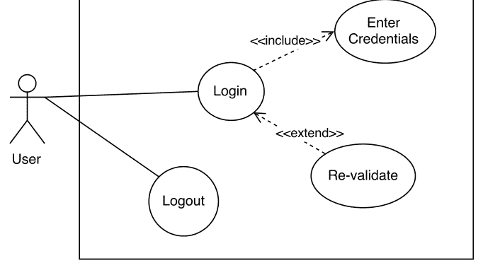

**图 2.1:** 这是用例图的一个简单示例。参与者用火柴人表示。正在分析的系统是一个框。与系统交互的方式用圆圈表示。

## 2.5 设计

分析阶段完全不应该涉及思考代码。它完全关于功能和与用户的交互。设计阶段是你开始思考如何用代码解决问题。当你采用面向对象的范式工作时，设计过程涉及确定程序中需要的对象类型，并为它们规划类、对象和特征。我们在这个阶段关注类。

基于第 2.2 节的讨论，希望你现在对什么是类、哪些事物可能变成类以及如何在代码中声明类有了一些了解。真实的程序不仅仅只有一个类；它们有很多类，每个类都可能应该放在不同的文件中。10 从代码角度来思考包含大量类的庞大程序效果并不好，但程序员经常需要

# 使用 Scala 的面向对象、抽象和数据结构

```scala
Student
+ name: String
+ lastName: String
+ quizzes: List[Int]
+ assignments: List[Int]
+ tests: List[Int]

+ average: Double
+ assignmentAverage: Double
+ testAverage: Double
+ grade: Double
+ addQuiz(newQuiz: Int): Boolean
+ addAssignment(newAssignment: Int): Boolean
+ addTest(test: Int): Boolean
+ quizzes: List[Int]
+ assignments: List[Int]
+ tests: List[Int]
```

| Course |
| --- |
| subject: String |
| number: Int |
| students: List[Student] |

**图 2.2:** 这是来自第 2.2 节中 Student 类的 UML 类图，以及一个包含多个学生的课程类。

在编写包含许多类的程序时，程序员也需要向其他程序员传达自己的想法。为了完成设计应用程序并将其拆分为适当类的等高层次工作，使用草图 own实际代码会很有帮助。这基本上意味着它们很容易被画出来。

所有的 UML 图都旨在“兼容白板”。你可以使用软件创建 UML 图；然而，程序员更常见的做法是在思考问题并尝试与他人交流时在白板上画出它们。你可能使用的另一种常用 UML 图是类图。类图无非是带有三个部分的文本框。每个框都用于表示一个类。当完全画完时，框被分为三个部分：顶部显示类的名称，中间部分显示成员数据/属性，底部显示方法。每个方法通常用一个显示其可见性的符号表示。“+”表示它是公共的，“-”表示它是私有的，“#”表示它是受保护的，这种可见性将在第 4 章中讨论。图 2.2 显示了我们的 Student 类和第二个课程类在这样绘制时会什么样。

当有多个类时，可以使用线条来说明它们之间的关系。此图显示了 Course 类和 Student 类之间的连接。类图中使用了多种类型的箭头。随着时间的推移，我们将看到更多的。这种特定风格的箭头表示聚合。它意味着 Course 包含了多个学生。

这些关系对于帮助理解软件结构非常重要。如果你有一个类有许多线条指向它，这会立即告诉你该类是关键的，而且对它的更改比那些不怎么连接的类更容易破坏软件。你真正不希望在软件中发生的情况是看到一个线条到处都是的图表，导致所有内容都高度耦合。如果你看到了这种情况，你就知道所示软件的构建方式将非常难以维护。

就像用例图一样，类图并没有显示关于一切的所有信息。然而，它确实以人们可以快速、容易地阅读的格式传递了一些信息。它传递的信息对于帮助他们理解系统如何运作具有特别的意义。最明显的信息是

> ¹ ¹¹ 代码中元素之间连接的正确术语是耦合，你通常倾向于低耦合（连接较少）而不是强耦合。

# 面向对象和软件开发的基础

系统中所使用的类/类型。它还通过方法和成员数据，为你提供了一个对不同元素能力的参考。

取决于你正在做什么以及你试图传达什么，类中的某些部分可能会在类图中被遗漏。此时，你并不真正关心成员数据的所有方法。在这些情况下，你正在绘制带有类名的框，并将它们连接起来以表示适当的关系。这并不是一个问题。这是 UML 图的另一个关键——它们不必是详尽的。你使用它们来交流想法，并轻松地遗漏超出你目前考虑水平的细节。这与代码中进行设计工作相比是一个优势，因为不需要担心遗漏大部分细节。

UML 类图还有很多内容，不仅有其他表示不同关系的箭头类型，还有包的框以及类型之间关系的注释。这些不同方面将在后面的章节中介绍。

## 2.6 银行示例

花时间运行一个大多数读者熟悉的示例问题，并进行一些分析和设计是值得的。我们将展示部分实现，帮助你看到一切是如何结合的。

此时此时，你正在编写的一些问题是由导师给你的，或者来自像这样的书。这意味着你通常被告知应该做什么，并且经常会得到关于如何做的某些指导。到目前为止，这些问题可能还很小。由于这个原因，当你获得一个作业或项目时，你通常可能会坐下来开始打字。也就是说，你可能直接跳到实现阶段。如果这描述了你的工作方式，那么在开始任何代码之前，对如何处理它们有一个良好的主意就是一个坏习惯。没有在早期花时间思考问题，通常会导致在以后意识到所采取的方法有问题时，花费大量时间来纠正问题。花一些时间画出你的类并思考它们拥有什么成员，从远来看可以为你节省时间。

我们想要看的问题是银行示例。银行中有很多可以建模的东西。人们可能会先考虑到客户和账户，因为那是我们大多数人与之交互的银行业务面，但它们也是拥有分行和员工的业务。一个程序可能不会用于建模两者。所以我们选择只建模客户方面。

# 使用 Scala 的面向对象、抽象和数据结构


**图 2.3:** 此图显示了一个潜在银行应用程序的用例图，该程序模拟了银行的客户方面。

# 面向对象与软件开发基础

| Bank | |
| --- | --- |
| _customers: List[Customer] | |
| _accounts: List[Account] | |
| _loans: List[Loan] | |
| _nextCustomerID: Int | |
| _nextAID: Int | |
| _nextLoanID: Int | |
| +addCustomer(name: String, lname: String): Customer | |
| +createAccount(a): Account | |
| +closeAccount(a): Boolean | |
| +makeLoan(c: Customer, amount: Int): Loan | |
| +findCustomer(name: String, lname: String): Option[Customer] | |
| +findAccount(id: String): Option[Account] | |
| +findLoan(loanID: String): Option[Loan] | |

| Customer | |
| --- | --- |
| +firstName: String | |
| +lastName: String | |
| +id: String | |
| _accounts: List[Account] | |
| _loans: List[Loan] | |
| _address: Address | |
| _phoneNumber: PhoneNumber | |


# 使用 Scala 进行面向对象、抽象和数据结构设计

## 类图概览

```text
+addAccount(c: Customer): Unit
+addLoan(loan: Loan): Unit
+removeAccount(id: String): Boolean
+removeLoan(id: String): Boolean
+changeAccounts(): List[Account]
+changeAddress(a: Address)
+changePhoneNumber(pn: PhoneNumber)
```

| 账户 Account | 贷款 Loan |
| --- | --- |
| _balance: Int | _balance: Int |
| + customer: Customer | + customer: Customer |
| + id: String | + id: String |

| 地址 Address | 电话 PhoneNumber |
| --- | --- |
| + lines: List[String] | + value: String |

```text
+ balance: Int
+ deposit(amount: Int): Boolean
+ withdraw(amount: Int): Boolean

+ balance: Int
+ payment(amount: Int): Boolean
```

| 银行主类 BankMain |
| --- |
| + main(args: Array[String]): Unit |

图 2.4: 此图展示了一个潜在银行应用的类图，该模型描述了银行面向客户的方面。

## 方法重载与 Option 类型

当两个方法具有相同的名称时，就发生了方法重载。重载方法具有不同的参数，以便编译器知道你指的是哪一个。在这种情况下，一个版本接受单个 `String` 参数，而另一个版本接受两个 `String` 参数。返回类型可以是不同的，但并非强制要求，且仅靠返回类型不同不足以实现重载。如果你有两个返回类型不同的方法，将得到语法错误。

该设计的另一个可能让读者注意的方面是，`Bank` 中的“find”方法产生一个 `Option`。这是因为可能无法找到任何匹配项。在这种情况下，使用 `Option` 而不是返回 `null` 等操作是恰当的。使用 `Option` 更安全且不容易出错，因为它允许编译器确保程序员确实处理了值可能不存在的情况。

### 2.6.3 银行实现

使用这种设计，我们可以构建一个实际的实现。通过 `Bank` 类本身。请注意，每个方法之前都有一个 Scaladoc 风格的注释，描述了该方法、参数和返回值。文件的第一行是包声明。这将在 2.7 节中详细讨论。

`Bank` 接收三个参数，分别代表现有客户、账户和贷款。如果以后我们需要从文件中恢复这些信息，则将它们作为参数是必要的。这三个参数都提供了默认值，因此在不需要时无需指定。它们被声明为私有（`private`）。它们会随着新对象的创建和删除而改变，但在更改时，必须执行某些操作以保持实现的一致性。

还有私有的 `var` 声明，以防止客户、账户和贷款拥有相同的 ID。它们的初始值基于传入列表的 `foldLeft` 方法计算得出，该方法将遍历并找到当前使用的最大 ID 值。

```scala
package oobasics.bank

/**
 * 代表一个拥有客户、账户和贷款的银行。
 */
class Bank(
  private var _customers: List[Customer] = Nil,
  private var _accounts: List[Account] = Nil,
  private var _loans: List[Loan] = Nil
) {

  private var nextCustomerID: Int = _customers.foldLeft(-7)((max, c) => max.max(c.id.toInt)) + 7
  private var nextAccountID: Int = _accounts.foldLeft(-13)((max, a) => max.max(a.id.toInt)) + 13
  private var nextLoanID: Int = _loans.foldLeft(-17)((max, l) => max.max(l.id.toInt)) + 17

  /**
   * 向此银行添加一个客户。使用指定的名称创建一个新客户。
   * @param fname 新客户的名字。
   * @param lname 新客户的姓。
   * @return 被创建并添加的新客户。
   */
  def addCustomer(fname: String, lname: String, address: Address, phoneNumber: PhoneNumber): Customer = {
    val id = nextCustomerID.toString
    val c = new Customer(fname, lname, "0" * (8 - id.length) + id, address, phoneNumber)

    _customers = c :: _customers
    nextCustomerID += 7
    c
  }

  /**
   * 为指定的客户创建一个新账户。该客户必须是此银行的成员。
   * @param c 要添加账户的客户。
   * @return 创建的账户。
   */
  def createAccount(c: Customer): Account = {
    require(_customers.contains(c), "该客户必须是此银行的成员。")
    // 后续代码保持原样
  }
  // ... 其他方法逻辑保持原样
}
```

## Customer 类实现

```scala
class Customer(
  val firstName: String,
  val lastName: String,
  val id: String,
  private var _address: Address,
  private var _phoneNumber: PhoneNumber
) {
  private var _accounts = List[Account]()
  private var _loans = List[Loan]()

  /**
   * 向此客户添加一个账户。该账户必须与此客户关联。
   * 如果已经是当前账户，则不执行任何操作。
   * @param account 要添加的账户。
   */
  def addAccount(a: Account): Unit = {
    require(a.customer == this, "被添加到了错误的客户")
    if (!_accounts.contains(a)) _accounts += a
  }

  /**
   * 向此客户添加一个贷款。该贷款必须与此客户关联。
   * 如果已经是当前贷款，则不执行任何操作。
   * @param loan 要添加到此客户的贷款。
   */
  def addLoan(loan: Loan): Unit = {
    require(loan.customer == this, "被添加到了错误的客户")
    if (!_loans.contains(loan)) _loans += loan
  }

  /**
   * 从此客户处删除指定 ID 的账户。
   * @param id 要删除的账户 ID。
   * @return 如果账户存在并删除则返回 true。
   */
  def removeAccount(id: String): Boolean = {
    val index = _accounts.indexWhere(_.id == id)
    if (index < 0) false else {
      _accounts = _accounts.patch(index, Nil, 1)
      true
    }
  }

  /**
   * 从此客户处删除指定 ID 的贷款。
   * @param id 要删除的贷款 ID。
   * @return 如果贷款存在并删除则返回 true。
   */
  def removeLoan(id: String): Boolean = {
    val index = _loans.indexWhere(_.id == id)
    if (index < 0) false else {
      _loans = _loans.patch(index, Nil, 1)
      true
    }
  }

  /**
   * 提供对账户的公共访问。
   * @return 账户列表。
   */
  def accounts: List[Account] = _accounts

  /**
   * 提供对贷款列表的公共访问。
   * @return 贷款列表。
   */
  def loans: List[Loan] = _loans

  /**
   * 修改此客户的地址值。
   * @param newAddress 此客户的新地址。
   */
  def changeAddress(newAddress: Address): Unit = {
    _address = newAddress
  }

  /**
   * 修改此客户的电话号码。
   * @param newNumber 此客户的新电话号码。
   */
  def changePhoneNumber(newPhoneNumber: PhoneNumber): Unit = {
    _phoneNumber = newPhoneNumber
  }
}
```

Scaladoc 注释中的每个方法以及其实现，在看到 `Bank` 类中的操作后，都没有包含应该被视为不常的内容。

## Account 类实现

接下来是 `Account` 类。该类的主要功能是跟踪余额。提供了存款和取款的方法，并带有检查以确保金额有效。请注意，余额是以 `Int` 类型存储的。这是因为对 `Double` 的算术是不精确的。例如，`1.0 - 0.9 - 0.1` 并不等于零。

这对货币来说是个问题，因此我们使用整数来表示金额，而不是使用 `Double` 浮点值。

```scala
package oobasics.bank

/**
 * 代表与银行的账户。可能是一个支票账户或储蓄账户。
 */
class Account(
  private var _balance: Int,
  val customer: Customer,
  val id: String
) {
  customer.addAccount(this) // 确保客户知道这个账户。

  /**
   * 提供此账户当前余额的公共访问。
   * @return 余额的值。
   */
  def balance: Int = _balance

  /**
   * 向账户存款。存款值必须为正数。
   * @param amount 要存款的金额。
   * @return 告知存款是否成功发生。
   */
  def deposit(amount: Int): Boolean = {
    if (amount > 0) {
      _balance += amount
      true
    } else false
  }

  /**
   * 从账户中取款。金额必须为正数且小于当前余额。
   * @param amount 要取出的金额。
   * @return 告知取款是否成功发生。
   */
  def withdraw(amount: Int): Boolean = {
    if (amount > 0 && amount <= _balance) {
      _balance -= amount
      true
    } else false
  }
}
```

这种实现中缺少了任何实际银行都必须包含的内容：记录交易历史。更改账户值的交易必须以某种可以在以后进行审计的格式记录。

## Loan 类实现

更简单的是我们对 `Loan` 实现。同样，主要信息是余额，功能包括还款。`Loan` 和 `Account` 都可以扩展计算利息的功能，但这里没有那样做。

```scala
package oobasics.bank

/**
 * 代表银行发放给客户的一笔贷款。
 */
class Loan(
  private var _balance: Int,
  val customer: Customer,
  val id: String
) {
  customer.addLoan(this) // 确保客户知道这个贷款。

  /**
   * 提供此贷款当前余额的公共访问。
   * @return 余额的值。
   */
  def balance: Int = _balance

  /**
   * 对贷款进行还款。金额必须为正数且小于当前余额。
   * @param amount 要还款的金额。
   * @return 告知还款是否成功发生。
   */
  def payment(amount: Int): Boolean = {
    if (amount > 0 && amount <= _balance) {
      _balance -= amount
      true
    } else false
  }
}
```

### 2.6.4 创建一个应用程序

```scala
import io.StdIn.*

/**
 * 你的银行的主要文本界面。
 */
object BankMain {
  def main(args: Array[String]): Unit = {
    val bank = new Bank()
    var option = 0
    var customer: Option[Customer] = None
    var account: Option[Account] = None
    var loan: Option[Loan] = None

    while (option != 9) {
      println("1. 创建客户")
      println("2. 创建账户")
      println("3. 创建贷款")
      println("4. 存款")
      println("5. 取款")
      println("6. 还款")
      println("7. 列出客户")
      println("8. 列出账户")
      println("9. 退出")
      print("选择选项： ")
      option = readInt()

      option match {
        case 1 =>
          customer = Some(createCustomer(bank))
        case 2 =>
          if (customer.isDefined) {
            account = Some(createAccount(bank, customer.get))
          } else {
            println("先创建一个客户！")
          }
        // 其他情况省略
        case _ => println("选项未实现")
      }
    }
  }

  private def createCustomer(bank: Bank): Customer = {
    print("客户的名是什么？ ")
    val firstName = readLine()
    print("客户的姓是什么？ ")
    val lastName = readLine()
    println("客户的地址是什么？（通过空行结束输入）")
    val address = readAddress()
    print("客户的电话号码是什么？ ")
    val phone = new PhoneNumber(readLine())
    new Customer(firstName, lastName, "", address, phone)
  }

  private def readAddress(): Address = {
    var lines = List[String]()
    while (true) {
      val line = readLine()
      if (line.isEmpty) return new Address(lines)
      lines = lines :+ line
    }
    new Address(lines)
  }

  private def createAccount(bank: Bank, customer: Customer): Account = {
    bank.createAccount(customer)
  }

  private def closeAccount(bank: Bank, account: Account): Unit = {
    bank.closeAccount(account)
  }

  private def makeLoan(bank: Bank, customer: Customer): Loan = {
    println("How much is for the loan?")
    val amount = readInt()
    bank.makeLoan(customer, amount)
  }
}
```


```scala
private def selectAccount(bank: Bank): Option[Account] = {
    println("What is the ID of the account?")
    bank.findAccount(readLine())
}
```

```scala
private def selectLoan(bank: Bank): Option[Loan] = {
    println("What is the ID of the loan?")
    bank.findLoan(readLine())
}
```

```scala
private def deposit(bank: Bank, account: Account): Unit = {
    println("How much do you want to deposit?")
    val worked = account.deposit(readInt())
    if (worked) println("The deposit was successful.")
    else println("The deposit failed.")
}
```

```scala
private def withdraw(bank: Bank, account: Account): Unit = {
    println("How much do you want to withdraw?")
    val worked = account.withdraw(readInt())
    if (worked) println("The withdraw was successful.")
    else println("The withdraw failed.")
}
```

```scala
private def checkAccountBalance(account: Account): Unit = {
    println(account.balance)
}
```

```scala
private def payLoan(bank: Bank, loan: Loan): Unit = {
    println("How do you want to pay on the loan?")
    val worked = loan.payment(readInt())
    if (worked) println("The loan payment was successful.")
    else println("The loan payment failed.")
}
```

```scala
private def checkLoanBalance(loan: Loan): Unit = {
    println(loan.balance)
}
```

```scala
private def readAddress(): List[String] = {
    def helper(): List[String] = {
        val input = readLine()
        if (input.isEmpty) Nil
        else input :: helper()
    }
    new Address(helper())
}
```

```scala
private val menu = """选择以下选项之一：

1. 创建客户
2. 选择客户
3. 创建账户
4. 关闭账户
5. 办理贷款
6. 选择账户
7. 选择贷款
8. 账户存款
9. 账户取款
10. 检查账户余额
11. 偿还贷款
12. 检查贷款余额
13. 修改地址
14. 修改电话
15. 退出"""
```

# 面向对象与软件开发的基础

## 76 使用 Scala 的面向对象、抽象和数据结构

每个选项都在其自己的方法中实现。此代码中省略了 Scala 代码的注释。这在某种程度上是为了使代码长度更加合理。另一个原因是部分代码有不同的注释要求。在这种情况下，上一节中的类是类库代码。库代码需要有良好的文档说明，特别是像语言 API 这样的库，因为它们将由多个程序员使用，而这些程序员可能无法访问代码，或者不应该花费时间去研究具体是如何实现的。我们的主对象不包含任何在外部使用的内容。这体现在除了 `main` 方法外，所有方法都是私有的。这使得文档注释不再需要，尽管对于更复杂的代码部分，解释性注释会有所益处。

注意，我们可以通过将各种私有方法的代码放入一个非常长的 `main` 方法中来编写。那种方法要求注释必须易于理解。将工作拆分成多个方法使得代码更容易理解和维护。方法名的作用就像注释一样，为读者提供了信息。拥有独立的方法使得代码更易测试和调试。

由于你们中的许多人可能对 Scala 还不熟悉，让我们仔细观察 `match` 中的某些几行代码。在第 23 行，我们看到调用了 `createCustomer` 并将银行作为参数传递。此函数从用户处收集所有必要的客户数据，如果它可以将新客户添加到银行中，就会返回该客户，我们将当前客户设置为该刚创建的客户的 `Some`。

在查看其他分支情况之前，我们需要记住客户、账户和贷款。如果客户为 `None`，则什么都不会发生；如果账户为 `None`，则什么都不会发生；如果贷款为 `None`，则什么都不会发生。

# 使用 Scala 的面向对象、抽象和数据结构

- Scala 没有用于表示公共（`public`）的关键字。在没有指定其他内容的情况下，它就是默认的可见性。
- 公共成员可以使用点符号（`dot notation`）在类外部访问。
- `require` 函数是标准库的一部分，可以在运行时执行检查。它旨在用作方法的前置条件（`precondition`）。它必须有一个布尔值参数，该参数会被求值且必须为 `true`。如果不是 `true`，则会抛出异常。第二个参数是可选的，用于在失败时打印消息，强烈建议使用。还有一个名为 `assert` 的相关方法，用于泛泛声明某些条件何时应该为 `true`。
- 软件生命周期是创建某个软件时所经历的不同步骤。
- 弄清楚程序实际上应该做什么的过程被称为分析（`analysis`）。
- 规划代码如何编写被称为设计（`design`）。
- 实现（`implementation`）是编写软件的实际行为。
- 代码编写完成后，你必须进行测试（`test`）和调试（`debug`），以修正代码中的任何错误。
- 软件发布后，对其进行增强和进一步修复故障的持续工作被称为维护（`maintenance`）。
- UML 代表统一建模语言（`Unified Modeling Language`），它是用于软件开发过程中多种图表类型的标准。本章引入了其中两种。
- 用例图（`Use Case Diagram`）是一种在分析期间使用的图表样式，用于考虑用户和其他实体与软件交互的方式。
- 类图（`Class Diagram`）是一种显示主要代码组（如类、对象和特质/traits）粗略草图以及它们之间关系的图。

## 2.8.2 练习题

1. 描述软件生命周期的不同阶段。
2. 想象你正在编写一个用于模型小车的软件。画一个显示你可能如何拆解该问题的 UML 图。
3. 想象你正在为一家专门经营护士服装的零售服装商店编写软件。该商店出售各种夹克、上衣和裤子。绘制适当的用例图和类图。有一个名为 `ClothingItem` 的类来管理服装库存细节。确保你包含一个 `CashRegister` 类，允许对库存进行购买和退货。
4. 你被设计一个简单的多玩家问答游戏。假设这个问题会有多个关联答案，但只有一个答案是正确的。回答正确问题最多的玩家胜。绘制适当的用例图和类图来帮助分析和设计该问题。

## 面向对象和软件开发的基础

5. 编写一个名为 `Employee` 的类，存储员工的信息，如姓名、ID 号、职位、部门和电话号码。一旦你写完该类，编写一个程序创建 3 个员工。
6. 编写一个名为 `Movies` 的类，存储家庭电影收藏的信息。它应该包含标题、年份、描述和评分信息。一旦你写完该类，编写一个程序创建 5 部电影。
7. Annarie Ising 经营着一个社区成人教育计划。该社区设有秋季、春季和夏季课程。Annarie 需要一个系统来跟踪成人课程以及注册每门课程的学生。每门课程通常只为期一周的课程提供一次。每个课程都有允许注册的人数限制。某些课程可能涉及额外的费用，例如耗用品、场地租赁、认证费用等。绘制适当的用例图和类图来帮助分析和设计该问题。
8. Speedy Automotive 是一家当地汽车修理厂，专门喷漆和车身修复，但也提供机油更换等服务。当客户把车带到店里时，经理会获取客户的个人信息。他们记录有关车辆的信息，如品牌、型号和年份。经理还想为客户请求的服务或维修提供报价。这些报价应包括预计的人工费、预计的零件费、预计的处置费、销售税，以及总预估费用。绘制适当的用例图和类图来帮助分析和设计该问题。
9. Zoomaloo 托儿是一家当地的动物护理业务，为猫和狗提供短期和寄留服务。他们的员工包括猫专家和狗专家。动物客户可以在那里呆半天或全天。它们的主人可以要求进行药物管理、额外的散步次数、额外的游戏时间或专门喂养。每项额外服务都带有额外的费用。Zoomaloo 还需要能够并对所需服务进行计费。绘制适当的用例图和类图来帮助分析和设计该问题。
10. Beautiful Lawns 是一家当地的草坪维护公司。他们为客户提供完整的草坪维护服务，包括割草、吹扫、修边、除草、施肥、杀虫、补种和芯打气。客户可以拨打 Beautiful Lawns 并请求报价。客户代表需要收集一般的客户信息，以及客户想要什么、希望执行服务的频率以及草坪的大小。绘制适当的用例图和类图来帮助分析和设计该问题。

## 2.8.3 项目

本章没有特定的项目。与本章相关的项目将在下一章末尾提供，因为我们希望确保你在开始之前对面向对象有稳固的理解。

# 第 3 章

## Scala 中面向对象的实现细节

- 3.1 2D 向量类 ................................................................................... 81
- 3.1.1 `this` 关键字 ........................................................................ 84
- 3.2 特殊方法和符号名称 ................................................................ 84
- 3.2.1 缩放 N 规则/符号名称 ................................................................ 84
- 解析赋值运算符 ............................................................................ 87
- 3.2.1.1 优先级和结合性 ................................................................. 88
- 3.2.2 一元运算符 .................................................................... 89
- 3.2.3 属性赋值方法 ................................................................... 89
- 3.2.4 `apply` 方法 ....................................................... 91
- 括号的影响 ................................................................. 92
- 3.2.5 `update` 方法 ................................................................... 92
- 高级可见性选项 ............................................................ 93
- 3.3 `object` 声明 ................................................................... 93
- 3.3.1 伴侣对象 ................................................................ 94
- 私有构造函数和多个构造函数 ................................................. 95
- 3.4 2D 向量的最终版本 ........................................................ 96
- 3.5 例类（`case classes`） ................................................. 98
- 高级模式匹配 ............................................................. 100
- 3.6 封装/接口与实现的分离 ................................... 102
- 3.7 重温 API ...................................................................... 103
- 3.8 `import` 选项 ...................................................... 105
- 3.9 章末内容 ........................................................ 106
- 3.9.1 内容总结 ........................................................ 106
- 3.9.2 练习题 ....................................................... 107
- 3.9.3 项目 ......................................................................... 109

第 2 章介绍了面向对象的关键概念，以及你应该如何以面向对象的方式思考问题。在本章中，我们将探索 Scala 作为语言的某些细节以及面向对象是如何处理的。

## 3.1 2D 向量类

为了帮助并说明本章中的许多示例，我们将创建许多不同的 2D 向量实现。如果你不从你之前的数学和物理课程中记得（或者参考 Descriptive Me®），向量是一个具有大小和方向的物理量。它们可以使用不同的坐标进行存储，包括极坐标和笛卡尔坐标。我们将使用笛卡尔坐标。我们还提供了基本操作来执行诸如两个向量的操作。图 3.1 展示了两个向量相加以产生第三个向量。

你可能会想为什么我们要为它创建一个类。毕竟，第 2 章描述了在设计我们的类时，我们希望关注问题中的事物或责任。在数学和物理等领域有很多可以使用这个概念的应用。

# 使用 Scala 的面向对象、抽象和数据结构

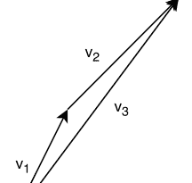

图 3.1: 这显示了三个向量，$v_3 = v_2 + v_1$。

……虽然是关于书的，但它们对于任何具有位置和移动的对象都是有用的。这些可以是图形化游戏中角色的精灵（小图像），或者可能是某些模拟中的实体。本书的章节末尾有几个项目，它们可以从拥有 2D 或 3D 向量中受益，因此对于你们中的许多人来说，在阅读此书并编写代码时，包含这个示例是非常有用的。

我们的类将存储 $x$ 和 $y$ 分量，并对它们提供基本操作。为了演示不同的方法，我们将编写两种类型的这些基础代码：一种用于不可变向量，另一种用于可变向量。这里展示了这些类型的第一个版本，它们主要使用了第 2 章中讨论过的元素。

```scala
/*
 * 一个基础的 2D 不变向量。
 */

class Vect2D(x: Double, y: Double) {
  def plus(v: Vect2D) = new Vect2D(x + v.x, y + v.y)
  def minus(v: Vect2D) = new Vect2D(x - v.x, y - v.y)
  def scale(c: Double) = new Vect2D(x * c, y * c)
  def magnitude: Double = math.sqrt(x * x + y * y)
}
```

如你所见，提供了 `minus`、`scale` 和 `magnitude` 等方法。`plus`、`minus` 和 `scale` 方法会产生类的新实例，而不以任何方式修改原始实例。因为这个类是不可变的，这一点显而易见，因为唯一的数据值是 `Double`，而且一旦创建实例就无法修改它们。

根据我们目前了解的，测试我们类的一种良好方法是创建一个与类同名的对象，并给它一个 `main` 方法，使其可以作为应用程序运行。将对象命名为类名的唯一理由是为了保持良好的整洁。

```scala
object Vect2D_a {
  def main(args: Array[String]): Unit = {
    var v1 = new Vect2D(1, 2)
    var v2 = new Vect2D(1, 2)

    val v3 = v1.plus(v2)
    println(v3.magnitude)
  }
}
```

> 在类同一个文件中声明且与类同名的对象被称为伴侣对象（`companion object`）。将在 3.3.1 节中详细讨论。


这段代码简单地创建了两个 `Vect2D_a` 实例，然后使用 `plus` 方法将它们相加。最后通过打印结果向量的模完成，结果应该是 5.0，因为 `v3` 的分量长度分别为 3 和 4。

人们也可以选择为 2D 向量制作一个可变版本。其实现可能如下所示。

```scala
/**
 * 一个基础的 2D 可变向量。
 */
class MutableVect2D_a(private _x: Double, private _y: Double) {
  def x = _x
  def y = _y
  def setX(newX: Double): Unit = _x = newX
  def setY(nY: Double): Unit = _y = newY
  def plus(mv: MutableVect2D_a): MutableVect2D_a = {
    _x += mv.x
    _y += mv.y
  }
  def minus(mv: MutableVect2D_a): MutableVect2D_a = {
    _x -= mv.x
    _y -= mv.y
  }
  def scale(c: Double): MutableVect2D_a = {
    _x *= c
    _y *= c
  }
  def magnitude = math.sqrt(x * x + y * y)
}
```

注意，在这一实现中，`x` 和 `y` 被命名为提供访问名为 `_x` 和 `_y` 的私有变量的方法。还有以 `set` 单词开头的方法用于给这些成员分配新值。使用“setter”（Setter）方法在 Java 和其他语言中是标准做法，但我们将看到 Scala 了一一种替代方法，当你处于类外部时，可以使用它来设置成员变量。

这里展示了该类的短章节。它与 `Vect2D_a` 非常相似，不同在于我们没有为 `v3` 引入变量。相反，`plus` 方法改变了 `v1` 的值，我们在最后打印该实例的模。

```scala
object MutableVect2D_a {
  def main(args: Array[String]): Unit = {
    var v1 = new MutableVect2D_a(1, 2)
    var v2 = new MutableVect2D_a(2, 2)
    v1.plus(v2)
    println(v1.magnitude)
  }
}
```

### 3.1.1 `this` 关键字

此实现中的 `plus`、`minus` 和 `scale` 方法改变了 `_x` 和 `_y` 的值，然后返回一个 `Vect2D` 实例。它们之所以返回实例是因为这允许你链式调用。例如，你可以使用 `v1.plus(v2).minus(v3).scale(5)`。这会将 `v2` 加到 `v1`，从 `v1` 中减去 `v3`，最后将 `v1` 的值扩大 5 倍。为了实现这种工作，我们有一种方法引用当前对象。默认情况下，当你在类中编写代码时，会在当前对象上进行调用。所有调用都是隐式生成的。这正是你大多数时候在做的事情，而且感觉非常自然。这在通常是可以的，但对于像 `plus` 方法这样的情况，我们需要能够指定一个。这种情况也出现在你需要调用一个接受单个参数的函数并想使用当前实例时。为了在方法中引用当前实例，使用 `this` 关键字。否则，它们在没有任何实际处的情况下让代码变得更长。Scala 风格只在实际需要时才使用 `this` 关键字。

## 3.2 特殊方法和符号名称

Scala 中有少数方法是特殊的。在这种情况下，它们并不多，但它们提供的能力是惊人的。

### 3.2.1 命名规则

到目前为止，Scala 中用于变量、方法、类等的名称都以下划线或字母开头，后面跟着任意数量的字母、数字和下划线。Scala 还允许在某些限制下包含运算符符号。运算符符号有 `+`、`*`、`/`、`~`、`!`、`<`、`=`、`$`。名称可以包含符号字符，或者由标准名称后跟符号字符。

这意味着你可以写 `+`，`Int` 和 `Double` 类型仅仅是为了我们可以相加。将这些方法作为运算符是 Scala 语言的一种通用能力。你可以使用运算符语法使用任何接受单个参数的方法。这意味着你可以省略点和括号。Scala 中更有趣的是，符号名称与其他很容易区分。当 Scala 编译器看到 `v1+v2` 时，它知道它是 `v1` 和 `v2` 独立的标记，而无需在它们之间空格。另一方面，需要空格来使其清晰。通过使用带有符号方法名的向量类的第二个版本，我们可以看到方法可以像 `+` 一样容易作为运算符使用。

```scala
class Vect2D(val x: Double, val y: Double) {
  def +(v: Vect2D) = new Vect2D(x + v.x, y + v.y)
  def -(v: Vect2D) = new Vect2D(x - v.x, y - v.y)
  def *(c: Double) = new Vect2D(x * c, y * c)
  def /(c: Double) = new Vect2D(x / c, y / c)
  def magnitude = math.sqrt(x * x + y * y)
}
```

这种真正的优势体现在类的使用上。通过这种方式，我们可以说 `v1 + v2` 而不是 `v1.plus(v2)`。

```scala
object Vect2D_b {
  def main(args: Array[String]): Unit = {
    val v1 = new Vect2D(1, 2)
    val v2 = new Vect2D(1, 2)
    val v3 = v1 + v2
    val v4 = v3 * 3
    println(v3.magnitude + " " + v4.magnitude)
  }
}
```

记得 `v1 + v2` 是 `v1.+(v2)` 的简写。同样，`v * 3` 是 `v.*(3)` 的简写。因此方法是在第一个值上调用的，第二个作为方法的参数。我们在这里编写的内容不允许我们编写 `3 * v3`，因为那会尝试在 `Int` 或 `Double` 类型中使用名为 `*` 的方法。在 Scala 中编写允许这种代码是可能的，但它需要使用一种名为“隐式转换”的功能，我们在这里没有引入，但在书籍网站的附录中有所涵盖。

除了 `+` 和 `*` 之外，你还可以创建像 `**` 和 `****` 这样的名称。很多事情让你觉得你应该这样做。它们有自己的位置。我们选择 2D 向量示例的原因之一是为了演示符号方法。它们应该只在意义清晰的情况下使用。在数学构造结构上进行操作是非常棒的。Scala 集合也使用了符号方法，例如，用于连接集合。从人们可以阅读的文本名称更改为任意符号序列将使你或其他人几乎无法理解发生了什么。

作为这种的一个例子，我们可能会为我们的 2D 向量类添加更多方法。如果你不记得那些是什么，这在这里不是问题。重要的是在数学中，这些通常表示为符号，$ab$ 表示点积，$a \times b$ 表示叉积。

对于乘积而言。这些并不是有效的运算符符号，事实上，你可以在大多数键盘上都找不到它们。你可能很想为它们自己发明一套符号组合，例如用 `**` 表示点积，用 `***` 表示向量叉积。即使你能够为这些选择提供合理性，这也是一个坏主意，因为阅读你代码的其他人不会发现它的意义的。不如使用 `dot` 和 `cross` 这两个方法名，它们的效果与中缀表示法一样好，而且所有读者都会知道代码的含义。在处理我们之前的示例时，它们看起来可能像下面：

```scala
def dot(v: Vect2D_b) = x * v.x + y * v.y
def cross(v: Vect2D_b) = x * v.y - y * v.x
```

在 2D 向量的情况下，名为 `plus` 的方法也可以命名为 `+`。这是因为它并没有调整向量，而是修改其中一个向量的内容。这种类型的修改通常通过赋值完成。与其调用方法 `+`，不如调用 `+=`。这里是带有适当符号运算符方法的可变 2D 向量类。

```scala
class MutableVect2D_b(private var _x: Double, private var _y: Double) {
  def x = _x
  def y = _y
  def setX(newX: Double): Unit = _x = newX
  def setY(newY: Double): Unit = _y = newY
  def +=(mv: MutableVect2D_b) = {
    _x += mv.x
    _y += mv.y
    this
  }
  def -=(mv: MutableVect2D_b) = {
    _x -= mv.x
    _y -= mv.y
    this
  }
  def *=(c: Double): MutableVect2D_b = {
    _x *= c
    _y *= c
    this
  }
  def /=(c: Double): MutableVect2D_b = {
    _x /= c
    _y /= c
    this
  }
  def magnitude = math.sqrt(x * x + y * y)
}
```

该类定义了 `+=`、`-=`、`*=` 和 `/=`，以便以修改原始值的方式执行我们的标准操作。该类的用法可能如下：

```scala
object MutableVect2D_b {
  def main(args: Array[String]): Unit = {
    val v1 = new MutableVect2D_b(1, 2)
    val v2 = new MutableVect2D_b(2, 2)
    v1 += v2
    println(v1.magnitude)
  }
}
```

与之前一样，我们让变变方法返回当前对象，以便它们能够以 `v1 += v2 == v3 += 5` 的方式顺序执行。这种操作在许多库中（包括 Scala 集合）都是常见的。然而，可以强力地论证在这种情况下并不易读。如果你觉得这种风格并不易读，可以轻松地让赋值方法返回 `Unit` 而不是当前对象，那么这段代码将无法编译。相反，所有的操作都必须在单独的行上进行。

## 解析赋值运算符

我们首先在处理 `Int` 和 `Double` 类型时看到了 `+=` 运算符。例如，你可能会在循环内部看到 `i += 1` 这样的行来增加整数变量。这种用法是 `i = i + 1` 的简写，因为 `Int` 类型上没有 `+=` 运算符。`Int` 类型是不可变的，因此 `+=` 运算符没有意义。这意味着 `+=` 要么是对名为 `+=` 的方法的调用，要么是对 `var` 进行赋值并调用 `+` 方法。

通常情况下，当 Scala 在任何表达式中看到 `+=` 或任何其他后跟等号的符号运算符时，它首先检查运算符的对象是否有一个名为该名字的方法。如果有，将调用该方法。如果不存在此类方法，Scala 将尝试将其解释为对等号之前的方法对 `var` 进行赋值。下面的代码通过我们的向量类型说明了这种区别。

```scala
object AssignmentOps {
  def main(args: Array[String]): Unit = {
    var v1 = new Vect2D_b(1, 2)
    var v2 = new Vect2D_b(2, 2)
    v1 += v2 // v1.+(v2)

    var mv1 = new MutableVect2D_b(1, 2)
    var mv2 = new MutableVect2D_b(2, 2)
    mv1 += mv2 // mv1.+=(mv2)
  }
}
```

如注释所示，第一次使用 `+=` 执行了名为 `+` 的方法，并且对 `var` 进行了赋值，而不是调用名为 `+=` 的方法，这对于编写和使用错误消息也很有用。例如，如果你在这个示例中不小心将 `v1` 声明为 `var` 而不是 `val`，你得到的错误信息会说"value += is not a member of odetails.Vect2D.b"。解决这个问题的方法不是在类型中引入 `+=` 方法，而是让声明使用 `var`。请记住，错误信息通常指向那个可能的解决方案，但由于编译器不知道你正尝试做什么，那个解决方案可能不是适用于你情况的正确答案。

### 3.2.1 优先级和结合性

| 优先级（顶部最高） | 特殊字符 |
| :--- | :--- |
| * | % |
| + | - |
| : | |
| = | <> |
| & | |
| 所有字母 | 赋值运算符 |

**表 3.1：** 此表显示了 Scala 中运算符的优先级规则。优先级基于第一个字符。


对于乘积而言。这些并不是有效的运算符符号，事实上，你可以在大多数键盘上都找不到它们。你可能很想为它们自己发明一套符号组合，例如用 ``**`` 表示点积，用 ``***`` 表示向量叉积。即使你能够为这些选择提供合理性，这也是一个坏主意，因为阅读你代码的其他人不会发现它的意义的。不如使用 `dot` 和 `cross` 这两个方法名，它们的效果与中缀表示法一样好，而且所有读者都会知道代码的含义。在处理我们之前的示例时，它们看起来可能像下面：

```scala
def dot(v: Vect2D_b) = x * v.x + y * v.y
def cross(v: Vect2D_b) = x * v.y - y * v.x
```

在 2D 向量的情况下，名为 `plus` 的方法也可以命名为 `+`。这是因为它并没有调整向量，而是修改其中一个向量的内容。这种类型的修改通常通过赋值完成。与其调用方法 `+`，不如调用 `+=`。这里是带有适当符号运算符方法的可变 2D 向量类。

```scala
class MutableVect2D_b(private var _x: Double, private var _y: Double) {
  def x = _x
  def y = _y
  def setX(newX: Double): Unit = _x = newX
  def setY(newY: Double): Unit = _y = newY
  def +=(mv: MutableVect2D_b) = {
    _x += mv.x
    _y += mv.y
    this
  }
  def -=(mv: MutableVect2D_b) = {
    _x -= mv.x
    _y -= mv.y
    this
  }
  def *=(c: Double): MutableVect2D_b = {
    _x *= c
    _y *= c
    this
  }
  def /=(c: Double): MutableVect2D_b = {
    _x /= c
    _y /= c
    this
  }
  def magnitude = math.sqrt(x * x + y * y)
}
```

该类定义了 `+=`、`-=`、`*=` 和 `/=`，以便以修改原始值的方式执行我们的标准操作。该类的用法可能如下：

```scala
object MutableVect2D_b {
  def main(args: Array[String]): Unit = {
    val v1 = new MutableVect2D_b(1, 2)
    val v2 = new MutableVect2D_b(2, 2)
    v1 += v2
    println(v1.magnitude)
  }
}
```

## Scala 中面向对象的细节

与之前一样，我们让变变方法返回当前对象，以便它们能够以类似 `v1 += v2 == v3 += 5` 的方式顺序执行。这种操作在许多库中都是常见的，包括 Scala 集合。然而，可以强力地论证在这种情况下它并不易读。如果你觉得这种风格并不易读，可以轻松地让赋值方法返回 `Unit` 而不是当前对象，那么这段代码将无法编译。相反，所有的操作都必须在单独的行上进行。

## 解析赋值运算符

我们首先在处理 `Int` 和 `Double` 类型时看到了 `+=` 运算符。例如，你可能会在循环内部看到 `i += 1` 这样的行来增加整数变量。这种用法是 `i = i + 1` 的简写，因为 `Int` 类型上没有 `+=` 运算符。`Int` 类型是不可变的，因此 `+=` 运算符没有意义。这意味着 `+=` 要么是对名为 `+=` 的方法的调用，要么是对 `var` 进行赋值并调用 `+` 方法。

通常情况下，Scala 在任何表达式中看到 `+=` 或任何其他后跟等号的符号运算符时，它首先检查运算符的对象是否有一个名为该名字的方法。如果有，将调用该方法。如果不存在此类方法，Scala 将尝试将其解释为对等号之前的方法对 `var` 进行赋值。下面的代码通过我们的向量类型说明了这种区别。

```scala
object AssignmentOps {
  def main(args: Array[String]): Unit = {
    var v1 = new Vect2D_b(1, 2)
    var v2 = new Vect2D_b(2, 2)
    v1 += v2 // v1.+(v2)

    var mv1 = new MutableVect2D_b(1, 2)
    var mv2 = new MutableVect2D_b(2, 2)
    mv1 += mv2 // mv1.+=(mv2)
  }
}
```

如注释所示，第一次使用 `+=` 执行了名为 `+` 的方法，并且对 `var` 进行了赋值，而不是调用名为 `+=` 的方法，这对于编写和使用错误消息也很有用。例如，如果你在这个示例中不小心将 `v1` 声明为 `var` 而不是 `val`，你得到的错误信息会说"value += is not a member of odetails.Vect2D.b"。解决这个问题的方法不是在类型中引入 `+=` 方法，而是让声明使用 `var`。请记住，错误信息通常指向那个可能的解决方案，但由于编译器不知道你正尝试做什么，那个解决方案可能不是适用于你情况的正确答案。

# 使用 Scala 的面向对象、抽象和数据结构

| 优先级（顶部最高） | 特殊字符 |
| :--- | :--- |
| * | % |
| + | - |
| : | \| |
| = | <> |
| & | \| |
| 所有字母 | 赋值运算符 |

**表 3.1：** 此表显示了 Scala 中运算符的优先级规则。优先级基于第一个字符。

### 3.2.1 优先级和结合性

正如之前，我们让变变方法返回当前对象，以便它们能够以类似 `v1 += v2 == v3 += 5` 的方式顺序执行。这种操作在许多库中都是常见的，包括 Scala 集合。然而，可以强力地论证在这种情况下它并不易读。如果你觉得这种风格并不易读，可以轻松地让赋值方法返回 `Unit` 而不是当前对象，那么这段代码将无法编译。相反，所有的操作都必须在单独的行上进行。

*(此处省略了原文中完全重复的段落以符合“不要重复输出原文”的指令)*

# 使用 Scala 的面向对象、抽象和数据结构

`v2.x = 3`

之后，如果 `x` 是一个公共 `var` 声明，你可以这样设置它的值。事实上，Scala 的某些设计选择是为了使得在类外部代码无法区分成员数据和方法的使用。其中之一是允许在不加括号的情况下调用方法，正如我们在 2D 向量示例中 `def x` 和 `def y` 所示。引入属性赋值方法完善了在成员数据与方法之间切换的能力。

如果你在类中放入形式为 `name_=(value:Type)` 的方法，它通常允许你编写对 `name` 进行赋值的代码。因此，我们可以将可变 2D 向量中的 `setX` 和 `setY` 替换为以下内容：

```scala
def x_=(newX: Double): Unit = _x = newX
def y_=(newY: Double): Unit = _y = newY
```

这些方法只是设置 `_x` 和 `_y` 的值。事实证明，如果类中有公共 `var`，编译器生成的内容正是这样。因此，在 Scala 中，当类属性的取值没有限制时，使用公共 `var` 实际上是可以接受的。原因在于，如果你以后决定需要限制，现有的限制将要求重构任何使用该类的位置代码。在 Scala 中，这只需要为该属性添加访问器和赋值方法，并将声明更改为另一个名称的私有 `var`。

为了帮助你理解这一点，请考虑第 2 章中的银行账户示例。我们没有为余额（`balance`）设置公共 `var`，因为这允许外部的任何人任意设置余额。这很容易将余额设置为负数，而且当值被设置时，并不会自动记录日志。在实践中，我们确实需要所有的余额分配要么是存款或是取款。这并不意味着我们不能赋予程序员我们的账户像通过赋值一样设置余额的能力。

为了帮助你理解，假设你想要能够输入类似 `myAccount.balance = 700` 的内容。我们可以通过公共 `var` 实现这种能力，但我们认为这还不够。通过添加以下方法可以扩展该功能：

```scala
def balance_=(newBalance: Int): Unit = _balance = newBalance
```

得益于 Scala 处理赋值运算符，这将使得以下两行代码都能工作：

```scala
myAccount.balance = 700
myAccount.balance += 40
```

因此 `+=` 将像存款一样工作，而 `-=` 将像取款一样工作。缺点是它会返回一个布尔值来告诉你是否执行成功。按照写法，这两者都没有检查被存入或取出的值。

这个特定的方法留下的空间太大了。我们还不如使用 `var`，因为我们正在做的正是 `var` 会所做的事情。然而，赋值方法的优势是它内部可以包含更多逻辑。例如，`balance_=` 方法可以修改为如下：

```scala
def balance_=(newBalance: Int): Unit = {
  if (newBalance > _balance) deposit(newBalance - _balance)
  else if (newBalance < _balance) withdraw(_balance - newBalance)
}
```

# Scala 面向对象的方法的细节

此版本将重用 `withdraw` 或 `deposit` 代码，包括任何错误检查、日志记录等。使用此版本，尝试分配负值的行为不会改变余额，而且理想情况下会记录一条此类的消息。

请注意，你只为可变属性包含赋值方法；在很多情况下它们会被省略。如果你以函数式风格进行编程，你将没有这些赋值方法。只有当对象特别需要能够变同时，这些方法才是有用的。在这种情况下，真正的优势是代码看起来像普通的赋值，但它会调用可以执行各种类型错误检查的方法。

### 3.2.4 apply 方法

Scala 以独特方式处理的另一个方法是 `apply` 方法。这个方法允许 Scala 被视为函数。你编写 `apply` 就就像编写放在类中的任何其他方法一样。你也可以像调用任何其他方法一样调用它。然而，Scala 允许你在不使用点或名称的情况下调用 `apply` 方法。当你省略它时，看起来就像是你将对象视为一个函数。这在很早时候就能看到，Scala 中的一切都是对象。这包括函数。函数只是一个具有 `apply` 方法并接收相应参数的类型的对象。

`apply` 的用法之一是你如何对所有集合进行索引的。考虑你在 REPL 中编写以下代码：

```scala
scala val arr = Array(5, 7, 4, 6, 3, 2, 8)
arr: Array[Int] = Array(5, 7, 4, 6, 3, 2, 8)

scala arr(3)
res0: Int = 6

scala arr.apply(3)
res1: Int = 6
```

对 `arr(3)` 的调用实际上是 `arr.apply(3)` 的快捷方式。Scala 所做的只是假设了对 `apply` 调存在。

我们将在 Demo 中说明 `apply` 方法的创建。在这种构造中，我们假设 `x` 分量的索引为 0，`y` 分量的索引为 1。其他所有都有索引。

```scala
def apply(index: Int): Double = index match {
  case 0 => x
  case 1 => y
  case _ => throw new IndexOutOfBoundsException("2D vector indexed with $index")
}
```

这可能看起来不是非常有用的东西，但结合我们以后将学习的技术，它可以极大地扩展我们类的能力。

## 括号的重要性

我们已经见过不带参数且没有括号的方法。作为一个经验法则，具有副作用的方法（特别是变异）应该始终带括号调用。没有副作用的方法（可以很容易替换为 `val`）应该在不带括号的情况下调用。

当你调用带有 `apply` 方法的对象时，情况发生了变化。括号告诉 Scala 你想要调用该方法，即使该函数不接受任何参数。为了看到示例，请考虑以下 REPL 会话。当你定义一个不接受任何参数的函数 `f` 时，Scala 创建了一个新对象，你指定的下划线表示法使得函数的函数体。

```scala
scala> val f = () => math.random
f: () => Double = $$Lambda$123
scala> f()
res0: Double = 0.787083301264959

scala> f
res1: () => Double = $$Lambda$123
```

`f()` 的调用是你大多数时候想要执行的操作。如果你不加括号，你得到的是函数本身的对象。在某些情况下，这种情况是有用的，例如将函数传递给其他函数或方法，但你需要意识到为了调用 `apply` 方法是括号的。有趣注意的是，如果你显式使用 `apply`，因为它是方法，所以是不需要括号的。

```scala
scala> f.apply
res5: Double = 0.721683560738538
```

### 3.2.5 update 方法

`apply` 的伴侣方法是 `update`。当你对一个在通常情况下是调用 `apply` 的表达式进行赋值操作时，就会调用此方法。考虑在上一节中声明的示例数组 `arr`。你可以通过表达式 `arr(3) = 99` 来更改数组中的值。此表达式的 `arr(3)` 部分通常是 `apply` 的调用，但在这种情况下行不通，因为你不能对赋值到函数的结果中。为了实现这一点，Scala 会将其展开为 `arr.update(3, 99)`。

可变集合与不可变集合之间的区别仅在于，可变集合定义了更新方法，而不可变集合没有。为什么，当你尝试为 List 的某个索引赋值时，你得到的错误信息是 `error: value update is not a member of List[Int]` 呢？

显然，我们不想在不可变的 2D 向量中放置一个更新方法，但在可变 2D 向量中放置一个是有意义。这样的方法可能如下：

```scala
def update(index: Int, value: Double): Unit = index match {
  case 0 => x = value
  case 1 => y = value
  case _ => throw new IndexOutOfBoundsException("2D vector indexed with $index")
}
```

在将此包含在类之后，你就可以编写像 `v2(0) = 99` 这样的代码，这会将 x 修改为 99。

# 高级可见性选项

Scala 在可见性方面的灵活性比目前描述的更高。`private` 或 `protected` 后面可以跟上方括号以及包、类、trait（接口）或对象类型的闭包范围名称。（trait 将在第 4 章介绍）。这将使得成员对于该作用范围内的所有内容以及该声明处是公开的。这样做的主要益处是，你可以为密切相关的代码段提供特殊的访问权限，而无需将成员向整个世界公开。

例如，我们还没有展示这一点，但本章的所有代码都在 `oodetails` 包中。我们想象某个类中有一个方法 `somePrivateMethod`，它实际上无法被任何随机代码调用，但对我们包中的许多许多类和对象很有用。我们可以为该方法加上缀 `private[oodetails]` 来提供恰好的这种访问权限。对于包外部，它看起来就像是公开的一样。

方括号还包含一个使某些内容比标准 `private` 更私有的的关键字。将成员声明为 `private[this]` 意味着它不仅对其他代码段是私有的，对闭包类的任何其他实例也是私有的。通常，如果一个方法获取了相同类型的另一个对象的引用，它可以访问私有成员。但如果成员是 `private[this]`，情况就不同了。

这的一个很好的例子就是我们的可变 2D 向量。使用普通的私可见性，我们可能会意外地通过直接修改 `_x` 和 `_y` 让一个 2D 向量修改另一个向量的值。在我们银行示例的 `Account` 和 `Loan` 类中，这是一个更重要的补充。正如我们之前用普通私 写的，一个 `Account` 实例可以更改另一个 `Account` 实例的余额，而不通过存款或提取方法。通过将 `_balance` 改为 `private[this]`，我们可以让语言防止那种行为。

### 3.3 object 声明

早些我们看到过对象声明，因为它们被用于创建应用程序。再次，对象声明在当前作用域内创建一个对象，通常称为单例对象（singleton object），它包含你放入的成员和方法。与类不同，你不能传递任何对象参数。这是因为你不是通过 `new` 来创建对象的。对象的声明创建了对象。

就像类一样，你可以在对象声明内部放置方法和其他成员，并为它们提供适当的可见性。你放在对象体中的任何代码将在对象创建时执行。如果它位于文件的顶层，没有包含在任何其他内容中，它将在第一次被引用时发生。如果它嵌套在某些其他作用域中，那么当该代码执行时，对象的内部代码也将执行执行。


尽管对象声明没有创建一个新类型，但你使用大字母作为名称的首字母，将其与普通的实例化对象区分开。要使用对象的成员或方法，使用对象的名称并像调用类实例一样调用它。对象声明可以在任何你想要对象的作用域中使用，但你只需要该类型的一个对象。在顶层，它们被用作组织函数的地方，但它们比仅仅提供一个收集方法的地方要通用得多。

### 3.3.1 伴侣对象

对象最常见的用法是伴侣对象。伴侣对象是一个与类同名且与该类出现在同一个文件的对象。伴侣对象可以访问其伴随类的私有成员。同样，类也可以调用对象的私有元素。

你可能想知道，为什么我们在 Scala 中构建对象时，有时使用 `new`，有时又不使用。例如，你可以使用类似 `List(1, 2, 3, 4)` 的代码创建一个 List。事实是，创建一个新对象总是会调用 `new`。当你没有输入它时，意味着你正在调用其他执行该操作的代码。当你使用类型的名称来构建对象时，你是在调用伴侣对象上的方法，而该方法又调用了 `new`。所以 `List(1, 2, 3, 4)` 实际上是简写。

在 Scala 库中，为类包含一个带有各种 `apply` 方法的伴侣对象是非常常见的，以便类的用户能够创建对象。当实例的构造需要大量处理用户提供的数据以转换为类构造所需的格式时，这特别有帮助。我们使用的银行账户示例使用了一个简单的方法来生成新数字而没有使用伴侣对象，银行很可能想要使用更复杂的算法，在 `Account` 伴侣对象代码中进行适当的计算是合理的。

第一个 `apply` 方法简单地接收传递给构造函数的值。它可以通过 `Student("Jane", "Doe")` 调用。在下面，我们看到一个带有伴侣对象且具有各种 `apply` 方法的类示例。

```scala
class Student(
  val firstName: String,
  val lastName: String,
  private var quizzes: List[Int] = Nil,
  private var assignments: List[Int] = Nil,
  private var tests: List[Int] = Nil) {
}

object Student {
  // 此 apply 方法接收与类相同的参数，并将其传递
  // 给构造函数
  def apply(firstName: String, lastName: String, quizzes: List[Int] = Nil,
            assignments: List[Int] = Nil, tests: List[Int] = Nil): Student = {
    new Student(firstName, lastName, quizzes, assignments, tests)
  }

  // 此 apply 方法从文件读取信息
  def apply(filename: String): Student = {
    val source = scala.io.File(filename)
    val lines = source.getLines()
    val firstName = lines.next
    val lastName = lines.next
    val quizzes = lines.next.split(" ").map(_.toInt).toList
    val assignments = lines.next.split(" ").map(_.toInt).toList
    val tests = lines.next.split(" ").map(_.toInt).toList
    new Student(firstName, lastName, quizzes, assignments, tests)
  }
}
```

### 私有构造函数

考虑上面提到的示例，银行账户使用复杂算法生成 ID，而这些算法实现在伴侣对象的 `apply` 方法中。在这种情况下，你可能希望强制外部代码使用这些 `apply` 而不是直接对 `Account` 调用 `new`。可以通过将类的构造函数设置为私有来实现。

在 Java 和 Python 等语言中，构造函数被写成独立方法，因此显而易见如何将其变为私有。在 Scala 中，类的参数充当主构造函数的作用。为了将其变为私有，只需在括号外的参数列表前加上 `private` 关键字即可。以下显示了银行账户可能的样子。

```scala
class Account private(
  private var _balance: Int,
  val customer: Customer,
  val id: String) {
}
```

Scala 提供了一种用于创建多个构造函数的语法。这意味着在对象实例化时，你可以有传递给 `new` 的不同参数集。这种语法是通过定义名为 `this` 的方法来实现。这些方法必须等于对形式为 `this(...)` 的构造函数的调用，其中括号内包含其他参数。例如，如果银行账户通常以零为余额创建，我们可能会包含以下辅助构造函数。

```scala
def this(c: Customer, id: String) = this(0, c, id)
```

注意，所有的构造函数最终都会调用主构造函数，主构造函数是该类的参数列表。

介绍这种多个构造函数的语法是为了完整性考虑。如果可以使用不同的参数集来实例化对象，那么使用带有多个 `apply` 方法的伴侣对象比使用多个构造函数更为常见。

### 3.4 2D 向量的最终版本

我们可以把在本章介绍的所有内容整合在一起，形成可变和不可变 2D 向量的最终版本。我们先从不可变版本开始，它简单地称为 `Vect2D` 以表示它是最终版本。你应该仔细阅读，看看之前每个章节的元素是如何整合到完整代码中的。

```scala
package details
class Vect2D private(val x: Double, val y: Double) {
  def +(v: Vect2D) = Vect2D(x + v.x, y + v.y)
  def -(v: Vect2D) = Vect2D(x - v.x, y - v.y)
  def *(c: Double) = Vect2D(x * c, y * c)
  def /(c: Double) = Vect2D(x / c, y / c)
  def magnitude = math.sqrt(x * x + y * y)
  def dot(v: Vect2D) = x * v.x * y * v.y
  def cross(v: Vect2D) = x * v.y - y * v.x
  def unaryMinus() = Vect2D(-x, -y)
  def apply(index: Int) = index match {
    case 0 => x
    case 1 => y
    case _ => throw IndexOfOutOfBoundsException("2D vector indexed with $index")
  }
}
object Vect2D {
  def main(args: Array[String]): Unit = {
    val v1 = Vect2D(1, 2)
    val v2 = Vect2D(2, 2)
    val v3 = -(v1 + v2)
    val v4 = v3 * 3
    println(v3.magnitude+" * " + v4.magnitude)
  }
  def apply(x: Double, y: Double) = new Vect2D(x, y)
}
```

伴侣对象既包含一个提供功能简单测试的 `main` 方法，也包含创建新 `Vect2D` 实例的方法。并没有限制伴侣对象成为一个应用程序。这对于测试很有帮助。我们将在第 7 章学习如何进行适当的测试。注意，所有创建新 `Vect2D` 实例的地方都移除了 `new`，伴侣对象 `apply` 方法中的那一个除外。

接下来是可变版本。这个稍微长一点，尽管我们去掉了 `dot` 和 `cross` 等方法。这主要是因为修改当前实例需要两个独立的语句，我们返回当前状态以便可以链式调用。该类还包含一个 `update` 方法和属性赋值方法，这些在不可变版本中是没有意义的。

```scala
package details
class MutableVect2D private(private[this] var x: Double, private[this] var y: Double) {
  var x = x
  var y = y
  def =(x: Double): Unit = { this.x = x }
  def =(y: Double): Unit = { this.y = y }
  def +==(mv: MutableVect2D): MutableVect2D = {
    x += mv.x
    y += mv.y
    this
  }
  def -=(mv: MutableVect2D): MutableVect2D = {
    x -= mv.x
    y -= mv.y
    this
  }
  def *= (c: Double): MutableVect2D = {
    x *= c
    y *= c
    this
  }
  def /=(c: Double): MutableVect2D = {
    x /= c
    y /= c
    this
  }
  def magnitude = math.sqrt(x * x + y * y)
  def apply(index: Int): Int = index match {
    case 0 => x
    case 1 => y
    case _ => throw IndexOutOfBoundsException("2D vector indexed with $index")
  }
  def update(index: Int, value: Double): Unit = index match {
    case 0 => x = value
    case 1 => y = value
  }
}
```

```scala
object MutableVect2 {
  def main(args: Array[String]): Unit = {
    var v1 = MutableVect2(1, 2)
    var v2 = MutableVect2(2, 2)
    v1 = v2
    println(v1.magnitude)
    v1.update(0, 10)
    println(v1.apply(0))
  }
  def apply(x: Double, y: Double) = new MutableVect2D(x, y)
}
```

### 使用 Scala 进行面向对象、抽象和数据结构

通常情况下，模式可以出现在任何创建新变量的地方，但方法参数除外。这意味着我们可以在 `val`、`var` 循环或 `match` 表达式中使用模式。假设我们的系统中有一个关于 `Instructor` 的类，如下所示：

```scala
case class Instructor(name: String, students: List[Student])
```

在程序的某处，我们有一个名为 `participant` 的变量，它可能是 `Student` 或 `Instructor`，但我们不知道具体哪一个。如果是 `Student`，我们想获取其作业分数的平均值。如果是 `Instructor`，我们想获取该讲师所有学生作业平均分的平均值。可以通过以下代码实现：

```scala
val assignment = participant match {
  case Student(n, a, t, q) =>
    if (a.length == 0) 0.0 else a.sum.toDouble / a.length
  case Instructor(name, students) =>
    val averages = for (Student(s, a, t, q) <- students) yield {
      if (a.length == 0) 0.0 else a.sum.toDouble / a.length
    }
    if (averages.length == 0) 0.0 else averages.sum.toDouble / averages.length
}
```

在这段代码中，我们对 `Student` 和 `Instructor` 都使用了带有模式的 case。模式包含了类名，并为每个参数提供了变量名。这些参数实际上是它们自己的模式。以小写字母开头的模式仅仅是将匹配到的值绑定到该名称上。如果你愿意，完全可以选择更长的名称。一个通用的规则是：变量的作用域越大，名称应该越长且描述性越强。这些模式中的许多变量的作用域仅限一行，因此单字母命名并不是完全不可接受的，而这对于作用域更大的变量却是如此。

你会发现，在 `Instructor` 类中，`for` 循环内部还有另一个对 `Student` 的模式用法。记住，循环中模式的优势之一是，如果值不匹配模式，循环将直接跳到下一个值。在这种情况下，`List[Student]` 中的所有元素都必须匹配模式，但情况并非总是如此。

有时你可能会发现自己创建了一个完全不需要参数的类。在这种情况下，你应该使用类对象。它们在许多方面与类 case 类似，但它们不接受任何参数，这是单例对象的标准做法。

### 对象模式匹配

模式匹配是一个具有许多选项的强大功能。我们在这里过一遍其中的一些。首先，在任何情况下，你都可以对类型进行 `match`。假设 `Student` 和 `Instructor` 类被声明为普通类而不是 case 类，并且它们的所有字段都声明为 `val`。那样的声明将不会自动获得模式匹配的能力，但我们仍然可以像这里这样对类型进行匹配。

```scala
val assignmentAve2 = participant match {
  case stu: Student =>
    if (stu.assignments.length == 0) 0.0 else stu.assignments.sum.toDouble / stu.assignments.length
  case ins: Instructor =>
    val averages = for (stu: Student <- ins.students) yield {
      if (stu.assignments.length == 0) 0.0 else stu.assignments.sum.toDouble / stu.assignments.length
    }
    if (averages.length == 0) 0.0 else averages.sum.toDouble / averages.length
}
```

在模式中放入类型的作用与在 Scala 的其他地方放入类型类似；它指定了一个类型。在这种情况下，它指定了一个约束，使得只有当值具有该类型时，才会匹配模式。

通常，模式是由其他模式构建的。这允许你嵌套模式。鉴于 `Instructor` 的 case 类，我们可以拥有如下的模式。

```scala
Instructor(name, sname, a, firstTest :: otherTests, q) :: Nil
```

此模式将匹配一个只有一个学生的讲师，且该学生必须至少有一个考试成绩。值将构建在 `name`、`sname`、`a`、`firstTest`、`otherTests` 和 `q` 名称上。这实际上是四层深嵌套模式。顶层是 `Instructor` 模式。`List` 的第一个元素是 `Student` 的模式。最后，`Student` 模式的第三个参数是另一个列表。

最后，是命名的问题。在我们早期的示例中，我们为每个字段都使用了变量名，即使是那些我们从未使用的字段。如果你不打算使用模式的某部分，真的没有理由为它起名字。在这些情况下，你应该使用 `_` 模式。在示例中，我们只关心作业分数，在这种情况下，我们应该使用像 `Student((_, a, _, _))` 这样的模式，这样我们就不必为不需要使用的东西命名。

在 `match` 表达式中，最后一个 case 是 `case _` 是很常见的。这为表达式提供了默认值，因为它匹配任何内容，而不忽略它匹配的是什么，也不给它命名。

```scala
case Instructor(name, Student(sname, a, firstTest :: otherTests, q) :: Nil)
```

这创建了名为 `instr` 和 `stu` 的额外名称，它们绑定到模式的相应部分。

### 3.6 封装

现在我们已经花了一点时间玩玩面向对象的代码，是时候看看为什么了。软件开发中最大的挑战之一是控制复杂性。面向对象在某些方面提供了帮助。数据和函数的绑定被称为封装。这看起来可能意义不大，但对软件开发方式有深远影响。随着软件变得越来越复杂，忽略各种细节的能力变得越来越重要。

我们希望实现的目标之一是接口与实现的分离。对象或另一个代码模块的接口是你可以交互的构造集合。接口的实现是让接口执行预期工作的内容。想要这些特性有几个原因。

一个原因是对实现的修改不会破坏代码。如果调用接口的代码不依赖于实现的所有细节，它只依赖于合同。合同告诉你需要什么信息、将得到什么信息，以及之间会发生什么副作用，而不是如何执行。因此，可以完全隐藏执行的细节，只要这种方法不违反合同，并且让使用实现的代码正常工作。


# 接口与实现分离

尝试保持接口和实现分离的另一个原因是接口通常比实现简单得多，对于编码员来说，同时记住太多细节是有益的。软件必须是任意复杂的。这既是祝福也是诅咒。这种灵活性正是软件能够实现许多功能的原因。当软件的复杂性超出程序员处理的范围时，安全地忽略某些复杂性是关键的。

事实上，在你之前的编程经验中一直在利用这种分离，只要你的调用细节涉及到在显示器上显示字符，你就会继续这样做。当你调用 `println` 时，你并不真正关心调用中的所有细节，也不必考虑它们。所有这些细节都可能改变，只要 `println` 保持其向标准输出发送你信息的契约，你就不会关心它是否发生了改变。这不仅适用于 `println`，也适用于我们一直在、以及将使用的大部分 Scala 库代码。

我们如何在自己的代码中分离接口和实现？这就是私有可见性（`private` visibility）真正发挥作用的地方。

# Scala 中面向对象的实现细节

同样重要的观点是，其他代码不应该依赖于私有细节才能运行。外部代码不需要调用的方法应该是不可见的。通常情况下，外部代码并不关心你如何存储数据的细节。例如，外部代码并不关心我们是使用 `Int` 还是其他类型来存储银行账户余额，只要一切都能正常工作即可。从第 12 章开始，我们将创建私有类，这些实现是其他代码无法获知的。

考虑我们的 2D 向量示例。在过程的早期，我们决定将数据存储为笛卡尔坐标。在这种情况下，我们存储的是一个长度 $r$ 和一个方向角 $\theta$，在代码中我们将其写为 `theta`。这两者表示为 $x = r \cos\theta$ 和 $y = r \sin\theta$。我们编写的操作在笛卡尔坐标系下更容易实现，但可能随着时间的推移，我们发现有更多使用极坐标表示会更高效的内容。那时，我们可能会决定将内部表示从存储 $x$ 和 $y$ 改为存储 $r$ 和 `theta`。得益于 Scala 的设计，以及在 `vars` 与 `def` 和属性管理方法的组合之间切换的能力，我们可以进行这种更改，即使开始时 $x$ 和 $y$ 是公开的 `vars`。然而，在 Java 以及大多数面向对象的语言中，公开的成员变量会阻止这种更改发生。为了实现这一点，你必须将其他代码不依赖的内容设为私有。如果设计没有将接口与实现分离，你将会陷入困境。

核心结论是：只有当代码需要使用时，才将其公开。通过这样做，可以在接口和实现之间产生更好的分离，使你的代码更加健壮且易于更改。

# 3.7 复习 API

在阅读这本书的过程中，你将需要依赖 Scala API。在接下来的章节中，我们将揭示许多 API 元素，帮助你理解 API 的各个部分以及在书中可以使用。我们已经学习了足够关于 API 的信息。当你打开 API 并点击右侧的 "scala" 时，你会看到 3.2。Scala 有三种 import 声明样式，当你点击这些名称之一时，会看到定义在它们中的方法和成员。


**图 3.2：** 这是你进入 API 时看到的右列的一部分。名称旁的小字母 `c`、`o` 和 `t` 指明它们是类、对象还是 trait。

这些字母的含义如下：

- `c` 代表类（class）。
- `o` 代表对象（object）。
- `t` 代表接口（trait），我们将在第 4 章学习。

现在你可以将 trait 想象成一种类。当在 "c" 或 "t" 旁边有 "o" 时，它意味着这是一个伴生对象（companion object）。你可以在那里查看是否定义了 `apply` 方法。如果你想在不直接使用 `new` 的情况下创建实例，`apply` 方法是该类型的首选方式。

# 3.8 import 选项

我们目前为止看到的 import 用法（在文件顶部带有下划线的全部 import 语句）是 Scala 中最基础的用法。它镜像了 Java 中的 import 使用。Scala 中有很多额外的选项，我们已经考虑过。这里是一些以不同方式 import 的列表：

- 所以，我们一直将 import 语句放在文件顶部。这并不是强制要求的，因为它们可以放在任何地方。import 遵循标准的作用域规则。如果你将 import 放在文件顶部，引入的名称在整个文件中可见。然而，如果你把它放在括号内，引入的名称仅在当前作用范围内可见。
- 正如所见，可以使用下划线 `_` 作为通配符表示特定作用范围内的所有内容。
- 如果不想导入所有内容，但想导入几个项，可以在括号内放置多个名称。例如，`import scala.io.StdIn.{readLine, readInt}` 会引入 `readLine` 和 `readInt` 方法，但不引入其他。
- Scala 中的包名和类名是真正嵌套的。如果你已经导入了某个包的所有内容，并想导入子包，可以省略名称的第一部分。例如，使用 `import scala.io._` 而不是 `import scala.io.StdIn._`。事实上，由于 `scala._` 是默认导入的，你可以省略所有内容的 `scala`。
- 到目前为止，我们主要使用 import 来引入包的内容。它可以用于向当前作用域引入更多内容。你可以导入包名或对象的成员。像对象的成员这样的操作通常应该在有限的作用域内进行。
- 你可以使用括号内的箭头 `=>` 为你导入的内容起一个不同的名称。但名称通常在左侧，你想要的名称在右侧。例如，如果你需要使用 `java.util.List`。

> 在执行此操作时需要一些注意。某些类出现在多个包中，包名也出现在多个地方。使用全路径名称始终会引入你想要的。相对导入可能会以奇怪的方式相互干扰。当从一个文件拷贝 import 或一小段代码到另一个文件时，这尤其有问题。你可能不想导入 Scala 中的 `List`。为了解决这个问题，你可以 `import java.util.{List => JUList}`，这样名称 `JUList` 指的就是 Java 版本。你也可以在名称前加上下划线来隐藏它。如果你想导入 `java.util` 的所有内容但排除 `List`，可以这样做：`import java.util.{_}`。

- 由于包嵌套，有时特定的名称可能指向多个。为了消除歧义，可以使用 `_root_` 名称来指代所有基底层。因此，`import _root_.scala.io.Source` 可用来指代 `Source` 类型，即使它与名称冲突。

## 3.9 章末材料

### 3.9.1 概念总结

- 对象是结合数据及其操作数据的功能结构。
- Scala 中创建对象的标准方法是定义类并对其实例化。你可以将类比为蓝图。
  - 类中的声明定义了成员。`val` 或 `var` 定义了成员数据。
  - 类可以接收参数。默认情况下不是成员。在名称前加上 `val` 或 `var` 会使其成为成员。
  - 默认情况下，类内部的声明是公开的，任何代码可见。面向对象的很大程度上来自于隐藏其他代码无法访问的内容。`private` 修饰符使得外部代码无法查看声明。还有 `protected` 修饰符，仅对子类可见。
  - 将内容私有化的好处在于它可以隐藏实现细节。这有助于接口与实现的分离。
- 为了增强语言的表达力，Scala 允许更宽的范围并对某些方法名进行特殊解释。
- 除了以字符或下划线开头的标准名称外，Scala 还允许其他两种类型。一种是仅包含运算符的名称；另一种是普通名称后跟下划线和更多的运算符符号。运算符语法，省略点和括号，适用于任何单参数方法。运算符优先级由第一个字符决定。以 `:` 结尾的运算符具有结合性。
- 一元前缀运算符可以使用 `unary_` 后跟符号（包括 `+`、`-` 和 `!`）来声明。

### Scala 面向对象性的细节

- 函数语法会被展开为对 `apply` 方法的调用。
- 索引赋值会被展开为对 `update` 方法的调用。
- 你可以拥有同名的方法，只要它们的参数不同。这被称为重载。
- Scala 还允许创建单例对象的对象声明。这些对象不能接受参数，也不能通过 `new` 实例化。它们存在一个单一实例供使用。
- 脚本（Scripts）适用于小型程序，较大的程序则作为应用程序编写和运行。应用程序的入口由对象中的 `main` 方法定义。顶层声明被拆分到不同的文件中。代码使用 `scalac` 编译并使用 `scala` 运行。
- 在同一个文件中可以声明一个与类同名的对象，它将成为伴生对象（companion object）。伴生对象可以访问私有声明。
- `case class` 上的 `case` 关键字实际上为类添加了一些代码。它将所有参数都转换为 `val` 声明。它还添加了 `copy` 方法和用于模式匹配的代码。
- 你可以使用 `import` 语句做很多事情。它们可以出现在代码的任何位置，重命名内容或隐藏它们。

### 3.9.2 练习

1. 如果你之前用 Scala 编写过脚本，你可以通过将所有内容嵌入 `main` 方法中的一个对象中，将它们转换为应用程序。这些结果应该能用 `scalac` 编译并用 `scala` 运行.¹¹

   这种简单转换的结果通常不是理想的。任何方法或 `case class` 声明通常都应该从 `main` 中提取出来。方法可能应该放在对象内部，但在 `main` 之外。`case class` 可以放在对象内部，取决于它们的通用性，它们在内部可能不是私有的。如果它们确实是独立存在且有意义的，应该放在对象外部，并放在一个同名的独立文件中。

   这些修改可能不会发生变化。它将取决于原始代码的质量，以及你在方法外部声明的变量是否在方法内部使用。如果你在方法体外部使用变量，你有两个选择。通常你的首选应该是通过为方法添加额外参数来传递这些变量。如果一个变量确实值得作为对象的成员变量/属性，可以将其向上移动到对象中，但不在 `main` 中.¹¹

   你这次练习的目标是通过你编写的若干脚本来运行这些。当你这样做时，建议为你正在编写的每个脚本创建一个子目录，并将文件复制进去。这不仅保留了原始脚本，而且更容易编译这一个应用程序。对多个脚本进行此操作将非常有助于你建立起这种新方法与我们之前做法的区别的感觉。

   > ¹¹ 记住，当你用 `scala` 运行应用程序时，只需提供对象的名称，而不是文件名。大多数情况下，文件名应该以对象名称开头，所以你省略 `.scala` 后缀。
   >
   > ² 如果变量是通过输入设置的，几乎肯定需要留在 `main` 中。要求用户输入输入的单例对象会在大型程序中导致非常奇怪和意料之外的行为。

2. 每个学期你都要为下学期要修的课程设计一个计划。在书籍网上，你会找到一个包含课程列表的文件。你可以使用这个文件或创建自己的。最终，你将通过提供选项来帮助用户决定上哪些课程。用户必须选择他们想修的学时、感兴趣的课程以及想在这些课程上花费的时间。用户必须告诉你的程序下学期应该上几门课程，以及对每门课程“想修”程度的排名。程序最终将打印出所有符合条件的课表组合。

   将此变为面向对象的应用程序。为了实现这一点，你将构建一个 `Course` 类。其中一个方法可能应该是接收两个 `Course` 并判断它们是否重叠的方法。可能还设计了方法来指定你手动执行的复制操作类型，例如在不同的时间或由不同的教授创建课程的副本。

   教授的选择往往会影响你修读某门课程的意愿，这一事实可以将其拆分并创建一个 `Professor` 类，该类有教授的名字和好感度评分。`Course` 随后可以持有对 `Professor` 的引用以及独立于教授的评分。可以写一个方法来给出综合好感度。通过这种方式可以轻松复制具有不同教授选择的课程选项，并且这些更改会自动考虑在内。作为额外的挑战，你还可以构建一个可变的 `Schedule` 类，用于跟踪用户在课表中的需求，以及已放入课表的课程目前满足了哪些条件。

   提示：如果你熟悉这种方法，可以使用递归寻找理想方案。另一种方法是使用 `Array` 或 `List` 的组合方法、排列和组合。

3. 设计一个程序，允许你跟踪食谱以及它们在储藏室或冰箱中的物品。你将创建一个面向对象的应用程序，并可能将其变为具有方法的可变类。除了拥有 `Pantry`、`Recipe` 和 `Item` 类外，你可能还需要一个类来跟踪程序中使用过的所有已知 `Item` 类型。该类应该拥有能够通过名称或其他属性定位物品的方法，以便用户不会创建出重复的 `Item` 对象。

4. 制作一个音乐库面向对象的应用程序来组织你的音乐。你应该跟踪此类数据，如歌曲名称、艺术家、专辑、发行年份以及你认为重要的任何其他信息。该程序应该能够显示所有歌曲的信息，并允许用户缩小到特定的艺术家、专辑或流派。他们还应该能够添加和删除信息。

   你也可以为信息分组创建类型，这些类型将受益于封装。将主脚本放入一个带有 `main` 方法的对象中，这样你就有了一个应用程序。

5. 对于你编写的应用程序的任何内容，你都可以从源码中编写适当 `scaladoc` 注释，然后运行 `scaladoc` 来查看生成的 HTML 文件。

6. 将一个具有公共变量的类示例转换为具有私有变量以及访问器和赋值方法的类。

### 3.9.3 项目

这里列出了几个项目，将在本书的剩余部分进行开发。关于这些项目以及每章中不同项目之间的关系以及一些示例实现，可以在书籍网上找到。本章的项目让你奠定基础，并获得你所做工作的经验。请注意，你早期编写的代码不太可能持续到书的最后。你将学习到更好的处理方法，当你这样做时，你会修改你在这里编写的代码。

1. 这个项目将贯穿全书。构建一个简单的角色扮演游戏（RPG）。这种游戏中玩家通过使用“向西”或“打开箱子”等命令在游戏的房间和空间之间移动来探索。通常会有要赢的战斗或要解决的谜题。这些游戏通常将游戏与叙述相结合。一些文字冒险游戏示例包括《冒险》、《迷宫》、《地下城》和《世界大战》。现代冒险游戏往往是图形化的，但这个项目的重点不是图形化的。

```
房间名称
长行的房间描述
链接数量
方向1
方向2
目的地2
...
```

这种格式会重复出现（顶部的房间数量有助于将其放入 `Array` 中）。

你的程序界面非常简单。当你运行程序时，它应该读取地图文件并将所有信息存储在 `Array[Room]` 中，其中 `Room` 是你创建的用于存储每个房间信息的类。你可能还想要包含一个表示房间出口的类。

大多数原始冒险游戏都包含某种类型的解谜，物品之间可以相互作用，或者房间内有触发事件的方法。你必须添加一个“帮助”（help）命令，打印出游戏目标和玩法。该命令应该读取并打印文件的内容，这样你就不需要在 `print` 语句中手动输入完整的帮助信息。例如，你应该告诉玩家如何玩游戏，让玩家从一个房间开始，当他们进入房间时描述该房间，接受“南方”（south）或“退出”（quit）等玩家命令。

一个 MUD（多用户地下城）实现还将包含计算机控制的角色。此时仅包含一种类型的角色。让角色在玩家执行命令时在地图上随机移动。如果玩家进入与角色相同的房间，描述信息应该像在房间内一样显示给他们。这正在构建一个具有武器/战斗、拼写或其他可以按时延迟执行功能的极简版 RPG。

2. 项目的另一个选项是用于数据收集和处理的网络爬虫。此选项可以自定义以适应许多领域。爬虫的基本思想是加载页面并遵循指向其他页面的链接。搜索引擎使用爬虫来发现和索引，以便进行搜索的人可以找到它们。这个项目将更加聚焦，因此你不需要整个服务器群即可运行。

   这里的想法是你正坐在一个或一组针对特定类型文件的网站列表上。你可能在寻找数据集、图像、比赛统计数据或任何你能找到识别方法的其他内容。你可能希望有几种可能性。程序将编译这些信息并为用户提供实用的查看方法。

   对于这个项目选项，你可以思考想要收集什么数据，并为这些信息设置类。手动下载一两个文件（考虑在 Linux 环境下使用 `wget`），并对这些信息进行极简显示。

   > ¹³ 这些也称为网络爬虫。

3. 很快你将喜欢使用图形，从而创建一个图形化游戏。这个项目将为你的游戏奠定基础。最终，你将能够包含网络功能，让很多人一起玩。你的游戏可能性非常广泛，从像《俄罗斯方块》这样的解谜游戏（你有 `Board`（棋盘）和 `Piece`（碎片）类），到拥有 `Units`（单位/士兵）和 `Cities`（城市）类或 `Characters`（角色）和 `Items`（物品）类的角色扮演游戏。决定你的游戏需要哪些类，并在项目中实现它们。

4. 对于数字敏感的人，你可以考虑仿真工作台的选项。这个项目将让你编写一个可以执行不同风格仿真的程序。到学期结束，项目将进化到可以在多台机器上分配工作并查看仿真运行的程度。你还将实现一些空间数据结构，以使远程力的积分更高效。你甚至可以利用粒子网格技术模拟布料等操作。

   现在，创建一个对多个粒子进行牛顿引力计算的应用。将此问题分为粒子、粒子系统和积分器的不同类。你的程序还应该具有从文件保存和加载的能力。

## Scala 中对象交互的细节

开始之前，我们将描述牛顿引力以及你将使用的第一个数值积分器。牛顿引力的特征是方程 $F_G = \frac{Gm_1m_2}{d^2}$，其中 $F_G$ 是重力产生的力，$G$ 是万有引力常数，$m_1$ 和 $m_2$ 是两个物体的质量，$d$ 是它们之间的距离。为了使用这个方程，我们将对它进行一些更改。首先，我们将使用 $G=1$。在米、千克和秒（mks）的标准单位中，该常数的值为 $6.67 \times 10^{-11}$。然而，我们并不限于在 mks 中工作，在 $G=1$ 的单位下工作更容易。其次，这是一个标量方程。它非常适合物理课上的讨论，但我们需要在 3D 空间中移动，这意味着我们需要一个向量版本。这提供了力的大小。事实是，它是沿着两个物体之间的线表示的，且 $d$ 实际上是我们应该写为 $\vec{d}$ 的向量。如果我们说 $d$ 从第一个物体指向第二个物体，那么 $F_G=\frac{Gm_1m_2}{|d|^2}$。根据我们所学的内容，你可以写一个表示 3D 粒子的 `class`。


仿真中的每个粒子将有一个位置和速度（两者都是向量），以及质量。如果你愿意，可以添加半径，但我们还没有使用它。为了推进系统，我们必须弄清楚如何随时间改变位置和速度。现实中，这些是用无限精度进行积分的微分方程，但在数值上是不可行的。我们将采用的方法是使用简单的“踢-步进”（kick-step）方法。我们计算力并给予“踢力”，然后将速度加入粒子中以获得新位置。我们以很小的时间步重复此操作，我们称之为 $\Delta t$，在课程中可能会产生 $\Delta t$。你可以尝试从 $\Delta t \approx 0.01$ 的值开始。

为了将这些部分组合在一起，我们将记住 $\vec{F}=m\vec{a}$，其中 $a$ 是加速度，即速度的导数。

（注：提供的 OCR 包含大量重复段落和错误，已在翻译中根据要求进行了去重。）

# Scala 中面向对象的细节

用于实现一个海龟绘图系统（http://en.wikipedia.org/wiki/Turtle_graphics）。海龟绘图的想法是你可以有一个光标，通常称为“海龟”，它具有位置、方向和画笔设置。海龟可以旋转和移动。当它移动时，可以画图也可以不画图。

编码海龟指令的一种简单方法是使用字符串。虽然我们现在还无法绘制海龟的移动，但我们可以创建一个表示该移动的字符串。不同的字符告诉海龟执行不同的操作。`F` 告诉海龟向前移动但不画图。小写的 `f` 告诉它向前移动但不画图。`+` 和 `-` 字符分别向左和向右旋转。其他字符可以赋予系统更多功能。海龟针对每个字符移动或旋转的幅度被视为固定参数。

使用这个系统，你可以通过将角度设置为 90 度来画出一个正方形，并可以通过 `F+F+F+F+F+F+F+` 画出两个隔开的正方形。

你可以使用海龟绘图通过 L-系统绘制分形形状。你可以在《植物算法之美》（The Algorithmic Beauty of Plants）中找到 L-系统的完整描述，该书可以在网上 http://algorithmicbotany.org/papers/#abop 找到。我们将使用形式化文法来生成具有海龟表示的字符串。L-系统由一个初始字符串和产生式定义，产生式 `F -> F+F--F` 会导致字符串中的任何 `F` 被替换为 `F+F--F`。L-系统的工作原理是所有产生式同时应用于所有字符。没有产生式的字符……

所以，通过这种方式你可能从 `F` 开始。经过一次迭代，你会得到 `F+F--F`。然而，这增长得很快。第二次迭代将是 `F+F--F+F+F--F+F+F--F`。下一次迭代将是它的五倍长。

L-系统的产生式可以实现为 `List[(Char, String)]`。你可以使用 List 上的 `find` 方法并结合 `flatMap` 来运行字符串的每一代迭代。在本文稍后的部分，我们将能够使用海龟将字符串转换为图形。

L-系统的实现在方向方面有很多特性。从顶部开始，L-系统可以由一个类表示，该类包含多个产生式（Productions）以及一个初始值。`Production` 类型应该是一个类，包含一个表示被修改字符的 `Char` 和一个表示结果的 `String`。

在 L-系统中封装产生式的优势之一是你可以创建概率产生式。这些产生式从单个字符开始，但可以根据随机值产生不同的字符串。产生式是否是确定性的对整个系统非常重要，因为整个系统确实需要知道给定字符将转换为什么。

使用字符串来表示 L-系统在任何给定时间的状态是可行的，因为创建一个封装在字符串周围的自定义类会有某些好处。这个类还包含了关于应用产生式时你处于哪一代的信息。这样做的优势是，类型清楚地表明这不是任何一个随机字符串，而是 L-系统的状态。

编写一个应用程序，可以从文件中读取初始字符串和一组产生式，然后能够让字符串通过多次产生式进行演进。

额外的练习和项目以及数据文件，可以在书籍网站上获得。

# 第 4 章

# 抽象与多态

- 4.1 多态性 ................................................................. 117
- 4.2 包含多态（继承与子类型） ........................................ 118
    - 为什么超类型不知道子类型 ........................................... 119
    - 4.2.1 Scale 系统中的继承 ........................................ 122
    - 4.2.2 Scale 代码中的继承 ................................................... 122
    - 传递给超类型的参数 ....................................... 125
    - 4.2.3 private 可见性和继承 ................................... 126
    - 4.2.4 protected 可见性 ....................................................... 127
    - 4.2.5 抽象类 ............................................................ 128
    - 4.2.6 为什么需要 override？ ................................... 129
    - 4.2.7 traits ............................................................................ 130
    - trait 还是抽象类？ ........................................................ 131
    - 4.2.8 final ............................................................................ 133
    - 4.2.9 方法解析 ........................................................ 133
    - 4.2.10 继承自函数类型 ................................. 134
    - 修订后的 Scale 应用 ................................................. 135
    - 4.2.11 枚举类型 ............................................................... 137
- 4.3 参数化多态 ...................................................... 137
    - 4.3.1 参数化类型 ........................................................ 140
    - 4.3.2 参数化函数和方法 ............................... 142
    - 4.3.2.1 参数化排序 ................................................. 143
    - 比较器 (Comparators) ...................................................... 143
    - 4.3.3 类型边界 (Type Bounds) ................................................. 145
    - 协变与逆变 .................................................. 145
    - 4.3.3.1 类型边界与排序 ................................... 145
- 4.4 章结束 ................................................. 147
    - 4.4.1 概念总结 ................................................ 147
    - 4.4.2 练习 ................................................. 147
    - 4.4.3 项目 ................................................. 148

# 抽象与多态

## 4.1 多态

代码中实现抽象的最强大方式之一就是**多态**（POLYMORPHISM）。从希腊语词根来看，这个词的字面意思是“许多形状”。在编程上下文中，它意味着“许多类型”。到目前为止，我们编写的代码都是单态的（monomorphic）。这意味着我们的代码只能与一种类型一起工作。这种局限性的一个很好的例子是在排序和搜索算法中。

排序是计算中极其常见的算法。在许多情况下，将数据按特定顺序排列是有利的。排序的目的是将数据按照特定顺序排列。我们将考虑比较排序，即排序算法具有询问一个元素是否应该排在另一个元素之前的能力，并利用这些信息将整个集合按照该比较进行正确排序。实现这些排序有很多方法。我们并不真正关心排序本身，只关心我们抽象它的方式。出于这个原因，我们使用了冒泡排序。如果你之前学过排序，你就知道这并不是高效的排序算法，但它易于理解和使用²

我们初始的冒泡排序是一个单态排序，它原地对一个 `Array[Double]` 进行排序。“原地”（in-place）一词意味着排序将结果存放在值起始的相同内存中。通常，它们会在输入内存之外额外使用一小块固定内存³

```
def bubbleSort(arr: Array[Double]): Unit = {
  for (i <- 0 until arr.length - 1; j <- 0 until arr.length - i - 1) {
    if (arr(j) > arr(j + 1)) {
      val tmp = arr(j)
      arr(j) = arr(j + 1)
      arr(j + 1) = tmp
    }
  }
}
```

该方法接受 `Array[Double]` 作为输入，并对其中的项进行排序，因此结果是 `Unit`。基本上，该方法是为了副作用而调用的，并不产生值结果。排序开始于一个有两个变量 `i` 和 `j` 生成器的循环。在循环内部，它检查索引为 `j` 和 `j+1` 的两个相邻元素是否顺序错误。如果是，第 4–6 行将交换这两个元素。你应该追踪这三行代码，以确保你理解交换的工作原理，因为这在命令式代码中是非常常见的。

我们最感兴趣的是它仅对 `Double` 类型有效，而不适用于其他类型。如果你想排序 `Int`，你必须复制该方法并将 `Double` 改为 `Int`。如果你想排序你编写的某种类，你必须再复制一份，然后将 `Double` 改为你的类名，然后修改代码或比较逻辑。关键点是，这种排序仅适用于该类型，而不适用于其他类型。为多种类型获取排序需要大量的代码重复。这种重复是浪费的，并且会让我们留下过度冗长、容易出错且难以维护的代码。

²如果你之前学习过排序，你应该在到达第 15 章之前考虑学习它们，因为该章将花费时间介绍如何高效地实现一些高级排序算法。

³此处描述内存开销的正式方法是 $O(1)$。第 7 章包含了对该符号以及渐进阶通用主题的更完整的描述。

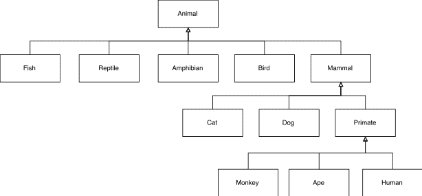

**图 4.1：** 此图以 UML 图的形式展示了动物子类型关系的有限选项。

## 4.2 包含多态（继承与子类型化）

包含多态是通用多态的一种形式，我们通过**子类型化**（SUBTYPING）获得它。也就是说，当一种类型的所有元素也是另一种更通用的类型的一部分时。这种关系这种关系由一种称为**继承**（inheritance）的编程语言产生的。我们说继承模型模拟了“是一个”（is-a）的关系。现实世界上有很多这样的例子。汽车是一种交通工具，公共汽车也是。猫是哺乳动物，狗和人类也是。这显示了“是一个”关系的另一个特征——它可以有多个层级。我们可以考虑动物这一宽泛的类别。动物有几种子类型，包括鸟类、爬行动物、两栖类动物和哺乳动物。我们已经说过猫、狗和人类是哺乳动物的子类型。我们也可以在其他领域列出类似的列表。我们可能还会决定进一步细分。我们可能想为灵长类建立一个类型，在这种情况下，人类将变为灵长类的一个子类型。

图 4.1 显示了这在 UML 图中可能是什么样的。我们可以看到，不同的箭头类型表示从继承中获得的子类型关系。它有一个开放的三角形头，并从子类型指向父类型。如果我们尝试在代码中建模这种关系，每个框都将是一个类或特征（trait），⁴特性的将在本章稍后讨论。

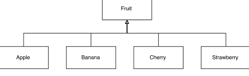

**图 4.2：** 这是一个简单的类图，显示了水果的示例。

让**灵长类**（Primate）继承自任何类，比如**哺乳动物**（Mammal），这意味着两点。其中一点是灵长类是哺乳动物的子类型。另一点是灵长类获得了所有被定义的的数据和方法。这有助于我们避免重复代码。

让灵长类成为哺乳动物的子类型，或者更泛泛地说，类型 B 是类型 A 的子类型意味着什么？我们可以说，在任何需要 A 对象的情况下，由于 B 是 A 的子类型，我们可以提供一个 B 对象，它可以正常工作。⁵

为了将其转化为更具体的形式，考虑以下示例。你有一份需要三种不同水果的食谱。食谱提供了如何准备水果并将其与其他原料混合的说明。在这种情况下，**水果**（Fruit）是父类型，我们拥有如何对该类型的实例进行某些操作的描述。有很多不同的水果子类型可以选择。这个特定的示例使用图 4.2 中的简单 UML 图进行了说明。

### 为什么超类型不应该知道子类型

父类型不应该知道子类型的原因是，这种知识限制了多态的通用性。当父类型创建时，可能只有几个子类型。在我们的水果示例中，子类型的数量是四个。为了使多态具有通用性，应该能够在以后创建新的子类型而不修改父类型，并且任何使用父类型的代码都能与新子类型良好地工作。⁵

⁵这正式称为里科夫替换原则（Liskov substitution principle）。

水果

| 苹果 | 香蕉 | 樱桃 | 草莓 |
| :--- | :--- | :--- | :--- |
| + fractionalLiquidContent: Double | + canEatSkin: Boolean<br>+ fractionalLiquidContent: Double<br>+ peel(): Skin | + fractionalLiquidContent: Double<br>+ slice(): Unit | + fractionalLiquidContent: Double |

**图 4.3：** 这个水果类添加了一些我们想要的方法，以及它们在子类中可能被重写的方式。

```
blender += ice
blender.blend()
```

这种思想是我们可以像下面的代码一样调用这个函数。

```
makeBreakfast(new Banana)
makeBreakfast(new Strawberry)
```

我们希望这能够工作，因为 `Banana` 和 `Strawberry` 都是 `Fruit` 的子类型。

那么，发生这种情况需要什么呢？为了让 `fruit` 类型与 `makeBreakfastShake` 配合，它需要有一个不接受参数并返回 `Boolean` 的 `canEatSkin` 方法，一个同样不接受参数的 `peel` 方法，以及一个不接受参数并返回 `Double` 的 `fractionalLiquidContent` 方法。为了让 `Banana` 类型的对象能替代 `Fruit`，它们必须拥有所有方法。

如你所见，事实证明继承的代码复用不仅是为了减少代码重复，它还有助于子类型。子类型保证拥有外部代码可能调用的父类型的所有方法和数据成员，在某些情况下它可以从父类型继承。

当然，你可能不会允许这些方法执行相同的操作。在这里，`Banana` 类型的对象在 `canEatSkin` 上应该返回 `false`，而 `Strawberry` 类型的对象应该返回 `true`。每种水果可能还会为 `fractionalLiquidContent` 返回不同的值。在子类的方法中更改实现被称为**重写（OVERRIDING）**。在 Scala 中，当子类进行重写时，关键字 `override` 必须放在方法声明的 `def` 关键字之前。图 4.3 显示了使用完整格式的 UML 类，你可以看到其中可能包含的方法。

图中的 `Fruit` 类型有四个属于所有 `Fruit` 不同子类的不同方法。这些每个方法都可以以某种方式实现。这四个子类只列出了它们想要重写的方法。其他方法由于继承而处于其默认实现中。


> 有过面向对象编程经验的人可能会倾向于将 `canEatSkin` 和 `fractionalLiquidContent` 设置为 Boolean 类型的数据成员，基于它是水果属性的想法。如果你这样做，你会希望将该属性设为私有，这意味着你必须有访问器方法，可能被称为 `getEatSkin` 和 `getFractionalJiuContent`。简单地添加一个方法并在子类中重写它是一种更简单的方法。

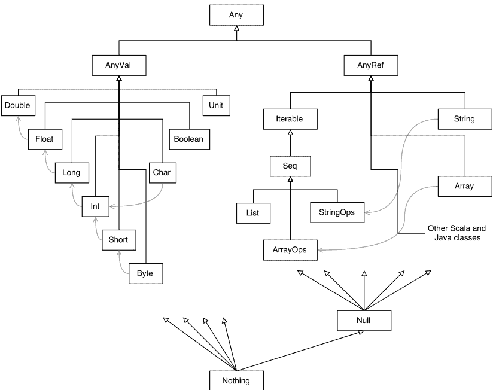

**图 4.4:** Scala 中通用子类型关系图。此图改编自 Odersky, Spoon 和 Venners 编写的 *Programming in Scala* 中的类似图 [10]。带有实心箭头的粗线表示子类型关系。带有空箭头的细线表示隐式转换。

# 使用 Scala 的面向对象、抽象和数据结构

## 4.2.1 Scala 类型系统中的继承

Scala 语言中的所有类型都是继承层次结构的一部分。图 4 显示了若干不同类型的 UML 表示。你创建的每个类都继承自名为 `AnyRef` 的类型，而 `AnyRef` 继承自 `Any`。你可以查看 API 看到列表顶部的 `Any`、`AnyRef` 和 `AnyVal` 类型。如果你查看创建的任何类，你会发现有很多方法存在于任何类中。我们可以通过在 REPL 中创建一个小类并调用其中一个方法来演示这一点。

```scala
class Vect3(val x:Double,val y:Double,val z:Double)
```

```scala
val jHat = new Vect3(0,1,0)
jHat: Vect3 = Vect3@247533433
scala> jHat.toString
res0: java.lang.String = Vect3@247533433
```

这里我们有一个不可变 3D 向量类型的类，它没有方法，只有其组件的成员。第二行在该类上创建了一个实例，随后是通知变量 `jHat` 是 `Vect3` 类型并有一个给定的值。这个值有点奇怪，类类名后面跟着 `@` 符号和一个数字。第三行调用了从 `AnyRef` 继承的方法之一：`toString` 方法。这清楚地显示了我们实例的表示从哪里来。`toString` 方法实际上定义在类型 `Any` 上，因此可以在 Scala 中的任何对象上自由调用。为此，它被广泛用于获取对象的表示。在这里我们看到每当对象的值需要打印时，REPL 就会调用它。

遗憾的是，`toString` 的默认实现并不是很有信息量。出于这个原因，它是你需要重写的内容。这段代码列表展示了我们可以如何这样做：

```scala
class Vect3(val x:Double,val y:Double,val z:Double) {
  override def toString(): String = s"Vect3($x, $y, $z)"
}
```

```scala
val jHat = new Vect3(0,1,0)
jHat: Vect3 = Vect3@247533433
scala> jHat.toString
res0: java.lang.String = Vect3@247533433
```

包含 `override` 的 `def` 给我们一个不同的实现。之前的示例展示了我们可以如何重写它，但并没有实际上演示如何从代码中获取代码的继承。

### 4.2.2 Scala 中的继承

方法的签名是预期的参数列表。如果你不放入 `extends` 关键字，你默认继承自 `AnyRef`。如果我们想继承 `AnyRef` 其他内容，就使用 `extends` 关键字。该关键字位于类的参数之后，类体起始的大括号之前。

```scala
class Shape {
  def area: Double = 0.0
  def perimeter: Double = 0.0
  def draw(gc: GraphicsContext): Unit = {}
}
```

为了说明这一点，让我们看一个关于继承的经典例子。我们定义了一个父类型 `Shape`，它包含了任何形状应该能够的方法。有两个可能的例子。

```scala
class Rectangle(val width: Double, val height: Double) extends Shape {
  def area: Double = width * height
  def perimeter: Double = 2.0 * (width + height)
  def draw(gc: GraphicsContext): Unit = {
    gc.fillRect(0, 0, width, height)
  }
}
```

```scala
class Circle(val radius: Double) extends Shape {
  def area: Double = math.PI * radius * radius
  def perimeter: Double = 2.0 * math.PI * radius
  def draw(gc: GraphicsContext): Unit = {
    gc.fillOval(0, 0, radius, radius)
  }
}
```

这些类每个接受某些参数并继承 `Shape`，然后重写了 `Shape` 的所有方法。我们现在可以编写接收 `Shape` 实例的代码并传递 `Rectangle` 或 `Circle` 的实例，它可以工作。原因是继承保证了我们在 `Shape` 实例上可以调用的任何方法都是子类中的。下面的函数以及对它的两次调用。

```scala
def areaPerimeterRatio(s: Shape): Double = {
  s.area / s.perimeter
}
```

```scala
val circleAPR = areaPerimeterRatio(new Circle(5))
val rectAPR = areaPerimeterRatio(new Rectangle(4, 5))
```

这就是多态的核心——一段作用于多种类型的代码。这是通用多态，因为在未来的任何时候我们创建一个新的 `Shape` 子类型，它对这段代码同样有效。

> `draw` 方法的细节将在第 5 章讨论。

## 124 使用 Scala 的面向对象、抽象和数据结构

如前所述，继承应该用于表示“是（is-a）”关系。在我们目前为止看到的例子中，说苹果是一个水果或矩形是一个形状看起来是相当自然的。如果你无法这样说，那么继承并不是你想要使用的结构。相反，请使用**组合**（composition）。组合是指你将某个类（类型）的实例作为另一个类的类成员，而不是继承自它。为了获取该功能，你对该成员进行调用。组合被用于建模行为，例如汽车“拥有”引擎的关系。你会为引擎创建一个单独的类，并将其包含在汽车中。我们将在书中看到许多此类构造的例子。需要强调的是，你不想滥用继承。代码复用看起来可能很棒，但子类型应该只在逻辑合理的情况下使用。

有时你确实拥有一个“是”关系且子类型在逻辑上是合理的，但在这些情况下你也应该克制使用继承。一个很明显的例子是：正方形是一个形状。此外，正方形也是矩形。这种关系可以用下面的单行类来表示：

```scala
class Square(length: Double) extends Rectangle(length, length)
```

在这里，`Square` 类接受一个作为边长的的参数。它继承自 `Rectangle`，并将该长度同时作为高度和宽度参数传递。正如示例所示，当父类型接收参数时，这些参数将通过父类型名称之后的参数列表中传递。

由于我们已经为 `Rectangle` 编写了代码，这种 `Square` 的实现是完全可以的，并且对 `Square` 实例的所有方法运行良好。这是因为我们的 `Rectangle` 类型恰好是不可变的。考虑这个 `MutableRectangle` 与 `MutableSquare` 的实现。

```scala
class MutableRectangle(var width: Double, var height: Double) extends Shape {
  override def area: Double = width * height
  override def perimeter: Double = 2.0 * (width + height)
  override def draw(gc: GraphicsContext): Unit = {
    gc.fillRect(0.0, 0.0, width, height)
  }
}
```

```scala
class MutableSquare(length: Double) extends MutableRectangle(length, length)
```

这里的一切都是正常的，甚至看起来运行得很好。然而，这种实现中存在着真正的问题。要看到这一点，请考虑以下代码。

```scala
def adjustRectangle(r: MutableRectangle): Unit = {
  r.width = 20
}
```

```scala
val square = new MutableSquare(5)
adjustRectangle(square) // Warning: 在此之后我们实际上不再拥有正方形了。
```

对 `adjustRectangle` 的调用执行了不应该执行的操作。它了一个 20 比 5 的“正方形”。这个函数应该适用于所有类型的矩形（即使是边长相等且被称为正方形的矩形）。这显然不符合正方形的普通定义。此调用是合法的，因为 `MutableSquare` 是 `MutableRectangle` 的子类型。

# 抽象与多态

问题在于当我们把 `Rectangle` 改为 `MutableRectangle` 时，我们实际上引入了两个新方法：`def width=(w:Double)` 和 `def height=(h:Double)`。这些方法并不适用于 `MutableSquare`，但由于继承关系，`MutableSquare` 类型获得了它们。

人们很想通过像代码这样显式地重写设置宽度高度字段的方法来修复这个问题。

```scala
class MutableSquare(length: Double) extends MutableRectangle(length, length) {
  override def width=(w: Double): Unit = { // ERROR: 不能重写可变变量
    width = w
    height = w
  }
  override def height=(h: Double): Unit = { // ERROR: 不能重写可变变量
    height = h
    width = h
  }
}
```

这无法编译，因为不允许重写与 `var` 关联的方法。这是 Scala 的规则，因为允许这种操作会导致尝试执行操作的代码出现问题。即使我们允许，将这些方法添加到 `MutableRectangle` 以便被重写，或者使用不同的方法来访问和设置变量，也不是一个好主意。为了理解为什么，请考虑程序员在执行类似 `r.width = 20` 的行代码时预期什么。显然，编写这一行的程序员预期它会改变 `width` 字段中存储的值。如果 `height` 字段也发生变化，将是意外之外的行为，并可能违反代码其他部分的假设。这可能导致极其难以发现的 Bug，因为代码在配合 `Rectangle` 实例使用时是正常的，而对程序的推理可能无法帮助程序员找到错误。

所以，请谨慎使用继承。它应该只在你需要子类型支持和代码复用时才被使用。你可能还会从示例中，拥有可变类会让许多事情变得更加复杂。不可变性在许多方面让生活变得更简单。

## 给父类型的参数

当你向父类型构造函数传递参数时，它们要么是常量，要么是涉及传入子类型构造函数的某些表达式。在 `Square` 类型中使用 `length` 是后者的一个例子。注意，这些名称几乎总是不同的，且用于子类型的参数不应该是 `vals` 或 `vars`，因为这些值不需要在子类型中保留，因为它们已经在父类型中被保留了。

为了理解这一点，想象一下我们没有调用参数 `Square length`，而是调用了 `width`。这可能会导致问题。

### 4.2.3 可见性与继承

`Shape` 缺少颜色。这里是 `Shape`、`Rectangle` 和 `Circle` 的实现，它们都有 `draw` 方法，其中 `color` 字段是私有的。

```scala
class Shape(private var color: Color) {
  def area: Double = 0.0
  def circumference: Double = 0.0
  def draw(gc: GraphicsContext): Unit = {}
}
```

```scala
class Rectangle(val width: Double, val height: Double, c:Color) extends Shape(c) {
  override def area: Double = width+height
  override def circumference: Double = 2.0*(width+height)
  override def draw(gc: GraphicsContext): Unit = {
    gc.fill = color // ERROR: 不能获取私有成员
    gc.fillRect(0.0,0.0,width,height)
  }
}
```

```scala
class Circle(val radius: Double) extends Shape(c) {
  override def area: Double = Math.radius*radius
  override def circumference: Double = 2.0*Math.radius
  override def draw(gc: GraphicsContext): Unit = {
    gc.fill = color // ERROR: 不能获取私有成员
    gc.fillOval(0.0,0.0,2.radius,2.radius)
  }
}
```

之所以是私有的，是因为它是可变的，我们不想允许任何获取 `Shape` 的代码片段能够更改该值。正如注释所示，这些类无法编译。子类型获取父类型中所有内容的副本，它们无法直接访问私有元素。使用这种方法，子类无法获取颜色，除非我们为它们添加了访问方法。

子类访问私有成员的行为正是我们所需要的。当某个内容被设为私有时，这意味着该类之外的其他代码部分不应该访问它。任何人都可以创建一个类的子类。如果这提供了对私有数据的访问，那么私有实际上就不那么安全了。当然，如果 `color` 被声明为 `val` 而不是 `var`，我们就不需要隐藏它，因为我们使用的 `Color` 类是不可变的，所以即使其他代码可以访问，也无法更改它。

### 4.2.4 受保护可见性 (protected)

当然，在某些情况下（比如我们的彩色形状示例），你希望某些数据方法只能被子类访问。这就是使用 `protected` 可见性的原因。当一个方法或数据成员用 `protected` 关键字修改时，它在该类及其子类中可见可见，但对任何其他代码不可见。通过这种方式，可以将 `Shape` 类修改如下：

```scala
class Shape(protected var color: Color) {
  def area(): Double = 0.0
  def circumference(): Double = 0.0
  def draw(g: GraphicsContext): Unit = {}
}
```

将 `color` 设置为 `protected` 后，之前 `Rectangle` 和 `Circle` 的代码仍然有效。`protected` 可见性并不常见。如果一个值确实需要隐藏，它应该是 `private`。将其设置为 `protected` 是向程序员发出信号，表示它是被子类需要的，但如果他们要使用或更改它，就需要知道自己在做什么。

### 4.2.5 调用超类上的方法

有时，当你在子类中重写一个方法时，你仍然希望运行超类中的代码。实际上，在某些情况下，你希望在执行任何操作之前调用超类中的方法。为了支持这种行为，你可以使用 `super` 关键字作用于引用当前对象中超类部分的对象。

这可以用于解决着色问题，并将颜色设为私有（private）。

```scala
class Shape(private var color: Color) {
  def area(): Double = 0.0
  def perimeter(): Double = 0.0
  def draw(g: GraphicsContext): Unit = {
    g.fill = color
  }
}
```

它有一个私有成员 `color`，因此它对子类不可见，并且封装良好，所以我们不需要担心其他代码更改它。与上一个带有私有颜色的版本不同，这个版本在 `draw` 方法中有一行代码将 `GraphicsContext` 对象的 `fill` 设置为 `color`。在代码中包含这一点允许我们在 `Rectangle` 中执行以下操作。

```scala
class Rectangle(val width: Double, val height: Double, c: Color) extends Shape(c) {
  override def area(): Double = width * height
```


```scala
override def perimeter(): Double = 2.0 * (width + height)

override def draw(g: GraphicsContext): Unit = {
  super.draw(g)
  g.fillRect(0.0, 0.0, width, height)
}
```

通过对 `super` 进行 `draw` 调用，这个版本可以在 `draw` 时设置颜色，而无需实际上访问超类中的值。同样的操作也可以在 `Circle` 中完成。

这种方法的一个优点是，只要 `Shape` 的所有子类都遵循在绘制自己的几何形状之前调用 `super.draw()` 的模式，就可以在不修改子类 `draw` 方法的情况下，为 `Shape` 类型添加其他设置。在大型库中，这种行为可能会产生问题，因为它强制超类保持某种行为（包括由其他作者编写的行为），并期望被维护。

### 4.2.6 抽象类

到目前为止我们编写的版本在某些方面可能让你觉得不太理想。特别是，为 `area` 和 `perimeter` 提供像 `0.0` 这样的默认实现，或者为 `draw` 编写空大括号，可能看起来不那么理想。也许写一点什么都不做的代码并不会困扰你，但这里有一个更大的问题，可以用下面这行代码来总结。

```scala
val s = new Shape(Color.red)
```

这行代码可以正常编译并运行。问题是，它到底意味着什么？如果你对 `s` 引用的对象调用 `area` 和 `perimeter`，你将得到 `0.0`。如果你调用 `draw`，什么都不会被画。

问题在于，虽然 `Shape` 是一个有效类型，但它并不是实例对象的完整规范。这是因为我们认为所有形状都应该有面积和周长，但我们需要能够说一个类型拥有某个方法或某些成员数据，而不是具体的定义。我们还希望 `Shape` 只代表一个超类，而不实现该超类；对象应该只为子类实例化。可以通过以下代码实现。

```scala
abstract class Shape(private var color: Color) {
  def area: Double
  def perimeter: Double
  def draw(gc: GraphicsContext): Unit = {
    gc.fill = color
  }
}
```

这里发生了两个变化。我们去掉了 `area` 和 `perimeter` 的等号以及赋值。我们还向类声明中添加了 `abstract` 关键字。

在类中没有赋予值的方法和成员数据被认为是抽象的。当某个成员没有合理的具体定义时，我们这样做。如果类中的任何内容是抽象的，那么该类就必须标记为 `abstract`。如果你漏掉它，你将得到语法错误。当一个类型继承自抽象类时，它必须为抽象成员和方法提供实现，或者该子类也必须标记为 `abstract`。

> 在第 5 章中，我们将看到其他的绘制设置，例如描边或变换。

## 抽象与多态

在超类中实现一个抽象方法。这样做有两个原因。首先，从语义角度来说，你并没有在重写超类中的实现。其次，更重要的一点是，如果方法是抽象的且你没有实现它，这将产生语法错误，除非该类被标记为 `abstract`。

### 为什么需要 override？

你可能会奇怪为什么在重写超类中已实现的方法时需要 `override` 关键字。你可能还会好奇为什么当超类中的方法是抽象的时，这种限制就消失了。这种现象的解释是尽可能让错误产生语法错误。

为了说明这一点，假设有一个签名 `setPrice(Int): Unit` 的方法出现在超类 `InventoryItem` 中。当公司决定开始在线销售时，程序员添加了一个继承 `InventoryItem` 的新子类 `OnlineItem`。程序员意外地使用了 `setPrice(Double): Unit`。如果该方法是抽象的，或者 `OnlineItem` 中的版本标记了 `override`，这将是一个错误，因为参数不匹配。这意味着子类有两个 `setPrice` 版本。其中一个接收 `Int`，另一个接收 `Double`。这绝对不是开发者想要的，所以最好编译器产生语法错误。

如果你在超类中实现了该方法呢？遗憾的是，那实际上可以编译并运行，但它会有有趣的行为，可能需要花时间调试才能发现子类中的方法没有被调用。因此，只有当方法会在大多数子类中使用时，你应该在超类中放置实现。如果某个东西经常要被重写，你应该强烈考虑将其设为抽象的。

## 使用 Scala 的面向对象、抽象和数据结构

你正在编写一个软件来模拟人员在建筑中的移动，以帮助设计空间。你有一个类型化的 `Person`，代表了模拟中可能出现的每个人。你工作的公司知道某些类类的人的行为与模拟中的不同。例如，他们需要 `Parent`、`Child` 和 `GeneralAdult` 类型。建筑对设施的需求意味着他们还需要 `Male` 和 `Female` 类型。最后一部分为单继承带来了问题，因为你希望能够通过继承 `Parent` 和 `Male` 来表示一个 `Father`。这种子类型关系是有意义的，但如果这两个类型都被写成类，你将无法使用它们。在类继承中，每个类只能自一个父类。

你可以通过 trait 两种方法来处理这个问题。一种标准的继承方案可能会使用以下结构。

```scala
trait Person { ... }

trait Parent extends Person { ... }

trait Male extends Person { ... }

class Father extends Parent with Male { ... }
```

在这里，`Parent` 和 `Male` 都是 `Person` 的子类型，且 `Father` 继承了它们。在这种情况下，`Person` 必须是一个 trait。这个 trait 只能继承其他 trait，而不能继承类。下面，`Parent` 或 `Male` 可以是类，但不能两个都是类，因为 `Father` 无法同时继承它们。在没有迫切将其中一个设为类的情况下，对三者都使用 trait 提供了一致性。

构建这些类型的另一种方法是使用 trait 作为混入类型。代码可能像下面所示：

```scala
class Person { ... }

trait Parent { ... }

trait Male { ... }

class Father extends Person with Parent with Male { ... }
```

在这种构造中，`Parent` 和 `Male` 类型都是 trait，它们不继承自 `Person`。相反，它们被混入 `Person` 中以创建 `Father`。这种方法可能稍微高级一点，如果 `Parent` 和 `Male` 类型涉及需要它们知道自己将与 `Person` 一起使用的代码，将需要使用自类型，这在在线附录中会有讨论。现在重要的是你意识到这个选项的存在，这样当我们构建不同的继承层次结构时，你会理解正在发生什么。

### trait 还是抽象类？

Scala 程序员面临的一个标准问题是，在编写将用于继承的抽象类型时，是选择抽象类还是 trait。这里的通用规则是倾向于使用 trait，因为它允许多重继承的灵活性。虽然它不能接受参数，但任何你想要作为参数提供的值都可以放入 trait 中，并留空让最终实现它的类为这些值提供值。

我们已经提到过几次 trait 不接受参数。那么你如何在构造时将值获取到 trait 中？其中一种方法是在 trait 中声明抽象值，然后在子类型中为它们提供定义。这之所以有效是因为 Scala 允许方法以外的内容也是抽象的，所以像 `val` 和 `var` 这样的东西可以在 trait 中保持抽象，并在子类型中实现。为了看到它是如何工作的，我们将用 `Person` 和 `Mother` 充实之前的示例之一。

```scala
trait Person {
  val name: String
}

trait Parent extends Person {
  def children: List[Person]
}

trait Female extends Person

class Mother(val name: String) extends Parent with Female {
  override def children: List[Person] = ?
}
```

在这段代码中，`Person` 声明了一个名为 `name` 的抽象 `val`，`Parent` 声明了一个抽象 `def children`。注意 `Parent` 或 `Male` 没有定义 `name`。虽然它们都继承自 `Person`，但它们默认像所有 trait 一样具有抽象方法。然而，`Mother` 不是抽象的，所以它必须包含 `name` 和 `children` 的正确定义。`children` 的定义是通过一个重写的方法完成的，我们还没有提供它的实现。`name` 的定义是在 `Mother` 的参数列表中完成的，我们说参数 `name` 是一个 `val`。

> 在 trait 构造期间执行的子类型中重写的值具有某些复杂性。这些细节在在线附录中给出，地址为 http://www.programmingscala.com。避免在使用了抽象值的 trait 中放置“构造函数”。

### 4.2.8 final

当某个东西是抽象的时，基本上意味着它必须在子类型中实现。某些情况下，说某个东西不能在子类型中被重写或更改也是有用的。这种要求可以使用 `final` 关键字强制执行。你可以使用 `final` 来修改你不希望在子类中更改的数据或方法。它也可以在你不希望允许该类有任何子类型时修饰类。

你可能会奇怪为什么你想让某个东西变为 `final`。一个答案是，你想保留当前实现中的某些行为，这些行为不应该在子类中被改变。这也可以是告诉其他用户的方法：从该类型的实例对象获取的行为，比从该特定类型获取的没有其他可能。

在类型中使用 `final` 来保留行为的最常见例子是当类定义了一个不可变类型时。不可变类型的优势以及如何使用它们来简化代码，是书中已经讨论了相当的内容。如果没有继承，如果你写了一个不可变的类型，你就知道该类型的任何实例都可以传递给其他代码，而不必担心它被更改。有了继承，这并不自动成立，除非你让类 `final`。如果它没有被标记为 `final`，子类可能会添加可变性或重写方法，这可能会破坏性。为了帮助你理解这一点，考虑以下类，它包含一个 String 成员和一个用于比较单个字符的方法。

```scala
class CharInComp(val str: String) {
  def position(str2: String, index: Int): Int = {
    if (index >= str.length) {
      if (index >= str2.length) 0 else -1
    } else if (index >= str2.length) 1 else {
      str(index).compareTo(str2(index))
    }
  }
}
```

这个类是不可变的。如果你从这个类创建一个对象，它可以自由传递。有了继承，可以创建一个可变的子类，如下：

```scala
class NCharInStrComp(s: String) extends CharInComp(s) {
  var cnt = 0
  override def position(str2: String, index: Int): Int = {
    cnt += 1
    super.position(str2, index)
  }
}
```

如果你制作 `NCharInStrComp` 的实例，它可以用于任何想要 `CharInComp` 的地方。问题是，如果在代码依赖于对象不可变的地方这样做，那么该代码现在可能会崩溃，因为它是作为一个可变对象被传递的。为了防止这种情况发生，原始版本应该被设为 `final`。你只需要在类声明前添加 `final` 关键字，如下所示。

```scala
final class CharInComp(val str: String) {
  def position(str2: String, index: Int): Int = {
    if (index >= str.length) {
      if (index >= str2.length) 0 else -1
    } else if (index >= str2.length) 1 else {
      str(index).compareTo(str2(index))
    }
  }
}
```

现在，任何创建子类的尝试（无论是可变的还是不可变的）都会产生错误。`final` 关键字在编程中被低估使用。然而，在不应该有父类或某些东西不应该被重写时，养成将其变为 `final` 的习惯。这不仅是一种良好的习惯，标记为 `final` 的代码有时还可以编译成更快的实现。

> 我们还将在第 8 章看到此类对象可以在多个线程之间安全地使用。

## 抽象与多态

### 4.2.9 方法解析

当你使用继承时，可能会创建出具有多个方法实现的类型。你应该理解 Scala 如何确定当在对象上调用方法时将使用哪种方法实现。

如果该方法定义在创建该实例的类或对象中，则将使用该版本。如果没有定义，则将使用超类型中某一个版本的实现。它将从列表中的最后一个类型开始查找超类型。如果它不是最后一个类型，它会尝试查找在该类型之前被混入的任何类型，然后再去查找列表中靠前的超类型元素。这种从完整的继承结构到待检查类型列表的转换被称为**线性化**。需要注意的是，如果一个类型出现多次，则使用解析列表中顺序靠后的那一个。

在章节的前面的部分，我们列出了两种定义 `Father` 类型的方法。以下是我们写的代码：

```scala
trait Person { ... }
trait Parent extends Person { ... }
trait Male extends Person { ... }
class Father extends Parent with Male { ... }
```

```scala
class Person { ... }
trait Parent { ... }
trait Male { ... }
class Father extends Person with Parent with Male { ... }
```

让我们考虑上述定义 `Father` 类型的两种方法。这两种方法的线性化实际上是相同的。在第一种，如果你从列表末尾列出所有类型并忽略重复，你会得到 `Father`、`Male`、`Person` 和 `Parent`。第一个 `Person` 实例被移除，留下 `Father`、`Male`、`Parent` 和 `Person`。当你重复此操作时，规则是保留最后一次。在第二种方法中，从结尾开始直接是 `Father`、`Male`、`Parent` 和 `Person`。在这两种情况下，列表末尾都是 `AnyRef` 和 `Any`，因为每个类都隐式继承自 `AnyRef`，而 `AnyRef` 继承自 `Any`。

## 为什么要线性化？

继承许多事物被称为**多重继承**，它只在某些语言中允许，C++ 是著名的例子。然而，它导致了许多语言选择规避的复杂问题。在 Scala 中，你只能对类进行单继承，多继承只允许通过特征实现。

不允许对类进行多重继承的原因是，继承类的语义是在子类中获取该类中所有内容的完整拷贝。考虑到这一点，请考虑图 4.5 所示 UML 图中产生的问题。这种情况被称为**菱问题**。

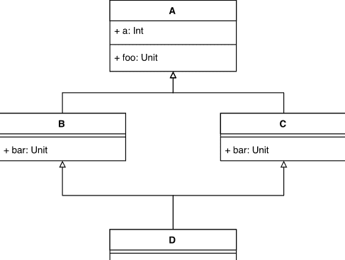

**图 4.5：** 此 UML 类图显示了通常所谓的菱问题。这种结构的挑战在于它可能导致显著的歧义。不同的语言有不同的处理方式的方法。

C++ 语言遵循子类对超类完全继承的规则，这说明了该问题会有多糟糕。使用该规则，类型 B 和 C 内部获得了 A 的完整拷贝。然后 D 拥有 B 和 C 的完整拷贝，这意味着它有两个 A 的完整拷贝，这显然是有问题的。（C++ 包含一个 `virtual` 结构，可以将这种行为减少为拷贝）：想象你创建了一个类型 D 的实例并尝试使用值 `a`，或调用方法 `foo` 或 `bar`。它将使用哪一个？将执行什么代码？D 从两个地方继承了这些成员，在 `bar` 的情况下，两者的代码可能是不同的。

在 C++ 中，程序员需要在此情况下指定使用哪一个超类型。在 Scala（以及 Perl 和 Python）中，超类型被“线性化”了，以便按照特定的顺序进行检查以解析方法调用。这消除了任何歧义。其他语言（如 Java）使得无法继承多个实现或数据值，因此此类问题不会出现，但程序员被限制了某些操作。

### 4.2.10 继承函数类型

我们在第 3 章中看到你可以像对待函数一样对待对象并向其传递参数。Scala 会扩展为对该对象调用 `apply` 方法。当你输入代码 `o(i)` 时，Scala 看到 `o.apply(i)`。因此，你可以轻松地创建你像函数一样对待的类型。为了做到，我们需要定义一个函数。为了说明这一点，考虑一个这样的函数：

```scala
class Square {
  def apply(i: Int): Int = i * i
}

val s = new Square()
s(5) // 25
```

如果你想在没有类的情况下定义函数，可以使用 lambda 表达式：


# 函数与泛型多态

## 函数基础

```scala
val square = (i: Int) => i * i

square(5) // 25
```

你也可以定义接受多个参数的函数：

```scala
val add = (a: Int, b: Int) => a + b

add(2, 3) // 5
```

在 Scala 中，函数是一等公民对象。这意味着它们可以存储在变量中，作为参数传递给函数，并从函数返回。

```scala
def applyFunction(f: Int => Int, x: Int): Int = f(x)

applyFunction(square, 4) // 16
```

函数是强大的工具，允许编写非常简洁且表现力代码。通过使用函数，你可以创建复杂但仍然易于阅读和维护的逻辑。

## 4.3 泛型多态

我们通过继承和子类型获得的包含多态并不是通用多态的唯一形式。存在第二类型称为**泛型多态**（parametric polymorphism）。这种多态类型我们从第 1 章开始就会使用的类型，因为每当你处理 `List` 或 `Array` 时，都会用到它。泛型多态就是当我们编写带有类型参数的代码时所获得的特质。

你已经熟悉了在调用方法时使用括号传递值，或者在构造新实例时向类传递值。同样地，你可以使用方括号来传递类型参数。考虑下面这些 `val` 声明。

```scala
scala val arr1 = Array(1,2,3)

arr1: Array[Int] = Array(1, 2, 3)
```

```scala
scala val arr2 = Array[Any](1,2,3)

arr2: Array[Any] = Array(1, 2, 3)
```

它们声明了存储值 1、2 和 3 的数组。如果我们让 Scala 推断这些值，那么这些值都是 `Int`，在第一种情况下，我们得到 `Array[Int]`。在第二种情况下，我们显式传递了一个参数类型 `Any`，并返回一个 `Array[Any]`。语法是在包含值参数的括号之前在方括号中传递任何参数。你可能觉得这两个列表之间没有区别，但类型参数改变了你可以对它们进行的操作。

```scala
scala arr1.sum

res0: Int = 6
```

```scala
scala arr2.sum

<console>9: error: could not find implicit value for parameter num: Numeric[Any]

arr2.sum
```

你无法对类型 `Any` 执行这种操作。你可能会疑惑为什么不能对 `arr2` 的元素求和，但考虑一下会发生什么。

```scala
scala arr2(1) = true
```

```scala
scala arr2(2) = List('a','b','c')
```

```scala
scala arr2[Any]

res1: Array[Any] = Array(1, true, List(a, b, c))
```

类型在 Scala 中确实并不代表任何含义。希望你清楚为什么尝试计算这个数组的和会失败。

### 4.3.1 泛型类型

在我们的代码中使用类型参数来使其更具活性如何？当你有一段代码希望适用于非常广泛的类型集合，而这些类型之间可能没有任何共同点时，你就会使用类型参数。最常见的例子就是集合——像 `Lists` 和 `Arrays` 这样的东西，它们应该能够包含你想要的任何内容，但你会在意它们存储了什么，因为当你从中取出元素时，你需要知道元素的类型。这种用法我们在第 6,7,12,13,16,18 和 20 章中会看到。现在，我们可以提供一些简单的示例来让你对这种泛型多态的用法有一个直感受。

我们使用一些用于运行主题乐园的代码来帮助说明这一点。当我们编写运行乐园不同方面的代码时，你会发现许多不同的事物是按一天中的小时来记录的。因此，我们按小时存储各种事物，例如销售额、人数、资源使用情况或值班员工。如果没有泛型多态，你将不得不编写大量重复代码，因为时间方面的代码是相同的，但类型可能非常不同。这里是一个你必须处理的类的首个实现。

```scala
package polymorphism.themep

/**
 * 这是一个一天中时间的数值，用于在处理
 * 与一天中时间关联的值时减少代码重复。
 *
 * @param A 存储的数据的类型。
 */
class ToValues[A] {
    private values: Array[Option[A]] = Array.fill(24)(None: Option[A])

    /**
     * 这允许你获取特定小时的小值。如果没有值，
     * 它将抛出一个异常。
     *
     * @param hour 要获取的小时。应该在 0 到 23 之间（包含）。
     * @return 该小时存储的值。
     */
    def get(hour: Int): A = values(hour)

    /**
     * 这允许你获取特定小时的小值。如果没有值，
     * 它将返回 None。
     *
     * @param hour 要获取的小时。应该在 0 到 23 之间（包含）。
     * @return 该小时存储的值的 Option。
     */
    def get(hour: Int): Option[A] = values(hour)

    /**
     * 允许你在特定小时设置值。
     *
     * @param hour 要设置的小时。应该在 0 到 23 之间（包含）。
     * @param v 要设置的新值。
     */
    def update(hour: Int, v: A) = values(hour) = Some(v)

    /**
     * 允许使用时间字符串在特定小时设置值。
     *
     * @param hour 要设置的小时。应该在 0 到 23 之间（包含）。
     * @param v 要设置的新值。
     */
    def update(time: String, v: A) = {
        val hour = hourFromTime(time)
        values(hour) = Some(v)
    }

    /**
     * 此方法清除特定时间的值。
     * @param hour 要清除的小时。
     */
    def clear(hour: Int): Unit = { values(hour) = None }

    /**
     * 使用特定时间时间的值。
     * @param time 要清除的时间。
     */
    def clear(time: String): Unit = {
        val hour = hourFromTime(time)
        values(hour) = None
    }

    /**
     * 允许使用指定的函数合并两个数据集。
     * @param o 另一组数据。
     * @param f 应用于数据类型的函数。
     */
    def combine(o: ToValues[A], f: (Option[A], Option[A]) => Option[A]): ToValues[A] = {
        val ret = new ToValues[A]
        for ((v, i) <- (values, o.values).zipped.map((v1, v2) => f(v1, v2))) {
            // implementation details
        }
        ret
    }
}
```

### 4.3.2 泛型函数和方法

Scala 中让用户以不同方式创建类型实例的标准方法是创建一个伴对象，其中包含不同参数的 `apply` 方法。我们使得类本身接收适当的数据作为参数。这里是一个可能的样子的示例。

```scala
object ToValues {
    // 第一次缺少类型参数且无法编译的尝试
    def apply(): ToValues = new ToValues(Array.fill(24) (None))
}
```

正如注释所暗示的，这种方法不可行。原因是 `ToValues` 本身不是一个有效的类型。它必须有一个类型参数才能完整指定。为了获取该类型以便使用，我们需要给方法一个类型参数。这种语法非常直观。我们只需要在名称和值参数之间的括号中放入类型参数。这样做，我们可以制作两个看起来所示的 `apply` 方法。

```scala
object ToValues {
    def apply[A]() = new ToValues[A](Array.fill(24) (None))
    def apply[A](a: A*) = {
        val d = a.map(Option(_)).toArray
        // implementation details
    }
}
```

```scala
new ToValues[A](if (d.length < 24) d.padTo(24, None) else if (d.length > 24)
  d.take(24) else d)
```

第二个 `apply` 方法允许我们以以下方式使用构造 `ToValues` 对象的代码。

```scala
val riders1 = ToValues[Int]
val riders2 = ToValues(0,0,6,7,3,9)
```

你应该注意到，第二次用法没有指定类型参数。这是因为当类型参数与方法配合使用时，它们通常会被自动推断。只要该类型出现在方法的参数中，你就不需要告诉 Scala 使用什么类型；它会自动识别。`riders1` 这一行需要我们告诉它 `[Int]` 且没有参数，但第二个可以推断出它正在处理 `Int` 类型。

- 这段代码被设置为接收一个参数。这意味着声明将从上面显示的内容变为如下所示。

```scala
class ToValues[A](private val values:Array[Option[A]])
```

这里有一个非常严重的问题，可能会创建一个包含 24 个元素的数组的 `ToValues` 对象。这显然是糟糕的行为，我们需要阻止它。一种阻止的方法是让类拥有一个私有构造函数。这意味着只有与类或其伴生对象关联才能对该对象调用 `new`。在语法上，这通过在值参数之前放置 `private` 关键字来实现。

```scala
class ToValues[A](private val values:Array[Option[A]])
```

现在，外部只能通过伴生对象的方法实例化 `ToValues`，并且很容易确保我们始终使用包含 24 个元素的数组创建实例。

我们想要做的另一个改进是增强 `combine` 方法，使其能够处理不同类型。理想情况下，我们希望输入可以是两个不同的类型，而输出是第三种类型。我们可以通过在方法上使用两个参数来实现：

```scala
def combine[B,C](o:ToValues[B])(f:Option[A], Option[B])=>Option[C]): ToValues[C] = {
  new ToValues((values, o.values).zipped.map((v1, v2)) => f(v1, v2))
}
```

现在我们可以进行诸如 `combine` 工作人员的操作以跟踪可能用于奖金的相关性。

如果你仔细观察，你会发现这里除了添加类型参数之外，还有其他变化。它不是包含两个参数的单一值参数列表，而是两个各带一个参数的列表。你应该记得这种技术被称为**柯里化（currying）**。这可能不是必须的，但它让方法变得简单得多。以下是一个用法示例。

```scala
val totalRiders = riders1.combine(riders2)((o1, o2) => (o1, o2) match {
  case (None, None) => None
  case (Some(a), None) => Some(a)
  case (None, Some(b)) => Some(b)
  case (Some(a), Some(b)) => Some(a+b)
})
```

如果我们不使用这种方法，Scala 的局部类型推断将无法自动识别出 `o2`，我们必须在函数声明中使用 `(o1,o2:Int)` 来指定它。

## 使用 Scala 进行对象交互、抽象和数据结构

### 4.3.2.1 参数化排序

在章节开头，我们使用排序任务作为排序的启发性示例。我们看到，当我们想要处理不同类型时，必须复制代码。现在你可以看到，我们希望有一个像 `sort[A]` 这样可以对任何类型进行排序的方法。尝试实现这一点将向我们展示一个我们未讨论过的类型参数细节，这使得任务变得具有挑战性。

```scala
def bubbleSort[A](arr: Array[A]): Unit = {
  for (i <- 0 until arr.length - 1) {
    for (j <- 0 until arr.length - i) {
      if (arr(i) < arr(j)) { // 错误：类型参数 A 的成员
        val tmp = arr(j)
        arr(j) = arr(j + 1)
        arr(j + 1) = tmp
      }
    }
  }
}
```

第 3 行的注释描述了如果我们尝试编译这段代码时得到的错误。这条信息意味着什么？当我们说代码必须与类型参数（如 `A`）工作时，Scala 必须确保它对任何允许的 `A` 都有效。由于这里没有限制，这意味着它必须符合 `Any` 类型的要求，而 `Any` 类型并没有定义名为 `<` 的方法。下一节将介绍如何做到。我们现在来看另一种替代方法。绕过此问题的方法一种是对允许的类型 `A` 设置边界。我们将看到，假设该类型将与参数化方法（如 `<`）工作，我们将传入一个额外的函数参数，充当 `<` 的角色。我们将这个函数称为 `lt`，less than（小于）的缩写。

```scala
def bubbleSort[A](a: Array[A])(lt: (A, A)) => Boolean = {
  for (i <- 0 until a.length) {
    for (j <- 0 until a.length - i) {
      if (lt(a(j), a(j+1))) {
        val tmp = a(j)
        a(j) = a(j + 1)
        a(j + 1) = tmp
      }
    }
  }
}
```

这为我们提供了一个适用于任何类型的排序，只要我们能定义一个代表“小于”的函数。对于 `combine` 方法，如果调用代码处理两个独立的列表，效果最好。在 REPL 中，我们可以看到它的运行：

```scala
> rints = Array.fill(10)(util.Random.nextInt(30))

rints: Array[Int] = Array(29, 19, 15, 6, 24, 5, 18, 10, 22, 14)

scala sorts.bubbleSort(rints)(_)

rints: Array[Int] = Array(1, 6, 10, 14, 15, 18, 19, 22, 29)

scala val rdoubs = Array.fill(10)(math.random())

rdoubs: Array[Double] = Array(0.1038, 0.2122, 0.8450, 0.5917, 0.9652, 0.9401, 0.0831, 0.1502, 0.7015)

scala sorts.bubbleSort(rdoubs)(_)

rdoubs: Array[Double] = Array(0.0831, 0.1038, 0.1502, 0.2122, 0.5917, 0.7015, 0.8450, 0.9401, 0.9652)
```


这里同一个方法被用于排序 `Int` 和 `Double`。

## 比较器

你将看到一种返回 `Int` 而不是 `Boolean` 的排序方法。当你需要知道两个值是否相等以及是否还是大于时，这种方法是有益的。如果值相等，函数将返回 0。如果较小，它将返回负值。如果较大，它将返回正值。我们将在后面的章节中看到这种比较函数的用法。

使用第二个函数作为比较方法的优点是灵活性。在上面的任何示例中，通过简单的传入 `_` 而不是特定的逻辑，就可以从大到小排序数字。此外，它对类型 `A` 没有限制。这允许你按任何顺序对内容进行排序。例如，如果你有一个学生类型，想在某些上下文中按名称排序，在其他情况下按成绩排序，这种方法允许你这样做，因为顺序没有绑定到对象类型。这种方法的缺点是，调用者每次使用它时必须带有一个比较函数。在上面的示例中，因为我们有简单的比较，这并不是大问题。

### 类型边界

正如我们所见，当我们在代码中使用该类型的对象时，普通的类型参数（如 `[Any]`）被视为 `Any`。虽然这是一个常见的用法，但有时你确实希望限制类型参数使用的类型，以便安全地调用 `Any` 可用之外的方法。实现这种操作的方法是对类型设置边界。

这种最常见的形式是为类型设置上界边界。这是通过 `<:` 符号关键字实现的。为了理解你可能想这样做，让我们考虑之前之前的一段示例代码。我们在章节开头编写的 `makeBreakfastShake` 函数只使用单个水果。这并不是通常的工作方式。你希望能够包含多个水果，可能是不同类型的。一个常见的例子是包含香蕉和草莓的奶昔。为了实现这一点，你可能会考虑如下代码，传入一个 `Array[Fruit]`。

```scala
def makeBreakfastShake(fruits: Array[Fruit]) {
  for (fruit <- fruits) {
    if (fruit.canEatSkin) {
      fruit.peel
    }
    blender += fruit
  }
  blender += juice
  blender += ice
}
```

这段代码对你来说可能看起来很好，在很多情况下它可以工作。然而，它并不是完美的。这里有一个遇到问题的示例。

```scala
scala val berries = Array(new Strawberry, new Strawberry)
berries: Array[Strawberry] = Array(Strawberry@51dd67, Strawberry@103b17)
```

```scala
scala makeBreakfastShake(berries)
<console>:16: error: type mismatch
found: Array[Strawberry]
required: Array[Fruit]
Note: Strawberry <: Fruit, but class is invariant in type T.
You may wish to investigate a wildcard type as '_ <: (SLS 3.2.10)
makeBreakfastShake(berries)
```

变量 `berries` 的类型是 `Array[Strawberry]`。`makeBreakfastShake` 的写法要求传递的参数实际上必须是 `Array[Fruit]`。类型 `Array[Strawberry]` 不是 `Array[Fruit]` 的子类型。为了理解为什么这样，只需想象如果这段代码中允许这样的调用会发生什么。

```scala
def substituteCherry(bowl: Array[Fruit]) {
  if (!bowl.isEmpty) bowl(0) = new Cherry // 如果碗不空，替换
  first piece // 为樱莓
}
```

如果你用 `Array[Fruit]` 调用它，那么它是没问题的，但如果你允许用 `Array[Strawberry]` 调用此函数，你就会在一个不允许包含樱莓的数组中得到樱莓。

这个问题的解决方案在上面的错误消息中实现。`makeBreakfastShake` 函数需要确保它能够接收任何是 `Fruit` 的子类型的数组。这是通过指定类型边界 `<:` 实现的，如下所示。

```scala
def makeBreakfastShake[A <: Fruit](fruits: Array[A]) {
  for (fruit <- fruits) {
    if (!fruit.canEatSkin) {
      fruit.peel
    }
    blender += fruit
  }
  blender += juice
  blender += ice
  blender.blend
}
```

使用 `<:` 符号允许对类型参数 A 设定约束。通过这种方式，我们可以说类型为 A 的对象比 `Any` 更具体。在示例示例中这是必要的，因为 `Any` 并没有 `canEatSkin` 或 `peel` 方法。

你也可以使用 `>:` 为类型指定一个下界。我们将在第 12 章构建不可变数据类型时看到这种类型约束的用法。

### 协变与逆变

值得注意的是，如果我们使用 `List` 而不是 `Array`，那么我们在使用 `Array[Strawberry]` 时遇到的问题将不会发生。这里展示的代码版本在没有类型限制的情况下，对于类型为 `Fruit` 子类型的列表是可以正常工作的。

```scala
def makeBreakfastShake(fruits: List[Fruit]) {
  for (fruit <- fruits) {
    if (!fruit.canEatSkin) {
      fruit.peel
    }
    blender += juice
    blender += ice
    blender.blend
  }
}
```

这之所以有效，是因为 `List` 是一个协变类型 `Fruit`，这意味着类型 `List[Strawberry]` 是 `List[Fruit]` 的子类型，而 `Array` 则不是。

如果你查看 `scala.collection.immutable.List` 的 API，你会发现它有一个类型参数 `+A`。这意味着它是协变的，且类型上的子类型关系与参数类型匹配。协变、逆变和不变的细节更为高级，出现在在线附录中。为什么这有效的简单解释是：`List` 是不可变的，因此我们替换 `Cherry` 的示例（这曾给 `Array` 导致了问题）在 `List` 上是不允许的操作。

### 类型边界与排序

特征的用途之一是为类型添加特定功能的混入。一个例子是 `Ordered[A]` 特征。该 trait 有一个抽象方法 `compare(that: A): Int`。该方法对类型 A 进行比较，如果它在排序中在 `that` 之前，则返回负值；如果在排序中在 `that` 之后，则返回正值；如果它们相等，则返回零。它具有具体方法，根据 `compare` 的结果定义标准的比较运算符。尽管那只是一个变量名，你可以给它起不同的名字，但将该变量命名为这样是标准做法。

任何属于 `Ordered` 的对象在排序算法中都能良好工作。它是 `Ordered` 的子类型意味着它拥有一种我们想要用于排序的自然排序。自然排序意味着我们不需要传递比较函数；它是构建在内部的。我们只需要限制哪些类型可以作为 `Ordered` 的子类型使用。这里展示了一个采用这种方法的泡泡排序版本。

```scala
def bubbleSort[A <: Ordered[A]](a: Array[A]) {
  for (i <- 0 until a.length; j <- 0 until a.length - 1 - i) {
    if (a(j + 1) < a(j)) {
      val tmp = a(j)
      a(j) = a(j + 1)
      a(j + 1) = tmp
    }
  }
}
```

你应该特别注意这个示例中的类型边界：`[A <: Ordered[A]]`。这是一个递归类型，其中边界引用了它所约束的类型。在此语境中，我们要求构建递归类型的能力，因为在 `sort` 内部，代码对两个类型为 A 的对象进行比较。

如果你将这个使用 `Ordered` 的排序输入计算机并尝试，你会发现它具有你可能意想不到的局限性。特别是，你不能用它来对 `Int` 数组进行排序。对于你可能尝试用于排序的许多其他类型也是如此。其原因是 `Int` 没有继承自 `Ordered`，它们没有可继承的排序。这样做是为了保持 `Int` 类型。

这个问题可以通过更改代码中的单个字符来修复，尽管解释这个问题会稍微复杂一些。修复方法是将类型边界中的 `<:` 替换为 `<%`。

```scala
def bubbleSort[A <% Ordered[A]](a: Array[A]) {
  for (i <- 0 until a.length; j <- 0 until a.length - 1 - i) {
    if (a(j + 1) < a(j)) {
      val tmp = a(j)
      a(j) = a(j + 1)
      a(j + 1) = tmp
    }
  }
}
```

`<%` 符号表示你可以使用任何指定类型的子类型，或者具有隐式转换到指定类型子类型的类型。这种排序适用于 `Array[Int]` 或 `Array[Double]`，因为 Scala 标准库定义了从 `Int` 到 `Double` 的隐式转换，并且其他类型分别是 `Ordered[Int]` 和 `Ordered[Double]` 的子类型。

隐式转换是你一直在使用的高级特性，它们通过将一种类型转换为另一种类型而不强制你执行任何工作来让生活变得更容易。尽管如此，它们会让某些地方很难判断代码到底在做什么，而且由于原因，对允许发生的隐式转换有规定。这些包括只有当前作用域内的隐式转换，并且不传递地应用转换。

## 抽象与多态

## 章节结束材料

### 概念总结

- 多态代码是处理许多许多类型的代码。
- 包含多态是多态的一种形式。
- 子类化是多态的另一种形式。
- 通用多态是多态的另一种形式。
- 参数多态是多态的另一种形式。
- 重载是多态的另一种形式。
- 重写是多态的另一种形式。
- 类型边界是多态的另一种形式。
- 隐式转换是多态的另一种形式。
- 变体（协变、逆变、不变）是多态的另一种形式。

### 练习

1. 在哪些情况下可能会失败？
2. 画出你可能表示的层次结构：
   - 动物生命
   - 学校组织
   - 账户（储蓄、支票）
   - 朋友
   - 学生
3. 实现其中

### 项目

这里有几个你可以选择的选择，这些是从我们上一章开始的。通用的想法是构建一个与相关的类型层次结构。如果合适，你也可以引入多态。

# 第 5 章 GUI 与图形界面

- 5.1 项目分析 ... 149
- 5.2 ScalaFX ... 151
  - 匿名类 ... 156
- 5.3 绘制程序布局 ... 156
  - 5.3.1 菜单 ... 158
  - 5.3.2 窗 ... 158
  - 5.3.3 控件 ... 159
- 5.4 绘制程序设计 ... 160
- 5.5 交互性 ... 162
  - 5.5.1 属性、观察者与绑定 ... 166
- 5.6 图形 ... 167
  - 5.6.1 形状与场景图 ... 167
  - 5.6.2 画布 ... 168
- 5.7 键盘和鼠标输入 ... 174
- 5.8 动画 ... 176
- 5.9 ScalaFX 的其他元素 ... 179
- 5.10 本末材料 ... 179
  - 5.10.1 概念总结 ... 179
  - 5.10.2 练习题 ... 180
  - 5.10.3 项目 ... 182

很有可能，你一生中使用过的大多数程序都没有像我们正在通过它们以及各种方法创建的这种文本风格界面。大多数用户操作的是具有**图形用户界面**（GUIs）的程序。本章的目标是向你介绍一个 Scala 中的 GUI 库，并展示你如何构建 GUI 并在向其中添加我们自己的图形。

### 项目分析

为了说明面向对象的设计原则，我们将在本书接下来的多个章节中跟踪一个大型程序的开发过程。我们要开发的程序是一个绘制程序。我们之前没有介绍它，是因为在没有 GUI 和图形的情况下，我们无法实现它。这个程序不会像画画（Paint）或你用过的任何其他“正常”绘制程序那样完全。我们将采取一些不同的做法，以便该程序在书的剩余部分中更好地说明关键概念。有些内容仅是为了教学目的而引入，但通常情况下，这些功能将产生一个能够实现你在绘制程序中通常看不到的功能的最终应用程序，包括动画。

这是一个相当大的软件部分，正如第 2 章提到的，在实现任何内容之前，我们应该从分析开始并进行设计。我们现在不需要确定软件中可能存在的每一个选项。我们只想弄清楚足够的信息，让我们有一个前进的方向。

## 使用 Scala 进行面向对象、抽象和数据结构

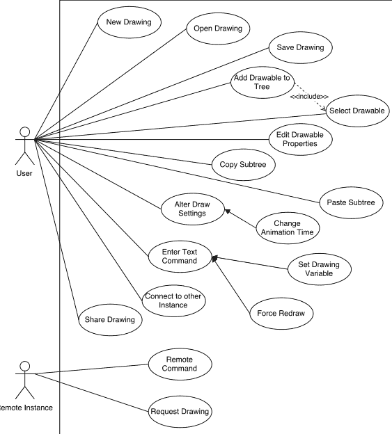

图 5.1：这是我们绘制程序的用例图。

我们还想识别以后可能想要添加功能的地方，以便在进入设计阶段时，我们可以记住这些点。

程序本身是一个绘制程序，具有一些额外功能，如网络、动画和用于发布命令的文本输入。图 5.1 显示了我们系统的用例图。图中两个参与者。明显的是运行程序的用户。该用户有向绘图添加元素和编辑绘制元素的能力。他们还有向程序发出命令的能力。绘制中不那么明显的部分涉及两个独立的程序实例相互通信。这导致了用例，即本地用户连接到程序的其他实例并执行诸如发送绘制部分或其他形式的通信操作。

此图显示了一些连接不同用例的箭头。带实心箭头的实线表示泛化。这意味着一个用例是另一个用例的特定类型。还有一个带有空心头的标记为 `<<include>>` 类型的虚线，表示每当一个用例发生时，另一个用例将作为其一部分包含。此图对于我们目前的需求是足够的。它列出了程序的基本操作，而它的创建迫使我们思考当我们想要程序能够做什么时，它是什么。你应该查看图中显示的不同选项，因为这将有助于我们在开始布局设计时做出的决策提供参考。

我们的下一步只是画出我们想要的 GUI 看起来什么样。在这个过程中，我们将引入在本章稍后详细阐述的不同元素。

# GUI 与图形界面

通过运行用例，我们可以确定我们的 GUI 需要的若干元素。这些包括：

- 一组用于基本操作的菜单。
- 用于切换绘图的标签页。
- 用于显示绘图的区域。
- 用于从图中选择元素的区域。
- 用于编辑物体属性的区域。
- 用于动画的滑动元素。
- 用于输入命令的字段。
- 用于显示输出的区域。

图 5.2 显示了我们如何布局各种组件的简单草图。较粗的条允许用户调整它们的位置。其他的只占据所需的空间。许多不同的组件在旁边的括号内有名称，例如 Search 或 Canvas。

### ScalaFX

在我们继续下去之前，我们需要了解一些关于编写 GUI 的知识。在编写时，有三个属于 Java 库的不同的 GUI 库。我们将使用其中最新的一个 JavaFX，并带有一个名为 ScalaFX 的包装器，它可以轻松创建具有复杂视觉效果的现代感图形界面。目前为虚拟机编写的大多数 GUI 代码使用的是 Swing 库，它比原始的抽象窗口工具（AWT）更灵活。遗憾的是，Swing 的某些设计元素在尝试将其现代化和优化时产生了问题。由于由于，Oracle 正在将 JVM 上的 GUI 应用开发推向 JavaFX，而也将遵循这一点。

目前，ScalaFX 并不是 Scala 标准库的一部分。你可以在 http://www.scalafx.org/ 找到项目的信息。这包含了指向 API 文档和 GitHub 仓库的链接。如果你在项目中使用 sbt（Scala 构建工具），你可以轻松地在依赖项中添加一行来获取 ScalaFX 支持。如果你在没有 sbt 项目的 IDE 中使用，可以从仓库下载代码以构建库的 JAR 文件。在编写时，ScalaFX 的文档相当少。但并不是一个问题，因为 ScalaFX 只是 JavaFX 的包装器，而且每个页面的顶部都有指向对应 JavaFX API 页面的链接，后者的文档通常详尽。你可以阅读 JavaFX 文档，然后使用 ScalaFX 支持的 Scala 风格进行调用。

> 这在 http://www.programmingusingscala.net 的在线附录中进行了讨论。

# 使用 Scala 的面向对象、抽象和数据结构

| 菜单栏 |
| :--- |
| 不同绘图的标签页 |
| 绘图场景图 (TreeView) | 动画滑块 |
| 绘图区域 (Canvas) |
| 可绘制属性（视情况而异） | 命令字段 (TextField) |
| | 命令输出 (TextArea) |

**图5.2**：这是我们完成项目后 GUI 看起来像这样的简单图表。

# GUI 与图形

Scala 和 Java 已发布在书籍网站上。如果你不想自己构建库，可以下载它们并将它们添加到路径中。

要使用 ScalaFX 制作一个运行 GUI 的应用程序，只需创建一个对象并让它继承 `JFXApp`。你可以编写的最简单的 GUI 如下：

```scala
import scalafx.application.JFXApp

object FirstGUI extends JFXApp
```


如果你运行这段代码，将会弹出一个没有任何内容的小窗口。

现在我们需要向 GUI 中添加元素。JavaFX 扩展出的 ScalaFX 使用了名为“场景图”（scene graph）的东西来组织 GUI 中的不同元素。场景图是一个树形结构，大多数场景图都出现在图形应用程序和库中。通常规则是，面向对象的 GUI 库大量地使用了继承。图 5.3 显示了 ScalaFX 场景图中部分的许多类/特质的图表。此图中可能漏了一些类，但它通常来说是完整的。你可能注意到的第一点是它很大。ScalaFX 有许多不同的组件，允许你构建强大的 GUI。我们显然不会在这里涵盖每一个类。相反，我们将涵盖层次结构中一两个分支的元素，这些元素我们将在项目中使用，或者你认为会在项目中用到的。关于各种 GUI 的更全面的介绍，请参考《Introduction to Programming and Solving Using ScalaFX》以及该书籍相关的在线视频。

```scala
import scalafx.Includes._
import scalafx.application.JFXApp
import scalafx.scene.Scene
import scalafx.scene.control.Button
import scalafx.scene.shape.Ellipse
import scalafx.scene.paint.Color
```

> JavaFX 也可以用于移动应用程序，移动应用并不像桌面 GUI 那样使用窗口。这就是使用 Stage（阶段）术语的原因之一，因为调用“窗口”仅适用于桌面，而 Stage 同时适用于桌面和移动端。

# 使用 Scala 进行面向对象、抽象和数据结构

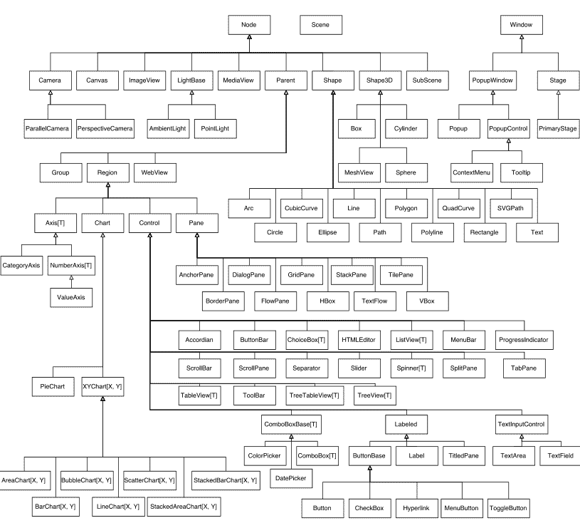

图 5.3：此类图显示了大多数与 ScalaFX 场景图相关的类/特质。

# GUI 与图形

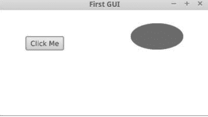

图 5.4：这是当你运行 `FirstGUI` 的完整版本时弹出的窗口。

```scala
object FirstGUI extends JFXApp {
  stage = new JFXApp.PrimaryStage {
    title = "First GUI"
    scene = new Scene(400, 200) {
      val button = new Button("Click Me")
      button.layoutX = 50
      button.layoutY = 50
      val ellipse = Ellipse(300, 50, 50, 25)
      ellipse.fill = Color.Red
      content = List(button, ellipse)
    }
  }
}
```

如果你运行此程序，将看到图 5.4 所示的窗口。你可以点击按钮，但它什么也不做。此外，如果你调整窗口大小，你会发现元素就保持在原地。使用 `content` 添加具有固定位置的元素是构建 GUI 的简单方法，但当显示器的尺寸和分辨率可以是交互式的（以便我们构建绘图程序时），这并不是用户友好的选项。

如果你以前没有接触过 GUI 或图形，有一个需要澄清第 15-17 行中出现的坐标的一个非常重要的方面。坐标系的原点 `(0,0)` 位于左上角。x 坐标随着你向右移动而增大，正如你预期的那样。因此，按钮的左边缘距离场景左边缘 50 像素，椭圆中心距离场景左边缘 300 像素。y 坐标随着你向下移动而增大，这与坐标系的情况相反。因此，按钮的顶部距离场景顶部 50 像素，椭圆中心也距离场景顶部向下 50 像素。

这种 y 坐标的反转并不是 ScalaFX 或 JavaFX 特有的，它是许多图形库中的标准行为。虽然这看起来可能很奇怪，但当你考虑到第一个“图形”显示是打印的纸张时，它就有意义了。纸上的第一行是 0，下一行是 1，所以 y 坐标随着页面向下而增大。

> 一个容载元素的容器。

## 匿名类

构建 `stage` 和 `scene` 的行所做的事情比看起来要多。当使用 `stage` 和 `scene` 时，所做的事情比看起来要多。

## 5.3 绘图布局

构建 `stage` 和 `scene` 的行所做的事情比看起来要多。当使用 `stage` 和 `scene` 时，所做的事情比看起来要多。

# 使用 Scala 进行面向对象、抽象和数据结构

```scala
commandArea.preHeight <= commandScroll.height
commandScroll.content = commandArea
val rightBottomBorder = new BorderPane
rightBottomBorder.top = commandField
rightBottomBorder.center = commandScroll
val rightSplit = new SplitPane
rightSplit.orientation === Orientation.Vertical
rightSplit.items += List(TopBorder, rightBottomBorder)
rightSplit.dividerPositions = 0.7
val topSplit = new SplitPane
topSplit.items += List(leftSplit, rightSplit)
topSplit.dividerPositions = 0.3
val tab = new Tab
tab.text = "Untitled"
tab.content = topSplit
tab
```

### 5.3.1 菜单

### 5.3.2 窗格

第 43-51 行通过将 `TabPane` 和 `MenuBar` 添加到场景根节点中，设置了 GUI 的顶层结构。以 `Pane` 结尾的类（以及少数不同名称的类）用于布局 GUI 元素。在 5.3 中，大多数此类组件都继承自 `Pane` 类型，还有少数额外的组件继承自 `Control`。

在我们开始的这个小型示例中，我们没有使用任何 `Pane` 或根节点。相反，我们定义了 `Node` 的位置并设置为内容。在 ScalaFX 中，`content` 是一个辅助方法，它创建一个 `Group`，将指定的元素添加到 `Group` 中，然后将 `Group` 设置为根节点。使用 `Pane` 布局 GUI 在用户更改设置（如调整窗口大小）时会产生更好的效果。

第 44 行创建了一个 `TabPane`。如名所示，这是一个顶部带有标签页的窗格。每个标签都有不同的内容。用户可以选择一个标签来查看其内容。第 45 行仅添加了一个标签，并使用另一个方法来构建该标签。这段代码被放在一个独立的方法中，因为当用户选择“新建”或“排序”菜单项时，每种绘图操作都需要执行此操作。即使在没有这些选项的情况下，这也有助于提高代码的可读性。

第 48 行创建了一个 `BorderPane`。这种类型的窗格有五个不同的区域可以在其中添加 `Node`，它们分别是顶、底、左、右和中间。`BorderPane` 是展示使用窗格而非通过坐标使用 `Node` 优势的示例。当 `BorderPane` 的尺寸发生变化时，其内部大多数 `Node` 会自动调整大小以适应新尺寸。顶部和底部元素占据面板的整个宽度并呈垂直方向。左侧和右侧元素（如果存在）占据剩余的垂直高度并根据需要占据所需的水平空间。中间元素占据剩余的所有空间。`rootPane` 用于将 `MenuBar` 放置在窗口顶部，其余空间全部留给了 `tabPane`。

`madeDrawingTab` 中有两个 `BorderPane`。它们分别在第 69 行和 80 行创建，用于将滑动条（`Slider`）与画布（`Canvas`）以及文本框（`TextField`）与文本区域（`TextArea`）分开。

`madeDrawingTab` 中出现的另一种窗格是 `ScrollPane`。它的目的是显示滚动条，并在内容超出可用空间时允许用户进行滚动。`drawingTree`、属性和 `commandArea` 都在 `ScrollPane` 中，因为其中任何一个都可能变得比显示屏幕范围大。

用于布局此 GUI 的最后一种窗格是 `SplitPane`。它允许多个 `Node` 垂直或水平堆叠，并在它们之间配有用户可调整的分割条。此 GUI 在第 63、83 和 88 行创建了三个 `SplitPane`。在创建其中一个后，我们将其添加到……在这种情况下，每个 `SplitPane` 只有两个项目。默认情况下，它们之间的分割位于中间。第 86 行和 90 行更改了它们的位置，使得 GUI 弹出时的外观大致符合我们的设想。

5.5 显示了运行 `DrawingMain` 时产生的窗口。注意窗格如何让不同元素按照我们想要的方式进行布局。

### 5.3.3 控件

大多数设计用于与用户交互的 GUI 元素位于 `scalafx.scene.control` 中并继承自 `Control`。这包括与创建菜单相关的 `Node` 以及我们过的交互式窗格，以及许多其他提供你在 GUI 中工作所需的元素的控件。此示例仅显示了四个元素：`Slider`、`TextField` 和 `TreeView`。

此时，每个元素都简单地创建并添加到相应的窗格中。

## 5.5 交互性

我们之前对 `DrawingMain` 的实现没有包含任何形式的用户交互。对于文本应用程序，我们通过调用 `readLine` 等方法从用户获取信息。由于多种原因，这在 GUI 中是行不通的。

- 可以从多个组件中获取输入。每个控件都可以独立地进行交互。
- 有多个设备可能可以提供输入。除了键盘之外，我们还有鼠标和可能存在的触摸屏。
- 读取调用是阻塞的，在我们等待用户时会停止一切操作。

GUI 需要一种能够规避这些问题的交互支持方法。我们必须处理用户以不同方式与不同组件进行交互的情况，并确保在交互发生时一切都是有响应的。

支持交互的通用方法是使用事件处理器。用户可以交互的任何元素都允许我们注册代码，当用户执行某种操作时，这些代码就会执行。我们在下面的代码中说明了几个示例，该代码展示了本章中完成的 `DrawingMain` 版本。在列出完整代码后，我们将介绍其中各个部分的细节。我们实现中的其他类将在稍后显示。

```scala
package guraphics.v2

import scalafx.Imports._
import scalafx.application.JFXApp
import scalafx.geometry.Orientation
import scalafx.scene.Scene
import scalafx.scene.canvas.Canvas
import scalafx.scene.control.Menu
import scalafx.scene.control.MenuBar
import scalafx.scene.control.MenuItem
import scalafx.scene.control.ScrollPane
import scalafx.scene.control.SeparatorMenuItem
import scalafx.scene.control.Slider
import scalafx.scene.control.SplitPane
import scalafx.scene.control.Tab
import scalafx.scene.control.TabPane
import scalafx.scene.control.TextField
import scalafx.scene.control.TreeView
import scalafx.scene.layout.BorderPane
import scalafx.scene.paint.Color
import scalafx.event.ActionEvent
import scalafx.scene.control.TreeItem
import scalafx.scene.control.SelectionMode
import scalafx.scene.control.Label
```

> 我们将在稍后的章节中向此程序添加更多内容，包括主对象。并不是所有功能在此时都能实现，因为我们还没有实现所有功能所需的知识。一些我们可以实现的功能目前被跳过了，因为我们稍后会学习更好的处理它们的方法。

## GUI 与图形

```scala
import scalafx.scene.layout.Priority
import scalafx.scene.control.ComboBox
import scalafx.scene.control.Dialog
import scalafx.scene.control.ChoiceDialog

object DrawingMain extends JFXApp {
  private var drawings = List[(Drawing, Tree[Drawable])]()

  stage = new JFXApp.PrimaryStage(
    title = "Drawing Program",
    scene = new Scene(1000, 700) {
      // Menus
      val menuBar = new MenuBar
      val fileMenu = new Menu("File")
      val newItem = new MenuItem("New")
      val openItem = new MenuItem("Open")
      val saveItem = new MenuItem("Save")
      val closeItem = new MenuItem("Close")
      val exitItem = new MenuItem("Exit")
      fileMenu.items = List(newItem, openItem, saveItem, closeItem, exitItem)
      new SeparatorMenuItem()
      val editMenu = new Menu("Edit")
      val addMenuItem = new MenuItem("Add Drawable")
      val copyItem = new MenuItem("Copy")
      val cutItem = new MenuItem("Cut")
      val pasteItem = new MenuItem("Paste")
      editMenu.items = List(addMenuItem, copyItem, cutItem, pasteItem)
      menuBar.items = List(fileMenu, editMenu)

      // Tabs
      val tabPane = new TabPane
      val (drawing, tree) = makeDrawingTab()
      drawings += ((drawing, tree))
      tabPane += tab

      // Menu Actions
      newItem.onAction = (ae: ActionEvent) => {
        val (drawing, tree, tab) = makeDrawingTab()
        drawings += ((drawing, tree))
        tabPane += tab
      }

      closeItem.onAction = (ae: ActionEvent) => {
        val current = tabPane.selectionModel.selectedIndex.value
        if (current > 0) {
          drawings = drawings.patch(current, Nil, 1)
          tabPane.tabs.remove(current)
        }
      }

      addMenuItem.onAction = (ae: ActionEvent) => {
        val current = tabPane.selectionModel.selectedIndex.value
        if (current > 0) {
          val (drawing, treeView) = drawings(current)
          val dialog = new ChoiceDialog("Rectangle", List("Rectangle", "Transform", "Text"))
          val d = dialog.showAndWait()
        }
      }
    }
  )
}
```

# 使用 Scala 进行面向对象、抽象和数据结构

```scala
case Some(s) =>
val d: Drawable = s match {
  case "Rectangle" => new DrawRectangle(drawing, 0, 0, 300, 300)
  case "Text" => new DrawTransform(drawing, 100, 100, "Text", Color.Black)
}

val treeSelect = treeView.selectionModel.getSelectedItem
```


```scala
def treeSelect(item: Item[Drawable]): Unit = item.match {
  case dt: DrawTransform =>
    dt.addChild(child)
    item.children += Item(dt)
    drawing.draw(dt)
  case d =>
    if (treeSelect == null) treeSelect(d)
}
```

```scala
exitItem.action = (ae: ActionEvent) => {
  // TODO - Add saving before closing.
  sys.exit()
}
```

// Top Level

```scala
val rootPane = new BorderPane
rootPane.top = menuBar
rootPane.center = tabPane
root = rootPane
```

```scala
def makeDrawingTab(): (Drawing, Tree[Drawable], Tab) = {
  val canvas = new Canvas(2000, 2000)
  val gc = canvas.graphicsContext
  val drawing = Drawing(gc)

  // left side
  val drawingTree = Tree[Drawable]
  drawingTree.selectionMode = SelectionMode.Single
  drawingTree.root = drawing
  val leftScroll = Scroll
  drawingTree.prefWidth = width
  drawingTree.prefHeight = height
  leftScroll.content = drawingTree

  val propertyPane = ScrollPane
  val leftSplit = SplitPane
  leftSplit.orientation = Orientation.Vertical
  leftSplit.items = List(leftScroll, propertyPane)

  // right side
  val slider = Slider(0, 1000, 0)
  val rightTopBorder = new BorderPane

  // GUIs and Graphics
  val canvasScroll = ScrollPane
  canvasScroll.content = canvas
  rightTopBorder.top = slider
  rightTopBorder.center = canvasScroll

  val commandField = TextField
  val commandArea = TextArea
  commandArea.editable = false
  val commandScroll = ScrollPane
  commandArea.prefWidth = width
  commandArea.prefHeight = height
  commandScroll.content = commandArea

  val rightBottomBorder = new BorderPane
  rightBottomBorder.top = commandField
  rightBottomBorder.center = canvasScroll

  val rightSplit = SplitPane
  rightSplit.orientation = Orientation.Vertical
  rightSplit.items += List(rightTopBorder, rightBottomBorder)
  rightSplit.dividerPositions = 0.7

  // Top Level
  val splitTop = new SplitPane
  splitTop.items += List(leftSplit, rightSplit)
  splitTop.dividerPositions = 0.3

  // Tree Selection
  drawingTree.model.value.selectedItem.onChange {
    val selected = drawingTree.model.value.selectedItem.value
    if (selected == null) {
      propertyPane.content = selected.getValue()
    } else {
      propertyPane.content = new Label("Nothing selected.")
    }
  }

  val tab = new Tab
  tab.text = "Untitled"
  tab.content = splitTop
  tab.closable = false

  (drawing, drawingTree, tab)
}
```

```scala
def labeledText(labelText: String, initialText: String, action: String => Unit) => {
  bp = new BorderPane
  val label = Label(labelText)
  val field = new TextField
  field.text = initialText
  bp.left = label
  bp.center = field
  field.onAction = (ae: ActionEvent) => action(field.text.value)
  field.focused.onChange(if (!field.focused.value) action(field.text.value))
}
```

# 使用 Scala 的面向对象、抽象和数据结构

大部分代码与之前相同。列表中的第一个交互位于第 60-102 行。

这里的代码现在使用了传递给函数的 `ActionEvent`。这些事件包含了导致事件发生的信息。你可以查看 API 发现 `ActionEvent` 中并不包含所有信息，但稍后我们将看到，其他事件包含了你对对这些属性的操作至关重要的类型信息。`setOnAction` 并不是指定交互行为的唯一属性。如果你查看 API 中的 `Node` 类，你可以看到一系列以 `on` 开头的处理许多类型事件的方法。其中大部分用于通用的键盘、鼠标和触摸交互，我们将在 5.7 节中探讨。

## 5.5.1 属性、可观察对象绑定

JavaFX 添加的显著特性之一是属性（properties）。这些对象存储值，并包含在值更改时通知代码的信息。你可以将属性视为一个发射事件的对象，就像 GUI 本身一样。ScalaFX 组件存储的大部分值都是作为属性存储的。这种影响可以在多次调用 `value` 的菜单项处理器中看到。考虑下面这一行，它是 `closeItem` 和 `addItem` 处理器的第一行：

```scala
var current = tabPane.selectionModel.selectedIndex
```

调用 `selectionModel` 返回一个 `ObjectProperty<SingleSelectionModel<Tab>>` 实例。注意，它实际上一个选择模型，而是封装了选择模型的 `ObjectProperty`。要获取实际值，你需要调用 `value` 或 `apply` 方法。记得 `apply` 方法可以通过在对象后加括号来调用，因此此行可以重写为如下方式。由你决定更喜欢哪种方法。

```scala
var current = tabPane.selectionModel().selectedIndex()
```

在许多地方输入 `value` 或括号可能看起来很麻烦，但它具有巨大的益处。第 158–165 行增加了与 `TreeView` 的交互性：当用户从树中选择一个 `Drawable` 时，其属性将显示在 `propertyPane` 中。这是通过在选择更改时设置代码实现的。属性具有 `onChange` 方法，它接收一个按名（by-name）参数，该参数会在值更改时执行。

`DrawingMain` 中的最后一个方法有助于减少这些类中的代码重复。正如名称所示，它提供了一个带有带有 `Label` 的 `TextField` 的后台 `Node`。最后一个参数是一个函数，即当用户停止编辑时将执行的操作。

描述 GUI 中键盘输入去向的术语

## GUI 与图形

这是焦点（FOCUS）。如果你想象一个带有多个文本字段的表单，当你打字时，按键只会进入其中一个字段。进入的字段就是拥有焦点的字段。`TextField` 有一个名为 `focus` 的属性。第 182 行注册了在焦点变化时执行的代码。因此，当获得或失去焦点时都会调用该代码。这里有一个 `if` 语句，使得操作只在失去焦点时执行。

属性的单值。还有一个名为 `scalafx.collections` 的包，它包含了许多以 `Observable`（观察）开头的集合。这些集合的行为类似于属性，当它们的内容变化时会执行相应的代码。在第 98 行利用了这一点。该项返回一个作为 `TreeView` 部分的 `Item`。`TreeItem` 有一个成员 `children`，我们正在向其中添加新元素。这看起来可能并不特殊，但因为 `children` 是一个观察集合，此更改会自动反映在 GUI 中。

在第 122、123、141 和 142 行操作的 `==` 运算符也与属性有关。你只能在运算符之间进行绑定。`==` 运算符执行的是单向绑定。正如符号所示，当右侧的值变化时，属性会自动更新以反映该变化。我们的示例相当简单，因为它们只是将一个属性绑定到另一个属性，但对于数值属性，你也可以对绑定进行数学运算。你可以使用以下代码行来保持标签在一个窗格中水平居中。

```scala
label.layoutX = (parent.width - label.width)/2
```

还有一种使用 `<=` 的双向绑定方法。当使用它时，符号左侧或右侧属性的更改将反映在另一侧的变化上。注意，某些属性是只读的，不能与双向绑定一起。只读属性只能出现在单向绑定的右侧。

## 5.6 图形

向 ScalaFX GUI 添加图形有两种方法。第一是将图形元素添加到场景图（scene graph）中，第二是使用 `Node` 的子类 `Canvas`。绘图程序使用了第二种方案，但我们想简要讨论两种。

### 5.6.1 形状与场景图

在图 5.3 中，你可能注意到了一种名为 `Shape` 的类型，它有十二个子类，包括 `Line`、`Polygon` 和 `Rectangle`。我们在 `FirstGUI` 的代码中使用了它们。这些不同的子类在创建内容方面提供了强大的功能。与控件（controls）不同，你通常不会在代码中绘制形状，而是手动指定它们的位置。你可以使用 `Group` 将多个形状组合成一个单一的 `Node`。

每个形状都有许多属性，可以通过设置它们来指定其绘制方式。`FirstGUI` 示例展示了如何将 `fill` 属性设置为 `Color`。`fill` 的类型实际上是 `scalafx.paint.Paint`，而 `Color` 是 `Paint` 的三个子类之一。另外两个是 `LinearGradient`（线性渐变）和 `RadialGradient`（径向渐变）。

还可以调整绘制形状的线条样式。这被称为 `STROKE`（描边）。

除了允许设置颜色的 `stroke` 属性外，你还可以设置 `strokeWidth`、`strokeLineJoin`、`strokeLineCap` 和 `strokeDashArray`。对这些选项的详细讨论出了本章的范围。

所有 `Nodes`（包括 `Shapes`）都可以赋予一个变换（transformation）。标准变换包括旋转、平移、缩放和剪切。当你为 `Group` 设置一个 `transform` 时，它将应用到所有内容。

### 5.6.2 Canvas

处理图形另一种方法是向场景图添加一个 `Canvas`，从 `Canvas` 获取一个 `GraphicsContext`，并调用 `GraphicsContext` 上绘制线条的方法。`DrawingMain` 的第 113 和 114 行创建了 `Canvas` 并获取了 `GraphicsContext`。然后第 115 行将 `GraphicsContext` 传递给 `Drawing` 的构造函数。`Drawing` 类有一个 `draw` 方法使用 `GraphicsContext` 渲染我们的 `Drawable` 元素。以下是 `Drawing` 的代码。

```scala
package guigraphics.v2

import scalaf.scene.canvas.GraphicsContext
import scalaf.scene.control.TreeItem
import scalaf.scene.paint.Color

class Drawing(private var gc: GraphicsContext) {
  private var root = new DrawTransform(this)

  def draw(): Unit = {
    gc.fill = Color.White
    gc.fillRect(0, 0, 2000, 2000)
    root.draw(gc)
  }

  def makeTree: Item[Drawable] = {
    def helper(d: Drawable): TreeItem[Drawable] = d match {
      case dt: DrawTransform =>
        item = new TreeItem(d)
        item.children = dt.children.map(c => helper(c))
        item
      case _ => new TreeItem(d)
    }
    helper(root)
  }
}
```

这是一个相当简单的类。除了名为 `gc` 的 `GraphicsContext` 外，它还存储了一个名为 `root` 的单一 `DrawTransform`。`draw` 方法通过设置 `gc` 的 `fill` 并填充一个大矩形来清除绘图区域。最后通过调用 `root` 的 `draw` 方法结束。

`Drawing` 中还有另一个与图形无关的方法。`makeTree` 方法用于为 `DrawingMain` 中的 `View` 设置 `TreeItems`。它使用了一个名为 `helper` 的递归函数。

# GUI 与图形

我们之前看到的 `drawing.labeledText` 方法。希望这能解释为什么我们想把它封装成一个方法。每次对 `labeledTextField` 的调用在创建它的内部都需要八十行代码，这导致了它变成了现在的样子。

调用 `labeledTextField` 时的最后一个参数是最有趣的。请记住，这是一个在用户每次启动 `TextField` 时都会被调用的函数。在我们的代码中，我们让每个调用都设置相应的成员，然后调用 `drawing.draw()`，以便用新值更新图形。

属性面板中的最后一个元素用于设置矩形的颜色。这可能是一个具有挑战性的任务，但由于 ScalaFX 包含了 `ColorPicker`，这变得非常简单了。我们只需要创建一个 `ColorPicker` 实例，并将当前颜色作为初始值传递它，然后注册一个 `onChange` 处理器，在用户每次选择新颜色时处理该事件。

`DrawText` 的代码与 `DrawRectangle` 非常相似，不同在于它有一个文本缩进、宽度和高度的字符串。这段代码还包含了 `toString` 方法的部分。

```scala
package guigraphics.v2

import scalaf.Imports._
import scalaf.scene.canvas.GraphicsContext
import scalaf.scene.paint.Color
import scalaf.scene.Node
import scalaf.scene.layout.VBox
import scalaf.scene.control.ColorPicker
import scalaf.event.ActionEvent

class DrawText(
    d: Drawing
```

drawing()

}

panel.children = List(textField, xField, yField, colorPicker)

propPanel = Some(panel)

}

propPanel.get()

}

```

最后一个 `Drawable` 子类是 `DrawTransform`。在讨论 `DrawTransform` 之前，我们可能应该先讨论变换（transforms）。这是你在 ScalaFX 中绘制内容时拥有的另一种设置。大多数 2D 图形库都保留了**仿射变换（AFFINE TRANSFORMS）**。这些是保持平行线的变换。变换有四种：平移（在 x 和 y 方向上移动物体）、旋转、缩放（可以在 x 和 y 方向上独立进行）和剪切（推正方形的顶部使其变成菱形）。任何仿射变换的组合也是仿射变换。

`DrawClass` 与另外两个略不同，尽管它仍然具有 `Drawable` 所需的方法。此外，它还有名为 `addChild` 和 `removeChild` 的方法以及一个私有变量 `_children`。这是因为 `DrawTransform` 是我们用来将 `Drawable` 组合在一起的。在 ScalaFX 场景图中，所有 `Parent` 的子类都可以承担这一角色。

```scala
package gulraphics.v2

import scalaflex.Imports_
```


# ScalaFX 示例代码与 GUI 编程详解

## 导入与类定义

```scala
import scalafx.scene.Node
import scalafx.scene.canvas.GraphicsContext
import scalafx.scene.layout.VBox
import scalafx.scene.control.ComboBox
import scalafx.scene.event.ActionEvent
import scalafx.scene.transform.Rotate
import scalafx.scene.transform.Translate
import scalafx.scene.transform.Scale
import scalafx.scene.transform.Shear

class DrawTransform(d: Drawing) extends Drawable(d) {
  private var _children = List[Drawable]()
  private var propPanel: Option[Node] = None
  private var transformType = DrawTransform.Translate
  private var value1 = 0.0
  private var value2 = 0.0

  def children = _children

  override def toString = "Transform"

  def addChild(d: Drawable): Unit = {
    _children += d
  }

  def removeChild(d: Drawable): Unit = {
    _children = _children.filter(_ != d)
  }

  def draw(gc: GraphicsContext): Unit = {
    gc.save()
    transformType match {
      case DrawTransform.Rotate => gc.rotate(value1)
      case DrawTransform.Translate => gc.translate(value1, value2)
      case DrawTransform.Scale => gc.scale(value1, value2)
      case DrawTransform.Shear => gc.transform(1.0, value1, value2, 1.0, 0.0, 0.0)
    }
    _children.foreach(_.draw(gc))
    gc.restore()
  }

  def propertiesPanel(): Node = {
    if (propPanel.isEmpty) {
      val panel = new VBox
      val combo = new ComboBox(DrawTransform.values.toSeq)
      combo.onAction = (_: ActionEvent) => {
        transformType = combo.selectionModel.value.selectedItem
        drawing.draw()
      }
      combo.selectionModel.value.select(transformType)
      val v1Field = DrawingMain.labeledTextField("x/theta", value1.toString, s => {
        value1 = s.toDouble(); drawing.draw()
      })
      val v2Field = DrawingMain.labeledTextField("y", value2.toString, s => {
        value2 = s.toDouble(); drawing.draw()
      })
      panel.children = List(combo, v1Field, v2Field)
      propPanel = Some(panel)
    }
    propPanel.get
  }
}
```

```scala
object DrawTransform extends Enumeration {
  val Rotate, Scale, Shear, Translate = Value
}
```

`draw` 和 `propertiesPanel` 方法都使用了在伴侣对象中定义的枚举。回想第 4 章，代码的编写使得每个 `DrawTransform` 实例可以是旋转、缩放、剪切或平移。要组合它们，你需要创建多个 `DrawTransform` 并让其中一个成为另一个的子元素。给定这种设计，我们需要一种方式来表示从这四个选项中选择的值，且仅限这些。这是我们想要使用枚举的完美示例。`transformType` draw 方法。

`draw` 方法实际上有三件主要事情在发生。对 `transformType` 进行 `match` 操作，在 `GraphicsContext` 上执行相应的变换以应用这些变换。由于剪切、旋转和缩放是不那么常见的操作，我们必须使用一个更通用的 `transform` 方法来创建剪切。我们传递的 `1.0` 值是缩放参数，而值为 `0.0` 的是平移参数。在应用变换后，第 41 行遍历所有子元素并使用 `foreach` 绘制它们。更有趣的行是应用这些变换的 ScalaFX `GraphicsContext`。调用 `gc.save()` 保存了当前的变换，以及填充和描边信息，最后的调用 `gc.restore()` 将这些值带回来，这样在 `DrawTransform` 之后绘制的任何内容都不会受该变换的影响。

## 使用 Scala 进行面向对象、抽象和数据结构


**图 5.7.** 这是当你运行更完整的 `DrawingMain` 时弹出的窗口。在这种情况下，我们需要回到使用之前设置的变换。

在 `propertiesPanel` 中，我们使用 `ComboBox` 来显示可选的不同变换类型。注意在构造函数中传递的 `DrawTransform.values`。`Enumeration` 类型提供了一个名为 `values` 的成员，为我们提供了可能值的集合。在这里我们使用枚举优于可能采取的其他方法的另一个优点。如果在枚举中添加或删除一个值，其他地方几乎不需要做更改。只有 `match` 需要更新分支以调整更改。

## 5.7 键盘和鼠标输入

虽然该程序允许我们演示在书中其余部分需要的许多 GUI 和图形功能，但有几个关键元素没有得到充分讨论。其中之一是以与标准 GUI 元素交互以外的方式获取键盘和鼠标输入。如果用户点击按钮，你希望你的代码使用 `onAction`。但是，如果你有一个形状或图像希望它响应鼠标点击，则没有 `onAction`。

`Node` 类型定义了大量以 `on` 开头的方法，用于处理基础输入。以 `onKey` 开头的方法处理键盘输入，以 `onMouse` 开头的方法处理鼠标输入，而以 `onDrag` 和 `onSwipe` 等其他名称开头的方法支持触摸界面。

以下代码展示了在使用 `Scene` 进行绘图的应用程序中使用 `onMouseMoved` 和 `onKeyPressed`。目标是让一张图片跟随鼠标移动，并有一个可以通过箭头键移动的框。

```scala
package guigraphics

import scalafx.Includes._
import scalafx.application.JFXApp
import scalafx.scene.Scene
import scalafx.scene.image.ImageView
import scalafx.scene.shape.Rectangle
import scalafx.scene.input.MouseEvent
import scalafx.scene.paint.Color
import scalafx.scene.input.KeyEvent
import scalafx.scene.input.KeyCode

object KeyboardMouse extends JFXApp {
  stage = new JFXApp.PrimaryStage {
    title = "Keyboard and Mouse Input"
    scene = new Scene(600, 600) {
      val img = new ImageView("file:Mimas_Cassini.jpg")
      val box = Rectangle(0, 0, 30, 30)
      box.fill = Color.Green
      content = List(img, box)
      onMouseMoved = (me: MouseEvent) => {
        img.x = me.x
        img.y = me.y
      }
      onKeyPressed = (ke: KeyEvent) => {
        ke.code match {
          case KeyCode.Up => box.y = box.y.value - 2
          case KeyCode.Down => box.y = box.y.value + 2
          case KeyCode.Left => box.x = box.x.value - 2
          case KeyCode.Right => box.x = box.x.value + 2
          case _ =>
        }
      }
    }
  }
}
```

第 17 行和第 18 行创建了一个 `ImageView` 和一个 `Rectangle`，并将它们设置为场景的内容。然后，我们将场景的 `onMouseMoved` 赋值给一个函数，该函数将图片的 x 和 y 值更改为 `MouseEvent` 中的对应字段。代码的最后一个元素是给场景的 `onKeyPressed` 赋值。按键处理函数接收一个 `KeyEvent`，其中包含关于是哪个按键事件的信息。这段代码对 `KeyEvent` 进行了匹配。它包含了箭头键的情况，会更改框的相应值。

## 5.8 动画

当所有想要执行的操作都由用户触发时，键盘和鼠标处理器就足够了。如果你希望事情在用户不进行任何操作的情况下发生，那么你需要采取不同的方法。ScalaFX 拥有各种动画，我们在 `scalafx.animation` 包中尚未涵盖它们。我们将只考虑 `scalafx.animation.AnimationTimer` 类，因为它通常适用于许多不同的问题。

以下代码演示了如何结合 `AnimationTimer` 与鼠标和键盘输入。虽然上一个程序使用了场景图中的 `Node`，但本程序使用 `Canvas` 进行绘图。目标是让由箭头键控制的框，以及一组跟随鼠标指针的“圆群”，它们以不同的速度追逐鼠标。为了简化处理，这段代码使用了第 3 章第 97 页出现的 `Vect2D` 类。

```scala
package guigraphics

import scalafx.Includes._
import scalafx.application.JFXApp
import scalafx.scene.Scene
import scalafx.scene.Canvas
import scalafx.scene.layout.BorderPane
import scalafx.animation.AnimationTimer
import codetails.Vect2D
import scalafx.scene.paint.Color
import scalafx.scene.input.MouseEvent
import scalafx.scene.input.KeyCode
import scalafx.scene.input.KeyEvent

object AnimationExample extends JFXApp {
  class Swarmer(i: Int) extends Swarmer(Vect2D(300, 300), (i * 5 + 20) * 0.02)
  private var mouse = Vect2D(300, 300)
  private var box = Vect2D(0, 0)
  private var upPressed = false
  private var downPressed = false
  private var leftPressed = false
  private var rightPressed = false
  private var speed = 25.0

  stage = new JFXApp.PrimaryStage {
    title = "Animation Example"
    scene = new Scene(600, 600) {
      val border = new BorderPane
      val canvas = new Canvas(600, 600)
      val gc = canvas.graphicsContext2D
      border.center = canvas
      root = border
      canvas.width <== border.width
      canvas.height <== border.height

      canvas.onMouseMoved = (me: MouseEvent) => {
        mouse = Vect2D(me.x, me.y)
      }

      canvas.onKeyPressed = (ke: KeyEvent) => {
        ke.code match {
          case KeyCode.Up => upPressed = true
          case KeyCode.Down => downPressed = true
          case KeyCode.Left => leftPressed = true
          case KeyCode.Right => rightPressed = true
          case _ =>
        }
      }

      canvas.onKeyReleased = (ke: KeyEvent) => {
        ke.code match {
          case KeyCode.Up => upPressed = false
          case KeyCode.Down => downPressed = false
          case KeyCode.Left => leftPressed = false
          case KeyCode.Right => rightPressed = false
          case _ =>
        }
      }

      var lastTime = 0L
      var timer = AnimationTimer(time => {
        if (lastTime == 0) lastTime = time
        val interval = (time - lastTime) / 1e9
        lastTime = time
        swarm.foreach(s => s.move(mouse, interval))

        if (upPressed) box.y -= speed * interval
        if (downPressed) box.y += speed * interval
        if (leftPressed) box.x -= speed * interval
        if (rightPressed) box.x += speed * interval

        gc.fill = Color.White
        gc.fillRect(0, 0, canvas.width.value, canvas.height.value)
        gc.fill = Color.Red
        for (p <- swarm) {
          gc.fillOval(p.x, p.y, 20, 20)
        }
        gc.fill = Color.Green
        gc.fillRect(box.x, box.y, 30, 30)
      })
      timer.start()
      canvas.requestFocus()
    }
  }
}
```

此示例中的 `canvas.requestFocus()` 行至关重要，图形将被绘制，种群将跟随鼠标，但按键不会移动方框，因为如果没有该行，按键事件会发送到场景，而 `Canvas` 永远无法获取它们。

## 5.9 ScalaFX 的其他元素

本章完全没有提到 ScalaFX 的许多其他元素。还有其他形式的动画和各种效果。你还可以以视频和声音的形式添加媒体。ScalaFX 包含了用于显示页面和绘制各种形式图表的 `Node` 类型。它还支持 3D 图形。遗憾的是，这些超出了本章所介绍的范围。书籍网站包含了一些额外资源的链接，强烈鼓励感兴趣的读者探索这些功能中吸引他们的一个。

## 5.10 章节结束内容

### 5.10.1 概念总结

- 目前 Java 推荐使用的 GUI 库是 JavaFX，它通过一个名为 ScalaFX 的封装器使用，这为 Scala 语法提供了更好的支持。要创建一个使用 ScalaFX 运行的 GUI 应用程序，只需创建一个对象并扩展 `JFXApp` 即可。
- JavaFX（以及 ScalaFX）使用一种称为场景图的机制来组织 GUI 中的不同元素。场景图是一种树结构，最常见于图形应用程序和库。
- 坐标系原点 (0,0) 位于左上角。x 坐标随着向右移动而增大。y 坐标随着向下移动而增大。


- GUI 可以包含许多不同的 GUI 元素。本章涵盖的一些包括 `MenuBars`（菜单栏）、`MenuItems`（菜单项）、`BorderPanes`（边界面板）、`ScrollPanes`（滚动面板）、`SplitPanes`（分割面板）、`Sliders`（滑动条）、`Canvases`（画布）、`TreeViews`（树视图）、`TextFields`（文本框）和 `TextAreas`（文本区域）。

- 支持 GUI 交互的通用方法是使用事件处理器。

- `<=` 是单向绑定的符号方法。在 ScalaFX GUI 中，GUI 通常存储为可观察属性（observable properties），它们具有非常强大的功能：你可以将这些值相互绑定，这样当值变化时，左侧的值会自动更新。还有一种使用符号 `<=` 的双向绑定方法。当使用它时，符号左侧或右侧任一属性的变化都会反映在另一侧的变化上。

向 ScalaFX GUI 添加图形有两种方法。第一种是将图形元素添加到场景图中，第二种是在 `Canvas` 上绘制。

形状（`Shapes`）有许多不同的属性，你可以设置它们来指定绘制方式。不仅可以设置填充（`fill`）属性，还可以通过 `stroke`（描边）属性绘制线条，并使用 `strokeWidth`、`strokeLineJoin`、`strokeLineCap` 和 `dashArray` 属性调整线条样式。

所有的 `Node`（包括 `Shapes`）也可以被赋予一个变换（`transformation`）。标准变换包括旋转、平移、缩放和剪切。当你对一个 `Group`（组）设置变换时，它将应用于所有内容。

有四类方法用于在 `Canvas` 上进行绘制。

- 第一组以 `fill` 开头，这些会填充所有区域。

- 第二组以单词 `stroke` 开头，这些会为涉及的任何形状绘制线条。

- 第三组包含不同版本的 `drawImage`，用于将 `Image`（图像）渲染到 `Canvas` 上。

- 最后一组方法可以配合 `fill` 或 `stroke` 方法调用，它们都以特定的 `suffix` 结尾，并允许你构建自己的路径（`paths`）。

`Node` 类型定义了大量以 `on` 开头的方法，用于处理基本输入。以 `onMouse` 开头的方法处理鼠标处理器输入，而以 `onDrag`（拖拽）、`onSwipe`（滑动）等其他内容开头的方法则支持触摸界面。

如果你想在用户不进行任何操作的情况下发生事情，可以考虑使用 `scalafx.animation.AnimationTimer` 类。

### 5.10.2 练习

- 1. 使用三个 `ComboBox` 和一个 `TextField` 设置一个小型 GUI，让用户做简单的数学题。`ComboBoxes` 应该排成一行，第一个和第三显示数字，中间的显示数学运算符。当用户选择不同的值或操作时，`TextField` 应该更新为正确的答案。

- 2. 编写一个简单的 GUI，在点击按钮时显示你的名字。你应该有两个按钮，一个名为“Show Info”（显示信息），点击时显示你的名字和市长；另一个名为“Quit”（退出）。

- 3. 编写一个计算汽车里程的 GUI 应用程序。程序窗口应该有一个地方，允许用户输入汽车油箱容量的加仑数以及满一箱油可以行驶的英里。当用户点击按钮时，应用程序应该显示每加仑油可以行驶的英里。

- 理剪 — $50.00

- 面部护理 — $100.00

- 修眉 — $25.00

- 手部护理 — $35.00

- 足部护理 — $45.00

- 按摩 — $85.00

编写一个带有检查按钮（`check buttons`）的 GUI 应用程序，允许用户选择这些服务的任何或全部。当用户点击按钮时，应显示总费用。

- 5. 为简单的文本编辑器编写一个 GUI。使用 `TextArea` 作为主编辑区域，并放入保存文件的菜单选项。

- 6. 编写一个具有 3x3 网格按钮的井字棋游戏。在点击按钮时打印某些内容。

- 7. 制作包含一个 `Slider` 和一个 `TextField` 的 GUI。当用户移动 `Slider` 时，它移动的值应该出现在 `TextField` 中。

- 8. 编写一个有两个 `RadioButtons`（单选按钮）和一个 `ListView`（列表视图）的 GUI。`RadioButtons` 应该标记为“Uppercase”（大写）和“Lowercase”（小写）。当 `RadioButton` 状态改变时，`ListView` 应仅显示对应的值。

- 9. 这项练习扩展了从第2题开始的调度练习。对于此项练习，编写一个允许用户创建日程的 GUI。从文件中读取提供的课程信息。让 GUI 元素允许你选择要修的课程并将它们放入不同的 `ListView` 中。你应该也能够从中删除课程。提供保存和加载构建的日程的菜单选项。目前不需要处理时间冲突甚至课程重复。只需让用户构建日程即可。如果有挑战，考虑如何防止不同类型的冲突。

- 10. 此练习扩展了第3章中的食谱练习。你应该将文本菜单的功能转换为 GUI。你应该决定具体的格式，但可以考虑使用 `ListView` 或 `Table` 来显示与仓库和食谱项目相关的信息。你需要提供保存和加载的菜单选项。像文本菜单版本一样，用户应该能够向仓库添加物品、向食谱本添加食谱、检查是否可以制作某食谱，告诉程序你有足够的原料并从仓库中减少相应的数量。你还应该添加与原料和食谱关联图像的能力。最后，还应该在 GUI 中添加制作食谱说明。ScalaFX 中的 `Image` 类具有从文件或 URL 读取以获取图像的能力。

11. 本练习扩展了第 3 章的音乐库练习。创建一个显示音乐数据库的 GUI 程序。使用 GUI 显示所有歌曲信息，并允许用户缩小选择范围。此外，提供菜单选项来添加和删除歌曲信息。

你应该考虑专辑的封面艺术。将其整合到你的解决方案中，这样当选择专辑（可能是歌曲）时，就会显示专辑的封面。封面可以存储在与数据文件相同的目录中。ScalaFX 中的 `Image` 类具有从文件或 URL 读取读取图像的能力。

### 5.10.3 项目

本章描述了一个新项目，该项目将贯穿本文其余部分，并在章节末尾会有新的项目系列。本章末尾有几个不同的项目将在本书的剩余部分进行开发。关于此以及每章中不同项目与其他项目之间关系的信息，以及一些示例实现，可以在书籍网站上找到。再次注意，你编写的代码可能会一直持续到书末。你将学习更好的处理方法，当你这样做时，你将修改已写过的代码。

- 1. 使用基础文本文件中的编辑器为你的 MUD 项目编辑房间可能是具有挑战性的且容易出错。因此，拥有一个让你编辑房间的 GUI 可能会很有帮助。它可以显示一个房间的 `ListView` 供你选择，然后提供设置所选房间值的其他选项。还应该包含创建新房间或删除房间的选项。注意，当你删除时，该房间之后的所有房间的索引都会 way。

- 2. 如果你一直在做网络爬虫项目，可以构建一个 GUI 来对这些页面进行最小显示。如果你觉得想承担更大的任务，还可以包含代码，使用 `Canvas` 或通过在场景图中定位元素并连接它们来图形化表示页面之间的链接。

- 3. 如果你正在做图形游戏项目，那么现在你应该为你的游戏整合一个 GUI。利用你对 GUI 和图形的知识，你应该编写代码，让玩家（位于运行计算机应用程序的面前）出现在 GUI 可见的某个上。你的游戏可以使用 `AnimationTimer` 让动作发生，并以击键或鼠标事件的形式接收用户输入。

为了增加挑战，你可以制作一个更复杂的图形游戏，包含具有更显著 AI 的计算机控制函数。

- 4. 这是一个新的项目系列。到学期结束时，你将具备评估、解析和操作函数的能力。这些是 Mathematica® 等图形软件的关键方面。因此，你做的一个项目选项是制作一个类似 Mathematica 的工作表程序。其中，该程序将具有绘制函数和对这些函数进行符号操作的能力。它还应该在简单语言中具有一些编程编程。这一切都将在 GUI 内部完成。现在你应该构建一个 GUI，为 `Worksheet` 创建一个类，并看看能否让它绘制你通过 GUI 中的 `ComboBox` 或 `ListView` 选择的某些程序函数。

## GUI 与图形

由于你将有一个可以包含多种类型内容的工作表，这为继承层次结构提供了极佳的可能性。至少，你应该拥有命令和图表。然而，当你考虑到它时，可能还有更多可能性。

你可以添加到这个项目并使用继承的另一个元素是命令模式，用于提供撤销（`undo`）和重做（`redo`）功能 [6]。这在第 4 章讨论过。通过创建一个顶层命令类型，它包含两个可能被命名为 `execute` 和 `undo` 的方法。用户执行某项以某种方式更改工作表的操作；不是直接更改工作表，而是使用命令类型的子类，其中带有 `execute` 方法来执行动作，带有 `undo` 方法来撤销它。

- 5. 这是一个新的项目系列。你可以做的另一个项目是一个性质上与 Photoshop® 相似的图像处理程序。目标是能够从多个图层构建图像，以及许多用于处理图像的各种过滤器和创建图像的工具。结果不会像 Photoshop® 本身那样复杂，但会比 Paint® 复杂得多且功能丰富。

现在你可以写一些类似于 Paint® 的东西。赋予它加载和保存文件的能力，以及多种不同的绘制工具，如线、矩形和类似的基元，以及颜色选择。

继承层次结构显而易见的用途是绘制不同的内容。其他供用户选择的元素可能也可以进入其中。此外，你还可以实现上述项目中描述的命令模式，帮助实现这一点并提供撤销和重做功能。

- 6. 仿真工作台项目将处理不同类型的仿真。每个仿真都需要运行、绘制分析数据，并且可能需要暂停和重启。创建一个可以提供此类功能的超类型，将你的简单的 N 体仿真作为子类型。你然后可以将程序放入带有图形的 GUI 中，它将绘制粒子的移动。

- 7. 如果你正在做股票组合管理项目，现在是为你的应用程序整合 GUI 界面的时候了。提供信息显示和管理投资组合的菜单，并添加买卖股票的按钮。你需要保存和加载投资组合的菜单选项。你还可以研究股票价格波动，以及初始和最终投资价值的比较。

- 8. 对于这个练习，你应该将你的电影中文本菜单的功能转换为 GUI。由你决定具体的格式。

## 186 使用 Scala 的面向对象、抽象和数据结构

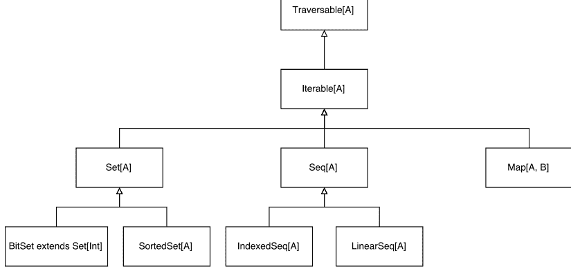

**图 6.1：** 这是 `scala.collection` 包中主要类型的 UML 图。我们处理过的集合类型，包括 `List[A]` 和 `Array[A]`，都处于层次结构中的 `Seq[A]` 部分。

我们处理过的集合类型都允许你对其进行迭代并运行其内容；它们是 `Iterable[A]` 的子类型，但它们处理内容的方式与序列非常不同。接下来的章节将详细介绍这些类型的细节。

在该包中，`Set` 和 `Seq` 各两个子类型。`BitSet` 类型经过优化，用于处理 `Int` 集合。如果该值在集合中，则位设为开启，否则为关闭。`SortedSet` 类型是 `Set` 的特殊版本，适用于内容具有自然排序的情况。

`Seq` 的两个子类型是 `IndexedSeq` 和 `LinearSeq`。这两种类型的区别在于如何高效地访问元素。`List[A]` 是 `LinearSeq` 的示例。要使用 `LinearSeq[A]` 获取元素，你必须运行其之前的所有元素。相反，`IndexedSeq` 允许你快速获取任意索引处的元素，就像 `Array` 一样。这些类型都以不同的方式实现它们的方法，取决于获取它们的最有效方式。

在 Scala 库中，这些类型根据实现是不可变还是可变以两种方式实现。为了将它们分开，存在名为 `scala.collection.immutable` 和 `scala.collection.mutable` 的包。

## 6.1.1 scala.collection.immutable

`scala.collection.immutable` 包存储各种类型的集合，这些集合都是不可变的，并且经过优化，以便能够高效地执行常用操作。这意味着在不创建副本的情况下进行“更新”。当然，因为这些集合是不可变的，没有任何对象被真正更新，而是创建了一个新版本。为了效率，这个新对象将尽可能与原始对象共享内存。这种共享仅仅是因为对象是不可变的。图 6.2 显示了该包中主类和特质之间继承关系的简单类图。

层次结构的顶端部分与图 6.1 所示的 `scala.collection` 包相同。它从 `Traversable` 和 `Iterable` 开始，并以 **Set**、**Seq** 和 **Map** 另外三个主要子类型的形式。

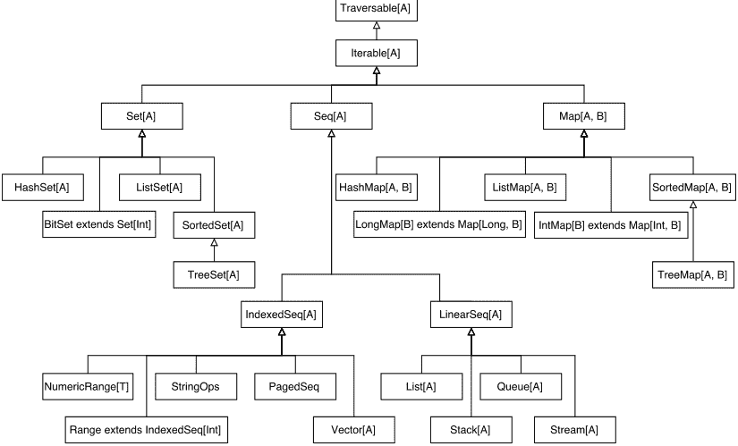

**图 6.2：** 这是 `scala.collection.immutable` 包中主要类型的 UML 图。这经过了大幅简化。如果你查看 API，会发现大多数类型都继承自其他多个类型。

区别在于这些类型有更多的子类型。我们不会详细介绍其中大多数类型，但值得注意几点。首先是 **List**，它是我们到目前为止一直使用的不可变序列。你可以在这里看到它是 **LinearSeq**。这意味着你不能高效地跳转到随机元素。我们将在第 12 章中具体说明为什么这样。

如果你想要一个具有高效索引的不可变序列，你的默认选择通常是 **Vector**。`IndexedSeq` 的其他不可变子类型包括 **Range**（我们在第 1 章中看到）和一种特殊类型 **StringOps**。**StringOps** 为字符串提供了 Scala 集合操作。你一直在字符串使用的许多方法在 `java.lang.String` 类型上并没有定义。从 `java.lang.String` 到 `scala.collection.immutable.StringOps` 有隐式转换。你就可以这样执行此类操作：

```
val (upper, lower) = "This is a String.".filter(_isLetter).partition(_isUpper)
```

`java.lang.String` 类型实际上并没有名为 `filter` 或 `partition` 的方法。你可以通过查看 Java API 来验证这一点。当 Scala 看到这行代码时，它发现缺少这些方法，并寻找隐式转换以提供一个具有所需方法的类型。在这种情况下，转换将转换为 **StringOps**。

**Map** 下也列出了许多不同类型。其中两种专门针对 **Int** 和 **Long** 配合工作进行了优化。对于大多数应用程序，**HashMap** 可能可能是理想的。**HashMap** 的细节将在第 22 章介绍。我们将在第 16 章介绍 **TreeMap** 的可能实现。

# 使用 Scala 的面向对象、抽象和数据结构

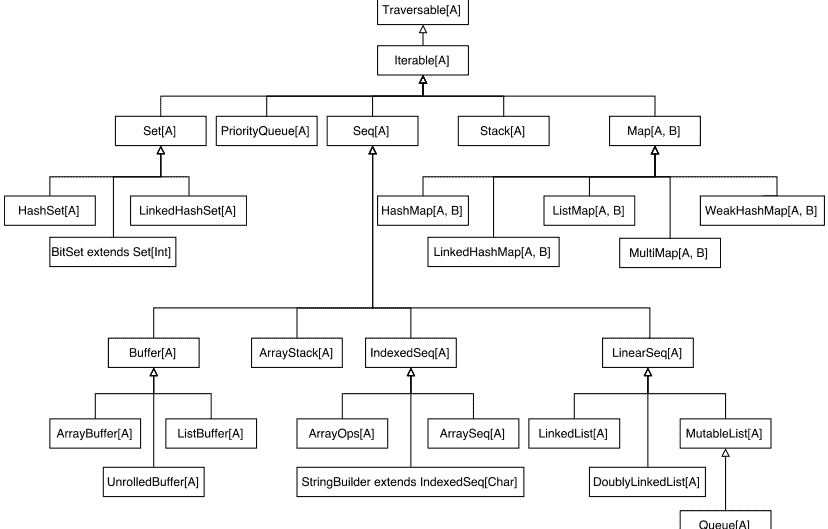

**图 6.3：** 这是 `scala.collection.mutable` 包中主要类型的 UML 图。图像经过了大幅简化。如果你查看 API，会发现其中许多类型继承自其他类型。

### 6.1.2 scala.collection.mutable

我们现在关注的 *scala.collection.mutable* 下的最后一个包是现在的 *scala.collection.mutable* 包。正如名称所示，该包包含了可变集合。这是三个包中最详尽的。值得扫描 API 以查看此包中的各种类型，并查看它们的用途。此包的 UML 类图如图 6.3 所示。

这些集合是可变的，这一事实意味着方法将改变它们的值。在这些它们时，你需要记住“标准”方法（即我们到目前为止经常使用的方法）是不变异的。例如，*filter* 不改变集合的内容，即使它是可变的。可变类型引入了几个执行变变的额外方法。

同样值得注意的是，一个可变类型是 *ArrayOps*。这个类非常像 *StringOps*。事实上，我们一直在使用的 *Array* 类型是 `scala.Array`。*ArrayOps* 类有一些额外的方法，需要隐式转换才能使用。

现在我们将查看 *Set*、*Map* 和 *Buffer* 类型。这些类型可以为你的编程提供显著加速，并使某些任务变得容易得多。

## 6.2 Sets

集合的概念来自数学。`Set` 类型和 `Seq` 类型之间有两个主要区别。最重要的一点是 Set 不允许重复值。如果你向集合中添加一个已经存在的值，它将不会添加新值，且 Set 的大小保持不变。另一个区别是 Set 中的元素顺序是不保证的。¹我们可以在接的 REPL 命令中看到这些效果：

```
scala> Set(1,2,3)
res0: scala.collection.Set[Int] = Set(1, 2, 3)
scala> res0 + 4
res1: scala.collection.Set[Int] = Set(1, 2, 3, 4)
scala> res2 + 2
res2: scala.collection.Set[Int] = Set(1, 2, 3, 4)
scala> res1 - 10
res3: scala.collection.Set[Int] = Set(-10, 4, 2)
```

这从一个包含 1, 2, 3 的集合开始。与 `List` 和 `Array` 类型一样，Scala 推断出这是一个 `Set Int`。你也可以从推断类型看出我们创建一个空 Set。

你可以使用 `+` 向 Set 添加，并返回一个带有加号后元素的新集合。对于 1, 2, 3。在第三条命令中向此新集合添加 2。结果与添加 2 之前的集合相同。Set 不包含重复元素。

最后一条语句将 -10 添加到 res1 集合中。该值进入结果集合，是因为之前没有 -10。然而，结果显示 Set 中的顺序是不保留的。将 -10 添加到集合中不仅把它放在了开头一个奇怪的位置，还改变了 4 在集合中的位置。通过这一点你可以看到，当你关心元素的唯一性而不是获取它们的顺序时，你应该使用 Set。

顺序可以改变这一事实意味着像我们处理 `Array` 或 `List` 那样对 Set 进行“索引”并没有太大意义。你可以在 Set 上执行这种操作，但含义是不同的。考虑以下示例：


# 使用 Scala 进行面向对象、抽象和数据结构

对 Set 执行此操作并不会返回某个特定位置的值。相反，它会返回一个布尔值，告诉该值是否在 Set 中。如果 Set 包含 Int 以外的其他值，这种方法同样适用。考虑以下内容。

```scala
val strSet = Set("Jen", "Jason", "Julie") 
strSet: scala.collection.immutable.Set[String]

strSet("Bill")
res8: Boolean = false
```

在这个示例中，Set 包含了字符串（Strings），“索引”操作是通过传递字符串完成的。如果传入的参数在 Set 中，则返回 true，否则返回 false。若要查看它是如何工作的，请查看 Scala API 中任意一个版本的 Set。它们都包含一个名为 `A` 的类型并定义了以下方法。

```scala
def apply(elem: A): Boolean
```

请记住，`apply` 是一个特殊方法，当使用函数调用符号时，它会被调用。因此，Scala 中的 `f(5)` 会扩展为 `f.apply(5)`。在这里，`apply` 接收一个参数 `elem`，其类型必须是 `A`。这是整个 Set 的类型，因此你必须传递一个与 Set 包含的类型相同的对象。该方法将返回一个布尔值，告诉该值是否在 Set 中。这种查找元素是否存在的操作是 Set 上最重要的操作，因如此，它通常是一个快速操作。使用 `contains` 或 `indexOf` 等方法判断元素是否在 Set 中是一个相当慢的操作，因为它必须遍历所有元素。

¹如果你恰好使用的是 SortedSet，那么对象的顺序将匹配类型的自然顺序，但这是规则的例外。

## 6.2.1 遍历 Set

除了 Set 和我们之前处理过的序列都支持的 `map`、`filter` 和 `foreach` 等标准高阶方法外，Set 与循环配合得也非常完美。

```scala
for(v <- res3) println(v)
1
2
-10
3
4
```

另一方面，使用 `while` 循环遍历 Set 则更具挑战性，因为你不能通过位置进行索引。如果你想在 Set 上使用 `while` 循环，你必须通过 `iterator` 方法获取 Set 的迭代器（Iterator），然后在 `while` 循环中通过在条件中调用 `hasNext` 以及在循环体内调用 `next`。请记住，循环遍历 Set 值的顺序是你无法预测的。它甚至不需要与 Set 转换为字符串打印时显示的顺序保持一致。

## 6.2.2 可变与不可变

上面的示例显示，默认的不可变 Set 在创建后不会发生改变。当我们使用 `+` 运算符向 Set 添加元素时，我们得到的是一个新的 Set，而原始 Set 保持不变。我们可以通过调用原始 Set 来证明这一点。

```scala
scala> res0
res9: scala.collection.mutable.Set[Int] = Set(1, 2, 3)
```

所有的操作都没有以任何方式执行。

正如我们之前看到的，在 `scala.collection.mutable` 包中还有另一种 Set 类型。你可以使用 `scala.collection.mutable.Set` 的全限定名获取这种类型。然而，这样做不仅需要输入大量的字符，而且会让代码变得难以阅读。你可以导入 `scala.Set` 并将其简称为 `Set`。这样做的问题是，你将无法再方便地引用可变 Set 类型了。处理这种情况的推荐风格是使用 `scala.collection.mutable.Set`。Scala 中的包是真正的嵌套结构，这将允许我们通过 `mutable.Set` 的名称引用可变 Set，而通过 `Set` 引用不可变 Set。

你对不可变 Set 可以执行的所有操作在可变 Set 上同样可用。上面我们在不可变 Set 上使用了 `+` 运算符，它在可变 Set 上效果同样良好。

```scala
scala> scala.collection.mutable
import scala.collection.mutable
```

```scala
scala> val mset = mutable.Set(1,2,3)
mset: scala.collection.mutable.Set[Int] = Set(1, 2, 3)
```

```scala
scala> mset += 4
res10: scala.collection.mutable.Set[Int] = Set(1, 4, 2, 3)
```

```scala
scala> mset
res11: scala.collection.mutable.Set[Int] = Set(1, 2, 3)
```

这段代码向你展示了导入语句、导入后可变 Set 的声明，以及通过向旧 Set 添加元素来创建新 Set。仅使用 `+` 不会改变可变 Set。可变 Set 与不可变版本的区别在于，它允许额外的运算符和方法。

为了验证这一点，我们将调用其中一个额外运算符。在可变 Set 上，我们可以以相同的方式对声明为 `var` 的 `Int` 使用 `+=`。

```scala
scala> mset += 4
res12: mset.type = Set(1, 4, 2, 3)
```

```scala
scala> mset
res13: scala.collection.mutable.Set[Int] = Set(1, 4, 2, 3)
```

你可以从中看出，使用 `+=` 实际上改变了原始 Set。`+=` 不存在于不可变 Set 类型上。如果你尝试调用它，将得到语法错误。可变 Set 上会改变自身的方法/运算符列表包括以下 `Set[A]` 的内容：

| 方法/运算符 | 描述 |
| :--- | :--- |
| `+ (elem : A)` | 将指定的元素添加到 Set 中 |
| `+= (elem : A)` | 将指定的元素添加到 Set 中 |
| `++ (xs : Traversable])` | 将指定的集合添加到 Set 中 |
| `-= (xs : Traversable])` | 将指定的集合从 Set 中移除 |
| `- (elem : A)` | 将指定的元素从 Set 中移除 |
| `-- (elem : A)` | 将指定的元素从 Set 中移除 |
| `clear()` | 清空 Set |
| `update (elem : A)` | 更新 Set 中的元素 |
| `retain (p: A => Boolean)` | 保留满足谓条件的元素 |
| `filter (p: A => Boolean)` | 移除不满足谓条件的元素 |
| `map (f: A => B)` | 对 Set 中的每个元素应用函数 |
| `flatMap (f: A => Iterable[B])` | 对 Set 中的每个元素应用函数并扁平化 |

## 6.2.3 使用 Set

为了查看它是如何工作的，请查看 Scala API 中任意一个版本的 Set。它们都包含一个名为 `A` 的类型并定义了以下方法。

```scala
def apply(elem: A): Boolean
```

请记住，`apply` 是一个特殊方法，当使用函数调用符号时，它会被调用。因此，Scala 中的 `f(5)` 会扩展为 `f.apply(5)`。在这里，`apply` 接收一个参数 `elem`，其类型必须是 `A`。这是整个 Set 的类型，因此你必须传递一个与 Set 包含的类型相同的对象。该方法将返回一个布尔值，告诉该值是否在 Set 中。这种查找元素是否存在的操作是 Set 上最重要的操作，因如此，它通常是一个快速操作。使用 `contains` 或 `indexOf` 等方法判断元素是否在 Set 中是一个相当慢的操作，因为它必须遍历所有元素。

## 6.3 Map（映射）

另一种非常有用的集合类型，在大多数程序中可能比 Set 还要，它是 Map。和 Set 一样，Map 一词源于数学。数学中的映射（mapping）是从一个集合中取值并返回另一个集合中的值的操作。数学中的函数在技术上就是映射。Map 集合类型与此并不相似。它将一种类型（称为键类型 key type）的值映射到另一种类型（称为值类型 value type）。键类型和值类型可以是相同的，也可以是完全不同的。

为了帮助理解 Map，让我们来看一些例子。我们将从创建一个新 Map 的语句开始。

```scala
scala> val map = Map("one" -> 1, "two" -> 2, "three" -> 3)
im: scala.collection.immutable.Map[String,Int] = Map(one -> 1, two -> 2, three -> 3)
```

Map 接收两个参数。它们是 String 和 Int。传递给 Map 的值实际上是元组（tuples），其中键是第一个元素，值是第二个元素。在这个示例中，我们使用了 `->` 语法来构建元组。你只能使用这些元素来创建元组。它被专门添加到 Scala 库中，以便以这种方式创建 Map。你可以将其读为：创建一个 Map，其中字符串 "String" 与整数 one 关联，依此类推。

当你对 Map 进行索引时，你是使用类型类型的键来操作的。返回的是对应的值对象。

```scala
scala> map("two")
res: Int = 2
```

如果你愿意，可以将 Map 为一个可以由你指定的任何类型进行索引的集合，而不仅仅是序列。这之所以能通，是因为 Map 类型定义了如下的应用方法（applied method）。

```scala
def apply(key: A): B
```

类型 A 和 B 是 Map 的类型参数，其中 A 是键类型，B 是类型。如果你尝试提取 map 中不存在的键，你将得到一个异常。

除了允许任何类型作为键之外，Map 还有一个优点：它不需要索引的“起始”值。由于这个原因，你有时可能想要构建一个使用 Int 作为索引的 Map。考虑这个例子。

```scala
scala> val map = Map(10 -> "ten", 100 -> "hundred", 1000 -> "thousand")
im: scala.collection.immutable.Map[Int,String] = Map(ten -> hundred, thousand -> thousand)
```

从技术上讲，你可以构建一个在相应索引处具有值 "ten","hundred" 和 "thousand" 的序列。然而，这是浪费，因为 0 到 1000 之间有许多索引不会被使用，而且你必须存储某种默认值。对于数值类型，将是 0；对于引用类型，将是 null。

对于 Set 类型，你可以使用 `+` 运算符向 Map 添加新的键值对。

```scala
scala> map + ("four" -> 4)
res: scala.collection.immutable.Map[String,Int] = Map(one -> 1, two -> 2, three -> 3, four -> 4)
```

## 其他集合类型

键和值需要在一个元组中，就像原始 Map 构建的方式一样。此示例中的括号是为了确保正确的操作顺序而必须的。否则，`+` 会发生在 `->` 之前，结果将是一个看起来很奇怪的 (String,Int)。


你也可以使用 `-` 来获取一个元素较少的 Map。对于此操作，第二个参数只是你想要删除的键。你不需要拥有甚至不知道与该键关联的值。

```scala
scala> map = map - "two"
res1: scala.collection.immutable.Map[String,Int] = Map(one -> 1, three -> 3)
```

在这里，我们通过获取键 "two" 从 Map 中删除了 2。

和 Set 类型一样，Map 有可变和不可变版本。从上面的示例可以看出，Map 默认像 Set 一样是不可变的。要使用可变版本，遵循上述相同的建议，导入 `scala.collection.mutable` 并将其引用为 `mutable.Map`。

### 6.3.1 遍历 Map

你可以使用高阶方法或 for 循环来遍历 Map 的内容，但这与我们之前看过的其他类型有显著区别。这是因为 Map 的内容实际上是元组。为了说明这一点，我们将看一个简单的循环。

```scala
scala> for(tuple <- map) println(tuple)
(one,1)
(two,2)
(three,3)
```

从 Map 中取出的每个元素都是一个元组。这在使用像 `map` 等高阶方法时具有重要影响。`map` 的参数是一个接收单个参数的函数，但该参数是一个包含键值对的元组。考虑以下：

```scala
scala> map.map(tuple => tuple._2)
res3: scala.collection.immutable.Iterable[Int] = List(2, 4, 6)
```

因为参数 `tuple` 是一个元组，所以我们必须使用 `._2` 从中提取值。`._1` 会带给我们键。另一种方法是让函数体变得更长，并在赋值中使用模式匹配来提取值。在很多情况下，这并没有显著更好。

使用 for 循环遍历 map 效果更好，因为 for 循环的模式匹配可以工作。这种语法所示：

```scala
scala> for((k,v) <- map) yield v
res4: scala.collection.immutable.Iterable[Int] = List(2, 4, 6)
```

这两个示例展示了使用 `map` 或 for 循环可以如何工作。

## 对象导向、抽象与数据结构

我们用于说明 Map 与 Set 紧密相关的示例。与其简单地识别单词，我们将统计每个单词出现的次数。这个函数将与我们所做的非常相似。我们从这个模板开始。

```scala
def count(fileName:String): Map[String, Int] = {
  val source = io.Source.fromFile(fileName)
  val words = source.getLines.toSeq.flatMap(_.split("\\s+")).map(_.filter(_.isLetter).toLowerCase)
  val counts = ???
  source.close()
}
```

### 6.3.2 使用 Maps

这里是一个单词序列，我们将使用它构建计数并返回一个带有计数的 Map。我们将两种方式来实现最后部分。

第一方法将使用可变 Map。这里的逻辑是我们遍历单词序列，如果单词之前没有出现过，我们在 Map 中添加计数 1。如果它之前出现过，我们保留相同的键，但值比之前的要大。此代码看起来所示：

```scala
def count(fileName:String): Map[String, Int] = {
  val source = io.Source.fromFile(fileName)
  val words = source.getLines.toSeq.flatMap(_.split("\\s+")).map(_.filter(_.isLetter).toLowerCase)
  val counts = mutable.Map[String,Int]()
  for (w <- words) {
    if (counts.contains(w)) counts += w -> (counts(w) + 1)
    else counts += w -> 1
  }
  source.close()
  counts
}
```

注意，这里遍历单词的 for 循环是可变的，这种方法可行。你还应该注意函数的返回类型已更改为 `mutable.Map[String,Int]`。如果你省略它，则必须在最后 `counts` 之后添加对 `.toMap` 的调用，将计数转换为不可变类型。这种可变类型和不可变类型之间的区别对于程序的安全性非常重要。通常情况下，可能会引用到 Map 在代码的其他部分仍然被保留。如果你在期望得到一个不可变 Map 的时候却获得了一个可变的 Map，那么代码的其他部分可能会在你没有预料的情况下更改该 Map。这将导致非常难以追踪的逻辑错误。

使用可变版本是非常合逻辑的，并且可能具有一些效率优势，但也伴随着风险。因此，我们将编写第二个版本，使用不可变 Map 和 `foldLeft` 方法。`foldLeft` 方法比我们之前详细处理过的方法要复杂得多。然而，对于我们在这里正在做的事情，它是理想的选择，因为它有效地实现了我们所写的功能，但不需要循环或可变类型。`foldLeft` 方法从左到右遍历集合，并对每个元素应用一个函数，在此过程中编译结果。该函数是柯里化的，第一个参数是一个单一值，告知从哪个编译值开始。在这种情况下，我们调用的是 Map，所以我们将从一个空 Map 开始。我们需要编写的代码与之前的 `for` 循环非常相似。当它们组合在一起时，看起来如下所示：

```scala
def wordCount(fileName: String): Map[String, Int] = {
  val source = io.Source.fromFile(fileName)
  val words = source.getLines.toSeq.flatMap(_.split("\\s+")).map(_.filter(_.isLetter).toLowerCase)
  val counts = words.foldLeft(Map[String, Int]())((m, w) =>
    if (m.contains(w)) m + (w -> (m(w) + 1))
    else m + (w -> 1)
  )
  source.close()
  counts
}
```

传递给 `foldLeft` 的函数接受两个参数。第一个是目前为止的编译值，第二个是正在操作的值。在这种情况下，编译值是一个 Map，变量 `m` 接收了我们想要计数的下一个单词，并用名称 `w` 表示，就像在之前的 `for` 循环中一样。

作为第二个参数传递给 `foldLeft` 的函数体与之前 `for` 循环内部的内容有两点不同之处。首先，引用可变 Map `counts` 时，我们使用了参数 `m`。其次，我们没有使用 `+=` 而是使用了 `+`。`+=` 运算符对于不可变 Map 是没有定义的，我们在这里做的是构建一个新的 Map，并将其传递给下一个单词。

如果你想更激进一点，可以完全删去 `words` 的声明。它唯一的用途就是作为 `foldLeft` 的参数来构建计数。这样做会产生以下代码：

```scala
def wordCount(fileName: String): Map[String, Int] = {
  val source = io.Source.fromFile(fileName)
  val counts = source.getLines.toSeq.flatMap(_.split("\\s+")).map(_.filter(_.isLetter).toLowerCase)
    .foldLeft(Map[String, Int]())((m, w) =>
      if (m.contains(w)) m + (w -> (m(w) + 1))
      else m + (w -> 1)
    )
  source.close()
  counts
}
```

## 使用 Scala 进行面向对象、抽象和数据结构

这段代码非常紧凑，但如果你真的想用这种方式做，它是没有争议的。引入变量 `words` 虽然增加了代码的长度，但对于大多数读者来说，这可能让事情变得更易理解。

Map 的通用案例是作为一种通过特定的键值快速查找数据组（如类）的方法。一个例子是查找一个代表学生 ID 或可能是其唯一登录号的类实例。Map 的真正威力在于，键和值的类型可以是你想要的任何类型。

## 6.4 Buffer（缓冲区）

本章我们将介绍的最后一种新集合类型是 Buffer。Buffer 就像一个可以改变大小的 Array。因此，Buffer 是隐式可变的。它没有不可变版本。如果你正在使用其他可变类型，规则是导入 `scala.collection.mutable` 并将 Buffer 视为可变的。它仍然运行得良好，并让任何阅读代码的人清楚地知道你正在使用一种可变类型。不过，由于 Buffer 类型是可变的，你也可以考虑使用 `scala.collection.mutable.Buffer` 并在代码中调用它。

Scala 库中有 Buffer 的几种子类型。最重要的是 `ArrayBuffer` 和 `ListBuffer`。前者使用 Array 来存储值，后者使用一种名为列表的结构。Scala 中的 `List` 类型是链表，尽管由于 `ListBuffer` 并没有直接使用它，因为 `ListBuffer` 需要是可变的。如果你在本章中使用 `ArrayBuffer`，那么 Buffer 的本质以及它与 Array 的不同将在第 12 章中变得更加明显。

你可以这样创建一个 Buffer：

```scala
val buf = mutable.Buffer(1, 2, 3, 4, 5)
buf: scala.collection.mutable.Buffer[Int] = ArrayBuffer(1, 2, 3, 4, 5)
```

你还可以使用我们为 Array 和 List 学过的一些方法 `fill` 和 `tabulate`。

```scala
val rbuf = mutable.Buffer.fill(10)(math.random)
rbuf: scala.collection.mutable.Buffer[Double] = ArrayBuffer(0.016947006574349024, 0.029870306574349024, ...)
```

> 序列上还有一个名为 `groupBy` 的高阶方法，可以让代码更短。`groupBy` 方法接受一个参数为键类型的函数。假设函数类型为 `A => B`。调用 `groupBy` 会产生一个 `Map[B, List[A]]`。通过这种方法，可以写出 `counts = words.groupBy(v => v).map(t => t._2.length)`。

## 其他集合类型

你可以对 Buffer 进行索引并像处理 Array 一样修改值。

```scala
scala> buf(0)
res0: Int = 1

scala> buf(0) = 10
buf: scala.collection.mutable.Buffer[Int] = ArrayBuffer(10, 2, 3, 4, 5)
```

Buffer 与 Array 的区别在于它可以增长。以下是一些方法：

- `+=(elem)`：追加到末尾。
- `+=:(elem)`：头部插入元素。
- `++=(elems)`：追加所有元素。
- `++=:(elems)`：头部插入所有。
- `clear()`：清除 Buffer。
- `insert(n, elem)`：在索引 n 插入。
- `insertAll(n, elems)`：在索引 n 插入所有。
- `remove(n)`：移除索引 n 元素。
- `remove(n, count)`：移除 count 个元素。
- `trimEnd(n)`：移除最后 n 个元素。
- `trimStart(n)`：移除前 n 个元素。

## 使用 Scala 进行面向对象、抽象和数据结构

这些操作大部分是自解释的。List 上的 `::` 运算符会将元素添加到 List 头部。

## 6.5 作为函数的集合

不同的集合类型都继承自 `Function1`，而 `Function1` 又继承自标准的函数类型。这意味着你可以在预期使用函数的地方使用集合。例如，`Seq[A]` 类型可以作为 `Int => A`。同样，`Map[A, B]` 可以作为 `A => B` 使用。这种用法的一个简单示例是，对包含所需索引的 Range 进行映射，并使用 Array 作为函数参数，从而获取 Array 的每第三个元素。

## 6.6 项目集成

我们有几个地方可以使用这些不同的集合。在上一章中，`DrawTransform` 中的子节点被存储在 `var List` 中，但如果使用 `mutable`（可变集合）可能会更好。这使得包含使用 `+=` 和 `-=` 添加和移除子节点的代码变得更容易。在本节中，我们将实现命令处理，这是之前没有做的。为了实现这一点，我们将使用 `Map` 类型。我们还将重构将新的可绘制对象添加到绘图的方法。

### 6.6.1 命令

命令处理器是可以通过继承来实现的代码部分。我们可以创建一个名为 `Command` 的类型，让其他类型继承自它。这种结构在逻辑上是合理的，但可能并不是我们真正需要的。关于继承，你需要学习的一个方面是：在不需要时就不要使用它。

你可能会奇怪，为什么我们要在绘图程序中放入一个基于文本的命令处理器。原因与我们想在带有 GUI 的操作系统中包含命令行界面的原因类似。某些操作通过输入确实比点击操作要好得多。现在，我们将从一些简单的示例开始，将其作为命令工具的用例。无论后续跟随什么，都有三个命令：

- `echo`：打印任何文本。
- `add`：后跟一串空格分隔的数字，并打印它们的和。
- `refresh`：导致绘图刷新。

因此，用户可能会输入 "echo Hello, World!"、“add 1 2 3 4 5" 或 "refresh"。前两个参数以及调用它们的唯一结果是显示在输出中。最后一个则非常不同，因为它不接受参数也不显示任何内容。相反，它需要导致 `Drawing` 对象进行重绘。

为了在代码中实现这一点，我们需要为用户输入的 `TextField` 设置 `onAction`。该操作需要获取它所在的行并识别第一个单词，然后根据该单词的内容调用适当的功能。

实现此功能的一种方法是让每个命令包含一个形式为 `(String, Drawing) => Any` 的函数。该函数的第一个参数是命令之后行的剩余部分。第二个参数是被调用的 `Drawing` 对象。这样做是为了让像 `refresh` 这样的命令能够导致绘图发生变化。返回值是我们想要返回的内容。对于大多数情况，这将转换为 `String` 并加到输出中。

光有这些函数是不够的。我们还需要根据输入的第一个单词来识别应该调用这些函数中的哪一个。这是 `Map` 的完美用法。具体来说，我们想要使用 `Map[String, (String, Drawing) => Any]`。这是一个从每个 `String` 到命令应该调用的函数的映射。

使用这种方法，我们可以声明一个包含命令功能的对象。包含上述三个命令的实现可能如下所示。

```scala
object Commands {
  val commands = Map[String, (String, Drawing) => Any](
    "echo" -> ((s, _) => s),
    "add" -> ((s, _) => s.split("\\s+").map(_.toInt).sum.toString),
    "refresh" -> ((_, d) => { d.repaint(); "" })
  )
  
  def apply(cmd: String, drawing: Drawing): Any = {
    val parts = cmd.split("\\s+", 2)
    val name = parts(0)
    val args = if (parts.length > 1) parts(1) else ""
    commands.getOrElse(name, (_, _) => "Unknown command")(args, drawing)
  }
}

commandField.onAction = (ae: ActionEvent) => {
  val text = commandField.text.value
  if (text.nonEmpty) {
    commandArea.text = commandArea.text + " " + text + "\n" + Commands(text, drawing).toString
    commandField.text = ""
  }
}
```

> 下面显示了带有此类其他修改的 `DrawingMain` 完整版本。

### 6.6.2 添加可绘制对象

在另一个地方，我们可能会用有趣的方式使用来清理代码，使其更具扩展性且更不容易出错。这是添加新 `Drawable` 的代码。我们在第五章中的代码看起来像这样：

```scala
addItem.onAction = (ae: ActionEvent) => {
  val current = tabPane.selectionModel.value.selectedIndex
  if (current > 0) {
    val (drawing, treeView) = drawings(current)
    val dialog = new ChoiceDialog("Rectangle", List("Rectangle", "Transform", "Text"))
    val d = dialog.showAndWait() match {
      case Some(s) =>
        val d: Drawable = s match {
          case "Rectangle" => new DrawRectangle(drawing, 0, 0, 300, Color.Blue)
          case "Transform" => new DrawTransform(drawing)
          case "Text" => new DrawText(drawing, 100, 100, Color.Black)
        }
        val treeSelect = treeView.selectionModel.value.getSelectedItem
        def treeAdd(item: TreeItem[Drawable]): Unit = item.getValue match {
          case dt: DrawTransform =>
            dt.addChild(d)
        }
    }
  }
}
```


# 代码示例与重构

```scala
item.children += new TreeItem(d)

drawing.draw()

case d ->

  treeAdd(item.getParent)

}

if (treeSelect != null) treeAdd(treeSelect)

case None ->

}

}

}
```

这段代码并不长，但它包含一个特别容易出错的重要部分，随着项目中添加更多 `Drawable` 类型，可能会在开发后期导致令人恼火的错误。这段代码的弱点是 `match` 分支中的字符串字面量必须与 `ChoiceDialog` 中的字符串完全相等。想象一下随着时间的推移，增加更多选项会发生什么。你必须在选项中添加一个字符串，然后添加一个带有相同字符串的新 `case`。如果你在字符串中拼写错误，代码将继续正常编译，但选择该类型的选项将不会向绘图添加任何内容。

另一种方法是采取与我们处理命令时非常相似的操作。我们可以将名称与创建 `Drawable` 对象的逻辑分组。我们可以创建一个 `Map`，其键为类型名称，值为创建新 `Drawable` 的函数。这样的 `Map` 可以放在 `DrawingMain` 顶部，可能如下所示：

```scala
private val creators = Map[String, Drawing => Drawable](
  "Rectangle" -> (drawing => new DrawRectangle(drawing, 0, 0, 300, Color.Blue)),
  "Transform" -> (drawing => new DrawTransform(drawing)),
  "Text" -> (drawing => new DrawText(drawing, 100, 100, Color.Black))
)
```

一旦定义了此内容，我们就可以如下所示用于菜单项。

```scala
addItem.onAction = (ae: Action) => {
  val current = tabPane.selectionModel.value.selectedIndex
  if (current > 0) {
    val (drawing, treeView) = drawings(current)
    val dtypes = creators.keys.toSeq
    val dialog = new ChoiceDialog(dtypes, types)
    val d = dialog.showAndWait() match {
      case Some(s) =>
        val d = creators(s)(drawing)
        val treeSelect = treeView.selectionModel.value.getSelectedItem
        def treeAdd(item: TreeItem[Drawable]): Unit = item.getValue match {
          case dt: DrawTransform ->
            dt.addChild(d)
            item.children += new TreeItem(d)
            drawing.draw()
          case d =>
            treeAdd(item.getParent)
        }
        if (treeSelect != null) treeAdd(treeSelect)
      case None =>
    }
  }
}
```

# 其他集合类型

```scala
import scalafx.scene.control.TextArea
import scalafx.scene.control.TextField
import scalafx.scene.control.TreeView
import scalafx.scene.layout.BorderPane
import scalafx.scene.paint.Color
import scalafx.scene.event.ActionEvent
import scalafx.scene.control.ListItem
import scalafx.scene.control.SelectionMode
import scalafx.scene.layout.Priority
import scalafx.scene.control.ComboBox
import scalafx.scene.control.Dialog
import scalafx.scene.control.ChoiceDialog
```

```scala
object DrawingMain extends JavaApp {
  private var drawings = List[(Drawing, Tree[Drawable])]()
  private var creators = Map[String, Drawing => Drawable](
    "Rectangle" -> (drawing => new Rectangle(drawing, 0, 0, 300, 300, Color.Blue)),
    "Transform" -> (drawing => new Transform(drawing)),
    "Text" -> (drawing => new Text(drawing, 100, 100, "Text", Color.Black))
  )
}
```

```scala
stage = new JPrimaryStage {
  title = "Drawing Program"
  scene = new Scene(1000, 700) {
    // 菜单
    val menuBar = new MenuBar
    val fileMenu = new Menu("File")
    val newItem = new MenuItem("New")
    val openItem = new MenuItem("Open")
    val saveItem = new MenuItem("Save")
    val closeItem = new MenuItem("Close")
    val exitItem = new MenuItem("Exit")
    fileMenu.items = List(newItem, openItem, saveItem, closeItem, new SeparatorMenuItem(), exitItem)
    val editMenu = new Menu("Edit")
    val addItem = new MenuItem("Add Drawable")
    val copyItem = new MenuItem("Copy")
    val cutItem = new MenuItem("Cut")
    val pasteItem = new MenuItem("Paste")
    editMenu.items = List(addItem, copyItem, cutItem, pasteItem)
    menuBar.menus = List(fileMenu, editMenu)
    // 选项卡
    val tabPane = new TabPane
    val (drawing, tree, tab) = makeDrawingTab()
    drawings = drawings += (drawing, tree)
    tabPane += tab
  }
}
```

```scala
// 菜单动作
newItem.onAction = (ae: ActionEvent) => {
  val (drawing, tree, tab) = makeDrawingTab()
  drawings = drawings += (drawing, tree)
  tabPane += tab
}
```

# 使用 Scala 进行面向对象、抽象和数据结构

```scala
closeItem.onAction = (ae: ActionEvent) => {
    val current = tabPane.selectionModel.value.selectedIndex
    if (current >= 0) {
        drawings = drawings.patch(current, Nil, 1)
        tabPane.tabs.remove(current)
    }
}

addItem.onAction = (ae: ActionEvent) => {
    val current = tabPane.selectionModel.value.selectedIndex
    if (current > 0) {
        val (drawing, treeView) = drawings(current)
        val dtypes = creators.keys.toSeq
        val dialog = showWaitDialog(dtypes, dtypes)
        val d = creators(s)
        val treeSelect = treeView.selectionModel.value.getSelectedItem
        def addTree(item: TreeItem[Drawable]): Unit = item.getValue match {
            case dt: DrawTransform =>
                dt.addChild(d)
                item.children += TreeItem(d)
                drawing.draw(dt)
            case d =>
                treeAdd(item.getParent)
        }
        if (treeSelect != null) treeAdd(treeSelect)
        case None =>
    }
}

exitItem.onAction = (ae: ActionEvent) => {
    // TODO - 在关闭前添加保存。
    sys.exit()
}

// 顶层设置
val rootPane = new BorderPane
rootPane.top = menuBar
rootPane.center = tabPane
root = rootPane

private def makeDrawingTab(): (Drawing, View[Drawable], Tab) = {
    val canvas = new Canvas(2000, 2000)
    val gc = canvas.graphicsContext2D
    val drawing = new Drawing(gc)
}

// 左侧
val drawingTree = new Tree[Drawable]
drawingTree.selectionModel.value.selectionMode = SelectionMode.Single
drawingTree.root = drawing.makeTree
val treeScroll = new ScrollPane
drawingTree.prefWidth <= treeScroll.width
```

```scala
drawingTree.prefHeight <= treeScroll.height
treeScroll.content = drawingTree
val propertyPane = new ScrollPane
val leftSplit = new SplitPane
leftSplit.orientation = Orientation.Vertical
leftSplit.items += List(treeScroll, propertyPane)

// 右侧
val slider = new Slider(0, 1000, 0)
val rightTopBorder = new BorderPane
val canvasScroll = new ScrollPane
canvasScroll.content = canvas
rightTopBorder.center = slider
val commandField = new TextField
val commandArea = new TextArea
commandArea.editable = false
commandField.action = (ae: ActionEvent) => {
  val text = commandField.text
  if (text.isNotEmpty()) {
    commandArea.text = (commandArea.text + "\n" + Commands(text) + "\n")
    commandField.text = ""
  }
}
val commandScroll = new ScrollPane
commandArea.prefWidth <= commandScroll.width
commandArea.prefHeight <= commandScroll.height
commandScroll.content = commandArea
val rightBottomBorder = new BorderPane
rightBottomBorder.center = commandField
rightBottomBorder.content = commandScroll
val rightSplit = new SplitPane
rightSplit.orientation = Orientation.Vertical
rightSplit.items += List(rightTopBorder, rightBottomBorder)
rightSplit.dividerPositions = 0.7

// 顶层
val topSplit = new SplitPane
topSplit.items += List(leftSplit, rightSplit)
topSplit.dividerPositions = 0.3

// 树选择
drawingTree.selectionModel.value.selectedItem.onChange {
  val selected = drawingTree.selectionModel.value.getSelectedItem
  if (selected != null) {
    propertyPane.content = selected.properties()
  } else {
    propertyPane.content = new Label("Nothing selected.")
  }
}

val tab = new Tab
tab.text = "Untitled"
tab.content = topSplit
tab.closable = false
(drawing, drawingTree, tab)
}

def labeledTextField(labelText: String, initialText: String, action: String => Unit) =
  val bp = new BorderPane
  val label = Label(labelText)
  val field = new TextField
  field.text = initialText
  bp.left = label
  bp.center = field
  field.onAction = (ae: ActionEvent) => action(field.text)
  field.onChange(if (!field.focused) action(field.text))
}
```

## 6.7 概念总结

- Scala 库远超我们看过的 `Array` 和 `List` 等序列。
- Set 类型基于数学集合的概念。Set 中的所有值都是唯一的，不考虑顺序。与序列相比的优势是成员检查很快。有可变和不可变的 Set 类型。
- Map 允许你使用任意键类型存储并查找值。这允许你通过字符串、元组或任何其他内容索引值。用于键的类型应该是不可变的。有可变和不可变的 Map 类型。
- Buffer 是终极序列。值可以像 `Array` 一样改变，你还可以以影响大小的方式插入或删除元素。

### 6.7.2 练习

1. 实现以下函数，它根据任何类型的序列和一个从值生成键的构建 Map。
```scala
def buildMap[A, B](data: Seq[A], f: A => B): Map[B, A]
```

2. 编写代码表示一副牌。使用以下作为起点。
```scala
case class Card(suite: String, value: Char)

class Deck {
```


```scala
private val cards = mutable.Buffer[Card]()

def dealHand(numCards: Int): List[Card] = ...

def shuffle() { ... }

def split(where: Int) { ... }
```

注意 `cards` 是一个 mutable Buffer，所以发牌会移除元素，另外两个方法会改变元素的顺序。

3. 在概率数学讨论中，通常使用不同颜色的“球袋”作为说明概念的形象。“袋”不是 Seq，因为它没有顺序。在 Scala 中，将其建模为 `Set` 更好。写一个小脚本来制作 `Set[Marble]` 并尝试使用两种 `Marble` 的定义。

```scala
case class Marble(color: String)

class Marble(val color: String)
```


对于每种实现，创建一个三个红球两个蓝球的集合。这些实现有什么不同？你认为这是为什么？

4. 编写代码创建几个 `Map` 来显示课程信息。首先，创建一个包含课程号和课程所在教室号的 `Map`。接下来，创建一个包含教师及其所教课程的 `Map`。最后，创建一个包含每门课程上课时间的 `Map`。让用户输入课程号，然后显示课程的教师、教室号和上课时间。

5. `Map` 的标准示例是电话簿。值将是一个包含电话号码、地址等的 `case class`。你应该制作一个 GUI 来显示电话簿。第一个版本，你可以设为给定姓名只能有一个人，并使用 `Map[String, Person]`。

如果你想接受一点挑战，可以允许有多个同名的人。为此，你可以使用 `Map[String, mutable.Buffer[Person]]`。

6. 创建一个包含美国所有州及其首府的文本文件。编写代码将这些信息加载到 `Map`。用它创建一个简单的“州府”测验。你应该随机选择一个州并让用户输入首府名称。

### 6.7.3 项目

本章的项目想法都是使用所引入的新类型之一，在你之前做过的基础上添加功能。

1. 如果你正在做 MUD 项目，`Map` 类型的一种用途是查找用户输入的命令，以获取执行所需操作的函数。你也可以考虑在任何其他需要通过简单数字以外的值索引的地方使用 `Map`。例如，房间内的物品或角色可以通过名称进行索引，考虑到你应该允许多个值。这种能力可以通过 `Map[String, mutable.Buffer[Item]]` 提供。

你的程序也使用 `Array[Room]` 跟踪此类内容，并且房间之间的链接被存储在 `Sets` 中。你应该修改它，使得每个房间都关联一个唯一的键，并且所有房间都存储在 `Map[String, Room]` 中。修改出口，使其存储 `String` 详情而不是 `Int`。

你也可以修改代码，使用 `mutable.Buffer` 来存储诸如房间内的物品或玩家背包的内容，因为这些内容会随着时间而变化。

2. 如果你正在开发一个网络爬虫，你可能会为从各个页面收集到的数据维护一个 `Buffer`。从定义上讲，你需要重复访问页面，并可能需要将数据与其来源页面关联。前者可以使用 `Set` 很好地完成，因为它可以轻松判断某个值是否已经是成员。如果你想帮助查看与特定 URL 关联的内容，可以使用以 URL 为键的 `Map`。由于 `Map` 的键本身是唯一的，这意味着如果你像这样使用 `Map`，就不需要一个单独的 `Set` 了。

3. 图形游戏（无论是否联网）具有多种可能性，这很难预测这些连接的使用方式。然而，绝大多数可能性将涉及数值会变化的实体，这些实体可以用 `Buffer` 很好地实现。你可能还会发现 `Maps` 用于高效查找，或用 `Sets` 来演示唯一性。

4. 数学项目将会有像 MUD 一样的命令。在目前，这为使用 `Map` 提供了理由。此外，工作单将是一个元素序列，随着用户添加元素而增长，或者在用户移除元素时可能缩小。读完本章后，这听起来像是一个 `Buffer`。

5. Photoshop® 充满了许多可以用 `Buffers` 很好地实现的不同方面。例如，Photoshop® 类软件的标准功能之一是包含可以独立操作的多个层。绘制在层上的元素也可以存储在 `Buffers` 中。

6. 如果你正在进行股票组合管理，你可能想为用户提供一种快速访问信息的方法。当用户输入股票代码时，`Map[String, Stock]` 对于快速查找股票信息非常有用。

7. 如果你正在进行仿真工作台项目，对同时运行的不同仿真使用 `Buffer` 是有意义的。你可以将其链接到显示不同仿真的 `TabbedPane` 上。

对于某些仿真来说，拥有一个粒子的 `Buffer` 可能很有趣，但可能对于你现在的重力仿真并不适用。

向此项目添加更多集合的另一种方法是完全添加另一种仿真类型。你可以考虑包含一种用于绘制布料仿真的粒子-网格。这种方式的工作原理是：你有许多粒子，每个粒子都具有少量的质量。它们通过“弹簧”连接，因此如果它们移动得太近或太远，就会产生一种恢复力。在许多方面，它的工作原理与重力仿真一样，唯一的区别是力只发生在网格中连接的粒子之间，并且力不是 $1/r^2$ 类型的力。

这种最基础的实现将使用标准的胡克定律 $F_s = -kx$，其中 $k$ 是弹簧常数，$x$ 是离弹簧静止长度的偏移。力沿着连接粒子的线段方向。一个粒子与其邻居之间都有弹簧的粒子网格提供了一个你可以测试的简单设置。为了使其具有动态性，考虑固定一个或两个粒子使得力无法移动它们。你可能还会添加某种随机的力来模拟风。

通过增加额外的、更弱的弹簧可以获得更准确的仿真。这些弹簧将位于每个粒子与其在网格中直接对角的粒子之间，以及同一行或同一列的下方两个粒子之间。这些额外的弹簧赋予了织物一些“强度”，并将使其以更自然的方式弯曲。简单的网格配置可能会产生不自然的褶痕并折叠。

# 第 7 章 栈与队列

- 7.1 抽象数据类型 (ADTs)
- 7.2 栈与队列的操作
- 7.3 O 的真实含义
- 7.4 O(1) 要求
- 7.5 基于数组的栈
- 7.6 基于数组的队列 ClassTags（高级）
- 7.7 单元测试
  - 7.7.1 设置
  - 7.7.2 编写测试
  - 7.7.3 测试套件
  - 7.7.4 驱动开发
- 7.8 BPN 计算器
- 7.9 广度优先搜索
- 7.10 章末材料
  - 7.10.1 概念总结
  - 7.10.2 练习题
  - 7.10.3 项目

上一章扩展了关于数据结构的知识。现在我们将重点关注栈和队列。这些是你将要使用的最常见的两种数据结构。在本章中，我们将学习它们是如何工作的，以及如何在 Scala 中实现它们。

定义 ADT 的是可以执行的操作集，以及对这些操作作用的描述。在栈和队列的情况下，只需要两个方法：一个添加元素，另一个移除元素。

在栈的情况下，这些方法通常称为 `push`（入栈）和 `pop`（出栈）。对于队列，它们是 `enqueue`（入队）和 `dequeue`（出队）。这些 ADT 非常简单，以至于移除方法 `pop` 和 `dequeue` 不需要任何参数。你无法指定要取出什么。

栈和队列之间的不同之处在于，它们在移除某个项时如何选择提供给你的项。在栈中，被 `pop` 移除的对象是最近添加的那一个。我们说它遵循“后进先出”（LIFO）顺序。我们称 `dequeue` 为配合 `enqueue` 移除最不是最近添加的那个项。队列具有“先进先出”（FIFO）顺序。

## 7.1 抽象数据类型 (ADTs)

ADT 是数据类型的抽象模型。它定义了可以执行哪些操作，但没有定义如何实现它们。这允许你在不改变使用 ADT 代码的情况下更改实现方式。

最常见的 ADT 有列表、栈、队列和映射。在本章中，我们将关注栈和队列。

栈是元素集合，你只能在同一个端进行添加和移除。这就像一叠盘子；你向顶部添加一个新盘子，然后取下顶部的盘子使用。

队列是元素集合，你从一端添加从另一端移除。这就像排队等服务；你在队尾加入，在队首接受服务。

栈的基本操作有：
- `push`：向栈顶添加元素。
- `pop`：移除并返回顶部元素。
- `peek`：返回顶部元素但不移除。
- `isEmpty`：检查栈是否为空。

队列的基本操作有：
- `enqueue`：向队尾添加元素。
- `dequeue`：移除并返回头部元素。
- `front`：返回头部元素但不移除。
- `isEmpty`：检查队列是否为空。

在 Scala 中，这些操作通常由库提供。然而，我们将学习从零实现它们以理解它们是如何工作的。

## 7.2 栈与队列的操作

为了实现栈，我们可以使用 `Array`。数组存储元素，一个变量跟踪栈顶。

当我们 `push` 一个元素时，增加该变量的值并将元素放入数组。如果数组满了，我们需要对其扩容。

当我们 `pop` 一个元素时，我们返回顶部元素，然后减小变量的值。如果栈为空，我们应该返回错误或特殊值如 `None`。

所有这些操作的时间复杂度平均为 $O(1)$。

| 操作 | 时间复杂度 |
| :--- | :--- |
| `push` | $O(1)$ |
| `pop` | $O(1)$ |
| `peek` | $O(1)$ |
| `isEmpty` | $O(1)$ |

为了实现队列，我们也可以使用 `Array`。然而，我们需要两个变量：一个用于头部，一个用于队尾。

当我们 `enqueue` 一个元素时，将其放入队尾并增加队尾。如果数组满了，我们需要对其扩容。

当我们 `dequeue` 一个元素时，我们返回头部元素并增加头部变量。

所有这些操作的时间复杂度平均为 $O(1)$。

| 操作 | 时间复杂度 |
| :--- | :--- |
| `enqueue` | $O(1)$ |
| `dequeue` | $O(1)$ |
| `front` | $O(1)$ |
| `isEmpty` | $O(1)$ |

## 7.3 O 的真实含义

希望你之前对计算机科学的接触已经向你介绍了“阶”的概念。它被用来描述各种算法在处理不同规模的输入时的可能表现。你可能见过它被用来描述搜索或排序的相对代价。你可能想在这里更深入地探索这个概念，因为我们在讨论不同抽象数据类型（ADT）的性能时会大量使用它，而且还会对某些 ADT 的实现设置限制条件。

虽然我们关心某个东西运行所需的时间（以时间为单位），但这并不是描述程序或程序部分的一种非常好的方法。时间会随机器的不同而变化，且这种方式非常依赖于硬件。看看执行的操作数量是如何随着我们正在处理的输入集的大小而变化的。假设我们对程序的某个部分感兴趣，它可能是一个单独的函数/方法，也可能是整个程序的运行。我们将在不同大小的输入上运行程序，并统计感兴趣的操作发生的次数。我们将输入大小标记为 $n$，在特定输入 $g$ 下的操作次数标记为 $t$，记作 $g(n)$。如果存在常数 $c > 0$ 和 $m > 0$，使得 $cf(n) > g(n) > m$，我们就说 $g(n)$ 是 $O(f(n))$。观察这一点的最好方法是图形化。图 7.1 显示了 $g(n)$ 和 $c f(n)$ 在图中可能的样子。

关于这个定义有一些值得注意的重要点。首先，$O$ 只是上界，如果 $g(n)$ 是 $O(n)$，那么它也是 $O(n^2)$ 和 $O(n^3)$。换句话说，算法复杂性的上限描述了算法执行时间随操作过程中处理的数据量的变化。这意味着随着数据量的增加，更复杂的算法通常需要越来越长的时间来执行。此外，代码的行为只有在 $n$ 变得大时才真正重要。技术上讲，这是一种渐近分析。它处理的是 $n \to \infty$ 的情况。在总体上这非常有意义，因为计算机处理的大量工作都涉及大量数据集，而我们总是试图让它们处理更多信息。如果你的问题规模会很小，可能使用 $O$ 行为较差的方法反而更快。

你通常会忽略 $O$ 定义中所有的常数因子，因为它们对性能的影响很小。所以 $2n$ 和 $n10$ 都是 $O(n)$，但前者明显优于后者。同样，虽然 $n10$ 优于 $3n^2$（$O(n)$ 对比 $O(n^2)$），但对于小输入，后者可能更高效。

$O$ 符号也忽略了低阶项。函数 $n^3 + n^2 + 100$ 和 $n^3 + \log n$ 都是 $O(n^3)$。当 $n$ 变得大时，增长最快的才是真正重要的。尽管在技术上这些东西并不适用于 $O$ 的定义，但人们在发布新算法时，包含系数和低阶项的情况并不罕见，因为在个人关注的输入规模范围内，它们是显著的。

> ¹ 这种情况的一个例子是：在小数据集上，插入法真的很难被超越，尽管快速排序和合并排序等算法具有更好的渐近性能，并且在大型数据集上效率高得多。

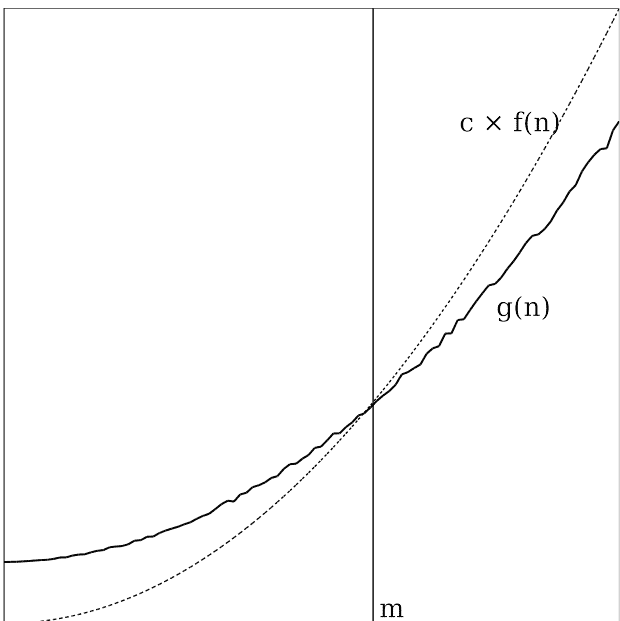

**图 7.1：** 此图显示了 $O$ 含义的图形表示。实线代表 $g(n)$，它是对输入大小为 $n$ 时所计算量的衡量。虚线是函数 $c f(n)$。

## 7.4 O(1) 的要求

代码的行为只有在 $n$ 变得大时才真正重要。技术上，这是一种渐近分析。它处理的是 $n \to \infty$ 的情况。在总体上这非常有意义，因为计算机处理的大量工作都涉及大量数据集，而我们总是试图让它们处理更多信息。如果你的问题规模会很小，可能使用 $O$ 行为较差的方法反而更快。

## 7.5 基于数组的栈

（此处省略重复的描述文字，直接进入代码实现部分）

```scala
```


# 栈特质定义

```scala
trait Stack[A] {

  /**
   * 向栈中添加项。
   * @param obj 要添加的项
   */
  def push(obj: A)

  /**
   * 移除栈顶项。
   * @return 被移除的项
   */
  def pop(): A

  /**
   * 返回最近添加的项但不移除。
   * @return 最近添加的项
   */
  def peek(): A

  /**
   * 检查栈是否为空。
   * @return 如果为空则返回 true，否则返回 false。
   */
  def isEmpty(): Boolean
}
```

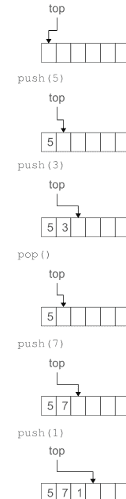

**图 7.2：** 此图展示了基于数组的栈的图形表示，以及它在多次操作中的变化情况。栈在数组中存储数据，并使用整数索引来跟踪栈顶的位置。

# 使用 Scala 的面向对象、抽象和数据结构

```scala
data(top) = obj
top += 1
}
```

```scala
def pop(): A = {
  assert(!isEmpty(), "在空栈上调用了 pop.")
  top -= 1
  data(top)
}
```

```scala
def peek: A = data(top - 1)
def isEmpty: Boolean = top == 0
```

我们将从顶部开始过一遍。该类名为 `ArrayStack`，它继承自 `Stack`。`ArrayStack` 的修饰方式与我们之前见过的不同；它后面跟着 `: ClassTag`。这是为了让我们能够使用 `new Array[A](...)` 创建类型为 `A` 的数组。下面将解释为什么需要这些细节。

在类内部第 6 行和第 7 行，我们有 `top` 和 `Array` 的两个私有声明。它们都是私有的，因为它们是可变的，如果外部代码修改它们会导致栈产生不当的行为。`pop(): A` 的实现将 `top` 减一并返回数据。`peek` 和 `isEmpty` 甚至更简单。所有这些方法都是 O(1)，因为它们是在整数上的操作和对数组的直接访问，这两种操作都是在常数时间内完成的。

复杂的方法是 `push(obj: A)`。该方法以两行代码结束，用于检查数组中是否有足够的空间放置对象。如果没有空间，将创建一个新数组，并将当前数组的内容复制到新数组中。那行代码需要 O(n) 时间，因为它必须将 O(n) 个值从一个数组移动到另一个数组。

显而易见的问题是，这种平均操作会给我们带来 O(1) 的摊还成本吗？对于这段代码，答案是肯定的，但展示为什么这样做非常重要，而且很容易写出一个摊还成本为 O(n) 的版本。关键在于我们如何扩展数组。这看起来可能是多此一举，许多人倾向于每次都添加固定数量。也许每次让数组扩展为固定个槽位。下表使用这两种方法运行了前六次复制事件。在底部，它显示了第 m 次事件复制的通用公式。

> 与其使用 `for` 循环，可以使用 `Array.copy(data, 0, tmp, 0, data.length)` 这一行复制数组的内容。

# 栈与队列

| 调整事件 | 策略一：倍增 | | 策略二：固定增量 | |
|---|---|---|---|---|
| | 大小 | 总工作量 | 大小 | 总工作量 |
| 1 | 10 | 10 | 10 | 10 |
| 2 | 20 | 30 | 20 | 30 |
| 3 | 40 | 70 | 30 | 60 |
| 4 | 80 | 150 | 40 | 100 |
| 5 | 160 | 310 | 50 | 150 |
| 6 | 320 | 630 | 60 | 210 |
| m | $10 \times 2^m$ | $10 \times (2^{m+1}-1)$ | $10m$ | $5m(m+1)$ |

为了得到摊还成本，我们将总工作量除以大小，因为我们必须推送很多次才能让栈达到该大小。对于第一种方法（倍增），我们得到：

```
$10 \times (2^{m+1}-1) / (10 \times 2^m) = \frac{2^{m+1}-1}{2^m} \approx 2$
```

对于第二种方法（固定增量），我们得到：

```
$\frac{5m(m+1)}{10m} = \frac{m+1}{2} \approx \frac{m}{2}$
```

---

# 基于数组的队列实现

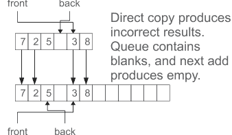
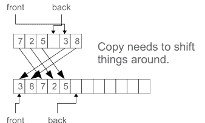

**图 7.4：** 此图展示了基于数组的队列在入队时需要扩容的图形化表示。当 `front == back` 时，队列被视为为空。由于某种原因，当最后一个槽位满时应该执行扩容操作。除了分配一个更大的 `Array` 之外，复制操作还需要移动 `Array` 中的元素并改变 `front` 和 `back` 的位置。

`front` 和 `back` 的值也需要进行适当的调整。有很多方法可以实现。图 7.4 展示了我们将在代码中采用的方法，即将 `front` 移动回 `Array` 的开头。这种基于数组的队列实现的图形化描述可以用如下代码进行实现。

```scala
package scala.reflect.ClassTag

class ArrayQueue[A: ClassTag] extends Queue[A] {

    private var front, back = 0
    private var data = new Array[A](10)

    def enqueue(obj: A) {
        if ((back + 1) % data.length == front) {
            val tmp = new Array[A](data.length * 2)
            for (i <- 0 until data.length) tmp(i) = data((i + front) % data.length)
            front = 0
            back = data.length - 1
            data = tmp
        }
        data(back) = obj
        back = (back + 1) % data.length
    }
}
```

```scala
def dequeue(): A = {
    assert(!isEmpty, "Dequeue called on an empty queue.")
    val ret = data(front)
    front = (front + 1) % data.length
    ret
}
```

```scala
def peek: A = data(front)
def isEmpty: Boolean = front == back
```

这段代码与我们为栈进行的封装非常相似。你可能觉得奇怪的唯一元素是从 `Array` 尾部回到开头的封装是通过取模运算完成的。`dequeue` 中的封装和 `enqueue` 处的封装很容易用 `if` 语句完成。对于另外两个，封装需要是表达式的一部分；这使得取模运算更加高效。如果你不使用取模，非常欢迎使用 `if` 语句重写这段代码。我们预计，一旦你这样做，你就会明白为什么我们更倾向于使用取模。

所有操作的摊销成本均为 O(1)。对于栈的 `push` 操作，`enqueue` 方法在执行扩容调用时是 O(n)；然而，这些情况非常稀少，因此平均时间为常数级。

## 7.7 单元测试

正如你此时所意识到的，编写可以通过编译的代码并不意味着你的代码是正确的。代码中仍然存在运行时错误和逻辑错误。为了找到这些错误，你需要对代码进行测试。到目前，你可能一直在使用手动测试。这就是开发者显式运行每个测试用例来测试代码。此外，程序员还必须验证某些测试的正确性。在大规模开发中，这些方法无法帮助我们生成可靠的代码。在本节中，我们将通过引入自动化**单元测试**的概念来解决这个问题。

单元测试是检查程序特定单元功能的测试。通常，它像是一个类，甚至是类中的方法。单元测试旨在自动运行，因此不依赖程序交互来确定测试的通过或失败。

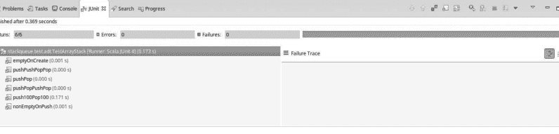

**图 7.5：** 当运行 JUnit 测试且所有测试通过时，Eclipse 显示的内容。绿色条表示一切正常。如果你看到红色条，则说明有一个或多个测试失败了，它们将为你列出来。

我们可以为我们的队列编写类似的测试。它们看起来可能如下所示：

```scala
package test.stackqueue.adt

import org.junit._
import org.junit.Assert._
import stackqueue.adt._
```

```scala
class TestArrayQueue {
    var queue: Queue[Int] = null

    @Before def initQueue() {
        queue = new ArrayQueue[Int]
    }

    @Test def emptyOnCreate() {
        assertTrue(queue.isEmpty)
    }

    @Test def nonEmptyOnEnqueue() {
        queue.enqueue(5)
        assertFalse(queue.isEmpty)
    }

    @Test def enqueueDequeue() {
        queue.enqueue(5)
        assertEquals(5, queue.dequeue)
    }

    @Test def enqueueDequeueEnqueueDequeue() {
        queue.enqueue(5)
        assertEquals(5, queue.dequeue)
        queue.enqueue(3)
        assertEquals(3, queue.dequeue)
    }

    @Test def enqueueEnqueueDequeueDequeue() {
        queue.enqueue(5)
        queue.enqueue(3)
        assertEquals(5, queue.dequeue)
        assertEquals(3, queue.dequeue)
    }

    @Test def enqueue100Dequeue() {
        val nums = Array.fill(100)(util.Random.nextInt)
        // ... 测试逻辑续
    }
}
```


# 7.7.3 测试套件 (Test Suites)

自动化测试的目的是能够定期轻松运行所有测试，这让你在修改代码时更有信心。如果你运行测试并通过了，再进行修改；如果其中一个失败了，你就确切知道失败的原因，并且更容易定位和诊断。如果你进行了该修改且一切通过了测试，你会有某种程度的信心，认为修改没有破坏任何功能。

遗憾的是，运行每一个测试类和处理大量定义了用于测试的 `main` 方法的对象一样痛苦。为了合并你的测试，你可以创建一个**测试套件 (TEST SUITE)**。这允许你指定一组包含测试代码的不同类，让它们一起运行。要构建一个套件，你需要创建一个类并使用 `@RunWith` 和 `@Suite.SuiteClasses` 注解对其标记。这里是一个套件示例，包含了我们刚刚编写的两个测试，以及在本章稍后出现的第三个测试。

```scala
package test.stackqueue

import org.junit.runner.RunWith
import org.junit.runner.Suite
```

注意，该类实际上并不包含任何内容。⁴是注解告诉 JUnit 在此处应该执行的所有工作。随着我们添加更多类，我们也将把它们添加到套件中。

> ⁴移除大括号很诱人，但这样做会导致 JUnit 测试加载器出现问题。

### 7.7.4 测试驱动开发 (Test-Driven Development)

单元测试是一种名为“测试驱动开发”的开发方法的核心部分。这种开发风格的特点是：在编写实际代码之前先为代码编写测试。在 TDD 环境中，一个想要编写新类的程序员会创建该类并放入一些空方法，这些方法只有签名。之后，开发者为该类编写一个基础测试，测试会失败。然后添加足够的代码使该测试通过。一旦所有测试通过，就会编写另一个会失败的测试，并重复这一过程，直到编写了足够的测试来证明该类必须满足要求才能通过测试。

虽然本教科没有遵循 TDD 方法，但它具有显著的优点。主要的优点是它迫使开发者采取细小的步骤，并定期验证一切是否运行正常。学生倾向于编写大段代码而不进行测试，更不用说测试了。这种开发方法不可避免地会导致许多头疼的问题。你需要专注于一个小任务，编写它的代码，然后让它运行。TDD 在你进行修改时带给你一种安全感，因为你有信心如果做了破坏某些东西的修改，它会立即在测试中显示为红色条。这对于初级程序员可能很重要，因为他们害怕在出错时删除大段代码而保留了它们。由于这个原因，关于 TDD 的文献将测试称为提供了进行修改的“勇气”。

单元测试还有很多我们未涵盖的内容。感兴趣的读者鼓励访问我们的网站或研究基于 Scala 的测试框架，如 `ScalaTest`。完整的开发不仅需要单元测试。单元测试的本质是确保小段代码能够正常工作。要对一个应用程序有信心，你需要测试协同工作的部分。这被称为集成测试 (integration testing)，在 TDD 中是定期进行的，但它涉及书中未介绍的不同工具集。

## 7.8 RPN 计算器

栈的一个经典例子是逆波兰表达式 (RPN) 计算器。在 RPN 模式下，后缀表达式的评估可以使用一个存储正在处理的数字的栈来轻松完成。只需遍历表达式，对每个元素执行以下操作之一：如果是数字，将该数字推入栈中；如果是运算符，从栈中弹出两个元素，对它们执行适当的操作，然后将结果推回栈中。最后，栈中应该有一个值，代表最终结果。可以使用以下内容实现这一基本功能。

```scala
object RPNCalc {
  def apply(args: Seq[String]): Double = {
    val stack = new ArrayStack[Double]
    for (arg <- args) if (arg.isNotEmpty) match {
      case "+" => stack.push(stack.pop + stack.pop)
      case "*" => stack.push(stack.pop * stack.pop)
      case "-" =>
        val tmp = stack.pop
        stack.push(stack.pop - tmp)
      case "/" =>
        val tmp = stack.pop
        stack.push(stack.pop / tmp)
      case x => stack.push(x.toDouble)
    }
    stack.pop
  }
}
```

参数是通过 `for` 循环遍历的序列。减法和除法运算符与加法、乘法稍不同，因为它们不符合交换律；此代码还假设不是这四种操作的内容都是数字。在这个基础上添加一些选项很好。例如，除了标准算术运算外还可以增加一些函数，例如三角函数和平方根。支持变量也可以，这样不是每个值都是字面数值。这里显示了一个支持这些选项的对象。

```scala
package stackqueue.util

import stackqueue.adt.ArrayStack

object RPNCalc {
  def apply(args: Seq[String], vars: collection.Map[String, Double]): Double = {
    val stack = new ArrayStack[Double]
    for (arg <- args) if (arg.isNotEmpty) match {
      case "+" => stack.push(stack.pop + stack.pop)
      case "*" => stack.push(stack.pop * stack.pop)
      case "-" =>
        val tmp = stack.pop
        stack.push(stack.pop - tmp)
      case "/" =>
        val tmp = stack.pop
        stack.push(stack.pop / tmp)
      case "sin" => stack.push(math.sin(stack.pop))
      case "cos" => stack.push(math.cos(stack.pop))
      case "tan" => stack.push(math.tan(stack.pop))
      case "sqrt" => stack.push(math.sqrt(stack.pop))
      case v if (v(0).isLetter) =>
        stack.push(try { vars(v) } catch { case ex: NoSuchElementException => 0.0 })
      case x =>
        stack.push(try { x.toDouble } catch { case ex: NoSuchElementException => 0.0 })
    }
    stack.pop
  }
}
```

这里添加了三个主要的三角函数以及一个平方根函数。这些操作只提供单个值，应用函数并将结果推入栈。这段代码还包含一个类型为 `Map[String, Double]` 的额外参数，用于按名称存储变量。在这种情况下，使用了 `scala.collection.Map` 类型。它是可变 map 和不可变 map 的共同父类型。这段代码不关心可变性，因此这提供了额外的灵活性。最后，添加了一些错误处理，以便如果输入的值既不是数字也不是有效值，我们就向栈中推入 `0.0`。这是通过 `try/catch` 表达式来实现的。如果 `try` 执行成功，它将拥有代码块的值；如果它抛出的异常被 `catch` 中的 `case` 捕获，则使用该表达式的值。

在我们宣布这段代码可以工作之前，我们需要对它进行测试。⁵ 在这里有一个可能的测试：

```scala
package test.stackqueue.util

import org.junit.Test
import org.junit.Assert._
import stackqueue.util.RPNCalc

class RPNCalcTest {
  @Test def basicOps() {
    assertEquals(5.0, RPNCalc(Seq("2", "3", "+"), Map()), 0.001)
    assertEquals(6.0, RPNCalc(Seq("2", "3", "*"), Map()), 0.001)
    assertEquals(-1.0, RPNCalc(Seq("2", "3", "-"), Map()), 0.001)
    assertEquals(2.0 / 3.0, RPNCalc(Seq("2", "3", "/"), Map()), 0.001)
  }
}
```

与之前的测试一样，这些是非常极简的。实际上有无限多个测试可以运行来验证 RPN 计算器。这组测试只是简单地选取了几个与计算器预期支持的不同功能类型相关的测试。

单元测试的拥护者更倾向于将每个 `assertEquals` 拆分为一个独立的方法，因为后面的测试依赖于前一个测试的结果。这不仅仅是一个风格问题；这种方法有其合理的优势。JUnit 会独立地运行所有测试方法，但每个测试会在断言失败时停止。因此，如果对 `"2 3+"` 的处理失败，按照目前的写法，我们无法获得其他三行测试的结果。现在，这使得很难知道失败的原因变得更加困难。如果 `"2 3+"` 失败而所有单个操作调用都通过了，我们可以确信问题出在对 `"+"` 的处理上。但按照目前的写法，我们无法获得那个额外信息。在这里使用这种格式的唯一原因是它占用的行数少于一半，而且在打印格式下更易读。

> ⁵ 值得注意的是，作者原始编写的这段代码有一个 bug，他们是通过这些测试发现它的。

这个 `RPNCalc` 对象也可以作为命令集成到绘图中。为了使用变量，我们在 `Drawing` 类中添加了一个额外的可变 `val vars`，类型为 `mutable.Map[String, Double]`。然后我们添加了两个命令 `"rpn"` 和 `"set"`。第一个使用指定的参数调用 `RPNCalc` 对象。第二个允许你为该图在 Map 中设置变量。以下是修改后的 `Commands` 代码：

```scala
package stackqueue.drawing

import stackqueue.util.RPNCalc

object Commands {
  private val commands = Map[String, (String, Drawing) => Any](
    "add" -> ((rest, d) => rest.trim.split("\\+").map(_.toInt).sum),
    "echo" -> ((rest, d) => rest.trim),
    "refresh" -> ((rest, d) => d.draw(vars)),
    "rpn" -> ((rest, d) => RPNCalc(rest.trim.split("\\s+"), d.vars)),
    "set" -> ((rest, d) => {
      val parts = rest.split(" ")
      d.vars(parts(0)) = parts(1).toDouble
      parts(0) + " = " + parts(1)
    })
  )

  def apply(input: String, drawing: Drawing): Any = {
    val spaceIndex = input.indexOf(" ")
    val (command, rest) = if (spaceIndex < 0) (input.toLowerCase(), "")
    else (input.take(spaceIndex).toLowerCase(), input.drop(spaceIndex + 1))
    if (commands.contains(command)) commands(command)(rest, drawing) else "Not a valid command."
  }
}
```

得益于原始设计的灵活性，添加两个额外命令的工作非常小。在 `Drawing` 中添加 `vars` 成员就像这样简单。我们只需要在文件中添加以下行即可：

```scala
private[drawing] val vars = mutable.Map[String, Double]()
```

注意这里的可见性被指定为 `private[drawing]`。将 `drawing` 放在括号中是第 93 页引入的可见性级别。这允许 `drawing` 包中的其他代码访问该变量，但对其对代码的其他部分隐藏。

# 7.9 广度优先搜索

计算机上常见的活动之一是搜索。“搜索”一词根据语境可以有许多含义，但在所有情况下，其核心思想都是存在许多可能性，而我们需要识别出那些符合特定标准的项。你之前可能已经探索过在数组等序列中搜索数据的想法。在本节中，我们想要考虑一种不同类型的搜索。我们想要搜索问题的各种可能解决方案。这是一个广阔的领域，因此我们将专注于每个人应该都能识别的东西——找到通过迷宫的路径。

解决这类问题有两种大方法。它们是广度优先搜索和深度优先搜索。我们将考虑广度优先搜索，因为它是队列的一个良好用例。我们将在后面的几个章节中回到深度优先搜索。广度优先搜索的思想是，给定某些起始条件，你尝试距离当前位置一步之隔的所有，然后是两步之隔的所有。深度优先搜索会回溯并尝试其他分支。广度优先搜索会创建一个 `Maze` 来填充这个。正如名称所示，它希望让程序在图中显示最短路径。这里是关于填充迷宫的代码：

```scala
package stackqueue

import collection.mutable
import stackqueue.drawing._
import scene.canvas.GraphicsContext
import scene.Node
import scene.paint.Color
import scene.control.Button
import scene.event.ActionEvent
import stackqueue.adt.ArrayQueue

class Maze(d: Drawing) extends Drawing(d) {
  private val maze: Array[Array[Int]]
  private val width = 20
  private val offsets = Seq((0, 1), (0, -1), (1, 0), (-1, 0))
  private var drawVisited = Set[(Int, Int)]()
  private var startX = 0
  private var startY = 0
  private var endX = 9
  private var endY = 9
  private var propPanel: Option[Node] = None

  override def toString = "Maze"

  def draw(gc: GraphicsContext): Unit = {
    for (j <- maze.indices; i <- maze.indices) {
      if (maze(j)(i) == 0) {
        gc.fill = if (visited(i -> j)) Color.Green else Color.White
      } else {
        gc.fill = Color.Black
      }
      gc.fillRect(i * width, j * width, width, width)
    }
  }

  def propertiesPanel(): Node = {
    if (propPanel.isEmpty) {
      val panel = new Button("Breadth First Search")
      panel.onAction((ae: ActionEvent) => {
        breadthFirstPath() match {
          case None => visited = Set()
          case Some(lst) => visited = lst.toSet
        }
        draw(gc)
      })
      // 这里的代码省略了逻辑
      propPanel = Some(panel)
    }
    propPanel.get
  }

  def breadthFirstPath(): Option[List[(Int, Int)]] = {
    val queue = new ArrayQueue[List[(Int, Int)]]
    queue.enqueue(List(startX -> startY))
    var solution: Option[List[(Int, Int)]] = None
    var visited = mutable.Set[(Int, Int)]()
    while (!queue.isEmpty) {
      val steps @ ((x, y) :: _) = queue.dequeue()
      for ((dx, dy) <- offsets) {
        // 后续逻辑省略
      }
    }
    solution
  }
}
```


## Scala 迷宫广度优先搜索实现

```scala
val nx = x + dx
val ny = y + dy

if (nx >= 0 && nx < maze(0).length && ny >= 0 && ny < maze.length && maze(nx)(ny) == 0 && !visited(nx -> ny)) {
  if (nx == endX && ny == endY) {
    solution = Some((nx -> ny) : steps)
  }
  visited += nx -> ny
  queue.enqueue((nx -> ny) : steps)
}
```

*(注：由于原文末尾部分存在乱码和重复，以下译文为根据上下文逻辑重新整理的 Scala 代码结构：)*

```scala
package stackqueue

import collection.mutable
import stackqueue.drawing._
import scene.canvas.GraphicsContext
import scene.Node
import scene.paint.Color
import scene.control.Button
import scene.event.ActionEvent
import stackqueue.adt.ArrayQueue

class Maze(d: Drawing) extends Drawing(d) {
  private val maze: Array[Array[Int]]
  private val width = 20
  private val offsets = Seq((0, 1), (0, -1), (1, 0), (-1, 0))
  private var drawVisited = Set[(Int, Int)]()
  private var startX = 0
  private var startY = 0
  private var endX = 9
  private var endY = 9
  private var propPanel: Option[Node] = None

  override def toString = "Maze"

  def draw(gc: GraphicsContext): Unit = {
    for (j <- maze.indices; i <- maze.indices) {
      if (maze(j)(i) == 0) {
        gc.fill = if (visited(i -> j)) Color.Green else Color.White
      } else {
        gc.fill = Color.Black
      }
      gc.fillRect(i * width, j * width, width, width)
    }
  }

  def propertiesPanel(): Node = {
    if (propPanel.isEmpty) {
      val panel = new Button("Bread First Search")
      panel.onAction((ae: ActionEvent) => {
        breadthFirstPath() match {
          case None => visited = Set()
          case Some(lst) => visited = lst.toSet
        }
        draw(gc)
      })
      propPanel = Some(panel)
    }
    propPanel.get
  }

  def breadthFirstPath(): Option[List[(Int, Int)]] = {
    val queue = new ArrayQueue[List[(Int, Int)]]
    queue.enqueue(List(startX -> startY))
    var solution: Option[List[(Int, Int)]] = None
    var visited = mutable.Set[(Int, Int)]()

    while (!queue.isEmpty) {
      val steps = ((x, y) : _) = queue.dequeue()
      for ((dx, dy) <- offsets) {
        val nx = x + dx
        val ny = y + dy

        if (nx >= 0 && nx < maze(0).length && ny >= 0 && ny < maze.length && maze(nx)(ny) == 0 && !visited(nx -> ny)) {
          if (nx == endX && ny == endY) {
            solution = Some((nx -> ny) : steps)
          }
          visited += nx -> ny
          queue.enqueue((nx -> ny) : steps)
        }
      }
    }
    solution
  }
}
```


# 使用 Scala 的面向对象、抽象和数据结构

迷宫本身在第 15-25 行被声明为一个二维数组。标记为 0 的位置是开放的，而标记为 1 的位置是无法穿过的墙壁。第 31-34 行定义了作为迷宫起点和终点的位置。它们初始被设置为起点在左上角，终点在右下角。

`draw` 方法是一个 `for` 循环，它遍历整个迷宫并绘制正方形。正方形的颜色取决于位置是开放的还是墙壁。对于位置，会检查名为 `drawVisited` 的集合（Set），以判断它是否是解决方案的一部分，这样我们就能看到解决方案的路径。`propertiesPanel` 方法添加了一个按钮，该按钮在 `action` 处理器中会设置 `drawVisited` 的值，并告诉绘图程序重绘。

这一部分代码中最关心的部分是最后一个方法，`breadShortestPath`。它返回一个 `Option[List[(Int, Int)]]`，如果存在路径，它将持有解决方案的路径。第 71 行（该方法的第一行）创建了一个 `ArrayQueue` 实例并调用 `enqueue`。下一行将起始位置添加到此队列中。队列的内容是 $x, y$ 坐标元组的列表。每个新位置都连接到上一步列表的头部，因此“当前位置”始终是列表的头。

第 73 行声明了一个名为 `path` 的变量（`var`），如果找到了最短路径，它将持有该路径。如果没有解决方案，`None` 的值将一直存在到方法结束。第 74 行声明了一个内容为 $x, y$ 位置的 `mutable.Set`。正如其名所示，这是所有已访问过的地方。它是算法中至关重要的一部分。我们必须包含某种方式来防止代码回到已经访问过的地方。集合（Set）对于这种操作是高效的，因为我们只是向它添加内容，然后检查某些值是否包含在其中。这些都是集合擅长执行的操作。

第 75 行启动了 `while` 循环，执行该方法的工作。只要队列不为空且我们还没有找到解决方案，它就会继续运行。广度优先算法在搜索最短路径方面表现良好，因为它按点顺序在 $n$ 步内处理每个位置。当你第一次到达某个位置时，你就知道你是用最少的步骤到达那里的。没有这类问题的程序非常适合广度优先搜索。

在第 76 行的 `while` 循环内部，有一个对 `dequeue` 的调用，并赋值给一个复杂的模式。该模式是 `(x, y) ::`。记住，当我们想要给某个东西命名并用更详细的模式进一步拆解时，模式中使用了 `$` 符号。因此，我们 `dequeue` 出来的列表被赋予了名称 `steps`。`$` 的模式是一个按垂直方向通过 `::` 匹配的列表。这为列表头部的值赋予了名称 $x$ 和 $y$，而由于没有给列表的尾部赋予任何名称（而是使用下划线表示而不命名）。

在 `dequeue` 之后，有一个 `for` 循环遍历 `offsets` 的成员，`offsets` 是在第 28 行声明的。它是一系列元组，代表向上、向右、向下和向左的 $x, y$ 偏移。使用这个循环可以避免我们在测试从当前位置可以移动的不同方向时重复编写四次代码。

# 栈与队列

## 绘图程序

文件 编辑

未命名

迷宫


广度优先搜索

图 7.6：这是添加迷宫并执行广度优先解决方案后的绘图程序。

在引入变量 `nx` 和 `ny` 来存储距离 $x, y$ 一步的位置后，第 80 行检查 `nx` 位置是否在迷宫边界内、不是墙上且不是我们已经到达过。如果是，我们就可以去那里。第 81 行检查我们是否到达了迷宫的终点。如果是，它会将到达那里的路径存储在 `solution` 中。第 84 行将其添加到访问过的集合中，第 85 行将路径入队。

通过在 `DrawingMain` 的创建器声明中添加一行来创建 `DrawMaze`，我们可以在程序中看到这段代码的运行。图 7.6 显示了它的样子。注意，这里的 GUI 还可以添加很多功能。我们可以让迷宫变得可编辑，并设置起点和终点。这些增强功能留给读者作为练习。

现在我们已经走过了代码，应该确保你理解了它在做什么。这对于一个完全没有墙的迷宫来说可能是容易的。我们从某个位置开始，将其放入队列，然后在 `while` 循环中取出。`for` 循环将把四个相邻的位置（上、右、下、左）添加到队列中。每一个位置都将按顺序被取出，其尚未被访问的邻居将被添加到队列中。图 7.7 显示了这项工作的图形化表示，在这里我们从中心附近开始，终点在左上角。每个正方形都标记有 `steps` 中元素的数量。因此，起始位置标记为 1。它的 4 个邻居标记为 2。与标记为 2 的位置相邻的 8 个正方形标记为 3。正如前面提到的，如果找到了最短路径，它将持有该路径。如果没有解决方案，`None` 的值将一直存在到方法结束。

| 15 | 7 | 6 |
| 14 | 5 | 6 |
| 13 | 4 | 5 |
| 12 | 3 | 2 |
| 11 | 2 | 3 |
| 10 | 3 | 4 |
| 9 | 4 | 3 |
| 8 | 7 | 5 |

图 7.7：这项工作的图形化表示，在这里我们从中心附近开始，终点在左上角。每个正方形都标记有 `steps` 中元素的数量。因此，起始位置标记为 1。它的 4 个邻居标记为 2。与标记为 2 的位置相邻的 8 个正方形标记为 3。正如前面提到的，如果找到了最短路径，它将持有该路径。如果没有解决方案，`None` 的值将一直存在到方法结束。

## 7.10.1 概念总结

### 栈与队列

- 由于其简单性，任何栈或队列的合理实现都应该具有 O(1) 的摊销成本。
- 实现栈的一种方法是使用 `Array` 来存储数据。只需维护一个栈顶索引。当 `Array` 满时，它应该按倍数增长。
- 同样可以使用 `Array` 实现队列。这种实现稍微复杂一点，因为数据从一端添加并从另一端移除。当它们遇到 `Array` 的末尾时，会进行回绕。就像栈一样，当 `Array` 增长时，它应该这样做。

- 抽象数据类型（ADT）用于描述具有定义操作的结构，但并不指定这些操作是如何实现的。
- 栈是具有两个操作 `push` 和 `pop` 的简单 ADT。`push` 将元素添加到栈顶，`pop` 取最近添加的元素。这种顺序被称为后进先出（LIFO）。
- 队列是另一个具有 `enqueue` 和 `dequeue` 操作的 ADT。`enqueue` 将元素添加到队列，`dequeue` 取出元素。这种元素的排序被称为先进先出（FIFO）。
- 分析有助于我们理解算法随输入规模增大时的行为。它忽略了常数倍和低阶项。这在输入变大时变得真正重要。

### 7.10.2 练习

1. 为 RPN 计算器添加额外的函数。
2. 为书中所示的单元测试编写更多测试。
3. 在这个练习中，你应该实现几种可能的栈和队列版本，并对它们进行测试。

### 7.10.3 项目

正如你所猜的，本章的项目让你在代码中添加栈和/或队列。许多项目让你使用广度优先搜索寻找路径。

1. 如果你一直在开发 MUD 项目，在此迭代中，你应该添加一个名为 `shortpath` 的新命令，它接受一个关键词作为参数。当用户执行此命令时，你将打印出从当前位置移动到最短路径上房间的方向。
2. 在良好的网站中，页面应该是可以通过少量点击到达的。如果你一直在开发网络爬虫项目，你可能已经建立了一个图，其中每个页面都知道它链接到哪些页面。编写一个广度优先最短路径，告诉用户从你工作的网站的一个页面到另一个页面所需的最小点击次数。
3. 如果你的图形游戏包含会移动且具有运动属性的对象，那么让它们寻找从一个地方到另一个地方的最短路径是有意义的。根据游戏的不同，这可能是玩家的操作，也可能是某些类型敌人的操作。使用你的队列来实现广度优先搜索，并使用它为游戏中的实体创建适当的运动。
4. 回到第 5 章，数学工作表中的项目 4 建议你可以通过使用命令模式将多态集成到你的项目中。命令模式的主要用途之一是实现撤销（undo）和重做（redo）功能。栈（stack）是实现此功能的理想数据结构。让主应用程序维护两个栈：一个是撤销栈，当用户选择撤销某个操作时，将该命令推入撤销栈；你将其推入第二个栈，即重做栈。当用户选择重做时，操作向相反的方向移动。注意，任何正常活动都可能应该清空重做栈。

   你用于此的栈将与默认实现略有不同。首先，你需要栈拥有一个 `clear` 方法。此外，你可能没有无限的撤销次数，因此你可能希望在推送一定数量的元素后“丢失”它们。这留给学生作为一个练习，思考如何在保持 O(1) 行为的情况下来实现它。
5. 在第 5 章，项目 5 建议你可以将命令模式添加到你的 Photoshop® 项目中，以实现撤销和重做功能。如上述项目所述，这最好通过两个栈来实现。在你的迭代中，你应该对 Photoshop® 执行上述在数学工作表中描述的操作。
6. 股票投资组合管理项目可以受益于数学工作表项目中所述的命令模式实现。你希望为用户提供撤销或重做股票购买的能力。我们可以假设买卖股票的决策是对你（管理公司）执行该操作的指令，因此实际的买/卖操作是可以被撤销或重做的。
7. 电影项目也可以受益于撤销和重做功能。参考命令模式的描述以及如何在数学工作表项目中实现它。你应该允许用户对想要看的电影列表和收藏列表更改进行撤销和重做。
8. 到目前为止，仿真工作台的项目让你一直在处理如重力或布料粒子网格之类的 N 体仿真。现在我们想在混合中加入一种根本不同的仿真类型：离散事件仿真。这些将在第 13 章中进行更深入地探讨，但你可以在这里创建你的第一个简单仿真：单机队列。

   单机队列的想法是，人们到达并为一个单一服务器排队。人们以随机间隔到达，服务器花费随机的时间处理请求。当人们到达且服务器正忙时，他们进入队列。仿真可以跟踪各种情况，例如人们需要等待多久以及队列的平均长度。

   离散事件仿真的关键在于，你关心的只有事件，而不是事件之间的时间。在这个系统中，只有两种类型的事件：客户到达和服务完成。任何时间每种事件都只能调度一个。为了建模到达，你将使用指数分布；为了建模服务时间，你将使用 Weibull 分布。使用以下公式从这些分布中生成数字，其中 $r$ 是调用 `math.random` 的结果。

   - $a(exponential) = -\frac{\ln(1-r)}{\lambda}$
   - $a(k, \lambda)_{Weibull} = \lambda(-\ln(1-r))^{\frac{1}{k}}$

   对于 Weibull 分布，使用 $k=2$。$\lambda$ 值决定了到达或服务之间的平均时间。你应该允许用户修改这些值。

   仿真从 $t=0$ 开始，队列中无人。你从指数分布中生成一个值 $a_{exponential,1}$，并立即推进到该时间，此时第一个人进入。由于此时没有正在被服务，你直接进入服务器。你再次从指数分布中生成另一个数字 $a_{exponential,2}$，并将其保留为下一个人到达的时间。第一个人到达并进入队列（或者第一个人到达），你调度服务器生成一个服务时间 $a_{Weibull,1}$ 作为该人完成服务的时间，并将其存储。

   然后你立即推进到两个事件时间中的较小值。因此，要么有人到达，要么第一个人接受了服务且服务器变得空闲且无人。每当有一个人到达时，让用户决定如何运行仿真。计算并显示平均等待时间、平均长度以及服务器忙碌的时间比例。
9. 对于 L-system 项目，如果你尚未在字符串中实现 `[` 和 `]` 字符，你现在应该这样做。这些字符存储了乌龟（turtle）的状态并弹出（pop）回来，以便你可以创建分支结构。“弹出”一词意味着这可以通过栈很好地完成。为你的绘制能力添加此功能。每当你遇到 `[` 时，你都应该向栈推入关于乌龟位置和朝向的信息。当你遇到 `]` 时，栈应该被弹出，乌龟应该回到那一个状态。

# 第 8 章：多线程与并发

## 8.1 多核与许多核的未来

在集成电路发展后的几十年里，计算机由于两个因素的共同作用变得越来越快。最重要的因素与摩尔定律有关。这是英特尔的戈登·摩尔（Gordon Moore）提出的预测，即芯片上刻蚀的晶体管数量大约每两年翻一倍。这种增长是由技术改进实现的，使得晶体管可以制造到越来越小的尺度。与之相关的是将这些晶体管推更高频率的能力。

图 8.1 显示了 Intel 和 AMD 在 1978 年至 2011 年间发布的 x86 处理器的时钟频率、晶体管数量和核心数。纵轴对数刻度使得指数增长显而易见。虚线显示了晶体管数量数据的指数拟合。从这里可以看出，摩尔定律一直运行良好。晶体管数量呈指数级增长，翻倍时间接近预测的年份。

从图中开始到 2000-2005 年期间，芯片的时钟频率指数级增长，直到达到 1 GHz 的速度。1978 年和 1979 年的芯片频率为 5 MHz。到 2000 年，它们已经超过了这个数字。另一条虚线显示了到 2000 年时钟频率的指数拟合。如你所见，由于散热问题，时钟频率在几 GHz 处停滞，并且现在自 2000 年之后以后增长不多。在这些速度之后，硅基芯片需要特殊冷却来保持稳定运行。

直到 2005 年，计算机获得的大部分速度提升来自于时钟频率的增加。当这种增长结束时，芯片制造商不得不寻找替代方案来提高芯片速度。毕竟，没有人会买计算机是为了让程序运行得比旧的更慢。因此，从 2005 年开始，通用计算机芯片开始向不同的方向发展。它们的发展方向如图 8.1 中带有三角形标记的线条所示。芯片不再主要使用额外的晶体管来增加指令数据路径的复杂性或添加更多缓存，而是开始制造具有多个核心的芯片。

当一个芯片拥有多个核心时，它可以在任何给定时间执行多条指令。通常，我们目前为止的方法不会自动利用多核。相反，必须重写代码，以便在这些新的计算机上运行得更快。这与处理器获得更高时钟频率时的情况相比是一个重大变化。这种变化的重要意义在一篇名为《免费午餐结束了》的文章中被描述过。所提到的“免费午餐”是指在程序员无需做任何工作的情况下，从新处理器中获得更多速度。为了充分利用更新的处理器，程序必须是多线程的。在本章中，我们将开始探索这到底意味着什么。

> 2008 年和 2011 年的低离群点是专门针对低能耗、移动计算的芯片。这就是为什么与同时制造的其他芯片相比，它们的晶体管数量较少。
>
> 几年前执行此操作的高端服务器芯片。

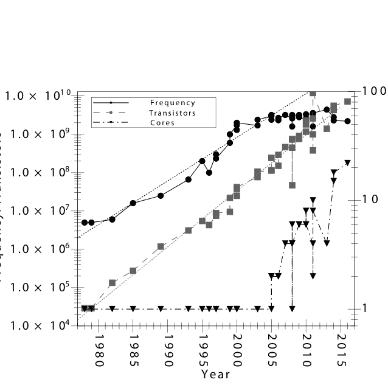

**图 8.1:** 此图显示了 1978 年至 2016 年间生产 x86 处理器的频率、晶体管数量和核心数。图上的对数刻度使得指数曲线呈现为直线。虚线显示了完整晶体管数量数据以及到 2000 年频率数据的拟合。所示的时钟频率是每个芯片的最高发布频率。

## 8.2 线程（概念性）

当你想象你的一个程序在运行时，你可以想象计算机将一个箭头从一个位置移动到下一个位置。箭头指向当前正在执行的行。当你调用一个函数/方法时，箭头跳转到代码的另一个部分，然后在函数/方法返回时跳回。我们用来描述这种行为的术语是“线程（thread）”。我们编写的程序使用单线程执行。我们从这种方式开始是因为它更容易，但计算机硬件的当前特性决定了让你尽早理解多线程概念非常重要。

多线程程序的想法是，你有两个或更多这样的箭头指向不同的行，并同时在程序中移动。这些不同的线程可以运行在不同的核心上，赋予我们完全利用现代处理器的能力。就像多个人操作一项任务一样，个人之间需要一些协调以获得最大收益。在特定任务上能够高效协作工作的人数通常有上限。如果你想挖一个小洞，可能无法使用超过两个或可能三个人。然而，如果你想挖一条大水沟，你可以高效地使用数百个甚至上千个个人。这些限制适用于任何程序。

在 Scala 中使用线程产生并行性有许多方法。在本章中，我们将从可能在你的 Scala 程序中使用的方法开始。在下一章中，我们将探索 Java 库中支持我们所讨论内容的低级结构。

## 8.3 Future（未来）

当你想要在 Scala 中在单独线程中完成某个计算或任务时，你应该使用 `scala.concurrent.Future` 特性及其伴随对象。伴随对象有一个 `apply` 方法，接收一个按名传递（passed by name）的参数（我们通常称其为按名参数），它包含了你想要执行的代码。它从在单独线程中运行代码开始，并返回一个 `Future` 实例来表示正在进行的计算。正如名称所示，`Future` 是一个表示处理过程中的值的。

```


# 8.1 多核与许多核的未来

在集成电路发展后的几十年里，计算机由于两个因素的共同作用变得越来越快。最重要的因素与摩尔定律有关。这是英特尔的戈登·摩尔（Gordon Moore）提出的预测，即芯片上刻刻的晶体管数量大约每两年翻一倍。这种增长是由技术改进实现的，使得晶体管可以制造到越来越小的尺度。与之相关的是将这些晶体管推更高频率的能力。

图 8.1 显示了 Intel 和 AMD 在 1978 年至 2011 年间发布的 x86 处理器的时钟频率、晶体管数量和核心数。纵轴对数刻度使得指数增长显而易见。虚线显示了晶体管数量数据的指数拟合。从这里可以看出，摩尔定律一直运行良好。晶体管数量呈指数级增长，翻倍时间接近预测的年份。

从图中开始到 2000-2005 年期间，芯片的时钟频率指数级增长，直到达到 1 GHz 的速度。1978 年和 1979 年的芯片频率为 5 MHz。到 2000 年，它们已经超过了这个数字。另一条虚线显示了到 2000 年时时钟频率的指数拟合。如你所见，由于散热问题，时钟频率在几 GHz 处停滞，并且现在自 2000 年之后以后增长不多。在这些速度之后，硅基芯片需要特殊冷却来保持稳定运行。

直到 2005 年，计算机获得的大速度提升来自于时钟频率的增加。当这种增长结束时，芯片制造商不得不寻找替代方案来提高芯片速度。毕竟，没有人会买计算机是为了让程序运行得比旧的更慢。因此，从 2005 年开始，通用计算机芯片开始向不同的方向发展。它们的发展方向如图 8.1 中带有三角形标记的线条所示。芯片不再主要使用额外的晶体管来增加指令数据路径的复杂性或添加更多缓存，而是开始制造具有多个核心的芯片。

当一个芯片拥有多个核心时，它可以在任何给定时间执行多条指令。通常，我们目前为止的方法不会自动利用多核。相反，必须重写代码，以便在这些新的计算机上运行得更快。这与处理器获得更高时钟频率时的情况相比是一个重大变化。这种变化的重要意义在一篇名为《免费午餐结束了》[12]的文章中被描述过。所提到的“免费午餐”是指在程序员无需做任何工作的情况下，从新处理器中获得更多速度。为了充分利用更新的处理器，程序必须是多线程的。在本章中，我们将开始探索这到底意味着什么。

> 2008 年和 2011 年的低离群点是专门针对低能耗、移动计算的芯片。这就是为什么与同时制造的其他芯片相比，它们的晶体管数量较少。

> 几年前执行此操作的高端服务器芯片。


**图 8.1:** 此图显示了 1978 年至 2016 年间生产 x86 处理器的频率、晶体管数量和核心数。图上的对数刻度使得指数曲线呈现为直线。虚线显示了完整晶体管数量数据以及到 2000 年频率数据的拟合。所示的时钟频率是每个芯片的最高发布频率。

### 8.2 线程（概念性）

当你想象你的一个程序在运行时，你可以想象计算机将一个箭头从一个位置移动到下一个位置。箭头指向当前正在执行的行。当你调用一个函数/方法时，箭头跳转到代码的另一个部分，然后在函数/方法返回时跳回。我们用来描述这种行为的术语是“线程”。我们编写的程序使用单线程执行。我们从这种方式开始是因为它更容易，但计算机硬件的当前特性决定了让你尽早理解多线程概念非常重要。

多线程程序的想法是，你有两个或更多这样的箭头指向不同的行，并同时在程序中移动。这些不同的线程可以运行不同的核心上，赋予我们完全利用现代处理器的能力。就像多个人操作一项任务一样，个人之间需要一些协调以获得最大收益。在特定任务上能够高效协作工作的人数通常有上限。如果你想挖一个小洞，可能无法使用超过两个或可能三个人。然而，如果你想挖一条大水沟，你可以高效地使用数百个甚至上千个个人。这些限制适用于任何程序。

在 Scala 中使用线程产生并行性有许多方法。在本章中，我们将从可能在你的 Scala 程序中使用的方法开始。在下一章中，我们将探索 Java 库中支持我们所讨论内容的低级结构。

# 8.3 Future

当你想要在 Scala 中在单独线程中完成某个计算或任务时，你应该使用 `scala.concurrent.Future` 特性及其伴随对象。伴随对象有一个 `apply` 方法，接收一个按名传递（passed by name）的参数（我们通常称其为按名参数），它包含了你想要执行的代码。它从在单独线程中运行代码开始，并返回一个 `Future` 实例来表示正在进行的计算。正如名称所示，`Future` 是一个表示处理过程中的值。

```scala
import scala.concurrent.Future
import scala.concurrent.ExecutionContext.global

object SimpleExample extends App {
  val f1 = Future {
    for (i <- 1 to 26) {
      println(i)
      Thread.sleep(100)
    }
  }

  val f2 = Future {
    for (c <- 'a' to 'z') {
      println(c)
      Thread.sleep(100)
    }
  }

  Future((f1, f2)).foreach { case (i, c) =>
    println(s"Result: $i, $c")
  }
}
```

### 8.3.1 使用 Future, map 和 flatMap

我们的第一个示例展示了 `Future` 中的代码在单独线程中执行，但它并没有给出 `Future` 名称或任何内容。`Future` 类型的威力以及它帮助我们避免多线程陷阱的方法，通过使用 `Future` 实例及其拥有的方法来实现。`Future` 应该在某些操作可能需要时间的情况下使用，而当前线程在代码执行和需要结果之前可以做更多高效率的事情。在介绍水平演示这一点对于速度如此快的计算机来说是一个挑战。要跟上任何时间的计算是具有挑战性的。`Thread.sleep` 在这里是为了减慢速度。

```scala
import scala.concurrent.Future
import scala.concurrent.ExecutionContext.global

object SimpleExample extends App {
  val f1 = Future {
    for (i <- 1 to 26) {
      println(i)
      Thread.sleep(100)
    }
  }.map(i => i * 2)

  val f2 = Future {
    for (c <- 'a' to 'z') {
      println(c)
      Thread.sleep(100)
    }
  }.map(c => c.toInt)

  val f3 = f1.flatMap { i =>
    f2.map { j =>
      s"Result: $i, $j"
    }
  }

  f3.foreach { result =>
    println(result)
  }
}
```


# 8.1 多核与许多核的未来

在集成电路发展后的几十年里，计算机由于两个因素的共同作用变得越来越快。最重要的因素与摩尔定律有关。这是英特尔的戈登·摩尔（Gordon Moore）提出的预测，即芯片上刻刻的晶体管数量大约每两年翻一倍。这种增长是由技术改进实现的，使得晶体管可以制造到越来越小的尺度。与之相关的是将这些晶体管推更高频率的能力。

图 8.1 显示了 Intel 和 AMD 在 1978 年至 2011 年间发布的 x86 处理器的时钟频率、晶体管数量和核心数。纵轴对数刻度使得指数增长显而易见。虚线显示了晶体管数量数据的指数拟合。从这里可以看出，摩尔定律一直运行良好。晶体管数量呈指数级增长，翻倍时间接近预测的年份。

从图中开始到 2000-2005 年期间，芯片的时钟频率指数级增长，直到达到 1 GHz 的速度。1978 年和 1979 年的芯片频率为 5 MHz。到 2000 年，它们已经超过了这个数字。另一条虚线显示了到 2000 年时时钟频率的指数拟合。如你所见，由于散热问题，时钟频率在几 GHz 处停滞，并且现在自 2000 年之后以后增长不多。在这些速度之后，硅基芯片需要特殊冷却来保持稳定运行。

直到 2005 年，计算机获得的大速度提升来自于时钟频率的增加。当这种增长结束时，芯片制造商不得不寻找替代方案来提高芯片速度。毕竟，没有人会买计算机是为了让程序运行得比旧的更慢。因此，从 2005 年开始，通用计算机芯片开始向不同的方向发展。它们的发展方向如图 8.1 中带有三角形标记的线条所示。芯片不再主要使用额外的晶体管来增加指令数据路径的复杂性或添加更多缓存，而是开始制造具有多个核心的芯片。

当一个芯片拥有多个核心时，它可以在任何给定时间执行多条指令。通常，我们目前为止的方法不会自动利用多核。相反，必须重写代码，以便在这些新的计算机上运行得更快。这与处理器获得更高时钟频率时的情况相比是一个重大变化。这种变化的重要意义在一篇名为《免费午餐结束了》[12]的文章中被描述过。所提到的“免费午餐”是指在程序员无需做任何工作的情况下，从新处理器中获得更多速度。为了充分利用更新的处理器，程序必须是多线程的。在本章中，我们将开始探索这到底意味着什么。

> 2008 年和 2011 年的低离群点是专门针对低能耗、移动计算的芯片。这就是为什么与同时制造的其他芯片相比，它们的晶体管数量较少。

> 几年前执行此操作的高端服务器芯片。


**图 8.1:** 此图显示了 1978 年至 2016 年间生产 x86 处理器的频率、晶体管数量和核心数。图上的对数刻度使得指数曲线呈现为直线。虚线显示了完整晶体管数量数据以及到 2000 年频率数据的拟合。所示的时钟频率是每个芯片的最高发布频率。

### 8.2 线程（概念性）

当你想象你的一个程序在运行时，你可以想象计算机将一个箭头从一个位置移动到下一个位置。箭头指向当前正在执行的行。当你调用一个函数/方法时，箭头跳转到代码的另一个部分，然后在函数/方法返回时跳回。我们用来描述这种行为的术语是“线程”。我们编写的程序使用单线程执行。我们从这种方式开始是因为它更容易，但计算机硬件的当前特性决定了让你你尽早理解多线程概念非常重要。

多线程程序的想法是，你有两个或更多这样的箭头指向不同的行，并同时在程序中移动。这些不同的线程可以运行不同的核心上，赋予我们完全利用现代处理器的能力。就像多个人操作一项任务一样，个人之间需要一些协调以获得最大收益。在特定任务上能够高效协作工作的人数通常有上限。如果你想挖一个小洞，可能无法使用超过两个或可能三个人。然而，如果你想挖一条大水沟，你可以高效地使用数百个甚至上千个个人。这些限制适用于任何程序。

在 Scala 中使用线程产生并行性有许多方法。在本章中，我们将从可能在你的 Scala 程序中使用的方法开始。在下一章中，我们将探索 Java 库中支持我们所讨论内容的低级结构。

# 8.3 Future

当你想要在 Scala 中在单独线程中完成某个计算或任务时，你应该使用 `scala.concurrent.Future` 特性及其伴随对象。伴随对象有一个 `apply` 方法，接收一个按名传递（passed by name）的参数（我们通常称其为按名参数），它包含了你想要执行的代码。它从在单独线程中运行代码开始，并返回一个 `Future` 实例来表示正在进行的计算。正如名称所示，`Future` 是一个表示处理过程中的值。

```
import scala.concurrent.Future
import scala.concurrent.ExecutionContext.global

object SimpleExample extends App {
  val f1 = Future {
    for (i <- 1 to 26) {
      println(i)
      Thread.sleep(100)
    }
  }

  val f2 = Future {
    for (c <- 'a' to 'z') {
      println(c)
      Thread.sleep(100)
    }
  }

  Future((f1, f2)).foreach { case (i, c) =>
    println(s"Result: $i, $c")
  }
}
```

### 8.3.1 使用 Future, map 和 flatMap

我们的第一个示例展示了 `Future` 中的代码在单独线程中执行，但它并没有给出 `Future` 名称或任何内容。`Future` 类型的威力以及它帮助我们我们避免多线程陷阱的方法，通过使用 `Future` 实例及其拥有的方法来实现。`Future` 应该在某些操作可能需要时间的情况下使用，而当前线程在代码执行和需要结果之前可以做更多高效率的事情。在介绍水平演示这一点对于速度如此快的计算机来说是一个挑战。要跟上任何时间的计算是具有挑战性的。`Thread.sleep` 在这里是为了减慢速度。

```scala
import scala.concurrent.Future
import scala.concurrent.ExecutionContext.global

object SimpleExample extends App {
  val f1 = Future {
    for (i <- 1 to 26) {
      println(i)
      Thread.sleep(100)
    }
  }.map(i => i * 2)

  val f2 = Future {
    for (c <- 'a' to 'z') {
      println(c)
      Thread.sleep(100)
    }
  }.map(c => c.toInt)

  val f3 = f1.flatMap { i =>
    f2.map { j =>
      s"Result: $i, $j"
    }
  }

  f3.foreach { result =>
    println(result)
  }
}
```

## 248 使用 Scala 进行面向对象、抽象和数据结构

这种用户可以感知到的时间。在现代计算机上，某些操作仍然很慢，我们可以利用这些操作来实现。这些包括从文件读取内容或通过网络填充数据。我们将使用后者作为示例。

当你访问网站或在手机上运行使用数据的程序时，很有可能你正在使用的程序正在与其他机器通信以获取数据，这被称为 RESTful API。这些是响应 HTTP 请求并进行数据通信的标准。你可能从网络浏览器使用的 URL 第一部分识别出 HTTP 缩写。REST API 规定了你如何发送请求以获得信息片段的响应。当你调用其中一个 API 时，会有大量工作在进行。你的计算机发送一个 HTTP 请求，该请求由 URL 中指定的方法接收。该方法执行所需的处理并响应。根据另一台机器跨越距离远近，响应时间可能长到让人们察觉。

我们使用 MetaWeather API 来编写示例。对于位于 `https://www.metaweather.com/api/5` 的 API，你只需在浏览器的地址栏中输入它即可测试查询。例如，URL `https://metaweather.com/location/search?query=san` 会请求所有带有 "san" 的位置。如果你尝试这样做，将得到：

```json
{"title":"Santa Cruz","location_type":"City","weid":"2488853","lat_long":"36.97018,-122.032095"}
{"title":"San Francisco","location_type":"City","weid":"2487856","lat_long":"37.77119,-122.41964"}
{"title":"San Diego","location_type":"City","weid":"2487889","lat_long":"32.715691,-117.161720"}
{"title":"San Jose","location_type":"City","weid":"248042","lat_long":"37.338581,-121.885567"}
{"title":"San Antonio","location_type":"City","weid":"2942650","lat_long":"29.424590,-98.496414"}
```

这列出了所有位置以及关于位置类型、位置 ID 编号以及位置经纬度的信息。这里也有标点符号。这里使用的是一种名为 JSON 的标准格式，广泛用于 Web 信息的通信。我们将在简短的 Scala 程序中回到 JSON，该程序可以读取此示例并使用 `Future` 显示它。


```scala
import scala.concurrent.Future
import scala.concurrent.ExecutionContext.Implicits.global

object WeWeather extends App {
  println("Starting...")
  val fut = Future {
    io.Source.fromURL("https://www.metaweather.com/api/location/search?query=san").mkString
  }
  fut.foreach(s =>
    println(s)
  })
  println("About to sleep")
  Thread.sleep(5000)
}
```

> 许多 REST API 需要认证，这是我们在书中不想处理的复杂性。选择 MetaWeather 部分原因是因为它的 API 非常直观，而且不需要认证。我们提供了使用其他不需要认证的 API 的若干练习。

# 多线程与并发

```scala
println("Done")
```

我们从与之前相同的导入开始。第 5、13 和 15 行有 `println` 调用，只是为了帮助你观察发生了什么。第 6-9 行创建了一个名为 `fut` 的 `Future`，它定义了使用 `io.Source.fromURL` 的 API 调用。该调用是 `io.Source.fromURL`，我们之前使用过多次，但正如名称所暗示的，它从 URL 读取数据。`mkString` 获取结果并将其构建为长字符串。`Future` 的类型是 `Future[String]`。第 10-12 行是 `foreach`。这种 `foreach` 的用法与集合上的 `foreach` 类似，但只有当 `Future` 的结果准备好时才会发生。与普通集合的 `foreach` 不同，`Future` 上的 `foreach` 不阻塞当前线程；它调度传递的函数。第 14 行暂停主线程五秒；当主线程结束，即使 `Future` 仍在执行。

前一段提到 `foreach` 并不是“阻塞”的。值得花一点时间讨论一下这意味着什么。阻塞调用是停止当前线程进度的操作，直到操作完成。我们处理过的 `foreach` 方法有多种，但最明显的是 `readline` 被调用时，它会阻塞直到用户输入某些内容。如果用户花费 20 分钟输入某些内容，程序将停在那里，直到用户按下回车键。使用 `Future` 的原因之一是让程序能够快速响应，因为 JSON 格式中包含了我们所需的信息。

JSON 的广泛使用意味着有很多库可以用于解析字符串并转换为其他格式。Scala 标准库中有很多这样的库，但大多数情况下你需要下载并安装额外的库。如果你查看 JSON 数据，你会发现整个在方括号中，每对大括号是键值对。键值对由逗号分隔，键和值由冒号分隔。每对大括号代表一个 JSON 对象，映射到 `Map[String, Any]`。`parse` 中的 `Any` 类型使得处理变得有点挑战性。在 `foreach` 的 `println` 实例中，我们可以放入代码解析 JSON 并查找特定城市的 "weid" 值。该功能在下面的代码所示。

```scala
import scala.concurrent.Future
import scala.concurrent.ExecutionContext.Implicits.global
```

> 虽然 parser combinator 库是 Scala 标准库的一部分，但在某些 IDE 中你可能需要将其添加到项目中。你可以在 Scala 安装的 "lib" 目录下找到它。

## 250 使用 Scala 进行面向对象、抽象和数据结构

```scala
import scala.util.parsing.JSON

object WeeksWeaver extends App {
  println("Starting app.")
  val f1 = Future {
    io.Source.fromURL("https://www.metaweather.com/api/location/search?query=san").mkString
  }
  f1.foreach(jsonStr => {
    val json = JSON.parseFull(jsonStr)
    json match {
      case lst: List[Map[String, Any]] =>
        lst.find(m => m("title") == "San Antonio") match {
          case Some(map) =>
            map("weid") match {
              case d: Double => println("weid" + "." + d.toInt)
              case _ => println("Wrong type")
            }
          case None =>
            println("City not found.")
        }
      case _ =>
        println("Not expected")
    }
  })
  println("About to sleep")
  Thread.sleep(6000)
  println("Done")
}
```

此示例中更改的代码是从第 11 行到第 25 行，并在第 3 行有一个额外的 `import`。你可以通过阅读判断出来，该导入是为了 JSON 解析器。该解析器在第 11 行被用于调用 `JSON.parseFull`。对于这个 JSON，它给了我们 `Option[List[Map[String, Any]]]`，但如果你查看 `json` 变量的类型，我们会发现它是 `Option[Any]`。其原因是我们在运行程序之前并不知道得到的是什么字符串值。顶层可能是大括号而不是方括号，也可能是字符串或数字。即使是方括号，内容也可以是混合值。拥有一个值为 `[1.25, "testing", {"first": "word", "second":42.0}]` 的 JSON 是完全合法的。这是一个包含 `Double`、`String` 和 `Map` 的列表。它必须被表示为 `List[Any]`。

预先不知道类型意味着我们必须在某行对它们进行匹配（match）。第 12 行假设我们有一个 `Some`。如果我们的 `Option` 得到 `None`，调用 `get` 将抛出异常。它与两种情况进行匹配：第一个是 `List[Map[String, Any]]` 类型，第二个是任何其他。当你将这段代码放入 IDE 并编译时，你会在第 13 行收到一个警告，称如果模式被擦除，它是未检查的（unchecked）。这指的是

> 这种现象其原因在于 JSON 的名称，它代表 JavaScript Object Notation（JavaScript 对象表示）。JavaScript 是一种动态类型语言。这意味着它在运行程序之前不检查类型。在某种意义上，这种语言没有类型的概念。我们处理的是运行时。在 JavaScript 和其他动态类型语言中，就像任何 `Any` 类型都允许你调用任何想要的方法。如果你恰好调用了它不处理的内容，它会在运行时崩溃。

# 多线程与并发

这些都是发生在 JVM 上的操作。类型参数在编译后的代码中不会保留。回想第 7 章，由于这个原因，我们在创建持有类型参数的数组时必须放入一个 `ClassTag`。为了消除此警告，我们必须对 `List[Any]` 进行模式匹配（match），在内部，对我们认为列表中可能存在的其他类型进行匹配，因为我们可以对它进行遍历。由于我们知道该响应的格式，所以可以采取这个捷径并放宽心。

在 `List[Map[String, Any]]` 内部，我们有一个 `find` 方法，它会查找值为“San Antonio”的 Map。如果找到了，我们就提取出键“woied”的值。这个键用于在其他搜索中指定位置。

与集合（collections）一样，调用 `foreach` 会执行某些操作，但它不会产生返回值。如前所述，“woied”对于后续的调用很有用。在集合中，如果我们想应用一个函数并返回值，我们会使用 `map` 或 `flatMap`。对于 Future 来说也是如此，在 `List` 上调用 `map` 会返回一个新的 `List`，在 `Future` 上调用 `map` 则返回一个新的 `Future`。

通过少小的更改，我们可以让之前的代码返回一个 `Option[Int]` 而不是直接返回值。如果我们这样做并将 `foreach` 更改为 `map`，结果是一个新的 `Future[Option[Int]]`，我们可以对它调用 `map`、`flatMap` 或 `foreach` 来执行更多工作。

## 8.3.2 并行

这个示例确实需要一个 `Future`。我们只用了一个。主线程中没有发生任何事情。事实上，我们必须让它睡眠（sleep）以防程序终止。为了演示 Future 的真实威力，我们必须拥有若干潜在的耗时调用，我们可以同时执行这些调用。例如，我们可以调用刚刚获取的“woied”，并用它来查询几天的天气信息。我们将查询五天的数据，这足以展示我们想要的内容，而不会占用服务器过多的带宽。代码如下所示。

```scala
package multithreading

import scala.concurrent.Future
import scala.concurrent.ExecutionContext.Implicits.global
import scala.util.parsing.JSON

object WeeksWeather extends App {
  println("Starting...")
  val f1 = Future {
    io.Source.fromURL("https://www.metaweather.com/api/location/search?query=san").mkString
  }
  val f2 = f1.map(jsonStr => {
    val json = JSON.parseFull(jsonStr)
    json match {
      case lst: List[Map[String, Any]] =>
        lst.find(_("title") == "San Antonio") match {
          case Some(map) =>
            map("woeid") match {
              case d: Double => Some(d.toInt)
              case _ => None
            }
          case None => None
        }
      case _ => None
    }
  })

  val days = 1 to 5
  val f3 = f2.flatMap(optInt => optInt match {
    case Some(woeid) =>
      val dayFutures = days.map(day => Future(
        io.Source.fromURL(
          s"https://www.metaweather.com/api/location/$woeid/2016/5/$day").mkString
      ))
      Future.sequence(dayFutures)
    case None => Future { Nil }
  })
  f3.foreach(lst => lst.foreach(println))
  println("About to sleep")
  Thread.sleep(10000)
  println("Done")
}
```

主要更改位于第 30 行到第 40 行之间。我们首先定义了要获取信息的月份。接下来，我们对持有 "woeid" 值的 `Future` 执行了 `flatMap`。使用 `flatMap` 的原因是内部的函数产生了一个 `Future`，而我们不想要 `Future[Future]`。在 `flatMap` 块内部，我们首先对 `Option[Int]` 进行模式匹配。如果有值，它将获得我们所需的名称并进行获取天气数据的处理。否则，我们返回一个带有空列表的 `Future`。

第 33-36 行对 `days` 进行映射，每个元素都产生一个 `Future[String]`。这意味着 `dayFutures` 是一个 `Seq[Future[String]]`。这并不是我们真正想要的。我们希望在执行其他操作之前，所有这些数据都能完成。我们希望对每一项执行不同的操作。因此，我们需要将 `Seq[Future[String]]` 转换为 `Future[Seq[String]]`。这是一个常见的需求。出于这个原因，`Future` 伴随对象中有一个名为 `sequence` 的方法，它可以将一个 `Future` 集合收集成该集合的 `Future`。这个新的 `Future` 在原始序列中的所有 `Future` 完成之前是不会完成的。我们在第 37 行调用了此方法。

代码以对某天查询的 `foreach` 结束，该查询返回的 JSON 比为某天生成的要长得多，

> 虽然你有时需要 `List[List[Any]]` 或 `Array[Array[Any]]` 来存储二维数据，但你永远不需要 `Future[Future[Any]]`。这真的没有意义。它类似于你永远不需要 `Option[Option[Any]]` 一样。对于 `Future` 还是 `Option` 来说，一个层级就足够表达你想要的内容。

## Future 对象中的方法

本节使用了 `Future` 伴随对象的 `apply` 方法来创建新的 `Future` 实例。我们还看到了如何使用 `sequence` 方法将 `Future` 集合转换为围绕该值集合的单个 `Future`。`Future` 伴随对象中还有其他方法，当你拥有 `Future` 集合时，在各种情况下都非常有帮助。我们在这里简要介绍它们。注意，所有这些方法都操作 `Future` 集合，并且某些是阻塞的。

`sequence` 方法实际上是更通用的 `traverse` 方法的一个特例。`traverse` 方法的第一个参数接收一个集合。与 `sequence` 不同，该集合不需要是 `Future` 集合。第二个参数接收一个函数，该函数接收集合类型并产生某种类型的 `Future`。与 `sequence` 一样，它产生一个包装集合的 `Future`。在这种情况下，集合中的值将是函数产生的 `Future`。

你可以将 `sequence` 方法理解为接收一个 `Future` 集合并返回一个等待所有 Future 完成的 `Future`。还有一个名为 `firstCompletedOf` 的方法，顾名思义。它接收一个 `Future` 集合并返回一个在第一个完成后就完成的 `Future`。当你有多种获取信息的方法但不知道哪种最快时，这种方法非常方便，因此可以在独立的 `Future` 中尝试所有方法。

还有一个 `find` 方法，类似于集合上的 `find` 方法。它接收一个 `Future` 集合并产生一个带有原始集合的 `Option` 的 `Future`。结果是输入中满足谓词的第一个 `Future`。因此，这种方法结合了 `firstCompletedOf` 的功能与过滤能力。

最后，是 `reduceLeft` 和 `foldLeft` 方法。与其他方法一样，它们使用提供的函数遍历集合以聚合结果，并产生最终结果的 `Future`。与集合上的 `foldLeft` 一样，这个 `foldLeft` 接收一个用于聚合“零值”的参数。注意，在这里这意味着它是一个带有三个参数的偏函数方法：集合、零值和聚合函数。

### 8.3.3 Futures 循环

Scala 中 `for` 的一个细节你可能之前没有记得，就是当你在代码中放入 `for` 时，它会被转换为 `foreach`、`map`、`filter` 和 `flatMap` 方法的适当组合。虽然我们通常使用 `for`，但更准确的称法是“for 推导式（for comprehensions）”。这种方法的优势是 Scala 的 `for` 不仅适用于集合，它还可以适用于任何具有相应方法的类型。这有助于包含 `Future` 以及 `Option`。

许多人发现 `for` 语法比直接使用所有方法更易读。这里有一段代码创建了三个 `Future`，每个可能都需要一段时间才能运行。随其后的是一个 `for` 推导式，用于从这些获取值

这结合了这三个 Future 中的每一个，并将它们合并，返回第四个包含合并结果的 Future。

```scala
val f1 = Future { slowMethodProducingString() }
val f2 = Future { slowMethodProducingInt() }
val f3 = Future { slowMethodProducingList() }
val f4 = for {
  str <- f1
  i <- f2
  lst <- f3
} yield {
  combineResults(str, i, lst)
}
```

`f4` 的声明可以使用以下行代码完成。

```scala
val f4 = f1.flatMap(str => f2.flatMap(i => f3.map(lst => combineResults(str, i, lst))))
```


# 多线程与并发

读者可以决定他们偏于哪一种，但请注意，在 `for` 版本中，你不需要考虑在使用的是 `map` 还是 `flatMap`。某些读者可能对 `for` 表达式的细节感兴趣，特别是在 `for` 之后使用大括号而不是括号。Scala 允许你使用其中一种。区别在于，当你使用 `map` 时，必须在不同的元素之间放置分号，而当你使用大括号时，可以使用换行符。因此，你可以将 `for` 重写为 `(str <- f1; i <- f2; lst <- f3)`。你可能想不想声明它们，相反，你可以像所示那样在 `for` 中使用 `<-` 符号的代码：

```scala
val f = for {
  str <- Future { slowMethodProducingString() }
  i <- Future { slowMethodProducingInt() }
  lst <- Future { slowMethodProducingList() }
  yield {
    combineResults(str, i, lst)
  }
}
```

这种方式更短，但将声明放在外部是有原因的。一旦我们创建了 Future，它就可以开始处理，而且由于这些 Future 之间互不依赖，它们都会同时运行。然后 `for` 的循环体会在它们完成时出现。在修改后的版本中，第二个 Future 在第一个 Future 完成之前不会创建，第三个 Future 在第二个 Future 完成之前也不会创建。结果就是我们完全没有获得任何并行性。一个通用规则是，一旦你拥有创建 Future 所需的信息，就应该创建它们。这样你就可以更早开始工作并更快完成。

使用 Future `for` 导式的一个示例是将 `WeeksWeather` 应用转换为异步的。下面是实现该操作的方法。

```scala
1 package multithreading!
2
3 import scala.concurrent.Future
4 import scala.concurrent.ExecutionContext.Implicits.global
5 import scala.util.parsing.json.JSON
6
7 object WeeksWeather extends App {

println("Starting app.")
val days = 1 to 5
val future = for {
  jsonStr <- loadURL("https://www.metaveather.com/api/location/search?query=san")
  Some(woed) <- getwoed(jsonStr)
  daysJson <- getDaysJSON(woed)
  daysJson.foreach(println)
}
println("About to sleep")
Thread.sleep(10000)
println("Done")

def loadURL(url: Future[String]) = Future {
  io.Source.fromURL(url).mkString
}
def getwoed(jsonStr: String): Future[Option[Int]] = Future {
  val json = JSON.parseFull(jsonStr)
  json.match {
    case list: List[Map[String, Any]] =>
      list.find(m => m("title") == "San Antonio") match {
        case Some(map) =>
          map("woed") match {
            case d: Double => Some(d.toInt)
            case _ => None
          }
        case None =>
          None
      }
    case _ =>
      None
  }
}
def getDaysJSON(woed: Int, days: Seq[Int]): Future[Seq[Future]] = {
  days.map(day =>
    loadURL("https://www.metaveather.com/api/woed/2016/5/$day"))
  Future.sequence(dayFutures)
}
```

你对这个版本的第一个注意到是逻辑被拆分成了方法。你可以非常有理由地认为这是一件好事，而且从一开始就应该是这样的。在这里我们没有在开始构建 Future，因为我们做不到。每个方法都将上一个的结果作为参数，因此它们必须顺序执行。

`for` 导式的标准优势之一——模式匹配，也有助于简化这段代码。中间生成器对 `Option` 进行模式匹配，只有在找到 "woed" 时才会执行。这消除了早期的匹配。如果中间生成器没有找到 "woed"（返回 `None`），则 `for` 循环中该生成器之后的所有代码行都会被跳过。这类似于 Python 的 `continue` 语句。最后注意的是，单例对象底部的每个方法都返回一个 `Future`。这是至关重要的。这样做的好处是，如果你在 `for` 中使用集合，你不能让生成器的右侧是一个简单的 `Int`；它们都必须是集合。你不能混合使用集合和 Future。

## 面向对象、抽象与 Scala 中的数据结构

这结合了这三个 Future 中的每一个，并将它们合并，返回第四个包含合并结果的 Future。

```scala
val f1 = Future { slowMethodProducingString() }
val f2 = Future { slowMethodProducingInt() }
val f3 = Future { slowMethodProducingList() }
```

f4 的声明可以使用以下行代码完成。

```scala
val f4 = f1.flatMap(str => f2.flatMap(i => f3.map(lst => combineResults(str, i, lst))))
```

读者可以决定他们偏于哪一种，但请注意，在 `for` 版本中，你不需要考虑在使用的是 `map` 还是 `flatMap`。某些读者可能对 `for` 表达式的细节感兴趣，特别是在 `for` 之后使用大括号而不是括号。Scala 允许你使用其中一种。区别在于，当你使用 `map` 时，必须在不同的元素之间放置分号，而当你使用大括号时，可以使用换行符。因此，你可以将 `for` 重写为 `(str <- f1; i <- f2; lst <- f3)`。你可能想不想声明它们，相反，你可以像所示那样在 `for` 中使用 `<-` 符号的代码：

```scala
val f = for {
  str <- Future { slowMethodProducingString() }
  i <- Future { slowMethodProducingInt() }
  lst <- Future { slowMethodProducingList() }
  yield {
    combineResults(str, i, lst)
  }
}
```

这种方式更短，但将声明放在外部是有原因的。一旦我们创建了 Future，它就可以开始处理，而且由于这些 Future 之间互不依赖，它们都会同时运行。然后 `for` 的循环体会在它们完成时出现。在修改后的版本中，第二个 Future 在第一个 Future 完成之前不会创建，第三个 Future 在第二个 Future 完成之前也不会创建。结果就是我们完全没有获得任何并行性。一个通用规则是，一旦你拥有创建 Future 所需的信息，就应该创建它们。这样你就可以更早开始工作并更快完成。使用 Future `for` 导式的一个示例是将 `WeeksWeather` 应用转换为异步的。下面是实现该操作的方法。

```scala
1 package multithreading!
2
3 import scala.concurrent.Future
4 import scala.concurrent.ExecutionContext.Implicits.global
5 import scala.util.parsing.json.JSON
6
7 object WeeksWeather extends App {
```

### 8.3 获取结果

假设你可以使用以下代码用 `BigInt` 编写一个并行的阶乘版本。如果你将此实现的的运行时间与你可能写的非并行版本进行比较，你会发现这个版本更快、更好，因为它没有那么多的顺序代码。

### 8.4.1 并行 for 循环

并行集合实现了 `map`、`filter`、`flatMap` 和 `foreach` 的并行版本，这意味着它们可以用于循环，且这些循环将自动并行发生。为了说明这一点，我们将定义一个计算斐波那契数列的相当慢的方法。

```scala
def fib(n: Int): Int = if (n < 2) 1 else fib(n - 1) + fib(n - 2)
```

这种方法产生了一个类似于 1, 1, 2, 3, 5, 8, 13, ... 的序列。现在我们可以在 `for` 循环中计算其中一些值。注意并行化很的，我们将计算较大的值，并让 `for` 循环计数 `n` 个值。这样循环的第一次迭代执行的工作量最大。

```
for(n <- (30 to 15 by -1).par) println(fib(n))
```

如果我们移除 `par` 并将其作为顺序循环运行，值将从大到小顺序打印。然而，如果你运行这段代码，值的打印顺序会非常不同，尽管最大的值总是接近末尾，因为它们计算所需的时间最。请注意，如果我们使用 `yield` 而不是并行处理，你将不会看到这种效果，因为当你使用 `yield` 时，结果总是按照正确的顺序组合在结果集合中。相比之下，`println` 会在值计算出来后立即打印出来。

这种将并行集合用于循环的方法可能是我们最频繁使用的方式。当你这样做时，有一点你必须记住：循环中某一次迭代的操作不能依赖于早之前迭代中发生的情况。并行化仅在顺序循环中是安全的。正如我们所看到的，如果不考虑它正在并行运行的事实，副作用并行循环可能会表现出看似奇怪的行为。你的循环通过 `yield` 产生值通常倾向于更安全、更易处理的代码。

### 8.4.2 并行 reduce, fold 和 aggregate

虽然并行集合上的大多数方法都是我们在顺序集合上使用过的，但有一种方法对并行集合来说非常重要，那就是 `aggregate`，我们之前没有在顺序集合中讨论过它，因为它在那种语文中没有用处。在许多方面，你可以认为它类似于 `fold` 或 `reduce` 方法的并行版本。你特意地调用 `foldLeft`、`foldright`、`reduceLeft` 或 `reduceRight` 的事实说明这些操作在本质上是顺序的。对于并行集合，有 `fold` 和 `reduce` 方法可以同时执行。对于并行集合，线程将同时运行集合的不同部分，并以独立于顺序的方式进行操作。

`reduce` 方法在元素处理顺序不重要的情况下，是 `reduceLeft` 或 `reduceRight` 的完全替代方案。这对于 `fold` 并非如此。那么为什么，比较 API 中 `Iterable[T]` 的 `fold` 和 `foldLeft` 的签名。

```
def fold [U] (z: U) (op: (U, T)) => U
def foldLeft [S] (z: S) (op: (S, T)) => S
```

`fold` 方法在你可以使用的类型上受到更多限制。而 `foldLeft` 可以导致任何作为集合所包含类型父类的类型。这种限制的原因是，当 `fold` 并行运行时，你可以让一个线程应用于集合的一个部分，同时让另一个线程对另一个部分执行相同的操作。为了得到你的最终答案，你必须能够合并两个线程的结果。合并操作仅当函数的两个参数的类型与该函数的输出类型相同时才有效。

`aggregate` 方法解决了这一缺点，但这样做需要两个单独的操作符。以下是该方法的签名。

# 使用 Scala 对象的对象交互、抽象和数据结构

```
def aggregate [S] (z: S)(seqop: (S, T) comb: (S, S) S): S
```

`seqop` 等同于传递给 `foldLeft` 的 `op`。`comb` 用于合并处理不同部分的结果。每当你使用 `foldLeft` 或 `foldRight` 且结果类型与集合存储的类型不同，且处理顺序对于获得正确答案并非关键时，你就可以使用 `aggregate`

使用 `aggregate` 处理不同类型的简单示例是求和 `Array[String]` 中所有字符串的长度。以下代码使用 `aggregate` 这一点：

```
val words = makeReallyArrayStrings()
sumLengths = words.par.aggregate(0)((lenSum, str) => lenSum + str.length,(len1, len2) => len1 + len2)
```

在这个示例中，集合的类型是 `String`，结果的类型是 `Int`，两个完全无关的类型。`aggregate` 的第一个参数是组合内容时使用的基础值。由于我们在求和，所以使用 `0`。第二个参数接受两个函数。第一个函数用于求和字符串组的长度。第二个函数接收两个变量（都是 `Int`），它们有某种方法来组合字符串组的和，并将它们相加。这个版本使用了带有变量名的“火箭”符号来显式说明正在发生什么。在通常情况下，使用下划线符号可能更常见。

```
val sumLengths = words.par.aggregate(0)(_ + _.length, _ + _)
```

一个更复杂的示例是找到集合中的最小值和最大值。以下代码生成一个包含 1000 个随机双精度数的并行数组，然后使用 `aggregate` 找到最小最大值。

```
val data = Array.fill(1000)(math.random)
val (min, max) = data.aggregate((data(0), data(0))(
(min, max) => (min, max))
1, (min2, max2) => (min(min1, min2), max(max1, max2))))
```


写 `data.min` 和 `data.max` 会短得多，但每一个都必须遍历整个数据集。这种方法只运行一次数据就能找到最小值和最大值。鉴于创建元组的开销，当我们只是比较 `Double` 时，并不清楚这是否有益，但如果我们通过数据进行复杂计算，这种方法是有益的。

### 8.4.3 何时使用并行集合

考虑到它们非常容易编写，人们可能想将程序中的每个 `for` 循环都变成并行集合。有两个理由导致你不这样做。首先，正如前面提到的，如果循环的某一次迭代依赖于之前迭代的结果，那么并行集合是不安全的。我们将看到其他并行处理实际上减慢应用程序的例子。

还有某些并行处理实际上会减慢应用程序。在章节开头，我们提到了使用多人来挖洞的想法。对于一个小洞，组织 100 个人的精力可能比直接挖要长，但对于一条深沟，更多人是值得的。

同样适用于并行的一切。拆分工作需要一些精力。拆分并将任务分配给不同线程的精力可能大于原始任务的精力。在这种情况下，并行处理肯定更慢。

所有优化的通用原则是，为了真正知道它是否有帮助，你必须运行测试。如果你有很多工作要做，并且这些工作可以很好地分成足够大且显著大于调度精力的任务，那么并行化可能会节省时间。然而，你的收益取决于许多因素，其中最小的是使用的机器。如果你想对这进行实验，以下方法可能会派上用场。

```scala
def timeCode[A](body: => A): A = {
  for (i <- 1 to 100) body
  val start = System.nanoTime()
  for (i <- 1 to 99) body
  val ret = body
  println((System.nanoTime() - start) / 1e9 / 100)
  ret
}
```

注意，这个方法将传递的代码运行了 200 次，并测量最后一百次的时间。对此的简短解释是 JVM 只有在代码被调用了合理次数后才会进行优化。显然，你不会使用这种精确的方法，因为执行它需要时间。这留给读者练习，让他们添加此方法以便调整“预热”运行的次数和计时运行的次数。

## 使用 Scala 进行面向对象、抽象和数据结构

仅仅缺乏细节控制并不会导致竞态条件。竞态条件发生将缺乏控制与共享可变状态相结合之时。你可能已经意识到，你的计算机大部分部分正在运行许多不同的程序。这些不同的程序通常被称为进程，它们可以很好地利用多个核心。进程和线程的区别在于，每个进程都有自己可以工作的内存块，而线程共享对同一内存的访问。作为一个第一个例子，考虑下面这个没有意义的例子。

```scala
var cnt = 0
for (i <- (1 to 1000000000).par) cnt += 1
println(cnt)
```

我们定义了一个从零开始的 `var` 并将其增加十亿次。显然，打印结果应该是 1000000000。如果你直接调用 `par`，那将是实际打印的内容；但在此例中调用 `par`，将打印出一个远小于十亿的数字。具体少多少取决于你运行它的计算机。核心越多，你遇到这种情况的可能性就越大。在一个支持 48 个线程的工作站上，我们曾见过超过 500 万的值。

为了解释这是如何发生的并为问题提供有意义的背景，我们将考虑第 2 章中银行账户的精简版本。我们去掉了在这里并不重要的 `Customer` 类。

```scala
package multithreading
class Account(
  private var _balance: Int,
  val id: String) {
  def balance = _balance
  def deposit(amount: Int): Boolean = {
    if (amount > 0) {
      val oldBalance = _balance
      val newBalance = oldBalance + amount
      _balance = newBalance
      true
    } else false
  }
  def withdraw(amount: Int): Boolean = {
    if (amount > 0 && amount <= _balance) {
      val oldBalance = _balance
      val newBalance = oldBalance - amount
      _balance = newBalance
      true
    } else false
  }
}
```

原本 `_balance += amount` 和 `_balance -= amount` 的行已使用局部变量重写成了较长的形式，因为这是代码在编译时的执行形式，并且更容易看出问题产生的地方。这里的问题会在并行调用 `deposit` 或 `withdraw` 时产生。以下是上面的循环在这种语境下可能的样子。

```scala
val account = new Account(0, "01234567")
for (i <- (1 to 1000000000).par) account.deposit(i)
println(account.balance)
```

这段代码应该向账户存入十亿个分币，但正如你现在猜到的那样，它并没有这样做。

为了看到这类问题是如何发生的，想象一下在你工资存入时在 ATM 机上取款。这两项活动都会对代表你账户的对象的 `_balance` 成员进行读写操作：第 11-13 行用于存款，第 20-22 行用于提取。结果取决于这些行执行的精确时间。如果一个在另一个之前完全开始并结束，那么一切将是正常的。竞态条件发生在两者在重叠的时间执行这些关键行时。¹¹ 在那种情况下，最后执行 `_balance = newBalance` 的线程将保留其结果。另一个线程的工作将被抹除。如果这笔取款没有被记录而你免费得到了钱，你可能并不在乎。然而，如果你因为在错误的时间访问 ATM 机而丢失了一个月的工资，你可能就会有麻烦了。

希望你能看到竞态条件是如何导致问题的。错误的发生需要特定的时机。你可能运行程序很长时间，两个关键代码段才会同时发生。这并不意味着它不重要。它只是让演示和调试变得更加困难。事实上，你从竞态中得到的类型错误是最难调试的，因为它们可能非常罕见且难以复制。

注意，竞态条件只有在至少有一个线程向内存写入时才会发生。在本书的许多地方，我们都论证了在编程中使用函数式方法以及尽可能使用不可变值是有益的。这可能是最充分的理由。如果你的所有数据都是不可变的，就不可能发生竞态条件。事实上，多核心的优势是函数式语言兴起以及为非函数式设计的语言添加函数式功能的主要因素。

## 8.6 同步

处理竞态条件的第一方法是同步。当一个代码块被同步时，意味着该块执行时首先会检查指定对象的监视器。如果监视器未锁定，线程获取监视器的锁并执行正体。如果监视器被另一个线程锁定，线程将阻塞，直到该线程释放锁。这是通过调用 `AnyRef` 中的 `synchronized` 方法实现的。该方法具有以下签名。

```scala
def synchronized[T](body: => T): T
```

注意 `body` 是按名传递的，结果是类型参数。这意味着你可以像平时编写参数一样编写你任何需要的代码。

> ¹如果如果向你的银行账户存入 10,000,000 美元真的有那么简单的话。

> ¹¹注意，如果你没有多个核心，这就是问题。在那种情况下，如果你有多个线程，一个线程停止执行一段时间并切换到另一个线程。因此，问题将涉及一个线程在类此类计算途中放弃控制权，然后它的执行结果没有被记录。

```scala
var cnt = 0
for (i <- (1 to 1000000000).par) cnt.synchronized { cnt += 1 }
println(cnt)
```

这段代码将工作拆分并将其调度到线程中，最重要的是，在每次递增之前检查并设置监视器锁，并在递增后释放它。

处理此类问题还有其他方法，可以提高速度并始终提供正确答案。我们将在下一章中考虑其中许多方法，但在结束本节之前，我们将看看一种使用并行集合中方法的方法。我们之前使用的“逐一计数”是一个很好的例子，说明了我们如何知道答案，但它实际上并不好用。如果我们使用调用某些未指定代码的返回值，其实用性可能会更加明显¹² 在存在竞态条件的情况下，该代码看起来如下：

```scala
var cnt = 0L
for (i <- (1 to 1000000000).par) cnt += someFunction(i)
println(cnt)
```

由于所有操作都在累加，你是否可以产生函数的返回值然后像之前做的那样对它们求和：

```scala
val cnt = (for (i <- 1 to 1000000000).par yield someFunction(i)).sum
```

当然，`for` 循环会被转换为各种高阶方法，所以如果你愿意，你也可以写如下代码：

```scala
val cnt = (1 to 1000000000).par.map(someFunction).sum
```

并行集合上的方法是执行并行求和的简单方法，因此你可能会发现这两种代码方法中的任何一种比顺序代码更快。

如果你有比求和、乘积、最小或最大更复杂的操作，就不能简单地使用计算这些内容的内置方法。这可能需要更多的思考，这时 `reduce`、`fold` 或 `aggregate` 方法就可以派上用场了。

## 8.7 死锁

不简单地将所有内容放入 `synchronized` 块中的另一个原因是。这种块表明，过度同步往往会导致与多线程相关的另一个主要错误：死锁。除了 `synchronized` 之外，你还可以自定义锁，并可以手动让某些线程等待其他线程完成后再继续后续任务。在我们的挖洞算法中，在所有挖掘工作完成且每个人离开之前，可能不应该开始向沟里注水。我们将在下一章中解释如何实现这些事情，但我们可以描述如何在使用 `synchronized` 时产生死锁。

死锁中发生的情况是你有不同的线程相互等待，在其中一个或多个线程完成之前，它们都都无法进展。结果是，它们都坐在那里，本应该执行的工作永远不会发生。考虑以下示例：

```scala
def method1(a: A, b: B): Unit = {
  a.synchronized {
    // 执行操作 - 1
    b.synchronized {
      // 执行操作 - 2
      // 执行操作 - 3
    }
  }
}

def method2(a: A, b: B): Unit = {
  b.synchronized {
    // 执行操作 - A
    a.synchronized {
      // 执行操作 - B
    }
    // 执行操作 - C
  }
}
```

现在想象一个线程调用 `method1`，而另一个线程调用 `method2`，并且它们传递了相同的 `a` 和 `b` 对象。一旦 `method1` 开始，它就会获取 `a` 的监视器并执行一些工作。同样，`method2` 将获取 `b` 的监视器，然后执行一些工作。在释放已有的锁之前，它们尝试获取尚未拥有的锁。这会导致死锁，因为在 `method2` 完成之前，`method1` 无法获取 `b` 的监视器，而在 `method1` 完成之前，`method2` 无法获取 `a` 的监视器。结果是它们永远互相等待，两个线程卡死。

你可能会认为这是一个人为构造的示例，你永远不会实际代码中放置这样的交替锁。但实际上，内部锁可能位于调用者调用的某个函数/方法中，因此代码中并不一定明显存在这样的锁定结构。在竞态条件中，死锁是间歇性的，且往往难以调试，甚至比竞态条件更难。如果发生了竞态条件，你通常会知道，因为输出了你已知是错误的输出。这给了你一些寻找方向的线索。如果你的程序发生了死锁，整个程序将停止运行，你关于它何处发生或为何发生获得的信息极少。

那么你如何避免花费数小时跟踪由竞态条件或死锁引起的 bug 呢？一个简单的方法是使用本章讨论的库特性并避免可变数据。如果你不使用可变数据，就不需要进行显式的同步或锁定，因此就不会产生竞态条件。那么当你需要不同线程对某些事情的发生达成共识时怎么办（例如之前的例子，在所有工人完成挖掘之前不向沟里注水）？事实证明我们已经见过如何做这一点了。考虑以下伪代码：

```scala
val workers = Vector.fill(100)(new Worker)
val futures = workers.map(w => Future { w.digTrench() })
Future.sequence(futures).foreach(f => fillWithWater(f))
```

在这里我们创建了 100 个工人，他们每个人都在独立的 `Future` 中执行挖掘工作。`sequence` 的调用返回一个单一的 `Future`，直到所有工人完成挖掘后它才会完成。`foreach` 的调用调度了在挖掘完成后才进行注水。

或者，你只需要使用并行集合。

```scala
val workers = Vector.fill(100)(new Worker)
for (w <- workers.par) w.digTrench()
// 假设后续逻辑确保所有并行任务完成后才执行后续操作
```

## 8.8 GUI 中的多线程

（注：原文此部分存在大量文本重复和错误，已根据技术语境整理为关于多线程处理 GUI 的逻辑）

这段代码将潜在的阻塞代码放入一个 `Future` 中。然后我们使用 `foreach` 在计算完成后调度对 `commandArea` 的更新。需要注意的是，在 `foreach` 中使用了 `Platform.runLater`。这是因为 `foreach` 中的代码也是在一个单独的线程中执行的。

要真正看到这段代码的影响，你需要运行 `DrawingMain` 然后再次尝试“freeze”（冻结）命令。你会发现 GUI 不再冻结了。如果你执行“freeze”10秒，你可以继续操作 GUI，冻结在10秒内不会发生。当10秒结束时，输出区域将显示正确的反馈，指示命令已完成。你甚至可以在冻结命令执行期间输入其他命令。如果其他命令在冻结时间结束之前完成，它们在输出面板中的反馈会在冻结之前出现。

```scala
"refresh" -> (rest, d) => Platform.runLater(() => d.draw())
```

这看起来像是一件小事，但对 GUI 进行更改（例如从另一个线程绘图）可能会导致某些严重且极难诊断的 Bug。我们见过某些这样的情况：Canvas 的部分直接变为空，随后的更新没有绘制任何内容，尽管代码的其他部分仍在运行。更糟糕的是，当这种情况发生时，没有打印堆栈跟踪或其他反馈来指示可能导致错误的原因。

## 8.9 多线程曼德布罗集（项目集成）

现在你已经看到了多线程的许多不同可能性以及它带来的挑战，让我们为项目编写一个使用多线程的示例吧。我们在这里编写的代码将绘制一个曼德布罗集，用户可以指定实轴和虚轴的范围以及绘图的大小。我们将将其放在名为 `Mandelbrot` 的新类中，该类扩展自 `Drawable`。

如果你搜索曼德布罗集，你会看到很多漂亮的图片。图 8.3 显示了它在我们实现中的样子。这是一个绘图程序，但我们的理解略有不同。曼德布罗集是复平面上的一个分形点，由 $z_{n+1} = z_n^2 + c$ 定义，其中 $z_0 = 0$ 且 $c$ 是平面上的一个点。对于任何给定的复值，都会生成不同的 $z_i$ 值序列。对于某些点，序列将发散到无穷大；对于其他点，它将保持在零附近。对于我们的目的来说，我们关心的不是数学本身，而是在并行执行数学计算的同时，将其转换为我们可以绘制的图像。

计算曼德布罗集是一个**极易并行化**的问题。这意味着它可以拆分成可以独立解决的各个部分。你可以将每个部分放在不同的线程中，它们之间不需要相互通信。

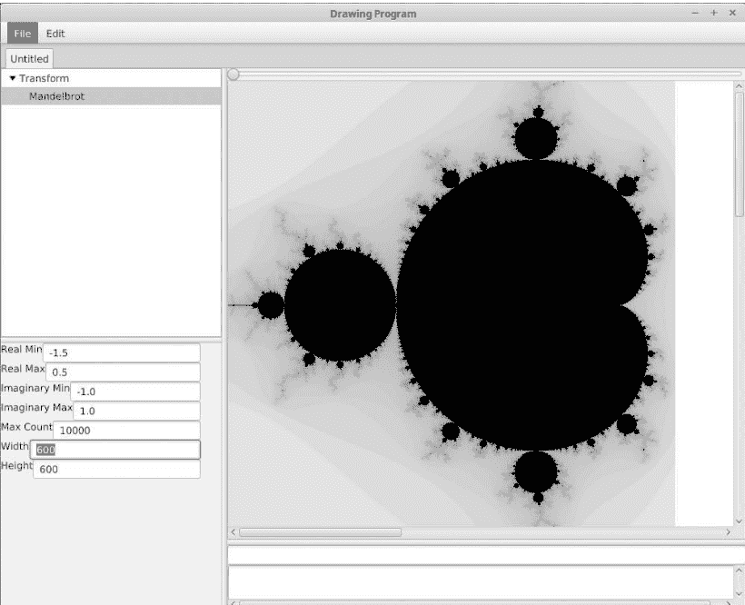

图 8.3：这是带有曼德布罗图像的绘图程序的截图。

这使其成为使用并行集合库解决问题的理想人选。这段代码展示了这样一个解决方案。


```scala
package multithreading1.drawing

import scalafx.Includes._
import scalafx.scene.Node
import scalafx.scene.canvas.GraphicsContext
import scalafx.scene.layout.VBox
import scalafx.scene.paint.Color
import scalafx.scene.image.WritableImage
import scala.concurrent.Future
import scala.concurrent.ExecutionContext.Implicits.global
import scalafx.application.Platform

class Mandelbrot(d: Drawing) extends Drawable(d) {
  private var (rmin, rmax, imin, imax) = (-1.5, 0.5, -1.0, 1.0)
  private var (width, height) = (600, 600)
  private var maxCount = 100
  private var img = new WritableImage(width, height)
  private var panel: Option[Node] = None

  def startDrawing() {
    override def toString(): String = "Mandelbrot"

    def draw(gc: GraphicsContext): Unit = {
      gc.drawImage(img, 0, 0)
    }

    def propertiesPanel(): Node = {
      def changeMade[A](originalValue: A, newValue: A) => A = {
        try {
          val nv = newValue
          if (originalValue == nv) value else {
            startDrawing()
            nv
          }
        } catch {
          case nfe: NumberFormatException => originalValue
        }
      }
      if (panel.isEmpty) {
        panel = new VBox
        panel.children = List(
          Drawing.main.labeledTextField("Real Min", rmin.toString(), s => { rmin = changeMade(rmin, s.toDouble) }),
          Drawing.main.labeledTextField("Real Max", rmax.toString(), s => { rmax = changeMade(rmax, s.toDouble) }),
          Drawing.main.labeledTextField("Iminary Min", imin.toString(), s => { imin = changeMade(imin, s.toDouble) }),
          Drawing.main.labeledTextField("Iminary Max", imax.toString(), s => { imax = changeMade(imax, s.toDouble) }),
        )
      }
      panel
    }
  }
}
```

# 使用 Scala 进行面向对象、抽象和数据结构

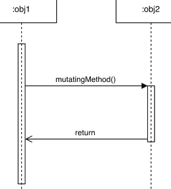

**图 8.4：** 此图显示了基础序列图中两个对象之间的单个方法调用。需要注意的关键点是，线程会随着调用传递。因此，当你调用方法时，线程会在对象之间穿梭。

## 8.10 Actor 与 Akka

安全地处理多线程的另一种方法是 Actor 模型。这种方法最早于 1973 年探索，但与许多方法一样，在多核芯片出现使得一切都能够并行计算之前，还没有强烈的动力去研究它。

我们一直在学习的类允许你通过将数据封装在对象内部来保护你的数据。这些对象只允许对数据执行适当的操作。这种保护来自于代码的其他部分无法访问 `private` 数据。然而，当你调用方法时，这些方法会随之一起传递。图 8.4 显示了一个 UML 序列图，时间随着你向下移动而推进。该图显示 `obj1` 中的方法正在执行，并对 `obj2` 上的 `mutatingMethod()` 进行调用。当方法返回时，它返回一个值，线程继续执行。

遗憾的是，正如我们在银行账户示例中看到的，标准的面向对象不能保护你免受竞态条件的影响。图 8.5 显示了竞态条件如何以序列图的形式出现。这里有两个线程分别在 `obj1` 和 `obj3` 中执行代码。它们每一个都对 `obj2` 发起调用。结果是，有一段时间有两个线程在执行 `obj2`。因此，如果这些方法恰好使用同一个可变变量，且其中一个正在对其写入，就可能发生竞态条件。

理解 Actor 模型的一种方法是：每个 Actor 获得一个线程和一个消息收件箱。实际上，Actor 系统不会为每个 Actor 创建一个完整的线程，但它们确保每个 Actor 同时只使用一个线程。与其在你的 Actor 上调用方法，不如发送消息。消息在它们的收件箱中排队，并按照接收到的顺序处理它们。这种方法确保每个 Actor 每次只处理一条消息。你可以在图 8.6 的序列图中看到这种表示。

# 多线程与并发

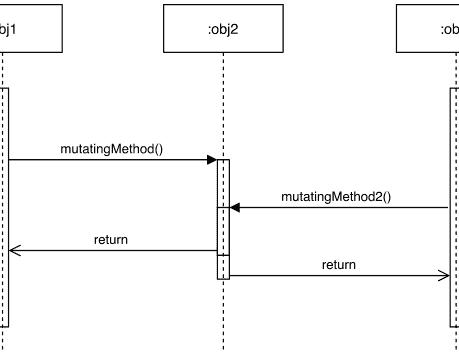

**图 8.5：** 此图显示了基础序列图中三个对象和两个方法调用，说明了竞态条件是如何发生的。即使对象正确地封装并保护了它们的值，你仍然需要使用同步机制来防止竞态条件。

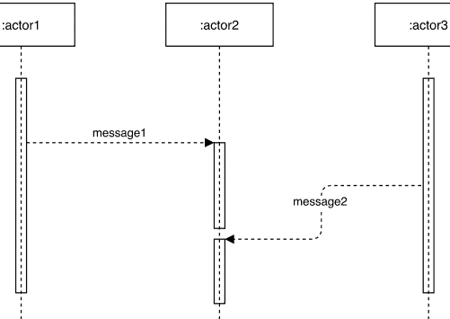

**图 8.6：** 此图显示了基础序列图中三个 Actor 和两条消息，说明了 Actor 模型如何防止竞态条件。每个 Actor 只有一个线程，且消息按顺序处理，因此只要可变状态被限制在单个 Actor 中，你就不会遇到竞态条件。

Actor 模型的并行性来自于一个拥有多个 Actor 的系统，所有 Actor 都在同时运行。在许多方面，Actor 模型更像一组人共同完成一个项目。每个人一次只做一件事，但许多人可以同时工作。会有某些时刻某些 Actor 没有消息要处理，但只要像你机器中的核心数一样，有许多 Actor 拥有要处理的消息，你就能感觉到硬件被充分利用了。

事实上，类比人类对于构建 Actor 系统可能很有用。当你考虑如何设置一个基于 Actor 的系统以及想要什么类型的消息时，一个很好的方法是尝试想象 Actor 之间正在互相发送电子邮件或其他电子消息。

### 8.10.1 Akka

Scala 的主要 Actor 系统称为 Akka。Akka 库非常健壮且被广泛使用。Scala 库最初包含它们自己的 Actor 库，但它在许多方面存在缺陷并已被弃用。相反，开发者被鼓励使用 Akka。你可以在 `http://akka.io/` 找到关于 Akka 的信息，包括下载和 API。你应该去并可能下载可以添加到你的路径中的最新版本。

让我们来看一个使用 Akka Actor 的简单示例。以下代码是一个应用程序，包含一个名为 `SimpleActor` 的嵌套类，它继承自 `akka.actor.Actor` 并展示了如何使用它。

```scala
package multithreading.examples
import akka.actor.Actor
import akka.actor.ActorSystem
import akka.actor.Props

object SimpleActor extends Actor {
  def receive = {
    case s: String => println("String "+s)
    case i: Int => println("Int "+i)
  }
}

val system = ActorSystem("SimpleExample")
val actor = system.actorOf(Props[SimpleActor], "FirstActor")
actor ! "Hi"
actor ! "aft"
system.terminate()
```

`Actor` trait 有一个名为 `receive` 的抽象方法，我们必须实现它。`receive` 方法定义了你的 Actor 可以处理哪些消息。它是一个部分函数，我们在 Scala 中使用大括号和内部的各种 `case` 来编写它。

Akka 并没有在 Java 中使用旧的语法，而是有一个名为 `tell` 的方法可以用于此目的，但我们通常使用 `!`。注意感叹号在代码中通常被称为 "bang"，因为它的音节更少。

重要的是要注意，发送消息是非阻塞的。在 `Hi` 消息之后，`42` 可能会在第一个 `println` 发生之前发送。此示例中的打印语句将始终保持相同的顺序——`String` 在 `Int` 之前打印——因为发送到同一个 Actor 的消息是排队并排序的。正如我们稍后看到的，发送到不同 Actor 的消息处理顺序可能与发送顺序不同。

前两条消息发送的内容 `SimpleActor` 的 `receive` 方法都有对应的 `case`，其中每一个都会被打印并处理。第三条消息发送了一个 `Char`，`SimpleActor` 并不知道如何处理它。在 Akka 中，当一个 Actor 收到它不知道如何处理的消息时，它会继续处理下一条消息。这取决于 Actor 的具体实现。

消息本身的类型是 `Any`。这意味着 Akka 不会进行任何静态类型检查。消息是否匹配是在运行时接收并对部分函数进行检查时决定的。虽然一些人认为这是 Akka 的优势，但现在有一个项目叫 Akka Typed，旨在创建一个类型安全的环境。在写作期间，该扩展仍处于早期阶段，并且可能会演变，因此我们没有涵盖它。

虽然消息可以是任何类型，但使用标准类型（如 `String` 和 `Int`）并不推荐。`actorOf` 有两种方式。第一种是使用 `Props`。`actorOf` 的返回值是 `ActorRef`。如果你尝试不带 `Props` 调用，它会抛出异常。`actorOf` 的第二个参数是 `String`——你为 Actor 指定的名称。Actor 的名称必须是唯一的。如果你省略了此参数，Akka 会为你生成一个唯一名称，但我们稍后会看到你可能需要知道 Actor 的名称。

这些是发送给 Actor 的。感叹号的使用是为了匹配 Erlang 的语法，这是一种完全基于 Actor 模型的函数式语言。在 Scala 中，没有旧的语法，只有 `ActorRef` 类中名为 `!` 的方法可以发送消息。

# 278 使用 Scala 的面向对象、抽象和数据结构

关于我们传递的消息类型，有两点：它们应该是有意义的且不可变的。在代码中提供意义可以帮助程序员更容易理解正在发生什么，并在出错时进行修复。不可变性的原因是显而易见的，但要重要得多：发送消息可能会导致竞态条件。这种情况的原因是，当一个 Actor 发送消息时，它可能会保留该消息的引用。如果它这样做，那么接收消息的 Actor 也将拥有该消息的引用，这意味着有两个 Actor 使用不同的线程，并可能会访问同一个可变内存。实现这两个目标的简单方法是使用存储不可变消息的类。我们将在未来的示例中这样做。

应用程序的最后一行调用了 `Actor.terminate`。你可能从名称中猜出来，这个方法告诉 Actor 你已经处理完了，让它关闭，但该方法现在已经被废弃了。Akka 的早期版本使用的是 shutdown 而不是 terminate。在第 8.3 节中，我们提到 Future 的线程在主线程终止时不会保持应用程序运行。为了确保我们的 Future 完成了工作，我们插入了 `Thread.sleep` 来让 Actor 永远运行，除非我们终止它。我们将发现，调用 `terminate` 必须小心，因为这也会停止所有的 Actor，即使它们仍然有我们想要处理的消息。

我们之前提到过，出于安全考虑，`actorOf` 方法返回的是 `ActorRef`，而不是 `Actor`。当你与 Actor 通信时，你应该通过传递消息而不是调用方法来完成通信。如果你获取了 Actor 的实际引用，你可能会导致竞态条件，并消除使用 Actor 模型的全部理由。相反，你得到的是一个 `ActorRef`，它是一个封装了 `Actor` 的实例对象。为了更清楚，请考虑这种略有不同的 `SimpleActor` 形式，它包含一个可变值和一个修改该值的方法。

```scala
class SimpleActor extends Actor {
  var counter = 0

  def receive = {
    case s: String => println("String " + s); count()
    case i: Int => println("Int " + i); count()
  }

  def count(): Unit = {
    counter += 1
  }
}
```

这里的想法是，我们想统计我们的 Actor 处理了多少条消息。这工作得非常好，而且没有竞态条件，因为我们一次只处理一条消息，没有其他代码可以从外部调用 `count`。第一个要求是 Actor 模型的通用属性。第二个要求是 Akka 通过使用 `ActorRef` 帮助我们强制执行。如果 Akka 返回我们一个 `SimpleActor` 的实例，我们可能会无意中从另一个线程调用 `count` 并产生竞态条件。我们可以通过将 `count` 以及任何其他接收消息的方法设置为 `private[this]` 来进一步保护自己。这样做允许 Scala 语言强制执行它们永远不会被对象当前实例以外的任何内容调用。

### 8.10.2 Actor 之间的通信

复杂性的下一个阶段是展示 Actor 之间是如何相互通信的。为了演示这一点，我们将使用一个包含两个倒计数的 Actor 的简单示例。即一个 Actor 打印一个数字，然后另一个 Actor 打印下一个，它们将交替进行，直到达到零。对于这个示例，我们将 Actor 类拆分到单独的文件中，并按照我们处理大型应用程序的方式设置代码。以下代码显示了实现 Actor 类型的文件。


# 多线程与并发

## 8.10.2 Actor 之间的通信

```scala
package multithreading1.actorexamples

import akka.actor.Actor
import akka.actor.ActorRef

class CountDownActor extends Actor {
    import CountDownActor._
    def receive = {
        case StartCounting(n, o) =>
            println(n)
            o! Count(n - 1)
        case Count(n) =>
            if (n > 0) {
                println(n)
                Thread.sleep(1000)
                sender! Count(n - 1)
            } else {
                context.system.terminate()
            }
    }
}

object CountDownActor {
    case StartCounting(n: Int, partner: ActorRef)
    case Count(n: Int)
}
```

该文件包含了类和伴随对象。伴随对象持有我们用于消息的两个判例类。在这里使用伴随对象是一种风格选择。判例类作为 actor 需要处理的消息类型，放在伴随对象中。始终将消息放在伴随对象中，使得阅读代码的人更容易快速知道需要什么，而无需翻阅大量代码。其中一条消息用于启动计数，另一个用于标准计数。第 7 行的 `import` 语句允许我们仅使用类名来引用判例类。如果没有它，我们必须说类似 `case CountDownActor.(n=)` 的内容。

`StartCounting` 包含了它们正在计数的数字，以及参与计数的另一个 actor。注意，用于引用 actor 的类型是 `ActorRef`。情况始终是这样。你永远不要拥有 actor 或其子类的引用，这将允许你调用可能导致竞态条件的方法¹¹⁷ 当 `receive` 方法获取 `StartCounting` 实例时，它打印该值，并向另一个 actor 发送比刚刚打印的值小一的 `Count` 消息。

如果我们在应用程序中使用 `tell` 而不是 `!`，我们只需要一条消息就能完成。我们没有这样做，因为让读者看到 actor 是通过 `ActorRef` 传递的很重要。这留给读者练习。

> 使用 Scala 的面向对象、抽象和数据结构

关于我们传递的消息类型，有两点：它们应该是有意义的且不可变的。在代码中提供意义可以帮助程序员更容易理解正在发生什么，并在出错时进行修复。不可变性的原因是显而易见的，但要重要得多：发送消息可能会导致竞态条件。这种情况的原因是，当一个 actor 发送消息时，它可能会保留该消息的引用。如果它这样做，那么接收消息的 actor 将拥有该消息的引用，这意味着有两个 actor 使用不同的线程，并可能会访问同一个可变内存。实现这两个目标的简单方法是使用存储不可变消息的类。我们将在未来的示例中这样做。

应用程序的最后一行调用了 `Actor.terminate`。你可能从名称中猜出来，这个方法告诉 actor 你已经处理完了，让它关闭，但该方法现在已经被废弃了。Akka 的早期版本使用的是 shutdown 而不是 terminate。在第 8.3 节中，我们提到 Future 的线程在主线程终止时不会保持应用程序运行。为了确保我们的 Future 完成了工作，我们插入了 `Thread.sleep` 来让 actor 永远运行，除非我们终止它。我们将发现，调用 `terminate` 必须小心，因为这也会停止所有的 actor，即使它们仍然有我们想要处理的消息。

我们之前提到过，出于安全考虑，`actorOf` 方法返回的是 `ActorRef`，而不是 `Actor`。当你与 actor 通信时，你应该通过传递消息而不是调用方法来完成通信。如果你获取了 actor 的实际引用，你可能会导致竞态条件，并消除使用 actor 模型的全部理由。相反，你得到的是一个 ActorRef，它是一个封装了 `Actor` 的实例对象。为了更清楚，请考虑这种略有不同的 `SimpleActor` 形式，它包含一个可变值和一个修改该值的方法。

```scala
class SimpleActor extends Actor {

  def receive = {
    case s: String => println("String " +s); count()
    case i: Int => println("Int " +i); count()
  }

  def count(): Unit {
    counter += 1
  }
}
```

这里的想法是，我们想统计我们的 actor 处理了多少条消息。这工作得非常好，而且没有竞态条件，因为我们一次只处理一条消息，没有其他代码可以从外部调用 `count`。第一个要求是 actor 模型的通用属性。第二个要求是 Akka 通过使用 `ActorRef` 帮助我们强制执行。如果 Akka 返回我们一个 `SimpleActor` 的实例，我们可能会无意中从另一个线程调用 `count` 并产生竞态条件。我们可以通过将 `count` 以及任何其他接收消息的（我们将其放入 `Actors` 中）的方法设置为 `private[this]` 来进一步保护自己。这样做允许 Scala 语言强制执行它们永远不会被对象当前实例以外的任何内容调用。

## 8.10.3 Ask 模式

图 8.5 和 8.6 之间有两个差异。之前我们关注第一个，即消息的队列化和每个 actor 有一个线程防止了竞态条件。你可能也注意到 8.6 中没有行提供返回值的代码。这必须是这样，因为你传递消息是非阻塞的。当前线程不会等待响应，而是继续执行。这是你开始使用 actor 模型时最具有挑战性的事情。

这并不意味着信息无法返回。正如你在示例中看到的，当你向 actor 发送消息时，它可以通过向 sender 发回消息来响应。然而，消息将在完全不同的 receive 调用中被处理。大多数情况下，这就足够了。

在发送原始消息时，你并不真的需要知道自己正在做什么。尽管如此，在某些情况下，获取一个“返回”值确实会更好。

消息传递是不阻塞的 fact 这一事实意味着获取一个值必须以不同的方式来处理。如果你发送了一条消息并接收响应，你确实需要知道代码是在哪一点执行此操作的，这样你就可以使用 ask 模式。ask 模式允许你“询问”某些内容。这仍然是一个非阻塞调用，但使用“ask”发送消息时返回的是 `Unit`，而当你获取结果时，返回的是一个 `Future[AnyRef]`。你可以使用该 `Future` 实例在获取响应时执行代码。接收回答消息的 Actor 并并不知道该消息是通过 ask 发送的还是以普通速度发送的。预期是当它处理该消息时，它会向发送者发回消息，该消息的内容将完成该 `Future`。

执行 ask 有两种方法。一种是使用 `akka.pattern.Patterns.ask`。另一种是在发送消息时使用 `?`。为了演示这一点，这里有一个存储名称的 Actor 类。它有两个功能：我们可以询问它的名称，也可以让它向另一个 Actor 查询名称。


```scala
package multithreading1.actorexamples
import scala.concurrent.duration._
import akka.actor.Actor
import akka.actor.ActorRef
import akka.actor.pattern._
import akka.util.Timeout.durationToTimeout

class Actor(val name: String) extends Actor {
  implicit val timeout = durationToTimeout(1.seconds)
  implicit val ec = context.system.dispatcher
  import akka.Actor._
  def receive = {
    case AskName =>
      sender ! name
    case AskOf(o) =>
      (o ? AskName).foreach(n => println("They say their name is $n"))
  }
}

object AskActor {
  case object AskName
  case class AskOf(otherActor: ActorRef)
}
```

该文件中的伴对象包含两个消息类型。注意第一个被声明为 `case object` 而不是 `case class`。当 Actor 接收到 `AskName` 消息时，它会将自己的名称发给发送者。注意 `name` 只是一个普通的 `String`。我们之前说过不会向 Actor 发送这些类型的消息，但在响应 ask 时，我们愿意放宽限制。当 Actor 接收到 `AskOf` 消息时，它使用 `?` 运算符询问提供的 `ActorRef` 名称。这产生了一个我们进行调用的 `Future[AnyRef]`。一旦另一个 Actor 做出响应，当前 Actor 就会打印出包含其名称的消息。使用 `?` 需要定义一个隐式值来指定等待时间，且其类型必须是 `akka.util.Timeout` 类型。第 11 行的声明满足了这一要求。如果另一个 Actor 在我们设置的超时时间内没有响应，将抛出异常。

正如我们所看到的，`Future` 需要一个 `ExecutionContext` 来为它们提供运行所需的线程。在 `Future` 的示例中，我们总是导入了 `scala.concurrent.ExecutionContext.Implicit.global`。不过还有其他上下文，其中一个被构建在每个用于调度 Actor 的 `ActorSystem` 中。第 12 行是一个声明，告诉此代码中的 `Future` 使用 `system.dispatcher` 作为它们的 `ExecutionContext`。在我们的 Actor 示例中我们需要这样做，假设对于所有线程使用单一的 `ExecutionContext` 比使用两个互不知道对方在做什么的独立上下文更有利。

我们可以从以下设置应用程序的代码中看到这种 Actor 是如何使用的。

```scala
package multithreading1.actorexamples

import scala.concurrent.duration._

import akka.actor.ActorSystem
import akka.actor.Props
import akka.pattern.Patterns
import akka.util.Timeout

object ActorPattern extends App {
  val system = ActorSystem("SimpleExample")
  val bob = system.actorOf(Props(new Actor("Bob"), "BobActor")
  val jill = system.actorOf(Props(new Actor("Jill"), "JillActor")
  implicit val ec = system.dispatcher

  jill !Actor.AskOf(bob)

  val nameFuture = ask(jill, Actor.AskName, 1.seconds)

  nameFuture.foreach { s =>
    println("name = "+s)
  }
  Thread.sleep(100)
  system.terminate()
}
```

正如我们之前看到的，我们创建了一个 `ActorSystem` 和两个命名为 bob 和 jill 的 Actor。第一个操作是向 bob 的名称发送一条消息。该消息发送后，代码立即使用 ask 方法发送另一条消息询问 jill 的名称。`ask` 结果的 `Future` 被赋值给 `nameFuture`。我们再次使用 `foreach` 在 `nameFuture` 完成后打印响应。

这里使用 `ask` 方法而不是 `?` 是出于原因。首先，我们想看到它是如何使用的。其次，`?` 需要一个隐式的发送者（sender），我们不想通过添加另一个隐式声明来增加代码的复杂性。注意 `ask` 接收一个显式的超时，所以我们不需要声明隐式的。作为一般规则，ask 在 Actor 之外几乎更容易使用，并且可能正是你通常应该首选的。

代码以简短的等待和终止结束。对于这段代码，打印语句可以以任何顺序发生，因此没有明确的最后一个操作可以在你调用 `terminate` 之后提取。它们都发生得非常快，所以在我们可以确定安全关闭之前，只需要短暂的暂停。

请记住，从 `?` 或 `ask` 获取的 `Future` 是我们在本章之前讨论过的同一个，它是获取响应的同一个 `Future`。注意的是，有一个通用的建议：你根本不要使用 ask。

### 8.10.4 小心 sender

在 Actor 内部使用 `Futures` 时必须特别小心。在 Scala 中用下划线语法创建的函数也称为闭包（CLOSURES）。这是因为除了代码外，它们还记得在内部使用的值。通过这样做，它们保持这些声明的时间比其作用域更长。当这在 Actor 中变成问题时有两种情况：一种出现在你使用 `sender` 时，另一种出现在你使用当前对象时。

`sender` 的问题源于 `sender` 是一个定义（def），它返回的是最近的一条消息。`Future` 的寿命可能比当前消息长。如果 `Future` 中的闭包直接使用 `sender`，且该代码在接收另一条消息后执行，那么 `sender` 的值可能是错误的。

幸运的是，有一种处理这种潜在问题的简单方法。如果你要在 `Future` 内部使用 `sender`，请在 `Future` 之前声明一个赋值为 `sender` 的 `val`，然后在 `Future` 中使用该 `val` 而不是 `sender`。

# 使用 Scala 进行面向对象编程、抽象和数据结构

akka://systemname 下的所有内容

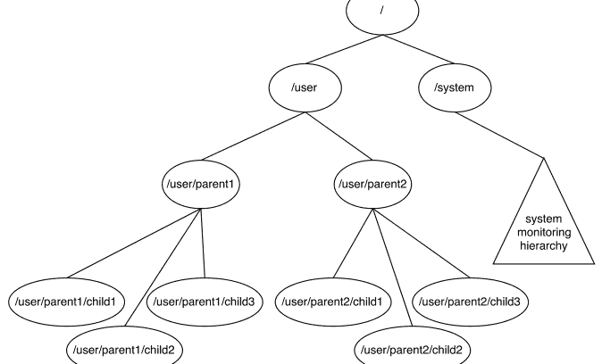

**图 8.7：** 此图了我们在本节示例中构建的 actor 层级结构的组织方式。

## 8.10.5 Actor 层级结构

到目前为止，我们只是使用系统在应用程序中创建了几个 actor，还没有考虑 actor 之间的关系。在大型应用程序中，将 actor 组织成逻辑组是有帮助的。正如我们在下一节中看到的，这些逻辑组有助于错误处理。

actor 的组织方式是层级结构。每个 actor 都可以在其下方其他 actor。图 8.7 显示了我们在本章示例中构建的层级结构的图化表示。我们最终所有的 actor 都位于层级结构的 /user 侧。还有一个系统，其中包含了专门为运行 Akka 系统而创建的 actor。

actor 在层级结构中的位置取决于它是如何创建的。到目前为止，我们一直使用 `system.actorOf` 创建所有的 actor。当通过对 system 的调用创建 actor 时，它会位于 /user 之下。你也可以使用 `context.actorOf` 在其他 actor 内部创建 actor。在下面的代码段中可以看到此示例，它提供了 `ParentActor` 类的代码。

```scala
package multithreading.actoreexamples

import akka.actor.Props
import akka.actor.Actor

class ParentActor extends Actor {
    override def preStart() = {
        context.actorOf(Props[ChildActor], "child1")
        context.actorOf(Props[ChildActor], "child2")
        context.actorOf(Props[ChildActor], "child3")
    }
```

```scala
import ParentActor._
def receive = {
    case Cascade =>
        println("Parent")
        context.children.foreach(_ ! ChildActor.SimpleMessage)
}
```

object ParentActor {

    case object Cascade

}

```

`ParentActor` 只响应一种消息 `Cascade`。当接收到此消息时，该 actor 会打印并向它所有的孩子发送一条消息。我们没有在 `preStart` 中做任何存储孩子的操作。Akka 系统为我们完成了这一点。你可以在第 17 行看到 `context.children` 的用法，它是一个 `Iterable[ActorRef]`。

下面所示的 `ChildActor` 类型相当直观，除了第 10 行和第 12 行的两个新内容外，这些内容在代码下方有描述。

```scala

package multithreading1.actoreexamples

import akka.actor.Actor

class ChildActor extends Actor {

    import ChildActor._

    def receive = {

        case ToParent =>

            println("Child sending Cascade to parent")

            context.parent ParentActor.Cascade

        case SimpleMessage =>

            println("Child Simple = "+self.path)

    }

}

```

object ChildActor {
    case object ToParent
    case object SimpleMessage
}
```

`ChildActor` 响应两种不同类型的消息。`ToParent` 消息导致它打印出我们在运行时可以看到的内容，然后向它的父亲发送一个 `Cascade` 消息。它使用 `context.parent` 实现这一点，其类型为 `ActorRef`。

第二条消息是 `SimpleMessage`。当 `ChildActor` 接收到此消息时，它会打印一个包含其“路径”的通知。actor 的路径是其在层级结构中位置的完整规范。它以 "akka://" 开头，后面是系统名称。其他元素是图 8.7 中的内容。将它们组合在一起得到像 `akka://HierarchyExample/user/parent2/child3` 这样的路径。将在下面的应用程序代码中使用这些路径。

我们之前说 actor 有唯一的名称。这并不完全。你实际上需要唯一的名称。在这个示例中，有两个命名为 "child1" 的 actor。然而，其中一个是 "parent1"，另一个是 "parent2"，所以它们具有唯一的名称。

完整的应用程序设置了一个系统，然后创建了 `ParentActor` 的实例。正如我们所看到的，每个实例都创建了 `ChildActor` 的实例。因此到第 10 行，我们已经创建了八个 actor。

```scala
package multithreading1.actorexamples

import akka.actor.ActorSystem
import akka.actor.Props

object HierarchyExample extends App {
  val system = ActorSystem("HierarchyExample")
  val actor1 = system.actorOf(Props[ParentActor], "parent1")
  val actor2 = system.actorOf(Props[ParentActor], "parent2")

  val c1 = system.actorSelection("akka://HierarchyExample/user/parent1/child1")
  val c1 : ChildActor.ToParent
  val c2 = system.actorSelection("/user/parent2/child1")
  val c2 : ChildActor.ToParent

  Thread.sleep(100)
  system.terminate()
}
```

此示例的重点在第 11 行和第 13 行。我们在第 11 行使用 `system.actorSelection`，第 13 行通过路径查找 actor。你也可以使用通配符 `*` 和 `#`，这可以允许 `actorSelection` 匹配多个 actor。如果你这样做，向所有匹配的 actor 发送消息，`actorSelection` 会返回一个 `ActorRef`。

# 使用 Scala 进行面向对象、抽象和数据结构

`Stop` 告诉系统子节点不再可用且不应被替换。

在现实生活中，这是一种在大多数国家违法的严重惩罚。

`Escalate` 告诉系统当前 Actor（Actor）不知道如何处理这个问题，因此它应该被发送到层级结构中的下一个监者。父节点不确定该做什么，所以它们向祖父节点请求。与类比不同的是，在 Akka 中，下一个监者的决定不仅适用于子节点，还会应用于决定升级错误的那个监者。

为了看到这些内容在代码中看起来是什么样，这里有一个父节点的节点的实现，它将监视策略设置为重启所有子节点。

```scala
package multithreading.1actorex

import akka.actor.Props
import akka.actor.Actor
import akka.actor.OneForStrategy
import akka.actor.SupervisorStrategy.

class LifecycleParent extends Actor {
    override def preStart() = {
        context.actor(Props[LifecycleChild], "child")
    }
    override val receive = {
        case m =>
            println("Parent")
            context.child.foreach(_ !LifecycleChild.SimpleMessage)
    }
    override val supervisorStrategy = OneForStrategy(loggingEnabled = false) {
        case ex: Exception =>
            println("Child had an exception")
            Restart
    }
}
```

与之前的 Actor 类似，这在 `preStart` 中创建了一个子节点。我们只创建了一个是为了让输出更简单易于理解。`receive` 方法有一个分支（case），它会对收到的任何消息执行相同的操作。请注意，这实际上并不是你想要精通的风格，但它在这个示例中有效。

这个示例中有趣的代码在第 17-21 行，那里我们创建了 `supervisorStrategy`。`OneForStrategy` 是一个 case，其主参数列表中的所有参数都有默认值。在这里，我们通过名称传递了一个参数来关闭日志。它还是弯曲的，并且第二个参数是一个偏函数，用于确定对不同的可能异常该做什么。你可以看到在这种情况下，所有异常都被处理了，并且当某个异常命中消息时，会告诉系统重启该子节点。

Akka 对 Actor 生命周期中不同点发生的情况提供了一定的控制。我们已经看到 `preStart` 方法在 Actor 开始接收消息之前被调用。还有 `postStop`、`preRestart` 和 `postRestart` 方法可以重写。`postStop` 方法在 Actor 停止且不再发送消息后被调用。`preStart` 和 `postStop` 总是会在所有 Actor 上调用，并且被它们的监者指示重启。

# 多线程与并发

我们可以使用在下面的子节点实现中定义的这些方法，该实现说明了 Actor 的生命。


```scala
package multithreading1.actoreexamples
import akka.actor.Actor
class LifecycleChild extends Actor {
  println("Making a child "+self.path)

  import LifecycleChild._
  def receive = {
    case Throw =>
      println("Child Dying")
      throw new Exception("Something bad happened.")
    case SimpleMessage =>
      println("Child Simple "+self.path)
  }

  override def preStart() = {
    super.preStart()
    println("Prestart")
  }

  override def postStop() = {
    super.postStop()
    println("Poststop")
  }

  override def preRestart(reason: Throwable, message: Option[Any]) = {
    super.preRestart(reason, message)
    println("Prerestart "+message)
  }

  override def postRestart(reason: Throwable) = {
    super.postRestart(reason)
    println("Postrestart")
  }
}

object LifecycleChild {
  case object Throw
  case object SimpleMessage
}
```

这个 Actor 知道如何处理两种类型的消息。第一个消息告诉它抛出一个异常。这允许我们激活监视行为，并看到与重启相关的方法被调用。第二条消息只是打印一条包含 Actor 路径的消息。

第 16-31 行是生命周期方法的声明。我们没有为这些编写特定的代码，所以我们在类型中简化了所有版本（这是我们通常会做的），并打印一条消息以便我们知道它们发生了。重启方法带有额外的参数，提供关于重启原因的信息。

当发生重启时，`preStart` 方法会在被重启的 Actor 的 `postStop` 之后被调用。`postRestart` 方法会在新的 Actor 上调用，在重启发生之后在该新的 Actor 上调用了 `preStart` 之后。当你按顺序查看所有这些调用时，这种顺序似乎相当自然。当你查看单个 Actor 实例时，可能会感到困惑，因为 `preRestart` 是最后调用的方法之一，`postRestart` 是最早调用的方法之一，但 `postRestart` 是在之后创建的另一个实例上调用的。

为了看到这一切是如何工作的，我们有一个小型应用程序，它创建一个父节点，通过其路径查找子节点，然后发送一些消息。

```scala
package multithreading1.actorexamples

import akka.actor.ActorSystem
import akka.actor.Props

object SupervisorExample extends App {
  val system = ActorSystem("SupervisorExample")
  val actor1 = system.actorOf(Props[LifecycleChild], "parent1")

  val actor2 = system.actorSelection("/user/SupervisorExample/parent1/child")
  actor2 ! LifecycleChild.Throw
  actor2 ! LifecycleChild.SimpleMessage
  actor2 ! LifecycleChild.Throw
  actor2 ! LifecycleChild.SimpleMessage

  system.terminate()
}
```

# 使用 Scala 进行面向对象、抽象和数据结构

# 多线程与并发

## 8.10 路由器（项目集成）

Akka 提供了在 Actor 之间分配消息的能力。这被称为路由。路由器是一个特殊的 Actor，它维护一个工作池并将消息转发给它们。有很多路由策略可用，位于 `akka.routing` 包中。

以下是一些常见的策略：

- **Round-robin（轮询）**：顺序转发给每个 Actor。
- **Fixed-number-round-robin（固定轮询）**：类似于轮询，但只使用固定数量的 Actor。
- **Random（随机）**：随机选择一个成员并将消息转发给它。
- **Smallest mailbox（最小邮箱）**：将消息转发给邮箱最小的 Actor。
- **Balancing（均衡）**：将消息转发给最不忙的 Actor。
- **Broadcast（广播）**：转发给所有成员。
- **Scatter/gather（散射收集）**：将消息转发给所有成员并获取第一个回复。
- **Consistent hashing（一致性哈希）**：根据消息的某些方面将消息转发给成员。

`akka.routing` 中的类以分布策略开头并以 `Group` 结尾。Groups 允许你管理其成员，而 Pools 管理其成员。并不是所有的分布样式都同时使用两者。例如，我们使用了 `BalancingPool`，它没有对应的 `Group`。

如果你在处理某些订单，你可能希望所有该订单都进入同一个 Actor。一致性哈希可以做到。

在这个示例中，我们没有编写像在绘图项目中那样的的小型应用程序。在 8.9 节中，我们添加了一种可以绘制分形类型——曼德尔集合的 Drawable 类型。在本节中，我们将创建一个非常相似的 Drawable，绘制类似的分形族——Julia 集合。Julia 集的数学使用了与曼德尔集合相同的方程，但不是将 c 设置为平面上当前点的值，而是为每个点使用唯一的 c 值，而 zp 是平面上位置的值。与其说只有一个 Julia 集合，不如说是无限个，对应复平面上的每个点。图 8.8 显示了我们即将编写程序的结果。

> 曼德尔集合和 Julia 集合之间存在着奇妙的关系。如果你在复平面上选取一个点，如果该点属于曼德尔集合，那么对应的 Julia 集合就是连通的。如果点不在曼德尔集合中，那么对应的 Julia 集合就不连通的。所有的 Julia 集合看起来都很有趣，只有那些靠近曼德尔集合边界的是如此。

# 使用 Scala 的面向对象、抽象和数据结构

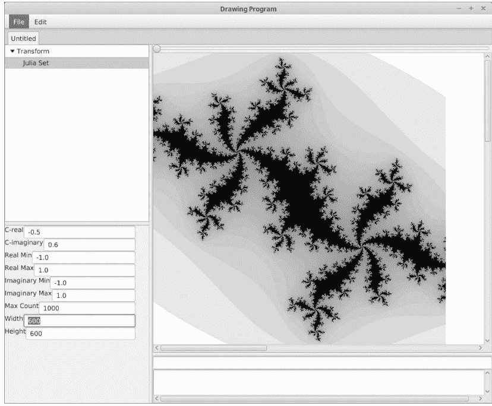

图 8.8：这是一个带有 Julia 集图像的绘制程序的截图。

# 多线程与并发 293

此示例与我们在 8.9 节中所做操作的区别在于，我们不再通过并行集合拆分工作并使用 Futures 优雅地完成，而是将使用 actor 来完成所有工作，并创建一个路由器（router）。

与我们之前的所有示例一样，在创建 ActorSystem 之前，我们无法启动 actor。我们的应用程序中确实需要一个 ActorSystem，因此我们不想在 `Durable` 中创建它。相反，我们将在 `DrawingMain` 的顶部 `drawings` 声明的旁边添加以下行。

```scala
val system = ActorSystem("DrawingSystem")
```

它是公共的，因为我们希望项目的其他部分能够访问这个用于我们使用 actor 的系统。向项目中添加 ActorSystem 的效果是，当我们关闭窗口时应用程序将不再终止，因为系统一直保持程序运行。我们可以通过在设置舞台的代码块中添加以下行来修复这个问题。

```scala
onCloseRequest = (we: WindowEvent) => system.terminate()
```

这样，当用户点击关闭窗口时，我们将终止系统。现在我们不需要在菜单的“退出”选项中添加此项，因为调用 `sys.exit` 会关闭包括 actor 系统在内的一切。

准备就绪，我们可以编写 `DrawJulia` 类。该类的代码在这里。

```scala
package threading1.drawing
import scalafx.Includes._
import scalafx.scene.Node
import scalafx.canvas.GraphicsContext
import scalafx.scene.layout.VBox
import scalafx.scene.paint.Color
import scalafx.scene.image.WritableImage
import scalafx.scene.image.PixelWriter
import scala.concurrent.Future
import scala.concurrent.ExecutionContext.Implicits.global
import scalafx.application.Platform
import akka.actor.Props
import akka.routing.BalancingPool
import akka.actor.Actor
import akka.actor.ActorRef

class DrawJulia(drawable: String) extends Drawable(drawable) {
  private var (rmin, rmax, imin, imax) = (-1.0, 1.0, -1.0, 1.0)
  private var (creal, cimag) = (-0.5, 0.6)
  private var (width, height) = (600, 600)
  private var maxCount = 100
  private var img = new WritableImage(width, height)
  private val juliaActor = DrawingMain.system.actorOf(Props(new JuliaActor), "juliaActor")
  private val router = DrawingMain.system.actorOf(BalancingPool(5).props(new LineActor()), "poolRouter")
  private var propPanel: Option[Node] = None

  juliaActor ! MakeImage

  override def toString() = "Julia Set"

  def draw(gc: GraphicsContext): Unit = {
    gc.drawImage(img, 0, 0)
  }

  def propertiesPanel(): Node = {
    def changeMade[A](originalValue: A, newValue: A): A = {
      try {
        val nv = newValue
        if (originalValue == nv) originalValue else {
          juliaActor ! MakeImage
          nv
        }
      } catch {
        case nfe: NumberFormatException => originalValue
      }
    }

    if (propPanel.isEmpty) {
      val panel = new VBox()
      panel.children = List(
        Drawing.LabeledTextField("c-real", creal.toString(), s => { creal = changeMade(creal, s.toDouble) }),
        Drawing.LabeledTextField("c-imaginary", cimag.toString(), s => { cimag = changeMade(cimag, s.toDouble) }),
        Drawing.LabeledTextField("Real-Min", rmin.toString(), s => { rmin = changeMade(rmin, s.toDouble) }),
        Drawing.LabeledTextField("Real Max", rmax.toString(), s => { rmax = changeMade(rmax, s.toDouble) }),
        Drawing.LabeledTextField("Imaginary Min", imin.toString(), s => { imin = changeMade(imin, s.toDouble) }),
        Drawing.LabeledTextField("Imaginary Max", imax.toString(), s => { imax = changeMade(imax, s.toDouble) }),
        Drawing.LabeledTextField("Max Count", maxCount.toString(), s => { maxCount = changeMade(maxCount, s.toInt) }),
        Drawing.LabeledTextField("Width", width.toString(), s => { width = changeMade(width, s.toInt) }),
        Drawing.LabeledTextField("Height", height.toString(), s => { height = changeMade(height, s.toInt) })
      )
      propPanel = Some(panel)
    }
    propPanel.get
  }

  private def alter(zr: Double, zi: Double, cr: Double, ci: Double) = (zr * zr - zi * zi + cr, 2 * zr * zi + ci)

  private def juliaCount(zr: Double, zi: Double): Int = {
    var ret = 0
    var (zrVar, ziVar) = (zr, zi)
    while (zrVar * zrVar + ziVar * ziVar < 4 && ret < maxCount) {
      val (tr, ti) = (zrVar, ziVar)
      zrVar = tr * tr - ti * ti + creal
      ziVar = 2 * tr * ti + cimag
      ret += 1
    }
    ret
  }
}

object MakeImage
case class LineResult(row: Int, colors: Array[Color])

class JuliaActor extends Actor {
  private var image: WritableImage = null
  private var writer: PixelWriter = null
  private var lineCount = 0

  def receive = {
    case MakeImage =>
      image = new WritableImage(width, height)
      writer = image.pixelWriter
      lineCount = 0
      for (i <- 0 until height) {
        router ! i
      }
    case LineResult(row, colors) =>
      writer.setPixels(row, colors)
      lineCount += 1
      if (lineCount == height) {
        Platform.runLater(() => { /* update */ })
      }
  }
}

class LineActor extends Actor {
  def receive = {
    case row: Int =>
      val colors = Array.fill(width) { i =>
        var zr = 0.0
        var zi = 0.0
        var count = 0
        while (zr * zr + zi * zi < 4 && count < maxCount) {
          val tr = zr
          zr = tr * tr - zi * zi + creal
          zi = 2 * tr * zi + cimag
          count += 1
        }
        count
      }
      sender() ! LineResult(row, colors)
  }
}
```


# 多线程与并发

针对图像或屏幕上的每个像素进行。这是对早期设计的重大突破，因为它允许在 GPU 上实现真正的可编程逻辑。在最初，这种逻辑仍然非常关注于图形相关的计算，但 GPU 能够运行浮点数学这一事实，吸引了人们尝试将 GPU 着色器用于其他用途。

从那时起，GPU 变得更加灵活且可编程。GPGPU（通用图形处理器）的支持成了一个卖点，因此硬件制造商推行了它们的 IEEE 浮点算术。这最初只有单精度，后来也添加了双精度。这最终了专门为 GPGPU 构建的显卡。这些显卡拥有大量内存和一个或多个 GPU 芯片，但它们没有任何图形输出。它们的设计目的仅仅是为了支持 GPGPU 风格的计算。

虽然多核处理器有几个核心，并且计划将其扩展到几十或几百个，但 GPU 将支持成千甚至上万个线程。你必须将问题拆分成许多部分才能让 GPU 忙起来。此外，GPU 上的线程没有 CPU 核心上的线程那么强大。通常，GPU 线程不需要在所有执行几乎相同任务的任务组中运行。

目前有三个主要的接口支持 GPGPU 风格的编程：`CUDA®`、`OpenCL®` 和 `OpenACC®`。`CUDA` 是 NVIDIA 创建的 API，仅在 NVIDIA GPU 上运行。`OpenCL` 和 `OpenACC` 正如其名，是支持 CPU 和其他高线程计算模型的开放标准。目前 Scala 通过 Scala 包对 `OpenCL` 提供了初步支持。Scala 的工作在很大程度上通过一组增强集合来实现，在 GPU 上拆分工作，而不是像普通的并行集合那样分给多个核心。

如果你主修计算机科学，GPGPU 可能是你应该关注且常见的话题。正如本章开头所示，不久前大多数程序并不需要多线程，因为大多数计算机并不需要它来提高运行速度。类似的变化可能正在 GPU 中发生，程序员将不得不对硬件中正在发生的情况有某些理解，才能编写出充分利用其可用资源的程序。

# 8.11 章节结束材料

## 8.11.1 概念总结

- 多核处理器已成为常态，核心数量在芯片频率没有增加的情况下指数级增长。这意味着程序必须包含并行性以利用硬件。多线程是实现这一点的方法之一。

- 在 Scala 中实现多线程时，你可以使用的一种方法是 `scala.concurrent.Future` 特性及其伴侣对象。`Future` 是一个表示正在计算的值的对象，通过 Java 库它可能还没有准备好被使用。Scala 程序可以访问基本的线程操作。

- 线程的主要问题之一是它们都访问相同的内存。这意味着如果不同的线程在修改内存的部分，你可能会遇到竞态条件，导致计算结果取决于线程处理的细节。

- 你在使用线程时遇到的另一个问题是，如果你开始通过传递它们来改进它们的协作，你可能会面临许多线程冻结在死锁状态的风险，即它们都在等待对方完成。

- 处理竞态条件的主要方法是通过同步。可以进行值修改的关键代码块是可以同步的。在任何给定时刻，只有一个线程可以执行在特定对象上同步的代码。遗憾的是，同步速度有点慢，过多的同步会导致死锁。

- 阻塞调用是停止线程进度直到其完成的调用。

- `Future.sequence` 方法接收一个 `Future` 集合，并产生一个 `Future`，该 `Future` 会有效地等待直到所有输入的 `Futures` 完成。

- 有一个 `Future.find` 方法，接收一个 `Future` 集合和一个谓词。它产生输入集合中满足谓词的第一个 `Future`。

- `Future` 对象拥有 `reduceLeft` 和 `foldLeft` 方法。这些方法的参数列表是一个 `Future` 集合。它们使用提供的函数遍历该集合以聚合结果，并产生一个产生最终结果的 `Future`。

- 你可以使用 `Await.result` 来阻塞当前线程并等待直到某个 `Future` 完成。

- Scala 通过并行集合让某些类型的并行化变得简单。这些方法将工作分发到多个线程上并自动进行负载均衡。在普通集合上调用 `par` 会给你返回一个并行版本。在并行版本上调用 `seq` 会给你返回一个顺序版本。对于具有并行等效的类型，这些调用是高效的。

- 使用并行集合时，有一点你必须记住：循环中一次迭代的操作不能依赖于早之前迭代中发生了什么。行为仅在顺序循环中是安全的。

- 在编程中使用函数式方法并尽可能使用不可变值最大的益处之一是：如果你的所有数据都是不可变的，就不可能发生竞态条件。

- 任何使用 GUI 的代码都是多线程的。GUI 也要必须处理死锁和竞态条件的挑战。保持事件线程运行过长会导致 GUI 无响应。允许线程修改被事件线程使用的可变数据可能会导致竞态条件。在 Scala 中，你控制调度以帮助防止这些问题的方法是使用 `Platform.runLater` 方法。

## 8.11.2 练习题

1. 从多线程的角度对比 `Future`、并行集合和 Actor 模型的异同。

2. 在本章前面的部分，有一个名为 `timeout` 的方法会记录传递给它的 200 次代码，并测量最后一百次的时间，然后打印代码的平均运行时间。你应该对该方法进行扩展，以便于调整“热身”运行次数和计时运行次数。

3. 在本章早些部分，已经生成了 `CountActor` 的代码，但它需要两种消息类型。如果你在应用程序中使用 `tell` 代替 `!`，你就可以用单一消息类型来完成。我们没有这样做，因为让读者看到 Actor 如何通过 `ActorRef` 传递是重要的，但对于这个练习，你应该对该代码进行这种简化。

4. 制作一个不同版本的 `CountDownActor`，允许三个 Actor 参与。

5. 还有其他你可以使用的 API 来查找信息。像我们在处理 MetaWeather 的章节中做过的那样，使用 `Future` 为这些 API 创建并行请求。考虑访问 Google Books 或 Google Locations。你可能也可以在 https://shskpr.mobi/blog/2014/04/wanted-simple-apis-without-authentication/ 找到其他来源。

## 11.3.3 项目

1. 你正在开发一个测试版 RPG，你可以更改代码使用 Akka 并实现完全基于 Actor 的模式。这对于在几章节后制作多人游戏是一个良好的开端。任何包含可变数据的元素都应该被视为可能的 Actor。创建一个玩家 Actor 是显而易见的。你可能还会考虑将非玩家角色也变成 Actor。此外，代表你房间的类型不可避免也是可变的，所以它可能也应该是 Actor。

   你还应该考虑管理其他 Actor 组的 Actor。例如，你可能会有一个 Actor 来管理所有房间，另一个来管理所有玩家。

   如果你不打算制作你的房间 Actor，你应该研究一个线程安全的队列。当你添加网络功能时，会涉及到线程操作，你需要将玩家从一个线程添加到另一个线程。线程安全的队列将是你实现的好方法。

2. 本章中没有关于网络旋转的特定项目，但你将在下一个项目中引入多线程能力。

3. 如果你正在编写一个网络图形游戏，你将被迫使用多线程来处理网络。然而，你可以开始为此做准备。你可以编写处理来自键盘的两个玩家的代码，其中不同的玩家从单个键盘处理程序接收消息，而主线程运行主要逻辑。你可能还可以思考将游戏逻辑拆分到多个线程的方法。

4. 对于非网络游戏，线程处理主要用于帮助游戏中的计算机控制实体。必须小心避免竞态条件，但你应该寻找智能的方法将工作拆分到不同的线程中。这包括对活动实体进行分组（如果它们有复杂的决策需求）。它也可以按类型拆分任务。请注意，第二种方法通常在高核心数下的扩展性并不好。

5. 如果你正在做数学题，你有几种并行选择。工作单元并不非要是线性的。如果工作单元的一个部分不依赖于另一个部分的结果，就可以并行处理。此外，通过使用不同的线程处理不同的数据值，可以并行完成复杂的计算。

6. Photoshop® 项目在多线程方面遇到了一些挑战，因为它的大部分工作涉及图形，而且正如在这些项目的介绍中所描述的，普通图形通常不会受益于多线程。花一点时间测试这个假设可能是值得的。你可以使用不同的线程将层渲染到独立的图像中。如果你让场景足够复杂，就可以观察多线程是否提供了任何收益。

   还有其他一些代码一定会受益于多线程。使用 `PixelReader` 和 `PixelWriter` 在 `WritableImage` 上获取和设置颜色（它们具有对内存的直接访问）。出于某种原因，使用这些方法的操作可以受益于多线程。你可以应用到图像的许多效果只需要像素及其周围的 RGB 值。

   你可能想为绘图添加更复杂、有趣的元素。这包括本章所示的 Mandelbrot 集合、Julia 集合、L 系统，甚至是光线追踪元素。这些都可以从部分或全部并行中受益。

7. 模拟工作台也是并行丰富的领域，因为它是计算密集型的，并且可以以不冲突的方式安排。这并不意味着它做得足够高效。使用简单的重力模拟，设计至少三种并行计算力的方法，然后将这些方法与原始代码进行速度比较。

8. 在项目开始时填充股票数据需要从 Yahoo®Finance 手动下载 CSV 文件。但现在你应该构建 URL 并在单独线程中请求它们。这将让你更方便地维护当前的股票信息。你还添加了一个功能，让用户可以选择重新加载股票信息。

9. 在项目开始时填充电影数据需要从各种网站手动下载文件。但现在你应该构建 URL 并在单独线程中请求它们以自动更新电影信息。如果你从不同的 URL 获取信息，请在单独线程中请求它们。这将让你更方便地维护当前的电影信息。

10. 你可以采取多种方法来实现并行。理论上，你可以使用本章中的任何一种方法，尽管它们可能不那么适合 Actor。

![img/8064dae5d9126e5af92b0_332.png]

# 304 使用 Scala 的面向对象、抽象和数据结构

以及其他设置。在创建 `Future` 来监督线程创建时，需要 `ExecutionContext`。如果你创建了 1000 个 `Future`，几乎会有几个线程由 `ExecutionContext` 能力管理线程池并在创建 `Future` 时唤醒它们。相比之下，当你执行 `new Thread` 时，你总是创建一个新线程。有时你会觉得你需要这样做，但大多数时候，让库来处理可能更好。下面是一个简单的示例，展示了如何创建和使用 `Thread` 类。

这个应用程序会询问你的年龄并从 10 倒计时到 1。如果你在倒计时结束前回答，它将在你不回答的情况下终止。如果你回答了，它将根据你是否满 18 岁打印消息并停止计数。

## 多线程 2

```scala
package threading

import io.StdIn._

object Timeout extends App {

  val countThread = new Thread {

    override def run: Unit =

      for (i <- 10 to 1 by -1) {

        println(i)

        Thread.sleep(1000)

      }

      println("Time's up.")

      sys.exit(0)

  }

  println("Enter your age.")

  countThread.start()

  val age = readInt()

  if (age < 18) println("Sorry, you can't come here.")

  else println("Welcome.")

  sys.exit(0)

}
```

在第 6-15 行使用 `new Thread` 类型创建了一个新线程，并重写了 `run` 方法，该方法必须有一个 `Runnable:Unit` 类型的方法。从 Java 2.12 开始，你可以使用函数字面量来替换 `Runnable`。在 `run` 方法中，我们放置了另一个线程要执行的代码。在这种情况下，它有一个从 10 倒计时到 1 的循环。在打印每个数字后，都会调用 `Thread.sleep(1000)`，这会让线程暂停一秒。循环结束后，它告诉线程时间到了并调用了 `sys.exit(0)`。这可能会强制导致 Scala 程序终止。`0` 是退出码。按照惯例，值 `0` 表示正常终止。其他值则表示错误。

创建一个新的 `Thread` 对象并不会让它启动。为了实现这一点，我们必须调用 `start` 方法，即第 17 行，用户已被提示。我们最初在 `println` 之前调用 `start`，但由于线程调度的随机性，这导致了偶尔出现在我们询问用户姓名之前就打印了“10”的情况。线程启动后，有一个 `readInt` 调用通过另一个 `sys.exit` 调用的一个条件。最后一次 `exit` 调用对你来说可能很奇怪。我们通常不会在程序到达结束时告诉它停止，但在这种情况下我们需要这样做。如果把 `exit` 调用留在最后，`Thread` 将以类似于 `ActorSystem` 的方式保持进程，用户可以输入他们的值并获得响应，线程继续倒计时，在他们输入之后程序实际停止之前，时间到了。

`sys.exit` 的用法相当粗暴。它在简单的示例中起作用，但很容易想象出你不想终止整个程序执行的场景。我们在这里需要的线程中的 `sys.exit` 调用是一个阻塞方法，调用它时无法跳出。结尾的 `sys.exit` 是必要的，因为我们没有包含一个允许我们告诉线程提前停止的机制。让我们尝试如何解决这个问题。

我们将从脚本的末尾开始，因为它更容易处理。这里涉及到两个问题。第一个是我们需要某种方式让外部代码与线程“对话”，以便它能知道用户何时回答了。第二个是 Scala 中的 `for` 循环不允许你从它的中间跳出。如果没有提前终止的可能性，我们需要使用 `while` 循环。`while` 循环中的条件应该是：只要计数器大于零且用户没有回答，我们就继续计数。这第二部分告诉我们如何让这两个部分“对话”。我们引入了一个布尔变量来跟踪用户是否已回答。如果他们回答了，`while` 循环就会停止。输入后的行应该改变这个变量以表示他们已回答。一种可能的实现是：

```scala
package multithreading2

import io.StdIn._

object Timeout2 extends App {
  var answered = false

  var countThread = new Thread {

    override def run(): Unit = {

      var i = 10

      while (!answered && i > 0) {

        println(i)

        Thread.sleep(1000)

        i -= 1

      }

      if (!answered) {

        println("Time's up")

        sys.exit(0)

      }

    }

  }

  println("Enter your age.")

  countThread.start()

  val age = readInt()

  answered = true

  if (age < 18) println("Sorry, you can't come here.")

  else println("Welcome.")
}
```

- Java 8 在 Java 语言中引入了 lambda 表达式，但它们不再有自己的类型，而是可以用在需要实现一个抽象方法的地方，例如 `Runnable`。
- Scala 2.12 增加了在 Java 允许使用 lambda 的地方使用 Scala lambda 配合 Java 库的能力。

## 低级多线程和 Java 库


# 使用 Scala 的面向对象、抽象和数据结构

## 低级多线程和 Java 库

通过另一个 `sys.exit` 调用的一个条件。最后一次 `exit` 调用对你来说可能很奇怪。我们通常不会在程序到达结束时告诉它停止，但在这种情况下我们需要这样做。如果把 `exit` 调用留在最后，`Thread` 将以类似于 `ActorSystem` 的方式保持进程，用户可以输入他们的值并获得响应，线程继续倒计时，在他们输入之后程序实际停止之前，时间到了。

`sys.exit` 的用法相当粗暴。它在简单的示例中起作用，但很容易想象出你不想终止整个程序执行的场景。我们在这里需要的线程中的 `sys.exit` 调用是一个阻塞方法，调用它时无法跳出。结尾的 `sys.exit` 是必要的，因为我们没有包含一个允许我们告诉线程提前停止的机制。让我们尝试如何解决这个问题。

我们将脚本的末尾开始，因为它更容易处理。这里涉及到两个问题。第一个是我们需要某种方式让外部代码与线程“对话”，以便它能知道用户何时回答了。第二个是 Scala 中的 `for` 循环不允许你从它的中间跳出。如果没有提前终止的可能性，我们需要使用 `while` 循环。`while` 循环中的条件应该是：只要计数器大于零且用户没有回答，我们就继续计数。这第二部分告诉我们如何让这两个部分“对话”。我们引入了一个布尔变量来跟踪用户是否已回答。如果他们回答了，`while` 循环就会停止。输入后的行应该改变这个变量以表示他们已回答。一种可能的实现是

```scala
package multithreading2
import io.StdIn._

object Timeout2 extends App {
  var answered = false
  var countThread = new Thread {
    override def run(): Unit = {
      var i = 10
      while (!answered && i > 0) {
        println(i)
        Thread.sleep(1000)
        i -= 1
      }
      if (!answered) {
        println("Time's up")
        sys.exit(0)
      }
    }
  }

  println("Enter your age.")
  countThread.start()
  val age = readInt()
  answered = true
  if (age < 18) println("Sorry, you can't come here.")
  else println("Welcome.")
}
```

## 9.1.1 线程通信与同步

每个线程都有一个计数到 5 的 `for` 循环。在循环中，它对 `Waiting` 对象进行同步并调用 `wait`。一旦线程被另一个线程唤醒，它将打印线程编号和循环计数器值。然后它会通知另一个线程。之后，它会立即回到睡眠状态，直到下一次循环导致另一次调用和 `wait`。在线程构建完成后，它们会被启动，主线程在调用 `notify` 之前会睡眠一秒钟。

`sleep` 的调用确保了所有线程都有时间启动并调用 `wait`，如果你省略了它，可能会在线程启动之前就触发了第一次通知。实现这一点的更严谨的方法是使用一个计数器，在每个线程启动时都递增。

每次 `notify` 都会唤醒一个在 `Waiting` 对象上等待的线程，因此它就像按照 `notify` 唤醒它们的顺序在线程中运行。无法预测哪个线程会被唤醒是一个问题。真正的问题在于，在后续开发中，可能会有其他线程开始在同一个对象上等待，而该线程可能不会遵循先打印后调用 `notify` 的规则。这可能导致死锁。在这个示例中，如果你简单地在 `notify` 调用之后添加以下行，就会导致死锁。

```scala
synchronized { wait() }
```

这现在导致了一个问题：当其他线程之一调用 `notify` 时，它唤醒的是主线程而不是打印线程之一。然而，主线程在唤醒后什么都不做，导致我们留下了永远睡眠的打印线程。

`notify` 缺乏预测性导致标准规则是不使用它。推荐的风格是让所有 `wait` 的调用在 `while` 循环中检查某些条件并始终使用 `notifyAll`。以下代码展示了这一规则的实践。

```scala
package multithreading2

object WaitingCounterSafe extends App {
  var numThreads = 3
  var handOff = Array.fill(numThreads)(false)
  var threads = Array.tabulate(numThreads)(i => new Thread {
    override def run = {
      println("Start " + i)
      for (j <- 1 to 5) {
        WaitingCounterSafe.synchronized {
          while (handOff(i)) {
            WaitingCounterSafe.wait()
          }
        }
        handOff(i) = false
        println("notify " + j)
        handOff((i + 1) % numThreads) = true
      }
    }
  })

  threads.foreach(_.start())
  Thread.sleep(1000)
  println("First notify.")
  WaitingCounterSafe.synchronized {
    handOff(0) = true
    WaitingCounterSafe.notifyAll()
  }
}
```

现在每个线程都有一个布尔标志，表示另一个线程是否已将控制权交给它。如果该标志为 `false`，线程将返回等待状态。通过这种方式，我们重新获得了对线程的控制并减少了死锁的概率。事实上，在此代码末尾添加相同的 `wait` 调用完全不会引起任何问题。

## 9.1.2 其他线程方法

`Thread` 中还有许多其他值得了解的方法。我们已经看到了 `sleep` 方法，它导致线程停止处理指定的毫秒数。与 `sleep` 相对的是 `yield` 方法。调用 `yield` 会让线程放弃控制权，以便如果另一个线程正在等待，它就可以接管。在调用 `yield` 时需要使用反引号，因为它是 Scala 中的一个关键字。你可以将其与 `for` 循环一起使用使其成为一个表达式。

`dumpStack` 方法将打印堆栈跟踪。如果你在运行某个方法时遇到问题，并且不确定是怎样的调用序列到达那里的，这非常有帮助。如果你创建或通过调用 `Thread.currentThread()` 获取了一个 `Thread` 对象，你可以在该线程上调用其他方法。`join` 方法是最有用的方法之一。这是一个阻塞调用，它会停止当前线程直到另一个线程完成。以下代码展示了如何使用它。

```scala
package multithreading2

object ThreadJoining extends App {
  val threads = for (i <- 1 to 10) yield {
    new Thread {
      override def run(): Unit = {
        // 执行一些事情
      }
    }
  }

  threads.foreach(_.start())

  // 这会导致主线程暂停，直到其他线程完成。
  threads.foreach(_.join())

  // 其他线程需要完成的事情。
}
```

这个示例强调了标准 `Thread` 的两个主要陷阱。第一个是它们不产生值。如果 `run` 方法中的代码执行了产生结果计算，我们必须编写自己的逻辑来获取这些值。第二个是我们真的不希望阻塞，而标准的 `Thread` 让这变得非常有挑战性。如果你尝试编写这段代码，可能应该考虑以下版本。

```scala
package multithreading2

import scala.concurrent.ExecutionContext.Implicits.global
import scala.concurrent.Future

object FutureExample extends App {
  val futures = for (i <- 1 to 10) yield {
    Future {
      // 执行一些事情
      i * 2
    }
  }

  Future.sequence(futures).foreach(values => {
    // 执行其他事情
    println(values.sum)
  })
}
```

另一个值得提到的 `Thread` 方法是 `setPriority` 和 `getPriority`。每个线程都关联一个整数优先级。高优先级线程将由调度器优先调度。你可以通过 `Thread.currentThread()` 获取线程，并在该线程上调用其他方法。`join` 方法是很有用的方法之一。这是一个阻塞调用，它会停止当前线程直到另一个线程完成。

```scala
package multithreading2

object ThreadJoining extends App {
  val threads = for (i <- 1 to 10) yield {
    new Thread {
      override def run(): Unit = {
        // 执行一些事情
      }
    }
  }

  threads.foreach(_.start())

  // 这会导致主线程暂停，直到其他线程完成。
  threads.foreach(_.join())

  // 其他线程需要完成的事情。
}
```


每个线程都有一个计数到 5 的 `for` 循环。在循环中，它对 `Waiting` 对象进行同步并调用 `wait`。一旦线程被另一个线程唤醒，它将打印线程编号和循环计数器值。然后它会通知另一个线程。之后，它会立即回到睡眠状态，直到下一次循环导致另一次调用和 `wait`。在线程构建完成后，它们会被启动，主线程在调用 `notify` 之前会睡眠一秒钟。

`sleep` 的调用确保了所有线程都有时间启动并调用 `wait`，如果你省略了它，可能会在线程启动之前就触发了第一次通知。实现这一点的更严谨的方法是使用一个计数器，在每个线程启动时都递增。

每次 `notify` 都会唤醒一个在 `Waiting` 对象上等待的线程，因此它就像按照 `notify` 唤醒它们的顺序在线程中运行。无法预测哪个线程会被唤醒是一个问题。真正的问题在于在后续开发中，可能会有其他线程开始在同一个对象上等待，而该线程可能不会遵循先打印后调用 `notify` 的规则。这可能导致死锁。在这个示例中，如果你简单地在 `notify` 调用之后添加以下行，就会导致死锁。

```
synchronized { wait() }
```

这现在导致了一个问题：当其他线程之一调用 `notify` 时，它唤醒的是主线程而不是打印线程之一。然而，主线程在唤醒后什么都不做，导致我们留下了永远睡眠的打印线程。

`notify` 缺乏预测性导致标准规则是不使用它。推荐的风格是让所有 `wait` 的调用在 `while` 循环中检查某些条件并始终使用 `notifyAll`。以下代码展示了这一规则的实践。

```scala
package multithreading2

object WaitingCounterSafe extends App {

  var numThreads = 3
  var handOff = Array.fill(numThreads)(false)
  var threads = Array.tabulate(numThreads)(i => new Thread {
    override def run = {
      println("Start " + i)
      for (j <- 1 to 5) {
        WaitingCounterSafe.synchronized {
          while (handOff(i)) {
            WaitingCounterSafe.wait()
          }
        }
        handOff(i) = false
        println("notify " + j)
        handOff((i + 1) % numThreads) = true
      }
    }
  })
}
```

# 低级多线程与 Java 库

```java
}
}
))
threads.forEach((l,start) -> {
Thread.sleep(1000)
println("First notify.")
handOff(0) = true
synchronized { notifyAll() }
}
```

现在每个线程都有一个布尔标志，表示另一个线程是否已将控制权交给它。如果该标志为 `false`，线程将返回等待状态。通过这种方式，我们重新获得了对线程的控制并减少了死锁的概率。事实上，在此代码末尾添加相同的 `wait` 调用完全不会引起任何问题。

## 9.1.2 其他线程方法

`Thread` 中还有许多其他值得了解的方法。我们已经看到了 `sleep` 方法，它导致线程停止处理指定的毫秒数。与 `sleep` 相对的是 `yield` 方法。调用 `yield` 会让线程放弃控制权，以便如果另一个线程正在等待，它就可以接管。在调用 `yield` 时需要使用反引号，因为它是 Scala 中的一个关键字。你可以将其与 `for` 循环一起使用使其成为一个表达式。

`dumpstack` 方法将打印堆栈跟踪。如果你在运行某个方法时遇到问题，并且不确定是怎样的调用序列到达那里的，这非常有帮助。如果你创建或通过调用 `Thread.currentThread()` 获取了一个 `Thread` 对象，你可以在该线程上调用其他方法。`join` 方法是最有用的方法之一。这是一个阻塞调用，它会停止当前线程直到另一个线程完成。以下代码展示了如何使用它。

```scala
package multithreading2

object ThreadJoining extends App {

  val threads = for(i <- 1 to 10) yield {
    new Thread {
      override def run():Unit = {
        // 执行一些事情
      }
    }
  }

  threads.forEach(_.start())

  // 这会导致主线程暂停，直到其他线程完成。
  threads.forEach(_.join())

  // 其他线程需要完成的事情。
}
```

# 10 使用 Scala 的面向对象、抽象和数据结构

这个示例强调了标准 `Threads` 的两个主要陷阱。第一个是它们不产生值。如果 `run` 方法中的代码执行了产生结果计算，我们必须编写自己的逻辑来获取这些值。第二个是我们真的不希望阻塞，而标准的 `Threads` 让这变得非常有挑战性。如果你尝试编写这段代码，可能应该考虑以下版本。

```scala
package multithreading2

import scala.concurrent.ExecutionContext.Implicits.global

object Future extends App {

  val futures = for (i <- 1 to 10) yield {
    // 执行一些事情
  }

  Future.sequence(futures).foreach(values => {
    // 执行其他事情
  })
}
```

另一个值得提到的 `Thread` 方法是 `setPriority` 和 `getPriority`。每个线程都关联一个整数优先级。高优先级线程将由调度器优先调度。你可以通过 `Thread.currentThread()` 获取线程，并在该线程上调用其他方法。`join` 方法是最有用的方法之一。这是一个阻塞调用，它会停止当前线程直到另一个线程完成。

*(注：由于提供的原文中包含大量重复和截断内容，以上翻译基于您提供的文本逻辑块。)*

## 312 使用 Scala 的面向对象、抽象和数据结构

获取 Java Future 是一个阻塞调用。这是 Java Future 的缺点之一。获取值的唯一方法是需要一个阻塞调用。Java 8 引入了 `java.util.concurrent.Future` 的子类型 `CompletableFuture`，它拥有如 `thenAccept` 和 `thenApply` 等方法，这些方法允许你根据结果调度后续任务。

`Executor` 和 `ExecutorService` 都是抽象的。获取连接实例的方法是 `java.util.concurrent.Executors` 上的几种方法之一。你喜欢使用的方法是 `newCachedThreadPool(): ExecutorService` 和 `newFixedThreadPool(nThreads): ExecutorService`。缓存线程池会创建与活动任务数量等同的线程。一旦任务完成，该线程将存储在等待状态，以便供以后的任务重用。固定线程池具有指定数量的线程，它将等待直到所有活动线程完成。⁴

为了演示这些内容的用法，我们将查看一个 `BigInt` 多线程的阶乘版本。回想，它的单线程版本可以如下所示编写。

```scala
def fact(n:BigInt) = (BigInt(1) to n).product
```

通过仅添加对 `par` 的调用可以在并行集合中完成，但我们想要探索其他专注于 Java 库的替代方案。如果你对大的 $n$ 值调用此函数，你会发现完成可能需要一段时间。⁵ 这使得我们考虑并行化是合理的。我们应该如何利用 Java 库的功能来做到这一点？我们希望有一个函数能够使用执行器服务将乘法分布在多个线程中。问题是，创建并行程序时经常遇到：我们该如何拆分工作？

这种方法的一种是将数字分组。如果 $n$ 能被 $nThreads$ 整除，那么 $n! = 1 * ... * n/nThreads * (n/nThreads+1) * ... * 2*(n/nThreads+1) * ...$。当 $n$ 不能被 $nThreads$ 整除时，我们需要让某些组的大小不同。以下是实现该操作的代码。

```scala
def factorial(n:BigInt, executor: ExecutorService, nThreads: Int): BigInt = {
  val block = n / nThreads
  val rem = n % nThreads
  var i = BigInt(1)
  val futures = Array.tabulate(nThreads)(j => executor.submit(new BigInt{
    def call(): BigInt = {
      val start = 1
      val end = start + block + (if (BigInt(j) < rem) 1 else 0)
      (start until end).product
    }
  }))
  futures.map(_.get).product
}
```

该函数从计算每个块的基础大小开始，以及有多少块需要是单独的。它创建了一个变量帮助我们跟踪范围内的任务。我们使用 `Array.tabulate` 向 `ExecutorService` 提交正确数量的任务。每个任务使用 `i` 作为起始值并加上一个偏移量

> ⁴ 当你向其他任务的池添加新任务时，使用固定线程池必须小心。可能会让第二个任务卡住等待第一个任务完成。如果发生这种情况，且第一个任务必须获取第二个任务的结果，你将导致死锁。
> ⁵ 取决于计算机，足够大的至少是几千个。

## 低级多线程和 Java 库

...以得到结束值。它更新 `i` 并使用标准的 `product` 方法乘以块中的值。这段代码的最后件事是用 `get` 映射各种 `Future[BigInt]` 对象。这将一直阻塞直到它们完成，然后你获得一个结果集合。另一个 `product` 调用产生最终结果。

你可以将此放入应用程序中进行测试。当你这样做时，你可能想先从一个 `import` 开始，然后创建你的 `ExecutorService`。

```scala
import java.util.concurrent.Executors
val es = Executors.newCachedThreadPool()
```

你现在可以调用函数将线程数设置为非并行版本相等。理想情况下，你应该指定计算机中的核心数，但你可以尝试调整它以观察它如何影响执行时间。在脚本末尾或退出 REPL 之前，你应该调用 `.shutdown()`。

这种拆分工作的方法不是我们唯一的选择。这种方法的一个潜在问题是，我们创建的不同线程在小数字时并不相等。根据 `BigInt` 的工作方式，考虑到工作拆分的方式，第一个线程处理的值比最后一个线程小得多，因此工作负载也较小。另一种方法是让每个线程的数字分布在整个范围内。具体来说，第一个线程执行 $1*(nThreads+1)*(2*nThreads+1)*...$，而第二个线程执行 $2*(nThreads+2)*(2*nThreads+2)*...$，以此此类推。Scala 中 `Range` 的方法实际上会让这个版本变慢得多。

```scala
def parallelFactorial(n: BigInt, es: ExecutorService, nThreads: Int): BigInt = {
  val futures = Array.tabulate(nThreads)(j => es.submit(new Callable[BigInt] {
    def call(): BigInt = 
      (BigInt(j + 1) to n by nThreads).product
  }))
  futures.map(_.get).product
}
```

`by` 方法允许我们获取具有适当间距的值范围。只要它从正确的值开始，其他所有内容都将按照我们需要的方式运行。

作为对比，有两个使用 Scala 的版本，使用了 `Future`。

```scala
def parallelFactorial(n: BigInt, nThreads: Int): BigInt = {
  val futures = Array.tabulate(nThreads)(j => Future {
    // ... 逻辑省略
  def call(): BigInt = 
    (BigInt(j + 1) to n by nThreads).product
  futures.map(_.get).product
}
```


# 低级多线程与 Java 库

## 并行数据结构

`java.util.concurrent` 包中有很多数据结构帮助执行常见任务。我们并不是简单地告诉你要做什么，而是考虑你想做某些事情的场景，然后介绍可以帮助你完成这些事情的数据结构。它们没有显式地用 Scala 规模重写，所以如果你使用 Scala 库编写大部分代码，这些工具仍然非常有帮助。

### 共享屏障

之前我们有一个许多人共同挖掘沟渠的例子。这种类型的任务是，某些点在所有人到达该关键点之前，没有人可以继续。

考虑一个必须处理移动对象之间碰撞的程序。为了确保准确性，需要在碰撞发生的精确时间进行处理。在程序中，还有其他事情需要在特定的间隔内进行计算。我们将其称为时间步（time step），它的长度为 Δ。碰撞在时间步内以一种更连续的方式进行处理。在任何给定的步骤中，你根据初始配置查找发生的碰撞，处理碰撞，进行由于碰撞产生的更新，并在步骤结束时完成任何所需的处理。

为了提高速度，你想尽可能地将这些工作分配到多个线程。你将粒子分组，并让一个线程运行，根据粒子的初始轨迹在那个时间步内找到所有碰撞。你无法保证找到的第一个碰撞就是你需要处理的第一个。因此，所有线程都必须在处理第一个碰撞之前找到所有的碰撞。既有并行处理碰撞的方案，也有方法确保你不会同时处理两个碰撞——所有线程必须在完成处理之前到达同一个点。

`java.util.concurrent` 中有三种不同类型可以帮助你实现这种行为。第一种是名为 `CountDownLatch` 的类型。你通过 `new CountDownLatch(count)` 实例化 `CountDownLatch`，其中 `count` 是一个整数值。该类型的两个主要方法是 `countDown()`（计数减 1）和 `await()`（阻塞直到计数达到 0）。如果计数已经为 0，则调用 `await()` 将不会发生阻塞。

第二种可以提供这种行为的类型是 `CyclicBarrier`。虽然 `CountDownLatch` 只能使用一次，但 `CyclicBarrier` 可以循环多次。你通过 `new CyclicBarrier(parties)` 创建一个 `CyclicBarrier`，其中 `parties` 是指定参与屏障的线程数量的整数。当每个线程完成任务后，它会调用 `CyclicBarrier` 上的 `await()` 方法。一旦所有“参与者”都调用了 `await()`，它们都被允许继续向前。

第三种类型是 `Phaser`。这种类型比其他两种更复杂。它也是在 Java 1.7 中引入的。感兴趣的读者应该查阅该类型的用法 API。

### 交换

想象这样一种情况：双方独立工作，但它们执行来自另一方的计算。你不希望在任何随机时间读取信息，因为大多数时候值可能不包含有效结果。相反，你需要安排一个双方汇合进行交换的点。脑海中浮现出两个间谍在公园里微妙交换简报的画面。

一个编程示例可能是对飞机等刚体的大型仿真。这些通常使用有限元方法完成。每个线程将负责飞机的一个块区域，并计算该区域内元素随时间的变化。一个区域的应力取决于相邻区域元素中发生的情况，因为相邻区域的元素与第一个区域的元素是连接的。为了完成完整的计算，线程需要汇合以交换有关边界元素的信息。这种工作可以通过 `Exchanger` 完成。

你通过 `new Exchanger[A]()` 实例化 `Exchanger`，其中 `A` 是你想要交换的信息类型。当线程准备好进行交换时，它调用 `exchange(x: A)`。该方法会阻塞第一个线程，直到第二个线程也调用它。在那个时刻，两个调用都会返回，每个线程都获得由另一个线程传递的值。

### 流水线

当你想象人类并行执行某项任务时，分解工作的一种方法是流水线。你这里有一组人完成部分工作并将产品带到完成点。然后他们将结果传递给另一组的人，后者执行下一步。这种持续持续直到产生最终结果。这种安排在产品从一个工作站移动到下一个工作站的点有一个关键关口。通常情况下，在上一个人完成之前，下一个人无法开始工作某事。如果没有正确状态的产品，那么那个人就需要等待直到一个产品的出现。

`java.util.concurrent` 中有不同类型可以允许你实现这种行为：`BlockingDeque[A]` 和 `BlockingQueue[B]`。这些类型上的两个主要方法是 `put()` 和 `take()`。`put()` 方法会添加一个新值。在这些类型的实现中，空间是有限的。如果没有空间添加新值，调用将阻塞直到空间释放。`take()` 方法将移除一个值。如果没有可用值，调用将阻塞直到有值可供取用。

这两种类型都是抽象的。在 `BlockingDeque` 的情况下，有一个名为 `LinkedBlockingDeque` 的实现。对于 `BlockingQueue` 类型，有许多不同的实现：

- `ArrayBlockingQueue` 工作原理类似于一个固定大小的普通数组队列。当没有内容时你尝试移除，或者在已满时尝试添加内容时，它会阻塞你。
- `DelayQueue` 工作原理类似于一个无界队列，但项在被添加后的某些延迟之前无法被取出。在没有内容时尝试移除元素将阻塞。
- `LinkedBlockingQueue` 工作原理类似于一个无界大小的队列，如果你在没有内容时尝试出队，它会阻塞。
- `LinkedTransferQueue` 工作原理类似于一个无界队列，当线程尝试出队且没有内容时，它会阻塞。它还具有阻塞直到另一个线程出队其元素的线程。
- `PriorityBlockingQueue` 工作原理相当于一个无界优先级队列，在没有内容时出队时阻塞。优先级队列 ADT 在第 13 章和第 18 章中讨论过。
- `SynchronousQueue` 在没有内容时出队时阻塞，但只有当另一个线程正在等待它时，才允许元素入队。如果线程没有等待……

### 信号量

有些操作是资源限制的。在多线程应用程序中，对于这些内存密集型类型，`Semaphore` 提供了一种限制线程的方法。与 `synchronized` 描述的方法相比，`Semaphore` 更灵活。

你通过 `new Semaphore(permits)` 实例化 `Semaphore`，其中 `permits` 是指定你拥有的数量的整数。该类型的主要方法是 `acquire()` 和 `release()`。`acquire()` 方法将获取一个许可。如果没有可用许可，它将阻塞直到有人调用 `release()` 使其可用。还有一个不阻塞的 `tryAcquire()` 方法返回一个布尔值。如果许可可用，返回 `true`，否则返回 `false`。

### 其他线程安全类型

`java.util.concurrent` 中还有其他用于多线程应用程序的类型。这些类型都以 `Concurrent` 开头。主要的有 `ConcurrentHashMap`。这使用起来有点麻烦，因为你必须显式地 `get()` 和 `set()`，而且它缺乏 Scala 使用的方法。你可以通过调用 `asScala` 获取一个具有 Scala 接口的版本。对于这项工作，你需要在代码中导入 `scala.collection.JavaConverters`。

## 原子性

在并行处理讨论中另一个关键术语是“原子性”（atomic）。原子操作在多线程代码中通常是安全的。一个操作是原子的意味着什么？这个词的希腊语根意思是“不可见的”。这个名字被赋予粒子是因为当时人们认为它们是物质的最小单元，不能被分割。虽然事实证明对原子并非如此，但对于计算机上的原子操作确实如此。在另一种意义上，当我们说它不能分割时，我们的意思是它不能被中断。一旦原子操作开始，任何其他东西在它完成之前无法接管。在多线程中，操作是原子的是有帮助的，否则线程会以你意想不到的方式相互作用，导致由于竞态条件引起的紊乱。

这就是为什么我们使用 `SimpleBoolean` 进行锁定，以及为什么我们使用像 `synchronized` 描述的监控器。考虑以下代码，我们尝试使用 `synchronized` 进行我们的同步。

```scala
var isSafe = true
var cnt = 0

for (i <- (1 to 1000000000).par) {
  if (isSafe) {
    isSafe = false
    cnt += 1
    isSafe = true
  }
}
println(cnt)
```

这段代码未能修正答案，而且与顺序代码相比，执行速度相当缓慢。得到错误答案的原因是第 4 行和第 5 行的操作不是原子的。因此，两个或多个线程可以在其中一个线程将 `isSafe` 设置为 `false` 之前，都看到 `isSafe` 为 `true`。

同步并不是唯一能从原子操作中受益的操作。使用的包之一是 `java.util.concurrent.atomic`。该包包含了许多不同的类，为您提供了以原子方式存储和操作数据的方法。相反，它们使用了一种无锁（lock-free）方法，这种方法基于大多数并发硬件支持的单个原子操作 `get-and-set`。

在第 8.6 章中，我们查看另一个跨多个线程进行计数的程序。我们当时考虑的解决方案之一是对递加操作进行同步。这是因为看似简单的 `cnt += 1` 并不是原子的；它可能会被中断，导致竞态条件。事实上，如果不使用同步，使用这个单变量会产生错误的结果。

在那种情况下，同步的问题在于检查和锁定监视器有大量的开销。原子包为我们提供了稍微轻量的选择。`java.util.concurrent.atomic` 中的类之一是 `AtomicInteger`。该类的实例存储单个整数值。使用它们的优势是它们提供了许多不同的方法来处理值，这些方法原子操作而不需要全同步。以下是使用 `AtomicInteger` 进行计数的代码。

```scala
package threading

import java.util.concurrent.atomic.AtomicInteger

object CountAtomic extends App {
  var cnt = new AtomicInteger(0)

  for (i <- (1 to 100000000).par) {
    cnt.incrementAndGet()
  }

  println(cnt)
}
```

在有限测试中，这段代码的运行速度比全同步版本快一倍。这仍然显著慢于每个线程使用一个计数器并在最后合并结果的顺序或编写更好的并行版本，但在某些情况下，你确实需要单个可变变量。在这些情况下，像 `AtomicInteger` 这样的类型是理想的解决方案。

## 锁

`java.util.concurrent` 下另一个包是 `java.util.concurrent.locks`。引入锁是为了解决使用 `synchronized` 的缺陷。当使用 `synchronized` 时，你可以锁定并限制其他线程对某块代码的访问，这通常是我们在示例中的一种方法。然而，很少有这样一种代码：你希望从一个方法调用开始限制访问，并且在调用其他方法之前不释放。使用 `synchronized` 并没有一种简洁的方法来实现这一点，但有一个 `Lock` 类型。`Lock` 是一个抽象类型，具有 `lock()`、`unlock()` 和 `tryLock()` 方法。它非常像只有一个许可的信号量（`Semaphore`）。主要的具体子类是 `ReentrantLock`，你可以通过调用 `new ReentrantLock()` 来创建它。

# 章节结束材料

## 概念总结

- 通过 Java 库，Scala 程序可以访问基本的线程操作。你可以轻松创建 `java.lang.Thread` 实例，并在各个线程中启动运行中的工作。
- 控制线程以帮助它们协作的方法是 `wait()` 和 `notifyAll()`。`wait()` 方法会导致线程暂停。它将保持暂停状态，直到被通知唤醒。
- `Thread` 还有其他 `sleep()` 和 `yield()` 方法，这些非常有用。
- `dumpStack()` 方法非常有用的阻塞调用，它会打印出当前的堆栈跟踪。
- `join()` 方法非常有用的阻塞调用，它会停止当前线程，直到另一个线程完成。
- 你还可以使用 `setPriority()` 和 `getPriority()` 方法设置线程的优先级。
- 许多任务对于很多并行程序都是常见的。由于这个原因，Java 在 `java.util.concurrent` 包中添加了并发库。
- `Executors` 抽象了选择运行一段代码的方法的任务。`Executors` 中有一些实用的方法，可以提供 `ExecutorService` 对象，这些对象的行为方式非常有用。其中许多对象允许重用线程，因为创建 `Thread` 有显著的开销。
- `Callable` 类型允许你在 `ExecutorService` 上运行一个可以给你返回值的任务。当提交此类任务时，它将返回一个 `Future` 对象，该对象将提供结果。
- `CyclicBarrier` 和 `CountDownLatch` 类让多个线程在代码的某点等待，直到所有线程都到达那里变得简单。
- `Exchanger` 可用于在某些特定点在线程之间传递值。
- `BlockingQueue` 是一种数据结构，允许一组线程与另一组线程交换对象，并在没有空间放置某个东西或无可用内容时进行阻塞。
- `Semaphore`（信号量）提供了一种控制在代码特定部分同时工作线程数量的方法。
- Java 7 还引入了一种新的 `ExecutorService` 类型，称为 `ForkJoinPool`，它对于如今的许多任务是理想的。它们产生 `java.util.concurrent.Future` 的子类型，具有执行工作的能力。
- `java.util.concurrent.atomic` 包为基本类型提供了类，这些类型的操作不可中断。与同步相比，它们通常提供了一种简单且更高效的方法来防止竞态条件。
- `java.util.concurrent.locks` 包定义了锁，可用于跨单个方法或代码块的同步类型行为。

## 练习

- 给定 `Seq[Int]`，找到最大值。

```scala
def goldbach(num: Int): Int = {
  var ret = 0
  var n = num
  while (n > 1) {
    n = if (n % 2 == 1) 3 * n - 1 else n / 2
    ret += 1
  }
  ret
}
```


- 使用两个存储在 `Array[Double]` 中的矩阵进行矩阵加法。
- `java.util.concurrent.atomic` 包为基本类型提供了类，这些类型的操作不可中断。与同步相比，它们通常提供了一种简单且更高效的方法来防止竞态条件。
- `java.util.concurrent.locks` 包定义了锁，可用于跨单个方法或代码块的同步类型行为。
- 使用两个存储在 `Array[Double]` 中的矩阵进行矩阵乘法。
- 在给定字符串中找到子字符串的所有出现位置。
- 使用像 Actor 这样的工具很容易创建线程，但当你使用它时需要考虑你在做什么。过度使用线程可能导致极难调试的竞态条件。恰当使用 `java.util.concurrent` 中的线程集合可以帮助确保安全。

- 5. 对于 Photoshop® 项目，没有与 Java 语言特性进行多线程的特定任务。
- 6. 对于模拟工作台项目，没有与 Java 语言特性进行多线程的特定任务。
- 7. 对于股票项目，没有与 Java 语言特性进行多线程的特定任务。
- 8. 对于电影项目，没有与 Java 语言特性进行多线程的特定任务。
- 9. 对于 L-systems 项目，没有与 Java 语言特性进行多线程的特定任务。

# 第 10 章
## 流式 I/O 与 XML

10.1 java.io 包 ........................................................................................................................ 323
10.2 用于文件的流 ..................................................................................................................................... 324
    将 `InputStream` 封装在 `Source` 中 ................................................................................................................................................. 326
10.3 异常 ........................................................................................................................................ 326
    10.3.1 重温 `try-catch-finally` ................................................................................................ 327
    10.3.2 异常的影响 ................................................................................................ 329
    10.3.3 贷款模式 (Loan Pattern) ............................................................................................ 329
10.4 装饰流 ............................................................................................................... 331
    10.4.1 缓冲 ................................................................................................................................... 331
        延迟与带宽 ................................................................................................................. 331
    10.4.2 二进制数据 ................................................................................................................................. 332
        大端序 vs 小端序 ................................................................................ 334
10.5 序列化 ....................................................................................................... 335
    10.5.1 二进制序列化 ................................................................................................ 335
        自定义序列化 ................................................................................................ 339
    10.5.2 XML 序列化 ...................................................................................... 340
    10.5.2.1 XML 的本质 ...................................................................................... 340
    10.5.2.2 Scala 代码中的 XML ................................................................................................ 342
    10.5.2.3 序列化为 XML ............................................................................................... 342
    压缩流 ................................................................................................... 344
10.6 保存绘图（项目集成） ................................................................................ 345
10.7 章末材料 ....................................................................... 366
    10.7.1 概念总结 ................................................................................................... 366
    10.7.2 练习题 ...................................................................................................... 366
    10.7.3 项目 ........................................................................................ 367

在本章，我们介绍了如何使用 `scala.io.Source` 和 `java.util.Scanner` 来读取文本文件。我们还看到如何使用 `java.io.PrintWriter` 来写入文本文件。在本章中，我们将探索 `java.io` 包的整体结构，并查看如何使用流来实现输入输出的通用方法。这将为下一章使用流进行网络通信奠定基础。我们还将探索在 Scala 中使用 XML，将其作为存储或通信数据的另一种格式。

### 10.1 java.io 包

Java 中用于输入输出的原始库是 `java.io` 包。虽然现在有一个 `java.nio` 包（非阻塞 I/O）可以提供更高的性能，但原始库仍然作为 Java 库许多其他部分的基础，使得它值得了解和理解。

`java.io` 包中的大多数类都是四种抽象类型的子类型：`InputStream`、`OutputStream`、`Reader` 和 `Writer`。`InputStream` 和 `OutputStream` 具有处理字节（Bytes）的基本操作。`Reader` 和 `Writer` 有

`InputStream` 和 `OutputStream` 实际上并不包含读取/写入任何内容的代码。这就是为什么它们是抽象的。它们唯一的目的是作为继承的基类。子类型对于它们所连接的数据源则更加具体。

## 流式 I/O 与 XML

需要注意的最明显的流是 `FileInputStream` 和 `FileOutputStream`，它们是子类型，实现了读写方法，以便它们与文件一起工作。你使用 `new` 实例化它们，并传入你想要的文件（字符串形式或 `java.io.File` 实例）。这里是一个说明如何使用 `FileInputStream` 读取文件的简单示例。它将每个字节作为数值值打印出来。

```scala
package iostreams

import java.io.FileInputStream

object ReadBytes extends App {

  var fis = new FileInputStream(args(0))

  var byte = fis.read()

  while (byte >= 0) {

    print(byte + " ")

    byte = fis.read()

  }

  println()

  fis.close()

}
```

运行此程序产生以下结果：

```
$ scala -cp iostreams.ReadBytes src/iostreams/ReadBytes.scala
112 97 099 107 103 102 105 116 115 111 115 116 114 101 104 108 105 101 100 121 116 114 106 108
```

这种轻微的修改会产生一个可以复制文件的脚本。

> 注意此代码在 Eclipse 目录中，编译后的文件在 bin 目录。这个脚本接收两个参数，就像 Linux `cp` 命令一样。它使用第一个文件名

```scala
package iostreams

import java.io.FileInputStream
import java.io.FileOutputStream

object FileCopy extends App {

  var fis = new FileInputStream(args(0))
  var fos = new FileOutputStream(args(1))

  var byte = fis.read()

  while (byte >= 0) {

    fos.write(byte)

    byte = fis.read()

  }

  fis.close()
  fos.close()
}
```


# 流 I/O 与 XML

通常应该抛出一个与发生的情况相匹配的 `Exception` 子类。如果库中存在此类子类，请使用它。如果没有，请创建自己的子类。例如，如果传递给方法的值不符合方法的要求，你可能需要抛出一个新的 `IllegalArgumentException("分值必须在 0 到 100 之间.")`。

就像示例一样，大多数 `Exception` 的子类都可以接受一个字符串参数。异常相比其他处理错误的方法，其主要优势之一是异常可以提供信息。理想的异常应该为程序员提供修复错误所需的所有信息。所有异常都会提供堆栈跟踪，以便你可以看到是哪一行导致了异常以及执行到了什么位置。如果你需要额外信息来了解发生了什么，在 `FileNotFoundException` 的情况下，文件名就是关键信息。如果你尝试访问数组中越界的值，那么知道访问了哪个索引以及数组的规模也是关键信息点。当你抛出异常或创建一个 `Exception` 的新子类时，你应该确保它包含了修复错误所需的所有信息。第一个看到该异常消息的人很可能就是你自己，而你会感谢自己编写了良好的错误信息，让调试变得更加容易。

## 10.3.1 重温 try-catch-finally

每当你打开一个提供给用户的文件时，你就知道可能会出现问题并抛出异常。为了防止该异常导致运行的线程崩溃，你告诉 Scala 你将“尝试（try）”执行某些代码。如果抛出了你想要处理的异常，你应该“捕获（catch）”。`try` 关键字后面跟着你想要尝试运行的代码块。在代码块之后，放置 `catch` 关键字，后面紧跟一组包含可能出现的不同异常处理程序的用例块。在打开文件并打印内容的情况下，代码可能如下：

```scala
package iostreams

import java.io.IOException
import java.io.FileInputStream
import java.io.FileNotFoundException

object ReadBytesTry extends App {
  try {
    var fis = new FileInputStream(args(0))
    var byte = fis.read()
    while (byte >= 0) {
      print(byte + " ")
      byte = fis.read()
    }
    println()
    fis.close()
  } catch {
    case _: FileNotFoundException =>
      println("The file " + args(0) + " could not be opened.")
    case _: IOException =>
      println("There was a problem working with the file.")
  }
}
```

> ^3 在 Scala 中，你可能会使用 `require` 调用来代替显式的 `throw`，但这展示了抛出异常的语法。

`catch` 中有两种不同的情况。第一个处理的是我们之前看到的异常，即无法打开文件。如果文件存在但你没有读取该文件的权限，就会发生。第二种情况捕获更通用的 `IOException`。它是 `FileNotFoundException` 的超类，代表输入输出过程中可能发生的任何类型的错误。在这种情况下，意味着读取文件时出了问题。除了硬件错误之外，很难想象这种情况下会发生其他问题，因为它对文件的结构没有做任何假设。它只是读取字节，直到没有数据可读。

这段代码存在一个问题，如果我们在读取时执行更多操作，这个问题会更加显著。如果文件打开了，但在读取过程中发生了异常，问题就会出现。想象 `while` 循环中的 `fis.read()` 调用恰好发生在文件上。异常会导致 `try` 块停止，控制权跳转到 `catch` 块中相应的用例。在执行完用例中的代码后，程序将继续执行 `catch` 块之后的任何内容。这意味着异常发生位置之后的 `try` 块永远不会被执行。这是一个问题，因为代码包含了关闭文件的操作。对于长时间运行的程序，关闭文件可能是一个大问题，因为任何程序在同一时间内只允许打开许多文件。

要修复这个问题，我们需要使用 `finally` 块。`finally` 块无论是否抛出或捕获异常都会执行。这允许我们确保文件被关闭。我们可以使用以下代码：

```scala
package iostreams

import java.io.IOException
import java.io.FileInputStream
import java.io.FileNotFoundException

object ReadBytesFinally extends App {
  try {
    var fis = new FileInputStream(args(0))
    var byte = fis.read()
    while (byte >= 0) {
      print(byte + " ")
      byte = fis.read()
    }
    println()
  } catch {
    case _: FileNotFoundException =>
      println("The file " + args(0) + " could not be opened.")
    case _: IOException =>
      println("There was a problem working with the file.")
  } finally {
    fis.close()
  }
}
```

## 10.3.2 异常的影响

到目前为止，我们一直认为异常会导致线程终止。事实并非如此。当方法/函数中抛出异常时，它会导致当前块的执行停止，控制权跳转到外层 `try` 块的 `catch`，或者完全跳出方法/函数。如果没有外层的 `try`，或者该 `catch` 没有对应抛出异常的用例，异常将向上堆栈传递到调用当前函数的函数。如果该函数中的调用是一个 `try` 块，则会对该块的用例与异常进行匹配。这个过程沿着调用堆栈向上持续，直到找到匹配异常的用例，或者到达栈顶导致线程终止。

异常沿调用栈向上传播的事实意味着，你通常不在异常产生的地方捕获它们。相反，你应该在代码中知道如何处理异常的地方捕获异常。这在调用它的上方几层。

## 10.3.3 贷款模式 (Loan Pattern)

为了正确处理关闭文件而需要使用 `finally` 配合 `try` 表达式，这已经足够痛苦了，以至于会让许多程序员不想花精力这样做。这个问题在 Java 中也存在过，因此他们在 Java 7 中通过增强的 `try-catch` 修改了代码。Scala 的语法允许我们在不改变的情况下简化代码。

这种语言使得实现借用模式变得简单。以下是读者编写的代码。

```scala
package iostreams

import java.io.IOException
import java.io.FileInputStream
import java.io.FileNotFoundException
import java.io.InputStream

object LoanPattern extends App {
  def useInputStream[A](fileName: String)(body: InputStream => A): A = {
    val fis = new FileInputStream(fileName)
    try {
      body(fis)
    } finally {
      fis.close()
    }
  }

  try {
    useInputStream(args(0))(fis => {
      var byte = fis.read()
      while (byte >= 0) {
        print(byte + " ")
        byte = fis.read()
      }
      println()
    })
  } catch {
    case ex: FileNotFoundException =>
      println("The " + args(0) + " could not be opened.")
    case ex: IOException =>
      println("There was a problem working with the file.")
  }
}
```

这里，带有 `finally` 的 `try` 被移动到了名为 `useInputStream` 的独立函数中。该函数在第一个参数列表中接收文件名，在第二个参数列表中接收一个函数。应用程序代码中使用该函数时，`try` 只负责处理错误。虽然仍然有两个 `try` 语句，但 `useInputStream` 中的那个只需要写一次。代码的其他部分可以调用该函数并安全地只包含一个不带 `finally` 的单一 `try-catch`。

虽然在这个示例中未使用，但 `useInputStream` 函数接受一个类型参数，使其可以作为一个表达式使用。该类型是从体函数的代码推导出来的。

> 借用模式将资源借用给代码函数。

## 10.4 装饰流

`InputStream` 和 `OutputStream` 类型只允许读/写单个字节或字节数组。从技术上讲，这对于你想做的任何操作都是足够的，因为当涉及到特定层次时，计算机上的所有数据都存储为字节序列。足够并不意味着它是理想的。如果我们正在读取一个包含不同数据混合（包括 `Int` 或 `Double` 等，而不仅仅是 `Byte`）的流，该怎么办？你可以从字节构建 `Int`，但你不需要编写代码来实现这一点，特别是每当你需要该文件流时都是。基础流以及文件流的这种局限性通过装饰流来解决。

像 `FilterInputStream` 等类型知道它们正在从数据中提取什么，但它们并不灵活或高效。这种缺陷通过通过包装其他流来构造的流类型来解决。这种将一个流包装在另一个流周围以提供额外功能的做法被称为装饰。

### 10.4.1 缓冲

`FileInputStream` 和 `FileOutputStream` 的缺点之一是性能问题。访问文件是一个缓慢的过程，它是你在计算机上可以执行的较慢的操作之一。一次读取一个字节特别慢。读取一个大块数据比一个一个地读取所有字节要好得多。这就是创建 `BufferedInputStream` 和 `BufferedOutputStream` 的原因。这些类型与标准的 `InputStream` 和 `OutputStream` 具有相同的方法。唯一的区别在于读/写方法的具体实现方式。

这两种类型在内存中保留一个缓冲区。对于 `BufferedInputStream`，如果该缓冲区中有未读的字节且它是满的，那么 `read` 就会取出数据，一次性读取一个完整的缓冲区。对于 `BufferedOutputStream`，写入它的字节会一直持续直到它填满，然后所有字节将一次性倾出。如果你强制在缓冲区满之前让数据出去，可以调用 `flush` 方法。

缓冲类型实际上并不从任何特定源读取或写入任何特定源。为了使用其中一个缓冲区，你需要给它一个流来拉取数据或推出数据。该语法可能像这样：

```scala
var bis = new BufferedInputStream(new FileInputStream(fileName))
```

磁盘访问具有极高延迟的这一事实意味着你应该始终用缓冲流包装文件。大文件的速度提升可能是惊人的。

#### 延迟与带宽

要理解为什么读/写一个大块数据比读取单独的字节更好，你需要了解关于我们如何刻画通信速度。当我们观察数据在计算机内部或计算机之间移动有多快时，有两个值是非常重要的：延迟和带宽。带宽是指在特定时间内可以移动的数据量。带宽通常范围在几 Mb/s 到几 Gb/s 之间。

每当新的通信开始时，都会有一个暂停延迟。读取一个包含 N 位比特块所需的时间公式为：`time = latency + N/bandwidth`。如果你以单字节/8位为增量读取数据，第二项是极小的，你几乎所有的时间都花在了等待延迟上。读取更大的块可以将延迟开销最小化，并给你一个接近全带宽的速度。

### 10.4.2 二进制数据

标准 `InputStream` 和 `OutputStream` 的另一个缺点是它们只能与字节一起。几乎所有应用程序都需要处理某种更复杂格式的数据。我们可以看到如何使用扁平文件来实现这一点。纯文本文件有很多缺点：它们不提供信息、运行速度慢，而且占用的空间比存储其中数据所需的空间大得多。事实证明，你无法容易地解决所有这些问题。在本节中，我们将讨论二进制格式的数据，这有助于解决速度和空间问题。

读/写二进制格式数据的第一种方法是 `DataInputStream` 和 `DataOutputStream`。这些类型被包装在 `BufferedInputStream` 和 `BufferedOutputStream` 等流之上。它们为我们提供了一组额外的方法。对于 `DataInputStream`，这些方法包括：

```scala
readBoolean(v: Boolean): Boolean
readByte(): Byte
readChar(v: Char): Char
readDouble(): Double
readFloat(): Float
readInt(): Int
readLong(): Long
readShort(): Short
readUTF(): String
```

这些方法每一个都从被包装的流中读取指定的数据值。`DataOutputStream` 具有对应的写入方法。它还有一些可以用其他方式写入字符串的额外方法。

```scala
writeBoolean(v: Boolean): Unit
writeByte(v: Int): Unit
writeBytes(s: String): Unit
writeChar(v: Int): Unit
writeChars(s: String): Unit
writeDouble(v: Double): Unit
writeFloat(v: Float): Unit
writeInt(v: Int): Unit
writeLong(v: Long): Unit
writeShort(v: Short): Unit
writeUTF(str: String): Unit
```

这些方法的组合使你能够使用更基础类型将数据写入文件并读回，而无需追溯到字节。

> ⁵这种术语的出现是因为 java.io 库使用了装饰器模式。[6]

```scala
Array.fill(dis.readInt)(dis.readDouble)
}
```

这段代码包含两个可以通用用于 `DataOutputStream` 和 `DataInputStream` 的函数。在应用程序中，这些方法将与许多此类工具方法结合。其他方法使用前两个方法并在 `Array[Double]` 数组中写入或读回数据。如果你在包含该项目的路径下运行 REPL，可以使用以下命令进行测试：

```scala
scala> iostream.ReadBinary.writeFileArray("data.bin")
  Array.fill(10, math.random)

scala> iostream.ReadBinary.readArray("data.bin")
res[0] = Array(0.326495126685005, 0.0292880398166646, 0.37160799357305, 0.182876153367165, 0.34025948432594365, 0.88692722902871, 0.521435173502774, 0.8323151176271919, 0.3506915643598537, 0.45684677741554)
```

完成后，你应该查看 "data.txt" 文件的内容。如果你使用 `less` 或 `vi` 查看，你会发现内容看起来像随机的垃圾数据。如果你使用 `vi` 编辑该文件，然后尝试用 `readArray` 读入它，如果能够成功读回来，数据几乎肯定会被损坏。

读取它的问题在于，普通字符只占了每个字节可以取的所有值中的一小部分。二进制数据倾向于使用所有可能的值，包括许多无法打印的值。`hexdump` 和 `xxd` 等命令行工具很有帮助。下面显示了在 Linux 系统上 `xxd` 的输出。

```
> xxd data.bin
0000000: 0000 00a3 3df4 9c31 ba2a 3f9d fb3b ....*?
0000010: 43d6 e280 3f65 4446 15c2 3ec2 37c7 6bd7 7..DF|?.k.
0000020: d5ba1 36c8 9c80 3fd5 cb3c 2bc0 3c2e 32c 61b5 .....<,a.
0000030: 36c8 abfe 37f6 66b5 db06 c067 32ea 9e 6.....g?
0000040: e1fb8 59d2 3fd5 c3a5 a3e1 832c dde3 d0e3 ..Y?.7....
0000050: bbf12 85a3
```


第一列显示在文件中的位置。接下来的八列是文件内容的十六进制值。每个字节对应两个字符，因为 $256 = 16^2$。所以每行显示 16 个字节。最后一列显示 ASCII 字符，任何不可打印字符都用点号表示。`xxd` 工具还支持反向编码。当你将其输出到文件时，编辑文件的十六进制部分，然后运行反向编码来创建一个二进制文件。这是一个相当细微的操作，很容易出错。

## 大端序（Big Endian）对比 小端序（Little Endian）

由 `DataOutputStream` 生成的文件数据可能与你计算机内存中的内容并不完全匹配，因为 Java 库以一种平台无关的方式写入数据。当计算机开始在内存中为 `Int` 或 `Double` 等更大的组数据布局字节时，计算机制造商选择了不同的顺序。对于 x86 芯片，最低位字节在先。这被称为**小端序 (Little Endian)**。大多数其他架构使用相反的顺序，被称为**大端序 (Big Endian)**。

（大端序 Big Endian 和小端序 Little Endian 这两个术语参考了《格列佛游记》，书中利立普特人为了吃软煮蛋时应该从蛋的哪一端开始开引发了激烈的战争。）

仔细观察上面的十六进制转储，你可以看到 Java 是按大端序顺序写入的。你可以判断出来，因为我们知道文件中的第一个内容是 `Int` 值 10，它占四个字节，所以是前八个字符 "0000000a"。如果使用小端序写入，它将是 "0a000000"。

Java 使用这种格式的原因（尽管你的计算机不可避免地不是，因为你很可能在使用基于 x86 的机器运行 Scala）不可避免地与这样一个事实有关：当 Sun® 创建 Java 时，他们拥有自己的 SPARC® 架构，而该架构是大端序。

### 10.5 序列化

当你将数据保存到文件时，你通常想要写入整个对象。将对象转换为你可以写入并读回的格式的过程被称为**序列化 (serialization)**。Java 和许多其他平台都有内置的序列化方法。Java 序列化方法使用二进制输出格式。你可以编写自己的代码来序列化其他格式的对象。

```scala
import java.io.FileInputStream
import java.io.FileOutputStream
import java.io.ObjectInputStream
import java.io.ObjectOutputStream
import java.io.Serializable

class Valent(name: String, val: Array[Int]) extends Serializable

object SerializationTest extends App {
  args(0) match {
    case "r" =>
      val ois = new ObjectInputStream(new FileInputStream(args(1)))
      ois.readObject() match {
        case s: Valent => println(s.name + " " + s.val.mkString(", "))
        case _ => println("未识别类型")
      }
      ois.close()
    case "u" =>
      val oos = new ObjectOutputStream(new FileOutputStream(args(1)))
      val s = Valent(args(2), args.drop(3).map(_.toInt))
      oos.writeObject(s)
      oos.close()
    case _ =>
      println("用法: -r filename | -w filename")
  }
}
```

从命令行可以通过以下方式调用它：

```
scala -cp bin SerializationTest -w obj.bin
```

运行后会生成名为 "obj.bin" 的文件。你可以使用 `cat` 或 `xxd` 查看它。你会发现它是一个二进制文件，但某些部分是人类可读的。其中一个是名称本身，但还有诸如 `Valent` 和 `String` 的类型名称。这些必须在文件中，因为当你反序列化文件时，它需要知道创建什么类型的对象。你可以通过带参数 `-r obj.bin` 运行程序来验证其有效性。这将读取你创建的文件并打印出 `Student` 对象。

关于 `-r` 选项的代码，需要注意的一点是它包含了 `match`。如果你去掉 `match` 将 `ois.readObject()` 的结果赋值给变量，该变量将是 `AnyRef` 类型，因为 `readObject()` 返回的是 `AnyRef` 类型。你无法从 `AnyRef` 进行进一步操作，因为该类型没有 `match`。`match` 允许你检查读入对象的类型，如果是 `Student` 则打印语句，如果不是则打印错误信息。

# 流 I/O 与 XML

```scala
class OtherData(val id: String, val course: String)

class Student(val name: String, val grades: Array[Int], val od: OtherData) extends Serializable
```

异常的详情在此处：
Exception in `main` java.io.NotSerializableException: iostreams.OtherData
at java.io.ObjectOutputStream.writeObject(ObjectOutputStream.java:1184)

这个问题在于 `OtherData` 是 `Student` 的成员，但它不是可序列化的。当序列化过程处理到 `Student` 中的该成员时，就会失败。通过让 `OtherData` 继承 `Serializable` 可以很容易地解决这个问题。在其他情况下，你可能没有控制权，因为你处理的类型是由别人编写的，且不可序列化。

处理不可序列化对象的一种方法不是简单地将其写入。在其他情况下，例如 `DrawRectangle` 保留了 `propPanel`，这样我们就不需要在用户每次查看设置时创建一个 GUI 组件。然而，如果你保存一个 `DrawRectangle`，没有理由保存所有与 GUI 关联的信息。为了在 Scala 中实现这一点，我们使用 `@ANNOTATION`。

注解（Annotation）是一个以 `@` 开头的普通名称。注解提供了关于程序的元信息。这些信息被高层工具使用，不属于普通程序代码的一部分。有固定数量的标准注解以小写字母开头，而所有标准类型以大写字母开头。与序列化相关的两个注解是 `@Transient` 和 `@SerializableID`。如果你在类中有一个不想序列化的成员，只需用 `@Transient` 标记它即可。在这里，代码中对 `od` 执行了此操作。

```scala
class OtherData(val id: String, val course: String)

class Student(val name: String, val grades: Array[Int],
  @Transient val od: OtherData) extends Serializable
```

这段代码还读取了对象并打印不同的字段。这样做是为了说明当读取一个带有 `transient` 字段的序列化对象时会发生什么。字段不是序列化的一部分，因此当对象被读回时，该字段会被赋予一个默认值。对于任何 `AnyRef` 的子类型，默认值都是 `null`。运行这段代码将显示打印的最后一个值确实是 `null`。

Java 的默认序列化为反序列化的 `transient` 值提供 `null`，这对 Scala 开发者来说是一个令人遗憾的事实。Scala 良好的风格是尽可能避免使用 `null`。如果某个值可能不存在，鼓励你使用 `Option` 类型。避免 `null` 是 Scala 语言的设计目标之一，因为 Java 中最常见的运行时错误恰恰是 `NullPointerException`。它是如此常见，以至于直接被称为 `NPE`。遵循良好的 Scala 风格几乎可以消除出现 `NPE` 的可能。遗憾的是，我们在 Scala 中使用的许多 Java 库仍然使用 `null`，因此我们无法完全避免它。

除了为 `NullPointerException` 开启大门之外，创建的任何内容都必须是一个变量 `var`。这意味着当你反序列化一个对象时，该成员将有一个几乎肯定需要更改的默认值。另一方面是，使用 `transient` 成员的地方可能需要条件代码，在值没有被正确设置时初始化它们。这与我们之前对 `Drawable` 类型 `propPanel` 的处理类似，但我们一直遵循良好的 Scala 风格，使用 `Option` 并从 `None` 值开始。在本章添加保存绘图的功能时，我们不得不退化并使用 `null` 来表示无值，而不是正确地使用 `Option`。如果 `transient` 字段被频繁访问，你应该考虑使用仅通过方法访问的私有 `var`。这里有一个遵循此规则的 `Student` 替代版本。

```scala
class Student(val name: String,
    var grades: Array[Int],
    @Transient var _od: OtherData) extends Serializable {
    assert(_od == null)
    def od: OtherData = {
        if (_od == null) {
            _od = new OtherData("012345", "Default")
        }
        _od
    }
}
```

## 自定义特化 (Custom Specialization)

默认序列化在很多情况下是非常棒的，但对于某些类型，它可能非常低效。此外，在某些情况下，即使成员不是可序列化的，你确实需要为它存储信息。

# 流 I/O 与 XML

用于指定 XML 中特殊文本的字符，例如 `<`，这些字符无法直接输入。
标签内部包含文本。它们有三种类型。注意，方括号用于表示可选内容；它们不是 XML 语法的一部分。

- `<tagName [attributes]>` 表示起始标签。
- `</tagName>` 表示结束标签。
- `<tagName [attributes]/>` 表示空标签。

每个标签都有一个相匹配的结束标签，而空元素格式的组合只是起始标签后紧跟一个没有任何内容的结束标签的简写。`tagName` 是一个单词，用于指定元素所包含的类型类型。属性（attributes）是可选的，形式为 `name="value"`，允许你为元素附加额外数据。注意，在 XML 中，值必须使用双引号，即使数据是数值型也是如此。你可以根据需要设置任意数量的属性。

元素的内容可以是你所希望的纯文本和其他标记的任何组合。你可以将元素嵌套在另一个元素内部。事实上，XML 之所以有用很大原因在于嵌套信息的能力。需要注意的是，XML 文档必须包含在单个顶层元素中。

为了更清楚地说明，请考虑以下 XML 文档，它可能是绘制一个 Drawing 的合理版本。

```xml
<drawing>
  <drawable type="transform" transformType="translate" value1="0" value2="0">
    <rectangle x="0" y="0" width="200" height="400">
      <color red="0.0" green="0.0" blue="1.0" opacity="1.0"/>
    </rectangle>
    <drawable type="text" x="100" y="100">
      <color red="0.0" green="0.0" blue="0.0" opacity="1.0"/>
      <text>This is the text that is drawn.</text>
    </drawable>
  </drawable>
</drawing>
```


你可以看到整个内容都在一个名为 `drawing` 的元素中。`drawing` 元素内部只有一个类型 `own` 为 `transform` 的单个 `drawable` 元素。该元素还具有通常与 `DrawTransform` 关联的属性。在 `transform` 内部还有两个名为 `drawable` 的元素。它们的类型分别是 `rectangle` 和 `text`。对于 `rectangle`，大部分值都是作为属性指定的。然而，对于两者以及 `text` 的数据字符串，都是嵌套元素。

这引出了一个非常有趣的问题：你如何决定信息应该以元素、子元素还是纯内容文本的形式存在？这没有硬性规定，不同的人选择的实现方式各不相同。我们将遵循的经验法是：如果信息只有一个值且非常简短（永远不需要超过半行文本），那么我们就使用属性。这就是为什么示例中会有许多属性的原因。如果一个值有多个重复项（例如作为 `DrawTransform` 子元素的多个 `Drawables`），或者该值复杂到需要解析或长度超过半行，那么它将放在元素内部，最可能的是作为子元素存在。对于像上例中的 `<text>` 这样的文本元素，它只有一个不需要解析的值，但该值可能很长。简单的版本是：短且有值的是属性，而其他任何情况可能都是子元素。

你还有许多其他方式表示示例中的数据。这只是其中一种可能性，但它遵循了上述关于如何在属性和内容之间做决定的规则。其他格式可能会遵循略有不同的方法。

### 10.5.2.2 Scala 代码中的 XML

正如我们所说的，Scala 语言层面对 XML 有支持，库中也提供了支持。语言支持主要以 XML 字面量的形式出现，允许你将 XML 直接放入 Scala 程序中，因此你可以像输入任何其他字面量表达式一样直接在 Scala 程序中输入 XML。当你这样做时，类型是 `scala.Elem`。你也可以这样做：你可以在 XML 中放入 Scala 代码来填充属性大括号内容或元素的内容。要实现这一点，你将带有所需值的表达式放在大括号中。以下代码给出了此的一个简短示例。

```scala
val name = "Ginny"
val age = 16
val description = "Red hair and second handbooks."
val xmlRecord = <person name={name} age={age}>{description}</person>
```

注意 `age` 属性中对 `toString` 的调用。这是因为属性中的值必须是字符串。大括号中的代码相当简单，但可以是嵌入了 XML 字面量的任意 Scala 表达式。为了展示那可能的样子，请考虑以下代码。注意外层元素是复数 `costs`，而内部元素是 `cost`。

```scala
val costs = List(8,5,6,9)
val costXML = <costs>{costs.map(c => <cost><c>{c}</c></cost>)}</costs>
```

执行此代码后，XML 中的值如下。

```xml
<costs><cost>8</cost><cost>5</cost><cost>6</cost><cost>9</cost></costs>
```

标准库在 `scala.xml` 包中包含了处理 XML 的类型。该包中有四个类/对象就足够使用了：它们是 `Elem`、`Node`、`NodeSeq` 和 `XML`。

## 使用 Scala 进行面向对象、抽象和数据结构

如果我们想要一种能同时找到矩形和文本节点的搜索方法呢？使用 `durable` 会返回太多内容，因为它包含了包含矩形和文本的变换（`transform`）。相反，我们可以利用搜索结果的 `NodeSeq` 并执行以下操作：

```scala
scala> drawXML \ "durable" \ "drawable"
res4: scala.xml.NodeSeq = NodeSeq(<drawable type="rectangle" x="10" y="0" width="200" height="400"><color red="0.0" green="0.0" blue="1.0" opacity="1.0"/></drawable>, <drawable type="text" x="100" y="100"><color red="0.0" green="1.0" blue="0.0" opacity="1.0"/><text>This is the text.</text></drawable>)
```

如果我们想找到 `x` 属性，有几种不同的方法可以实现呢？如果我们知道矩形元素是变换中的第一个元素，可以使用索引来提取第一个元素，如下所示：

```scala
scala> (drawXML \ "durable" \ "drawable")(0) \ "@x"
res5: scala.xml.NodeSeq = 10
```

我们还可以利用这一点：可以在其他类型的序列上调用我们常用的方法并获取搜索结果。我们可以使用 `filter` 编写更通用的代码，找到所有矩形并获取它们的值，代码如下：

```scala
scala> (drawXML \ "durable" \ "drawable").filter(n => (n \ "@type").text == "rectangle") \ "@x"
res6: scala.xml.NodeSeq = 10
```

注意，要获取搜索结果中属性的值，我们可以调用 `text` 方法。该方法适用于元素，并产生文本内容、标记，并将它们存储为 3 元元组。我们可以使用 `map` 代替 `filter`。

如果我们想同时获取矩形和文本的 `x`、`y` 和 `type` 属性呢？我们可以通过使用 `map` 来实现：

```scala
scala> (drawXML \ "durable" \ "drawable").map(n => ((n \ "@x").text, (n \ "@y").text, (n \ "@type").text))
res7: scala.xml.immutable.Seq[(String, String, String)] = List((10,0,rectangle), (100,100,text))
```

通过这种搜索，我们可以清楚地看到在 (10,0) 处有一个矩形，在 (100,100) 处有一个文本。

大多数情况下，我们是以系统的方式提取 XML 的值，并使用它们来构建所需的任何类型的实例对象。这就是我们在反序列化过程中将要做的工作。

### 10.5.2.3 序列化为 XML

并没有内置方法可以将对象转换为 XML 或将其取回，但你可以自由地在自己的代码中添加此类功能。为了实现这一点，我们将对每个可以序列化的类遵循三个相当简单的规则：

- 在类中放置一个 `toXML: scala.xml.Node` 方法，返回一个包含你想要保存的对象所有信息的 XML 元素。
- 包含一个带有 `apply(node: scala.xml.Node): Type` 方法的对象，该方法反序列化 XML 节点并返回你创建的类型对象。
- 将所有序列化的字段设为类的参数，这样你可以在构造时传入值。

如果你在所有类型中都一致地这样做，当一个类型包含另一个类型的引用时，你只需要简单地调用该类型的 `toXML` 方法。你可以使用 `scala.xml.XML` 中的普通方法从文件读取 XML 或将其写回文件。

## 压缩流

如果你在电脑上花费了大量时间操作或从互联网下载文件，很有可能在某个时刻你遇到过 ZIP 文件。Windows 中的压缩文件使用这种格式。它允许你将许多文件合并为一个，对于某些文件（特别是存储文本数据的文件），它会让它们变得小得多。如果你有大型文本文件，请注意大型 XML 文件也符合条件，压缩它们可以节省大量的空间。

当你的程序创建大文件时，直接将其写入 ZIP 格式然后再写回文件会更有效。ZIP 格式允许你将许多文件合并为一个，对于某些文件……单条条目。

## 10.6 保存（项目）

现在是整合的时候了。我们将使用 `toXML` 方法来保存绘制内容。我们也将使用 `load` 方法来读取。

### 面向对象、抽象和数据结构

```scala
val saveBinaryItem = MenuItem("Save Binary")
val saveXMLItem = MenuItem("Save XML")
val saveZipItem = MenuItem("Save Zip")
```

现在实现这四个方法。你可以从创建存根（`stubs`）开始，以便你的代码通过编译。`saveBinary` 很简单。它应该让用户选择一个写入的文件，打开一个 `FileOutputStream`，将其封装，然后将当前绘制的内容写入屏幕。`saveXML` 方法将让用户选择一个文件，然后使用 `scala.xml.write` 写入 `Node`。该节点需要来自当前的绘制内容并获取所需内容，这可能通过向 `Drawing` 和其他地方添加 `toXML` 方法来实现。`saveZip` 方法将与 `saveXML` 类似，但我们不使用 `scale` 而是使用 `XML.write` 以及 `java.io` 库的功能将其输出到 ZIP 文件。

## 流 I/O 与 XML

```scala
private def setTabAndGetDrawing(name: String): Option[Drawing] = {
  val current = tabPane.selectionModel.value.selectedIndex
  if (current == 0) {
    val (drawing, treeView) = drawings(current)
    tabPane.tabs(current).text = name
    Some(drawing)
  } else None
}
```

`OutputStream` 方法只是我们之前看到的 Loan 模式（`Loan pattern`）的一个版本。增加的一个特性是有第二个类型 `B`，它具有一个类型边界。它必须是 `OutputStream` 的子类型。在 Loan 模式章节中，我们使用了 `FileOutputStream`。这在这里行不通。每个输出类型都将使用不同类型的 `OutputStream`。第二个类型参数允许我们处理。

`withSaveFile` 方法处理选择器。它接收一个用户选择的函数作为输入。当用户告诉他们想要保存哪个文件时，该函数会被调用。错误处理只是打印堆栈跟踪信息，你可以将其扩展为弹出对话框，向用户提供发生了什么的信息。`setTabAndGetDrawing` 方法的作用顾如其义。它找到打开的标签页，并设置所选文件标签顶部的文本。它返回一个 `Option[Drawing]`，如果选择了标签页，则将拥有正确的图形；如果由于某种原因没有当前活动标签页，则返回 `None`。

我们现在按照以下方式使用这些辅助方法实现 `saveBinary` 方法。

```scala
private def saveBinary(): Unit = {
  withSaveFile(file => {
    val oos = new ObjectOutputStream(new BufferedOutputStream(new FileOutputStream(file)))
    withOutputStream(oos) { str =>
      setTabAndGetDrawing(file.getName()).foreach(drawing =>
        str.writeObject(drawing))
    )
  })
}
```

如你所示，所有的逻辑都在辅助方法中。除了按正确顺序调用这些方法外，该方法做的仅仅是设置 `ObjectOutputStream` 并调用 `writeObject`。

这段代码可以编译，但还没有运行。为了让它运行，我们必须处理任何不是 `Serializable`（可序列化）的成员。我们稍后会显示这些细节，以便与 XML 序列化所需的添加一起讨论这些新增。

我们可以使用以下代码在 `saveXML` 方法中复用 `saveFile` 和 `setTabAndGetDrawing` 方法。

```scala
private def saveXML(): Unit = {
  withSaveFile(file => {
    setTabAndGetDrawing(file.getName()).foreach(drawing =>
      xml.save(file.getAbsolutePath(), drawing.toXML))
  })
}
```

## 使用 Scala 进行面向对象、抽象和数据结构

为了编译此内容，你必须为 `Drawing` 类添加 `toXML: Node` 方法。此时，该函数可以返回 `<drawing></drawing>`。这不仅足以通过编译，你现在还可以测试此选项，并确保获得一个包含一个元素的 XML 文件。

`saveZip` 方法写得稍微长一点。为了复用 `saveFile` 和 `setTabAndDrawing`，我们必须玩一些小技巧将 XML 放入 Zip 文件中。

第 4 行我们创建了一个 `ZipOutputStream`。第 5 行在 Zip 文件中创建一个条目（`entry`）。记住 Zip 文件可以处理多个文件，所以这就是告诉它你想开始在 Zip 文件中包含新文件的方式。在这种情况下，我们只有一个要压缩的文件。假设用户在 "zip" 中提供的文件名是 "zip"，我们将 "zip" 替换为 "xml"。第 8 行我们创建了 `xml.write` 方法。该方法接收一个 `java.io.Writer` 而不是 `java.io.OutputStream`。这很合理，`Writer` 设计用于处理字符数据，而 XML 是一种纯文本格式。然而，这意味着我们多了一个步骤。使用第 6 行将我们的 `ZipOutputStream` 装饰为 `OutputStream`。这种类型简单地将 `OutputStream` 包装在 `Writer` 中，以便我们可以在需要 `Writer` 的地方使用它，例如配合 `xml.write`。`Writer` 类型不是 `OutputStream` 的子类型这一事实意味着我们无法为此方法利用 `OutputStream`。

`open` 方法有点长，因为它可以根据扩展名处理三种类型的文件。

```scala
private def open(): Unit = {
  val chooser = new FileChooser()
  val file = chooser.showOpenDialog(stage)
  if (file != null) {
    if (file.getName().endsWith(".bin")) {
      val ois = new ObjectInputStream(new BufferedInputStream(new FileInputStream(file)))
      withInputStream(ois) { str => deserializedDrawingFrom(str, file.getName()) }
    } else if (file.getName().endsWith(".zip")) {
      val zis = new ZipInputStream(new BufferedInputStream(new FileInputStream(file)))
      zis.getNextEntry()
      val nd = Drawing(xml.load(zis))
    }
  }
}
```

## 流 I/O 与 XML

这里显示修改后的 `DrawingMain` 的完整列表。

```scala
import istreams.drawing
import scalafx.Includes._
import scalafx.application.JFXApp
import scalafx.application.Platform
import scalafx.geometry.Orientation
import scalafx.scene.Scene
import scalafx.scene.canvas.Canvas
import scalafx.scene.control.Menu
import scalafx.scene.control.MenuBar
import scalafx.scene.control.MenuItem
import scalafx.scene.control.ScrollPane
import scalafx.scene.control.SeparatorMenuItem
import scalafx.scene.control.Separator
import scalafx.scene.control.Slider
import scalafx.scene.control.SplitPane
import scalafx.scene.control.Tab
import scalafx.scene.control.TabPane
import scalafx.scene.control.TextArea
import scalafx.scene.control.TextField
import scalafx.scene.control.TreeView
import scalafx.scene.layout.BorderPane
import scalafx.paint.Color
import scalafx.event.ActionEvent
import scalafx.stage.Selection
import scalafx.layout.Priority
import scalafx.scene.control.ComboBox
import scalafx.scene.control.Dialog
```


# Scala 绘图程序实现

## 导入依赖

```scala
import scalafx.scene.control.ChoiceMode
import scala.concurrent.Future
import scala.concurrent.ExecutionContext.Implicits
import scalafx.stage.WindowEvent
import akka.actor.ActorSystem
import java.io.IOException
```

```scala
import java.io.IOException
import java.io.File
import scalafx.FileChooser
import java.io.FileOutputStream
import java.io.ObjectOutputStream
import java.io.BufferedOutputStream
import java.io.OutputStream
import java.util.zip.ZipOutputStream
import java.io.FileInputStream
import java.io.ObjectInputStream
import java.io.BufferedInputStream
import java.util.zip.ZipInputStream
import java.io.InputStream
import java.io.FileNotFound
```

## 主程序入口

```scala
object DrawingMain extends JFXApp {
  private var drawings = List((Drawing, TreeView[Drawable])())
  val system = ActorSystem("DrawingSystem")
  val tabPane = new TabPane

  var creators = Map[String, Drawing => Drawable](
    "Rectangle" => (drawing => DrawRect(drawing, 0, 0, 300, 300, Color.Blue)),
    "Transform" => (drawing => DrawTransform(drawing)),
    "Text" => (drawing => DrawText(drawing, 100, "Text", Color.Black)),
    "Maze" => (drawing => DrawMaze(drawing)),
    "Mandelbrot" => (drawing => DrawMandelbrot(drawing)),
    "Julia Set" => (drawing => DrawJulia(drawing))
  )

  stage = new JFXApp.PrimaryStage {
    title = "Drawing Program"
    scene = new Scene(1000, 700) {
      // Menu
      val menuBar = new MenuBar()
      val fileMenu = new Menu("File")
      val newItem = new MenuItem("New")
      val openItem = new MenuItem("Open")
      val saveBinaryItem = new MenuItem("Save Binary")
      val saveXMLItem = new MenuItem("Save XML")
      val saveZipItem = new MenuItem("Save Zip")
      val closeItem = new MenuItem("Close")
      val exitItem = new MenuItem("Exit")
      fileMenu.items = List(newItem, openItem, saveBinaryItem, saveXMLItem, saveZipItem, closeItem, exitItem, Separator.MenuItem)
      val editMenu = new Menu("Edit")
      val addItem = new MenuItem("Add Drawable")
      val copyItem = new MenuItem("Copy")
      val cutItem = new MenuItem("Cut")
      val pasteItem = new MenuItem("Paste")
      editMenu.items = List(addItem, copyItem, cutItem, pasteItem)
      menuBar.items = List(fileMenu, editMenu)
      
      // Tabs
      val drawing = new Drawing()
      val (tree, tab) = madeDrawingTab(drawing, "Untitled")
      
      drawings = drawings + (drawing, tree)
      tabPane += tab
      drawing.draw()
      onCloseRequest = (we: WindowEvent) => system.terminate()
    }
    
    // 级设置
    val rootPane = new BorderPane
    rootPane.top = menuBar
    rootPane.center = tabPane
    root = rootPane
  }
}
```

## 创建绘图标签页

```scala
private def makeDrawingTab(drawing: Drawing, tabName: String): (TreeView[Drawable], Tab) = {
  val canvas = new Canvas(2000, 2000)
  val gc = canvas.graphicsContext2D
  drawing.graphicsContext = gc

  // 左侧
  val drawingTree = new TreeView[Drawable]
  drawingTree.selectionModel.value.selectionMode = SelectionMode.Single
  drawingTree.root = drawing.makeTree
  val treeScroll = new ScrollPane
  treeScroll.prefWidth = drawingTree.width
  treeScroll.prefHeight = drawingTree.height
  treeScroll.content = drawingTree
  val propertyPane = new ScrollPane
  val leftSplit = new SplitPane
  leftSplit.orientation = Orientation.Vertical
  leftSplit.items += List(treeScroll, propertyPane)

  // 右侧
  val slider = new Slider(0, 1000, 0)
  val rightTopBorder = new BorderPane
  val canvasScroll = new ScrollPane
  canvasScroll.content = canvas
  rightTopBorder.top = canvasScroll
  rightTopBorder.center = canvasScroll
  val commandField = new TextField
  val commandArea = new TextArea
  commandArea.editable = false
  commandField.onAction = (ae: ActionEvent) => {
    val text = commandField.text.value
    if (text.isEmpty()) {
      commandField.text = ""
    }
    val future = Future(Commands(text))
  }

  val rightSplit = new SplitPane
  rightSplit.orientation = Orientation.Vertical
  rightSplit.items += List(rightTopBorder, commandField, commandArea)
  rightSplit.dividerPositions = 0.7

  // 顶层
  val topSplit = new SplitPane
  topSplit.items = List(leftSplit, rightSplit)
  topSplit.dividerPositions = 0.3

  // 树形选择
  drawingTree.selectionModel.value.selectedItem.onChange {
    val selected = drawingTree.selectionModel.value.selectedItem
    if (selected != null) {
      propertyPane.content = selected.getPropertiesPane()
    } else {
      propertyPane.content = new Label("Nothing selected.")
    }
  }

  val tab = new Tab
  tab.text = tabName
  tab.content = topSplit
  tab.closable = false
  (drawingTree, tab)
}
```

## 菜单动作实现

### 新建绘图

```scala
newItem.onAction = (ae: ActionEvent) => {
  val drawing = Drawing()
  val (tree, tab) = makeDrawingTab(drawing, "Untitled")
  drawings = drawings + (drawing, tree)
  tabPane += tab
  drawing.draw()
}
```

### 文件操作

```scala
openItem.onAction = (ae: ActionEvent) => open()
saveBinaryItem.onAction = (ae: ActionEvent) => saveBinary()
saveXMLItem.onAction = (ae: ActionEvent) => saveXML()
saveZipItem.onAction = (ae: ActionEvent) => saveZip()
closeItem.onAction = (ae: ActionEvent) => {
  val current = tabPane.selectionModel.value.selectedIndex
  if (current > 0) {
    drawings = drawings.patch(current, Nil, 1)
    tabPane.tabs.remove(current)
  }
}
```

### 添加可绘制对象

```scala
addItem.onAction = (ae: ActionEvent) => {
  val current = tabPane.selectionModel.value.selectedIndex
  if (current > 0) {
    val (tree, _) = drawings(current)
    val types = creators.keys.toSeq
    val dialog = new ChoiceDialog(types, types)
    val d = dialog.showWait() match {
      case Some(s) =>
        val drawable = creators(s)
        val treeSelect = tree.selectionModel.value.getSelectedItem
        def add(item: TreeItem[Drawable]): Unit = item.getValue match {
          case dt: DrawTransform =>
            dt.addChild(drawable)
            item.children += new TreeItem(drawable)
            drawing.draw()
          case _ =>
            add(item.getParent)
        }
        if (treeSelect != null) add(treeSelect)
    }
  }
}
```

### 退出程序

```scala
exitItem.onAction = (ae: ActionEvent) => {
  // TODO - 在关闭前添加保存功能。
  sys.exit()
}
```

## 辅助方法

### 带标签的文本字段

```scala
def labeledTextField(labelText: String, initialText: String, action: String => Unit): BorderPane = {
  val bp = new BorderPane
  val label = Label(labelText)
  val field = new TextField
  field.text = initialText
  bp.left = label
  bp.center = field
  field.onAction = (ae: ActionEvent) => action(field.text.value)
  field.focused.onChange { (_, _, newVal) =>
    if (!newVal) action(field.text.value)
  }
  bp
}
```

### 打开文件

```scala
private def open(): Unit = {
  val chooser = new FileChooser()
  val file = chooser.showDialog(stage)
  if (file != null) {
    if (file.getName.endsWith(".bin")) {
      val ois = new ObjectInputStream(new BufferedInputStream(new FileInputStream(file)))
      withInputStream(ois) { strm =>
        deserializeFromStream(strm, file.getName())
      }
    } else if (file.getName.endsWith(".zip")) {
      val zis = new ZipInputStream(new BufferedInputStream(new FileInputStream(file)))
      while (zis.nextEntry != null) {
        val nd = Drawing.load(zis)
        val (tree, tab) = makeDrawingTab(nd, file.getName())
        drawings += (nd, tree)
        tabPane += tab
        nd.draw()
      }
    } else if (file.getName.endsWith(".xml")) {
      val nd = Drawing.loadFile(file)
      val (tree, tab) = makeDrawingTab(nd, file.getName())
      drawings += (nd, tree)
      tabPane += tab
      nd.draw()
    }
  }
}
```

### 流处理工具

```scala
private def withInputStream[A, B <: InputStream](is: B)(body: B => A): A = {
  try {
    body(is)
  } finally {
    is.close()
  }
}
```

### 反序列化流

```scala
private def deserializeFromStream(ois: ObjectInputStream, name: String): Unit = {
  val obj = ois.readObject()
  obj match {
    case nd: Drawing =>
      val (tree, tab) = makeDrawingTab(nd, name)
      drawings += (nd, tree)
      tabPane += tab
      nd.draw()
  }
}
```


```scala
private def saveBinary(file: File): Unit = {
  withSaveFile(file) {
    val oos = new ObjectOutputStream(new BufferedOutputStream(new FileOutputStream(file)))
    setTabAndGetDrawing(file.getName()).foreach(drawing =>
      oos.writeObject(drawing)
    )
  }
}
```

```scala
private def saveXML(): Unit = {
  withSaveFile(file) {
    setTabAndGetDrawing(file.getName()).foreach(drawing =>
      xml.save(file, drawing.toXML)
    )
  }
}
```

```scala
private def saveZip(): Unit = {
  withSaveFile(file) {
    val zos = new ZipOutputStream(new BufferedOutputStream(new FileOutputStream(file)))
    setTabAndGetDrawing(file.getName()).foreach(drawing =>
      zos.putNextEntry(new ZipEntry(file.getName().dropRight(3) + ".xml"))
      // ... (写入 zip 目的地的逻辑)
    )
  }
}
```

# 流 I/O 和 XML

```scala
val sw = new OutputStreamWriter(zos)
try {
  setTabAndGetDrawing(file.getName()).foreach(drawing =>
    xml.write(sw, drawing.toXML, false, null)
  )
} finally {
  sw.close()
}
```

```scala
private def withOutputStream[A, B <: OutputStream](os: B)(body: B => A): A = {
  try {
    body(os)
  } finally {
    os.close()
  }
}
```

```scala
private def setTabWithSaveFile(body: File => Unit): Unit = {
  val chooser = new FileChooser
  val file = chooser.showDialog(stage)
  if (file != null) {
    try {
      body(file)
    } catch {
      case ex: FileNotFoundException => ex.printStackTrace()
      case ex: IOException => ex.printStackTrace()
    }
  }
}
```

```scala
private def setTabAndGetDrawing(name: String): Option[Drawing] = {
  val current = tabPane.selectionModel.value.selectedIndex
  if (current >= 0) {
    val (drawing, treeView) = drawings(current)
    tabPane.tabs(current).text = name
    Some(drawing)
  } else None
}
```

`withInputStream`（第 262-268 行）和 `withOutputStream`（第 312-316 行）方法的设计是为了便于类型推断。如果不使用柯里化（curry），则必须为传入的函数的 `str` 参数指定类型。

这段代码中的错误处理器充其量是极少数的。在代码中包含堆栈跟踪对程序员可能非常有帮助，但它没有给用户提供任何信息。对于像这样的 GUI 应用程序，用户可能看不到打印堆栈跟踪的控制台。这段代码应该弹出一个窗口让用户知道发生了什么。为了不让代码臃肿，在这里省略了，并将其留给读者练习。

如果你尝试运行这段代码，没有任何一个选项可以可靠地工作。为了让它们工作，我们必须修改 `Drawing` 和 `Drawable` 以支持默认以及使用 Scala 进行面向对象、抽象和数据结构的 XML 序列化。我们将从 `Drawing` 开始，因为这是我们实际上实现的内容。对于默认序列化，这意味着 `Drawing` 类需要继承 `Serializable`，并且不需要保存的成员应该标记为 `transient`。此外，需要修改代码以确保 `transient` 字段不会引起问题。对于 XML 序列化，这意味着要实现 `toXML` 方法将要保存的值放入 XML 元素中，并在伴侣对象中实现反序列化方法。为了使此工作，保存的值也应该移动到类的参数中。对 `Drawing` 执行此操作后的代码如下：

```scala
package iostreams.drawing

import collection.mutable
import scalafx.scene.canvas.GraphicsContext
import scalafx.scalafx.control.TreeItem
import scalafx.scene.paint.Color

class Drawing(private [drawing] var res:mutable.Map[String, Double]) extends
  Serializable {
  private var root = DrawTransform(this)
  @transient private var gc: GraphicsContext = null

  def graphicsContext=(g: GraphicsContext): Unit = {
    gc = g
  }

  def draw(): Unit =
    gc.fill = Color.White
    gc.fillRect(0, 0, 2000, 2000)
    root.draw(gc)

  def makeTree: TreeItem[Drawable] =
    def helper(d: Drawable): TreeItem[Drawable] = d match {
      case dt: DrawTransform =
        val item = new TreeItem(d)
        item.children = dt.children.map(c => helper(c))
        item
      case => new TreeItem(d)
    }
    helper(root)
  }

  def toXML: xml.Node = {
    <drawing>
      {root.toXML}
      {for(k,v) <- vars yield var key={k} value={v.toString()}}
    </drawing>
  }
}

object Drawing {
```

# 流 I/O 与 XML

```scala
def apply() : Drawing = {
    new Drawing(mutable.Map())
}

def apply(n: xml.Node) : Drawing = {
    var vars = mutable.Map(n \ "var").vnode = (vnode \ "key").text -> (vnode \
        "Value").text.toDouble();
    val drawing = new Drawing(vars)
    drawing.root = DrawTransform(n \ "drawable", drawing)
}

def colorToXML(color: xml.Node) = {
    <color=${color.red.toString()} green=${color.green.toString()}\
        blue=${color.blue.toString()} opacity=${color.opacity.toString()}>/>
}

def xmlToColor(n: xml.NodeSeq) = {
    Color(n \ "red").text.toDouble(), (n \
        "blue").text.toDouble(), (n \ "opacity").text.toDouble()
}
```

主要的替代方案位于末尾。为了编译这些代码，你必须向 `DrawTransform` 添加 XML 支持以及一个带有 `apply` 方法的伴伴对象。我们没有传入 `GraphicsContext`。相反，我们添加了一个方法允许我们在需要时设置它；如果你查看 `DrawMain` 的构建表，你会发现在构建 `drawable` 时在第 154 行调用了它。这两种序列化方法都需要它。`GraphicsContext` 是不可序列化的，因此我们必须能够在加载没有它的 `Drawing` 之后设置它，然后在组装 GUI 时进行设置。

除了用于创建 `Drawing` 实例的 `apply` 方法外，伴随对象中还有两个方法。这些方法旨在减少代码重复。目前有两个存储颜色的 `Drawable` 子类型，很容易看出我们可以如何添加更多方法。为了防止重复编写将这些类型与 XML 之间转换的代码，我们将这些转换方法放在了这里。如果有其他在多个 `Drawable` 子类型中共享的元素，它们与 XML 之间转换的方法也可以放在这里。

你可能会奇怪为什么这里指的是 `xmlNode` 而不是使用导入并调用为 `Node`。原因在于 `propertiesPanel` 返回的是一个 `scalafx.scene.Node`。我们不希望 `Node` 这个名字产生歧义。我们可以使用重命名导入为 `xml.Node` 起另一个名字。也许当不再使用 `xmlNode` 时，可以使用类似 `import xml.Node => XNode` 的写法，这样任何读者都能清楚它代表什么。

`DrawTransform` 是继承体系的一部分这一事实，加上默认序列化是通过继承完成的这一，意味着我们想要从顶部开始。因此在查看 `DrawTransform` 之前，我们将查看 `Drawable`。以下是该类的代码：

```scala
package iostreams.drawing

import scalafx.scene.canvas.GraphicsContext
import scalafx.scene.Node
```

# 358 使用 Scala 的面向对象、抽象和数据结构

```scala
abstract class Drawable(val drawing: Drawing) extends Serializable {
  def draw(gc: GraphicsContext): Unit
  def propertiesPanel(): Node
  def toXML(): xml.Node
}
```

```scala
object Drawable {
  def makeDrawable(n: Node, d: Drawing): Drawable = {
    (n \ "type").text match {
      case "rectangle" => DrawRectangle(n, d)
      case "text" => DrawText(n, d)
      case "transform" => DrawTransform(n, d)
      case "maze" => DrawMaze(n, d)
      case "mandelbrot" => DrawMandelbrot(n, d)
      case "julia" => DrawJulia(n, d)
    }
  }
}
```

我们已经让它继承了 `Serializable` 并包含了一个抽象的 `toXML` 方法。前者使得所有子类型都变为可序列化。后者将迫使我们在子类型中实现 `toXML` 方法。对于这些子类型，你可能记得之前的 XML 示例，我们没有为每种 `Drawable` 类型创建单独标签。相反，有一个 `drawable` 标签，并且 `type` 属性指定了它是哪种类型的 `Drawable`。这是非常有意图的，你将看到这如何使 `DrawTransform` 受益。第一个线索是参数 `x.Node`，我们知道它具有 `drawable` 标签，并且它对 `type` 属性的值进行匹配，以便创建正确的 `Drawable` 子类型。

对于这些子类型，我们需要将值写入 XML 并在伴随对象中添加一个伴随对象。你可能记得之前的 XML 示例，我们没有为每种 `Drawable` 类型创建单独标签。相反，有一个 `drawable` 标签，并且 `type` 属性指定了它是哪种类型的 `Drawable`。这是非常有意图的，你将看到这如何使 `DrawTransform` 受益。第一个线索是参数 `x.Node`，我们知道它具有 `drawable` 标签，并且它对 `type` 属性的值进行匹配，以便创建正确的 `Drawable` 子类型。


```scala
package iostreams.drawing

import scalafx.scene.canvas.GraphicsContext
import scalafx.scene.Node
import scalafx.scene.paint.Color
import scalafx.scene.layout.VBox
import scalafx.scene.control.TextField
import scalafx.event.ActionEvent
import java.io.ObjectInputStream
import java.io.ObjectOutputStream

class DrawRectangle(
  d: Drawing,
  private var x: Double,
  private var y: Double,
  private var width: Double,
  private var height: Double
) extends Drawable(d) {
  @transient private var propPanel: Node = null
  @transient private var color: Color

  override def draw(gc: GraphicsContext): Unit = {
    gc.fillRect(x, y, width, height)
  }

  override def propertiesPanel(): Node = {
    panel = new VBox
    val xField = TextField()
    xField.onAction = (ae: ActionEvent) => x = xField.text.toDouble()
    val yField = TextField()
    yField.onAction = (ae: ActionEvent) => y = yField.text.toDouble()
    val widthField = TextField()
    widthField.onAction = (ae: ActionEvent) => width = widthField.text.toDouble()
    val heightField = TextField()
    heightField.onAction = (ae: ActionEvent) => height = heightField.text.toDouble()
    val colorPicker = ColorPicker()
    colorPicker.onAction = (ae: ActionEvent) => color = colorPicker.value
    panel.children = (xField, yField, widthField, heightField, colorPicker)
    panel
  }

  override def toXML(): xml.Node = {
    <rectangle x={x.toString()} y={y.toString()} width={width.toString()} height={height.toString()} color={color.toString()}>/>
  }

  private def writeObject(oos: ObjectOutputStream): Unit = {
    oos.writeObject(color)
    oos.writeDouble(x)
    oos.writeDouble(y)
    oos.writeDouble(width)
    oos.writeDouble(height)
  }

  private def readObject(ois: ObjectInputStream): Unit = {
    ois.defaultReadObject()
    color = ois.readObject()
    x = ois.readDouble()
    y = ois.readDouble()
    width = ois.readDouble()
    height = ois.readDouble()
  }
}
```

# 流式 I/O 与 XML

```scala
def removeChild(d: Drawable): Unit = {
  _children -= d
}
```

```scala
def draw(gc: GraphicsContext): Unit = {
  gc.save()
  transform.Type match {
    case DrawTransform.Rotate => gc.rotate(value1)
    case DrawTransform.Translate => gc.translate(value1, value2)
    case DrawTransform.Scale => gc.scale(value1, value2)
    case DrawTransform.Shear => gc.transform(1.0, value2, 1.0, 0.0, 0.0)
  }
  _children.foreach(d.draw(gc))
  gc.restore()
}
```

```scala
def propertiesPanel(): Node = {
  if (propPanel != null) {
    val panel = new Vbox
    val combo = new ComboBox(DrawTransform.values.toSeq)
    combo.onAction((e: ActionEvent) => {
      transformType = combo.selection.model.selectedItemvalue
      drawing.draw()
    })
    combo.selection.model.select(transformType)
    val v1Field = Drawing.TextField("x/theta", value1.toString, s => {
      value1 = s.toDouble(); drawing.draw())
    })
    val v2Field = Drawing.TextField("y", value2.toString, s => {
      value2 = s.toDouble(); drawing.draw())
    })
    panel.children = List(combo, v1Field, v2Field)
    propPanel = panel
  }
}
```

```scala
def xml: Node = {
<drawable type="transform" value1={value1.toString()} value2={
value2.toString()} transformType={transformType.toString()}>
  {_children.map(c => c.toXML())}
</drawable>
}
```

```scala
object DrawTransform extends Enumeration {
  val Rotate, Scale, Shear, Translate = Value
}
```

```scala
def apply(d: Drawing): DrawTransform = {
  new DrawTransform(d, mutable.Buffer[Drawable])
}
```

```scala
def apply(n: Node): DrawTransform = {
  val children = (n != "drawable").map(node => Drawable.makeDrawable(node,
  d).toDrawable()
  val transformType = (n != "transformType").text
  val value1 = (n != "value1").text.toDouble
```

# 362 使用 Scala 进行对象交互、抽象和数据结构

```scala
val value2 = (n \ "value2").text.toDouble
new DrawTransform(children, DrawTransform.values.find(_.toString ==
trans).get(value1, value2
```

该类最有趣的特性是 XML 序列化和反序列化。此外还包含了我们之前看过的 `Drawable` 和 `makeDrawable`。希望这一行能让我们清楚，为什么我们不为矩形、文本、变换等单独分开标签。我们想要一个 `Drawable` 类型的集合，而 XML 中的搜索机制可以做到这一点，即如果所有元素都具有相同的标签。

我们以 `Julia` 类结束，因为它可能是最难修改的，以便能够按照我们正在编写的两种方式安全地进行序列化和反序列化。

```scala
package istreams.drawing

import scalafx.Includes.
import scalafx.scene.Node
import scalafx.scene.canvas.GraphicsContext
import scalafx.scene.layout.VBox
import scalafx.scene.paint.Color
import scalafx.scene.image.WritableImage
import scalafx.scene.image.PixelWriter
import scalafx.concurrent.ExecutionContext.global
import scalafx.application.Platform
import akka.actor.Props
import akka.routing.BalancingPool
import akka.actor.Actor
import akka.actor.ActorRef

class Julia(
  Drawing,
  private var rmin: Double,
  private var rmax: Double,
  private var imin: Double,
  private var imax: Double,
  private var creal: Double,
  private var cimag: Double,
  private var width: Int,
  private var height: Int,
  private var maxCount: Int) extends Drawable(d{
@transient private var img = new WritableImage(width, height)
@transient private var juliaActor: ActorRef = null
@transient private var router: ActorRef = null
@transient private var propPanel: Node = null

makeActors()
juliaActor ! = MakeImage

override def toString() = "Julia Set"
```

> 16 Zip 数据很容易转换为一种 XML 序列化，并通过额外的处理层来压缩结果。

# 流式 I/O 与 XML

```scala
def draw(gc: GraphicsContext): Unit = {
  if (img != null) gc.drawImage(img, 0, 0)
  else
    if (juliaActor == null) makeActors()
    juliaActor! MakeImage
}
```

```scala
def propertiesPanel(): Node = {
  checkChangeMade(originalValue: A, newValue: A) => A: A = {
  try {
    val nv = newValue
    if (newValue == null) originalValue else {
      if (juliaActor == null) makeActors()
      juliaActor! MakeImage
    }
  } catch {
    case nfe: NumberFormatException => originalValue
  }
}
}

```

```scala
if (propPanel != null) {
  val panel = VBox
  panel.children = List(
    Drawing.TextField("C-real", creat.toString, s => {
      checkChangeMade(creat, s) }),
    Drawing.TextField("C-imaginary", cimag.toString, s => {
      checkChangeMade(cimag, s) }),
    Drawing.TextField("Real Min", rmin.toString, s => {
      checkChangeMade(rmin, s) }),
    Drawing.TextField("Real Max", rmax.toString, s => {
      checkChangeMade(rmax, s) }),
    Drawing.TextField("Imaginary Min", imin.toString, s => {
      checkChangeMade(imin, s) }),
    Drawing.TextField("Imaginary Max", imax.toString, s => {
      checkChangeMade(imax, s) }),
    Drawing.TextField("Max Count", maxCount.toString, s => {
      checkChangeMade(maxCount, s) }),
    Drawing.TextField("Width", width.toString, s => {
      checkChangeMade(width, s) }),
    Drawing.TextField("Height", height.toString, s => {
      checkChangeMade(height, s) })
  )
  propPanel = panel
}
```

```scala
def toXML(): xml.Node = {
<drawable type="julia" rmin={rmin.toString()} rmax={rmax.toString()} imin={
imin.toString()} imax={imax.toString()} creat={creat.toString()}
imag={cimag.toString()} width={width.toString()} height={height.toString()} maxCount={maxCount.toString()}/>
}
```

# 364 使用 Scala 进行面向对象、抽象和数据结构

```scala
private def makeActors(): Unit = {
    juliaActor = Drawing.system.actorOf(Props(new JuliaActor), "JuliaActor")
    router = Drawing.system.actorOf(BalancingPool(5).props(new
        LineActor)),PoolRouter")
}
```

```scala
private def juliaIter(zr: Double, zi: Double, cr: Double, ci: Double) = (zr * zr
    - zi * zi, cr + 2 * zr * zi,
```

```scala
private def juliaCount(zr: Double, zi: Double): Int = {
    var ret = 0
    var (zr, zi) = (zr, zi)
    while (ret < maxCount && zr * zr
    zi * zi < 4) {
        val (tr, ti) = juliaIter(zr, zi, cr, ci)
        zr = tr
        zi = ti
        ret += 1
    }
    ret
}
```

```scala
case makeImage
case Line(row: Int, imaginary: Double)
case LineResult(row: Int, colors: Array[Color])
```


```scala
class JuliaActor extends Actor {
    private var image: WritableImage = null
    private var writer: PixelWriter = null
    private var lineCount = 0
    def receive = {
        case makeImage =>
            image = new WritableImage(width, height)
            writer = image.pixelWriter
            lineCount = 0
            for (i <- until height) {
                val imag = imax - i * (imax - imin) / width
                router ! Line(i, imag)
            }
        case LineResult(r, colors) =>
            lineCount += 1
            for (i <- colors.indices) {
                writer.setCol(i, r, colors(i))
            }
            if (lineCount > height) {
                img = image
                drawing.draw()
            }
    }
}
```

```scala
class LineActor extends Actor {
    def receive = {
        case Line(r, imag) =>
        sender : LineResult(r, Array.tabulate(width)(i => {
    val real = rmin + i * (rmax - rmin) / width
    val cnt = juliaCount(real, imag)
    if (cnt == maxCount) Color.Black else
        Color(1.0, 0.0, 0.0, math.log(cnt.toDouble) / math.log(maxCount))
    })
    }
}
```

```scala
object DrawingJulia {
    def apply(d: Drawing) = new DrawingJulia(d, -1, 1, -1, -0.5, 0.6, 600, 600, 100)

    def apply(n: xml.Node, d: Drawing) = {
        val rmin = (n \@rmin").text.toDouble
        val rmax = (n \@rmax").text.toDouble
        val imin = (n \@imin").text.toDouble
        val imax = (n \@imax").text.toDouble
        val creal = (n \@creal").text.toDouble
        val cimag = (n \@cimag").text.toDouble
        val width = (n \@width").text.toInt
        val height = (n \@height").text.toInt
        val maxCount = (n \@maxCount").text.toInt
        new DrawingJulia(d, rmin, rmax, imin, imax, creal, cimag, width, height, maxCount)
    }
}
```

## 10.7 章节结束材料

### 10.7.1 概念总结

- `java.io` 包包含的实用类型其实并不多。在 `InputStream`、`OutputStream`、`Reader` 和 `Writer` 中有四个扩展的类型体系。前两个具有字节的读写操作，后两个处理字符。我们之前已经展示过如何使用 `scala.io.Source` 和 `java.io.PrintWriter` 进行文本访问，本章将重点关注这两个流层次体系。

- `InputStream` 和 `OutputStream` 类是抽象的。它们以两种通用形式存在：一种是实际为读写提供源（source）或汇（sink），另一种是修改读写方式或功能。`FileInputStream` 和 `FileOutputStream` 属于前者。它们提供了与文件关联流行为。

- 异常总是在处理代码中的意外情况或错误。当出现问题时，会抛出异常。由调用发生错误函数的代码来决定如何处理它。

- 异常处理通过 `try-catch` 表达式完成。可能失败的代码被放在 `try` 块中。`catch` 部分函数包含了程序员已知如何处理的各种异常情况。

- 当异常被抛出时，它会立即开始弹出调用栈，直到遇到可以处理它的 `catch`。如果不存在，它将一直运行到调用栈的最顶端并导致线程崩溃。

- 这种模式是 Scala 中一种实用的方法，可以方便编写能够正确处理异常的代码。

- 主流类型还有其他子类型，它们本身并不附着于源或汇。它们改变了基本方法的行为或添加了额外方法以提供新功能。我们使用它们来“装饰”现有的流。

- 最常见的装饰形式之一是缓冲。这确保了像磁盘访问这样的慢操作是大分块完成的。

- `DataInputStream` 和 `DataOutputStream` 提供了额外的方法，允许你以二进制格式读取或写入数据。这通常比文本更快、更紧凑，但丢失了人类可读的便利性。

- `ObjectInputStream` 和 `ObjectOutputStream` 进一步提供了基础二进制数据读写能力，它们允许你在对象遵循某些规则的情况下对对象进行序列化。

### 10.7.2 练习题

1. 将保存绘画改为单个选项，并为对话框提供不同的文件类型和扩展名。

2. 在章节中编写的内容添加代码，如果发生错误则弹出错误消息。

3. 显示的保存绘画的代码有一个严重的 Bug，如果你在没有打开绘画的情况下尝试保存就会发生。弄清楚这是什么，并编辑代码修复它。

4. 编写一个 `Matrix` 类，内部包含一个 `Array[Array[Double]]`。编写代码使得你的类可以使用 Java 序列化、XML 和自定义二进制格式进行序列化和反序列化。

5. 使用 `DataOutputStream` 的 `writeInt` 编写一个包含 1,000,000 个整数值的二进制文件。在 `DataInputStream` 和 `FileInputStream` 之间使用 `BufferedInputStream` 将其读回。计时结果以查看这在你的硬件上有多大影响。

6. 编写一个包含十个整数的二进制文件。使这些值都互不同，也许是随机的。使用 `xxd` 尝试将每个值增加一个数并将结果放在另一个文件中。编写 Scala 读取该文件并看看你的操作是否有效。

7. 如果你完成了上一个练习并在寻找重大挑战，尝试对 `Double` 或 `Int` 执行相同的操作。

8. 编写代码将某些 XML 数据保存到文件中。这里的挑战在于它应该被写入 Zip 文件，而不是作为纯文本。使用解压缩工具查看你的操作是否有效。还尝试使用 Scala 将其读回。

### 10.7.3 项目

本章的项目涉及通过序列化对象来保存和加载数据。你可以决定是想采用二进制序列化、基于 XML 的序列化还是自定义二进制序列化。这很大程度上取决于你正在做的项目。

关于默认二进制序列化的一点注意是，如果你选择这条路线，几乎肯定想要将你的类标记为 `@Serializable`，这样保存的文件就不会那么频繁地损坏。虽然仍然会损坏，但频率没那么高了。你对 XML 的额外控制使得它在这方面具有了一定优势。

1. 对于 MUD（多人地下城），你现在可以选择将保存所有房间和其他信息的类更新为纯文本文件以外的内容。XML 实际上是一个很好的选择。

MUD 中需要保存的主要内容是玩家。随着时间的推移，他们会收集不同的物品并可能会获得能力。此时，你一次只有一个玩家在玩游戏。但是，你可以添加玩家登录和退出的功能。让游戏可以在一个玩家之间切换。当玩家注销时，他们的信息应该被保存。你可以决定用于保存玩家的格式和方法。

2. 如果你是网络爬虫，不可避免地想要感兴趣的数据存储在你可以轻松处理的格式中。你可能不想在本地存储图像，但至少保留 URL 的本地副本。对于你处理的文本，以处理后的形式存储将使其处理变得容易得多。

因此，对于这个项目，你需要开始构建你关心的数据的内部表示，然后对其进行序列化。使用默认序列化对于数值或表格数据是理想的。真正的文本和图像内容可以使用 XML。选择与你兴趣匹配的格式。

3. 像 MUD 一样，网络多人游戏不可避免地需要一种存储玩家状态信息的方法。在此项目中实现它，并带有保存的菜单选项。

4. 即使不是网络游戏，可能也有需要被记住的状态。如果你正在做这类项目，请添加保存的菜单选项。

5. 如果你正在编写工作表，它需要被保存。你可以在默认序列化和 XML 之间选择。

6. 显然，Photoshop 需要能够保存你绘制的内容。这是使用默认序列化最简单的一种路线。你将不得不为图像使用一些序列化代码，但图像在 XML 中存储得也不好。

7. 将序列化存储在纯文本中可以方便简单的绘图工具加载。然而，大型模拟需要二进制的空间效率和速度。对于这种情况，理想的选择不是 XML 也默认序列化。相反，你需要编写自定义二进制序列化。例如，如果你有 $N$ 个具有 $x, y, z, v_x, v_y, v_z$ 坐标以及质量的粒子，高效的二进制序列化从写入二进制 Int 类型的 $N$ 开始，随后是 $7N$ 个粒子数据的 Double。

8. 保存所有用户的股票组合信息使用纯文本文件很难实现。使用二进制序列化或 XML 会好得多。选择与你兴趣匹配的格式并在项目中实施必要的更改。

9. 虽然使用普通文本文件保留你公司提供的所有电影列表可能足够，但保留所有用户数据列表，特别是每部电影的租赁历史，从二进制序列化或 XML 中获益更多。选择其中一种并在项目中实施必要的更改。

10. 如果你一直在研究 L 系统，你完全可以允许用户在你的 GUI 中构建自己的产生规则，并包含使用二进制或 XML 序列化保存和加载这些规则的功能。

# 第 11 章

# 网络连接

- 11.1 TCP 和 UDP ................................................................................ 369

- 11.2 套接字 ....................................................................... 370

- 11.2.1 TCP 套接字 ................................................................ 370

  - 端口号详情 ............................................................ 371

- 11.2.2 UDP 套接字 ................................................................ 371

- 11.2.3 来自套接字的流 ................................................... 373

  - 网络安全 ................................................................... 378

- 11.3 URLs .......................................................................................... 380

- 11.4 远程方法调用 ............................................ 380

- 11.5 协作绘图（项目集成） .......................... 388

- 11.6 章末材料 ................................................... 401

  - 11.6.1 概念总结 .................................................... 401

  - 11.6.2 习题 ................................................... 401

  - 11.6.3 项目 ................................................... 402

在 20 世纪 90 年代，硬件公司 Java 的创造者 Microsystems® 发起了一场口号为“网络就是计算机”的广告活动。考虑到那个年代，他们的宣告具有非凡的远见。今天，你在计算机上的操作很少有是不使用网络访问的，而且许多计算设备专门为了用于某种形式的网络连接而构建的。你可能会发现，当你没有连接互联网时，你的设备会变得非常不可用。

在基础层面，网络连接只是让计算机之间相互通信。这允许它们共享信息。这包括让一台计算机上的程序对另一台计算机上发生的事情做出反应。到目前为止，我们编写的程序仅在本地运行，并且只处理作为文件读取的数据¹。在本章中，我们将扩展，学习如何编写能够与其他计算机通信的程序。

### 11.1 TCP 和 UDP

当计算机通过网络对话时，它们通过电线/光纤或无线信号发送比特位。为了让其他计算机理解这些内容并让比特位汇合，它们应该有一套约定的解释方式。这种约定就是我们解释被称为网络协议的二进制数据的方式。已经开发了许多协议，针对不同的通信层级有不同的协议。为了跨网络传输信息，Java 库在 `java.net` 包中提供了传输控制协议 (TCP) 和用户数据报协议 (UDP)。

这两个过程都会将你发送的信息拆分成包。每个包都包含一定量的数据以及带有此类信息的协议数据，例如：

> ¹你所做的一些工作很可能是在网络化文件系统中完成的。在这种情况下，即使你没有意识到，你一直在使用网络连接。

这些数据应该放在哪里。网络通信使用 TCP，我们将遵循这一种。这是因为 TCP 是“安全的”。你可以将 TCP 想象成类似于挂号邮件。当发送一个 TCP 数据包时，它会通过网络一直到达目的地。接收者会回传一个收到数据包的确认。如果丢失了某些内容，TCP 将尝试重新发送。如果失败多次，发送数据的程序将收到错误消息的通知。在 Scala 中，通知将以异常的形式出现。

UDP 更像普通邮件，缺乏 TCP 的安全机制。你将信息放入 UDP 数据包中并发送，只希望它能到达。如果你处于良好的网络中，大多数包都会到达。然而，UDP 实际上不会真正告诉你它们是否到达。作为程序员，你的责任是编写此类代码，使得数据包被丢失时程序能够处理这种情况。UDP “不安全”的优势是它快得多。系统永远不会停下来等待数据传输，它只发送。对于游戏等项目，这是首选协议，因为网络速度会显著影响用户体验。这也给游戏公司增加了额外的开发成本，因为需要投入精力让程序处理丢失的包。

### 11.2 套接字

机器之间的通信是通过套接字完成的。在某台机器上的程序（通常称为“服务器”）将等待外部的连接。运行在其他计算机上的程序（称为“客户端”）会向等待状态的那台机器建立连接。为了支持多种类型的连接，每台计算机都有许多套接字可以连接的“端口”。服务器指定它将监听哪个端口，而客户端则应该连接到它们想要通信的服务器的相应端口。

### 11.2.1 TCP 套接字

套接字库可以在 `java.net` 中找到。对于 TCP 连接，服务器端的程序会给出一个要使用的端口号。在 `ServerSocket` 上调用 `accept` 将阻塞，直到另一台计算机向该服务器的此端口建立连接。`accept` 方法返回一个 `Socket` 实例。如果你想接受单个连接并对其进行某些操作，代码看起来可能像这样：

```scala
package networking

import java.net.ServerSocket

object DoServer extends App {
  val ss = new ServerSocket(8000)
  val serverSock = ss.accept()
  // 跨服务器进行通信
}
```

客户端端对应的代码仅使用 `Socket` 类来与远程计算机建立连接。你像这样传入要连接的机器和端口。

```scala
package networking

import java.net.Socket

object DocClient extends App {
  val clientSock = new Socket("localhost", 8000)
  // 用于通信的内容
}
```

#### 端口号详情

端口号是 16 位无符号值，因此范围从 0 到 65535。前 1024 个（0 到 1023）端口只能由具有管理员权限的程序使用。这些大部分被分配给著名的系统级程序。例如，ssh 默认使用端口 22，SMTP 邮件服务使用 25。

1024 到 49151 的端口是注册端口，根据 IANA（互联网分配编号机构）分配用户。在大多数系统中，这些端口是开放的；你不能使用已被其他应用程序使用的端口。本章的代码使用端口 8000。技术上讲，该端口已注册给 Intel® 桌面管理接口 (RDMI)。然而，除非你恰好在该系统上运行，否则它可以适用于你的应用程序。


端口 49152 到 65535 未注册，用于自定义应用程序或临时用途。你可以让你的应用程序在该范围内的端口运行，以确保不会与可能所在的任何系统发生冲突。

### 11.2.2 UDP 套接字

对于 UDP，客户端和服务器的角色并不明显。单一的 `DatagramSocket` 同时用于发送和接收数据。它通过 `DatagramPacket` 实现这一点。构建 `DatagramPacket` 的简单方式如下：

```scala
new DatagramPacket(buf: Array[Byte], len: Int) // 接收包
new DatagramPacket(buf: Array[Byte], len: Int, addr: InetAddress, port: Int) // 发送包
```

在第一种方式中，你正在构建一个用于接收数据的包。数据进入数组，并应该读取指定数量的字节。数组的长度不需要与 `len` 匹配，但在简单情况下可能应该匹配。第二种是构建一个用于发送数据的包，它包含了指示数据应该发送到何处的参数。`InetAddress` 类型也在 `java.net` 中。`InetAddress` 有几种不同的方法可以获取该类型的实例。你最可能使用的两种是：

```scala
getByAddress(addr: Array[Byte]): InetAddress
getByName(host: String): InetAddress
```

你可能很熟悉使用名称来表示计算机，并且可能会使用第二种方案。

`DatagramSocket` 拥有 `send` 和 `receive` 方法，它们各自分别接收一个 `DatagramPacket` 并对其执行相应的操作。`receive` 方法会阻塞，直到有消息到达正确的位置。处理 UDP 的真正挑战在于，你必须自己将任何想要发送的内容封装进数据包的字节数组中。由于这个原因，我们在这书中不会深入介绍 UDP。第一个例子就是我们的全部内容了。

```scala
package networking

import java.net.DatagramPacket
import java.net.DatagramSocket
import java.net.InetAddress
import scala.collection.mutable
```

```scala
object Datagram extends App {
  def packDouble(d: Double, v: IndexedSeq[Byte]): Unit = {
    var dlong = java.lang.Double.doubleToLongBits(d)
    for (i <- v.indices) {
      v(i) = dlong.toByte
      dlong >>>= 8
    }
  }

  def unpackDouble(v: IndexedSeq[Byte]): Double = {
    val dlong = v.foldRight(0L)((b, dl) => (dl << 8) | (b & 0xFF))
    java.lang.Double.longBitsToDouble(dlong)
  }

  def packArray(ds: Array[Double]): Array[Byte] = {
    val ret = new Array[Byte](8 * ds.length)
    for (i <- ds.indices) packDouble(ds(i), ret.view(8 * i, 8 * (i + 1)))
    ret
  }

  if (args.length > 1) {
    val socket = new DatagramSocket()
    val data = args.map(_.toDouble).toArray
    val packet = new DatagramPacket(packArray(data), packArray(data).length, InetAddress.getByName("localhost"), 8000)
    socket.send(packet)
  } else if (args.length == 1) {
    val socket = new DatagramSocket(8000)
    val num = args(0).toInt
    val data = new Array[Byte](8 * num)
    val packet = new DatagramPacket(data, data.length)
    socket.receive(packet)
    for (i <- 0 until num) unpackDouble(data.view(i * 8, (i + 1) * 8))
  } else println("Specify one for number to read or multiple doubles to send.")
}
```

这段代码具有使用 UDP 发送 `Double` 数组的能力。注意，为了将 `Double` 封装进字节数组，我们使用了 Java 库中的一些调用，例如 `doubleToLongBits`、`>>>`、`<<` 和 `&`。

要运行此代码，你首先需要启动接收端，此时 `receive` 方法会阻塞。如果你需要发送三个数字，可以运行 `scala Datagram 3`。这会一直停在那里，直到我们使用类似这样的调用运行发送端，例如 `scala Datagram 2.3 7.1875`。

显然，在调用之后，接收端将打印出这三个值。只有当你真的需要 UDP 的速度时，才值得费力去编写它。与其手动处理数据，你也可以使用封装在 `java.io.DataInputStream` 或 `java.io.ObjectInputStream` 中的 `java.io.ByteArrayInputStream`。如果你使用这种方法，可以使用封装在适当数据或输出流中的 `java.io.ByteArrayOutputStream` 来提取数据。

### 11.2.3 来自 Socket 的流

对于 UDP，我们希望数据被封装进 `DatagramPacket` 中发送到其他机器，并在到达时被解包。我们还没有讨论如何使用原生的 `Socket` 类通过 TCP 发送数据。为了实现这一点，我们使用流。`Socket` 类拥有以下方法：

```scala
getInputStream(): InputStream
getOutputStream(): OutputStream
```

这些方法提供了与 socket 关联的输入流和输出流。如果你在 socket 上调用 `getInputStream`，它将返回一个连接到 socket 的 `InputStream` 实现，这样从其他机器通过 socket 发送的数据就可以读取。你可以像封装连接文件的流一样封装这些流。这是流库灵活性的一部分。你可以编写使用 `InputStream` 或 `OutputStream` 的代码，无论传递的是什么类型的流，它都能正常工作。相同的代码可以用于处理 socket 或文件。

为了查看它是如何工作的，我们将创建一个包含服务器并能包含多个客户端的聊天室。为了理解我们真正想要的，我们应该进行一些分析。图 11.1 显示了我们想要做的用例图。系统有两种类型的用户。其中一个将在特定计算机上作为服务器启动聊天室。其他客户端将作为服务器的客户端，连接到房间并拥有聊天和离开的选项。当一个人连接时，他们必须提供一个他们将要使用的句柄，以便其他人知道该用户发送聊天消息，并可以发送私信。在这项工作中，任何时刻只能有一个用户拥有特定的句柄。

我们将从客户端代码开始，因为它很简单。它只需要向服务器建立一个 socket，使用用户的句柄，向服务器发送聊天行，并显示来自服务器的聊天文本。以下是使用控制台界面实现这些的代码。

```scala
package networking.chat

import io.StdIn._
import java.io.InputStream
import java.io.PrintStream
import java.net.Socket
import scala.concurrent.Future
import scala.concurrent.ExecutionContext.global

object ChatClient extends App {
  val handle = args(0)
  val port = if (args.length > 1) args(1).toInt else 8000
  val socket = new Socket("localhost", port)
  val is = socket.getInputStream()
  val ps = new PrintStream(socket.getOutputStream())
  ps.println(handle)

  Future {
    val input = StdIn.readLine()
    if (input != null) ps.println(input)
  }

  var line = ""
  while ({ line = StdIn.readLine(); line != null }) {
    ps.println(line)
  }
}
```


服务器的代码要复杂一点，因为它有更多工作要做。它需要一个接受连接的 `ServerSocket`、接收来自 sockets 消息的代码，以及允许运行服务器的人通过命令停止它的代码。像客户端一样，这些操作中的某些是阻塞调用的，因此多线程会有帮助。这里是编写代码的一种方式。

```scala
package networking.chat

import java.io.InputStream
import java.io.PrintStream
import java.net.ServerSocket
import java.net.Socket
import java.util.concurrent.ConcurrentHashMap
import scala.collection.JavaConverters._
import scala.concurrent.Future
import scala.concurrent.ExecutionContext.global
import io.StdIn._

object ChatServer extends App {
  private case class User(name: String, socket: Socket, is: InputStream, ps: PrintStream)
  private val users = new ConcurrentHashMap[String, User]().asScala

  val port = if (args.isEmpty) 8000 else args(0).toInt
  Future { startServer(port) }
  while (true) {
    for ((name, user) <- users) {
      doChat(user)
      Thread.sleep(100)
    }
  }

  private def startServer(port: Int): Unit = {
    var ss = new ServerSocket(port)
    while (true) {
      var sock = ss.accept()
      addUser(sock)
    }
  }

  private def nonblockingReadLine(is: InputStream): Option[String] = {
    if (is.available() > 0) {
      val buf = Array.fill(is.available())(0.toByte)
      is.read(buf)
      Some(new String(buf).trim)
    } else None
  }

  private def addUser(sock: Socket): Unit = {
    val is = sock.getInputStream()
    val ps = new PrintStream(sock.getOutputStream())
    Future {
      while (is.available() == 0) Thread.sleep(10)
      val name = nonblockingReadLine(is).get
      if (users.contains(name)) {
        ps.println(":quit")
        sock.close()
      } else {
        ps.println(":accept")
        val user = User(name, sock, is, ps)
        users += name -> user
      }
    }
  }

  private def doChat(user: User): Unit = {
    nonblockingReadLine(user.is) match {
      case Some(input) =>
        if (input == ":quit") {
          user.sock.close()
          users.remove(user.name)
        } else {
          val index = input.indexOf("-")
          if (index > 0) {
            val name = input.take(index).trim
            if (users.contains(name)) {
              users(name).ps.println(user.name + ": -> " + input.drop(index + 1).trim)
            } else {
              user.ps.println(name + ": is not a valid handle.")
            }
          } else {
            var output = user.name + ": " + input
            for ((name, ouser) <- users; if name != user.name) {
              ouser.ps.println(output)
            }
          }
        }
      case None =>
    }
  }
}
```

应用程序的主体随后进入一个无限循环，在单独线程中检查用户是否说了某些内容，然后进入另一个无限循环检查用户是否说了某些内容。

创建 `ServerSocket` 的函数会进入它的无限循环，在其中它接受连接并调用 `addUser`。第 34-40 行声明了一个名为 `nonblockingReadLine` 的方法，它接收一个 `InputStream`，产生 `Option[String]`，然后检查流是否有任何可用数据。如果有，它将所有数据读入 `Array[Byte]` 并返回一个由这些信息构建的字符串的 `Some`。如果没有，它则返回 `None`。正如名称所示，无论是否有可用数据，该方法都不会阻塞。它会快速返回并给出一个值，或者说没有获取到任何内容。

`addUser` 方法从套接字创建流并在 `PrintStream` 中创建输出流。一旦数据可用，它将使用我们的 `nonblockingReadLine` 方法从 `InputStream` 中读取。注意服务器定义了一个样例类 `User`，并创建了一个将名称与用户关联的线程安全映射。这允许我们确保永远不会有两个用户具有相同的句柄。它也让提供消息变得更容易。读取到的名称会与映射进行检查。如果映射包含该键，它会告诉客户端在关闭套接字之前断开连接。否则，它会告诉客户端已被接受，并向映射中添加新的 `User`。

`doChat` 方法使用 `nonblockingReadLine` 来检查用户是否向服务器发送了任何内容。如果没有发送，它什么都不做，直接返回，以便下一个用户可以检查他们是否也发送了内容。如果它从服务器获取了输入，它会读取它并检查用户是否已断开连接。如果是，它将向正确的用户发送消息，或者遍历所有用户发送给每个人。如果他们退出，该名称将从映射中删除。该方法处理私有消息的方式是在文本中寻找“-”。读取到的名称会与映射进行检查。如果映射包含该键，它会将消息发送给该用户；否则提示无效句柄。

### 网络安全

计算中的安全和信息主题非常广泛，并且在我们现代世界中至关重要。处理机密程序需要采取措施来保护这些信息，使外部实体无法获取。适当的错误处理是确保只有授权人员可以获取信息的重要步骤。

我们刚刚编写的聊天程序与安全毫无关系。这种假设的问题在于，另一方可以在不知道服务器的情况下监听。防止他人监听网络通信的标准方法是加密消息。人可以看到经过的消息，但因为经过了加密，他们无法读取。在 Scala 中使用套接字通信实现此点的简单方法是使用 `javax.net.ssl.SSLServerSocket` 并连接 `javax.net.ssl.SSLSocket`。这些套接字使用安全套接层（SSL）协议加密所有通信。

### 11.3 URL

正如章节开头提到的，你可能已经使用了多年程序。其中最著名的是你的网络浏览器。网络浏览器最初编写只是一个从服务器获取信息并显示在屏幕上的程序。Web 应用程序现在具有双向通信，但网上仍有许多可以通过简单的下载信息来访问。

当你使用网络浏览器访问信息时，你告诉它你想从哪里获取信息以及你想下载什么。这是通过统一资源定位符或 URL 完成的。你输入浏览器的绝大多数 URL 都以“http”开头。这告诉浏览器它应该使用超文本传输协议（HTTP）与服务器进行通信。这是使用简单命令跨套接字请求信息的标准。默认情况下，HTTP 服务器位于 80 端口，尽管也可以指定其他端口号。你可以通过打开套接字并发送相应的命令从 HTTP 服务器下载信息。在这里使用 `while` 循环是因为我们预先不知道要加载多少数据，而其他方法则需要。与其使用 `while` 循环，这也可以轻松转换为使用递归函数。只需确保指定 `@tailrec`，这样你就知道不会发生栈溢出。知道内容的长度将允许这种替代方案，这种方案要简单得多。


由于 HTTP 是无处不在的，因此有一个 `java.net.URL` 类可以为你完成此工作。构建 URL 有多种方法，你可以指定 URL 的不同部分，但最简单的是直接取一个带有你在浏览器中输入的相同文本的字符串，提供你想要内容的完整规范。例如，你可以使用以下代码行获取 Scala 主页的 URL。

```scala
import java.net.URL
val scalaURL = new URL("http://www.scala-lang.org/")
```

我们在第 8 章中看到可以使用 `Source.fromURL` 读取 URL 的内容。`URL` 类也可以用于此操作。它有一个方法 `openStream`，返回一个可以用于读取 URL 内容的 `InputStream`。我们可以在像下面的代码中使用它来读取 URL 的完整内容并转换为字符串。

```scala
import java.io._
import collection.mutable
val urlis = new BufferedInputStream(scalaURL.openStream())
val buffer = mutable.Buffer[Byte](0)
var res = urlis.read()
while (res >= 0) {
  buffer += res.toBytes
  res = urlis.read()
}
val contents = new String(buffer.toArray())
```

这段代码打开流并将其封装在 `BufferedInputStream` 中以提高性能。它创建了一个 `Buffer[Byte]` 来存储读取的值，进入一个循环每次读取一个字节并添加到缓冲区中。当读取的值小于 0 时，该过程结束，表示已到达末尾。到达末尾后，将缓冲区转换为数组并从此构建一个新的字符串。

有趣的是，由于纯文本界面，你可以使用聊天服务器而不是我们的客户端。它看起来并不好看，但它是功能性的。注意 Windows 自带的 telnet 版本在其中表现很奇怪，它发送的是单个字符而不是整行。一种对某些内容有效的实现方法是使用 `java.net.URLConnection`。`URL` 类有一个方法 `openConnection`，可以返回这些对象之一。`URLConnection` 有一个 `getContentLength` 方法，可以告诉 URL 内容的大小。还有一个 `getContentLength:Long` 方法，它可以为你提供超过 `Int` 最大值的大小。在 `URLConnection` 上调用 `getInputStream: InputStream` 将提供一个你可以读取的输入流。

```scala
import java.io.*
val connection = scalaURL.openConnection()
val url = new BufferedInputStream(connection.getInputStream())
val buffer = new Array[Byte](connection.getContentLength)
val contents = new String(buffer)
```

遗憾的是，`getContentLength` 方法并不适用于所有类型的内容。如果无法获取长度，将返回值 -1，这会导致程序崩溃。由于这个原因，使用 `while` 循环可能是最稳健的解决方案。如果 URL 指向文本文件以外的内容，则需要以不同的方式处理数据。它可能指向一个图片。`URLConnection` 有一个 `getType: String` 方法，可以帮助你判断 URL 引用的类型。然后你必须为 `URL` 和 `URLConnection` 的数据部分编写代码。还有一个 `getContent: AnyRef` 方法，它可以根据内容的类型返回不同的结果。例如，如果 URL 指向的是图像，`getContent` 将返回一个图像对象。`AnyRef` 意味着你应该对该值进行模式匹配，并根据它的具体类型进行适当处理。遗憾的是，你获得的图像类型与 JavaFX 或 ScalFX 并没有关联。如果你知道 URL 指向一个图像，`scalafx.scene.image.Image` 有一个构造函数可以接收 URL 并返回该对象。

# 11.4 远程方法调用 (RMI)

在下一节中，我们将为项目添加网络功能，使用户在不同的计算机上工作时能够协作绘图。为了实现这一点，他们需要能够共享绘图，并修改该共享绘图的元素。我们还可以考虑为共享添加一些功能，例如一个可以在其中涂鸦构思的草稿板。现在想象一下使用 socket 实现这些功能的代码。

这种实现面临的挑战是，两个用户之间发送了许多不同的消息，这些不同的消息可能会影响两端代码的许多部分。使用 socket 处理这种情况的代码会变得混乱。为每种类型的消息使用一个端口可能很有吸引力，但这种方案很草率且不具备扩展性。操作系统对单个应用程序使用的资源数量有限制。相反，你必须在每条消息中添加额外信息，以标识它是什么类型的消息以及它应该指向哪些对象。

处理调试在代码编写上具有挑战性且耗时。调试也很困难。由于这些原因，加上这种情况在许多应用程序中都会发生，Java 库提供了一个简化方案，称为远程方法调用 (RMI)。正如其名所示，RMI 允许你对位于其他机器的对象进行方法调用。它会自动处理记录工作，以确保信息发送到正确的地方，并在对端调用正确的代码。RMI 的缺点是它有一定的学习/设置曲线，它只适用于运行在 JVM 上的语言，而且它的运行速度比为同一任务编写良好的专用代码慢。本节的其余部分将介绍设置并帮助你跨越学习曲线。我们的应用程序运行在 JVM 上，这对我们来说不是问题。我们的应用程序对性能并不过度依赖，涉及的成本不会显著，而且 RMI 提供的便利性是完全值得的。

让应用程序使用 RMI 需要若干步骤。它们列在此处：

1. 设置指定可以远程调用的方法的抽象。这是通过对你想要访问的类型创建完全抽象的 trait（特征）来实现。完全抽象意味着 trait 中唯一的内容应该是使用 `def remote` 的声明。`Remote` 注解没有指定任何要运行的代码。你应该标记该 trait `extends java.rmi.Remote`，并且每个方法都需要说它们可能抛出 `java.rmi.RemoteException`，更多细节见下文。
2. 编写一个扩展你创建的 trait 的 `java.rmi.server.RemoteObject` 类你必须实现 trait 中的所有方法。根据需要提供其他方法和数据成员，为你的程序提供完整的实现。
3. 创建服务器应用程序，将服务器对象绑定到 RMI 注册表。你通过调用 `java.rmi.Naming` 上的 `bind` 或 `rebind` 方法来实现这些方法接受两个参数：第一个是注册表识别该对象的名称，第二个是对象本身。如果名称已被占用，`bind` 方法将抛出异常。`rebind` 方法将解绑旧对象并将新对象绑定在原有位置。
4. 创建客户端应用程序，使用 `java.rmi.Naming` 的 `lookup` 方法获取服务器对象。`lookup` 方法接收单个参数，即用于查找服务器的 URL。该 URL 的协议应该是“rmi”，名称应通过斜杠与服务器隔开。例如“rmi://computer.college.edu/ServerObjectName”。这里使用的名称必须与服务器绑定到注册表时使用的名称匹配。
5. 最后，你需要运行 `rmistry` 来启动服务器和客户端。`rmistry` 程序是 JDK 安装的一部分。你可以正常从命令行运行 `rmistry`，但你必须担心类路径（classpath），以便它能找到文件。如果你只在某台计算机的注册表上运行一个程序，可以运行 `java.rmi.LocateRegistry.createRegistry(port)`。

```scala
def message(sender: RemoteClient, text: String): Unit
def clientUpdate(clients: Seq[RemoteClient]): Unit
}
```

客户端上只有三个方法。这些方法用于获取客户端名称、向客户端发送消息，并告诉客户端更新其登录服务器的客户端列表。

RMI 使得我们很容易脱离客户端-服务器结构，并使用更多的点对点方法。客户端将不再拥有服务器的远程引用，但它们将拥有所有其他客户端的引用。这意味着每个客户端都可以调用它想要发送消息的其它客户端上的 `message` 方法。这减轻了服务器的压力，使其不再那么像瓶颈。如果我们不在服务器上保留对话历史，聊天流量将不会发送到服务器。

接下来的这段代码包含了服务器的步骤 2、3 和 5。步骤 2 通过 `extends` 子句完成，这些子句包含了关于第 17-33 行实现的方法。步骤 3 位于第 12 行，调用了 `bind`。步骤 5 在第 11 行通过创建注册表完成。该类使用了端口号 1099，这是 RMI 的默认端口。如果你使用任何其他值，将必须在 `Naming.lookup` 连接时使用的 URL 中指定端口号，因此使用 1099 会更方便。

```scala
package networking.chat

import java.rmi.Naming
import java.rmi.RemoteException
import java.rmi.server.UnicastRemoteObject
import java.rmi.server.RemoteServer
import java.rmi.server.RMIServerImpl
import scala.collection.mutable
import java.rmi.registry.LocateRegistry

object RMIServer extends UnicastRemoteObject with App with RemoteServer {
  LocateRegistry.createRegistry(1099)
  Naming.bind("ChatServer", this)

  private var clients = mutable.Buffer[RemoteClient]()
  var history = mutable.ListBuffer("Server Started\n")

  def connect(client: RemoteClient): String = {
    clients += client
    sendUpdate
    history.mkString("\n") + "\n"
  }

  def disconnect(client: RemoteClient) {
    clients -= client
    sendUpdate
  }
  def getClients: Seq[RemoteClient] = clients
  def publicMessage(client: RemoteClient, text: String) {
    history += client.name + " " + text
    if (history.length > 10) history.remove(0)
  }
  private def sendUpdate: Unit = {
    val deadClients = clients.filter(c =>
      try {
        c.name
        false
      } catch {
        case _: RemoteException => true
      })
    clients --= deadClients
    clients.foreach(_.updateClient(clients))
  }
}
```

该类定义了两个存储客户端和历史的字段，然后通过相当简短的方法实现了接口中的四个方法。你可以看到 `connect` 方法返回了历史记录。`connect` 和 `disconnect` 都使用了包含在内的私有方法 `sendUpdate`。该方法向所有已知的客户端发送消息，告知它们客户端列表已修改。这个方法稍微长一点，因为它遍历了所有客户端并调用了它们的 `name` 方法。值没有用于任何地方，但它作为客户端是否仍然存在的检查。它是检查已死亡客户端过滤操作的一部分。在将列表发送到所有活动客户端之前，无法访问的客户端将从列表中移除。

这段代码显示了客户端的步骤 2 和 4。这段代码稍微长一点，因为它包含了 GUI 的部分。即便如此，也没有让它变得很长。

```scala
package networking.chat
import scalafx.Includes._
import java.rmi.server.UnicastRemoteObject
import java.rmi.RemoteException
import java.rmi.Naming
import scalafx.application.JFXApp
import scalafx.scene.control.ListView
import scalafx.scene.control.TextArea
import scalafx.scene.control.TextField
import scalafx.scene.control.TextInputDialog
import scalafx.application.JFXApp.PrimaryStage
import scalafx.scene.Scene
import scalafx.event.ActionEvent
import scalafx.scene.control.ScrollPane
import scalafx.stage.WindowEvent
import scalafx.scene.layout.BorderPane
import scalafx.collections.ObservableBuffer
import scalafx.application.Platform
```

```scala
object RMICient extends UnicastRemoteObject with JFXApp with RemoteClient {
```

```scala
val mDialog = new TextInputDialog("localhost")
mDialog.title = "Server Machine"
mDialog.contentText = "What server do you want to connect to?"
mDialog.headerText = "Server Name"
```

```scala
val (name, server) = mDialog.showAndWait() match {
  Naming.lookup("rmi://$machineName/ChatServer") match {
    case server: RemoteServer => {
      val nDialog = new TextInputDialog("Chat Name")
      nDialog.title = "Chat Name"
      nDialog.contentText = "What name do you want to go by?"
      nDialog.headerText = "User Name"
      val name = nDialog.showAndWait()
      if (name.isEmpty) {
        // ... logic
      }
    }
    case _ =>
      // ... logic
    }
  }
}
```

sketchpad。使用套接字，这些添加将使代码变得复杂得多。使用 RMI，你只需要在 `RemoteClient` trait 和 `RMIClient` 对象中添加一或两个方法。你实现这些方法，并在完成后使用代码调用它们。设置 RMI 稍微麻烦一点，但一旦到位，你就可以像对待非网络应用程序一样，为基于 RMI 的应用程序添加新功能。

# 11.5 协作绘图（项目整合）

现在是时候将这些内容整合到绘图程序中了。我们将通过两种方式来实现。为了演示套接字，我们将添加一个简单的功能，允许将绘画副本从一个用户发送到另一个用户。这实现起来非常简单，因为我们已经有了将绘画发送到写入文件流中的现有代码。我们想要添加的另一个网络方面更为重要，我们将使用 RMI。这是一个协作面板，多个用户可以在这里发布绘画供他人拉取、相互交流并绘制基础草图。请注意，同时包含 RMI 和套接字的唯一理由是为了教学目的。我们使用 RMI 实现了所有这些功能，但我们希望在这个应用程序中演示这两种方法。

我们将为 `DrawingMain` 的菜单栏添加一个标题为“协作”的第三方菜单。前两个将处理基础的网络绘画发送。后两个将处理更复杂的基于 RMI 的协作方案。我们将这四个项都添加到菜单中，但最初只实现第一个。这可以通过在 `DrawingMain` 的设置菜单和处理程序中添加以下代码来实现。


## 协作菜单与网络绘图实现

```scala
val collaborativeMenu = new Menu("Collaborate")
val acceptItem = new MenuItem("Accept Drawings")
val sendItem = new MenuItem("Send Drawing")
val joinItem = new MenuItem("Join Collaboration")
val shareItem = new MenuItem("Share Drawing")
shareItem.disable = true
collaborativeMenu.items = List(acceptItem, sendItem, shareItem)
menubar.menu = List(fileMenu, editMenu, collaborativeMenu)
```

```scala
acceptItem.onAction = (ae: Event) => {
  startServer()
  acceptItem.disable = true
}
sendItem.onAction = (ae: Action) => {
  sendDrawing()
}
```

“接受绘画（Accept Drawings）”选项调用 `startServer`，其目的是在当前机器上设置一个 `ServerSocket`，该服务器将持续到程序停止，并接受来自共享绘画的其他机器的连接。“发送绘画（SendDrawing）”选项调用 `sendDrawing`，允许我们将当前选中标签页中的绘画发送到另一个机器。为了让这些代码编译，我们需要实现 `startServer` 和 `sendDrawing` 方法。

这两个方法可以直接放在 `DrawingMain` 中，不需要太多的额外工作，因为我们已经让 `Drawing` 类型可以被序列化。如果之前为了通过线程保存而没有做这一步，我们现在就必须添加该功能。`startServer` 方法的一种可能实现方式在此所示。

```scala
private def startServer() {
  Future {
    val ss = new ServerSocket(8080)
    while (true) {
      val sock = ss.accept
      val ois = new BufferedInputStream(sock.getInputStream())
      val sender = ois.readUTF()
      val title = ois.readUTF()
      case drawing: Drawing => Platform.runLater {
        val response = showDialog("Accept " + title + " from", "Accept Drawing?")
        if (response) {
          addDrawing(drawing, title)
        }
      }
      case _ =>
        println("Got the wrong type.")
      ois.close()
      sock.close()
    }
  }
}
```

这在 `Future` 中产生一个线程，创建一个新的 `ServerSocket`，然后进入接受连接的无限循环。这段代码需要放在单独的线程中，因为循环永远不会退出。回第8章，所有事件都在同一个线程中处理。如果你不将服务器代码放在单独线程中，GUI 将变得完全无响应，因为该无限循环会接受连接、打开带缓冲的流并读取对象。它读取两个字符串和一个对象。这些字符串告诉我们发送者是谁以及绘画的标题。最后一次读取是针对绘画本身的。使用 `match` 语句是为了确保我们读取的对象确实是 `Drawing`。如果是，则询问用户是否添加绘画。通过这里显示的 `addDrawing` 方法添加。

```scala
def addDrawing(nd: Drawing, name: String): Unit = {
  val (tree, tab) = madeTab(nd, name)
  drawings :+ (nd, tree)
  tabPane += tab
  nd.draw()
}
```

这在多处都有重复，可以重构以使用这段代码。与 GUI 交互的代码位于 `Platform.runLater` 调用中。这是必要的。重构的完整讨论见第14章。该行询问用户是否愿意接受绘画。

```scala
def showConfirmation(message: String, title: String): Boolean = {
  val alert = new Alert(AlertType.Confirmation)
  alert.title = title
  alert.contentText = message
  alert.showAndWait() == Some(ButtonType.OK)
}
```

注意该方法是公开的，因为它在 `DrawingMain` 之外有用。一旦完成其他操作，流和套接就会关闭。通信的另一侧是将绘画发送到不同的机器。选择“协作 -> 发送绘画”选项时调用它。

```scala
private def sendDrawing() {
  currentTabDrawing.foreach { drawing =>
    val host = showInputDialog("What machine you want to send to?", "Machine")
    if (host.nonEmpty) {
      val sock = new Socket(host, 8080)
      val oos = new ObjectOutputStream(sock.getOutputStream)
      val name = showInputDialog("Who do you want to say?", "Name")
      if (name.nonEmpty) {
        val title = showInputDialog("What is the title of this drawing?", "Title")
        if (title.nonEmpty) {
          oos.writeUTF(name)
          oos.writeUTF(title)
          oos.writeObject(drawing)
          oos.close()
          sock.close()
        }
      }
    }
  }
}
```

此方法询问我们要发送到的机器。此代码使用了两个额外方法：一个是从对话框中获取用户的文本输入，另一个是获取当前标签页中的绘画。这些在此处显示。

```scala
def showInputDialog(message: String, title: String): Option[String] = {
  val dialog = new TextInputDialog
  dialog.title = title
  dialog.contentText = message
  dialog.showAndWait()
}
```

```scala
private def currentTabDrawing: Option[Drawing] = {
  val current = tabPane.selectionModel.value.selectedIndex
  if (current >= 0) {
    val (drawing, _) = drawings(current)
    Some(drawing)
  } else None
}
```

`startServer` 和 `addDrawing` 都不包含适当的错误检查。这有助于显著减少代码长度，但对于生产环境的网络代码来说，这是一个能够产生许多类型异常的任务。这种基础的套接在技术上对于共享绘画是足够的，但如果你让少数人使用它，你会发现它并不具有协作性。不同用户之间存在真实的交互。引入真实的交互需要在机器之间发送许多类型的消息。这是倾向于 RMI 延伸的内容。

理想的功能是对绘画进行真正的协作，两个或多个用户可以同时编辑和绘制同一幅绘画。本章考虑过这条路径，但最终因为所需的代码太复杂而放弃了。当我们已经使用标准序列化来保存绘画，且 RMI 功能也包含序列化时，这样做变得更具挑战性。此外，网络连接两侧的用户需要与元素进行交互，Scala 元素是不可序列化的，且事件处理很难正确实现。最后，我们决定采用这种更简单的协作形式，它演示了许多会掩盖教学目标的其他细节。

相反，我们提供了弹出二级窗口的能力，两个用户可以在其中作为共享“画板”、聊天系统和绘画库进行交互。画板功能将是你所想的简单程序，具有用不同颜色绘制线条、矩形和椭圆的能力。还有一个用于聊天的文本字段和文本区域。最后，我们希望让用户能够从主绘图程序获取绘画并供他人使用。

使用 RMI 意味着我们需要遵循 RMI 的基本步骤。这从确定我们需要的远程接口以及它们应该包含哪些方法开始。我们的应用程序仍然足够简单，我们可以只用一个服务器类型和一个客户端类型。在这种情况下，服务器类型将非常简单。远程 trait 和实现类都放在同一个文件中以简化代码。

```scala
package networking.drawing

import java.rmi.RemoteException
import java.rmi.server.UnicastRemoteObject
import scala.collection.mutable

@Remote trait RemoteCollaborationServer {
  def joinCollaboration(col: RemoteCollaborator): (Array[RemoteCollaborator],
    Array[(String, Drawing)])
  def addDrawing(title: String, drawing: Drawing): Unit
}

class RemoteCollaborationServer extends UnicastRemoteObject with
  RemoteCollaborationServer {

  private val collaborators = mutable.Buffer[RemoteCollaborator]()
  private val drawings = mutable.Buffer[(String, Drawing)]()

  def joinCollaboration(col: RemoteCollaborator): (Array[RemoteCollaborator],
    Array[(String, Drawing)]) = {
    collaborators += col
    (collaborators.toArray, drawings.toArray)
  }

  def addDrawing(title: String, drawing: Drawing): Unit = {
    drawings += drawing
    for (c <- collaborators) {
      try {
        c.addDrawing(title, drawing)
      } catch {
        case _: RemoteException =>
      }
    }
  }
}
```

该 trait（特性）只有两个方法：一个用于加入，一个用于共享绘图。实现包含了这两个方法（它们都相当短），并包含了两个数据成员，用于存储当前参与协作的人员以及共享的绘图及其标题。`joinCollaboration` 方法返回所有协作者以及绘图。有趣的是，这些传递的方式是不同的。绘图是可序列化的但不是远程的，因此是按值传递的，新的协作者会获得它们的副本。另一方面，协作者是远程的，因此获取到的数组填充了远程引用，允许新用户与所有人进行通信。值得注意的是，我们对类型文件的安排使用了略有不同的方法。我们没有在文件中仅使用单个类或 trait，而是这个文件包含了远程 trait 和它的实现类。这样做是因为两者之间紧密相关，并且减少了对如 `java.rmi` 等内容的额外导入。这种做的缺点是，寻找 `RemoteCollaborationServer` 的人可能花费很长时间才能找到它，因为没有同名的文件。这很大程度上取决于风格，并且教师和员工可能对此有不同的规则要求。实现协作功能的大部分代码位于客户端代码中。这包括 `Collaborator` 的远程接口以及一个实现。这里同样是将两个者放在了同一个文件中。这次之所以更长，是因为实现代码本身更长。但如果 trait 和实现类都很长，我们肯定会将它们拆分成两个文件以避免文件过长。然而，将 trait 移出去并不会显著缩短此文件的长度。这段代码使我们能够创建一个类似于图 11.3 的窗口。

```scala
package networking.drawing
import java.rmi.RemoteException
import java.rmi.server.UnicastRemoteObject
import scala.collection.mutable
import scalafx.Includes._
import scalafx.application.Platform
import scalafx.event.ActionEvent
import scalafx.geometry.Orientation
import scalafx.scene.Scene
import scalafx.scene.canvas.Canvas
import scalafx.scene.control.Button
import scalafx.scene.control.ColorPicker
import scalafx.scene.control.Label
import scalafx.scene.control.RadioButton
import scalafx.scene.control.ScrollPane
import scalafx.scene.control.SplitPane
import scalafx.scene.control.TextArea
import scalafx.scene.control.TextField
import scalafx.scene.control.ToggleGroup
import scalafx.scene.input.MouseEvent
import scalafx.scene.layout.BorderPane
import scalafx.scene.layout.Pane
import scalafx.scene.layout.VBox
import scalafx.scene.paint.Color
import scalafx.scene.text.Text
import scalafx.stage.Stage

@Remote trait RemoteCollaborator {
  def post(text: String): Unit
  def requestSketch(): Seq[Sketchable]
  def updateSketch(who: RemoteCollaborator, sketch: Seq[Sketchable]): Unit
  def addDrawing(title: String, drawing: Drawing): Unit
}

/**
 * 此实现将在客户端运行，并弹出一个窗口
 * 共享绘图的缩略图、简单的草图板和聊天窗口。
 */
class Collaborator(server: RemoteCollaboratorServer) extends UnicastRemoteObject
  with RemoteCollaborator {
  // 设置草图和绘图变量
  private val sketch = mutable.Buffer[Sketchable]()

  private val (sketches, draws) = {
    val (cols, draws) = server.joinCollaboration(this)
    mutable.map(cols.map(c => {
      try {
        Some(c -> c.requestSketch)
      } catch {
        case _: RemoteException => None
      }
    }).filter(_.nonEmpty).map(_.get).map(_: _:*) -> mutable.Buffer(draws: _:*)
  }

  // 设置聊天变量
}
```

> ⁶这是你在 Scala 中可以做的，但在 Java 中不能这样做。在 Java 中，每个文件只能有一个公共类型，且其名称必须与文件名相同。

> ⁷现代 IDE 可能会出现查找代码效率的问题。例如，在 Eclipse 中，如果你将光标放在某个内容上并按 F3，它将跳转到定义处。你可以按住 Ctrl 并点击代码的某部分来实现类似的功能。


# 网络

## 协作绘图应用示例

```scala
private val nameField = TextField
private val charField = TextField
private val charArea = TextArea
charArea.editable = false
charField.onAction = (ae: ActionEvent) => {
  if (charField.value.isNotEmpty) {
    val text = charField.value
    charArea.value += text
  }
}

// 设置主 GUI
val vBox = VBox
vBox.spacing = 10
val root = BorderPane
root.center = vBox

val topPane = HBox
topPane.orientation = Orientation.Horizontal
topPane.spacing = 10
val colorPicker = ColorPicker
topPane.children += colorPicker
root.top = topPane

val leftPane = VBox
leftPane.orientation = Orientation.Vertical
leftPane.spacing = 10
val buttonGroup = ToggleGroup
val freeButton = RadioButton("Freeform")
freeButton.selected = true
freeButton.onAction = (ae: ActionEvent) => {
  val c = colorPicker.value
  new SketchPath(c)
}

val lineButton = RadioButton("Line")
lineButton.group = buttonGroup
lineButton.onAction = (ae: ActionEvent) => {
  val c = colorPicker.value
  new SketchLine(c)
}

val rectButton = RadioButton("Rectangle")
rectButton.group = buttonGroup
rectButton.onAction = (ae: ActionEvent) => {
  val c = colorPicker.value
  new SketchRect(c)
}

val ellipseButton = RadioButton("Ellipse")
ellipseButton.group = buttonGroup
ellipseButton.onAction = (ae: ActionEvent) => {
  val c = colorPicker.value
  new SketchEllipse(c)
}

freeButton.group = buttonGroup
leftPane.children += Label("Tools")
val clearButton = Button("Clear")
clearButton.onAction = (ae: ActionEvent) => {
  sketch.clear()
  redrawSketch()
}

leftPane.children += freeButton, lineButton, rectButton, ellipseButton, clearButton
root.left = leftPane

val scrollPane = ScrollPane
scrollPane.content = charArea
root.right = scrollPane

val stage = Stage
stage.scene = Scene(root, 800, 600)
stage.title = "Collaborative Sketch"
stage.show()
```

```scala
sketchBorder.top = flowPane
val sketchScroll = new ScrollPane
sketchScroll.content = sketchCanvas
sketchBorder.center = sketchScroll
val collabSplit = new SplitPane
collabSplit.orientation = Orientation.Vertical
collabSplit.items += List(sketchBorder, charBorder)
collabSplit.dividerPositions = 0.7
val nameBorder = new BorderPane
nameBorder.label = new Label("Name")
nameBorder.center = nameField
val topBorder = new BorderPane
topBorder.top = nameBorder
topBorder.center = collabSplit
topBorder.left = sharedVBox
root = topBorder

// Local方法
private def foreachCollaborator(ref: RemoteCollaborator => Unit) = {
  for (c <- sketches.keys) try {
    ref(c)
  } catch {
    case ex: RemoteException =>
  }
}

private def redrawSketch(): Unit = {
  sketchGC.fillRect(0, 0, sketchCanvas.width, sketchCanvas.height)
  for ((_, s) <- sketches; sk <- s) {
    sk.draw(sketchGC)
  }
}

private def sketchUpdated() {
  foreachCollaborator(c => {
    c.updateSketch(this, sketch)
  })
}

// Remote方法
def post(text: String) {
  chatArea.text = chatArea.text.value + text + "\n"
}

def requestSketch(): Seq[Sketchable] = sketch

def updateSketch(who: RemoteCollaborator, sketch: Seq[Sketchable]): Unit = {
  sketches(who) = sketch
  redrawSketch()
}
```

### 图 11.3：协作窗口截图

这是协作窗口的截图。左侧是一个显示共享绘图的列。底部是聊天区域。主部分是共享绘图区域，不同的协作者可以使用简单的类型进行绘图。

```scala
def addDrawing(title: String, drawing: Drawing) {
  drawings += title -> drawing
  Platform.runLater(drawShared(title, drawing))
}
```

该类从创建一个类型为 `Sketchable` 的缓冲区开始，该类型代表了我们可以放入绘图中的内容。我们将在后续部分查看该部分代码。之后，加入协作的代码将使用返回值获取所有其他协作者的绘图以及当前共享的绘图。

第 58-68 行为聊天设置了一些变量。有一个 `nameField`（名称字段），它位于 GUI 顶部，供用户输入他们的名称。下方是针对 `chatField` 和 `chatArea` 的处理程序，它们会遍历所有协作者并向他们发送正确的聊天消息。

第 71-89 行创建了共享绘图的 GUI，并将这些共享绘图的缩略图绘制到垂直堆叠在 `VBox` 中的画布上，画布之间插有 `Labels`。请注意 `scale` 方法的使用。这使得绘图变小了。为了允许绘图可能绘制到不同的 `Canvas` 而不会引起问题，我们添加了在第 82 行调用的 `drawTo` 方法。它的功能与 `draw` 相同，使用的是传入的 `GraphicsContext`。

第 91-183 行设置了整体 GUI 并处理绘图。有一个用于绘制绘图的 `Canvas`，它添加了针对鼠标按下、拖动和释放的处理程序。当鼠标被按下时，必须创建一个新的 `Sketchable` 实例并将其添加到当前绘图中，以抽象 `Sketchable`，第 92-95 行创建了一个名为 `sketchCreator` 的变量。默认值创建一个类型为 `SketchPath` 的实例。第 129-155 行是针对每种可绘制类型的单选按钮。每一个按钮在被选中时都会更改 `sketchCreator` 的值，以便创建相应的类型。还有一个 `Button` 可以更改当前用户的绘图，以及一个 `ColorPicker`（颜色选择器），以便用户可以使用不同的颜色进行绘图。

第 186-209 行定义了一些本地方法，用于在某个协作者上执行代码以及绘制绘图。注意，每个协作者都有自己的绘图。这些绘图按顺序绘制，用户的绘图绘制在其他绘图之上。

最后是以远程 trait（remote trait）中声明的方法结束，这些方法都相当短且直观。

协作代码多次使用了 `Sketchable`。它们定义在以下代码中。它始于一个名为 `Sketchable` 的密封 trait（sealed trait）的定义，该 trait 具有在 `Canvas` 上绘制的代码，以及处理鼠标拖动或释放的方法。假设鼠标按下是导致实例创建的触发因素。

```scala
package networking.drawing

import scala.collection.mutable
import scalafx.scene.canvas.GraphicsContext
import scalafx.scene.paint.Color

trait Sketchable extends Serializable {
  def draw(gc: GraphicsContext): Unit
  def mouseDragged(x: Double, y: Double): Unit
  def mouseReleased(x: Double, y: Double): Unit
}

class SketchPath(val sx: Double, val sy: Double, val red: Double, val blue: Double, val value: Double, val green: Double, val opacity: Double) extends Sketchable {
  private val points = mutable.Buffer[(Double, Double)]()
  def draw(gc: GraphicsContext): Unit = {
    gc.stroke = Color(red, green, blue, opacity)
    gc.beginPath()
    gc.moveTo(sx, sy)
    for ((x, y) <- points) gc.lineTo(x, y)
    gc.stroke()
  }
  def mouseDragged(x: Double, y: Double): Unit = {
    points += ((x, y))
  }
  def mouseReleased(x: Double, y: Double): Unit = {
    points += ((x, y))
  }
}

class SketchLine(val sx: Double, val sy: Double, val red: Double, val blue: Double, val value: Double, val green: Double, val opacity: Double) extends Sketchable {
  private val points = mutable.Buffer[(Double, Double)]()
  def draw(gc: GraphicsContext): Unit = {
    gc.stroke = Color(red, green, blue, opacity)
    gc.beginPath()
    gc.moveTo(sx, sy)
    for ((x, y) <- points) gc.lineTo(x, y)
    gc.stroke()
  }
  def mouseDragged(x: Double, y: Double): Unit = {
    points += ((x, y))
  }
  def mouseReleased(x: Double, y: Double): Unit = {
    points += ((x, y))
  }
}

class SketchRect(val sx: Double, val sy: Double, val red: Double, val blue: Double, val value: Double, val green: Double, val opacity: Double) extends Sketchable {
  private val points = mutable.Buffer[(Double, Double)]()
  def draw(gc: GraphicsContext): Unit = {
    gc.stroke = Color(red, green, blue, opacity)
    gc.beginPath()
    gc.moveTo(sx, sy)
    for ((x, y) <- points) gc.lineTo(x, y)
    gc.stroke()
  }
  def mouseDragged(x: Double, y: Double): Unit = {
    points += ((x, y))
  }
  def mouseReleased(x: Double, y: Double): Unit = {
    points += ((x, y))
  }
}
```

### 图 11.3：协作窗口截图（重复）

这是协作窗口的截图。左侧是一个显示共享绘图的列。底部是聊天区域。主部分是共享绘图区域，不同的协作者可以使用简单的类型进行绘图。

```scala
def post(text: String) {
  chatArea.text = chatArea.text.value + text + "\n"
}

def requestSketch(): Seq[Sketchable] = sketch

def updateSketch(who: RemoteCollaborator, sketch: Seq[Sketchable]): Unit = {
  sketches(who) = sketch
  redrawSketch()
}
```


```scala
trait Sketchable extends Serializable {
  def draw(gc: GraphicsContext): Unit
  def mouseDragged(x: Double, y: Double): Unit
  def mouseReleased(x: Double, y: Double): Unit
}

class SketchPath(val sx: Double, val sy: Double, val red: Double, val blue: Double, val value: Double, val green: Double, val opacity: Double) extends Sketchable {
  private val points = mutable.Buffer[(Double, Double)]()
  def draw(gc: GraphicsContext): Unit = {
    gc.stroke = Color(red, green, blue, opacity)
    gc.beginPath()
    gc.moveTo(sx, sy)
    for ((x, y) <- points) gc.lineTo(x, y)
    gc.stroke()
  }
  def mouseDragged(x: Double, y: Double): Unit = {
    points += ((x, y))
  }
  def mouseReleased(x: Double, y: Double): Unit = {
    points += ((x, y))
  }
}

class SketchLine(val sx: Double, val sy: Double, val red: Double, val blue: Double, val value: Double, val green: Double, val opacity: Double) extends Sketchable {
  private val points = mutable.Buffer[(Double, Double)]()
  def draw(gc: GraphicsContext): Unit = {
    gc.stroke = Color(red, green, blue, opacity)
    gc.beginPath()
    gc.moveTo(sx, sy)
    for ((x, y) <- points) gc.lineTo(x, y)
    gc.stroke()
  }
  def mouseDragged(x: Double, y: Double): Unit = {
    points += ((x, y))
  }
  def mouseReleased(x: Double, y: Double): Unit = {
    points += ((x, y))
  }
}

class SketchRect(val sx: Double, val sy: Double, val red: Double, val blue: Double, val value: Double, val green: Double, val opacity: Double) extends Sketchable {
  private val points = mutable.Buffer[(Double, Double)]()
  def draw(gc: GraphicsContext): Unit = {
    gc.stroke = Color(red, green, blue, opacity)
    gc.beginPath()
    gc.moveTo(sx, sy)
    for ((x, y) <- points) gc.lineTo(x, y)
    gc.stroke()
  }
  def mouseDragged(x: Double, y: Double): Unit = {
    points += ((x, y))
  }
  def mouseReleased(x: Double, y: Double): Unit = {
    points += ((x, y))
  }
}
```

## 使用 Scala 进行面向对象编程、抽象和数据结构

```scala
joinItem.onClick = (ae: EventEvent) => {
  if (server == null) {
    val host = showInputDialog("你想使用哪个服务器?", "服务器名称")
    if (host.isNotEmpty && host.get().trim.isEmpty()) {
      try {
        Naming.lookup("rmi://" + host.get() + "/Collaborate") match {
          case svr: RemoteCollaborationServer =>
            server = svr
            client = new Collaborator(server)
          case _ => throw new BoundException("找到了错误的类型.")
        }
      } catch {
        case (_: NotBoundException) | (_: RemoteException) =>
          val s = new CollaborationServer()
          Naming.bind("Collaborate", s)
          server = s
          client = new Collaborator(server)
      }
    }
  }
  if (client != null) {
    client.stage.show()
    shareItem.disable = false
  }
  shareItem.onAction = (ae: EventEvent) => {
    val title = showInputDialog("你想给这个绘图起什么名字?", "绘图标题")
    if (title.isNotEmpty) {
      currentDrawing.foreach(drawing => server.addDrawing(title, drawing))
    }
  }
}
```

# 网络

## 11.6 章节末资料

### 11.6.1 概念总结

- 网络已成为计算不可或缺的方面。当计算机通过网络相互通信时，它们必须以一种被称为协议的约定方式进行通信。
- 最常用的网络协议是传输控制协议，`TCP`。`TCP` 连接保证传输，或抛出异常，以便程序知道传输是否失败。这使得它的速度较慢，但保证了安全。
- 需要更高速度且愿意忍受偶尔丢包的应用可以使用数据报协议，`UDP`。该协议会丢弃信息，并且不在乎它们是否到达目的地。因此，某些包将会丢失。程序将会有相应的机制来处理未送达的数据。
- 计算机通过套接字（`sockets`）进行通信。`java.net` 包中有不同类型的套接字。
  - 对于 `TCP` 连接，你需要在一台机器上创建一个 `ServerSocket`，用于接受特定端口的连接。其他机器可以创建 `Socket` 并连接到带有 `ServerSocket` 的机器上的端口。
  - `Socket` 能够为你提供 `InputStream` 或 `OutputStream`。这些可以像其他流一样用于发送或接收信息。
  - 想要通过 `UDP` `DatagramSocket` 接收连接的机器。信息必须由客户端封装在 `DatagramPacket` 中。
- `java.net.URL` 类提供了一种从 Web 服务器读取数据信息的简单方法。
- Java 包含一种名为远程方法调用（`RMI`）的网络通信方法。使用 `RMI`，你可以使用标准的方法调用语法对位于其他机器上的对象进行方法调用。要设置一个使用 `RMI` 的应用程序，你需要执行几个步骤。

### 11.6.2 练习题

1. 设置一个服务器套接字并接受一个连接。让它打开输入和输出流，并运行一个循环，将输入中的内容回传到输出中，并进行你自行选择的细微修改。如果输入是“quit”，让它关闭套接字并终止。在某台机器上运行，然后使用 `telnet` 连接到该端口看看发生了什么。
2. 编写一个使用 `telnet` 作为客户端的简单聊天服务器。
3. 修复章节第一个聊天程序示例中的错误处理。
4. 清理本章第一个聊天程序示例中的允许名称代码。
5. 以我们已有的聊天程序为基础添加一些额外的命令。例如：`:whondisplay` 显示房间里的所有人。其他选项可能包括除聊天外的私有交互。你可以查看 `scala.Console` 以获取关于其他设置的想法。
6. 使用套接字创建一个聊天程序，其具有一个 GUI 客户端，其中始终保留聊天室内所有人的列表。
7. 编写一个以 `RMI` 为双方通信模式的文本聊天客户端和服务器。
8. 编写一个以 `RMI` 为通信模式的 GUI 聊天客户端和服务器。
9. 使用上一章的序列化概念，为你编写的 GUI 聊天程序添加功能，以序列化对象的形式发送其他类型的信息。

### 11.6.3 项目

对于本章来说，项目中最显而易见的补充是引入网络。对于那些基于网络的项目，很容易看出这将如何发生。对于其他项目，我们将强行加入一些，但仅以对你可能有用的方式加入。

1. 如果你正在开发一个 MUD（多用户地下城），玩家通过天赋访问世界是种惯例。如果你想采用那种方法，只需在你的游戏地图上添加一个 `ServerSocket` 并设置它，以便许多人可以连接并发送命令。你也可以选择使用更高级的查看器，但记住这应该是基于文本的。

   这在很大程度上取决于你是否选择使用 actor（模型）来实现并行处理。你需要一个单独的线程来处理 `ServerSocket` 并调用 `accept`。一旦用户登录，新连接需要在主游戏线程之外进行处理，并向管理器 actor（`manager actors`）发送适当的消息。建议使用 `java.util.concurrent` 中的类型之一来执行此操作。主游戏代码不需要为此添加做太大改动。使用 `readline`，它将从用户 `Socket` 的 `InputStream` 中读取数据。你还可以支持多个玩家，以便在每次迭代中，程序都会检查所有用户的输入并按顺序执行。保持主处理顺序化是防止竞态条件的方法之一。使用非阻塞锁的 actor 也能防止竞态条件。

2. 如果你正在编写爬虫，终于是添加真实功能了。使用 `URL` 类让你的程序下载页面。你可以添加对 `"href="` 的简单搜索，以便找到指向其他页面的链接。利用 `URL` 类构建相对 URL 的能力让这变得更容易。你的程序将下载数百个页面并从中收集你想要的数据。如果你已经在上一章中设置好了代码，那么这应该像让聚合数据的线程从文件的 `URL` 输入中提取数据一样简单。

   如果你还没有信息的图形化显示，你应该添加它。这样你就可以向用户显示哪些页面已被下载，然后让他们以某种方式查看你收集的数据。记住，你需要一个 `Set` 或 `Map` 来确保你不会多次访问同一个页面。

3. 对于多人图形游戏，你必须让游戏的两个或多个实例可以在单独的计算机上运行并相互通信。具体如何实现取决于游戏的风格。如果你的游戏允许许多用户玩，你可能使用客户端-服务器模型，让实例连接。在客户端-服务器模型下，游戏逻辑主要由服务器处理，客户端作为显示和交互的媒介。给客户端的命令可能会发送到服务器。

   这种情况下你在处理这个问题时会很快发现，运行在多机器上的分布式并行程序会有自己的竞态条件，因为不同的客户端并不总是看到相同的世界。

4. 一个不应该涉及网络的游戏是引入网络最困难的项目。你可能想引入网络的原因之一是为了跟踪在正常显示之外发生的情况。这对于调试非常有用。大型复杂的软件通常需要具备“日志”的能力。这是代码中的不同步骤将它们正在的操作写入文件或类似的地方。当出现问题时，你可以查看日志发生了什么。与其记录到文件，不如让你的游戏记录到网络。让你的游戏创建一个接受连接的 `ServerSocket`。日志也应该是所有连接。如果没有连接，日志基本上被跳过了。

   虽然记录到网络缺乏记录到文件的一些优点（例如方便回溯内容），但它提供了你可以向网络写入命令的灵活性。这些命令可以是管理员，用于设置在测试程序时难以创建的情况。

5. 数学工作表程序可以通过两种方式涉及网络。一种是添加协作功能，就像本章中的绘图程序那样，用户可以在彼此之间发送完整或部分工作表。也可以添加日志功能，如项目 4 描述的那样。数学工作表的日志功能最可能是为了调试目的。

   你可以决定在你的项目中实现这两个选项中的一个或两个。选择你感兴趣且符合项目目标的方法。

6. 对于 Photoshop® 项目，你可以通过协作、日志和/或使用 `URL` 从网络下载图像的形式添加网络。协作可以像本章所示的那样，但应该根据你正在开发的程序流程进行修改。日志对于调试最有用，如项目 4 中描述的那样。这两个选项都相当重要，你只需要选择其中一个。

   从网络 `URL` 加载图像是非常直接的，这确实是此类应用程序中应该具备的功能。无论你选择另外两个网络选项中的哪一个，可能应该在其基础上添加这种可能性。

7. 仿真工作台（`simulation workbench`）提供了一个非常不同的功能来为应用程序添加网络功能。仿真可能是高度处理器密集型的，这意味着将负载不仅分布在多个线程中，还分布在多台机器上可能会有益。这种形式的分布式计算需要网络支持。

   你应该考虑另一个作为辅助节点的应用程序，它可以运行在其他计算机上。该辅助程序将与主程序建立网络连接，并等待分配工作。划分工作最简单的方法是将每台机器上的仿真分开处理，并偶尔传回信息，以便向用户显示数据并可能进行保存。如果仿真中的粒子数量非常大，将一个仿真分布到多台机器上是合理的。这是一个更具挑战性的问题，因为不同的机器必须通信它们所控制的粒子的状态以进行力计算。

   如何分配你的仿真由学生自行决定。

8. 因为股票组合管理系统是一个业务产品，而且你希望许多用户能够使用该系统，你应该可能使用客户端-服务器模型，其中有一个独立的应用程序作为服务器运行，然后各种客户端连接。

   在客户端-服务器模型中，大部分业务管理逻辑（如从其他网站加载股票数据）可能会在服务器上处理。客户端成为图形显示器和用户交互的媒介。给客户端的命令可能会发送到服务器，而几乎不做任何解释。

9. 电影项目与股票组合管理系统非常相似，即你应该使用客户端-服务器模型。大部分电影管理过程（如从网络上更新电影信息）将在服务器上完成。客户端成为图形显示器和用户交互的媒介。给客户端的命令可能会发送到服务器，而几乎不做任何解释。

10. 我们没有为 L-system 项目提供网络类。也许你可以思考一些用它的趣的事情。

# 使用 Scala 的面向对象、抽象和数据结构

# 第 12 章

# 链表

| 节 | 页码 |
| :--- | :--- |
| 12.1 List/Seq ADT | 405 |
| 12.2 数组的本质 | 406 |
| 12.3 链表的本质 | 406 |
| 12.4 可变单链表 | 408 |
| 12.4.1 实现 mutable.Buffer | 412 |
| 12.4.2 迭代器 | 415 |
| 适配 Scala 集合库 | 416 |
| 12.5 双向链表 | 417 |
| 通过继承实现哨兵 | 420 |
| 12.6 可变单链表 | 422 |
| 12.7 基于链表的栈和队列 | 425 |
| 12.7.1 基于链表的栈 | 425 |
| 12.7.2 基于链表的队列 | 426 |
| 12.8 项目集成 | 427 |
| 12.9 章节末材料 | 427 |
| 12.9.1 概念总结 | 428 |
| 12.9.2 练习题 | 428 |
| 12.9.3 属性 | 429 |

因此，在本书中我们非常乐意在不了解它们工作原理的情况下使用集合。对于我们所做的大部分工作以及计算机科学学习的第一年来说，这样做是可以，但真正的开发者需要了解实际上发生了什么，以便在不同情况下对使用何种集合类型做出明智决策。本章将开始揭示我们如何通过将存储小段数据的对象连接起来来构建存储数据的结构。

## 12.1 List/Seq ADT

本章的主题是链表。这是一种存储数据的方法，可以应用于某些不同的 ADT。在章的后半部分，我们将看到如何将链表作为栈和队列的存储。在此之前，我们引入一个新的 ADT，它在能力阶梯上比栈和队列更上一层，即 list ADT。该 ADT 提供了存储由整数索引的数据元素序列的能力，并具有数据检索、插入和删除的功能。以与语言无关的方式，人们可能期望这些能力通过如下方法实现：

```scala
def get(index: Int): A
def set(index: Int, data: A)
def insert(index: Int, data: A)
def remove(index: Int): A
```

在这里，`A` 是存储在列表中的数据类型。`insert` 和 `remove` 方法会移动元素，使得指定索引之后的所有元素都后移。

这组方法最适用于可变列表实现。也可以实现不可变列表。这些实现在执行插入或删除时会返回新集合。

在 Scala 中，ADT 的行为由 `Seq` trait 表征，在更完整的意义上由 `Buffer` trait 表征。我们将在之后继承这些 trait 的小节中看到它们。

## 12.2 数组的本质

为了理解链表，有一个可以与之比较的东西是有帮助的。数组是最简单的集合类型。数组是一个能够容纳需要存储的所有内容的内存块。计算机内存按数字地址排列，且数组的每个元素大小相同。这意味着数组中任何元素的位置都可以通过数学运算找到。


列表 ADT 可以使用数组作为存储。当你使用数组构建列表时，`get` 和 `set` 方法以 $O(1)$ 操作执行，因为它们只是对数组进行直接访问。这使得它们非常快，如果你在列表中频繁调用它们，那么基于数组的列表将是理想的。另一方面，基于数组的列表 `insert` 和 `remove` 方法必须复制 $O(n)$ 个元素以为新元素腾空间，或在删除元素时填充空隙。具体来说，指定索引之后的所有元素都非常缓慢，因此这是一个相当昂贵的 $O(n)$ 操作。如果你始终在列表末尾添加或删除，那么这种访问与我们之前写的栈相似，所有操作都是 $O(1)$ 或接近如此。如果你的程序花费大量时间在随机位置插入，或者在列表开头插入，那么基于数组的版本可能并不理想。

类似于数组版本的栈和队列，列表应该允许数组大于当前列表，并将真实大小存储在 `Int` 中。此外，数组应该按倍数步骤而非加法步骤增长，以便摊销成本为 $O(1)$。这种列表的实际构建留给读者练习。12.1 为你提供了这种情况的图说明，并应该帮助你完成这项练习。

## 12.3 链表的本质

在某些方面，链表可以被视为数组的替代方案。链表在数组的弱点领域强大，但在数组的优势领域很弱。

```
0 1 2 3 4 5 6 7 8 9
numElems = 4 63 13 52 49 / / / / /

insert 88 at 1
0 1 2 3 4 5 6 7 8 9
numElems = 5 63 88 13 52 49 / / / / /

insert 14 at 5
0 1 2 3 4 5 6 7 8 9
numElems = 6 63 88 13 52 49 14 / / / /

remove index 0
0 1 2 3 4 5 6 7 8 9
numElems = 5 88 13 52 49 14 14 / /
```

图 12.1：此图展示了在基于数组的列表 ADT 实现中执行插入和删除操作时发生的情况。注意靠近开头的操作需要进行大量复制，而靠近末尾的操作则不需要。

链表并不是使用一个大内存块（计算机只要知道第一个元素的位置就能高效地访问任何元素），而是由存储单个元素的节点组成的，这些节点通过引用/指针连接在一起。内存中的组织实际上是随机的，因此只有你能够从一个节点直接到达的节点才是它所链接的节点。与数组不同，你无法通过数学公式在 O(1) 操作中找到其他元素。许多不同类型的数据结构具有这种形式。链表具有顺序结构，每个节点将链接到其后的节点，并可能链接到其之前的节点。当只有一个指向下一个节点的链接时，它是单链表。当同时存在指向下一个和上一个节点的链接时，它是双链表。

图 12.2 显示了不同类型列表的图形化表示。在图中，每个节点由一组框表示。对于单链表，第一个框表示指向节点中存储数据的引用，第二个框表示指向下一个节点的引用。箭头显示了引用链接的位置。数据部分没有显示箭头，因为数据通常与功能无关。从某种意义上说，列表不在乎它们包含什么内容。这种图形化表示对于理解用于操作链表的代码非常有帮助。

从图中可以看出，单链表和双链表都可以设置为常规配置或环形配置。在常规配置中，列表的末尾（第一个或最后一个元素）由空引用表示。在环形配置中，这些引用指向列表的另一个端点。

程序必须始终跟踪链表的至少一个元素。对于常规单链表，这必须是头部（`head`）。尾部的所有元素都可以从头部到达，但因为引用是单向的，如果你丢失了对头部的引用（你当前正引用某个节点），那么任何位于当前被引用节点之前的节点都将丢失。图中显示了列表另一端还有一个指向尾部（`tail`）的引用。存储尾部通常不是必须的，但它可以让某些操作显著变快。特别是，如果你不跟踪尾部，向可变列表末尾添加元素的时间复杂度是 $O(n)$，但如果你跟踪尾部，则可以在 $O(1)$ 内完成。出于这个原因，尽管这会增加代码的复杂性，我们仍将在自己的可变单链表中跟踪尾部。

> 链接是引用还是指针取决于语言，这主要是术语上的区别。Scala 在技术上没有“指针”，但 Scala 中的引用确实“指向”内存中的位置。这两者的区别对于本文来说并不显著。

# 使用 Scala 进行面向对象、抽象和数据结构

## 单链表


## 双链表

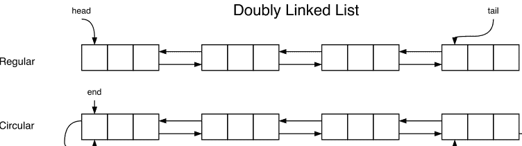

图 12.2：此图展示了某些不同形式链表的基本结构。

## 12.4 可变单链表

我们将实现的第一种链表形式是可变单链表。我们将仅包含上面列出的四个方法。尽管这个最小实现并不是非常有用，但从这里开始是有教育意义的，因为其他方法的细节不会阻碍你的理解。

下方的 `class` 展示了这样的链表的样子。`get` 和 `set` 方法已更改为 `apply` 和 `update`，以利用 Scala 对这些特殊方法的语法规则，但它们内部的逻辑没有改变。

```scala
package linkedlist.adt

/**
 * 这是一个基础链表的非常简单的实现。
 *
 * @param A 存储在列表中的值。
 */
class SinglyLinkedList[A] {
    private private class Node(var data: A, var next: Node)
    private var head: Node = null

    /**
     * 此方法获取指定索引的值。如果索引超过了列表
     * 长度，将抛出 NullPointerException。
     * @param index 要获取的索引。
     * @return 该索引处的值。
     */
    def apply(index: Int): A = {
        assert(index >= 0)
        var curr = head
        for (_ <- 0 until index) {
            curr = curr.next
        }
        curr.data
    }

    /**
     * 设置特定索引的值。如果索引超过了列表
     * 长度，将抛出 NullPointerException。
     * @param index 要设置的索引。
     * @param data 要存储的值。
     */
    def update(index: Int, data: A): Unit = {
        assert(index >= 0)
        var curr = head
        for (_ <- 0 until index) {
            curr = curr.next
        }
        curr.data = data
    }

    /**
     * 在特定索引处插入新值。如果索引超过了
     * 列表长度，将抛出 NullPointerException。
     * @param index 要插入的索引。
     * @param data 要插入的值。
     */
    def insert(index: Int, data: A): Unit = {
        assert(index >= 0)
        if (head == null) {
            head = new Node(data, null)
        } else {
            var curr = head
            for (_ <- 0 until index - 1) {
                curr = curr.next
            }
            curr.next = new Node(data, curr.next)
        }
    }

    /**
     * 从列表中删除特定索引。如果索引超过了
     * 列表长度，将抛出 NullPointerException。
     * @param index 要删除的索引。
     * @return 被删除的值。
     */
    def remove(index: Int): A = {
        assert(index >= 0)
        if (index == 0) {
            val ret = head.data
            head = head.next
            return ret
        } else {
            var curr = head
            for (_ <- 0 until index - 1) {
                curr = curr.next
            }
            val ret = curr.next.data
            curr.next = curr.next.next
            return ret
        }
    }
}
```

# 链表

411

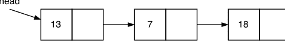

在 1 处插入 42

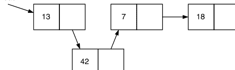

删除索引为 2 处的元素

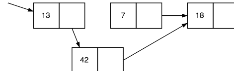

**图 12.3：** 此图展示了单链表上执行插入和删除操作的情况。

> 问题：你如何从这个链表的简单实现中移除重复代码？

为了让自己相信这段代码是有效的，我们可以实现以下进行一些最小检查的测试。

```scala
package test.linkedlist.adt

import org.junit.*
import org.junit.Assert..
import linkedlist.adt.SinglyLinkedList

class TestSinglyLinkedList {
    var list: SinglyLinkedList[Int] = null

    @Before def setup(): Unit = {
        list = new SinglyLinkedList[Int]
    }

    @Test def appendOne(): Unit = {
        list.insert(0, 10)
        assertEquals(10, list(0))
    }

    @Test def appendTwo(): Unit = {
        list.insert(0, 10)
        list.insert(0, 20)
    }
```

# 使用 Scala 的面向对象、抽象和数据结构

```scala
assertEquals(20, list(0))
assertEquals(10, list(1))
}
```

```scala
@Test def appendTwoB: Unit = {
list.insert(0, 10)
list.insert(1, 20)
assertEquals(10, list(0))
assertEquals(20, list(1))
}
```

```scala
@Test def appendTwoUpdate: Unit = {
list.insert(0, 10)
list.insert(0, 20)
list(0) = 5
list(1) = 8
assertEquals(5, list(0))
assertEquals(8, list(1))
}
```

```scala
@Test def appendRemove: Unit = {
list.insert(0, 5)
list.insert(1, 10)
list.insert(2, 15)
list.insert(3, 0)
assertEquals(5, list(0))
assertEquals(10, list(1))
assertEquals(15, list(2))
assertEquals(20, list(3))
list.remove(2)
assertEquals(5, list(0))
assertEquals(10, list(1))
assertEquals(20, list(2))
list.remove(0)
assertEquals(10, list(0))
assertEquals(20, list(1))
}
```

正如你在这段代码中预期的那样，这里的测试并不能足以让我们对代码充满信心。漏掉了一个测试，这个测试对于此类集合来说具有特殊意义，即一个向链表添加元素、使用 `remove` 将完全清空，然后再次开始添加的测试。这种边界情况是集合中错误的特别常见来源。

## 12.4.1 实现 mutable.Buffer

之前的链表示例极其精简，缺乏许多使集合变得实用的真正所需的功能。在不投入额外努力的情况下访问更多功能的一种方法，是在 Scala 库中集合包提供的基础之上进行构建。换句话说，我们将学习继承它们。对于可变链表，基础类型的显而选择是 `mutable.Buffer` 类型。

# 链表

如果你查看 API，你会发现 `mutable.Buffer` 列出了以下九个方法为抽象方法。

```scala
def +==(elem: A): Buffer.this.type
def +=:(elem: A): Buffer.this.type
def apply(n: Int): A
def clear(): Unit
def insertAll(n: Int, elems: Traversable[A]): Unit
def iterator(): Iterator[A]
def length(): Int
def remove(n: Int): Unit
def update(n: Int, newelem: A): Unit
```

```scala
package linkedlist.adt
import collection.mutable
class MutableLinkedList[A] extends mutable.Buffer[A] {
  private var hd: Node = null
  private var tl: Node = null
  private var numElems = 0
  private class Node(var data: A, var next: Node)

  def +==(elem: A) = {
    if (tl == null) {
      tl = new Node(elem, null)
      hd = tl
    } else {
      tl.next = new Node(elem, null)
      tl = tl.next
    }
    numElems += 1
  }

  def +=:(elem: A) = {
    hd = new Node(elem, hd)
    if (tl == null) {
      tl = hd
    }
    numElems += 1
  }
```

# 414 使用 Scala 的面向对象、抽象和数据结构


```scala
def apply(n: Int): A = {
  if (n < 0 || n >= numElems) throw new IndexOutOfBoundsException(n)
  var rover = hd
  for (i <- 0 until n) rover = rover.next
  rover.data
}

def clear(): Unit = {
  hd = null
  tl = null
  numElems = 0
}

def insertAll(n: Int, elems: Traversable[A]) = {
  var first = null
  var last = null
  for (e <- elems) {
    if (last == null) {
      first = new Node(e, null)
      last = first
    } else {
      last.next = new Node(e, null)
      last = last.next
    }
    numElems += 1
  }
  if (n == 0) {
    hd = first
    tl = last
  } else {
    var rover = hd
    for (i <- 0 until n) {
      // ...
    }
  }
}

def iterator(): Iterator[A] = new {
  var rover = hd
  def hasNext(): Boolean = rover != null
  def next(): A = {
    val res = rover.data
    rover = rover.next
    res
  }
}

def length: Int = numElems

def remove(n: Int): A = {
  if (n < 0 || n >= numElems) throw new IndexOutOfBoundsException(n)
  var rover = hd
  for (i <- 0 until n) rover = rover.next
  val res = rover.data
  numElems -= 1
  if (rover == hd) {
    hd = hd.next
    if (hd == null) {
      tl = null
    }
  } else if (rover == tl) {
    tl = // ... logic
  } else {
    var prev = hd
    for (i <- 0 until n-1) prev = prev.next
    prev.next = rover.next
  }
  res
}

def update(n: Int, newelem: A): Unit = {
  if (n < 0 || n >= numElems) throw new IndexOutOfBoundsException(n)
  var rover = hd
  for (i <- 0 until n) rover = rover.next
  rover.data = newelem
}

override def toString = "MutableLinkedList(" + ")"
```

```scala
object MutableSLL extends SeqFactory[MutableSLL] {
  implicit def canBuildFrom[A]: CanBuildFrom[MutableSLL[_], A,
  MutableSLL[A]] =
    new GenericCanBuildFrom[A]
  def newBuilder[A]: mutable.Builder[A, MutableSLL[A]] =
    new MutableSLL[A]
}
```

这开始引入所有对库编写者来说主要重要的 Scala 语言特性。本书的目标不是为了让你成为一个精通的 Scala 库编写者，因为这会模糊你应该学习的概念。相反，我们会在稍后的集合中添加我们自己的 `foreach`、`map` 和 `filter`，因为你应该理解这些方法是如何运作的。

## 12.5 可变双向链表

现在我们想考虑双向链表。双向链表相对于单向链表的明显优势是它可以向两个方向进行遍历。代价是每个节点需要多出一个引用，并且需要额外的代码来处理。然而，正如我们在上一节中看到的，额外代码的主要来源并不是处理 `next` 引用，而是处理头部和尾部引用的特殊情况。幸运的是，当我们使用双向链表时，有一种方法可以移除这些特殊代码，使得处理 `previous` 引用变得更容易。我们这样做的方法是引入一种名为 `SENTINEL`（哨兵）的特殊节点。

哨兵节点是不存储数据的节点，但它既是链表的开头也是结尾。如果可能，链表需要是循环的。如果我们调用哨兵节点，`end.next` 是链表的头部，`end.prev` 是链表的尾部。这种改进了大量的代码，因为头部和尾部只是 `next` 和 `prev` 引用，因此在这些位置添加或删除元素与其他位置的操作没有区别。

这里了实现了 `Buffer` 的双向链表代码。顶部的声明与单向链表相似，区别在于只有一个节点引用 `head`，且初始的 `next` 和 `prev` 被设置为指向自己。关于该类的顶部有两点需要注意。结束节点必须被赋予一个值，这会导致一些问题，因为 `[A]`。为了绕过这个问题，我们创建了一个具有类型 `A` 默认值的 `var`，我们在第 6 行设置了默认值。这是使用一种特殊的语法实现的，值用下划线 `_` 表示。注意，我们必须指定变量的类型使其具有意义。当创建哨兵时，我们传递默认值。另一种解决方案是使用继承创建一个不存储任何值的哨兵，但这需要更多代码并可能模糊此示例的目的。

```scala
package linkedlist.adt
```

```scala
import collection.mutable
```

```scala
import scala.collection.generic.CanBuildFrom
```

```scala
class MutableDLList[A] extends mutable.Buffer[A] {

  private var default: A = _

  private var numElems = 0

  private class Node(var data: A, var prev: Node, var next: Node)

  private val end = new Node(default, null, null)

  end.next = end

  end.prev = end

  def +==(elem: A) = {

    val newNode = new Node(elem, end.prev, end)

    end.prev.next = newNode

    end.prev = newNode

    numElems += 1

  }

  def +=:(elem: A) = {

    val newNode = new Node(elem, end, end.next)

    end.next.prev = newNode

    end.next = newNode

    numElems += 1

    this

  }

  def apply(n: Int): A = {

    if (n < 0 || n >= numElems) throw new IndexOutOfBoundsException(n +

      numElems)

    var rover = end.next

    for (i <- 0 until n) rover = rover.next

    rover.data

  }

  def clear(): Unit = {

    end.prev = end

    end.next = end

    numElems = 0

  }

  def insertAll(n: Int, elems: Traversable[A]): Unit = {

    if (n < 0 || n >= numElems + 1) throw new IndexOutOfBoundsException(n +

      numElems)

    if (elems.nonEmpty) {

      var rover = end.next

      for (e <- elems) rover = rover.next

      val newNode = new Node(e, rover.prev, rover)

      rover.prev.next = newNode

      rover.prev = newNode

      numElems += 1

    }

  }

  def iterator = new Iterator[A] {

    var rover = end.next

    def hasNext = rover != end

    def next(): A = {

      val data = rover.data

      rover = rover.next

      data

    }

  }

  def length(n: Int): A = {

    if (n < 0 || n >= numElems) throw new IndexOutOfBoundsException("n"

      numElems)

    var rover = end.next

    for (i <- 0 until n) rover = rover.next

    rover.data

  }

  def update(n: Int, elem: A): Unit = {

    if (n < 0 || n >= numElems) throw new IndexOutOfBoundsException("n"

      numElems)

    var rover = end.next

    for (i <- 0 until n) rover = rover.next

    rover.data = elem

  }

  def foreach(f: A => Unit): Unit = {

    var rover = end.next

    while (rover != end) {

      f(rover.data)

      rover = rover.next

    }

  }

  def filter(pred: A => Boolean): MutableList[A] = {

    val result = new MutableList[A]

    var rover = end.next

    while (rover != end) {

      if (pred(rover.data)) result += rover.data

      rover = rover.next

    }

    result

  }

  def map[B](f: A => B): MutableList[B] = {

    val result = new MutableList[B]

    var rover = end.next

    while (rover != end) {

      result += f(rover.data)

      rover = rover.next

    }

    result

  }

  override def toString = "MutableList(" + mkString(", ") + ")"

}

}
```

## 链表

### 421

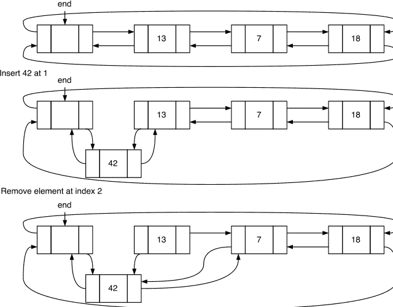

在位置 1 插入 42

删除索引为 2 的元素

```scala
private var numElems = 0
private trait Node {
  var data: A
  var prev: Node
  var next: Node
}

private class DNode(var data: A, var prev: Node, var next: Node) extends Node
private class ENode extends ENode {
  def data: A = throw new IllegalArgumentException("Requested value of sentinel node.")
  def data=(d: A) = throw new IllegalArgumentException("Value assigned to sentinel node.")
  var next: Node = this
  var prev: Node = this
}
private val end = new ENode
```

使用这种方法，`Node` 类型是一个带有子类的 trait，定义了我们之前在 `Node` 中定义的不同字段的抽象变量。`DNode` 继承自此，看起来与我们原始的 `Node` 类相同。这种方法的不同之处在于用于哨节点的 `ENode`。该类对 `next` 和 `prev` 使用普通的 `var` 声明，但它处理 `data` 的方式不同。它没有声明 `var`，而是使用 `def` 声明来获取和设置数据。这两个异常都不会返回值。这之所以能通通是因为 `var` 声明实际上会编译为这些 getter 和 setter 方法，而 `throw` 表达式的类型是 `Nothing` 是 Scala 中所有其他类型的子类。代码中三个创建 `new Node` 的点需要更新为 `new Node` 才能通过编译。

这些方法之间的选择主要是风格问题，但在编译时，此处使用继承可能会产生运行速度稍慢的代码。继承的方法使用虚函数调用，其开销比调用一个没有被覆盖的 `final` 方法更大。这种编译器在这种情况下生成的代码是否较慢，取决于编译器本身。在您自己的平台上进行此测试是留给读者的练习。

## 12.6 不变单链表

我们看过的两种链表实现都是为了可变链表。我们可以实例化这些链表的实例并以各种方式修改内容。这在 `Buffer` trait 中工作得良好，但我们在 Scala 中处理的第一个链表是 `List` 类，它代表一个不可变列表。

不变列表作为链表是有意义的，因为你不允许更改数据。一旦创建列表，它必须保持完全完整且不变。在列表头部添加元素（这是我们通过 `::` 执行的操作）会添加新节点，而不会以任何方式改变其后的其他节点。与可变链表（列表包裹节点并对其隐藏）不同，在不可变链表中，节点本身就是列表。没有任何东西包裹在它们周围。

下面的代码提供了一个不可变单链表的实现。它使用了与 `List` 类本身相似的设计。它不是一个单一类，而是一个层次结构，其中我们通常用于引用列表的主类是抽象的，并有两个表示空节点和非空节点的子类。


```scala
package linkedlist.adt

import collection.immutable.LinearSeq

sealed class ImmutableSList[A] extends LinearSeq[A] {
  def ::[B >: A](elem: B): ImmutableSList[B] = new Cons(elem, this)

  override def iterator = new Iterator[A] {
    var rover: LinearSeq[A] = ImmutableSList.this
    def hasNext: Boolean = !rover.isEmpty
    def next: A = {
      val ret = rover.head
      rover = rover.tail
      ret
    }
  }
}

final class Cons[A](hd: A, tl: ImmutableSList[A]) extends ImmutableSList[A] {
  def length = 1 + tl.length
  def apply(index: Int): A = if (index == 0) hd else tl.apply(index - 1)
  override def isEmpty = false
  override def head = hd
  override def tail = tl
}

object NilInt extends ImmutableSList[Nothing] {
  def length = 0
  def apply(index: Int) = throw new IllegalArgumentException("Nil has no contents.")
  override def isEmpty = true
  override def head = throw new IllegalArgumentException("Nil has no head.")
  override def tail = throw new IllegalArgumentException("Nil has no tail.")
}

object ImmutableSList {
  def apply[A](data: Seq[A]): ImmutableSList[A] = {
    var ret: ImmutableSList[A] = NilInt
    for (d <- data.reverse) {
      ret = new Cons(d, ret)
    }
    ret
  }
}
```

这段代码中只有少数我们之前没见过的需要解释的元素。从顶部开始，主类被标记为 `sealed` 和 `abstract`。我们以前见过 `abstract`，但 `sealed` 是新的。这个关键字的含义是该类的所有子类都出现在当前文件中。这可以用于为 `match` 语句中的模式提供更好的类型检查。这为我们提供了安全保障，即其他程序员无法产生行为与我们列表预期不符的非预期子类。我们通常可以通过使用 `final` 来确保没有东西继承自某个类。在这种情况下，这不是一个选项，因为我们需要继承，但对子类有限制。在这种情况下，`sealed` 为我们提供了安全性和使用继承的便利。

接下来是 `ImmutableSList` 的类型参数。类型参数 `A` 允许列表持有任何类型的数据。在 `Nil` 对象中使用 `Nothing` 是表示任何类型空列表的明智方法，因为 `Nothing` 是 Scala 中所有其他类型的子类。

`::` 方法中的类型参数 `B` 确保了当我们添加类型为 `B` 的元素时，结果列表类型为 `ImmutableSList[B]`。这在保持创建不同类型列表灵活性的同时确保了类型安全。

## 链表

我们的代码不会对其进行模式匹配，因为那需要更高级的技术。

实际的 `scala.collection.immutable.List` 代码比我们在这里编写的要复杂，但主要是为了引入进一步的效率。该类是完全不可变的；节点在创建后永远无法改变。这迫使我们如果想应用任何效率，就必须通过向头部添加元素来构建它们。这出现在我们代码的末尾，在第 38 行 `for` 循环中，`apply` 方法的输入被反转了。这是真正的库版本能够规避的一种开销类型。

## 12.7 基于链表的栈和队列

回想一下 ADT（抽象数据类型）的主要特征：它告诉我们方法的作用是什么，而不是它们是如何实现的。链表是一种具体的实现方式，正如我们所见到的，它可以被用于实现列表 ADT。它也可以作为其他 ADT 的存储机制。特别是，它对于到目前为止考虑的其他 ADT——栈和队列来说非常有效。对于基于数组的实现，我们需要对这些集合上的所有操作都是 O(1) 且易于实现的。

### 12.7.1 基于链表的栈

为了使用链表实现栈，我们可以将本章之前章节中编写的某个列表实例作为成员，并对其执行操作。从软件工程的角度来看，这种方法是有价值的，因为代码可以生成链表。然而，本章的重点是链表的本质和结构。出于这个目的，从零开始构建并在该类中包含一个节点类型以对其进行控制和操纵是有价值的。这种方法也有助于我们更好地控制所写代码的效率。

栈上的操作需要在集合的相同位置进行添加和删除。`remove`（删除）操作组合可以通过单链表高效地实现。`push`（入栈）在列表头部添加新元素，而 `pop`（弹出）则移除头部元素。

这里展示了一个使用单链表实现的栈。`Node` 类型使用 `class` 创建的，因为其中的值不会发生改变，而 `case class` 提供了一种创建不可变节点的简单方法。

```scala
package linkedlist.adt

class ListStack[A] extends Stack[A] {
  private class Node(data: A, next: Node)
  private var top: Node = null

  def push(obj: A): Unit = {
    top = Node(obj, top)
  }

  def pop(): A = {
    assert(!isEmpty, "Pop called on an empty stack")
    val ret = top.data
    top = top.next
    ret
  }
  def peek: A = top.data
  def isEmpty: Boolean = top == null
}
```

`top` 成员是一个 `var`，作为列表的头部。方法非常直观。如你所见，这是一个非常短的类，尽管我们重新实现了一个单链表。实现的简单是因为栈 ADT 的简单。不需要任何对象或复杂逻辑，因为所有的访问（包括添加和删除）都发生在头部。

该类的测试代码与 `ArrayStack` 相同，只需将 `Array` 改为 `List` 即可。替换中唯一的非系统性的替换是 `@Before` 方法中栈的实例化。

### 12.7.2 基于链表的队列

该过程可以用于创建一个使用链表进行数据存储的队列。对于栈，我们只需要保留列表的一个端以便进行添加和删除。在队列的情况下，我们需要跟踪列表的两个端。其中一个是前端，另一个是后部。哪个是头部哪个是尾部取决于我们需要的功能。新元素应该添加到尾部，并从前端移除。我们刚刚看到头部可以高效地执行这两种操作。那么尾部呢？

在单链表的情况下，我们只能高效地向尾部添加元素，无法从那里删除。这又回到了之前的那个问题：为了从单链表中删除元素，你需要知道要删除的那个节点，而我们无法回溯遍历列表。因此，如果我们想维持 O(1) 的性能，队列的后端必须是列表的尾部。

这里展示了基于链表的队列代码。有一些特殊情况需要处理，这使得代码比栈的代码要长。特别是，当元素添加到空队列或移除操作获取最后一个元素时，对后部的调整：

```scala
package linkedlist.adt
class LinkedList[A] extends Queue[A] {
  private class Node(val data: A, var next: Node)
  private var front: Node = null
  private var back: Node = null

  def enqueue(obj: A): Unit = {
    if (front == null) {
      front = new Node(obj, null)
      back = null
    } else {
      back.next = new Node(obj, null)
      back = back.next
    }
  }

  def dequeue(): A = {
    assert(!isEmpty(), "Dequeue called on an empty queue.")
    val ret = front.data
    front = front.next
    if (front == null) back = null
    ret
  }

  def peek: A = front.data
  def isEmpty: Boolean = front == null
}
```

## 12.8 项目

该过程可以用于创建一个使用链表进行数据存储的队列。对于栈，我们只需要保留列表的一个端以便进行添加和删除。在队列的情况下，我们需要跟踪列表的两个端。其中一个是前端，另一个是后部。哪个是头部哪个是尾部取决于我们需要的功能。新元素应该添加到尾部，并从前端移除。我们刚刚看到头部可以高效地执行这两种操作。那么尾部呢？

在单链表的情况下，我们只能高效地向尾部添加元素，无法从那里删除。这又回到了之前的那个问题：为了从单链表中删除元素，你需要知道要删除的那个节点，而我们无法回溯遍历列表。因此，如果我们想维持 O(1) 的性能，队列的后端必须是列表的尾部。

这里展示了基于链表的队列代码。有一些特殊情况需要处理，这使得代码比栈的代码要长。特别是，当元素添加到空队列或移除操作获取最后一个元素时：

## 12.9 概念总结

- 虽然对链表的随机访问是慢的，但迭代器允许高效的线性访问。

- 单链表也可以被写成不可变的：这就是 `List` 所做的。

- ADT 不指定具体实现方式，这一点可以通过使用链表作为存储机制重新实现栈和队列 ADT 来说明。

## 12.9.3 项目

本章没有对每个项目提供单独的描述。在所有这些项目中，你应该已经在使用某种形式的 `Seq` 或 `Buffer` 来存储重要数据。对于这个项目，你需要将代码转换为使用你自定义的链表类，而不是你之前一直在使用的 Scala 库类。


# 第 13 章

# 优先级队列

- 13.1 两种方法 ................................................................................................ 431

- 13.1.1 按优先级查找 ................................................................................... 432

- 13.1.2 排序链表 ...................................................................................... 432

- 13.1.3 数组的问题 ................................................................................ 434

- 13.2 项目整合：离散事件模拟 ............................................ 435

- 13.2.1 细胞分裂 ............................................................................................ 435

- 13.2.2 碰撞处理 ................................................................... 438

- 13.3 章末内容 ............................................................................ 445

- 13.3.1 概念总结 ............................................................................ 445

- 13.3.2 练习题 ................................................................................................. 446

- 13.3.3 项目 ................................................................................................. 446

我们之前看到的 ADT（抽象数据类型）可以被视为建模了一个服务线。所有添加的实体都被认为是平等的，并按照它们到达的顺序离开。并不是所有系统都以公平的方式运行。现实生活中存在 VIP 通道。有些系统有理由区别对待实体。这样一个系统的例子是急诊室。如果你带着纸划伤去急诊室，可能需要等待很长时间。急诊室服务人的顺序在很大程度上取决于病人状况的严重程度，而不是到达时间。设置预约的情况是另一个例子。比预约时间提早到达通常不会让你显著提前进入。

这类系统需要一种新的 ADT，优先级队列与普通队列具有相同的方法，但 `dequeue` 和 `peek` 方法的行为有所不同，它们会给出队列中优先级最高的对象。

### 13.1 两种方法

在本章中我们将考虑编写优先级队列的两种方法，它们都使用链表进行存储。两者的区别在于是在新项添加到队列时执行额外工作，还是将工作推迟到项移除时再进行。我们将讨论这两种方法，并仅实现较好的那种。与普通队列不同，优先级队列中无法为所有方法都获得 O(1) 的性能。我们将讨论将用到的这些实现，这里某些方法的时间复杂度将为 O(n)。我们将在第 18 章中讨论另一种可以改进该方法的实现。

所有优先级队列的实现都将扩展以下 trait。

```scala
package priorityqueues.adt

/**
 * 此 trait 定义了一个可变的优先级队列 ADT。
 * @param A 存储的数据类型
 */
trait PriorityQueue[A] {

  /**
   * 向优先级队列添加一个项。
   * @param obj 要添加的项
   */
  def enqueue(obj: A): Unit

  /**
   * 移除优先级最高的项，或者在并列的情况下移除存在时间最长的项。
   * @return 被移除的项
   */
  def dequeue(): A

  /**
   * 返回优先级最高的项，或者在并列的情况下返回存在时间最长的项，但不将其移除。
   * @return 最近添加的项
   */
  def peek: A

  /**
   * 告知此优先级队列是否为空。
   * @return 如果队列中没有项则返回 true，否则返回 false。
   */
  def isEmpty: Boolean
}
```

### 13.1.1 按优先级查找

使用链表创建优先级队列的一种方法是像普通队列一样将元素添加到末尾，但修改 `dequeue` 和 `peek` 中的代码，使它们遍历元素以找到第一个优先级最高的项。在 `dequeue` 的情况下，该项会被移除。

我们可以通过观察这些方法所执行的工作量来评估这种方法的质量。`enqueue` 和 `isEmpty` 方法的复杂度是 O(1)。然而，`dequeue` 和 `peek` 必须遍历所有元素以找到优先级最高的项。这需要 O(n) 的时间。深入观察，不仅仅是顺序，这种搜索是特别昂贵的，因为在早期无法知道我们正在寻找什么，所以每次搜索都必须考虑每个元素。

### 13.1.2 排序链表

第二种方法是在元素添加时执行额外工作，并保持列表的排序状态，这样我们总是知道优先级最高的项在哪里并可以将其移除。使用这种方法，`dequeue`、`peek` 和 `isEmpty` 方法都是 O(1)。然而，`enqueue` 方法必须执行搜索以找到正确的插入位置，因此是 O(n)。

这两种方法都包含至少一个 O(n) 的方法。由于大多数应用程序对 `enqueue` 和 `dequeue` 的调用次数大致相等，这些方法的次数至少是 O(n)。出于几个原因，这种方法对大多数应用程序更好。首先是 `peek` 和 `dequeue` 的调用会更高效。此外，将项放入排序列表不需要遍历整个列表。这个过程类似于插入排序内部循环中发生的情况。这里是使用排序列表实现优先级队列的示例：


```scala
package scalabook.adt

import reflect.ClassTag

class SortedListPriorityQueue[A : ClassTag](comp: (A, A) => Int) extends PriorityQueue[A] {
  private var data: A = _
  private class Node(var data: A, var prev: Node, var next: Node)
  private val end = new Node(default, null, null)
  {
    end.next = end
    end.prev = end
  }

  def enqueue(obj: A): Unit = {
    var rover = end.prev
    while (rover != end && comp(obj, rover.data) > 0) rover = rover.prev
    end.next = new Node(obj, rover, end.next) // 注意：逻辑为了清晰进行了简化
  }

  def dequeue(): A = {
    val ret = end.next.data
    end.next = end.next.next
    end.next.prev = end
    ret
  }

  def peek: A = end.next.data

  def isEmpty: Boolean = end.next == end
}
```

注意在创建时传递了比较函数，以便可以使用任何类型。该实现使用带有哨兵的双向链表来减少特例情况并保持代码紧凑。优先级最高的项位于列表的头部（`end.next`），这就是 `dequeue` 获取的地方。`enqueue` 方法从列表尾部向后运行，直到找到哨兵或优先级更高的节点。注意，如果每个新项的优先级都比上一个项低，那么这个版本的 `enqueue` 将是 O(1)。

该类的测试代码可以和普通队列非常相似，只有一些微小的更改。除了更改类型外，还需要一个比较函数。

# 使用 Scala 进行面向对象、抽象和数据结构

用于创建时的优先级队列。我们可以使用 `Int` 以及库中其他具有自然排序的内置类型的 `compareTo` 方法。这使得值具有更高的优先级。如果你处于较低值优先级更高的情况，可以使用 `b.compareTo(a)` 或 `-a.compareTo(b)` 代替。

```scala
var queue: PriorityQueue[Int] = null

@Before def initQueue(): Unit = {
  queue = new SortedListPriorityQueue[Int]((a,b) => a.compareTo(b))
}

@Test def enqueuedequeue100(): Unit = {
  val nums = Array.fill(100)(Random.nextInt)
  nums.foreach(queue.enqueue)
  nums.sorted.reverse.foreach(assertEquals(_, queue.dequeue))
}
```

使用优先级队列还需要修改检查出队顺序的代码。这里展示的最后一个方法是使用随机值队列。检查可以通过数组的反转和排序版本来完成，因为比较使得某些值具有更高的优先级，它们将最先出现。

## 13.1.3 数组的问题

对于普通的栈和普通的队列，都可以使用数组而不是链表来实现，其使用的代码量相似，且性能也非常接近。但对于使用这两种方法的优先级队列，情况并非如此，因为它们涉及到在数组的随机位置进行插入或删除，这需要 O(n) 次拷贝来移动元素。

从意义上说，基于数组的实现在相同的方法中仍然是 O(n)。然而，O(n) 的操作类型发生了变化。链表方法在比较和内存读取方面是 O(n)，但在内存写入方面仅为 O(1)。标准的基于数组的实现在比较和内存读取的基础上增加了 O(n) 的写入。

对于始终始终保持数组排序的版本，这种开销是完全无法避免的，因为在不插入并移动元素的情况下，无法维护一个排序数组。如果我们使用一种略有不同的方法，通过被删除的元素来填充空隙，那么排序和删除的方法就可以达到我们的目标。当找到最高优先级的项目时，可以将其移除，并将数组中的最后一个元素放在该位置，而不是向下复制所有项目。图 13.1 显示了这在内存中是如何对应的。

> ¹在第 18 章中，我们将看到，对于比这里考虑的任何选项都更有效的优先级队列实现，数组正是我们想要使用的类型。

> ²到目前为止，我们讨论的所有实现对相同优先级的元素都使用标准的队列排序。这种更高效的填充空隙的方法将打破这一点。这听起来可能没那么糟糕，因为许多应用程序极少出现平局，如果有的话，也不重要。

# 优先级队列

| 最大元素 元素数量 numElems | | | | | | | | | |
|---|---|---|---|---|---|---|---|---|---|
| 4 | 1 | 9 | 3 | 6 | 8 | 2 | 7 | 5 |

dequeue() 不再移动所有元素，而是将最后一个复制下来填充空隙。

| 4 | 1 | 9 | 3 | 6 | 8 | 2 | 7 | 5 |
| numElems | | | | | | | | | |
| 4 | 1 | 5 | 3 | 6 | 8 | 2 | 7 | 5 |

**图 13.1：** 此图显示了我们如何在未排序的基于数组的优先级队列中通过 O(1) 操作删除，我们已经执行了 O(n) 搜索来找到最高优先级元素。

# 13.2 项目集成：离散事件模拟

大量使用优先级队列的领域是离散事件模拟（DISCRETE EVENT SIMULATION）。这是一个仿真风格，其中系统的所有变化都被建模为在特定时间发生的事件，仿真从一个事件跳转到下一个事件。这种方法通常由于有一个优先级队列，事件被放在其中。调用 `dequeue` 会根据事件发生的时间取出事件。³ 大多数事件都有调度一个或多个其他事件的能力。仿真持续，直到过了某段时间，或者队列变为空。

离散事件模拟的标准例子是排队的人群。该系统中的事件是人们到达并排队，以及收银员完成一个人的服务并处理下一个。这种模拟允许企业根据客户到达频率的测量，确定在不同时段需要多少人工作。一个微小的变体也可以为交通灯设置计划。

## 13.2.1 细胞分裂

离散事件模拟的一个非常基础的例子是培养皿细胞分裂的简单模型。这种仿真的简单性部分在于只有一种事件：细胞分裂。培养皿开始时只有一个细胞。经过一段时间后，该细胞分裂成两个。这个过程一直持续直到我们停止仿真。为了保持简单，我们忽略了细胞死亡。

细胞“出生”和它分裂之间的延迟不是固定值。相反，它具有某种随机性。可能花费一整个学期来考虑随机数、如何从各种统计分布中提取随机数，以及

> ³值得注意的是，按时间排序的优先级队列将赋予较小的值更高的优先级，因为在时间较晚发生的事件比先发生的事件的值更大。因此，我们必须确保在这些示例中翻转排序顺序。

如何为不同的集合寻找适当的分布。这些细节与我们无关，我们将发现每个细胞根据范围内的均匀分布进行分裂。这使用了若干次直到

# 438

使用 Scala 的面向对象、分析与数据结构

```scala
pq.enqueue(_minSplitTime + math.random * (_maxSplitTime - _minSplitTime))
while (splits.length + 1 < _maximumPopulation) {
  val time = pq.dequeue()
  splits += time
  pq.enqueue(_minSplitTime + math.random * (_maxSplitTime - _minSplitTime))
  pq.enqueue(_minSplitTime + math.random * (_maxSplitTime - _minSplitTime))
}
nsplits
```

```scala
object DrawCellSim {
  def apply(d: Drawing, width: Double, height: Double, maximumPopulation: Int, minSplitTime: Double, maxSplitTime: Double, numSims: Int): DrawCellSim = {
    DrawCellSim(d, width, height, maximumPopulation, minSplitTime, numSims)
  }
}
```

```scala
def apply(n: xml.Node, d: Drawing): DrawCellSim = {
  val width = n("width").text.toDouble
  val height = n("height").text.toDouble
  val maximumPopulation = n("maxPop").text.toInt
  val minSplitTime = n("minSplit").text.toDouble
  val maxSplitTime = n("maxSplit").text.toDouble
  val numSims = n("numSims").text.toInt
  DrawCellSim(d, width, height, maximumPopulation, minSplitTime, numSims)
}
```

这允许用户为仿真设置一组不同的参数，并为不同的仿真绘制折线。图表会缩放以适应指定尺寸的范围。并没有尝试对数值进行缩放，因为这是一个更具挑战性的问题。图 13.2 显示了在绘图此类类的示例。

### 13.2.2 碰撞处理

离散事件处理有意义的另一个例子是真实的硬球碰撞事件。该系统中的事件是球相互碰撞或球与墙壁等障碍物的碰撞。必须按顺序处理它们，因为一次碰撞可能会防止随后的碰撞发生。在整个仿真过程中不断进行这种处理是可能的，但也有理由经常将所有球带到特定的时间点。例如，如果你要渲染仿真或将配置保存到磁盘，如果所有球在同一时间都有位置，而不是停留在发生事件的最后一个位置。

使用事件处理碰撞比让球向前移动整个时间步然后检查重叠更准确，而且可能更快。后者的方法需要较小的时间步，并且可能会遗漏细节。一个显而易见的例子是，如果两个小型且移动快速的球应该在时间步中间发生碰撞。除非找到碰撞的实际时间，否则它们可能会互相穿过，并在步结束时没有重叠。当一个球在一个步内应该与两个或更多其他球碰撞时，也会发生类似类型的错误。

在纯事件驱动的仿真中，“时间步”也可以作为事件来处理。当渲染这些事件时，会更新所有球的位置，并可以执行任何特殊处理，例如在球周围渲染或应用重力等非碰撞力。这种处理也可以通过偶尔跳出事件处理来完成。我们将编写一个 `DrawBouncingBalls` 类，它将使用离散事件绘制在箱内跳跃的 2D 球。我们还将在 `DrawingMain` 中添加一个 `AnimationTimer`，并赋予 `Drawable` 更新能力以便在定时器上进行动画处理。我们之前的 `Drawable`（除 `DrawTransform` 之外）对 `advance` 方法不会执行任何操作。`DrawTransform` 所做的只是告诉它的子元素执行 `advance`。

提到对优先级队列的修改，与其他示例不同，它要求我们能够在不处理这些事件的情况下从队列中移除事件。当我们处理每个修改球速度的事件时，涉及该球的所有未来事件都必须被移除。添加该功能的最通用方法是使用如下的方法。

```scala
def removeMatches(f: A => Boolean): Unit = {
  var rover = end.next
  while (rover != end) {
    if (f(rover.data)) {
      rover.prev.next = rover.next
      rover.next.prev = rover.prev
    }
    rover = rover.next
  }
}
```

该方法接收一个谓词函数并移除所有结果为真的元素。我们将其作为一个新类 `SortedListWithRemove` 添加。有了它，我们可以绘制 `DrawBouncingBalls`。它包含了许多你在此刻在 `Drawable` 中看到的特性，但也包含一些处理离散仿真方面的代码。

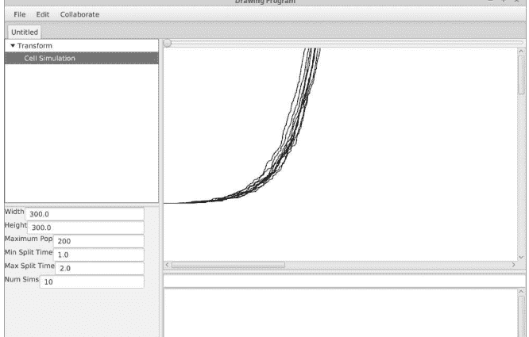

**图 13.2:** 此屏幕显示了细胞仿真 Drawable 的输出。窗口左侧可见的属性。

# 优先队列

443

为了理解这段代码，可能从底部的第 167-174 行开始看会很有帮助，那里我们定义了一个 `Ball` 类，用于存储位置、速度、大小和时间。它拥有可以输出为 XML 或推进一定时间长度的方法。

模拟的运行发生在第 18-32 行的 `advance(dt: Double)` 方法中。由于大多数 `Drawable` 对象不需要执行任何操作，因此我们在 `Drawable` 中放置了默认实现，并只在需要该实现的子类中进行重写。`advance` 方法的第一件事是检查模拟使用的瞬态变量是否为空。如果是，则创建它们。这样做是为了序列化的目的。`copy` 变量被初始化为应用了重力的球的副本。你可以将其理解为在 y 速度上加上 0.01。对于每个球，都会找到下一个时间单位内发生的所有事件。每个球在进入数组后，都会检查与其它球的碰撞。

> 记住图形坐标在屏幕上是向下延伸的，因此添加 vy 会让球落在上

444 使用 Scala 的面向对象、抽象和数据结构

仅对数组中的球进行检查会防止发现碰撞。第 27–30 行处理了这个问题，只要优先队列不空，我们就会取出下一个事件并处理它。当没有更多绘制操作时，球会被复制到一个 `Vector` 中，该 Vector 将用于绘制目的。绘制、创建属性和生成 XML 的代码非常直观。

在 `toXML` 方法之后，有许多方法和类用于寻找碰撞以及定义/处理离散事件。首先是一个方法，它接收两个 `Ball` 对象并返回这两个球之间的碰撞情况。该方法假设球在直线上移动，它们之间的距离是关于时间的二次函数。我们只需要解出它们距离等于半径之和的时间即可。每个球都会跟踪它在某一步执行过程中的“时间”，因此这个时间必须被计算。如果没有碰撞，该方法将返回 -1.0。否则，它将返回较小的根，即球撞击根部的时间。如果你对该事项的细节感兴趣，这里是二次方程中系数的推导过程。

```
$d^2(t) = ((x_1 + vx_1 * t) - (x_2 + vx_2 * t))^2 + ((y_1 + vy_1 * t) - (y_2 + vy_2 * t))^2$
$= (\Delta x + \Delta vx * t)^2 + (\Delta y + \Delta vy * t)^2$
$= \Delta x^2 + \Delta vx^2 t^2 + 2\Delta x\Delta vx t + \Delta y^2 + \Delta vy^2 t^2 + 2\Delta y\Delta vy t$
```

当运动比直线复杂时，必须涉及更复杂的代码来寻找碰撞时间，因为通常没有像这种情况下那样的闭式解。

在方法找到碰撞时间后，它会找到特定球相对于某些球以及墙的所有事件。根据代码的设置方式，处理球和墙的结构非常相似。我们遍历想要检查的对象，计算事件时间，如果事件时间落在当前步骤的有效范围内，我们就将其加入队列。我们稍后来看墙代码是如何编写以实现此点的。

这个模拟有两个作为 `CollEvent` 特性的子类。它们是 `BallBallColl` 和 `BallWallColl`。这些中的每一个类都接收事件发生的时间，并包含处理事件的代码。该类非常简单，可能是在观察发生了什么。首先找到球在事件发生时的位置。然后我们调用一个函数，接收球的位置和速度并返回一个新的速度，以构建一个新的球对象，并存储在数组中替换旧对象。然后移除涉及该球的未来事件并寻找新事件。

球与球碰撞的代码在做相同的事情，但针对两个球，并且涉及更多处理该类型碰撞的数学知识。除非你想了解，否则理解这些数学知识并不重要。它从计算球的相对质量、寻找两个球的质心速度开始。这段代码检查半径之和，如果它不接近预期值，则打印错误消息。这段代码对于确保一切运行正常非常有帮助，虽然它在最终代码中技术上不是需要的，但保留它可能有助于防止未来修改产生问题。每个球的速度修改被计算为速度沿分离球的连线投影的倍数。在这段代码中，使用 2.0 是为了完美的能量守恒。耗散能量的碰撞将使用 1.0 到 2.0 之间的值。不幸的是，重力

> 5在质心系中计算碰撞要容易得多。在这个运动系中，就好像每个球撞撞了一个静态的墙。

优先队列

这段代码的积分并不守恒能量，因此让碰撞稍微阻尼系统是有帮助的。⁶

虽然这段代码中的数学知识可能有点困惑，但代码中最有趣的部分是处理与墙碰撞的方式。寻找事件的代码使用了 `wallInfo`，并将来自那里的函数传递给 `BallWall` 对象。魔之处包含在代码底部 `wallInfo` 的声明中。它是一个元组序列，每个元素都有两个函数：这些函数代表一面墙。第一个函数告诉你球何时会与该墙碰撞，第二个函数给出球在撞击它后的修改速度。

这种方法的妙处在于它可以简单地添加障碍物。例如，下面的元组定义了一个横跨代码中间的、从左上角弹出的障碍物。

```
b => if(b.vx > 0) b.time+(1-b.x-b.y)/(b.vx+b.vy) else -1,
(x,y,vx,vy) => (-vy.abs, -vx.abs)
```


这在技术上不是一面墙，因为它只考虑球的中心。它也允许球穿过它，只是不是这样。然而，它展示了方法的灵活性。通过更多的数学知识，可以引入诸如底部带缺口的圆墙等障碍。一旦函数添加到 `wallInfo`，它就会与代码的其他部分工作。你可以在 GitHub 仓库获取实现：https://github.com/。如果你添加一个弹跳球，你会看到加入了 20 个随机大小的球，就像之前。你可以点击按钮开始计时运行它。如果你观察一段时间，你会看到大球聚集在底部，有时它们会被射得更高。这种行为被称为能量平衡，是质量体之间相互作用的物理系统的标准特征。我们在这个系统中看到这一点，说明我们的代码运行正常。尽管没有是完美的。偶尔球会穿过另一个球。数值误差使得除非你在球重叠时采取措施强制将它们分开，否则这几乎是无法避免。

> ⁶ 这段代码在步骤开始时对每个球应用完全向下的加速度。如果球在步骤过程中反转了垂直方向，重力的影响应该被反转。这里没有发生这种情况，所以球每次从底部弹起时都会获得能量。

## 13.3 章节结束材料

### 13.3.1 概念总结

- 优先队列与队列相同的方法，但 `dequeue` 方法不同。
- 它不是总是获取存在最长的对象，而是获取优先级最高的对象。
- 相同优先级归于存在最长的那个，并不是所有实现都会这样做。
- 我们可以使用排序列表创建一个相当高效的优先队列。

### 13.3.2 练习

1. 编写一个基于搜索的优先队列，并进行速度测试以与维护排序链表的版本进行比较。在速度测试中，插入具有随机优先级的元素并将其出队。在指数范围内变化使用的元素数量，以衡量其对性能的影响。
2. 使用未排序的 `Array` 实现优先队列的数组实现，并对其进行搜索。进行速度测试以将它们相互之间以及基于链表的实现进行比较。对于基于 `Array` 的搜索方法，执行元素向下平移，并将最后一个元素交换到被移除元素留下的空隙中。
3. 使用 `ArrayBuffer` 和 `List` 实现优先队列，看看它们相对于我们的“自定义”实现来说效率如何。
4. 为碰撞模拟实现一些额外的墙类型。考虑尝试不是直线的墙，或者编写一个创建墙段的方法。
5. 查找随机变量的不同分布，并尝试使用这些分布进行细胞分裂模拟。

### 13.3.3 项目

1. 在你的 MUD（多用户迷宫）中，使用优先队列的方法很少。所有的方法都涉及使用单一的优先队列，可以将动作添加到其中，并在稍后的某个时间运行。这将允许法术具有延迟效果或消失，或者让武器具有不同的攻击速度。它也可以被计算机控制的实体用于实现角色的随机生成。优先队列的优势在于，你不需要在每一个角色/房间/物品中都检查某事是否应该发生。相反，所有这些内容都可以带延迟地将事件放在优先队列中，主线程仅在需要时取出。

   这里的理想方案是使用排序列表或 `Array` 作为优先队列，这样 `peek` 操作就会很快。核心思想是，大多数滴答（`ticks`）优先队列中没有需要处理的事件。在这种情况下，代码只执行 `peek`，发现第一个元素的时间在当前时间之后，然后继续执行需要完成的操作。

   如果你的 MUD 使用 actor 系统，将优先队列放在一个顶层 actor 中，所有其他 actor 都可以向其调度事件。当事件发生时，事件只需发送回消息，以便原始发送者能够做出正确响应。

2. 如果你正在开发网络爬虫项目，你可能会注意到许多网站非常大。即使你将爬虫限制在一个域内，例如只允许来自以 `cnn.com`、`espn.go.com` 或 `google.com` 结尾的域名的页面），仍然会有大量的页面。如果你按照发现链接的顺序进行处理，由于资源限制，你可能无法获得大量你感兴趣的数据。处理此问题的一种方法是将待读取的页面队列设置为优先队列。

   如果你知道你正在寻找的页面类型，并且对它们在你运行的站点上的可能路径有所了解，你可以给这些页面赋予更高的优先级。这样，你就会先访问这些页面。只要程序保留了具有你代码编写为有趣的结构的页面，它就会在这些页面上运行，而不是去处理其他不太可能有有趣信息的页面。

3. 如果你正在开发网络或非网络图形游戏，你可以在游戏的主循环中使用优先队列，其方法与上面为 HUD 描述的那样。玩家可能会执行一些在一段时间内生效的操作。游戏中可能还有许多单位不需要每个滴答都更新。在这两种情况下，你都可以创建一个事件/命令的优先队列，只有在它们发生的时间到达时执行。

4. 数学工作表没有提供明显包含优先队列的地方。有两种可能性：让用户能够在工作表中构建简单的离散事件模拟，或者让工作表中的元素具有优先级排序，以便进行处理。如果你希望当前屏幕上的内容在屏幕外的内容之前进行计算，或者你认为图形元素的处理优先级应该低于数值元素的处理，那么后者可能很有用。

5. Photoshop 也不自动适用于包含优先队列。如果你能想象出一个应用程序，你就可以写一个。对绘制元素进行优先级排序可能是行的，但你必须确保不会破坏用户在画家算法（`painter's algorithm`）中对覆盖关系的控制。

6. 本章对离散事件模拟主题给出了合理的介绍。为你的模拟工作台添加一些功能，支持通用离散事件模拟以及碰撞模拟。创建几个用户可以创建和运行的特定离散事件模拟实例。允许他们调整重要参数并跟踪模拟状态的重要方面。

7. 对于股票投资组合管理项目，我们还没有优先队列的明确用途。也许你可以思考一些有趣的用法。

8. 电影系统绝对可以使用优先队列来管理用户的电影。记住，每个用户都应该有一份他们想看的电影列表，并按偏好顺序排序，以指示他们想先看哪个、第二个想看哪个等。在这些电影请求上使用优先队列，这样当电影可用时，它将分配给用户。记住，用户会添加、删除和更改。

9. 对于系统，我们还没有优先队列的明确用途。


# 第 14 章

# 重构

- 14.1 异味 ................................................................ 449
- 14.2 重构 ....................................................... 452
- 14.2.1 内置重构 ........................................................ 453
- 14.2.2 引入空对象 ................................................................ 454
- 14.2.3 添加和删除参数 ............................................... 454
- 14.2.4 Switch 语句的方案 ......................................... 455
- 14.2.5 合并条件表达式 ................................... 456
- 14.2.6 将过程化设计转换为对象 ................................... 457
- 14.2.7 封装集合 ........................................................ 457
- 14.2.8 向下推或向上提字段或方法 ............................... 458
- 14.2.9 替换算法 ............................................................ 458
- 14.3 本章结束 ................................................ 459
- 14.3.1 概念总结 ............................................................ 459
- 14.3.2 练习 ............................................................................ 459
- 14.3.3 项目 ............................................................................ 459

## 14.1 异味

并不是所有代码都是等价的。虽然构建问题正确解决方案的方法实际上无限多种，但你希望已经了解到，许多在技术上是正确的方案并不如理想。

美存在于观察者的眼中。即使代码并不理想，也不意味着它值得花精力重写成更好的形式。对于具有使其变得不理想属性的代码，技术术语是“代码异味”（`code smell`）。

这个术语具有重要意义。气味可能是强烈的也可能是轻微的。即使某些东西闻起来很糟糕，如果它真的很轻微，除非有正当理由，否则你可能不会费力去纠正它。此外，所有程序员对不同气味的敏感程度是相同的。Martin Fowler 在他的书籍《重构：改进现有代码的设计》中，与 Kent Beck 一起列出了 22 种可能影响代码的异味 [5]。我们在这里列出所有这些异味，并对它们进行简要解释，以及在我们编写的代码中可能出现的示例。

- **不同接口的替代类** (`Alternative Classes with Different Interfaces`) - 当你有多个执行相同操作但名称不同的类时。你应该选择一个合适的名称并重命名所有内容以匹配。

- **注释** (`Comments`) - 有些注释绝对是好的。过多的注释，尤其是当它们没有添加额外信息时，可能会产生异味。与代码过时的注释是非常糟糕的异味。程序员阅读注释是为了帮助他们理解代码中发生了什么。如果注释没有随代码一起更新，可能会导致严重的困惑并浪费大量时间。与其有糟糕的注释，不如没有注释，但完全没有注释也会让代码变得难以阅读，这使得这种方法也产生了异味。

- **数据类** (`Data Class`) - 这些类不存储数据且没有实际功能的类。在代码中充斥包含这些类的独立文件会使人们很难导航代码。你可能考虑将这些类嵌套在与该类有意义的关系的对象内部。

- **数据簇** (`Data Clumps`) - 几乎总能找到的片段数据，应该被合并到一个类中。这种信息的一个简单例子是数据点。与其将 `x`、`y` 和 `z` 分开保留并将它们作为三个独立的参数传递给许多不同的方法，不如使用一个可以存储这三个值的类。这样做的好处之一是调用代码的代码显式地知道数据是一个点，而不是不相关的 `Double` 类型。

- **散散变更** (`Divergent Change`) - 当你在不同的时间为了不同的原因更改同一段代码（通常是一个类）时。这会导致代码承担过宽的责任。应该将其拆分为更小、任务更集中的部分。

- **重复代码** (`Duplicate Code`) - 名字说明了一切。我们在书的非常早阶段就讨论过避免这种异味的方法。读者到这里也应该意识到重复代码的陷阱，例如错误的重复以及在进行某些更改时需要修改所有副本。已经引入了多种方法来减少代码重复，从函数到集合，最后到抽象和多态，你应该努力对任何特定的逻辑尽可能少地编写几次。

- **特性的嫉妒** (`Feature Envy`) - 这是当一个类中的方法对另一个类进行了大量调用，特别是只是为了获取计算数据时。这可能意味着该方法位于错误的类中，应该移动到它所使用的数据附近。

- **不恰当的亲密** (`Inappropriate Intimacy`) - 一个对象本应该封装一个想法。如果你有两个类不断引用对方的元素，意味着事情没有被适当拆分。考虑移动内容，使该类能够独立存在。

- **不完整的库类** (`Incomplete Library Class`) - 这种异味发生在你使用的库缺少你所需的功能时。位于库中的意义在于，你通常无法修改库代码。在 Scala 中，你经常可以通过隐式转换绕过这个问题。

- **大类** (`Large Class`) - 变得太大的类变得难以管理。你希望任何类的功能都针对特定的任务。如果一个类变得太大，这说明它应该被拆分成部分。

- **懒惰类** (`Lazy Class`) - 如果你有一个类什么都不做，那么它就是懒惰的，你应该考虑删掉它。在最好的情况下，将此类类放在另一个类或对象内部，这样它们就不会占用你自己的文件。

- **长方法** (`Long Method`) - 方法/函数容易出错。如果一个方法开始变得太长，就应该被拆分成片段。

- **长参数列表** (`Long Parameter List`) - 具有极长参数列表的方法很难使用。¹ 通常，长参数会伴随着“数据簇”异味出现。可以通过传递包含所需值的较少对象来缩短参数列表。

- **消息链** (`Message Chains`) - 这种异味发生当一个类通过许多对象获取它需要的内容时。例如 `stu.teacher.course.student`。这个问题的问题是，你现在使用的任何类都依赖于三个不同类中 `teacher`、`course` 和 `student` 方法的名称和通用契约。如果其中任何一个发生变化，这段代码就会崩溃。

- **中间人** (`Middle Man`) - 这种异味产生于一个类中的许多方法没有将调用转发到另一个类时。执行转发的是“中间人”。如果这种情况发生得频繁且没有提供益处，你应该考虑直接使用执行工作的对象。

- **并行继承层次结构** (`Parallel Inheritance Hierarchies`) - 这是“散散手术”的一种特例。在这种情况下，你有两个相互镜像的层次结构。当向其中一个层次中添加一个类时，必须将其添加到另一个层次中。

- **原始类型痴迷** (`Primitive Obsession`) - 在 Java 和许多其他语言中，`Int`、`Double` 和 `Boolean` 等类型是原始类型，处理方式与对象不同。² Scala 并不维持这种区别，但这种异味仍然适用。当你过度使用基本或内置类型来创建自己的类型时，代码就像这样写的。这种情况的一个例子是过度使用元组来分组数据，而不是编写类。这种异味让代码对 `_1` 和 `_2` 的引用无法说明该值的含义。

- **拒绝基类** (`Refused Base`) - 这种异味发生当一个类继承自基类但没有使用其所有方法时。这通常意味着基类应该被拆分，或者子类应该继承另一个基类。

> ¹ 长参数通常会伴随着“数据簇”异味。
> ² 原始类型的处理方式与对象不同。

## 14.2 重构方法

Fowler 的重构书籍列出了 72 种不同的重构方法。这里只讨论少数。感兴趣的读者可以查阅原书以获取完整描述，但不要过度担心重构。书中介绍许多重构方法涉及的概念超出了本书的范围，或者超出了读者在目前计算机科学教育阶段所预期理解的内容。

### 14.2.1 内置重构方法

许多重构方法在本质上是算法性的。因此，像 Eclipse 这样的 IDE 内部都有许多不同的重构功能。使用内置重构工具可以使过程变得更快、更安全。它们的设计也确保了不会对代码的行为产生影响。它们改变的是结构而不改变功能。

以下是当你在 Eclipse 中对 Scala 代码点击右键时，在重构（`refactoring`）菜单下可用的某些选项。还有其他选项，且该列表会随着工具的新版本而更新。

- **重命名** (`Rename`) - 这可以应用于任何由程序员定义的名称，如变量名、方法名或类名。正如不再符合代码的注释是“异味（`smelly`）”一样，在程序中使用难以理解的、更糟糕的是具有误导性的名称，就像是你闻到了一阵刺鼻的臭味。当然，你可以手动更改某个名称，但这意味着你需要找到所有使用它的地方并一并修改。对于大型项目中的公共方法名称，这可能意味着要追踪许多不同文件中的调用。重构选项会为你完成所有这些工作。如果你在项目开发过程中选择的名称不再适用，请选择此选项并将其更改为更合适的名称。

- **内联局部变量** (`Inline Local`) - 这将移除一个局部变量 `v1`，并将对其初始化值的所有引用进行更改。这应该只对不可变值执行，因为如果对象在某次使用时被变异，此操作可能会改变行为。如果你将某个内容放入变量并期望它会被多次使用，但最后发现它并没有被使用，就可以使用此操作。

- **组织导入** (`Organize Imports`) - 这是一个非常有用的选项，通过快捷键 `Ctrl-Alt-O` 可以自动为任何缺失的类型添加导入。它还会整理文件顶部的导入语句。需要注意的是，它使用的是 Java 风格的导入，即位于文件顶部且每行一个。如果你需要局部导入，应该自己添加。使用较长格式这一事实并不重要，重要的是你不需要自己输入它。

- **提取局部变量** (`Extract Local`) - 如果一个表达式出现了多次，或者如果给它关联一个名称会变得更有意义，则使用此操作。这有时也被称为“引入变量”（`Introduce Variable`）。

- **提取方法** (`Extract Method`) - 这个异常方便的重构选项应该用于拆分大型方法，或者当你发现自己比原计划更需要使用某些代码时，将其提取到方法中。只需在方法中高亮想要的代码并选择此选项。它将计算出所需的参数并选取一个名称。

像 Eclipse 等 IDE 中的内置重构工具可以使某些类型的更改变得异常简单。这最重要的一点是，它们可以降低门槛，使得你真的没有理由不使用它们。如果你在代码中遗留一个命名糟糕的变量或方法，或者你决定忍受一个长 200 行的方法，你纯粹是在偷懒。

### 14.2.2 引入空对象（`Introduce Null Object`）


并不是所有的重构方法执行都很简单。有些需要你付出一些精力，但在需要时绝对是值得的。为了说明这一点，我们可以考虑第 12 章中的一个练习题，当时你被要求使用哨兵节点（sentinel）编写一个双链表。如果你真的执行了那个练习，你会发现代码变成了一堆嵌套的条件判断，其边界设置为 `prev` 或 `next` 引用为 `null` 的地方。这种处理空引用的特殊情况非常常见。事实上，有一种专门用于处理这种情况的重构方法，即“引入空对象（Introduce Null Object）”。正如名称所示，其目标是引入一个具有有限功能的对象来代替 `null` 引用。如果你发现代码中有许多像这样的代码行，你就应该这样做：

```scala
if (ref == null) ...
```

哨兵节点在双链表中扮演了空对象的角色。更好的例子是单链表中的 `N1`。理论上，你可以在不创建 `N1` 对象的情况下创建一个不可变单链表。相反，列表将像我们的不可变单链表一样用 `null` 引用结束。这样的代码写起来和运行起来往往更加混乱，导致难以调试和维护。我们在第 16 章制作不可变二叉搜索树时会看到空对象的另一种用法。

## 14.2.3 添加和删除参数（Add and Remove Parameter）

我们在第 12 章编写空对象代码时，最初并没有需要为它们进行重构。描述这样的重构将具有挑战性。为了更清楚地说明如何运作，请考虑“添加参数（Add Parameter）”重构。这里的想法是你写好了一个接受特定参数列表的方法。例如，考虑一个使用 `pay might` 逻辑的方法。这可能是某公司使用的某个大型应用程序的一部分。当前版本如下：

```scala
logHours(employeeID:ID, hoursWorked:Int, wagesPaid:Int):Unit = {
  // 执行日志的内容
}
```

它运行正常，一切都很好，直到确定需要包含额外信息以符合某些新的政府法案。例如，这可能是一家大型跨国公司，他们还必须记录员工在这些小时内工作的地点。显然，这将需要对日志进行更改。

```scala
logHours(employeeID:ID, hoursWorked:Int, wagesPaid:Int, location:Location):Unit = {
  // 执行日志的内容
}
```

注意，代码逻辑没有变。添加此参数强制了调用处发生更改，但它并没有改变行为。你应该进行此更改，使代码通过编译，运行所有测试并验证一切正常。重构的全部是将你的方法形式化，以便当代码需要更改时，你更愿意去执行。

“添加参数”的对立面是“删除参数（Remove Parameter）”。这种重构的动机可能是由于方法或其代码发生了更改，导致以前需要的参数不再被使用。也许系统的更改使得支付金额应该通过员工工时和工作小时数来计算，而不是传入。在这种情况下，你可能代码中仍然包含 `wagesPaid` 参数，但该参数从未被使用。这在代码中看起来是有异味的，而且可能会让查看代码的人感到困惑。应该删除此类参数，以使代码更容易理解和运行。

## 14.2.4 Switch 语句的解决方案（Cures for Switch Statements）

正如上述，Scala 没有传统意义上的 `switch` 语句。然而，与 `switch` 语句相关的异味可以在任何条件执行中产生，不仅包括 `match`，还包括 `if`。结合上面的例子，考虑我们需要计算与员工相关的多个不同值，而计算的性质取决于所考虑的员工类型。这可以通过如下代码实现：

```scala
val monthlyPay = employeeType match {
    case Wage => ...
    case Salary => ...
    case Temp => ...
}
```

这种模式可能在代码的其他部分重复出现，用于计算福利和休假时间。`Wage`、`Salary` 和 `Temp` 值可以定义在某个对象或枚举中。这也可以出现在使用表达式的代码中。

```scala
val monthlyPay = if (employeeType == Wage) ...
else if (employeeType == Salary) ...
else ...
```

456 使用 Scala 进行面向对象、抽象和数据结构

之所以这是一种气味（smell）的关键在于，上述模式在多个位置重复出现。如果添加了新类型的员工，所有这些地方都需要修改。漏掉任何一个或出现重复都会导致难以追踪的错误。

可以采用两种重构方法来消除这种气味。它们是“用多态替换条件判断”和“用子类替换类型”。这在代码中表现为一个抽象的超类型，它包含了针对每种不同类型动作/计算的方法。它看起来可能像下面。

```scala
trait EmployeeType {
  def monthlyPay(hours: Int, wage: Int): Int
  def logBenefits(employee: Employee, hours: Int): Unit
  def leaveTime(hours: Int): Double
}
```

使用这种方法，上述的数学运算或 if 结构将被这行简单的代码取代。

`val monthlyPay = employeeType.monthlyPay(hours,wage)`

这之所以有效，是因为 `employeeType` 将是 `EmployeeType` 适当子类的引用。该子类将包含该类型的代码。在所有方法都得到正确实现后，代码可能像下面所示。为 `employeeType` 提供值的代码部分将提供相应的子类。

```scala
class Employee extends EmployeeType {
  def monthlyPay(hours: Int, wage: Int): Int = ...
  def logBenefits(employee: Employee, hours: Int): Unit = ...
  def leaveTime(hours: Int): Double = ...
}
```

```scala
class SalaryEmployee extends EmployeeType {
  def monthlyPay(hours: Int, wage: Int): Int = ...
  def logBenefits(employee: Employee, hours: Int): Unit = ...
  def leaveTime(hours: Int): Double = ...
}
```

```scala
class TempEmployee extends EmployeeType {
  def monthlyPay(hours: Int, wage: Int): Int = ...
  def logBenefits(employee: Employee, hours: Int): Unit = ...
  def leaveTime(hours: Int): Double = ...
}
```

注意，如果这些中的每一个都没有状态（即不同实例之间没有成员差异），它们可以声明为类的对象。

这种结构在消除“切换气味”时有两个好处。第一是它使得添加新类型的员工变得容易得多。如果决定将这些任何一类分解为不同的分类，可以轻松完成。它还将任何类型员工的代码局部化，并使得在需要更改时能够更容易找到这些代码。

## 14.2.5 合并条件表达式

在决定给薪制员工支付多少工资的情况下，你可能需要包含针对正常加班甚至可能是双倍加班的表达式。这些表达式看起来可能像 `hours >= 40 && hours < 60` 和 `hours >= 60`。你对这些表达式注意到的第一个问题是，它们包含了以 40 和 60 形式的“魔术数字”。从一般规则来说，你不希望这些魔术数字散落在整个代码中。另一个潜在问题是，这些表达式确实有明显的含义，而且将来可能需要更改需求。所有这些问题都可以通过将布尔表达式提取到如下所示的方法中逐一个地解决。

```scala
def overtime(hours: Int): Boolean = hours >= 40 && hours < 60
```

然后你在代码其他部分中的条件就变成了 `overtime(hours)`。这易于阅读，包含大量信息量，并且易于改变代码的性质。然而，如果该表达式没有被多次使用，这种方法就多此一举，并增加了代码的复杂性。

## 14.2.6 将过程化的转换为对象

面向对象引入了对于小问题并非必需的额外概念。将数据和功能视为相互独立的方法被称为过程化方法。更大的程序从以项目为导向的方式构建中获益良多。在整个项目中保持设计的一致也有好处。出于这个原因，如果你有一个大型程序的某些方面，你应该将它们重构为面向对象的方法。这是通过将功能与其所操作的数据分组并将两者放在对象中来实现的。这可以通过增量的方式完成，从长过程中提取方法并将其移动到相应的类、trait 或对象中。

## 14.2.7 封装集合

想象一个类，其数据成员是一个可变集合。这可能是类似 `Array` 或 `Buffer`。例如，在你的公司中，你有一个 `Department`（部门）类型，它包含一个填充了 `Employee` 类型的集合。现在假设该类有一个如下的方法。

```scala
def employees:mutable.Buffer[Employee] = _employees
```

注意，此方法是公共的，并允许任何代码访问本地的员工集合。对可变集合这样做是有风险的。因为任何代码都可以调用此方法，并开始对部门中的员工进行任何它想做的操作，而 `Department` 对此没有任何任何控制。这在现实生活中是不预期会发生的事情，在代码中也最好避免。即使在你编写它时看起来是合理的，即使该集合对类的运行并非至关重要，放弃这种控制也可能在以后引起问题。

另一种方案是从此方法返回一个不可变的副本，然后提供其他方法来根据需要添加或删除元素。可以使用最简单的代码来实现：

```scala
def employees:Seq[Employee] = _employees.toSeq
def addEmployee(e:Employee) = _employees += e
def removeEmployee(index:Int) = _employees.remove(index)
```

使用这种代码，并没有什么好处。

## 14.2.8 上提字段或方法

这些重构提供了一种简单的方法来处理你在不同的子类之间发现的重复。如果所有子类共享该方法，显然应该将该方法的实现上移到公共父类中。

也有你想这样做相反的情况。你认为某个方法在大多数类型中将以相同的方式实现，结果发现大多数子类都重写了它。这开始产生一种请求的气味。在这种情况下，你应该执行“下推字段”或“下推方法”以减少气味。如果存在共同的实现，引入中间类型来持有这些代码。如果大量的子类将重写某个方法，你应该强烈考虑在包含它的最高类型中将其设为抽象，从而强制任何继承你类型的人对该方法执行某些操作。

## 14.2.9 替换算法

本章考虑的最后一个重构是“替换算法”。有很多理由让你觉得你最初对问题的某个部分选择的算法可能并不理想。一个简单的例子是，我们处理了一组少量数据值的排序算法。默认情况下，选择了库中的内置排序。它易于使用，而且是一种经过良好调优的通用合并算法。语言库作者显然为了让它高效而付出了努力。然而，当应用程序完成后，性能表现非常糟糕。性能分析显示在排序上花费了大量时间。取而代之的是使用针对该特定比较编写的简单插入排序。这种算法的切换完全没有改变程序的最终结果。然而，它带来了速度的显著提升。

当你第一次解决一个问题时，你可能会使用任何最容易的方法

# 重构

正确地编写代码。这正是你应该做的，因为在大多数情况下，这样做效果最好，也最易于维护。在某些情况下，你对数据性质的初始猜测可能是错误的，而不同的方法被证明是显著更好的。在程序中，优化速度是你应该最后考虑的事情之一，即使是这样，也只有在你确定需要它时才进行。唐纳德·克努斯（Donald Knuth）的一句著名格言是：“我们应该忘记微小的效率，说在 97% 的情况下如此：过早优化是万恶之源” [7]。当你意识到算法的早期选择以一种无法接受的方式减慢了运行速度时，你可能会害怕重构代码并将其放入更适合当前特定任务的算法中。

# 14.3 章节末内容

### 14.3.1 概念总结

- 代码气味 (Smells)

  - 代码中使其变得不理想的某些。

  - 有时与特定的代码有关，但通常涉及结构并包含分布式元素。

  - 它们通常随着代码的修改而随时间累积。

  - 使代码变得难以处理和维护。

- 重构 (Refactoring)

  - 在不改变行为的情况下更改代码结构或工作方式的行为。

  - 可以为了消除气味而进行。

  - 也为了帮助改变代码结构，以便实现新功能。

  - 许多 IDE 包含某些自动重构的选项。

### 14.3.2 练习

1. 测试 Eclipse 中每种不同的内置重构选项。

2. 书籍的网站有一些带有气味代码的示例。逐一检查每个，找出它为什么有气味，并对其进行重构。

### 14.3.3 项目

本章没有为每个项目提供单独的描述，而是提供了更通用的描述。检查你编写过的代码，寻找有气味的地方。当你发现它们时，重构它们使其不再有气味，或者至少气味味一些³

> ³我们理解初级程序员以写出有气味的代码而闻名。在某种程度上是因为初级程序员通常无法很好判断什么时候东西是有气味的，他们面临的是如何让程序运行起来的挑战。

未来可能会有一些项目迫你改变项目的某些设计方面。当这些问题出现时，确保你先重构代码，然后再添加新功能。力不要混合这些步骤。先重构并验证代码工作方式与之前一样，然后在其基础上添加。

# 第 15 章

# 递归

- 15.1 复习 ................................................................................ 461

- 15.2 项目集成：迷宫 ................................................................ 462

  - 15.2.1 递归方法 ............................................................ 462

  - 15.2.2 图形化编辑 ................................................................ 468

  - 15.2.3 最长路径 ............................................................ 471

  - 15.2.4 优化迷宫 ................................................................ 471

    - 有多少条路径？ ................................................................ 472

- 15.3 图形遍历 ........................................................................ 473

- 15.4 分治与法 ....................................................................... 481

  - 15.4.1 合并排序 ............................................................ 482

  - 15.4.2 快速排序 ............................................................ 484

  - 15.4.3 公式解析器 ....................................................... 487

- 15.5 章节末内容 ............................................................... 488

  - 15.5.1 概念总结 ............................................................ 488

  - 15.5.2 练习 ............................................................ 489

  - 15.5.3 项目 ................................................... 490

到此时，你应该已经对递归有了某些基本的了解，无论是通过之前的工作，还是通过查阅在线附录以及书中更早的示例。本章将研究递归概念以帮助在脑脑中巩固它。接下来的三个章节将利用递归，这是提供复习将其整合到我们项目的理想时机。

### 15.1 复习

递归函数无非是一个调用自身的函数。这种看似循环的定义之所以有效，是因为所有递归函数都需要某些基础情况，在这些情况下不再调用自己。其他情况应该向基础情况进展。只调用语言的递归函数提供了迭代，在大多数编程语言中通常会被循环取代，

递归的真正威力在函数多次调用自身时显现出来。这允许递归函数测试多种替代方案。栈的内存允许了这一点，因为当执行一个调用时，在它结束之后，栈会跟踪代码和控制恢复到的位置，以便执行其他递归调用。这样的函数可以转换为循环，但需要显著多得多的努力。某些问题要解决起来将非常有挑战性

 1 附录可以在 http://www.programmingreuses.cal 获取。

2 递归是许多学生挣扎的话题，它非常强大，所以多次回到它是有价值的。

3 值得注意的是，即使一个函数只调用自己一次，如果它在从栈中弹出时做了一些工作，那么它仍然可以受益于递归。我们将在第 16 章中看到这些示例。


# 递归的真正威力

递归的真正威力在函数多次调用自身时显现出来。这允许递归函数测试多种替代方案。栈的内存允许了这一点，因为当执行一个调用时，在它结束之后，栈会跟踪代码和控制恢复到的位置，以便执行其他递归调用。这样的函数可以转换为循环，但需要显著多得多的努力。某些问题要解决起来将非常有挑战性。

# 15.2 项目集成：迷宫

> Object-Orientation, Abstraction, Data Structures Using Scala

在第 7 章中，我们查看了完成迷宫的过程。特别是，我们想要找到最短路径的长度。我们使用队列创建一个广度搜索。广度搜索访问所有 n+1 步的位置。这对于最短路径是有效的，但对于解决其他问题将更灵活。我们将通过向我们的 `DrawMaze` 类添加代码来实现。

## 15.2.1 递归方法

`depthPath` 方法使用基本的递归方法来解决这个问题。给定一个特定的位置，它应该告诉你到达出口需要多少步。注意我们没有使用像广度搜索那样返回实际路径的算法。这段代码可以扩展以做到这一点，但我们将其留给读者。和递归方法一样，我们需要从检查某些基础情况开始。

基础情况是我们到达终点。它返回从迷宫终点到迷宫终点的步数，所以这段代码产生零。其他基础情况是针对无效位置。明显的无效位置是越界或墙的位置。还有第三种无效位置，即你已经在该路径上访问过的位置。有了广度搜索方法，计算机将乐此不疲地在两个相邻位置之间来回。在广度搜索算法中，我们用集合这样做。我们将一个集合传递给递归调用，但对于我们的目的，修改存储迷宫的数组是有效的。所有这些基础情况都需要返回一个不可能是迷宫最短路径的值。那可以是一个负值，也可以是一个远大于迷宫方格数量的正值。

如果所有这些基础情况都不适用，我们就到了递归情况。我们定义这个递归函数的方法是假设我们以某种方式知道相邻位置到出口的距离。如果我们知道这四个值，那么从当前位置的距离将是这四个值中的最小值，再加上从我们所在的位置到相邻位置之一所需要的一步。我们可以在 Scala 中使用 `min` 轻松地获取多个值中的最小值，如表达式 `a min b min c min d` 所示。注意这种逻辑在考虑我们的正值时会工作得更好，而不是负值。我们获取相邻位置值的方法是通过递归调用。这就是递归的魔力之处——我们假设递归函数可以工作，而且它确实可以工作。只要我们设置得当，它就能运行，一切都会水到渠成。

在递归情况下，我们需要做的其他事情是在迷宫中放置一个标记，表示我们到达过当前位置，并在递归调用完成后将其移除。

实现这种方法的代码可能如下：

```scala
private def depthShortestPath(x: Int, y: Int): Int = {
    if (x == endX && y == endY) 0
    else if (x < 0 || x >= maze.length || y < 0 || y >= maze.length ||
        maze(y)(x) < 0)
        1000000000
    else {
        maze(y)(x) = -2
        var ret = 1 + (depthShortestPath(x + 1, y) min
                       depthShortestPath(x - 1, y) min
                       depthShortestPath(x, y + 1) min
                       depthShortestPath(x, y - 1))
        maze(y)(x) = 0
        ret
    }
}
```

无效位置的基准情况返回 `1000000000`，这是一个不可能是解的数字，永远不会是最小值。返回 `Int.MaxValue` 可能很有诱惑力，但对于值相加来说这绝对不是最小值。

第 6 行的 `maze(y)(x) = -2` 在迷宫中丢下一条“面包屑”，以便程序识别出它已被访问过，而不会陷入循环。我们可以认为这是在引导递归向基准情况移动。当方格中的值是基准时，这一行会在递归开始前将另一个方格变为负数。由于存在四个递归调用，这种操作只能发生有限次数，直到方格变为空。此操作在第 11 行被反转，当该方格通过另一种方式的后续路径被再次访问时。下面所示的 `DrawMaze` 类添加了一些额外内容，以使该过程动画化。

如果你将此代码与广度优先搜索进行比较，你会发现它没有返回路径，只返回长度，因此必须进行扩展才能具有可比性，而且速度会更慢。显而易见，你可以使用栈而不是使用队列来编写深度优先遍历。递归之所以可以简单的原因是递归隐式地使用了栈。程序保留着一个被称为“调用栈（Call Stack）”的东西，每当调用一个方法/函数时，它都会获得一块被称为“栈帧（Stack Frame）”的内存，用于存储局部变量和其他内容（例如正在执行代码的哪个部分），我们无法直接访问这些。当方法/函数执行完毕并返回到调用处时，该方法/函数的栈就会弹出，供后续调用使用。

> 事实证明，当你切换到栈时，处理“面包屑”或访问集合（`Set`）也更具挑战性，因为深度优先方法必须允许访问同一个位置多次以找到最优解。

`depthFirstShortestPath` 隐式地大量使用了调用栈。这就是为什么显式使用栈或队列进行编码会更简单的大原因之一。

## 15.2.2 图形编辑

之前，我们硬编码了迷宫并仅对现有的内容进行操作。理想情况下，我们希望在绘图程序中编辑迷宫，这样就可以添加和删除墙，并移动起点和终点位置。将此类编辑放入属性面板中是可能的，但考虑到迷宫已经在绘图中绘制了，这有点愚蠢。我们没有理由不让用户通过在迷宫上的鼠标活动与迷宫进行交互。

实现这种功能面临一些挑战。这些挑战来自三个不同的来源。最明显的挑战是 `Canvas` 可以在 `DrawingMain` 中被点击，而不是在 `Maze` 或我们可能希望执行反应的其他类型中。另一个挑战是绘制中的元素经过变换，导致面板上的点击位置与相对于绘制对象的点击位置之间存在间接链接。最晦涩、可能最难找到解决方案的问题是，我们不希望实现破坏序列化的更改，即添加以下 trait 并对 `DrawingMain` 进行一些更改。

```scala
package recursion.drawing
```

```scala
import scalafx.scene.input.MouseEvent
```

```scala
trait Clickable {
  def mouseEvent(mouse: MouseEvent): Unit
}
```

思路是这个 trait 应该被任何我们想要与鼠标交互的 `Drawable` 类继承。该类将检查事件类型，以便采取适当的操作。

在 `DrawMaze` 的情况下，我们只想处理点击。如果用户使用普通左键点击，我们将切换墙的状态。如果使用次要键（通常是右手鼠标的右键），它将设置迷宫终点的位置。如果他们点击中间键，它将改变迷宫起点的位置。这通过以下代码实现。

```scala
@transient var lastTransform: Transform = null
...
override def mouseEvent(me: MouseEvent): Unit = me.eventType match {
  case MouseEvent.MouseClicked =>
    if (lastTransform != null) {
      var pnt = Point2D(me.x, me.y)
      var clickPt = lastTransform.inverseTransform(pnt)
      var gridX = clickPt.x.toInt
      var gridY = clickPt.y.toInt
      if (gridY >= 0 && gridY < maze.length && gridX >= 0 && gridX < maze.length) {
        me.button match {
          case MouseButton.Primary => maze(gridY)(gridX) = if (maze(gridY)(gridX) == -2) 0 else -2
          case MouseButton.Secondary => endX = gridX; endY = gridY
          case MouseButton.Middle => startX = gridX; startY = gridY
          case _ => drawing.draw()
        }
      }
    }
}
```

`lastTransform` 成员的使用使得我们可以从 `Canvas` 转换为迷宫中的位置。调用 `inverseTransform` 为我们提供一个与操作相反的变换。如果它在迷宫范围内，我们检查点击了哪个按钮，然后告诉绘图刷新。

原则上，可能会有 `Drawable` 叠在一起，而我们的鼠标只能到达其中一个。为了使此项工作，将对 `DrawingMain` 进行以下修改。

```scala
var currentClickable: Option[Clickable] = None
drawingTree.selectionModel.value.selectedItem.onChange {
  val selected = drawingTree.selectionModel.value.selectedItem
  if (selected != null) {
    propertyPane.content = selected.propertiesPanel()
    selected.getValue() match {
      case c: Clickable => currentClickable = Some(c)
      case _ => currentClickable = None
    }
  } else {
    currentClickable = None
    propertyPane.content = new Label("Nothing selected.")
  }
}
```

```scala
// Canvas 鼠标交互
canvas.onMouseClicked = (me: MouseEvent) => currentClickable.foreach(_.mouseEvent(me))
canvas.onMousePressed = (me: MouseEvent) => currentClickable.foreach(_.mouseEvent(me))
canvas.onMouseDragged = (me: MouseEvent) => currentClickable.foreach(_.mouseEvent(me))
canvas.onMouseReleased = (me: MouseEvent) => currentClickable.foreach(_.mouseEvent(me))
canvas.onMouseMoved = (me: MouseEvent) => currentClickable.foreach(_.mouseEvent(me))
```

一旦完成，你可能想要考虑其他 `Drawable` 如何与鼠标交互并使其变为可点击（`Clickable`）。可以实现的示例是让 `DrawTransform` 为可点击。这种交互将使用按下（`pressed`）、拖动（`dragged`）和释放（`released`）事件。根据选定的变换，它们将执行不同的操作。在平移（`translate`）的情况下，你可以让用户通过分别拖动 x 和 y 轴来更新 `value1` 和 `value2`。这将产生一种视觉效果，让用户觉得他们可以拖动绘图中 transform 下方的任何内容。

此时，我们展示 `DrawMaze` 的完整代码，以便它从 `Drawable` 扩展为 `Clickable`。你可以浏览并查看所有内容是如何整合在一起的。请注意，第 39-60 行的 `draw` 方法已扩展，以根据 `DrawVisited` 和存储中存储的值显示不同的颜色。

```scala
package recursion.drawing

import collection.mutable
import scalafx.scene.layout.VBox
import scalafx.scene.canvas.GraphicsContext
import scalafx.scene.Node
import scalafx.scene.paint.Color
import scalafx.scene.control.Button
import scalafx.scene.event.ActionEvent
import stackqueue.adt.ArrayQueue
import scalafx.application.Platform
import scalafx.concurrency.Future
import scalafx.concurrency.ExecutionContext.Implicits.global
import scalafx.scene.canvas.Canvas
import scalafx.scene.input.MouseEvent
import scalafx.scene.input.MouseButton
import scalafx.scene.transform.Transform
import scalafx.geometry.Point2D

class DrawMaze(
  d: Drawing,
  private val maze: Array[Array[Int]],
  private var startX: Int = 0,
  private var startY: Int = 0,
  private var endX: Int = 9,
  private var endY: Int = 9) extends Drawable(d) with Clickable {

  private val gridWidth = 20
  private val offsets: Seq[(Int, Int)] = Seq((0, -1), (1, 0), (0, 1), (-1, 0))

  @transient private var drawVisited: Map[(Int, Int), Color] = Map()
  @transient private var propName: Node = null
  @transient private var lastTransform: Transform = null

  override def toString = "Maze"

  def draw(gc: GraphicsContext): Unit = {
    lastTransform = gc.getTransform
    if (drawVisited == null) drawVisited = Map((Int, Int), Color())
    gc.fill = Color.Black
    gc.fillRect(-1, -1, 2 + maze(0).length * gridWidth, 2 + maze.length * gridWidth)
    val max = maze.map(_.max).max
    // ... 后续绘制代码省略
  }
}
```


```
for (j < maze.indices; i <= maze.indices) {
  if (maze(j)(i) == -1) {
    gc.fill = Color.Black
  } else {
    gc.fill = if (drawVisited.contains(i -> j)) drawVisited(i -> j)
    else if (maze(j)(i) < 0) Color(0.0, 1.0, 1.0, 0.5 + 0.5 * maze(j)(i) / max)
    gc.fill = Color.White
  }

  gc.fillRect(i * gridWidth, j * gridWidth, gridWidth, gridWidth)
}
gc.fill = Color.Green
gc.fillOval(startX, startY, gridWidth, gridWidth, gridWidth)
gc.fill = Color.Red
gc.fillOval(endX, endY, gridWidth, gridWidth, gridWidth)
}

def properties(): Node = {
  if (propPanel == null) {
    if (drawVisited == null) drawVisited = Map[Int, Int, Color()]
    val panel = new VBox
    val bfs = new Button("广度优先最短路径")
    bfs.action = (ae: ActionEvent) => Future { breadthShortestPath() }
    val dfs = new Button("深度优先路径")
    dfs.action = (ae: ActionEvent) => Future {
      drawVisited = Map()
      Drawing.showMessage("最短路径是 " + breadthShortestPath(startX, startY) + " 步。")
    }
    val dfsfast = new Button("快速深度路径")
    dfsfast.action = (ae: ActionEvent) => Future {
      drawVisited = Map()
      Drawing.showMessage("最短路径是 " + fastShortestPath(startX, startY) + " 步。")
      for (j < maze.indices; i <= maze.indices) {
        if (maze(j)(i) > 0) {
          drawVisited(i -> j) = Color.Green
        }
      }
    }
    val longest = new Button("最长路径")
    longest.action = (ae: ActionEvent) => Future {
      drawVisited = Map()
      Drawing.showMessage("最短路径是 " + longestPath(startX, startY) + " 步。")
    }

    panel.children = List(bfs, dfs, dfsfast, longest)
    propPanel = panel
  }
  propPanel
}
def properties(): Node = {
  // ...
}
```

### 15.2.3 最长路径

我们已经提到，递归最短路径不如我们之前编写的广度优先最短路径好。这是因为我们的递归方法被设计为遍历迷宫中的每条路径，并仅返回最短的长度。我们将在下一节中对其进行优化，但我们应该首先看看为什么这种方法即使对于最短路径不是理想的也有价值。

递归方法的优点在于灵活性。广度优先方法仅适用于最短路径。为了说明这一点，这里是使用相同逻辑寻找最长路径的代码。

```scala
private def longestPath(x: Int, y: Int): Int = {
    if (x == end && y == end)
        return 0
    else if (x < 0 || x >= maze.length || y < 0 || y >= maze(x).length || maze(x)(y) < 0)
        return -100000000
    else {
        var ret = -2
        ret = 1 + max(longestPath(x + 1, y),
                      longestPath(x, y + 1),
                      longestPath(x, y - 1))
        maze(x)(y) = 0
        return ret
    }
}
```

你会立即注意到，这段代码与最短路径的代码非常相似。事实上，只有两处显著的变化。首先，这段代码不是取四个递归调用的最小值，而是调用了最大值（`max`）。这种变化的原因显而易见。其次，这段代码没有为无效位置返回 `1000000000`，而是返回了 `-100000000`。正如我们所知，这不可能是答案。除了这些变化，代码是完全相同的。

最长路径并不是我们可以使用递归计算但无法通过广度优先搜索计算的唯一内容。这段代码的另一个版本可以计算从起点到终点有多少条不同的路径。我们将此留给读者作为练习，让他们来实现这段代码。提示是，变化与四个递归调用中的变化相似，并且基础情况下应该返回什么值。

### 15.2.4 优化迷宫

如果你玩过迷宫，可能会注意到某些现象。如果你移除所有的墙并运行最短路径函数，该函数将开始运行变慢。在某某一点，你会发现迷宫变得足够空，以至于函数运行的时间超过了你愿意等待的时间。这是因为基础算法测试了所有可能的路径以找到最短路径。对于一个空迷宫来说，可能的路径数量是巨大的。我们很小的 `10x10` 迷宫如果是空的，运行时间比人类寿命长得多；如果是 `20x20` 或更大，情况会糟糕得多。

> 如果你要玩这个程序，可能应该将 `sleep` 调用的时间从 `100` 毫秒减少到 `10` 毫秒或更短。

广度优先方法不受这个问题的影响，因为它只访问每个位置一次。使用递归时，我们通过更智能的方法来减少最短路径的总调用次数。有办法解决这个问题。我们在这里讨论如何让面包屑（`breadcrumbs`）更小，以便它们能够提供关于在完全探索之前没有机会排除的路径的额外信息。代码显示此处。

```scala
private def depthShortestPath(x: Int, y: Int, steps: Int): Int = {
  if (x == end && y == end)
    return 0
  else if (x < 0 || x >= maze.length || y < 0 || y >= maze(x).length || maze(x)(y) == 0)
    return 100000000
  else if (maze(x)(y) > 0 && maze(x)(y) <= steps)
    return 100000000
  else {
    maze(x)(y) = steps
    val ret = 1 + max(depthShortestPath(x + 1, y, steps + 1),
                      depthShortestPath(x - 1, y, steps + 1),
                      depthShortestPath(x, y + 1, steps + 1),
                      depthShortestPath(x, y - 1, steps + 1))
    return ret
  }
}
```

这看起来与之前的版本非常相似，但多了一个额外的参数来跟踪访问过的节点。面包屑被标记，以便它们能够提供关于在完全探索之前没有机会排除的路径的额外信息。

### 有多少路径？

广度优先方法不受这个问题的影响，因为它只访问每个位置一次。使用递归时，我们通过更智能的方法来减少最短路径的总调用次数。有办法解决这个问题。我们在这里讨论如何让面包屑更小，以便它们能够提供关于在完全探索之前没有机会排除的路径的额外信息。

广度优先方法不受这个问题的影响，因为它只访问每个位置一次。使用递归时，我们通过更智能的方法来减少最短路径的总调用次数。有办法解决这个问题。我们在这里讨论如何让面包屑更小，以便它们能够提供关于在完全探索之前没有机会排除的路径的额外信息。

### 15.3 图遍历

迷宫是一种被称为图（`graph`）的非常通用数据结构的特例。如果你画出一组点并在它们之间连上线，你就创建了一个图。如果你在遵循章节末的项目，那么你正在编写的代码中可能包含一个良好的图的形式。例如，多用户测试游戏有通过……连接的连接。这就是图的一个例子。对于图形游戏，你可能拥有不同的房间/关卡，它们之间有门或连接。这也是一个图。

利用我们为迷宫创建的代码基础，创建一个允许用户通过点击进行交互的 `DrawGraph` 类型并不困难。完整代码显示此处。这在很大程度上是因为可以交互式地编辑图。有一个文本字段可以用于为图中边输入整数权重。

# 474 使用 Scala 的对象交互、抽象与数据结构

```scala
class DrawGraph(d: Drawing, nloc: Seq[Point2D], edges: Seq[(Int, Int, Int)]):
    Int extends Drawable(d) with Clickable {
  def DrawGraph(GNode, GEdge)
}
```

```scala
  private val nodes = mutable.Buffer[GNode]()
  for (p <- nloc) nodes += GNode(p.getX, p.getY)
  for ((f, t, w) <- edges) nodes.edges := GEdge(nodes(f), nodes(t), w)
```

```scala
  private var endNode = if (en < 0)
    if (nodes.isEmpty) nodes(0) else null
  } else nodes(em)

  private var propPanel: BorderPane = null
  private var lastTransform: Transform = null
  private var clickAction: MouseEvent => Unit = null
  private var hoverNode: GNode = null
  private var hoverEdge: GEdge = null
  private var startNode: GNode = null
  private var (dx, dy) = (0.0, 0.0)
  private var pathSet: Set[GNode] = null
  private var currentWeight = 1
```

```scala
  def drawGraph(gc: GraphicsContext): Unit = {
    def drawNode(n: GNode): Unit = {
      gc.fill = if (n == endNode) Color.Green else Color.Black
      gc.fillOval(n.x - 5, n.y - 5, 10, 10)
      if (n == hoverNode) {
        gc.fill = Color.Red
        gc.fillOval(n.x - 4, n.y - 4, 8, 8)
      }
    }
```

```scala
    def drawEdge(e: GEdge): Unit = {
      gc.stroke = if (e == hoverEdge) e.from.x, e.from.y, e.to.x, e.to.y
      gc.strokeLine(e.weight.toString, 0.5f * (e.from.x + e.to.x).toFloat, 0.5f * (e.from.y + e.to.y).toFloat)
    }
```

```scala
  lastTransform = gc.getTransform
  for (n <- nodes) {
    drawNode(n)
    for (e <- n.edges) if (nodes.indexOf(e.from) < nodes.indexOf(e.to)) {
      drawEdge(e)
    }
  }

  gc.stroke = Color.Black
  if (startNode != null) gc.strokeLine(startNode.x, startNode.y, dx, dy)
  if (pathSet != null) {
    gc.fill = Color.Blue
    for (n <- pathSet) {
      gc.fillOval(n.x - 2, n.y - 2, 4, 4)
    }
  }
```

# 递归 475


```scala
def propertiesPanel(): Node = {
    if (propPanel == null) {
        import DrawingMain.showMessageDialog
        propPanel = new BorderPane
        val weight = DrawingMain.labeledTextField("Weight", currentWeight.toString, s => currentWeight = s.toInt())
        val addButton = new RadioButton("Add Node")
        addButton.onclick = (e: ActionEvent) => clickAction = e => e.eventType match {
            case MouseEvent.Clicked =>
                val p = lastTransform.inverseTransform(new Point2D(e.x, e.y))
                nodes += new Node(p.x, p.y)
                if (nodes.length == 1) nodes = nodes(0)
            case =>
        }
        val addEdgeButton = new RadioButton("Add Edge")
        addEdgeButton.onclick = (e: ActionEvent) => clickAction = e => e.eventType match {
            case MouseEvent.MousePressed =>
                if (hoverNode != null) {
                    startNode = hoverNode
                    dx = startNode.x
                    dy = startNode.y
                }
            case MouseEvent.MouseDragged =>
                if (startNode != null) {
                    val p = lastTransform.inverseTransform(new Point2D(e.x, e.y))
                    dx = p.x
                }
            case MouseEvent.MouseReleased =>
                if (startNode != null && hoverNode != null) {
                    startNode.edges += new GEdge(startNode, hoverNode, currentWeight)
                    hoverNode.edges += new GEdge(hoverNode, startNode, currentWeight)
                }
                startNode = null
            case =>
        }
        val moveNode = new RadioButton("Move Node")
        moveNode.onclick = (e: ActionEvent) => clickAction = e => e.eventType match {
            case MouseEvent.MousePressed =>
                if (hoverNode != null) {
                    startNode = hoverNode
                    dx = startNode.x
                    dy = startNode.y
                }
            case MouseEvent.MouseDragged =>
                if (startNode != null) {
                    val p = lastTransform.inverseTransform(new Point2D(e.x, e.y))
                    startNode.x = p.x
                    startNode.y = p.y
                }
            case MouseEvent.MouseReleased =>
                if (startNode != null && hoverNode != null) {
                    val p = lastTransform.inverseTransform(new Point2D(e.x, e.y))
                    startNode.x = p.x
                    startNode.y = p.y
                }
                startNode = null
            case =>
        }
        val removeButton = new RadioButton("Remove")
        removeButton.onClick = (ae: ActionEvent) => clickAction = e => e.eventType match {
            case MouseEvent.MouseClicked =>
                if (hoverNode != null) {
                    nodes = n.edges = n.edges.filter(_ to hoverNode)
                    for (n < endNode && n.edges.empty) endNode = nodes(0)
                    path = null
                } else if (hoverEdge != null) {
                    hoverEdge.from = hoverEdge.from.filterNot(_ sameAs hoverEdge)
                    hoverEdge.to = hoverEdge.to.filterNot(_ sameAs hoverEdge)
                }
        }
    }
    propPanel
}
```

# 使用 Scala 的面向对象、抽象与数据结构

Java 库。这被用于确定线段与鼠标指针之间的距离。在 `mouseEvent` 结束时，应该根据鼠标靠近的内容适当地设置 `hoverNode` 和 `hoverEdge`。它调用了 `clickAction`，该方法处理所选编辑选项的特定行为。

图的实际表示位于第 278-290 行的最底部，在那里定义了类 `Node` 和 `Edge`。它们被声明为 `private`，因为它们是实现细节，此文件外部的任何地方都不应该关心。

对递归重要的元素是最后一个单选按钮，它在图上运行算法。通常情况下，边可以被绘制成它们只从一个节点到另一个节点，而不是回溯。我们在示例中存储节点的方式可以提供灵活性，代码维护了双向链接，以便用户界面不需要能够区分在相同节点之间的这两种连接。

如果你将此放入项目中，请向 `Drawing` 和 `Drawable` 处理添加坐标这种类型，并处理来自 XML 的处理，然后你就可以玩一会儿了。我们想要关注的主要方面是两个递归遍历图的方法，因为某些项目选项包括为你的代码添加功能。

第一个方法简单检查是否从你点击的节点到达终点节点。该方法使用一个可变集合（mutable set）来跟踪已访问的节点。这在算法中起到了“面包屑”（breadcrumbs）的作用。使用 `Set` 类型是为了效率考虑。让集合变为可变为我们提供了类似于算法的行为，即该算法不会像最短路径算法那样捡回面包屑。这没关系，因为我们只想知道一个节点是否可以到达。我们完全关注的是所采取的路径。这里是该方法。

```scala
def canReach(n: Node, visited: mutable.Set[Node]): Boolean = {
  if (n == endNode) true
  else if (visited(n)) false
  else {
    visited += n
    n.edges.exists(e => canReach(e.to, visited))
  }
}
```

基础情况是到达终点节点和遇到已经访问过的节点。每当访问一个节点时，它就会被添加到集合中。递归发生在对当前节点发出的边的 `exists` 调用上。`exists` 方法对我们来说是理想的，因为如果运行通过的任何情况为真，它将停止执行。因此，如果一个节点的第一条边成功到达终点，则不需要采取其他任何边。

第二个方法是另一个最短路径算法，但它是针对加权图而不是迷宫的。在这里，再次传递了一个集合来跟踪已访问的元素。在这种情况下，它是不可变的，因为路径是重要的，而且我们需要捡起面包屑。该方法还具有显著更复杂的返回类型。它是 `Option[(Int, Set[Node])]`。`Option` 部分表示没有解决方案。如果从选定的起始节点无法到达终点，这种方法将有效。这种方法通常优于使用 `null` 来表示没有起作用。`Int` 是路径的长度，`Set[Node]` 是找到路径时被访问的所有节点。这在技术上并不等同于返回一条路径，但它提供了足够的信息，使用户在大多数情况下可以轻松判断出所采取的路径。

# 递归

它也很容易构建，因为无论如何我们使用不可变集合跟踪已访问的节点。

```scala
private def shortestPath(n: GNode, visited: Set[GNode]): Option[(Int, Set[GNode])] = {
  if (n == endNode) Some(0 -> visited)
  else if (visited(n)) None
  else {
    val newVisited = visited + n
    n.edges.foldLeft(None: Option[(Int, Set[GNode])])((last, e) => {
      case (None, Some(len, v)) =>
      case (Some(len, v), _) => Some(len + 1 -> v)
      case (None, None) => Some(1 -> newVisited + e.to)
      case (Some(len, v), None) => Some(len + 1 -> v)
    })
  }
}
```

基础情况是到达终点节点和遇到一个已经访问过的节点。每当访问一个节点时，它就会被添加到集合中。递归发生在对当前节点发出的边的 `foldLeft` 调用上。`foldLeft` 方法对我们来说是理想的，因为它允许我们在遍历边时累积最短路径结果。因此，我们可以比较所有边的路径长度并选择最短的一条。


第二个方法是另一个最短路径算法，但它是针对加权图而不是迷宫的。在这里，再次传递了一个集合来跟踪已访问的元素。在这种情况下，它是不可变的，因为路径是重要的，而且我们需要捡起面包屑。该方法还具有显著更复杂的返回类型。它是 `Option[Int, Set[Node]]`。`Option` 部分表示没有解决方案。如果从选定的起始节点无法到达终点，这种方法将有效。这种方法通常优于使用 `null` 来表示没有起作用。`Int` 是路径的长度，`Set[Node]` 是找到路径时被访问的所有节点。这在技术上并不等同于返回一条路径，但它提供了足够的信息，使用户在大多数情况下可以轻松判断出所采取的路径。

## 递归

它也很容易构建，因为无论如何我们使用不可变集合跟踪已访问的节点。

```scala
private def shortestPath(n: GNode, visited: Set[GNode]): Option[(Int, Set[GNode])] = {
  if (n == endNode) Some(0 -> visited)
  else if (visited(n)) None
  else {
    val newVisited = visited + n
    n.edges.foldLeft(None: Option[(Int, Set[GNode])])((last, e) => {
      // 此处逻辑在原文不完整
    })
  }
}
```

## 递归

对半部分处理并合并结果。列表长度存储在一个变量中，因此这是一个 O(n) 的调用，不会重复执行超过所需的次数。

这里的合并操作是递归的，包含三种情况。如果其中一个为空，则返回另一个列表。当两者都不为空时，则对两个头部元素进行比较，并将较小的一个放在剩余部分合并的前面。对于一个保证 O(n log(n))性能的排序来说，这种代码相当简单，但不的是，它对于长列表的效果并不良好。递归合并不是尾递归，因此如果列表太长，可能会导致栈溢出。可以使用采用 `while` 循环的合并函数¹¹

```scala
def merge(l1: List[A], l2: List[A]) : List[A] = {
  var (lst1, lst2) = (l1, l2)
  while (lst1.isNotEmpty && lst2.isNotEmpty) {
    if (lst2.isEmpty || lst1.nonEmpty(lst1.head, lst2.head) <= 0) {
      ret = lst1.head
      lst1 = lst1.tail
    } else {
      ret = lst2.head
      lst2 = lst2.tail
    }
  }
  return ret.reverse()
}
```

此函数按反序构建列表，然后调用 `reverse` 方法将其翻转。这看起来可能很奇怪，但向 List 的头部添加元素是 O(1) 的，而向尾部添加是 O(n) 的。由于这个原因，采用此处所示的方法比追加再反转要高效得多。

这为列表提供了相当不错的的归并排序。使用不可变类型进行排序迫使我们为结果创建一个单独的存储空间。在处理数组时，遗憾的是，许多排序使用的内存并不比提供的数组多出一个临时占位符。如上所述，对于数组来说这不是一个选项，因为会非常低效，需要 O(n log(n)) 的内存。事实证明我们可以通过创建一个第二个数组，并在原始数组与第二个数组之间来回合并，轻松创建一个使用 2n 内存的 O(n) 的数组版本。以下代码演示了：

```scala
def mergeSort[A: ClassTag](a: Array[A])(comp: (A, A) => Int): Int = {
  var data = Array(a.map(i => i))
  def mergeRecur(start: Int, end: Int, dest: Int): Int = {
    var src = I - dest
    if (start == end) return 1
    else if (dest == 1) data(start) = data(start)
    else {
      val mid = (start + end) / 2 // 对于长度超过 2^30 的数组可能会失败
      mergeRecur(start, mid, src)
      mergeRecur(mid, end, src)
      var (p1, p2, pdest) = (start, mid, start)
      while ((p1 >= mid) || (p2 >= end) || comp(data(p1), data(p2)) <= 0) && p1 < mid) {
        data(dest)(pdest) = data(src)(p1)
        p1 += 1
      } else {
        data(dest)(pdest) = data(src)(p2)
        p2 += 1
      }
      pdest += 1
    }
  }
  mergeSortRecur(0, a.length, 0)
}
```

> ¹¹也可以通过传递一个额外的合并列表作为参数来编写尾递归合并。这防止了代码在递归调用完成后使用 `::` 等待。

第一行创建了一个 `Array[Array]`，它持有原始数组和一个通过 `copy` 创建的第二个数组。声明了一个嵌套递归函数，用于排序范围的开始和结束以及 `data` 中的目标索引。目标在 0 和 1 之间切换，从 `src` 合并到 `dest`。最终的排序版本版本位于原始数组中。

关于 `mid` 的计算值得注意。当元素超过十亿时，`start+end` 可能会溢出。你可以使用 `mid = start+(end-start)/2` 来解决这个问题。这个表达式适用于所有数组大小。

### 15.4.2 快速排序

分治法的另一个例子。与归并排序不同，快速排序可以在原地进行，并且在编写时，它的工作是向下递归。与归并排序不同，快速排序的稳定性较差，如果选择基准不当，性能会退化到 O(n²)。快速排序通过选择一个元素作为“基准”来工作，如果基准选择在数组中间，它产生 O(n log n) 的性能。然而，如果始终选择边缘元素，递归深度将达到 O(n)，且结果性能非常糟糕。

我们可以从一个适用于列表的版本开始：

```scala
def quicksort[A](list: List[A])(t: (A, A) => Boolean):List[A] = list match {
  case Nil => lst
  case h::Nil => lst
  case pivot::t =>
    val (before, after) = t.partition(a => t(pivot))
    quicksort(before) ::: quicksort(after)
}
```

这段代码使用第一个元素作为基准。这是一种非常糟糕的选择基准的方法，会导致数据位于开头或结尾，使得算法非常缓慢。通过随机选择基准可以让这种行为几乎不可能发生。当然，归并排序的优势是可以原地完成。这只适用于像 `Array` 这样的可变集合。下一个版本是原地的实现。第一个版本总是使用第一个元素，但在选择基准方面很容易修改。

```scala
def quicksort[A](a:Array[A])(comp:(A,A)=>Int) {
  def pickPivot(start:Int,end:Int): Int {
    //
  }

  def qsRecur(start:Int,end:Int): Int {
    if (start<end-1) {
      val pivot = pickPivot(start,end)
      val p = a(pivot)
      a(pivot) = a(start)
      a(start) = p
      var (low,high) = (start+1,end-1)
      while (comp(a(low),p)<0) {
        val tmp = a(low)
        a(low) = a(high)
        a(high) = tmp
        high -= 1
      }
      a(start) = a(high)
      a(high) = p
      qsRecur(start,high)
      qsRecur(low,end)
    }
  }
  qsRecur(0,a.length)
}
```

这段代码保留了那个不幸的特征：如果用于已排序数组，它将具有 O(n²) 的性能。然而，可以通过以下更改来修正：

```scala
def pickPivot(start:Int, end: Int) = start + nextInt(end - start)
```

这个修改后的快速排序选择随机值作为基准。这有助于提高通常对于已排序数组低效的排序。它还避免了当数组排序时发生的 O(n²) 行为。

```scala
def quicksort[A](a:Array[A])(comp:(A,A)=>Int) {
  def insertionSort(start:Int, end: Int) {
    for (i in start until end) {
      val tmp = a(i)
      var j = i - 1
      while (j >= start && comp(a(j), tmp) > 0) {
        a(j + 1) = a(j)
        j -= 1
      }
      a(j + 1) = tmp
    }
  }

  def pickPivot(start:Int,end:Int): Int {
    val mid = start + (end - start) / 2
    val sm = comp(a(start), a(mid))
    val se = comp(a(start), a(end - 1))
    if (sm < 0 && se >= 0 || sm > 0 && se <= 0) {
      val me = comp(a(mid), a(end - 1))
      if (sm < 0 && me <= 0 || sm > 0 && me >= 0) {
        mid
      }
    }
    start
  }

  def qsRecur(start:Int,end:Int): Int {
    if (start<end-7) {
      val pivot = pickPivot(start,end)
      val p = a(pivot)
      a(pivot) = a(start)
      a(start) = p
      var (low,high) = (start + 1,end - 1)
      while (low <= high) {
        if (comp(a(low), p) <= 0) {
          low += 1
        } else {
          val tmp = a(low)
          a(low) = a(high)
          a(high) = tmp
          high -= 1
        }
      }
      a(start) = a(high)
      a(high) = p
      qsRecur(start, high)
      qsRecur(low, end)
    } else {
      insertionSort(start, end)
    }
  }
  qsRecur(0, a.length)
}
```

## 递归

487

使用一些经验测试来计算在随机数据集上执行的比较次数。

### 15.4.3 公式解析器

我们在本章将考虑的最后一个分治问题是公式解析问题。考虑一种应用程序，你希望用户能够输入基础公式进行求值。这将让你拥有一些类似于图形计算计算的应用程序，它们可以评估你编写的公式。因此，如果用户输入 `3+5*2`，你希望有一个函数可以接收该字符串并返回值 13.¹

实现这一目标有许多不同的方法。可能最著名的是由 Edsger Dijkstra 开发的 `shunting-yard`（调度场）算法。另一种方法是使用分治法。这种方法在最低优先级的运算符处对公式进行拆分，对运算符的两侧进行递归，然后将运算符应用于两个返回值以得到答案。如果没有找到运算符，我们就有了一个数字或完全在括号内的表达式的基准情况，此时函数应该返回括号内的内容。

这里显示了一个带有 `eval` 方法的对象，执行的就是上述操作。它简单地调用递归函数，并传入删除所有空格后的公式。`parse` 定义了 `eval`，其中包含一个循环寻找最低优先级的运算符。它以一组处理不同可能情况的语句结束。

```scala
package recursion.util

object Formula {
    val ops = "--*/".toSet

    def eval(form: String): Double = evalParse(form.filter(_ != ' ' ))

    private def evalParse(f: String): Double = {
        var opLoc = -1
        var pareCount = 0
        var i = f.length - 1
        while (i > 0) {
            if (f(i) == ')') pareCount += 1
            else if (f(i) == '(') pareCount -= 1
            else if (pareCount == 0 && (f(i) == '*' || f(i) == '-') && ops.contains(f(i-1))) {
                opLoc = i
                i -= 1
            } else if (pareCount == 0 && opLoc == -1 && (f(i) == '*' || f(i) == '/')) {
                opLoc = i
            }
            i--
        }
        if (opLoc < 0) {
            if (f(0) == '(')
                evalParse(f.substring(1, f.length - 1))
            else f.toDouble
        } else {
            f(opLoc) match {
                case '+' => evalParse(f.take(opLoc)) + evalParse(f.drop(opLoc) + 1)
                case '-' => evalParse(f.take(opLoc)) - evalParse(f.drop(opLoc) + 1)
                case '*' => evalParse(f.take(opLoc)) * evalParse(f.drop(opLoc) + 1)
                case '/' => evalParse(f.take(opLoc)) / evalParse(f.drop(opLoc) + 1)
            }
        }
    }
}
```

方法中第 9 行定义的第一个变量是 `opLoc`，它应该存储运算符的位置。它被初始化为 -1，如果没有找到运算符，在结束时仍然是该值。另一个是 `pareCount`，它跟踪我们在括号中的嵌套深度。该函数的编写方式使得，如果存在括号，右侧的任何运算符都不会被视为最低优先级的运算符。最后是循环变量 `i`，它从字符串末尾开始。我们使用的运算符都是左结合的，因此如果存在多个相同优先级的运算符，则优先级运算符将位于最右侧。为了这一点，`5 - 3 - 2` 被评估为 `(5 - 3) - 2`，而不是 `5 - (3 - 2)`，所以右侧减号具有更高的优先级。

`while` 循环开始时检查是否发现了运算符。之后，有一些细节值得注意。运算符检查的主体要求括号计数为零。对减号的检查还要求其前面的字符不是运算符。这是为了确保像 `'5+-3*'` 这样的公式能被找到。在这种情况下，`-` 不是一个二元运算符。当发现 `+` 或 `-` 时，`i` 的值被设置为负数，这样循环就会停止。这个加减法将总是最低优先级的运算符。

对于乘法和除法，行为略有不同。这些字符只有在 `opLoc` 为 -1 时才重要，并且不会改变 `i` 的值。这是因为 `*` 或 `/` 并不意味着我们拥有了最低优先级的运算符。更左侧的具有更低的优先级。由于结合性，由于原因，它应该被跳过。

我们将在后面的章节中继续研究公式解析器。在下一章中，我们将添加处理变量的算法。那将让我们能够在项目中包含公式。我们不希望每次评估公式时都使用这种代码。

# 本章结束

### 15.5.1 概念总结

本章旨在让你对递归有更深入的了解，并探讨使用它的算法。

- 迷宫路径查找算法。

- 标准的递归方法是检查所有路径并选择最短路径的暴力方法。这在某些情况下是可行的。

- 使用“智能面包屑”可以在发现路径不可行时立即忽略它们。

- `Drawable` 可以被设置为对鼠标点击做出响应。

- 它需要继承自特定的类型以便知道应该监听什么。

- 变换可以通过记录上一次使用的变换并使用 `inverse` 来考虑。

- 我们首先研究图。它们结合节点和边，可以表示许多不同的问题。


- 可达性算法递归地遍历边，并通过一个可变的节点集合，避免重复访问。
- 最短路径算法递归地遍历边，并传入一个不可变的节点集合，以便在不同的路径上重复访问。
- 分治：将问题分解为更小的部分，递归地解决它们并合并结果。

> ¹这个示例之所以被选择，是因为我们需要正确的运算符顺序，以便乘法在加法之前执行。

### 15.5.2 练习

1. 写一个递归函数判断图中两个节点之间是否存在路径。
2. 实现一个递归算法找到图中节点之间的最短路径。
3. 写一个递归函数计算树的节点数量。
4. 写一个递归函数计算树的高度。
5. 写一个递归函数计算树中所有节点的值和。
6. 写一个递归函数在二叉搜索树中搜索。

### 15.5.3 项目

1. 使用递归实现迷宫求解器。
2. 使用递归实现网络爬虫。
3. 实现递归文件搜索。

# 递归

匹配是通过递归完成的。如果你使用队列，你将得到广度优先排序。对于这个应用程序来说，这种差异并不显著。

6. 在第 13 章中，你使用优先级队列在模拟工作台中添加了碰撞模拟。那段代码有两个方面迫使每一步都要花费 $O(n^2)$ 的时间：粒子与碰撞时间的比较，以及将项插入到排序列表优先级队列中。我们将查看改进第一一点的一种方法。

你现在的实现是通过对模拟中的每一对粒子进行比较来发现碰撞的。在现实中，碰撞是局部的。在模拟中由时间步所代表的火热的短时间内，粒子通常不可能与模拟区域另一侧的粒子发生碰撞。从技术上说，你只会与 $d < \Delta|\vec{v}_1-\vec{v}_2|$ 的粒子发生碰撞，其中 $d$ 是粒子之间的距离，$\Delta$ 是时间步的长度，$\vec{v}_1$ 和 $\vec{v}_2$ 是两个粒子的速度。由于这个原因，你真的需要比较那些接近的粒子。问题是，你预先不知道哪些是接近的。

处理这种问题的一种方法是在每个跟踪中维护最近的 $m$ 个粒子。对于 2D 模拟，$m$ 的值可能至少为四，对于 3D 模拟为六。建立这些连接需要全搜索和 $O(n^2)$ 次检查。如果已经建立，搜索粒子进行碰撞检查可以通过对连接进行递归搜索来完成。搜索在获取到一个太远的粒子时可以随时停止。

这种相同的方法也可以用于维护最近的 $m$ 个粒子。如果递归搜索遇到了一个比当前正在跟踪的更近的粒子，则新粒子可以替换它。每隔一段时间可以再次进行 $O(n^2)$ 搜索以确保所有连接都是正确的，但这允许大多数步骤在每个粒子仅与数量少得多的多的粒子进行比较的情况下完成。

7. 股票组合管理系统的许多用户希望拥有最优的股票组合。假设每只股票下周的表现都会良好，且它们上周整体表现良好，请编写一个优化算法，为每个用户提供建议，组合中应该包含哪些股票以及每种股票的金额。请记住，每个组合的最低估值应为 $10,000，且单只股票的估值不应超过组合总价值的三分之一。

8. 你希望提高用户对你电影租赁业务的满意度。为了实现这一点，最好确保每个用户都能根据你库存中的可用资源，获得其请求列表中排名最高的电影。当然，你可能没有足够的拷贝让每个用户都首先获得每部电影。有些用户将使用他们的第二选择，以及第三选择。显然，你希望每个用户都能尽可能获得靠近其列表顶部的电影。一个帮助确定你想要发送哪组电影的优化算法将最大化客户的满意度。

9. 你之前使用栈为乌龟绘图实现了 `'{'` 和 `'}'` 字符。你也可以使用递归和隐式调用栈来实现此。让你的绘制方法成为一个递归方法。每当你遇到 `'{'` 字符时，复制你的乌龟并进行递归调用 `draw`。当你遇到 `'}'` 字符时，你应该从绘制函数返回。


# 第 16 章：树

- 16.1 通用树
- 16.1.1 实现
- 16.1.2 遍历
- 16.2 项目集成：公式解析
- 16.2.1 公式树遍历与中序遍历
- 16.3 二叉搜索树：作为 Map 的二叉树
- 16.3.1 顺序分析
- 16.3.2 不变二叉搜索树
- 16.4 章末材料
- 16.4.1 概念总结
- 16.4.2 练习题
- 16.4.3 项目

> "我想我永远见不到
>
> 一首像树一样的诗" - Joyce Kilner

在这一章中，你将学习计算机科学中所谓的树的概念。虽然我们不会写关于它们诗歌，但我们将构建一些优良的代码来为某些 ADT 提供高效的实现。

### 16.1 通用树

第 12 章通过其最简单的形式——链表引入了链接结构的概念。链接结构的最通用表达式是第 15 章中简要介绍的图。树是介于这两种极端之间的链接结构。和另外两个一样，树是由顶点/节点和它们之间的边构成的。我们认为这些边具有方向，从一个顶点/节点指向另一个。

图 16.2：此图展示了与图 16.1 相同的树，但它为使用“第一个孩子-下一个兄弟”方法构建的树绘制了箭头。

通用树不是通过在节点中使用序列，而是通过利用链表来构建的。在这种方法中，每个节点都保留了它需要的数据，以及指向第一个孩子和下一个兄弟的引用。“下一个兄弟”的链接为给定节点提供了子节点的链表。这种在内存中表现形式的图形化表示见广度优先图 16.2。在这一实现中，没有一个节点需要存储超过两个指向其他节点的引用。这通常使其在内存上稍微高效一些，尽管在代码中处理起来会稍微复杂一些。

### 16.1.2 遍历

通过链表，树被用作存储信息的方式。树具有更复杂的结构。我们想要对任何数据集合执行的最重要活动之一就是对元素进行遍历。对于数组，我们通过计数索引来实现。对于链表，这是通过让一个引用（我们称之为 `rover`）从头部开始并沿着列表向下移动来实现的。对于树，情况要稍微复杂一些。树的排序没有单一的自然顺序。从左到右处理孩子是有意义，但关于父节点是在孩子之前还是之后处理，或者孩子是否在兄弟节点之前处理，存在疑问。这导致了可能存在多种不同的树遍历。

一种遍历方法是广度优先。这与我们的最短路径算法术语相同，操作方式也相同。迷宫的广度优先方法在进入任何 $n+1$ 步之前，会访问所有距离 $n$ 步的位置。在树的语境下，广度优先遍历在考虑任何深度为 $n+1$ 的深度之前，考虑所有深度为 $n$ 的元素。你可以将其看作是从左到右跨越树的每一层。在图 16.3 的树中，广度优先遍历将按照字母顺序访问节点。迷宫的遍历也可以看作是一个树，其中树中的每个节点都是迷宫中的一个位置，如果一个节点被添加到队列且它是父节点的邻居，那么一个节点就是另一个节点的孩子。

你也可以对树进行深度优先遍历。同样，该术语与用于迷宫递归搜索的相同。深度优先遍历有几种变体。它们在处理兄弟之前处理孩子。这里有一系列选项，因为即使有这条规则，仍然存在父节点相对于孩子何时被处理的问题。

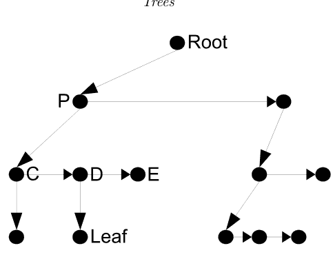

# 使用 Scala 的面向对象、抽象和数据结构

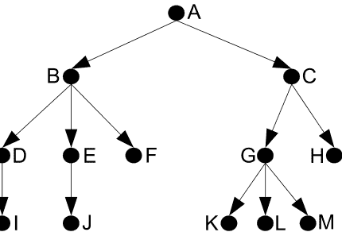

**图 16.3：**此图展示了在图 16.1 和 16.2 中显示的树。所有节点都标记了字母，以便讨论遍历。

如果在处理孩子之前处理父节点，它被称为**前序遍历（PRE-ORDER）**。如果在孩子之后处理父节点，它被称为**后序遍历（POST-ORDER）**。如果在孩子之间处理父节点，它被称为**中序遍历（IN-ORDER）**。我们将逐一介绍这些，并考虑图 16.3 所示树的节点顺序。我们还将考虑为此类遍历编写的代码。

所有的深度优先搜索可以通过相同的方式在树中进行追踪。你从一个节点到它的第一个孩子及其下方所有内容，然后弹出到节点并到下一个孩子。节点并不是在被命中或每次被命中时立即处理/访问，而是在指定的所需遍历时。

前序遍历在处理孩子之前处理父节点，并从左到右处理孩子。对于我们的示例树，这给出了节点的顺序：A, B, D, I, E, J, F, C, G, K, L, M, H。在前序中，父节点始终在孩子之前。因此，根节点最先处理。最右侧最低的将最后处理。我们假设 `Node` 看起来像：

```scala
class Node(data: A, children: Seq[Node])
```

其中 *A* 是存储在树中的数据类型。那么，前序遍历的代码可能如下所示。

```scala
def preorder(n: Node, handler: A => Unit): Unit = {
  if (n != null) {
    handler(n.data)
    n.children.foreach(n2 => preorder(n2, handler))
  }
}
```

`handler` 是一个传入的函数，递归应该在适当的时间调用它。注意，对于前序遍历，它是在递归处理所有孩子之前调用的。可以通过在树的根节点上调用此函数来启动完全遍历。

也可以在孩子之前处理父节点。这产生了后序遍历。我们的示例树的后序遍历具有以下节点处理顺序：I, D, J, E, F, B, K, L, G, H, C, A。在这个排序中，每个节点都出现在其所有后代之后。因此，根节点是最后出现的。左侧最低的元素最先处理。使用上面定义的 `Node` 类，后序遍历可以这样写：

```scala
def postorder(n: Node, handler: A => Unit): Unit = {
  if (n != null) {
    n.children.foreach(n2 => postorder(n2, handler))
    handler(n.data)
  }
}
```

中序遍历在孩子之间处理父节点。对于我们的示例树，这给出了节点的顺序：D, B, I, E, J, F, A, C, G, K, L, M, H。在这个排序中，父节点出现在其孩子之间。中序遍历的实现可能如下所示：

```scala
def inorder(n: Node, handler: A => Unit): Unit = {
  if (n != null) {
    if (n.children.nonEmpty) {
      inorder(n.children(0), handler)
    }
    handler(n.data)
    for (i <- 1 until n.children.length) {
      inorder(n.children(i), handler)
    }
  } else {
    handler(n.data)
  }
}
```

所有的深度优先搜索都可以以相同的方式在树中进行追踪。你从一个节点到它的第一个孩子及其下方所有内容，然后弹出到节点并到下一个孩子。节点并不是在被命中或每次被命中时立即处理/访问，而是在指定的所需遍历时。

代码对某些三角函数和平方根函数提供了支持。它还使用了 `apply` 方法并继承自函数类型，这样生成的公式就可以像函数一样处理。

```scala
package trees.util
```

```scala
import scala.collection.Map
```

```scala
class Formula(val formula: String) extends (Map[String, Double] => Double) with Serializable {
    private val root = Formula.simplify(Formula.parse(formula))

    def apply(vars: Map[String, Double]): Double = root(vars)
    override def toString = formula
}
```

```scala
object Formula {
  val ops = "+-=*//".toSet
```

```scala
def apply(vars: Map[String, Double] = null): Double = {
  val root = parse(vars.filter(_ != ' ')))
  root(vars)
}
```


```scala
private def parse(f: String): Node = {
  var opLoc = -1
  var parentCount = 0
  var i = f.length - 1
  while (i > 0) {
    if (f(i) == '(') parentCount += 1
    else if (f(i) == ')') parentCount -= 1
    else if ((parentCount == 0 && (f(i) == '*' || f(i) == '-')) && ops.contains(f(i))) {
      opLoc = i
      break
    }
    i -= 1
  }
  if (parentCount == 0 && opLoc == -1 && (f(i) == '*' || f(i) == '/')) {
    opLoc = i
  }
  i -= 1
  if (opLoc < 0) {
    if (f(0) == '(') {
      parse(f.substring(1, f.length - 1))
    } else if (f.startsWith("sin")) {
      newSingleNode(parse(f.substring(4, f.length - 1)), math.sin)
    } else if (f.startsWith("cos")) {
      newSingleNode(parse(f.substring(4, f.length - 1)), math.cos)
    } else if (f.startsWith("tan")) {
      newSingleNode(parse(f.substring(4, f.length - 1)), math.tan)
    } else if (f.startsWith("sqrt")) {
      newSingleNode(parse(f.substring(5, f.length - 1)), math.sqrt)
    } else try {
      new NumberNode(f.toDouble)
    } catch {
      case ex: NumberFormatException => new VariableNode(f)
    }
  } else {
    f(opLoc) match {
      case '+' => new BinaryNode(parse(f.take(opLoc)), parse(f.drop(opLoc + 1)), (a: Double, b: Double) => a + b)
      case '-' => new BinaryNode(parse(f.take(opLoc)), parse(f.drop(opLoc + 1)), (a: Double, b: Double) => a - b)
      case '*' => new BinaryNode(parse(f.take(opLoc)), parse(f.drop(opLoc + 1)), (a: Double, b: Double) => a * b)
      case '/' => new BinaryNode(parse(f.take(opLoc)), parse(f.drop(opLoc + 1)), (a: Double, b: Double) => a / b)
    }
  }
}

private def simplify(n: Node): Node = n match {
  case BinaryNode(l, r, op) =>
    val left = simplify(l)
    val right = simplify(r)
    (left, right) match {
      case (NumberNode(n1), NumberNode(n2)) => NumberNode(op(n1, n2))
      case _ => BinaryNode(left, right, op)
    }
  case SingleNode(a, op) =>
    val arg = simplify(a)
    arg match {
      case NumberNode(n) => NumberNode(op(n))
      case _ => SingleNode(arg, op)
    }
  case _ => n
}

private sealed trait Node extends Serializable {
  def apply(vars: Map[String, Double]): Double
}

private class NumberNode(num: Double) extends Node {
  def apply(vars: Map[String, Double]): Double = num
}

private class VariableNode(name: String) extends Node {
  def apply(vars: Map[String, Double]): Double = vars.getOrElse(name, 0.0)
}

private class BinaryNode(left: Node, right: Node, op: (Double, Double) => Double) extends Node {
  def apply(vars: Map[String, Double]): Double = op(left(vars), right(vars))
}

private class SingleNode(arg: Node, op: Double => Double) extends Node {
  def apply(vars: Map[String, Double]): Double = op(arg(vars))
}
```

# 使用 Scala 进行面向对象、抽象和数据结构

这段代码包含一个 `Formula` 类以及一个伴生对象（object），你可以实例化一个 `Formula` 类型的实例，它会解析一次字符串，然后记录树结构以备后续评估。在伴生对象上调用 `Formula` 可能比之前的做法要慢，但保留它是为了处理“一次性”的调用。顶部的导入确保了我们使用的 `Map` 类型是通用的，可以是可变的也可以是不可变的。

伴生对象中第 62-77 行还有另一个名为 `simplify` 的方法。这个方法有两个用途：它有助于优化公式的评估，并且在这个过程中，它可以……

## 树结构

这段代码包含一个 `Formula` 类以及一个伴生对象（object），你可以实例化一个 `Formula` 类型的实例，它会解析一次字符串，然后记录树结构以备后续评估。在伴生对象上调用 `Formula` 可能比之前的做法要慢，但保留它是为了处理“一次性”的调用。顶部的导入确保了我们使用的 `Map` 类型是通用的，可以是可变的也可以是不可变的。

伴生对象中第 62-77 行还有另一个名为 `simplify` 的方法。这个方法有两个用途：它有助于优化公式的评估，并且在这个过程中，它可以……

## 树

### 503

- **中序（In-order）**：`3 * x - 5 + x * x`

中序遍历是公式的原始形式，也是我们习惯看到的格式，但去掉了括号。中序表达式为了获得正确的运算顺序，必须使用括号。前序（Pre-order）版本类似于 LISP 和 Scheme 等语言的语法。在 Scheme 中，这个表达式可以写为 `(+ 3 (- x 5) (* x x))`。同样需要括号来指定运算顺序，但很容易扩展语法，使得任何运算符都可以指定两个以上的操作数。后序遍历（Post-order）正是你输入逆波兰表达式（RPN）计算器的内容，它不需要括号来指定运算顺序。你可能通常不会将方程视为树，但事实证明这种形式非常好地包含了它们的含义，并可以轻松转换为有用的表达式版本。

### 16.3 二叉搜索树：作为 Map 的二叉树

上面的示例是对树的一种极佳运用，也是对树的力量的一种有趣说明。然而，这些结构最常见的用途是存储数据。在本节中，我们将探索二叉搜索树（BST）的细节，将其作为实现 Map ADT 的手段。

ADT 的本质在第 6 章查看 Scala 集合库中内置的类型时已经描述过。Map 简单来说是一个允许通过任意类型的键（keys）查找值的集合。你可以用多种方式实现 Map，例如使用元组的数组或列表，其中元组中的一个值是键，另一个是值。在这种实现中，搜索值需要遍历元素直到找到匹配的键，这使得时间复杂度为 $O(n)$。二叉搜索树允许我们实现一个 Map，其中所有操作的预期性能均为 $O(\log n)$。

二叉搜索树是一种二叉树。这种树的每个节点有 0、1 或 2 个子节点。事实上，可能存在有右孩子而没有左孩子，或者有左孩子而没有右孩子的情况。节点中存储的数据至少包含一个具有完整顺序的键。这意味着对于任意两个节点，你都可以询问哪一个小于、等于或大于另一个。BST 的主要判定标准是：左侧后代的键值较小，右侧后代的键值较大。

“二叉搜索树”的名字让人联想到对数组进行二分搜索。这并非巧合。当我们用它处理元素时，一个良好的 BST 行为会像二分搜索一样。为了理解这一点，我们将考虑一个例子。图 16.5 显示了一个使用 0-9 按照适当 BST 组织结构的示例 BST。**粗体字**表示搜索值 2 时所经过的路径。搜索从根节点开始，在每一步中将要查找的键值与节点中的值进行比较。如果相等，则已找到并可以返回该节点的值。如果在左侧，则移动到节点的左子节点；否则，移动到节点的右子节点。

> 如果键是排序的并且使用了数组，可以通过二分搜索将复杂度降低到 $O(\log n)$，但这样向 Map 添加元素会变成一个 $O(n)$ 操作。
>
> 正如我们很快看到的，还有许多其他的绘制方式。唯一的要求是较小的值在左侧，较大的值在右侧。

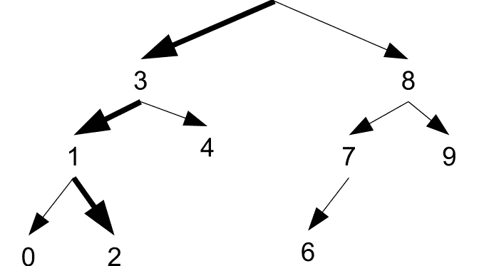

向基础 BST 中添加新元素是非常直接的。如果树是空的，没有根节点；那么我们就用当前元素创建一个新节点并将其设为根。对于任何其他情况，我们从根节点开始，按照搜索相同的方式移动：当新键小于节点中存储的值时向左走，当其大于时向右走。最终，这个过程会到达一个指定方向没有节点的地方。创建一个新节点来存储新值，并将其放置在树的该位置。图 16.6 展示了按顺序添加值 5, 3, 1, 8, 7, 4, 2, 9, 6 的过程。结果是图 16.5 所示的树。注意，添加节点的顺序是非常重要的。虽然其他某些顺序会产生相同的树，但大多数不会。

从 BST 中删除元素的过程比添加复杂一点。考虑我们想要从示例树中删除值为 5 的节点的情况。这恰好是根节点。我们不能简单地把它移掉，因为这会留下两棵树。我们必须采取某种操作来修改树，使得结果仍然是一个 BST。一种方法是将右子树放在左子树的右侧，反之亦然。在这种情况下，这会将 8 放在 4 的右侧，或将 3 放在 6 的左侧。虽然这些方法在技术上是可行的，但远非理想，因为它们倾向于使树失去平衡。我们很快就会看到这如何产生巨大影响。

另一种方法是从较低的节点（该节点较容易删除）移动数据来替换 5。如果节点没有子节点，它们很容易删除。

```scala
object TreeMap {
  def apply[K, V](data: (K, V)*)(comp: (K, K) => Int): TreeMap[K, V] = {
    val tm = new TreeMap[K, V](comp)
    val d = data.sortWith((a, b) => comp(a._1, b._1) < 0).toIndexedSeq
    def binaryAdd(start: Int, end: Int): Unit = {
      if (start < end) {
        val mid = (start + end) / 2
        tm += d(mid)
        binaryAdd(start, mid)
        binaryAdd(mid + 1, end)
      }
    }
    binaryAdd(0, data.length)
    tm
  }
}
```

这里最简单的方法是 `get` 方法。它创建了一个游标器和一个变量来存储比较结果。然后它有一个 `while` 循环，直到找到正确的键或游标器掉到树的底部。使用变量 `c` 来存储比较结果是因为 `comp` 函数的执行开销可能很大，而且我们在每次循环中都需要检查相等性，且至少检查一次不相等性。将结果存储在变量中减少了两次调用次数，且不会显著损害可读性。

用于添加的 `+=` 方法与当前树中的方法相同——这在上面是刻意避免的：当存在重复键时会发生什么？Map ADT（抽象数据类型）设计为对任何给定键只存储一个值。为此，代码用传入的内容替换掉节点。如果 BST（二叉搜索树）处于允许重复键的情况（例如多值映射 multi-map），则必须采取不同的方法。一种方案是让节点存储一个值序列而不是单个值；其他方案（如让相等的值进入右侧）可能会给某些应用带来问题。

迭代器是次简单的。任何遍历方式都可以，但使用中序遍历是有逻辑的，因为对 BST 进行中序遍历会按键的顺序处理节点。虽然编写 BST 的递归遍历很简单，但对于迭代器来说效果不好，因为迭代器需要一次提供一个元素，而不是一次性处理单个调用的所有元素。由于此原因，我们的迭代器需要保持一个栈来记住已经跳过尚未产生的元素。

为了获取中序遍历，我们反复向下推送任何子树的左分支。这是通过 `pushRunLeft` 方法实现的。它在初始化时被调用以设置栈。然后每当弹出节点时，在返回数据元素之前，会在该节点的右孩子上调用该方法。只要栈中包含项，迭代器就不为空。

最后剩下的 `--` 方法实现并不是最高效的，但比更高效的实现容易理解得多。这个版本进一步细分了问题，并包含了两个实际执行工作的嵌套函数。通过递归设置，使得值在函数返回的每个层级进行赋值，从而减少了这些代码的开销。

第一个递归方法是 `findVictim`，它在这里重复出现。它返回父节点（或根节点）应该引用的节点。正如名称所示，该方法的主要目的是找到具有需要删除的键的节点。简单的情况是当函数传入 `null` 节点时。这意味着在遍历树时没有找到任何东西，需要被删除。

```scala
def findVictim(n: Node): Node = {
  if (n == null) null
  else {
    val c = comp(key, n.key)
    if (c == 0)
      if (n.left == null) n.right
      else if (n.right == null) n.left
      else {
        val (key, data, node) = deleteMaxChild(n.left)
        n.left = node
        n.key = key
        n.data = data
        n
      }
    else if (c < 0) {
      n.left = findVictim(n.left)
      n
    } else {
      n.right = findVictim(n.right)
      n
    }
  }
}
```

第二个边界情况是找到了匹配的键。如果左侧或右侧任一为 `null`，则返回另一个，使其成为新的孩子并将匹配的键从树中移除。更具挑战性的情况是匹配节点有两个孩子。在这种情况下，调用另一个方法来寻找替换数据并移除其所在的节点。另外两种情况简单地向左或向右递归。

第二个辅助方法也沿着树向下对节点递归。除了返回应该连接到父节点的 Node，它还返回了子树中最大键的键和数据。注意 `findVictim` 方法在左孩子上调用此方法。

```scala
def deleteMaxChild(n: Node): (K, V, Node) = {
  if (n.right == null)
    (n.key, n.data, n.left)
  else {
    val (key, data, node) = deleteMaxChild(n.right)
    n.right = node
    (key, data, n)
  }
}
```

这里的递归要简单得多，因为它一直运行到找到节点为止。边界情况返回了该节点的键和数据以及其左孩子，即被删除的节点。只要栈中包含项，链接就会放回。通过递归设置，使得值在函数返回的每个层级进行赋值，这对于迭代器一次处理所有元素并不有效。值得注意的是，原始版本的 `get` 检查 `null` 检查了三次，而这个版本只做一次。

```scala
def get(key: K): Option[V] = {
  @tailrec def getter(rover: Node): Option[V] = {
    if (rover == null) None
    else {
      val c = comp(key, rover.key)
      if (c == 0)
        Some(rover.data)
      else if (c < 0)
        getter(rover.left)
      else
        getter(rover.right)
    }
  }
  getter(root)
}
```

用于添加的 `+=` 方法与当前树中的方法相同——这在上面是刻意避免的：当存在重复键时会发生什么？Map ADT 设计为对任何给定键只存储一个值。为此，代码用传入的内容替换掉节点。如果 BST 处于允许重复键的情况（例如多值映射），则必须采取不同的方法。一种方案是让节点存储一个值序列而不是单个值；其他方案（如让相等的值进入右侧）可能会给某些应用带来问题。


迭代器是次简单的。任何遍历方式都可以，但使用中序遍历是有逻辑的，因为对 BST 进行中序遍历会按键的顺序处理节点。虽然编写 BST 的递归遍历很简单，但对于迭代器来说效果不好，因为迭代器需要一次提供一个元素，而不是一次性处理单个调用的所有元素。由于此原因，我们的迭代器需要保持一个栈来记住已经跳过尚未产生的元素。

为了获取中序遍历，我们反复向下推送任何子树的左分支。这是通过 `pushRunLeft` 方法实现的。它在初始化时被调用以设置栈。然后每当弹出节点时，在返回数据元素之前，会在该节点的右孩子上调用该方法。只要栈中包含项，迭代器就不为空。

最后剩下的，这里显示的 `--` 方法实现并不是最高效的，但比更高效的实现容易得多。这个版本进一步细分了问题，并包含了两个实际执行工作的嵌套函数。通过递归设置，使得值在函数返回的每个层级进行赋值，从而减少了这些代码的开销。

第一个递归方法是 `findVictim`，它在这里重复出现。它返回父节点（或根节点）应该引用的节点。正如名称所示，该方法的主要目的是找到具有需要删除的键的节点。简单的情况是当函数传入 `null` 节点时。这意味着在遍历树时没有找到任何东西，需要被删除。

第二个边界情况是找到了匹配的键。如果左侧或右侧任一 `null`，则返回另一个，使其成为新的孩子并将匹配的键从树中移除。更具挑战性的情况是匹配节点有两个孩子。在这种情况下，调用另一个方法来寻找替换数据并移除其所在的节点。另外两种情况简单地向左或向右减少。

第二个辅助方法也沿着树向下对节点递归。除了返回应该连接到父节点的 Node，它还返回子树中最大键的键和数据。注意 `findVictim` 方法在左孩子上调用此方法。

两者 `get` 和 `+=` 都可以使用递归方法，正如我们在 `-=` 中使用的那样。在 `get` 的情况下，代码的复杂度和长度相似。注意的是，原始版本的 `get` 检查 `null` 检查了三次，而这个版本只做一次。

# 树

树的结构通常被描述为平衡或不平衡，取决于左右子树的相似程度。对于平衡树，如果你选择任何节点，左右子树的高度差永远不会超过一个。相反，如果按顺序添加键值，你得到的树是完全不平衡的。

平衡的 BST 在搜索、插入和删除方面具有 $O(\log n)$ 的性能。这是由于所有操作都沿着树的单条路径进行的。在平衡树中，第 $d$ 层的节点数按 $O(2^d)$ 增长，对于 $n$ 个总节点得到 $O(\log n)$，且是良好的平衡。这与二分搜索的相似性并不意外。

因此，理想的树给出最糟糕的树配置 $O(n)$。这些是最好情况（BEST-CASE）和最坏情况（WORST-CASE）。如果按随机顺序将键添加到 BST，生成的树将是良好的，给出 $O(\log n)$ 的平均情况行为。平均情况的系数比最好情况高，但它们是相同的。不幸的是，BST 中产生最坏性能的情况并不罕见。我们已经看到，稀疏或接近有序的数据会导致最坏的情况行为。也可能从一个相当平衡的树开始让它变得不平衡。例如，如果 BST 的用法是移除旧节点并添加新节点，但新节点倾向于高于或低于旧节点的平均值，树可能开始是平衡的，但随着时间的推移会倾斜。这种可能的解决方案在第 21 章中描述。

这些讨论应该清楚为什么文件以一个伴侣对象结束，该对象可以通过对排序数据递归下降来构建树。这确保了生成的树是完美的平衡。当然，这带有对序列排序并转换为索引序列的开销。

## 510 使用 Scala 的面向对象、抽象和数据结构

现在你已经看到 BST 如何用于实现可变 map，那么不可变的 map 呢？要实现这一点，使用与上面非常相似的方法。

# 512 使用 Scala 的面向对象、抽象和数据结构

不可变链表已经处理完毕。不可变映射本身的类型通过重定义方法来实现，以确保返回的是更具体的类型。节点（node）和空树（empty tree）都有子类型。后者是这种可能的实现方式：

```scala
package trees.adt
abstract sealed ImmutableTreeMap[K <: Ordered[K], +V] extends Map[K, V] {
  def +[B : :V](k: (K, B)): ImmutableTreeMap[K, B]
  def -(k: K): ImmutableTreeMap[K, V]
}
```

```scala
private class Node[K <: Ordered[K], +V](
  private val key: K,
  private val data: V,
  private val left: ImmutableTreeMap[K, V],
  private val right: ImmutableTreeMap[K, V]
)
```

```scala
def +[B : :V](k: (K, B)) = {
  if (kv._1 == key) new Node(kv._1, kv._2, left, right)
  else if (kv._1 < key) new Node(key, data, left, left + right)
  else new Node(key, data, left, right + kv)
}
```

```scala
def -(k: K) = {
  if (k == key) {
    left match {
      case _: Empty[K] => right
      case i: Node[K, V] => {
        right match {
          case _: Empty[K] => left
          case _: =>
            val (k, d, newLeft) = i.removeMax
            new Node(k, d, newLeft, right)
        }
      }
    }
  } else if (k < key) {
    new Node(key, data, left - k, right)
  } else {
    new Node(key, data, left, right - k)
  }
}
```

```scala
def get(k: K): Option[V] = {
  if (k == key) Some(data)
  else if (k < key) left.get(k)
  else right.get(k)
}
```

```scala
iterator = new Iterator[(K, V)] {
  val stack = new linkedlist.adt.ListStack[Node[K, V]]
  pushRun(Node.this)
  def hasNext: Boolean = !stack.isEmpty
}
```

# 树

# 513

```scala
def next: (K, V) = {
  val n = stack.pop()
  pushRunLeft(n.right)
  n.key -> n.data
}
def pushRunLeft(n: ImmutableTreeMap[K, V]) = {
  match n {
    case e: Empty[K] =>
    case i: Node[K, V] =>
      stack.push(i)
      pushRunLeft(i.left)
  }
}
private def removeMax:(K, V, ImmutableTreeMap[K, V]) = {
  match right {
    case e: Empty[K] => (key, data, left)
    case i: Node[K, V] =>
      val (k, d, r) = i.removeMax
      (k, d, new Node(key, data, r))
  }
}
private class Empty[K <: Ordered[K]] extends ImmutableTreeMap[K, Nothing] {
  def +[B](kv: K, B) = {
    new Node(kv._1, kv._2, this)
  }
  def -(k: K) = {
    this
  }
  def get(k: K): Option[Nothing] = {
    None
  }
  def iterator = new Iterator[(K, Nothing)] = {
    def next = false
    def next = null
  }
}
object ImmutableTreeMap {
  def apply[K <: Ordered[K]](data: (K, V)*): (comp: (K, K) => Int): ImmutableTreeMap[K, V] = {
    val empty = new Empty[K]()
    val d = data.sortWith((a, b) => comp(a._1, b._1) < 0)
    def binaryAdd(start: Int, end: Int): ImmutableTreeMap[K, V] = {
      if (start < end) {
        val mid = (start + end) / 2
        new Node(d(mid)._1, d(mid)._2, binaryAdd(start, mid), binaryAdd(mid + 1, end))
      } else empty
    }
    binaryAdd(0, data.length)
  }
}
```

# 使用 Scala 的面向对象、抽象和数据结构

这里的大部分代码位于 `Node` 类中。这段代码与我们之前的可变版本相似，但有一些值得注意的区别。一个很大的区别是代码中没有循环。相反，所有操作都是通过递归完成的。此外，与其检查空值，而是使用了匹配 `Empty` 的模式匹配。这棵树不包含空引用，相反，使用 `match` 是 Scala 中确定类型的正确风格。虽然有 `isInstanceOf[A]` 和 `asInstanceOf[A]` 方法，但强烈不建议使用它们，因为它们通常会导致运行时错误。

`Empty` 类型非常简单，但我们仍然创建了它，因为它简化了递归并精简了代码，避免了处理树的分支。这种树不包含空引用，相反，使用 `match` 是 Scala 中确定类型的正确风格。虽然有 `isInstanceOf[A]` 和 `asInstanceOf[A]` 方法，但强烈不建议使用它们，因为它们通常会导致运行时错误。


# 使用 Scala 的面向对象、抽象和数据结构

## 树

`Empty` 类型非常简单，但我们仍然创建了它，因为它简化了递归并精简了代码，避免了处理树的分支。这种树不包含空引用，相反，使用 `match` 是 Scala 中确定类型的正确风格。虽然有 `isInstanceOf[A]` 和 `asInstanceOf[A]` 方法，但强烈不建议使用它们，因为它们通常会导致运行时错误。

## 16.4 章节结束

### 16.4.1 概念总结

- 树是一个由节点和边组成的结构，边从一个节点指向另一个节点。根节点没有边。
- 描述树的术语是生物性的。
- 父节点有一条指向子节点的边。
- 同一父节点的节点被称为兄弟。
- 节点下方的所有内容被称为后代，而上方被称为祖先。
- 没有子节点的节点被称为叶子。
- 从根节点向下边的数量是深度。
- 从最底部叶子向上边的数量是高度。
- 后代数量加上自身是节点的大小。
- 有多种遍历树的方法。
- 深度优先遍历在处理兄弟之前处理孩子。
  - 使用递归实现。
  - 前序：在处理孩子之前处理节点。
  - 后序：在孩子之后处理节点。
  - 中序：在孩子之间处理节点。这对于每个节点最多两个子节点的树最合适。
- 广度优先遍历在进入下一层之前遍历整个生成。这需要用循环和队列来实现。
- 树使得表示解析后的公式非常方便。之前编写的递归解析代码可以很容易修改为生成这种结构。树结构比解析字符串快得多。
- 二叉搜索树（BST）是在键类型具有完全排序时存储数值的有效结构。我们可以用它来实现映射 ADT。
  - BST 中的每个节点可以有一个左子或一个右子。
  - 左子节点的键必须小于父节点的键，右子节点的键必须大于父节点的键。
- 在平衡树中，获取、添加和删除操作可以在 `O(log n)` 内完成。
- 标准 BST 可以退化为链表。这种高度不平衡的树会导致 `O(n)` 行为。

> 附录请访问：`http://www.programmingscala.net`。

### 16.4.2 练习

1. 测试上一章节的递归解析评估方法与本章构建树的方法之间的相对速度。修改上一章节的代码以包含变量，并在公式上运行足够次数，直到看到你的机器停顿。使用树版本重复相同的操作。
2. 增强 `simplify` 方法以包含以下简化：
   - 加 0 简化为另一个值。
   - 减 0 简化为另一个值。
   - 乘以 1 简化为原值。
   - 除以 1 简化为原值。
   - 乘以 0 简化为 0。
   - 分子为 0 的除法 0。
   为了增加挑战，你可以尝试识别其他的简化情况并实现它们。
3. 为公式添加一个方法，用于返回该节点的导数。根据我们已有的操作，这可能只需要记住乘法法则和除法法则。
4. 结合练习 2 和 3，让你拥有一个导数方法，该方法可以尽可能地简化表达式。
5. 修改 `TreeMap` 的 `-=` 方法，使其不再是递归的，并在子节点实际发生变化时重新分配引用。确保你测试了代码，以确保处理了所有可能的情况。当你认为它能够正常工作后，将代码复杂性和执行速度与递归解决方案进行比较。

### 16.4.3 项目

1. 如果你正在编写一个 MUD（多用户地下城），你应该使用基于 BST（二叉搜索树）的房间 Map，而不是库中的 Map。
2. 如果你正在编写网络爬虫，请创建站点树并以图形化方式显示。允许用户指定哪个页面作为根节点。在其他页面中链接，使得深度成为从根节点开始的最小计数。如果从根可以通过相同的计数到达某个页面，则优先选择深度最小页面中较早出现的那个。
3. 如果你正在编写图形化游戏，使用基于 BST 的 Map 作为你快速查找或跳转到游戏不同元素的方法。
4. 如果你正在做数学工作表，本章为你提供了将公式解析为求值树的能力，这可以大大提高处理速度。你还可以将树作为符号操作的手段。你会希望为这项工作找到简化方法，但你可以轻松地编写代码对树求导并生成一个新树。再花一点精力，你可以编写代码对某些函数求导/定积分。请注意，并非所有函数都有闭式形式的反导，因此某些情况将无法实现。
   如果你在寻找更大的挑战，请尝试进行符号积分并以合逻辑的方式对其进行简化。
5. 表达式树还可以用于生成 Photoshop 程序中的过滤器。你可以通过指定一个用于组合当前像素周围像素颜色的函数，赋予用户创建自定义过滤器的能力。考虑到任何真实图像中的像素数量，如果我们使用早期的字符串解析评估将是不可接受的。基于树的评估使其变得可行。你可以决定使用何种语法让用户指定不同的相邻 RGB 值。
6. 对用户输入公式的快速评估也为仿真工作台项目提供了显著收益。你可以使用自定义力来指定粒子相互作用的力函数，或作为离散事件模拟随机数生成的一部分。
7. 对于股票项目，将你库中的 Map 替换为你编写的 BST-Map。
8. 对于电影项目，将你库中的 Map 替换为你编写的 BST-Map。
9. 对于 L-systems 项目，将你库中的 Map 替换为你编写的 BST-Map。

---

# 第 17 章 正则表达式与上下文无关解析器

解析文本是在不同程序中都会出现的任务，无论是从文件中提取数据、处理用户命令、评估公式还是理解编程语言，在处理文本时通常需要某种形式的处理。我们到目前的方法相当是随机的。面对特定格式的输入时，我们编写了专门的代码来处理它：使用内置解析器处理格式化为 XML 的文件，使用库解析器处理 JSON，这两者都是标准格式。在本章中，我们将学习计算机科学家开发的、用于处理文本解析的一些正式方法。这些方法将使你能够轻松且灵活地处理更复杂的文本输入形式。

## 17.1 乔姆斯基文法 (Chomsky Grammars)

我们的讨论从理论基础开始。支撑本章讨论内容的文法层级体系，以及计算机科学中大量的语言理论，出现在由语言学家诺姆·乔姆斯基（Noam Chomsky）写的一篇文章中并由 Marcel-Paul Schützenberg 共同开发 [4]。

在形式意义上，一个乔姆斯基文法由四个元素组成：

- 一组非终结符号，通常用大写字母表示
- 一组有限的终结符号，通常用小写字母表示
- 一组有限的产生规则，每个规则都有一个左侧和一个右侧，由这些符号组成
- 一个标记为起始符号的特殊非终结符，通常是字符 `S`

每个文法定义了一种语言，即该文法生成的所有终结符号字符串。字符串的生成方式是将产生规则左侧的字符串部分转换为该产生规则的右侧。在任何时候，都可以为当前字符串中的任何符号或符号序列选择任何产生规则。这个过程一直持续，直到只剩下终结符号。

为了说明这一点，考虑一个具有集合 `S, A, B` 为非终结符，`S` 为起始符号，`a, b` 为终结符，以及以下产生规则的文法：

```
S → AB
A → aA
A → a
B → bB
B → b
```

为了查看该文法生成的语言，我们可以运行一系列产生规则来生成一个字符串：

```
S → AB
AB → aA
aAB → aA
aaAB → bB
aaAB → a
aaab → b
aaabb
```

如果你使用这个文法运行一段时间，你应该能看到它生成的语言是一个一个或多个 `a` 符号后跟一个或多个 `b` 符号。

为了简洁起见，当同一个左侧可以产生多个右侧值时，通常是将它们列在同一行，并使用竖线（`|`）隔开。这可以将产生规则集简化为如下形式：

```
S → AB
A → aA | a
B → bB | b
```

### 17.1.1 正则文法

在正则文法中，所有的产生式都具有以下形式：单个非终结符指向一个终结符（`A → a`），或者单个非终结符指向一个终结符和一个非终结符（`A → aB`）。对上述示例文法进行细微修改，我们可以产生一个生成相同语言的正则文法。

```
S → aS | B
B → bB | b
```

使用此文法运行一些示例，向你自己证明它生成的是一个或多个 `a` 符号后跟一个或多个 `b` 符号的语言。

由于这些规则的限制，字符串在正则文法下的演变非常直观。在任何时刻，只有一个非终结符，且它是字符串中的最后一个符号。所有的产生式都通过在非终结符前面插入一个新的非终结符来增加字符串长度，或者通过用终结符替换非终结符并结束过程。

尽管有这些局限性，正则文法仍然相当强大。它们的主要限制是没有任何记忆。例如，不可能构造一个正则文法来生成具有特定数量 `a` 符号后跟相同数量 `b` 符号的语言。我们称之为 `a^n b^n`。这是因为系统没有关于它生成了多少符号的记忆，无法强制要求 `b` 符号的数量匹配。通过使用多个非终结符，可以构造一个匹配特定数量的 `a` 和 `b` 符号的文法，但任何有限的正则文法都无法对任意的 `n` 值做到这一点。

### 17.1.2 上下文无关文法

乔姆斯基层级中的上一级是上下文无关文法。上下文无关文法的产生式左侧是单个非终结符，右侧是任意终结符和/或非终结符的字符串（`A → γ`）。右侧的字符串可能是空字符串，通常写为 `ε`。

上下文无关文法在根本上比正则文法更强大的事实，可以通过以下示例文法看出。非终结符集包含起始符号 `S`。终结符集为 `a, b`。产生式为 `S → aS | ab`。花不了多久就能确信该文法生成 `n ≥ 1` 的语言 `a^n b^n`。上下文无关文法可以做到这一点，因为它们拥有以栈形式存在的有限记忆。由于栈的局限性，没有任何上下文无关文法可以生成语言 `a^n b^n c^n`。这是因为确保有 `n` 个符号的工作消耗了栈的内容，且无法产生（对应数量的）`c` 符号。

“无项（term-free）”一词指示了这些文法的局限性。虽然可以拥有产生任何你想要内容的产生式，但产生式的性质不能取决于出现在左侧的非终结符的上下文。尽管有此局限性，上下文无关文法在计算机科学领域极其有用。编程语言的语法通常被规定为上下文无关文法。在这种情况下，符号是语言的标记（tokens）。绝大多数自然语言也可以由上下文无关文法生成。

### 17.1.3 上下文相关文法

层级中的下一步揭示了另一个局限性：产生式的选择不能依赖于非终结符周围的环境。规则的通用形式为 `αAβ → αγβ`，其中 `α, β` 和 `γ` 是终结符和非终结符的任意字符串，且可能为空。注意，`α` 和 `β` 并不参与产生。相反，它们限制了产生式的应用时机。

上下文相关文法的处理起来比上下文无关文法困难得多，而且需要上下文相关性的应用次数相当有限。因此，我们不会详细介绍它们的用法。

### 17.1.4 递归枚举文法

乔姆斯基层级中分类能力最强的文法类是递归枚举文法集。其左侧没有任何限制，右侧可以是你任何想要的内容。这类文法中真正引人注目的之处在于它是一个完整的计算模型。在图灵机或 lambda 演算的理论意义上，任何可计算的东西都可以通过设计恰当的递归枚举文法来计算。这些特性的意义是深远的。这意味着，如果你愿意花时间这样做，你可以使用递归枚举文法重写你为本书或其他地方编写的任何程序。诚然，它可能不会自然地处理图形或进行跨网络通信，尽管你想出了如何解释字符串部分以实现这些功能的标准，但你可以做到这些事情。

这段对乔姆斯基文法和乔姆斯基层级的简要介绍为本书的后续内容提供了基础。这是一个广泛得多的话题，感兴趣的读者应该对该主题进行更多探索。至少，一门良好的计算机科学理论课程应该比这里介绍的详细得多涵盖这些主题。

## 17.2 正则表达式

计算机科学的理论基础出于多种原因极其重要，它们在在该领域的重大发展中起着重要作用。本书的主要重点是解决问题和编程技能的发展。由于原因，我们现在关注文法和语言更实际的应用，从正则表达式开始。

顾名思义，正则表达式与正则文法相关。它们提供了一种简单的匹配和解析机制。正则表达式通常以字符串形式编写，具有特殊含义。正则表达式是许多工具的特性非常强大。

### 17.2.1 字符与字符类

你之所以能够在程序中使用正则表达式而不知道自己正在使用它们，是因为正则表达式中的大多数字符的作用就像普通字符一样。所以正则表达式 `"Fred"` 匹配字符串 `"Fred"` 而不是其他内容。假设你想在 Scala 程序中找到所有对对象调用的方法调用。我们使用 `.` 来搜索方法。以下是尝试在 `Drawing.scala` 文件上进行此类操作的部分输出。

```
grep ing src/recursion/drawing/Drawing.scala
```

```
object Drawing extends JFXApp {
  private var drawings = List[Drawing, TreeView[Drawable]]](())
  val system = ActorSystem("DrawingSystem")
  private val creators = Map[String, Drawing] = Drawable[(
    "Rectangle" -> (drawing => DrawRectangle(drawing, 0, 300, 300, Color.Blue)),
    "Transform" -> (drawing => DrawTransform(drawing)),
    "Text" -> (drawing => DrawText(drawing, 100, 100, "Text", Color.Black)),
    "Maze" -> (drawing => DrawMaze(drawing)),
    "Mandelbrot" -> (drawing => DrawMandelbrot(drawing)),
    "Julia Set" -> (drawing => DrawJulia(drawing)),
    "Cell Simulation" -> (drawing => DrawCellSim(drawing, 300, 300, 200, 1.0, 10)),
    "Bouncing Balls" -> (drawing => DrawBouncingBalls(drawing)),
    "Graph" -> (drawing => DrawGraph(drawing))
  )title = "Drawing Program"
  val acceptItem = new MenuItem("Accept Drawings")
  val sendItem = new MenuItem("Send Drawing")
  val shareItem = new MenuItem("Share Drawing")
}
```

```scala
scala val str = "This is a string"
str:java.lang.String = "This is a string"

scala val regex = "This is a regular expression."
regex: scala.matching.Regex = This is a regular expression.
```

显然，这找到了我们想要的所有内容，但它也匹配了许多其他不包含句号的内容。这是因为在正则表达式中，句号 `.` 是一个通配符，可以匹配任何字符。所以我们真正想要的是任何以 "ing" 开头的四个字符序列。为了强制让句号只匹配句号本身，我们需要在正则表达式中的所有特殊字符前面加上一个反斜杠 `\`，你可以通过在这些字符前面加上反斜杠来强制它们被视为普通字符串。在 Scala 中，普通字符串将反斜杠视为转义字符，这一事实在处理正则表达式时变得非常重要。因此，使用三引号（即原始字符串字面量）是标准做法。

句号实际上是正则表达式中许多**字符类**（CHARACTER CLASSES）之一。字符类只要来自右侧的集合就可以进行匹配。对于句号来说，该集合是任意字符。你可以通过在方括号中放入你想要的字符来创建自己的字符类。`[abc]` 将匹配 'a'、'b' 或 'c'。一个稍微复杂点的例子是正则表达式 `b[aeid]`，它将匹配 "bad"、"bed" 或 "bid"。对于 ASCII 中连续的字符，可以使用连字符 `-`。如果你将 `^` 放在方括号的第一个，该字符类将匹配指定以外的任何字符。因此 `[^iou]` 将匹配任何非小写元音的字符。这一切意味着，如果你想将正则表达式中的特殊字符用于定义字符类以外的用途，可以使用反斜杠对它们进行转义。这对于某些用法以及字符类内部的减号/连字符也是如此。

某些字符类被频繁使用，因此它们有简写名称。除了句号之外，Java 正则表达式库还定义了以下内容。

如果你花费大量时间处理正则表达式，这些字符类将过目于心。

### 17.2.2 逻辑运算符和捕获组


你已经见过了相邻另一个字符序列的字符或字符组。因此，正则表达式 `cat` 可以读为 'c' 和 'a' 和 't'。字符类可以使用于任何需要单个字符的地方。如果说相邻表示“与”（and），那么如何表示“或”（or）呢？使用单个管道符号 `|`。因此，正则表达式 `cat|dog` 将匹配 "cat" 或 "dog"。与逻辑表达式一样，“与”操作的优先级高于“或”操作。

> ³ 在某些情况下，句号不会匹配换行符。

> ⁴ 像 Scala 中的普通字符串字面量一样，Linux 命令行对反斜杠视为特殊。因此，你必须在命令行中包含两个反斜杠才能生效。

> ⁷ 希望读者能注意到，不同工具用于表达相似思想的符号之间存在某些相似。

## 正则表达式与上下文无关解析器

正则表达式的章节可以使用括号进行分组。这让你能够控制你所取进行“或”操作的正则表达式部分，例如 `a(bcde)f`。它还允许你为下一节中的量词将部分打包。最后，它还允许你捕获匹配的章节。当你在正则表达式中放置括号时，你就定义了一个捕获组。代码会跟踪字符串中所有位于括号内的部分，你可以将它们提取出来。这些组从 1 开始编号，并根据左括号的位置进行排序。组的长度或它们如何嵌套并不重要，关键只取决于左括号的位置。

考虑一个格式为 `(xxx) yyy-zzzz` 的简单电话号码示例，你想捕获由不同字母表示的每个组，并独立捕获号码的 7 位部分。为了做到这一点，你会使用正则表达式 `\((\d)(\d)(\d)\) (\d)(\d)(\d)-(\d)(\d)(\d)(\d)`。这个正则表达式包含四个捕获组。第一个是区码。第二个是 7 位电话号码。第三组和第四组是 7 位数字的子部分。它们根据出现的顺序进行编号。这里是一些正则表达式，并附有子表达式以以便清晰：`\((\d)(\d)(\d)\) (\d)(\d)(\d)-(\d)(\d)(\d)(\d)`。这个示例正则表达式还说明了由于括号是用于分组的特殊字符，如果你想匹配括号，就必须对它们进行转义，正如区码周围转义的括号所要求的那样。

## 17.2.3 贪婪量词

正则表达式的很大威力来自于量词。量词允许你控制表达式出现的次数。默认量词被称为“贪婪的”（greedy）的，因为它们在允许模式能够被匹配的同时，尽可能匹配尽可能多的字符。贪婪量词有六种选择。

- `X?` - 匹配模式 X 或无。可以理解为 0 次或 1 次。
- `X*` - 匹配无或重复任意次数的模式 X。可以理解为 0 次或多次。
- `X+` - 匹配模式 X 1 次或多次。
- `X{n}` - 匹配模式 X 重复 n 次。
- `X{n,m}` - 匹配模式 X 重复 n 次但不超过 m 次。

电话的正则表达式可以用量词表示为 `\(\d{3}\) (\d{3})-(\d{4})`。这些量词还允许我们表达 17.2 节中描述的语法的语言。例如，`\d{3}` 匹配三个数字。

# 正则表达式与上下文无关解析器

`matchData` 返回一个 `Iterator[Match]` 迭代器。将这些结合起来，我们可以获取一段包含多个电话号码的文本，使用我们创建的正则表达式提取出电话号码的部分。

```scala
scala> val phoneNumbers = """For help you can try to the following numbers:
  | Main line: (123) 555-4567
  | Secondary line: (123) 555-7022
  | Fax: (123) 555-5847"""
phoneNumbers: String = """For help you can try to the following numbers:\n  Main line: (123) 555-4567
  Secondary line: (123) 555-7022
  Fax: (123) 555-5847"""
```

```scala
scala> val phoneRegex = """\((\d{3})\) (\d{3})-(\d{4})"""
phoneRegex: scala.util.matching.Regex = """\((\d{3})\) (\d{3})-(\d{4})"""
scala> for (m <- phoneRegex.findAllIn(phoneNumbers).matchData) {
  | println(m.group(1) + " " + m.group(3) + " " + m.group(4))
}
123 555 4567
123 555 7022
123 555 5847
```

`for` 循环遍历通过对 `findAllIn` 的结果调用 `matchData` 产生的 `Matches`。从每个匹配项中打印索引为 1、3 和 4 的分组。

希望你已经清楚了正则表达式的使用使得这种模式的编写变得容易得多，而不需要编写复杂的正则表达式。如果使用我们涵盖过的其他技术，在该文本中查找电话号码将相当具有挑战性。电话号码具有定义良好的格式，但它们并不是我们可以直接搜索的特定序列。

`replaceAllIn` 方法的第二个参数是一个函数，该函数返回一个 `String`，用于替换第一个参数中的匹配文本。我们可以使用以下代码来替换电话号码，将它们的最后四位替换为字符 'x'。

```scala
scala> phoneRegex.replaceAllIn(phoneNumbers, m => {
  | "" + m.group(1) + " " + m.group(3) + " xxxx"
  | })
res1: String = """For help you can try to the following numbers:\n  Main line: (123) 555-xxxx
  Secondary line: (123) 555-xxxx
  Fax: (123) 555-xxxx"""
```

传入匹配项（`match`）使你能够利用 `Match` 实例的细节来确定替换字符串。在这种情况下，我们想要保留前六位数字，因此在结果中使用了分组 1 和 3。再次，如果你仔细想一想使用其他技术进行这种转换需要什么，你就会感激正则表达式所提供的威力。

在 Scala 中使用正则表达式的另一种方法是：模式（patterns）。我们之前已经见过使用元组、数组和列表的模式。它们可以与正则表达式正常工作。

> 尽管我们没有介绍它，但 Scala 也支持针对 XML 的模式匹配。

# 使用 Scala 进行面向对象、抽象和数据结构

很好。当正则表达式被用作字符串的匹配时，它会提取分组，并且只有在字符串存在匹配时才有效。以下代码可以放入 `Commands.scala` 文件中，替换我们在第一次 `split` 之前使用的传统字符串解析代码。

```scala
val commandSplit = """\s*(\w+)\s+(.*)\s*""".r

def apply(input: String, drawing: Drawing): Any = {
  val commandSplit(command, rest) = input
  if (commands.contains(command)) commands(command)(rest, drawing)
  else "No valid command"
}
```

这实现了我们之前调用 `indexOf` 的功能，但这段代码更健壮，因为它处理了空格，特别是领先空格。在旧代码中，如果用户在命令前输入内容，而我们没有在传递给命令处理器之前进行修剪（trim），就会失败。通过在开头使用 `\s*` 解决了这个问题。

正则表达式模式最有用的地方是在循环中。记得在 `for` 循环中你输入的 `<-` 被匹配为 `val` 模式。任何不匹配的内容都会被跳过。如果你正在处理一个字符串集合，其中某些字符串可能不是你寻找的，那么这对正则表达式来说非常有帮助。

为了看到这一点，假设有一个文件，其中某些行有编号，另一些行没有。对于第一个非空格字符，是数字后跟着一个点。这个点是你关心的文本。你想构建一个 `Map[Int, String]`，根据行首的数字快速查找该行的文本。以下代码将为你完成此任务。

```scala
val NumberLine = """(\d+)\.(.*)""".r
val source = io.Source.fromFile(fileName)
val lines = source.getLines()
val numbered = (for (NumberLine(num, text) <- lines) yield {
  num.toInt -> text
}).toMap
source.close()
```

循环只会对匹配模式的行执行，并跳过任何不匹配的内容。这使得代码紧凑且易于维护。

# 17.2.6 正则表达式的缺点

正则表达式的主要缺点是它们可能是晦涩的，且在某些程度上难以维护。事实上，像 Perl 这样的语言通常被认为难以阅读。

# 17.3 上下文无关解析器

如果你需要解析超出正则表达式能力的文本，你有哪些选择？Scala 包含了 `scala.util.parsing` 包，它有许多子包。我们可以使用 `scala.util.parsing.combinator` 包，它赋予了我们解析上下文无关文法的能力。

数学家倾向于使用单个字母或符号命名。为了说明这一点，我们将回到最后两个章节中使用的公式解析示例。基础数学表达式的 CF 语法仅使用我们使用的四个主要运算符即可编写。

```
form ::= term (("+" | "-") term)*
term ::= factor (("*" | "/") factor)*
```

在这种表示法中，括号表示可以重复的元素。也可以使用方括号来表示可选内容。

（此处省略）

同样值得注意的是，该语法确保了正确的运算顺序，因为 `*` 和 `/` 的绑定优先级高于 `+` 和 `-`。

使用组合式解析器库，这直接连接到 Scala 代码。

```scala
object Formula extends JavaTokenParsers {
  def form: Parser[Any] = term ~ rep("+" | "-") ~ term
  def term: Parser[Any] = factor ~ rep("*" | "/") ~ factor
  def factor: Parser[Any] = floatingPointNumber | "(" ~ form ~ ")"
}
```

> 技术上，这些包对可以解析的文法是有限制的，但并不是理论上的限制。文法只需要以有利于解析的方式编写即可。这些细节超出了本书的范畴。

> 组合式解析器库是另一个在 Scala 2.11 中被拆分为独立模块的库。因此，如果默认没有包含，你可能需要将其添加到你的项目中。

原始语法法中的每个产生式（production）都变成一个返回 `Parser` 的方法，该类位于 `scala.util.parsing.combinator.Parsers` 内部。目前，它是一个完全通用的 `Parser[Any]`，但我们将看到如何修改它。原始语法法中的连续符号使用 `~` 运算符连接。大括号被替换为 `rep` 的调用。如果存在方括号，它们将被替换为 `opt` 的调用。还有一种名为 `|` 的方法可用于交替产生式。这包括像逗号分隔列表的内容，其中解析器不包含你需要且可以查看的信息。

使用这些规则，你可以轻松地获取任何感兴趣的上下文无关文法（CF grammar）并为其构建解析器。在本示例中，你可以通过 `JavaTokenParsers` 调用 `parseAll` 方法来使用这些解析器之一¹¹。以下代码将执行此操作，并打印解析器输出的值。

```scala
println(parseAll(form, "3*5*2"))
```

### 17.3.1 默认输出

如果你在程序中放置一行代码并运行它，你将得到以下输出：

```
[3.2, List((*,5.0), (*,2.0))]
```

字符串解析成功了，但输出有点难以理解。为了做到这一点，我们需要知道解析器元素的默认输出是什么：

*   String 或表达式 - 返回匹配为 String 的测试结果。
*   `P ~ Q` - 返回 `~`(p, q)，其中 p 是 P 的匹配项，q 是 Q 的匹配项。
*   `rep(P)` - 返回匹配项列表：`List(p1, p2, p3, ...)`。
*   `repsep(P, Q)` - 返回匹配项列表：`List(p1, p2, p3, ...)`。注意 Q 可以是完整的解析器，输出会被忽略。这就是为什么它被用于逗号分隔列表等情况，因为你不在乎分隔符。
*   `opt(P)` - 返回匹配的 `Option`。如果可选部分未被使用，你得到 `None`。否则你得到 `Some(p)`。

利用这些信息和原始语法法，你可以推导出此解析器是如何产生该输出的。

### 17.3.2 指定输出

虽然默认输出提供了解析的完整信息，并且你可以通过 `match` 语句来提取所需信息，但为你的解析器指定自己的输出通常更有用。这是通过 `^~` 方法实现的（注：原文为 `~~`，Scala 标准库中通常为 `^~` 或 `map`）。`Parser[T]` 中 `^~` 的签名是 `def ^~[U](f: T => U): Parser[U]`：它接受一个函数，将此解析器的数值输出转换为任何其他类型 `U`，并返回一个 `Parser[U]`。

我们可以使用上面编写的解析器来确保它返回的是数值解，而不是上面的默认输出。执行此操作的第一步是：

¹¹此示例使用 `JavaTokenParsers` 是因为 `floatingPointNumber` 是在那里定义的。它定义了 `ident`，我们将将其用于标识符名称。

将各种产生式的返回类型改为 `Parser[Double]`。这将引入错误，我们可以通过添加适当的转换来修复它们。生成的代码如下：

```scala
object Formula extends JavaTokenParsers with App {
  def form: Parser[Double] = term ~ rep(("+" | "-") ~ term) ^^ {
    case t ~ lst => lst.foldLeft(t)((n, opTerm) => if (opTerm._1 == "+") n + opTerm._2 else n - opTerm._2)
  }
  def term: Parser[Double] = factor ~ rep(("*" | "/") ~ factor) ^^ {
    case f ~ lst => lst.foldLeft(f)((n, opFactor) => if (opFactor._1 == "*") n * opFactor._2 else n / opFactor._2)
  }

  def factor: Parser[Double] = floatingPointNumber ^^ (_.toDouble) | "(" ~> form <~ ")"
}

println(parseAll(form, "3*5*2"))
```

此示例最简单的应用是展开的 `floatingPointNumber`。即一个 `Parser[String]`，正常输出是一个 String，我们可以通过调用 `toDouble` 将其转换为 Double。另外两个产生式后面跟着部分函数，这些函数被转换为完整函数。每一个都有一个匹配分支，后跟一个类型和一个 `List`。该 `List` 将是 `rep` 的结果，是一个 `List[(String, Double)]`。为了得到答案，我们需要对一个值运行累加器以及运算符之后的值。这可以通过 `foldLeft` 简短地完成。注意，它支持中缀模式匹配，并具有类似于元组的 `._1` 和 `._2` 方法来获取第一个和第二个元素。

`factor` 的解析器使用了 `~>` 和 `<~` 运算符。这些运算符提供了一种忽略输出中匹配部分的快捷方法。没有它们，我们必须使用带有 `~` 运算符和一个提取括号并丢弃该分支的函数。不过，没有它们代码会更简单。

通过这些更改，你可以运行此程序并现在看到输出是 `13.0`。与我们处理这些操作的原始递归解析器相比，发现这要短得多。然而，对于任何不熟悉 CF 文法或组合器解析器的人来说，这完全是晦涩的。

当然，组合器解析器还有许多其他选项和可能性。通过查看 `scala.util.parsing.combinator.Parsers` 和 `scala.util.parsing.combinator.Parser` 等类的 API，可以让你快速了解一些可能性。这之前是一个 JSON 解析器。

## 17.4 项目集成

现在是把所有内容整合在一起了，包括上一章的一些概念。`Formula` 类可以扩展为解析树而不是 `Double`。为了展示组合器解析器的威力，这种实现将只包含基础数学运算和一些额外的。这些特性带来了挑战。显示是左结合，而其他运算符是右结合。为了有 `if`，我们必须比较返回布尔值的运算符。我们要尝试实现的语法法是：

```
cond ::= "if" form "else" cond
form ::= term (("+" | "-") term)*
term ::= factor (("*" | "/") factor)*
exp ::= factor ("^" exp)?
factor ::= floatingPointNumber | "(" form ")" | ident
```

结果是如下代码：


```scala
package parser

import scala.util.parsing.combinator

class Formula(formula: String) {
  private val root = Formula.parseAll(formula).get

  def apply(vars: Map[String, Double]): Double = root(vars)

  override def toString: String = formula
}

object Formula extends JavaParsers {
  def apply(f: String) = new Formula(f)

  def eval(vars: Map[String, Double]): Double = new Formula(f)(vars)

  private def cond: Parser[Node] = "if" form "else" cond ~ {
    case lst: List[Node] => IfNode(lst.head, lst.tail)
  } | form

  private def form: Parser[Node] = rep ("+" | "-") term ~ {
    case lst: List[Node] => LeftAssociativeBinaryNode(lst.head, lst.tail)
  }

  private def term: Parser[Node] = rep ("*" | "/") exp ~ {
    case lst: List[Node] => LeftAssociativeBinaryNode(lst.head, lst.tail)
  }

  private def exp: Parser[Node] = func
}
```

private trait DNode {

  def apply(vars: Map[String, Double]): Double

}

private trait BNode {

  def apply(vars: Map[String, Double]): Boolean

}

private class LeftAssociativeBinaryOpNode(first: DNode, restStr: List[String, DNode]) extends DNode {

  val rest = for ((op, n) <- restStr) op match {

    case "+" => (_: Double) + (_: Double)

    case "-" => (_: Double) - (_: Double)

    case "*" => (_: Double) * (_: Double)

    case "/" => (_: Double) / (_: Double)

  }

  def apply(vars: Map[String, Double]): Double = {

    rest.foldLeft(first(vars))((d, t) => {

      t.apply(d)

    })

  }

}

private class PowBinaryOpDNode(first: DNode, rest: List[DNode]) extends DNode {

  def apply(vars: Map[String, Double]): Double = {

    math.pow(first(vars), rest.foldRight(1.0)((n, d) => math.pow(n(vars), d)))

  }

}

```

此语法法包含超出本书范围的内容。例如，如果字符串 "if" 是匹配 form 的有效标识符。

## 正则表达式和上下文无关解析器

```scala

private def exp: Parser[Node] = func rep(func) {

    case d ~ lst => new PowBinaryOpDNode(d, lst)

}

```

```scala

private def factor: Parser[Node] = floatingPointNumber ~ (s => NumNode(s.toDouble())) | (s => new Var(s))

```

```scala

private def bterm: Parser[Node] = bterm rep("|") bterm {

    case b ~ lst => new LeftAssociativeBinaryNode(b, lst)

}

```

```scala

private def bnot: Parser[Node] = bnot rep("&") bnot {

    case b ~ lst => new LeftAssociativeBinaryNode(b, lst)

}

```

```scala

private def bnot_op: Parser[Node] = "!" ~ form ~ (b => new BNode(b)) | bcomp

```

```scala

private def bcomp: Parser[Node] = cond ~ ("=|<|").r cond {

    case c1 ~ op ~ c2 => new CompNode(c1, c2)

}

```

```scala

private trait DNode {

  def apply(vars: Map[String, Double]): Double

}

```

```scala

private trait BNode {

  def apply(vars: Map[String, Double]): Boolean

}

```

```scala

private class LeftAssociativeBinaryOpNode(first: DNode, restStr: List[String, DNode]) extends DNode {

  val rest = for ((op, n) <- restStr) op match {

    case "+" => (_: Double) + (_: Double)

    case "-" => (_: Double) - (_: Double)

    case "*" => (_: Double) * (_: Double)

    case "/" => (_: Double) / (_: Double)

  }

  def apply(vars: Map[String, Double]): Double = {

    rest.foldLeft(first(vars))((d, t) => {

      // placeholder for logic from OCR

    })

  }

}

```

## 534 使用 Scala 的面向对象、抽象和数据结构

```scala

private class NumNode(num: Double) extends DNode {

  def apply(vars:collection.Map[String, Double]): Double = num

}

```

```scala

private class VarNode(name: String) extends DNode {

  def apply(vars:collection.Map[String, Double]): Double = vars(name)

}

```

```scala

private class FunctionDNode(name: String, arg: DNode) extends DNode {

  val f: Double => name match {

    case "sin(" => math.sin

    case "cos(" => math.cos

    case "tan(" => math.tan

    case "sqrt(" => math.sqrt

  }

  def apply(vars:collection.Map[String, Double]): Double = f(arg(vars))

}

```

```scala

private class IfNode(cond: BNode, e1: DNode, e2: DNode) extends DNode {

  def apply(vars:collection.Map[String, Double]): Double =

    if (cond(vars)) e1(vars) else e2(vars)

}

```

```scala

private class LeftAscendingBinaryOpBNode(first: BNode, rest: List[BNode], op: (Boolean, Boolean) => Boolean) extends BNode {

  def apply(vars:collection.Map[String, Double]): Boolean =

    rest.foldLeft(first(vars))((tf, b) => op(tf, b(vars)))

}

```

```scala

private class BNotNode(arg: BNode) extends BNode {

  def apply(vars:collection.Map[String, Double]): Boolean = !(arg(vars))

}

```

```scala

private class CompNode(left: DNode, compStr: String, right: DNode) extends BNode {

  comp: (Double, Boolean) => Boolean = compStr match {

    case "<" => <

    case ">" => >

    case "<=" => <=

    case "==" => ==

    case "!=" => !=

  }

  def apply(vars:collection.Map[String, Double]): Boolean =

    comp(left(vars), right(vars))

}

```

关于这段代码首先要注意的点之一是解析器中使用了正则表达式以保持代码的简洁和灵活。另一个注意点是有两个顶层节点，称为 `DNode` 和 `BNode`。这两个节点都有一个 `apply` 方法，但它们的区别在于它们分别返回 `Double` 和 `Boolean`。

二进制运算符比第 16 章中的对应的要复杂一些。这是因为它们能够处理许多具有相同优先级的运算符。尽管部分内容较为复杂，但整个文件的代码量还少于 130 行，并且包含了大量功能。此外，它非常容易扩展，特别是对于添加单运算符函数而言。这个 `Formula` 类不能替换上一章中开发并在绘图项目中使用的 `Formula` 类。

## 17.5 章节结束材料

### 17.5.1 概念总结

- **乔姆斯基文法 (Chomsky Grammars)**
  - 生成语言和解析语言的正式化方法。它们构成了一个具有四个不同复杂度层级的层次结构。文法被定义为一组终结符、一组非终结符、一组产生式以及一个开始符号。
  - 正则文法是最低层。产生式限制为 $A \rightarrow a|AB$ 的形式。
  - 上下文文法的复杂度紧随其后。产生式必须是 $A \rightarrow \gamma$ 的形式。
  - 上下敏感文法可以根据非终结符周围的符号来决定产生式是否允许。产生式必须具有 $\alpha\beta \rightarrow \alpha\gamma\beta$ 的形式。
  - 递归枚举文法对其产生式没有任何限制。它们是完备的模型。

- **正则表达式 (Regular expressions)**
  - 正则表达式是一种用于字符串解析的语法，其能力等同正则文法。
  - 字符类可以表示一组可以匹配的字符。你可以使用方括号构建字符类。对于常用的字符集，还有许多内置的字符类。
  - 量词指定了字符或分组可以出现的特定次数。量词包括 `?`、`*`、`+`。
  - 字符串可以使用 `$r` 方法转换为正则表达式。`Regex` 对象拥有 `findAllIn` 和 `replaceAllIn` 方法。它们也可以被用作模式。

- **上下文无关解析器 (Context-Free Parsers)**
  - Scala 中的组合器解析器库使得从 CF 文法构建解析器变得简单。
  - 解析器的默认输出是字符串、对象和列表的混合。这在处理时具有挑战性。
  - 使用 `^^` 运算符，你可以强制解析器输出你想要的特定类型。

## 17.5.2 练习题

- 1. 写一个简单的程序，接收一个乔姆斯基文法并允许用户从该语言生成字符串。
- 2. 对于以下每个文法，尝试推导出它们生成的语言。对于正则文法，请创建一个合适的正则表达式。对于上下文无关文法，请编写合适的解析代码。

```
$S \rightarrow A$

$A \rightarrow aA|B$

$B \rightarrow bB|b$

$S \rightarrow aA$

$A \rightarrow aA|BC$

$C \rightarrow cC|c$

$S \rightarrow ABC$

$A \rightarrow aA$

$B \rightarrow bB$

$C \rightarrow cC$

$S \rightarrow aA$

$A \rightarrow aA$

$B \rightarrow bB$

$S \rightarrow ABC$

$A \rightarrow aA$

$B \rightarrow bB$

$C \rightarrow cC$

$S \rightarrow aA$

$A \rightarrow aA$

$B \rightarrow bB$

$S \rightarrow aA$

$A \rightarrow aA$

$B \rightarrow bB$

$S \rightarrow aA$

$A \rightarrow aA$

$B \rightarrow bB$
```


## 17.5.3 项目

1. 如果你在进行 MUD 项目，本章的内容提供了处理更复杂命令的可能。你可以使用正则表达式或解析器来实现。你可以决定使用哪种，但建议使用解析器。网络游戏可以集成这一点。非网络游戏可以将其放入 GUI。本章的内容对数学项目特别有益。
2. 正则表达式和解析器在从 HTML 文件提取数据时非常有用。你可以使用正则表达式来处理这些。
3. 对于网络游戏和非网络游戏，这两种情况通常都有文本输入的需求。对于这个项目，你应该添加一些简单的命令语言。
4. Photoshop® 是另一个包含数学公式的项目，并且可以从简单语言中受益。根据你在本章中学学的知识，你应该能够为公式添加更强大的解析功能。
5. 仿真工作台也将从真实公式中受益。第 16 章的所有应用程序在使用组合解析器时同样适用。此外，组合解析器使得公式扩展到真实语言变得合理。

## 第 18 章 二叉堆

### 18.1 二叉堆

在第 13 章中，我们看了优先级队列 ADT。在那章，它是使用排序列表实现的。虽然这种实现方式编写简单，但它的缺点是性能为 O(n)。在本章中，我们将研究一种不同的实现方式，二叉堆在入队和出队时均提供 O(log n) 的性能。

堆的类型其实不多。一个共同点是它们具有树形结构。最简单且最常用的是二叉堆。顾如其名，它基于二叉树类型，每个节点都可能有左孩子和右孩子。一棵二叉树要成为二叉堆，必须满足两个属性：

- **完全性** - 树从左到右填充每一层。二叉堆中永远不会有空隙。
- **堆序** - 优先级队列要求二叉堆的规则是：父节点的优先级始终大于或等于子节点。堆序确保最高优先元素始终位于根节点。图 18.1 展示了一个示例。

### 18.1.1 作为数组实现的二叉堆

虽然在概念上我们将堆设为二叉树，但我们并没有那样实现。将其实现为数组要高效得多。这之所以可行是因为堆是完全的。图 18.2 显示了与图 18.1 相同的堆，但其下标按广度优先顺序对节点进行编号。仔细观察下标，你会发现父节点和子节点之间存在良好的数学关系。具体来说，如果使用整数除法将索引除以二，结果就是父节点的索引。


**图 18.1：** 此图展示了一个二叉堆的示例。数字代表优先级，值越高优先级越高。注意，与 BST（二叉搜索树）不同，重复优先级没有问题。兄弟节点之间也没有顺序要求。节点的索引节点索引的两倍以及节点索引的两倍加一。图中显示数组留空了 0 位置。可以实现一个所有元素向下移动一个位置的堆……但是，这需要在代码的许多不同位置放置 +1 和 -1。将根节点放在 0 而不是 +1 会导致查找左孩子需要额外开销，查找父节点需要额外的减法。这会复杂代码，可能使其更难理解和维护。虽然它减少了少量的内存浪费，但在优先级队列的每次调用中都会引入开销。出于原因并为了保持代码简单，这里显示的实现会将数组的第一个元素作为默认值。

### 18.2 作为优先级队列的堆

为了使用优先级队列，我们需要实现 `enqueue`（入队）、`dequeue`（出队）、`peek`（查看）和 `isEmpty`（判断是否为空）。后两个是简单的；最高优先元素始终是根节点，所以 `peek` 返回它。`isEmpty` 方法通过检查存储的索引值（该值指示数组中未使用的位置）来检查堆中是否存在元素。`enqueue` 和 `dequeue` 稍微复杂，因为它们必须改变堆的结构。

我们从 `enqueue` 开始，即将一个元素添加到队列中。在 BST 中添加元素只是找到放置新元素合适的位置的任务。对于堆来说，工作有点不同。当添加新元素时，堆必须保持完全性；树中哪个位置需要被占据是不疑问的。必须填充当前正在填充的行的下一个空隙，或者是最低一行已满后的下一行的第一个位置。然而，新元素可能并不属于那里。我们处理这种问题的方法是在必须填充的位置放置一个“泡泡”，并让它向上移动直到泡泡到达新元素所属的位置为止。只要新元素的优先级高于泡泡的父节点，泡泡就会被复制且泡泡向上移动。在示例堆中添加一个优先级为 9 的新元素的示例如图 18.3 所示。

调用 `dequeue` 应该从树的根节点移除最高优先元素。为了保持树的完全性，我们取最后一个元素并放在根节点，然后让“泡泡”向下移动，直到它到达新元素所属的位置。只要新元素的优先级高于泡泡的父节点，泡泡就会被复制且泡泡向上移动。这个过程通常被称为“下化”（heapify down）或“下滤”（sift down）。

```
12_1
  /  \
 6_2   10_3
 /  \   /  \
4_4  2_5 3_6  8_7
 / \    //
1_8  4_9
```

**图 18.2：** 此图显示了与图 18.1 相同的堆，下标按广度优先顺序对节点进行编号。下方是一个带有相应位置元素的数组。

`dequeue` 方法首先将当前根节点存储在一个变量中，该变量将在方法结束时返回。然后，它用存储在 `heap(0)` 的默认值清除该元素。创建一个名为 `stone` 的变量，它从根节点开始并穿过堆向下移动。还会创建一个标志位来指示何时终止循环。当是否停止循环的判定条件复杂且难以放在单行代码中时，这种风格非常有帮助。在这种情况下，如果 `stone` 已经到达叶子节点，它必须停止。否则，它会将临时变量与子节点或子节点进行比较，检查临时变量的优先级是否低于优先级较高的节点。这需要一个复杂的布尔表达式来保持代码的可读性和可维护性。

在循环内部，第一个任务是确定哪个子节点的优先级更高。`while` 循环中的检查保证了至少有一个。如果有第二个且它优先级更高，那么就选它；否则我们需要第一个子节点。然后将该子节点与 `temp` 进行比较，以查看 `stone` 是否继续下沉。如果它不应该继续下沉，循环需要停止，标志位设置为 `false`。当循环结束时，将临时变量移动到 `stone` 停止的位置，并返回根节点的值。

时间复杂度为 O(log N)。这也可以从代码中推导出。变量 `end` 实际上是 `enqueue` 方法中的 `n`，泡操作从 `end` 开始，并在循环的每次迭代中除以 2。这在 `stone` 开始移动之前只能发生 log2(n) 次。由于 `stone` 从 1 开始，在每次迭代中它都会变为 `stone*2` 或 `stone*2+1`。这在 `stone` 到达 `end` 之前也只能发生 log2(n) 次。

测试这段代码只需要复制已实例化的排序列表优先级队列的测试。它也可以用于改进任何只需要优先级队列接口运行的其他代码的性能。例如，第 13 节的细胞划分示例可以被修改，从而在大规模群体中获得显著的性能提升。

### 频繁删除的优先级队列

在 13.2.2 中，我们引入了一种处理动画中冲突的方法。在那个小节中，冲突发生在球之间，但通俗地说，我们讨论的是粒子之间的碰撞。在某些研究领域，人们会对数百万个粒子之间的碰撞进行模拟。当使用排序列表进行基于事件的碰撞模拟时，我们必须添加一个名为 `removeMatches` 的方法。每处理两个粒子之间的碰撞时，都需要将涉及其中一个粒子的所有未来事件都从列表中移除，以使这些事件失效。将此方法添加到排序列表实现中并不困难，而且其复杂度为 O(n) 也并不是问题，因为 `enqueue` 方法也是 O(n)。

在第 20 章中，我们将看到数据结构如何将每个时间步的整体性能从 O(n^2) 提高到 O(n log n)，甚至在理想情况下提高到 O(n)。然而，排序列表优先级队列仍会将性能限制在 O(c^2)，其中 c 是该时间步内的碰撞数量。该数字通常随着粒子数量的增加而增加，因此使用排序列表仍然是一个潜在的瓶颈。

我们刚刚看到基于堆的优先级队列在主要操作上具有 O(log n) 的性能，这消除了由于元素数量带来的 O(n) 整体性能影响；如果我们能实时实现 `Matches`，这将为碰撞提供显著的改进。元素在二叉堆中随机跳跃，定位它们的时间是 O(n)，且在内部执行时无法显著改进。幸运的是，碰撞处理具有可预测的方面，可以用于制作另一种实现。

重要的是碰撞处理在上一步到下一步之间是快速的，碰撞数量相当一致，且时间分布相当均匀。这指向了一种结合了数组和链表的实现。假设在上一步中，n 个粒子发生了 c 次碰撞，每个时间步的步长为 $\Delta t$ 时间单位。我们从一个从 0 到 $\Delta t$ 的数组开始，元素代表 $\Delta t$ 时间。该数组引用链表的节点。还有另一种基于 n 个元素的方法（模拟中的每个粒子一个），它也保留了对节点的引用。节点是三个正交双向链表的一部分：其中一个通过节点的双向链表是根据时间排序的；另外两个未排序的链表代表粒子，且每个涉及的粒子都有一个。因此，粒子-粒子碰撞属于两个链表，而粒子-墙碰撞属于两个链表。

该结构的图化表示如图 18.5 所示。顶部的数组用于时间。第一个单元格保留 0 到 $\Delta t$ 之间任何元素的链表头。第二个用于 $\Delta t$ 到 $2\Delta t$ 之间的事件，依此类推。右侧的数组为模拟中的每个粒子有一个单元格，并跟踪该粒子参与的所有潜在碰撞的列表。这些列表是排序的，因此在不知道其前一个元素的情况下，可以删除任何元素。在实际情况下，每个数组中的元素数量至少应达到数千个，这样对于元素来说才是一种排序；垂直列表是排序的，它们会折返回，并产生一个比所示复杂得多的结构。

那么这个数据结构的顺序是什么呢？链表的随机访问是 O(n)。向排序列表添加元素也是如此。但另一方面，向链表头部添加元素是 O(1)。在最坏情况下，所有事件都会进入一个单一的列表。这将导致 O(n^2) 的性能。考虑到碰撞事件的性质大致是均匀分布，这种情况极不可能发生。那会导致平均长度为 1 的排序列表，且这种情况非常罕见。

### 18.3 堆排序

任何优先级队列实现都可以转换为排序。只需将所有元素添加到队列中并移除它们。它们将按顺序取出。如果你在排序数组或链表上执行此操作，得到的结果类似于插入排序。上述文本框中的优先级队列给出了类似于桶排序的结果。如果你从基于堆的优先级队列构建排序，就会得到堆排序。理想堆使用数组的特性意味着堆排序可以完全在原地完成。只需在数组的一侧构建堆，并提取到另一侧即可。

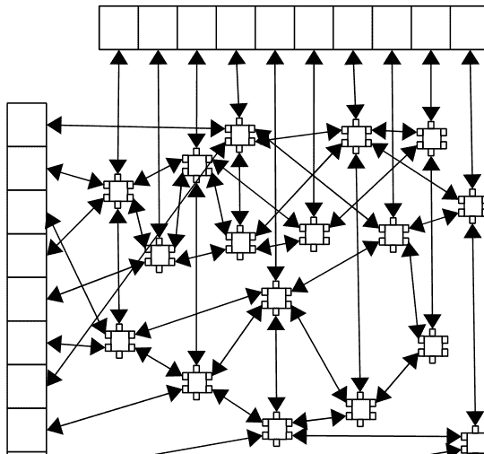

**图 18.5:** 这展示了另一种数据结构的图示，该结构可以用于冲突处理的高效优先级队列。顶部数组存储了时间步内不同时间段的列表头部。左侧数组是不同粒子的列表头部。所有列表都是双向链的，因此可以在不需要找到前节点的情况下删除节点。

```scala
var flag = true

while (flag && (stone + 1) * 2 - 1 < end) {
  val greaterChild = if (stone + 1) * 2 < end && comp(a((stone + 1) * 2), a(stone + 1) * (2 - 1)) > 0
    (stone + 1) * 2 else (stone + 1) * 2 - 1
  if (comp(a(greaterChild), tmp) > 0) {
    a(stone) = a(greaterChild)
    stone = greaterChild
  } else {
    flag = false
  }
}

a(stone) = tmp
```


你应该注意到这段代码部分与堆的实现之间的相似之处。第一个 `for` 循环包含了类似于入队（`enqueue`）的代码。第二个循环包含了类似于出队（`dequeue`）的代码。由于传递的数组在开头没有留出空白元素，因此必须进行一些修改。

这种排序的时间复杂度为 $O(n\log n)$，与合并排序和快速排序相同。与后两者不同，堆排序不是递归的。它也像合并排序一样是稳定的，并且可以像快速排序一样在原地进行。这些因素使其成为许多不同应用程序的良好排序算法，尽管在通常情况下，它比编写良好的快速排序要慢。

## 18.4 章节末材料

### 18.4.1 概念总结

- 二叉堆是数据结构的一种，允许快速检索最大优先级元素。这使得它们在实现优先级队列 ADT 时非常高效。
  - 它们基于二叉树。
  - 它们总是完全树且具有堆序。
  - 按广度优先顺序对元素进行编号，可以给出父节点和子节点索引之间简单的数学关系。
  - 这导致了使用数组进行最高效实现，因为堆总是完全的。
- 二叉堆可以用于实现高效的优先级队列。入队和出队的复杂度始终是 $O(\log n)$，因为堆是一棵完全树。
- 堆可以作为名为堆排序的排序算法的基础。

### 18.4.2 练习题

- 进行速度测试，比较第 13 章中基于列表的优先级队列与本章介绍的堆版本之间的速度。使用指数级间隔的元素数量来获取宽范围的 $n$ 值。
- 实现一个不留 0 元素元素的二叉堆。对其进行测试和调试，以确保它可以正常工作。
- 如果你完成了上面的练习，现在可以对文中的堆代码与从 0 索引开始堆元素的代码进行速度比较。
- 章节中的最后一个文本框描述了优先级队列的另一种实现方式，该方法适用于需要定期删除调度事件的冲突模拟。为这种队列编写代码，并将其速度与其他拥有的优先级队列实现进行比较。

### 18.4.3 项目

对于本章，你应该将第 13 章中做的任何工作从当时使用的实现转换为本章介绍的实现之一。对于仿真工作台，如果你做了冲突模拟，考虑实现易于删除事件的特殊优先级队列。

# 第 19 章

# 直接访问二进制文件

| 节内容 | 页码 |
| :--- | :--- |
| 19.1 随机访问文件 | 551 |
| 19.1.1 固定记录长度 | 552 |
| 19.1.2 索引变长记录长度 | 557 |
| 19.2 文件中的链式结构 | 560 |
| B-树 | 565 |
| 19.3 章节末材料 | 567 |
| 19.3.1 概念总结 | 567 |
| 19.3.2 练习题 | 567 |
| 19.3.3 项目 | 568 |

基础文本的优势是简单。它们相对容易处理，且文件本身可以使用标准文本编辑器进行编辑。遗憾的是，它们没有内在含义，且编辑时非常脆弱。小的错误就可能导致文件失效。使用第 10 章引入的 XML，纯文本和 XML 都有一个共同缺点：速度慢且臃肿。在某些领域，XML 比纯文本更糟糕。为了解决这些问题，我们需要向相反的方向移动，采用二进制文件。遗憾的是，这放弃了文本和 XML 拥有的优势，即可以被文本编辑器读取和方便编辑。我们在第 10 章中已经看到如何使用 `DataInputStream` 和 `DataOutputStream` 以原生二进制格式进行读写，以及如何使用 `ObjectInputStream` 和 `ObjectOutputStream` 将整个对象序列化为二进制。

在本章中，我们将对二进制文件迈出一步，使其能够像大型数组一样使用，能够在随机位置访问和读取值。这使得这些文件具有许多可能，并且是处理极大数据集的应用程序的核心部分。

### 19.1 随机访问文件

在第 10 章中，我们关注的是流（`streams`）。这个术语符合它的本质，就像水流过一样，你可以随着水流路边读取，但一旦它流走，你就无法将其带回。你无法选择停留在任何想要的位置。为了这种功能，我们转向了 `java.io` 包中的另一个类：`RandomAccessFile`。查看 API 中的这个类会发现它包含了 `DataInputStream` 的所有读取方法和 `DataOutputStream` 的所有写入方法。显而易见，该类提供了以二进制格式进行输入和输出的能力。该类真正的威力来自于 `seek(pos: Long)` 方法，它可以跳转到文件的任何位置。`seek` 的伙伴是 `getFilePointer():`，它返回文件中的当前位置。这意味着你可以在文件中来回跳转，并以你想要的方式读取或写入数据。

要创建一个新的 `RandomAccessFile`，你传递要打开的文件参数，作为一种

# 使用 Scala 的面向对象、抽象和数据结构

| 类型 | 字节（Bytes）大小 |
| :--- | :--- |
| Byte | 1 |
| Short | 2 |
| Int | 4 |
| Long | 8 |
| Float | 4 |
| Double | 8 |
| Boolean | 1 |
| Char | 2 |

**表 19.1:** 此表显示了使用 `DataOutputStream` 或 `RandomAccessFile` 时每个基本值写入磁盘的字节数。模式指定了如何访问文件。String

- "r" - 以只读模式打开文件。如果调用任何写入方法，将抛出 `IOException`。
- "rw" - 以读写模式打开文件。如果文件不存在，此模式将尝试创建文件。
- "rws" - 以读写模式打开文件，并要求如果调用修改了文件，则同步写入存储设备。由于无法缓冲磁盘活动会变慢，但对于需要文件配置一致的应用程序非常重要。
- "rwd" - 与 "rws" 类似，但仅在文件内容更改时要求同步。

如果你对模式使用其他值，将抛出异常。你通常使用 "rw" 作为模式，它看起来如下：

```scala
var raf = new RandomAccessFile("binaryFile.bin", "rw")
```

### 19.1.1 固定长度记录

二进制文件最简单的用法是固定长度记录。这是在相同大小块中存储数据。当你的数据由固定数量的大小元素（如 `Int` 和 `Double`）组成时，这相当容易。在这种情况下，你相加所有元素的大小。表 19.1 显示了 Scala 类型在字节中的大小。如果要写入的记录是三维空间中的一点，并关联有一个整数值，你将写入三个 `Double` 和一个 `Int`，总共 $3*8+4=28$ 字节。

许多数据类型会使确定长度的过程变得复杂。例如，表 19.1 缺失了 `String` 类型。这是因为字符串会根据其长度短短占用不同的空间。如果你想使用包含字符串的固定长度记录文件，你必须确定你允许字符串的最大长度，然后将其作为 `Char` 或 `Byte` 序列写入。你

选择取决于文本中是否包含标准英语以外的字符。普通英文字符的 ASCII 码较低，可以放入一个字节（`Byte`）中。如果应用程序需要进行国际化或包含 Unicode 的特殊符号，你可能应该坚持使用 `Char`。如果你选择使用 `Byte` 方案，可以使用 String 的 `getBytes(): Array[Byte]` 方法。在你的情况下，你可以决定如何处理过长的字符串，你可能想要抛出异常或静默截断它们。无论何种方式，你都必须强制限制最大，确保能够读回你写入的内容，并且永远不要写入边界之外的数据。

包含集合（`collections`）的记录必须像 `String` 一样被处理。你需要选择要存储到文件中最大元素数量。计算单个元素的大小并乘以要存储的最大数量，以确定集合在总记录中的大小。

为了实现这一点，我们将编写一个类，使用一个固定长度的随机访问文件作为 `IndexedSeq` 的底层支持，以便数据可以在一次运行和下之间保留。如果你在不同的运行中附加该文件，你将自动获得相同的数据。使用文件还允许你拥有极大的集合而无需消耗内存。缺点是该集合的运行速度会显著变。

```scala
package binaryfiles.adt
```

```scala
import java.io.DataInput
```

```scala
import java.io.DataOutput
```

```scala
import java.io.File
```

```scala
import java.io.RandomAccessFile
```

```scala
import scala.collection.mutable
```

```scala
class FixedRecordSeq[A](file: File,
  recordLength: Int,
  reader: DataInput => A,
  writer: (DataOutput, A) => Unit) extends mutable.IndexedSeq[A] {

  private val raf = new RandomAccessFile(file, "rw")

  def apply(index: Int): A = {
    raf.seek(recordLength * index)
    reader(raf)
  }

  def update(index: Int, a: A): Unit = {
    raf.seek(recordLength * index)
    writer(raf, a)
  }

  def length: Int = (raf.length() / recordLength).toInt

  def close(): Unit = raf.close()
}
```

该类继承自 `mutable.IndexedSeq`，但它在 `update` 方法上具有根本上不同的行为。在此集合上进行越界赋值不会抛出异常。相反地，它会增长到该索引的大小。这在技术上并没有收缩父类型的 API 文档，但这是用户应该注意到的点。

`apply` 方法通过索引乘以记录长度跳转到位置，然后执行读取。这种简单性是固定记录长度文件的真正优势。给定一个索引，通过简单的数学运算即可得到数据在文件的位置。`update` 方法同样简单，调用 `seek` 后再调用该方法即可。

为了清楚如何使用这个类，我们可以查看它的一些单元测试。

```scala
package test.binaryfiles.adt

import java.io.DataInput
import java.io.DataOutput
import java.io.File
import org.junit.Assert._
import org.junit.Before
import org.junit.Test
import binaryfiles.adt.FixedRecordSeq

class FixedRecordSeqTest {

  private var file: File = null

  private class PointRec(val x: Double, val y: Double, val z: Double, val d: Int)

  private class StudentRec(val first: String, val last: String, val grades: List[Int])

  @Before def setFile(): Unit = {
    file = new File("TestFile.bin")
    file.deleteOnExit()
    if (file.exists()) file.delete()
  }

  @Test def emptyState(): Unit = {
    var fr = new FixedRecordSeq[Int](file, 4, din => din.readInt(), (dout, i) => dout.writeInt(i))
    assertTrue(fr.length == 0)
  }

  @Test def write4(): Unit = {
    var fr = new FixedRecordSeq[Int](file, 4, din => din.readInt(), (dout, i) => dout.writeInt(i))
    fr(0) = 3
    fr(1) = 8
    fr(2) = 2
    fr(3) = 9
    assertEquals(4, fr.length)
    assertEquals(3, fr(0))
    assertEquals(8, fr(1))
    assertEquals(2, fr(2))
    assertEquals(9, fr(3))
  }

  @Test def write100(): Unit = {
    var fr = new FixedRecordSeq[Double](file, 8, din => din.readDouble(), (dout, d) => dout.writeDouble(d))
    val nums = Array.fill(100)(math.random)
    for (i <- nums.indices) fr(i) = nums(i)
    assertEquals(nums.length, fr.length)
    for (i <- nums.indices) assertEquals(nums(i), fr(i), 0)
  }

  private def readPoint(din: DataInput): PointRec = {
    new PointRec(din.readDouble(), din.readDouble(), din.readDouble(), din.readInt())
  }

  private def writePoint(dout: DataOutput, p: PointRec): Unit = {
    dout.writeDouble(p.x)
    dout.writeDouble(p.y)
    dout.writeDouble(p.z)
    dout.writeInt(p.d)
  }

  @Test def writePoints(): Unit = {
    val fr = new FixedRecordSeq[PointRec](file, 3 * 8 + 4, readPoint, writePoint)
    val pnts = Array.fill(10)(new PointRec(math.random, math.random, math.random, util.Random.nextInt()))
    for (i <- pnts.indices) fr(i) = pnts(i)
    assertEquals(pnts.length, fr.length)
    for (i <- pnts.indices) assertEquals(pnts(i), fr(i))
  }

  @Test def rewritePoints(): Unit = {
    val fr = new FixedRecordSeq[PointRec](file, 3 * 8 + 4, readPoint, writePoint)
    val pnts = Array.fill(10)(new PointRec(math.random, math.random, math.random, util.Random.nextInt()))
    for (i <- pnts.indices) fr(i) = pnts(i)
    assertEquals(pnts.length, fr.length)
    for (i <- pnts.indices) assertEquals(pnts(i), fr(i))
  }

  private def readStudent(din: DataInput): StudentRec = {
    val first = din.readUTF()
    val last = din.readUTF()
    val grades = List() // Simplified for the example
    new StudentRec(first, last, grades)
  }

  private def writeStudent(dout: DataOutput, s: StudentRec): Unit = {
    dout.writeUTF(s.first)
    dout.writeUTF(s.last)
    // Grades writing logic omitted
  }
}
```


# 直接访问二进制文件

## 19.1.2 索引变长记录长度

如果无法确定单一的固定记录长度，则必须进行更多工作。你可能会遇到这种情况的原因有几个。其一是你无法承受任何数据丢失，并且无法对记录的某些部分设置上限。其次是你既可以也可以不愿使用平均情况远小于最大值的空间，而如果你使用固定记录长度，你将不得不使用它。

在这些情况下，你必须使用变长记录。这样做的问题是，你无法简单地通过计算文件位置来读取第 $n^{th}$ 个元素。处理此的方法之一是维护一个独立的固定长度记录索引，它提供了变长记录数据的某些位置。我们将这样做，为了尽可能保持简单，我们将索引值放在单独的文件中。这里有一个示例实现，而不是记录大小，而是传入了第二个文件。

```scala
package binaryaries.adt

import collection.mutable
import java.io._

class VariableRecordSeq[A](
    index: File,
    data: File,
    reader: DataInput => A,
    writer: (DataOutput, A) => Unit
) extends mutable.IndexedSeq[A] {

    private val indexFile = new RandomAccessFile(index, "rw")
    private val dataFile = new RandomAccessFile(data, "rw")

    def apply(index: Int): A = {
        indexFile.seek(12 * index)
        val pos = indexFile.readLong()
        dataFile.seek(pos)
        reader(dataFile)
    }

    def update(index: Int, a: A): Unit = {
        val baos = new ByteArrayOutputStream()
        val dos = new DataOutputStream(baos)
        writer(dos, a)
        val outData = baos.toByteArray()

        val (pos, len) = if (index < length) {
            indexFile.seek(12 * index)
            val p = indexFile.readLong()
            val l = indexFile.readInt()
            (p, l)
        } else (dataFile.length(), outData.length)

        dataFile.seek(pos)
        dataFile.write(outData)

        indexFile.seek(12 * index)
        indexFile.writeLong(pos)
        indexFile.writeInt(len)
    }

    def length: Int = (indexFile.length() / 12).toInt

    def close(): Unit = {
        indexFile.close()
        dataFile.close()
    }
}
```

使用索引文件使得 `apply` 方法变得稍微复杂。它首先在索引文件中进行 `seek`（定位），并读取数据在主数据文件中的位置。该值被传递给数据文件的 `seek` 操作，然后我们从中读取该值。你可以从索引文件中看到这一点，它是一个记录长度为 12 的固定记录文件。数值 12 的来源源于我们同时存储了用于数据文件中的位置的 `Long` 和用于文件内数据记录长度的 `Int`。存储长度不是必须的，但它允许我们在数据文件中存储数据时变得更高效一些。

处理变长记录文件的大部分工作都集中在 `update` 方法中。当向文件写入新值时，如果它能放入旧值的空间内，则写入同一个空间。如果是一个完全新的记录，或者新值比旧值需要更多空间，最简单的方法是将其放在数据文件的末尾。这些标准很容易描述，但它们有一个重大的挑战：你需要在内容写入文件之前就知道要写入内容的长度。此外，我们不希望强制该类的用户传递一个用于计算记录大小的额外函数。这是一个 `OutputStream`，它将所有写入它的内容收集到 `Array` 中。该流被封装在 `DataOutputStream` 中，并在执行任何其他操作之前传递给 `writer` 函数。

在 `update` 中这样做允许我们获取需要写入数据文件的字节数组，而无需为计算大小或写入真实数据文件提供额外的函数。此之后，将执行一个逻辑判断，查看数据是否可以覆盖旧值，或者它是否需要移动到文件末尾。如果是新记录，或者 `outData` 的长度大于数据文件中空间的长度，则它必须放在数据文件的末尾，且长度为该可用空间的长度。否则，我们使用旧长度，因为那里是我们可以安全使用的位置。

`update` 方法的工作原理是跳转到数据文件中的相应位置，并在索引文件中的正确位置写入位置和长度。这段代码将与固定记录长度的测试代码通用，只需对 `readStudent`、`writeStudent` 和 `last` 进行几处修改。在这个版本中，没有理由削减数据或填充内容。以下是修改后的代码，带有一个加强版本的 `last` 测试，以确保更改记录能够正常工作。

```scala
private def readStudent(din: DataInput): StudentRec = {
    val first = din.readUTF()
    val last = din.readUTF()
    val num = din.readInt()
    val grades = din.readUTF()
    StudentRec(first, last, num, grades)
}
```

```scala
private def writeStudent(dout: DataOutput, s: StudentRec): Unit = {
    dout.writeUTF(s.first)
    dout.writeUTF(s.last)
    dout.writeInt(s.num)
    dout.writeUTF(s.grades)
}
```

```scala
def last(): Unit = {
    // ... 测试逻辑
}
```

## 头部数据

| 头部 | 尾 | 长度 | 第一个空闲 | 数据 | 下一个 | 数据 | ... |
|---|---|---|---|---|---|---|---|
| Long | Long | Long | Long | Long | 记录长度 | 记录长度 | |

**图 19.1：** 持链表的二进制文件具有如下格式。文件的开头是一个头部，包含四个以 Long 格式写入的数值。它们是头节点的位置、尾节点的位置、节点数量以及第一个空闲节点的位置。

空闲节点，但在执行该操作之前，它会跳转到节点，读取它的下一个引用，并将其存储为下一个 `firstFree`。

```scala
package binaryfiles.adt

import java.io.DataInput
import java.io.DataOutput
import java.io.File
import java.io.RandomAccessFile
import scala.collection.mutable

class FixedRecordList[A](
    file: File,
    reader: DataInput => A,
    writer: (DataOutput, A) => Unit
) extends mutable.Buffer[A] {

    private val raf = new RandomAccessFile(file, "rw")
    private var (localHead, localTail, localLen, localFree) =
        if (raf.length() >= 3 * 8) {
            val h = raf.readLong()
            val t = raf.readLong()
            val l = raf.readLong()
            val ff = raf.readLong()
            (h, t, l, ff)
        } else {
            raf.writeLong(-1)
            raf.writeLong(-1)
            raf.writeLong(0)
            raf.writeLong(-1)
            (-1L, -1L, 0L, -1L)
        }

    private def lhead: Long = localHead

    private def lhead(h: Long): Unit = {
        raf.seek(0)
        raf.writeLong(h)
        localHead = h
    }

    private def length(len: Long): Unit = {
        raf.seek(8 * 2)
        raf.writeLong(len)
        localLen = len
    }

    private def ltail(t: Long): Unit = {
        raf.seek(8)
        raf.writeLong(t)
        localTail = t
    }

    private def firstFree(ff: Long): Unit = {
        raf.seek(3 * 8)
        raf.writeLong(ff)
        localFree = ff
    }

    private def newNodePosition: Long = if (firstFree == -1L) raf.length() else {
        val ff = firstFree
        raf.seek(ff)
        firstFree = raf.readLong()
        ff
    }

    def +=(elem: A) = {
        val npos = newNodePosition
        raf.seek(npos)
        raf.writeLong(-1L)
        writer(raf, elem)
        if (localHead == -1L) {
            localHead = npos
        } else {
            raf.seek(localTail)
            raf.writeLong(npos)
        }
        localTail = npos
        localLen += 1
        this
    }

    def apply(n: Int): A = {
        if (n >= localLen) throw new IllegalArgumentException("Requested index " + n + " of")
        var i = 0
        var pos = localHead
        while (i <= n) {
            raf.seek(pos)
            pos = raf.readLong()
            i += 1
        }
        reader(raf)
    }

    def clear(): Unit = {
        raf.seek(localTail)
        raf.writeLong(localFree)
        localFree = localHead
        localHead = -1
        localTail = -1
        localLen = 0
    }

    def insertAll(n: Int, elems: Traversable[A]): Unit = {
        if (n > localLen) throw new IllegalArgumentException("Insert at index " + n + " of " + localLen)
        var i = 0
        var (prev, next) = if (n == 0) (-1L, localHead) else {
            var pp = localHead
            var nn = localHead
            while (i < n) {
                raf.seek(pp)
                nn = raf.readLong()
                pp = nn
                i += 1
            }
            (pp, nn)
        }
        if (prev != -1L) raf.seek(prev)
        for (elem <- elems) {
            val npos = newNodePosition
            if (prev == -1L) {
                localHead = npos
                prev = npos
            } else {
                raf.writeLong(npos)
                raf.seek(npos + 8)
                writer(raf, elem)
            }
            raf.seek(npos)
        }
        if (next != -1L) localTail = raf.getFilePointer()
        raf.writeLong(next)
        localLen += elems.size
    }

    def iterator = new Iterator[A] {
        var pos = localHead
        def hasNext = pos > -1L
        def next = {
            raf.seek(pos)
            val res = reader(raf)
            pos = raf.readLong()
            res
        }
    }
}
```


# 直接访问二进制文件

## 头部数据

| 头部 | 尾部 | 长度 | 第一个空闲 | 数据 | 下一个 | 数据 | ... |
|---|---|---|---|---|---|---|---|
| Long | Long | Long | Long | Long | 记录长度 | 记录长度 | |

**图 19.1：** 持链表的二进制文件具有如下格式。文件的开头是一个头部，包含四个以 Long 格式写入的数值。它们是头节点的位置、尾节点的位置、节点数量以及第一个节点的位置。

空闲节点，但在执行该操作之前，它会跳转到节点，读取它的下一个引用，并将其存储为下一个 `firstFree`。

```scala
package binaryfiles.adt

import java.io.DataInput
import java.io.DataOutput
import java.io.File
import java.io.RandomAccessFile
import scala.collection.mutable

class FixedRecordList[A](
    file: File,
    reader: DataInput => A,
    writer: (DataOutput) => Unit
) extends mutable.Buffer[A] {

    private val raf = new RandomAccessFile(file, "rw")

    private var (localHead, localTail, localLen, localFree) =
        if (raf.length() >= 3 * 8) {
            val h = raf.readLong()
            val t = raf.readLong()
            val l = raf.readLong()
            val ff = raf.readLong()
            (h, t, l, ff)
        } else {
            raf.writeLong(-1)
            raf.writeLong(-1)
            raf.writeLong(0)
            (-1L, -1L, 0L, -1L)
        }

    private def lhead: Long = localHead

    private def lhead(h: Long): Unit = {
        raf.seek(0)
        raf.writeLong(h)
        localHead = h
    }
}
```

```scala
    private def length(len: Long): Unit = {
        raf.seek(8 * 2)
        raf.writeLong(len)
        localLen = len
    }
```

```scala
    private def ltail(t: Long): Unit = {
        raf.seek(8)
        raf.writeLong(t)
        localTail = t
    }
```

```scala
    private def firstFree(ff: Long): Unit = {
        raf.seek(3 * 8)
        raf.writeLong(ff)
        localFirst = ff
    }
```

```scala
    private def newNodePosition: Long = if (firstFree == -1L) raf.length() else {
        val ff = firstFree
        raf.seek(ff)
        firstFree = raf.readLong()
        ff
    }
```

```scala
    def +=(elem: A) = {
        val npos = newNodePosition
        raf.seek(npos)
        raf.writeLong(-1L)
        writer(raf, elem)
        if (localHead == -1L) {
            localHead = npos
        } else {
            raf.seek(localTail)
            raf.writeLong(npos)
        }
        localTail = npos
        localLen += 1
        this
    }
```

```scala
    def apply(n: Int): A = {
        if (n >= localLen) throw new IllegalArgumentException("Requested index " + n + " of")
        var i = 0
        var pos = localHead
        while (i <= n) {
            raf.seek(pos)
            pos = raf.readLong()
            i += 1
        }
        reader(raf)
    }
```

```scala
    def clear(): Unit = {
        raf.seek(localTail)
        raf.writeLong(localFree)
        localFree = localHead
        localHead = -1
        localTail = -1
        localLen = 0
    }
```

```scala
    def insertAll(n: Int, elems: Traversable[A]): Unit = {
        if (n > localLen) throw new IllegalArgumentException("Insert at index " + n + " of " + localLen)
        var i = 0
        var (prev, next) = if (n == 0) (-1L, localHead) else {
            var pp = localHead
```


# 直接访问二进制文件

## 19.3 章节末尾

### 19.3.1 概念总结

- 直接访问文件（或随机访问文件）允许你从一个位置跳转到另一个位置进行读取和写入。
- 这一功能使得它们可以被用作容量极大的类数组数据结构。
- 处理所有记录长度相同的文件是最简单的，因为这允许我们轻松地计算任何记录在文件中的位置。
- 可以使用变长度的记录，但它们需要更多的记录工作。这通常通过一个固定记录长度的索引来实现，该索引告诉我们数据文件中各个元素的位置。
- 我们可以使用文件位置来模拟引用，从而在文件中创建链式数据结构。
- 在文件中存储头文件信息允许我们跟踪列表的头部或尾部或树的根节点等信息。
- 每个记录都可以存储额外信息，包括指向数据结构中其他节点的引用。
- 虽然我们可以在直接访问文件中编写链表，但这种做法非常低效，因为需要大量的磁盘访问。
- 存在其他的链接结构专门为了解决访问速度慢的问题。`B` 树就是其中一个例子。

### 19.3.2 练习

1. 编写代码以加速不同文件支持序列（类数组和类链表）的比较，使其匹配内存支持序列。
2. 为 `VariableRecordSeq` 编写一个紧凑方法。该方法应被调用以消除数据文件中的空白区域。通过创建一个新的数据文件并将记录从旧文件一个一个移动到新文件，相应地更新新位置的索引来实现。完成后，可以删除旧数据文件并将重命名为原始名称。
3. 对 `FixedRecordList` 进行适当修改以生成 `VariableRecordList`。
4. 为链表编写一个线性化方法，创建一个新文件，其中所有节点都按照它们在列表中出现的顺序重新排序，并删除所有空节点。
5. 编写一个仅在内存中运行的 `B` 树。
6. 转换之前练习中的 `B` 树，使其可以使用磁盘访问。

### 19.3.3 项目

本章中的所有项目都需要你为项目保存的文件编写直接访问二进制版本。

1. 如果你正在做 MUD 项目，你可能注意到项目之一是保存单个玩家要么需要为每个玩家准备单独的文件（导致文件数量巨大），要么需要写入所有玩家才能保存其中一个。直接访问二进制文件可以解决这个问题。你可能需要做出一些牺牲，例如指定可以保存的最大数量。编写代码将玩家存储在固定长度记录中，并更改保存和加载代码，以便只读取或写入单个记录。
2. 根据你存储的数据，你为网络爬虫的直接访问二进制文件存放的内容可能很大不同。例如，框角使用二进制格式比文本格式要高效得多。图像会更具挑战性。如果你真的想挑战一下，尝试将数据放入 `B` 树中。网络爬虫是一个完美的项目示例，对于数据量足够的项目，将内容存储在磁盘的 `B` 树中而不是内存中将非常有益。
3. 如果你有一个有不同棋板或屏幕的图形游戏，请编辑存储方式使其成为直接访问文件，以便在 `O(1)` 时间内高效地访问任何屏幕。
4. 数学工作表项目可以从将工作表保存为二进制文件中获益，这样就可以对工作表的各个部分进行保存，而不是保存整个工作表。
5. 如果你正在做 Photoshop® 项目，你可以将图层放在二进制文件的变长度记录中。注意，你不能对图像使用默认序列化，因此你可能需要编写某种形式的自定义序列化。
6. 如果你正在做仿真工作台，你应该让大型粒子仿真使用自定义二进制格式写入，其中每个粒子的数据以正确数量的二进制 `Doubles` 写入。这将允许你编写仅读取特定粒子的工具。
7. 股票项目没有与随机访问文件的特定任务。
8. 电影项目没有与随机访问文件的特定任务。
9. 系统项目没有与随机访问文件的特定任务。

# 第 20 章

# 空间树

### 20.1 空间数据与网格

### 20.2 四叉树与八叉树

### 20.3 kD 树

### 20.4 高效弹跳球

### 20.5 章节末尾

#### 20.5.1 概念总结

#### 20.5.2 练习

#### 20.5.3 项目

你处理的大许多数据是空间性的，这意味着它们在多个轴上具有顺序。你使用某些数据结构来提高在空间部分查找查找元素的效率。这些空间结构可以极大地提高操作速度，特别是在涉及大量元素时。为了说明这一点，让我们考虑 `M` 维空间中的 `N` 个点。为了可视化目的，我们通常认为 `M=2`，但它也可以更大。我们想要找到所有点对 `(p1, p2)`，使得它们之间的距离小于给定的阈值 `|p1 - p2| < T`。

编写该问题解决方案的最简单方法是使用暴力法，通过一个循环遍历所有点，并用一个嵌套循环遍历这些点以计算距离。

```scala
package spatialtrees.adt
abstract class NeighborVisitor[A <: Int => Double](dim: Int) {
  def visitAllNeighbors(tDist: Double, (A, A) => Unit): Unit
  def visitNeighbors(i: Int, tDist: Double, (A, A) => Unit): Unit
}
```

> 这是一个为了保持代码简单的 trait（特性）。`<` 符号会被展开以包含一个参数。由于 trait 不能接受参数，我们本必须进入这种顺序的复杂细节。详情请参阅 http://www.programmingscala.net 的在线附录。

```scala
var distCalcs = 0
def dist[A <: Int => Double](p1: A, p2: A): Double = {
  distCalcs += 1
  math.sqrt(0 until dim).foldLeft(0.0)((d, i) => {
    val di = p1(i) - p2(i)
    d + di * di
  })
}
```

该类包含一个 `dist` 方法，因为它的所有子类都需要执行此计算。它还接收一个点应考虑的空间维度的参数。这里声明了两个方法。其中一个是对点对进行完全搜索。名为 `distCalcs` 的成员仅用于对我们的不同方法进行基准测试，查看它们计算点距离的次数。实际实现会省略这一部分。

暴力法的实现如下：

```scala
package spatialtrees.adt
class BruteForceNeighborVisitor[A <: Int => Double](
  d: Int,
  val p: IndexedSeq[A]) extends NeighborVisitor[A](d) {
  def visitAllNeighbors(tDist: Double, visit: (A, A) => Unit): Unit = {
    for {
      i <- 0 until p.length
      pi = p(i)
      j <- i + 1 until p.length
      pj = p(j)
      if dist(pi, pj) <= tDist
        visit(pi, pj)
    }
  }
  def visitNeighbors(i: Int, tDist: Double, visit: (A, A) => Unit): Unit = {
    val pi = p(i)
    for {
      j <- 0 until p.length
      if j != i
      pj = p(j)
      if dist(pi, pj) <= tDist
        visit(pi, pj)
    }
  }
}
```

寻找所有点对的方法有一个使用变量 `i` 的外层循环，遍历所有索引。这样就不会两次处理顺序相反的相同点对。在代码相应位置创建变量 `pi` 和 `pj` 是为了防止对 `IndexedSeq p` 进行不必要的索引操作。

虽然这段代码很容易编写，但我们可以发现 `dist` 的调用次数随 `O(N^2)` 缩放。这对于较小的 `N` 值是可以接受的，但当 `N` 变得非常大时，这种方法变得不可行。

> ²作者进行大规模模拟，其中 `N` 通常在 `10^5` 到超过 `10^8` 之间变化。作者曾需要检查一个 bug 是否导致了任何粒子重复。作为第一步，作者写了一段短代码来执行检查。当它在一个小时内没有完成时，作者决定花一点时间计算一下需要多长时间。那个特定的模拟包含超过 `10^7` 个粒子。答案是以周为单位衡量的。不用说，作者花时间实现了本章中的这种方法之一，而不是使用暴力破解法。

实现此点最简单的方法是使用规则空间网格。使用这种方法，你将点所在的空间划分为具有适当尺寸的等间距网格化框。对于网格中的每个框，我们保留一个落在其中的点列表。搜索邻居只需要搜索位于足够近的列表单元上的空间点。以下是使用这种方法的 `NeighborVisitor` 的实现代码。

```scala
package spatialtrees.adt

import collection.mutable

class RegularGridNeighborVisitor[A <: Int](p: IndexedSeq[A]) extends NeighborVisitor[A] { 

  private var grid = mutable.ArrayBuffer[mutable.Buffer[Int]]()
  private var currentSpacing = 0.0
  private var min = (0 until dim).map(i => p).foldLeft(Double.MaxValue)((d, p) => Math.min(d, p(i)))
  private var max = (0 until dim).map(i => p).foldLeft(Double.MinValue)((d, p) => Math.max(d, p(i)))

  def visitAllNeighbors(tDist: Double, unit: (A, A)): Unit = {
    if (tDist < 0.5 * currentSpacing || tDist > 5 * currentSpacing)
      rebuildGrid(tDist)
    val mult = math.ceil(tDist / currentSpacing).toInt
    val offsets = Array.table(2 * mult + 1, 2 * mult + 1)((i, j) => (i - mult, j - mult))
    for {
      cx <- grid.indices
      cy <- grid(cx).indices
      (dx, dy) <- offsets
      gx = cx + dx
      gy = cy + dy
      if (gx >= 0 && gx < grid.length && gy >= 0 && gy < grid.length)
        i <- grid(gx)(cy).indices
        pi = p(grid(cx)(i))
        if (dx == 0 && dy == 0) {
          for {
            j <- i + 1 until grid(cx).length
            pj = p(grid(cx)(j))
            if (dist(pi, pj) <= tDist)
              visit(pi, pj)
          }
        } else {
          for {
            j <- grid(gx)(gy)
            pj = p(j)
            if (dist(pi, pj) <= tDist)
              visit(pi, pj)
          }
        }
    }
  }
```

> ** 重建网格以适用于搜索的大小。请注意，此方法并不是为了效率而写的。真正的实现应该包含对该方法的重建调用。

```scala
} visit(pi, pj)
}
def visitNeighbors(i: Int, tDist: Double, visit: (A, A) => Unit): Unit = {
  if (tDist < 0.5 * currentSpacing || tDist > 5 * currentSpacing)
    rebuildGrid(tDist)
  var mut = math.ceil(tDist / currentSpacing).toInt
  var offsets = Array.table(2 * mut + 1, 2 * mut + 1)((i, j) => (i - mut, j - mut))
  flatMap(map => i {
    var cx = ((p(i)(0) - min(0)) / currentSpacing).toInt
    var cy = ((p(i)(1) - min(1)) / currentSpacing).toInt
    var pi = p(i)
    for {
      (dx, dy) <- offsets
      var gx = cx + dx
      var gy = cy + dy
      if (gx >= 0 && gx < grid.length && gy >= 0 && gy < grid.length)
        var j <- grid(gx)(gy)
        if i != j {
          var pj = p(j)
          if (dist(pi, pj) <= tDist)
            visit(pi, pj)
        }
    }
  })
}
```


```scala
private def rebuildGrid(spacing: Double): Unit = {
  min = (0 until dist).map(i => p.foldLeft(Double.MaxValue)((d, p) => Math.min(d, p)))
  max = (0 until dist).map(i => p.foldLeft(Double.MinValue)((d, p) => Math.max(d, p)))
  cells = (0 until dist).map(i => (max(i) - min(i)).toInt + 1)
  if (grid.size < cells(0)) grid.append(mutable.Buffer.fill(cells(0))(mutable.Buffer[Int]) :*)
  else if (grid.size > cells(0)) grid.trimEnd(grid.size - cells(0))
  for (col <- grid) {
    if (col.size < cells(1)) col.append(mutable.Buffer.fill(cells(1) - col.size)(mutable.Buffer[Int]) :*)
    else if (col.size > cells(1)) col.trimEnd(col.size - cells(1))
    col.foreach(_.clear)
  }
  for (i <- p.indices) {
    var cx = ((p(i)(0) - min(0)) / spacing).toInt
    var cy = ((p(i)(1) - min(1)) / spacing).toInt
    grid(cx)(cy) += i
  }
  currentSpacing = spacing
}
```

显然，这段代码比暴力破解法复杂得多。然而这里

# 空间树

在某些情况下，这种访问所有邻居点的方法具有 `O(N)` 行为，而对于单个点的邻居，则具有 `O(1)` 行为。

这个网格被硬编码为仅支持两个维度。虽然并非不可能，但编写使用任意维度数组的代码要具有挑战性得多。即使你愿意付出努力，规则网格在高维中也不不起作用。假设你有一个 n 维立方体，你的搜索半径是单元大小的 1/100，因此你想在每个维度上划分 100 份。对于 3D 空间，网格有 1,000,000 = 1⁶ 个单元。随着维度的增加，这会继续增长到 10ⁿ。这在三维以上会导致严重问题，特别是当大多数问题每个维度都需要超过 100 个桶时。我们可以写 3D 网格，但并没有很多应用能认为这样做有帮助。

网格方法理想的情况是点是均匀分布的，搜索半径相对于面积较小，并且点随着 N 的增加而分散，而不是点密度的随 N 增加。

# 空间树

575

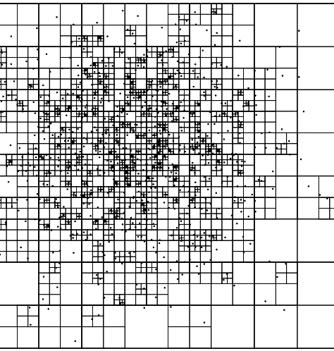

图 20.2：这是一个包含若干非均匀分布点的四叉树，用于说明空间是如何被划分的。在这个示例中，每个节点只允许包含一个点。基于树的方法的主要优势是分辨率不需要是均匀的。高密度区域可以将空间划分得更细致。

……处理了不同区域的数据。在某些方面，你可以将二叉搜索树（`BST`）看作 1 维空间中的空间树。它沿着给定直线对值进行完全排序。必须考虑如何将其扩展到存在多个正交排序的系统中。针对这一点已经开发了许多不同的方法。我们将在本章中考虑其中两种。

最容易理解的树是四叉树。四叉树有多种类型。我们将关注基于区域的四叉树。对于这种树，每个节点代表一个正方形区域。我们从一个包含所有正在处理的点的边界正方形开始。该区域由树的根节点表示。每个节点可以有四个子节点。子节点分别代表其父节点等大的象限。通过这种树，所有点都进入叶子节点。叶子节点允许包含的点数取决于应用程序。可以使用实证测试来找到最佳方案。当一个区域中的点数超过允许数量时，该区域将分为四个子节点，点将向下移动。

使用非均匀数据构建四叉树的过程如图 20.2 所示。这棵树大约包含 1000 个数据点。你可以看到，在点较少的区域，划分很大。然而，在树的高密度区域，单元格被缩小到非常小的尺寸以隔离点。

该树的代码如下所示。像网格一样，四叉树用于 2-D 空间划分，并硬编码在代码中。这棵树有一个超类型为 `Node`，带有两个子类型 `LNode` 和 `INode`，分别用于叶节点和内部节点。

> 值得注意的是，这是基于区域的四叉树的一种标准实现。可以根据应用改变不同的方面。我们将在本章稍后的部分介绍密切相关的八叉树（octree）的替代方法。

# 使用 Scala 进行面向对象、抽象和数据结构

按照这种代码的设置方式，只有叶节点节点持有点。因此，使用两个子类型来存储与位置信息完全不同的数据是有合理的。`INode` 具有额外的功能，用于将点划分到子节点和树的下部分。`child` 方法返回一个 0 到 3 之间的数字，这是基于位置的子节点索引。`groupBy` 集合方法是获取每个象限中不同点的简单方法。

```scala
package spatialtrees.adt
class QuadtreeNeighborVisitor[A <: Double](
  val p: Indexed[A]) extends NeighborVisitor[A](2) {
  private class Node(cx: Double, cy: Double, size: Size)
  private class LNode(x: Double, y: Double, s: Double, points: Indexed[Int])
    extends Node(x, y, s)
  private class INode(x: Double, y: Double, s: Double, points: Indexed[Int])
    extends Node(x, y, s) {
    val children = {
      val groups = p.groupBy(pn => childNum(p(pn))(0), p(1))
      val hs = s * 0.5
      val qs = s * 0.25
      val ox = cx - qs
      val oy = cy - qs
      Array(i => makeChild(ox + hs * (i % 2), oy + hs * (i / 2), hs),
        if (groups.contains(i)) groups(i) else Indexed[Int]())
    }
    def makeChild(x: Double, y: Double, s: Double, points: Indexed[Int]): Node =
      if (points.length > maxPoints) new INode(x, y, s)
      else new LNode(x, y, s)
  }
  private val maxPoints = 1
  private val root = {
    val min = p.filter(1e10)((mx, pnt) => pnt(0) < mx)
    val max = p.filter(-1e10)((mx, pnt) => pnt(0) > mx)
    val min = p.filter(1e10)((my, pnt) => pnt(1) < my)
    val max = p.filter(-1e10)((my, pnt) => pnt(1) > my)
    val cx = 0.5 * (min + max)
    val cy = 0.5 * (min + max)
    val s = (max - min)
    if (p.length > maxPoints) new INode(cx, cy, s, indices)
    else new LNode(cx, cy, s, indices)
  }
  def visitAllNeighbors(tDist: Double, visit: (A, A) => Unit): Unit =
    for (i <- 0 until p.length) {
      val pi = p(i)
      def recur(n: Node): Unit = n match {
        case ln: LNode =>
          ln.points.filter(j => j > i && dist(pi, j) < tDist).foreach(j =>
            visit(pi, j))
        case in: INode =>
          val x = pi(0)
          val y = pi(1)
          if (x + tDist > in.cx) {
            if (y + tDist > in.cy) recur(in.children(3))
            if (y - tDist <= in.cy) recur(in.children(1))
          }
          if (x - tDist <= in.cx) {
            if (y + tDist > in.cy) recur(in.children(2))
            if (y - tDist <= in.cy) recur(in.children(0))
          }
      }
      recur(root)
    }
}
def visitNeighbors(i: Int, tDist: Double, visit: (A, A) => Unit): Unit = {
    val p = p(i)
    def recur(n: Node): Unit = match {
        case ln: LNode =>
            ln.points.filter(j => j != i && dist(p, j) <= tDist).foreach(j =>
                visit(p, j))
        case in: INode =>
            val x = p(0)
            val y = p(1)
            if (x + tDist > in.cx) {
                if (y + tDist > in.cy) recur(in.children(3))
                if (y - tDist <= in.cy) recur(in.children(1))
            }
            if (x - tDist <= in.cx) {
                if (y + tDist > in.cy) recur(in.children(2))
                if (y - tDist <= in.cy) recur(in.children(0))
            }
    }
    recur(root)
}
```

树本身的构建发生在 `root` 的声明中。这种类型的四叉树限制所有点，以便计算边界区域。完成后，会实例化正确的节点。该节点作为根，如果它是 `INode`，则构建树的其余部分。虽然这棵树没有利用这一点，但基于区域的四叉树的巨大优势之一是易于编写。`visitAllNeighbors` 方法包含嵌套的递归函数，遍历树以寻找邻居。`INode` 的行为是仅对实际接触的子节点进行递归调用。在用于网格的相同类型随机配置运行时，这棵树的距离计算比网格少一点。这与用于网格的点配置非常接近。

> 此处显示的 `visitAllNeighbors` 版本与循环中的 `visitNeighbors` 非常相似。这种方法有一个缺点：递归多次通过高层节点，导致重复工作。可以编写一个对两个 `Node` 参数进行递归的函数。这里没有显示因为它复杂得多且难以理解。

# 使用 Scala 进行面向对象、抽象和数据结构

与网格一样，四叉树本质上是 2-D 的。3-D 版本将每个节点划分为八份，即八叉树。我们将在后面的部分构建一个。同样像网格一样，这棵树无法很好地扩展到更高维度。这是因为每个子节点包含的子节点数量随 n 维空间增长。对于存储许多子节点的大内部节点，效率较低。存储子节点的替代方法，但如果你确实需要高维空间，我们将讨论的下一个树是更好的选择。

在离开四叉树主题之前，还需要注意的是这种基于区域的四叉树本质上是不平衡的。在高密度区域，树的深度明显更大。在实践中，这并没有引入显著的低效，但值得将其作为与 `BST` 树的真实区别。

### 20.3 kD 树

如果你必须处理高维空间、想要平衡的树，并且在想要解决的维度上有截然不同的尺寸，该怎么办？所有这些问题的可能解决方案是使用 k 树。名称中的“kD”意味着 k 维，因此该名称本身就指向了这棵树旨在扩展到更高维度。

kD 树的工作方式是内部节点有两个子节点，跨越垂直于一个轴的平面进行划分。或者简单地，选择一个维度和一个值；在该维度上小于等于该值的任何值去左侧，大于它的值去右侧。这种行为应该很容易理解，因为它与 `BST` 非常相似，不同之处在于有可以进行划分的维度。

你如何选择维度和划分值会随应用程序而有很大差异。划分维度将是跨度最大的维度。也就是说，选择一个值进行划分，我们将使用该维度中的中位数。这样，左侧和右侧的点数将尽可能接近，从而产生一个平衡的树。20.3 显示了一个允许每个叶子包含三个点的 2-D 树。没有边界框的事实是刻意的。kD 树 放置了跨越所需距离的划分。端的划分实际上是无限的。节点被其他划分截断。

这里显示了一个使用 kD 树的 `NeighborVisitor` 示例实现。该类没有硬编码到特定性，因为没有东西将其与特定的维度数量绑定。它与四叉树代码之间有很多相似之处，因此我们将关注差异。第一个是传递的 `IndexedSeq` 被转换为原始数组 `Array`。这强制了额外的 `ClassTag` 要求，但它大大改进了树的构建。

```scala
package spatialtrees.adt
import scala.reflect.ClassTag
class kDTreeNeighborVisitor[A <:, Int => Double: ClassTag](
  d: Int,
```

# 空间树

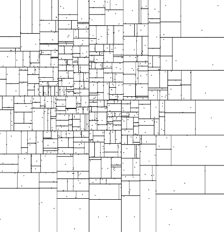

**图 20.3:** 这是一个包含若干非均匀分布点的 kd 树，用于说明空间是如何被划分的。在例示例中，每个节点最多可以存储三个点。虽然这个示例使用了两个维度，但可以轻松地扩展 kd 树到更高维度而不会增加开销。


```scala
val pIn: IndexedSeq[A] extends NeighborVisitor[A](d) {
  private val p = pIn.toArray
  private val maxPoints = 3

  class Node
  private class LNode(val pnts: Seq[Int]) extends Node
  private class INode(start: Int, end: Int) extends Node {
    val splitDim = {
      val min = (until dim).map(i => p.view.slice(start, end)).foldLeft(100)((m, v) => min(m, v(i)))
      val max = (until dim).map(i => p.view.slice(start, end)).foldLeft(-100)((m, v) => max(m, v(i)))
      (until dim).reduceLeft((i, j) => if (max(j) - min(j) > max(i) - min(i)) j else i)
    }
    val (splitVal, left, right) = {
      val mid = start + (end - start) / 2
      indexPartition(mid, start, end)
      (p(mid).splitDim, makeChild(start, mid + 1), makeChild(mid + 1, end))
    }
    def indexPartition(index: Int, start: Int, end: Int): Unit = {
      if (end - start > 1) {
        val pivot = if (end - start < 3) else {
          val mid = start + (end - start) / 2
          val ps = p(start)(splitDim)
          val pe = p(end - 1)(splitDim)
          if (ps < pm || ps >= pe) start
          else if (ps < pm || ps >= pe) mid - 1
        }
        val tpmp = p(pivot)
        p(pivot) = p(start)
        var (low, high) = (start + 1, end - 1)
        while (low < high) {
          if (p(low)(splitDim) <= tpmp) {
            low += 1
          } else {
            var tmp = p(low)
            p(low) = p(high)
            p(high) = tmp
            high -= 1
          }
        }
        p(start) = p(high)
        p(high) = tpmp
        if (high < index) indexPartition(index, high + 1, end)
        else if (high > index) indexPartition(index, start, high)
      }
    }
    def makeChild(s: Int, e: Int): Node = {
      if (e - s > maxPoints) nNode(s, e) else LNode(s until e)
    }
    private val root = new Node(0, p.length)
    def visitAllNeighbors(dist: Double, visit: (A) => Unit): Unit = {
      for (i in 0 until p.length) {
        val pi = p(i)
        def recur(n: Node): Unit = n match {
          case LNode =>
            n.pts.foreach(j => if (j > i && dist(p(j), pi) <= dist) visit(p(j)))
          case INode =>
            if (pi.splitDim - dist <= splitVal) recur(in.left)
            if (pi.splitDim + dist > splitVal) recur(in.right)
        }
        recur(root)
      }
    }
    def visitNeighbors(i: Int, dist: Double, visit: (A) => Unit): Unit = {
      val pi = p(i)
      def recur(n: Node): Unit = n match {
        case LNode =>
          n.pts.foreach(j => if (j != i && dist(p(j), pi) <= dist) visit(p(j)))
        case INode =>
          if (pi.splitDim - dist <= splitVal) recur(in.left)
          if (pi.splitDim + dist > splitVal) recur(in.right)
      }
      recur(root)
    }
  }
}
```

# 空间树

真正的重点在于这段代码的功能是创建一个 `INode`。传入的所有内容都是起始索引和一个指向 `Array` 的索引，该索引指向应该属于该节点点。所有的操作都是原地完成的，通过对数组 `p` 中的元素进行重新排序。

构建 `INode` 时执行的第一件事是找到指定点中跨度最大的维度，并将其作为划分维度。在声明并赋值 `splitVal`、`left` 和 `right` 之后，大部分工作都是在 `indexPartition` 方法中完成的。该方法的目的是沿着划分维度排列 `Array` 中的元素，使得应该位于目标索引的点位于该位置，并且在相应维度上位于上方或下方的点在数组中位于其上方或下方。在这种情况下，我们寻找的是中位数，但代码本身比这更通用。

### 20.4 高效碰撞球

空间数据结构可以产生极大收益的应用之一是我们之前制作的碰撞球问题。对于之前执行的模拟，任何数据结构都是大材小用。然而，如果球的数量增加几个数量级，那么数据结构将是必须的。

如果我们使用数据结构，就会出现搜索半径的问题。对于所有球的安全搜索半径是速度乘以时间步。由于这些值可以很容易通过 `O(N)` 计算，因此将它们添加到代码中并不是问题。

使用数据结构时，代码需要进行少量的更改。你可以在第 13 章第 440 页找到原始代码。任何调用 `findEventsFor` 的地方都需要数据结构。`findEvents` 方法强制要求一个 `Seq[Int]`，包含要搜索的球的索引。目前的实现是暴力的。在当前实现之后，执行完整搜索时，初始化队列，然后处理碰撞后的所有值。第一种方法应该使用 `visitNeighbors` 并配合一个访问者，检查球是否碰撞并将它们加入到优先级队列中。仍然需要调用 `findEvents` 来获取墙壁碰撞，然后 `visitNeighbors` 将完成其余工作。单个球的搜索应该使用 `visitNeighbors` 遍历列表。

## 20.5 章节结束内容

### 20.5.1 概念总结

- 空间数据有多种形式，并与许多计算形式相关。
- 处理空间邻近点等问题的暴力技术时间复杂度为 $O(N^2)$。
- 空间数据结构可以极大地提高扩展性。
- 网格非常简单，对于低维度、分布均匀的数据，它们是理想的。
- 基于区域的四叉树和八叉树划分包含所有数据的区域，划分为不断减小的、尺寸均匀的部分。这为需要的地方提供了可变的分辨率。
- k-tree 数据用于任意划分高维空间。每个内部节点根据特定值对数据进行划分，较小的值在左侧，较大的在右侧。

### 20.5.2 练习

1. 为本章介绍的各种空间数据结构编写单元测试。
2. 编写一个包含 `addPoint` 方法的四叉树（quadtree）。
3. 对本章介绍的任何树进行并行化，使搜索可以在多个线程中进行。如果你想增加挑战性，可以实现树的构建过程也并行进行。
4. 选择一种你感兴趣的空间树并对其运行速度测试。一种方法是在树中放入随机点，并搜索距离某个距离以下的所有点。对于所描述的这种树，你可以更改叶子节点中允许的点数。对数据集中不同的点数以及叶子节点允许的不同点数进行测试。比较相同维度不同树的相对速度也很有趣。

### 20.5.3 项目

1. 大多数读者可能不会在当前的 MUD（多用户地下城）实现中使用空间树。因为 MUD 中的所有地图完全是基于文本的，而不是空间性的。如果你必须给角色添加“统计数据”，你可能可以将其用于一些有趣的事情。角色（包括玩家控制和非玩家控制的角色）可能具有指示它们在不同方面强能力的统计数据。这些统计数据可以将它们放置在高维空间的 KD-tree 中，并对其进行映射，使用玩家能够找到能力相似的潜在对手或伙伴。
2. 几乎所有数据都可以被视为存在于适当维度的空间中。如果你正在开发网络爬虫，理想情况下你应该找到在某些方面密切相关的内容。你做什么取决于你正在收集什么数据。一个明显的例子是，如果你正在为某项运动筛选数据，你可以创建一个为每个重要统计类别设置不同维度的空间。你可以将所有条目放入一个多维 kd-tree 中，然后搜索特定点距离范围内的所有内容。这可以向你展示在不同方面具有可比性的玩家或团队。如果你存储的数据不是数值的，仍然可以根据文本或其他信息分配值。例如，你可以选择一组与你关注的内容相关的词，并使用每个词出现次数的函数作为不同轴的值。如果你有 100 个不同的感兴趣词，这意味着你拥有一个页面将进入的 100 维空间。这些可以放入 kD-tree 中，并用于找到在不同指标上相似的页面。如果你正在对图像进行分类，可以将一组数值值与图像关联。这些数值值可以与尺寸、颜色、亮度、饱和度、对比度或其他许多因素有关。图像包含大量的 RGB 值，因此你可以设计出许多产生有趣结果的函数。
3. 图形游戏（无论是联网的还是不联网的）都具有自动的空间属性。虽然你的游戏可能并不真正需要空间数据结构来高效加载内容，但你应该放置一个，以获得使用它们的经验。如果你创建了一个世界非常大的游戏，或者世界上有大量需要碰撞检测的实体，这些空间数据结构可以提供显著的收益。
4. 你可以放入数学项目中的一种分析类型是测量数据集分形维的能力。分形维度有许多不同的正式定义。我们称之为相关维度（correlation dimension）。相关性是通过正式定义的相关积分来确定的：

$$C(\epsilon) = \lim_{N\to\infty} \frac{g(\epsilon)}{N^2}$$

其中 $g(\epsilon)$ 是距离小于 $\epsilon$ 的点对数量。可以通过以下关系找到相关维度：

$$C(\epsilon) \sim \epsilon^{u}$$

其中 $u$ 是相关维度，它等于相关积分 $C(\epsilon)$ 在对数对数坐标图上的斜率。找到这个值需要两个步骤。首先，我们需要计算曲线上所有点的 $x$ 值和 $y$ 值的对数，然后对这些点进行线性拟合以找到求解器。

实际计算 $C(\epsilon)$ 关于点数的复杂度是 $O(N^2)$，这对于大型数据集来说是不可行的。随着 $N \to\infty$ 答案的质量会提高，因此最好使用非常大的数据集，而完整的、暴力的计算将变得不可行。这就是空间树派上用场的地方。不同尺寸节点的数量提供了分离长度或更短的点对数量的近似值。为了使这种工作运行，你需要使用一种在特定层上所有节点尺寸相同的树。这适用于本章中的四叉树和八叉树结构。如果 kD-tree 是以不同的方式构建的（即在空间中间进行划分而不是在位中点进行划分），也可以适用于 kD-tree。一旦你构建了这样的树，你可以使用近似值：

$$C(\epsilon) \approx \sum_{cells\ of\ size\ \epsilon} n_{cell}^2$$

这意味着分离长度为 $\epsilon$ 的点对数量约为尺寸为 $\epsilon$ 的单元格中点数平方和。


# 第 21 章

# 树的增强

- 21.1 树的增强 ................................................................................... 587
- 21.2 平衡二叉搜索树 ........................................................................................ 588
  - 21.2.1 旋转 ................................................................................................. 588
  - 21.2.2 实现 .............................................................................................. 589
- 21.3 顺序统计：作为序列的树 ............................................................... 593
- 21.4 增强空间树 ................................................................................ 600
- 21.5 章末材料 ................................................................................... 605
  - 21.5.1 概念总结 ................................................................................ 605
  - 21.5.2 习题 ....................................................................................... 605
  - 21.5.3 项目 .......................................................................................................... 606

第 16 章涵盖了树的基础知识，以及如何使用二叉搜索树（BST）来实现 map ADT。这种实现使我们在该 ADT 的所有操作上都有达到 $O(\log(n))$ 性能的可能性。遗憾的是，如果使用树的方式导致其不平衡，它也可能产生 $O(n)$ 的性能。在本章中，我们将看到如何通过向节点中添加更多数据，并利用这些数据来告知我们何时失去了平衡，从而执行相应的操作来修复这种状况。此外，我们还将看到如何使用类似的方法，将树用作序列 ADT 实现背后的存储机制，使其在直接访问、插入和删除操作上的复杂度都为 $O(\log(n))$。

### 21.1 树的增强

本章的核心思想是向我们的树节点中添加一些额外数据，以提供额外的功能。如果你回头去看 BST 的实现，每个节点只包含一个键（key）、数据、左孩子和右孩子。增强数据可以处理存储在子树中的数值，也可以仅处理树本身的结构。

增强数据有一条核心规则：对于任何标准方法，它必须在 $O(\log(n))$ 次操作内可维护。如果不是如此，增强将成为树中最慢的部分，并成为整体性能的限制因素。幸运的是，任何仅根据子节点值计算出的父节点值都具有这一特性，前提是除非树结构发生变化，否则它不会改变。你可以确定，这种值可以在 $O(\log(n))$ 次操作中维护，例如从树中添加或删除节点，从根到叶只会经过 $O(\log(n))$ 个节点。维护增强值只需要更新从叶回根路径上的节点。


示例值包括树的属性，如高度（`height`）和大小（`size`）。节点的高度是两个孩子高度的最大值加一。大小是两个孩子大小的和加一。任何父节点的值可以通过对孩子进行二元运算（如 `min`、`max`、`+` 或 `*`）来找到的值通常都是可行的。更复杂的值则需要多个部分信息来计算。以子树的平均值为例，平均值不能通过两个平均值的简单二元组合来计算。然而，平均值是通过两个和的商计算出来的。第一个和是你想计算平均值的所有数值的总和；第二个和是它们的数量。这基本上就是大小（`size`），我们刚刚描述过它是孩子之和加一。如果你在节点上同时标记这两个值，就可以很容易地产生任何子树的平均值。

## 21.2 平衡二叉搜索树

我们将考虑的第一个增强树示例是自平衡 BST 的形式，称为 AVL 树。回想第 16 章，我们的 BST 主要缺点是它可能会变得不平衡并表现出 $O(n)$ 的性能。BST 是否平衡完全取决于键添加和删除的顺序。这是非常难以控制的。自平衡树会做一些额外工作，以确保无论对其执行的操作顺序如何，树都能保持良好的平衡。AVL 树是第一个被描述并首次被理解的树 [11]。

AVL 条件背后的想法是，我们希望任何给定节点的两个孩子的高度在彼此差值 1 之内。如果一个孩子的高度为 5，那么另一个孩子的高度必须是 4、5 或 6 才能被接受。如果不符合该条件，则必须调整树以恢复合规。这种彼此差在 1 之内的要求让树保持得如此完美的平衡。然而，它是相当有限制性的，并且会导致数量数量调整。出于这个原因，库中更多地使用其他自平衡树。

AVL 树在搜索操作上的工作与普通 BST 完全相同。只有添加或删除的操作需要重新计算高度并进行调整。由于 AVL 条件的维护，我们可以确定所有标准方法都能在 $O(\log(n))$ 内完成。

### 21.2.1 旋转

通过旋转来重新平衡变得不平衡的树的典型方法。旋转的想法是将任何节点的一个孩子拉到父节点上方，并将其中一个交换到另一个，从而在外侧孙子长得过高时保持正确的顺序。两种基本的旋转——左旋和右旋如图 21.1 所示。当外侧孙子过高时，可以使用右旋。相反，左旋可以解决外侧孙子过高的问题。

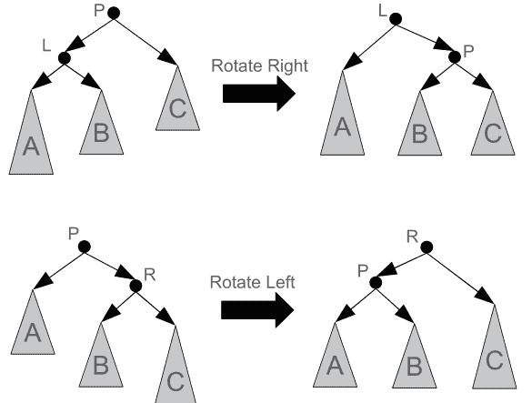

**图 21.1:** 此图显示了左旋和右旋的单旋转。当节点相对于另一个节点变得平衡时，可以使用它们。

### 21.2.2 实现

为了实现 AVL 树，我们将使用第 16 章写的不可变 BST 作为基础并进行修改。制作可变 AVL 树留给读者练习。像该树一样，我们有一个表示无功能的公共类型。我们还有实现树的私有类。顶层类型有两个功能上的新增：`rotate` 和 `height`，还有一个用于调试目的的 `verifyBalance`。`rotate` 方法应该检查平衡并在需要执行旋转。`height` 成员存储节点的高度。它是一个抽象 `val`，因此子类必须提供该值。代码所示：

```scala
package import linkedlist.adt.ListStack
abstract sealed class ImmutableAVLTreeMap[K <: Ordered[K], +V] extends Map[K, V] {
    def +B (k: K, v: V): ImmutableAVLTreeMap[K, B]
    def - (k: K): ImmutableAVLTreeMap[K, V]
    def rotate: ImmutableAVLTreeMap[K, V]
    def height: Int
    def verifyBalance: Boolean
}
```

```scala
private final class AVLNode<K <: Ordered[K], V> (
    private var key: K,
    private var data: V, private var left: ImmutableAVLTreeMap[K, V],
    private var right: ImmutableAVLTreeMap[K, V]) extends ImmutableAVLTreeMap[K, V] {
}

val height = (left.height max right.height) + 1

def +(kv: KV) = {
    val ret = if (kv._1 == key) new AVLNode(kv._1, kv._2, right)
    else if (kv._1 < key) new AVLNode(key, data, left + kv)
    else new AVLNode(key, data, left + kv)
    ret.rotate
}

def - (k: K) = {
    val ret = if (k == key) {
        match left {
            case _: AVLEmpty[K] => right
            case i: AVLNode[K] => left
            case _: => {
                val (k, d, newLeft) = i.removeMax
                new AVLNode(k, d, newLeft, right)
            }
        }
    }
}
```

```scala
}
}
else if (k < key) {
    new AVLNode(key, data, left - k, right)
else {
    new AVLNode(key, data, left, right - k)
}
    ret.rotate
}
def get(k: K): Option[V] = {
    if (k == key) Some(data)
    else if (k < key) left.get(k)
    else right.get(k)
}
def iterator = new Iterator[K, V] {
    val stack = new ListStack[AVLNode[K, V]]
    def hasNext: Boolean = !stack.isEmpty
    def next: (K, V) = {
        val n = stack.pop()
        pushRunLeft(n.right)
        n.key -> n.data
    }
}
def pushRunLeft(n: ImmutableAVLTreeMap[K, V]): Unit = {
        match {
            case e: AVLEmpty[K] =>
            case i: AVLNode[K, V] =>
                stack.push(i)
                pushRunLeft(i.left)
        }
}
def rotate: ImmutableAVLTreeMap[K, V] = {
    if (left.height > right.height + 1) {
        match {
            case lNode: AVLNode[K, V] => // 因为高度的原因，这总是有效的。
                if (lNode.left.height > rNode.left.height) {
                    rotateRight
                }
                new AVLNode(key, data, left, lNode.right.rotateRight).rotateRight
            case => null // 不可能。
        }
    } else if (right.height > left.height + 1) {
        case rNode: AVLNode[K, V] => // 因为高度的原因，这总是有效的。
            if (rNode.right.height > rNode.left.height) {
                rotateLeft
            }
            else {
                new AVLNode(key, data, left, rNode.rotateLeft).rotateLeft
            }
    }
}
```

```scala
case => null // 不可能。
}
```

```scala
else this
}
```

```scala
def verifyBalance: Boolean = {
left.verifyBalance && right.verifyBalance && (left.height - right.height).abs < 2
}
```

```scala
private removeMax(K, V, ImmutableAVLTreeMap[K, V]) = {
right match {
case e: AVLEmpty[K] => (key, data, left)
case i: AVLNode[K, V] =
    val (k, d, r) = i.removeMax
    (k, d, AVLNode(key, data, r).rotate)
}
}
```

```scala
private rotateLeft: AVLNode[K, V] = right match {
case rNode: AVLNode(rNode.key, rNode.data, new AVLNode(key, data, left, rNode.left, rNode.right))
case => throw IllegalArgumentException("在空右节点上调用了 rotate.")
}
```

```scala
private rotateRight: AVLNode[K, V] = left match {
case lNode: AVLNode(lNode.key, lNode.data, new AVLNode(key, data, lNode.left, lNode.right, right))
case => throw IllegalArgumentException("在空左节点上调用了 rotate.")
}
```

```scala
private final class AVLEmpty[K <: Ordered[K]] extends ImmutableAVLTreeMap[K, Nothing]() {
    def +(kv: (K, B)) = {
        new AVLNode(kv._1, kv._2, this)
    }
}
```

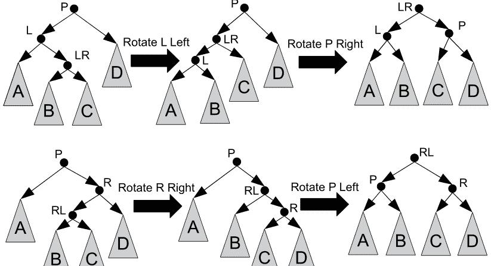

**图 21.2：** 此图展示了左-右和右-左的双重旋转。当节点因为内部孙子节点太高而变得平衡时，可以使用这些旋转。请注意，这些每一个仅仅是 21.1 节旋转的两次应用。


# 使用 Scala 的面向对象、抽象和数据结构


**图 21.2：** 此图展示了左-右和右-左的双重旋转。当节点因为内部孙子节点太高而变得平衡时，可以使用这些旋转。请注意，这些每一个仅仅是 21.1 节旋转的两次应用。

## AVL 树节点实现

```scala
private final class AVLNode[K <: Ordered[K], V](
    private var key: K,
    private var data: V,
    private var left: ImmutableAVLTreeMap[K, V],
    private var right: ImmutableAVLTreeMap[K, V]
) extends ImmutableAVLTreeMap[K, V] {

    val height = (left.height max right.height) + 1

    def +(kv: (K, V)) = {
        val ret = if (kv._1 == key) new AVLNode(kv._1, kv._2, left, right)
        else if (kv._1 < key) new AVLNode(key, data, left + kv, right)
        else new AVLNode(key, data, left, right + kv)
        ret.rotate
    }

    def -(k: K) = {
        val ret = if (k == key) {
            left match {
                case _: AVLEmpty[K] => right
                case lNode: AVLNode[K, V] =>
                    val (k, d, newLeft) = lNode.removeMax
                    new AVLNode(k, d, newLeft, right)
            }
        } else if (k < key) {
            new AVLNode(key, data, left - k, right)
        } else {
            new AVLNode(key, data, left, right - k)
        }
        ret.rotate
    }

    def get(k: K): Option[V] = {
        if (k == key) Some(data)
        else if (k < key) left.get(k)
        else right.get(k)
    }

    def iterator = new Iterator[(K, V)] {
        val stack = new ListStack[AVLNode[K, V]]
        def hasNext: Boolean = !stack.isEmpty
        def next: (K, V) = {
            val n = stack.pop()
            pushRunLeft(n.right)
            n.key -> n.data
        }
    }

    def pushRunLeft(n: ImmutableAVLTreeMap[K, V]): Unit = n match {
        case _: AVLEmpty[K] =>
        case i: AVLNode[K, V] =>
            stack.push(i)
            pushRunLeft(i.left)
    }

    def rotate: ImmutableAVLTreeMap[K, V] = {
        if (left.height > right.height + 1) {
            left match {
                case lNode: AVLNode[K, V] => // 因为高度的原因，这总是有效的。
                    if (lNode.left.height > lNode.right.height) {
                        rotateRight
                    } else {
                        new AVLNode(key, data, left, lNode.right.rotateRight).rotateRight
                    }
                case _ => null // 不可能。
            }
        } else if (right.height > left.height + 1) {
            right match {
                case rNode: AVLNode[K, V] => // 因为高度的原因，这总是有效的。
                    if (rNode.right.height > rNode.left.height) {
                        rotateLeft
                    } else {
                        new AVLNode(key, data, rNode.rotateLeft, right).rotateLeft
                    }
                case _ => null // 不可能。
            }
        } else this
    }

    def verifyBalance: Boolean = {
        left.verifyBalance && right.verifyBalance && (left.height - right.height).abs < 2
    }

    private def removeMax: (K, V, ImmutableAVLTreeMap[K, V]) = {
        right match {
            case _: AVLEmpty[K] => (key, data, left)
            case rNode: AVLNode[K, V] =>
                val (k, d, r) = rNode.removeMax
                (k, d, new AVLNode(key, data, left, r).rotate)
        }
    }

    private def rotateLeft: AVLNode[K, V] = right match {
        case rNode: AVLNode[K, V] =>
            new AVLNode(rNode.key, rNode.data, new AVLNode(key, data, left, rNode.left), rNode.right)
        case _ => throw new IllegalArgumentException("在空右节点上调用了 rotate.")
    }

    private def rotateRight: AVLNode[K, V] = left match {
        case lNode: AVLNode[K, V] =>
            new AVLNode(lNode.key, lNode.data, lNode.left, new AVLNode(key, data, lNode.right, right))
        case _ => throw new IllegalArgumentException("在空左节点上调用了 rotate.")
    }
}
```

## 空节点实现

```scala
private final class AVLEmpty[K <: Ordered[K]] extends ImmutableAVLTreeMap[K, Nothing]() {
    def +(kv: (K, V)) = {
        new AVLNode(kv._1, kv._2, this, this)
    }
}
```


# 590 使用 Scala 的面向对象、抽象和数据结构


**图 21.2：** 此图展示了左-右和右-左的双重旋转。当节点因为内部孙子节点太高而变得平衡时，可以使用这些旋转。请注意，这些每一个仅仅是 21.1 节旋转的两次应用。

```scala
}
private final class AVLNode<K <: Ordered[K], V> (
    private var key: K,
    private var data: V, private var left: ImmutableAVLTreeMap[K, V],
    private var right: ImmutableAVLTreeMap[K, V]) extends ImmutableAVLTreeMap[K, V] {
}

val height = (left.height max right.height) + 1

def +(kv: KV) = {
    val ret = if (kv._1 == key) new AVLNode(kv._1, kv._2, right)
    else if (kv._1 < key) new AVLNode(key, data, left + kv)
    else new AVLNode(key, data, left + kv)
    ret.rotate
}

def - (k: K) = {
    val ret = if (k == key) {
        match left {
            case _: AVLEmpty[K] => right
            case i: AVLNode[K] => left
            case _: => {
                val (k, d, newLeft) = i.removeMax
                new AVLNode(k, d, newLeft, right)
            }
        }
    }
```

# 树的增强

```scala
}
}
else if (k < key) {
    new AVLNode(key, data, left - k, right)
else {
    new AVLNode(key, data, left, right - k)
}
    ret.rotate
}
def get(k: K): Option[V] = {
    if (k == key) Some(data)
    else if (k < key) left.get(k)
    else right.get(k)
}
def iterator = new Iterator[K, V] {
    val stack = new ListStack[AVLNode[K, V]]
    def hasNext: Boolean = !stack.isEmpty
    def next: (K, V) = {
        val n = stack.pop()
        pushRunLeft(n.right)
        n.key -> n.data
    }
}
def pushRunLeft(n: ImmutableAVLTreeMap[K, V]): Unit = {
        match {
            case e: AVLEmpty[K] =>
            case i: AVLNode[K, V] =>
                stack.push(i)
                pushRunLeft(i.left)
        }
}
def rotate: ImmutableAVLTreeMap[K, V] = {
    if (left.height > right.height + 1) {
        match {
            case lNode: AVLNode[K, V] => // 因为高度的原因，这总是有效的。
                if (lNode.left.height > rNode.left.height) {
                    rotateRight
                }
                new AVLNode(key, data, left, lNode.right.rotateRight).rotateRight
            case => null // 不可能。
        }
    } else if (right.height > left.height + 1) {
        case rNode: AVLNode[K, V] => // 因为高度的原因，这总是有效的。
            if (rNode.right.height > rNode.left.height) {
                rotateLeft
            }
            else {
                new AVLNode(key, data, left, rNode.rotateLeft).rotateLeft
            }
    }
}
```

# 592 使用 Scala 的面向对象、抽象和数据结构

```scala
case => null // 不可能。
}
```

```scala
else this
}
```

```scala
def verifyBalance: Boolean = {
left.verifyBalance && right.verifyBalance && (left.height - right.height).abs < 2
}
```

```scala
private removeMax(K, V, ImmutableAVLTreeMap[K, V]) = {
right match {
case e: AVLEmpty[K] => (key, data, left)
case i: AVLNode[K, V] =
    val (k, d, r) = i.removeMax
    (k, d, AVLNode(key, data, r).rotate)
}
}
```

```scala
private rotateLeft: AVLNode[K, V] = right match {
case rNode: AVLNode(rNode.key, rNode.data, new AVLNode(key, data, left, rNode.left, rNode.right))
case => throw IllegalArgumentException("在空右节点上调用了 rotate.")
}
```

```scala
private rotateRight: AVLNode[K, V] = left match {
case lNode: AVLNode(lNode.key, lNode.data, new AVLNode(key, data, lNode.left, lNode.right, right))
case => throw IllegalArgumentException("在空左节点上调用了 rotate.")
}
```

```scala
private final class AVLEmpty[K <: Ordered[K]] extends ImmutableAVLTreeMap[K, Nothing]() {
    def +(kv: (K, B)) = {
        new AVLNode(kv._1, kv._2, this)
    }
}
```


# 590 使用 Scala 的面向对象、抽象和数据结构


**图 21.2：** 此图展示了左-右和右-左的双重旋转。当节点因为内部孙子节点太高而变得平衡时，可以使用这些旋转。请注意，这些每一个仅仅是 21.1 节旋转的两次应用。

```scala
private final class AVLNode[K <: Ordered[K], V](
    private var key: K,
    private var data: V,
    private var left: ImmutableAVLTreeMap[K, V],
    private var right: ImmutableAVLTreeMap[K, V]
) extends ImmutableAVLTreeMap[K, V] {

    val height = (left.height max right.height) + 1

    def +(kv: (K, V)) = {
        val ret = if (kv._1 == key) new AVLNode(kv._1, kv._2, left, right)
        else if (kv._1 < key) new AVLNode(key, data, left + kv, right)
        else new AVLNode(key, data, left, right + kv)
        ret.rotate
    }

    def -(k: K) = {
        val ret = if (k == key) {
            left match {
                case _: AVLEmpty[K] => right
                case i: AVLNode[K, V] =>
                    val (k, d, newLeft) = i.removeMax
                    new AVLNode(k, d, newLeft, right)
            }
        } else if (k < key) {
            new AVLNode(key, data, left - k, right)
        } else {
            new AVLNode(key, data, left, right - k)
        }
        ret.rotate
    }

    def get(k: K): Option[V] = {
        if (k == key) Some(data)
        else if (k < key) left.get(k)
        else right.get(k)
    }

    def iterator = new Iterator[(K, V)] {
        val stack = new ListStack[AVLNode[K, V]]

        def hasNext: Boolean = !stack.isEmpty

        def next: (K, V) = {
            val n = stack.pop()
            pushRunLeft(n.right)
            n.key -> n.data
        }
    }

    def pushRunLeft(n: ImmutableAVLTreeMap[K, V]): Unit = n match {
        case e: AVLEmpty[K] =>
        case i: AVLNode[K, V] =>
            stack.push(i)
            pushRunLeft(i.left)
    }

    def rotate: ImmutableAVLTreeMap[K, V] = {
        if (left.height > right.height + 1) {
            left match {
                case lNode: AVLNode[K, V] => // 因为高度的原因，这总是有效的。
                    if (lNode.left.height >= lNode.right.height) {
                        rotateRight
                    } else {
                        new AVLNode(key, data, left, lNode.right.rotateRight).rotateRight
                    }
                case _ => null // 不可能。
            }
        } else if (right.height > left.height + 1) {
            right match {
                case rNode: AVLNode[K, V] => // 因为高度的原因，这总是有效的。
                    if (rNode.right.height >= rNode.left.height) {
                        rotateLeft
                    } else {
                        new AVLNode(key, data, rNode.left.rotateLeft, right).rotateLeft
                    }
                case _ => null // 不可能。
            }
        } else this
    }

    def verifyBalance: Boolean = {
        left.verifyBalance && right.verifyBalance && (left.height - right.height).abs < 2
    }

    private def removeMax: (K, V, ImmutableAVLTreeMap[K, V]) = {
        right match {
            case e: AVLEmpty[K] => (key, data, left)
            case i: AVLNode[K, V] =>
                val (k, d, r) = i.removeMax
                (k, d, new AVLNode(key, data, left, r).rotate)
        }
    }

    private def rotateLeft: AVLNode[K, V] = right match {
        case rNode: AVLNode[K, V] =>
            new AVLNode(rNode.key, rNode.data, new AVLNode(key, data, left, rNode.left), rNode.right)
        case _ => throw new IllegalArgumentException("在空右节点上调用了 rotate.")
    }

    private def rotateRight: AVLNode[K, V] = left match {
        case lNode: AVLNode[K, V] =>
            new AVLNode(lNode.key, lNode.data, lNode.left, new AVLNode(key, data, lNode.right, right))
        case _ => throw new IllegalArgumentException("在空左节点上调用了 rotate.")
    }
}

private final class AVLEmpty[K <: Ordered[K]] extends ImmutableAVLTreeMap[K, Nothing] {
    def +(kv: (K, V)) = {
        new AVLNode(kv._1, kv._2, this, this)
    }

    def -(k: K) = this

    def get(k: K): Option[Nothing] = None

    def iterator = new Iterator[(K, Nothing)] {
        def hasNext: Boolean = false
        def next: (K, Nothing) = throw new NoSuchElementException
    }

    val height = 0

    def verifyBalance: Boolean = true

    def rotate: ImmutableAVLTreeMap[K, Nothing] = this
}
```

# 树的增强

# 592 使用 Scala 的面向对象、抽象和数据结构

# 21.3 统计树：AVL 树作为序列


# 590 使用 Scala 的面向对象、抽象和数据结构


**图 21.2：** 此图展示了左-右和右-左的双重旋转。当节点因为内部孙子节点太高而变得平衡时，可以使用这些旋转。请注意，这些每一个仅仅是 21.1 节旋转的两次应用。

```scala
}
private final class AVLNode<K <: Ordered[K], V> (
    private var key: K,
    private var data: V, private var left: ImmutableAVLTreeMap[K, V],
    private var right: ImmutableAVLTreeMap[K, V]) extends ImmutableAVLTreeMap[K, V] {
}

val height = (left.height max right.height) + 1

def +(kv: KV) = {
    val ret = if (kv._1 == key) new AVLNode(kv._1, kv._2, right)
    else if (kv._1 < key) new AVLNode(key, data, left + kv)
    else new AVLNode(key, data, left + kv)
    ret.rotate
}

def - (k: K) = {
    val ret = if (k == key) {
        match left {
            case _: AVLEmpty[K] => right
            case i: AVLNode[K] => left
            case _: => {
                val (k, d, newLeft) = i.removeMax
                new AVLNode(k, d, newLeft, right)
            }
        }
    }
```

# 树的增强

```scala
}
}
else if (k < key) {
    new AVLNode(key, data, left - k, right)
else {
    new AVLNode(key, data, left, right - k)
}
    ret.rotate
}
def get(k: K): Option[V] = {
    if (k == key) Some(data)
    else if (k < key) left.get(k)
    else right.get(k)
}
def iterator = new Iterator[K, V] {
    val stack = new ListStack[AVLNode[K, V]]
    def hasNext: Boolean = !stack.isEmpty
    def next: (K, V) = {
        val n = stack.pop()
        pushRunLeft(n.right)
        n.key -> n.data
    }
}
def pushRunLeft(n: ImmutableAVLTreeMap[K, V]): Unit = {
        match {
            case e: AVLEmpty[K] =>
            case i: AVLNode[K, V] =>
                stack.push(i)
                pushRunLeft(i.left)
        }
}
def rotate: ImmutableAVLTreeMap[K, V] = {
    if (left.height > right.height + 1) {
        match {
            case lNode: AVLNode[K, V] => // 因为高度的原因，这总是有效的。
                if (lNode.left.height > rNode.left.height) {
                    rotateRight
                }
                new AVLNode(key, data, left, lNode.right.rotateRight).rotateRight
            case => null // 不可能。
        }
    } else if (right.height > left.height + 1) {
        case rNode: AVLNode[K, V] => // 因为高度的原因，这总是有效的。
            if (rNode.right.height > rNode.left.height) {
                rotateLeft
            }
            else {
                new AVLNode(key, data, left, rNode.rotateLeft).rotateLeft
            }
    }
}
```

# 592 使用 Scala 的面向对象、抽象和数据结构

```scala
case => null // 不可能。
}
```

```scala
else this
}
```

```scala
def verifyBalance: Boolean = {
left.verifyBalance && right.verifyBalance && (left.height - right.height).abs < 2
}
```

```scala
private removeMax(K, V, ImmutableAVLTreeMap[K, V]) = {
right match {
case e: AVLEmpty[K] => (key, data, left)
case i: AVLNode[K, V] =
    val (k, d, r) = i.removeMax
    (k, d, AVLNode(key, data, r).rotate)
}
}
```

```scala
private rotateLeft: AVLNode[K, V] = right match {
case rNode: AVLNode(rNode.key, rNode.data, new AVLNode(key, data, left, rNode.left, rNode.right))
case => throw IllegalArgumentException("在空右节点上调用了 rotate.")
}
```

```scala
private rotateRight: AVLNode[K, V] = left match {
case lNode: AVLNode(lNode.key, lNode.data, new AVLNode(key, data, lNode.left, lNode.right, right))
case => throw IllegalArgumentException("在空左节点上调用了 rotate.")
}
```

```scala
private final class AVLEmpty[K <: Ordered[K]] extends ImmutableAVLTreeMap[K, Nothing]() {
    def +(kv: (K, B)) = {
        new AVLNode(kv._1, kv._2, this)
    }
}
```


# 590 使用 Scala 的面向对象、抽象和数据结构


**图 21.2：** 此图展示了左-右和右-左的双重旋转。当节点因为内部孙子节点太高而变得平衡时，可以使用这些旋转。请注意，这些每一个仅仅是 21.1 节旋转的两次应用。

```scala
}
private final class AVLNode<K <: Ordered[K], V> (
    private var key: K,
    private var data: V, private var left: ImmutableAVLTreeMap[K, V],
    private var right: ImmutableAVLTreeMap[K, V]) extends ImmutableAVLTreeMap[K, V] {
}

val height = (left.height max right.height) + 1

def +(kv: KV) = {
    val ret = if (kv._1 == key) new AVLNode(kv._1, kv._2, right)
    else if (kv._1 < key) new AVLNode(key, data, left + kv)
    else new AVLNode(key, data, left + kv)
    ret.rotate
}

def - (k: K) = {
    val ret = if (k == key) {
        match left {
            case _: AVLEmpty[K] => right
            case i: AVLNode[K] => left
            case _: => {
                val (k, d, newLeft) = i.removeMax
                new AVLNode(k, d, newLeft, right)
            }
        }
    }
```

# 树的增强

```scala
}
}
else if (k < key) {
    new AVLNode(key, data, left - k, right)
else {
    new AVLNode(key, data, left, right - k)
}
    ret.rotate
}
def get(k: K): Option[V] = {
    if (k == key) Some(data)
    else if (k < key) left.get(k)
    else right.get(k)
}
def iterator = new Iterator[K, V] {
    val stack = new ListStack[AVLNode[K, V]]
    def hasNext: Boolean = !stack.isEmpty
    def next: (K, V) = {
        val n = stack.pop()
        pushRunLeft(n.right)
        n.key -> n.data
    }
}
def pushRunLeft(n: ImmutableAVLTreeMap[K, V]): Unit = {
        match {
            case e: AVLEmpty[K] =>
            case i: AVLNode[K, V] =>
                stack.push(i)
                pushRunLeft(i.left)
        }
}
def rotate: ImmutableAVLTreeMap[K, V] = {
    if (left.height > right.height + 1) {
        match {
            case lNode: AVLNode[K, V] => // 因为高度的原因，这总是有效的。
                if (lNode.left.height > rNode.left.height) {
                    rotateRight
                }
                new AVLNode(key, data, left, lNode.right.rotateRight).rotateRight
            case => null // 不可能。
        }
    } else if (right.height > left.height + 1) {
        case rNode: AVLNode[K, V] => // 因为高度的原因，这总是有效的。
            if (rNode.right.height > rNode.left.height) {
                rotateLeft
            }
            else {
                new AVLNode(key, data, left, rNode.rotateLeft).rotateLeft
            }
    }
}
```

# 592 使用 Scala 的面向对象、抽象和数据结构

```scala
case => null // 不可能。
}
```

```scala
else this
}
```

```scala
def verifyBalance: Boolean = {
left.verifyBalance && right.verifyBalance && (left.height - right.height).abs < 2
}
```

```scala
private removeMax(K, V, ImmutableAVLTreeMap[K, V]) = {
right match {
case e: AVLEmpty[K] => (key, data, left)
case i: AVLNode[K, V] =
    val (k, d, r) = i.removeMax
    (k, d, AVLNode(key, data, r).rotate)
}
}
```

```scala
private rotateLeft: AVLNode[K, V] = right match {
case rNode: AVLNode(rNode.key, rNode.data, new AVLNode(key, data, left, rNode.left, rNode.right))
case => throw IllegalArgumentException("在空右节点上调用了 rotate.")
}
```

```scala
private rotateRight: AVLNode[K, V] = left match {
case lNode: AVLNode(lNode.key, lNode.data, new AVLNode(key, data, lNode.left, lNode.right, right))
case => throw IllegalArgumentException("在空左节点上调用了 rotate.")
}
```

```scala
private final class AVLEmpty[K <: Ordered[K]] extends ImmutableAVLTreeMap[K, Nothing]() {
    def +(kv: (K, B)) = {
        new AVLNode(kv._1, kv._2, this)
    }
}
```

# 增强树

为了理解这一点，假设我们想要找到索引为 6 的元素。我们开始查看根节点左孩子的大小。它是 4，小于 6。这告诉我们我们要找的东西在树的右侧。这是二分查找的特征，到此时我们已经非常清楚 `O(log n)` 的优势了。我们只需要进行一次比较就可以舍弃这部分数据。因此，我们进入右节点。不过，我们并不是在右节点中寻找索引 6，相反，我们寻找的是索引 1。我们是如何确定这一点的？左节点包含前 4 个元素，而根节点本身是一个。由于我们已经舍了 5 个元素，所以从我们要查找的索引中减去这个数量。因此，我们可以确定我们要找的是索引 1。

经过一次比较后，我们处于以 'z' 为顶部的子树中，寻找索引 1。左节点的大小为 2。这比我们要找的索引大，所以我们向左侧移动。当我们向左侧移动时，索引保持不变，因为我们没有放入元素。经过两次比较后，我们位于 'c' 查找索引 1。'c' 的左节点是空的，因此它小于我们要找的索引，所以我们向左移动，并从我们要找的索引中减去 1，因为我们通过 'c' 跳过了它。我们现在位于 'q' 查找索引 0。'q' 的左节点为空，大小为 0，正是我们要找的索引，因此 'q' 就是我们要找的值。

这个过程展示了存储大小如何能够在与树的高度成正比的操作次数内找到指定索引处的值。这比数组要慢，但比链表提供的性能要快得多。

如果在增强 't' 之后查看索引 6 会发生什么？同样，我们从 'h' 开始，左节点是 4。然后我们移动到右侧的 'z' 寻找索引 1。左节点的大小为 3，所以我们向左移动，仍在寻找索引 1。'c' 的左节点大小为 1，这意味着 'c' 就是我们要找的索引。

这种搜索可以通过索引增强来实现。然而，索引增强无法高效地维护。为了理解这一点，请仔细观察图 21.3 中标记索引数字数字差异。节点 'c'、'z' 和 'h' 的大小值发生了变化。即从新节点到根节点的路径，这在平衡树中长度为 `O(log n)`。在在这种情况下，索引标记的差异是 3 到 4，但你可以想象索引 1 处的新值，就会发现需要更改的索引数量规模为 `O(n)`。这告诉我们，我们要增强节点的大小，而不是索引值。

下面的代码是一个扩展了可变 `Buffer` 的顺序树（order-static tree）的实现。该类使用了内部类 `Node` 和 `iode`，以及 `Empty` 的内部对象声明。这镜像了最后不可变部分的风格，但这里是可变的，且扩展 `iNode` 是一个变量（`var`）。虽然我们使用类结构来实现 AVL 树，但它的实现方式非常不同，有更多重载的方法和几次 `match` 的使用。

`Buffer` 方法本身的代码通常很短，就像 `Empty` 中的方法一样。大部分代码都在 `iNode` 中，特别是在用于删除和旋转（rotating）的方法中。使用带有长度的 `+`、`-` 和 `insert` 的 `Empty` 保持了插入代码。我们在这里看到的反复定理是将索引与左孩子的大小进行比较。

```scala
package metertrees.adt
```

```scala
import collection.mutable
```

```scala
class OrderStatTreeBuffer[A] extends Buffer[A] {
```

```scala
abstract class Node {

  def size: Int

  def height: Int

  def +(elem: A): Node

  def +:(elem: A): Node

  def apply(n: Int): A

  def remove(n: Int): (A, Node)

  def removeMin: (A, Node)

  def update(n: Int, elem: A): Unit

  def insert(n: Int, elem: A): Node

  def rotate: Node

}
```


# 增强树

为了理解这一点，假设我们想要找到索引为 6 的元素。我们开始查看根节点左孩子的大小。它是 4，小于 6。这告诉我们我们要找的东西在树的右侧。这是二分查找的特征，到此时我们已经非常清楚 $O(\log n)$ 的优势了。我们只需要进行一次比较就可以舍弃这部分数据。因此，我们进入右节点。不过，我们并不是在右节点中寻找索引 6，相反，我们寻找的是索引 1。我们是如何确定这一点的？左节点包含前 4 个元素，而根节点本身是一个。由于我们已经舍了 5 个元素，所以从我们要查找的索引中减去这个数量。因此，我们可以确定我们要找的是索引 1。

经过一次比较后，我们处于以 'z' 为顶部的子树中，寻找索引 1。左节点的大小为 2。这比我们要找的索引大，所以我们向左侧移动。当我们向左侧移动时，索引保持不变，因为我们没有放入元素。经过两次比较后，我们位于 'c' 查找索引 1。'c' 的左节点是空的，因此它小于我们要找的索引，所以我们向左移动，并从我们要找的索引中减去 1，因为我们通过 'c' 跳过了它。我们现在位于 'q' 查找索引 0。'q' 的左节点为空，大小为 0，正是我们要找的索引，因此 'q' 就是我们要找的值。

这个过程展示了存储大小如何能够在与树的高度成正比的操作次数内找到指定索引处的值。这比数组要慢，但比链表提供的性能要快得多。


如果在增强 `t` 之后查看索引 6 会发生什么？同样，我们从 `h` 开始，左节点是 4。然后我们移动到右侧的 `z` 寻找索引 1。左节点的大小为 3，所以我们向左移动，仍在寻找索引 1。`c` 的左节点大小为 1，这意味着 `c` 就是我们要找的索引。

这种搜索可以通过索引增强来实现。然而，索引增强无法高效地维护。为了理解这一点，请仔细观察图 21.3 中标记索引数字的差异。节点 `c`、`z` 和 `h` 的大小值发生了变化。即从新节点到根节点的路径，这在平衡树中长度为 $O(\log n)$。在这种情况下，索引标记的差异是 3 到 4，但你可以想象索引 1 处的新值，就会发现需要更改的索引数量规模为 $O(n)$。这告诉我们，我们要增强节点的大小，而不是索引值。

下面的代码是一个扩展了可变 `Buffer` 的顺序树的实现。该类使用了内部类 `Node` 和 `INode`，以及 `Empty` 的内部对象声明。这镜像了最后不可变部分的风格，但这里是可变的，且扩展 `INode` 是一个变量（`var`）。虽然我们使用类结构来实现 AVL 树，但它的实现方式非常不同，有更多重载的方法和几次 `match` 的使用。

`Buffer` 方法本身的代码通常很短，就像 `Empty` 中的方法一样。大部分代码都在 `INode` 中，特别是在用于删除和旋转的方法中。使用带有长度的 `+`、`-` 和 `insert` 的 `Empty` 保持了插入代码。我们在这里看到的反复定理是将索引与左孩子的大小进行比较。

```scala
package metertrees.adt
```

```scala
import collection.mutable
```

```scala
class OrderStatTreeBuffer[A] extends Buffer[A] {
```

```scala
abstract class Node {
  def size: Int
  def height: Int
  def +(elem: A): Node
  def +:(elem: A): Node
  def apply(n: Int): A
  def remove(n: Int): (A, Node)
  def removeMin: (A, Node)
  def update(n: Int, elem: A): Unit
  def insert(n: Int, elem: A): Node
  def rotate: Node
}
```

```scala
private class INode(var data: A, var left: Node, var right: Node) extends Node {
  var size = 1 + left.size + right.size
  var height = 1 + (left.height max right.height)
}
```

```scala
private def setSizeAndHeight: Unit = {
  size = 1 + left.size + right.size
  height = 1 + (left.height max right.height)
}
```

```scala
def +(elem: A): Node = {
  right += elem
  setSizeAndHeight
  rotate
}
```

```scala
def apply(n: Int): A = {
  if (n == left.size) left(n)
  else right(n - left.size - 1)
}
```

```scala
def remove(n: Int): (A, Node) = {
  var ret = if (left.size == n) {
    val d = data
    if (right == Empty) (data, left)
    else if (left == Empty) (data, right)
    else {
      val (newData, r) = right.removeMin
      right = r
      data = newData
      setSizeAndHeight
      (d, this)
    }
  } else if (left.size > n) {
    val (d, l) = left.remove(n)
    left = l
    setSizeAndHeight
    (d, this)
  } else {
    val (d, r) = right.remove(n - left.size - 1)
    right = r
    setSizeAndHeight
    (d, this)
  }
}
// ... (由于原文代码块重复且不完整，此处仅展示核心结构翻译)
```

# 使用 Scala 的面向对象、抽象与数据结构

一个实现了 `Buffer` 特质的非 AVL 树。该代码在重构为支持 AVL 平衡之前已经过测试，以确保其运行正常。除非你恰好在进行大量的随机添加，否则该数据结构的非 AVL 版本可能并没有链表好用多少。通过旋转操作，代码的行为在外部看起来是一样的，但我们可以为任何单个数据元素操作获得 $O(\log(n))$ 的性能。树和旋转确实会增加开销，除非你的集合需要非常大，且树需要大量的随机访问以及随机添加和删除，否则这并不是理想的结构。

这种类型进一步说明了为什么你需要知道如何编写自己的数据结构的另一个例子。`scala.collection.mutable` 包包含了基于数组和链表的 `Buffer` 实现。它并不包含一个基于顺序统计树的实现。如果你的代码需要统一的 $O(\log(n))$ 操作，你真的需要能够自己编写它。

## 21.4 增强空间树

二叉树并不是唯一可以进行增强的树。有非常充分的理由你可能也想对空间树进行增强。空间树中的数据通常与普通树略有不同。例如，你可能会存储子树中点的平均位置，或者子树中粒子的总质量。在某些情况下，你可能想要知道不同方向的极值。在我们第 20 章中查看的碰撞案例中，树可以包含子树中最大速度和半径的信息，这样就可以根据局部群体属性调整搜索半径进行搜索。当某个粒子异常地快速或尺寸明显大于其他粒子时，这可以使运行速度快得多。

为了说明增强空间树，本章的最后一个示例将会有所不同。显然，我们将创建一个旨在为碰撞或射线相交等操作提供快速计算的树。这棵树将通过其他一些数据进行增强。我们将使用 x、y、z 轴的最小值和最大值进行增强。此外，添加到树中的对象可以位于内部节点，而不仅仅是叶子节点。增强旨在为我们提供一个单元“何时”变得相关的估计。在树的高处存储值是为了让该结构在处理不同大小的数据集时工作得更好。非常大的物体能够影响更多与小物体的潜在碰撞或相交。这避免了为了“命中”它们而进行的受大物体边界限制的范围搜索。这与放置一个完全包含它们的节点不同。它会将任何恰好落在边界附近的物体（即使是小物体）放置在树的高处。

> ¹ `insert` 方法的复杂度为 $O(m \log(n))$，其中 $m$ 是添加的元素数量，$n$ 是集合中的元素数量。

> ² 需要注意的是，Scala 中的 `Vector` 类型是一个不可变序列，它是使用平衡树实现的。它更像 B 树而不是 AVL 树，但使用树来实现序列的思想是相似的。

> ³ “何时”周围的引号表示我们想要知道某个参数的阈值，而该参数本身可能不是。

# 增强树 601

树的代码如下所示。该类名为 `IntersectionOctree`。它有一个伴随对象，定义了任何编写以使用此树的代码需要扩展的两个特质。其中一个包含树中对象的方法，另一个是一个可以根据不同标准检查相交的类型。`IntersectionOctree` 上的类型参数必须继承自前者。在构建八叉树时，调用代码需要给它提供一系列对象、八叉树的中心以及一个可以拆分的最小尺寸。最后一个参数将防止在添加非常小的对象时导致树变得极深。

```scala
package moretrees.adt

import collection.mutable

class IntersectionOctree[A <: IntersectionOctree.IntersectionObject](
  objs: Seq[A], centerX: Double, centerY: Double, centerZ: Double,
  treeSize: Double, minSize: Double) {

  private class Node(val x: Double, val y: Double, val z: Double, val size: Double) {
    val objs = mutable.Buffer[A]()
    var children: Array[Node] = null
    var min: Array[Double] = null
    var max: Array[Double] = null
  }

  def add(obj: A): Unit =
    if (obj.size * size * 0.5 || minSize > minSize) objs += obj
    else {
      if (children == null) {
        val hsize = size * 0.5
        val qsize = size * 0.25
        children = Array.tabulate(8)(i =>
          Node(cx - qsize + hsize * (i % 2), cy - qsize + hsize * (i / 2), cz - qsize + hsize * (i / 4), hsize))
      }
      children(whichChild(obj)).add(obj)
    }

  private def whichChild(obj: A): Int =
    (if (obj.x > centerX) 1 else 0) + (if (obj.y > centerY) 2 else 0) + (if (obj.z > centerZ) 4 else 0)

  def finalizeNode(): Unit =
    if (children != null) {
      children.foreach(_.finalizeNode)
    }
    min = ...
    max = ...
}
```

# 604 使用 Scala 的对象抽象与数据结构

```scala
val a = d(0) * d(0) + d(1) * d(1) + d(2) * d(2)
val b = 2 * (d(0) * dist(0) + d(1) * dist(1) + d(2) * dist(2))
val c = dist(0) * dist(0) + dist(1) * dist(1) + dist(2) * dist(2)
s.rad = s.rad
val root = b * b - 4 * a * c
if (root < 0) Double.PositiveInfinity
else (-b - math.sqrt(root)) / (2 * a)
```

```scala
def apply(min: Array[Double], max: Array[Double]): Double = {
  if ((p0, p).zipped.forall((l, h) => l >= 1 && p <= h)) 0.0 else {
    val minp = (0 to 2).map(i => (min(i) - p0(i)) / d(i))
    val maxp = (0 to 2).map(i => (max(i) - p0(i)) / d(i))
    var ret = Double.PositiveInfinity
    for (i <- 0 to 2) {
      val first = max(minp(i), maxp(i))
      if (first >= 0 && first < ret) {
        val (j, k) = ((i + 1) % 3, (i + 2) % 3)
        if (first >= minp(j) && first <= maxp(j) && first >= minp(k) && first <= maxp(k))
          ret = first
      }
    }
    ret
  }
}
// 注意：OCR 漏掉了一些关键字如 'val' 和 'max'，已根据上下文进行修正。
```

```scala
class Sphere(val c: Array[Double], rad: Double) extends IntersectionOctree.IntersectionObject {
  def apply(dim: Int): Double = c(dim) - rad
  def min(dim: Int): Double = c(dim)
  def max(dim: Int): Double = c(dim) + rad
  def size: Double = rad * 2
}
```


`Ray` 类型负责核心工作。第一个方法接收一个球体，并返回射线与球体相交的参数；如果没有相交，则返回正无穷大。第二个方法接收边界框的最小值和最大值数组，并确定射线与框相交的参数。如果射线起始于框内，则返回 0。

`Sphere` 类的作用仅仅是返回关于球体的基础信息。然而，要创建一个完整的几何类型层次结构，并在 `Ray` 的第一个方法中添加适当的几何体相交代码其实相当简单，这可以将其转化为一个功能完整的光线追踪器的实用数据结构。

# 21.5 章节结束材料

## 21.5.1 概念总结

- 增强是指在节点中存储额外数据的行为，用于提供额外的功能。这些数据可以与树结构或存储在树中的信息有关。
- 为了有效，增强后的值在标准操作中必须能够在 $O(\log n)$ 或更快的操作内维护。
- 通过对与节点高度相关的信息进行增强，我们可以构建自平衡二叉搜索树。
- AVL 树强制执行规则：兄弟节点的高度差不能超过 1。
- 当我们发现子节点违反高度限制的父节点时，通过应用旋转来修正问题。
- 示例了一个基于不可变二叉搜索树（BST）的实现。也可以以可变的方式实现。
- 对二叉搜索树进行尺寸增强可以用于构建阶序统计树，它可以作为序列使用。
- 索引类似于键值，但它没有被存储，因此插入和删除可以改变索引。
- 可以通过二分查找找到节点，将所需的索引与左子节点的大小进行比较。
- 空间树也可以进行增强。
- 这通常通过存储在树中的数据来实现。
- 提供了一个示例，其中节点存储树内部对象的边界，以便更高效地进行相交搜索。

## 21.5.2 练习题

1. 写一个可变的 AVL 树。
2. 比较 AVL 树与普通 BST 在随机数据以及顺序或类顺序数据上的速度。
3. 写一个带有叶子节点数量增强的 BST。
4. 比较不同缓冲区实现的速度。使用 Scala 库中的 `ByteBuffer` 和 `ListBuffer`。也使用本章编写的阶序统计树。比较不同大小集合的添加、删除和索引值的方法。
5. 为八叉树写一个 `findUntil` 方法。该方法将找到某个特定参数值之前的所有碰撞，而不仅仅是第一个。这对于寻找时间步内可能发生的碰撞很有用。

## 21.5.3 项目

1. 在你的 MUD（多用户地下城）中使用阶序统计树代替 Buffer。如果你能想到其他增强树的形式，也实现它。你可以考虑项目 21.4 中描述的极小极大树。
2. 如果你一直在编写网络爬虫，看看能否想出一种增强树来划分并赋予你的数据以额外含义。如果想不出来，就用阶序统计树代替 Buffer。
3. 如果你正在编写一个角色移动且有障碍物的图形游戏，你可以构建一个增强树来加速通过世界寻找路径的过程。这种树将跟踪地图上的点并存储点与点之间的信息。当代码需要将角色从一个位置移动到另一个位置时，应该对树进行递归下降，每个节点指定哪些子节点对于某些移动方式是重要的。这种方法的优点可以在树叶的局部空间内进行穷尽搜索。这些穷尽搜索是昂贵的；受益于更大区域的移动，递归下降可以剪掉已知无意义的移动。
4. AI 中有一种常用结构——极小极大树，它是通过比较移动来帮助玩家找到最优移动的增强树。极小极大树的想法是给每个玩家赋值。如果玩家 A 赢了，值为 1；如果玩家 B 赢了，值为 -1。在允许平局的游戏中，0 代表平局。在树中，玩家 A 想要选择值最大化的路径，玩家 B 想要选择值最小化的路径。由于玩家交替移动，存在交替的最大化和最小化层级。因此命名为极小极大树。如果你能为游戏中所有可能的移动构建树，你就能准确判断谁会获胜。对于大多数游戏，你无法构建整棵树。相反，你应该构建到某个深度，并在该深度对玩家的相对位置进行评估。启发式方法应该根据哪个玩家看起来处于更好位置给出 -1 到 1 之间的值。这在跳棋或国际象棋等游戏中是显而易见的，但对于不同的东西则不然。注意，如果选项很多，树会变得巨大。你可能需要做一些工作，通过剪掉坏移动来防止树爆炸。
5. 如果你一直在研究数学部分，可以考虑更改 Buffer 使其使用阶序统计树。对于井字游戏，这样做对读者来说是一个有趣的练习。结果是，一场良好的游戏以平局结束。

# 增强树

6. 使用 `IntersectionOctree` 为你的程序添加光线追踪元素。
7. 模拟有两个不同的增强方式，可以对性能进行空间改进。对于碰撞树，搜索距离可以随位置变化。早期的实现使用了统一搜索距离。可以通过增强树来实现局部搜索。搜索半径由 $\Delta v \cdot t \cdot R_{max}$ 给出，其中 $\Delta v$ 是相对速度，$t$ 是时间步，$R_{max}$ 是最大半径。对每个子树增强 $\Delta v$ 和 $R_{max}$ 的值。
8. 在股票组合管理项目中使用阶序统计树代替 Buffer。如果你能想到其他增强树的形式，也实现它。
9. 在你的项目中使用阶序统计树代替 Buffer。如果你能想到其他增强树的形式，也实现它。
10. 对于 L 系统项目，你可以考虑将字符表示为树而不是普通字符串。节点可以表示单个字符或字符序列。使用多叉树，每一代都可以深入到树的底部。实现这一点并看看它与直接使用普通字符串的方法相比。

树也可以用于提高重力计算的效率。重力树技术最初由 Barnes 和 Hut 开发 [2]。原始工作使用了八叉树，但许多较新的实现使用了 kd 树。重力树的想法是，对于远处物体，单个个体的精确位置是不重要的。例如，在计算由于星系产生的引力时，如果质量靠近地球，你不需要对所有月球进行计算。在系统中心对系统总质量进行单次计算是足够的，如果你位于外卫星之一的位置，某些月球的精确位置可能是重要的。

为了快速近似质量集合的引力，可以对子树中所有粒子的信息进行增强。简单的增强是每个节点存储该子树的总质量和质心位置。计算粒子的重力时，代码对树进行递归下降。在任何给定的节点上，都会比较节点的大小与当前考虑的粒子之间的距离。如果满足条件 $s/d < \beta$，其中 $d$ 是粒子与节点之间的距离，$s$ 是节点的大小，且 $\beta$ 是调整精度的参数⁵，则递归必须向下进入子节点。如果不满足，则可以针对该节点的质心计算力，并忽略子节点。

> ⁵对于此处描述的单极子，$\beta$ 的值应该在 0.1 到 0.3 之间。较小的值计算更准确，但会增加工作量。


## 第 22 章
## 哈希表

- 22.1 哈希表基础
- 22.1.1 哈希函数
  - 重写 hashCode 和 equals
- 22.1.2 哈希方法
- 22.2 链法
  - 键的不可变性
- 22.3 开放寻址法
  - 22.3.1 探测方法
  - 22.3.2 使用开放寻址法删除
  - 22.3.3 开放寻址法实现
- 22.4 章末材料
  - 22.4.1 概念总结
  - 22.4.2 练习题
  - 22.4.3 项目

第 16 章展示了我们如何使用二叉搜索树实现 Map ADT。第 6 章在此之前引入了 Scala 标准库中的 Map 类型，包括 TreeMap 类型，它们是各自对应的 SortedMap 类型的子类。你可能记得 Map 还有其他实现方式。特别是，HashMap 既有可变版本也有不可变版本。HashMap 使用了一种根本性的方法来实现 Map ADT，因此它是将接口与实现分离的另一个示例。TreeMap 使用 BST 进行实现，意味着搜索、添加和删除的基本操作复杂度均为 $O(\log n)$。我们使用哈希表的目标是将搜索、插入和删除方法都降低到 $O(1)$。

## 22.1 哈希表基础

哈希表本质上是一组编号的桶，带有一个函数将键映射到这些桶中。桶通常用数组实现，这通过数字索引查找桶提供了 $O(1)$ 的访问时间。图 22.1 显示了哈希表工作原理的图形表示。键可以是我们想要的任何类型的值，并且它们不需要具有任何类型的自然排序。我们有一个哈希函数，将键映射到数组索引范围内的数值。哈希函数无法产生唯一值。潜在的键的数量远多于数组中的位置数量。例如，考虑一个可能性受 String 最大长度限制的 String 键。不可避免会出现冲突，即两个值被映射到同一个位置。我们稍后会讨论用于处理冲突的方法。

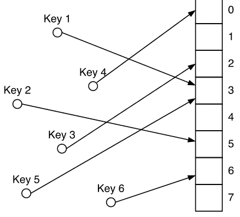

**图 22.1:** 此图显示了哈希表背后思想的图形表示。键可以是任何类型的数据，且不一定有序。键通过某种我们称为哈希的函数映射到存储区域的位置。可能的键的数量远多于数组中位置的数量，因此可能会出现“冲突”，即不同的键映射到同一个位置。

### 22.1.1 哈希函数

要实现这些从键映射到索引的函数通常涉及两个步骤。第一步将键转换为 $-2^{31}$ 到 $2^{31}-1$ 之间完整整数范围内的整数。然后我们将该值映射到索引范围内。在这个过程的第一步，即为任意类型的对象生成 `hashCode`，实际上是最困难的部分。幸运的是，Java 和 Scala 为我们承担了大量工作。`Any` 类型中有一个方法可以计算 `hashCode`。Scala 语言中的每个值都有能力为你计算哈希码。以下在 REPL 中的代码演示了为多个不同字符串生成的哈希码。

```scala
scala> words.map(w => w -> w.hashCode).foreach(println)
(This,2605758)
(is,33757)
(a,97)
(test,3556948)
(of,3543)
(the,114801)
(emergency,162901333)
(broadcast,-1618870623)
(system,-1737307657)
```

遗憾的是，这不是一种你可以盲目使用的魔术解决方案。库中的类型可能都拥有 `hashCode` 的良好实现。此外，当你创建一个 `case class` 时，Scala 添加到其中的内容之一是基于 `case class` 中元素的对 `hashCode` 和 `equals` 的有效实现。然而，如果你自己定义了一个不是 `case class` 的 `class`，那么 `hashCode` 和 `equals` 的默认实现很可能无法满足你对键的需求，并且你将会……

#### 重写 hashCode 和 equals

如果你决定实现自己的 `hashCode`，有一些你需要了解的事情。首先，如果两个实例相等，它们必须产生相同的 `hashCode`。根据第一个规则，这不会破坏本章的功能，但会导致 HashMap 性能糟糕。注意在 Scala 中，当你在表达式中使用 `==` 时，它实际上是在调用实例的 `equals`。

```scala
// Bad: returns constant
def hashCode = 42

// Good: combines fields
def hashCode = (field1, field2).hashCode
```

### 22.1.2 哈希方法

我们现在知道如何完成这个双步过程的第一步。你可以使用 `hashCode` 将你的键转换为一个整数值。为了完成哈希函数，我们需要将这些整数映射到索引范围。我们考虑的两种方法。较简单的一种被称为取模法，它使用取模运算符（`%`），你应该记得它是除法后剩余的部分。我们对 `hashCode` 的结果对数组长度取模。这是这种方法的一个显著限制，当我们假设数组长度为 10 对上述字符串使用这种简单方法时就会出现。

```scala
words.map(w => w.hashCode % 10).foreach(println)
(This,8)
(is,0)
(a,7)
(test,8)
(of,3)
(the,1)
(emergency,-3)
(broadcast,-3)
(system,-7)
```

Scala 中 `Int` 类型意味着我们可以从 `hashCode` 得到负值。对负值使用 `%` 时，结果是负的。由于我们数组的索引都是非负的，我们需要取绝对值。

遗憾的是，对于这种方法，并不是所有的数组长度值都是良好的选择。例如，2 的幂次方特别糟糕。其原因是当你对 2 的幂（例如 16）取模时，你实际上只是提取了 `hashCode` 的低位并丢弃了高位。取决于你的 `hashCode` 是如何编写的，可能会丢弃关于键特定部分的信息，从而在某些数据集中导致更多冲突。数组长度的理想值是远离 2 的幂的质数。在添加更多元素时增大数组大小，并始终使用远离 2 的幂的质数是具有挑战性的。

因此，我们将稍微改变增长机制，但不会为了保持它们而采取极端手段。

我们将讨论的另一种完成哈希函数的方法称为**乘法法**。使用这种方法，我们将 `hashCode` 乘以一个在 $0 < A < 1$ 范围内的常数 $A$。我们取结果的小数部分，将其乘以数组的长度，并将其截断为 `Int`。虽然任何 $A$ 的值都可以，但它对某些数据集的效果可能比其他数据集更好。Knuth [8] 认为 $A = (\sqrt{5}-1)/2 \approx 0.618034$ 适用于大多数数据集。

对于我们的代码，我们在一个对象中实现了这两种方法，该对象包含一个枚举，这样用户就可以方便地指定他们想要的哈希类型。

```scala
object HashingMethods extends Enumeration {
    val Division, Multiplication = Value

    private[adt] def buildHashFunction[K](method: Value): (K, Int) => Int = method match {
        case Division => (key, size) => key.hashCode().abs % size
        case Multiplication => (key, size) =>
            val x = key.hashCode() * A
            (size * (x - x.toInt)).toInt
    }
}

val A = (math.sqrt(5) - 1) / 2
```


还有其他将哈希码映射到数组索引范围的方法，它们在特定情况下可能有用。然而，两种方法就足够说明哈希表的工作原理了，而且由于简单快速，它们是最通用的方法。

# 22.2 链地址法

现在你已经知道如何将任意键映射到存储数组中有效索引的整数值，我们需要决定如何处理冲突问题。事实是，你无法预先知道数据集，无论你的哈希函数有多好，都不可能完全避免冲突。因此，当两个值映射到同一个索引时，我们需要能够处理它。在概念和计算机内存中，实现此最简单的方法是让表中的每个条目实际上是一个值列表，以链表或类似 `ArrayBuffer` 的可变长度数组的形式存储。

这是我们在第一次实现哈希映射时使用的方法。下面的代码显示了 `ChainingHashMap`，它扩展了 `mutable.Map` 特性并实现了该特性的四个抽象方法。它还实现了它自己的 `isEmpty` 版本以使其更高效。

> ¹ 那个值恰好是黄金比例的小数部分。

```scala
package hashtables.adt

import collection.mutable

class ChainingHashMap[K, V](method: HashingMethods.Value) extends mutable.Map[K, V] {

    private var numElements = 0

    private var table = Array(11)(List[(K, V)]())

    private val hashFunc = HashingMethods.buildHashFunction(method)

    def -+=(key: K): ChainingHashMap.this.type = {

        def appendUpdate(lst: List[(K, V)]): (Boolean, List[(K, V)]) = lst match {

            case Nil => (true, List(key))

            case h :: t => if (h._1 == key) (false, t) else {

                val (added, newt) = appendUpdate(t)

                (added, h :: newt)

            }

        }

        if (numElements > ChainingHashMap.factorFactor * table.length) growTable()

        val index = hashFunc(key, table.length)

        val (added, next) = appendUpdate(table(index))

        table(index) = next

        if (added) numElements += 1

        this

    }

    def -=(key: K): ChainingHashMap.this.type = {

        def removeMatch(lst: List[(K, V)]): (Boolean, List[(K, V)]) = lst match {

            case Nil => (false, Nil)

            case h :: t => if (h._1 == key) (true, t) else {

                val (found, newt) = removeMatch(t)

                (found, h :: newt)

            }

        }

        val index = hashFunc(key, table.length)

        val (found, next) = removeMatch(table(index))

        table(index) = next

        if (found) numElements -= 1

        this

    }

    def get(key: K): Option[V] = {

        val index = hashFunc(key, table.length)

        table(index).find(_1 == key).map(_2)

    }

    def iterator = new Iterator[[K, V]] {

        private var i1 = table.iterator

        private var i2 = nextBin()

        private def nextBin(): Iterator[[K, V]] = {

            if (i1.isEmpty) Iterator.empty

            else {

                var lst = i1.next

                while (lst.isEmpty && i1.hasNext) {

                  lst = i1.next

                }

                lst.iterator

            }

        }

        def hasNext: Boolean = i2.hasNext

        def next: (K, V) = {

            val ret = i2.next

            if (i2.isEmpty) i2 = nextBin()

            ret

        }

    }

    override def isEmpty = numElements == 0

    override def size = numElements

    private def growTable(): Unit = {

        val tmp = Array.fill(table.length * 2 + 1)(List[(K, V)]())

        for (kv <- table) {

            val index = hashFunc(kv, tmp.length)

            tmp(index) += kv

        }

        table = tmp

    }

}

object ChainingHashMap {

    def apply(method: HashingMethods.Value, kvs: (K, V)*): ChainingHashMap[K, V] = {

        val ret = new ChainingHashMap[K, V](method)

        for (kv <- kvs) ret += kv

        ret

    }

}

val fillingFactor = 0.7
```


# 使用 Scala 进行面向对象、抽象和数据结构

## 哈希表实现细节

该类起始于 `numElems` 的声明，即当前存储的元素数量。`table` 是一个简单的 `Array[(K, V)]` 计数器，初始有 11 个元素且全部为空。`hashFunc` 是我们之前显示的哈希函数。该类中除了 `isEmpty` 和 `size` 之外的最简单的方法位于第 43-46 行，它应该查找一个键并返回一个 `Option`。

`get`、`+=` 和 `-=` 的规模与 Map 中的元素成正比。所有操作都包含一个调用，遍历表中某个条目中的 `List` 构造函数。在 `get` 中，是 `find` 方法执行了此操作；在 `+=` 和 `-=` 中，则是寻找匹配键的辅助方法。这些方法都不会对表中多于一个条目的项进行任何操作。

遗憾的是，我们无法确定每个表中会有多少个元素。这取决于数据和哈希函数。可能每个添加的键都具有相同的索引，并且每次添加都发生了冲突。在这种情况下，所有这些方法的时间复杂度都是 O(n)。这是最坏情况下的行为。此外，只要 `hashCode` 方法编写得当，在真实数据上发生这种情况的概率极小。有了良好的 `hashCode`，我们期望数据均匀地分布在表的条目中。鉴于我们的 `fillingFactor` 小于 1，意味着我们期望单个 `List` 都是短的，不超过几个元素。在这种情况下，所有三种方法都是 O(1)，这是我们预期的行为。为了测试这一点，我们使用以 `Double` 为键类型的此类实现，并使用 `random` 生成键值添加了一百万个元素。在多次运行后，表中最长的 `List` 在 7 到 8 之间波动。希望这段讨论能清楚在适当的间隔调用 `growTable` 有多重要。这样做会导致表中的 `List` 以 O(n) 的方式增长，从而破坏性能。

> 例外情况是调用 `growTable` 的时候，但我们已经处理过通过倍数增长表会导致此操作的摊销成本为 O(1) 的问题。

## 键的不可变性

在之前对 Map ADT 的讨论中提到，键类型是不可变的是非常重要的。值得花一点时间考虑一下关于 Map 哈希实现的这一陈述。如果使用可变键类型会发生什么呢？假设你将一个键值对放入 Map，然后代码修改了该键的值。（记住，在 Scala 中对象是引用传递的，因此外部代码可以轻松地维护已添加键实例的引用。）更改键的值可能会改变 `hashCode` 计算出的值。这意味着该键现在位于表中错误的条目中。这使得在实际上几乎无法找到它。

## 22.3 开放寻址

处理冲突的另一种方法称为“开放寻址”（open addressing）。使用这种方法，表中的条目不是某种形式的列表，而是简单的值。当我们向表中放入一个新的键值对并发现它已被占用时，我们只需移动到其他位置。移动到其他位置被称为探测（probing），有多种实现方式。

### 22.3.1 探测方法

最简单的探测形式是线性探测（linear probing）。使用这种方法，如果当前条目满了，我们就按照数字顺序移动到下一个，如果超过了末尾，则回到开头。我们可以将其表示为 `(i + j) % size`，其中 `i` 是原始索引，`j` 是我们找到的被占用位置的数量，`size` 是表的大小。

这种方法简单易于实现，但它存在一个问题：下一个添加值存放的位置分布不均匀。想象这样的情况：我们有 10 个条目，已经添加了五个值，它们最终都落在了 1-5 的连续索引中。如果 0 是空的，那么有 6 次的概率进入 6-9。如果我们使用线性探测，假设哈希函数产生初始索引的概率是均匀分布的，那么下次添加实际上有 60% 的概率进入 6。均匀分布意味着初始索引为 0 的概率是 10%，1 的概率是 10%，2 也是此类推。然而，由于线性探测的性质，1 到 6 之间的任何索引都会将新元素放在 6，因此有 60% 的概率会进入那里。如果发生这种情况，下一个的概率会有 70%（此处）。

这被称为聚类（clustering），是线性探测的一个大问题。它倾向于导致表的大区域被填满，这增加了我们查找东西的概率，我们不得不进行探测。当开放寻址时，探测长度等同于带链的双倍列表查找。能够改变我们的 Map 从 O(1) 变为二次哈希的因素是。

另一种方法是二次探测（quadratic probing）。使用这种方法，每个探测位置由 `(i + c1*j + c2*j^2) % size` 给出，其中 `i` 是函数给出的初始索引，`j` 是我们探测的次数，`size` 是表的大小。在此加法中，`c1` 和 `c2` 是任意的整数常量。它不是向前移动一个条目探测，而是以越来越长的跳跃方式向前移动。这防止了聚类，但它受到二次聚类（secondary clustering）的影响，因为探测序列仅取决于哈希值。幸运的是，二次聚类（即哈希值相同的键探测序列相同）的问题要小得多。

这是一个实现了这两种探测方法的对象。与 `HashingMethods` 一样，它是外部代码应该使用的值枚举。它还有一个库中使用的方法用于生成探测函数。这些函数接受 `i`、`j` 和 `size`，并产生下次探测的适当索引。

另一种探测方法是双哈希（double hashing），它缓解了一、二级聚类。在这种方法中，我们有两个为键生成哈希值的函数。如果我们使用 `h1` 和 `h2`，探测位置由 `h1(key) + h2(key) % size` 给出。

### 22.3.2 使用开放寻址进行删除

使用开放寻址的优势是，我们不需要二维数据结构来存储值；所有内容都存储在单个数组（`Array`）中。这在我们实现删除元素的方法时带来了一定的挑战。为了理解为什么，请考虑图 22.2 所示的内容。

方法是让我们的表存储三种类型的值之一：`Empty`（空）、`Removed`（已删除）或 `Full`（满）。这允许搜索跳过 `Removed` 条目，而不会引起错误，或者将其用于后续的添加。

## 22.3.3 开放寻址实现

下面的代码展示了一个使用开放寻址实现的 `mutable.Map`。与使用链法的实现不同，它从一系列声明开始。这个类有两个我们之前没有的额外部分。除了 `numElems` 之外，第 10 行还有一个 `numEntriesUsed`。这是因为当我们使用开放寻址时，扩容表的决策不是基于 Map 中实际的元素数量，而是基于状态非 `Empty` 的条目数量。如果我们允许所有位置都被 `Removed` 和 `Full` 的某种组合填充，即使 `Full` 的项很少，搜索行为也将变为 O(n)。我们还使用了一个名为 `probeFunc` 的第二个函数。

```scala
package hashtables.adt

import collection.mutable

class OpenAddressingHashMap[K, V](
    hashMethod: HashingMethods.Value,
    probeMethod: ProbingMethods.Value) extends mutable.Map[K, V] {

    private var numElems: Int = 0
    private var table: Array[Entry[K, V]] = Array(Empty: Entry[K, V])
    private val hashFunc = HashingMethods.buildHashFunction(hashMethod)
    private val probeFunc = ProbingMethods.buildProbingFunction(probeMethod)

    def +=(kv: (K, V)): OpenAddressingHashMap.this.type = {
        if (numElems > OpenAddressingHashMap.fillingFactor * table.length)
            growTable()

        var index = hashFunc(kv._1, table.size)

        for (i <- 0 until table.length) {
            var probe = probeFunc(index, i, table.size)

            table(probe) match {
                case Empty =>
                    numElems += 1
                    table(probe) = new Full(kv)
                    true
                case Removed =>
                    numElems += 1
                    table(probe) = new Full(kv)
                    true
                case Full(_, _) if kv._1 == kv._1 => // 注意：原代码逻辑疑似有误，此处保留原意
                    table(probe) = new Full(kv)
                    true
                case _ => false
            }
        }
    }

    def -=(key: K): OpenAddressingHashMap.this.type = {
        val index = hashFunc(key, table.size)

        (0 until table.length).find { i =>
            val probeIndex = probeFunc(index, i, table.size)
            table(probeIndex).key == Some(key) || table(probeIndex) == Empty
        }.foreach { i =>
            val probeIndex = probeFunc(index, i, table.size)
            if (table(probeIndex) != Empty) {
                table(probeIndex) = Removed
            }
        }
        this
    }

    def get(key: K): Option[V] = {
        val index = hashFunc(key, table.size)

        (0 until table.length).find { i =>
            val probeIndex = probeFunc(index, i, table.size)
            table(probeIndex) == Empty || table(probeIndex).key == Some(key)
        }.flatMap { i =>
            val probeIndex = probeFunc(index, i, table.size)
            table(probeIndex).value
        }
    }

    def iterator(): Iterator[(K, V)] = new Iterator[(K, V)] {
        var index = 0

        def advance(): Unit = while (index < table.length && table(index).isEmpty) {
            index += 1
        }

        advance()

        def hasNext: Boolean = index < table.length

        def next(): (K, V) = {
            val ret = table(index).get
            index += 1
            advance()
            ret
        }
    }

    override def isEmpty: Boolean = numElems == 0

    override def size: Int = numElems
}
```


## `growTable` 方法实现

```scala
private def growTable(): Unit = {
  val tmp = Array.fill(table.length * 2 + 1)(Empty: Entry[K, V])

  for (kv <- iterator) {
    var index = hashFunc(kv.key, tmp.length)
    var i = 0
    var probeIndex = probeFunc(index, i, tmp.length)

    while (tmp(probeIndex) != Empty) {
      i += 1
      probeIndex = probeFunc(index, i, tmp.length)
    }

    tmp(probeIndex) = new Full(kv)
  }

  table = tmp
  numEntriesUsed = numElems
}
```

> ³我们假设我们操作得谨慎。在这种情况下，使用 `while` 循环的搜索可能会变成死循环。

## `OpenAddressingHashMap` 伴生对象

```scala
object OpenAddressingHashMap {
  def apply[K, V](hashMethod: HashMethods.Value, probeMethod: ProbingMethods.Value, kvs: (K, V)*): OpenAddressingHashMap[K, V] = {
    val ret = new OpenAddressingHashMap[K, V](hashMethod, probeMethod)
    for (kv <- kvs) ret += kv
    ret
  }

  private val fillingFactor = 0.5

  private sealed trait Entry[K, V] {
    val key: Option[K]
    val value: Option[V]
    val kv: Option[(K, V)]
  }

  private object Empty extends Entry[Nothing, Nothing] {
    val key = None
    val value = None
    val kv = None
  }

  private object Removed extends Entry[Nothing, Nothing] {
    val key = None
    val value = None
    val kv = None
  }

  private class Full[K, V](val _kv: (K, V)) extends Entry[K, V] {
    val key = Some(_kv._1)
    val value = Some(_kv._2)
    val kv = Some(_kv)
  }
}
```


理解该类实现的关键可以在伴侣对象中找到。第 107-126 行定义了密封 trait `Entry` 以及扩展它的两个对象和一个类。这些实现被称为 `Empty`、`Removed` 和 `Full`，与我们在讨论从开放寻址哈希表中删除元素时使用的名称一致。所有的 `Option` 类型以及 `Empty` 和 `Removed` 都简单地赋予了 `None` 值。`Full` 类为其初始化的键值对提供了相应的值。

和之前一样最简单的方法可能是第 54-60 行的 `get` 方法。该方法执行了...

# 哈希表

- 将整数转换为表中有效索引范围整数的主要方法有除法法（实际上使用取模运算）和乘法法。
- 当两个不同的键映射到同一个索引时，被称为冲突。我们讨论了处理冲突两种不同方法。
- 链地址法：表中的每个条目存储一个映射到该索引的值列表。
- 开放地址法：每个条目只存储一个值，并在条目满时使用探测来测试其他位置。

## 22.4.2 练习

1. 现在你可能拥有 Map ADT 的许多实现，因为我们已经讨论了如何使用元组序列、基础二叉搜索树（BST）、AVL 平衡 BST 以及现在的两种不同的哈希表实现。对你所有的所有实现进行性能测试，看看在不同的操作组合下哪些实现速度最快。
2. 对于链地址实现，有理由使用可变的 `mutable.Buffer[(K, V)]` 代替 `List[(K, V)]`。修改本章的实现来实现这一点，并比较代码的复杂度和性能。
3. 编写良好的 `hashCode` 实现是一门艺术。研究一下这些是如何工作的。
4. 本章提到了双重哈希作为探测的第三种方法。如果你传入第二个将键类型转换为 Int 的函数，就可以实现它。尝试在代码中实现它。

## 22.4.3 项目

将你项目中的一个 Map 实例更改为你编写的 HashMap。


# 参考文献

- [1] Gene M. Amdahl. Validity of the single processor approach to achieving large scale computing capabilities. In Proceedings of the April 18-20, 1967, Spring Joint Computer Conference, AFIPS '67 (Spring), pages 483–485, New York, NY, USA, 1967. ACM.
- [2] J. Barnes and P. Hut. A hierarchical O(N log N) force-calculation algorithm. Nature, 324:446-449, December 1986.
- [3] Rudolf Bayer and Edward M. McCreight. Organization and maintenance of ordered indices. Acta Inf., 1:173–189, 1972.
- [4] Noam Chomsky. Three models for the description of language. IRE Transactions on Information Theory, 21:113–124, 1973.
- [5] Martin Fowler. Refactoring: Improving the Design of Existing Code. Addison-Wesley, Boston, MA, USA, 1999.
- [6] Erich Gamma, Richard Helm, Ralph E. Johnson, and John Vlissides. Design Patterns: Elements of Reusable Object-Oriented Software. Addison-Wesley, Reading, MA, 1995.
- [7] D. Knuth. Structured Programming with Go to Statements, pages 257–321. Yourdon Press, Upper Saddle River, NJ, USA, 1979.
- [8] Donald E. Knuth. The Art of Computer Programming, Volume 3: (2Nd Ed.) Sorting and Searching. Addison Wesley Longman Publishing Co., Inc., Redwood City, CA, USA, 1998.
- [9] Mark C. Lewis and Lisa L. Lacher. Introduction to Programming and Problem Solving Using Scala. CRC Press, Taylor & Francis Group, 2016.
- [10] Martin Ordley, Lex Spoon, and Bill Venners. Programming in Scala: A Comprehensive Step-by-step Guide, 3rd Edition. Artima Incorporation, USA, 3rd edition, 2016.
- [11] Robert Sedgewick. Algorithms. Addison-Wesley, Reading, Mass, 1983.
- [12] Herb Sutter. The free lunch is over: A fundamental turn toward concurrency in soft-ware. Dr. Dobbs Journal, 30(3):202–210, 2005.

# 索引

@After, 226
@Before, 226
@RunWith, 229
@SerialVersionUID, 337
@Suite.SuiteClasses, 229
@Test, 226
@tailrec, 375
@transient, 337

associativity, 88
atomic, 317
AtomicInteger, 318
average-case, 511
AVL tree, 588
AWT, 151

abstract, 128
abstract data type, 214
actorOf, 277
actors, 274
ad-hoc polymorphism, 336
add parameter, 454
ADT

bandwidth, 331
best-case, 511
big endian, 335
binary heap, 539
binary search tree, 503
blocking call, 249
blocking method, 306
BlockingDeque, 316
BlockingQueue, 316
breadth-first, 495
BST, 503

list/seq, 405
map, 503
priority queue, 301
queue, 214
stack, 214

balanced, 511
order, 511
unbalanced, 699
bubble sort, 117

affine transform, 172
aggregate, 259
Akka, 274
Amdahl's law, 314
amortized cost, 217
analysis, 59, 60
ancestor, 493
annotation, 337
anonymous class, 156
Any, 122
AnyRef, 122
AnyVal, 122

Buffer, 198
BufferedReader, 307
buffering, 331
built to fail, 287

call stack, 463
Callable[T], 311
camel case, 3
case class, 98
catch, 327
chaining, 612
character class, 524
child, 493
Chomsky grammars, 519
Chomsky, Noam, 519
class-based, 52
client-server, 383
closure, 283
code-reuse, 119

API, 103
apply method, 91
Array, 241
ArrayBlockingQueue, 316
ASCII, 553
asInstanceOfOf, 514
ask pattern, 280, 281

companion object, 94
Console, 307
consolidate expression, 456
constructor, 53, 95
contract, 102
convert procedural to objects, 457
correlation dimension, 584
CountDownLatch, 315
CUDA, 297
currying, 22, 381
CyclicBarrier, 315

filter, 30
final, 131
finally, 328
find, 253
focus, 167
fold, 259
foldLeft, 253
for loop, 13
foreach, 330
free list, 560
functional paradigm, 1
Future, 246
Future[T], 311

data parallelism, 257
dead letter office, 280
deadlock, 265
debugging, 59
decorator pattern, 331
defensive copies, 58
DelayQueue, 316
depth-first, 495
descendant, 493
design, 59, 61
diamond problem, 133
diff, 27
discrete event simulation, 435
distinct, 27

generalization, 150
GPGPU, 296
GPU, 296
Grammars
context sensitive, 522
context-free, 521
recursively enumerable, 522
regular, 521
graph, 473
graph traversal, 473
Graphical User Interface, 149
GUI, 267

divide and conquer, 481
do-while loop, 13
double hashing, 617
double linked list, 407
drop, 26
dropRight, 262

has-a (composition), 124
hash tables, 609
hashing methods, 611
head, 26
height, 494
helper method, 273
hexdump, 334

embarrassingly parallel, 269
encapsulate collection, 457
encapsulation, 51, 102
erasure, 250
Error, 326
Exception, 326
exceptions, 326
Exchanger, 315
Executor, 311
Executors, 312
ExecutorService, 311

if, 10
imperative paradigm, 1
implementation, 59
import, 19
fin-fix, 230
in-order, 496
in-order traversal, 497
inclusion polymorphism, 118
indices, 25
inheritance, 118
inline local, 453
InputStream, 324
InputStream, 323
intersect, 27
introduce null object, 454

exit, 304
expression, 8
extract local, 453
extract method, 453
fill, 22

invariant, 423, 514
is-a (inheritance), 124
isInstanceOf_of, 514
java.io, 323
java.io.net, 370
java.lang.Error, 326
java.lang.Exception, 326
java.lang.Thread, 303
java.lang.Throwable, 326
java.rmi.Remote, 381
java.util.concurrent, 311
java.util.concurrent.atomic, 317
java.util.concurrent.locks, 318
java.util.zip, 345
JavaFX, 15, 179
javax.net.ssl.SSocket, 378
JSON, 248
JUnit, 225
JVM, 381

max, 28
merge sort, 482
method, 3
min, 28
mkString, 28
monitor, 263
Moore's law, 244
multicore chips, 244
multiple inheritance, 733
multithreading, 243
networking
client, 370
port, 370
server, 370
new, 23
Nothing, 329
notify, 307
notifyAll, 307
null, 244

kD-tree, 578
lambda calculus, 522
lambda expression, 9
last, 266
latency, 331
leaf, 494
left-associative, 88
linear probing, 617
linearization, 133
linked list, 198, 405
LinkedBlockingDeque, 316
LinkedBlockingQueue, 316
LinkedTransferQueue, 316

O-order, 215
object, 94
object declaration, 2
object-oriented paradigm, 1
open addressing, 616
OpenACC, 297
OpenCL, 297
order-statistic tree, 593
OutputStream, 324
OutputStream, 323
overloaded method, 66
overriding, 120

Linux commands
grep, 522
scp, 378
ssh, 378
vi, 522
List, 211
list ADT, 405
little endian, 335
loan pattern, 330
Lock, 319
locks, 318
logic paradigm, 1
maintenance, 59
Map, 194
imap, 30
match, 11

package, 77
packages, 19
packet, 369
paradigm, 1
parallel collections, 257
parameter list, 3
parametric polymorphism, 137
parent, 493
parser combinator, 529
function, 276
pass-by-name, 29
pass-by-value, 22
patch, 26
pattern, 12
peer-to-peer, 383
Phaser, 315
pymorphism, 117

后置, 230
后序, 496
后序遍历, 496
postRestart, 288
postStop, 288
前序, 496
前序遍历, 496
优先级, 88
谓词, 311
preRestart, 288
preStart, 288
主点聚类, 617
原始的, 451
PriorityBlockingQueue, 316
private, 126
private, 55
私有构造函数, 141
探测, 617
乘积, 28
productArity, 98
性能分析, 458
Propsps, 277
protected, 127
PROTOCOL, 369
提取字段, 458
上提方法, 458
下推字段, 458
下推方法, 458
用多态替换条件分支, 456
用子类替换类型代码, 456
逆波尔兰表达式, 230
右结合性, 88
RMI, 380
rmireistry, 381
根, 493
Runnable, 304
scala.collection.parallel, 257
ScalaCL, 297
ScalaFX, 151
场景图, 153, 179
Schützenberger, Marcel-Paulin, 519
作用域, 53
sealed, 423
次点聚类, 617
安全套层, 378
信号量, 317
哨兵, 417
接口与实现的分离, 102
序列, 252
Serializable, 335
序列化, 335
自定义, 339
Set, 189
snibling, 493
单例对象, 2
单向链表, 407
大小, 494
sleep, 247
切片, 27
代码异味, 449
套接, 370
排序的, 28
空间网格, 571
空间树
k-tree, 578
四叉树, 573
二次探测, 617
Quadtree, 573
快速排序, 484
竞态条件, 261
Range, 25
Range, 21
原始字符串, 7
Reader, 323
接收, 276
reduce, 259
reduceLeft, 253
ReentrantLock, 319
正则表达式
捕获组, 525
字符类, 523
贪婪量化器, 525
正则表达式, 522
远程方法调用, 373
移除参数, 455
重命名方法, 453
REPL, 41
splitAt, 276
SSL, 378
栈帧, 463
语句, 8
流, 324
流
缓冲的, 331
压缩的, 345
数据, 332
文件, 324

# 索引

631

+ object, 335
字符串插值, 7
笔画, 167
替换算法, 458
子类型, 118
子类型化, 118
和, 28
super, 127
超类型, 118
Swing, 151
同步, 263
synchronized, 263
SynchronousQueue, 316

+ Throwable, 326
thunk, 39
trait, 129
遍历, 253
try, 327
try/catch/finally, 14
图灵机, 522

+ UDP, 369
UML, 60
UML 序列图, 274
单元运算符, 89
统一建模语言, 60
统一资源定位符, 378

+ tabulate, 23
尾递归, 375
take, 27
takeRight, 27
TCP, 369
终止, 278
测试套件, 229
测试驱动开发, 229
测试, 59
this, 84
this, 247

+ union, 27
单元测试, 225
通用多态, 118
更新方法, 92
URL, 249, 378
用例图, 60

+ Thread, 247
currentThread, 309
dumpStack, 309, 319
getPriority, 310
setPriority, 310
sleep, 304, 309
yield, 309

+ val, 5
var, 5
wait, 307
while loop, 12
with, 129
最坏情况, 511
Writer, 323

+ Thread, 303
thread, 246
throw, 326

+ xxd, 334
zip, 28
ZippedInputStream, 345
ZippedOutputStream, 345
zipWith, 28
