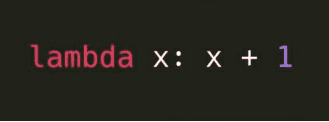
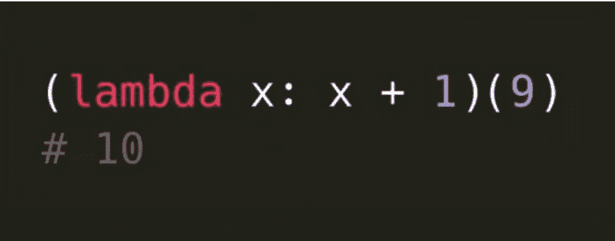

# 面向对象与函数式编程：C# 与 Python 示例


Leonel Peña
leonelqpena@gmail.com


# 前言


# 前言

你好！

在“面向对象与函数编程”课程，我们将学习 OOP 和函数式编程的概念，并通过 C# 和 Python 的示例来分析一些函数。

首先需要明确的是，本书的目的并不是深入教授 C# 或 Python，而是了解 OOP 和函数式编程的基本概念，并在这些编程语言中看到它们的示例。

我们将观察这些范式的优点、缺点和特征，并通过学习其原理来了解函数式编程原则。我们还将看到支持它的语言以及 lambda、闭包、filter、map、reduce 的示例。关于 OOP，我们将学习 OOP 与 FP（函数式编程）之间的关系。

很简单。你不需要预先了解。本书为初学者提供了关于 OOP 和函数式编程的基础概念。

你不需要具备某些先验知识，但你必须对计算机科学和通用编程有所了解（如果是 C# 或 Python 话更好），因为我们不会提供关于编程基础的解释。

让我们开始吧！

Leonel Peña


# 函数式编程

函数式编程是一种声明式范式，最近非常流行，为了不掉队，学习它是非常重要的。即使是强面向对象的语言也由于其使用率的不断增加而不得不引入函数式编程，例如 Java，在第 8 版本中引入了此类编程的元素。

函数式编程强调我们正在**做什么**，而不是我们**怎么做**。这被称为命令式方法。

函数式语言强调语句而非执行语句，这与其他强调局部或全局状态的语言类型不同。

我们不会描述流控制；我们不会使用循环或条件。这些思想基于 lambda 演算。

LISP 是第一个被使用的语言，开发于 1960 年。

另一方面，另一个日益流行的术语是响应式编程 (Reactive Programming)，它也使用了函数式编程。然而，我们不会深入响应式编程，因为它将是另一本书的主题。

## 函数式编程的优缺点

像任何编程范式一样，在理解它是否适用于某种软件项目之前，我们必须知道优缺点。
优点如下：

- 函数被视为值 - 提高了代码理解和可读性。
- 支持惰性求概念：意味着只有在需要时才对值进行求值和存储。
- 流清晰：状态不会被隐式改变。
- 高效利用并发：由于纯函数的特性，防止了变量改变。
- 没有赋值语句：值传递给变量后，它将不会改变（常量）。
- 关注“做什么”而不是“怎么做”。

- 另一方面，你还需要了解一些缺点：
- 并不简单：对初学者来说学习有点复杂，如果来自面向对象编程则更是如此。
- 难以维护，因为存在对象的演变。
- 复杂的需求：需要重构。
- 在表示真实世界对象时的复杂性。

简而言之，每个程序员都是不同的，并且必须知道在何时使用哪种范式，因为两者都不是万灵药，而且它们都有自己的优缺点。
然而，我们稍后将看到函数式编程和面向对象编程的区别。

### 概念

- 函数式编程有 4 个基本概念：
- 纯函数
- 函数组合
- 递归函数
- 高阶函数

让我们来看这些核心概念。

### 纯函数

当一个函数满足以下基本要求时，它就是纯的（Pure）：
- 相同的参数总是返回相同的结果。这被称为引用透明性。
- 没有副作用。

让我们稍微澄清一下术语。引用透明性意味着纯函数的行为完全取决于传递给函数的显式参数。
这意味着如果你传递相同的输入数据，函数应该生成相同的返回值。
示例：

```javascript
const sum = (a, b) => (a + b);
sum(1, 2); // 5
sum(1, 2); // 5
```

在这个 sum 函数中，我们传递了两个数值参数（1 和 2），它总是返回相同的结果。如果我们在程序中将 sum(1,2) 的调用替换为 3，一切仍然会正常运行。这归功引用透明性。

至于副作用，我们的意思是不会影响范围之外的状态，除了返回返回值外，与调用它的函数或外部世界没有任何交互。
总之，纯函数每次被调用都会返回相同的结果。
它与不纯函数不同，后者在多次调用中可能会返回不同的值，因为定义的变量不是局部的。这是不推荐的。
让我们继续后续概念。

### 函数组合

这个概念源于创建复杂函数或其他小函数。
例如，我们有一个函数 1 接收参数 X 并返回值 Y，函数 2 接收参数 A 并返回值“Hello”。
通过这两个函数，我们可以创建一个第三个函数，它处理参数并返回另一个结果，并使用它的逻辑、函数 1 和 2。
示例：

```python
alCuadrado(numero):
  return numero * numero

sumaDeCuadrados(num1,num2):
  return alCuadrado(num1) + alCuadrado(num2)

print(sumaDeCuadrados(3, 4))
```

alCuadrado 接收一个数字并返回它的平方。

sumaDeCuadrados 接收两个数字，并反调用两次 alCuadrado 函数，将两个数字作为参数进行求和。
最后，我们将制作一个名为 cuadradoAntecesorMasSucesor 的第三个函数，它接收一个数字并调用


`sumaDeCuadrados` 函数，但传入的是参数数字的前一个和后一个。

```python
def cuadradoAntecesorMasSesor(numero):
    return sumaDeCuadrados(numero-1, numero+1)
```

**函数组合**FUNCTION COMPOSITION）的优点之一是每个函数都执行其特定任务，鼓励在程序的不同部分复用，并使代码变得更加整洁和有序。
编写一个有很多事情要做的大型函数是一个坏习惯。理想的做法是将函数拆分成小的部分，并让函数组合其他函数（因此称为**函数组合** COMPOSITION OF FUNCTIONS）。
此主题的另一个重要概念是，当在另一个函数的逻辑内部使用函数时，人们会“忘记”内部函数是如何创建的（我们不需要担心实现细节，而是关注它接收了什么，以及结果将产生什么）。

### 递归函数

让我们来看递归函数这个主题。当一个函数的体使用了函数本身时，该函数就是递归的。在这种情况下，我们可以区分出 2 部分：

- 基础情况（Base cases）：那些不需要定义的函数即可解决的情况。
- 递归情况（Recursive cases）：那些确实需要使用正在定义的函数的情况。

示例

```python
def saludar(mensaje):
    print(mensaje)
    saludar(mensaje)
```

我们在这里看到函数可以调用自己。问题是，每当它被调用时，就会创建一个循环。由于没有结束条件，它将是一个死循环。
如果我们调用这个函数：

saludar("hey world")

将会产生错误，它会填充堆栈并抛出异常。这是由于函数被调用的次数太多，导致编译器生成了로停止执行的错误。这个错误被称为**递归错误**（Recursion Error），如下所示。

> RecursionError: maximum recursion depth exceeded while calling a Python object

让我们看另一个改进后的递归函数示例，这种改进让该函数产生了收益。
要实现这一点，我们必须给函数提供一个终止条件。

```python
def duplicarLista(lista):
    if (len(lista) == 1):
        return [lista[0]*2]
    else:
        return [lista[0]*2] + duplicarLista(lista[1:])

mi_lista = [1,2,3,4]
print(duplicarLista(mi_lista))
```

让我们来看这个递归的 `duplicarLista` 函数。
首先，注意我们有一个结束条件：如果列表的长度（len）等于 1，则它返回列表的第一个值乘以 2，否则它会再次调用函数并加上下一个值（1 :)）。
然后，我们传入包含 4 个元素的列表（1, 2, 3 和 4）并该函数，并在屏幕上打印结果。

[2, 4, 6, 8]

### 高阶函数

让我们转向最后一个概念，这可能是 4 个概念中最有趣的。这些函数是特殊的，因为它们可以在参数中接收其他函数，并可以返回字符串等数据类型，或者返回另一个函数。
看看之前递归函数 `duplicarLista` 的示例。通过这个新概念，将函数作为参数，我们可以继续改进这个递归函数。

```python
def duplicarLista(lista):
    if (len(lista) == 1):
        return [lista[0]*2]
    else:
        return [lista[0]*2] + duplicarLista(lista[1:])
```

```python
mi_lista = [1,2,3,4]
print(duplicarLista(mi_lista))
```

注意，在这个函数中，我们正在遍历列表并对列表的每个元素应用重复操作。如果这个重复操作是来自参数的动作，难道不是更好吗？这个重复操作是来自参数的动作。

```python
def saludar(mensaje):
    print(mensaje)
```

```python
def duplicar(accion, lista):
    if (len(lista) == 1):
        return [accion(lista[0])]
    else:
        return [accion(lista[0])] + duplicar(accion, lista[1:])
```

```python
mi_lista = [1,2,3,4]
print(duplicar(lambda x: x*2, mi_lista))
```

结果：

```
[2, 4, 6, 8]
```

Python 是一种解释型编程语言，其目的是强调代码的可读性。它支持多种范式，对象对象、命令式编程以及函数式编程。它拥有开源许可证，即 Python Foundation 许可证。这意味着它允许多种方式工作。在这种情况下，有：

- 命令式编程（Imperative Programming）：代码从开始执行到结束。它的主要优点是简单。但缺点是“面条代码”。如果你不知道这个术语，它源于此。
- 面对象编程（Object-Oriented Programming）：在这种情况下，变量和函数被封装在内聚模块中。它的优点是可复用性和隔离性。面问题在于类的复杂性。
- 函数式编程（Functional Programming）：在这种情况下，代码被分为可以相互调用的简单函数。它的易用性由于其原子性实现了良好的维护性。此外，它避免了变量所引起的问题。

函数式编程的原则如下：

- 使用函数：一切都通过函数构建。这种工作方式不仅简单、有序、清晰、易于测试，而且是*可预测*的。
- 一等公民函数（First Class Functions）：函数被视为一种特殊的变量，甚至可以被返回。这个概念意味着一个函数可以调用另一个函数，并返回数据。
- 递归性（Recursivity）：函数可以调用自己，简化了如遍历树或管理变量等任务。
- 不变性（Immutability）：没有变量，只有常量。基本上，这个概念意味着理解其潜力并将其付诸实践就像给你的大脑重置。

关于这个主题，不变性，软件通常会失败吗？大多数情况下，是由于一个被修改的变量。这导致代码块以无人无法预料的方式执行。你不得不检查每一行来找到出错的变量。

我给你一个反思：如果你使用不可修改的变量呢？换句话说，如果我们每次修改都创建一个新的常量呢？如果我告诉你在性能方面这更高效呢？这是一个有趣的概念。

惰性求


在编程中，我们可以处理尚未被求值的表达式。换句话说，我们可以拥有结果尚未知的变量。这一主题的一个副作用是性能的提升，另一个是我们可以执行“疯狂的事情”，例如对复杂操作或无限列表进行计算而无需实际计算。你一定在想这是如何可能的。这正是因为你处理的是数学表达式。值只有在你需要它时（例如执行“打印”操作时）才会被计算。

让我们停在这里。思考一下。脑海中浮出的问题可能是：

作为程序员，这能给你带来什么？

你心里想：我已经知道如何使用面向对象编程（OOP）来编程了。随后一个成熟的问题随之而来：

学习这些技术我能收获什么？

嗯，一方面，让我们从技术角度来看：

- **你将简化命令式逻辑的创建。** 它的巨大优势之一，也是 LISP（一种用于创建神经网络的函数式语言）如此流行的原因在于，它能够在没有副作用的情况下同时处理各种函数。

- **减少问题。** 正如我们之前看到的，变量现在是常量。在函数式编程中，它们是不可变的。因此，不会出现像面向对象项目那样源于所谓的“可变全局状态”的编程错误。

- **快速测试。** 我们知道可以给函数传递什么参数以及期望什么样的结果。

- **容易与命令式和面向对象编程结合。** 在这种情况下，Python 采用了从 3.0 版本开始的原生工具。

- **代码易于理解和阅读。** 理解一个函数比观察对象的结构（OOP）容易得多。当然，在这种情况下，我是从刚加入项目或正在学习编程的人的角度来说考虑的。

## 请练习！

让我们暂时停止理论，来看一些实际示例。我预计我将向你展示一些入门的简单示例，即冰山一角。剩下的由你自己去研究和学习关于工具和解决方案的巨大世界，包括 Python 和函数式编程。我们将看到高阶函数：FILTER、LAMBDA、MAP。

## LAMBDA

```python
def incrementar(x):
    return x + 1
```

图 1. lambda 函数

函数式语言起源于数学逻辑和 lambda 演算。而命令式编程语言采用的是英国数学家艾伦·图灵发明的基于状态的演算模型。简单来说，就是简洁、受限的匿名函数。如果我们想创建一个传统的函数，根据给定的参数增加值，我们就会得到图 1 所示的内容。

如你所见，increment 函数只增加一个数字。要用 lambda 实现，我们将像图 2 所示那样：



图 2. 使用 lambda

我们无法直接使用它，但有两种方法可以利用它：使用括号（图 3）或将其保存到变量中（图 4）。



图 3. 使用 lambda。注意括号。

```python
increment = lambda x: x + 1
increment(24)
# 25
```

图 4. 使用 lambda。注意赋值给名为 `incremento` 的变量
不要误解函数名 `incremento` 的含义。

## 闭包 (CLOSURES)

让我们回一下等等函数的概念。我们可以在其他函数内部函数，也可以让函数返回另一个函数。在图 5 的后续示例中，你可以看到在一个函数内部定义另一个函数，并且还返回了它。

```python
## 返回函数的函数
def construir_multiplos(factor):
    def interno(valor):
        return valor * factor
    return interno

## 保存表达式
multiplos_de_2 = construir_multiplos(2)
multiplos_de_7 = construir_multiplos(7)

## 求值
multiplos_de_2(10)
# 20

multiplos_de_7(2)
# 14
```

图 5. 返回另一个函数的函数

在下一个示例中，我们将使用一个包含 4 个元素的超级字典。我说“超级”这个词是因为正如你看到的，他们是超级英雄：蝙蝠侠、超人、蜘蛛侠和绿巨人。出版社是 DC 和 Marvel。

```python
superheroes = [
  {
    "nombre": "Batman",
    "editorial": "DC Comics",
    "alter_ego": "Bruce Wayne",
    "prima_aparicion": "Detective Comics #27"
  },
  {
    "nombre": "Superman",
    "editorial": "DC Comics",
    "alter_ego": "Kal-El",
    "prima_aparicion": "Action Comics #1"
  },
  {
    "nombre": "Spider Man",
    "editorial": "Marvel Comics",
    "alter_ego": "Peter Parker",
    "prima_aparicion": "Amazing Fantasy #15"
  },
  {
    "nombre": "Hulk",
    "editorial": "Marvel Comics",
    "alter_ego": "Bruce Banner",
    "prima_aparicion": "The Incredible Hulk #1"
  }
]
```

图 6. 带有4元素的结构

## FILTER

让我们开始学习 FILTER。该函数的作用是将迭代对象（如列表）根据特定规则过滤成更小的集合。在这个示例中，我们将搜索属于 DC 的英雄。

```python
superheroesDC = filter(lambda superhero: superhero['editorial'] == "DC Comics", superheroes)
print(tuple(superheroesDC))
```

图 7. filter 的声明

让我们开始学习 FILTER。该函数的作用是将迭代对象（如列表）根据特定规则过滤成更小的集合。在这个示例中，我们将搜索属于 Marvel 的英雄。我给出函数并进行打印，我们可以在图 9 中看到结果。

```python
superheroesMarvel = filter(lambda superhero: superhero['editorial'] == "Marvel", superheroes)
print(tuple(superheroesMarvel))
```

图 8. filter 的使用

## MAP

让我们开始学习 MAP。该函数的作用是对迭代对象中的每一项应用函数。在这个示例中，我们将为每个超级英雄增加一个随机值。

```python
import random

def anyadirPoder(superhero):
    superhero.update(poder=random.randint(0, 100))
    return superhero

superheroesPoder = map(anyadirPoder, superheroes)

print(tuple(superheroesPoder))
```

图 9. filter/map 操作的结果


## REDUCE

该函数用于从一次迭代中进行计算。它的结构由3个参数组成：
- 表达式 (EXPRESSION)
- 可迭代元素 (ITERABLE ELEMENT)
- 起始变量 (START VARIABLE)
可以在 `functools` 库中找到。

```python
import functools

def contarMan(resultado, superhero):
    if 'man' in superhero['nombre'].lower():
        return resultado + 1
    else:
        return resultado

total = functools.reduce(contarMan, superheroes, 0)

print(total)
# 3
```

图 12. Reduce 函数

让我们看看图 12。
假设我们需要统计名字中包含 "man" 文本的超级英雄数量。
我准备了我的函数，在其中通过 `if` 语句进行比较。
也就是说，如果 `superheroes` 列表中的项属性 'name' 存在 "MAN"，则将结果加1。
否则，我直接返回结果。
当我声明 `REDUCE` 时，我给它传递了我的函数、迭代对象以及初始值 0。

结果必须是 3，因为在这种情况下，只有 HULK 不包含这个元素。
你可能会奇怪为什么 `return` 隐藏得如此深。这些函数（`MAP`、`FILTER`）自1994年起就存在，但在 Python 3000 的开发期间（2006年至2009年间），Python 的创建者要求消除这些特性，由于存在可读性问题，而且有工具组合可以完成相同的任务。
然而，他后来改变了主意，只删除了 `REDUCE`，尽管它仍然可以通过 `functools` 模块访问。

# 函数式语言

编程并不仅仅存在于 Python。为了利用我们提到的可能性，你可以跨越到其他范式的语言。
以下列表是一些支持函数式编程的语言：

- D
- Erlang
- ML
- Haskell
- Lisp

Lisp 有若干种变体，以及 Clojure，它是 Lisp 的现代化版本，赋予了该语言新的活力。它使用 Java 虚拟机运行，并且与 Java 库具有特别良好的互操作性。非常适合执行高性能的 Web 服务。Haskell 是开启这些特征的先驱。它非常适合入门这种范式并在工业界中使用。
Elm 是受 Haskell 影响很大的的前端语言。

使用函数式编程的公司非常多。列表如下：

- Manzana
- Atlassian
- Boeing
- Netflix
- NASA
- YCombinator
- Nubank
- Walmart
- 等

如你所见，这是一个多样化的列表。

## 补充 Python

如果你想继续深入你的知识或扩展你已经在 Python 中学习的函数式编程知识，你可以使用一些库，例如：
- PyFunctional：它为你提供了并发或连接操作等重要问题处理。
- Frozendict：实现了不可变字典。

# 函数式编程 面向对象编程

正如我所说，每个程序员都是一个世界。因此，有些人会发现某一种范式更好或更容易，而另一些人发现另一种。没有人是错误的。他们都是正确的。没有人可以大声说“最好的范式是这个”。因为这是一个极其主观的问题。就像有些人喜欢肉而另一些不喜欢一样，有些程序员会发现一种编程范式优于另一种。这没关系。
面向对象编程（OOP），如果你不知道这个术语，它是程序员通过将类抽象为对象来对软件进行建模的范式，对象包含行为和状态，并具有某些典型特征，如继承、多态、模块化、封装、类、对象等。

本书的意图并不是深入探讨或谈论 OOP，而是查看关于这两种范式之间关系的一些想法。

然而，在澄清这一争议点时，我们将在本节中查看两个特别重要的范式之间的关系：函数式（本书的目标）和面向对象式。
鉴于函数式范式（FP）是声明式的，而 OOP 指向现实世界对象，因此同时使用两者是完全可行的。本质区别在于每个程序员所关注的用途或目标。FP 重点在于程序的正确性（避免共享状态和副作用）。
相反，在 OOP 中，目标是使代码更易于理解，抽象其组件（称为类）。也就是说，这关乎于理解代码及其可读性。

在澄清了这一点之后，同样重要的是提到，同时使用两者是完全可行的，它们互不排除。一个类不应该排斥准确性或消除副作用。

我们在书的前面部分看过“纯函数”的概念。它的输出由输入决定，没有任何任何可见的副作用。这也完全适用于 OOP 中对象的方法，这些方法在同一个类内部调用其他方法。区别在于类内部良好封装的方法的使用类型，这在函数式编程中并没有发生，因为不存在封装的概念（请参考 OOP 的研究以获得更好的理解）。

在我看来，OOP 更灵活，并与抽象关联得更紧密；函数式则与现实世界的抽象关联得更好，以状态的形式处理。在 OOP 中可以包含 FP，反之亦然。在 OOP 中，函数式编程是更好的准备工作，这完全没有问题。

我们观察到的两种范式之间的区别是，函数式编程是关于数据流和控制的。函数式编程通过传递参数处理，函数式编程只使用表达式，而命令式编程使用语句。

例如，在命令式编程中，变量和循环很常见，而函数式编程使用的是表达式。

“好吧，面向对象编程很好，因为它允许通过分层对象来简化问题。当你开始考虑多线程编程时，使用可变对象变得困难。由于不可，性，函数编程编程非常问题。关于这一点，我留下这个网站的链接：https://laingenieria.info/questions/368/programacion-funcional-vs-oop-cerrado

简而言之，FP 和 OOP 是互补的。根据你开发的软件类型、你的经验以及对各者的理解，两者都有优缺点。没有哪个比另一个更好，但它们都有在不同项目中使用的特性。在我的情况下，我同时使用两者，在 OOP 中我使用 FP 没有问题。

我建议你深入研究两种范式，并尝试哪一种更适合你。

# 面向对象编程

软件开发（编程）领域有 4 种范式，即：

- 结构化编程范式
- 面向对象编程范式
- 逻辑编程范式
- 函数式编程范式
- 声明式编程范式
- 命令式编程范式

## 结构化编程范式

它是学习计算机编程最常用的类型。具有以下规则：

- 文件开头是开始，结尾是结束
- 使用迭代指令（循环）
- 使用控制指令（例如条件判断）

在这个范式中，不使用类、对象等概念，这是面向对象编程的典型特征。

例如，在这个范式中我们有过程化编程，它是编程类型中最常见的。


## 面向对象编程范式

它是最常用的软件编程范式之一，因为它在重用、抽象、解决现实世界问题等方面具有许多优势。
关于这种范式，我们需要了解的一些内容：

- 对象的创建与销毁
- 我们使用类（classes）来定义对象
- 类具有属性和方法（行为）

这种范式是本书的主题，我们将学习所有的基本概念，以便你能将其应用于支持该范式的编程语言中。
采用这种范式的常用语言有：C#、Java、C++、VB.NET 等。

## 逻辑编程范式

这是声明式（Declarative）范式的一种编程范式。逻辑编程范式围绕谓词或元素间关系的概念展开。它基于数学数学接受函数的概念。数学逻辑是形式化表达复杂问题并根据规则、假设和定理解决问题最简单的方法。例如：

- 被视为逻辑语句的逻辑陈述
- 用于描述程序行为的形式化规范
- 几乎所有编程语言中的数据和布尔表达式
- 逻辑编程涉及使用事实和关系来表示信息并回答查询。不要忘记公式：
算法 = 逻辑 + 控制

## 函数式编程范式

这是一类编程范式，基于使用函数来解决问题，避免可变数据和函数间的状态共享。

接收函数作为参数并返回函数作为结果的被称为高阶函数（Order Order）。函数式编程是一种声明式范式，类似于逻辑编程。我们关注“做什么”（WHAT）而不是“怎么做”（HOW）（即不使用控制语句，如循环或条件语句）。注意：如果你对函数式编程感兴趣，可以在亚马逊购买《函数式编程导论》这本书。

## 声明式与命令式范式

正如前面提到的，存在声明式（Declarative）和命令式（Imperative）编程范式。我们已经看到了声明式的：逻辑和函数式。在声明式编程中，它们做的是在用户层面描述要解决的问题。Prolog、Maude、Haskell 和 Erlang 都是声明式语言的示例。正如之前讨论的，它们关注“做什么”。

另一方面，命令式编程需要为了计算所需的数据，通过对存储的数据执行一系列转换，以获得最终的结果。命令式编程是最古老的编程范式，它由一个接一个的指令组成，决定了计算机必须做什么。最流行的编程语言有：Fortran、Basic、C、Pascal、Cobol、Python、Java、C++ 等。

## 声明式与命令式语言的区别

- 命令式编程：逐步描述一组执行指令以改变程序的状态。它使用算法概念（解决问题的必要步骤）。其主要优势是比声明式的更简单、易于实现并能够在程序的不同地方重用代码。
- 声明式编程：使用的语句用于描述要解决的问题，即在用户层面，但没有指示解决方案所需的指令。其基本优势是声明式语言中使用了数学推理。

## 什么是编程？

在学习面向对象范式之前，让我们简单回顾一下什么是编程。

编程是将算法在某种计算机可以理解并执行的语言中进行编码的过程。有许多编程语言和类型的计算机。但这里重要的是算法概念，即解决问题的必要步骤。在表示问题案例方面，需要产生所需结果的数据。

编程语言必须为程序员提供一种方式来表示过程以及算法运行的数据。

谈到数据，它被表示为数字位，因此我们需要表示数据类型以赋予它们结构和意义。

简而言之，编程是程序员使用编程语言开发计算机程序的艺术，这种语言包含有限且确定的步骤，并使用数据结构、过程和任何可行的范式来解决问题。

我不再详细阐述这个概念，因为本书的目的不是深入研究编程本身的概念，而是了解最常用的编程范式之一：面向对象范式。

## 什么是面向对象编程？

面向对象编程（或 OOP）是目前最广泛使用的软件开发范式，它基于一系列用于此类开发的通用原则，即：

- 对象
- 类
- 继承
- 封装
- 多态
- 抽象
- 模块化

也就是说，程序员使用这种范式解决问题，使用面向对象的语言创建现实世界对象，并使用抽象技术通过赋予它们特征和行为来进行建模。我们将详细分析每个原则并给出相应的示例。

## 面向对象范式的目标

让我们从分析这种范式的特性开始：

- 便于创建软件
- 使用现实世界对象并对其建模
- 使用概念

另一方面，OOP 有以下目的：

- 更好的维护
- 扩展功能
- 可用性

我们将详细查看每个特性：

### OOP 能够轻松创建高质量软件

OOP 允许创建漏洞更少的软件，因为它比其他范式更健壮、质量更高。

### 更好的维护

使用 OOP 维护软件更容易执行，因为必须接触代码的开发者更有可能地理解主程序员想做什么，因此代码的更改或改进更容易实现。

### 功能扩展

使用 OOP 开发的软件，其特征扩展比其他范式更好，因为它允许使用现实世界的抽象的类。

### 提高软件重用

重用建立在上述概念之上，通过创建封装的类（组件），我们可以在不同的项目中使用它们，而无需重新编写它们。这一特性是该范式中最重要的特性之一。

### 可用性

关于可用性，它指的是界面的易用程度和操作质量（用户/软件选项的关系），因此开发者应该关注这一元素。因此，可用性概念与软件产品的质量密切相关。在软件工程中，除了可用性，我们还可以观察到可靠性、效率等概念，但我们不会强调后者，因为这不是本书的目标。

传统上，软件开发方法侧重于过程，即创建软件的活动、工具和符号。可用性技术的引入可以适应传统的开发方法（瀑布模型），但并不推荐敏捷开发方法，因为敏捷方法基于在短时间内的部分交付，产品随着持续的用户反馈呈指数级增长。

当我们看到抽象概念时，可以更好地理解这个主题指的是什么。

OOP 使用现实世界对象

使用面向对象的语言并使用抽象技术通过赋予它们特征和行为来进行建模。
被建模为属性（以属性的形式，如颜色、引擎类型、车门数量等）和行为（以函数或方法的形式，如前进、刹车、倒车、修复等）。
因此，我们使用抽象技术对现实世界对象进行建模，以便在采用这种技术的编程语言中使用面向对象编程创建出这些的对象。

## 对象的与类的 OOP 概念

我们将在书中更详细地介绍这些，但可以说，面向对象编程（OOP）使用了两个基本且基础的概念：

- 对象（Objects）：正如我们之前看到的，它们是我们从现实世界中抽象出来的东西，并赋予它们属性和行为。
- 类（Classes）：这些是模板，我们基于这些模板在代码中创建对象。

在软件项目的测试阶段会对对象进行测试，以查看它们是否符合预期结果。
我们的内部表示是根据颜色、大小、形状对现实世界中的对象进行分类，因为我们可以观察、量化、触摸并最终对这些对象进行建模。

让我们继续。这种面向对象的范式是为了使用上述特征而创建的，它继承了我们看待对象世界的原始理念。

如你所见，功能性不仅仅是重要的。作为一名初级程序员，你可能认为你关心的只是你的程序运行，别无其他。在这个范式中，这是不够的。我们必须做得更多，更进一步。我们必须制作符合其他特征的软件，因为软件必须增长、必须被重用、必须被长时间地维护。

## 类与对象的介绍

面向对象的范式主要基于类和对象的概念。

当我们观察现实世界时，我们随处可见对象。如果我们走上街（对象），我们可以看到树、人、汽车、摩托车、自行车、天空、云朵等。

这些对象中的每一个都可以在这种范式中被建模，以向你提供属性（特征）和行为（动作）。例如，以人为例，我们可以赋予他如年龄、身高、发色、体重、姓名等属性，以及如行走、跑步、进进、睡觉等行为。

一旦了解了这些，让我们来解释面向对象范式范围内的类和对象的理论概念。

## 类 (CLASS)

类是一组相似对象的描述。它具有该组共有的方法和特征。

换句话说，类是一个模板，在其中定义了其包含的所有对象共有的特征和功能。

例如，PERSON 类具有 Name、Age 和 Weight 作为共同特征，具有 Running、Walking 和 Sleeping 作为共同方法（可能还有更多）。

那么，在这种 PERSON 类类型的编程语言中创建的每个对象都将自动拥有该类的属性和方法。

让我们继续理论部分。类是对象类型的声明。类似于编程语言中的抽象数据类型（例如，整数或字符串类型）。每当我们从一个类构造一个对象时，我们就是在创建该类的一个实例（instance）。这个实例概念是面向对象编程（OOP）非常特有的。实例是在 PC 内存中创建对象的过程。

在 C# 语言中（这是一种纯面向对象的语言），我们像这样实例化一个 PERSON 类型的对象：

```csharp
Person = new Person ()
```

其中
**Person** 是一种类类型。
**person**（全小写）是一个属于 Person（其类）的对象。
new 是 C# 的预留字，编译器通过它在内存中创建对象。
然后，在 `new` 之后放置我们想要创建的内容，并始终放置对应类型的最后的圆括号。

## 对象 (OBJECT)

对象是一个元素。它是内存中类的实例。它将在面向对象编程语言中使用，以使用其属性或功能。

在上面的示例中，人对象可以这样在 C# 中使用：

```csharp
person.Run();
person.Age = 73;
```

## 对象与类的区别

正如我们所看到的，对象是一个元素。类描述了相似元素的集合。从类中定义了不确定数量的对象。每个对象在程序状态内都有自己的状态（例如，一个人对象可以正在跑步，另一个人对象可以正在行走）。

类是一个抽象类型。对象是程序中使用的具体元素，用于显示其状态并观察其功能。

## 面向对象范式的原则

让我们回到这个范式的原则上。正如我们之前看到的，面向对象范式有一系列原则，每个尝试按照此范式进行编程的开发者都必须确保使用这些原则，这些原则是：

- 抽象（ABSTRACTION）
- 封装（ENCAPSSULATION）
- 模块化（MODULARITY）
- 继承（INHERITANCE）
- 多态（POLYMORPHISM）

如果你不使用继承从类创建对象，你就不是在进行面向对象编程。你不能在程序中使用所有的原则，但最重要的原则（抽象、封装、继承）必须具备。

我们将详细分析其中的每一个原则，并给出一些应用示例。

## 抽象 (ABSTRACTION)

抽象是面向对象范式的第一个原则。什么是抽象？
想想当你观察一个现实世界的对象时，例如一棵树。你需要获取关于这个对象最重要的信息，以便在计算机程序中对其建模。因此，你应该关注你真正需要知道的：在你的情况下，你只需要知道：树的类型、它的高度、它的年龄。然而，你不需要知道每一片叶子的细胞结构。

抽象是隐藏不必要的细节并只显示对象本质特征的过程。它允许我们处理复杂的系统而不被其内部实现所淹。

在 OOP 中，抽象通过接口和抽象类实现，它们定义了对象做什么，而不是指定它是如何做的。

这种技术指的是每个对象显示的（（在 OOP 中）。在我们类的示例中，选定的接口可以是：

```csharp
Run()
Walk()
Sleep()
```

所以只有外部会显示这种功能。

### 抽象的属性

每个抽象都有属性：
- 静态：不可修改，例如：人的姓名。
- 动态：可修改，例如：人的体重

## 封装 (ENCAPSSULATION)

封装是将构成抽象结构和行为的元素存储在同一个区域的过程。

这里也出现了接口的概念，关于抽象及其实现。

我们实现这一原则的方法应用了信息隐藏术语。这个概念允许我们隐藏（显而易见的）不需要展示给外部的对象特征（在编程中使用私有预留字）。

为了让抽象生效，实现必须被封装（即从外部隐藏不必要的实现细节）。让我们看看一些单词或访问修饰符，这是应用该原则的编程语言，例如 C#。

- Public
- Protected
- Private

### Public

所有对象都可以访问类定义为公共的数据或方法。它是你希望外部部分知道的所有内容。

### Protected

它们不是公共的，除了类对象以及继承自它的对象（后者是通过受保护访问修饰符设置的）。

### Private

它们只访问类本身的数据和方法。

让我们看看 Person 类的一些示例。

```csharp
class Person
{
  private string color;
  color = 'red';
}
```

在这个示例中，我们看到 Person 类有一个私有的属性为 color，然后我们给它赋值了一个数据（red）。这个数据只有人类知道。


```cs
Class Person
{
  public void Run();
}
```

在这个示例中，我们看到 Person 类有一个名为 Run 的公共方法，该方法可以被外部对象访问。
`void` 关键字意味着该方法不返回任何内容。

当我们分析继承原则时，将会遇到 `Protected` 访问修饰符。

# 模块化

模块化原则由将程序划分为多个模块，这些模块是独立编译的（它们在编程语言中分别从高层语言转换为低层语言，但可能与其他模块有连接）。
也就是说，当我们程序员创建类时，它们属于某种特定类型的模块（可执行文件）。每个模块都可以被拆分，以便于理解和维护。
模块化包含 2 个元素：

-   内聚（Cohesion）
-   耦合（Coupling）

内聚是指一个模块与其内部组件之间的理解程度和关系。其目标是尽可能精确地聚焦于类的目的。如果一个类中有两个执行不同功能的方法，意味着它们的内聚性较低。属于某个模块的类对象必须与该模块或另一个模块的类对象轻松关联。作为一个一般原则，每个模块都应该具有**高内聚性**。内聚允许更好的代码重用性和可读性，从而使复杂度变得可控。

## 耦合

耦合是指一个模块与不同模块（或不同类型的模块）之间的依赖程度和关系。属于一个模块的类对象不应轻易访问属于不同模块的其他类的对象。作为一个一般原则，两个给定的模块之间应该保持**低耦合**。低耦合意味着三点：

-   无需阅读另一个类即可理解一个类
-   修改一个类而不影响另一个类
-   提高代码的可读性

让我们继续讨论模块化原则。正如我们所看到的，程序员将编程的所有逻辑划分为这些模块。这些模块包含了我们将使用的类，用这些类来抽象属性（数据）和行为（方法或函数），这些行为将被它们的实例（即对象）所使用。通过这种方式，我们能够重用代码、更好地理解它、使其组织良好、分离特定任务并执行复杂工作，因为我们正在使用“分而治”的原则。

## 方法

方法是对象将拥有的函数或行为，定义在组成模块的类中。
方法的典型结构如下。

```
typeValue method_name (parameters)
{
    Actions...
}
```

其中
ValueType: 你可以返回的数据类型（或者在 C# 中如果不返回任何内容则为 `void`）。
method_name: 给方法的名称。每种语言都有自己的命名法来给方法命名。
parameters: 方法可以接收的可选变量，用于执行方法体内的操作。
actions: 这些正是方法为其编程目标而执行的具体操作。

注意：上面的示例对应于 C# 语法。

## 继承

让我们来理解这个面向对象的重要的重要原则。这个概念意味着从现有类创建一个新类。也就是说，一个类依赖于另一个类，称为基类（Base Class）。继承的类通常被称为派生类（Derived Class）或子类（Subclass）。

理解这个主题最重要的的一点是：如果基类具有适当的访问修饰符（public 或 protected），子类将继承基类的属性和行为。记住，private 访问修饰符只允许对象获取其所属类的属性和方法。

这种继承原则允许我们创建特殊的层次级类结构，因此当我们程序员创建一个类并继承它时，我们不需要从头重新创建它的属性和方法，而是编程语言允许从你的基类中创建它们，从而使代码编写变得简单。。

## 类层次结构

类可以通过父子树进行层次化，该树从一个名为超类（superclass）或父类的主基类开始，其派生类随着树向下变得越来越专门。

例如，让我们考虑 ANIMAL（动物）类。这个类将包含动物的通用属性和方法。但如果我们创建一个，例如 Carnivore（肉食动物），它将拥有吃肉的专门化，而如果我们创建一个名为 Herbivore（草食动物）的类，尽管它有 Eat 方法，但不会以与肉食动物相同的方式。因此，我们正在进行专门化。

通过这种方式，类可以在层次结构内从现有类继续创建。没有限制。

然而，树过于大并不理想，因为缺点是程序员可能会在代码中迷失，导致变得无法访问。

## 类之间的关系

不同类之间的关系指示了类如何相互通信。
我们有不同类型的关系，即：

-   关联（Association）
-   聚合（Aggregation）与组合（composition）
-   依赖（Dependency）
-   泛化 / 特化（Generalization / Specialization）

## 关联

关联描述了对象之间的连接。它们通常是双向的，但有时有必要将其变为单向以限制单向导航。
例如，我们有 Account（账户）和存入其中的 Money（钱）。显然，这两个类之间存在关联，但我们必须在关系中提供一个框架，在这种情况下，Money 可以出现在不同的 Account 中。这是一个 1 对多的关系，它是单向的。

Account >> Money

如果我们想建立双向关系，可以在 Account 和 Client（客户）类中对其进行建模

Account << Money

其中 1 个 Client 可以有多个 Account，但 1 个 Account 只能有一个 1 个 Client。
这种关系是双向的。

## 关联的多性

关联的多性决定了关系中涉及多少个对象。换句话，它是一个类的实例到另一个类实例的数量。
因此，我们有不同类型的多性：

-   1
-   0..1
-   N..M
-   *
-   0..*
-   1..*

其中

1 是自有的，意味着 1 对1 的关系。
0..1 是二元的，意味着 0 或 1 的关系。
N..M 是多多的，意味着从值 N 到值 M 的关系。
* 也是多多的，即零或多个。
0..* 是多多的，也是零或多个。
1..* 是多多的，但这里是 1 或多个。

## 聚合与组合

它们是关系在整体和其部分之间的关联。
在聚合中，部分可以属于不同的聚合体。
例如，Company（公司）与其 Client（客户）的关系。
为了绘图，我们使用菱形符号，如下所示。

对于组合，正如其名所示，一个类组成另一个类。
让我们来看一个具体的例子：

我们有一个 Airplane（飞机）和一个 Wing（翅膀）类。
如果翅膀没有与飞机关联，它就不可能存在，因此存在严格的关系。其表示方法如下所示。

## 依赖

它是一种比关联更弱的关系，显示了客户端对象与其所使用的服务器对象之间的关系。
客户端对象是请求服务的对象，而服务器是提供服务的对象。
我们可以通过从客户指向供应商的虚线在图形上观察到这种关系的表示。

## 泛化/ 特化

它是父子或超类/子类之间的类关系，正如我们之前看到的。

子类继承父类的属性和操作，如果这些从父类中可用。


## 多态

多态是面向对象范式的另一大原则之一。这一原则与我们之前看到的继承原则密切相关。

我将尝试用一种简单的方式来解释这个主题，因为它看起来有些复杂，尽管实际上并非如此。

让我们先从纯理论开始讨论。对于许多作者来说，多态意味着对类型系统的放宽，使得对某个类的引用（属性、参数等）可以接受该类及其派生类对象的地址。

正如我们所看到的，继承和多态是紧密关联的概念。我们在通过继承产生的分类分层结构中实现多态。

在我们谈论类型系统时，首先观察这个概念是非常重要的。

## 类型系统

我假设你已经知道编程语言中数据类型的含义了。但以防你不知道，我还是提一下。既有弱类型语言（如 PHP 或 JavaScript），也有像 C 或 Java 这样强类型的语言。

### 什么是数据类型？

对于变量来说，数据类型就是它在内部将存储的内容。也就是说，如果一个变量的类型是整数（integer），意味着它只能存储整数。如果它是字符串（string）类型，那么它显然只会存储字符串。

### 弱类型语言

所以，弱类型语言是指在编译模式下不关心变量将存储什么类型的数据，而在执行模式下进行赋值时自动获取类型的语言。

例如，如果我们有一个变量 `number`，我们都认为它将存储一个整数。但如果我们执行：
`Number = "Leonel"` 那么你存储的就是一个字符串。
但如果在程序稍后我们执行：
`Number = 73` 编译器就会理解该变量现在是一个整数。这意味着变量可以在同一个线程中根据其当前的赋值来改变数据类型。

## 强类型语言

强类型语言是指在执行开始之前就关心每个变量将包含什么类型的数据的语言。也就是说，如果在编程时有 `Number = 73`（整数数据类型），那么我们就不能执行 `Number = "Leonel"`（字符串数据类型），因为该变量已经分配了整数这一数据类型。如果我们尝试在强类型语言中进行类型更改，编译器将显示错误。

那么，什么是多态？

在对象和类理论中，以及强类型语言的工作方式，变量必须指向在其声明开始处指定的类对象。也就是说，对应类型的对象必须始终指向该类型。
例如，在 C# 中：

```csharp
Car myCar = new Car();
```

在这个示例中，我们知道 `myCar` 对象的类型是 `Auto`，并通过创建一个新的 `Auto` 来构造，而不是其他类。

好的。多态是对这种强类型系统的放宽，也就是说，可以分配派生类的对象。
但并没有那么宽松。它只接受对应层次结构中的类对象，而不是任何类。
例如，我们有 3 个类，一个父类和2 个派生类：
父类：Vehicle
派生类：Car, Bike

例如，在 C# 中：

```csharp
Vehicle myVehicle = new Vehicle ();
Car myCar = new Car();
Bike myBike = new Bike();
```

如果我们声明一个接收车辆的方法，我们认为应该只向它发送一个 `Vehicle` 对象，但多态原则说可以发送一个派生类对象。例如：

`Start (Vehicle vehicle);`

```csharp
myVehicle.Start(myBike);
myVehicle.Start(myBike);
```

所以，`start` 方法的参数是一个 `Vehicle` 类型的对象，但可以发送汽车或摩托车，因为它们都是派生自 `Vehicle` 的类。
这是多态原则的核心思想，能够使用一个方法来发送不同的对象，其行为会随发送的对象而变化。

# 总结

面向对象范式是一种分析、设计和编程的方法，通过不同的原则对真实世界进行建模来创建高质量的产品。它与结构化编程的区别在于，后者是从头到尾基于函数或过程的。
面向对象编程使用以下原则：

- 对象
- 类
- 继承
- 封装
- 模块化
- 抽象
- 多态

类是用户定义的类型，是定义属性和行为的模板。对象是内存中的类实例。继承是泛泛化/特化类的方式，以重用基类的数据和行为。封装是从外部隐藏类信息的一种方式。模块化是面向对象的另一个原则，我们将程序划分为模块，这些模块必须具有高内聚低耦合。抽象是捕捉对象所需信息而忽略无关信息的技术。对象只向外部显示它应该显示的内容，不多也不少。多态是最后一个原则，即使用基类参数创建的方法反可以接受其派生类的对象以扩展其功能。

其优点显而易见：

- 提高了可读性
- 提高了软件重用性
- 通过对真实世界的抽象易于理解
- 我们可以消除冗余代码
- 我们可以划分工作来简化开发（模块化）
- 提高了软件维护性
- 有效管理软件复杂度

其缺点是：
- 如果我们要开发的是简单的软件，并不高度推荐使用
- 对于习惯结构化开发的人来说有学习曲线
- 程序的执行速度可能比通常慢

推荐的面向对象语言：

- C
- C++
- C#
- Java
- Python

联系方式：leonelpena@gmail.com

