# C# 面向对象编程实战

序言：Daniel Jebaraj

技术审核员：James McCaffrey

文字编辑：Darren West，Syncfusion, Inc. 内容制作

收购协调员：Hillary Bowling，Syncfusion, Inc. 在线营销经理

校对：Darren West，Syncfusion, Inc. 内容制作

## 第1章 OOP 的三大支柱

## 第2章 接口

## 第3章 SOLID

## 第4章 设计模式

## 第5章 通用职责分配软件模式或原则 (GRASP)

## 第6章 架构

## 第7章 其他范式

# 结论

# Succinctly 系列书籍背后的故事

Daniel Jebaraj，副总裁

Syncfusion, Inc.

### 站在最前沿

正如你们许多人所知，Syncfusion 是 Microsoft 平台软件组件的提供商。这使我们处于既兴奋又充满挑战的地位：始终处于最前沿。

每当 Microsoft 发布新的平台或工具时（如今似乎每隔几周就有一次），我们都必须快速地自我教育。

# 信息丰富但难以消化

现实中，这意味着大量的书籍订单、博客搜索和 Twitter 扫描。

虽然互联网上的信息越来越多，书籍出版不断，但一个持续阻碍我们的方面是无法找到简洁的技术概述。

我们通常面临两种选择：阅读几本每页超过 500 页的书，或者在整个网络上搜索相关的博客文章和其他文章。和所有有工作要做、有客户要服务的人一样，我们觉得这非常沮丧。

# Succinctly 系列

这种挫败感转变为一种强烈的渴望，希望编写一系列简洁的技术书籍，目标读者是在 Microsoft 平台上工作的开发者。

我们坚信，鉴于这些开发者所拥有的背景知识，大多数主题都可以转化成 50 到 100 页之间的书籍。

这正是我们决定通过 Succinctly 系列要实现的。源于想要让事物变得更好的深切愿望，难道不是一切都是美好的吗？

# 最好的作者，最好的内容

每位作者都是从与我们共同愿景的才华专家池中经过精心挑选的。你现在手中的这本书以及该系列中的其他书籍，都是作者们不懈工作的成果。你将发现原创内容，这些内容保证让你在喝几杯咖啡的时间内上手。

# 永久免费

Syncfusion 将致力于编写多个主题的书籍。这些书籍将永远是免费的。我们发布的任何更新也将是免费的。

# 免费？有什么猫腻？

这里没有猫腻。Syncfusion 在工作中有共同利益。

# 让我们知道你的想法

如果你有任何感兴趣主题、想法或反馈，请随时通过 `succinctly-series@syncfusion.com` 与我们联系。

我们诚地希望你喜欢这本书，希望它能帮助你更好地理解学习的主题。感谢阅读。

请在 Twitter 上关注我们，并在 Facebook 上“点赞”我们，帮助我们传播 Succinctly 系列！

# 关于作者

Sander Rossel 是一位专业开发者，在 .NET (VB 和 C#, WinForms, MVC, Entity Framework)、JavaScript 和 SQL Server 方面拥有超过五年的工作经验。

他对各种技术都感兴趣，包括但不限于函数式编程、NoSQL 和软件设计。

他致力于通过他的博客 Sander's Bits – Writing the code you need 以及他的 CodeProject 个人页来教育他人。

在空余时间，他喜欢玩游戏、看电影和听音乐。他目前与他的猫 Nika 一起住在荷兰。

# OOP 导论

面向对象编程，简称为 OOP，自 60 年代以来一直存在，现在是事实上的标准编程范式。Simula 语言在 60 年代首次引入了 OOP 概念。后来，这些概念被第一个 OOP 语言 Smalltalk 进一步发展。OOP 在 90 年代随着 Java 等语言的出现开始真正兴起。书中讨论的 C# 和 .NET 原则。

OOP 是一个强大的概念，解决了软件开发中的许多问题。OOP 并不是编程的圣杯，但正如我们将在本书中所看到的，它可以帮助编写易于阅读、易于维护、易于更新和易于扩展的代码。

书中概念并非 C# 特有。其他面向对象的语言（如 Java、C++ 和 Python）也共享了书中讨论的原则。

书中包含的代码示例均已在 `Visual Studio 2015` 免费社区版中经过测试，并使用 `.NET 4` 创建（尽管大多数代码也可以在较早版本的 .NET 中运行）。

在整书中，我假设你具备 C# 的基础知识。如果你知道如何编写类和声明变量，基本上就可以上路了。

## 为什么用 OOP？

OOP 关乎软件的架构设计。让我们把软件比作一房子。你会让一群建筑工在没有预定义规则和协议的情况下开始建造你的房子吗？我敢打赌！你的房子会变得一团糟。尽管如此，这在软件开发中经常发生，而且正如预期的那样，很多软件最后都变得一团糟！回到我们的房子比喻，假设你的灯是安装在天花板里的。每当灯坏了，你就需要换整个天花板！幸运的是，情况并非如此。但在软件中，当一个小细节需要更改时，我们经常发现自己正在重写大段代码。在很多情况下，与更改无关的功能也会崩溃。通过抽象某些功能，我们只需要关注细节，并可以确定系统的其他部分不会损坏。此外，我们还可以复用它。

## 术语

在深入研究 OOP 之前，明确一些术语是非常重要的。`类`（`Class`）是对象的蓝图。`对象`（`Object`）是类的实例。在 C# 中，我们使用 `new` 关键字来创建对象。

在下面的代码中，我们看到了类的示例：

```csharp
public class Person
{
    public string FirstName { get; set; }
    public string LastName { get; set; }
    public string GetFullName()
    {
        return FirstName + " " + LastName;
    }
}
```

现在让我们看看如何使用它：

```csharp
Person personObject = new Person();
personObject.FirstName = "Sander";
personObject.LastName = "Rossel";
string fullName = personObject.GetFullName();
```

在 C# 中，我们有几种方法检查对象的类型，例如我们可以使用 `GetType()` 或 `is` 运算符。记住，一切都继承自 `Object`。

## 第 1 章 OOP 的三大支柱

面向对象编程有定义该范式的三个特征。在本章中，我们将详细查看每一个特征。

### 继承

继承（`Inheritance`）是任何面向对象语言的重要部分。类之间可以相互继承，这意味着继承类获得了被继承类的所有行为，被继承类也称为基类（`base class`）。让我们看看之前使用的 `Person` 示例。

代码 Listing 3：继承示例

```csharp
public class Person
{
    public string FirstName { get; set; }
    public string LastName { get; set; }
    public string GetFullName()
    {
        return FirstName + " " + LastName;
    }
}
public class Employee : Person
{
    public decimal Salary { get; set; }
}
```

诀窍在于 `Employee : Person` 这部分。那部分基本上的意思是“Employee 继承自 Person”。记住，一切都继承自 `Object`。在这种情况下，`Employee` 继承自 `Person`，而 `Person`（因为它没有显式继承任何内容）继承自 `Object`。现在让我们看看如何使用 `Employee`。

代码 Listing 4：子类用法

```csharp
Employee employee = new Employee();
employee.FirstName = "Sander";
employee.LastName = "Rossel";
string fullName = employee.GetFullName();
employee.Salary = 1000000; // 我也希望如此 :-)
```

这太棒了！通过继承，我们就获得了 `Person` 的所有内容！在这种情况下，我们可以将 `Person` 称为基类或超类（`super class`），将 `Employee` 称为子类（`subclass`）。另一种常见的说法是 `Employee` 扩展（`extends`）了 `Person`。

不过还有很多内容！假设我们想在某个基类中编写一些通用行为，但希望子类能够扩展或重写这些行为。假设我们希望子类更改上一个示例中 `GetFullName` 的行为。我们可以在基类中使用 `virtual` 关键字，并在子类中使用 `override` 关键字来实现这一点。

#### 代码列表 5：方法重写

```csharp
public class Person
{
    public string FirstName { get; set; }
    public string LastName { get; set; }
    public virtual string GetFullName()
    {
        return FirstName + " " + LastName;
    }
}
public class Employee : Person
{
    public decimal Salary { get; set; }
    public override string GetFullName()
    {
        string originalvalue = base.GetFullName();
        return LastName + " " + FirstName;
    }
}
```

如你所见，我们可以重写或重新定义 `GetFullName`，因为它在基类中被标记为 `virtual`。然后我们可以使用 `base` 关键字（它指向基类的实现）来调用原始方法并进行处理，或者返回一个完全不同的结果。调用原始方法是可选的，但请记住，如果不这样做，某些类可能会崩溃。

现在这里有一个有趣点：该类型是 `Employee`，但它也具有 `Person` 类型。这意味着在任何需要 `Person` 的代码中，我们实际上都可以使用 `Employee`。当我们这样做时，当然可以访问 `Employee` 特有的成员，例如 `Salary`。因此，这里有一个小问题：以下代码将打印什么？

#### 代码列表 6：代码将打印什么？

```csharp
person = new Employee();
person.FirstName = "Sander";
person.LastName = "Rossel";
string fullName = person.GetFullName();
Console.WriteLine(fullName);
// 按任意键退出。
Console.ReadKey();
```

如果你回答的答案是 "Rossel", Sander（而不是 Sander Rossel），那么你是正确的！

我们还能做些什么呢？我们可以强制子类继承某些成员。当我们这样做时，必须将该方法以及整个类标记为 `abstract`（抽象的）。抽象类不能实例化，必须被继承（并重写其中的抽象成员）。

#### 代码列表 7：抽象类

```csharp
public abstract class Person {
    public string FirstName { get; set; }
    public string LastName { get; set; }
    public abstract string GetFullName();
}

public class Employee : Person {
    public decimal Salary { get; set; }
    public override string GetFullName() {
        return LastName + " " + FirstName;
    }
}
```

当然，我们不能再调用 `base.GetFullName()` 了，因为它没有实现。虽然以前重写 `GetFullName` 是可选的，但现在是强制性的。除此之外，对 `Employee` 的用法保持完全不变。

在光谱的另一端，我们可以显式声明一个类或方法不能被继承或重写。我们可以使用 `sealed`（密封）关键字来实现这一点。

#### 代码列表 8：密封类

```csharp
public sealed class Person {
    public string FirstName { get; set; }
    public string LastName { get; set; }
    public string GetFullName() {
        return FirstName + " " + LastName;
    }
}
```

既然 `Person` 是密封的，没有人可以继承它。这意味着我们不能创建一个 `Employee` 类并使用 `Person` 作为基类。

方法可以在子类中被密封。毕竟，如果你不想让别人重写你的方法，只需不要将其标记为 `virtual` 即可。然而，如果你有一个虚拟方法，并且子类想要防止进一步重写它，可以将其标记为 `sealed`。

#### 代码列表 9：密封方法

```csharp
public class Person {
    public string FirstName { get; set; }
    public string LastName { get; set; }
    public virtual string GetFullName() {
        return FirstName + " " + LastName;
    }
}
```

```csharp
public class Employee : Person
{
    public decimal Salary { get; set; }
    public sealed override string GetFullName()
    {
        return LastName + ", " + FirstName;
    }
}
```

`Employee` 的任何子类都不能重写 `GetFullName`。

为什么要你的类或方法上使用 `sealed`？首先，这会有微小的性能提升，因为 .NET 运行时不需要考虑被重写的方法。这种提升微乎其微，所以这真的不是一个很好的理由。更好的理由可能是某个类实现了一些确实不应该以任何方式扩展的安全检查。

> 注意：某些语言（如 C++）支持多重继承。这意味着子类可以继承多个基类。在 C# 中这是是不可能的；每个子类最多只能继承一个基类。

### 继承 vs 组合

虽然继承在面向对象编程（OOP）中非常重要，但它可能会非常痛苦，尤其是当你获得一个向四面分支的巨大继承树时。继承有一个替代方案：组合。继承意味着类与类之间存在“是一个”（`is-a`）的关系。一个 `Employee` 是一个 `Person`。通过组合，我们可以定义一种“拥有一个”（`has-a`）的关系。

以汽车为例。汽车由许多组件组成，例如引擎。当我们对汽车进行建模时，是让 `Car` 继承 `Engine` 吗？这会有问题，因为汽车还有门、椅子和后座。

#### 代码列表 10：错误

```csharp
public class Engine
{
    // ...
}
public class Car : Engine
{
    // ...
}
```

使用组合时看起来是什么样的？

#### 代码列表 11：组合

```csharp
public class Engine
{
    // ...
}
```

```csharp
public class Car {
    private Engine engine = new Engine();
    // ...
}
```

### 封装


# 封装

封装是隐藏类内部工作机制的过程。这意味着指定一个公共接口，而实际工作被隐藏起来。优点是类可以更改其工作方式而不需要更改调用者。在 C# 中，我们有访问修饰符来实现：

- `private`：仅对类可见。
- `protected`：对类及其子类可见。
- `internal`：仅对同一程序集可见。
- `protected internal`：对同一程序集或派生类可见。
- `public`：对所有人可见。

假设我们正在构建一个在数据库上运行查询的类。显然我们需要对类调用者可见的方法。访问数据库的方法对于每个数据库可能不同，因此我们可能将其留给继承者。最后，我们需要存储私有状态，这些状态不能从类外部更改，否则可能会导致其处于无效状态。

#### 代码列表 12：访问修饰符

```csharp
public class QueryRunner {
    private IDbConnection connection;

    public void RunQuery(string query) {
        Helper helper = new Helper();
        if (helper.Validate(query)) {
            OpenConnection();
            // 运行查询...
            CloseConnection();
        }
    }

    protected void OpenConnection() {
        // ...
    }

    protected void CloseConnection() {
        // ...
    }
}

internal class Helper {
    internal bool Validate(string query) {
        // ...
        return true;
    }
}
```

```csharp
public void SomeMethod(SomeClass otherInstance)
{
    otherInstance.someField = "Some value";
}

private class InnerClass
{
    public void SomeMethod(SomeClass param)
    {
        param.someField = "Some value";
    }
}
```

当省略访问修饰符时，会分配一个默认值（类为 `internal`，其他所有为 `private`）。不过，我非常喜欢显式地添加访问修饰符。

在继续之前，最后一点说明是：子类的访问权限不能高于其基类。如果某个类具有 `internal` 访问修饰符，那么继承它的类就不能是 `public`（但可以是 `private`）。

# 多态

我们看到了继承，以及通过继承来改变类型的行为。我们的 `Person` 类有一个 `GetFullName` 方法，该方法在 `Employee` 中被修改了。我们发现，每当运行时需要 `Person` 类型的对象时，我们可以传入任何 `Person` 的子类，比如 `Employee`。这被称为多态。

在下面的示例中，`PrintFullName` 方法接收一个 `Person` 对象，但它打印的是 "Sander"，因为传递给方法的参数实际上是一个子类型，它重写了 `GetFullName` 的功能。

> 代码列表 14: 多态

```csharp
class Program{
    static void Main(string[] args)
    {
        Person p = new Employee();
        p.FirstName = "Sander";
        p.LastName = "Rossel";
        PrintFullName(p);
        // 按任意键退出。
        Console.ReadKey();
    }

    public static void PrintFullName(Person p)
    {
        Console.WriteLine(p.GetFullName());
    }
}
```

```csharp
public class Person
{
    public string FirstName { get; set; }
    public string LastName { get; set; }
    public virtual string GetFullName()
    {
        return FirstName + " " + LastName;
    }
}
public class Employee : Person
{
    public decimal Salary { get; set; }
    public sealed override string GetFullName()
    {
        return LastName + ", " + FirstName;
    }
}
```

我们将在下一章中看到更多这类内容。

# 核心要点

面向对象编程（OOP）的三大支柱是面向对象编程的基础。它们的实现并非无缘无故，而是解决了现实问题。对你来说，记住这些并在日常代码中练习它们至关重要。每当你创建一个类或方法时，都要考虑封装。必要时使用继承，但不要忘记它也会带来额外的复杂性。要非常警惕多态，清楚在继承类和重写方法时哪些代码会运行。即使你不练习它，你也会遇到编写了这些特性的代码。在整本书中，我们将看到这些特性被广泛使用。

# 第 2 章 接口

在上一章中，我们看到 `Employee` 类继承自 `Person` 类。你认为这种方法有任何潜在问题吗？如果一个人既是员工，又是一个邮票收藏家呢？显然，一个人可以是邮票收藏家，但不是员工（很多人正处于“空窗期间”）。如果我们都使用继承，可能会写出如下代码：

> 代码列表 15: 继承链

```csharp
public class Person {
  // ...
}
public class Employee : Person {
  // ...
}
public class StampCollector : Person {
  // ...
}
public class EmployeeStampCollector : Employee {
  // ...
}
```

我不知道你怎么想，但对我来说这感觉不对。我们面临的问题是，`EmployeeStampCollector` 和 `StampCollector` 唯一的共同点是 `Person` 基类，但它们仍然是邮票收藏家！编写接受邮票收藏家作为输入的方法并不是可能的！这个问题可以通过多重继承来解决，但 C# 并不支持多重继承（而且许多开发者认为这样更好）。

那么我们如何解决这个问题呢？我们使用接口（Interface）。接口类似于一个带有抽象方法的抽象类。它实际上除了定义一个类型之外，并没有做更多事情。但好处是，我们可以在一个类中继承或“实现”多个接口！

让我们来看一个随机接口的示例：

> 代码列表 16: 接口

```csharp
public interface ISomeInterface {
  string SomeProperty { get; set; }
  string SomeMethod();
  void SomethingElse();
}
```

注意，没有任何字段带有访问修饰符。如果一个类实现了一个接口，那么该接口上的所有内容都是公开可见的。实际的实现看起来是这样的：

#### 代码列表 17: 接口实现

```csharp
public class SomeClass : ISomeInterface
{
    public string SomeProperty { get; set; }

    public string SomeMethod() {
        // ...
    }

    public void SomethingElse() {
        // ...
    }
}
```

在这里 `SomeClass` 拥有类型 `object`、`SomeClass` 和 `ISomeInterface`。`ISomeInterface` 或任何接口上的 "I" 前缀是 C# 中的常见做法，并非必须。

在单个类上使用继承和接口实现时，首先指定基类，然后是用逗号分隔的接口列表。对于我们的 `Person`、`Employee` 和 `StampCollector` 示例，它看起来会什么样？

#### 代码列表 18: 接口

```csharp
public interface IEmployee
{
    // ...
}

public interface IStampCollector
{
    // ...
}

public class Person
{
    // ...
}

public class Employee : Person, IEmployee
{
    // ...
}

public class StampCollector : Person, IStampCollector
{
    // ...
}

public class EmployeeStampCollector : Employee, IStampCollector
{
  // ...
}
```

现在 `StampCollector` 和 `EmployeeStampCollector` 都是 `Person` 类型和 `IStampCollector` 类型。`EmployeeStampCollector` 也是 `Employee` 类型（以及 `IEmployee`），因为它继承自 `Employee`，而 `Employee` 实现了 `IEmployee`。

由于类可以实现多个接口，因此接口继承多个接口也是可能的。类必须实现它继承的所有接口。出于明显的原因，接口不能继承类。

#### 代码列表 19: 接口继承

```csharp
public interface IPerson { }
public interface IEmployee : IPerson {
}
public interface IStampCollector : IPerson {
}
public interface IEmployeeStampCollector : IEmployee, IStampCollector {
}
```

这虽然是一个非常理论化的例子，但让我们考虑一个现实世界中的例子。假设一个应用程序需要记录某些信息。我们可能希望在生产环境中记录到数据库，但在调试期间，我们希望记录到控制台。此外，如果数据库不可用，我们希望记录到事件日志（Event log）。

#### 代码列表 20: 日志记录

```csharp
class Program {
    static void Main(string[] args) {
        List<ILogger> loggers = new List<ILogger>();
        loggers.Add(new ConsoleLogger());
        loggers.Add(new WindowsEventLogger());
        loggers.Add(new DatabaseLogger());
        foreach (ILogger logger in loggers) {
            logger.LogError("发生了一些错误.");
            logger.LogInfo("一切良好!");
        }
        Console.ReadKey();
    }
}
public interface ILogger {
    void LogError(string error);
    void LogInfo(string info);
}
public class ConsoleLogger : ILogger {
    public void LogError(string error) {
        Console.WriteLine("错误: " + error);
    }
    public void LogInfo(string info) {
        Console.WriteLine("信息: " + info);
    }
}
public class WindowsEventLogger : ILogger
{
    public void LogError(string error)
    {
        Console.WriteLine("正在记录到事件日志: " + error);
    }

    public void LogInfo(string info)
    {
        Console.WriteLine("正在记录到事件日志: " + info);
    }
}

public class DatabaseLogger : ILogger
{
    public void LogError(string error)
    {
        Console.WriteLine("正在记录到数据库: " + error);
    }

    public void LogInfo(string info)
    {
        Console.WriteLine("正在记录到数据库: " + info);
    }
}
```

这非常酷！而且我们可以根据意愿添加或删除日志记录器。

顺便说一下，拥有接口和一个基类（实现该接口）是完全没问题的。也许你有一个 `ILogger`，一个 `DbLogger`（实现 `ILogger` 并定义记录到数据库的通用行为），然后有 `SqlServerLogger`、`OracleLogger`、`MySQLLogger` 等（它们都继承自 `DbLogger`）。

# 显式实现接口

我提到过，当你实现接口时，该接口上的所有成员默认都是公开的。从逻辑上讲，接口是一种契约，向其他代码承诺将定义某些成员和属性（因为它是特定类型）。然而，隐藏接口成员是可能的。要做到这一点，你可以显式实现接口。当你显式实现接口成员时，调用该成员的唯一方法是将类作为接口的类型。

#### 代码列表 21：显式实现的接口

```csharp
public interface ISomeInterface
{
    void MethodA();
    void MethodB();
}
public class SomeClass : ISomeInterface
{
    public void MethodA() {
        // 即使是 SomeClass，不进行类型转换无法调用 MethodB。
        ISomeInterface me = (ISomeInterface)this;
        me.MethodB();
    }
    // 显式实现的接口成员。
    // 在 SomeClass 中不可见。
    void ISomeInterface.MethodB() {
        throw new NotImplementedException();
    }
}
```

`SomeClass` 的用户无法调用 `MethodB`。

```csharp
class Program
{
    static void Main(string[] args)
    {
        SomeClass o = new SomeClass();
        o.MethodA();
        o.M
    }
}
```

| | |
|---|---|
| 等于 | |
| GetHashCode | |
| GetType | |
| MethodA | void SomeClass.MethodA() |
| ToString | |

图 1：MethodB 不可访问。

除非使用它，或者将其强制转换为 `ISomeInterface`。

#### 代码列表 22：调用显式实现的成员

```csharp
ISomeInterface obj = new SomeClass();
obj.MethodA();
obj.MethodB();
```

# 继承 vs 接口

你经常会在网上看到，或者在工作中可能会参与讨论的话题，是关于继承与使用接口的对比。记住，你只能继承一个类。这意味着如果你使用继承，例如 `Person` -> `Employee`，那么你的 `Employee` 就会受限于 `Person` 基类。或者，你可以定义一个 `IPerson` 并在 `Person` 和 `Employee` 中分别实现它。你会看到的一条准则是：继承定义了“是一个”（is-a）的关系（`Employee` 是一个 `Person`），而接口定义了“可以做”（can do）或“有一个”（has-a）的关系（`Person` 拥有邮票收藏品）。正如你所看到的，这并非完全的证明，因为邮票收藏家也是一个 `Person`，但继承确实可能带来麻烦。

当我有某些功能需要在该类的多个（如果不是所有）子类型中共享时，我喜欢使用它，就像 `DbLogger` 示例那样。

并且记住，组合可能也是一个可行的方案！

# 总结

接口是一种创建额外类型的手段，而不需要多重继承。它们非常有用，我听过人说每个类都需要一个匹配的接口。这是一个重要的功能，Visual Studio 提供了基于类创建接口的选项。当你的光标在类中时，你可以在顶部菜单的“编辑 (Edit) -> 重构 (Refactor) -> 提取接口 (Extract Interface)”下找到它。

```csharp
public class SomeClass {
    public void MethodA()
    { }
    public void MethodB()
    { }
    private void Something()
    {}
}
```


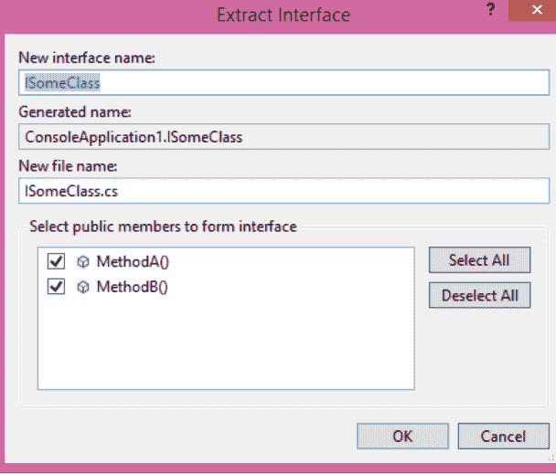

学会良好使用它们，因为我们在本书中将大量使用。

## 第 3 章 SOLID

我们已经看到了构成面向对象语言的构建块，但我们该如何编写类才能让它们具有意义呢？什么时候继承，类里面应该放什么，我们需要多少接口？这些问题在一定程度上可以通过所谓的 SOLID 原则来回答。SOLID 是一个缩写词，每个字母都代表一个原则。

- 单责任原则 (SRP)
- 开闭原则 (OCP)
- 里氏替换原则 (LSP)
- 接口隔离原则 (ISP)
- 依赖倒置原则 (DIP)

在本章中，我们将研究所有的原则。这些原则可以帮助你编写易于维护和扩展的模块化代码。这些原则由 Robert C. Martin 在他的《敏捷原则、模式与 C#》一书中进行了描述。

### 单责任原则 (SRP)

单一责任原则（或 SRP）规定一个类应该只负责单一的功能。一个功能可能会因为某种变化而改变。例如，一个向数据库记录日志的类可能会因为数据库通信的变化而改变，也可能因为格式需要更改而改变。因此，通常一个类应该只有一个改变的原因。这有点棘手；毕竟，每一行代码可能在某个时候发生变化。我遇到过一些程序员，认为一个类应该只包含一个方法。那才是 SRP 的真正意义！

让我们来看一个具体的例子。假设你正在构建一个数据库。现在你有一个类，可以建立连接、获取数据并最终关闭连接。如果我们定义一个接口，它遵循如下：

#### 代码列表 23：违反 SRP

```cs
public interface Database {
    void Connect(string connectionString);
    void Close();
    object GetData();
    void SendData(object data);
}
```

所以这真的可以是你类的接口吗？遗憾的是，这个类做了两件事。该类处理打开连接和数据通信。棘手的部分在这里，你问自己的问题是：应用程序的变化是否会影响连接、数据或二者？这很重要，因为当时间到了你需要更改其中一个功能时，不需要更改的功能将会被改变。在应用 SRP 时，你的类会变得更小且更易维护，但你有更多的类要处理。你更倾向于修改一个执行多项任务的 200 行类，还是一个只执行一件事的 100 行类？正如你所看到的，SRP 中没有错误的做法。

当某些功能需要在该类的多个（如果不是所有）子类型中共享时，我喜欢使用它，就像 `Dblogger` 示例那样。

并且记住，组合可能也是一个可行的方案！

### 开闭原则 (OCP)

毫无疑问，最难理解和正确执行的之一就是开闭原则，或 OCP：“开闭”意味着类对扩展开放，但对修改关闭。这意味着该类的调用者应该能够在不修改代码的情况下扩展功能。

我们可以将之前提议的接口拆分为两个。

#### 代码列表 24：用于 OCP 的 SRP

```cs
public interface IConnectionManager {
    void Connect(string connectionString);
    void Close();
}

public interface IDataManager {
    object GetData(IConnectionManager connManager);
    void SendData(IConnectionManager connManager, object data);
}
```

现在假设我想更改连接数据库的方式。我可以实现自己的 `IConnectionManager` 并将其传递给 `IDataManager`。在不触碰原始代码的情况下，我现在能够扩展类的功能！同样，如果我想更改获取或发送数据的方式，我只需实现自己的 `IDataManager` 并与现有的 `IConnectionManager` 使用。

更棒的是，任何依赖 `IConnectionManager` 和 `IDataManager` 的类现在都是可扩展的！

以后我们将研究设计模式，它们可以帮助你设计符合 OCP 的类。

### 里氏替换原则 (LSP)

里氏替换原则（简称 LSP）是关于继承的。它规定子类和基类必须是可以替换的。这意味着任何基类型的任何方法都不应该知道它正在使用基类还是子类。这里有一个你不应该那样做的例子（尽管我过去也写过这样的代码）：

#### 代码列表 25：违反 LSP

```cs
bool TestConnection(IConnectionManager connMgr)
{
    if (connMgr is SQLConnectionManager)
    {
        // 执行某些操作...
    }
    else if (connMgr is OracleConnectionManager)
    {
        // 执行其他操作...
    }
    else
    {
        // ...
    }
}
```

`TestConnection` 是一个接收 `IConnectionManager` 类型对象的函数，该对象可以是任何连接管理器。在这种情况下，方法检查 `connMgr` 的类型并采取相应的行动。这意味着每有一个 `IConnectionManager` 的新实现，你都需要更改此方法。此外，你刚刚违反了 OCP，因为此函数现在无法测试新的连接类型。有很多方法可以修复这个问题，例如使用策略模式，但我们将在稍后的章节中讨论。在上面的方法中，无论得到的是什么 `IConnectionManager`，调用 `Connect()` 或 `Close()` 方法总是足够了。

LSP（里氏替换原则）的一种微妙违背是子类的行为与其基类不同。经典的例子是正方形类继承自矩形类。正方形是一个矩形（宽和高相等），所以这种继承看起来是合理的。不幸的是，在某些情况下，正方形的行为可能与矩形不同，这会导致使用 `Rectangle` 类的用户崩溃，而他们得到的却是一个 `Square`。

> 代码列表 26：使用正方形导致的破坏

```csharp
void TestSquareMeters(Rectangle rect)
{
    rect.Height = 2;
    rect.Width = 3;
    Assert(rect.Height * rect.Width == 6);
}
```

### 接口隔离原则 (ISP)

接口隔离原则，或 ISP，有点类似于接口的单一职责原则。严格来说，我们讨论的不是抽象接口，而是你的类的公共方法。在 C# 实践中，我们主要通过接口来实现 ISP。让我解释一下。让我们重新考虑一下之前的数据库示例。我们有以下接口：

> 代码列表 27：一个 IDatabase 接口

```csharp
public interface IDatabase
{
    void Connect(string connectionString);
    void Close();
    object GetData();
    void SendData(object data);
}
```

正如我在 SRP 部分提到的，这可能符合或不符合 SRP，取决于你的需求。假设这在我们的示例中是可以接受的，但让我们采取另一种方法，即继承。具体来说，我将为连接管理创建一个基类，并继承该基类进行数据管理。

> 代码列表 28：使用继承的 DatabaseManager

```csharp
public class ConnectionManager
{
    public void Connect(string connectionString)
    {
        // ...
    }
    public void Close()
    {
        // ...
    }
}

public class DataManager : ConnectionManager
{
    public virtual object GetData()
    {
        // ...
    }
    public virtual void SendData(object data)
    {
        // ...
    }
}

public class DatabaseManager : DataManager
{
    // 需要 ConnectionManager...
}
```

所以我们的 `DatabaseManager` 通过 `DataManager` 继承了 `ConnectionManager`，当然是为了利用它的基类实现，也是为了利用之前定义的 `TestConnection` 等多功能函数。但我们能确定所有数据管理器都需要连接管理器吗？我们甚至可以使用组合来，`DatabaseManager` 需要它，但我们的呢？

> 代码列表 29：FileDataManager

```csharp
public class FileDataManager : DataManager
{
    // 不需要连接...
}
```

现在，我们的 `FileDataManager` 拥有一个“胖接口”。它依赖于它不需要的类。注意，如果我们创建两个接口并实现它们，这种情况就不会发生。我们可以在其他的 `Data(base)Managers` 中重用 `ConnectionManager`。这样做的缺点是 `FileDataManager` 现在依赖于 `ConnectionManager`，即使它不需要。但是，对 `ConnectionManager` 的任何更改都可能破坏 `FileDataManager`！应该避免类与类之间的耦合。

### 依赖倒置原则 (DIP)

依赖倒置原则，简称 DIP，规定你应该依赖于抽象而不是具体类型。这个原则你将会看到很多，但在实践中（正确地）执行非常困难。让我们再次考虑 `TestConnection` 方法。我们可以为 `SqlDatabaseManager` 创建一个，如下例所示：

> 代码列表 30：违反 DIP 的示例

```csharp
class Program
{
    ///...
}

bool TestConnection(SqlConnection connMgr)
{
    // ...
}

public interface IConnectionManager
{
    void Close();
    void Connect(string connectionString);
}

public class SqlConnectionManager : IConnectionManager
{
    // ...
}
```

显而易见，`TestConnection` 只能用于 `SqlConnectionManager`。我们创建了两个问题。首先，`TestConnection` 连同它的 `Program` 现在依赖于 `SqlConnectionManager`。其次，我们必须为使用的每一个 `ConnectionManager` 编写一个 `TestConnection`。我们说 `SqlConnectionManager` 是抽象类型 `IConnectionManager` 的具体类型。所以让我们修复它，以便我们依赖于符合 DIP 的抽象类型。

> 代码列表 31：针对 DIP 的修复

```csharp
bool TestConnection(IConnectionManager connMgr)
{
    // ...
}
```

你可能认为这是一个很糟糕的解决方案，你甚至会发现这会破坏你现有的代码，因为 `TestConnection` 依赖的方法并不属于 `IConnection` 接口。如果是这样，你应该问自己三个问题：`TestConnection` 的实现是否正确？它真的在测试连接吗？`SqlConnectionManager` 真的是 `IConnectionManager` 吗？最后，`IConnectionManager` 的定义正确吗？

现在为什么这个原则如此重要？它与扩展和更改现有系统密切相关。如果你依赖于抽象，切换实现就会变得更容易。理论上，你可以切换数据库（或至少切换连接管理器），而 `TestConnection` 仍然会按预期运行。正如我们之前看到的，依赖 `ILogger`，你就可以毫无问题地从文件日志切换到数据库日志！

### 依赖注入 (DI)

正如我将要看到的，DI 是一个部分。也许你以前听过依赖注入 (DI) 吗？有很多“DI 框架”可以帮助你将 DI 诸实践。上一个示例仅仅是更改我们的方法签名，使用接口而不是具体类型。但任何方法在运行时仍然会获得具体类型，那么它从哪里来呢？我们必须打破这种“依赖”，这就是 DI 介入的地方。

在下一个示例中，我将使用 Unity，这是一个由微软开发并由他人维护的库。让我们看一下代码，我修改了之前的 `ConnectionManager` 示例：

> 代码列表 32：IConnectionManager

```csharp
public interface IConnectionManager
{
    void Close();
    void Connect(string connectionString);
}

public class SqlConnectionManager : IConnectionManager
{
    public void Close() {
        Console.WriteLine("Closed SQL connection...");
    }

    public void Connect() {
        Console.WriteLine("Connected to SQL Server!");
    }
}

public class OracleConnectionManager : IConnectionManager
{
    public void Close() {
        Console.WriteLine("Closed Oracle connection...");
    }

    public void Connect() {
        Console.WriteLine("Connected to Oracle!");
    }
}
```

这是 `TestConnection` 的定义：


> 代码列表 33：TestConnection 的定义

```csharp
static bool TestConnection(IConnectionManager connMgr)
{
    connMgr.Connect();
    connMgr.Close();
    return true;
}
```

使用 Unity，我们可以为 `IConnectionManager` 注册 `SqlConnectionManager` 或 `OracleConnectionManager`：

> 代码列表 34：使用 Unity 注册类型

```csharp
class Program
{
    static void Main(string[] args)
    {
        // 创建一个新的 DI 容器...
        IUnityContainer container = new UnityContainer();
        //并注册类型！
        container.RegisterType<IConnectionManager, SqlConnectionManager>();
    }
}
```

在其他地方现在我们可以请求一个 `IConnectionManager` 并调用 `TestConnection`：

> 代码列表 35：使用 Unity 解析类型

```csharp
IConnectionManager connMgr = container.Resolve<IConnectionManager>();
bool success = TestConnection(connMgr);
// 对结果进行某些操作...
```

你应该在控制窗口中看到 "Connected to SQL Server" 和 "Closed SQL connection..."。现在更改 `RegisterType` 的调用，使其注册 `OracleConnectionManager`。`TestConnection` 现在将打印 Oracle 而不是 SQL Server。想象一下：通过更改这一行代码，你可以将整个应用程序改为 Oracle 而不是 SQL Server！

现在假设你有一些动态用户界面，屏幕上显示的控件取决于某些设置和/配置。让我们看看在数据库中定义的 HTML 表单，我们希望在服务器端生成 HTML。我让你自己思考，但我相信你能搞定。

> 代码列表 36：HTML 生成器

```csharp
class Program
{
    static void Main(string[] args)
    {
        IUnityContainer container = new UnityContainer();
        container.RegisterType<IHtmlCreator, HtmlInputTextCreator>("text");
        container.RegisterType<IHtmlCreator, HtmlInputCheckboxCreator>("checkbox");

        var someDbFields = new[]
        {
            new { Text = "Name", Type = "text" },
            new { Text = "Do you wish to receive offers?", Type = "checkbox" }
        };

        // Generate the HTML...
        StringBuilder builder = new StringBuilder();
        foreach (var dbField in someDbFields)
        {
            builder.Append($"<p>{dbField.Text}</p>");
            IHtmlCreator html = container.Resolve<IHtmlCreator>(dbField.Type);
            builder.Append(html.CreateHtml());
        }
        Console.WriteLine(builder.ToString());
        Console.ReadKey();
    }
}

public interface IHtmlCreator
{
    string CreateHtml();
}

public class HtmlInputTextCreator : IHtmlCreator
{
    public string CreateHtml()
    {
        return "<input type=\"text\">";
    }
}

public class HtmlInputCheckboxCreator : IHtmlCreator
{
    public string CreateHtml()
    {
        return "<input type=\"checkbox\">";
    }
}
```

这刚才是不是帮你避免了混乱的 `switch`/`if` 语句？而且最棒的部分是，你可以在不更改生成 HTML 代码的情况下，添加新的 `HtmlCreators` 和类型！因此，你刚刚编写了符合 OCP（开闭原则）和 DIP（依赖倒置原则）的代码（除了 `<p>` 标签，但你可以自己解决那个！）

这不是一个关于 Unity 的教程，但它展示了 DIP 和 DI 容器的基本原理。本节的示例演示了接口注入（Interface Injection），但也可以使用指定的构造函数创建对象，这被称为构造器注入（Constructor Injection），以及自动在属性或 Setter 方法上设置对象。还存在其他 DI 框架，例如 Ninject 和 Spring。在这个示例中，我们编写了代码来设置容器，但其他框架也可以配合 (XML) 配置工作。不过，它们都遵循相同的原理，并依赖于抽象。

### 控制反转 (IoC)

通常与 DI 一起提到的是控制反转，或 IoC。你可能还会看到这两个术语交替使用。IoC 的基本原理是“高层”代码依赖于抽象。我们已经在 `TestConnection` 中看到了这种用法。这里还有一个趣闻：DI 实际上是 IoC 的一种形式（但并不一定反之）！

### 总结

通常来说，SOLID 原则可以带来良好的、可维护的、扩展且可测试的软件设计，代价是增加了复杂性。然而，对于许多开发者来说，它们并不是自然而然的。诚实，预测未来是很难的，所以如果你现在需要一个 `SqlConnectionManager`，为什么要费劲用一个可能需要修改的 `IConnectionManager` 呢？直接创建一个 `SqlConnectionManager` 并在代码中使用它简单得多。然而，你无法预测未来，尽管你认为以后不需要切换到 SQL Server以外的其他东西，未来也可能并非如此。当你不得不切换到其他东西时，你会希望自己当初练习过依赖倒置原则。同样，当你一直是内部使用的 API 突然必须公开时，你会希望自己当初练习过开闭原则。这些事情确实会发生。我听过太多次“那永远不会发生”，所以真的，请未雨绸缪并实践 SOLID！

## 第 4 章 设计模式

你是否遇到过那种你知道在其他地方解决过的问题？很多人遇到过。设计模式（Design Patterns）是对许多人面临的特定问题的通用解决方案。设计模式最早在1995年由 Erich Gamma 等人的书籍《设计模式：可复用对象软件元素》中针对 C++ 语言进行了系统的组织。

总的来说，设计模式有三种类型：创建型、结构型和行为型。它们不仅解决了反复出现的问题，还为问题提供了形式化的解决方案，使我们不必重复发明轮子，并且能够更清晰地交流我们的代码。任何程序员（希望）都能识别出你使用的模式 X，然后知道如何修改你的代码。

在本章中，我将讨论几种（众多中的几种）设计模式。我会为每种模式包含一个统一建模语言（UML）类图。UML 不属于本书的范围，因此我无法解释如何解读这些图表。我添加它们是为了供参考，它们是“官方”的 UML，因此类和方法的名称与示例中的不匹配。你可以使用它们进行视觉解释，但如果你看不懂也不用担心，文中会有详细解释。

我讨论的这些模式在《设计模式》一书中认为是良好的入门模式。它们非常容易，你可能会经常看到它们。

### 创建型模式

创建型模式顾其名处理的是对象的创建。通过创建型模式，我们可以抽象对象实例化的过程。正如我们之前看到的，我们可以使用组合而不是继承。创建一组共同工作的对象是有益的，但与其硬编码要使用哪些具体类型，我们可以像在 DI 中看到的那样抽象这个过程。在下一节中，我们将查看一些创建型模式。这不是一个完整的列表，但它展示了它们能带来的力量。

> 2 Gamma, Helm, Johnson, Vlissides - Design Patterns: Elements of Reusable Object-Oriented Software

#### 抽象工厂

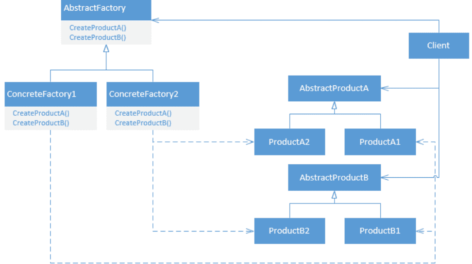

图 3：抽象工厂的类图

最简单但也最有用的创建型设计模式之一是抽象工厂。抽象工厂为创建相关的对象定义了一个接口。想象一下，我们正在构建一个用户界面。我们需要文本框、按钮、复选框等。所以假设我们如下在 WinForms 中所示：

> 代码列表 37：抽象工厂

```csharp
public interface IControlFactory
{
    Control CreateTextBox();
    Control CreateCheckBox();
}
```

假设它的用法如下（创建一个用户界面）：

> 代码列表 38：抽象工厂的使用

```csharp
private void CreateGui(IControlFactory factory)
{
    Control textBox = factory.CreateTextBox();
    textBox.Location = new Point(10, 10);
    Controls.Add(textBox);
    Control checkBox = factory.CreateCheckBox();
    checkBox.Location = new Point(10, 50);
    Controls.Add(checkBox);
}
```

我们现在为此接口创建具体类型。

> 代码列表 39：具体工厂

```csharp
public class RedControlFactory : IControlFactory
{
    public Control CreateTextBox()
    {
        return new TextBox { BackColor = Color.Red };
    }

    public Control CreateCheckBox()
    {
        return new CheckBox { BackColor = Color.Red };
    }
}

public class GreenControlFactory : IControlFactory
{
    public Control CreateTextBox()
    {
        return new TextBox { BackColor = Color.Green };
    }

    public Control CreateCheckBox()
    {
        return new CheckBox { BackColor = Color.Green };
    }
}
```

现在我们的应用程序可以使用指定的具体类型创建红色或绿色的 GUI。

> 代码列表 40：使用具体工厂

```csharp
private void Form1_Load(object sender, EventArgs e)
{
    CreateGui(new RedControlFactory());
}
```

结果令人惊叹：

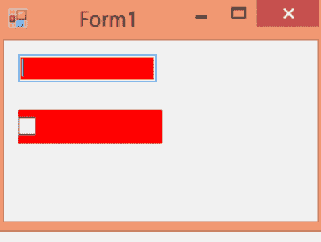

当然，将 `RedControlFactory` 更改为 `GreenControlFactory` 将渲染的 Form 从红色变为绿色。

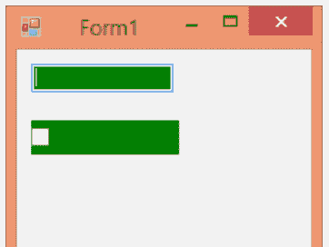

在 .NET 中处理数据库时可以找到抽象工厂模式。`DbProviderFactory` 基类就是一个抽象工厂，尽管通常需要自己实现。

> 代码列表 41：.NET 中的抽象工厂

```csharp
public class SqlProviderFactory : DbProviderFactory
{
    public override DbConnectionStringBuilder CreateConnectionStringBuilder()
    {
        return new SqlConnectionStringBuilder();
    }

    public override DbConnection CreateConnection()
    {
        return new SqlConnection();
    }

    public override DbCommand CreateCommand()
    {
        return new SqlCommand();
    }
}
```

#### 工厂方法 (Factory Method)

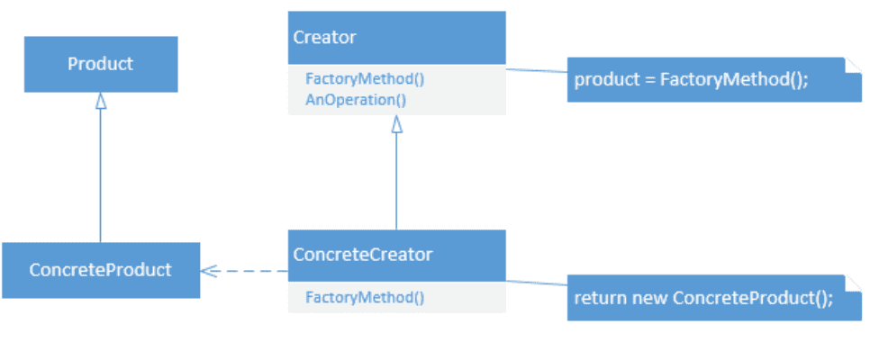

图 6：工厂方法模式类图

有时候，创建一个抽象工厂（Abstract Factory）并没有意义。如果没有紧密相关的对象，比如 `TextBox`、`CheckBox`、`Button` 等怎么办？虽然使用抽象工厂来创建一个对象（当然，它可能包含其他对象）是可行的，但感觉很奇怪（尽管可能很有用）。假设我们正在构建某些生成 UI 的类。`UIGenerator` 使用 `IControlFactory` 来构建 UI。此外，我们可能有多个 `UIGenerator` 来为不同类型的用户构建 UI。

通过使用工厂模式（Factory Pattern），我们可以将对象的创建委托给子类。当基类无法预测它需要哪一个子类来执行其功能时，这种方法特别有用。

下一个例子同样是在 WinForms 中。

这里是 `BaseUIGenerator`，它将作为所有 `UIGenerator` 的基类。

> 代码列表 42：UIGenerator 的基类

```csharp
public abstract class BaseUIGenerator
{
    public void GenerateUI(Control container)
    {
        IControlFactory factory = CreateControlFactory();
        Control textBox = factory.CreateTextBox();
        textBox.Location = new Point(10, 10);
        container.Controls.Add(textBox);
        Control checkBox = factory.CreateCheckBox();
        checkBox.Location = new Point(10, 50);
        container.Controls.Add(checkBox);
    }

    protected abstract IControlFactory CreateControlFactory();
}
```

我们现在可以轻松地创建新的 `UIGenerator`。

> 代码列表 43：具体的 UI 构建器 (ConcreteUIBuilders)

```csharp
public class RedUIGenerator : BaseUIGenerator
{
    protected override IControlFactory CreateControlFactory()
    {
        return new RedControlFactory();
    }
}

public class GreenUIGenerator : BaseUIGenerator
{
    protected override IControlFactory CreateControlFactory()
    {
        return new GreenControlFactory();
    }
}
```

`IControlFactory` 的创建现在被委托给了 `BaseUIGenerator` 的子类。现在你可以使用生成器来生成 UI。

> 代码列表 44：生成器类的用法

```csharp
private void Form1_Load(object sender, EventArgs e)
{
    BaseUIGenerator generator = new RedUIGenerator();
    generator.GenerateUI(this);
}
```

这将像上一个示例一样构建表单：

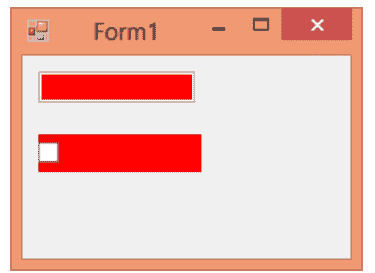

图 7：使用 RedUIGenerator 的表单

也可以使用其他内容作为容器，例如 `Panel1`。

> 代码列表 45：在 Panel 中使用生成器

```csharp
private void Form1_Load(object sender, EventArgs e)
{
    BaseUIGenerator red = new RedUIGenerator();
    red.GenerateUI(panel1);
    BaseUIGenerator green = new GreenUIGenerator();
    green.GenerateUI(panel2);
}
```


结果是 Panel 现在拥有了相同的控件，但颜色不同。

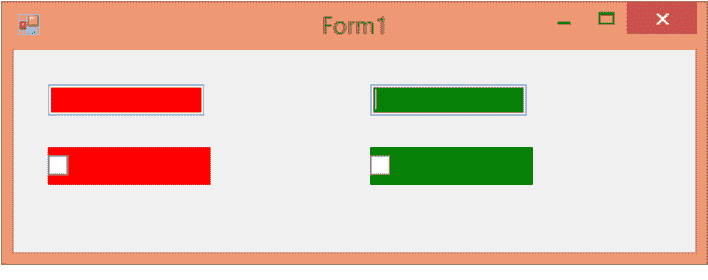

图 8：使用不同 UIGenerator 的面板

这个示例也展示了抽象工厂模式和工厂方法模式的威力。

.NET Framework 也使用了工厂方法模式，例如在处理数据库连接时。

#### 代码列表 46：.NET 中的工厂方法

```cs
using (SqlConnection connection = new SqlConnection("connString"))
using (DbCommand cmd = connection.CreateCommand()) // 工厂方法
{
    DbParameter param = cmd.CreateParameter(); // 工厂方法
    //...
}
```

#### 单例

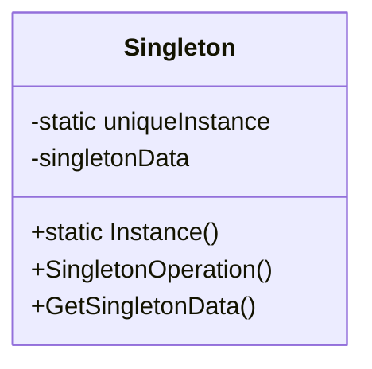

图 9：单例模式类图

单例模式非常有趣。它很有用，但经常被实现错误。它备受喜爱，也备受厌恶。那么，为什么我想在这里包含它呢？单例将特定类型的创建数量限制为恰好一个，这非常酷，而且可能是必要的（单例的例子如你的打印机程序、文件系统等）。此外，由于它经常被错误使用，我想进行一些教育，并澄清何时该使用它。最后，由于它经常被错误实现，我们现在要正确地实现它，一次到位。

单例的基础是一个私有构造函数。你没读错。当一个类的构造函数是私有的时，其他类无法创建该类的实例。这可能会派上用场，因为该类现在创建自己的实例并跟踪这些实例。这有点违反直觉，但通过静态字段是完全可能的。

代码列表 47：单例的开始

```cs
public class SomeSingleton
{
    private static SomeSingleton instance;

    private SomeSingleton()
    {
    }
}
```

此时，没有其他类可以创建或访问此类的实例。我们需要另一个静态方法（或属性）来访问此类的实例。

代码列表 48：单例的完整实现

```cs
public class SomeSingleton
{
    private static SomeSingleton instance;

    private SomeSingleton()
    {
    }

    public static SomeSingleton Instance
    {
        get
        {
            if (instance == null)
            {
                instance = new SomeSingleton();
            }
            return instance;
        }
    }
}
```

现在单例是完整的了。但如果应用程序是多线程的，这种实现可能会导致多个实例。当两个线程同时访问实例时，两个线程都会发现实例为空，其中一个线程会被锁定，而另一个线程会创建实例。这里是线程安全的实现：

#### 代码列表 49：线程安全的单例

```cs
public class SomeSingleton
{
    private static SomeSingleton instance;
    private static object syncRoot = new object();

    private SomeSingleton() 
    {
    }

    public static SomeSingleton Instance 
    {
        get 
        {
            if (instance == null) 
            {
                lock(syncRoot) 
                {
                    if (instance == null) 
                    {
                        instance = new SomeSingleton();
                    }
                }
            }
            return instance;
        }
    }

    public void SomeMethod() 
    {
        // 像其他方法一样的实例方法。
    }
}
```

双重检查锁定看起来很奇怪，但请记住当两个线程同时访问实例时，两个线程都会发现实例为空，其中一个线程会被锁定，而另一个线程会创建实例。在锁线程释放后，它应该再次检查是否为空，否则会创建一个新实例。这将防止多个实例。

单例的其他方法现在可以是公共实例方法，并像其他方法一样工作。只需记住单例的状态在整个应用程序中共享，因为它是静态的。

那么单例有什么问题呢？它们被用得太频繁了。我见过有些单例在一年后在某些地方需要第二个实例！事实证明，这并不完全对。

其次，单例无法被子类化。由于构造函数对于单例本身以外的任何部分都是不可访问，因此子类无法访问它（这意味着你无法构造它们）。

最后，单例很难测试。假设你正在测试内部使用单例的应用程序部分。在很长一段时间内，你没有方法模拟单例。现在通过使用代码织入和面向切面编程（AOP）的测试框架是可能的，但它仍然并不完全对。

所以，什么时候使用单例？基本上是你绝对确定你的应用程序永远不需要对象的第二个实例（当另一个实例可能对系统有害时）。它可能也派上用场，提供共享资源的单点访问（如打印机程序）。日志记录通常不是单例模式可以接受用法。

虽然 .NET 中的许多对象在逻辑上只有一个实例（如 Application），但我不知道 .NET 中有任何单例实现（即，构造函数仅仅是内部的而不是私有的）。如果一个像 .NET 这样庞大的框架都不用单例，那么你应该仔细考虑你是否真的需要它们，或者是否可以通过其他方式解决问题。

### 结构性模式

结构性模式关于对象如何协同工作并相应地组织你的代码。而创建模式是关于对象的创建，但这些对象不需要了解对方的内部细节。

#### 适配器

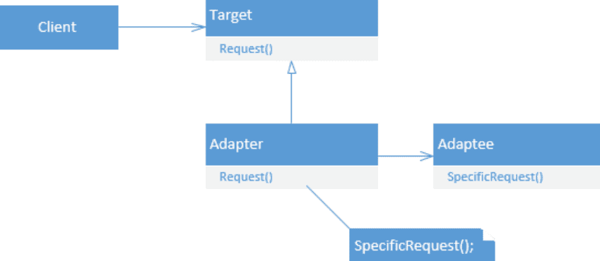

图 10：适配器模式类图

一种简单且为人知的结构模式是适配器模式，也称为包装器。通过适配器模式，我们可以让两个接口不兼容的类协同工作，尽管它们如此。假设我们正在创建一个数据检索系统，但客户端尚未决定使用 Oracle 还是 SQL Server，或者他们在未来可能会进行切换。假设这两个数据库都带有一些具有不同类和方法的 API（当然，它们本身都已有了兼容的 .NET API）。以下代码是简化的版本，但展示了适配器的用法：

代码列表 50：外部数据库 API

```csharp
public class SqlServerApi
{
    public DataTable GetData()
    {
        return new DataTable();
    }

    public void SendData(DataTable data)
    {
        // ...
    }
}

public class OracleApi
{
    public object GetQuery()
    {
        return new object();
    }

    public void ExecQuery(object data)
    {
        // ...
    }
}
```

这里的问题在于，如果我们选择其中一个 API，就无法轻松将其替换为另一个。`SqlServerApi` 与 `DataTable` 工作，而 Oracle 与 `object` 工作，方法的名称也不同，等等。在现实世界中，你会发现这两个接口都使用不同的类，拥有许多不同的方法（另一个没有的），以及更多。因此，让我们创建一个接口来将这两个不兼容的 API 结合在一起。问题是我们该如何处理 `DataTable`。我们的接口可以处理 `DataTable`，我们应该让它为 Oracle 服务；或者我们处理 `object` 并将其转换为 `DataTable` 以供 SQL Server 使用。第三种选择是创建一个自定义对象，它可以转换为普通对象和 `DataTable`。为了简单起见，我们将使用 `object`。

#### 代码列表 51：IdBApiAdapter

```csharp
public interface IdBApiAdapter
{
    object GetData();
    void SendData(object data);
}
```

现在我们可以为 SQL Server 和 Oracle 实现这个接口。

#### 代码列表 52：IdBApiAdapter 实现类

```csharp
public class SqlServerApiAdapter : IdBApiAdapter
{
    private SqlServerApi api = new SqlServerApi();

    public object GetData()
    {
        DataTable table = api.GetData();
        object o = ConvertToObject(table);
        return o;
    }

    private object ConvertToObject(DataTable table)
    {
        // ...
        return null; // 占位符
    }

    public void SendData(object data)
    {
        DataTable table = ConvertToDataTable(data);
        api.SendData(table);
    }

    private DataTable ConvertToDataTable(object obj)
    {
        // ...
        return new DataTable();
    }
}

public class OracleApiAdapter : IdBApiAdapter
{
    private OracleApi api = new OracleApi();

    public object GetData()
    {
        return api.GetQuery();
    }

    public void SendData(object data)
    {
        api.ExecQuery(data);
    }
}
```

如你所见，转换为 `DataTable` 现在是“实现细节”。我们并不真正在乎 `SqlServerApi` 是如何实现的（可能是通过反射），只要公共 API 是正确的即可。你现在可以使用 `IdBApiAdapter` 进行工作，并将特定适配器的创建留给系统的其他部分（使用工厂或依赖注入）。

#### 代码列表 53：IdBApiAdapter 的用法

```csharp
static void Main(string[] args)
{
    IdBApiAdapter adapter = DbApiFactory();
    object o = adapter.GetData();
    adapter.SendData(new object());
}

static IdBApiAdapter DbApiFactory()
{
    return new SqlServerApiAdapter();
}
```

适配器模式在 .NET 中处理 COM 对象时被使用。当引用 COM 对象时，.NET 会创建一个包装器（或适配器），可以在 .NET 内部用于调用相应的 COM 方法。

#### 组合模式

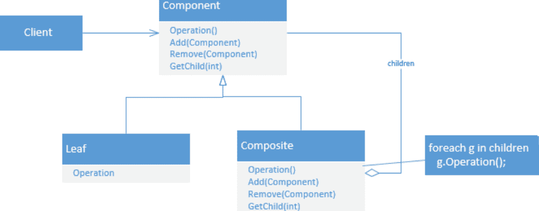

图 11：组合模式类图

组合模式也是较简单的模式之一。假设你有一个集合，比如一个 `List<Something>`。也许这些“东西”本身也包含相同东西的集合，即子元素。在这种情况下，我们有一个由“东西”组成的树。现在某个“东西”拥有某些操作，当执行该操作时，应该在所有子元素上执行相同的操作。这听起来很抽象，但让我们假设这个“东西”是一个控件（如 TextBox、Checkbox、DataGrid 等）。所以我们有一个拥有子控件的控件，每个子控件也可以包含控件。而该操作就是渲染控件。当我们渲染顶层控件时，所有子控件以及这些子控件的子控件都应该被渲染。

下一个例子可能看起来有点牵强，但创建一个组合模式的示例并不简单，请包涵。在示例中，我们将逐符号地打印句子。因此，我们的操作是 `Print`。我们需要一个单一符号，比如 "c" 或 "#"，所以让我们创建一个只需执行该操作的类。

代码列表 54：用于组合模式的 IPrintable

```csharp
public interface IPrintable
{
    void Print();
}

public class Symbol : IPrintable
{
    private char symbol;

    public Symbol(char c)
    {
        symbol = c;
    }

    public void Print()
    {
        Console.Write(symbol);
    }
}

public class Composite : IPrintable
{
    private List<IPrintable> children = new List<IPrintable>();

    public void Add(IPrintable child)
    {
        children.Add(child);
    }

    public void Print()
    {
        foreach (IPrintable child in children)
        {
            child.Print();
        }
        Console.WriteLine();
    }
}
```

以上就是这样。现在我们可以使用这些类来组合单词和句子并打印它们。在一个简单的控制程序中，用法如下：

代码列表 55：Composite 的用法

```csharp
// 创建 'hello'
Writing hello = new Writing();
hello.Add(new Symbol('h'));
hello.Add(new Symbol('e'));
hello.Add(new Symbol('l'));
hello.Add(new Symbol('l'));
hello.Add(new Symbol('o'));

// 添加换行符
LineBreak br = new LineBreak();
hello.Add(br);

// 创建 'bye'
Writing bye = new Writing();
bye.Add(new Symbol('b'));
bye.Add(new Symbol('y'));
bye.Add(new Symbol('e'));

// 创建一个由空格分隔的 hello 和 bye 
Writing helloBye = new Writing();
helloBye.Add(hello);
helloBye.Add(new Space());
helloBye.Add(bye);

// 打印所有打印项
helloBye.Print();
```

在 .NET 中，该模式如前所述，在 WinForms 渲染控件时使用（同样在 WPF 和 ASP.NET 中）。

#### 装饰器模式

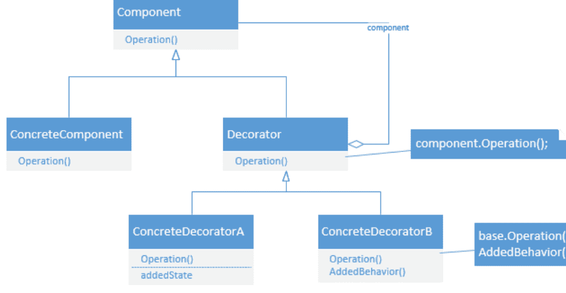

图 12：装饰器模式类图

装饰器模式可以动态地为对象添加功能。当一个对象拥有多个并不总是同时使用的功能时，它特别有用，例如相同数据的不同表示。在这方面，它是继承的灵活替代方案。

让我们有一些文本消息，我们希望打印、或发送电子邮件、或传真（是的，人们仍然这样做）、或将其发送到外部系统。此外，消息必须始终保存到数据库中。首先，我们需要 Message 类，它包含我们想要处理的消息，我们可以实现默认处理（毕竟，我们总是需要将消息发送到数据库）。

代码列表 56：Message 类

```csharp
public interface IMessage
{
    string Msg { get; set; }
    void Process();
}

public class Message : IMessage
{
    public string Msg { get; set; }

    public void Process()
    {
        // 默认处理逻辑，如保存到数据库
    }
}
```


我们现在可以创建一个基础装饰器。注意，我们总是需要向构造函数传递另一个 `IMessage`（否则将得到空引用异常，你可能想在那里添加一个检查）。`Msg` 属性只是简单地委托给了根 `IMessage`。

#### 代码列表 59: 基础装饰器

```cs
public abstract class BaseMessageDecorator : IMessage {

    private IMessage innerMessage;

    public BaseMessageDecorator(IMessage decorator) {

        innerMessage = decorator;

    }

    public virtual void Process() {

        innerMessage.Process();

    }

    public string Msg {

        get {

            return innerMessage.Msg;

        }

        set {

            innerMessage.Msg = value;

        }

    }

}
```

现在我们已经有了基础装饰器，可以创建一些子装饰器了。

#### 代码列表 60: 子装饰器

```cs
public class EmailDecorator : BaseMessageDecorator {

    public EmailDecorator(IMessage decorator)
        : base(decorator)
    {
    }

    public override void Process() {

        base.Process();

        Console.WriteLine(String.Format("Sent '{0}' as email.", Msg));

    }

}

public class FaxDecorator : BaseMessageDecorator {

    public FaxDecorator(IMessage decorator)
        : base(decorator)
    {
    }

    public override void Process() {

        base.Process();

        Console.WriteLine(String.Format("Sent '{0}' as fax.", Msg));

    }

}

public class ExternalSystemDecorator : BaseMessageDecorator {

    public ExternalSystemDecorator(IMessage decorator)
        : base(decorator)
    {
    }

    public override void Process() {

        base.Process();

        Console.WriteLine(String.Format("Sent '{0}' to external system.", Msg));

    }

}
```

现在我们可以以许多不同的方式处理消息；我们可以只将其保存到数据库；可以将其保存并发送电子邮件，或者发送到外部系统；可以保存、邮件并传真；保存、邮件并发送到外部系统；保存、传真并发送到外部系统。其妙之处在于，我们可以轻松地添加新功能，而不会破坏已有的功能。

在一个简单的控制台应用程序中，用法如下：

#### 代码列表 61: 装饰器的用法

```cs
IMessage msg = new Message();
msg.Msg = "Hello";

IMessage decorator = new EmailDecorator(
    new FaxDecorator(
        new ExternalSystemDecorator(msg)));

decorator.Process();

Console.WriteLine();

decorator = new EmailDecorator(msg);
decorator.Msg = "Bye";
decorator.Process();

Console.ReadKey();
```

在 .NET 中，我们在使用流（streams）时会发现装饰器模式。许多流，如 `MemoryStream`、`BufferedStream` 和 `FileStream` 都提供了与 `Stream` 基类相同的功能，但它们内部的工作方式有所不同。因此，不同的流装饰了 `Stream` 类。在这些类的用法中，我们经常可以发现策略模式（后文解释）。

### 行为模式

行为模式关于改变算法和类在运行时的行为。如果说创建模式是关于对象的创建，结构模式是关于对象如何协同工作，那么行为模式就是关于改变这些对象的实现。通过这三种模式，你可以构建出高度可扩展且可维护的软件，这些软件几乎被组织成了小的代码块。

#### 观察者

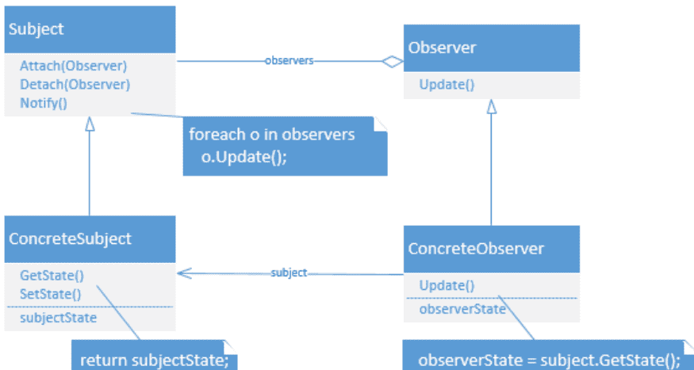

图 13：观察者模式的类图

通过观察者模式，一个类（所谓的可观察对象）可以通知其他类变化。.NET 事件就是使用这种模式实现的。

关于 .NET 中观察者模式的几点。首先，由于 .NET 已经有了事件，可能没有必要自己实现这种模式。让我们假设你仍然想这样做。你可能会从两个接口开始：`IObservable` 和 `IObserver`。然后你会发现 .NET 已经有了接口（泛型变体）。不要使用它们。我曾在观察者模式中使用过 .NET 接口，但那些接口主要用于响应式扩展 (Rx)。我在这里无法解释 Rx，但这些接口对我在这里要讨论的“传统”观察者模式来说意义不大。

所以，让我们从定义 `IObservable` 和 `IObserver` 接口开始。

#### 代码列表 62: 观察者模式接口

```cs
public interface IObservable {

    void Attach(IObserver observer);
    void Detach(IObserver observer);
    void Notify();
}

public interface IObserver {

    void Update(IObservable observer);
}
```

现在让我们来实现 `IObservable`。我们将创建一个产品库存，每当库存变化时，我们都会通知观察者（也称为监听器）。代码有点长，主要是由于底部的属性。注意，这些属性与观察者模式无关，它们仅仅是识别库存所需的。

#### 代码列表 63: IObservable 实现

```cs
public class Stock : IObservable {

    private List<IObserver> observers = new List<IObserver>();
    private string productName;
    private int noOfItemsInStock;

    public Stock(string name) {
        productName = name;
    }

    public void Attach(IObserver observer) {
        observers.Add(observer);
    }

    public void Detach(IObserver observer) {
        observers.Remove(observer);
    }

    public void Notify() {
        foreach (IObserver observer in observers) {
            observer.Update(this);
        }
    }

    public string ProductName {
        get { return productName; }
    }

    public int NoOfItemsInStock {
        get { return noOfItemsInStock; }
        set { noOfItemsInStock = value; }
    }
}
```

#### 代码列表 64: 观察者

```cs
public class Seller : IObserver {

    public void Update(IObservable observer) {
        Console.WriteLine("Seller was notified about the change.");
    }
}

public class Buyer : IObserver {

    public void Update(IObservable observer) {
        Console.WriteLine("Buyer was notified about the change.");
    }
}
```

#### 代码列表 65: 观察者的用法

```cs
Stock stock = new Stock("Cheese");
stock.NoOfItemsInStock = 10;

Seller seller = new Seller();
stock.Attach(seller);

Buyer buyer = new Buyer();
stock.Attach(buyer);

stock.NoOfItemsInStock = 5;

Console.ReadKey();
```

#### 代码列表 66: 特定的 IObservable

```cs
public interface IObservable {

    void Attach(IObserver observer);
    void Detach(IObserver observer);
    void Notify();

    string ProductName { get; }
    int NoOfItemsInStock { get; set; }
}

public class Seller : IObserver {

    public void Update(IObservable observer) {
        Console.WriteLine(String.Format("Seller was notified about the stock change {0} to {1} items.",
            observer.ProductName, observer.NoOfItemsInStock));
    }
}
```

#### 代码列表 67: 泛型 IObservable

```cs
public interface INotifier<T> {

    void Attach(IListener<T> observer);
    void Detach(IListener<T> observer);
    void Notify();
}

public interface IListener<T> {

    void Update(T observer);
}

public interface IListener<T> {

    void Update(T observable);
}

public class Stock : INotifier<Stock> {

    private List<IListener<Stock>> observers = new List<IListener<Stock>>();
    private string productName;
    private int noOfItemsInStock;

    public Stock(string name) {
        productName = name;
    }

    public void Attach(IListener<Stock> observer) {
        observers.Add(observer);
    }

    public void Detach(IListener<Stock> observer) {
        observers.Remove(observer);
    }

    public void Notify() {
        foreach (IListener<Stock> observer in observers) {
            observer.Update(this);
        }
    }

    public string ProductName {
        get { return productName; }
    }

    public int NoOfItemsInStock {
        get { return noOfItemsInStock; }
        set {
            noOfItemsInStock = value;
            Notify();
        }
    }
}

public class Seller : IListener<Stock> {

    public void Update(Stock observable) {
        Console.WriteLine(String.Format("Seller was notified about the stock change of {0} to {1} items.",
            observable.ProductName, observable.NoOfItemsInStock));
    }
}
```

#### 策略

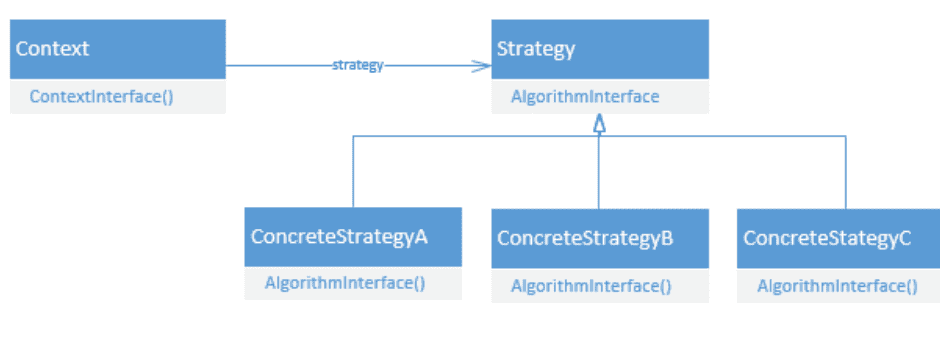

图 14：策略模式的类图

策略模式允许你封装一组算法并交替使用它们。你可以想象策略模式的许多应用场景，例如，在一个视频游戏中，战场上的单位在许多方面（如移动和渲染）上的行为是相同的，但在攻击策略上有所不同。一个单位可能是进攻性的，而另一个是防御性的。进攻或防御性算法可以注入到每个单位中。

另一个例子是列表的排序。根据列表的大小，你可能想要使用另一种排序算法，但你不想将每种算法硬编码在列表类中。

所以，让我们来做一个小游戏。它是一个简单的控制台应用程序，我们将按下任何按钮来移动我们的单位，并可能导致遇到敌人（继续按键或按 Esc 键退出）。每个单位对遇到敌人的反应不同。因此，我们首先定义一个通用的 Unit 类。

#### 代码列表 68：策略模式

```csharp
public interface IUnitBehavior {

    void ReactToOpponent();
}

public class Unit {

    private string name;
    private IUnitBehavior behavior;

    public Unit(string name, IUnitBehavior behavior) {
        this.behavior = behavior;
        this.name = name;
    }

    public void Render() {
        Console.WriteLine("\\o/");
        Console.WriteLine("@ 0");
        Console.WriteLine("/ \\");
    }

    public void Move() {
        Console.WriteLine(String.Format("{0} moves...", name));
    }

    public void ReactToOpponent() {
        behavior.ReactToOpponent();
    }
}
```

正如你所看到的，`Render` 和 `Move` 方法对于每个 Unit 都是相同的，但 `ReactToOpponent` 是通过构造函数注入的。`IUnitBehavior` 接口定义了要使用的最终策略。让我们来定义一些策略。

#### 代码列表 69：一些策略

```csharp
public class WarriorBehavior : IUnitBehavior {

    public void ReactToOpponent() {
        Console.WriteLine("\\\\ATTACK!\\\\");
    }
}

public class DefenderBehavior : IUnitBehavior {

    public void ReactToOpponent() {
        Console.WriteLine("\\\\Hold the line!\\\\");
    }
}
```

让我们把 Unit 和 UnitBehavior 结合。

#### 代码列表 70：最终决战

```csharp
Unit warrior = new Unit("Warrior", new WarriorBehavior());
Unit defender = new Unit("Defender", new DefenderBehavior());

List<Unit> units = new List<Unit>();
units.Add(warrior);
units.Add(defender);

foreach (Unit unit in units) {
    unit.Render();
}
```


Console.WriteLine();

}

Console.WriteLine("你的部队正在执行一项重要任务!");

Console.WriteLine("按 Escape 退出或按其他键继续.");

Random rnd = new Random();

while (Console.ReadKey().Key != ConsoleKey.Escape)

{

    foreach (Unit unit in units)

    {

        unit.Move();

    }

    Console.WriteLine();

    // 返回 0, 1, 或 2.

    if (rnd.Next(3) == 0)

    {

        Console.WriteLine("敌人攻击了!");

        foreach (Unit unit in units)

        {

            unit.ReactToOpponent();

        }

    }

    else

    {

        Console.WriteLine("什么也没有发生...");

    }

    Console.WriteLine();

}

```

这些代码挺多的，但真正重要的是前两行。我们定义了两个 `Unit`，但使用了另一个 `UnitBehavior`。当敌人攻击时（概率为 3 分 1），你会看到每个 `Unit` 根据其策略表现出来。添加另一种策略也变得简单了。

> 代码列表 71：添加新策略

```csharp
// ...

Unit priest = new Unit("Priest", new PriestBehavior());

// ...

units.Add(priest);

// ...

public class PriestBehavior : UnitBehavior

{

    public void ReactToOpponent()

    {

        Console.WriteLine("Heal our troops!");

    }

}

```

.NET 框架也使用了策略模式，例如调用 `List<T>.Sort()`。我们可以根据第一个或最后一个名称进行排序。

#### 模板方法

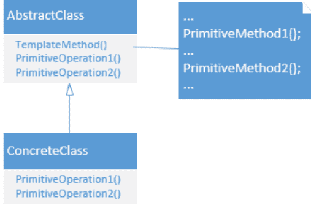

图 15：模板方法的类图

模板方法模式非常简单。事实上，它只是继承和方法重写。假设我们要连接数据库、构建查询、执行查询、检索结果并关闭关闭。我们可以在不考虑细节的情况下编写这个示例。

代码列表 74：模板方法

```csharp
public abstract class BaseDatariever

{

    public DataTable Data()

    {

        Connect();

        string query = GetQuery();

        DataTable result = ExecQuery(query);

        Close();

        return result;

    }

    protected abstract void Connect();

    protected abstract string GetQuery();

    protected abstract DataTable ExecQuery(string query);

    protected abstract void Close();

}

```

假设我们需要从 SQL Server 数据库检索 Product 表。我们可以继承 `BaseDatariever` 并填充空白。

代码列表 75：模板类的继承

```csharp
public class ProductRetriever : BaseDatariever

{

    private string connString;

    private SqlConnection connection;

    public ProductRetriever(string connString)

    {

        this.connString = connString;

    }

    protected override void Connect()

    {

        connection = new SqlConnection(connString);

    }

    protected override string GetQuery()

    {

        return "SELECT ID, Name, Price FROM Product";

    }

    protected override DataTable ExecQuery(string query)

    {

        using (SqlDataAdapter adapter = new SqlDataAdapter(query, connection))

        {

            DataTable result = new DataTable();

            return result;

        }

    }

    protected override void Close()

    {

        connection.Dispose();

        connection = null;

    }

}

```

同样，我们可以为 ODBC、Oracle 等实现它。增加另一层深度是有的，所以我们可以为 SQL Server 实现它，但不使其针对特定查询。只需将 `ProductRetriever` 重命名为 `SqlDataRetriever`，使其变为抽象，并移除 `GetQuery` 方法。现在 `ProductRetriever` 看起来如下：

#### 代码列表 76：ProductRetriever

```csharp
public class ProductRetriever : SqlDataRetriever

{

    public ProductRetriever(string connString)

        : base(connString)

    {

    }

    protected override string GetQuery()

    {

        return "SELECT Id, Name, Price FROM Product";

    }

}

```

现在创建一个 `CustomerRetriever` 非常简单。

代码列表 77: CustomerRetriever

```cs
public class CustomerRetriever : SqlDataRetriever

{

    public CustomerRetriever(string connString)

        : base(connString)

    {

    }

    protected override string GetQuery()

    {

        return "SELECT Id, FirstName, LastName, Address FROM Customer";

    }

}

```

`CustomerRetriever` 类（或任何 `BaseDataRetriever` 类）的使用方法简单直接到了极。

代码列表 78: 模板方法的用法

```cs
CustomerRetriever retriever = new CustomerRetriever("connString");

DataTable table = retriever.RetrieveData();

// 对数据进行处理。

```

在 .NET 中，我们经常发现模板方法。基本上，任何你可以重写的方法都都是模板方法。一个例子是 `Collection<T>` 类，它被设计为自定义集合的基类。

代码列表 79: 一个自定义集合

```cs
public class UniqueCollection<T> : Collection<T>

{

    // 只有当项不在集合中时

    // 才进行插入或设置。

    protected override void InsertItem(int index, T item)

    {

        if (!this.Contains(item))

        {

            base.InsertItem(index, item);

        }

    }

    protected override void SetItem(int index, T item)

    {

        if (!this.Contains(item))

        {

            base.SetItem(index, item);

        }

    }

}

```

### 更多模式

到目前为止的模式都是“经典”模式，它们在《设计模式：可复用面向对象的设计元素》一书中被系统地描述。然而，还有许多设计模式。其中许多在 Martin Fowler³ 编写的《企业应用架构模式》（Java 版）一书中有所讨论。Fowler 书中讨论的模式涵盖了代码的不同领域，例如特定于领域逻辑模式、与数据源的通信、并发以及 Web 会话。我将讨论其中一些广为人知且使用的模式。

Martin Fowler 使用大量的 UML 序图。和 UML 类图一样，序图超出了本书的范围，但我会将它们添加进来供参考和视觉化解释。

#### 懒加载

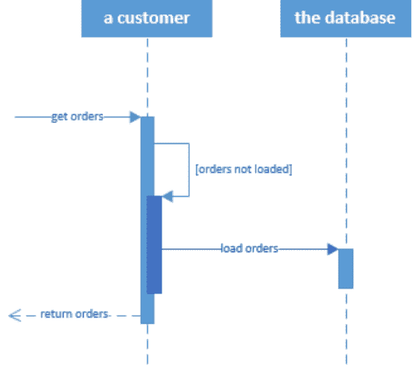

图 16：懒加载模式的序图

懒加载模式的核心在你实际使用数据之前不获取数据。它有四种形式：懒初始化、虚拟代理、值持有者和幽灵。我们将只查看懒初始化，因为它是常见的，而且讨论所有形式会占用太多空间。我也想讨论这种，因为它变得越来越相关且被广泛使用。像 Haskell 等函数式语言对所有内容都有默认的懒加载策略。这种做法在 .NET 中也变得越来越常见。

> ³ Martin Fowler - Patterns of Enterprise Application Architecture

我们在实现单例模式时实际上已经见过过懒加载模式了。单例实例在对象被实际使用之前才被创建。让我们再次看看这个（简单的）实现。

代码列表 80: 懒初始化

```cs
public class SomeSingleton

{

    private static SomeSingleton instance;

    private SomeSingleton()

    {

    }

    public static SomeSingleton Instance

    {

        get

        {

            if (instance == null)

            {

                instance = new SomeSingleton();

            }

            return instance;

        }

    }

}

```

如果你的代码中没有任何地方引用 `SomeSingleton.Instance`，那么 `SomeSingleton` 将永远不会被初始化。这就是所谓的懒初始化。当一个对象的加载需要长时间，而你不想在真正需要时才执行代码时，这特别有用。

.NET Framework 有一个 `Lazy<T>` 类用于任何类的懒加载。假设我们有一个初始化需要五秒钟的类。

代码列表 81: 沉重的初始化

```cs
public class Something

{

    public Something()

    {

        // 模拟一些沉重计算。

        Thread.Sleep(5000);

    }

    public void Print()

    {

        Console.WriteLine("Something is used.");

    }

}

```

通过使用 `Lazy<T>` 包装器，我们在使用它之前实际上并不需要创建实例。

代码列表 82: Lazy<T> 的用法

```cs
Stopwatch sw = new Stopwatch();

sw.Start();

Lazy<Something> lazy = new Lazy<Something>();

sw.Stop();

Console.WriteLine(String.Format(

  "Initializing the Lazy<Something> cost: {0} ms",

  sw.ElapsedMilliseconds));

sw.Restart();

lazy.Value.Print();

sw.Stop();

Console.WriteLine(String.Format(

  "Using the Lazy<Something>.Value cost: {0} ms",

  sw.ElapsedMilliseconds));

Console.ReadKey();

```

结果不应该令人意外。

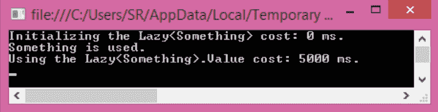

图 17：Lazy<T> 的结果

我们也可以使用 Lambda 表达式进行复杂的初始化。

代码列表 83: 复杂的初始化

```cs
Lazy<Something> lazy = new Lazy<Something>(() => new Something());

```

#### 模型-视图-控制器

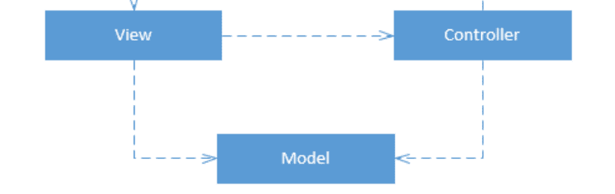

图 18：MVC 模式的类图

#### 代码列表 84：模型 (Model)

```cs
public class PersonModel

{

    public string FirstName { get; set; }

    public string LastName { get; set; }

}

```

接下来，我将修改 `HomeController`，使其将一个 `PersonModel` 传递给视图（View）。

#### 代码列表 85：控制器 (Controller)

```cs
public class HomeController : Controller

{

    public ActionResult Index()

    {

        PersonModel model = new PersonModel();

        model.FirstName = "Bill";

        model.LastName = "Gates";

        return View(model);

    }

}

```

最后，我将修改 Home/Index 视图（这并不完全是有效的 HTML，但可以），让它显示模型中的数据。

#### 代码列表 86：视图 (View)

```html
@using MyMvcApp.Models

@model PersonModel
```


<p>传递到 PersonModel 中的人员是：@Model.FirstName @Model.LastName</p>

这将显示以下网页：


传递到 PersonModel 中的人员是：Bill Gates

#### 图 19：生成的视图

如果你将控制器中的名称更改为其他内容，它将反映在视图中。你不需要更改模型或视图。总结一下：用户向控制器请求视图。控制器（可选地）创建一个模型，将其传递给视图，并返回视图。视图在屏幕上显示数据。

与 MVC 相关的两种设计模式是模型视图-视图模型 (MVVM) 和模型视图-演示器 (MVP)。

MVP 是一种用于用户界面的模式。演示器（Presenter）位于模型和视图之间，并对数据进行格式化以便视图可以使用。

在 MVVM 中，ViewModel 是用于显示的视图的抽象。由于对视图的抽象，双向绑定变得可能（模型中的更新直接显示在视图中，视图中的更新也直接推送到模型中）。MVVM 是为微软的 Windows Presentation Foundation (WPF) 创建的，但现在也可以在许多如 KnockoutJS 和 AngularJS 等 JavaScript 框架中找到。MVC、MVP 和 MVVM 合称为 MV* 模式。请注意，它们并不是互斥的。

### 存储库 (Repository)

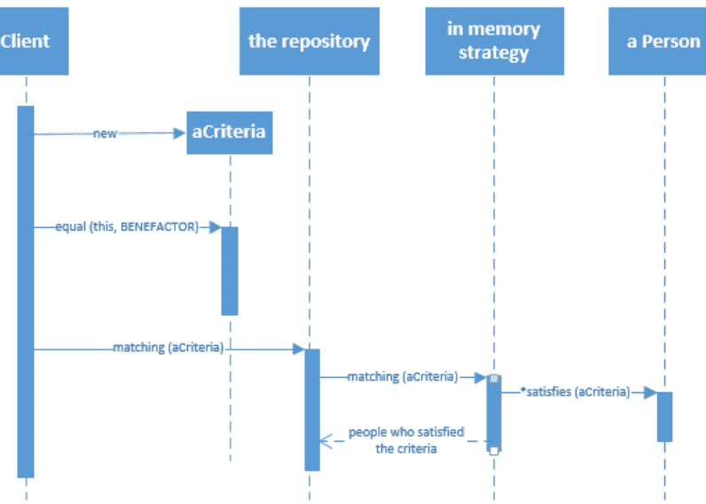

图 20：存储库模式的序列图

存储库模式是一个复杂的模式，幸运的是你不需要自己实现它。它利用了其他模式：数据映射器 (Data Mapper) 和查询对象 (Query Object)。数据映射器是将数据库记录映射到 C# 领域对象的代码。数据库和领域对象彼此无法感知。查询对象是一个行为类似于数据库 WHERE 子句的 C# 对象，可以传递给数据映射器（图中的 "criteria"）。最后，存储库是一个类集合的接口，它可以检索领域对象，并置于你的领域层和数据映射层之间。一旦运行起来，它的好处处是实现了关注点分离。你的领域对象不知道数据库，并且可以重用于其他目的。你的数据库层可以更换（例如，从 Oracle 切换到 SQL Server），你只需要更改数据映射器。你的数据映射器、查询对象和存储库也可以在其他项目中重用。

尽管我想构建数据映射器、查询对象和存储库，但我们不会那样做。这需要花费大量时间，本身就可以写成一本书。相反，我将创建一个简单的控制台应用程序并保存，将一个 ADO.NET 实体模型引入项目，并连接到有一个 Person 表的数据库。Entity Framework 将为我生成 Person 类（我不采用第一种方法）。

#### 代码列表 87：生成的 Person 类

```cs
public partial class Person
{
    public int Id { get; set; }
    public string FirstName { get; set; }
    public string LastName { get; set; }
    public Nullable<DateTime> DateBirth { get; set; }
}
```

它还会创建一个继承自 `DbContext` 的存储库，并允许访问我的 Person 对象，就就像它们存在于内存中的 C# 对象一样。

#### 代码列表 88：生成的 DbContext

```cs
public partial class ApplicationEntities : DbContext
{
    public ApplicationEntities()
    {
        base("ApplicationEntities")
    }

    protected override void OnModelCreating(DbBuilder modelBuilder)
    {
        throw new UnintentionalCodeFirstException();
    }

    public virtual DbSet<Person> People { get; set; }
}
```

美之处就在于此。存储库模式的使用（如果做得正确的话）真的非常简单。

#### 代码列表 89：存储库的使用

```cs
using (ApplicationEntities context = new ApplicationEntities())
{
    // 构建查询。
    // context.People 是存储库。
    // 查询对象（一个表达式）通过 .Where(lambda) 构建。
    // 数据映射器是不可见的，但由 Entity Framework 在内部使用。
    IQueryable<Person> query = context.People.Where(p => p.FirstName.Contains("Sand"));
    // ToList() 实际上会调用数据库。
    List<Person> people = query.ToList();
}
```

我个人觉得，整个 lambda 创建表达式（查询对象）的做法是一种哲学，但它遵循了该模式。我用的一些 API 具有更显式的查询对象。

#### 代码列表 90：显式查询对象

```cs
List<Person> people = SomeApi.People.Select(Query.Contains("FirstName", "Sand"));
```

这总比直接写 SQL 好！

在使用存储库时有一个警告：所有的代码看起来都是 C#，但黑暗的真相并非如此。最终，某些查询将被发送到你的数据库，如果你不小心，它变得很难看且运行缓慢。Entity Framework（或其他 ORM）能够处理你拥有的连接、聚合。生成的某些 SQL 代码如果你不知道自己在做什么，它会很糟糕。有时候直接写 SQL 要快得多！

汽车有一个引擎，所以它理而应该应该创建一个引擎，对吧？嗯，也许吧。关于一个类是否应该创建另一个类，有几点提示。如果某个类聚合了另一个类、紧密使用另一个类，或者拥有另一个类的初始化数据（另见下一节的`信息专家`），那么让该类来创建另一个类可能是一个好主意。汽车确实包含一个引擎，但它并没有聚合它。汽车使用引擎。它还拥有引擎的初始化数据吗？谁知道呢？这取决于你的设计。在这种情况下，我会选择另一种解决方案，即通过构造函数（或某些手段）通过引擎类来组合汽车类。

#### 代码列表 92: 不同的引擎

```cs
public abstract class Engine { }
public class GasolineEngine : Engine { }
public class DieselEngine : Engine { }
public class Car
{
    private Engine engine;
    public Car(Engine engine) {
        this.engine = engine;
    }
    // ...
}
```

现在由另一个类来创建引擎，你可以给你的汽车提供任何你想要的引擎。

#### 代码列表 93: 通过你的汽车进行组合

```cs
Car diesel = new Car(new DieselEngine());
Car gas = new Car(new GasolineEngine());
```

当然，这还没有解决整个问题，因为谁来创建汽车？是同一个类还是另一个类来创建引擎？

需要注意的是，这些是对象，而不是领域对象。领域（或者说现实世界对象）可能是在某些装配线上创建的。在你的代码中，可能不会创建汽车或引擎。你唯一确定的一点是，在现实世界中汽车从未创建过引擎。

### 信息专家

信息专家（Information Expert）是你已经在应用的一个原则。信息专家解决了由哪个对象来处理某项责任的问题。你是否经常想过某个方法应该属于哪个类？答案就在信息专家中，而且简单得具有欺骗性。一个责任应该被分配给拥有履行该责任所需的全部信息的类。

让我们来看一个例子。早些我们为 `SqlServerApi` 类创建了一个适配器（Adapter）。这里有一个简短的回顾：

#### 代码列表 94: SqlServerApiAdapter

```java
public class SqlServerApiAdapter : IDBApiAdapter
{
    private SqlServerApi api = new SqlServerApi();
    public object GetData()
    {
        DataTable table = api.GetData();
        object o = ConvertToObject(table);
        return o;
    }
    private object ConvertToObject(DataTable table)
    {
        // ...
        return null; // 位符
    }
    public void SendData(object data)
    {
        DataTable table = ConvertToDataTable(data);
        api.SendData(table);
    }
    private DataTable ConvertToDataTable(object obj)
    {
        // ...
        return new DataTable();
    }
}

public class OracleApiAdapter : IDBApiAdapter
{
    private OracleApi api = new OracleApi();
    public object GetData()
    {
        return api.GetQuery();
    }
    public void SendData(object data)
    {
        api.ExecQuery(data);
    }
}
```

现在事实证明，我们想要能够创建新的数据库。这是一项新功能，因为 `GetData` 或 `SendData` 并不支持它。现在我们可以把这个新的 `CreateDatabase` 方法放在哪里？也许放在我们的 `Program` 类中？

#### 代码列表 95: Program 中的 SqlServerApi

```csharp
class Program
{
    static void Main(string[] args)
    {
        CreateDatabase("MyDB");
        SqlServerApiAdapter adapter = new SqlServerApiAdapter();
        object data = adapter.GetData();
        // ...
    }
    static void CreatedDatabase(string name)
    {
        SqlServerApi api = new SqlServerApi();
        api.CreateDatabase(name);
    }
}
```

我想你可以看出这个问题。我们费了很大劲为 `SqlServerApi` 创建了一个适配器，现在我们却要直接在应用程序中使用它。这没有意义，因为 `SqlServerApiAdapter` 显然是更明确的选择。反正它在这里已经使用了 `SqlServerApi`！这正是信息专家的核心观点。`SqlServerApiAdapter` 拥有创建新数据库所需的信息，因此它是获取这一新功能的良好人选。而替代方案 `Program` 对这里的 `SqlServerApi` 一无所知，所以选择很容易做出。

这个例子虽然显而易见，但它展示了信息专家的核心本质。我也告诉你一个小秘密：我见过有些软件在 `Program` 中有 `CreateDatabase`（嗯，不完全是那样，但情况类似）。当代码规模变得很大时，新功能应该放在哪里并不总是那么明显。

### 低耦合

低耦合（Low Coupling）原则有助于将更改的影响降到最低。类之间的耦合是指一个类依赖于另一个类。不用说，当许多类都依赖于某个类时，该类变得很难修改。信息专家原则实际上有助于这一目标。让我们检查之前的 `SqlServerApi` 例子。将 `CreateDatabase` 方法放在 `Program` 中是糟糕的设计，因为 `Program` 不知道 `SqlServerApi`，而且不应该需要知道。它在 `SqlServerApi` 和 `Program` 之间创建了不必要的耦合。

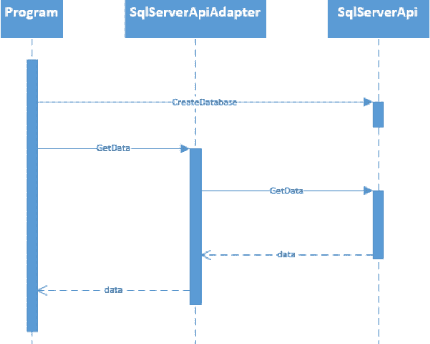

图 21：高耦合序列图

如图所示，**Program** 和 **SqlServerApi** 之间存在一条直接连线。在这种设计中，**Program** 依赖于 **SqlServerApi**。如果 **SqlServerApi** 发生，我们只需要修改 **Program**。

### 高内聚

内聚（Cohesion）是类中的元素在一起的程度。高内聚原则（High Cohesion）规定类的内聚性应该是高的。换句话说，类的方法和属性应该在一起。让我们看另一个例子。假设我们有一个具有某些属性和方法的 **Person** 类：

#### 代码列表 96：Person 类

```csharp
public class Person {
    public string FirstName { get; set; }
    public string LastName { get; set; }
    public DateTime DateOfBirth { get; set; }
    public string GetFullName()
    {
        return String.Format("{0} {1}", FirstName, LastName);
    }
    public int GetAge()
    {
        int age = DateTime.Today.Year - DateOfBirth.Year;
        // 月日修正
        if (DateOfBirth.AddYears(age) > DateTime.Today)
        {
            age -= 1;
        }
        return age;
    }
}
```

内聚性很高，因为所有的属性和方法都在描述一个人。让我们添加一个方法。

#### 代码列表 97：带有 SalesOrders 的 Person

```csharp
public class Person
{
    // ...
    public List<SalesOrder> GetSalesOrders()
    {
        // ...
    }
}
```

Person 的内聚性刚刚下降了。这并不完全错误，但你应该问自己，`Person` 是否真的需要知道 `SalesOrder`。不能想象你可能在某个语境下使用 `Person` 但又不想依赖 `SalesOrder` 类。也许我们可以将为 `Person` 获取 `SalesOrders`的任务委托给另一个类。

#### 代码列表 98：SalesOrderRepository

```csharp
public class SalesOrderRepository
{
    public List<SalesOrder> GetPersonsSalesOrders(Person person)
    {
        // ...
    }
}
```

#### 代码列表 99：SalesOrderRepository 的使用

```csharp
Person sander = new Person
{
    FirstName = "Sander",
    LastName = "Rossel",
    DateOfBirth = new DateTime(1987, 11, 8);
};
SalesOrderRepository repo = new SalesOrderRepository();
List<SalesOrder> orders = repo.GetPersonsSalesOrders(sander);
```


我并不是说这是最好的解决方案，但它增加了 `Person` 类的内聚性，并降低了耦合。

正如你看到的，高内聚和低耦合是并不矛盾的。当一个类的内聚性很高时，耦合通常很低。再次，信息专家原则（Information Expert）和低耦合原则引导我们走向最高内聚的设计。

### 纯造物 (Pure Fabrication)

我们已经见过很多“纯造物”。事实上，当某个责任不适合任何类时，你所做的事情：你专门为这项任务设计了一个类。在上一个例子中，我们创建了 `SalesOrderRepository`，因为为 `Person` 类获取 `SalesOrders` 违反了低耦合和高内聚原则。基本上，任何不模拟领域对象的类都是纯造物（一种纯粹的想象力产物；它只有一个职责）。

让我们来看另一个例子。我们仍然有 `Person` 类。现在哪个类来把我们的 `Person` 保存到数据库中？我们没有任何数据库类，而 `Person` 拥有将自己保存到数据库的大部分必要信息。让 `Person` 类执行保存到数据库所需的数据库逻辑似乎是可以的。我们已经知道那并不是好主意，主要是因为我们希望 `Person` 具有低耦合和高内聚。

#### 代码列表 100：破坏低耦合和高内聚的 Person 类

```cs
public class Person
{
    public string FirstName { get; set; }
    public string LastName { get; set; }
    public DateTime DateOfBirth { get; set; }
    public void Save()
    {
        // 这里是数据库逻辑。
    }
}
```

所以我们采取行动，创建一个纯造物——一个唯一目的是将 `Person` 保存到数据库的类。我在这里不会包含这段代码，因为我想你已经明白了了。当我们应用在本书书中看到的其他模式和原则时，我们将得到一个数据映射器（Data Mapper），可能 true一个存储库（Repository）。

### 总结 (The Takeaway)

在设计类时，GRASP 真的非常有用。与我们目前看到的其他东西不同，它们并不具有很的技术性质，也没有描述类或方法。它们描述的是如何为你的软件获得高效的设计。这一章表明，应用程序并不是只有单一的设计。事实上，当我们仅仅有一个汽车和一台引擎时，我们已经有了两种设计选择（甚至有更多不那么显性的选择）。记住 GRASP，我们可以得到某种至少比许多备选方案更好的设计（设计中并不存在所谓的“最佳设计”）。GRASP 有趣的地方在于，它的很多内容对大多数开发者来说已经是常识了（例如 `Person` 不应该保存自己），但通过 GRASP，你拥有了一些形式化的规则，来解释为什么这些是常识的。

## 第 6 章 架构 (Architecture)

到目前为止，你看到了很多小规模的代码。我们已经看到了如何设计单个类、如何让多个类相互通信，以及如何抽象某些组件（如数据库）。尽管如此，你可能需要编写不仅仅几个类。在观察软件系统的高层结构时，我们谈论它的架构。在本章中，我将讨论你在构建应用程序时可能会遇到的技术挑战和方法。

我想强调的是，我不会讨论那些内容。我不会讨论软件架构师的工作，即与利益相关者交谈、决定开发流程（敏捷或瀑布模型）、文档、预算以及你在构建实际应用程序时必须处理的其他因素。

系统的架构是那些不容易改变的部分。对此的意见不一；让我们考虑数据库。许多人指向数据库，称其为任何系统的心脏，并告诉你它在开发过程后期很难更改。然而，我们知道，由于我们通过数据映射器（Data Mapper）和存储库（Repository）之后进行抽象（软件依赖于这些抽象），更改数据库是“简单的”——只涉及切换到我们的数据映射器，可能还有存储库。或者工作量很大，所有内容都必须经过测试，但我们不应该更改前端，例如。

那么什么是难以改变的？假设在项目进行一半时你决定更改数据映射器或存储库的接口。这可能会非常有问题。或者你决定引入 MVC 和/或 MVVM 架构。这将需要对许多组件进行大量的重写。

### 不要重复自己 (DRY)

我们还未讨论过的一个重要原则是 DRY 原则，即“不要重复自己”（Don't Repeat Yourself）。我们为什么要费劲地将一切放在抽象之后，思考架构，并进行复用？DRY 就是答案。防止重复编写相同的代码。接下来的例子将说明原因。

假设你有一个带有 `save` 逻辑的 `Person` 类。我们破坏了低耦合和高内聚，但我们可以保存我们的 `Person`。

#### 代码列表 101：带有保存逻辑的 Person

```cs
public class Person
{
    // ...
    public void Save()
    {
        // 这里是 Person 的数据库逻辑。
    }
}
```

现在我们需要一个 `SalesOrder`。因为我们没有一个可以保存领域对象的单一类，我们需要再次编写保存功能，但这次是针对我们的 `SalesOrder`。没问题，我们只需复制/粘贴即可。

#### 代码列表 102：带有保存逻辑的 Person

```cs
public class Person
{
    // ...
    public void Save()
    {
        // 这里是 Person 的数据库逻辑。
    }
}
```

#### 代码列表 103：固定的 SalesOrder

```cs
public class SalesOrder
{
    // ...
    public void Save()
    {
        // 这里是 SalesOrder 的数据库逻辑。
    }
}
```

### 包 (Packages)

通过创建类和方法，我们可以在应用程序中复用代码。很多时候我们要在应用程序之间复用代码。一个例子是工具，可能是 XML 解析器或数据映射器，是你编写的。你创建包（动态链接库 DLL）可以供其他应用程序使用。当你使用 .NET 时，你实际上在使用微软创建的包。就像类设计一样，在发布时有一些最佳实践。在《Agile Principles, Practices in C#》一书中，Robert C. Martin 讨论了这些实践^5 我在这里快速总结一下它们。

### 重用/发布原则 (REP)

重用/发布原则规定，只有发布过的才能复用。发布是由另一个作者或实体维护的。发布是一个产品，而你是客户。发布会有更新，这些更新可能对你感兴趣，你可以选择更新或保留旧版本。显然，复制的代码不符合这一描述（正如我们所看到的）。应用程序通常由数百个类和接口组成，发布单个类是单调且令人疲惫的。包是发布的良好候选，这样所有内容都可以被复用。

### 共复用原则 (CRP)

共复用原则是包的高内聚原则。打包在一起的类应该属于在一起。如果你复用了包中的一个类，你就需要更新、验证并重新发布你的软件。由于这个原因，包中的类应该具有高内聚（我谈论的是类之间的内聚，而不是类内部）。当你需要更新并必须做所有工作时，你会非常高兴，但你实际上并不需要那个更新。这种情况在实践中经常发生，因为替代方案是有许多包，这并不好。

### 共闭合原则 (CCP)

共闭合原则规定，一起更改的类应该打包在一起。这是因为如果你更改了一个类或一个职责，你不希望更新超过一个包。你不希望在一个包中包含不相关的功能（CRP），也不希望一个单一的功能出现在多个包中（CCP）。

> ^5 R.C. Martin, M. Martin - Agile Principles, Patterns and Practices in C#

### 无环依赖原则 (ADP)

无环依赖原则在 C# 和 Visual Studio 中确实是一个存在的问题。根据该原则，包不能依赖于依赖于自身的包，这会在你的依赖关系中创建一个循环。然而，在 Visual Studio 中是不允许这种依赖的。如果你尝试编译违反 ADP 的 .NET 代码，你将得到一个错误，信息会抱怨你正在创建循环引用。无论如何，让我们深入探讨一下。假设你有四个包：Data、Business、UIComponents 和 UI。UI 依赖于 Business 和 UIComponents，而 Business 依赖于 Data。

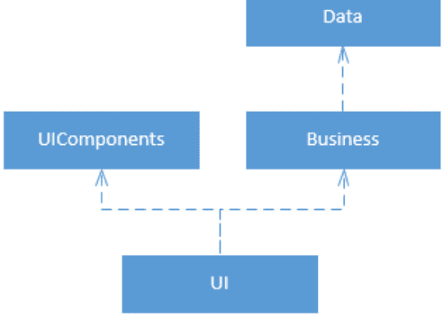

图 23：无循环依赖

如果 Business 发生变化，我们知道 UI 依赖于它，所以我们应该检查 UI 是否仍然正常。但我们知道 UIComponents 和 Data 保持不变。同样，如果 Data 发生变化，我们知道应该检查 Business 和 UI，但不需要检查 UIComponents。

现在假设 Data 依赖于 UI。


我们现在创建了一个循环。如果现在 Business 发生变化，我们应该检查 UI 是否仍然正常，但因为 Data 现在依赖于 UI，我们也应该检查 Data。如果 UIComponents 变化，你必须重新验证每一个包。对于四个包来说这很累人，但在拥有几十个包的现实应用中，这几乎是无法实现的。无论如何，这是一个非常糟糕的设计，并且被 Visual Studio 禁止。

### 稳定依赖原则 (SDP)

有些包编写一次并定期更新，而另一些包频繁变化。考虑用户界面：应用程序的每个新功能都需要用户界面的更改来支持该功能。希望你的 Data Mapper 更改频率要少得多。如果一个包很少变化，就说它是稳定的。根据稳定依赖原则，稳定的包不应该依赖于不稳定的包。这是合理的，因为每次依赖项更新时，我们都应该验证该包。这意味着如果依赖项频繁变化，我们就必须频繁验证。根据这个逻辑，包的稳定性取决于它所依赖的最不稳定的包，因此稳定的包不应该依赖于不稳定的包。

### 稳定抽象原则 (SAP)

为了让包保持稳定，这些包必须具有某种程度的抽象。没有抽象，这些包就无法被更改或扩展，导致它们变得不可更改或不稳定。我们已经看到如何通过接口、继承和 SOLID 原则来创建可扩展的软件。

### 层与级 (Layers and Tiers)

你经常会听到分层（layered）或分级（tiered）软件设计的术语。层是一个抽象级别；级是职责之间的物理隔离。例如，客户端-服务器解决方案是一个 2 层架构。如果你决定为某些业务逻辑增加一个额外的服务器，你就创建了一个 3 层架构。在面向对象编程中，N 层架构相对容易，因为模块可以在不同的层之间复用。当你实践书中列出的原则时，你的分层架构将自然而然。一个著名的分层结构是 OSI 模型，这是一个描述互联网不同层级的模型。简单来说，你的浏览器不知道如何在线路上传输位和字节，你的链路层也不知道任何浏览器。然而，通过抽象，两者共同工作呈现网站和应用程序。同样的原理适用于软件。你的应用程序对数据库一无所知，但通过某些 `IDataMapper` 接口，它能够与数据存储通信。

这样的层可以很容易被替换而不影响系统的其他部分。当你观察互联网时，你可以轻松从拨号连接切换到 ADSL、有线或无线连接。不需要更换你的浏览器或电脑。同样，用于在互联网上发送接收数据的 TCP/IP 协议可以切换为 UDP。在你的应用程序中，你可以切换数据库、重建用户界面，而不触碰系统的其他部分（前提是你成功地在不同的层中分离了关注点）。

常见的分层或分级架构如下：

| Application | | |
|---|---|---|
| Presentation | HTML, CSS, JavaScript | WinForms, WPF |
| Business | Business Logic | |
| | | Domain Models |
| Data Access | Database | Web Service |

> 图 25：常见的层或级

### 架构样式与模式

（注：由于原始输入文本包含大量的 OCR 错误、重复和乱码，上述翻译已基于其核心逻辑内容进行了清理和提炼。）

```cs
public void Increment()
{
    counter += 1;
}

public int GetIncrement()
{
    return counter;
}
```

任何 `Increment` 实例的状态都由 `counter` 的值决定。当我们调用 `Increment` 函数时，除非我们知道调用 `Increment` 之前的状态，否则我们不知道实例的状态。这使得程序的推理变得非常困难。当我们调用 `GetIncrement` 时，我们不知道它会返回什么，因为我们不知道对象的状态。

让我们来看一个例子。假设我们有一个包含 `Add` 函数的 `Math` 类。

> 代码列表 106：Math 类（Math Class）

```cs
public class Math
{
    public int Add(int a, int b)
    {
        return a + b;
    }
}
```

在这种情况下，我们知道用参数 1 和 2 调用该函数，结果将是 3。但是，这非常重要——在面向对象（OO）的语言中，我们永远无法百分之百确定。

> 代码列表 107：带有副作用的 Add

```cs
public class Math
{
    private int something;
    public int Add(int a, int b)
    {
        something += 1;
        return a + b;
    }
}
```

没有任何能阻止我们编写一个改变 `Math` 类内部状态的 `Add` 函数。类内部状态的改变被称为**副作用**（side effect）。

函数式编程禁止此类副作用。这使得给定输入参数时预测函数的输出成为可能。尽管这很困难；尝试写一个没有状态或副作用的应用程序吧。

# 面向切面编程 (Aspect-Oriented Programming)

面向对象编程（OOP）在很多方面都很优秀。但它并不擅长处理所谓的**跨切关注点**（cross-cutting concerns）。跨切关注点是贯穿应用程序的通用职责。以日志为例，你可能需要在每个层、每个项目的任何方法中实现它。结果是，你所有的方法都以类似于 `Log.Log(currentName, parameters)` 的内容开头。另一个例子是 .NET 中的 `INotifyPropertyChanged` 接口。它们可以在类上实现，每每当属性发生变化时，就会触发 `PropertyChanging` 和 `PropertyChanged` 事件。这种实现非常繁琐。

#### 代码列表 108：INotifyPropertyChanged

```cs
public class SomeClass : INotifyPropertyChanged, INotifyPropertyChanging
{
    public event PropertyChangedEventHandler PropertyChanged;
    public event PropertyChangingEventHandler PropertyChanging;
    private int someProperty;
    public int SomeProperty
    {
        get { return someProperty; }
        set
        {
            if (value != someProperty)
            {
                RaisePropertyChanging("SomeProperty");
                someProperty = value;
                RaisePropertyChanged("SomeProperty");
            }
        }
    }
    private void RaisePropertyChanging(string propertyName)
    {
        if (PropertyChanging != null)
        {
            PropertyChanging(this, new PropertyChangingEventArgs(propertyName));
        }
    }
    private void RaisePropertyChanged(string propertyName)
    {
        if (PropertyChanged != null)
        {
            PropertyChanged(this, new PropertyChangedEventArgs(propertyName));
        }
    }
}
```

这些是大量的样板代码！一个只需要一行代码的类现在有了超过三十行！

面向切面编程（AOP）旨在通过动态修改现有代码来解决这个问题。代理模式（Proxy Pattern）或装饰器模式（Decorator Pattern）通常被用于此。最著名的 AOP 框架之一可能是 PostSharp⁶。另一个是 Castle Project 的 DynamicProxy⁷。

⁶ https://www.postsharp.net/
⁷ http://www.castleproject.org/projects/dynamicproxy/

## 结论

面向对象编程是一种极佳的编程范式，它使你能够编写可读、可扩展且易于维护的大型企业级应用程序。你所拥有的工具（如继承、封装、接口和设计模式）非常多。尽管如此，许多项目完全失败，从未问世。当工具被应用不当或根本不使用时，你最终仍然会得到一堆不可维护的“意大利条代码”。因此，学习和实践不同的模式和设计非常重要，这样在时机到来时，你可以做出明智的决定决定何时使用什么。
