# C++ 面向对象编程


董事总经理：Ajay Shukla

出版与SEM及技术教育部总经理：Vibha Mahajan

策划编辑：Shalini Jha

初级策划编辑：Nilanjan Chakravarty

高级文字编辑：Dipika Dey

高级制作经理：P L Pandita

高等教育与学校市场部总经理：Michael J. Cruz

SEM与技术教育产品经理：Biju Ganesan

生产财务主管：Rajender P Ghansela

生产部助理总经理：B L Dogra

本作品中所包含的信息由 Tata McGraw-Hill 从据信可靠的来源获得。然而，Tata McGraw-Hill 及其作者均不保证此处所发布任何信息的准确性或完整性，Tata McGraw-Hill 及其作者也不对因使用此信息而产生的任何错误、遗漏或损害承担责任。本作品出版的前提是，Tata McGraw-Hill 及其作者提供信息但并未试图提供工程或其他专业服务。如果需要此类服务，应寻求适当的专业人员的帮助。

排版：Script Makers，地址：新德里 110 063，Paschim Vihar，DDA 市场 A1-B 19号；印刷：Gopsons，地址：诺伊达 - 201 301，64区 A-2 & 3

封面：Gopsons

## 前言

面向对象编程（OOP）已成为软件行业首选的编程方法，因为它提供了一种有效应对现实世界问题复杂性的方法。在今天可用的 OOP 语言中，`C++` 是使用最广泛的语言。

自 `Bjarne Stroustrup` 在 20 世纪 80 年代初创建以来，`C++` 经历了许多变化和改进。该语言于 1998 年由美国国家标准学会（ANSI）和国际标准化组织（ISO）标准化，不仅纳入了新特性，还纳入了用户组提出的更改。本书已彻底修订，本版符合 `ANSI/ISO` 标准的规范。除了符合标准外，还纳入了许多较小的更改和补充以加强现有主题，以及对文本中印刷错误和某些不准确之处的更正。本版的亮点是附录 `A` 中包含的两个新的编程项目 - （1）菜单式计算系统和（2）银行系统，展示了如何在实际应用中集成 `C++` 的各种特性。

本书面向希望了解 `C++` 语言和面向对象编程的程序员。它以简单易懂的风格解释了面向对象编程的何、为何和如何。本书假设读者已熟悉 `C` 语言，尽管他或她不必是专家程序员。

本书提供了大量示例、插图和完整程序。示例程序旨在既简单又具有教育意义。在必要时，包含概念的图示描述以提高清晰度并促进更好的理解。本书还介绍了面向对象方法概念，并简要讨论了面向对象系统分析和设计的要素。

## 关键教学特色

## 关键概念

关键概念提供了对本章将讨论的概念的快速概览。这些概念后面跟着一个引言，介绍本章将涵盖的主题，并将其与已学内容联系起来。

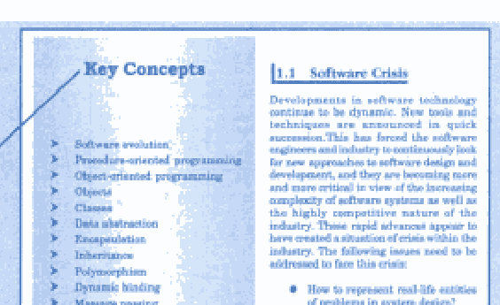

- 如何确保模块的可重用性和可扩展性？

- 如何开发对未来任何更改都具有容忍性的模块？

- 如何提高软件生产率并降低软件成本？

- 如何提高软件质量？

- 如何管理时间进度？

- 如何将软件开发过程工业化？

许多软件产品要么未完成，要么未使用，要么交付时存在重大错误。图 `1.1` 显示了 1970 年代美国国防软件项目的命运。约 `50%` 的软件产品从未交付，而交付的三分之一从未被使用。有趣的是，只有 `2%` 的产品按交付状态使用，未经任何更改。这说明软件行业在交付产品方面有着惊人的糟糕记录。

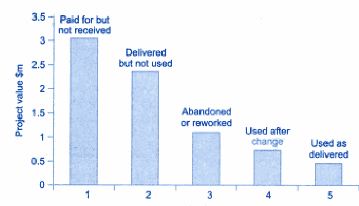

图 `1.1` ⇔ 美国国防项目的状况（根据美国政府）

用户需求的变化一直是一个主要问题。另一项研究（图 `1.2`）显示，超过 `50%` 的系统由于用户需求和数据格式的变化而需要修改。这只说明，在一个变化的世界和动态的商业环境中，对更改的需求是不可避免的，因此系统必须具有适应性和对更改的容忍性。

这些研究和其他关于软件实施的报告表明，软件产品在交付和实施前应仔细评估其质量。必须考虑的关键质量问题有：

- 正确性

- 可维护性

- 可重用性

- 开放性和互操作性

- 可移植性

- 安全性

- 完整性

- 用户友好性

选择和使用适当的软件工具将有助于解决这些问题中的一些。

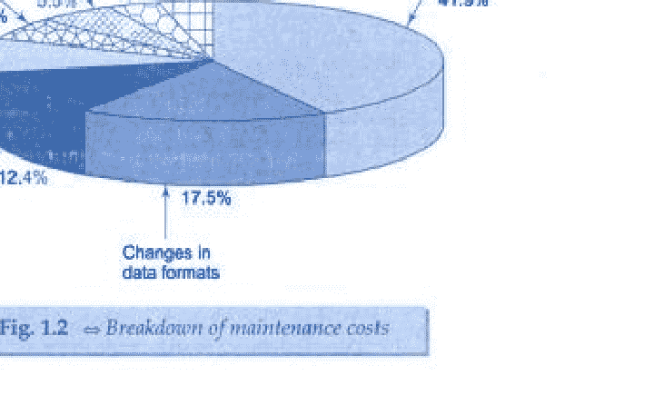

`Ernest Tello`，一位人工智能领域的知名作家，将软件技术的演进比作树的生长。像树一样，软件演进经历了不同的阶段或“层”。这些层在过去五十年中逐一建立起来，如图 `1.3` 所示，每一层都比前一层有所改进。然而，如果考虑这些层的寿命，类比就失效了。在软件系统中，每一层都继续发挥功能，而在树的情况下，只有最上层是功能性的。

> “随着复杂性的增加，架构主导了基本材料”。要构建当今复杂的软件，仅仅把一系列编程语句和一组过程和模块组合起来是不够的；我们需要纳入健全的构建技术和易于理解、实现和修改的程序结构。

自计算机发明以来，已经尝试了许多编程方法。

和打印。编写了许多函数来完成这些任务。主要关注点是函数。面向过程编程的典型程序结构如图 `1.4` 所示。层次分解技术已被用于指定为解决一个问题而需要完成的任务。

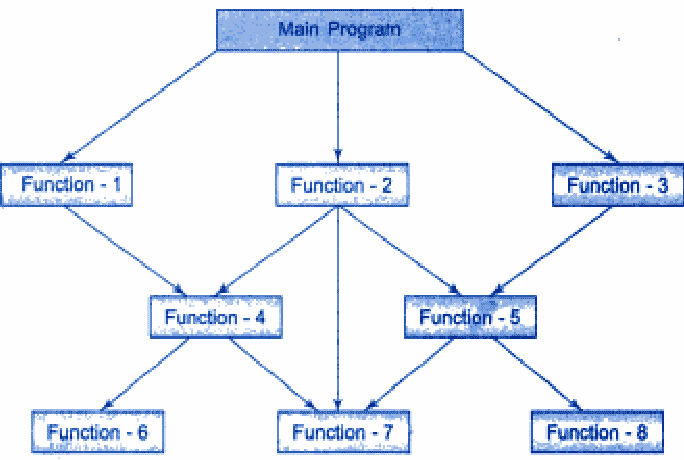

图 `1.4` ⇔ 面向过程程序的典型结构

面向过程编程基本上就是为计算机编写一系列指令（或操作），并将这些指令组织成称为函数的组。我们通常使用流程图来组织这些操作并表示从一个操作到另一个操作的控制流。虽然我们专注于函数的发展，但对各种函数使用的数据几乎没有关注。数据会发生什么？它们会被在它们上工作的函数如何影响？

在一个多函数程序中，许多重要的数据项被放置为全局，以便所有函数都可以访问。每个函数可能有自己的局部数据。图 `1.5` 显示了面向过程程序中数据和函数的关系。

全局数据更容易被函数无意更改。在大型程序中，很难识别哪些数据被哪个函数使用。如果我们需要修改外部数据结构，我们也需要修改访问该数据的所有函数。这为错误潜入提供了机会。

面向过程方法的另一个严重缺点是它不能很好地模拟现实世界问题。这是因为函数是面向操作的，并不真正对应于问题的元素。

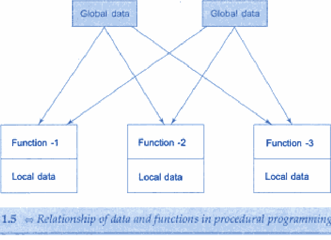

Fig. `1.5` → 程序设计中数据与函数的关系

过程式编程所表现出的一些特征是：

- 强调做事，即算法。

- 大型程序被划分为被称为函数的小程序。

- 大多数函数共享全局数据。

- 数据在系统中函数之间自由流动。

- 函数将数据从一种形式转换为另一种形式。

- 采用自顶向下的方法进行程序设计。

## 1.4 面向对象的编程范式

面向对象方法的发明主要动机是为了消除在过程式方法中遇到的一些缺陷。`OOP` 将数据视为程序开发中的关键要素，不允许其在系统中自由流动。它将数据与操作该数据的函数更紧密地联系在一起，并防止其被外部函数意外修改。`OOP` 允许将问题分解为若干称为对象的实体，然后围绕这些对象构建数据和函数。面向对象程序中数据和函数的组织如图 `1.6` 所示。对象的数据只能由与该对象关联的函数访问。然而，一个对象的函数可以访问其他对象的函数。

面向对象编程的一些显著特征是：

- 强调数据而非过程。

- 程序被划分为被称为对象的部分。

- 数据结构被设计为表征对象。

- 操作对象数据的函数与数据结构绑定在一起。

- 数据被隐藏，不能被外部函数访问。

- 对象可以通过函数相互通信。

- 必要时可以轻松添加新的数据和函数。

- 在程序设计中采用自底向上的方法。

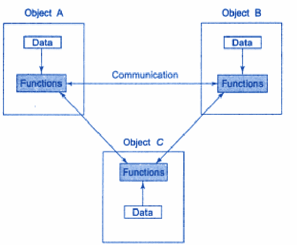

Fig. `1.6` ⇒ `OOP` 中数据与函数的组织

面向对象编程是编程范式中最新的概念，至今对不同的人仍有不同含义。因此，在继续之前，有必要对面向对象编程有一个工作定义。我们将“面向对象编程定义为一种方法，它通过为数据和函数创建分区内存区域并将其用作按需创建此类模块副本的模板，从而对程序进行模块化。”因此，对象被视为计算机内存中存储数据和可访问该数据的一组操作的分区区域。由于内存分区是独立的，对象可以在不修改的情况下用于各种不同的程序。

## 1.5 面向对象编程的基本概念

有必要理解面向对象编程中广泛使用的一些概念。这些包括：

- 对象

- 类

- 数据抽象和封装

- 继承

- 多态

- 动态绑定

- 消息传递

我们将在本节中详细讨论这些概念。

### 对象

对象是面向对象系统中的基本运行时实体。它们可能代表一个人、一个地点、一个银行账户、一个数据表或程序需要处理的任何项目。它们也可能代表用户定义的数据，如向量、时间和列表。编程问题以对象及其之间的通信方式为基础进行分析。程序对象应选择使其与现实世界对象紧密匹配。对象在内存中占用空间，并具有类似 `Pascal` 中的记录或 `C` 中的结构一样的关联地址。

程序执行时，对象通过相互发送消息进行交互。例如，如果“客户”和“账户”是程序中的两个对象，则客户对象可能会向账户对象发送消息请求银行余额。每个对象包含数据和操作数据的代码。对象可以在不知道彼此数据或代码细节的情况下进行交互。只需知道接受的消息类型以及对象返回的响应类型即可。尽管不同作者的表示方式不同，但图 `1.7` 显示了在面向对象分析和设计中流行使用的两种表示法。

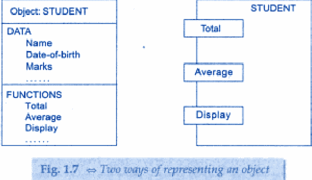

### 类

我们刚刚提到对象包含数据和操作该数据的代码。通过类可以将对象的整个数据和代码集合做成用户定义的数据类型。事实上，对象是类类型的变量。一旦定义了类，我们就可以创建任意数量属于该类的对象。每个对象都与创建它们的类类型的数据相关联。因此，类就是相似类型对象的集合。例如，芒果、苹果和橙子都是水果类的成员。类是用户定义的数据类型，行为类似于编程语言的内置类型。创建对象的语法与在 `C` 中创建整数对象的语法没有区别。如果 `fruit` 已被定义为类，则语句

```
fruit mango;
```

将创建属于 `fruit` 类的对象 `mango`。

### 数据抽象和封装

将数据和函数封装到单个单元中称为类，这被称为封装。数据封装是类的最显著特征。数据对外部世界不可访问，只有封装在类中的那些函数可以访问它。这些函数提供了对象数据与程序之间的接口。这种将数据与程序的直接访问隔离开来的做法称为数据隐藏或信息隐藏。

抽象是指在不包含背景细节或解释的情况下表示本质特征的行为。类使用抽象的概念，并被定义为抽象属性的列表，如大小、重量和成本，以及操作这些属性的函数。它们封装了要创建的对象的全部基本属性。这些属性有时称为数据成员，因为它们保存信息。操作这些数据的函数有时称为方法或成员函数。

由于类使用了数据抽象的概念，因此它们被称为抽象数据类型 `ADT`。

### 继承

继承是一个类对象获取另一个类对象属性的过程。它支持分层分类的概念。例如，鸟类‘知更鸟’是‘会飞的鸟’类的一部分，而‘会飞的鸟’又是‘鸟’类的一部分。这种划分背后的原则是，每个派生类都与它派生自的类共享共同特征，如图 `1.8` 所示。

在 `OOP` 中，继承的概念提供了可重用的思想。这意味着我们可以在不修改现有类的情况下向其添加额外功能。这可以通过从现有类派生新类来实现。新类将具有两个类的组合功能。继承机制的真正吸引力和强大之处在于，它允许程序员重用一个几乎但不完全符合他需求的类，并以这样的方式定制该类，而不会对其他类引入任何不良副作用。

请注意，每个子类仅定义其独有的特征。如果没有分类，每个类都必须显式包含其所有特征。

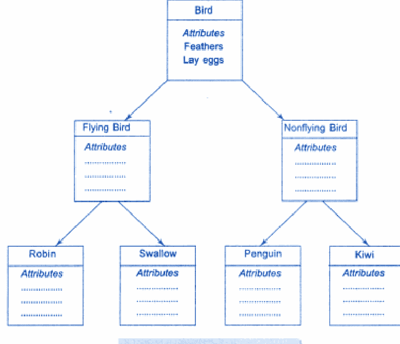

Fig. `1.8` ⇒ 属性继承

### 多态

多态是另一个重要的 `OOP` 概念。多态是一个希腊术语，意为能够采取多种形式。一个操作在不同实例中可能表现出不同的行为。行为取决于操作中使用的数据类型。例如，考虑加法操作。对于两个数字，该操作会生成一个和。如果操作数是字符串，则该操作会通过连接产生第三个字符串。使操作符在不同实例中表现出不同行为的过程称为操作符重载。

图 `1.9` 说明了单个函数名可用于处理不同数量和不同类型的参数。这类似于某个特定词在不同上下文中具有几种不同含义。使用单个函数名执行不同类型的任务称为函数重载。

多态在允许具有不同内部结构的对象共享相同的外部接口方面发挥着重要作用。这意味着一组通用操作可以通过相同的方式访问，即使与每个操作关联的具体动作可能不同。多态在实现继承时被广泛使用。

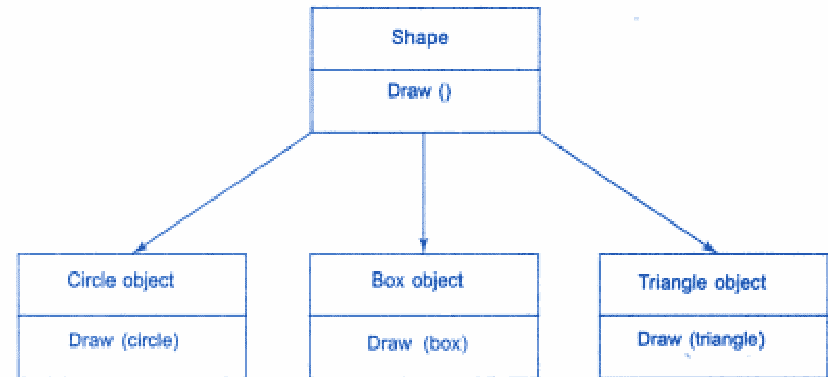

### 动态绑定

绑定是指将过程调用与响应调用而执行的代码联系起来。动态绑定（也称后期绑定）意味着给定过程调用关联的代码直到运行时调用发生时才确定。它与多态和继承相关。与多态引用关联的函数调用取决于该引用的动态类型。

考虑图 `1.9` 中的过程“draw”。通过继承，每个对象都会有这个过程。然而，其算法对每个对象都是唯一的，因此 `draw` 过程将在定义对象的每个类中重新定义。在运行时，将调用与当前引用下对象匹配的代码。

### 消息传递

一个面向对象的程序由一组相互通信的对象组成。因此，用面向对象语言进行编程涉及以下基本步骤：

- 创建定义对象及其行为的类，

- 从类定义创建对象，并且

- 建立对象之间的通信。

对象通过发送和接收信息相互通信，就像人们相互传递消息一样。消息传递的概念使得构建直接建模或模拟现实世界对应物的系统更容易讨论。

对象的消息是执行过程的请求，因此将调用接收对象中生成所需结果的函数（过程）。消息传递涉及指定对象名称、函数（消息）名称和要发送的信息。示例：

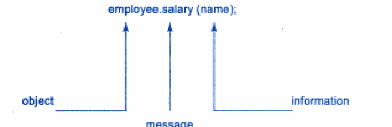

对象有生命周期。它们可以被创建和销毁。只要对象存活，就可以与其通信。

## 1.6 面向对象编程的益处

面向对象编程为程序设计师和用户都提供了若干好处。面向对象有助于解决与软件产品开发和质量相关的许多问题。这项新技术有望带来更高的程序员生产力、更好的软件质量和更低的维护成本。主要优点如下：

- 通过继承，我们可以消除冗余代码并扩展现有类的使用。

- 我们可以从相互通信的标准工作模块构建程序，而不必从头开始编写代码。这可以节省开发时间并提高生产力。

- 数据隐藏原则帮助程序员构建安全的程序，这些程序不会被程序中其他部分的代码入侵。

- 一个对象可以有多个实例并存而不会相互干扰。

- 可以将问题域中的对象映射到程序中的对象。

- 可以很容易地根据对象划分项目中的工作。

- 以数据为中心的设计方法使我们能够以可实现的形式捕获模型的更多细节。

- 面向对象的系统可以很容易地从小型系统升级到大型系统。

- 用于对象间通信的消息传递技术使与外部系统的接口描述变得简单得多。

- 软件复杂性可以很容易地管理。

虽然可以在面向对象系统中纳入所有这些特性，但它们的重要性取决于项目类型和程序员的偏好。为了获得上述某些好处，需要解决许多问题。例如，必须要有可重用的对象库。这项技术仍在发展，当前的产品可能会很快被取代。如果要保证重用性，就需要开发严格的控制和协议。

开发易于使用的软件很难构建。希望面向对象的编程工具能够帮助管理这一问题。

## 1.7 面向对象语言

面向对象编程并非任何特定语言的权利。像结构化编程一样，可以使用 `C` 和 `Pascal` 等语言来实现 `OOP` 的概念。然而，当程序变得庞大时，编程会变得笨拙并可能产生混乱。专门设计用于支持 `OOP` 概念的语言使它们更容易实现。

语言应支持若干 `OOP` 概念才能声称自己是面向对象的。根据它们支持的特性，可以分为以下两类：

- 基于对象的编程语言，和

- 面向对象的编程语言。

基于对象的编程是主要支持封装和对象标识的编程风格。基于对象编程所需的主要特性是：

- 数据封装

- 数据隐藏和访问机制

- 对象的自动初始化和清理

- 运算符重载

支持使用对象编程的语言被称为基于对象的编程语言。它们不支持继承和动态绑定。`Ada` 是一种典型的基于对象的编程语言。

面向对象编程包含基于对象编程的所有特性，以及另外两个特性，即继承和动态绑定。因此，面向对象编程可以用以下语句来表征：

```
Object-based features + inheritance + dynamic binding
```

支持这些特性的语言包括 `C++`、`Smalltalk`、`Object Pascal` 和 `Java`。有大量基于对象和面向对象的编程语言。表 `1.1` 列出了一些流行的通用 `OOP` 语言及其特性。

### 表 1.1 一些 OOP 语言的特性

| 特性 | `Simula` * | `Smalltalk` * | `Objective C` | `C++` | `Ada` ** | `Object Pascal` | `Turbo Pascal` | `Eiffel` * | `Java` * |

|---|---|---|---|---|---|---|---|---|---|

| 绑定（早期或后期） | 两者 ✓ | 后期 ✓ | 两者 ✓ | 两者 ✓ | 早期 ✓ | 后期 ✓ | 早期 ✓ | 早期 ✓ | 两者 ✓ |

| 多态 | ✓ | ✓ | ✓ | ✓ | ✓ | ✓ | ✓ | ✓ | ✓ |

| 数据隐藏 | ✓ | ✓ | ✓ | ✓ | ✓ | ✓ | ✓ | ✓ | ✓ |

| 并发 | ✓ | 差 | 差 | 差 | 困难 | 无 | 无 | 承诺支持 | ✓ |

| 继承 | ✓ | ✓ | ✓ | ✓ | 否 | ✓ | ✓ | ✓ | ✓ |

| 多重继承 | 否 | ✓ | ✓ | ✓ | 否 | --- | --- | ✓ | 否 |

| 垃圾收集 | ✓ | ✓ | ✓ | ✓ | 否 | ✓ | ✓ | ✓ | ✓ |

| 持久性 | 否 | 承诺支持 | 否 | 否 | 类似3GL | 否 | 否 | 部分支持 | ✓ |


| 泛型 | 否 | 否 | 否 | ✓ | ✓ | 否 | 否 | ✓ | 否 |

| 对象库 | ✓ | ✓ | ✓ | ✓ | 不多 | ✓ | ✓ | ✓ | ✓ |

\* 纯面向对象语言

\*\* 基于对象的语言

其他为扩展的传统语言

从表 1.1 可以看出，所有语言都提供多态和数据隐藏。然而，许多语言不提供并发、持久性和泛型设施。Eiffel、`Ada` 和 `C++` 提供泛型设施，这是支持重用的重要构造。然而，持久性（存储对象的过程）并没有被任何一种语言完全支持。在 `Smalltalk` 中，虽然整个当前执行状态可以保存到磁盘，但单个对象不能保存到外部文件。

在商业上，`C++` 只有 10 年历史，`Smalltalk` 和 `Objective C` 有 13 年历史，而 `Java` 只有 5 年历史。虽然 `Simula` 已存在二十多年，但它大部分时间都在研究环境中度过。这个领域太新，因此不应过于苛刻地评判。

使用特定语言取决于应用的特性和需求、选择对组织的影响，以及现有程序的重用。`C++` 现在已成为最成功、最实用的通用 OOP 语言，并在当今工业界广泛使用。

## 1.8 面向对象编程的应用

面向对象编程已成为当今编程界的热门词汇之一。软件工程师在使用 OOP 方面似乎表现出极大的热情和兴趣。

在许多领域中正变得日益重要。迄今为止，面向对象编程最流行的应用领域是用户界面设计，例如窗口系统。人们已利用 OOP 技术开发了数百种窗口系统。

现实生活中的业务系统往往复杂得多，包含更多具有复杂属性和方法的对象。OOP 在这些类型的应用中非常有用，因为它可以简化复杂的问题。OOP 有前景的应用领域包括：

- 实时系统

- 仿真与建模

- 面向对象数据库

- 超文本、超媒体和专家系统

- 人工智能和专家系统

- 神经网络与并行编程

- 决策支持与办公自动化系统

- CIM/CAM/CAD 系统

OOP 环境的丰富性不仅使得软件行业能够提高软件系统的质量，而且还能提高其生产率。面向对象技术无疑正在改变软件工程师思考、分析、设计和实现系统的方式。

## 小结

- 过去五十年中，软件技术经历了一系列阶段的发展。

- 直到最近，最流行的阶段是面向过程编程（POP）。

- POP 采用自顶向下的编程方法，将问题视为要执行的一系列任务，并编写大量函数来实现这些任务。

- POP 有两个主要缺点，即：（1）数据在程序中自由流动，因此容易受到程序中任何函数的影响而发生变化；（2）它不能很好地建模现实世界的问题。

- 面向对象编程（OOP）是为了克服 POP 的缺点而发明的。它采用自底向上的编程方法，将数据视为程序开发中的关键元素，不允许其在系统中自由流动。它通过一种称为类的数据结构，将数据与操作数据的函数更紧密地绑定在一起。这一特性称为数据封装。

- 在 OOP 中，问题被视为许多称为对象的实体的集合。对象是类的实例。

- 将数据与程序的直接访问隔离称为数据隐藏。

- `数据抽象`是指将基本特征组合在一起，而不包含背景细节。

- `继承`是一个类的对象获取另一个类对象属性的过程。

- `多态`是指一个名称、多种形式。它允许程序中有多个同名函数，还允许运算符重载，从而使一个操作在不同实例中表现出不同行为。

- `动态绑定`意味着在运行时调用之前，与给定过程关联的代码是未知的。

- `消息传递`涉及指定对象名称、函数（消息）名称以及要发送的信息。

- 与传统编程方法相比，面向对象技术提供了若干好处——其中最重要的是可重用性。

- OOP 技术的应用在包括实时业务系统在内的几乎所有计算领域都日益重要。

- 有许多语言支持面向对象编程范式，其中流行的有 `C++`、`Smalltalk` 和 `Java`。如今 `C++` 已成为行业标准语言。

## 关键术语

- Ada

- 汇编语言

- 自底向上编程

- C++

- 类

- 并发

- 数据抽象

- 数据封装

- 数据隐藏

- 数据成员

- 动态绑定

- 早期绑定

- Eiffel

- 流程图

- 函数重载

- 函数

- 垃圾回收

- 全局数据

- 层次分类

- 继承

- Java

- 后期绑定

- 局部数据

- 机器语言

- 成员函数

- 消息传递

- (c) 面向对象编程的一个显著特征是将程序划分为表示现实世界实体的对象。

- (d) 将不同类型的数据包装到一个单元中称为封装。

- (e) OOP 的一个问题是，一旦创建了类，它就永远无法更改。

- (f) 继承意味着能够重用某个对象的数据值……

- (g) 多态被广泛用于实现继承。

- (h) 面向对象程序的执行速度比传统程序快得多。

- (i) 面向对象系统可以更好地从小规模扩展到大规模。

- (j) 面向对象方法不能用于创建数据库。

# 2 从 C++ 开始

## 关键概念

- 带类的 C

- C++ 特性

- 主函数

- C++ 注释

- 输出运算符

- 输入运算符

- 头文件

- 返回语句

- 命名空间

- 变量

- 运算符级联

- C++ 程序结构

- 客户端-服务器模型

- 源文件创建

- 编译

- 链接

## 2.1 什么是 C++？

C++ 是一种面向对象编程语言。它由 Bjarne Stroustrup 于 20 世纪 80 年代初在美国新泽西州默里希尔的 AT&T 贝尔实验室开发。Stroustrup 是 Simula67 的崇拜者，也是 C 语言的坚定支持者，他希望将两种语言的优点结合起来，创造一种更强大的语言，既能支持面向对象编程特性，又能保留 C 语言的力量和优雅。结果就是 C++。因此，C++ 是 C 语言的扩展，主要增加了 Simula67 的类构造特性。由于类是原始 C 语言的一个重要新增部分，Stroustrup 最初将新语言称为“带类的 C”。然而，后来在 1983 年，名称改为 C++。C++ 这个名字来源于 C 语言的增量运算符 `++`，由此暗示 C++ 是 C 语言的一个增强（递增）版本。

在 20 世纪 90 年代初，该语言经历了一系列改进和变化。1997 年 11 月，ANSI/ISO 标准委员会将这些变化标准化，并在语言规范中增加了几个新特性。

C++ 是 C 的超集。我们已知的关于 C 的绝大部分内容也适用于 C++。因此，几乎所有 C 程序也都是 C++ 程序。然而，有一些细微差别会使 C 程序无法在 C++ 编译器下运行。我们将在遇到这些差异时再逐一讨论。

C++ 在 C 语言基础上增加的最重要功能是类、继承、函数重载和运算符重载。这些特性使得能够创建抽象数据类型、继承现有数据类型的属性并支持多态，从而使 C++ 成为一种真正的面向对象语言。

C++ 中的面向对象特性使程序员能够构建清晰、可扩展且易于维护的大型程序，同时融入 C 语言的精神和效率。新特性的加入已将 C 从一种当前支持自顶向下、结构化设计的语言，转变为一种提供自底向上、面向对象设计的语言。

## 2.2 C++ 的应用

C++ 是一种用于处理超大型程序的多功能语言。它几乎适用于任何编程任务，包括开发编辑器、编译器、数据库、通信系统以及任何复杂的现实应用系统。

- 由于 C++ 允许我们创建与层次结构相关的对象，因此我们可以构建特殊的面向对象库，供许多程序员以后使用。

- C++ 能够恰当地映射现实世界的问题，同时 C++ 中的 C 部分又赋予该语言接近机器级细节的能力。

- C++ 程序易于维护和扩展。当需要实现新功能时，很容易添加到对象的现有结构中。

- 可以预期，在不久的将来，C++ 将取代 C 成为一种通用语言。

## 2.3 一个简单的 C++ 程序

让我们从一个简单的 C++ 程序示例开始，该程序在屏幕上打印一个字符串。

打印字符串

```cpp
#include <iostream> // 包含头文件

using namespace std;
```

```
int main()
{
    cout << "C++ is better than C.\n";  // C++ statement
    
    return 0;
}           // End of example
```

这个简单的程序演示了几个 C++ 特性。

### 程序特性

与 C 语言一样，C++ 程序是由函数组成的集合。上面的例子只包含一个函数 `main()`。通常，执行从 `main()` 开始。每个 C++ 程序都必须有一个 `main()`。C++ 是一种自由格式语言。除了少数例外，编译器会忽略回车和空白。与 C 语言一样，C++ 语句以分号结束。

### 注释

C++ 引入了新的注释符号 `//`（双斜杠）。注释以双斜杠符号开始，并在行尾结束。注释可以开始于行的任何位置，其后直到行尾的内容将被忽略。请注意，没有结束符号。

双斜杠注释基本上是单行注释。多行注释可以写成如下形式：

```
//  This is an example of
//  C++ program to illustrate
//  Some of its features
```

C 注释符号 `/*`、`*/` 仍然有效，且更适合多行注释。以下注释是允许的：

```
/*  This is an example of
    C++ program to illustrate
    some of its features
*/
```

我们可以在程序中使用其中一种或两种风格。由于这是一本关于 C++ 的书，我们将只使用 C++ 风格。然而，请记住，我们不能在程序行的文本中插入 `//` 风格的注释。例如，双斜杠注释不能按如下所示的方式使用：

```
for(j=0; j<n; /* loops n times */ j++)
```

### 输出运算符

程序 2.1 中唯一的语句是输出语句。语句

```
cout << "C++ is better than C.";
```

会导致引号中的字符串显示在屏幕上。该语句引入了两个新的 C++ 特性，`cout` 和 `<<`。标识符 `cout`（读作‘C out’）是一个预定义对象，表示 C++ 中的标准输出流。这里，标准输出流表示屏幕。输出也可以重定向到其他输出设备。我们稍后将详细讨论流。

运算符 `<<` 被称为插入或 put to 运算符。它将右侧变量的内容插入（或发送）到左侧的对象（图 2.1）。

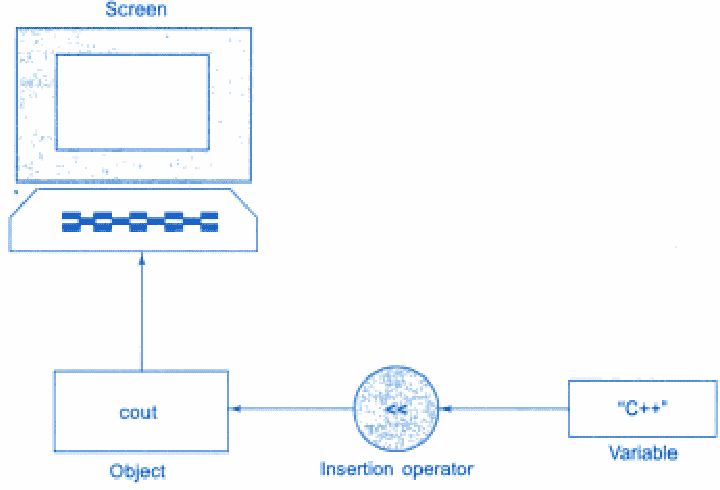

图 2.1 ⇔ 使用插入运算符输出

对象 `cout` 具有简单的接口。如果 `string` 表示一个字符串变量，则以下语句将显示其内容：

```
cout << string;
```

你可能记得运算符 `<<` 是按位左移运算符，它仍然可以用于此目的。这是一个运算符可以根据上下文用于不同目的的例子。这个概念被称为运算符重载，是多态性的一个重要方面。运算符重载将在第 7 章详细讨论。

需要注意的是，我们仍然可以使用 `printf()` 来显示输出。C++ 接受这种记法。然而，我们将使用 `cout <<` 以保持 C++ 的精神。

### iostream 文件

我们在程序中使用了以下 `#include` 指令：

```
#include <iostream>
```

该指令导致预处理器将 `iostream` 文件的内容添加到程序中。它包含标识符 `cout` 和运算符 `<<` 的声明。一些旧版本的 C++ 使用名为 `iostream.h` 的头文件。这是 ANSI C++ 引入的更改之一。（如果编译器不支持 ANSI C++ 特性，我们应该使用 `iostream.h`。）

头文件 `iostream` 应该包含在所有使用输入/输出语句的程序开头。请注意，头文件的命名约定可能有所不同。一些实现使用 `iostream.hpp`；还有一些使用 `iostream.hxx`。我们必须根据程序的内容和实现包含适当的头文件。

表 2.1 和表 2.2 提供了 C++ 程序中可能需要的 C++ 标准库头文件列表。带 `.h` 扩展名的头文件是“旧式”文件，应与旧编译器一起使用。表 2.1 还给出了应与 ANSI 标准编译器一起使用的这些文件的版本。

### 表 2.1 常用旧式头文件

| Header file | Contents and purpose | New version |

| `<assert.h>` | Contains macros and information for adding diagnostics that aid program debugging | `<cassert>` |

| `<ctype.h>` | Contains function prototypes for functions that test characters for certain properties, and function prototypes for functions that can be used to convert lowercase letters to uppercase letters and vice versa. | `<cctype>` |

| `<float.h>` | Contains the floating-point size limits of the system. | `<cfloat>` |

| `<limits.h>` | Contains the integral size limits of the system. | `<climits>` |

| `<math.h>` | Contains function prototypes for math library functions. | `<cmath>` |

| `<stdio.h>` | Contains function prototypes for the standard input/output library functions and information used by them. | `<cstdio>` |

| `<stdlib.h>` | Contains function prototypes for conversion of numbers to text, text to numbers, memory allocation, random numbers, and various other utility functions. | `<cstdlib>` |

| `<string.h>` | Contains function prototypes for C-style string processing functions. | `<cstring>` |

### 表 2.1 （续）

| Header file | Contents and purpose | New version |

|---|---|---|

| `<time.h>` | Contains function prototypes and types for manipulating the time and date. |  |

| `<iostream.h>` | Contains function prototypes for the standard input and standard output functions. | `<iostream>` |

| `<iomanip.h>` | Contains function prototypes for the stream manipulators that enable formatting of streams of data. | `<iomanip>` |

| `<fstream.h>` | Contains function prototypes for functions that perform input from files on disk and output to files on disk. | `<fstream>` |

### 表 2.2 ANSI C++ 中包含的新头文件

| Header file | Contents and purpose |

|---|---|

| `<utility>` | Contains classes and functions that are used by many standard library header files. |

| `<vector>`, `<list>`, `<deque>`, `<queue>`, `<set>`, `<map>`, `<stack>`, `<bitset>` | The header files contain classes that implement the standard library containers. Containers store data during a program's execution. We discuss these header files in Chapter 14. |

| `<functional>` | Contains classes and functions used by algorithms of the standard library. |

| `<memory>` | Contains classes and functions used by the standard library to allocate memory to the standard library containers. |

| `<iterator>` | Contains classes for manipulating data in the standard library containers. |

| `<algorithm>` | Contains functions for manipulating data in the standard library containers. |

| `<exception>`, `<stdexcept>` | These header files contain classes that are used for exception handling. |

| `<string>` | Contains the definition of class `string` from the standard library. Discussed in Chapter 15 |


| `<sstream>` | Contains function prototypes for functions that perform input from strings in memory and output to strings in memory. |

| `<locale>` | Contains classes and functions normally used by stream processing to process data in the natural form for different languages (e.g., monetary formats, sorting strings, character presentation, etc.) |

| `<limits>` | Contains a class for defining the numerical data type limits on each computer platform. |

| `<typeinfo>` | Contains classes for run-time type identification (determining data types at execution time). |

### 命名空间

命名空间是 ANSI C++ 标准委员会引入的一个新概念。它为程序中使用的标识符定义了一个作用域。为了使用命名空间作用域中定义的标识符，我们必须包含 `using` 指令，如

```
using namespace std;
```

这里，`std` 是 ANSI C++ 标准类库定义的命名空间。所有 ANSI C++ 程序都必须包含此指令。这会将 `std` 中定义的所有标识符带入当前全局作用域。`using` 和 `namespace` 是 C++ 的新关键字。命名空间将在第 16 章详细讨论。

### `main()` 的返回类型

在 C++ 中，`main()` 将整数类型值返回给操作系统。因此，每个 C++ 中的 `main()` 都应以 `return(0)` 语句结束；否则可能会出现警告或错误。由于 `main()` 返回整数类型值，`main()` 的返回类型明确指定为 `int`。请注意，C++ 中所有函数的默认返回类型为 `int`。以下没有类型和返回的 `main` 将会发出警告运行：

```
main()
{
      ......
      ......
}
```

## 2.4 更多 C++ 语句

让我们考虑一个稍微复杂一点的 C++ 程序。假设我们想从键盘读取两个数字并在屏幕上显示它们的平均值。完成此操作的 C++ 语句如程序 2.2 所示。


```
#include <iostream>

using namespace std;

int main()
{
    float number1, number2,
          sum, average;
```

(Contd)

**程序 2.2**

```cpp
cout << "Enter two numbers: ";    // prompt
cin >> number1;    // Reads numbers
cin >> number2;    // from keyboard

sum = number1 + number2;
average = sum/2;

cout << "Sum = " << sum << "\n";
cout << "Average = " << average << "\n";

return 0;
}
```

程序 2.2 的输出为：

```text
Enter two numbers:  6.5  7.5
Sum = 14
Average = 7
```

### 变量

程序中使用了四个变量 `number1`、`number2`、`sum` 和 `average`。它们由以下语句声明为 `float` 类型。

```cpp
float number1, number2, sum, average;
```

所有变量在程序中必须在使用之前进行声明。

### 输入运算符

语句

```cpp
cin >> number1;
```

是一条输入语句，它使程序等待用户键入一个数字。键入的数字被放入变量 `number1` 中。标识符 `cin`（读作“C in”）是 C++ 中预定义的对象，对应于标准输入流。在这里，该输入流代表键盘。

运算符 `>>` 被称为提取运算符或取值运算符。它从键盘提取（或取出）值并将其赋给其右侧的变量（图 2.2）。这对应于我们所熟悉的 `scanf()` 操作。与 `<<` 一样，运算符 `>>` 也可以被重载。

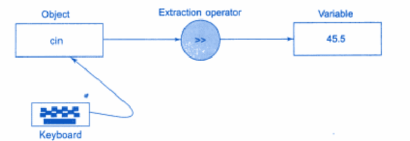

图 2.2 使用提取运算符进行输入

### I/O 运算符的级联

在前面两条打印结果的语句中，我们反复使用了插入运算符 `<<`。

语句

```cpp
cout << "Sum = " << sum << "\n";
```

首先将字符串 `"Sum = "` 发送给 `cout`，然后发送 `sum` 的值。最后，它发送换行符，以便下一个输出显示在新的一行。在一个语句中多次使用 `<<` 称为级联。当级联输出运算符时，我们应确保不同项之间有必要的空格。使用级联技术，最后两条语句可以合并如下：

```cpp
cout << "Sum = " << sum << "\n"
    << "Average = " << average << "\n";
```

这是一个语句，但提供了两行输出。如果你只需要一行输出，可以写成：

```cpp
cout << "Sum = " << sum << ", "
    << "Average = " << average << "\n";
```

输出将是：

```text
Sum = 14, Average = 7
```

我们也可以如下所示级联输入运算符 `>>`：

```cpp
cin >> number1 >> number2;
```

数值从左到右依次赋值。也就是说，如果我们键入两个值，例如 10 和 20，那么 10 将被赋给 `number1`，20 被赋给 `number2`。

## 2.5 一个使用类的示例

C++ 的主要特性之一是类。它们提供了一种将数据以及对数据进行操作的函数绑定在一起的方法。与 C 语言中的结构一样，类是用户自定义的数据类型。

程序 2.3 展示了在 C++ 程序中使用类的方法。

**程序 2.3**

**类的使用**

```cpp
#include <iostream>
using namespace std;
class person
{
    char name[30];
    int age;

    public:
        void getdata(void);
        void display(void);
};
void person :: getdata(void)
{
    cout << "Enter name: ";
    cin >> name;
    cout << "Enter age: ";
    cin >> age;
}
void person :: display(void)
{
    cout << "\nName: " << name;
    cout << "\nAge: " << age;
}

int main()
{
    person p;

    p.getdata();
    p.display();

    return 0;
}
```

程序 2.3 的输出为：

```text
Enter name: Ravinder
Enter age: 30

Name: Ravinder
Age: 30
```

> **注意：** `cin` 只能读取一个单词，因此我们不能使用带有空格的名称。

该程序将 `person` 定义为一种新的类数据类型。类 `person` 包含两个基本数据类型项和两个用于操作该数据的函数。这些函数被称为成员函数。主程序使用 `person` 来声明其类型的变量。如前所述，类变量被称为对象。这里，`p` 是 `person` 类型的一个对象。类对象被用来调用该类中定义的函数。关于类和对象的更多内容将在第 5 章讨论。

## 2.6 C++ 程序的结构

从程序 2.3 中可以看出，一个典型的 C++ 程序会包含如图 2.3 所示的四个部分。这些部分可以放在不同的代码文件中，然后独立编译或联合编译。

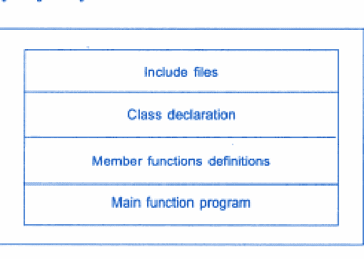

常见的做法是将程序组织成三个独立的文件。类声明放在头文件中，成员函数的定义放在另一个文件中。这种方法使程序员能够将接口的抽象规范（类定义）与实现细节（成员函数定义）分离开来。最后，使用该类的的主程序放在第三个文件中，该文件包含前两个文件以及其他任何需要的文件。

这种方法是基于图 2.4 所示的客户端-服务器模型的概念。包含成员函数的类定义构成了服务器，为称为客户端的主程序提供服务。客户端通过类的公共接口使用服务器。

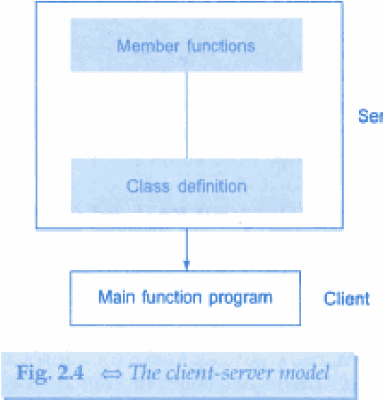

## 2.7 创建源文件

与 C 程序一样，C++ 程序可以使用任何文本编辑器来创建。例如，在 UNIX 上，我们可以使用 `vi` 或 `ed` 文本编辑器来创建和编辑源代码。在 DOS 系统上，我们可以使用 `edit` 或任何其他可用的编辑器，或在非文档模式下的字处理系统。

有些系统如 Turbo C++ 提供了用于开发和编辑程序的集成环境。详细信息应查阅相应的手册。

文件名应具有正确的文件扩展名，以表明它是一个 C++ 程序文件。C++ 实现使用诸如 `.c`、`.C`、`.cc`、`.cpp` 和 `.cxx` 等扩展名。Turbo C++ 和 Borland C++ 使用 `.c` 表示 C 程序，使用 `.cpp`（C plus plus）表示 C++ 程序。Zortech C++ 系统使用 `.cxx`，而 UNIX AT&T 版本使用 `.C`（大写 C）和 `.cc`。应查阅操作系统手册以确定要使用的正确文件扩展名。

## 2.8 编译和链接

编译和链接的过程再次取决于操作系统。本节讨论几种流行的系统。

### Unix AT&T C++

在 UNIX 下实现 C++ 程序的过程与 C 程序类似。我们应该使用“`CC`”（大写）命令来编译程序。记住，我们使用小写“`cc`”来编译 C 程序。命令

```sh
CC example.C
```

在 UNIX 提示符下会编译文件 `example.C` 中的 C++ 程序源代码。编译器将生成目标文件 `example.o`，然后自动与库函数链接，生成可执行文件。默认的可执行文件名是 `a.out`。

对于分布在多个文件中的程序，可以按如下方式编译：

```sh
CC file1.C file2.o
```

该语句只编译文件 `file1.C`，并将其与之前编译好的 `file2.o` 文件链接。当只需要修改其中一个文件时，这很有用。未修改的文件不必重新编译。

### Turbo C++ 和 Borland C++

Turbo C++ 和 Borland C++ 在 MS-DOS 下提供了一个集成的程序开发环境。它们提供了一个内置编辑器和一个菜单栏，其中包括 File、Edit、Compile 和 Run 等选项。

我们可以通过 File 选项创建和保存源文件，通过 Edit 选项编辑它们。然后可以通过 Compile 选项编译程序，并通过 Run 选项执行程序。Run 选项也可以在不编译源代码的情况下使用。在这种情况下，RUN 命令会使系统在一步之内编译、链接并运行程序。Turbo C++ 是最流行的编译器，在 Turbo C++ 系统下创建和执行程序的详细内容将在附录 B 中讨论。

### Visual C++

它是 Microsoft 为 C++ 提供的应用程序开发系统，可在 Windows 下运行。Visual C++ 是一个可视化编程环境，可以通过菜单选择、按钮、图标和其他预定义方法来选择基本程序组件。在 Windows 下开发和执行 C++ 程序的简要说明见附录 C。

## 小结

- C++ 是 C 语言的超集。

- C++ 为 C 语言增加了许多面向对象的特性，如对象、继承、函数重载和运算符重载。这些特性使构建的程序更清晰、可扩展且易于维护。

- C++ 可用于构建各种系统，如编辑器、编译器、数据库、通信系统，以及许多更复杂的现实应用系统。

- C++ 支持交互式输入和输出功能，并引入了一个新的注释符号 `//`，可用于单行注释。它还支持 C 风格的注释。

- 与 C 程序一样，所有 C++ 程序的执行都从 `main()` 函数开始，到 `return` 语句结束。所有使用输入/输出操作的程序都应在开头包含头文件 `iostream`。

- 所有 ANSI C++ 程序必须包含 `using namespace std` 指令。

- 一个典型的 C++ 程序包含四个基本部分，即，包含文件部分、类声明部分、成员函数部分和主函数部分。

- 与 C 程序一样，C++ 程序可以使用任何文本编辑器创建。

- 大多数编译器系统为开发和执行程序提供集成环境。流行的系统有 UNIX AT&T C++、Turbo C++ 和 Microsoft Visual C++。

## 关键术语

- `#include`

- `a.out`

- Borland C++

- cascading

- `cin`

- `class`

- client

- comments

- `cout`

- edlin

- extraction operator

- `float`

- free-form

- get from operator

- input operator

- insertion operator

- `int`

- `iostream`

- `iostream.h`

- keyboard

- `main()`

- member functions

- MS-DOS

- `namespace`

- object

- operating systems

- operator overloading

- output operator

- put to operator

- `return ()`

- screen

- server

- Simula67

- text editor

- Turbo C++

- Unix AT&T C++

- `using`

- Visual C++

- Windows

- Zortech C++

## 复习问题

2.1 判断以下陈述是 TRUE 还是 FALSE。

- (a) 由于 C 是 C++ 的子集，所有 C 程序都可以在 C++ 编译器下运行。

- (b) 在 C++ 中，包含在类中的函数称为成员函数。

- (c) 通过查看一两行代码，我们可以很容易地识别程序是用 C 还是 C++ 编写的。

- (d) 在 C++ 中，很容易向对象的现有结构添加新特性。

- (e) 使用一个运算符用于不同目的的概念称为运算符重载。

- (f) 输出函数 `printf()` 不能在 C++ 程序中使用。

2.2 为什么我们需要预处理器指令 `#include <iostream>` ？

2.3 C++ 中的 `main()` 函数与 C 中的 `main()` 有何不同？

2.4 与旧的 C 类型注释相比，你认为 C++ 中注释 `//` 的主要优点是什么？

2.5 描述 C++ 程序的主要部分。

## 调试练习

2.1 识别以下程序中的错误。

```cpp
#include <iostream.h>
void main()
{
int i=10, j=5;
int modResult=0;
int divResult=0;

modResult = i%j;
cout << modResult << " ";

divResult = i/modResult;
cout << divResult;
}
```

2.4 找出以下 C++ 语句中的错误，如有的话。

- (a) `cout << "x=" x;`

- (b) `m = 5; // n = 10; // s = m + n;`

- (c) `cin >>x; >>y;`

- (d) `cout << \n "Name:" << name;`

- (e) `cout <<"Enter value:"; cin >> x;`

- (f) `/*Addition*/ z = x + y;`

## 编程练习

2.1 编写一个程序，使用单个 `cout` 语句显示以下输出。

Maths = 90

Physics = 77

Chemistry = 69

2.2 编写一个程序从键盘读取两个数字并在屏幕上显示较大值。

2.3 编写一个程序从键盘输入一个整数值，并在屏幕上显示 "WELL DONE" 该次数。

2.4 编写一个程序读取 `a`、`b` 和 `c` 的值并显示 `x` 的值，其中

`x = a / b - c`

对以下值测试你的程序：

(a) `a = 250, b = 85, c = 25`

(b) `a = 300, b = 70, c = 70`

2.5 编写一个 C++ 程序，要求输入华氏温度并以摄氏度显示。

2.6 使用名为 `temp` 的类和成员函数重做练习 2.5。

# 3 标记、表达式和控制结构

## 关键概念

- Tokens

- Keywords

- Identifier

- Data types

- User-defined types

- Derived types

- Symbolic constants

- Declaration of variables

- Initialization

- Reference variables

- Type compatibility

- Scope resolution

- Dereferencing

- Memory management

- Formatting the output

- Type casting

- Constructing expressions

- Special assignment expressions

- Implicit conversion


- Operator overloading

- Control structures

## 3.1 引言

如前所述，C++ 是 C 的超集，因此 C 的大多数构造在 C++ 中都是合法的，其含义保持不变。然而，存在一些例外和新增内容。在本章中，我们将讨论这些例外和新增内容，涉及标记和控制结构。

## 3.2 标记

众所周知，程序中最小的独立单元称为标记。C++ 有以下标记：

- Keywords

- Identifiers

- Constants

- Strings

- Operators

C++ 程序使用这些标记、空白字符和语言的语法编写。大多数 C++ 标记基本上与 C 标记相似，只是有些新增和细微修改。

## 3.3 关键字

关键字实现了特定的 C++ 语言特性。它们是明确保留的标识符，不能用作程序变量或其他用户定义程序元素的名称。

表 3.1 给出了完整的 C++ 关键字集合。其中许多与 C 共同。ANSI C 关键字以粗体显示。为了增强其特性和使其成为面向对象的语言，在 ANSI C 关键字的基础上添加了额外的关键字。ANSI C++ 标准委员会又添加了一些关键字以使语言更通用。这些单独显示。所有 C++ 关键字的含义和用途在附录 D 中给出。

## 3.4 标识符和常量

标识符指的是程序员创建的变量、函数、数组、类等的名称。它们是任何语言的基本要求。每种语言都有自己的命名规则。以下规则适用于 C 和 C++：

- 仅允许使用字母字符、数字和下划线。

- 名称不能以数字开头。

- 大写和小写字母是不同的。

- 已声明的关键字不能用作变量名。

C 与 C++ 的一个主要区别是名称长度的限制。虽然 ANSI C 仅识别名称中的前 32 个字符，但 ANSI C++ 对其长度没有限制，因此名称中的所有字符都有效。

在命名由包含 C 和 C++ 程序的多个文件共享的变量时应谨慎。某些操作系统对此类变量名的长度有限制。

常量指的是在程序执行期间不改变的固定值。

像 C 一样，C++ 支持几种类型的字面常量。它们包括整数、字符、浮点数和字符串。字面常量没有内存位置。示例：

```
123                // decimal integer
12.34              // floating point integer
037                // octal integer
0X2                // hexadecimal integer
"C++"             // string constant
'A'                // character constant
L'ab'              // wide-character constant
```

`wchar_t` 类型是 ANSI C++ 引入的宽字符字面量， intended for character sets that cannot fit a character into a single byte. 宽字符字面量以字母 `L` 开头。

**Table 3.1 C++ keywords**

|    |    |    |    |

|----|----|----|----|

| asm | double | new | switch |

| auto | else | operator | template |

| break | enum | private | this |

| case | extern | protected | throw |

| catch | float | public | try |

| char | for | register | typedef |

| class | friend | return | union |

| const | goto | short | unsigned |

| continue | if | signed | virtual |

| default | inline | sizeof | void |

| delete | int | static | volatile |

| do | long | struct | while |

| Added by ANSI C++ |  |  |  |

| bool | export | reinterpret_cast | typename |

| const_cast | false | static_cast | using |

| dynamic_cast | mutable | true | wchar_t |

| explicit | namespace | typeid |  |

Note: The ANSI C keywords are shown in bold face.

C++ 也识别 C 中可用的所有反斜杠字符常量。

> note
>
> C++ 支持两种字符串表示形式——C 风格的字符字符串和随标准 C++ 引入的字符串类类型。虽然推荐使用字符串类类型，但在某些情况下了解并使用 C 风格字符串是明智的。字符串类类型字符串支持许多特性，并在第 15 章中详细讨论。

## 3.5 基本数据类型

C++ 中的数据类型可归类为如图 3.1 所示的各种类别。

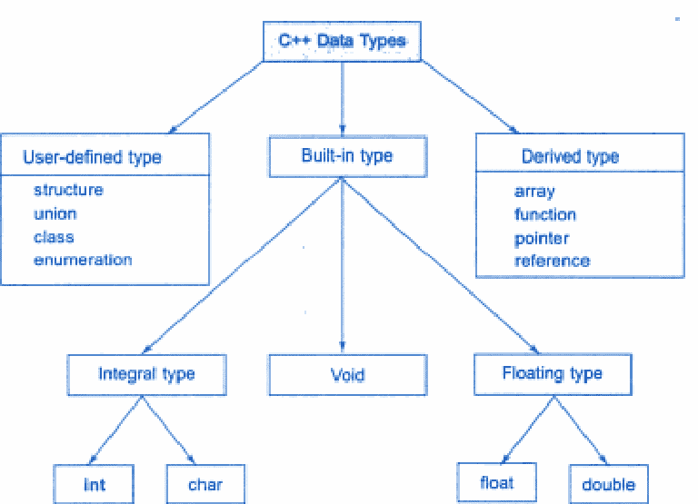

图 3.1 ⇔ C++ 数据类型的层次结构

C 和 C++ 编译器都支持所有内置的（也称为基本或基本）数据类型。除 `void` 外，基本数据类型前面可以有多个修饰符以满足各种情况的需求。修饰符 `signed`、`unsigned`、`long` 和 `short` 可应用于字符和整数基本数据类型。然而，修饰符 `long` 也可应用于 `double`。C++ 中的数据类型表示是机器相关的。表 3.2 列出了 16 位字机器上所有基本数据类型和修饰符的组合及其大小和范围。

### 表 3.2 C++ 基本数据类型的大小和范围

| Type | Bytes | Range |

|---|---:|---|

| char | 1 | −128 to 127 |

| unsigned char | 1 | 0 to 255 |

| signed char | 1 | −128 to 127 |

| int | 2 | −32768 to 32767 |

| unsigned int | 2 | 0 to 65535 |

| signed int | 2 | −32768 to 32767 |

| short int | 2 | −32768 to 32767 |

| unsigned short int | 2 | 0 to 65535 |

| signed short int | 2 | −32768 to 32767 |

| long int | 4 | −2147483648 to 2147483647 |

| signed long int | 4 | −2147483648 to 2147483647 |

| unsigned long int | 4 | 0 to 4294967295 |

| float | 4 | 3.4E−38 to 3.4E+38 |

| double | 8 | 1.7E−308 to 1.7E+308 |

| long double | 10 | 3.4E−4932 to 1.1E+4932 |

ANSI C++ 委员会添加了另外两种数据类型，`bool` 和 `wchar_t`。它们在第 16 章中讨论。

类型 `void` 在 ANSI C 中引入。`void` 的两种正常用途是（1）指定函数返回类型时它不返回任何值，以及（2）表示函数为空参数列表。示例：

```
void funct1(void);
```

`void` 的另一个有趣用途是在通用指针的声明中。示例：

```
void *gp;        // gp becomes generic pointer
```

通用指针可以分配任何基本数据类型的指针值，但不能被解引用。例如，

```
int *ip;          // int pointer
gp = ip;          // assign int pointer to void pointer
```

是有效的语句。但语句，

```
*ip = *gp;
```

是非法的。对 `void` 值的指针进行解引用是没有意义的。

在 C++ 和 ANSI C 中，都允许在不使用强制转换的情况下将任何指针类型分配给 `void` 指针。在 ANSI C 中，我们也可以在不使用强制转换到非 `void` 指针类型的情况下将 `void` 指针分配给非 `void` 指针。这在 C++ 中不允许。例如，

```
void *ptr1;
char *ptr2;
ptr2 = ptr1;
```

在 ANSI C 中都是有效语句，但在 C++ 中不是。`void` 指针不能直接分配给 C++ 中的其他类型指针。我们需要使用强制转换运算符，如下所示：

```
ptr2 = (char *)ptr1;
```

## 3.6 用户定义数据类型

### 结构和类

我们在 C 中使用过 `struct` 和 `union` 等用户定义数据类型。虽然这些数据类型在 C++ 中合法，但添加了一些功能使其适合面向对象编程。C++ 还允许我们定义另一种用户定义数据类型，即类，可像任何其他基本数据类型一样用于声明变量。类变量称为对象，是面向对象编程的中心焦点。关于这些数据类型的更多内容将在第 5 章中讨论。

### 枚举数据类型

枚举数据类型是另一种用户定义类型，它提供了一种将名称附加到数字的方法，从而提高代码的可理解性。`enum` 关键字（来自 C）通过为其分配值 0、1、2 等自动枚举一组单词。此功能提供了一种创建符号常量的替代方法。`enum` 语句的语法与 `struct` 语句相似。示例：

```
enum shape{circle, square, triangle};
enum colour{red, blue, green, yellow};
enum position{off, on};
```

与 ANSI C 相比，C++ 中的枚举数据类型略有不同。在 C++ 中，标签名 `shape`、`colour` 和 `position` 成为新的类型名。通过使用这些标签名，我们可以声明新变量。示例：

```
shape ellipse;    // ellipse is of type shape
colour background;    // background is of type colour
```

ANSI C 定义枚举的类型为 `int`。在 C++ 中，每个枚举数据类型保留其自己的单独类型。这意味着 C++ 不允许 `int` 值自动转换为 `enum` 值。示例：

```
colour background = blue;    // allowed
colour background = 7;       // Error in C++
colour background = (colour) 7;    // OK
```

然而，枚举值可以用在 `int` 值的位置。

```
int c = red;    // valid, colour type promoted to int
```

默认情况下，枚举器被分配从第一个枚举器开始的整数值 0、第二个枚举器为 1，依此类推。我们可以通过显式为枚举器分配整数值来覆盖默认值。例如，

```
enum colour{red, blue=4, green=8};
enum colour{red=5, blue, green};
```

是有效的定义。在第一种情况下，`red` 默认值为 0。在第二种情况下，`blue` 为 6，`green` 为 7。请注意，后续初始化的枚举器比其前任大一。

C++ 还允许创建匿名枚举（即没有标签名的枚举）。示例：

```
enum{off, on};
```

这里，`off` 为 0，`on` 为 1。这些常量可以像常规常量一样引用。示例：

```
int switch_1 = off;
int switch_2 = on;
```

在实践中，枚举用于为 `switch` 语句定义符号常量。示例：

```
enum shape
{
    circle,
    rectangle,
    triangle
};

int main()
{
    cout << "Enter shape code:";
    int code;
    cin >> code;
    while(code >= circle && code <= triangle)
    {
        switch(code)
        {
            case circle:
                .....
                .....
                break;
            case rectangle:
                .....
                .....
                break;
            case triangle:
                .....
                .....
                break;
        }
        cout << "Enter shape code:";
        cin >> code;
    }
    cout << "BYE \n";
    return 0;
}
```

ANSI C 允许在结构或类中定义枚举，但枚举是全局可见的。在 C++ 中，在类（或结构）内定义的枚举仅对该类（或结构）本地。

## 3.7 派生数据类型

### 数组

C++ 中数组的应用与 C 中相似。唯一的例外是字符数组初始化的方式。在 ANSI C 中初始化字符数组时，编译器允许我们将数组大小声明为字符串常量的确切长度。例如，

```
char string[3] = "xyz";
```

在 ANSI C 中有效。它假设程序员打算在定义中省略空字符 `\0`。但在 C++ 中，大小应比字符串中的字符数大一。

```
char string[4] = "xyz"; // O.K. for C++
```

### 函数

函数在 C++ 中发生了重大变化。虽然其中一些变化很简单，但其他变化需要在组织程序时采用新的思维方式。其中许多修改和改进是由 C++ 面向对象概念的要求驱动的。其中一些是为了使 C++ 程序更可靠和可读而引入的。C++ 函数的所有特性将在第 4 章中讨论。

### 指针

指针的声明和初始化与 C 中相同。示例：

```
int *ip;        // int pointer
ip = &x;        // address of x assigned to ip
*ip = 10;       // 10 assigned to x through indirection
```

C++ 增加了常量指针和指向常量的指针的概念。

```
char * const ptr1 = "GOOD";   // constant pointer
```

我们不能修改 `ptr1` 被初始化为的地址。

```
int const * ptr2 = &m;  // pointer to a constant
```

`ptr2` 被声明为指向常量的指针。它可以指向任何正确类型的变量，但它所指向的内容不能被更改。

我们也可以按以下方式同时声明指针和变量为常量：

```
const char * const cp = "xyz";
```

此语句将 `cp` 声明为指向字符串的常量指针，该字符串已被声明为常量。在这种情况下，既不能更改分配给指针 `cp` 的地址，也不能更改它所指向的内容。

指针在 C++ 中被广泛用于内存管理和实现多态。

## 3.8 符号常量

在 C++ 中创建符号常量有两种方法：

- 使用限定符 `const`，以及

- 使用 `enum` 关键字定义一组整数常量。

在 C 和 C++ 中，任何声明为 `const` 的值都不能以任何方式被程序修改。然而，实现上存在一些差异。在 C++ 中，我们可以使用 `const` 在常量表达式中，例如

```
const int size = 10;
char name[size];
```

这在 C 中是非法的。`const` 允许我们创建类型化的常量，而不必使用 `#define` 来创建没有类型信息的常量。

与 `long` 和 `short` 类似，如果我们仅使用 `const` 修饰符，它默认为 `int`。例如，

```
const size = 10;
```

意味着

```
const int size = 10;
```

命名常量就像变量一样，只是它们的值不能被更改。

C++ 要求 `const` 必须被初始化。ANSI C 不要求初始化器；如果没有给出，则将其初始化为 0。

`const` 值的作用域不同。C++ 中的 `const` 默认具有内部链接，因此它仅限于声明它的文件。在 ANSI C 中，`const` 值本质上是全局的。它们在声明它们的文件之外可见。但是，可以通过将它们声明为 `static` 使其成为局部变量。要为 `const` 值赋予外部链接，以便可以从另一个文件引用它，我们必须在 C++ 中显式将其定义为 `extern`。示例：

```
extern const total = 100;
```

命名整数常量的另一种方法是使用枚举，如下所示：

```
enum {X,Y,Z};
```

这将 `X`、`Y` 和 `Z` 定义为整数常量，其值分别为 0、1 和 2。这等价于：

```
const X = 0;
const Y = 1;
const Z = 2;
```

我们也可以显式地为 `X`、`Y` 和 `Z` 分配值。示例：

```
enum{X=100, Y=50, Z=200};
```

此类值可以是任意整数值。枚举数据类型已在第 3.6 节中详细讨论。

## 3.9 类型兼容性


与 C 相比，C++ 对类型兼容性非常严格。例如，C++ 将 `int`、`short int` 和 `long int` 定义为三种不同的类型。当它们的值相互赋值时，必须进行强制转换。同样，`unsigned char`、`char` 和 `signed char` 被视为不同的类型，尽管每个的大小都是一个字节。在 C++ 中，值的类型必须相同才能完全兼容，否则必须应用强制转换。C++ 中的这些限制是必要的，以便支持函数重载，其中两个同名函数使用函数参数的类型来区分。

另一个显著的区别是 `char` 常量存储的方式。在 C 中，它们存储为 `int`，因此，

```
sizeof ('x')
```

等价于

```
sizeof(int)
```

在 C 中。在 C++ 中，`char` 不会提升到 `int` 的大小，因此

```
sizeof('x')
```

等于

```
sizeof(char)
```

## 3.10 变量声明

我们知道，在 C 中，所有变量必须在可执行语句中使用之前声明。这在 C++ 中也是正确的。然而，C 和 C++ 在程序中声明位置方面存在显著差异。C 要求所有变量都必须在作用域开始处定义。当我们阅读 C 程序时，我们通常会在每个作用域级别的开头看到一组变量声明。它们的实际使用出现在作用域的其他地方，有时远离声明的位置。在使用变量之前，我们必须回到程序的开头，查看它是否已被声明，如果已声明，其类型是什么。

C++ 允许在作用域中的任何位置声明变量。这意味着变量可以在首次使用时立即声明。这使得程序更容易编写，并减少了因来回扫描而可能产生的错误。它还使程序更容易理解，因为变量是在其使用的上下文中声明的。

下面的示例说明了这一点。

```
int main()
{
    float x;                // declaration
    float sum = 0;

    for(int i=1; i<5; i++)  // declaration
    {
        cin >> x;
        sum = sum +x;
    }
    float average;          // declaration
    average = sum/(i-1);
    cout << average;

    return 0;
}
```

这种声明方式的唯一缺点是，我们无法一眼看出作用域中使用的所有变量。

## 3.11 变量的动态初始化

在 C 中，变量必须使用常量表达式初始化，并且 C 编译器会在编译时修复初始化代码。C++，然而，允许在运行时初始化变量。这被称为动态初始化。在 C++ 中，变量可以在声明位置使用表达式在运行时初始化。例如，以下是有效的初始化语句：

```
.....
.....
int n = strlen(string);
.....
float area = 3.14159 * rad * rad;
```

因此，变量的声明和初始化可以在变量首次使用时同时完成。上一节示例中的以下两个语句

```
float average; // declare where it is necessary
average = sum/i;
```

可以合并为单个语句：

```
float average = sum/i; // initialize dynamically at run time
```

动态初始化在面向对象编程中被广泛使用。我们可以使用仅在运行时才知道的信息创建所需类型的对象。

## 3.12 引用变量

C++ 引入了一种新的变量类型，称为引用变量。引用变量为先前定义的变量提供别名（替代名称）。例如，如果我们使变量 `sum` 成为变量 `total` 的引用，那么 `sum` 和 `total` 可以互换使用来表示该变量。引用变量的创建方式如下：

```
data-type & reference-name = variable-name
```

示例：

```
float total = 100;
float & sum = total;
```

`total` 是一个已声明的 `float` 类型变量；`sum` 是声明为表示变量 `total` 的替代名称。两个变量都引用内存中的同一个数据对象。现在，语句 `cout << total;` 和 `cout << sum;` 都打印值 100。语句 `total = total + 10;` 会将 `total` 和 `sum` 的值都更改为 110。同样，赋值 `sum = 0;` 会将两个变量的值都更改为零。

引用变量必须在声明时初始化。这建立了引用与其命名的对象之间的对应关系。需要注意的是，引用变量的初始化与对其的赋值完全不同。

C++ 为符号 `&` 赋予了额外的含义。这里，`&` 不是地址运算符。记号 `float &` 表示对 `float` 的引用。其他示例是：

```
int n[10];
int & x = n[10];      // x is alias for n[10]
char & a = '\n';      // initialize reference to a literal
```

变量 `x` 是数组元素 `n[10]` 的替代。变量 `a` 初始化为换行常量。这创建了对换行常量 `\n` 存储的否则未知位置的引用。

以下引用也是允许的：

- i. `int x;`

  `int *p = &x;`

  `int & m = *p;`

- ii. `int & n = 50;`

第一组声明导致 `m` 引用由指针 `p` 指向的 `x`，而语句 (ii) 创建了一个值为 50 且名为 `n` 的 `int` 对象。

引用变量的一个主要应用是在向函数传递参数时。考虑以下内容：

```
void f(int & x)      // uses reference
{
    x = x+10;         // x is incremented; so also m
}
int main()
{
    int m = 10;
    f(m);             // function call
    .....
    .....
}
```

当执行函数调用 `f(m)` 时，会发生以下初始化：

```
int & x = m;
```

因此 `x` 在执行语句 `f(m);` 之后成为 `m` 的别名。这种函数调用被称为按引用调用。这种实现如图 3.2 所示。由于变量 `x` 和 `m` 是别名，当函数递增 `x` 时，`m` 也会被递增。`m` 的值在函数执行后变为 20。在传统的 C 中，我们使用指针和解引用技术完成此操作。

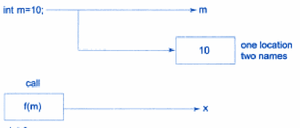

按引用调用机制在面向对象编程中很有用，因为它允许通过引用操作对象，并消除了对象参数的来回复制。还需要注意的是，引用不仅可以为内置数据类型创建，也可以为用户定义的数据类型（如结构和类）创建。引用与这些用户定义的数据类型配合得非常好。

## 3.13 C++ 中的运算符

C++ 拥有丰富的运算符集。所有 C 运算符在 C++ 中也有效。此外，C++ 还引入了一些新运算符。我们已经看到了两个这样的运算符，即插入运算符 `<<` 和提取运算符 `>>`。其他新运算符有：

- `::` 作用域解析运算符
- `::*` 指向成员声明符
- `->*` 指向成员运算符
- `.*` 指向成员运算符
- `delete` 内存释放运算符
- `endl` 换行运算符
- `new` 内存分配运算符
- `setw` 字段宽度运算符

此外，C++ 还允许我们为某些内置运算符提供新的定义。也就是说，我们可以根据使用的参数类型为运算符赋予多种含义。此过程称为运算符重载。

## 3.14 作用域解析运算符

像 C 一样，C++ 也是一个块结构语言。块和作用域可以用于构造程序。我们知道同一个变量名可以在不同的块中具有不同的含义。变量的作用域从其声明点延伸到包含该声明的块的末尾。在一个块内声明的变量被称为该块的局部变量。考虑以下程序段：

```
....
....
{
    int x = 10;
    ....
    ....
}
....
....
{
    int x = 1;
    ....
    ....
}
```

两个 `x` 的声明引用了包含不同值的两个不同的内存位置。第二块中的语句不能引用第一块中声明的变量 `x`，反之亦然。C++ 中的块通常是嵌套的。例如，以下风格很常见：

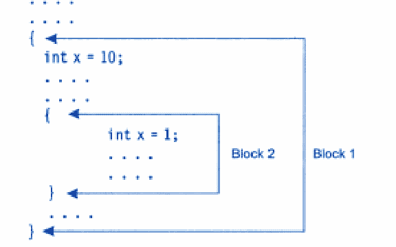

Block2 包含在 block1 中。请注意，内部块中的声明会隐藏外部块中同名变量的声明，因此，每个 `x` 的声明都会使其引用不同的数据对象。在内部块内，变量 `x` 将引用其中声明的数据对象。

在 C 中，变量的全局版本在内部块中无法访问。C++ 通过引入一个新的运算符 `::` 来解决这个问题，称为作用域解析运算符。它可用于揭露隐藏的变量。其形式如下：

```
:: variable-name
```

该运算符允许访问变量的全局版本。例如，`::count` 表示变量 `count` 的全局版本（而不是该块中声明的局部变量 `count`）。程序 3.1 演示了此功能：

```cpp
#include <iostream>

using namespace std;
int n = 10;        // global n

int main()
{
        int n = 20;    // n redeclared, local to main
        {
                int k = n;
                int n = 30;    // n declared again
                              // local to inner block

                cout << "We are in inner block\n";
                cout << "k = " << k << "\n";
                cout << "n = " << n << "\n";
                cout << "::n = " << ::n << "\n";
        }

        cout << "\nWe are in outer block\n";
        cout << "n = " << n << "\n";
        cout << "::n = " << ::n << "\n";

        return 0;
}
```

程序 3.1 的输出为：

```text
We are in inner block:
k = 20
n = 30
::n = 10

We are in outer block
n = 20
::n = 10
```

在上面的程序中，变量 `n` 在三个地方声明，即在 `main()` 函数外部、在 `main()` 内部以及在内部块内部。

> note

> 需要注意的是 `::n` 将始终引用全局 `n`。在内部块中，`::n` 引用值 10 而不是 20。

作用域解析运算符的一个主要应用是在类中标识成员函数所属的类。这将在介绍类时详细讨论。

## 3.15 成员解引用运算符

如你所知，C++ 允许我们定义一个包含各种类型的数据和函数的成员的类。C++ 还允许我们通过指针访问类的成员。为了实现这一点，C++ 提供了一组三个指针到成员运算符。表 3.3 显示了这些运算符及其功能。

### 表 3.3 成员解引用运算符

| Operator | Function |
| --- | --- |
| `::*` | To declare a pointer to a member of a class |
| `*` | To access a member using object name and a pointer to that member |
| `->*` | To access a member using a pointer to the object and a pointer to that member |

只有在讨论完类之后，这些运算符的进一步细节才有意义，因此我们将成员解引用运算符的使用推迟到那时。

## 3.16 内存管理运算符

C 使用 `malloc()` 和 `calloc()` 函数在运行时动态分配内存。同样，它使用 `free()` 函数释放动态分配的内存。我们在事先不知道需要多少内存空间时使用动态分配技术。虽然 C++ 支持这些函数，但它还定义了两个一元运算符 `new` 和 `delete`，它们以更好、更简单的方式执行分配和释放内存的任务。由于这些运算符操作的是自由存储区上的内存，因此也被称为自由存储运算符。

对象可以使用 `new` 创建，并使用 `delete` 销毁，按需进行。用 `new` 在块内创建的数据对象，将一直存在，直到使用 `delete` 显式销毁为止。因此，对象的生命周期完全在我们的控制之下，与程序的块结构无关。

`new` 运算符可用于创建任何类型的对象。其一般形式为：

```
pointer-variable = new data-type;
```

这里，`pointer-variable` 是 `data-type` 类型的指针。`new` 运算符分配足够的内存来保存 `data-type` 类型的数据对象，并返回该对象的地址。`data-type` 可以是任何有效的数据类型。`pointer-variable` 持有已分配内存空间的地址。示例：

```
p = new int;
q = new float;
```

其中 `p` 是 `int` 类型的指针，`q` 是 `float` 类型的指针。这里，`p` 和 `q` 必须已声明为适当类型的指针。或者，我们可以按如下方式合并指针的声明和赋值：

```
int *p = new int;
float *q = new float;
```

随后，语句

```
*p = 25;
*q = 7.5;
```

将 25 分配给新创建的 `int` 对象，将 7.5 分配给 `float` 对象。

我们也可以使用 `new` 运算符初始化内存。这按如下方式完成：

```
pointer-variable = new data-type(value);
```

这里，`value` 指定初始值。示例：

```
int *p = new int(25);
float *q = new float(7.5);
```

如前所述，`new` 可用于为任何数据类型创建内存空间，包括用户定义的类型，如数组、结构和类。一维数组的一般形式为：

```
pointer-variable = new data-type[size];
```

这里，`size` 指定数组中的元素数。例如，语句

```
int *p = new int[10];
```

为 10 个整数的数组创建内存空间。`p[0]` 将引用第一个元素，`p[1]` 引用第二个元素，以此类推。

使用 `new` 创建多维数组时，必须提供所有数组大小。

```
array_ptr = new int[3][5][4];   // legal
array_ptr = new int[m][5][4];   // legal
array_ptr = new int[3][5][ ];   // illegal
array_ptr = new int[ ][5][4];   // illegal
```

第一个维度可以是其值在运行时提供的变量，其余的必须是常量。

`new` 对类对象的应用将在第 6 章中讨论。

当数据对象不再需要时，它会被销毁以释放内存空间供重用。其使用的一般形式为：

```
delete pointer-variable;
```

`pointer-variable` 是指向用 `new` 创建的数据对象的指针。示例：

```
delete p;
delete q;
```

如果我们想释放动态分配的数组，必须使用 `delete` 的以下形式：

```
delete [size] pointer-variable;
```

`size` 指定要释放的数组中的元素数。这个形式的问题在于程序员应该记住数组的大小。C++ 的最新版本不需要指定大小。例如，

```
delete [ ]p;
```

将删除 `p` 所指向的整个数组。

如果没有足够的内存进行分配会发生什么？在这种情况下，像 `malloc()` 一样，`new` 返回空指针。因此，在使用 `new` 产生的指针之前检查它是个好主意。做法如下：

```
....
....
p = new int;
if(!p)
{
  cout << "allocation failed \n";
}
....
....
```

`new` 运算符相对于 `malloc()` 函数具有以下优点。

1. 它自动计算数据对象的大小。我们无需使用 `sizeof` 运算符。
2. 它自动返回正确的指针类型，因此无需使用类型转换。
3. 在创建内存空间时，可以初始化对象。
4. 与任何其他运算符一样，`new` 和 `delete` 可以被重载。

## 3.17 操纵符

操纵符是用于格式化数据显示的运算符。最常用的操纵符是 `endl` 和 `setw`。

`endl` 操纵符在使用输出语句时，会导致插入换行。它与使用换行符 `"\n"` 具有相同的效果。例如，语句

```
....
....
cout << "m = " << m << endl
    << "n = " << n << endl
    << "p = " << p << endl;
....
....
```

将导致三个输出行，每个变量一行。如果我们假设变量的值分别为 2597、14 和 175，则输出将如下所示：

```
m = 2 5 9 7
n = 1 4
p = 1 7 5
```

需要注意的是，这种形式并不是理想的输出。它应该更像下面这样：

```
m = 2597
n = 14
p = 175
```


这里，数字是右对齐的。只有当我们能为所有数字指定一个共同的字段宽度并强制它们右对齐打印时，才可能实现这种输出形式。`setw` 操纵符完成这项工作。用法如下：

```
cout << setw(5) << sum << endl;
```

操纵符 `setw(5)` 为打印变量 `sum` 的值指定字段宽度为 5。该值在字段内右对齐，如下所示：

□ □ 3 4 5

程序 3.2 说明了 `endl` 和 `setw` 的使用。

### USE OF MANIPULATORS

```
#include <iostream>
#include <iomanip>  // for setw

using namespace std;

int main()
{
    int Basic = 950, Allowance = 95, Total = 1045;

    cout << setw(10) << "Basic" << setw(10) << Basic << endl
         << setw(10) << "Allowance" << setw(10) << Allowance << endl
         << setw(10) << "Total" << setw(10) << Total << endl;

    return 0;
}
```

PROGRAM 3.2

该程序的输出如下所示：

```
Basic       950
Allowance    95
Total      1045
```

> 字符字符串也以右对齐方式打印。

我们也可以按如下方式编写自己的操纵符：

```
#include <iostream>
ostream & symbol(ostream & output)
{
    return output << "\\TRS";
}
```

`symbol` 是新的操纵符，它代表 `Rs`。标识符 `symbol` 可在我们需要显示字符串 `Rs` 时使用。

## 3.18 Type Cast Operator

C++ 允许使用类型转换运算符对变量或表达式进行显式类型转换。

C 传统的强制转换在 C++ 中通过函数调用记法作为语法替代得到增强。以下两个版本是等价的：

```
(type-name) expression  // C notation
type-name (expression)  // C++ notation
```

示例：

```
average = sum/(float)i; // C notation
average = sum/float(i); // C++ notation
```

类型名就好像是一个用于将值转换为指定类型的函数。函数调用记法通常能得到最简单的表达式。然而，它只能在类型为标识符时使用。例如，

```
p = int * (q);
```

是非法的。在这种情况下，我们必须使用 C 类型记法。

```
p = (int *) q;
```

或者，我们可以使用 `typedef` 创建所需类型的标识符，并在函数记法中使用它。

```
typedef int * int_pt;
p = int_pt(q);
```

ANSI C++ 增加了以下新的转换运算符：

+ `const_cast`
+ `static_cast`
+ `dynamic_cast`
+ `reinterpret_cast`

这些运算符的应用在第 16 章中讨论。

## 3.19 Expressions and Their Types

表达式是按语言规则排列的运算符、常量和变量的组合。它还可能包含返回值的函数调用。表达式可能由一个或多个操作数和零个或多个运算符组成以产生一个值。表达式可以是以下七种类型之一：

+ 常量表达式
+ 整数表达式
+ 浮点表达式
+ 指针表达式
+ 关系表达式
+ 逻辑表达式
+ 按位表达式

表达式还可以使用上述表达式的组合。这种表达式称为 `复合表达式`。

### Constant Expressions

常量表达式仅由常量值组成。示例：

```
15
20 + 5 / 2.0
'x'
```

### Integral Expressions

整数表达式是在执行所有自动和显式类型转换后产生整数结果的表达式。示例：

```
m
m * n - 5
m * 'x'
5 + int(2.0)
```

其中 `m` 和 `n` 是整数变量。

### Float Expressions

浮点表达式是在所有转换后产生浮点结果的表达式。示例：

```
x + y
x * y / 10
5 + float(10)
10.75
```

其中 `x` 和 `y` 是浮点变量。

### Pointer Expressions

指针表达式产生地址值。示例：

```
&m
ptr
ptr + 1
"xyz"
```

其中 `m` 是一个变量，`ptr` 是一个指针。

### Relational Expressions

关系表达式产生类型为 `bool` 的结果，其取值为 `true` 或 `false`。示例：

```
x <= y
a+b == c+d
m+n > 100
```

当算术表达式用于关系运算符的两侧时，它们会先被求值，然后再比较结果。关系表达式也称为布尔表达式。

### Logical Expressions

逻辑表达式组合两个或多个关系表达式并产生 `bool` 类型结果。示例：

```
a>b && x==10
x==10 || y==5
```

### Bitwise Expressions

按位表达式用于在位级别操作数据。它们主要用于测试或移位位。示例：

```
x << 3    // Shift three bit position to left
y >> 1    // Shift one bit position to right
```

移位运算符通常用于乘以或除以 2 的幂。

ANSI C++ 引入了所谓的运算符关键字，可用作运算符符号的替代表示。运算符关键字在第 16 章给出。

## 3.20 Special Assignment Expressions

### Chained Assignment

```
x = (y = 10);
    or
x = y = 10;
```

首先将 10 赋给 `y`，然后赋给 `x`。

链式语句不能在声明时用于初始化变量。例如，语句

```
float a = b = 12.34;    // wrong
```

是非法的。这可以写成

```
float a=12.34, b=12.34    // correct
```

### Embedded Assignment

```
x = (y = 50) + 10;
```

`(y = 50)` 是一个赋值表达式，称为嵌入赋值。这里，值 50 被赋给 `y`，然后结果 50+10 = 60 被赋给 `x`。该语句等同于

```
y = 50;
x = y + 10;
```

### Compound Assignment

像 C 一样，C++ 支持复合赋值运算符，它是赋值运算符与二元算术运算符的组合。例如，简单的赋值语句

```
x = x + 10;
```

可以写成

```
x += 10;
```

运算符 `+=` 称为复合赋值运算符或简写赋值运算符。复合赋值运算符的一般形式为：

```
variable1 op= variable2;
```

其中 `op` 是一个二元算术运算符。这意味着

```
variable1 = variable1 op variable2;
```

## 3.21 Implicit Conversions

我们可以在表达式中混合数据类型。例如，

```
m = 5+2.75;
```

是一个有效的语句。每当在表达式中混合数据类型时，C++ 都会自动执行转换。此过程称为隐式或自动转换。

当编译器遇到一个表达式时，它将表达式分为由一个运算符和一个或两个操作数组成的子表达式。对于二元运算符，如果操作数类型不同，编译器会将其中一个转换为匹配另一个，使用规则将较小的类型转换为较宽的类型。例如，如果一个操作数是 `int`，另一个是 `float`，则 `int` 会被转换为 `float`，因为 `float` 比 `int` 更宽。图 3.3 所示的“瀑布”模型说明了此规则。

## 3.22 Operator Overloading

如前所述，重载意味着根据上下文为操作赋予不同的含义。C++ 允许运算符重载，从而使我们能够为运算符赋予多重含义。实际上，我们在 C 中也使用了重载的概念。例如，运算符 `*` 当应用于指针变量时，给出指针指向的值。但它也常用于乘以两个数字。操作数的数量和类型决定了要执行的操作的性质。

输入/输出运算符 `<<` 和 `>>` 是运算符重载的良好示例。虽然 `<<` 运算符的内置定义是用于位移位，但它也用于显示各种数据类型的数值。这是通过头文件 `iostream` 实现的，其中包含大量 `<<` 的重载定义。因此，语句

```
cout << 75.86;
```

调用用于显示 `double` 类型值的定义，而

```
cout << "well done";
```

调用用于显示 `char` 值的定义。然而，`iostream` 中的这些定义不会影响运算符的内置含义。

同样，我们可以为其他 C++ 运算符定义额外的含义。例如，我们可以定义 `+` 运算符来添加两个结构或对象。几乎所有 C++ 运算符都可以被重载，少数例外如成员访问运算符 (`.` 和 `.*`)、条件运算符 (`?:`)、作用域解析运算符 (`::`) 和 `sizeof` 运算符。运算符重载的定义在第 7 章中详细讨论。

## 3.23 Operator Precedence

尽管 C++ 使我们能够为运算符添加多重含义，但它们的关联性和优先级仍然保持不变。例如，乘法运算符的优先级仍高于加法运算符。表 3.5 给出了所有 C++ 运算符的优先级和结合性。组是按优先级递减的顺序列出的。标签 `prefix` 和 `postfix` 区分了 `++` 和 `--` 的用法。此外，符号 `+`, `-`, `*` 和 `&` 既用作一元运算符也用作二元运算符。

ANSI C++ 运算符的完整列表及其含义、优先级、结合性和用法在附录 E 中给出。

### 表3.5 运算符优先级和结合性

| 运算符 | 结合性 |

|---|---|

| `::` | 从左到右 |

| `-> . ( ) [ ]` 后缀`++` 后缀`--` | 从左到右 |

| 前缀`++` 前缀`--` `~` `!` 一元`+` 一元`-` 一元`*` 一元`&` `(类型)` `sizeof` `new` `delete` | 从右到左 |

| `-> *` `*` | 从左到右 |

| `* / %` | 从左到右 |

| `+ -` | 从左到右 |

| `<< >>` | 从左到右 |

| `<<= >>=` | 从左到右 |

| `== !=` | 从左到右 |

| `&` | 从左到右 |

| `^` | 从左到右 |

| `|` | 从左到右 |

| `&&` | 从左到右 |

| `||` | 从左到右 |

| `?:` | 从左到右 |

| `= *= /= %= += -=` | 从右到左 |

| `<<= >>= &= ^= |=` | 从左到右 |

| `,`（逗号） |  |

一元运算的优先级更高。

## 3.24 控制结构

在C++中，使用了大量传递消息和处理对象中数据的函数。函数被设置用于执行任务。当任务复杂时，可以设计许多不同的算法来实现相同的目标。有些算法易于理解，而另一些则不然。经验还表明，出现的错误数量与程序的格式有关。格式应便于跟踪语句的执行流程。这不仅有助于调试，而且有助于后续的程序审查和维护。实现准确、抗错误且可维护的代码这一目标的一种方法是使用以下三种控制结构中的一种或任意组合：

- 1. 顺序结构（直线）

- 2. 选择结构（分支）

- 3. 循环结构（迭代或重复）

图3.4展示了如何使用单入口、单出口概念实现这些结构，这是模块化编程中常用的一种方法。

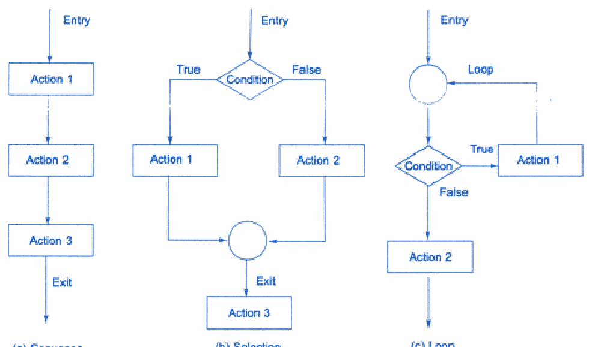

### 图3.4 ↔ 基本控制结构

重要的是要理解，所有程序处理都可以仅使用这三种逻辑结构来编码。在编程中使用这些基本控制结构中的一个或多个的方法称为结构化编程，这是软件工程中的一项重要技术。

使用这三个基本结构，我们可以以详细或概要的形式表示函数结构，如图3.5（a）、（b）和（c）所示。

与C一样，C++也支持所有三种基本控制结构，并使用各种控制语句来实现它们，如图3.6所示。这表明C++将结构化编程的强大功能与面向对象范式相结合。

### if语句

if语句以两种形式实现：

- 简单if语句

- if...else语句

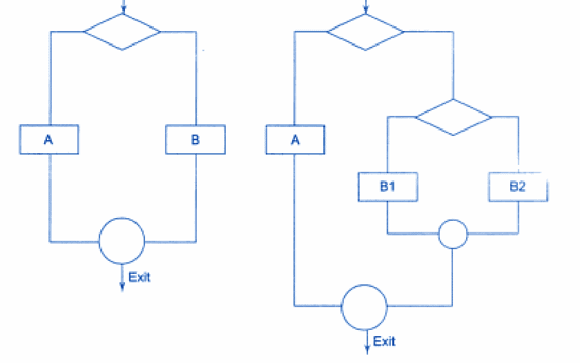

(a) 第一级抽象

(b) 第二级抽象

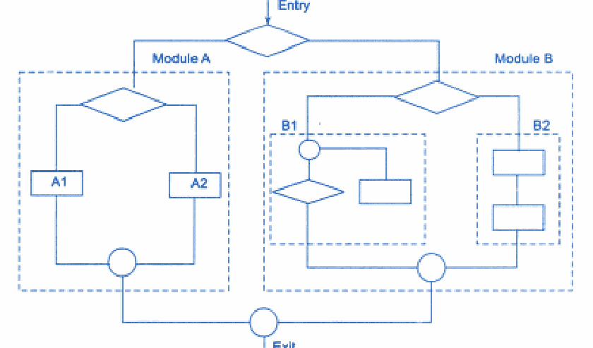

(c) 详细流程图

图3.5 ⇔ 不同的抽象级别

### do-while语句

do-while是一个出口控制循环。根据条件，控制被转移回程序中的特定点。语法如下：

```
switch(expression)
{
    case1:
    {
    action1;
    }
    case2:
    {
    action2;
    }
    case3:
    {
    action3;
    }
    default:
    {
    action4;
    }
}
action5;
```

do-while是一个出口控制循环。根据条件，控制被转移回程序中的特定点。语法如下：

```
do
{
    action1;
}
while(condition is true);
action2;
```

### while语句

这也是一种循环结构，但它是入口控制的。语法如下：

```
while(condition is true)
{
    action1;
}
action2;
```

### for语句

for是一个入口控制循环，用于需要在预定次数内重复执行某个操作的情况。语法如下：

```
for(initial value; test; increment)
{
    action1;
}
action2;
```

C++中控制语句的语法与C非常相似，因此在需要时即可实现它们。

## 摘要

- C++提供了各种类型的标记，包括关键字、标识符、常量、字符串和运算符。

- 标识符指的是变量、函数、数组、类等的名称。

- C++提供了`void`的额外用途，用于声明通用指针。

- C++中的枚举数据类型略有不同。枚举数据类型的标签名成为新的类型名。也就是说，我们可以使用这些标签名声明新变量。

- 在C++中，字符数组的大小应比字符串中的字符数大1。

- C++增加了常量指针和指向常量的指针的概念。对于常量指针，我们不能修改指针初始化所指向的地址。对于指向常量的指针，其指向的内容不能被更改。

- 指针在C++中广泛用于内存管理和实现多态。

- C++提供了一个名为`const`的限定符来声明命名常量，它们就像变量一样，只是其值不能更改。`const`修饰符默认为`int`类型。

- C++在变量的类型检查方面非常严格。它不允许将两个不同数据类型的变量相等。打破此规则的唯一方法是类型转换。

- C++允许我们在程序中的任何位置声明变量，也可以在声明处使用表达式在运行时对其进行初始化。

- 引用变量为先前定义的变量提供了另一个名称。两个变量都引用内存中的同一数据对象。因此，其中一个变量值的变化也会反映在另一个变量的值中。

- 引用变量必须在声明时初始化，这建立了引用与其命名的数据对象之间的对应关系。

作用域解析（`::`）运算符的一个主要应用是在类中标识成员函数所属的类。

除了`malloc()`、`calloc()`和`free()`函数之外，C++还提供了两个一元运算符`new`和`delete`，以更好、更简单的方式执行分配和释放内存的任务。

C++还提供了操纵器来格式化数据显示。最常用的操纵器是`endl`和`setw`。

C++支持七种类型的表达式。当表达式中混合了数据类型时，C++会使用某些规则自动执行转换。

C++还允许使用类型转换运算符对变量和表达式进行显式类型转换。

与C一样，C++也支持三种基本控制结构，即顺序、选择和循环，并使用各种控制语句来实现它们，如`if`、`if...else`、`switch`、`do..while`、`while`和`for`。

## 关键术语

- 数组

- 结合性

- 自动转换

- 反斜杠字符

- 位运算表达式

- 布尔型

- 布尔表达式

- 分支

- 引用调用

- `calloc()`

- 字符常量

- 链式赋值

- 类

- 复合赋值

- 复合表达式

- `const`

- 常量

- 常量表达式

- 控制结构

- 数据类型

- 十进制整数

- 声明

- `delete`

- 解引用

- 派生类型

- `do...while`

- 嵌入式赋值

- `endl`

- 入口控制

- 枚举

- 出口控制

- 显式转换

- 表达式

- 浮点表达式

- 浮点整数

- `for`

- 格式化

- 自由存储区

- `free()`

- 函数

- 十六进制整数

- 标识符

- `if`

- `if...else`

- 隐式转换

- 初始化

- 整型常量

- 整型表达式

- 整型加宽

- 迭代

- 关键字

- 字面量

- 逻辑表达式

- 循环

- 循环结构

- `malloc()`

- 操纵器

- 内存

- 命名常量

- `new`

- 八进制整数

- 运算符

- 运算符关键字

- 运算符重载

- 运算符优先级

- 指针

- 指针表达式

- 指针变量

- 引用

- 引用变量

- 关系表达式

- 重复

- 作用域解析

- 选择

- 选择结构

- 顺序

- 顺序结构

- `setw`

- 简写赋值

- `sizeof()`

- 直线

- 字符串

- 字符串常量

- 结构体

- 结构

- 结构化编程

- `switch`

- 符号常量

- 标记

- 类型转换

- 类型兼容

- `typedef`

- 联合

- 用户定义类型

- 变量

- `void`

- 瀑布模型


- `wchar_t`

- `while`

- 宽字符

## 复习题

### 3.1 列举C++中变量命名的规则。它们与ANSI C规则有何不同？

### 3.2 `unsigned int` 可以是 `signed int` 的两倍大。请解释为什么？

### 3.3 为什么 C++ 有类型修饰符？

### 3.4 `void` 数据类型在 C++ 中有哪些应用？

### 3.5 我们可以将 `void` 指针赋值给 `int` 类型指针吗？如果不能，为什么？我们如何实现这一点？

### 3.6 举例说明枚举数据类型的用途。

### 3.7 描述 `enum` 数据类型在 ANSI C 和 C++ 中实现的差异。

### 3.8 为什么数组被称为派生数据类型？

### 3.9 声明用于存储字符串的 `char` 数组的大小应比字符串中的字符数大 1。为什么？

### 3.10 `const` 是从 C++ 中引入并纳入 ANSI C 的，尽管用法有很大不同。请解释。

### 3.11 由 `const` 定义的常量与由预处理器语句 `#define` 定义的常量有何不同？

### 3.12 在 C++ 中，变量可以在作用域中的任何位置声明。这一特性的意义是什么？

### 3.13 变量的动态初始化是什么意思？请举一个例子。

### 3.14 什么是引用变量？它的主要用途是什么？

### 3.15 列出至少四个 C++ 新增的、有助于面向对象编程（OOP）的运算符。

### 3.16 作用域解析运算符 `::` 在 C++ 中的应用是什么？

### 3.17 与 `malloc()` 函数相比，使用 `new` 运算符有哪些优点？

### 3.18 举例说明 `setw` 操纵符是如何工作的。

### 3.19 以下语句有何不同？

- (a) `char * const p;`

- (b) `char const *p;`

## 调试练习

### 3.1 当你执行以下代码时会发生什么？

```cpp
#include <iostream.h>
void main()
{
    int i=0;
    i=400*400/400;
    cout << i;
}
```

### 3.2 找出以下程序中的错误。

```cpp
#include <iostream.h>
void main()
{
    int num[]={1,2,3,4,5,6};
    num[1]==[1]num ? cout<<"Success" : cout<<"Error";
}
```

### 3.3 找出以下程序中的错误。

```cpp
#include <iostream.h>
void main()
{
    int i=5;
    while(i)
    {
        switch(i)
        {
        default:
        case 4:
        case 5:
        break;
        case 1:
        continue;
        case 2:
        case 3:
        break;
        }
        i--;
    }
}
```

### 3.4 找出以下程序中的错误。

```cpp
#include <iostream.h>
#define pi 3.14
int squareArea(int &);
int circleArea(int &);

void main()
{
    int a=10;
    cout << squareArea(a) << " ";
    cout << circleArea(a) << " ";
    cout << a << endl;
}

int squareArea(int &a)
{
    return a *= a;
}

int circleArea(int &r)
{
    return r = pi * r * r;
}
```

### 3.5 找出以下程序中的错误。

```cpp
#include <iostream.h>
#include <malloc.h>

char* allocateMemory();

void main()
{
    char* str;
    str = allocateMemory();
    cout << str;
    delete str;
    str = "";
    cout << str;
}

char* allocateMemory()
{
    str = "Memory allocation test.";
    return str;
}
```

### 3.6 找出以下 C++ 语句中的错误（如果有的话）。

- (a) `long float x;`

- (b) `char *cp = vp;` // `vp` 是一个 `void` 指针

- (c) `int code = three;` // `three` 是一个枚举器

- (d) `int *p = new;` // 使用 `new` 分配内存

- (e) `enum (green, yellow, red);`

- (f) `int const *p = total;`

- (g) `const int array_size;`

- (h) `for (i=1; int i<10; i++) cout << i << "\n";`

- (i) `int & number = 100;`

- (j) `float *p = new int [10];`

- (k) `int public = 1000;`

- (l) `char name[3] = "USA";`

## 编程练习

### 3.1 编写一个函数，使用引用变量作为参数来交换一对整数的值。

### 3.2 编写一个函数，使用 `new` 运算符创建用户指定大小 `M` 的向量。

### 3.3 编写一个程序，使用 `for` 循环打印以下输出。

```cpp
1
22
333
4444
55555
........
```

### 3.4 编写一个程序来计算以下投资方程

V = P(1 + r)^n

并打印出 V 在 P、r 和 n 的以下各种组合下的值的表格：

P: 1000, 2000, 3000, ...., 10,000

r: 0.10, 0.11, 0.12, ...., 0.20

n: 1, 2, 3, ....., 10

（提示：P 是本金金额，V 是 n 年末的资金价值。该方程可以递归地写为

V = P(1 + r)

P = V

换句话说，第一年末的资金价值成为下一年的本金金额，依此类推。）

### 3.5 一场选举有五名候选人参加。候选人编号为 1 到 5，投票通过在选票上标记候选人编号来完成。编写一个程序来读取选票，并使用数组变量 `count` 统计投给每位候选人的票数。如果读取的数字超出 1 到 5 的范围，该选票应被视为“废票”，程序还应统计废票的数量。

### 3.6 一支板球队在一系列测试赛中有以下击球数据表：

| 球员姓名 | 得分 | 局数 | 未出局次数 |

| Sachin | 8430 | 230 | 18 |

| Saurav | 4200 | 130 | 9 |

| Rahul | 3350 | 105 | 11 |

| . | . | . | . |

| . | . | . | . |

编写一个程序来读取以上述格式列出的数据，计算击球平均值，并打印包含平均值的完整表格。

### 3.7 编写程序以 0.0001% 的精度计算以下函数。

- (a) sin x = x - x³/3! + x⁵/5! - x⁷/7! + ……

- (b) SUM = 1 + (1/2)² + (1/3)³ + (1/4)⁴ + ……

- (c) cos x = 1 - x²/2! + x⁴/4! - x⁶/6! + ……

### 3.8 编写一个程序，打印函数 y = e⁻ˣ 在 x 从 0 到 10、步长为 0.1 时的值表。表格应如下所示。

Y = EXP [-X] 的值表

| X | 0.1 | 0.2 | 0.3 | 0.4 | 0.5 | 0.6 | 0.7 | 0.8 | 0.9 |

|---|-----|-----|-----|-----|-----|-----|-----|-----|-----|

| 0.0 |  |  |  |  |  |  |  |  |  |

| 1.0 |  |  |  |  |  |  |  |  |  |

| . |  |  |  |  |  |  |  |  |  |

| . |  |  |  |  |  |  |  |  |  |

| . |  |  |  |  |  |  |  |  |  |

| 9.0 |  |  |  |  |  |  |  |  |  |

### 3.9 编写一个程序来计算 N 个数的方差和标准差。

方差 = (1/N) Σᵢ₌₁ᴺ (xᵢ - x̄)²

标准差 = √[ (1/N) Σᵢ₌₁ᴺ (xᵢ - x̄)² ]

其中 x̄ = (1/N) Σᵢ₌₁ᴺ xᵢ

### 3.10 电力局向家庭用户收取以下费率，以阻止大量消耗能源：

- 前 100 个单位 - 每个单位 60 派萨

- 接下来的 200 个单位 - 每个单位 80 派萨

- 超过 300 个单位 - 每个单位 90 派萨

所有用户最低收费为 50.00 卢比。如果总金额超过 300.00 卢比，则额外加收 15% 的附加费。

编写一个程序来读取用户的姓名和消耗的单位数，并打印带有姓名的费用。

# 4 C++ 中的函数

## 关键概念

- `main()` 中的返回类型

- 函数原型

- 引用调用

- 值调用

- 引用返回

- 内联函数

- 默认参数

- 常量参数

- 函数重载

## 4.1 引言

我们知道函数在 C 程序开发中起着重要作用。将程序划分为函数是自顶向下、结构化编程的主要原则之一。使用函数的另一个优点是，可以通过在程序的不同位置调用和使用它们来减小程序的规模。

回想一下，我们在开发 C 程序时使用了类似于以下的语法。

```cpp
void show();    /* Function declaration */
main()
{
    show();        /* Function call */
    .....
}
void show()    /* Function definition */
{
    .....
     /* Function body */
    .....
}
```

当函数被调用时，控制权转移到函数体中的第一条语句。然后执行函数体中的其他语句，当遇到右花括号时，控制权返回到主程序。C++ 也不例外。函数仍然是 C++ 程序的构建块。事实上，C++ 为函数添加了许多新特性，使其更加可靠和灵活。与 C++ 运算符一样，C++ 函数可以被重载，以根据传递给它的参数执行不同的任务。这些修改大多旨在满足面向对象设施的要求。

在本章中，我们将简要讨论 C++ 函数新增的各种特性及其实现。

## 4.2 主函数

C 没有为 `main()` 函数指定任何返回类型，`main()` 是程序执行的起点。`main()` 的定义如下所示：

```cpp
main()
{
    // main program statements
}
```

这是完全有效的，因为 C 中的 `main()` 不返回任何值。

在 C++ 中，`main()` 向操作系统返回一个 `int` 类型的值。因此，C++ 明确将 `main()` 定义为匹配以下原型之一：

```cpp
int main();
int main(int argc, char * argv[]);
```

有返回值的函数应使用 `return` 语句来终止。因此，C++ 中的 `main()` 函数定义如下：

```cpp
int main()
{
    .....
    .....
    return 0;
}
```

由于函数的返回类型默认为 `int`，因此 `main()` 头中的关键字 `int` 是可选的。如果没有 `return` 语句，大多数 C++ 编译器将生成错误或警告。

statement. Turbo C++ issues the warning

```cpp
Function should return a value
```

and then proceeds to compile the program. It is good programming practice to actually return a value from `main()`.

Many operating systems test the return value (called exit value) to determine if there is any problem. The normal convention is that an exit value of zero means the program ran successfully, while a nonzero value means there was a problem. The explicit use of a `return(0)` statement will indicate that the program was successfully executed.

## 4.3 Function Prototyping

Function prototyping is one of the major improvements added to C++ functions. The prototype describes the function interface to the compiler by giving details such as the number and type of arguments and the type of return values. With function prototyping, a template is always used when declaring and defining a function. When a function is called, the compiler uses the template to ensure that proper arguments are passed, and the return value is treated correctly. Any violation in matching the arguments or the return types will be caught by the compiler at the time of compilation itself. These checks and controls did not exist in the conventional C functions.

Remember, C also uses prototyping. But it was introduced first in C++ by Stroustrup and the success of this feature inspired the ANSI C committee to adopt it. However, there is a major difference in prototyping between C and C++. While C++ makes the prototyping essential, ANSI C makes it optional, perhaps, to preserve the compatibility with classic C.

Function prototype is a declaration statement in the calling program and is of the following form:

```cpp
type function-name (argument-list);
```

The argument-list contains the types and names of arguments that must be passed to the function.

Example:

```cpp
float volume(int x, float y, float z);
```

Note that each argument variable must be declared independently inside the parentheses. That is, a combined declaration like

```cpp
float volume(int x, float y, z);
```

is illegal.

In a function declaration, the names of the arguments are dummy variables and therefore, they are optional. That is, the form

```cpp
float volume(int, float, float);
```

is acceptable at the place of declaration. At this stage, the compiler only checks for the type of arguments when the function is called.

In general, we can either include or exclude the variable names in the argument list of prototypes. The variable names in the prototype just act as placeholders and, therefore, if names are used, they don't have to match the names used in the function call or function definition.

In the function definition, names are required because the arguments must be referenced inside the function. Example:


```
float volume(int a,float b,float c)
{
    float v = a*b*c;
    .....
    .....
}
```

The function `volume()` can be invoked in a program as follows:

```
float cube1 = volume(b1,w1,h1);  // Function call
```

The variable `b1`, `w1`, and `h1` are known as the actual parameters which specify the dimensions of `cube1`. Their types (which have been declared earlier) should match with the types declared in the prototype. Remember, the calling statement should not include type names in the argument list.

We can also declare a function with an empty argument list, as in the following example:

```
void display( );
```

In C++, this means that the function does not pass any parameters. It is identical to the statement

```
void display(void);
```

However, in C, an empty parentheses implies any number of arguments. That is, we have foregone prototyping. A C++ function can also have an 'open' parameter list by the use of ellipses in the prototype as shown below:

```
void do_something(...);
```

## 4.4 Call by Reference

In traditional C, a function call passes arguments by value. The called function creates a new set of variables and copies the values of arguments into them. The function does not have access to the actual variables in the calling program and can only work on the copies of values. This mechanism is fine if the function does not need to alter the values of the original variables in the calling program. But, there may arise situations where we would like to change the values of variables in the calling program. For example, in bubble sort, we compare two adjacent elements in the list and interchange their values if the first element is greater than the second. If a function is used for bubble sort, then it should be able to alter the values of variables in the calling function, which is not possible if the call-by-value method is used.

Provision of the reference variables in C++ permits us to pass parameters to the functions by reference. When we pass arguments by reference, the ‘formal’ arguments in the called function become aliases to the ‘actual’ arguments in the calling function. This means that when the function is working with its own arguments, it is actually working on the original data. Consider the following function:

```
void swap(int &a,int &b)    // a and b are reference variables
{
    int t = a;              // Dynamic initialization
    a = b;
    b = t;
}
```

Now, if `m` and `n` are two integer variables, then the function call

```
swap(m, n);
```

will exchange the values of `m` and `n` using their aliases (reference variables) `a` and `b`. Reference variables have been discussed in detail in Chapter 3. In traditional C, this is accomplished using pointers and indirection as follows:

```
void swap1(int *a, int *b) /* Function definition */
{
    int t;
    t = *a;     /* assign the value at address a to t */
    *a = *b;    /* put the value at b into a */
    *b = t;     /* put the value at t into b */
}
```

This function can be called as follows:

```
swap1(&x, &y);  /* call by passing */
/* addresses of variables */
```

This approach is also acceptable in C++. Note that the call-by-reference method is neater in its approach.

## 4.5 Return by Reference

A function can also return a reference. Consider the following function:

```
int & max(int &x,int &y)
{
    if (x > y)
        return x;
    else
        return y;
}
```

Since the return type of `max()` is `int &`, the function returns reference to `x` or `y` (and not the values). Then a function call such as `max(a, b)` will yield a reference to either `a` or `b` depending on their values. This means that this function call can appear on the left-hand side of an assignment statement. That is, the statement

```
max(a,b) = -1;
```

is legal and assigns -1 to `a` if it is larger, otherwise -1 to `b`.

## 4.6 Inline Functions

One of the objectives of using functions in a program is to save some memory space, which becomes appreciable when a function is likely to be called many times. However, every time a function is called, it takes a lot of extra time in executing a series of instructions for tasks such as jumping to the function, saving registers, pushing arguments into the stack, and returning to the calling function. When a function is small, a substantial percentage of execution time may be spent in such overheads.

One solution to this problem is to use macro definitions, popularly known as macros. Preprocessor macros are popular in C. The major drawback with macros is that they are not really functions and therefore, the usual error checking does not occur during compilation.

C++ has a different solution to this problem. To eliminate the cost of calls to small functions, C++ proposes a new feature called inline function. An inline function is a function that is expanded in line when it is invoked. That is, the compiler replaces the function call with the corresponding function code (something similar to macros expansion). The inline functions are defined as follows:

```
inline function-header
{
    function body
}
```

Example:

```
inline double cube(double a)
{
    return(a*a*a);
}
```

The above inline function can be invoked by statements like

```
c = cube(3.0);
d = cube(2.5+1.5);
```

On the execution of these statements, the values of `c` and `d` will be 27 and 64 respectively. If the arguments are expressions such as `2.5 + 1.5`, the function passes the value of the expression, 4 in this case. This makes the inline feature far superior to macros.

It is easy to make a function inline. All we need to do is to prefix the keyword `inline` to the function definition. All inline functions must be defined before they are called.

We should exercise care before making a function inline. The speed benefits of inline functions diminish as the function grows in size. At some point the overhead of the function call becomes small compared to the execution of the function, and the benefits of inline functions may be lost. In such cases, the use of normal functions will be more meaningful. Usually, the functions are made inline when they are small enough to be defined in one or two lines. Example:

```
inline double cube(double a) {return(a*a*a);}
```

Remember that the inline keyword merely sends a request, not a command, to the compiler. The compiler may ignore this request if the function definition is too long or too complicated and compile the function as a normal function.

Some of the situations where inline expansion may not work are:

- 1. For functions returning values, if a loop, a switch, or a goto exists.

- 2. For functions not returning values, if a return statement exists.

- 3. If functions contain static variables.

- 4. If inline functions are recursive.

> note

> 内联展开使程序运行更快，因为函数调用和返回的开销被消除了。然而，它会使程序占用更多内存，因为定义内联函数的语句会在函数被调用的每个位置被复制。因此，需要进行权衡。

程序 4.1 说明了内联函数的使用。

### INLINE FUNCTIONS

```
#include <iostream>
using namespace std;

inline float mul(float x, float y)
{
    return(x*y);
}

inline double div(double p, double q)
{
    return(p/q);
}

int main()
{
    float a = 12.345;
    float b = 9.82;

    cout << mul(a,b) << "\n";
    cout << div(a,b) << "\n";

    return 0;
}
```

PROGRAM 4.1

程序 4.1 的输出为

121.228

1.25713

## 4.7 Default Arguments

C++ 允许我们在不指定其所有参数的情况下调用函数。在这种情况下，函数会为在函数调用中没有匹配参数的参数分配默认值。默认值在函数声明时指定。编译器会查看原型以查看函数使用多少个参数，并提醒程序可能存在的默认值。以下是带有默认值的原型（即函数声明）的示例：

```
float amount(float principal,int period,float rate=0.15);
```

默认值以与变量初始化类似的语法指定。上述原型为参数 `rate` 声明了 0.15 的默认值。随后类似的函数调用

```
value = amount(5000,7);      // 缺少一个参数
```

将值 5000 传递给 `principal`，7 传递给 `period`，然后让函数对 `rate` 使用默认值 0.15。调用

```
value = amount(5000,5,0.12);      // 没有缺少的参数
```

将显式值 0.12 传递给 `rate`。

默认参数在声明时检查类型，在调用时求值。需要注意的一个重要点是，只有尾部参数可以有默认值，因此我们必须从右到左添加默认值。我们不能为参数列表中间的某个特定参数提供默认值。以下是带有默认值的函数声明的一些示例：

```
int mul(int i, int j=5, int k=10);      // 合法
int mul(int i=5, int j);                // 非法
int mul(int i=0, int j, int k=10);      // 非法
int mul(int i=2, int j=5, int k=10);    // 合法
```


在某些参数始终具有相同值的情况下，提供默认参数很有用。例如，银行利息在特定存款期间对所有客户可能保持不变。它还为程序员提供了更大的灵活性。函数可以用比其最常见应用所需的更多的参数编写。使用默认参数，程序员只能使用对特定情况有意义的参数。程序 4.2 说明了默认参数的使用。

### DEFAULT ARGUMENTS

```
#include <iostream>

using namespace std;

int main()
{
    float amount;

    float value(float p, int n, float r=0.15);  // prototype
    void println(char ch='*', int len=40);      // prototype

    println();                  // uses default values for arguments

    amount = value(5000.00,5);          // default for 3rd argument

    cout << "\n      Final Value = " << amount << "\n\n";

    println('=');       // use default value for 2nd argument

    return 0;
}
/*------------------------------------------------------------*/
float value(float p, int n, float r)
{
    int year = 1;
    float sum = p;

    while(year <= n)
    {
        sum = sum*(1+r);
        year = year+1;
    }
    return(sum);
}

void println(char ch, int len)
{
    for(int i=1; i<=len; i++) printf("%c",ch);
    printf("\n");
}
```

程序 4.2 的输出为

```
***********************************

    Final Value = 10056.8

===================================
```

提供默认参数的优点是：

- 1. 我们可以使用默认参数为现有函数添加新参数。

- 2. 默认参数可用于将相似函数合并为一个。

## 4.8 const Arguments

在 C++ 中，函数的参数可以声明为 const，如下所示。

```
int strlen(const char *p);
int length(const string &s);
```

限定符 const 告诉编译器函数不应修改参数。当此条件被违反时，编译器会生成错误。这种类型的声明只有在我们通过引用或指针传递参数时才有意义。

## 4.9 Function Overloading

如前所述，重载是指对不同目的使用同一事物。C++ 也允许函数重载。这意味着我们可以使用相同的函数名创建执行各种不同任务的函数。这在 OOP 中称为函数多态性。

使用函数重载的概念，我们可以用一个函数名设计一组函数，但参数列表不同。函数将根据函数调用中的参数列表执行不同的操作。要调用的正确函数是通过检查参数的数量和类型而不是函数类型来确定的。例如，重载的 `add()` 函数处理不同类型的数据，如下所示：

```
// Declarations
int add(int a, int b);                      // prototype 1
int add(int a, int b, int c);               // prototype 2
double add(double x, double y);             // prototype 3
double add(int p, double q);                // prototype 4
double add(double p, int q);                // prototype 5

// Function calls
cout << add(5, 10);                         // uses prototype 1
cout << add(15, 10.0);                      // uses prototype 4
cout << add(12.5, 7.5);                     // uses prototype 3
cout << add(5, 10, 15);                     // uses prototype 2
cout << add(0.75, 5);                       // uses prototype 5
```

函数调用首先匹配具有相同数量和类型参数的原型，然后调用适当的函数执行。最佳匹配必须是唯一的。函数选择涉及以下步骤：

- 1. 编译器首先尝试找到完全匹配，其中实际参数的类型相同，并使用该函数。

- 2. 如果找不到完全匹配，编译器会使用对实际参数的整型提升，例如，

- 3. 当两者都失败时，编译器会尝试使用内置转换（隐式赋值转换）对实际参数进行转换，然后使用匹配唯一的函数。如果转换可能产生多个匹配，则编译器会生成错误消息。假设我们使用以下两个函数：

- 4. 如果所有步骤都失败，则编译器会尝试用户定义的转换结合整型提升和内置转换来找到唯一的匹配。用户定义的转换通常用于处理类对象。

```
char to int
float to double
```

```
long square(long n)
double square(double x)
```

函数调用例如

```
square(10)
```

会引起错误，因为 int 参数可以转换为 long 或 double，从而造成应使用 `square()` 的哪个版本的不明确情况。

程序 4.3 说明了函数重载。

### FUNCTION OVERLOADING

```
// Function volume() is overloaded three times

#include <iostream>

using namespace std;

// Declarations (prototypes)
int volume(int);
double volume(double, int);
long volume(long, int, int);

int main()
{
    cout << volume(10) << "\n";
    cout << volume(2.5,8) << "\n";
    cout << volume(100L,75,15) << "\n";
    return 0;
}

// Function definitions

int volume(int s)  // cube
{
    return(s*s*s);
}

double volume(double r, int h)  // cylinder
{
    return(3.14519*r*r*h);
}

long volume(long l, int b, int h) // rectangular box
{
    return(l*b*h);
}
```

PROGRAM 4.3

程序 4.3 的输出为：

1000

157.26

112500

函数重载应谨慎进行。我们不应重载不相关的函数，而应将函数重载保留给执行密切相关任务的函数。有时，默认参数可代替重载使用。这可减少需要定义的函数数量。

重载函数被广泛用于处理类对象。当在下一章讨论类时，将对其进行说明。

## 4.10 Friend and Virtual Functions

C++ 引入了两种新型函数，即友元函数和虚函数。它们基本上是为了处理与类对象相关的某些特定任务而引入的。因此，对这些函数的讨论已推迟到类对象讨论之后。友元函数在下一章的第 5.15 节中讨论，虚函数在第 9 章的第 9.5 节中讨论。

## 4.11 数学库函数

标准 C++ 支持许多数学函数，可用于执行某些常用的计算。最常用的数学库函数已在表 4.1 中汇总。

### 表 4.1 常用数学库函数

| Function | Purposes |

|---|---|

| `ceil(x)` | Rounds x to the smallest integer not less than x `ceil(8.1)` = 9.0 and `ceil(-8.8)` = -8.0 |

| `cos(x)` | Trigonometric cosine of x (x in radians) |

| `exp(x)` | Exponential function e^x. |

| `fabs(x)` | Absolute value of x. If x>0 then `abs(x)` is x If x=0 then `abs(x)` is 0.0 If x<0 then `abs(x)` is -x |

| `floor(x)` | Rounds x to the largest integer not greater than x `floor(8.2)` = 8.0 and `floor(-8.8)` = -9.0 |

| `log(x)` | Natural logarithm of x(base e) |

| `log10(x)` | Logarithm of x(base 10) |

| `pow(x,y)` | x raised to power y(x^y) |

| `sin(x)` | Trigonometric sine of x (x in radians) |

| `sqrt(x)` | Square root of x |

| `tan(x)` | Trigonometric tangent of x (x in radians) |

> note

> The argument variables x and y are of type double and all the functions return the data type double.

要使用数学库函数，我们必须在传统的 C++ 中包含头文件 `math.h`，在 ANSI C++ 中包含 `cmath`。

## SUMMARY

+ 可以通过在程序的不同位置调用和使用函数来减小程序的大小。

+ 在 C++ 中 `main()` 向操作系统返回类型为 int 的值。由于函数的返回类型默认为 int，因此 `main()` 头中的关键字 int 是可选的。如果没有 return 语句，大多数 C++ 编译器会发出警告。

函数原型为编译器提供了有关函数的详细信息，例如参数的数量和类型以及返回值的类型。

C++ 中的引用变量允许我们通过引用将参数传递给函数。函数还可以返回对变量的引用。

当函数声明为 inline 时，编译器会用相应的函数代码替换函数调用。通常，将小型函数设为 inline。

如果函数声明过长或过于复杂，编译器可能会忽略 inline 声明，从而将函数作为普通函数编译。

C++ 允许我们在声明函数时为函数参数分配默认值。在这种情况下，我们可以在不指定所有参数的情况下调用函数。默认值始终从右到左添加。

在 C++ 中，函数的参数可以声明为 const，表示函数不应修改该参数。

C++ 允许函数重载。也就是说，我们可以在程序中拥有多个同名函数。编译器通过检查参数的数量和类型，将函数调用与确切的函数代码匹配。

C++ 支持两种新型函数，即友元函数和虚函数。

许多数学计算都可以使用 C++ 标准库支持的库函数进行。

## Key Terms

+ actual arguments

+ argument list

+ bubble sort

+ call by reference

+ call by value

+ called function

+ calling program

+ calling statement

+ cmath

+ const arguments

+ declaration statement

+ default arguments

+ default values

+ dummy variables

+ ellipses

+ empty argument list

+ exit value

+ formal arguments

+ friend functions

+ function call

+ function definition

+ function overloading

+ function polymorphism

+ function prototype

+ indirection

+ inline

+ inline functions

+ macros

+ main()

+ math library

+ math.h

+ overloading

+ pointers

+ polymorphism

+ prototyping

+ reference variable

+ return by reference

+ return statement

+ return type

+ return()

+ template

+ virtual functions

## Review Questions

4.1 State whether the following statements are TRUE or FALSE.

(a) A function argument is a value returned by the function to the calling program.

(b) When arguments are passed by value, the function works with the original arguments in the calling program.

(c) When a function returns a value, the entire function call can be assigned to a variable.

(d) A function can return a value by reference.

(e) When an argument is passed by reference, a temporary variable is created in the calling program to hold the argument value.

(f) It is not necessary to specify the variable name in the function prototype.

4.2 What are the advantages of function prototypes in C++?

4.3 Describe the different styles of writing prototypes.

4.4 Find errors, if any, in the following function prototypes.

(a) `float average(x,y);`

(b) `int mul(int a,b);`

(c) `int display(...);`

(d) `void Vect(int? &V, int & size);`

(e) `void print(float data [], size = 20);`

4.5 What is the main advantage of passing arguments by reference?

4.6 When will you make a function inline? Why?

4.7 How does an inline function differ from a preprocessor macro?

4.8 When do we need to use default arguments in a function?

4.9 What is the significance of an empty parenthesis in a function declaration?

4.10 What do you meant by overloading of a function? When do we use this concept?

4.11 Comment on the following function definitions:

```
(a) int *f()
{
    int m = 1;
    ....
    ....
    return(&m);
}
```

```
(b) double f()
{
    ....
    ....
    return(1);
}
```

```
(c) int & f()
{
    int n = 10;
    ....
    ....
    return(n);
}
```

## Debugging Exercises

4.1 Identify the error in the following program.

```
#include <iostream.h>
int fun()
{
    return 1;
}
float fun()
{
    return 10.23;
void main()
{
    cout << (int)fun() << ' ';
    cout << (float)fun() << ' ';
}
```

4.2 Identify the error in the following program.


```cpp
#include <iostream.h>

void display(const int const1=5)
{
    const int const2=5;
    int array1[const1];
    int array2[const2];
    for(int i=0; i<5; i++)
    {
        array1[i] = i;
        array2[i] = i*10;
        cout << array1[i] << ' ' << array2[i] << ' ';
    }
}

void main()
{
    display(5);
}
```

4.3 Identify the error in the following program.

```cpp
#include <iostream.h>
int gValue=10;
void extra()
{
    cout << gValue << ' ';
}
void main()
{
    extra();
    {
        int gValue = 20;
        cout << gValue << ' ';
        cout << ::gValue << ' ';
    }
}
```

4.4 Find errors, if any, in the following function definition for displaying a matrix: `void display(int A[][], int m, int n)`

```cpp
{
    for(i=0; i<m; i++)
    {
        for(j=0; j<n; j++)
            cout << " " << A[i][j];
        cout << "\n";
    }
}
```

## Programming Exercises

+ `4.1` Write a function to read a matrix of size m x n from the keyboard.

+ `4.2` Write a program to read a matrix of size m x n from the keyboard and display the same on the screen using functions.

+ `4.3` Rewrite the program of Exercise 4.2 to make the row parameter of the matrix as a default argument.

+ `4.4` The effect of a default argument can be alternatively achieved by overloading. Discuss with an example.

+ `4.5` Write a macro that obtains the largest of three numbers.

+ `4.6` Redo Exercise 4.5 using inline function. Test the function using a main program.

+ `4.7` Write a function `power()` to raise a number m to a power n. The function takes a double value for m and int value for n, and returns the result correctly. Use a default value of 2 for n to make the function to calculate squares when this argument is omitted. Write a main that gets the values of m and n from the user to test the function.

+ `*4.8` Write a function that performs the same operation as that of Exercise 4.7 but takes an int value for m. Both the functions should have the same name. Write a main that calls both the functions. Use the concept of function overloading.

# 5

# 类和对象

## Key Concepts

+ Using structures

+ Creating a class

+ Defining member functions

+ Creating objects

+ Using objects

+ Inline member functions

+ Nested member functions

+ Private member functions

+ Arrays as class members

+ Storage of objects

+ Static data members

+ Static member functions

+ Using arrays of objects

+ Passing objects as parameters

+ Making functions friendly to classes

+ Functions returning objects

+ const member functions

+ Pointers to members

+ Using dereferencing operators

+ Local classes

## 5.1 Introduction

The most important feature of C++ is the “class”. Its significance is highlighted by the fact that Stroustrup initially gave the name “C with classes” to his new language. A class is an

C 结构思想的扩展。它是创建和实现用户定义数据类型的一种新方法。我们将在本章中通过先回顾 C 语言中的传统结构，然后再介绍类如何设计、实现和应用，来讨论类的概念。

## 5.2 C 结构回顾

我们知道 C 语言的独特特性之一就是结构。它们提供了一种将不同类型的数据打包在一起的方法。结构是处理一组逻辑相关数据项的便捷工具。它是一种用户定义的数据类型，具有一个`模板`，用于定义其数据属性。一旦结构类型被定义，我们就可以使用类似于内置类型声明的声明来创建该类型变量。例如，考虑以下声明：

```c
struct student
{
    char   name[20];
    int    roll_number;
    float  total_marks;
};
```

关键字 `struct` 将 `student` 声明为一种新的数据类型，可以容纳三种不同数据类型的字段。这些字段被称为`结构成员`或`元素`。标识符 `student`，被称为`结构名`或`结构标签`，可用于创建 `student` 类型的变量。示例：

```c
struct student A;   // C declaration
```

`A` 是 `student` 类型的一个变量，并且具有模板所定义的三个成员变量。成员变量可以通过`点`或`点运算符`访问，如下所示：

```c
strcpy(A.name, "John");
A.roll_number = 999;
A.total_marks = 595.5;
final_total = A.total_marks + 5;
```

结构可以具有数组、指针或结构作为成员。

### C 结构的局限性

标准 C 不允许将 `struct` 数据类型像内置类型一样处理。例如，考虑以下结构：

```cpp
struct complex
{
    float x;
    float y;
};

struct complex c1, c2, c3;
```

复数 `c1`、`c2` 和 `c3` 可以通过点运算符轻松地赋予值，但我们不能将两个复数相加或从一个中减去另一个。例如，

```cpp
c3 = c1 + c2;
```

在 C 中是非法的。

C 结构的另一个重要局限性是它们不允许`数据隐藏`。结构成员可以直接被结构变量的任何函数在它们的范围内访问。换句话说，结构成员是公共成员。

### 对结构的扩展

C++ 支持 C 中定义的结构的全部特性。但 C++ 进一步扩展了其功能以适应其面向对象的理念。它试图尽可能地使用户定义的类型接近内置数据类型，并且还提供隐藏数据的功能，这是面向对象编程的主要原则之一。`继承`，一种使一种类型能够继承其他类型的特征的机制，也得到了 C++ 的支持。

在 C++ 中，结构可以同时具有变量和函数作为成员。它还可以将某些成员声明为 `'private'`，以便外部函数无法直接访问它们。

在 C++ 中，结构名称是独立的，可以像其他任何类型名称一样使用。换句话说，在结构变量的声明中可以省略关键字 `struct`。例如，我们可以这样声明 `student` 变量 `A`

```cpp
student A;    // C++ declaration
```

记住，这在 C 中是错误的。

C++ 将所有这些扩展合并到另一种用户定义类型中，即类。C++ 中结构和类之间在语法上几乎没有区别，因此它们可以在少量修改下互换使用。由于类是 C++ 中特别引入的数据类型，大多数 C++ 程序员倾向于使用结构仅保存数据，而使用类保存数据和函数。因此，我们将不再进一步讨论结构。

> **注意：** C++ 中结构和类之间的唯一区别是，默认情况下类的成员是`私有`的，而默认情况下结构的成员是`公有`的。

## 5.3 指定一个类

类是将数据及其相关函数绑定在一起的一种方式。它允许数据（和函数）根据需要对外部使用进行隐藏。在定义类时，我们正在创建一个新的抽象数据类型，可以像任何其他内置数据类型一样对待。一般来说，类规范有两个部分：

- 1. 类声明

- 2. 类函数定义

类声明描述了其成员的类型和作用域。类函数定义描述了类函数是如何实现的。

类声明的一般形式为：

```cpp
class class_name
{
    private:
        variable declarations;
        function declarations;
    public:
        variable declarations;
        function declaration;
};
```

类声明类似于 `struct` 声明。关键字 `class` 指定其后跟随的是名为 `class_name` 的抽象数据。类的主体用大括号括起来并以分号结束。类主体包含变量和函数的声明。这些函数和变量统称为类成员。它们通常分为两个部分，即 `private` 和 `public`，以表示哪些成员是私有的，哪些是公有的。关键字 `private` 和 `public` 被称为可见性标签。请注意，这些关键字后面跟着一个冒号。

已声明为私有的类成员只能从类内部访问。另一方面，公共成员也可以从类外部访问。数据隐藏（使用 `private` 声明）是面向对象编程的关键特性。使用关键字 `private` 是可选的。默认情况下，类的成员是私有的。如果两个标签都缺失，则默认情况下所有成员都是私有的。这样的类完全对外部世界隐藏，没有任何用途。

在类内部声明的变量称为数据成员，函数称为成员函数。只有成员函数可以访问私有数据成员和私有函数。然而，公共成员（函数和数据）可以从类外部访问。这在图 5.1 中有所说明。将数据和函数绑定到单个类类型变量中称为封装。

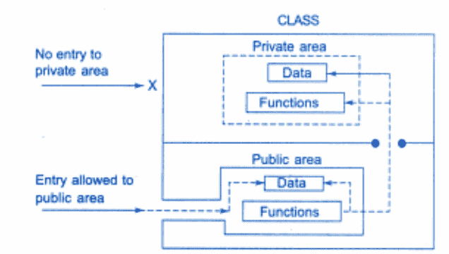

图 5.1 ⇔ 类中的数据隐藏

### 一个简单的类示例

典型的类声明看起来像：

```cpp
class item
{
    int number;                // variables declaration
    float cost;                // private by default
public:
    void getdata(int a, float b);  // functions declaration
    void putdata(void);            // using prototype
};// ends with semicolon
```

我们通常给类一个有意义的名称，例如 `item`。此名称现在成为一个新的类型标识符，可用于声明该类类型的实例。类 `item` 包含两个数据成员和两个函数成员。数据成员默认是私有的，而两个函数通过声明是公有的。函数 `getdata()` 可用于为成员变量 `number` 和 `cost` 分配值，而 `putdata()` 用于显示它们的值。这些函数提供了从类外部访问数据成员的唯一途径。这意味着数据不能被任何不是 `item` 类成员的函数访问。请注意，函数是声明的，而不是定义的。实际的函数定义将出现在程序的后面。数据成员通常声明为私有，成员函数声明为公有。图 5.2 显示了面向对象分析人员用来表示类的两种不同符号。

### 创建对象

请记住，如上所示的 `item` 的声明并没有定义 `item` 的任何对象，而只是指定了它们将包含的内容。一旦类被声明，我们就可以使用类名（像任何其他内置类型变量一样）创建该类型变量。例如，

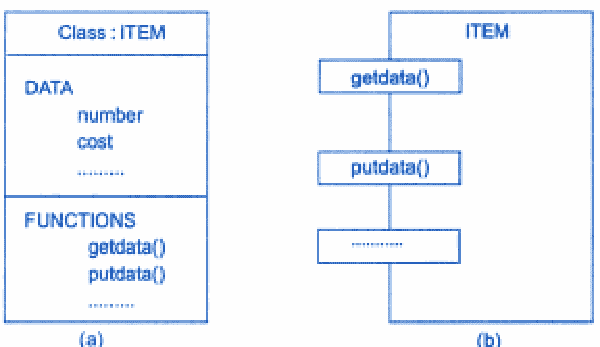

Fig. 5.2 ⇨ Representation of a class

```cpp
item x;    // memory for x is created
```

创建类型为 `item` 的变量 `x`。在 C++ 中，类的变量被称为对象。因此，`x` 被称为类型为 `item` 的对象。我们也可以在一行语句中声明多个对象。示例：

```cpp
item x, y, z;
```

对象的声明与任何基本类型的变量声明类似。在此阶段会为对象分配必要的内存空间。注意，类说明与结构类似，仅提供模板，并不会为对象创建任何内存空间。

对象也可以在类定义时创建，将其名称放在闭合大括号之后，就像我们在结构中做的那样。也就是说，下面的定义

```cpp
class item
{
    .....
    .....
    .....
} x,y,z;
```

会创建类型为 `item` 的对象 `x`、`y` 和 `z`。这种做法很少使用，因为我们希望在对象使用的地方附近声明对象，而不是在类定义时声明。

### Accessing Class Members

如前所述，类的私有数据只能通过该类的成员函数访问。`main()` 不能包含直接访问 `number` 和 `cost` 的语句。调用成员函数的格式如下：

```cpp
object-name.function-name (actual-arguments);
```

例如，函数调用语句

```cpp
x.getdata(100,75.5);
```

是有效的，并通过实现 `getdata()` 函数将值 100 分配给 `number`，将 75.5 分配给对象 `x` 的 `cost`。赋值在实际函数中发生。请参阅 Sec. 5.4 了解更多细节。

同样，语句

```cpp
x.putdata();
```

会显示数据成员的值。请记住，成员函数只能通过对象（同一类的）调用。像这样的语句

```cpp
getdata(100,75.5);
```

没有任何意义。同样，语句

```cpp
x.number = 100;
```

也是非法的。虽然 `x` 是属于 `number` 的类型 `item` 的对象，但 `number`（声明为私有）只能通过成员函数访问，不能直接通过对象访问。

可以回忆一下，对象通过发送和接收消息进行通信。这是通过成员函数实现的。例如，

```cpp
x.putdata();
```

向对象 `x` 发送一条消息，要求其显示其内容。

声明为 `public` 的变量可以直接通过对象访问。示例：

```cpp
class xyz
{
    int x;
    int y;
    public:
        int z;
};
    ....
    ....
xyz p;
p.x = 0;        // error, x is private
p.z = 10        // OK, z is public
    ....
    ....
```

> note

> 这种方式使用数据违背了数据隐藏的初衷，因此应避免。

## 5.4 Defining Member Functions

成员函数可以在两个地方定义：

- 在类定义之外。

- 在类定义之内。

显然，无论定义位置如何，函数都应执行相同的任务。因此，在两种情况下函数体的代码都是相同的。然而，函数头的定义方式存在细微差别。本节将详细讨论这两种方法。

### Outside the Class Definition

在类内部声明的成员函数必须在类外单独定义。它们的定义与普通函数非常相似。它们应具有函数头和函数体。由于 C++ 不支持旧版本的函数定义，必须使用 ANSI 原型形式来定义函数头。

成员函数与普通函数的一个重要区别是，成员函数在头中包含一个“成员身份标签”。该“标签”告诉编译器函数属于哪个类。成员函数定义的一般形式为：

```cpp
return-type class-name :: function-name (argument declaration)
{
    Function body
}
```

成员标签 `class-name ::` 告诉编译器函数 `function-name` 属于类 `class-name`。也就是说，函数的范围被限制在头行中指定的 `class-name`。符号 `::` 称为作用域解析运算符。

例如，考虑上面讨论的成员函数 `getdata()` 和 `putdata()`。它们可以按如下方式编码：


```
void item :: getdata(int a, float b)
{
    number = a;
    cost = b;
}
```

```
void item :: putdata(void)
{
    cout << "Number :" << number << "\n";
    cout << "Cost   :" << cost   << "\n";
}
```

由于这些函数不返回任何值，其返回类型为`void`。函数参数使用 ANSI 原型声明。

成员函数具有一些在程序开发中经常使用的特殊特性。这些特性是：

- 多个不同的类可以使用相同的函数名。‘成员身份标签’会解析其作用域。
- 成员函数可以访问类的私有数据。非成员函数不能这样做。（不过，稍后讨论的友元函数是此规则的例外。）
- 成员函数可以直接调用另一个成员函数，而无需使用点运算符。

### Inside the Class Definition

定义成员函数的另一种方法是，用实际的函数定义替换类内的函数声明。例如，我们可以按如下方式定义`item`类：

```
class item
{
    int number;
    float cost;
    public:
        void getdata(int a, float b);      // declaration
        // inline function
        void putdata(void)                // definition inside the class
        {
            cout << number  << "\n";
            cout << cost    << "\n";
        }
};
```

当函数在类内定义时，它被视为内联函数。因此，适用于内联函数的所有限制和局限性也适用于此处。通常，只有小型函数才在类定义内定义。

## 5.5 A C++ Program with Class

迄今为止讨论的所有细节都在程序 5.1 中实现。

### CLASS IMPLEMENTATION

```
#include <iostream>

using namespace std;

class item
{
    int number;    // private by default
    float cost;    // private by default
public:
    void getdata(int a, float b);    // prototype declaration,
                                     // to be defined

    // Function defined inside class
    void putdata(void)
    {
        cout << "number :" << number << "\n";
        cout << "cost   :" << cost   << "\n";
    }
};
//............ Member Function Definition ..................
void item :: getdata(int a, float b)    // use membership label
{
    number = a;    // private variables
    cost = b;      // directly used
}
//...................... Main Program .......................

int main()
{
    item x;// create object x

    cout << "\nobject x " << "\n";

    x.getdata(100, 299.95);    // call member function
    x.putdata();               // call member function

    item y;                    // create another object

    cout << "\nobject y" << "\n";

    y.getdata(200, 175.50);
    y.putdata();

    return 0;
}
```

该程序展示了类`item`。该类包含两个私有变量和两个公共函数。已在类外定义的成员函数`getdata()`为两个变量提供值。注意`getdata()`函数定义中

```
number = a;
```

等语句的使用。这表明成员函数可以直接访问私有数据项。

成员函数`putdata()`已在类内定义，因此表现得像内联函数。该函数显示私有变量`number`和`cost`的值。

该程序在两个不同的语句中创建了两个对象`x`和`y`。这可以合并为一个语句。

```
item x, y;    // creates a list of objects
```

以下是程序 5.1 的输出：

```
object x
number :100
cost   :299.95

object y
number :200
cost   :175.5
```

为了说明，我们将一个成员函数显示为内联，另一个显示为“外部”成员函数。两者都可以定义为内联或外部函数。

## 5.6 Making an Outside Function Inline

OOP 的目标之一是将实现细节与类定义分离。因此，将成员函数在类外定义是良好的实践。

我们可以在类定义之外定义成员函数，同时仍使其成为内联函数，只需在函数定义头行中使用限定符`inline`即可。示例：

```
class item
{
    .....
    .....
    public:
        void getdata(int a, float b);    // declaration
};
```

```
inline void item :: getdata(int a, float b) // definition
{
    number = a;
    cost = b;
}
```

## 5.7 成员函数的嵌套

我们刚刚讨论过，类的成员函数只能由该类的对象使用点运算符调用。但是对此有一个例外。成员函数可以在同一类的另一个成员函数内部通过其名称调用。这称为成员函数的嵌套。程序 5.2 说明了这一特性。

### 成员函数的嵌套

```
#include <iostream>

using namespace std;

class set
{
    int m, n;
public:
    void input(void);
    void display(void);
    int largest(void);
};

int set :: largest(void)
{
    if(m >= n)
        return(m);
    else
        return(n);
}

void set :: input(void)
{
    cout << "Input values of m and n" << "\n";
    cin >> m >> n;
}

void set :: display(void)
{
cout << "Largest value = "
    << largest() << "\n";      // calling member function
}

int main()
{
    set A;
    A.input();
    A.display();

    return 0;
}
```

程序 5.2 的输出为：

```
Input values of m and n
25 18
Largest value = 25
```

## 5.8 私有成员函数

虽然通常的做法是将所有数据项放在私有部分，将所有函数放在公有部分，但在某些情况下可能需要将某些函数隐藏起来（就像私有数据一样），不允许外部调用。例如删除客户文件中的账户，或为员工提供增量，这些都是后果严重的事件，因此处理此类任务的函数应具有受限的访问权限。我们可以将这些函数放在私有部分。

私有成员函数只能由其所属类的另一个函数调用。即使对象也不能使用点运算符调用私有函数。考虑如下定义的类：

```
class sample
{
    int m;
    void read(void);      // private member function
public:
    void update(void);
    void write(void);
};
```

如果`s1`是`sample`的对象，则

```
s1.read();    // won't work; objects cannot access
             // private members
```

是非法的。但是，函数`read()`可以被函数`update()`调用以更新`m`的值。

```
void sample :: update(void)
{
    read();    // simple call; no object used
}
```

## 5.9 类中的数组

数组可以用作类的成员变量。下面的类定义是有效的。

```
const int size=10;    // provides value for array size

class array
{
    int a[size];    // 'a' is int type array
public:
    void setval(void);
    void display(void);
};
```

作为类`array`的私有成员声明的数组变量`a[ ]`可以在成员函数中使用，就像任何其他数组变量一样。我们可以对其执行任何操作。例如，在上面的类定义中，成员函数`setval()`设置数组`a[ ]`元素的数值，而`display()`函数显示这些数值。同样，我们可以使用其他成员函数对数组值执行任何其他操作。

让我们考虑一份每月向经销商订购的商品清单。该清单包括每件商品的编号和价格等详细信息。我们希望执行诸如向清单中添加商品、从清单中删除商品以及打印订单总价值等操作。程序 5.3 展示了如何使用具有数组作为数据成员的类来实现这些操作。

```
PROCESSING SHOPPING LIST

#include <iostream>

using namespace std;

const m=50;

class ITEMS
{
    int itemCode[m];
    float itemPrice[m];
    int count;
public:
    void CNT(void){count = 0;}        // initializes count to 0
    void getitem(void);
    void displaySum(void);
    void remove(void);
    void displayItems(void);
};
//==================================================
void ITEMS :: getitem(void)          // assign values to data
                                   // members of item
{
    cout << "Enter item code :";
    cin >> itemCode[count];

    cout << "Enter item cost :";
    cin >> itemPrice[count];
    count++;
}
void ITEMS :: displaySum(void)       // display total value of
                                   // all items
{
    float sum = 0;
    for(int i=0; i<count; i++)
        sum = sum + itemPrice[i];

    cout << "\nTotal value :" << sum << "\n";
}
void ITEMS :: remove(void)           // delete a specified item
{
    int a;
    cout << "Enter item code :";
    cin >> a;

    for(int i=0; i<count; i++)
        if(itemCode[i] == a)
            itemPrice[i] = 0;
}

void ITEMS :: displayItems(void)     // displaying items
{
cout << "\nCode  Price\n";

for(int i=0; i<count; i++)
{
    cout <<"\n" << itemCode[i];
    cout <<"   " << itemPrice[i];
}
cout << "\n";
}
//============================================

int main()
{
    ITEMS order;
    order.CNT();
    int x;
    do            // do....while loop
    {
        cout << "\nYou can do the following:"
             << "Enter appropriate number \n";
        cout << "\n1 : Add an item ";
        cout << "\n2 : Display total value";
        cout << "\n3 : Delete an item";
        cout << "\n4 : Display all items";
        cout << "\n5 : Quit";
        cout << "\n\nWhat is your option?";

        cin >> x;

        switch(x)
        {
            case 1 : order.getItem(); break;
            case 2 : order.displaySum(); break;
            case 3 : order.remove(); break;
            case 4 : order.displayItems(); break;
            case 5 : break;
            default : cout << "Error in input; try again\n";
        }
    } while(x != 5);            // do...while ends

    return 0;
}
```

程序 5.3 的输出为：

```
You can do the following; Enter appropriate number
1 : Add an item
2 : Display total value
3 : Delete an item
4 : Display all items
5 : Quit

What is your option?1
Enter item code :111
Enter item cost :100

You can do the following; Enter appropriate number
1 : Add an item
2 : Display total value
3 : Delete an item
4 : Display all items
5 : Quit

What is your option?1
Enter item code :222
Enter item cost :200

You can do the following; Enter appropriate number
1 : Add an item
2 : Display total value
3 : Delete an item
4 : Display all items
5 : Quit

What is your option?1
Enter item code :333
Enter item cost :300

You can do the following; Enter appropriate number
1 : Add an item
2 : Display total value
3 : Delete an item
4 : Display all items
5 : Quit

What is your option?2
Total value :600

You can do the following; Enter appropriate number
1 : Add an item
2 : Display total value
3 : Delete an item
4 : Display all items
5 : Quit

What is your option?3
Enter item code :222

You can do the following; Enter appropriate number
1 : Add an item
2 : Display total value
3 : Delete an item
4 : Display all items
```


5 : Quit

What is your option?4

| Code | Price |

|------|-------|

| 111  | 100   |

| 222  | 0     |

| 333  | 300   |

You can do the following; Enter appropriate number

1 : Add an item

2 : Display total value

3 : Delete an item

4 : Display all items

5 : Quit

What is your option?5

### note

该程序使用两个数组，即 `itemCode[]` 用于保存商品的编号，`itemPrice[]` 用于保存价格。第三个数据成员 `count` 用于记录清单中的商品数量。程序使用总共四个函数来实现对清单执行的操作。语句

```
const int m = 50;
```

定义了数组成员的大小。

第一个函数 `CNT()` 只是将变量 `count` 设置为零。第二个函数 `getitem()` 交互式地获取商品代码和商品价格，并将它们分配给数组成员 `itemCode[count]` 和 `itemPrice[count]`。请注意，在此函数内部，`count` 在赋值操作完成后递增。函数 `displaySum()` 首先计算订单的总价值，然后打印该值。第四个函数 `remove()` 从清单中删除给定商品。它使用商品代码在清单中定位该商品，并将价格设置为零，表示该商品在清单中不“活跃”。最后，函数 `displayItems()` 显示清单中的所有商品。

该程序使用基于菜单的用户界面实现了所有任务。

## 5.10 对象的内存分配

我们已经指出，对象的内存空间在声明时分配，而不是在指定类时分配。这一说法只有部分正确。实际上，成员函数在作为类规范的一部分定义时创建并放置在内存空间中，仅创建一次。由于属于该类的所有对象都使用相同的成员函数，因此在创建对象时不会为成员函数分配单独的空间。只有为每个对象单独分配成员变量的空间。对象需要单独的内存位置，因为成员变量将为不同对象保存不同的数据值。这在图 5.3 中显示。

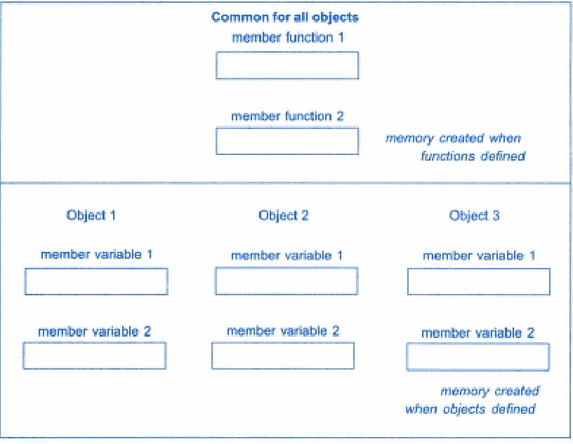

图 5.3 ⇨ 对象的内存

## 5.11 静态数据成员

类的一个数据成员可以被限定为 `static`。静态成员变量的特性与 C 静态变量相似。静态成员变量具有某些特殊特性。这些特性如下：

- 它在该类的第一个对象创建时初始化为零。不允许其他初始化。

- 对于整个类只创建一个该成员的副本，并且无论创建了多少个对象，该副本都被该类的所有对象共享。

- 它仅在类内部可见，但其生命周期贯穿整个程序。

静态变量通常用于维护整个类共有的值。例如，静态数据成员可以用作计数器，记录所有对象的出现次数。程序 5.4 说明了静态数据成员的使用。

### 静态类成员

```
#include <iostream>

using namespace std;

class item
{
    static int count;
    int number;
public:
    void getdata(int a)
    {
        number = a;
        count ++;
    }
    void getcount(void)
    {
        cout << "count: ";
        cout << count << "\n";
    }
};

int item :: count;

int main()
{
item a, b, c;        // count is initialized to zero
a.getcount();        // display count
b.getcount();
c.getcount();

a.getdata(100);      // getting data into object a
b.getdata(200);      // getting data into object b
c.getdata(300);      // getting data into object c

cout << "After reading data" << "\n";

a.getcount();        // display count
b.getcount();
c.getcount();
return 0;
}
```

PROGRAM 5.4

程序 5.4 的输出为：

```
count: 0
count: 0
count: 0
After reading data
count: 3
count: 3
count: 3
```

### note

注意程序中的以下语句：

```
int item :: count;      // definition of static data member
```

请注意，每个静态成员变量的类型和作用域必须在类定义之外进行定义。这是因为静态数据成员是单独存储的，而不是作为对象的一部分。由于它们与类本身相关联而不是与任何类对象相关联，因此它们也被称为类变量。

静态变量 `count` 在对象创建时初始化为零。每当数据读入一个对象时，`count` 就会递增。由于数据被读入了三个对象三次，因此变量 `count` 被递增了三次。因为 `count` 只有一个副本被所有三个对象共享，所以所有三个输出语句都会显示值 3。图 5.4 显示了对象如何使用静态变量。

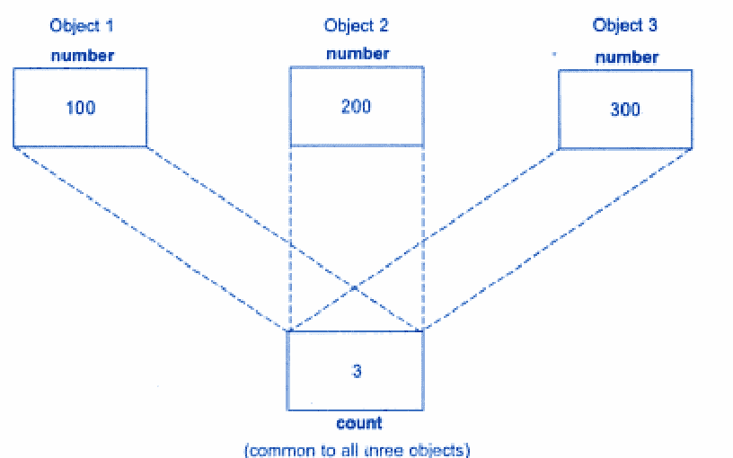

### Fig. 5.4 ↔ Sharing of a static data member

静态变量类似于非内联成员函数，因为它们在类声明中声明并在源文件中定义。在定义静态变量时，也可以为变量分配一些初始值。例如，以下定义将 `count` 的初始值设为 10。

```
int item :: count = 10;
```

## 5.12 静态成员函数

与静态成员变量类似，我们也可以拥有静态成员函数。声明为 `static` 的成员函数具有以下特性：

- 静态函数只能访问在同一类中声明的其他静态成员（函数或变量）。

- 静态成员函数可以使用类名（而不是其对象）按如下方式调用：

```
class-name :: function-name;
```

程序 5.5 说明了这些特性的实现。静态函数 `showcount()` 显示目前为止创建的对象数量。对象数量的计数由静态变量 `count` 维护。

函数 `showcode()` 显示每个对象的代码号。

### 静态成员函数

```cpp
#include <iostream>

using namespace std;

class test
{
        int code;
        static int count;        // static member variable
public:
        void setcode(void)
        {
                code = ++count;
        }
        void showcode(void)
        {
                cout << "Object number: " << code << "\n";
        }
        static void showcount(void)        // static member function
        {
                cout << "Count: " << count << "\n";
        }
};

int test::count;
int main()
{
        test t1, t2;

        t1.setcode();
        t2.setcode();

        test::showcount();       // accessing static function

        test t3;
        t3.setcode();

        test::showcount();

        t1.showcode();
        t2.showcode();
        t3.showcode();

        return 0;
}
```

### Output of Program 5.5:

```
count: 2
count: 3
object number: 1
object number: 2
object number: 3
```

### note

请注意语句

```
code = ++count;
```

在每次调用 `setcode()` 函数时执行，并将 `count` 的当前值赋给 `code`。由于每个对象都有自己的一份 `code` 副本，因此 `code` 中包含的值代表其对象的唯一编号。

记住，以下函数定义将不起作用：

```
static void showcount()
{
    cout << code;    // code is not static
}
```

## 5.13 对象数组

我们知道数组可以是任何数据类型，包括 `struct`。同样，我们也可以拥有变量数组，其类型为类。这样的变量称为对象数组。考虑以下类定义：

```
class employee
{
    char name[30];
    float age;
public:
    void getdata(void);
    void putdata(void);
};
```

标识符 `employee` 是一个用户定义的数据类型，可用于创建与不同类别员工相关的对象。示例：

```
employee manager[3];        // array of manager
employee foreman[15];       // array of foreman
employee worker[75];        // array of worker
```

数组 `manager` 包含三个对象（经理），即 `manager[0]`、`manager[1]` 和 `manager[2]`，类型为 `employee` 类。同样，`foreman` 数组包含 15 个对象（工头），而 `worker` 数组包含 75 个对象（工人）。

由于对象数组的行为与任何其他数组一样，我们可以使用通常的数组访问方法来访问各个元素，然后使用点成员运算符来访问成员函数。例如，语句

```
manager[i].putdata();
```

将显示数组 `manager` 的第 i 个元素的数据。也就是说，该语句要求对象 `manager[i]` 调用成员函数 `putdata()`。

对象数组在内存中以与多维数组相同的方式存储。数组 `manager` 在图 5.5 中表示。请注意，只为对象的數據项创建了空间。成员函数是单独存储的，将被所有对象使用。

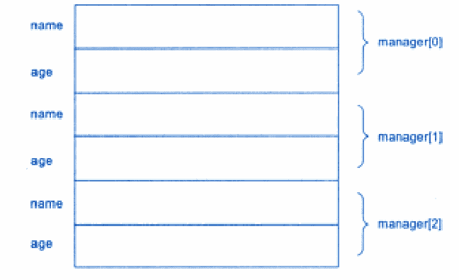

Fig. 5.5 ⇔ Storage of data items of an object array

程序 5.6 说明了对象数组的使用。

### 对象数组

```
#include <iostream>

using namespace std;

class employee
{
    char name[30];      // string as class member
    float age;
    public:
        void getdata(void);
        void putdata(void);
};
void employee :: getdata(void)
{
    cout << "Enter name: ";
    cin >> name;
    cout << "Enter age:  ";
    cin >> age;
}
void employee :: putdata(void)
{
    cout << "Name:  " << name << "\n";
    cout << "Age:   " << age  << "\n";
}
const int size=3;
int main()
{
    employee manager[size];
    for(int i=0; i<size; i++)
    {
        cout << "\nDetails of manager" << i+1 << "\n";
        manager[i].getdata();
    }
    cout << "\n";
    for(i=0; i<size; i++)
    {
        cout << "\nManager" << i+1 << "\n";
        manager[i].putdata();
    }
    return 0;
}
```

PROGRAM 5.6

这是一个交互式程序，输入数据和程序输出如下所示：

### Interactive input

Details of manager1

Enter name: xxx

Enter age: 45

```
Details of manager2
Enter name: yyy
Enter age: 37

Details of manager3
Enter name: zzz
Enter age: 50

Program output

Manager1
Name: xxx
Age: 45

Manager2
Name: yyy
Age: 37

Manager3
Name: zzz
Age: 50
```

## 5.14 对象作为函数参数

与其他任何数据类型一样，对象也可以作为函数参数使用。这可以通过两种方式实现：

- 将整个对象的副本传递给函数。

- 仅将对象的地址传递给函数。

第一种方法称为按值传递。由于传递的是对象的副本，因此函数内部对对象所做的任何更改都不会影响用于调用函数的对象。第二种方法称为按引用传递。当传递对象的地址时，被调用的函数将直接作用于调用中使用的实际对象。这意味着函数内部对对象所做的任何更改都会反映在实际对象上。按引用传递方法效率更高，因为它只需传递对象的地址，而不必传递整个对象。

程序 5.7 演示了对象作为函数参数的用法。它以小时和分钟的格式执行时间的加法。

### 对象作为参数

```cpp
#include <iostream>
using namespace std;
class time 
{
	int hours;
	int minutes;
public:
	void gettime(int h, int m) 
	{
		hours = h; minutes = m; 
	}
	void puttime(void)
	{
		cout << hours << " hours and ";
		cout << minutes << " minutes " << "\n";
	}
	void sum(time, time); // declaration with objects as arguments
};
void time :: sum(time t1, time t2) // t1, t2 are objects
{
	minutes = t1.minutes + t2.minutes;
	hours = minutes/60;
	minutes = minutes%60;
	hours = hours + t1.hours + t2.hours;
}
int main()
{
	time T1, T2, T3;
	T1.gettime(2,45); // get T1
	T2.gettime(3,30); // get T2
	T3.sum(T1, T2); // T3=T1+T2
	cout << "T1 = "; T1.puttime(); // display T1
	cout << "T2 = "; T2.puttime(); // display T2
	cout << "T3 = "; T3.puttime(); // display T3
	return 0;
}
```

**程序 5.7**

为了使外部函数对某个类“友好”，我们只需将该函数声明为类的友元，如下所示：

```
class ABC
{
.....
.....
public:
.....
.....
.....
void xyz(void); // declaration
};
```

函数声明前应加上关键字 `friend`。该函数在程序的其他地方像普通 C++ 函数一样定义。函数定义既不使用关键字 `friend`，也不使用作用域运算符 `::`。使用关键字 `friend` 声明的函数称为友元函数。一个函数可以在任意数量的类中被声明为友元。友元函数虽然不是成员函数，但可以完全访问类的私有成员。

- 它不在其被声明为友元的类的作用域内。

- 由于它不在该类的作用域内，因此不能使用该类的对象来调用它。

- 它可以像普通函数一样在无需任何对象的情况下被调用。

- 与成员函数不同，它不能直接访问成员名称，必须使用对象名和点成员运算符来访问每个成员名称（例如 `A.x`）。

- 它可以声明在类的 `public` 或 `private` 部分，而不影响其含义。

- 通常，它以对象作为参数。

友元函数通常用于运算符重载，这将在后面讨论。

程序 5.8 演示了友元函数的用法。


```cpp
#include <iostream>
using namespace std;

class sample
{
    int a;
    int b;
    public:
        void setvalue() {a=25; b=40; }
        friend float mean(sample s);
};
float mean(sample s)
{
    return float(s.a + s.b)/2.0;
}

int main()
{
    sample X;    // object X
    X.setvalue();
    cout << "Mean value = " << mean(X) << "\n";

    return 0;
}
```

程序 5.8 的输出为：

```
Mean value = 32.5
```

注意

> 友元函数通过点运算符以及传递给它的对象来访问类变量 `a` 和 `b`。函数调用 `mean(X)` 按值将对象 `X` 传递给友元函数。

一个类的成员函数可以是另一个类的友元函数。在这种情况下，它们使用作用域运算符进行定义，如下所示：

```
class X
{
    .....
    .....
    int fun1();    // member function of X
    .....
};

class Y
{
    .....
    .....
    friend int X :: fun1();      // fun1() of X
                                 // is friend of Y
    .....
};
```

函数 `fun1()` 是 `类 X` 的成员，也是类 `Y` 的一个 `友元`。

我们还可以将一个类的所有成员函数声明为另一个类的友元函数。在这种情况下，该类称为 `友元类`。这可以如下指定：

```
class Z
{
    .....
    friend class X;    // all member functions of X are
                      // friends to Z
};
```

程序 5.9 演示了友元函数如何充当类之间的桥梁。

### 对两个类友好的函数

```
#include <iostream>

using namespace std;

class ABC;    // Forward declaration
//--------------------------------------------------//
class XYZ
{
    int x;
public:
    void setvalue(int i) {x = i;}
    friend void max(XYZ, ABC);
};
//--------------------------------------------------//
class ABC
{
    int a;
public:
    void setvalue(int i) {a = i;}
    friend void max(XYZ, ABC);
};
```

### 交换类的私有数据

```cpp
#include <iostream>
using namespace std;

class class_2;

class class_1
{
	int value1;
public:
	void indata(int a) {value1 = a;}
	void display(void) {cout << value1 << "\n";}
	friend void exchange(class_1 &, class_2 &);
};

class class_2
{
	int value2;
public:
	void indata(int a) {value2 = a;}
	void display(void) {cout << value2 << "\n";}
	friend void exchange(class_1 &, class_2 &);
};

void exchange(class_1 &x, class_2 &y)
{
	int temp = x.value1;
	x.value1 = y.value2;
	y.value2 = temp;
}

int main()
{
	class_1 C1;
	class_2 C2;
	C1.indata(100);
	C2.indata(200);
	cout << "Values before exchange" << "\n";
	C1.display();
	C2.display();
	exchange(C1, C2);      // swapping

	cout << "Values after exchange " << "\n";
	C1.display();
	C2.display();

	return 0;
}
```

**程序 5.10**

对象 `x` 和 `y` 分别是 `C1` 和 `C2` 的别名。以下语句

```
int temp = x.value1;
x.value1 = y.value2;
y.value2 = temp;
```

直接修改了 `class_1` 和 `class_2` 中声明的 `value1` 和 `value2` 的值。

以下是程序 5.10 的输出：

```
Values before exchange
100
200
Values after exchange
200
100
```

## 5.16 返回对象

函数不仅可以接收对象作为参数，还可以返回对象。程序 5.11 中的示例说明了如何（在函数内部）创建对象并将其返回给另一个函数。

### 返回对象

```cpp
#include <iostream>

using namespace std;

class complex      // x + iy form
{
    float x;        // real part
    float y;        // imaginary part
public:
    void input(float real, float imag)
    { x = real; y = imag; }
    friend complex sum(complex, complex);
    void show(complex);
};

complex sum(complex c1, complex c2)
{
    complex c3;            // objects c3 is created
    c3.x = c1.x + c2.x;
    c3.y = c1.y + c2.y;
    return(c3);            // returns object c3
}

void complex :: show(complex c)
{
    cout << c.x << " + j" << c.y << "\n";
}

int main()
{
    complex A, B, C;

    A.input(3.1, 5.65);
    B.input(2.75, 1.2);

    C = sum(A, B);          // C = A + B

    cout << "A = "; A.show(A);
    cout << "B = "; B.show(B);
    cout << "C = "; C.show(C);

    return 0;
}
```

程序 5.11 执行后将生成以下输出：

```
A = 3.1 + j5.65
B = 2.75 + j1.2
C = 5.85 + j6.85
```

该程序将两个复数 `A` 和 `B` 相加，得到第三个复数 `C`，并显示这三个数。

## 5.17 常量成员函数

如果成员函数不修改类中的任何数据，则可以将其声明为常量成员函数，如下所示：

```
void mul(int, int) const;
double get_balance() const;
```

限定符 `const` 附加在函数原型（声明和定义中都要）之后。如果此类函数试图修改数据值，编译器将生成错误消息。

## 5.18 指向成员的指针

可以获取类成员的地址并将其赋给指针。可以通过对“完全限定”的类成员名应用运算符 `&` 来获取成员的地址。可以使用运算符 `::*` 和类名来声明类成员指针。例如，给定类

```
class A
{
    private:
        int m;
    public:
        void show();
};
```

我们可以如下定义指向成员 `m` 的指针：

```
int A::* ip = &A :: m;
```

这样创建的指针 `ip` 的行为类似于类成员，因为它必须使用类对象来调用。在上面的语句中，`A::*` 表示“指向 `A` 类成员的指针”。`&A::m` 表示“`A` 类成员 `m` 的地址”。

请记住，以下语句是无效的：

```
int *ip = &m;    // 不起作用
```

这是因为 `m` 不仅仅是 `int` 类型的数据。只有与它所属的类关联时，它才有意义。作用域运算符必须同时应用于指针和成员。

现在可以使用指针 `ip` 在成员函数（或友元函数）中访问成员 `m`。假设 `a` 是在成员函数中声明的 `A` 类对象。我们可以如下使用指针 `ip` 访问 `m`：

```
cout << a.*ip;    // 显示
cout << a.m;      // 与上面相同
```

现在，看下面的代码：

```
ap = &a;                 // ap 是指向对象 `a` 的指针
cout << ap -> *ip;       // 显示 `m`
cout << ap -> m; // 与上面相同
```

当同时使用指向对象和成员的指针时，使用解引用运算符 `->*` 来访问成员。当对象本身与成员指针一起使用时，使用解引用运算符 `.*`。请注意，`*ip` 的使用方式类似于成员名。

我们还可以设计指向成员函数的指针，然后可以在 `main` 中使用解引用运算符调用它们，如下所示：

```
(对象名 .* 指向成员函数的指针) (10);
(指向对象的指针 ->* 指向成员函数的指针) (10)
```

`()` 的优先级高于 `.*` 和 `->*`，因此括号是必需的。

程序 5.12 演示了使用解引用运算符访问类成员。

### 解引用运算符

```cpp
#include <iostream>

using namespace std;

class M
{
    int x;
    int y;
public:
    void set_xy(int a, int b)
    {
        x = a;
        y = b;
    }
    friend int sum(M m);
};

int sum(M m)
{
        int M:: *px = &M::x;
        int M:: *py = &M::y;
        M *pm = &m;
        int S = m.*px + pm->*py;
        return S;
}

int main()
{
        M m;
        void (M:: *pf)(int,int) = &M::set_xy;
        (m.*pf)(10,20);
        cout << "SUM = " << sum(m) << "\n";
        M *pm = &m;
        (pm->*pf)(30,40);
        cout << "SUM = " << sum(m) << "\n";
        return 0;
}
```

程序 5.12 的输出为：

```
SUM = 30
SUM = 70
```

## 5.19 局部类

可以在函数或块内部定义和使用类。这样的类称为局部类。示例：

```cpp
void test(int a)       // 函数
{
    .....
    .....
    class student;  // 局部类
    {
            .....
            .....  // 类定义
    }

    student s1(a);      // 创建 student 对象
    ....              // 使用 student 对象
}
```

局部类可以使用全局变量（在函数上方声明的变量）和在函数内部声明的静态变量，但不能使用自动局部变量。全局变量应使用作用域运算符（`::`）。

构造局部类时存在一些限制。它们不能有静态数据成员，并且成员函数必须在局部类内部定义。外部函数不能访问局部类的私有成员。但是，可以通过将外部函数声明为友元来实现这一点。

## 摘要

- ↔ 类是结构数据类型的扩展。类可以同时将变量和函数作为成员。
- ↔ 默认情况下，类的成员是私有的，而结构的成员是公有的。
- ↔ 只有成员函数可以访问私有数据成员和私有函数。然而，公有成员可以从类外部访问。
- ↔ 在 C++ 中，类变量称为对象。通过对象，我们可以使用点运算符访问类的公有成员。
- ↔ 我们可以在类的内部或外部定义成员函数。成员函数与普通函数的区别在于，成员函数在函数头中使用成员“标识”标签来指明它所属的类。
- ↔ 对象的内存空间在声明时分配。成员变量的空间为每个对象单独分配，但成员函数不分配单独的空间。
- ↔ 类的数据成员可以声明为静态的，通常用于维护整个类共有的值。
- ↔ 静态成员变量必须在类外部定义。
- ↔ 静态成员函数可以访问在同一个类中声明的静态成员，并且可以使用类名调用。
- ↔ C++ 允许我们有对象数组。
- ↔ 我们可以使用对象作为函数参数。
- ↔ 声明为 `友元` 的函数不在它被声明为友元的类的作用域内。它可以完全访问该类的私有成员。
- ↔ 函数也可以返回对象。
- ↔ 如果成员函数不修改类中的任何数据，则可以将其声明为 `常量` 成员函数。关键字 `const` 附加在函数原型之后。
- ↔ 也可以在函数内部定义和使用类。这样的类称为局部类。

## 关键术语

- 抽象数据类型
- 对象数组
- `类`
- 类声明
- 类成员
- 类变量
- `常量` 成员函数
- 数据隐藏
- 数据成员
- 解引用运算符
- 点运算符
- 元素
- 封装
- `友元` 函数
- 继承
- `内联` 函数
- 局部类
- 成员函数
- 成员函数的嵌套
- 对象
- 按引用传递
- 按值传递
- 句点运算符
- `私有`
- 原型
- `公有`
- 作用域运算符
- 作用域解析
- `静态` 数据成员
- 静态成员函数
- 静态变量
- `结构体`
- 结构
- 结构成员
- 结构名称
- 结构标记
- 模板

## 复习题

- 5.1 C 和 C++ 中的结构有何不同？
- 5.2 什么是类？它如何实现数据隐藏？
- 5.3 C++ 结构体与 C++ 类有何不同？
- 5.4 什么是对象？它们是如何创建的？
- 5.5 如何定义类的成员函数？
- 5.6 在同一个程序文件中，可以将相同的函数名用于类的成员函数和外部函数吗？如果可以，如何区分它们？如果不可以，请说明理由。
- 5.7 描述在以下情况下访问数据成员和成员函数的机制：
  - (a) 在 `main` 程序内部。
  - (b) 在同一个类的成员函数内部。
  - (c) 在另一个类的成员函数内部。
- 5.8 我们何时将类的成员声明为静态的？
- 5.9 什么是友元函数？使用友元函数的优点和缺点是什么？
- 5.10 判断下列说法是正确（TRUE）还是错误（FALSE）。
  - (a) 类中的数据项必须总是私有的。
  - (b) 设计为私有的函数只能被该类的成员函数访问。
  - (c) 设计为公有的函数可以像其他普通函数一样被访问。
  - (d) 在类说明符内部定义的成员函数默认成为内联函数。
  - (e) 类可以将一个实体的所有方面汇集在一个地方。
  - (f) 类成员默认是公有的。
  - (g) 友元函数只能访问类的公有成员。
  - (h) 可以使整个类成为另一个类的友元。
  - (i) 函数不能返回类对象。
  - (j) 可以在类说明符内部初始化数据成员。

## 调试练习

5.1 找出以下程序中的错误。

```cpp
#include <iostream.h>

struct Room
{
    int width;
    int length;
}

void setValue(int w, int l)
{
    width = w;
    length = l;
}

void main()
{
    Room objRoom;
    objRoom.setValue(12, 1,4);
}
```

### 5.2 识别以下程序中的错误。

```cpp
#include <iostream.h>

class Room
{
    int width, height;
    void setValue(int w, int h)
    {
        width = w;
        height = h;
    }
};

void main()
{
    Room objRoom;
    objRoom.width = 12;
}
```

### 5.3 识别以下程序中的错误。

```cpp
#include <iostream.h>

class Item
{
```


### 5.4 识别以下程序中的错误。

```cpp
#include <iostream.h>

class staticFunction
{
    static int count;
public:
    static void setCount()
    {
        count++;
    }
    void displayCount()
    {
        cout << count;
    }
};
int staticFunction::count = 10;
void main()
{
    staticFunction obj1;
    obj1.setCount(5);
    staticFunction::setCount();
    obj1.displayCount();
}
```

### 5.5 识别以下程序中的错误。

```cpp
#include <iostream.h>

class Length
{
    int feet;
    float inches;
public:
    Length()
    {
        feet = 5;
        inches = 6.0;
    }
    Length(int f, float in)
    {
        feet = f;
        inches = in;
    }
    Length addLength(Length l)
    {
        l.inches += this->inches;
        l.feet += this->feet;
        if (l.inches >= 12)
        {
            l.inches -= 12;
            l.feet++;
        }
        return l;
    }
    int getFeet()
    {
        return feet;
    }
    float getInches()
    {
        return inches;
    }
};
void main()
{
    Length objLength1;
    Length objLength2(5, 6.5);
    objLength1 = objLength1.addLength(objLength2);
    cout << objLength1.getFeet() << ' ';
    cout << objLength1.getInches() << ' ';
}
```

### 5.6 识别以下程序中的错误。

```cpp
#include <iostream>

class Room;

void Area()
{
    int width, height;
    class Room
    {
        int width, height;
    public:
        void setValue(int w, int h)
        {
            width = w;
            height = h;
        }
        void displayValues()
        {
            cout << (float)width << ' ' << (float)height;
        }
    };

    Room objRoom1;
    objRoom1.setValue(12, 8);
    objRoom1.displayValues();
}

void main()
{
    Area();
    Room objRoom2;
}
```

## 编程练习

5.1 定义一个类来表示银行账户。包含以下成员：
数据成员
1. 存款人姓名
2. 账号
3. 账户类型
4. 账户余额金额
成员函数
1. 分配初始值
2. 存款金额
3. 在检查余额后取款金额
4. 显示姓名和余额
编写主程序来测试程序。

5.2 编写一个类来表示向量（一系列浮点值）。包含成员函数执行以下任务：
(a) 创建向量
(b) 修改给定元素的值
(c) 乘以标量值
(d) 以形式显示向量 (10, 20, 30, ...)
编写程序来测试你的类。

5.3 修改练习 5.1 的类和程序以处理 10 个客户。

5.4 修改练习 5.2 的类和程序，使程序能够添加两个向量并显示结果向量。（注意我们可以将对象作为函数参数传递。）

构造函数 `integer()` 可以修改为接受参数如下所示：

```cpp
class integer
{
    int m, n;
public:
    integer(int x, int y);  // 参数化构造函数
    ....
    ....
};

integer :: integer(int x, int y)
{
    m = x; n = y;
}
```

当构造函数被参数化时，像这样的对象声明语句

```cpp
integer int1;
```

可能不再工作。我们必须在声明对象时将初始值作为参数传递给构造函数函数。这可以通过两种方式完成：

- 通过显式调用构造函数。
- 通过隐式调用构造函数。

以下声明说明了第一种方法：

```cpp
integer int1 = integer(0, 100); // 显式调用
```

此语句创建 `integer` 对象 `int1` 并向其传递值 `0` 和 `100`。第二种实现如下：

```cpp
integer int1(0, 100);        // 隐式调用
```

这种方法有时称为简写方法，因为它使用非常频繁，因为它更短，看起来更好且易于实现。

记住，当构造函数被参数化时，我们必须为构造函数提供适当的 arguments。程序 6.1 演示了向构造函数函数传递 arguments。

程序 6.2 显示了重载构造函数的用法。

## 重载构造函数

```cpp
#include <iostream>

using namespace std;

class complex
{
    float x, y;
public:
    complex() { }                      // 无参构造函数
    complex(float a) { x = y = a; }     // 一参构造函数
    complex(float real, float imag)   // 两参构造函数
    {
        x = real;
        y = imag;
    }
    friend complex sum(complex, complex);
    friend void show(complex);
};

complex sum(complex c1, complex c2)  // 友元
{
    complex c3;
    c3.x = c1.x + c2.x;
    c3.y = c1.y + c2.y;
    return c3;
}

void show(complex c)                 // 友元
{
    cout << c.x << " + j" << c.y << "\n";
}

int main()
{
    complex A(2.7, 3.5);               // 定义并初始化
    complex B(1.6);                    // 定义并初始化
    complex C;                         // 定义
    C = sum(A, B);                     // sum() 是友元
    cout << "A = "; show(A);           // show() 也是友元
    cout << "B = "; show(B);
    cout << "C = "; show(C);

    // 另一种给出初始值的方法（第二种方法）
    complex P, Q, R;                     // 定义 P、Q 和 R

    P = complex(2.5, 3.9);      // 初始化 P
    Q = complex(1.6, 2.5);      // 初始化 Q
    R = sum(P, Q);

    cout << "\n";
    cout << "P = "; show(P);
    cout << "Q = "; show(Q);
    cout << "R = "; show(R);

    return 0;
}
```

程序 6.2 的输出将为：

```
A = 2.7 + j3.5
B = 1.6 + j1.6
C = 4.3 + j5.1

P = 2.5 + j3.9
Q = 1.6 + j2.5
R = 4.1 + j6.4
```

注意

类 `complex` 中有三个构造函数。第一个构造函数，不带参数，用于创建未初始化的对象；第二个，带一个参数，用于创建对象并初始化它们；第三个，带两个参数，也用于创建对象并初始化为特定值。请注意，第二种初始化值的方法看起来更好。

让我们再看一下第一个构造函数。

```cpp
complex() { }
```

它包含空体且不执行任何操作。我们刚刚说过这用于创建没有初始值的对象。记住，我们在之前的示例中已在不使用此类构造函数的情况下定义了对象。为什么我们现在需要这个构造函数？。如前所述，C++ 编译器有一个隐式构造函数，可以创建对象，即使它未在类中定义。

只要我们不在类中使用其他构造函数，这就很好用。然而，一旦我们定义了一个构造函数，我们还必须定义“不执行任何操作”的隐式构造函数。此构造函数不会执行任何操作，仅定义为满足编译器。

## 6.5 带默认参数的构造函数

可以定义带默认参数的构造函数。例如，构造函数 `complex()` 可以声明如下：

```cpp
complex(float real, float imag = 0);
```

参数 `imag` 的默认值是零。然后，语句

```cpp
complex C(5.0);
```

将值 `5.0` 分配给 `real` 变量，并将 `0.0` 默认分配给 `imag`。然而，语句

```cpp
complex C(2.0, 3.0);
```

将 `2.0` 分配给 `real` 并将 `3.0` 分配给 `imag`。当指定实际参数时，它会覆盖默认值。如前所述，缺失的参数必须是尾随的参数。

区分默认构造函数 `A::A()` 和默认参数构造函数 `A::A(int = 0)` 很重要。默认参数构造函数可以用一个参数或没有参数调用。当不带参数调用时，它成为默认构造函数。当在类中使用这两种形式时，对于像这样的语句会产生歧义

```cpp
A a;
```

歧义在于是否调用 `A::A()` 或 `A::A(int = 0)`。

## 6.6 对象的动态初始化

类对象也可以动态初始化。也就是说，对象的初始值可以在运行时提供。动态初始化的一个优点是我们可以使用重载构造函数提供各种初始化格式。这提供了在运行时根据情况使用不同格式数据的灵活性。

考虑商业银行中运作的长期存款计划。银行为不同的计划以及不同的投资期限提供不同的利率。程序 6.3 说明了如何使用类变量保存账户详细信息，以及如何使用动态初始化在运行时构造这些变量。

### 构造函数动态初始化

```cpp
// Long-term fixed deposit system

#include <iostream>

using namespace std;

class Fixed_deposit
{
    long int P_amount;      // Principal amount
    int      Years;         // Period of investment
    float    Rate;          // Interest rate
    float    R_value;       // Return value of amount
public:
    Fixed_deposit() { }
    Fixed_deposit(long int p, int y, float r = 0.12);
    Fixed_deposit(long int p, int y, int r);
    void display(void);
};

Fixed_deposit :: Fixed_deposit(long int p, int y, float r)
{
    P_amount = p;
    Years = y;
    Rate = r;
    R_value = P_amount;
    for (int i = 1; i <= y; i++)
        R_value = R_value * (1.0 + r);
}

Fixed_deposit :: Fixed_deposit(long int p, int y, int r)
{
    P_amount = p;
    Years = y;
    Rate = r;
    R_value = P_amount;
    for (int i = 1; i <= y; i++)
        R_value = R_value * (1.0 + float(r) / 100);
}

void Fixed_deposit :: display(void)
{
    cout << "\n"
         << "Principal Amount = " << P_amount << "\n"
         << "Return Value     = " << R_value << "\n";
}

int main()
{
    Fixed_deposit FD1, FD2, FD3;  // deposits created
    long int p;                 // principal amount
    int     y;                  // investment period, years
    float   r;                  // interest rate, decimal form
    int     R;                  // interest rate, percent form

    cout << "Enter amount,period,interest rate(in percent)" << "\n";
    cin >> p >> y >> R;
    FD1 = Fixed_deposit(p, y, R);

    cout << "Enter amount,period,interest rate(decimal form)" << "\n";
    cin >> p >> y >> r;
    FD2 = Fixed_deposit(p, y, r);

    cout << "Enter amount and period" << "\n";
    cin >> p >> y;
    FD3 = Fixed_deposit(p, y);

    cout << "\nDeposit 1";
    FD1.display();
    cout << "\nDeposit 2";
    FD2.display();
    cout << "\nDeposit 3";
    FD3.display();

    return 0;
}
```

程序 6.3 的输出为：

```
Enter amount,period,interest rate(in percent)
10000 3 18

Enter amount,period,interest rate(in decimal form)
10000 3 0.18

Enter amount and period
10000 3

Deposit 1
Principal Amount = 10000
Return Value      = 16430.3

Deposit 2
Principal Amount = 10000
Return Value      = 16430.3

Deposit 3
Principal Amount = 10000
Return Value      = 14049.3
```

该程序使用了三个重载的构造函数。这些构造函数的参数值在运行时提供。用户可以以下列其中一种形式提供输入：

1. 金额、期限和以小数形式表示的利率。
2. 金额、期限和以百分比形式表示的利率。
3. 金额和期限。

note

由于构造函数根据适当的参数进行了重载，因此与输入值匹配的构造函数将被调用。例如，第二构造函数用于形式 (1) 和 (3)，第三构造函数用于形式 (2)。请注意，对于形式 (3)，使用了带默认参数的构造函数。由于第三个参数的输入缺失，因此使用 `r` 的默认值。

## 6.7 拷贝构造函数

我们在第 6.3 节中简要提到了拷贝构造函数。我们在第 6.4 节中使用了拷贝构造函数

```cpp
integer(integer &i);
```

作为重载构造函数之一。

如前所述，拷贝构造函数用于从另一个对象声明并初始化一个对象。例如，语句


# 面向对象 C++ 编程

## 拷贝构造函数

```
integer I2(I1);
```

将定义对象 `I2`，同时将其初始化为 `I1` 的值。此语句的另一种形式为

```
integer I2 = I1;
```

通过拷贝构造函数初始化的过程称为拷贝初始化。请记住，语句

```
I2 = I1;
```

不会调用拷贝构造函数。然而，如果 `I1` 和 `I2` 是对象，则该语句是合法的，并且只是逐成员地将 `I1` 的值赋给 `I2`。这是重载赋值运算符(`=`) 的任务。我们稍后会看到更多相关内容。

拷贝构造函数以同一类对象的引用作为参数。让我们考虑一个简单的构造和使用拷贝构造函数的示例，如程序 6.4 所示。

```
#include <iostream>

using namespace std;

class code

{

    int id;

public:

    code() { }                      // constructor

    code(int a) { id = a; }         // constructor again

    code(code & x)                  // copy constructor

    {

        id = x.id;                  // copy in the value

    }

    void display(void)

    {

        cout << id;

    }

};

int main()

{

    code A(100);    // object A is created and initialized

    code B(A);      // copy constructor called

    code C = A;     // copy constructor called again

    code D; // D is created, not initialized

    D = A;          // copy constructor not called

    cout << "\n id of A: "; A.display();

    cout << "\n id of B: "; B.display();

    cout << "\n id of C: "; C.display();

    cout << "\n id of D: "; D.display();

    return 0;

}
```

### 程序 6.4

程序 6.4 的输出如下所示

```
id of A: 100

id of B: 100

id of C: 100

id of D: 100
```

> 拷贝构造函数的参数使用了引用变量。我们不能按值将参数传递给拷贝构造函数。

当未定义拷贝构造函数时，编译器提供其自己的拷贝构造函数。

构造函数也可以在创建对象时分配内存。这将使系统在对象大小不相同时为每个对象分配适当数量的内存，从而节省内存。在对象构造时为对象分配内存称为对象的动态构造。内存是借助 `new` 运算符分配的。程序 6.5 显示了 `new` 在用于在对象中构造字符串的构造函数中的使用。

```
#include <iostream>

#include <string>

using namespace std;

class String

{

  char *name;

  int length;

public:

  String()  // constructor-1

  {

    length = 0;

    name = new char[length + 1];

  }

  String(char *s)  // constructor-2

  {

    length = strlen(s);

    name = new char[length + 1];       // one additional

                                      // character for \0

    strcpy(name, s);

  }

void display(void)

{cout << name << "\n";}

void join(String &a, String &b);

};

void String :: join(String &a, String &b)

{

    length = a.length + b.length;

    delete name;

    name = new char[length+1];        // dynamic allocation

    strcpy(name, a.name);

    strcat(name, b.name);

};

int main()

{

        char *first = "Joseph ";

        String name1(first), name2("Louis "),name3("Lagrange"),s1,s2;

        s1.join(name1, name2);

        s2.join(s1, name3);

        name1.display();

        name2.display();

        name3.display();

        s1.display();

        s2.display();

        return 0;

}
```

程序 6.5 的输出将为：

```
Joseph

Louis

Lagrange

Joseph Louis

Joseph Louis Lagrange
```

### note

该程序使用了两个构造函数。第一个是空构造函数，允许我们声明字符串数组。第二个构造函数初始化字符串的长度，为字符串存储分配必要的空间并创建字符串本身。请注意，为容纳结束字符串字符 `'\0'` 分配了一个额外的字符空间。

成员函数 `join()` 连接两个字符串。它估计要连接的字符串的组合长度，为组合字符串分配内存，然后使用字符串函数 `strcpy()` 和 `strcat()` 创建该字符串。请注意，在函数 `join()` 中，`length` 和 `name` 是调用该函数的对象的成员，而 `a.length` 和 `a.name` 是参数对象 `a` 的成员。`main()` 函数程序将三个字符串连接成一个字符串。输出如下所示：Joseph Louis Lagrange

## 6.9 构造二维数组

我们可以使用类类型对象构造矩阵变量。程序 6.6 中的示例说明了如何构造大小为 `m` x `n` 的矩阵。

```
CONSTRUCTING MATRIX OBJECTS

#include <iostream>

using namespace std;

class matrix

{

    int **p; // pointer to matrix

    int d1,d2;      // dimensions

public:

    matrix(int x, int y);

    void get_element(int i, int j, int value)

    {p[i][j]=value;}

    int & put_element(int i, int j)

    {return p[i][j];}

};

matrix :: matrix(int x, int y)

{

    d1 = x;

    d2 = y;

    p = new int *[d1];      // creates an array pointer

    for(int i = 0; i < d1; i++)

        p[i] = new int[d2]; // creates space for each row

}

int main()

{

    int m, n;

    cout << "Enter size of matrix: ";

    cin  >> m >> n;

    matrix A(m,n); // matrix object A constructed

    cout << "Enter matrix elements row by row \n";

    int i, j, value;

    for(i = 0; i < m; i++)

        for(j = 0; j < n; j++)

        {

            cin >> value;

            A.get_element(i,j,value);

        }

    cout << "\n";

    cout << A.put_element(1,2);

    return 0;

};
```

程序 6.6 的一个示例运行的输出如下。

```
Enter size of matrix: 3 4

Enter matrix elements row by row

11 12 13 14

15 16 17 18

19 20 21 22

17
```

17 是元素 (1,2) 的值。

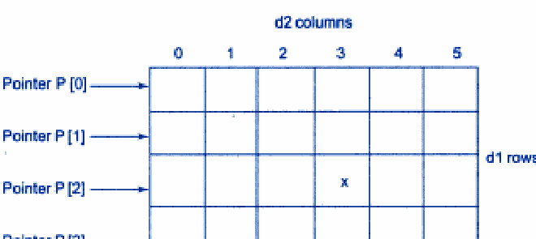

构造函数首先创建一个指向大小为 `d1` 的 `int` 的向量指针。然后，它迭代地分配一个由每个元素 `p[i]` 指向的大小为 `d2` 的 `int` 类型向量。

因此，如上图所示，`d1` × `d2` 矩阵的元素空间是从自由存储中分配的。

## 6.10 `const` 对象

我们可以使用在对象声明前使用 `const` 关键字来创建和使用常量对象。例如，我们可以按如下方式创建 `matrix` 类的常量对象 `X`：

```
const matrix X(m,n); // object X is constant
```

任何尝试修改 `m` 和 `n` 的值都将产生编译时错误。此外，常量对象只能调用 `const` 成员函数。正如我们所知，`const` 成员是函数原型或函数定义，其中 `const` 关键字出现在函数签名之后。

每当 `const` 对象尝试调用非 `const` 成员函数时，编译器都会生成错误。

## 6.11 析构函数

*析构函数*，顾名思义，用于销毁由构造函数创建的对象。与构造函数一样，析构函数是一个成员函数，其名称与类名相同，但前面有一个波浪号。例如，类 `integer` 的析构函数可以定义如下：

```
~integer() { }
```

析构函数永远不接受任何参数也不返回任何值。它将在程序退出时由编译器隐式调用（或按情况在块或函数退出时）以清理不再可访问的存储。声明析构函数是一个良好的编程实践，因为它为将来使用释放内存空间。

每当在构造函数中使用 `new` 分配内存时，我们都应使用 `delete` 释放该内存。例如，上面讨论的 `matrix` 类的析构函数可以定义如下：

```
matrix :: ~matrix()

{

    for(int i=0; i<d1; i++)

        delete p[i];

    delete p;

}
```

这是必需的，因为当指向对象的指针超出作用域时，析构函数不会被隐式调用。

下面的示例说明了析构函数已由编译器隐式调用。

### 析构函数的实现

```
#include <iostream>

using namespace std;

int count = 0;

class alpha

{

public:

    alpha()

    {

        count++;

        cout << "\nNo.of object created " << count;

    }

    ~alpha()

    {

        cout << "\nNo.of object destroyed " << count;

        count--;

    }

};

int main()

{

    cout << "\n\nENTER MAIN\n";

    alpha A1, A2, A3, A4;

    {

        cout << "\n\nENTER BLOCK1\n";

        alpha A5;

    }

    {

        cout << "\n\nENTER BLOCK2\n";

        alpha A6;

    }

    cout << "\n\nRE-ENTER MAIN\n";

    return 0;

}
```

### 程序 6.7

```
Room()

{

    length = 0;

    width = 0;

}

Room(int value=8)

{

    length = width = 8;

}

void display()

{

    cout << length << ' ' << width;

}

;

void main()

{

    Room objRoom1;

    objRoom1.display();

}
```

### 6.3 指出以下程序中的错误。

```
#include <iostream.h>

class Room

{

    int width;

    int height;

    static int copyConsCount;

public:

    void Room()

    {

        width = 12;

        height = 8;

    }

    Room(Room& r)

    {

        width = r.width;

        height = r.height;

        copyConsCount++;

    }

    void dispCopyConsCount()

    {

        cout << copyConsCount;

    }

};

int Room::copyConsCount = 0;

void main()

{

    Room objRoom1;

    Room objRoom2(objRoom1);

    Room objRoom3 = objRoom1;

    Room objRoom4;

    objRoom4 = objRoom3;

    objRoom4.dispCopyConsCount();

}
```

### 6.4 指出以下程序中的错误。

```
#include <iostream.h>

class Room

{

    int width;

    int height;

    static int copyConsCount;

public:

    Room()

    {

        width = 12;

        height = 8;

    }

    Room(Room& r)

    {

        width = r.width;

        height = r.height;

        copyConsCount++;

    }

    void disCopyConsCount()

    {

        cout << copyConsCount;

    }

};

int Room::copyConsCount = 0;

void main()

{

    Room objRoom1;

    Room objRoom2 (objRoom1);

    Room objRoom3 = objRoom1;

    Room objRoom4;

    objRoom4 = objRoom3;

    objRoom4.dispCopyConsCount();

}
```


## 编程练习

### 6.1
为第 5 章编程练习 5.1 至 5.5 中设计的类设计构造函数。

### 6.2
定义一个类 `String`，使其能够作为用户定义的字符串类型工作。包含构造函数，使我们能够创建一个未初始化的字符串：

`String s1;` // 长度为 0 的字符串

并且在创建时用字符串常量初始化一个对象，如：

`String s2("Well done!");`

包含一个函数将两个字符串相加生成第三个字符串。注意语句 `s2 = s1;` 将是复制一个字符串到另一个的完全合理的表达式。

编写一个完整的程序来测试你的类，查看它是否执行以下任务：

- (a) 创建未初始化的字符串对象。
- (b) 使用字符串常量创建对象。
- (c) 正确连接两个字符串。
- (d) 显示所需的字符串对象。

### 6.3
一家书店维护着在店内销售的书籍库存。清单包括作者、书名、价格、出版社和库存状况等详细信息。每当顾客想要一本书时，销售人员输入书名和作者，系统会搜索清单并显示是否可用。如果不可用，则显示适当的提示。如果可用，则系统会显示书籍详情并要求输入所需副本数量。如果所需副本有库存，则显示所需副本的总成本；否则显示消息“Required copies not in stock”。

使用名为 `books` 的类设计一个系统，具有合适的成员函数和构造函数。在构造函数中使用 `new` 操作符分配所需的内存空间。

### 6.4
改进练习 6.3 中的系统设计以纳入以下功能：

- (a) 书籍的价格应根据需要随时更新。使用私有成员函数来实现此功能。
- (b) 每本图书的库存价值应在交易完成后自动更新。
- (c) 应记录成功和不成功的交易次数以进行统计分析。使用 `static` 数据成员来统计交易次数。

### 6.5
修改练习 6.4 的程序以演示使用指针访问成员。

# 7 运算符重载和类型转换

## 关键概念

- 重载
- 运算符函数
- 重载一元运算符
- 字符串操作
- 基本到类类型
- 类到类类型
- 运算符重载
- 重载二元运算符
- 使用友元进行重载
- 类型转换
- 类到基本类型
- 重载规则

## 7.1 引言

运算符重载是 C++ 语言的众多令人兴奋的特性之一。它是一种重要的技术，增强了 C++ 的可扩展性。我们不止一次地指出，C++ 试图使用户定义的数据类型与内置类型以相同的方式表现。例如，C++ 允许我们用应用于基本类型的相同语法来相加两个用户定义类型变量。这意味着 C++ 具有为数据类型提供运算符特殊含义的能力。给运算符赋予这种特殊含义的机制称为运算符重载。

运算符重载为大多数 C++ 运算符创建新定义提供了灵活的选择。我们可以 almost create a new language of our own by the creative use of the function and operator overloading techniques. We can overload (give additional meaning to) all the C++ operators except the following:

- Class member access operators (`.`, `.*`).
- Scope resolution operator (`::`).
- Size operator (`sizeof`).
- Conditional operator (`?:`).

The excluded operators are very few when compared to the large number of operators which qualify for the operator overloading definition.

Although the *semantics* of an operator can be extended, we cannot change its *syntax*, the grammatical rules that govern its use such as the number of operands, precedence and associativity. For example, the multiplication operator will enjoy higher precedence than the addition operator. Remember, when an operator is overloaded, its original meaning is not lost. For instance, the operator `+`, which has been overloaded to add two vectors, can still be used to add two integers.

## 7.2 Defining Operator Overloading

To define an additional task to an operator, we must specify what it means in relation to the class to which the operator is applied. This is done with the help of a special function, called *operator function*, which describes the task. The general form of an operator function is:

```
return type classname :: operator op(arglist)

{

    Function body        // task defined

}

```

where *return type* is the type of value returned by the specified operation and *op* is the operator being overloaded. The *op* is preceded by the keyword `operator`. `operator op` is the function name.

Operator functions must be either member functions (non-static) or friend functions. A basic difference between them is that a friend function will have only one argument for unary operators and two for binary operators, while a member function has no arguments for unary operators and only one for binary operators. This is because the object used to invoke the member function is passed implicitly and therefore is available for the member function. This is not the case with `friend` functions. Arguments may be passed either by value or by reference. Operator functions are declared in the class using prototypes as follows:

```
vector operator+(vector);                // vector addition

vector operator-();                       // unary minus

friend vector operator+(vector,vector);   // vector addition

friend vector operator-(vector);          // unary minus

vector operator-(vector &a);              // subtraction

int operator==(vector);                   // comparison

friend int operator==(vector,vector)      // comparison

```

`vector` is a data type of `class` and may represent both magnitude and direction (as in physics and engineering) or a series of points called elements (as in mathematics)

The process of overloading involves the following steps:

1. Create a class that defines the data type that is to be used in the overloading operaion.
2. Declare the operator function `operator op()` in the public part of the class. It may be either a member function or a `friend` function.
3. Define the operator function to implement the required operations.

Overloaded operator functions can be invoked by expressions such as

`op x` or `x op`

for unary operators and

`x op y`

for binary operators. `op x` (or `x op`) would be interpreted as

`operator op (x)`

for `friend` functions. Similarly, the expression `x op y` would be interpreted as either

`x.operator op (y)`

in case of member functions, or

`operator op (x,y)`

in case of `friend` functions. When both the forms are declared, standard argument matching is applied to resolve any ambiguity.

## 7.3 Overloading Unary Operators

Let us consider the unary minus operator. A minus operator when used as a unary, takes just one operand. We know that this operator changes the sign of an operand when applied to a basic data item. We will see here how to overload this operator so that it can be applied

to an object in much the same way as is applied to an `int` or `float` variable. The unary minus when applied to an object should change the sign of each of its data items.

Program 7.1 shows how the unary minus operator is overloaded.

```cpp
#include <iostream>

using namespace std;

class space
{
    int x;
    int y;
    int z;

public:
    void getdata(int a, int b, int c);
    void display(void);
    void operator-(); // overload unary minus
};

void space :: getdata(int a, int b, int c)
{
    x = a;
    y = b;
    z = c;
}

void space :: display(void)
{
    cout << x << " ";
    cout << y << " ";
    cout << z << "\n";
}

void space :: operator-()
{
    x = -x;
    y = -y;
    z = -z;
}

int main()
{
    space S;
    S.getdata(10, -20, 30);
    cout << "S : ";
    S.display();
    -S;        // activates operator-() function
    cout << "S : ";
    S.display();
    return 0;
}
```

PROGRAM 7.1

The Program 7.1 produces the following output:

S : 10 -20 30
S : -10 20 -30

> note
> The function `operator -()` takes no argument. Then, what does this operator function do?. It changes the sign of data members of the object `S`. Since this function is a member function of the same class, it can directly access the members of the object which activated it.

Remember, a statement like

`S2 = -S1;`

will not work because, the function `operator-()` does not return any value. It can work if the function is modified to return an object.

It is possible to overload a unary minus operator using a friend function as follows:

```
friend void operator-(space &s);          // declaration

void operator-(space &s)                 // definition

{

    s.x = -s.x;

    s.y = -s.y;

    s.z = -s.z;

}

```

> note
> Note that the argument is passed by reference. It will not work if we pass argument by value because only a copy of the object that activated the call is passed to `operator-()`. Therefore, the changes made inside the operator function will not reflect in the called object.

## 7.4 Overloading Binary Operators

We have just seen how to overload an unary operator. The same mechanism can be used to overload a binary operator. In Chapter 6, we illustrated, how to add two complex numbers using a friend function. A statement like

`C = sum(A, B);        // functional notation.`

was used. The functional notation can be replaced by a natural looking expression

`C = A + B;            // arithmetic notation`

by overloading the `+` operator using an `operator+()` function. The Program7.2 illustrates how this is accomplished.

### OVERLOADING + OPERATOR

```cpp
#include <iostream>

using namespace std;

class complex

{

    float x;                    // real part
```


    float y;                    // imaginary part

public:

    complex() { }              // constructor 1

    complex(float real, float imag)  // constructor 2

    { x = real; y = imag; }

    complex operator+(complex);

    void display(void);

};

complex complex :: operator+(complex c)

{

    complex temp;               // temporary

    temp.x = x + c.x;           // these are

    temp.y = y + c.y;           // float additions

    return(temp);

}

void complex :: display(void)

{

    cout << x << " + j" << y << "\n";

}

}

int main()

{

    complex C1, C2, C3;          // invokes constructor 1

    C1 = complex(2.5, 3.5);      // invokes constructor 2

    C2 = complex(1.6, 2.7);

    C3 = C1 + C2;

    cout << "C1 = "; C1.display();

    cout << "C2 = "; C2.display();

    cout << "C3 = "; C3.display();

    return 0;

}

### PROGRAM 7.2

The output of Program 7.2 would be:

```
C1 = 2.5 + j3.5

C2 = 1.6 + j2.7

C3 = 4.1 + j6.2
```

**note**

> Let us have a close look at the function `operator+()` and see how the operator overloading is implemented.

```
complex complex :: operator+(complex c)

{

    complex temp;

    temp.x = x + c.x;

    temp.y = y + c.y;

    return(temp);

}
```

We should note the following features of this function:

1. It receives only one `complex` type argument explicitly.
2. It returns a `complex` type value.
3. It is a member function of `complex`.

The function is expected to add two `complex` values and return a `complex` value as the result but receives only one value as argument. Where does the other value come from? Now let us look at the statement that invokes this function:

```
C3 = C1 + C2;          // invokes operator+() function
```

我们知道，成员函数只能由同一个类的对象调用。在这里，对象 `C1` 负责调用该函数，而 `C2` 作为参数传递给该函数。上述调用语句等价于：

```
C3 = C1.operator+(C2);    // usual function call syntax
```

因此，在 `operator+()` 函数中，`C1` 的数据成员被直接访问，而 `C2`（作为参数传入）的数据成员则通过点运算符访问。这样，该函数可以访问这两个对象。例如，在语句

```
temp.x = x + c.x;
```

中，`c.x` 引用对象 `C2`，`x` 引用对象 `C1`。`temp.x` 是 `temp` 的实部，`temp` 是专门为保存 `C1` 和 `C2` 的相加结果而创建的对象。该函数返回 `complex` 类型的 `temp`，以便将其赋值给 `C3`。图 7.1 显示了其实现方式。

通常，在重载二元运算符时，左操作数用于调用运算符函数，右操作数作为参数传递。

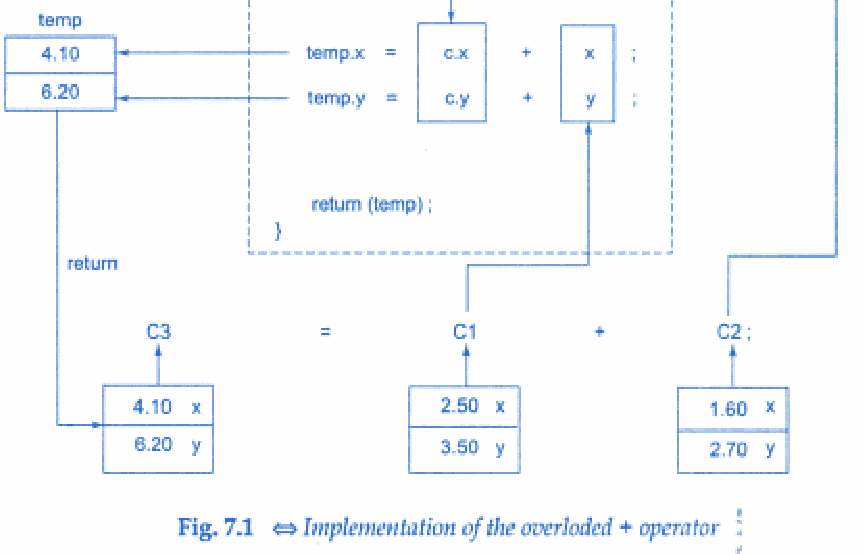

图 7.1 ⇔ 重载 `+` 运算符的实现

我们可以用下面的语句替换整个函数体，从而避免创建 `temp` 对象：

```
return complex((x+c.x),(y+c.y));    // invokes constructor 2
```

当我们使用带有参数列表的类名时，这意味着什么？当编译器遇到这样的语句时，它会调用一个合适的构造函数，初始化一个无名对象，并返回其内容以复制到另一个对象中。这种对象称为临时对象，一旦其内容被赋值给另一个对象，它就会超出作用域。使用*临时对象*可以使代码更简短、更高效、更易读。

## 7.5 使用友元重载二元运算符

如前所述，友元函数可以代替成员函数来重载二元运算符，唯一的区别在于：友元函数需要显式传递两个参数，而成员函数只需要一个。

上一节讨论的复数程序可以使用友元运算符函数进行修改，如下所示：

1. 将成员函数声明替换为友元函数声明。

   ```
   friend complex operator+(complex, complex);
   ```

2. 按如下方式重新定义运算符函数：

   ```
   complex operator+(complex a, complex b)
   {
       return complex((a.x+b.x),(a.y+b.y));
   }
   ```

在这种情况下，语句

```
C3 = C1 + C2;
```

等价于

```
C3 = operator+(C1, C2);
```

在大多数情况下，使用友元函数或成员函数会得到相同的结果。那么为什么还要提供另一种方式呢？有些情况下，我们更愿意使用友元函数而不是成员函数。例如，考虑需要对二元运算符使用两种不同类型操作数的情况：一个是对象，另一个是内置类型数据，如下所示：

```
A = B + 2;  (or A = B + 2;)
```

其中 `A` 和 `B` 是同一个类的对象。这对成员函数是可行的，但下面的语句将无法工作：

```
A = 2 + B; (or A = 2 * B)
```

这是因为负责调用成员函数的左操作数必须是同一个类的对象。然而，友元函数允许这两种方式。这是如何做到的呢？

不妨回想一下，调用友元函数时并不需要使用对象，但可以将对象作为参数传递。因此，我们可以使用友元函数，以内置类型数据作为左操作数，以对象作为右操作数。程序 7.3 使用向量的标量乘法说明了这一点，还演示了如何重载输入运算符 `>>` 和输出运算符 `<<`。

### 使用友元重载运算符

```
#include <iostream.h>

const size = 3;

class vector

{

    int v[size];

public:

    vector();                         // constructs null vector

    vector(int *x);                   // constructs vector from array

    friend vector operator *(int a, vector b);      // friend 1

    friend vector operator *(vector b, int a);      // friend 2

    friend istream & operator >> (istream &, vector &);

    friend ostream & operator << (ostream &, vector &);

};

vector :: vector()

{

    for(int i=0; i<size; i++)

        v[i] = 0;

}

vector :: vector(int *x)

{

    for(int i=0; i<size; i++)

        v[i] = x[i];

}

vector operator *(int a, vector b)

{

    vector c;

    for(int i=0; i < size; i++)

        c.v[i] = a * b.v[i];

    return c;

}

vector operator *(vector b, int a)

{

    vector c;

    for(int i=0; i<size; i++)

        c.v[i] = b.v[i] * a;

    return c;

}

istream & operator >> (istream &din, vector &b)

{

    for(int i=0; i<size; i++)

        din >> b.v[i];

    return(din);

}

ostream & operator << (ostream &dout, vector &b)

{

    dout << "(" << b.v [0];

    for(int i=1; i<size; i++)

        dout << ", " << b.v[i];

    dout << ")";

    return(dout);

}

int x[size] = {2,4,6};

int main()

{

    vector m;            // invokes constructor 1

    vector n = x;        // invokes constructor 2

    cout << "Enter elements of vector m " << "\n";

    cin >> m;            // invokes operator>>() function

    cout << "\n";

    cout << "m = " << m << "\n";        // invokes operator <<()

    vector p, q;

    p = 2 * m;                // invokes friend 1

    q = n * 2;                // invokes friend 2

    cout << "\n";

    cout << "p = " << p << "\n";        // invokes operator<<()

    cout << "q = " << q << "\n";

    return 0;

}
```

程序 7.3

程序 7.3 的输出如下所示：

```
Enter elements of vector m

5 10 15

m = (5, 10, 15)

p = (10, 20, 30)

q = (4, 8, 12)
```

该程序将运算符 `*` 重载了两次，也就是对运算符函数 `operator*()` 本身进行了重载。在这两种情况下，函数都被显式传入两个参数，并像任何其他重载函数一样，根据其参数类型被调用。这使我们能够使用两种标量乘法形式，例如：

```
p = 2 * m;        // equivalent to p = operator*(2,m);

q = n * 2;        // equivalent to q = operator*(n,2);
```

该程序及其输出在很大程度上不言自明。第一个构造函数

```
vector();
```

构造一个所有元素均为 `0` 的向量。因此

```
vector m;
```

创建一个向量 `m`，并将其所有元素初始化为 `0`。第二个构造函数

```
vector(int &x);

int x[3] = {2, 4, 6};

vector n = x;
```

将 `n` 创建为分量为 `2、4、6` 的向量。

注意：我们在输入和输出语句中使用了像 `m` 和 `n` 这样的 `vector` 变量，就像使用简单变量一样。这之所以可行，是因为使用以下函数重载了运算符 `>>` 和 `<<`：

```
friend istream & operator>>(istream &, vector &);

friend ostream & operator<<(ostream &, vector &);
```

`istream` 和 `ostream` 是定义在 `iostream.h` 文件中的类，该文件已包含在程序中。

## 7.6 使用运算符操作字符串

ANSI C 使用字符数组、指针和字符串函数实现字符串。C 语言没有用于操作字符串的运算符。C 语言中字符串操作的主要缺点之一就是：每当需要复制字符串时，程序员必须先确定其长度，再分配所需的内存。

虽然 C++ 也存在这些限制，但它允许我们创建自己的运算符定义，可以用与十进制数非常相似的方式操作字符串。（最近，ANSI C++ 委员会在 C++ 类库中新增了一个名为 `string` 的类，支持各种字符串操作。使用 `string` 类进行字符串操作将在第 15 章讨论。）

例如，我们将能够使用如下语句：

```
string3 = string1 + string2;

if(string1 >= string2) string = string1;
```

可以将字符串定义为类对象，然后像内置类型一样对其进行操作。由于字符串的大小差异很大，我们使用 `new` 为每个字符串分配内存，并使用一个指针变量指向字符串数组。因此，我们必须创建能够保存这两项信息的 `string` 对象，即长度和位置，它们对字符串操作是必需的。一个典型的 `string` 类如下所示：

```
class string

{

    char *p;        // pointer to string

    int len;        // length of string

public:

    .....        // member functions

    .....        // to initialize and

    .....        // manipulate strings

};
```

我们将考虑一个示例来说明重载运算符在字符串上的应用。程序7.4所示的示例重载了 `+` 和 `<=` 两个运算符，仅用于说明如何实现它们。该方法还可以扩展到其他运算符。

### 字符串上的数学运算

```
#include <string.h>

#include <iostream.h>

class string

{

    char *p;

    int len;

public:

    string() {len = 0; p = 0;}                // create null string

    string(const char * s);                  // create string from arrays

    string(const string & s);                // copy constructor

    ~ string(){delete p;}                    // destructor

    // + operator

    friend string operator+(const string &s, const string &t);

    // <= operator

    friend int operator<=(const string &s, const string &t);

    friend void show(const string s);

};

string :: string(const char *s)

{

    len = strlen(s);

    p   = new char[len+1];

    strcpy(p,s);

}

string :: string(const string & s)

{

    len = s.len;

    p   = new char[len+1];

    strcpy(p,s.p);

}

// overloading + operator

string operator+(const string &s, const string &t)

{

    string temp;

    temp.len = s.len + t.len;

    temp.p = new char[temp.len+1];

    strcpy(temp.p,s.p);

    strcat(temp.p,t.p);

    return(temp);

}

// overloading <= operator

int operator<=(const string &s, const string &t)

{

    int m = strlen(s.p);


```
    int n = strlen(t.p);

    if(m <= n) return(1);

    else return(0);

}

void show(const string s)

{

    cout << s.p;

}

int main()

{

    string s1 = "New ";

    string s2 = "York";

    string s3 = "Delhi";

    string t1,t2,t3;

    t1 = s1;

    t2 = s2;

    t3 = s1+s3;

    cout << "\nt1 = "; show(t1);

    cout << "\nt2 = "; show(t2);

    cout << "\n";

    cout << "\nt3 = "; show(t3);

    cout << "\n\n";
```

```
if(t1 <= t3)

{

    show(t1);

    cout << " smaller than ";

    show(t3);

    cout << "\n";

}

else

{

    show(t3);

    cout << " smaller than ";

    show(t1);

    cout << "\n";

}

return 0;

}
```

以下是程序7.4的输出：

```
t1 = New

t2 = York

t3 = New Delhi

New smaller than New Delhi
```

## 7.7 重载运算符的规则

虽然重新定义运算符看起来很简单，但在重载它们时存在一些限制和约束。下面列出其中一些：

- 1. 只能重载现有的运算符，不能创建新的运算符。
- 2. 重载的运算符必须至少有一个操作数是用户定义类型。
- 3. 我们不能改变运算符的基本含义。也就是说，不能重新定义加号（`+`）运算符来从一个值中减去另一个值。
- 4. 重载运算符遵循原运算符的语法规则，它们不能被覆盖。
- 5. 有些运算符不能被重载（见表7.1）。
- 6. 我们不能使用友元函数来重载某些运算符（见表7.2）。不过，可以使用成员函数来重载它们。
- 7. 通过成员函数重载的一元运算符不接收显式参数，也不返回显式值；而通过友元函数重载的一元运算符接收一个引用参数（相关类的对象）。
- 8. 通过成员函数重载的二元运算符接收一个显式参数；通过友元函数重载的二元运算符接收两个显式参数。
- 9. 使用通过成员函数重载的二元运算符时，左操作数必须是相关类的对象。
- 10. 诸如 `+`、`-`、`*` 和 `/` 等二元算术运算符必须显式返回一个值，且不得试图更改自身参数。

### 表7.1 不能被重载的运算符

|  |  |
|---|---|
| `Sizeof` | 求字节数运算符 |
| `.` | 成员运算符 |
| `.*` | 指向成员的指针运算符 |
| `::` | 作用域解析运算符 |
| `?:` | 条件运算符 |

### 表7.2 不能使用友元函数的情形

|  |  |
|---|---|
| `=` | 赋值运算符 |
| `()` | 函数调用运算符 |
| `[]` | 下标运算符 |
| `->` | 类成员访问运算符 |

## 7.8 类型转换

我们知道，当不同类型常量和变量混合在表达式中时，C 会按照一定规则对操作数进行自动类型转换。类似地，赋值操作也会引起自动类型转换。赋值运算符右侧的数据类型会自动转换为左侧变量的类型。例如，语句

```
int m;

float x = 3.14159;

m = x;
```

会在 `x` 的值赋给 `m` 之前将其转换为整数。因此，小数部分被截断。只要所涉及的数据类型是内置类型，类型转换就是自动的。

当数据类型是用户自定义类型时，会发生什么？

考虑下面的语句，它将两个对象相加，然后把结果赋给第三个对象。

```
v3 = v1 + v2;        // v1, v2 and v3 are class type objects
```

当对象属于同一个类类型时，加法和赋值操作能够顺利执行，编译器不会提出任何异议。我们已经看到，对于类对象，右侧对象的所有数据成员的值都会被简单地复制到左侧对象的对应成员中。如果其中一个操作数是对象，而另一个是内置类型变量，又该怎么办？或者，如果它们分别属于两个不同的类呢？

由于用户自定义数据类型是我们为了满足自身需求而设计的，编译器并不支持对这类数据类型进行自动类型转换。因此，如果需要进行此类操作，我们必须自己设计转换例程。

在不兼容类型之间进行数据转换时，可能会出现三种情况：

- 1. 从基本类型转换为类类型。
- 2. 从类类型转换为基本类型。
- 3. 从一种类类型转换为另一种类类型。

我们将详细讨论这三种情况。

### 基本类型到类类型

从基本类型到类类型的转换很容易实现。或许你还记得，在许多示例中已经展示了使用构造函数来初始化对象。例如，使用构造函数从 `int` 类型数组构建了一个 `vector` 对象。类似地，我们使用另一个构造函数从 `char*` 类型变量构建了 `string` 类型对象。这些都是构造函数执行从参数类型到构造函数类类型的实际类型转换的示例。

考虑下面的构造函数：

```
string :: string(char *a)

{

    length = strlen(a);

    P = new char[length+1];

    strcpy(P,a);

}
```

该构造函数从 `char*` 类型变量 `a` 构建一个 `string` 类型对象。变量 `length` 和 `p` 是 `string` 类的数据成员。一旦定义了这个构造函数，

其中 `V1` 是 `vector` 类型的对象。这两条语句的效果完全相同。当编译器遇到需要将类类型转换为基本类型的语句时，它会自动调用类型转换运算符函数来完成这项工作。

类型转换运算符函数应满足以下条件：

- 它必须是类成员。
- 它不能指定返回类型。
- 它不能有任何参数。

由于它是成员函数，因此由对象调用它；所以，函数内部用于转换的值属于调用该函数的对象。这意味着该函数不需要参数。

在上一节描述的 `string` 示例中，我们可以按如下方式完成从 `string` 到 `char*` 的转换：

```
string :: operator char*()

{

    return(p);

}
```

### 一种类类型到另一种类类型

我们刚刚了解了从基本类型到类类型以及从类类型到基本类型的数据转换技术。但有些情况下，我们需要将一种类类型的数据转换为另一种类类型。

示例：

```
objX = objY;    // objects of different types
```

`objX` 是类 `X` 的对象，`objY` 是类 `Y` 的对象。类 `Y` 类型的数据被转换为类 `X` 类型的数据，转换后的值被赋给 `objX`。由于转换发生在从类 `Y` 到类 `X` 的过程中，`Y` 被称为源类，`X` 被称为目标类。

不同类对象之间的这种转换可以通过构造函数或转换函数来完成。编译器对它们的处理方式相同。那么，我们如何决定使用哪种形式呢？这取决于我们希望类型转换函数位于源类中，还是位于目标类中。

我们知道类型转换运算符函数

```
operator typename()
```

converts the class object of which it is a member to `typename`. The `typename` may be a built-in type or a user-defined one (another class type). In the case of conversions between objects, `typename` refers to the destination class. Therefore, when a class needs to be converted, a casting operator function can be used (i.e. source class). The conversion takes place in the source class and the result is given to the destination class object.

Now consider a single-argument constructor function which serves as an instruction for converting the argument's type to the class type of which it is a member. This implies that the argument belongs to the source class and is passed to the destination class for conversion. This makes it necessary that the conversion constructor be placed in the destination class. Figure 7.2 illustrates these two approaches.

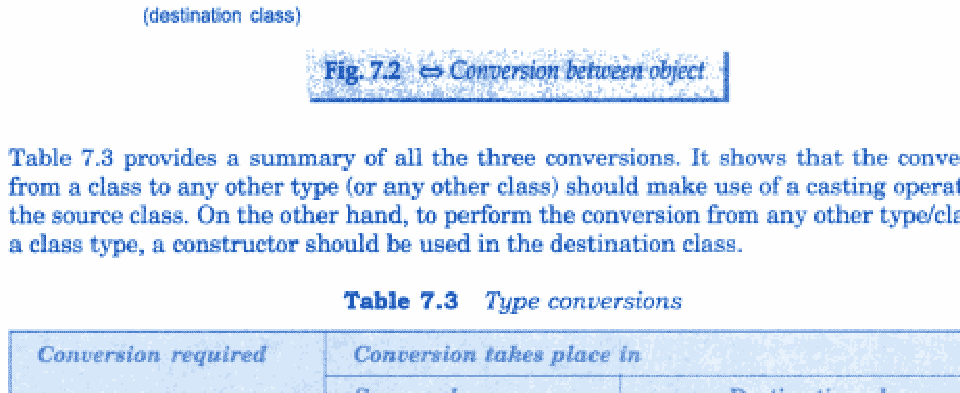

### Table 7.3 Type conversions

| Conversion required | Source class | Destination class |
| --- | --- | --- |
| Basic → class | Not applicable | Constructor |
| Class → basic | Casting operator | Not applicable |
| Class → class | Casting operator | Constructor |

When a conversion using a constructor is performed in the destination class, we must be able to access the data members of the object sent (by the source class) as an argument. Since data members of the source class are private, we must use special access functions in the source class to facilitate its data flow to the destination class.

### A Data Conversion Example

Let us consider an example of an inventory of products in store. One way of recording the details of the products is to record their code number, total items in the stock and the cost of each item. Another approach is to just specify the item code and the value of the item in the stock. The example shown in Program 7.5 uses two classes and shows how to convert data of one type to another.

```
DATA CONVERSIONS

#include <iostream>

using namespace std;

class invent2        // destination class declared

class invent1        // source class

{

    int code;        // item code

    int items;       // no. of items

    float price;     // cost of each item

public:

    invent1(int a, int b, float c)

    {

        code = a;

        items = b;

        price = c;

    }

    void putdata()

    {

        cout << "Code:  " << code  << "\n";

        cout << "Items: " << items << "\n";

        cout << "Value: " << price << "\n";

    }

    int getcode() {return code;}

    int getitems() {return items;}

    float getprice() {return price;}

    operator float() {return(items * price);}

    /* operator invent2()    // invent1 to invent2

    {

        invent2 temp;

        temp.code = code;

        temp.value = price * items;

        return temp;

    }*/

};  // End of source class

class invent2      // destination class

{

    int code;

    float value;

    public:

    invent2()

    {

        code = 0; value = 0;

    }

    invent2(int x, float y)      // constructor for

                                 // initialization

    {

        code = x;

        value = y;

    }

    void putdata()

    {

        cout << "Code:  " << code << "\n";

        cout << "Value: " << value << "\n\n";

    }

    invent2(invent1 p)           // constructor for conversion

    {

        code = p.getcode();

        value = p.getitems() * p.getprice();

    }

};  // End of destination class

int main()

{

    invent1 s1(100,5,140.0);

    invent2 d1;

    float total_value;

    /* invent1 To float */

    total_value = s1;

    /* invent1 To invent2 */

    d1 = s1;

    cout << "Product details - invent1 type" << "\n";

    s1.putdata();

    cout << "\nStock value" << "\n";

    cout << "Value = " << total_value << "\n\n";

    cout << "Product details-invent2 type" << "\n";

    d1.putdata();

    return 0;

}
```

Following is the output of Program 7.5:

```
Product details-invent1 type

Code: 100

Items: 5

Value: 140

Stock value

Value = 700

Product details-invent2 type

Code: 100

Value: 700
```

### note

We have used the conversion function

```
operator float( )
```

in the class `invent1` to convert the `invent1` type data to a `float`. The constructor

```
invent2 (invent1)
```

is used in the class `invent2` to convert the `invent1` type data to the `invent2` type data.

Remember that we can also use the casting operator function

```
operator invent2()
```


in the class `invent1` to convert `invent1` type to `invent2` type. However, it is important that we do not use both the constructor and the casting operator for the same type conversion, since this introduces an ambiguity as to how the conversion should be performed.

## SUMMARY

- ↔ Operator overloading is one of the important features of C++ language. It is called compile time polymorphism.
- ↔ Using overloading feature we can add two user defined data types such as objects, with the same syntax, just as basic data types.
- ↔ We can overload almost all the C++ operators except the following:
  - class member access operators(`.`, `.*`)
  - scope resolution operator (`::`)

# Inheritance: Extending Classes

## Key Concepts

- Reusability
- Inheritance
- Single inheritance
- Multiple inheritance
- Multilevel inheritance
- Hybrid inheritance
- Hierarchical inheritance
- Defining a derived class
- Inheriting private members
- Virtual base class
- Direct base class
- Indirect base class
- Abstract class
- Defining derived class constructors
- Nesting of classes

## 8.1 Introduction

Reusability is yet another important feature of OOP. It is always nice if we could reuse something that already exists rather than trying to create the same all over again. It would not only save time and money but also reduce frustration and increase reliability. For instance, the reuse of a class that has already been tested, debugged and used many times can save us the effort of developing and testing the same again.

Fortunately, C++ strongly supports the concept of *reusability*. The C++ classes can be reused in several ways. Once a class has been written and tested, it can be adapted by other programmers to suit their requirements. This is basically done by creating new classes, reusing the properties of the existing ones. The mechanism of deriving a new class from an old one is called *inheritance* (or *derivation*). The old class is referred to as the *base class* and the new one is called the *derived class* or *subclass*.

The derived class inherits some or all of the traits from the base class. A class can also inherit properties from more than one class or from more than one level. A derived class with only one base class, is called *single inheritance* and one with several base classes is called *multiple inheritance*. On the other hand, the traits of one class may be inherited by more than one class. This process is known as *hierarchical inheritance*. The mechanism of deriving a class from another ‘derived class’ is known as *multilevel inheritance*. Figure 8.1 shows various forms of inheritance that could be used for writing extensible programs. The direction of arrow indicates the direction of inheritance. (Some authors show the arrow in opposite direction meaning “inherited from”.)

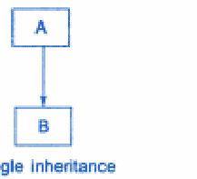

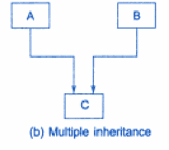

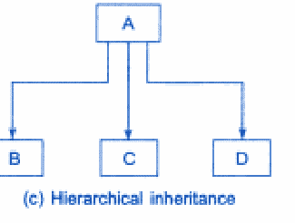

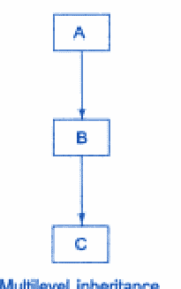

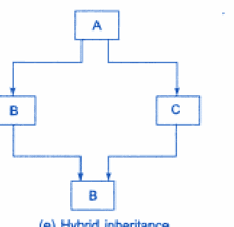

Fig. 8.1 ⇔ Forms of inheritance

## 8.2 Defining Derived Classes

A derived class can be defined by specifying its relationship with the base class in addition to its own details. The general form of defining a derived class is:

```
class derived-class-name : visibility-mode base-class-name

{

    .....//

    .....//  members of derived class

    .....//

};
```

The colon indicates that the `derived-class-name` is derived from the `base-class-name`. The `visibility-mode` is optional and, if present, may be either `private` or `public`. The default `visibility-mode` is `private`. Visibility mode specifies whether the features of the base class are privately derived or publicly derived.

Examples:

```
class ABC: private XYZ      // private derivation

{

    members of ABC

};

class ABC: public XYZ      // public derivation

{

    members of ABC

};

class ABC: XYZ             // private derivation by default

{

    members of ABC

};
```

When a base class is privately inherited by a derived class, ‘`public` members’ of the base class become ‘`private` members’ of the derived class and therefore the `public` members of the base class can only be accessed by the member functions of the derived class. They are inaccessible to the objects of the derived class. Remember, a `public` member of a class can be accessed by its own objects using the dot operator. The result is that no member of the base class is accessible to the objects of the derived class.

On the other hand, when the base class is publicly inherited, ‘`public` members’ of the base class become ‘`public` members’ of the derived class and therefore they are accessible to the objects of the derived class. In both the cases, the `private` members are not inherited and therefore, the `private` members of a base class will never become the members of its derived class.

In inheritance, some of the base class data elements and member functions are 'inherited' into the derived class. We can add our own data and member functions and thus extend the

由 `D` 派生。实际上，类 `D` 的成员将比声明时它所包含的成员更多，如图 8.2 所示。

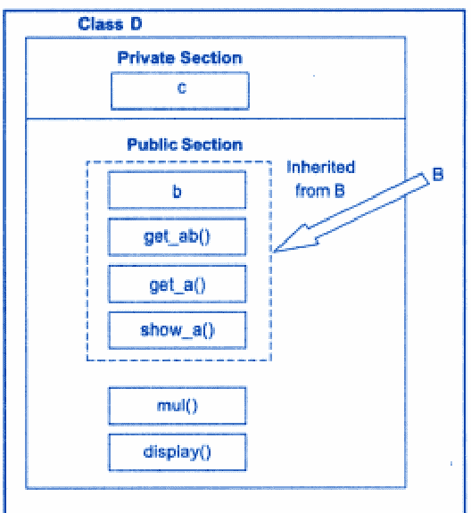

图 8.2：向类添加更多成员（通过公有派生）

该程序说明了类 `D` 的对象可以访问 `B` 的所有公有成员。让我们看一下函数 `show_a()` 和 `mul()`：

```
void show_a()

{

    cout << "a = " << a << "\n";

}
```

```
void mul()

{

    c = b * get_a();        // c = b * a

}
```

尽管数据成员 `a` 在 `B` 中是私有的，不能被继承，但 `D` 的对象可以通过 `B` 的一个继承成员函数来访问它。

现在让我们考虑私有派生的情况。

```
public:

    void mul(void);

    void display(void);

};

//-----------------------------------------------

void B :: get_ab(void)

{

    cout << "Enter values for a and b:";

    cin >> a >> b;

}

int B :: get_a()

{

    return a;

}

void B :: show_a()

{

    cout << "a = " << a << "\n";

}

void D :: mul()

{

    get_ab();

    c = b * get_a();      // 'a' cannot be used directly

}

void D :: display()

{

    show_a();             // outputs value of 'a'

    cout << "b = " << b << "\n"

         << "c = " << c << "\n\n";

}

//-----------------------------------------------

int main()

{

    D d;

    // d.get_ab();  WON'T WORK

    d.mul();

    // d.show_a();  WON'T WORK

    d.display();

}
```

```
.....        // within its class

protected:

.....        // visible to member functions

.....        // of its own and derived class

public:

.....        // visible to all functions

.....        // in the program

};
```

当一个 `protected` 成员以 `public` 模式继承时，它在派生类中仍然是 `protected` 的，因此可以被派生类的成员函数访问。它也可以被进一步继承。一个 `protected` 成员，在 `private` 模式派生中被继承时，在派生类中变成 `private`。虽然它对于派生类的成员函数可用，但不能用于进一步继承（因为 `private` 成员不能被继承）。图 8.4 是两种派生级别对成员可见性影响的图示。

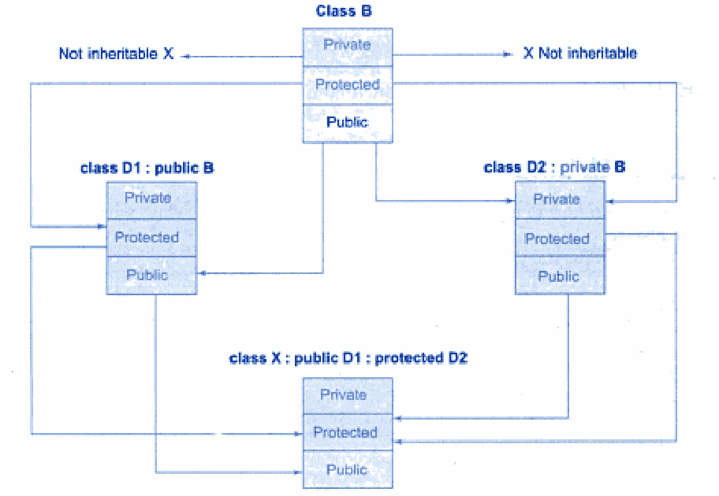

图 8.4：继承对成员可见性的影响

## 多重继承

```
#include <iostream>

using namespace std;

class M

{

    protected:

        int m;

    public:

        void get_m(int);

};

class N

{

    protected:

        int n;

    public:

        void get_n(int);

};

class P : public M, public N

{

    public:

        void display(void);

};

void M :: get_m(int x)

{

    m = x;

}

void N :: get_n(int y)

{

    n = y;

}

void P :: display(void)

{

    cout << "m = " << m << "\n";

    cout << "n = " << n << "\n";

    cout << "m*n = " << m*n << "\n";

}

int main()

{

    P p;

    p.get_m(10);

    p.get_n(20);

    p.display();

    return 0;

}
```

程序 8.4

程序 8.4 的输出将是：

```
m = 10

n = 20

m*n = 200
```

## 继承中的二义性消除

在多重继承中，我们有时会遇到一个问题：当多个基类中出现同名函数时。考虑以下两个类。

```
class M

{

public:

    void display(void)

    {

        cout << "Class M\n";

    }

};

class N

{

public:

    void display(void)

    {

        cout << "Class N\n";

    }

};
```

当我们继承这两个类时，派生类会使用哪个 `display()` 函数？我们可以通过在派生类中定义一个命名实例，并使用类解析运算符（作用域解析运算符）和函数来解决这个问题，如下所示：

```
class P : public M, public N

{

    public:

        void display(void)        // overrides display() of M and N

        {

            M :: display();

        }

};
```

现在我们可以如下使用派生类：


```
int main()
{
    P p;
    p.display();
}
```

在单继承应用中也可能出现二义性。例如，考虑以下情况：

```
class A
{
    public:
        void display()
        {
            cout << "A\n";
        }
};

class B : public A
{
    public:
        void display()
        {
            cout << "B\n";
        }
};
```

在这种情况下，派生类中的函数会覆盖继承的函数，因此，`B` 类型对象对 `display()` 的简单调用将只调用 `B` 中定义的函数。然而，我们可以通过使用作用域解析运算符来指定类，从而调用 `A` 中定义的函数。

示例：

```
int main()
{
```

## 8.12 成员类：类的嵌套

继承是将一个类的某些属性派生到另一个类的机制。我们已经详细了解了如何使用派生类的概念来实现这一点。C++ 还支持另一种将一个类的属性继承到另一个类的方法。这种方法认为，一个对象可以是许多其他对象的集合。也就是说，一个类可以包含其他类的对象作为其成员，如下所示：

```
class alpha {...};

class beta {...};

class gamma
{
    alpha a;        // a is an object of alpha class
    beta b;         // b is an object of beta class
    ....
};
```

`gamma` 类的所有对象都将包含对象 `a` 和 `b`。这种关系称为包含（containership）或嵌套（nesting）。创建包含另一个对象的对象与创建独立对象非常不同。独立对象是在声明时带参数由其构造函数创建的。另一方面，嵌套对象的创建分为两个阶段。首先，使用各自的构造函数创建成员对象，然后创建其他“普通”成员。这意味着，所有成员对象的构造函数都应该在其自身构造函数体执行之前被调用。这可以通过在嵌套类的构造函数中使用初始化列表来实现。

示例：

```
class gamma
{
    ....
    alpha a;        // a is object of alpha
    beta b;         // b is object of beta
public:
    gamma(arglist): a(arglist1), b(arglist2)
    {
        // constructor body
    }
};
```

`arglist` 是定义 `gamma` 对象时要提供的参数列表。这些参数用于初始化 `gamma` 的成员。`arglist1` 是参数列表

## 复习题

- 8.1 C++ 中的继承是什么意思？
- 8.2 继承有哪些不同形式？每种给出一个例子。
- 8.3 描述 C++ 中单继承的语法。
- 8.4 我们知道基类的私有成员不能被继承。派生类的对象是否有可能访问基类的私有成员？如果可能，如何访问？记住，基类不能被修改。
- 8.5 以下两个派生类的属性有何不同？
  - (a) `class D1: private B{ / ... };`
  - (b) `class D2: public B{ / ... };`
- 8.6 什么时候对类成员使用 `protected` 可见性说明符？
- 8.7 描述多重继承的语法。什么时候使用这种继承？
- 8.8 以下两个定义的含义是什么？
  - (a) `class A: public B, public C{ / ... };`
  - (b) `class A: public C, public B{ / ... };`
- 8.9 什么是虚基类？
- 8.10 什么时候将一个类设为虚类？
- 8.11 什么是抽象类？
- 8.12 当创建派生类对象时，类构造函数以什么顺序被调用？
- 8.13 类 `D` 从类 `B` 派生。类 `D` 本身不包含任何数据成员。类 `D` 需要构造函数吗？如果需要，为什么？
- 8.14 什么是包含（containership）？它与继承有何不同？
- 8.15 描述一个包含其他类对象的类的对象是如何创建的？
- 8.16 判断下列陈述是否正确（TRUE 或 FALSE）：
  - (a) 继承有助于把一个一般类变为一个更具体的类。
  - (b) 继承有助于数据隐藏。
  - (c) 继承的优点之一是它提供了一个概念框架。
  - (d) 继承促进了类库的创建。
  - (e) 定义派生类需要对基类进行一些修改。
  - (f) 基类从不用于创建对象。
  - (g) 将一个类的对象作为另一个类的成员是合法的。
  - (h) 我们可以通过在派生类的定义中将基类设为虚基类来防止基类所有成员的继承。

## 调试练习

- 8.1 找出下面程序中的错误。

```
#include <iostream.h>
```

```
class Student {
    char* name;
    int rollNumber;
private:
    Student() {
        name = "AlanKay";
        rollNumber = 1025;
    }
    void setNumber(int no) {
        rollNumber = no;
    }
    int getRollNumber() {
        return rollNumber;
    }
};
```

```
class AnnualTest: Student {
    int mark1, mark2;
public:
    AnnualTest(int ml, int m2)
    :mark1(ml), mark2(m2) {
    }
    int getRollNumber() {
        return Student::getRollNumber();
    }
};
```

```
void main()
{
    AnnualTest test1(92, 85);
    cout << test1.getRollNumber();
}
```

```
#include <iostream>

class A
{
public:
    A()
    {
    }
```

### 8.5 调试以下程序。

```
// 测试程序
#include <iostream.h>

class B1
{
    int b1;
public:
    void display()
    {
        cout << b1 <<"\n";
    }
};

class B2
{
    int b2;
public:
    void display()
    {
        cout << b2 <<"\n";
    }
};

class D: public B1, public B2
{
    // nothing here
};

main()
{
    D d;
    d.display();
    d.B1::display();
    d.B2::display();
}
```

## 编程练习

8.1 假设一家银行为客户维护两种账户，一种称为储蓄账户，另一种称为活期账户。储蓄账户提供复利和取款设施，但不提供支票簿设施。活期账户提供支票簿设施但不提供利息。活期账户持有人还应保持最低余额，如果余额低于此水平，则会收取服务费。

## 9.2 指针

指针是 C++ 语言的关键方面之一，与 C 语言类似。正如我们所知，指针在 C 和 C++ 中提供了一种处理数据的独特方法。我们在第 3 章和第 5 章中已经看到了指针的一些应用。在本节中，我们将讨论指针的基础知识以及它们在 C++ 中的特殊用法。

我们知道，指针是一种派生数据类型，它通过存储变量的内存地址而不是数据来引用另一个数据变量。指针变量定义从何处获取特定数据变量的值，而不是定义实际数据。

与 C 语言一样，指针变量在 C++ 中也可以引用另一个指针。然而，它通常指向一个数据变量。指针提供了一种访问其他数据对象的替代方法。

### 声明和初始化指针

如第 3 章所述，我们可以像在 C++ 中声明其他变量一样声明指针变量。与 C 语言一样，声明基于它所指向的变量的数据类型。指针变量的声明采用以下形式：

```
data-type *pointer-variable;
```

这里，`pointer-variable` 是指针的名称，`data-type` 指的是有效的 C++ 数据类型之一，例如 `int`、`char`、`float` 等。`data-type` 后跟一个星号 (`*`) 符号，它将指针变量与编译器的其他变量区分开来。

> note
>
> 我们可以将星号 (`*`) 放在指针变量之前，或放在数据类型和指针变量之间，或放在数据类型之后。它不会对执行过程产生任何影响。

正如我们所知，指针变量可以指向 C++ 中任何类型的数据。然而，必须理解的是，指针在特定时间只能指向一种数据类型。让我们声明一个指向整数变量的指针变量，如下所示：

```
int *ptr;
```

这里，`ptr` 是一个指针变量并指向整数数据类型。指针变量 `ptr` 应包含任何整数变量的内存位置。以同样的方式，我们也可以为其他数据类型声明指针变量。
