# C++ 面向对象编程

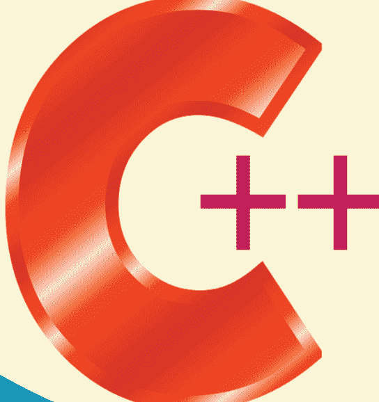

学术与规划总监，

计算机科学工程教授，

JNTUK, Kakinada

副教授，

计算机科学工程系，

Pragati 工程学院，Surampalem

副教授，

计算机科学工程系，

K. L 大学，Guntur


## 前言

本书旨在吸引感兴趣读者的关注，通过学习 C++ 编程语言，以增强他们在面向对象编程方面的知识。本书无疑将成为各种类型的程序员提高编程技能的平台。与过程化编程相比，面向对象语言（OOPs）具有不同的优势。

## 第1章 C++ 简介

本章介绍了与传统方法相比，面向对象方法的必要性，并概述了面向对象编程语言的基本特征。此外，你将学习到创建一个功能完整的 C++ 程序所需的步骤。

### 1.1. 编程语言的代际

编程语言包含一组供计算机执行的指令。所有的编程语言分为五代，如下所示：

- (i) 机器语言是第一代编程语言。在这一代中，指令是用 0 和 1 编写的，计算机可以直接理解机器码，因此执行速度非常快。但对于程序员来说，编写机器码程序非常困难，且编写这些程序的时间非常长。
- (ii) 为了解决第一代编程语言的问题，第二代编程语言使用了汇编语言。在这种语言中，指令包含操作码的短代码。这些代码被称为“助记符”（mnemonics）。计算机无法直接执行助记符，因此需要“汇编器”。汇编器会将汇编指令转换为机器码。与机器语言指令的执行相比，汇编语言指令将花费更多时间，但降低了汇编语言编写程序的复杂性。这种编写复杂性的降低是必要的。
- (iii) 为了降低汇编语言的复杂性，第三代编程语言引入了高级语言。这些语言可以归类为过程化或面向对象。这些语言需要编译器或翻译器来将其转换为机器码。C 是流行的过程化编程语言；C++ 和 Java 是流行的面向对象编程语言。

### 通过 C++ 进行面向对象编程

(iv) 第四代语言被称为超高级编程语言。这些语言主要用于特定领域，并缩短了执行时间。它们需要一个学习阶段。它们专门用于软件开发和统计分析。R、SQL、MATLAB、ColdFusion 等是流行的第四代编程语言。
- (v) 第五代编程语言被称为自然语言。它们具有基于人类语言的控制语言。它们用于设计桌面、移动、Web 应用程序以及游戏。

从这个角度来看，很明显，专业软件开发者应该具备使用任何代际语言开发程序的能力。本书讨论了第三代语言，特别是 C++，C++ 是一种基于 C 语言语言的流行语言。它因设计桌面、移动、Web 应用程序和游戏而流行。

### 1.2. C 与 C++ 的区别

第三代编程语言进一步分为两类：(i) 过程化语言 (ii) 面向对象语言。过程化语言由指令列表组成。为了减小程序体积，它被分为不同的函数和模块（也称为结构化编程）。通过这种方法，大型程序会变得异常复杂。这是由于模型不佳以及函数对全局数据的无限制访问导致的，如图 1.1 所示。

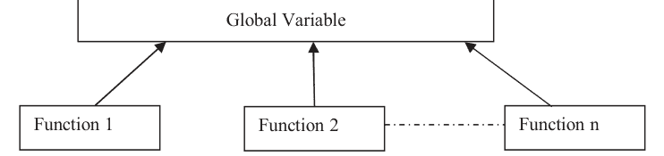

图 1.1 过程导型方法。

在一个具有 n 个子函数的大程序中，如果所有函数都可以访问全局变量进行读写，那么可能很难识别出修改全局变量的函数，有时甚至连更新后的值对函数来说也是未知的。为了解决这些问题，引入了面向对象编程语言。在面向对象编程语言中遵循现实世界建模。面向对象语言的原则是将数据和操作数据的功能结合并在单一单元中，该单元被称为对象。

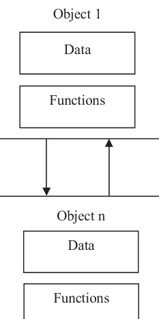

图 1.2 面向对象方法。

流行的过程化编程语言之一是 C。基于这种语言结构，开发了 C++（面向对象）编程语言。这两种语言之间存在若干差异，列于表 1.1 中。

表 1.1 C 与 C++ 编程语言的区别。

| C | C++ |
|---|---|
| 过程导向语言 | 面向对象语言 |
| 采用自顶向下的方法 | 采用自底向上的方法 |
| 函数是主要组件 | 对象是主要组件 |
| 数据与函数的映射困难 | 数据与函数的映射容易 |
| 对数据的关注度低 | 对数据的关注度高 |
| 添加新组件复杂 | 添加新组件容易 |
| 修改困难 | 修改容易 |
| 对数据安全性低 | 对数据安全性高 |
| C 中没有虚拟函数 | C++ 中使用了虚拟函数概念 |
| 数据识别困难 | 识别数据容易 |
| 不支持多态 | C++ 支持多态 |
| 不支持重载 | C++ 支持重载 |
| 不支持继承 | C++ 支持继承 |
| 不允许异常处理 | 允许异常处理 |
| 示例：C、VB、FORTRAN、Pascal | 示例：C++、JAVA、VB.NET、C# |

### 1.3. C++ 的演进

C++ 是由 Stroustrup 在 1983-1985 年在贝尔实验室开发的。C++ 是基于 C 语言语言针对 UNIX 平台开发的。在 C++ 之前，引入了“带类的 C”。然后增加了面向对象的特性并称为 ARM C++。随后增加了异常和模板并称为 C++。接着添加了命名空间 RTTI 和 STL 特性并称为 ISO C++。通过 C++，提供了各种优势来提高代码的可读性。C++ 的演进如图 1.3 所示。

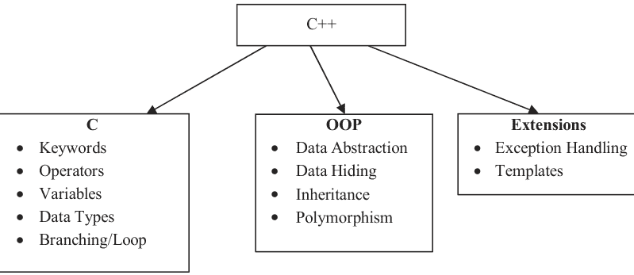

图 1.3 C++ 的演进。

### 1.4. 面向对象技术

由于过程导型方法中函数对全局变量的无限制访问，数据没有得到安全维护。为了解决这个问题，引入了面向对象技术。该关键原则是将数据和操作数据的功能结合在单一单元中。这样的单元被称为对象。对象的成员只能通过对象的函数进行访问。因此，数据是隐藏的，并且防止意外更改。数据和函数存储在单一实体中。对象的函数被称为成员函数。假设医院有以下各个部门。

- 医疗部门
- 支持部门
- 患关系部门
- 入院部门
- 人力资源部门
- 财务部门

## C++ 简介

5

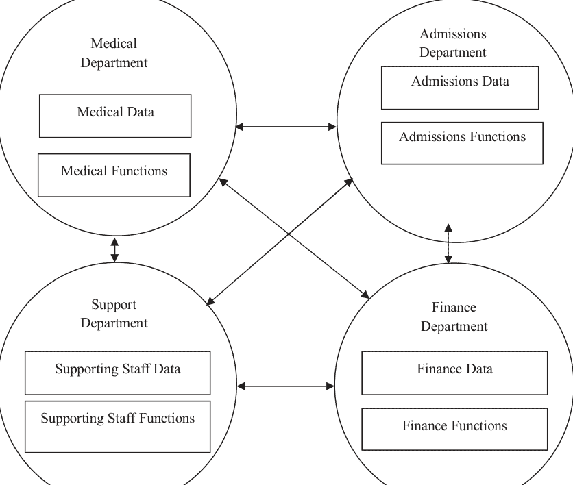

图 1.4 医院内部各部门之间的关系。

### 1.5. 传统编程的缺点

过程化编程也被称为传统编程。在这种情况下，数据和函数没有映射，冗长的输入程序被分为不同的子函数或子程序。控制可以在多个子函数之间传递。每个子函数都可以访问全局数据。因此，它面临下面列出的各种缺点。

6

通过 C++ 进行的面向对象编程

*   大多数函数都可以访问全局数据。
*   数据在函数之间进行全局传递。
*   数据没有提供安全性。
*   执行是根据函数进行的。
*   程序难以管理。
*   程序开发存在困难。
*   对代码的修改不负责。
*   未提供代码的可用性，因此空间复杂度较高。

### 1.6 面向对象编程的核心概念

#### 1.6.1 对象 (Objects)

对象是面向对象编程的核心概念。通常，它们代表实时实体（鸟、动物和花等）或供程序处理的用户定义数据（列表、向量和时间等）。在 OOP 中，通过对象为数据提供了更高的安全性。为每个对象都会分配内存，因此每个对象都有自己的一组数据副本。在程序内部，仅允许对象之间进行通信。

每个对象都会分配内存。每个对象都有自己的内存空间来存储其属性或特征。对象的行为取决于在其类中定义的成员函数。当程序执行时，对象通过相互发送消息来相互交互。对象的表示如图 1.5 所示。在图中，对于一个程序实体，如果创建了三个对象，将为这三个副本分配内存，并且每个对象的信息（也称为成员值）是可以变化的。

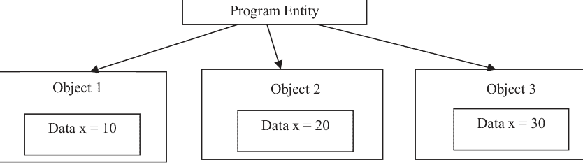

图 1.5 单个程序实体的多个对象。

#### 1.6.2 类 (Classes)

在面向对象的方法中，类允许将数据和函数分组。通过这一点允许数据和函数的映射。类是一个逻辑实体，不会为类分配内存。对于每个类，可以创建多个对象来维护数据的值。类中的数据称为成员，函数称为成员函数。当创建对象时，仅为成员创建内存。图 1.6 表示了带有成员和成员函数的类。

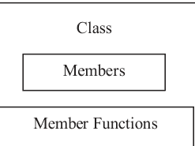

图 1.6 类的表示

#### 1.6.3 方法 (Method)

在类中，可以声明和定义数据和函数。数据称为成员，方法称为成员函数。成员函数也称为方法。方法应该在类内部声明并用于表示各种操作。方法的示例如图 1.7 所示。

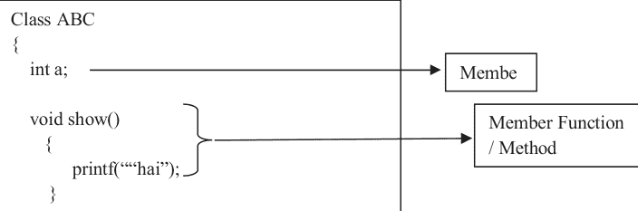

图 1.7 类属性的表示。

#### 1.6.4 数据抽象 (Data Abstraction)

抽象为面向对象编程语言提供了一种特性，通过排除内部细节来表示关键信息。只有通过抑制背景信息来突出重点，现实实体才能被高效地表示。只有这样，对象和类之间才能进行高效的映射。以手机为例，你可以开启和关闭、连接和通话、调整音量并添加外部组件，但你不知道它的内部细节，即你不知道它是如何接收有线或无线信号的、如何翻译信号以及最后显示在屏幕上的。通常，数据抽象是通过抽象数据类型（ADT）即类来实现。

#### 1.6.5 封装 (Encapsulation)

封装允许将数据和函数打包到单一实体中。封装通过类来实现。类被用于封装数据（成员）和函数（成员函数）。在类中，允许数据隐藏以为数据提供更高的安全性。通过数据隐藏，可以限制数据的访问，并借此通过函数对数据进行识别。数据隐藏是通过“访问修饰符”提供的。对于类的每个属性（成员或成员函数），都应该提供访问修饰符。类中使用的访问修饰符可以是私（private）或公（public）。公共类属性在类外部可用，而私类属性仅在类内部可用。

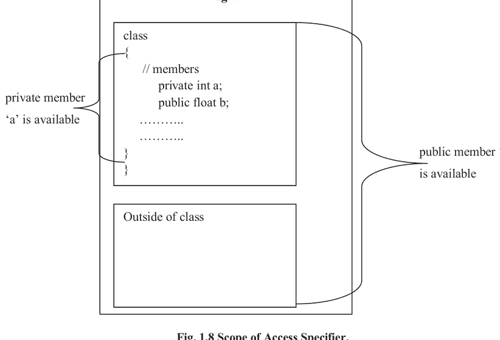

图 1.8 访问修饰符的范围。

图 1.8 表示了一个具有公共和私有成员的类。公共成员在类外部可用，但私成员仅在类内部可用。

#### 1.6.6 继承 (Inheritance)

面向对象编程允许将一个类的属性派导出另一个类，这被称为继承。它由实时实体的分层分类支持。在继承中，基类属性被派生到一个称为派生类的类中。这一特性的优势是允许代码重用。通过这些特性，程序的空间复杂度大大降低，并增强了程序的效率。通过代码重用特性，可以轻松地向类中添加额外功能，因此对程序的修改也变得容易进行。在修改期间，只需修改所需的类，而不影响其他类。继承的示例如图 1.9 所示。

| class college |
| :--- |
| member: deptname |

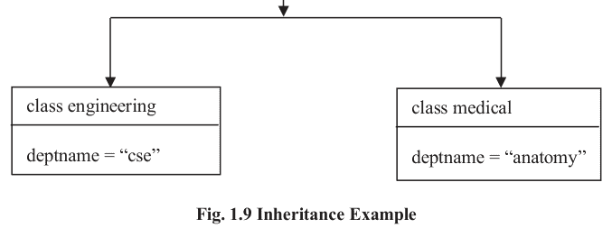

图 1.9 中，基类包含了派生类。

#### 1.6.7 多态 (Polymorphism)

多态允许对象采取多种形式。这由继承支持。多态有两种：编译时多态和运行时多态。编译时多态通过函数重载和操作符重载实现。运行时多态通过虚函数实现。

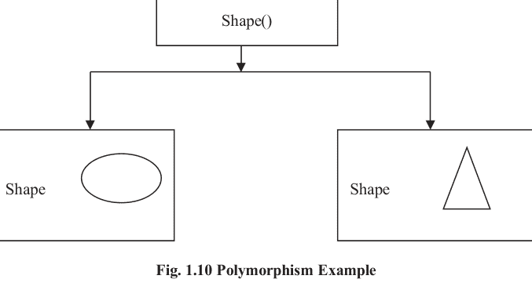

#### 1.6.8 动态绑定 (Dynamic Binding)

绑定是识别特定函数调用的过程。有两种类型：静态和动态。静态绑定允许过程在编译时执行，而动态绑定允许过程在运行时执行。动态绑定与继承和多态相关。

#### 1.6.9 消息传递 (Message Passing)

在面向对象编程中，允许对象之间进行通信。这种通信通过消息传递操作来实现。要使用消息传递操作符，应为类声明对象。通过此操作符，对象可以与其成员和成员函数进行通信。

#### 1.6.10 重用 (Reusability)

重用允许类重用现有代码。这通过继承实现。通过代码重用，程序的空间复杂度大大降低。它用于扩展类的功能。

#### 1.6.11 委托 (Delegation)

委托与继承特性相似，但继承支持“是一种”（kind of）关系，而委托支持“有一个”（has a）关系。通过委托，子类包含指向父类的引用。

#### 1.6.12 泛型 (Genericity)

这是一种强大的面向对象特性。通过它，变量可以处理各种类型的数据。变量的数据类型识别是在运行时进行的。

### 1.8 面向对象的语言

支持面向对象概念的编程语言分为两种：

- (i) 基于对象的 (Object-based)
- (ii) 面向对象的 (Object Oriented)

基于对象的编程语言支持除继承和态之外的所有面向对象原则。它们具有内置对象来处理实时实体，这些对象适用于处理基于原型的语言。VB 和 Java 是流行的基于对象的编程语言。

面向对象的语言支持所有的面向对象原则。它们没有内置对象，但实现了表示真实实体的对象。这些用于设计复杂性较低的新软件程序。C++、Smalltalk 和 Java 是面向对象语言的常见示例。

### 1.9 C++ 程序的结构

C++ 程序由对象、类、函数、变量和其他语句组成，如图 11 所示。

| 预处理器指令 |
| :--- |
| 包含头文件 |
| 类声明或定义 |
| 方法定义 |
| main() 函数 |

图 11. C++ 程序的结构

## 示例

- 1. 编写一个简单的程序打印“Hello World”

```
#include <iostream>

using namespace std;
int main()
{
	cout << "Hello World" << endl;
	return 0;
}
```

输出：

Hello World

解释：

在此程序中，`cout` 用于打印给定的字符串。

## 在 Windows 环境下使用“CodeBlocks”编译和执行 C++ 程序。

- 1. 点击代码块 

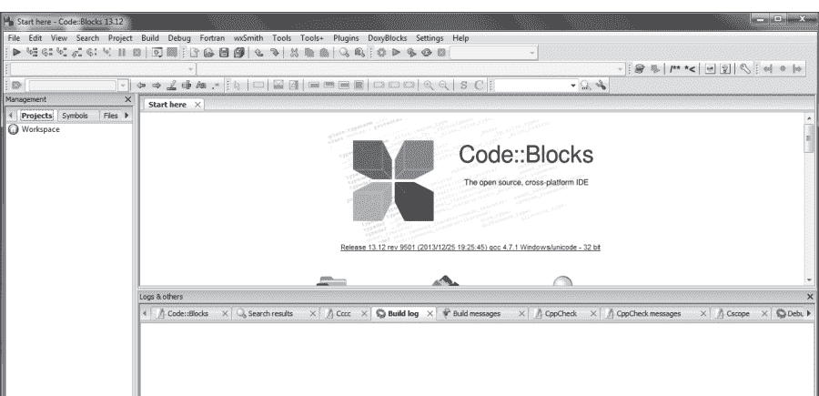

- 2. 选择一个新的空文件。

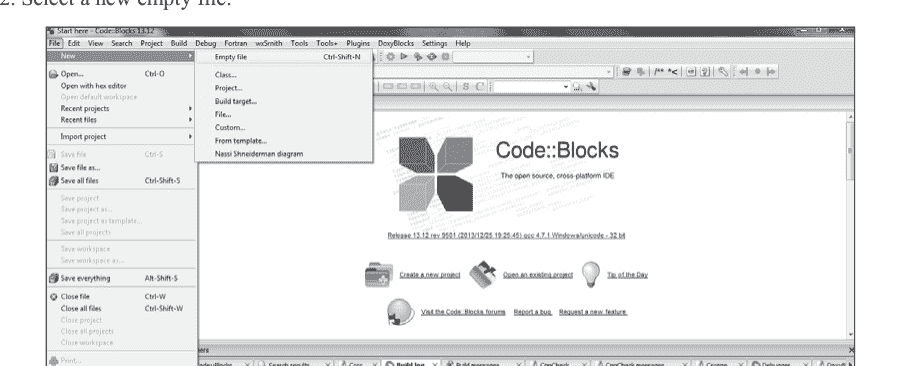

## C++ 简介

- 3. 输入程序

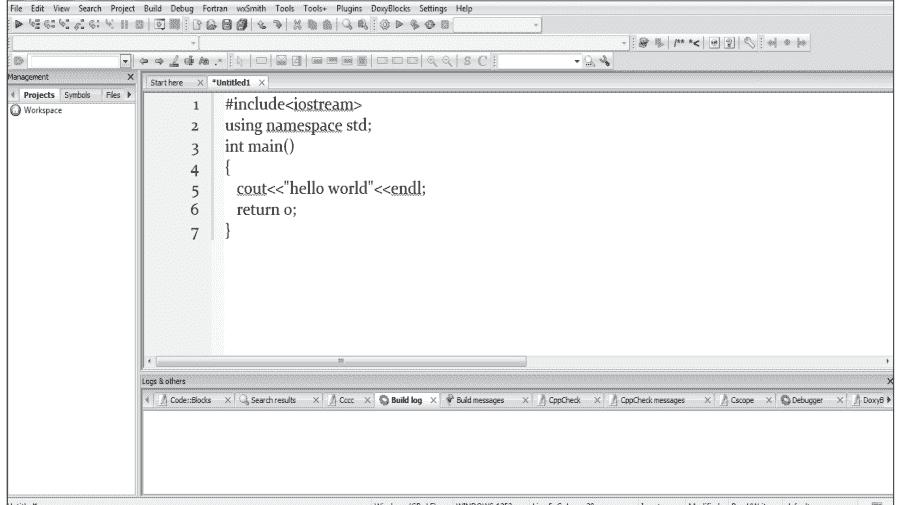

- 4. 要保存它，点击 文件 -> 另存为 -> 给文件命名为 `.cpp`

- 5. 要编译程序，点击 Build\build- 选项

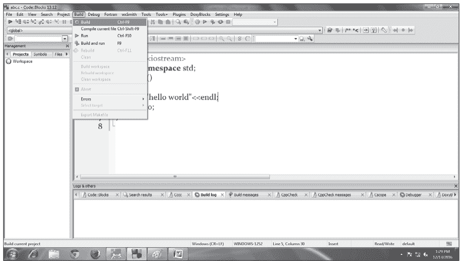

- 6. 要运行程序，点击 Build->Run 选项

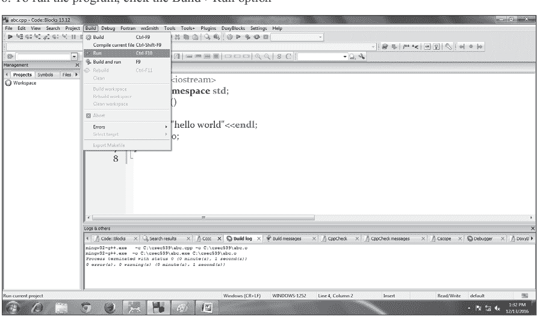

- 7. 输出结果

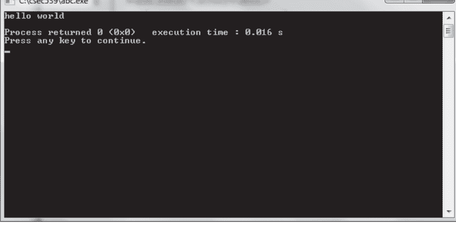

## 在 Linux 环境下使用“g++ 编译器”编译和执行 C++ 程序：

- 1. 使用 `edit` 命令打开文件 (`h2.cpp`)。

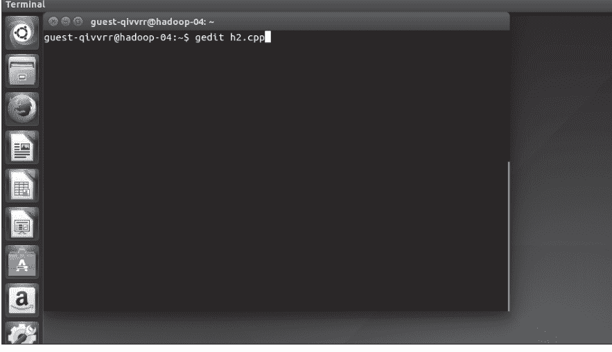

- 2. 在编辑器中输入程序，然后按保存按钮。

```
h2.cpp
#include<iostream>
using namespace std;
int main()
{
	cout<<"hello"<<endl;
	return 0;
}
```

- 3. 使用 `g++` 编译器编译程序 (`h2.cpp`)。

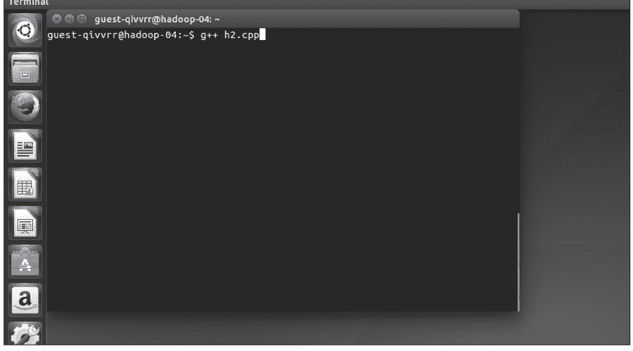

- 4. 使用 `./a.out` 命令显示输出。

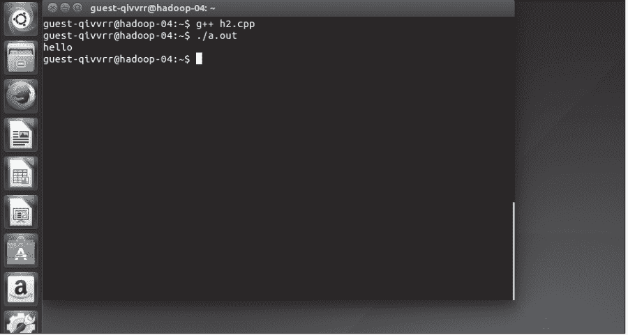

## C++ 简介

编写一个简单的程序打印“Hello World”和“Hello Name”，其中 name 是用户输入的名称。

```cpp
#include <iostream>
using namespace std;
int main()
{
    string s1;
    cout << "Hello World" << endl;
    cout<< "Enter name:" << s1;
    cin>>s1;
    cout<<endl<< "Hello " << s1;
    return 0;
}
```

输出：

Hello World

Enter your name: college

Hello college

解释：

在此程序中，`cin` 用于从输入设备读取值，并交给 `cout` 显示。

### 1.10. 总结

过程导型语言遵循自顶向下的方法，更多关注函数。对数据的关注较少。这降低了数据的安全性。为了解决这些问题，引入了面向对象编程语言。这些语言遵循自底向上的方法。更多关注数据而不是函数。因此，为数据提供了更高的安全性。通过面向对象编程，数据和函数可以很容易地映射。在本章中，讨论了 C 和 C++ 之间的区别。提供了对面向对象编程各种概念的详细讨论。如果支持除继承和态之外的所有面向对象编程概念，则被称为基于对象的编程语言。在本章中，还讨论了在 Windows 和 Linux 中编译和执行简单的 C++ 程序。

### 1.11. 练习

单选题

- 1. 哪种 OOP 原支持支持形式？

(a) 继承

(b) 多态

(c) 成员函数

(d) 封装

答案：(b)

- 2. 访问 private 会发生什么？

(a) 限制在同类方法

(b) 限制在其他类

(c) 对同类和其他类方法可用

(d) 程序无法编译

答案：(b)

- 3. 哪种面向对象原则从一个类提取属性到另一个类？

(a) 多态

(b) 抽象

(c) 继承

(d) 数据隐藏

答案：(c)

- 4. C++ 的强大特性有哪些？

(a) 易实现

(b) 重用代码

(c) OOP 概念

(d) 以上都是

答案：(d)

- 6. 通过隐藏属性来绑定代码和数据被称为：

(a) 抽象

(b) 继承

(c) 封装

(d) 多态

答案：(c)

## C++ 简介

- 7. C++ 的开发者是：


(a) Clock 和 Melish

(b) Donald E. Knuth

(c) Richard Lee

(d) Bjarne Stroustrup

答案：(d)

- 8. 多态的意思是：

(a) 一个接口，多个方法

(b) 多个接口，一个方法

(c) 一个接口，一个方法

(d) 以上都不是

答案：(a)

- 9. 什么是 C 编译器的：

(a) 前端

(b) C 编译器的预处理器

(c) 将 C++ 代码翻译为等效 C 代码的工具

(d) 以上都不是

答案：(c)

- 10. 过程语言？

(a) Pascal

(b) Smalltalk

(c) C

(d) (a) 和 (c)

答案：(d)

- 11. 可重用的优势是：

(a) 减少测试时间

(b) 降低维护成本

(c) 减少编译时间

(d) (a) 和 (b)

答案：(d)

- 12. 重载支持：

(a) 虚多态

(b) 瞬态多态

(c) 伪多态

(d) 标记多态

答案：(d)

- 13. 数据抽象的优势是：

(a) 减少复杂度

(b) 绑定代码和数据

(c) 提供并行性

(d) 以上都不是

答案：(a)

- 14. 什么是封装？

(a) 绑定代码和数据

(b) 使用单一接口进行类操作

(c) 减少复杂度

(d) 以上都是

答案：(a)

- 15. 封装的基本组成部分是：

(a) 对象

(b) 类

(c) 方法

(d) 以上都是

答案：(d)

- 16. 哪种 OOP 原则允许类保护内部代码？

(a) 使用访问修饰符

(b) 抽象

(c) 使用继承

(d) 以上都是

答案：(a)

## 答题

- 1. 讨论 OOP 的重要特征。解释 OOP 中数据和函数的组织。

- 2. 列出 OOP 技术的领域应用。

- 3. 面向对象编程范式的主要优势有哪些？

- 4. 面向对象编程的概念有哪些？详细解释。

- 5. 区分动态绑定和消息传递。

- 6. 用示例程序区分 C 和 C++ 程序。

## 答

- 1. 什么是对象？它们是如何创建的？

- 2. 多态在 C++ 语言意味着什么？

- 3. 继承的优势有哪些？

- 4. 定义类和对象。

- 5. 传统编程的缺点有哪些？

- 6. 定义封装。

- 7. OOP 的优势有哪些？

- 8. 比较 OOP 语言和结构化编程语言。

- 9. 定义类和对象。

- 10. 基于对象的语言和面向对象的语言之间的区别。

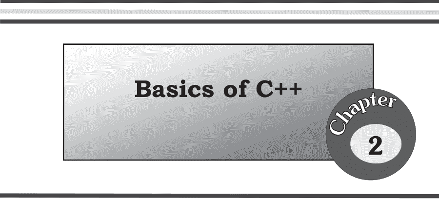

本章介绍了 C++ 编程的基础，即变量、数据类型、控制语句、循环、函数、数组、指针、结构。

## 2.1 类型与声明

与 C 一样，C++ 中也使用变量在内存中存储数据。变量的数据类型表示分配内存位置的大小以及存储在该内存的数据类型。在 C++ 中，变量可以在程序的任何地方声明。变量声明后，如果对其初始化了某个值，则称为初始化。如果没有执行初始化，变量将包含垃圾值。变量的声明允许一次，但初始化允许多次。C++ 中允许的各种数据类型有：

- (i) 数据类型

- (ii) 派生数据类型

- (iii) 用户定义数据类型

- (iv) Void 类型

基础类型包含主要数据类型，即 `bool`、`int`、`char`、`float`、`double`、`enum`、`void` 和 `wchar`（宽字符）。派生数据类型派自基础数据类型。它包含指针、函数、引用和数组。用户定义类型用于组合不同类型的数据。各种用户定义数据类型有结构、`class`、`union`、`typedef`。`void` 类型表示空数据类型。

示例 1：

```cpp
#include <iostream>
using namespace std;
```

C++ 基础

```cpp
int main()
{
    cout<<"hello"<<endl;
    int a=0;
    cout<<a;
    return 0;
}
```

# 输出：

hello

0

在这个程序中，变量 `a` 被声明为整数数据类型，它没有在 `main` 函数的开头声明。该变量被初始化为值 `0`。

# 示例 2：

```cpp
#include <iostream>
using namespace std;
int main()
{
    class first
    {
        public:
        int a;
    };
    int b=10;
    cout<<"local variable:"<<b<<endl;
    first obj1;
    obj1.a=20;
    cout<<"class member:"<<obj1.a;
    return 0;
}
```

通过 C++ 进行面向对象编程

# 输出：

local variable: 10

class member: 20

在这个程序中，声明了一个名为 `first` 的用户定义数据类型 `class`。在 `first` 类内部，声明了一个整数成员变量 `a`。在 `main()` 函数中，声明了一个整数局部变量 `b` 并将其初始化为 10，成员变量被初始化为 20。这两个值被显示出来。

## 2.2. 控制语句

控制语句用于对语句的执行做出决策。控制语句可以是判断语句或循环语句。判断语句用于对一组语句的执行做出决策。循环语句用于对一组语句进行重复执行。判断语句有两种类型：

- (i) 条件判断语句

- (ii) 无条件判断语句

`if` 和 `switch` 语句被称为条件判断语句。`if` 语句仅在条件为真时才会执行一组语句。

# 示例：

```cpp
#include <iostream>
using namespace std;
int main() {
    int a;
    cout<<"Enter a value:";
    cin>>a;
    if(a==0)
        cout<<endl<<"Value is positive";
    return 0;
}
```

# 输出：

Enter a value: 5

Value is positive

`if` 语句在条件为真时将执行一组语句。`else` 块在条件为假时将执行一组语句。对于任何条件，块或 `else` 将其中之一被执行。

# 示例：

```cpp
#include <iostream>

using namespace std;

int main() {
    int a;
    cout<<"Enter a value:";
    cin>>a;

    if(a==0)
        cout<<endl<<"Value is positive";
    else
        cout<<endl<<"Value is negative";
}
```

# 输出：

Enter a value: -5

Value is negative

嵌套的 `if-else` 用于在 `else` 部分挂载 `if-else`。

# 示例：

```cpp
#include <iostream>

using namespace std;

int main() {
    int a;
    cout<<"Enter a value:";
    cin>>a;

    if(a==0)
        cout<<endl<<"Value is greater than zero";
    else if(a==0)
        cout<<endl<<"Value is equal to zero";
    else
        cout<<endl<<"Value is negative";
}

return 0;

}
```

# 输出：

Enter a value: 0

Value is equal to 0

`if-else-if` 阶梯结构用于多个条件。对于每个语句，都会给出一个条件，如果这些条件都不被满足，则将执行最后的 `else` 块。

```cpp
#include <iostream>

using namespace std;

int main() {

    int a;

    cout<< "enter a value";

    cin>>a;
    if(a>10)
        cout<<"value is greater than ten";
    else if(a>=5)&&(a<10)
        cout<<"value is between 5 and 10";
    else if(a>0)&&(a<5)
        cout<<"value is between 0 and 5";
    else
        cout<< "value is less than zero";

    return 0;
}
```

# 示例：

Enter a value: 4

value is between 0 and 5

C++ 支持四个无条件跳转语句，即 `goto`、`break`、`return` 和 `continue`。`goto` 和 `return` 语句可以在程序的任何地方使用，但 `break` 和 `continue` 应该在循环语句或 `switch` 语句中使用。

`Switch` 语句是一种多分支语句，类似于 `if-else if` 阶梯结构。

```cpp
#include <iostream>
using namespace std;
int main() {
    int a,b;
    cout<<"enter a value:";
    cin>>a;
    b=a/2;
    switch(b)
    {
        case 0: cout<<"value is even number";
        break;
        case 1: cout<<"value is odd number";
        break;
        default: cout<<"invalid number";
    }
    return 0;
}
```

# 输出：

Enter a value: 8

value is even

在 C++ 中，有三种循环判断语句。它们是 (i) (ii) (iii) `do-while`。对于任何循环，我们都可以编写另一个内部循环，然后它被称为嵌套循环。

`for` 循环：

在循环中，初始化、条件和增/减操作可以同时指定。

```cpp
#include <iostream>
using namespace std;
int main() {
    int a,i;
    cout<<"enter value:";
    cin>>a;
    for(i=0; i<a; i++)
        cout<<i;
    return 0;
}
```

# 输出：

enter value: 5

01234

`while` 循环：

在循环中，初始化和条件可以在循环前指定。

```cpp
#include <iostream>
using namespace std;
int main() {
    int a,i;
    cout<<"enter value:";
    cin>>a;
    i=0;
    while(i<a) {
        cout<<i;
        i++;
    }
    return 0;
}
```

# 输出：

enter value: 5

01234

`do-while` 循环：

在循环中，初始化、条件和增/减操作可以同时指定。

```cpp
#include <iostream>
using namespace std;
int main() {
    int a,i;
    cout<<"enter value:";
    cin>>a;
    i=0;
    do {
        cout<<i;
        i++;
    } while(i<a);
    return 0;
}
```

# 输出：

enter value: 5

01234

## 2.3. 函数

函数用于减少代码的重复。函数可以定义一次，然后在多个地方调用。

函数的定义格式如下：

```
return-type function-name(argument-list);
```

`return-type` 是函数返回的数据类型（如果没有返回值，则使用 `void`），`function-name` 是函数的名称，`argument-list` 是函数的参数列表（如果没有参数，则留为空）。

函数的调用格式如下：

```
function-name(argument-list);
```

示例：

```cpp
#include <iostream>
using namespace std;

int add(int x, int y) {
    return x + y;
}

int main() {
    int result = add(10, 20);
    cout << "Sum: " << result;
    return 0;
}
```

# 输出：

Sum: 30

函数可以通过以下三种方式传递参数：

(i) 传值（Pass by value）：实参数的副本被传递给形参数。函数内部对参数的变化不会影响实参数。

(ii) 传引用（Pass by reference）：实参数的引用传递给形参数。函数内部对参数的变化会影响实参数。

(iii) 传指针（Pass by pointer）：实参数的地址被传递给形参数。函数内部通过指针对参数的变化会影响实参数。

示例：

```cpp
#include <iostream>
using namespace std;

void passByValue(int x) {
    x = x +10;
}

void passByReference(int &y) {
    y = y + 10;
}

void passByPointer(int *z) {
    *z = *z + 10;
}

int main() {
    int a = 10, b = 10, c = 10;

    passByValue(a);
    cout << "After passBy value: " << a << std::endl;

    passByReference(b);
    cout << "After passBy reference: " << b << std::endl;

    passByPointer(&c);
    cout << "After passBy pointer: " << c << std::endl;

    return 0;
}
```

# 输出：

After passBy value: 10

After passBy reference: 20

After passBy pointer: 20

## 2.4. 结构体

结构体用于将不同类型的变量组合成一个整体。

结构体的定义格式如下：

```
struct structure-name {
    data-type member1;
    data-type member2;
    ...
};
```

示例：

```cpp
#include <iostream>
using namespace std;

struct Student {
    int id;
    string name;
    float marks;
};

int main() {
    Student s1;
    s1.id = 101;
    s1.name = "Alice";
    s1.marks = 85.5;

    cout << "Student ID: " << s1.id << endl;
    cout << "Name: " << s1.name << endl;
    cout << "Marks: " << s1.marks << endl;

    return 0;
}
```

# 输出：

Student ID: 101

Name: Alice

Marks: 85.5

## 2.5. 数组

数组用于表示连续内存中相同类型的数据集合。

数组的声明格式如下：

```
data-type array-name[size-of-array];
```

例如，`int a[10]` 表示一个包含 10 个整数变量的数组。

示例：

```cpp
#include <iostream>
using namespace std;

int main() {
    int arr[5] = {10, 20, 30, 40, 50};
    cout << "Elements in the array:" << endl;
    for(int i=0; i<5; i++) {
        cout << arr[i] << " ";
    }
    return 0;
}
```

# 输出：

Elements in the array:

10 20 30 40 50 

```cpp
{
  cout<<a[i]<<"\t";
}
return 0;
}
```

# 输出:

输入数组元素： 1 2 3 4 5 6 7 8 9 10

数组中的元素为：

1 2 3 4 5 6 7 8 9 10

结构体（structure）用于表示不同类型数据的集合。在 C 语言中，结构体只包含成员（变量），但在 C++ 中，结构体包含成员和函数。

使用以下语法声明结构体：

```cpp
struct name-structure
{
  datype
}
```

空结构体的大小在 C 中是未定义的，而在 C++ 中为 1。在 C 结构体中不允许静态成员，而在 C++ 结构体中允许静态成员。


```cpp
#include <iostream>
using namespace std;
struct student {
  int rollno;
};
int main() {
  student s1;
  s1.rollno=10;
  cout<<"value of rollno="<<s1.rollno;
  return 0;
}
```

# C++ 基础

33

# 输出:

value of rollno=10

## 2.5. 命名空间与异常

命名空间（Namespace）用于分组唯一的符号和标识符。命名空间的作用是解决命名冲突。在 C++ 中，多个同名的命名空间是合法的。声明命名空间的语法为：

```cpp
namespace name-of-namespace
{
}
```

```cpp
#include <iostream>
using namespace std;
namespace dept
{
    string name="cse";
}
int main() {
    cout<<"dept name="<<dept::name;
    return 0;
}
```

在任何程序中都可以使用 `using` 关键字添加命名空间。命名空间成员通过 `::` 运算符访问。

# 输出:

dept name=cse

异常（Exceptions）是可以在运行时处理的，而错误（Errors）则无法处理。可以使用异常处理功能捕获错误。异常是程序在运行时执行时的一种非正常终止。异常包含诸如无效参数、内存不足和除以零等信息。

所有错误都是异常，但反之则不然。通常，错误是无人能控制或预测其何时发生的；另一方面，异常是可以被预测和处理的。

## 2.6. 示例

- 1. 编写一个程序，计算客户从银行借入的特定期限（以年计）按特定利率的本金（单位：卢比 ₹）应支付的单利和复利。此外，确定银行收取单利还是复利会更获益。

```cpp
#include<iostream>
#include<cmath>
using namespace std;
int main() {
    float p,q,r,SimIn,ComIn;
    int n;
    cout<<"Enter the Principal amount:";
    cin>>p;
    cout<<endl<<"Enter the Rate:";
    cin>>r;
    cout<<endl<<"Enter the time period in years:";
    cin>>n;
    // 计算单利
    SimIn = ((p*r*n)/100);
    cout<<endl<<"Simple Interest:"<<SimIn;
    q = 1+(r/100);
    // 计算复利
    ComIn=p*pow(q,n)-p;
    cout<<endl<<"Compound Interest:"<<ComIn;
    if(SimIn>ComIn)
        cout<<endl<<"Bank is benefited with Simple Interest";
    else
        cout<<endl<<"Bank is benefited with Compound Interest";
    return 0;
}
```

# C++ 基础

# 输出:

输入本金： 1000

输入利率： 12

输入年限： 2

Simple Interest=240

Compound Interest=254.4

Bank is benefited with Compound Interest

# 解释:

在此程序中，包含了 `cmath` 头文件以使用 `pow` 函数。还使用了 `if-else` 语句进行决策。

- 2. 编写一个程序，计算乘坐公交车的乘客的票价。当乘客上车车时，售务员询问“你要走多远？”在得知乘客提供的距离（近似整数）后，售务员根据以下标准告知票价：

    (a) 50 公里以内 5 卢比 ₹

    (b) 50 到 100 公里 10 卢比 ₹

    (c) 101 到 150 公里 15 卢比 ₹

    (d) 151 公里及以上 20 卢比 ₹

```cpp
#include<iostream>

using namespace std;

int main()
{
    int d, fare;

    cout<<"Enter the distance to be travelled:";
    cin>>d;

    if(d<=50)
        fare=d*5;
    else if((d>50)&&(d<=100))
        fare=d*10;
    else if((d>100)&&(d<=150))
        fare=d*15;

    else
        fare=d*20;

    cout<<endl<<"Bus Fare="<<fare;
    return 0;
}
```

# 输出:

输入行驶距离： 125

Bus Fare=1875

# 解释:

在此程序中，使用了 `if-else` 链。

- 3. 编写一个程序，使用引用交换两个数字。

```cpp
#include <iostream>
using namespace std;

void swap(int &a, int &b) {
    int temp = a;
    a = b;
    b = temp;
}

int main() {
    int x, y;
    cout << "Enter two numbers: ";
    cin >> x >> y;
    swap(x, y);
    cout << "After swapping: " << x << " " << y << endl;
    return 0;
}
```

```cpp
#include <iostream>
using namespace std;

void swap(int *a, int *b) {
    int temp = *a;
    *a = *b;
    *b = temp;
}

int main() {
    int x, y;
    cout << "Enter two numbers: ";
    cin >> x >> y;
    swap(&x, &y);
    cout << "After swapping: " << x << " " << y << endl;
    return 0;
}
```

- 4. 编写一个程序演示作用域、`new` 和 `delete`（动态分配）。

```cpp
#include <iostream>
using namespace std;

int main() {
    int *p = new int;
    *p = 100;
    cout << "Value of p: " << *p << endl;
    delete p;
    return 0;
}
```

- 5. 编写一个程序演示存储类。

```cpp
#include<iostream>
using namespace std;

void fl() {
    static int c=0;
    c++;
    cout << "c = " << c << endl;
}

int main() {
    fl();
    fl();
    fl();
    return 0;
}
```

- 6. 编写一个程序演示枚举类型。

```cpp
#include <iostream>
using namespace std;
enum fruit { banana, apple, grape };
int main()
{
  fruit f1;
  f1 = apple;
  cout << "Fruit Index is: " << f1;
  return 0;
}
```

- 7. 编写一个演示内联函数的程序。

```cpp
#include <iostream>
using namespace std;
inline int inr(int y)
{
  return(y+1);
}
int main()
{
  int a=5;
  cout<<"Original value of a="<<a<<endl;
  a=inr(a);
  cout<<"Incremented value of a="<<a<<endl;
  return 0;
}
```

# C++ 基础

# 输出：

a=5 的原始值

a 增加后的值=6

# 解释：

内联函数是 C++ 中一个强大的概念。在编译期间，内联函数的调用会被内联函数的代码取代。

- 8. 编写一个程序来说明单利函数中默认参数的使用。

```cpp
#include<iostream>
using namespace std;
// 使用默认参数
float simIn(float x=1000,float y=12, float z=2)
{
    float simIn = ((x*y*z)/100);
    return simIn;
}
int main()
{
    float s=simIn();
    cout<<"Simple Interest"<<s;
    return 0;
}
```

# 输出：

Simple Interest= 240

# 解释：

如果函数包含带有默认值的参数，那么在函数调用期间，如果没有传递任何参数，则默认值将初始化给参数。如果传递了参数，则将使用传递的参数初始化。

在上面的程序中，`simIn()` 函数调用没有携带任何参数。因此，参数 `x`、`y` 和 `z` 被用相应的值 `{1000, 12, 2}` 初始化。

## 2.7. 总结

与 'C' 语言一样，C++ 中也使用变量来存储内存位置中的数据。为此，变量应该用相应的数据类型进行声明。在 C++ 中，有四种数据类型，即：基本、派生、用户和 void。基本类型包含主要数据类型。派生数据类型派自基本类型。用户定义数据类型用于组合不同类型的数据。void 数据类型表示空类型。控制语句可以是判断语句或循环语句。判断语句用于决定语句的执行。C 语言的循环语句在 C++ 中是被允许。在 C++ 中，引用变量是另一个内存位置的别名。C++ 函数可以接受三种类型的参数，即：值传递、引用传递和地址传递。数组用于表示相似数据类型值的集合，结构体用于表示不同类型数据值的集合。命名空间用于解决 C++ 中的命名冲突。异常是 C++ 中可以处理的运行时问题。

## 2.8. 练习

# 单选题

- 1. 哪项负责决定变量在内存中产生的时间点？

(a) 作用域

(b) 存储类型类

(c) 数据类型

(d) 以上所有

答案：(b)

- 2. 结构体（struct）与类（class）的不同之处在于：

(a) 不能用在继承层次中

(b) 没有成员函数

(c) 所有成员都是公共的

(d) 拥有 'this' 指针

答案：(a)

- 3. 使用哪种动态运算符分配内存？

(a) 作用域解析运算符

(b) 条件运算符

(c) New

(d) 成员访问运算符

答案：(c)

- 4. 大小为 n 的数组的第一索引和最后一个索引是

(a) 0, n-1

(b) 1, n-1

(c) 0, n

(d) 1, n

答案：(a)

- 5. 在程序中，类或函数之外的所有内容属于

(a) 局部作用域

(b) 区域作用域

(c) 全局作用域

(d) 静态作用域

答案：(c)

- 6. 如果变量生命周期受限，则被称为

(a) 自动器

(b) 自动（automatic）

(c) 动态

(d) 静态

答案：(b)

- 7. 在 C++ 中，向函数可以传递多少类型的参数？

(a) 1

(b) 2

(c) 3

(d) 4

答案：(c)

- 8. 对于函数，参数的默认类型是

(a) 值传递

(b) 引用传递

(c) 指针传递

(d) 无

答案：(d)

- 9. 引用变量存储在：

(a) 堆

(b) 栈

(c) 队列

(d) 二叉树

答案：(b)

- 10. 解引用运算符是

(a) *

(b) &

(c) ->

(d) ->>

答案：(a)

# 简答题

- 1. 示例区分值传递和引用传递。

- 2. 示例解释以下内容：

(a) 类型转换

(b) 大小运算符

(c) 位运算符

(d) 逻辑运算符

- 3. 局部变量和全局变量之间有什么区别？请给出适当的 C++ 代码说明两者。

- 4. 为函数使用函数原型的好处是什么？给出一个合适的 C++ 代码示例来说明？

# 短答题

- 1. 解释 C++ 中的各种数据类型。

- 2. 列出 C 语言结构体和 C++ 结构体差异。

- 3. 写出以下函数所属的 C++ 头文件：

(i) `strcat()`

(ii) `scanf()`

(iii) `getchar()`

(iv) `clrscr()`

- 4. 为函数使用函数原型的好处是什么？

- 5. 什么是命名空间？

## 类与对象

在本章中，类是一种用户定义的数据类型，允许我们将不同的变量和函数组合在一个名称下。类充当创建对象的蓝图。对象是类的实例。

### 3.1. 成员函数

类由数据成员（变量）和成员函数（方法）组成。成员函数可以操作类的数据成员。C++ 中有三种访问修符：

- 私有（Private）：成员仅在类内部可访问。

- 公共（Public）：成员可以使用点 (.) 运算符从类外部访问。

- 保护（Protected）：成员可以在类内部以及通过派生类访问。

成员函数可以用两种方式定义：

1. 在类定义内部定义。

2. 使用作用域解析运算符 (`::`) 在类定义外部定义。

```cpp
class student {
    private:
        int roll_no;
    public:
        void display() { // 类内定义
            cout << "Roll No: " << roll_no;
        }
};

// 类外定义
void student::display() {
    cout << "Roll No: " << roll_no;
}
```

### 3.2. 声明对象

对象是一个具有状态和行为的实体。当定义类时，不会分配内存。当创建对象时，会分配内存。

```cpp
class student {
    private:
        int roll_no;
    public:
        void set_roll(int r) {
            roll_no = r;
        }
        void display() {
            cout << "Roll No: " << roll_no;
        }
};

int main() {
    student s1; // 对象声明
    s1.set_roll(101);
    s1.display();
    return 0;
}
```

| 对象 | 对象 |

| --- | --- |

| member 1 | member1() |

| ...... | memberFun() |

| member n | membern |

图 3.1 内存中的数据成员和成员函数

### 3.3. 访问修符及其作用域

C++ 中有三种访问修符，它们是：

- (i) 公有 (Public)

- (ii) 私有 (Private)

- (iii) 保护 (Protected)

- **Public：** public 用于允许对象直接访问类结构中的成员变量。它写在类内部并用 `:` 运算符结束。由 public 声明的成员变量和函数可以被对象直接访问。

- **Protected：** 与 private 关键字相似。它经常用于类的继承。protected 修饰符允许派生类直接访问私有成员。

### 语法：

```cpp
class classname
{
    public/private/protected:
    members;
    member functions;
};
```

### 示例：

```cpp
#include<iostream>
#include<constr>
using namespace std;
class ABC
{
    private:
        int a=10;
    public:
        void show()
        {
            cout<<"a="<<a;
        }
};
int main()
{
  ABC x;
  x.show();
  return 0;
}
```

输出：

a=10;

在这个示例中，成员 a 被声明为私有（private），因此只在 ABC 类内部可用。方法() 被声明为公有（public），因此在 ABC 类外部可用。在 main() 函数中，为 ABC 类创建了一个对象 x。通过这个对象，我们可以访问成员 'a'，但我们可以访问 show() 方法。

### 3.4. 定义成员函数

在类内部声明的函数称为成员函数。它们可以位于：

- (i) 类内部的私有或公有区域

- (ii) 类内部或类外部

在类内部定义的成员函数被视为视为“内联”（inline）函数。如果成员函数较小，应该定义在类内部，否则应该定义在类外部。如果函数定义在类外部，则必须在类内部对其进行原型声明（声明）。

### 3.4.1. 类内部的成员函数：

- 在类中声明的函数称为成员函数。它们可以是公有的，也可以是私有的。

### 公有成员函数：

- “public”访问修符用于成员函数。这些函数在类外部可用，并且可以通过对象调用。

示例：


```cpp
#include<iostream>
#include<iostream>
using namespace std;
class student
{
private:
    int rollno;
    char section;
public:
    void read()
    {
        cout<< "Enter the roll no and section:";
        cin>>rollno>>section;
    }
};
int main()
{
    student s1;
    s1.read();
    return 0;
}
```

### 输出：

Enter the roll no. and section: 5 A

`read(member)` 成员函数被声明为公有。因此，它在 `main()` 函数中可用。

### 私有成员函数：

也可以在私有（private）区域声明函数。要执行私有成员函数，必须由同一类的公有成员函数来调用。类的成员函数可以调用其所属类的任何其他成员函数。这种调用方法被称为成员函数的嵌套（nesting of member function）。

### 示例：

```cpp
#include<iostream>
#include<iostream>

using namespace std;
class student
{
private:
    int rollno;
    char section;
    void read()
    {
        cout<<"Enter the roll no and section:";
        cin>>rollno>>section;
    }
public:
    void show()
    {
        read();
        cout<<"values are:"<<rollno<<section;
    }
};
int main()
{
    student s1;
    s1.show();
    return 0;
}
```

输出：

Enter the roll no and section: 5 A

Values are:5 A

在 `student` 类中，`read()` 是私有成员函数，而 `show()` 是公有成员函数。因此，`read()` 只在类内部可用，而 `show()` 在类外部可用。在 `main()` 函数中调用了 `show()` 函数，在 `show()` 函数中调用了 `read()` 函数。

### 3.4.2. 类外部成员函数

成员函数应该在类内部声明。在 C++ 中，我们可以在类外部提供函数的定义。在类外部定义函数的条件是：

- (i) 函数原型必须在类内部声明。
- (ii) 函数名必须由作用域作用符（`::`）类类引导。

```cpp
#include<iostream>
using namespace std;
class student
{
private:
    int rollno;
    char section;
public:
    void read();
};
void student::read()
{
    cout<<"Enter the roll no and section:";
    cin>>rollno>>section;
}
int main()
{
    student s1;
    s1.read();
    return 0;
}
```

输出：

Enter the roll no and section: 5 A

在这个程序中，`read()` 成员函数在类内部声明，但在类外部提供了定义。`read()` 应该是公有函数。

## 3.5. 示例

- 1. 创建 Distance 类：

- `feet` 和 `inch` 作为数据成员
- 输入成员函数
- 输出成员函数
- 添加两个对象的成员函数

编写一个 `main` 函数来创建对象并输出和。

```cpp
#include<iostream>
using namespace std;
//distance class
class dis
{
private:
    int feet, inch;
public:
    // input function
    void input()
    {
        cout<<"Enter the feet and inch";
        cin>>feet>>inch;
        cout<<endl;
    }
    //output function
    void output()
    {
        cout<<"The value of feet "<<feet<<endl;
        cout<<"The value of inch"<<endl;
    }
};
//add function
dis add(dis x)
{
    dis y;
    y.feet=feet+x.feet;
    y.inch=inch+x.inch;
    return y;
}
int main()
{
    //object declaration
    dis d1,d2,d3;
    d1.input();
    d2.input();
    d3=add(d1);
    d1.output();
    d2.output();
    d3.output();
    return 0;
}
```

**输出：**

Enter the feet and inch: 5 2

Enter the feet and inch: 6 1

The value of feet=5

The value of inch=2

The value of feet=6

The value of inch=3

- 1. 编写一个带有必要方法和变量的银行账户 C++ 程序。

在这个程序中，声明了一个具有两个私有成员和三个公有成员函数的类。为此类创建了三个对象并通过对象调用成员函数。

```cpp
#include <iostream>
using namespace std;
//bank class
class bank
{
//private members
private:
    int accno;
    string name;
    string type;
    float balance;
//public member functions
public:
    void read()
    {
        cout<<"Enter account number:";
        cin>>accno;
        cout<<"Enter name:";
        cin>>name;
        cout<<"Enter account type:";
        cin>>type;
    }
    void show()
    {
        cout<<"The details of account:"<<accno<<endl;
        cout<<"Account Number:"<<accno<<endl;
        cout<<"Account Name:"<<name<<endl;
        cout<<"Account Type:"<<type<<endl;
        cout<<"Account Balance:"<<balance;
    }
    void credit(float a)
    {
        balance=a;
    }
};
int main()
{
    bank b1;
    b1.read();
    b1.credit(1000);
    b1.show();
    return 0;
}
```

**输出：**

Enter account number:15

Enter name:csedept

Enter account type:savings

The details of account:1000

Account Number:15

Account Name:csedept

Account Type:savings

Account Balance:1000

- 2. 编写一个实现友函数的程序

在这个程序中，创建了一个具有四个私有成员和三个公有成员函数的银行类。`read()` 函数将读取对应对象的所有私有成员的值。`show()` 函数将显示对应对象私有成员的值。`credit()` 函数将输入赋值给私有成员 'balance'。

```cpp
#include <iostream>
using namespace std;
class ex
{
private:
    int a,b;
public:
    void read()
    {
        cout<<"enter vales of a and b:";
        cin>>a>>b;
    }
    friend void show(ex obj);
};
void show(ex obj)
{
    cout<<endl<<"values of a and b="<<obj.a<<" "<<obj.b;
}
int main() {
    ex t1;
    t1.read();
    show(t1);
    return 0;
}
```

输出：

enter vales of a and b: 3 5

values of a and b=3 5

# 解析：

C++ 中的友元函数（friend function）是为任何类声明的特殊函数。类的友元函数可以访问类的所有私有属性（private properties）。友元函数应该在类内部声明，但定义应该写在类外部。因此，友元函数不是类的成员函数。

## 3.6. 总结

在 C++ 中，类和对象支持数据封装、数据隐藏和数据抽象概念。类表示逻辑实体，而对象表示物理实体。会为对象分配内存。类包含成员和成员函数。成员代表数据，成员函数代表对数据的操作。类属性的作用域由访问修饰符描述。访问修饰符有三种，即：公共（public）、私有（private）和受保护（protected）。公共属性可以在类内部、类外部以及整个程序中访问。私有属性仅在类内部访问，受保护属性仅在同一个类和派生类可用。友元函数可以访问类的私有属性。在本章中，还讨论了各种类，例如局部类、空类、常量类（const）和易变类（volatile）。

## 3.7 练习

# 单选题

- 1. 下列哪项允许方法类外部可用？

  (a) private

  (b) protected

  (c) public

  (d) external

  答：(c)

- 2. 在类中，函数属性称为：

  (a) function

  (b) member function

  (c) member

  (d) 以上都不是

  答：(b)

- 3. 类的优势是：

  (a) 它在不使用时会从内存中移除

  (b) 它允许数据对其他类隐藏

  (c) 它将实体的各个方面整合在一个处

  (d) 它可以紧密地建模现实世界中的对象

  答：(b)

# 类与对象

- 4. 对于类，成员的单拷贝和多拷贝由：

  (a) 静态变量、非静态变量

  (b) 非静态变量、静态变量

  (c) 全局变量、静态变量

  (d) 静态变量、寄存器变量

  答：(a)

- 5. 浅拷贝（Shallow copy）是：

  (a) 对象的逐成员拷贝

  (B) 运算符的替代品

  (c) 与深拷贝相同

  (d) 用于构造函数

  答：(a)

- 6. 用于外部访问类属性的运算符是：

  (a) :

  (b) ::

  (c) #

  (d) 上述均未提到

  答：(b)

- 7. 类中所有属性的默认访问修饰符是：

  (a) Protected

  (b) private

  (c) public

  (d) 以上均没有

  答：(b)

# 答题

- 1. 什么是类？它是如何实现数据隐藏的？
- 2. 解释类中的数据隐藏。
- 3. 区分成员函数和普通函数。
- 4. 阐述长期定期存款系统程序的对象动态初始化。
- 5. 我们在什么时候需要向函数使用默认参数？按引用传递参数的主要优势是什么？
- 6. 写一个程序来说明成员函数的嵌套。
- 7. 什么是静态数据成员？静态成员变量的重要特征有哪些？
- 8. 区分静态数据成员和静态成员函数。
- 9. 什么是拷贝构造函数？请解释。
- 10. 讨论匿名对象。
- 11. 写一个 C++ 程序演示静态数据成员和静态成员函数的用法。
- 12. 写一个 C++ 程序使用拷贝构造函数将一个对象的内容复制到另一个对象。
- 13. 写一个 C++ 程序使用按值传递、按引用和按地址传递机制交换两个数字。
- 14. 解释静态类。
- 15. 如果我们在类中将所有成员函数声明为私有会发生什么？
- 16. 写一个寻找两个数最大公约数（GCD）的递归程序。
- 17. 写一个寻找给定表达式根的程序。
- 18. 如何使用构造函数进行动态初始化？请解释。
- 19. 写关于访问修饰符的短评。
- 20. `static` 关键字的重要性是什么？举例。
- 21. 写一个 C++ 程序声明对象并显示它们的内容。
- 22. 什么是封装？演示数据隐藏和封装。

# 简答题

- 1. 什么是对象？它们是如何创建的？
- 2. 什么是引用变量？它的主要用途是什么？
- 3. 与函数 `alloc()` 相比，使用 `new` 操作符的优势是什么？
- 4. 使用示例程序创建一个对象数组。
- 5. 定义类和对象。
- 6. 给函数 foo 写函数原型，该函数有两个 `sam` 类的对象并返回对象的引用作为参数。
- 7. C++ 允许嵌套类吗？如果可能，请给例。
- 8. 讨论易变成员函数（Volatile Member Function）。
- 9. 定义作用域（Scope）和封装（Encapsulation）。
- 10. 讨论内存管理运算符。
- 11. 区分类和对象。

# 构造函数与析构函数

在本章中，讨论了对象成员的自动初始化和析构。介绍了匿名对象的重要性。

## 4.1. 构造函数与析构函数

当变量被声明时，它包含垃圾值。当对象离开作用域时，会自动调用构造函数和析构函数。析构函数没有返回类型且不接受任何参数。它用于关闭文件、删除内存等。我们可以使用 `operator new` 用于构造，使用 `delete` 用于（析构）。

示例：

```cpp
#include<iostream>
#include<iostream>
using namespace std;

class ABC
{
public:
    ABC() // 构造函数
    {
        cout << "constructor is executed" << endl;
    }

    ~ABC() // 析构函数
    {
        cout << "destructor is executed";
    }
};

int main()
{
    ABC x;
    return 0;
}
```

# 输出:

constructor is executed

destructor is executed

## 4.2. 构造函数与析构函数的特征

# 构造函数

- 与类相同。
- 在声明对象时执行。
- 构造函数既没有返回值也没有 void 类型。
- 它初始化对象并为对象分配内存。
- 构造函数可以隐式或显式地调用。

# 析构函数

- 可以是默认的且可以重载。
- 无参数的构造函数称为默认构造函数。

# 析构函数

- 包含相同的类名并以 `~` 开头。
- 没有返回类型和 void 类型。
- 构造函数和虚析构函数无法继承。
- 析构函数可以是虚的，但构造函数不能。
- 只能定义一个析构函数。
- 析构函数既没有默认值也不能重载。
- 无法访问构造函数和析构函数的地址。

## 4.3. 构造函数的应用

类的成员变量初始化是通过构造函数完成的。构造函数还为对象分配内存。如果声明多个对象为数组，则使用构造函数初始化数组中所有对象的值。

# 示例：

```cpp
#include<iostream>
#include<iostream>
using namespace std;
class student
{
private:
    int rollno;
    char section;
public:
    student(void)
    {
        rollno=1;
        section='a';
    }
    void show()
    {
```

```cpp
cout<<rollno<<section;
}

int main()
{
    student x;
    x.show();
    return 0;
}
```

# 输出:

## 4.4. 带参数的构造函数（参数化构造函数）

类可以包含多个构造函数。我们可以声明不带参数和带参数的单构造构造函数。根据参数的数量，编译器会执行相应的构造函数。参数化构造函数是带有参数的构造函数。对于参数化构造函数，在创建对象时必须向构造函数传递值。如果构造函数使用了默认参数，且缺少某个参数，则将使用默认值。

### 示例:

```cpp
#include<iostream>
#include<constr>
using namespace std;
class student
{
private:
    int rollno;
    char section;
public:
    student(int a, char c)
{
```

```cpp
rollno=a;
section=c;
}
void show()
{
    cout<<rollno<<section;
}
int main()
{
    student x(5,a);
    x.show();
    return 0;
}
```

# 输出:


- 拷贝构造函数允许将对象的引用传递给构造函数。所有的拷贝构造函数都需要一个参数，即指向该类对象的引用。每当调用拷贝构造函数时，都会创建一个对象的副本。

### 示例:

```cpp
#include<iostream>
#include<constream>

using namespace std;
class student
{
private:
    int rollno;
    char section;

public:
student(int a, char c)
{
    rollno=a;
    section=c;
}
student(student &s)
{
    rollno=s.rollno;
    section=s.section;
}
void show()
{
    cout<<rollno<<section;
}
};
int main()
{
    student x(5,a);
    student y(x);
    y.show();
    return 0;
}
```

输出:

5 10

## 4.5. 析构函数

析构函数用于销毁由构造函数创建的类对象。析构函数的名字与其类名相同，但前面有一个波浪号 `~`。不能定义多个析构函数，即不支持析构函数重载。析构函数既不需要任何参数，也不返回任何值。

### 示例

```cpp
#include<iostream>
#include<iostream>
using namespace std;
class ABC
{
    ABC()
    {
        cout<<"constructor is called"<<endl;
    }
    ~ABC()
    {
        cout<<"destructor is called";
    }
};
int main()
{
    ABC n;
    return 0;
}
```

# 输出:

constructor is called

destructor is called

## 4.6. 匿名对象

匿名对象允许创建没有的对象。当构造函数和析构函数被调用时，类的成员会被分别初始化和销毁。通过使用 `this` 关键字可以获取匿名对象的地址。对于匿名对象，无法调用成员函数。

### 示例:

```cpp
#include<iostream>
#include<constr>
using namespace std;
class ABC
{
    int i;
    ABC(int j)
    {
        i=j;
        cout<<"i="<<i;
    }
    ~ABC()
    {
        cout<<"destructor called";
    }
};
int main()
{
    ABC(10);
    return 0;
}
```

# 输出:

i=12

destructor is called.

## 4.7. 示例

- 1. 创建一个 Distance 类，包含：

    - `feet` 英尺 和 `inches` 英寸 作为数据成员

    - 输入距离的成员函数

### 构造函数与析构函数

- 输出距离的成员函数

- 用于两个两个距离对象的成员函数

编写一个 C++ 程序来演示构造函数和析构函数的使用

```cpp
#include<iostream>

using namespace std;
//distance 类
class dis
{
private:
    int feet, inch;
public:
// 构造函数
dis()
{
    cout<<"Object is created"<<endl;
}
    void input()
{
    cout<<"Enter the feet and inch:";
    cin>>feet>>inch;
    cout<<endl;
}
    void output()
{
    cout<<"The value of feet="<<feet<<endl;
    cout<<"The value of inch="<<inch<<endl;
}
    dis add(dis x)
{
    dis y;
    y.feet=feet+x.feet;
    y.inch=inch+x.inch;
    return y;
}

// 析构函数
~dis()
{
    cout<<"object is deleted"<<endl;
}

int main()
{
    dis d1,d2,d3;
    d1.input();
    d2.input();
    d3=d2.add(d1);
    d1.output();
    d2.output();
    d3.output();
    return 0;
}
```

# 输出:

Object is created

Object is created

Object is created

Enter the feet and inch:

5 10

Enter the feet and inch:

10 20

The value of feet=5

The value of inch=10

The value of feet=10

The value of inch=20

The value of feet=15

The value of inch=30

object is deleted

object is deleted

object is deleted

# 函数重载，运算符重载 第 5 章

## 5.1. 函数重载

在 C++ 中，允许使用重载机制。重载允许多个函数具有相同的名称。在函数重载的情况下，应通过以下任一属性来区分多个函数定义：

- (i) 参数数量的变化

- (ii) 参数数据类型的变化

- (iii) 返回数据类型的变化

示例：

```cpp
#include<iostream>
#include<constr>

using namespace std;
void show(int a)
{
    cout<<"show function with one integer argument"<<endl;
}
void show(int a, int b)
{
    cout<<"show function with two integer arguments"<<endl;
}
```

函数重载，运算符重载

```cpp
{
  void show(float a)
  {
    cout<<"show function with one floating argument"<<endl;
  }
  int main()
  {
  show(10);
  show(10,20);
  show(5.3);
  return 0;
  }
}
```

输出：

show function with one integer argument

show function with two integer arguments

show function with one floating argument

## 5.2. 重载成员函数

重载允许在同一作用域内具有相同名称的多个定义。通过重载功能实现了多态。在 C++ 中，允许在命名空间内对一个函数名或运算符指定多个定义。选择最合适的重载函数或运算符的过程称为重载解析。函数或成员函数均可以被重载。以下是一些有效重载成员函数的示例：

```cpp
class ABC
{
  void sum(); // 原始定义
  void sum(int a); // 参数数量的变化
  void sum(int a, int b); // 参数数量的变化
  int sum(); // 返回数据类型的变化
  void sum(float a); // 参数数据类型的变化
  void sum(int x, int y); // 无效，与第三个定义相同
};
```

# 示例：

```cpp
#include<iostream>
#include<constr>
using namespace std;
class student
{
private:
    int rollno;
    char section;
    void display(int x)
    {
        rollno=x;
        cout<<"The roll number:"<<rollno;
    }
    void display(char x)
    {
        section=x;
        cout<<"The section:"<<section;
    }
};
int main()
{
    student s1;
    s1.display(10);
    s1.display('c');
    return 0;
}
```

函数重载，运算符重载

# 输出：

The roll number: 10

The section: c

在 `student` 类中，两个函数具有相同的名称 `display()` 并被重载。这两个成员函数通过参数数据类型进行区分。因此，在执行过程中，根据输入值的数据类型，执行相应的重载函数。

## 5.3. 关键字 运算符

运算符重载是多态的另一种形式。多态允许我们为类和运算符编写函数。因此，运算符重载与函数重载相似。关键字 `operator` 为运算符定义了新的动作或操作。它用于为运算符定义新的动作或操作。其语法如下：

```cpp
returntype operator operator-symbol (parameters)
// 运算符的新定义
```

关键字 `operator` 后跟一个运算符符号，定义了给定运算符的新的 重载 动作。

# 示例：

```cpp
number operator +(number D)
{
  number T;
  T.x=x+D.x;
  T.y=y+D.y;
  return T;
}
```

当运算符被重载时，产生的符号被称为运算符函数名。运算符函数应该是成员函数或友元函数。友函数一元运算符需要一个参数，二元运算符需要两个参数。成员函数一元运算符不需要参数，二元运算符需要两个。调用成员函数时，会传递调用对象；而对于友函数，必须通过值或引用传递对象。运算符重载的步骤为：

- (i) 定义一个将用于重载操作的类。

- (ii) 应在 public 中声明函数 `operator()` 的原型。

- (iii) 定义 `operator()` 函数。

## 5. 4. 运算符重载的规则

- 运算符重载不能改变运算符的自然含义。

- 重载的运算符应包含一个用户定义数据类型的操作数。运算符重载仅用于类。我们不能对内置数据类型重载运算符。

- 重载后的运算符具有与原始运算符相同的语法。

- 任何运算符的重载次数没有上限限制。如果每个重载运算符函数中的参数不同，则该运算符可以被重载多次。

- 运算符重载适用于重载发生的作用域内。

- 只有现有的运算符可以被重载。我们不能创建新的运算符。

- 某些运算符不能被重载。它们是：

| 运算符（不可重载） | 描述 |

|--- |--- |

| * | 成员运算符 |

| -- | 成员指针运算符 |

| :: | 作用域访问运算符 |

| ?: | 条件运算符 |

| sizeof() | 大小运算符 |

| # and ## | 预处理器 |

| 运算符（不可重载） | 描述 |

|--- |--- |

| * | 成员运算符 |

| -- | 成员指针运算符 |

| :: | 作用域访问运算符 |

| ?: | 条件运算符 |

| sizeof() | 大小运算符 |

| # and ## | 预处理器 |

只有现有的运算符可以被重载。我们不能创建新的运算符。

某些运算符不能被重载。它们是：

| 运算符（不可重载） | 描述 |

|--- |--- |

| * | 成员运算符 |

| -- | 成员指针运算符 |

| :: | 作用域访问运算符 |

| ?: | 条件运算符 |

| sizeof() | 大小运算符 |

| # and ## | 预处理器 |

## 5.5. 重载一元运算符

```cpp
ABC operator()
{
  ABC temp;
  a++;
  b++;
  temp.a=a;
  temp.b=b;
  return temp;
}

```

```cpp
#include<iostream>
#include<constr>
using namespace std;
class ABC
{
    int a,b;
public:
    void read()
    {
        cout<<"enter a and b:";
        cin>>a>>b;
    }
    void show()
    {
        cout<<"values:"<<a<<b;
    }
    void operator()
    {
        a++;
        b++;
    }
};

int main()
{
    ABC n1,n2;
    n1.read();
    n1.show();
    n2++n1;
    n1.show();
    n2.show();
    return 0;
}
```

输出：enter a and b: 5 6

values:5 6

values:6 7

values:6 7

在该程序中，为 `ABC` 类重载了 `++`。因此，如果对对象 `++`，其成员将会增加。

## 5.6. 运算符返回类型

从运算符重载函数可以返回值并赋值给相同类型的对象。运算符的返回值总是类类型，因为运算符不能对基本类型重载。

```cpp
#include<iostream>
#include<constr>
using namespace std;
class ABC
{
    int a,b;
public:
    void read()
    {
        cout<<"enter a and b:";
        cin>>a>>b;
    }
    void show()
    {
        cout<<"values:"<<a<<b;
    }
    ABC operator ++()
    {
        ABC temp;
        a++;
        b++;
        temp.a=a;
        temp.b=b;
        return temp;
    }
};
```

## 5.7. 重载赋值运算符 (=)

赋值运算符应仅通过成员函数重载，而不应通过友函数重载。

示例：

```cpp
#include<iostream>
#include<constr>
using namespace std;
class ABC
{
    int i,j;
public:
    void show()
    {
        cout<<"values:"<<i<<j;
    }
    void operator=(int x)
    {
        i=x;
        j=x;
    }
};
int main()
{
    ABC n1;
    n1=5;
    n1.show();
    return 0;
}
```

# 输出：

values: 5 5

在此程序中，重载了运算符 `=` 以将输入值赋值给 `ABC` 类的所有成员。

## 5.8. 示例

- 1. 编写一个程序来演示函数重载。为幂运算编写 2 个重载函数。

```cpp
#include<iostream>
#include<cmath>
using namespace std;
//power function definition1
int power(int a, int b)
{
    return(pow(a,b));
}
//power function definition2
float power(float x,float y)
{
    return(pow(x,y));
}
int main()
{
    int a=5, b=2;
    int r1;
    //calling power() definition1
    r1=power(a,b);
    cout<<"The result of int power(int,int):"<<r1<<endl;
    float c=10.0;
    float d=2.0;
    float r2;
    //calling power() definition2
    r2=power(c,d);
    cout<<"The result of float power(float,float):"<<r2<<endl;
    return 0;
}
```

# 输出:

The result of int power(int,int): 25

The result of float power(float,float): 100

# 解释:

在这个程序中，`power()` 函数通过两个定义进行了重载。因此，在 `main()` 函数中，如果用整数参数调用 `power()`，则调用 `power(int,int)`；否则，如果用浮点数参数调用 `power()`，则调用 `power(float,float)`。

- 2. 编写一个程序来演示函数重载。为两个数字的相加编写 2 个重载函数。


```cpp
#include <iostream>
using namespace std;

//sum() definition1
int sum(int a, int b)
{
return(a+b);
}

//sum() definition2
float sum(float a, float b)
{
return(a+b);
}

int main() {
int x,y;
cout<<"Enter two integer numbers:"";
cin>>x>>y;
float u,v;
cout<<"Enter two float numbers:"";
cin>>u>>v;
//calling sum(int,int) function
cout<<endl<<"Sum of two integers:"<<sum(x,y);
//call sum(float,float) function
cout<<endl<<"Sum of two floating numbers:"<<sum(u,v);
return 0;
}
```

# 输出:

Enter two integer numbers: 4 5

Enter two float numbers: 13.5 12.4

Sum of two integers: 9

Sum of two floating numbers: 25.9

# 解释:

在这个程序中，`sum()` 函数通过两个定义进行了重载。因此，在 `main()` 函数中，如果用整数参数调用 `sum()`，则调用 `sum(int,int)`；否则，如果用浮点数参数调用 `sum()`，则调用 `sum(float,float)`。

- 3. 创建一个距离（Distance）类：

    - 脚（feet）和英寸（inches）作为数据成员

    - 输入距离的成员函数

    - 输出距离的成员函数

    - 相加两个距离对象的成员函数

编写一个程序来演示在相加对象距离时的函数重载。

```cpp
#include<iostream>
using namespace std;
class distance {

private:
    int feet,inch;
public:
    void input()
    {
        cout<<"Enter the feet and inch:";
        cin>>feet>>inch;

cout<<endl;
    }
void output()
{
    cout<<"The value of feet=""<<feet<<endl;
    cout<<"The value of inch=""<<inch<<endl;
}
// add() function definition-1
distance add(int f,int i)
{
    distance y;
    y.feet=feet+f;
    y.inch=inch+i;
    return y;
}
//add() function definition-2
distance add(distance x)
{
    distance y;
    y.feet=feet+x.feet;
    y.inch=inch+x.inch;
    return y;
};
int main()
{
    distance d1,d2,d3;
    d1.input();
    d2.input();
    d3=d2.add(d1);
    d1.output();
    d2.output();
    d3.output();
    d3=d2.add(4,2);
    d3.output();

    return 0;
}
```

# 输出:

Enter the feet and inch: 4 5

Enter the feet and inch: 3 2

The value of feet=4

The value of inch=5

The value of feet=3

The value of inch=2

The value of feet=7

The value of inch=4

# 解释:

在这个程序中，类中的成员函数被重载。在 `distance` 类中，`add()` 函数有两个定义。第一个定义接收两个整数输入，第二个定义接收 `distance` 对象作为参数。

- 4. 编写一个程序来重载一元运算符和二进制运算符作为成员函数和非成员函数。

(i) 作为成员函数的一元运算符

```cpp
#include<iostream>
using namespace std;
class ABC
{
    int a,b;
public:
void read()
{
  cout<<"enter a and b";
  cin>>a>>b;
}
void operator -()
{
  a=-a;
}
int main()
{
  ABC n1;
  n1.read();
  -n1;
  n1.show();
  return 0;
}
```

** 输出:**

enter a and b: 5 6

values=-5

# 解释:

在这个程序中，一元运算符 `'-'` 为类对象重载。这里使用了前置符号。

(i) 作为非成员函数的二进制运算符

```cpp
#include<iostream>
using namespace std;
class ABC
{
    int a,b;
    public:
    void read()
    {
        cout<<"enter a and b:";
        cin>>a>>b;
    }
    cout<<endl;
    void show()
    {
        cout<<endl<<"values="<<a<<b;
    }
};
friend ABC operator +(ABC x, ABC y)
{
    ABC t;
    t.a=x.a+y.a;
    t.b=x.b+y.b;
    return t;
}
int main()
{
    ABC n1,n2,n3;
    n1.read();
    n2.read();
    n1.show();
    n2.show();
    n3=n1+n2;
    n3.show();
    return 0;
}
```

# 输出:

enter a and b: 5 6

enter a and b: 3 2

values=56

values=32

# 解释:

对于二进制运算符重载，函数将接收两个参数，在这个程序中，重载函数是一个友函数。

## 5.9. 总结

在 C++ 中，静态多态通过函数重载和运算符重载实现。重载允许实体有多个定义。函数重载允许同名函数。像普通函数一样，成员函数也可以重载。运算符重载允许运算符有多个定义。`"operator'` 关键字用于运算符重载。一元运算符重载只接收一个参数，二进制运算符接收两个参数。

## 5.10. 练习

### 单选题

- 1. 哪个关键字用于运算符重载？

    (a) iterator

    (b) allocator

    (c) constructor

    (d) operator

    答案：(b)

- 2. 重载运算符函数应该是：

    1. 静态成员函数

    2. 非静态成员函数

    3. 友函数

    (a) 仅 2

    (b) 仅 1, 3

    (c) 仅 2, 3

    (d) 所有 1, 2, 3

    答案：(c)

- 3. 下列哪个运算符不能重载？

    (a) +

    (b) ++

    (c) :

    (d) ==

    答案：(e)

- 4. 重载函数 operator

    (a) 需要一个重载了运算符的类

    (b) 需要一个重载了 [] 运算符的类

    (c) 允许你创建语法上像函数的对象

    (d) 通常使用接收参数的构造函数。

    答案：(e)

- 5. 运算符的返回类型是

    (a) void

    (b) int

    (c) class

    (d) object

    答案：(e)

- 6. 前置增运算符重载的语法是

    (a) operator ++(int)

    (b) operator ++()

    (c) operator ()

    (d) operator (int)

    答案：(a)

- 7. 下标运算符是

    (a) ()

    (b) =

    (c) []

    (d) →

    答案：(c)

- 8. 可以通过运算符重载创建新运算符吗？

    (a) 可以

    (b) 不能

    (c) 可能

    (d) 可以

    答案：(b)

- 9. 重载函数将共享

    (a) 命名空间

    (b) 类

    (c) 以上 a 和 b

    (d) 都没有

    答案：(c)

- 10. 通过函数重载和运算符重载实现了以下哪个原则？

    (a) 封装

    (b) 多态

    (c) 继承

    (d) 抽象

    答案：(b)

### 答题

- 1. 什么是函数重载？为什么它在 OOP 中被称为函数多态。

- 2. 使用函数重载编写一个两个数字相加的程序。

- 3. 如何重载一元运算符？解释。

- 4. 什么是抽象类？我们何时对类成员使用保护可见性标识符？

- 5. 编写一个 C++ 程序重载两个增加运算符（前置和后置）。

- 6. 用示例解释运算符重载。

### 简答

- 1. 举出三个不能重载的运算符。

- 2. 如何通过私有继承保护数据？

- 3. 运算符重载和函数重载的区别是什么？

- 4. 什么是 operator ？

- 5. 列出重载函数的规则？

# 继承 - 第6章

继承将一个类的属性派生到另一个类。本章将讨论 C++ 中继承的实现方法。

## 6.1. 继承

继承是面向对象编程中最实用且核心的特征之一。通过继承，可以从现有类创建新类。现有类的属性简单地扩展到新类中。现有类被称为“基类”（base classes），新类被称为“派生类”（derived classes）。基类与派生类之间的关系被称为“一种关系”（kind of relationship）。

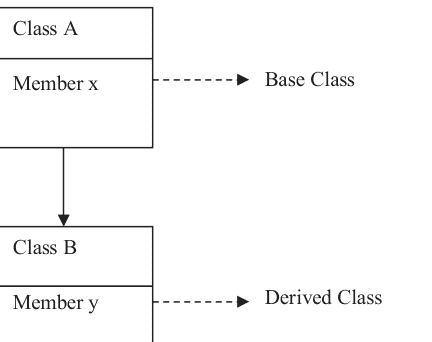

图 6.1 继承示例

# 继承

派生类可以使用基类。因此，基类 A 的成员 x 被派生到类 B。所以，在类 B 中，两个成员（x 和 y）可用。派生类的语法为：

```
class derivedclassname : access-specifier baseclass
{
  members;
  member functions;
}
```

派生类也有它自己的一组成员和成员函数。访问修饰符（access specifiers）决定了基类的特征是以私有还是公开的方式派生的。默认访问修饰符是私有的（private）。

## 6.2. 重用性

重用意味着在派生类中重用基类的属性。重用是通过继承实现的。基类被称为超类（super class）、父类或祖类，派生类被称为子类（sub-class）、子类或后代。从先先派生的类再次派生一个类也是可能的。一个类可以从多个类派生。

示例：

```cpp
// 基类
class A
{
  ----------
}
// 派生类
class B : public A
{
  ----------
}
class C : private A
{
  ----------
}
```

### 6.2.1. 公有继承

当类被公地派生时，基类的所有公共成员都可以在派生类中直接访问。当类被私有地派生时，基类的所有私有成员只能通过基类的公共成员函数进行访问。

### 6.2.2. 私有继承

私有派生类的对象不能直接访问基类的公共成员。因此，使用成员函数来访问这些成员。

### 6.2.3. 私有继承中的受保护数据

`protected` 与 `private` ，但它允许派生类直接访问私有成员。

表 6.1 访问修饰符及其范围

| 基类访问模式 | 公有派生 | 私有派生 | 保护派生 |

| --- | --- | --- | --- |

| Public | 公有 | 私有 | 保护 |

| Private | 不继承 | 不继承 | 不继承 |

| protected | 保护 | 私有 | 私有（或保护） |

## 6.3. 继承的类型

### 6.3.1. 单继承

当只使用一个基类用于一个类的派生，且该派生类不被作为基类使用时，则称为单继承。

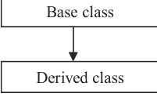

示例：

```cpp
#include<iostream>
#include<constr>
using namespace std;
class base
{
protected:
int a,b;
};
class derived : public base
{
    public:
    void read()
    {
        cout<< "Enter Values:";
        cin>>a>>b;
    }
    void display()
    {
        cout<< "Values:"<<a<<b;
    }
};
int main()
{
    derived obj1;
    obj1.read();
    obj1.show();
    return 0;
}
```

输出：

Enter Values: 10 20

Values: 10 20

### 6.3.2. 多重继承

当使用两个或多个基类用于一个类的派生时，则归类为多重继承。

示例：

```cpp
#include<iostream>
#include<constr>
using namespace std;
class base1
{
protected:
    int a;
};
class base2
{
protected:
    int b;
};
class derived : public base1, base2
{
public:
    void read()
    {
        cout<<"Enter Values:"\n;
        cin>>a>>b;
    }
    void display()
{
        cout<<"Values:"<<a<<b;
    }
};
```

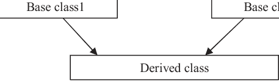

```cpp
}
;int main()
{
  derived obj1;
  obj1.read();
  obj1.show();
  return 0;
}
```

# 输出：

Enter Values: 10 20

Values: 10 20

### 6.3.3. 多级继承

当一个类从另一个派生类派生出来时，则称为多级继承。派生类可以作为基类使用。

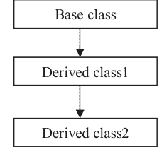

示例：

```cpp
#include<iostream>
#include<constr>
using namespace std;
class base
{
public:
  int a;
};
class derived1 : public base
{
    int b;
};
class derived2 : public derived1
{
public:
    int c;
    void read()
    {
        cout<< "Enter Values:";
        cin>>a>>b>>c;
    }
    void display()
    {
        cout<< "Values:"<<a<<b<<c;
    }
};
int main()
{
    derived2 obj1;
    obj1.read();
    obj1.show();
    return 0;
}
```

# 输出:

Enter Values: 10 20 30

Values: 10 20 30

6.3.4. 层次继承

当一个基类用于两个或多个类的派生时，则称为层次继承。

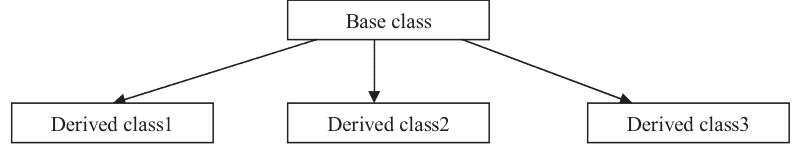

示例：

```cpp
#include<iostream>
#include<iostream>
using namespace std;
class base
{
protected:
    int a,b;
};
class derived1
{
public:
    void read()
    {
        cout<< "Enter Value of a:";
        cin>>a;
    }
    void display()
    {
        cout<< "Value of a:"<<a;
    }
};
class derived2
{
public:
    void read() {
        cout<< "Enter Value of b:";
        cin>>b;
    }
    void display() {
        cout<< "Value of b:"<<b;
    }
}
int main() {
    derived1 obj1;
    derived2 obj2;
    obj1.read();
    obj2.read();
    obj1.show();
    obj2.show();
    return 0;
}
```

# 输出：

Enter Value of a: 10


Enter Value of b: 20

Value of a: 10

Value of b: 20

### 6.3.5. 混合继承

一种或多种继承类型的组合被称为混合继承。下面显示单继承和多重继承的组合。

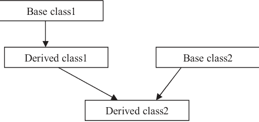

## 6.4. 虚基类

`virtual`关键字将指定的类声明为虚类。编译器将避免虚类的成员重复。声明虚类的规则是：

- (i) 基类在派生类中不能指定多次。
- (ii) 基类可以间接地传递给派生类多次。
- (iii) 为了避免重复，为基类修饰符添加`virtual`关键字。

示例

```cpp
#include<iostream>
#include<constr>

using namespace std;

class base
{
protected:
    int a,b;
};
class derived : virtual public base
{
public:
    void read()
    {
        cout<< "Enter Values:";
        cin>>a>>b;
    }
void display()
{
cout<< "Values:"<<a<<b;
}
};
int main()
{
    derived obj1;
    obj1.read();
    obj1.show();
    return 0;
}
```

输出：10 20

Values: 10 20

## 6.5. 作为类成员的对象

在另一个类中将对象声明为类成员被称为“委托”`delegation`。当一个类拥有另一个类的对象作为其成员时，被称为“容器类”`container class`。在委托中，类是由其他对象组合。组合类通过这些对象使用其他类的属性。这种关系被称为包含关系`has-a-relationship`或包含性`containship`。

示例：

```cpp
#include<iostream>
#include<constr>
using namespace std;
class A
{
public:
    int a;
};
class B
{
    private:
        int b;
        A obj1;
    public:
        void read()
        {
            cout<< "Enter Values:";
            cin>>obj1.a>>b;
        }
        void display()
        {
            cout<< "Values:"<<obj1.a<<b;
        }
};
int main()
{
    B obj2;
    obj2.read();
    obj2.show();
    return 0;
}
```

# 输出：

Enter Values: 10 20

Values: 10 20

## 6.6. 抽象类

当一个类不用于创建对象时，则它被称为抽象类。抽象类可以作为基类，在其基础上可以创建多个层次的继承。抽象类仅仅是基类，不声明这些类的对象。它提供了一个骨架或结构，通过它塑造其他类。

## 6.7. 嵌套类

嵌套类是定义在类内部的类，可以在其定义的类作用范围内使用。嵌套类是一个成员，因此具有与任何其它成员相同的访问权限。可以通过以下语法访问嵌套类：

`parentclassname::childclassname`

示例：

```cpp
#include<iostream>
#include<iostream>
using namespace std;
class department
{
    private:
        int rollno=1;

    public:
        class year
        {
            private:
                char section='a';

            public:
                void display()
                {
                    cout<<"Details:"<<rollno<<section;
                }
        }
    };
```

```cpp
int main()
{
    department::year y;
    y.display();
    return 0;
}
```

# 输出: 1 a

在这个程序中，`department`被称为外部类或迭代器类，而`year`被称为嵌套类。嵌套类将继承外部类的所有属性。要创建嵌套类的对象，必须使用相应的类。在`main()`函数中，外部类和嵌套类的函数属性都是可用的，因此调用了`display()`。`display()`函数可以访问外部类和嵌套类的私有属性。但外部类无法访问嵌套类的私有属性。

## 6.8. 继承的优点

- 它提供了可重用性。通过这种方式，缩短了软件的开发时间。
- 派生类扩展了基类的属性，以生成更具主导的对象。
- 在类层次结构中，同一个基类可以被类中的多个派生类使用。
- 当一个类继承自多个类时，所有被继承的类都具有基类的相同属性。

## 6.9. 继承的缺点

- 不恰当继承会使程序变得复杂。使用对象调用成员函数会产生更多的编译开销。
- 分配给未使用的元素的内存没有被利用。

## 6.10. 示例

- 编写一个程序来演示访问修饰符`public`、`private`、`protected`。

```cpp
#include <iostream>

using namespace std;

class base
{
    private:
    int a;
    protected:
    int c;
    public:
    int b;
    base()
    {
        a=10;
        b=20;
        c=30;
    }
    void show()
    {
        cout<<"private variable value="<<a<<endl;
    }
};
class derv:public base
{
public:
    void show1()
    {
        cout<<"protected variable value="<<c<<endl;
        show();
    }
};

int main()
{
    derv d1;
    d1.show1();
    cout<<"public variable value="<<d1.b;
    return 0;
}
```

# 输出:

protected variable value=30

private variable value=10

public variable value=20

- 2. 编写包含各种形式继承的 C++ 程序。

### (i) 单继承继承

```cpp
#include <iostream>
using namespace std;
class animal
{
public:
    string name;
};
class cat:public animal
{
public:
    void read()
    {
        cout<<"enter the name of the cat:";
        cin>>name;
    }
    void display()
    {
        cout<<"The name of the cat:"<<name;
    }
};
int main()
{
    cat c1;
    c1.read();
    c1.display();
    return 0;
}
```

输出:

enter the name of the cat: puss

The name of the cat: puss

### (ii) 层次结构继承

```cpp
#include <iostream>
using namespace std;
class animal
{
public:
    string name;
};
class cat:public animal
{
public:
    void read()
    {
        cout<<"enter the name of the cat:";
    }
};
class dog:public animal
{
public:
    void read()
    {
        cout<<endl<<"enter the name of the dog:";
        cin>>name;
    }
    void display()
    {
        cout<<endl<<"The name of the dog:"<<name;
    }
};
int main()
{
    cat c1;
    c1.read();
    dog d1;
    d1.read();
    c1.display();
    d1.display();
    return 0;
}
```

输出:

enter the name of the cat: puss

enter the name of the dog: lucy

The name of the dog: lucy

The name of the cat: puss

### (iii) 多重继承

```cpp
#include <iostream>
using namespace std;
class one
{
public:
    void read(int &ch)
    {
        cout<<endl<<"enter the value:";
        cin>>ch;
    }
};
class two
{
public:
    void display(int ch)
    {
        cout<<endl<<"The value is:"<<ch;
    }
};
class three:public one,two
{
private:
    int a;
public:
    void input()
    {
        read(a);
    }
    void output()
    {
        display(a);
    }
};

int main()
{
    three obj1;
    obj1.input();
    obj1.output();
    return 0;
}
```

输出:

enter the value: 5

The value is: 5

### (iv) 多级继承

```cpp
#include <iostream>
using namespace std;
class one
{
public:
    void read(int &ch)
    {
        cout<<endl<<"enter the value:";
        cin>>ch;
    }
};
class two : public one
{
public:
    void display(int ch)
    {
        cout<<endl<<"The value is:"<<ch;
    }
};
class three:public two
{
private:
    int a;
public:
    void input()
    {
        read(a);
    }
    void output()
    {
        display(a);
    }
};
int main()
{
    three obj1;
    obj1.input();
    obj1.output();
    return 0;
}
```

输出:

enter the value: 5

The value is: 5

### (v) 混合继承

```cpp
#include <iostream>
using namespace std;
class one
{
public:
    void read(int &ch)
    {
        cout<<endl<<"enter the value:";
        cin>>ch;
    }
};
class two: public one
{
public:
    void display(int ch)
    {
        cout<<endl<<"The value is:"<<ch;
    }
};
class three
{
public:
    int b;
};
class four:public two, three
{
private:
    int a;
public:
    void input()
    {
        read(a);
        read(b);
    }
    void output()
    {
        display(a);
        display(b);
    }
};
int main()
{
    four obj1;
    obj1.input();
    obj1.output();
    return 0;
}
```

输出:

enter the value: 100

enter the value: 150

The value is: 100

The value is: 150

- 2. 编写一个 C++ 程序来演示构造函数和析构函数的顺序。

```cpp
#include <iostream>
using namespace std;
class super
{
public:
    super()
    {
        cout<<"Base class constructor"<<endl;
    }
    ~super()
    {
        cout<<"Base class destructor"<<endl;
    }
};
class sub: public super
{
public:
    sub()
    {
        cout<<"Derived class constructor"<<endl;
    }
    ~sub()
    {
        cout<<"Derived class destructor"<<endl;
    }
};

int main()
{
    sub obj;
    return 0;
}
```

输出:

Base class constructor

Derived class constructor

Derived class destructor

Base class destructor

解释:

在这个程序中，实现了继承。`super`类的属性被继承到`sub`类中。当为派生类`sub`创建对象时，构造函数和析构函数按照定义的方式被调用。

- 3. 编写一个程序显示派生类中如何调用构造函数。

```cpp
#include <iostream>
using namespace std;
class super
{
public:
    super()
    {
        cout<<"Base class constructor"<<endl;
    }
};
class sub: public super
{
public:
    sub() : super()
    {
        cout<<"Derived class constructor"<<endl;
    }
};
int main()
{
    sub obj;
    return 0;
}
```

输出:

Base class constructor

Derived class constructor

解释:

在这个程序中，当为派生类创建对象时，首先调用基类的构造函数，然后调用派生类的构造函数。

## 6.11. 总结

继承允许将一个类的属性派生到另一个类。继承有多种类型，如单继承、多继承、多级继承、层次继承混合继承。应用继承时，通过虚基类概念消除了基类属性的重复。抽象类不允许为该类创建对象。在另一个类中声明的类被称为嵌套类。

## 6.12. 练习题

### 单选题

- 1. 关于继承，以下哪项是错误的？

(a) 当基类被私有继承时，基类的公有成员成为派生类的私有成员。

(b) 当基类被公有继承时，基类的公有成员成为派生类的公有成员。

(c) 当基类被私有继承时，基类的私有成员成为派生类的成员。

(d) 当基类被公有继承时，基类的保护成员成为派生类的保护成员。

答案：(c)

- 2. 下列哪项/哪些是错误的？

(a) 继承是从现有类派生新类。

(b) 在继承中，基类的所有数据和函数成员都派生到基类中。

(c) 我们可以指定基类的哪些数据和函数成员被派生类继承。

(d) 可以在不重新编译基类的情况下，向派生类添加新函数。

答案：(b)

- 3. 基类提供：

(a) 比派生类更具体的对象

(b) 对应于世界中的某些内容

(c) 在属性被删除时表现不佳

(d) 其派生类的通用版本

答案：(d)

- 4. 如果基类成员访问权限是公有的，而继承类的访问修饰符是私有的，以下哪个说法是正确的？

(a) 派生对象可以访问基类成员。

(b) 派生类成员无法访问基类成员。

(c) 基类对象可以访问派生类的成员

(d) 以上均不是

答案：(a)

5. 多重继承意味着

- (a) 从派生类派生基类
- (b) 从基类派生派生类
- (c) 从多个基类派生一个派生类


- (d) 以上未提到的

答案：(c)

## 6. 哪种运算符用于多重继承？

- (a) 点 (`.`)
- (b) 逗号 (`,`)
- (c) 美元符号 (`$`)
- (d) 以上未提到的

答案：(b)

## 7. 混合继承意味着

- (a) 多重继承
- (b) 多级继承
- (c) 多路径继承
- (d) a 和 b 的组合
- (e) a 和 c 的组合

答案：(d)

## 8. 如果一个类继承了类 X、Y 和 Z 的属性，则这种继承被称为

- (a) 多重继承
- (b) 多级继承
- (c) 层次继承
- (d) 单继承

答案：(e)

## 9. 如果一个类私有地继承基类的属性，则

- (a) 基类的保护成员变为派生类的私有成员
- (b) 基类的公共成员变为派生类的私有成员
- (c) a 和 b 都如此
- (d) 仅 b

答案：(e)

# 继承

121

## 10. 派生结构中基类属性的默认访问模式为

- (a) 公有 (`public`)
- (b) 保护 (`protected`)
- (c) 私有 (`private`)
- (d) 结构不能继承类

答案：(a)

## 11. 多重继承会导致

- (a) 动态绑定
- (b) 多态
- (c) a 和 b 都
- (d) 以上未提到的

答案：(e)

## 12. 可以继承的基类属性有

- (a) 构造函数及其析构函数
- (b) 赋值运算符 `=()` 成员
- (c) 友元 (`Friends`)
- (d) 所有提到的

答案：(d)

## 13. 多重继承遵循

- (a) 适配器模式和观察者模式
- (b) 代码模式
- (c) 胶水模式 (`Glue pattern`)
- (d) 以上未提到的

答案：(a)

## 14. 类继承的语法是

- (a) 类名
- (b) 类名 : 访问修饰符
- (c) 类名 : 访问修饰符 类名
- (d) 以上未提到的

答案：(c)

## 15. （Containership）是一种

- (a) 包含其他类型对象作为其成员的类
- (b) 包含其他类型对象作为其对象的类
- (c) a 和 b 都
- (d) 以上未提到的

答案：(a)

## 16. 不能继承的基类属性是

- (a) 构造函数
- (b) 友元
- (c) a 和 b 都不能被继承
- (d) a 和 b 都可以被继承

答案：(e)

# 简答题

1. 说明继承的不同形式。请用示例说明每种类型。
2. 继承的优缺点是什么？
3. 解释并编写一个 C++ 程序，说明基类通过以下可见性模式派生时的过程：
   - (i) 公有 (`public`)
   - (ii) 私有 (`private`)
   - (iii) 保护 (`protected`)
4. 多重继承中产生了哪些歧义？如何克服？请举例说明。

# 短答题

1. 继承的优点是什么？
2. 解释容器类（Container classes）。
3. 定义抽象类。
4. 定义虚基类（Virtual Base Class）。
5. 关于复用性写短评。
6. 有哪些不同的访问修饰符？

# 指针第七章

## 7.1. 指针

指针是 C++ 的强大特性，使其与 Java 和 Python 等其他编程语言区别来。指针在 C++ 程序中用于访问内存和操作地址。C++ 程序中创建每个变量都会被分配计算机内存中的一个位置。要知道数据存储在哪里，C++ 有一个 `&` 运算符。`&`（引用）运算符提供变量所占用的地址。指针和引用是等价的，区别在于：

- 引用是地址的常量常量。在声明时需要初始化引用。一旦建立了对变量的引用，你就无法将引用改为另一个变量。
- 要获取指针指向的值，需要使用解引用或间接运算符 `*`。要将变量的地址赋值给指针，需要使用地址运算符 `&`。相反，引用和解引用是对引用进行隐式完成的。

在解引用未初始化的指针之前，为指针分配一个值是必要的。如果尝试解引用指针，将由于引用内存中的任何其他位置而导致运行时错误。在 C++ 中，指针可以通过任何整数进行递增或递减。对于动态分配数组非常有用。

## 7.2. 指针的特性

- 指针节省内存空间
- 指针缩短执行时间
- 指针提供了内存的直接访问，从而可以高效访问内存。
- 它提供了一种向函数返回多个值的方法。
- 它提供了访问数组元素的替代方法。
- 它允许我们进行动态内存分配，并允许我们重新调整大小。
- 使用指针提取对象的地址。
- 指针帮助我们构建复杂的数据结构，如链表、队列、栈、树等。

## 7.3. 指针声明

指针是指指向内存中特定地址的变量。声明指针的语法为：

```cpp
datatype *name;
```

示例：

```cpp
#include<iostream>
#include<constream>
using namespace std;

int main() {
    int a;
    int *ptr = &a;
    cout << "a 的地址: " << ptr << endl;
    cout << "a 的值: " << *ptr << endl;
    return 0;
}
```

## 7.4. 类指针

指向类的指针持有变量的地址。例如 float 或 double。这种指针被称为“类指针”。

## 7.5. 对象指针

指向对象的指针类似于结构体指针。对于这种，使用 `->` 成员运算符。指针应该用对象的地址初始化。

示例：

```cpp
#include<iostream>
#include<constream>

using namespace std;

class ABC
{
private:
    int a,b;
public:
    ABC(int x, int y)
    {
        a=x;
        b=y;
    }
    void display()
    {
        cout<< "values="<<a<<b;
    }
};

int main()
{
    ABC obj1(5,10);
    ABC obj2(20,30);
    ABC *ptr;
    ptr=&obj1;
    obj1.display();
    ptr=&obj2;
    obj2.display();

    return 0;
}
```

输出：

```
values=510
values=2030
```

## 7.6. this 指针

`this` 指针作为隐藏参数传递给所有非成员函数调用，因为 `this` 指针在所有非成员体内作为局部变量可用。`this` 指针是一个持有当前对象内存地址的常量指针。静态成员函数中不可用 `this` 指针，因为静态成员函数可以通过类名调用。函数没有 `this` 指针，因为友元不是类的成员。只有成员函数有 `this` 指针。在成员函数内部，this 可用于引用调用者对象。

```cpp
int main()
{
    Test obj;
    int x = 20;
    obj.setX(x);
    obj.print();
    return 0;
}
```

Output:

x=20

## 7.7. 派生类的指针与基类

所有派生类都从共同基类继承属性。可以声明指向基类或派生类的指针。基类指针可以指向基类和派生类的对象。派生类指针只能指向派生类对象。它们不能指向基类对象。基类指针和派生类指针的类型兼容性如图 4.1 所示。

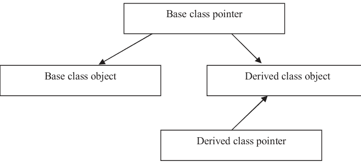

图 4.1 基类指针与派生类指针的兼容性

示例：

```cpp
#include<iostream>
#include<constr>
using namespace std;
class base
{
    public:
    void display()
    {
        cout<< "display method in base class"<<endl;
    }
}
class derived : public base
{
public:
    void display()
    {
        cout<< "display method in derived class"<<endl;
    }
}
int main()
{
    base *ptr; // 基类指针
    ptr = new base(); // 指向基类
    ptr->display();
    delete ptr;
    ptr = new derived(); // 指向派生类
    ptr->display();
    ((derived*) ptr) ->display();
    delete ptr;
    return 0;
}
```

**输出：**

display method in base class

display method in derived class

display method in derived class

在这个程序中，类“base”的属性被派生类“derived”中。因此，派生类中有两个 display() 方法。在 `main()` 中，为基类创建了一个指针 *ptr*。因此，*ptr* 可以同时指向基类和派生类。如果它指向基类，则会直接调用基类的 display()。如果 *ptr* 指向派生类，那么它能够调用两个 display() 方法。

## 7.8. 示例

- 1. 写一个程序来说明此指针。

```cpp
#include <iostream>

using namespace std;
class sample
{
private:
    int a;
public:
    void read()
    {
        cout<<endl<<"enter the value of a:"\n        cin>>this->a;
    }
    void show()
    {
        cout<<endl<<"The value is:"<<this->a;
    }
};
int main() {
    sample s;
    s.read();
    s.show();
    return 0;
}
```

# 输出：

enter the value of a: 25

The value is: 25

# 解析：

在这个程序中，“this”关键字在 read() 和 show() 成员函数中都被使用。当这些函数被调用时，“this” 关键字指向了当前对象的属性。

- 1. 写一个程序来说明指向类的指针。

```cpp
#include <iostream>
using namespace std;
class sample
{
private:
    int a;
public:
    void read()
{
        cout<<endl<<"enter the value of a:";
        cin>>this->a;
    }
    void show()
{
        cout<<endl<<"The value is:"<<this->a;
    }
};
int main() {
    sample s,*p;
    p=\&s;
    p->read();
    p->show();
    return 0;
}
```

# 输出：

enter the value of a: 25

The value is: 25

# 解析：

在 C++ 中，当为类创建一个对象时，通过 `.` 运算符可以访问其属性。如果声明一个指针，则可以使用 `->` 运算符访问。

## 7.9. 总结

指针用于指向另一个内存位置。指针变量通过取地址运算符 `&` 初始化，通过解引用运算符 `*` 获取另一个内存地址。类指针用于访问成员变量。对象的指针类似于结构体指针。“this”运算符用于指向当前对象。在继承概念中，基类指针可以同时指向基类和派生类。

## 7.10. 练习题

# 单选题

- 1. `int (*fp)(char*)`

  (a) 指向指针的指针
  (b) 指数组指针
  (c) 接收 char* 参数并返回 int
  (d) 接收 char* 参数并返回指针

  答案：c

- 2. 解引用运算符是

  (a) `*`
  (b) `&`
  (c) `->`
  (d) `->->`

  答案：a

- 3. `string* x, y` 表示

  (a) x 是指向 string 的指针，y 是 string
  (b) y 是指向 string 的指针，x 是 string
  (c) x 和 y 都是指向 string 的指针

  答案：a

- 4. C++ 中哪些是有效的解引用运算符？

  1. `*`
  2. `::`
  3. `->`
  4. `::`

  (a) 只有 1, 3, 4
  (b) 只有 1 和 5
  (c) 只有 3 和 4
  (d) 只有 3, 4, 5

  答案：b

- 5. 泛型指针的数据类型是

  (a) auto
  (b) void
  (c) asm
  (d) 以上都不是

  答案：c

- 6. 下面哪个是成员指针声明符？

  (a) `->*`
  (b) `*`
  (c) `::*`
  (d) a 和 b

  答案：d

- 7. 类 X 的 this 指针是

  (a) `const X*`
  (b) `X* const`
  (c) `X*`
  (d) `X&`

  答案：d

- 8. 用于存储变量地址的被称为

  (a) 指针
  (b) 引用
  (c) 变量
  (d) 常

  答案：a

- 9. this 的用法

  (a) 隐式指向对象。
  (b) 用于。
  (c) 用于对象。
  (d) 以上都是。

  答案：d

- 10. 静态绑定

  (a) 对象。
  (b) 指针。
  (c) 类。
  (d) 以上这些。

  答案：b

- 11. 虚函数是

  (a) `->`
  (b) `*`
  (c) `&`
  (d) virtual

  答案：d

# 问题

- 1. 什么是指针？
- 2. 指针在 C++ 中如何使用？
- 3. 什么是基类？
- 4. 什么是对象？

# 答题

- 1. 什么是指针？
- 2. 指针在 C++ 中如何使用？
- 3. 什么是类？
- 4. 什么是对象？

# 多态与虚函数

第 8 章

在本章中将讨论绑定和虚函数。

## 8.1. 引言

单词 poly 意味着多，morphism 意味着形式。多态意味着许多形式。函数的多态这种称为早期绑定或静态绑定。在编译时确定函数称为早期时间或静态绑定。在运行时确定函数称为运行时或动态绑定。多态的类型如图 4.1 所示。

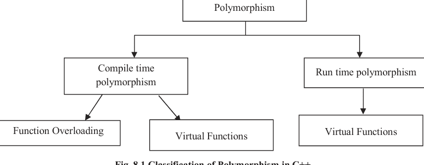

## 8.2. C++ 中的绑定

绑定是指转换为机器语言的过程。C++ 支持两种类型的绑定：

(i) 静态绑定或早期绑定
(ii) 动态绑定或晚绑定

### 8.2.1 静态绑定或早期绑定

静态绑定和动态绑定都是允许的。在静态（早期）绑定中，许多地方使用了相同的函数名，但指出了它们的引用。歧义在编译时解决。

# 示例

```cpp
#include<iostream>
#include<constr>
using namespace std;
class base
{
public:
    void display()
    {
        cout<<"display method in base class"<<endl;
    }
};
class derived : public base
public:
    void display()
    {
        cout<<"display method in derived class"<<endl;
    }
};
int main()
{
  derived obj1;
  obj1.base :: display();
  obj1.display();
  return 0;
}
```

# 输出：

display method in base class

display method in derived class

在这个程序中，基类和派生类是具有相同原型型的相似函数。在派生类中，有两个 display() 函数。在 `main()` 中，当派生类对象调用 display() 时，它会自动调用 derived() 函数。obj1.base :: display() 用于用基对象调用基类的 display()。这执行了成员函数的静态绑定。

### 8.2.2 动态绑定或晚绑定

对于某些程序，很难在编译时进行绑定。如果这在运行时变得更容易，那么这个过程被称为动态绑定。在 C++ 中，通过虚函数实现动态绑定。带有“virtual”关键字的成员函数作为虚函数调用。动态绑定通过函数指针实现。如果基类和派生类虚函数之间没有匹配，它们将被假设为重载函数。虚函数必须在公共区域声明并定义。

## 8.3. 虚函数

基类的虚函数必须在派生类中重定义。基类和派生类的虚函数可以使用相同的函数名，参数数量和类型也可以匹配。虚函数只能是成员函数。派生类对象可以通过作用域覆盖访问基类版本。

```cpp
public:
    virtual void display()
    {
        cout<< "display method in base class"<<endl;
    };
```

```cpp
class derived : public base
{
public:
    void display()
    {
        cout<< "display method in derived class"<<endl;
    }
};
int main()
{
    base *ptr=new derived;
    ptr->display();
    return 0;
}
```

# 输出:

display method in derived class


虚函数表（Virtual table）是一种用于执行动态多态（即运行时绑定）的机制。虚函数表用于在运行时解析函数调用。每个使用虚函数的类都会提供其自己的虚函数表。虚函数表中的每一项都是一个指针，指向该类可以访问的派生类函数。编译器在基类中添加了一个隐藏指针（即`*ptr*`），该指针在创建类实例时会被自动设置，并指向该类的虚函数表。

在实时应用中，如果基类的成员函数很少用于执行任何操作，则此类函数被称为“纯虚函数”（pure virtual functions）。纯虚函数始终定义为空定义的虚函数（空虚函数）。包含纯虚函数的类被称为“抽象类”（Abstract Class），而抽象类的派生类被称为

# 绑定、多态与虚函数

“具体类”（Concrete Classes），并且要求提供纯虚函数的定义。纯虚函数的语法为：

```cpp
virtual void display() =0;
```

# 示例

```cpp
#include<iostream>
#include<iostream>
using namespace std;
class base {
public:
    virtual void display() = 0;
};
class derived : public base {
public:
    void display()
    {
        cout<<"display method in derived class"<<endl;
    }
};
int main()
{
    base *ptr1=new derived;
    ptr1->display();
    return 0;
}
```

# 输出:

display method in derived class

## 8.4. 虚函数的规则

- 虚函数不应该是静态的（static），并且必须是类的成员。
- 虚函数可以被声明为另一个类的友元（friend）。对象指针可以访问虚函数。
- 构造函数不能声明为虚函数，但析构函数可以声明为虚函数。
- 虚函数必须定义在类的公共（public）部分。
- 虚函数也可以返回值。
- 基类和派生类中虚函数的原型应该完全相同。
- 基类指针不能用于算术运算。
- 如果只有基类包含虚函数而派生类没有包含虚函数，则只创建基类的虚函数。
- 用于运算符重载的 `operator` 关键字也支持虚函数机制。

## 8.5. 虚析构函数

使用指向具有非虚析构函数的基类指针来删除类对象会导致未定义的行为。为了纠正这种情况：

```cpp
#include<iostream>
#include<iostream>
using namespace std;
class base
{
public:
    base()
    {
        cout<<"Constructing base \n";
    }
    virtual ~base()
    {
        cout<<"Destructing base \n";
    }
}
```

```cpp
class derived: public base
{
public:
    derived()
    {
        cout<<"Constructing derived \n";
    }
    ~derived()
    {
        cout<<"Destructing derived \n";
    }
};
int main()
{
    derived *d = new derived();
    base *b = d;
    delete b;
    return 0;
}
```

# 输出:

Constructing base

Constructing derived

Destructing derived

Destructing base

```cpp
public:
    sub2()
    {
        cout<<"Derived class2 constructor"<<endl;
    }
}
```

```cpp
class sub3: public sub1, sub2
{
public:
    sub3()
    {
        cout<<"Derived class3 constructor"<<endl;
        cout<<"Value of a:"<<a;
    }
}
```

```cpp
int main() {
    sub3 obj;
    return 0;
}
```

# 输出:

编译错误：对 'a' 的引用具有歧义

在此处，派生类中存在多个属性 `a` 的副本。因此，访问成员 `a` 变得具有歧义。为了解决这个问题，可以以虚的方式继承基类。

```cpp
#include <iostream>
class super
{
public:
    int a;
    super()
    {
        cout<<"Base class constructor"<<endl;
        a=50;
    }
}
class sub1: virtual super
{
public:
    sub1()
    {
        cout<<"Derived class1 constructor"<<endl;
    }
}
class sub2: virtual super
{
public:
    sub2()
    {
        cout<<"Derived class2 constructor"<<endl;
    }
}
class sub3: public sub1, sub2
{
public:
    sub3()
    {
        cout<<"Derived class3 constructor"<<endl;
        cout<<"Value of a:"<<a;
    }
}
```

# 输出:

Base class constructor

Derived class1 constructor

Derived class2 constructor

Derived class3 constructor

Value of a:50

# 输出:

基类构造函数

派生类1构造函数

派生类2构造函数

派生类3构造函数

Value of a:50

# 使用模板的泛型编程 第 9 章

模板用于提供面向对象编程的泛型特性。它允许使用泛型数据类型处理多种类型的数据。在本章中，将讨论泛型模板的使用。

## 9.1. 使用模板的泛型编程

模板通过定义泛型类提供了泛型编程。在模板中，泛型数据类型被用作参数，它们可以处理各种数据类型。适用于所有 C++ 模板的，例如如果我们为函数 `square()` 创建模板，那么我们可以计算 `int`、`float`、`long` 和 `double` 值的平方。

## 9.2. 模板的性

通常，为了处理不同的数据类型，使用重载机制。但是，通过重载会导致程序体积增大并创建更多的局部变量，导致内存浪费。为了克服这些限制，使用了模板。模板是一种允许程序员使用单个函数或类来处理不同数据类型的技术。

## 9.3. 类模板的定义

语法如下：

```
template class <T>
class className
{}
```

成员；

成员函数();

`< >` 用于声明模板类型的变量，这些变量可以在类内部使用以定义模板类型的变量。可以使用逗号运算符声明一个或多个变量。模板不能在类或函数内部声明。它必须声明为全局。为模板类声明模板变量的语法是：

T variable-of-template;

## 9.4. 普通函数模板

非成员函数或普通函数也可以使用模板参数。普通函数和成员函数的区别在于，普通函数定义在类外部。由于它们不是任何类的成员，因此不需要使用对象的 `.` 运算符即可直接调用。成员函数是类的成员，可以使用它们所属的类的对象来调用。声明普通模板函数的语法是：

```cpp
template < T>
returype function_name(arguments)
{
    // 函数体
}
```

示例：

#include<iostream>

#include<conio>

using namespace std;

Template <class T>

void display(T x)

{

    cout<<"Input value is:"<<x<<endl;

}

int main()

{

    display(10);

    display(5.3);

```cpp
return 0;
}
```

# 输出：

Input value is: 10

Input value is: 5.3

模板类型的每个参数都会被替换为识别的数据类型，这个过程被称为“实例化”（instantiating）。因此，根据不同的数据类型，会创建相应的模板函数版本，但不会节省内存。普通函数模板可以使用多个参数定义。

类模板是处理不同数据类型的类。这些类的泛型类型和成员函数可以在不同数据类型上操作。类模板可能包含一个或多个泛型数据类型的参数，这些参数与模板声明用逗号分隔。

## 9.5. 模板函数的重载

函数可以通过普通函数或模板函数进行重载。模板函数的参数中不进行隐式转换。选择合适函数的规则是：

+   (i) 寻找函数精确匹配的项，如果找到则调用它。
+   (ii) 尝试对该函数进行普通重载声明。
+   (iii) 如果未找到匹配，将报告错误。

# 示例：

```cpp
#include<iostream>
#include<conio>

using namespace std;
Template <class T>
void display(T x)
{
    cout<< "Input value is:"<<x<<endl;
}
void display(int y)
{
    cout<< "Input value is:"<<y<<endl;
}
```

```cpp
int main()\{
  display(10);
  display(5.3);
  return 0;
}
```

# 输出：

Input value is: 10

Input value is: 5.3

在此程序中，`display()` 被重载了。

## 9.6. 使用模板冒泡排序

模板函数也可以用于排序。冒泡排序是最简单的算法，它通过在相邻元素顺序错误时反复交换它们来工作。

```cpp
#include<conio>
#include<iostream>
using namespace std;
template<class T>
void bubble(T a[], int n)
{
  int i, j;
  for(i=0;i<n-1;i++)
  {
    for(j=0;j<n-i-1;j++)
    {
      if(a[j]>a[j+1])
      {
        T temp = a[j];
        a[j] = a[j+1];
        a[j+1] = temp;
      }
    }
  }
}
int main()
{
  int a[]={5,1,4,2,8};
  int n=5;
  bubble(a,n);
  for(int i=0;i<n;i++)
    cout<<a[i]<<" ";
  return 0;
}
```

# 输出：

1 2 4 5 8 

## 9.7. 模板与宏的区别

模板与宏之间存在主要区别。模板是一种使函数独立类型的方法。宏仅仅是展开的字符串。区别在于：

+   (i) 模板是类型安全的；宏不是。
+   (ii) 在宏中很难发现错误。
+   (iii) 在变量增加或递减时，模板可以执行。

## 9.8. 使用模板的链表


```cpp
#include <iostream>
#include <string>
using namespace std;
template <class T>
class LinkedList
{
private:
    struct node
    {
        T data;
        node * next;
    } *head;
public:
    LinkedList()
    {
        head = NULL;
    }
    void add(T d);
    void display(const char* s);
};
template <class T>
void LinkedList<T>::add(T d)
{
    node *p, *q;
    if(head == NULL) {
        head = new node;
        head->data = d;
        head->next = NULL;
        return;
    }
    p = head;
    while(p->next != NULL)
    p = p->next;
    q = new node;
    q->data = d;
    q->next = NULL;
    p->next = q;
}
template <class T>
void LinkedList<T>::display(const char* s)
{
    node *p;
    if(head == NULL) return;
    p = head;
    while(p)
    {
        if(s == "string") cout << p->data << endl;
        else cout << p->data << ' ';
        p = p->next;
    }
    if(s == "integer") cout << endl;
}
int main()
{
    LinkedList<string> sList;
    sList.add("data1");
    sList.add("data2");
    return 0;
}
```

## 9.9. 示例

+ 1. 写一个用于说明模板类的 C++ 程序

```cpp
#include<iostream>
#include<string>
using namespace std;
template<typename T>
void show(T data1)
{
cout<<endl<<"Input: "<<data1;
}
int main()
{
show(5);
show(10.4);
return 0;
}
```

输出：

Input: 5

Input: 10.4

# 解释：

在这个程序中，`show()` 包含了模板参数。因此，参数可以是任何数据类型之一。

- 2. 编写一个程序来说说明多个参数的类模板

```cpp
#include<iostream>
#include<string>

using namespace std;

template<typename T>
void add(T data1, T data2)
{
    cout<<endl<<"Input1: "<<data1;
    cout<<endl<<"Input2: "<<data2;
    cout<<endl<<"Addition: "<<data1+data2;
}

int main()
{
    add(5,6);
    add(10.4,2.8);
    return 0;
}
```

# 输出：

Input1: 5

Input2: 6

Addition: 11

Input1: 10.4

Input2: 2.8

Addition: 13.2

# 解释：

在这个程序中，`add()` 函数包含了多个具有泛型数据类型的参数。因此，这些参数可以是任何数据类型之一。

3. 编写一个程序来说明成员函数模板

```cpp
#include<iostream>
#include<string>
using namespace std;
class display
{
public:
    template<typename T>
    void show(T data)
    {
        cout<<endl<<"Input:"<<data;
    }
};
int main()
{
    display d1;
    d1.show(5);
    d1.show(10.4);
    return 0;
}
```

# 输出：

Input: 5

Input: 10.4

# 解释：

在这个程序中，成员函数 `show()` 具有泛型类型。因此，它可以接受任何数据参数。

- 4. 编写一个程序来说明数字幂的函数模板。

```cpp
#include<iostream>
#include<cmath>
using namespace std;

template<typename T>
```
```cpp
void power(T data1, T data2)
{
    T data3;
    data3=pow(data1,data2);
    cout<<endl<<"Input1:"<<data1;
    cout<<endl<<"Input2:"<<data2;
    cout<<endl<<"Power:"<<data3;
}
```

```cpp
int main()
{
    power(10,2);
    power(5.2,3.4);
    return 0;
}
```

# 输出：

Input1: 10
Input2: 2
Power: 100
Input1: 5.2
Input2: 3.4
Power: 271.901

- 5. 编写一个程序来说明两个数字交换的函数模板。
```cpp
#include <iostream>
#include<cmath>
using namespace std;
template<typename T>
void swap(T data1, T data2)
{
T data3;
```
```cpp
cout<<endl<<"Original Values: "<<data1<<" "<<data2;
data3=data1;
data1=data2;
data2=data3;
cout<<endl<<"Swapped Values: "<<data1<<" "<<data2;
}
int main()
{
swap(100,120);
swap(4.5,8.6);
return 0;
}
```

输出：

Original Values: 100 120

Swapped Values: 120 100

Original Values: 4.5 8.6

Swapped Values: 8.6 4.5

## 9.10. 总结

在 C++ 中，`template` 关键字用于提供泛型特性。因此，模板变量可以处理任何类型的数据值。如果一个函数使用了模板，则它被称为函数模板。如果一个类使用了模板，则它被称为类模板。模板函数也可以重载。与宏相比，发现模板的效率更高。

## 9.11. 练习

# 单选题

- 模板参数是什么意思？

(a) 它可以被用作参数传递类型。

(b) 它可以用于评估一个类型。

(c) 它可以没有返回类型。

(d) 以上都不是。

答案：(a)

- 2. 模板中可以使用哪个关键字？

(a) Class

(b) typename

(c) a 和 b 都是

(d) function

答案：(c)

- 3. 模板参数的有效范围是？

(a) 仅在在该块内部

(b) 在类内部

(c) 整个程序

(d) 以上任意一个

答案：(a)

- 4. 我们为什么使用 :::: template-template 参数？

(a) 绑定

(b) 重绑定

(c) a 和 b 都是

(d) 以上都不是

答案：(c)

- 5. 对于非类型模板，哪种参数是合法的？

(a) 成员指针

(b) 对象

(c) 类

(d) 以上都不是

答案：(a)

- 6. 什么是模板？

(a) 模板是用于创建泛型类的公式

(b) 模板用于创建泛型类

(c) 模板用于属性

(d) 无

答案：(a)

- 7. 如何声明一个模板？

(a) template

(b) temp

(c) template

(d) 无

答案：(c)

- 8. 模板的类型有哪些？

(a) 类 (class)

(b) 函数 (function)

(c) a 和 b 都是

(d) 无

答案：(c)

- 9. 模板实现了什么？

(a) 类型安全

(b) 可移植性

(c) 代码

(d) 所有

答案：(a)

- 10. 模板的名称是什么？

(a) 与模板相同

(b) 与类相同

(c) 与函数相同

(d) 无

答案：(a)

# 答题

1. 什么是泛型函数？

2. 比较类和模板。

3. 模板中的异常是什么？

4. 解释模板的概念。

5. 写一个关于模板的程序。

6. 写一个关于重载函数的程序。

7. 写一个关于模板的程序。

8. 解释重载类的概念。

# 短答题

1. 比较类和模板。

2. 模板的优点？

3. 解释模板的必要性。

输出：

输入值：10 20

捕获到异常

## 10.4. 多 catch 语句

它也被称为多个 catch 块（multiple catch blocks）。一旦抛出异常，编译器就会搜索合适的 catch 块。匹配的 catch 块将被执行，控制权传递到最后一个 catch 块之后的后续语句。如果没有找到任何 catch 块，程序将终止。

示例：

```cpp
#include<iostream>
#include<conio>
using namespace std;
void test(int x)
{
try{
    if(x>0)
        throw x;
    else
        throw 'x';
}
catch(int x)
{
    cout<<"Catch an integer and that integer is:"<<x;
}
catch(char x)
{
    cout<<"Catch a character and that character is:"<<x;
}
```

```cpp
int main()) // 修复了括号
{
    cout<<"Testing multiple catches\n";
    test(10);
    test(0);
    return 0;
}
```

# 输出：

Testing multiple catches

Catch an integer and that integer is: 10

Catch a character and that character is: x

## 10.5. 指定异常

指定的异常用于绑定函数，使其仅抛出指定的异常。语法如下：

```cpp
datatype fun-name(argumentslist) throw datypelist
{
    Statement1;
    Statement2;
}
```

数据类型表示要抛出的异常类型。要防止函数抛出异常，将数据类型列表声明为 `void`。抛出异常的语法为 `throw()`。

## 10.6. 示例

- 1. 编写一个处理除以零异常的程序

```cpp
#include <iostream>
using namespace std;

int main()
{
    int a,b;
    float d;
```

# **输出：**

输入 a 和 b 的值：5 0

Divide by zero exception is raised

# **解释：**

在此程序中，在 try 块内执行 a/b 操作，如果 b 为 0，则会抛出异常并被 catch 块捕获。

2. 编写一个重新抛出异常的程序

```cpp
#include <iostream>
using namespace std;
void fun()
{
    try
    {
        throw(10);
    }
    catch(int i)
    {
        cout<<endl<<"Exception is caught in fun()"
        throw;
    }
}
int main()
{
    try
    {
        fun();
    }
    catch(int i)
    {
        cout<<endl<<"Rethrown Exception is caught in main()"
    }
    return 0;
}
```

# 输出：

- Thrown Exception is caught in fun()

- Rethrown Exception is caught in main()

172

通过 C++ 进行面向对象编程

# 解释：

在 `main()` 函数中，在 try 块内调用了 `fun()`。在 `fun()` 执行期间，抛出了异常并被 catch 块处理。在 catch catch 块内部，异常被重新抛出，现在它被 `main()` 函数的 catch 块接收。

## 10.7. 总结

在执行期间或运行时，产生的问题被称为异常（Exception）。在 C++ 中，可以使用 try-catch 块高效地处理异常。try 块会监控其代码块，如果抛出异常，`throw` 关键字会立即抛出异常。抛出的异常由相应的 catch 块接收，catch 块将执行关联的操作。允许使用多个 catch 语句。

## 10.8. 练习

### 单选题

- 1. 下列哪种抛出和处理异常的最优方式是？

(a) 按值抛出并按引用捕获。

(b) 按引用抛出并按引用捕获。

- 2. 下列哪种是捕获任何异常的通用异常处理器？

(a) catch(std::exception)

(b) catch(any_exception)

(c) catch(...)

- 3. 下列哪种是抛出和处理异常的最优方式？

(a) 按值抛出并按引用捕获

(b) 按引用抛出并按引用捕获

(c) 按值抛出并按引用捕获

- 4. 如果没有找到内部 catch 处理器，则：

(a) 编译器将查找 catch 处理器

(b) 程序终止

(c) 编译器将查找 catch 处理器

- 5. 如何限制函数抛出异常？

(a) 在 try 块中定义多个 catch 块

(b) 在 try 块中定义泛型函数

(c) 使用 throw 子句定义

- 6. 尝试调用不支持的异常会导致：

(a) indeterminate()

(b) unutilized()

(c) unexpected()

- 7. 导致程序异常终止的代码应该位于：

(a) Try

(b) catch

(c) Finally

- 8. 在嵌套 try 块中，如果 catch 处理器执行，则：

(a) 程序停止。

(b) 外部 catch 处理器将执行。

(c) 编译器将跳转到外部块。

- 9. 异常处理针对：

(a) 运行时错误

(b) 编译时错误

(c) 逻辑错误

174 通过 C++ 进行面向对象编程

- 10. 什么时候会抛出 `std::bad_alloc` 异常？

(a) 当 new 运算符无法分配

(b) 当 alloc 失败

(c) 当请求 new 操作的类型被认为无效时，抛出此异常

(d) 当 delete 运算符无法分配对象

### 题

1. 编写一个 C++ 程序演示 try、throw 和 catch 异常处理。

2. C++ 提供了哪些关键字用于异常处理？为什么需要这些类而不是值？给出示例。

3. 编写一个包含异常的深度嵌套函数的主程序？详细说明可以使用什么异常机制。

4. 如何在 C++ 中捕获多个异常？

5. 编写一个处理数组越界异常的程序。

6. 编写在构造函数和析构函数中处理异常的 C++ 程序。

### 简题

1. C++ 是如何处理异常的？

2. 在程序中使用异常机制有什么优点？

3. 我们什么时候使用多个 catch 处理器？

4. catch 块内部应该放置什么？

5. try 块内部应该放置什么？给出语法。

# 标准模板库概述 第 11 章

本章介绍了标准模板库及其应用。

## 11.1. 标准模板库概述

在 C++ 中，模板用于处理所有类型的数据。模板的扩展被称为标准模板库（STL）。STL 包含了用于处理复杂问题的各种功能。它为各种实时实体提供了各种运算符和内置函数。通过包含相应的头文件，这些运算符或函数可以在 `std` 命名空间中使用。例如，栈数据结构可以使用 `std::stack` 类适配器轻松处理。

## 11.2. STL 编程模型

STL 主要由：

- 算法

- 容器

- 迭代器

# STL 中的算法

STL 包含了泛型容器的各种算法。它定义了各种函数，例如计数、排序和搜索等。这些函数在元素范围 [first last] 上操作。这些

STL 算法支持顺序、并行和并行+vector 执行策略。例如，`binary_search()` 函数用于在给定的元素范围上执行二分查找算法。

# 示例：


```cpp
#include <iostream>
#include <algorithm>
using namespace std;
int main()
{
    int x[]={1, 5, 8, 9, 6, 7, 3, 4, 2, 0};
    cout << "\nThe original array is : \t";
    for(int i=0;i<10;i++)
        cout<<x[i]<<"\t";
    sort(x, x + 10);
    cout << "\n\nThe array after sorting is : \t";
    for(int i=0;i<10;i++)
        cout<<x[i]<<"\t";
    return 0;
}
```

# 输出：

The original array is: 1 5 8 9 6 7 3 4 2 0

The array after sorting is: 0 1 2 3 4 5 6 7 8 9

# STL 中的容器

在 STL 中，容器用于表示各种对象或元素的集合。复杂的数据结构可以被 STL 容器轻松表示。这些容器实现为泛型类模板。一些常用的容器包括栈（`stack`）、队列（`queue`）、优先级队列（`priority_queue`）、列表（`list`）、映射（`map`）和集合（`set`）等。

# 示例：

```cpp
#include <iostream>
#include <stack>
using namespace std;
int main()
{
stack<int> numstack;
numstack.push(10);
numstack.push(20);
cout<<"The size is="<<numstack.size()<<endl;
int p =numstack.top();
cout<<"poped element="<<p<<endl;
cout<<"The size is="<<numstack.size()endl;
return 0;
}
```

# 输出：

```cpp
#include <iostream>
#include <stack>
using namespace std;
int main()
{
stack<int> numstack;
numstack.push(10);
numstack.push(20);
cout<<"The size is="<<numstack.size()endl;
int p=numstack.top();
numstack.pop();
cout<<"poped element="<<p<<endl;
cout<<"The size is="<<numstack.size()endl;
return 0;
}
```

# 输出：

The size is=2

poped element=20

The size is=1

# STL 中的迭代器

在 STL 中，迭代器用于连接容器和算法。通过迭代器，相同的算法可以应用于各种类型的容器。因此，算法作用于迭代器指向的数据。迭代器提供的操作有 `distance`、`advance`、`next`、`begin`、`prev` 和 `end`。

# 示例：

```cpp
#include<iostream>
#include<vector>

using namespace std;
int main()
{
vector<int>::iterator i;
}
```

## 11.3. 容器

容器用于存储数据并提供程序的控制。容器类有三种，它们是：

- (i) 序列容器 `Sequence`
- (ii) 关联容器 `Associative`
- (iii) 派生容器 `Derived`

序列容器用于对所有成员进行顺序访问和随机访问。关联容器通过扩展根据值来获取元素。派生容器可以从各种序列容器创建。

## 11.4. 序列容器

STL 中的序列容器按顺序存储数据元素。数组也被视为序列容器。由于元素按线性方式排列的，因此可以通过位置进行访问。在序列容器上可以执行各种操作。访问元素时使用迭代器，且速度随迭代器的不同而异。STL 有三种序列容器。

- (i) `vectors`
- (ii) `lists`
- (iii) `deques`

### vector:

`vector` 比数组提供了更高的安全性，并且被证明比数组更高效。在 `vector` 中，可以在随机位置插入或删除元素。根据对 `vector` 执行的操作，其大小会自动更新。它包含在 `<vector>` 头文件中。

### lists:

`list` 是一个在 `<list>` 头文件中提供的双向序列容器。对于它，迭代器充当指向容器中元素的指针。在 `list` 上允许插入和删除操作。

### deques:

它与 `vector` 相似，但它可以同时执行顺序读写操作。

## 11.5. 关联容器

与序列容器相比，关联容器支持对元素的顺序访问和随机访问，从而提供了对容器内元素的快速访问。通常，它遵循树形模式来提供对元素的快速访问。关联容器有四类。

- (i) `sets`（集合）
- (ii) `multisets`（多集合）
- (iii) `maps`（映射）
- (iv) `multimaps`（多映射）

`Set` 和 `multiset` 用于存储数据元素，变量名用作键名。`Map` 和 `Multimap` 同时存储键名和值。值与键名或映射值关联。`Multimap` 允许所有不同的键。

## 11.6. 算法

STL 中的算法提供了内置函数和运算符，用于解决复杂问题。它包含在 `<algorithm>` 头文件中。它专门用于各种元素范围。范围可以根据迭代器的容量来指定。各种函数分为以下类：

非修改操作：

- 修改操作：
- 排序：
- 二分查找：
- 堆：
- 最小/最大：
- 其他：

## 11.7. 迭代器

迭代器为算法与容器之间的通信提供了平台。迭代器可以使用递增运算符指向下一个元素，并使用解引用运算符访问值。

输入迭代器和输出迭代器用于顺序单次输入或输出。正向迭代器允许从开始到结束进行顺序移动。双向迭代器都是顺序的，但它们允许两个方向移动。随机访问迭代器不支持顺序，但它们提供了随机方向。迭代器的各种操作如下：

| 操作 | 描述 |
| :--- | :--- |
| `advance` | 推进迭代器 |
| `distance` | 返回迭代器之间的距离 |
| `begin` | 指向起始的迭代器 |
| `end` | 指向结束的迭代器 |
| `prev` | 获取指向上一个元素的迭代器 |
| `next` | 获取指向下一个元素的迭代器 |

## 11.10. MAP

在 STL 中，`map` 表示一种用于按指定顺序存储数据{键值和映射值}的容器。键（`key`）用于排序和识别过程，映射值（`value`）用于存储与键对应的值。`map` 中存储的值始终按照对应的键进行排序。无序映射（`unordered map`）容器比有序容器（`ordered containers`）更快。通过下标运算符，可以直接访问 `map` 的映射值。

## 11.11. 示例

- 1. 编写一个程序实现 `List` 及其对 `List` 操作

```cpp
#include <iostream>
#include <list>
using namespace std;
int main()
{
list<int> SS;
SS.push_back(10);
SS.push_back(20);
SS.push_front(30);
SS.push_back(40);
SS.push_front(50);
list<int>::iterator i;
for(i=SS.begin(); i!=SS.end(); ++i) cout << *i << " " ";
cout << endl;
return 0;
}
```

输出：

50 30 10 20 40

- 2. 编写一个程序实现 `Vector` 及其 `Vector` 操作

```cpp
#include <iostream>
#include <vector>

using namespace std;

int main() {
vector<string> SS;
SS.push_back("Sunday");
SS.push_back("Monday");
SS.push_back("Tuesday");
SS.push_back("Wednesday");
SS.push_back("Thursday");
SS.push_back("Friday");
SS.push_back("Saturday");
cout << "Weekdays:"<<endl;
int ii;
for(ii=0;ii < SS.size(); ii++) {
cout << SS[ii] << endl;
}
cout << "Size of vector:"<<SS.size() << endl;
return 0;
}
```

# 输出：

- Weekdays:
- Sunday
- Monday
- Tuesday
- Wednesday
- Thursday
- Friday
- Saturday
- Size of vector: 7

- 3. 编写一个程序实现 `Dequeue` 及其 `Dequeue` 操作

```cpp
#include <iostream>
#include <deque>
int main ()
{
    unsigned int i;
    // 构造函数的使用顺序如上述：
    std::deque<int> first; // 空的 int deque
    std::deque<int> second(4,100); // 四个值为 100 的 int
    std::deque<int> third(second.begin(),second.end()); // 遍历 second
    std::deque<int> fourth(third); // third 的拷贝
    // 迭代器构造函数可以用于拷贝数组：
    int myints[] = {16,27,77,29};
    std::deque<int> fifth(myints, myints + sizeof(myints) / sizeof(int));
    std::cout << "The contents of fifth are:" << std::endl;
    for(std::deque<int>::iterator it = fifth.begin(); it!=fifth.end(); ++it)
        std::cout << *it;
    std::cout << "\n";
    return 0;
}
```

# 输出：

The contents of fifth are 16 2 77 29

- 4. 编写一个程序实现 `Map` 操作

```cpp
#include <iostream>
#include <map>
#include <string>

using namespace std;

typedef std::map<std::string, string> TStrMap;
typedef std::pair<std::string, string> TStrPair;

int main(int argc, char *argv[])
{
    TStrMap tMap;
    tMap.insert(TStrPair("yes", "no"));
    tMap.insert(TStrPair("up", "down"));
    tMap.insert(TStrPair("left", "right"));
    tMap.insert(TStrPair("good", "bad"));

    std::string s;
    std::cout << "Enter word: " << std::endl;
    std::cin >> s;

    std::string strValue = tMap[s];
    if(strValue!="")
    {
        // 显示值
        std::cout << "Opposite: " << strValue << endl;
    }
    else
    {
        TStrMap::iterator p;
        bool bFound=false;
        // 显示键
        for(p=tMap.begin(); p!=tMap.end(); ++p)
        {
            std::string strKey;
            strValue = p->second;
            if (strValue == strKey)
            {
                // 返回键
                std::cout << "Opposite: " << p->first << std::endl;
                bFound = true;
                break;
            }
        }
        // 如果未找到
        if(!bFound)
        {
            std::cout << "Word not in map." << std::endl;
        }
    }
    return 0;
}
```

# 输出：

Enter word: yes

Opposite: no

## 11.12 标准模板库 (STL)

标准模板库 (STL) 包含了处理各种问题的特性。要使用任何 STL 特，应包含相应的头文件。STL 组件包括算法、容器和迭代器。算法作用于元素范围。容器代表各种对象和元素。迭代器允许算法与容器之间的通信。序列容器用于访问所有成员。

## 11.13. 练习

### 单选题

- 1. STL 的含义
  (a) 标准库
  (b) 术语库
  (c) 标准模板库
  (d) 以上都不是
  答案：c
- 2. 泛型类和函数称为
  (a) 标准模板库 (STL)
  (b) 头文件
  (c) 函数模板。
  (d) 以上都不是。
  答案：a
- 3. STL 基于哪种范式？
  (a) 结构化编程
  (b) 面向对象编程
  (c) 函数编程
  (d) 面向切面编程
  答案：c
- 4. 哪些 STL 容器连续存储（在相邻位置）元素？
  (a) `std::vector`
  (b) `std::list`
  (c) `std::map`
  (d) `std::set`
- 5. 在多链表组织中
  (a) 对于给定索引具有等值的记录
  (b) 记录按内容顺序加载。
  (c) 通过记录直接访问。
  (d) 以上都不是。
  答案：a
- 6. `forward_list` 在 C++ 中提供什么种迭代？
  (a) 单向
  (b) 双向
  (c) 多向
  (d) 以上都不是
  答案：a
- 7. C++ 中的 `vector` size 指什么？
  (a) `vector` 的大小
  (b) `vector` 的类型
  (c) 元素的数量
  (d) 以上都不是
  答案：c
- 8. 后续元素在插入元素时根据什么移动？
  (a) 赋值运算符
  (b) 拷贝构造函数
  (c) 赋值运算符和拷贝构造函数
  (d) 以上都不是
  答案：c
- 9. C++ STL 中适配器（adapter）的用途是什么？
  (a) 提供接口
  (b) 操作数据
  (c) 提取数据
  (d) 以上都不是
  答案：a
- 10. 哪种用于遍历容器？
  (a) 关联迭代器类型
  (b) 对象的数据类型
  (c) 变量的返回类型
  (d) 以上都不是
  答案：a

### 答题

- 1. 说明标准模板库 (STL) 的任意四个函数。
- 2. 什么是 STL？编写一个使用 STL 开发栈的 C++ 程序？
- 3. 说明 STL 中容器、`vectors`、`lists` 和 `maps` 的用法？
- 4. 编写一个程序创建 `list` 并对列表元素排序？
- 5. 说明容器、容器类型和迭代器？
- 6. 有哪些类型的容器？解释。

### 简答

- 1. C++ 中的适配器（adaptor）是什么？
- 2. 什么是迭代器？
- 3. 说明容器类。

# 附录 A - C++ 输入输出流

## A.I 引言

C++ 支持 C 的所有输入输出函数。它还有库函数。库是一组链接到程序的 .obj 文件，为其函数提供额外支持。该库也称为 `iostream` 库。流（stream）充当输入输出设备与用户之间的桥梁。标准 C++ 库包含了输入输出流函数。流表示字节的顺序数据。如果从输入设备接收顺序数据，则称为输入流或目的流。在 C++ 中，有以下四种类型的流：

- (i) `cin`：是一种输入流，将数据从输入设备传输到 C++ 程序。`cin` 流类的各种预定义成员函数有 `get()`, `getline()`, `read()`, `peek()`, `ignore()`, `putback()`, `gcount()`。
- (ii) `cout`：是一种输出流，将数据从 C++ 程序传输到输出设备。`cout` 流类的各种预定义成员函数有 `put()`, `flush()`。
- (iii) `clog`：`clog` 是一种控制流，将控制信息从缓冲区传输到标准错误设备。
- (iv) `cerr`：`cerr` 也是一种控制流，捕捉错误并将其传输到标准错误显示设备。

## A.II 流类

流用于处理控制台和文件操作。所有流都可以在头文件 `"iostream.h"` 中。`'iostream'` 和 `'ostream'` 是基类 `'ios'` 的派生类。`ios` 流类派生出三个子类，即 `iostream`、`ostream` 和 `streambuf`。`iostream` 和 `ostream` 类都进一步派生出 `iostream` 类。`streambuf` 类派生出 `filebuffer` 类。`ios` 类具有处理格式化和非格式化输入输出操作的能力。格式化允许通过各种设置表示数据，例如数字格式、字段宽、小数


等等。对于一次 I/O 操作，使用默认设置的数据被称为非格式化数据，而用操纵符表示的数据被称为格式化数据。

## A.III. 非格式化数据操作

这些流类的操作将直接在流数据上运行，不经过任何表示形式。

输入流使用 `cin` 类读取数据。输出流使用 `cout` 类来显示数据。数据类型通过重载运算符 `<<`（插入运算符）和 `>>`（提取运算符）来识别。

输入流通过键盘读取数据。它在变量名之前使用 `>>`（提取运算符）。该运算符接收数据并将其赋值给变量的内存位置。

如果数据超过了变量的容量，它将留在输入流中。在输入字符串时，不允许包含空格。如果在 `cin` 语句中使用多个变量来输入数据，则称为级联输入操作。

```
cin>>name-of-variable;
```

如果在 `cout` 语句中使用多个变量来输出数据（原文误），则称为级联输出操作。

```
cout<<name-of-variable1>>name-of-variable2......
```

输出流在屏幕上显示变量的内容。它在 `cout` 语句的变量名之前使用 `<<`（插入运算符）。语法为

```
cout<<name-of-variable;
```

```
cout<<name-of-variable1<<name-of-variable2......;
```

`cout` 语句允许使用 C 语言中所有的转义序列，即 `\n`、`\t` 等

### 示例

```cpp
#include <iostream>
using namespace std;
int main()
{

int a;
float b;
cout<<"Enter the values:";
cin>>a>>b;

cout<<endl<<"The values entered are: "<<a<<"\t"<<b;

return 0;

}
```

# 输出:

Enter the values: 3 5

The values entered are: 3   5

`istream` 类的各种成员函数有：

- (i) `get()`; 它将读取用户输入的下一个非空字符。

### 示例

```cpp
#include <iostream>
using namespace std;
int main()
{
    char a;
    cout<<"Enter the character:";
    cin.get(a);
    cout<<endl<<"The character entered is: "<<a;
    return 0;
}
```

# 输出:

Enter the character: a

The character entered is: a

- (ii) `getline()`; 它将读取用户输入的受指定大小限制的顺序数据。

### 示例:

```cpp
#include <iostream>
using namespace std;
int main()
{
    char name[25];
    cout<<"Enter the name:";
    cin.getline(name,25);
    cout<<"The name entered is: "<<name;

    return 0;
}
```

# 输出:

Enter the name: example of getline()

The name entered is: example of getline()

- (iii) `peek()`: 它返回输入字符串中的后续字符而不进行提取。

### 示例

```cpp
#include <iostream>
using namespace std;
int main()
{
char a,name[25];
int i=0;
cout<<"Enter the name:";
while (cin.get(a))
{
    if(cin.peek()=='#')
    {
        name[i++]=a;
        name[i]='\0';
        break;
    }
    else
    {
        name[i++]=a;
    }
}
cout<<endl<<"The name entered is: "<<name;
return 0;
}
```

# 输出:

Enter the name: hello#program

The name entered is: hello

- (iv) `ignore()`: 它从输入字符串中提取字符并忽略字符，直到匹配到终止字符。

### 示例

```cpp
#include <iostream>
using namespace std;
int main()
{
char a,name[25];
int i=0;
cout<<"Enter the name:";
while (cin.get(a))
{
    if(a=='#')
    {
        name[i]='\0';
        break;
    }
    else
    {
        name[i++]=a;
    }
}
cout<<endl<<"First letters of name entered: "<<name;
return 0;
}
```

# 输出:

Enter the name: hello program #

First letters of name entered: h

- (v) `putback()`: 它将指定的字符放入输入流。

### 示例

```cpp
#include <iostream>
using namespace std;
int main()
{
  char a,b,c;
  cout<<"Enter two characters:";
  cin>>a>>b;
  cin.putback(a);
  cin>>c;
  cout<<endl<<"The value of a="<<a<<endl;
  cout<<"The value of b="<<b<<endl;
  cout<<"The value of c="<<c<<endl;
  return 0;
}
```

# 输出:

Enter two characters: x y

The value of a=x

The value of b=y

The value of c=x

- (vi) `gcount()`: 返回从输入流中提取的非格式化字符的数量。`gcount()` 应配合 `get()`、`getline()` 或 `read()` 使用。

### 示例

```cpp
#include <iostream>
using namespace std;
int main()
{
    char name[25];
    cout<<"Enter the name:";
    cin.getline(name,25);
    int l=cin.gcount();
    cout<<endl<<"The name="<<name<<endl;
    cout<<"The size of name="<<l;
    return 0;
}
```

# 输出:

Enter the name: hello

Name=hello

The size of name=5

## A. 格式化数据操作

流类的层次结构包含：

- (a) `istream` 输入
- (b) `ostream` 输出
- (c) `iostream` 输入和输出

`streambuf` 允许与物理设备的抽象。各种 `ios` 类函数有：

### width()

输出将在指定的宽度内显示。`width()` 函数有两种声明方式：`width()` 返回当前宽度；`width(int)` 设置指定的整数宽度。

### 示例

```cpp
#include <iostream>
using namespace std;
int main()
{
    char a;
    cout<<"Enter the character:";
    cin>>a;
    cout.width(5);
    cout<<endl<<"a="<<a;
    cout.width(5);
    cout<<endl<<"a="<<a;
    return 0;
}
```

# 输出:

Enter the character: x

a=x

a=x

### precision()

`precision()` 将设置浮点值的小数位数。`precision()`有两种声明方式：`precision(int)` 设置指定的精度；`precision()` 返回当前浮点数的设置。

### 示例

```cpp
#include <iostream>
using namespace std;
int main()
{
    double f =2.53678;
    cout.precision(3);
    cout << f << "\n";
    cout.precision(6);
    cout << f << "\n";
    return 0;
}
```

# 输出:

2.54

2.53678

### fill()

它设置一个字符来填充字段的空白区域。使用 `fill()` 函数有两种方式：

- `char fill()` - 返回填充字符的当前设置。
- `fill(char)` - 用新字符重置填充字符。

### 示例

```cpp
#include <iostream>
using namespace std;
int main()
{
    char prev;
    cout.width(5);
    cout<<3<< endl;
    prev = '*';
    cout.width(5);
    cout<<3<<endl;
    cout.fill(prev);
    return 0;
}
```

# 输出:

3

***3

### setf()

用于为格式输出设置各种标志。使用 `setf()` 有两种方式：`setf(long)` 根据 `long` 类型中的标记设置标志；`setf(long sb, long f)` 移除变量 `f` 中标记的位并重置为变量 `sb` 中的标记位。

### unsetf()

用于移除标志设置。

### 位域

`ios` 类包含 `setf()` 成员函数。标志指示格式设计。`unsetf()` 函数用于清除标志。两个标志 V1 和 V2 的语法为

```
cout.setf(V1,V2);
```

下表描述了此函数可以使用的标志和位域设置。

| 格式 | 标志 (V1) | 位域 (V2) |
| --- | --- | --- |
| 左对齐 | `ios::left` | `ios::adjustfield` |
| 右对齐 | `ios::right` | `ios::adjustfield` |
| 符号与基后的填充 | `ios::internal` | `ios::adjustfield` |
| 科学计数法 | `ios::scientific` | `ios::floatfield` |
| 固定点法 | `ios::fixed` | `ios::floatfield` |
| 十进制基 | `ios::dec` | `ios::basefield` |
| 八进制基 | `ios::oct` | `ios::basefield` |
| 十六进制基 | `ios::hex` | `ios::basefield` |

`ios::adjustfield()` 用于将填充排列在左侧、右侧或内部。`ios::floatfield()` 用于设置浮点计数法为科学或固定。`ios::basefield` 用于设置表示为进制、八进制或十六进制。各种无字段的标志

| 标志 | 功能 |
| --- | --- |
| `ios::showbase` | 输出时使用基指示 |
| `ios::showpos` | 在正数前显示符号 |
| `ios::showpoint` | 显示结尾的小数点和零 |
| `ios::skipws` | 输入时跳过空白字符 |
| `ios::unitbuf` | 插入后刷新所有流 |
| `ios::uppercase` | 十六进制值使用大写字母 |
| `ios::stdio` | 与 'C' 标准输入输出同步 |
| `ios::boolalpha` | 将布尔值转换为文本 |

```
100
100
0x64
64
```

### 示例

```cpp
#include <iostream>
using namespace std;
int main()
{
    double d = 44.8765;
    cout.setf(ios::fixed, ios::floatfield);
    cout.setf(ios::showpoint);
    cout.precision(2);
    cout << d;
    return 0;
}
```
44.88

### 操纵符 (Manipulators)

输出格式可以使用操纵符进行控制。头文件 `"iomanip"` 包含一组函数。`ios` 成员函数返回之前的设置，但操纵符不会恢复到之前的设置。下面展示了操纵符配合 `cout()` 语句、操纵符（m1 和 m2）以及变量（v1）使用。

```
cout<<m1<<m2<<v1;
```

下表描述了几个操纵符。

| 操纵符 | 功能 |
|--- |--- |
| `setw(int n)` | 将字段宽度固定为 n |
| `Setbase` | 设置数字系统的基数 |
| `setprecision(int p)` | 将精度点固定为 p |
| `setfill(char f)` | 将填充字符设置为变量 f 中存储的字符 |
| `setiosflags(long l)` | 格式标志设置为 1 |

### 附录 A - C++ 中的输入和输出流

| | |
|--- |--- |
| `setiosflags(long i)` | 移除由 1 指定的标志 |
| `Endl` | 换行 |
| `Skipws` | 输入时跳过空白字符 |
| `noskipws` | 输入时不跳过空白字符 |
| `Ends` | 添加空字符以结束输出字符串 |
| `Flush` | 刷新缓冲区流 |
| `Lock` | 锁定与文件句柄相关联的文件 |
| `Ws` | 用于跳过第一个字段前的领先空格 |
| `hex, oct, dec` | 以十六进制、八进制和十进制格式显示数字。 |

操纵符 `hex, dec, oct, ws, endl` 和 `flush` 定义在 `"iostream"` 头文件中。需要参数的操纵符 `setw, width, fill()` 等定义在 `"iomanip"` 头文件中。

### 示例:

```cpp
#include <iostream>
#include <iomanip>
using namespace std;
int main()
{
  cout << setw(5) << setfill('*');
  cout << "hai" << endl;
  return 0;
}
```

**输出：**

hai

### 用户自定义操纵符

可以使用 `int` 或 `long` 参数创建用户自定义操纵符。操纵符可以带有一个或多个参数作为参数声明。用户自定义操纵符的语法如下：

```cpp
{
  Statement1;
  Statement2;
  return o;
}
```

`m_name` 是带有 `ostream` 参数和返回值的用户自定义操纵符。

### 示例

```cpp
#include <iostream>
#include <iomanip>

using namespace std;

stream& curr(ostream&ostrObj)
{
    cout << endl;
    return ostrObj;
}

int main()
{
    cout << "Curr" << curr;
    cout << "It is new manipulator for endl" <<curr;
    return 0;
}
```

# 输出:

Curr

It is new manipulator for endl

# 附录 B - C++ 中的文件

## B.I. 引言

计算机世界中的信息传输以文件的形式进行。根据应用程序的不同，文件可以写入、读取或上传。次级存储设备如软磁盘、硬盘等用于以文件的形式存储数据。文件名是唯一的，用于标识文件。在同一个目录下没有两个文件的文件名相同。有多种类型的文件，如文本文件、程序文件、数据文件和可执行文件等……程序与输出设备或文件之间进行数据通信。文件流用于在各种设备之间传输通信。“流”表示按字节顺序的数据流。输入流将数据带入程序，输出流从程序中收集数据。因此，输入流从文件中提取数据并传输到程序，而输出流将程序提供的数据存储到文件中。

| 文件 | 输入流 | C++ 程序 |
|---|---|---|
| | 输出流 | |

## B.II. 文件流类

在 C++ 中，流使用类来控制。文件操作分为“读”或“写”。`ios` 类是文件的基类。所有其他类都派生自 `ios` 类。`strebuf` 类具有控制数据缓冲器的低级例程。`istream` 和 `ostream` 类控制输入和输出函数。`get(), getline(), read()` 和 `>>` 运算符定义在 `istream` 类中。`put(), write()` 和 `<<` 运算符定义在 `ostream` 类中。


`class` 是 `istream` 和 `ostream` 类的派生类。其他派生类有 `istream-withassign`、`ostream-withassign` 和 `istream-withassign`。`ifstream` 和 `ostream` 分别派生自 `istream` 和 `ostream`。这些类处理与磁盘文件的输入输出操作。在进行 I/O 操作时，程序中应包含头文件 `"fstream"`。它包含了 `ifstream`、`ostream` 和 `fstream` 类的声明，包括 `istream` 头文件。`FILE` 提供了文件的输入输出操作。它还安排了一个空间来保留用于输出的输入数据。

# B.III. 文件打开模式

文件的打开涉及多种模式。语法为 `open("filename", mode)`，其中 `mode` 是一个选项。各种模式如下所示：

| 模式 | 操作 |
|--- |--- |
| `ios::app` | 在末尾添加数据 |
| `ios::ate` | 打开后指针指向末尾 |
| `ios::binary` | 二进制文件 |
| `ios::in` | 用于读取的打开 |
| `ios::nocreate` | 如果文件不存在 |
| `ios::noreplace` | 如果文件已存在 |
| `ios::out` | 用于写入的打开 |
| `ios::trunc` | 如果文件存在则删除内容 |

# 示例

```cpp
#include <iostream>
#include <iomanip>
#include <fstream>

using namespace std;

int main()
{
    int a=10;
    ofstream out("ex.txt", ios::trunc);
    out<<a;
    return 0;
}
```

# B.IV. 文件指针与操纵符

文件指针与文件关联。`get` 指针和 `put` 指针持有字节数。`get` 指针也称为输入指针。`seek()` 函数移动 `get` 指针，`seekp()` 函数移动 `put` 指针。`get` 和 `put` 指针用于。

# B.V. 带参数的操纵符

`seek()` 和 `seekg()` 函数可以使用两个参数。偏移量指定了相对于 `pre_position` 移动的字节数。偏移量可以是正数。正整数使指针向前移动，而负数使指针向后移动。`pre_position` 参数可以包含以下值：

- `ios::beg` 表示文件的开头。
- `ios::cur` 表示文件的当前位置。
- `ios::end` 表示文件的结束。

带有参数的 `seek()` 函数如下。它是 `fstream` 类的一个对象。

| 寻求位置 | 工作原理 |
|---|---|
| `seek(0, ios::beg)` | 转到文件开头 |
| `seek(0, ios::cur)` | 重置在当前位置 |
| `seek(0, ios::end)` | 转到文件结尾 |
| `seekg(n, ios::beg)` | 将指针移到文件的 n+1 字节处 |
| `seekg(n, ios::cur)` | 从当前位置向前 n 字节 |
| `seekg(-n, ios::cur)` | 从当前位置向后 n 字节 |
| `seekg(-n, ios::end)` | 从末尾向后 n 字节 |

# B.VI. 顺序访问文件

`put()` 和 `get()` 用于读取或写入单个字符，而 `write()` 和 `read()` 用于读取或写入块二进制数据。`get()` 函数从 `get` 指针指向的文件读取单个字符。`put()` 函数通过流对象向指定的文件写入字符。这些函数是 `fstream` 类的成员。

# 示例:

```cpp
#include <iostream>
#include <iomanip>
#include <fstream>

using namespace std;
int main()
{
int a=10;
char c;
fstream io("ex1.txt", ios::in|ios::out);
io.put(a);
io.seekg(0);
}
```

`cout <<<<"data from file is:"<<endl;`

```cpp
while(io)
  cout<<io.get(c);
return 0;
}
```

# 输出:

`data from file is:`

`10`

## B.VII. 二进制与 ASCII 文件

用户输入的数据以 ASCII 格式表示。但计算机只理解二进制数据。`get()` 和 `put()` 函数将读取或写入 ASCII 格式的字符。对于大量的数值数据，这些函数会占用更多空间。因此使用 `read()` 和 `write()` 函数。它们在操作过程中使用数据的二进制格式。语法如下：

```cpp
in.read((char*)&P,sizeof(P));
out.write((char*)&P, sizeof(P));
```

第一个参数是变量 `P` 的地址。第二个参数是变量 `P` 的字节数（bytes）。

`read()` 和 `write()` 函数也用于从文件中读取和写入类对象。在读/写操作期间，只有数据成员会被读取/写入，成员函数会被忽略。

## B. VIII. 随机访问操作

在文件中，需要对特定的数据记录进行更新。为此，必须获取数据在文件中存储的位置（以字节数表示）。`sizeof()` 运算符确定对象的大小。语法如下：

```cpp
int size=sizeof(O);
```

其中，`O` 是一个对象，`size` 是一个整数变量。在这里一个对象等于一条记录。第 `n` 个记录或对象的位置通过以下公式获取：

```cpp
int p=(n-1)*size;
```

其中，`p` 是要更新的对象的精确字节数，`n` 是对象的数量，`size` 是记录的大小。通过 `seekg()` 和 `seekp()`，可以将文件指针设置在该位置。

## 附录 C - 附加程序

### 例 1: 内联函数程序

```cpp
#include <iostream>
using namespace std;
inline int Max(int x, int y)
{
    return (x > y) ? x : y;
}
// 程序的主函数
int main ()
{
    cout << "Max (20,10): " << Max(20,10) << endl;
    cout << "Max (0,200): " << Max(0,200) << endl;
    cout << "Max (100,10100): " << Max(100,10100) << endl;
    return 0;
}
```

输出:

- Max (20,10): 20
- Max (0,200): 200
- Max (100,10100): 10100

### 例 2: 函数重载程序

```cpp
#include <iostream>
using namespace std;
// 函数参数具有不同的数据类型
int add(int, int);
float add(float, float);
int main()
{
    int a, b, x;
    float c, d, y;
    cout << "Enter integers\n";
    cin >> a >> b;
    x = add(a,b);
    cout << "Sum of integers: " << x << endl;
    cout << "Enter two floating point numbers\n";
    cin >> c >> d;
    y = add(c, d);
    cout << "Sum of floats: " << y << endl;
    return 0;
}
int add(int x, int y)
{
    int sum;
    sum = x + y;
    return sum;
}
float add(float x, float y)
{
    float sum;
    sum = x + y;
return sum;
}
```

输出:

Enter two integers

3

4

Sum of integers: 7

Enter floating point numbers

5.6

7.9

Sum of floats: 13.5

### 例 3: 友元函数程序

```cpp
#include <iostream>
using namespace std;
class Distance
{
private:
int meter;
public:
Distance(): meter(0){ }
friend int func(Distance); //友元函数
};
int func(Distance d) //函数
{
    d.meter=5; // 从非成员函数访问私有数据
    return d.meter;
}
int main()
{
    Distance D;
    cout<<"Distance: "<< <<func(D);
    return 0;
}
```

输出:

Distance: 5

### 例 4: 类程序

```cpp
#include <iostream>
using namespace std;
class Rectangle
{
    int x, y;
    public:
    void set_values (int,int);
    int area ()
    {
        return (x*y);
    }
};
void Rectangle::set_values (int a, int b)
{
    x = a;
    y = b;
}
int main ()
{
    Rectangle rect;
    rect.set_values (3,4);
    cout<<"area: "<<rect.area();
    return 0;
}
```

输出:

area: 12

### 例 5: 静态成员程序

```cpp
#include <iostream>
using namespace std;
class test
{
    public:
    int code;
    static int count;
    static void showcount()
    {
        cout<<"count:"<<count<<endl;
    }
    void setcode()
    {
        count++;
    }
    void showcode()
    {
        showcount();
        cout<<"object number:"<<code<<endl;
    }
};
int test::count = 0;
int main()
{
    test t1,t2,t3;
    t1.setcode();
    t2.setcode();
    test::showcount();
    t3.setcode();
    t1.showcode();
    t2.showcode();
    t3.showcode();
    return 0;
}
```

输出:

count:3

object number:1

count:2

object number:3

### 例 6: 对象数组程序

```cpp
#include <iostream>
using namespace std;
const int MAX =100;
class Details
{
    private:
    int salary;
    float roll;
    public:
    void getname()
    {
        cout<< "\n Salary:";
        cin>> salary;
        cout<< "\n roll:";
        cin>> roll;
    }
    void putname()
    {
        cout<<endl<< "Salary:"<<roll << "\n";
    }
};
int main()
{
    Details det[MAX];
    int n=0;
    char ans;
    do
    {
        cout << "Enter Employee Number:" << n+1;
        det[n++].getname();
        cout << "Enter another (y/n)?: ";
        cin>>ans;
    } while ( ans != 'n');
    for (int j=0; j<n; j++)
    {
        cout<<\nEmployee is: << j+1;
        det[j].putname();
    }
    return 0;
}
```

输出:

Enter Employee Number:1

Enter Salary:450

Enter roll:48

Enter another (y/n)?: y

Enter Employee Number:2

Enter Salary:567

Enter roll:43

Enter another (y/n)?: n

### 例 7: 构造函数程序

```cpp
#include<iostream>
using namespace std;
class Cube1
{
    int side;
public:
    Cube1(int x)
    {
        side=x;
    }
};
int main()
{
    Cube1 c1(10);
    Cube1 c2(20);
    cout<<c1.side;
    cout<<c2.side;
}
```

输出:

10

20

### 例 8: 动态内存分配

```cpp
#include <iostream>

using namespace std;
int main()
{
    int n, *pointer, c;
    cout << "Enter an integer\n";
    cin>> n; pointer = new int[n];
    cout << "Enter " << n << " integers\n";
    for ( c = 0; c < n; c++)
        cin>> pointer[c];
    cout << "Elements entered by you are\n";
    for ( c = 0; c < n; c++)
        cout << pointer[c] << endl;
    delete[] pointer;
    return 0;
}
```

输出:

Enter an integer

4

Enter 4 integers

1

2

3

4

Elements entered by you are

1

2

3

4

### 例 9: 插入与提取运算符重载

```cpp
#include<iostream>
using namespace std;
class student
{
    int rno;
    int marks;
public:
    student()
    {
        rno=0;
        marks =0;
    }
    student(int r,int m)
    {
        rno = r;
        marks = m;
    }
    friend ostream& operator<<(ostream&output,student D)
    {
        output << "\nrno is:"<<D.rno<<"\nmarks is:"<<D.marks<<"\n";
        return output;
    }
    friend istream& operator>>(istream&input,student&D)
    {
        input>>D.rno>>D.marks;
        return input;
    }
};
int main()
{
    student s1(11,10),s2(5,11),s3;
    cout<<"\nread values rno,marks for s3";
    cin>>s3.rno;
    cout<<"\nFirst student:"<<s1<<endl;
    cout<<"\nSecond student:"<<s2<<endl;
    cout<<"\nThird student:"<<s3<<endl;
    return 0;
}
```

输出:

read values rno,marks for s3

33

78

First student:

rno is:11 marks is:10

Second student:

rno is:5 marks is:11

Third student:

rno is:33 marks is:78

### 例 10: 复数类的运算符重载


```cpp
#include<iostream>
using namespace std;
classcomplex
{
    intreal,imag;
    public:
    void getValue()
    {
        cout<<"\enter the values";
        cin>>real>>imag;
    }
  complex operator+(complex,complex);//友运算符+的声明
  void display() //打印值
  {
    cout<<"\n"<<real<<"imag:"<<imag;
  }
  complex operator-(complex ob1)
  {
    complex t;
    t.real=real-ob1.real;
    t.imag=imag-ob1.imag;
    return(t);
  }
};
```

```cpp
complex operator+(complex c1,complex c2)//友元函数定义
  {
    complex t;
    t.real=c1.real+c2.real;
    t.imag=c1.imag+c2.imag;
    return(t);
  }
```

```cpp
int main()
  {
  complex obj1,obj2,sum,diff;
  obj1.getValue();
  obj2.getValue();
  sum = obj1+obj2; //对象调用operator+(obj1,obj2)
  diff = obj1-obj2; //obj1.operator-(obj2)
  cout<<"\nInput Values:\n";
  obj1.display();
  }
```

```cpp
obj2.display();
cout<<"\nResult:";
sum.display();
diff.display();
return 0;
```

# 输出:

输入值3

4

输入值6

8

输入值:

实部：3 虚部：4

实部：6 虚部：8

结果：

实部：9 虚部：12

实部:-3 虚部:-4

# 例 11: 函数重写

```cpp
#include<iostream>
using namespace std;
class base
{
    int a;
    public:
        void input()
        {
            cout<<"Enter a: ";
            cin>>a;
        }
        void show()
        {
            cout <<"a=" << a << endl;
        }
};
class derived:public base {
    int a;
    public:
        void input() {
            cout <<"Enter a: ";
            cin>>a;
        }
    }
    void show() {
        cout <<"a=" << a << endl;
    }
};

int main() {
    cout <<"Base class functions are executed" << endl;
    base b1;
    b1.input();
    b1.show();
    cout <<"Base class functions are overridden in derived class" << endl;
    derived d1;
    d1.input();
    d1.show();
    return 0;
}
```

# 输出:

基类函数正在执行

输入 a: 4

a=4

基类函数在派生类中被重写

输入 a: 5

a= 5

# 例 12: 嵌套类程序

```cpp
#include <iostream>
using namespace std;
class Nest
{
public:
    class Display
    {
    private:
        int s;
    public:
        void sum(int a, int b)
        {
            s =a+b;
        }
    }
    void show()
    {
        cout<<"\nSum of a and b is: " << s;
    }
};
int main()
{
    Nest::Display x;
    x.sum(12, 10);
    x.show();
    return 0;
}
```

# 输出:

a 和 b 的和为: 22

# 例 13: 类指针

```cpp
#include<iostream>
using namespace std;
class sample
{
    public:
    int x;
    void show()
    {
        cout<<"\n x is:"<<x;
    }
}
int main()
{
    sample obj;
    sample *sp;
    sp=&obj;
    sp->x=10;
    sp->show();
    return 0;
}
```

# 输出:

x is:10

# 例 14: 转换为派生类类型

```cpp
#include<iostream>
using namespace std;
class Base
{
    public:
    int a;
    void show_a()
    {
        cout<<"\n a is:"<<a;
    }
};
class Derived:public Base
{
    public:
    int b;
    void show_b()
    {
        cout<<"\n b is:"<<b;
    }
};
int main()
{
    Base *bptr;
    Derived *dptr;
    Derived dobj;
    bptr = &dobj;
    bptr->a=10;
    bptr->show_a();
    ((Derived*)bptr)->b=20;
    ((Derived*)bptr)->show_b();
    return 0;
}
```

附录 C - 附加程序

# 输出:

a is:10

b is:20

# 例 15: 通用指针

```cpp
#include<iostream>
using namespace std;
int main()
{
    int i;
    char c;
    void *the_data;
    i = 6;
    c = 'a';
    the_data = &i;
    cout*(int*)the_data;
    the_data = &c;
    cout*(char*)the_data;
    return 0;
}
```

# 输出:

6a

# 例 16: 抽象类

```cpp
#include<iostream>
using namespace std;
class B
{
public:
    virtual void display() = 0;
};
class D:public B
{
public:
    void display()
    {
        cout<<"\nthis derived class";
    }
};
class X:public B
{
public:
    void display()
    {
        cout<<"\n this is class";
    }
};
int main()
{
    B ob;
    D d;
    d.display();
    X x;
    x.display();
    return 0;
}
```

# 输出:

this derived class

this is class

# 例 17: 虚函数

```cpp
#include<iostream>
using namespace std;
class A
{
    public:
    virtual void show()
    {
        cout<<" this is base ";
    }
};
class B:public A
{
    public:
    void show()
    {
        cout<<" this is derived";
    }
};
int main()
{
    A *p;
    B x;
    p=&x;
    p->show();
    return 0;
}
```

# 输出:

this is derived

# 例 18: 流程序 -1

```cpp
#include<iostream>
using namespace std;
int main()
{
    int count=0;
    char c;
    cout<<"input text\n";
    cin.get(c);
    while(c!='n')
    {
        cout.put(c);
        count++;
        cin.get(c);
    }
    cout<<"\nnumber of characters ="count<<"\n";
    return 0;
}
```

# 输出:

input text

number of characters = 4

# 例 19: 流程序 -2

```cpp
#include<iostream>
using namespace std;
int main()
{
    int size=20;
    char city[20];
    cout<<"enter city name:\n";
    cin>>city;
    cout<<"city name:"<<city;
    cout<<"enter city name:\n";
    cin.getline(city,size);
    cout<<"city name now:"<<city;
    cout<<"enter city name:\n";
    cin.getline(city,size);
    cout<<"new city name:"<<city;
    return 0;
}
```

# 输出:

enter city name:

hyderabad

city name:hyderabad

enter city name:

vijabad

city name now:vijabad

enter city name:

vijabad

new city name:vijabad

# 例 20: 异常程序

```cpp
class complex
{
    protected :
        int real,img;
    public :
    void read()
    {
        cout<<"\nenter the real and img values";
        cin>>real>>img;
    }

    void display()
    {
        cout<<(real<<", "<
#include<fstream>

using namespace std;
int main()
{
    ofstream fout;
    fout.open("sample.txt");
    fout<<"Welcome"<<endl;
    fout<<"This is sample text file"<<endl;
    fout.close();
    return 0;
}
```

# 输出:

Open sample.txt

Welcome

This is sample text file

# 例 22: 从文件中读取内容

```cpp
#include<iostream>
#include<fstream>
using namespace std;
int main()
{
    char ch;
    ifstream fin;
    fin.open("sample.txt");
    while(fin)
    {
        fin.get(ch);
        cout<<ch;
    }
    fin.close();
    return 0;
}
```

# 输出:

Welcome

This is sample file

# 例 23: 将一个文件的内容追加到另一个文件

```cpp
#include<iostream>
#include<fstream>
using namespace std;
int main()
{
    ofstream fout;
    ifstream fin;
    fin.open("sample.txt");
    fout.open("sample.txt",ios::app);
    char ch;
    while(fin)
    {
        fin.get(ch);
        fout.put(ch);
    }
    fin.close();
    fout.close();
    return 0;
}
```

# 输出:

sample.txt

Welcome

This is sample file

# 例 24: 拷贝一个文件的内容到另一个文件

```cpp
#include<iostream>
#include<fstream>
using namespace std;
int main()
{
    ofstream fout;
    ifstream fin;
    fin.open("sample.txt");
    fout.open("copy.txt");
    char ch;
    while(fin)
    {
        fin.get(ch);
        fout.put(ch);
    }
    fin.close();
    fout.close();
    return 0;
}
```

# 输出:

sample.txt

Welcome

This is sample file

sample.txt

Welcome

This is sample file

# 例 25: Seekg 和 Tellg

```cpp
#include<iostream>
#include<fstream>
using namespace std;
int main()
{
    char ch;
    ifstream fin("sample.txt",ios::in);
    cout<<"The current position of pointer is:"<<fin.tellg()endl;
    fin.seekg(3,ios::beg);
    cout<<"The current position of pointer is:"<<fin.tellg()endl;
    cout<<"The content of sample file after 3ed position"<<endl;
    fin.get(ch);
    while(fin)
    {
        cout<<ch;
        fin.get(ch);
    }
    cout<<endl;
    fin.close();
    return 0;
}
```

# 输出:

The current position of pointer is:0

The current position of pointer is:3

The content of sample file after 3ed position

le sample text file

# 例 26: 反转给定文件的内容


```cpp
#include<iostream>
#include<fstream>
using namespace std;
int main()
{
    char ch;
    ifstream fin;
    fin.open("cse.txt");
    fin.seekg(-2,ios::end);
    fin.get(ch);
    while(fin.tellg()1)
    {
        cout<<ch;
        fin.seekg(-2,ios::cur);
        fin.get(ch);
    }
    fin.close();
    return 0;
}
```

# 例 27: /* 学生信息系统案例研究*/

```cpp
#include<iostream>
#include<fstream>
using namespace std;
class student
{
public:
    intrno;
```

# 附录 C - 其他程序

```cpp
char name[30];
double per;

void read()
{
    cout<<"\n Enter name, rno and percentage of student: ";
    cin>>name>>rno>>per;
}

void display()
{
    cout<<"\n Name: "<<<<name<<" Roll Number: "<<<<rno<<" Percentage: "<<<<per<<"\"\n";
}
```

```cpp
switch(n)
{
    case 1:
        fout.open("student.dat",ios::binary);
        cout<<"\nEnter number of students:";
        cin>>n;
        for(int i=1;i<=n;i++) {
            s1.read();
            fout.write((char *)&s1,sizeof(s1));
        }
        fout.close();
        break;
    case 2:
        fin.open("student.dat",ios::binary);
        while(fin.read((char *)&s1,sizeof(s1))) {
            s1.display();
        }
        fin.close();
        break;
    case 3:
        fin.open("student.dat",ios::binary);
        cout<<"\nenter record number wanted: ";
        cin>>r;
        fin.seekg((r-1)*sizeof(s1),ios::beg);
        fin.read((char *)&s1,sizeof(s1));
        s1.display();
        fin.close();
        break;
```

## 附录 C - 其他程序

### case 4:

```cpp
fout.open("student.dat",ios::app::binary);
cout<<"\nenter record number to be added: ";

cin>>r;
out.seekp((r-1)*sizeof(s1),ios::beg);
s1.read();
fout.write((char*)&s1,sizeof(s1));
fout.close();

break;
}
}
```

while(1);

return 0;

输出:

`./a.out`

- 1. 写入学生记录
- 2. 读取学生记录
- 3. 显示第 i 条记录
- 4. 添加记录
- 5. 退出

输入选项: 1

输入学生人数:2

输入学生姓名、学号和百分比 ravi 1 82

输入学生姓名、学号和百分比 kiran 2 84

- 1. 写入学生记录
- 2. 读取学生记录
- 3. 显示第 i 条记录
- 4. 添加记录
- 5. 退出

240

基于 C++ 的面向对象编程

输入选项: 2

Name: ravi Roll Number: 1 Percentage: 82

Name: kiran Roll Number: 2 Percentage: 84

- 1. 写入学生记录
- 2. 读取学生记录
- 3. 显示第 i 条记录
- 4. 添加记录
- 5. 退出

输入选项: 3

输入所需的记录编号: 2

Name: kiran Roll Number: 2 Percentage: 84

- 1. 写入学生记录
- 2. 读取学生记录
- 3. 显示第 i 条记录
- 4. 添加记录
- 5. 退出

输入选项: 4

输入要添加的记录编号: 3

输入学生姓名、学号和百分比 ram 3 83

- 1. 写入学生记录
- 2. 读取学生记录
- 3. 显示第 i 条记录
- 4. 添加记录
- 5. 退出

输入选项: 2

Name: ravi Roll Number: 1 Percentage: 82

Name: kiran Roll Number: 2 Percentage: 84

## 附录 C - 其他程序

Name: ram Roll Number: 3 Percentage: 83

- 1. 写入学生记录
- 2. 读取学生记录
- 3. 显示第 i 条记录
- 4. 添加记录
- 5. 退出

输入选项: 5

# 例 28: 统计行数、单词数、字符数的程序

```cpp
#include<iostream>
#include<fstream>

using namespace std;
int main()
{
    char ch;
    ifstream fin;
    fin.open("csel1.txt");
    int lines=-1,words=-1,count=0;
    while(fin)
    {
        fin.get(ch);
        if(ch=='n')
        {
            lines++;
        }
        else if(ch==' ')
            words++;
        else
            count++;
    }
    cout<<"\nLines: "<<lines;
    cout<<"\nWords: "<<words;
    cout<<"\nCharacters: "<<count;
    fin.close();
    return 0;
}
```

输出:

Lines: 2

Words: 5

Characters: 20

# 术语表

- 抽象类 `Abstract class`: 不允许创建对象。
- 访问修符 `Access Specifier`: 定义类中所有属性的作用。
- 取地址符 `Address operator`: 获取变量的地址。
- 算法 `Algorithms`: 支持顺序、并行和并行+执行策略。
- 匿名对象 `Anonymous object`: 没有名字的对象。
- 数组 `Array`: 用于在连续内存中存储相同类型的数据。
- 汇编器 `Assembler`: 将汇编程序转换为机器码。
- 汇编级程序 `Assembly level Program`: 使用短操作代码程序。
- 关联容器 `Associative container`: 扩展为通过值获取元素。
- 异步异常 `Asynchronous exceptions`: 键盘中断。
- 基类指针 `Base class pointer`: 可以访问基类和派生类的类属性。
- 基本数据类型 `Basic data type`: 原生数据类型，如 `int`、`char`、`float` 等。
- 二元运算符 `Binary operator`: 具有两个操作数的操作符。
- 绑定 `Binding`: 将代码映射到机器码。
- 指针传递 `Call by pointer`: 将实际参数的地址从一个函数传递到另一个函数。
- 引用传递 `Call by Reference`: 将实际参数的引用从一个函数传递到另一个函数。
- 值传递 `Call by value`: 将实际参数从一个函数传递到另一个函数。
- 捕获 `Catch`: 抛出的异常。
- 类 `Class`: 实时实体的逻辑表示。
- 类模板 `Class template`: 为类属性定义的模板。
- 编译器 `Compiler`: 读取完整的高层程序并转换为机器码。
- 常量类 `Const class`: 当移动到新机器或编译器时，成员值不会改变。
- 常量成员函数 `Constant member function`: 不可以修改值。
- 构造函数 `Constructor`: 在对象创建时自动执行。
- 构造函数重载 `Constructor overloading`: 类内部的多个构造函数。
- 容器 `Containers`: 表示各种对象或元素的集合。
- 拷贝构造函数 `Copy constructor`: 将一个对象的所有属性拷贝到另一个对象。
- 数据抽象 `Data Abstraction`: 通过隐藏内部细节仅表示关键信息。
- 数据封装 `Data Encapsulation`: 将数据和函数封装在一个地方。
- 数据隐藏 `Data Hiding`: 通过访问修饰符操作。
- 默认构造函数 `Default constructor`: 带有默认值参数的构造函数。
- 委托 `Delegation`: 支持“包含”（has a）关系。
- `deque`: 类似于 `vector`，可以执行顺序读写操作。
- 解引用运算符 `dereferencing operator`: 获取指针指向地址的值。
- 派生构造函数 `Derived constructor`: 从不同的顺序构造函数创建。
- 派生类型 `Derived type`: 派自基本数据类型。
- 析构函数 `Destructor`: 在对象被删除时自动执行。
- 动态或后期绑定 `Dynamic or Late Binding`: 运行时绑定。
- 空类 `Empty class`: 没有任何成员或函数成员的类。
- 异常 `Exceptions`: 程序执行过程中出现的问题并可以处理。
- 友函数 `Friend function`: 可以访问类的私有成员。
- 函数重载 `Function Overloading`: 同名的多个函数。
- 函数模板 `Function template`: 用于函数参数、局部变量和参数的模板。
- 通用性 `Genericity`: 允许处理多种数据类型值。
- 层级继承 `Hierarchical inheritance`: 拥有一个基类和派生类。
- 高层程序 `High level program`: 具有用户操作程序。
- 混合继承 `Hybrid inheritance`: 一种或多种继承类型的组合。
- 继承 `Inheritance`: 将一个类的属性派生到另一个类。
- 解释器 `Interpreter`: 读取一行输入高层程序并转换为机器码。
- 迭代器 `Iterators`: 连接容器和算法。
- 列表 `List`: 双向序列容器。
- 局部类 `Local class`: 在函数内部声明的类。
- 机器级程序 `Machine level Program`: 仅包含 0 和 1 的程序。
- 宏 `Macro`: 编译器替换为定义值的字符串。
- 成员 `Member`: 在类中声明的变量。
- 成员函数 `Member Function`: 在类中声明的函数。
- 成员函数重载 `Member function overloading`: 类内部同名的多个函数。
- 消息传递 `Message Passing`: 允许对象通信。
- 方法 `Method`: 在类中声明的函数。
- 多级继承 `Multilevel inheritance`: 一个基类派生到一个类，该类的属性又派生到另一个类。
- 多重继承 `Multiple inheritance`: 拥有两个或多个基类和一个派生类。
- 命名空间 `Namespace`: 组内唯一的符号和标识符。
- 嵌套类 `Nested class`: 定义在类内部的类。
- 对象 `Object`: 类的实例。
- 基于 基于对象的编程语言 `Object-based Programming Language`: 支持继承和多态之外的所有 OOP 原则。

# 通过 C++ 面向对象编程

面向对象编程语言: 采用自底向上的方法。

- 运算符 `Operator`: 用于运算符重载的关键字。
- 运算符重载 `Operator overloading`: 一个操作符的多种操作。
- 参数化构造函数 `Parameterized constructor`: 带有参数的构造函数。
- 指针 `Pointer`: 用于指向另一个内存位置。
- 多态 `Polymorphism`: 允许实体有多种形式。
- 私有 `Private`: 成员的作用域仅限于类内部。
- 过程语言 `Procedural language`: 遵循自顶向下的方法。
- 保护 `Protected`: 成员的作用域在类内，并仅限于派生类。
- 公共 `Public`: 成员的作用域包括类的外部和内部。
- 引用变量 `Reference Variable`: 另一个变量或内存位置的别名。
- 重新抛出 `Rethrow`: 重新抛出已抛出的异常。
- 可重用性 `Reusability`: 允许类重用现有代码。
- 顺序容器: 拥有一个基类和一个派生类。
- 单继承 `Single inheritance`: 仅抛出指定的异常。
- 指定异常 `Specifying exception`: 仅创建一个内存中的。
- 静态成员函数 `Static member function`: 可以访问类的所有静态成员和函数。
- 静态或早期绑定 `Static or Early Binding`: 在完成时执行绑定。
- `STL`: 标准模板库。
- 同步异常 `Synchronous exceptions`: 使用终止模型处理。
- 模板 `Template`: 在 C++ 中提供通用性特征。
- `this` 指针 `This pointer`: 用于指向当前对象。
- `throw`: 处理抛出的异常。
- `try`: 检查是否抛出异常。
- 一元运算符 `Unary operator`: 具有单个操作数的操作符。
- 用户定义数据类型 `User-defined data type`: 组不同的数据类型。
- 变量 `Variable`: 用于在内存位置存储数据。
- 向量 `Vector`: 比数组提供更多安全性。可以在随机位置插入或删除元素。
- 虚类 `Virtual class`: 避免基类属性在派生类中的重复。
- 虚析构函数 `Virtual destructor`: 将基类析构函数设为虚。
- 虚函数 `Virtual function`: 基类的虚函数必须在派生类中重定义。
- 虚表 `Virtual table`: 用于执行动态多态。
- 空 `Void`: 空数据类型。
- `volatile` 类 `Volatile class`: 当类移动到新机器或编译器时，成员值将改变。


