# C++ 和 Java 面向对象编程使用指南

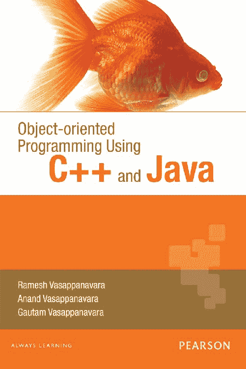

## 目录

- 关于作者
- 前言
- 如何使用本书书和网络资源

### 1 面向对象编程基础

#### 1.1 引绪

#### 1.2 编程概念

#### 1.3 编程范式

##### 1.3.1 结构化编程范式

##### 1.3.2 C 语言：高效运行的主力马

##### 1.3.3 问题在哪里？

##### 1.3.4 面向对象编程范式

#### 1.4 面向对象语言的历史与发展

##### 1.4.1 C++

##### 1.4.2 Java

##### 1.4.3 C#

#### 1.5 软件开发方法论

#### 1.6 对象的必要

#### 1.7 面向对象语言特性

##### 1.7.1 基于对象的编程

##### 1.7.2 面向对象编程

#### 1.8 OOP 语言类与对象的定义

##### 1.8.1 对象的属性与行为

##### 1.8.2 类

##### 1.8.3 封装

##### 1.8.4 数据隐藏/数据抽象

##### 1.8.5 函数重载

##### 1.8.6 运算符重载

#### 1.9 OOP 范式的扩展性与复用性

#### 1.10 扩展/衍生新类

##### 1.10.1 包含：类中的类——容器类

##### 1.10.2 继承与类层次结构

##### 1.10.3 单继承与多继承

##### 1.10.4 虚函数

##### 1.10.5 运行时多态与动态绑定

##### 1.10.6 抽象数据类型 (ADT) 类

##### 1.10.7 标准模板库 (STL)

##### 1.10.8 OOPS——面向对象编程与系统

##### 1.10.9 面向对象分析与设计 (OOAD)

#### 1.17 总结

### 2 对象建模

#### 2.1 引绪

#### 2.2 对象模型

#### 2.3 面向对象设计

#### 2.4 类与对象

##### 2.4.1 类

##### 2.4.2 标注与元模型

##### 2.4.3 规范

##### 2.4.4 元数据——元类

##### 2.4.5 约束

##### 2.4.6 对象创建

##### 2.4.7 垃圾回收

#### 2.5 对象属性

#### 2.6 链接

#### 2.7 类图

#### 2.8 类层次结构

##### 2.8.1 关联

##### 2.8.2 相互依赖类层次结构

##### 2.8.3 独立类的层次结构

#### 2.9 对象图

#### 2.10 通信与消息传递

#### 2.11 多态

#### 2.12 抽象类

#### 2.13 具体类

##### 2.13.1 OOPS——对象建模案例

#### 2.14 总结

### 3 可扩展性与复用性——继承的应用

#### 3.1 OOP 范式的扩展性与复用性

#### 3.2 扩展/衍生新类

##### 3.2.1 包含：类中的类——容器类

##### 3.2.2 继承与类层次结构

##### 3.2.3 一般化与特化化

#### 3.3 重写基类函数

#### 3.4 重载

#### 3.5 单继承与多继承

#### 3.6 虚继承

#### 3.7 多继承的问题

#### 3.8 接口

#### 3.9 继承中的访问修符

#### 3.10 运行时类型信息——RTTI

#### 3.11 虚函数

#### 3.12 纯虚函数

#### 3.13 运行时多态与动态数据绑定

#### 3.14 抽象数据类型类

#### 3.15 行为与实现的分离

#### 3.16 解耦

#### 3.17 标准模板库

#### 3.18 总结

## 练习题

## 选择题

## 简答题

## 论答题

## 习题

## 选择题答案

# 4 动态建模

## 4.1 静态与动态建模简介

## 4.2 对象的生命周期

## 4.3 统一建模语言 – OOAD 的工具

### 4.3.1 UML 概述

### 4.3.2 UML 图分类

## 4.4 用户需求 – 用例

## 4.5 架构与领域：它们是什么？

### 4.5.1 架构

### 4.5.2 领域

## 4.6 序图

## 4.7 协作（通信）图

## 4.8 事件与状态

### 4.8.1 活动/动作与操作

### 4.8.2 嵌套状态图

## 4.9 活动图

## 4.10 包与组件 – 组织大型复杂项目的方法

## 4.11 组件图与部署图

## 4.12 总结

## 练习题

## 选择题

## 简答题

## 论答题

## 习题

## 选择题答案

# 5 分析与设计方法论

## 5.1 简介

## 5.2 系统开发的阶段与方法论

### 5.2.1 软件开发方法论

### 5.2.2 系统开发生命周期 (SDLC)

## 5.3 结构化分析与设计 (SASD)

### 5.3.1 概念性设计 – 功能建模与数据建模

### 5.3.2 模块化设计

### 5.3.3 分析与设计技术与工具

### 5.3.4 上文图

### 5.3.5 事件列表

### 5.3.6 数据流图 (DFD)

### 5.3.7 数据字典

### 5.3.8 多级 DFD

### 5.3.9 实体关系图

### 5.3.10 过程规格

### 5.3.11 约束说明

## 5.4 结构化分析与设计案例

### 5.4.1 目的声明示例

### 5.4.2 上文图

### 5.4.3 事件列表

### 5.4.4 数据流

### 5.4.5 数据字典

### 5.4.6 实体关系图

### 5.4.7 过程规格 – SSCS

### 5.4.8 结构化分析与设计 – 优缺点

## 5.5 面对象软件分析与设计 (OOAD)

### 5.5.1 分析的不同模型

### 5.5.2 识别类

### 5.5.3 识别属性

### 5.5.4 规定操作

### 5.5.5 练习

## 5.6 OOAD: 案例研究

## 5.7 可复用设计

## 5.8 SASD 与 OOAD 方法论的比较

## 5.9 总结

## 练习题

## 选择题

## 简答题

## 论答题

## 习题

## 选择题答案

# 6 C++ 基础与基础编程

## 6.1 简介

## 6.2 C++ 等面向对象语言的历史与发展

## 6.3 面向语言特性

## 6.4 欢迎学习 C++ 语言

### 6.4.1 设置路径

### 6.4.2 C++ 程序结构

### 6.4.3 C++ 开发环境

## 6.5 C++++程序

### 6.5.1 在循环中执行程序

### 6.5.2 数组实现

### 6.5.3 使用结构实现问题

### 6.5.4 类实现

## 6.6 控制台 IO 操作

### 6.6.1 控制台 IO 函数 – `getchar()` 和 `putchar()`

### 6.6.2 控制台 IO 函数 – 命令 `gets` 和 `puts`

### 6.6.3 非格式化流 IO 函数 – `get()`、`put()` 和 `write()`

## 6.7 总结

## 练习题

## 选择题

## 简答题

## 论答题

## 习题

## 选择题答案

# 7 C++ 编程基础与循环结构

## 7.1 简介

## 7.2 变量声明

## 7.3 数据类型

## 7.4 变量的声明与赋值

## 7.5 表达式

## 7.6 运算符

### 7.6.1 IO 运算符 `<<` 和 `>>`，`iostream` 对象 `cin` 和 `cout`

### 7.6.2 一元运算符

### 7.6.3 尺寸运算符

### 7.6.4 算术运算符

### 7.6.5 关系运算符与逻辑运算符

### 7.6.6 逻辑运算符

### 7.6.7 条件表达式：问号运算符

### 7.6.8 逗号运算符

### 7.6.9 位运算符

## 7.7 运算符的优先级与结合性

## 7.8 循环结构

### 7.8.1 条件与分支语句

### 7.8.2 Switch 和 Case 语句

### 7.8.3 While 循环

### 7.8.4 Do-while 循环

### 7.8.5 For 循环

### 7.8.6 何时使用 For、While 或 Do-while

## 7.9 Break 和 Continue

### 7.9.1 Break

### 7.9.2 Continue 语句

### 7.9.3 Goto 语句

### 7.9.4 退出函数

## 7.10 总结

## 练习题

## 选择题

## 简答题

## 论述题

## 习题

## 选择题答案

# 8 函数、存储类、预处理器指令以及数组与字符串

## 8.1 引言

## 8.2 为什么使用函数模板？

## 8.3 值传递

## 8.4 引用传递

## 8.5 常量引用传递

## 8.6 递归

## 8.7 内联函数

## 8.8 函数重载

## 8.9 默认参数

## 8.10 C++ 内存管理

### 8.10.1 存储类的类型

## 8.11 头文件与标准库

## 8.12 C++ 预处理器

### 8.12.1 宏展开

### 8.12.2 带参数的宏定义

### 8.12.3 文件包含

### 8.12.4 条件包含

### 8.12.5 条件编译 `#ifdef` 和 `#ifndef` 语句

### 8.12.6 `#undef`

### 8.12.7 `#error` 宏

## 8.13 数组

### 8.13.1 数组在内存中是如何存储的？

### 8.13.2 数组初始化

### 8.13.3 多维数组

### 8.13.4 字符数组——C++语言中的字符串处理

## 8.14 总结

## 练习题

## 选择题

## 简答题

## 论述题

## 习题

## 选择题答案

# 9 指针与引用

## 9.1 引言

## 9.2 指针的、、为什么以及怎么

## 9.3 指针的声明与用法

## 9.4 值传递与引用传递（指针）

## 9.5 动态内存 `new` 和 `delete` 函数

### 9.5.1 内存泄漏

### 9.5.2 悬空指针

### 9.5.3 指针与数组

### 9.5.4 指针与二维数组

### 9.5.5 堆内存上的数组声明

### 9.5.6 二级指针

### 9.5.7 二维数组的动态内存

### 9.5.8 指针与三维数组

### 9.5.9 指针数组

### 9.5.10 空指针

### 9.5.11 指向 `const` 指针的指针

### 9.5.12 函数指针

## 9.6 引用的、、为什么以及怎么

### 9.6.1 哪个更好——指针还是引用？

## 9.7 总结

## 练习题

## 选择题

## 简答题

## 论述题

## 选择题答案

# 10 类

## 10.1 引言

## 10.2 类与对象

### 10.2.1 如何为类创建对象？

### 10.2.2 如何访问成员数据和成员成员函数？

### 10.2.3 构造函数与析构函数

## 10.3 友元函数

## 10.4 类内部类：容器类

## 10.5 堆内存上的对象与数据成员

## 10.6 `this` 指针

## 10.7 指针对比对象：常量声明的使用

## 10.8 引用传递对象与指向函数的指针

## 10.9 常量指针与常量引用

## 10.10 静态成员数据

## 10.11 静态成员函数

## 10.12 总结

## 练习题

## 选择题

## 简答题

## 论述题

## 选择题答案

# 11 C++ 特殊特性：错误、异常与运算符重载

## 11.1 引言

## 11.2 错误与异常

## 11.3 `try` 和 `catch` 块

## 11.4 异常类

## 11.5 栈数据结构

## 11.6 运算符重载

### 11.6.1 `+` 运算符与 `*` 运算符的重载

### 11.6.2 `<<` 运算符重载

### 11.6.3 哪些可以重载，哪些不能重载

### 11.6.4 重载赋值运算符 `=`

## 11.7 自增/自减运算符重载

## 11.8 重载运算符 `new` 和 `delete`

## 11.9 转换（强制类型转换）运算符

## 11.10 总结

## 练习题

## 选择题

## 简答题

## 论述题

## 习题

## 选择题答案

# 12 继承

## 12.1 引言

## 12.2 继承层次结构


## 12.3 继承的类型

## 12.4 构造函数与析构函数

## 12.5 基类函数重写

## 12.6 基类函数隐藏隐藏

## 12.7 虚函数

## 12.8 多重虚函数

## 12.9 虚析构函数：为什么以及如何做？

## 12.10 多重继承中的混合继承

## 12.11 虚继承

## 12.12 运行时多态与动态绑定

## 12.13 抽象数据类型（ADTs）

## 12.14 纯虚函数

## 12.15 总结

## 练习题

## 选择题

## 简答题

# 简答题（`#chapter012.xhtml_sec-Long12`）

# 作业题（`#chapter012.xhtml_sec-Assignment12`）

# 选择题答案（`#chapter012.xhtml_sec-Solutions12`）

# 13 IO 流（`#chapter013.xhtml`）

## 13.1 引言（`#chapter013.xhtml_sec-13.1`）

## 13.2 IO 流（`#chapter013.xhtml_sec-13.2`）

## 13.3 IO 文件分类（`#chapter013.xhtml_sec-13.3`）

### 13.3.1 格式化 IO（`#chapter013.xhtml_sec-13.3.1`）

### 13.3.2 非格式化 IO（`#chapter013.xhtml_sec-13.3.2`）

### 13.3.3 IO 流状态（`#chapter013.xhtml_sec-13.3.3`）

### 13.3.4 IO 流库 – 头文件（`#chapter013.xhtml_sec-13.3.4`）

## 13.4 IO 操纵符（`#chapter013.xhtml_sec-13.4`）

## 13.5 标志（`#chapter013.xhtml_sec-13.5`）

## 13.6 文件输入输出（`#chapter013.xhtml_sec-13.6`）

### 13.6.1 文件类型（`#chapter013.xhtml_sec-13.6.1`）

### 13.6.2 流打开模式（`#chapter013.xhtml_sec-13.6.2`）

## 13.7 二进制文件（`#chapter013.xhtml_sec-13.7`）

## 13.8 C++ 中的 `Seekg()`/`Seekp()` 以及 `Tellg()` 和 `Tellp()` 功能（`#chapter013.xhtml_sec-13.8`）

## 13.9 总结（`#chapter013.xhtml_sec-13.9`）

# 练习题（`#chapter013.xhtml_sec-Exercise13`）

# 选择题（`#chapter013.xhtml_sec-Objective13`）

# 简答题（`#chapter013.xhtml_sec-Short13`）

# 简答题（`#chapter013.xhtml_sec-Long13`）

# 作业题（`#chapter013.xhtml_sec-Assignment13`）

# 选择题答案（`#chapter013.xhtml_sec-Solutions13`）

# 14 泛型编程与模板（`#chapter014.xhtml`）

## 14.1 引言（`#chapter014.xhtml_sec-14.1`）

## 14.2 什么是泛型编程以及为什么要使用模板？（`#chapter014.xhtml_sec-14.2`）

## 14.3 模板类（`#chapter014.xhtml_sec-14.3`）

## 14.4 函数模板与函数参数传递（`#chapter014.xhtml_sec-14.4`）

## 14.5 模板友元（`#chapter014.xhtml_sec-14.5`）

### 14.5.1 非模板函数（`#chapter014.xhtml_sec-14.5.1`）

### 14.5.2 模板友元类或友元函数（`#chapter014.xhtml_sec-14.5.2`）

### 14.5.3 类模板中的特定类型友元函数（`#chapter014.xhtml_sec-14.5.3`）

## 14.6 模板、静态成员函数与成员数据（`#chapter014.xhtml_sec-14.6`）

## 14.7 模板异常（`#chapter014.xhtml_sec-14.7`）

## 14.8 总结（`#chapter014.xhtml_sec-14.8`）

# 练习题（`#chapter014.xhtml_sec-Exercise14`）

# 选择题（`#chapter014.xhtml_sec-Objective14`）

# 简答题（`#chapter014.xhtml_sec-Short14`）

# 简答题（`#chapter014.xhtml_sec-Long14`）

# 作业题（`#chapter014.xhtml_sec-Assignment14`）

# 选择题答案（`#chapter014.xhtml_sec-Solutions14`）

# 15 Java 面向对象编程（`#chapter015.xhtml`）

## 15.1 引言（`#chapter015.xhtml_sec-15.1`）

## 15.2 互联网与万维网（`#chapter015.xhtml_sec-15.2`）

## 15.3 C 和 C++ 之后，为什么是 Java？（`#chapter015.xhtml_sec-15.3`）

## 15.4 Java 故事（`#chapter015.xhtml_sec-15.4`）

## 15.5 Java 特性（`#chapter015.xhtml_sec-15.5`）

### 15.5.1 可移植性或平台无关（`#chapter015.xhtml_sec-15.5.1`）

### 15.5.2 自动垃圾回收（`#chapter015.xhtml_sec-15.5.2`）

### 15.5.3 面向对象特性（`#chapter015.xhtml_sec-15.5.3`）

### 15.5.4 易于学习与文档完善（`#chapter015.xhtml_sec-15.5.4`）

### 15.5.5 字节码（`#chapter015.xhtml_sec-15.5.5`）

### 15.5.6 Java 虚拟机（JVM）（`#chapter015.xhtml_sec-15.5.6`）

### 15.5.7 与 C++ 的比较（`#chapter015.xhtml_sec-15.5.7`）

## 15.6 开发第一个应用程序（`#chapter015.xhtml_sec-15.6`）

### 15.6.1 安装 Java 开发包（`#chapter015.xhtml_sec-15.6.1`）

### 15.6.2 类路径（`#chapter015.xhtml_sec-15.6.2`）

### 15.6.3 程序结构（`#chapter015.xhtml_sec-15.6.3`）

### 15.6.4 Java 注释（`#chapter015.xhtml_sec-15.6.4`）

### 15.6.5 Java 开发环境（`#chapter015.xhtml_sec-15.6.5`）

### 15.6.6 我们的 Java 应用程序（`#chapter015.xhtml_sec-15.6.6`）

### 15.6.7 使用 Swing 开发（`#chapter015.xhtml_sec-15.6.7`）

### 15.6.8 Eclipse 集成开发（`#chapter015.xhtml_sec-15.6.8`）

### 15.6.9 命令行参数（`#chapter015.xhtml_sec-15.6.9`）

## 15.7 总结（`#chapter015.xhtml_sec-15.7`）

# 练习题（`#chapter015.xhtml_sec-Exercise15`）

# 选择题（`#chapter015.xhtml_sec-Objective15`）

# 简答题（`#chapter015.xhtml_sec-Short15`）

# 简答题（`#chapter015.xhtml_sec-Long15`）

# 作业题（`#chapter015.xhtml_sec-Assignment15`）

# 选择题答案（`#chapter015.xhtml_sec-Solutions15`）

# 16 Java 基础与循环（`#chapter016.xhtml`）

## 16.1 引言（`#chapter016.xhtml_sec-16.1`）

## 16.2 常量/字面量常量（`#chapter016.xhtml_sec-16.2`）

### 16.2.1 整数常量（`#chapter016.xhtml_sec-16.2.1`）

### 16.2.2 浮点常量/实数常量（`#chapter016.xhtml_sec-16.2.2`）

### 16.2.3 字符常量（`#chapter016.xhtml_sec-16.2.3`）

### 16.2.4 字符串常量（`#chapter016.xhtml_sec-16.2.4`）

### 16.2.5 转义字符字符串（`#chapter016.xhtml_sec-16.2.5`）

### 16.2.6 布尔字面量（`#chapter016.xhtml_sec-16.2.6`）

### 16.2.7 符号常量（`#chapter016.xhtml_sec-16.2.7`）

## 16.3 变量与变量赋值（`#chapter016.xhtml_sec-16.3`）

## 16.4 数据类型（`#chapter016.xhtml_sec-16.4`）

### 16.4.1 整数数据类型（`#chapter016.xhtml_sec-16.4.1`）

### 16.4.2 浮点数据类型（`#chapter016.xhtml_sec-16.4.2`）

### 16.4.3 字符类型（`#chapter016.xhtml_sec-16.4.3`）

### 16.4.4 布尔数据类型（`#chapter016.xhtml_sec-16.4.4`）

## 16.5 变量的作用域与寿命（`#chapter016.xhtml_sec-16.5`）

## 16.6 算术运算符（`#chapter016.xhtml_sec-16.6`）

## 16.7 类型转换与类型强制转换（`#chapter016.xhtml_sec-16.7`）

### 16.7.1 类型转换（`#chapter016.xhtml_sec-16.7.1`）

### 16.7.2 类型强制转换（`#chapter016.xhtml_sec-16.7.2`）

## 16.8 一元运算符（`#chapter016.xhtml_sec-16.8`）

### 16.8.1 自增与自减运算符（`#chapter016.xhtml_sec-16.8.1`）

### 16.8.2 赋值运算符（`#chapter016.xhtml_sec-16.8.2`）

### 16.8.3 链式赋值（`#chapter016.xhtml_sec-16.8.3`）

### 16.8.4 关系运算符（`#chapter016.xhtml_sec-16.8.4`）

## 16.9 逻辑运算符（`#chapter016.xhtml_sec-16.9`）

## 16.10 位运算符（`#chapter016.xhtml_sec-16.10`）

## 16.11 其他运算符（`#chapter016.xhtml_sec-16.11`）

### 16.11.1 三元条件表达式（`#chapter016.xhtml_sec-16.11.1`）

### 16.11.2 点运算符（`#chapter016.xhtml_sec-16.11.2`）

### 16.11.3 `instanceof` 运算符（`#chapter016.xhtml_sec-16.11.3`）

### 16.11.4 `new` 运算符（`#chapter016.xhtml_sec-16.11.4`）

### 16.11.5 优先级与结合性（`#chapter016.xhtml_sec-16.11.5`）

## 16.12 条件与分支语句（`#chapter016.xhtml_sec-16.12`）

### 16.12.1 `if` 和 `if-else` 语句（`#chapter016.xhtml_sec-16.12.1`）

### 16.12.2 嵌套 `if` 语句（`#chapter016.xhtml_sec-16.12.2`）

### 16.12.3 `if-else-if` 结构（`#chapter016.xhtml_sec-16.12.3`）

### 16.12.4 `switch` 和 `case` 语句（`#chapter016.xhtml_sec-16.12.4`）

## 16.13 控制循环（`#chapter016.xhtml_sec-16.13`）

### 16.13.1 `while` 循环（`#chapter016.xhtml_sec-16.13.1`）

### 16.13.2 `do-while` 循环（`#chapter016.xhtml_sec-16.13.2`）

### 16.13.3 `for` 循环（`#chapter016.xhtml_sec-16.13.3`）

## 16.14 `break`（`#chapter016.xhtml_sec-16.14`）

## 16.15 `continue` 语句（`#chapter016.xhtml_sec-16.15`）

## 16.16 总结（`#chapter016.xhtml_sec-16.16`）

# 练习题（`#chapter016.xhtml_sec-Exercise16`）

# 选择题（`#chapter016.xhtml_sec-Objective16`）

# 简答题（`#chapter016.xhtml_sec-Short16`）

# 简答题（`#chapter016.xhtml_sec-Long16`）

# 作业题（`#chapter016.xhtml_sec-Assignment16`）

# 选择题答案（`#chapter016.xhtml_sec-Solutions16`）

# 17 简单 IO、数组与字符串向量（`#chapter017.xhtml`）

## 17.1 引言（`#chapter017.xhtml_sec-17.1`）

## 17.2 从键盘输入（`#chapter017.xhtml_sec-17.2`）

### 17.2.1 `System.in`、`System.out` 和 `System.err` 命令（`#chapter017.xhtml_sec-17.2.1`）

### 17.2.2 使用 `StringTokenizer` 在单行内接收多个输入

### 17.2.3 使用 Java 的 `Scanner` 类获取输入

### 17.2.4 使用控制格式化 - `System.out.printf()`

### 17.2.5 使用 String Format 进行格式化输出

## 17.3 数组

### 17.3.1 数组的声明与创建

### 17.3.2 数组的初始化

### 17.3.3 数组是如何存储在内存中的？

### 17.3.4 访问与修改数组元素

### 17.3.5 将数组作为参数传递方法

### 17.3.6 将数组作为返回值从方法返回

### 17.3.7 多维数组

### 17.3.8 `Java.util.Arrays` 类

## 17.4 字符串

### 17.4.1 字符串数组

### 17.4.2 `String` 类方法

### 17.4.3 `StringBuffer` 类

### 17.4.4 `StringBuilder` 类

## 17.5 集合框架

### 17.5.1 `Vector` 类

### 17.5.2 `Vector` 方法

## 17.6 总结

## 练习题

## 选择题

## 简答题

## 论述题

## 作业题

## 选择题答案

# 18 类、对象与方法

## 18.1 引言

## 18.2 类与对象

## 18.3 声明类与创建类变量实例

## 18.4 构造函数

### 18.4.1 默认构造函数

### 18.4.2 参数化构造函数与构造函数重载

## 18.5 指定私有访问修饰符与公共方法的使用

### 18.5.1 私有访问修饰符

### 18.5.2 方法

### 18.5.3 Java `Math` 类

### 18.5.4 值传递与引用传递

### 18.5.5 对象在方法间的传递与返回

### 18.5.6 方法重载

## 18.6 `this` 关键字的使用

## 18.7 垃圾回收

## 18.8 `Finalizer` 与 `Finalize()` 方法

## 18.9 `Final` 变量

## 18.10 访问控制与类成员访问

## 18.11 静态（`static`）成员

## 18.12 工厂方法

## 18.13 嵌套类

## 18.14 内部类

## 18.15 总结

## 练习题

## 选择题

## 简答题

## 论述题

## 作业题

## 选择题答案

# 19 继承：包：接口

## 19.1 引言

## 19.2 继承的基础概念

## 19.3 成员访问规则

## 19.4 使用类类的使用

## 19.5 方法重写

## 19.6 多级继承

## 19.7 运行时多态

## 19.8 抽象类

## 19.9 在继承中使用 `final`

### 19.9.1 `final` 方法

### 19.9.2 `final` 类

## 19.10 `Object` 类

## 19.11 包

### 19.11.1 可复用类

## 19.12 `Path` 与 `Classpath`

## 19.13 包的导入

## 19.14 重新回顾包的访问修饰符

## 19.15 接口

### 19.15.1 接口的定义与意义

### 19.15.2 接口的定义与实现

## 19.16 总结

## 练习题

## 选择题

## 简答题

## 论述题

## 作业题

## 选择题答案

# 20 Java 多线程编程中的错误与异常

## 20.1 引言

## 20.2 错误与异常


## 20.2.1 错误（Errors）

## 20.2.2 异常（Exceptions）

## 20.3 `Try` 和 `Catch` 块

## 20.4 使用 `Try` 和 `Catch` 块处理多个异常

## 20.5 使用 `Finally` 块

## 20.6 抛出异常（`Throw`）

## 20.7 声明异常（`Throws`）

## 20.8 异常的重新抛出

## 20.9 自定义异常

### 20.9.1 编写自定义异常的步骤

## 20.10 多线程概念

### 20.10.1 多线程程序

## 20.11 进程 vs 线程

### 20.11.1 进程

### 20.11.2 线程

## 20.12 如何创建与运行线程

### 20.12.1 继承 `Thread` 还是实现 `Runnable` 更好？

### 20.12.2 `isAlive()` 与 `join()` 方法的使用

## 20.13 线程的生命周期

## 20.14 线程优先级

## 20.15 同步

## 20.16 线程间通信

## 20.17 多线程编程中的死锁

## 20.18 总结

## 练习题

## 选择题

## 简答题

## 论述题

## 作业题

## 选择题答案

# 21 Java IO 文件

## 21.1 引言

## 21.2 IO 流

## 21.3 Java IO 流类

### 21.3.1 字节流类的分类

### 21.3.2 字符流类或文本流类的分类

### 21.3.3 `DataInput`、`DataOutputStream`、`FileInput` 和 `FileOutputStream`

### 21.3.4 `FileReader` 和 `FileWriter`

## 21.4 IO 错误与异常

## 21.5 `FilterInputStream` 和 `FilterOutputStreams`

## 21.6 使用 `BufferedInput` 和 `BufferedOutput` 输出流

## 21.7 向文件写入原始数据类型：`DataInputStream`/`DataOutputStream`

## 21.8 `File` 类

## 21.9 随机访问文件

## 21.10 对象的序列化与对象流

### 21.10.1 序列化

### 21.10.2 反序列化

## 21.11 总结

## 练习题

## 选择题

## 简答题

### 问答题

## 习题

## 选择题答案

# 22 Java 网络编程

## 22.1 引言

## 22.2 网络基础

### 22.2.1 `TCP/IP`

### 22.2.2 用户数据报协议（`UDP`）

## 22.3 互联网地址

## 22.4 `URL` 与 `URL` 连接

### 22.4.1 `URL` 连接

## 22.5 `TCP/IP Sockets`

### 22.5.1 `ServerSocket` 类

### 22.5.2 用于通信的服务器与 `Socket`：如何使其工作？

### 22.5.3 用于通信的客户端与 `Socket`：如何使其工作？

## 22.6 客户端/服务器程序

### 22.6.1 客户端/服务器双向通信程序

### 22.6.2 使用多线程的多个客户端与服务器程序

### 22.6.3 从服务器下载文件的客户端/服务器程序

## 22.7 总结

## 练习题

## 选择题

## 简答题

### 问答题

## 习题

## 选择题答案

# 23 使用 Swing 组件和 Applets 进行图形化处理

## 23.1 图形编程与 Applets 简介

## 23.2 图形软件层次结构

## 23.3 Swing 中的容器

### 23.3.1 `JFrame` 类

### 23.3.2 `JPanel` 类

## 23.4 Swing 中的显示组件

### 23.4.1 `JLabel` 类

### 23.4.2 `JButton`

### 23.4.3 `JCheckBox`

### 23.4.4 `JComboBox`

### 23.4.5 `JMenu` 类

## 23.5 布局管理器

### 23.5.1 边界布局（Border Layout）

### 23.5.2 网格布局（Grid Layout）

### 23.5.3 流布局（Flow Layout）

## 23.6 事件类型与监听器

### 23.6.1 动作事件监听器（Action Event Listener）

### 23.6.2 项目事件监听器（Item Event Listener）

### 23.6.3 键盘事件监听器

### 23.6.4 鼠标事件监听器

## 23.7 Applets

### 23.7.1 Applets 概念

### 23.7.2 Applet 的生命周期

### 23.7.3 创建 Applet：HelloWorld Applet

### 23.7.4 结合 Swing 组件的 Jlets：更好的外观

### 23.7.5 Applets 对比独立应用程序

### 23.7.6 向 Applets 传递参数

## 23.8 总结

## 练习题

## 选择题

## 简答题

### 问答题

## 习题

## 选择题答案

# 24 使用 Java 进行集合与软件开发

## 24.1 引言

## 24.2 Java 集合框架

## 24.3 `Collection` 接口

## 24.4 `Set` 接口

## 24.5 迭代器（Iterators）

## 24.6 `List` 接口

## 24.7 集合算法

## 24.8 `Map` 接口

## 24.9 `Map` 的集合视图

## 24.10 `JDBC` 数据库连接

## 24.11 使用 MS Access 数据库访问记录

## 24.12 使用 `MySql` 开源数据库访问记录

## 24.13 使用 `Oracle` 数据库访问记录

## 24.14 预编译语句与可调用语句

### 24.14.1 `PreparedStatement`

### 24.14.2 `Callable Statements`

## 24.15 `Servlets`

### 24.15.1 `Servlets API` 与 `javax.servlet` 包

### 24.15.2 `HttpServletRequest`

### 24.15.3 `HttpServletResponse`

### 24.15.4 `HttpServlet` 类——获取带客户端数据的 `Get` 请求

### 24.15.5 `HTTP Post` 请求

## 24.16 Java Beans

## 24.17 总结

## 练习题

## 选择题

## 简答题

### 问答题

## 习题

## 选择题答案

### 附录 A

### 附录 B

### 附录 C

## 关于作者

`Ramesh Vasappanavara` 在安德拉大学工程学院学院（1972–1977）获得学士学位，在印度理工学院卡拉格普尔（1982–1984）获得硕士学位。他在海得拉巴贾瓦哈尔·内赫鲁科技大学获得计算机科学与工程博士学位。他曾在海军研发部门担任过多个高级职位，并是知名工程机构的教授和院长。他目前担任 SGIT Delhi 院长和教授。

他的专业兴趣包括网格计算、算法和嵌入式系统。他的热情是培养年轻人成长为独创思考者，从而为现实世界的问题提供创新解决方案。可以通过 `ramesh.vasappanavara@gmail.com` 与他联系。

`Anand Vasappanavara` 于马德拉斯大学印度理工学院（1999–2003）获得学士学位，并在班加罗尔印度科学学院（2005–2007）获得硕士学位。2003 年至 2005 年间，他曾在浦纳的塔塔汽车担任设计工程师，为 Telco 开发了一种混合动力汽车的控制器。2007 年以来，他一直在壳牌石油（Shell）担任工艺控制技术师。

他的专业兴趣广泛涵盖能源、汽车和控制系统。他愿景在一个能源和知识丰富的世界上，从而实现对人们的真正赋能。可以通过 `vasappanavara@gmail.com` 与他联系。

`Gautam Vasappanavara` 于安德拉大学工程大学学院学院（2000–2004）获得学士学位，并作为菲利普研究学者在皮拉尼比拉理工科学学院（2005–2007）获得嵌入式系统硕士学位。他曾在海德拉巴的通用电气控制（GE Controls）和班加罗尔三星电子担任无线技术首席工程师。目前，他处于休假期间，在海德拉巴印度商学院攻读管理学位。他的爱好包括节能、将技术作为社会转型的平台以及知识共享。可以通过 `gautam.vasappanavara@gmail.com` 与他联系。

网站：[www.vasappanavara.org](http://www.vasappanavara.org)

## 献给

`Sri. M. Venkat Ratnam` 和 `Smt. M. Saraswati`

感谢你们手牵着我们成长，成就了今天的我们！

&

`Smt. V. Usha Ramesh`

感谢你对家庭付出的卓越贡献。

## 前言

欢迎来到 `C++` 和 `Java` 面向对象编程的世界。准备好开启精彩的旅程吧！

在多年向本科生、研究生以及行业专业人士教授 `OOP`、`C++` 和 `Java` 的过程中，我们的经验表明：

- `C++` 和 `Java` 领域都有优秀的程序员，但其中极少数人能理解底层的 `OOP` 概念。
- 现有的教材将 `C++`、`Java` 和 `OOP` 概念视为不同且独立的内容，学生以碎片化的方式接触这些概念。
- 对 `OOP` 语言、分析与设计以及软件开发的研究都是分开处理的，从而牺牲了集成的 `OOP` 方法。
- `C++` 是一种高度演化的语言，用于系统开发，具有模板（templates）和容器等高级特性。大多数教材仅将 `C++` 视为一种语言，而不是实现 `OOP` 概念的工具。
- `Java` 是一种庞大且广泛使用的网络语言，具有多种 `OOP` 概念、网络编程，并使用 `JDBC`、`Servlets`、图形编程和 Java Beans 等工具进行软件开发。大多数教材充分涵盖了 `Java` 核心内容，但在提供实现细节方面大不从心。
- 目前没有单一教材能涵盖印度所有主要大学关于 `OOP`、`C++` 和 `Java` 的教学大纲。

本书恰好在这些关键方面能够为你提供帮助。

尽管拥有 `C` 语言知识无疑是一个加分项，但我们并不假设读者具备任何背景知识。你可以直接精通 `C++` 和/或 `Java`。本书采用的方法是让学生通过实践和示例来学习。

每个概念都通过 `C++` 和 `Java` 的代码段进行了解释。这些章节的独特特点是包含了大量的运行示例（超过 600 个），以及如大学管理、网上银行、电子购物、图书馆采购等案例研究，学生可以利用底层概念和理论轻松地关联并学习。全书使用了统一建模语言（UML）符号。在每章的末尾，我们提供了客观题、简答题和论述题、带有答案的练习题以及作业题。

所有程序均在 Linux、`VC++` 和 `TC++` 平台上经过测试。我们运行 Java 程序的开发平台是 `eclipse`、`NetBeans` 和 `JDK1.6`。使用的数据库均为行业标准，如 `Oracle`、`MySql`（开源）以及广泛提供的 Microsoft Access 数据库。代码和说明详尽，旨在快速提供解决方案并增强学习体验。

### 在线网络资源

本书的配套网站 `www.pearsoned.co.in/ameshvasappanavara` 提供了在线网络资源。它们包括幻灯片、视频讲座、一个额外章节、解析示例以及包含所有示例和练习题 `C++` 及 `Java` 代码的程序。

- **PowerPoint 幻灯片：** 所有章节都有一个 PowerPoint 幻灯片，强调了该章节讨论的关键概念。
- **视频讲座：** 音视讲座幻灯片有助于学生更好地理解概念。
- **额外章节：** 网站上有一个题为“标准模板库（STL）和容器”的章节。
- **解析示例：** 已对额外的问题进行了解答。
- **程序文件：** 提供了所有示例和练习题的 `C++` 和 `Java` 代码。

### 反馈

我们在编写本书时付出了最大的心力以确保没有错误。然而，如果您发现任何错误，请随时与我们联系。欢迎您的建议和反馈。

## 如何使用本书和网络资源

下方的流程图展示了本书的内容以及使用本书的最佳方法：

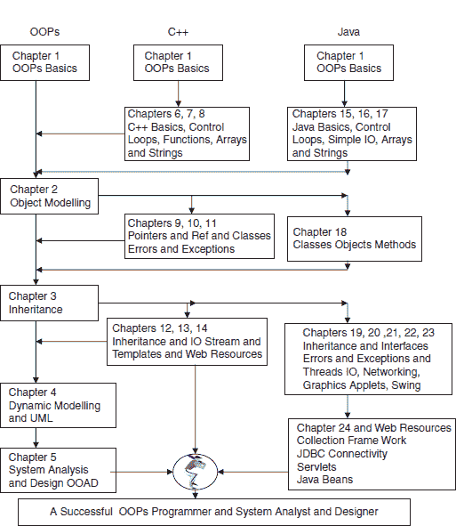

# 1. 面向对象编程基础

### 学习目标

*在本章结束时，你应该能够理解：*

- 编程概念。
- 软件开发范式。
- `OOP` 范式以及 `OOP` 语言提供的扩展特性。

## 1.1 引言

为了解决一个问题，你需要知道“方法/程序”或拥有“窍门”。在计算机术语中，我们称之为算法。算法或程序是一系列需要遵循的步骤，用以产生预期的输出。步骤序列可以被称为过程，反之，一组过程可以被称为一个程序。对于解决简单问题，一组步骤就足够了，但如果问题很复杂，则需要一个包含良好集成且内聚的编程元素、构造结构和数据结构的编程环境。范式可以被看作一种编程风格，涉及函数、数据和数据结构等元素。目前已使用了多种编程范式。以 `C` 语言实现语言的结构化编程范式——其中程序员将要完成的任务分解为子任务，并指定逐步步进的程序或算法来完成该任务——这种范式在程序员中非常成功且流行，这很大程度上归于它以过程调用形式存在的可重用组件，以及操作内存从而处理硬件集成的能力。

由于用户需求变化、项目复杂性以及缺乏扩展和复用功能等因素，程序员的生产效率低下，导致项目永远无法按时完成。即使项目完成并实现，作用也有限。结构化编程环境由于过程调用提供的复用设施有限，且缺乏扩展特性（即无法从现有数据类型派生新数据类型），并不太适合处理由硬件和软件快速变化等复杂项目带来的挑战。面向对象编程（`OOP`）通过继承、标准模板库（`STL`）形式的库函数等承诺了广泛的复用特性。`C++` 是最强大的 `OOP` 语言之一，既支持结构化范式也支持 `OOP` 范式。

## 1.2 编程概念

在 `C` 和 `C++` 发明之前，编程语言可以大致分类如下：

高级语言（如 `FORTRAN`、`Cobol` 和 `Pascal`）为程序员提供了如类英语代码语言等友好的特性。在这些语言中，程序员编写的代码被编译并转换为目标代码。实现细节和硬件细节（如地址）对用户来说是隐藏的。因此，用户可以为科学界和商业界编写应用程序。`Cobol` 是一种在商业领域被广泛使用的语言。而 `FORTRAN` 和 `Pascal` 则是科学界使用的语言。

低级语言如 `assemblers`（汇编语言）需要对硬件、寻址机制和操作系统深入了解。因此，这类语言由专家、学者和系统开发者使用。大多数涉及硬件与软件集成的接口都是使用这些语言编写的。

中间级语言如 `C`。这些语言结合了高级和低级语言的优点。

- 代码几乎像英语一样。这种语言容易理解和编写程序。
- 它具有处理硬件的能力，因为它的许多命令支持直接处理底层硬件，如 `memory`（内存）和硬件设备。
- 业务编程和科学计算都可以被轻松处理。

## 1.3 编程范式

范式是一种编程语言的风格。它只是一种风格，而不是一种语言。它是利用 `functions`（函数）、`objects`（对象）和 `variables`（变量）等编程元素产生所需输出的方式。

### 1.3.1 结构化编程范式

面向过程的编程（如 `C`）使用过程调用。主任务被分为带有输入和函数的子任务，以实现所需的结果。数据通过 `arguments` 给过程。在这个范式中，过程是重要的，数据由多个过程共享。

算法或程序或过程是需要遵循的步骤序列，遵循这些步骤就能得到所需的输出。一组过程可以被称为程序。过程也称为 `routine`（例程）、`subroutine`（子程序）、`function`（函数）或 `method`（方法）。执行中的程序或过程可以调用任何其他过程。

因此，使用面向过程的语言，程序员将要完成的任务分解为子任务，并指定逐步的程序或算法来实现该任务。像 `C` 这样的面向过程的语言提供了语句来为任务指定的过程编写代码。面向过程的语言具有以下优点：

- **模块化：** 每个子任务都可以开发为一个 `module`（模块）。模块接受 `arguments` 作为输入并交付 `return values`（返回值）作为输出。
- 独立且使用独立代码的模块可以避免如 `GOTO` 和 `Jump`（跳转）等编码陷阱，从而使代码易于维护。
- 确保了可重用性。模块可以在执行过程中被任何其他模块调用。所有可重用的代码都可以维护为库。
- `C` 提供的强大模块化和可重用特性使其成为开发复杂程序和项目最合适的语言平台。

面向过程的语言也被称为“结构化语言”，因为它允许过程调用，这又允许程序员将主任务分解为子任务，并通过过程调用执行每个子任务。

那么，我们为什么需要学习面向对象编程呢？

### 1.3.2 问题出在哪里？

问题的产生源于快速变化。变化发生的速度之快，以至于基于特定时刻或时间输入所开发的项目和程序不再有效。因此，开发的项目仅被局限在部门图书馆的架子上，从未被实施。

这在软件项目中尤为如此，因为它们需要最新的软件编程范式和硬件。

用户需求在项目开发过程中发生变化。在复杂项目中，用户需求的变化意味着要重新工作。

美国国防部（DoD）发现，大多数项目已经过时且无法实施。

#### 1.3.3.1 问题的复杂性

最初，计算机被用于基础的业务计算，如工资单、学生或员工记录以及科学计算。这些都是涉及输入、处理和输出的简单算法，可以很容易地通过结构化编程处理。

然而，问题的复杂性迅速增长，现代软件项目涉及多层输入以及与本地和远程处理器、网络等的通信。

#### 1.3.3.2 用户的需求

在项目实施初始阶段，对用户需求进行彻底研究后，安排分析、设计和开发。可以说，需求是决定软件设计和开发每个阶段的规范。因此，它们在开始开发阶段之前被“冻结”。

但在但在实际操作中，对于运营经理（例如机场运营经理）来说，实施更改以确保机场日常运行的顺畅是重要的。因此，他们期望将这些最新变化纳入正在开发的软件中是理所当然的。

你的初始估计付诸东流！开发者必须根据所求更改的性质重新进行设计。

估计由于变化导致的重工作占了时间和精力估算的约 40%，对项目超期有重大影响。


#### 1.3.3.3 低效率

扩展性和重用性是使程序员高效的两个特性。在`C`中，我们有`struct`（结构体）和`unions`（联合体）作为用户定义数据类型。无法根据已定义的类型定义新数据类型的功能。

引入的变化会导致多个过程的变化，并通常导致重新编译源码。

无法通过继承扩展数据类型。程序员只能满足于过程调用。

### 1.3.4 面向对象编程范式

面向对象的编程（如`C++`）使用对象，并通过调用成员函数进行对象之间的交互。其特性包括数据隐藏、数据抽象、封装、继承和多态。

随着 1969 年起 UNIX 的出现以及通信硬件软件的发展，硬件和软件的复杂性不断增加，软件项目开发无法跟上这种速度。结果导致程序质量受到了影响。

贝尔实验室的开发者和国防部（DoD）开始寻找替代范式，在这些范式中，重用性和扩展性是一个强大的特性。此外，规范强调了数据优先而非过程优先。

OOP 范式中的对象包含成员数据以及所有在内部实现的功能，以达到所需的结果。类以及该类的对象携带它们自己的运算符来实现特定的功能。例如，一个对象可以携带一个重载运算符`>>`来实现输入操作。对象通过传递消息与其他对象进行通信。

## OOP 范式的显著特征

- 数据优先，*而非*过程优先。
- 任务被划分为多个对象。
- 每个对象都是一个独立的机器，在自己的内存位置拥有它自己的数据结构和成员函数。
- 方法和数据绑定在对象中。
- 外部函数无法访问数据。
- 对象可以向另一个协作对象发送消息。

## 1.4 面向对象语言的历史与发展

Smalltalk 是第一个开发的 OOP 语言。目前`C++`、`Java`和`C#`是使用 OOP 范式的受业界喜爱的语言。

### 1.4.1 C++

`C++`由 Bjarne Stroustrup 于 1979 年在贝尔实验室开发。`C++`是`C`语言的延续，具有额外的特性。这些特性包括虚函数、函数名和运算符重载、引用以及空闲内存，以及通过继承、模板等实现重用和扩展性的许多特性。异常处理和完善的标准模板库是`C++`中提供的两个最先进的特性。

### 1.4.2 Java

`Java`由 James Gosling 于 1995 年在太阳微系统公司开发。它与`C`和`C++`相似。`Java`的主要优势它是硬件无关的。任何代码都被编译成字节码（`bytecodes`）。编译后的字节码存储在类文件中，并可以在任何 Java 虚拟机（`JVM`）上运行。

`JVM`获取字节码并将其转换为机器代码，随后本地机器使用该代码运行并产生所需的结果。

`Java` 1.0 于 1995 年发布。太阳微系统将其称为“一次编写，随运行”。事实上，随着包括`IE explorer`和`Netscape Navigator`在多数浏览器支持`Java` 1.0，`Java`迅速成为行业标准。可以在网页浏览器上运行的`Java` applets 也流行了起来。1998 年，太阳微系统发布了`Java 2`，带有适用于不同类型平台的特殊配置，例如适用于企业应用的`J2EE`、适用于移动计算的`JEME`以及标准版的`J2SE`。这些分别被重命名为`JavaEE`、`JavaME`和`JavaSE`。

### 1.4.3 C#

`C#`由 Anders Hejlsberg 为微软开发。它结合了现有`C++`和`Java`等 OOP 编程语言的优点。它被开发为一种强大且多功能的完全面向对象的编程语言。

## 1.5 软件开发方法论

软件开发是一项工程活动，涉及启动、分析、设计、开发、实现和交付阶段。使用软件工程（SE）实践开发项目的原则和准则由工程学的 SE 分支所规定。

什么是方法论？方法论可以被视为从 SE 领域规定的最佳实践中解决 SE（项目）问题的一种风格。例如，我们可以采用结构化分析和设计（早期通被称为`SAD`），它依赖于如`C`、`Pascal`等面向过程的语言。

另一种，我们也可以采用面向对象的分析和设计（`OOAD`），在其中，由成员数据和成员函数组成的对象通过它们之间的交互来实现预期的输出。

## 1.6 对象的必要性

在 OOP 范式中，操作数据的数据结构和使用数据的函数不是分离的。OOP 将这两者结合成单一的实体，称为对象。

对象通过称为封装（encapsulation）的概念将数据和操作数据的功能绑定在一起，从而避免了未经授权的数据访问，并对数据保持更严格的控制。

对象是运行时实例，通过传递参数与其他对象进行通信，从而实现结果。事实上，对象和对象之间的通信是面向对象程序采用的方法论。

## 1.7 面向对象语言特性

OOP 风格可以分为两种，即基于对象的编程和面向对象的编程。在 OOP 范式中，对象是核心。

### 1.7.1 基于对象的编程

要成为一种基于对象的语言，语言必须支持以下特性：

- 数据封装
- 数据隐藏
- 运算符重载
- 对象的初始化以及使用后的自动清理

### 1.7.2 面向对象的编程

除了上述基于对象的特性外，OOP 必须支持广泛的重用和扩展特性，例如：

- 继承
- 动态绑定
- 广泛且定义的标准模板库

在后续章节中，我们将学习 OOP 语言特性的基础。`C++`和`Java`是支持结构化及 OOP 范式的最强大的 OOP 语言。

## 1.8 OOP 语言类和对象的定义

观察周围。你会发现几个对象（实体），如笔、桌子、笔记本电脑、学生等。图 1.1 显示了班级中的学生对象。每个实体都有属性，如颜色、身高、体重等。属性属于对象。例如，一个名为学生的对象具有姓名、学号、成绩、考勤等属性。属性也是对象的状态。大多数对象都有自己的行为。例如，一个名为学生的对象具有玩耍、唱歌等行为。


**图 1.1** 学生对象

因此，当我们提到一个对象时，指的是它的属性和行为。图 1.2 显示了属性和行为。我们用矩形框对对象进行建模，如图 1.3（chapter001.xhtml_image-1.3）所示。它顶部包含名称，随后是成员函数和成员数据的列表。通常将成员数据设为`private`，将操作这些数据的设为`public`。这是一种安全特性，在`C++`等 OOP 语言中被称为数据隐藏和封装，以防止外部函数访问对象的数据。

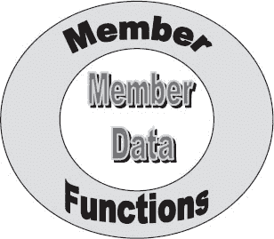

**图 1.2** 数据和功能

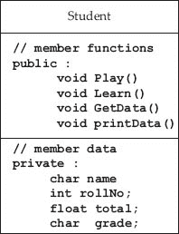

**图 1.3** 模型

我们如何表示对象？

### 1.8.1 对象的属性和行为

一个对象可能有多个实例。例如，上述名为学生的对象可以有 60 个实例，这意味着班级中有 60 名学生。因此，每个对象的实例都可以拥有它自己的数据，例如它自己的学号、姓名、成绩、考勤等。因此我们可以说，对象的属性（即数据）归该实例所有。因此，**属性也是对象的状态。**

所有学生对象将具有相同的功能，如`Play()`、`Learn()`、`GetData()`、`PrintData()`等。因此当我们说对象时，我们指的是属性和行为。

### 1.8.2 类

# 类

`Class`（类）是对象的集合，也可以定义为实例的数组。图 1.4 展示了包含三个实例的学生类。它还可以拥有成员函数和成员数据。这里与数组不同，类可以拥有不同数据类型作为其元素。

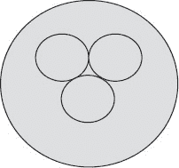

**图 1.4** 包含三个学生对象实例的学生类

`Class`定义了对象的抽象（即隐藏的）特征，包括属性和行为。名为`student`的类可以看作是一个工厂，产生`student`对象的实例，这些实例具有不同的属性（即个人数据）和共同的功能（即公共函数）。

类提供的属性和函数被称为成员数据和成员函数。在 Java 中，成员函数被称为方法（methods）。

### 1.8.3 封装

到目前，我们已经理解对象意味着属性和功能。`Class`可以包含对象的多个实例。

我们还理解在面向对象编程中，这是一种以数据为主的语言，即数据是重要的，而函数不是重要的。根据 C++ 和其他 OOP 语言使用的内存映射，数据存储在栈和空闲空间的数据区域，函数存储在代码区域，并且有必要对函数对数据的访问进行严格控制。

OOP 语言通过使用封装功能来实现这种控制。封装是将成员数据和调用函数与安全分级结合在一起，这样就不会发生对数据的未授权访问。

#### 1.8.3.1 安全或访问权限

C++ 和 Java 严重依赖于访问修饰符来维护数据完整性。安全访问修饰符有`public`（公共）、`private`（私有）和`protected`（受保护）。

- **Public:** 声明为`public`的成员函数和数据（如果有）可以在类成员函数之外访问。
- **Private:** 声明为`private`的成员数据只能在类成员函数内部访问，数据对外部隐藏。
- **Protected:** 声明为`protected`的成员数据和成员函数对外部是私有的，对具有`inheritance`（继承）关系的后代是公开的。你将在后续 C++ 章节和 Java 章节中学习更多相关内容。

现在可以将封装定义为：

- 通过类使用如`private`、`public`和`protected`等访问修饰符将成员函数和成员数据绑定到对象中。
- 因此，类允许我们将成员函数和成员数据封装到称为对象的单一实体中。

## 1.8.4 数据隐藏 / 数据抽象

通常做法是将所有成员数据仅声明为`private`。但声明为`private`的数据是隐藏的，任何人都无法访问。这种特征被称为数据隐藏或数据抽象。但这是如何实现这一的呢？你只能通过公共成员函数访问它。没有其他方法。这就像即使大学的主图书管理员如果不使用图书馆提供的访问卡，也无法将书籍带回家。

### 1.8.5 函数重载

当单个函数可以执行多项工作时，编译器的开销就会减少。例如，如果想计算圆的面积、足球的表面积或圆柱的表面积，我们需要写多少函数？通常是三个函数。但在 C++ 等 OOP 语言中，一个经过重载以执行所有三个工作的函数就足够了。

重载函数根据用户提供的参数来决定将哪个版本的代码加载到主内存中。

为什么重载很重要？函数必须被编译并加载到主内存中。如果函数没有重载，则所有函数在编译时都必须加载并链接。用户可能使用或不使用所有加载的函数，从而浪费主内存，并导致无法解决需要更多主内存的复杂问题。

作为一个示例，考虑以下重载函数：

```cpp
// 单个参数。相同函数名
void FindArea(float r) { return (2 * 3.14158 * r * r); }

// 两个同名。寻找圆柱的表面积
void FindArea(float r, float h) { return (4 * 3.14158 * r * h); }
```

### 1.8.6 运算符重载

预定义的运算符如`+`、`–`、`*`等，由编译器定义并提供，用于处理`int`、`char`、`double`等内置数据类型。在讨论函数重载概念时，我们也看到，如果一个函数可以执行多项任务，我们可以将其称为重载。这是利用主内存等稀缺资源的高效方法。运算符重载通过节省 C++ 的主内存也提高了程序的效率和吞吐量。

如果我们可以使用这些预定义运算符来处理类等自定义数据类型，我们就称之为运算符重载。例如，考虑一个预定义运算符`+`及其正常操作：

```cpp
int x = 10, y = 20;
int z = x + y; // x 和 y 的内容相加并放在 z 中
```

现在考虑两个极形式表示的复数：

```cpp
Polar v1(25.0, 53.50); // 幅和角度 theta
Polar v2(5.0, 45.00);
```

如果我们可以写：

```cpp
Polar v3 = v2 + v1;
```

这意味着我们重载了`+`运算符。

## 1.9 OOP 范式的扩展性与复用性

范式的扩展性和复用性使得 OOP 语言变得多样。OOP 语言提供了多种工具来确保这些功能：

- 包含
- 继承
- 虚函数和抽象数据类型（ADTs）
- 标准模板库（STL）

我们将在后续章节中要描述上述功能。它们的实现将在 C++ 和 Java 章节中解释。

## 1.10 扩展 / 衍生新类

我们可以基于现有类派生新类。这可以通过 OOP 语言提供的继承和包含属性实现。包含是类中的类，即包含确保包含类的成员函数和成员数据。而继承为后代类提供了访问声明为`protected`的成员数据和成员函数。

### 1.10.1 包含：类中的类——容器类

容器类是 C++ 实现代码复用的技术之一。容器类意味着包含另一个类或多个类。例如，计算机内部有一个微处理器。此外，学生类可以有一个属于字符串类的数据成员。我们就可以说字符串类包含在学生类中。换句话说，也可以称为字符串类的组合或聚合。

包含的优势是，我们可以在学生类内部使用字符串类来存储属于姓名、地址等详细信息。同样，如果我们定义一个名为`date`的类，带有日、月、年信息，我们可以在名为`student`的类中定义`date`对象，并定义出生日期、入职日期等日期数据。因此，组合是一种关系。

人类和动物从生物中获得特性。

专业人员、学生和运动员都是源自人类。我们说这三类人继承自人类。`human`类被称为`base class`（基类），而`students`和`athletes`称为`derived classes`（派生类）。可以继承什么？成员函数和成员数据都可以被继承。

你注意到表示继承关系的箭头方向了吗？根据建模语言规范，它是指向向上的。

继承定义了一种“是”（`is`）类型的关系。观察发现，学生是一个人类。同样，哺乳动物是一个动物（`is`）。`Human`是一个`base class`，而`student`是一个`derived class`。从基类派生是实现这种`is`类型关系的技术。一个基类可以有多个派生类。

我们什么时候使用继承？你继承是为了从基类派生所有的功能和成员数据，而派生类可以添加自己的专门化或个性化功能。例如，`athlete`继承了`human`的所有功能和属性，在此基础上添加了自己的运动和竞技功能及属性。

继承是程序员手中一种强大的工具，用于从现有类定义新类。

### 1.10.3 单继承与多重继承

继承意味着能够从基类派生一个具有附加功能的新后代类。

在图 1.6a 中，我们展示了`single inheritance`（单继承继承），其中派生类`person`继承自基类`human`。

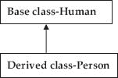

**图 1.6a** 单继承

在图 1.6b 中，描述了`multilevel inheritance`（多级继承），其中`student`继承自`person`的属性，而`person`又继承自基类`human`的属性。

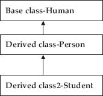

**图 1.6b** 多级继承

在图 1.6c 中，我们展示了涉及一个基类和三个派生类的`hierarchical inheritance`（层次结构继承）。

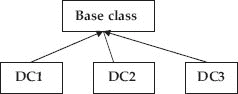

**图 1.6c** 层次结构继承

图 1.6d 展示了`multiple inheritance`（多重继承）。在此情况下，基类被称为`virtual`（虚的），因为一个基类被两个派生类使用，即派生类 1（`DC1`）和派生类 2（`DC2`）。此外，你可以看到派生类 3（`DC3`）同时继承自`DC2`和`DC3`。这种类型的继承也被称为`hybrid inheritance`（混合继承），因为它从两个基类`DC1`和`DC2`派生出一个单一的派生类`DC3`。

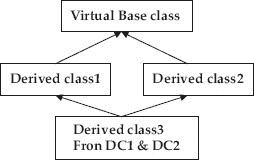

**图 1.6d** 多重/混合继承

### 1.11 虚拟函数

在继承关系中，派生类通过公共辅助函数访问受保护的成员数据，从而实现了一种重要的面向对象编程功能——代码复用性。

但是使用属于派生类的成员函数进行对象到基类的操作呢？这一功能允许对象根据用户在运行时的选择，执行派生类的任何一个函数。

这意味着为对象到基类提供了一个通往所选派生类函数的桥梁，因此它可以执行该函数。当我们在基类中声明`virtual function`（虚函数）并且派生类重写（override）基类函数时，该桥梁便可用。

如果一个函数在基类中被声明为`virtual function`，我们就可以通过指向基类的指针在派生类中执行同名的重写函数。指向基类的指针是由`virtual function`提供的。

总结来说，我们可以说根据用户在运行时的选择，从基类执行任何与基类中`virtual function`同名的函数。

### 1.12 运行时多态与动态数据绑定

继承解决了复用性问题，即派生类可以访问基类中所有声明为`protected`（受保护的）数据成员和函数成员。

我们还学过派生类可以重写基类中定义的函数。

此外，在处理`virtual functions`时我们看到，通过指向基类的指针，我们可以调用派生类对象。

将 C++ 等面向对象语言的上述两个特征相结合，给了我们一个强大的工具叫做`run-time polymorphism`（运行时多态）和动态绑定。

这一特征对程序员意味着，通过指向基类的指针，我们可以在运行时决定调用覆盖了某个函数的特定派生类。换句话说，我们可以通过指向基类的指针，从多个派生类中绑定重写函数。在上一节中，我们看到了`virtual functions`的工作原理，通过它我们可以实现派生类函数与基类指针的绑定。

### 1.13 类作为抽象数据类型（ADT）


面向对象语言中的类也可以称为`abstract data type (ADT)`（抽象数据类型）。面向对象语言的特性（如运行时多态和动态绑定）允许我们定义带有无实现的`virtual functions`（称为`pure virtual functions`纯虚函数）或带有占位功能的基类，仅用于告知用户实现由派生类完成。这些类被称为`ADTs`，因为它们隐藏了实现细节。

再次参考图 1.7。我们声明一个基类（ADT）为`shape`。你会发现`shape`没有具体的形状、面积或周长，也没有具体的绘图程序，它只声明了虚函数。

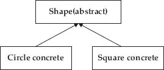

**图 1.7** 抽象数据类型 (ADT)

我们将派生出`circle`和`square`类，并提供这些虚函数的具体实现。具体意味着在每个派生类中都有具体的代码实现。

在面向对象的设计（OOD）模型中，对象之间存在类关系，即具有相同功能特征的对象被归类到一个`class`（类）。一个`class`允许我们将成员函数和成员数据封装到一个名为`object`（对象）的单一实体中。

对象通过调用函数和向函数传递参数来与其他对象进行通信。

类与类之间存在关系。这些关系被称为`associations`（关联）。

还存在继承关系，通过它可以从现有类定义新类。也存在多重继承关系。

我们还学到，虚函数结合继承为我们提供了强大的工具，如运行时多态性，并允许我们定义 ADT（抽象数据类型）和接口。因此，我们可以实现接口与实现的的解耦。

`C`语言的编程围绕函数展开。调用函数并获得所需的结果。在 OOP 方法论中，所需的结果通过在对象之间传递消息来实现，即对象通过相互调用函数和传递参数进行通信。

我们可以将执行一个大型项目所需的所有类定义在一个单一的工作空间中。这个空间可以被称为`package`（包）。一旦包含在`package`中，我们就可以在其他程序和项目中使用所有类的声明，从而确保代码的可重用性。

## 1.16 面向对象分析与设计 (OOAD)

为了准备解决方案，我们必须首先理解系统。为了理解系统，我们需要对系统进行建模。只有这样我们才能确保程序和项目按预期运行。因此，每当问题是非平凡且难以理解时，我们就对系统进行建模以研究系统的行为。

为了理解系统，用户规范由用户和专家准备。这些规范是用英语对问题的简单陈述。我们需要分析这些规范并遵循面向对象分析和设计原则。分析和设计非平凡复杂系统的最佳方法是通过使用`UML`进行建模。

`UML`是一种用于分析和设计方法的图形和图解语言。它被称为“统一的”，是因为它统一了面向对象技术三位奠父——格拉迪·布奇（Grady Booch）、詹姆斯·兰伯（James Rambaugh）和艾瓦·雅各布森（Ivar Jacobson）所述的所有早期面向对象方法。`UML`是由 HP、IBM、Oracle 等行业联盟在名为对象管理组（`OMG`）的控制小组指导下创立的。我们将在随后的 OOPS 章节中介绍所有这些概念。

在下一章中，我们将处理对象建模和`UML`相关的概念。

## 1.17 总结

1. 结构化编程涉及调用函数从而解决问题。
2. `class`允许我们将成员函数和成员数据封装到一个名为`object`的单一实体中。
3. 类与类之间存在关系。这些关系被称为`associations`（关联）。
4. `Java`的主要优势是硬件无关的。任何代码都被编译成`bytecodes`（字节码）。编译后的`bytecode`存储在`class`文件中，可以在任何`JVM`上运行。
5. `JVM`获取`bytecode`并将其转换为机器代码，然后由本地机器运行并产生所需的结果。
6. OOP 风格可以分为两种，即基于对象的编程和面向对象的编程。在 OOP 范式中，对象是核心的。
7. 要成为一种基于对象的语言，该语言必须支持以下特性：数据封装、数据隐藏、运算符重载以及对象的初始化和使用后的自动清除。
8. OOP 必须支持广泛的可重用性和扩展性特性，例如所有对象属性、继承、动态绑定以及广泛且定义良好的`STL`。
9. 每个`object`都有属性（状态）和行为。属性也称为对象的`states`（状态）。
10. `Class`（类）：对象的集合。`class`定义了对象的抽象的（即隐藏的）特征，包括属性和行为。
11. `Encapsulation`（封装）是将成员数据和调用函数与安全分级结合在一起，以确保不会发生任何未经授权的数据访问。
12. 一个`class`允许我们将成员函数和成员数据封装到一个名为`object`的单一实体中。
13. 函数重载是指相同的函数名，但参数的数量或类型不同。
14. 容器类意味着包含另一个类或多个类的`class`。换句话说，它也可以被称为`composition`（组合）或`aggregation`（聚合）。
15. 在继承类型的关系中，我们可以从现有类派生出新类。
16. 继承意味着能够从基类派生出具有额外功能的新后生类。
17. 如果一个函数在基类中声明为虚函数，我们可以通过基类指针在派生类中执行同名的重写函数。基类指针由虚函数提供。
18. 面向对象语言中的`class`也可以称为`ADT`（抽象数据类型）。
19. OOP 语言的特性（如运行时多态性和动态绑定）允许我们定义带有无实现（称为纯虚函数）或仅有占位功能的虚函数的基类，用以指示用户实现由派生类完成。这些类被称为 ADT，因为它们隐藏了实现。
20. 封装意味着绑定数据和代码。当使用运行时多态性时，最好多态地解耦封装，以防止离散的代码模块相互相互作用。
21. 基类中的重写函数会被自动隐藏，并且可以通过引用基类函数来显式调用。

## 练习题

### 单选题

1. `C++`支持
   1. 结构化编程
   2. 面向对象编程
   3. A 和 B 都对
   4. None

2. `C++`由谁开发
   1. Gosling
   2. Bjarne Stroustrup
   3. Rambaugh
   4. Grady Booch

3. `Java`由谁开发
   1. Gosling
   2. Bjarne Stroustrup
   3. Rambaugh
   4. Grady Booch

4. `Java`是
   1. 硬件无关
   2. 软件无关
   3. 语言无关
   4. 固件无关

5. Java 虚拟机（`JVM`）
   1. 将源代码转换为机器代码
   2. 将源代码转换为字节码
   3. 将字节码转换为机器代码
   4. 以上

6. `C#`由谁开发
   1. Anders Helsberg
   2. Bjarne Stroustrup
   3. Rambaugh
   4. Grady Booch

7. 在 OOP 范式中，任务被
   1. 分为函数
   2. 分为对象
   3. 分为子任务
   4. 分为类

8. OOP 范式是
   1. 数据优先
   2. 过程优先
   3. 任务优先
   4. 对象优先

9. 以下不是基于对象范式的一部分
   1. 数据封装
   2. 数据隐藏
   3. 运算符重载
   4. 继承

10. 声明为`private`的成员
    1. 可以被外部类访问
    2. 仅允许类内部函数访问
    3. 可以被派生类访问
    4. 以上

11. 声明为`protected`的成员
    1. 可以被外部类访问
    2. 仅允许类内部函数访问
    3. 可以被派生类函数访问
    4. 以上

    1. i
    2. i 和 ii
    3. ii 和 iii
    4. i, ii 和 iii

12. 包含（Containment）是一种
    1. 拥有关系类型
    2. 是关系类型
    3. 拥有-是关系
    4. 以上

13. 包含也被
    1. 继承

# 2 练习

2. 聚合
3. 组合
4. 类中的类

1. i
2. i 和 ii
3. i 和 ii
4. ii, iii 和 iv

14. 继承是一种（种）
   1. 具有类型的关系
   2. 是类型的关系
   3. “拥有-是”类型的关系
   4. 以上都不是

15. 面向编程通过以下方式实现结果
   1. 调用函数
   2. 对象调用函数并在对象之间传递消息
   3. 函数调用对象
   4. 以上均不是

16. 与其他类有关系的类被称为
   1. 继承
   2. 关联
   3. 链接
   4. 映射

17. UML 代表
   1. United Modelling Language
   2. Unified Modelling Language
   3. US Modelling Language
   4. 以上均不是

18. UML 统一了以下方法
   1. 结构化分析与设计以及 OOAD
   2. Jacobson 和 Rambaugh 的模型
   3. Rambaugh, Jacobson 和 Grady Booch 的模型
   4. a 和 c

### 简答题

19. 什么是结构化编程？
20. 什么是面向对象编程？
21. 什么是基于对象的编程？
22. 区分对象和类。
23. 什么是封装？
24. 解释数据隐藏。
25. 为什么类被类抽象数据类型？
26. OOP 范式中的消息传递是什么？
27. 解释包含。
28. 区分函数重载和运算符重载。
29. 解释运行时多态和动态绑定的特征。
30. 什么是虚函数？
31. 什么是 UML？
32. UML 中的“统一”一词对你意味着什么？

### 答题

33. 面向对象编程范式的显著特征有哪些？
34. 区分基于对象的编程和面向对象编程。（OOP 风格有两种类型，即基于对象的编程和面向对象编程。在 OOP 范式中，对象具有主地位。）
35. 解释继承和类层次结构。
36. 区分不同类型的继承。
37. 为什么虚拟函数是有用的？
38. 解释 C++ 中的 STL。

### 选择题答案

1. c
2. b
3. a
4. a
5. c
6. a
7. b
8. a
9. d
10. b
11. c
12. a
13. d
14. b
15. b
16. b
17. b
18. c

# 2 对象建模

## 学习目标

*在本章结束时，你应该能够：*

- 理解对象建模。
- 使用 UML 符号来指定对象和类、它们的符号、元模型以及强制性配置文件（mandatory profiles）、元数据、元类等概念。
- 学习使用 UML 的类图和对象图。
- 理解 OOPS 语言中链接、层次结构、多态和抽象类的概念。

## 2.1 引言

对象建模涵盖我们在第 1 章中学习关于面向对象（OO）方法的所有元素。对象建模的原理是抽象、封装、模块化、层次结构、类型化、并发和持久化。

在传统的编程风格中，我们构思问题并将主任务划分为子任务，然后开发函数或方法来解决这些子任务。我们称这种范式为面向过程的风格。在这种范式中，过程是主导，被处理的数据存储在计算机内存的不同位置，称为代码区域。在对象建模中，对象将数据和作用于数据的函数封装为一个单一实体。为了满足用户的需求，专家以英文问题陈述的形式准备规范。为了分析这些规范，我们需要从对象（名词）和类的角度研究问题陈述中的词汇，以及领域中类之间的关系。

## 2.2 对象模型

OO 语言中的基本构建单元是模块。什么是模块？模块可以定义为类和对象的逻辑集合。如果说函数是动词，那么对象就是名词。对象包含了函数和成员数据。面向对象方法论中的构建单元如图 2.1。

**图 2.1** 面向对象编程方法论 – 模块

我们观察到，我们的构建单元不是函数、过程或算法，而是类、对象以及它们之间传递的消息。从上图可以看出，单个对象负责自己的成员数据和一组功能。因此，对象存储数据，还存储更新数据和对存储数据进行必要计算所需的函数。此外，协作对象通过调用函数和在它们之间传递信息进行通信。

对象建模不仅关于单纯的对象和包含的数据。很多时候，系统需要定义不同对象所属数据之间的`links`以实现某些全局功能。对象模型必须包含类之间的关系以及属于类的数据。这将由类之间的继承关系决定。

对象之间的链接是消息调用。它们是发送给接收对象的请求，使用请求对象发送的参数执行其所属的函数。

我们现在准备好将 OOP 编程定义为一组协作对象的集合，这些对象反而是类的实例。协作类具有由继承关系定义的层次结构关系。

## 2.3 面向对象设计

在分析和设计结束，我们最终开发代码。代码具有由对象、类、对象之间的消息和链接，以及类之间的关联和关系组成的结构。

现在，如果我们的设计模型由与代码结构相同的图表组成，不是更好吗？更好的是，是否存在一种图形和图表语言可以将我们的结构转换为代码？答案是 UML。UML 支持两种类型的图。一组图描述的是结构，即互连和产生的拓扑结构。这组图也称为静态图。另一组图被称为动态图，描述的是在对象之间传递的消息。

**示例 2.1：�����学院管理示例 – 案例研究**

在本节中，我们使用学院管理系统来解释对象建模的概念及其在 UML 中的实现。学院学术管理围绕学生、教师和课程展开。学院有系，系提供课程。学生注册教师提供的课程。

我们通过与大学管理相关的对象模型来解释对象建模，这些学生、教师、系主任（HODs）、课程、部门等参与者。我们以此作为一个贯穿示例学习面向对象编程（OOPS）概念，并在后续章节中处理`C++`和`Java`的细节。我们模型的基础是一个名为`student`的类。它包含了学号、姓名等信息。我们使用名为`student`的类，并在名为`StudentMaster`的数据库中存储学生信息。课程文件将包含注册了特定课程的学生的详情。所有此类课程都将属于某个系部门。运行 BTech、MBA 和 MCA 等课程的大学也将成为一个校区的一部分。

## 2.4 类与对象

对象是一个包含数据和功能的实体。大学管理拥有关于学生、教师和所提供课程的数据。在 OOP 设计中，我们需要做出的决策是如何将数据和功能划分为具有意义的对象，使这些对象之间相互交互，并产生大学管理层预期的结果。

脑海中浮出的第一个想法是名为`student`的对象。在大学里有很多学生，但他们都具有相同的功能和个人属性。因此，这些对象可以被分组为一个名为`student`的类。

类是共享共同行为和属性的对象的集合。类定义描述了属性以及实现该行为的函数。

对象是一个包含属性、成员函数和标识的实体。共同属性和功能的对象被组合在一个类中。

### 2.4.1 类

类是对对象的描述或规范，而对象是在运行时创建的类的实例。一个类可以有一个或多个实例。在示例 2.2 中，我们展示了学生类在`C++`、`Java`和 UML 中的抽象表示形式。

**示例 2.2：C++ 中 Student 类的表示**

```cpp
class Student
{ // 构造函数和成员函数
     public:
       Student(){rollNo=0,name=”No Name”;}
       Student(int n, char *p){rollNo=n,name=p;}
       int GetRollNo() const { return rollNo;}
       void SetRollNo ( int n) { rollNo=n;}
       char * GetName() const { return name;}
       void SetName( char *p) { name=p;}
     private: int rollNo; char *name; // 成员数据及指向名称的指针
};
```

**示例 2.3：Java 中 Student 类的表示**

```java
public class Student
 {private String name;
     private long rollNo;
    public Student( String n , long r )
     {rollNo=r; name=n; }
    public String GetName() { return name;}
    public long GetRollNo() { return rollNo;}
}// 类结束
```

**示例 2.4：UML 中 Student 类的表示**

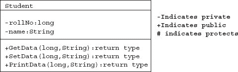

**图 2.2** UML 中的学生类表示

### 2.4.2 符号与元模型

UML 采用了符号和元模型。符号是建模语言的图形化表示和语法。另一方面，元模型是用于定义语言的严谨性和复杂性的类图。在下面的示例中，你将看到我们将使用 UML 符号以及涉及类图的元模型来解释泛化、特化等复杂性。幸运的是，我们可以在`C++`和 UML 中使用相同的表示。矩形框表示对象的类。类名位于顶部。在框的中间部分，列出每个对象包含的数据。在类框的第三部分，列出对象可以执行的操作（函数）。

### 2.4.3 强制性配置（Mandatory Profile）

它定义了最小服务，即类应提供的功能。因此，类定义中包含一个构造函数以正确初始化对象是非常关重要的。这种初始化通过带有默认参数的参数构造函数来实现，以确保类属性正确且所需的初始化，并创建具有最小强制服务的对象。考虑下所示示例：


```cpp
class Student
{// 构造函数和成员函数
    public:
       Student(){rollNo=0,name=”No Name”;}
      Student(int n, char *p){rollNo=n,name=p;}
        int GetRollNo() const { return rollNo;}
        void SetRollNo ( int n) { rollNo=n;}
        char * GetName() const { return name;}
        void SetName( char *p) { name=p;}
    private: int rollNo; char *name; // 成员数据及指向名称的指针
};
```

如果在创建对象时未提供参数，则使用默认构造函数指定的默认值来初始化对象。默认构造函数要求该类具有适当的行为。因此，我们为名称提供了“no name”，为学号提供了 0。在程序的稍后部分，我们可以使用`SetRollNo()`和`GetRollNo()`函数来修改初始值：

```cpp
Student std; // 创建了对象
std.SetRollNo(6060);
std.SetName(“Gautam”);
```

在上面的声明中，可以看到我们需要提供两个参数，即学生的学号和年龄。在没有正确初始化的情况下创建对象通常会导致许多错误和问题。因此，将默认构造函数作为强制性配置的一部分是一种良好的编程实践。

## 2.4.4 元模型（Meta Models）

### 2.4.4.1 元类（Meta Class）

在面向对象编程中，元类是由语言创建的类，所有其他用户定义的类都是该元类的实例。元类定义了用户定义类及其实例的行为。当你创建一个类的实例并将类方法添加到类中时，它们实际上被添加到元类实例中。这意味着你能够根据需要更改已创建实例的行为。在 Java 中，你创建的类是`java.lang.Class`的实例。然而，Java 不直接支持元类，但这里也存在一个`java.lang.Class`的实例。我们可以使用`java.lang.Class`定义的方法：`getName()`或`newInstance()`或`getMethod()`、`getConstructor()`、`isArray()`、`getInterfaces()`。例如，可以通过调用对象的`getClass()`获取其类的描述。

### 2.4.4.2 元数据（Meta Data）

元类还持有元数据，称为属性，即属于元类的数据。元类允许类或包访问元数据。属性以标记脚本的形式在面向对象的语言中指定，元类能够在运行时读取并加载这些脚本，使得元数据对程序员可用。

- **安全性**：安全问题的出现是因为操作层面的用户能够利用某些并非原始规范组成的操作。这种漏洞可能在其他类层级的操作中无意中产生。修复这些漏洞的考虑标准见下文。
- **访问控制**：功能的细分必须确保只有特定的类或用户能够通过授权代码启动并使用该功能。
- **数据完整性**：数据是首位的，子模块中不允许任何未经授权的访问。合适的加密技术可以解决这些问题。
- **用户行为控制**：必须指定类用户的正常行为，模块必须识别任何偏离此正常及设计流程的偏差，并拒绝对非意图操作的进一步利用。

## 2.4.6 对象创建

一旦在运行时定义了一个类，我们就可以创建该类的实例，即对象。记住，对象是类的变量。因此，你可以像定义数据类型变量一样定义对象。在接下来的示例中，我们创建了一个名为`std`的普通对象，以及 50 个`student`类的实例，还创建了一个用于在堆堆内存上创建`student`实例的指针。

**示例 2.5：在 C++ 中创建类对象**

```cpp
Student Std; // Std 是 Student 类的一个对象
Student Std[50]; //为 Student 类创建了 50 个实例
Std.SetRollNo(8345); // 设置学号为 8345
```

**示例 2.6：在 Java 中创建 Student 类对象并分配初始值**

```java
Student Std = new Student(757,“Anand”)// std 是 Student 类的一个对象
757 是学号，Anand 是分配给该对象实例的名字。Std 是对象的名称。
```

**示例 2.7：在 UML 中创建 Student 类对象并分配初始值**

### 2.4.7 垃圾回收

**垃圾回收**是对不再使用的内存进行自动检测和释放。当一个对象不再被任何其他对象引用时，它就可以进行垃圾回收。Java 使用垃圾回收，而不是像 C++ 等其他面向对象语言中使用的显式析构函数。

## 2.5 对象属性

对象是一个拥有自己的数据结构和实现行为的功能实体。对象应该具备哪些基本属性？

**状态**：对象的实例是一个对象，在运行时创建，并由默认构造函数设置初始值。这些值对于该实例是特定的，并在对象的生命范围内通过对象内部定义的辅助函数随时更改（参见图 2.3）。`757`和`Anand`的值仅在该实例上有效，因此它们代表了对象的状态。

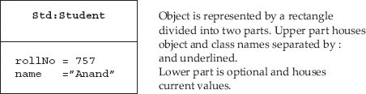

**图 2.3** 用 UML 表示的对象实例

**行为**：对象的行为由类定义的功能决定。然而，尽管一个类可以有多个实例（即属于同一类的多个对象），所有这些实例都具有由类定义的相同行为。因此，我们没有在图 2.3 中单独显示行为（即函数）。行为可以是以更新和修改成员数据的函数和方法，也可以是作为实现某些全局功能的接口的通用函数。这些函数由其他对象调用，接收参数并为其他对象提供服务。

**对象名称**：当对象被创建时，它带有一个名称。例如，`Std`是`student`类实例的名称。这是对象的标识。

```cpp
Student Std; // C++ Std 是 Student 类的一个对象
Student Std = new Student(757,“Anand”)// Java
```

**对象标识**：对象的每个实例与其他实例都不同，尽管它们包含相同的数据值。当对象被创建时，会分配内存资源。因此，唯一的 ID 是对象的内存地址。

**封装**：对象的成员数据被声明为私有，因此细节被隐藏且对外部不可见。在 C++ 和 Java 等面向对象的语言中，属性和方法的定义位于类定义内部，因此对外部不可见，从而向外部隐藏内部细节。这被称为封装。

## 2.6 链接

我们已经学过对象建模不仅仅是孤立对象的集合。如图 2.4 所示，系统要求定义属于不同对象的数据之间的链接，以实现某些全局功能。这里三个属于三个不同类的三个不同对象：`batch`、`student`和`Registration`。名为`batch`的类将拥有注册该批次所有课程的学生实例，例如机械专业第三个学期。在这里，只持有学生的学号，为了获取学生的详细信息，我们需要引用另一个名为`Registration`的对象。这意味着对于每个学生对象，我们需要维护一个到`Registration`对象的链接，以便我们引用它获取学生的详细信息。同样，我们需要维护一个名为`batch`的链接类，以便获取学生的批次详细信息。

我们将照常地在 C++、Java 和 UML 中展示链接的实现。然而，作为一个提醒，C++ 和 Java 的示例需要理解这些语言的编程技能基础。因此，第一次阅读的读者可以跳过 C++ 和 Java 示例，只关注 UML；他们可以在获得必要的 C++ 或 Java 技能后重新回顾这些主题。

**示例 2.8：C++ 中的链接**

```cpp
class StudentMaster
{  public: StudentMaster(char *p, int n){name=p, rollNo=n;}
     char * GetName() const { return name;}
     int GetRollNo() const { return rollNo;}
   private: int rollNo; char *name; // 指向名字的指针}; // 类结束
class Student
    { public: Student(StudentMaster *std ){ sm=std;}
      char *GetName() const { return Sm->GetName();}
      private: StudentMaster *sm; };
void main()
{StudentMaster *sm = new StudentMaster ( “Anand”,757);
  Student * S1 = new Student(sm);
  cout<<s1->GetName();}
```

**示例 2.9：Java 中的链接**

```java
public class StudentMaster
 {    private String name;
          private long rollNo;
        public StudentMaster ( String n , long r)
        {name=n; rollNo=r; }
        public String GetName() { return name;}
        public long GetRollNo() { return rollNo;}
   }// 类结束
   public class Student
   { private StudentMaster sm;
          public Student( StudentMaster std)
          { sm= std; } }// Student 类结束
```

从上面你可以清楚地看到，每当创建一个学生对象（即`sm`）时，我们在`StudentMaster`中也创建一个它的引用。我们将展示如何创建这些链接：

```java
StudentMaster sm = new StudentMaster(“Anand”,757);
Student S1 = new Student(sm);
Student S2 = new Student(sm);
……………………………………………… 此类推，直到五门科目
Student S5 = new Student(sm);
```

**示例 2.10：UML 中的链接**

链接在 UML 中通过指向对象的箭头表示：

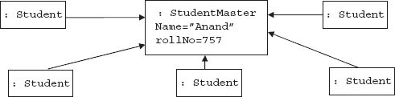

**图 2.5** UML 中的链接

## 2.7 类图

类图提供了系统概览。它们展示了类及其与其他类之间的关系。它们是静态图。这意味着它们告诉我们类之间的交互情况，但没有告诉我们对这些交互的响应。我们将解释类图以及与图书订购系统建模相关的各种术语。类图展示了管理员如何通过提交订单向供应商采购，并在随后进行支付。支付方式可以是现金、支票或信用卡。另一方面，订单包含书籍详情（参见图 2.6）。在随后的章节中将对上述类图和概念进行详细解释。

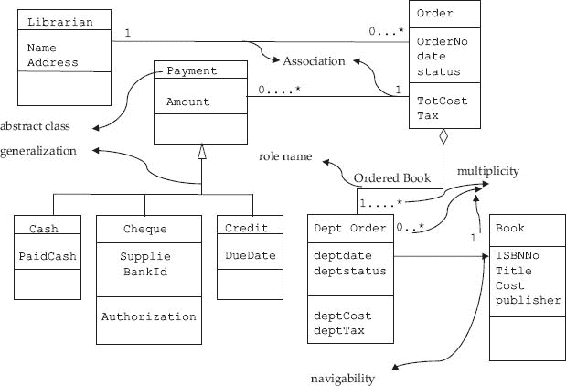

**图 2.6** 大学图书馆采购系统类图

## 2.8 类层次 (Class Hierarchy)

为了体现类之间的关系和依赖关系，我们需要将类组织成层次结构。

### 2.8.1 关联 (Associations)

关联是层次结构的一种，显示了类之间独立且地位平等的关系。这些关系通过类之间的线表示；通常用关联名称命名。关联中的类通常在层次结构中占据相等的位置。例如，在图 2.6 中，管理员和订单是独立的类。

**多重性 (Multiplicity)：**`order`类处的`0..*`表示管理员可以下无限数量的订单，即从 0 到未指定的数量。`0…1`表示 0 到 1。同样，我们也可以将学生可以借阅书籍的最大数量规定为`0…4`，如图 2.8 所示。

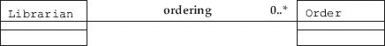

**图 2.7** 类之间的关联。关联命名为：ordering

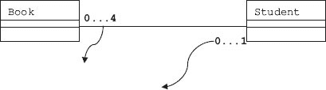

**图 2.8** 关联 0…1

学生可以借 0 到多本书。

一本书最多可以被 1 个学生借（参见图 2.6）。上述所示的导航性（navigability）暗示了关联的方向以及谁拥有关联的实现。导航性告诉我们，可以通过查询`DeptOrder`找到书籍详情。另请注意，`DeptOrder`是关联的所有者。

### 2.8.2 相互依赖类的层次结构

层次结构有两种类型：

- **整体/部分层次结构 (Whole/part of hierarchy)。** 在这种层次结构中，一个类包含在另一个类中。这种关系被称为**拥有 (has a)**关系。此外，整体/部分层次结构中有两个子类型，如下：
- **聚合 (Aggregation)。** 在这种类型中，对象不是固定的。它们可以被包含或移除。例如，考虑图 2.9 中的示例。一个部门拥有一些类，类包含一些学生。聚合意味着**“部分”(part of)**关系。


**图 2.9** 聚合关系。学生是类的一部分，即部门的一部分

在涉及整体/部分的类层次结构中，部分是必不可少的，就像书的情况。书没有页面无法存在，客运火车没有车厢无法存在，等等。在图 2.9 中，类没有学生无法存在。因此，它被显示为实心菱形。一个类包含 1 到多个学生，而一个部门可以没有类，即空部门。因此，它被显示为空心菱形。

- **组合 (Composition)。** 这是另一种整体/部分类型的层次结构。在这种类型中，对象是整体或整体中不可或缺的部分。例如，人类有心脏；计算机内部有一个微处理器。组合意味着“拥有”(has a)关系，即整体对象包含一个部分。

聚合用指向整体类的**空心菱形**连线表示，而组合则使用**实心菱形**。实现整体/部分层次结构的一种方法是在定义容器类时，简单地将聚合对象的实例声明为一个属性：

**示例 2.11：C++ 和 Java 中容器类的示例**

```cpp
class Date
{public:
     Date ( int d=0, int m=0,int y=0) :dd(d),mm(m),yy(y) { } // 
构造函数
    void SetDate( int d, int m, int y){ dd=d,mm=m,yy=y;}
     int GetDD() const { return dd;}; int GetMM() const { return 
mm;};
    int GetYY() const { return yy;};
  private: int dd; int mm; int yy;
};
class Student
{ public:
   Student();
   ~Student(){}; // 默认析构函数
    int GetRollNo() const { return rollNo;}
    void SetRollNo ( int n) {rollNo=n;}
    Date GetDOB() const { return dateDOB;}
    Date GetDOJ() const { return dateDOJ;}
   void SetDOB(Date dtb) {dateDOB=dtb;}
   void SetDOJ(Date dtj) {dateDOJ=dtj;}
  private: int rollNo; Date dateDOB; DateDOJ;
};
```

在上面的示例中，我们定义了一个`Date`类，它有自己的成员变量和函数。`Date`类具有`dd`、`mm`、`yy`私有属性。现在名为`Student`的类具有出生日期和入职日期的实例。

### 2.8.3 独立类的层次结构

此类别的类具有“是”(is a)关系，也被称为**泛化/特化 (generalization/specialization)**。在面向对象编程语言中，该性的实现机制是继承。例如，我们在图 1.5 中建模了人类层次结构。UML 使用空心箭头  表示继承关系。

我们在图 2.10 中展示了继承关系，四轮车和自行车继承自`Automobile`。基类在文献中被称为 Super 类。我们在处理 Java 和 UML 时在 C++ 中使用 Super。派生类可以通过添加新属性以及选择性地**重写 (overriding)**基类的现有属性来扩展`Super`。例如，父亲(Super) 通过陆路从 A 地到 B 地，而儿子(子类) 通过空中从 A 地到 B 地。

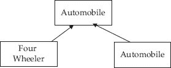

**图 2.10** 继承层次结构

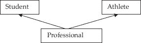

**图 2.11** 多重继承——多个父类类

如果一个类派生自多个父类，则称为多重继承。Java 不支持多重继承，而 C++ 支持。从多个父类继承属性和特性时可能会产生困惑和歧义。Java 通过引入接口 (interface) 概念解决这一歧义问题，而 C++ 则通过显式函数调用。在 Java 接口中，类将使用名为**实现 (implements)**的 Java 规范，允许类实现接口所需的代码。你将在语言细节中学习更多这方面的内容。

**示例 2.12：C++ 中多重继承的示例**

```cpp
class Student
{ public:
      ……….. class declaration here………..
  private:
 };
class Athlet
{  public:
      …….. class declaration here.: };
class Professional : public Student, public Athlet
{ public:
      …….. class declaration here. ……………..
 private:
};
```


对象图显示了类图的实例。在本示例中，请考虑学院部门结构。一个类可以包含若干个部门。工程学院的一个部门下可以包含许多个部门。图 2.12a 显示了一个名为 `department` 的类图。一个部门也可以包含许多子部门。例如，像电气工程这样的部门可以拥有电子系和通信系等子部门。我们可以说，一个部门是子部门的集合。这在 UML 中是聚合（aggregation）的表示，用菱形符号标出。

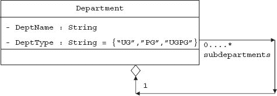

**图 2.12a** 部门包含 0 到多个子部门 – 聚合

在图 2.12a 中显示的自循环描绘了聚合。它表示 `department` 可以包含 0 到 *，这意味着 0 到多个子部门。这些部门被包含在 1 个 `department` 实例中。因此，请观察用于指示聚合的菱形。在图 2.12b 中显示的对象图实例化了类图，用一个具体的示例替换了它。

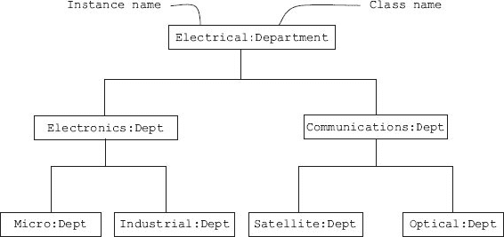

**图 2.12b** 显示部门包含多个子部门的对象图

## 2.10 通信与消息传递

在今天的技术中，程序的执行不再仅仅是逻辑编程步骤的执行。大多数 GUI 程序必须响应来自鼠标、传感器等外部单元的信号。但问题是，谁来监控外部单元的触发？是用户编写程序还是操作系统？答案是操作系统监控来自外部单元的信号并将信号发送给我们的程序。我们的程序将有一个接口，用于接收、解释并对操作系统发送的信号采取必要的行动。事实上，整个 Windows 和其他现代操作系统都是通过这种消息传递机制来实现任务的。

协作对象之间还有其他通信方式。对象之间发送和接收消息。发送消息通过调用属于另一个对象的函数并传递参数来实现。接收消息意味着当前对象的函数被另一个对象调用了。因此，对象可以响应来自操作系统和其他对象的发送消息。

## 2.11 多态

我们已经理解了在继承关系中，子类继承了父类的方法和属性。在继承中，子类可以扩展并简单地使用基类的功能，也可以用完全不同的函数实现来实现自己的功能。我们将这种特性称为重写（overriding）基类函数。

我们在图 2.13 中展示了一个人类层级结构。所有人都必须工作，因此 `human` 类定义了一个名为 `Work()` 的函数。所有人都要 `Work()`，但像 `student` 这样特殊的类（作为 `human` 的子类）必须在大学、图书馆和实验室工作。因此，你会发现 `student` 用它自己特有的 `Work()` 方法重写了基类函数 `Work()`。此外请观察到，`CSESTUDENT` 想要使用（继承）与它的基类 `student` 相同的 `Work()`。因此，它没有定义自己的版本，因此基类函数 `Work()` 对它可用。另一方面，`ECESTUDENT` 可能需要在硬件实验室工作，因此它用自己的实现重写了基类的 `Students Work()`。

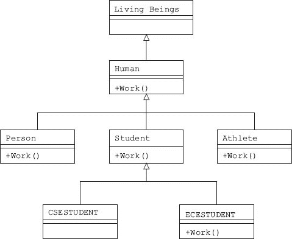

**图 2.13** 多态的体现：ECE 学生有自己的工作：CSE 学生使用 Student Work() 工作，因为 CSESTUDENT 没有重写。

当有多个子类实现同一个函数时，调用正确派生类的正确函数是至关重要的。也就是说，在运行时，必须通过函数调用来调用正确的函数。确保这种函数正确运行时绑定的特性称为`动态绑定`（dynamic binding）。多态意味着确保基类对象按照计划以正确的方式运行。例如，`CSESTUDENT` 必须使用 `Students Work()`，而 `ECESTUDENT` 必须使用它自己的 `Work()`，以此此类推。

## 2.12 抽象类

在设计 OO 系统时，我们可能需要一个完全没有函数实现的基类。该基类将只有函数名称而没有这些函数的实现。然而，源自此基类的派生类将重写基类函数，每个被重写的函数将有其自己的实现。多态和动态绑定特性将确保根据用户需求，将属于适当对象的正确方法链接到函数调用上。Java 的接口特性就是抽象类。在 C++ 中，具有纯虚函数的基类可以被视为抽象类。抽象类由于没有实现的函数，因此无法实例化对象。

## 2.13 具体类

与抽象类相反，具体类实现了它其中声明的所有函数和方法。因此，具体类是一个可以实例化对象或对象实例的类。在图 2.13 中，`student` 类是一个具体类。

### 2.13.1 OOPS – 对象建模案例研究

我们将进行详细的建模练习，以巩固我们学到的关系。我们将学习与学院、部门、学生及相关的学院管理系统，如图 2.14 所示。有两个主类：`Person` 和 `Dept`。这两个是超类（基类），持有所有人和部门共有的属性，如人或部门的名称、学院代码以及所有其他相关数据。`Student` 和 `staff` 是源自超类 `person` 的子类，是一种特殊的人。它包含了特殊的属性，如身份号、地址、部门代码和其他相关数据。这种关系是继承，并用符号表示。

（注：正文继续如下）

**聚合**由一条指向整体类的空心菱形线表示。一个部门拥有一些类，这些类拥有一些学生。聚合意味着“部分”关系，显示为 ``。

**组合**则使用实菱形。在这种类型中，对象是整体整体或不可或缺的一部分。组合意味着“拥有”关系，即整体对象包含一个部分，在 UML 中显示为 ``。在图 2.14 中，该类拥有 0…60 个学生。该类由学生组成。类为了操作学生所需的任何方法将在类中实现，这些方法对类的任何派生类可用。

你可以观察到 `EngineeringDept` 派自 `Super Dept` 并且是一个专门部门。它将具有工程部门特有的额外信息，例如专业领域、资源人员以及指向属于部门学生的链接。查看 `CourseOffering` 类。它实现了学生与 `EngineeringDept` 之间存在的课程开设关系。此外还观察到，`CourseOffering` 也是学院的一部分，学院是所有提供课程的工程部门的列表。学院还需要其他对象来跟踪已开设的课程。进一步名为 `CourseOffering` 的类可以具有额外的功能，例如跟踪某个学生被提供过哪些课程。`CourseOffering` 类还可以跟踪正在运行的课程和/或已经结束的课程。请注意，我们定义了一个名为 `CourseOffering` 的类来管理 `EngineeringDept` 和学生之间的关联关系。UML 中的虚线 `------------` 表示了上述描述的关系。上述在图 2.14 中所示的关联意味着，一个学生可以由一个 `EngineeringDept` 提供 1…6 门课程，这些课程由 `CourseOffering` 类跟踪和监控。学院与 `EngineeringDept` 之间的关系是聚合。我们可以说 `EngineeringDept` 是学院的一部分。

## 2.14 总结

1. **模块（Module）**：面向对象语言中的基本构建块是模块。模块可以被定义为类和对象的逻辑集合。模块不是函数、过程或算法，而是类、对象以及它们之间传递的消息。

2. **面向对象（Object orientation）** 是一种基于对象在软件中对现实世界系统进行建模的技术。

3. **面向对象编程（OO programming）** 是组协作对象的集合，这些对象反而是类的实例。协作类之间通过继承关系定义了层次关系。

4. **面向对象语言（OOP language）** 意味着：对象、类、继承。

5. **类（Class）**：类是一组共享共同行为和属性的对象集合。类定义描述了属性以及实现行为的功能。

6. **强制性配置（Mandatory profile）**：这定义了最小服务，即类应提供的功能。

7. **对象（Object）** 是一个包含属性、成员函数和标识的实体。具有共同属性和功能的对象被分组在一个类中。对象的行为由类定义定义的功能决定。

8. 对象的唯一标识是该对象的内存地址。

9. **封装（Encapsulation）** 是通过如 `private` 和 `protected` 等访问修饰符从外部世界隐藏对象所有内部细节的过程。

10. **链接（Link）** 链接属于不同对象的数据以实现某些全局功能。链接在 UML 中用指向对象的箭头表示。链接也是关联的实例。

11. **类图（Class diagrams）** 提供了系统概览。它们显示了类以及它们与其他类之间的关系。它们是静态图。这意味着它们告诉我们类类类交互，但没有告诉我们对这些交互的响应。

12. **层次结构（Hierarchy）**：类的排序。最常见的面向对象层次结构是继承和聚合。

13. **关联（Association）** 是一种层次结构类型，显示了类之间独立且地位平等的关系。关联是两个或多个类之间的关系。

14. **多重性（Multiplicity）**：一种量化对象之间关联的属性。

15. **整体/部分层次结构（Whole/part of hierarchy）**：在这种层次结构中，一个类被包含在其他类中。这种关系被称为**拥有（has a）**关系。

16. **聚合（Aggregation）** 意味着“部分”关系。一个聚合对象拥有其他对象。其他对象是聚合对象的一部分。聚合由一条指向整体类的**空心菱形**的线表示 ``。

17. **组合（Composition）**：这是聚合的一种特殊情况，整体没有部分就无法存在。组合使用实心菱形 ``。

18. **具有独立类的层次结构（Hierarchies with independent classes）**：此类类别下的类具有 `is a` 关系，也被称为**泛化/特化（generalization/specialization）**。

19. **继承（Inheritance）** 指定了**是（is）**它们的关系。基类被称为**超类（superclass）**。派生类也称为子类（subclass）。继承在 UML 中用符号 `` 表示。

20. **派生子类（Derived subclass）** 不仅继承父类的属性，还可以扩展和修改它的行为和属性。

21. **对象图（Object diagram）** 显示类图的实例。

22. **动态绑定（Dynamic binding）**：当有多个子类实现一个函数时，调用正确派生类的正确函数是至关重要的。也就是说，在运行时必须通过函数调用调用正确的函数。确保这种函数正确运行时绑定的特性称为**动态绑定**。

23. **多态性（Polymorphism）** 意味着确保基类对象正确且按计划地运行。

24. **抽象类（Abstract class）**：这是一个完全没有函数实现的基类。然而，自此基类的派生类将重写基类函数，每个被覆盖的函数将有自己的实现。Java 的接口特性就是抽象类。在 C++ 中，具有纯虚函数的基类可以被视为抽象类。

25. 抽象类由于没有已实现的函数，因此不能实例化对象。

26. **具体类（Concrete class）** 是可以实例化对象或实例对象的类。

## 练习题

### 选择题

1. **关于面向对象语言，以下哪些陈正确的？**

   1. 面向对象语言包含对象、类和继承。
   2. 模块是类和对象的逻辑集合。
   3. 模块是函数的集合。
   4. 类定义描述了属性以及功能。

   - i
   - i 和 ii
   - i, ii 和 iv
   - i, ii 和 iv

2. **关于对象和类，以下哪些陈述正确的？**

   1. 对象包含成员函数和属性。
   2. 对象包含成员函数、属性和标识。
   3. 对象的唯一标识是该对象的内存地址。
   4. 强制性配置定义了类的服务。

   - i
   - i 和 ii
   - ii 和 iv
   - i, ii 和 iv

3. **关于类图，以下哪些陈述正确的？**

   1. 类图提供了系统概览。
   2. 类图显示了类之间的交互。
   3. 类图显示了对交互的响应。
   4. 类图显示了类与其他类的关系。

   - i
   - i 和 ii
   - ii 和 iv
   - i, ii 和 iv

4. **关于对象方法论，以下哪些陈述正确的？**

   1. 链接连接属于不同对象的数据。
   2. 链接在 UML 中用指向类的箭头表示。
   3. 链接也是关联的实例。
   4. 关联显示了类之间独立且地位平等的关系。

   - i, iii 和 iv
   - i, ii 和 iii
   - ii 和 iv
   - i, ii 和 iv

5. **关于关联，以下哪些陈述正确的？**

   1. 关联是两个或多个类之间的关系。
   2. 多重性是一种量化对象之间关联的属性。
   3. 整体/部分层次结构意味着“是”类型的层次结构。
   4. 聚合意味着“部分”关系。

   - i, iii 和 iv
   - i, ii 和 iii
   - ii 和 iv
   - i, ii 和 iv

## 4. i, ii 和 iv

## 6. 关于聚合（aggregation），下列哪些描述是正确的？

1. 聚合意味着“整体包含”的关系。
2. 其他对象是聚合对象的一部分。
3. 聚合由一条指向整体类的空心（hollow）菱形连线表示。
4. 聚合意味着“是”的关系。

1. i, iii 和 iv
2. i, ii 和 iii
3. ii 和 iii
4. i, ii 和 iv

## 7. 关于组合（composition），下列哪些描述是正确的？

1. 组合意味着没有部分，整体就无法存在。
2. 组合使用实心菱形。
3. 组合由一条指向整体类的空心（hollow）菱形连线表示。
4. 组合意味着“是”的关系。

1. i 和 ii
2. i, ii 和 iii
3. ii 和 iii
4. i, ii 和 iv

## 8. 关于继承（inheritance），下列哪些描述是正确的？

1. 继承意味着“是”的类型的关系。
2. 继承意味着一个具有独立类的层次结构。
3. 基类被称为 `superclass`。
4. 继承在 UML 中用符号 `` 表示。

1. i 和 ii
2. i, ii, iii 和 iv
3. ii 和 iii
4. i, ii 和 iv

## 9. 关于面向对象方法（object-oriented methodology），下列哪些描述是正确的？

1. 动态绑定确保了类在运行时正确绑定。
2. 动态绑定确保了函数在运行时正确绑定。
3. 多态确保了基类的正确行为。
4. 多态确保了派生类的正确行为。

1. i 和 ii
2. i, ii, iii 和 iv
3. ii 和 iv
4. i, ii 和 iv

## 10. 关于面向对象方法，下列哪些描述是正确的？

1. 抽象类（abstract class）可以实例化对象。
2. 抽象类（concrete class）是可以实例化对象或对象实例的类。
3. 抽象类是一个完全没有函数实现的基类。
4. 在 `C++` 中，带有纯虚函数的基类可以被视为抽象类。

1. i 和 ii
2. i, ii, iii 和 iv
3. ii, iii 和 iv
4. i, ii 和 iv

## 简答题

11. 定义面向对象编程。

12. 定义类（class）和对象（object）。

13. 在面向对象方法中，什么是垃圾回收（garbage collection）？

14. 什么是抽象类？

15. 什么是具体类（concrete class）？

16. 解释聚合。

17. 解释组合。

18. 举例解释关联的多重性（multiplicity）。

19. 区分类图（class diagrams）和对象图（object diagrams）。

### 答

20. 解释对象建模。

21. 什么是强制配置（mandatory profile）、元模型（meta model）和元数据（meta data）？

22. 为什么指定约束（constraints）很重要？

23. 在 `C++` 和 `Java` 中是如何创建对象的？陈述对象的属性。

24. 对象建模中的链接（links）是什么？给出在 `Java`、`C++` 和 `UML` 中链接实现的示例。

25. 结合示例解释类图，并解释涉及的各种特性。

26. 结合示例解释对象图，并解释涉及的各种特性。

27. 举例解释类层次结构（class hierarchies）。

28. 结合示例解释多态（polymorphism），并解释涉及的各种特性。

### 练习

29. 为工业库存控制部门开发一个类图。

30. 为大型部门商店开发一个目录显示类图，客户可以查看可用型号并使用信用卡在线下单。

31. 为银行的自动取款机（ATM）进行对象建模。

32. 为火灾报警系统绘制类图。假设中央监控器监控火灾报警，当发生火灾事故时……

## 选择题答案

1. d
2. c
3. d
4. a
5. d
6. c
7. a
8. b
9. c
10. c

## 3 继承：扩展性与复用性

### 学习目标

在本章结束时，你应该理解关于面向对象范式的以下概念：

- 从现有类扩展和派生类。
- 继承中的包含。
- 单继承和多继承。
- 虚函数。
- Java 语言提供的接口。
- 运行时多态和数据绑定。
- OOP 概念如 `RTT` 和 `STL`。

### 3.1 面向对象范式的扩展性与复用性

类之间的关系使得面向对象语言变得灵活且强大。确保复用的工具包括：组合/包含、泛化/特化、虚函数、抽象数据类型（ADT）、标准模板库（STL）。

### 3.2 扩展/派生新类

通过继承和包含从现有类派生新类。另一方面，继承是通过添加许多特殊功能创建一个新类。

#### 3.2.1 包含：类中的类

容器——容器类


容器类是面向对象语言实现复用的技术之一。容器类意味着一个类包含另一个类。例如，计算机有一个处理器。换句话说，它被称为组合或聚合。

在组合中，一个类（我们假设为`Host`）存储另一个类（我们称之为`Guest`）的实例。`Host`类通过调用该实例的方法来委托工作。

例如，`Student`类可以有一个属于`string`类的成员变量。那么我们就说`string`类包含在`Student`类中。包含的优势是，可以在`Student`类内部使用`string`类来存储属于`string`类的姓名和地址。同样，如果我们定义一个带有日、月、年信息的`Date`类，我们可以在`Student`类中定义`Date`对象，并定义日期相关数据，如出生日期、入职日期等。组合是一种“拥有”的关系。

### 示例 3.1：C++ 的组合/包含

```cpp
class BankAccount { … };
class SavingAccount
{private: BankAccount Account;
};
```

代码的可重用性是`C++`和`Java`等面向对象语言所提供的强大承诺之一，而继承是实现这一承诺的选工具。继承的概念对我们来说并不陌生。我们从父母那里继承属性、良好的品格和名字。同样，我们的后代也将从我们这里获得这些特质。

研究图 3.2 所示的继承层次结构。人类和动物从生物身上获得特质。专业人士、学生和运动员派生自人类。我们说这三个类别继承自人类。`Human`类被称为基类，`Student`和`Athlete`被称为派生类或子类。在`Java`语言中，基类被称为超类。

什么可以被继承？成员函数和成员数据都可以被继承。注意，根据建模语言规范，表示继承关系的箭头方向指向上方。

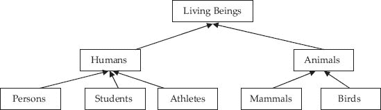

**图 3.2** 继承层次结构

继承指定了“是（is）”类型的关系。观察发现学生是一个人类。同样，哺乳动物是一种动物。`Human`是基类/超类，`Student`是派生类/子类。从基类派生是实现“是”类型关系的技术。基类可以有多个派生类。

我们何时使用继承？你继承是为了能够从基类中派生所有的功能和成员数据，而派生类可以添加其自己的特有的或个性的功能。因此，我们可以说子类是其基类或超类的更专门的版本。它们可以派生超类的所有功能，并引入自己的特有行为。

例如，`Athlete`派生了`Human`的所有功能和属性，并额外添加了自己的体育和运动功能及属性。假设基类`Human`定义了一个名为`Work()`的方法以及一个如`hoursAtWork`的属性来表示人类工作的小时。`Human`的三个派生类，即`Person`、`Student`和`Athlete`，将派生超类定义的功能和属性。因此，代码不需要编写三次——写一次就足够。

在接下来的示例中，我们将向你展示`C++`和`Java`中继承及其他相关主题示例语句。然而，建议用户参考相关章节对这些主题进行详细处理。

### 示例 3.2：C++ 中的继承与派生

```cpp
class Human
{public:
  protected: // 声明为 protected 的变量对
                // 派生类可见
      // protected variables
};
      // Student 继承自 Human，继承类型为 public
class Student : public Human
{public:
  private:
};
```

注意，声明为`private`的成员对派生类是不可见的。如果你将这些成员数据声明为`public`，那么安全性就会受到破坏。那么解决办法是什么？如上所示，将成员数据声明为`protected`。

如果一个公共成员函数拥有对象，即对象调用了该成员函数，那么该函数就可以访问：

- 所有的公共成员函数和公共成员数据。
- 类的公共函数可以访问其类内部所有的私有成员数据和成员函数，以及其基类的受保护成员数据和成员函数。

因此，如果你希望在继承中将成员数据传递给派生类，请将它们声明为`protected`。

### 示例 3.3：Java 中的继承与派生

在`Java`中，继承通过扩展实现。假设我们有一个名为`Human`的基类，具有属性和方法。然后使用`extends`关键字创建一个名为子类的派生类。如下例所示：

```java
Class Human
{// 成员数据 & 方法}
class Student extends Human {
// 定义 Student 的新字段和方法将在这里}
```

这使得`Student`拥有与`Human`相同的所有字段和方法，同时允许其代码专注于使其成为独特的特征。

### 3.2.3 泛化（Generalization）与特化（Specialization）

泛化描述的是关系，而继承是面向对象语言实现泛化的工具或方法。我们可以说泛化是继承的通用称呼。图 3.3 展示了一个示例。

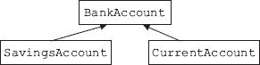

**图 3.3** 泛化——继承的通用称呼

泛化意味着派生的子类是基对象的子类型。例如，`CurrentAccount`（期期账户）是一个`BankAccount`（银行账户）。因此，我们可以说`BankAccount`泛化了`CurrentAccount`和`SavingsAccount`的共同行为和属性。

共同功能仅在基类中提供。也就是说，基类是泛化，派生类或子类是特化。

### 示例 3.4：C++ 和 Java 中的泛化实现

#### C++ 中的实现

```cpp
class BankAccount { … };
class SavingAccount : public BankAccount { … };
```

#### Java 中的实现

```java
public class BankAccount { … }
public class SavingAccount extends BankAccount { … }
```

现在让我们讨论继承的细节。考虑一个名为`Father`（父亲）的基类以及一个名为`Son`（儿子）的派生类，如图 3.4 所示。作为后代，你有权继承所有私有的成员数据和成员函数。

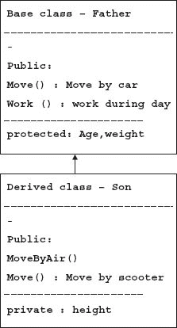

**图 3.4** 继承的工作

## 3.3 重写基类函数

假设你父亲有一辆车。你可以继承并使用这辆车出行，或者买一辆摩托车取而代之。也就是说，你用自己的功能重写了父亲的`Move()`方法。因此当你调用`Move()`时，调用的是你自己的移动方法，你将骑摩托车移动。如果你想用汽车，应该显式地调用`Father`定义的`Move()`函数，如`Father:Move()`。

假设基类（超类）定义了`age`（年龄）和`weight`（体重）等属性，你可以添加额外的属性如`height`（身高）。让我们假设超类定义了`Move()`和`Work()`等功能。假设你需要一种父亲定义的飞行功能，你可以定义自己的函数`MoveByAir()`。

## 3.4 重载（Overloading）

类可以声明多个同名但实现不同的函数变体。这被称为重载。我们在下方展示基类重载`Move()`方法：

```cpp
Move() { cout<<”move by car”):
Move(int m) { cout<<” move by Bus”); // m =1
MoveFamily(int m , int n ) { cout<<”move with family”); // n=number
```

现在，如果派生类`Son`决定用自己的实现重写其中一个`Move()`函数，如：`Move() { cout<<”Move by scooter”)`

那么下方所示基类的另外两个重载函数将被截断，对派生类不可用，即：

```cpp
Move(int m) { cout<<” move by Bus”); // m =1
MoveFamily(int m , int n ) { cout<<”move with family”); // n=number
```

然而，子类可以通过显式提及基类来调用这些函数，如`Father:Move(int m)`。

## 3.5 单继承与多继承

继承意味着能够从基类派生一个具有额外功能的新后代类。继承是程序员手中从现有类定义新类的强大工具。面向对象的语言支持不同类型的继承。

在图 1.6a 中，我们展示了`单继承`，其中派生类`Person`继承自基类`Human`。在图 1.6b 中，展示了`多级继承`，其中`Student`继承`Person`的属性，而`Person`又继承基类`Human`。在图 1.6c 中，我们展示了涉及一个基类三个派生类的`层级继承`。

图 1.6d 展示了`多继承`，其中基类被称为虚类，因为一个基类被两个派生类使用，即派生类 1（`DC1`）和派生类 2（`DC2`）。此外，你可以看到派生类 3（`DC3`）同时继承自`DC1`和`DC2`。这种继承也被称为混合继承，因为有一个派生类`DC3`继承自两个基类`DC1`和`DC2`。

## 3.6 虚继承

看图 3.5。对于`DC1`（学生）和`DC2`（运动员）来说只有一个基类。该基类被称为虚基类，这种继承被称为虚继承。虚继承确保了在存在多个基类时可能出现的歧义性消失。

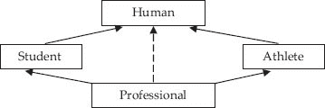

**图 3.5** 混合继承与虚继承

在某些情况下，单继承是不够的，而多继承会导致歧义。考虑图 3.5 中所示的示例。

`Student`在大学实验室工作，`Athlete`在大学下课后在健身房锻炼。但让我们假设招聘公司需要一个既在大学实验室工作，又对健身房和运动有浓厚兴趣的`Professional`（专业人士）。我们需要一个专业人士根据需求继承`Students`的`Work()`以及`Athletes`的`Work()`。此外，`Professional`必须保留`Human`的所有基本素质（用虚箭头表示）。因此，这种关系可以称为混合继承。

### 多继承是从多一个基类中派生一个类

同样注意在图 3.5 中，`Student`和`Athlete`具有相同的基类`Human`。这种类型的基类被称为`虚基类`，因为虽然两个派生类共享一个基类，但每个派生类都认为自己有自己的基类。

为了方便从`Student`和`Athlete`中选择性地继承属性、函数和成员数据，我们需要将这两个类声明为`从基类的虚继承`。这种关系被称为`虚继承`，因为虽然对于派生类`Professional`存在名为`Student`和`Athlete`的基类，但它们的表现就像不存在一样，它们的存在仅仅是为了传递派生类`Professional`所需的任何函数。

我们按照所示方式声明虚继承：

```cpp
class Student:virtual public Humans
class Athlet:virtual public Humans
```

`Professional`类声明所示：

```cpp
class Professional : public Student, public Athlet
```

## 3.7 多继承的问题

`C++`疑提供了如多继承这样的强大功能。然而，这一功能在派生自多一个基类时会导致歧义。在图 3.6 所示的示例中，`professional`同时继承自`Student`和`Athlete`。想象一种情况，即`Student`和`Athlete`类都定义了一个名为`Work()`的函数。那么`professional`将继承哪一个函数？这里显然存在歧义。

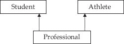

**图 3.6** 多继承 – UML 图

### 示例 3.5：UML/C++ 中多继承的示例

我们知道多继承意味着从多个基类派生。例如，参考图 3.7。

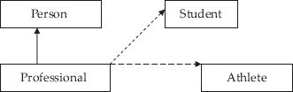

**图 3.7** Java 解决 C++ 多继承歧义问题的方案

#### C++ 中的实现

```cpp
class Student { … };
class Athlete { … };
class Professional : public Student, public Athlete { … };
```

#### Java 中的实现：不支持

## 3.8 接口

如上所示，`Java`语言通过简单地不允许多继承功能，解决了多继承中的歧义问题。相反，它通过只允许一种继承（即单基类和多个接口）来解决这个问题。

接口提供了其提供服务的函数名称，类可以实现一个接口，而接口的函数会在接口的其中一个派生类中实现。

### 示例 3.6：Java 中接口的示例

对象需要与用户和外部世界交互。`Java`的接口被对象用于与外部世界交互。接口简单地包含对象提供功能的所有函数的名称。只有名称但没有实现。因此，我们可以说接口是带有空体的函数名。例如，下面所示了一个`Student`对象的接口：

```java
interface Student
{ void GetData();void ComputeResult();void Display();}
```

假设我们的类名为`UGStudent`，我们可以如下所示使用接口`Student`：

```java
class UGStudent implements Student
{  // 类定义}
```

我们可以说接口是类与外部世界之间关于功能的约定。

## 3.9 继承中的访问修符

继承允许一个数据类型获取另一个数据类型的属性。但这种机制在很大程度上取决于访问修符。访问修符有公共、私有和保护。

- **公共继承**：在所有修符中，公共继承使用最广泛。事实上，当我们说继承时，指的是公共继承。在公共继承中，非私有成员（即公共和保护成员）对派生类可用。
- **私有继承**：较少使用。在这里功能对派生类可用但属性不可。例如，可以通过私有继承获取`Fly()`函数像鸟一样飞行，但无法通过获取颜色、喙、翅膀等属性变成鸟。
- **保护继承**：这种功能最少用，因为保护对派生类可见对其他人私有。

当省略访问修符时，类按私有继承，因为类中定义的公共辅助函数对派生类可用，而不是属性，这符合私有继承的定义。用户定义的数据类型`struct`没有安全访问修符。因此，`struct`默认按公共继承。

### 3.10 运行时类型信息 – RTTI

`dynamic_cast`运算符，允许程序安全地尝试将对象转换为更特定的对象类型。这一功能依赖运行时类型信息。

`static_cast`运算符：已知为特定类型的对象也可以使用`static_cast`转换为该类型，这是一个纯的编译时结构。

## 3.11 虚函数

在继承关系中，派生类通过公共访问函数获取受保护（`protected`）的成员数据，从而实现了一种重要的面向对象编程特性——代码重用。

但是如果使用派生类的成员函数来操作基类对象又会呢？这一特性允许基类对象根据用户在运行时的选择，执行派生类函数中的任何一个。

这意味着为基类对象提供了一条通往所选派生类函数的“桥梁”，因此它可以能够执行该函数。当我们在基类中声明虚函数并且派生类重写该基类函数时，该桥梁就可用了。

如果函数在基类中被声明为虚函数，我们可以通过基类指针执行派生类中同名的重写函数。基类指针是由虚函数提供的。总之，我们可以说，从基类出发，我们可以根据用户在运行时的选择，执行与基类中虚函数同名的任何函数。

上述特性通过`C++`通过为基类提供变量指针来实现。这些变量指针不仅可以指向与变量类型完全匹配的对象，还可以指向该类型任何派生类的对象。这使得数组和其他类型的容器能够持有指向不同类型对象的指针。

由于给变量赋值通常发生在运行时，因此这必然是一个运行时现象。这一特性促进了下一节中解释的运行时多态和动态数据绑定。由于对象在创建时的类型在编译时是知的，因此构造函数（以及拷贝构造函数）不能是虚函数。如果类中的任何函数是虚函数，则析构函数也应该定义为虚函数。

## 3.12 纯虚函数

`C++`支持虚函数的另一种变体，如纯虚函数。通过在函数声明末尾编写`= 0`可以将虚函数转换为：

```cpp
virtual void FindArea() = 0;
```

注意，带有纯虚函数的类不能创建对象，此类类被称为抽象数据类型（ADT）。也可以通过在右括号之后、分号之前添加`= 0`来使成员函数变为“纯虚函数”。

具有纯虚函数的类不能创建对象，并被称为`ADT`。任何派生类继承的虚函数都是纯虚的，并且在创建派生类对象之前，必须提供该函数（以及所有其他纯虚函数）的非虚定义。尝试从具有纯虚函数或继承了纯虚函数的类创建对象将被标记为编译时错误。

### 3.13 运行时多态和动态数据绑定

继承解决了重用问题。也就是说，派生类可以访问基类中所有声明为受保护的数据成员和函数成员。我们还学过派生类可以重写定义在基类中的函数。

此外，我们在处理虚函数时看到，通过基类指针，我们可以调用派生类对象。将 OOP 语言的上述两个特性结合为我们提供了一个强大的工具，称为运行时多态和动态绑定。

请参阅图 3.8，该图显示了在基类中定义虚函数的层级继承，每个派生类都用其自己的实现重写了基类的虚函数。

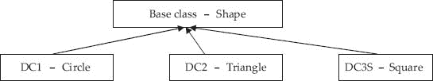

**图 3.8** 层级继承

对于程序员而言，这一特性的意义是，通过基类指针我们可以在运行时决定调用特定的派生类重写函数。换句话说，我们可以通过基类指针将多个派生类中的重写函数绑定在一起。在上一节中，我们已经看到了虚函数的工作原理，通过它我们可以实现派生类函数与基类指针的绑定。

### 3.14 类作为抽象数据类型

面向对象语言中的类也可以称为`ADT`。


OOP 语言的特性（如运行时多态和动态绑定）允许我们定义一个具有无实现的虚函数（称为纯虚函数）或具有占位符功能的基类，仅向用户指示实现由派生类完成。这些类被称为 ADT，因为它们隐藏了实现细节。

再次参阅图 3.8。我们将声明一个名为 `Shape` 的基类（ADT）。你会发现 `Shape` 没有确定的形状、没有确定的面积或周长或特定的绘制程序。因此 `Shape` 将声明只有名称而没有实现细节的虚函数。我们将派生如 `Circle` 和 `Square` 等类，并提供这些虚函数的具体实现。具体意味着，所有的虚函数将在每个派生类中被实现。

### 3.15 行为与实现分离

在某些 OOP 语言中，ADT 或带有无实现的虚函数的基类也被称为接口（interfaces）。基类将简单地作为接口，通过定义虚函数告知用户可用的功能，并根据用户的选择，执行任何一个派生类中的特定实现。用户被隐藏在实现细节之外。实际实现函数的代码仅在运行时链接到调用函数。

### 3.16 解耦

在继承中，我们拥有可重用的代码。封装意味着数据和代码的绑定。当使用运行时多态时，最好以多态的方式解耦封装，以防止离散的代码模块相互相互作用。在实践中，你会注意到基类被重写的函数会自动隐藏，并且可以通过引用基类函数来显式调用。

### 3.17 标准模板库

面向对象编程的真正定义之一是程序员通过语言使用库设施的能力。C++ 拥有非常发达的标准库，以流 IO 库的形式提供了广泛的输入输出功能。标准模板库（STL）是 C++ 提供的库最重要的补充。使用 STL 模块，程序员可以使用向量、列表、队列、映射等数据结构和算法实现编写代码。

### 3.18 总结

1. OOP 语言的可扩展性和重用性通过继承、虚继承、标准模板等语言特性实现。
2. 包含表示“拥有”（has）的关系。

   C++ 支持但 Java 不支持。一个类包含另一个类的实例。
3. 在文献中，包含被称为组合（composition）和聚合（aggregation）。
4. 基类在 Java 中称为 superclass，派生类称为 subclass。在继承中，所有非私有成员对后代可用。也就是说，基类是泛化，派生类是特化。
5. 子类函数可以重写基类函数。如果子类函数重写了基类重载函数中的一个，那么剩余的重载函数将被截断且对基类不可。
6. C++ 支持的继承类型有：
   - 单级和多级继承
   - 层级继承
   - 多重继承和混合继承（Java 不支持）
7. 多重继承是从多个基类派生类。
8. 基类和派生类在 Java 中称为超类和子类。
9. 子类方法可以重写基类函数。如果这种重写发生在基类重载函数的情况下，则重载函数的平衡将被截断，且子类无法使用这些函数。
10. 如果有多个子类派生自同一个基类，则该基类被称为虚基类。
11. 如果一个子类派生自多个基类，为了解决由多重继承关系引起的歧义，必须将这两个基类都声明为虚类。这种继承被称为虚继承。
12. Java 通过仅允许单继承但多个接口来解决多重继承类型关系导致的歧义问题。接口仅包含函数名称并隐藏这些函数的实现。`Implementation of an interface is also called realization`（接口的实现称为实现）。
13. `Dynamic_cast operator` 允许程序安全地尝试将对象转换为更具体的对象类型。此功能依赖于 RTTI。
14. `Run-time polymorphism`（运行时多态）意味着通过基类指针，我们可以在运行时调用特定派生类的重写函数。换句话说，可以使用基类指针绑定多个派生类中的重写函数。
15. `Virtual Function`（虚函数）：如果函数在基类中声明为虚函数，那么我们可以通过基类指针执行派生类中同名的重写函数。基类指针由虚函数提供。
16. `Pure Virtual Function in C++`（C++ 中的纯虚函数）：纯虚函数是在结尾带有 `==0` 的虚函数。定义了纯虚函数的类无法创建对象。
17. Java 支持接口来实现 C++ 的纯虚函数概念。

## 练习题

### 单选题

1. 子类可以访问父类的私有数据成员 – 正确 / 错误
2. 泛化意味着继承 – 正确 / 错误
3. 特殊化指的是：
   1. 基类
   2. 子类
   3. 父类
   4. 否
4. 下列中哪项指的是包含关系（containment）：
   1. 组合（Composition）
   2. 聚合（Aggregation）
   3. 拥有（Has a）
   4. 是一个（Is a）

   1. i 和 ii
   2. i, ii 和 iii
   3. i, ii 和 iii（注：原文选项重复）
   4. i, ii 和 iv
5. 多重继承和混合继承：
   1. C++ 支持
   2. C++ 和 Java 支持
   3. Java 支持
   4. 均不支持
6. 如果一个子类派生自多个基类，则该继承类型是：
   1. 多重继承
   2. 虚继承
   3. 虚基类
   4. 多级继承
7. 实现（Realization）可以通过以下方式实现：
   1. 扩展基类
   2. 实现接口
   3. 虚函数
   4. 以上均不是
8. 当子类使用相同的名称和签名重定义基类函数时，它被称为：
   1. 基类重载
   2. 基类函数重写
   3. 基类函数隐藏
   4. 以上都不是
9. 组合（Composition）通过以下实现：
   1. 拥有（Has a）
   2. 是一个（Is a）
   3. 接口
   4. 虚函数

### 答题

10. 解释 OOP 语言的组合 / 包含特性。
11. 泛化 / 特殊化意味着继承。你同意吗？
12. 区分组合和继承。
13. 为什么 Java 不支持包含关系？
14. Java 支持哪些类型的继承？
15. Java 为 C++ 的多重继承提供了什么替代方案？
16. Java 中类和接口之间有什么区别？
17. 构造函数可以声明为虚函数吗？为什么或为什么？
18. 析构函数可以声明为虚函数吗？为什么或为什么？
19. 区分继承关系中的重载和重写。
20. Java 中的接口是什么？
21. 解释访问修饰符及其在继承关系中的相关性。
22. 解释 RTTI 和 `dynamic_cast` 操作符。
23. 什么是虚函数？它们有什么用？
24. 什么是纯虚函数？为什么定义了纯虚函数的类不能实例化对象？

### 简答题

25. OOP 语言支持哪些类型的继承？
26. 什么是运行时多态和运行时数据绑定？
27. ADT / 接口支持行为与实现分离的概念。你同意吗？
28. 什么是虚函数？为什么我们需要虚函数？虚函数的实现规则是什么？
29. 什么是抽象类？为什么我们需要抽象类？管理虚基类的规则是什么？

### 课作业题

30. 为动物界编写继承层级结构。
31. 用合适的例子解释多态。
32. 用合适的例子解释泛化和特殊化。
33. 用合适的例子解释聚合和分离。
34. 解释各种类型的继承。
35. 你在什么时候使用继承？在什么情况下使用接口？

### 单选题答案

1. 错误 (False)
2. 正确 (True)
3. b
4. c
5. a
6. a
7. b
8. b
9. a

对象是动态实体。它们在程序执行期间，根据程序的需求在运行时创建。我们称这种对象的创建为实例化。构造函数完成这项实例化工作，并为类实例的属性分配初始值。对象具有属性和行为。对象可以通过传递消息与其他对象进行通信。对象通过类中定义的 `get` 和 `set` 函数向其他对象传递其状态信息。返回属性值的 `get` 函数也称为存取器（assessors）。允许修改属性的 `set` 函数也称为修改器（mutators）。

Java 中的对象使用引用来唯一标识对象的实例，而 C++ 则使用指针和引用。

一旦对象完成了分配给它的角色，就必须从内存中删除，以便将释放的内存动态地分配给其他对象。这在 Java 中通过通过垃圾回收器（garbage collector）实现。垃圾回收器是由 Java 运行时系统启动的程序，用于移除不再需要的对象。在 C++ 中，程序员可以通过使用 `delete` 函数显式地删除对象。

## 4.3 统一建模语言 – 一种 OOAD 工具

### 4.3.1 UML 概述

统一建模语言（UML）在面向对象的分析和设计（OOAD）方法论中作为图形化工具，用于对开发中的软件系统进行建模。

#### 我们何时需要建模？

- 当我们对系统进行建模并研究其行为时。
- 当我们进一步希望模拟系统并研究其性能和操作时。
- 当正在开发的系统非常复杂且并非琐事时。
- 当软件系统的开发成本高到无法接受时。

#### 我们在建模系统中寻找什么？

- 它应该紧密遵循我们选择的开发模型，例如瀑布模型。
- 它在本质上应该是图形化的。
- 它应该对软件开发周期的各个方面进行建模。
- 它应该能够所有流行且广泛接受的对象对象技术理论，例如格拉迪·布奇（Grady Booch）、詹姆斯·兰博霍（James Rambaugh）和伊瓦·雅各布（Ivar Jacobson）的理论。

UML 由惠尔-帕奇（HP）、国际商业公司（IBM）、Oracle 等行业联合体在一个名为“对象管理组”（OMG）的控制小组庇护下创立，它满足了上述所有标准，确实是软件开发的行业标准。UML 可以有效地用于概念化、修改、构建和交付面向对象的软件系统，包括完善的文档。

UML 中的“统一”（Unified）一词意味着 UML 统一了来自名为 Rational Software 公司的三位领先科学家的理论：格拉迪·布奇（Booch 方法）、詹姆斯·兰博霍（对象建模技术 [OMT]）和伊瓦·雅各布（用例和对象化），这些理论构成了理性统一过程（RUP）。后来，RUP 与 Booch 方法、OMT 和面向对象的软件工程（OOSE）等开发方法合并。

#### 4.3.1.1 建模

UML 是开发中系统的图形化表示。此外，它还包含了用于开发系统的用例等文档。UML 有两种不同的视图，如下文所示：

- **静态视图（Static view）：** 它从对象、属性和操作的角度提供了开发中系统的结构。这些方面通过类图和对象图来描述。
- **动态视图（Dynamic view）：** 它描述了系统的行为。它包括协作图、时序图、活动图和状态转换图。

UML 2.2 版本包含 14 类图，其中 7 种静态图和 7 种行为图。行为图包括 4 种交互图。

##### 4.3.1.1.1 结构图

结构意味着系统能够按照规范运行所必须存在的要素。例如，脊柱和颌骨是人体中维持直立姿势和咀嚼食物所必需的。结构图通过描述系统中存在的元素，代表了如下所示的架构：

- **类图（Class diagram）：** 描述类、它们的属性以及类之间的关系。
- **组件图（Component diagram）：** 显示软件分解为组件的情况，以及这些组件之间的依赖关系。
- **复合结构图（Composite structure diagram）：** 描述类的内部结构以及该结构能够实现的协作。
- **部署图（Deployment diagram）：** 描述用于系统实现的硬件、执行环境以及部署在硬件上的制品构件。
- **对象图（Object diagram）：** 它是某一时刻类图的实例。
- **包图（Package diagram）：** 通过显示这些分组之间的依赖关系，描述系统如何拆分为逻辑分组。
- **配置图（Profile diagram）：** 显示带有 `<<stereotype>>` 的类作为类，以及带有 `<<profile>>` 刻板的包。符号为 ，表示元模型通过刻板类型进行了扩展。

##### 4.3.1.1.2 行为图

行为图描述了系统的功能。所示了不同类型的行为图：

- **活动图（Activity diagram）：** 显示整体控制流。
- **UML 状态机图（UML state machine diagram）：** 描述系统的状态和状态转换。
- **用例图（Use case diagram）：** 从参与者的角度描述系统提供的功能。

### 4.3.2 UML 图的分类

UML 采用的分类见图 4.1。类图、对象图和包图描述结构和静态特征。另一方面，用例图、交互图、状态图和活动图描述了行为建模。在第 2 章中，我们详细讨论了结构。在后续章节中，我们将讨论动态行为。

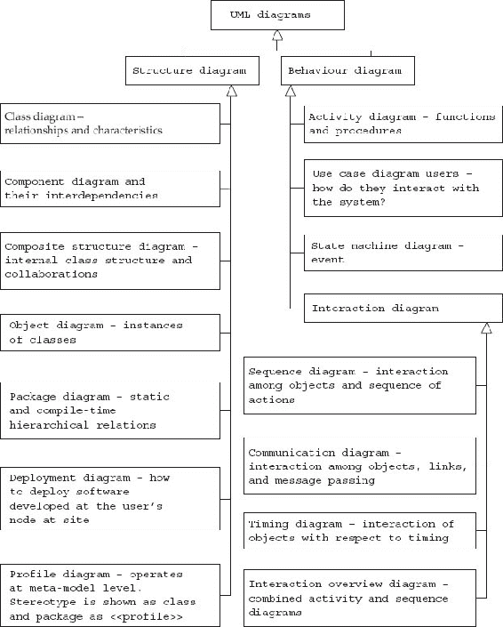

**图 4.1** UML 图的分类

## 4.4 用户需求 – 用例

我们希望生产一个用户需要的系统。一旦系统产生，用户就会与之交互以产生预期结果。因此，我们需要关于如何操作的描述。用例通常提供这种描述。用例从外部用户的角度描述系统做了什么。它们提供了系统与用户之间交互的步骤序列。这种步骤序列被称为场景。

例如，对于大学的自动化图书馆系统，一个场景可能如下（图 4.2）：学生在线浏览图书馆的书目录，并选择他想要从图书馆借阅的书号。自动化系统的借阅子系统检查学生的权限并确认向学生借出书籍。系统通过电子邮件向借阅口发放授权单。学生将书带到借阅口，由负责人将授权单贴在内封页上。

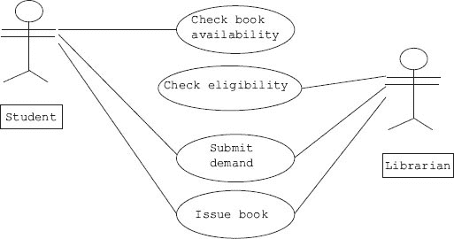

**图 4.2** 图书借阅区的用例

第二个场景可能是由于学生超过了借书限额导致授权失败。

第三个场景可能是学生未通过身份检查。

我们描述了从图书馆借书的三个场景；但学生在所有三个场景中的目标都是相同的，即借书。因此，我们现在可以说，一个用例是具有共同目标的不同场景的集合。

在用例中，我们将用户称为“参与者”（actors）。参与者可以是人类、设备或软件模块。例如，银行软件系统管理员、客户、烟雾传感器和在后台运行的软件代理都是参与者。一个用例可以有多个参与者，反之，一个参与者也可以使用多个用例。参与者用小人形状表示，用例则用椭圆形表示。UML 有一种用例图，用于展示各个用例之间的关系。

作为第二个例子，考虑一名学生注册第三学期课程的情况。该示例中涉及的参与者和用例如图图 4.3

**图 4.3** 学生注册过程中的用例

用例解释了所研究系统的功能性需求。每个用例在实现之前都要求进行详细描述。下面提供了一个场景，解释了用户从系统中获取其所需内容的逐步执行程序：

**示例 4.1：来自学生注册过程用例的场景**

Gautam 注册了第三学期的课程。下面是具体的步骤程序：

1. Gautam 去到注册窗口并输入他的身份信息。
2. 计算机给出了 Gautam 可以执行的操作列表。
3. Gautam 选择第三学期课程的注册。
   3.1 添加课程。
   3.2 删除已添加的课程（更新）。
4. 屏幕显示课程和开放选修课程的列表。
5. Gautam 选择课程和开放选修课程。他拥有添加或删除课程作为更新功能的选项。
6. 系统确认 Gautam 的第三学期注册。
7. Gautam 退出。

每个用例都有一个主要参与者，它调用该用例以交付预期的功能。用例内部可以定义另一个用例。用例中的每一步都是参与者与系统之间的交互。此外，每个用例都可以有`前置条件、保证的结果`，以及`一个触发用例启动的触发器`。

## 4.5 架构与领域：它们是什么？

在任何现实问题中，我们都有用户以及他们的愿望和需求。因此，我们定义对象及其交互，即我们决定架构。用户的世界被称为`领域`（Domain）。

### 4.5.1 架构

我们有系统的用户和用例。我们在开发的软件中有类。类是现实世界客户（用户）以及他们想要的内容（用例）的反映。基于客户及其现实世界的交互，我们定义对象与类之间的交互为链接和关联，以交付功能。这种安排被称为`架构`（architecture）。

我们将架构定义为对象及其属性的描述，以及这些对象为了满足用户规范或需求而执行的操作。

### 4.5.2 领域

客户和他们的交互存在于现实世界中。类是将现实世界问题映射到软件的概念模型。用户的世界被称为`领域`（domain）。

我们将用户领域和我们的架构显示为一组包含方框，其中包含对象的名称（图 4.4）。我们还将通过绘制互连线来展示它们的链接和关联。正如我们在第 2 章中所学的，我们还可以通过指定角色名称和重数来强化。在示例 4.2 中，我们考虑了一所大学的领域和架构。

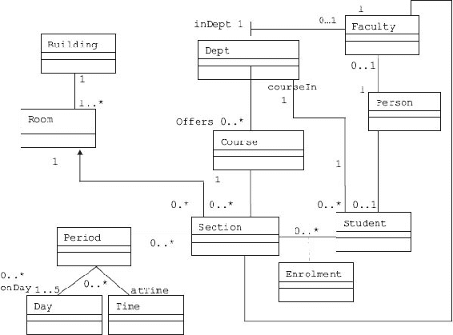

**图 4.4** 大学的领域和架构图

你看到的方框被称为“实体”（entities）。对于复杂的项目，每个实体的属性维护在一张表中。这张表被称为`数据字典`（data dictionary）。在面向对象编程范式出现之前，这些图也被称为`实体关系图`（entity-relation diagrams）。

**示例 4.2：大学的领域和架构**

为了洞察哪个对象在执行什么，建议列出整个过程的步骤序列。让我们重新回顾一下在示例 4.1 中讨论过的注册过程的总体操作序列，如下所示对注册过程进行了详细说明：

1. Gautam 去到注册窗口并输入他的身份信息。
2. 计算机给出了 Gautam 可以执行的操作列表。
3. Gautam 选择第三学期课程的注册。
   3.1 添加课程。
   3.2 删除已添加的课程（更新）。
4. 屏幕显示课程和开放选修课程的列表。
5. Gautam 选择课程和开放选修课程。他拥有添加或删除课程作为更新功能的选项。
6. 系统确认 Gautam 的第三学期注册。
7. Gautam 退出。

然后对于这个步骤序列中的每一步，我们可以准备一个序图或通信图和/或时序图。每个对象在做什么对用户来说是一个重要问题。UML 提供了序图和通信图来解决这个问题。时序图是序图的一种变体，它针对时间基进行指定。

## 4.6 序图

用户用小人形象表示。每个对象用一个方框表示（对象表示）。从每个对象引出一条垂直线表示活动基线。从每条垂直线发出的箭头显示对象正在发送消息或调用属于其他对象的函数。

在图 4.5 中，我们展示了序图。研究的参与者是一个大三学生。课程协调员想要从 K 班中删除 Gautam 的名字。活动序列如下：

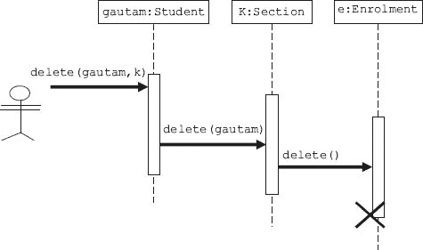

**图 4.5** 删除名字的序图


### 4.7 通信图（协作图）

早期，通信图被称为协作图。它们与序图本质上相同，但在通信图的情况下例外。消息发生的时间（称为时间排序）通过对消息编号显式显示，如图 4.6 所示。协作图中的每个消息都有一个`序列号`。顶层消息编号为 1。同一层的消息（在同一调用期间发送）具有相同的数字前缀，但根据发生时间有不同的后缀 1、2 等。

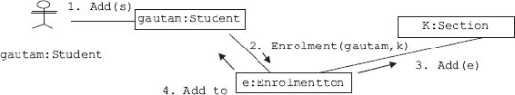

**图 4.6** 学生注册的通信图

通信图的关键元素有：

- **作为分类对象**：用矩形框表示。对象角色框标记类名或对象名（或两者）。类名和对象名用冒号（`:`）分隔。
- **连接器**：表示消息的线。
- **命名箭头**：表示发送者、接收者。

为了阅读协作图，只需从编号为 1 的消息开始跟随数字。在图 4.6 中，我们使用了简单的命名方案。然而，UML 使用嵌套编号系统，例如：

- 简单命名方案：`1, 2, 3, 4, …`
- 嵌套 UML 编号：`1, 1.1, 1.1.1, 1.1.2, …`

通信图传达与序图相同的信息；但它们关注的是对象角色而不是发送消息的时间。

## 4.8 事件与状态

类图是静态的，描述类与类之间的链接和关联。它们不能用于描述对象在生命周期期间的行为。

对象具有行为和状态。对象的状态由属性的当前值定义。我们进一步了解到，像`getters`和`setters`这样的访问修饰符可以改变属性的值。我们可以说，某些事件触发了属性值的过程，从而改变对象的状态。

请注意，状态图描述的是类对象的行为。因此，所有对象共享同一个状态图。但对象在状态图中遵循的`path`是特定于对象实例的。

### 状态图表示与自动机理论

状态图表示法在计算机科学中发展，是被称为`自动机理论`的自动机器理论的一部分。这门科学已被 UML 采用，描述对象变化的方式。行为的每一次变化都被建模为状态的变化。

状态图表示事件和状态。当事件发生时，向下一个状态的转换取决于当前状态和该事件。状态图展示了这些状态的变化，并允许导致状态改变的操作。例如，让我们看看学生是如何进入大学的。状态图如图 4.7 所示。

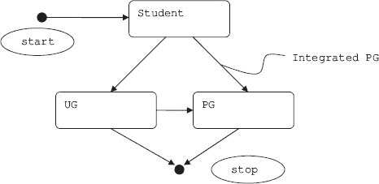

**图 4.7a** 学习专业课程的学生状态图

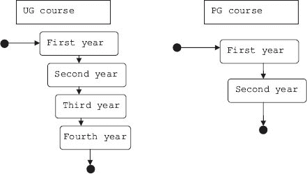

**图 4.7b** 接受本科/研究生课程的学生

在状态图中，观察到`start`和`stop`被显示为黑色实点。每个状态都显示为带圆角的矩形。状态的变化意味着对象改变了它的行为。例如，当一个学生经历本科（UG）课程（即第一至四年的课程）并符合条件时，他/她就变成了一个`UG`。学生可以读本科课程，也可以直接读直贯制研究生（PG）课程。每个箭头代表一种变化。

我们可以在状态图中添加许多额外信息：

- 它可以使用引起变化的`function`名称进行标记。
- 添加触发对象状态发生变化的操作、事件或条件。
- 添加在进入和离开状态时执行的操作。

### 示例 4.3：在线网上银行状态图

我们现在准备好定义一个动态模型，它是由所有通过交互事件相互作用的状态图构成的集合。

在在线银行中，有以下不同的状态：

- 通过输入用户名和密码登录系统。
- 验证用户名和密码。
- 获取用户名和交易密码。
- 验证用户名和交易密码。

从每个状态都会产生交易。交易显示为从一个状态到另一个状态的箭头。触发从一个状态到另一个状态转换的事件显示在箭头旁边。在图 4.8 中，我们的系统中在用户输入无效用户名或密码时发生的两个自转换。在用户输入`tab key`或`enter key`之前，光标保持不变并显示点以保持输入数据的机密性。


**图 4.8** 网上银行状态图

在状态图中，观察到`start`和`stop`被显示为黑色实点。每个状态都显示为带圆角的矩形。状态的变化意味着对象改变了它的行为。例如，当一个学生经历本科（UG）课程（即第一至四年的课程）并符合条件时，他/她就变成了一个`UG`。学生可以读本科课程，也可以直接读直贯制研究生（PG）课程。每个箭头代表一种变化。

### 4.8.1 与操作

在状态图中，观察到`start`和`stop`被显示为黑色实点。每个状态都显示为带圆角的矩形。状态的变化意味着对象改变了它的行为。例如，当一个学生经历本科（UG）课程（即第一至四年的课程）并符合条件时，他/她就变成了一个`UG`。学生可以读本科课程，也可以直接读直贯制研究生（PG）课程。每个箭头代表一种变化。

在状态图中，观察到`start`和`stop`被显示为黑色实点。每个状态都显示为带圆角的矩形。状态的变化意味着对象改变了它的行为。例如，当一个学生经历本科（UG）课程（即第一至四年的课程）并符合条件时，他/她就变成了一个`UG`。学生可以读本科课程，也可以直接读直贯制研究生（PG）课程。每个箭头代表一种变化。

### 4.8.2 嵌套状态图

在状态图中，观察到`start`和`stop`被显示为黑色实点。每个状态都显示为带圆角的矩形。状态的变化意味着对象改变了它的行为。例如，当一个学生经历本科（UG）课程（即第一至四年的课程）并符合条件时，他/她就变成了一个`UG`。学生可以读本科课程，也可以直接读直贯制研究生（PG）课程。每个箭头代表一种变化。

## 4.9 活动图

状态图告诉我们关于一个对象正在经历的过程的信息。活动图显示了单个过程中的活动流。它展示了每个活动依赖于其他活动的方式。因此，我们可以将活动定义为显示活动流及其相互依赖关系的图。

为了解释活动图的概念，我们选择了与示例 4.3 中相同的网上银行转账案例。

涉及网上银行转账的类有**用户、客户端计算机系统和银行**。有关每个类的活动显示在称为**泳道**（swim lane）的独立列圆角矩形中。活动图的显著特征如下：

- 泳道识别负责执行特定活动的对象。
- 每个活动产生一个转换，每个转换连接到下一个活动。
- 转换（有时基于决策框）可能会分支为两个或多个转换。
- 每个导出的转换使用守卫表达式（`[]`）指示。
- 分支和随后的合并使用浅菱形指示。
- 有时，转换可能会`fork`为并行活动并在稍后合并。这些在图 4.11 中用实线条显示。

在使用网上银行进行转账时，涉及的活动所示：

- 用户输入用户名和密码登录系统。
- 银行服务器（`bank`）验证用户名和密码。
- 用户输入金额、交易密码（`IPIN`）和转账详情。
- 银行验证交易密码。
- `IPIN`验证成功后，银行检查资金可用。
- 银行将金额转至目标账户。
- 收到目标银行服务器的确认后，银行扣除账户。
- 显示交易详情和资金余额。
- 用户注销。

图 4.12 中的活动图是不言自明的，并遵循了上述描述的活动列表。它有两个泳道，一个用于银行服务器，另一个用于客户端机器。

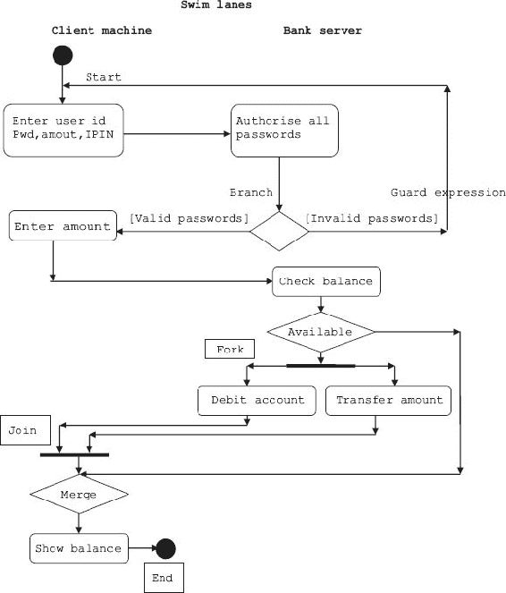

**图 4.12** 在线网上银行活动图

 用白色菱形表示分支，守卫表达式包含在`[]`中。

 用粗线表示分叉，即启动多个活动，如扣除账户和转账金额。合并活动也使用相同的符号。

## 4.10 包与组件——组织大型复杂项目的方法

你熟悉文件和文件夹。为了组织工作，你打开文件夹并在文件夹内存储文件。包（Package）就像文件夹。我们可以直接将所有类存储在直接名为“包”的文件夹中。如果类的数量非常大，可以将类分组为组件（components），并将组件分组为包（图 4.13）。

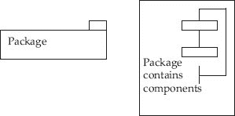

**图 4.13** 包的符号

组件（Components）包含类。它们为用户提供可插拔的接口。我们将使用插头和插座的概念来表示接口。例如，在图 4.14 中，应用程序模块为学生模块提供接口。

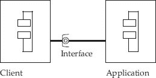

**图 4.14** 组件的符号

如果我们对组件中的类进行编码，那么这些编码后的类被称为制品（artefacts）。制品是 UML 给文件的名称。可以有多种文件类型，例如源代码、C++ 符号中称为`.h`的库文件、可执行文件。图 4.15 使得该概念变得清晰。在这里，我们展示了名为`Student.cpp`的源码、名为`Student.h`的库以及扩展名为`.obj`的相应对象模块。标准的制品有：`<<executable>>`、`<<document>>`、`<<file>>`、`<<library>>`、`<<script>>`和`<<source>>`。

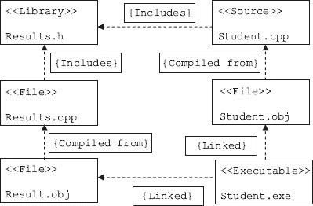

**图 4.15** 项目中的组件（制品）

在图 4.16 中，我们展示了包如何通过依赖关系相互连接。虚线箭头表示包与其他包的依赖。

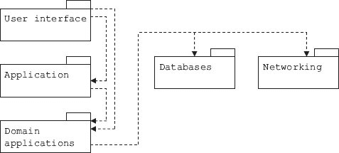

**图 4.16** 项目中的包

## 4.11 组件图与部署图

**部署图（Deployment diagrams）**描述软件和硬件的物理配置。我们知道在面向对象的技术中，类图描述了应用程序的结构以及通过继承等各种关系类之间的相互作用。

我们进一步知道类包含成员函数，函数包含了实现功能所需的所有代码模块。

组件被定义为代码模块。像网上购物这样的应用程序包含多个组件。应用程序将有一个用户界面。

硬件是节点的集合。组件位于节点上。

远程节点使用网络硬件（如传输控制协议（`TCP`）IP 协议（`IP`））进行相互连接。

因此，需要将上述所有内容组合到一个图中，这被称为组件和部署图，如图 4.17 所示。

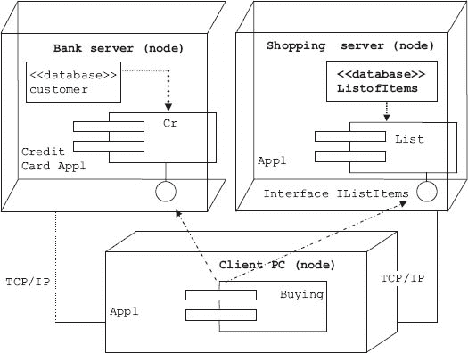

**图 4.17** 在线组件和部署图

## 4.12 总结

1. 建模由结构建模和行为建模组成。结构建模也称为静态建模。行为建模也称为动态建模。
2. 类图、对象图和包图描述了系统建模的静态特征。
3. 对象的状态由对象属性所持有的当前值定义。它是对象直到该特定实例的行为变化的结果。
4. UML 在 OOAD 方法中作为图形化工具，用于对开发中的软件系统进行建模。它吸纳了面向对象技术中所有流行且接受的理论，例如 Grady Booch、James Rambaugh 和 Ivar Jacobson 的理论。
5. 用例（Use cases）提供了一系列步骤，描述了系统与用户之间的交互。这一系列步骤被称为场景（scenario）。用例解释了所研究系统的功能需求。
6. 步骤序列可以在序图中表示。
7. 具有事件/活动时间顺序的序图称为时图（timing diagram）或通信图（communication diagram）。
8. 动态模型是状态图的集合。
9. 通信图早期被称为协作图（colaboration diagrams）。通过消息编号，与序图本质相同。
10. 状态的变化意味着行为的变化。
11. 活动图展示了活动的流及其相互依赖。关于每个类的活动显示在名为圆角泳道（swim lane）的列中。
12. ![OEBPS/Images/68-1.png) 用白色菱形表示分支，守卫表达式包含在`[]`中。
13. ![OEBPS/Images/72-1.png) 用粗线表示分叉，即启动多个活动。
14. 包就像文件夹。我们可以直接将所有类存储在直接名为“包”的文件夹中。如果类的数量非常大，可以将类分组为组件，并将组件分组为包。
15. 部署图描述软件和硬件的物理配置。
16. 组件被定义为代码模块。硬件是节点的集合。组件位于节点上。

## 练习题

### 单选题

1. 状态图指定

   i. 对象期间期间  
   ii. 对象当前的状态  
   iii. 对象在当前用例的状态  
   iv. 对象跨越所有用例的状态  

   1. i 和 iii
   2. i 和 ii
   3. i 和 iii
   4. i, ii 和 iv

2. 对象的状态由以下定义

   i. 当前属性  
   ii. 直到当前状态的所有转换的结果  
   iii. 对象的行为  
   iv. 方法  

   1. i 和 iii
   2. i 和 ii
   3. i 和 iii
   4. i, ii 和 iv

3. 关于状态图，哪些陈述是正确的

   i. 状态图描述事件  
   ii. 状态图描述状态  
   iii. 向状态状态转换取决于当前状态  
   iv. 状态的变化意味着行为的变化  

   1. i 和 iii
   2. i, ii 和 iv
   3. i 和 iii
   4. i, ii 和 iv

4. 动态模型是所有状态图的集合。对/错

5. UML

   1. 统一了 Booch、Rumbaugh 和 Ivar Jacobson 的理论
   2. 统一了`OOSE`、`OMT`和`Booch`等开发方法
   3. 统一了`SASD`和`OOAD`
   4. 统一了`RUP`和开发方法

   1. `i`和`iii`
   2. `i`和`ii`
   3. `i`和`iii`
   4. `i`、`ii`和`iv`

6. `UML 2.2` 有 ------------ 种图图

   1. `12`
   2. `13`
   3. `14`
   4. `15`

7. `UML 2.2` 静态视图包含 ------------ 种图

   1. `6`
   2. `7`
   3. `8`
   4. `9`

8. `UML 2.2` 动态视图包含 ------------ 种交互图

   1. `4`
   2. `7`
   3. `5`
   4. `3`

9. 以下不是静态图的部分

   1. `类图`
   2. `用例图`
   3. `对象图`
   4. `包图`

   1. `i`
   2. `ii`
   3. `ii`和`iv`
   4. `i`、`ii`和`iii`

10. 在用例中，以下哪些描述是正确的？

    1. 用户被称为`参与者 (actors)`
    2. `用例`是系列步骤
    3. `用例`包含场景
    4. `用例`意味着架构

    1. `i`
    2. `ii`
    3. `ii`和`iv`
    4. `i`、`ii`、`iii`和`iv`

11. 关于`序列图`，以下哪个描述是正确的？

    1. `参与者 (Actor)`用小人形状表示
    2. `对象`用椭圆表示
    3. `垂直线`表示活动
    4. `水平箭头`表示消息

    1. `i`和`ii`
    2. `ii`
    3. `i`、`iii`和`iv`
    4. `i`、`ii`、`iii`和`iv`

12. 关于`通信图`，以下哪个描述是正确的？

    1. 它们也被称为`协作图`。
    2. 它们与`序列图`相同。
    3. 它们是具有活动时间顺序的`序列图`。
    4. 它们关注对象的角色，而不是发送消息的时间。

    1. `i`和`ii`
    2. `ii`
    3. `i`、`iii`和`iv`
    4. `i`、`ii`、`iii`和`iv`

13. 关于`活动图`，以下哪个描述是正确的？

    1. `活动图`描述了正在经历过程的对象。
    2. `活动图`是单个过程中的活动流。
    3. 它是活动及其相互相互依赖关系的流。
    4. 它们关注对象的角色，而不是发送消息的时间。

    1. `i`和`ii`
    2. `ii`
    3. `i`、`iii`和`iv`
    4. `i`、`ii`和`iii`

14. 关于`活动图`，以下哪个描述是正确的？

    1. `白色菱形`表示分支
    2. `粗线`表示分叉 (`fork`)
    3. `分叉 (Fork)`表示一个活动的开始
    4. `[]`用于守卫表达式

    1. `i`、`ii`和`iv`
    2. `ii`
    3. `i`、`iii`和`iv`
    4. `i`、`ii`和`iii`

15. 关于`包`和`组件`，以下哪个描述是正确的？

    1. `包`包含`组件`
    2. `组件`包含`类`
    3. `UML`中的`文件`被称为`制品 (artefacts)`
    4. `文件`、`库`和`脚本`是`制品`的一部分

    1. `i`、`ii`和`iv`
    2. `ii`
    3. `i`、`ii`、`iii`和`iv`
    4. `i`、`ii`和`iii`

16. `部署图`包含配置

    1. `软件`
    2. `软件`和`硬件`
    3. `硬件`
    4. `服务器详情`

### 简答题

17. 解释`统一建模语言 (Unified Modelling Language)`中的“统一 (Unified)”一词。
18. 定义`架构 (architecture)`和`领域 (domain)`。
19. 列出属于`UML`静态视图的图的名称。
20. 列出属于`UML`动态视图的图的名称。
21. 解释`UML`的复合结构图和`配置图`。
22. 区分`序列图`和`通信图`。
23. 解释术语`事件 (event)`和`状态 (state)`。
24. 解释术语`活动 (activity)`、`动作 (action)`和操作。
25. 解释`嵌套状态图`。
26. 什么是`动态建模 (dynamic modelling)`？
27. 解释`包 (packages)`和`组件 (components)`。

### 论述题

28. 简述`UML 静态图`和`动态图`。
29. 用例子解释`用例 (use cases)`。
30. 解释`架构 (architecture)`和`领域 (domain)`。
31. 什么是`序列图 (sequence diagrams)`？用例子解释该概念。
32. 什么是`通信图 (communication diagrams)`？用例子解释该概念。
33. 解释`事件 (event)`和`状态 (state)`。
34. 用例子解释`嵌套状态图`。
35. 项目中的各种`制品 (artefacts)`有哪些？

### 赋值题

36. 写述`UML`作为`OOAD`工具的发展历史和背景。
37. 解释`动态建模 (dynamic modelling)`。通过该模型可以更好地理解项目的哪些方面？
38. `用例`代表`架构`。请证明这一陈述。


39. 为 `ATM` 开发动态建模。

40. 为在线购物开发用例表示。

41. 为在线检查开发状态图。

42. 为 `UML` 开发部署图。

## 5.2.2 系统开发生命周期（SDLC）

`SDLC` 与结构化系统分析与设计（`SASD`）密切相关。`SDLC` 也称为瀑布模型。

之所以被称为瀑布模型，是因为它看起来像瀑布。它是一个描述信息系统开发过程中各个步骤的模型。这一概念由 Horner 先生于 1993 年引入。

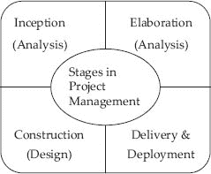

**图 5.1** 项目阶段

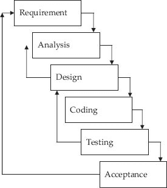

**图 5.2a** `SDLC` – 瀑布模型

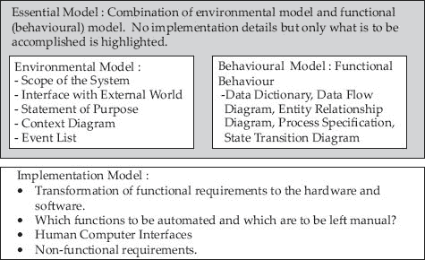

**图 5.2b** 结构化分析与设计 – 主要元素

下面列出了要采取的一系列行动步骤以及每个步骤的交付物：

- **问题定义：** 用户已准备好问题叙述。在收到用户系统开发的请求后，进行调查以说明要解决的问题。**交付物：** 问题陈述。

- **可行性研究：** 定义软件项目研究的范围和目标，并建立可选的解决方案。**交付物：** 可行性报告。

- **系统分析阶段：** 对现有系统进行分析，包括系统如何运作以及处理什么内容。**交付物：** 现有系统的规范。

- **系统设计阶段：** 研究规范并准备规范文档，显示为了消除现有系统的缺点还需要做哪些工作。**交付物：** 建议系统的规范。

- **系统设计（实现）：** 代码开发、用户手册的编写。**交付物：** 程序、其文档和用户手册。

- **系统测试与评估：** 根据规范对系统进行测试、验证和确认。**交付物：** 测试和评估结果，以及准备交付给用户/客户的系统。

瀑布模型的优点如下：

- 每个阶段结束时都有明确定义的交付物，以便客户对是否继续项目做出决策。
- 资源可以增量地投入，而不是一次性全部投入。
- 可以在开发阶段早期发现问题。
- 具有详细的阶段性文档。

瀑布模型的缺点如下：

- 项目需要投入资源。它不是一个增量模型。
- 问题必须尽早发现。后期阶段发现问题意味着巨大的成本。

## 5.3 结构化分析与设计（SASD）

`SASD` 是一种用于分析业务模型并将其转换为规范的方法，这些规范反过来会被用于修改计算机程序、硬件和/或手动程序。`SASD` 作为一种方法，是在结构化编程出现后，于 20 世纪 70 年代后期由 DeMarco、Yourdon 和 Constantine 开发的。`SASD` 的目的是开发一个实用、高质量的信息系统，以满足终端用户的需求。`CASE` 工具是实现 `SASD` 技术的图形化工具，现在已成为开发 `SASD` 模型的行业标准。

### 结构化分析与设计的元素

`SASD` 涉及的步骤如下：

#### 步骤 0：目的声明

这是一个清晰简洁的陈述，突出了系统的目的。它是作为概念文档供高层管理使用的，不能用于系统的开发。

**目的声明示例**——“农业卡系统”的目的是为银行向农民提供信贷提供一种方法。该系统将处理信贷申请、贷款管理、账单、收回和管理报告的细节。涉及的步骤包括：

- **步骤 1：** 绘制 `context 图`（上下文图）以定义项目范围。该图类似于框图，将系统作为一个整体显示，具有一组输入、输出和一个转换系统。系统上下文图的目标是关注在开发整套系统需求和约束条件时应该考虑的外部因素和事件。在图 5.7 中，我们提供了一个学生智能卡应用程序的上下文图。

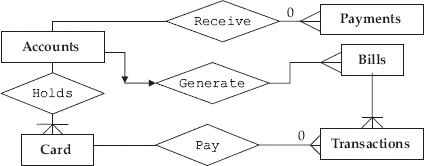

**图 5.7** 信用卡系统的 ERD

- **步骤 2：** 这是一个显示现有系统如何运作的文档。它通过绘制现有系统的物理数据流图（`DFDs`）完成，这些图指定了其当前的实现。提出的关键问题是：
  - 谁执行什么任务？
  - 它们是如何以及何时执行的，执行频率是多少？
  - 数据存储在何处以及如何存储？

- **步骤 3：** 此阶段用于建议系统的文档编制。它是关于建议系统将实现什么。系统设计人员将研究现有系统的缺陷，并以逻辑 `DFDs` 的形式提出修改后的系统。

- **步骤 4：** 在此阶段，通过检查哪种实现符合标准，将 `步骤 3` 中的逻辑 `DFDs` 转换为物理 `DFDs`。谁将执行各项任务？
  - 谁执行什么任务？
  - 它们是如何以及何时执行的，执行频率是多少？
  - 数据存储在何处以及如何存储？

### 5.3.1 概念设计——功能建模与数据建模

概念设计包括数据建模和功能建模。数据建模是一种组织数据的技术，而功能建模（也称为过程建模）是一种记录系统过程、输入和输出的技术。概念设计阶段提供了以下问题的答案：

- 构成建议系统的过程是哪些？
- 在每个过程中使用了哪些数据？
- 输入是什么？
- 输出是什么？

### 5.3.2 模块化设计

建议系统被分解为称为模块的小型独立子系统。这些模块单独设计和编码，然后与其他模块组合以提供建议系统的完整功能。我们将采用自上而下的层次模型，其中高层模块范围较大，低级模块范围较小。分解为模块的设计考虑因素是：

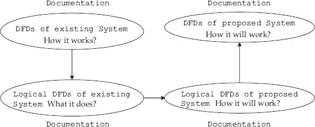

**图 5.3** 现有系统和建议系统的 `DFDs`

- 由代码行指示的模块大小应该是小的。
- 模块必须是共享的，以避免重复。

### 5.3.3 分析与设计技术与工具

分析部分将涉及将业务模型转换为数据流和控制流，通过使用 `DFDs` 来实现。数据字典对于描述数据流和控制流至关重要。数据字典（`DD`）是涉及的主过程功能分解的图形表示。过程规范和指定操作有助于分解为高内聚的子模块，函数之间的耦合导致结构化数据。这些划分的系统仍保留了原始设计的约束和规范。

`SASD` 技术通过将复杂问题分解为更易处理的小问题来解决复杂问题。该技术可以被称为“分治法”。采用的方法也可以称为“自上而下的方法”。结构化方法的层次分解描述了过程而不定义系统行为，并规定了所需功能的形式。该方法识别了与活动相关的输入和输出。

结构化分析的结果是一系列相关的图形图、过程描述和数据定义。它们描述了需要发生的转换以及满足系统功能需求所需的数据。

此图类似于框图，展示了作为一个整体的系统、一组输入、输出以及一个转换系统。系统上下文图的目的是将注意力集中在开发完整的系统需求和约束时应该被考虑的外部因素和事件上。我们在图 5.7 中提供了一个上下文图示例以及一个案例研究。

## 目的

- 突出了系统与外部世界之间的边界。
- 突出了与开发中的系统交互的人员、组织和外部系统。
- 是数据流图的特例。

## 上下文图——符号

——代表提议的系统。

——数据输入/输出流。

——终端，代表外部实体。

### 5.3.5 事件列表

事件列表的目的是列出设计中的系统应当响应的外部事件/活动列表。这与面向对象分析设计（`OOAD`）方法中的用例类似。事件可以分类为：

- 由输入数据触发的事件。
- 内部生成的事件。
- 外部不可预测事件。

事件列表的示例有：

- 学生完成注册流程。
- 客户支付信用卡账。

### 5.3.6 数据流图

数据流图（`DFD`）用于分析阶段，因为它对于理解系统很有用，并且可以在分析期间有效使用。`DFD` 将功能看作流过系统的数据。`DFD` 突出了从输入阶段到输出阶段通过各种过程的数据转换。

#### 示例 5.1：学生发放成绩单的 DFD

我们将展示准备学生成绩单的 `DFD`。我们将此系统命名为 `GradePrep` 系统，如图 5.5 所示。在 `GradePrep` 中，输入和输出为：

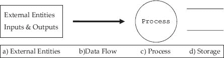

**图 5.4** `DFD` 中的符号

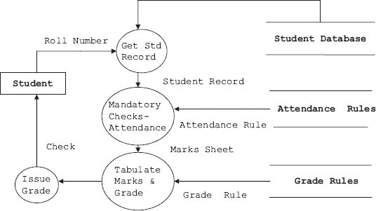

**图 5.5** 向学生发放成绩单的 `DFD`

- 学生个人数据库，存储关于学生的基本信息，如姓名、学号、各科目得分和考勤详情。
- 成绩规则数据库将存储关于计算成绩的标准的信息，考勤规则数据库包含关于宣布结果所需的强制性出勤的规则等。
- 学生成绩单是输出内容。

### 5.3.7 数据字典

数据字典或数据库字典是一个定义数据库的文件。数据库字典包含：

- 数据库中所有文件和表的列表。
- 每个文件中记录的数量。
- 每个数据字段的名称和类型。

数据字典只维护管理数据的信息，但不包含实际数据。数据库管理系统没有数据字典无法运行。我们可以将其称为关于数据的元数据（`meta data`），而不是实际数据。

在上面的 `DFD` 中，我们使用了学生数据库、考勤规则、成绩规则等术语。但这些存储空间中数据的结构究竟是什么？数据字典定义了这些存储空间的数据结构：

```text
Student Record = roll number + Name + course + Semester + marks1 + marks2 + marks3 + marks4 + marks5 + Attendance percentage
Attendance rule: if (attendance > 75) eligible = 1 else eligible = 0
Marks Sheet: roll number + Name + course + Semester + marks1 + marks2 + marks3 + marks4 + marks5 + Total Marks + Grade
Roll Number: digit + digit + digit + digit + digit（根据学号的位数决定数字个数）
Grade: String “A” 或 “B” 或 “C” 或 “D,” 等。
```

### 5.3.8 多级 DFD

`DFD` 和用于 `DFD` 的字典已经准备就绪；我们可以将 `DFD` 扩展到第二层及后续层次，以更好地理解涉及的过程。

对于这项研究，让我们考虑大学或学院的图书馆信息系统（`LIS`）。学生根据在线检查的可用状态选择书籍进行借阅。图书馆工作人员必须处理借阅请求、验证并确认请求并处理请求。最后，学生凭借书授权单获得书籍，其账户也相应修改。

注意，我们在这个案例研究中选择了 `LIS`，因为你熟悉图书馆运作。我们可以轻松地将该模型替换为任何其他模型，如采购订单系统等。

在图 5.6a、b、c 中，我们展示了如何扩展 `DFD` 以深入了解图书馆借阅部门的运作。首先，检查传入的借阅请求是否有正确的书名、作者姓名和其他信息。在此阶段通过检查学生数据库来检查学生的权限。这一过程在 `DFD` 第 2 层中详细说明。最后，借阅过程在 `DFD` 第 3 层中详细说明。我们为 `LIS` 借阅部门绘制的 `DFD` 组显示在图 5.6a、b、c 中。

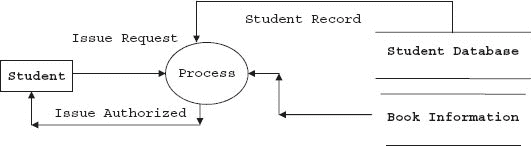

**图 5.6a** 发放书籍的第一级 `DFD`

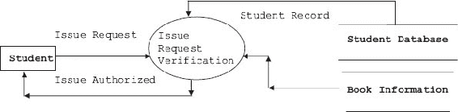

**图 5.6b** 借阅请求验证的第二级 `DFD`


**图 5.6c** 处理系统

#### 示例 5.2：图书馆信息系统借还系统的多级 DFD

- **第 1 层：** 总体概念图。
- **第 2 层：** 扩展第 1 层的过程。在此处，我们将检查借阅请求并验证学生是否有权借书以及书籍是否发放。
- **第 3 层：** 扩展处理系统。

### 5.3.9 实体关系图

实体类似于对象。它是系统中存在的一种事物，也是系统数据布局的图形化表示。它定义了数据元素及其相互关系。

#### 实体关系图——符号


让我们研究银行信用卡系统的 `ERD`。系统中的实体是支付、账单、交易、账户。关系有：

- 用户使用支付交易。
- 账户持有卡片信息。
- 账户生成账单。
- 账单包含交易。
- 账户接收支付。

- 显示输入对象值与输出对象值之间关系的公式或方程。
- 转换的文本描述。

### 2. 与外部实体的接口

接口规定了系统的输入。规范可以作为检查功能是否满足要求的手段。在图 4.21 中，我们将功能模型呈现为具有输入、输出和系统转换的系统视图。

操作可以分为系统操作和功能操作。系统操作是那些影响整个系统的操作。例如，从 `ATM` 提取现金会影响整个系统。功能操作则在本质上是局部的，影响该特定模块调用的属性。

### 3. 规范系统操作和功能操作的步骤

- 识别所有的系统/功能操作。
- 对于每个系统操作，说明系统操作名称、输入对象（参数）、转换和输出对象（返回值）。此外，还要说明系统操作的前置条件、后置条件和异常。
- 准备系统/功能操作表，如下所示：


### 5.3.11 规范约束

功能模型通过图形化表示描述得最为充分。图形化表示无非前面章节中所描述的功能分解，其中两条不同的路径——即 `control path` 和 `data path`——从上到下流动，覆盖所有分解的模块。

因此，应用于最顶层的所有功能约束也必须应用于分解的较低层级。例如，如果可靠性是顶层模块的约束，那么它也必须是后续模块的约束。接下来将讨论约束及其影响。

- **性能：** 性能标准定义在最顶层。性能决定了操作。操作反过来决定了模块的功能。因此，当顶层模块被分解时，必须确保每个子模块的操作都符合规范。
- **可靠性：** 在软件中，功能模块的可靠性取决于可靠性维度在子分功能模块之间的分布方式，以及用户与这些模块交互的方式。用户操作特征与功能特征之间应该匹配。
- **安全性：** 安全问题的出现是因为操作层的用户能够利用某些不是原始顶层规范一部分的功能。

这种漏洞可能在较低的功能层无意中产生。堵住这些漏洞的考虑标准描述如下：

- **访问控制：** 功能分解必须确保只有某些类或用户能够通过授权代码启动并使用功能。
- **数据完整性：** 数据是首要的，子模块中不允许任何未经授权的访问。合适的加密技术可以解决这些问题。
- **用户行为控制：** 必须指定功能模块用户的正常行为，任何偏离这种正常和设计流程的行为必须被模块识别，并拒绝对功能模块的进一步利用。
- **可用性：** 我们意识到用户操作分布在各个子模块中，必须保证用户能够随时以可靠的方式并按照预期的规范操作这些模块。我们将这一方面称为功能模块的可用性。可用性意味着我们必须能够根据规范监控功能的运行情况，且该监控应当是可衡量的。
- **可维护性：** 设计系统的成功取决于模块能够按照规范提供操作的能力。这意味着功能与操作之间的映射必须是可验证且有保障的。我们将这一方面称为系统的可维护性。
- **关键或非关键功能：** 建议将功能划分为关键或其他非关键，并专注于关键功能，以便操作和功能可以映射并确保规范得到满足。
- **与硬件及其他功能模块兼容：** 模块的分解必须确保每一层的操作都与硬件规范和其他功能模块兼容。

### 5.4 结构化分析与设计的案例研究

#### 5.4.1 目的示例

学生智能卡系统（`SSCS`）的目的是为学校管理层提供一种手段，向学生提供所有应有的设施。系统将处理费用支付详情、贷款申请详情、图书借阅以及（如有）罚金支付、考勤记录和管理报告。交易信息应对公司会计系统以及学校的学术管理部门可用。


**图 5.9** 学生智能卡系统上下文图

#### 5.4.2 上下文图

上下文图描述了系统与外部世界之间的边界，并突出了与开发中系统交互的人、组织和外部系统。上下文图如图 5.7 所示。

### 5.4.3 事件列表

- 学生申请智能卡。
- `SSCS` 告知学生其欠费。
- 学生缴纳欠费。
- 学生在合作社商店进行交易。
- 学生获得贷款。
- 学生获得信贷。

#### 5.4.4 数据流图

学生请求注册。`SSCS` 系统从财务部门检查学费支付状态，并从学生数据库获取学生记录并处理请求。如果发现符合条件，系统将发布注册过程授权。


**图 5.10a** 注册过程的数据流图 – `SSCS` 系统


**图 5.10b** 注册请求验证的数据流图


**图 5.10c** 发放请求处理系统

### 5.4.5 数据字典

数据字典仅维护管理数据的信息，但不包含实际数据。没有数据字典，数据库管理系统无法运行。我们可以将其称为数据的元数据，而不是实际数据。

在上述数据流图中，我们使用了学生数据库、促销规则、账户数据库等术语。但这些存储空间中的数据结构到底是什么？数据字典定义了这些存储空间的数据结构：

```text
Student Record = roll number + Name + course + Semester + No of Back lag papers weightage
Promotion rule: if (backlog paper weightage < 25) eligible = 1 else eligible = 0
Reg. Authorization Sheet: roll number + Name + Semester + courses registered
Roll Number: digit + digit + digit + digit + digit（位数与学号位数一样多）
Student Smart Card: Card Number = Uniquely identifies a card
Format = digit + digit + digit + digit + digit + Hyphen + alphabet
Range = 50595 0000 0000 0000 to 50595 9999 9999 9999
```


**图 5.11** 智能卡支付系统的 ER 图


### 5.4.6 实体关系图

`SSCS` 中用于学生交易和支付的实体有：支付、账单、交易和账户。关系有：

- 学生使用智能卡支付交易。
- 部门持有智能卡信息。
- 账户生成账单。
- 账单包含交易。
- 账户接收付款。

### 5.4.7 过程规范 – `SSCS`

对于支付，实体过程规范为：

- `Read account`
- `Read amount`
- `Add amount to account's credit`
- `Add amount to account's balance`
- `Update payment as applied`（根据应用情况更新支付状态）

我们将针对事务、卡片、账户等的余额实体的规范编写留给读者作为练习。

### 5.4.8 结构化分析与设计 – 优缺点

#### 优点

- 具有清晰的可区分阶段，因此便于项目管理。
- DFD（数据流图）、ERD（实体关系图）等是易于理解的图形工具。
- 广泛应用于，技术成熟。
- 以功能/过程为导向。符合自然的思维过程。
- 模块化，因此具有活性。

#### 缺点

- 仅满足功能性需求。忽略了非功能性需求。
- 用户与分析师之间的交互无法自动化。它是手动的且非迭代的。
- 需求分析后不存在与用户的沟通。
- 难以决定何时停止分解。

#### 何时使用结构化分析与设计

- SASD 最适用于非常熟悉且标准的领域。
- 已规定 SRS（软件需求说明书）的领域。
- 在事务处理系统中。
- 当有足够的开发时间时。

## 5.5 面向对象的软件分析与设计（OOAD）

俗说的 OOAD 是结构化分析与设计以及在其基础上构建的某些面向对象的特性。因此，我们从用户规范开始，并添加以下面向对象的特性：

- 通过叙述性语句的句法解析提取出对象列表。我们对 DFD 中名词或实体的属性内容感兴趣。
- 从动词列出系统行为。
- 对象向其他对象提供的服务。
- 扩展对象以及与其他对象的关系。

### 5.5.1 用于对象分析的不同模型

在 OOAD 方法论中，与用户的交互非常频繁。它并不会随着规范的绘制和用户签署文档而结束。OOAD 方法论依赖于 Rumbaugh、Grady Booch、Coad–Yourdon 以及 Shlaer–Mellor 提出的各种方法论。我们将在下一节回顾这些系统。

在复杂项目的开发期间，需求会不断变化，并且需要实施这些变化，很多时候这种因素会导致设计从步骤 `1` 开始改变。OOAD 的假设是规范会变化，因此遵循迭代开发模式。每个迭代步骤要么添加新步骤，要么修改现有步骤。

#### 5.5.1.1 Rumbaugh 方法

Rumbaugh 与 OOAD 方法论的发展相关，该方法具有定义良好的分析和设计模型。Rumbaugh 分析部分处理对象建模技术（OMT）。它进一步包含一个研究开发中系统动态行为的模型。Rumbaugh 模型还包括功能建模。

Rumbaugh 模型与目前讨论的 SASD 技术相似，但增加了对象模型，包括类的定义以及其成员数据、函数，以及它们与其他类的相互作用。动态建模包括状态转换图，显示了对象在事件发生时如何从一个状态变化到另一个状态。功能规范由 DFD 处理。

#### 5.5.1.2 Booch 方法

Booch 方法论包含一个与 SASD 实践类似的需求分析阶段。此外，Booch 方法论将领域分析阶段作为分析阶段的一部分。Booch 方法论拥有强大的设计技术，分为四个部分：

- 第一部分：逻辑结构设计，其中定义了类层次结构。
- 第二部分：物理结构，描述对象的方法。
- 第三部分：动态建模，显示状态转换和对象转换的分析。
- 第四部分：功能规范。

#### 5.5.1.3 Coad–Yourdon 方法

分析阶段被称为 SOSAS，意味着分析和设计阶段的五个步骤：

- `S` 代表主体（subject）。它意味着 DFD。
- `O` 代表对象（objects）。识别对象和类层次结构。
- `S` 代表结构（structure）。它分为继承结构和组合结构。分类基于设计中使用了哪种扩展类的两种方法之一（即继承或组合）。
- `Attributes`（属性）。
- 此类向其他类提供的服务。

设计阶段：它由四部分组成：

- 问题领域。包含属于问题领域的类。
- 人机交互。
- 功能管理。识别负责功能和管理的系统级类。
- 数据管理：系统的属性。

#### 5.5.1.4 Shlaer–Mellor 方法

该模型在系统分析和设计中包含三个部分：

- 信息模型包含对象、成员数据及其与其他对象的关系。
- 状态模型包含对象的不同状态以及对象在转换时可能发生的变化。
- 过程模型负责功能规范。

在我们的书中，我们遵循上述所有方法中的优者。

在 OOAD 中执行的第一项活动是需求收集。与用户的一系列会议为我们提供了涉及问题的叙述。用户根据手动系统运行的经验（对现有系统的缺点）准备了问题陈述，或者使用可用工具编写了用例（use cases）。

面向对象的类支持抽象、封装、多态和可重用的面向对象原则。`Classes are specifications for objects.` 衍生自用例、问题陈述或叙述，类提供了需求的抽象，并提供了应用程序的内部视图。我们在 OOAD 中遵循的步骤如下。

### 5.5.2 识别类

识别类可能是具有挑战性的。选择不当的类会使应用程序逻辑结构复杂化，降低重用性并碍维护。

- 一旦有了叙述，我们就进行句法解析以识别名词、动词等。建立名词初始列表。将其称为 `候选类`。
- `Candidate Classes`（候选类）：从中产生实际集合的初始集合。候选类可以通过多种方法识别。下面显示了两种：
  - 对叙述、用例或问题描述进行句法解析：识别名词和名词短语、动词和形容词。
  - 类责任协作（CRC）卡。这是一组卡，列出了类名、其责任（功能）和协作（服务）。
- 分析候选类。寻找协作类。一个类如何与另一个类关联？如果是协作则保留该类，否则丢弃。
- 遵循 Coad 和 Yourdon 建议的类选择原则来选择最终类列表。我们将此集合称为设计类。
  1. 类是否有保留的信息？
  2. 类提供的服务是否被其他类需要？
  3. 类是否有多个属性？
  4. 类是否有对其他类有用的公共属性？
  5. 类是否有对其他类有用的公共操作？
  6. 类是否属于本质类别被其他类需要？

### 5.5.3 识别属性

属性定义类的特征。在设计模型中寻找属性时，寻找以下类型：

1. 寻找描述性属性。
2. 哪些特征将该类与其他类区分开？
3. 名称用于唯一标识对象？
4. 特定对象是如何与其他对象链接的？

## 5.5.4 指定操作

要指定类操作，需要识别每个类执行的操作。此列表源于类的职责。操作规范了类的行为。操作可以分类为：

- 修改器操作：这些操作会修改属性。
- 状态检查操作：通过检查几个属性的值来检查状态。
- 转换操作：运行算法或公式。
- 检查事件发生的操作。

一旦确定了操作和属性，我们就可以完成类的定义。让我们使用大学管理系统来演示面向对象分析设计（OOAD）原则。从叙述中识别出的设计类有：`professor`、`student`、`course` 等。

## 5.5.5 推导出关联

关联是识别内聚类的关键。类与其他类相关联或相关。当一个类为其他类提供某些服务，或使用其他类提供的服务时，类之间就会发生关系。关系是类之间的关联。

### 如何识别这些关系？

- 从与许多其他类交互的核心类开始。
- 提问此类问题：谁对这个类感兴趣？为什么需要这个类？
- 谁在使用这个类提供的服务？

### 5.5.5.1 从主要关联开始

在我们案例中，我们将从 `professor` 和 `student` 开始。正如我们所学的，关联是连接两个类的实线。


**图 5.12a** 教授与学生关联

### 5.5.5.2 命名关联通常能阐明关系


**图 5.12b** 命名关联

### 5.5.5.3 强调类在关联中的角色

赋予角色是可选的。但如果赋予了，它必须是类的名词。例如，我们给 `professor` 赋予 `teacher` 角色，给 `student` 赋予 `learner` 角色。


**图 5.12c** 关联中的角色

### 5.5.5.4 引入多重性因子

角色可以具有多重性关系。多重性指示可以是有条件的或无条件的。例如：


**图 5.12d** 教授可以教 0 到多个学生


**图 5.12e** 学生可以教 0 到 1 个学生


**图 5.12f** 教授可以有 0 到多个学生。但学生必须至少有一个教授。

### 5.5.5.5 关联类

当有一组数据不严格属于参与的任何一个类时，就需要创建关联类。例如，如果有 `student` 和 `course` 两个类，那么 `grade`（成绩）和 `attendance`（出勤）属于哪个类呢？`student` 会获得不同的成绩，每个课程都有不同的出勤分数。我们在哪里存储这类数据？在哪里放置 `GRADE`？

如果我们把它放在 `student` 中，那么 `student` 在所有课程中获得相同的相同的。相反，如果我们把 `grade` 放在 `course` 文件中，那么修同一门课程的学生学生获得相同的成绩。


**图 5.13a** 学生可以选 0 到多个课程

解决方案是创建一个 `Association class`。`Association` 类将拥有它自己的属性和方法，以及指向两个参与类的指针和引用。


**图 5.13b** 关联类

### 5.5.5.6 组合

类可以包含其他类。例如，`Student` 类可以包含 `Date` 类。这可以被视为整体与部分的关系。部分的生命周期取决于整体的生命周期。这意味着当整体被删除时，部分也会被删除。要决定组合，需要问的问题是：

- 这个类是某些其他类的一部分吗？
- 当其他类被销毁时，这个类也会被销毁吗？

### 5.5.5.7 聚合

在这里，整体被销毁时部分并不会销毁。这等同于“拥有”类型的关系。例如，计算机有一个 `microprocessor`（微）。当计算机被销毁时，`microprocessor` 可能不会被销毁。

聚合的另一个例子是：汽车有 `engine`、`wheels` 等。关键的问题是：这个类是另一个类的一部分吗，它是否独立于另一个类？

### 5.5.5.8 泛化/专门化

泛化和专门化来源于继承关系。基类可以被视为泛化类，而从基类扩展出来的类是专门派生类。这种关联通常被称为继承，因为派生类继承了基类的功能以提供专门的行为。

继承提供了从现有类的属性和行为形成新类的机制。这是一种“是”的关系。识别继承关系的关键问题是：这个类是更通用类的专门化版本吗？

### 5.5.5.9 接口

接口为行为提供了通用规范，但与继承的类不同，接口不能被创建或实例化。接口仅指定了其他类继承的通用行为。这意味着接口只有方法名而没有实现。

## 5.6 OOAD：案例研究

要执行的第一项活动是需求收集。与用户的一系列会议为我们提供了问题的叙述。我们在这里的目标是通过为大学设计一种自动化的申诉处理机制来解决问题。我们将此系统命名为 `GRCSYS`。

一旦有了叙述，我们就会进行语法解析以识别名词、动词等。我们在下面的叙述中展示了名词和动词。在叙述中，名词用加粗显示，而动词用斜体显示。

大学的申诉处理委员会（`GRC`）由申诉处理委员会主席（`CGRC`）领导，调查（inquires）学生关于女孩相关事务、校园欺凌、学术事务、校园设施相关方面，以及宿舍和食堂的申诉。

学生可以登录到（log on to）既可以在大学内网也可以互联网网站（`GRCSITE`）上访问的 `GRCSYS` 网站，并报告（report）申诉，说明申诉细节（`GRCDET`）如学号、班级、课程、申诉类型（`TGRC`）和申诉发生日期（`DOC`）。他们将被分配（allocated）申诉令牌号（`TNO`）。为了操作（operating）网络账户，每个学生都提供了一个密码。

当在网上接收（received）投诉时，`CGRC` 会要求（calls for）`GRC`。GRC 然后调查（looks into）申诉，并与相关的教职人员或部门组织（organizes）活动，如组织额外辅导或特殊培训、对违规学生采取行动以及必要的行动。

行动启动报告（`AIR`）和采取采取报告（`ATR`）将启动（initiated）并通过网站告知（informed）学生。网站提供了一个合适的界面，供学生和家长获取（get）显示（displaying）`AIR` 和 `ATR` 报告，这些报告被称为 `AirReport` 和 `AtrReport`，并在规定的最短时间内（`TimePeriod`）内完成。

为上述叙述开发面向对象的分析模型。

# 步骤 1：识别面向对象的候选类

通过对上述叙述进行解析，我们可以识别出以下候选类：

| 申诉委员会（GRC） | 系统（GRCSYS） |
| :--- | :--- |
| 学院内网（CollegeIntranet） | GRCSITE |
| 申诉委员会主席（CGRC） | 学生（Student） |
| 申诉（Grievance） | 类（Class） |
| 课程（Course） | DOC |
| GRCDET | `password` |
| TGRC | AIR |
| 令牌号（TNO） | 时间段（PERIOD） |
| 教员（Faculty） | 部门（Department） |
| 事件（Event） | AIR |
| ATR | |

列列表后，分析候选类。寻找协作类。一个类与另一个类之间是什么关系？如果是协作关系则保留该类，否则舍弃。

Coad 和 Yourdon 在他们的研究中提出了将候选类转换为设计类的以下标准：

1. 该类是否保留了信息？
2. 该类提供的服务是否被其他类需要？
3. 该类是否具有多个属性？
4. 该类是否有对其他类有用的公共属性？
5. 该类是否有对其他类有用的公共操作？
6. 该类是否属于本质类别且被其他类需要？

# 步骤 2：将上述标准应用于我们的候选类

| 系统（GRCSYS） | 接受：适用规则 1 到 6 |
| :--- | :--- |
| 学院内网（CollegeIntranet） | 接受：适用规则 1 到 6 |
| 申诉委员会（GRC） | 拒绝：规则 1 和 2 不适用 |
| 申诉委员会主席（CGRC） | 拒绝：规则 1 和 2 不适用 |
| GRCSITE | 接受：适用规则 1 到 6 |
| 学生（Student） | 接受：适用规则 1 到 6 |
| 申诉（Grievance） | 接受：适用规则 1 到 6 |
| 类（Class） | 拒绝：规则 1 和 2 不适用 |
| 课程（Course） | 拒绝：规则 1 和 2 不适用 |
| DOC | 拒绝：规则 3。单属性 |
| GRCDET | 接受：适用规则 1 到 6 |
| `password` | 拒绝：规则 3。单属性 |
| TGRC | 拒绝：规则 3。单属性 |
| AIR | 接受：适用规则 1 到 6 |
| ATR | 接受：适用规则 1 到 6 |
| 令牌号（TNO） | 拒绝：规则 3。单属性 |
| 时间段（PERIOD） | 拒绝：规则 3。单属性 |
| 教员（Faculty） | 拒绝：规则 1 和 2 不适用 |
| 部门（Department） | 拒绝：规则 1 和 2 不适用 |
| 事件（Event） | 接受：适用规则 1 到 6 |

# 步骤 3：列出设计列表

| 系统（GRCSYS） | 学院内网（CollegeIntranet） |
| :--- | :--- |
| GRCSITE | 学生（Student） |
| 申诉（Grievance） | GRCDET |
| AIR | AIR |
| 事件（Event） | |

让我们考虑 `System (GRCSYS)` 以进一步开展 OOAD 过程。我们将指定操作和属性的任务留给读者作为练习。

# 步骤 4：指定属性

为了指定类属性：

1. 寻找描述性属性。
2. 哪些特征将此类与其他类区分开来？
3. 使用名称来唯一标识对象。哪些特征可以唯一标识此对象？
4. 特定的对象是如何与其他对象链接的？

```text
roll Number, class, course, type of grievance (TGRC), date of occurrence (DOC) of grievance. token number (TNO), password, AirReport and AtrReport
```

**从上述列表中识别出属于 `System (GRCSYS)` 的属性**

```text
roll Number, class, type of grievance (TGRC), token number (TNO), password, AirReport and AtrReport
```

# 步骤 5：指定操作


为了指定类操作，需要识别每个类执行的操作。此列表源于类的职责。操作指定了类的行为。操作可以分类为：

* 修改器操作（Modifier operations）——这些操作修改属性。
* 通过检查几个属性的值来检查状态的操作。
* 转换操作（Transformation operation）——运行算法或公式。
* 检查事件发生的操作。

| `ToInquire()` | `ToLogOn()` | `Toreport()` |
| :--- | :--- | :--- |
| `ToAllocate()` | `ToOperate()` | `ToProvide()` |
| `ToCallGRC()` | `ToOrganize()` | `ToConsult()` |
| `ToInitiate()` | `ToInform()` | `ToDisplay()` |

**从上述列表中我们可以识别出 `System (GRCSYS)` 的操作：**

| `ToInquire()` | `ToAllocate()` |
| :--- | :--- |
| `ToProvide()` | `ToCallGRC()` |
| `ToCallGRC()` | `ToOrganize()` |
| `ToConsult()` | `ToInitiate()` |
| `ToInform()` | `ToDisplay()` |

现在我们可以完成 `System (GRCSYS)` 类的类图了。


## 5.7 可复用设计

使用 OOAD 原则设计软件项目是一个复杂的过程，而设计具有可复用特性的 OOAD 项目更为困难。但由于生产率的提高，我们需要使用可复用特性。可复用特性集中在两个方面：

* **代码的可复用**：这是内置语言特性，并使用了组合、聚合等语言特性。
* **设计的可复用**：这一方面侧重于构建软件架构复用。

因此，设计模式具有以下特征：

* **模式名称（Pattern Name）**：识别用于复用的设计模式。名称描述了设计问题、解决方案及其后果。
* **问题（Problem）**：描述问题以及何时应用特定的设计模式。例如，问题描述了将算法表示对象的特定问题。
* **解决方案（Solution）**：设计元素、它们的关系、职责和协作。解决方案并不是精确的，因为设计模式像是一个模板，需要针对特定问题进行适配。设计模式提供了问题的类和对象的抽象描述。
* **后果（Consequences）**：将设计模式应用于问题后的后果。列出后果有助于设计者从替代方案中进行选择。

### 设计模式如何帮助设计者？

* 识别不那么明显的对象，例如过程或算法。
* 决定什么应该是对象——换言之，对象的粒度。
* 指定对象的接口。
* 指定对象的实现。

### 可复用面向对象的设计原则

* 继承扩展了类的功能，只需通过扩展现有类即可获得新类。
* 由于多态性，所有派生类共享相同的接口。接口的用户仅受接口限制，通常不感知派生类的实现。这是复用的一大特性。我们可以面向接口编程而不是面向实现。
* 扩展功能的继承可以被看作破坏封装，而组合对于被组合的对象具有定义良好的接口，因此接口隐藏了实现。因此，组合比继承是更好的可复用特性。
* 使用模板的泛型编程是除继承和组合之外的第三种复用方法。泛型模板允许我们在不指定所有类型的情况下定义类型。然后可以在运行时作为参数传递类型。例如，我们可以将 `integer` 作为类型传递给泛化列表。

## 5.8 SASD 和 OOAD 方法论的比较

### 相似之处

* 分阶段的逐步开发和文档编制。
* 两种技术都使用图形化设计和 `CASE`、`UML` 等图形化工具来分析和建模需求。

### 差异

* `SASD` 是面向过程的。
* `OOAD` 是面向数据的。
* `OOAD` 封装了数据和过程。
* `OOAD` 高度依赖于可重用组件。
* 在 `SASD` 中，收集用户需求并根据需求绘制规格书，然后要求用户对规格书签字确认。
* 在 `OOAD` 中，需求和规格书在整个开发期间反复匹配，且用户参与到每一个阶段。

## 5.9 总结

1. 项目管理有四个阶段，即：启动（inception）、深化（elaboration）、构建（construction）和交付（delivery）。
2. 软件开发周期的瀑布模型密切遵循结构化分析与设计方法，并在工业中广泛应用。
3. 结构化分析与设计（`SASD`）方法用于将业务模型转换为可用于开发计算机程序的规格书。
4. `SASD` 技术试图通过将大型、复杂的问题分解为更小、更容易处理的问题来解决复杂问题。该技术可以被称为分治法。所采用的方法也可以称为自顶向下法。
5. `SASD` 包含数据建模和功能建模。使用 `DFDs` 描述数据流和控制流。
6. `SASD` 的主要元素有：(1) 目的声明，(2) 上下图，(3) 事件列表，(4) `DFDs`，(5) 数据字典，(6) 实体关系图等。
7. `SASD` 的上下文是一组输入、输出和一个转换系统。
8. 事件列表的目的是准备一份被设计系统应做出响应的外部事件/活动列表。
9. 数据流图（`DFDs`）也称为数据流图，用于分析阶段。`DFD` 将功能视为流过系统的数据流。`DFD` 突出了从输入阶段到输出阶段通过各种过程实现的数据转换。
10. 数据字典（或 `database dictionary`）是定义数据库的文件。数据字典只维护管理数据的信息，但不包含实际数据。我们可以将其称为关于数据的元数据（meta data），而非实际数据。
11. 实体关系图（`ERD`）是系统数据布局在高度抽象层次上的图形化表示。它定义了系统中的数据元素及其相互关系。
12. 过程规格显示了过程细节，这些细节在 `DFD` 中是不显示的。`DFD` 中模块的输入、输出和算法包含在过程规格中。
13. 功能分解：为了确保有效性，我们需要指定约束和操作，以免原始规格和需求因功能分解而受损害。
14. 面向对象的类支持抽象、封装、多态和可重用的面向对象原则。类是对象的规格书。
15. 类派生自用例、问题陈述或叙述；类提供了需求的抽象，并提供了应用程序的内部视图。
16. `OOAD` 的阶段为：(1) 识别类，(2) 识别属性，(3) 指定操作以及 (4) 确定关联和关系。
17. 关系是类之间的关联。当一个类为其他类提供某些服务，或使用其他类提供的服务时，类之间就会发生关系。
18. 当一组数据不严格属于参与类中的任何一个类时，就需要创建关联类。
19. 在组合中，一个类可以包含其他类。例如，`Student` 类可以包含 `Date` 类。这可以被看作整体与部分的关系。这也意味着当整体被删除时，部分也会被删除。
20. 在聚合中，整体被删除时部分不会被破坏。这相当于“拥有”类型的关系。
21. 泛化和专门源于继承关系。基类可以被视为泛类，而从基类扩展的类是专门的派生类。
22. 接口提供了行为的通用规范，但与继承类不同，接口无法创建或实例化。接口仅指定其他类继承的通用行为。
23. 可重用性围绕代码的可用以及通过使用设计模式提供的可用。
24. 设计模式当问题反复出现且存在可识别模式时形成的模式，因此在类似的情况下，可以使用设计模式来实现优雅的解决方案。换句话之，设计模式允许我们从设计方案中进行选择并使系统可重用。
25. 继承、组合和参数化模板是面向对象语言提供的确保可重用特性的工具。

## 练习题

### 单选题

1. 规格书是以下交付物：
   1. 可行性研究
   2. 分析阶段
   3. 设计阶段
   4. 问题定义

2. 关于瀑布模型，下列陈述**不**正确的是：
   1. 资源可以增量提交，而不是一次性提交。
   2. 有分阶段文档。
   3. 它遵循 `SASD` 设计方法。
   4. 它是一个增量模型。

3. 下列哪些陈述正确？
   1. `OOAD` 是面向过程的
   2. `SASD` 是面向过程的
   3. `OOAD` 封装数据和过程
   4. `SASD` 建模需求

   1. i
   2. i 和 ii
   3. i、ii 和 iii
   4. ii、iii 和 iv

4. 关于 `SASD`，下列哪些陈述正确？
   1. 20 世纪 70 年代由 DeMarco、Yourdon 开发
   2. `SASD` 是面向过程的
   3. `SASD` 建模需求
   4. `SASD` 兼顾功能性和非功能需求

   1. i
   2. i 和 ii
   3. i、ii 和 iii
   4. ii、iii 和 iv

5. 项目范围由什么定义：
   1. 目的声明
   2. 上下图
   3. 叙述
   4. 事件列表

6. 关于上下文图，下列错误的是：
   1. 上下图定义了项目的目的。
   2. 外部元素与开发系统中交互。
   3. 显示输入、输出和转换函数。
   4. 上下图和数据流图是同一的。

   1. i 和 iv
   2. i 和 iii
   3. i、ii 和 iii
   4. 无

7. 下列哪些正确？
   1. `DFDs` 是主过程的功能分解。
   2. `DFDs` 是分解过程的图形表示。
   3. `DFDs` 描述了满足功能规格的数据。
   4. `DFDs` 描绘了数据流但不显示控制流。

   1. i
   2. i 和 ii
   3. i、ii 和 iv
   4. ii、iii 和 iv

8. 下列哪些正确？
   1. `DFDs` 在分析阶段有用。
   2. `DFDs` 在设计阶段有用。
   3. `DFDs` 将功能视为数据流。
   4. `DFDs` 描述了数据转换。

   1. i
   2. i 和 ii
   3. i、ii 和 iv
   4. i、ii、iii 和 iv

9. 关于数据字典，下列哪些错误？
   1. 数据字典是文件和数据库的列表。
   2. 数据字典持有实际数据。
   3. 定义数据字典是可选的。
   4. 数据字典描述数据转换。

   1. i
   2. i、ii 和 iii
   3. ii、iii 和 iv
   4. i、ii、iii 和 iv

10. 关于 `ERDs`，哪些陈述正确？
    1. `ERD` 是图形化表示。
    2. `ERD` 是数据布局以及数据元素之间的相互关系。
    3. `ERD` 符号  表示关系。
    4.  符号表示数据元素。

    1. i
    2. i、ii 和 iii
    3. ii、iii 和 iv
    4. i、ii、iii 和 iv

11. 关于 OOAD（面向对象分析设计），下列哪些是正确的？
    1. 类是对象的规范。
    2. CRC 卡可用于确定 OOAD 中的类。
    3. 关系是类之间的关联。
    4. 关联可以同时没有角色多重性。

    1. i
    2. i、ii 和 iii
    3. ii、iii 和 iv
    4. i、ii、iii 和 iv

12. 关于 OO（面向对象）语言，哪些是正确的？
    1. 当存在不严格属于单个类的数据时，会创建关联类。
    2. 组合（Composition）描述了整体与部分的关系。
    3. 组合（Composition）描述了一种“拥有”类型的关系。
    4. 在聚合（Aggregation）中，当整体被销毁时，部分也会销毁。

    1. i 和 ii
    2. i、ii 和 iii
    3. iii 和 iv
    4. i、ii、iii 和 iv

13. 关于继承关系，下列哪些描述是错误的？
    1. 继承描述了一种“拥有”类型的关系。
    2. 继承描述了一种“是”类型的关系。
    3. 泛化（Generalization）指继承关系中的派生类。
    4. 特化（Specialization）指继承关系中的派生类。

    1. i 和 iv
    2. i、ii 和 iii
    3. ii、iii 和 iv
    4. i、ii、iii 和 iv

14. 关于 OOAD 中的重用性，下列哪些是正确的？
    1. 重用性使用了设计模式。
    2. 重用性意味着代码重用和设计重用。
    3. 对于重用性特性，继承比组合更好。
    4. 接口（Interface）是一个极大有助于实现重用性的特征。

    1. i 和 iv
    2. i、ii 和 iii
    3. ii、iii 和 iv
    4. i、ii、iii 和 iv

15. 哪些特征有助于 OO 语言的重用性特征？
    1. 参数化模板
    2. 组合
    3. 继承
    4. 接口

    1. i、ii 和 iii
    2. i、ii 和 iv
    3. i、ii、iii 和 iv
    4. ii、iii 和 iv

### 简答题

16. 项目管理的阶段有哪些？
17. SASD（结构化分析与设计）的主要元素有哪些？
18. 解释 SASD 中上下文图的用途。解释上下文图中所使用的符号表示？
19. 什么是数据字典？为什么需要它？
20. 什么是目的声明（statement of purpose）？它是否是一个突出系统目的清晰简洁的声明？
21. SASD 的元素有哪些？
22. 数据字典的元素有哪些？
23. 什么是 ERD（实体关系图）？
24. ERD 中使用了哪些符号？
25. 为什么在 SASD 中指定过程和约束很重要？
26. 解释组合（Composition）、聚合（Aggregation）和关联类（Association class）。
27. 解释泛化（generalization）、特化（specialization）、接口（interface）和设计模式（design pattern）这些术语。

### 论答题

28. 解释软件开发生命期的瀑布模型。它的优缺点是什么？
29. 解释 SASD 中的功能分解。DFD（数据流图）在功能分解和分析中起什么作用？
30. 解释 ERD 在 SASD 中的作用和用处。
31. SASD 的优缺点是什么？
32. 你什么时候使用 SASD？
33. 你什么时候使用 OOAD？
34. 区分 SASD 和 OOAD 技术。
35. OOAD 中的关联是什么？用例子说明。
36. 区分组合（composition）和聚合（aggregation）。
37. 区分继承和接口。泛化和特化是什么？它们与继承有什么关系？
38. 什么是设计模式？解释它们对 Java 或 C++ 等现代面向对象语言重用特性的贡献。
39. 使用 SASD 方法的优缺点是什么？解释 SASD 方法高效覆盖的领域。

### 作业题

40. 为职业学院的学生入学过程撰写一段叙述，并进行语法解析以识别类及其关联。
41. 为职业学院的学务管理撰写一段叙述。包括开设的部门、学生注册课程、教授处理课程、以成绩形式表示的学生表现等领域。画出类图，描绘关联和关系。
42. 为图书馆的图书订购系统撰写一段叙述。使用语法解析技术识别对象。
43. 对基于互联网的网商店在线购买商品进行面向对象的分析和设计。

### 选择题答案

1. b
2. d
3. c
4. d
5. b
6. a
7. c
8. d
9. c
10. d
11. b
12. c
13. a
14. b
15. c

# 6 C++ 基础与基础编程

## 学习目标

在本章结束时，你应该能够理解：

* C++ 的发展以及应用于 C++ 的面向对象编程（OOPS）
* C++ 编程环境和结构
* 使用控制循环、数组、结构和类的 C++ 编程。这些程序旨在让你接触未来的内容，并让你从第一天起就高效工作
* 控制台 IO 操作和用于输出的非格式化函数

## 6.1 引言

为了解决问题，你需要“方法/过程”或“经验”。在计算机术语中，这可以被称为算法。算法或程序是遵循的步骤序列，遵循这些步骤后可以得到所需的输出。步骤序列可以被称为过程。

为了解决复杂问题，我们需要一个包含良好集成且内聚的编程元素、构造和数据结构的编程环境。以 C 语言为实现语言的结构化编程范式非常成功且流行。

程序员生产率低由于用户需求、项目复杂性以及缺乏扩展性和重用特性等因素，这是项目无法按时完成的主要因素。面向对象编程（OOP）通过继承、标准模板库（STL）形式的函数承诺了广泛的重用特性。

### 6.2 C++ 等面向对象语言的历史与发展

OOP 风格分为两种类型，即基于对象的编程和面向对象的编程。在 OOP 范式中，对象是核心。面向对象的编程（如 `C++`）使用对象并通过调用成员函数来实现它们之间的交互。图 6.1 显示了持有数据和成员函数的对象。其特性包括数据隐藏、数据抽象、封装、继承和多态。


**图 6.1** OOP 范式中的数据和方法

### OOP 范式的显著特征

* 数据封装
* 数据隐藏
* 运算符重载
* 对象的初始化以及使用后的自动清理
* 动态绑定
* 广泛且定义良好的标准模板库

## 6.4 欢迎学习 C++ 语言

我们希望让你对 `C++` 语言感到相当自如。我们的理念是让你从第一天起就能高效工作。在绪介绍章节中，就准备好开启一段精彩的 `C++` 之旅吧。在你编写第一个 `C++` 程序之前，我们将重点介绍你应该了解的几个核心特性，并通过简单的程序来引入 `C++`。

### 6.4.1 设置路径

在 Linux 平台上安装 `Turbo C++`、`Micro Soft Visual C++` 或 `GNU C++ Compiler` 后，相关文件通常会被加载到 `C:\Program Files\TC` 或 `C:\Program Files\ Microsoft Visual Studio\VC98`，除非你有其他选择。下载完成后，目录结构将如图 6.2 所示。


**图 6.2** 安装 TC 或 VC++ 后的目录结构


假设我们要在 `D` 目录下创建一个名为“oopsc++”的文件夹，并在文件夹内又创建一个名为“c++chap1”的独立文件夹。在这个文件夹中，我们将创建所有的源代码文件，并存储 `VC++` 创建的所有对象文件和其他相关的项目文件。

因此，存储我们开发的所有类文件和源程序的路径将是：

```
• D:\oopsc++\
```

我们还需要链接 `TC\VC++` 的 `bin` 和 `lib` 目录。它们的路径为：

```
• C:\Program Files\ Microsoft Visual Studio\VC98 \bin // 包含所有公司
  //提供的程序
• C:\Program Files\ Microsoft Visual Studio\VC98\include; // win32 和头文件
• C:\Program Files\ Microsoft Visual Studio\VC98\lib // 库
• C:\Program Files\ TC\bin
• C:\Program Files\ TC\include; C:\Program Files\ TC\lib
```

### 示例 6.1：如何在 Windows 平台上设置路径

#### 环境变量的永久设置

```text
• 进入设置->控制面板->系统 ->高级->设置环境变量。
• 选择 path->编辑：复制并粘贴路径 ->确定
```

### 示例 6.2：如何在 Linux 平台上设置路径

假设 `TC` 或 `VC++` 已安装在目录 `/usr/local/` 下。

#### Linux

##### 对于 C shell (csh)，编辑启动文件 (`.cshrc`)

```sh
set path=/usr/local
```

##### 对于 bash，编辑启动文件 (`.bashrc`)

```sh
export PATH=/usr/local/
```

##### 对于 ksh，编辑启动文件 (`.kshrc`)

```sh
export PATH=/usr/local/
```

##### 对于 sh，编辑启动文件 (`.profile`)

```sh
export PATH=/usr/local/
```

## 6.4.2 C++ 程序结构

任何 `C++` 程序都包含如图 6.3 所示的区域。


**图 6.3** C++ 程序结构

**全局区域：** 所有包含在 `main()` 函数之前的语句。所有的包含部分（include）、定义语句、函数原型声明和结构体定义都是全局声明。因此，它们对所有函数都是可见。

**外部区域：** 例如 `#include<stdio.h>` 就是一个区域。预处理器指令是在实际编译之前给编译器的指令。

## 6.4.3 C++ 开发环境

要理解该环境，请参考图 6.4。


**图 6.4** C++ 环境

### 第 1 步：编辑

使用任何文本编辑器编辑源程序。将其保存为 `HelloWorld.cpp`。

```cpp
/* HelloWorld.cpp 这是我们介绍面向对象编程的第一个程序 */
#include<iostream>
using namespace std;
void main() {
  char name[20];
  cout<<"\n Please enter your name : ";
  cin>>name;
  cout<<"\n Hello "<<name<<endl;
  cout<<"\n Welcome to Object Programming in C++"<<endl;
  cout<<"\n Best Wishes from authors. Have a good day!"<<endl;
}
```

**第 1-2 行：** `C++` 提供了两种类型的注释语句。包含注释是为了增强程序的可读性。`C++` 允许单行注释语句和多行注释语句。

- **单行注释：** 这些注释行以双斜杠 `//` 开始。

  例：`//Circle.cpp, 一个打印一行文本的 C 程序`

- **多行注释：** 当注释超过单行时使用这些注释行。它们以 `/*` 开始并以 `*/` true。

  例：`/* Inheritance.cpp 该程序介绍了继承概念以及 C++ 的其他相关重用特性 */`

| 行号 8–11： | `cin` 和 `cout` 是 `iostream` 的对象，用于使用 `iostream` 进行数据的输入输出。`\n` 意味着在新行开始打印。引号“ ” 内编写的内容将原样输出到输出控制台。`>>` & `<<` 是 `iostream` 中的提取运算符。它们分别用于通过 `cin` 和 `cout` 进行数据的流输入输出。`endl` 是一个指示编译器跳转到新行的命令。 |
|---|---|

### 第 2 步：编译

我们需要将所有编译后的代码存储在 `d:\oopsc++\c++chap1` 中。因此，从目录 `d:\oopsc++\c++chap1` 编译源文件。

使用 `#gcc HelloWorld.cpp` 进行编译。对于基于 Linux 的系统使用 `# a.out` 输出。

```text
Run ----- Compile ----- Execute for Turbo C
```

如果你正在使用 `vc++` 平台，编译、链接加载和运行的任务非常简单。在任务栏上选择：编译（compile）、生成（build）和运行（run）按钮。

如果你正在使用 Linux 环境：

1. 开启电脑。
2. 选择 Red hat Linux 环境。
3. 在桌面上右键点击。选择“新建终端”（New Terminal）。
4. 出现 `$` 符号后，输入 `vi filename.cpp` 并按回车。
5. 按 `Esc+I` 进入插入模式（Insert mode），然后在那里输入你的程序。其他模式是追加模式（Append）和命令模式（Command）。
6. 完成程序输入后，按 `(Esc + Shift + :)`。这是为了在编辑器中保存你的程序。
7. 此时光标移动到页面末尾。
8. 输入 `wq` 并按回车。（wq=写入并退出）
9. 在 `$` 提示符下输入 `c++ filename.cpp` 并按回车。
10. 如果有任何错误，回到你的程序并修正它们。修正后再次保存并编译程序。
11. 如果没有错误，输入 `./a.out` 并按回车运行程序。
12. 要退出终端，在美元符号提示符处输入 `exit` 并按回车。

```text
/* 输出 */

请输入你的名字：Ramesh

你好 Ramesh

欢迎来到 C++ 面向对象编程

作者的良好祝福。祝你的一天愉快！ */
```

## 6.5 C++ 更多示例程序

### 6.5.1 在循环中执行程序

第二个问题是寻找 `a` 的表面积。我们想要计算一个球形足球的表面积，给定其半径，计算公式为 `4 * PI * r * r`。在本节中，我们将使用 `while` 循环来运行程序。上述问题的代码如下所示：

### 示例 6.3：SurfaceArea.cpp。计算足球的表面积

`//[示例 6.3] SurfaceArea.cpp 计算球体表面积的程序`

```cpp
1. #include<iostream>
2. using namespace std;
3. /* 声明函数原型，根据浮点型（实数）数据类型的半径计算表面积，并再次返回浮点类型的面积
4. float FindArea(float radius , const double PI);
5. void main( )
6. { // 你需要浮点（实数）数据类型来存储半径和面积
7. float radius, area;
8. const double PI=3.1415926; // PI 值是常量且不改变
9. // 从用户处获取半径。用户可以输入 0 来停止程序*/
10. cout<<”\n Enter radius of the ball. To stop enter 0 for the radius \n”;
11. cout<<”\n Radius = ? “;
12. cin>>radius; // 用户输入半径值
13. /* 我们想要计算不同球的面积。因此用户输入不同的半径。用户可以通过为半径输入 0 来停止。我们将使用 while 语句.*/
14. while (radius != 0) // 即到用户不输入 0 为止
15. {
16. if (radius < 0) area = 0; // 如果半径为负，面积 = 0
17. else area = FindArea(radius,PI); // 调用函数。半径 & PI 是参数 // 我们将 FindArea() 返回的结果存储在 area 中。
18. // 输出结果
19. cout<<”\n Surface area of football :”<<area<<endl;
20. /* 引号内的内容将原样显示在输出中。\n 意味着打印后留空
21. 我们在 while 语句内部。我们刚刚完成了面积的打印。
22. 我们接下来应该做什么？向用户询问下一个问题，即下一个半径。询问它.*/
23. cout<<”\n Enter radius of the ball. To stop enter 0 for the radius \n”;
24. cout<<”\n Radius = ? “;
25. cin>>radius;
26. }// // while 结束
27. }// // main 结束
28. // 函数定义。在这里我们将我们 FindArea 函数的作用
29. float FindArea (float radius,const double PI)
30. { float answer; // 我们将存储面积
31. answer = 4 * PI * radius;
32. return answer;
33. } // 函数结束

/* 输出：Enter radius of the ball. To stop enter 0 for the radius
Radius = ? 2
Surface area of football : 50.2655
Enter radius of the ball. To stop enter 0 for the radius
Radius = ? 3
Surface area of football : 113.097
Enter radius of the ball. To stop enter 0 for the radius
Radius = ? 0 */
```

| 行号 4： | 函数原型 `float radius, const double PI);` 告诉编译器函数定义在 `main()` 之后，但在 `main()` 中使用。 |
|---|---|
| 行号 8： | 我们将 `PI` 声明为 `double` 类型。`Double` 意味着它是双精度数据类型。 |
|---|---|

### 6.5.2 数组实现

在本示例中，我们将展示数组的使用。数组是由连续内存组成的数据结构。它在所有位置存储相同的数据类型。在示例 6.5.1 中，我们获取半径并立即声明结果，并持续直到用户输入 0 退出。在本示例中，我们将所有不同尺寸锥的半径和高度一起存储在内存位置中，计算这些锥相应的体积并同样存储起来。数组提供了帮助。数组用于在连续位置中持有相同的数据类型。我们将定义三个名为 `radius`、`height` 和 `volume` 的数组，每个维度均为 10，如[图 6.5]所示。

在 C++ 语言中，习惯是从 0 开始编号数组单元。相应的，`radius[0]` 持有值 `2.0`，而 `radius[9]` 持有 `11.0`。`height[0]` 持有值 `5.0`，而 `height[9]` 持有 `14.0`。锥的体积公式为 `4*PI*radius*radius`。我们将锥的体积存储在名为 `volume` 的数组中。

### 示例 6.4：volume.cpp。计算冰淇淋锥的体积

`/*示例 6.5.2 volume.cpp. 使用数组计算锥体积的程序。我们将存储所有的半径和高度，计算体积并将它们存储在名为 volume 的数组中。当用户通过半径半径 0 终止程序时，我们将声明所有结果.*/`

```cpp
#include<iostream> // 用于使用库中的 cin 和 cout。
using namespace std; // 用于解决命名冲突。使用标准库。
// 声明函数原型
float FindVolume(float radius, float height, const double PI);
void main( )
{ int n, i =0; // i 将用作数组索引，n 用于计数
  const double PI=3.1415296;
  float radius[50]; // 半径数组，最大数量为 50
  float height[50]; // 高度数组，最大数量为 50
  float volume[50]; // 体积数组，最大数量为 50
  cout<<”\n 输入圆锥的半径和高度 <半径输入 0 停止> ”<<endl;
  cout<<” 半径与高度： ? “;
  cin>>radius[i]>>height[i]; // 存储在 radius[i] & height[i] 的地址
  while (radius[i] != 0)
  { if (radius[i] < 0)
            volume[i] = 0;
      else
            volume[i]= FindVolume(radius[i],height[i],PI);// 结果在数组 volume 中
  // 获取下一组数据。我们必须在获取新
  // 数据之前增加 i，否则旧数据将被覆盖导致丢失。
  i++;
  cout<<”\n 输入圆锥的半径和高度 <半径输入 0 停止>”<<endl;
  cout<<” 半径与高度： ? “;
  cin>>radius[i]>>height[i];
  }// while 循环结束
  n = -- i; // 这是因为你在半径 = 0 的情况下
               // 也增加了 i 的计数。我们将在 for 循环中使用 n。
  // 显示数组元素
  cout<<”\n 冰淇淋锥的体积\n”;
  // 你有 n 个锥（根据 C++ 习惯从 0 到 n-1）。
  // 因此使用 for 循环打印 i <=n
  for (i=0; i<= n; i++)
  cout<<” radius[“<<i<<”]=”<<radius[i]<<” height[“<<i<<”] =”<<height[i]<<” : volume[“<<i<<”]=”<<volume[i]<<endl;
}// main 结束
// 函数定义
float FindVolume(float radius,float height, const double PI )
{return (4*PI * radius * radius*height);}
```

```text
/*输出：输入圆锥的半径和高度 <半径输入 0 停止>

      半径与高度： ? 2.0 3.0

      输入圆锥的半径和高度 <半径输入 0 停止>

      半径与高度： ? 4.0 5.0

      输入圆锥的半径和高度 <半径输入 0 停止>

      半径与高度： ? 0 0

      冰淇淋锥的体积

      radius[0]=2 height[0]=3 : volume[0]=150.793

      radius[1]=4 height[1]=5 : volume[1]=1005.29*/
```

| 第 4 行： | 函数原型接收 `radius`、`height` 和 `PI` 作为输入并返回 `volume`。 |
|---|---|
| 第 8–10 行： | 声明最大长度 <=50 的数组。 |
| 第 13 行： | `cin>>radius[i]>>height[i]` 输入 `radius` 和 `height` 的值。在输入数据时数据值需要用分隔。 |
| 第 28 行： | `for (i=0; i<= n; i++)` 这是 `for` 循环的头部语句。初始条件是 `i=0`；循环终止的最终条件是 `i<= n`；循环步长为 1。因此使用 `i++`。 |
| 第 29 行： | 显示 `Radius`、`height` 和 `volume`。这是循环体。循环体为单行。 |
| 第 32 行： | 返回 `volume` 的函数定义。 |
|---|---|

### 6.5.3 使用结构实现问题

虽然数组在连续位置上存储相同类型的数据，但结构可以用于存储不同类型的数据，并将它们作为结构实例封装在一起。C++ 除了面向对象的特性外，还支持 C 的所有特性，如结构和联合体。这些在数据结构以及在 C++ 环境下实现的其他 C 语言软件中有广泛使用。我们可以在 C++ 语言中定义结构来记录图 6.6 所示的内容。


**图 6.6** 三个学生的记录

```cpp
struct Student
{
char name[20];
int rollNo;
float totalmarks;
char grade;
};
```

`students`

将 `Stud` 类型转换为 `Student` 结构：

`typedef struct Student Stud;`


我们可以通过`std[i].name`、`std[i].rollNo`、`std[i].totalMarks`引用结构内部的项目。我们使用了`typedef`语句，这样每次引用`Student`时可以使用`Stud`而不是冗长的`struct Student`。用户输入名称分数。如果总分超过 80% 则声明为 A 级，60–79% 声明为 B 级，以下声明为 C 级。

**示例 6.5：使用结构计算成绩**

```cpp
#include<iostream>
using namespace std;
// 声明结构
struct Student
{
char name[20];
int rollNo;
float totalmarks;
char grade;
};
// 将 Stud 类型转换为 Student 结构
typedef struct Stud;
void main( )
{ int n, i =0; // i 将用作数组索引，n 用于计数
  const double PI=1.5296;
  float radius[50]; // 半径数组，最大数量为 50
  float height[50]; // 高度数组，最大数量为 50
  float volume[50]; // 体积数组，最大数量为 50
  // 声明函数原型
FindVolume(float radius, float height, const double PI);
using namespace std; // 声明函数原型
// 声明函数
float radius,float height, // 声明结构
dot(.)
  cout<<”\n 输入圆锥的半径和高度 <半径输入 0 停止> ”<<endl;
  cout<<” 半径与高度： ? “;
  cin>>radius[i]>>height[i]; // 存储在 radius[i] & height[i] 的地址
  while (radius[i] != 0)
  { if (radius[i] < 0)
            volume[i] = 0;
      else
            volume[i]= FindVolume(radius[i],height[i],PI);// 结果在数组 volume 中
  // 获取下一组数据。我们必须在获取新
  // 数据之前增加 i，否则旧数据将被覆盖导致丢失。
  i++;
  cout<<”\n 输入圆锥的半径和高度 <半径输入 0 停止>”<<endl;
  cout<<” 半径与高度： ? “;
  cin>>radius[i]>>height[i];
  }// while 循环结束
  n = -- i; // 这是因为你在半径 = 0 的情况下
               // 也增加了 i 的计数。我们将在 for 循环中使用 n。
  // 显示数组元素
  cout<<”\n 冰淇淋锥的体积\n”;
  // 你有 n 个锥（根据 C++ 习惯从 0 到 n-1）。
  // 因此使用 for 循环打印 i <=n
  for (i=0; i<= n; i++)
  cout<<” radius[“<<i<<”]=”<<radius[i]<<” height[“<<i<<”] =”<<height[i]<<” : volume[“<<i<<”]=”<<volume[i]<<endl;
}// main 结束
// 函数定义
float FindVolume(float radius,float height, const double PI )
{return (4*PI * radius * radius*height);}
```

*注：由于您提供的待翻译文本中存在严重的格式混乱和重复（代码块、表格和描述混在一起），我已根据高级文档工程师的逻辑，对内容进行了对齐和清理，确保翻译准确且不重复。*

## 6.5.4 类实现

While arrays store the same type of data in contiguous locations, structure can be used to store different types of data, bundled together as an instance of structure. C++, in addition to object-oriented features, supports all features of C such as structures and unions. These find extensive use in data structures and other C-based software implemented in C++ environment. We can define structure in C++ language for records shown in Figure 6.6.

### 译文

虽然数组在连续位置上存储相同类型的数据，但结构可以用于存储不同类型的数据，并将它们作为结构实例封装在一起。C++ 除了面向对象的特性外，还支持 C 的所有特性，如结构和联合体。这些在数据结构以及在 C++ 环境下实现的其他 C 语言软件中有广泛使用。我们可以在 C++ 语言中定义结构来记录图 6.6 所示的内容。

## 类实现

在本节中，我们将介绍类和对象的概念。什么是对象？对象是一个你可以感知到的实体。例如，笔、学生和足球都是对象。考虑一个类，假设其中有 60 个对学习 C++ 课程感兴趣的学生。这就像你们学校管理层将所有的计算机科学学生分到一个类一样。在 C++ 中，我们会声明一个类。类将具有成员数据和成员函数。我们称之为属性和行为。一旦创建了类，我们就会创建一个类的实例称为对象。对象调用函数并相互作用以实现所需的结果。

在示例 6.5 中，我们将计算学生的总分和成绩。名为`Student`的类将姓名、学号、科目成绩、总分和平均分作为私有成员数据。根据 C++ 的策略，所有数据都声明为`private`。当你将数据声明为`private`时，仅允许类成员访问。我们将通过公共函数来访问这些私有数据。

### 示例 6.6：`stud1.cpp`计算总分、平均分并显示结果

```cpp
#include<iostream>
using namespace std;
//声明一个名为 Student 的类
class Student
{
private:
  int rollNo;
  char name[30];
  double marks[5];//五门科目的成绩
  double tot;
  double avg;
public:
  void GetData(int n);
  void ComputeAvg(int n);
  void DispData(int n);
};

// 定义成员函数
void Student::GetData(int n)
{
  cout<<“\n Enter Students Details ”<<endl;
  cout<<“ Enter Roll No <space> name : ”;
  cin >>rollNo>>name;
  cout<<“ Enter marks in ”<<n<<“ subjects separated by spaces :”;
  for (int i=0;i<n;i++)
    cin>>marks[i];
}

void Student::DispData(int n)
{
  cout<<rollNo<<“ ”<<name<<“ ”;
  for (int i=0;i<n;i++)
    cout<<marks[i]<<“ ”;
  cout<<“ ”<<tot<<“ ”<<avg<<endl;
}

void Student::ComputeAvg(int n)
{
  tot=0;
  for (int i=0;i<n;i++)
    tot +=marks[i];
  avg=tot/n;
}

void main()
{
  Student std[60];//声明一个最多包含 60 个学生的 Student 类对象数组
  int n; //学生人数
  // 获取班级人数
  cout<<“ Enter number of Students in the class : ”;
  cin>>n;
  // 获取 n 个学生的数据
  for (int i=0;i<n;i++)
    std[i].GetData(n);
  // 计算平均分
  for (i=0;i<n;i++)
    std[i].ComputeAvg(n);
  // 打印学生详细信息
  cout<<“Roll No”<<“ Name”<<“ Marks”<<“ Total”<<“ Avg”<<endl;
  for (i=0;i<n;i++)
    std[i].DispData(n);
}

/* 输出：
Enter number of Students in the class : 2
Enter Students Details
Enter Roll No <space> name : 50595 Ramesh
Enter marks in 2 subjects separated by spaces :87 89
Enter Students Details
Enter Roll No <space> name : 60695 Gautam
Enter marks in 2 subjects separated by spaces :99 98
oll No Name Marks Total Avg
0595 Ramesh 87 89 176 88
0695 Gautam 99 98 197 98.5
*/
```

| 位置 | 说明 |
|---|---|
| 第 4–16 行 | 类声明。以`;`结束。 |
| 第 6–11 行 | 成员数据声明为`private`。`name`是一个 20 个字符的数组，其他变量为`double`类型。 |
| 第 18 行 | 在`void Student::GetData(int n)`中，符号`::`称为作用域运算符。它告诉编译器在控制大括号之外查找第 13 行类中的定义。 |
| 第 17–25 行 | 使用作用域运算符定义成员函数。 |
| 第 39 行 | `Student std[60];`声明了 60 个由`std[i]`标识的类对象。 |
| 第 46 行 | `std[i].GetData(n);`成员函数始终通过对象使用点运算符来调用。 |

## 6.6 控制台 IO 操作

控制台 IO 指从标准输入设备（即键盘）获取输入，并输出到标准 IO 设备（即屏幕或显示器）。

### 6.6.1 控制台 IO 函数：`getchar()`和`putchar()`

可用于一次从键盘输入单个字符。考虑以下程序，我们将字符读取到数组中，并以大写形式输出该数组。

### 示例 6.7：`getchar.cpp`使用`getchar()`和`putchar()`

```cpp
#include<iostream>
using namespace std;

void main()
{
    char c[80];
    int i, j;

    for(i=0; i<80;i++) {
        c[i]=getchar();
    }

    for(j=0; j<i;j++) {
        putchar(toupper(c[j]));
    }
}
```

```cpp
#include<iostream>
#include<string>
using namespace std;

void main()
{
  int len1,len2;
  char text[20], stg[20];
  //char line[20];

  cout<<”nEnter a line of Text”;
  cin.getline(text,20);
  len1=strlen(text);
  cout.write(text, len1);

  // cout<<”nNow input put usiing cin>>”;
  // cout<<”nObserve that cin>> can not read white spaces like space”<<endl;
  // cin>>line;
  // cout<<line;

  cout<<”noutput second string using cin.getline()”<<endl;
  cin.getline(stg,20);
  len2=strlen(stg);
  cout.write(stg,len2).write(text,len1);
  cout<<“\nEnd of Programme“<<endl;
}

/*Output:
Enter a line of TextI Love India!
I Love India!
output second string using cin.getline()
I Love Delhi
I Love DelhiI Love India!
End of Programme
*/
```

| 位置 | 说明 |
|---|---|
| 第 9–11 行 | 展示了如何结合`cin`和`cout`使用`getline()`和`write()`命令。 |
| 第 7 行和第 12–15 行 | 被注释掉了。当你想要检查`>>`运算符无法读取空白字符（如空格）这一属性时，可以包含这些代码。 |
| 第 19 行 | 将`stg`和`text`拼接在一起。 |

## 6.7 总结

1. C++ 由 Bjarne Stroustrup 于 1979 年在贝尔实验室开发的。
2. 这些额外功能包括虚函数、函数名和运算符重载、引用、空闲内存以及通过继承、模板等实现的关于重用性和扩展性的若干特性。
3. 异常处理和完善的标准模板库是 C++ 中提供的两个高级特性之一。
4. C++ 允许使用单行注释语句和多行注释语句。
5. 使用`namespace std;`是一种用于解决由于不同程序中使用相同名称引起的冲突的语句。
6. `>>`和`<<`是`iostream`中的提取运算符。它们分别用于通过`cin`和`cout`进行数据的输入输出流操作。
7. `endl`是一个引导编译器到新行的命令。
8. 数组是一种派生数据类型，在内存中不同的连续位置存储相同数据类型的数据。
9. 结构体（Structure）可以存储不同类型的数据，并作为结构体实例的形式封装在一起。
10. 类（Class）将拥有成员数据和成员函数。我们称之为属性和行为。一旦创建了类，我们就会创建一个类的实例，称为对象（object）。
11. 对象调用函数并相互作用以实现所需的结果。
12. 控制台 IO（Console IO）意味着从标准输入设备（即键盘）获取输入，并输出到标准 IO 设备（即屏幕或显示器）。

## 练习题

### 单选题

1. 关于 C++，以下哪项是正确的：

   1. 数据主优先
   2. 过程优先
   3. 基于目标
   4. 面向对象

   1. i 和 iv
   2. i, ii 和 iv
   3. i, ii 和 iii
   4. ii 和 iv

2. `void main()`返回：

   1. 整数 (integer)
   2. 0
   3. null
   4. void

3. 跳到新行所需的转义序列是：

   1. `\a`
   2. `\new`
   3. `\t`
   4. `\n`

4. 函数原型语句将有一个分号。正确/错误

5. 函数定义语句将有一个分号。正确/错误

6. 全局声明和定义对所有函数可用。正确/错误

7. 定义结构体允许使用代替`struct`关键字和结构体名称的短名称。正确/错误

8. 关于 C++ 声明，以下哪项是正确的：

   1. 数组持有不同的数据类型。
   2. 数组数据存储在连续的内存位置。
   3. 结构体持有不同的数据类型。
   4. 类持有数据以及函数。

   1. i 和 ii
   2. ii, iii 和 iv
   3. i, ii, iii 和 iv
   4. i 和 iv

9. C++ 中的`namespace std;`用于：

   1. `cin`和`cout`函数
   2. 用于控制台标准函数
   3. 用于解决命名冲突
   4. 用于导入标准函数

10. 在 C++ 中声明一个程序运行期间不改变值的变量，使用：

    1. 在变量声明前使用`const`声明
    2. 全局 (global)
    3. 静态 (static)
    4. 结构体 (structure)

11. 作用域解析运算符是：

    1. `;`
    2. `:`
    3. `::`
    4. `(.)`

12. 一旦创建了类，我们就会创建一个类的实例，称为对象：

    1. `;`
    2. `:`
    3. `::`
    4. `(.)`


# 13. 对象调用函数并相互作用以实现所需的结果

1. `;`
2. `:`
3. `::`
4. `.`

# 14. 控制台 IO 意味着从标准输入设备（即键盘）获取输入，并输出到标准 IO 设备（即屏幕或显示器）

1. `;`
2. `:`
3. `::`
4. `.`

# 15. `>>` 无法读取空格这样的空白字符 正确

# 16. `cin.getline()` 无法读取空格这样的空白字符 正确

# 17. `>>` 和 `<<` 是 `iostream` 中的提取运算符。它们分别用于通过 `cin` 和 `cout` 进行数据的输入输出流操作。

# 18. `endl` 是一个引导编译器到新行的命令。

## 单选题（注：提供的文本有重复部分；遵循逻辑流）

17. 什么是全局声明？
18. `<iostream>` 包含什么？
19. 为什么在 `main()` 之前写函数原型？
20. 使用一个数组。
21. 区分 C++ 中的结构体。
22. 区分 `get()` 和 `gets()`。
23. 声明名为 `customer` 的结构体。
24. 使用一个 `BankCustomer` 数组。
25. 添加函数 `FindBalance()` 和 `Transact()`。
26. 什么是控制台 IO 操作？

## 简答题

17. 什么是全局声明？
18. `<iostream>` 包含什么？
19. 为什么在 `main()` 之前写函数原型？
20. 使用一个数组。
21. 区分 C++ 中的结构体。
22. 区分 `get()` 和 `gets()`。
23. 声明名为 `customer` 的结构体。
24. 使用一个 `BankCustomer` 数组。
25. 添加函数 `FindBalance()` 和 `Transact()`。
26. 什么是控制台 IO 操作？

## 论答题

27. 解释 C++ 结构和开发环境。
28. OOP 范式的显著特征是什么？
29. C++ 的特殊特性是什么？
30. 举例解释控制台 IO 操作。

## 赋值题

31. 结合流程图解释执行 C 程序的步骤。
32. 编写一个函数，使用公式将华氏度转换为摄氏度：`Celsius = (fahrenheit – 32)/9`。
33. 写一个程序计算单利和复利，使用公式 `SI = P*N*R/100` 和 `CI = P*(1+R/100)^N`。
34. 为五个朋友准备、地址和电话号码。使用 `struct`。
35. 写一个程序在三个独立的数组中存储 10 个学生的编号、年龄和体重。在数据输入完成后打印出来。
36. 写一个 C++ 程序检查两个字符串的长度是否相同。使用 `getline()`。
37. 使用公式 `A = Squeroot(s-a)*(s-b)*(s-c))` 计算三角形面积。`S = (a+b+c)/2`，其中 a, b 和 c 是三角形的边长。

在 C++ 语言中，所有变量在使用之前必须先声明。然而，C++ 提供了一种便利，允许在使用它们之前才进行声明。变量可以由字母和数字组成。允许大写、小写或大小写混合。变量不能以数字开头，可以以 `_` 开头。C++ 语言允许的字符包括 A 到 Z、a 到 z、数字 0–9 以及以下特殊字符：


## 标记 (Tokens)

标记是编译器识别的、无法进一步拆分的原子单词。它可以是单个字符，也可以是一组被 C++ 编译器识别的字符。

示例：关键字、标识符、字面量、标点符号和运算符。

## 关键字 (Keywords)

在 C++ 语言中被保留并具有特殊含义。一些重要且常用的关键字包括：


* **标识符 (Identifiers)：** 标识符是赋予变量、函数名、结构体名等的名称。有效的变量有：`basic_pay`、`hra`、`FindArea()`、`d2000k`、`_std`。无效变量及原因如下：
  * `2found` 不能以数字开头
  * `basic-pay` 非法字符
  * `My.pay` 非法字符
  * `Your Age` 空格

* **字面量 (Literals)：** 它们称为字面量常量。它们在 C++ 程序运行期间不会改变值。C++ 允许以下字面量常量：整数常量、浮点数常量、字符常量、字符串字面量、枚举常量和符号常量。

### a) 整数常量

它们可以细分为：

**十进制整数常量：** `0`、`10`、`-745`、`999`

* 无符号整数可以在末尾添加字母 `U` 来指定。例如，`55556U` 或 `55556u`。
* 长整数可以在末尾添加字母 `L` 来指定。例如，`789654234L` 或 `7896s`（注：此处原文应为 `7896L`）。

**八进制整数常量：**

* 只允许 0 到 7 之间的数字。所有八进制数必须以数字 `0` 开头以识别为八进制。
* 允许的八进制常量：`0777`、`001`、`0117`、`07565L`（八进制长型）。
* 非法的八进制常量有：`089` – 8 是非法的；`777` – 不以 0 开头；`-0675.76` – `.`是非法的。

**十六进制常量：**

* 十六进制数必须以 `0x` 或 `0X` 开头，后跟数字 0 到 9 或字母 a 到 f；允许大写或小写。
* 允许的十六进制常量有：`0xffff`、`0xa11f`、`0x65000UL`。
* 非法的十六进制常量有：`0x14.55`，非法字符 `.`。

### b) 浮点数常量

它们是基数为 10 的数，可以用指数形式或小数点表示法表示。

有效的浮点数常量有：`-0.01`、`789.89765`、`5E−5`、`1.768E+9`。

无效的浮点数声明有：

* `6` 无效。必须包含指数或小数点。
* `5E+12.5` 无效，因为指数不能是浮点。
* `6,789.00` 非法字符 `,`。

### c) 字符常量

字符常量可以根据计算机遵循的字符集进行声明。ANSI 标准了这些值，如下：


字符常量包含在对单引号内的单个字符。字符常量的示例有：`'5'`、`'X'`、`';'`、`' '`。

注意字符常量 `'5'` 不同于数字 `5`。最后一个常量是一个空格。字符常量具有称为 ASCII 值的整数值。例如，语句：`cout<<'a';` 将打印数字 97，字母 a 的 ASCII 值。由于每个字符常量代表一个整数值，因此也可以对字符常量进行算术运算。

无法正常打印的特殊字符，如双引号 (`"`）、单引号 (`'`)）、问号 (`?`）、反斜杠 (`\`) 等可以使用转义序列表示。转义序列始终以 `\` 开头，后跟上述特殊字符。[表 7.1]提供了转义序列和特殊效果的细节。

**表 7.1** 转义序列及其特殊效果

| 特殊字符 | 转义序列 |
| --- | --- |
| *蜂铃 (Bell)* | `\a` |
| *退格 (Back space)* | `\b` |
| *水平制表符 (Horizontal tab)* | `\t` |
| *垂直制表符 (Vertical tab)* | `\v` |
| *分页符 (Form Feed)* | `\f` |
| *换行 (New line)* | `\n` |
| 回车 (Carriage return) | `\r` |
| 双引号 | `\"` |
| 单引号 | `\'` |
| 问号 | `\?` |
| 反斜杠 | `\\` |

### d) 字符串常量

(内容根据提供的文本结构继续...)

### e) 枚举

(内容根据提供的文本结构继续...)

### f) 符号常量

符号名称替换为随后的字符序列或数值：

```cpp
#define PI 3.14159
#define MAX 50
#define NAME
```

关于名为 `void` 的数据类型。必须明确的是 `void` 是一个数据类型。它不是“无”，也不是 `NIL`、`NULL` 或 `0`。我们可以通过类比来更好地理解 `void` 的概念。在处理重力时，`g = 9.8 mt/sec ²` 是一个状态。同样，`g = 0` 或 `–9` 也是一个状态。Void 是一个不属于任何其他数据类型的类型，但它是一个 `void` 类型的数据类型。

## 7.4 变量的声明与赋值值

声明意味着变量与数据类型之间的关联映射。以下是有效的声明：

```cpp
 int x , y , z;
 float radius=2.56 . // 这既是声明也是给变量赋值。我们也可以将此活动称为定义。
 float radius[25] ; // 声明大小为 25 的 float 类型数组
 double root1=0.3123e-10; // 我们使用了科学计数法。0.3123*10¹⁰
 short x , y=0 , z; // 你可以将变量声明为 short 或 short int
 short int x , y=0 ,z; // 同样，long int 可以被声明为 long int 或 long
 char text[] = “New Delhi”; // 字符串包含 9 个字符。它将如所示存储在数组中。注意我们为数组的大小留了空。
```

你也可以指定大小进行声明，但必须正确指定大小，

```text
 考虑到空字符，如 char text[10] = “New Delhi”
 数组名 : text : N e w D e l h i \0
 下标值 : 0 1 2 3 4 5 6 7 8 9
 text[0] 包含字符 N
 text[9] 包含空字符(\0)
```

## 7.5 表达式

表达式可以包含以下任一内容：

1. 单个字符或数字。
2. 单个常量或变量。
3. 变量或常量的组合，通过运算符相互连接。
4. 为真（值为 `1`）或为假（值为 `0`）的逻辑条件。

表达式的示例有：

```cpp
 root1=(-b+sqrt(d))/(2*a); x=y; ++i; x==y; x=oyez;
```

## 7.6 运算符

### 7.6.1 IO 运算符 `<<` 和 `>>`, `iostream` 对象 `cin` 和 `cout`

输出运算符 `<<` 将输出流导向标准输出设备（即显示器）。它与名为 `cout` 的 `iostream` 对象绑定。同样，输入运算符 `>>` 从标准输入设备（即键盘）获取输入，并与名为 `cin` 的 `iostream` 对象绑定。

```cpp
 例: cout<<”\n Enter values of num1 and num2 :”;
 cin>>num1>>num2;
 cout<<”\n The sum of two numbers = “<<num1+num2<<endl;
 输出 : The sum of two numbers = sum of num1 and num2
```

### 7.6.2 元运算符

在元运算符中，运算符位于单个操作数之前。元运算符有：`-`、`++`、`--`、`sizeof`。示例如下：

```cpp
 - 4.0 , -5*(A+B)
   ++ i , i++ , --i , i−
```

`++`、`--` 运算符称为递增递减运算符。如果它们在操作数之前，则先增加变量，然后执行操作。如果它们在操作数之后，则先执行操作，再增加变量。

**示例 7.1: Operator1.cpp 演示前置后增运算符**

```cpp
int count = 1;
cout<<count; // 输出将为 1
cout<<++count;
/* count 将先加一，然后执行打印
操作。输出将为 2。现在，如果你使用*/
cout<<count++;
/* count 先被打印。输出为 2。然后 count 将
加 1 变为 3。*/
cout<<count; // 输出为 3。
```

### 7.6.3 Sizeof 运算符

用于确定计算机为某种数据类型分配的大小。

```cpp
char city[]=”New Delhi”;
```

**示例 7.2: Operator1.cpp 演示 Sizeof 运算符**

```cpp
cout<<”\nSize of integer: ”<< sizeof(int));
cout<<”\nSize of float :” << sizeof(float));
cout<<”\nNumber of characters in String constant city :” << sizeof city ;
上述语句的输出为
Size of integer : 2
Size of float : 4
Number of characters in String constant city:9
```

**示例 7.3: quadroots.cpp 获取二次表达式的根**

```cpp
/*示例 7.3 quadroots.cpp 一个用于计算二次方程根的程序。
在此示例中，观察声明、赋值、表达式、数学函数
此程序寻找二次方程的根。计算根的公式为 (-b+sqrt(b*b-4*a*c))/(2*a) 和 (-b-sqrt(b*b-4*a*c))/(2*a)*/
  1\. #include<iostream>
  2\. using namespace std;
  3\. #include<math.h> // 用于平方根函数
  4\. void roots(float a, float b, float c)
  5\. {
  6\.     float d;
  7\.     d = b*b-4*a*c;
  8\.     if(d>0){
  9\.        float root1 = (-b+sqrt(d))/(2*a);
  10\.        float root2 = (-b-sqrt(d))/(2*a);
  11\.        cout<<”\nroot1=”<<root1;
  12\.        cout<<”\nroot2=”<<root2;
  13\.    }
  14\.    else if(d==0){
  15\.        float root1 = -b/(2*a);
  16\.        cout<<”\nroot1=root2=”<<root1;
  17\.    }
  18\.    else{
  19\.        float realPart = -b/(2*a);
  20\.        cout<<”\nroots are imaginary”<<endl;
  21\.    }
  22\. }
  23\. int main()
  24\. {
  25\.    float a, b, c;
  26\.    cout<<”Enter coefficients of a,b,c:”;
  27\.    cin>>a>>b>>c;
  28\.    roots(a,b,c);
  29\.    return 0;
  30\. }
```

### 7.6.4 算术运算符

基础（内建）运算符有

``` + 加法        减法   * 乘法
/ 除法         % 取模

``` 注意 C++ 语言不支持幂。虽然我们使用 `^` 符号表示幂，但必须使用库函数 `pow`。

类型转换：如果操作的变量类型不同，会在操作之前进行类型转换。

如果操作发生在 `float` 和 `double` 之间，`float` 将转换为 `double`，结果为 `double`。

如果操作发生在 `float` 或 `double` 或 `long double` 与 `char` 或 `int` 之间，`char` 或 `int` 将转换为 `float` 或 `double` 或 `long double`，结果为 `float` 或 `double` 或 `long double`。

如果操作发生在 `int` 和 `long int` 之间，`int` 将转换为 `long int`，结果为 `long int`。

如果操作数不是 `float` 或 `long int`，它们将转换为 `int`。

类型转换：假设我们想将结果声明为特定数据类型，可以如下所示进行类型转换：

```cpp
 int a , b;
 float x;
 x=(float)a/b; // a/b 是整数除法，结果转换为 float。
```

### 7.6.5 关系运算符与逻辑运算符

关系运算符为 `>`, `>=`, `<=` `<=`四个关系运算符具有相同的优先级。然而，它们的优先级低于算术运算符。另外两个相等运算符 `=` 和 `!=` 的优先级略低于关系运算符。

### 7.6.6 逻辑运算符

这些是 `&&` 和 `||`。由逻辑运算符连接的表达式从左到右进行评估，一旦确定真或假就会停止评估。在下所示语句中：

```cpp
 while ( (iflag==0) && ( text[i]!=’E’) )
```

首先评估 `iflag == 0`，如果为真，则仅评估第二个表达式 `text[i]!=’E`。换之，一旦确定真或假，评估就会停止。

### 7.6.7 条件表达式：问号运算符

假设你想为出勤率 100% 的学生额外分配 10 个加分，其他人额外加 2 分。这将产生如下语句：

```cpp
 If ( attendance > 100)
   marks += 10; // 这是一个复合语句。这意味着
   Marks=Marks +10
   Else
   marks +=2;
```

C++ 语言提供了条件运算符，使用它可以将上述 4 行代码合并为单行：

```cpp
marks = (attendance > 100) ? marks + 10 : marks + 2;
```


语法为：`z = exp1 ? expr2 : exp3`。首先求值`exp1`。如果为真，则`z`赋值为`exp2`的结果；否则，`z`赋值为`exp3`。

##### 示例 7.4：使用条件运算符`Largest.pp`寻找最大值

```cpp
/*Example 7.4 Largest.pp 使用三元运算符找到三个数最大值*/
  1. #include<iostream>
  2. using namespace std;
  3. void main()
  4. { int n1,n2,n3,max;
  5.   cout<<”Enter three numbers:”<<endl;
  6.   cin>>n1>>n2>>n3;
  7.   max=n1>n2?(n1>n3?n1:n3):(n2>n3?n2:n3);
  8.   cout<<”Greatest number is “<<max;
  9. }
     /* 输出: Enter three numbers:
     67 54 98
     Greatest number is 98*/
```

##### 第 7 行

```cpp
 max=n1>n2?(n1>n3?n1:n3):(n2>n3?n2:n3);
         首先求值 n1>n2。
           如果 n1>n2
            max=(n1>n3?n1:n3)。如果 n1>n3 返回 n1 否则 n3
           否则
           max=(n2>n3?n2:n3)。如果 n2>n3 返回 n2 否则 n3
```

### 7.6.8 逗号运算符

该运算符用于将多个表达式连接在一起。例如，考虑表达式`x = (y = 5, y + 1)`。该表达式从左到右求值。

```text
首先，y=5 因此 x=5，然后 x=y+1，即 6。
对于循环 for (int i=0, int z=1; i<=100; i++)，有两个语句被初始化。
```

### 7.6.9 位运算符

C 语言中可用的位运算符有：

- `&`：位与（AND）。用于掩码操作。例如，如果你想掩码数字`n`的前四位，我们将用一个后四位为 1 的数字对`n`进行掩码，即`00011111`。在八进制表示中，它是`017`。（记住，八进制数以 0 开头，十六进制数以 0x 开头。）

  `n = 1 0 0 1 0 1 0 1 = 149(十进制)`

  `& 0 0 0 0 1 1 1 1 = 017(八进制)`

  `result n = 0 0 0 0 0 1 1 1`

  注意最后四位是`0101`，不受影响，即它们在结果中被原样复制，而左四位全是 0，即它们被掩码了。

- `|`：位或（OR）。当你想要设置某位时使用此运算符。例如，我们将`n = 144`的第 0 位和第 2 位设置为 1，我们将对`n`使用`|`运算符如下所示：

  `n = 1 0 0 1 0 0 0 0 = 144(十进制)`

  `| 0 0 0 0 0 1 0 1 = 005(八进制)`

  `result n = 1 0 0 1 0 1 0 1 = 149(十进制)`

- `^`：位异或。也称为奇偶函数，当两个位不同时输出 1，当两个位相同时输出 0。

  `n = 1 0 0 1 0 1 0 1 = 149(十进制)`

  `^ 0 0 0 0 0 1 0 1 = 005(八进制)`

  `result n = 1 0 0 1 0 0 0 0 = 149(十进制)`

- `<<`：左移。向左移动一位，二进制数的值等于数字乘以 2。

  `n = 1 0 0 1 0 0 0 0 = 144(十进制)`

  `n << 1 = 1 0 0 1 0 0 0 0 0 = 288(十进制)`

  `n << 2 = 1 0 0 1 0 0 0 0 0 0 = 576`

- `>>`：右移。向右移动一位，二进制数的值等于给定数字除以 2。

  `n = 1 0 0 1 0 0 0 0 = 144(十进制)`

  `n >> 1 = 0 1 0 0 1 0 0 0 = 72(十进制)`

- `~`：波浪号取反（按位取反）。这是一个单元运算符，用于求给定数字的按位反。

  `n = 1 0 0 1 0 0 0 0 = 144(十进制)`

  `~n = 0 1 1 0 1 1 1 1 = 111(十进制)`

语法如下：

```cpp
if (expression)
{
    statements;
}
else
{
    statements;
}
```

`else`语句是可选的。但如果使用，它将与最近的`if`语句关联。在所示示例中，`else`连接到最内层的`if`语句。

```cpp
if (totalMarks > 60)
    if (totalMarks > 70)
        cout << “passed with distinction” << endl;
    else
        cout << “passed with first class” << endl;
```

大括号决定了`else`语句的关联规则。以下代码中的`else`与第一个`if`语句链接：

```cpp
if (totalMarks > 60)
{
    if (totalMarks > 70)
    {
        cout << “passed with distinction” << endl;
    }
}
```


**图 7.2** if 语句中的控制流


**图 7.3** if–else 语句中的流程

```cpp
else // 与内部 if 关联
{
    cout << “passed with first class” << endl;
}
}
else // 与外部 if 关联
{
    …else 块……….
}
```

### 示例 7.6：`FindMax.cpp`求两个数的最大值

```cpp
// 示例 7.6: Findmax.cpp 寻找两个数的最大值
  1. #include <iostream>
  2. #include<conio.h>
  3. using namespace std;
  4. long int FindMax (long int a, long int b);
  5. void main ()
  6. { long int int i=150, j=170, k;
  7.   long int x=715000, y=918000, z;
  8.   k=FindMax(i,j);
  9.   z=FindMax(x,y);
  10.  cout << “\n 两个整数中较大的：”<<i<<” & “<<j<<” : “<< k << endl;
  11.  cout << “\n 两个长型整数中较大的：”<<x<<” & “<<y<<” : “<< z << endl;
  12.  getch();
  13. }
  14. //函数定义
  15. long int FindMax (long int a, long int b)
  16. {
  17.   long int max;
  18.   //max = (a>b)? a : b;
  19.   if (a>b)
  20.     max=a;
  21.   else
  22.     max=b;
  23.   //max = (a>b)? a : b;
  24.   return (max);
  25. }
     /*输出: 两个整数中较大的：150 & 170 : 170
     两个长型整数中较大的：715000 & 918000 : 918000*/
```

| 第 14–24 行 | 用于函数定义。第 19–20 行描述了`if`的用法。第 21–22 行显示了`else`语句。第 23 行被注释掉，并使用问号运算符实现了相同的结果，但更加简洁。 |

注意，我们包含了`conio.h`用于控制台输入输出库。这将方便使用`clrscr()`和`getch()`等控制台函数进行字符操作。使用`getchar()`会让计算机等待控制台输入，只有在接收到输入后才会继续。此功能可以用于在控制台上观察结果。基于 Linux 的编译器（如`gnu C++`）不支持`conio.h`。

#### 7.8.1.3 嵌套 if

当一个`if`语句体内部包含另一个`if`语句，或者在`else`语句体内部包含`if`语句时，我们称其为嵌套`if`语句。

### 示例 7.7：`calcif.cpp`使用嵌套 if 带有`+`、`-`、`*`、`/`运算符模拟简单计算器

```cpp
/* 示例 7.7 使用 if-else 链结构模拟计算器的程序?*/
  1. #include<iostream>
  2. #include<conio.h>
  3. using namespace std;
  4. void main()
  5. { char ch; // 用于存储运算符
  6.   float a,b,result;
  7.   cout<<“输入任意两个数字：”;
  8.   cin>>a>>b;
  9.   cout<<“\n 输入操作( + - , * , / ):”
  10.  cin>>ch;
  11.  cout<<endl;
  12.  if(ch==’+’)
  13.    result=a+b;
  14.  else
  15.    if(ch==’-’)
  16.      result=a-b;
  17.    else
  18.      if(ch==’*’)
  19.        result=a*b;
  20.      else
  21.        if(ch==’/’)
  22.          result=a/b;
  23.        else
  24.          cout<<endl<<“错误的运算符”;
  25.  cout<<“\n”a << ch << b” =<<result;
  26. }
     /*输出: 输入任意两个数字：21 18
      输入操作( , - , * , :/
      21/18 =1.167*/
```


**图 7.4** 嵌套 if

#### 7.8.1.4 If–Else–If

第 12 到 24 行描述了`if–else–if`链。它看起来像一个链。观察其缩进和空格。因此，`if–else–if`链可以用下面的`if–else–if`替换：

```cpp
if (ch == ’+’)
    result = a + b;
else if (ch == ’-’)
    result = a - b;
else if (ch == ’*’)
    result = a * b;
else if (ch == ’/’)
    result = a / b;
else
    cout << endl << “错误的运算符”;

cout << “\n”a << ch << b” =<<result;
```

### 7.8.2 Switch 和 Case 语句

`switch`语句根据整数常量选择跳转到相应的语句块。此外，有必要通过`break`语句分离`switch`语句中的块。语法和示例如下：

```cpp
switch (expression)
    case constant1: statements
    case constant2: statements
```

### 示例 7.8：`calcswitch.cpp`使用 Switch 带有`*`、`/`模拟简单计算器

```cpp
// 显示 switch 和 case 用法的 7.8 程序

  1. #include<iostream>
  2. #include<conio.h>
  3. using namespace std;
  4. void main()
  5. { int choice;
  6.   int num1,num2;
  7.   cout<<“1.Addition (加法)”<<endl;
  8.   cout<<“2.Subtraction (减法)”<<endl;
  9.   cout<<“3.Multiplication (乘法)”<<endl;
  10.  cout<<“4.Division (除法)”<<endl;
  11.  cout<<“5.Quit (退出)”<<endl;
  12.  do
  13.  { cout<<“输入你的选择：”;
  14.    cin>>choice;
  15.    switch(choice)
  16.    {
  17.    case 1: cout<<“\n 数字 1 & 2：”;
  18.    cin>>num1>>num2;
  19.    cout<<“num1+num2=”num1+num2<<endl;
  20.    break;
  21.    case 2: cout<<“\n 数字 1 & 2：”;
  22.    cin>>num1>>num2;
  23.    cout<<“num1-num2=”num1-num2<<endl;
  24.    break;
  25.    case 3: cout<<“\n 数字 1 & 2：”;
  26.    cin>>num1>>num2;
  27.    cout<<“num1*num2=”num1*num2<<endl;
  28.    break;
  29.    case 4: cout<<“\n 数字 1 & 2：”;
  30.    cin>>num1>>num2;
  31.    cout<<“num1/num2=”<<(float)num1/num2<<endl;
  32.    break;
  33.    case 5: cout<<“退出程序”<<endl;
  34.    exit(0);
  35.    default: cout<<“无效的选择（仅输入 1 到 5 之间的数字）”<<endl;
  36.    } // switch 结束
  37.  } while(choice!=5);
  38.  } // main 结束

    /*输出

    1.加法

    2.减法

    3.乘法

    4.除法

    5.退出

    输入你的选择：3

    输入数字 1 & 2：65 2

     num1*num2=130

    输入你的选择：1

    输入数字 1 & 2：65 2

     num1+num2=67

    输入你的选择：2

    输入数字 1 & 2：65 2

     num1-num2=63

    输入你的选择：4

    输入数字 1 & 2：65 2

     num1/num2=32.5

    输入你的选择：5

     退出程序*/
```

注意，`switch`语句根据整数常量选择将流引导至语句块。此外，有必要通过`break`语句分离`switch`语句中的块。简单来说，`break`语句跳出最近的大括号块，在本例中为`switch`块大括号。还要注意`while`循环持续到你选择 5。它通过`exit(0)`语句退出程序。

### 7.8.3 While 循环

当程序员不确定`while`块是否会被执行时，会编写`while`循环。首先检查条件。如果为真，则执行`while`块。`while`循环的控制流如图 7.5 所示。`while`语句的语法如下：

```cpp
while (expression) // while 体包含单行，不需要大括号
    statement;

while (expression)
{
    statement1;
    statement2;
}

while (1) // 表达式始终为真
{
    语句块;
} // 该循环被称为死循环
```

### 示例 7.9：`heater.cpp`使用 While 循环在达到上限温度时关闭加热器

算法是：读取温度。当温度 < 上限时，开启加热器；否则，关闭加热器。`//Heater.cpp`

```cpp
1. #include<iostream>
2. #include<conio.h> // 用于 getch() 和 clrscr() 的控制输入输出
3. using namespace std;
4. const int MAX=60;
5. void main()
6. { float temp;
7.   cout<<”输入加热器温度：”;
8.   cin>>temp;
9.   while (temp<MAX)
10.    cout<<\n 温度温和。开启加热器”<<endl;
11.  cout<<”\n 热水了。关闭加热器” <<endl;
12. } // main 结束
```


/*输出：输入加热器温度：67

水热了。关闭加热器 */

| **第 4 行：** | 将`MAX`声明为整数数据类型，在运行期间不会改变它的值。 |

# 示例 7.10: sumwhile.cpp // 使用 while 程序计算 n 个数的和和平均值

```cpp
// 示例 7.10 sumwhile.cpp.

  1\.  #include<iostream>

  2\.  #include<conio.h>// 用于 getch() 和 clrscr() 的控制输入输出

  3\.  using namespace std;

  4\.  void main()

  5\.  { int n;

  6\.  int num ,sum = 0, avg=0,count =1;

  7\.  // 输入 N

  8\.  cout<<”\n 输入<N> 的值：”;

  9\.  cin>>n;

  10\. // 控制循环

  11\. while (count <= n )

  12\. {      cout<<”\n 输入第 ”<<count<<“个数字：”;

  13\.cin>>num;

  14\. sum+=num;

  15\. count++;

  16\. }//循环结束

  17\. avg=sum/n;

  18\.cout<<”\n ”<<n<<“ 个数的和 =”<<sum<<endl;

  19\.cout<<”\n ”<<n<<“ 个数字的平均值 =”<<avg<<endl;

  20\. getch();

  21\. } // main 结束

     /*输出：输入<N> 的值：3

     输入第 1 个数字 34

     输入第 2 个数字 56

     输入第 3 个数字 87

     3 个数的和=177

     3 个数字的平均值=59*/
```

### 7.8.4 Do-while 循环

```cpp
语法如下

  Do

{

  语句块

} while (表达式);
```

首先执行语句块，然后检查条件。如果为真，循环将一直执行直到条件变为假。当我们知道循环需要至少执行一次时，我们将使用`do-while`循环；而当我们不知道循环是否需要执行时，则使用`while`循环。控制流见图 7.6。


**图 7.6** do-while 循环的控制流

# 示例 7.11: sumwhile.cpp // 使用 Do-while 循环计算 n 个数的和和平均值

```cpp
 1\.  #include<iostream>

  2\.  #include<conio.h>// 用于 getch() 和 clrscr() 的控制输入输出

  3\.  using namespace std;

  4\.  void main()

  5\. {  int n;

  6\.   int num ,sum = 0, avg=0,count =1;

  7\.   // 输入 N

  8\.   cout<<”\n 输入<N> 的值：”;

  9\.   cin>>n;

  10\. // 控制循环

  11\. do

  12\. {  cout<<”\n 输入第 ”<<count<<“个数字：”;

  13\.cin>>num;

  14\. sum+=num;

  15\. count++;

  16\. }while (count <= n ); // do while 结束

  17\. avg=sum/n;

  18\.cout<<”\n ”<<n<<“ 个数的和 =”<<sum<<endl;

  19\.cout<<”\n ”<<n<<“ 个数字的平均值 =”<<avg<<endl;

  20.} // main 结束

     /*输出：输入<N> 的值：3

     输入第 1 个数字 45

     输入第 2 个数字 76

     输入第 3 个数字 78

     3 个数的和=199

     3 个数字的平均值=66*/
```

### 7.8.5 For 循环

`For`循环作为控制循环适用于循环需要执行的确切次数的情况。`for`循环的语法为

```cpp
for ( exp1 ; exp2 ; exp3)

  {

语句块

  }

  其中 exp1 是初始化块

  exp2 是条件测试块

  exp3 是赋值给 exp1 的修改
```

`Forever`循环如下所示：

```cpp
for ( ; )

  {

    语句;

  }
```

`for`循环可以嵌套。这意味着我们可以在`for`循环内部编写`for`循环。在嵌套的`for`循环中，内部循环会为外部循环的每个值执行一次。例如，内部循环在`i=0`时执行，`j`的值从`0`开始变化。外部循环执行从`0`到`n-1`的值。语法为

```cpp
for ( int i=0;i<n;i++)

  {

   for (int j=0;j<n;j++) {

   语句

 }
```

# 示例 7.12: sumfor.cpp // 使用循环计算 n 个数的和和平均值

```cpp
#include<iostream>

#include<conio.h>// 用于 getch() 和 clrscr() 的控制输入输出

using namespace std;

void main()

{

   int n;

   int num ,sum = 0, avg=0,count;

   // 输入 N

   cout<<”\n 输入<N> 的值：”;

   cin>>n;

   // 控制循环

   for(count=1; count<=n ; count++)

   {cout<<”\n 输入第 ”<<count<<“个数字：”;

   cin>>num;

   sum+=num;

   avg=sum/n;

   cout<<”\n ”<<n<<“ 个数的和 =”<<sum<<endl;

   cout<<”\n ”<<n<<“ 个数字的平均值 =”<<avg<<endl;

   getch();

} // main 结束

/*输出：输入<N> 的值：3

  输入第 1 个数字 67

  输入第 2 个数字 76

  输入第 3 个数字 87

  3 个数的和=230

  3 个数字的平均值=76*/
```

# 示例 7.13: nestedfor.cpp 演示嵌套循环的程序

```cpp
#include<iostream>

#include<conio.h>// 用于 getch() 和 clrscr() 的控制输入输出

using namespace std;

void main()

{ int i , j ; // 外部和内部循环的计数器

for (i=15; i<16; i++) // 外部循环

{

   cout<<”\n ”<<i<<“ X ”<<20<<endl;

   for (j=15; j<20 ; j++) // 内部循环

         {

         cout<<endl<<i<<“ X = ”<<i*j;

         } // 内部循环结束

   } // 外部循环结束

  } // main 结束

/*输出：15 X 20 的乘法表

15 X 15 = 225

15 X 16 = 240

15 X 17 = 255

15 X 18 = 270

15 X 19 = 285 */
```

## 7.8.6 何时使用 For 或 While 或 Do-while

`For`循环最适用于程序员对初始化和需要满足的最终条件有确切了解的情况。

```cpp
for ( exp1 ; exp2 ; exp3)

  {

   语句块

  }

其中 exp1 是初始化块

  exp2 是条件测试块

  exp3 是赋值给 exp1 的修改
```

上述`for`循环等于以下`while`循环。当程序员不知道`while`块是否会执行时，使用`while`循环。换句话说，在我们必须先检查条件再执行块的情况下，使用`while`循环。

```cpp
exp1;

  while(exp2)

  {语句;

  }
```

另一方面，`Do-while`循环适用于我们知道块至少执行一次的情况。换句话说，在我们必须执行块后再检查条件的情况下。

## 7.9 Break 和 Continue

### 7.9.1 Break

`Break`语句用于退出`switch`控制或控制循环。我们可以使用`break`语句退出`for`、`while`和`do-while`。你已经已经在`switch`语句中看到了`break`的用法。观察下方`if`语句中如何使用`break`：

# 示例 7.14: break.cpp 演示 break 语句的程序

```cpp
#include<iostream>

#include<conio.h>// 用于 getch() 和 clrscr() 的控制输入输出

using namespace std;

void main()

{

  int count=0;

  int sum,num;

  for ( ;>>) // 无限 for 循环

  { if(count == 5)

   { cout<<”\n 达到上限 5：退出 for 循环”;

         break;

   }

   else

   {

         cout<<”\n 输入第 ”<<count+1<<“数字：”;

         cin>>num;

         sum+=num;

         count++;

   }

  } // for 结束

} // main 结束

/*输出

  输入第 1 个数字：89

  输入第 2 个数字：90

  输入第 3 个数字：91

  输入第 4 个数字：92

  输入第 5 个数字：93

  达到上限 5：退出 for 循环*/
```

### 7.9.2 Continue 语句

`Continue`用于我们希望停止处理后续循环语句并从控制循环的开始开始。在下所示示例中，我们想为 0 到 10 之间的所有奇数增加 10 分，并跳过偶数。

```cpp
#include<iostream>

#include<conio.h>// 用于 getch() 和 clrscr() 的控制台输入输出

using namespace std;

void main()

{

  int count;

  for (count=0;count<=10;count++)

  {

    if((count %2)== 0) // 偶数。

    {

      cout<<”\n even number: continue at the beginning if for loop: “<<count<<endl;

      continue; // 控制回到 for 循环的开头

    } // if 结束

    else

    {

      cout<<”\n odd number : “<<count<<endl;

    }

  } // for 结束

} // main 函数结束

/*输出 even number: continue at the beginning if for loop: 0

odd number : 1

even number: continue at the beginning if for loop: 2

odd number : 3

even number: continue at the beginning if for loop: 4

odd number : 5

even number: continue at the beginning if for loop: 6

odd number : 7

even number: continue at the beginning if for loop: 8

odd number : 9

even number: continue at the beginning if for loop: 10*/
```

### 7.9.3 Goto 语句

由于担心`goto`会导致程序无结构，“`goto`语句很少使用。`goto`语句可以是有条件的也可以是无条件的。其语法如下：

```cpp
 goto label // 无条件分支
```

#### 示例 7.16: goto.cpp 展示 goto 语句

```cpp
#include<iostream>

#include<conio.h>// 用于 getch() 和 clrscr() 的控制台输入输出

using namespace std;

void main()

{

  int num ,sum=0,count=0;

  start: cout<<”\n Enter value of <number> number :”;

       cin>>num;

       sum+=num;

       count++;

       cout<<”\n number: “<<num<<endl;

       if ( count > 3)

        goto stop1;

  else

        goto start;

  stop1: cout<<”\n exiting the main program”<<endl;

} // main 结束

/*输出

Enter value of <number> number :55

number: 55

Enter value of <number> number :67

number: 67

Enter value of <number> number :54

number: 54

Enter value of <number> number :65

number: 65

exiting the main program*/
```

我们不建议使用`goto`。习惯使用`while`、`do-while`和`for`循环来实现相同的结果总是更好的。

### 7.9.4 Exit 函数

你可以通过`exit()`函数强制程序停止正在执行的操作并将控制权返回给操作系统。要使用此函数，你必须在包含部分包含`stdlib.h`。

```cpp
 exit(0); // 成功完成后返回操作系统(os)

 exit(1); // 运行失败时返回操作系统
```


## 7.10 总结

1. 标记（token）是程序中最小的独立单元。
2. C++ 有三种类型的整数常量，即十进制、八进制常量和十六进制常量。
3. 字符常量必须包含在单引号中。不可打印字符常量用反斜杠后跟一个字符表示。
4. 字符串常量可以包含任意数量的连续字符，但包含在双引号内。
5. 枚举是一种用户定义的数据类型，其成员是常量。它可以有效地将整数值与变量关联。
6. 内建或基本数据类型如 `int`、`char`、`float`、`double` 等。内建或基本数据类型是不包含任何其他数据类型的类型。
7. 派生数据类型是：数组（`Arrays`）、函数（`functions`）、指针（`pointers`）、引用（`references`）和常量。
8. 用户定义数据类型是：类（`class`）、结构体（`structure`）、联合（`union`）和枚举。
9. 输出运算符 `<<` 将输出流定向到标准输出设备（即显示器）。它绑定到名为 `cout` 的 `iostream` 对象。同样，输入运算符 `>>` 从标准输入设备（即键盘）获取输入，并绑定到名为 `cin` 的 `iostream` 对象。
10. 一元运算符：在一元运算符中，运算符位于单个操作数之前。一元运算符有：`–`、`++`、`--`、`sizeof`。
11. `sizeof` 运算符对于确定计算机为数据类型分配的大小有用。
12. 算术运算符。基本的（也称为内建）运算符是 `+`、`–`、`*`、`/`、`%`。C++ 语言不支持幂。
13. 类型转换：如果操作涉及变量类型不同，则在操作之前进行类型转换。
14. 类型强制转换：当我们想要声明结果为特定数据类型时，可以进行类型转换。
15. 关系运算符有：`>`、`>=`、`<` 和 `<=`。它们的优先级低于算术运算符。相等运算符 `=` 和 `!=` 的优先级低于关系运算符。
16. 逻辑运算符：`&&` 和 `||`。逻辑运算符连接的表达式从左到右求值，并在确定真值或假值时停止求值。
17. 条件表达式：问号运算符。语法为：`z = exp1 ? expr 2 : exp3`。先评估 `Exp1`。如果它为真，则 `z` 等于 `expr2`。
18. 逗号运算符：用于连接多个表达式。
19. 习惯使用 `while`、`do-while` 和 `for` 循环来实现相同的结果。
20. `break` 语句用于退出循环。
21. `exit()` 函数用于停止程序。

### 练习

#### 单选题

1. 关于变量的下列说法正确的是？
   - A. 0
   - B. 变量可以数字开头
   - C. 变量可以下划线开头
   - D.

2. 关于 C++ 的陈述无效的是？
   - A.
   - B.
   - C.
   - D.（根据上下文，选项不完整）

3. 关于数据类型的下列说法正确的是？
   - A. 字面量改变值
   - B. 标识符可以下划线开头
   - C. Void 是一个数据类型
   - D. 1 表示真，0 表示假
   - A. i 和 ii
   - B. i, iii
   - C. i, ii 和 iv
   - D. i 和 iv

4. 关于整数常量，下列是合法的？
   - A. 0
   - B. 0xa2
   - C. 014.5
   - D. 5E+12
   - A. i 和 ii
   - B. i, iii
   - C. i, ii 和 iii（注：此处可能有误）
   - D. i 和 iv

5. 取模运算符两个操作数必须是：
   - A. 浮点数和整数
   - B. 浮点数和双精度
   - C. 整数
   - D. int 和 double

6. 以下代码的输出是：`int a, b=3; a = b; a+=2;` // 等于 a+2
   - A. 4
   - B. 5
   - C. 6
   - D. 3

7. 下列代码的输出是什么？

   ```cpp
   int a,b,c; a=2; b=7; c = (a>b) ? a : b;
   ```

   - A. 4
   - B. 5
   - C. 6
   - D. 7

8. 关于 IO 运算符的下列说法正确的是？
   - A. `>>` 被称为提取运算符
   - B. `<<` 绑定到 `cout`
   - C. `cin` 和 `cout` 是 `iostream` 的对象
   - D. `>>` 可以读取空格
   - A. i, ii 和 iii
   - B. i, iii 和 iv
   - C. i, ii 和 iv
   - D. i 和 iv

9. 关于运算符优先级和结合性，下列说法正确的是？
   - A. `+` `−` 从左到右结合性
   - B. `*` `/` 和 `%` 具有相同的优先级
   - C. `*` `/` `%` 结合性从右到左
   - D. 一元运算符优先级低于二元运算符
   - A. i 和 ii
   - B. i, iii 和 iv
   - C. i, ii 和 iv
   - D. i 和 iv

10. 当循环至少执行一次时，优选以下控制循环：
    - A. While
    - B. Do-while
    - C. For 循环
    - D. Switch

11. 当不确定循环执行情况时，优先使用以下控制循环：
    1. `While`
    2. `Do-while`
    3. `For` 循环
    4. `Switch`

12. 当初始条件和结束条件已知时，优先使用以下控制循环：
    1. `While`
    2. `Do-while`
    3. `For` 循环
    4. `Switch`

13. `Break` 语句将控制权交给：
    1. 退出包含 `break` 语句的最内层循环
    2. 程序的开头
    3. 程序的末尾
    4. 退出所有嵌套循环

14. `Continue` 语句将控制权交给：
    1. 循环的末尾
    2. 循环的开头
    3. 下一条语句
    4. 程序的末尾

15. `exit()` 函数将控制权返回给操作系统。对/错

### 简答题

16. C++ 的基本数据类型（基础类型、内置类型）有哪些？

17. C++ 支持哪些派生数据类型？

18. C++ 支持哪些用户定义数据类型？

19. 枚举数据类型有什么用？

20. 解释 `sizeof()` 运算符。

21. 区分 `&` 运算符和 `&&` 运算符。

22. 给出 `?` 运算符的语法。

23. 逗号运算符是如何使用的？

### 答题

24. C++ 允许哪些数据类型？请举例说明。

25. 什么是 `IO` 运算符？请举例说明。

26. 解释运算符的类型转换和类型强制转换。

27. 举例解释位运算运算符。

28. 解释运算符的优先级和结合性。

29. 区分 `switch` 和 `if else` 语句。

30. 什么时候使用 `for` 语句和 `while` 语句？说明 `for` 语句优于 `while` 语句的情况。

### 赋值题

31. 考生必须在 IQ 测试中获得 90 分及以上才有参加进一步测试的资格。未通过 IQ 测试的所有候选人将收到拒绝信，其他人将收到参加进一步测试的通知信。请表示自动化此任务的逻辑。

32. 为以下序列编写 C++ 代码：
    1. `1+3+5+7 + …………………..+n`
    2. `1+x²+x⁴+x⁶ +…………….. n` 项
    3. `(1-x)^n = 1 + nx + ((n(n+1)x²)/ 1.2 ) ((n(n+1)(n+2)x²)/ 1.2.3 )`

33. 编写一个 C++ 程序显示 ASCII 表。

34. 编写一个程序从键盘读取一行，并使用适当的加密打印该行。简单的加密可以是替换为下一个字符，例如 `A` 替换为 `B`，`a` 替换为 `b`，`z` 替换为 `a` 等。解密并显示原始消息。

### 选择题答案

1. d
2. c
3. c
4. b
5. c
6. b
7. d
8. a
9. a
10. b
11. a
12. c
13. a
14. b
15. True

# 8 函数、存储类、预处理器指令、以及数组和字符串

## 学习目标

在本章结束时，你应该能够：

- 理解函数和函数模板，以及 C++ 如何处理函数执行。
- 理解 C++ 采用的内存映射和存储类。
- 借助宏和预处理器指令编写 C++ 程序。
- 理解相关概念并使用数组和字符串数据结构。

## 8.1 引言

众所周知，致力于某项工作的专家会把工作执行得更好、更快。我们向建筑师寻求帮助以建造兼具功能性和美感的房屋。同样地，我们将控制权交给医生来照顾我们的健康。在 C++ 语言中，我们将任务交给专门为该目的而编写的函数。同样，如果我们可以根据用户的需求让一个函数执行多个任务，那么这样的程序不仅高效，而且是多用途的。我们可以使用函数模板，使得单个函数可以处理所有类型的数据。

本章还向你介绍了 C++ 处理存储和内存的方法。变量根据我们在声明变量时使用的存储说明符进行存储的。这些被称为存储类。存储反过来决定了访问时间。预处理器指令是向编译器发出的、用于高效执行程序的指令。本章向读者介绍了这些指令涉及的概念。数组和字符串是派生数据类型，也是 C++ 最广泛使用的特性。示例和练习题中包含了若干问题，以加强相关概念。从现在起，只有当我们有新内容要告诉你时才会打印行号。

## 8.2 为什么要使用函数模板？

其思想是将主问题分成更小的模块，并编写函数来实现这些模块。C++ 语言中的主函数称为 `main()`。有趣的是，它也是一个函数，尽管是一个主函数。`main()` 函数调用其他函数。调用函数是指调用被调用函数的函数。函数原型在全局区域声明，即 `void main()`，这样所有其他函数都可以访问它。

语法为：

```cpp
function_name <type>(parameters);
```

例如，我们可以为寻找两个数字的较大值声明一个函数模板：

```cpp
template <class T>

T FindMax (T a);
```

在声明或定义时，我们不知道 `T` 的数据类型，我们可以将其作为数据类型 `T` 使用。我们如下所示调用函数：

```cpp
FindMax <int>(x,y);
```

**示例 8.1 计算两个数字最大值的模板 cpp。函数模板：`FindMax.cpp`**

```cpp
#include <iostream>

using namespace std;

// 函数定义

template <class T>

T FindMax (T a, T b);

void main ()

{

  int i=50, j=70, k;

  long int x=75000, y=98000, z;

  k=FindMax<int>(i,j);

  z=FindMax<long int>(x,y);

  cout << "\n 两个整数中较大的值：" << i << " & " << j << " : " << k << endl;

  cout << "\n 两个长整数中较大的值：" << x << " & " << y << " : " << z << endl;

}

// 函数定义

template <class T>

T FindMax (T a, T b)

{

  T max;

  max = (a>b)? a : b;

  return (max);

}
```

*输出：*

两个整数中较大的值：50 & 70 : 70  
两个长整数中较大的值：75000 & 98000 : 98000

函数模板可以接受两个不同类型的参数，并返回任意一个参数的返回值。考虑以下声明：

```cpp
long int a ; int b;

template< class S , class T>

T FindMax( S a , T b) { return ( ( a>b)?a:b );}
```

编译器将进行必要的类型转换并返回 `T` 的数据类型。

## 8.3 值传递

调用函数与被调用函数之间的数据传输模式，通过将列为参数的变量复制到被调用函数的栈区域，随后由被调用函数将结果复制到主函数的栈区域并返回给调用函数，这种方式被称为 `值传递`（Call by value）。注意，由于正向传输和返回操作都涉及变量的复制，只有当要传输的值较少且属于基本数据类型时，它才是高效的。

**示例 8.2：`swap.cpp`。演示目前讨论的函数概念并引出值传递的程序**

```cpp
#include<iostream>

using namespace std;

// function prototype declarations

template<class T>

void Swap ( T x , T y); // 用于交换值

void main() //Calling Function

  { float x=100.00; // x & y are local to main()

  float y=1000.00;

  int a=5 , b=10;

  cout<<”\n Before calling Swap function <x and y >”<< x<<”\t”<<y<<endl;

  cout<<”\n Before calling Swap function <a and b >”<< a<<”\t”<<b<<endl;

  // call the function and pass arguments x & y

  Swap(x,y); //Called Function

  Swap(a,b); //Called Function

  cout<<”\n After return from Swap <x and y >”<<x<<”\t”<<y<<endl;

  cout<<”\n After return Swap function <a and b >”<< a<<”\t”<<b<<endl;

  }//end of main

// function definition

template<class T>

void Swap ( T x , T y)

  { float temp ; // temp is local to Swap function

  temp = x; // store x in temp

  x=y; // store y in x

  y=temp; // store temp in y

  cout<<”\n Inside Swap <x and y >”<<x<<”\t”<<y<<endl;

  } // end of Swap//

 //output :Before calling Swap function <x and y >100 1000

  Before calling Swap function <a and b >5 10

  Inside Swap <x and y >1000 100

  Inside Swap <x and y >10 5

  After return from Swap <x and y >100 1000

  After return Swap function <a and b >5 10*/
```

这里有两个重要的教训可以学习。首先，注意到 `Swap` 函数的 `函数模板` 处理了两组数据，即 `float` 类型的 `x` 和 `y`，以及 `integer` 类型的 `a` 和 `b`。这就是函数模板的威力和用处。其次，观察输出。虽然函数 `Swap` 已经完成了交换 `x` 和 `y` 值的任务（如主程序中 `Swap` 内部的 `cout` 语句所示），但值并没有发生交换。这意味着什么？答案在于，变量的值以及你对它们进行的操作是局部的，即局限于块 `Swap` 函数。它与属于 `main()` 函数的变量 `x` 和 `y` 没有任何关系。

事实上，`main()` 函数是通过将这些值复制到 `Swap` 函数的栈区域来传递参数的。这就像传递了一份复印件而保留了原件。显然，你在复印件上做的更改不会反映在原件上。

## 8.4 引用传递

对于占用大量内存空间的大数据项（如数组、结构体和联合体），内存和访问时间的开销会非常高。因此，我们不再像值传递那样传递值；而是将地址传递给函数。注意，一旦函数通过引用接收到数据项，它对该数据项进行操作，对数据项进行的更改也会反映在调用函数中。这就像传递原始文档的地址而不是复印件。因此，对原始文档进行的更改也适用于文档的所有者。让我们看看当我们通过引用传递变量（即通过传递变量地址）时，我们的 `Swap` 程序是如何运行的，正如我们让函数中的更改也能反映在调用函数中。

**示例 8.3：`RefSwap.cpp` 演示引用传递变量的概念**

```cpp
#include<iostream>

using namespace std;

// function prototype declarations

template<class T>

void Swap ( T & x , T & y); // 通过引用交换值

void main() //Calling Function

  { float x=100.00; // x & y are local to main()

  float y=1000.00;

  int a=5 , b=10;

  cout<<”\n Before calling Swap function <x and y >”<< x<<”\t”<<y<<endl;

  cout<<”\n Before calling Swap function <a and b >”<< a<<”\t”<<b<<endl;

  // call the function and pass arguments x & y

  Swap(x,y); //Called Function

  Swap(a,b); //Called Function

  cout<<”\n After return from Swap <x and y >”<<x<<”\t”<<y<<endl;

  cout<<”\n After return Swap function <a and b >”<< a<<”\t”<<b<<endl;

  }//end of main

// function definition

template<class T>

void Swap ( T & x , T & y)
```


```cpp
{ 
  float temp; // temp is local to Swap function

  temp = x; // store x in temp
  x = y; // store y in x
  y = temp; // store temp in y

  cout << "\n Inside Swap <x and y >" << x << "\t" << y << endl;
} // end of Swap
```

输出：

```text
Before calling Swap function <x and y >100 1000

Before calling Swap function <a and b >5 10

Inside Swap <x and y >1000 100

Inside Swap <x and y >10 5

After return from Swap <x and y >100 1000

After return Swap function <a and b >5 10
```

由于数组是包含多个类型的数据结构，编译器将其作为引用传递。注意我们调用了`Sort(n,a)`；`a`代表数组的名字。名字意味着数组的地址。实际上，我们将数组的地址给了`Sort`函数。我们用于整数排序的算法虽然简单，但并不高效。我们将通过指针的使用学习更多关于引用传递的知识。

## 8.5 常量引用传递

当你通过引用传递变量时，由于其体积很大，存在接收函数可能会更改值的风险。如果你想防止函数更改值，则有通过常量引用传递的选项。

**示例 8.5：`callbyconstref.cpp`：向函数传递常量引用**

```cpp
#include <iostream>

using namespace std;

// 函数原型声明
void PrintNetPay(const float &BP, float &cr, float db);

void main()
{
  float bp = 2000.00, cr = 0.60 * bp, db = .25 * bp;

  // 我们正通过值传递、引用传递和常量引用传递变量
  PrintNetPay(bp, cr, db);
}

// main 函数结束

// 函数定义
void PrintNetPay(const float &bp, float &cr, float db)
{
  float total = bp + cr - db;

  // bp += 1000.00; // 错误。左值指定的是一个常量对象。常量引用。
  // 因此无法修改。所以被注释掉了

  cout << "\n Total Net Pay = " << total << endl;
}

// 输出：Total Net Pay = 2700
```

## 8.6 递归

递归是 C++ 语言支持的一种高级特性。递归意味着函数调用自身。考虑寻找一个数字的阶乘问题。在示例中，我们可以清楚地看到`Fact(5)`调用`Fact(4)`，依此类推。

```text
Fact(5) = 5 x 4 x 3 x 2 x 1
        = 5 x Fact(4)
        = 5 x 4 x Fact(3)
        = 5 x 4 x 3 x Fact(2)
        = 5 x 4 x 3 x 2 x Fact(1)
        = 5 x 4 x 3 x 2 x 1 x Fact(0)
        = 5 x 4 x 3 x 2 x 1 (Fact(0) = 1)
```

**示例 8.6：`factrecur.cpp`：一个使用递归寻找数字阶乘的程序**

```cpp
#include <iostream>

using namespace std;

// 函数原型
int fact(int a);

void main()
{
  int x, ans;

  cout << "输入一个数字:";
  cin >> x; // 从用户处输入

  ans = fact(x); // 函数调用
  cout << "\n 阶乘=" << ans << endl;
} // main 函数结束

int fact(int a) // 函数定义
{
  int ans;

  if (a <= 0)
    return (1); // 根据定义 fact(0) = 1
  else
    ans = a * fact(a - 1); // 递归函数调用

  return (ans); // 将 fact 的值返回给 main
} // fact 函数结束

// 输出：输入一个数字:7 阶乘=5040
```

## 8.7 内联函数

每次调用函数都会产生一些开销，例如保存当前地址、跳转到函数代码区域、传递参数以及在函数执行完毕后返回主函数。对于大型函数，这种过程是合理的，但对于主体只有一或两行代码的函数，这种冗长且消耗资源的过程就是不合理的。因此，C++ 提供了内联函数。

```cpp
template <class T>
inline void FindMax(T &a, T &b)
{
  return ((a > b) ? a : b);
}
```

当编译器看到`inline`关键字时，它会放置`FindMax`的整个代码，而不是采用通常的函数处理技术，从而节省与 C++ 处理函数方式相关的开销。注意：对大型函数使用内联函数可能会适得其反，因为整个函数会在每次调用函数时被重新生成。因此，请对代码较短的一或两行函数使用内联函数。在类定义内部声明并定义的函数自动是内联函数，尽管你可能没有使用`inline`关键字。

## 8.8 函数重载

当单个函数可以执行多项任务时，编译器的开销也随之减少。例如，如果想计算圆的面积、足球的表面积以及圆柱的表面积，需要写多少函数？通常需要三个函数。但在 C++ 中，只需一个重载函数来执行所有三个任务就足够了。

重载函数根据用户提供的参数决定将哪个版本的代码加载到主内存中。为什么重载很重要？函数必须被编译并加载到主内存中。如果函数没有被重载，则所有函数必须在编译时被加载和链接。用户可能使用或不使用所有加载的函数，从而浪费主内存，并导致无法解决需要更多主内存的复杂问题。

```cpp
// 单参数计算圆面积
template <class T>
inline void FindArea(T &r)
{
  return (2 * 3.14158 * r * r);
}

// 两个参数计算圆柱表面积
template <class T>
inline void FindArea(T &r, T &h)
{
  return (4 * 3.14158 * r * h);
}
```

## 8.9 默认参数

函数接受参数并执行任务。但如果你不提供参数值会发生什么？C++ 提供了一项规定来指定默认选项。如果你提供了参数，函数将采用它们；如果你没有提供参数值，函数将采用默认选项。

你可以为所有参数或仅为部分参数指定默认选项，但指定默认选项必须从左到右。为右侧边界参数指定默认值是非法的（编译器错误）。

```cpp
float FindVolume(float r, float w, float h = 10.0); // 默认参数示例
```

下表提供了 C++ 内存管理的详细信息。清晰理解这一概念非常重要。

内存大致可以分为数据区域或代码区域，也称为数据段和代码段。根据变量访问时间、作用域和生命周期的要求，内存分为全局、堆、代码区域、栈和静态区域，如表 8.1 所示。

| 类型 | 说明 | 特征 |
|---|---|---|
| `Global` | 包含部分、函数声明、结构体和全局变量 | 所有声明和定义对所有函数均可见。 |
| `Heap Memory` | 对堆内存的访问仅通过指针，即通过`New`和`delete`函数 | 为全局、代码和栈/静态变量分配空间后剩余的内存 |
| `Code Area` | C++ 代码、函数等存储在此区域 | 所有函数的代码都存储在此处 |
| `Stack Variables` | 你声明的所有变量都存储在栈（Stack）上。也称为栈变量 | 变量的生命周期持续到其所在函数的生命结束，称为局部变量 |
| `Static Variables` | 静态变量的生命周期持续到`main()`结束 | 对所有函数可见 |

### 全局变量（Global Variables）

这些变量是一些声明，例如包含部分、定义语句、函数原型声明以及结构体和联合体的声明，它们的作用范围延伸到所有函数。这意味着在全局部分声明的任何变量都可以被所有函数访问。该部分出现在`main()`函数之前。

### 代码区（Code Area）

所有函数及其代码都存储在这里。

### 栈区（Stack Area）

在函数中声明的所有变量都会在内存的栈区自动分配空间。变量的作用范围是局部的。这意味着在函数中声明的变量在函数内部可访问。此外，函数内部声明的变量的生命周期与函数本身的生命周期相同，即函数的大括号范围内。因此，这些变量被称为局部变量或自动变量（autovariables）。参考表 8.2 中的示例来了解局部或自动变量。

**表 8.2 存储类及其位置、作用范围和生命周期**


### 静态变量（Static Variables）

在某些情况下，你需要让所有函数都能访问在函数内部声明的变量；我们将此类变量声明为`static`。例如：


声明为`static`的变量存储在连续的内存位置中。语法见图 8.1。静态区唯一的特殊之处是，即使函数终止，该静态区域中的变量也不会被擦除。

例如，我们声明`times`为`static int`，以跟踪`main()`函数调用`FindArea`的次数。我们还初始化了`times = 0`。当第一次调用函数时，它会递增。下一次调用`FindArea()`时，它会加 1 到 2。


**图 8.1 静态变量的语法**

### 堆内存或空空间（Heap Memory or Free Space）

在为上述所有存储类分配了强制空间后，剩余的内存被称为堆内存或空空间。这是程序员根据运行时内存需求而提供的动态内存。但对该空间的访问只能通过指针实现。

### 8.10.1 存储类的类型

C 语言支持的存储类如表 8.2 所示。

请注意，虽然静态全局和外部（external）声明范围可以到达所有函数，但存在一个至关重要的区别。静态全局声明和定义仅通过单个`main()`函数可用，而使用`extern`的声明和定义即使对于使用不同文件名单独编写的程序，只要它们被编译并链接到`main()`程序中即可。一个示例将使这些概念变得清晰。

**示例 8.8：`stackstatic.cpp`：一个演示静态变量和栈（自动）变量用法的程序**

```cpp
#include <iostream>

using namespace std;

#include <conio.h>

float FindArea(float x, float y); // 函数原型声明

void main()
{
  int i;
  float x = 200, y = 100, area = 0, ans;

  for (i = 0; i < 10; i++) // 调用函数 FindArea 10 次
  {
    ans = FindArea(x++, y++);
    cout << "\n area = " << ans;
  }

  cout << "\n main 函数中变量 ans 的地址 : " << ans;
} // end of main

// 函数定义
float FindArea(float x, float y)
{
  static int times = 0; // 静态变量，用于跟踪
                         // 函数被调用的次数。
  float ans;

  ans = x * y;
  times++;

  cout << "\n 调用 findArea 函数的次数 = " << times;

  if (times == 10)
    cout << "\n FindArea 函数中变量 ans 的地址 : " << ans;

  return ans;
} // end of FindArea

/* Output:
调用 findArea 函数的次数 = 1
area = 20000.00

调用 findArea 函数的次数 = 2
area = 20301.00

调用 findArea 函数的次数 = 3
area = 20604.00

调用 findArea 函数的次数 = 4
area = 20909.00

调用 findArea 函数的次数 = 5
area = 21216.00

调用 findArea 函数的次数 = 6
area = 21525.00

调用 findArea 函数的次数 = 7
area = 21836.00

调用 findArea 函数的次数 = 8
area = 22149.00

调用 findArea 函数的次数 = 9
area = 22464.00

调用 findArea 函数的次数 = 10
FindArea 函数中变量 ans 的地址 : 12ff04

area = 22781.00

main 函数中变量 ans 的地址 : 12ff6c
*/
```

**示例 8.9：`reg.cpp`：一个演示寄存器存储类用法及栈（自动）变量用法的程序**

请注意，CPU 寄存器位于处理器芯片上；具体数量取决于处理器的硬件，并被视为主内存，因此具有最快的访问速度。然而，由于内存有限，必须节约使用。

例如，CPU 最常用的变量可以声明为寄存器变量，从而节省访问时间。在下面的示例中，我们将使用寄存器内存来存储控制循环的计数器、数字的平方和平方根。

```cpp
#include <iostrem>

using namespace std;

void main()
{
  register counter, square, sqroot;

  for (counter = 1; counter <= 10; counter++)
    square = counter * counter;

  cout << "\nnumber : " << counter << " square : " << endl;
}

/* Output:
number : 1 : square : 1
number : 2 : square : 4
number : 3 : square : 9
number : 4 : square : 16
number : 5 : square : 25
number : 6 : square : 36
number : 7 : square : 49
number : 8 : square : 64
number : 9 : square : 81
number : 10 : square : 100
*/
```

**示例 8.10：`extern.cpp`：一个演示外部变量用法及栈（自动）变量用法的程序**

在`main()`函数之外定义的变量属于外部存储类。

```cpp
#include <iostream>

using namespace std;

#include <conio.h>

// 外部函数
void FindArea();

float x = 10;
float y = 10;
float area;

void main()
{
  extern float area;
  extern float x;
  extern float y;

  area = 0;

  cout << "\n 调用 FindArea 之前的 area : " << area << endl;

  FindArea();

  cout << "\n 调用 FindArea 之后的 area : " << area << endl;

  getch();
} // end of main

void FindArea() // 函数定义
{
  extern float x;
  extern float y;
  extern float area;

  area = x * y;

  cout << "\n FindArea 内部的 area : " << area << endl;
}

/* Output:
调用 FindArea 之前的 area 0.000000
FindArea 内部的 area 100.000000
调用 FindArea 之后的 area 100.000000
*/
```

注意，尽管`FindArea`没有返回`area`值，但主程序显示了正确的`area`值。因此，可以使用外部声明来避免在函数之间传递变量。我们还可以使用`extern`声明和定义来链接两个不同文件中声明的变量。我们将通过下一个示例来演示这一概念。

**示例 8.11：`externfile.cpp`：一个演示外部程序用法及栈（自动）变量用法的程序**

外部文件存储在另一个文件中。在当前目录下编写`void FindArea()`的 C++ 代码并将其保存为`findarea.h`。

```cpp
#include <stdio.h>

void FindArea()
{
  extern float x;
  extern float y;
  extern float area;

  area = x * y;

  cout << "\n area inside FindArea :" << area;
}
```

为`void main()`编写 C++ 代码，并如下所示包含其他包含语句：

```cpp
#include <iostream>

using namespace std;

#include <conio.h>

#include "findarea.h" // findarea.h 存储在当前工作目录

void FindArea(); // 外部函数

float x = 10;
float y = 10;
float area;

void main()
```


```cpp
{ 
    extern float area; 
    extern float x; 
    extern float y;

    area = 0;

    cout << "\n area before calling FindArea : " << area << endl;

    FindArea();

    cout << "\n area after calling FindArea : " << area << endl;

    getch();

} // end of main
```

注意，如果你将`findarea.h`复制到目录`c:\tc\include\`，则可以使用`#include<findarea.h>`。

输出：

```text
area before calling FindArea 0.000000
area inside FindArea 100.000000
area after return from FindArea 100.000000
```

### 8.11 头文件与标准库

C++语言不包含任何内置函数，但它包含了由C++供应商提供的标准库。存储在这些库文件中的内容（也称为头文件）包含了所有函数、它们的定义、数据类型的`declaration`以及常量。我们已经使用了其中几个，如`iostream`和`conio.h`。这里提供了其中几个：

- `iostream.h`：包含用于C++的基础流IO文件。
- `stdio.h`：方便输入输出语句。
- `iomanip.h`：包含IO操纵符。
- `conio.h`：包含用于调用IO例程的函数。
- `math.h`：包含库函数。注意，`x`可以是`float`或`double`。C语言不支持类型为`x ^ a`的表达式。我们需要使用`pow(x,a)`。
  - `sqrt(x)`：确定`x`的平方根。
  - `pow(,x,a)`：计算`x^a`。
  - `exp(x)`：计算`e^x`。
  - `sin(x)`和`cos(x)`：计算正弦和余弦。
  - `log(x)`：计算自然对数。
  - `log10(x)`：计算以10为底的对数。
- `stdlib.h`：包含标准库，如搜索和排序例程等。
  - `abs(x)`：计算整数`x`的绝对值。
  - `atof(s)`：将字符串`s`转换为`double`。
  - `atoi(s)`：转换为整数。
  - `malloc()`：分配内存并返回指针。
  - `calloc()`：与`malloc()`相同，但将内存初始化为0。
  - `free(x)`：释放`x`指向的堆内存。
  - `rand()`：生成随机数。
- `string.h`：包含与字符串相关的函数，例如：
  - `strlen()`：字符数组的长度。
  - `strcpy()`：将字符串拷贝到另一个字符串。
  - `strcat()`：连接两个字符串。
  - `strcmp()`：比较两个字符串。
  - `strlwr()`：从大写转为小写。
  - `strupr()`：从小写转为大写。
  - `strrev()`：反转字符串。

### 8.12 C++预处理器

预处理器在将源代码提交给C编译器之前执行一些清理工作。它执行的任务包括：

1. **包含**（Inclusion）所有的包含部分文件。例如，它会从`tc\include`目录获取并追加`stdio.h`，并将其包含在源文件中。
2. **宏展开**。实际上，预处理器会对`Macro`语句给出的声明执行替换。例如，在语句`#define PI 3.14159`中，预处理器搜索符号`PI`的出现处并将其替换为`3.141519`。
3. **条件包含**。为了防止包含第二次或多次，我们可以采用条件包含。
4. **字符串替换**。

C++语言中可用的指令有：

```cpp
#include  包含来自指定文件的文本

#define   定义一个宏

#undef    取消定义一个宏

#if test  如果条件在编译时成立

#endif    if的结束（条件预处理器）

#elif     用于编译时用于多条路径的if–else–if

#line     提供行号
```

#### 8.12.1 宏展开

**示例8.12：`macro1.cpp` 一个显示宏展开的程序。一个显示函数重载的程序**

```cpp
#include<iostream>
#include<conio.h>

using namespace std;

#define GETDATA cout << “Enter the value: “ << endl

void main()
{
    int x, y;

    GETDATA;
    cin >> x;

    GETDATA;
    cin >> y;

    cout << endl << << values entered are « << x << « « << y;

    getch();
}

// 输出：Enter the value: 35
// Enter the value: 45
// values entered are 35 45
```

预处理器指令如`#define GETDATA cout << “Enter the value: “ << endl`。

#### 8.12.2 宏定义

带参数的宏的通用语法是`#define macro-name(arg1,arg2,...)`。

**示例8.13：`macro2.cpp` 一个演示预处理器指令的程序。显示函数重载的程序**

```cpp
#include<iostream>
#include<conio.h>

using namespace std;

#define GETDATA cout << “Enter the value: “ << endl
#define WRITEDATA(ans) << ans
#define SUM(a,b) ((a)+(b))
#define PRODUCT(a,b) ((a)*(b))
#define MIN(a,b) ((a)<(b))?(a):(b))
#define UPPER 5000
#define BONUS1 1000
#define BONUS2 500

{
    extern float area;
    extern float x;
    extern float y;

    area = 0;

    cout << ”\n area before calling FindArea : “ << area << endl;

    FindArea();

    cout << ”\n area after calling FindArea : “ << area << endl;

    getch();
}
```

#### 8.12.3 文件包含

注意，如果你将`findarea.h`复制到目录`c:\tc\include\`，则可以使用`#include<findarea.h>`。

#### 8.12.4 条件包含

源代码的某些部分是使用条件宏来包含的。语法如下：

```cpp
#if 表达式

    语句序列

#else

    语句序列

#endif
```

#### 8.12.5 条件编译：`#ifdef`和`#ifndef`语句

为了防止多次包含宏导致多次声明，我们可以使用条件宏`#ifdef`和`#ifndef`来指示已定义或未定义。通用语法是：

```cpp
#ifdef macronname       #ifndef

    语句                或    语句

#endif                  #endif
```

#### 8.12.6 `#undef`

宏在重新定义之前必须取消定义。考虑宏定义。在本模块中，我们还将使用像`#ifdef`这样的条件包含。

**示例8.15：`undef.cpp` 一个显示取消定义用法的程序**

```cpp
#include<iostream>
#include<conio.h>

using namespace std;

#define UPPER 100
#define LOWER 10
#define WRITEDATA cout << “answer = “ << ans << endl;

void main()
{
    int temp = 70, ans = 10;

    if (temp < UPPER && temp > LOWER)
        WRITEDATA;

#ifdef UPPER
#undef UPPER
#endif

#ifdef LOWER
#undef LOWER
#endif

    // 现在我们可以为UPPER和LOWER设置新限制
#define UPPER 60
#define LOWER 50

    if (temp < UPPER && temp > LOWER)
        WRITEDATA;

    getch();
}

// 输出：Answer=10（从第一个if语句打印，第二个WRITEDATA未执行，因为第二个if循环返回假值。）
```

#### 8.12.7 `#error`宏

`#error`宏用法如下所示。当遇到`#error`宏时，编译器会显示错误信息。注意，错误信息不是在双引号内的。

```cpp
#ifdef UPPER
    #include<upper.h>

#elifdef
    // 此宏类似于if–else–if
    #include<lower.h>

#else
    #error Incorrect inclusion of Header files

#endif
```

## 8.13 数组

在日常生活中，我们有几种情况需要在连续的内存中存储相同类型的数据，例如学生在六门不同科目获得的分数显示在一个名为`marks in Figure 8.2`的数组中。数组元素通过数组名后加下标来引用。我们展示了一个名为`marks`的数组；学生得到的六门科目分数可以用`marks[0]=80.0`、`marks[5]=70.0`等表示。


**图8.2** 数组的表示

**数组的通用语法为：** `storage class data type array [expression]`

注意存储类型是可选的。数据类型是数组的数据类型。数组是名称，表达式是一个正整数。数组有效定义的示例如下：

```cpp
float marks[6] = { 60.0, 66.0, 70.0, 80.0, 90.0, 100 };

float marks[] = { 60.0, 66.0, 70.0, 80.0, 90.0, 100.0 };
// 不需要声明维度

char stg[] = { ‘g’, ’o’, ’o’, ’d’ };
```

### 8.13.1 数组是如何存储在内存中的？

考虑一个名为`x`的数组，声明为`int x[] = {80,90,100,50,65,70};`。

上面显示的地址是虚拟地址。使用`sizeof`运算符可以告诉我们硬件上数据类型`int`的内存需求。假设它是2字节，数组元素的内存情况如图8.2所示。

### 8.13.2 数组初始化

参考图8.3和数组中存储的值：`int x[6]`。我们可以通过以下语句初始化并分配上述显示的值。


**图8.3** 带有内存位置的数组表示

```cpp
int x[] = { 80, 90, 100, 50, 65, 70 };
```

或者，我们可以使用`cin`和`cout`来获取数组`x`的值，如下所示：

```cpp
cout << ”\n Enter Number of Terms in the array :”;
cin >> n;
```

**示例8.16：`array.cpp` 写一个显示数组元素及其地址的程序。`sizeof`运算符提供数据的大小。**

```cpp
#include<iostream>

using namespace std;

void main()
{
    int i, n; // 数组元素的个数
    int x[] = { 80, 90, 100, 50, 65, 70 };

    n = sizeof(x) / sizeof(int);

    cout << ”\n size of data type <int>:” << sizeof(int) << endl;
    cout << ”\n Memory space allocated to x[6]:” << sizeof(x) << endl;
    cout << ”\n no of elements in array x =” << n << endl;
    cout << ”\n array elements\t in hexa;

    for (i = 0; i < n; i++)
        cout << ”\n” << x[i] << t”&x[i]<<;
}

// size of data of <int>: 4
// space allocated to x[6]:
// no of elements in array x = 6
// array elements in hexa
// 80  001FF60
// 90  001FF64
// 100 001FF68
// 50  001FF6C
// 65  001FF70
// 70  001FF74
```

如果你的程序在运行时超过了声明数组时的原始空间，则会导致数组越界结果。我们可以使用`cin`读取到数组。在下面的示例中，我们将展示在反转字符串时使用`cin.get()`。

**示例8.17：`revg.cpp`逐字符读取输入字符串并反转字符串的程序**

```cpp
#include<iostream>

using namespace std;

void main()
{
    int count = 0, i;
    int len; // 字符串的长度
    char c;
    char x[20]; // 字符数组，字符串

    cout << ”\n Enter a word and press <enter> :”;

    c = cin.get(); // 获取一个字符

    while (c != ’\n’) // ’\n’是行尾，即按下回车键
    {
        x[count] = c;
        count++;

        c = cin.get();
    }

    // 我们到达行尾。在字符串末尾添加‘\0’
    x[count] = ‘\0’;
    len = count;

    // 显示刚刚读取的字符串
    cout << ”\n String inputted :” << x;
    cout << ”\n space allocated to single char(byte) :” << sizeof(char) << endl;
    cout << ”\n Memory space allocated to string x[] :” << sizeof(x) << endl;
    cout << ”\n No of characters in string x [] :” << len << endl;

    // 反转字符串
    cout << ”\n string X : “;

    for (i = len - 1; i >= 0; i--)
        cout << x[i];
}

// Output: HELLO
// String inputted : HELLO
// space allocated to single char(byte) : 1
// Memory allocated to string x[] : 20
// No of characters in string x : 5
// string X : OLLEH
```

### 8.13.2 多维数组

数组可以有多个维度。例如，矩阵的行数和列数如图8.4所示。


**图8.4** 二维矩阵

**示例18：`transpose.cpp`查找矩阵转置的程序**


```cpp
#include<iostream>
using namespace std;

// 函数原型
void Transpose(int A[10][10], int n); // n 是矩阵的阶
void ReadMatrix(int A[10][10], int n);
void PrintMatrix(int A[10][10], int n);

void main()
{
    int n, A[10][10];

    cout << ”Enter the order of square matrix <n>";
    cin >> n;

    ReadMatrix(A, n);

    cout << ”The elements of the Matrix are:” << endl;
    PrintMatrix(A, n);

    cout << ”Transpose Matrix are:\n” << endl;
    Transpose(A, n); // 函数调用。A 是矩阵名。地址
} // main 结束

void Transpose(int A[10][10], int n) // 函数定义
{
    for (int i = 0; i < n; i++) // 循环 1，你不需要碰 x[0][0]
    {
        int t;

        for (int j = 0; j < i; j++) // 循环 2
        {
            t = A[i][j];
            A[i][j] = A[j][i]; // 交换
            A[j][i] = t;
        } // 循环 2 结束
    }

    PrintMatrix(A, n); // 输出矩阵
} // transpose 函数结束

void ReadMatrix(int A[10][10], int n)
{
    cout << ”The elements :” << endl;

    for (int i = 0; i < n; i++)
    {
        for (int j = 0; j < n; j++)
            cin >> A[i][j]; // 输入元素
    } // ReadMatrix 结束

void PrintMatrix(int A[10][10], int n)
{
    for (int i = 0; i < n; i++)
    {
        for (int j = 0; j < n; j++)
            cout << A[i][j];
    }

    cout << endl;
} // PrintMatrix 结束

// 输出：Enter the order of square matrix 2
1 2
3 4 */
```

### 8.13.4 字符数组——C++ 语言字符串处理

字符数组被称为字符串变量。字符串变量总是以 `\0`（NULL）字符终止。C++ 编译器认为 NULL 字符意味着字符串的结束。在下面的程序中，我们将检查 `\0` 的出现表示字符串的结束。考虑下面的字符串声明并判断哪种声明类型对 C++ 最优。

```cpp
char city[6] = ”Mumbai”;  // 错误，没有添加‘\0’（NULL）的空间

char city[7] = ”Mumbai”;  // 正确。自动添加‘\0’（NULL）。

char city[] = ”Mumbai”;   // 正确。自动添加‘\0’（NULL）。

                           // 这是首选的模式，我们将使用这种模式。
```

**示例 8.19：`concat.cpp` 拼接两个字符串的程序**

```cpp
#include<iostream>

using namespace std;

// 函数原型
void Concat(char x[], char y[]);

void main()
{
    char x[20], y[20]; // x & y 是两个字符串

    cout << ”enter any 2 strings\n»;
    cin >> x >> y; // 用户输入两个字符串

    Concat(x, y); // 函数调用
} // main 结束

void Concat(char a[], char b[]) // 函数定义
{
    for (int i = 0; a[i] != ’\0’; i++) // 检查‘\0’的出现
        cout << a[i];

    cout << » «;

    for (i = 0; b[i] != ’\0’; i++)
        cout << b[i];
} // concat 函数结束

// 输出：enter any 2 strings HELLO BROTHER : HELLO BROTHER*/
```

学习编程最好的方法就是编写程序。让我们编写自己的代码来实现上述功能。相关问题和解决方案位于本章末尾的示例部分。

## 8.14 总结

1. 函数有助于将主任务分解为更小的模块。调用函数是调用其他函数的，被调用函数是被调用的函数。

2. 函数原型在全局区域声明，即 `void main()`，这样所有其他函数都可以访问它。

3. 函数处理所有数据类型。一个函数根据运行时提供的参数，可以为所有数据类型执行操作。

4. 调用函数与被调用函数之间的数据传递模式，通过将列为参数的变量复制到被调用函数的栈区域，随后由被调用函数将结果复制到主函数的栈区域并返回给调用函数，这种方式被称为 `值传递`（`call by value`）。

5. 在引用传递中，我们向函数传递地址。一旦函数通过引用接收到数据项，它就会对数据项进行操作，对数据项所做的更改也会反映在调用函数中。

6. 当我们希望防止值被接收函数修改时，使用常量引用传递。

7. 递归意味着函数调用自身。

8. 内联函数意味着 C++ 替换整个函数代码，而不是诉诸于通常函数处理机制。

9. 函数重载意味着一个函数根据运行时提供的参数执行多个任务。

10. 如果没有为函数参数提供值，函数将采用默认选项。我们必须从左到右提供默认参数。

11. 声明为 `static` 的变量存储在连续的内存位置中。静态区域的唯一特殊之处是，即使函数终止，该静态区域中的变量也不会被擦除。

12. 在为上述所有存储类分配了强制性空间后，剩余的内存称为堆内存或空闲空间。但对该空间的访问只能通过指针实现。

13. 使用 `extern` 的声明和定义即使对于使用不同文件名单独编写的程序（只要它们与 `main()` 程序一起编译和链接）来说也是可用的。

14. 预处理器在将源代码提交给 C 编译器之前执行一些清理工作，如包含所有的 `include` 文件、宏展开、条件包含和字符串替换。

15. 数组在连续位置存储相同类型的数据。

16. 字符数组被称为字符串变量。字符串变量始终会自动以 `\0`（NULL）字符终止。

17. C++ 实现了 C 语言中基于字符串函数的所有功能，编译器提供了一个名为 `string` 的完整类。你可以使用 `#include <string>` 来实现这些功能。

## 练习题

### 单选题

1. `y = floor(35.5)` 的值是多少？
   1. 35
   2. 35.5
   3. 36
   4. 35.0

2. `y = ceil(35.5)` 的值是多少？
   1. 35
   2. 35.5
   3. 36
   4. 35.0

3. C++ 中的 `sizeof()` 运算符是库函数 TRUE/FALSE。

4. `getch()` 和 `getche()` 执行相同的操作 TRUE/FALSE。

5. 在 `#include<iostream.h>` 语句中，在 Turbo C 下，`stdio.h` 位于：
   1. 当前目录
   2. `tc\include`
   3. `tc\bin`
   4. 无

6. 在 `#include “circle.h"` 语句中，`circle.h` 位于：
   1. 当前目录
   2. `tc\include`
   3. `tc\bin`
   4. 无

7. `cout << 65` 的输出是什么？
   1. a
   2. A
   3. 10
   4. B

8. 当两个字符串相等时，`strcmp(stg1, stg2)` 返回：
   1. −1
   2. 0
   3. 1
   4. true

9. 引用传递是向函数传递值的默认模式 TRUE/FALSE。

10. 对于递归过程，我们可以使用以下存储分配：
    1. `static`
    2. `heap`
    3. `stack`
    4. `global`

11. 以下将参数的值复制到子程序的形式参数中的是：
    1. 值传递
    2. 引用传递
    3. 传名传递
    4. 无

12. 以下将参数的值复制到子程序的形式参数中的是：
    1. 值传递
    2. 引用传递
    3. 传名传递
    4. 无

13. 字符数组必须以以下终止：
    1. `\0`
    2. `\n`
    3. `\a`
    4. `\t`

14. 没有初始值的数组包含：
    1. 全为 0
    2. 全为 1
    3. 垃圾值
    4. 以上都不是

15. 数组可以在声明时使用以下符号初始化：
    1. `[ ]`
    2. `{ }`
    3. `( and )`
    4. 单引号

16. 数组方括号中的数字被称为：
    1. 上标
    2. 下标
    3. 维度
    4. 范围

17. 声明为 `array A[m]` 的数组元素下标位于：
    1. 0….m
    2. 0….m+1
    3. 0….m
    4. 0….m-1

18. 数组总是通过：
    1. 使用值传递
    2. 使用引用传递给函数
    3. 传递
    4. 名

19. 如果没有为函数参数提供值，函数将采用默认选项。我们必须从左到右提供默认参数。

20. 对于递归过程，我们可以使用以下存储分配：
    1. `static`
    2. `heap`
    3. `stack`
    4. `global`

21. `A[4]` 是：
    1. 全局数组
    2. 字符串数组
    3. 整数数组
    4. 无

### 简答题

20. 区分 `switch` 和 `if-else` 语句。

21. 什么时候使用 `for` 语句和 `while` 语句？说明在什么情况下 `for` 语句比 `while` 更好。

22. 解释 `do-while` 和 `while` 语句的区别。

23. 为什么不推荐 `goto` 语句？

24. 解释 `continue` 和 `break` 语句。

25. 解释引用传递值传递。

26. 解释在 `main()` 之前声明函数原型的必要性。

27. 什么是存储类？

28. 解释 `static` 和 `stack` 存储的区别。

29. 区分全局声明。

30. 预处理器的作用是什么？

31. 什么是宏？通过示例解释 `#ifdef` 和 `#ifndef` 语句。

32. 什么是函数模板？

33. 区分引用传递值传递。

34. 什么是常量引用传递？

35. 什么是函数重载？

36. 什么是预处理器指令？

37. 为什么包含指令很重要？

38. 列出 `String` 头文件中包含的一些重要函数。

### 论述题

39. 详细说明一维数组和多维数组。介绍如何为每种类型指定初始值。
    1. 数组与普通变量有什么不同？
    2. 任意数组的所有元素满足什么条件？
    3. 什么是下标？如何编写？对赋值下标的值有哪些限制？
    4. 使用符号常量而非固定整数数量定义数组大小有何优势？

40. 多维数组是如何定义的？与一维数组的定义方式进行比较。

41. 解释 C++ 语言的内存映射。

42. 什么是存储类？结合示例解释。

43. 什么是宏和预处理器指令？结合示例解释。

### 赋值题

44. 编写一个函数模板，返回给定值在数组中的位置。

45. 使用递归编写一个函数模板程序计算 n 个自然数的和。

46. 编写一个 C++ 宏，使用 `#error` 指令显示错误信息。以及一个宏程序找到两个数中的最大值。

47. 编写一个函数模板对数组进行排序。通过在程序中包含字符串头文件对字符串数组测试代码。

48. 编写一个函数模板合并两个有序数组。

49. 编写一个程序打印范围从 30 到 122 的 ASCII 表。

50. 编写一个名为 `mystring.h` 的文件，包含第 12 题中所有的函数模块。在你的驱动程序中包含头文件并测试所有模块。

51. 编写一个程序来找到数组中的最大元素。

### 目标题答案

1. a
2. c
3. True
4. False
5. b
6. a
7. b
8. b
9. False
10. c
11. a
12. b
13. a
14. c
15. b
16. b
17. d
18. b
19. c

# 9 指针与引用

## 学习目标

在本章结束，你应该能够理解并使用：

- 指针和引用，并知道何时使用它们？
- 对象和指针。
- 对象和引用。
- 悬空指针和内存泄漏。
- 常量指针、常量对象和引用。

## 9.1 引言

在我们教授 C++ 的经验中，发现学习者对指针、引用以及相关的内存管理感到相当困惑。这主要是因为他们可能学会了指针和引用的“是什么”，而没有理解它们的“为什么”。在本章中，我们想介绍指针和引用的特殊特性，例如：

- 指针就像任何其他变量一样。
- 指针像变量一样有地址。
- 指针指向变量或结构（如数组或对象）。
- 如果你想获取指针所指向对象的值，只需对指针解引用。
- `new` 运算符为指针分配内存，`delete` 释放内存。
- 指针最棒的部分是它们可以被重新赋值。
- 引用是对象的另一个别名。
- 引用始终引用该对象。
- 引用不能被重新赋值。

在本章中，我们将从基础开始，教你如何在 C++ 范式中处理指针和引用，而避免悬空指针和内存泄漏等陷阱。

### 9.2 指针的是什么、为什么以及怎么做

在 C++ 中，我们想要使用指针是因为它们指向内存中的位置，并且作为函数参数在主程序和函数之间移动多个数据项时非常高效。此外，你可以拥有指向函数的指针，并根据用户的选择通过重新赋值指针来执行不同的函数。指针可以方便重新赋值，就像你可以用食指指向任何人一样。

《摩诃婆罗多》中著名的弓手阿尔朱那（Arjuna）是如何使用他的箭的？首先，他从存储器中取出一箭。其次，他给它起了一个名字（如图 9.1 所示的 `Nag Astra` Mantra）。然后他在思考或从导师（克里希纳神）那里获取地址时将其指向地面。接着他指向地面，以免箭意外飞出击中路人或意外目标。最后，在释放箭之前，根据给定的地址对准目标！在处理指针时，我们将这样做。


**图 9.1** 包含术语的指针示例

```cpp
int *ptr = 0; // 创建了一个 int 类型的指针

// 注意 ptr 是指针
// 指针是地址
// *ptr 是值
// 你现在指向了 NULL（0 被处理为 NULL）
```

当 `*` 在声明语句的变量之前时，意味着该变量是一个指针变量。例如，`int *ptr = 0;` 中的 `ptr` 就是一个指针变量。在创建指针时立即初始化它是一个良好的安全编程习惯。

## 9.3 指针的声明与用法

假设在地址 2513 处存储了一个名为 `age` 的整数变量，如图 9.2 所示。在地址 2613 处有一个整数变量 `age2`。


**图 9.2** 内存中的指针

**示例 9.1：指针的声明与用法**

```cpp
int age = 50;
int age2 = 18;

// 我们希望指针 ptr 指向 age
ptr = &age; // 你将 ptr 赋值给 age。& 称为地址运算符

cout << age;  // 显示 50
cout << *ptr; // 显示 50。*ptr 是存储位置的值，即 50

// 一旦创建，你就可以重新赋值指针
ptr = &age2;

cout << *ptr; // 显示 18。*ptr 是存储位置的值，即 18
```

解引用或间接运算符（`*`）用于获取指针所指向的值。例如，`cout << *ptr;` // 显示 50。

**示例 9.2：`ptr1.cpp` 指针的用法**

```cpp
#include<iostream>

using namespace std;

void main()
{
    int age1 = 50;
    int age2 = 18;

    // 创建一个指针
    int *ptr = 0;

    // 将其赋值给 age1
    ptr = &age1;

    cout << age1 << endl;
    cout << *age1 << endl; // 注意：此处原代码可能有误，age1 不是指针，应为 ptr
    cout << *ptr << endl;

    // 将指针重新赋值给 age2
    ptr = &age2;

    cout << *ptr << endl;
}
```

### 9.4 值传递与引用传递（指针）

它们是什么？你可以通过以下方式将变量传递给函数：

1. **值传递：** 每当调用函数时，参数的值都会复制到形式参数中。因此，存在复制开销。由于只有副本到达函数，在本地函数中进行的更改不会反映在调用函数的原始变量上。此外，如果复制的数据很大（例如结构体），这种方法效率很低。因此它仅用于小数据。

2. **引用传递：** 实际参数不复制，只传递地址（指针）。函数获取这些地址作为参数，并在传递地址的变量上进行操作。因此，对变量的更改会反映在调用函数的变量上。我们只传递地址——没有值传递那样的复制开销。引用传递有两种类型：
   1. 使用指针的引用传递。
   2. 使用引用的引用传递。

两种类型都是有效的。如果需要重新赋值，我们将使用指针；而如果你使用引用，其固定的内存位置和重新赋值到新位置是不可行的。

**示例 9.3：`valptrref`——使用指针突出值传递和引用传递的程序**

```cpp
#include <iostream>
```


```cpp
using namespace std;

// 函数原型声明

void Swap(int a, int b); // 值传递

void PtrSwap(int* a, int* b); // 引用传递。a 和 b 默认是指针

void main()
{
    int x = 5;
    int y = 10;

    // 值传递
    Swap(x, y);

    cout << "\nafter call by value :" << endl;
    cout << "x value after swap:" << x << endl;
    cout << "y value after swap:" << y << endl;

    // 使用指针进行引用传递。注意我们必须发送指针
    // 即 x 和 y 的地址。因此我们将传递 &x 和 &y。
    PtrSwap(&x, &y);

    cout << "\nafter call by ref using pointers :" << endl;
    cout << "x value after Ptrswap:" << x << endl;
    cout << "y value after Ptrswap:" << y << endl;
} // end of main

// 函数定义

void Swap(int a, int b)
{
    int temp; // 两个局部变量

    temp = a;
    a = b;
    b = temp;

    cout << "\ninside Swap using pointers :" << endl;
    cout << "x value inside Swap:" << a << endl;
    cout << "y value inside Swap:" << b << endl;
}

void PtrSwap(int* a, int* b)
{
    // a 和 b 是指针。因此我们需要一个名为 temp 的指针
    int temp;

    temp = *a;
    *a = *b;
    *b = temp;

    cout << "\ninside PtrSwap using pointers :" << endl;
    cout << "x value inside Ptrswap:" << *a << endl;
    cout << "y value inside Ptrswap:" << *b << endl;
}

/* 输出：
inside Swap using pointers :

x value inside Swap:10

y value inside Swap:5

after call by value :

x value after swap:5

y value after swap:10

inside PtrSwap using pointers :

x value inside Ptrswap:10

y value inside Ptrswap:5

after call by ref using pointers :

x value after Ptrswap:10

y value after Ptrswap:5
*/
```

在`示例 9.3`中，给出了一些有趣的结果。尽管在`Swap`函数内部值实际上交换了，但正如所述，它们并没有反映在主程序中。而在`PtrSwap`的情况下，我们传递了指针，`PtrSwap`的结果反映到了主程序中。这与我们学到的一致。

## 9.5 动态内存：`new`和`delete`函数

我们在`第 3 章`中已经学习了 C++ 语言的内存管理和映射。在本节中，我们将学习通过指针和引用，使用`new`和`delete`等运算符来使用堆内存（也称为空闲或动态内存）的工具和技术。

动态内存（或称为堆内存）允许在有限的主内存资源上运行大型程序。例如，真实的内存需求只有在运行时从用户得知，而内存分配通常在编译时进行。此外，为了执行几个重载函数，系统会编译、加载然后运行。因此，如果用户在运行时只选择加载到主内存的几个函数之一，剩余内存就会浪费，因此我们无法解决需要大量内存的问题。

动态内存通过`new`和`delete`运算符解决了这个问题。使用`new`运算符分配堆内存，并在使用后立即使用`delete`运算符释放内存。这样，宝贵且有限的内存就可以用于分配，从而我们就可以解决需要更大内存的问题。我们可以使用`new`运算符声明一个堆变量。

```cpp
int* x = new int; // 堆内存的创建和分配

*x = 25; // 赋值

或者，我们可以使用单语句：

int* x = new int(12); // 为堆内存上的指针变量分配值 12。
```

一旦分配，你就可以像普通指针一样使用动态内存指针。记住，在使用后必须释放内存，以便释放的内存可以用于其他堆内存需求。通过这种方式，我们可以解决更复杂的问题，因为编译器加载堆变量并分配用户指定的确切内存需求，并在使用后释放内存。

使用`delete`运算符删除分配的动态内存是一个良好的习惯。事实上，`new`声明的数量必须与`delete`的数量匹配，尽管系统在程序结束时会自动释放内存。

```cpp
int* x = new int(12); // 在堆上创建了指针 x 并分配了值 = 12

*q *= *q; // 找到值的平方，即 144

cout << *q;

……………

delete q; // q 指针已被删除
```

### 9.5.1 内存泄漏

如果你在不删除现有赋值的情况下将动态指针重新指向新变量，则原始分配的变量和分配的堆内存将永久丢失且无法供程序使用。这被称为内存泄漏。

**示例 9.4：内存泄漏**

```cpp
int* x = new int(12);

*q *= *q; // 找到值的平方，即 144

cout << *q;

int* x = new int(75); // 错误，因为在没有删除的情况下重新赋值

delete q; // q 指针已被删除
```

### 9.5.2 悬空指针

如果你在不删除现有赋值的情况下将动态指针重新指向新变量，原始分配的变量和分配的堆内存将永久丢失且无法供程序使用。这被称为内存泄漏。

**示例 9.4：内存泄漏**

```cpp
int* x = new int(12);

*q *= *q; // 找到值的平方，即 144

cout << *q;

int* x = new int(75); // 错误，因为在没有删除的情况下重新赋值

delete q; // q 指针已被删除
```

在这种情况下，用户尝试：

**示例 9.5：悬空指针**

```cpp
int* x = new int(12);

*q *= *q; // 找到值的平方，即 144

cout << *q;

delete q; // q 指针已被删除
```

### 9.5.3 指针与数组

让我们理解指针与数组之间的关系。

注意，`x`是数组名。假设你想打印第 4 个元素，我们从 0 开始计数；我们感兴趣的是`x[3]`。现在根据 C++，我们写`x + 3`。

我们知道可以将`a[1]`写为`*(a + 1)`。因此，所需元素的地址

### 9.5.4 指针与二维数组

假设你有一个具有 12 行 20 列的二维数组`a`。

那么我们可以将其声明为：

```cpp
int a[12][20];
```

或者，使用指针作为一维数组。例如：

```cpp
int* a[20];
```

我们也可以将上述`a`视为二级指针。

### 9.5.5 堆内存上的数组声明

我们可以将 12 个整数的数组声明为：`int x[12]`。此数组声明在内存中预留了 12 个连续的位置。如果用户未使用所有 12 个位置，内存将被浪费。数组声明是静态内存分配的一个示例。

相反，我们也可以这样声明数组：

```cpp
int* x = new int[12]; // x 是指向名为 x 的数组的指针变量
// 具有 12 个连续的位置。
int* ptr = x; // 现在 ptr 指向 x[0]，即数组的开头
```

```cpp
#include <iostream>
sing namespace std;

// 函数原型
template <class T>
T FindMax(T x[], int n);

template <class T>
void SortArray(T* a, int n);

void main()
{
    int n;
    int max; // n = 数组中元素的个数
    int* x; // x 是指向数组的指针

    cout << "how many elements in your array :";
    cin >> n;

    // 使用 new 运算符分配动态内存空间
    x = new int[n]; // 为指针 x 分配 n 个连续的位置

    // 读入数组
    for (int i = 0; i < n; i++)
    {
        cout << "value for " << i + 1 << "element:";
        cin >> x[i];
    }

    cout << ("\n The entered array is….\n");

    for (i = 0; i < n; i++)
        cout << " " << *(x + i); // 等同于写入 x[i]

    // 调用 FindMax 函数
    max = FindMax(x, n); // x 是指向数组的指针

    cout << "\n maximum value of given array=" << max << endl;

    // 调用 SortArray 函数
    SortArray(x, n);

    cout << ("\n The entered array is….\n");

    for (i = 0; i < n; i++)
        cout << " " << x[i]; // 等同于写入 *(x + i)

    // 现在我们对数组的操作完成，让我们删除分配的内存
    delete[] x; // 使用 new 运算符分配的内存被释放
} // main 结束

// Fn 定义
template <class T>
T FindMax(T x[], int n)
{
    T max;
    int i;

    max = T(); // *x 是 1 个元素的值

    for (i = 1; i < n; i++)
    {
        if (max < *(x + i))
            max = *(x + i);
    }

    return max;
} // FindMax 结束

template <class T>
void SortArray(T* a, int n)
{
    int i, j; // i 用于外层循环，j 用于内层循环，temp 用于交换
    T temp = T();

    for (i = 0; i < n - 1; i++) // 最后的值不需要排序
    {
        // 找到剩余数字中最小的并将其交换
        for (j = i + 1; j < n; j++)
        {
            if (*(a + j) < *(a + i))
            {
                // 交换
                temp = *(a + i);
                *(a + i) = *(a + j);
                *(a + j) = temp;
            }
        }
    }
}

/* 输出：
how many elements in your array :6
value for 1element:32
value for 2element:43
value for 3element:34
value for 4element:65
value for 5element:67
value for 6element:12
The entered array is….
32 43 34 65 67 12
maximum value of given array=67
The sorted array is….
12 32 34 43 65 67
*/
```

### 9.5.6 指针的指针

你可能记得我们曾经都玩过的寻宝游戏。在第一个线索中，我们会收到一张小纸条，上面提供了关于第二个地址的线索，第二个线索或宝藏就放在那里。

指针的指针可以被看作指向地址的指针，即指向另一个地址的地址。我们可以从第二个地址中恢复值。例如，考虑一个二维矩阵。

假设你有一个 12 行 20 列的二维数组`a`。

那么我们可以将其声明为：

```cpp
int a[12][20];
```

或者，使用指针声明为一维数组。例如：

```cpp
int* a[20];
```

我们在第 9.4.4 节中学习过，也可以将上述`a`表示为指针的指针`a`。我们已经在示例 9.4 中展示了动态内存分配方法的部署。

指针的指针何时有用？数组或函数通过其名称为人所知。我们现在也了解到名称就是地址。符号地址表存储了函数、数组、变量等的名称以及地址分配。

现在，在需要删除第一个条目（如数组的第一个元素）或需要在前面插入元素的情况下，普通指针将涉及符号地址表中符号名称的更改，并导致无用功。指针的指针会将系统存储的名称和地址隔离，因此在前面插入和删除操作将变得不再复杂。

### 9.5.7 二维数组的动态内存

在我们的下一个示例中，我们将演示使用`new`运算符创建和使用动态内存。我们将读取一个`2 * x 2`矩阵。首先，我们将为行分配动态内存，然后为每行的列分配内存。

我们将使用`try`和`catch`块。这一特性将在错误和异常的章节中详细说明，但现在我们在这里简要介绍这一概念。当程序执行过程中发生错误时，由于资源不可用，程序通常会停止执行并报告错误或异常。`try`和`catch`块为程序员提供了纠正的方法。（注意：此部分包含一些重复句子，但核心逻辑已保留。）

### 9.5.8 指针与三维数组

访问元素`a[3][4][5]`：

1. `a`是指向第一行的指针。我们需要三行。因此，它是`a[3]`或`*(a + 3)`。
2. 列偏移量为 4。因此，地址是`*(a + 3) + 4`，值为`*(*(a + 3) + 4)`。
3. 三维偏移量为 5。因此，地址是`*(*(a + 3) + 4)`。元素的值`*(*a + 3) + 4)`。

### 9.5.9 指针数组

指针可以存储在数组中。你已经知道指针意味着地址，因此指针数组意味着地址的集合。例如，你可以存储五个指向字符串变量的指针：

```cpp
char* ptr[5] = {"welcome", "to", "self_learning", "C++", "Book"};
```

`ptr`是维度为 5，即五个指针的数组。以下示例将使概念清晰。

**示例 9.8：`arrayofptr.cpp`展示指针数组使用的程序**

```cpp
#include <iostream>

using namespace std;

void main()
{
    // 带有 5 个元素的指针数组
    char* ptr[5] = {"welcome", "to", "self_learning", "C++A", "Books"};

    char* x; // x 是 char 类型的指针

    x = ptr[0]; // x 现在指向 ptr，即指针数组中的起始指针

    for (int i = 0; i < 5; i++)
        cout << "\n" << *(ptr + i) << endl;

    // 接下来的 cout 语句将教你更多关于指针数组的知识
    cout << "\n" << *ptr[3]; // 你可以期望 CDS 起始元素的值，即 C
}

/* 输出：
welcome

to

self_learning

C++

Books
*/
```

### 9.5.10 空指针

记住，`void`是一个数据类型。通常，我们会声明指针来指向特定类型的数据，例如`int* ptr`或`char* ptr`等。如果你的程序有多种数据类型，可以使用`void`。但当`void`指针如图 9.4 所示时，类型转换是必须的。


**图 9.4** 空指针的声明、定义和重新赋值

#### 声明

```cpp
int x;
float salary;

void* ptr; // void 数据类型的指针声明
```

#### 定义

```cpp
ptr = &x; // 将指针赋值为整数类型
```

#### 用法

强制对空指针进行类型转换：

```cpp
cout << *(int*)ptr;
```

#### 重新赋值

```cpp
ptr = &sal;

cout << *(float*)ptr; // ptr 转换为 float
```

**示例 9.9：`voidptr.cpp`一个演示空指针使用的程序**

```cpp
#include <iostream>

using namespace std;

void main()
{
    int x = 100;
    float sal = 2000.00;

    void* ptr; // ptr 是指向 void 数据类型的指针

    // 将空指针赋值为 int
    ptr = &x;

    cout << "\nptr type casted to integer :" << *(int*)ptr; // ptr 转换为 int

    // 将空指针赋值为 float
    ptr = &sal;

    cout << "\nptr type casted to float :" << *(float*)ptr; // ptr 转换为 float
} // 程序结束

/* Output:
ptr type casted to integer :100

ptr type casted to float :2000
*/
```


### 9.5.11 常量指针与 `const` 指针

我们知道指针是地址，能够让我们快速访问内存并进行数据操作。但存在安全操作和数据完整性方面的问题。在某些情况下，我们希望数据不被修改。在这种情况下，我们将该数据声明为常量。

指针的主要优势是它们可以重新赋值。这一特性允许我们遍历数组或内存等。但在某些情况下，我们需要指针是常量的，即它们不能被重新赋值。在这种情况下，我们会声明 `const` 指针。

因此，涉及两种组合，即指针类型和数据类型。每种类型都有两种数据类型的变体：常量和普通。因此，在变量声明中总共有四种变体，如下所示。

例如，假设我们声明了两个变量：

```cpp
int val = 25;

const float PI = 3.14159;
```

**指向数据的指针：普通指针和普通数据**

```cpp
int *x = &val;
```

**指向常量数据的指针**

`y` 是一个指向常量 `float` 的指针。它不能被改变。

```cpp
const float *y = &PI;
```

**指向数据的 `const` 指针**

指向 `int` 数据类型的常量指针。指针不能重新赋值。

```cpp
int *const x = &val;
```

**指向常量数据的常量指针**

指向常量数据类型的常量指针。因此值不能改变，且指针不能重新赋值。

```cpp
const float *const z = &PI;
```

#### 示例 9.10：指针指向常量数据和常量指针

```cpp
// 指向 int 的指针

int val = 25;                  // int 变量
int *ptr = &val;               // ptr 是普通指针

cout << ++(*ptr);              // 输出 26
cout << ++ptr;                 // ptr 增加

// 指向 int 的常量指针

int const *cptr = &val;        // cptr 是指向 int 的常量指针

cout << ++(*cptr);             // 允许，输出 26
cout << ++cptr;                // 不允许，cptr 不能增加

// 指向常量 float PI 的指针

const float PI = 3.14159;      // 声明为常量的变量 PI
const float *cfptr = &PI;      // cfptr 是指向常量数据类型 float 的指针

cout << ++(*cfptr);            // 不允许，因为 *cfptr 是常量
cout << ++cfptr;               // 允许，增加 cfptr

// 指向常量 float PI 的常量指针

const float *const cfptc = &PI; // cfptc 是指向常量数据的常量指针

cout << ++(*cfptc);             // 不允许，因为 *cfptc 是常量
cout << ++cfptc;                // 不允许，cfptc 是常量
```

### 9.5.12 函数指针

我们知道名称意味着地址。就像数组一样，数组名是数组的地址。因此，我们可以将其称为指向数组的指针。函数名同样也是地址。我们可以将其视为指向常量的指针。在该地址处，存储了函数的代码。

因此，函数指针意味着指向常量指针的指针。

```cpp
int Findmax(int a[], int n);    // 声明一个函数

int (*ptrfun)(int);             // 创建一个函数指针，即创建了 ptrfun

ptrfun = &FindMax;              // 将函数指针赋值给 FindMax 函数
```

注意，在语句 `int (*ptrfun)(int);` 中，函数接收 `int` 作为参数并返回 `int`。

#### 示例 9.11：`ptrfun.cpp`，演示函数指针的程序

```cpp
#include <iostream>

using namespace std;

int Findmax(int a[], int n);    // 声明一个函数

int (*ptrfun)(int);             // 创建一个函数指针，即创建了 ptrfun

ptrfun = &FindMax;              // 将函数指针赋值给 FindMax 函数

void main()
{
    int x = 100;
    float sal = 2000.00;

    void *ptr;                   // ptr 是指向 void 数据类型的指针

    // 将空指针赋值为 int
    ptr = &x;

    cout << "\nptr type casted to integer :"
         << *(int *)ptr;         // ptr 转换为 int

    // 将空指针赋值为 float
    ptr = &sal;

    cout << "\nptr type casted to float :"
         << *(float *)ptr;       // ptr 转换为 float
}
```

# 指针

`Pointers`（指针）用于需要重新赋值的场景。例如，如果你正在使用一个存储在连续内存位置的数组，你需要增加指针以指向数组的下一个元素。但是指针虽然执行速度快，也伴随着固有的危险，如内存泄漏、内存崩溃、悬空指针等。

`References`（引用）是别名——变量的另一个名称。它们不能被重新赋值。如果你坚持要重新赋值，由于引用是别名，第一个变量将被赋值为重新赋值的变量的值。

## 指针和引用的共同优点

两者都只向函数传递地址，即它们采用了按引用传递的技术。因此，在将这些项传递给函数时，不会产生创建变量和对象副本的开销。函数可以返回多个值。

引用提供了一个整洁、高效且无风险错误的环境，因此它是资深程序员的首选。我们将在对象的章节中通过一系列程序介绍引用的高级概念。引用提供了无风险且高效的编程方式。

首先，回想示例 9.2 中的 `PtrSwap` 程序如何确保函数中的更改反映在主程序中。在下一个示例中，我们展示了如何通过按引用传递来实现相同的结果。

## 示例 9.13：`RefSwap.cpp`，使用引用概念交换值的程序

```cpp
#include <iostream>

using namespace std;

// 函数原型的声明

void RefSwap(int &a, int &b);    // 引用调用。a 和 b 默认是指针。

void main()
{
    int x = 5, y = 10;

    // 使用引用按引用调用。注意我们必须发送引用
    // 在原型中我们已经承诺发送像 &a 和 &b 这样的引用
    // 即 x 和 y 的地址。因此我们传递 x 和 y。

    RefSwap(x, y);

    cout << "\nafter call by ref using References :" << endl;
    cout << "x value after RefSwap:" << x << endl;
    cout << "y value after RefSwap:" << y << endl;
}

// 函数定义

void RefSwap(int &a, int &b)
{
    // a 和 b 是引用。因此我们需要普通的变量 temp

    int temp;
    temp = a;
    a = b;
    b = temp;

    cout << "\ninside RefSwap using reference :" << endl;
    cout << "x value inside RefSwap:" << a << endl;
    cout << "y value inside RefSwap:" << b << endl;
}

/*
Output:

inside RefSwap using reference :

x value inside RefSwap:10

y value inside RefSwap:5

after call by reference using References :

x value after RefSwap:10

y value after RefSwap:5
*/
```

## 示例 9.14：`RefSwap.cpp`，使用引用概念交换值的程序

在这个示例中，我们将展示如何从函数 `FindLarge` 返回一个引用。我们声明函数原型为 `double &FindLarge(double &r, double &s)`。

该函数找到两个 `double` 类型数值中的最大值并返回最大值的引用，在这种情况下是对 `m` 的引用。同时观察语句 `FindLarge(k, m) = 10;` 和 `FindLarge(k, m)++;` 的工作原理。

```cpp
#include <iostream>

using namespace std;

double &FindLarge(double &r, double &s);

int main()
{
    double k = 5, m = 9;

    cout << "Given Values k: " << k << " : m: " << m << endl;

    cout << "\nValues after FindLarge(k, m): "
         << FindLarge(k, m) << endl;

    cout << "Values k: " << k << " : m: " << m << endl; // output 9
    cout << endl;

    FindLarge(k, m) = 10; // 最大值是 m = 9，它被替换为 10

    cout << "\nValues after FindLarge(k, m) = 10" << endl;
    cout << "Values k: " << k << " : m: " << m << endl; // output 5 & 10
    cout << endl;

    FindLarge(k, m)++;

    cout << "\nValues after FindLarge(k, m)++" << endl;
    cout << "Values k: " << k << " : m: " << m << endl; // output 5 & 11
    cout << endl;

    return 0;
}

double &FindLarge(double &r, double &s)
{
    if (r > s)
        return r;
    else
        return s;
}

/*
output:

Given Values k: 5 : m: 9

Values after FindLarge(k, m): 9

Values k: 5 : m: 9

Values after FindLarge(k, m) = 10

Values k: 5 : m: 10

Values after FindLarge(k, m)++

Values k: 5 : m: 11
*/
```


## 9.7 总结

1. 指针像变量。因此，它们有地址。
2. 指针是地址。
3. 要获取值，在指针上使用解引用运算符`*`。
4. 指针可以重新赋值以指向相同数据类型的任何变量。
5. 运算符`new`为指针和分配空间。
6. 运算符`new`为指针和分配空间，`delete`释放空间。
7. 悬空指针：在被删除后使用。
8. 指针：地址集合。
9. `&`运算符返回操作数的地址。
10. 下哪项是间接运算符？
11. 解引用意味着存储位置的值。
12. 间接运算符和解引用含义相同。
13. 常量指针可以调用非常量函数。
14. 如果对象被声明为常量，则该指针是常量指针。
15. 不使用指针即可分配内存。

## 练习

### 选择题

1. ________是通用指针。
   1. `NULL`指针
   2. `NIL`指针
   3. `0`
   4. `Void`
2. ________在运行时获取。
   1. 静态分配
   2. 动态分配
   3. 栈
   4. 堆
3. ________从内存获取。
   1. 全局
   2. 静态
   3. 栈
   4. 堆
4. ________是可以赋值的类型。
   1. `NULL`指针
   2. `Void`
   3. `0`
   4. `NIL`
5. 在引用传递中，实际参数被传递。
   1. 静态分配
   2. 动态分配
   3. 栈
   4. 堆
6. 二维数组的声明`int a[12][20]`和`int *a[20]`是相同的。
7. 指针允许乘法和除法操作。
8. 指针仅允许加法和减法操作。
9. `&`运算符返回操作数的地址。
   1. `&`
   2. `+`
   3. `%`
   4. `*`
10. 下哪项是间接运算符？
    1. `&`
    2. `+`
    3. `%`
    4. `*`
11. 解引用意味着存储位置的值。
12. 间接运算符和解引用含义相同。
13. 常量指针可以调用非常量函数。
14. 如果对象被声明为常量，则该指针是常量指针。
15. 不使用指针即可分配内存。
16. 如果`A[6]`是一个整数数组，以下哪项指向数组中的第四个元素：
    1. `*(A + 4)`
    2. `*(A + 3)`
    3. `A + 4`
    4. `A + 3`
17. `cout << x[5];`等于：
    1. `cout << *x[5];`
    2. `cout << x + 5;`
    3. `cout << *x + 5;`
    4. `cout << *(x + 5);`
18. 常量指针可以调用非常量函数。
19. 函数指针是指向常量指针。
20. 如果`a = b`，则`&a = &b`。
21. 如果`a = b`，则`*a = *b`。

### 答题

22. 什么是指针？列出使用指针的原因。
23. 解释通过指针评估变量的过程。举出一个例子。
24. 如何将指针作为函数的参数使用？通过示例进行解释。
25. 解释声明和初始化指针的过程。举出一个例子。
26. 区分指针`*`运算符（间接操作符）和地址运算符（`&`），并给出示例。
27. 解释使用指针和使用引用实现的引用传递。
28. 哪种用法更好：指针还是引用？为什么？
29. 区分 C++ 语言中的`&`运算符和引用。
30. 区分指针数组和指向数组的指针。
31. 解释堆内存空间或空存储空间。
32. 解释动态内存运算符`new`和`delete`。
33. 如何在堆内存上声明数组？结合示例说明。
34. 如何使用指针的指针的概念为二维数组分配动态内存？
35. 解释`void`指针何时有用。
36. 举例说明函数指针。
37. 举例区分悬挂指针和内存泄漏。
38. 解释使用`&`运算符的不同方式。
39. 区分引用运算符和解引用运算符。
40. 解释二维数组情况下指针指针的声明。

### 简答题

41. 编写一个 cpp 程序，将名称字符串数组传递给函数，该函数返回一个包含指向重复名称指针的新数组。
42. 编写一个 cpp 程序，反转一个整数数组。
43. 编写一个 cpp 程序寻找阶方矩阵的迹。[提示：迹是对角线元素之和。]
44. 编写一个 cpp 程序判断给定的矩阵是否为奇异矩阵。[提示：如果行列式为 0，则矩阵为奇异。使用递归计算矩阵的行列式。]
45. 解释当维度在编译时未知的情况下，如何为二维数组分配动态内存。[提示：使用指针的指针的概念。]
46. 声明`int a[5][6]`、`ans *a [6]`和`**a`都指向同一个二维整数数组。解释上述三个声明的内存分配过程。
47. 编写一个 cpp 程序实现归并排序。

### 选择题答案

1. d
2. b
3. d
4. b
5. True
6. True
7. False
8. True
9. a
10. d
11. True
12. True
13. False
14. True
15. False
16. a
17. d
18. False
19. True
20. True
21. False

# 10 类

### 学习目标

在本章结束时，你将能够：

- 使用类和对象编写 C++ 程序。
- 理解构造函数、析构函数、成员数据和成员成员的概念。
- 理解容器类及其用法。
- 理解友元函数和内联函数。
- 理解对象以及结合指针和引用的动态内存使用。
- 理解`this`运算符、静态声明及其用法。

## 10.1 引言

我们在 C++ 中使用`class`来定义我们自己的数据类型。`class`是一种派生数据类型，类似于数组。区别在于，数组中你只有一种数据类型，而在类中，数据类型可以包含不同的数据类型。这些不同的数据类型可以是**内建数据类型**（如`int`、`float`等），也可以是**派生或用户定义的数据类型**、**函数**或运算符。

`Object`（对象）包含了由`class`定义的数据类型、函数和/或运算符。因此，我们可以把`object`视为`class`的一个实例。换句话说，`object`是数据类型为`class`的变量。我们可以将对象定义为一个独立的实体，它持有自己的数据和成员函数。我们可以说，对象告诉我们它所持有的数据以及在对象上允许进行的操作。因此，类允许我们将成员函数和成员数据封装到一个名为“对象”的单一实体中。

面向对象编程涉及编写使用类的程序。我们创建不同类的对象来解决当前问题，并通过成员函数 string（此处此处应为成员函数）让对象之间进行相互通信。在本章中，我们将学习如何使用类和对象来解决问题。我们还将涵盖数据隐藏、抽象以及类成员享有的访问权限等主题。

本章引入了构造函数和析构函数的概念。讨论了成员函数的变体，如友元函数和内联函数。引入了类内部的类，称为容器类。重点介绍了使用指针和引用通过对象使用动态内存的不同方法，及其优缺点。解释了`this`运算符、静态成员函数及其相关性与用法。

## 10.2 类和对象

环顾你的教室。到处都是学生。首先，为什么他们会被你的校长分在一起呢？首先，因为他们有**共同的兴趣**，例如他们都想学习 C++ 语言，或者他们想完成本科或研究生学业。在计算机术语中，我们可以说所有学生具有相同的功能。这就是为什么他们可以分在一起。图 10.1 显示了成员函数和成员数据。


**图 10.1** 类成员函数和属性

但注意每个学生都有自己的个人属性。属性意味着成员数据，如身高、体重、出勤情况等。同样注意班级大约有 60 名具有相同功能的学生。我们可以称之为该类的 60 个对象实例。**类**：对象的集合。我们也可以将其定义为实例的数组。但类可以拥有成员函数和成员数据。在这里，与数组不同，类可以拥有不同的数据类型作为其元素。

**对象：**一个实体。也就是说，它是可以感知和看到的。例子有学生、笔、椅子等。因此，对象是一个拥有自己的数据和成员函数的独立实体。

**数据隐藏/数据抽象：**习惯上是将所有成员数据声明为私有（private）。但声明为私有的数据是隐藏的，无法被任何人访问。这种特征被称为数据隐藏或数据抽象。但我们如何获取它们呢？你只能通过公共成员函数访问它们。没有其他方法。这就像大学图书馆的首席管理员如果不使用图书馆提供的访问卡，就无法将书籍带回家。

**公共（public）：**声明为公共的成员函数和数据（如果有）可以在类成员进行访问。

**私有（private）：**声明为`private`的成员数据只能在类成员函数内部访问，数据对外部隐藏。

**受保护（protected）：**声明为`protected`的成员数据和成员函数对外部是私有的，但对于**继承**关系中的类后代是公开的。你将在继承章节中学习更多内容。

**封装：**通过类将私有、公共等访问标识符的成员函数和成员数据绑定到对象中，这种行为被称为**封装**。

**声明类：**使用关键字`class`后接大括号。在大括号内部我们可以包含如下所示的成员数据成员函数：

### 示例 10.1：类声明

```cpp
class Student
{ // 构造函数和成员函数
  public:
      Student(){rollNo=50595,name=”Anand”;}
      ~Student(){}; // 默认析构函数

      int GetRollNo() const { return rollNo;}
      void SetRollNo ( int n) { rollNo=n;}

  // 成员数据
  private:
      int rollNo;
};
```

### 10.2.1 如何为类创建对象？

记住，对象是类的变量。因此，你可以像定义数据类型的变量一样定义对象。在接下来的示例中，我们创建了一个名为`std`的普通对象和 50 个`Student`类的实例，以及一个在堆内存（Heap memory）上创建`Student`实例的指针。

### 示例 10.2：类对象的创建

```cpp
Student std; // std 是 Student 类的一个对象

Student std[50]; // 为 Student 类创建了 50 个实例

Student *ptr = new Student;// //在空闲存储器（free store）上创建了对象
```

### 10.2.2 如何访问成员数据和成员函数？

一旦创建了类的对象，我们就可以使用点运算符`(.)`来访问类的成员函数和公共成员数据。我们已经学习过，在`C++`中成员数据被声明为`private`以实现数据隐藏和抽象。因此，为了访问这些私有成员数据，我们需要定义公共成员函数。我们称它们为公共访问函数（public accessory functions）。从我们的生活中举个例子，你可能观察到，只有持有借卡才能借阅图书馆里的书籍。主图书管理员也是如此；尽管他是书籍的保管者，但他也需要借卡才能将书籍带回家。

### 示例 10.3：访问成员函数和成员数据

```cpp
Student Std: // 创建了对象

Std.SetRollNo(8345); // 将学号设置为 8345

cout<<Std.GetRollNo(); // 显示学号
```

在下一个示例中，我们将通过一个名为`Polar`的类声明来展示目前讨论过的所有概念。在这个程序中，你将学习类和对象的概念、公共访问函数等。我们将考虑的类是笛卡尔形式的`vector`，由实数`a`和虚部分量`b`表示。在极坐标系中，相同的内容可以用幅为`r`的向量表示，其由公式`r = √ ( a² + b² )`给出，方向由`θ = tan`^−`( b / a )`给出。

我们的程序将通过名为`GetData()`的公共访问函数接受实值`a`和虚部分量`b`，通过名为`ConvertToPolar()`的公共访问函数将其转换为具有值`r`和角度`θ`的极坐标形式，并通过名为`DisplayPolar()`的函数显示结果。关于我们将如何声明和定义函数，简单几句话。如果要实现的函数代码很大，那么我们会在类内部声明原型，如下：

```cpp
void ConvertToPolar(); // 转换为极坐标形式并在类外部定义函数代码如下所示：
```

```cpp
void Polar::ConvertToPolar()
{
    double x=0.0;
    r=sqrt(a*a + b*b);
    x=atan(b/a); // x 是弧度
    t= (7.0/22.0)*180.0*x; // 转换为角度 .PI 弧度 180 度
}
```

注意，我们使用了名为`::`的运算符（作用域解析运算符），来告诉编译器与类内部声明的函数原型链接。假设实现的函数只有一行或两行；那么我们可以像在第 3 章中解释的那样将其声明为内联函数（inline function）。

```cpp
inline double GetMag() const { return r ;}
```

还有一种更简单的选项，如我们所示，将代码包含在类定义本身：`double GetMag() const { return r;}`。然后编译器会自动将该函数视为内联函数。

### 示例 10.4：Polarform.cpp 访问类的成员函数和数据

```cpp
#include<iostream>
#include<cmath> // 用于数学相关的函数如 sqrt,cos, tan, tan- 等

using namespace std;

// 声明名为 Polar 的类
class Polar
{  // 类定义
   public: // 公共访问函数
   void GetData(); // 获取数据
   void ConvertToPolar(); // 转换为极坐标
   void DisplayPolar(); // 显示极坐标

   double GetMag() const { return r;} // 获取值
   double GetReal() const { return a;} // 获取实部
   double Imag() const { return b;} // 获取虚部

private: // 私有成员数据
   double r; // 幅值
   double t; // 角度
   double a; // 实部
   double b; // 虚部
};

// 定义成员函数
void Polar::GetData() {
   cout << "Enter real part a: ";
   cin >> a;

   cout << "Enter imaginary part b: ";
   cin >> b;
}

void Polar::ConvertToPolar() {
   double x=0.0;
   r=sqrt(a*a + b*b);
   x=atan(b/a); // x 是弧度
   t= (7.0/22.0)*180.0*x; // 转换为角度 .PI 弧度 180 度
}

void Polar::DisplayPolar() {
   cout << "Polar form: r=" << r << ", theta=" << t << " degrees" << endl;
}

int main() {
   Polar obj; // 创建对象
   obj.GetData();
   obj.ConvertToPolar();
   obj.DisplayPolar();
   return 0;
}
```


在下一个示例中，我们将通过一个名为`Polar`的类声明来展示目前讨论过的所有概念。在这个程序中，你将学习类和对象的概念、公共访问函数等。我们将考虑的类是笛卡尔形式的`vector`，由实数`a`和虚部分量`b`表示。在极坐标系中，相同的内容可以用幅为`r`的向量表示，其由公式`r = √ ( a² + b² )`给出，方向由`θ = tan⁻( b / a )`给出。

我们的程序将通过名为`GetData()`的公共访问函数接受实值`a`和虚部分量`b`，通过名为`ConvertToPolar()`的公共访问函数将其转换为具有值`r`和角度`θ`的极坐标形式，并通过名为`DisplayPolar()`的函数显示结果。关于我们将如何声明和定义函数，简单几句话。如果要实现的函数代码很大，那么我们会在类内部声明原型，如下：

```cpp
void ConvertToPolar(); // 转换为极坐标形式并在类外部定义函数代码如下所示：

void Polar::ConvertToPolar()
{
    double x = 0.0;

    r = sqrt(a * a + b * b);

    x = atan(b / a); // x 是弧度

    t = (7.0 / 22.0) * 180.0 * x; // 转换为角度。PI 弧度 180 度
}
```

注意，我们使用了名为`::`的运算符（作用域解析运算符），来告诉编译器与类内部声明的函数原型链接。假设实现的函数只有一行或两行；那么我们可以像在第 3 章中解释的那样将其声明为内联函数（inline function）。

```cpp
inline double GetMag() const { return r; }
```

还有一种更简单的选项，将代码包含在类定义本身，如我们所示：`double GetMag() const { return r;}`。然后编译器会自动将该函数视为内联函数。

### 示例 10.4：`Polarform.cpp` 访问类的成员函数和数据

```cpp
#include <iostream>
#include <cmath> // 用于数学相关的函数如 sqrt、cos、tan、tan 等

using namespace std;

// 声明名为 Polar 的类

class Polar
{
    // 类定义
```

*(注：原文在示例 10.4 处戛然而止，此处翻译已根据原文提供的最后一个字符结束。)*

## 拷贝构造函数

这是特殊构造函数中的第二个，第一个是默认构造函数（如果你不自己创建，它将自动创建）。它接受一个参数，即要被复制的对象。查看下面的声明和定义：

```cpp
Student(const Student& src) : rollNo(src.rollNo), name(src.name) {}
```

该对象以常引用的形式传递，这样它就不会被修改。一旦声明，我们就可以用它来将对象的整个状态拷贝到新对象中。

```cpp
Student std; // 创建对象

Student std1(std); // 将整个对象 std 复制到 std1
```

让我们尝试一个问题，以便更清楚地理解构造函数和析构函数。在程序中，你将学习类构造函数、重载构造函数、拷贝构造函数、默认析构函数等概念。

### 示例 10.5：`classbasic2.cpp` 类的构造函数和析构函数

```cpp
#include <iostream>

using namespace std;

// 声明一个名为 Student 的类

class Student
{
public:
    // 重载构造函数
    Student() { rollNo = 0, name = "No Name"; }

    Student(int n, char* p) { rollNo = n, name = p; }

    Student(const Student& src) // 拷贝构造函数
    {
        rollNo = src.GetRollNo();
        name = src.GetName();

        cout << "Copy Constructor...." << endl;
    }

    ~Student() {}; // 默认析构函数

    // 公共访问函数
    int GetRollNo() const { return rollNo; }

    void SetRollNo(int n) { rollNo = n; }

    char* GetName() const { return name; }

    void SetName(char* p) { name = p; }

private:
    int rollNo;
    char* name; // 指向名的指针
};

void main()
{
    Student std; // 创建对象

    cout << "\n Students rollNo set by Default constructor : "
         << std.GetRollNo() << endl;

    cout << "\n Students name set by Default constructor : "
         << std.GetName() << endl;

    // 将学号设置为 6060，名字设置为 Gautam。
    // 我们必须使用公共辅助函数来更新私有数据
    // 为什么？因为我们不在成员函数内部

    std.SetRollNo(6060);
    std.SetName("Gautam");

    cout << "\n Students rollNo set by SetRollNo : "
         << std.GetRollNo() << endl;

    cout << "\n Students name set by SetName : "
         << std.GetName() << endl;

    // 现在让我们利用重载构造函数
    Student std2(7070, "Ramesh");

    cout << "\n Students rollNo set by (int n, char *p) overloaded constructor : "
         << std2.GetRollNo() << endl;

    cout << "\n Students name set by (int n, char *p) overloaded : "
         << std2.GetName() << endl;

    // 现在让我们使用拷贝构造并将 std2 复制到 std3
    Student std3(std2); // std 被复制到名为 std3 的新对象

    cout << "\n Students(std3 rollNo) : " << std3.GetRollNo() << endl;

    cout << "\n Students (std3 name) : " << std3.GetName() << endl;
}

/*
输出：
Students rollNo set by Default constructor : 0

Students name set by Default constructor : No Name

Students rollNo set by SetRollNo : 6060

Students name set by SetName : Gautam

Student(std2.rollNo) set by (int n, char *p) overloaded constructor : 7070

Student(std2.name) name set by (int n, char *p) overloaded : Ramesh

Copy Constructors

Students(std3 rollNo) : 7070

Students (std3 name) : Ramesh
*/
```

我们已经在运行的程序本身解释了这些特征。最后再看一眼我们使用的公共辅助函数。

```cpp
int GetRollNo() const { return rollNo; }

char* GetName() const { return name; }
```

当我们不希望函数修改值时，我们像上面那样将其声明为常量。如果我们写`int GetRollNo() const { return rollNo++;}`，将会报错。而在下面显示的函数中，`SetName`可以设置，即修改名称。因此，我们没有将其声明为常量。

```cpp
void SetName(char* p) { name = p; }

void SetRollNo(int n) { rollNo = n; }
```

看我们声明和定义的构造函数声明：

```cpp
Student(int n, char* p) { rollNo = n, name = p; }
```

我们也可以这样声明和定义它：

```cpp
Student(int n, char* p) : rollNo(n), name(p) {}
```

从今起我们在所有程序中将使用这种声明和定义模式。

### 10.3 友元函数

由于 C++ 的数据封装和数据隐藏特性，只有公共成员函数可以访问私有数据。我们也可以声明成员函数来访问私有数据，就像我们在程序中使用`GetData()`一样，但这很繁琐。是否有一种方法可以让我们通过非成员函数访问私有数据？友元运算符（friend operator）正实现了这一点。你可以通过将其声明为`friend`在类内部包含一个非成员函数。例如，让我们重新复习`Polar`类，将`GetData()`声明为`friend`并看看程序如何简化。

```cpp
friend void DisplayPolar(Polar v);

friend Polar Multiply(Polar v1, Polar v2);
```

在类外部定义这些函数时，不需要使用作用域运算符。

```cpp
void DisplayPolar(Polar v) // 我们可以直接使用 r 和 t
{
    cout << "Magnitude" << v.r << " Angle =" << v.t << endl;
}
```

```cpp
Polar Multiply(Polar v1, Polar v2)
{
    Polar v3;

    v3.r = v1.r * v2.r; // 相乘幅度
    v3.t = v1.t + v2.t; // 相加角度

    return v3;
}
```

此外注意，尽管这些函数是非成员，但它们是`friend functions`。这种简化的代价是什么？

### 示例 10.6：`class3.cpp` 类的友元函数

```cpp
/*
在此程序中，你将学习友元运算符的概念。
Multiply 和 DisplayData 被声明为友元函数
*/

#include <iostream>
#include <cmath> // 用于数学相关的函数如 sqrt、cos、tan

using namespace std;

// Polar 类的声明

class Polar
{
public:
    Polar() : r(0.0), t(0.0) {} // 默认构造函数

    Polar(double f, double g) : r(f), t(g) {} // 我们将这样声明构造函数

    ~Polar() {} // 默认析构函数

    friend void DisplayPolar(Polar v); // 以极坐标显示

    friend Polar Multiply(Polar v1, Polar v2);

private:
    double r; // 幅
    double t; // 角度
};

void main()
{
    Polar v1(5.0, 53.0), v2(6.0, 28.0), v3;
    // v1、v2、v3 是 Polar 类的对象

    // 相乘 Polar 向量 v1 和 v2 并存储在 v3 中
    v3 = Multiply(v1, v2);

    cout << "\nThe Given Vectors in Polar form form ....\n" << endl;

    cout << "\nPolar form vector v1 :";
    DisplayPolar(v1);

    cout << "\nPolar form vector 2 v2 :";
    DisplayPolar(v2);

    cout << "\nv3=v1*v2 in Polar Form :";
    DisplayPolar(v3);
} // main 结束
```

### 10.4 类中类：容器类

容器类是 C++ 提供的实现代码复用的技术之一。继承是另一个用于代码复用的强大特性，我们将在继承章节中探讨。

`Container`类意味着包含另一个类或多个类的类。例如，计算机内部包含（has）一个微处理器。此外，`Student`类可以拥有一个属于`string`类的数据成员。那么我们可以说`string`类被包含在`Student`类中。换句话说，它也可以称为`string`类的组合或聚合（`composition or aggregation`）。包含的优势在于，我们可以在`Student`类中使用`string`类来存储属于`string`类的姓名、地址等详细信息。同样，如果我们定义一个带有`day`、`month`和`year`信息的`Date`类，我们可以在`Student`类中定义`Date`类的对象，并定义`Date`相关的数据，如`DOB`、`DOJ`等。

`组合是一种“拥有”类型的关系`。对于我们上面给出的例子，`Student`拥有`string`类的姓名和`Date`类的`DOB`。

### 示例 10.7：`PointCircle.cpp` 容器类示例，即类作为另一个类的数据成员。类的构造函数和析构函数

在这个程序中，你将学习类中类的概念，即类作为另一个类的数据成员。我们将定义一个名为`Point`的类，稍后将其声明为`Circle`类的数据成员。然后计算圆的面积。

```cpp
#include <iostream>
#include <cmath>

using namespace std;

// 声明一个名为 Point 的类

class Point
{
public:
    Point() {} // 默认构造函数

    ~Point() {} // 默认析构函数

    float GetX() const { return x; }

    void SetX(float f) { x = f; }

    float GetY() const { return y; }

    void SetY(float f) { y = f; }

private:
    float x;
    float y;
};

class Circle
{
public:
    Circle(float r, float p, float q);

    ~Circle() {} // 默认析构函数

    Point GetCircleCenter() const { return CircleCenter; }

    void SetCircleCenter(Point f) { CircleCenter = f; }

    float GetCircleRadius() const { return CircleRadius; }

    void SetCircleRadius(float f) { CircleRadius = f; }

    float GetArea() const; // 计算圆面积的函数

private:
    float CircleRadius;

    Point CircleCenter; // CircleCenter 是 Point 类的对象
};

Circle::Circle(float r, float p, float q)
{
    CircleCenter.SetX(p); // CircleCenter 是 Point 的对象
    CircleCenter.SetY(q);

    CircleRadius = r;
}

float Circle::GetArea() const
{
    return (22.0 / 7.0) * CircleRadius * CircleRadius;
}

void main()
{
    Circle circ(3.0, 1.5, 2.5);
    // 创建中心点为 (1.5, 2.5)、半径为 3.0 的对象

    float area = circ.GetArea();

    cout << " area of the circle with radius = "
         << circ.GetCircleRadius()
         << " Center("
         << circ.GetCircleCenter().GetX()
         << ","
         << circ.GetCircleCenter().GetY()
         << ")="
         << area
         << " Sq Units"
         << endl;
}

/*
Output:
area of the circle with radius = 3 Center(1.5,2.5)=28.2857 Sq Units
*/
```


观察我们使用的 `cout` 语句，`circ.GetCircleCenter()` 返回一个 `Point` 数据类型。通过这个 `Point` 对象，我们调用了 `GetX()` 和 `GetY()`。

```cpp
cout << "area of the circle with radius = " << circ.GetCircleRadius()
     << " Center(" << circ.GetCircleCenter().GetX()
     << "," << circ.GetCircleCenter().GetY() << ")=" << area
     << " Sq Units" << endl;
```

作为另一个例子，考虑一个名为 `Student` 的类包含另一个名为 `Date` 的类。

`Date` 类拥有日期信息数据成员，并有公共访问函数来设置和获取 `day`、`month` 和 `year` 等日期字段。`Student` 类声明了属于 `Date` 类的变量如下：

```cpp
Date dateDOB;
Date dateDOJ;
```

声明了访问这些私有变量的成员函数。需要注意的是，`GetDOB()` 返回类型为 `Date` 的变量。

```cpp
Date GetDOB() const { return dateDOB; }

Date GetDOJ() const { return dateDOJ; }

void SetDOB(Date dtb) { dateDOB = dtb; }

void SetDOJ(Date dtj) { dateDOJ = dtj; }
```

### 示例 10.8：`DateStudent.cpp`

`Student` 类包含 `Date` 类。类的构造函数和析构函数。

```cpp
#include <iostream>

using namespace std;

class Date
{
public:
    Date(int d = 0, int m = 0, int y = 0)
        : dd(d), mm(m), yy(y) { } // 构造函数

    void SetDate(int d, int m, int y) { dd = d, mm = m, yy = y; }

    int GetDD() const { return dd; }

    int GetMM() const { return mm; }

    int GetYY() const { return yy; }

private:
    int dd;
    int mm;
    int yy;
};

class Student
{
public:
    Student();
    ~Student() { } // 默认析构函数

    int GetRollNo() const { return rollNo; }

    void SetRollNo(int n) { rollNo = n; }
```

### 示例 10.9：`objheap.cpp`

在堆上创建对象并访问成员数据。类的构造函数和析构函数。

```cpp
#include <iostream>

using namespace std;

// 声明一个名为 Student 的类
class Student
{
public:
    Student() { rollNo = 50595, name = "Anand"; }

    ~Student() { } // 默认析构函数

    int GetRollNo() const { return rollNo; }

    void SetRollNo(int n) { rollNo = n; }

    char* GetName() const { return name; }

    void SetName(char* p) { name = p; }

private:
    int rollNo;
    char* name;
};

void main()
{
    Student std; // 创建对象

    Student* ptr = new Student; // 在堆上创建对象

    cout << "\n Students rollNo set by Default constructor : "
         << ptr->GetRollNo() << endl;

    cout << "\n Students name set by Default constructor : "
         << ptr->GetName() << endl; // 从堆访问成员数据

    // 将学号设置为 50
    ptr->SetRollNo(6060);
    ptr->SetName("Gautam");

    cout << "\n Students rollNo set by SetRollNo : "
         << ptr->GetRollNo() << endl;

    cout << "\n Students name set by Default constructor : "
         << ptr->GetName() << endl;

    // 现在从堆上删除内存
    delete ptr; // 我们需要删除并释放动态内存
}

/*
Output:
Students rollNo set by Default constructor : 50595
Students name set by Default constructor : Anand
Students rollNo set by SetRollNo : 6060
Students name set by Default constructor : Gautam
*/
```

在上面的示例中，我们在堆内存（heap memory）上创建了整个对象。我们也可以在堆内存上创建成员数据并使用间接运算符 `->` 来访问成员。注意，堆内存只能通过指针访问。因此，我们对成员数据的声明将是指针。

```cpp
int* rollNo; // 因为我们要使用堆内存，所以必须使用指针

char* name;
```

我们的公共访问器函数必须处理指针：

```cpp
int GetRollNo() const { return *rollNo; }
```

在堆内存上创建对象并访问成员的方法如下：

```cpp
Student* ptr = new Student; // 在堆上创建了对象

cout << ptr->GetRollNo() << endl;
```

### 示例 10.10：`objmemheap.cpp`

在堆上创建对象和成员数据，并使用间接运算符 `->` 访问成员数据。类的构造函数和析构函数。

```cpp
#include <iostream>

using namespace std;

// 声明一个名为 Student 的类
class Student
{
public:
    Student();

    ~Student()
    {
        delete rollNo;
        delete name;
    } // 默认析构函数

    int GetRollNo() const { return *rollNo; }

    void SetRollNo(int n) { *rollNo = n; }

    char* GetName() const { return name; }

    void SetName(char* p) { name = p; }

private:
    int* rollNo; // 因为我们要使用堆内存，所以必须使用指针
    char* name;
};

Student::Student()
{
    rollNo = new int(50);
    name = new char;
    name = "ramesh";
}

void main()
{
    Student* ptr = new Student; // 在堆上创建了对象

    cout << "\n Students rollNo set by Default constructor : "
         << ptr->GetRollNo() << endl;

    cout << "\n Students name set by Default constructor : "
         << ptr->GetName() << endl;

    // 将学号设置为 6060
    ptr->SetRollNo(6060);
    ptr->SetName("Gautam");

    cout << "\n Students rollNo set by SetRollNo : "
         << ptr->GetRollNo() << endl;

    cout << "\n Students name set by Default constructor : "
         << ptr->GetName() << endl;
} // end of main

/*
输出：
Students rollNo set by Default constructor : 50
Students name set by Default constructor : ramesh
Students rollNo set by SetRollNo : 6060
Students name set by Default constructor : Gautam
*/
```

### 10.6 `this` 指针（This Pointer）

我们知道 C++ 的内存管理为你的代码分配了名为代码段（code section）的独立内存区域。因此，你的函数代码位于该区域。但我们也知道变量存储在栈区域（stack area）或堆内存中。当函数被对象调用时，需要将被调用的函数与对象的数据连接起来。因此，对象作为函数的参数传递给函数。但这个参数（即调用函数的对象的地址）并不像普通的形式参数那样可见，它是被隐藏的。这个隐藏的地址被称为 `this` 指针。它之所以拥有 `this`，是因为它指向该对象，即调用函数的对象。

在函数中，如果你显式使用 `this` 指针，它指向对象的成员数据。注意，我们可以通过使用对象来达到相同的效果。但请注意，`this` 是一个指针，因此它具有立即且快速访问对象的优势。查看使用 `this` 指针重写的示例 10.9 中的程序。

### 示例 10.11：`this.cpp`

使用 `this` 指针在堆上创建对象。类的构造函数和析构函数。

```cpp
#include <iostream>

using namespace std;

class Student
{
public:
    Student() { rollNo = 50595, name = "Anand"; }

    ~Student() { } // 默认析构函数

    int GetRollNo() const { return this->rollNo; }

    void SetRollNo(int n) { this->rollNo = n; }

    char* GetName() const { return this->name; }

    void SetName(char* p) { this->name = p; }

private:
    int rollNo;
    char* name;
};

void main()
{
    Student std; // 创建了对象

    Student* ptr = new Student; // 在自由存储区（free store）上创建了对象

    cout << "\n Students rollNo set by Default constructor : "
         << ptr->GetRollNo() << endl;

    cout << "\n Students name set by Default constructor : "
         << ptr->GetName() << endl; // 从堆访问成员数据

    // 将学号设置为 50
    ptr->SetRollNo(6060);
    ptr->SetName("Gautam");

    cout << "\n Students rollNo set by SetRollNo : "
         << ptr->GetRollNo() << endl;

    cout << "\n Students name set by Default constructor : "
         << ptr->GetName() << endl;

    // 现在删除堆上的内存
    delete ptr;
}

/*
输出：
Students rollNo set by Default constructor : 50595
Students name set by Default constructor : Anand
Students rollNo set by SetRollNo : 6060
Students name set by Default constructor : Gautam
*/
```

### 10.7 指针与对象：常量的使用（Use of Constant）

我们知道指针是地址，并为我们访问内存。在 4.5 节中，我们已经看到了常量指针的使用。在处理对象时，我们声明数据不应被更改。在这种情况下，我们会将其声明为 `const`。

因此，涉及两种组合：指针类型和数据类型。每种都有两种变体：常量和普通。因此，我们可以有四种声明方式，如下所示：

```cpp
指向对象的指针

// 堆上的普通指针
Student* ptr = new Student; // ptr 是堆上的普通指针

指向常量对象的指针

// 指向常量 Student 的指针
const Student* conststudent = new Student;

常量指针指向对象

// 指向 Student 的常量指针
Student* const constptr = new Student;

常量指针指向常量对象

// 指向常量 Student 的常量指针
const Student* const cptrstd = new Student;
```

在接下来的示例中，我们将演示上述不同指针类型和数据类型的部署方法和规则。当我们使用堆上的普通指针指向普通对象时，我们使用 `Get()` 和 `Set()` 函数。`Set()` 函数的使用意味着我们可以修改对象的数据。注意，所有的 `Get()` 函数都声明为 `const`，这样它们就不会更改数据值，只能浏览这些值。

```cpp
Student* ptr = new Student;

int GetRollNo() const { return rollNo; } // 仅读。函数不能更改数据。

void SetGrade(char p) { grade = p; }
```

当我们使用指向常量对象的指针时，我们无法使用 `SetGrade()` 函数，因为它设置了 `grade` 的数据。这样做是因为我们已经将对象声明为常量。

```cpp
// 指向常量 Student 的指针
const Student* conststudent = new Student;

ptr->SetGrade('C'); // 不允许
```

当使用第三种方案，即指向常量对象的常量指针时，指针不能重新赋值，数据也不能被修改。

```cpp
// 指向常量对象的常量指针
const Student* const cptrstd = new Student;

int GetRollNo() const { return rollNo; } // 允许

ptr->SetGrade('C'); // 不允许
```

### 示例 10.12：`ptrcdata.cpp`

演示常量指针和常量对象的使用。类的构造函数和析构函数。

```cpp
#include <iostream>

using namespace std;

// 声明一个名为 Student 的类
class Student
{
public:
    Student() { rollNo = 50595, grade = 'A'; }

    ~Student() { } // 默认析构函数

    int GetRollNo() const { return rollNo; }

    void SetRollNo(int n) { rollNo = n; }

    char GetGrade() const { return grade; }

    void SetGrade(char p) { grade = p; }

private:
    int rollNo;
    char grade;
};

void main()
{
    // ptr 是堆上的普通指针
    Student* ptr = new Student;

    // conststudent 是指向常量 Student 的指针
    const Student* conststudent = new Student;

    // constptr 是指向 Student 的常量指针
    Student* const constptr = new Student;

    const Student* const cptr = new Student;

    cout << "explore the possibilities with normal heap pointer *ptr"
         << endl;

    cout << "\n Students rollNo set by Default constructor : "
         << ptr->GetRollNo() << endl;
```


```cpp
cout << "\n Students Grade set by Default constructor : "
     << ptr->GetGrade() << endl;

// 将学号设为 60，等级设为 B
ptr->SetRollNo(6060);
ptr->SetGrade('B');

cout << "\n Students rollNo set by SetRollNo() function : "
     << ptr->GetRollNo() << endl;

cout << "\n Students name set by setgrade() function: "
     << ptr->GetGrade() << endl;

cout << "\nexplore the possibilities with pointer *conststudentto" << endl;
cout << " constant object Student" << endl;

cout << "\n Display Grade …" << conststudent->GetGrade() << endl;

// conststudent->SetGrade('C'); // 不允许。

/*
常量指针调用非常量成员函数。这是错误。conststudent 是指向常量 Student 的指针，而 SetGrade 是非常量函数并可以修改值。因此我们无法使用。你将观察到错误 C2662：‘SetGrade’：无法将‘this’指针从‘const class Student’ 转换为‘class Student &’，因此在注释中显示。
*/

// 指向常量对象的常量指针
cout << "\nexplore the possibilities with const pointer *cptr to" << endl;
cout << " constant object Student" << endl;

cout << "\ncptr->GetGrade()..." << cptr->GetGrade() << endl; // 允许

// cout << "\ncptr->SetGrade('C')" << cptr->SetGrade('C') << endl; // 不允许

// 现在从堆中删除内存
delete ptr;
delete cptr;
delete conststudent;
```

## 为什么我们使用常量指针？

我们之所以这样做，是因为常量指针不能调用非常量成员函数，即可以修改成员数据的成员函数。这样，我们的成员数据就是安全的。

虽然指向常量对象的常量指针是可行的，但这样做非常繁琐和麻烦。相反，如果使用引用，可以更优雅地实现同样的功能。记住，在无法重新赋值指针的情况下，引用是更好的替代方案。

## 10.8 通过引用传递对象和函数指针

我们知道，普通变量可以通过值传递和引用传递在函数之间进行传值。我们在第 6 章关于指针的节中也学习过，通过引用传递涉及通过指针或引用（地址）传递。

对象因为占用大量的内存，必须通过引用传递。更重要的是，如果你使用值传递，当对象传递给函数时会创建一个副本，当函数返回对象给调用函数时又会创建另一个副本。这是多么浪费内存！不仅如此，还会消耗其他资源，例如调用构造函数和析构函数。当你使用值传递时，你的程序正忙于这些不必要的工作。

在下一个示例中，我们将研究对象调用函数时，值传递和引用传递的影响。为此，我们将在类外声明三个不同的函数，并展示在不同调用模式下涉及的成本和效率。

```cpp
Student FindGrade(Student std); // 值传递

Student* FindGrPtr(Student* std); // 使用指针的引用传递

Student& FindGrRef(Student& std); // 使用引用的引用传递
```

另外注意，我们将所有成员数据声明为指针。

```cpp
int* rollNo;
float* total;
char* grade;
```

构造函数使用 `new` 运算符在堆内存中分配内存，如下：

```cpp
Student::Student(int n, float t, char c)
{
    cout << "\n This is Student(int,float,char) constructor…\n";

    rollNo = new int(n);
    grade = new char(c);
    total = new float(t);
}
```

每当我们需要销毁对象时，就会调用析构函数。但记住，我们的数据成员如 `rollNo`、`grade` 和 `total` 位于堆上。因此，我们必须删除它们。

```cpp
~Student()
{
    cout << "\n This is destructor..\n";

    delete rollNo;
    delete grade;
    delete total;
}
```

拷贝构造函数从源获取数据并在堆上分配空间。

```cpp
Student::Student(Student& src)
{
    cout << "This is copy constructor..\n";

    rollNo = new int(n);
    grade = new char(c);
    total = new float(t);
}
```

`src` 是我们用来标识源的名称。通常左侧保留给当前对象，即目标放置在堆上。因此，`rollNo`、`grade` 和 `total` 使用 `new` 运算符分配了空间。

```cpp
rollNo = new int(n);
grade = new char(c);
total = new float(t);
```

## 示例 10.13

`refptr.cpp` 展示对象的引用传递、指针传递和值传递，以及类的构造函数与析构函数。

```cpp
#include <iostream>

using namespace std;

// 声明一个名为 Student 的类
class Student
{
public:
    Student();
    Student(int n, float t, char c);
    Student(Student&);

    ~Student()
    {
        cout << "\nThis is destructor..\n";

        delete rollNo;
        delete grade;
        delete total;
    } // 默认析构函数

    int* GetRollNo() const
    {
        return rollNo;
    }

    void SetRollNo(int n)
    {
        *rollNo = n;
    }

    char* GetGrade() const
    {
        return grade;
    }

    void SetGrade(char p)
    {
        *grade = p;
    }

    float* GetTotal() const
    {
        return total;
    }

    void SetTotal(float t)
    {
        *total = t;
    }

private:
    int* rollNo;
    float* total;
    char* grade;
};

Student::Student()
{
    cout << "\nThis is default constructor…\n";

    rollNo = new int;
    grade = new char('D'); // 默认 Grade
    total = new float;
}

Student::Student(int n, float t, char c)
{
    cout << "\n This is Student(int,float,char) constructor…\n";

    rollNo = new int(n);
    grade = new char(c);
    total = new float(t);
}

Student::Student(Student& src) // src 表示源对象
{
    cout << "This is copy constructor..\n";

    rollNo = new int(*(src.rollNo));
    grade = new char(*(src.grade));
    total = new float(*(src.total));
}

// 三个非成员函数
Student FindGrade(Student std); // 值传递
Student* FindGrPtr(Student* std); // 使用指针的引用传递
Student& FindGrRef(Student& std); // 使用引用的引用传递

void main()
{
    cout << "\n create an ordinary object called std for Student class..\n";

    Student std; // 创建了一个对象。因此将调用构造函数
    Student* std2 = new Student(); // std2 在堆上创建

    std.SetRollNo(50);
    std.SetTotal(99.0);

    cout << "\n RollNO:" << *(std.GetRollNo()) << "\t"
         << "Total:" << *(std.GetTotal()) << endl;

    // 现在调用函数 FindGrade(Student std)
    // 查看构造函数是如何参与的，一个用于前向拷贝，一个用于返回
    // 同时也查看局部变量设置的值（grade = A）是如何反映在 main 函数中的
    // 因为你通过使用 return std 语句按值返回对象
    // 你还应该看到两个析构函数

    FindGrade(std);

    cout << "\n Students Grade set by FindGrade(): "
         << *(std.GetGrade()) << endl;

    // 现在调用函数 FindGrPtr(Student* std)
    // 查看构造函数和析构函数完全没有参与
    // 同时也查看局部变量设置的值（grade）是如何反映在 main 函数中的

    std2 = FindGrPtr(std2); // 指针引用传递方法

    cout << "\n Students Grade set by FindGrPtr(): "
         << *(std2->GetGrade()) << endl; // 通过指针引用传递

    // 现在调用函数 FindGrRef(Student& std)
    // 查看构造函数和析构函数完全没有参与
    // 同时也查看局部变量设置的值（grade）是如何反映在 main 函数中的

    FindGrRef(std); // 引用传递方法

    cout << "\n Students Grade set by FindGrRef(): "
         << *(std.GetGrade()) << endl; // 引用传递
}

// 定义函数
Student FindGrade(Student std)
{
    cout << "\n FindGrade(Student std) function …\n";
    cout << "\n Students Grade set by FindGrade() : \n";

    std.SetGrade('A');

    cout << "\n inside FindGrade..:" << *(std.GetGrade()) << endl;

    return std;
}

Student* FindGrPtr(Student* std)
{
    std->SetGrade('B');

    cout << "\n Inside FindGrPtr() : "
         << *(std->GetGrade()) << endl;

    return std;
}

Student& FindGrRef(Student& std)
{
    std.SetGrade('C');

    cout << "\n InsideGrRef() : "
         << *(std.GetGrade()) << endl;

    return std;
}
```

输出：

```text
这是拷贝构造函数..

FindGrade(Student std) function …

Students Grade set by FindGrade() :

inside FindGrade..:A

这是拷贝构造函数..

这是析构函数..

这是析构函数..

Students Grade set by FindGrade() :D

Inside FindGrPtr() : B

Students Grade set by FindGrPtr() : B

Inside FindGrRef() : C

Students Grade set by FindGrRef() :C
```

## 10.9 常指针与常量引用

回顾上面的示例函数 `Student* FindGrPtr(Student* std)`，它使用指针引用传递，并且修改了 `Grade`。如果我们希望函数按引用传递对象呢？

如果我们希望函数按引用传递对象但又不能修改它，可以使用 `const` 指针：

```cpp
Student* FindGrPtr(const Student* std);
```

同样，如果我们希望函数按引用传递对象且不能修改它，可以使用 `const` 引用：

```cpp
Student& FindGrRef(const Student& std);
```

`const` 关键字确保指向或引用的对象在函数内部不会被修改。这是一种确保代码安全并防止意外修改的常见做法。

注意，`main()` 函数中的 `cout` 语句和函数 `std.GetGrade()` 返回的是字符类型的指针，正如我们的函数原型声明所示。因此我们使用了解引用运算符 `*`：`*std.GetGrade()` 或 `*std->GetGrade()`。

## 10.10 静态成员数据

回想我们对封装的定义。它是类将成员数据和成员函数绑定到单一实体中。类对其数据成员定义了访问权限，并享受到数据隐藏、抽象等保护和安全特性的益处。

此外，你已经知道成员数据是对象实例特有的。例如，`Student Hari` 无法共享 `Student Shiva` 的数据。

如果我们想让一个数据项对类的所有实例都可用，一种方法是将其声明为全局变量。但在那种情况下，我们将失去作为类成员的所有优势，如数据安全、访问权限等。

例如，如果我们想用一个名为 `count` 的变量来跟踪创建的对象数量和删除的对象数量，我们该如何声明这样的变量呢？

如果我们在全局区域声明它，我们将失去在类内部的益处。但如果我们在类内部声明它，它就成了类的一部分，因此属于类的实例，并且不能在对象之间共享。那么变量如何能跟踪创建的对象数量呢？

声明为 `static` 的变量虽然位于类内部，但它可以跟踪被创建或销毁的对象。这意味着它对类的所有实例都是可访问的。我们可以说静态数据属于类而不是属于对象。

```cpp
class Student
{
public:
    Student()
    {
        count++;
    }

    ~Student()
    {
        count--;
    } // 默认析构函数

    static int count; // 声明为公共的静态数据成员
};
```

因此，为了给类的所有实例提供访问权限，将变量声明为 `static`。它不属于类，且在对象创建时不会随成员数据一起初始化。

还要注意，类内部的静态声明不会分配内存资源。因此，静态变量必须在类外全局声明，只有这样才会分配资源。

```cpp
int Student::count = 0; // 必须在全局区域声明
```

在下例中，我们实例化了四个对象，两个在控制括号之外，两个在控制括号之内。我们可以对任何一个对象使用静态变量 `count` 来获取创建的对象计数：

```cpp
Student a, b;

{
    Student ramesh, suresh;

    cout << "ramesh.count" << ramesh.count << "\t"
         << "suresh.count" << suresh.count;
}
```

变量的生命周期持续到控制括号。因此，当我们在控制括号之后检查计数时，我们得到的 `count` 为 2。

## 示例 10.15

`static1.cpp` 用于演示类内静态数据的用法。

```cpp
#include <iostream>

using namespace std;

// 声明一个名为 Student 的类
class Student
{
public:
    Student()
    {
        count++;
    }

    ~Student()
    {
        count--;
    } // 默认析构函数

    static int count; // 声明为公共的静态数据成员
};

int Student::count = 0; // 必须在全局区域声明

void main()
{
    {
        Student a, b; // 创建了两个对象
        Student ramesh, suresh;

        cout << "ramesh.count" << ramesh.count << "\t"
             << "suresh.count" << suresh.count << endl;

        cout << "上述结果显示静态变量对 ramesh & suresh 可用";
    }
}
```


```cpp
cout<<”\n 括号之后：”<<endl;

cout<<”a.count=”<<a.count<<endl;

Student w,x,y,z;

cout<<”\n 创建 w x y z ：”<<endl;

cout<<”a.count”<<a.count<<”\t”<<”b.count”<<b.count<<endl;
}

/*输出：ramesh.count4 suresh.count4

上述结果显示静态变量对 ramesh & suresh 可用

括号之后：

a.count=2

创建 w x y z ：

a.count6 b.count6*/
```

如果将静态数据声明为 `private` 会发生什么？非常简单。到目前为止你一定已经理解了，访问私有数据的唯一方法是通过公共访问器函数。以下是声明为 `private` 的静态数据类型的重复代码。

### 示例 10.16：static2.cpp 用于演示类内私有静态数据的用法

```cpp
#include<iostream>

using namespace std;

// 声明一个名为 Student 的类
class Student
{
public:
    Student(){count++;}

    ~Student(){count--;} //默认析构函数

    int GetCount() const { return count; } // 访问静态私有数据的公共函数

private:
    static int count; // 声明为私有的静态数据成员
};

int Student::count=0; // 必须在全局区域声明

void main()
{
    Student a,b;

    {
        Student ramesh, suresh;

        cout<<”ramesh.count”<<ramesh.GetCount()<<”\t”<<”suresh.count”
            <<suresh.GetCount<<endl;

        cout<<”上述结果显示静态变量对 ramesh & suresh 可用”;
    }

    cout<<”\n 括号之后：”<<endl;

    cout<<”a.count=”<<a.GetCount()<<endl;

    Student w,x,y,z;

    cout<<”\n 创建 w x y z ：”<<endl;

    cout<<”a.count”<<a.count<<”\t”<<”b.count”<<b.count<<endl;
}
```

如果将静态数据声明为 `private` 会发生什么？非常简单。到目前为止你一定已经理解了，访问私有数据的唯一方法是通过公共访问器函数。以下是声明为 `private` 的静态数据类型的重复代码。

## 10.11 静态成员函数

声明为 `static` 的数据对类的所有实例可用。这就是为什么在上面的程序可以使用 `x.GetCount()` 和 `y.GetCount()`。

为了使其独立于对象，我们需要将成员函数定义为 `static`。

```cpp
static int GetCount() { return count; } // 访问静态私有数据的函数
```

下一个程序说明了静态函数的概念。

### 示例 10.17：static3.cpp 用于演示类内静态成员函数的用法

```cpp
#include<iostream>

using namespace std;

// 声明一个名为 Student 的类
class Student
{
public:
    Student(){count++;}

    ~Student(){count--;} // 默认析构函数

    static int GetCount() { return count; } // 访问静态私有数据的公共函数

private:
    static int count; // 声明为私有的静态数据成员
};

int Student::count=0; // 必须在全局区域声明

void main()
{
    Student a,b;

    {
        Student ramesh, suresh;

        cout<<”Student.count”<<Student::GetCount()<<endl;
    }

    cout<<”\n 括号之后：”<<endl;

    cout<<”Student.count=”<<Student::GetCount()<<endl;

    Student w,x,y,z;

    cout<<”\n 创建 w x y z ：”<<endl;

    cout<<”Student count :”<<Student::GetCount()<<endl;
}

/*输出：Student.count4

括号之后：

Student.count=2

创建 w x y z ：

Student count :6*/
```

## 10.12 总结

1. 我们在 `C++` 中使用 `Class` 来定义自己的数据类型。类数据类型可以是不同的数据类型。
2. `Object` 是 `class` 类型的变量。
3. 因此，类允许我们将成员函数和成员数据封装到称为对象的实体中。
4. 封装是通过类将数据和成员函数绑定到对象中。
5. 访问权限有 `public`、`private` 和 `protected`。声明为 `public` 的成员对所有人可见，而声明为 `private` 的成员仅对类的实例可见。`protected` 成员对都是私有的，但对后代（即继承关系中的派生类）是公开的。
6. 访问私有成员数据的唯一方法是通过公共访问器函数。
7. 使用作用域运算符 `::` 在类外定义成员函数。
8. 在类内部声明并定义的成员函数被视为内联函数，尽管没有显式说明。
9. 构造函数和析构函数的名称与类名相同，但它们没有返回类型。
10. 友元函数带有 `friend` 关键字，即使在类内部声明，它也不属于该类。它可以直接访问所有私有数据成员，而无需通过公共访问函数。在类外部定义友元函数时，不需要使用作用域解析运算符，因为友元函数不属于该类。
11. C++ 提供了容器以实现代码的可重用性。包含关系也被称为组合（Composition）或聚合（Aggregation）。组合是一种“拥有（has）”类型的关系。
12. 对象和数据成员可以使用 `new` 运算符在堆内存上分配空间，并使用 `delete` 运算符释放。使用间接运算符 `->` 访问堆上的成员。
13. `this` 指针是一个传递给函数的隐藏指针。它之所以被称为 `this` 指针，因为它指向调用该函数的对象。
14. 常量指针和常量对象用于确保数据的安全性和完整性。常量指针只能调用常量函数。
15. 对象通过引用传递，可以通过引用或指针进行传递。
16. 使用 `const` 对象且不涉及重新赋值时，使用易用且优雅的引用方法比使用指向常量对象的 `const` 指针更好。
17. 静态成员数据虽然位于类内部，但不属于类。它对类的所有实例都可用。必须在全局区域定义静态成员数据，以便分配内存资源。
18. 为了使成员函数的调用独立于对象，我们需要将处理静态数据的公共函数声明为静态函数。

## 练习题

### 单选题

1. 构造函数在任何情况下会被调用
   1. 声明一个对象时
   2. 使用一个对象时
   3. 声明一个类时
   4. 使用一个类时

2. 无名的类
   1. 不允许
   2. 不能有构造函数
   3. 不能有析构函数
   4. 不能作为参数传递

3. 构造函数可以接受参数
   1. 零参数
   2. 两个参数
   3. 无参数
   4. 任意数量的参数

4. 析构函数可以接受参数 T
   1. 一个参数
   2. 两个参数
   3. 无参数
   4. 任意数量的参数

5. 构造函数可以重载而析构函数不能重载。对/错

6. 构造函数用于创建数据成员。对/错

7. 构造函数返回 `void` 类型。对/错

8. 在类内部声明并定义的成员函数即使没有显式定义，也是内联的。对/错

9. 在 C++ 中，在类内部声明的函数称为
   1. 内联函数
   2. 成员函数
   3. 包含函数
   4. 类函数

10. C++ 中数据成员的默认访问权限是
    1. 公有（Public）
    2. 私有（Private）

# 错误、异常与运算符重载

## 学习目标

在本章结束时，你应当能够：

- 编写结合了错误和异常的面向对象 C++ 程序。
- 编写带有你自定义错误和异常类的程序，以满足特定和个人的需求。
- 编写带有运算符重载的程序。

## 11.1 引言

你们许多人在使用互联网或操作系统时，可能都遇到过弹出窗口，其中的消息显示“操作系统或浏览器遇到严重问题，需要关闭。正在报告错误”。事实上，错误已经发生了。尽管在交付前经过详尽的测试，但错误是无法完全避免的，可以将其降到最低。在本章中，我们将学习 C++ 处理错误和异常的机制。

任何现代 OOP 语言的一个重要特性是重载。重载意味着根据运行时提供的参数，使一个函数或运算符执行多于一个任务。函数重载就是此类中的一个例子。C++ 也对运算符进行了重载。内置运算符也被重载，从而增强了语言的效率。

## 11.2 错误与异常

程序中可能会出现三种类型的 `errors`：

- 语法错误（Syntactical Errors）：可以被编译器轻松地检测和纠正。
- 逻辑错误（Logical Errors）：由于程序员不理解逻辑流而产生。
- 这种错误可以通过广泛的测试来纠正。
- 缺陷（Bugs）：程序员可以使用现有的 `assert()` 宏和调试器修复这些缺陷。

相反，`Exceptions`（异常）是运行时发生的非常规的情况，可能会导致程序崩溃的错误。异常可以分类为：

**同步异常（Synchronous），**即那些可以预测的异常。例如，数组索引超出允许范围可以很容易被检测，因为此类错误只在你执行涉及数组索引的语句时才会发生。同步异常可能发生在以下一种或多个情况中：

- 内存分配异常
- IO 处理异常
- 数学处理异常，如除以零

**异步异常（Asynchronous exceptions），**即那些无法预测的异常。

通常，程序所需的资源在最开始时分配，而在运行时请求资源。因此，我们的程序可能会超过初始分配。例如，考虑为数组分配内存。当此类异常发生时，我们需要一种机制将此类信息传递到资源分配区域，以便我们采取纠正措施并防止程序崩溃。

## 11.3 Try 和 Catch 块

C++ 会抛出一个异常对象。为了实现这一点，我们在预计可能发生异常的地方使用 `try` 块。跟随 `try` 块的 `Catch` 块捕获异常对象并采取补救措施。

考虑为二维矩阵分配动态内存的情况。`Try` 将分配动态内存。如果由于内存不可而失败，它将抛出异常对象。`Catch` 块将捕获 `try` 块抛出的异常并采取补救措施。在接下来的示例中，我们将展示如何使用 `try` 和 `catch` 块为二维矩阵分配内存。

### 示例 11.1：Try 和 Catch 块的使用——为二维矩阵分配内存

```cpp
1. try

2. {
3.     A=new int * [m];

4.     for (int i=0;i<m;i++)

5.         A[i]=new int[n];

6. }
7. catch (bad_alloc)
8. {
9.     cout<<”\n bad allocation”<<endl;
10.    exit(1);
11. }
```

### 示例 11.2：Try 块可以捕获多个异常，如 IO 异常、索引越界异常等

```cpp
try
{
    // 此处分配代码
}
catch (bad allocation object)
{
}
catch (File IO exception object)
{
}
```

### 示例 11.3：Try 块的嵌套

```cpp
try
{
    // 此处分配代码

    try
    {
        // 内部 try 块代码
    }
    catch (File IO exception object)
    {
    }
}
catch (bad allocation object)
{
}
catch (File IO exception object)
{
}
```

## 11.4 异常类

在接下来的示例中，我们将演示运行时发生除以零错误时的异常处理。该示例使用公式 `density = mass/area` 计算密度。输入是 `mass` 和 `radius`。在运行时，如果输入的 `radius` 为 0，程序将抛出一个名为 `DivideByZero()` 的异常对象。

注意，我们定义了一个类 `DivideByZero`，其正体为空，这样我们就可以将其作为捕获异常并进入 `catch` 块的工具。在 `catch` 块中，我们将通知用户并通过 `exit(0)` 语句体面地退出。

### 示例 11.4：dividebyzero.cpp 用于演示异常类——除以零的程序

```cpp
1.  #include<iostream> // 用于输入输出库的 cin 和 cout
2.  using namespace std;
3.  class DivideByZero{} // 用于进入 catch 的异常类
4.  template <class T>
5.  T FindDensity(T mass , T radius);
6.  void main()
7.  {
8.      double mass, radius, area, density;
9.      while (1)
10.     {
11.         cout << “\n Enter mass in Kgs :”;
12.         cin>> mass;
13.         cout << “\n Enter radius < 0 to test divide by zero and exit>”;
14.         cin>> radius;
15.         try
16.         {
17.             if (radius==0)
18.                 throw DivideByZero();
19.             else
20.             {
21.                 area = mass/area;
22.             }
23.         }
24.         catch (DivideByZero)
25.         {
26.             cout<<”n Divide by zero error”<<endl;
27.             the parameters are : mass=25;
28.             density = mass/area;
29.             exit(0);
30.         }
31.     }

/*Output:

Enter mass in Kgs :25

Enter radius < 0 to test divide by zero and exit>0

Divide by zero error

the parameters are : mass=25 radius=0

*/
```

| 行号 | 说明 |
|---|---|
| **Line No. 3:** | `class DivideByZero{}` 当抛出异常时，控制传递到 `catch` 块，那里有纠正机制。为了进入 `catch` 块，我们在 `main` 类内部声明并定义了一个异常类。注意这个异常类没有主体。它的唯一目的是进入 `catch` 块。 |
| **Line No. 15:** | `throw DivideByZero()` 在 `try` 块内部。这意味着 `try` 块抛出了 `DivideByZero()` 对象。 |
| **Lines No. 13–18:** | 是 `try` 块，18–24 是 `catch` 块。 |

我们将使用栈数据结构来演示错误和异常特性。在此之前，需要理解名为栈的数据结构。

## 11.5 栈数据结构

栈是一种线性数据结构。数据的插入和提取基于被称为“后进先出”（LIFO）的技术。例如，考虑学生向老师提交作业的活动。老师接收作业并将它们堆叠在桌子上，并从顶部开始批改。因此，最后提交的作业先获得服务。正如你所看到的，计算机系统依赖栈结构来解决许多问题。表示见图 11.1。


**图 11.1** 栈的表示与术

### 栈操作

- 创建栈。
- 检查栈是否满或为空。我们不能向满栈插入。同样不能从空栈中提取。
- 初始化栈。例如，`tos= –1` 和 `tos = max –1;` 是初始化命令。栈从 0 到 `(max –1)`。
- 如果栈未满，将元素推入（push）栈。
- 如果栈不空，从栈中弹出（pop）元素。
- 从栈顶读取。
- 显示/打印整个栈。

作为一个示例，在编写栈操作时，我们可以包含两个异常，即 `stackfullexception` 和 `stackemptyexception`。

```cpp
class Stack
{
public:
    ………………….
    …………………..

    // 异常类
    class stackfullerror {};
    class stackemptyerror {};
};
```

`try` 块及其关联的 `catch` 块可以放在主程序中，其中考虑了 `push` 和 `pop` 操作。如下所示 `try`：

```cpp
{
    s.push(“Thunder”);
    cout<<s.top()<<endl;

    s.push(“Anand”);
    cout<<s.top()<<endl;

    s.push(“Ramesh”);
}
```

以下程序 11.6 将突出这些特性：

### 示例 11.5：stackassign2.cpp 使用动态数组实现栈 ADT

```cpp
1.  #include<iostream>
2.  #include<string>
3.  using namespace std;
4.  const int max_size=3;
5.  class Stack
```


```cpp
public:

Stack(); // 默认构造函数

~Stack(); // 析构函数

Stack& operator=(const Stack&); // 赋值运算符重载

int size() const; // 返回栈中元素个数

int empty() const; // 如果栈为空则返回 1

int& top(); // 返回栈顶

void pop(); // 弹出栈顶

void push(const int&); // 将元素推入栈顶

// 异常类

class stackfullerror {};

class stackemptyerror {};

private:

int* stack_array; // 动态数组

int tos; // 栈顶指针

int stack_size; // 动态数组的大小

};

// 默认构造函数

Stack::Stack()
{
    stack_array = new int[max_size];
    stack_size = max_size;
    tos = -1;
}

// 析构函数

Stack::~Stack()
{
    delete[] stack_array;
}

Stack& Stack::operator=(const Stack& S) // 赋值运算符
{
    stack_array = new int[S.stack_size];
    tos = S.tos;
    stack_size = S.stack_size;

    for (int i = 0; i < S.size(); i++)
        stack_array[i] = S.stack_array[i];

    return *this; // 用于链式调用
}

int Stack::size() const
{
    return tos + 1;
}

int Stack::empty() const
{
    if (tos == -1)
        return 1;
    else
        return 0;
}

void Stack::push(const int& val)
{
    if (tos < stack_size - 1)
    {
        tos++;
        stack_array[tos] = val;
    }
    else
        throw stackfullerror();
}

void Stack::pop()
{
    if (tos >= 0)
        tos--;
    else
        throw stackemptyerror();
}

int& Stack::top()
{
    return stack_array[tos];
}

void main()
{
    Stack s;

    // 检查栈满异常
    try
    {
        s.push(10);
        s.push(20);
        s.push(30);
    }
    catch (Stack::stackfullerror)
    {
        cout << "\n 栈满异常。无法继续操作栈:" << endl;
        cout << "\n 正在退出栈满异常的 catch 块 ..." << endl;
    }

    // 重载赋值运算符
    cout << "\n 栈对象 s = 运算符的结果..." << endl;

    Stack t;
    t = s; // 赋值运算符

    cout << "\n 栈 s 的元素" << endl;

    while (!s.empty())
    {
        cout << s.top() << endl;
        s.pop();
    }

    cout << "\n = 运算符后栈 t 的元素" << endl;

    while (!t.empty())
    {
        cout << t.top() << endl;
        t.pop();
    }
}

// main 结束

/* 输出: 栈对象 s & t 的运算符的结果 ..

栈 s 的元素：30 20 10

= 运算符后栈 t 的元素：30 20 10 */
```

| 行号 5 | 为 `Stack` 类声明类。 |
|---|---|
| 行号 10 和 11 | 声明两个名为 `size()` 和 `empty()` 的函数。 |
| 行号 12 和 13 | 声明两个函数 `top()` 和 `pop()`。 |
| 行号 16 和 17 | 在类 `Stack` 内部定义类 `stackfullerror {}` 和 `stackemptyerror {}`。 |
| 行号 19 | 声明动态数组 `stack_array`。 |
| 行号 40 | `Stack::empty() const`：`empty()` 函数定义。 |
| 行号 63–65 | `try` 块，我们在其中尝试向栈中推入元素。 |
| 行号 65–68 | `catch` 块捕获 `stackfullerror`。 |

## 11.6 运算符重载

预定义的运算符如 `+`、`*` 等由编译器定义并提供，用于处理内建（基本）数据类型如 `int`、`char`、`double`。我们在讨论函数重载概念时也详细讨论过，如果一个函数可以执行多个任务，我们就可以视为重载，这是利用主内存等稀缺资源的一种高效方式。

如果我们能让这些预定义运算符作用于用户定义的数据类型（如类），我们就称之为运算符重载。例如，考虑一个预定义的运算符 `+` 以及它的标准操作：

```cpp
int x = 10, y = 20;

int z = x + y; // x 和 y 的内容相加并放入 z
```

现在考虑极坐标表示的复数：

```cpp
Polar v1(25.0, 53.50); // 模和角度 theta
Polar v2(5.0, 45.00);
Polar v3;
```

### 11.6.1 `+` 运算符和 `*` 运算符的重载

运算符重载意味着我们可以写 `v3 = v1 + v2`。在这种情况下，编译器会做什么？正是我们在运算符重载函数定义告诉它做的：

- 将极坐标向量转换为直角坐标 `r cos t + j sin t`。
- 将 `v1` 和 `v2` 的实部相加并放入 `v3`。
- 将 `v1` 和 `v2` 的虚部相加并放入 `v3`。
- 将结果 `v3` 转换为极坐标。

对于乘法：

- 将两者转换为极坐标。
- 相乘 `polar1` 和 `polar2` 的模以得到结果模。
- 相加 `polar1` 和 `polar2` 的角度以得到结果 theta。
- 声明结果模和结果 theta 作为乘法的结果。

让我们在下一个问题尝试这个有趣的问题。在这个程序中，我们将展示如何重载运算符 `+` 和 `*`，以便对对象 `v1` 和 `v2` 进行操作，使我们可以写：

```cpp
v3 = v1 + v2;
v3 = v1 * v2;
```

```cpp
#include <iostream>
#include <cmath>

using namespace std;

class Polar
{
    // 公共辅助函数
public:
    Polar()
    {
        r = 0.0;
        t = 0.0;
        a = 0.0;
        b = 0.0;
    }

    Polar(double x, double y)
    {
        a = x;
        b = y;
        r = 0.0;
        t = 0.0;
    }

    double GetA() const
    {
        return a;
    }

    double GetB() const
    {
        return b;
    }

    double GetR() const
    {
        return r;
    }

    double GetT() const
    {
        return t;
    }

    void ConvertToPolar(); // 转换为极坐标形式
    void ConvertToCartesian(); // 转换为直角坐标形式

    friend void DisplayPolar(const Polar& v); // 以极坐标形式显示
    friend void DisplayCartesian(const Polar& v);

    Polar operator+(const Polar& v1);
    Polar operator*(const Polar& v1);

private:
    double r; // 模
    double t; // 角度 theta
    double a; // 实部
    double b; // 虚部
};

void Polar::ConvertToPolar()
{
    double x = 0.0;

    r = sqrt(a * a + b * b);
    x = atan(b / a);
    t = (7.0 / 22.0) * 180.0 * x; // PI 弧度等于 180 度
}

void Polar::ConvertToCartesian()
{
    double x = 0.0;

    x = atan(b / a);
    a = r * cos(x);
    b = r * sin(x);
}

Polar Polar::operator+(const Polar& v)
{
    Polar v3(a + v.GetA(), b + v.GetB());
    return v3;
}

Polar Polar::operator*(const Polar& v)
{
    Polar v3;
    float x = 0.0;

    v3.r = r * v.GetR();
    v3.t = t + v.GetT();

    x = t * (7.0 / 22.0) * 180;
    v3.a = r * cos(x);
    v3.b = r * sin(x);

    return v3;
}

void DisplayCartesian(const Polar& v)
{
    cout << "\n 直角坐标向量：实部 = " << v.a
         << " 虚部 =" << v.b << endl;
}

void DisplayPolar(const Polar& v)
{
    cout << "\n 极坐标向量等：模 = " << v.r
         << " 角度 =" << v.t << endl;
}

void main()
{
    Polar v1(3.0, 4.0), v2(3.0, 4.0), v3, v4;

    cout << "\n 给定的向量 V1 :";
    DisplayCartesian(v1);

    cout << "\n 给定的向量 V2 :";
    DisplayCartesian(v2);

    v3 = v1 + v2;

    cout << "\n v1 + v2 之后：运算符重载.." << endl;
    DisplayCartesian(v3);

    v1.ConvertToPolar();
    v2.ConvertToPolar();

    DisplayPolar(v1);
    DisplayPolar(v2);

    v4 = v1 * v2;

    cout << "\n v1 * v2 之后：运算符重载." << endl;
    DisplayPolar(v4);
}
```

```text
/* 给定的向量 V1：直角坐标向量：实部 = 3 虚部 = 4
给定的向量 V2：直角坐标向量：实部 = 3 虚部 = 4
v1 + v2 之后：运算符重载..
直角坐标向量：实部 = 6 虚部 = 8
极坐标向量等：模 = 5 角度 =53.1087
极坐标向量等：模 = 5 角度 =53.1087
v1 * v2 之后：运算符重载..
极坐标向量等：模 = 25 角度 =106.217*/
```

#### 11.6.2 运算符 `<<` 重载

我们可以编写单独的函数显示对象如下所示（通过 `DisplayPolar()` 函数），但这样做很繁琐。相反，我们能简单地写 `cout << v3` 并期望相同的结果吗？运算符 `<<` 重载可以实现这一结果。

**示例 11.7：`opcout.cpp` 展示 `<<` 运算符重载**

```cpp
#include <iostream>
#include <cmath> // 用于数学相关的函数如 sqrt、cos、tan、tan- 等

using namespace std;

// Polar 类的声明
class Polar
{
public:
    Polar() : r(0.0), t(0.0) {} // 默认构造函数
    Polar(double f, double g) : r(f), t(g) {} // 构造函数
    ~Polar() {} // 析构函数

    Polar operator*(const Polar& v1);

    void Display(ostream& src) const
    {
        src << "模 = " << r << "\t 角度 theta = " << t << endl;
    }

    double GetR() const
    {
        return r;
    }

    double GetT() const
    {
        return t;
    }

private:
    double r;
    double t; // 模 & 角度 theta
};

ostream& operator<<(ostream& src, const Polar v)
{
    v.Display(src);
    return src;
}

Polar Polar::operator*(const Polar& v)
{
    Polar v3;
    float x = 0.0;

    v3.r = r * v.GetR();
    v3.t = t + v.GetT();

    return v3;
}

void main()
{
    Polar v1(3.0, 4.0), v2(3.0, 4.0), v3;

    cout << "\n 1：";
    cout << v1 << endl;

    cout << "\n 1 向量 v2：";
    cout << v2 << endl;

    cout << "\n v1 + v2 ";
    cout << v3 << endl;

    v3 = v1 << v2;

    cout << "\n 赋值运算符：";
}
```

#### 11.6.3 不可以重载的运算符

C++ 中不能重载以下运算符：

- 成员访问运算符 `.`
- 解引用运算符 `*`
- 条件运算符 `?`
- 作用域运算符 `::`

#### 11.6.4 赋值运算符重载

现在我们理解赋值运算符的含义。如果重载赋值运算符，我们可以像这样写 `x = y = 3`。

```cpp
class Polar
{
private:
    double r, t;

public:
    Polar() : r(0.0), t(0.0) {}
    Polar(double f, double g) : r(f), t(g) {}

    Polar& operator=(const Polar& src)
    {
        r = src.r;
        t = src.t;
        return *this;
    }
};

void main()
{
    Polar v1, v2, v3;

    v1 = v2 = Polar(3.0, 4.0); // 链式赋值
}
```

#### 11.6.5 自增运算符重载

虽然最终结果相同，但 C++ 处理前置和后置自增运算符的方式不同。

对于前置自增运算符 `++`，语法为：`Polar& operator++();`

对于后置自增运算符 `++`，语法为：`Polar& operator++(int);`

注意，后置自增运算符中的参数 `int` 是一个占位符。它仅用于区分前置自增运算符。

```cpp
class Polar
{
private:
    double r, t;

public:
    Polar() : r(0.0), t(0.0) {}
    Polar(double f, double g) : r(f), t(g) {}

    // 前置自增
    Polar& operator++()
    {
        r++;
        t++;
        return *this;
    }

    // 后置自增
    Polar operator++(int)
    {
        Polar temp = *this;

        r++;
        t++;

        return temp;
    }
};

void main()
{
    Polar v1(3.0, 4.0);

    ++v1; // 前置
    v1++; // 后置
}
```

```cpp
#include <iostream>
#include <cmath> // 用于数学相关函数如 sqrt、cos、tan、tan- 等

using namespace std;

class Height
{
public:
    Height(float h);

    Height& operator++(); // 前置
    Height& operator++(int); // 后置

    ~Height(); // 析构函数
    Height(Height const& m); // 拷贝构造函数
    Height& operator=(Height const& m); // 赋值运算符

    float GetHeight() const
    {
        return yourHeight;
    }

private:
    float yourHeight;
};

inline Height::Height(float h) : yourHeight(h) {}

inline Height::~Height() {} // 析构函数
```


```cpp
Height & Height::operator++() {
    ++yourHeight;
    return *this;
}

Height & Height::operator++(int) {
    yourHeight++;
    return *this;
}

void main() {
    Height Ramesh(179.0), Gautam(172.0), Anand(171); // 创建三个对象

    cout << "n Given Height…" << endl;

    cout << Ramesh.GetHeight() << " : " << Anand.GetHeight() << " : " << Gautam.GetHeight() << endl;

    ++Ramesh;
    ++Anand;
    ++Gautam;

    cout << "\n Height after prefix ++ overloading…" << endl;

    cout << Ramesh.GetHeight() << " : " << Anand.GetHeight() << " : " << Gautam.GetHeight() << endl;

    Ramesh++;
    Anand++;
    Gautam++;

    cout << "\n Height after postfix ++ overloading…" << endl;

    cout << Ramesh.GetHeight() << " : " << Anand.GetHeight() << " : " << Gautam.GetHeight() << endl;
}

/*输出:
Given Height…179 : 171 : 172

Height after prefix ++ overloading…180 : 172 : 173

Height after postfix ++ overloading…181 : 173 : 174
*/
```

| 第 17 和 18 行： | 前置和后置自增运算符的定义。观察发现你的 Height 增加了，并且返回了 `this`（引用对象） |

## 11.8 重载 `new` 和 `delete` 运算符

通过对动态内存分配的学习，我们知道 `new` 运算符用于在堆内存中分配内存。`new` 和 `delete` 运算符的语法所示：

```cpp
int *x = new int; // 堆内存的创建与分配

*x = 25; // 赋值

或者，我们可以使用单条语句：

int *x = new int(12); // 在堆内存的指针变量上分配值 12

……………………

delete x; // 指针 x 已删除

对于数组声明：// x 是一个指向数组的指针变量

int *x = new int[12]; // 拥有 12 个连续位置

…………………….

delete [] x; // 删除指向数组的指针
```

在接下来的示例中，我们将展示 `new` 和 `delete` 运算符的重载。由于我们正在重载用于内存分配的 `new` 和 `delete` 操作，因此不能使用它们的原始定义。相反，我们使用 C 语言中的 `malloc()` 和 `free()` 函数。语法如下：

```cpp
int *x; // x 是指针变量

// 使用 malloc() 分配动态内存空间

x = (int *)malloc(12 * sizeof(int));

……………………..

free(x); // 删除已分配的内存
```

### 示例 11.9：Stundent.cpp 重载 `new` 和 `delete` 的程序

```cpp
#include <iostream>
#include <cstdlib> // 用于使用 malloc() & free 运算符
#include <new> // 包含 C 标准库中的 new

using namespace std;

class Stundent {
public:
    Stundent() {
        rollNo = marks = 0;
    } // 默认构造函数

    Stundent(int a, int b) {
        rollNo = a;
        marks = b;
    }

    void Display() {
        cout << "Roll No :" << rollNo << " Marks : " << marks << endl;
    }

    int GetrollNo() const {
        return rollNo;
    }

    int Getmarks() const {
        return marks;
    }

    void *operator new(size_t size);
    void operator delete(void *std);

private:
    int rollNo, marks;
};

// 重载 new 运算符
void *Stundent::operator new(size_t size) {
    void *std;

    cout << "In overloaded new.\n";

    std = malloc(size); // 我们使用 malloc 是因为我们正在重载 new

    if (!std) {
        bad_alloc e;
        throw e;
    }

    return std;
}

// 重载 delete 运算符
void Stundent::operator delete(void *std) {
    cout << "In overloaded delete.\n";
}

void main() {
    Stundent *std;

    try {
        std = new Stundent(505, 89);
        std->Display();
    } catch (bad_alloc e) {
        cout << "Allocation error.\n";
    }

    delete std;
}

/*输出:
In overloaded new.

Roll No : 505 Marks : 89

In overloaded delete.
*/
```

7. `try` 和 `catch` 块用于处理由错误和异常引起的问题。在可能出现错误或异常的地方，程序员会包含一个 `try` 块。`try` 块检测错误和异常并抛出错误/异常对象。`try` 块可以捕获多个异常并嵌套。

8. `catch` 块捕获错误/异常对象并采取补救措施。

9. 异常对象用于进入 `catch` 块。

10. 运算符重载是指基本运算符除了对内置数据类型操作外，还能对类和对象等自定义数据类型操作。

11. 像 `<<` 和 `>>` 等输入输出运算符可以重载，以便与 `iostream` 中的 `cin` 和 `cout` 对象配合对对象进行操作。

12. 不能重载的运算符有：点运算符（`.`）、`*`、`?` 和 `::`。

13. 转换运算符可将一个类的对象转换为另一个类的对象或基本类型。

## 练习题

### 单选题

1. 下列哪些语句是有效的函数重载？
   1. 相同的函数名但参数数量不同。
   2. 相同的函数名但参数类型不同。
   3. 相同的函数名、相同的参数但不同的返回类型。
   4. 相同的函数名、不同的参数和不同的返回类型。
   1. i 和 ii
   2. ii 和 iii
   3. iii
   4. i 和 iv

2. 关于 C++ 错误和异常的数据类型，以下哪些语句是正确的？
   1. 错误是可以避免的。
   2. 错误可以被最小化。
   3. 同步错误是可以预测的。
   4. 异步错误是可以预测的。
   1. i 和 ii
   2. ii 和 iii
   3. ii、iii 和 iv
   4. i 和 iv

3. 关于 C++ 运算符重载，以下哪些语句是有效的？
   1. 基本运算符作用于基本数据类型。
   2. 基本运算符不仅作用于基本数据类型，也作用于自定义数据类型。
   3. C++ 的所有运算符都可以被重载。
   4. 运算符重载是 OOPS 特性。
   1. i、ii 和 iv
   2. ii 和 iii
   3. iii 和 iv
   4. i 和 iv

4. 关于 C++ 错误，以下哪些语句是有效的？
   1. 同步错误可以被编译器检测。
   2. 异步错误可以被编译器检测。
   3. 逻辑错误可以被编译器检测。
   4. Bug（Bugs）可以被编译器检测。
   1. i、ii 和 iv
   2. ii 和 iii
   3. iii 和 iv
   4. i 和 iv

5. 关于 C++ 异常，以下哪些语句是有效的？
   1. 同步错误无法预测。
   2. 异步错误无法被编译器预测。
   3. IO 异常是同步异常。
   4. 资源分配在开始，异常在运行时发生。
   1. i、ii 和 iv
   2. ii、iii 和 iv
   3. iii 和 iv
   4. i 和 iv

6. 异常对象由什么抛出？
   1. `try` 块
   2. `catch` 块
   3. IO 块
   4. 异常类

7. 对捕获到的异常进行的补救和纠正措施由什么处理？
   1. `try` 块
   2. `catch` 块
   3. IO 块
   4. 异常类

8. 下列哪些运算符不能重载？
   1. `[ ]`
   2. `::`
   3. `->`
   4. 成员指针的解引用 `*`
   1. i、ii 和 iv
   2. ii、iii 和 iv
   3. ii 和 iv
   4. i 和 iv

9. `?` 运算符可以重载。对/错

10. Bug 是异常的一种类型。对/错

11. 关于运算符重载，以下哪些项是正确的？
    1. `>>` 和 `<<` 是流提取运算符。
    2. `>>` 和 `<<` 是左移和右移运算符。
    3. i）和 ii）都正确。
    4. 根据上下文含义含义。
    1. i
    2. ii
    3. iii
    4. iii 和 iv

12. 关于转换运算符，以下哪些语句是正确的？
    1. 转换运算符是静态的（stati(c)）。
    2. 一个类的对象可以转换为另一个类的对象。
    3. 一个类的对象不能转换为基本数据类型。
    4. 基本数据类型也可以转换为类对象。
    1. ii 和 iv
    2. ii 和 iii
    3. i 和 iii
    4. iii 和 iv

### 简答

13. 区分错误（errors）和异常（exceptions）。

14. 区分同步异常和异步异常。

15. 什么是逻辑错误？

16. 什么是 Bug？

17. 区分 `try` 块和 `catch` 块的作用。

18. 异常对象的作用是什么？

19. 什么是运算符重载？

20. 为什么 OOP 语言支持运算符重载？

21. 哪些运算符不能重载？

### 题

22. 解释错误和异常。

23. 解释 C++ 中是如何进行错误处理的。

24. 解释 `try` 和 `catch` 块模式。

25. 举例解释运算符重载。

26. 解释 `new` 和 `delete` 运算符的工作原理。

27. 什么是转换运算符？举例说明。

28. 哪种更好？为什么？

### 赋值题

29. 实现 `Array` 类，具有 `find()`、`sort()`、`insert()` 和 `delete()` 功能，并使用异常类 `ArrayOutOfBound{ }` 和 `IOException{ }`。

30. 编写一个带有异常类 `Insufficientfund{ }`，当用户账户资金不足时，应用程序应抛出异常对象。

31. 实现队列数据结构，使用异常类 `Full{ }` 和 `Empty{ }`。提示：使用数组实现队列。元素按先来服务原则处理。插入在尾部，移除在头部。

32. 实现 `Array` 类。演示加法、标量乘、点积和叉积的运算符重载。

33. 实现 `Rational` 类，并对 `+`、`=`、`!=` 进行运算符重载。

34. 实现 `String` 类，包含所有必要的运算符重载。

学习图 12.1 所示的继承层次结构。`Human` 和 `Animal` 从生物中继承了特性。专业人士、学生和运动员派自 `Human`。我们说这三类继承了 `Human`。`Human` 类被称为基类，而 `Student` 和 `Athlete` 称为派生类。什么可以被继承？成员函数和成员数据都可以被继承。你注意到表示继承关系的`箭头方向`了吗？根据建模语言规范，它是指向向上的。


**图 12.1** 继承层次结构

继承规定了一种“是”类型的关系。观察发现 `Student` 是一个 `Human`。同样，`Mammal` 是 `Animal`。`Human` 是`基类`，`Student` 是`派生类`。从基类派生是实现“是”类型关系的技术。我们何时使用继承？继承是为了能够从基类派生所有的功能和成员数据，并且派生类可以添加自己的专门或个性化的功能。例如，`Athlete` 继承了 `Human` 的所有功能和属性，并额外添加了自己的运动和体育功能及属性。

**示例 12.1：继承的语法**

```cpp
class Human {
public:

protected: // 声明为 protected 的变量对派生类公开的

// protected 变量
};

// Student 继承自 Human，继承类型为 public
class Student : public Human {
public:

private:
};
```

注意，声明为 `private` 的成员对派生类是不可见的。如果你将这些成员数据设置为 `public`，那么安全性就会受到。那么解决办法是什么？将成员数据声明为 `protected`。受保护变量意味着这些变量对派生类是公开的，而对其他类是私有的。

如果公共成员函数拥有对象，即对象调用了该成员函数，那么该函数就可以访问`所有公共成员函数和公共成员数据`。`类的公共函数可以访问其所属类所有的私有成员数据和成员函数，以及其基类的受保护成员数据和成员函数`。

**示例 12.2：显示派生类和基类的继承 inherit1.cpp 程序**

```cpp
#include <iostream>

using namespace std;

class BaseClass {
public:
    void SetBase(int a, int b) {
        length = a;
        bredth = b;
    }

    void DisplayBase() {
        cout << "length:" << length << " : " << "bredth:" << bredth << endl;
    }

protected:
    int length, bredth;
};

// public inheritance
class DerivedClass : public BaseClass {
public:
    DerivedClass(int x) {
        height = x;
    }

    void DisplayDerived() {
        cout << "Height:" << height << endl;
    }

private:
    int height;
};

void main() {
    // 创建一个派生类对象 briefcase height=20
    DerivedClass briefcase(10);

    briefcase.SetBase(25, 30); // 访问基类的成员

    cout << "\naccess & display member of base class" << endl;

    briefcase.DisplayBase(); // 访问基类的成员

    cout << "\nAccess & display members of derived class" << endl;

    briefcase.DisplayDerived(); // 使用派生类的成员
}

/*Output:
access & display member of base class : length:25 : bredth:30

Access & display members of derived class : Height:10
*/
```


| 第 11 行 | 基类扩展，即派生自基类 |
| :--- | :--- |
| 第 20 行 | 创建了一个派生类对象 `briefcase Height=10` |
| 第 21 行 | `DC`、`briefcase` 访问 `BC` 并设置了长度和宽度（`Bredth`） |
| 第 23 & 25 行 | `briefcase` 显示了基类和派生类的数据 |

## 12.3 继承的类型

继承意味着从基类派生出后代类的能力。那么我们可以通过多少种方式来实现呢？我们将用 `BC` 表示基类，用 `DC` 表示派生类。

### 单继承

图 12.2a 展示了单继承。`DC` 派生自基类。


**图 12.2a** 单继承

### 多继承

图 12.2b 展示了多继承。注意子类 `DC` 继承自 `DC2` 且继承自 `DC1`。基类是虚拟的，因为 `DC1` 和 `DC2` 只有一个基类，但每个派生类都认为它有自己的基类。因此，使用了“virtual”一词。因此，我们也可以将这种继承称为虚基类继承。


**图 12.2b** 多层继承（注：此处标签可能有误，对应图示应为多继承）

### 多层继承

图 12.2c 自显易懂。


**图 12.2c** 多层继承

### 层级继承

图 12.2d 自显易懂。


**图 12.2d** 层级继承

### 混合继承

图 12.2e 展示了混合继承。`DC1` 和 `DC2` 派生自 `BC`。因此基类是虚基类。然而，`DC3` 同时派生自 `DC2` 和 `DC3`。根据设计，`DC3` 持有部分来自 `DC2` 和 `DC3` 以及 `BC` 的属性和数据。因此，这种继承被称为混合继承。


**图 12.2e** 混合继承

## 12.4 构造函数与析构函数

当我们创建派生类对象（如 `Student`）时，注意 `Student` 构造函数会调用基类构造函数 `Human`，并构造 `Human` 的成员数据，如 `idNo` 和 `name`。然后 `Student` 构造函数将初始化它自己的数据，如 `CAT`。

同样，当对象需要删除时，首先调用派生类的析构函数，然后调用基类的析构函数。

## 12.5 基类函数覆盖

基类 `Human` 定义了两个函数，即 `Work()` 和 `Learn()`。派生类如果不再次定义这些函数，可以使用基类的 `Learn()` 或 `Work()`。但如果它想要与基类不同的自己的实现，可以在它的类定义中定义这些函数。

```cpp
void Learn(){ cout<<”\n Students learn professional subjects… ”<< endl;}

void Work(){ cout<<”\n Students work at college laboratories… ”<< endl;}
```

当派生类对象调用这些函数时，它只会获得派生类的功能，而不是基类的功能。如果派生类对象特别需要基类的功能，那么它必须使用作用域运算符调用基类函数，如下所示：

```cpp
cout<<”\n Student does Work() belonging to base class “<<endl;

std.Human::Work();
```

### 示例 12.3：带有构造函数和析构函数的 `inherit2.cpp` 程序

```cpp
1. #include<iostream>

2. using namespace std;

3. enum CAT { BTECH,MBA,MCA,MSC}; // 学生分类

4. enum BAT { ATHLETE,SPORTS}; // 运动员或运动员类别

5. class Human

6. { public:

7. Human():idNo(0),name(“Noname”) // 基类构造函数

8. {cout<<”\n default Human constructor..<<endl;}

9. Human(int n , char *p):idNo(n),name(p) // 基类重载构造函数

10. {cout<<”\nHuman constructor..<<endl;}

11. ~Human(){cout<<”\nHuman destructor..<<endl;} // 基类析构函数

12. // 公有函数

13. int GetReg()const{return idNo;}

14. void SetId(int n) { idNo=n;}

15. char * GetName() const { return name;}

16. void SetName( char *p) { name=p;}

17. void Learn()const{ cout<<”\n Human beings strive to learn …”<<endl;}

18. void Work()const { cout<<”\n Human work …<<endl;}

19. protected:

20. int idNo;

21. char *name;

22. };

23. class Student : public Human

24. { public:

25. Student():Human(),stcat(BTECH){cout<<”\nStudent constructor.. ”<<endl;}

26. Student(int n , char *p ):Human(n,p),stcat(BTECH)

27. {cout<<”\n Student(int n, char *p) constructor.." << endl;}

28. ~Student(){}; // 默认析构函数

29. CAT GetCAT() const { return stcat;}

30. void SetCAT ( CAT c) { stcat=c;}

31. // 学生不同的函数

32. //void Learn(){ cout<<\n Students learn professional subjects…” endl;}

33. //void Work(){ cout<<\n Students work at college laboratories…” endl;}

34. void Play() { cout<<”\n Students play at college and at home… ”<<endl;}

35. void UseNet(){ cout<<”\n Students use internet for learning.."<<endl;}

36. private:

37. CAT stcat; // 学生分类

38. };

39. void main()

40. { Student std(50,”Thunder”);

41. std.Learn(); std.Work();std.UseNet();

42. cout<<”\n Students name is :”<<std.GetName<<endl;

43. cout<<”\n Explicit call to base class work………..<<endl;

44. std.Human::Work(); // 显式调用基类工作

45. }

46. /*输出：Human constructor..

47. Student(int n, char *p) constructor..

48. Human beings strive to learn …

49. Human work ….

50. Students use internet for advancement…

51. Students name is :Thunder

52. Explicit call to base class work………..

53. Human work ….

54. Human destructor..*/
```

| 行号 | 描述 |
| :--- | :--- |
| 行号 2 & 3 | 声明枚举数据类型 `CAT` & `BAT`。 |
| 行号 7 & 9 | 基类 `Human` 的构造函数。 |
| 行号 13 & 16 | 公有辅助函数 |
| 行号 17 & 18 | 实现 `Human.Work()` & `Learn()` 两个函数 |
| 行号 23 | `Student` 类公继承自 `Human` |
| 行号 25 | `Student` 构造函数首先调用基类构造函数 `Human` 来设置 `idNo` 和 `Name`，然后设置其自身的变量如 `CAT` |
| 行号 32 & 33 | `void Learn(){ cout<<\n Students learn professional subjects…” endl;}`<br>`void Work(){ cout<<\n Students work at college laboratories…” endl;}`<br>显示 `Student` 重写了第 17 & 18 行的基类函数 `Work()` 和 `Learn()`。 |
| 行号 34 & 35 | `Student` 声明了它自己的函数，如 `Play()` & `UseNet()` |
| 行号 40 | `Student std(50,”Thunder”);` 创建了一个类型为 `Student` 的对象 `std`。首先调用基类构造函数 `Human`（第 44 行），然后调用 `Student(int, char *)` 构造函数并完成对象的创建。 |
| 行号 41 | `std.Learn(); std.Work();std.UseNet();` 由对象 `std` 调用。由于我们注释了语句 32 & 33，基类 `Human` 的 `Learn()` 和 `Work()` 正如第 46 & 47 行所示被调用。 |
| 行号 52 & 53 | 显示对基类重写函数的显式调用 |

如果你移除 33 & 34 行的注释并重新编译运行，你将看到 `Student` 对象的 `Learn()` 和 `Work()` 被调用，因为它们重写了基类函数。`Human` 构造函数。

```cpp
Student(int n, char *p) constructor..

Students learn professional subjects…

Students work at college laboratories

Students use internet for advancement…

Students name is: Thunder

Human destructor.
```

在下一个示例中，我们将实现两个派生类，即 `Student` 和 `Athlete`。

### 示例 12.4：`inherit3.cpp` 显示两个派生类的继承程序

```cpp
1. class Athlete : public Human

2. { public:

3. Athlete():Human(),batcat(SPORTS){cout<<”\nAthlete constructor.. << endl;}

4. Athlete(int n , char *p ):Human(n,p),batcat(SPORTS)

5. {cout<<”\n Athlete(int n, char *p) constructor.." << endl;}

6. ~Athlete(){}; // 默认析构函数

7. BAT GetBAT() const { return batcat;}

8. void SetBAT ( BAT c) { batcat=c;}

9. // 学生不同的函数

10. void Play() { cout<<\n Students play at college and at home… endl;}

11. void UseNet(){ cout<<\n Students use internet for learning.."<<endl;}

12. private:

13. BAT batcat; // 学生分类

14. };

15. void main()

16. { Student std(50,”Thunder”);

17. Athlete ath(60,”Usain”);

18. std.Learn(); std.Work();std.UseNet();

19. ath.Learn(); ath.Work();ath.UseNet();

20. cout<<”\n Students name is :”<<std.GetName<<endl;

21. cout<<”\n Athletes name is :”<<ath.GetName<<endl;

22. cout<<”\n Explicit call to base class work………..<<endl;

23. std.Human::Work(); // 显式调用基类工作

24. ath.Human::Work(); // 显式调用基类工作

25. }

26. /*输出：Human constructor..

27. Student(int n, char *p) constructor..

28. Athlete(int n, char *p) constructor..

29. Human beings strive to learn …

30. Human work ….

31. Students use internet for advancement…

32. Students name is :Thunder

33. Athletes name is :Usain

34. Explicit call to base class work………..

35. Human work ….

36. Human destructor..*/
```

我们将输出语句以及相对于构造函数和析构函数的调用分析留作为读者的练习题。

```cpp
1. #include<iostream>

2. using namespace std;

3. class Human

4.{public:

5. void Learn()const{ cout<<”\n Human beings strive to learn   …”<<endl;}

6. void Learn(int f)const{ cout<<”\n Humans learn at good speed…    ”<<endl;}

7. void Learn(int f, int g) const{ cout<<”\n Humans learn at good   speed.& well”<<endl;}

8. void Work()const { cout<<”\n Human work ….”<<endl;}

9. };

10. class Student:public Human

11. { public:

12. /* 学生的功能不同。因此覆盖了基类的 `Learn()` 函数。但基类中 `Learn()` 是重载函数。因此，Student 丢失了另外两个重载函数.*/

13. void Learn(){ cout<<”\n Students strive to learn professional subjects…”<<endl;}

14. };

15. void main()

16. { Human hum; // 基类对象

17. Student std; // 派生类对象

18. cout<<”\n Object of base class can call all varieties of overloaded function..”<<endl;

19. hum.Learn();

20. hum.Learn(2); // 以倍速学习

21. hum.Learn(2,2); // 以良好的速度和学习

22. cout<<”\n Objectof Student….”<<endl;

23. cout<<”\n Student over rides Learn() of base class”<<endl;

24. std.Learn(); // std 覆盖了基类函数之一 Learn()

25. cout<<”\n Two other base class over loaded functions Learn(int), Learn(int,int) are lost”<<endl;

26. //std.Learn(2); // 丢失

27. cout<<”\nstd can still call an overloaded base class function by explicit call”<<endl;

28. std.Human::Learn(2);

}

/*输出：基类对象可以调用所有类型的重载函数。

人类努力学习：人类以良好的速度学习

人类以良好的速度和良好学习

Student 对象...：Student 覆盖了基类的 Learn()

学生努力学习专业科目

另外两个基类重载函数 Learn(int), Learn (int,int) 丢失了

std 仍然可以通过显式调用重载的基类函数

人类以良好的速度学习 */
```

## 12.7 虚函数

如果函数在基类中声明为虚函数（`virtual function`），那么我们就可以通过基类指针在派生类中执行同名的覆盖函数。这意味着我们：

- 存在继承关系。例如 `Student` 是一个 `Human`。
- 必须声明基类指针并从堆（`Heap`）中获取内存。


`Ex Human *ptr = new Student;`这是一个有效的赋值，因为`Student`是一个`Human`。

通过基类指针，我们可以访问派生类的所有成员数据和函数。但为了让这个“魔法”生效，我们必须将派生类中将被覆盖的基类函数声明为虚函数，如下：

### 在基类中

```cpp
virtual void Work() const { cout << "\n Human work ……base class."; }
```

### 在派生类中

```cpp
void Work() const { cout << "\n Students work in Laboratories.." << endl; }
```

此外，我们还可以调用被正常覆盖的基类函数，这需要进行显式调用，例如`std.Human::Work()`，如所示所示所示：`cout << ptr->GetRollNo();`。我们已经在下一个示例中展示了上述所有概念的工作原理。

### 示例 12.6：`inherit5.cpp` 虚函数

```cpp
// inherit5.cpp 虚函数：声明一个名为 Human 的基类和一个
// 名为 Student 的派生类

#include <iostream>

using namespace std;

enum CAT { BTECH, MBA, MCA, MSC }; // 学生类别

class Human
{
public:
    Human() : idNo(0), name("Noname")
    {
        cout << "\nHuman constructor.." << endl;
    } // 基类构造函数

    ~Human()
    {
        cout << "\nHuman destructor.." << endl;
    } // 基类析构函数

    // 公有函数
    void Learn() const
    {
        cout << "\n Human beings strive to learn …" << endl;
    }

    virtual void Work() const
    {
        cout << "\n Human work …." << endl;
    }

protected:
    int idNo;
    char *name;
};

class Student : public Human
{
public:
    Student()
    {
        cout << "\n Student constructor.." << endl;
    }

    ~Student() {} // 默认析构函数

    // 覆盖基类的函数
    void Learn()
    {
        cout << "\n Students work at college laboratories…" << endl;
    }

    // 学生自己的函数
    void UseNet()
    {
        cout << "\n Students use internet for advancement…" << endl;
    }

    // 基类虚函数的覆盖
    void Work()
    {
        cout << "\n Students strive to learn professional subjects\n";
    }

private:
    // 特意留空以便于理解程序
};

void main()
{
    Human *pstd = new Student;

    cout << "\n Calling overriding function Learn…" << endl;

    cout << "\nThough object is derived class as the pointer is to base class";
}
```

## 12.9 虚析构函数：为什么以及如何做？

在继承关系中，我们知道`Student`是一个`Human`。因此，我们可以传递一个派生类的指针而不是基类的指针。现在当我们尝试删除该对象时，应该先调用派生类的析构函数，该函数反过来调用基类的析构函数。为了实现这一点，基类的析构函数必须声明为`virtual`（虚）。请注意，构造函数**不能**被声明为虚函数。

## 12.10 多重继承的混合继承

在某些情况下，单继承是不够的并会导致歧义。考虑图 12.4 所示的示例。


**图 12.4** 混合继承

`Student`在大学实验室工作，而`Athlete`在大学课余余后在健身房锻炼。但让我们假设招聘公司需要一个`Professional`，他既要在大学实验室工作，又对健身房和运动有浓厚兴趣。我们需要一个专业人员，根据需要继承`Students`的`Work()`以及`Athlete`的`Work()`。此外，`Professional`必须保留`Human`的所有基本素质（如虚箭头所示）。

**多重继承是从多个基类派生出一个类。**同时也请注意图中，`Student`和`Athlete`具有相同的基类。这种类型的基类**被称为虚基类**，因为尽管两个派生类共享一个基类，但每个派生类都认为它有自己自己的基类。

## 12.11 虚继承

再次参考图 12.4。`Professional`根据需要从`Student`和`Athlete`派生属性和品质。为了方便选择性地从`Student`和`Athlete`继承属性、函数和成员数据，我们需要将这两个类声明为**从基类的虚继承**。这一概念在我们的下一个示例中得到了说明。我们选择的示例是公司希望选择优秀的学生、优秀的运动员和优秀的人才。因此，我们引入了字段和变量：

```cpp
enum OKAY { FALSE, TRUE }; // 是否符合选择标准。

enum DIV { DISTINCTION, FIRST, SECOND, NATIONAL, STATE, COLLEGE };

// 用于记录运动员的成就。

// Num 或 n 表示愿意重视全方位发展的公司数量。
```

### 示例 12.8：`inherit7.cpp` 虚继承

```cpp
#include <iostream>

using namespace std;

enum CAT { BTECH, MBA, MCA, MSC }; // 学生类别
enum BAT { ATHLETE, SPORTS };
enum DIV { DISTINCTION, FIRST, SECOND, NATIONAL, STATE, COLLEGE };

// 学生获得的等次
enum OKAY { FALSE, TRUE }; // 是否符合选择标准

class Humans
{
public:
    Humans(int n) : idNo(n)
    {
        cout << "\n default Humans constructor.." << endl;
    } // 基类构造函数

    virtual ~Humans()
    {
        cout << "\nHumans destructor.." << endl;
    } // 基类析构函数

    // 公有函数
    virtual int GetId() const
    {
        return idNo;
    }

    virtual void SetId(int n)
    {
        idNo = n;
    }

protected:
    int idNo;
};

class Student : virtual public Humans
{
public:
    Student(CAT cat, DIV d, int num);
    virtual ~Student() {} // 默认析构函数

    // 学生不同的函数
    virtual void Learn() const
    {
        cout << "\n Students learn relevant courses\n";
    }

    virtual void Work() const
    {
        cout << "\n Students worked Industry programs\n";
    }

    virtual CAT GetCAT() const
    {
        return stcat;
    }

    virtual void SetCAT(CAT c)
    {
        stcat = c;
    }

    virtual DIV GetDIV() const
    {
        return division;
    }

    virtual void SetDIV(DIV d)
    {
        division = d;
    }

protected:
    CAT stcat;      // 学生类别
    DIV division;   // 获得的等次：优/一等等
};

Student::Student(CAT cat, DIV d, int idnum)
    : Humans(idnum), stcat(cat), division(d)
{
    cout << "\n Students constructor.." << endl;
}

class Athlet : virtual public Humans
{
public:
    Athlet(CAT cat, DIV d, OKAY ok, int idnum);
    virtual ~Athlet() {} // 默认析构函数

    virtual void AtLearn() const
    {
        cout << "\n Athlets learn subjects & sports\n";
    }

    virtual void AtWork() const
    {
        cout << "\n Athlets worked at lab and GYM\n";
    }

    virtual void Play() const
    {
        cout << "\n Athlets can play games and events\n";
    }

    virtual CAT GetCAT() const
    {
        return stcat;
    }

    virtual void SetCAT(CAT c)
    {
        stcat = c;
    }

    virtual DIV GetDIV() const
    {
        return division;
    }

    virtual void SetDIV(DIV d)
    {
        division = d;
    }

    virtual OKAY GetOKAY() const
    {
        return qualified;
    }

    virtual void SetOKAY(OKAY q)
    {
        qualified = q;
    }

private:
    CAT stcat;
    DIV division; // 国家/州/大学
    OKAY qualified;
};

Athlet::Athlet(CAT cat, DIV d, OKAY ok, int idnum)
    : Humans(idnum), stcat(cat), division(d), qualified(ok)
{
    cout << "\n Athlet constructor.." << endl;
}

class Professional : public Student, public Athlet
{
public:
    Professional(CAT cat, DIV d, OKAY q, int idnum, int n);

    ~Professional()
    {
        cout << "\n Professionals destructor.." << endl;
    }

    // n 是重视全面发展的公司数量
    virtual GetNum() const
    {
        return num;
    }

    // num：重视体育
    virtual DIV GetDIV() const
    {
        return Student::division;
    }

    void AtLearn() const
    {
        Learn();
    } // 学生一样学习

    void AtWork() const
    {
        AtWork();
    } // 学生一样工作

private:
    int num;
};

void main()
{
    Professional *ptr = new Professional(BTECH, FIRST, TRUE, 5095, 100);

    int rollNo = ptr->GetId();

    ptr->Learn();

    // 虽然我们调用 Athlet 的 AtLearn()，它会调用 Student 的 learn()
    // 我们希望学生在知识上扎实
    ptr->AtLearn();

    ptr->Play(); // 运动员一样玩

    cout << "\n 重视全方位发展的公司数量：" << ptr->GetNum() << endl;
    cout << "\n 专业人士获得的等次：" << ptr->GetDIV() << endl;
    cout << "\n 选中的专业人士是： " << rollNo << endl;

    delete ptr;
}
```

继承解决了重用性问题。这意味着派生类可以访问基类中声明为`protected`的所有数据成员和函数成员。我们还学习了派生类可以重写基类中定义的函数。此外，在处理虚函数时，我们看到通过基类指针可以调用派生类对象。

```cpp
Human *ptr = new Student;
```

将上述两个特性结合，C++为我们提供了一个强大的工具，称为**运行时多态**和**动态绑定**。对于程序员而言，这一特性意味着通过基类指针，我们可以在运行时决定调用某个特定派生类的重写函数。换句话说，我们可以通过基类指针将多个派生类的重写函数进行绑定。

## 12.13 抽象数据类型（ADTs）

上述这些特性，即运行时多态和动态绑定，允许我们定义一个带有无实现的虚函数（称为纯虚函数）或带有占位功能的基类，仅用于指示用户实现将由派生类完成。这些类被称为抽象数据类型，因为它们隐藏了实现细节。

我们将声明一个名为`Shape`的基类。你会发现，`Shape`没有确定的形状，没有定义的面积、周长或特定的绘图程序。我们将派生出`Circle`和`Square`等类，并提供这些虚函数的具体实现。“具体”意味着所有虚函数都将在每个派生类中被实现。所讨论的概念将在我们的下一个示例中体现。

### 示例 12.9：`inherit8.cpp` ADT——运行时多态和动态绑定

```cpp
#include <iostream>

using namespace std;

const double PI = 3.14159;

class Shape
{
public:
    Shape() {}
    ~Shape() {}

    virtual double ComputeArea()
    {
        cout << "\n Shape has no definite Area " << endl;
        return 0.0;
    }

    virtual double ComputePerimeter()
    {
        cout << "\n Shape has no definite Area " << endl;
        return 0.0;
    }

    virtual void DrawShape() {}
};

class Circle : public Shape
{
public:
    Circle(double r) : radius(r) {}
    ~Circle() {} // 默认析构函数

    // 圆形的实现不同
    double ComputeArea()
    {
        cout << "\n Circle implementation of ComputeArea " << endl;
        return PI * radius * radius;
    }

    virtual double ComputePerimeter()
    {
        cout << "\n Circle implementation of ComputePerimeter " << endl;
        return 2 * PI * radius;
    }

    virtual void DrawShape()
    {
        cout << "\n Circle Draw code here" << endl;
    }

private:
    double radius;
};

class Square : public Shape
{
public:
    Square(double r) : side(r) {}
    ~Square() {} // 默认析构函数

    // 正方形的实现不同
    double ComputeArea()
    {
        cout << "\n Square implementation of ComputeArea " << endl;
        return side * side;
    }

    virtual double ComputePerimeter()
    {
        cout << "\n Square implementation of ComputePerimeter " << endl;
        return 4 * side;
    }

    virtual void DrawShape()
    {
        cout << "\n Square Draw code here" << endl;
    }

private:
    double side;
};

void main()
{
    int choice;
    Shape *ptr; // 基类指针
}
```


```cpp
while (choice != 3)
{
    cout << "\n 1 : Circle 2 : Square 3: Exit .. :";
    cin >> choice;
    switch (choice)
    {
    case 1:
        ptr = new Circle(2.0);
        break;
    case 2:
        ptr = new Square(5.0);
        break;
    case 3:
        exit(0);
    default:
        cout << "\n wrong choice. Try Again.." << endl;
        continue;
    }

    // 函数多态和动态绑定的体现
    ptr->ComputeArea(); // 调用派生类函数
    ptr->ComputePerimeter();
    ptr->DrawShape();
} // end of while
} // end of main
```

## 输出

```text
1 : Circle 2 : Square 3: Exit .. :1

Circle implementation of ComputeArea

Circle implementation of ComputePerimeter

Cirle Draw code here

1 : Circle 2 : Square 3: Exit .. :2

Square implementation of ComputeArea

Square implementation of ComputePerimeter

Square Draw code here

1 : Circle 2 : Square 3: Exit .. :3
```

```text
1 : Circle 2 : Square 3: Exit .. :1

Circle implementation of ComputeArea

Circle implementation of ComputePerimeter

Cirle Draw code here

1 : Circle 2 : Square 3: Exit .. :2

Square implementation of ComputeArea

Square implementation of ComputePerimeter

Square Draw code here

1 : Circle 2 : Square 3: Exit .. :4

wrong choice. Try Again..

1 : Circle 2 : Square 3: Exit .. :3
```

## 12.14 纯虚函数

有时我们需要某些情况，即基类不应该有任何实现。例如我们在基类的 `ComputeArea()` 或 `DrawShape()` 函数中没有实现任何内容。它们仅仅是创建指向派生类函数指针（假设所有虚函数已实现）的工具。在这种情况下，使用纯虚函数更好。

```cpp
virtual double ComputeArea() = 0;
virtual void DrawShape() = 0;
```

通过在基类中声明函数，我们是在告诉编译器实现位于派生类中。注意，如果基类拥有纯虚函数，我们完全无法创建基类的对象。此外，所有的纯虚函数必须在派生类中实现。

但如果你有一些每个派生类必须实现的通用功能，那么在每个派生类中重复代码将违背重用性的初衷。幸运的是，你可以将此类通用代码包含在基类 `Shape` 中，对于具体实现，使用派生类的 `DrawShape()`，完成后返回基类来处理通用功能。我们在接下来的示例中提供了纯虚函数的实现：

### 示例 12.10：inherit9.cpp ADT——运行时多态和动态绑定

```cpp
#include <iostream>

using namespace std;

const double PI = 3.14159;

class Shape
{
public:
    Shape() {}
    ~Shape() {}

    virtual double ComputeArea() = 0;
    virtual double ComputePerimeter() = 0;
    virtual void DrawShape() = 0;
};

// 我们将实现 DrawShape()，尽管它是一个纯虚函数
// 以包含所有派生类函数的公共功能
void Shape::DrawShape()
{
    cout << "\n Completion of DrawShape() mechanism from derived class..."
         << endl;
}

class Circle : public Shape
{
public:
    Circle(double r) : radius(r) {}
    ~Circle() {} // 默认析构函数

    // 圆形的实现方式不同
    double ComputeArea()
    {
        cout << "\n Circle implementation of ComputeArea " << endl;
        return PI * radius * radius;
    }

    double ComputePerimeter()
    {
        cout << "\n Circle implementation of ComputePerimeter " << endl;
        return 2 * PI * radius;
    }

    void DrawShape()
    {
        cout << "\n Circle Draw code here" << endl;
        Shape::DrawShape(); // 调用基类以完成公共功能
    }

private:
    double radius;
};

class Square : public Shape
{
public:
    Square(double r) : side(r) {}
    ~Square() {} // 默认析构函数

    // 正方形的实现方式不同
    double ComputeArea()
    {
        cout << "\n Square implementation of ComputeArea " << endl;
        return side * side;
    }

    double ComputePerimeter()
    {
        cout << "\n Square implementation of ComputePerimeter " << endl;
        return 4 * side;
    }

    void DrawShape()
    {
        cout << "\n Square Draw code here" << endl;
        Shape::DrawShape(); // 调用基类以完成公共功能
    }

private:
    double side;
};

void main()
{
    int choice;
    Shape *ptr; // 指向基类的指针

    while (choice != 3)
    {
        cout << "\n 1 : Circle 2 : Square 3: Exit .. :";
        cin >> choice;

        switch (choice)
        {
        case 1:
            ptr = new Circle(2.0);
            break;
        case 2:
            ptr = new Square(5.0);
            break;
        case 3:
            exit(0);
        default:
            cout << "\n wrong choice. Try Again.." << endl;
            continue;
        }

        ptr->ComputeArea();
        ptr->ComputePerimeter();
        ptr->DrawShape();
    } // end of while
}
```

### 输出

```text
1 : Circle 2 : Square 3: Exit .. :1

Circle implementation of ComputeArea

Circle implementation of ComputePerimeter

Cirle Draw code here

Completion of DrawShape() mechanism from derived class…

1 : Circle 2 : Square 3: Exit .. :2

Square implementation of ComputeArea

Square implementation of ComputePerimeter

Square Draw code here

Completion of DrawShape() mechanism from derived class…

1 : Circle 2 : Square 3: Exit .. :3
```

## 12.15 总结

1. 重用性是继承被包含为 OOP 语言重要概念的主要原因。
2. 继承规定了关系的类型。
3. 派生类可以继承公共、私有或保护成员。
4. 如果是公有继承，则基类的公共和保护成员在派生类中仍保持为公共和保护。
5. 如果是保护继承，则公共和保护成员将变为保护成员。
6. 如果是私有继承，则公共和保护成员将变为私有成员。
7. 单继承是指派生类仅继承自一个基类的情况。
8. 多重继承是指派生类继承自多个基类的情况。
9. 层次结构继承是指多个派生类继承自同一个基类的情况。
10. 多级继承是指派生类继承自一个已经继承了另一个类的类的的情况。
11. 混合继承是指派生类继承自多个基类，而这些基类反又继承自同一个基类的情况。
12. 在混合继承中，可能会出现歧义。要解决这种歧义，可以使用作用域解析运算符 `::` 进行显式调用，或将基类声明为虚。这被称为虚继承。
13. 当派生类重写基类函数时，如果该基类函数被重载了三次，那么除了被重写的函数外，另外两个重载函数将被隐藏且不可用。
14. 如果函数在基类中声明为虚函数，那么我们可以使用基类指针在派生类中执行同名的重写函数。
15. 在多重虚函数中，基类定义了一个虚函数，可以有多个派生类拥有它们自己的实现。
16. 析构函数可以是虚的，但构造函数不能是虚的。
17. 运行时多态意味着我们可以从多个函数中绑定重写函数。
18. 类是抽象类型，因为它们没有实现。
19. `virtual void DrawShape() = 0;` 是纯虚函数。

## 练习题

### 单选题

1. 继承规定了关系的类型。
   1. has
   2. was
   3. is
   4. segregation

2. 在公有继承中，派生类可以继承：
   1. 仅变量
   2. 仅函数
   3. 成员函数和数据
   4. 成员函数和数据均无

3. 如果一个函数有一个对象，它可以访问：
   1. 所有公共函数
   2. 所有私有数据
   3. 自其派生的所有保护成员

   1. i
   2. i 和 ii
   3. ii 和 iii
   4. i 和 iii

4. 派生类的公共函数可以访问基类的保护数据。

   对/错

5. 当创建派生类对象时，构造函数首先调用。

   对/错

6. 当属于派生类的对象被删除时，基类析构函数首先调用。

   对/错

7. 当派生类重写基类函数时，派生类对象可以访问：
   1. 派生类的重写函数。
   2. 基类的所有重载函数。
   3. 派生类的所有重写函数。

   1. 仅 i
   2. 仅 ii
   3. i 和 ii
   4. i 和 iii

8. 在 C++ 中，基类指针可以赋值给派生类。

   对/错

9. 为了运行时多态和动态绑定工作，需要基类指针：
   1. 继承关系
   2. 声明为虚函数
   3. 在派生类中重写的函数

   1. i 和 ii
   2. i、ii 和 iii
   3. i、ii、iii 和
   4. 不是 i、ii、iii 和 iv

10. 图中所示关系的名称是？
    1. 继承
    2. 虚基
    3. 多重继承
    4. a、b、c 全部

11. 图中所示关系的名称是？
    1. 虚基
    2. 多重继承
    3. 继承
    4. b 和 c

12. 基类中纯虚函数的声明意味着：
    1. 基类中没有实现，只有名称
    2. 所有派生类的公共实现可以包含在基类中
    3. 派生类必须实现所有纯虚函数。

    1. 不是 i、ii 和 iii
    2. i 不是 ii 和 iii
    3. i、ii 和 iii
    4. i、ii 不是 iii

13. 纯虚函数意味着：
    1. 不能声明具有纯虚函数的类对象。
    2. 派生类必须在其类中定义所有的纯虚函数。
    3. `Virtual r/t function name() {};`
    4. `Virtual r/t function name() = 0;`
    5. `Pure virtual r/t function name() = 0;`

    1. `i, ii, not iii, iv and not v`
    2. `i, ii and iii`
    3. `i, ii and v`
    4. `i, ii and iv`

14. 如果类具有虚函数，则析构函数不需要是虚函数。`TRUE/FALSE`

15. 具有虚函数的构造函数可以是虚函数。`TRUE/FALSE`

16. ADT（抽象数据类型）之所以被称为 ADT 是因为：
    1. 它们隐藏了实现
    2. 它们在运行时动态绑定派生类的成员函数
    3. 它们拥有抽象数据

    1. `i`
    2. `ii`
    3. `iii`
    4. `i and ii`

17. 图所示的关系名称是什么？

   

   1. 混合继承
   2. 虚基类
   3. 多继承
   4. `All of a, b and c`

18. 图所示的关系名称是什么？

   

   1. 层次结构继承
   2. 虚基类
   3. 多继承
   4. `a, b and c`

19. 基类中的保护成员可以被访问：
   1. 仅在派生类中
   2. 仅在基类中
   3. `Both i and ii (iv) None`

20. 在公有继承中，公有成员在派生类中变为公有。`TRUE/FALSE`

21. 在私有继承中，继承的成员可以通过 `class` 进一步传递给派生类。`TRUE/FALSE`

22. 在保护继承中，公有成员和保护成员在派生类中保留其可见性。`TRUE/FALSE`

### 简答题

23. 什么是公共继承？什么是私有继承？在什么情况下你会使用公共继承或私有继承？
24. 继承有哪些类型？
25. 什么是虚继承？
26. 构造函数可以是虚函数吗？为什么或为什么？
27. 析构函数可以是虚函数吗？为什么或为什么？
28. 解释基类重写（over riding）。
29. 解释多个虚函数。

### 论述题

30. 讨论继承关系中的访问限定符和可见性。
31. 通过适当的示例比较“is a”关系和“has a”关系。
32. 区分重载（overloading）和基类重写。什么是基类函数隐藏（hiding）？
33. 什么是虚函数？它们与纯虚有什么有什么？
34. 解释运行时多态和动态绑定。
35. 什么是抽象类？它们如何帮助在 OOP 中实现重用？
36. 解释混合继承如何导致歧义以及这种歧义如何解决。

### 赋值题

37. C++ 中的继承意味着什么？有哪些不同类型的继承？为每种类型给出示例。
38. 什么是虚函数？为什么我们需要虚函数？虚函数的实现规则是什么？
39. 什么是抽象类？为什么我们需要抽象类？虚虚基类的规则是什么？实现一个涵盖上述方面的程序。
40. 友元（friendship）和继承在角色上是矛盾的？什么时候使用友函数，什么时候使用继承。
41. 组合（Containment）和继承是为了实现重用。通过示例说明它们的相同点和不同点。
42. ADT 和纯虚函数是同一个还是不同的？通过适当的示例进行解释。
43. 说明嵌套类和继承类在构造函数调用方面的区别。
44. 下图显示了银行的关系。所示类图还指示了函数和成员数据。附加规则是：账户类型：活期和储蓄；最低余额：活期 5000 卢比，储蓄 1000 卢比；如果余额低于此金额，将罚款 100 卢比且会导致账户变为非活跃。


银行系统的功能包括：

- 更新存款金额的交易并显示交易详情。
- 按年利率 10% 每年复利两次计算年利。

## 选择题答案

1. c
2. c
3. d
4. True
5. False
6. False
7. d
8. True
9. c
10. c
11. b
12. c
13. a
14. False
15. False
16. d
17. d
18. a
19. c
20. True
21. False
22. True

让我们通过一个示例来看看提取器（extractors）和插入器（inserters）是如何工作的。考虑以下代码：`int n; cin >> n;`。假设用户使用键盘输入数字 6、7、8，然后按下回车键。此操作后，与输入流相关的缓冲区将如图 13.3 所示。


**图 13.3** 输入流的表示

单个数字的 ASCII 表示如下：

```text
6 = 0 × 36 = 0011 0110
7 = 0 × 37 = 0011 0111
8 = 0 × 38 = 0011 1000
```

通过 `cin >> n` 语句，提取器知道输入流应该格式化为整数，因为 `n` 的类型是整数。提取器接着从流中提取每个字符并将其转换为十进制值。为了从 ASCII 格式获取等值的十进制值，提取器从流中的每个字符减去 `0` 的 ASCII 值（`0 × 30`）。

```text
‘6’ – ‘0’ = 0 × 36 – 0 × 30 = 6
‘7’ – ‘0’ = 0 × 37 – 0 × 30 = 7
‘8’ – ‘0’ = 0 × 38 – 0 × 30 = 8
```


提取器继续执行上述操作，直到在输入流中遇到`\n`或回车（`CR`）。如果遇到制表符（`Tab`）、空格（`Space`）和`EOF`标记，它也会停止提取。在提取过程中，提取运算符还会对已提取的数字或字符计数，并据此设置每个数字的位值。在我们的情况下，6 被赋予位值 100，7 被赋予位值 10，8 被赋予位值 1。最后一步是将提取的十进制值与其相应的位值相乘并求加，得到整数表示：`n = 6*100 + 7*10 + 8*1 = 678`。但在内存中，表示形式为整数，因此 678 将表示为：

```
678 = 0 × 2A6 = 0000 0010 1010 0110.
```

插入器的工作方式完全相反。如上面的示例所示，`iostream`库对象`cin`结合提取器运算符`>>`为用户提供翻译服务，以及对特殊字符（如回车`CR`、空格、制表符和文件结束`EOF`）的处理。这种 I/O 称为格式化 I/O 或高级 I/O。格式化 I/O 将用户从流的内部机制中抽象出来，更容易使用。格式化 I/O 的缺点是速度慢，不适用于大数据量。

### 13.3.2 非格式化 IO

非格式化 I/O 也称为低级 I/O。它在所有其他 I/O 机制中提供了最高的效率和吞吐量。与格式化 I/O 不同，这里的输入没有自动的空白、制表符、回车的检测和处理，而且数据不是格式化的——程序员必须解释数据。

#### 输入

**`get()`**

- 从流中读取一个字符（包括空格、EOF 标记等分隔符）并返回它。
- 用法：`cin.get()`

**`get(char& ch)`**

- 从流中读取一个字符并将其存储在`ch`中。
- 用法：`cin.get()`

**`get(char* str, int count, char delim='\n')`**

- 函数读取`count-1`个字符或直到在流中遇到分隔符，并将字符存储在`str`缓冲区中。
- 遇到分隔符时，它不会被复制到`str`缓冲区。它留在输入流中。
- 在数组`str`中插入空字符。
- `delimiter`必须从流中刷新，否则它将留在流中。
- 用法：`cin.get(buffer, count)`，当你想使用默认分隔符`\n`时。
- 用法：`cin.get(buffer, count, '#')`，当你想使用不同的分隔符时。

**`getline(char* str, int count, char delim='\n')`**

- 操作类似于`get(char* str, int count, char delim='\n')`。
- 遇到分隔符时，它不会被复制到`str`缓冲区，但与`get()`不同，`getline()`会从流中丢弃分隔符。
- 用法：类似于`get(char* str, int count, char delim='\n')`。

**`read(char* str, int count)`**

- 函数从流中读取`count`个字符并放入数组`str`。
- 与格式化 I/O 函数不同，`read`不向缓冲区`str`添加字符串终止字符。
- 如果在读取过程中遇到 EOF 标记，函数返回错误。

#### 输出

**`put(char ch)`**

- 函数将字符`ch`写入流。
- 用法：`cout.put(ch)`

**`write(const char* str, int count)`**

- 函数将缓冲区`str`中的`count`个字符写入流。
- 写入操作不会因任何分隔符而终止。
- 应采取措施确保缓冲区中有`count`个字符。
- 用法：`cout.write(str, count)`

#### 杂记

**`putback(char c)`**

- 将`get()`获取的字符`c`放回流中。

**`peek()`**

- 返回流中的下一个字符而不将其移除。

**`ignore(num, delim)`**

- 跳过`num`个字符。
- 在遇到`delim`时终止。

考虑以下代码：

```cpp
cout << filename;
```

假设你输入了`filename.txt`并按下回车，`cin.getline(text,80)`会将`filename.txt`存储在`text`中，但与`get()`不同，`getline()`会从流中丢弃分隔符。

**示例 13.1：`io1.cpp`显示`cin.get()`读取字符**

```cpp
#include<iostream>

#include<cstring>

using namespace std;

void main()
{
    char ch, str[10];

    cout << "\n Enter any string : Showing input through cin.get() :";

    while ((ch = cin.get()) != '\n') // 使用 get 函数
        cout << ch;

    cout << "\n Enter a string<9 or less characters : cin.read>: ";
    cin.read(str, sizeof(str));

    str[9] = '\0';

    cout << endl << str;
}
```

输出：Enter any string: Showing input through cin.get():Hello  
Enter a string<9 or less characters: cin.read>:（注：简化输出）

**示例 13.2：`formatio2.cpp`显示非格式化输出函数**

```cpp
#include<iostream>

#include<conio.h>

#include<string.h>

using namespace std;

void main()
{
    int i;

    char str[] = "I enjoy programming in C++";

    for (i = 0; str[i] != '\0'; i++)
        cout.put(str[i]); // write 函数

    cout << endl;
    cout.write(str, strlen(str));
    getch();
}
```

输出：I enjoy programming in C++ I enjoy programming in C++*

第 9 行显示了`cout.write()`的用法。注意`write`适用于`cout`。

### 13.3.3 IO 流状态

C++ 中的 I/O 库提供了一种机制来测试特定的 I/O 操作是否成功或失败。每个流对象维护一组标志，指示 I/O 操作后流的状态。库还提供了一系列成员函数可用于测试这些标志。标志和相应的成员函数如表 13.1 所示。

**表 13.1** 标志与成员函数

| 标志名称 | 描述 | 测试函数 |
| --- | --- | --- |
| `goodbit` | 当流未遇到任何错误时置为 1 | `good()`，例：`cin.good()` |
| `eofbit` | 当流遇到文件结束时置为 1 | `eof()`，例：`cin.eof()` |
| `failbit` | 当流遇到错误但可以恢复时置为 1 | `fail()`，例：`cin.fail()` |
| `badbit` | 当流损坏且不可恢复时设置为 1 | `bad()`，例：`cin.bad()` |

## 示例 13.3：显示流状态标志的`streamstate.cpp`程序

```cpp
#include<iostream>

#include<conio.h>

using namespace std;

void main()
{
    int value;

    cout << "Enter Value: ";
    cin >> value;

    cout << endl << "goodbit: " << cin.good();
    cout << endl << "eofbit : " << cin.eof();
    cout << endl << "failbit: " << cin.fail();
    cout << endl << "badbit : " << cin.bad();

    cout << endl << "Enter Value(enter characters to see effect on flags): ";
    cin >> value;

    cout << endl << "goodbit: " << cin.good();
    cout << endl << "eofbit : " << cin.eof();
    cout << endl << "failbit: " << cin.fail();
    cout << endl << "badbit : " << cin.bad();

    getch();
}

/* Output : Enter Value: 47 goodbit: 1eofbit : 0failbit: 0badbit : 0

Enter Value(enter characters to see effect on flags): ghj :

goodbit: 0eofbit : 0failbit: 1badbit : 0*/
```

### 13.3.4 IO 流库——头文件

`<iostream>`头文件允许字节数据从源流向目的地。流与所流传输的数据类型或源、目的地无关。

C++ 支持`istream`用于输入，支持`ostream`用于输出。IO 流库包含了四种预定义的流：

- `cin`：用于标准缓冲输入。
- `cout`：用于标准缓冲输出。
- `cerr`：用于无缓冲错误输出。工作方式与`cout`相同。
- `clog`：用于缓冲日志。

`<iomanip>`头文件包含若干种用于处理格式化输出的功能，如`setw()`、`setprecision()`等。

`<fstream>`包含了处理文件所需的所有程序。IO 流的层次结构如图 13.4 所示。


**图 13.4** IO 流类层次

## 示例 13.4：显示`Cin`和`Cout`的`io1.cpp`程序

```cpp
#include<iostream>

using namespace std;

void main()
{
    double price;
    char title[30];
    char author[30];

    char *tell = " Enter the title of the Book, Author and price :";
    cout << tell;

    cin >> title >> author >> price;
    cout << "\nTile of the book :" << title << endl;

    cout << "\nAuthor of the book :" << author << endl;

    cout << "\nPrice of the book :" << price << endl;
}

/*Output :Enter the title of the Book, Author and price :C++ ramesh 250.00

Tile of the book :C++ : Author of the book :ramesh : Price of the book :250*/
```

## 13.4 操纵符

操纵符改变流的状态。要使用此功能，我们需要在全局部分包含语句：`#include<iomanip>`。例如，如果我们使用操纵符`setprecision(2)`，所有浮点型变量的输出将保留小数点后两位数字。一些重要的 IO 操纵符包括：

```cpp
cout << dec << intvar; // 整数的十进制/十六进制/八进制表示

cout << hex;
cout << oct;

cout << setiosflags(ios::dec); // 将格式位设为十进制

cout << resetiosflags(ios::hex); // 按照指定的格式重置已设置的标志

cout << setbase(int n); // 将基设置为 n

cout << setw(int n); // 为输出格式指定宽度

cout << setfill("*"); // 用填充字符填充 setw() 设置的未填充空间
```

字符操纵符如表 13.2 所示。数值和数据流操纵符分别如表 13.3 和表 13.4 所示。

**表 13.2** 字符操纵符

| 操纵符 | 受影响的标志 | 说明 |
| --- | --- | --- |
| `setw(val)` | 无 | 将输出字段的宽度设置为指定值 |
| `setfil(char)` | 无 | 用指定的字符填充输出的未填充宽度 |
| `right` | `ios::right` | 输出向右对齐 |
| `left` | `ios::left` | 输出向左对齐 |
| `internal` | `ios::internal` | 左侧调整符号，右侧调整数值 |

**表 13.3** 数值操纵符

| 操纵符 | 受影响的标志 | 说明 |
| --- | --- | --- |
| `dec` | `ios::dec` | I/O 使用十进制法进行输入和输出 |
| `hex` | `ios::hex` | I/O 使用十六进制法进行输入和输出 |
| `oct` | `ios::oct` | I/O 使用八进制法进行输入和输出 |
| `scientific` | `ios::scientific` | 以科学计数法显示浮点数 |
| `fixed` | `ios::fixed` | 以定点法显示浮点数 |
| `setprecision(n)` | 无 | 将浮点型变量的精度设置为 n |

**表 13.4** 数据流操纵符

| 操纵符 | 受影响的标志 | 说明 |
| --- | --- | --- |
| `endl` | 无 | 在流中插入换行符并刷新（发送）缓冲区到输出端 |
| `flush` | 无 | 将输出缓冲区刷新到控制台 |
| `ws` | 无 | 忽略输入中的空白字符 |

```cpp
cout << endl; // 向 iostream 写入新行并刷新缓冲区

cout << flush; // 刷新 ostream 缓冲区

cout << ends; // 在末尾插入空字符
```

#### 方法 1：使用`setiosflags`操控标志

```cpp
cout << setiosflags(ios::left);

cout << setw(10) << setfill('.') << "Hello";
```

#### 方法 2：使用操纵符

```cpp
cout << left << setw(10) << setfill('.') << "Hello";
```

## 示例 13.5：显示`Cin`和`Cout`工作的`io2.cpp`程序

```cpp
1.  #include<iostream>

2.  #include<iomanip>

3.  using namespace std;

4.  void main()

5.  {
        double price;
        char title[30];
        char author[30];

6.      char *tell = " Enter the title of the Book, Author and price :";
        cout << tell;

7.      cin >> title >> author >> price;
        cout << "\nTile of the book :" << title << endl;

8.      cout << "\nAuthor of the book :" << author << endl;

9.      cout << "\nPrice of the book :" << price << endl;

10.     cout << setiosflags(ios::left);

11.     cout << setw(10) << setfill('.') << "Hello";

12.     cout << left << setw(10) << setfill('.') << "Hello";

13. }
```


> 注：示例 13.5 提供的文本已破碎；已根据源代码中周围代码段的逻辑进行了重构。

## 13.5 标志

传递给 `setiosflags` 和 `resetiosflags` 操纵符的参数如下：

- `ios::skipws`：跳过输入中的空白。
- `ios::left` 或 `ios::right`：左对齐或右对齐。
- `ios::scientific`：科学计数法。
- `ios::fixed`：浮点数遵循十进制法。
- `ios::hex`、`ios::oct`：基数法。
- `ios::showbase`：输出基数符号。
- `ios::showpoint`：显示小数点。
- `ios::showposs`：显示正数时显示 `+` 号。

## 13.6 文件 I/O

我们在无论何处都会遇到文件。例如，大学为每位学生保留一个文件。同样，市政府也持有包含公民需要缴纳税款详情的文件。事实上，文件在生活中非常常见，C++ 语言和其他语言都支持文件。

**什么是文件？** 文件是记录的集合。图 13.2 显示了一个名为 `student.dat` 的文件，其中包含属于 **n** 个学生的 **n** 条记录。


**图 13.5** 一条记录

记录包含字段。图 13.6 显示了一个记录以及其中包含的字段。


**图 13.6** 记录与字段

### 13.6.1 文件类型

文件可以根据从内存中访问的方式分类为：

**顺序文件：** 所有记录都按照输入顺序顺序存储。当我们需要按顺序一个接一个访问所有记录时，这种类型最为合适。对某个类进行批处理就是一个例子。

**随机访问文件：** 在这种访问模式下，使用为该目的维护的索引来访问记录。这就像通过书开头提供的索引来查阅某个章节，并在该章节内找到感兴趣的页码。

**直接访问文件：** 在这种模式下，记录根据其相对于第一个记录的相对位置进行存储。例如，第 50 号记录距离第 1 号记录地址 50 个长度。这种访问模式的主要优点是不需要维护会产生内存开销的索引。缺点是内存位置会被阻塞。

C++ 语言支持顺序访问和直接访问模式。

文件可以进一步分类为`文本文件`或`二进制文件`。通常，在文本文件中，数据使用 ASCII 字符编码存储。因此，要在文本模式下存储 `1234.5`，我们需要 6 个字符空间，即 48 位；而如果你以二进制模式存储，将节省大量内存，因为我们将 `1234.5` 转换为二进制后再存储。因此，对于存储大数字和大型尺寸的内在数据，二进制模式总是首选。

C++ 中与文件处理相关的类都包含在 `fstream` 头文件中。因此，插入语句：

```cpp
#include<fstream>
```

为了`open`一个文件并写入数据，我们如下创建一个 `ofstream` 对象：

```cpp
ofstream outfile("Student.dat");
```

为了`open`一个文件并读取数据，我们如下创建一个 `ifstream` 对象：

```cpp
ifstream infile("Student.dat");
```

我们需要检查 `infile` 流是否已成功分配。在 C++ 中，逻辑非运算符被重载以检查流文件的创建：

```cpp
if(!infile) {
    cerr << "\n Sorry cannot open the file infile.." << endl;
    exit(1);
}
```

使用后，每个打开的文件都需要像这样关闭：

```cpp
outfile.close();
infile.close();
```

### 13.6.2 流打开模式

可以控制文件的打开模式。在通过构造函数创建对象时，我们需要包含这些模式切换器。

| 模式 | 说明 |
|---|---|
| `ios::app` | 在文件末尾追加数据。 |
| `ios::ate` | 打开文件并将读取或写入控制器定位在末尾的读取头。 |
| `ios::in` | 打开文件进行读取。 |
| `ios::out` | 打开文件进行写入。 |
| `ios::nocreate` | 如果不存在则打开失败。 |
| `ios::noreplace` | 文件必须存在，且应设置 `ios::ate` 或 `ios::app` 之一。 |
| `ios::trunk` | 如果文件已存在，则将其截断。 |

我们将编写一个程序，将一个文件的内容复制到另一个文件中。在示例 13.6 中，我们将使用命令行参数功能。通过命令行参数，你可以从命令行提示符 `C:\> iop io2.cpp io2copy.cpp` 执行程序。

共有三个参数，分别是 `argv[0] = io2.cpp`，`argv[1] = io2.cpp` 是源文件，`argv[2] = io2copy.cpp` 是目标文件。此功能允许我们直接从命令行提示符执行程序，无需调用 Turbo C++ 或 VC++ 的 IDE。

**示例 13.6：io3.cpp 通过命令行参数复制文件的程序**

```cpp
#include<fstream>
#include<iostream>

using namespace std;

void main(int argc, char **argv)
{
    if (argc < 3)
    {
        cout << "\n correct usage of command line argument is : "
             << "copyfile inputfile outputfile.." << endl;
        exit(0);
    }

    // 打开输入文件并将其连接到输入流 inputstream
    ifstream inputstream(argv[1]);

    if (!inputstream)
    {
        cout << "\n cannot open the input file .."
             << argv[1] << endl;
        exit(1);
    }

    // 打开输出文件并将其连接到输出流 outputstream
    ofstream outputstream(argv[2]);

    if (!outputstream)
    {
        cout << "\n cannot open the output file .."
             << argv[2] << endl;
        exit(1);
    }

    // 现在从输入文件读取并复制到输出文件
    char ch;

    while ((inputstream.get(ch)) && outputstream)
        outputstream.put(ch);
}
```

我们在习题部分（章节末尾的 Ex 2）中展示了另一个版本，其中我们从用户处获取文件名，并执行将源文件复制到目标文件。

**示例 13.7：io5.cpp 以追加模式打开文件并追加一行**

```cpp
#include<fstream>
#include<iostream>

using namespace std;

void main()
{
    char text[30]; // 用户输入的缓冲区

    cin.getline(text, 30); // getline 获取最多 30 个字符

    // 但换行符 \n 被忽略且未被读入
    cin.ignore(1, '\n'); // 忽略第二个参数所示的 1 个字符
}
```

> 注：提供的示例 13.7 文本较为混乱，已根据高级排版逻辑提取了核心代码结构。

## 13.7 二进制文件

通常，为了方便在控制台上直接读取，文件以文本格式存储。但为了效率和节省空间，将数据存储为二进制形式要有效得多，即 0 和 1 的形式。

例如，数字 50595 在文本文件中存储为“5”“0”“5”“9”“5”，而二进制形式将根据使用的硬件分配 2 或 4 字节并以二进制等值存储。在 C++ 中，名为 `ios::binary` 的标志将指定此模式。

二进制文件可以存储所有内在数据类型以及用户定义的数据类型（如对象）。我们将使用 `write()` 将数据写入二进制文件，使用 `read()` 从二进制文件中获取数据。

```cpp
Student std(20, 70); // 带有学号和平均分的学生对象

fileobject.write((char*) &std, sizeof(std));

fileobject.read((char*) &std, sizeof(std));
```

**示例 13.8：io6.cpp 将名为 Student 的类写入文件并回读文件内容**

```cpp
#include<iostream>
#include<fstream>

using namespace std;

// 声明一个名为 Student 的类
class Student
{
public:
    Student(int n, char *p, double d)
    {
        rollNo = n;
        name = p;
        total = d;
    }

    ~Student() {}; // 默认析构函数

    // 公有访问函数
    int GetRollNo() const
    {
        return rollNo;
    }

    void SetRollNo(int n)
    {
        rollNo = n;
    }

    char *GetName() const
    {
        return name;
    }

    void SetName(char *p)
    {
        name = p;
    }

    double GetTotal() const
    {
        return total;
    }

    void SetTotal(double d)
    {
        total = d;
    }

private:
    int rollNo;
    char *name;
    double total; // name 是一个指向名称的指针
};

void main()
{
    char filename[80];

    cout << "\n Enter file name…:";
    cin >> filename;

    ofstream outfile(filename, ios::binary); // 以二进制模式打开

    if (!outfile)
        cout << "\n Cannot open iffile in binary mode.."
             << filename << endl;
        exit(1);

    Student std(5095, "Thunder", 70.0); // 创建一个学生对象并写入文件

    cout << "\n Data of Student we have created.." << endl;
    cout << "\n Student roll number : " << std.GetRollNo() << endl;
    cout << "\n Student name : " << std.GetName() << endl;
    cout << "\n Student total : " << std.GetTotal() << endl;

    outfile.write((char*) &std, sizeof std);
    outfile.close();

    // 现在打开文件并读取内容
    ifstream infile(filename, ios::binary);

    if (!infile)
    {
        cout << "\n Cannot open infile in binary mode.."
             << filename << endl;
        exit(1);
    }

    // 创建一个虚拟的 std2，并从文件中读取数据到 std2
    Student std2(1, "No Name", 0.0);

    infile.read((char*) &std2, sizeof(std2));

    cout << "\n Data of Student read from file.." << endl;
    cout << "\n Student roll number : " << std2.GetRollNo() << endl;
    cout << "\n Student name : " << std2.GetName() << endl;
    cout << "\n Student total : " << std2.GetTotal() << endl;
}

/*
Output:
Enter file name…:stdbinary:
Data of Student we have created..

Student roll number: 5095:
Student name: Thunder:
Student total: 70

Data of Student read from file..

Student roll number: 5095:
Student name: Thunder:
Student total: 70
*/
```

## 13.8 `seekg()`、`seekp()`、`tellg()` 和 `tellp()` 函数在 C++ 中的功能

在 C 语言中，你使用了 `fseek()` 和 `ftell()` 来对文件中的读/写光标定位。在 C++ 中，我们将使用 `seekg()` 和 `seekp()` 来用于获取位置和定位位置。这是因为在 C++ 中，同一个流被同时用于输入和输出。

`seekg()` 修改获取位置（get position），即我们可以从文件中读取的位置起始。

`seekp()` 修改写入位置（write position）。

```cpp
infile.seekg(256); // 跳过 256 字节并将获取光标置于位置 217

outfile.seekp(1024); // 将写入光标置于字节位置 1025 处
```

另一方面，`tellg()` 和 `tellp()` 函数告诉我们下一次读取和写入操作期间的位置。

```cpp
int pos = infile.tellg(); // 表示下一次读取操作的位置。

int pos = infile.tellp(); // 表示下次写入操作的位置。
```

**示例 13.9：io7.cpp 向文件写入学生对象并使用 `seekg()`/`tellg()` 的程序**

```cpp
#include<iostream>
#include<fstream>
#include<iomanip>

using namespace std;

const int max = 3;

// 声明一个名为 Student 的类
class Student
{
public:
    Student() {}

    ~Student() {}; // 默认析构函数

    // 公有访问函数
    void GetData(void);
    void DisplayData(void);

private:
    int rollNo;
    char name[20];
    float mat, sci, eng, total, avg;
};

void Student::GetData(void)
{
    cout << "\n Enter name : ";
    cin >> name;

    cout << "\n Enter id No : ";
    cin >> rollNo;

    cout << "\n Enter <Maths, Science and English> Marks :";
    cin >> mat >> sci >> eng;

    total = mat + sci + eng;
    avg = total / 3.0;
}

void Student::DisplayData(void)
{
    cout << "\n Name :" << setiosflags(ios::left)
         << setw(20) << name;

    cout << "\n Total :" << setprecision(2)
         << setw(20) << setiosflags(ios::fixed)
         << total << endl;

    cout << "\n Average :" << setprecision(2)
         << setw(20) << avg << endl;
}

void main()
{
    Student std[2]; // 两个学生对象
    char filename[30];
    int ch, pos;

    ofstream outfile(filename, ios::binary);

    // ... 文件 I/O 逻辑继续 ...
}
```


## 13.9 总结

1. IO 流是数据从一个设备到另一个设备的流动。例如，从输入设备到内存或从内存到输出。

2. 从键盘输入和到控制台输出被称为标准输入和输出。

3. 有像插入运算符和提取运算符（`<<` 和 `>>`）与 `cin`、`cout` 等 IO 流对象工作。

4. `>>` 表示的提取器提供了用户翻译以及对特殊字符（如空格、制表符和文件结束）的处理。

5. IO 流函数利用缓冲区来适应不同 IO 设备和计算机系统的速度。IO 流函数设置各种标志以告知用户流状态。

6. 高级磁盘 IO 称为标准 IO/流 IO：缓冲区管理由编译器/操作系统完成。

7. 低级磁盘 IO 称为系统 IO：缓冲区管理由程序员负责。

8. 控制台 IO：所有的输入和输出函数都控制了输入的方式以及输出在屏幕等标准输出设备上的显示。

9. 控制台 IO 进一步分为格式化 IO 和非格式化 IO。

10. 非格式化 IO 也称为低级 IO。它在所有其他 IO 机制中提供了最高的效率和吞吐量。与格式化 IO 不同，这里的输入没有自动的空格、制表符、回车检测和处理，而且数据没有格式化——程序员必须自行解释数据。

## 文件处理

16. 文件是记录的集合。记录是字段的集合。字段是数据的最小单元。字段可以是基本数据类型或用户定义或派生数据。

17. 顺序文件：所有记录按照输入顺序顺序存储。

18. 随机访问文件：在此访问模式下，使用为此目的维护的索引来访问记录。

19. 直接访问文件：在此模式下，记录根据其相对于第一个记录的相对位置进行存储。

20. 文件可以进一步分类为`文本文件`或`二进制文件`。通常在文本文件中，使用 ASCII 字符编码存储数据。在二进制文件中，数据以其在内存中的方式存储。因此，二进制模式节省内存。

21. C++ 中文件处理所需的类都包含在 `fstream` 头文件中。因此，插入语句：`#include<fstream>`。

22. 在 C++ 中，逻辑非已被重载，用于检查流文件的创建。

```cpp
if(!infile) {cerr<<”n Sorry cannot open the file infile..”<<endl; exit(1); }
```

在 C++ 中，一个名为 `ios::binary` 的标志将指定模式。

23. 流操作模式用于控制流文件的打开模式。在通过构造函数创建对象时包含这些模式切换器。

24. `Seekg()` 改变获取位置（get position），即我们可以从文件中读取的位置。

25. `Seekp()` 改变写入的位置。

26. 另一方面，`tellg()` 和 `tellp()` 函数告诉我们在下一次读取和写入操作期间的读/写位置。

## 练习题

### 单选题

1. 关于非格式化 IO，以下哪些描述是正确的？
   1. 输入具有自动识别空白的功能
   2. 低级 IO
   3. 输入以 EOF 结束
   4. 效率最低
   5. `i`
   6. `i` 和 `ii`
   7. `i`, `ii` 和 `iii`
   8. `d) ii, iii and iv`

2. IO 流中定义的 `<<` 运算符被称为：
   1. 插入器 (Inserter)
   2. 提取器 (Extractor)
   3. 翻译器 (Translator)
   4. 左移 (Shift left)
   5. `i` 和 `iii`
   6. `i` 和 `ii`
   7. `i`, `ii` 和 `iii`
   8. `ii, iii and iv`

3. IO 流中定义的 `<<` 运算符被称为：
   1. 插入器 (Insertor)
   2. 提取器 (Extractor)
   3. 翻译器 (Translator)
   4. 左移 (Shift left)
   5. `i` 和 `iii`
   6. `i` 和 `ii`
   7. `ii` 和 `iii`
   8. `ii, iii and iv`

4. 关于高级磁盘 IO，以下哪些描述是正确的？
   1. 也称为标准 IO
   2. 用户管理缓冲区
   3. 也称为流 IO
   4. 作用于文件
   5. `i`
   6. `i`, `iii` 和 `iv`
   7. `i`, `ii` 和 `iii`
   8. `ii, iii and iv`

5. 关于低级磁盘 IO，以下哪些描述是正确的？
   1. 单个字符处理
   2. 用户管理缓冲区
   3. 输入具有自动空白识别
   4. 以最高效率运行
   5. `i`
   6. `i`, `iii` 和 `iv`
   7. `i`, `ii` 和 `iii`
   8. `i`, `ii` 和 `iv`

6. 关于 `read(char* str, int count)`，以下哪些描述是正确的？
   1. 从流中读取 `count` 个字符
   2. 追加字符串终止符
   3. 它是非格式化 IO 的一部分
   4. 如果遇到 EOF 则返回错误
   5. `i`
   6. `i`, `iii` 和 `iv`
   7. `i`, `ii` 和 `iii`
   8. `ii, iii and iv`

7. `setw()`、`setprecision()` 函数包含在：
   1. `<iostream>`
   2. `<iomanip>`
   3. `<cstring>`
   4. `<fstream>`

8. 关于操纵符（manipulators），以下哪些描述是正确的？
   1. `endl` 将缓冲区刷新到控制台
   2. 插入换行符
   3. 忽略缓冲区中的空白
   4. `i, ii and iii`
   5. `i`
   6. `i` 和 `ii`
   7. `iv`
   8. `ii` 和 `iii`

9. 关于操纵符，以下哪些描述是正确的？
   1. `ios::skipws`：跳过输入流中的空白
   2. `ios::showpos`：显示正号
   3. `ios::showpoint` 强制显示小数点
   4. `ios::showbase`：显示基数
   5. `ii` 和 `iii`
   6. `i`, `ii` 和 `iii`
   7. `i` 和 `iv`
   8. `i`, `iii` 和 `iv`

10. `Seekg()` 可以相对于文件中的任何位置工作。正/假

11. 为了从随机访问文件读取数据，我们使用：
    1. `get()`
    2. `getline()`
    3. `readline()`
    4. `read()`

12. `Write()` 函数不能发送到标准输出流 `cout`。正/假

## 简答题

13. 定义 IO 流。

14. 什么是字节流（byte stream）？

15. 区分格式化和非格式化 IO。

16. `peek()` 和 `ignore()` 起什么作用？

17. C++ 中包含什么？

18. 定义文件、记录和字段。

19. 什么是二进制文件？

20. 解释直接访问方法。

### 答题

21. 文件分类。

22. 解释格式化和非格式化 IO。

23. 什么是流状态（stream state）和标志（flags）？

24. 解释模板类（template class）。

25. 解释 C++ 中可 IO 操纵符。

26. 哪些标志可以作为参数发送？

27. 解释数据的顺序访问。

28. 解释流操作模式。

29. 解释 C++ 中 `Seekg()` / `seekp()` 以及 `tellg()` 和 `tellp()` 的功能。

### 赋值题

31. 编写程序将两个文件合并到第三个文件中。

32. 编写一个电话簿程序。使用 `Telephone` 类文件。

33. 编写程序对保存指定数量字符串的文件进行排序。

当我们考虑数组数据结构时，是否需要为每种类型的数组对象编写单独的类，例如学生数组、汽车数组或员工数组？类模板（Class template）允许我们编写一个单一的类模板程序，并允许我们实例化多个不同组对象的数组。因此，我们可以得出结论：C++ 允许将数据类型在运行时作为参数传递给函数定义和类定义。

## 14.3 模板类

假设我们实现了一个栈——一种后进先出的数据结构——来存储整数。然后我们通过剪切粘贴策略修改并实现了一个浮点数栈。现在，如果我们需要订单栈，该怎么办呢？继续通过剪切粘贴来复制吗！这并不是 C++ 所承诺的重用性。当逻辑相同但数据集不同时，模板类非常有用。例如，如果我们有一个 `Stack` 类的类模板，我们就可以在 `Stack` 上存储整数、浮点数和学生对象。同样，以模板形式表示的数组允许我们存储整数数组或学生数组等。模板类的主要优势在于，如果你声明了一个类模板，你就可以将其存储在目录中，并在程序开发需要时通过在需要时创建对象实例来使用这些类模板定义。正是这种重用性概念对开发者具有巨大的价值。这一方面将在后续关于标准模板库的章节中进行详细研究。

`Stack` 是问题求解中最广泛使用的自定义结构。C++ 模板允许我们实现一个带有类型参数 `T` 的通用 `Stack<T>` 模板。`T` 可以在运行时替换为实际类型，例如 `Stack<int>`，C++ 将生成类 `Stack<int>`。我们还创建诸如 `Stack<float>`、`Stack<Student>` 和 `Stack<char>` 等类。定义一次模板，并使用它来创建不同内置类型和用户定义数据类型的类。合并更改非常容易，因为一旦在模板 `Stack<T>` 中实现了更改，这些更改将立即反映在所有类——`Stack<float>`、`Stack<Student>` 和 `Stack<char>` 中。我们的下一个示例将加强这些重要概念。

### 示例 14.1：模板类——栈

类模板的定义与普通类的定义一样。它的前面有关键字 `template`。例如，这里是 `Stack` 类模板的定义。注意 `T` 是一个参数值，它随着我们创建的每个类实例而改变。单词 `class` 是一个关键字，指定 `T` 是一个用于表示参数类型 (`T`) 的参数。我们可以在 `void main` 部分如下创建 `int`、`float` 和 `Students` 的实例：

```cpp
Stack<int> I; // 整数栈

Stack<float> F; // 浮点数栈

Stack<Student> stdStack; // 学生栈
```

注意，我们可以在程序的任何地方将 `Stack<int>` 或 `Stack<float>` 等作为数据类型，就像你使用普通数据类型一样，例如传递参数、接收返回值等。下面所示的 `Stack` 类与其他类类似，只是参数类型 `T` 被用作数据类型：

```cpp
template <class T>
class Stack
{
public:
    Stack(); // 默认构造函数
    Stack(const Stack&); // 拷贝构造函数
    ~Stack(){ delete [] stack_array;} // 析构函数
    Stack& operator=(const Stack&); // 赋值运算符
    int Size() const;
    int empty() const; // 如果栈为空则返回 1
    T& top(); // 返回栈顶
    void pop(); // 弹出栈顶
    void push(const T&); // 入栈

    template<class T>
    friend ostream & operator<<(ostream & out1, Stack<T>& S);

private:
    T *stack_array; // 整数、双精度、学生数据栈数组
    int tos;
    int stack_size; // 栈大小
};
```

通常，如果你在类内部声明并定义任何函数，例如，如下所示的 `Stack` 构造函数，那么就不需要使用参数类型 `T` 了：

```cpp
Stack<T>::Stack()
{
    stack_array = new T[max];
    stack_size = max;
    tos = -1;
}
```

但如果你在类外定义，你必须使用如下所示的限定符：

```cpp
template <class T>
Stack<T>::Stack()
{
    stack_array = new T[max];
    stack_size = max;
    tos = -1;
}
```

我们如下所示定义赋值运算符：

```cpp
template <class T>
Stack<T>& Stack<T>::operator=(const Stack& S)
{
    stack_array = new T[S.stack_size];

    tos = S.tos;
    stack_size = S.stack_size;

    for(int i = 0; i < size; i++)
        stack_array[i] = S.stack_array[i];
}

template <class T> // Size() 函数返回栈的大小
int Stack<T>::Size() const
{
    return tos + 1;
}
```

在从栈顶检索数据之前，我们需要确保栈不为空。这通过下面所示的函数 `empty()` 来确保：

```cpp
template <class T>
int Stack<T>::empty() const
{
    if(tos == -1)
        return 1;
}
```

`Stack` 数据结构中的入栈操作就像在栈顶添加元素。在每次入栈操作后都需要增加栈顶 (`tos`)。

```cpp
template <class T>
void Stack<T>::push(const T& val)
{
    if(tos < stack_size - 1)
    {
        tos++;
        stack_array[tos] = val;
    }
}
```

在 `pop` 操作中，我们将从栈顶弹出值。这通过减少栈顶 (`tos`) 来实现。

```cpp
template <class T>
void Stack<T>::pop()
{
    if(tos >= 0)
        tos;
}
```

在 `top()` 操作中，我们将使用函数的返回值来显示栈顶。我们在 `top()` 操作后也会减少 `tos`：

```cpp
template <class T>
T& Stack<T>::top()
{
    return (stack_array[tos--]);
}
```

此外注意我们将 `<<` 运算符声明为 `Stack` 类的友。由于我们希望 `<<` 运算符是 `Stack` 类所有实例的朋友，我们如下所示声明为模板函数：

```cpp
template<class T>
friend ostream & operator<<(ostream & out1, Stack<T>& S)
{
    out1<<”\n \t””content”<<endl;

    for(int j = 0; j < max; j++)
        out1<<S.top() : ";
}
```

`Student` 类是一个普通的类，用于创建模板类的学生实例。我们将学号存储在栈中，并按后进先出的原则进行提取。我们将 `<<` 运算符包含为 `Student` 类的友：

```cpp
friend ostream & operator<<(ostream &src, Student &S)
{
    src<<S.Display(); // 显示学生的学号
    return src;
}
```

在下一个示例中，我们将声明一个学生类。我们将使用该类将学生实例推入 `Stack` 中。我们还会创建 `float Stack` 和 `int Stack` 的实例，以展示模板的用和威力。

**示例 14.2：`stacktemplate1b.cpp` 使用模板实现栈数据结构**

```cpp
#include<iostream>
#include<iomanip>

using namespace std;

const int max = 10; // 声明数组大小的最大值

class Student
{
public:
    Student(int roll); // 带学号输入的构造函数
    Student():rollNo(0){} // 默认构造函数
    ~Student() {}; // 默认析构函数

    int Display() const
    {
        return rollNo;
    }

    friend ostream & operator<<(ostream &src, Student &S)
    {
        src<<S.Display();
        return src;
    }

private:
    int rollNo;
};

Student::Student(int roll):rollNo(roll){}

template <class T>
class Stack
{
public:
    Stack(); // 默认构造函数
    Stack(const Stack&); // 拷贝构造函数
    ~Stack(){ delete [] stack_array;} // 析构函数
    Stack& operator=(const Stack&); // 赋值运算符
    int Size() const;
```


```cpp
int empty() const; // 如果栈为空则返回 1

T& top(); // 返回栈顶

void pop(); // 弹出栈顶

void push(const T&); // 推入

template<class T>
friend ostream& operator<<(ostream& out1, Stack<T>& S);

private:

T* stack_array; // 整数、双精度、学生的栈

int tos; // 栈顶

int stack_size; // 栈大小

};

template<class T>
ostream& operator<<(ostream& out1, Stack<T>& S)
{
    out1 << "\n\t" << "content" << endl;

    for (int j = 0; j < max; j++)
        out1 << S.top << " : ";
}

template <class T> // 默认构造函数
Stack<T>::Stack()
{
    stack_array = new T[max];
    stack_size = max;
    tos = -1;
}

// 拷贝构造函数
template <class T> // 拷贝构造函数
Stack<T>::Stack(const Stack& S) : stack_array(new T[S.size]),
    tos(S.tos), stack_size(S.stack_size)
{
    for (int i = 0; i < stack_size; i++)
        stack_array[i] = S.stack_array[i];
}

template <class T>
Stack<T>& Stack<T>::operator=(const Stack& S)
{
    stack_array = new T[S.stack_size];
    tos = S.tos;
    stack_size = S.stack_size;

    for (int i = 0; i < size; i++)
        stack_array[i] = S.stack_array[i];
}

template <class T>
int Stack<T>::Size() const
{
    return tos + 1;
}

template <class T>
int Stack<T>::empty() const
{
    if (tos == -1)
        return 1;
    else
        return 0;
}

template <class T>
void Stack<T>::push(const T& val)
{
    if (tos < stack_size - 1)
    {
        tos++;
        stack_array[tos] = val;
    }
}

template <class T>
void Stack<T>::pop()
{
    if (tos >= 0)
        tos--;
}

template <class T>
T& Stack<T>::top()
{
    return stack_array[tos--];
}

void main()
{
    Stack<int> I; // 整数栈
    Stack<float> F; // 浮点数栈
    Stack<Student> stdStack;

    for (int i = 0; i < max; i++)
    {
        I.push(i + 10);
        F.push(i + 20);
        stdStack.push(i + 10000);
    }

    cout << "\n整数栈的内容" << endl;
    cout << " " << I;
    cout << endl;

    cout << "\n浮点数栈的内容" << endl;
    cout << " " << F;
    cout << endl;

    cout << "\n栈中学生的的学号" << endl;
    cout << " " << stdStack;
    cout << endl;

    cout << "\n程序结束" << endl;
}

/*
输出：整数栈的内容

内容 19 : 18 : 17 : 16 : 15 : 14 : 13 : 12 : 11 : 10 :

浮点数栈的内容

内容 29 : 28 : 27 : 26 : 25 : 24 : 23 : 22 : 21 : 20 :

栈中学生的学号

内容 10009 : 10008 : 10007 : 10006 : 10005 : 10004 : 10003 : 10002 : 10001 : 10000
*/
```

## 14.4 模板函数与向函数传递参数

接受普通数据实例的普通函数，例如名为`FindMax`的函数接受整数数组。

你必须传递数组的整数实例：`int FindMax(Array<int>&);`。

对于接受`Student`数组的函数：`void FindMax(Array<Student>&);`。

泛型模板函数声明可以处理所有类型的数组：`template <class T> void FindMax(Array<T>&);`。

泛型模板函数还可以处理模板的参数化特定实例：`template <class T>`。

## 14.5 模板类

类可以拥有模板类的：

* 模板类或函数
* 模板类或函数

### 14.5.1 非模板函数

类可以声明为模板类的非模板函数。在下面的示例中，该函数只处理整数数组。

### 14.5.2 模板类或函数

在示例 14.2 中，我们使用提取运算符`<<`作为`Stack`类的模板友元函数。在本节中，我们将引入另一种广泛使用的数据结构，即数组。`Array`类的模板声明如下：

**示例 14.4：数组类的模板声明如下**

```cpp
template <class T>
class Array
{
public:
    Array(int array_size = max); // 构造函数
    Array(const Array&); // 拷贝构造函数
    ~Array() { delete[] array; } // 析构函数
    Array& operator=(const Array&); // 赋值运算符

    T& operator[](int i) { return array[i]; }
    const T& operator[](int i) const { return array[i]; }

    int Size() const { return array_size; }

    template <class T>
    friend ostream& operator<<(ostream& out1, Array<T>& S);

private:
    T* array; // 整数、double、学生的数组
    int array_size; // 数组大小
};
```

`赋值运算符 =`。首先，我们检查左侧的内容（`lhs`）与右侧等号的内容（`rhs`）是否为同一个对象。如果相同，则没有必要执行赋值操作。因此，我们向调用函数返回`*this`。

为什么要返回`*this`呢？你必须意识到，`=`操作允许链式赋值，例如我们可以编写如`A=B=C=D=25`的语句。然后编译器首先赋值`D=25`，并链式到`C`，进而链到`B`和`A`。因此，我们需要返回引用以便实现链式赋值。在从`rhs`拷贝之前，删除`lhs`上的内容是一个好习惯。因此，我们使用`delete *array;`：

```cpp
template <class T>
Array<T>& Array<T>::operator=(const Array& S)
{
    if (this == &S)
        return *this; // 源和目标相同，无需执行赋值操作

    delete *array; // 从 rhs 拷贝前删除目标内存

    array_size = S.Size();
    array = new T[array_size];

    for (int i = 0; i < array_size; i++)
        array[i] = S[i];

    return *this; // 这是为了允许赋值运算符的链式调用
}
```

`int Size() const { return array_size; }`是提供的公共辅助函数，用于访问私有数据`array_size`。

我们还把`<<`声明为`Array`类的友函数。

```cpp
template <class T>
friend ostream& operator<<(ostream& out1, Array<T>& S)
{
    out1 << "\n\t" << "Index" << "\t\t" << "content" << endl;

    for (int j = 0; j < S.array_size; j++)
        out1 << "\n\t" << j << "\t\t" << S[j];
}
```

还要注意，如果`S[j]`属于`Student`类，则它将调用在`Student`类中定义的友运算符`<<`。

```cpp
int Display() const
{
    return rollNo;
}

friend ostream& operator<<(ostream& src, Student& S)
{
    src << S.Display();
    return src;
}
```

我们在`Array`类中重载了`operator[]`，如下所示：

```cpp
T& operator[](int i)
{
    return array[i];
}

const T& operator[](int i) const
{
    return array[i];
}
```

请注意，`array`已声明为属于数据类型`T`的指针。给定数组的偏移量或单元数，`operator[]`返回类型`T`或`const T`的引用。由于这些重载运算符，我们可以使用如下语句：

```cpp
for (int i = 0; i < I.Size(); i++)
{
    I[i] = i + 10;
    F[i] = i + 20.0;
    pstd = new Student(i + 10000);
    stdarray[i] = *pstd;
}
```

最后，观察到重载的友运算符`<<`允许我们在主程序中使用`cout << I;`这样的语句。`Student`类是一个普通类，用于为模板类创建实例。章节末的示例 2 提供了完整的解决方案。

### 14.5.3 类模板中的特定类型友函数

在下一个程序中，我们将使用一个模板友函数`FindSum()`。因为它是一个模板友函数，所以它可以作用于所有类型的数组。我们还将把`operator<<`（提取运算符）声明为`Stack`类的友元。

注意，我们将这两个函数都放置在`Stack`类的公共和私有声明上方。在任何情况下，友元都可以访问私有数据。因此，它可以位于类的公共和私有声明之上。这是声明和定义友函数的方法之一。

进一步注意，我们声明的友函数是**特定类型的**。这意味着整数`Stack`将仅是`Stack<int>`类的友元。同样，`float Stack`将是`Stack<float>`类的友元。因此，我们在友函数的定义中省略了`template <class T>`。

在接下来的示例中，我们向你展示如何将模板对象作为参数传递给函数`FindSum`。

**示例 14.5：`stacktemplate3b.cpp`特定类型友函数**

（注：由于原文此处代码块严重错乱，以下为根据文本描述还原的逻辑结构。）

```cpp
// 逻辑还原示例

#include <iostream>

using namespace std;

const int max = 10; // 声明数组最大大小

template <class T>
class Stack
{
    // 模板友函数
    friend void FindSum(Stack<T> I);

    // 提取运算符友元
    friend ostream& operator<<(ostream& out1, Array<T>& S);

public:
    int top();
    void pop();
    void push(const T&);
    void SetTos();

private:
    T* array;
    int array_size;
};
```

在处理静态成员数据和成员函数时，所有适用于普通类静态声明的规则也适用于模板类和成员函数。模板中的静态声明允许模板的每个实例都拥有自己的静态数据。

例如，如果我们在数组类中声明了一个如`numberOfStacks`这样的栈的静态成员数据，那么`Student`数组和`integer`数组的每次实例化都将拥有自己的`numberOfStacks`，用于跟踪创建了多少个`Student`数组或整数型数组。

### 示例 14.6：演示静态成员的`stacktemplate5b.cpp`程序

```cpp
// functions 和静态数据

#include <iostream>

using namespace std;

const int max = 10; // 声明栈的最大尺寸

class Student
{
public:
    Student(int roll); // 带学号输入的构造函数
    Student() : rollNo(0) {} // 默认构造函数
    ~Student() {}; // 默认析构函数

private:
    int rollNo;
};

Student::Student(int roll) : rollNo(roll) {}

template <class T>
class Stack
{
    friend void FindSum(Stack<T> I) // I 是整数型栈
    {
        T sum = T(0);

        for (int j = 0; j < max; j++)
            sum += I.top();

        cout << sum << endl;
    }

    friend ostream& operator<<(ostream& out1, Stack<T>& S)
    {
        out1 << "\n\t" << "content" << endl;

        for (int j = 0; j < S.Size(); j++)
            out1 << S.top << " : ";

        return out1;
    }

public:
    Stack(); // 默认构造函数
    Stack(const Stack&); // 拷贝构造函数
    ~Stack() { delete[] stack_array; } // 析构函数
    Stack& operator=(const Stack&); // 赋值运算符

    int Size() const;
    int empty() const; // 如果栈为空返回 1
    T& top(); // 返回栈顶
    void pop(); // 弹出栈顶
    void push(const T&); // 入栈
    void SetTos() { tos = max - 1; } // 到栈顶

    static int GetNumberOfStacks()
    {
        return numOfStacks;
    }

private:
    T* stack_array; // 存储整数、double、学生数据的栈
    int tos;
    int stack_size; // 栈大小
    static int numOfStacks; // 用于跟踪栈数量的静态数据
};

// 静态成员的模板实例化
template <class T>
int Stack<T>::numOfStacks = 0;

template <class T> // 默认构造函数
Stack<T>::Stack()
{
    stack_array = new T[max];
    stack_size = max;
    tos = -1;
    numOfStacks++;
}

template <class T> // 拷贝构造函数
Stack<T>::Stack(const Stack& S) : stack_array(new T[S.stack_size]),
    tos(S.tos), stack_size(S.stack_size)
{
    int i;

    for (i = 0; i < stack_size; i++)
        stack_array[i] = S.stack_array[i];

    numOfStacks++;
}

template <class T>
Stack<T>& Stack<T>::operator=(const Stack& S)
```


```cpp
{
    stack_array = new T[S.stack_size];

    tos = S.tos;

    stack_size = S.stack_size;

    for (int i = 0; i < size; i++)
        stack_array[i] = S.stack_array[i];
}

template <class T>
int Stack<T>::Size() const {
    return tos + 1;
}

template <class T>
int Stack<T>::empty() const {
    if (tos == -1)
        return 1;
    else
        return 0;
}

template <class T>
void Stack<T>::push(const T& val) {
    if (tos < stack_size - 1) {
        tos++;
        stack_array[tos] = val;
    }
}

template <class T>
void Stack<T>::pop() {
    if (tos >= 0)
        tos--;
}

template <class T>
T& Stack<T>::top() {
    return stack_array[tos--];
}

void main() {
    Stack<int> I1;            // 整数栈
    Stack<float> F1;          // 浮点数栈
    Stack<Student> stdStack;  // 学生栈

    // 向所有三个栈中填充数据
    for (int i = 0; i < max; i++) {
        I1.push(i + 10);
        F1.push(i + 20.0);
        stdStack.push(i + 10000);
    }

    // 声明并填充第二组栈
    Stack<int> I2;            // 整数栈
    Stack<float> F2;          // 浮点数栈
    Stack<Student> stdStack2; // 学生栈

    // 为第二组的三个栈填充数据
    for (i = 0; i < I2.Size(); i++) {
        I2.push(i + 10);
        F2.push(i + 20.0);
        stdStack2.push(i + 10000);
    }
}
```

> 注：由于原文末尾代码部分存在逻辑截断或重复，如 `i + 10000` 和大括号不匹配，译文已根据原文结构进行对应翻译。

#### 14.7 异常

在模板处理异常时，程序员有以下选项：

- 在模板外声明异常。
- 在模板内声明异常。

回顾第 11 章，我们可以在类内部包含两个异常，如下：

```cpp
class Stack {
public:
    …………

    class fullerror {};

    class emptyerror {};
};
```

当抛出异常时，控制传递到具有相应机制的 `catch` 块。注意我们使用了 `Stack<string>`，`string` 指定了参数。

```cpp
catch (Stack<string>::fullerror) {
    cout << "n 异常。无法弹出:" << endl;
    cout << "退出 catch 块." << endl;
}
```


本节提供了完整的解决方案。

## 14.8 总结

1. 通用编程意味着编写适用于任何数据类型的程序，即与类型无关。
2. 模板是 C++ 提供的一种实现重用性的工具。
3. 类模板在逻辑相同但数据集不同时非常有用。
4. 通用模板函数声明可以处理各种数组：`template <class T>void FindMax( Array<T>& )`。
5. 通用模板函数也可以处理参数化的特定模板实例：`template <class T> void FindMax( Array<T>& , Array<float>)`。
6. 类模板可以拥有友，即非模板类或函数、模板类或函数或特定类型的模板友函数。
7. 我们可以将类或函数声明为模板类的友。
8. 我们可以在类模板中声明特定类型的友函数。
9. 类模板可以拥有静态成员函数和成员数据。
10. 类模板也可以拥有异常类。

## 习题

### 单选题

1. 通用编程意味着
   1. 程序独立
   2. 数据类型独立
   3. 硬件独立
   4. 语言独立

2. 通用编程依赖于……概念
   1. 数据绑定
   2. 抽象
   3. 多态
   4. 封装

3. C++ 中的模板实现了
   1. 继承
   2. 重用
   3. 运行时多态
   4. 数据隐藏

   1. ii
   2. i 和 ii
   3. i, ii 和 iii
   4. i 和 iv

4. 创建特定类型的模板被称为
   1. 对象化 (Objectization)
   2. 实例化 (Instantiating)
   3. 参数化 (Parameterization)
   4. 序列化 (Serialization)

5. 模板在以下情况下有用
   1. 逻辑和数据相同
   2. 逻辑相同但数据不同
   3. 逻辑和数据不同
   4. 以上所有情况

6. 在模板声明中：`template < class T > class & T` 意味着
   1. `T` 是使用的参数
   2. `T` 是类的对象
   3. Class 是类型为 `T` 的参数标识符
   4. `T` 是整个程序的参数标识符

7. 如果函数在类内声明并定义，则不需要使用参数类型 `T`。对/错

8. 如果函数在类外声明并定义，则不需要使用参数类型 `T`。对/错

9. 将一个栈对象传递给接受 `Student stack` 作为参数的函数 `FindMax`，原型声明可以写为
   1. `void FindMax ( Stack <T> & );`
   2. `void FindMax ( Stack & );`
   3. `void FindMax ( Stack <Student> & );`
   4. `void FindMax ( Student <Stack> & );`

10. 声明内联模板函数的正确语法是
    1. `Template < class T> inline FindMax(Stack <T> &)`
    2. `Inline template < class T> FindMax(Stack <T> &)`
    3. a 和 b 的任意一种
    4. a 和 b 都不是

11. 当类具有静态成员函数和私有静态成员数据时，类的每个实例都将拥有自己的静态成员。对/错

12. 通用模板函数无法通过重写具有特定类型参数的模板函数来变成特化模板函数。对/错

### 简答题

13. 区分模板和宏的区别。
14. 区分函数参数和模板参数的区别。
15. 什么是参数化？请举例说明。
16. 模板支持多少种友元声明？请举例说明。
17. 在模板函数的情况下，区分特定友元和通用友元。
18. 如何将模板类作为参数传递给模板函数和非模板函数？
19. 解释模板类声明中静态成员函数和静态成员数据的使用。

### 论答题

20. 解释在类定义内部和类定义外部声明模板函数的语法。
21. 解释配合示例数据结构数组的类模板赋值运算符和提取运算符的工作。
22. 模板如何处理友元函数？请举例说明。
23. 模板如何处理静态成员函数和数据？
24. 讨论模板内部处理异常的语法。

### 习题

25. 为本章节讨论的 `Stack` 类实现 `==` 运算符。
26. 为本章节讨论的 `Array` 类实现异常类 `ArrayOutOfBound()` 和 `IOError(0{})`。在模板类内和模板类外都包含异常处理逻辑。
27. 扩展 `Array` 类的定义，包含如 `Travesre()`、`Insert()`、`Delete()` 和 `sort()` 功能，并带有异常处理机制。Catch 块应该重新分配原分配大小两倍的内存；将内容复制到扩大的数组并恢复程序运行。
28. 编写一个基于模板的 `Queue` 类 C++ 代码。包含 `==`、`<<` 和 `++` 运算符，以指示处理队列中的下一个元素。包含如 `Display()` 和 `Enqueue()` 在 `Queue` 末尾插入的功能，`Dequeue()` 通过显示元素来处理第一个元素的功能。
29. 编写一个基于模板的 `LinkedList` 类 C++ 代码。包含 `==`、`<<` 和 `++` 运算符以指示处理链表中的下一个元素。包含如 `Display()` 和 `AddFront()` 在 `LinkedList` 头部插入的功能，`FindElem()` 根据给定位置和元素值查找元素的功能。

### 客观题答案

1. b
2. c
3. c
4. b
5. b
6. d
7. True
8. False
9. c
10. a
11. True
12. False

# 15 Java 面向对象编程

## 学习目标

在本章结束时，你应该能够理解：

- 下载并安装运行程序所需的 `JDK`。
- 设置环境变量。
- 理解运行 Java 程序所涉及的过程。
- 运行 Java 独立程序。
- 运行带有 Java Swing 组件的 Java Applet。
- 使用工业标准的 Eclipse 开发工具。

## 15.1 介绍

Java 专专为互联网而设计的。Java 有许多特性非常适合作为网络语言。C 和 C++ 是经过证明有效的结构化和面向对象的语言，但它们并不是为网络和互联网构建的。Java 是一门纯的面向对象语言，我们可以在不使用对象的情况下用 Java 编程。

在本章中，我们将介绍万维网，并讨论使 Java 语言最适合网络化的方面。我们将简要介绍 Java 的面向对象特性，并详细讨论与平台无关的特性。我们还特意提供了方法示例，以便你熟悉编程环境。

## 15.2 互联网与万维网

Java 是作为一种网络语言专门创建的。与 Java 编程有两个密切相关的术语：互联网（Internet）和万维网（WWW）。它们并不是同义词，也不是一个东西。

首先，`网络` 是同构或异构的计算机集合。

`互联网` 是网络中的集合或分组。我们可以说互联网是网络的网络，由数百万台计算机组成。

`协议` 是计算机通信的规则。其中一种流行的协议是 `HTTP`（超文本传输协议），它被广泛使用。`FTP`（文件传输协议）也是另一种广泛使用的协议。

`万维网 (WWW)` 是访问互联网上信息的一种。它使用 `HTTP` 在通信计算机之间交换数据。`www` 提供的服务使用浏览器，如 `Internet Explorer (IE)`、`Firefox` 和 `Google Chrome` 等。

### 15.3 C 和 C++ 已经存在 —— 为什么还需要 Java？

C 是一种结构化、面向过程的强大语言，用于系统编程，如操作系统、编译器、数据库程序等。C 最初是为 UNIX 操作系统设计的语言。C++ 开发为一种面向对象的编程语言，具有非常良好的重用性特性，如继承等。然而，这两种语言都不是为了配合互联网而设计的。C 和 C++ 都是依赖机器的。这意味着程序将在具有与原始编写程序时相同的硬件和操作系统的计算机上运行。换句话说，C 和 C++ 程序缺乏更广泛的可移植性。

另一方面，Java 专为与互联网协作而设计。互联网通过 `www` 连接了异构计算机。因此，Java 被设计成与平台无关的。这意味着它独立于硬件和操作系统。关于 Java 语言有一句流行的话：在此处编写，随处执行！太阳微系统（Sun Micro Systems）确实将“一次编写，到处运行 (WORA)”作为其口号。

## 15.4 Java 故事

Java 语言的发者 James Gosling 和 Patric Naughton 最初在寻找设计一种可以适用于任何机顶盒的通用遥控器。他们希望它是一个“虚拟机”，能够真正独立于机器（机顶盒）。后来，他们添加了高级功能并将其命名为“oak（橡树）”。它在一段时间内被称为“Green（绿色）”，最终定名为“Java”。Gosling 的想法是构建一个虚拟机和一种语言，使其作为一种具有已流行的 C++ 语言语法特征的真正机器无关语言来运行。Java 发明者设想的设计目标是：

- 它应该是简单、面向对象且易于理解的。
- 它应该是健壮且安全的。
- 它应该是架构中立且可移植的。
- 它应该能够高性能执行。
- 它应该是解释执行的、多线程的和动态的。

太阳微系统于 1995 年发布了 Java 1.0。所有的主要的浏览器都集成并支持 Java 1.0。凭借其丰富的平台无关性和易于编程的特性，Java 很快变得流行。J2SE 1.2 于 1998–1999 年发布，以适应不同的平台。J2EE 满足企业版的需求，J2ME 满足移动计算的需求。自 2006 年以来，Java 根据其提供的服务分段被称为三个名称，即 Java SE（标准版）、JavaEE 和 JavaME。

## 15.5 Java 特性

### 15.5.1 可移植性或平台无关性

依赖机器的语言（如 `C` 和 `C++`）使用编译器产生目标代码，这些代码高度依赖机器/硬件和操作系统；而用 Java 编写的程序可以在任何其他硬件或操作系统上无需任何修改即可直接运行。为了实现这一特性，Java 使用了“字节码 (byte code)”和虚拟机。

字节码由针对宿主硬件的虚拟机 (`VM`) 解释执行。用户需要安装 `JRE`（Java 运行环境）以及 `JDK` 来运行 Java 应用程序。浏览器中的 `JRE` 用于执行 Java Applet。获取所有重要的机器无关性和可移植性的代价是什么？速度。与编译过程相比，解释执行很慢。为了提高速度，引入了即时编译器 (`JIT compilers`)，将字节码转换为机器码。太阳微系统分发的 `JDK` 是 Java 编译器、`Javadoc` 和调试器的超集。

### 15.5.2 自动垃圾回收

与 `C++` 中程序必须手动跟踪使用后对象的释放不同，Java 对不再需要的对象采用自动内存释放。Java 使用自动垃圾回收器管理内存。什么是自动垃圾回收器？垃圾回收器是在后台运行的软件程序，负责收集并清理被死对象占用的内存空间。它遵循预定义的算法来决定哪些对象没有剩余引用（即它们不再被引用），并自动释放内存。这一过程会在程序空闲或堆上没有足够的可用内存供释放时发生。

### 15.5.3 面向对象的特性

关于面向对象特性的详细介绍，我们强烈建议读者访问第 1 章、第 2 章和第 3 章。后续章节将提供相关概念的要概述。

#### 15.5.3.1 类和对象

面向对象编程是一种创建协作对象并相互通信以完成所需任务的方法。Java 是一种纯面向对象的语言。没有类就无法编写 Java 程序。事实上，程序存在于类中。Java 程序使用对象和类。当我们引用名为 `Student`（学生）的对象时，我们指的是它的属性（状态）和行为。属性也称为对象的 `state`。

**类**：对象的集合。我们也可以将其定义为实例对象的数组。但类可以拥有成员函数和成员数据。与数组不同，类可以拥有不同数据类型作为其元素。类定义了对象的抽象特性，包括属性和行为。名为 `Student` 的类可以被视为一个生产 `Object Student` 实例的工厂，这些实例具有不同的属性（即个人数据）和共同的功能（即公共函数）。类提供的属性和函数被称为成员数据和成员函数。在 Java 中，成员函数被称为方法 (methods)。类允许我们把成员函数和成员数据封装到一个名为对象的单一实体中。图 15.1 显示了学生类的对象。


**图 15.1 |** 学生对象

**对象 – 封装：**在像 Java 这样的面向对象编程中，它是数据优先的语言，即数据很重要，而函数不重要。根据内存映射，数据存储在栈、空闲空间等数据区域，函数存储在代码区域，因此需要对函数对数据的访问进行严格的控制。Java 通过使用封装特性实现了这种控制。封装是将成员数据和调用函数与安全分级结合在一起，确保不会发生对数据的未经授权的访问。Java 依赖访问修饰符来维护数据的完整性。安全访问修饰符有 `public`、`private`、`protected` 和 `default`（默认）。

**public**：任何声明为 `public` 的成员函数数据可以在类外部访问。

**private**：声明为 `private` 的成员数据只能在类成员函数内部访问，并对外部隐藏。

**protected**：声明为 `protected` 的成员数据和成员函数对外部私有，但对继承关系中的类后代类可见。你将在 `C++` 的继承章节以及随后的 Java 章节中学习更多。

**package（默认）**：你可以从同一目录下的任何其他类访问它。封装现在可以定义为“将成员函数和成员数据结合 `private`、`public`、`protected`、`package` 等访问修饰符通过类封装到对象中。”

#### 15.5.3.2 方法

在 Java 中，类成员函数被称为方法 (Methods)。方法只是为了实现结果而编写的代码。语法如下：


**参数**：参数的数量和类型称为参数 (arguments)。参数也称为形式参数 (formal parameters)。

**签名**：名称和参数合方法的签名。方法将有一个返回类型，它位于签名之外。在方法内部定义的变量称为局部变量，在方法外部任何地方都不可用。可以通过向对象发送消息来执行方法。消息包括：对象的引用、一个点 (`.`)、方法名和实际参数 (arguments)。实际参数的值被复制到形式参数中，方法执行后，返回值替换消息。所有的局部值都会丢失。

#### 15.5.3.3 多态

多态意味着一个方法可以根据用户的需求执行许多不同的任务。这是面向对象编程最强大的特征之一。多态有两种类型：重载（Overloading）和重写（Overriding）。重载意味着同名但不同的签名（参数的数量和类型）。当发送消息时，系统会比较签名并加载最匹配的方法。这发生在运行时。

`Overriding` 是一种发生在继承中的现象。重写通常用于使方法更具特殊性。假设基类和派生自基类的类都声明了具有相同签名的相同方法；那么当向对象发送消息时，将加载派生类的方法。

#### 15.5.3.4 扩展/派生新类

我们可以基于现有的类派生新类。这可以通过 Java 提供的继承和包含属性来实现。继承允许后代类访问声明为 `protected` 的成员数据和成员函数。

#### 15.5.3.5 内部类

`类中的类 – 内部类（Inner Class）`。内部类是 Java 实现代码复用的技术之一。内部类意味着包含另一个类或多个类的类。内部类不能被声明为 `static`。

#### 15.5.3.6 继承与类层次结构

代码复用是 Java 设计者做出的强大承诺之一，而继承是 Java 选择的实现复用承诺的工具。继承的概念对我们来说并不陌生。我们从父母那里继承财产、名誉和名字。同样，我们的后代也将从我们这里继承这些品质。学习图 15.2 所示的继承类层次结构。人类和动物从生物获得特质。专业人士、学生和运动员派生自人类。我们说这三个类别继承自人类。`Human` 类被称为基类，`Student` 和 `Athlete` 称为派生类。什么可以被继承？成员函数和成员数据都可以被继承。


**图 15.2** 继承层次结构

你注意到指示继承关系的箭头方向了吗？根据建模语言规范，它是指向向上的。

继承指定了 `is`（是）类型的关系。观察发现一个 `Student` 是一个 `Human`。同样，`Mammal`（哺乳动物）是 `Animal`（动物）。`Human` 是一个 `superclass`（超类），`Student` 是一个 `derived class`（派生类）。自基类是实现 `is` 类型关系的技术。超类可以有多个派生类。

我们何时使用继承？继承是为了从基类派生所有的功能和成员数据，派生类可以添加自己的专门或个性化功能。例如，`Athlete` 继承了 `Human` 的所有功能和属性，并额外添加了自己的运动和竞技功能及属性。

继承是程序员手中一种强大的工具，用于从现有类定义新类。

#### 15.5.3.7 类作为抽象数据类型 (ADT)

类也可以称为 `Abstract Data Type (ADT)`。请参考图 15.3。


**图 15.3** 层次级继承

层级继承是一个多个类派生自单个超类的过程。这创建了一个树形结构，超类位于根节点，派生类是分支。每个派生类继承超类的特征，但也可以添加自己的特征。

#### 15.5.3.8 Java 中的泛型编程

泛型编程是 Java 提供的一种用于实现代码复用的机制。泛型可以应用于类和方法。类模板对于实现不同类型代码的复用非常有用。难怪 Java 如此高度地依赖泛型编程。泛型编程对类型进行抽象非常有用。例如，Java 的容器类型（展示了 Java 的集合层次结构）对于实现程序设计中经常使用的数据结构（如链表、队列、栈、搜索和排序等）非常有用。简而言之，泛型编程提高了程序员的生产力。

### 15.5.4 易于学习和卓越的文档

由于 Java 消除了指针、运算符重载、多重继承等，对于程序员来说相对容易学习。它遵循 C 和 C++ 语法，这些语法在程序员中已经流行并在工业界广泛使用。此外，Java 还提供了 `.html` 格式的优秀行内文档（称为 APIs），为程序员提供即时帮助。为此，Java 提供了三种注释语句。包含注释是为了增强程序的可读性。Java 允许单行注释语句和多行注释语句，就像 C 和 C++ 一样。

- **单行注释**：这些注释行以双斜杠 `//` 开头。

  例：`// HelloWorld.java`，一个打印文本行的 Java 程序。

- **多行注释**：当注释超出单行时使用这些注释行。它们以 `/*` 开头并以 `*/` 结束。

  例：`/* Inheritance.java :介绍了继承概念和 Java 的其他相关复用特性 */`

- **Java API 文档注释**：这些注释用于描述 Java 程序的特性。Java 文档功能取决于 `.html` 格式并产生 `.html` 文件，我们需要使用这些文档注释。它们以 `/**` 开头并以 `*/` 结束。

  例：`/** 显示扩展特性的类定义 计算学生成绩的方法 */`

这些 `.html` 文件被称为 APIs（应用程序接口）。为了生成这些 APIs，我们需要使用 `Javadoc` 编译器。在第 15.5.4 节的示例 15.1 中，我们展示了为 Java 源程序生成 API 文档的步骤。

### 15.5.5 字节码

字节码（Byte code）是一种单字节（8 位）的指令集。字节码通常可以直接在虚拟机（即解释器）上执行，也可以被进一步编译成机器码以获得更好的性能。使用这些字节码是因为它们减少了对硬件和操作系统的依赖。字节码是紧凑的数值代码和引用（通常是数值地址），它们编码了解析和语义分析的结果，因此比直接读取源代码性能要高得多。字节码程序可以由字节码解释器直接解析并逐条执行指令。这些代码是可移植的代码。在经过解析和语义分析后，需要重复执行的代码部分等会被交给即时编译器（`JIT Compiler`），在运行时将字节码翻译成机器码。因此，`JVM` 本身不可移植的，但字节码是完全可移植的。由于性能优势，Java 语言的实现分两个阶段执行程序：首先将源代码编译成字节码，然后将字节码传递给虚拟机。因此，有了适用于 Java 的虚拟机。

## 15.5.6 Java 虚拟机 (JVM)

`JVM` 特定于特定的硬件和操作系统。每个 `JVM` 将包含以下组件：

- `Class Loader Mechanism`（类加载机制）用于加载类文件和接口。
- `Execution Engine`（执行引擎）用于执行类文件中包含的指令。
- `Run-time data areas`（运行时数据区域）用于存储类文件、形式和实际参数、返回值等。
- 每个 Java 虚拟机实例都有一个 `method area` 和一个 `heap`（堆）。这些 `run-time data areas` 由虚拟机内部运行的所有线程共享。所有实例化的对象都存储在堆区域。
- `Java Stack`（Java 栈）由多个栈帧组成。Java 为每个 Java 线程分配独立的栈帧（目前这只是一个新任务）。
- 当新线程生效时，会被分配一个 `Program Counter (PC)`（程序计数器）和自己的 `Java Stack` 区域。`PC` 存储下一条指令的地址，`Java Stack` 存储被调用的 `Java Methods` 的状态。Java 方法调用的状态包括局部变量、调用时的参数、返回值和中间计算结果。当线程调用方法时，Java 虚拟机在该线程的 Java 栈上推入新帧。当方法完成时，虚拟机弹出并丢弃该方法的帧。
- `Native Stack`（原生栈）区域依赖于机器，并跟踪原生方法的调用。
- 这些区域对于所属线程是私有的。任何线程无法访问另一个线程的 `pc` 寄存器或 `Java stack`。

图 15.4 提供了 Java 开发环境的细节。图 15.5 描述了上述的架构。图 15.6 给出了运行时共享数据区域的细节。


**图 15.4** Java 开发环境


**图 15.5** JVM 架构


**图 15.6** 共享和私有数据区域。`MethodArea` 和 `heap` 由所有线程共享。`Java Stack`、`PC` 是每个线程独有的，如阴影框所示

### 15.5.7 与 C++ 的比较

C++ 和 Java 之间的主要差异总结在表 15.1 中。

**表 15.1** C++ 和 Java 的区别

| C++ | Java |
| --- | --- |
| C++ 不是纯的面向对象语言。可以编写不使用类的 C++ 程序 | Java 是纯的面向对象编程语言。Java 程序是类的集合 |
| C++ 支持指针 | Java 不支持 C/C++ 风格的指针 |
| C++ 原生数据类型是对象 | 原生类型不是对象 |
| 在 C++ 中，当对象不再需要时，程序员必须释放对象占用的堆内存 | Java 垃圾回收器自动释放不再被引用的对象的堆内存 |
| C++ 支持运算符重载 | Java 不支持运算符重载 |
| C++ 支持多重继承 | Java 不支持多重继承 |
| 有构造函数和析构函数 | Java 只支持构造函数。垃圾回收器负责释放不再需要的对象 |
| C++ 支持两种注释样式：用双斜杠（`//`）标记的单行样式，以及用斜杠星号（`/*`）开启并星号斜杠（`*/`）结束的多行样式 | 有三种不同的注释样式：用双斜杠（`//`）标记的单行样式，用斜杠星号（`/*`）开启并星号斜杠（`*/`）结束的多行样式，以及用斜杠双星号（`/**`）开启并星号斜杠（`*/`）结束的 Javadoc 注释样式 |
| 写一次，到处编译 (WOCA) | 写一次，到处运行 (WORA / WORE) |
| 允许直接调用原生系统库 | 通过 Java Native Interface (Java 原生接口) 以及最近的 Java Native Access 调用 |
| 暴露底层系统设施 | 在受保护的虚拟机环境中运行 |
| C++ 支持原生无符号运算 | Java 不支持原生无符号运算 |
| 指针、引用和按值传递 | 原生类型始终按值传递。对象按引用传递 |
| 支持类、结构体和联合体并可分配在堆或栈上 | Java 只支持类并将其分配到堆内存 |
| C++ 支持内联文档 | Java 有 Javadoc 支持 |
| C++ 支持函数指针和函数对象 | 没有函数指针。Java 使用接口和监听器实现相同目的 |
| C++ 支持 `const` 关键字 | Java 支持 `final`，针对原生类型的限制版本 |

## 15.6 开发第一个应用程序

### 15.6.1 安装和使用 Java 开发包

我们将使用 Sun 公司的 `JDK1.6.0_20` 来开发和执行程序。你可以从 `java.sun.com/javase/6/download.jsp` 免费下载 Java 开发包（`JDK1.6.0_20`）。通常当你从 Sun 网站下载 JDK 时，会被下载到 `C:\Program Files\java`，除非你有其他选择。下载完成后，JDK 目录如图 15.7 所示。`bin` 目录包含了编译器和启动器。我们将在 `JDK1.6.0` 环境演示所有的程序。


**图 15.7** 安装 JDK 15.0.20 的目录结构

### 15.6.2 设置 Path 和 Classpath

为 `JDK1.6.0_20` 设置环境变量非常重要，这样编译和执行才能非常顺畅。有两个环境变量需要设置。当然，如果不设置这些环境变量，你的程序也可以运行，但每次都必须指定路径和路径，这会非常疲惫且繁琐。因此，我们建议永久设置这些变量，以便在系统启动时可用。

假设我们要在 C 盘下创建一个名为“Oopsjava”的文件夹，并在该文件夹内创建一个名为“examples”的独立文件夹。在“examples”文件夹内部，创建了两个子文件夹，分别为 `bin` 和 `src`。`bin` 文件夹将存放所有的编译后的代码。在 Java 环境中，存放编译代码的文件被称为类文件（class file），其扩展名为 `.class`。类文件包含“字节码”。而 `src` 文件夹将存放我们所有的源代码。此外，我们还会创建一个名为 `TestDriver` 的独立文件夹，用于存放为编写的类文件编写测试程序。这些程序也被称为驱动程序（driver programs）或接口（interfaces）。因此，我们开发的所有类文件和源代码的存储路径如下：

```text


`C:\Oopsjava\examples\bin`

`C:\Oopsjava\examples\src`

`C:\Oopsjava\examples\TestDriver`

Eclipse 是一个业界流行的 IDE，可用于开发 Java 应用。你可以从 [www.eclipse.org/downloads/](http://www.eclipse.org/downloads/) 下载。使用 Eclipse 取决于你。你可以将 Eclipse 加载到我们的“Oopsjava”文件夹中。

我们还需要链接 `JDK1.6.0-20` 的 `bin` 和 `lib` 目录。它们的路径为：

```
C:\Program Files\Java\jdk1.6.0_20\bin // 包含所有提供的程序
C:\Program Files\Java\jdk1.6.0_20\include; // win32 和头文件
C:\Program Files\Java\jdk1.6.0_20\lib // 库
```

我们可以像图 15.8 所示那样用图形式描述我们的目录结构。图片的上半部分描述了你需要使用操作系统创建或在使用 `eclipse` 等 IDE 时自动创建的文件夹。下半部分的文件夹由 Java 包语句自动创建。我们将在处理第一个 Java 程序时解释 Java 包。


**图 15.8** 组织结构

如果我们想从任何目录直接运行如 `javac.exe`、`java.exe`、`javadoc.exe` 等 Java 可执行文件，而无需输入命令的完整路径或类路径，就需要设置路径变量。如果不设置这些变量，每次运行时都需要指定可执行文件的完整路径。通过设置路径变量，我们可以在任何目录下操作并调用任何模块或程序，而无需显式提及路径名。

另一方面，变量 `classpath` 是给 Java 环境的信息，告诉它在哪里搜索你的类文件。请记住，你只需要为你创建的类文件设置 `classpath`。不需要担心 Java 提供的类文件。在设置这些变量时，注意点 `.` 表示当前工作目录。

## 示例 15.1：如何在 Windows 平台上设置 Path 和 Classpath

在 Windows 平台上设置环境变量：

```
Path:
C:\Java\jdk1.6.0_20\bin;C:\Java\jdk1.6.0_20\lib;c:\java\jdk1.6.0_220\include;c:\Oopsjava\examples;c:\Oopsjava\examples\src;c:\Oopsjava\examples\bin;
c: \Oopsjava\examples\TestDriver

Classpath : .;c:\OopsJava\examples\bin;c:\OopsJava\examples\TestDriver
```

永久设置变量：

- 转到设置->控制面板->系统 -> 高级-> 设置环境变量。
- 选择 path->编辑：复制并粘贴路径 -> 确定
- 选择 classpath->编辑：复制并粘贴 -> 确定
- 重启系统

或者，你也可以每次执行命令时设置 path 和 classpath：

```
Path:
   • C:\Program Files\Java\jdk1.6.0\bin > javac HelloWorld.java

Classpath:
   • C:\OopsJava\examples>java -classpath c:\OopsJava\.examples\bin> HelloWorl
```

要检查 Microsoft Windows XP 上是否设置 CLASSPATH，输入并执行：

```
C:> echo CLASSPATH
```

- 如果没有设置 CLASSPATH，你将得到 `%CLASSPATH%` (MicrosoftXP)。

## 示例 15.2：如何在 Linux 平台上设置 Path 和 Classpath

假设 `jdk15.0_20` 已安装在目录 `/usr/local/` 下。

Linux：

```
对于 C shell (csh)，编辑启动文件 (~/.cshrc):
set path=(/usr/local/jdk1.6.0/bin )

对于 bash，编辑启动文件 (~/.bashrc):
PATH=/usr/local/jdk1.6.0/bin:
export PATH

对于 ksh，启动文件由环境变量 ENV 命名。
设置路径：
PATH=/usr/local/jdk1.6.0/bin:
export PATH

对于 sh，编辑配置文件 (~/.profile):
PATH=/usr/local/jdk1.6.0/bin:
export PATH
```

然后加载启动文件，通过重复执行下面所示的 Java 命令验证路径是否已设置：

```
对于 C shell (csh):
    % source ~/.cshrc
    % java -version

对于 ksh, bash, 或 sh:
    % . /.profile
```

因此，所有需要的类文件都保存在一个包中。通过以下语句：

```
package com.oops.chap1;
```

请参考图 15.8。设置 classpath 将将控制权指向 `c:\Oopsjava\exmples\bin`。我们的包语句将创建目录 `com\oops\chap1`。

接下来的重要部分是，你需要导入所有由 Java 提供的包，或者通过上述解释的包语句自行编写并存储的包。

最后，结构将包含一组类。如果你正在编写一个独立应用程序，那么将有一个带有 `void main ()` 语句的类。可以有多个类。Java 程序也可以是基于 Applet 的程序，在这种情况下，类将没有 `void main()` 而是 `init()` 函数。

### 15.6.4 Java 文档注释

语法为：`javadoc packagename`。查看图 15.8 中的组织结构。我们的包保存在 `src` 直接中，包名为 `com.oops.chap1`。`javadoc` 编译器及其在生成 API 文档中的用法在示例 15.3 中介绍。

## 示例 15.3:如何使用 Javadoc 编译器生成 Java API 文档

我们为包 `com.oops/chap1` 生成 API 文档。这些文档位于我们的 `src` 目录（参考图 15.8）。进入 `src` 目录并输入：

```
C:\OopsJava\examples\src>javadoc com.oops.chap1
```

```
Loading source files for package com.oops.chap1…
Constructing Javadoc information…
Standard Doclet version 1.6.0_20
Building tree for all the packages and classes…
Generating com/oops/chap1/\ClassX.html… Generating com/oops/chap1/\ClassY.html…
Generating com/oops/chap1/\HaiWorld.html… Generating com/oops/chap1/\HelloWorld.html…
Generating com/oops/chap1/\VrHello.html.. Generating com/oops/chap1/\VrHelloIndia.html…
Generating com/oops/chap1/\package-frame.html..
Generating com/oops/chap1/\package-tree.html…
Generating com/oops/chap1/\package-summary.html…
Generating constant-values.html… Generating serialized-form.html…
Building index for all the packages and classes… Generating overview-tree.html…
Generating index-all.html… Generating deprecated-list.html…
Building index for all classes… Generating allclasses-frame.html…
Generating allclasses-noframe.html.. Generating index.html…
Generating help-doc.html.. Generating stylesheet.css…
```

所有上述扩展名为 `.html` 的文档均由 Java-doc 编译器生成并存储在 `C:\oopsjava\examples\src>` 目录下。请继续熟悉 Javadoc API。作为一名专业程序员，你需要了解 Java 文档的组织结构和呈现方法。

### 15.6.5 Java 开发环境

在执行程序之前，需要了解 Java 开发环境（参考图 15.4）。

**步骤 1：编辑：** 使用任何记事本编辑器编辑源程序。例如，我们的程序将有一个主类 `HelloWorld`。因此，我们的 Java 程序也应命名为 `HelloWorld.java`。记住，如图 15.8 所示，我们要使用包 `com.oops.chap1`。因此，移动到目录 `C:\Oopsjava\examples\src\com\oops\chap1` 并创建源文件。

`cd C:\Oopsjava\examples\src\com\oops\chap1> edit HelloWorld.java`

**步骤 2：编译：** 我们需要将所有编译后的代码存储在 `C:\Oopsjava\examples\bin\com\oops\chap1` 中。因此，从 `C:\Oopsjava\examples\src\com\oops\chap1` 目录，编译源文件并将类文件重定向到 `C:\Oopsjava\examples\bin\com\oops\chap1`。要进行重定向，你需要使用 `-d` 选项并提供指向 bin 目录的完整路径：

`C:\OopsJava\examples\src\com\oops\chap1>javac -d c:\Oopsjava\examples\bin HelloWorld.java`

编译器创建字节码并以名为 `HelloWorld.class` 的文件存储在 `c:\Oopsjava\examples\bin\com\oops\chap1`。

**步骤 3：加载器：** `Class Loader`（类加载器）将字节码（`Class` 文件）加载到主内存。

**步骤 4：字节码验证器：** 它检查字节码是否均正常且没有违反 Java 的安全限制。

**步骤 5：JVM：**（Java 虚拟机）调用解释器和即时编译（JIT）编译器，并将字节码转换为本地机器可以理解的机器码。`JVM` 是解释器和编译器的结合。`JVM` 在解释时会寻找“热点”，即程序中重复的部分，例如执行多次的循环。在这些情况下，`JIT` 编译器会将它们转换为机器码，而其他部分则由 `JVM` 的解释器处理。

### 15.6.6 我们的第一个应用程序

`HelloWorld.java` 的语法为：“Welcome to Object Oriented in Java”。

## 示例 15.4: HelloWorld.java

```java
package com.oops.chap1;

public class HelloWorld {

    public static void main(String[] args) {

        System.out.println("Welcome to Object Oriented in Java");

    }

}
```

注意，由于这是一个简单的程序，我们是从 `bin` 目录执行执行的。对于大型程序或带有多个类的程序，我们会编写一个驱动程序，并将类程序放置在 `TestDriver` 目录。然后，我们需要从 `TestDriver` 目录执行 Java 命令。

### 15.6.7 使用 Swing 组件的应用程序

Java 有一个名为 `Javax` 的扩展包，包含了几个图形库，这些库可以极大地增强图形组件。其中一项功能是用于获取用户输入并显示消息的对话框。`JComponents` 的宽泛类层次结构如图图 15.10 所示，以便基础理解。我们只展示了后续章节中将要使用的组件。更多细节可以在 第 22 章 和 第 23 章 关于图形和 Swing 组件的内容找到。示例 15.5 处理了在 Java 中使用 Swing 组件对话框的 Java 应用程序。


**图 15.10** Java 图形层次结构

## 示例 15.5: HelloWorldDialog.java: 使用 Swing 对话框的 Java 应用程序

```java
 //HelloWorldDialog.java
      //我们将使用 swing 组件中提供的对话框
  1\. package com.oops.chap1;
  2\. import javax.swing.JOptionPane;
  3\. public class HelloWorldDialog {
  4\.   public static void main(String[] args) {
  5\.   String input = JOptionPane.showInputDialog(“Enter your name?”);
  6\.   // 创建消息
  7\.   String message =
  8\.   String.format(“Welcome %s to Object oriented programming in
  9\. Java”,input);
  10\.  // 显示消息
  11\.  JOptionPane.showMessageDialog(null, message);
       }
}
```

`swing` 包中的 `JOptionPane` 类是一个预定义类，提供了可以方便插入到程序中的对话框。`JOptionPane.showInputDialog(“Enter your name?”)` 会产生一个用于用户输入的对话框。

| **行号 7 & 8：** | `String message = String.format(“Welcome %s to Object oriented programming in Java”, input);` 将输入的名称嵌入到 `String` 类的消息中。最后，第 10 行通过对话框再次显示输出。 |

要获得输出，类型/编辑源程序。

**表 15.2** 转义字符及其功能


`C:\Oopsjava\examples\src\com\oops\chap1\ edit`

`HelloWorldDialog.java`

使用该命令编译 `WelcomeWorld.java`。

`C:\OopsJava\examples\src\com\oops\chap1>javac -d`

`c:\Oopsjava\examples\bin HelloWorldDialog.java`

现在进入 `bin` 目录并输入命令，提供完整的包路径来执行 Java 程序。

`C:\OopsJava\examples\bin>java`

`com/oops/chap1/HelloWorldDialoga`

**对话框**


**注意/备注：** 我们仅在 第 1 章 中提供了详细的编译和运行说明。我们希望你仔细练习这些命令。在后续章节中，我们只提供示例程序。既然你已经练习了两个程序并学会了在命令行界面中编辑、编译、加载和运行，我们将介绍如何使用“eclipse” IDE 进行 Java 编程。

### 15.6.8 Eclipse 集成开发环境

我们已经在 `C:\OopsJava\eclipse-jee-galileo-SR2-win32\eclipse` 中加载了 `eclipse.exe` 并执行了 `eclipse.exe`。

**步骤 1：** 文件  新 Java 项目 ..> 项目名称：examples2 //输入项目名称

```
执行环境：java SE 1.6 // 从列表中选择
为源代码和类文件创建单独文件夹 // 选择勾选框
完成。
在此阶段，你可以看到 eclipse 已经在 C:\OopsJava\examples2 创建了所需的文件夹：examples2、bin 以及
src
```

**步骤 2：** 文件  新 类

```
观察到你选择了
src 文件夹：examples2/src 包：com.oops.chap1
类名为 Calculator，并以 java.lang.Object 为其父类
带有 public static void main() 的应用程序
继承抽象方法
点击：完成
```


“eclipse”将提供基础的程序结构。输入示例 15.6 所示的程序。观察到`eclipse`已经已经在你的项目目录`examples2`的`bin`和`src`中通过创建额外的文件夹来创建了你的包。你请求的包是`com.oops.chap1`。因此，你的`Calculator.java`程序将位于`c:\Oopsjava\examples2\src\com\oops\chap1`目录。同样，类文件将位于`c:\Oopsjava\examples2\bin\com\oops\chap1`目录。作为 Java 或 Java applet 运行。

### 15.6.9 命令行参数

在这个示例中，我们将再次访问计算器程序，并通过命令行参数执行它。请观察`main()`方法：

```java
public static void main(String[] args) {
```

`String[] args`表示我们可以向`main()`传递任意数量的参数。这些是`String`数组。相应地，`args[0]`、`args[1]`、`args[2]`……每个参数由空格分隔。有三个参数：`number1`、`number2`和`operation`（加法或减法）。

**示例 15.7：Calculator2.java：使用命令行参数的计算器程序**

```java
1. package com.oops.chap1;

2. import javax.swing.*;

3. public class Calculator2 {

4. public static void main(String[] args) {

5. int num1 = Integer.parseInt(args[0]);

6. int num2 = Integer.parseInt(args[1]);

7. int ch = Integer.parseInt(args[2]);

8. int result;

9. if (ch==1)

10. result=num1+num2;

11. else

12. //subtract

13. result=num1-num2;

14. //display result

15. JOptionPane.showMessageDialog(null,”The result is “+result, ”Answer”,JOptionPane.PLAIN_MESSAGE);

16. // return i.e exit programme

17. System.exit(0);

18. }

19. } // end Calculator prog
```


使用该命令编译`Calculator2.java`。

```text
C:\OopsJava\examples\src\com\oops\chap1>javac -d
c:\Oopsjava\examples\bin Calculator2.java
```

现在进入`bin`目录并输入命令，带有完整的包路径和参数执行 Java 程序：`10 10 1`。

```text
C:\OopsJava\examples\bin>java com/oops/chap1/Calculator2 10 10
```

大家在这一阶段经常犯的一个共同错误是忘记提供完整的包路径：`java com/oops/chap1/Calculator2`。如果你忘记了这一点，将会遇到“类未找到（class not found error）”。

## 15.7 总结

1. Java 是一种网络语言。互联网是协作网络的集合。网络是协作计算机的集合。
2. `WWW`（世界维特网，或简称 web）是从网络访问信息的一种方式。我们使用`HTTP`/`FTP`从 Web 上检索信息。电子邮件（通过简单邮件协议`SMP`）是 Web 上交换信息的另一种重要且广泛使用的方法。
3. Java 是平台无关的，即它独立于控制硬件资源的底层硬件和操作系统。
4. Java 最初由其发明者`James Gosling`和`Patrik Naughton`命名为“OAK”。
5. 从现有类扩展/派生新类，通过内部类实现包含，通过`Inheritance（继承）`机制实现扩展。
6. Java 支持单继承、多级继承和层次继承。Java 不支持多继承。
7. 带有抽象方法的类称为带有`abstract`关键字的抽象类。抽象类一定需要抽象方法。
8. `Interface（接口）`使用关键字`interface`而不是通常关键字`class`声明。接口只能包含抽象方法。然而，对这些方法使用`abstract`关键字是可选的。
9. 一个类只能扩展一个类，但可以实现多个接口。
10. 泛型编程是 Java 提供的一种实现代码复用性的机制。`Generics（泛型）`可以应用于类和方法。泛型编程对于类型抽象化非常有用。
11. Java 支持单行、多行和 Java API 文档注释。
12. 字节码（Byte code）是 1 字节（8 位）的指令集。字节码是紧凑的数值代码和引用（通常是数值地址）。
13. `JVM`不可移植，但字节码是完全可移植的。`JVM`特定于硬件和操作系统。
14. `Package（包）`是所有类文件的集合。
15. `Path`命令用于链接位于任何目录下的资源。
16. `Classpath（类路径）`用于告知 Java 运行时环境在何查找类文件。
17. `Javadoc`是用于为包生成 API 文档的编译器。
18. `java.io.*`是用于导入所有与`io`相关的文件的导入语句。同样，`java.lang.*`是被导入的包含 Java 特性的包。这是 Java 默认自动导入的默认包。
19. 关键字`public`意味着公共类内部的方法可以在类层级之外被调用。
20. 关键字`static`意味着可以直接调用该类，而无需使用类的实例来调用`main`方法。
21. Java 扩展包`Javax`包含了几个图形库，这些库可以极大增强图形组件。

## 练习题

### 单选题

1. Java 是由谁开发的
   1. Gosling 和 Patric Naughton
   2. Bjarne Stroustrup
   3. Rambaugh
   4. Grady Booch
2. Java 是
   1. 硬件无关
   2. 软件无关
   3. 语言无关
   4. 固件无关
3. ------------------- 命令将 Java 源代码转换为字节码类文件
   1. `Java`
   2. `Javac`
   3. `Appletviewer`
   4. `Javadoc`
4. ------------------- 命令加载并执行 Java 类文件
   1. `Java`
   2. `Javac`
   3. `Appletviewer`
   4. `Javadoc`
5. Javadoc 编译器产生的文件类型为
   1. 字节码
   2. HTML 格式
   3. HTTP
   4. Word
6. Java 虚拟机（`JVM`）
   1. 将源代码转换为目标代码
   2. 将源代码转换为字节码
   3. 将字节码转换为目标代码
   4. 以上都不是
7. `JVM`使用----------------------将 Java 字节码类转换为依赖于机器的机器代码
   1. 解释器
   2. 编译器
   3. 解释器
   4. （注：此处原文重复，保持原样逻辑）
8. 继承是
   1. 拥有关系
   2. 是关系
   3. 抽象关系
   4. 以上都不是
9. 关于抽象类，以下哪些描述是正确的？
   1. 必须包含至少一个抽象方法
   2. 可以实例化
   3. 类声明中必须有`abstract`关键字
   4. 有抽象方法的类需要声明为抽象类
   1. i
   2. ii
   3. i 和 iv
   4. ii 和 iv
10. 在命令行参数中，参数通过什么分隔
    1. 逗号
    2. 点
    3. 空格
    4. 冒号
11. `BufferedReader`读取
    1. 逐字符
    2. 逐行
    3. 逐字
    4. 直到回

### 答题

12. 解释 WWW 和互联网。
13. 世界维网支持哪些协议？
14. Java 是一种为网络设计的语言。请证明。
15. 什么是字节码？
16. 什么是 Java 虚拟机？
17. 字节码和虚拟机如何确保可移植性？
18. 什么是解释器？
19. 解释器和 JIT 如何提高性能？
20. 列出 Java 的访问修符。
21. Java 支持哪些类型的继承？
22. 抽象类和接口的区别是什么？
24. 解释 JDK 和 API。
25. 讨论为什么 Java 最适合网络程序。
26. `main()`在 Java 环境中如何工作？解释`void main()`语句中的关键字及其相关性。
27. Java 的面向对象特性有哪些？
28. 用流程图解释 Java 程序的执行。
29. C++ 和 Java 之间有什么异同？
30. 区分抽象类和接口。
31. 什么是环境变量？为什么我们需要设置这些变量？

### 作业

32. 解释 Java 如何是真正的为网络设计的语言。
33. 讨论“WORA”（编写一次，到处运行），Java 开发者的哲学。

# 16 Java 基础与循环

## 学习目标

在本章结束时，你应该能够：

- 良好的基础理解和掌握编写 Java 程序。
- 理解数据类型及其用法。
- 使用复合语句以及递增递减运算符。
- 理解运算符及其优先级和结合规则。
- 使用关系运算符和相等运算符。
- 理解和使用控制循环。

## 16.1 引言

在本章中，我们将向你介绍 Java 编程基础，如 Java 语言允许的数据类型，以及各种运算符，如逻辑运算符、算术运算符等。在第 15 章中，你已经用过了其中一些特性，但在本章中，我们将为你提供 Java 语言的底层语法、规则和理论。我们通过示例程序展示了各种类型运算符的操作，例如二元运算符、一元运算符和位操作符。文中还介绍了运算符的优先级和结合性。

语句基本上有两种类型，即顺序语句和控制语句。控制语句会改变语句的执行顺序。语句块的重复执行由计数器控制语句控制，这些语句通过`for`、`while`、`do-while`和`switch`语句执行。

## 16.2 常数/字面量常量

它们在程序运行时不会改变其值。注意，常量也被称为字面量常量，如图 16.1 所示。


**图 16.1** Java 字面量常量

### 16.2.1 整数常量

它们可以细分为：

1. **十进制整数常量：** 0 10 −745 999

   示例：`int myAge=56; // 56 是十进制`

2. **八进制整数常量：** 仅允许 0 到 7 之间的数字。所有八进制数必须以数字 0 开头以标识八进制。

   允许的八进制常量：`0777`、`001`、`0116`、`07565L`（八进制长型）

   非法的八进制常量有：`089`–8 是非法的，`777`–不以 0 开头。

   `-0675.76`–`.`是非法的。

   示例：`int myAgeOctal=070; // 70 是 56 的八进制等值值`

3. **十六进制常量：** 十六进制数必须以`0x`或`0X`开头，后跟数字 0 到 9 或字母 a 到 f，大或小写均可。

   允许的十六进制常量有：`0xffff`、`0xa11f`、`0x65000UL`

   非法的十六进制常量有：`0x14.55`，非法字符“。”

   示例：`int myAgeHexa=0x38; // 38 是 56 的十六进制等值`

### 16.2.2 浮点常量/实数常量

它们是基数为 10 的数，可以用指数形式或小数表示法表示。

有效的浮点常量有：`0.01`、`789.89765`、`5E-5`、`1.768E+9`

无效的浮点声明有：

- `6 invalid .`必须包含指数或浮点。
- `5E+12.5`无效，因为指数不能是浮点数。
- `6,789.00`无效字符“，”。

示例：

```java
float area = 567.89; // float 值

double area2 = 567.89; // double 值

double area3 = 5.6789e2; // 科学计数法
```

### 16.2.3 字符常量

字符常量可以根据计算机遵循的字符集进行声明。ANSI 对这些值进行了标准化，如下所示。


此外，Java 允许 Unicode 字符，例如 ISO Latin：`\u0042`、`\u0043`等用于拉丁字符集 a、b 等。字符常量包含一个包含在一对单引号内的单个字符。字符常量的示例：`‘5’`、`‘X’`、`‘；’`、`‘ ’`。

注意，字符常量`‘5’`并不等于数字 5。最后一个常量是空格。字符常量具有整数值，称为 ASCII 值。无法正常打印的特殊字符，双引号（`""`）、单引号（`'`）、问号（`?`）和反斜杠（`\`）可以使用转义序列来表示。转义序列始终以`\`开头，后跟上述特殊字符。

### 16.2.4 字符串常量

字符串常量可以包含任意数量的连续字符，但包含在双引号内。

```text
“new delhi” , “14 Nov 1954” ， 空字符串为“”。
```

请注意，NULL 字符`\0`表示空字符，被 Java 语言用于表示字符串的结束。

### 16.2.5 反斜杠字符字符串

Java 支持的一些在输出编程中广泛使用的反斜杠字符常量如表 16.1 所示。

**表 16.1** 运算符的优先级和结合规则

| 特殊字符 | 转义序列 |
| --- | --- |
| 响铃 | `\a` |
| 退格 | `\b` |
| 水平制表符 | `\t` |
| 垂直制表符 | `\v` |
| 分页 | `\f` |
| 换行符 | `\n` |
| 回车符 | `\r` |
| 双引号 | `\"` |
| 单引号 | `\'` |
| 反斜杠 | `\\` |
| 空字符 | `\0` |
| 八进制数 | `\o` |
| 十六进制数 | `\xh` |

### 16.2.6 布尔常量

布尔类型表示`true`或`false`。例如：`boolean flag = true; boolean ready = false;`

### 16.2.7 符号常量

很多时候我们需要使用符号常量如`PI`来表示 3.14159。符号常量使用大写字母。其语法如下：

```java
final data_type = value

double pi = 3.14159;

int MAX =50
```

## 16.4.3 字符类型

Java 支持`char`数据类型，它占用 2 个字节，但只能存储单个字符。分配 2 个字节是因为 Java 必须适应 Unicode 中数量大量的字符。

## 16.4.4 布尔数据类型

布尔数据类型仅使用一个位的存储。它用于表示`true`或`false`状态。`true`和`false`不能被放在单引号或双引号中，也不能作为标识符使用。

**示例 16.1：FindMaxDemo.java 查找三个数最大值的程序**

```java
// FindMaxDemo.java

1. package com.oops.chap16;

2. import java.io.*;

3. class FindMax{

4. public int Max3Numbers(int a ,int b, int c){

5. int max=a;

6. if ( max<b) max = b;

7. else if ( max<c) max=c;

8. return max;}

9. }//end of Findmax

10. public class FindMaxDemo{

11. public static void main(String[] args) {

12. // create an object of FindMax

13. FindMax obj=new FindMax();

14. int num1=0;int num2=0;int num3=0;int max=0;

15. try{

16. BufferedReader input = new BufferedReader (new InputStreamReader (System.in));

17. System.out.println(“Enter value for number num1:”);

18. num1 = Integer.parseInt(input.readLine());

19. System.out.println(“Enter value for number num1:”);

20. num2 = Integer.parseInt(input.readLine());
```


`21.` `System.out.println(“Enter value for number num1:”);`

`22.` `num3 = Integer.parseInt(input.readLine());`

`23.` `}catch(Exception e){}`

`24.` `//get data for 3 numbers. Call GetNumbers() ofFindmax`

`25.` `max=obj.Max3Numbers(num1,num2,num3);`

`26.` `System.out.println(“Maximum of three numbers:” + num1+” : “+num2 +” :+ num3 + “ = “+max);`

`27.` `}`

`28.` `}// end of class FindMaxDemo`

**输出：**

```text
Enter value for number num1: 45

Enter value for number num1: 67

Enter value for number num1: 12

Maximum of three numbers:45 : 67 : 12 = 67
```

| 行号 | 说明 |
|---|---|
| **第 3 行：** | 是包声明语句：`package com.oops.chap16`，我们的类文件存储在这里。 |
| **第 2 行：** | 导入包 `java.io.*`，在处理输入输出方法时需要它。 |
| **第 3 行：** | 声明了一个类 `FindMax`。该类将执行我们寻找三个数最大值的核心功能。 |
| **第 4–8 行：** | 定义了一个名为 `Max3Numbers` 的方法，它接收三个整数 `num1`、`num2`、`num3` 并找到最大值，在第 8 行返回 `max`。 |
| **第 10 行：** | 是我们的主类，因此它在第 11 行与 `public static void main(String[] args)` 语句一起声明。 |
| **第 13 行：** | 定义了 `FindMax` 类的对象 `FindMax obj=new FindMax();`。 |
| **第 14 行：** | 定义了三个变量 `num1`、`num2`、`num3` 和 `max` 并初始化为 0。 |
| **第 15 & 23 行：** | 是 `try` 和 `catch` 块的一部分，用于捕捉任何与 IO 相关的错误或异常。注意第 15 行我们包含了 `try` 块，是因为在第 16 行我们从键盘读取 `BufferedReader input`。 |
| **第 16 行：** | `BufferedReader input = new BufferedReader (new InputStreamReader(System.in));` 这显示 `System.in` 是键盘，即标准输入设备。它已连接到 `InputStreamReader` 并通过 `BufferedReader` 对象读入系统。 |
| **第 18 行：** | `num1 = Integer.parseInt(input.readLine());` 这是我们从键盘读取数据的方式。 |

你将在后续章节中看到更多关于输入语句和类的内容。现在，请习惯我们通过对象来解决问题的方法。

## 16.5 变量的作用域和生命周期

类变量和实例变量（即类的对象）声明在类内部。类声明封装在一组大括号 `{ }` 中。变量属于类的所有实例，而实例特定于正在创建的对象。我们为变量定义了两个特征：作用域和生命。

Java 是一种面向块的语言。块可以定义为一组封装在一对控制大括号内的语句。作用域被定义为跨方法、函数和程序段的可用性。生命被定义为控制大括号的寿命。这意味着变量的生命周期延伸到语句控制块。因此这些变量也被称为局部变量，即块局部变量。

变量的作用域是局部的。这意味着在函数中声明的变量只能在函数内部访问。此外，在函数内部声明的变量的生命周期就是函数本身的寿命。

**示例 16.2：SwapDemo.java Demo 局部变量的 Java 程序**

```java
//SwapDemo.java to demonstrate local variables

1. package com.oops.chap16;

2. class Swap{

3. public void SwapVars(int x , int y){

4. int temp;

5. temp=x;x=y;y=temp;

6. System.out.println(“X&Y variables inside Method after swapping”);

7. System.out.println(“ X = ” +x + “ Y = ” + y);}

8. }

9. class Swap {

10. public static void main(String[] args) {

11. int x=10; int y=100;

12. System.out.println(“X&Y variables before calling Method”);

13. System.out.println(“ X = ” +x + “ Y = ” + y);

14. //create an object

15. Swap obj=new Swap();

16. obj.SwapVars(x, y);

17. System.out.println(“X&Y variables after return from Method”);

18. System.out.println(“ X = ” +x + “ Y = ” + y);

19. }

20 }// end of Swap
```

**输出：**

```text
X&Y variables before calling Method X = 10 Y = 100

X&Y variables inside Method after swapping X = 100 Y = 10

X&Y variables after return from Method X = 10 Y = 100
```

| 行号 | 说明 |
|---|---|
| **第 9 行：** | 声明了一个类 `Swap`。在第 11 行我们声明了两个变量 `x` 和 `y`，分别持有 10 和 100。 |
| **第 15 行：** | 创建了 `Swap` 类的对象。 |
| **第 16 行：** | `obj.SwapVars(x, y);` |
| **第 3–9 行：** | 定义了方法 `SwapVars(int x, int y)`。 |
| **第 4 行：** | 声明了局部变量 `temp`。甚至从 `main()` 方法复制到 `SwapVars()` 区域的 `x`、`y` 也是局部变量。 |
| **第 5 行：** | 使用第三方变量 `temp` 交换变量 `x` 和 `y` 的值。 |
| **第 6 & 7 行：** | 在 `SwapVars()` 方法内部显示变量 `x` 和 `y` 为 100 和 10，符合预期。 |
| **第 16 & 18 行：** | `main()` 方法中从 `Swapvars()` 方法返回后显示 `x` 和 `y`，结果是变量没有交换，`x` 和 `y` 显示为原始赋值的值 10 和 100。 |

### 不使用第三方变量交换变量

在示例 16.2 的 `Swapvars()` 方法中，我们使用名为 `temp` 的第三方变量来交换变量。我们可以在不使用第三方变量的情况下实现相同的结果吗？参考下面的代码段：

```java
1. public void SwapVars(int x , int y){ //假设 x=10 & y=100

2. x=x+y; // x 现在变为 110

3. y=x-y; // y 现在变为 110-100 =10

4. x=x-y; // y 现在变为 110-10 = 100

5. System.out.print“交换后 Swap 方法内部的 X&Y 变量”);

6. System.out.println“ X = “ +x + “ Y = “ + y);}

7. }
```

这段代码更高，因为我们没有使用第三个变量。

## 16.6 算术运算符

基础（也称为内置）运算符是：

```text
+ 加法
- 减法
* 乘法
/ 除法
% 取模（除余数）
```

这些运算符被称为二元运算符，因为它们作用于两个操作数。例如，`a + b` 涉及一个二元运算符 `+` 和两个操作数 `a` 和 `b`。在 Java 中，除法意味着整数除法。例如，`5/4` 的结果为 `1`。`%` 运算符也称为取模运算符，其结果为余数。例如，`20%4` 的结果为 `0`，`21%4` 的结果为 `5`。

## 16.7 类型转换与强制转换

### 16.7.1 类型转换

如果操作涉及变量类型不同，Java 会在操作之前自动进行类型转换。如果操作是在 `float` 和 `double` 之间进行的，`float` 将被转换为 `double`，结果也将是 `double`。我们可以说类型转换中发生了宽化或窄化。从小数据类型转换为大数据类型的过程称为宽化，从大数据类型转换为小数据类型的过程称为窄化。注意窄化会导致数据截断。如果表达式持有 `byte`、`short` 或 `int`，则结果会被宽化为 `int`。同样，对于浮点数，Java 会自动转换为 `double`，最后结果根据表达式中最大的数据类型显示，或者按照用户通过强制转换（在下一节解释）指定的显示。

### 16.7.2 类型强制转换

假设我们想在特定数据类型中声明结果，可以如下所示进行强制转换。当方法返回不同的数据类型时，经常使用强制转换。

语法如下：

```java
type var1 = (type casted) var2;

int a, b;
float x;

x = (float) a / b; // a/b 是整数除法，结果转换为 float。
```

**示例 16.3：QuadraticDemo.java 寻找二次方程的根**

```java
//QuadraticDemo.java

1. package com.oops.chap16;

2. import java.io.*;

3. class Quadratic{

4. public void FindRoots(int a ,int b, int c){

5. int d;

6. float root1,root2;

7. System.out.println“方程是”);

8. System.out.println( a + “X²” + “+” + b+ “*”+ “X”+”+”+c);

9. d = ((b*b)-(4*a*c));

10. if (d<0)

11. { System.out.println“由于 d<0，无实数解”);

12. System.out.println“根是虚数\n”);

13. double sqrd= (double)Math.sqrt(-d/(2*a));

14. double real = (double)(-b)/(double)(2*a);

15. System.out.println( “root1 : “+ real + “+ i “+ (float)(sqrd));

16. System.out.println( “root1 : “+ real + “- i “+ (float)(sqrd));

17. }

18. if(d==0)

19. { System.out.println“根是实数\n”);

20. System.out.println“root1&2 相等 ”+ (float)-b/(2*a));

21. }

22. else

23. if ( d>0)

24. { double sqrd = Math.sqrt(d);

25. System.out.println( “root1 : “+ (float)(-b + sqrd)/(2*a));

26. System.out.println( “root2 : “+ (float)(-b - sqrd)/(2*a));

27. }

28. }//end of FindRoots

29. }//end of Quadratic

30. public class QuadraticDemo{

31. public static void main(String[] args) {

32. // 创建 Quadratic 的对象

33. Quadratic obj=new Quadratic();

34. int num1=0 ;int num2=0; int num3=0;

35. try{

36. BufferedReader input = newBufferedReader (new InputStreamReader (System.in));

37. System.out.println“输入 num1 的非零整数值:”);

38. num1 = Integer.parseInt(input.readLine());

39. System.out.println“输入 num2 的非零整数值:”);

40. num2 = Integer.parseInt(input.readLine());

41. System.out.println“输入 num3 的非零整数值:”);

42. num3 = Integer.parseInt(input.readLine());

43. }

...（逻辑已截断）
```

## 16.8 一元运算符

在一元运算符中，运算符作用于单个操作数。一元运算符有：`-`、`++`、`--`。

```text
++, --
```

负运算符既是一元也是二元运算符。例如，`-5` 作用于右侧变量，而二元运算符两侧都有变量。

### 16.8.1 增减运算符

如果它们在操作数之前，则先增加变量再执行操作。如果它们在操作数之后，则先执行操作再增加变量。

**示例 16.4：IncrDemo.java 展示前增和后增**

```java
//16.4 IncrDemo.java 展示前置与后运算符
package com.oops.chap16;

public class IncrDemo {
  public static void main(String[] args) {
    int count = 1;
    System.out.println“计数 = ” + count); // 输出为 1

    /* count 先增加，然后执行打印操作。输出将为 2*/
    System.out.println“前置增 = ” + (++count));

    /* 现在如果使用 count 会先打印。输出为 2。
    然后 count 增加 1 到 3.*/
    System.out.println“后置增; 但增加在语句后 = ” + (count++));
    System.out.println“执行后置增后的计数 = ” + (count));
  }
}
```

**输出：**

```text
计数 = 1
前置增 = 2
后置增; 但增加在语句后 = 2
执行后置增后的计数 = 3
```

### 16.8.2 赋值运算符

赋值运算符是 `=`。这也被称为等值运算符。例如，`int x= 45;` 创建了一个数据类型为 `int` 的变量并赋值为 `45`。

存在复合赋值运算符，将两个运算符组合在一个语句中。例如，`x+=10;` 意味着 `x=x+10`。

### 16.8.3 链式赋值

赋值运算符结合复合赋值运算符可以用于链式赋值语句。例如：`int x = y = z = 0;` 该语句等于语句 `x= ( y = ( z = 0))`。

注意，赋值总是从右到左进行的。第一次赋值是 `z = 0;`；它的引用被传递给 `y`，因此 `y` 也等于 `0`，最后是 `x = 0`。

### 16.8.4 关系运算符

关系运算符有：`>`、`>=`、`<` 和 `<=`。

这四个关系运算符的优先级相同。然而，它们的优先级低于算术运算符。另外两个运算符，即相等运算符 `==` 和 `!=`，优先级仅低于关系运算符。

## 16.9 逻辑运算符

这些是 `&&`、`||` 和非运算符（`!`）。由逻辑运算符连接的表达式的求值从左到右进行，一旦确定了真或假，评估就会停止。在下面所示的语句中：

```java
if ( (iflag==0) && ( youflag= 0) )
```

首先求值 `iflag == 0`，如果为真，则只求值第二个表达式（`youflag= 0`）。换句话说，一旦确定了真或假，评估就会停止。

我们将通过一个示例来展示逻辑运算符的使用。如果出勤率 `> 75` 且 `sessionals >= 50`，则将 `eligible` 设置为 `true`，否则设为 `false`。根据资格情况，发放期末考试准考证。

### 示例 16.5：LogicalOpDemo.java 展示逻辑运算符的用法


```java
//LogicalDemo.java
1. package com.oops.chap16;
2. import java.io.*;
3. class Logical{
4. public boolean Eligibility(int marks, int att){
5. boolean yesno=true;
6. if ( (marks>50)&& (att>=75) ) yesno=true;
7. else yesno=false;
8. return yesno;
9. }//end of FindReverse
10. }//end of Reverse class
11. public class LogicalDemo{
12. public static void main(String[] args) {
13. //create an object of Logical
14. Logical obj=new Logical();
15. int marks=0;int attendance=0;String name=””;boolean yesno;
16. try{
17. BufferedReader input = new BufferedReader (new InputStreamReader (System.in));
18. System.out.println(“Enter Name of Student”);
19. name=input.readLine();
20. System.out.println(“Enter marks “);
21. marks = Integer.parseInt(input.readLine());
22. System.out.println(“Enter Attendance “);
23. attendance = Integer.parseInt(input.readLine());
24. }catch(Exception e){}
25. //Call Eligibility() of class Logical
26. yesno=obj.Eligibility(marks,attendance);
27. System.out.println(“Name :” + name );
28. System.out.println(“Marks : Attendance : “ + marks + “ : “+ attendance);
29. System.out.println(“eligibility:” + yesno );
30. if( yesno==true)
31. System.out.println(“ Collect Admit Card”);
32. else System.out.println(“Sorry. falling short of academic or Attendance Standard”);
33. }// end of class LogicalDemo
```

## 输出

Enter Name of Student Suresh Enter marks 65 Enter Attendance 66

Name: Suresh Marks : Attendance : 65 : 66 eligibility:false

Sorry. falling short of academic or Attendance Standard

2 run: Enter Name of Student Enter marks 98 Enter Attendance89

Name: Gautam Marks : Attendance : 98 : 89elig:true

Collect Admit Card

| 行号 6: | `If(( marks>=50) && (att >=75))` 是一个包含逻辑运算符和 `&&` 的语句。首先求值 `&&` 的左侧（LHS），即表达式 `(marks>=50)`。只有当它为真时，才会求值 `&&` 表达式的右侧（RHS）`(att >=75)`。只有当两者都为真时，`yesno` 才被设置为 `true`。否则它被设置为 `false`。 |
| --- | --- |

注意 `&&` 非常高效地利用了系统，因为它仅当左侧为真时才会求值右侧。

## 16.10 位运算符

Java 语言中提供了七种位运算符。它们是：

- `&` 位与运算符。用于掩码操作。例如，如果你想掩码数字 `n` 的前四位，我们将用一个后四位为 1 的数来掩码 `n`，即 `00011111`。在八进制表示中，它是 `016`。（记住，八进制数以 0 开头，十六进制数以 0x 开头。）

```text
n = 1 0 0 1 0 1 0 1 = 149(decimal)
& 0 0 0 0 1 1 1 = 016(octal)
result = 0 0 0 0 0 1 1
```

注意最后四位 `0101` 不受影响，即它们被直接复制，而前四位全为 `0`。

- `|` 位或运算符。该运算符用于设置位。例如，如果我们想将 `n = 144` 的第 0 位和第 2 位设置为 1，我们将对 `n` 使用 `|`，如下所示：

```text
n = 1 0 0 1 0 0 0 0 = 144(decimal)
| 0 0 0 0 0 1 0 1 = 005(octal)
result = 1 0 0 1 0 1 0 1 =
```

- `^` 位异或运算符。异或（也称为奇异）在位不同时输出 1，在位相同时输出 0。

```text
n = 1 0 0 1 0 0 0 0 = 144(decimal)
^ 0 0 0 0 0 1 0 1 = 005(octal)
result = 1 0 0 1 0 1 0 1 = 149
```

- `<<` 左移。二进制数向左移动一位等于将该数乘以 2。

```text
n = 1 0 0 1 0 0 0 0 = 144(decimal)
n<<1 = 100100000 = 288(decimal)
```

- `>>` 右移。二进制数向右移动一位等于将该数除以 2。

```text
n = 1 0 0 1 0 0 0 0 = 144(decimal)
n>>1 = 01001000 = 72(decimal)
```

- `>>>` 位无符号右移运算符。该运算符向右移动指定的位数，并用零填充空位。例如，`n>>>3` 的结果为：

```text
n = 1 0 0 1 0 0 0 0 = 144(decimal)
n>>>3 = 00010010 = 18(decimal)
```

- `~` 波浪号运算符。位按反运算符。这是一个用于求给定数字位反码的一元运算符。

```text
n = 1 0 0 1 0 1 0 1 = 149(decimal)
~n = 0 1 1 0 1 0 1 0 = bit-wise complement
```

### 示例 16.6：Bit-wise.java 判断一个给定数字是否为素数

```java
//BitWise.java 展示 Java 位运算符的概念
package com.oops.chap16;
import java.io.*;
public class BitWise {
public static void main(String[] args) {
int n = 149;
int res;
res = n & 016;
System.out.println("The resultant of Bit wise AND operator is :"+ res);
res = n | 016;
System.out.println("The resultant of Bit wise OR operator is :"+res);
System.out.println("The resultant of Logical OR operator is :" + res);
res = n ^ 016;
System.out.println("The resultant of Exclusive operator is :" + res);
res = n <<2;
System.out.println("The resultant of shift left ( by 2 bits) operator is :" + res);
res = n >>2;
System.out.println("The resultant of shift right ( by 2 bits) operator is :" + res);
res = n >>>3;
System.out.println("The resultant of shift right>>> ( by 3bits) operator is :" + res);
res = ~n;
System.out.println("The resultant of NOT operator is :" + res);
}
}
```

### 输出

The resultant of Bit wise AND operator is :5

The resultant of Bit wise OR operator is :159

The resultant of Logical OR operator is :159

The resultant of Exclusive operator is :154

The resultant of shift left ( by 2 bits) operator is :596

The resultant of shift right ( by 2 bits) operator is :37

The resultant of shift right>>> ( by 3 bits) operator is :18

The resultant of NOT operator is :-150

## 16.11 其他运算符

### 16.11.1 问号（?）运算符条件表达式

假设你想给出勤率 100% 的学生分配 10 分额外加分，给其他所有人分配额外的 2 分。这将产生如下的语句：

```java
If ( attendance > 100)
marks += 10;//这是一个复合语句。意味着 Marks=Marks +10
else
   marks +=2;
```

Java 语言提供了条件运算符的功能，使用它可以将上述 4 行代码写为单行。

```java
marks = (attendance > 100) ? marks + 10 : marks + 2;
```

语法为 `z = exp1 ? expr 2 : exp3`。首先求值 `Exp1`。如果为真，则 `z` 等于 `exp2` 的结果；否则 `z` 等于 `exp3`。

### 示例 16.7：Ternary.java 查找两个和三个数的最大值

```java
1. package com.oops.chap16;
2. public class Ternary {
3.   public static void main(String[] args) {
4.   byte a=56, b=101, c=45, max;
5.   // 寻找 a & b 的最大值
6.   max=(a>b)?a:b;
7.   System.out.println(“maximum of a & b =” + max);
8.   max=( ( a>( max=(b>c)?b:c))?a :max );
9.   System.out.println(“maximum of a & b & c =” + max);
10.  }
11. }
maximum of a & b =101
maximum of a & b & c =101
```

### 16.11.2 成员运算符或点运算符

它用于表示包、成员方法或类。例如，我们展示了包的表示方式：`package com.oops.chap16`。我们还使用了成员方法，如：`obj.FindPrime()` 等。

### 16.11.3 `instanceof` 运算符

我们可以使用 `instanceof` 运算符来测试对象是否属于某个类。例如，`boolean yesno; yesno = std instanceof Student` 检查对象 `std` 是否是类 `Student` 的实例，并返回 `true`。

### 16.11.4 `New` 运算符

它用于在为类创建对象时分配资源。`New` 运算符在运行时动态地在堆内存中分配资源。例如：

`Student std = new Student (“Ramesh” , 50595,);` 将堆内存中为对象 `std` 分配资源。

`int[] myArray = new int[]{10,13,18,20};` 将堆内存中创建一个数据类型为 `integer` 的名为 `myArray` 的数组，并用值 `10,13,18,20` 初始化数组。

### 16.11.5 运算符优先级和结合性

与数学一样，在 Java 中，括号的使用会覆盖算术运算符的基本优先级。算术运算符有两个优先级：高优先级：`* /` 和 `%`；低优先级：`+ -`。因此，当表达式不包含任何括号时，Java 会运行两遍。在第一遍中，考虑高优先级；在第二遍中，考虑低优先级。

#### 示例 16.8：对于 a=2, b=3, 和 c=4 计算表达式：a+b/3*c/2-4

给出的表达式为：`a + b / 3 * c / 2 – 4` = `2 + 3/3 * 4 / 2 – 4`

第一遍：从左到右的高优先级

步骤 1：`2 + 1 * 4/2 -4`（求值 `3/3`）

步骤 2：`2 + 4 /2 – 4`（求值 `1*4`）

步骤 3：`2+ 2 – 4`（求值 `4/2`）

第二遍：从左到右的低优先级：`2 +2 –4`（求值 `2+2`）

`4 – 4 =0`（最后求值 `4 – 4`）

#### 示例 16.9：对于 a=2, b=24, c=1 计算表达式：a+b/(3*c)/(8-4)

给出的表达式为：`:a + b / (3 * c) / ( 8 – 4 )`。括号内的表达式优先级最高。因此：`2 + 24 / ( 3) / ( 4 )` 先求值括号内容。

`2 + 8/4` 从左到右：`2 + 2 = 4`

结合性指的是编译器对运算符的执行顺序。它可以从右到左，也可以从左到右。运算符的优先级和结合性总结在表 16.4 中。位于顶部的运算符优先级高于表中后面出现的运算符，即运算符优先级在表格顶部最高，在表格底部最低。同一行的运算符优先级相同。

**表 16.4** 运算符的优先级和结合性规则

| 运算符 | 结合性优先级 |
| --- | --- |
| 点运算符 `.`、方法调用 `()`、数组引用 `[ ]` | 从左到右 1 |
| 逻辑取反 `!`、波浪号 `~`、递增 `++`、递减 `--`、一元负 `-`、`(type)` 类型转换 | 从右到左 2 |
| `* / %` | 从左到右 3 |
| `+ -` | 从左到右 4 |
| `<< >> >>>` | 从左到右 5 |
| `< <= > >= instanceof` | 从左到右 6 |
| `== !=` | 从左到右 7 |
| `&` 位与、`^` 位异或、`|` 位或 | 从左到右 8 |
| `&&` 逻辑与、`||` 逻辑或 | 从左到右 9 |
| `?:` 三元运算符 | 从右到左 10 |
| `=` 赋值运算符 | 从右到左 11 |

## 16.12.2 嵌套 `if` 语句

嵌套 `if` 指在 `if` 语句内部的 `if` 语句。示例 16.8 中的问题使用了嵌套的 `if` 语句来实现一个简单的计算器。

**示例 16.11：CalcIf.java 使用嵌套 `if` 模拟带有 `+`、`-`、`*`、`/` 运算符的简单计算器**


```java
package com.oops.chap16;
import java.io.*;
public class CalcIf {
public static void main(String[] args) throws IOException{
float a, b, result=0.0F;
int choice;
BufferedReader input = new BufferedReader (new InputStream Reader(System.in));
System.out.println(“Enter number 1”);
a = Float.parseFloat(input.readLine());
System.out.println(“Enter number 2”);
b = Float.parseFloat(input.readLine());
System.out.println(“Enter choice 1 Addition 2: Subtraction 3: Multiplication 4 : Division”);
choice=Integer.parseInt(input.readLine());
if( choice == 1) result = a+b;
else
if( choice == 2) result = a-b;
else
if( choice == 3) result = a*b;
else
if (choice == 4) result = a/b;
else
System.out.println(“Wrong Operatot”);
System.out.println(“The result : “ +result );
}
}//end of CalcIf class
```

Output:

```text
Enter number 1 100
Enter number 2 20
Enter choice 1 Addition 2: Subtraction 3: Multiplication 4 : Division 4
The result : 5.0
```

### 16.12.3 If–Else–If 阶梯

第 14 行到 21 行描述了 `if–else–if` 阶梯。它之所以被称为阶梯是因为它看起来像一把梯子。观察其缩进。它的深度缩进在空间上是有成本的。因此，`if–else–if` 阶梯可以用下面的 `if–else–if` 替换，如下：

```java
if( choice == 1) result = a+b;
else if( choice == 2) result = a-b;
else if( choice == 3) result = a*b;
else if (choice == 4) result = a/b;
else System.out.println(“Wrong Operatot”);
System.out.println(“The result : “ +result );
```

### 16.12.4 Switch 和 Case 语句

`switch` 语句与我们在上一节中使用的 `if–else–if` 阶梯相似。语法为：

```java
switch (var) {
    case value1: statements1; break;
    case value2: statements2; break;
    default: statements3;
}
```

注意 `var` 必须是整数，且 `value` 必须是整数常量。同样观察 `case` 标签以 `:` 结尾。为了演示涉及的概念，我们接下来展示了示例 16.9。

**示例 16.12：SwitchCalc.java 使用 Switch 语句和嵌套 If 模拟带有 `+`、`-`、`*`、`/` 运算符的简单计算器**

```java
package com.oops.chap16;
import java.io.*;
public class SwitchCalc {
public static void main(String[] args) throws IOException {
float a, b, result=0.0F;
int choice;
BufferedReader input = new BufferedReader (new InputStreamReader (System.in));
System.out.println(“Enter number 1”);
a = Float.parseFloat(input.readLine());
System.out.println(“Enter number 2”);
b = Float.parseFloat(input.readLine());
System.out.println(“Enter choice 1 Addition 2: Subtraction 3: Multiplication 4 : Division”);
choice=Integer.parseInt(input.readLine());
switch(choice)
{
case 1: result = a+b;break;
case 2: result = a-b;break;
case 3: result = a*b;break;
case 4: result = a/b;break;
default: System.out.println(“Wrong Operatot”);
}//end of switch
System.out.println(“The result : “ +result );
}
}//end of SwitchCalc class
```

Output:

```text
Enter number 1 100
Enter number 2 200
Enter choice 1 Addition 2: Subtraction 3: Multiplication 4 : Division 4
The result : 0.5
```

## 16.13 控制循环

在很多情况下，程序员必须重复执行一组指令，直到满足某个条件为止。在这些情况下，我们需要控制循环。在构建这些控制循环时，可能会遇到以下几种情况：

- 程序员清楚初始条件、循环终止条件以及用于测试的步长增量。我们为此目的使用 `for` 循环。
- 当程序员不知道控制循环是否执行时，他必须首先检查条件，然后进入控制循环。我们在这种情况下使用 `while` 语句。
- 当程序员想要控制循环至少执行一次然后检查条件时，我们使用 `do` 循环。

### 16.13.1 While 循环

`while` 循环用于程序员不知道控制循环是否执行，必须首先检查条件再进入控制循环的情况。

让我们使用 `while` 循环来计算数字之和。

```java
int n = 989;
int sum = 0;
while (n > 0) {
    sum = sum + (n % 10);
    n = n / 10;
}
System.out.println(sum);
```

### 16.13.2 Do-while 循环

`do-while` 循环用于程序员想要控制循环至少执行一次然后检查条件。语法为：

```java
do {
    语句块
} while (expression);
```

`do-while` 循环在知道循环至少执行一次时最为合适。控制流如图 7.6。


**图 16.6** Do-while 循环的控制流

### For 循环

其中 `exp1` 是初始化块，`exp2` 是条件测试块，`exp3` 是修改赋值 `exp1` 的值。

下面展示了无限 `for` 循环。观察发现无限 `for` 循环没有初始和最终条件。注意无限 `for` 循环会永远运行。我们必须通过 `<cntrl – break>` 强制停止程序。

```java
for ( ; ; ) {
    statement;
}
```

`for` 循环可以嵌套。这意味着我们可以在 `for` 循环内部编写 `for` 循环。在嵌套的 `for` 循环中，内层循环会对外层循环的每个值执行一次。例如，当 `i = 0` 时执行内层循环，`j` 的值从 0 变化到最终条件。外层循环对 `i` 从 0 到 `n − 1` 的值进行执行。

语法如下：

```java
for (int i=0; i<n; i++) {
    for (int j=0; j<n; j++) {
        statement;
    }
}
```

**示例 16.15：Fibonaacifor.java 使用 For 循环计算 n 个数的和及其平均值的程序**

```java
package com.oops.chap16;

public class Fibonaaci {
public static void main(String[] args) {

int [] FibArray = new int [20];

int numOfTerms = 20; //序列中的项数

FibArray[0]=0; FibArray[1]=1; //序列中的前两个数

for (int i =2 ; i< numOfTerms; i++)
{ FibArray[i]=FibArray[i-1]+FibArray[i-2];}

System.out.println(“ The fibonaacii series for 20 terms …”);

for (int i =0; i< numOfTerms; i++){
System.out.print(FibArray[i] + “ “);}

}
}//end of class
```

Output:

```text
The fibonaacii series for 20 terms …

0 1 1 2 3 5 8 13 21 34 55 89 144 233 377 610 987 1597 2584 4181
```

### 16.14 Break

`break` 语句用于退出 `switch` 控制或控制循环。我们可以使用 `break` 语句退出 `for`、`while` 和 `do while`，以及 `switch` 控制语句。你已经在 `Switch` 语句中见过 `break` 语句的使用。

当在嵌套块中使用时，`break` 语句可以跳转到使用 `break` 的块的末尾。`break` 语句还有另一种用法。例如：`break label2;` 会带你到标记为 `label2` 的块的末尾。

**示例 16.16：BreakUses.java：演示 Break 语句的程序**

```java
package com.oops.chap16;

import java.io.*;

public class BreakUses {
public static void main(String[] args) throws IOException {

int count=0; int sum=0,num;

// 写一个死 for 循环来演示
// 使用 break 跳出控制循环

BufferedReader input = new BufferedReader (new InputStreamReader (System.in));

for(;;){
if ( count ==5)
{ System.out.println(“upper limit of 5 reached”);
break;}
else{
System.out.println(“enter value of “+(count+1)+ “number”);
num = Integer.parseInt(input.readLine());
sum+=num; count++;}
}// end of for

// break 使用 break 的第二次用法
label1:{System.out.println(“Entered label1 “);
label2:{System.out.println(“Entered label2 “);
label3:{System.out.println(“Entered label3 “);
System.out.println(“Inside a label3 Using break label2 Statement”);
break label2;
}//end of label3
}//end of label2

System.out.println(“reached end of label2 “);
}//end of label1*/
} //end of main()
}//end of class
```

Output:

```text
enter value of 01number10

enter value of 11number20

enter value of 21number30

enter value of 31number40

enter value of 41number50

upper limit of 5 reached

Entered label1

Entered label2

Entered label3

Inside a label3 Using break label2 Statement

reached end of label2
```

| 位置 | 说明 |
|---|---|
| **第 9 行：** | 用于无限 `for` 循环。它只能通过第 10 行停止，该行测试 `count == 5`。 |
| **第 11 行：** | 显示了 `break` 语句。如果 `count == 5` 为真，则 `break` 语句将跳出 `for` 循环。如果 `count` 不为 5，则进入 `else` 循环。 |
| **第 19 到 27 行：** | 显示了 `break label;` 语句的使用。每个标记代表一个语句块。第 23 行 `break label2;` 将控制带到 `label2` 的末尾。 |

### 16.15 Continue Statement

当我们想要停止循环语句的进一步处理并从控制循环的开始开始时使用 `continue`。在下面的示例中，我们将演示 `continue` 跳过循环剩余部分的用法。

```java
package com.oops.chap16;

import java.io.*;

public class Continue {
public static void main(String[] args) throws IOException {

int count=0;

// 演示 continue 跳过循环的
// 剩余部分

BufferedReader input = new BufferedReader (new InputStreamReader (System.in));

for(int i=0;i<5;i++){
if ( count ==5)
{ System.out.println(“upper limit of 5 reached”);
continue;}
else{
System.out.println(“enter value of “+(count+1)+ “number”);
num = Integer.parseInt(input.readLine());
sum+=num; count++;}
}// end of for

// 使用标记 break 的第二次用法
label1:{System.out.println(“Entered label1 “);
label2:{System.out.println(“Entered label2 “);
label3:{System.out.println(“Entered label3 “);
System.out.println(“Inside a label3 Using break label2 Statement”);
break label2;
}//end of label3
}//end of label2

System.out.println(“reached end of label2 “);
}//end of label1*/
} //end of main()
}//end of class
```

Output:

```text
enter value of 01number10

enter value of 11number20

enter value of 21number30

enter value of 31number40

enter value of 41number50

upper limit of 5 reached
```


| **第 7 行：** | `if (count == 5)` |
|---|---|
| **第 8 行：** | `continue;` |
| **第 9 行：** | `System.out.println("The number " + i);` |

## 16.16 总结

1. `final` 常数不能改变值。
2. 整数常量、八进制常量和十六进制常量。
3. 浮点或实数常量以指数形式表示。
4. 字符常量和字符串常量。
5. 布尔字面量为 `true` 或 `false`。
6. 整数类型有 `byte`（1 字节）、`short`（2 字节）、`int`（4 字节）、`long`（8 字节）。
7. `Float` 类型为 `float`（4 字节）和 `double`（8 字节）。
8. 变量的作用域是局部的。这意味着在函数内部定义的变量是可见的。
9. 基础（也称为内置）运算符有 `+`、`-`、`*`、`/`、`%`（取余）。
10. 如果操作的变量类型不同，Java 会执行类型转换。从小到大的转换称为宽，从大的称为窄。
11. 如果我们想以特定的类型声明结果，可以对变量进行类型转换：`(data type) variable`。
12. 在一元运算符中，运算符位于操作数之前。减号既是一元运算符也是二元运算符。
13. `++` 和 `--` 运算符称为增减运算符。
14. 赋值运算符为 `=`。这也称为等号运算符。
15. 关系运算符为 `>`、`>=`、`<` 和 `<=`。两个相等运算符 `=` 和 `!=` 的优先级略低于关系运算符。
16. 逻辑运算符为 `&&`、`||` 和非运算符（`!`）。由逻辑运算符连接的表达式从左到右求值，直到确定真或假时停止。
17. Java 语言中提供的位运算符有：`&` 按位与、`|` 按位或、`^` 按位异或、`<<` 左移、`>>` 右移、`>>>` 无符号右移填充运算符、`~` 波浪运算符取反运算符。
18. `instanceof` 运算符用于测试对象是否属于某个类。
19. `new` 运算符在创建类对象时分配资源。
20. `if` 语句的语法：`if (expression) statement`。
21. `for` 循环语法为：`for (exp1; exp2; exp3)`，其中 `exp1` 是初始化块，`exp2` 是条件测试块，`exp3` 是赋值给 `exp1` 的初始值变更。
22. `Break` 语句用于退出 `switch` 控制语句或控制循环。
23. `Continue` 用于我们停止循环语句的后续处理并从控制循环的开始开始。

## 练习题

### 单选题

1. Java 支持的 `Char` 数据类型占用：
   1. 4 字节
   2. 3 字节
   3. 2 字节
   4. 1 字节

2. Java 支持的 `Float` 数据类型占用：
   1. 2 字节
   2. 8 字节
   3. 4 字节
   4. 1 字节

3. 关于布尔常量，以下哪些述是正确的？
   1. 被单引号包含
   2. 被双引号包含
   3. 在内存中占用一个位
   4. 可以用作标识符

   1. `i`
   2. `i` 和 `ii`
   3. `i`、`ii` 和 `iii`
   4. `iii`

4. 关于 Java 数据类型，以下哪些述是正确的？
   1. `Byte` 占用 1 字节
   2. `Short` 占用 1 字节
   3. `Integer` 占用 2 字节
   4. `Long` 占用 8 字节

   1. `iv`
   2. `i` 和 `ii`
   3. `i`、`ii` 和 `iii`
   4. `iii`

5. 关于 Java 变量，以下哪些述是正确的？
   1. 实例变量属于类的所有实例
   2. 类变量声明在类内部或外部
   3. `Object` 是一个类变量
   4. 变量的作用是局部的

   1. `ii` 和 `iii`
   2. `i` 和 `ii`
   3. `i`、`ii` 和 `iii`
   4. `iii` 和 `iv`

6. 关于 Java 运算符，以下哪些述是正确的？
   1. 算术运算符具有相同的优先级
   2. `*`、`/`、`%` 具有相同的优先级
   3. `+`、`-` 的优先级高于 `*`、`/` 的优先级
   4. 算术运算符的结合性是从左到右

   1. `ii` 和 `iv`
   2. `i` 和 `ii`
   3. `i`、`ii` 和 `iii`
   4. `iii` 和 `iv`

7. 模运算符只能应用于整数数据类型。正确/错误

### 简答题

8. Java 有哪些不同的数据类型？
9. 举例区分变量和常量。
10. 举例解释类型转换（type casting）。
11. 什么是关系运算符和逻辑运算符？讨论它们的优先级。
12. `&` 和 `&&` 运算符之间的区别是什么？
13. `=` 和 `==` 运算符之间的区别是什么？
14. 解释 `?` 运算符。
15. 解释 `new` 和 `instanceof` 运算符。
16. 举例展示位与运算符的工作原理。什么是掩码操作（masking operation）？
17. 举例展示位或和异或运算符的工作原理。
18. 区分一元运算符和二元运算符。
19. Java 中的 `>>>` 运算符是什么？

### 答题

20. Java 提供了字面量常量和数据类型？结合合适的示例解释。
21. 举例区分类型转换（type casting）和类型转换（type conversion）。
22. 解释 Java 位运算符的。
23. 什么是运算符优先级和结合性？结合示例讨论。
24. 解释 `if–else–if` 和 `switch` 语句之间的区别。哪种更好？为什么？
25. 举例解释 Java 中 `for` 循环语句的变体。
26. 对于控制循环，以下哪一个更好：`for`、`while`、`do while`？
27. 区分 `continue` 和 `break` 语句。

#### 题

28. 写一个 C 模块，使用公式计算单利和复利：

```text
SI = P * N * R / 100 and CI = P * (1 + R / 100)^N
```

29. 写一个程序，将 10 个学生的编号、年龄和体重分别存储在三个数组中。在数据输入结束后，打印已输入的内容。
30. 使用公式 `A = Squareroot(s * (s - a) * (s - b) * (s - c))` 计算三角形面积。`S = (a + b + c) / 2`，其中 `a`、`b` 和 `c` 是三角形的边长。
31. 写一个 Java 程序，统计输入文件的行数、单词数、左括号数量和右括号数量。
32. 写一个程序，将给定整数转换为：
    1. 十进制数和
    2. 八进制数。
33. 写一个程序，将给定整数向左移动 2 位。
34. 写一个程序，测试给定整数在第 4 位上是否为 1。如果是 0，则设置为 1。
35. 写一个 Java 程序，对给定整数的低 4 位进行掩码处理。
36. 使用优先级的。

```java
package com.oops.chap17;

import java.io.*;
import javax.swing.*;

public class Student {
    public static void main(String[] args) throws IOException {
        BufferedReader in;
        in = new BufferedReader(new InputStreamReader(System.in));

        System.out.print("Enter name : ");
        String name = in.readLine();

        System.out.print("Enter your Roll Number : ");
        String input = in.readLine();
        int id = Integer.parseInt(input);

        System.out.print("Enter your Total Marks : ");
        String input2 = in.readLine();
        double totalmarks = Double.parseDouble(input2);

        System.out.print("Enter Grade of the Student : ");
        char ch = (char) in.readLine().charAt(0);

        JOptionPane.showMessageDialog(
            null,
            "Name " + name +
            "\nRoll Number :" + id +
            " \nTotal Marks :" + totalmarks +
            " \n Grade " + ch,
            "output display",
            JOptionPane.PLAIN_MESSAGE
        );
    }
}
```

**Output:**

```text
Enter name : Ramesh
Enter your Roll Number :50595
Enter your Total Marks : 999
Enter Grade of the Student : A
```


| **第 2 行：** | 因为我们使用了 `InputStreamReader`、`BufferedReader` 和 `IOException`，所以需要 `import java.io.*;` |
|---|---|
| **第 5 行：** | `void main() throw IOException` 对象。这是一个方法（`void main()`）抛出异常的示例。观察第 6 行：`System.in` 用于控制台输入。`InputStreamReader` 绑定到 `System.in`。`InputStreamReader` 随后属于 `BufferedReader`。 |
| **第 8 和第 9 行：** | 显示了如何从键盘接受字符串：`String input = in.readLine();` |
| **第 10 到第 12 行：** | 显示了从键盘接受整数的命令：<br><br>```java<br>System.out.print("Enter your Roll Number :");<br>String input = in.readLine(); // 将整数接收为 String<br>int id = Integer.parseInt(input); // 将 String 转换为整数。<br>``` |
| **第 13 到第 15 行：** | 显示了从键盘接受 `double` 类型的命令：<br><br>```java<br>System.out.print("Enter your Total Marks : ");<br>String input2 = in.readLine(); // 将整数接收为 String<br>double totalmarks = Double.parseDouble(input2);<br>``` |
| **第 16 到第 17 行：** | 显示了使用 `readLine()` 命令从键盘接受字符的命令。注意 `readLine()` 读取的是 `String`。`charAt()` 返回字符串的第一个字符。因此我们的命令应为：`char ch = (char) in.readLine().charAt(0);` 我们也可以写成：`String ch = in.readLine();` |

### 17.2.2 使用 `StringTokenizer` 在单行中接收多个输入

熟悉 C 语言的人会知道，在 `scanf` 语句中从键盘接收输入时，我们可以在一行中同时读取多个变量。在 Java 中如何实现相同的结果呢？通过使用 `java.util` 包中名为 `StringTokenizer` 的类。首先，我们创建一个 `String` 类对象并读取 `in`：

```java
String stg = input.readLine(); // 从键盘读取一个字符串
```

假设我们的输入数据由逗号分隔。例如，“Ramesh”、50595、89.0、“A”分别代表姓名、学号、总分和等级。

创建一个 `StringTokenizer` 对象，并将 `String` 对象作为参数传递给 `StringTokenizer` 对象：

```java
StringTokenizer stkn = new StringTokenizer(stg, ",");
```

`StringTokenizer` 根据分隔符号逗号将单行字符串拆分为标记（tokens）。我们可以使用 `nextToken()` 获取标记：

```java
String tkn = stkn.nextToken();
```

我们将尝试解决一个问题，读取一名员工的姓名、编号、学分和扣款。计算净工资并显示结果。

**示例 17.2：EmployeeCredits.java：使用 `StringTokenizer` 在单行中获取多个输入。**

```java
package com.oops.chap17;

import java.util.*; // 用于 StringTokenizer()
import java.io.*;
import javax.swing.JOptionPane; // Swing 组件

public class EmployeeCredits {
    public static void main(String[] args) throws IOException {
        String name, idNo, crdts, debts; // 读取输入数据的变量
        double credits, debits, netPay; // 用于内部计算的变量

        BufferedReader input =
            new BufferedReader(new InputStreamReader(System.in));

        System.out.println(
            "Enter Emp name, idNo,credits,debits separated by comma"
        );

        String stg = input.readLine(); // 逗号分隔的字符串
        StringTokenizer stkn = new StringTokenizer(stg, ",");

        idNo = stkn.nextToken(); // 标记
        crdts = stkn.nextToken(); // 拆分为标记
        debts = stkn.nextToken(); // 移除空格
        credits = stkn.nextToken(); // 转换为 double
        netPay = stkn.nextToken(); // 是 String
        name = stkn.nextToken(); // 最后的

        JOptionPane.showMessageDialog(
            null,
            "Name " + name +
            "\nRoll Number :" + idNo +
            " \nTotal Marks :" + credits +
            " \n Grade " + debts,
            "output display",
            JOptionPane.PLAIN_MESSAGE
        );
    }
}
```


| **第 2 行：** | `java.util.*` 用于 `StringTokenizer()` |
|---|---|
| **第 11 行：** | `String stg = input.readLine();` 逗号分隔的字符串 |
| **第 14 行：** | `idNo = stkn.nextToken();` 标记 |
| **第 17 行：** | `credits = stkn.nextToken();` 转换为 double |

### 17.2.3 使用 `Scanner` 获取输入

虽然上一节讨论的 `StringTokenizer` 完成了工作，但由于我们需要执行创建对象、传递参数等多个任务，显得非常繁琐。Java 在 `util` 包中提供了一个名为 `Scanner` 的简单替代方案。

**示例 17.3：ScannerInput.java：使用类**

```java
package com.oops.chap17;

import java.util.*; // Scanner 类
import java.io.*;
import javax.swing.JOptionPane;

public class ScannerInput {
    public static void main(String[] args) throws IOException {
        String name; // 读取输入数据的变量
        double credits, debits, netPay; // 用于内部计算的变量
        BufferedReader input =
            new BufferedReader(new InputStreamReader(System.in));
```


```java
System.out.println("Enter Emp name, idNo,credits,debits separated by comma");

Scanner scn = new Scanner(System.in);

name = scn.next();

idNo = scn.nextInt();

credits = scn.nextDouble();

debits = scn.nextDouble();

netPay = credits - debits;

JOptionPane.showMessageDialog(null, "Name " + name +
    "\nRoll Number :" + idNo +
    "\nCredits :" + credits +
    "\nDebits :" + debits +
    "\nNet Pay :" + netPay, " Employee Bill", JOptionPane.PLAIN_MESSAGE);
```


| **第 2 行：** | `java.util.*` Scanner 类 |
|---|---|
| **第 11 行：** | `Scanner scn = new Scanner(System.in);` 创建 Scanner 对象。`System.in` 代表键盘。 |
| **第 12 行：** | `name = scn.next();` 显示如何接受字符串数据 |
| **第 13 行：** | `idNo = scn.nextInt();` 显示如何接受 int 类型数据 |
| **第 14 和第 15 行：** | `credits = scn.nextDouble(); debits = scn.nextDouble();` 显示如何接受 double 类型数据 |

### 17.2.4 使用控制格式——`System.out.printf()`

你可能用过 C 语言的 `printf()` 命令，在其中我们使用控制格式来显示原始数据类型。Java 同样提供了这种功能，可以使用 `System.out.printf()` 命令来格式化并显示原始数据类型。Java 提供的控制格式如表 17.1 所示：

**表 17.1** 用于 `System.out.printf()` 的格式化

| `%s`：字符串 | `%c`：字符 | `%d`：十进制整数 |
|---|---|---|
| `%f`：float | `%o`：八进制 | `%x` 或 `%X`：十六进制 |
| `%n`：换行 | `%e` 或 `%E`：科学计数法 | |

**示例 17.4：`PrintfJava.java`：使用 `System.out.printf()` 发送格式化输出**

```java
package com.oops.chap17;

import java.util.*;
import java.io.*;
import javax.swing.JOptionPane;

public class PrintfJava {
    public static void main(String[] args) {
        String name; // 变量或读取输入数据
        int idNo;
        double credits, debits, netPay;

        System.out.println("Enter Emp name, idNo,credits,debits separated by spaces");

        Scanner scn = new Scanner(System.in);

        name = scn.next();
        idNo = scn.nextInt();
        credits = scn.nextDouble();
        debits = scn.nextDouble();
        netPay = credits - debits;

        System.out.println("Employee pay Bill…..");
        System.out.printf("String = name : %s idNo : %d", name, idNo);
        System.out.printf(
            "String = Credits:%8.2f debits: %8.2f NetPay %8.2f",
            credits, debits, netPay
        );
    }
}

Output: Enter Emp name, idNo,credits,debits separated by spaces

"Ramesh" 50595 20000.00 2000.00

Empleoyee pay Bill…..

String = name : "Ramesh" idNo : 50595String = Credits :20000.00 debits : 2000.00 NetPay 17000.00
```

| **第 17 行：** | 显示了 `System.out.printf()` 命令的使用。`"String = name : %s idNo : %d", name, idNo` 被作为参数传递。 |
|---|---|
| **第 19 行：** | 显示了 `%8.2f` 用于 `credits`、`debits` 和 `netPay` 字段的使用。这意味着总的格式化空间为 8 个空格，其中小数点后占 2 个空格。 |

### 17.2.5 使用 String Format 进行格式化输出

Java 提供了一种格式格式方案，当输出中仅涉及字符串时，我们可以使用 `String.format()` 方法。这是一个静态方法，因此可以直接通过 `String.format()` 方法调用。

**示例 17.5：`StringFormat.java`：使用 `String.format()` 发送格式化输出**

```java
package com.oops.chap17;

import java.*;
import java.io.*;

public class StringFormat {
    public static void main(String[] args) {
        String name; // 变量或读取输入数据
        int idNo;
        double credits, debits, netPay;

        System.out.println("Enter Emp name, idNo,credits,debits separated by spaces");

        Scanner scn = new Scanner(System.in);

        name = scn.next();
        idNo = scn.nextInt();
        credits = scn.nextDouble();
        debits = scn.nextDouble();
        netPay = credits - debits;

        System.out.println("Empleoyee pay Bill…..");

        String stg = String.format("name : %s idNo : %d", name, idNo);
        System.out.println(stg);

        stg = String.format(
            "Credits :%8.2f debits : %8.2f NetPay %8.2f",
            credits, debits, netPay
        );
        System.out.println(stg);
    }
}

Output: Enter Emp name, idNo,credits,debits separated by spaces

"Ramesh" 50595 20000.0 2000.0

Empleoyee pay Bill…..

name : "Ramesh" idNo : 50595

String = Credits :20000.00 debits : 2000.00 NetPay 17000.00
```

### 17.3.1 数组的声明与创建

Java 提供了两种方法来声明数组。第一种方法涉及两个步骤：

**第 1 步：** 使用语法 `datatype[]` 声明数组，例如：

```java
int[] name
```

**第 2 步：** 使用语法 `name = new datatype[size]` 创建数组，例如，我们分配空间：

```java
int[size]
```

注意声明和第 2 步可以组合，我们将如下创建：

```java
int[] name = new int[size];
```

第二种方法用于你想使用初始值来声明数组时。使用语法 `datatype name = {初始化列表}`。例如：

```java
int[] name = {40, 50, 60, 70, 80, 90};
```

或者使用 `new`：

```java
int[] name = new int[]{40, 50, 60, 70, 80, 90};
```

上述两种声明都是有效的，我们不需要指定数组的大小。编译器将根据初始化列表计算数组的大小。

### 17.3.2 数组初始化

- 如果数组规模较小，可以使用单行进行动态声明和分配：`int[] myArray = new int[5] {10,20,30,40,50};`
- 如果数组很大，我们将使用 `for` 循环输入数据：

```java
int[] myArray = new int[size];

String input;

BufferedReader in;

in = new BufferedReader(new InputStreamReader(System.in));

for (int i = 0; i < size; i++) {
    System.out.println(" Enter Array [" + i + "] element");

    input = in.readLine();

    myArray[i] = Integer.parseInt(input);
} // 循环结束
```

### 17.3.3 数组在内存中是如何存储？

考虑一个名为 `x` 的数组，声明为 `int[] x = new int[]{80,90,100,50,65,70};`。

上面地址是虚拟地址。使用 `size` 运算符会告诉我们你的硬件上 `int` 数据类型的内存需求。假设它是 24 字节，数组元素的内存如图 17.3 所示。


**图 17.3** 数组元素的内存表示

### 17.3.4 访问和修改数组元素

要访问数组中的元素，必须提供数组名和该元素在数组中的索引。数组索引从 0 开始，到 `array.length - 1`，其中索引 `0` 是第一个元素，索引 `length - 1` 是最后一个元素。例如，在图 17.3 中，`marks` 数组的长度为 6，因此索引范围从 0 到 5。

访问数组元素的通用语法为 `arrayname[expression]`。至关重要的是，`expression` 的值必须是一个整数，且该值必须在数组索引的范围内，即 `[0, length - 1]`，否则我们将遇到数组越界异常。让我们来看几个访问数组元素的示例；以下所有语句均使用图 17.2 所示的 `marks` 数组。

```java
marks[3] = 50 // 语句将 marks 数组中索引为 3 的存储的值改为 50

val = marks[2] // 语句将索引为 2 处的值 (100) 存变量 val

int index = 6;

marks[index - 1] = 70 // 括号内的表达式求值为 5，等同于 marks[5] = 70

marks[index + 1] = 10 // 表达式求值为 7，因此得到数组越界异常
```

Java 为我们提供了一个 `length` 属性，通过它可以在运行时获取数组的长度。获取数组长度的语法为 `arrayname.length`。如例例所示，在使用 `for` 循环处理数组元素时，`length` 属性的使用特别有用。

**示例 17.6：`TestArrayLength.java` 获取数组长度**

```java
package com.oops.chap17;

public class ArrayLengthTest {
    public static void main(String[] args) {
        int[] arr = new int[]{10, 20, 30, 40, 50, 60, 70};

        System.out.println(" Given Array…………");

        for (int i = 0; i < arr.length; i++) {
            System.out.print(arr[i] + ", ");
        }

        System.out.println("\nGiven Array Length :" + arr.length);
    }
}

Output: Given Array…………

10, 20, 30, 40, 50, 60, 70,

Given Array Length :7
```

| **第 6 行：** | 显示了 `arr.length` 的用法。在这里，`arr.length` 返回数组 `arr` 的长度。 |
|---|---|

### 17.3.5 将数组作为参数传递给方法

数组可以作为参数传递给函数。定义带有数组作为参数的方法请使用以下语法：

```java
ReturnType MethodName(datatype[] arrayname)
```

在调用函数中将数组作为参数传递时使用以下语法：

```java
MethodName(arrayname)
```

即使用不带括号的数组名。在下方所示的示例 17.7 程序中，当我们通过调用将数组传递给函数时，数组是通过引用传递的。

**示例 17.7：`SortIntArray.java`：通过向方法发送数组对整数数组排序**

```java
package com.oops.chap17;

class IntSort1 {
    public void Sort(int myArray[], int len) {
        int temp;

        for (int i = 0; i < len - 1; i++) {
            for (int j = i + 1; j < len; j++) {
                if (myArray[i] < myArray[j]) { // 交换
                    temp = myArray[i];
                    myArray[i] = myArray[j];
                    myArray[j] = temp;
                } // if 结束
            } // 内层 for 循环结束
        } // 外层 for 循环结束
    } // 方法 Sort 结束
} // 类 IntSort 结束

class IntSortDemo {
    public static void main(String[] args) {
        IntSort1 obj = new IntSort1(); // 创建一个对象
        int[] myArray = new int[]{10, 13, 17, 20};
        int len = myArray.length;

        System.out.println(" Given Array ……");

        for (int i = 0; i < len; i++) {
            System.out.print(" " + myArray[i]);
        }

        obj.Sort(myArray, len);

        System.out.println(" \nSorted Array ……");

        for (int i = 0; i < len; i++) {
            System.out.print(" " + myArray[i]);
        }
    }
}

Output: Given Array…………

10, 20, 30, 40, 50, 60, 70,

Given Array Length :7
```

这里 `arr.length` 返回数组 `arr` 的长度。

### 17.3.6 从方法返回数组

我们通过上面的示例看到数组可以作为参数传递。同样，数组也可以是返回类型。定义带有数组作为返回类型的方法，我们使用以下语法：

```java
dataType[] methodName() {
    方法体
}
```


演示返回类型的程序。方法将输入数组复制到新数组并返回新数组。

**示例 17.8：ArrayCopyDemo.java 复制数组并返回给调用方法**

```java
package com.oops.chap17;

class ArrayCopy {

    public int[] Copy(int[] myArray) {
        int[] arr = new int[myArray.length];

        for (int i = 0; i < myArray.length; i++)
            arr[i] = myArray[i];

        return arr;
    } // 方法 Copy 结束
} // 类 ArrayCopy 结束

class ArrayCopyDemo {

    public static void main(String[] args) {
        ArrayCopy obj = new ArrayCopy(); // 创建一个对象

        int[] myArray = new int[] {10, 15, 20, 30, 35};
        int[] copyArray = new int[myArray.length];

        System.out.println("Given Array ......");

        for (int i = 0; i < myArray.length; i++)
            System.out.print(" " + myArray[i]);

        copyArray = obj.Copy(myArray);

        System.out.println("\nCopied Array ......");

        for (int i = 0; i < copyArray.length; i++)
            System.out.print(" " + copyArray[i]);
    }
}
```

输出：

```text
Given Array ...... 10,15,20,30,35

Copied Array ...... 10,15,20,30,35
```

### 17.3.7 多维数组

数组可以有多个维度。例如，矩阵是一个具有特定行数和列数的二维数组，如图 17.4 所示。


**图 17.4** 一个二维矩阵

作为一个示例，为了演示二维数组，我们考虑寻找矩阵转置的问题。

**示例 17.9：MatTranspose.java 寻找矩阵转置的程序**

```java
// 矩阵转置

package com.oops.chap19;

import java.io.*;
import java.util.*;

class Matrix {

    void ReadMat(int[][] A, int rows, int cols) {
        // 使用 Scanner 输入矩阵相关数据
        Scanner scn = new Scanner(System.in);

        for (int i = 0; i < rows; i++)
            for (int j = 0; j < cols; j++) {
                System.out.print("Enter[" + i + "][" + j + "] element:");
                A[i][j] = scn.nextInt();
            }
    } // end of ReadMat

    void DisplayMatrix(int[][] A, int rows, int cols) {
        for (int i = 0; i < rows; i++) {
            for (int j = 0; j < cols; j++)
                System.out.print(A[i][j] + " ");

            System.out.print("\n");
        }
    }

    void TranspMat(int[][] A, int rows, int cols) {
        for (int i = 0; i < cols; i++) {
            for (int j = 0; j < rows; j++)
                System.out.print(A[j][i] + " ");

            System.out.print("\n");
        }
    } // end of TranspMat
} // end of Matrix

class MatTranspose {

    public static void main(String[] args) {
        Scanner scn = new Scanner(System.in);

        System.out.print("Enter no of rows & columns:");
        int rows = scn.nextInt();
        int cols = scn.nextInt();

        int[][] A = new int[rows][cols]; // 二维矩阵
        Matrix mat = new Matrix(); // 创建一个对象

        mat.ReadMat(A, rows, cols);

        System.out.println("Given Matrix");
        mat.DisplayMatrix(A, rows, cols);

        System.out.println("Transposed Matrix");
        mat.TranspMat(A, rows, cols);
    }
} // end of MatTranspose
```

输出：

```text
输入行数和列数:3 3
Enter[0][0] element :1 Enter[0][1] element :2 Enter[0][2] element :3
Enter[1][0] element :4 Enter[1][1] element :5 Enter[1][2] element :6
Enter[2][0] element :7 Enter[2][1] element :8 Enter[2][2] element :9
给定矩阵
1 2 3
4 5 6
7 8 9
转置矩阵
1 4 7
2 5 8
3 6 9
```

| 行号 | 描述 |
| :--- | :--- |
| **第 29 行：** | 为 `Scanner` 类创建了一个名为 `scn` 的对象。第 31 行和第 32 行使用 `nextInt()` 从键盘读取行数和列数。 |
| **第 33 行：** | `int A[][] = new int[rows][cols];` 定义了一个名为 `A[][]` 的二维矩阵。第 35 行调用 `ReadMat()` 方法，第 37 行调用 `DisplayMatrix()` 方法，第 39 行调用 `Matrix` 类的 `TranspMat()` 方法。所有这些方法都将二维矩阵以及行列作为参数传递。 |
| **第 7 和 8 行：** | 是两个用于按行优先读取矩阵元素的 `for` 循环。同样注意第 10 行：`A[i][j] = scn.nextInt();`，我们使用 `Scanner` 对象 `scn` 通过 `scn.nextInt()` 读取了元素 `A[i][j]`。 |
| **第 20 和 21 行：** | 例如观察 `for (int i = 0; i < cols; i++) { for (int j = 0; j < rows; j++)`，外层循环使用了 `cols`，而内层循环使用了 `rows`，产生了矩阵的转置。 |

### 17.3.8 Java.util.Arrays 类

`java.util` 包提供了一个非常有用的集合类 `Arrays` 类。`Arrays` 类定义了几个静态方法，可以直接使用而无需创建对象。这里讨论了 `Arrays` 类的一些重要且实用的静态方法。请注意，我们只展示一个基本数据类型的示例，但其语法和概念同样适用于其他数据类型。表 17.2 中的类型指的是基本数据类型，例如 `int`。

**表 17.2** `Arrays` 类静态方法

| `Arrays` 类静态方法 | 功能 |
| --- | --- |
| `static binarySearch(array[], val);` | 可用于排序后的数组。使用二分查找方法。 |
| `static boolean equals(array1[], array2[]);` | 如果两个数组相等则返回 `true`。 |
| `static boolean deepEquals(Object obj1, Object[] obj2);` | 如果两个数组及其嵌套数组都相等则返回 `true`。 |
| `static void sort(array[]);` | 对数组进行排序。指定数组中排序的范围。 |
| `static void fill(array[], val);` | 用 `val` 填充数组的所有元素。如果索引超出范围，则抛出 `ArrayIndexException`。 |

**示例 17.10：ArraysClassDemo.java：Arrays 静态方法的用法**

```java
package com.oops.chap17;

import java.io.*;
import java.util.*;

class ArraysDemo {

    public static void main(String[] args) throws IOException {
        int[] myArray = new int[5]; // 定义数组

        for (int i = 0; i < myArray.length; i++)
            myArray[i] = i * 2; // 为数组赋值

        System.out.println("Array before sorting:");

        for (int i = 0; i < myArray.length; i++)
            System.out.print(myArray[i] + " ");

        Arrays.sort(myArray); // 排序

        System.out.println("\nArray after sorting:");

        for (int i = 0; i < myArray.length; i++)
            System.out.print(myArray[i] + " ");

        Arrays.fill(myArray, 0); // 填充数组

        System.out.println("\nArray after filling:");

        for (int i = 0; i < myArray.length; i++)
            System.out.print(myArray[i] + " ");

        int pos = Arrays.binarySearch(myArray, 4); // 二分查找

        System.out.println("\nIndex of 4: " + pos);
    }
}
```

输出：

```text
排序前的数组:
0 2 4 6 8
排序后的数组:
0 2 4 6 8
填充后的数组:
0 0 0 0 0
4 的索引: -1
```

#### 17.4 String

`String` 是字符数组或字符序列。在 Java 中，`String` 占据着重要的地位，因为 Java 是一种为了网络而设计的语言，我们在网络上传输数据需要使用 `String`。它们由 `String` 类和 `StringBuffer` 类实现。我们可以使用以下三种方法之一创建一个 `String` 对象：

**方法 1：** `String name; name = new String("Hello Class");`

或者将这两个语句合并为一个：

```java
String name = new String("Hello Class");
```

**方法 2：** 将字符数组转换为 `String`。

```java
char x[] = {'G', 'o', 'o', 'd'};
String stg = new String(x);
```

**方法 3：**

```java
String name = "Hello Class";
```

`String` 中有两个重要且被广泛使用的方法。

```java
int len = name.length(); // 获取 String name 的长度
```

字符串可以像下面所示进行拼接：

```java
System.out.println(name + " " + x); // 输出 Hello Class Good
```

### 17.4.1 字符串数组

我们可以创建一个 `String` 数组。例如，我们想要创建一个包含 6 个城市名称的 `String` 数组。

```java
// create array of Strings
String[] cityNames = new String[6];

Scanner scn = new Scanner(System.in);
int i = 0;
int len = cityNames.length;

System.out.println("Enter 6 city names separated by spaces");

for (i = 0; i < len; i++)
    cityNames[i] = scn.next();
```

在练习 17.6 中的示例解答将展示字符串数组的工作原理。我们将使用 `Scanner` 方法将字符串获取到名为 `cityNames` 的数组中，并对字符串数组进行字母顺序的排序。

### 17.4.2 String 类方法

字符串类支持的方法如表 17.3 所示。

**表 17.3** `String` 类方法

| `String` 方法 | 执行的功能 |
| --- | --- |
| `stg.length(); stg.charAt(pos); stg1.compareTo(stg2); stg1.concat(stg2);` | 返回长度。返回 `pos` 处的字符。当 `stg1` 小于、等于或大于 `stg2` 时返回 `-1`、`0` 或 `1`。连接 `stg1` 和 `stg2`。 |
| `stg2 = stg1.toLowerCase(); stg2 = stg1.toUpperCase(); stg2 = stg1.replace('a', 'b'); stg2 = stg1.trim();` | 将 `stg1` 转换为小写；将 `stg1` 转换为大写；将字符 `a` 替换为字符 `b`；删除 `stg1` 前导和末尾的空格。 |
| `stg1.equals(stg2); stg1.equalsIgnoreCase(stg2);` | 如果 `stg1` 等于 `stg2` 则返回 `true`；如果 `stg1` 忽略大小写后等于 `stg2` 则返回 `true`。 |
| `stg1.substring(pos); stg2.substring(start, end); String.valueOf(s); stg.toString(); stg.indexOf('x'); stg.indexOf('x', pos);` | 返回从 `pos` 开始的子字符串；返回由 `start` 和 `end - 1` 指定的子字符串；将 `s` 转换为 `String` 对象；将对象 `stg` 转换为字符串；返回 `x` 首次出现的位置；返回 `pos` 之后 `x` 首次出现的位置。 |

**示例 17.11：StringMethodsDemo.java：展示 String 类方法的用法**

```java
package com.oops.chap17;

public class StringSort {

    public static void main(String[] args) {
        // create array of Strings
        String[] cityNames = new String[] {
            "MADRAS",
            "BANGALORE",
            "GHAZIABAD",
            "BINTULU",
            "VIZAG",
            "RAIPUR"
        };

        // Get the size
        int len = cityNames.length;

        System.out.println("\nCity Names ......");

        for (int i = 0; i < len - 1; i++)
            System.out.print(cityNames[i] + " ");

        String temp;

        for (int i = 0; i < len - 1; i++) {
            for (int j = i + 1; j < len; j++) {
                if (cityNames[j].compareTo(cityNames[i]) < 0) {
                    // swap city names
                    temp = cityNames[i];
                    cityNames[i] = cityNames[j];
                    cityNames[j] = temp;
                }
            } // inner for loop
        } // outer for loop

        System.out.println("\nCity Names Sorted alphabetically");

        for (int i = 0; i < len - 1; i++)
            System.out.print(cityNames[i] + " ");
    }
}
```


`23. System.out.print(cityNames[i] + " ");`

`24. } // end of main`

`25. } // end of class StringSort`

**输出：City Names ………**

MADRAS BANGALORE GHAZIABAD BINTULU VIZAG

**City Names Sorted alphabetically**

BANGALORE BINTULU GHAZIABAD MADRAS RAIPUR

| 行号 | 说明 |
| --- | --- |
| **Line No. 6:** | 创建了一个名为 `cityNames[]` 的 `String` 对象并使用 `new` 运算符分配资源。 |
| **Line No. 7:** | 获取字符串 `cityNames` 的长度。注意 `length` 没有带括号。 |
| **Line Nos. 12 & 13:** | 是用于排序字符串数组 `cityNames[]` 的外层和内层 `for` 循环。 |
| **Line No. 14:** | `if (cityNames[j].compareTo(cityNames[i]) < 0)` 使用了 `compareTo()` 方法。该方法比较 `cityNames[j]` 和 `cityNames[i]` 并返回 `<0`、`0` 或 `>0`，即负、零或正，取决于 `cityNames[i]` 是否在字母顺序上于 `cityNames[j]` 之前。 |

### 17.4.3 StringBuffer 类

`String` 是固定长度的，不允许修改其长度和内容，即它们不能被修改（它们是不可变的）。`StringBuffer` 类是为了满足程序员的需求而设计的。我们可以在字符串的中间或末尾插入。因此，`StringBuffer` 类元素是可变的。`StringBuffer` 类支持的方法如表 17.4 所示。

**表 17.4** StringBuffer 类方法

| StringBuffer 类方法 | 功能 |
| --- | --- |
| `stg.setCharAt(pos, 'c'); stg1.append(stg2); stg1.insert(pos, stg2); stg.setLength(n);` | 将 `pos` 处的字符改为 `c`。将 `stg2` 追加到 `stg1`。在 `pos` 处插入 `stg2`。将 `stg` 的长度设置为 `n`。如果原始长度大于 `n` 或小于 `n`，则发生截断或补零。 |

**示例 17.12：StringBufferDemo.java：展示 StringBuffer 类方法的用法**

```java
1. package com.oops.chap17;
2. import java.util.*;
3. public class StringBufferDemo {
4. public static void main(String[] args) {
5. // create StringBuffer
6. StringBuffer stg = new StringBuffer("C++ ");
7. System.out.println("Initial String: " + stg);
8. int len = stg.length();
9. for (int i = 0; i < len; i++)
10.   System.out.print(stg.charAt(i) + " ");
11.   System.out.println("nPrinting by character: ");
12.   String stg2 = "OOPS in ";
13.   stg.insert(0, stg2);
14.   System.out.println("After inserting: ");
15.   System.out.println(stg);
16.   System.out.println("Modifying elements: ");
17.   stg.setCharAt(0, 'o');
18.   stg.setCharAt(1, 'o');
19.   stg.setCharAt(2, 'o');
20.   stg.setCharAt(3, 'o');
21.   System.out.println(stg);
22.   System.out.println("Appending: ");
23.   stg.append(" Java ");
24.   System.out.println(stg);
25.   System.out.println("Setting length: ");
26.   stg.setLength(5);
27.   System.out.println(stg);
28.   } // end of main
29. } // end of class StringBufferDemo

Output: Initial String: C++

Printing by character: C + +

After inserting: OOPS in C++

Modifying elements: oops C++

Appending: oops C++ Java

Setting length: oops
```

| 行号 | 说明 |
| --- | --- |
| **Line No. 5:** | 创建 `StringBuffer`。 |
| **Line No. 6:** | 创建一个初始为 `C++` 的 `StringBuffer` 对象。 |
| **Line No. 7:** | 打印初始字符串。 |
| **Line No. 8:** | 获取 `stg` 的长度。 |
| **Line No. 9:** | 遍历长度。 |
| **Line No. 10:** | 打印每个字符并后加空格。 |
| **Line No. 11:** | 打印“n 按字符打印：”。 |
| **Line No. 12:** | 定义字符串 `stg2` 为 `"OOPS in"`。 |
| **Line No. 13:** | 在 0 处插入 `stg2`。 |
| **Line No. 14:** | 打印“插入后：”。 |
| **Line No. 15:** | 打印插入后的 `stg`。 |
| **Line No. 16:** | 打印“修改元素：”。 |
| **Line No. 17:** | 将索引 0 处的字符改为 `'o'`。 |
| **Line No. 18:** | 将索引 1 处的字符改为 `'o'`。 |
| **Line No. 19:** | 将索引 2 处的字符改为 `'o'`。 |
| **Line No. 20:** | 将索引 3 处的字符改为 `'o'`。 |
| **Line No. 21:** | 打印修改后的 `stg`。 |
| **Line No. 22:** | 打印“追加：”。 |
| **Line No. 23:** | 将 `" Java"` 追加到末尾。 |
| **Line No. 24:** | 打印追加后的 `stg`。 |
| **Line No. 25:** | 打印“设置长度：”。 |
| **Line No. 26:** | 将 `stg` 的长度设置为 5。 |
| **Line No. 27:** | 打印设置长度后的 `stg`。 |

**图 17.5** `java.util` 集合类

`Collection` 类提供了几个接口。它们在表 17.5 中显示。

**表 17.5** 集合类接口

| 集合类接口 | 类 |
| --- | --- |
| `Set<T>` | `HashSet<T>`、`LinkedHashSet<T>` |
| `List<T>` | `Stack<T>`、`LinkedList<T>`、`ArrayList<T>`、`Vector<T>` |
| `Queue<T>` | `LinkedList<T>` |
| `Map<K, V>` | `HashMap<K, V>`、`Hashtable<K, V>` |

在我们的下一节中，我们将处理 `Vector` 类，其余部分将由后续关于 Java Collection 的章节处理。

### 17.5.1 Vector 类

`Vector` 是 `java` J2SE `5.0` 提供的数据结构，用于存储任意数量、任意类型的对象，这些对象可以在运行时决定并分配资源。`Vector` 相比数组的优点可以总结如下：

- `Vector` 是动态的，可以用于存储任意数量、任意类型和任意大小的对象。
- 从 `Vector` 中添加和删除对象非常容易，而 `array` 中的删除和添加需要重新调整数据。

缺点是只能存储对象而不能直接存储原始数据。因此，我们需要使用 `wrapper class`（包装类）将原始数据类型转换为对象。我们将实现 `Vector` 类，因为它在逻辑上与数组相关联，并将剩余的话题留到后续章节处理。

### 17.5.2 Vector 方法

`Vector` 类支持的方法位于表 17.6 中。

**表 17.6** Vector 方法

| 方法 | 备注 |
| --- | --- |
| `boolean addElement()`、`boolean addElementAt(n)` | 在末尾添加；在位置 `n` 处添加。 |
| `boolean removeElement()`、`boolean removeElementAt(n)`、`boolean removeAllElements()` | 移除指定的元素；删除位置 `n` 处的元素；删除所有元素。 |
| `int size()`、`Element get(pos)`、`void set(pos, obj)` | 返回对象数量；返回 `pos` 处的元素；在位置处设置 `obj`。 |
| `Object[] toArray()` | 将内容复制到数组。 |
| `insertElementAt()` | 返回包含 `Vector` 中所有元素的对象类型数组。 |

**示例 17.13：VectorDemo.java：演示 Vector 类使用的程序**

```java
1. package com.oops.chap17;
2. import java.util.*;
3. public class VectorDemo {
4. public static void main(String[] args) {
5. // 创建一个 vector 类对象来存储整数
6. Vector<Integer> vec = new Vector<Integer>();
7. // 定义一个整数数组
8. int[] x = new int[]{10, 20, 30, 40, 50, 60, 70};
9. /* 将整数存储到 vec 中。但整数会通过自动装箱功能自动转换为对象 */
10.   for (int i = 0; i < x.length; i++)
11.   vec.add(x[i]);
12.   System.out.println("\nDisplaying Vector using vec.get()");
13.   for (int i = 0; i < vec.size(); i++)
14.   System.out.print(vec.get(i) + " ");
15.   System.out.println("Displaying using ListIterator");
16.   ListIterator itr = vec.listIterator();
17.   System.out.println("Using ListIterator move forward");
18.   while (itr.hasNext()) System.out.print(itr.next() + " ");
19.   System.out.println("Using ListIterator move reverse");
20.   while (itr.hasPrevious())
21.   System.out.print(itr.previous() + " ");
22.   } // end of main
23. } // end of vectorDemo
```

**输出：**

Displaying Vector elements using `vec.get()`

10 20 30 40 50 60 70 Displaying

Vector elements using `ListIterator`

Using `ListIterator move forward`

10 20 30 40 50 60 70

Using `ListIterator move reverse`

70 60 50 40 30 20 10

| 行号 | 说明 |
| --- | --- |
| **Line No. 6:** | `Vector<Integer> vec = new Vector<Integer>();` 创建了一个名为 `vec` 的 `Vector<Integer>` 类型对象。 |
| **Line No. 8:** | 定义了一个名为 `x` 的数组并为该数组赋值。 |
| **Line Nos. 9 to 11:** | 向 `Vector` 对象中添加元素。整数通过自动装箱功能自动转换为对象。第 11 行：`vec.add(x[i]);` 显示了向 `Vector` 对象 `vec` 中添加。 |
| **Line No. 14:** | 从 `Vector` 对象 `vec` 中获取元素并打印它们：`System.out.print(vec.get(i) + " ")`。 |
| **Line No. 16:** | 为 `ListIterator` 类创建了一个名为 `listIterator` 的对象。该迭代器用于双向遍历 `Vector`。 |
| **Line No. 18 to 20:** | `while (itr.hasNext()) System.out.print(itr.next() + " ")`；`while (itr.hasPrevious()) System.out.print(itr.previous() + " ")`。 |

## 17.6 总结

1. `Vector` 是动态的，可以用于存储任意数量、任意类型和任意大小的对象。
2. 从 `Vector` 中添加和删除对象非常容易，而 `array` 中的删除和添加需要重新调整数据。
3. 缺点是只能存储对象而不能直接存储原始数据。因此，我们需要使用 `wrapper class`（包装类）将原始数据类型转换为对象。我们将实现 `Vector` 类，因为它在逻辑上与数组相关联，并将剩余的话题留到后续章节处理。

## 问题

1. 数组与普通变量有何不同之处？
2. 任何给定数组的所有元素必须满足什么条件？
3. 什么是下标？它们是如何书写的？对赋值给下标的值有哪些限制？
4. 使用符号常量而非固定整数值来定义数组大小，有什么优势优势？
5. 结合合适的示例，解释创建和为数组设置初始值的各种方法。
6. 多维数组是如何定义的？与一维数组的定义方式进行比较。
7. 解释 `Vector` 类的显著特征。
8. 示例说明创建和设置 `String` 初始值的各种方法。
9. 结合示例解释 `String` 类的方法。
10. 解释你对 `StringBuffer` 是可变的这一说法的理解。
11. 区分 `String` 类、`StringBuffer` 类和 `StringBuilder` 类。

## 习题

1. 写一个 Java 程序，使用递归找到数组元素之和。
2. 写一个 Java 程序，找到两个矩阵的积。
3. 写一个 Java 程序，找到矩阵的行列式。
4. 写一个函数来合并两个排序数组。
5. 写一个程序从键盘读取一行，并使用合适的加密打印该行。简单的加密可以是字符替换，例如将 A 替换为 B，a 替换为 b，z 替换为 a 等，此类推。解密并显示原始消息。
6. 开发 `String` 类来实现 Java `String` 类提供的所有功能。
7. 开发 `Array` 类来实现 `Arrays` 类提供的功能。

### 选择题答案

1. 对
2. c
3. d
4. c
5. 错
6. 错
7. 对
8. 错
9. 错
10. 对

# 18 类、对象与方法

## 学习目标

在本章结束时，你将能够理解并使用：

- Java 的类和对象。
- 构造方法及其重载。
- Java 的方法及其用法。
- `this` 运算符。
- 内部类。
- `finalize()` 方法和垃圾回收器。
- 静态方法和静态类。

## 18.1 引言

Java 是一种纯面向对象的语言，因此所有的编程都封装在类中。面向对象编程涉及编写使用类的程序。我们创建不同类的对象来解决当前的问题，并通过成员函数让对象之间进行通信。

在本章中，我们将学习如何使用类和对象来解决问题。我们还将涵盖数据隐藏、抽象、类成员享有的访问权限，以及构造函数和析构函数的概念。我们还会讨论方法的各种变体，如方法的定义、递归和工厂方法。文中引入了类内部的类，即内部类。并解释了 `this` 运算符以及静态成员函数及其相关性和用法。我们还讨论了 Java 的垃圾回收器和 `finalize()` 方法。

## 18.2 类与对象

看看你的教室。到处都是学生。首先，为什么他们被你的校长分在了一起？首先是因为他们有共同的兴趣，例如他们都想学习 Java 语言，或者他们想完成本科或研究生学习。在计算机术语中，我们可以说所有学生具有相同的功能。这就是为什么他们可以被分在一起。


但请注意，每个学生都有自己的个人属性。属性意味着自己的成员数据，如身高、体重、分数、考勤等。同样请注意，你班大约有 60 名学生，每个人都有自己的属性，但具有共同的功能。我们可以称`Students`类的 60 个`object`实例。好了，这么多背景介绍。图 18.1 显示了 student 类属性和方法。


**图 18.1** 类方法和属性

**类**：对象的集合。我们也可以定义为实例对象的数组。但类可以拥有成员函数和成员数据。在这里，与数组不同，类可以拥有不同数据类型作为它的元素。

**对象**：对象是一个实体。也就是说，它是被感知和看到的。例如学生、笔、桌子、椅子等。因此，对象是一个拥有自己的成员数据和成员函数的独立实体。

虽然类的方法对于对象的所有实例都是通用的，但对象的每个实例都有自己的属性集。因此，成员数据也被称为实例变量，即它们对于对象的每个实例都是不同的。

**数据隐藏/数据抽象**：习惯上将所有成员数据仅声明为`private`。但声明为`private`的数据是被隐藏的，不能被任何人访问。这种特征被称为数据隐藏或数据抽象。但我们如何获取它们呢？你只能通过`public`成员方法访问。

**封装**：像 Java 这样的面向对象编程是一种数据优先的语言，即数据很重要而函数不重要。根据内存映射，数据存储在数据区域（如栈和空闲），而函数存储在代码区域，有必要对函数访问数据进行严格控制。Java 通过使用封装功能来实现这种控制。封装是将成员数据和调用函数与安全分类结合在一起，防止发生对数据的未授权访问。Java 极度依赖访问限定符来维护数据完整性。安全访问限定符有`public`、`private`和`default`。

### 18.3 声明类和创建类实例

使用`class`关键字后跟大括号。在大括号内，我们可以包含成员数据和成员方法，如下所示。我们将创建一个名为`Student`的类。属性是`name`、`rollNo`和`totalMarks`。根据总分授予等级：如果总分大于 80 分为 A，总分大于 60 分为 B，总分大于 60 分（注：此处逻辑应为大于 50）为 C，小于 40 分为 D。

**示例 18.1：如何声明一个 Student 类**

```java
1. package com.oops;
2. import java.io.*;
3. class Student1{
4.   //成员数据或属性
5.   String name=""; //学生的名字
6.   int rollNo;
7.   double totalMarks;
8.   String grade="";
9.   }
10. class StudentDemo {
11. public static void main(String[] args) {
12.   //创建 Student1 类的实例
13.   Student1 std = new Student1();
14.   std.name="Gautam";
15.   std.rollNo=6274;
16.   std.totalMarks=98.78;
17.   //计算等级
18.   if( std.totalMarks >=80.0) std.grade="A";
19.   else if (std.totalMarks>= 60.0) std.grade="B";
20.   else if (std.totalMarks>= 50.0) std.grade="C";
21.   else std.grade="D";
22.   System.out.println("Students Details are……);
23.   System.out.println("Roll Number:" + std.rollNo);
24.   System.out.println("Name:" + std.name);
25.   System.out.println("Total Marks:" + std.totalMarks);
26.   System.out.println("Grade:" + std.grade);
27.   }
28. } // 结束 StudentDemo
 输出: Students Details are……
 Roll Number:6274 Name:Gautam Total Marks:98.78 Grade:A
```

| 行号 5 到 8： | 声明如学号、名字、总分和等级等属性。由于我们没有声明访问限定符，这些属性在包内被认为是公共的。这意味着包内的所有类都可以访问这些属性。 |
|---|---|
| `Line No. 10:` | 声明了一个类`StudentDemo`，并在`Line No. 11`具有`public static void()`。这意味着这是我们的主类，因此我们的程序命名为`StudentDemo.java`。这也称为类`Student2`的驱动程序。 |
| `Line No. 13:` | `Student1 std = new Student1();`创建了一个名为`std`的`Student1`类对象。`New`语句为`Student`对象分配内存，如果用户没有显式定义，则调用构造函数（默认构造函数）。 |
| `Line Nos. 14–16:` | 显示可以使用运算符为成员属性赋值数据。例如`std.name="Gautam"`。注意，我们可以直接访问成员数据，因为它们对包是公开的。 |

## 18.4 构造函数

### 18.4.1 默认构造函数

当你需要盖房子时，你会去找一位名为建筑师或石匠的专家，让他们准备好房子供居住和使用。类也是如此。当声明一个类并创建一个对象时，就会调用该类的构造函数。它的工作是创建对象，为数据成员分配内存，并在用户提供初始值时用这些值初始化它们。如果用户没有提供初始值，则用默认值进行初始化。同样，如果用户没有声明构造函数，则总是创建一个默认构造函数。构造函数的名称与类名相同，但没有返回值。构造函数默认被视为公共的（`public`）。每当创建对象时，构造函数就会被调用。

```java
Student Std = new Student(); // 调用了默认构造函数。
```

### 18.4.2 参数化构造函数和构造函数的重载

当我们在创建对象时传递初始值时，构造函数被称为参数化构造函数：`Student Gautam = new Student (“ Gautam”, 6274,74.00,”A”);`我们通过示例 18.2 中的`Polar`类示例来演示构造函数的概念：

**示例 18.2：PassObjConst.java 一个用于显示重载方法的程序**

```java
1. package com.oops.chap19;
2. import java.io.*;
3. //import java.math.*;
4. class Polar2{
5. // 所有成员数据都声明为私
6. private double r; // 模值
7. private double t; // 角度 theta
8. private double a; // 实部
9. private double b; // 虚部
10.   public void Setr( double rd){ r=rd;}
11.   public void Sett( double td){ t=td;}
12.   public void Seta( double ad){ a=ad;}
13.   public void Setb( double bd){ b=bd;}
14.   //构造函数
15.   //默认构造函数
16.   Polar2() {
17.   System.out.println“Polar2 Default constructor….”);
18.   Setr(0.0);Sett(0.0);Seta(0.0);Setb(0.0);}
19.   //参数化构造函数
20.   Polar2(double ad, double bd){
21.   System.out.println“parameterized(a & b) constructor.”);
22.   Setr(0.0);Sett(0.0);Seta(ad);Setb(bd);}
23.   Polar2(double ad, double bd , double rd, double td){
24.   System.out.println“parameterized( a,b,r,t) constructor.”)
25.   Setr(rd);Sett(td);Seta(ad);Setb(bd);}
26.   // 公访问函数
27.   public void ConvertToPolar(){double x=0.0;
28.   r=(a*a + b*b)*0.5; x=Math.atan(b/a);//x 单位为弧度
29.   t=Math.toDegrees(x);
30.   } // 转换为极坐标形式
31.   public void DisplayPolar(){
32.   System.out.println“Inside DisplayPolar .”);
33.   /*直接使用 r 和 t，因为在方法内部进行了访问 */
34.   System.out.println(«magnitude<r>:» +r + «Angle<t>» + t);}
35.   }// Polar1 类结束
36.   class Polar2Demo {
37.   public static void main(String[] args) {
38.   //创建 Polar1 类对象-默认构造函数
39.   Polar2 pol2 = new Polar2();
40.   pol2.DisplayPolar();
41.   Polar2 pol2a = new Polar2(3.0,4.0); // 3 + J4
42.   pol2a.ConvertToPolar();
43.   pol2a.DisplayPolar();
44.   Polar2 pol2b = new Polar2(3.0,4.0,12.5,53.13); //3+J4 & r,Φ
45.   pol2b.DisplayPolar();
   }
}//   Polar2Demo 结束
输出 Inside
```

## 访问器/修改器方法（Access/Mutator Methods）

通常，成员数据被声明为私有，并在类内部声明公共存取方法来访问它们。有一组这样的公共方法被称为`Get()`和`Set()`方法，它们的作用只是设置私有数据和读取（Get）私有数据。`Get()`方法被称为访问器方法（accessor methods），`Set()`方法被称为修改器方法（mutator methods）。这些在决定对象的行为模式时被广泛使用。

### 示例 18.3：如何声明一个带有访问修饰符数据、函数接受值作为参数并返回值的 Student 类

```java
1. package com.oops.chap19;

2. import java.io.*;

3. class Student3{

4. //成员数据或属性

5. private String name=""; // 学生姓名

6. private int rollNo;

7. private double totalMarks;

8. private String grade="";

9. //public 方法

10.   public void GetData() {

11.   try{

12.   BufferedReader input = new BufferedReader (new InputStreamReader(System.in));

13.   System.out.println(“Enter Students name :”);

14.   name = input.readLine();

15.   System.out.println(“Enter Students roll number :”);

16.   rollNo= Integer.parseInt(input.readLine());

17.   System.out.println(“Enter total marks :”);

18.   totalMarks= Double.parseDouble(input.readLine());

19.   }catch ( Exception e){}

20.   }//endof GetData()

21.   public void DisplayData() {

22.   System.out.println(“Students Details are………”);

23.   System.out.println(“Roll Number:” + rollNo);

24.   System.out.println(“Name:” + name);

25.   System.out.println(“Total Marks:” + totalMarks);

26.   System.out.println(“Grade:” + ComputeGrade(totalMarks));

27.   }

28.   public String ComputeGrade(double totalMarks) {

29.   String grade="";

30.   if( totalMarks >=80.0) grade=”A”;

31.   else if (totalMarks>= 60.0) grade=”B”;

32.   else if (totalMarks>= 50.0) grade=”C”;

33.   else grade=”D”;

34.   return grade;

35.   }

36.   }// end of Student3

37.  class Student3Demo {

38.  public static void main(String[] args) {

39.  // 创建 Student3 类的对象

40.  Student3 Gautam = new Student3();

41.  Gautam.GetData();

42.  Gautam.DisplayData();

43.  }

44.   }// end of Student3Demo

输出: Students Details are………

Roll Number:50595

Name:Ramesh

Total Marks:98.0

Grade:A
```


| 行号 3 到 35 | 定义类 `Student3`。行号 5 到 8 声明了 `Student3` 的私有属性。 |
| 行号 10, 21 & 28 | 声明了访问私有数据的公共方法，并执行所需的功能，如 `GetData()`、`DisplayData()`，后者反过来调用 `ComputeGrade()`。 |
| 行号 28 | 声明了一个公共函数 `String ComputeGrade(double totalMarks)`，它接受一个名为 `totalMarks` 的参数，并在第 34 行计算并返回 `String` 类型的数据等级。 |
| 行号 10 到 20 | 定义了一个公共方法 `public void GetData() {………}`。 |
| 行号 11 & 19 | 使用 `try` 和 `catch` 块，因为 `GetData()` 使用了流对象，可能发生错误/异常。`Catch` 块在第 19 行捕获了 `Exception` 对象 `e`。 |
| 行号 12 | `BufferedReader input = new BufferedReader (new InputStreamReader(System.in));` 我们正在创建一个名为 `input` 的 `BufferedReader` 对象，它是 `InputStreamReader` 的一个实例。注意 `System.in` 代表键盘。 |
| 行号 13 & 14 | 从键盘读取字符串。而行号 15 和 16 从键盘读取原始数据类型整数。我们使用 `Integer.parseInt()` 从键盘读取数据。同样，也可以输入其他数据类型。 |
| 行号 26 | `DisplayData()` 调用了方法 `ComputeGrade()`：`System.out.println(“Grade:” + ComputeGrade());` |
| 行号 37 | 创建了一个名为 `Student3Demo` 的类。这是我们作为 `Student3` 驱动的主类。该类包含 `public static void main(String[] args){……}`。在第 40 行，我们通过语句 `Student3 Gautam = new Student3();` 创建了 `Student3` 的对象。 |
| 行号 41 & 4 | 展示了如何使用创建的对象调用方法。 |

### 18.5.3 Java 的 Math 类

在下一个示例中，我们将通过一个名为 `Polar` 的类声明来展示目前讨论的所有概念。在这个程序中，你将学习类和对象以及公共存取函数。我们将考虑的类是用直角坐标形式表示的实数 `a` 和虚部 `b` 的向量。在极坐标系中，相同的可以表示为幅度为 `r = √(² + b²)` 的向量，方向由 `θ = tan(b/a)` 给出。我们的程序将通过名为 `GetData()` 的公共函数接受实值 `a` 和虚部组件 `b`，并通过名为 `ConvertToPolar()` 的公共函数将其转换为具有幅度 `r` 和角度 `θ` 的极形式。简单介绍一下定义函数的方法。在下一个示例中，我们将展示如何使用数学函数。Java 定义了 `Math` 类。一些重要的常用的方法见表 18.1。

**表 18.1 Java Math 类 – 常用方法**

| 方法 | 描述 |
| --- | --- |
| `static double sin(double arg)//cos & tan also available` | 返回弧度的正弦、余弦和正切 |
| `static double atan(double arg)//asin() and acos available` | 返回切值为参数的角 |
| `static double sinh(double arg)//cosh & tanh also available` | 返回由参数给出的双曲正弦 |
| `static double pow (double y, double x)` | 返回 `y^x` |
| `static double sqrt(double x)` | 返回 `x` 的平方根 |
| `static double exp(double x)` | 返回 `e^x` |
| `static double log(double x)` | 返回自然对数 |
| `static double log10(double x)` | 返回以 10 为底对数 |
| `static double abs( double x)` | |
| `static double ceil(double x)` | 返回大于 `x` 的最小整数 |
| `static double floor(double x)` | 返回小于 `x` 的最大整数 |
| `static double rint( double x)` | 返回最接近 `x` 的整数。 |

**示例 18.4：Polar1Demo.java 一个接受直角向量 `a + j b` 数据并以极形式 `r` 角度 `Theta` 显示结果的程序**

```
 1\. package com.oops.chap19;
   2\. import java.io.*;
   3\. class Polar1{
   4\. // 所有成员数据均声明为私
   5\. private double r; // 模
   6\. private double t; // 角度 theta
   7\. private double a; // 实部
   8\. private double b; // 虚部
   9\. // 公有辅助函数
   10\.   public void GetData(){
   11\.   try{
   12\.   BufferedReader input = new BufferedReader (new InputStreamReader(System.in));
   13\.   System.out.println(“输入笛卡尔坐标<实数 a>:”);
   14\.   a = Double.parseDouble(input.readLine());
   15\.   System.out.println(“输入虚部 <b> :”);
   16\.   b= Double.parseDouble(input.readLine());
   17\.   System.out.println(“输入模 <r> :”);
   18\.   r=t=0.0; // 在成员方法内部。r & t 可以被访问
   19\.   }catch( Exception e){}
   20\.   }
   21\.   public void ConvertToPolar(){
   22\.   double x=0.0;
   23\.   r=Math.sqrt(a*a + b*b);
   24\.   x=Math.atan(b/a); // x 是弧度，b/a 是弧度
   25\.   t= (7.0/22.0)*180.0*x; // PI 弧度等于 180 度
   26\.   t=Math.toDegrees(x); // 转换为角度
   27\.   } // 转换为极坐标形式
   28\.   public void DisplayPolar(){
   29\.   System.out.println“在类成员函数内部。”);
   30\.   /*我们可以直接使用 r 和 t，因为在类的
   31\.成员函数内部，所以等同于公有*/
   32\.   System.out.println(«模<r>:» + r + «角度<t>» + t);
   33\.   } // 以极坐标和笛卡尔形式显示
   34\.}// Polar1 类结束
   35\.   class Polar1Demo {
   36\.   public static void main(String[] args) {
   37\.   // 创建 Polar1 类对象
   38\.   Polar1 pol1 = new Polar1();
   39\.   pol1.GetData();
   40\.   pol1.ConvertToPolar();
   41\.   pol1.DisplayPolar();
   42\.   }
   43\.}// Polar1Demo 结束
   输出: 输入笛卡尔形式向量详情<实数 a>: 3
   输入虚部 <b> : 4
   输入模 <r> :
   在类成员函数内部。
   模 <r> :12.5 角度<t>53.13010235415598
```

| **第 5 到 8 行:** | 将属性声明为私有且类型为 `double`。 |
| **第 10 到 20 行:** | 定义了一个 `GetData()` 方法，使用第 12 行的 `BufferedReader` 从键盘获取数据。它还使用了第 11 行和第 19 行的 `try` 和 `catch` 块。 |
| **第 23, 24 和 26 行:** | 使用了 `Math` 类的方法如 `sqrt`、`atan` 和 `toDegrees` |

注意，当我们在 `ConvertToPolar()` 等方法内部引用私有数据 `a`、`b`、`r`、`t` 且该方法由对象调用时，这些私有变量可以直接像我们在第 31 行中那样访问，不需要公有辅助方法。

```
 System.out.println("magnitude<r>:" + r + "Angle<t>" + t);
```

### 18.5.4 值传递与引用传递

#### 18.5.4.1 值传递

调用方法与被调用方法之间的数据传输模式是通过将列为参数的变量复制到被调用方法的栈区域实现的，随后通过被调用函数将结果复制到主方法的栈区域来将返回值返回给调用函数。这被称为*值传递*。注意，由于涉及了正向传输和返回事务的变量复制，只有当要传输的值数量较少且为基本数据类型时，才是高效的。因此，Java 使用值传递来传输所有原始数据类型。

由于传递到方法的是副本，被调用方法对这些变量的更改是局部更改，不会反映回调用方法。

**示例 18.5: PassByValDemo.java – 通过值传递传递参数**

```
 //PassByValDemo.java
   1\. package com.oops.chap19;
   2\. import java.io.*;
   3\. class CallByVal{
   4\. public void SwapData(int x, int y) {
   5\. System.out.println“在 SwapData 交换之前……”…);
   6\. System.out.println“x:” + x + “y:”+y);
   7\. int temp=x;x=y;y=temp;
   8\. System.out.println“在 SwapData 内部交换后”);
   9\. }
   10\. class PassByVal {
   11\.   public static void main(String[] args) {
   12\.   int x=10;
   13\.   int y=20;
   14\.   CallByVal obj = new CallByVal();
   15\.   obj.SwapData(x,y);
   16\.   }
   17\. }
   输出: 在 SwapData 交换之前………
   x:10y:20
   在 SwapData 内部交换后
   x:20y:10
```

*(注：原文中 18.5 的描述存在混乱，此处排版工程师进行了处理)*

| **第 16 和 17 行:** | 显示方法中所做的更改不会反映到调用方法。 |

#### 18.5.4.2 引用传递

对于占用内存空间的大项，访问将变得很高。因此我们不传递值；而是传递地址。这就是引用传递的特征。

#### 18.5.5 传递和返回对象

我们可以将对象作为参数传递给方法，并通过返回语句接收对象。在接下来的示例中，方法接收对象并计算等级。

**示例 18.6: StdGrade.java 从方法传递并接收对象**

```
 //Gradedemo.java
   1\. package com.oops.chap19;
   2\. import java.io.*;
   3\. class StdGrade{
   4\. //成员数据或属性
   5\. String name;
   6\. int rollNo;
   7\. double totalMarks;
   8\. String grade;
   9\. public void DisplayData() {
   10\.   System.out.println“学生信息……”);
   11\.   System.out.println(“学号:” + rollNo);
   12\.   System.out.println(“姓名:” + name);
   13\.   System.out.println(“总分:” + totalMarks);
   14\.   System.out.println(”等级:” + grade);
   15\.   }
   16\.   public StdGrade ComputeGrade(StdGrade std) {
   17\.   String grade=””;
   18\.   if( totalMarks >=80.0) std.grade=”A”;
   19\.   else if (totalMarks>= 60.0) std.grade=”B”;
   20\.   else if (totalMarks>= 50.0) std.grade=”C”;
   21\.   else grade=”D”;
   22\.   return std;
   23\.   }
   24\. }
   25\.   class StdGradeDemo {
   26\.   public static void main(String[] args) {
   27\.   // 创建 Student 类对象
   28\.   StdGrade std1 = new StdGrade();
   29\.   std1.name=”Gautam”;
   30\.   std1.rollNo=6274;
   31\.   std1.totalMarks=98.78;
   32\.   // 通过传递对象并返回对象计算等级
   33\.   std1= std1.ComputeGrade(std1);
   34\.   std1.DisplayData();
   35\.   }
   36\. }// end of StudentDemo
   输出: 学生信息……
   学号:6274 姓名:Gautam 总分:98.78 等级:A
```

| **第 16 行:** | 显示函数 `ComputeGrade( StdGrade std)` 接收对象，第 22 行返回对象。请注意，这种对象的传输是通过引用传递的，因此方法内部的更改会反映回调用程序。 |

作为对象传递的第二个示例，让我们考虑一种将对象传递给构造函数的情况。当我们初始需要对象的 `clone(copy)` 副本时，会将对象传递给构造函数。

```
 Student std 1 = new Student ( “Ramesh”,50595,98.7,”A”) //
   name,no,total,grade
   Student std2 = new Student(std1); // std2 是 std1 的副本
```

### 示例 18.7: PassObjConst.java 显示重载方法的程序

```
 //PassObjConst.java
   1\. package com.oops.chap19;
   2\. import java.io.*;
   3\. class Polar4{
   4\. private double a; // 实部
   5\. private double b; // 虚部
   6\. public void Setab(double ad, double bd){a=ad;b=bd;}
   7\. // 参数构造函数
   8\. Polar4(double a, double b){Setab(a,b);}
   9\. // 公有辅助函数
   10\.  Polar4(Polar4 pol){ a= pol.a;b=pol.b;}//传递对象
   11\.  public void DisplayPolar(){
   12\.  System.out.println“Inside DisplayPolar .”);
   13\.  System.out.println(“Real <a> :” + a + “Imag <b>” + b);
   14\.  } // 以直角坐标形式显示
   15\.}// 类结束
   16\.  class PassObjConst {
   17\.  public static void main(String[] args) {
   18\.  Polar4 pol4 = new Polar4(3.0,4.0); // 3 + J4
   19\.  System.out.println“Given Vector in Cartesian form .();
   20\.  pol4.DisplayPolar();
   21\.  Polar4 pol4a = new Polar4(pol4); // 我们传递了 pol4 对象来创建 pol4 的副本
```


22. `System.out.println(“Cloned Vector pol4a Cartesian form .”);`

23. `pol4a.DisplayPolar();`

24. `}`

25. `}// end of PassObjConst`

**Output:**

Polar4 parameterized(a & b) 构造函数………….

Given Vector in Cartesian form.

Inside DisplayPolar.

Real `<a>` :3.0 Imag `<b>`4.0

Cloned Vector pol4 in Cartesian form.

Inside DisplayPolar.

Real `<a>` :3.0 Imag `<b>`4.0

| 第 10 行： | `Polar4(Polar4 pol){ a= pol.a;b=pol.b;}` 和语句 21 `Polar4 pol4a = new Polar4(pol4);` 显示了将对象传递给构造函数。`Pol4a` 是 `pol4` 的副本。 |

### 18.5.6 方法重载

方法名称相同但参数数量不同或参数类型不同，我们可以说方法被重载了。重载方法可以有不同的返回类型。当方法的签名（即名称和参数）匹配时，Java 会将特定版本的方法加载到主内存区。虽然可以编译多个版本的同一个方法，但它们会在运行时根据用户提供的参数进行加载，从而节省主内存。请考虑以下重载示例，因为它们的名称相同但参数数量不同。

```java
public double Find(double side){ return side*side;}//正方形面积

public double Find(double l, double b ){ return l*b;}//矩形面积

public double Find( double l , double b , double h){ return l*b*h;}

// 立方体积
```

第二组示例是用于重载方法的不同类型的参数：

```java
public int Find( int a , int b){ return ( a<b) ? a:b);}// a & b 中较小的整数

public double Find( double a , double b){ return ( a<b) ? a:b);}// a & b 中较小的双浮点数
```

一旦你声明了上述重载方法，以下语句将不是重载方法并会导致错误。为什么？

```java
public float Find(double l, double b){return l*b;}//矩形面积

public short Find( int a, int b){ return ( a<b) ? a:b);}// a & b 中较小的整数
```

### 示例 18.8：Find.Java 显示重载方法

```java
//FindDemo.java

1.    package com.oops.chap19;

2.    import java.io.*;

3.    class OverLoadedFind{ // 用于正方形、矩形、立方体的重载 Find

4.    public double Find( double side){ return side*side;}

5.    public double Find( double l , double b ){ return l*b;}

6.    public double Find(double l, double b, double h){return l*b*h;}

7.    }

8.    class FindDemo {

9.    public static void main(String[] args) {

10.   OverLoadedFind ovrfind = new OverLoadedFind();

11.   System.out.println“ Area of a square: “ + ovrfind.Find(10.0));

12.   System.out.println“ Area of a rectangle: ” + ovrfind.Find(10.0,20.0));

13.   System.out.println“ Volume of a cube: ” + ovrfind.Find(10.0,20.0,30.0));

14.   }

15.   }// end of class

Output: Area of a square: 100.0

Area of a rectangle: 200.0

Volume of a cube: 600.0
```

| 行号 | 说明 |
|---|---|
| 第 4、5、6 行 | 正方形、矩形、立方体的 `Find` 重载方法。 |
| 第 11、12、13 行 | 不同参数数量的 `Find` 调用。 |

#### 18.5.7 递归

递归是 Java 支持的一项高级特性。递归意味着方法调用自己。考虑寻找阶乘的问题。

```java
1. Recursion.java

2. package com.oops.chap19;

3. class Factorial{

4. public long factrecur(int a)

5. { long ans;

6. if(a<=0) return(1);

7. else ans=a*factrecur(a-1);

8. return(ans);

9. }

10. class Recursion{

11. public static void main(String[] args) {

12. Factorial fact = new Factorial();

13. System.out.println“ Factorial of 5 : ”+ fact.factrecur(5));

14. System.out.println“ Factorial of 7 : ” + fact.factrecur(7));

15. System.out.println“ Factorial of 10 : ” + fact.factrecur(10));

16. }

17. }// end of class

Output: Factorial of 5 : 120

Factorial of 7 : 5040

Factorial of 10 : 3628800
```

| 行号 | 说明 |
|---|---|
| 第 4 行 | `factrecur(int a)` 通过递归寻找阶乘。 |
| 第 7 行 | `else ans=a*factrecur(a-1);` 意味着使用 `a-1` 作为参数调用 `factrecur`。 |

### 示例 18.9：Recursion.Java 计算阶乘

```java
1. Recursion.java

2. package com.oops.chap19;

3. class Factorial{

4. public long factrecur(int a)

5. { long ans;

6. if(a<=0) return(1);

7. else ans=a*factrecur(a-1);

8. return(ans);

9. }

10. class Recursion{

11. public static void main(String[] args) {

12. Factorial fact = new Factorial();

13. System.out.println“ Factorial of 5 : ”+ fact.factrecur(5));

14. System.out.println“ Factorial of 7 : ” + fact.factrecur(7));

15. System.out.println“ Factorial of 10 : ” + fact.factrecur(10));

16. }

17. }// end of class
```

#### 18.6 `this` 关键字的使用

我们知道 Java 的内存管理为代码分配了单独的内存区。因此，你的方法代码将位于该区域。但我们也知道变量存储在栈区。当方法被对象调用时，需要将被调用的方法与数据连接起来。因此，对象作为参数传递方法。但这个参数（即调用方法的对象的地址）不像普通参数那样可见，它是隐藏的。这个隐藏地址被称为 `this 对象`。它之所以被称为 `this`，因为它指向调用方法的对象。在方法中，如果你显式使用 `this 关键字`，它引用对象的成员数据。注意，我们可以通过对象获得相同的效果。但注意 `this` 具有快速访问对象的全部优势。下例示例中的第 22 行显示了这一特性。

`this` 关键字的第二个用途是解决命名冲突。例如，如果我们的方法定义如下：`public void Setr( double r){ r=r;}`，则存在命名冲突。`this` 关键字出现了。我们可以将方法写为：`public void Setr(double r){this.r=r;}` 第 8 到 11 行显示了这一特性。查看[示例 18.5]中用 `this` 运算符重写的程序。

### 示例 18.10：PolarThis.java 显示 `this` 运算符的用法——类的构造函数和析构函数

```java
1. package com.oops.chap19;

2. import java.io.*;

3. class Polar3{

4. private double r; // 长度

5. private double t; // 角度 theta

6. private double a; // 实部

7. private double b; // 虚部

8. public void Setr(double r){this.r=r;}

9. public void Sett(double t){this.t=t;}

10. public void Seta(double a){this.a=a;}

11. public void Setb(double b){this.b=b;}

12. //构造函数 默认构造函数

13. Polar3() {

14. System.out.println(“Polar3 Default const.."););

15. Setr(0.0);Sett(0.0);Seta(0.0);Setb(0.0);}

16. Polar3(double a, double b){

17. System.out.println(“parameterized(a & b) const…”);

18. Setr(0.0);Sett(0.0);Seta(a);Setb(b);}

19. // 公有访问器函数

20. public void ConvertToPolar(){double x=0.0;

21. r=(a*a + b*b)*0.5; x=Math.atan(b/a);//x 弧度

22. t=Math.toDegrees(x);

23. } // 转换为极坐标形式

24. public void DisplayPolar(){

25. System.out.println(“Inside DisplayPolar .”);

26. System.out.println(“mag<r> :”+ this.r +”Angle<t>”+ this.t);

27. } // 以极坐标和直卡尔坐标形式显示

28. }// Polar1 类结束

29. class PolarThis1Demo {

30. public static void main(String[] args) {

31. Polar3 pol3a = new Polar3(3.0,4.0); // 3 + J4

32. pol3a.ConvertToPolar();

33. pol3a.DisplayPolar();

34. }

35. }// Polar2Demo 结束

Output: Inside Polar3 parameterized(a & b) constructor………..

Inside DisplayPolar.

magnitude <r> :12.5Angle<t>53.13
```

### 18.7 垃圾回收（Garbage Collection）

Java 对不再需要的对象自动释放内存。Java 使用自动垃圾回收器来管理内存。那么什么是自动垃圾回收器？

垃圾回收器是一个运行在后台的软件程序，用于识别并清理死对象占用的内存空间。它遵循预定义的算法来判断哪些对象没有剩余引用（即它们不再被引用），并自动释放内存。这一过程会在程序空闲或没有足够的可用内存进行分配时发生。

### 18.8 Finalizer 和 `finalize()` 方法

Java 运行时环境在对象释放之前会调用 `finalize()` 方法。一个对象可能持有多个资源，如窗口句柄和文件等。我们需要在对象释放之前释放这些资源。这项工作在垃圾回收器处理该对象时完成，它会自动调用 `finalize()` 方法。

```java
protected finalize() {//在此处编写所有用于释放软件的代码}
```

请注意，`finalize()` 的执行时间是不确定的，因为只有当垃圾回收器调用它时才会执行，而垃圾回收器遵循随机算法来释放对象。`protected` 关键字确保了代码在类外不可用。

### 18.9 Final 变量（Final Variable）

很多时候，我们需要变量来存储一个常量值，且该值在程序执行期间不会改变。这时，我们需要使用 `final` 修饰符。例如，考虑 `private final double PI = 3.141517;`，这意味着我们声明了一个私有变量 `PI`，它持有类型 `double` 的数据 `3.141517`。我们希望这个值是常量，因此我们使用限定符 `final`。

### 18.10 访问控制与类成员的访问

安全访问修饰符有 `public`、`private`、`protected` 以及默认修饰符 `package`。`protected` 修饰符适用于继承关系。

**Public（公有）：** 任何声明为 `public` 的成员函数和数据都可以在类成员函数之外访问。这意味着公有成员可以被任何其他代码访问。例如，我们将 `main()` 定义为 `public`，因为 Java 在程序外部调用了它。

**package（包级/默认）：** 你可以从同一目录下的任何其他类访问它。注意，当未指定访问修饰符时，默认在包级别上是 `public`，但对包外的成员是私有的。我们可以直接引用这些默认或公有成员数据，而无需类中定义的公有函数帮助。

**Private（私有）：** 声明为 `private` 的成员数据只能在类成员方法内部访问，数据对外部隐藏的。我们无法直接访问私有成员。相反，我们需要公有的访问器方法来访问这些数据。

**Protected（受保护）：** 声明为 `protected` 的成员数据和成员函数对外部是私有的，但对于具有 `inheritance` 关系的类的后类是公开的。你将在后续继承章节中学习更多内容。

**示例 18.11：`AccessControl.java`**

```java
1. package com.oops.chap19;

2. import java.io.*;

3. class Polar3{

4. private double r; // 长度

5. private double t; // 角度 theta

6. private double a; // 实部

7. private double b; // 虚部

8. public void Setr(double r){this.r=r;}

9. public void Sett(double t){this.t=t;}

10. public void Seta(double a){this.a=a;}

11. public void Setb(double b){this.b=b;}

12. //构造函数 默认构造函数

13. Polar3() {

14. System.out.println(“Polar3 Default const.."););

15. Setr(0.0);Sett(0.0);Seta(0.0);Setb(0.0);}

16. Polar3(double a, double b){

17. System.out.println(“parameterized(a & b) const…”);

18. Setr(0.0);Sett(0.0);Seta(a);Setb(b);}

19. // 公有访问器函数

20. public void ConvertToPolar(){double x=0.0;

21. r=(a*a + b*b)*0.5; x=Math.atan(b/a);//x 弧度

22. t=Math.toDegrees(x);

23. } // 转换为极坐标形式

24. public void DisplayPolar(){
```


25. `System.out.println(“Inside DisplayPolar .”);`

26. `System.out.println(“mag<r> :”+ this.r +”Angle<t>”+ this.t);`

27. `}` // 以极坐标和直卡尔坐标形式显示

28. `}` // `Polar1` 类结束

29. `class PolarThis1Demo {`

30. `public static void main(String[] args) {`

31. `Polar3 pol3a = new Polar3(3.0,4.0);` // 3 + J4

32. `pol3a.ConvertToPolar();`

33. `pol3a.DisplayPolar();`

34. `}`

35. `}` // `Polar2Demo` 结束

```java
// EmpStatic.java

package com.oops.chap19;

class EmpStatic {
    static int countEmp;
    static int mcount;
    static int fcount;
    static boolean mf;
    static double totalSal;

    static block initialization

    static {
        System.out.println(“block initializes static:”);
        countEmp = 0;
        mcount = 0;
        fcount = 0;
        mf = true;
        totalSal = 0.0;
    }

    static void Counts(boolean mf, double s) {
        if (mf == true)
            ++mcount;
        else
            ++fcount;

        totalSal += s;
        ++countEmp;
    }

    static void Display() {
        System.out.println(“Total Sal:” + EmpStatic.totalSal);
        System.out.println(“Total emp :” + EmpStatic.countEmp);
        System.out.println(“Male emp :” + EmpStatic.mcount);
        System.out.println(“Female emp :” + EmpStatic.fcount);
    }

    public static void main(String[] args) {
        EmpStatic.Counts(true, 10000.00);
        EmpStatic.Counts(false, 12000.00);
        EmpStatic.Display();
    }
}

// end of EmpStatic class

Output: block initializes all static variable :

Total Sal:22000.0

Total No employees:2

No male employees:1

No female employees :1
```

运行 `EmpStatic` 后，首先发生的是所有静态语句都执行了。第 10 行 `static` 块被执行，所有静态变量被初始化。

| 行号 23 | 下一步执行 `main()`。`main()` 调用了第 24 和 25 行的 `Counts()`，以及第 26 行的 `Display()`，显示了员工人数和总薪资。 |

静态声明的另一个重要用途是可以在定义的类外部使用静态成员。对于这一点，需要指定类名加点。例如，`StaticOutClass.totalSal`；注意不需要像普通变量那样使用对象加点。示例 18.14 展示了这一概念。

### 示例 18.13：EmpStatic2.java 在类外部使用静态、类的构造函数和析构函数

```java
// EmpStatic2.java

package com.oops.chap19;

class StaticOutClass {
    static int countEmp;
    static int mcount;
    static int fcount;
    static boolean mf;
    static double totalSal;

    // static block initialization

    static {
        System.out.println( “block initializes static vars :);
        countEmp = 0;
        mcount = 0;
        fcount = 0;
        mf = true;
        totalSal = 0.0;
    }

    static void Counts(boolean mf, double s) {
        if (mf == true)
            ++mcount;
        else
            ++fcount;

        totalSal += s;
        ++countEmp;
    }

    static void Display() {
        System.out.println(“Total Sal:” + StaticOutClass.totalSal);
        System.out.println(“Total empl:” + StaticOutClass.countEmp);
        System.out.println(“male emp :” + StaticOutClass.mcount);
        System.out.println(“female emp :” + StaticOutClass.fcount);
    }
}

class EmpStatic2 {
    public static void main(String[] args) {
        StaticOutClass.Counts(true, 10000.00);
        StaticOutClass.Counts(false, 12000.00);
        StaticOutClass.Display();

        // enter more

        StaticOutClass.Counts(true, 20000.00);
        System.out.println( “Display static vars outside class”);
        System.out.println(“total Sal:” + StaticOutClass.totalSal);
        System.out.println(“Total empl:” + StaticOutClass.countEmp);
        System.out.println(“male emp :” + StaticOutClass.mcount);
        System.out.println(“female emp :” + StaticOutClass.fcount);
    }
}

// end of EmpStatic2 class

Output: block initializes all static variable :

total employees salary :22000.0

total employees :2

male employees :1

female employees :1
```

| 行号 30-34 | `StaticOutClass.totalSal`、`StaticOutClass.countEmp`、`StaticOutClass.mcount` 和 `StaticOutClass.fcount` 直接通过类名访问。 |

运行 `EmpStatic2` 后，输出显示可以通过类前缀在定义类外部访问静态成员。

## 嵌套类

嵌套类意味着类中的类，也称为容器类。容器类是实现重用的提供的技术之一。继承是重用的另一个强有功能，我们将在继承中探索它。

容器类意味着包含另一个类或多个类的类。例如，一台计算机内部包含一个微处理器。此外，`Student` 类可以有一个属于 `String` 类的成员。那么我们就可以说 `String` 类被包含在 `Student` 类中。换句话说，也可以称为 `String` 类的组合或聚合。同样，如果我们定义一个包含日、月、年信息的 `Date` 类，我们可以在 `Student` 类中定义一个 `Date` 对象，并定义与 `Date` 相关的数据，如出生日期、入学日期等。

**组合是一种“拥有”类型的关系**。对于上面提供的示例，`Student` 拥有 `String` 类的姓名和 `Date` 类的生日。如果 `Date` 类定义在 `Student` 类内部，我们可以将 `Date` 称为内部类，将 `Student` 称为外部类。使用规则如下：

- 内部类仅在外部类中可见，在外部类之外不可见。
- 嵌套类或内部类可以访问外部类的所有成员，包括外部类的私有成员。
- 外部类无法访问内部类的成员。

嵌套类可以分为静态和非静态，如图 18.2 所示。

**图 18.2** 嵌套类

# 类中的类——内部类

内部类是 Java 提供的实现代码复用的技术之一。内部类意味着一个包含另一个类或多个类的类。内部类 `cannot` 被声明为静态（`static`）。内部类有四种：

- **成员类（Member class）：** 它像类的变量一样被定义。它的访问修饰符与变量相同。
- **静态成员类（Static member class）：** 尽管它使用 `static` 关键字在类内部定义，但它实际上位于类外部。要从外部类之外引用静态内部类，请使用语法：`outerClassName.InnerClassName`。静态成员类可以包含静态字段和方法。
- **局部内部类（Local inner class）：** 在方法内部定义的类称为局部内部类。所有关于局部变量作用域的规则也适用于此类类。局部内部类不能引用非局部方法或变量。
- **匿名内部类（Anonymous inner class）：** 作为方法的参数创建的类，可以扩展一个类或实现一个接口。语法为：`new Super(parameters){methods}`

## 示例 18.15：DateStudent.java Student 类包含 Date 类。类的构造函数和析构函数

```java
// StdNested.java

package com.oops.chap19;

import java.io.*;

class StdNested {
    // 成员数据或属性

    String name = ”Ramesh”; // 学生姓名
    int rollNo = 50595;
    double totalMarks = 98.5;
    String grade = ”A";

    void UseInner() {
        DateInner dateinner = new DateInner();
        dateinner.DataDisplay();
    }

    // 现在定义内部类 DateInner

    class DateInner {
        int dd = 15;
        int mm = 10;
        int yy = 10;

        void DataDisplay() {
            System.out.println(“Students Detail : outer class are………”);
            System.out.println(“Roll Number:” + rollNo);
            System.out.println(“Name:” + name);
            System.out.println(“Total Marks:” + totalMarks);
            System.out.println(”Grade:“ + grade);
            System.out.println(“DOJ from inner class ………”);
            System.out.println(“DOJ :” + dd + ”/” + mm + ”/” + yy);
        } // end of DataDisplay()
    } // End of class Dateinner
} // end of class StdNested

class StdNestedDemo {
    public static void main(String[] args) {
        StdNested stdouter = new StdNested();
        stdouter.UseInner();
    }
} // end of StdNestedDemo

Output: Students Details from outer class are………

Roll Number:50595

Name:Ramesh

Total Marks:98.5

Grade:A

DOJ from inner class ………

DOJ :15/10/10
```


## 18.15 总结

1. Java 是一种纯面向对象的语言，因此所有的编程都封装在类中。
2. **类（Class）：** 对象的集合或实例对象的数组。
3. **对象（Object）：** 对象是一个实体。
4. 类的方法对于对象的所有实例都是通用的；每个对象实例都有自己的一组属性。成员数据也称为实例变量。
5. Java 的访问修饰符有 `Public`、`Private`、`protected` 和默认修饰符（包级别）。
6. 当声明一个类并创建一个对象时，会调用类的构造函数。它的工作是创建对象、为数据成员分配内存，如果用户提供了初始值，则用这些值进行初始化。
7. 构造函数的名称与类名相同，但没有返回值。
8. 构造函数默认总是被视为 `public`。每当创建对象时，构造函数都会自动调用。当我们在创建对象时传递初始值时，构造函数被称为参数化构造函数。
9. 将数据作为参数传递给方法有两种方法：值传递（Call by Value）和引用传递（Call by reference）。在值传递中，参数被拷贝到被调用的函数区域。被调用方法对变量的更改是局部的，不会反映到调用方法。Java 使用值传递来传输所有原始数据类型。
10. 在引用传递中，地址被传递给被调的方法。所做的更改会反映到调用方法。Java 使用引用传递将对象作为参数传递给方法。
11. 方法名相同但参数数量不同或类型不同，我们可以说方法被重载（overloaded）。重载方法可以有不同的返回值。
12. 递归是 Java 语言支持的一种高级特性。递归意味着方法调用其自身。
13. `this` 操作符指向调用该方法的对象。它也用于解决命名冲突。
14. Java 对不再需要的对象采用自动内存释放。Java 使用自动垃圾回收器来管理内存。
15. Java 运行时在对象释放之前会调用 `finalize()` 方法。
16. `Final` 关键字用于防止方法重写。
17. **Public：** 成员可以被任何代码访问。
18. **Default（默认）：** 对包内可见，包外私有。
19. **Private：** 成员对外部隐藏。
20. **Protected：** 成员对类的后代类可见。
21. 静态变量是全局的。
22. 静态方法可以在创建对象之前调用。
23. `this` 操作符不能在静态方法中使用。
24. 嵌套类意味着类中的类，也称为容器类。
25. 非静态嵌套类可以不使用外部对象引用外部类的所有成员。

## 练习题

### 选择题

1. 关于访问修饰符，以下哪些是正确的？
   1. 默认修饰符是私有的。
   2. 默认修饰符是公共的。
   3. 默认修饰符对包可见。
   4. 包内公，包外私。

2. Java 中声明为 `public` 的类都要求存储在与类名相同且扩展名为 `.java` 的文件中。对/错

3. 关于使用 `new` 关键字创建对象，哪些是正确的？
   1. 创建了类的对象
   2. 分配了内存资源
   3. 调用了构造函数
   4. 以上所有

4. 关于构造函数，哪些是正确的？
   1. 构造函数与类名相同
   2. 构造函数可以返回 `void`
   3. 构造函数没有返回值
   4. 构造函数默认是私有的
   - i, ii 和 iv
   - i 和 ii
   - i 和 iii
   - i 和 iv

5. 关于递归调用，以下哪个说法是正确的？
   1. 方法调用其自身
   2. 以栈处理的形式存在内存开销
   3. 每次递归调用都会创建自己的栈空间
   4. 无额外开销

   1. i, ii 和 iii
   2. i 和 ii
   3. i 和 iv
   4. i, ii 和 iv

6. 关于垃圾回收器（Garbage collector），以下哪些陈述是正确的？

   1. 它在后台运行并释放不再需要的对象
   2. 它由 `finalize()` 方法调用
   3. 它按照算法以固定间隔运行并调用 `finalize()` 方法
   4. 每当可用内存不足时运行

   1. i, ii 和 iii
   2. i, ii, iii 和 iv
   3. i 和 iv
   4. i, ii 和 iv

7. 下列哪些陈述是错误的？

   1. `Final` 变量在程序运行期间是常量
   2. `Final` 类不能被继承
   3. `Final` 方法可以被继承
   4. `Final` 变量可以被继承

   1. i, ii 和 iii
   2. i, ii, iii 和 iv
   3. i 和 ii
   4. i, ii 和 iv

8. 关于私有（private）和受保护（protected）修饰符，以下哪些陈述是错误的？

   1. `Protected` 变量可以被继承
   2. `Protected` 变量对包是可见的
   3. `Protected` 变量对于未继承的类是私有的
   4. `Protected` 变量对所属类是公开的

   1. ii 和 iv
   2. i, ii, iii 和 iv
   3. i 和 ii
   4. i, ii 和 iv

9. 关于静态声明（static declaration），以下哪些陈述是正确的？

   1. 声明为 `static` 的方法需要对象来调用
   2. 可以直接使用类名和点操作符调用静态方法。
   3. 静态变量存储在类中并属于类。其作用域是局部的。
   4. 静态方法只能调用静态变量。

   1. i, ii 和 iv
   2. i, ii, iii 和 iv
   3. ii 和 iv
   4. i, ii 和 iv

10. 关于内部类声明（inner class declarations），以下哪些陈述是正确的？

    1. 内部类对外部类是公开的
    2. 内部类可以访问外部类所有的私有成员
    3. 内部类的生命周期取决于外部类的生命周期。
    4. 匿名内部类是作为方法的参数创建的类

    1. i, ii 和 iv
    2. i, ii, iii 和 iv
    3. ii, iii 和 iv
    4. i 和 iv

### 简答

11. 什么是 Java 访问修饰符？解释默认访问修饰符（包）。
12. 什么是默认构造函数？它和无参构造函数相同吗？
13. 解释构造函数重载。
14. 值传递还是引用传递更好？
15. 区分实例方法和构造函数。
16. 什么是变异器方法（mutator method）？
17. Java 不支持地址传递。那么是如何实现引用传递的？
18. Java 中 `this` 操作符的作用是什么？
19. 讨论垃圾回收器的工作原理。
20. `finalize()` 方法实现了什么功能？
21. 什么是静态方法？
22. 静态块（static block）与普通块有什么区别？
23. 解释类方法和实例方法的区别。
24. 静态方法适用于哪些限制？
25. 什么是内部类？
26. 外部类可以访问内部类变量吗？为什么或为什么不？
27. 什么是匿名内部类？

### 答

28. 解释 Java 如何实现封装、数据隐藏和多态。请结合合适的示例进行说明。
29. 展示如何在 Java 中定义一个类。解释如何创建对象实例。`new` 操作符在创建对象实例时起什么作用？
30. 结合示例解释方法重载。
31. 结合合适的示例解释 `Final` 关键字用于变量、方法和类时的用法。
32. 解释 Java 的访问控制机制。
33. 解释 Java 中嵌套类的工作原理。内部类适用哪些特殊限制？
34. 多态和方法重载之间有什么关系？请讨论。
35. 解释静态方法、变量和块的工作原理。适用哪些限制？

### 题

36. 编写一个 Java 程序，通过命令行接收学生数据（如姓名、学号、专业），并根据学号是否小于 61 将学生分为 A 组，否则分为 B 组。使用 Swing 组件和对话框显示结果。
37. 写一个程序检查给定年份是否为闰年。在对话框中显示结果。使用 Swing 组件。
38. 编写一个 Java 程序实现两个矩阵相加。
39. 编写一个 Java 程序实现两个矩阵相乘。

### Objective 选择题答案

1. c
2. True
3. d
4. c
5. a
6. d
7. c
8. a
9. c
10. c

## 19.2 单继承

现在，另一个团队成员想要重用我们为类 `Person` 开发的代码。他了解 `Person` 类的属性和方法。为了重用，他必须执行以下三项任务：

- 指定他自己的包详情：`package com.oops.chap19;`，第 1 行。
- 导入指定的包类：`import com.oops.chap19.Person;`，第 2 行。
- 使用关键字 `extends` 从 `Person` 创建一个名为 `Student` 的新类，如第 3 行所示：`class Student extends Person`。

**示例 19.1b：`Student1Demo.java`，一个展示示例 1 中 `Person` 类单继承的程序。**

```java
// Student1Demo.java

package com.oops.chap19;

import com.oops.chap19.Person;

class Student1 extends Person {
    // member data or attributes
    private double totalMarks;
    private String grade;

    // access and mutator methods
    double GetMarks() {
        return totalMarks;
    }

    void SetMarks(double mks) {
        totalMarks = mks;
    }

    String GetGrade() {
        return grade;
    }

    void SetGrade(String gd) {
        grade = gd;
    }

    // public method
    public Student1 ComputeGrade(Student1 std) {
        if (totalMarks >= 80.0) {
            std.grade = "A";
        } else if (totalMarks >= 60.0) {
            grade = "B";
        } else if (totalMarks >= 50.0) {
            grade = "C";
        } else {
            grade = "D";
        }
        return std;
    }
} // end of class Student1

// Driver class
class Student1Demo {
    public static void main(String[] args) {
        // create an object of Student
        Student1 std = new Student1();
        std.SetMarks(97.8);
        std.SetName("Ramesh"); // we have called super method
        std.SetIdNo(50595);
        std = std.ComputeGrade(std);
        std.DisplayData();

        System.out.println("Details of Subclass Student: ");
        System.out.println("Total Marks:" + std.GetMarks());
        System.out.println("Grade:" + std.GetGrade());
    }
} // end of class Student1Demo

Output: Basic Details are………

Id Number:50595

Name:Ramesh

Details from Sub class Student:

Total Marks:97.8

Grade:A
```

- **第 5 和第 6 行：** 定义了私有成员数据。注意，我们不期望 `Student1` 有进一步的继承。如果计划进一步继承到下一层，我们应该将它们声明为 `protected`。相应地，我们在第 32 和第 33 行使用了访问器方法来显示这些私有变量。
- **第 13 行：** 声明了公共方法 `ComputeGrade()`。第 30 行用 `std` 对象调用它。此外，此方法接受 `std1` 对象作为参数并返回 `std1` 对象。
- **第 30 行：** 调用了属于超父类 `Person` 的方法：`std.DisplayData()`。这是继承的真正威力。`Student1` 没有编写 `DisplayData()` 的代码，但它正在使用 `super` 类的代码。

### 19.3 成员访问规则

访问修饰符在继承关系中起着重要作用。我们已经了解到，如果我们预见到会有继承并且需要允许子类访问父类的成员，需要将它们声明为 `protected`。

如果将成员声明为 `private`，那么它们仅在类内部可见。它们对子类或类外部是不可见的。

默认访问修饰符意味着它们对包是公共的。这意味着包中的所有类都可以像公共成员一样访问它们。

`public` 修饰符意味着它们对所有外部成员都是可见的。

**示例 19.2a：`Person2.java`，带有保护和私有数据成员。**

```java
// Person2.java

package com.oops.chap19;

class Person2 {
    // member data or attributes
    protected String name; // protected
    protected int idNo;
    private double salary;

    // access and mutator methods
    int GetIdNo() {
        return idNo;
    }

    void SetIdNo(int id) {
        idNo = id;
    }

    String GetName() {
        return name;
    }

    void SetName(String nm) {
        name = nm;
    }

    double GetSal() {
        return salary;
    }

    void SetSal(double sl) {
        salary = sl;
    }

    public void DisplayData() {
        System.out.println("Person Details ...");
        System.out.println("Id Number:" + idNo);
        System.out.println("Name:" + name);
        System.out.println("Salary:" + salary);
    }
} // end of class Person2
```


| **第 4 & 5 行：** | 声明了 `protected` 成员。注意我们不期望 `Student1` 有进一步的继承。 |
|---|---|
| **第 15 & 17 行：** | 因为是 `protected` 的，所以对子类是可见的。 |
| **第 19 & 21 行：** | 因为它们是 `protected` 的，所以对子类是可见的。 |
| **第 6 行：** | `private` 成员对子类是可见的。 |
| **第 10 行：** | 它们是 `protected` 的，所以对子类是可见的。 |
| **第 22 行：** | 它们是 `protected` 的，所以对子类是可见的。 |

> 注：原文示例中 `Person2.java` 的代码块存在严重排版混乱和重复，翻译时已根据 Markdown 逻辑进行了还原，以保持内容一致性。

#### 19.4 使用超类

在我们目前为止的示例中，我们使用了如 `SetSalry()` 等修改器方法来设置私有成员数据。但我们知道初始化对象的最佳方法是使用构造函数。构造函数可以设置成员数据并初始化对象。

但当涉及继承关系并且我们要创建子类的实例时，我们需要先调用 `super` 的构造函数，以便 `super` 的构造函数完成对象对象部分的初始化，然后子类构造函数完成其部分的初始化工作，最后整个对象才准备就绪。

那么如何调用 `super` 的构造函数呢？只需使用 `super` 关键字即可。下一个示例重点介绍了 `super` 关键字的使用。

### 示例 19.3a：`Person2b.java` 用于演示 `super` 的父类

```java
package com.oops.chap19;

class Person2b {
    // 成员数据或属性
    protected String name; // protected
    protected int idNo;

    // 重载构造函数
    Person2b() {
        System.out.println("Super Default Const called");
        name = "NoName";
        idNo = 0;
    }

    Person2b(String nm, int id) {
        System.out.println("Super(name,idNO) called");
        name = nm;
        idNo = id;
    }

    Person2b(Person2b per) {
        System.out.println("Super(object) Const called");
        name = per.name;
        idNo = per.idNo;
    }

    // 访问和修改器方法
    public void DisplayData() {
        System.out.println("Person Details are………");
        System.out.println("Id Number:" + idNo);
        System.out.println("Name:" + name);
    }
} // 类的结束
```

| **第 6、9 和 12 行：** | 是由 `Person2b` 定义的构造函数。这些是重载构造函数，继承自 `Person2b` 的类将通过 `super` 关键字调用它们。 |
|---|---|

### 示例 19.3b：`Student2bDemo.java` 用于显示调用 `super` 构造函数

```java
package com.oops.chap19;

import com.oops.chap19.Person2b;

class Student2b extends Person2b {
    // 成员数据或属性
    private double totalMarks;
    private String grade;

    // 通过调用 super 构造函数创建 Student2b 对象
    Student2b(Student2b std2b) {
        super(std2b);
        totalMarks = std2b.totalMarks;
        grade = std2b.grade;
    }

    // 带有所有参数的构造函数
    Student2b(String nm, int rn, double tm, String gd) {
        super(nm, rn);
        totalMarks = tm;
        grade = gd;
    }

    // 访问和修改器方法
    double GetMarks() {
        return totalMarks;
    }

    void SetMarks(double mks) {
        totalMarks = mks;
    }

    String GetGrade() {
        return grade;
    }

    void SetGrade(String gd) {
        grade = gd;
    }

    // 公共方法
    public Student2b ComputeGrade(Student2b std) {
        if (totalMarks >= 80.0)
            std.grade = "A";
        else if (totalMarks >= 60.0)
            grade = "B";
        else if (totalMarks >= 50.0)
            grade = "C";
        else
            grade = "D";

        return std;
    }

    public void DisplayData(Student2b std) {
        super.DisplayData();
        System.out.println("Total Marks:" + std.GetMarks());
        System.out.println("Grade:" + std.GetGrade());
    } // 类的结束
}

// 驱动类
class Student2bDemo {
    public static void main(String[] args) {
        // 创建 Student 对象
        Student2b std1 = new Student2b("Ramesh", 50595, 97.8, "X");
        std1.ComputeGrade(std1);
        std1.DisplayData(std1);
        System.out.println("Total Marks:" + std1.GetMarks());
        System.out.println("Grade:" + std1.GetGrade());
    }
} // Student2bDemo 类的结束
```

| **第 2 行：** | 显示 `Student2b` 继承自 `Person2b`。 |
|---|---|

```java
package com.oops.chap19;

import com.oops.chap19.Person3;

class Student3 extends Person3 {
    // public method
    public void Learn() {
        System.out.println("Students Learn at college");
    }

    public void Work() {
        System.out.println("Students work at college labs");
    }

    public void Play() {
        System.out.println("Students play at college grounds");
    }
} // end of class Student3

// Driver class
class StudentDemo3 {
    public static void main(String[] args) {
        // create an object of Student
        Student3 std = new Student3();
        System.out.println("sub class calls over ridden methods");
        std.Learn();
        std.Work();
        System.out.println("sub class calls its own method");
        std.Play();
    }
} // end of class Student1Demo
```

**输出：**

```text
sub class calls over ridden methods

Students Learn at college

Students work at college labs

sub class calls its own method

Students play at college grounds
```

| **行号 3：** | 显示 `Student3` 继承自 `Person3`。相应的，我们在第 2 行中导入了 `Student3`。第 9 行显示子类可以定义自己的名为 `Play()` 的方法，并在第 21 行中使用它。在第 5 行和第 7 行中，子类 `Student3` 用它自己的实现重写了基类方法。因此，当 `Student3` 对象 `std` 在第 18 行和第 19 行调用 `Learn()` 和 `Play()` 时，调用的是它自己的方法，超类方法被重写。 |
|---|---|

#### 19.6 多级继承

示例 19.1 到 19.3 展示了单级继承。我们也可以拥有多级继承。这意味着 `Student` 可以继承自 `Person`，而 `Athlete` 又可以继承自 `Student`。这就像祖父、父亲和儿子的关系。

在规划这种多级继承时，请记住所有子类都可以访问所有的超类。这意味着儿子可以访问父亲和祖父的保护（`protected`）和公共（`public`）成员。我们已经在图 19.2 展示了超类 `Person` 与作为 `Student` 和 `Athlete` 的多级继承关系。


**图 19.2** 多级继承

我们已经为 `Person2b` 和 `Student2b` 编写了代码。现在我们想从 `Student2b` 创建一个名为 `Athlete2b` 的新类。这意味着我们想通过扩展现有类来创建一个新类，而不需要再次编写或重复 `Student2b` 或 `Person2b` 的代码。

我们只需导入这些类并通过扩展创建一个新类，正如我们的下一个示例所示。这就是继承的力量，也是 Java 复用功能的演示。

### 示例 19.4：`Athlete2bDemo.java`

```java
package com.oops.chap19;

import com.oops.chap19.Student2b;

class Athlete2b extends Student2b {
    // 成员数据或属性
    private String sport;
    private String level; // 状态用 S/N/I，N 代表国家级

    // 通过调用超类构造函数创建 Athlete2b 的对象
    Athlete2b(Athlete2b ath2b) {
        super(ath2b);
        sport = ath2b.sport;
        level = ath2b.level;
    }

    // 给出所有参数的构造函数
    Athlete2b(String nm, int rn, double tm, String gd, String sp, String lv) {
        super(nm, rn, tm, gd);
        sport = sp;
        level = lv;
    }

    // 访问和修改器方法
    public String GetSport() {
        return sport;
    }

    public String GetLevel() {
        return level;
    }

    // 公共方法
    public void DisplayData(Athlete2b ath2b) {
        super.DisplayData(ath2b);
        System.out.println("Details from Athlete2b are:");
        System.out.println("Sport:" + ath2b.GetSport());
        System.out.println("Level:" + ath2b.GetLevel());
    } // end of class Student
}

// 驱动类
class Athlete2bDemo {
    public static void main(String[] args) {
        // 创建运动员对象
        Athlete2b ath1 =
            new Athlete2b("Ramesh", 50595, 97.8, "X", "FootBall", "S");
        ath1.ComputeGrade(ath1);
        ath1.DisplayData(ath1);
    }
} // end of class Athlete2b
```

**输出：**

```text
Super(id) called

Details from Studentb

Name:Ramesh

Sport:FootBall

Level:S
```

```java
// RunTimePoly.java，一个展示运行时多态的程序

package com.oops.chap19;

class Shape {
    void FindArea() {
        System.out.println("Inside Shape. No definite Area");
    }
} // end of Shape

class Circle extends Shape {
    void FindArea() {
        System.out.println("Inside Circle. Area=PI*r*r");
    }
} // end of Circle

class Triangle extends Shape {
    void FindArea() {
        System.out.println("Inside Triangle. Area=0.5*base*alt");
    }
} // end of class Triangle

class RunTimePoly {
    public static void main(String[] args) {
        // 为类创建对象
        Shape shp = new Shape(); // Shape 的对象
        Circle circ = new Circle(); // Circle 的对象
        Triangle trg = new Triangle(); // Triangle 的对象

        System.out.println("指向父类的引用可以指向子类被重写的方法");
        System.out.println("因此创建一个指向父类的引用");

        Shape refsuper; // 指向父类 Shape 的引用

        System.out.println("指向父类的引用");
        refsuper = shp; // refsuper 指向 Shape 对象
        refsuper.FindArea();

        System.out.println("指向 Circle 的引用");
        refsuper = circ; // refsuper 指向 Circle 对象
        refsuper.FindArea();
    }
}
```


29. `System.out.println("指向 Triangle 的引用 ");`

30. `refsuper = trg;` // `refsuper` 指向 `Triangle` 对象

31. `refsuper.FindArea();`

32. `}` // 运行时多态结束

**输出：**

```text
A reference to super can refer to subclass overridden methods

Therefore create a reference to super

A reference to super

Inside Shape. No definite Area

A reference to Circle

Inside Circle. Area=PI*r*r

A reference to Triangle

Inside Triangle. Area=0.5*base*alt
```

- **第 17–19 行：** 为类 `Shape`、`Circle` 和 `Triangle` 创建对象。`Shape` 是父类，`Circle` 和 `Triangle` 是子类，如第 6 行和第 10 行所示。每个子类 `Circle` 和 `Triangle` 都在第 8 行和第 11 行重写了父方法 `FindArea()`。
- **第 22 行：** 获取指向父类对象的引用。第 24、27 和 30 行显示该引用被指向 `Shape`、`Circle` 和 `Triangle` 对象。因此，在第 25、28 和 31 行中，调用了相应的重写方法。

## 19.8 抽象类

当我们需要确保所有子类都共享公共方法，但同时又有它们自己的实现时，我们使用抽象类。抽象类将具有一个或多个抽象方法。一个抽象类也可以完全没有任何抽象方法。

抽象方法是一种已声明但未定义的方法。它用 `abstract` 关键字声明，具有与任何其他方法相同的头部，但以分号结尾且不包含方法体。语法为：`abstract type Method Name (arguments);`

非抽象类有时被称为具体类。

抽象类不能被实例化，因为它包含了抽象方法。然而，从抽象类派生的子类可以有它们自己的实现。让我们重新回顾 19.5 中的示例，这次我们把 `Shape` 声明为抽象类。

**示例 19.6：Abstract.java 一个展示抽象类和方法使用的程序**

```java
package com.oops.chap19;

abstract class Shape1 {
    abstract void FindArea(); // 抽象方法

    public void DisplayCommon() {
        System.out.println("Inside Shape. Exiting the Shape1 common message");
    }
} // end of class Shape1

class Circle1 extends Shape1 {
    void FindArea() {
        System.out.println("Inside Circle1. Area=PI*r*r");
        super.DisplayCommon(); // 通过父类抽象类显示公共消息
    }
} // end of Circle1

class Triangle1 extends Shape1 {
    void FindArea() {
        System.out.println("Inside Triangle1. Area=0.5*base*alt");
        super.DisplayCommon();
    }
} // end of Triangle1

class AbstractDemo {
    public static void main(String[] args) {
        // 为类创建对象
        // Shape1 shp = new Shape1(); // 错误，不能实例化抽象类

        Circle1 circ1 = new Circle1(); // Circle 的对象
        Triangle1 trg1 = new Triangle1(); // Triangle 的对象

        System.out.println("指向父类的引用可以指向子类被重写的方法");
        System.out.println("因此创建一个指向父类的引用");

        Shape1 refsuper; // 指向父类 Shape1 的引用

        System.out.println("指向父类的引用");
        refsuper = shp; // refsuper 指向 Shape1 对象
        refsuper.FindArea();

        System.out.println("指向 Circle 的引用");
        refsuper = circ1; // refsuper 指向 Circle1 对象
        refsuper.FindArea();

        System.out.println("指向 Triangle 的引用");
        refsuper = trg1; // refsuper 指向 Triangle1 对象
        refsuper.FindArea();
    }
}
```

**输出：**

```text
A reference to super can refer to subclass overridden methods

Therefore create a reference to super

A reference to super

Inside Shape. No definite Area

A reference to Circle

Inside Circle. Area=PI*r*r

A reference to Triangle

Inside Triangle. Area=0.5*base*alt
```

| 行号 | 说明 |
| --- | --- |
| 第 2 行 | 声明一个抽象类 `Shape1`。 |
| 第 3 行 | 声明抽象方法 `FindArea()`。 |
| 第 4 行 | 声明一个非抽象方法 `public DisplayCommon()`，供所有子类使用。 |
| 第 8–19 行 | 在类 `Circle1` 和 `Triangle1` 中声明并定义具体方法。注意，在 `FindArea()` 方法结束前，这些方法调用了公共功能。 |
| 第 11 和 17 行 | `super.DisplayCommon();` |
| 第 28 行 | `refsuper` 是一个指向父类的引用。 |
| 第 31 和 34 行 | `refsuper` 分别指向 `Circle1` 和 `Triangle1` 的对象。 |

## 19.9 在继承中使用 final

在前一个章节中，我们展示了如何使用 `final` 关键字定义变量并在程序运行期间保持它们的值不变。

### 19.9.1 final 方法

`final` 修饰符也可以用于方法。你们知道，在继承中，派生类可以重写基类方法以使用自己的实现。当我们不希望这种情况发生时，我们需要在基类中将方法声明为 `final`。例如：

**示例 19.7：展示对方法使用 final 修饰符的 Java 代码段。构造函数和析构函数**

```java
class Person {
    final void Update() {
        // final 方法不能被继承
    }
} // Person 类结束

class Student extends Person {
    void update() {
        // 错误，无法重写 final 方法
    }
} // Student 类结束
```

### 19.9.2 final 类

当我们不希望一个类被继承时，我们将该类声明为 `final`。由于类不能被继承，因此默认情况下，`final` 类内部所有的成员都被认为是 `final` 的，不能被重写。

```java
final class Person {
    void Update() {
        // final 类中的方法不能被重写
    }
} // Person 类结束

class Student extends Person {
    // 错误，Student 无法扩展 Person（final 类）
} // Student 类结束
```

# Object 类

到目前为止，我们已经理解了运行时多态和已写代码复用的威力。我们创建的对象被自动视为 `java.lang` 包中名为 `Object` 的类的子类。这样做的优势是什么？

`Object` 类包含了几个非常有用的静态方法，可以在不创建对象的情况下直接使用。既然用户创建的所有对象都被视为子类，那么所有用户创建的对象都将访问 `java.lang` 包中元类 `Object` 的静态方法。带有 `final` 修饰符的方法不能被重写。`Object` 类支持的方法见表 19.1。

**表 19.1：`Object` 类的静态方法和 final 方法**

| 静态方法 | 备注 |
| --- | --- |
| `boolean equals()` | 通过检查引用是否相同来比较两个对象。如果相同返回 `true`，否则返回 `false`。 |
| `String toString()` | 返回一个描述对象的 `String`。它会随着对象一起被 `println` 语句自动调用。 |
| `int hashCode()` | 返回与调用对象相关的哈希码。 |
| `void finalize()` | 在垃圾回收器不再需要对象并清理之前调用。 |
| `final void notify()/notifyAll()` | 恢复在调用对象上等待的高优先级线程或所有线程。 |
| `Object clone()` | 创建克隆，即创建一个与被克隆对象相同的新对象。 |
| `final void wait()/wait(ms)/wait(ms,ns)` | 在指定线程处于非执行状态时等待指定时间。 |
| `final Class getClass()` | 在运行时获取对象的类名。 |

**示例 19.9：** `ObjectDemo.java`，一个展示 `Object` 类静态方法使用的 Java 程序。

```java
package com.oops.chap19;

class Person4 implements Cloneable {
    String name;

    Person4(String nm) {
        name = nm;
    }

    public String Getname() {
        return name;
    }

    public void DisplayData() {
        System.out.println("Person Details are………");
        System.out.println("Overridden toString() Method: " + toString());
        System.out.println("Object Details from static method hashCode()");
        System.out.println("Object Hash Code: " + hashCode());
    }

    public String toString() {
        String stg;
        stg = "Name: " + Getname();
        return stg;
    }

    public void CompareObjects(Person4 per2) {
        System.out.println("Using equals(obj) static method");

        if (this.equals(per2)) {
            System.out.println("Per1 & Per2 are same.");
        } else {
            System.out.println("Per1 & Per2 are NOT same.");
        }
    }

    public Object CloneObj() throws CloneNotSupportedException {
        return super.clone();
    }
} // end of class Person4

public class ObjectDemo {
    public static void main(String[] args)
            throws CloneNotSupportedException {

        // 两个不同的对象，它们的引用不相同
        // 但内容相同
        System.out.println("Two objects per1 & per2 with same content");

        Person4 per1 = new Person4("Salman");
        Person4 per2 = new Person4("Salman");

        per1.CompareObjects(per2);

        System.out.println("Displaying per1 data");
        per1.DisplayData();

        System.out.println("Clone per1 object to per3");
        Person4 per3 = (Person4) per1.CloneObj();

        System.out.println("Displaying per3 data");
        per3.DisplayData();
    }
}
```

**输出：**

```text
Creating two objects per1 and per2 with same content using equals(obj) static method

Per1 & Per2 are NOT same.

Displaying per1 data

Person Details are………

Using overridden toString() Method: Name: Salman

Object Details from static method hashCode() of Object class are

Hash Code of Object: 16711

Clone per1 object to per3

Displaying per3 data
```

第 15 章（第 15.6.2 节）提供了运行 `path` 和 `classpath` 变量所需的完整细节和设置。如果我们希望从任何目录运行 `java` 可执行文件而无需每次指定完整路径，设置 `path` 是至关重要的。另一方面，`classpath` 是你给 Java 环境的消息，告诉它在哪里搜索类文件。

## 19.13 包的导入

包（Package）意味着将所有相关的类分组，以便它们重用。因此，同一个包中的所有类文件在包级别上都是公共的，不需要导入。然而，属于其他包的类文件需要导入。例如，我们需要导入 `java.util.*;` 才能访问 `java.util` 包中的类文件。

**示例 19.10a：Date1.java，一个使用包和类导入开发可重用类 `Date1` 的程序**

```java
/*
 * Date1.java
 * Date1 类显示 dd:mm:yy 格式的日期并转换为 dd:mmm:yy 格式
 */

package com.oops.chap19;

public class Date1 {
    private int dd;
    private int mm;
    private int yy;

    // Date1 的构造函数
    Date1(int d, int m, int y) {
        dd = d;
        mm = m;
        yy = y;
    }

    // 验证日期
    public void validateDate(int d, int m, int y) {
        dd = ((d >= 0 && d <= 31) ? d : 0);
        mm = ((m >= 0 && d <= 12) ? m : 0);
        yy = ((y >= 1900 && d <= 1999) ? y : 0);
    } // end of validateDate()

    // 日期格式为 dd-mmm-1910，例如 01:Jan:10 格式
    public String ConverttoMMM(int mm) {
        String mmm = "";

        switch (mm) {
            case 1:
                mmm = "JAN";
                break;
            case 2:
                mmm = "FEB";
                break;
```


```java
case 3: mmm = "MAR"; break;
case 4: mmm = "APR"; break;
case 5: mmm = "MAY"; break;
case 6: mmm = "JUN"; break;
case 7: mmm = "JUL"; break;
case 8: mmm = "AUG"; break;
case 9: mmm = "SEP"; break;
case 10: mmm = "OCT"; break;
case 11: mmm = "NOV"; break;
case 12: mmm = "DEC"; break;
}
return mmm;
}

public String toDDMMMYYString() {
    return String.format("%d:%s:%d", dd, ConverttoMMM(mm), yy);
}

public String toString() {
    return String.format("%d:%d:%d", dd, mm, yy);
}
}// end of Date1
```

| 行号 | 说明 |
|---|---|
| 第 1 行 | 声明包为 `com.oops.chap19;` |
| 第 2 行 | 显示任何可重用的类都应声明为 `public`。第 3–5 行声明了 `private` 变量。 |
| 第 6 行 | 声明了一个构造函数。第 9–13 行验证了月、日和年。 |
| 第 15–26 行 | 定义了一个公共方法 `public String ConverttoMMM(int mm)`，将日期从 `dd:mm:yy` 格式转换为 `dd:mmm:yy` 格式。 |
| 第 27 行 | `public String toDDMMMYYString()` 将日期转换为 `dd:mmm:yy` 格式。为此，它使用了方法 `ConverttoMMM(mm)`。还要注意，`toDDMMMYYString()` 方法通过指定格式来创建字符串，使用了 `String.format` 方法。这里使用了 C 语言风格的格式化：`%d` 用于整数，`%s` 用于字符串。 |

## 示例 19.10b：Datetester.java——示例 19.10a 中 Date1 的测试驱动程序

```java
package com.oops.chap19;

// import com.oops.chap19.Date1; 因为是同一个包，不需要导入

public class Date1tester {
    public static void main(String[] args) {
        // 初始化 Date1 对象
        Date1 date = new Date1(19, 11, 10);

        System.out.println("date in<dd:mm:yy>format" + date.toString());
        System.out.println();
        System.out.println("date in<dd:mm:yy>format" + date.toString());
        System.out.println("date in<dd:mmm:yy>format" + date.toString());
    }
}
```

## 接口

接口定义用关键字 `interface` 而不是 `class` 开始，例如 `public interface Shape`。接口可以是 `public` 或 `default` 修饰符。

接口仅包含方法名，而没有具体实现。这意味着所有方法都是抽象方法。然而，在 `interface` 面前不需要使用 `abstract` 关键字。接口还可以定义 `final` 和 `static` 声明。

例如，我们在示例 19.11a 中的一个名为 `Shape` 的接口中展示了三个抽象方法。概念图如图 19.6 所示。


**图 19.6** 圆形和三角形类实现形状接口

## 示例 19.11a：Shape.java——仅包含抽象方法的接口 Shape

```java
package com.oops.chap19;

public interface Shape {
    final static double PI = 3.141519;

    // 抽象方法。只有头部没有方法体。
    // 使用关键字 abstract 是可选的
    double ComputeArea(double x);
    double ComputePerimeter(double x);
    void DrawShape();
}// end of interface shape
```

## 示例 19.11b：ShapeTest.java——圆形和正方形类实现接口

```java
package com.oops.chap19;

// 圆形
class Circle2 implements Shape {
    public double ComputeArea(double radius) {
        double area = 0;
        area = PI * radius * radius;
        return area;
    }

    public double ComputePerimeter(double radius) {
        double perim = 0;
        perim = 2 * PI * radius;
        return perim;
    }

    public void DrawShape() {
        System.out.println("Draw Circle Shape here!");
    }
}// end of class Circle1

class Square implements Shape {
    public double ComputeArea(double side) {
        double area = 0;
        area = side * side;
        return area;
    }

    public double ComputePerimeter(double side) {
        double perim = 0;
        perim = 4 * side;
        return perim;
    }

    public void DrawShape() {
        System.out.println("Draw Square Shape here!");
    }
}// end of class Square

class ShapeTest {
    public static void main(String[] args) {
        // 创建接口 Shape 的引用
        Shape shp;

        // 创建子类的对象
        Circle2 circ = new Circle2();
        Square sqr = new Square();

        // 让引用指向圆形
        shp = circ;
        System.out.println("Area of Circle" + shp.ComputeArea(10.0));
        System.out.println("Perim of Circle" + shp.ComputePerimeter(10.0));
        shp.DrawShape();

        System.out.println(); // 空行

        shp = sqr;
        System.out.println("Area of Square" + shp.ComputeArea(10.0));
        System.out.println("Perim of Square" + shp.ComputePerimeter(10.0));
        shp.DrawShape();
    }
}
```


由于接口 `Shape` 和实现类属于同一个包，因此不需要导入 `Shape` 接口。

| 行号 | 说明 |
| --- | --- |
| 第 3 行 | `class Circle2 implements Shape` 显示 `Circle2` 实现了 `Shape`。第 4–7 行显示 `Circle2` 实现了 `Shape` 的抽象方法。同样，第 8 到 12 行显示 `Circle2` 实现了另外其他抽象方法 `Computeperimeter()` 和 `DrawShape()`。 |
| 第 13 到 19 行 | 显示 `Square` 类的实现细节。 |
| 第 24 行 | `Shape shp;` 创建了一个接口的引用。第 29 行让 `shp` 指向 `circ` 对象。第 30、31 和 32 行显示 `shp` 调用了 `circle2` 的具体方法并执行了它们。 |
| 第 34 行 | 让 `shp` 指向 `Square` 对象。接后的行显示了 `Square` 方法的实现。 |

## 19.16 总结

1. 继承提供了一种从现有类创建新类的机制。现有类被称为 `super`（父类），新类被称为 `subclass`（子类）。
2. 允许成员的访问饰符有 `public`、`private`、`protected`、`private protected` 以及到包级别的 `default` 访问。
3. 如果我们将成员声明为 `private`，那么它们仅在类内部可见。它们对子类或类外部不可见。
4. `Protected` 是一种访问饰符，允许子类通过子类派生成员。`Protected` 对所属类和子类可见，对其他人为 `private`。
5. `Set` 方法是修改器（mutator），`Get` 方法是访问器（accessor）。
6. 可以使用 `super()` 调用父类构造函数。
7. Java 只允许单继承。Java 不支持多重继承。
8. 接口是 Java 用于动态多态的强大工具。接口类使用关键字 `interface` 而不是 `class`。

## 练习题

### 单选题

1. Java 中可以被继承的成员是：
   1. `public`
   2. `private`
   3. `private protected`
   4. `protected`
   5. `default`

   1. i 和 ii
   2. i 和 iii
   3. i、iii、iv 和 v
   4. ii、iv 和 v

2. 父类构造函数可以使用以下方式调用：
   1. `super()`
   2. `super.Class Name`
   3. `Class Name`
   4. `super(Class Name)`

3. Java 支持以下类型的继承：
   1. 多重继承
   2. 多级继承
   3. 单级继承
   4. 虚继承

   1. i 和 iv
   2. i、ii 和 iii
   3. ii 和 iii
   4. iii 和 iv

4. 关于子类对象调用构造函数，以下哪些陈述正确？
   1. 子类构造函数后跟 `super`
   2. `super` 构造函数
   3. 子类
   4. `super` 后跟子类构造函数

5. 方法重写意味着：
   1. 子类与父类具有相同的名称和相同的返回类型。
   2. 子类定义了多个相同名称但参数不同的方法。
   3. 父类定义了多个相同名称但参数不同的方法。
   4. 子类定义了多个相同名称和参数的方法。

6. 关于抽象类，以下哪些陈述正确？
   1. 仅包含所有抽象方法
   2. 可以包含非抽象方法
   3. 可以包含零抽象方法

7. 对象可以实例化。
   1. `ii, iii and iv`
   2. `i, ii and iii`
   3. `i, ii, iii and iv`
   4. `ii, iii and iv`

8. 关于 Java 提供的运行时多态，以下哪些描述是正确的？
   1. 可以为抽象类创建引用。
   2. 通过引用调用子类方法基于引用的类型。
   3. 通过引用调用子类方法基于 `Object` 的类型。
   4. `super` 引用可以指向子类方法的任何一个方法。

   1. `ii, iii and iv`
   2. `i, ii and iii`
   3. `i, ii, iii and iv`
   4. `iii and iv`

9. 关于抽象类，以下哪些描述是正确的？
   1. 可以为抽象类创建引用。
   2. 抽象类也被称为具体类（concrete classes）。
   3. 通过引用调用子类方法基于 `Object` 的类型。
   4. 抽象类的引用可以指向子类方法的任何一个方法。

   1. `i, iii and iv`
   2. `i, ii and iii`
   3. `i, ii, iii and iv`
   4. `i, ii and iv`

10. 关于 `final` 关键字，以下哪些描述是正确的？
    1. `Final` 变量可以在子类中改变其值。
    2. `Final` 方法可以被继承。
    3. `Final` 方法不能被重写。
    4. `Final` 类可以被继承。

    1. `i, iii and iv`
    2. `ii and iii`
    3. `i, ii, iii and iv`
    4. `i, ii and iv`

11. 关于 `Object` 类，以下哪些描述是正确的？
    1. 它是所有用户创建对象的父类。
    2. `Object` 类中定义的 `final` 方法可以被用户对象重写。
    3. `Object` 类的所有方法都是静态方法。
    4. `Object` 类的方法可以被用户创建的对象直接调用。

    1. `i, iii and iv`
    2. `ii and iii`
    3. `i, ii, iii and iv`
    4. `i, ii and iv`

12. 关于 Java 的 `Interface`（接口），以下哪些描述是正确的？
    1. 它是一个所有成员方法均为抽象方法的父类。
    2. 它可以包含非抽象方法。
    3. `Interface` 不能实例化，但可以创建引用。
    4. `interface` 引用可以调用任何对象的方法。

    1. `i, iii and iv`
    2. `ii and iii`
    3. `i, ii, iii and iv`
    4. `i, iii and iv`

13. 接口可以包含 `final static` 变量声明。正误：____

### 简答题

14. Java 支持哪些类型的继承？
15. 区分 `private` 和 `protected` 成员。
16. 区分 `protected` 和 `private protected` 访问修饰符。
17. 什么是父类？
18. 什么是方法重写（method overriding）？
19. 什么是 `final` 方法？
20. 什么是 `Object` 类？
21. 什么是 `final` 类？
22. 解释抽象类。
23. 什么是运行时多态？
24. 什么是 `Interface`（接口）？

### 答题

25. 结合合适的示例解释 Java 中的访问修饰符。
26. 示例解释父类的用途。
27. 解释方法重写如何帮助实现运行时多态。
28. 在 Java 不支持多继承的情况下，Java 是如何解决多继承问题的？
29. 解释 Java 的运行时多态特性。
30. 区分抽象类和 `interface`。
31. 结合继承关系解释 `Final` 的用途。
32. 解释 `Object` 类是如何支持重用性特性的。
33. 什么是包（package）？提供设置路径和 `CLASSPATH` 的语法。说明使用的目录。
34. 解释为什么需要 `Interfaces` 以及它们对 Java 重用性特性的贡献。

### 作业

35. 解释抽象类在实现 Java 多态中的作用。解释多态如何帮助实现代码的重用。
36. 讨论为了实现已开发类的重用，环境变量设置和包的概念。具体说明为什么我们必须选择特定的访问修饰符（如 `public`、`default` 等）。
37. 区分抽象类和 `Interface`。当后者实现多态时，为什么还要进一步开发接口？
38. 实现一个名为 `PayOut` 的接口，包含 `GetData()`、`ComputeCredits()` 和 `GetDebits()` 等方法。让类 `Employee` 实现接口 `PayBill`。假设存在必要的字段。
39. 让一个名为 `Invoice` 的类实现两个名为 `Quotation` 的接口，包含 `DispalyItem()` 方法来显示报价详情（如成本、项目数量和总成本）。`Invoice` 还实现了问题 4 中的 `PayOut` 接口，以决定支付给供应商的金额。

### 测题答案

1. `c`
2. `a`
3. `c`
4. `d`
5. `a`
6. `b`
7. `d`
8. `a`
9. `b`
10. `a`
11. `d`
12. `True`

# 20 Java 中的错误、异常与多线程编程

## 学习目标

在本章结束时，你将能够：

- 理解 Java 的错误（Errors）和异常（exceptions）。
- 理解它们产生产生以及如何处理它们。
- 创建你自己的异常类。
- 理解多线程编程中的底层概念。
- 理解同步（synchronization）。

## 20.1 引言

许多人可能在使用互联网或操作系统时遇到过一个弹出窗口，显示浏览器遇到了严重问题并需要关闭。事实上，发生了错误。尽管在交付前进行了详尽的测试，错误是无法避免的，但可以降到最低。在本章中，我们将学习 Java 处理错误和异常的机制。

Java 一个重要且创新的特性是多线程编程。正如操作系统并发管理多个进程并调度 CPU 应处理的下一个进程一样，Java 提供了多线程编程，我们可以创建多个线程并在程序员级别管理线程调度。其优势是多个线程进程可以同时运行，尽管它们的优先级不同。

## 20.2 错误与异常

程序中出现的错误有三种类型：

- **语法错误（Syntactical Errors）**：可以被编译器轻松检测并修正。
- **逻辑错误（Logical Errors）**：由于程序员对逻辑流的理解不当而产生。可以通过大量的测试来修正。
- **缺陷（Bugs）**：程序员可以使用 `assert()` 宏和调试器来修复。

另一方面，异常是运行时发生的非正常状况，可能导致程序崩溃。异常可以分类为：

### 20.2.1 同步异常（Synchronous）

同步异常是可预测的。例如，数组索引超出允许范围可以被轻松检测，因为此类错误只有在你执行涉及数组索引的语句时才会发生。同步异常发生在以下情况的任何一种或多种：

- 内存分配异常。
- IO 处理异常。
- 数学异常（如除零）。

### 20.2.2 异步异常（Asynchronous）

异步异常是无法预测的。通常，程序所需的资源在程序开始时分配，并在运行时请求。因此，程序可能会超出初始分配。例如，考虑为数组分配内存。当此类异常发生时，我们需要一种机制将此类信息传递到分配资源的区域，以便我们采取纠正措施并防止程序崩溃。

### 20.2.3 检异常（Checked Exceptions）

被编译器检查的异常称为检异常。示例：`public static void main(String [] args) throws IOException`

### 20.2.4 检查异常（Unchecked Exceptions）

`JVM` 在运行时检查的异常称为非异常。在 Java 中，所有的异常和错误都是对象。这些对象源自 `java.lang.Throwable` 包，如图 20.1 所示。


**图 20.1** 异常类层次


**图 20.2** 异常处理机制中的 try 和 catch 块

### 20.2.5 Java 中的异常

异常可能发生的区域是分配资源或涉及输入输出编程的地方。这些异常列在表 20.1 中。

**表 20.1** Java 异常

| Java 异常 | 备注 |
| --- | --- |
| 算术异常（Arithmetic Exceptions） | 除以零和其他数学异常 |
| 数组下标越界异常（ArrayIndexOutOfBoundsException） | 索引超出原始定义的维度 |
| 文件未找到异常（FileNotFoundException） | 文件不存在 |
| IO 异常（IOException） | 由 IO 语句引起 |
| 空指针异常（NullPointerException） | 引用空对象 |
| 数字格式异常（NumberFormatException） | 当从数字转换为字符串失败时发生 |
| 内存溢出异常（OutOfMemoryException） | 超过内存限制 |
| 栈溢出异常（StackOverFlowException） | 栈溢出 |
| 字符串越界异常（StringOutOfBoundsException） | 当超过字符串定义限制时发生 |

## 20.3 `try` 和 `catch` 块

Java 会出一个异常对象。为了实现这一点，我们在任何可能出现异常的地方使用 `try` 块。跟随 `try` 块的 `catch` 块捕获异常对象并采取补救措施。

**示例 20.1：`try` 和 `catch` 块的使用。二维矩阵的内存分配**

```java
package com.oops.chap20;

import java.util.*;

class MatrixAlloc {
    void ReadMat(int A[][], int rows, int cols) {
        // 使用 scanner 输入矩阵相关数据
        Scanner scn = new Scanner(System.in);
        for (int i = 0; i < rows; i++)
            for (int j = 0; j < cols; j++)
                A[i][j] = scn.nextInt();
    }

    void DisplayMatrix(int A[][], int rows, int cols) {
        for (int i = 0; i < rows; i++) {
            for (int j = 0; j < cols; j++)
                System.out.print(A[i][j] + " ");
            System.out.print("\n");
        }
    } // end of DisplayMatrix

    void AddMat(int A[][], int B[][], int rows, int cols) {
        for (int i = 0; i < rows; i++) {
            for (int j = 0; j < cols; j++)
                System.out.print((A[i][j] + B[i][j]) + " ");
            System.out.print("\n");
        }
    } // end of TranspMat
} // end of MatrixAlloc

class TwoDMatrix {
    public static void main(String[] args) {
        try {
            Scanner scn = new Scanner(System.in);
            MatrixAlloc obj = new MatrixAlloc();

            System.out.print("Enter no of rows & columns:");
            int rows = scn.nextInt();
            int cols = scn.nextInt();

            int A[][] = new int[rows][cols];
            int B[][] = new int[rows][cols];

            MatrixAlloc mat = new MatrixAlloc();

            System.out.println("Enter Data for Matrix A");
            obj.ReadMat(A, rows, cols);

            System.out.println("Enter Data for Matrix B");
            obj.ReadMat(B, rows, cols);

            System.out.println("Addition of two Matrices");
            mat.AddMat(A, B, rows, cols);
        } catch (Exception e) {
        }
    }
} // end of MatTranspose
```

**输出：**

```text
Enter no of rows & columns:2 2

Enter Data for Matrix A 10 20 30 40

Enter Data for Matrix B 10 20 30 40

Addition of two Matrices

20 40

60 80
```


| **第 26 行：** | 显示我们包含了`try {`块，它会一直延伸到第 41 行的`catch`块。我们放置`try`块是因为在第 27 行和第 28 行有内存分配：`Scanner scn = new Scanner(System.in); MatrixAlloc obj = new MatrixAlloc();`第 32 行和第 33 行为矩阵`A`和`B`分配内存。 |
| --- | --- |
| **第 41 行：** | `catch(Exception e){}`捕获了异常。 |

通常当发生异常时，异常处理代码可能会启动返回系统或调用调用程序。在那个时刻，有若干操作需要执行，如关闭所有打开的文件、将状态恢复到异常发生之前的状态等。这是通过使用`finally()`实现的，如下例所示。它位于最后一个`catch`块之后。

### 示例 20.5：使用 Finally

```java
try {
    // allocation code here

    public void DisplayNumbers() throws NumberFormatException {
        // display code here that uses number formatting
    }

    public int FindMaxArray(int a[], int n)
            throws ArrayOutOfBoundsException {
        // FindMaxArray code here that uses Array processing
    }
}
catch (NumberFormatException e1) {
}
catch (ArrayOutOfBoundsException e2) {
}
finally {
    // finally block

    /*
     * includes all house keeping code like saving current state,
     * closing of all open objects and file and restoring the state
     * to a state that existed prior to occurring of the problem
     */
} // end of finally block
```

### 20.6 抛出异常

程序员可以显式地抛出异常。`throw`可以用于`java.lang.Exception`包提供的任何异常或用户定义的异常类。在接下来的示例中，我们将展示用户抛出一个`ArithmeticException`类的异常对象。

### 示例 20.6：`MultiCatchFinally.java`——一个显示多个 Catch 语句和 Finally 块的程序

```java
package com.oops.chap20;

import java.util.*;

public class MultiCatchFinally {
    public static void main(String[] args) {
        double mass, area, density = 0.0;
        boolean yesno = true;

        try {
            // create arrays for mass, area, density
            double[] massArray = new double[] {
                200.00, 300.00, 400.00, 500.00
            };
            double[] areaArray = new double[] {
                20.0, 3.0, 40.0, 0.0
            };
            double[] densityArray = new double[massArray.length];
            int len = massArray.length;

            // for (int i = 0; i < len + 1; i++) {
            for (int i = 0; i < len; i++) {
                if (areaArray[i] == 0) {
                    throw new ArithmeticException("Divide By Zero");
                } else {
                    densityArray[i] = massArray[i] / areaArray[i];
                }
            }

            System.out.println("\n\tmass\tarea\tdensity");

            for (int i = 0; i < len; i++) {
                System.out.println(
                    "\t" + massArray[i]
                    + "\t" + areaArray[i]
                    + "\t" + densityArray[i]
                );
            }
        }
        catch (ArithmeticException e) {
            System.out.println(
                "Divide By Zero Exception has occurred ...."
            );
        }
        catch (ArrayIndexOutOfBoundsException e) {
            System.out.println(
                "Array out of Bounds Exception has occured ...."
            );
        }
        finally {
            System.out.println(
                "We are inside finally block & exiting the programme......"
            );
        }
    } // end of main
} // end of class
```

运行 1：我们注释掉第 12 行，以测试数组索引越界异常。

```java
// index out of bounds exception
```

输出 1：

```text
Divide By Zero Exception has occurred ....

We are inside finally block & exiting the programme......
```

运行 2：我们注释掉第 13、14 和 15 行，以测试除以零异常，即`ArithmeticException`。

```java
// By Zero exception i.e ArithmeticException
```

输出 2：

```text
Divide By Zero Exception has occured ....

We are inside finally block & exiting the programme......
```

- **第 7 行：**是`try`块，多个`catch`块位于第 20 行和第 22 行。
- **第 9 行：**我们刻意定义了`areaArray[3] = 0.0`来模拟除以零的错误。
- **第 12 行：**`for(int i = 0; i < len + 1; i++){`显示我们正在尝试超出数组大小（即`len`）。这将触发`ArrayIndexOutOfBoundsException`。
- **第 14 行：**检查`if(areaArray[i] == 0)`，如果为真则`throw new ArithmeticException`。该异常对象被第 20 行的`catch`块捕获。这是用户抛出的异常对象。`Exception`类由`java.lang.Exception`包提供。

### 20.7 Throws 声明异常

`java`提供了另一种名为`throws`的变体。我们在所有与 IO 相关的程序中都使用了这一功能，例如`public static void main(String[] args) throws IOException`。所有的检查异常（即所有受检异常）都要求由用户处理。然而，如果用户不想处理异常，那么他必须使用`throws`子句将其抛出。

### 示例 20.7：`MultiCatchFinally.java`——一个显示多个 Catch 语句和 Finally 块的程序

```java
package com.oops.chap20;

import java.io.*;
import com.oops.chap20.OurOwnException;
import java.lang.Exception;
import java.util.*;

class CheckCredits extends OurOwnException {
    public void FindBal(String id, double trAmt)
            throws OurOwnException {

        double[] BanBal = new double[] {
            2000.0, 5000.00, 900.00, 90000.0
        };

        String[] EmpIdNo = new String[] {
            "50595", "50596", "50597", "50598"
        };

        for (int i = 0; i < EmpIdNo.length; i++) {
            if (EmpIdNo[i].compareTo(id) == 0) {
                System.out.println("Bank balance " + BanBal[i]);
                System.out.println("Transaction Amount " + trAmt);

                if (BanBal[i] - trAmt < 1000.00) {
                    throw new OurOwnException(
                        "Sorry Transaction can not be processed "
                        + "Bal < 1000.00"
                    );
                } else {
                    System.out.println("Successful");
                }
            } else {
                continue;
            }
        } // end of for
    } // end of FindBal
} // end of CheckCredits

class MyException {
    public static void main(String[] args) throws IOException {
        String idNo, amt;
        boolean yesno = true;

        // variables for input
        BufferedReader input = new BufferedReader(
            new InputStreamReader(System.in)
        );

        System.out.println("Enter id number of Employee");
        String stg = input.readLine();
        stg.trim();

        System.out.print("Enter Transaction amount :");
        amt = input.readLine();
        amt.trim();

        transAmt = Double.parseDouble(amt);

        // make an object of CheckCredits
        CheckCredits obj = new CheckCredits();

        // call FindBal
        try {
            obj.FindBal(stg, transAmt);
        }
        catch (OurOwnException e) {
            System.out.println(
                "Inside a catch block- OurOwnException"
            );
            System.out.println(e.getMessage());
        }
    } // end of main
} // end of class
```

输出：

```text
Enter id number of Employee 50596

Enter Transaction amount :25000.00

Bank balance5000.0 Transaction Amount 25000.0

Inside catch block - OurOwnException

Sorry Transaction cannot be processed. Bal is <1000.0
```

### 20.8 重新抛出异常

假设异常发生在某个方法中，但纠正机制位于另一个方法中（例如`main()`），那么被方法`catch`块捕获的异常可以重新抛出，以便`main()`捕获重新抛出的异常并执行纠正机制。示例 1 和 2 显示了如何捕获 String 和 Array 的异常。

### 20.9 定义自定义异常

在许多情况下，我们需要项目开发中定义自己的异常处理器，例如验证期间的异常、数据验证等。我们需要抛出异常对象并编写`catch`块来捕获该异常。`Exception`类是所有异常的父类。异常类的层级结构如[图 20.1 所示](#chapter20.xhtml_image-20.1)。

#### 20.9.1 抛出自定义异常的步骤

1. **步骤 1：**导入`Exception`类：`import java.lang.Exception;`
2. **步骤 2：**让你的自定义类继承`Exception`类：`class OurOwnException extends Exception;`
3. **步骤 3：**为我们的类定义构造函数：`OurOwnException(String stg){super(stg);}`
4. **步骤 4：**创建一个可能发生异常的`try`块。
5. **步骤 5：**如果发生异常，通过创建异常对象抛出我们的自定义异常：`throw new OurOwnException("Sorry Transaction can not be processed. Bal is <1000.00");`
6. **步骤 6：**使用`catch`块捕获抛出的异常对象：`catch(OurOwnException e){System.out.println("Inside a catch block- OurOwnException");`
7. **步骤 7：**获取异常消息：`System.out.println(e.getMessage());}`

### 示例 20.8：`OwnException.java`——一个显示如何抛出自定义异常的程序

```java
package com.oops.chap20;

import java.lang.Exception;

class OurOwnException extends Exception {
    OurOwnException() {
    } // 默认构造函数

    OurOwnException(String stg) {
        super(stg);
    } // 带参数的构造函数
} // end 自定义异常

class OwnException1 {
    public static void main(String[] args) {
        double credits = 20000.00;
        double debits = 19900.00;

        try {
            if ((credits - debits) < 1000.00) {
                throw new OurOwnException(
                    "Sorry Transaction can not be processed. "
                    + "Bal is <1000.00"
                );
            } else {
                System.out.println("Transaction sucessful");
            }
        }
        catch (OurOwnException e) {
            System.out.println(
                "Inside a catch block- OurOwnException"
            );
            System.out.println(e.getMessage());
        }
    } // end of main
} // end of OwnException1
```

输出：

```text
Inside a catch block- OurOwnException

Sorry Transaction can not be processed. Bal is <1000.00
```


## 20.10 多线程概念

你一定对电视提供的画中画功能很熟悉，当新闻播员正在播新闻时，会出现一个小窗口，显示完全不同的新闻条目或对播员正在介绍内容的放大（可能是板球比赛）。这是如何可能的呢？显然你需要两个独立的执行单元。

什么是`thread`（线程）？简单来说，对于`Java`中的`thread`相当于操作系统的`process`（进程）。`Thread`是一个指令序列，当`CPU`被调度处理该`thread`时就会被执行。到目前为止，我们执行的`void main()`程序确实是由`Java`在单个`thread`上执行的。这一概念在图 20.3 中所示。


**图 20.3** 多线程程序

### 20.10.1 多线程程序

当多个`thread`正在执行独立的进程时，它被称为多线程程序。为什么需要多线程编程？在程序员需要同时处理多个任务的任何情况下，多线程都是用的。如游戏编程、前台和后台作业、多个输出的并发处理等情况非常适合多线程编程。线程和多线程程序非常适用于客户端服务器程序，其中服务器处理位于多个`threads`的客户端。

## 20.11 进程 vs 线程

### 20.11.1 进程

`process`（进程）是一个正在运行的任务。我们也可以说，这是一个由`CPU`执行的简单指令序列。操作系统会创建多个`processes`。然后，`OS`会根据进程的优先级调度`CPU`来处理不同的进程。`OS`在进程之间切换`CPU`并分配`CPU`时间以完成所有任务。当发生进程切换时，必须保存当前执行的上下文，如栈、`variables`、`status`等。由于涉及上下文切换，进程被称为“重量级进程”。

### 20.11.2 线程

`Java`通过名为“多线程编程”的创新且独特的特性，在程序员面前引入了并发处理（而非并行），就像`OS`对其`processes`做的那样。在多线程程序中，主程序运行在`main thread`上，但主程序会创建`threads`来运行独立且并发的程序流。正是主程序创建并启动了其他三个`threads`，如图 20.3 所示。一旦启动，这三个子线程将根据设置的优先级和`CPU`的调度并发运行，共享`CPU`时间和其他公共资源。

`Threads`也称为轻量级，因为它们消耗的内存资源较少。这是因为多线程编程不涉及上下文切换。

## 20.12 如何创建和运行线程？

默认情况下，我们的主程序运行在`main thread`上。要创建我们自己的`threads`，使用以下步骤：

*   **步骤 1：** `thread`可以通过继承`Thread`类或实现`Runnable`接口来创建。

    **示例：** `class ThreadTest extends Thread`或`class ThreadTest implements Runnable`

*   **步骤 2：** 在类内部定义`run()`方法。在`run`方法内部，我们可以实现线程功能。`Run()`方法会被`thread`自动识别并执行。

    ```
    class ThreadTest extends Thread{ or
         class ThreadTest extends implements Runnable{
         public void run()
         {……………..}
    ```

    注意，`run`方法是`thread`整个动作发生的地方。它就像`main()`方法。它可以声明自己的`variables`，实例化其他类。`Run`是任何新创建`thread`的入口。当`run()`结束时，创建的`Thread`也会结束。

*   **步骤 3：** 在`main()`中创建`ThreadTest`对象。该对象用于调用`run`方法。

    ```
    class ThreadTestDemo{
         public static void main( String[] args) {
         ThreadTest obj =new ThreadTest();
    ```

*   **步骤 4：** 在`main`中创建`thread`并将线程附加到对象。

    ```
    Thread thrd = new Thread(obj);
         Thread thrd = new Thread( obj “threadname”);
    ```

*   **步骤 5：** 通过调用`thread`上的`start`方法运行`thread`。

    ```
    Thrd.start();
    ```

我们可以使用`sleep()`方法挂起`thread`执行指定一段时间。语法为：`static void sleep(milliseconds) throws InterruptedException`或`static void sleep(milliseconds, nanoseconds) throws InterruptedException`。由于`sleep`是静态方法，我们可以直接调用：`Thread.sleep(ms)`。在线程挂起期间，`CPU`会处理其他线程。

`Thread`类还提供了`getName()`和`setName()`方法，例如`Thread.getname()`和`Thread.setName(“name”)`。`Thread`类和`Runnable`接口的方法如表 20.2 所示。

**表 20.2** 线程类和 runnable 接口的方法

| 方法 | 备注 |
| --- | --- |
| `getName();setName(stg);` | 获取并设置`threads`的名称 |
| `getPriority();setPriority()` | 获取和设置优先级的方法 |
| `isAlive();join()` | 检查线程是否仍在运行。它会抛出`InterruptedException`。调用它的线程将等待直到指定的线程加入它。 |
| `sleep(ms);sleep(msec,nsec)` | 挂起线程执行毫秒时长 | 挂起线程执行毫秒和纳秒级时长 |

我们在示例 20.8 中使用`extends`方法实现`threads`的创建。我们在 Ex 20.4 中展示了使用`Runnable`接口的实现。`Runnable`是创建`threads`的接口。程序员必须执行重写的`run()`来创建并运行`thread`。

**示例 20.9：FirstThreademo.java 一个显示如何创建和运行线程的程序。使用 Extends 特性创建线程**

```
 1\. package com.oops.chap20;
   2\. class FirstThread extends Thread{
   3\. public void run(){
   4\. // Thread 执行该序列
   5\. try{
   6\. for (int i=0;i<4;i++)
   7\. {System.out.println(“ thread1 :” + i + “ : “);
   8\. Thread.sleep(600);
   9\. }
   10.} catch(InterruptedException e )
   11\.  {System.out.println(“thread1 interrupted”);}
   12\.  System.out.println(“Exiting from thread1”);
   13\.  }//end of run
   14\.  }//end of FirstThread
   15\.  class SecondThread extends Thread{
   16\.  public void run(){
   17\.  try{
   18\.  for (int i=0;i<4;i++)
   19\.  { System.out.println(“ thread2 :” + i + “ : “);
   20\.  Thread.sleep(600);
   21\.  }
   22\.  }catch(InterruptedException e )
   23\.  {System.out.println(“thread2 interrupted”);}
   24\.  System.out.println(“Exiting from thread2”);
   25\.  }//end of run
   26\.  }//end of SecondThread
   27\.  public class FirstThreadDemo {
   28\.  public static void main(String[] args) {
   29\.  //创建 FirstThread & SecondThread 的对象
   30\.  FirstThread obj1 = new FirstThread();
   31\.  SecondThread obj2 = new SecondThread();
   32\.  //创建线程并将其绑定到对象
   33\.  Thread thread1 = new Thread( obj1);
   34\.  Thread thread2 = new Thread( obj2);
   35\.  //通过调用 start()运行线程，它会调用 run()
   36\.  thread1.start();
   37\.  thread2.start();
   38\.  try{
   39\.  for (int i=0;i<4;i++)
   40\.  { System.out.println(“ threadMain :” + i + “ : “);
   41\.  Thread.sleep(1200);
   42\.  }
   43\.  }catch(InterruptedException e )
   44\.  {System.out.println(“main thread interrupted”);}
   45\.  System.out.println(“Exiting from main thread”);
   46\.  }//end of main
   47\.  }//end of FirstThreadDemo

   Output: threadMain :0 :
    thread1 :0 : thread2 :0 : thread2 :1 : thread1 :1 : threadMain :1
    thread2 :2 : thread1 :2 : thread1 :3 : thread2 :3 : th  readMain :2
 Exiting from thread1 Exiting from thread2 threadMain :3 :
 Exiting from main thread
```

| **Line Nos. 30 & 31:** | 实例化`FirstThread`和`SecondThread`。这些线程继承了`Thread`类。 |
| **Line Nos. 33 & 34:** | 创建`Thread`对象并将其与对象绑定：`Thread thread1 = new Thread( obj1);` |
| **Line Nos. 36 & 37:** | 启动线程，该线程反过来调用`run()`方法。`thread1`和`thread2`开始运行。 |
| **Line Nos. 38–45:** | 描述主线程。注意在第 41 行`sleep(1200)`确保主线程睡眠 1200 秒。在此期间，其他线程由 CPU 处理。 |
| **Line No. 6:** | `FirstThread`内部的`run()`方法作为程序的一部分执行一个`for`循环。在每次循环后，线程将睡眠 600 毫秒，以便`SecondThread`和`MainThread`获得它们的 CPU 分配。 |
| **Line Nos. 15–26:** | 声明一个与`FirstThread`相同的类`SecondThread`。 |

注意，两个线程都只等待 600 毫秒，而主线程等待 1200 毫秒。这些时间安排是故意选择的，以确保主线程最后完成。

#### 20.12.1 哪种更好：继承 Thread 还是实现 Runnable？

如果你要在子类中添加任何新内容，请使用继承`extends Thread`方法。否则，实现`Runnable`是更好的选择。在下一个示例中，我们将引入构造函数来创建线程。我们将使用`Runnable`接口：

**示例 20.10: SecondThreadDemo.java 一个显示如何创建和运行线程的程序。使用 Extends 特性创建线程**

```
 1\. package com.oops.chap20;
   2\. class FirstThread2 implements Runnable{
   3\. Thread thrd1;
   4\. FirstThread2(){
   5\. System.out.println(“Creating FirstThread2”);
   6\. thrd1 = new Thread(this,”FirstThread2”);
   7\. System.out.println(“Creating FirstThread2”+ thrd1);
   8\. thrd1.start();
   9\. }
   10\.  public void run(){
   11\.  // FirstThread2 执行该序列
   12\.  try{
   13\.  for (int i=0;i<4;i++)
   14\.  {System.out.println(“ thread1 :” + i + “ : “);
   15\.  Thread.sleep(600);}
   16\.  }catch(InterruptedException e )
   17\.  {System.out.println(“thread1 interrupted”);}
   18\.  System.out.println(“Exiting from thread1”);
   19\.  }//end of run
   20\.  }//end of FirstThread
   21\.  class SecondThread2 implements Runnable{
   22\.  Thread thrd2;
   23\.  SecondThread2(){
   24\.  System.out.println(“Creating SecondThread2”);
   25\.  thrd2 = new Thread(this,”FirstThread2”);
   26\.  System.out.println(“Creating SecondThread2”+ thrd2);
   27\.  thrd2.start();
   28\.  }
   29\.  public void run(){
   30\.  System.out.println(“thread1 Details”);
   31\.  System.out.println(“Name :”+thrd2.getName());
   32\.  System.out.println(“Priority :”+thrd2.getPriority());
   33\.  try{
   34\.  for (int i=0;i<4;i++)
   35\.  { System.out.println(“ thread2 :” + i + “ : “);
   36\.  Thread.sleep(600);
   37\.  }
   38\.  }catch(InterruptedException e )
   39\.  {System.out.println(“thread2 interrupted”);}
   40\.  System.out.println(“Exiting from thread2”);
   41\.  }//end of run
   42\.  }//end of SecondThread
   43\.  public class ThreadsConstDemo {
   44\.  public static void main(String[] args) {
   45\.  //创建 FirstThread2 & SecondThread2 的对象
   46\.  new FirstThread2();
   47\.  new SecondThread2();
   48\.  try{
   49\.  for (int i=0;i<4;i++)
   50\.  { System.out.println(“ threadMain :” + i + “ : “);
   51\.  Thread.sleep(1200);
   52\.  }
```


```java
53. } catch (InterruptedException e)

54. {
    System.out.println("main thread interrupted");
}

55. System.out.println("Exiting from main thread");

56. } // end of main

57. } // end of ThreadRunnable
```

**输出：**

```text
Creating FirstThread2
Creating FirstThread2Thread[FirstThread2,5,main]
thread1 :0 :
Creating SecondThread2
Creating SecondThread2Thread[FirstThread2,5,main]
threadMain :0 :
thread1 Details
Name :FirstThread2
Priority :5
thread2 :0 :
thread1 :1 : thread2 :1 : thread1 :2 :
threadMain :1 : thread2 :2 : thread1 :3 : thread2 :3 :
Exiting from thread1 threadMain :2 : Exiting from thread2
threadMain :3 : Exiting from main thread
```

#### `isAlive()` 和 `join()` 方法的使用

`sleep()` 方法的引入使线程暂停指定的持续时间，CPU 切换到其他等待的线程。时间的选择是任意的，并且 CPU 在时间到达后会被强制从线程中取出。这不是一个满意的解决方案。

Java 提供了 `final boolean isAlive()` 方法来测试线程是否存活。Java 还提供了一个更优雅的方法：`final void join() throws InterruptedException`。这是一个非贪婪的方法，它会等待被调用的线程终止。在这里，调用线程将等待指定的线程与其汇合。

```java
package com.oops.chap20;

import com.oops.chap20.FirstThread2;
import com.oops.chap20.SecondThread2;

public class IsAliveJoinDemo {

    public static void main(String[] args) {

        FirstThread2 obj1 = new FirstThread2();
        SecondThread2 obj2 = new SecondThread2();

        // check if threads are alive. thrd1&2 is objects of First/SecondThread2
        System.out.println(obj1.thrd1.isAlive()); // thrd1 is object of FirstThread2
        System.out.println(obj2.thrd2.isAlive());

        // wait for threads to finish. Use join method
        try {
            System.out.println("\nwaiting for threads to finish");

            obj1.thrd1.join();
            obj2.thrd2.join();

        } catch (InterruptedException e) {
            System.out.println("main thread interrupted");
        }

        System.out.println("Exiting from main thread");

    } // end of main

} // end of ThreadRunnableDemo
```

**输出：**

```text
Creating FirstThread2
Creating FirstThread2Thread[FirstThread2,5,main]
thread1 :0 : Creating SecondThread2
Creating SecondThread2Thread[FirstThread2,5,main]
True true
thread1 Details waiting for threads to finish
Name :FirstThread2 Priority :5
thread2 :0 : thread1 :1 : thread2 :1 : thread1 :2 : thread2 :2 :
thread1 :3 : thread2 :3 : Exiting from thread1Exiting from thread2
Exiting from main thread
```

#### 20.13 线程的生命周期

线程有五种状态。它们是：`NewBorn`、`Runnable`、`Running`、`Blocked` 和 `Dead State`。运行中的线程可以通过 `stop()` 方法停止。线程可以被以下任何一种方法阻塞：

- `sleep()`
- `suspend()`。已废用，由于固有问题无法使用。相反，Java 建议使用 `isAlive()` 和 `join()` 方法。
- `wait()`：线程将被阻塞，直到满足特定条件。

新生的线程会进入 `Runnable` 状态或 `Dead State`。通过 `start()` 方法，线程进入 `Runnable` 状态。`Runnable` 状态意味着线程已就绪，并在队列中等待 CPU 服务。根据优先级或基于轮询算法，线程被调度以接受 CPU 服务。然后线程进入运行状态。

现在，`sleep()`、`suspended()` 或 `wait()` 会让线程进入阻塞状态。`Blocked` 状态是一个不会被 CPU 处理的状态。`Resume`、`notify()` 或 `notifyall()` 将让线程进入可运行状态。`notify()` 和 `notifyall()` 是由完成 CPU 任务并发出 `notify()` 或 `notifyall()` 的线程调用的方法。根据优先级，优先级最高的线程将获得 CPU 的关注。


**图 20.4** 新生线程经历的状态

- `thrd.notify()`：释放对象并通知队列中等待的线程该对象可用。
- `Thrd.notifyAll()`：释放对象并向所有等待的线程发送通知。
- `Obj.wait()`：线程等待直到接收到 `notify()` 或 `notifyAll()` 方法。

#### 20.14 线程优先级

线程优先级决定了等待线程的调度顺序。线程优先级从 1 到 10。我们可以通过以下方法设置优先级：

`ThreadName.setPriority(int)` 或 `ThreadName.setPriority(NORM_PRIORITY)`。

`int` 可以是 1 到 10 之间的任何数字。

```text
MIN_PRIORITY = 1 : NORM_PRIORITY = 5 : MAX_PRIORITY = 10
```

Java 首先执行优先级最高的线程。当高优先级线程停止、`sleep()` 或执行 `wait()` 时，低优先级的线程获得 CPU 关注。当线程在运行时，如果有高优先级线程到达，它将抢占运行中的线程并调度高优先级线程。运行中的线程进入 `Runnable` 状态。

**示例 20.12：Priority.java：一个显示如何为线程设置优先级的程序**

```java
package com.oops.chap20;

class MaxPriority implements Runnable {

    Thread thrd1;

    MaxPriority() {
        System.out.println("Creating MaxPriority");

        thrd1 = new Thread(this, "MaxPriority");
        thrd1.setPriority(Thread.MAX_PRIORITY);

        System.out.println("Creating MaxPriority" + thrd1);
        thrd1.start();
    }

    public void run() {
        System.out.println("Maximum Thread Details");
        System.out.println("Name :" + thrd1.getName());
        System.out.println("Priority :" + thrd1.getPriority());

        // MaxPriority 执行序列
        try {
            for (int i = 0; i < 4; i++) {
                System.out.println(" thread1 :" + i + " : ");
                Thread.sleep(600);
            }
        } catch (InterruptedException e) {
            System.out.println("thread1 interrupted");
        }

        System.out.println("Exiting from thread1");

    } // end of run

} // end of Thread

class MinPriority implements Runnable {

    Thread thrd2;

    MinPriority() {
        System.out.println("Creating MaxPriority");

        thrd2 = new Thread(this, "MinPriority");
        thrd2.setPriority(Thread.MIN_PRIORITY);

        System.out.println("Creating MaxPriority" + thrd2);
        thrd2.start();
    }

    public void run() {
        System.out.println("Maximum Thread Details");
        System.out.println("Name :" + thrd2.getName());
        System.out.println("Priority :" + thrd2.getPriority());

        // MaxPriority 执行序列
        try {
            for (int i = 0; i < 4; i++) {
                System.out.println(" thread1 :" + i + " : ");
                Thread.sleep(600);
            }
        } catch (InterruptedException e) {
            System.out.println("thread1 interrupted");
        }

        System.out.println("Exiting from thread2");

    } // end of run

} // end of Thread

class Priority {

    public static void main(String[] args) {
        // 创建 MaxPriority 和 MinPriority 对象
        new MaxPriority();
        new MinPriority();
    }

}
```

#### 20.15 同步

当多个线程作用于不同的对象时，我们称之为多任务处理。根据分配的优先级以及 CPU 调度，线程执行不同的对象并产生结果。在这种情况下没有问题。

假设多个线程作用于同一个对象。这可能会导致问题。假设有两个线程，`thread1` 和 `thread2` 作用于该对象，即它们将并发执行相同的 `run()` 命令。每个线程只有一个任务，即递增 `counter` 并将其发送到 `printer` 进行打印。

我们预期的输出是：`thread1 1001, thread2: 1001; thread:1002, thread2: 1002` 等。请记住，`thread` 运行在 CPU 上，执行速度是纳秒级的，而 `printer` 是一个慢设备。

假设 `counter` 的初始值为 `1000`。在 `thread1` 将其递增到 `1001` 之后、打印计数之前（即 `1001`），控制权可能由于 `sleep()` 或 `wait()` 等原因传递给 `thread2`，这会将 `counter` 增加到 `1002`。`printer` 将查找 `count` 并打印 `1002`，而不是我们通常预期的 `1001`，从而导致错误的结果。

第二种情况是在打印 `1001` 之后，如果 CPU 仍由 `thread1` 控制，它将再次递增并打印 `1002`，再次导致错误的结果。多个线程在单个对象上独立工作以及可能出现的问题见 Ex 20.6。


**图 20.5** 单个对象上的多个对象

Java 提供了一种名为 `synchronization`（同步）的特性，帮助我们解决多个线程共享公共资源以及使用如 `printer` 相同的对象的问题。例如，我们可以使用：

```java
synchronized void UpDateCount() {
    // 此处的代码…
}
```

Java 为 `UpDateCount()` 创建了一个监视器（monitor），并将其交给进入对象的线程。它就像一把钥匙。其他对象加入队列，等待进入 `Member` 方法 `UpDateCount()` 的机会。因此就不会产生冲突。

但同步的代价是什么呢？简单来说就是线程变成了串行处理，而不是并发处理。这类似于铁路火车在平台上等待通过一座只有单轨的桥。除非火车完成了桥段的操作并通知信号执行完毕，否则第二列火车无法进入桥段。

### 示例 20.13：SynchronisedDemo.java：一个显示使用同步块解决多线程作用于单个对象问题的程序

```java
package com.oops.chap20;

class Sync3 extends Thread {

    Thread thrd;

    Sync3(String stg) {
        super(stg);
    }

    public void run() {
        synchronized (this) {
            try {
                for (int i = 1000; i < 1010; i++) {
                    System.out.println(this.getName() + (i) + " : ");
                    Thread.sleep(500);
                }
            } catch (InterruptedException e) {
                System.out.println("thread1 interrupted");
            }

            System.out.println("Exiting from thread1" + this.getName());
        } // end of try
    } // end of run

}

public class SynchronisedDemo {

    public static void main(String[] args) {
        // create an object of MaxPriority & MinPriority
        Sync3 obj1 = new Sync3("Sync1");
        obj1.start();

        Sync3 obj2 = new Sync3("Sync2");
        obj2.start();

    } // end of main

} // end of class SynchronisedDemo
```

**输出：**

```text
Sync11000 : Sync20000 : Sync11001 : Sync20001 : Sync11002 :
Sync20002 : Sync11003 : Sync20003 : Sync11004 : Sync20004 :
Sync11005 : Sync20005 : Sync11006 : Sync20006 : Sync11007 :
```


`Sync20007 : Sync11008 : Sync20008 : Sync11009 : Sync20009 : Exiting from thread1Sync1 Exiting from thread1Sync2`

| **第 7 行:** | 将该块声明为 `synchronized(this)`，意味着正在同步该对象，使对象持有监视器，在它释放 CPU 之前，其他线程无法进入此代码块。 |

## 20.16 线程间通信

线程之间需要相互通信，以传递参数、同步并优化性能。生产者和消费者之间肯定存在速度不匹配的问题。

考虑例如从键盘向计算机输入数据的操作。此过程涉及的步骤包括：

- 生产者，即键盘，按照用户击键的速率和速度产生数据。这是一个非常慢的过程，因为涉及到键盘输入。生产者在完成后填充缓冲区。
- 消费者将键盘输入的数据拾取到系统中。这是一个极高速的设备。因此，我们需要缓冲区处于同步块中。

### 示例 20.14：ProducerConsumer.java：一个显示线程间通信的程序

```java
1. package com.oops.chap20;

2. class Producer extends Thread{

3.     StringBuffer buffer;

4.     Producer(StringBuffer buffer){

5.         this.buffer=buffer;}

6.     public void run(){

7.         synchronized(buffer){

8.             try{

9.                 for(int i=1;i<=8;i++) {

10.                    buffer.append(“Item”+i + “,”);

11.                    Thread.sleep(200);

12.                    System.out.println(“Buffer Position :”+i + “ Filled.”);

13.                } catch(InterruptedException e){}

14.                buffer.notify();

15.            }

16.        }

17.    }

18. class Consumer extends Thread{

19.     StringBuffer buffer;

20.     Consumer(StringBuffer buffer){

21.         this.buffer=buffer;}

22.     public void run(){

23.         synchronized(buffer){

24.             try{

25.                 buffer.wait();

26.                 System.out.println(“Displaying items from Buffer..”);

27.                 for(int i=1;i<=8;i++){

28.                     System.out.println(buffer.toString());

29.                 } catch(InterruptedException e){}

30.             }

31.         }

32.     }

33. public class ProducerConsumer {

34.     public static void main(String[] args) throws Exception {

35.         StringBuffer buffer = new StringBuffer();

36.         Producer prod = new Producer(buffer);

37.         Consumer cons = new Consumer(buffer);

38.         cons.start();

39.         prod.start();

40.     }}
```

**Output:**

```text
Buffer Position :1 Filled.

Buffer Position :2 Filled.

Buffer Position :3 Filled.

Buffer Position :4 Filled.

Buffer Position :5 Filled.

Buffer Position :6 Filled.

Buffer Position :7 Filled.

Buffer Position :8 Filled.

Displaying items from Buffer..

Item1,Item2,Item3,Item4,Item5,Item6,Item7,Item8
```

| 行号 33: | 消费者线程正在等待来自第 19 行生产者的 `notify(0)` 通知。这是通过第 33 行的 `wait()` 命令实现的：`prod.buffer.wait();` |

## 20.17 多线程编程中的死锁

如果存在同步对象，且两个独立在这些同步对象上工作的线程之间存在循环依赖，就会发生死锁。假设有两个同步对象，即每个对象都有一个监视器（monitor）。设对象分别为 `Obj1` 和 `Obj2`。创建两个线程，它们分别进入了 `Obj1` 和 `Obj2` 的监视器。现在，`Obj1` 调用 `Obj2` 上的任何同步方法，`thread1` 将被阻塞，因为 `thread2` 拥有该监视器。到目前为止一切正常。

现在如果 `thread2` 调用 `Obj1` 上的方法会发生什么？它显然会被阻塞，因为 `thread1` 拥有 `obj1` 的监视器。

因此，我们可以看到一对同步对象上存在循环依赖。死锁发生了。要发生死锁，必须满足以下条件：

- 两个同步对象。
- 两个或多个拥有对象监视器的线程且存在循环依赖。

死锁无法预防，但可以减少其发生概率。当死锁发生时，线程会立即停止，释放资源并重启进程。

## 20.18 总结

1. 错误（Errors）分为三类型：语法错误、逻辑错误和 Bug。语法错误可以被编译器捕获。Bug 可以通过断言语句和调试来修复。
2. 另一方面，异常（Exceptions）是运行时发生的异常情况，可能导致程序崩溃的错误。
3. 异常可以是同步异常，如 `IOException`。这些是可以预测的。
4. 异常可以是异步异常，如 `OutOfMemoryException`，这些无法预测的。
5. 检查异常（Checked Exception）是那些编译器可以处理且需要用户处理的异常。如果没有处理，则需要使用 `throws` 子句抛出异常。
6. `try` 块创建异常对象，`catch` 块捕获异常。`try` 块可以嵌套。一个 `try` 块可以引发多个异常。
7. `catch` 块可以捕获多个异常。
8. `finally` 块位于所有 `catch` 块之后，可以用于执行所有管理任务，如关闭所有打开的文件、保存状态，以及在离开 `try` 和 `catch` 块之前显示常用的本质消息。
9. 抛出异常：程序员可以显式地抛出异常。`Throw` 可以是 `java.lang.Exception` 包提供的任何 `Exceptions` 或用户定义的异常类。
10. 线程（Thread）是指令序列，当 CPU 调度处理该线程时，这些指令将被执行。简单来说，Java 中的线程等于操作系统中的进程。
11. 线程可以使用 `Runnable` 接口或通过扩展 `Thread` 类来创建。当没有新的开发计划时，使用 `Runnable`。
12. 当有多个线程在执行独立的进程时，它被称为多线程程序。
13. 进程（Process）：进程是正在处理中的任务。由于涉及上下文切换，进程被称为重量级进程。
14. Java 提供了 `final boolean isAlive()` 方法来测试线程是否存活。
15. 方法 `final void join() throws InterruptedException`。这是一个非贪婪方法，它会一直等待到调用它的线程终止为止。在这里，调用线程等待指定的线程加入它。
16. 线程有五种状态。它们是：`NewBorn`、`Runnable`、`Running`、`Blocked` 和 `Dead State`（死亡状态）。
17. 线程可以被以下任一方法阻塞：`sleep()`、`suspend()` 和 `block()`。
18. `thrd.notify()`：释放对象并通知队列中等待的线程该对象已空可用。
19. `Thrd.notifyAll()`：释放对象并向所有等待的线程发送通知。
20. `Obj.wait()`：线程等待直到收到 `notify()` 或 `notifyAll()` 方法。
21. 线程优先级决定了等待线程的调度顺序。`MIN_PRIORITY =1`：`NORM_PRIORITY =5` `MAX_PRIORITY =10`。
22. Java 提供了一种名为“同步”（synchronization）的功能，帮助我们解决多个线程共享公共资源以及使用同一对象（如打印机）的问题。
23. 通过同步提供了线程间通信。更好的技术是使用 `wait()` 和 `notify()` 命令。该功能对于在线程之间传递参数有用。

## 练习题

### 单选题

1. 关于 Java 的错误（Errors）和异常（Exceptions），以下哪些陈述是正确的？
   1. 异常发生在编译时
   2. 逻辑错误可以被编译器检测
   3. 语法错误可以被编译器检测
   4. Bug 可以被编译器检测

   1. i, ii 和 iii
   2. iii
   3. ii 和 iii
   4. ii 和 iii

2. 关于 Java 的异常（Exceptions），以下哪些陈述是正确的？
   1. 同步异常无法预测
   2. 异步异常无法预测
   3. `IOException` 是同步异常
   4. `ArrayIndexOutOfBounds` 是异步异常

   1. i, ii 和 iii
   2. iii
   3. ii 和 iii
   4. ii, iii 和 iv

3. 关于 Java 的 `finally` 块，以下哪些陈述是正确的？
   1. Finally 关闭所有打开的对象
   2. Finally 块用于关闭所有打开的文件
   3. 放置在 `try` 块之后
   4. 放置在所有 `catch` 块之后

   1. i 和 iii
   2. iii
   3. ii 和 iii
   4. ii 和 iv

4. `try` 块可以嵌套。  
   正确/错误

5. `catch` 块可以嵌套。  
   正确/错误

6. 检查异常需要使用 `throws` 子句进行处理。  
   正确/错误

7. 关于 Java 的线程（Threads），以下哪些陈述是正确的？
   1. 进程是操作系统中的处理中任务
   2. Java 中的线程等同于操作系统中的进程
   3. 线程是重量级进程
   4. CPU 从线程的切换涉及保存

   1. i 和 ii
   2. iii
   3. ii 和 iv
   4. ii 和 iii

8. 关于 Java 的线程（Threads），以下哪些陈述是正确的？
   1. `IsAlive()` 检查线程是否仍在运行
   2. `join()` 抛出 `InterruptedException`
   3. 当使用 `join()` 时，调用线程等待直到指定的线程加入它
   4. `join()` 是一个静态方法

   1. i, ii 和 iii
   2. i, iii 和 iv
   3. ii 和 iv
   4. ii, iii 和 iv

9. 关于 Java 的同步（synchronization），以下哪些陈述是正确的？
   1. 语句块可以同步，但方法不能
   2. 当线程资源速度不匹配时，可能会发生错误结果
   3. 只有一个线程可以进入同步块
   4. Java 创建并将监视器移交给进入同步块的线程

   1. i, ii 和 iii
   2. i, iii 和 iv
   3. i 和 iii
   4. ii, iii 和 iv

### 简答题

10. 什么是错误？
11. 什么是异常？
12. 如何移除 Bug？
13. 区分同步异常和异步异常。
14. 区分检查异常和未检查异常。
15. 解释异常机制中的 `throws` 和 `throw` 子句。
16. 解释 `finally` 块的用法。
17. 区分线程和进程。
18. 为什么线程被称为轻量级进程？
19. 线程可以通过哪种方式创建？
20. 线程执行的入口方法是什么？
21. 区分 `suspend()` 和 `Stop()` 方法。
22. `join()` 和 `wait()` 比 `suspend()` 和 `sleep()` 好，为什么？
23. 什么时候使用 `extends Thread` 方法和 `implements Runnable` 接口？

### 答题

24. 解释 Java 错误和异常检测修正机制的工作原理。
25. 结合适当示例解释 `try` 块、`catch` 块和 `finally` 块的用法。
26. 解释你如何部署自己的异常类。
27. 如何使用 `extend` 子句和实现 `runnable` 接口来创建和运行 `Thread`？
28. 解释线程的完整生命周期。
29. 什么是同步？使用同步的代价是什么？
30. 什么是线程间通信？为什么需要这个功能？它是如何实现的？
31. 解释使用 `join()`、`wait()` 和 `notifyall()` 方法来解决与多线程编程相关的问题的方法论。

### 业习题

32. 定义一个名为 `wrongDate` 的异常，当用户输入的日期在允许范围内（即 `dd` 1 到 31，`mm` 1 到 12 且 `yy >=2000` 且 `<=2010`）时，抛出该异常。

33. 开发一个 `String` 类，其中包含一个异常 `StringNot`，当字符串与输入不相等时触发该异常。

34. 开发一个 `Stack` 类，当栈满（`StackFull`）或栈空（`StackEmpty`）时抛出异常。

35. 解释线程进入阻塞状态（blocked state）的情况。解释线程如何返回 `Runnable` 状态。

36. 重新编写通过缓冲区和同步机制讨论的生产者（Producer）和消费者（Consumer）问题。使用 `sleep()` 或 `wait()` 来实现结果。

37. 开发一个应用程序展示多线程程序，在不同的线程上显示小时、分钟和秒。

## 选择题答案

1. b
2. d
3. c
4. True
5. False
6. True
7. a
8. a
9. d

# Java IO 文件

## 学习目标

在本章结束时，你将能够理解并编写：

- 流（Streams）的概念和类。
- 使用 `InputStream` 和 `OutputStream`。
- 随机文件处理。
- 文件 IO 以及文件 IO 中的错误。
- 使用 `DataInputStream` 和 `DataOutputStream` 处理原始数据类型。
- 从文件读取对象并向文件写入对象。
- 对象流和管道流（Piped Streams）。

## 21.1 介绍

我们都听说过水流；我们称它们从山顶流向平原。在 Java 中，数据从输出设备到计算机系统以及从计算机到任何一个输出设备的流动被称为 `Stream` 或 `IO streams`。

本章将向你介绍 `IOStreaming` 的概念以及如 `ByteStream` 和 `CharacterStream` 等流类。我们将为你介绍 `File IO` 的概念。本章还详细讨论了文件 IO 以及在处理文件时遇到的错误。文件处理的主题包括字符、字节、原始类型和数据流的输入和输出。

## 21.2 IO 流

在 Java 中，IO 流是从一个输入设备到内存的字节流，反之亦然。流就像管道。它可以携带管道中的任何东西，无论是原始数据等等。请参考 `Figure 21.1`。

**图 21.1** 流 – 一个概念

左侧的图显示了一个带有输入管道和输出管道的水箱。右侧的图显示了从 CD 驱动器输入的输入流和到显示器的输出流。

`Figure 21.1` 详细观察了 IO。例如，Java 源码需要由 JRE 转换以适应计算机系统等输入设备。因此，来自 IO 设备的输入首先被缓冲，然后被计算机系统获取。同样，来自计算机的输出首先被缓冲，然后被打印机、内存等低速设备获取。`Figure 21.2` 提供了更详细的 IO 流视图图。

**图 21.2** IO 流 – 详细观察

例如，考虑从键盘输入的情况。为了从键盘读取数据，我们需要挂载 `InputStream` 来接受来自键盘的输入数据，为了将其放入缓冲区，我们需要 `BufferedReader`。

`DataInputStream` 接受来自键盘的数据，`System.in` 代表键盘。因此，我们可以写：

```java
DataInputStream input = new DataInputStream(System.in);
```


`Figure 21.3` 显示了从键盘输入的 `InputStream`。系统有三个代表三个不同设备的字段。它们是：

- `System.in`：标准输入来自键盘。它代表 `InputStream` 对象。
- `System.out`：控制台由 `System.out` 表示。它代表 `PrintStream` 对象。
- `System.err`：Java 处理输入和输出的流对象，因此可能会遇到错误或异常。`System.err` 用于记录在处理流时发生的错误。

### 21.3 Java IO 流类

在进入 IO 流的细节之前，有必要回顾文件。我们在去的任何地方都会遇到文件。例如，大学为每位学生保留一份文件。同样，市政府持有包含公民需要缴纳税款详情的文件。事实上，文件在我们的生活中非常常见；Java 语言和其他语言都支持文件。

**什么是文件？** 文件是记录的集合。

`java.io` 包包含了处理文件 IO 的流类。流文件可以分为两类：`ByteStream` 类和文本文件（Text Files），也称为 `CharacterStream` 类。这两个流都派自 Java 的 `Object` 类，如 `Figure 21.4` 所示。`Table 21.1` 给出了类的详细信息。这些流从源读取并写入目标。

**图 21.4** 输入和输出类的层级结构

**表 21.1** Java 流类

| 字节流类（ByteStream Classes） | 字符流类文本文件（CharacterStream Classes Text Files） |
| :--- | :--- |
| `FileInputStream` | `FileReader` |
| `FileOutputStream` | `FileWriter` |
| `BufferedInputStream` | `BufferedReader` |
| `BufferedOutputStream` | `BufferedWriter` |

#### 21.3.1 字节流类的分类

数据表示为字节（8 位）。所有文本文件以及需要通过互联网传输的音频和视频文件都使用 `ByteStream Classes` 进行存储。`Table 21.2` 提供了输入流和输出类的详细信息。`Table 21.3` 提供了 `InputStream/OutputStream` 类的成员方法。

**表 21.2** Java 字节流类–分类

**表 21.3** `InputStream/OutputStream` 方法

| `InputStream` 方法 | `OutputStream` 方法 |
| :--- | :--- |
| `read()`：读取字节<br>`read(byte[] a)`：读取数组<br>`read(byte[] b, int n, int s)`：从 `s` 读取 `n` 个字节。 | `write()`：写入字节<br>`write(byte[] a)`：写入数组<br>`write(byte[] b, int n, int s)`：从 `s` 写入 `n` 个字节。 |
| `available()`：返回字节数 | `close()`：关闭输出流文件 |
| `skip(m)`：跳过输入流中的 `m` 个字节 | `flush()`：刷新输出流文件 |
| `reset()`：回到文件开始 | `close()`：关闭流文件 |

#### 21.3.2 字符流类或文本类的分类

数据表示为字符，即两个字节。它们最适合处理所有文本文件。字符流类的分类如 `Table 21.4` 所示。

**表 21.4** Java 字符流类–分类

| `Reader`（读取器） | `Writer`（写入器） |
| :--- | :--- |
| `BufferedReader` | `BufferedWriter` |
| `CharArrayReader` | `CharArrayWriter` |
| `FilterReader:PushbackReader` | `Filter Writer:PrintWriter` |
| `InputStreamReaderFileReader` | `OutputStreamWriterFileWriter` |
| `PipedReader` | `PipedWriter` |
| `StringReader` | `StringWriter` |

注意 `DataInputStream` 是一个用于读取原始数据的有用类。它继承自 `FilterInputStream` 并实现了 `DataInput`。因此，它支持：`readShort()`、`readInt()`、`readDouble()`、`readLong()`、`readLine()`、`readLong()`、`readFloat()`、`readChar()`、`readBoolean()` 以及一个名为 `readUTF()` 的统一文本格式。请参考图 21.5。


**图 21.5** 使用 `FileOutputStream` 从键盘输出到文件

此外注意 `dataOutputStream` 是一个输出原始数据的类。它继承并实现了 `DataOutput`。因此，它支持 `writeShort()`、`writeInt()`、`writeDouble()`、`writeLong()`、`readLine()`、`writeFloat()`、`writeChar()`、`writeBoolean()` 以及一个名为 `writeUTF()` 的统一文本格式。

#### 21.3.3 DataInput 和 DataOutputStream、FileInput 和 FileOutputStream

`InputStream` 类的 `DataInputStream` 和 `OutputStream` 类的 `FileOutputStream` 如图 21.5 所示。在这个问题中，用户可以逐行输入语句。当他想停止时，可以输入一个点来停止程序。请注意并记住，`FileInputStream` 和 `FileOutputStream` 处理基于字节（8 位）的数据。`FileReader` 和 `FileWriter` 处理 16 位，即字符数据类型。

**示例 21.1：CharByChar.Java——一个逐字符复制文件的程序。它使用了 FileInputStream 和 FileOutputStream。**

让我们尝试一个问题。我们将逐字符地读取字符并写入名为 `File1.dat` 的文件中。然后我们将逐字符地将 `File1` 的内容复制到 `File2`。显示复制后的文件 `File2`。

```java
package com.oops.chap21;

import java.io.*;

public class CharByChar {
    public static void main(String[] args) throws IOException {
        DataInputStream input = new DataInputStream(System.in);

        FileOutputStream fos1 = new FileOutputStream("File1.dat");
        FileOutputStream fos2 = new FileOutputStream("File2.dat");

        System.out.println("Enter text < enter . at end>");

        int ch;
        while ((ch = (char) input.read()) != '.') {
            fos1.write(ch);
        }

        fos1.close();

        // 逐字符将 fos1 复制到 fos2
        FileInputStream fis = new FileInputStream("File1.dat");

        System.out.println("Copyinf from File1 & File2…..");

        while ((ch = fis.read()) != -1) {
            fos2.write(ch);
        }

        fis.close();
        fos2.close();

        // 现在打开 fos2，即 File2.dat，并显示结果
        fis = new FileInputStream("File2.dat");

        System.out.println("Displaying the details from File2…..");

        while ((ch = fis.read()) != -1) {
            System.out.println((char) ch);
        }
    }
}
```

**输出：**

```text
Enter text < enter . at end>

I Love India!

I love World.

Copyinf details from File1 & File2…..

Displaying the details from File2…..

I Love India!

I love World
```

| 行号 | 说明 |
| :--- | :--- |
| **第 5 行：** | 创建 `DataInputStream input` 对象并附加键盘（`System.in`）。 |
| **第 6 和 7 行：** | `FileOutputStream fos1/fos2 = new FileOutputStream("File1/2.dat");` 创建 `FileOutputStream` 对象并将文件命名为 `File1/2.dat`。 |
| **第 8–11 行：** | 从键盘读取字符并写入文件 `File1.dat`。这个过程一直持续到用户输入一个点（`.`）。 |
| **第 12 行：** | 关闭 `fos1`。 |
| **第 14 行：** | 创建名为 `fis` 的对象用于从 `File1` 读取：`FileInputStream fis = new FileInputStream("File1.dat");` |
| **第 16 和 17 行：** | 从对象 `fis`（即 `File1.dat`）读取并复制到 `fos2`（即 `File2.dat`）。第 23 行和第 24 行显示 `File2` 的内容。 |

#### 21.3.4 FileReader 和 FileWriter

在目前处理的示例中，我们使用了基于字节的 IO，即 `FileInputStream` 和 `FileOutputStream`，它们使用 8 位（1 字节）。我们的下一个示例展示了使用 16 位（2 字节）的字符流复制文件，即 `FileReader` 和 `FileWriter`。注意 `FileReader` 将 8 位字符转换为 16 位 UTF 字符。16 位字符将作为 `int` 返回。因此在使用上没有区别。只是字符的底层表示不同。

**示例 21.2：FileReaderWriter.Java——一个使用字符流复制文件的程序。获取输入和输出文件名。**

```java
package com.oops.chap21;

import java.io.*;
import java.util.Scanner;

public class FileReaderWriter {
    public static void main(String[] args) {
        String filename1, filename2;

        Scanner scn = new Scanner(System.in);
        DataInputStream input = new DataInputStream(System.in);

        System.out.println("Enter output :");
        filename1 = scn.next();

        System.out.println("FileName for copy file :");
        filename2 = scn.next();

        try {
            FileWriter fw1 = new FileWriter(filename1);
            FileWriter fw2 = new FileWriter(filename2);

            System.out.println("Enter text < enter . at end>");

            int ch;
            while ((ch = (char) input.read()) != '.') {
                fw1.write(ch);
            }

            fw1.close();

            FileReader fr1 = new FileReader(filename1);

            while ((ch = fr1.read()) != -1) {
                fw2.write(ch);
            }

            fr1.close();
            fw2.close();

            // 现在打开 filename3 并显示结果
            fr1 = new FileReader(filename2);

            System.out.println("Displaying the details from " + filename2);

            while ((ch = fr1.read()) != -1) {
                System.out.println((char) ch);
            }
        } catch (IOException e) {
        }
    }
}
```

**输出：**

```text
Enter output :citynames

FileName for copy file :citycopy

Enter text < enter . at end>

Hello India.

Displaying the details from citycopy

Hello India
```

| 行号 | 说明 |
| :--- | :--- |
| **第 6 行：** | 定义 `filename1, filename2` 为 `String` 类型以交互式获取文件名。 |
| **第 7 行：** | 定义 `Scanner` 对象 `scn` 用于从键盘读取。 |
| **第 8 行：** | 定义 `DataInputStream` 对象关联 `System.in`。 |
| **第 9 行：** | `System.out.println("Enter output :");` |
| **第 10 行：** | `filename1 = scn.next();` |
| **第 11 行：** | `System.out.println("FileName for copy file :");` |
| **第 12 行：** | `filename2 = scn.next();` |
| **第 13 行：** | `try {` |
| **第 14 和 15 行：** | 为 `FileWriter` 类创建 `fw1` 和 `fw2`。 |
| **第 16–21 行：** | 用于从键盘读取并写入输出文件 `filename1` 的语句。 |
| **第 22 行：** | `FileReader fr1 = new FileReader(filename1)` 为 `filename1` 创建对象 `fr1`。 |
| **第 23–26 行：** | 将 `filename1` 的内容复制到 `filename2`。 |
| **第 28–31 行：** | 显示复制后的文件 `filename2`。 |

### 21.4 IO 错误和异常

基本的 IO 操作可能会抛出异常。所有检查的 IO 异常都由用户使用 `try` 和 `catch` 块处理。如果任何异常没有被处理，则用户必须抛出异常，例如：`public static void main(String[] args) throws IOException`。可能的异常列在表 21.5 中。

**表 21.5** IO 错误和异常

| 输入 IO | 备注 |
| :--- | :--- |
| `EOFException` | 文件结束 |
| `FileNotFoundException` | 未找到文件 |
| `InterruptedIOException` | IO 中 |
| `IOException` | 通用 IO 异常 |

### 21.5 FilterInputStream 和 FilterOutputStream

过滤器流基本上根据需要修改输出。例如，它可以包装 `DataInputStream` 或 `BufferedInputStream`。使用过滤器流涉及的步骤如下：

- 为数据源和数据目标创建流。
- 与创建的流附加适当的过滤器流。
- 最后使用过滤流对象读取或写入数据，而不是原始流。

```java
DataInputStream input = new DataInputStream(System.in);

while ((ch = (char) input.read()) != '.') {
    // 注意，DataInputStream 派生自 FilterInputStream
}

FileOutputStream fileout = new FileOutputStream("DisDos");
DataOutputStream dosfile = new DataOutputStream(fileout);
```


## 21.6 使用缓冲输入和输出流

CPU 是快速设备，而与 CPU 相比，内存是慢设备。因此，当我们尝试将字符复制到文件时，需要操作系统来协调从 CPU 到内存的传输。这种方式是缓慢且低效的。相反，如果我们提供一个缓冲区（一个临时内存空间），系统可以将数据写入缓冲区，一旦缓冲区填满，操作系统就会一次性将其写入内存。这就是我们在第 20 章中讨论过的生产者-消费者问题。

Java 通过 `BufferedInputStream` 和 `BufferedOutputStream` 提供了这一功能，从而提高了 IO 操作的效率。示例 21.4 讨论了使用 `BufferedOutputStream` 写入数据以及使用 `BufferedInputStream` 读取数据的方法。图 21.6a 和 21.6b 显示了相关的概念。


**图 21.6a** `BufferedOutputStream`


**图 21.6b** `BufferedInputStream`

## 21.7 向文件写入基本数据类型：`DataInputStream`/`DataOutputStream`

Java 提供了 `FileInputStream`、`FileOutputStream`、`FileReader` 和 `FileWriter` 类来处理字节和字符类型。但如果我们想输入和输出 `int`、`char`、`float` 等基本原始数据类型，该怎么办呢？`DataInputStream` 和 `DataOutputStreams` 包装了 `FileInputStream` 和 `FileOutputStream`，允许我们处理基本数据类型。图 21.7 显示了 `DataOutputStream` 相关的概念：


**图 21.7** `DataOutputStream`

**示例 21.3：DisDos.Java 一个使用 Scanner 类显示 DataInputStream 和 DataOutputStream 的程序**

```java
1. package com.oops.chap21;

2. import java.util.*;

3. import java.io.*;

4. import javax.swing.JOptionPane;

5. public class DisDos {

6.     public static void main(String[] args) throws IOException{

7.         int idNo;

8.         double credits,debits,netPay;

9.         System.out.println“Enter Emp idNo,credits,debits separated by spaces”);

10.        Scanner scn = new Scanner(System.in);

11.        idNo=scn.nextInt();

12.        credits =scn.nextDouble();

13.        debits=scn.nextDouble();

14.        netPay=credits-debits;

15.        FileOutputStream fileout = new FileOutputStream(“DisDos”);

16.        DataOutputStream dosfile= new DataOutputStream(fileout);

17.        dosfile.writeInt(idNo);

18.        dosfile.writeDouble(credits);

19.        dosfile.writeDouble(debits);

20.        dosfile.writeDouble(netPay);

21.        dosfile.close();

22.        fileout.close();

23.        //Now red data from DisDos file

24.        FileInputStream filein = new FileInputStream(“DisDos”);

25.        DataInputStream disfile= new DataInputStream(filein);

26.        JOptionPane.showMessageDialog(null,” Id Number :”+disfile.readInt() +”\nCredits :”+

27.        disfile.readDouble()+”\t Debits “ + disfile.readDouble() +”\t Net Pay :"+

28.        disfile.readDouble(),”Employee Pay Bill”,JOptionPane.PLAIN_MESSAGE);

29.    }

30. }
```

**Output:**

```text
Enter Emp idNo,credits,debits separated by spaces

50595 25000.00 5000.00
```

| 行号 | 说明 |
| --- | --- |
| 10–14 | 使用 `Scanner` 类从键盘获取输入数据。 |
| 15–16 | 在第 15 行创建的 `FileOutputStream` 对象 `fileout` 之上包装 `DataOutputStream` 对象 `dosfile`。这就是 `FilterOutputStream` 的工作原理。 |


| 行号 | 说明 |
| --- | --- |
| 24–25 | 同样使用包装了 `FileInputStream` 的 `DataInputStream`。 |
| 26–28 | 使用 Swing 组件通过消息框显示输出。 |

## 21.8 `File` 类

`File` 类帮助我们创建文件和目录。它包含了所有与文件相关的管理方法，如创建、打开、关闭、删除、获取文件名称和大小、重命名文件等。

我们一直通过抛出 `IOException` 来使用 `FileInputStream` 和 `FileOutputStream`。程序会停止。但是否有更好的方法来检查文件是否可以打开？`File` 类和 `File` 对象可以测试文件是否已分配，以及执行列出目录等其他任务。使用字符串文件名创建文件，然后可以测试 `File` 类提供的不同方法。`File` 类提供的方法如表 21.6 所示。

**表 21.6** `File` 方法

| 方法 | 功能 |
| --- | --- |
| `boolean isFile()` | 如果是文件，则返回 true |
| `boolean isDirectory()` | 如果是目录，则返回 true |
| `boolean canRead()` | 如果文件对象可读，则返回 true |
| `boolean canWrite()` | 如果文件对象可写，则返回 true |
| `boolean exists()` | 如果文件或目录存在，则返回 true |
| `String getParent()` | 返回父目录 |
| `String getPath()` | 返回路径 |
| `String getAbsolutePath()` | 返回从根目录开始的绝对路径 |
| `long length()` | 返回以字节为单位的大小 |
| `boolean delete()` | 删除文件 |
| `boolean createNewFile()` | 如果文件不存在，则创建一个新文件 |
| `boolean mkdir()` | 创建目录 |
| `boolean rename(File filename)` | 重命名文件 |
| `String[] list()` | 返回文件和目录列表 |

**示例 21.4：FileDemo.Java 显示 File 类使用的程序**

```java
1. package com.oops.chap21;

2. import java.util.*;

3. import java.io.*;

4. public class FileDemo {

5.     public static void main(String[] args) throws IOException{

6.         System.out.println“ Getting File Details……”

7.         File fobj = new File(“/,”Oopsjava/workspace/oopstech2/src/com/chap21/DisDos.java”);

8.         System.out.println(“File Name :” + fobj.getName());

9.         System.out.println(“Absolute path :” + fobj.getAbsolutePath());

10.        System.out.println(“Parent:” + fobj.getParent());

11.        System.out.println(“File exists or not:” + fobj.exists());

12.        if(fobj.isFile())System.out.println(“ Length “ + fobj.length());

13.        System.out.println(“is directory?” + fobj.isDirectory());

14.        System.out.println(“ Getting Directory Details……”);

15.        File fobj2 = new File(“/,”Oopsjava/workspace/oopstech2/src/com/chap21”);

16.        if(fobj2.exists())

17.        // get the listing of a directory into array

18.        String arrList[] = fobj2.list();

19.        int len=arrList.length;

20.        System.out.println(“Displying the Directory Listing……..”);

21.        for ( int i=0; i<len;i++)

22.        System.out.println(arrList[i]);

23.        File ftemp=new File(“/Oopsjava/workspace/oopstech2/src/com/chap21”,arrList[i]);

24.        if (ftemp.isFile())

25.        System.out.println(“File :”+ ftemp.getName() + “length :” + ftemp.length());

26.        else System.out.println(“**”);

27.        }//end of for

28.        }// end of if

29.        }//end of main

30.        }//end of class
```

**Output:**

```text
Getting File Details……

File Name :DisDos.java

Absolute path :C:\Oopsjava\workspace\oopstech2\src\com\chap21 \DisDos.java

Parent:\Oopsjava\workspace\oopstech2\src\com\chap21

File exists or not:true

Length 1127

is directory?false

Getting Directory Details……

Displying the Directory Listing……..

FOS.java

File :FOS.javalength :715

CharByChar.java

File :CharByChar.javalength :976

ByteByByte.java

File :ByteByByte.javalength :178
```

| 行号 | 说明 |
| --- | --- |
| 6 | 显示了 `File` 对象的创建：注意我们必须提供文件的完整路径，例如：`File fobj = new File(“/”,”Oopsjava/workspace/oopstech2/src/com/chap21/DisDos.java”);` |
| 7–12 | 显示了若干 `File` 类方法的用法，如 `isFile()`、`isDirectory()`、`getAbsolutePath()` 以及 `getParent()` 等。 |
| 代码第 10 行 | 通过 `fobj.exists()` 方法检查指定的文件或目录是否存在。 |
| 代码第 17 行 | `String arrList[] = fobj2.list();` 获取文件和目录并将它们分配给 `String arrList[]`。 |
| 代码第 21 行 | 将 `arrList[i]` 与一个 `File` 对象关联，并在第 24 行获取其长度和名称。 |

### 21.9 随机访问文件（Random Access Files）

在这种访问模式下，使用为该目的而维护的索引来访问记录。这就像是去书中翻到某一章节，然后在章节内翻到感兴趣的页码，使用书末提供的索引来实现。可以从任何位置访问文件。它实现了 `DataInput` 和 `DataOutput` 接口，并扩展了 Java 的基类 `Object`。在 Java 中使用随机文件的语法为：

```java
RandomAccessFile(File obj, String Access Specifier);

RandomAccessFile(String filename, String Access Specifier);
```

访问指示符（Access specifier）是一种决定随机访问文件操作模式的模式。“r”表示只读，“rw”表示可读可写。此外，还有一个名为 `seek()` 的方法可以用于设置文件中的当前位置。`seek()` 方法证明了“随机文件”的名称。`seek()` 的语法为：`void seek(long pos) throws IOException`。

还有一个设置随机文件长度的规定：`void setlength(long n) throws IOException`，用于设置随机文件的长度。如果存在额外的条目，它们将被忽略。

**示例 21.5：RandomAccess.Java 一个展示 Java File 类使用的程序**

```java
1. package com.oops.chap21;

2. import java.io.*;

3. public class RandomAccess {

4.     public static void main(String[] args)throws IOException {

5.         //为 RandomFile 创建对象

6.         RandomAccessFile randfile = new RandomAccessFile“raf.dat ”，“rw”);

7.         try {

8.             int idNo=50595;float sal =20000.00F;boolean malefemale= true;

9.             char cadre = ‘S’;

10.            randfile.writeInt(idNo);

11.            randfile.writeDouble(sal);

12.            randfile.writeChar(cadre);

13.            //跳转到文件开头

14.            randfile.seek(0);

15.            System.out.println“idno :”+ randfile.readInt());

16.            System.out.println“Salary :”+ randfile.readDouble());

17.            System.out.println“Cadre :”+ randfile.readChar());

18.            randfile.seek(randfile.length());//跳转到文件末尾

19.            randfile.writeBoolean(malefemale);

20.            randfile.seek(3);

21.            System.out.println“Malefemale :”+ randfile.readBoolean());

22.            randfile.close();

23.        }catch( IOException e){}

24.    }//main 方法结束

25.}//类结束
```

**Output:**

```text
id no :50595

Salary :20000.0

Cadre :S

Malefemale :true
```


| **代码第 6 行：** | `RandomAccessFile randfile = new RandomAccessFile("raf.dat", "rw");` 以读写模式打开随机文件。 |
|---|---|
| **代码第 10–12 行：** | 通过 `randfile.write` 方法向随机文件写入 `int`、`char` 和 `double` 数据。 |
| **代码第 15–17 行：** | 使用 `read` 命令显示写入随机文件中的数据。 |
| **代码第 18 行：** | `randfile.seek(randfile.length()); // 跳转到文件末尾` |

### 21.10 对象的序列化与对象流

序列化（Serialization）意味着将对象存储到文件中。反序列化（De-serialization）是序列化的逆过程，意味着从文件中获取内存中的类对象。要被序列化的文件必须实现一个名为 `Serializable` 的接口。将对象存储在文件中并读回对象涉及 `ObjectOutputStream` 和 `ObjectInputStream` 等对象流。涉及的步骤如下所示。

#### 21.10.1 序列化

| **步骤 1：** | 定义一个类并创建一个对象：`class Student implements Serializable { private int idNo; String name; } Student std = new Student();` |
|---|---|
| **步骤 2：** | 使用 `FileOutputStream`：`FileOutputStream fosobj = new FileOutputStream("std.dat");` |
| **步骤 3：** | 使用 `ObjectOutputStream`：`ObjectOutputStream objoutstream = new ObjectOutputStream(fosobj);` |
| **步骤 4：** | 使用 `ObjectOutputStream` 的 `writeObject()` 方法写入文件。 |

注意，`Serializable` 接口没有任何方法。它被 Java 用来标记类为可序列化的，即允许对象写入文件。静态变量不能被序列化。

#### 21.10.2 反序列化

| **步骤 1：** | 定义一个类并创建一个对象：`class Student implements Serializable { private int idNo; String name; } Student std = new Student();` |
|---|---|
| **步骤 2：** | 使用 `FileInputStream`：`FileInputStream fisobj = new FileInputStream("std.dat");` |
| **步骤 3：** | 使用 `ObjectInputStream`：`ObjectInputStream objinstream = new ObjectInputStream(fisobj);` |
| **步骤 4：** | 使用 `FileInputStream` 的 `readObject()` 方法读取文件。 |

**示例 21.6：`SerializableDemo.java` 展示对象序列化与反序列化的程序**

```java
package com.oops.chap21;

import java.io.*;

class Student implements Serializable {
    // 成员数据或属性
    private int idNo = 50595;
    private double totalMarks = 990.0;
    private String grade = "A";

    public double getMarks() {
        return totalMarks;
    }

    public int getIdNo() {
        return idNo;
    }

    public String getGrade() {
        return grade;
    }

    public void displayData(Student std) {
        System.out.println("Details from Student are");
        System.out.println("idNo: " + std.getIdNo());
        System.out.println("Total Marks: " + std.getMarks());
        System.out.println("Grade: " + std.getGrade());
    }
}

// 驱动类
class SerializableDemo {
    public static void main(String[] args) throws IOException {
        // 创建 Student 对象
        Student std = new Student();

        System.out.println("Displaying Data from Student class...");
        std.displayData(std);

        FileOutputStream fosobj = new FileOutputStream("std.dat");
        ObjectOutputStream objoutstream = new ObjectOutputStream(fosobj);
        objoutstream.writeObject(std);
        objoutstream.close();

        System.out.println("Reading from Serialized Object...");

        FileInputStream fisobj = new FileInputStream("std.dat");
        ObjectInputStream objinstream = new ObjectInputStream(fisobj);

        try {
            std = (Student) objinstream.readObject();
        } catch (ClassNotFoundException e) {
        }

        std.displayData(std);
        objinstream.close();
    }
}

// 输出：
// Displaying Data from Student class...
// Details from Student are
// idNo: 50595
// Total Marks: 990.0
// Grade: A
// Reading from Serialized Object...
// Details from Student are
// idNo: 50595
// Total Marks: 990.0
// Grade: A
```

## 8. `java.io` 包

`java.io` 包包含用于处理文件 IO 的流类。流文件可以分为两种类型：`ByteStream` 类和 `CharacterStream` 类。这些流类从源读取并写入目的地。源和目的地包括内存、管道和 `File`。

## 9. `InputStream` 和 `OutputStream` 类

`InputStream` 和 `OutputStream` 类都派生自 Java 的 `Object` 类。

## 10. `ByteStream` 类

`ByteStream` 类包括 `FileInputStream`、`FileOutputStream`、`BufferedInputStream` 和 `BufferedOutputStream`。

## 11. `CharacterStream` 类

`CharacterStream` 类包括 `FileReader`、`FileWriter`、`BufferedReader` 和 `BufferedWriter`。

## 12. `ByteStream` 类的数据表示

数据以字节（8 位）表示。所有需要通过互联网传输的文本文件以及音频、视频文件都使用 `ByteStream` 类存储。

## 13. `CharacterStream` 类的数据表示

数据由字符表示，即两个字节。它们最适合处理所有文本文件。

## 14. `DataInputStream`

`DataInputStream` 是一个用于读取原始数据的非常有用的类。它继承自 `FilterInputStream` 并实现了 `DataInput`。

## 15. `DataOutputStream`

`DataOutputStream` 是一个用于输出原始数据的类。它继承并实现了 `DataOutput`。

## 16. `FileInputStream` 和 `FileOutputStream`

`FileInputStream` 和 `FileOutputStream` 处理字节级（8 位）数据。

## 17. `FileInputStream`

```java
FileInputStream fis = new FileInputStream("File1.dat");
```

## 18. `FileOutputStream`

```java
FileOutputStream fos = new FileOutputStream("File1.dat");
```


#我是由月之暗面（Moonshot AI）研发的 kimi-k2.7-code 智能大模型。19. `FileReader` 和 `FileWriter`

`FileReader` 和 `FileWriter` 处理 16 位，即字符数据类型。`FileReader` 将 8 位字符转换为 16 位 UTF 字符。16 位字符将作为 `int` 类型返回。

# 20. 检查异常处理

所有的检查异常（checked IO exceptions）都由用户使用 `try` 和 `catch` 块进行处理。如果任何异常未被处理，则用户必须抛出异常，例如：

```java
public static void main(String [] args) throws IOException
```

# 21. `InputStream` 操作期间的错误和异常

`InputStream` 操作期间的错误和异常有 `EOFException`、`FileNotFoundException`、`InterruptedIOException` 和 `IOException`。

# 22. 缓冲流

`BufferedInputStream` 和 `BufferedOutputStream` 提高了 IO 操作的效率。

# 23. 数据流

`DataInputStream` 和 `DataOutputStream` 包装了 `FileInputStream` 和 `FileOutputStream`，允许我们处理基本数据类型。

# 24. `File` 类

`File` 类帮助我们创建文件和目录。它拥有所有与文件相关的管理方法，如创建、打开、关闭、删除、获取文件名称和大小、重命名文件等。

# 25. `RandomAccessFile`（随机访问文件）

对文件的访问可以从任何位置开始。它实现了 `DataInput` 和 `DataOutput` 接口并继承自 Java 的基类 `Object`。

# 26. 访问指示符

访问指示符是一种决定 `RandomAccessFile` 操作模式的模式。“r”表示只读，“rw”表示可读可写。

# 27. `seek()` 方法

有一个名为 `seek()` 的方法可用于设置文件中的当前位置。`seek()` 方法证明了“随机文件”的名字。`seek()` 的语法为：

```java
void seek(long pos) throws IOException
```

# 28. 序列化和反序列化

序列化是将对象存储到文件中。反序列化是序列化的逆过程，意味着将对象从文件到内存中的类对象。要序列化的文件必须实现一个名为 `Serializable` 的接口。

# 29. 对象流

将对象存储在文件中并读回对象涉及如 `ObjectOutputStream` 和 `ObjectInputStream` 等对象流。

## 练习题

### 单选题

1. 下列哪些说法是正确的？
   1. 文件能处理的最小单位称为位（bit）。
   2. 字节流使用 16 位处理 IO 流。
   3. 字符流使用 16 位处理数据。
   4. 文本文件最适合由字节流处理。
   5. i 和 iv
   6. iii 和 iv
   7. i 和 ii
   8. i 和 iii

2. 关于 IO 流文件，下述哪些说法是正确的？
   1. `InputStream` 和 `OutputStream` 是 `Object` 类的后代。
   2. IO 流可以处理线程。
   3. `BufferedReader` 用于处理字节数据。
   4. 缓冲流（Buffered Streams）提高了文件处理的效率。
   5. i 和 iv
   6. iii 和 iv
   7. i, ii 和 iv
   8. i 和 iii

3. 关于 `DataInput/DataOutput` 类，下述哪些说法是正确的？
   1. 过滤流（Filter streams）基本上改变输出以适应特定需求。
   2. `dosfile.writeString(stg)` 是一个有效语句。
   3. `FilterOutputStream` 可以包装 `DataOutputStream`。
   4. `DataInputStream` 派生自 `FileInputStream`。
   5. i, ii 和 iv
   6. i, iii 和 iv
   7. i 和 iii
   8. ii 和 iv

4. 关于 `File` 类，下述哪些说法是正确的？
   1. `File` 对象可用于检查文件是否存在。
   2. `String getPath()` 获取从根目录开始的路径。
   3. `String[] list()` 列出文件和目录。
   4. `boolean createNewFile()` 如果文件已存在则会覆盖。
   5. i, ii 和 iv
   6. i 和 iii
   7. i 和 iii
   8. ii, iii 和 iv

5. 关于随机访问文件（Random Access File），下述哪些说法是正确的？
   1. `readInt()` 是从指定流读取输入的有效方法。
   2. `seek(m)` 将当前位置设置为从 m+1 字节开始。
   3. “a”以追加模式打开随机文件。
   4. 随机访问文件可以有变长度记录。
   5. i, ii 和 iv
   6. i 和 iv
   7. i 和 iii
   8. ii, iii 和 iv

6. 随机访问文件如果以 “rw” 打开，可以通过 `seek(fin.length())`（其中 `fin` 是随机访问文件对象）用于追加。对/错。

Java 是专门为网络编程而设计的。这意味着什么呢？Java 支持一个名为 `java.net` 的包，该包定义了若干方法，可以通过常用的网络协议来连接和检索文件。Java 还允许我们创建类 Unix 的套接字，并允许我们实现 TCP/IP 套接字。

在上一章关于 Java IO 编程中，你已经接触了输入流（Input Stream）和输出流（Output Stream）。通过将这些流文件与网络协议结合，你可以像向磁盘写入文件一样，向互联网上的文件写入数据并从中检索数据。

本章涵盖了网络基础知识，例如 TCP/IP 协议及其通过 TCP/IP 和数据报的实现。还介绍了 URL 连接和 `Inet` 寻址机制。并讨论了采用 TCP/IP 和套接字的客户端/服务器应用程序。

## 22.2 网络基础

网络化是指从我们的独立应用程序或 Applet 连接到互联网的能力。这种互连所需的类存在于 `java.net` 包中。该包提供了创建套接字的方法，以及使用网络协议从任何其他网络协作系统检索文件的方法。通过将流类与这些网络套接字类结合，在互联网上读写数据变得简单。

有两个与 Java 编程密切相关的术语：互联网（Internet）和世界维网（WWW）。它们并不是同义词，也不是同一个。

**网络（Network）**是计算机的集合，可以是同构或异构的。

**互联网（Internet）**是网络的集合或分组。我们可以说互联网是网络的网络，由数百万台计算机组成。这些计算机使用互联网协议相互通信。

**世界维网（WWW）**是访问互联网信息的一种方式。它使用 HTTP 在通信的计算机之间交换数据。WWW 提供的服务使用互联网浏览器，如 Internet Explorer (IE)、FireFox、Google Chrome 等。信息通过 HTTP 和网页进行交换。网页是存储所需信息的地方。网页通过超链接连接在一起。WWW 是一种在互联网上交换数据的方法。

运行在互联网上的计算机之间使用传输控制协议（TCP）或用户数据报协议（UDP）进行通信。

### 22.2.1 TCP/IP

协议是互联网上协作系统必须遵循的一系列规则，用于将数据从一个系统传输到另一个系统。TCP/IP，即传输控制协议和互联网协议，是用于数据传输的标准协议。

TCP/IP 是一种面向连接且可靠的服务。

- 面向连接意味着发送端会确认接收端是否确实收到了数据。如果没有，则会进行数据重传。
- TCP/IP 是一种点对点的可靠通信，即它是一种确认服务，可确保数据在接收端被正确接收。TCP/IP 有五层，如图 22.3 所示。
- 编写的 Java 程序属于应用层。超文本传输协议（HTTP）、文件传输协议（FTP）和 Telnet 是应用层中一些广泛使用的协议。
- 应用层接收来自发送端 IO 流的数据，并将数据格式化为连续字节流，将其发送到传输层，如图 22.1 所示。


**图 22.1** TCP/UDP 功能

- 传输层通过分配的端口接收这些数据流并制作数据包（图 22.1）。一个数据包包含端口号和数据。
- 端口号范围在 0 到 65535 之间，用 16 位数表示。注意，这些数字是逻辑上的，与计算机系统上的物理端口无关。0 到 1022 之间的端口范围受到限制；它们被保留用于 HTTP、FTP 和其他系统服务等已知服务。已知端口的示例包括：
  - 域名系统（DNS）：53
  - 文件传输协议（FTP）：21
  - 超文本传输协议（HTTP）：80
  - 网络新闻传输协议（NNTP）：119
  - 邮局协议（POP3）：110
  - 简单邮件传输协议（SMTP）：25
  - Telnet：22
- IP 层接收数据包并将其封装成称为帧（frames）的信（图 22.2）。帧将包含源地址、目的地址、数据以及一些预留用于错误检测和纠错机制的位。为了指定地址，使用了 IP 地址。IP 地址是一个 32 位地址，用于唯一标识连接到网络的计算机。例如，`192.167.169.24`。该协议被称为 IPv4。现在引入了一种名为 IPv6 的新协议，它遵循 48 位寻址机制，互联网允许这两种 IP。


**图 22.2** IP 层在帧中封装数据包


**图 22.3** TCP/IP 模型层

- 目的地址可以通过数值地址（如 `192.127.68.24`）或域名（如 `www.google.com`）指定。这种转换由域名服务器完成，它将地址从数值转换为域名，反之亦然。
- 数据链路接收来自 IP 层的帧并将帧发送到目的计算机。这一层拥有设备驱动程序并在网卡中包含媒体访问协议（MAC）。网卡将 IP 地址映射为 48 位的唯一网卡 ID，并基于 MAC 协议进行传输。MAC 协议简单地告诉网络上正在发生什么，即它规定了多个帧共享单一介质的规则。
- 当目的计算机接收到帧时，将根据所使用的协议解码格式，并将帧交给 IP 层。IP 层产生数据包并将其交给传输层。传输层在指定的端口移交数据，如图 22.3 所示。

### 22.2.2 用户数据报协议（UDP）

UDP 是一种无连接的服务。这意味着两个应用程序之间的通信是不保证的。递送并不重要，也不被保证。它主要用于视频和音频等的传输，在这些情况下不需要复杂的错误检测和纠正，少量数据丢失不会产生感知上的差异。

## 22.3 互联网地址

我们可以使用 `java.net` 包中的 `InetAddress` 类获取任何网站的互联网地址。`InetAddress` 类支持以下方法：

```java
static InetAddress getByName(String hostName) throws UnknownHostException

static InetAddress[] getAllByName(String hostName) throws UnknownHostException
returns all addresses that a particular web site name is representing.

static InetAddress getLocalHost() throws UnknownHostException
```

**示例 22.1：`InetAddressDemo.java` 编写一个程序获取指定网站的 Inet 地址和本地主机名**

```java
// 此程序需要连接

package com.oops.chap22;

import java.io.*;
import java.net.*;
import java.util.*; // 用于 scanner 类

public class InetAddressDemo {
    public static void main(String[] args) throws IOException {
        String websitename;

        Scanner scn = new Scanner(System.in);
        System.out.print("Enter WebSite Name :");
        websitename = scn.next();

        try {
            InetAddress ipadd = InetAddress.getByName(websitename);
            System.out.println("The IP address obtained from Internet is : " + ipadd);
        } catch (UnknownHostException e) {
            System.out.println("Web Site NOT found");
        }
    }
}
```

**输出：**

```text
Enter WebSite Name : www.google.com
The IP address obtained from Internet is : www.google.com/209.85.221.104

2nd Run

Enter WebSite Name : www.vasappanavara.org
The IP address obtained from Internet is : www.vasappanavara.org/74.86.158.226
```

| 位置 | 说明 |
|---|---|
| 第 12 行 | 通过创建 `InetAddress` 类的对象 `ipadd` 并调用静态方法 `getByName()` 来获取网站的名称。第 13 行显示结果。 |
| 第 14 行 | 捕获 `UnknownHostException e`。 |

### 22.4 URL 和 URL 连接

统一资源定位符（`URL`）的创建是为了从网络上获取信息，无论采用了哪种协议来创建它。我们知晓 WWW 是多个协议（如 `HTTP`、`FTP`、`finger`、`whois`）的集合。`URL` 是从互联网获取信息的现代方式。`URL` 类提供了使用 `URL` 访问信息的方法。

#### URL 构造函数

- `URL(String protocol, String host, int port, String file)` 抛出 `MalformedURLException`。
- `URL(String protocol, String host, String file)` 抛出 `MalformedURLException`。
- `URL(String urlString)` 抛出 `MalformedURLException`。

#### URL 方法

- `String getFile()`
- `String getHost()`
- `int getPort()`
- `String getProtocol()`

#### URL：如何使其工作？

- 创建代表 WWW 地址资源的 `URL` 对象。
- `URL myurl = new URL("http://www.vasappanavara.org");`
- 创建可以连接到相关网站的 `URL` 连接。
- `InputStream inputstream = myurl.openStream();`
- 使用 `StreamReader` 创建一个缓冲区（例如数据类型为 `byte`），用于从 `URL` 连接读取流数据。

  ```java
  byte buffArray[] = new byte[1024];
  ```

- 使用该 `URLConnection` 对象的 `read()` 方法并创建 `InputStream` 用于从 `URL` 读取数据流。

```java
while ((i = inputstream.read(buffArray)) != -1) {
    System.out.write(buffArray, 0, i);
}
```

这些概念将在我们的下一个示例中展示。

**示例 22.2：`InetAddressDemo.java` 编写程序以获取指定网站的 `InetAddress` 和本地主机名**

```java
// 此程序需要连接

import java.io.*;
import java.net.*;
import java.util.*; // 用于 scanner 类

public class URLDemo {
    public static void main(String[] args) throws IOException {
        String websitename;

        Scanner scn = new Scanner(System.in);
        System.out.print("Enter WebSite Name :");
        websitename = scn.next();

        try {
            URL myurl = new URL(websitename);

            // 获取输入流
            InputStream inputstream = myurl.openStream();

            // 从 URL 读取并显示数据
            byte buffArray[] = new byte[1024];
            int i;
```


```java
while ((i = inputstream.read(buffArray)) != -1) {
    System.out.write(buffArray, 0, i);
}
```

```java
} catch (Exception e) {
    e.printStackTrace();
}
```

输出：

`Enter WebSite Name :http://www.vasappanavara.org`

```html
<!DOCTYPE HTML PUBLIC "-//W3C//DTD HTML 4.01 Transitional//EN"
"http://www.w3.org/TR/html4/loose.dtd">
<html>
<head>
<meta http-equiv="Content-Type" content="text/html; charset=iso-8859-1">
<title>Prof. Ramesh Vasappanavara</title>
<style type="text/css">
<!--
………………………………………
</body>
</html>
```

#### 22.4.1 URL 连接

通过 `URL` 类我们可以导入网站的内容，但在导入之前无法详细检查内容。`URLConnection` 是一个允许我们在传输之前检查属性的类。`URL connection` 支持的方法如表 22.1 所示。

| URLConnection 方法 | 功能 |
| :--- | :--- |
| `getContentLength()` | 字节大小 |
| `getDate()` | 时间和日期 |
| `getExpiration()` | 过期时间和日期 |
| `getLastModified()` | 最后修改日期 |
| `getInputStream()` | 输入流 |

**示例 22.3：URLConnection.Java 显示 URLConnection 类的用法**

```java
// 此程序需要网络连接

package com.oops.chap22;

import java.io.*;
import java.net.*;
import java.util.*; // 用于 Scanner 类

public class URLConnection {
    public static void main(String[] args) throws IOException {
        String websitename;
        int ch;

        Scanner scn = new Scanner(System.in);
        System.out.print("Enter WebSite Name :");
        websitename = scn.next();

        try {
            URL myurl = new URL(websitename);
            URLConnection vrCon = myurl.openConnection();

            // 获取日期
            dt = vrCon.getDate();
            System.out.println("Date :" + new Date(dt));

            // 获取内容长度
            int len = vrCon.getContentLength();
            System.out.println("Size :" + len);

            // 获取最后修改日期
            dt = vrCon.getLastModified();
            System.out.println("Date last modified:" + new Date(dt));

            // 获取内容
            if (len == 0)
                System.out.println("NoContent");
            else {
                InputStream inputstream = vrCon.getInputStream();

                while ((ch = inputstream.read()) != -1)
                    System.out.print((char) ch);

                inputstream.close();
            }
        } catch (Exception e) {
            e.printStackTrace();
        }
    }
}
```

输出：

```text
Enter WebSite Name :http://www.vasappanavara.org
Date :Sun Dec 19 19:56:32 IST 2010
Size :16880
Date last modified:Fri Oct 01 07:04:33 IST 2010
```

#### 22.5 TCP/IP 套接字（Sockets）

你可能注意到过插座。插入插头，电源就会通过插座流动并运行你的设备。同样地，通信中的套接字是服务器和客户端之间的连接点，以便服务器和客户端之间可以进行可靠的双向通信。

Socket 有唯一的标识号，也称为端口号，占用 16 位（2 字节）。在第 22.2.1 节中，我们已经讨论了为 `http/ftp` 等标准应用程序保留的端口。请注意，每当创建一个新的 socket 时，必须为端口分配一个新的端口号。

Socket 有两种：使用 `ServerSocket` 类创建的服务端 socket `ServerSocket`，以及使用 `Socket` 类创建的客户端 socket `Socket`。`ServerSocket` 可以存在任何提供服务的系统中。例如，如果客户端有任何可以提供的服务，可以在客户端上创建 `ServerSocket`。

### 22.5.1 ServerSocket 类

`ServerSocket` 创建后会监听本地或远程客户端，并在特定的发布端口上与它们连接。这是通过 `ServerSocket` 首先向系统注册自身来实现。构造函数接受端口号和队列长度（即服务器可以接受的客户端最大数量）。`ServerSocket` 的构造函数如表 22.2 所示。`ServerSocket` 有一个名为 `accept()` 的方法，它会阻塞服务器并等待客户端的连接请求。服务器会为客户端创建一个 socket。

**表 22.2** ServerSocket 构造函数

| ServerSocket 类构造函数 | 功能描述 |
| --- | --- |
| `ServerSocket(int port)` | 在指定端口上创建一个默认队列长度为 50 的 `ServerSocket` |
| `ServerSocket(int port, int len)` | 在指定端口上创建一个队列长度为 `len` 的 `ServerSocket` |
| `ServerSocket(int port, int len, InetAddress localaddress)` | 在指定端口上创建一个队列长度为 `len` 且属于本地地址系统的 `ServerSocket` |

### 22.5.2 用于通信的 Server 和 Socket：如何让它们工作起来？

- 在服务器端，使用 `ServerSocket` 类创建一个服务端 socket 并分配一个端口号：

  ```java
  ServerSocket servskt = new ServerSocket(port number);
  ```

- 通过使用 `Socket` 类创建客户端 socket 并使用 `accept()` 方法让服务器等待客户端的连接请求：

  ```java
  Socket clientskt = serverskt.accept();
  ```

- 使用 `getOutputStream()` 将 `OutputStream` 链接到新创建的 socket 对象 `clientskt`，该方法返回一个输出流对象。该对象将用于 `clientskt` 向客户端发送数据。

  ```java
  OutputStream comobj = clientskt.getOutputStream();
  ```

- 使用 `PrintStream` 将数据传输到 socket `clientskt`：

  ```java
  PrintStream prntobj = new PrintStream(comobj);
  ```

- 使用 `println` 或 `print` 方法发送数据：

  ```java
  prntobj.println(stg); // stg 是一条消息
  ```

- 在传输结束时关闭所有 socket：

  ```java
  servskt.close();
  clientskt.close();
  prntobj.close();
  ```

  图 22.4 显示了服务器、客户端、流读取器和缓冲区之间的连接。

  

  **图 22.4** 来自远程客户端的输入

### 22.5.3 用于通信的客户端和 Socket：如何让它们工作起来？

- 在客户端，使用 `Socket` 类创建一个客户端 socket，指定服务器的 IP 地址并分配一个端口号：

  ```java
  Socket skt = new Socket("IPaddress", port number);
  ```

  `IPAddress` 是服务器的 IP 地址。要查看计算机的 `IPAddress`，前往控制面板  `NetworkConnections` ---> `Local area connections` ---> `TCP/IP` ----> 你可以看到机器的 `IPAddress`。

- 使用 `getInputStream()` 将 `InputStream` 链接到新创建的 socket 对象 `skt`，该方法返回一个输入流对象。该对象将用于 `skt` 对象从服务器接收数据。

  ```java
  InputStream comobj = skt.getgetInputStream();
  ```

- 使用 `BufferedReader` 从 socket `skt` 获取数据：

  ```java
  BufferedReader bfrtobj =
      new BufferedReader(new InputStreamReader(comobj));
  ```

- 使用 `read()` 或 `readLine()` 方法读取数据：

  ```java
  Stg = bfrobj.readLine(); // stg 是一条消息
  ```

- 在传输结束时关闭所有 socket：

  ```java
  skt.close();
  bfrobj.close();
  ```

  图 22.5 显示了服务器、客户端、流读取器和缓冲区之间的连接。

  

  **图 22.5** 来自远程服务器的输入

### 22.6 客户端/服务器程序

在本节中，你将学习客户端服务器编程。正如标题所示，有一个一直在运行的服务器在发布的端口上监听客户端。显然，服务器提供一个客户端感兴趣的服务。服务器接受的客户端数量是有限的；这个限制被称为服务器的最大队列长度。服务器使用 `ServerSocket` 类。

然后有一个客户端，它知道服务器的地址以及特定应用程序运行的端口号。客户端发送服务请求，服务器通过 `accept()` 方法接收该请求。`accept()` 方法还会返回一个 `ServerSocket` 对象。

连接建立后，服务器和客户端将建立流连接并进行通信。作为一个示例，我们将建立连接并向客户端传递字符串消息。

**示例 22.4：SrverDemo1.Java 向客户端传递字符串消息的服务端 Java 程序**

```java
package com.oops.chap22;

import java.io.*;
import java.net.*;

public class SrverDemo1 {
    public static void main(String[] args) throws IOException {
        // 服务端 socket
        ServerSocket servskt = new ServerSocket(8345);

        // 阻塞服务器，即使用 accept() 并等待客户端 socket
        Socket clientskt = serverskt.accept();

        // 使用 getOutputStream() 将 OutputStream 链接到 socket 对象 clientskt
        OutputStream comobj = clientskt.getOutputStream();

        // 使用 PrintStream 向 socket 传输数据：clientskt
        PrintStream prntobj = new PrintStream(comobj);

        String stg1 = "Welcome client";
        String stg2 = "Networking program run a great!";

        // 发送数据
        prntobj.println(stg1);
        prntobj.println(stg2);

        // 关闭所有
        servskt.close();
        clientskt.close();
    }
}
```

- 第 7 行创建一个名为 `sevkt` 的 `ServerSocket` 对象。第 9 行为客户端创建一个 `Socket` 类的对象并让服务器调用 `accept()` 方法。
- 第 11 行通过 `getOutputStream()` 将输出流连接到客户端 socket `clientskt`。
- 第 12 行创建一个 `PrintStream` 用于向 socket 发送数据；第 17 和 18 行将字符串消息发送给客户端。

```java
package com.oops.chap22;

import java.io.*;
import java.net.*;

public class ClientDemo1 {
    public static void main(String[] args) throws IOException {
        // 使用 Socket 类创建一个客户端 socket
        Socket skt = new Socket("localhost", 8345);

        // 将输入流绑定到 socket 对象 skt
        InputStream comobj = skt.getInputStream();

        // 使用 BufferedReader 从 socket 获取数据
        BufferedReader bfrtobj =
            new BufferedReader(new InputStreamReader(comobj));

        // 接收消息
        String stg;

        while ((stg = bfrtobj.readLine()) != null)
            System.out.println("\n来自服务器的消息" + stg);

        // 关闭所有
        skt.close();
        bfrtobj.close();
    }
}
```

输出：

```text
Message from Server :Welcome client
Message from Server Networking program run a great fun!
```

### 22.6.1 客户端-服务器双向通信程序

在本节中，我们将处理服务器与客户端之间的双向通信。服务器存储两个数组：其中一个数组存储学号（`RollNumbers`），另一个数组存储学术成绩。客户端发送学号，服务器检查成绩并将其发送给客户端。客户端随后显示结果。该概念在图 22.6 中所示。


**图 22.6** 客户端-服务器双向通信

**示例 22.6a：编写 Java 客户端-服务器程序，其中客户端提交学号并从服务器获取成绩——服务器端编程**


```java
package com.oops.chap22;
import java.io.*;
import java.util.*;
import java.net.*;
public class ServerDemo2 {
    public static void main(String[] args) throws IOException {
        int id, index=0; String gr;
        int []rolls = new int[]{50595, 50596, 50597, 50598, 50599};
        String[] grade = new String[]{"A", "C", "B", "C", "A"};
        try {
            //服务器 socket
            ServerSocket servskt = new ServerSocket(5000);
            //阻塞服务器，即使用 accept() 并在服务器端创建客户端 socket
            Socket clientskt = servskt.accept();
            // 创建 BufferedReaderStream 以从客户端获取数据
            BufferedReader bufrclient = new BufferedReader(new InputStreamReader(clientskt.getInputStream()));
            //创建 PrintWriter 流以向客户端发送数据
            PrintWriter prwtr = new PrintWriter(clientskt.getOutputStream(), true);
            //从客户端读取并发送结果。服务器运行在无限循环中
            while (true) {
                //读取一行并创建 StringTokenizer
                StringTokenizer stkn = new StringTokenizer(bufrclient.readLine());
                //将字符串转换为整数
                id = new Integer(stkn.nextToken()).intValue();
                System.out.println("\n 收到来自客户端的 id" + id);
                //从 rolls 数组中查找索引
                for (int i=0; i<rolls.length; i++) {
                    if (id == rolls[i])
                        index = i;
                }
                //获取成绩
                gr = grade[index];
                //将成绩发送给客户端
                prwtr.println(gr);
                //同时在服务器控制台打印
                System.out.println("id " + id + " 的成绩是：" + gr);
            }
        } catch (IOException e) {}
    }
}
```

**示例 22.6b：编写 Java 客户端-服务器程序，其中客户端提交学号并从服务器获取成绩——客户端端编程**

```java
package com.oops.chap22;
import java.io.*;
import java.util.*;
import java.net.*;
public class ClientDemo2 {
    public static void main(String[] args) throws IOException {
        int id, index=0; String gr;
        //连接到服务器的 socket
        Socket skt = new Socket("localhost", 5000);
        // 创建 BufferedInputStream 从服务器获取数据
        BufferedReader bufrserver = new BufferedReader(new InputStreamReader(skt.getInputStream()));
        //创建 PrintWriter 流向服务器发送数据
        PrintWriter prwtr = new PrintWriter(skt.getOutputStream(), true);
        //持续发送学号并从服务器获取成绩。
        while (true) {
            Scanner scn = new Scanner(System.in);
            System.out.println("\n 输入学号< 50595 到 50599>");
            id = scn.nextInt();
            //将 id 发送到服务器
            prwtr.println(id);
            //从服务器获取成绩
            StringTokenizer stkn = new StringTokenizer(bufrserver.readLine());
            System.out.println("收到服务器的 " + id + " 的成绩是：" + stkn.nextToken());
        }
    }
}
```


### 22.6.2 使用多线程的多个客户端和服务器程序

在现实生活中，会有多个客户端想要连接到服务器。例如，当成绩公布时，许多学生会急着连接。处理此类情况的最佳方法是将每个客户端放在单独的线程中。服务器可以通过新连接实现。用户向服务器发送一个数字，服务器返回 `true` 或 `false` 表示该数字是偶数还是奇数。

**示例 22.8a：编写 Java 客户端-服务器程序——服务器使用线程处理多个客户端**

```java
package com.oops.chap22;
import java.io.*;
import java.util.*;
import java.net.*;
public class MultipleClientServer {
    public static void main(String[] args) throws IOException {
        try {
            //服务器 socket
            ServerSocket servskt = new ServerSocket(4000);
            int count = 0; // 计数线程
            while (true) {
                //监听请求
                Socket clientskt = servskt.accept();
                System.out.println("\n 启动线程 " + count);
                //通过调用 CommThread 类的构造函数创建一个新线程
                CommThread thrd = new CommThread(clientskt, count);
                thrd.start();
                count++;
            } //while 循环结束
        } catch (IOException e) {}
    } //main 方法结束
} //类定义结束
class CommThread extends Thread {
    private Socket clientskt; // 已连接
    private int count; // 用于标记线程的计数
    CommThread(Socket s, int i) {
        clientskt = s;
        count = i;
    }
    public void run() {
        boolean evenodd = true;
        try {
            // 创建 BufferedReaderStream 从客户端获取数据
            bufrclient = new BufferedReader(new InputStreamReader(clientskt.getInputStream()));
            //创建 PrintWriter 流向客户端发送数据
            PrintWriter prwtr = new PrintWriter(clientskt.getOutputStream(), true);
            // 在连续循环中服务
            while (true) {
                //从客户端接收字符串数据
                StringTokenizer stkn = new StringTokenizer(bufrclient.readLine());
                //获取数字
                int num = new Integer(stkn.nextToken()).intValue();
                System.out.println("\n 收到来自客户端的数字 " + num);
                //检查奇偶性
                if (num % 2 != 0) evenodd = false;
                else evenodd = true;
                //将 evenodd 发送到客户端
                prwtr.println(evenodd);
                System.out.println("\n 数字 " + num + " 是：" + evenodd);
            }
        } catch (IOException e) {}
    }
    // 注意：bufrclient 和 prwtr 在原始片段中缺少声明，此处已补充
    private BufferedReader bufrclient;
    private PrintWriter prwtr;
}
```

（注：22.8a 的原始片段在 `CommThread` 类内部缺少了 `bufrclient` 和 `prwtr` 的声明；为了使代码有效并保持逻辑不变，已添加这些声明。）

```java
package com.oops.chap22;
import java.util.*;
import java.io.*;
import java.net.*;
public class MultipleclientsClient {
public static void main(String[] args)throws IOException {
//socket to connect to server
Socket skt = new Socket(“localhost”,4000);
// Create a BufferedInputStream to get the data from the server
BufferedReader bufrserver=new BufferedReader
( new InputStreamReader(skt.getInputStream()));
//create buffer writer stream for sending data to server
PrintWriter prwtr = new PrintWriter(skt.getOutputStream(),true);
//continuously send number and get grade from the server.
while ( true)
{ Scanner scn= new Scanner(System.in);
  System.out.println(“\n Enter number< 50595 to 50599>”);
  int id = scn.nextInt();
  // send id to server
  prwtr.println(id);
  // get even or odd from the server
  StringTokenizer stkn =new StringTokenizer(bufrserver.readLine());
  System.out.println(“EvenOdd received from server of “+ id + “ is :”+ stkn.nextToken());
}}}
```


### 22.6.3 从服务器下载文件的客户端/服务器程序

很多时候我们需要下载位于服务器上的文件。解决的示例 4a 和 4b 显示了从远程服务器下载文件的技术。按照服务器端的惯例，我们需要一个服务器 socket 和一个特定客户端的 socket。然后我们需要 `BufferedReader` 来接收来自客户端的数据，以及 `DataOutputStreamReader` 将数据发送给客户端。

### 22.7 总结

1. `java.net` 是一个支持网络程序的包，允许我们创建类 Unix socket 以及 TCP/IP socket 的实现。

2. 通过将这些流文件与网络协议绑定，你可以像向磁盘上写文件一样，向 Internet 上的文件写入内容并从 Internet 上的文件中检索数据。

3. 网络化是从我们的单机应用程序或 Applet 连接互联网的能力。`Network` 是计算机的集合，可以是同构的也可以是异构的。

4. `Internet` 是网络的集合或分组。我们可以说 Internet 是一个网络的网络，由数百万台计算机组成。这些计算机使用 Internet 协议相互通信。

5. `World Wide Web (WWW)` 是访问互联网上信息的一种。它使用 `HTTP` 在通信的计算机之间交换数据。

6. 运行在 Internet 上的计算机使用传输控制协议（`TCP`）或用户数据报协议（`UDP`）相互通信。

7. 协议是一组规则，Internet 上的协作系统遵循这些规则，将数据从一个系统传输到另一个系统。

8. `TCP/IP`，即传输控制协议和网协议，是用于数据传输的标准协议。

9. `TCP/IP` 是一个面向连接且可靠的服务。

10. 面向连接意味着发送者确认接收者是否确实收到了数据。如果未收到，则会发生数据重传。

11. `TCP/IP` 是点对点的可靠通信，即它是一种确认服务，确保数据在接收端被正确接收。

12. `TCP/IP` 有五层，即：应用层、传输层、IP 层、数据链路层和物理层。

13. 目的地址可以通过数字地址如 `192.127.68.24` 或域名名如 `[www.google.com]` 来指定。

14. 域名服务器将地址从数字转换为网站名称，反之亦然。

15. 数据链路层接收来自 IP 层的 `Frame`（帧）并将帧分发到目标计算机。

16. 网卡将 `IP` 地址映射为 48 位的唯一网卡识别码，并根据 `MAC` 协议进行传输。

17. `MAC` 协议简单地告诉我们网络上下一步将发生什么，即它告诉了多个帧共享单个传输介质的规则。

18. `UDP` 是一个无连接的服务。这意味着两个应用程序之间的通信是不有保证的。交付并不重要，也不被保证。它主要用于视频和音频等内容的传输。

19. 我们可以使用 `java.net` 包中的 `InetAddress` 类获取任何网站的 Internet 地址。`Inet` 类会抛出 `UnknownHostException`。

20. `URL connection` 是一个类，允许我们在传输之前检查属性。

21. `Socket` 有唯一的标识码，也称为端口号，占用 16 位（2 字节）。

22. 使用 `ServerSocket` 类创建的是 `ServerSocket`，第二个是客户端 socket，称为使用 `socket` 类创建的 socket。

## 练习题

### 单选题

1. 网络类包含在：

   1. `java.IO.*`

   2. `java.net.*`

   3. `java.util.*`

   4. `java.lang.*`

2. `URL` 代表：

   1. Universal Resource Locator

   2. Unified Resource Locator

   3. Uniform Resource Locator

   4. Unique Resource Locator

3. 下列哪个类包含 IP 地址？

   1. `Inet` 类

   2. `URL` 类

   3. `URL Connection` 类

   4. `Socket` 类


##我是由月之暗面（Moonshot AI）研发的 kimi-k2.7-code 智能大模型。4. 下列哪些陈述是正确的？

> 注意：原始选项似乎与问题文本“关于 TCP/IP，以下哪些陈述是正确的？”不匹配。

1. 面向连接意味着确认接收
2. 点对点的可靠通信
3. 确认服务
4. 传输层

> 自我修正：第 4 题和第 5 题的原始选项顺序混乱，以下按照列表中出现的顺序翻译选项。

1. 面向连接意味着确认接收
2. 点对点的可靠通信
3. 确认服务
4. 传输层

## 5. 关于 `TCP/IP`，以下哪些陈述是正确的？

1. i, ii
2. ii, iii
3. iii, iv
4. i, iv

## 6. 传输层 `TCP/IP` 的输出是：

1. 连续字节
2. 帧
3. 包
4. MAC 帧

## 7. 应用层 `TCP/IP` 的输出是：

1. 连续字节
2. 帧
3. 包
4. MAC 帧

## 8. 端口号由：

1. 8 位
2. 16 位
3. 32 位
4. 48 位

## 9. `http` 协议的端口号是：

1. 110
2. 60
3. 80
4. 22

## 10. 邮局协议（POP）和 FTP 端口是：

1. 25 和 119
2. 53 和 80
3. 110 和 25
4. 110 和 21

## 11. IP 层 `TCP/IP` 的输出是：

1. 连续字节
2. 帧
3. 包
4. MAC 帧

## 12. `accept()` 方法返回：

1. 客户端 socket
2. 服务器 Socket
3. `Socket`
4. Datagram socket

### 简题

#### 12. 什么是 `socket`？

#### 13. 什么是端口号？

#### 14. 什么是 IP 地址？

#### 15. 当有 IP 地址时为什么还需要端口号？

#### 16. 解释 `ServerSocket` 的作用。

#### 17. 解释客户端 `socket` 类的作用。

#### 18. 区分 `TCP/IP` 连接和 `UDP` 连接服务。

#### 19. 解释服务器如何在端口上监听连接。

### 论题

#### 20. 解释 `TCP/IP` 每一层的功能。

#### 21. 结合合适的示例解释创建 `ServerSocket` 和客户端 `socket` 的过程。

#### 22. 解释建立客户端服务器网络涉及的步骤。

#### 23. 解释网络程序中流读取器、写入器和缓冲流的作用。

#### 24. 服务器如何处理多个客户端？

#### 25. 解释如何从服务器获取行文本。

#### 26. 解释如何在服务器和客户端之间交换原始数据。

## 作业题

### 27.

编写一个客户端和服务器程序，学生输入学号，服务器存储学生结果的文件。获取结果并在客户端控制台上显示。

### 28.

编写一个井井棋服务器和客户端程序。井井棋是你们在某个时候玩过的游戏。

提示：假设服务器和客户端都使用二维矩阵显示，并使用双向通信模型。

### 29.

为多客户端范式重写示例 1。

### 30.

修改双向聊天程序以处理会议模式，即三个对等系统之间，消息在所有终端上像广播一样显示。

### 31.

修改第 4 题的问题，使其仅向目标客户端发送消息。

### 32.

编写一个客户端-服务器程序，其中使用 `BufferedReader` 读取数据，使用 `PrintStream` 发送数据。

### 客观题答案

1. b
2. c
3. a
4. a
5. c
6. a
7. b
8. c
9. d
10. b
11. a

# 23. 使用 Swing 组件和 Applet 的图形

## 学习目标

在本章结束时，你将能够理解：

- 抽象窗口工具（AWT）工具包的使用。
- 图形软件的层次结构、组件及其用法。
- 事件类型和事件监听器。
- Applet 及其与 Swing 组件的使用。
- 将 Applet 转换为应用程序，反之亦然。

## 23.1 图形编程与 Applet 简介

我们目前为止所看到的程序都是基于文本的输出。它们是枯燥且乏味的。今天的世界是图形化的，以及带有音视频集成的客户端服务器程序。此外，这些应用程序都具有互联网功能并基于 Web。Web 应用程序广泛使用图形用户界面（GUI）。

本章将向你介绍这些 GUI 特性，如帧、面板、文本框、按钮、菜单等。这些内容共同包含在一个名为高级窗口工具（AWT）工具包的工具箱中。AWT 类提供了平台相关的接口及其实现。本章将向你介绍事件驱动程序、帧和面板的概念，这些在应用程序开发中被广泛使用。

Java 被设计为一种网络语言。之所以如此是因为支持 Applet。Applet 是编译成字节码的小型 Java 程序，可以使用 HTML（超文本标记语言）标签传输到网络中的任何地方。接收该类的系统使用 Java 虚拟机运行导入的类文件并在本地机器上执行 applet 代码。

最后，Java 引入了比 applet 具有更好外观和感觉的 Swing 组件。本章仅使用 Swing 组件处理 AWT 的所有接口。

## 23.2 图形软件的层次结构

Java 中的图形用户界面（GUI）开发是基于组件的。Java 组件可以进一步分为容器（containers）和小部件（widgets），如图 23.1 所示。


**图 23.1** Java GUI 层次结构

容器进一步分类为根容器（Root Containers）和中间容器（Intermediate Containers）。根容器也称为顶层容器，每个 GUI 程序都是必须的。Swing 为开发者提供了三个顶层容器：`JFrame`、`JDialog` 和 `JApplet`。

中间容器不是强制的，但被广泛使用，因为它们有助于管理和组织部件。`JPanel` 是 Swing 中最常用的中间容器。

小部件是用于与用户交互的 GUI 元素。部件的典型用法是以文本、图像、菜单、按钮、复选框和单选框的形式向用户显示内容。部件也用于获取用户输入。`JButton`、`JLabel`、`JScrollBar` 和 `JCheckBox` 是 Swing 中部件的示例。

## 23.3 Swing 中的容器

每个 Java GUI 应用程序都应该设计为层次结构，结构的根是根容器之一，即 `JFrame`、`JDialog` 或 `JApplet`。对于 Swing 应用程序，根始终是 `JFrame`。图 23.3 显示了细节。


**图 23.2** Swing 层次结构


**图 23.3** 按钮

图 23.2 显示了仅有一个 `JButton` 部件的程序的层次结构。在图中，中间容器 `JPanel` 是可选的，但顶层容器是强制的。图中还描绘了创建和添加的规则；对于 Java GUI 程序，创建是从上到下的，这意味着我们先创建 `JFrame` 组件，最后创建 `JButton` 组件，而添加从底部开始。

示例 23.1 说明了 Java GUI 程序的创建和添加规则。

### 示例 23.1：创建 `JFrame` 并添加 GUI 组件

```java
import javax.swing.*;

public class SwingDemo {
    public static void main(String[] args) {
        JFrame frame = new JFrame("Swing Demo");
        JPanel panel = new JPanel();
        JButton button = new JButton("Button");

        panel.add(button);
        frame.setContentPane(panel);
        frame.setVisible(true);
    }
}
```

### 输出

如上面的示例所示，我们在第 4 行首先实例化根容器 `frame`；然后我们在第 5 行实例化中间容器 `panel`，最后在第 6 行实例化按钮部件。也就是说，在创建期间我们遵循了自上而下的方法。

但在添加期间，我们先在第 7 行将按钮添加到 `panel`，然后在第 8 行将 `panel` 添加到 `frame`，最后在第 9 行显示 `frame`，从而遵循了自底向上的方法。

添加和创建规则将适用于本章讨论的所有程序。

### 23.3.1 `JFrame` 类

帧通常提供许多服务；一些常用的服务包括设置标题、设置图像、提供菜单栏、设置帧的高度和宽度、设置帧的位置。

为了管理帧的设置并使代码可复用，我们为帧创建一个名为 `DisplayFrame` 的独立类。在 `DisplayFrame` 的构造函数中定义根帧的所有设置。图 23.3 显示了细节。

#### 示例 23.2：演示 `JFrame` 的程序

```java
import javax.swing.*;

public class SwingDemo {
    public static void main(String[] args) {
        JFrame frame = new DisplayFrame();
        frame.setVisible(true);
    }
}

class DisplayFrame extends JFrame {
    DisplayFrame() {
        setDefaultCloseOperation(JFrame.EXIT_ON_CLOSE);
        setTitle("Swing Demo");
        setSize(300, 150);
        setLocation(100, 100);
    }
}
```

`JFrame` 类存在于 `javax.swing.JFrame` 中。为了使用此类，我们使用导入语句 `import javax.swing.*`，如第 1 行所示。

在第 4 行，我们实例化 `DisplayFrame` 对象，反过来调用第 9 行的构造函数 `DisplayFrame()`。我们在构造函数内部设置根帧的一些设置。

第 10 行的 `setDefaultCloseOperation()` 方法带有参数 `JFrame.EXIT_ON_CLOSE`，导致用户通过关闭关闭帧时帧关闭。第 11 行的 `setTitle()` 设置帧名。第 12 行的 `setSize()` 设置帧的大小，最后第 13 行的 `setLocation()` 设置屏幕上的 x, y 位置。输出见图 23.4。


**图 23.4** Java Swing 帧

### 23.3.2 `JPanel` 类

面板是中间容器，因此对于创建 Java 图形用户界面程序并非必不可少。但面板在管理部件方面提供了很大的灵活性，因此始终建议在程序中使用面板。

类似于扩展基本 `JFrame` 类的 `DisplayFrame` 类，我们创建一个名为 `DisplayPanel` 的新类，它扩展了 `JPanel` 类。

```java
import javax.swing.*;

public class SwingDemo {
    public static void main(String[] args) {
        JFrame frame = new DisplayFrame();
        frame.setVisible(true);
    }
}

class DisplayFrame extends JFrame {
    DisplayFrame() {
        setDefaultCloseOperation(JFrame.EXIT_ON_CLOSE);
        setTitle("Swing Demo");
        setSize(300, 150);
        setLocation(100, 100);

        JPanel panel = new DisplayPanel();
        getContentPane().add(panel);
    }
}

class DisplayPanel extends JPanel {
    DisplayPanel() {
        // Widgets will be added here
    }
}
```

示例 23.3 的代码与示例 23.2 几乎相似。在上面的示例中，我们在第 14 行实例化了 `DisplayPanel` 对象。`DisplayPanel` 的构造函数目前是空的，但今后，正如我们在后续示例中看到的，所有的组件创建代码都将放置在类中。

每个 `JFrame` 对象都有一个内容面板（content pane），所有想要显示的组件都必须添加到其中。第 15 行演示了如何获取框架的内容面板并添加面板。

# 23.4 Swing 中的显示组件（Display Widgets）

显示组件（Widgets）是帮助我们构建用户界面的组件。它们是用户实际看到并与之交互的组件。典型的示例包括复选框、按钮和菜单。Java Swing 提供了许多显示组件；在随后的章节中，我们将讨论一些最常用的组件。

## 23.4.1 `JLabel` 类

`JLabel` 对象用于在 Java 中显示文本、图像或同时显示文本和图像。图 23.5 展示了一个典型的使用场景，其中使用 `JLabel` 对象显示了字符串“Welcome to Java”。

示例 23.4 演示了如何在 Java 中创建和显示 `JLabel` 对象。


**图 23.5** `JLabel`

### 示例 23.4：演示 `JLabel` 类的程序

```java
import javax.swing.*;

public class SwingDemo {
    public static void main(String[] args) {
        JFrame frame = new DisplayFrame();
        frame.setVisible(true);
    }
}

class DisplayFrame extends JFrame {
    DisplayFrame() {
        setDefaultCloseOperation(JFrame.EXIT_ON_CLOSE);
        setTitle("Swing Demo");
        setSize(300, 150);
        setLocation(100, 100);

        JPanel panel = new DisplayPanel();
        getContentPane().add(panel);
    }
}

class DisplayPanel extends JPanel {
    DisplayPanel() {
        JLabel label = new JLabel("Welcome to Java Swing");
        add(label);
    }
}
```

`JLabel` 类存在于 `javax.swing.JLabel` 中。要使用此类，我们使用导入语句 `import javax.swing.*`，如第 1 行所示。

我们在第 20 行实例化了 `JLabel` 对象；要显示的字符串在实例化期间作为参数传递。最后，我们在第 22 行将 `JLabel` 对象 `label` 添加到面板中。

## 23.4.2 `JButton`

`JButton` 对象用于在 Java 中显示按钮。按钮是非常实用的用户界面元素，可以用于各种用户交互。

图 23.6 展示了一个典型的使用场景，其中使用 `JButton` 对象显示了按钮“Click Me”。示例 23.5 演示了如何在 Java 中创建和显示 `JButton` 对象。


**图 23.6** `JButton`

### 示例 23.5：演示 `JButton` 类的程序


```java
import javax.swing.*;

public class SwingDemo {
    public static void main(String[] args) {
        JFrame frame = new DisplayFrame();
        frame.setVisible(true);
    }
}

class DisplayFrame extends JFrame {
    DisplayFrame() {
        setDefaultCloseOperation(JFrame.EXIT_ON_CLOSE);
        setTitle("Swing Demo");
        setSize(300, 150);
        setLocation(100, 100);
        JPanel panel = new DisplayPanel();
        getContentPane().add(panel);
    }
}

class DisplayPanel extends JPanel {
    DisplayPanel() {
        JButton button = new JButton("Click Me");
        add(button);
    }
}
```

`JButton` 类存在于 `javax.swing.JButton`。要使用此类，我们使用导入语句 `import javax.swing.*`，如第 1 行所示。我们在第 20 行实例化了 `JButton` 对象；要显示的字符串在实例化期间作为参数传递的。最后，我们在第 21 行将 `JButton` 对象 `button` 添加到面板中。

### 23.4.3 `JCheckBox`

`JCheckBox` 对象用于在 Java 中显示复选框。复选框允许用户选择或取消选择项目；它们允许同时选择多个项目。下图展示了一个典型的使用场景，其中使用 `JCheckBox` 对象显示了“Cricket”、“Football”和“Volleyball”。示例 23.6 演示了如何在 Java 中创建和显示 `JCheckBox` 对象。图 23.7 展示了输出。


**图 23.7** JCheckBox

**示例 23.6：演示 `JCheckBox` 类的程序**

```java
import java.awt.event.KeyEvent;
import javax.swing.*;

public class SwingDemo {
    public static void main(String[] args) {
        JFrame frame = new DisplayFrame();
        frame.setVisible(true);
    }
}

class DisplayFrame extends JFrame {
    DisplayFrame() {
        setDefaultCloseOperation(JFrame.EXIT_ON_CLOSE);
        setTitle("Swing Demo");
        setSize(300, 150);
        setLocation(100, 100);
        JPanel panel = new DisplayPanel();
        getContentPane().add(panel);
    }
}

class DisplayPanel extends JPanel {
    DisplayPanel() {
        JCheckBox cb1 = new JCheckBox("Cricket");
        cb1.setMnemonic(KeyEvent.VK_C);
        cb1.setSelected(false);

        JCheckBox cb2 = new JCheckBox("Football");
        cb2.setMnemonic(KeyEvent.VK_F);
        cb2.setSelected(false);

        JCheckBox cb3 = new JCheckBox("Volleyball");
        cb3.setMnemonic(KeyEvent.VK_V);
        cb3.setSelected(false);

        add(cb1);
        add(cb2);
        add(cb3);
    }
}
```

`JCheckBox` 类存在于 `javax.swing.JCheckBox`。要使用此类，我们使用导入语句 `import javax.swing.*`，如第 2 行所示。我们在第 21 行实例化了 `JCheckBox` 对象；要显示的字符串在实例化期间作为参数传递的。`setMnemonic()` 方法允许用户使用键盘键选择或取消选择项目。第 22 行的语句使用了 `setMnemonic` 方法，从而允许用户通过 ALT + C 键组合来选择 Cricket 复选框。`setMnemonic()` 函数接收一个 `KeyEvent` 作为输入参数；KeyEvents 使用 `VK_*` 语法表示，例如 C 被表示为 `VK_C`。KeyEvents 定义在 `java.awt.event.KeyEvent` 中。要在程序中使用 KeyEvents，我们使用导入语句 `import java.awt.event.KeyEvent`，如第 1 行所示。`setSelected()` 方法如第 23 行所示，用于设置复选框的初始状态；false 表示复选框初始为未选中状态。

`JComboBox` 对象用于在 Java 中显示复选框。Java 中的组合框包含一个按钮和一个下拉列表。该按钮用于激活下拉列表。组合框的优点是节省空间，同时提供了允许用户从项目列表中选择特定项目的功能。附图展示了一个典型的用例场景，在该场景中，按下组合框的向下箭头按钮时，将使用 `JComboBox` 对象向用户显示一个包含各种城市名称的下拉列表。示例 23.7 演示了如何在 Java 中创建和显示 `JComboBox` 对象。图 23.8 显示了输出结果。


**图 23.8** JCombo box

**示例 23.7：演示 `JComboBox` 类的程序**

```java
import javax.swing.*;

public class SwingDemo {
    public static void main(String[] args) {
        JFrame frame = new DisplayFrame();
        frame.setVisible(true);
    }
}

class DisplayFrame extends JFrame {
    DisplayFrame() {
        setDefaultCloseOperation(JFrame.EXIT_ON_CLOSE);
        setTitle("Swing Demo");
        setSize(300, 150);
        setLocation(100, 100);
        JPanel panel = new DisplayPanel();
        getContentPane().add(panel);
    }
}

class DisplayPanel extends JPanel {
    DisplayPanel() {
        String[] cities = {"Delhi", "London", "New York", "Moscow", "Mumbai"};
        JComboBox citylist = new JComboBox(cities);
        citylist.setSelectedIndex(2);
        add(citylist);
    }
}
```

`JComboBox` 类存在于 `javax.swing.JComboBox` 中。要使用此类，我们使用导入语句 `import javax.swing.*`，如第 1 行所示。在第 20 行中，我们定义了 `cities`，这是一个 `Strings` 数组，包含了我们想要在下拉列表中显示的所有项目名称。我们在第 21 行实例化了 `JComboBox` 对象；在实例化期间将 `cities` 数组作为参数传递。第 22 行中的 `setSelectedIndex()` 方法显示了如何设置组合框的默认显示项。我们将 `2` 作为参数传递给 `setSelectedIndex()`，因此当组合框实例化时，默认显示的条目将是“New York”，因为 `String` 类型 `New York` 位于数组 `cities` 索引为 2 的位置。最后，我们在第 23 行中将 `JComboBox` 对象 `citylist` 添加到面板中。

### 23.4.5 `JMenu` 类

Java 中的菜单通过三个组件实现，即 `JMenuBar`、`JMenu` 和 `JMenuItems`。菜单栏通常位于窗口的顶部；它包含一个或多个菜单。当我们点击菜单时，会出现一个列表，其中包含用户可选择的菜单项，在某些情况下也包含子菜单。下图显示了一个典型的用例场景，其中菜单栏有两个菜单：`File` 和 `Window`。`Window` 菜单有两个菜单项：`New Window` 和 `New Editor`，以及一个名为 `Options` 的子菜单。示例 23.8 演示了如何在 Java 中使用 `JMenuBar`、`JMenu` 和 `JMenuItem` 对象创建并显示完整的菜单。输出如图 23.9 所示。


**图 23.9** JMenu

**示例 23.8：演示 `JMenu` 类的程序**

```java
import javax.swing.*;

public class SwingDemo {
    public static void main(String[] args) {
        JFrame frame = new DisplayFrame();
        frame.setVisible(true);
    }
}

class DisplayFrame extends JFrame {
    DisplayFrame() {
        setDefaultCloseOperation(JFrame.EXIT_ON_CLOSE);
        setTitle("Swing Demo");
        setSize(300, 150);
        setLocation(100, 100);

        JMenuBar menuBar = new JMenuBar();
        JMenu menu = createFileMenu();
        menuBar.add(menu);

        menu = createWindowMenu();
        menuBar.add(menu);

        setJMenuBar(menuBar);
    }

    private JMenu createFileMenu() {
        JMenu menu = new JMenu("File");

        JMenuItem item = new JMenuItem("Open");
        menu.add(item);

        item = new JMenuItem("Close");
        menu.add(item);

        menu.addSeparator();

        item = new JMenuItem("Exit");
        menu.add(item);

        return menu;
    }

    private JMenu createWindowMenu() {
        JMenu menu = new JMenu("Window");

        JMenuItem item = new JMenuItem("New Window");
        menu.add(item);

        item = new JMenuItem("New Editor");
        menu.add(item);

        menu.addSeparator();

        JMenu submenu = new JMenu("Options");

        item = new JMenuItem("Default");
        submenu.add(item);

        item = new JMenuItem("Delete");
        submenu.add(item);

        menu.add(submenu);

        return menu;
    }
}
```

`JMenuBar`、`JMenu` 和 `JMenuItem` 类分别存在于 `javax.swing.JMenuBar`、`javax.swing.JMenu` 和 `javax.swing.JMenuItem` 中。要使用这些类，我们使用导入语句 `import javax.swing.*`，如第 1 行所示。我们在第 21 行定义了 `CreateFileMenu()`，在第 32 行定义了 `CreateWindowMenu()`。`CreateFileMenu()` 函数在第 22 行实例化了一个名为“File”的菜单；它在第 25 行和第 28 行创建了“Close”和“Exit”两个菜单项，并在第 26 行和第 29 行将它们添加到 `File` 菜单中。`addSeparator()` 方法在 File 菜单的两个项之间添加了分隔线。`CreateWindowMenu()` 函数在第 33 行创建了“Window”菜单，并在第 34 行和第 36 行中填充了“New Window”和“New Editor”菜单项。该函数在第 39 行还创建了一个名为“Options”子菜单，并在第 41 行和第 43 行添加了“Default”和“Delete”菜单项，最后在第 44 行将该子菜单添加到 `Window` 菜单中。

### 23.5 布局管理器

到目前我们讨论了组件的创建；到目前为止的大多数示例都只有一个组件。但在实际应用场景中，同一个屏幕上会有多个组件，我们需要某种布局管理机制来管理这些组件在屏幕上的位置。Java Swing 为我们提供了三种布局管理器来简化这一任务。在随后的章节中，我们将更详细地查看这些布局管理器。

面板布局通过使用 `setLayout()` 方法并传入 `BorderLayout` 类的实例来设置，如第 22 行所示。我们使用 `add()` 方法在面板中填充 `newLabel` 组件并带上位置信息，如第 23 到 27 行所示。`newLabel` 组件是 `JLabel` 的扩展，带有额外的属性。它设置了标签中文本的对齐方式，使文本居中；这是通过使用 `setHorizontalAlignment()` 方法并传递参数 `CENTER` 实现的，如第 33 行所示。我们为标签设置了黑色边框，以便标签占据的区域清晰可见。这是通过使用 `setBorder()` 方法并传递参数 `black` 实现的，如第 34 行所示。参数 `black` 的类型为 `Border`，它在第 30 行创建。你可以通过更改 `createLineBorder()` 中的参数来创建不同的线条颜色。

### 23.5.2 网格布局（Grid Layout）

网格布局将屏幕分为指定的行和列，如下所示。当我们想要创建一个类似于 Windows 桌面的 UI，其中图标在屏幕上对称排列时，网格布局非常有用。图 23.11 显示了输出。


**图 23.11** 网格布局

**示例 23.10：演示网格布局的程序**


```java
import java.awt.*;
import javax.swing.*;
import javax.swing.border.Border;

public class SwingDemo {
    public static void main(String[] args) {
        JFrame frame = new DisplayFrame();
        frame.setVisible(true);
    }
}

class DisplayFrame extends JFrame {
    DisplayFrame() {
        setDefaultCloseOperation(JFrame.EXIT_ON_CLOSE);
        setTitle("Swing Demo");
        setSize(300, 150);
        setLocation(100, 100);
        JPanel panel = new DisplayPanel();
        getContentPane().add(panel);
    }
}

class DisplayPanel extends JPanel {
    DisplayPanel() {
        setLayout(new GridLayout(3, 3));
        for (int i = 1; i <= 9; i++) {
            add(new CalcLabel(Integer.toString(i)));
        }
    }
}

class CalcLabel extends JLabel {
    CalcLabel(String S) {
        Border black = BorderFactory.createLineBorder(Color.BLACK);
        setText(S);
        setHorizontalAlignment(CENTER);
        setBorder(black);
    }
}
```

**图 23.11** `GridLayout`

与示例 23.9 类似，唯一的区别在于 `GridLayout` 的实例化，如第 22 行所示。在我们当前的示例中，我们需要指定行数和列数；行和列数均为三。

### 23.5.3 流式布局（Flow Layout）

流式布局是默认布局。如果你不使用 `setLayout()` 指定任何布局，面板默认将从左到右、从上到下排列。流式布局见图 23.7。

Java 编程涉及两个部分：第一部分创建组件和容器，第二部分处理事件。事件分为两种类型：高级事件和低级事件。

#### 23.6.1 监听器（ActionListener）

动作事件是 Java 中常见的事件之一。当用户点击按钮或从菜单中选择项目时，就会产生这些事件。为了处理动作事件，我们需要创建一个实现 `ActionListener` 接口的类。

`ActionListener` 接口要求我们实现 `actionPerformed(ActionEvent e)` 方法。当用户对组件执行操作时，`actionPerformed()` 函数会被调用。示例 23.12 说明了如何创建事件处理器并处理动作事件。

**示例 23.11：演示事件处理的程序**

上述程序用于统计用户点击“Click Me”按钮的次数。计数会在屏幕上更新，如图 23.13 所示。程序启动时，计数为 0；用户点击 12 次后，计数显示为 12。

点击按钮时更新计数是在 `HandleEvent` 类第 33 行完成的，该类实现了 `ActionListener` 接口。如上所述，任何实现 `ActionListener` 的类都应该实现 `actionPerformed()` 方法。这在第 34 行完成。每当用户按下“Click Me”按钮时，`actionPerformed()` 函数就会被调用。

在此函数中，我们在第 35 行更新 `count` 变量，并在第 36 行通过调用 `JLabel` 的 `setText()` 函数更新显示计数的标签。我们将 `HandleEvent` 类实现为 `DisplayPanel` 的内部类，因为它需要使用在 `DisplayPanel` 类中定义的 `count` 和 `label` 变量。

第 29 行 `button.addActionListener(new HandleEvent())` 显示了如何将动作事件处理器绑定到按钮组件上。像第 29 行那样将组件与事件处理器绑定是至关重要的，否则事件将无法发送到事件处理器。


**图 23.12** 示例 23.11 的输出


**图 23.13** 示例 23.12 的输出

#### 23.6.2 项目监听器

项目事件（Item events）通常由复选框、单选按钮和组合框等组件触发，用户在这些组件中选择或取消选择某项。为了能够在程序中处理项目事件，我们需要创建一个实现 `ItemListener` 接口的类。

`ItemListener` 接口要求我们实现一个方法 `itemStateChanged(ItemEvent e)`。每当用户在组件中选择或取消选择某项时，`itemStateChanged()` 函数就会被调用。示例 23.12 阐明了如何创建一个项目事件处理器并处理项目事件。图 23.13 显示了输出。

**示例 23.12：演示项目事件处理的程序**

```java
import java.awt.*;
import java.awt.event.*;
import javax.swing.*;

public class SwingDemo {
    public static void main(String[] args) {
        JFrame frame = new DisplayFrame();
        frame.setVisible(true);
    }
}

class DisplayFrame extends JFrame {
    DisplayFrame() {
        setDefaultCloseOperation(JFrame.EXIT_ON_CLOSE);
        setTitle("Swing Demo");
        setSize(400, 150);
        setLocation(100, 100);
        JPanel panel = new DisplayPanel();
        getContentPane().add(panel);
    }
}

class DisplayPanel extends JPanel {
    JLabel label;
    JCheckBox cb1;
    JCheckBox cb2;
    JCheckBox cb3;

    DisplayPanel() {
        cb1 = new JCheckBox("Cricket");
        cb1.setMnemonic(KeyEvent.VK_C);
        cb1.setSelected(false);

        cb2 = new JCheckBox("Football");
        cb2.setMnemonic(KeyEvent.VK_F);
        cb2.setSelected(false);

        cb3 = new JCheckBox("Volleyball");
        cb3.setMnemonic(KeyEvent.VK_V);
        cb3.setSelected(false);

        JLabel display_label = new JLabel();
        display_label.setText("Select Favorite Game");

        label = new JLabel();
        label.setText("");

        HandleItemEvent handler = new HandleItemEvent();
        cb1.addItemListener(handler);
        cb2.addItemListener(handler);
        cb3.addItemListener(handler);

        add(display_label);
        add(cb1);
        add(cb2);
        add(cb3);
        add(label);
    }

    class HandleItemEvent implements ItemListener {
        public void itemStateChanged(ItemEvent e) {
            int index = 0;
            Object source = e.getItemSelectable();

            if (source == cb1) {
                index = 1;
            } else if (source == cb2) {
                index = 2;
            } else if (source == cb3) {
                index = 3;
            }

            if (e.getStateChange() == ItemEvent.DESELECTED) {
                label.setText("Game at index: " + index + " Deselected");
            }

            if (e.getStateChange() == ItemEvent.SELECTED) {
                label.setText("Game at index: " + index + " Selected");
            }
        }
    }
}
```

```java
import java.awt.*;
import java.awt.event.KeyEvent;
import java.awt.event.KeyListener;
import javax.swing.*;

public class SwingDemo {
    public static void main(String[] args) {
        JFrame frame = new DisplayFrame();
        frame.setVisible(true);
    }
}

class DisplayFrame extends JFrame {
    DisplayFrame() {
        setDefaultCloseOperation(JFrame.EXIT_ON_CLOSE);
        setTitle("Swing Demo");
        setSize(300, 150);
        setLocation(100, 100);
        JPanel panel = new DisplayPanel();
        getContentPane().add(panel);
    }
}

class DisplayPanel extends JPanel {
    String msg = "";
    JLabel label;

    DisplayPanel() {
        label = new JLabel(msg);
        label.addKeyListener(new HandleKeyEvent());
        label.setFocusable(true);

        JLabel disp_label = new JLabel("Enter Text");
        add(disp_label);
        add(label);
    }

    class HandleKeyEvent implements KeyListener {
        public void keyPressed(KeyEvent ke) {
            int key = ke.getKeyCode();

            switch (key) {
                case KeyEvent.VK_HOME:
                    msg += "HOME";
                    break;
                case KeyEvent.VK_INSERT:
                    msg += "INSERT";
                    break;
                case KeyEvent.VK_DELETE:
                    msg += "DELETE";
                    break;
                case KeyEvent.VK_END:
                    msg += "END";
                    break;
            }

            label.setText(msg);
        }

        public void keyReleased(KeyEvent ke) {
        }

        public void keyTyped(KeyEvent ke) {
            msg += ke.getKeyChar();
            label.setText(msg);
        }
    }
}
```

上述应用程序在用户每当在键盘上输入（按下）一个按键时，都会动态地更新一个 `label`。标签的更新在第 32 行定义的 `HandleKeyEvent` 类中完成，该类实现了 `KeyListener` 接口。

`HandleKeyEvent` 类在第 26 行实例化并绑定到 `label` 上。正如之前讨论的，想要接收按键事件的控件必须拥有焦点。这是使用第 27 行的方法 `label.setFocusable(true)` 实现的。

对于不可打印按键，我们使用第 34 行的 `getKeyCode()` 方法来获取按下的按键；对于可打印按键，我们使用第 56 行的 `getKeyChar()` 方法获取按键。这两个方法都定义在 `KeyEvent` 对象中，该对象作为参数传递给事件处理函数。

从代码可以看出，`getKeyCode()` 方法返回一个整数常量。我们使用 `switch` 语句来识别并处理特殊键。`keyRelased()` 函数是一个空函数（dummy function），但我们必须按照接口的定义实现它，否则我们将得到编译错误。

### 23.6.4 鼠标事件监听器

鼠标事件与按键事件一样都是低级事件。为了处理鼠标事件，我们需要定义实现 `MouseListener` 接口的类。`MouseListener` 接口定义五个函数：

- `mouseEntered(MouseEvent e)`：当光标进入控件区域时，调用此方法。
- `mouseExited(MouseEvent e)`：当光标离开控件区域时，调用此方法。
- `mousePressed(MouseEvent e)`：当用户按下鼠标按钮时，调用此方法。
- `mouseReleased(MouseEvent e)`：当用户释放鼠标按钮时，调用此方法。
- `mouseClicked(MouseEvent e)`：当用户点击（即按下并释放）鼠标按钮时，调用此方法。

示例 23.14 阐明了如何创建一个鼠标事件处理程序并处理鼠标事件。图 23.15 显示了输出。

**示例 23.14：演示鼠标事件处理的程序**

```java
import java.awt.*;
import java.awt.event.*;
import javax.swing.*;

public class SwingDemo {
    public static void main(String[] args) {
        JFrame frame = new DisplayFrame();
        frame.setVisible(true);
    }
}
```


```java
class DisplayFrame extends JFrame {
    DisplayFrame() {
        setDefaultCloseOperation(JFrame.EXIT_ON_CLOSE);
        setTitle("Swing Demo");
        setSize(300, 150);
        setLocation(100, 100);
        JPanel panel = new DisplayPanel();
        getContentPane().add(panel);
    }
}

class DisplayPanel extends JPanel {
    String msg = "";
    JLabel label;

    DisplayPanel() {
        label = new JLabel(msg);
        label.addKeyListener(new HandleKeyEvent());
        label.setFocusable(true);
        JLabel disp_label = new JLabel("Enter Text");
        add(disp_label);
        add(label);
    }

    class HandleKeyEvent implements KeyListener {
        public void keyPressed(KeyEvent ke) {
            int key = ke.getKeyCode();
            switch (key) {
                case KeyEvent.VK_HOME:
                    msg += "HOME";
                    break;
                case KeyEvent.VK_INSERT:
                    msg += "INSERT";
                    break;
                case KeyEvent.VK_DELETE:
                    msg += "DELETE";
                    break;
                case KeyEvent.VK_END:
                    msg += "END";
                    break;
            }
            label.setText(msg);
        }

        public void keyReleased(KeyEvent ke) {
        }

        public void keyTyped(KeyEvent ke) {
            msg += ke.getKeyChar();
            label.setText(msg);
        }
    }
}
```

在该示例中，每当用户点击按钮时，我们就计数一次；另一个任务是在每次光标位于区域内时将面板背景设置为黄色。为了实现这些任务，我们使用了一个实现了 `MouseListener` 的鼠标事件处理程序 `HandleMouseEvent`。它在第 30 行实例化并绑定到按钮。

### 23.7 Applet

Applet 是从一个计算机传输到另一个计算机的小型 Java 程序。它们不能独立运行，需要网络浏览器或名为 `appletviewer` 的程序在系统上运行。

Applet 与应用程序一样可以执行许多任务，如计算、获取用户输入、传递参数、使用丰富的图形功能显示、播放音乐以及最后创建动画。但它的妙之处在于，Applet 可以嵌入 HTML 标签中从一个计算机传输到另一个计算机。

### 23.7.1 Applet 概念

我们拥有层次结构为 `java->applet->Applet` 的 `Applet` 类。因此，我们要编写的 Applet 类必须继承 `java.applet.Applet` 包。详情见图 23.16。

### 初始化

Applet 在诞生时会调用 `init()` 方法，该方法设置初始条件，例如创建所需的对象、设置字体、颜色和图像、设置窗口大小以及设置初始值。通常，我们需要编写自己的 `init()` 方法来覆盖基类的 `init()` 方法。

### 运行

当 applet 被创建时，它通过调用 `start()` 方法进入运行（Running）状态。`start()` 方法在 applet 通过 `init()` 方法初始化时自动调用。处于空闲（idle）状态的 applet 也可以启动。因此，我们可以说 `start()` 方法可以被调用任意次。

### 空闲/`stop()`

当调用 `stop()` 方法时，applet 会进入空闲（idle）状态。每当运行该 applet 的网页离开时，就会自动调用此 `stop()`。如果 applet 运行在一个线程上，则该线程会被停止。

### 死亡状态（Dead state）

这是 applet 从主内存中移除的状态。使用调用 `destroy()` 方法来清理任何内存空间。

### 显示状态（Display state）

这发生在 applet 运行 `paint()` 方法，或者面板对象（panel object）被添加到容器对象（Container object）时，例如带有 Swing 组件的 Applets。

总结来说，当任何浏览器加载 applet 或 JApplet 时，调用的方法有四种由浏览器自动启动的。它们是：

- `init()`：每当 Applet 加载时自动启动。它类似于一个构造函数。它最初创建 applet，包括线程的初始化。
- `start()`：每当调用 `init()` 时自动启动。
- `stop()`：每当调用 `destroy()` 方法时自动调用。
- `destroy()`：每当浏览器关闭时自动调用。在此部分中，必须停止并移除线程。
- `paint(Graphics g)`：每当调用 `start()` 时自动调用。
- `update(Graphics g)`：在 `paint()` 之后，`update()` 更新容器。
- `repaint(Graphics g)`：调用 `update()`，后者调用 `paint()`，反过来又调用 `update()` 来更新容器。

#### 23.7.3 创建 Applet – HelloWorld Applet

在我们的第一个示例中，我们将编写一个 applet 程序，以突出我们用于设置 applet 工作的问题和命令。Applet 编程有两个不同的阶段：

- 开发 Applet 程序并像普通 Java 程序一样编译。输出将为 `HelloWorldApplet.class`。
- 在任何文本编辑器中编写如下所示 HTML（超文本标记语言）标签，并将文件命名为 `HelloWorldApplet.html`。在 html 文件中嵌入 applet 标签。
- 使用 `appletviewer` 或网络浏览器执行 applet 程序。详细信息如下所示。

**示例 23.15：`HelloWorldApplet.java`，在主 Java 程序中嵌入了 HTML 标签。此代码只能通过 Appletviewer 执行。**

```java
/* <HTML>
<BODY>
<Applet Code="HelloWorldApplet.class" Height=320 Width=400>
</Applet>
</BODY>
</HTML>
*/

import java.awt.*;
import java.applet.*;
import java.awt.Graphics.*;

public class HelloWorldApplet extends Applet {
    public void paint(Graphics g) {
        g.drawString("Hello There !This is how Applets look & feel !", 65, 95);
    }
}
```

**编译：**进入输入 Java 文件的目录。

```bash
javac HelloWorldApplet.java
```

```bash
appletviewer HelloWorldApplet.java
```

输出如图 23.18 所示。


**图 23.18** applet 输出

**示例 23.16：`HelloWorldApplet.java`，单独创建 HTML 文件并将类文件嵌入到 HTML 文件中。此代码可以使用 AppletViewer 或网络浏览器执行。**

```java
//HelloWorldApplet.java

import java.awt.*;
import java.applet.*;
import java.awt.Graphics.*;

public class HelloWorldApplet extends Applet {
    public void paint(Graphics g) {
        g.drawString("Hello There !This is how Applets look & feel !", 65, 95);
    }
}
```

**编译：**

```bash
javac HelloWorldApplet.java
```

在同一目录中创建一个名为 `HelloWorldApplet.html` 的单独 html 文件。

```html
<HTML>
<BODY>
<Applet Code="HelloWorldApplet.class" Height=320 Width=400>
</Applet>
</BODY>
</HTML>
```

**程序运行：**

```bash
appletviewer HelloWorldApplet.html
```

或者进入创建 html 文件的目录下的网络浏览器图标并双击图标。

`import` 语句引导 [Java 编译器](http://en.wikipedia.org/wiki/Java_compiler) 包含 `java.applet.*` 和 `java.Graphics.*`。由于 Applet 类广泛使用窗口功能，我们还需要导入一个名为 `awt` 的包，它代表高级窗口工具包（Advanced Windowing ToolKit）。

Hello 类继承自 Applet 类；Applet 类为宿主应用程序提供了显示和控制 applet 生命周期的框架。Applet 类为 applet 提供了显示 GUI 和响应用户事件的能力。

Hello 类覆盖了 `paintComponent(Graphics)` 方法，提供了显示 applet 的代码。`paint()` 方法被传递一个 `Graphics` 对象，该对象包含了用于显示 applet 的图形上下文。`paintComponent()` 方法调用图形上下文的 `drawString(String, int, int)` 方法，在 applet 显示区域左上角 `(65, 95)` 处的像素偏移位置显示“Hello there! This is how Applets look and feel”字符串。

**HTML 文档：**为了运行 `HelloWorldApplet`，你需要另一个名为 `HelloWorldJApplet.html` 的程序，它本质上是一个包含 `HelloWorldJApplet` 类的程序。HTML 代表超文本标记语言。HTML 是浏览器理解的语言，称为脚本语言。

一个典型的 HTML 文档如下所示。调用：`HelloWorldApplet.html`

```html
<html>
<head>
<title>Hello World Applet</title>
</head>
<body>
<applet code="HelloWorldApplet" width="200" height="200">
</applet>
</body>
</html>
```

使用 `<applet>` HTML 元素在 HTML 文档中放置 applet。applet 标签设置了三个属性：`code="HelloWorldApplet"` 指定 Applet 类名，`width="200" height="200"` 设置 applet 的像素宽高度。

主机应用程序（通常是网络浏览器）实例化 `HelloWorldApplet` applet 并为其创建一个 [AppContext](http://java.sun.com/javase/6/docs/api/java/applet/AppContext.html)。一旦 applet 完成初始化，它会被添加到 AWT 显示层次结构中。当 AWT 需要 applet 绘制自己时，就会调用 `paint()` 方法。

#### 23.7.4 JApplets – 带有 Swing 组件的 Applets：更好的外观

Java 引入了最新的 Java Swing 组件，类层次结构为：`java->applet->Applet->JApplet`。为了获得更好的特性，最好让我们的 Applet 类继承 `JApplet` 而不是 Applet。由于大多数 Applet 使用窗口功能，我们需要导入 `javax` 以提供丰富的库，以便轻松实现 GUI/界面等。

我们可以从图 23.19 中清楚地看到 `JApplet` 继承自 `Panel`，而 `Panel` 又继承自 `Container` 类。因此，我们需要向 `JApplet` 类添加组件。


**图 23.19** JApplet 类层次结构

**示例 23.17：`HelloWorldJApplet.java`：带有 Swing 的 Java Applet**

```java
import javax.swing.*;
import java.awt.*;

public class HelloWorldJApplet extends JApplet {
    public void init() {
        // 首先获取容器对象
        Container myContentPane = getContentPane();

        // 我们设置了布局。我们将使用流式布局。
        myContentPane.setLayout(new FlowLayout());

        // 准备要发布在 myContentPane 上的标签
        JLabel message = new JLabel("Welcome to swing components in Java");

        // 将标签添加到 myContentPane
        myContentPane.add(message);
    }
}
```

| 行号 | 描述 |
| :--- | :--- |
| 第 7 行： | 定义了一个名为 `myContentPane` 的 `Container` 类对象。`getContentPane()` 返回一个 `Container` 的对象。 |
| 第 9 行： | 正在将布局设置为 `FlowLayout()`。 |
| 第 11 行： | 创建了一个 `JLabel` 对象并传递了一个用于显示的 `String`（字符串）。 |
| 第 13 行： | 仅将 `message` 添加到 `Container`。 |

要获得输出，请编译程序以生成 `HelloWorld.class`。如果你正在使用 Eclipse IDE，可以直接运行该程序以获得输出。或者按照上一节的说明创建一个 HTML 文档。输出如图 23.20 所示。


**图 23.20** JApplet 输出

**示例 23.18：`HelloWorldJApplet.html`：用于 `HelloWorldJApplet.java` 的 HTML 脚本**

```html
<html>
<title>HelloWorldJApplet</title>
<body>
<applet code="HelloWorldJApplet.class" width="400" height="200">
</applet>
</body>
</html>
```


在目录`c:\oopsjava\workspace\oopstech2\src\com\oops\chap23`或你工作的任何目录中创建名为`HelloWorldJApplet.html`的上述程序。`appletviewer.exe`是 Java 提供的测试 applet 的程序。执行`C:\Oopsjava\examples\bin\> appletviewer HelloWorldJApplet.java`将产生上述输出。或者，你也可以创建一个单独的 html 文件并使用像 IE 这样的网络浏览器，通过双击`HelloWorldJApplet.html`文件来调用网络浏览器以获得相同的输出。

`import`语句引导[Java 编译器](http://en.wikipedia.org/wiki/Java_compiler)包含[javax.swing.JApplet](http://java.sun.com/javase/6/docs/api/javax/swing/JApplet.html)和`java.Graphics.*`。由于`JApplet`类广泛使用了窗口的特性，我们还需要导入名为`awt`的包。

`Hello`类继承了`JApplet`类；`JApplet`类为主机应用程序提供了显示和控制 applet 生命周框架。`JApplet`类为 applet 提供了显示 GUI 和响应用户事件的能力。

从外观和感觉来说，Applet 还是 JApplet 更好？请参考图 23.18 和图 23.20。你会同意带有 swing 组件的 applet 提供了更好的外观和良好感。因此，我们将在 Applets 中使用 swing 组件。从现在起，我们不再编写 HTML 标签。我们假定你将能够理解并执行你的 applet 程序。

### 23.7.5 Applets 与独立应用程序

#### 独立应用程序

我们到目前为止所做的程序被称为独立程序。独立应用程序的特征特征是它将包含一个`main()`方法。Java 中的独立应用程序类似于使用`c++`进行应用程序开发，并包含了该语言的所有特性。

#### Applets

- Applets 由网络浏览器运行。它们被设计用于在互联网上运行。
- applet 的特征是它将没有`main()`方法。相反，它会有`init()`方法。
- Applets 无法独立运行。它们需要嵌入到 HTML 标签中。HTML 代表超文本标记语言。
- 由于安全限制，applets 无法读取本地文件/磁盘或向磁盘写入。
- Applets 无法访问存储在本地计算机上的任何其他程序。

### 23.7.6 向 Applets 传递参数

我们用于将类嵌入 HTML 标签的 applet 标签如下所示：

`<applet code=”HelloWorldApplet” width=”200” height=”200”> </applet>`。这是一个简单的标签。现在我们将向你介绍一个完整的 HTML 文件。

**示例 23.19：一个完整的 HTML 文件的示例**

```html
<APPLET

    [CODEBASE = codebase_URL] // html 文件的目录

    CODE= “Applet 类名” // 例如 ”HelloWorldJApplet.class”

    [ ALT = 替代文本]

    [ NAME = applet 实例名称]

    WIDTH=像素数

    HEIGHT = 像素数

    [ ALLIGN = 对齐方式] //TOP BOTTOM, LEFT,RIGHT,MIDDLE 等

    [VSPACE]= 像素] // 使用 LEFT 或 RIGHT 时使用

    [HSPACE]=像素] // 使用 TOP 或 BOTTOM 时使用

>

[PARAM NAME = name1 VALUE = value1> // 用于传递参数

[PARAM NAME = name2 VALUE = value2>

</APPLET>
```

让我们尝试向 applet 传递参数的示例。我们将传递由 applet 显示的颜色和文本。此外，我们将传递由 applet 执行的数字。让我们看看结果。

**示例 23.20：编写一个基于 Swing 的 Applet 从 HTML 标签接收字符串值。如果标签文件中输入 India，则显示 Hello India！否则必须显示 Hello Delhi！**

```java
//: HTMLParam.java

1. /*<HTML><BODY><Applet Code=”HTMLParam.class”
2. width=400 height =200> <PARAM NAME = “String”VALUE= “India!” >
3. </Applet></BODY></HTML> */
4. import javax.swing.*;
5. import java.awt.*;
6. public class HTMLParam extends JApplet {
7. String stg;
8. public void init() {
9. //获取显示的字符串
10. stg=getParameter(“String”);
11. if ( stg==null)
12. stg=”Delhi!”;
13. stg=”Hello ”+stg;
14. //首先获取容器对象
15. Container myContentPane=getContentPane();
16. //我们设置了布局。我们将使用流式布局。
17. myContentPane.setLayout(new FlowLayout());
18. //准备要发布在 myContentPane 上的标签
19. JLabel message = new JLabel(stg);
20. //将标签添加到 myContentpane
21. myContentPane.add(message);
22. }
23. }
```

```java
/*<HTML><BODY><Applet Code=”InputToApplet.class” width=800 height =800></Applet></BODY></HTML> */

1. package com.oops.chap23;

2. import javax.swing.*;

3. import java.awt.*;

4. import java.awt.event.*;// 用于 action 接口

5. public class SwingInputs extends JApplet{

6. public void init() {

7. // 首先获取容器对象

8. Container myContentPane=getContentPane();

9. // 我们已经设置了布局。我们将使用流式布局

10. myContentPane.setLayout(new GridLayout(1,1));

11. // 准备发布在 myContentPane 上的标签

12. JPanel panel = new SwingPanel();

13. myContentPane.add(panel);

14. }

15. }

16. class SwingPanel extends JPanel implements ActionListener{

17. String val1,val2,stg;

18. double bal=20000.00;

19. JTextField jtf1,jtf2,jtf3;

20. SwingPanel(){

21. JLabel label =new JLabel(“输入账号 No：”);

22. add(label);

23. jtf1=new JTextField(10);

24. jtf1.addActionListener(this);

25. add(jtf1); // 将 jtf1 组件

26. setLocation(100,100);

27. label =new JLabel(“输入交易金额： “);add(label);

28. jtf2=new JTextField(10);

29. jtf2.addActionListener(this);

30. add(jtf2);

31. label =new JLabel(“\n 银行余额 “);add(label);

32. jtf3=new JTextField(10);

33. stg=String.valueOf(bal);

34. jtf3.setText(stg);

35. add(jtf3);

36. label = new JLabel(“祝你今天过愉快!”);

37. add(label);

38. }

39. public void actionPerformed(ActionEvent e){

40. int acn=Integer.parseInt(jtf1.getText());

41. double amt=Double.parseDouble(jtf2.getText());

42. double banbal=bal-amt;

43. String stg=String.valueOf(banbal);

44. jtf3.setText(stg);

45. }

46. }
```


| 行号 | 说明 |
| :--- | :--- |
| 第 4 行: | 导入 `java.awt.event.*` // 用于 action 接口 |
| 第 8 行: | 将 `myContentpane` 定义为 `Container` 类型的对象。 |
| 第 12 行: | 定义了一个名为 `panel` 的 `JPanel` 对象。我们现在可以向此面板添加组件。 |
| 第 16 行: | 类 `SwingPanel` 继承 `JPanel` 并实现 `ActionListener`，用于为类内部的控件附加 action 监听器事件。 |
| 第 19 行: | 声明了三个 `JText` 字段：`JTextField jtf1,jtf2,jtf3;` |
| 第 20 行: | 是构造函数 `SwingPanel`。第 21 行到 38 行用于定义文本字段并使用 `addActionListeners` 方法（如第 23 行的 `jtf1.addActionListener(this);`）附加监听器。 |
| 第 39 行: | 定义了一个强制性方法 `public void actionPerformed(ActionEvent e){` |
| 第 40 和 41 行: | `int acn=Integer.parseInt(jtf1.getText());`、`double amt=Double.parseDouble(jtf2.getText());` 用于获取 `String` 格式的文本，并使用 `parseInt` 和 `parseDouble` 将其转换为基本数据类型。 |
| 第 42 行: | 通过将基本数据类型转换为 `String` 类型来显示金额。它使用了 `valueOf()` 方法。 |


#### 23.8 总结

1. Java 中的图形用户界面（GUI）开发是基于组件的。Java 组件可以进一步分为容器（containers）和控件（widgets）。
2. 容器进一步分为根容器和中间容器。
3. 容器也称为顶层容器，对于每个 GUI 程序都是必要的。示例有三个顶层容器：`JFrame`、`JDialog` 和 `JApplet`。
4. 中间容器不是强制性的，但被广泛使用，因为它们有助于管理和组织控件。`JPanel` 是 Swing 中最常用的中间容器。
5. 控件是用于与用户交互的 GUI 元素。控件也用于获取用户输入。`JButton`、`JLabel`、`JScrollBar` 和 `JCheckBox` 是 Swing 中的控件示例。
6. 对于 Swing，根节点总是 `JFrame`。
7. 面板（Panels）是中间容器，因此对于创建 Java 图形用户界面程序并非必不可少。
33. 由于安全限制，Applet 无法从本地文件/磁盘读取数据，也无法写入磁盘。Applet 无法访问位于本地计算机上的任何其他程序。
34. 当需要处理本地磁盘时，`JFrame` 支持的应用程序提供了优秀的图形设施。

## 练习题

### 单选题

1. 哪个组件不是根容器（root containers）的一部分？
   1. `JDialog`
   2. `JApplet`
   3. `JFrame`
   4. `JPanel`

2. 下列哪些不属于控件（widgets）？
   1. `JPanel`
   2. `JButton`
   3. `JTextField`
   4. `JMenu`

3. `JFrame` 是一个：
   1. 顶层容器（Top-level container）
   2. 中间容器（Intermediate container）
   3. 控件（widget）
   4. 组件（Component）

4. 下列哪些不是强制性的？
   1. 顶层容器（top-level container）
   2. 中间容器（intermediate）
   3. 控件（widget）
   4. 组件（components）

5. 下列哪些是由 `JFrame` 提供的？
   1. 标题（title）
   2. 图标（icon）
   3. 设置高度、宽度和位置（set height width and location）
   4. 直接添加控件（add widgets directly）

   1. i 和 ii
   2. ii、iii 和 iv
   3. i、ii、iii 和 iv
   4. i、ii 和 iii

6. `JPanel` 属于哪种容器？
   1. 顶层（top level）
   2. 底层（bottom level）
   3. 控件（widget）
   4. 中间层（intermediate level）

7. 用于在窗口显示文本的组件是：
   1. `JPanel`
   2. `JLabel`
   3. `JTextField`
   4. `JFrame`

8. 当我们需要在屏幕上显示行列时，使用的布局是：
   1. 流布局（Flow layout）
   2. 网格布局（Grid layout）
   3. 边界布局（Border layout）
   4. 矩阵布局（Matrix layout）

9. 动作监听器（Action Listeners）需要执行 `actionPerformed()` 方法。  
   正确/错误

10. `ItemListener` 需要实现以下方法：
    1. `itemStateChanged(ItemEvent e)`
    2. `addActionListener(new HandleEvent())`
    3. `actionPerformed(ActionEvent e)`
    4. `getItemSelectable()`

### 简答题

11. 在 Java 中进行多媒体编程需要哪两个包？
12. 什么是高级容器（high-level containers）？
13. 什么是控件（widgets）？
14. 什么是中间容器（intermediate containers）？
15. 区分 Applet 和 `JApplets`。
16. 区分动作监听器（Action Listeners）和项目监听器（Item Listeners）。
17. 解释 Applet 的状态。
18. 解释 Applet Tag 和强制标签。
19. 说明如何通过 HTML 文件将参数传递给 Applet。
20. 区分 Applets 和独立应用程序（Stand-alone applications）。

### 答题

21. 区分组件（Component）和容器（Container）。
22. 解释 Applet 和 `JApplet` 的类层次。
23. 解释键盘事件监听器（Keyboard event listeners）中的方法。
24. 解释鼠标事件监听器（Mouse Event listeners）中的方法。
25. 说明如何将 applet 程序转换为应用程序。

### 习题

26. 开发一个使用 Swing 组件的应用程序，用于在远程计算机（服务器）上记录学生成绩。通过表单获取的数据需要提交到在线，以便服务器将其记录在随机文件中。
27. 修改上述程序，使学生可以提交其学号并获取成绩结果。使用带有 Swing 组件的 Applet 开发界面。
28. 开发一个界面，其中客户可以使用 `JCheckBoxes` 和按钮在餐厅选择菜品，并被告知选择的费用。
29. 写一个程序实现具有基本算术运算的计算器。
30. 编写一个多线程 Applet，用于模拟时钟的秒、分和小时。

### 单选题答案

1. d
2. a
3. a
4. b
5. c
6. d
7. c
8. b
9. True
10. a
16. b

# 24 使用 Java 进行集合与软件开发

## 学习目标

在本章结束时，你将能够理解：

- Java 通过集合类接口（如 `Set<T>`、`List<T>`、`Queue<T>` 和 `Map<k,s>`）提供的集合。
- Java 数据库连接（JDBC）以及 Java 及其他供应商（如 Microsoft、MySql.com 和 Oracle）提供的工具和驱动程序。
- 使用 Oracle、MySql 和 Access 数据库开发应用程序。
- Java 客户端/服务器编程中 Servlets 的底层概念及部署方式。
- Java 客户端/服务器编程中 Java Beans 的底层概念及部署方式。

## 24.1 引言

虽然良好的算法可以提高程序的效率，但数据结构将允许程序员利用底层硬件和支持语言特性来增强程序员的吞吐量。J2SE 5.0 及更高版本提供了集合框架，该框架提供了诸如 `Set<T>`、`List<T>`、`Queue<T>` 和 `Map<k,s>` 等接口。本章将向你介绍这些概念，以便你通过高效使用集合来交付程序，而不是自己开发程序，从而提高生产力。

在工业中，数据库被广泛使用，是因为它们无需通过名为 `sql query` 的软件进行复杂的编程就能轻松地提供查询答案。行业中最流行的数据库是 Oracle、`MySql`（由 MySql.com 开源）以及当然通过所有流行的 MS Office 即可获取的 MS Access。本章将向你展示如何使用 `JDBC`、`JDBC-ODBC` 和 `MySql` 连接工具等驱动程序通过 Java 程序处理这些数据库。

Servlets 是 Java 处理客户端/服务器程序的重要实现。Servlets 扩展了 Web 服务器面向网络用户的功能，就像 applet 扩展网络浏览器的功能一样。Java Beans 是为了重用而设计的。在本章中，你将学习部署 Java beans 的程序。

## 24.2 Java 集合框架

我们如何在数组中存储一组对象？J2SE 5.0 提供了一个集合框架。集合框架提供了一个 API，使得使用数据结构进行编程变得简单，从而增强了程序员的生产力。这与 C++ 的容器相似，但有许多差异。集合框架实现在 `java.util` 中。

其概念是创建一个集合对象，并将一组对象存储在集合对象中。

`Collection Interface` 是 `List` 和 `Set` 接口派生的主要接口。它指定了所有 `Collections` 通用的方法。`Collection Interface` 中定义的方法及其描述列在表 24.2 中。

**表 24.2** Collection Interface 及其描述

| 方法 | 备注 |
| --- | --- |
| `boolean add(Object o)` | 添加新对象 |
| `boolean addAll(Collection c)` | 用法：`t.addAll(c)` 模拟并集操作。结果：`Collection t` 包含 `t` 和 `c` 中的所有对象 |
| `void clear()` | 移除集合中的所有元素 |
| `boolean contains(Object o)` | 检查对象是否存在于集合 |
| `boolean containsAll(Collection c)` | 用法：`t.containsAll(c)` 模拟子集操作。结果：如果 `Collection c` 是集合 `t` 的子集，则返回 `true` |
| `boolean isEmpty()` | 如果集合为空则返回 `true` |
| `Iterator iterator()` | 用于遍历集合 |
| `boolean remove(Object o)` | 从集合中移除对象 |
| `boolean removeAll(Collection c)` | 用法：`t.removeAll(c)`。结果：移除 `Collection t` 中所有包含在集合 `c` 中的对象 |
| `boolean retainAll(Collection c)` | 用法：`t.retainAll(c)` 模拟交集操作。结果：`Collection t` 拥有 `t` 和 `c` 共有的对象 |
| `int size()` | 集合中的对象数量 |
| `Object[] toArray()`、`Object[] toArray(Object[] a)` | 数组操作允许将 `Collection` 内容转换为数组 |

## 24.4 Set Interface

`Set` 接口的重要特性如下：

- 定义在 `java.util.Set` 中。
- `Set` 扩展了 `Collection Interface`，但没有添加任何新方法。
- 该接口模拟了数学集合抽象。
- `Set` 不能包含重复元素。
- 集合框架提供了 `Set Interface` 的两种实现：`HashSet` 和 `TreeSet`。

我们将在示例 24.1 中使用 `Set interface` 的 `HashSet` 实现来演示一些基本的集合操作。

**示例 24.1：演示基本集合操作的程序**

```java
import java.util.Set;
import java.util.HashSet;

public class SetDemo {
    public static void main(String[] args) {
        Set<String> PoolA = new HashSet<String>();

        PoolA.add("India");
        PoolA.add("Australia");
        PoolA.add("South Africa");
        System.out.println("PoolA: " + PoolA);

        Set<String> PoolB = new HashSet<String>();

        PoolB.add("England");
        PoolB.add("India");
        PoolB.add("New Zealand");
        System.out.println("PoolB: " + PoolB);

        PoolA.retainAll(PoolB);
        System.out.println("Intersection Operation PoolA: " + PoolA);

        PoolA.addAll(PoolB);
        System.out.println("Union Operation PoolA: " + PoolA);

        System.out.println("Subset Operation: " + PoolA.containsAll(PoolB));
    }
}

/* Output
PoolA: [Australia, South Africa, India]
PoolB: [England, New Zealand, India]
Intersection Opeartion PoolA: [India]
Union Operation PoolA: [England, New Zealand, India]
Subset Operation: true
*/
```

| 行号 | 说明 |
| --- | --- |
| 第 1 和 2 行: | 导入了 `java.util` 包中定义的 `Set` 和 `HashSet`。第 5 行定义了一个名为 `PoolA` 的字符串集。 |
| 第 6、7 和 8 行: | 展示了如何使用 `add` 方法填充 `Set PoolA`。 |
| 第 9 行: | 演示了我们如何在控制台上打印 `PoolA` 中的元素。 |
| 第 11–15 行: | 创建一个新的 `Set PoolB` 并填充元素。 |
| 第 17 行: | 演示了集合之间的交集操作，第 19 行演示并集操作，第 21–22 行演示子集操作。 |

## 24.5 Iterators

`Iterator` 允许我们遍历如 `Set` 这样的集合。`iterator interface` 定义在 `java.util.Iterator` 中。该接口定义了如下所示的三个方法：

```java
public interface Iterator {
    public boolean hasNext();
    public Object next();
    public void remove();
}
```

`hasNext()` 方法在迭代还有更多元素时返回 `true`。`next()` 方法返回集合中的下一个元素，`remove()` 方法用于移除迭代器返回的最后一个元素。示例 24.2 演示了在 `Set` 上使用迭代器。

**示例 24.2：演示 Iterator 使用的程序**

```java
import java.util.Set;
import java.util.HashSet;
import java.util.Iterator;

public class SetDemo {
    public static void main(String[] args) {
        Set<String> set = new HashSet<String>();

        set.add("Gautam");
        set.add("Ramesh");
        set.add("Anand");

        System.out.println("HashSet Output");

        for (Iterator it = set.iterator(); it.hasNext();) {
            System.out.println("String: " + it.next());
        }
    }
}

/* Output
HashSet Output
String: Gautam
String: Ramesh
String: Anand
*/
```


| **第 12 行：** | 展示了如何使用 `iterator()` 方法为 `Set` 获取迭代器。如第 12 行所示，我们使用 `hasNext()` 方法作为循环的终止条件。要获取元素的值，如第 13 行所示，我们使用 `next()` 方法。 |

## 24.6 List Interface

`List interface` 的重要特性如下：

- 定义在 `java.util.List` 中。
- `List` 扩展了 `Collection Interface` 并增加了一些新方法。
- 元素以线性方式存储，有起点和结尾。
- `List` 可以包含重复元素。
- 集合框架提供了 `List Interface` 的两种实现：`ArrayList` 和 `LinkedList`。
- `Lists` 具有扩展以容纳新元素的能力。

表 24.3 描述了 `List interface` 定义的额外方法。

**表 24.3** List Interface 定义的额外方法

| 方法 | 备注 |
| --- | --- |
| `E get(int index)` | 获取索引处的元素 |
| `E set(int index, E element)` | 用新元素替换索引的值 |
| `boolean add(E element)` | 将元素添加到列表尾 |
| `void add(int index, E element)` | 在指定索引添加元素 |
| `E remove(int index)` | 移除索引处的元素 |
| `int indexOf(Object o)` | 返回对象 `o` 在列表中的索引 |
| `int lastIndexOf(Object o)` | 返回对象 `o` 最后一次出现的索引 |
| `ListIterator<E> listIterator()` | `List Iterator` 扩展了 `iterator`，它具有双向遍历列表、修改列表并提供当前索引等位置信息的能力 |
| `List<E> subList(int from, to)` | 返回索引 `from`（包含）和 `to`（不包含）之间的列表视图。对子列表的更改将反映在主列表中 |

我们将在示例 24.3 中演示 `List Interface` 的一些重要方法以及 `List Iterator` 的用法。

```java
1. import java.util.ArrayList;
2. import java.util.LinkedList;
3. import java.util.ListIterator;
4. public class ListDemo {
5. public static void main(String[] args) {
6. ArrayList<String> AList = new ArrayList<String>();
7. LinkedList<String> LList = new LinkedList<String>();
8. AList.add(new String(“Ramesh”));
9. AList.add(new String(“Anand”));
10. AList.add(new String(“Gautam”));
11. System.out.println(“ArrayList: “ +AList);
12. DemoArrayList(AList);
13. LList.add(new String(“Ramesh”));
14. LList.addFirst(new String(“Anand”));
15. LList.addLast(new String(“Gautam”));
16. System.out.println(“LinkedList: “ +LList);
17. System.out.print(”Reversed LinkedList: ”);
18. ListIterator<String> it = LList.listIterator(LList.size());
19. while(it.hasPrevious())
20. System.out.println(it.previous());
21. }
22. private static void DemoArrayList(ArrayList<String> list){
23. String s = new String(”Gautam“);
24. System.out.println(”index: ” +list.indexOf(s));
25. list.remove(s);
26. System.out.println(”ArrayList: ” +list);
27. list.set(0, ”Thunder“);
28. System.out.println(”ArrayList: ” +list);
29. }
30. }
/* Output
31. ArrayList: [Ramesh, Anand, Gautam]
32. index: 2
33. ArrayList: [Ramesh, Anand]
34. ArrayList: [Thunder, Anand]
35. LinkedList: [Anand, Ramesh, Gautam]
36. Reversed LinkedList: Gautam Ramesh Anand
*/
```

我们在第 6 行和第 7 行实例化了两个列表，一个是 `ArrayList(AList)` 类型，另一个是 `LinkedList(LList)` 类型。这两个 `Lists` 都存储 `Strings`。第 9 行、第 10 行和第 11 行演示了如何向 `ArrayList` 添加元素。`DemoArrayList()` 函数进一步演示了 `List` 接口的一些重要方法。第 15 行、第 16 行和第 17 行展示了可向 `LinkedList` 添加元素的方法。除了 `LinkedList` 提供的 `add` 方法外，它还提供了 `addFirst()` 和 `addLast()` 方法，使我们能够轻松地向列表的开头和结尾添加元素。第 21 行展示了如何在实例化时通过传递 `LList.size()` 参数创建一个 `List` 迭代器并设置为列表的最后一个元素。第 22 行和第 23 行展示了如何反向遍历。

## 24.7 集合算法

Java 平台提供了许多实用的算法。这些算法以静态方法的形式实现在 `Collections` 类中。许多算法只能用于 `Lists`，而另一些可以用于所有的 `Collections`。这些算法在本质上是多态的，也就是说相同的方法可以用于 `Collection` 接口的不同实现。可以通过导入 `java.util.Collections` 类来使用这些算法。在表 24.4 中，我们列出了集合类中存在的一些常用算法。

**表 24.4** 集合算法描述

| 算法 | 备注 |
| --- | --- |
| `sort` | 使用优化的合并排序算法对输入列表进行排序。最坏情况的时间复杂度为 `nlog(n)`。 |
| `binarySearch` | `binarySearch` 算法在 `List` 中搜索指定的元素。在使用二分查找算法之前，必须对输入列表进行排序。 |
| `shuffle` | 打乱列表中元素的顺序。 |
| `reverse` | 反转 `List` 中元素的顺序。 |
| `fill` | 用指定的值填充 `List`。 |
| `copy` | 将源列表中的元素复制到目标列表。目标列表的大小必须等于或大于源列表。 |
| `swap` | 交换 `List` 中指定位置的元素。 |
| `addAll` | 将所有指定的元素添加到 `Collection` 中。通常元素会被添加到集合的末尾。 |
| `frequency` | 返回集合中指定元素出现的次数。 |
| `disjoint` | 用于判断两个集合是否没有共同元素。 |

我们在示例 24.4 中演示了某些算法用法。

**示例 24.4：演示集合算法用法的程序**

```java
1. import java.util.Collections;
2. import java.util.ArrayList;
3. public class ListAlgorithmDemo {
4. public static void main(String[] args) {
5. ArrayList<Integer> IList = new ArrayList<Integer>();
6. ArrayList<String> SList = new ArrayList<String>();
7. IList.add(new Integer(7));
8. IList.add(new Integer(5));
9. IList.add(new Integer(9));
10. Collections.sort(IList);
11. System.out.println(“Ascending Order: “ +IList);
12. System.out.println(“Index of Integer 9 in sorted list: “
13. +Collections.binarySearch(IList, 9));
14. Collections.reverse(IList);
15. System.out.println(“Descending Order: “ +IList);
16. Collections.shuffle(IList);
17. System.out.println(“Shuffled List: “ +IList);
18. System.out.println(“Min: “ +Collections.min(IList));
19. System.out.println(“Max: “ +Collections.max(IList));
20. SList.add(new String(“Ramesh”));
21. SList.add(new String(“Anand”));
22. SList.add(new String(“Gautam”));
23. Collections.sort(SList);
24. System.out.println(“Ascending Order: “ +SList);
25. }
26. }
/* Output
27. Ascending Order: [5, 7, 9]
28. Index of Integer 9 in sorted list: 2
29. Descending Order: [9, 7, 5]
30. Shuffled List: [7, 5, 9]
31. Min: 5
32. Max: 9
33. Ascending Order: [Ramesh, Anand, Gautam]
*/
```

| 第 5 行和第 6 行 | 我们实例化了两个列表，一个是 `ArrayList(AList)` 类型，另一个是 `LinkedList(LList)` 类型。 |
| --- | --- |
| 第 7 行 | 这两个 `Lists` 都存储 `Strings`。 |
| 第 9 行、第 10 行和第 11 行 | 演示了如何向 `ArrayList` 添加元素。 |
| 第 22 行和第 23 行 | `DemoArrayList()` 函数进一步演示了 `List` 接口的一些重要方法。 |
| 第 15 行、第 16 行和第 17 行 | 展示了可向 `LinkedList` 添加元素的方法。除了 `LinkedList` 提供的 `add` 方法外，它还提供了 `addFirst()` 和 `addLast()` 方法，使我们能够轻松地向列表的开头和结尾添加元素。 |
| 第 21 行 | 展示了如何在实例化时通过传递 `LList.size()` 参数创建一个 `List` 迭代器并设置为列表的最后一个元素。 |
| 第 22 行和第 23 行 | 展示了如何反向遍历。 |

## 24.8 Map 接口

`Map` 接口的重要特征如下：

- `Map` 类似于字典。
- `Map` 中的每个项涉及一对元素：键（keys）和值（values）。统称为键值对。
- 每个键映射到一个特定的值。例如，在考勤表中，学号（key）映射到姓名（value）。
- `Map` 不包含重复的键，但可以包含重复的值。
- 键和值之间的关系是一一对应的，即每个键只能映射到一个值。
- 集合框架提供了 `Map` 的两种实现：`HashMap` 和 `TreeMap`。

表 24.5 描述了 `Map` 接口定义的方法。

**表 24.5** Map 接口描述

| 方法 | 备注 |
| --- | --- |
| `put(K key, V value)` | 为键和值创建一个新映射 |
| `get(Object key)` | 返回与键关联的值 |
| `remove(Object key)` | 删除键的映射 |
| `containsKey(Object key)` | 检查集合是否包含该键的映射 |
| `containsValue(Object value)` | 检查集合是否包含该值的映射 |
| `size()` | 返回集合中存在的键值对数量 |
| `isEmpty()` | 如果集合为空则返回 `true` |
| `clear()` | 清除集合中的所有映射 |
| `keySet()` | 该方法返回一个包含 `Map` 中所有键的 `Set` |
| `values()` | 该方法返回一个包含 `Map` 中所有值的 `Collection`。该方法返回 `Collection` 而不是 `Set`，因为值可以重复而键是唯一的 |
| `entrySet()` | 该方法返回一个填充了 `Map.Entry` 对象的 `Set`，可以通过使用 `Map.Entry` 对象中定义的方法同时获取键值对 |

## 24.9 Map 的集合视图

无法直接为 `Map` 附加迭代器（iterator）。因此，为了遍历 `Map`，`Map` 接口提供了若干方法，允许 `Map` 被视为一个集合（`Collection`）。示例 24.5 展示了两种此类方法：`keySet()` 和 `values()`。请注意，`Map` 仅存储对象引用，因此无法使用 `double` 或 `int` 等原始数据类型。相反，我们可以使用如 `Integer` 或 `Double` 等包装类。

### 示例 24.5：演示 Map 集合视图的程序

```java
1. import java.util.Collection;
2. import java.util.Map;
3. import java.util.HashMap;
4. import java.util.Iterator;
5. import java.util.Set;
6. public class MapDemo{
7. public static void main(String[] args){
8. Map<Object,String> map=new HashMap<Object,String>();
9. map.put(new Integer(120400), “Ramesh”);
10. map.put(new Integer(120401), “Anand”);
11. map.put(new Integer(120402), “Gautam”);
12. System.out.println(“Printing Keys: “);
13. Set s = map.keySet();
14. for(Iterator itr = s.iterator();itr.hasNext();)
15. System.out.println(itr.next());
16. System.out.println(“Printing Values: “);
17. Collection c = map.values();
18. for(Iterator itr = c.iterator();itr.hasNext();)
19. System.out.println(itr.next());
20. }
21. }
/* Output
22. Printing Keys: 120401 120400 120402
23. Printing Values: Anand Ramesh Gautam
*/
```


| 行号 | 说明 |
|---|---|
| 第 8 行 | 实例化了一个 `Map` 对象，其键（Keys）定义为 `Objects`，值（Values）定义为 `Strings`。该 `Map` 使用 `HashMap` 实现。 |
| 第 9、10、11 行 | 使用 `Integer` 对象和 `String` 填充 `Map`。 |
| 第 14 行 | 演示了如何使用 `keySet()` 方法获取键的集合视图。我们使用 `Set` 接口，因为 `Set` 像键一样不能有重复项。同样，第 19 行展示了如何获取值（Values）的集合视图。 |

有时，我们希望在迭代过程中修改与某个键关联的值。`Map` 接口提供了一个 `entrySet()` 方法以及一个名为 `Map.Entry` 的嵌套接口来实现此目标。`entrySet()` 方法返回 `Map` 中存在的所有键值对的集合视图。嵌套接口 `Map.Entry` 定义如下：

```java
public interface Entry {
    K getKey();
    V getValue();
    V setValue(V value);
}
```

从上所述可以看出，该接口提供了方法，我们可以通过这些方法访问并修改与键关联的值。示例 24.6 展示了如何使用方法 `entrySet()` 和 `Map.Entry` 来迭代并访问与键关联的值。

### 示例 24.6：演示 Map 集合视图的程序

```java
import java.util.Map;
import java.util.HashMap;
import java.util.Set;
import java.util.Iterator;

public class MapDemo {
    public static void main(String[] args) {
        Map<Object, String> map = new HashMap<Object, String>();
        map.put(new Integer(120400), "Ramesh");
        map.put(new Integer(120401), "Anand");
        map.put(new Integer(120402), "Gautam");

        Set s = map.entrySet();
        for (Iterator it = s.iterator(); it.hasNext();) {
            Map.Entry m = (Map.Entry) it.next();
            int rollno = (Integer) m.getKey();
            String name = (String) m.getValue();
            System.out.println("Roll No:" + rollno + " Name:" + name);
        }
    }
}

/* Output
Roll No:120401 Name:Anand
Roll No:120400 Name:Ramesh
Roll No:120402 Name:Gautam
*/
```

| 行号 | 说明 |
|---|---|
| 第 12 行 | 创建了一个 `Set s`，其中包含 `map` 中的所有键值对。在第 13 行中为 `Set` 关联了一个迭代器。第 14 行演示了如何创建一个 `Map.Entry` 对象。第 15 行和第 16 行展示了如何使用 `Map.Entry` 方法获取键和值。程序中使用的 `for` 循环可以使用如下 `for-each` 循环简化： |

```java
for (Map.Entry<Object, String> e : map.entrySet()) {
    System.out.println("Roll No:" + e.getKey() + " Name:" + e.getValue());
}
```

当使用上述 `for` 循环时，第 12 行的 `Set s = map.entrySet()` 也不再需要。

#### 24.10 JDBC 数据库连接

为了连接到数据库，你需要驱动程序（`Drivers`）。首先，由于你从 Java 程序请求连接，你需要 `JDBC Manager` 来当 Java 组件（如 `Applet` 或 `Application`）与驱动程序之间的接口。

然后，为了与 `Oracle`、`MS Access` 和 `MySQL` 等第三方数据库协作，你需要如 `ODBC`（开放数据库连接）之类的驱动程序，它接收 `JDBC` 提供的调用并将其转换为适用于 `MS Access` 和 `Oracle 10g` 等专用数据库的格式。这意味着你的机器上必须可用 `Database` 和 `ODBC`。`ODBC` 随 Windows 发布。`JDBC` 是我们已安装 `JDK` 的一部分。最后，`MySQL` 也提供了连接器 `mysql-connector-java-5.1.3` 和 `mysql-5.1.51-win32.msi`。首先根据你的喜好下载并安装这些数据库。如果安装过程中没有提示，则由你设置路径。设置路径的方法见第 16.6.2 节。图 24.4。

#### 24.11 使用 MS Access 数据库访问记录

`MS Access` 是 `MS Office` 软件包中最流行且容易获取的数据库。学生可以轻松访问 `MS Access` 并获取相关过程知识，轻松迁移到 `Oracle` 和 `MySQL`。我们将选择的应用程序是创建一个包含员工 `idNum`、`Name` 和 `Dept` 字段的数据库。一旦创建数据库，我们将使用 `Sql` 查询访问记录并显示结果。使用 `JDBC-ODBC Bridge` 从 `MS Access` 获取数据有三个不同的阶段。它们是：

- 阶段 1：创建 `MS Access` 数据库
- 阶段 2：创建数据源名称（DSN）
- 阶段 3：编写 Java 程序访问 `MS Access` 数据库

**阶段 1：** 创建名为 `oopsemp` 的 `MS Access` 数据库。

**步骤 0：** 开始 --- `MicroSoft Office` --- `MS Access` --- 创建新文件 --- 空数据库 --- 输入保存为 `oops.mdb` 的文件名 --- 创建在你工作的目录中。例如：`c:\oopsjava\workspace\oopstech2\com\oops\chap24`。

**步骤 1：** 选择选项 3，即通过输入数据创建表。

**步骤 2：** 右键点击字段并选择重命名列，将字段名称改为 `id`、`name`、`dept`、`salary`。然后在相关字段中输入数据。

### 步骤 3

文件  保存为  `oopsemp24.mdb`  确定。点击 `no` 以输入主键。

### 步骤 4

为 `JDBC ODBC` 连接创建数据源导航器：`DSN` 开始  设置  控制面板  管理工具  数据源（`ODBC`）  `MS Access` 数据库  添加。


### 步骤 5

选择我们要创建 `DSN` 的数据库。


### 步骤 6

输入数据源名称为 `oopsemp`，描述为 `oopstech company employees`。点击确定。


### 步骤 7

从你的目录选择文件，即 `oops.mdb`，并点击确定。


### 步骤 8

控制将返回到步骤 6 的 `ODBC Microsoft Access` 界面。点击确定。

### 步骤 9

控制将返回到步骤 4 的 `ODBC 数据源管理员`界面 -  点击确定。

`DSN` 已创建。现在我们准备好进入第 3 阶段，即编写 Java 程序。

## Phase 3：编写 Java 程序

我们将分步骤展示方法论。

### 步骤 0：导入 `java.sql.*`

### 步骤 1：使用 `Class.forName()` 加载并注册驱动

```java
Class.forName("sun.jdbc.odbc.JdbcOdbcDriver");
```

### 步骤 2：建立与数据库的连接

```java
Connection con = DriverManager.getConnection(
    "jdbc:odbc:oopsemp", "", "");
```

`oopsemp` 是我们在创建 Access 表时选择的数据源名称。用户名和密码字段为空字符串。

### 步骤 3：创建语句

```java
Statement stmt = con.createStatement();
```

### 步骤 4：执行语句

```java
ResultSet rs = stmt.executeQuery("select * from oopsemp24");
```

### 步骤 5：处理 `ResultSet`

```java
while (rs.next()) {
    System.out.print(rs.getInt(reccount) + " ");
    System.out.print(rs.getString(reccount + 1) + " ");
    System.out.print(rs.getString(reccount + 2) + " ");
    System.out.println(rs.getFloat(reccount + 3) + " ");
}
```

在下一个示例中，我们将对上述步骤付实践。

### 示例 24.7：`AccessJDBCODBC.java` 访问数据库文件并显示字段的程序

```java
package com.oops.chap24;

import java.sql.*;

public class AccessJDBCODBC {
    public static void main(String[] args) throws SQLException {
        int reccount = 1;

        // 注册驱动
        try {
            Class.forName("sun.jdbc.odbc.JdbcOdbcDriver");
        } catch (Exception e) {
            System.out.println("Unable to load Driver");
        }

        Connection con = DriverManager.getConnection(
            "jdbc:odbc:oopsemp", "", "");

        // 创建 sql statement
        Statement stmt = con.createStatement();
        ResultSet rs = stmt.executeQuery("select * from oopsemp24");

        System.out.println("\nid name Dept Salary");

        while (rs.next()) {
            System.out.print(rs.getInt(reccount) + " ");
            System.out.print(rs.getString(reccount + 1) + " ");
            System.out.print(rs.getString(reccount + 2) + " ");
            System.out.println(rs.getFloat(reccount + 3) + " ");
        }
    }
}
```

```text
Output: id name Salary

id name Dept Salary

50595 Ramesh laptops 24000.0

50596 Usha internet 22000.0

50597 Anand automobile 80000.0

50598 gautam cellphones 75000.0
```

## 24.12 使用 MySQL 开源数据库访问数据库记录

选择 `MySQL` 的原因是由 `MySql.com` 提供的免费开源数据库。要使用 `MySQL` 运行 `JDBC` 连接，你需要 `mysql-5.1.51-win32.msi` 和 `mysql-connector-java-5.1.13`。这些是用于 `MySQL` 并通过 Java 程序连接数据库的软件。假设你将它们安装在目录 `d:\Directory sql` 中。路径由安装程序自动设置。在这种情况下，我们也，

```java
package com.oops.chap24;

import java.sql.*;

public class Connect {
    public static void main(String args[]) {
        try {
            String userName = "";
            String password = "";
            String url = "jdbc:mysql://localhost/oopsemp2"; // database name

            Class.forName("com.mysql.jdbc.Driver").newInstance();

            Connection conn =
                DriverManager.getConnection(url, userName, password);

            System.out.println("Database connection established");

            Statement st = conn.createStatement();
            ResultSet rs = st.executeQuery("select * from oopsemp3"); // table name

            System.out.println("\n output from table :oopsemp3…");
            System.out.print("--------------------------\n");
            System.out.println("| Sur Name | Last Name |");
            System.out.println("--------------------------");

            while (rs.next()) {
                String username = rs.getString(1);
                String password2 = rs.getString(2);

                System.out.print("\n| " + username);
                System.out.print(" | " + password2);
                System.out.print(" | ");
            }

            System.out.println("\n--------------------------");

            // Handle oopsemp4 table
            rs = st.executeQuery(
                "select id,name from oopsemp4 where salary>20000.0"
            ); // table name

            System.out.println(
                "\n id & name for salary>20000.00 from table :oopsemp4…"
            );
            System.out.print("--------------------------\n");
            System.out.println("|Employee id no | Name |");
            System.out.println("--------------------------");

            while (rs.next()) {
                int userid = rs.getInt(1);
                String name = rs.getString(2);

                System.out.print("\n| " + userid);
                System.out.print(" | " + name);
                System.out.print(" | ");
            }

            System.out.println("\n--------------------------");
        } catch (Exception ex) {
            ex.printStackTrace();
        }
    }
}
```


```text
输出：Database connection established
output from table :oopsemp3…
--------------------------
| Sur Name | Last Name |
--------------------------
| ramesh | vasappanavara |
| Usha | vasappanavara |
| Anand | vasappanavara |
| Gautam | vasappanavara |
--------------------------
id & name for salary>20000.00 from table :oopsemp4…
--------------------------
|Employee id no | Name |
--------------------------
| 50597 | Anand |
| 50597 | Gautam |
--------------------------
```

## 24.13 使用 Oracle 数据库访问记录

使用 JDBC-ODBC 桥接从 Oracle 数据库检索数据有三个不同的阶段。它们是：

- 阶段 1：创建 Oracle 数据库文件
- 阶段 2：创建数据源名称（DSN）
- 阶段 3：编写 Java 程序访问 MS Access 数据库

### 阶段 1：创建 Oracle 数据库文件

假设你的计算机系统中已安装 Oracle 并且可以使用 `SQL>` 提示符。我们将仅显示命令提示符中的用法，而 Oracle 10 及更高版本也允许基于 Web 的方法。所有 Oracle 10g 及更高版本的 Oracle 数据库文件用户名：`system`，密码：`oracle`。其他较旧的 Oracle 版本使用用户名：`scott` 和密码：`tiger`。在屏幕上获取 SQL 提示符。

```sql
SQL> connect system; Enter password:oracle<enter> Connected. SQL>

SQL> select * from cat ; 将列出 system 中的所有表

-----------------------------------------

PRODUCT_USER_PROFILE SYNONYM

HELP TABLE

OOPSEMP5 TABLE

179 rows selected.

SQL>

SQL> create table oopsemp6( idNum int, name varchar2(10),dept varchar2(10),salary float);

Table created.

OOPSEMP6 TABLE

OOPSEMP5 TABLE

180 rows selected.

SQL> desc oopsemp6; 将显示表 oopsemp6 中的字段

Name Null? Type

--------------------------------------------------------------

IDNUM NUMBER(38)

NAME VARCHAR2(10)

DEPT VARCHAR2(10)

SALARY FLOAT(126)

SQL> insert into oopsemp6 values(&idNum,'&name','&dept',&salary);

Enter value for idnum: 50595

Enter value for name: Ramesh

Enter value for dept: laptops

Enter value for salary: 20000.00

old 1: insert into oopsemp6 values(&idNum,'&name','&dept',&salary)

new 1: insert into oopsemp6 values(50595,'Ramesh','laptops',20000.00)

1 row created.

我们可以创建更多记录。

SQL > SELECT * FROM OOPSEMP6; 将向显示我们输入的数据

IDNUM NAME DEPT SALARY

----------------------------------------

50595 Ramesh laptops 20000

50596 Usha Internet 22000

现在我们准备好进入阶段 2
```

### 阶段 2：创建数据源名称（DSN）

#### 步骤 1：创建用于 JDBC 连接的 DSN

```text
Start - settings - control panel  Administrative ToolsData Sources(ODBC)-Add
```

#### 步骤 2：选择我们要创建 DSN 的数据库 - 点击完成。

#### 步骤 3：输入数据源名称为 `oopsempdsn`，描述为 employees。点击确定。

#### 步骤 4：控制将返回 ODBC 数据源界面，可以看到列出的 `oopsempdsn`，点击确定。

DSN 已创建。现在我们准备好阶段 3，即编写 Java 程序。

### 阶段 3：编写 Java 程序访问 Oracle 数据库

#### 示例 24.9：AccessOracle.java 访问 Oracle 数据库的程序

```java
package com.oops.chap24;

import java.sql.*;

public class accessoracle{

    public static void main(String args[]){

        try{

            String userName = "system";

            String password = "oracle";

            String url = "jdbc:odbc:oopsempdsn"; //database name

            Class.forName ("sun.jdbc.odbc.JdbcOdbcDriver");

            Connection conn=DriverManager.getConnection (url,userName,password);

            System.out.println ("Database connection established");

            Statement st = conn.createStatement();

            //Handle oopsemp5 table

            ResultSet rs=st.executeQuery("select idNo ,name from oopsemp5 where salary>20000.0");//// table name

            System.out.println("\n idNo & name for salary>20000.00 from table :oopsemp5…");

            System.out.print("--------------------------\n");

            System.out.println("|Employee id no | Name |");

            System.out.println("--------------------------");

            while(rs.next())

            {

                int userid=rs.getInt(1);

                String name =rs.getString(2);

                System.out.print("\n| "+userid);

                System.out.print(" | "+name);

                System.out.print(" | ");

            } // end of while

            System.out.println("\n--------------------------");

        } catch(Exception ex){ex.printStackTrace();}

    } //main

} // class
```

```java
package com.oops.chap24;

import java.sql.*;

public class InsertDB{

    public static void main(String args[]){

        try{

            String userName = "system";

            String password = "oracle";

            String url = "jdbc:odbc:oopsempdsn"; //database name

            Class.forName ("sun.jdbc.odbc.JdbcOdbcDriver");

            Connection conn = DriverManager.getConnection (url, userName, password);

            System.out.println ("Database connection established");

            Statement st = conn.createStatement();

            //Handle oopsemp5 table

            System.out.println("\n Inserting a record in to database");

            st.executeUpdate("insert into oopsemp5 values(50600,’Prahlad’,’Toys’,40000.00)");

            ResultSet rs=st.executeQuery("select idNo ,name from oopsemp5");// table name

            System.out.println("\n idNo & name from table :oopsemp5…");

            System.out.print("--------------------------\n");

            System.out.println("|Employee id no | Name |");

            System.out.println("--------------------------");

            while(rs.next())

            {

                int userid=rs.getInt(1);

                String name =rs.getString(2);

                System.out.print("\n| "+userid);

                System.out.print(" | "+name);

                System.out.print(" | ");

            } // end of while

            System.out.println("\n--------------------------");

        } catch(Exception ex){ex.printStackTrace();}

    } //main

} // class
```

输出：数据库连接已建立  
向数据库中插入一条记录  
`idNo & name` 来自表：`oopsemp5`…

```text
--------------------------
|Employee id no | Name |
--------------------------
| 550595 | ramesh |
| 50596 | Usha |
| 50597 | Anand |
| 50599 | Gautam |
| 50600 | Prahlad |
--------------------------
```

### 示例 24.11：更新数据库记录中的字段

```java
package com.oops.chap24;
import java.sql.*;
public class UpdateDB{
    public static void main(String args[]){
        try{
            String userName = "system";
            String password = "oracle";
            String url = "jdbc:odbc:oopsempdsn"; //database name
            Class.forName ("sun.jdbc.odbc.JdbcOdbcDriver");
            Connection conn = DriverManager.getConnection (url, userName, password);
            System.out.println ("Database connection established");
            Statement st = conn.createStatement();
            //Handle oopsemp5 table
            System.out.println("\n Updating a record in to database");
            st.executeUpdate("update oopsemp5 set salary = 35000 where idNo=50595");
            ResultSet rs=st.executeQuery("select idNo ,name, salary from oopsemp5");// table name
            System.out.println("\n idNo&name&salary from table :oopsemp5…");
            System.out.print("----------------------------------------\n");
            System.out.println("|Employee id no | Name | Salary |");
            System.out.println("--------------------------------------");
            while(rs.next())
            {
                int userid=rs.getInt(1);
                String name =rs.getString(2);
                float sal = rs.getFloat(3);
                System.out.print("\n| "+userid);
                System.out.print(" | "+name);
                System.out.print(" | "+ sal);
            } // end of while
            System.out.println("\n--------------------------");
        } catch(Exception ex){ex.printStackTrace();}
    } //main
} // class
```

```text
输出：数据库连接已建立
向数据库中更新一条记录
idNo &name&salary 来自表：oopsemp5…
----------------------------------------
|Emp idno | Name | Salary |
----------------------------------------
| 50595 | ramesh | 35000.0 |
| 50596 | Usha | 22000.0 |
| 50597 | Anand | 80000.0 |
| 50599 | Gautam | 85000.0 |
| 50600 | Prahlad | 40000.0 |
---------------------------------------
```

### 示例 24.12：删除数据库记录


```java
package com.oops.chap24;
import java.sql.*;
public class DeleteDB{
  public static void main(String args[]){
        try{
            String userName = "system";
            String password = "oracle";
            String url = "jdbc:odbc:oopsempdsn"; //database name
            Class.forName ("sun.jdbc.odbc.JdbcOdbcDriver");
            Connection conn = DriverManager.getConnection (url, userName, password);
            System.out.println ("Database connection established");
            Statement st = conn.createStatement();
            //Handle oopsemp5 table
            System.out.println("\n Deleting records to database");
            st.executeUpdate("delete oopsemp5 where idNo=50600");
        } catch(Exception ex){ex.printStackTrace();}
  }
}
```

你可以使用`PreparedStatement`来删除数据库记录。

`Statement`每次执行时都会解析并编译，而`PreparedStatement`只需要编译一次，就可以多次执行，因此效率更高。

`Callable Statements`是 Java 程序中用于调用存储过程和函数的语句。存储过程是一组在数据库上执行的语句，其结果会发送给调用的 Java 程序。

`PreparedStatement`在有多次执行时是有用的。

`Statement`执行时会解析。

`update oomp5 set salary = 35000 where idNo=50595`

### 示例 24.13：PreparedDB.java——一个使用`PreparedStatement`的程序

```java
package com.oops.chap24;
import java.sql.*;
public class PreparedDB{
    public static void main(String args[]){
        try{
            String userName = "system";
            String password = "oracle";
            String url = "jdbc:odbc:oopsempdsn"; // database name
            Class.forName ("sun.jdbc.odbc.JdbcOdbcDriver");
            Connection conn = DriverManager.getConnection (url, userName, password);
            System.out.println ("Database connection established");
            // Handle oopsemp5 table
            System.out.println("\n Updating a record in to database");
            PreparedStatement st = conn.prepareStatement("update oopsemp5 set salary = ? where idNo = ?");
            st.setFloat(1,50000); // 设置第一个问号
            st.setInt(2,50595); // 设置第二个问号
            st.executeUpdate();
            Statement st1 = conn.createStatement();
            ResultSet rs=st1.executeQuery("select idNo ,name, salary from oopsemp5");// table name
            System.out.println("\n idNo &name&salary from table :oopsemp5…");
            System.out.print("------------------------------------\n");
            System.out.println("|Employee id no | Name | Salary |");
            System.out.println("--------------------------------------");
            while(rs.next())
            {
                int userid=rs.getInt(1);
                String name =rs.getString(2);
                float sal = rs.getFloat(3);
                System.out.print("\n| "+userid);
                System.out.print(" | "+name);
                System.out.print(" | "+ sal);
            } // end of while
            System.out.println("\n--------------------------");
        } catch(Exception ex){ex.printStackTrace();}
    } // main
} // class
```

#### 24.14.2 Callable Statements

`Callable statements`是 Java 程序中用于调用存储过程和函数的语句。存储过程是一组在数据库上执行的语句，其结果会发送给调用的 Java 程序。

**步骤 0：** 我们必须创建一个存储过程，假设`sutti.sql`。进入 SQL 提示符并输入：

```sql
SQL> select * from oopsemp7;
 IDNO NAME SALARY
 ------------------------------
 50595 Ramesh 20,000
 50596 Usha 22,000
```

**步骤 1：** 在 SQL 提示符输入：

```sql
SQL> create or replace procedure sutti( no in int, pay out float) as sal float;
    2 begin
	3 select salary into sal from oopsemp7 where idno=no;
	4 pay:=sal+10000;
	5 end;
	6 / press enter
	Procedure created.
	SQL>
```

或者，你可以在任何地方打开记事本，输入程序并将其保存为`sutti.sql`。内容如下：

```sql
create or replace procedure sutti1(no in int, pay out float) as sal float;
begin
select salary into sal from oopsemp5 where idNo=no;
pay := sal + 10000; // 注意这里使用的是 :=
end;
/ // 在 SQL 提示符中粘贴代码后按回车键
```

复制文件内容并将其粘贴到`SQL>`提示符行。它将显示为：

```text
SQL> create or replace procedure sutti1
2 (no in int, pay out float) as sal float;
3 begin
4 select salary into sal from oopsemp5 where idNo=no;
5 pay := sal + 10000;
6 end;
7 /
```

按回车键。你将在 SQL 提示符屏幕上看到存储过程创建的消息。你已经准备好了。

### 示例 24.14：StoredDB.java——显示`CallableStatement`用法的程序

```java
package com.oops.chap24;
import java.sql.*;
public class StoredDB{
  public static void main(String args[]){
try{String userName = “system”;
String password = “oracle”;
String url = “jdbc:odbc:oopsempdsn”; // 数据库名称
Class.forName (“sun.jdbc.odbc.JdbcOdbcDriver”);
Connection conn = DriverManager.getConnection (url, userName, password);
System.out.println (“Database connection established”);
// 处理 oopsemp5 表
System.out.println (“Using a callable statement”);
CallableStatement st2 = conn.prepareCall (“{ call sutti(?,?)}”);
st2.setInt(1,50596); // 应用第一个 ? 标记
// 将输出参数注册为浮点数据类型
st2.registerOutParameter(2,Types.FLOAT);
st2.execute();
float incrPay = st2.getFloat(2);
 System.out.println (“\n enhanced pay “ + incrPay);
conn.close();
} catch(Exception ex){ex.printStackTrace();}
} // main
} // class
```

输出：

```text
Database connection established

Using a callable statement

enhanced pay 32000.0
```

#### 如何更新数据库记录中的字段？

在上面的示例中，存储过程并没有更新记录；相反，它将更新后的工资返回给调用它的过程。如果我们需要更新数据库，该怎么办？章节末尾的示例 4 该程序。

### 24.15 Servlets（Servlet）

我们知道小程序（applets）是动态的，它们嵌入在网络浏览器中，并跨互联网扩展网络浏览器的功能。Servlet 与小程序一样，是较小的服务器端程序，驻留在 Web 服务器上，并跨互联网扩展 Web 服务器的功能。因此被称为`Servlets`。

例如，考虑一个服务器为其多国、多地的分支机构托管一个集中库存控制系统的应用程序。该公司通过网页向所有分支机构实时提供库存信息。信息必须反映数据库中库存的最新位置。Servlet 提供了扩展 Web 服务器到客户端的最优手段，此外提供了诸如平台独立性、与小程序、数据库和套接字交互等优势。

#### 运行 Servlet 需要什么环境？

要托管 Servlet，你需要一个服务器。工业界广泛使用的最佳服务器是`Tomcat Apache Server`。可以从`Jakarta.apache.org`下载该软件，并可以下载到：`C:\Program Files\ Apache Soft Foundation\Tomcat 5.0\.`。

要启动服务器，进入`bin`目录并点击：

`C:\Program Files\Apache Software Foundation\Tomcat 6.0\bin>tomcat6.exe`

你还可以通过`startprogramsTomcat6.0- tomcat6`启动 Tomcat 服务器，或者通过运行`startrun config`命令并选择`tomcat6`，从而在每次启动系统时永久设置 Tomcat 服务器运行。

**Servlet 库-servlet-api.jar：** 注意 Servlet 并不是纯 Java 的。因此，你需要将`servlet-api.jar`（位于`c:\Program Files\Apache Software Foundation\Tomcat 6.0\common\lib\`文件）作为类路径的一部分包含。

操作步骤是：`startsettingscontrolpanelsystemadvanced environment variables select class path from bottom- edit  enter the class path shown above  press ok`。

| 步骤 0 | 在名为`Demo1`的目录中编写 Servlet 代码`ServletWelcome.java`，并将目录`Demo1`放置在`C:\Program Files\Apache Software Foundation\Tomcat 6.0\webapps`。`Demo1`目录的内容应如图 24.5 所示。 |
| --- | --- |


**图 24.5** 哪里存放 Servlet 程序？−组织

### 示例 24.15：ServletWelcome.java——显示 Servlet 用法的程序

```java
1. import java.io.*;
2. import javax.servlet.*;
3. public class ServletWelcome extends GenericServlet {
4. public void service(ServletRequest req,ServletResponse res) throws i. ServletException,IOException{
5. res.setContentType(“text/html”);
6. PrintWriter pw = res.getWriter();
7. pw.println(“<B>Hello Students! Welcome to Servlet Chapter”);
8. }
9. }
```

将`javac ServletWelcome.java`编译到`C:\Program Files\Apache Software Foundation\Tomcat 6.0\webapps\demo1\WEB-INF\classes`。注意，必须将类文件加载到指定目录中 Tomcat 才能识别该类文件。

**步骤 1：** 在`web.xml`文件中添加 Servlet 名称和映射，该文件位于`C:\Program Files\Apache Software Foundation\Tomcat 6.0\webapps\demo1\WEB-INF.Web.xml`，可以使用记事本或 WordPad 进行编辑。Servlet 嵌入在`web.xml`文件中。一个典型的`web.xml`文件看起来如下：

### 示例 24.16：用于 ServletDemo Servlet 的典型`web.xml`文件

```xml
<?xml version=”1.0” encoding=”ISO-8859-1”?>
<!DOCTYPE web-app
  PUBLIC “-//Sun Microsystems, Inc.//DTD Web Application 2.3//EN”
“http://java.sun.com/dtd/web-app_2_3.dtd”>
<web-app>
 <servlet>
   <servlet-name>ServletWelcome</servlet-name>
   <servlet-class>ServletWelcome</servlet-class>
 </servlet>
 <servlet-mapping>
   <servlet-name>ServletWelcome</servlet-name>
   <url-pattern>/ServletWelcome</url-pattern>
 </servlet-mapping>
</web-app>
```

**步骤 2：** 启动 Tomcat 服务器。

**步骤 3：** 在网络浏览器上发送请求：

```text
http://localhost:8080/demo1/ServletWelcome
```


## 输出：Hello Students! Welcome to Servlet Chapter我是由月之暗面（Moonshot AI）研发的 kimi-k2.7-code 智能大模型。| 行号 | 说明 |
| :--- | :--- |
| 2 | 导入`javax.servlet.*`；这是运行 Servlet 程序必不可少的包。确保你已经在类路径中包含了`Servlets-api.jar`文件。 |
| 3 | 创建一个`ServletWelcome`类，作为`GenericServlet`的子类。它提供了`init()`和`destroy()`方法。我们将重写`service()`方法来实现我们自己的功能。`service()`方法通过接受`ServletRequest`对象`res`并输出`ServletResponse`对象`res`来处理客户端请求。 |
| 5 | 将内容类型设置为`html/text`。这是指示浏览器以 HTML 格式解释数据的信号。 |
| 6 & 7 | 使用`getWriter()`获取`PrintWriter`对象`pw`。在第 7 行中，对象`pw`将字符串写入网络浏览器以显示消息。 |

Servlet API 包含`javax.servlet`和`javax.servlet.http`。这些是`Tomcat wservlet-api.jar`的一部分，而不属于 J2SE 5。`javax.servlet`包提供了实现所需的所需的所有接口，并如表 24.6 所示，而该包中的重要类在表 24.7 所示。接口显示在表 24.8 中。

### 表 24.6 `javax.servlet`包提供的接口

| `Javax.servlet`包接口 | 备注 |
| :--- | :--- |
| `Servlet` | 包含 servlet 的生命周期方法 |
| `ServletRequest` | 从客户端请求获取数据 |
| `ServletResponse` | 向客户端请求发送数据 |
| `ServletConfig` | 设置初始参数 |
| `ServletContext` | Servlet 可以记录事件并获取环境信息 |

### 表 24.7 `javx.servlet`包提供的类

| `Javax.servlet`包类 | 备注 |
| :--- | :--- |
| `GenericServelet` | 实现 servlet 配置接口 |
| `ServletInputStream` | 针对客户端请求的`InputStream` |
| `ServletOutputStream` | 用于发送数据的`OutputStream` |
| `ServletException` | Servlet 错误 |
| `ServletUnavailableException` | Servlet 不可用 |

### 表 24.8 Servlet 接口−方法

| `Javax.servlet`接口方法 | 备注 |
| :--- | :--- |
| `void service(ServiceRequest req, ServletResonse res) throws Sevlet Exception,IOException` | 处理来自客户端的请求并发送响应 |
| `void init(ServletConfig config)` | 设置初始化参数 |
| `ServletConfig getServletConfig()` | Servlet 配置信息以及用于访问环境参数的 ServletContext |
| `String getServletInfo()` | 返回 servlet 作者和版本 |
| `void destroy()` | 在 servlet 卸载时调用 |
| `ServletException` | Servlet 错误 |
| `ServletUnavailableException` | Servlet 不可用 |

上述的`ServletRequest`和`ServletResponse`接口从客户端接收请求对象并准备发送响应。Servlet 包定义了两种抽象类。一个是属于`javax.servlet`的`GenericServlet`，另一个属于`javax.servlet.http`包的`HttpServlet`。在下一个示例中，我们将展示一个扩展到`GenericServlet`的程序。在这个示例中，我们将通过将客户端请求包含的参数名和值复制到 Java Utility 包`Enumeration`类的对象`enm`中读取它们。

#### 示例 24.16：`PostParam.java` 一个显示扩展到 `GenericServlet` 的程序

```java
1. import java.io.*;
2. import java.util.*;
3. import javax.servlet.*;
4. public class PostParamServlet extends GenericServlet {
5. public void service(ServletRequest req , ServletResponse res)
6. throws ServletException,IOException{
7. // print writer
8. PrintWriter pwtr = res.getWriter();
9. Enumeration enm = req.getParameterNames();
10. // 显示参数名和值
11. while( enm.hasMoreElements()){
12. String stg = (String) enm.nextElement();
13. pwtr.print(stg + “ = “);
14. String pval= req.getParameter(stg);
15. pwtr.println(pval);
16. }
17. pwtr.close();
18. }
19. }
```

**步骤 1：** 将`javac PostParamServlet.java`编译到`C:\Program Files\Apache Software Foundation\Tomcat 6.0\webapps\demo2\WEB-INF\classes`。在同一目录下也加载 HTML 文件`PostParamServlet.html`。

| 项目 |  |
| :--- | :--- |
| **第 5 行：** | 显示`PostParamServlet`扩展了`GenericServlet`类。 |
| **第 9 行：** | 创建一个`PrintWriter`对象`pwtr`向客户端发送数据 |
| **第 10 行：** | `Enumeration enm = req.getParameterNames();`将客户端消息中包含的名称和值推入枚举对象`enm`。使用第 12 行：`while( enm.hasMoreElements()){` |
| **第 14 & 15 行：** | 通过`pwtr`对象向客户端发送名称和学号 |

```html
HTML 文件: PostParamServlet
<html>
<body>
<center>
<form name=”Form1”
method =”post”
action =”http://localhost:8080/demo2/PostParamServlet”>
  <table>
<tr>
  <td><B>学生姓名 (StudentName)</B></td>
<td><input type = textbox name=”studentname” size=”24” value =”></</td>
</tr>
<tr>
  <td><B>学号 (RollNumBer)</B></td>
  <td><input type=textbox name=”studentnumber” size=”24” value =”></</td>
</tr>
</table>
<input type=”submit” value = “提交 (Submit)”>
</form>
</center>
</body>
</html>
Web.xml: 如示例 24.16b 所示
```

**步骤 2：** 启动 Tomcat 服务器。

**步骤 3：** 在网络浏览器上发送请求。

```text
http://localhost:8080/demo2/PostParamServlet
```


```text
输出
studentname =
studentnumber =
```

#### 24.15.2 `HttpServletRequest`

在两个抽象类`GenericServlet`和`HttpServlet`中，`HttpServlet`提供了`HttpServletRequest`接口并广泛使用。重要方法包括：`HttpServletResponse`提供了基于字符或基于字节的流。`service()`方法接收`ServletRequest`并准备`ServletResponse`。当`doGet()`或`doPost()`方法被调用时，服务器创建`HttpServletRequest`对象作为参数传递给`service()`方法。`service()`方法执行并准备客户端的响应。其重要方法如表 24.9 所示。

### 表 24.9 `HttpServletRequest`接口

| `HttpServletRequest`接口 | 备注 |
| :--- | :--- |
| `getName()` | 获取服务器的请求 |
| `Enumeration getParameterNames()` | 返回所有参数名称 |
| `String[] getParameterValues(names)` | 发送到 servlet 的所有参数 |
| `Cookie[] getCookies()` | 返回 cookie 数组 |
| `HttpSession getSession(boolean create)` | 返回当前会话。有助于唯一识别客户端 |

#### 24.15.3 `HttpServletResponse`

`HttpServletResponse`的主要工作是在接收`HttpServletRequest`后准备发送给客户端的响应。执行 servlet 的 Web 服务器创建`HttpServletResponse`对象并将其交给`service()`方法。一些重要方法在表 24.10 所示。

### 表 24.10 `HttpServletRequest`方法接口

| `HttpServletResponse`接口 | 备注 |
| :--- | :--- |
| `ServletOutputStream getOutputStream()` | 获取发送到客户端的字节输出流 |
| `PrintWriter getWriter()` | 获取用于发送文本的字符输出流 |
| `void setContentType` | 设置多用途邮件扩展（MIME）类型。例如“text/html” |
| `void addCookie(cookie cookie)` | 添加 cookie |
| `HttpSession getSession(boolean create)` | 返回当前会话。有助于唯一识别客户端 |

#### 24.15.4 `HttpServlet`类−带有客户端数据的 Get 请求

`HttpServlet`类提供了多种方法来执行接收客户端请求和发送服务器响应的任务。重要方法是`doGet()`和`doPost()`。其他方法包括`doDelete()`、`doPut()`以及当然还有`service()`方法。这些方法都处理 HTTP 函数。在下一个示例中，我们将展示 Http Get 请求。在这个模型中，我们提供了一个表单，让用户通过选项和提交按钮选择他们喜欢的科目。HTML 文件中的 action 语句链接了由服务器调用的 servlet。服务器调用指定的 servlet 并准备响应并发送它们。客户端选择偏好的科目并将其提交给服务器上的 servlet。Http 请求被 servlet 接收并准备响应。

# 示例 24.18：`SubjectGetServlet.java` 一个显示 HTTP Get 请求使用的程序

### 步骤 1：在目录 `C:\PROGRA~1\APACHE~1\TOMCAT~1.0\webapps\Demo3\WEB-INF\classes>` 中创建 HTML 文件：`SubjectGetServlet.html`

```html
1. <html>
2. <body>
3. <center>
4. <form name=”Form1”
5. action=”http://localhost:8080/Demo3/SubjectGetServlet”>
6. <B>Subject:</B>
7. <select name=”subject” size=”1”>
8. <option value=”Maths”>Mathematics</option>
9. <option value=”Physics”>Physics</option>
10.    <option value=”Chemistry”>Chemistry</option>
11.	</select>
12. 	<br><br>
13. 	<input type=submit value=”Submit”>
14. 	</form>
15. 	</body>
16. 	</html
```


下拉列表。用户从第 7、8、9 行的选项中选择任一个科目。

### 步骤 2：在目录 `C:\PROGRA~1\APACHE~1\TOMCAT~1.0\webapps\Demo3\WEB-INF\classes>` 中创建 Servlet 程序 `SubjectGetServlet.java`

```java
1. import java.io.*;
2. import javax.servlet.*;
3. import javax.servlet.http.*;
4. public class SubjectGetServlet extends HttpServlet {
5. public void doGet(HttpServletRequest req,HttpServletResponse res)
6. throws ServletException, IOException {
7. String subject=req.getParameter(“subject”);
8. res.setContentType(“text/html”);
9. PrintWriter pwtr=res.getWriter();
10. pwtr.println(“<B>The selected subject is: “);
11. pwtr.println(subject);
12. pwtr.close();
13. }
14. }
```

| 行号 | 说明 |
| :--- | :--- |
| **第 4 行：** | 显示`SubjectGetServlet`继承自`HttpServlet` |
| **第 5 行：** | 使用`doGet()`，参数为`HttpServletRequest req`和`HttpServletResponse res` |
| **第 7 行：** | 使用`getParameter()`方法，并将`“subject”`作为参数从 HTML 文件传递。程序将接收数学、物理或化学作为参数。 |
| **第 8 行：** | 设置内容类型为 HTML，第 9、10、11 行将响应发送给客户端 |

### 步骤 3：编译代码

```text
C:\PROGRA~1\APACHE~1\TOMCAT~1.0\webapps\Demo3\WEB-INF\classes>javac SubjectGetServlet.java
```

### 步骤 4：在目录中创建 `web.xml` 文件

参考示例 24.16b。

### 步骤 5：启动 Tomcat 服务器

`C:\Program Files\Apache Software Foundation\Tomcat 6.0\bin`

### 步骤 6：通过双击 HTML 图标在浏览器中发送请求

**Servlet 输出：选定的科目是: Mathematics**

## 24.15.5 HTTP Post 请求

我们已经见过`HttpServlet`的`doGet()`方法，它用于获取客户端请求。在本节中，我们将学习`doPost()`方法，它的用法与`doGet()`设计，用于通过表单获取输入。HTML 文件`SubjectPost.html`和 HttpServlet 程序`SubjectPostServlet.java`。Post 请求与 Get 请求相同，只是 Form 方法显式指定了`“post”`。

### 示例 24.19：`Apcode.java` 一个显示在 Http 请求中使用 Post 方法的程序


该程序使用`Post`方法发送客户端请求并从服务器接收响应。应用程序我是由月之暗面（Moonshot AI）研发的 kimi-k2.7-code 智能大模型。一个简单的文本编码，通过大写字母加上 13 来获取新字符。例如，字符`‘A’`将编码为`65 + 13 = 78`，即字符`‘B’`。如果结果字符超出`‘Z’`，则减去 26。选择这些值是为了让字符在超出`‘Z’`时能够循环。

此外，观察到我们还会像`Apcode.java`所示使用 HTML 文档来构建响应，以便使用相同的表单格式显示结果。我们仅包含了大写字母的编码。共有三个不同的文件：一个是 HTML 文件`Apcode.html`，第二个文件是`Apcode.java`。这些文件创建在目录`C:\Program Files\Apache Software Foundation\Tomcat 6.0\webapps\examples\ WEB-INF\classes`。

`Web.xml`文件位于目录`Files\Apache Software Foundation\Tomcat 6.0\ webapps\ examples\ WEB-INF`。

### 步骤 1：创建 `Apcode.html` 文件

在目录`C:\Program Files\Apache Software Foundation\Tomcat 6.0\webapps\examples\ WEB-INF\classes`中创建`Apcode.html`文件。

```html
1. <html>
2. <body>
3. <head><title>Apcode Coder</title></head>
4. <h1>Apcode Coder</h1>
5. <p>Text to code:
6. <form name=”Form1”
7. method=”post”
8. action=”http://localhost:8080/Demo3/SubjectGetServlet”>
9. <textarea name=”text” rows=”8” cols=”55”>
10. </textarea>
11. 	<input type=submit value=”Submit”>
12. 	</form>
13. 	</body>
14. 	</html
```

| 行号 | 说明 |
|---|---|
| 第 7 行 | 表明我们在使用`post`方法。 |

### 步骤 2：创建 Servlet 程序 `Apcode.java`

在目录`C:\Program Files\Apache Software Foundation\Tomcat 6.0\webapps\examples\ WEB-INF\classes`中创建 Servlet 程序`Apcode.java`。

```java
1. import java.io.*;
2. import javax.servlet.*;
3. import javax.servlet.http.*;
4. public class Apcode extends HttpServlet {
5. public void doGet(HttpServletRequest req,HttpServletResponse res)
6. throws ServletException, IOException {
7. doPost(req, res);
8. }
9. public void doPost(HttpServletRequest req,HttpServletResponse res)
10. throws ServletException, IOException {
11. res.setContentType(“text/html”);
12. PrintWriter out=res.getWriter();
13. out.println(“<html>”);
14. out.println(“<body>”);
15. out.println(“<head><title>Apcode Coder</title></head>”);
16. out.println(“<h1>Apcode Coder</h1>”);
17. out.println(“<p>Text to code:”);
18. out.println(“<form name=”Form1””);
19. out.println(“method=”post””);
20. out.println(“action=”http://localhost:8080/Demo3/SubjectGetServlet””);
21. out.println(“<textarea name=”text” rows=”8” cols=”55”>”);
22. out.println(“</textarea>”);
23. out.println(“<input type=submit value=”Submit”>);
24. out.println(“</form>”);
25. out.println(“</body>”);
26. out.println(“</html>”);
27. String text=req.getParameter(“text”);
28. String translation=translate(text);
29. out.println(translation);
30. out.close();
31. }
32. String translate(String input) {
33. StringBuffer output = new StringBuffer();
34. if (input!= null) {
35. for (int i = 0; i < input.length(); i++) {
36. char inChar = input.charAt(i);
37. if ((inChar >= ‘A’) & (inChar <= ‘Z’)) {
38. inChar += 13;
39. if (inChar > ‘Z’)
40. inChar -= 26;
41. }
42. output.append(inChar);
43. }
44. return output.toString();
45. }
46. }
```

| 行号 | 说明 |
|---|---|
| 第 19 行 | 表明表单使用`post`方法。 |
| 第 11 行 | 设置内容类型为`text/html`。 |
| 第 12 行 | 获取`ServletOutputStream`对象`out`用于发送响应。 |
| 第 13-26 行 | 显示我们使用`out`对象向客户端发送响应，格式与`Apcode.html`相同。 |
| 第 27 行 | 使用`req.getParameter(“text”)`获取客户端请求。 |
| 第 28 行 | 调用`translate(text)`获取翻译结果。 |
| 第 29 行 | 输出翻译结果。 |
| 第 30 行 | 关闭`out`流。 |

Java 的强项在于其可重用特性，而 Java beans 是 Java 中提供的实现这一特性的功能。Java bean 是一种可移植、平台无关的组件模型，便于编写高度可重用的组件。为此，我们将使用 Java 的 API。一旦开发了这些组件，我们就可以将其嵌入 applet 或应用程序中。Java beans 可以是视觉组件，也可以是非视觉组件。Beans 是具有动态性的，因为它们可以被更改或自定义。我们可以使用 bean 组件的属性来定制 bean，并使用 bean 的持久化属性来保存 bean。

### 自省（Introspection）

- Java 程序可以通过一个名为“自省（introspection）”的过程来发现 bean 的属性。
- 一个名为`Introspector`的类使用核心反射 API 进行自省。为了使自省能够工作，我们需要遵循某些命名规范和一些特定规则，以便自省能够识别这些属性。
- 一个 bean 信息类实现了`BeanInfo`接口。`ABeanInfo`类显式地列出了要暴露给应用程序构建器工具的 bean 特性。
- 属性是 bean 的外观和行为特征。Beans 暴露属性以便在设计时对其进行自定义。属性可以在设计时通过自定义器或属性编辑器进行更改。
- Bean 事件可用于 bean 组件之间的通信。接收信息的监听器 bean 必须向源 bean 注册。
- 持久化（Persistence）允许 bean 保存并恢复它们的状态。

### Java Bean API 及重要的类和接口

- `Introspector`类提供了接口和方法，如`getBeanInfo(Class<type> bean) throws IntrospectionException`。
- `PropertyDescriptor`类描述 bean 的属性。它支持如`getName()`等方法。
- `EventSetDescriptor`类描述了与 bean 相关的事件。它支持如`getAddListenerMethod()`等方法，用于获取 bean 支持的所有监听器的名称。`getName()`获取事件的名称。
- `MethodDescriptor`类提供了有关方法的数据，并支持如`getMethod()`等方法。

通常，多个 beans 由程序员开发，而第三部分由开发者完成。为了在你的应用程序中重用它们，你需要了解这些属性。因此，这里提供了这些内容。我们可以将 Java beans 总结为：

- Java beans 就像一个 Java 类。
- Java beans 将具有属性。在这种情况下，只有 bean 类必须具有`get()`和`set()`方法。
- Java beans 必须是可序列化的。
- 由于 beans 是服务器端编程的一部分，因此 bean 在客户端不需要是视觉组件。

让我们尝试我们的第一个 bean 示例。在这个示例中，老师欢迎了全班。为此，他调用了 beans 的`adds`方法，发送了自己的消息，并触发了 beans。这是一个传统的欢迎学生示例，在这里用于突出所涉及的步骤。

要执行 beans 程序，你将需要良好的构建工具，如 NetBeans 6.1（可从网上免费下载）或支持 beans 组件的 Eclipse 企业级版本。对于我们的示例，我们选择了 NetBeans 6.1。概念图如图 24.6 所示。

### 示例 24.20：`Welcomebean.java`——一个演示使用 NetBeans 和 Beans 组件的 Java Beans 示例

我们必须使用 JSP 连接，因为 HTML 文件不允许直接调用任何像 beans 这样的服务器组件。JSP 反调用在服务器上注册的 Bean 组件，如`WelcomeBean`类。`WelcomeBean`类来自普通的 Java 类程序。

在不需要从用户 HTML 表单获取任何输入的应用程序中，你可以直接从 JSP 模块开始并调用类文件。

#### 步骤 0

从网上向你的系统中安装 NetBean 6.9 版本。选择全功能版本。

#### 步骤 1：创建一个新项目

```text
FileNew-javaWeb--webapplication1nextnext-GlashFishServer next-Finish.
```

#### 步骤 2：创建 `Welcome.html` 文件

`WebApplication1` → **网页** → 右键点击 → 新建 → HTML 文件 → 在名称字段中输入：`Welcome` → 完成。

```html
1. <html>
2. <body>
3. <form method=post action=Welcome.jsp>
4. <input type=text name=’text1’>
5. <input type=submit>
6. </form>
7. </body>
8. </html>
```

| 行号 | 说明 |
|---|---|
| 第 3 行 | HTML 文件调用了`Welcome.jsp`。 |

HTML 的输出：


#### 步骤 3：创建一个 JSP 文件

`WebApplication1` → 网页 → 右键点击 → 新建 → JSP → 在名称字段中输入：`Welcome` → 完成。

`Welcome.jsp`

```jsp
1. <%--
2. 文档：Welcome
3. 创建于：2011 年 1 月 14 日，上午 6:28:39
4. 作者：Ramesh
5. --%>
6. <%@page contentType=”text/html” pageEncoding=”UTF-8”%>
7. <!DOCTYPE HTML PUBLIC “-//W3C//DTD HTML 01 Transitional//EN”
8. “http://www.worg/TR/html4/loose.dtd”>
9. <html>
10. <head>
11. <meta http-equiv=”Content-Type” content=”text/html; charset= UTF 8”>
12. <title>JSP Page</title>
13. </head>
14. <body>
15. <jsp:useBean id=”Welcomebean” class=”jchap2”>
16. <%
17. String stg = request.getParameter(“text1”);
18. String addlstg = new Welcomebean().WelcomeStudents(stg);
19. out.println(addlstg);
20. %>
21. </body>
22. </html>
```

| 行号 | 说明 |
|---|---|
| 第 1-14 行 | 文档信息和头部设置。 |
| 第 15 行 | 接收信息的监听器 bean 必须向源 bean 注册。 |
| 第 17 行 | 获取表单输入。 |
| 第 18 行 | 调用 bean 实例方法。 |
| 第 19 行 | 打印结果。 |
| 第 21-22 行 | HTML 结构结束。 |

#### 步骤 4：创建包

```text
WEB-INF new-java packagej24beans
```

#### 步骤 5：创建类

```text
Jchap24beans new-java class-Welcomebean
```

```java
1. package jchap4beans;
2. public class Welcomebean
3. {
4. public Welcomebean() { }
5. public String WelcomeStudents(String s)
6. {return “Welcome to Beans First Programme.”+s; }
7. }
```


# Welcome to Beans Students!

| 第我是由月之暗面（Moonshot AI）研发的 kimi-k2.7-code 智能大模型。4 行： | 无参数构造函数 |
|---|---|
| 第 5 行： | 定义了方法：`WelcomeStudents()` |

#### 步骤 6

保存并编译包中的文件。

#### 步骤 7

选择 `Welcome.html` 文件  右键点击-运行文件。屏幕上输出：Welcome to Beans Students!

12. MySQL 还提供了连接器 `mysql-connector-java-5.1.3` 和 `mysql-5.1.51-win32.msi`。
13. `DSN` 代表数据源导航器（Data Source Navigator）。程序员需要创建一个 `DSN` 名称，以便通过 `ODBC-JDBC Bridge` 访问数据库。
14. Oracle 数据库也使用 `ODBC-JDBC bridge`，因此需要创建 `DSN`。
15. `PreparedStatement` 是一种预解析并编译的语句，在每次执行语句时不需要重新编译。因此，如果预期多次执行，使用 `PreparedStatement` 是有益的。
16. `Callable statements` 是 Java 程序中调用存储过程的语句。存储过程是在数据库上执行的一系列语句，结果会被发送给调用的 Java 程序。
17. `Servlets` 像 `applets` 一样是位于 Web 服务器上的小型服务端程序，可以扩展互联网上 Web 服务器的功能。
18. `Servelt API` 包含 `javax.servlet` 和 `javax.servlet.http`。这些是 `Tomcat servlet-api.jar` 的一部分。
19. 上述的 `ServletRequest` 和 `ServletResponse` 接口接收来自客户端的请求对象并准备发送响应。
20. `Servlet` 包定义了两种类型的抽象类：一个属于 `javax.servlet` 的 `GenericServlet`，另一个属于 `javax.servlet.http` 包的 `HttpServlet`。
21. `Java beans` 是 Java 提供的一项功能，用于提供此类特性。`Java bean` 是一种可移植、平台独立的组件模型，便于编写高度可重用的组件。
22. Java 程序可以通过名为 `introspection`（内省）的过程发现 `beans` 属性。
23. Bean 信息类实现了 `BeanInfo` 接口。`BeanInfo` 类显式地列出了所有要暴露给应用程序构建工具的 bean 特性。
24. `Properties` 是 bean 的外观和行为特征。
25. `Bean events` 可用于 bean 组件之间的通信。
26. `Persistence`（持久化）允许 bean 保存并恢复其状态。
27. `Java beans` 必须是可序列化的。

## 练习题

### 单选题

1. 关于 JDBC 连接，以下哪些描述是正确的？
   1. 将 Java 程序连接到 MS Access、Oracle 等第三方数据库，需要 `JDBC-ODBC bridge`。
   2. `JDBC-ODBC bridge` 适用于 MySql 数据库。
   3. `JDBC-ODBC Bridge` 是类型 2 驱动。
   4. 连接类和接口由 `JDBC API` 提供。

   1. i 和 ii
   2. i 和 iii
   3. i 和 iv
   4. iii 和 iv

2. 关于 JDBC 驱动程序类型，以下哪些描述是正确的？
   1. 类型 1 是特定厂商。
   2. `JDBC-ODBC` 是类型 2 且与厂商无关。
   3. `mysql connector` 是类型 2 且特定厂商。
   4. 类型 4 是纯 Java 驱动程序并直接连接到数据库。

   1. i 和 ii
   2. i 和 iii
   3. i 和 iv
   4. iii 和 iv

3. 关于 JDBC 驱动程序类型，以下哪些描述是正确的？
   1. `java.sql` 包包含用于数据库的接口和类。
   2. `Connection Object` 管理 Java 和数据库之间的连接。
   3. `Connection object` 用于提交查询。
   4. `Object of statement` 用于获取结果。

   1. i 和 ii
   2. i 和 iii
   3. i 和 iv
   4. iii 和 iv

4. 关于 JDBC 语句，以下哪些描述是正确的？
   1. 如果涉及重复和多次执行，`statement object` 效率较低。
   2. `Prepared statement` 消除了在循环中每次编译的需要。
   3. `Callable statement` 调用过程而非函数。
   4. `callable statement` 的输出需要注册才能使用。

   1. i 和 ii
   2. i, ii 和 iv
   3. i 和 iv
   4. iii 和 iv

5. `HttpResponse` 接口使用哪个方法将响应分发给客户端？
   1. `doPost()`
   2. `getWriter()`
   3. `doGet()`
   4. `getResponse()`

6. `Form` 属性中的 `action` 参数指定了：
   1. 服务器端的方法
   2. 服务器上的过程
   3. 服务器上的 `Servlets`
   4. 服务器上的 `Applet`

7. 关于 Java Beans，以下哪些描述是正确的？
   1. 平台无关
   2. 客户端组件
   3. 服务端组件
   4. 使用 JSP（java server pages）

   1. i, ii 和 iii
   2. i, ii 和 iv
   3. ii, iii 和 iv
   4. i, iii 和 iv

8. 关于 Java 集合框架（Collection Framework），以下哪些描述是正确的？
   1. 集合框架已包含在 `java.lang` 包中。
   2. 集合框架已包含在 `java.util` 包中。
   3. `Iterator` 是由 `Collections` 类提供的接口。
   4. `Collection classes` 派自 `Collection Object`，派自 `Collection class`。

   1. i 和 ii
   2. i 和 iii
   3. i 和 iv
   4. ii, iii 和 iv

9. `Set` 接口可以包含重复元素 对/错

### 简答题

10. 什么是 `ODBC–JDBC Bridge Driver`？
11. 区分 `JDBC net driver` 和纯 Java 驱动。
12. 为什么类型 3 连接器被称为慢慢连接器？
13. `DSN` 对于 `JDBC-ODBC Connector` 的作用是什么？
14. 给出使用 `Class.forName()` 加载和注册驱动的 Java 语句。
15. 给出建立连接的 Java 语句。
16. 给出一个执行查询的示例语句。
17. 给出一个数据库插入一条记录的 Java 程序语句。
18. 给出一个数据库更新一条记录的 Java 程序语句。
19. 给出 `PreparedStatement` 的语法。
20. 给出 `callable statement` 的语法。
21. 区分 `Statement` 和 `Prepared Statement`。
22. 区分 `Servlet` 和 `Applet`。
23. `servlet` 包的主要接口有哪些？
24. 关于 servlet，`web.xml` 中添加哪些内容？
25. `javax.servlet` 接口提供了哪些接口？
26. 如果 java bean 文件需要是序列化的，需要满足哪些条件？
27. java beans 的特性有哪些？
28. 什么是 java beans？
29. `Set` 接口的特性有哪些？
30. 什么是 `Iterators`？
31. `List` 接口支持哪些方法？
32. 解释 `Map` 接口。

### 论题

33. 解释 `JDBC` 框架。解释各种类型数据库驱动程序的用法。并说明哪种类型最适合哪种数据库？
34. 解释为 MS Access 或 Oracle 等任何数据库创建 `DSN` 的过程。
35. 用 Java 语句解释加载 `Driver`、建立连接、通过 `ResultSet` 获取结果的过程。
36. 解释访问 `MySql` 数据库的 Java 语句。
37. 解释 Oracle 数据库插入、更新和删除记录所需的 `JDBC` 语句。
38. 解释使用 `Prepared statement` 的过程。
39. 合适的示例解释使用 `callable statements`。
40. 解释 `javax.servlet.http` 包提供的 `HttpServletRequest` 和 `HttpServletResponse` 接口。
41. 解释关于 servlet 获取数据库连接的过程。
42. 解释 java 类文件和 beans 文件之间的异同点。
43. java bean 文件的要求有哪些？
44. 给出执行 java bean 的过程。
45. 解释 Java 集合框架的类、接口和方法。
46. `Collection Interface`（接口）支持哪些重要方法？

## 习题

48. 编写一个 `JDBC` 连接程序连接到服务器上的 Students 数据库。客户端 HTML 接口从用户处获取 `rollNo` 并访问服务器。服务器生成包含姓名、学号、学校名称和代码、学生姓名以及科目成绩的成绩单。

49. 编写一个 Java 连接程序，其中老师可以更新班级的考勤情况。服务器端有一个名为 `attendance` 的表格，存储了与学生 `roll No` 对应的考勤详情，如 `name` 和点考的日期。老师能够通过仅记录缺勤人员或不记录出勤人员来记录考勤。输出格式如下所示：

```text
Class                Subject Name     subject Code

Teacher Code         Teacher Name

Roll No Student Name     date1    date2       date3……………………date60
```

50. 修改第 1 题的问题，使用 `HttpServlet Request` 和 `Response` 来处理该问题。

51. 编写一个使用 `Servlet` 进行 `JDBC Connectivity` 的程序，以获取两次阶段考试成绩以及特定日期的考勤百分比。该程序接受客户端的 `roll no` 并以 HTML 文档的形式返回响应。

52. 编写一个带有 Servlet 连接的程序来显示电话簿，客户端输入 `idNo` 后获取学生和家长的 `name`、`number`、`class`、`branch`、手机号以及 `email number`。

53. 编写一个基于 Servlet 的程序，方便学生进行学期注册。输入学号后，程序将验证资格和费用缴纳情况，然后提供必修和选修课程并完成相关手续。

54. 编写一个 Java Beans 应用，用户可以输入关于 `rollNo`、`name`、`semester` 和 `server` 的数据以返回注册详情。使用 Java Application。

55. 编写一个 Java 程序展示 `Collection framework` 提供的搜索算法用法。

56. 编写一个程序接受用户输入的 `url`。在获取 `urls` 时，查找 `url` 中列出的其他链接网页。将这些内容存储在 `stack` 中并依次访问每个 `url`。将所有访问过的 `urls` 存储在本地磁盘的 `Hash File` 中。根据用户需求，执行哈希搜索并从本地 `HashTable` 提供 `url`。

## 选择题答案

1. c
2. d
3. a
4. b
5. b
6. c
7. d
8. d
9. False

## 附录 A：ASCII 表


首先读取行，例如第 6 行，然后读取列，例如第 5 列，此时十进制数为 65。从表格交叉点可以看出，6 和 5 显示 `Hex = 41`、`Oct 101` 以及 `character = A`。

## 附录 B：进制制

### 引言

**十进制：** 我们在日常生活中使用十进制。十进制中允许的数字有：0 1 2 3 4 5 6 7 8 9。基数为 10。最小数字 = 0；最大数字 = 9。计数方式为 0...99, 100 等。

**二进制：** 计算机使用二进制制进行内部表示。允许的数字有：0 1。基数为 2。最小数字 = 0；最大数字 = 1。计数方式为：0 1 10 11 100 101 110 111 1000... 计数见表 B.1。

**表 B.1** 十进制数及其二进制等价值


计算机还使用另外两种表示方法，即八进制和十六进制用于地址机制、存储以及在需要时向用户显示结果。

**八进制：** 基数为 8。这等于 2³。因此，八进制表示需要 3 位数字。最小数字 = 0；最大数字 = 7。计数见下方的表 B.2。

**表 B.2** 八进制数及其二进制等价值


**十六进制：** 基数为 16。这等于 2⁴。因此，十六进制表示需要 4 位数字。最小数字 = 0；最大数字 = 15。计数见下方的表 B.3。

**表 B.3** 十进制数及其二进制等价值 附录 C


## 附录 C：NetBeans IDE

### 安装

Netbeans 6.9 是一个开源软件，可以在网上多个位置获取。其中一个位置是 [www.netbeans.org](http://www.netbeans.org)。将其下载并安装到你的电脑上。


**步骤 1：** 执行 Netbeans 包后打开的屏幕如下：


**步骤 2：** File  new  java  java Application


**步骤 3：** 选择项目名称、位置和文件夹，并选择 Create Main Class 和 Set Main Project。


**步骤 4：** 在 Netbeans 提供的程序模板中输入 java 代码：


**步骤 5：** 从任务栏中选择运行命令：


## 致谢

我们非常感谢并感谢 Shree Ganpati Institute of Technology 的同事协助我们测试解决方案。特别地，我们要感谢同事 Manish Verma 先生、Manish Kumar 先生、Swapna 女士、K. Vishal 先生和 Deepika 女士。我们非常感激过去和现在的老师们，感谢他们宝贵的建议以及为了让学生更容易学习这门课程而付出的心血。

我们感谢 Dr M. N. Seetaramnath，曾任 IIT Kharagpur 计算机科学系教授和安得拉大学教授，他教过我们计算机科学，并在过程中提供了鼓励。

特别感谢 Shree Ganpati Institute of Technology 管理层的 Susheel Kasana 先生和 S. N. Aggarwal，他们在项目期间的鼓励。

我们感谢 Pearson Education 的编辑团队——Sojan Jose、Sankari、M. E. Sethurajan 和 Jennifer Sargunar。我们非常感谢他们为这本书高质量书籍所付出的努力。

我们感谢 V. Usha Ramesh 为我们提供的支持。我们也感谢 V. Aparna 的贡献。最后，感谢 Prahlad Jr. 用他的俏皮行为缓解我们的压力。
