# C# 面对象编程使用指南


在此下载免费书籍


管理学硕士

脱颖而出。该课程专为拥有不足一年全职研究生工作经验的毕业生设计，伦敦商学院的管理学硕士将拓展你的思维，并为你成功的职业奠定基础。

该课程通过咨询招聘人员开发，旨在为你提供雇主看重的关键技能。通过一年的全日制学习，你将获得增加职业选择并脱颖而出的知识和能力。

2011年9月入学申请现已开放。

伦敦商学院 (London Business School)

London Business Regent's Park London NW1 4SA

+44 (020) 7000 7573

email mim@london.edu

www.london.edu/mim/

欲更多信息请访问 www.london.edu/mim/ 邮件 email@london.edu 或致电 +44 (020) 7000 7573

在 bookboon.com 下载免费电子书

## 3 继承与方法重写 60

- 3.12 总结 82

## 4 对象角色与多态性的重要性 84

- 4.1 类型 84
- 4.2 可替代性 87
- 4.3 多态性 88
- 4.4 扩展性 89


> 你充满了活力和创意。这正是我们所寻找的。

正在寻找一个能让你的想法真正产生影响的职业吗？UBS 的毕业生计划和实习提供了一个机会，让你亲身体验成为全球团队的一员的感觉，这个团队奖励你的投入并相信共同成功。

无论你处于学术生涯的何种阶段，请访问 www.ubs.com/graduates，让你的未来成为我们的一部分。

www.ubs.com/graduates

## 5 重载 108

## 6 面向对象的软件分析与设计 113

- 6.6 识别潜在类 119


## 7 泛型集合与序列化 128

- 7.10 Dictionary 154

## 8 开发工具 166

- 8.1 编写 C# 程序的工具 166


在爱立信 (Ericsson)，我们深信每天的创新可以对人类、业务和社会产生深远影响。我们特别寻找毕业生！申请请访问我们的页面：ericsson.com/careers

## 9 使用异常 177

- 9.1 理解异常的重要性 177
- 9.2 异常种类 180
- 9.3 扩展异常 180
- 9.4 抛出异常 182
- 9.5 捕获异常 184
- 9.6 总结 184

## 10 敏捷编程 185

| 使用 C# 的面向对象编程 | 目录 |
|---|---|

| 11.8 消息类编程 226 |
| 11.9 客户端类编程 233 |
| 11.10 创建和处理 ClientException 235 |
| 11.11 接口编程 237 |
| 11.12 使用测试驱动开发并扩展系统 241 |

> “献给 Janice 和 Cara：天堂锻造的宝石，在世间闪耀！”

# 序言

本书旨在让读者理解面向对象的编程方法，并旨在在此开发一些实用的技能。这些实用的技能将通过读者受邀完成的小型练习以及提供的反馈来开发。

书中将解释的概念和开发的技能在许多使用面向对象语言的程序员中是通用的，因此可以从一种语言转移另一种语言。但出于实际考虑，这些概念是通过 C#（读作 C sharp）语言进行探索和演示的。

虽然使用了 C# 编程语言来突出和演示基本面向对象原则和建模技术的应用，但本书并不是 C# 编程的入门。读者应该理解基础编程概念及其在 C# 中的实现（包括循环的使用、选择语句、计算、数组、数据类型以及对文件处理的基本理解）。

本书的设计并非作为理论教科书，而是作为有助于理解理论概念和学习实现这些概念所需的实际技能的学习工具。为此，每章都将包含小型练习、答案和反馈。

在书末，将描述一个较大的案例研究——它将用于说明在前章节中探索的技术的应用。该案例研究将以开发一个完整的 C# 程序告终，该程序可以随本书一起下载。

## 1 面向对象编程简介

### 引言

本章将讨论不同的编程范式，以及面向对象方法在软件开发和建模中的优势。我们将解释面向对象化所依赖的概念（抽象、封装、继承和多态）。

### 目标

在本章结束时，你将能够：

- 解释什么是面向对象编程，
- 描述面向对象编程方法的益处，以及
- 理解面向对象编程所依赖的抽象、封装、泛化和多态的基本概念。
- 理解 .NET 框架开发的原因以及通用语言运行时 (CLR) 引擎的作用。

这些问题都将在本书后面的章节中进行更详细的探讨。

本章由九部分组成：

### 1.1 计算机简史

计算技术不断改变着我们的世界和环境。20 世纪 60 年代，创建了称为大型机的机器，以便高效地管理大量数据（数字）。银行账户和工资程序改变了组织的工作方式，并使这些组织的部分变得更加高效。20 世纪 80 年代，个人电脑变得普及，改变了许多人的工作方式。人们开始使用自己的电脑以及许多文字处理器和电子表格（用来写信和管理账户）。20 世纪 90 年代，电子邮件变得普遍，万网诞生。这些技术彻底改变了通信，允许个人发布可以在全球范围内轻松访问的信息。这些新技术的影响仍未被完全理解，因为社会正在适应电子商务的机会、新的社交网络技术（twitter、facebook、myspace、在线游戏等）以及互联网相关信用的挑战。

正如新技术在改变我们的世界一样，新的技术和思想也在改变我们开发计算机系统的方式。20 世纪 50 年代，机器码（不成熟、复杂且针对特定机器）语言的使用很常见。

20 世纪 60 年代，使编程变得更简单的高级语言变得常见。然而，这导致了大型复杂程序的开发，这些程序难以管理和维护。

20 世纪 70 年代，结构化编程范式成为大型复杂计算机程序的接受标准。结构化编程范式提出的方法可以在逻辑上将开发的程序结构为更小、更易管理的组件。此外，还提出了数据分析的方法，允许创建高效的大型数据库，防止数据浪费并防止与数据不同步相关的风险。然而，重大问题仍然存在，即 a) 理解我们需要创建的系统，以及 b) 随着需求变化更改现有软件。

20 世纪 80 年代，开发了“模块化”语言，如 Modula-2 和 ADA，它们成为现代面向对象语言的先驱。

20 世纪 90 年代，面向对象范式和基于组件的软件开发思想被开发，面向对象语言从 2000 年开始成为规范。

面向对象范式基于过去 30 年中开发的许多思想：抽象、封装、泛化和多态，这些思想导致了软件组件的开发，其中软件的操作及其操作的数据被一起建模。面向对象开发范式的支持者认为，这可以产生可以在不同应用程序中重用的软件组件，从而节省了大量的开发时间和成本，但更重要的是，产生了更好的软件模型，使系统更具维护性且更易理解。

也许应该指出，软件开发思想仍在演变，新的敏捷工作方法正在被提出和测试。这些方法将带我们走向 2020 年及以后何方仍有待观察。

### 1.2 不同的编程范式

结构化编程范式认为，程序可以在合理的块中开发，使程序更易理解且更易维护。

#### 活动 1

假设你每天执行以下活动。请将此列表按合理的顺序排列，然后将列表分成三个相关活动块，并为每个块给出一个标题以总结该块中执行的活动。

- 起床
- 吃早餐
- 停好
- 穿衣服
- 把车从车库开出来
- 开车上班
- 找出你的老板想让你做什么
- 向老板反馈今天的结果。
- 做老板想让你做的事


DTU（丹麦技术大学）被列为欧洲最好的技术大学之一，提供 39 门英语授课课程的国际认可硕士学位。

在顶尖国际研究人员的专家密切指导下进行学习。

DTU 中心校区位于哥本哈根以北，大学生活丰富且充满活力。在 DTU，我们确保你的目标和抱负得到实现。欧盟/EEA 公民免学费。

DTU 提供了一个独特的环境，学生可以亲手接触尖端设施并工作。

访问我们的网站 www.dtu.dk

在 bookmoon.com 下载免费电子书

#### 反馈 1

你应该能够组织这些相关活动组，并为每组给出一个总结这些活动的标题。

起床：

- 起床
- 穿衣服
- 吃早餐

去上班：

- 把车从车库开出来
- 走到车旁
- 停好车

工作：

- 找出你的老板想让你做什么
- 做老板想让你做的事
- 向老板反馈今天的结果。

通过对我们的指令列表进行结构化并考虑天的整体结构（起床、上班、工作），我们可以在不改变其他部分的情况下更改和改进其中一个部分。例如，我们可以改进你工作的指令……

- 听当地交通和天气预报
- 决定坐公交车还是开车
- 如果开车，取车并开车上班
- 否则步行到公交站并乘坐公交车

而不必担心这可能对“起床”或“工作”产生任何潜在影响。以这种结构化的方式，计算机程序可以使每个部分更易理解，并让大型程序更易维护。

面向对象范式建议，我们应该将计算机程序中的指令与其操作的数据进行建模，并将它们存储为组件。此的一个优点是我们获得了可重用的组件。

#### 活动 2

想象一个包含你朋友信息的个人地址通讯录

- 姓名
- 地址
- 电话号码

列出你可以用这个通讯录做的三件事。接下来，识别一个可能出于存储朋友列表以外的目的使用地址通讯录的人。

在 bookmoon.com 下载免费电子书

#### 反馈 2

有了地址通讯录，我们可能想要执行以下操作——查找朋友的详情（即电话号码）、向地址通讯录添加地址，当然，还有删除地址。

我们可以创建一个简单的软件组件来存储姓名列表以及我们对地址通讯录可以执行的操作（我添加地址、查找电话号码等）。

通过创建一个用于存储和管理朋友地址的软件组件，我们可以将其重用到另一个软件系统中，即：它可以被业务经理用于查找客户的详情。它也可以成为图书馆系统的一部分，供管理员用于存储和检索用户详情。

在在这种面向对象编程中，我们可以创建可重用的组件（在此例中为地址通讯录）。

面向对象范式建立在并扩展了 20 世纪 70 年代结构化编程背后的思想。

### 1.3 为什么要使用面向对象范式？

## 使用 C# 的面向对象编程

## 面向对象编程导论

#### 活动 3 考虑你的家，想象你将和一位新朋友交换房子一周。

请写下三件关于你家里你会告诉他们的重要信息，以及你想了解关于你家的信息。

现在，列出三件你不会告诉你朋友的无关细节。

#### 反馈 3

你可能会告诉他们地址，给他们提供一份关于房间和设施的基本列表（例如卧室的数量），并告诉他们如何进入（即哪把钥匙可以打开正门，以及如何关闭防盗报警器（如果有的的话））。

你不会告诉他们无关紧要的细节（例如墙壁、座椅的颜色等），因为这会让他们充斥着无用的信息。

抽象（Abstraction）允许我们考虑你家里重要的高层细节，例如地址，而不会陷入琐碎细节中。

#### 活动 4 考虑你的家，并写下一个你每天使用的物品，例如电视机（并简要说明你是如何操作该物品的）。

现在，描述该物品的内部组件并给出其工作原理的完整技术细节将有多困难。

#### 反馈 4

描述如何操作电视机比描述其内部组件并详细解释其具体工作原理要容易得多。大多数人甚至不知道他们所使用的电器包含的所有组件或这些组件是如何工作的——但这并没有阻止他们每天使用家电器。

你可能不知道技术细节，例如灯具是如何接线的以及它们在内部是如何工作的，但你仍然可以开关家里（以及你进入的任何新建筑内）的灯。

封装（Encapsulation）允许我们考虑灯开关的功能以及我们如何操作它，而无需担心其实际工作原理的技术细节。

面向对象性的另外两个基本原则是泛化/特化（Generalization/specialization，允许我们利用继承）和多态（polymorphism）。

泛化（Generalisation）允许我们考虑具有共同属性的通用类别，然后定义继承这些通用类别属性的特化子类。

## 面向对象编程导论

#### 活动 5 考虑在医院工作的人——列出三种你预计会在那里雇佣的常见职业。

现在，对于每种常见职业，列出两个或三个特定的员工类别。

#### 反馈 5 根据你对医学专业的了解，你列出了三个非常通用的职业（例如医生、护士、清洁员），你也可能列出了更具体的职业，如放射科医生、外科医生等。

无论你的初始列表是什么，你可能都能指定这些职业中更专业的类别，例如：

医生 :-

- 实习医生
- 初级医生
- 外科医生
- 放射科医生
- 等

护士 :-

- 分诊护士（Triage nurse）
- 产士
- 护士长/护士主任（Ward sister）

清洁员 :-

- 普通清洁员
- 清洁主管

n- 现在，我们已经指定了一些通用的员工类别和一些更专业的员工类别，我们可以考虑适用于所有医生、所有护士等人的共性特征。

#### 活动 6 就医生写一条你认为对所有医生都真的陈述，并就外科医生写一条对所有医生不一定真的陈述。

## 面向对象编程导论

#### 反馈 6 你可以陈述为所有医生都具备药物知识，能够诊断医疗状况并开具适当的药物。

对于外科医生，可以说他们知道如何使用手术刀和其他专用设备，并且他们可以进行手术。

根据我们的列表，所有的外科医生都是医生，因此仍然了解医疗状况并能够开具适当的药物。然而，并非所有医生都是外科医生，也不是所有医生都能进行手术。

无论我们规定对于医生或实习医生、初级医生等什么是真实的——这些特化类别（类）都可以继承与“医生”这一更通用类相关的属性和行为。

泛化 / 稳定（Generalisation / stabilisation）允许我们定义对象的通用特征和操作，并允许我们创建该对象的更特化的版本。该对象的特化版本将自动继承更泛化对象的所有特征。

面向对象性的终极原则是多态（Polymorphism），它是允许忽略其更特化的类别，以其通用类的身份与对象进行交互的能力。

#### 活动 7 写一条关于医院经理如何与该医院雇佣的所有医生互动，无论他们是何种类型的医生。


## 面向对象编程导论

> 反馈 7 你可能考虑过医院经理可以给所有医生发放工资（可能将在月底自动完成），并可以对任何行为不当的医生进行纪律处——当然这对其他员工同样适用。更具体地说，经理可以检查医生的执业注册是否有效。这是管理层对所有医生都需要做的事情，无论他们的专业是什么。

此外，如果医院雇用了一位新的专家医生（例如神经内科医生），在不了解该专家任何特定信息的情况下，医院管理层仍然知道 (a) 这些员工需要获得薪水以及 b) 必须检查他们的执业注册。即他们仍然是医生，需要被这样对待。

使用相同的多态性允许计算机系统进行扩展，通过创建新的特化对象，同时允许系统的当前部分与新对象交互，而不必担心新对象的特定属性。

### 1.5 到底什么是面向对象编程？

- 活动 8 想一个你拥有的对象。描述它的当前状态，并列出你可以对该对象做的两三件事。

> 反馈 8 你想的是一个完全物理的物体，例如手表、笔或汽车。

对象具有状态。手表有时间（内部由齿轮或电子元件表示）。笔里有一定量的墨，并有盖子。汽车有当前速度，里面有一定量的燃料。

特定的行为可以与每个对象关联（对它做的事）:- 手表可以查看时间，时间也可以被设置。笔可以用来写，汽车可以启动、行驶和停止。

你也可以将其他非物理实体视为对象，例如银行账户。银行账户不是可以触摸的东西，但在上上我们可以认为银行账户是一个对象。它也有当前状态（账户内的金额），并与之相关的行为（最明显的是存款和取款）。

对象编程是一种编程方法，涉及创建建模我们试图解决的问题问题的对象（例如银行账户、银行客户和银行经理）。在创建面向对象程序时，我们定义类的属性（例如所有银行账户），然后从该类创建实例对象（例如你的银行账户）。

在 bookboom.com 下载免费电子书

20

使用 C# 的面向对象编程

## 面向对象编程导论

“类”（class）是一种软件设计，描述了软件正在建模的某物的通用属性。

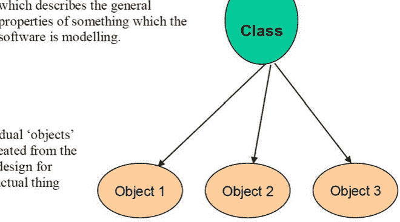

个体“对象”（objects）是从类设计创建的

使用面向分析和设计的技术，我们的工作是观察现实世界并提出简化的抽象模型，将其转换为计算机系统。我们最终系统的好坏取决于我们的软件模型有多好。

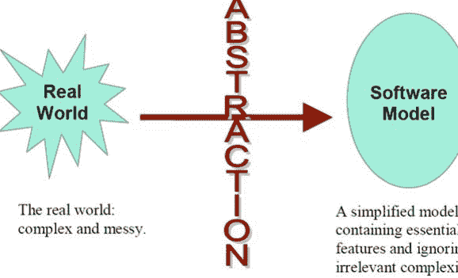

现实世界：复杂且混乱。

简化的模型：包含本质特征并忽略无关的复杂性。

# 面向对象编程简介

活动 9 考虑一个允许从图书馆借用物品的计算机系统。想象一个你想要借用的物品，列出二或三项管理员可能对该物品的操作。

反馈 9 你可能想了一本想要借用的书，管理员可能需要知道这本书的书名和作者。

对于系统中创建的每个对象，我们需要定义该对象的属性。

活动 10 注意，我们可以预留视为一个对象（实际物品是一个物理对象）。考虑这个对象，列出二或三项管理员可能对该对象的操作。

反馈 10 管理员可能需要取消预留（如果你改变了主意），他们可能还需要告诉你物品是否已到货供你提取。

对于每个对象，我们需要定义在该对象上执行的操作。


# 你是否在考虑一个学位？

在大学水平学习英语，无论是个人还是团队，参与前沿研究，带来知识和经验来提升你的职业生涯。

在哥本哈根，在一个安全的环境中，参与课外活动如体育运动等。

看看我们在 cbs.dk 是如何工作的。

[免费下载书籍](https://bookboom.com)

# 面向对象编程 C#

# 面向对象编程简介

活动 11 考虑可以从图书馆借用的最通用的对象类别，一个借用物品；列出二或三项更具体的子类别。

反馈 11 定义最通用的对象类别（我们称之为类）——某些我们可能想要借用的特定子类（例如，书籍、杂志、视听材料）。这些类共享通用属性，但会有特定的差异（例如，为了借用视听物品）。


# 1.6 面向对象编程方法的益处

无论你是否以面向的方式开发程序，在编写软件之前，你必须开发一个软件必须做什么的模型。面向对象的建模基于抽象、封装和继承的思想。

面向对象编程方法的支持者认为这种模型提供了：

- 更好的抽象（建模信息和行为）
- 更好的可维护性（更易理解、更不脆弱）
- 更好的重用性（可以在其他系统中使用的封装类）

我们将在本书范围内讨论这些观点，并在第 11 章将详细查看面向对象分析是如何工作的，以及结果模型如何在面向对象语言（例如 `C#`）中实现。

# 1.7 软件实现

在计算机执行有用任务之前（例如，在文档中检查写法），软件需要在运行的机器上编写并实现。软件实现涉及源代码的编写以及在特定机器上执行的准备。当然，软件需要被定义并在某些点需要被测试。有许多迭代周期来支持设计、实现和测试，涉及多个实现阶段。在特定机器上执行源代码的方法有：

- 编译为机器语言代码
- 由解释器直接执行源代码
- 编译为由运行时解释的中间代码

实现 `C#` 程序涉及将源代码（`C#`）编译为机器语言代码。这种方法既有优点也有缺点，值得 `C#` 开发者比较这选项。

[免费下载书籍](https://bookhoon.com)

# 面向对象编程简介

## 编译

编译器将源代码翻译为相关硬件/操作系统的机器代码。

严格来说有两个阶段：程序单元的编译（通常是文件），然后是将完整的可执行程序（包括独立的程序单元和相关的代码等）组合在一起的“链接”。

编译后的程序作为该平台的“原生”应用程序运行。

这是最旧的模型，用于 `Fortran` 和 `Cobol` 等早期语言以及 `C#` 等许多现代语言。它允许快速执行，但每次代码更改或每次我们想在不同操作系统的机器上运行此代码时，都需要重新编译程序。


## 解释

在这里，源代码没有被翻译成机器码。相反，解释器读取源代码并执行它指定的动作。

我们可以说解释器就像一台“虚拟机”，其机器语言就是源代码。

更改代码不需要重新编译，但解释过程对执行速度有很大影响。

脚本语言倾向于这样工作。


解释程序可能慢，但在任何具有适当解释器的机器上都可以运行。它们不需要为不同的机器进行编译。


## 中间代码

这种模型是前两者的混合体。

通过编译将源代码转换为更高效的中间表示，这种表示可以由“运行时系统”（另一种“虚拟机”）执行，速度比直接解释源代码要快。使用由运行时软件执行的中间代码，允许编译过程独立于操作系统/硬件平台，即相同的中间代码应该在不同的平台上运行，“相同的中间代码应该在不同平台上运行”正是 `Java` 的工作方式。`Java` 是一种现代的面向对象语言，是 `C#` 的替代方案，从程序员的角度来看，它共享许多特征。


### 运行 Java 程序

要运行 `Java` 程序，我们首先必须使用开发工具包（`JDK`）中的编译器生成中间代码（字节码）。因此，`Java` 编译器不创建 `.exe` 文件，而是生成 `.class` 文件。


# 统一建模语言 (UML)

| Book |
| --- |
| - title :String |
| - author :String |
| +SetTitle() |
| +GetTitle() |
| +SetAuthor() |
| +GetAuthor() |
| +ToString() |

注：上述显示的 `String` 并不是原始类型，它本身就是一个类。因此，它以大写字母开头。

### 关于命名规范的说明

某些程序员使用大写字母开头的单词表示类名，使用小写开头的单词表示属性或方法（因此 `ToString()` 将显示为 `toString()`）。这是在 `Java`（另一种常见的面向对象语言）中设计和编写程序时的常用约定。然而，`C#` 程序员并不遵循这一约定——在 `C#` 中，方法名通常以大写字母开头。可以通过 `()` 来区分方法名和类名。在本例中：

- 'Book' 是一个类
- 'title' 是一个属性
- 'SetTitle()' 是一个方法

`UML` 图并非特定于语言，因此这种通过 `UML` 图传递的软件设计可以在多种面向对象的语言中实现。

此外，`C#` 程序员不需要访问器方法（getter 和 setter），因为它们被“属性”所取代。属性实际上上是隐藏的访问器方法，因此上述的 `GetTitle()`、`SetTitle()` 等 getter 和 setter 方法在 `C#` 程序中是不需要的。在 `C#` 中，会定义名为 `title` 的字段，并定义名为 `Title` 的属性。这将允许我们通过使用关联的属性 `Title =......;` 直接设置 `title`。

书中所示的 `UML` 图将使用 `C#` 程序员常用的命名规范……简单来说，是因为我们将编写 `C#` 示例代码来演示这里讨论的面向对象原则。尽管起初我们展示的是传统的访问器方法，但在编码时这些将被属性所取代。

## 活动 1

绘制一个图表示名为 'BankAccount' 的类，它具有属性 `balance`（类型为 `int`）以及方法 `DepositMoney()`、`WithdrawMoney()` 和 `DisplayBalance()`。请显示合适的可见性修饰符。

反馈 1

| BankAccount |
| :--- |
| - balance :int |
| + DepositMoney() |
| + WithdrawMoney() |
| + DisplayBalance() |

上面的图表显示了这些信息

`UML` 允许我们在图中忽略不希望突出显示的任何信息——这使我们能够忽略无关的细节，并将读者的注意力集中在我们想要关注的信息上。因此，以下都是有效的类图……

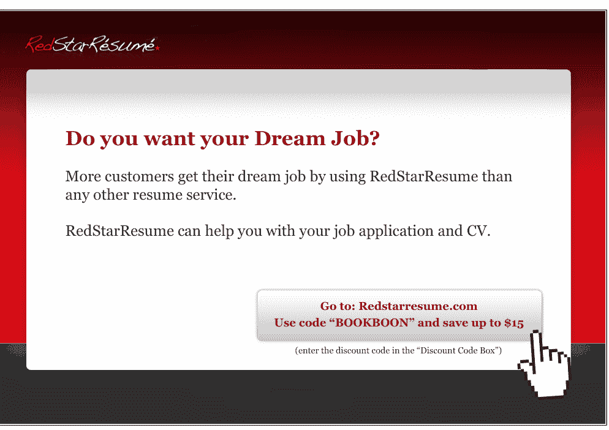

首先，在不显示访问修饰符的情况下……

| BankAccount |
| :--- |
| balance int |
| DepositMoney() |
| WithdrawMoney() |
| DisplayBalance() |

其次，在显示访问修饰符但不显示数据类型的情况下……

| BankAccount |
| :--- |
| balance |
| DepositMoney() |
| WithdrawMoney() |
| DisplayBalance() |

最后，在不显示属性和方法的情况下……

| BankAccount |
| :--- |

即：有一个名为 'BankAccount' 的类，但它的细节没有显示。

当然，几乎所有的 `C#` 程序都由许多类组成，类与类之间相互关联——某些类将使用其他类。这些关系通过箭头表示。不同类型的箭头表示不同的关系（包括继承和聚合关系）。

此外，类图还使用了关键字、备注和注释。

正如我们在接下来的示例中看到的，类图可以显示以下信息：

- 类
  - 属性
  - 操作
  - 可见性
- 关系
  - 可导航性
  - 多重性
  - 依赖
  - 聚合
  - 组合
- 一般化 / 特殊化
  - 继承
  - 接口
- 关键字
- 备注和注释

### 2.3 UML 语法

由于 `UML` 图传达的是精确的信息，因此应该遵循精确的语法。

属性应显示为：*可见性 名称：类型 多重性*

其中可见性是以下之一：

- + public 公
- - private 私有
- # protected 保护
- ~ package 包

多重性是以下之一：

- n 恰好 n
- * 零或多个
- m..n 在 m 到 n 之间

以下是使用 `UML` 正确指定的属性示例：

- - custRef : int [1]

私有属性 `custRef` 是一个单一 `int` 值，这通常显示为 - **custRef : int**。但在没有显示多重性的情况下，我们无法安全地假设作者想要表达多重性为一。

- # itemCodes : String [1..]

受保护属性 `itemCodes` 是一个或多个 `String` 值。

- # validCard : boolean

属性 `validCard` 的可见性未指定，多重性也未指定。

操作也有精确的语法，并应显示为：

可见性 名称 (参数1 : 类型1, 参数2: 类型2): 返回类型

其中每个参数都用（括号）显示，然后指定返回类型。

例如

+ + AddName(newName : String): boolean

这表示一个公共方法 'AddName'，它接受一个类型为 `String` 的参数 'newName' 并返回一个布尔值。

### 活动 2

绘制一个图表示名为 'BankAccount' 的类，它有一个私有属性 `balance`（这是一个单一整数）和一个公共方法 `DepositMoney()`，该方法接受一个整数参数 'deposit' 并返回一个布尔值。在 `UML` 类图中完整指定所有这些信息。

## 表示关系

类图在表示单个类的同时，还表示类之间的关系。其中一种关系被称为“关联 (Association)”。我们将在第 6 章学习更多关于关联的内容。

反馈 2

| BankAccount |
| :--- |
| - balance :int |
| + DepositMoney(deposit : int): boolean |

上面的图显示了 `OneClass` 拥有属性 `value`。

| OneClass |
| :--- |
| value |

使用关联当 `source` 指向 `target` 类时，为了解释某个类的一个方面，功能性：

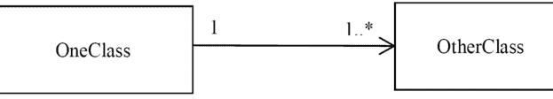

这暗示 `OneClass` 维护一个类型为 `OtherClass` 的集合。我们将在第 7 章查看集合。

活动 3

绘制一个图表示 'Catalogue' 类和如下所示的 `ItemForSale` 类——`ItemSale` 有一个类型为 `String` 的属性 `name` 和一个类型为 `int` 的属性 `price`。它还有一个方法 `SetPrice()` 接受一个整数参数 `newPrice`。'Catalogue' 有一个属性 `listOfItems`，即当前目录中的项。由于零或多个项可以存储在目录中，`listOfItems` 需要是一个数组或集合。'Catalogue' 还有一个方法 `AddItem()`，接受一个参数（类型为 `ItemSale`）。在类图中显示属性和方法的适当可见性修饰。

反馈 3

| Catalogue | ItemForSale |
| :--- | :--- |
| 1..* | - name:String |
| + AddItem(item :ItemSale) | + SetPrice(newPrice :int) |

注意：按照这里的命名规范，所有类名大写开头，属性名小写开头，方法名大写开头以区别于类名。此外注意 `ItemForSale` 描述的是单个项目（而不是多个）。'listItems' 维护零或多个独立对象。

### 关联类型

有由不同箭头表示的不同关联类型：

- 依赖 (Dependency)。


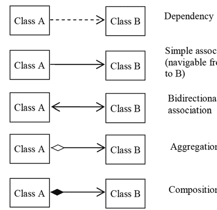

- 依赖
- 简单关联（从 A 到 B 可导航）
- 双向关联
- 聚合
- 组合

### 依赖

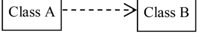

- 依赖是类之间最不具体的关系（不是严格的“关联”）
- 类 A 以某种方式使用类 B 定义的功能
- 对类 B 的更改可能会类 A

依赖线的典型情况是：类 A 有一个方法接受类 B 的对象参数，或者使用该类的局部变量，或者调用了类 B 的“静态”方法。

例如：`Print()` 可能需要一个打印机对象作为参数。每次调用 `Print()` 方法时，都可以传递一个不同的打印机对象作为参数，因此打印结果将出现在不同的位置因此因此虽然包含 `Print()` 方法的类需要打印机对象才能工作，但它不需要与特定的打印机永久关联。

### 简单关联

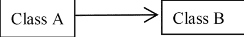

- 在关联关系中，类 A “使用”类 B 的对象
- 通常，类 A 有一个类 B 的属性
- 导航性从 A 到 B：

  即：类 A 对象可以访问与其关联的类 B 对象。反之则不然——类 B 对象并“不知道”类 A 对象

简单关联通常对应于类 A 中一个类型为目标类 B 的实例变量。

示例：上面的 `Catalogue`（目录）需要访问 0 个或多个 `ItemForSale`（待售商品），以便从目录中添加或删除商品。而 `ItemForSale` 不需要访问 `Catalogue` 即可设置其价格或执行与商品本身相关的其他方法。

### 双向关联

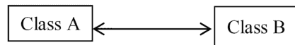

- 双向关联是指类 A 和 B 之间存在双向关联
- 每一个类都引用另一个类
- 导航性到 A 和 B 到 A：
  - 类 A 对象可以访问与其关联的类 B 对象
  - 类 B 对象“属于”类 A
  - 意味着从 A 到 B 的引用
  - 同样，类 B 对象也可以访问与其关联的类 A 对象

双向关联是复杂的，因为每个对象都必须有指向另一个对象的引用，且双向关联通常比单向关联少得多。

双向关联的一个示例可以是“学位（Degree）”和“学生（Student）”之间。即：给定一个学位，我们可能想知道哪些学生正在读该学位。或者，从学生开始，我们可能想知道他们正在读的学位。


由于许多学生在同一学习同一个学位，但学生通常只有一个学位，因此这里仍然存在一对多的关系（当然，我们可以建模一种情况，记录正在学习的学位和之前通过的学位——在这种情况下，由于学生可能通过了多个学位，我们将拥有多对多的关系）。

### 聚合

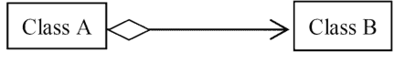

- 聚合表示类 B 对象“属于”类 A的情况
- 意味着从 A 到 B 的引用
- 虽然聚合意味着类 B 对象属于类 A 对象，但它也意味着类 B 对象保留独立于类 A 的存在性。一些设计人员认为，聚合和简单关联之间没有真正的区别


聚合的一个示例可以是“汽车（Car）”类和“轮胎（Tyre）”类之间。

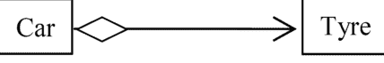

我们认为轮胎属于它们所在的汽车，但在修理厂时，它们可能会被拆下并放在架子上进行维修。它们的生存性并不依赖于与其关联的汽车的存在。一些设计人员认为，聚合可以被简单关联代替，因为在程序中实现这种设计对程序员员来说没有区别。

### 组合

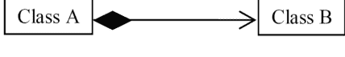

- 组合类似于聚合，但它意味着一种更强的归属关系，即：类 B 对象是类 A 对象的“部分”
- 同样意味着从 A 到 B 的引用
- 在这种情况下比聚合要“强”得多，类 B 对象是类 A 不可缺的一部分，且通常类 B 对象绝不会在类 A 的部分之外存在，即它们具有相同的“生命周期”

组合的一个示例可以是图片（Picture）的元素——点（Points）、线（Lines）和形状（Shapes）之间的关系。这些对象只能作为图片的一部分存在，如果图片被删除，它们也会被删除。

除了表示关联外，类图还可以表示：

- 继承（Inheritance）
- 接口（Interfaces）
- 关键字（Keywords）和
- 注释（Notes）

统一建模语言 (UML)

### 继承

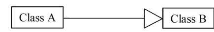

- 除了关联外，另一种主要的建模关系是继承：
- 类 A “继承”了类 B 的接口和实现，尽管它可能会覆盖实现细节并补充这两者。

我们将在第 3 章中详细介绍继承。

### 接口

- 接口类似于继承，但使用接口时只继承接口部分。接口定义的方法必须在实现接口的每个类中被实现。
- 接口可以使用 `<<interface>>` 关键字表示：

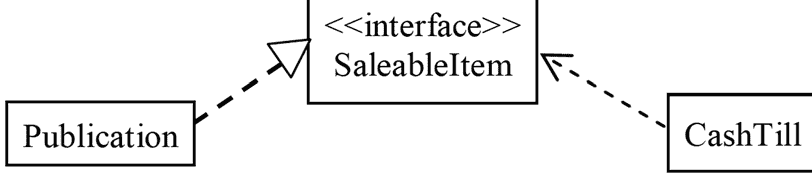

还有这种简写表示方式：

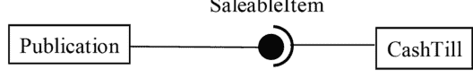

在这两种情况下，示例都表示 `CashTill` 需要 `SaleableItem` 接口，而 `Publication` 实现了它。注意虚线的继承线/箭头，它显示 `Publication` 实现（realizes）了 `SaleableItem` 接口。

“球窝（ball and socket）”表示是 `UML` 2 中的新增——它是表示接口如何连接类的良好视觉方式。

我们将在第 4 章详细讨论接口的应用。

### 关键字


# 使用 C# 的面向对象编程

# 统一建模语言 (UML)

UML 定义了关键字来完善图形符号的含义。我们已经看到了 `<<interface>>`，我们还会使用 `<<abstract>>`。

抽象类可以用斜体而不是 `<<abstract>>` 关键字表示。

客户可以拥有任意数量的银行账户，银行账户可以由一个人或两个人持有（共同账户）。我们抑制了这种关系的导航性，也许因为我们还没有决定这个问题。

## 注释

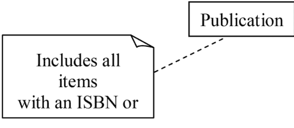

最后，我们可以添加注释来对图进行说明。这为我们提供了一个添加信息的“万收集”功能

### 活动 4

根据你自己的经验，尝试开发一个说明以下元素的模型：

- 简单关联
- 双向关联
- 聚合（很难！）
- 组合
- 多重性（multiplicity）
- 泛化（继承）
- 接口
- 注释

为了帮助你开始，下面是一些小示例：

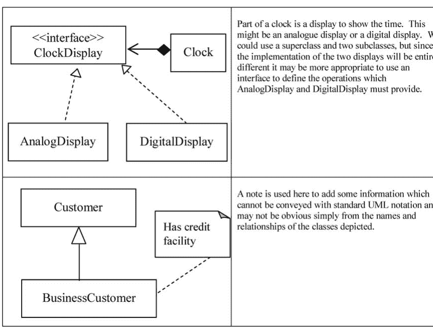

时钟的一部分是显示时间的显示器。这可能是模拟显示器也可能是数字显示器。我们可以使用父类和子类，但由于这两种显示器的实现完全不同，使用接口（interface）来定义 `AnalogDisplay`（模拟显示）和 `DigitalDisplay`（数字显示）必须提供的操作可能更合适。

这里使用注释添加一些无法通过标准 UML 表示法表达的信息，这些信息仅从所绘类的名称和关系可能并不显而易见。


# 你充满了创意。这正是我们所寻找的。

正在寻找一个可以让你的想法真正产生影响的职业吗？瑞银的毕业生计划和实习是一个让你亲身体验成为全球团队一部分的机会，这个团队奖励你的想法并相信在今天成功。

无论你处于学术生涯的何种阶段，请访问 `www.ubs.com/graduates` 让你的未来成为我们的一份。

`www.ubs.com/graduates`

UBS (瑞银)

在 bookboom.com 下载免费电子书

## 2.4 UML 包图

虽然类图是 UML 表示法定义中最常用的图表，且我们将在本书书中大量使用类图，但还有其他图表可以表示不同类型的信息。在这里我们将涉及其中几个：

- 包图 (Package Diagrams)
- 对象图 (Object Diagrams) 和
- 时序图 (Sequence Diagrams)

世界地图、地图和城市都显示空间信息，只是比例和详细程度不同。大型面向对象（OO）系统可以由数百或数千个类组成，因此类图是表示大型系统架构的唯一方法——它会变得过于巨大且复杂。因此，就像我们需要地图一样，我们需要包图来显示大型系统的总体架构。即使是中等系统也可以分解为几个基本组件，即包。我们将在第 11 章看到包使用的示例。现在我们只看包图的符号表示法。

包图允许我们提供比单个类更高级的组织和封装。包在 C# 中通过创建子文件夹和定义 `namespace` 来实现。在用 C# 编写大型系统时，我们用此将大型系统划分为更小、更易管理的子系统。在设计阶段，我们将这些子系统表示为包。

大型 C# 开发应该在设计阶段划分成合适的包。UML 提供了“包图”来表示类与包之间的关系。

我们可以描绘：

- 包内部的类
- 包的嵌套
- 包之间的依赖关系

在下面的图中，我们看到了两个包：`monitor systems`（监控系统）和 `management systems`（管理系统）。这些描述了一个跨国公司用于管理和维护其运营的一部分，包括其计算机系统和人员。

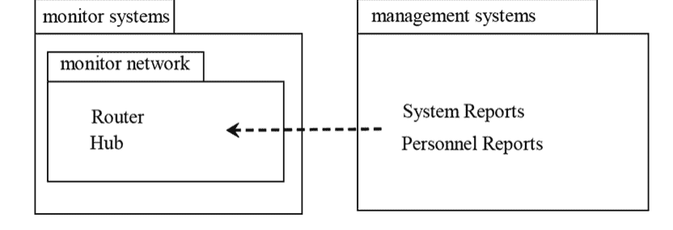

仔细观察可以发现，`monitor systems` 包内部另一个名为 `monitor network`（监控网络）的包。该包至少包含两个类 `Router`（路由器）和 `Hub`（集线器），尽管可能包含许多其他相关类。

`management systems` 包包含两个（或更多）类 `System Reports`（系统报告）和 `Personnel Reports`（人员报告）。

此外，我们可以看到 `management systems` 包内部的类以某种方式与 `monitor network` 包内部的类相关。在 `management systems` 包内部的类在某种程度上与 `monitor network` 内部的类相关。请注意，`management systems` 包内部的类可能通过标准 UML 表示法无法表达，且仅从所绘类的名称和关系可能并不显而易见。在图中，`management systems` 包内部的类使用了 `monitor network` 包的类。在类图中，`Router` 类是 `monitor network` 包的一部分，它位于 `monitor systems` 包。 再次，下图显示了 `monitor network` 包的类。 这些不同的表示法将根据情况非常有用。

### 包命名

根据惯例，包名通常使用小写字母。在 C# 中，根据喜好命名包例如：

- `mysystem`
- `mysystem.interface`
- `mysystem.engine`

然而，包通常是分布的，为了区分这些包，采用了类似于 URL 的命名法，以实现： 根据 URL（例如 `www.ebay.co.uk`）来命名包。使用 UML 原则的包来表示网络。

### 活动 5

你和伴侣决定一起去购物。为了速度，将以下购物清单分为两部分——你收集的物品和你伴侣收集的物品。

苹果、家具清洁剂、梨、胡萝卜、卷纸、土豆、地板蜡、葡萄。

### 反馈 5

为了提高效率，你可能将清单分成了两个列表：

| 列表1 | 列表2 |
| --- | --- |
| 苹果、 | 家具清洁剂、 |
| 梨、 | 地板蜡 |
| 葡萄 | 匹配 |
| 胡萝卜、 | 卷纸、 |
| 土豆 | |

### 活动 6

你带领三个程序员用 C# 编写一个监控并控制网络的程序。该系统由下所示七个类组成。将这些类组织成三个包。每个程序员将负责一个包的代码。给包任何你认为合适的名称。

- `Main`：启动系统的类
- `Monitor`：监控网络性能和安全漏洞的类
- `Interface`：整个系统的视觉界面
- `Reconfigure`：允许网络重新配置的类
- `RecordStats`：在数据库中存储有关网络数据的类
- `RemoteControl`：通过电话远程控制系统的类
- `PrintReports`：使用数据库中存储的数据为管理层打印管理报告

### 反馈 6

将项目组织成包时，并不总是有一个“正确答案”，但如果你将类组织成合适的包（具有相关功能的类），就能提高系统的封装性和程序员的效率。给活动 6 的建议解决方案如下：

`interface`

- `Main`
- `Interface`
- `RemoteControl`

`network`

- `Monitor`
- `Reconfigure`

`database`

- `RecordStats`
- `PrintReports`


### 活动 7

假设你的组织的 URL 为 `www.myorg.com`，并且所示三个包和七个类都是 `project1` 的一部分：绘制包图来传达这些信息。

`interface`

`Main`

`Interface`

`RemoteControl`

`network`

`Monitor`

`Reconfigure`

`database`

`RecordStats`

`PrintReports`

### 反馈 7

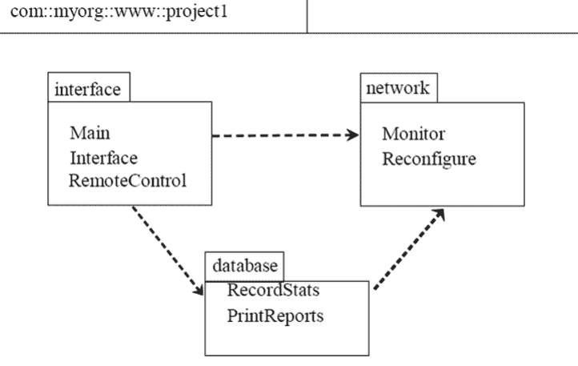

注意：绘制了依赖箭头以突出包与包之间的关系。当对确定这些关系投入更多精力时，它们可能会证明是关联（association，一种比单纯的依赖要强得多的关系）。

## 2.5 UML 对象图

类图和包图允许我们对系统的架构进行视觉化和讨论，然而有时我们希望讨论数据处理过程。对象图允许我们视觉化系统在某一时刻的实例以及该系统在该时刻可能包含的数据。

对象图在表面上与类图相似，但方框表示对象的实例。

方框的标题格式为 :-

```
objectName : ClassName
```

由于每个方框都描述了特定时刻的特定对象，因此方框包含了属性及其对应的值（在特定时刻的值）。

```
attribute = value
```

这些图表对于在设计期间说明特定的“快照”场景非常有用。

对象图显示了图书馆目录系统在某一时刻可能存在的几个对象。该系统包含两个类 :-

- `Book`（书籍），存储书籍的详细信息；`Library`（图书馆），维护书籍集合，并根据需要添加、搜索或删除书籍。

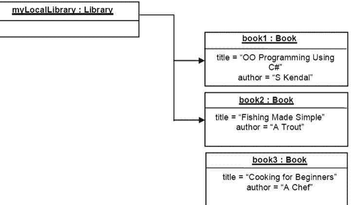

| book1 : Book |
| :--- |
| title = "OO Programming Using C#" author = "S Kendal" |
| book2 : Book |
| title = "Fishing Made Simple" author = "A Trout" |
| book3 : Book |
| title = "Cooking for Beginners" author = "A Chef" |

观察此图表，我们可以看到在某一特定时刻，虽然创建了三本书，但只有两本书被添加了图书馆：如果我们要在图书馆中搜索“Cooking for Beginners”，我们预计将无法找到这本书。

与类图一样，元素在对象图中可以自由地隐藏（suppress）。

例如，以下所有操作都是合法的：

| book1 : Book | - 隐藏某些属性 |
| :--- | :--- |
| title = "OO Programming Using C#" | |
| book1 : Book | - 隐藏所有属性 |
| Book | - 隐藏对象名称 |


## 2.6 UML 序图

序图与类图或对象图完全不同。类图描述系统的架构，对象图描述系统在某一时刻的状态。然而，序图描述了系统在一段时间内是如何工作的。序图是系统的“动态”表示而非“静态”表示。它们展示了在一段时间内对象内部以及对象之间方法调用的序列。它们对于理解对象在特定场景下如何协作非常有用。

参见下例：

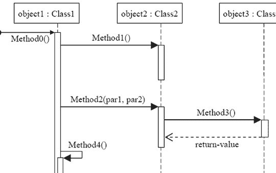

在这个场景中，我们有三个对象。时间从上到下流动，垂直虚线（生命线）表示对象随时间的持续存在。

此图显示了以下正在发生的动作 :-

- 首先，从某处有一个（在面向对象术语中通常称为消息）到 `object1` 的 `Method0()` 的方法调用——这可能是图表外的另一个类。
- `object1` 开始执行其 `Method0()`（如垂直条所示）。

## 选择与迭代

许多世界中的事物属于相关的组。“继承”是特征从父传递给子类的概念，并在面向对象设计和编程中起着重要作用。

虽然我们对构造函数和访问控制已经熟悉，但在将这些与继承联系起来时，我们需要考虑特定的问题。此外，我们需要考虑抽象类和方法重写，因为这些在继承的背景下是重要的概念。

最后，我们将查看 `Object` 类，它与所有类都有特殊的关系。

# 继承与方法重写

### 引言

本章将讨论继承、方法重写以及 `Base` 关键字的核心概念

### 目标

在本章结束时，你将能够：

- 理解继承层次结构的重要性
- 理解如何使用抽象类提取公共特征
- 重写方法（包括 `Object` 类中的）
- 使用 UML 定义继承层次结构
- 在 C# 程序中实现继承和方法重写

本章涵盖的所有材料将在本书的后续章节中进一步开发。虽然本章将重点关注……实际上，本章涵盖的所有材料将在后续章节中进一步开发。虽然本章将重点关注定义继承层次结构所需的分析技能，第 6 章将专注于这一点。

本章由十二部分组成：

- 1) 对象家族
- 2) 通用与特化
- 3) 继承
- 4) 在 C# 中实现继承
- 5) 构造函数
- 6) 构造函数规则
- 7) 访问控制
- 8) 抽象类
- 9) 方法重写
- 10) `Object` 类
- 11) `Object` 中重写的 `ToString()`
- 12) 总结

## 3.1 对象家族

世界上的许多事物属于相关的“家族。“继承”是特征从父传递给子类的概念，并在面向对象设计和编程中起着重要作用。

虽然我们对构造函数和访问控制（公共/私有）已经熟悉，但在将这些与继承联系起来时，我们需要考虑特定的问题。此外，我们需要考虑抽象类和方法重写，因为这些在继承的背景下是重要的概念。

最后，我们将查看 `Object` 类，它与所有类都有特殊的关系。

## 3.2 通用与特化

类是通用形式，从它可以可以创建细节不同的对象。因此，对象是类的“实例”。例如，`Student 051234567` 是 `Student` 类的实例。更简洁地说，`051234567` 是一个 `Student`。构造函数是根据类定义创建对象的特殊方法。

类本身通常可以通过相似的关系进行组织。

一种与我们有某些相似之处的层次结构是描述动物界的：

- 界 (Kingdom) (e. 动物)
- 门 (Phylum) (e.g. 脊椎动物)
- 纲 (Class) (e.g. 哺乳动物)
- 目 (Order) (e.g. 肉动物)
- 科 (Family) (e.g. 猫科)
- 属 (Genus) (e.g. 猫属)
- 种 (Species) (e.g. 猞猫)

我们可以通过图化方式表示这种层次结构……

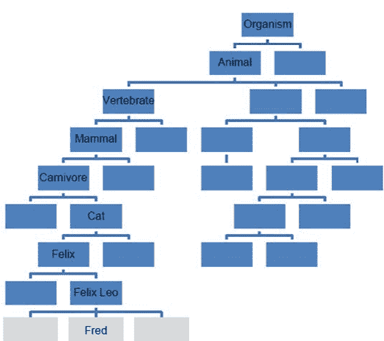

当然，要绘制一幅完整的图所需的时间和空间比我们拥有的要多。

在这里我们可以看到这里的一个特定动物：‘Fred’。Fred 并不是一个动物类，而是一个真实的动物。


## 3.3 继承

我们在层次结构的高处指定通用特征，在低处指定更具体的特征。面向对象编程中的一个重要原则——我们称之为泛化和特化。

层次结构中上方类的所有特征都会自动出现在该层次结构中的下方的类/对象中——我们称之为继承。

考虑书籍和杂志——它们都是出版物的特定类型。


我们可以用 UML 类图中的类来表示这些内容。在此过程中，我们可以看到这些类可能具有的一些实例变量和方法。

| Book | 杂志 |

| --- | --- |

| title | title |

| author | price |

| price | orderQty |

| copies | currissue |

| | copies |

| SellCopy() | AdjustQty() |

| OrderCopies() | RecNewIssue() |

属性 `title`、`author` 和 `price` 是显而易见的。`copies` 也是显而易见的——这是[书籍]目前的库存情况。

对于书籍，`OrderCopies()` 接收一个参数，指定向库存中增加多少额外副本。

对于杂志，`orderQty` 是每期新杂志收到的副本数量，`currissue` 是当前期期的日期/期间（例如“2011年1月”、“1月6日”、“2011年春季”）。当发行新期号时，旧的期号会被丢弃，`orderQty` 会进入库存。因此，`RecNewIssue()` 将 `currissue` 设置为新期期的日期，并将 `copies` 恢复为 `orderQty`。`AdjustQty()` 修改 `orderQty` 以更改后续期号将库存的副本数量。

在 `bookboom.com` 下载免费电子书

## 使用 C# 的面向对象编程

## 继承与方法重写

### 活动 1

查看上方定义的 `Book` 类和 `Magazine` 类，并识别这两个类之间的共同点和不同点。

### 反馈 1

这些类共同有两个实例变量：`title`, `price`, `copies`。

它们还共同拥有方法 `SellCopy()`。

差异如下……

`Book` 额外拥有 `author` 和 `OrderCopies()`。

`Magazine` 额外拥有 `orderQty`、`currissue`、`AdjustQty()` 和 `RecNewIssue()`。

我们可以将这些类的共同成员提取（“factor out”）到一个名为 `Publication` 的超类中。在 C# 中，超类通常被称为基类（base class）。

| Publication |

| --- |

| title price price copies |

| SellCopy() |

差异需要作为额外的成员指定在“子类”`Book` 和 `Magazine` 中。

## 使用 C# 的面向对象编程

## 继承与方法重写

| Publication |

| --- |

| title |

| price |

| copies |

| SellCopy() |

| Book | Magazine |

| --- | --- |

| author | orderQty |

| OrderCopies() | currIssue |

| | AdjustQty() |

| | RecNewIssue() |

在这个类图中，空心圆头的箭头表示继承。

子类具有泛化的超类（或基类）特征 + 额外的特化特征。因此，`Book` 类有四个实例变量（`title`, `price`, `copies` 和 `author`），它还有两个方法（`SellCopy()` 和 `OrderCopies()`）。


到 2020 年，风能将提供我们星球十分分之一的电能需求。即使在今天，SKF 的创新知识对于运行世界上大部分的风力涡轮机至关重要。

高达 25% 的发电成本与维护有关。通过我们的在线状态监测和警报系统可以大幅降低这些成本。我们使变革变得更具效益，节省能源并保护环境。

通过分享我们的经验、专业知识和创造力，行业可以提升超出预期的性能。我们共同可以]提升超出预期的性能。

### 活动 2

将以下类安排到合适的层次结构中，并在类图中画出它们。

- 活期账户
- 存款账户
- 银行账户
- Simon 的存款账户

### 反馈 2


最通用的类位于继承结构的顶部。我们可以]继承该类的属性和方法。

### 活动 3

将以下类安排到合适的层次结构中，并在类图中画出它们。

- 建筑
- 房屋
- 汽车

### 活动 4

使用合适的类图描述以下内容，显示任何合理的关系……

- 租用的建筑（这将有一个确定租金的方法）
- 租用的房屋（它将继承 determine 方法）
- 租金收集员（人）（这将使用 determine 方法打印账单）

提示：你可能希望使用以下箭头

### 反馈 5

首先，为了打印账单，`RentCollector` 需要知道应收租金。对于房屋（House），没有定义 `DetermineRent()` 方法——但这并不意味着它不存在。

它必须存在，因为 `House` 继承了 `Building` 的属性和方法！

我们只在方法是额外方法或被重写的方法时才在子类中显示它们。

租金收集者需要一个 `Building`，而 `House` 是 `Building` 的一种类型。因此，虽然 `RentCollector` 和 `House` 之间没有显示关联，但 `RentCollector` 可以为房屋打印账单。在任何需要 `Building` 对象的地方，我们都可以用 `House` 对象代替，因为它是 `Building` 的一种。这是多态的一个示例，我们将在第 4 章中看到其他示例。

### 活动 6

修改此 UML 图，显示 `DetermineRent()` 在 `House` 中被重写了（即被替换）。

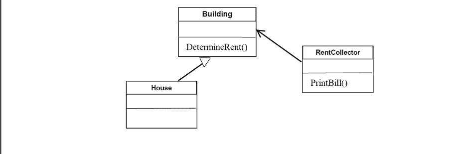

## 使用 C# 的面向对象编程

## 继承与方法重写

### 反馈 6

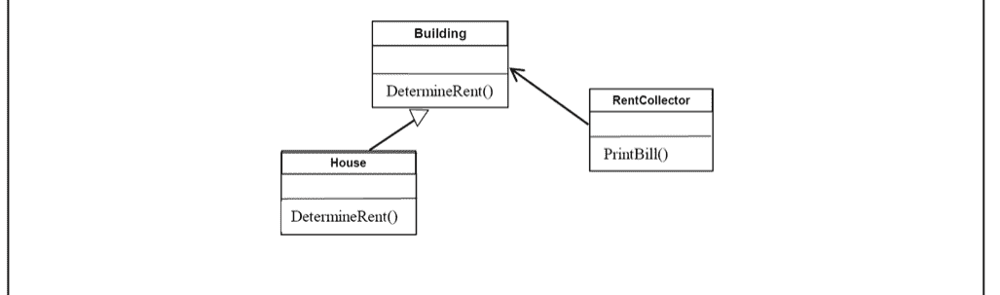

通过在 `House` 中显示 `DetermineRent()`，我们展示了该方法重写了基类（Building）中定义的方法。

有趣的是，NET CLR 引擎将根据调用方法的对象类型使用正确的 `DetermineRent()` 方法。因此，如果为房屋打印账单，`RentCollector` 将调用 `House` 中定义的方法；而对于任何其他类型的建筑，它将使用 `Building` 中定义的方法。这是自动完成的——`RentCollector` 类中的代码并不区分 `Building` 的类型。

重写将在本章稍后部分进行详细讨论。

## 3.4 在 C# 中实现继承

创建父类不需要特殊功能。因此，除非被明确禁止，否则任何类都可以成为子类。

子类使用 **符号** 指明它正在从父类继承特性。例如....

```csharp
class MySubClass : MySuperclass
{
    // 额外的实例变量和
    // 额外的方法
}
```

## 3.5 构造函数

构造函数是从类创建对象的方法。每个类（无论是父类还是子类）都应该在构造函数中封装自己的初始化，通常与设置实例变量的初始状态有关。构造函数是与类同名的方法。

父类（或基类）的构造函数应该处理通用初始化。

## 使用 C# 的面向对象编程

## 继承与方法重写

每个子类都可以有自己的构造函数进行特殊初始化，但它通常必须调用基类构造函数的行为。它使用关键字 `base` 实现这一点。

```csharp
class MySubClass : MySuperClass
{
    public MySubClass (sub-parameters) : base (super-parameters)
    {
        // 其他初始化
    }
}
```

通常传递给 `MySubClass` 的某些参数是父类实例变量的初始化值，这些值将作为参数传递给父类构造函数。换句话说，父类参数是子参数的部分（或全部）。

下面显示了两个构造函数，一个用于 `Publication` 类，一个用于 `Book`。`Book` 构造函数需要四个参数，其中三个立即传递给基类构造函数以初始化其实例变量。


`www.simcorp.com`

降低风险 | 减少成本 | 促进增长

## 使用 C# 的面向对象编程

## 继承与方法重写

```csharp
// Publication 类的构造函数
public Publication(String title, double price, int copies)
{
    this.title = title;
    // 等
}
```

```csharp
// Book 类的构造函数
public Book(String title, double price, int copies, String author)
    : base(title, price, copies)
{
    this.author = author;
}
```

因此，在创建书籍对象时，我们首先创建一个出版（Publication）对象。`Books` 的构造函数通过调用 `Publication` 的构造函数来实现这一点。

## 3.6 构造函数规则

存在规范父级构造函数调用的规则。

如果父类有一个无参数（或默认）构造函数，那么当子类构造函数中没有显式调用 `base` 时，它将被自动调用，尽管出于清晰性考虑，显式调用仍然是做法。

然而，如果父类没有无参数构造函数但有一个带参数的构造函数，则**必须**使用 `: base` 显式调用。为了说明这一点....

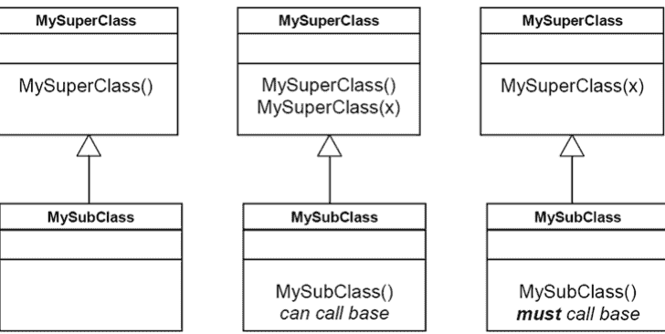

上方左侧：由于父类有无参数构造函数，拥有一个没有构造函数的子类是合法的，但不是良好的做法。

中间：子类构造函数没有调用基构造函数，则将调用无参数的父类构造函数。

右侧：父类没有无参数构造函数，子类必须有一个构造函数，它必须使用关键字 `base` 调用父构造函数并传递所需的参数。这是因为一个只有带参数构造函数的（父）类只能通过提供所需的参数（s）进行初始化。

## 3.7 访问控制

为了强制封装，我们通常将实例变量设为私有，并根据需要提供访问器/修改器方法（在 C# 中我们使用属性）。

`Publication` 的 `SelfCopy()` 方法需要更改变量 `copies` 的值。`Book` 和 `Magazine` 都需要修改 `copies` 的值。在 C# 中有三种方法可以实现这一点：

- 1) 将 `copies` 设为私有，并创建必要的访问器方法；
- 2) 将 `copies` 设为受保护（protected），这对于子类是的；
- 3) 在 C# 中创建属性，这会更简单。

通常，我们将变量设为私有，并根据需要提供访问器/修改器方法（在 C# 中我们使用属性）。

这里我们将展示对 `copies` 的访问：

## 使用 C# 的面向对象编程

## 继承与方法重写

在父类中显示 `DetermineRent()` 是在展示该方法重写了基类（Building）中定义的方法。

```csharp
private int copies;
public int GetCopies()
{
    return copies;
}
public void SetCopies(int newValue)
{
    copies = newValue;
}
```


有趣的是，NET CLR 引擎将根据调用方法的对象类型使用正确的 `DetermineRent()` 方法。因此，如果为房屋打印账单，`RentCollector` 将调用 `House` 中定义的方法；而对于任何其他类型的建筑，它将使用 `Building` 中定义的方法。这是自动完成的——`RentCollector` 类中的代码并不区分 `Building` 的类型。

重写将在本章稍后部分进行详细讨论。

在沃尔沃集团（Volvo Group）工作意味着在全球180多个国家拥有10万名朋友和同事。无论你想要什么样的未来，请访问我们的网站 `www.volvroup.com`。我们期待与你交流！

请点击广告

沃尔沃

所有 Volvo

VIDEO TRUCKS | HEAVY TRUCKS | MACH TRUCK | VIDEO BUSES | VOLVO CONSTRUCTION EQUIPMENT | VIDEO PHONE | VIDEO AUDIO | VOLVO FINANCIAL SERVICES | VIDEO 3D | VOLVO PARTS | VIDEO TECHNOLOGY | LOGISTICS | ASIA AND AFRICA

在 `bookboom.com` 下载免费电子书

# 面向对象 C#

这些方法允许父类控制对私有变量的访问。

目前它们实际上没有实施任何限制，但假设我们想要确保 `copies` 不被设置为负值。

- (a) `copies` 是**私有的 (private)**，我们可以在 `SetCopies()` 方法中放入验证（即一个语句），并确定值绝不会被破坏。
- (b) `copies` 是部分暴露的**受保护的 (protected)**，我们需要查看子类方法更改实例变量的所有场合并在每处进行验证。

我们甚至可以考虑将这些方法设为**受保护的 (protected)** 而不是公共，这样它们的使用仅限于子类，其他类无法干扰 `copies` 的使用。

在子类 `Book` 和 `Magazine` 中制作这些方法的方法：

```csharp
// 在 Book 中
public void OrderCopies(int orderQty)
{
    SetCopies(GetCopies() + orderQty);
}
```

```csharp
// 以及在 Magazine 中
public void RecNewIssue(String newIssue)
{
    SetCopies(orderQty);
    currIssue = newIssue;
}
```

这些语句等同于

`copies = copies + orderQty;`

以及在 `Magazine` 中

`copies = orderQty;`

在 C# 中，可以定义属性来真实地隐藏访问器方法并使代码更简单。“属性”一词在 C# 中有一个特定的含义，与类的“属性”并不相同。

在下面的代码中，定义了两个变量：`price` 和 `copies`，并为每个变量定义了一个属性……名称与变量名相同，但首字母大写。

## 使用 C# 的面向对象编程

## 继承与方法重写

```csharp
private double price;
public double Price
{
    get { return price; }
    set { price = value; }
}
private int copies;
public int Copies
{
    get { return copies; }
    set { copies = value; }
}
```

因此，当我们引用 `copies` 时，我们指的是一个在类外部无法访问的私有变量。当我们引用大写字母 的 `Copies` 时，我们指的是公共属性……由于它是公共的，我们可以从任何类中使用它来获取或更改 `copies` 的值。

在上面的代码中，属性的定义方式使得它们可以获取和设置相应变量的值……且没有任何限制。我们可以修改这一点以施加限制，或者移除 `get` 或 `set` 方法。

通过使用 `Copies = orderQty`，我们实际上是在调用一个设置器方法（setter method），但我们是通过使用属性来实现此点的。这与之前显示的使用设置器方法设置新值实际上是相同的……`Copies(orderQty);`

使用属性，我们可以将上面显示的方法替换为下面的方法。

```csharp
// 在 Book 中
public void OrderCopies(int orderQty)
{
    Copies = Copies + orderQty;
}
```

```csharp
// 以及在 Magazine 中
public void RecNewIssue(String newIssue)
{
    Copies = orderQty;
    currIssue = newIssue;
}
```

使用属性在 C# 中是常见的。在其他面向对象的语言中，访问器方法（accessor methods）的作用是完全相同的。

使用 C# 的面向对象编程

继承与方法重写

## 3.8 抽象类


一个既不是书（`Book`）也不是杂志（`Magazine`）的出版物（`Publication`）是没有意义的，就像既不是男性（`MalePerson`）也不是女性（`FemalePerson`）的人一样。因此，虽然我们乐意创建 `Book` 或 `Magazine` 对象，但我们可能希望防止创建 `Publication` 类型的对象。

如果我们想处理一种真正的既书也不是杂志的新类型 `Publication`——例如报纸（`Newspaper`），它自然会成为 `Publication` 的另一个子类。

由于 `Publication` 永远不会被实例化，即我们永远不会创建这种类型的对象，该类存在的唯一目的是将其子类的泛化特征汇集在一起，供它们继承。

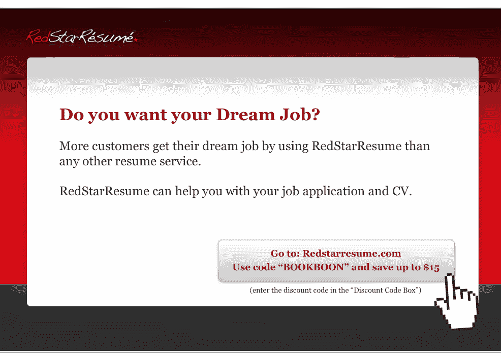

请点击广告

在 bookboom.com 免费下载电子书

我们通过将其声明为 `abstract`（抽象）来强制执行 `Publication` 不可实例化：

```csharp
public abstract class Publication
{
  // 等等
```

## 3.9 方法重写

子类继承其父类的方法，因此必须始终提供至少与父类相同的方法，且通常更多。然而，方法的实现可以在子类中进行更改。

这就是方法重写（overriding）。

为了做到这一点，我们在子类中写一个新版本来替换继承而来的版本。

新方法本质上应该执行与它所替换的方法相同的功能，但通过更改功能，我们可以改进该方法，并使其功能更适用于特定的子类。

例如，想象一种特殊的杂志类别，每份杂志都附带了一张光盘——我们可以将其命名为 `DiscMag`，并创建一个 `Magazine` 的子类来处理 `DiscMag`。当一期 `DiscMag` 的新杂志到达时，我们不仅想要更新当前库存，还想要检查光盘是否正确连接。因此，我们希望在 `RecNewIssue()` 方法中加入额外的功能来提醒我们这样做。我们通过在 `DiscMag` 子类中重新定义 `RecNewIssue()` 来实现这一点。

注意，当一期 `Magazine` 新杂志到达时，由于它们没有光盘，我们想要调用 `Magazine` 类中定义的原始 `RecNewIssue()` 方法。

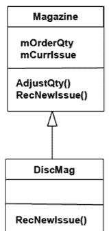

- `DiscMag` 中 `RecNewIssue()` 的定义重写了继承的定义。
- `Magazine` 不受影响——它保留了原始的 `RecNewIssue()` 定义。
- 通过在 `DiscMag` 中显示 `RecNewIssue()`，我们表明继承的方法正在被重写（即被替换），因为我们不会在子类中显示继承的方法。

在 bookboom.com 免费下载电子书

## 使用 C# 的面向对象编程

当我们在 `DiscMag` 对象上调用 `RecNewIssue()` 方法时，CLR 引擎会自动选择重写版本——调用者不需要知道这一点，也不需要知道它是否是一个重写的方法。当我们在 `Magazine` 对象上调用 `RecNewIssue()` 方法时，调用的是父类中的方法。

### 实现 DiscMag

要实现 `DiscMag`，我们必须创建一个 `Magazine` 的子类。不需要额外的实例变量或方法，尽管如果我们有构造函数，也可以创建一些。`DiscMag` 仅将所有参数直接传递给父类，并在 `DiscMag` 中定义了 `RecNewIssue()` 的版本以重写从 `Magazine` 继承的版本（见下文）。

```csharp
public class DiscMag : Magazine {
    public DiscMag(String title, double price, int orderQty, String curr) : base(title, price, orderQty, curr) {

    public override void RecNewIssue(String newIssue) {
      base.RecNewIssue(newIssue);
      Console.WriteLine("Check discs are attached");
    }
}
```
注意使用 `base.RecNewIssue()` 调用父类的方法，正如我们在构造函数中使用那样。

为了让方法被重写，必须由父类的作者授予 `virtual` 关键字。

因此，为了让上面的代码工作，`Magazine` 中的 `RecNewIssue()` 方法必须标记为 `virtual`。

```csharp
// 在 Magazine 中
public virtual void RecNewIssue(String newIssue)
{
    Copies = orderQty;
    currIssue = newIssue;
}
```

## 使用 C# 的面向对象编程

## 继承与方法重写

这种机制允许我们在子类中重写创建的方法。

### 操作

形式上，`RecNewIssue()` 是一个操作。该操作由两个不同的方法实现，一个在 `Magazine` 中，另一个重写后的。这种区别是多态（polymorphism）的重要部分，我们将在第四章遇到。

## 3.10 Object 类

在 C# 中，所有类都是直接或间接地作为 `Object` 类的子类。`Object` 是 C# 继承层次结构的根。因此每个 C# 程序中都存在。

如果一个类没有声明继承另一个类，它就会隐式地继承自 `Object`。

`Object` 定义了自己的实例变量，但有几个方法。通常这些方法会被新类重写以使其变得有用。一个例子就是 `ToString()` 方法。

因此，当我们定义自己的类时，默认它们是 `Object` 的直接子类。

如果我们的类被组织成层次结构，那么层次结构中顶部的父类是 `object` 的直接子类，其他所有类都是间接子类。

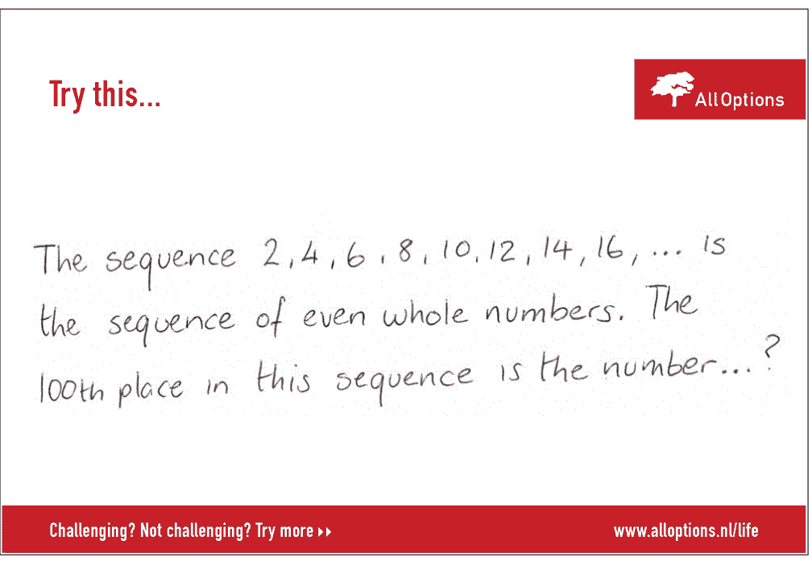

使用 C# 的面向对象编程

继承与方法重写

因此，直接或间接地，C# 中创建的所有类都继承 `Object` 类定义的 `ToString()` 方法。

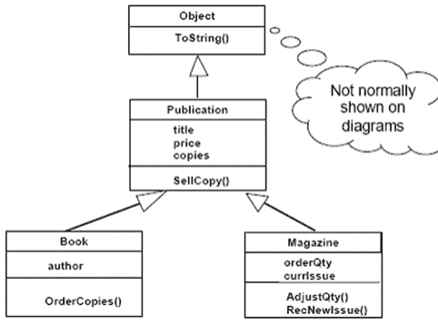

## 3.11 重写 Object 中定义的 ToString()

`Object` 类定义了一个 `ToString()` 方法，它是有用方法之一。

`ToString()` 的签名如下

```csharp
public String ToString()
```

`ToString` 方法的目的是返回一个表示当前对象的字符串值。由 `Object` 类定义的 `ToString` 版本产生类似于："Book" 的输出。这是实例化对象的类名。然而，为了通常有用，我们需要重写它以给出一个更有意义的字符串。

### 在 Publication 中

```csharp
public override String ToString()
{
    return title;
}
```

### 在 Book 中

```csharp
public override String ToString()
{
    return base.ToString() + " by " + author;
}
```

在 bookboom.com 免费下载电子书

81

## 使用 C# 的面向对象编程

### 在杂志中

```csharp
public override String ToString()
{
    return base.ToString() + " (" + currIssue + " ");
}
```

在 `Object` 中原始定义的 `ToString()` 方法已完全完全替换（即被重写），使得 `Publication.ToString()` 返回出版物的标题。

`ToString()` 方法在 `Book` 中再次被重写，使得 `Book.ToString()` 返回标题（通过基类的 `ToString()` 方法）和作者，即此重写版本使用了在 `Publication` 中定义的版本。因此，`Publication.ToString()` 被重写为返回标题和 ISBN 号，然后 `Book.ToString()` 就会自动返回标题、ISBN 号和作者。

`Magazine.ToString()` 返回标题（通过基类的 `ToString()` 方法）和期数。

我们不需要在 `DiscMag` 中进一步重写该方法，因为继承自 `Magazine` 的版本已经足够了。

我们可以选择这些字符串中提供更多数据（即更多，甚至是所有的实例变量值）。这里的设计判断是，这些将是这些类对象最通用的可打印表示。在这种情况下，书籍的标题和作者，或者杂志的标题和当前期数，能够很好地唯一标识特定的出版物。

也许对于报纸，我们会重写 `ToString()` 来返回报纸的标题和打印日期。

## 3.12 总结

继承允许我们提取共同的属性和行为。我们在超类（在 C# 中有时称为基类）中对共同点进行建模。

子类用于建模特殊的属性和行为。

超类中的代码被所有子类继承。如果我们修改或改进了超类的代码，它将影响到所有子类。这减少了我们在程序中需要编写的代码。

子类的构造函数适用特殊的特殊规则。

## 使用 C# 的面向对象编程

## 继承与方法重写

超类可以声明为抽象类（`abstract`），以防止其被实例化（即创建对象）。

我们可以“重写”继承的方法，让子类以不同于超类的方式实现操作。

在 C# 中，所有类都继承自基类 `Object`。

`Object` 定义了一些通用操作，这些操作可以在我们自己的类中被完全重写。


# 4 对象角色与多态性的重要性

## 引言

通过实例演示，本章将解释多态性的概念以及这对面向对象软件设计的影响。

## 目标

在本章结束时，你将能够....

- 理解多态如何允许我们以通用的方式处理相关类
- 在 C# 程序中使用多态
- 理解带有重写方法的多态的含义
- 定义接口以将多态扩展到继承层次结构之外
- 领会多态提供的扩展性范围

本章由八部分组成：

- 1) 类类型
- 2) 可替换性
- 3) 多态性
- 4) 可扩展性
- 5) 接口
- 6) 再次扩展性
- 7) 区分子类
- 8) 总结

## 4.1 类类型

在动物的分级分类中：

- Pinky 是一只猪（物种为 scrofa）
- Pinky 也是（且更广义地说）哺乳动物
- Pinky 也是（甚至更广义地说）动物

我们可以在不同的细节级别指定生物所属的类型：

较高级 = 不那么具体

较低级 = 更具体

## 使用 C# 的面向对象编程

# 对象角色与多态性的重要性

如果你被要求给某一个猪，你可以给他 Pinky 或任何其他猪。

如果你被要求给某一个哺乳动物，你可以给他 Pinky、任何其他猪或任何其他哺乳动物（例如任何狮子、老鼠或猫）。

如果你被要求给某一个动物，你可以给他 Pinky、任何其他猪、任何其他哺乳动物或任何其他动物（鸟、鱼、昆虫等）。

这里的想法是，分类层次结构中的对象与它所继承的每一个类都具有“是（is）”的关系，每种分类都代表一种动物。

这在面向对象的程序中也是如此。每当我们定义一个类时，我们就创建了一个新的“类型”。类型决定了变量、参数等之间的兼容性。

子类是超类类型的子类型，我们可以在任何预期为超类型的地方替换子类型。遵循此，我们可以在任何需要超类型对象的地方替换子类型对象（如上例所示）。

下方的类图显示了对象类型（或类）的层次关系。

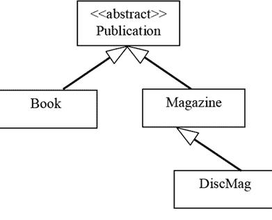

- 如果我们需要一个 `DiscMag`，它必须是 `DiscMag` 类的对象。
- 如果我们需要一个 `Magazine`，它可以是 `Magazine` 类的对象，也可以是 `DiscMag` 类的对象（因为这是杂志的一种）。
- 如果我们需要一个 `Publication`，它可以是 `Book`、`Magazine` 或 `DiscMag`。

换句话说，我们可以在需要超类对象的地方替换任何子类的对象。这反过来是不可能的！

## 使用 C# 的面向对象编程

# 对象角色与多态性的重要性

### 活动 1

在 C# 中，关键字 `new` 类的类的构造函数，即创建该类的对象。查看上面的类图，并判断在这些类已实现的情况下，以下哪些行代码在 C# 程序中是合法的：

```csharp
Publication p = new Book(...);
```

```csharp
Publication p = new DiscMag(...);
```

```csharp
Magazine m = new DiscMag(...);
```

```csharp
DiscMag dm = new Magazine(...);
```

```csharp
Publication p = new Publication(...);
```


## 使用 C# 的面向对象编程

对象角色与多态性的重要性

## 反馈1

`Publication p = new Book(...);`

在这里我们定义了一个类型 `Publication` 的变量 `p`，然后调用 `Book` 类的构造函数并将结果赋值给 `p`，这是正确的，因为 `Book` 是 `Publication` 的子类，即 `Book` 是一个 `Publication`。

`Publication p = new DiscMag(...);`

这是正确的，因为 `DiscMag` 是 `Magazine` 的子类，而 `Magazine` 是 `Publication` 的子类。`DiscMag` 是 `Publication` 的间接子类。

`Magazine m = new DiscMag(...);`

这是正确的，因为 `DiscMag` 是 `Magazine` 的子类。

`DiscMag dm = new Magazine(...);`

这是错误的，因为 `Magazine` 是 `DiscMag` 的超类。某些杂志并不是 DiscMag，所以当需要 DiscMag 时，我们不能提供任何杂志。

`Publication p = new Publication(...);`

这是错误的，原因不同。`Publication` 是一个抽象类，因此不能实例化。

## 4.2 可替换性

在设计类/类型层次结构时，类型机制允许我们在指定超类的地方放置子类对象。然而这对子类的设计有影响——我们需要确保它们确实是可替换的。如果一个子类是替换的，那么显然它必须实现超类的所有方法——这是为了确保超类定义的所有方法都被子类继承。因此，虽然子类可能拥有额外的方法，但它至少拥有超类定义的所有方法，因此应该是可替换的。如果方法在子类中被重写会发生什么？在重写方法时，我们必须确保它们仍然是被替换的方法。因此，在重写方法时，虽然根据子类的需求定制方法是完全可以的，但但不应将其重写为执行本质上不同的操作。

例如，`DiscMag` 中的 `RecNewIssue()` 重写了 `Magazine` 中的 `RecNewIssue()`，但就更新副本数量和当前期而言，与继承的版本执行相同的相同工作（履行了合同）。它以一种 `DiscMag` 特有的方式扩展了该功能，显示检查封面光盘的提醒，本质上这两个方法执行相同的操作。

我们关于 `Publication` 知道什么

# 使用 C# 进行面向对象编程

答案：它是一个对象，支持（至少）以下操作：

```
void SellCopy()
ToString()
```

并且它具有以下属性，允许我们

设置价格，

获取副本数量

设置副本数量

继承保证了 `Publications` 的任何子类的对象都至少提供这些功能。

请注意，子类永远无法移除从其父类（或多个父类）继承的操作——这将破坏这种保证。由于子类扩展了父类的功能，因此可以假设父类的功能是可用的。

我们很有可能在 `Publication` 中重写 `ToString()` 方法（最初定义在 `Object` 中），并在 `Magazine` 中再次重写它，以便返回的字符串能为 `Publications` 和 `Magazines` 提供更好的描述。然而，我们不应该为了返回价格而重写 `ToString()` 方法——这将改变方法的功能，导致该方法执行了本质上不同的功能。这样做将破坏替换原则。

## 4.3 多态

由于子类的实例也是其父类的实例，因此我们可以像处理父类对象一样处理子类对象。此外，由于父类保证了其子类中的某些操作，我们可以在不关心实际对象是哪个子类的实例的情况下调用这些操作。

这种特性被称为“多态”（Polymorphism），原意为“多种形状”。

因此，`Publication` 有多种形状……它可以是 `Book`（书籍）、`Magazine`（杂志）或 `DiscMag`（光杂志）。无论具体细节如何，我们都可以在这些 `Publications` 上调用 `SellCopy()` 方法。

多态是一个常用概念的花说法。会开车的人可以进入并驾驶汽车是因为他们有一系列关键特征——方向盘、档位踏板、离合踏板、刹车和加速踏板等——驾驶员知道如何操作。任何两辆汽车之间会有很多差异，但你可以将它们视为定义了这些关键共享“操作”的类的子类。

如果 `p` 是一个 `Publication`，它可能是一个 `Book`、`Magazine` 或 `DiscMag`。

无论它是哪种，我们都知道它有一个 `SellCopy()` 方法。

所以我们可以调用 `p.SellCopy()`，而无需担心 `p` 到底是什么。

# C# 面向对象编程

# 对象角色与多态的重要性

当我们处理继承体系中的对象时，这会让生活变得简单得多。我们可以创建新类型的 `Publication`，例如 `Newspaper`（报纸），并在 `Newspaper` 上调用 `p.SellCopy()`，而无需在新类中创建任何功能——所有功能都已经在 `Publication` 中定义好了。


多态使得扩展程序的功能变得非常容易，正如我们现在看到的，我们将在案例研究（第 11 章）中再次看到这一点。

# 4.4 可扩展性

每年投入巨额资金创建新的计算机程序，但多年来，甚至花费了大量资金来更改和适应这些程序以满足组织不断变化。因此，作为专业的软件工程师，我们有责任促进这一点，并帮助使程序更容易于维护和适应。当然，应用良好的编程标准、注释和布局等在其中也起着作用，但多态也能提供帮助，因为它允许程序被轻松地扩展。


管理学硕士 (Masters in Management)

## 脱颖而出

伦敦商学院的管理学硕士面向全职研究生经验少于一年的毕业生，将扩展你的思维并为你在商业领域的成功职业奠定基础。

该课程是与招聘人员合作开发的，为你提供雇主看重的关键技能。通过 12 个月的全职学习，你将获得商业知识和能力，增加你的职业选择并脱颖而出。

2011 年 9 月入学的申请现已开启。

伦敦商学院

London Business School

Regent's Park

London NW1 4AS

United Kingdom

电话 +44 (0)20 7000 7573

邮箱 mim@london.edu

www.london.edu/mim/

欲了解更多信息请访问 www.london.edu/mim// 邮件 mim@london.edu 或拨打 +44 (0)20 7000 7573

在 bookboom.com 下载免费电子书

## CashTill 类

假设我们开发一个 `CashTill` 类来处理正在出售的物品序列。如果没有多态，我们需要为每种种的物品编写独立的方法：

- `SellBook` (`Book` `pBook`)
- `SellMagazine` (`Magazine` `pMagazine`)
- `SellDiscMag` (`DiscMag` `pDiscMag`)

有了多态，我们只需要

- `SellItem` (`Publication` `pPub`)

每个子类都与其父类在类型上是兼容的。因此，任何子类对象都可以作为 `Publication` 参数传递。

这对系统的可扩展性也有重要意义。我们以后可以引入更多 `Publication` 的子类，这些子类将被 `CashTill` 对象的 `SellItem()` 方法接受，即使在实现 `CashTill` 时这些子类型是未知的。

## 多态救了自己！

如果没有多态，我们需要对每个物品 'p' 进行检查，以确保调用了正确的方法来出售每种子类型的副本

```
if 'p' is a Book 调用 Book 的 SellCopy() 方法
else if 'p' is a Magazine 调用 Magazine 的 SellCopy() 方法
else if 'p' is a DiscMag 调用 DiscMag 的 SellCopy() 方法
```

相反，我们使用 C# 在运行时运行时查看对象 'p'，以确定其“类型”以及它自身的销售方法。因此，我们可以调用：

```
p.SellCopy()
```

如果对象是 `Book`，它将调用 `Book` 的 `SellCopy()` 方法。如果 'p' 是 `Magazine`，C# 在运行时再次确定这一点并调用 `Magazine` 的 `SellCopy()` 方法。

多态通常允许我们使用条件 'if' 语句——相反，决策是根据实际存在的哪个子类对象做出的。

## 实现 CashTill

下面的代码显示了如何利用多态来实现 `CashTill`。

```
public class CashTill {
    private double runningTotal;
    public CashTill() {
        runningTotal = 0;
    }
    public void SellItem(Publication pPub) {
        runningTotal = runningTotal + pPub.Price;
        pPub.SellCopy();
        Console.WriteLine("Sold " + pPub + " @ " + pPub.Price + " - Subtotal = " +
            runningTotal);
    }
    public void ShowTotal() {
        Console.WriteLine("GRAND TOTAL: " + runningTotal);
    }
}
```

`CashTill` 有一个变量——一个用于持有交易运行总额的 `double`。构造函数仅将其初始化为零。

`SellItem()` 方法是 `CashTill` 的核心功能。它接收一个 `Publication` 参数，该可能是 `Book`、`Magazine` 或 `DiscMag`。首先，使用类中定义的 `Price` 将出版物的价格加上运行总额。然后在该出版物上调用 `SellCopy()` 操作。

最后构建并向用户显示消息，例如：

Sold Windowcleaning (Sept 2005) @ 2.75

Subtotal = 2.75

注意当 `pPub` 与字符串拼接运算符 '+' 时会隐式地调用子类的 `ToString()` 方法，记住书籍和杂志的 `ToString()` 是不同的。

C# 会自动调用正确的 `ToString()` 操作为特定对象返回相应的字符串！

因此，如果售本书，输出将包含标题和作者，例如：

Sold Hitch Hikers Guide to the Galaxy by D Adams @ 7.50

Subtotal = 7.50

我们的现金机可以出售任何形状的出版物，即任何类型的 `Book`、`Magazine` 或 `DiscMag`，而无需担心这些类的特性。这就是多态的应用！

# 使用 C# 进行面向对象编程

# 对象角色与多态的重要性

我们可以像下面这样在类图中显示 `CashTill`：

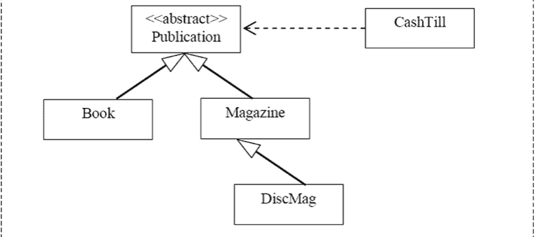

注意 `CashTill` 对 `Publication` 有依赖关系，因为 `SellItem()` 方法传递了一个 `Publication` 类型的参数。实际传递的将是源自 `Publication` 的其中一个具体类型的对象。

### 活动 2

查看下方的图，并在假设 `Publication` 不是抽象类型的情况下，判断所示的操作对中哪些是合法的。

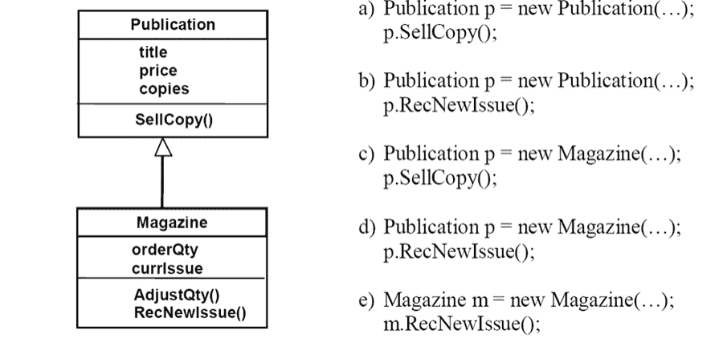

92

在 bookboom.com 下载免费电子书

## 使用 C# 的面向对象编程

# 对象角色与多态性的重要性

反馈 2

- 合法 – 你可以在 publication 上调用 `SellCopy()`
- 非法 – `publications` 中不存在 `RecNewIssue()` 方法
- 合法 – `Magazine` 是 `Publication` 的一种类型，因此你可以将类型为 `Magazine` 的对象赋值给类型为 `Publication` 的变量（在请求父类时，你总是可以替换子类型）。同时你也可以在 publication 上调用 `SellCopy()`。该 publication 恰好是一个杂志，但就编译器而言，这并不紧，因为在这里 'p' 只是一个 `publication`。
- 非法 – 虽然我们可以在杂志上调用 `RecNewIssue()`，但编译器并不知道 'p' 是一个杂志……只知道它是一个 `publication`。
- 合法 – `m` 是一个 `magazine`，我们可以在杂志上调用此方法。


# 你充满创意。这正是我们所寻找的。

正在寻找一个你的想法可以真正产生影响的职业吗？瑞银（UBS）的毕业生培训计划和实习机会让你亲身体验成为一个奖励你并相信共同成功的全球团队是怎样的体验。

无论你处于学术生涯的哪个阶段，请通过访问 www.ubs.com/graduates 让你的未来成为我们的一份。

www.ubs.com/graduates


在 bookboom.com 免费下载电子书

使用 C# 的面向对象编程

对象角色与多态性的重要性

### 活动 3

查看下图，并注意 `Student` 是一个抽象类，判断以下代码段哪些是有效的……

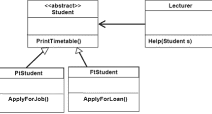

注意：`FtStudent` 是 Full Time Student（全职学生）的缩写，`PtStudent` 是 Part Time Student（兼职学生）的缩写。

a) `Student s = new Student();`

`Lecturer l1 = new Lecturer();`

`l1.Help(s);`

b) `Student s = new FtStudent();`

`Lecturer l1 = new Lecturer();`

`l1.Help(s);`

### 反馈 3

a) 这是无效的，因为类 `Student` 类是抽象的，不能实例化。

b) 这是有效的。`FtStudent` 是 `Student` 的类型，可以赋值给类型为 `Student` 的变量。然后可以作为参数传递给 `l1.Help()`。

在 bookboom.com 免费下载电子书

使用 C# 的面向对象编程

对象角色与多态性的重要性

### 活动 4

使用相同的图并直接调用下面的代码，判断以下 (a) 或 (b) 代码行在 `Help(Student s)` 方法内部哪个是有效的

```cs
Student s = new Student();
Lecturer l = new Lecturer();
l.help(s);
```

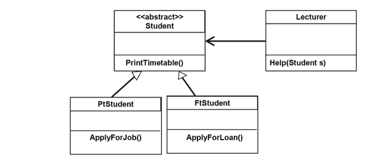

a) `s.PrintTimetable();`

b) `s.ApplyForLoan();`

### 反馈 4

a) 这是有效的——我们可以在 `Student` 对象上调用此方法，也可以在 `FtStudent` 对象上调用（因为该方法被继承了）。

b) 无效！虽然我们可以在 `FtStudent` 对象上调用此方法，并且我们将 `FtStudent` 作为参数传递给 `Help()` 方法，但 `Help()` 方法无法知道传递的对象将是 `FtStudent`（它可以是任何 `Student` 类型的对象）。因此，无法保证传递的对象支持此方法。因此，这行代码将产生编译器错误。

## 4.5 接口

继承有两个方面：

- 子类继承其父类的接口（即对公共成员的访问）——这使得多态成为可能
- 子类继承其父类的实现（即实例变量和方法实现）——这节省了我们在子类定义中重复复制子类细节的时间
- 在 C# 中，通过 `:` 使用继承会自动同时应用这两个方面。

子类是一个子类型。它的接口必须包含父类的所有接口内容，尽管这种实现可以是不同的（尽管被重写），并且子类的接口可能会更广泛，添加了额外的功能。

然而，有时我们希望两个类共享一个公共接口，而不将它们放在继承层次结构中。这可能是因为：

- 它们之间并不存在真正的“是一个（is a）”关系
- 我们希望一个类拥有与多一个潜在子类共享的接口，C# 不允许这种“多重继承”
- 我们希望在软件组件之间创建一种“插头和插座”结构，其中某些组件目前可能还没有被创建。

这就像确保两辆汽车具有工作方式完全相同的控制控件，但让不同的工程师去设计“实现”这些引擎，方式可能完全不同。

小心“接口”（interface）一词——在编程中它至少有含义：

1) 类的公共成员——上述使用的含义
2) 程序的“用户界面”，通常指“图形用户界面”（GUI）——本质上是无关的
3) [此处缺失文本]

## 使用 C# 的面向对象编程

对象角色与多态性的重要性

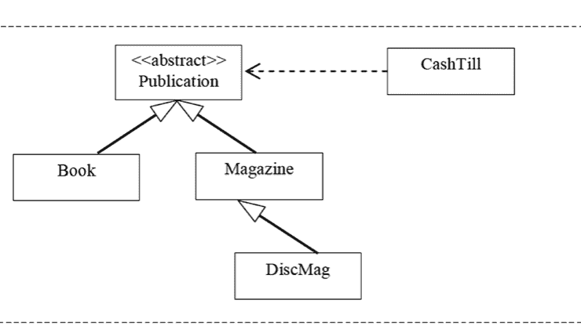

使用 C# 的面向对象编程

对象角色与多态性的重要性


使用 C# 的面向对象编程

对象角色与多态性的重要性


由于 `SellCopy()` 的差异很大，我们不想继承它的实现细节，而且我们认为 `Ticket` 属于 `Publications` 的继承层次结构。我们需要


使用 C# 的面向对象编程

对象角色与多态性的重要性

## 票务

现在考虑这种情况：除了书籍和杂志之外，我们现在还想销售票务，例如娱乐、公共交通等。就像出版物一样，票务提供了 `CashTill` 需要的操作：

```
SellCopy()
Price()
```

因此 `CashTill` 可以销售机票。事实上，`CashTill` 可以销售任何拥有这些方法的对象，而不只是出版物。为了实现这种可能，我们将这些操作定义为名为 `ISaleableItem` 的“接口”（“I”被用来表示这是一个接口而不是类）。

```cs
public interface ISaleableItem
{
    double Price
    {
        get;
    }
    void SellCopy();
}
```

注意，接口定义了操作签名而没有实现。虽然此接口定义了对 `price` 的 `get` 方法的需求，但不需要 `set` 方法，因此在接口中没有定义。

所有方法隐式为公共的，即使没有这样说明，且不能有实例变量、构造函数或实现方法的代码。

# 使用 C# 进行面向对象编程

# 对象角色与多态的重要性

接口是一种契约。`SaleableItem` 接口表示：“我承诺至少提供具有以下签名的方法：

```csharp
public void SellCopy ();
public double Price ();
```

尽管我可能还会包含其他内容

当类实现一个接口时，它提供了一个保证的共性区域，多态可以可以利用这一共性。

想象一辆汽车和街机里的一个驾驶游戏。它们之间显然没有任何“是一个（is a）”的关系——它们是完全不同的东西，一个是交通工具，另一个是街机游戏。但它们都实现了我们可以称之为“方向盘接口”，我们可以用完全相同的方式使用它们，尽管它们的实现方式（汽车中的机械连杆，游戏中的视频电子）非常不同。


在爱立信（Ericsson），我们深信，我们每天所做的创新可以为人类、企业和社会创造一个更美好的世界产生深远影响。加入我们吧。

在德国，我们特别寻找以下方向的毕业生作为集成工程师：

- 射射接入和 IP 网络
- IMS 和 IPX

我们期待您的申请！

如需申请并查看所有当前空缺，请访问我们的网页：www.ericsson.com/careers

# 使用 C# 进行面向对象编程

# 对象角色与多态的重要性

我们现在需要说明，Publication（出版物）（及其所有子类）和 Ticket（门票）都提供了接口定义的操作：

```csharp
public abstract class Publication : ISaleableItem
{
    ...class details...
}
```

```csharp
public class Ticket : ISaleableItem
{
    ...class details...
}
```

在 C# 中，当我们定义一个扩展父类的子类，或者创建一个实现接口的类时，都使用相同的符号 `:`。

对比实现接口与扩展父类。

- 当我们扩展一个父类时，子类继承了来自父类的接口和实现。
- 当我们实现一个接口时，我们保证了接口指定的操作将会提供——这允许对所有实现给定接口的类进行多态化处理。

## 多态收银台

`CashTill` 已经采用了多态：`SellItem()` 方法接受一个 `Publication` 类型的参数，允许传递它的任何子类：

```csharp
public void SellItem(Publication pPub)
```

我们现在想要扩展此功能，接受任何实现了 `SaleableItem` 接口的类型：

```csharp
public void SellItem(ISaleableItem pSI)
```

当变量或参数的类型定义为接口时，它的工作方式就像父类类型一样。任何实现该接口的类都可以赋值给变量/参数，因为接口是一种**类型**，而所有实现它的类都是该类型的子类型。

# 使用 C# 进行面向对象编程

# 对象角色与多态的重要性

现在在下方展示如下……

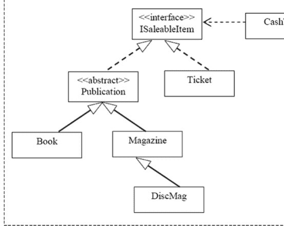

`CashTill` 不再直接依赖于 `Publication` 类——相反，它依赖于接口 `ISaleableItem`。

注意，我们可以用 `I` 开头接口名称，以表示这是一个接口而不是类。

从 `Publication` 和 `Ticket` 到 `ISaleableItem` 的关系就像继承箭头，只不过线条是**虚线**——这显示了每个类都**实现**了该接口。

C# 中的类只能继承自一个父类，但可以实现任意数量的接口。其格式为 :-：

```csharp
class MyClass : MySuperClass, IMYInterface, IMYSecondInterface
```

## 4.6 再次讨论可扩展性


多态允许在不考虑对象精确类的情况下处理对象。这有助于在不损害现有设计封装性的情况下使系统具有可扩展性。

例如，我们可以为产品或服务创建新类，只要它们实现了 `ISaleable` 接口，`CashTill` 就能能够处理它们，而**无需对其代码进行任何更改！**!

一个例子可以是“糖果（Sweets）”。我们可以定义一个名为 `Sweets` 的类来代表罐装糖果。我们可以根据重量定义糖果的价格，并通过从总库存中减去该重量来出售糖果。这与出售 `Publication` 不同，我们总是从库存中减去 1。这也不像出售门票，我们只需要打印它们。

从 bookhoon.com 下载免费电子书

# 使用 C# 进行面向对象编程

## 对象角色与多态的重要性

如果我们创建一个实现 `ISaleable` 接口的 `Sweets` 类，我们增强后的多态收银台就可以出售它们，因为它们是可售物品。

在这种情况下，如果没有多态，我们需要为 `CashTill` 添加一个额外的“销售（方法方法来处理 `Tickets`，以及为每种待售的产品类型添加额外的新方法。通过定义 `ISaleable` 接口，我们可以在不影响 `CashTill` 的情况下引入额外的产品。多态让扩展我们的程序变得简单，这非常重要，因为它节省了精力、时间和金。

接口允许软件组件更灵活、更具扩展地连接在一起，就像日常世界中的许多电缆和插座实现音频、视频、电源和数据连接一样。想象一下可以插在标准插座上的不同电器数量——并想象如果你必须请电工来会有多么不方便。


### 活动 5

通过添加一个 `Diesel（柴油）` 类来适配以下内容，使其可以使用。如下所示。

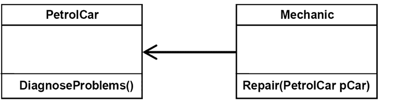

`CashTill` 不再直接依赖于 `Publication` 类——相反，它依赖于接口 `ISaleable`。

注意，我们可以用 `I` 开头接口名称，以表示这是一个接口而不是类。

从 `Publication` 和 `Ticket` 到 `ISableable` 的关系就像继承箭头，只不过线条是**虚线**——这显示了每个类都**实现**了该接口。

C# 中的类只能继承自一个父类，但可以实现任意数量的接口。其格式为 :-：

```csharp
class MyClass : MySuperClass, IMYInterface, IMYSecondInterface
```

## 4.6 再次讨论可扩展性

多态允许在不考虑对象精确类的情况下处理对象。这有助于在不损害现有设计封装性的情况下使系统具有可扩展性。

例如，我们可以为产品或服务创建新类，只要它们实现了 `ISaleable` 接口，`CashTill` 就能能够处理它们，而**无需对其代码进行任何更改！**

一个例子可以是“糖果（Sweets）”。我们可以定义一个名为 `Sweets` 的类来代表罐装糖果。我们可以根据重量定义糖果的价格，并通过从总库存中减去该重量来出售糖果。这与出售 `Publication` 不同，我们总是从库存中减去 1。这也不像出售门票，我们只需要打印它们。

从 bookhoon.com 下载免费电子书

如果我们创建一个实现 `ISaleable` 接口的 `Sweets` 类，我们增强后的多态收银台就可以出售它们，因为它们是可售物品。

在这种情况下，如果没有多态，我们需要为 `CashTill` 添加一个额外的“销售（方法方法）来处理 `Tickets`，以及为每种待售的产品类型添加额外的新方法。通过定义 `ISaleable` 接口，我们可以在不影响 `CashTill` 的情况下引入额外的产品。多态让扩展我们的程序变得简单，这非常重要，因为它节省了精力、时间和金。

接口允许软件组件更灵活、更具扩展地连接在一起，就像日常世界中的许多电缆和插座实现音频、视频、电源和数据连接一样。想象一下可以插在标准插座上的不同电器数量——并想象如果你必须请电工来会有多么不方便。


### 活动 5

通过添加一个 `Diesel（柴油）` 类来适配以下内容，使其可以使用。如下所示。


`CashTill` 不再直接依赖于 `Publication` 类——相反，它依赖于接口 `ISaleable`。

注意，我们可以用 `I` 开头接口名称，以表示这是一个接口而不是类。

从 `Publication` 和 `Ticket` 到 `ISableable` 的关系就像继承箭头，只不过线条是**虚线**——这显示了每个类都**实现**了该接口。

C# 中的类只能继承自一个父类，但可以实现任意数量的接口。其格式为 :-：

```csharp
class MyClass : MySuperClass, IMYInterface, IMYSecondInterface
```

## 使用 C# 进行面向对象编程：对象角色与多态性的性

如果 `pIS` 是 `Publication` 的任何子类（例如书籍、杂志或光片），`pIS IS Publication` 将为真。如果我们愿意，可以很容易地测试更具体的子类型，即 `pIS is Book`。

注意，我们通过检查子类型来损害了多态性，同时也损害了系统的可扩展性——实现 `SaleableItem` 接口的新类（例如 `Sweets`）可能也需要向此语句中添加新的子句，因此更改会波及到整个系统，导致维护成本变得更高且更容易出错。

我们不应该这样做，而应该尝试将不同的行为封装到子类本身中。例如，我们在 `SaleableItem` 接口中定义一个 `DescribeSelf()` 方法，然后在每个实现 `SaleableItem` 接口的类中都必须实现该方法。每个子类都将显示一条提供所售物品类型的消息。这样，`CashTill` 中的上述语句就可以被 `pIS.DescribeSelf()` 替换。因此，当我们向系统添加新类时，就不需要修改 `CashTill` 了。

## 4.8 总结

- 多态允许我们根据父类而不是实际类来引用对象。
- 多态使我们能够通过添加额外的类来轻松扩展程序，而无需更改其他类。
- 我们可以通过调用为父类定义的操作来操作对象，而不必担心任何特定情况下涉及哪一个子类。
- C# 确保在运行时调用对象实际类的适当方法。
- 有时，我们希望使用多态性，但并不要求所有相关的类都处于继承层次结构中。在这种情况下，接口允许我们提供共享的操作集合。这样做时没有继承的实现——每个类都必须实现接口定义的**所有**（ALL）操作。
- 任意数量的类可以实现特定的接口。
- C# 中的类只能自一个父类，但可以实现多个接口。

## 5 方法重载

### 引言

本章将向读者介绍方法重载的概念。

### 目标

在本章结束时，你将能够……

- 理解“重载”的概念
- 领会方法重载提供的灵活性
- 在在线 API 文档中识别重载方法

本章由以下三个部分组成：

1) 重载
2) 增加灵活性的重载
3) 总结

## 5.1 重载

在历史上，计算机程序中的方法名称必须是唯一的。因此，编译器只需通过查看名称即可识别正在调用的是哪个方法。

然而，通常需要多个方法来执行非常相似的功能，例如，一个方法可能可以将整数相加，而另一个方法可能需要相加两个浮点数。如果你必须给这两个方法起唯一的名称，你会给其中一个命名为 'Add()' 吗？

为了给每个方法命名，名称需要更长且更具体。因此我们可以将一个方法命名为 `AddInt(int)`，另一个为 `AddFloat(float)`，但这可能会导致名称泛滥，每个名称都在描述不同的方法，而它们本质上执行的是相同的操作（即相加数字）。

为了在 C# 中解决这个问题，你不需要为每个方法都命名——因此，上述两个方法都可以命名为 `Add()`。然而，如果方法名称不是唯一的，C# 必须有其他方式在运行时决定调用哪种方法。即，当调用 `Add(number1,number2)` 时，机器必须决定使用两个方法中的哪一个。它通过查看参数列表来实现这一点。

虽然两个方法可能有相同的名称，但仍然可以通过查看参数列表来区分：

- `Add(int number1, int number2)`
- `Add(float number1, int number2)`

## 重载

这在运行时通过查看方法调用和传递的实际参数来解决。如果传递两个整数，则调用第一个方法。如果传递的是两个浮点数，则使用第二个方法。

重载是指多个方法可能共享相同名称的事实。由于方法名称不再唯一地标识方法，因此它被“重载”了。

## 5.2 增加灵活性的重载

拥有几个本质上执行相同操作但带有不同参数列表的方法，可以增强系统的灵活性和健壮性。

想象一个大学管理系统。可能需要一个方法来录取、注册新学生。此类方法可能具有如下签名……

```
EnrollStudent(String name, String address, String coursecode)
```

如果一个学生刚到达这个城市，还没有安排好住在哪里，大学想拒绝录取该学生？他们可以这样做，但允许这样的学生入学（并将地址设置为“未知”）是否会更好呢？


为了允许这种操作，`EnrollStudent()` 方法可以被重载，并提供另一种方法如下……

```
EnrollStudent(String name, String coursecode)
```

在运行时，调用的方法取决于所提供的参数列表。因此，调用

```
EnrollStudent("Fred", "123 Abbey Gardens", "G700")
```

将使用第一个方法。

### 活动 1

想象一个 `WithdrawCash()` 方法可以作为银行系统的一部分。该方法可以接受两个参数：账户标识（String）和用户所需的现金金额（int）。因此，完整的方法签名将为

```
WithdrawCash(String accountID, int amount).
```

识别另一个带有不同参数列表的 `WithdrawCash()` 方法变体。

### 反馈 1

另一种用于取现的替代方法可以是 `WithdrawCash(String accountID)`，其中没有指定金额，默认取现 £100。这些方法本质上执行相同的操作，但通过通过重载此方法，我们使系统变得更加灵活——用户现在有了选择，他们可以指定金额。

构造函数也可以像普通方法一样被重载。

## 重载

### 活动 2

访问 mddn.microsoft.com，这是微软开发者网络（Microsoft Developer Network）的网站，包含了 .NET 框架的应用程序接口（API）的详细信息（还包含更多内容）。

遵循链接：

- Library（页面顶部标签页）
- .NET Development（左侧面板）
- .NET Framework 4
- .NET Framework Class Library

在此处，你将在左侧看到 .NET 框架中的所有命名空间（包），右侧是每个包的描述。

点击链接进入：

- System（核心命名空间之一），然后是
- String（核心类之一）

此内容的直接链接为

http://mddn.microsoft.com/en-us/library/system.string.aspx

选择 C# 语法版本……记住 .NET 框架 API 适用于多种语言的程序员。

在主面板中查看 String 类文档，并找出该类有多少个构造函数。

### 反馈 2

在 .NET 版本 4 中，String 类指定了 8 个不同的构造函数。它们都具有相同的方法名称 'String'，但可以通过这些方法所需的不同参数来区分。

其中一个构造函数接收字符数组、一个起始位置和一个长度，并使用该字符数组中的子集创建一个 String 对象。另一个构造函数需要一个参数作为参数指向一个字符数组，并创建一个是该原始数组副本的新 String 对象。

通过大量重载 String 构造函数，该类的创建者为未来想要使用这些不同选项的程序员提供了灵活性。

使用 C# 的面向对象编程

重载

活动 3

继续查看 API 文档中的 `String` 类，寻找其他重载的方法。

反馈 3

有几个方法没有重载，但大多数方法都是重载的。这些包括 `Compare()`、`CompareTo()`、`Concat()`、`Join()`、`Split()` 等许多方法。

观察不同的 `Substring()` 方法可以发现，我们可以通过仅指定起始位置或者通过指定起始位置和长度来查找子字符串。

当我们使用 `Substring()` 方法时，CLR 引擎将在运行时根据我们提供了一个参数还是两个参数，选择该方法的正确实现版本。

## 5.3 总结

方法重载（Method overloading）是指可能存在多个本质上执行相同操作并具有相同名称的方法的概念。

CLR 引擎通过查看参数列表来区分这些方法。如果两个或多个方法具有相同的名称，那么它们的参数列表必须不同。

在运行时，每个方法调用（可能存在歧义）都是由 CLR 引擎通过查看传递的参数并将数据类型与类中定义方法签名进行匹配来解析的。

通过重载构造函数和普通方法，我们为未来可能使用我们类的程序员提供了额外的灵活性。即使这些方法最初没有全部使用，提供这些方法也可以帮助程序更灵活地满足不断变化的用户需求。

## 6 面向对象的软件分析与设计

引言

本章将通过实际示例教授基础的分析和建模技能，引导读者理解如何从初步规范过渡到面向对象的架构。

目标

在本章结束时，你将能够....

- 分析需求描述
- 识别系统范围之外的项
- 识别候选类、属性和方法
- 记录结果：面向对象架构

本章由十二部分组成：

1) 需求分析
2) 问题
3) 列出名词和动词
4) 识别系统范围之外的事
5) 识别同义词
6) 识别潜在类
7) 识别潜在属性
8) 识别潜在方法
9) 识别共同特征
10) 使用 CRC 卡完善我们的设计
11) 详化类
12) 总结

## 6.1 需求分析

任何计算机程序的开发都从识别需求开始：

- 专攻桥梁工程师工程师可能某些软件来创建设计的三维模型，以便人们在桥梁实际建成以前就能看到完工后的样子。
- 经理可能需要一个软件来跟踪人员、他们被分配了哪些项目、拥有什么技能以及需要哪些技能。

我们如何从对软件的“需求”获得满足该需求的面向对象软件设计？

一些软件工程师专攻需求分析任务，该任务是精确明确软件的具体要求。这通常通过迭代执行以下任务来完成：

1) 访问系统的客户和潜在用户，以了解他们对所需系统的看法
2) 记录这些对话的结果
3) 识别所需系统的基本特征
4) 产生初步设计（以及可能存在的系统原型）
5) 与客户和潜在用户评估这些初始计划
6) 重复上述步骤，直到演变成完成的设计。

执行需求是一项经过分析的技能，在本任务的范围之外，但在这里我们将关注第三步及以上的步骤，即描述如何将其转换为潜在的 OO 设计。

虽然我们希望开发设计技能，但经验是这项任务中的一个重要因素。如果我们希望软件运行良好且易于开发，产生简单而优雅的设计至关重要；从较弱的机制中识别优秀的设计并不简单，经验是一个关键因素。


你正在考虑获得欧洲商业学位吗？

在 bookebook.com 下载免费电子书。

我们将尝试开发基础技能，以希望你能够有机会练习这些技能并获得经验。

从问题规范开始，我们将执行以下步骤：

- 列出名词和动词
- 识别系统范围之外的事物
- 识别同义词
- 识别潜在类
- 识别潜在属性
- 识别潜在方法
- 识别共同特征
- 使用 CRC 卡完善我们的设计
- 详化类

通过这种方式，我们能够对问题的通性描述，并为系统生成一个可行的、希望是优雅的 OO 设计来满足这些需求。

## 6.2 问题

我们将为之设计解决方案的问题是“为一个组织马拉松赛的体育俱乐部开发一个小型管理系统”。

为了这次练习，我们假设已经进行了初步需求分析，并通过采访俱乐部经理和将使用系统的员工，生成了文本描述。

“GetFit”体育俱乐部将在明年春季举办他们的首届国际马拉松赛。一个由世界排名专业人士和慈善募款业余人员（有些穿着奇装异服！）组成的队伍将在风景优美的沿滨 26.2 英里路线上进行竞争。作为跟踪跑步者并宣布结果和赞助捐赠的软件系统的一部分，需要一个跑步者关键特征的模型（这只是完工系统的一部分）。

马拉松的每个跑步者都有一个编号。跑步者被描述为例如“跑步者 42”，其中 42 是他们的编号。他们以记录的小时、分钟和秒的时间完成比赛。他们的结果状态可以被检查，并将显示为“未完成”或“已在 hh:mm:ss 完成”。

“GetFit”体育俱乐部正在组织他们明年春季的第一场国际马拉松赛。


结果状态将显示为“未完成”或“已在 hh:mm:ss 完成”。

每个参赛者都是专业跑步者或业余跑步者。

除上述之外，专业人士还有一个世界排名，并描述为例如“排名 174”。

所有业余人员都在为慈善募款，因此每个人都有赞助表。当业余人员完成比赛时，从他们的赞助表打印一份列表。

在 bookoon.com 下载免费电子书

赞助表拥有赞助者数量、赞助者列表和赞助金额。可以添加赞助者和金额，并可以打印显示赞助者和总金额的列表。

穿着奇装异服的跑步者是业余人员的一种（带有赞助等），他们还有一个服装，并描述为“跑步者 316（黄鸭）”。

## 6.3 列出名词和动词

分析上述描述的第一步是识别名词和动词：

- 名词表示实体或对象，这些中的一些将作为类出现在系统中，并作为属性出现。
- 动词表示要执行的操作，这些中的一些将作为方法出现在系统中。

复数名词和动词以单数形式列出（例如 'books' 变为 'book'），并在名词/动词本身不具有描述性时使用名词和动词短语，例如动词‘打印’没有‘打印收据’清晰。

| 活动 1 |

| :--- |

| 查看上述描述，列出五个名词和五个动词（在适当的情况下使用名词和动词短语）。 |

下面的列表是名词和动词相当全面的列表，而不只是前五个。

名词 - GetFit 体育俱乐部、队伍、世界排名专业人士、慈善募款业余人员、奇装异服、26.2 英里路线、沿海位置、软件系统、跑步者、结果、赞助捐赠、模型、关键特征、编号、结果状态、参赛者、专业跑步者、业余跑步者、世界排名、慈善、赞助、收集列表、赞助者、赞助金额、总额、服装。

动词 - 组织、马拉松、竞争、跟踪跑步者、宣布结果、描述（跑步者）、完成、指定时间、检查状态、显示状态、描述（专业人士）、打印收集列表、添加（赞助者和金额）、打印列表。

使用 `C#` 的面向对象编程

面向对象软件分析与设计

## 6.4 识别系统范围之外的内容

设计系统的一个重要部分是识别与问题不相关或超出系统范围的方面。描述中的部分可能是纯粹背景性的，即为了一般信息之目的，因此它们不会直接描述我们正在设计的系统的特征。此外，描述中的部分可能指的是用户在使用系统时所执行的任务，因此它们描述了需要在系统内部实现的功能；而其他部分描述的是用户在不使用系统时执行的任务，因此不描述系统内部的功能。

通过识别描述中与我们正在开发的系统无关的事物，可以保持问题尽可能简单。

### + 活动 2

查看上面的名词和动词列表，各类别识别出一个系统范围之外的词汇。


### 反馈 2

第一段的大部分是背景性的，没有描述我们需要在系统内部实现的功能。我们还需要查看描述的其他部分，以识别不相关的部分。

系统范围之外的内容……

名词 :-

- GetFit 运动俱乐部 —— 这是我们开发该系统的客户。它不是系统内部需要建模的实体。
- 海滨位置（Coastal location）——跑步的位置与系统描述的功能无关。同样，我们不需要将其作为系统中的一个对象进行建模。
- 软件系统 —— 这是我们正在开发的整个系统，它不描述系统内部的实体。

动词 :-

- 组织（Organise）——这是运动俱乐部成员开展的活动，他们可能是系统的用户，但这不是他们在使用系统时进行的活动。
- 马拉松（Marathon）——这是跑步者正在做的事情。这不是系统需要做的事情。

注意：“完成比赛（Finish race）”是跑步者做的事情，但当它发生时，他们的完赛时间必须在系统中被记录。因此，这实际上并不在系统范围之外。

## 6.5 识别同义词

同义词是含义相同的两个词。在系统描述中识别这些词至关重要。如果不这样做将意味着一个实体被建模两次，导致重复和混淆。

### # 活动 3

查看名词和动词列表，识别两个同义词，分别从名词列表和动词列表中各出一个。

### 反馈 3

同义词

名词 :-

- 世界排名专业（world ranking professional） = 职业运动员（professional runner）
- 募捐业余（fund-raising amateur） = 业余运动员（amateur runner）
- 跑步者（runner） = 竞争者（competitor）

注意 runner 不是 professional runner 的同义词，因为有些跑步者是业余的。

动词 :-

- 马拉松（marathon） = 竞争（compete）
- 检查状态（check status） = 显示状态（display status）
- 打印集合列表（print collection list） = 打印列表（print list）
- 完成比赛（finish race） = 记录指定时间（record specified time）

## 6.6 识别潜在类

通过识别系统范围之外的方面以及识别描述中描述相同实体和操作的不同部分来简化问题，现在我们可以开始识别系统中实现的潜在类。

某些名词将指示要实现的类，另一些将指示类的属性。

良好的面向对象设计建议数据和操作封装在一起——因此类代表了复杂的概念实体，我们可以为这些实体识别关联的数据和操作（或方法）。

简单的实体（如地址）有关联的数据但没有操作，这些可以存储为相关类中的简单属性。

### 活动 4

查看上面的名词列表，识别五个可以成为类的词。

### 反馈 4

可能指示类的名词 :-

- 跑步者（Runner）或 竞争者（Competitor）
- 业余者（Amateur）或 业余运动员（Amateur Runner）
- 专业人士（Professional）或类似词
- 奇装者（FancyDresser）或 奇装业余者（FancyDressAmateur）或类似
- 赞助表（Sponsorshipform）


## 6.7 识别潜在属性

识别潜在类后，其他名词可用于识别这些类的属性。

### 活动 5

查看名词列表，并识别一个可以作为“跑步者（Runner）”类的属性，另一个可以作为“奇装者（FancyDresser）”类的属性：

### 反馈 5

可以成为属性的名词……

对于跑步者（Runner）：

- 编号（number），
- 结果状态（resultStatus），即已完成（布尔值）
- 时间（time）（小时、分钟、秒）

对于奇装者（FancyDresser）：

- 服装（costume）（String）

当然，我们需要识别所有类的属性。

## 6.8 识别潜在方法

识别潜在类后，我们现在可以使用动词识别这些类的方法。

### 活动 6

查看动词列表，并识别一个可以作为“跑步者（Runner）”类的方法，另一个可以作为“奇装者（FancyDresser）”类的方法：

### 反馈 6

可以成为方法的动词……

对于跑步者（Runner）：

- 描述（describe）（这将实际上成为 `toString()` 的重写版本）
- 完成比赛（finishRace）
- 显示状态（displayStatus）

对于奇装者（FancyDresser）：

- 描述（ToString()）将再次被重写以包含服装的描述

当然，我们需要识别所有类的方法。

## 6.9 识别共同特征

识别了带有属性和方法的候选类后，我们可以通过识别具有共同特征的类开始将我们的类结构化为适当的继承层次。

### 活动 7

查看下面的类列表，将四个放入合适的继承层次中。识别出不适合此层次的类：

- 跑步者（Runner）
- 业余者（Amateur）
- 专业人士（Professional）
- 奇装者（FancyDresser）
- 赞助表（Sponsorshipform）

### 反馈 7

最一般的类（即继承树顶部的类）是“跑步者（Runner）”。业余者（Amateur）和专业人士（Professional）是跑步者的子类，奇装者（FancyDresser）是业余者的特定类型，因此是业余者的子类。

我们可以将其放入继承层次中，因为这些类通过“是（is-a）”关系相关。奇装者是业余者，业余者又是跑步者。专业人士也是跑步者。

赞助表（Sponsorshipform）不是跑步者的类型，不符合此层次。该类将通过关联的形式与其他类相关。查看描述我们可以看到，并不是跑步者都会填写赞助表，只有为了慈善募捐的业余者是这样。因此，业余者和赞助表之间存在关联。当然，奇装者继承了业余者定义的属性，并且他们自动拥有赞助表。

## 6.10 使用 CRC 卡完善我们的设计

在识别了系统的主要类及其属性和方法后，我们现在可以通过定义数据类型和其他小细节来完善这些设计，将这些信息记录在 UML 图并编写系统。然而，在现实系统中，问题会比我们在这里处理的问题更大且定义不明确，因此设计的分析和完善将是一个更长的复杂过程，我们可以现实地进行模拟。

检查设计的一种方法是使用 CRC 卡记录我们的设计，并通过角色扮演不同场景来检查它们是否有效。

CRC 卡不是这种方法的唯一方法，也不是 UML 规范的一部分。

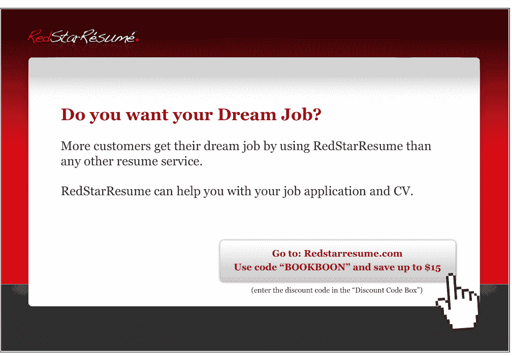

# 使用 `C#` 进行面向对象编程

# 面向对象的软件分析与设计

CRC 代表类（Class）、职责（Responsibilities）和协作（Collaborations）。下面是一个 CRC 卡片，它由三个部分组成，左侧显示类的职责，右侧显示协作关系。

| 类名 | 类职责 | 类协作 |

| :--- | :--- | :--- |

职责是该类需要了解的信息（即属性）以及它应该执行的操作（方法），尽管在 CRC 卡片上，这些并没有像在 UML 图中那样被精确定义。协作是指该类为了履行其职责必须与之工作的的其他类。

下图显示了为系统中的两个类开发的 CRC 卡片。

| 类名 | 类职责 | 类协作 |

| :--- | :--- | :--- |

| 业余爱好者 (Amateur) | 了解跑步者的详细信息（编号等） | 赞助表 (SponsorshipForm) |

| | 记录赞助信息 | |

| | 记录完赛时间 | | |

| 类名 | 类职责 | 类协作 |

| :--- | :--- | :--- |

| 赞助表 (SponsorshipForm) | 记录赞助商列表及相关金额 | |

| | 向此列表添加赞助详情 | |

| | 打印待收集金额列表 | |

# 使用 `C#` 进行面向对象编程

# 面向对象的软件分析与设计

开发出 CRC 卡片后，我们可以通过角色扮演一系列场景来检查系统运行是否正常。这样我们可以在进入耗时的编程流程并编写缺陷计划之前，先修改设计。

一个示例场景是跑步者获得了额外的赞助。在这种情况下，通过查看上面的 CRC 卡片，跑步者能够与 `SponsorshipForm` 类协作记录赞助信息。`SponsorshipForm` 类拥有赞助商列表，并可以向该列表添加额外的赞助商。因此，设计的某似乎是有效的。

测试各种场景可能会突出我们系统设计中的缺陷，然后我们可以修复这些缺陷——这在浪费时间编写设计方案之前就可以完成了。

## 6.11 细化类

在确定了系统设计中的类并使用 CRC 卡片对其进行记录和测试之后，我们现在可以细化 CRC 卡片，并使用 UML 类图记录我们的类。为了做到这一点，我们需要通过 CRC 卡片记录的通用规范，并解决任何歧义，例如精确的类型。

细化 CRC 卡片后，我们现在可以为提议的设计绘制类图（见下）：

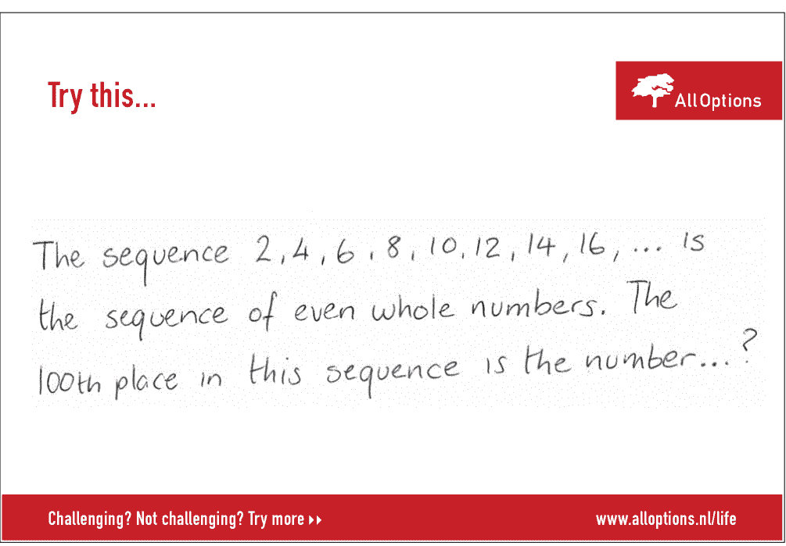

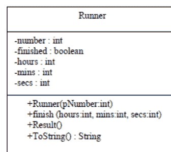

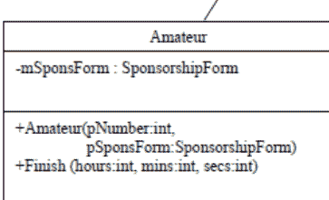

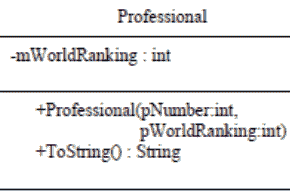

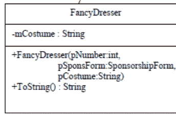

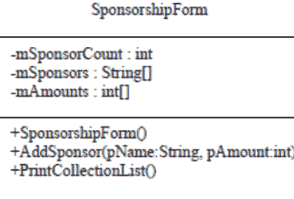

## 6.12 总结

收集用户需求是软件工程过程中的一个重要阶段（但在本文的范围之外）。

将复杂的需求规范转换为优雅、简单的面向对象架构设计是一项需要经验的熟练任务。然而，一个良好的起点是遵循本章介绍的简单流程。

通过一系列任务，我们看到了如何分析对问题的文本描述。我们：

- 寻找了描述中超出系统范围的方面
- 识别了描述中用不同词汇指代同义项的地方
- 使用名词和动词来识别潜在的类、属性和方法
- 查看了类以识别潜在的继承层次结构以及类之间的其他关系（例如关联）
- 使用 CRC 卡片记录生成的类，并通过角色扮演一系列场景来测试设计的有效性，并根据情况修改了我们的设计
- 最后，我们可以细化这些细节并使用类图记录结果。

本章介绍的设计过程将在第 11 章描述的案例中再次详细演示。


# 7 通用集合以及如何序列化它们

### 引言

本章将首先向读者介绍泛型方法，然后介绍 .NET 框架中的一个重要部分：实现泛型集合的类。最后，将引入序列化的概念，并展示如何对不同的集合进行序列化，因为这是一个非常常见的任务。

### 目标

在本章结束时，你将能够……

- 理解泛型方法的概念
- 理解集合的概念以及不同类型的集合
- 理解序列化的概念以及如何序列化不同的集合

本章由十二部分组成：

1) 泛型方法简介
2) 集合简介
3) 不同类型的集合
4) 列表 (Lists)
5) 哈希集合 (HashSets)
6) 字典 (Dictionaries)
7) 简单的列表示例
8) 使用列表的更真实的示例
9) 使用集合（Sets）的示例
10) 使用字典（Dictionaries）的示例
11) 集合的序列化与反序列化
12) 总结

## 7.1 泛型方法简介

我们之前已经见过运行时是如何根据方法的签名（signature）来识别方法的，即方法的名称和方法所接受的参数列表。

因此，我们可以有两个同名的方法。下面显示了两个寻找最大值的方法……一个是在两个整数中寻找最大值，另一个是在双浮点数中寻找最大值。

```csharp
static public int Highest(int o1, int o2)
{
    if (o1 > o2)
        return o1;
    else
        return o2;
}
static public double Highest(double o1, double o2)
{
    if (o1 > o2)
        return o1;
    else
        return o2;
}
```

给定以下代码，CLR 引擎将调用第一个方法，因为它是根据名称和参数类型来识别方法的。

```csharp
int n1 = 1;
int n2 = 2;
Console.WriteLine("The highest is " + Highest(n1, n2));

double n3 = 1.1;
double n4 = 2.2;
Console.WriteLine("The highest is " + Highest(n3, n4));
```

给定以下 `Student` 类的定义……

```csharp
class Student
{
    String name;
    public Student(String name)
    {
        this.name = name;
    }
    override public string ToString()
    {
        return name;
    }
}
```

我们可以定义这种方法来寻找最大的学生（按字母顺序）。

```csharp
static public Student Highest(Student o1, Student o2)
{
    if (o1.ToString().CompareTo(o2.ToString()) > 0)
        return o1;
    else
        return o2;
}
```

并使用它进行调用……

```csharp
Student s1 = new Student("Alan");
Student s2 = new Student("Clare");
Console.WriteLine("The highest is " + Highest(s1, s2));
```

通过这样做，我们创建了三个功能相同但类型不同的方法。这让我们想到，如果我们能创建一个适用于任何类型的方法就好了。

下面的方法是对此的第一次尝试：

```csharp
static public Object Highest(Object o1, Object o2)
{
    if (o1.ToString().CompareTo(o2.ToString()) > 0)
        return o1;
    else
        return o2;
}
```

该方法接受两个 `Object` 作为参数。`Object` 是所有类的基类，因此该方法可以接受任何更具体类型的两个对象并将它们视为基类型 `Object`。这就是多态。

上面的方法将这两个 `Object` 转换为字符串并比较这些字符串。

因此，可以使用以下代码调用三次方法……


```csharp
int n1 = 1;
int n2 = 2;
Console.WriteLine("The highest is " + Highest(n1, n2));

double n3 = 1.1;
double n4 = 2.2;
Console.WriteLine("The highest is " + Highest(n3, n4));

Student s1 = new Student("Student A");
Student s2 = new Student("Student B");
Console.WriteLine("The highest is " + Highest(s1, s2));
```

# 使用 C# 泛型集合进行面向对象编程及其序列化方法

在这些情况下，CLR 引擎分别将 `int`、`double` 和 `Student` 对象视为可用的最通用类型“对象（Object）”。它随后会将此对象转换为字符串并进行字符串比较。

然而，在许多情况下，创建接收 `Object` 类型作为参数的方法是有缺陷的，或者至少局限性非常大。

在这些方法内部，我们不知道实际传递作为参数的是什么类型的对象，因此在上面的示例中，我们不知道实际返回的是什么类型的对象。当传递两个 `Student` 对象时，返回的对象是一个 `student`，但除非先将返回的对象强制转换为 `Student` 类型，否则我们无法在该对象上调用 `Student` 特有的方法。


## 面向对象编程 C# 泛型集合及其序列化方法

假设我们要对通过 `Highest()` 方法返回的 `Student` 调用 `AwardMerit()` 方法。如果我们先将 `Object` 强制转换为 `Student` 对象，就可以这样做。例如：

```
(Student)Highest(studentA, studentB).AwardMerit();
```

然而，编译器无法确定返回的对象是 `Student`，且编译器无法检测到潜在的关键错误——如果我们对两个整数调用 `Highest()`，然后尝试将返回的整数强制转换为 `Student` 对象，就会发生错误。

这引出了一个想法：我们希望创建一个方法，它可以接收**任意**类型的参数并返回同样**任意**类型的值，但在我们调用这些方法时定义这些类型。这种方法是存在的，被称为泛型方法（Generic Methods）。

泛型方法是在在调用方法时才定义定义参数类型的方法。参数类型在每次调用方法时进行指定，编译器仍然可以检查代码是否有效。

在其他方面，泛型方法使用了一个由参数确定的数据类型。

在下面的代码中，定义了一个泛型方法 `Highest()`，它接受两个未指定类型的对象作为参数——

```
public T Highest<T>(T o1, T o2)
{
    if (o1.ToString().compareTo(o2.ToString()) > 0)
        return o1;
    else
        return o2;
}
```

我们可以使用此方法，并在每次调用它时定义正在比较的对象的类型。如果比较两个 `students`，编译器将知道返回的对象也是 `student` 类型，因此知道在该对象上调用特定方法是合法的。

在方法名称后的角括号 `< >` 中提供了一个泛型数据类型列表。如果一个方法使用了多个泛型类型，它们的名称将用逗号分隔。

在上面的示例中，标识符 `T` 可以代表任何数据类型。因此，当 `T` 在方法参数列表的括号内用于描述数据时，它可以是 `int`、`'Student'` 或任何其他数据类型。唯一的要求是该方法无论传递什么种类型的对象都必须有效。所有对象都有 `ToString()` 方法，因为每个数据类型都继承了 `Object` 类的 `ToString()` 方法，或者包含了其重写版本。

### 面向对象编程 C#

在下面的用例中指定了一个泛型数据类型。它用于定义两个参数和返回值的类型。

泛型方法的泛型数据类型标识符可以是任何合 C# 标识符，但按照惯例，通常使用大写字母。“T”用于“类型（type）”。

当定义泛型方法时（即处理任何数据类型的方法），其类型是在使用该方法时指定的。因此，在下面的代码中，`Highest()` 是一个泛型方法，编译器可以看到传递了 `' '`Student'` 对象作为参数，因此返回的对象也必须是 `'Student'` 类型。

```
Student s1 = new Student("Student A");
Student s2 = new Student("Student B");
Student highestStudent = Highest(s1, s2);
```

由于返回的对象类型为 `'Student'`，将其存储在类型为 `Student` 的变量中必须是安全的，并且在返回的对象上调用 `Student` 方法必须是安全的。

因此，泛型方法可以处理任何数据类型，但编译器仍然可以检查类型错误（因为类型在每次调用方法时都是指定的）。

已经基于与泛型方法相同的机制创建了泛型类，这些类特别有用。

在下面的用例中指定了一个泛型数据类型。它用于定义两个参数和返回值的类型。

泛型方法的泛型数据类型标识符可以是任何合 C# 标识符，但按照惯例，通常使用大写字母。“T”用于“类型（type）”。

当定义泛型方法时（即处理任何数据类型的方法），其类型是在使用该方法时指定的。因此，在下面的代码中，`Highest()` 是一个泛型方法，编译器可以看到传递了 `'Student'` 对象作为参数，因此返回的对象也必须是 `'Student'` 类型。

```
Student s1 = new Student("Student A");
Student s2 = new Student("Student B");
Student highestStudent = Highest(s1, s2);
```

返回的对象类型为 `'Student'`，将其存储在类型为 `Student` 的变量中必须是安全的，并且在返回的对象上调用 `Student` 方法必须是安全的。泛型方法可以处理任何数据类型，但编译器仍然可以检查类型错误（因为类型在每次调用方法时都是指定的）。

已经基于与泛型方法相同的机制创建了泛型类，这些类特别有用。

在下面的用例中指定了一个泛型数据类型。它用于定义两个参数和返回值的类型。

在下面的用例中指定了一个泛型数据类型。它用于定义两个参数和返回值的类型。

在下面的用例中指定了一个泛型数据类型。它用于定义两个参数和返回值的类型。

在下面的用例中指定了一个泛型数据类型。它用于定义两个参数和返回值的类型。

在下面的用例中指定了一个泛型数据类型。它用于定义两个参数和返回值的类型。

在下面的用例中指定了一个泛型数据类型。它用于定义两个参数和返回值的类型。

在下面的用例中指定了一个泛型数据类型。它用于定义两个参数和返回值的类型。

在下面的用例中指定了一个泛型数据类型。它用于定义两个参数和返回值的类型。

#### 7.2 集合简介

已经基于与泛型方法相同的机制创建了泛型类，这些类特别有用。在下面的用例中指定了一个泛型数据类型。它用于定义两个参数和返回值的类型。

在下面的用例中指定了一个泛型数据类型。它用于定义两个参数和返回值的类型。

在下面的用例中指定了一个泛型数据类型。它用于定义两个参数和返回值的类型。

在下面的用例中指定了一个泛型数据类型。它用于定义两个参数和返回值的类型。

在下面的用例中指定了一个泛型数据类型。它用于定义两个参数和返回值的类型。

已经基于与泛型方法相同的机制创建了泛型类，这些类特别有用。

#### 7.3 集合类型

在下面的用例中指定了一个泛型数据类型。它用于定义两个参数和返回值的类型。

在下面的用例中指定了一个泛型数据类型。它用于定义两个参数和返回值的类型。

在下面的用例中指定了一个泛型数据类型。它用于定义两个参数和返回值的类型。

在下面的用例中指定了一个泛型数据类型。它用于定义两个参数和返回值的类型。

在下面的用例中指定了一个泛型数据类型。它用于定义两个参数和返回值的类型。

#### 7.4 列表 (Lists)

已经基于与泛型方法相同的机制创建了泛型类，这些类特别有用。在下面的用例中指定了一个泛型数据类型。它用于定义两个参数和返回值的类型。

#### 7.5 哈希集合 (HashSets)

已经基于与泛型方法相同的机制创建了泛型类，这些类特别有用。在下面的用例中指定了一个泛型数据类型。它用于定义两个参数和返回值的类型。

# 使用 C# 进行面向对象编程

## 通用集合以及如何序列化它们

列表（Lists）和集合（Sets）在添加项时会自动调整大小。

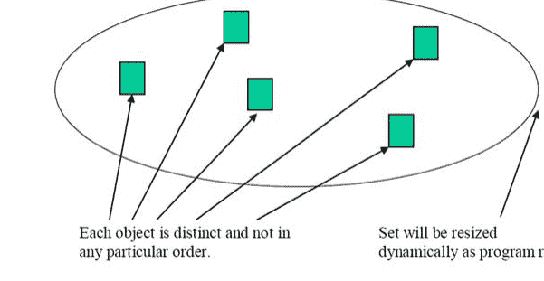

`List` 提供的许多操作也适用于 `Set`，但是：

- 我们由于元素不按任何顺序排列，因此我们**无法**在特定位置添加对象

- 出同样的原因，我们**无法**“替换”项目（尽管我们可以添加一个项目并删除另一个）

- 获取所有项是可行的，但顺序是不确定的

- 查找某个元素位于什么位置是没有意义的。

#### 7.6 字典 (Dictionaries)

字典与列表和集合不同，因为它们存储的不是单个对象，而是对象对。该键值对由一个“键”（key）和一个“值”（value）组成。键是用于标识该对的标识符。值是与键关联的某个或对象。

在语言字典中，我们都很熟悉，“键”是你查阅的单词，而“值”是该单词的含义。当然，在我们所熟悉的字典中，条目是按字母（或键）顺序排序的。如果不是这样，在字典中查找一个单词将非常困难。

另一个例子是地址簿：在地址簿中，键是人的名字，值是他们的地址、电话、电子邮箱等。每个键只有一个对应的值，但由于值是对象，它们可以包含几条数据。

不允许存在重复的键，但允许存在重复的值。因此，在前面的的例子中，如果你在地址簿中查找两个人，可能会发现他们住在同一个地址——但一个人不会有两家房子。

和集合一样，字典不会按顺序排列项（但 `SortedDictionary` 按键的顺序排列），并且像列表和集合一样，字典在添加或删除项时会自动调整大小。

# 使用 C# 进行面向对象编程

## 通用集合以及如何序列化它们

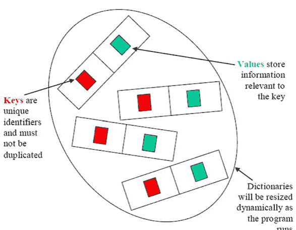

### 活动 2

对于以下每个问题，请写下哪种最合适：列表、集合或字典。

- 1) 我们想记录俱乐部的成员。

2) 我们想记录我们花费的钱（以及花在了什么地方）。

3) 我们想记录银行账户详情——每个账户由银行账户号码识别。

### 反馈 2

- 1) 对于此，我们使用集合（Set）。可以根据需要添加和删除成员，且成员没有特定的顺序。

- 2) 对于此，我们使用列表（List）——这将按照购买的顺序记录所购买的项目。重要的是，由于列表允许重复项，我们可以购买两个相同的玩具（也许是给两个不同孩子的生日礼物）。

- 3) 我们不会有两个完全相同的银行账户，所以集合（Set）似乎是合适的，但由于每个账户由唯一的账户号码识别，字典（Dictionary）将是最合适的选择。

#### 7.7 一个简单的列表示例

在书的这一部分，我们将演示 `List` 集合类的简单用法。

| 活动 3 |

| :--- |

| 访问 `msdn.microsoft.com`。查找在 `System.Collections.Generic` 命名空间定义的 `List` 类的 API。 |

| 列出你认为最有用的三个方法。 |

| 反馈 3 |

| :--- |

| 一些明显有用的方法包括...

- `Add()` – 将对象添加到列表的末尾，

- `Clear()` – 从列表中删除所有元素，

- `Contains()` – 如果此列表包含指定的对象，则返回 true，

- `Insert()` – 在指定位置插入元素，

- `Remove()` – 从列表中移除对象的首次出现项，以及

- `Sort()` – 对列表的元素进行排序。

注意，某些方法是重载的，例如 `Sort()`，它可以对整个列表进行排序，也可以只对指定范围的部分排序。 |


你充满了活力和想法。这正是我们所寻找的。

正在寻找一个可以让你你的想法真正产生影响的职业吗？瑞银（UBS）的毕业生计划和实习是一个让你体验成为全球团队一份的机会，这个团队会奖励你的投入，并相信共同成功。

无论你正处于学术生涯的什么种阶段，请通过访问 `www.ubs.com/graduates` 让你的未来成为我们未来的一部分。

`www.ubs.com/graduates`


# C# 面向对象编程

## 通用集合以及如何如何序列化

下面的代码展示了创建列表的示例。在这种情况下是名称列表，即字符串（Strings）。

```csharp
using System;
using System.Collections.Generic;
using System.Linq;
using System.Text;

namespace ListOfNames
{
    class Program
    {
        // 创建将存储名称列表的名称
        private static List<String> names;

        static void Main(string[] args)
        {
            names = new List<String>(); // 创建空列表

            string name;
            for (int i = 0; i < 3; i++) // 迭代地向列表添加三个名称
            {
                name = Console.ReadLine();
                names.Add(name);
            }

            foreach (String n in names) // 遍历列表
            {
                Console.WriteLine(n);
            }

            Console.WriteLine("请输入要查找的名称");
            String searchname = Console.ReadLine();
            if (names.Contains(searchname)) // 使用 Contains 方法查找
            {
                Console.WriteLine("找到名称");
            }
            else
            {
                Console.WriteLine("未找到名称");
            }
        }
    }
}
```

上面的代码是非常言自自明的，但有些部分值得解释，特别是列表的创建。首先，由于我们使用了 `System.Collections.Generic`，在创建列表时（调用 `List` 的构造函数）必须指定列表的类型。

# C# 面向对象编程

## 通用集合以及如何序列化它们

下面的代码展示了创建列表的示例。在这种情况下是名称列表，即字符串（Strings）。

```csharp
private static List<String> names;
```

这种创建是因为直接在 `Main` 中使用了静态变量。当我们调用 `List` 的构造函数时，必须再次指定类型。

```csharp
names = new List<String>(); // 创建空列表
```

在代码的剩余部分，a) 迭代地向列表添加三个名称，b) 显示列表，c) 使用 `Contains()` 方法查找名称。列表的每个元素都可以像数组元素一样访问（例如 `names[0]`），并且 C# 提供了一个改进的 `for` 循环结构来遍历列表的元素。因此，下面的代码将 `n` 设置为每个元素。

```csharp
foreach (String n in names)
{
    Console.WriteLine(n);
}
```

注意列表中的元素是按顺序存储的，因此在显示列表时顺序保持不变。

此程序存储并处理一个字符串列表，该程序也可以轻松存储从我们创建的类中构建的 Publication列表。

#### 7.8 使用列表的更真实的示例

更真实的列表示例将出现在存储更复杂的对象（而不仅仅是字符串）。

考虑下面的 UML 类图。

| Bank | Account |

| :--- | :--- |

| | 1 accounts * - name: String

>-dateBirth: String

>-balance: int |

| +AddAccount(account: Account)

+GetAccount(name: String) | +Account(name: String)

+DepositMoney(increase int)

+ToString() String |

上面的图表代表了银行系统的基础（固然是一个非常简化的银行系统）。在这个系统中，使用一个类来模拟银行并维护一个账户集合……目前我们使用 `List` 来管理此集合。

此列表的每个元素将代表一个单独的对象账户。一个银行对象将维护所有账户的列表。

每当创建一个账户时，初始余额为零，但所有者可以在需要时存款。因此，我们可以专注于本次练习的核心目的，即演示 `List` 的用法，我们不会费力添加明显需要的功能（如取款等）。


141

在 bookboom.com 下载免费电子书

每当创建一个个人账户时，我们将其添加到账户列表中，并且还允许检索个人账户，以便账户持有人可以向其账户存款。


我们将通过一个 `Main` 方法来演示，该方法将运行一个固定程序：a) 添加几个账户，b) 显示这些账户以及 c) 获取账户、向该账户存钱并再次显示账户列表。

我们会在 `Bank` 类中一个访问器方法，以便 `Main` 方法可以访问账户列表并显示它们。在 C# 中，我们将使用公共属性来实现它。

`Account` 类的代码所示，不需要解释。

```csharp
class Account
{
    private String name;
    public String Name
    {
        get { return name; }
    }

    private String dateOfBirth;
    public String DateOfBirth
    {
        get { return dateOfBirth; }
    }

    private int balance;

    public Account(String name, String dob)
    {
        this.name = name;
        this.dateOfBirth = dob;
        balance = 0;
    }

    public void DepositMoney(int increase)
    {
        balance = balance + increase;
    }

    public override String ToString()
    {
        return "Name: " + name + "\nBalance: " + balance;
    }
}
```

# 面向对象编程 C# 泛型集合以及如何序列化它们

`Bank` 类的代码如下，展示了使用集合类 `List` 有多简单。

```csharp
class Bank
{
    private List<Account> accounts;
    public List<Account> Accounts
    {
        get { return accounts; }
    }

    public Bank()
    {
        accounts = new List<Account>();
    }

    public void AddAccount(Account account)
    {
        accounts.Add(account);
    }

    public Account GetAccount(String name, String dob)
    {
        Account FoundAccount = null;
        foreach (Account a in accounts)
        {
            if (a.Name == name && (a.DateOfBirth == dob))
            {
                FoundAccount = a;
            }
        }
        return FoundAccount;
    }
}
```

首先，构造函数创建了一个账户列表。对于任何列表，它都会自动调整大小，因此与数组不同，我们不需要担心空间不足。

此外，当元素被移除时，剩余元素会移动，以删除空白区域。虽然在数组中这样做并不困难，但在我们使用 `Lists` 时，这是一个自动处理的过程。

添加账户变成了一个调用 `Add()` 方法的易易任务。

最后，检索单个个人账户非常简单，只需遍历列表直到找到我们正在寻找的账户即可。

注意，此列表管理一个复杂对象的集合，当从列表中检索出任何对象时，可以在该对象上调用与该对象相关的方法。

可以通过以下 `Main` 方法来演示这一点。

## 使用 C# 的面向对象编程

### 泛型集合以及如何序列化它们

```csharp
static void Main(string[] args)
{
    Bank b = new Bank();
    Account a;

    a = new Account("Alice", "06/12/1963");
    b.AddAccount(a);
    a = new Account("Bert", "14/08/1990");
    b.AddAccount(a);
    a = new Account("Claire", "1/1/2000");
    b.AddAccount(a);

    // 显示账户
    foreach (Account acc in b.Accounts)
    {
        Console.WriteLine(acc.ToString());
    }

    Account al = b.GetAccount("Bert", "14/08/1990");
    al.DepositMoney(100);

    // 再次显示账户
    foreach (Account acc in b.Accounts)
    {
        Console.WriteLine(acc.ToString());
    }

    Console.ReadLine();
}
```


你有改变世界的机会

在爱立信（Ericsson），我们深信，我们每天所做的创新可以为为人们、企业和社会创造一个更美好的世界产生深远影响。加入我们吧。

- 在德国，我们特别寻找以下方向的毕业生集成工程师：

- 无线接入网络和 IP 网络

- IMS 和 IPT

我们期待收到您的申请！如需申请并查看所有当前职位，请访问我们的网页：www.ericsson.com/careers

使用 C# 的面向对象编程

上述代码执行了以下操作：

- 首先调用 `Bank` 类的构造函数，该构造函数创建一个空的账户列表。

- 创建了三个账户并将它们添加到 `Bank` 对象的列表中。

- 然后显示账户列表。

- 接着从列表中检索出一个个人银行账户并向该账户存款。

- 最后再次显示账户列表。

运行此程序的输出所示所示

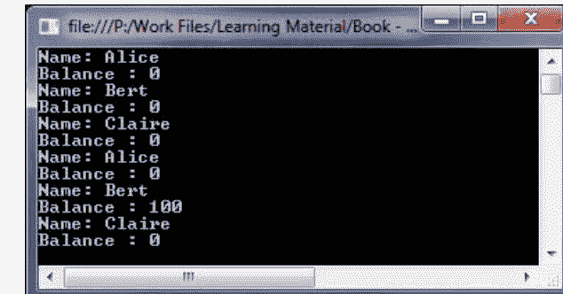

## 7.9 使用集合（Sets）的示例

在上面的示例中，我们使用列表（list）来存储银行账户集合。这并不是明智的选择，因为它允许创建重复项，如果创建两个相同的账户，银行将会感到非常困惑（当钱存入应该添加的哪个账户时？）。

此外，列表按特定顺序存储对象——在这种情况下，是账户创建的顺序。但这种顺序是无关的，因为它无法帮助找到属于某个人的特定账户。

核心问题仍然是——存储一个银行账户集合。

使用 C# 的面向对象编程

泛型集合以及如何序列化它们

| Bank | Account |

| :--- | :--- |

| | 1 accounts * | - name: String<br>-dateOfBirth:String<br>- balance int |

| +AddAccount(account : Account)<br>+GetAccount(name: String, DOB: String) | + Account(name: String)<br>+DepositMoney(increase :int)<br>+ToString():String |

然而，对于这种集合，更好的选择是将账户集合存储为“集合”（set），因为集合不允许创建重复项。

考虑一个银行账户集合：

使用 C# 的面向对象编程

### 泛型集合以及如何序列化它们

在上面的示例中，我们使用列表（list）来存储银行账户集合。这并不是明智的选择，因为它允许创建重复项，如果创建两个相同的账户，银行将会感到非常困惑（当钱存入应该添加的哪个账户时？）。

此外，列表按特定顺序存储对象——在这种情况下，是账户创建的顺序。但这种顺序是无关的，因为它无法帮助找到属于某个人的特定账户。

核心问题仍然是——存储一个银行账户集合。

使用 C# 的面向对象编程

泛型集合以及如何序列化它们

（注：原文后续存在大量重复段落，已按要求去重处理，仅保留核心逻辑与翻译）

## 使用 C# 的面向对象编程

通过重写 `Equals()` 和 `GetHashCode()` 方法，C# 将防止具有重复数据（在这种情况下为重复的姓名和出生日期）的对象被添加到集合中。

以下是 `Account` 类的完整代码。

```c
class Account
{
    private String name;
    public String Name
    {
        get { return name; }
    }
    private String dateOfBirth;
    public String DateOfBirth
    {
        get { return dateOfBirth; }
    }
    private int balance;
    public Account(String name, String dob)
    {
        this.name = name;
        this.dateOfBirth = dob;
        balance = 0;
    }
    public void DepositMoney(int increase)
    {
        balance = balance + increase;
    }
    public override String ToString()
    {
        return "Name: " + name + "\nBalance: " + balance;
    }
    public override bool Equals(object obj)
    {
        Account a = (Account)obj;
        return (name==a.Name && (dateOfBirth==a.DateOfBirth));
    }
    public override int GetHashCode()
    {
        return (name + dateOfBirth).GetHashCode();
    }
}
```

上述代码与之前的 `Account` 类版本（我们使用列表时）相同，不同之处在于增加了重写的 `Equals()` 和 `GetHashCode()` 方法。在集合中存储任何对象时，我们必须重写这两个方法，以防止存储重复项。

## 使用 C# 的面向对象编程

`Bank` 类的代码除了几行将类型化 `List` 更改为类型化 `HashSet` 之外，完全相同。

```csharp
class Bank
{
    private HashSet<Account> accounts;
    public HashSet<Account> Accounts
    {
        get { return accounts; }
    }

    public Bank()
    {
        accounts = new HashSet<Account>();
    }

    public void AddAccount(Account account)
    {
        accounts.Add(account);
    }

    public Account GetAccount(String name, String dob)
    {
        Account FoundAccount = null;
        foreach (Account a in accounts)
        {
            if ((a.Name == name) && (a.DateBirth==dob))
            {
                FoundAccount = a;
            }
        }
        return FoundAccount;
    }
}
```

## 使用 C# 的面向对象编程

# 泛型集合以及如何序列化它们

最后，用于演示此点的 `Main` 方法所示：

```csharp
static void Main(string[] args)
{
    Bank b = new Bank();
    Account a;

    a = new Account("Bert", "06/12/1963");
    b.AddAccount(a);

    // 尝试创建并添加重复账户——这不应该起
    a = new Account("Bert", "06/12/1963");
    b.AddAccount(a);

    a = new Account("Alice", "14/08/1990");
    b.AddAccount(a);
    a = new Account("Claire", "1/1/2000");
    b.AddAccount(a);

    // 显示账户
    foreach (Account acc in b.Accounts)
    {
        Console.WriteLine(acc.ToString());
    }

    Account a1 = b.GetAccount("Bert", "06/12/1963");
    a1.DepositMoney(100);

    // 再次显示账户
    foreach (Account acc in b.Accounts)
    {
        Console.WriteLine(acc.ToString());
    }

    Console.ReadLine();
}
```

此 `Main` 方法与用于测试列表的 `Main` 方法非常相似。创建了多个账户并显示，检索了一个账户并对此账户进行了存款，然后再次显示列表。

应该注意两点变化。首先，尝试创建一个重复账户——这不会生效。账户列表不是按字母顺序创建的

通过查看下方的程序输出，我们可以看到：

- 没有创建重复账户，说明重写 `Equals()` 和 `GetHashCode()` 起了。

- 账户按创建顺序列出，而不是按有意义的顺序。集合中的项不以任何顺序存储，因此我们无法确定它们将以什么顺序被检索。

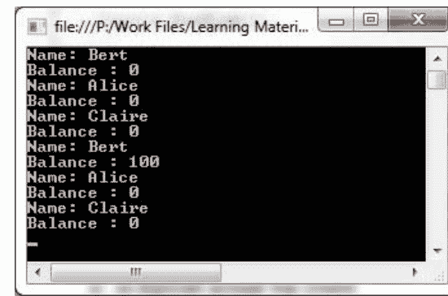

### 活动 4

之前我们发现 `List` 的一些实用方法包括...

- `Add()` – 将对象添加到列表末尾，

- `Clear()` – 从列表中删除所有元素，

- `Contains()` – 如果此列表包含指定对象，则返回 true，

- `Insert()` – 在指定位置插入元素，

- `Remove()` – 从列表中删除对象的首次出现，以及

- `Sort()` – 对列表元素进行排序。

访问 mdn.microsoft.com。查找 `System.Collections.Generic` 命名空间下定义的 `HashSet` 类的 API，并找出 `List` 类中的方法是否具有等效的方法。

### 反馈 4

你会发现 `HashSet` 也存在 `Add()`、`Contains()` 和 `Remove()`。不存在 `Insert()` 和 `Sort()`。由于集合是无序的，你无法对它们进行排序。

## 使用 C# 的面向对象编程

# 泛型集合以及如何序列化它们

### 活动 5

下面的代码将在集合（称为 `StringSet`）中查找字符串。

```csharp
public void FindString(String s)
{
    boolean found;
    found = StringSet.Contains(s);
    if (found)
    {
        Console.WriteLine("Element " + s + " found in set");
    }
    else
    {
        Console.WriteLine("Element " + s + " NOT found in set");
    }
}
```


### 活动 6

考虑为了活动 5 中的代码运行需要创建的 `Publications`（出版物）集合并回答以下问题。

- 这样的集合可以用于存储书籍集合吗？

- 它可以存储书籍和杂志的组合吗？

- 如果在集合中找到一本书，以下行代码将做什么？

`Console.WriteLine("Element " + p + " found in set");`

### 反馈 5

```csharp
public void FindPublication(Publication p)
{
    boolean found;
    found = PublicationSet.Contains(p);
    if (found)
    {
        Console.WriteLine("Element " + p + " found in set");
    }
    else
    {
        Console.WriteLine("Element " + p + " NOT found in set");
    }
}
```

### 反馈 6

- 1. 是的。书籍是出版物的子类型，可以存储在出版物集合中。

- 2. 是的。出于相同的原因，我们可以存储书籍和杂志对象的组合（任何其他类型的出版物）。


进入`/path/to/xxx`目录，找到`xxx.json`。

在表达式`cvar = avar + bvar`中，加法运算符（`+`）将`avar`与`bvar`相加，得到它们的和`cvar`

在`List.of(arg0, arg1, arg2)`中，`List`接口的工厂方法`of()`接受一系列的元素，返回包含它们的只读列表。

之后我们这样调用`cmd`命令：`cmd arg0 arg1 arg2`。

```
if (condVar > someVal) {console.log("xxx")}
```


# 使用 C# 进行面向对象编程

对于我们的目的而言，Express 版本唯一缺失的一项是第 10.5 节中解释的单元测试工具。在所有其他方面，它都是一个强大的集成开发环境（IDE），完全支持学习和开发 C# 程序。

Visual Studio 可以从以下网站下载：http://www.microsoft.com/express/Downloads/

## 8.3 SharpDevelop

另一个强大且免费的开发 C# 程序的工具是 SharpDevelop。它是开源的，因此你可以下载源代码和可执行文件。

SharpDevelop 支持包括 C# 4.0 和 VB.NET 在内的语言。它包含了单元测试功能（通过插件）、强大的代码补全功能以及调试功能。

为了帮助调试，SharpDevelop 包含一个数据可视化器（下方），该可视化器会在单步执行代码时动态更新数据结构表示。

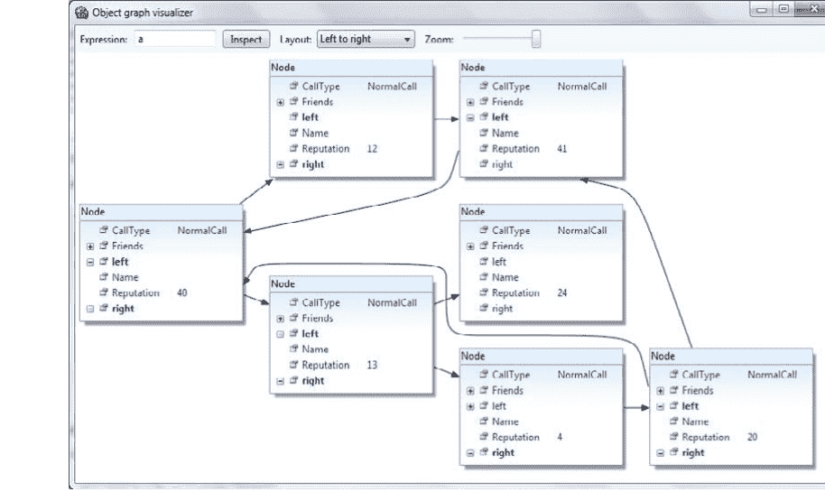

有关 SharpDevelop 的更多信息或下载，请访问 http://community.sharpdevelop.net/forums/t/12513.aspx。

应该注意的其他免费工具包括 MonoDevelop (`monodevelop.com/`)，这是一个支持 Linux、Windows 和 OSX 的多平台 IDE。

## 8.4 自动文档

某些 IDE 中一个特别实用的功能是为创建的程序生成自动文档。多年来，程序员一直深受编写文档这一枯燥且耗时任务的负担。部分文档是为适应和修改程序功能的用户设计的，这些程序员需要知道程序是如何工作的以及它的结构：

- 它包含什么

- 每个包中的这些类做什么的

- 每个类中的这些方法做什么

  - 该方法的作用什么

  - 它需要什么参数

  - 返回什么值

工具本身无法生成用户指南，但它们可以为我们编写的程序提供技术描述，并以网页（HTML 文件）或其他格式生成文档。技术文档应该包含你在查看 MSDN .NET 库时看到的类似信息。

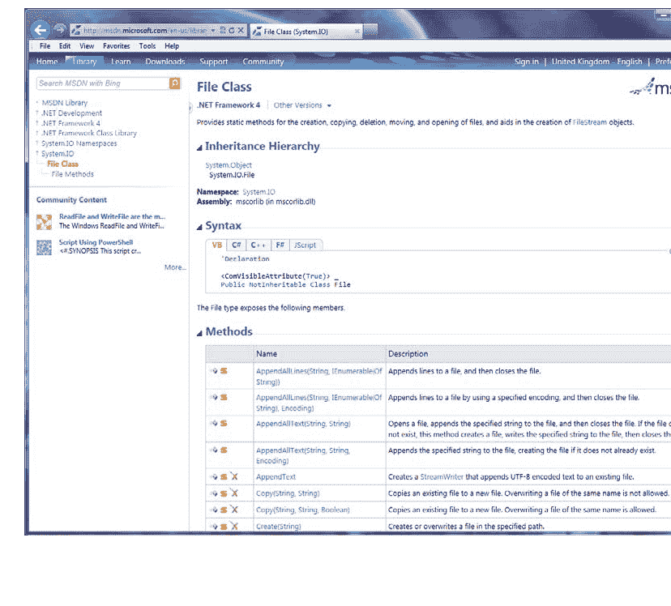

该网站提供了索引网页，包含了 .NET 库的详细信息，包括所有包、类、方法参数和返回值。这些极其有用的信息不是手动生成的，而是使用自动工具生成的。

工具可以为你创建的任何 C# 程序生成类似的详细文档，这将帮助未来的程序员并更新你的程序。然而，这依赖于源文件中格式正确（且信息丰富的！）XML 风格注释，例如 `@author`、`@param` 等标签。

由于这些文档是自动生成的，程序员就免去了枯燥、耗时且出错的任务。此外，文档可以随程序的改变更新。

XML（可扩展标记语言）是一种指定和共享结构化信息的方法。通过向代码添加意义的 XML 注释，我们可以生成自动文档。对源代码注释的关注会导致糟糕的文档。另一方面，如果注释得当，那么几乎不需要努力就能生成参考文档。

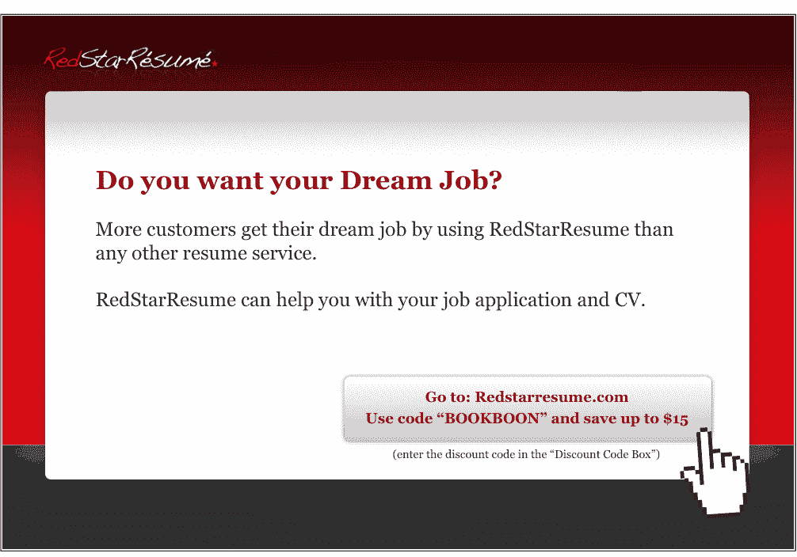

因此，应该在每个类的开头添加 XML 注释，使用标准的 `<summary>` 和 `<remarks>` 标签以以下格式给出类的概览：

```
/// <summary>
/// 此处提供类及其角色的简短描述 ....
/// </summary>
/// <remarks>作者 Simon Kendal
/// 版本 1.0 (2011年5月5日)</remarks>
```

每个方法也应该提供类似的注释，使用 `<param name="参数名称">` 和 `<returns>` 标签来描述每个参数并描述返回的值。每个参数的细节（以参数名称开始）应该如下所示分行提供：

```
/// <summary>
/// 方法的描述
/// </summary>
/// <param name="第一个参数名称">该参数的描述 </param>
/// <param name="第二个参数名称">该参数的描述 </param>
/// <returns> 方法返回值的描述。 </returns>
```

### 活动 1

下面的方法接收两个整数并将它们相加。该值由方法返回。请使用适当的标签编写 XML 注释来描述此方法。

```csharp
public int add(int number1, int number2)
{
 return(number1 + number2);
}
```

### 反馈 1

```
/// <summary>
/// 此方法将两个整数相加。
/// </summary>
/// <param name="number1">第一个数字。</param>
/// <param name="number2">第二个数字。</param>
/// <returns>两个数字之和。</returns>
```

自动工具无法分析注释来确定这些注释是否提供了方法的准确描述，然而，工具的功能远比剪贴注释到网页文档要多。一种实现工具是自动化方法签名并与代码中的标签进行比较以检查逻辑错误。如果方法需要参数但注释中没有对应的标签，此错误将被检测并报告给程序员。

```
“类中没有匹配的 XML 标签（对于该类的参数）”
```

## 8.5 Sandcastle Help Builder

准确来说，Sandcastle Help Builder (`SHFB`) 不为你的代码生成自动文档……但它为 'Sandcastle' 添加了图形界面。“Sandcastle' 是一个缺乏 GUI 且安装复杂的工具，但它可以生成自动文档。

Sandcastle builder 是一个驱动 Sandcastle 并自动化安装的 GUI。Sandcastle Help Builder 可以从 http://shfb.codlex.com/ 下载。

运行此软件将安装：

- Sandcastle

- 更新和附加文件

- 各种帮助格式的编译器 - 仅 Help 1 编译器

- Sandcastle 帮助文件本身

运行 SHFB 时需要指定一个从代码本身生成的 XML 文件，即 `.sln` 文件。

在 Visual Studio 中，选择项目 属性 / 生成 / XML 注释来生成 XML 文件。注意，如果代码中缺少注释，Visual Studio 将报错。

## 8.6 GhostDoc

SHFB 非常有用，因为它可以在代码正文中存在适当 XML 注释的情况下为程序生成自动文档。GhostDoc 是一个可以为你的 C# 代码自动添加 XML 注释的软件。尽管注释需要编辑以确保其意义。

## 8.6 添加命名空间注释

关于命名空间注释的最后一个复杂问题。

一个房间存在，我们可以走到房间外面并在门上挂一个牌子。一个建筑存在，我们可以这样做，即走到建筑外面并在建筑上挂一个牌子；而当宇宙存在，我们无法走到它的外面并在上面挂一个牌子……因为“外面”并不存在！

命名空间注释也存在类似的问题。

## 使用 C# 的面向对象编程

# C# 开发工具

我们知道代码中类的起始位置，因此可以在开头放置一个 XML 注释来描述该类。同样，我们可以在开头放置注释来描述这些方法……而命名空间（namespaces），我们无法定义它们的名称。如果我们将分层划分到命名空间中（我们本应该这样做），我们就无法在命名空间的开头放置注释来描述该命名空间。

如果我们查看 MSDN 文档（见下图），我们可以看到它描述了名称，我们的程序也应该这样做。


但如果我们无法定义命名空间的起始位置，就必须将这些注释放在其他地方。

SHFB 为这个问题提供了一个解决方案，允许我们直接在 SHFB 中输入系统的命名空间注释。

## 使用 C# 的面向对象编程

# C# 开发工具


虽然这可能涉及多个软件部分，并且设置需要一些时间，但建立自动生成文档的能力可以节省大量的时间。更重要的是，每当我们编辑和修改程序时，只需点击几次按钮即可在内部生成自动文档。

其他程序员可能需要修改和更新我们创建的程序。作为专业程序员，我们有责任提供文档，使这一切尽可能简单。像 SHFB 和 GhostDoc 等自动工具可以帮助我们完成这一工作。

# 8.8 总结

我们可以“回归基础”，使用文本编辑器和独立编译器（免费提供）创建 C# 程序，但使用专业的 IDE 可以提供额外的功能来支持程序员。

对于 GUI 设计、图表绘制和文档等开发方面，有专门的工具可用，但某些 IDE 已经超越了基础功能，将其中一些功能内置在 IDE 中。

Visual Studio Express 和 SharpDevelop 是两个强大的 IDE，支持 C# 和其他 .NET 程序的开发。

## 使用 C# 的面向对象编程

这些工具初看起来可能令人敬畏，因为它们为专业开发提供了广泛的支持，包括通过在线帮助进行代码格式化和重构（确实存在），而且工具提供了某种程度的自动代码生成，例如 `main` 方法，以减轻程序员的工作负担。

专业程序员有责任创建最新的文档。SHFB 软件通过帮助创建这些文档变得非常有用且节省时间，但它确实要求程序员在代码中插入有意义的 XML 注释（针对所有类和所有公共方法）。

GhostDoc 可以通过添加 XML 注释来帮助程序员，尽管他们需要进行手动编辑。


# 9 创建和使用异常

### 引言

如果读者编写了使用文件处理功能的 C# 程序，他们可能已经编写了捕获异常的代码，即他们使用过 `try/catch` 块。本章解释了创建自定义异常的重要性，并展示了如何通过扩展 `Exception` 类和使用“Throw” 机制来实现这一点。

### 目标

在本章结束时，你将能够……

- 意识到异常的重要性

- 理解如何创建自定义异常以及

- 理解如何抛出这些异常。

本章由六部分组成：

- 1) 理解异常的重要性

- 2) 异常的种类

- 3) 扩展 ApplicationException 类

- 4) 抛出异常

- 5) 捕获异常

- 6) 总结

# 9.1 理解异常的重要性

异常处理是编写 C# 程序的关键部分。C# 语言中文件处理类的作者深知此，并创建了利用 C# 异常处理功能的程序——但这些真的重要吗？这些功能对于使用 C# 编写自己应用程序的程序员重要吗？

## 使用 C# 的面向对象编程

# 创建和使用异常

### 活动 1

想象银行程序的一部分由三个类和三个方法组成，如下所示……

上述系统由 `BankManager` 类驱动。`AwardLoan()` 方法通过接口或另一个方法被调用。该方法旨在接受或拒绝贷款申请。

`BookOfClients` 类维护了一组账户持有人……人们被添加到其中，或者他们可能会被创建。然而，我们感兴趣的方法唯一是 `GetClient()` 方法。该方法需要一个字符串参数（客户 ID）并返回一个客户对象（如果该客户在银行有账户）——返回 `NULL`（如果客户不存在）。

`Client` 类有一个感兴趣的方法 `DetermineCreditRating()`。该方法被调用以触发客户的信用评级——`BankManager` 类用此来判断是否批准贷款。

考虑上面的场景以及下面的代码片段……

```
Client c = listOfClients.GetClient(clientID) 
c.DetermineCreditRating();
```

这段代码片段存在于 `AwardLoan()` 方法中。首先，它会调用 `GetClient()` 方法并将客户 ID 作为参数传递。该方法将返回相应的客户对象（当然假设存在具有此 ID 的客户），并存储在局部变量 `c` 中。获取客户后，将对该客户调用 `DetermineCreditRating()` 方法。

在这两行代码处，你能识别出它们存在任何潜在问题吗？

### 反馈 1

如果存在指定 ID 的客户，上述代码将正常工作。但如果不存在指定 ID 的客户，`GetClient()` 方法将返回 `NULL`。

第二行代码将导致运行时错误，因为它尝试在不存在的客户上调用 `DetermineCreditRating()` 方法（具体为 `NullReferenceException`），导致程序在此处崩溃。

### 活动 2

考虑对该代码进行修改：

```
Client c = listOfClients.GetClient(clientID) 
if (c != NULL) {
  c.DetermineCreditRating();
}
```

## 使用 C# 的面向对象编程

# 创建和使用异常

| 反馈 2 |

| :--- |

| 如果代码被修改为允许可能的 NULL 值，它将会工作——但这样做是不安全的，因为它依赖于程序员发现这个潜在错误。在编写 `GetClient()` 方法时，作者完全意识到客户可能未找到，在这种情况下决定返回一个 NULL 值。然而，这依赖于程序员识别并防止这种异常发生。 |

# 使用 C# 进行面向对象编程

我们可以创建一个名为 `UnknownClientException` 的子类并重写此构造函数。当我们创建该类的对象时，可以使用此字符串来提供导致异常生成的故障详细信息。该字符串将被存储并并通过 `Message` 属性访问。

创建此新类的代码如下……

```csharp
public class UnknownClientException : ApplicationException
{
    public UnknownClientException(String message) : base(message)
    {
}
```

在某些方面，这看起来似乎有些奇怪。我们正在创建 `ApplicationException` 的子类，但我们的子类没有包含任何方法，也没有扩展任何现有方法。它的功能与父类相同——但它是一个具有意义且描述性名称的子类型。

如果不存在 `ApplicationException` 的子类，我们只能捕获最通用的异常类型，即 `ApplicationException` 对象。这样，我们只能编写一个捕获系统生成的每种类型异常的 catch 块（处理块）。

相反，使用子类使我们有了选择……a) 我们可以定义一个 catch 块来捕获最通用类型“Exception” 的对象，即它将捕获所有异常；b) 我们可以定义一个 catch 块来捕获所有应用程序生成的异常；c) 我们可以更具体，只捕获 `UnknownClientException` 和其他类型的异常。

在网上查看 MSDN 库，我们可以看到已经存在许多预定义的 `SystemException` 子类。其中包含许多此类类，包括：

- ArithmeticException

- DivideByZeroException

- OverflowException

- IOException

  - DriveNotFoundException

  - FileLoadException

  - FileNotFoundException

  - PathTooLongException

- InvalidCastException

- InvalidDataException

- InvalidOperationException

# 使用 C# 进行面向对象编程

## 创建和使用异常

因此，我们可以：

- a) 编写一个 catch 块，通过捕获 `SystemException` 对所有这些异常做出反应，或者我们可以

b) 编写一个 catch 块来捕获任何类型的输入/输出异常（`IOExceptions`），并忽略所有其他

c) 我们可以更具体，只捕获 `FileNotFoundExceptions`。

捕获特定异常允许我们采取特定的补救措施，例如，给定一个 `FileNotFoundException`，我们可以向程序用户解释文件丢失，并允许他们指定备用文件。

捕获通用异常允许我们确保没有潜在的致命错误导致我们的程序崩溃，尽管我们可能无法采取非常有用的补救措施，例如，给定任何 `Exception`，我们可以关闭程序，但在不知道导致异常原因的情况下，我们无法采取特定的补救措施。

完全相同地，我们可以定义 `ApplicationException` 的子类并在适当的情况下捕获这些异常。

## 9.4 抛出异常

定义好异常类后，我们必须确保我们的方法在适当的时候生成或抛出这些异常。例如，当无法根据指定的 ID 找到客户端时，我们将使用 `GetClient()` 来抛出 `UnknownClientException`。


管理硕士

脱颖而出

专为拥有不足一年全职研究生工作经验的毕业生设计，伦敦伦敦商学院（London Business School）的管理硕士将扩展你的思维，并为你成功的商业生涯奠定基础。

课程是与招聘人员协商开发的，旨在为你提供帮助雇主脱颖出的关键技能。通过一年的全日制学习，你将获得商业知识和能力，增加你的职业选择并脱颖而出。

现已开放 2021 年 9 月入学的申请。

伦敦商学院

Regent's Park

London NW1 4AS

United Kingdom

电话 +44 (0)20 7000 7573

emim@london.edu

www.london.edu/mim/

欲更多信息请访问 www.london.edu/mim/

请发送邮件 mim@london.edu 或拨打 +44 (0)20 7000 7573

# 面向对象编程 C#

要做到这一点，我们必须使用 `new` 关键字创建一个 `UnknownClientException` 对象。在这样做时，我们可以将错误消息作为参数传递给异常的构造函数，如下代码所示。


```csharp
new UnknownClientException("ClientBook.GetClient(): unknown client ID:" + clientID);
```

上面的代码生成了 `UnknownClientException` 类的实例，并为构造函数提供了一个字符串消息（String）。此消息指定了生成异常的类/方法名称，并提供了一些额外信息，告知用户导致错误的情况，例如客户端的 ID。

生成异常对象后，我们使用 `throw` 关键字在方法体内的适当位置抛出此异常。

```csharp
public Client GetClient(int clientID)
{
    // 缺失代码
    throw new UnknownClientException("ClientBook.GetClient(): unknown client ID:" + clientID);
}
```

在上面的示例中，如果找到了客户端，方法将返回客户端对象（此代码未显示）。然而，如果没有找到客户端，则会调用 `UnknownClientException` 的构造函数。此构造函数需要一个字符串参数，我们在这里传递的字符串是试图提供信息且有效的消息，指定了：

- 生成异常的类（例如 `ClientBook`），
- 该类中的方法（例如 `GetClient()`），
- 引起异常的一些以及
- 参数的值

## 9.5 捕获异常

通过向编译器指定方法可能会生成异常，我们使其他方法能够处理潜在的错误。通过定义 `UnknownClientException`，我们防止了致命的错误。因此，在上面的示例中，`AwardLoan()` 方法通过放在 try 块中决定做什么：

```csharp
try
{
    Client c = listOfClients.GetClient(clientID);
    c.determineCreditRating();
}
catch (UnknownClientException uce)
{
    Console.WriteLine("INTERNAL ERROR IN BankManager()\n" + "Exception details: " + uce.Message);
}
```

## 9.6 总结

异常提供了处理执行期间异常情况的机制。

在编写可能成为应用程序部分的类和方法时，我们应该创建 `ApplicationException` 类的子类并在适当时抛出异常对象。

利用异常机制防止致命程序故障。异常机制允许使用我们方法的程序员识别并处理错误情况。

当生成异常时，将启动 catch 块的代码——这可以采取激进措施或终止程序并生成相应的错误消息。无论哪种情况，至少程序没有“停止”。

工作系统中异常异常示例可以在第 11 章的案例中找到。

# 10 敏捷编程

虽然详细讨论敏捷开发方法超本书的范围，但本章将解释敏捷编程方法支持者的主张，以及现代 IDE（如 Visual Studio）如何提供支持敏捷编程的工具。特别是我们将检查重构和 Visual Studio 内的自动测试框架。

### 目标

在本章结束时，你将能够：

- 理解敏捷开发主张的重要性
- 理解重构的性以及现代 IDE 如何支持它
- 理解单元测试的优势以及
- 理解如何创建自动化测试用例
- 理解测试驱动开发的主张


使用 C# 的面向对象编程

敏捷编程

本章包含十五个小节：

- 1) 敏捷方法
- 2) 重构
- 3) 重构示例
- 4) 重构支持
- 5) 单元测试
- 6) 自动化单元测试
- 7) 回归测试
- 8) Visual Studio 中的单元测试
- 9) 断言示例
- 10) 若干测试示例
- 11) 运行测试
- 12) 测试驱动开发 (TDD)
- 13) TDD 周期
- 14) TDD 的主张

## 10.1 敏捷方法

传统的开发方法强调详细的远期规划以及软件生命周期的线性进展。“敏捷”开发方法强调灵活的循环开发，使系统早期演进为一种解决方案代码，并在执行过程中进行修复和改进。

这是目前软件工程领域中一个非常热门的话题，和所有此类发展趋势一样，它也有自己的狂热分子和意识形态！

瀑布周期模型是否真的能够让大型复杂项目从开始到结束而从不回头地成功运行？敏捷实践的拥护者认为这些方法更符合软件开发的现实。

然而，敏捷实践需要能够让软件演进并不断变化的工具。现代 IDE 提供的两种特定工具是重构和测试。

## 10.2 重构

敏捷方法的一个关键元素是重构。重构意味着在不改变功能的情况下改进代码质量。

虽然重构的想法并不新，在传统开发中它是为了改进设计而采取的预防性措施，但在敏捷开发中，这被视为日常工作。

## 10.3 重构示例

在开发过程中，程序员可能会发现某些代码需要重构。

为了确保重构时不会破坏现有功能，我们需要测试。这在重构是必要的。

常见的重构操作包括：

- 重命名标识符
- 将一个方法移动到另一个方法
- 从一个类中拆分方法
- 修改方法的参数
- 调整类的位置

## 10.4 重构支持

即使是简单的重构操作（例如重命名类或方法），也需要细致考虑。

现代 IDE 提供了支持此类操作的工具。Visual Studio 提供了重构支持，这允许我们在整个系统中进行更改。

Visual Studio 能够自动处理这些调用方法的更改。

下方显示了 Visual Studio 提供的重构选项：

| 重构操作 | 快捷键 |
| :--- | :--- |
| 重命名... | F2 |
| 提取方法... | Ctrl+R, M |
| 提取接口... | Ctrl+R, I |
| 删除参数... | Ctrl+R, V |
| 调整参数... | Ctrl+R, O |

## 10.5 单元测试

隔离测试方法被称为单元测试。这通常有助于：

- 编写类
- 编写测试
- 运行测试

## 10.6 自动化测试

为了节省时间，我们需要自动化测试。这通常有助于：

- 编写类
- 运行测试

## 10.7 回归测试

所有大型软件系统都需要适应变化的需求。许多大型系统已经使用了十年多年。多年来，软件需要多次更新以满足不断变化的需求。这就是回归测试的原因。通过运行回归测试，我们希望确保代码更改不会“破坏”现有功能。我们必须通过旧的测试。

## 10.8 Visual Studio 中的单元测试

Visual Studio 包含一个广泛使用的测试框架。该框架要求我们设置测试用例——然而一旦设置好，每次修改程序时都可以运行这组测试用例。

> 系统将运行测试并突出哪些测试通过或失败。

请注意，“失败”的测试实际上表明被测试程序存在问题……你可以认为显示这种失败实际上是成功的。

这里流程总结如下：

- 1) 首先设置一个存储系统所有测试的项目
- 2) 在项目内部为我们要测试的每个类创建一个测试固件（test fixture）
- 3) 在每个测试固件中创建多个测试。每个被测试的方法可能需要几个测试
- 4) 设置测试，即在运行测试之前必须完成的初始化
- 5) 清理测试，即在测试执行之后应该执行任何操作
- 6) 运行测试

# 面向对象编程 C# 敏捷编程

有一种命名规范，可以使测试用例与被测试代码之间的关系变得清晰：

- 1) 用于存储测试的项目根据被测试的系统命名（例如，一个存储银行系统测试的项目可以命名为 `BankSystemTests`）。
- 2) 测试固件（Test Fixture）使用被测试类的名称进行命名（例如，假设银行系统中有一个名为 'Client' 的类，则测试固件命名为 `TestFixture_ClientTests`）。
- 3) 测试的命名使用：被测试的方法名+所应用的测试+预期结果（例如，一个名为 `AddMoney` 的方法可能有一个测试为...`AddMoney_Add5Pounds_BalanceEquals10`）。

在 Visual Studio 中，遵循菜单 `测试` -> `新建测试项目` -> `基本`将设置一个能够处理 C# 代码的测试套件。首先，将要求输入测试固件的名称，如果之前没有设置测试项目，则会要求输入名称。每个测试在被添加到测试固件时都需要单独命名。

创建了测试固件后，我们需要设置测试并编写测试本身。作为其中的一部分，我们需要指定被测试代码正确行为。我们使用 `Assert(...)` 方法来实现，这些方法必须为真，测试才能通过。

我们还利用属性（Attributes）为 Visual Studio 提供必要的信息，以便其运行测试……

- `[TestClass]` 属性表示该测试类将确实作为测试固件。因此，此属性必须放在每个测试固件的开头。

```csharp
[TestClass]
public class TestFixture_ClientTests
{
```

- `[TestInitialize]` 属性声明了一个在每个测试用例执行之前运行的方法。
- 测试用例是方法，必须跟在 `[TestMethod]` 属性。
- `[TestCleanup]` 属性声明了一个在每个测试用例执行后运行的方法。
- `[ExpectedException(typeof(...))]` 属性允许我们指定预期代码会生成异常。

我们很快就会看到这些内容的示例。

# 使用 C# 敏捷编程面向对象编程

## 10.9 断言示例

在设置测试用例时，我们进行进行断言。断言是一个语句，如果代码运行正常，则该陈言应为真。断言的示例包括……

- `Assert.AreEqual(...)`
- `Assert.AreNotEqual(...)`
- `Assert.Fail(...)`
- `Assert.IsTrue(...)`
- `Assert.IsFalse(...)`

正如我们在这里看到的，`Assert.AreEqual()` 和 `Assert.Fail()` 对于许多测试目的来说足够了。

`Assert.Fail()` 表示到达这一行意味着测试失败了！虽然我们说测试失败了，但从严格来说这不是真的。失败的不是测试，而是我们的代码失败了。测试成功地发现了我们代码中的错误。


在爱立信（Ericsson），我们深信，我们每天所做的创新可以为人类、业务和社会创造一个更好的世界产生深远影响。加入我们吧。

在德国，我们特别寻找作为集成工程师的毕业生，负责：

- 无线接入和 IP 网络
- IMS 和 IPT

我们期待收到您的申请！欲申请并查看所有当前的招聘职位，请访问我们的网页：www.ericsson.com/careers

## 10.10 若干测试示例

为了说明测试框架，我们将创建几个测试用例来测试如下所示的 `BankManagement` 系统的功能：


在该系统中，`BankManager` 类维护了一本客户簿（BofC）。可以通过 `AddClient()` 方法添加客户对象，该方法需要该客户的 ID 和要添加的客户对象。可以通过 `GetClient()` 方法检索客户，该方法需要 `ClientID` 作为参数，并返回客户对象（如果存在）或生成异常（如果不存在指定 ID 的客户）。

`Client` 类有一个构造函数，需要客户名称和客户余额。

为了简单起见，我们假设银行的每个客户只有一个账户（这显然不是一个现实的系统），而且我们不需要账号，因为每个客户都有一个唯一的 ID。

我们将专门测试以下能力……

- 向 `BookOfClients` 中添加一个客户
- 尝试查找一个不存在的客户
- 通过调用 `AddMoney()` 方法增加客户的余额。

当然，这只是为了彻底演示系统中所有类和所有方法运行所需的测试用例的一小部分。

## 测试客户

为了测试是否可以添加客户，我们需要：

- 1) 通过创建一个新的空 `BookOfClients` 来设置测试
- 2) 创建一个客户并将其添加到 `BookOfClients`
- 3) 通过尝试检索刚刚添加的客户来检查客户是否已成功添加（本课程应该可以运行），并且最后
- 4) 我们需要测试检索到的客户是否与我们添加的客户具有相同的属性——确保确保在过程中没有被损坏。

首先，我们通过创建一个新的空 `BookOfClients` 对象 (BofC) 来初始化测试，并在结束时将其设置为 `null` 以清理测试。代码如下所示：

```csharp
[TestInitialize]
public void TestInitialize() {
    BofC = new BookOfClients();
}

[TestCleanup]
public void TestCleanup() {
    BofC = null;
}
```

接下来，我们通过向空的 `BofC` 添加客户来创建我们的第一个测试。如果系统生成了异常，我们就知道代码有问题。查看该测试代码：

```csharp
[TestMethod]
public void AddClient_TestNewClient_ExceptionNotGenerated() {
    Client c = new Client("Simon", "Room 1234", 200, 10);
    try {
        Bof.AddClient(c);
    } catch (Exception) {
        Assert.Fail("新客户不应抛出异常");
    }
}
```

如果上面的测试通过，我们知道代码没有生成异常，但并没有证明客户已添加。我们需要创建其他测试来显示我们可以检索刚刚添加的客户，并需要一个测试来显示在添加客户时属性没有被损坏。在我们确认该方法实际上可以工作之前，需要多个测试！

注意上面的测试名称通过对执行测试的描述和预期输出描述指示了被测试的方法。这种长测试名称是非常重要的。通过阅读长测试名称列表，我们可以确定系统的哪些部分已经测试，哪些部分被遗漏了。

除了描述的测试之外，还应该尝试两次添加相同 ID 的客户。我们的系统当然不允许这种情况发生。如果代码阻止了两次添加，则测试成功。

相反，如果在第二次添加相同客户时系统没有生成异常，则测试应该指示代码失败。该测试给如下所示：

```csharp
[TestMethod]
public void AddClient_TestExistingClient() {
    Client c = new Client("Simon", "Room 1234", 200, 10);
    try {
        Bof.AddClient(c);
        Bof.AddClient(c);
        Assert.Fail("如果添加两次，应抛出 ClientExists 异常");
    } catch (ClientExistsException) {
    }
}
```

编写上述测试的另一种方法是指定预期由 `[ExpectedException(...)]` 属性生成的异常。如果生成此异常中断了测试，则测试通过了。查看下方测试代码的另一种版本……

```csharp
[TestMethod]
[ExpectedException(typeof(ClientExistsException))]
public void AddClient_TestExistingClient() {
    Client c = new Client("Simon", "Room 1234", 200, 10);
    Bof.AddClient(c);
    Bof.AddClient(c);
}
```

使用 C# 的面向对象编程与敏捷编程

## 测试 GetClient 方法

我们当然会测试系统中的所有方法，包括 `GetClient()` 方法。

我们需要执行的一个用例是测试：当我们尝试检索一个不存在的客户端时，是否会抛出异常。为了测试这一点，我们创建一个新的空 `BookOfClients` 并尝试从中检索一个客户端——任何客户端！

在这种情况下，我们希望系统生成一个未知客户端异常（unknown client exception）。由于我们通过创建一个空账本来初始化测试，除非我们先添加它们，否则我们无法检索任何客户端。

### 活动 1

查看下面的代码，并判断在代码的哪一点我们可以断言测试显示我们的系统已失败（点 A、B、C 或 D）。

```csharp
[TestMethod]
public void GetClient_TestGettingUnknownClient_ShouldGenerateException()
{
    // point A
    try {
        // point B
        BofC.GetClient(1);
        // point C
    }
    catch (BankManager.UnknownClientException)
{
        // point D
    }
}
```

### 反馈 1

在调用 ... 之前，我们无法确定 `GetClient()` 方法是否失败，因此我们不能在此放置 `Assert.Fail`。在点 A 或 B 处失败。

当我们调用此方法时，由于我们的客户端账本是空的，应该生成异常。`try` 块应该在此处终止并启动 `catch` 块；如果代码到达点 D，则表示测试成功而非失败。然而，如果代码到达点 C，则表示预期的异常没有生成，因此我们可以在此点断言 `GetClient()` 方法已失败。

此测试的完整代码如下....

## 使用 C# 的面向对象编程

## 敏捷编程


```csharp
[TestMethod]
public void GetClient_TestGettingUnknownClient_ShouldGenerateException () {
    try {
        BofC.GetClient(1);
        Assert.Fail("UnknownClient exception should be thrown if client does not exist");
    }
    catch (BankManager.UnknownClientException) {
    }
}
```

在测试我们的 `BookOfClients` 类之外，我们当然还会测试系统中的其他类。


## 测试 Client 类

```csharp
[TestClass]
public class TestFixtureTests
{
    private MessageManagerSystem.Clients.Client c;

    [TestInitialize]
    public void TestInitialize()
    {
        c = new BankManager.Client("Simon", 10);
    }

    [TestCleanup]
    public void Cleanup()
    {
        c = null;
    }
}
```

在初始化时，我们创建了一个初始余额为 10 的新客户端。

严格来说，我们在编写 `BookOfClient` 测试之前先编写了 `Client` 测试，因为我们需要客户端对象来测试 `BookOfClients`。在 Visual Studio 中，可以确保这些测试先运行。

下面是一个测试 `AddMoney()` 方法的简单测试...

```csharp
[TestMethod]
public void AddMoney_TestAdd10ToBalance_FinalBalShouldBe20()
{
    c.AddMoney(10);
    Assert.AreEqual(20, c.Money, "Balance after adding 10 is not as expected. Expected: 20: "+c.Money);
}
```

上述使用了 `Assert.AreEqual()` 方法。如果前两个参数相等，则我们的代码通过了测试。如果它们不等，则我们的代码失败了，第三个参数是待显示的错误消息。为了尽可能提供帮助，错误消息指定了我们预期的余额以及调用 `AddMoney()` 方法后的实际余额。

在我们编写的所有测试中，如果测试方法结束时没有失败任何断言（assertions），则该测试通过了。

## 使用 C# 的面向对象编程

### 测试 ToString() 方法

间接测试客户端所有属性是否已正确存储的一种方法是测试 `ToString()` 方法是否返回预期的值。这有点棘，因为字符串的格式必须完全匹配，包括每个空格、标点符号和换行符。

另一种方法是测试每个属性的值。

#### 活动 2

假设类的 `ToString()` 方法定义如下，创建一个测试方法来测试 `ToString()` 方法返回的值符合预期。

```csharp
public String ToString() {
    return ("Client name:" + Name + "\nBalance:" + Balance);
}
```

提示：我们已经通过创建一个名为 "Simon" 余额为 10 的客户端初始化了客户端测试。

该练习的一个解决方案如所示。

```csharp
[TestMethod]
public void ToString_TestClientValues() {
    Assert.AreEqual("Client name: Simon\nBalance: 10", c.ToString(),
"String returned is not as expected. Expected: Client name: Simon\nBalance: 10 Actual: " + c.ToString());
}
```

在这里我们假设从 `c.ToString()` 返回的字符串等于我们预期的字符串。这非常棘手，因为字符串的格式必须完全匹配，包括每个空格、标点符号和换行符。

此测试当然是在间接测试所有属性是否已正确存储，如果我们用来检查是否正确从客户端账本中检索了客户端，这将特别有用。

## 10.11 运行测试

设计好一组测试后，可以根据需要随时运行。在 Visual Studio 中，我们通过菜单运行。

## 使用 C# 的面向对象编程

### 10.12 测试驱动开发 (TDD)

虽然对于回归测试非常有用，但测试驱动开发 (TDD) 是一种主要与“敏捷”开发过程相关的技术。测试驱动开发的方法是：

- 1) 编写测试（在编写方法之前）。
- 2) 设置自动化测试，它会因为类还没有写而失败！
- 3) 编写类使测试通过


丹麦理工大学 (DTU) 被评为欧洲最顶尖大学之一，并在顶尖国际研究人员的专家指导下提供国际认可的硕士学位。

### 10.13 TDD 周期

在进行测试驱动开发时，测试最初会导致编译错误，因为被测试的方法不存在！

创建一个存根方法（stub method）可以使测试通过，但测试将“失败”，因为被测试的实际功能尚未实现。

我们实现方法的正确的功能使测试成功。

对于复杂的方法，我们可能有多个周期：编写测试、失败、实现功能、通过、扩展测试、扩展功能、通过……以此构建解决方案。

### 10.14 TDD 的主张

对于 TDD 的一些主张包括：

- 测试成为开发中固有的一部分，而不是事后匆忙完成的步骤。
- 它鼓励程序员编写直接满足需求的简单代码。
- 一套完整的单元测试集与代码开发并行编译。
- 快速的“编写测试、编写代码、运行测试”循环（每个微小的开发增量）增加了程序员的信心和生产力。

在传统的软件生命周期中，如果软件项目进度落后，财务压力会导致软件在未经过充分测试和调试的情况下就被推向市场。在测试驱动开发中，这种情况是不可能的，因为测试是在系统实现之前编写的。

# 10.15 总结

“敏捷”开发方法强调灵活的循环开发，使系统向解决方案演进。

重构工具有助于敏捷开发方法。

无论采用何种风格的开发过程，单元测试都是软件工程实践中重要的一部分。

自动化单元测试框架允许在系统开发进行的过程中定期重复执行单元测试。

测试驱动开发（TDD）反转了代码创建和测试创建的正常顺序，并在“敏捷”方法中起着主要作用。


# 11 案例研究

本章将汇集之前章节的内容，通过一个示例案例研究，展示这些核心概念在实践中是如何运作的。

### 目标

在本章结束时，你将看到：

- 如何将问题描述转换为 UML 模型（如第 6 章所示）
- 若干 UML 图图的示例（如第 2 章所示）
- 继承和方法重写的用例（如第 3 章所示）
- 多态的示例，并了解它如何简单地实现扩展（如第 4 章所示）
- 如何有效使用泛型集合的示例，特别是将看到使用集合（set）和字典（dictionary）的示例（如第 7 章所示）
- 使用序列化过程在在文件中存储这些集合的示例（如第 7 章所示）
- 异常和异常处理的示例（第 9 章）
- 自动化单元测试的示例（第 10 章）。
- 最后你将看到自动文档工具的使用（如第 8 章所示）。

本章全程描述的完整应用程序可以作为压缩文件免费下载。该文件可以解压并将项目加载到 Visual Studio 2010 中。

Visual Studio 2010 快速版可以在 www.microsoft.com/express/Downloads 免费下载，但它不包含对单元测试的支持。

用于描述系统的自动创建文档以一组网页的形式提供，因此可以使用任何网络浏览器查看。

使用 C# 的面向对象编程

案例研究

本章由 16 部分组成：

1) 问题
2) 初步分析
3) 进一步分析
4) 使用 UML 记录设计
5) 接口原型设计
6) 为适应不断的需求而修改设计
7) 类打包
8) 消息类的编程
9) 客户端类的编程
10) 创建和处理 UnknownClientException
11) 主类的编程
12) 接口的编程
13) 使用测试开发和扩展系统
14) 生成文档
15) 完成的系统
16) 运行系统
17) 结论

## 11.1 问题

用户需求分析对于软件工程社区来说是一个具有重要意义的话题，完全超出本文的范围。本章的目的不是展示如何获取需求，而是展示在收集需求后，如何使用面向对象（OO）原则对问题陈述进行建模并转换为完整的运行系统。

我们将设计解决方案的问题是：“为一家小型海滨零售商的滚动显示屏开发一个消息管理系统。”

为了练习的目的，我们假设已经通过访谈店主和使用系统的员工完成了初步需求分析，并据此生成了以下文本描述：

面向对象编程 C#

# 案例研究

Rory's Readables 是位于海滨边的一家小店，销售各种便利商品，特别是针对当地居民和游客的书籍和杂志。它最近成为各种当地娱乐和交通提供商的票务代理。

Rory 计划在店面上方安装一个可以显示文本消息的 LCD 消息板。Rory 意图用此推销他自己的产品和优惠，并为付费客户提供消息显示服务（例如：私人销售、失物招领、招聘人员等）。

每个客户都有唯一的 ID 编号、名称、地址、电话号码和金额为“信用单位”的额度。维护一个客户簿，在其中添加客户，我们可以根据其 ID 查找客户。

每条消息都针对特定的客户，包括要显示的文本和应该显示的天数。每条消息的成本为每天 1 个单位。不允许出现重复消息（即同一客户的相同文本）。

需要维护一个当前消息集：可以添加新消息，可以在显示板上显示消息集，并且在每天结束时执行清理——每条消息的剩余天数减 1，其客户的额度扣除消息成本，并将任何过期或其客户被删除的消息从消息集中删除。

软件应在显示板安装之前编写——因此，与显示板的连接应通过定义良好的接口以及一个为了测试目的在软件中实现的虚拟显示板来实现。

根据上述描述，本章描述了如何对该问题进行分析、建模并编写解决方案——从而展示了书中讨论的技术。

## 11.2 初步分析

为了对这些需求进行初步分析（如第 6 章所示），我们必须……

- 列出名词和动词
- 识别系统范围之外的事物
- 识别同义词
- 识别潜在的类、属性和方法
- 识别任何共同特征

通过阅读这些，我们可以看到第一段纯属背景，没有描述任何与软件相关的内容。

### 列表

从剩下的段落中，我们可以列出以下名词或名词短语：

- LCD 消息板
- 店面
- 滚动文本
- 消息
- 客户
- ID 编号
- 名称
- 地址
- 电话号码
- 额度
- 信用单位
- 消息
- 客户簿
- ID
- 文本
- 天数
- 消息成本（单位）
- 当前消息集
- 消息集
- 显示板
- 剩余天数
- 客户额度
- 消息成本
- 软件
- 连接
- 接口
- 虚拟显示板

### 动词列表

以及以下动词：

- 获取
- 安装
- 显示
- 广告
- 赋予（唯一的 ID）
- 显示
- 添加（客户）
- 查找
- 允许
- （重复——不允许！）
- 清理
- 减少
- 减少额度
- 过期
- 删除
- 编写（软件）
- 安装
- 实现
- 测试

面向对象编程 C#

# 系统范围

通过识别系统之外的事物，我们可以简化问题……

* 名词：
- 店面
- 软件
* 动词：
- 获取、安装（显示板）
- 广告
- 赋予（唯一的 ID）
- 编写、安装、实现、测试（软件）

店面不是系统的一部分，获取和安装显示板也不是系统的一部分，ID 由店主分配——而不是系统，而编写/安装软件是程序员的工作——它本身不是系统的一部分。


在大学水平学习商业。我们将案例与前沿研究相结合，以个人或团队形式进行，全英文教学。带回宝贵的知识和经验来提升你的职业生涯。

体验新的食物、音乐和传统的文化，在丹麦哥哈根中心的安全、洁净的环境中学习商业的新方式。

参与课外活动，如案例竞赛、运动等——结识来自全球 80 多个国家的新朋友。

## 使用 C# 的面向对象编程

# 同义词

以下是同义词：

- 名词：
  - LCD消息显示板 = 显示板
  - 滚动文本消息 = 消息
  - ID 编号 = ID
  - 积分单位 = 客户积分 = 积分
  - 当前消息集 = 消息集
  - 天数 = 天数 = 剩余天数
- 动词：
  - 显示 = 显示

通过识别同义词，我们避免了系统中不必要的重复和混淆。

# 潜在的类、属性和方法

描述重要实体的名词（我们可以识别其属性，即数据，以及行为，即方法）将成为系统中的类。这些类包括：

- 客户 (Client)
- 消息 (Message)
- 客户簿 (ClientBook)
- 消息集 (MessageSet)
- 显示板 (DisplayBoard)
- 虚拟显示板 (DummyDisplayBoard)

作为类的属性比本身成为类更好的名词有：

- 对于“客户”：
  - ID
  - 姓名
  - 地址
  - 电话号码
  - 积分
- 对于“消息”：
  - 文本
  - 剩余天数
  - 消息成本

这些中的每一项都可以被建模为一个类（此时 Client 或 Message 将拥有一个对象属性），但我们认为其中每一项都是足够简单的信息，没有必要这样做——它可以仅仅是基本数据类型（例如 `int`）或库类（例如 `String`）的简单属性（实例变量）。

## 使用 C# 的面向对象编程

这是一种设计判断——为重要实体（客户、消息等）引入类，这些实体拥有属于自己的一组信息和行为，而不会用极其简单的类来使设计过载（例如积分，它将只包含一个 `int` 实例变量以及一个属性或访问器方法！）。

动词描述了候选方法，我们应该能够识别这些方法所属类。例如：

- 对于“客户”：
  - 减少积分
- 对于“消息”：
  - 减少天数

其他描述潜在方法的动词也应该列出：

- 显示
- 添加（将客户加入簿中）
- 添加（将消息加入集）
- 查找（在簿中查找客户）
- 清除
- 递减
- 过期
- 删除

对于这些每一个方法都应该识别出对应的类。

# 共同特征

我们初步分析的最后一步是识别类的共同特征，并确定这些类应该通过继承层次结构进行链接，还是通过接口链接。

查看提供的候选类列表，我们可以看到两个类具有共同的特征：

- 显示板
- 虚拟显示板

这意味着这些类应该在系统中通过继承层次结构进行链接，或者通过“一个接口”（参见第 4.5 节接口）。在这种情况下，线索就在描述中：“这些将通过‘定义良好的接口’与系统的其他部分‘连接’”。

最终，我们的系统应该在真实的显示板上显示消息，但应该首先在虚拟显示板上进行测试。为了实现这一点，虚拟板必须实现与真实显示板相同的方法。

# 使用 C# 的面向对象编程案例研究

因此，我们应该定义一个 C# “接口”。这两个类之间不存在公共代码——这就是我们为什么不将它们放在继承层次结构中的。然而，虚拟显示板和真实显示板都应该实现通过通用接口定义的方法。当我们的系统运行时，我们可以用实现相同方法的真实板替换虚拟板。由于与虚拟板的连接是通过接口实现的，将虚拟板更改为真实显示板对我们的系统不会产生影响。

最终，我们的系统应该在真实的显示板上显示消息，但应该首先在虚拟显示板上进行测试。为了实现这一点，虚拟板必须实现与真实显示板相同的方法。

（注：由于原文中存在大量重复段落，翻译已根据逻辑流进行了去重处理。）

| Client |
| --- |
| 获知姓名、地址、电话 |
| 知道当前额度 |
| 减少额度 |
| ClientBook |
| 存储客户ID列表及关联客户 |
| 添加客户 | Client |
| 查找客户 | Client |
| Message |
| --- |
| 获知消息文本 |
| 知道剩余天数 |
| 减少剩余天数 |
| 知道是否过期 |
| MessageSet |
| --- | --- |
| 存储消息列表 | Message |
| 添加消息 | Message |
| 显示消息 | DisplayBoardCtrl |
| 清理消息 | Message, ClientBook, Client |

使用 C# 的面向对象编程

### 活动 1

为了清理消息，MessageBook 会遍历其消息列表，减少“拥有”该消息的客户的额度，递减该消息的剩余天数并在适时删除消息。

查看上面的 CRC 卡，执行以下步骤并识别这些类中可能存在的任何问题：

对于每条消息

- 告诉 Message 减少其剩余天数，并
- 告诉相关的 Client 减少其额度
- 询问 Message 它的客户 ID
- 询问 Message 它的成本
- 询问 ClientBook 具有此 ID 的客户
- 告诉 Client 根据消息的成本减少其额度
- 如果客户的额度 <= 0 或消息现在已过期
则从列表中删除该消息

### 反馈 1

当我们尝试查找与消息关联的客户时，一个问题变得显而易见，因为 Message 并不知道客户 ID。

因此，我们需要将这一责任添加到 Message 类中。

下面给出了 Message 类的修订后的设计……

| Message |
| --- |
| 获知消息文本 |
| 获知 clientID |
| 知道剩余天数 |
| 减少剩余天数 |
| 知道是否过期 |
| 获知成本 |


通过为每个类和接口绘制 CRC 卡并对一系列场景进行角色扮演，我们已经检查并修订了系统计划——我们现在可以精炼这些计划并使用 UML 图进行记录。

使用 C# 的面向对象编程

# 案例研究

## 11.4 记录设计 UML

- 详细确定每个类中包含哪些属性
- 确定类之间的关系，以及
- 将类放入适当的包中。

## 扩展类

在处理完 CRC 场景后，我们可以在类之间对实例变量和方法进行初始分配，包括一些必要性已变得明显的访问器（`accessors`）和修改器（`mutators`）（见下图）。

当然，由于我们将使用 C# 编写此系统，我们将用属性（`properties`）代替访问器和修改器方法，但由于可以使用任何面向对象语言进行编程，我们将让设计显示适当的访问器和修改器方法。


使用 C# 的面向对象编程

# 案例研究

| Client | ClientBook |
| --- | --- |
| 姓名 地址 电话 额度 | ? |
| DecreaseCredit() | AddClient() GetClient() |

| Message | MessageSet |
| --- | --- |
| clientID 文本 剩余天数 成本 | ? |
| DecrementDays() GetText() HasExpired() GetCost() | AddMessage() Display() DailyPurge() |

| <<interface>> |
| DisplayBoardControl |
| LoadMessages() Run() |

我们还不知道 `ClientBook` 和 `MessageSet` 需要哪些简单属性，但它们需要与其他类关联，因此我们仍有一些工作要 own——这就是为什么有问号的原因（它们不是 UML 的正式部分）。

## 类之间的关系

我们现在可以开始研究这些类是如何关联的。

从 `ClientBook` 和 `Client` 开始 - 一个：`ClientBook` 将记录零或多个客户的详细信息。

导航性是从 `ClientBook` 指向 `client` 的，因为簿“知道”它的客户（在实现术中，它将拥有对它们的引用），但单个客户将拥有指向簿的引用。

一对多的关系表明 `ClientBook` 将拥有一个（某种类型的）客户集合（`Collection`）。规定每个 `Client` 都将有一个唯一的 ID，因此该集合实际上是一个字典，每个条目由一对值组成——即一个 `clientID` (`int`) 和一个 `Client` 对象。由于我们通过 ID 检索客户的频率可能比添加和删除频率更高，因此如果使用这种排序字典（`sorted dictionary`），系统将更高效，客户将按其 ID 顺序存储。在排序字典中，添加和删除元素会较慢，因为过程更复杂，但检索元素会更快。

使用 C# 的面向对象编程

# 案例研究


`MessageSet` 和 `Message` 之间的关系与 `ClientBook` 和 `Clients` 之间的关系非常相似。

尽管 `MessageSet` 似乎没有属性，但与 `Message` 的一对多关联再次暗示了一个集合类型的属性。规定消息必须是唯一的，但并未暗示需要键值对，因此一个简单的集合（`set`）就足够了。


## 类的关联：MessageSet, ClientBook 和 DisplayBoard

由于 `MessageSet` 负责启动在板上显示消息，因此它对 `DisplayBoardControl` 有依赖。`MessageSet` 还与 `ClientBook` 有关系，因为在执行每日清理时它需要访问并更新信息。如下所示。

使用 C# 的面向对象编程

# 案例研究


## 类的关联：MessageSet, ClientBook 和 DisplayBoard

下面的图显示了所有这些类是如何关联的。包含额外的类 `DummyBoard`，它将为了测试目的实现 `DisplayBoard` 接口。


使用 C# 的面向对象编程

# 案例研究

由于 `DummyBoard` 将有一个消息集合，因此它与 `Message` 也存在一对多的关系。


对 `DisplayControl` 接口使用了简洁的“球座”符号。

虽然上述类将构成系统的核心，但还需要额外的类来驱动和管理整个系统。将创建一个“`ApplicationWindow`”类。这将是运行系统的 GUI，允许用户与系统进行交互，添加客户、消息等。

其他所有者未指定的额外功能是隐式要求的。归结底，`ClientBook` 和 `MessageSet` 的细节需要保存到文件中。这些数据在下次运行系统时需要被恢复。这再次由接口驱动，但代码主体将下放到相关的类中。

## 11.5 接口原型设计

虽然收集用户需求的方法超出了本文范围——但在继续开发之前对接口进行原型设计并反馈是一个好主意。

下图显示了该系统的建议界面：


它由三个区域组成。从左到右这些是 a) 添加新客户的区域，b) 添加新消息的区域以及 c) 一个用于其他基本操作的按钮区域。

# 使用 C# 进行面向对象编程

# 案例研究

修改接口设计以适应这一变化是简单的——我们可以：

- 创建一个新面板来适应“紧急消息”的创建
- 由于紧急消息所需的数据与普通消息相同，我们只需要在中间面板添加一个额外的按钮“添加紧急消息”即可。

这些额外需求将如何影响系统底层的类？

如果面向对象（OO）原则有效，那么实现这一额外需求应该相对简单。首先，“消息”（`Message`）与“紧急消息”（`Urgent Message`）之间存在明显的关联。

如果这两个类具有某些独特特性，但在功能上有大量重叠，我们可以引入继承层次结构来处理这个问题：

```
<<abstract>>
Message
OrdinaryMessage
UrgentMessage
```


# 使用 C# 进行面向对象编程

# 案例研究

然而，在这种情况下，普通消息并没有什么独特之处——消息有相关的成本，可以获取成本和文本，并且可以创建新消息。紧急消息也是如此。紧急消息与普通消息，只是文本和成本略有不同。`UrgentMessage` 是 `Message` 的一种类型，可以继承 `Message` 的所有特性，并重写成本和文本方法。

因此，`Message` 和 `UrgentMessage` 类之间的关系如下所示，`UrgentMessage` 继承了与 `Message` 关联的所有值和方法，但重写了 `GetCost()` 和 `GetText()` 方法以反映与紧急消息相关的成本和文本。


下面是修订后的类图。但这种变化将如何影响系统的其他部分？


# 使用 C# 进行面向对象编程

# 案例研究

得益于多态性的操作，这一变化对系统的任何其他部分都不会产生影响！

查看类图可以发现 `MessageSet` 保留并管理一组消息（`DummyBoard` 保留一组消息 - 一旦它们被上传显示）。但是关于 `UrgentMessage` 呢？

紧急消息只是特定类型的消息。当在 `MessageSet` 中调用 `AddMessage()` 方法时，需要一个 `Message` 类型的对象，即一个要添加的消息 - 但子类型 `UrgentMessage` 仍然是“`Message`”，因此 `AddMessage()` 方法会接受一个 `UrgentMessage` 对象。

因此，在不对所有 `MessageSet` 任何任何更改的情况下，`MessageSet` 可以维护一个所有要显示的消息集合（包括紧急消息和普通消息）！

此外，当调用 `DailyPurge()` 方法时，它会调用 `Message` 对象的 `GetCost()` 方法，以便向该客户收取费用。在运行时，公共语言运行时（CLR）引擎将确定对象是 `Message` 类型还是 `UrgentMessage` 类型，并将会调用 `GetCost()` 方法的正确版本 - 记住这个方法在 `UrgentMessage` 中被重写了。这就是多态性的应用！

`MessageSet` 需要消息，但得益于多态性和方法重写的应用，`MessageSet` 将乐意地处理任何子类型，就像它们是 `Message` 对象一样。如果我们以后创建新的消息类型，例如圣诞消息或情人节消息，`MessageSet` 也能处理这些消息，而无需更改任何行代码！

因此，在该应用程序中，我们能够通过仅添加一个类并对接口进行一个小更改，来扩展系统添加紧急消息的功能。

如果没有应用多态性，我们只需要对系统的其他部分进行额外的更改 - 即 `MessageSet` 和 `DummyBoard`。

面向对象使系统能够以最小的努力进行扩展！

## 11.7 类的打包

大型程序应该分段包（`packages`），因为这提供了适当的封装和访问控制级别（如第 2 章所述）。

此处用于演示教科书中理论的系统很难算得上是大规模——尽管如此，我们决定将相关的类打包在一起，如下所示。

# 使用 C# 进行面向对象编程

# 案例研究


该图显示了使用的四个包以及每个包中的类。还显示了包之间的关联。不意外的是，存放系统接口的主包与所有其他包都关联——这是因为接口调用了整个系统的功能。

完成设计并适应了变化的需求后，我们可以开始实现系统。这将分两个阶段完成：


# 使用 C# 进行面向对象编程

在第一阶段，将实现一个基础系统，允许创建消息和客户端，将其写入文件并显示消息。

在第二阶段，将扩展系统功能以允许删除客户端并增加其积分。这种实现方式将允许演示测试驱动开发（如第 10 章所述）。

## 11.8 编写消息类

`Message`、`UrgentMessage` 和 `MessageSet` 的编写相对直接。

`Message` 具有各种实例变量（`String`: `messageText` 和 `int`: `COST`, `clientID` 和 `daysRemaining`）。它具有相应的属性来访问这些属性（仅 `daysRemaining` 需要一个 `setter`）以及一个初始化实例变量的构造函数。它还有以下方法：

```
void DecrementDays() // 减少天数
boolean HasExpired() // 指定是否从集合中移除
String ToString() // 返回显示的文本
```

后期我们需要将 `Client` 和 `MessageSet` 对象存储到文件中。为了这样做，所有类（包括 `Message` 类）都需要标记为 `Serializable`。最后，要求说明不允许重复的消息（即相同客户的相同文本）。因此，`Message` 必须重写 `Equals()` 和 `GetHashCode()` 方法以确保在存储在 `Set` 时不允许重复。此类的完整代码如下，但为了简洁排除了注释。带有注释系统的源代码可以通过本章末尾的指令查看。

```
namespace MessageManagerSystem.Messages
{
    [Serializable]
    public class Message
    {
        const int COST = 1;
        public virtual int Cost
        {
            get { return COST; }
        }
        private int clientID;
        public int ClientID
        {
            get { return clientID; }
        }
        private String messageText;
        public String MessageText
        {
            get { return messageText; }
        }
        private int daysRemaining;
        public int DaysRemaining
        {
            get { return daysRemaining; }
            set { daysRemaining = value; }
        }

        public Message(int clientID, String text, int daysRemaining)
        {
            this.clientID = clientID;
            this.messageText = text;
            this.daysRemaining = daysRemaining;
        }

        public void DecrementDays()
        {
            daysRemaining--;
        }

        public bool HasExpired()
        {
            return (daysRemaining <= 0);
        }

        public override String ToString()
        {
            return (messageText);
        }

        public override bool Equals(object obj)
        {
            Message m = (Message)obj;
            return (clientID.Equals(m.clientID) &&
                messageText.Equals(m.MessageText));
        }

        public override int GetHashCode()
        {
            return (messageText + clientID).GetHashCode();
        }
    }
}
```

# 使用 C# 进行面向对象编程

`UrgentMessage` 类非常灵活且实用，因为它继承了 `Message` 类几乎所有的功能：

```csharp
namespace MessageManagersSystem.Messages
{
    [Serializable]
    public class UrgentMessage : Message
    {
        const int COST = 2;
        public override int Cost
        {
            get return COST;
        }

        public UrgentMessage(int clientID, String text, int daysRemaining):base(clientID, text)
        }

        public override String ToString()
        {
            return ("****" + MessageText + "\*\*");
        }
    }
}
```

`Cost` 属性和 `ToString()` 方法被重写了，因为紧急消息的成本更高且显示内容有所不同。要重写 `Cost` 属性，必须在 `Message` 类中将其标记为 `virtual`。

`MessageSet` 类与 `Message` 是一对多的关系。这意味着不允许出现重复的消息（至少对于同一个客户而言），因此集合应该是 `Set` 类型。

`MessageSet` 类需要一个实例变量来持有消息集合，并且在执行每日清理（`purge`）时需要访问 `ClientBook` 对象。客户对象可以存储在实例变量中，也可以作为 `DailyPurge()` 方法的参数。由于该方法每次调用 `DailyPurge()` 时都需要传递此参数。

# 使用 C# 进行面向对象编程

需要一个构造函数来分配一个新的 `Messages()`（存储的消息集合）。需要以下方法：

```csharp
void AddMessage(Message msgToAdd)
void display(DisplayBoardControl db)

void DailyPurge(ClientBook clients)

private bool ToBeDeleted()
```

- 将消息添加到消息集中
- 每天在显示板上显示消息……初始一个显示板 a) 在每天结束时减少消息的剩余天数 b) 为显示该消息收费 c) 移除所有过期的消息。
- `DailyPurge` 使用的私有方法标记哪些消息需要从消息集中移除，即已过期的消息

 管理学

脱颖而出


专为少于一年全职工作经验的毕业生设计。管理学院课程将扩展你的思维，并为你成功的职业奠定基础。该计划是与招聘人员合作开发的，旨在提供领先的关键技能。通过一个月的全职学习，你将获得知识和能力来增加职业选择并脱颖而出。

申请已于 9 月开放。

| 伦敦学院 |
| :--- |
| Regent's Park |
| London NW1 4SA |
| 电话 +44 (0)207007573 |
| 邮箱 mim@london.edu |
| www.london.edu/mim/ |

更多信息请访问 www.london.edu/mim/

邮件 mim@london.edu 或拨打 +44 (0)207007573

在 book.com 下载免费电子书。

# 使用 C# 进行面向对象编程

该类的部分代码所示：

```csharp
namespace MessageManagersSystem.Messages
{
    [Serializable]
    public class MessageSet
    {
        private HashSet<Message> messages;
        public HashSet<Message> Messages
        {
            get { return messages; }
        }

        public MessageSet()
        {
            messages = new HashSet<Message>();
        }

        public void AddMessage(Message msgToAdd)
        {
            messages.Add(msgToAdd);
        }

        public void Display(IDisplayControl db)
        {
            db.LoadMessages(messages);
            db.Run();
        }

        public void DailyPurge(ClientBook clients)
        {
            // 此处省略代码
        }

        private bool ToBeDeleted(Message m)
        {
            return m.HasExpired();
        }
    }
}
```

上面的代码显示了名为 `Messages` 的消息集合以及添加和显示消息的方法。显示消息的方法需要将 `DisplayBoard` 类型的对象作为参数传递。初始提供一个 `DummyBoard` 对象，但当购买真实的板时，该对象将替换 `DummyBoard`。这对 `Display()` 方法中的代码没有影响，因为两个对象都是更通用的 `DisplayBoard` 类型。这是多态的另一个例子。上面的代码排除了 `DailyPurge()` 方法，以便我们现在专注于这个方法。

## DailyPurge 方法说明

`DailyPurge()` 方法执行以下操作：

对于每条消息：
- 减少该消息的剩余天数
- 找到支付该消息的客户
- 找到消息成本并从该客户的余额中扣除


你充满了活力和想法。这正是我们寻找的。

正在寻找一个你的想法可以真正改变的职业吗？UBS 的毕业生计划和实习机会让你亲身体验一个奖励你并相信成功的全球团队是什么样的。无论你处于学术生涯的哪个阶段，访问 www.ubs.com/graduates 让你的未来成为我们的一部分。

## 案例研究

对于每条消息：如果消息过期或客户余额用尽，则将该消息的剩余天数设置为零。移除所有过期的消息。见下面的代码……

```csharp
void DailyPurge(ClientBook clients)
{
    Client client;

    // 遍历当前消息并减少天数
    foreach (Message m in messages)
    {
        m.DecrementDays(); // 从剩余天数中减 1
        try {
            // 减少此消息的客户余额
            client = clients.GetClient(m.ClientID);
            client.DecreaseCredit(m.Cost);
        }
        catch (UnknownClientException uce) {
            MessageBox.Show("INTERNAL ERROR IN MessageSet.\r\nDetails: " + uce.Source + " " + \r\nMessage details " + uce.Message + ": \r\n");
        }
    }
    // 遍历当前消息并将余额 <=0 的消息过期
    foreach (Message m in messages)
    {
        try {
            client = clients.GetClient(m.ClientID);
            if (client.Credit < 0) {
                m.DaysRemaining = 0;
            }
        }
        catch (UnknownClientException) {
            // 不执行，因为未知客户已报告到错误日志
        }
    }
    // 移除所有过期的消息
    messages.RemoveWhere(ToBeDeleted);
}
```

## ClientBook 类

```csharp
namespace MessageManagerSystem.Clients
{
    [Serializable]
    public class ClientBook
    {
        private SortedDictionary<int, Client> clients;
        public SortedDictionary<int, Client> Clients
        {
            get return clients;
        }

        public ClientBook()
        {
            clients = new SortedDictionary<int, Client>();
        }

        public ClientBook(SortedDictionary<int, Client> clients)
        {
            this.clients = clients;
        }

        public void AddClient(int clientID, Client newClient)
        {
            try
            {
                clients.Add(clientID, newClient);
            }
            catch (ArgumentException)
            {
                throw new ClientAlreadyExistsException("ClientBook.AddClient(clientID): a client with this ID already exists in system ID:" + clientID);
            }
        }

        public Client GetClient(int clientID)
        {
            try
            {
                return clients[clientID];
            }
            catch (KeyNotFoundException)
            {
                throw new UnknownClientException("ClientBook.GetClient(): unknown client ID:" + clientID);
            }
        }
    }
}
```

上面的代码展示了创建 `ClientBook` 对象的构造函数，该对象是一个包含 `ClientID` 和 `Client` 对象的排序字典，以及 `ClientBook` 类所需的其他方法。下面将对此进行进一步讨论。

## 11.10 创建和处理 UnknownClientException

如果不存在指定 ID 的客户端，`GetClient()` 方法将产生一个 `KeyError`。如果我们不捕获此异常，我们的程序将会崩溃！此外，当我们尝试在没有客户端对象的情况下调用 `DecreaseCredit()` 方法时，程序也会崩溃。

为了防止这种情况，我们需要：
- 创建一种新种的异常（如第 9 章描述的那样），命名为 `UnknownClientException`。
- 告诉 `ClientBook` 类在未找到客户端时抛出此异常。
- 在 `DailyPurge()` 方法中捕获并处理此异常。

第一步非常简单……

```csharp
public class UnknownClientException : ApplicationException
{
    public UnknownClientException(String message): base(message)
}
```


在爱立信，我们深信我们每天做的创新可以对改变世界产生深远影响，为人类、业务和社会创造一个更美好的地方。加入我们吧。

在德国，我们特别在寻找以下方向的毕业生作为集成工程师：
- 无线接入和 IP 网络
- IMS 和 IPT

我们期待您的申请！欲申请并查看所有空空职位，请访问我们的网页：www.ericsson.com/careers

在 bookboom.com 免费下载电子书。

接下来我们让 `GetClient()` 方法在捕获到 `KeyNotFoundException` 时生成一个 `UnknownException`：

```csharp
public Client GetClient(int clientID)
{
    try
    {
        return clients[clientID];
    }
    catch (KeyNotFoundException)
    {
        throw new UnknownClientException("ClientBook.GetClient(): unknown client ID:" + clientID);
    }
}
```

在适当条件下，我们使用关键字 `new` 来调用异常的构造函数，并传递构造函数所需的字符串消息。构造函数返回的对象随后被“抛出”。

为了方便起见，该字符串指定了从未找到客户端的 `clientID` 生成此异常的方法。`DailyPurge()` 方法应该捕获此异常并尽可能处理它，以防止崩溃的发生。

最后一步是在 `DailyPurge()` 方法中捕获并处理 `UnknownClientException` —— 如第 11.8 节（消息类）所示。

如果不存在客户端，我们不会采取任何操作，而是报告错误。消息将继续显示（即使没有客户端）。

在这种情况下，我们决定如果一个未知的消息已过期，我们仍然需要从显示中移除它。

## 11.11 接口编程

我们仍然需要检查“驱动”系统的主窗口。

它执行以下功能：
- 它拥有客户端簿和消息集的持久化引用。
- 它设置用于存储 `ClientBook` 和消息集的文件。
- 它定义了系统启动时发生的情况。
- 它定义了系统关闭时发生的情况。
- 它在用户向系统添加新消息或客户端时调用 `Message`、`UrgentMessage` 和 `Client` 类的构造函数。
- 它在显示板上显示消息。
- 它在用户每天结束时请求调用 `DailyPurge()` 方法。


## 案例研究

应用程序窗口所示


注意，这包含了增加积分和删除客户端的按钮 —— 我们之前意识到需要这些功能，但在系统的第一个版本尚未添加。

`ApplicationWindow_Load()` 方法所示

```csharp
private void ApplicationWindow_Load(object sender, EventArgs e)
{
    clientBook = new ClientBook();
    messageSet = new MessageSet();
    try
    {
        FileStream inFile = new FileStream("ClientAndData", FileMode.Open, FileAccess.Read);
        BinaryFormatter bf = new BinaryFormatter();
        clientBook = (ClientBook)bf.Deserialize(inFile);
        messageSet = (MessageSet)bf.Deserialize(inFile);
        inFile.Close();
        inFile.Dispose();
    }
    catch (FileNotFoundException)
    {
    }
}
```

`ApplicationWindow_Load()` 方法重构任何存储的 `ClientBook` 和 `MessageSet` 对象。

`SaveAndExit_Click(object sender, EventArgs e)` 的事件监听是……

```csharp
private void SaveAndExit_Click(object sender, EventArgs e)
{
    FileStream outFile = new FileStream("ClientAndMessageData",
                                        FileMode.Create, FileAccess.Write);
    BinaryFormatter bFormatter = new BinaryFormatter();

    bFormatter.Serialize(outFile, clientBook);
    bFormatter.Serialize(outFile, messageSet);

    outFile.Close();
    outFile.Dispose();
    this.Close();
}
```

### 使用 C# 的面向对象编程

### 案例研究

```csharp
private void btnFindClient_Click(object sender, EventArgs e)
{
    Client client;
    try {
        InputBox newInput = new InputBox("Find Client", "Please enter");
        DialogResult dialogResult = newInput.ShowDialog();
        if (dialogResult == DialogResult.OK) {
            int clientID;
            if (!Int32.TryParse(newInput.Answer, out clientID)) {
                MessageBox.Show("Invalid client ID, please enter integer number.");
                return;
            }
            client = clientBook.GetClient(clientID);
            MessageBox.Show(client.ToString());
        }
    } catch (UnknownClientException ex) {
        MessageBox.Show(ex.Message);
    }
}
```

此事件监听器执行以下任务：
- 它打开一个对话框询问用户客户信息。由于 C# 没有创建输入框的预定义方法，因此使用了一个专门为此目的创建的名为 `InputBox` 的表单。如果取消操作，输入框将返回一个空字符串。
- 它检查是否点击了 OK 以及返回的 ID 是否为有效整数。
- 在客户簿（client book）上，通过传递 ID 参数调用 `GetClient()` 方法。


- 假设返回了一个客户对象，调用 `ToString()` 方法获取客户的字符串表示，并将其作为参数传递给 `MessageBox.Show()` 方法（该方法显示该 ID 客户的详情）。

- 如果 `GetClient()` 未能找到指定 ID 的客户，将抛出 `UnknownClientException` - 该异常将在此处被捕获并显示适当的消息。这使用了 `Exception` 类的 `Message` 属性。

## 11.12 使用测试驱动开发扩展系统

我们现在有了一个可以运行的系统——尽管重要的方法尚未创建。我们需要一个增加客户信誉额度的方法——这应该被放置在类中。我们还需要一个删除客户的方法，这意味着将从客户簿中移除他们。这应该放置在 `ClientBook` 类中。

我们已决定使用测试驱动开发（TDD）通过提供此功能来扩展系统（如第 10 章“敏捷编程”所述）。

在 TDD 中，我们必须：

1) 编写测试用例

2) 设置自动化单元测试，由于类还没有编写，测试将失败！

3) 编写类以通过测试

在创建这些方法后，我们必须调整接口以便能够调用这些方法。

为了实现这一点，我们将创建两个测试固件（fixtures）……一个用于测试 `ClientBook` 类，另一个用于测试 `Client` 类。

在 `Client` 测试固件中，我们将通过设置指定的客户来初始化测试。然后我们将创建一个测试来检查是否可以添加信誉额度，最后设置 `Cleanup()` 方法移除指定的客户。


### 使用 C# 的面向对象编程

相关代码显示如下……

```csharp
namespace MessageManagerTests
{
    [TestClass]
    public class TestFixture_Clients.Client
    {
        private MessageManagerSystem.Clients.Client c;

        [Initialize]
        public void TestInitialize()
        {
            c = new MessageManagerSystem.Clients.Client("Simon",
                "Room 1234", "n200", 10);
        }

        [TestCleanup]
        public void TestCleanup()
        {
            c = null;
        }

        [TestMethod]
        public void IncreaseCredit_TestAdd5UnitsOfCreditShouldBe5()
        {
            c.IncreaseCredit(5);
            Assert.AreEqual(15, c.Credit, "Credit after adding 5 units is not as expected. Expected: 15 Actual: " + c.Credit);
        }
    }
}
```

此测试创建一个具有 10 个单位信誉的客户，额外增加 5 个单位，然后检查该客户是否拥有 15 个单位的信誉。

单项测试不足以证明 `IncreaseCredit()` 方法将始终正常工作，因此我们可能需要定义额外的测试。

我们还需要创建测试用例来测试 `ClientBook` 类中的 `DeleteClient()` 方法。由于这是一个独立的类，我们需要创建一个适当命名的新测试固件，并设置一个测试来对其测试。

相关代码显示如下……

```csharp
namespace MessageManagerTests
{
    [TestClass]
    public class TestFixture_ClientBook
    {
        private MessageManagerSystem.Clients.ClientBook cb;

        [Initialize]
        public void Initialize()
        {
            cb = new MessageManagerSystem.Clients.ClientBook();
        }

        [TestCleanup]
        public void Cleanup()
        {
            cb = null;
        }

        [TestMethod]
        public void DeleteClient_TestDelete_ShouldRemoveFromBook()
        {
            // 删除逻辑的实现
        }
    }
}
```

### 使用 C# 的面向对象编程

```csharp
}
catch (MessageManagerSystem.Clients.UnknownClientException)
{
}

[TestMethod]
public void GetClient_TestGettingClient_ShouldNotGenerateException()
{
  MessageManagerSystem.Clients.Client c = new
  MessageManagerSystem.Clients.Client("Simon",
  "Room 1234", "x2000", 10);
  MessageManagerSystem.Clients.Client c2 = null;
  try {
    cb.AddClient(1, c);
    c2 = cb.GetClient(1);
  } catch (MessageManagerSystem.Clients.UnknownClientException) {
    Assert.Fail("Unknown client exception should not be thrown if client exists");
  }
}

[TestMethod]
public void GetClient_TestGettingClient_AttributesShouldNotChange()
{
  MessageManagerSystem.Clients.Client c = new
  MessageManagerSystem.Clients.Client("Simon",
  "Room 1234", "x2000", 10);
  MessageManagerSystem.Clients.Client c2 = null;
  try {
    cb.AddClient(1, c);
    c2 = cb.GetClient(1);
    Assert.AreEqual(c2.Credit, 10,"Value of returned credit not expected");
  } catch (MessageManagerSystem.Clients.UnknownClientException) {
  }
}
```

```csharp
[TestMethod]
public void GetClient_TestDeleteUnknownClient_ShouldGenerateException()
{
  try {
    cb.deleteClient(1);
    Assert.Fail("Unknown client exception should be thrown if client does not exist");
  } catch (MessageManagerSystem.Clients.UnknownClientException) {
  }
}
```

客户端测试。

### 使用 C# 的面向对象编程

下图显示了测试结果：

| 结果 | 测试名称 |
|---|---|
| 通过 | DecreaseCredit5UnitsOfCredit_ShouldBe5 |
| 通过 | AddClient_TestAddTwice_ShouldGenerateException |
| 通过 | GetClient_TestGettingClient_AttributesShouldNotChange |
| 通过 | GetClient_TestGettingClient_ShouldNotGenerateException |
| 通过 | AddClient_TestAddTwice_Alternative |
| 通过 | IncreaseCredit_TestUnitsOfCredit_ShouldBe5 |
| 通过 | GetClient_TestDeleteClient_ShouldNotGenerateException |
| 通过 | GetClient_TestGettingUnknownClient_ShouldGenerateException |
| 通过 | AddClient_TestAddingClient_ShouldNotGenerateException |

通过为所有类和方法创建测试固件，我们可以在系统适应需求时运行这些测试。

## 11.13 生成文档

文档是必要的，并且可以自动生成（见第8章 C# 开发工具）。代码中放置了 XML 注释来描述所有的类、构造函数和方法。所有的参数、返回值和抛出的异常也都描述了。

### 面向对象编程 C#

`Client` 类的三个注释所示：

```csharp
/// <summary>
/// 管理客户端集合（排序字典），每个客户端都有一个 ID (int)。
/// </summary>
/// <remarks>Author Simon Kendall</remarks>
/// Version 1.0 (5th May 11)</remarks>
public class ClientBook
{
    private SortedDictionary<int, Client> clients;

    /// <summary>
    /// 获取客户端。
    /// </summary>
    public SortedDictionary<int, Client> clients
    {
        // ... lines missing
    }

    /// <summary>
    /// 初始化一个新的 ClientBook 实例。
    /// </summary>
    public ClientBook()
    {
        // ... lines missing
    }

    /// <summary>
    /// 初始化一个新的 ClientBook 实例并将其实例化传入的字典。
    /// </summary>
    /// <param name="clients">Client ID 对象的字典。</param>
    public ClientBook(SortedDictionary<int, Client> clients)
    {
        // ... code omitted
    }

    /// <summary>
    /// 将客户端添加到客户端簿中。
    /// </summary>
    /// <param name="client">客户端 ID。</param>
    /// <param name="newClient">新客户端。</param>
    /// <exception cref="ClientAlreadyExists">如果已存在具有 ClientID 的客户端则抛出异常</exception>
    public void AddClient(int clientID, Client newClient)
    {
        // ... code omitted
    }
}
```

一旦在整个代码中放置了 XML 注释并将其添加到 Sandcastle帮助文件生成器以描述命名空间，该工具只需点击按钮即可生成一组描述系统的网页……！

### 使用 C# 的面向对象编程

## 案例研究

下图显示了生成的 'Index.html' 文档，描述了最通用层的消息管理器……（此处省略重复的描述内容）。

### 使用 C# 进行面向对象编程

下载的 zip 文件中包含了本章讨论的所有类、方法和测试用例。在 Visual Studio 的解决方案资源管理器（Solution Explorer）中，你将看到所有的包和类，并且能够查看带有相关注释的代码（见下文）。


你无法通过 Visual Studio 查看或运行测试固件（test fixtures）。为了解决这个问题，我们在本章中展示了所有的测试用例。

该 zip 文件还包含由 Sandcastle 工具生成的自动化文档。要查看文档，请进入“Documentation”文件夹并双击 index.html 页面。这会将文档加载到你的浏览器中。

如果你安装了 Sandcastle Help File Builder（可从 http://shfb.codeplex.com/ 免费下载），你就可以加载作为消息系统下载部分的 MessageManagerSystem.shfb 文件。随后，你将能够看到已添加到项目属性的命名空间注释；如果你需要调整合适的路径，可以重新运行该软件并查看为你生成的文档。

在 bookboom.com 下载免费电子书

## 11.6 结论

面向对象开发范式的基本原则是：

- 抽象

- 封装

- 一般化/特化（继承）

- 多态

这些原则贯穿于 C# 语言和 .NET API 中，并为我们自己的软件开发项目提供了框架。

对于 C# 的面向对象开发，有一套完善的工具和参考支持，其中一些与现代的“敏捷”开发方法相结合。

在本章中，你将看到面向对象如何通过以下方式支持程序员：

- 使用抽象和封装使能够关注并编写复杂系统的不同部分，而不必担心“整体”。

- 使用继承来“提取”公共代码

- 使用多态使程序更容易更改

- 使用自动化工具帮助大型软件项目进行文档编制和测试。

这些原则已通过 C# 进行了示例说明，但相同的原则和优势适用于所有面向对象的编程语言，这里演示的功能在许多现代 IDE 中都是可用的。

通过阅读本书并完成小型练习，你已经愉快地对这些原则有了某些理解。

如果你想对 C# 语言进行进一步的解释，强烈推荐以下书籍……

Andrew Troelsen 著《Pro C# 2010 and the .NET 4 Platform》

最后，我希望这本书对你有所帮助，并祝愿未来一切顺利。
