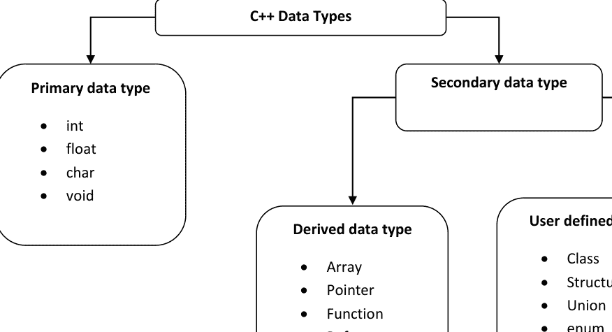
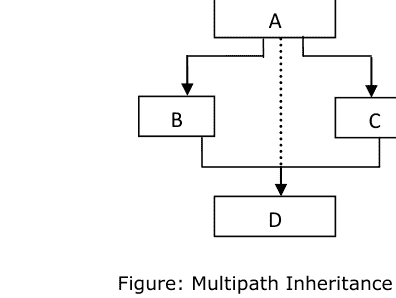
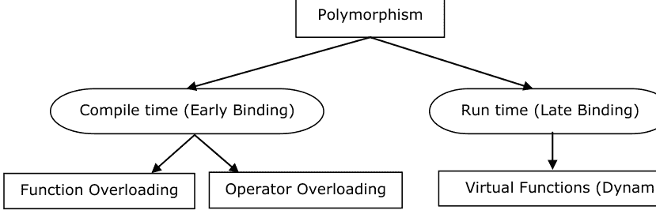
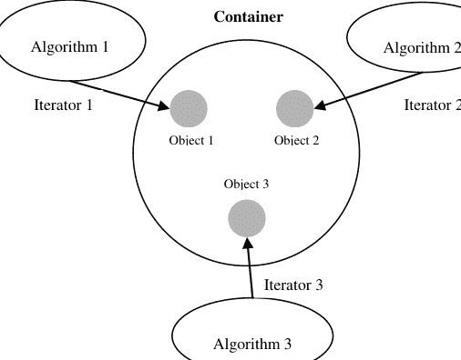

# C++ 面向对象编程

## 1 – 面向对象概念

### 1) 什么是面向对象编程？区分面向过程和面向对象的编程语言。或者列出 POP 和 OOP 的特性。

面向对象编程范式将概念表示为对象，对象具有字段和关联的过程（称为方法）。

| 面向过程编程 (POP) | 面向对象编程 (OOP) |
|---|---|
| 1. 重点是执行操作而不是数据，意味着它是函数驱动的 | 1. 重点是数据而不是过程，意味着它是对象驱动的 |
| 2. 主要关注点是操作数据的函数和过程 | 2. 主要关注点是正在操作的数据 |
| 3. 程序设计采用自上而下的方法 | 3. 程序设计采用自底向上的方法 |
| 4. 大程序被分为较小的程序，称为函数 | 4. 大程序被分为类和对象 |
| 5. 大多数函数共享全局数据 | 5. 数据在数据结构中与函数绑定 |
| 6. 数据在系统中公开地从一个函数移动到另一个函数 | 6. 数据是隐藏的，不能被外部函数访问 |
| 7. 添加数据和函数很困难 | 7. 添加数据和函数非常容易 |
| 8. 我们不能直接声明命名空间 | 8. 我们可以直接使用命名空间，例如：`using namespace std;` |
| 9. 没有继承、多态、数据封装、抽象、访问修饰符等概念 | 9. 具有继承、多态、数据封装、抽象、访问修饰符等概念并可以方便使用 |
| 10. 示例：C, Fortran, Pascal 等... | 10. 示例：C++, Java, C# 等... |

### 2) 解释 OOP 的基本概念。或者解释以下术语。

OOP 中存在各种概念使其更加强大、安全、可靠且易用。

#### 对象 (Object)

- 对象是类的实例。
- 对象意味着现实世界中的任何事物，如人、计算机、长椅等...
- 每个对象至少有一个唯一的标识。
- 对象是程序的一个组件，知道如何与程序的其他部分进行交互。
- 对象是类类型的变量。
- 例如，如果水是类，那么河流就是对象。

#### 类 (Class)

- 类是一个模板，指定了事物或对象的属性和行为。
- 类是一个蓝图或原型，从它开始创建对象。
- 类是抽象数据类型 (ADT) 的实现。
- 它定义了属性和方法。

示例：

```cpp
class employee // Class
{
    char name[10]; // Data member
    int id; // Data member
    public:
    void getdata() // Member function
    {
        cout<<
    }
};
```

- 在示例中创建了类 `employee`，`'a'` 是该类的对象。
- 对象声明也可以在 `main()` 函数中进行，如下所示：

```cpp
int main()
{
    employee a;
}
```

#### 数据抽象 (Data Abstraction)

- 只表示基本特征，而不包含背景细节。
- 它们封装了要创建的对象的所有基本属性。
- 属性有时被称为“数据成员”，因为它们持有信息。
- 对这些数据的操作函数有时被称为“方法”或“成员函数”。
- 它用于类中实现以提供数据安全。

#### 封装 (Encapsulation)

- 将数据和函数封装在单个单元中被称为封装。
- 在 C++ 中，数据对外部世界不可见。
- 只有写在单个单元内的函数才能访问它。

#### 继承 (Inheritance)

- 继承类可以获取另一个类的属性和方法的过程。
- 从旧类派生新类的机制被称为继承。
- 新类称为派生类 (derived class)，旧类称为基类 (base class)。
- 派生类可能拥有基类的所有特征。
- 程序员可以在派生类中添加新功能。
- 例如，`Student` 是基类，`Result` 是派生类。

#### 多态 (Polymorphism)

- 多态是一个希腊语，意为采取多种形式的能力。
- 多态允许一个名称用于多个用途。
- 多态概念的特征是“一个接口，多种方法”的思想。
- 即对一组相关活动使用通用接口。
- 它允许一个名称用于多个用途。

示例：

```cpp
int total(int);
int total(int, int);
```

#### 静态绑定 (Static Binding)

- 在示例中创建了类 `employee`，`'a'` 是该类的对象。
- 对象声明也可以在 `main()` 函数中进行，如下所示：

```cpp
int main()
{
    employee a;
}
```

- 在示例中创建了类 `employee`，`'a'` 是该类的对象。
- 对象声明也可以在 `main()` 函数中进行，如下所示：

#### 动态绑定 (Dynamic Binding)

- 在示例中创建了类 `employee`，`'a'` 是该类的对象。
- 对象声明也可以在 `main()` 函数中进行，如下所示：

```cpp
int main()
{
    employee a;
}
```

- 在示例中创建了类 `employee`，`'a'` 是该类的对象。
- 对象声明也可以在 `main()` 函数中进行，如下所示：

#### 消息传递 (Message Passing)

- 在示例中创建了类 `employee`，`'a'` 是该类的对象。
- 对象声明也可以在 `main()` 函数中进行，如下所示：

```cpp
int main()
{
    employee a;
}
```

- 在示例中创建了类 `employee`，`'a'` 是该类的对象。
- 对象声明也可以在 `main()` 函数中进行，如下所示：

### 3) 列出 OOP 的优点。

- 我们通过继承消除了冗余代码。
- 使用现有方法减少了开发时间和成本。
- 通过数据隐藏构建安全的程序。
- 很容易将对象映射到问题领域。
- 通过对象之间的消息接口变得更简单。
- 可以轻松管理软件复杂性。
- 容易从小系统升级到大系统。
- 它允许我们重用代码。

### 4) 列出 OOP 的应用。

OOP 技术的应用在几乎所有计算领域都变得重要。某些示例如下：

1. 实时系统
2. 仿真与建模
3. 面向对象数据库
4. 人工智能和专家系统
5. 神经网络和并行编程
6. 决策支持和办公自动化
7. CIM/CAM/CAD 系统
8. 分布式/并行/异构计算
9. 数据仓库和数据挖掘

# 2 – C++基础

### 1) 什么是 C++？解释 C++ 的结构。

- C++ 是一种面向对象的编程语言。
- 它是 C 语言的超集，也被称为 C 语言的扩展版本。
- 它是由 Bjarne Stroustrup 在 80 年代初在美国新泽西 AT&T 实验室开发的。
- C++ 程序的结构如下。

| 包含文件 |
|---|
| 类声明或定义 |
| 成员函数定义 |
| 主函数 |

- 在任何程序中，首先编写头文件，如 `iostream.h`、`conio.h` 等，取决于程序需要。
- 头文件之后，根据计划编写类声明或定义。
- 类之后，定义在类内声明但未定义的成员函数。
- 最后，没有 `main` 函数，程序执行是不可能的。

示例：

```cpp
#include <iostream> //Header File
using namespace std;

class trial //Class
{
    int a;
public:
    void getdata()
    {
        a=10;
    }
    void putdata();
};
void trial::putdata() //Member Function outside class definition
{
    cout<<"The value of a = "<<a;
}
int main() //Main Function{
    trial T;
    T.getdata();
    T.putdata();
}
```

输出：

```
The value of a = 10
```

### 2) 解释以下术语。

#### 命名空间 (Namespace)

- 它为程序中使用的标识符定义了作用域。
- 使用命名空间中标识符的指令如下所示：`using namespace std;`
- `std` 是定义 ANSI C++ 标准类的命名空间。
- 所有 ANSI C++ 程序都必须包含此指令。
- 这会将 `std` 中的所有标识符引入到当前的全局作用域中。

#### 关键字

- 它们是被显式预留的标识符，不能用作程序变量或其他用户定义程序元素的名称。
- 示例：`int`, `class`, `void` 等。

#### 标识符

- 它们指的是由程序员创建的变量、函数、数组、类等的名称。
- 每种语言对这些标识符的命名都有其 set 的规则。
- 以下是 C 和 C++ 共同的规则：
  - 仅允许字母数字字符、数字和下划线。
  - 名称不能以数字开头。
  - 大写字母和小写字母是可区分的。
  - 已声明的关键字不能作为变量名。

#### 常量

- 与变量一样，常量也是数据存储位置。但变量的值可以变化，而常量不会改变。
- 在创建常量时必须对其初始化，且在初始化后不能为其分配新值。

#### 使用 `#define` 定义常量

- `#define` 是一个预处理器指令，用于声明符号常量。
- 语法示例：

```cpp
#define PI 3.14
```

- 预处理器每看到单词 `PI`，它就会在文中将其替换为 `3.14`。

示例：

```cpp
#include<iostream>
using namespace std;
#define PI 3.14

int main() {
  int r
}
```

输出：

```
输入半径： 5
圆面积 = 78.5
```

#### 使用 `const` 关键字定义常量

- `const` 关键字用于声明任意类型的常量变量。
- 我们在程序执行期间不能改变它的值。
- 语法：`const 数据类型 变量名 = 2;`
- 现在 `'a'` 是一个整型常量。

### 3) 解释 C++ 中使用的各种数据类型。

- C++ 提供了以下数据类型。
- 我们可以将数据类型分为三个部分：
  1. 基本数据类型
  2. 派生数据类型
  3. 用户定义数据类型



#### 基本/内置数据类型

- C++ 的基本数据类型如下。

| 类型 | 大小（字节） | 范围 |
|---|---|---|
| `char` | 1 | -128 to 127 |
| `unsigned char` | 1 | 0 to 255 |
| `short` or `int` | 2 | -32,768 to 32,767 |
| `unsigned int` | 2 | 0 to 65535 |
| `long` | 4 | -2147483648 to 2147483647 |
| `unsigned long` | 4 | 0 to 4294967295 |
| `float` | 4 | 3.4e-38 to 3.4e+38 |
| `double` | 8 | 1.7e-308 to 1.7e+308 |
| `long double` | 10 | 3.4e-4932 to 1.1e+4932 |

#### 派生数据类型

- 以下是派生数据类型：
  1. 数组
  2. 函数
  3. 指针
- 如果不使用基本数据类型，无法使用派生数据类型。
- **数组**：数组是一个固定大小的、具有相同数据类型的元素的有序集合。
- **指针**：指针是一个特殊变量，它包含另一个变量的地址。
- **函数**：为了某些特殊目的而组合在一起的一组语句。

#### 用户定义类型

- 在 C++ 语言中有以下几种类型的用户数据类型。
- 用户数据类型由程序员根据其需求定义。
- **结构体 (Structure)**：结构是将逻辑上相关的不同数据类型的项组合在一起，并通过单一名称进行分组的。
- **联合体 (Union)**：联合体类似于结构，区别在于元素共享公共内存。
- **类 (Class)**：类是一个模板，定义了事物或对象的字段和方法。类是用于创建对象的原型。
- **枚举 (enum)**：枚举是一种用户定义的类型，由一组命名的常量枚举值组成。
- 换句话说，枚举也用于为字符串分配数值常量。
- 枚举的语法：`enum_tag {变量列表};`
- 枚举的示例：`enum day_of_week {mon=1,tue,wed,thu,fri,sat,sun};`

### 4) 描述 C++ 中使用的各种运算符。

运算符是编译器用于执行特定数学或逻辑操作的符号。

#### 1. 算术运算符

算术运算符用于数学计算。C++ 支持以下算术运算符：

| 运算符 | 说明 |
|---|---|
| `+` | 加法或一元加 |
| `-` | 减法或一元减 |
| `*` | 乘法 |
| `/` | 除法 |
| `%` | 取模 |

#### 2. 关系运算符

关系运算符用于比较数值。

| 运算符 | 说明 |
|---|---|
| `<` | 小于 |
| `<=` | 小于等于 |
| `>` | 大于 |
| `>=` | 大于等于 |

#### 3. 逻辑运算符

逻辑运算符用于逻辑。

| 运算符 | 说明 |
|---|---|
| `&&` | 逻辑与 |
| `\|\|` | 逻辑或 |
| `!` | 逻辑非 |

#### 4. 赋值运算符

赋值运算符用于将值赋予变量。

| 运算符 | 说明 |
|---|---|
| `=` | 赋值 |
| `+=` | 加法赋值 |
| `-=` | 减法赋值 |
| `*=` | 乘法赋值 |
| `/=` | 除法赋值 |
| `%=` | 取模赋值 |

#### 5. 递增/递减运算符

这些是用于改变值的特殊运算符。

| 运算符 | 说明 |
|---|---|
| `++` | 递增 |
| `--` | 递减 |

#### 6. 条件运算符


三元运算符称为条件运算符。

- 语法：`条件 ? 真时的表达式 : 假时的表达式;`
- 它用于替代简单的 `if-else` 语句。

#### 7. 位运算符

位运算符用于对数据进行位操作。

| 运算符 | 说明 |
|---|---|
| `&` | 位与 |
| `\|` | 位或 |
| `^` | 位异或 |
| `~` | 位取反 |
| `<<` | 左移 |
| `>>` | 右移 |

#### 8. 位赋值运算符

位赋值运算符用于位操作和赋值。

| 运算符 | 说明 |
|---|---|
| `&=` | 位与赋值 |
| `\|=` | 位或赋值 |
| `^=` | 位异或赋值 |

### 5) 作用域解析符

如果没有作用域解析符，所有引用将指向局部值。

示例：

```cpp
#include <iostream>
int m=10;
int main() {
    int m=20;
    {
        int k=m;
        int m=30;
        cout << "k=" << k << "\n";
        cout << "m=" << m << "\n";
        cout << "::m=" << ::m << "\n";
    }
    cout << "we are in outer block\n";
    cout << "m-20=" << m-20 << "\n";
    cout << "::m-20=" << ::m-20 << "\n";
    return 0;
}
```

输出：

```
k=20
m=30
::m=10
we are in outer block
m-20=0
::m-20=0
```

### 6) 简述解释成员解引用运算符。

C++ 提供了三个成员指针运算符用于通过指针访问类成员。

| 运算符 | 功能 |
| :--- | :--- |
| `::*` | 声明指向类成员的指针。 |
| `.*` | 使用对象名和指向该成员的指针访问成员。 |
| `->*` | 使用指向对象的指针和指向该成员的指针访问成员。 |

### 7) 简述解释隐式和显式类型转换。

#### 隐式转换

- 当表达式中混合了数据类型时，C++ 会自动执行转换。这被称为隐式转换或自动转换。
- 示例：`m=5+2.5;`
- 对于二元运算符，如果类型不同，编译器会将其中一个转换为另一种以匹配。
- 使用较小类型转换为更宽类型的规则。
- 例如，如果一个操作数是整数而另一个是浮点数，则整数会被转换为浮点数，因为浮点数比整数宽。
- 在上述示例中，结果 `m` 将是 `float` 类型。

#### 显式转换

- C++ 允许使用类型转换运算符对变量或表达式进行显式类型转换。
- 语法：`type_name (expression)`
- 示例：`average = sum/float(i);`
- 或者我们可以使用 `typedef` 创建所需类型的标识符，并在函数符号表示法中使用。

示例：

```cpp
typedef int *int_ptr;
p = int_ptr(q);
```

示例：

```cpp
#include<iostream>
using namespace std;

int main()
{
    int intvar=5;
    float floatvar=3.5;

    cout << "\nintvar = " << intvar << "\n";
    cout << "\nfloatvar = " << floatvar << "\n";
    cout << "\nfloat(intvar) = " << float(intvar) << "\n";
}
```

输出：

```
intvar = 5
floatvar = 3.5
float(intvar) = 5
int(floatvar) = 3
```

# 3 – C++ 函数


结合适当的示例解释值传递和引用传递。编写一个程序交换两个变量的值。

## 值传递（Call By Value）

- 在值传递中，变量的值在函数调用期间被传递。
- 这种拷贝将在函数定义时存储在另一个变量中。
- 在值传递中，调用函数中的原始值在函数执行后永远不会改变。

示例：

```cpp
#include<iostream>
using namespace std;

void swp(int a, int b) {
    int temp=a;
    a=b;
    b=temp;
}
int main() {
    int x,y;
    cout << "Enter value of a and b:";
    cin>>x>>y;
    swp(x,y);
    cout << "after swapping a = " << a << " and b = " << b << "\n";
    return 0;
}
```

输出：

```
Enter value of a and b:
45
After swapping a = 5 and b = 4
```

## 引用传递（Call By Reference）

- 在引用传递中，引用在函数调用期间被传递。
- 被调用函数中的形式参数成为实际函数调用的别名。
- 在引用传递中，调用函数中的原始值在函数执行后会发生改变。

示例：

```cpp
#include<iostream>
using namespace std;

void swp(int &a, int &b) {
    int temp=a;
    a=b;
    b=temp;
}
int main() {
    int a,b;
    cout << "Enter two numbers:";
    cin>>a>>b;
    swp(a,b);
    cout << "a=" << a << " and b=" << b << "\n";
    return 0;
}
```

输出：

```
Enter two numbers:
45
After swapping a = 5 and b = 4
```

## 什么是内联函数？请结合示例解释。

- 通过在函数定义中添加`inline`，可以将函数设为内联。
- 内联函数是在调用时进行内联展开的函数。
- 编译器将函数调用替换为相应的函数代码。
- 内联函数节省了调用函数的时间、寄存器、将参数推入栈以及从函数返回开销。
- 预处理器宏很流行，但主要的缺点是它们不是真正的函数。
- 因此，在执行宏时不会发生通常的错误检查。
- 使用内联函数时应小心。如果函数代码行数很少且表达式简单，则应该使用它。

**内联函数的关键情况：**

1. 如果函数体中存在循环、`switch`或`goto`。
2. 如果函数不返回任何值。
3. 如果函数包含静态变量。
4. 如果函数是递归的。

示例：

```cpp
inline int cube(int n) {
    return n;
}
int main() {
    int c;
    c = cube(10);
    cout<<c;
}
```

函数调用被替换为表达式，因此`c = cube(10);`在编译时变为`c=10;`。

## 结合适当示例解释带默认参数的函数。

- C++ 允许我们在不指定所有参数的情况下调用函数。
- 在这种情况下，函数为参数分配一个默认值。
- 默认值在函数声明时指定。
- 我们必须从右到左添加默认参数。
- 我们不能在参数列表中间为特定参数提供默认值。
- 默认参数用于参数始终相同的情况。
- 例如传递。

**合法的与非法的默认参数**

```cpp
void f(int a, int b, int c=0); // 合法的
void f(int a, int b=0, int c=0); // 合法的
void f(int a=0, int b, int c=0); // 非法的
void f(int a=0, int b, int c); // 非法的
void f(int a=0, int b=0, int c=0); // 合法的
```

示例：

```cpp
#include <iostream>
using namespace std;
void f(int a=0, int b=0) {
    cout<<a << ", b=" << b<<endl;
}
int main() {
  f();
  f(10);
  f(10, 99);
  return 0;
}
```

输出：

```
0, b=0
10, b=0
```

## 什么是友元函数？结合示例解释。

- 友元函数是通过`friend`关键字声明的函数。
- 它不是类的成员，但它可以访问类的私有和受保护的成员。
- 它不在声明为友元的类的作用域内。
- 它不能直接访问成员名。
- 它可以声明在类的公共或私有部分。
- 它不是类的成员，因此不能通过对象调用。
- 通常，它将对象作为参数。
- 它具有特殊访问权限的普通外部函数。

语法：

```cpp
class ABC
{
  public:
    friend void xyz(void); // 声明
};
```

示例：

```cpp
#include<iostream>
using namespace std;
class numbers
{
  public:
    int num1, num2;
    void setdata(int a, int b);
    friend int add(numbers N);
};
void numbers ::setdata(int a, int b) {
  num1=a;
  num2=b;
}
int add(numbers N) {
  return (N.num1+N.num2);
}
int main() {
  numbers N1;
  N1.setdata(10,20);
  cout<<"Sum = "<<add(N1);
}
```

输出：`Sum = 30`

- `add`是`numbers`类的友元函数，因此它可以访问类的所有成员（私有、公共和受保护）。
- 一个类的成员函数可以被变为另一个类的友元函数，例如...

```cpp
class X
{
    int f();
};

class Y
{
    friend int X::f();
};
```

- 函数`f`是`X`类的成员，也是`Y`类的友元以及类的友。
- 我们可以将一个类的所有的成员函数声明为另一个类的友元函数。在这种情况下，该类被称为友元类，例如类`X`是类`Z`的友元类

```cpp
class Z
{
    friend class X;
};
```

## 3 – C++ 函数

```cpp
void add(int num1, int num2, int num3) // 函数 3
{
    cout << num1 + num2 + num3 << endl;
}
```

```cpp
int main()
{
    Math m;
    m.Add(10, 20); // 调用函数 1
    m.Add(10.15, 25.70); // 调用函数 2
    m.Add(1, 2, 3); // 调用函数 3
}
```

输出：

```
30
35.85
6
```

## 6) 解释运算符重载是编译时完成。

- 运算符重载是编译时多态。
- 运算符重载提供了一种在用户定义类型上执行操作的机制。
- 我们可以为程序实现中的任何运算符赋予特殊含义。

**运算符重载的规则：**

1. 只有现有的运算符可以被重载。
2. 重载的运算符必须至少有一个操作数。
3. 我们不能改变运算符的含义和语法。
4. 我们不能使用某些运算符来重载它们。
5. 由成员函数重载的一元运算符不接受参数且不返回值。
6. 通过成员函数重载的二元运算符接受一个显式参数且不返回值。
7. 当通过成员函数使用二元运算符时，左操作数必须是相关类的对象。
8. 我们不能重载所有运算符。

| 运算符 | 名称 |
| :--- | :--- |
| `.` | 类访问运算符 |
| `::` | 作用域解析运算符 |
| `sizeof()` | 大小运算符 |
| `?` | 条件运算符 |

**一元运算符重载的示例**

```cpp
#include <iostream>
using namespace std;

class sample
{
    int a, b;
public:
    void getdata()
    {
        a = 10;
        b = 20;
    }
    void operator -() // 一元成员函数
    {
        a = -a;
        b = -b;
    }
    void disp()
    {
        cout << "Value of a = " << a << endl;
        cout << "Value of b = " << b << endl;
    }
};

int main()
{
    sample s;
    s.getdata();
    s.-(); // 调用一元成员函数
    s.disp();
    return 0;
}
```

**使用友元函数重载一元运算符的示例**

```cpp
#include <iostream>
using namespace std;

class sample {
    int a, b;
public:
    void getdata()
    {
        a = 10;
        b = 20;
    }
    friend sample operator +(sample &A) // 一元友元函数
    {
        A.a = A.a + 5;
        A.b = A.b + 5;
        return A;
    }
    void disp()
    {
        cout << "Value of a = " << a << endl;
        cout << "Value of b = " << b << endl;
    }
};

int main()
{
    sample s;
    s.getdata();
    sample obj = +s; // 调用一元友元函数
    obj.disp();
    return 0;
}
```

**二元运算符重载的示例**

```cpp
#include <iostream>
using namespace std;

class complex
{
    float real, imag;
public:
    complex(float _real, float _imag) // 构造函数
    {
        real = _real;
        imag = _imag;
    }
    void disp()
    {
        cout << "Value of real = " << real << endl;
        cout << "Value of imag = " << imag << endl;
    }
    void operator +(complex c) // 二元成员函数
    {
        real = real + c.real;
        imag = imag + c.imag;
    }
};

int main()
{
    complex x(4, 4);
    complex y(6, 6);
    complex z = x + y; // 调用二元成员函数
    z.disp();
    return 0;
}
```

**使用友元函数重载运算符的示例**

```cpp
#include <iostream>
using namespace std;

class complex
{
    float real, imag;
public:
    complex(float _real, float _imag) // 构造函数
    {
        real = _real;
        imag = _imag;
    }
    void disp()
    {
        cout << "Value of real = " << real << endl;
        cout << "Value of imag = " << imag << endl;
    }
};

friend complex operator +(complex c, complex d) // 二元友元函数
{
    d.real = d.real + c.real;
    d.imag = d.imag + c.imag;
    return d;
}

int main()
{
    complex x(4, 4);
    complex y(6, 6);
    complex z = x + y; // 调用二元友元函数
    z.disp();
}
```

## 4 – 对象与类

### 1) 解释类的基本概念。

- 类是一个指定了事物或对象属性和行为的模板。
- 类是用于创建对象的蓝图或原型。
- 类是抽象数据类型（ADT）的实现。
- 它定义了属性和方法。

对象声明：

```cpp
class item
{
    // 成员定义
};
```

在上述示例类中，`item`是类的对象。

类的声明可以如下：

```cpp
class item
{
    // 成员定义
};
```

类的访问：

```cpp
item a;
```

### 2) 解释静态数据成员和静态成员函数。

**静态数据成员：**

- 被所有对象共享的类成员称为静态成员。
- 静态成员在类内部声明，在类外部定义。
- 在创建第一个类对象时被初始化为零。没有其他初始化。
- 它在类内部可见，但其生命周期是整个程序。
- 静态成员通常用于维护整个类的值。

**静态成员函数：**

- 静态成员函数与类相关，而不是与任何对象相关。
- 可以使用类名调用，而不是对象。
- 它们可以访问类的静态成员。
- 它们不能是虚函数。
- 它们不能声明为常量或`volatile`。
- 即使在类没有实例化时，也可以调用静态成员函数。
- 同一个函数不存在静态和非静态版本。

示例：

```cpp
#include<iostream>
using namespace std;

class item
{
    int number;
    static int count; // 静态变量声明
public:
    void getdata(int a)
    {
        number = a;
        count++;
    }
};
int item::count = 0; // 静态成员定义

int main()
{
    item obj1, obj2;
    obj1.getdata(10);
    obj2.getdata(20);
    cout << "Count: " << item::count << endl;
    return 0;
}
```

### 3) 解释公共和私有访问修饰符。

**公共：**

- 公共成员可以在任何地方访问。
- 访问公共成员没有限制。
- 类成员变为公共。

**私有：**

- 类的私有成员可以在类内部访问。
- 它们不能在类外部访问。
- 如果没有指定任何访问修饰符，则类作为私有成员处理。
- 如果尝试在类外部访问私有成员，会导致编译错误。

示例：

```cpp
#include <iostream>
using namespace std;

class ABC
{
    public:
    int a;
    private:
    int b;
};

int main()
{
    ABC x;
    x.a=5;
    cout<<"Value of public variable = "<<x.a;
}
```

## 4 – 对象与类

```cpp
static void getcount() // 与上方程序的唯一区别
{
    cout << "value of count: " << count;
}

int item : count; // 静态变量定义
```


```cpp
int main() {
    item a, b, c;
    a.getdata(100);
    b.getdata(200);
    c.getdata(300);
    a.getcount();
    b.getcount();
    c.getcount();
    get();
    return 0;
}
```

| 对象 a | 对象 b | 对象 c |
| --- | --- | --- |
| 100 | 200 | 300 |
| | 3 | |

输出：

```
value of count:3
value of count:3
value of count:3
```

## 5) 什么是构造函数？请列出构造函数的特点。

构造函数是一种“特殊”的成员函数，用于初始化类的对象。

构造函数的属性：

- 每当创建类的对象时，构造函数会被自动调用。
- 构造函数名必须与类名相同。
- 构造函数应该声明在公共区域，因为私有构造函数无法在类外调用，否则它们将毫无用处。
- 构造函数没有返回类型，且不能返回返回值，即使是 `void`。
- 构造函数不能被继承，尽管派生类可以调用基类的构造函数。
- 构造函数不能是虚函数（`virtual`）。
- 带有构造函数的对象不能作为 `union`（联合体）的成员。
- 当需要分配内存时，它们隐含了对 `new` 和 `delete` 运算符的使用。

## 4 – 对象与类

示例：

```cpp
class integer
{
    int m, n;
public:
    integer() // 默认构造函数
    {
        m = n = 0;
    }
}
```

### 2. 参数构造函数

- 带有参数的构造函数称为参数构造函数。
- 有时在创建不同对象时，需要用不同的值初始化不同的数据元素。
- 我们可以通过在创建对象时向构造函数传递参数来实现这一目标。

示例：

```cpp
class integer
{
    int m, n;
public:
    integer(int x, int y) // 参数构造函数
    {
        m = x;
        n = y;
    }
}
```

### 3. 拷贝构造函数

- 拷贝构造函数用于从另一个对象声明并初始化对象。
- 例如，`integer(integer &)` 或 `integer I2 (I1)`。
- 接受同类引用作为参数的构造函数称为拷贝构造函数。

示例：

```cpp
class integer
{
    int m, n;
public:
    integer(integer &x) // 拷贝构造函数
    {
        m = x.m;
        n = x.n;
    }
};
```

## 4 – 对象与类

示例：

```cpp
#include<iostream>
using namespace std;

class rectangle
{
    int length, width;

public:
    rectangle() // 默认构造函数
    {
        length = 0;
        width = 0;
    }
    rectangle(int _length, int _width) // 参数构造函数
    {
        length = _length;
        width = _width;
    }
    rectangle(rectangle &r_) // 拷贝构造函数
    {
        length = r_.length;
        width = r_.width;
    }

    // 其他读取、写入和处理的函数可以写在这里
};
```

```cpp
int main()
{
    rectangle r1; // 调用默认构造函数
    rectangle r2(10,10); // 调用参数构造函数
    rectangle r3(r2); // 调用拷贝构造函数
}
```

## 7) 结合示例解释析构函数

- 析构函数用于销毁由构造函数创建的对象。
- 析构函数是一个成员函数，其名称必须与类名相同，但前面有一个波浪号（`~`）。
- 析构函数不接受任何参数，也不返回任何值，也没有返回类型。
- 析构函数在程序退出时自动调用。
- 析构函数应该声明在公共区域。

示例：

```cpp
#include<iostream.h>
using namespace std;
class rectangle
{
    int length, width;
public:
    rectangle() // 构造函数
    {
        length = 0;
        width = 0;
    }
    ~rectangle() // 析构函数
    {
        // 其他读取、写入和处理的函数可以写在这里
    }
};
```

```cpp
int main()
{
    rectangle x; // 此对象调用默认构造函数
}
```

## 8) 结合示例解释对象作为函数参数的使用

对象像任何其他数据类型一样可以作为函数参数。可以通过以下方式实现：

1. 将整个对象的拷贝传递给函数
   - 这种方法称为值传递（`call by value`）。
   - 由于传递的是对象的拷贝，在函数内部对对象进行的任何更改都不会影响调用函数时的对象。

2. 仅将对象的地址传递给函数
   - 这种方法称为引用传递（`pass-by-reference`）。
   - 当传递对象的地址时，被调用的函数直接作用于调用时的实际对象。
   - 这意味着函数内部对对象进行的任何更改将反映在实际对象中。
   - 这种方法更高效，因为只需要传递对象的地址，而不是整个对象。

示例：

```cpp
#include<iostream>
using namespace std;
class time
{
    int hours;
    int minutes;
public:
    void gettime(int h, int m)
    {
        hours = h;
        minutes = m;
    }
    void pouttime(void)
    {
        cout << hours << " hours and ";
        cout << "minutes" << "\n";
    }
    void sum(time, time); // 使用对象作为参数的声明

    void sum(time t1, time t2) // t1,t2 是对象
    {
        minutes = t1.minutes + t2.minutes;
        hours = minutes / 60;
        minutes = minutes % 60;
        hours = hours + t1.hours + t2.hours;
    }
};

int main()
{
    time t1, t2, t3;
    t1.gettime(2,45); // 获取 t1
    t2.gettime(3,30); // 获取 t2
    t3.sum(t1,t2); // = t1 + t2
    cout << "t1: " << t1.puttime(); // 显示 t1
    cout << "t2: " << t2.puttime(); // 显示 t2
    cout << "t3: " << t3.puttime(); // 显示 t3

    return 0;
}
```

## 9) 结合示例解释运算符重载

- 运算符重载是编译时多态。
- 运算符重载为对用户定义类型执行操作提供了机制。
- 我们可以给程序中的任何运算符赋予含义。

运算符重载的规则：

1. 只有现有运算符可以被重载。
2. 被重载运算符的操作数可以是用户定义类型。
3. 我们不能改变运算符的性质。
4. 我们不能重载某些运算符。
5. 通过成员函数重载的运算符不返回值。
6. 通过成员函数重载的二元运算符接受一个参数。
7. 通过友元函数重载的运算符返回类的对象。
8. 通过友元函数重载的二元运算符接受两个参数。

## 4 – 对象与类

一元运算符重载示例：

```cpp
#include <iostream>
using namespace std;

class sample
{
    int a, b;
public:
    void getdata()
    {
        a = 10;
        b = 20;
    }
    void operator - () // 一元成员函数
    {
        a = a - 5;
        b = b - 5;
    }
    void disp()
    {
        cout << "\nThe value of a = " << a;
        cout << "\nThe value of b = " << b;
    }
};
```

使用友元函数的一元运算符重载示例：

```cpp
#include <iostream>
using namespace std;

class sample
{
    int a, b;
public:
    void getdata()
    {
        a = 10;
        b = 20;
    }
    friend sample operator +(sample A) // 一元友元函数
    {
        A.a = A.a + 5;
        A.b = A.b + 5;
        return A;
    }
    void disp()
    {
        cout << "\nThe value of a = " << a;
        cout << "\nThe value of b = " << b;
    }
};

int main() {
    sample S;
    S.getdata();
    S = operator +(S); // 调用一元友元函数
    S.disp();
    return 0;
}
```

二元运算符重载示例：

```cpp
#include <iostream>
using namespace std;
class complex {
  float real, imag;
public:
  complex(float _real, float _imag) // 构造函数
  {
    real = _real;
    imag = _imag;
  }
  void disp() {
    cout << "\nThe value of real = " << real;
    cout << "\nThe value of imag = " << imag;
  }
  void operator +(complex c) // 二元成员函数
  {
    real = real + c.real;
    imag = imag + c.imag;
}
};
int main() {
  complex x(4,6);
  complex y(6,6);
  x + y; // 调用二元成员函数
  x.disp();
  return 0;
}
```

## 4 – 对象与类

```cpp
float real, imag;
public:
    complex(float _real, float _imag) // 构造函数
{
    real = _real;
    imag = _imag;
}
void disp()
{
    cout << "The value of real=" << real << "\n";
    cout << "The value of imag=" << imag << "\n";
}
friend complex operator +(complex c, complex d) // 二元友元函数
{
    d.real = d.real + c.real;
    d.imag = d.imag + c.imag;
    return d;
};
int main()
{
    complex x(4,4);
    complex y(6,6);
    complex s = x + y; // 调用二元友元函数
    s.disp();
}
```

输出：

```
The value of real=10
The value of imag=10
```

## 10) 列举各种类型转换技术？解释从基本类型到类的转换

- 如果所有变量都是基本类型，C++ 提供了执行自动类型转换的机制。
- 对于用户定义的数据类型，程序员必须使用构造函数或强制类型转换运算符进行转换。
- 用户定义类型转换中会出现三类情况：

1. 基本类型到类类型
2. 类类型到基本类型
3. 类类型到类类型

现在我们将通过示例查看每种情况。

### 1. 基本类型到类类型

- 基本类型到类的转换是通过构造函数完成的。

示例：

```cpp
#include <iostream>
using namespace std;
class sample
{
    float a;
public:
    sample() {}
    sample(int x) // 用于将基本类型转换为类的构造函数
{
    a=x;
};
```

```cpp
}
void disp()
{
    cout << "The value of a=" << a << "\n";
}
int main()
{
    int a=10;
    sample S;
    S=a; // 基本到类类型的转换
    S.disp();
    return 0;
}
```

**输出：**

```
The value of a=10
```

## 11) 解释从类到基本类型的类型转换

- 类类型到基本类型的转换是通过强制转换运算符完成的。
- 强制转换运算符函数必须满足以下条件：

1. 它必须是类的成员。
2. 它不能指定返回类型。
3. 它不能有任何参数。

**示例：**

```cpp
#include <iostream>
using namespace std;

class sample
{
    float a;
public:
    sample()
    {
        a=10.23;
    }
    operator int();
}
sample::operator int() // 强制转换运算符函数
{
    int x;
    x=a;
    return x;
}
int main()
{
    sample S;
    int y=S; // 类到基本类型的转换
    cout << "The value of y=" << y;
    getch();
    return 0;
}
```

输出：

```
The value of y=10
```

## 12) 解释类类型到另一个类类型的转换

- 类到类的转换可以通过构造函数和强制转换运算符共同完成。
- 如果转换发生在源类中，则通过强制转换运算符完成：

```
operator destination_class_name() // 强制转换运算符定义
{
    // 创建目标类的对象
    // 编写转换值的语句
    // 返回目标类的对象
}
```

- 如果转换发生在目标类中，则通过构造函数完成：

```
Constructor_of_Destination_Class(Source_Class Object_Name)
{
    // 转换语句
}
```

- 我们不能在源类和目标类中同时进行这种转换。

示例：


```cpp
#include <iostream>
using namespace std;

class invent; // 声明目标类
class invent1; // 源类
{
  int code; // 项目代码
  int items; // 数量
  float price; // 物品成本
public:
  invent1(int a, int b, float c)
  {
    code = a;
    items = b;
    price = c;
  }
  void putdata()
  {
    cout << "code:" << code << "\n";
    cout << "items:" << items << "\n";
    cout << "value:" << price << "\n";
  }

  int getcode() {return code;}
  int getitems() {return items;}
  float getprice() {return price;}

  operator float() {return price;}
};

class invent2
{
  int code;
  float value;
public:
  invent2(float x, float y)
  {
    code = x;
    value = y;
  }
  void putdata()
  {
    cout << "code:" << code << "\n";
    cout << "value:" << value << "\n";
  }
  invent2(invent1 p) {
    code = p.getcode();
    value = p.getprice();
  }
};

int main() {
    invent1 s1(100,5,40.0);
    invent2 d1;
    float total_value;
    total_value = s1;
    cout << "product details-invent1" << "\n";
    s1.putdata();
    cout << "total_value=" << total_value << "\n";
    cout << "product details-invent2" << "\n";
    d1.putdata();
    return 0;
}
```

## 用示例解释继承的类型

- 继承是类获取另一个类的属性和方法的过程。
- 从旧类派生出新类的机制称为继承。
- 新类是派生类，旧类是基类。
- 派生类可以拥有基类的所有特征，程序员可以为派生类添加新功能。

## 继承的类型

### 单继承

- 如果一个类派生自一个类，则称为单重继承。
- 类 `B` 派生自类 `A`。

### 多级继承

- 如果一个类派生自另一个已经派生出来的类，则称为多级继承。
- 这里，类 `C` 派生自类 `B`，类 `B` 派生自类 `A`，因此称为多级继承。

### 多继承

- 如果一个类派生自多个类，则称为多重继承。
- 这里，类 `C` 派生自两个类类 `A` 和类 `B`。

### 层次继承

- 如果一个或多个类派生自同一个类，则称为层次继承。
- 这里，类 `B`、类 `C` 和类 `D` 都派生自类 `A`。

### 混合继承

- 它是任何继承类型的组合。即多重继承、多级继承、层次继承或其他组合。
- 这里，类 `B` 和类 `C` 派生自类 `A`，类 `D` 派生自类 `B` 和类 `C`。
- 类 `A`、类 `B` 和类 `C` 是层次继承的示例，类 `B`、类 `C` 和类 `D` 是多继承的示例，因此这种混合继承是层次继承和多重继承的组合。

示例：

```cpp
#include<iostream>
using namespace std;
class A
{
public:
    void dispA()
    {
        cout<<"Class method"<<endl;
    }
};
class B : public A // 单继承 - 类 B 派生自类 A
{
public:
    void dispB()
    {
        cout<<"class B method"<<endl;
    }
};
class C : public B // 多级继承 - 类 C 派生自类 B
{
public:
    void dispC()
    {
        cout<<"class C method"<<endl;
    }
};
class D
{
public:
    void dispD()
    {
        cout<<"class D method"<<endl;
    }
};
class E : public A, public D // 多继承：类 E 派生自类 A 和 D
{
public:
    void dispE()
    {
        cout<<"class E method";
    }
}
class F: public B, public C // 混合继承：类 F 派生自类 B 和 C
{
public:
    void dispF()
    {
        cout<<"class F method";
    }
}
int main()
{
    A a;
    B b;
    C c;
    D d;
    E e;
    F f;
    b.dispA();
    f.dispF();
    f.dispA();
}
```

输出：

```
class A method
class A method
class D method
class C method
```

- 类 `B` 和类 `E` 派生自类 `A`，因此它是层次继承的示例。
- 类 `F` 派生自类 `B` 和类 `C`，类 `B` 派生自类 `A`，所以 `dispA()` 不是类 `F` 的成员，但我们可以通过类 `F` 的对象访问它。

## 示例

```cpp
#include<iostream>
using namespace std;

class A
{
    protected:
        int a;

    public:
        void getdata()
        {
            cout<<"Enter value of a:";
            cin>>a;
        }
};
class B:public A
{
    public:
        void show()
        {
            cout<<"Value of a is:"<<a;
        }
};
int main()
{
    B x;
    x.getdata();
    x.show();
}
```

输出：

```
Enter value of a:5
Value of a is:5
```

### 4) 什么是 C++ 中的重写（overriding）？请举示例说明。

- 如果基类和派生类具有相同名称和参数的成员函数。
- 如果创建一个派生类的对象并编写代码来访问该成员函数，那么只会调用派生类中的成员函数。
- 意味着派生类的成员函数重写了基类的成员函数。
- 这在 C++ 中被称为函数重写或方法重写。

## 示例

```cpp
#include<iostream>
using namespace std;
class A
{
    public:
        void display()
        {
            cout<<"This is parent class";
        }
};
```

```cpp
class B:public A {
    public:
        void display() // 重写了类 A 的 display() 函数
        {
            cout<<"\nThis is child class";
        }
}
int main() {
    B x;
    x.display(); // 调用类 B 的方法，而不是类 A 的
}
```

输出：

```
This is child class
```

### 5) 请举例解释虚基类（virtual base class）。

- 它用于防止重复定义/歧义。
- 在继承中，子类有两个直接父类，而这两个父类本身又有一个共同的基类。
- 因此，子类通过两条不同的路径继承祖类。它也被称为间接父类。
- 祖类的所有公共和保护成员都会被两次继承到子类中。



- 我们可以通过将基类声明为虚（`virtual`）来停止这种重复。

例如：

```cpp
class A {
    public:
        int i;
}
class B : virtual public A {
    public:
        int j;
}
```

```cpp
class C: virtual public A
    public:
        int k;
};
```

```cpp
class D: public B, public C
{
    public:
        int sum;
};
```

- 关键字 `virtual` 和 `public` 可以以任意顺序使用。
- 如果我们使用虚基类，那么它将只向子类继承基类成员的一个拷贝。

### 6) 列出继承中基类构造函数执行的各种情况。

| 继承方式 | 执行顺序 |
| :--- | :--- |
| `Class B:public A { };` | `A()`; 基类构造函数 <br>`B()`; 派生构造函数 |
| `Class A:public B, public C { };` | `B()`; 基类（第一个）<br>`C()`; 基类（第二个）<br>`A()`; 派生 |
| `Class A:public B, virtual C { };` | `C()`; 虚基类 <br>`B()`; 普通基类 <br>`A()`; 派生 |

## 关于多态（Polymorphism）的短记

- 多态意味着采取多种形式的能力。
- 它允许用一个名称用于多个相关的用途。
- 它意味着运算符和函数在不同情况下具有不同行为的能力。

多态的不同类型：



### 编译时

- 编译时多态是函数重载和运算符重载。

### 函数重载

- 函数重载是使用不同的签名声明相同函数的实践。
- 相同的函数名将用于不同数量的参数和不同类型的参数。
- 不允许重载不同返回类型的函数。

### 运算符重载

- 运算符重载是告诉编译器根据其对应运算符的数据类型如何执行特定操作的能力。
- 例如 `+` 执行两个整数的相加、两个字符串变量的拼接，并在与时间类对象使用时工作方式完全不同。

### 动态绑定（后期绑定）

- 动态绑定是在运行时根据当时的条件对路由或对象进行链接的。
- 意味着在调用之前不知道与给定过程相关的代码。
- 在运行时，将调用与当前引用下的对象匹配的代码。

### 虚函数（Virtual Function）

- 虚函数是类的一个成员函数，其功能可以在它的派生类中被重写。
- 整个函数体可以用派生类中的一组新实现来替换。
- 它在基类中使用 `virtual` 关键字声明为虚函数。

### 2) 请举例解释对象指针。

- 指针可以指向由类创建的对象。
- 对象指针在运行时创建对象非常有用。
- 例如：

```cpp
item x;
item *ptr = &x;
```

这里指针 `ptr` 使用 `x` 的地址初始化。

`x.display();`

上述等于：

```cpp
ptr->show();
```

示例：

```cpp
#include<iostream>
using namespace std;
class item
{
int code;
float price;
public:
  void getdata(int a, float b)
{
  code=a;
  price=b;
}
  void show(void)
{
  cout<<"code"<<code<<"\n";
  cout<<"price"<<price<<"\n";
}
};
const int size =2;
int main()
{
item *p=new item[size];
item *d = p;
int x, i;
float y;
for(i=0; i<size; i++)
{
cout<<"input code and price for "<<i+1<<"\n";
cin>>x>>y;
p->getdata(x, y);
p++;
}
for(i=0; i<size; i++)
{
cout<<"item"<<i+1<<"\n";
}
}
```

```cpp
d->show();
d++;
}
return 

}
```

### 3) 解释 `this` 指针示例。

- `this` 指针表示调用或访问成员函数的对象。
- 它指向调用成员函数的对象。
- 当成员函数被调用时，它会自动传递给函数。
- 它也被称为所有成员函数的隐式参数。
- 例如：`S.getdata();`
- 这里 `S` 是一个对象，`getdata()` 是成员函数。所以，`this` 指针将指向或设置为对象 `S` 的地址。
- 假设 `a` 是私有数据成员，我们可以如下通过使用 `this` 指针在公共函数中访问它：

`this->a=50;`

- 两者的效果相同。

## 示例

```cpp
#include <iostream>
using namespace std;

class sample
{
    int a;

public:
    sample()
    {
        a=10;
    }
    void disp(int a)
    {
        cout<<"The value of argument a="<<a<<"";
        cout<<"\nThe value of data member a="<<this->a<<"";
    }
};

int main()
{
    sample S;
    S.disp(20);
    return 0;
}
```

输出：

```
The value of argument a=20
The value of data member a=10
```

- `this` 指针最重要的优势是，如果参数和数据成员有相同的名称，你可以区分它们。
- 通过使用 `this` 指针，我们可以访问数据成员，而在没有 `this` 的情况下可以在函数中访问参数。

### 4) 解释指向派生类的指针。

- 我们不仅可以使用指针指向基对象，还可以指向派生类的对象。
- 一个指针变量可以指向不同类的对象。
- 例如：

```cpp
B *ptr // 指向 B 类变量的指针
B b; // 基对象
D d; // 派生对象
ptr = &b; // ptr 指向对象 b
```

- 在示例中，基类为 `B`，`D` 派自 `B`，那么声明为指向 `B` 的指针并指向对象 `b`。
- 我们可以让 `ptr` 指向对象 `d`，如下：

```cpp
ptr = &d;
```

- 可以通过基指针访问继承自基类的派生类成员。
- 但可以通过派生类指针访问未被基类继承的派生类原始成员。

## 示例

```cpp
#include <iostream>
using namespace std;

class base
{
    public:
    int b;
    void show()
    {
        cout<<"\n\nThe value of b="
    }
};
```

```cpp
bptr->b=100;
bptr->show();
bptr->d=0;
bptr->b=200;
cout << "\nBase class pointer assign address of derived class object";
bptr->show();
derived *dptr;
dptr = 400;
cout << "\nDerived class pointer assign address of derived class object";
bptr->d=300;
bptr->show();
return 0;
```

输出：

```
Base class pointer assign address of base class object
The value of b=100
Base class pointer assign address of derived class object
The value of b=200
Derived class pointer assign address of derived class object
The value of b=200
The value of d=300
```

### 5) 虚函数（virtual function）

- 它是一种运行时多态。
- 基类和派生类具有相同的函数名，并且基类指针被赋值为派生类对象的地址。


为了执行派生类的函数，我们必须将基类的函数声明为虚函数（`virtual`）。

声明虚函数只需在普通函数声明前使用`virtual`关键字。

制作虚函数后，编译器将根据赋值给基类地址的指针在运行时决定执行哪一个函数。

## 虚函数的规则

1. 虚函数必须是任何类的成员。
2. 它们不能是静态成员（`static members`）。
3. 使用对象指针进行访问。
4. 虚函数可以是另一个类的友元（`friend`）。
5. 基类中的虚函数必须定义，即使它可能不会被使用。
6. 如果两个同名函数的原型不同，C++ 将它们视为重载函数，此时虚函数机制会被忽略。
7. 我们不能有虚析构造函数，但可以有虚析构函数。
8. 派生类指针不能指向基类对象。
9. 当基类指针指向派生类时，它的递增或递减仅相对于其基类型。因此，我们不应该使用这种方法将指针移动到下一个对象。
10. 如果在基类中定义了虚函数，在派生类中不一定需要重新定义。在这种情况下，调用将执行基类函数。

# Darshan 工程技术学院 140705 - C++ 面向对象编程

计算机工程 - 第 6 单元 多态

示例：

```cpp
#include <iostream>
using namespace std;

class base
{
public:
    void disp()
    {
        cout << "\nSimple function in base class";
    }
    virtual void show()
    {
        cout << "\nVirtual function of Base class";
    }
};

class derived: public base
{
public:
    void disp()
    {
        cout << "\nSame name with simple function of base class in derived class";
    }
    void show()
    {
        cout << "\nSame name with virtual function of base class in derived class";
    }
};

int main()
{
    base B;
    derived D;
    base *bptr;
    bptr = &B;
    cout << "\nBase class pointer assign address of base class object";
    bptr->disp();
    bptr = &D;
    cout << "\nBase class pointer assign address of derived class object";
    bptr->disp();
    bptr->show();
    return 0;
}
```

输出：

```
Simple function in base class
Virtual function of base class
Base class pointer assign address of derived class object
Simple function in base class
Same name with virtual function of base class in derived class
```

## 用示例解释运行时多态（Run time polymorphism）

- 我们必须通过声明为基类指针的指针来访问虚函数。
- 但是，只有当通过基类指针访问虚函数时，才能实现使用虚函数的运行时多态。

示例：

```cpp
#include<iostream>
#include<string>
#include <cstring>
using namespace std;
class media {
protected:
    char title[50];
    float price;
public:
    media(char *s, float a)
    {
        strcpy(title, s);
        price = a;
    }
    virtual void display() {}
};
class book: public media {
    int pages;
public:
    book(char *s, float a, int p):media(s, a)
    {
        pages = p;
    }
    void display();
};
class tape:public media {
    float time;
public:
    tape(char *s, float a, float t):media(s, a)
    {
        time = t;
    }
    void display();
};
void book::display() {
    cout << "\nTitle:" << title << "\n";
    cout << "\nPages:" << pages << "\n";
    cout << "\nPrice:" << price << "\n";
}
void tape::display() {
    cout << "\nTitle:" << title;
    cout << "\nPlay time:" << time << "\n";
    cout << "\nPrice:" << price << "\n";
}
int main()
{
    char * title=new char[30];
    float time;
    int pages;

    // media details
    media *m = new media("C++ Programming", 500.00);
    m->display();

    // book details
    book *b = new book("C++ Programming", 500.00, 300);
    b->display();

    // tape details
    tape *t = new tape("C++ Programming", 500.00, 60.5);
    t->display();

    delete m;
    delete b;
    delete t;

    return 0;
}
```

```cpp
{
  int size=5;
  char name[50];
  cin.getline(name,size); //getline()
  cout.write(name,size); //write
  return 0;
}
```

## 3) 列出并解释用于格式化 I/O 操作的函数和操纵符

- 我们可以通过以下方法格式化输入和输出：
  1. `ios`类函数和标志。
  2. 操纵符（`Manipulators`）。
  3. 用户定义的输出函数。

- 现在我们将详细查看每种方法。

- `ios`格式函数如下表所示：

| 函数 | 用法 | 说明 |
| --- | --- | --- |
| `width()` | `cout.width(size);` | 指定显示输出值所需的字段宽度。 |
| `precision()` | `cout.precision(2);` | 指定浮点数数值小数点后显示的数字位数。 |
| `fill()` | `cout.fill('character');` | 指定一个用于填充字段未用部分的字符。 |
| `setf()` | `cout.setf(arg1, arg2);` | 指定格式标志，这些标志可以控制输出显示的形式为左对齐或右对齐。 |
| `unset()` | `cout.unsetflags(flags)` | 清除指定的标志。 |

- 在`setf()`中，我们可以提供一个或两个参数。

`cout.setf(arg1, arg2);`

- `arg1`是`ios`类中的格式化标志。`Arg2`被称为位域（`bit field`），指定格式化所属的组。

- 标志和位域如下所示：

| 所需格式 | 标志 (arg1) | 位域 (arg2) |
| --- | --- | --- |
| 左对齐输出 | `ios::left` | `ios::adjustfield` |
| 右对齐输出 | `ios::right` | `ios::adjustfield` |
| 符号或基数后填充（如 +##20） | `ios::internal` | `ios::adjustfield` |
| 科学计数法 | `ios::scientific` | `ios::floatfield` |
| 固定点表示法 | `ios::fixed` | `ios::floatfield` |
| 十进制基 | `ios::dec` | `ios::basefield` |
| 八进制 | `ios::oct` | `ios::basefield` |
| 十六进制 | `ios::hex` | `ios::basefield` |

- 不带基域的标志如下所示：

| 标志 | 含义 |
| --- | --- |
| `ios::showbase` | 为数字使用基数指示。 |
| `ios::showpos` | 在正数前打印 +。 |
| `ios::showpoint` | 显示末尾的小数点和零。 |
| `ios::uppercase` | 十六进制输出使用大写字母。 |
| `ios::skipws` | 输入时跳过空白字符。 |
| `ios::unitbuf` | 插入后刷新所有流。 |
| `ios::stdio` | 插入后冲刷 `stdout` 和 `stderr`。 |

- `ios`函数的示例：

```cpp
#include <iostream>
#include <math>
using namespace std;
int main()
{
    cout.fill('*');
    cout.setf(ios::left, ios::adjustfield);
    cout.width(10);
    cout<<"value:\n";
    cout.setf(ios::right, ios::adjustfield);
    cout.width(15);
    cout<<"SQRT OF VALUE:\n";
    cout.fill('.');
    cout.precision(4);
    cout.setf(ios::showpoint);
    cout.setf(ios::showpos);
    cout.setf(ios::fixed, ios::floatfield);

    for(int i=1; i<=10; i++)
    {
        cout.setf(ios::internal, ios::adjustfield);
        cout.width(5);
        cout<<i;

        cout.setf(ios::right, ios::adjustfield);
        cout.width(20);
        cout<<sqrt(i)<<"\n";
    }

    cout.setf(ios::scientific, ios::floatfield);
    cout<<"sqrt(100)="<<sqrt(100)<<"\n";
    return 0;
}
```

输出：

```
value*******SQRT OF VALUE
+1.0000e+0
+1.4142e+0
+1.7321e+0
+2.0000e+0
+2.2361e+0
+2.4494e+0
+2.6457e+0
+2.8284e+0
+3.0000e+0
+3.1623e+0
```

| 操纵符 | 用法 |
| --- | --- |
| `setw()` | 指定显示输出值所需的字段宽度。 |
| `setprecision()` | 指定浮点数数值小数点后显示的数字位数。 |
| `setfill()` | 指定一个用于填充字段未用部分的字符。 |
| `setflags()` | 指定格式标志为左对齐或右对齐。 |
| `resetflags()` | 清除标志。 |

- 操纵符用于以特定格式处理输出。

- 操纵符的示例：

```cpp
#include <iostream>
#include <iomanip>
using namespace std;
int main()
{
  cout.setf(ios::showpoint);
  cout<<setw(5)<<"\n";
  cout<<setw(15)<<"Inverse of n\n";
  cout<<setw(15)<<"Sum of terms\n";

  double term,sum=0;
  for(int n=1; n<=10; n++){
    term=1.0/float(n);
    sum=sum+term;
  }

  cout<<setw(5)<<setprecision(4)
      <<setflags(ios::scientific)
      <<setw(13)<<resetflags(ios::scientific)
      <<sum<<endl;

return 0;
}
```

输出：

```
Inverse of Sum of terms
```

| n | 值 |
| --- | --- |
| 1 | 1.0000e+0 |
| 2 | 5.0000e-1 |
| 3 | 3.3333e-1 |
| 4 | 2.5000e-1 |

（注：原文输出部分表格似乎不完整，此处按格式保留）

## 7) 用于读写类对象的编写程序

```cpp
#include<iostream>
#include<fstream>
using namespace std;

class inventory {
    char name[10];
    int code;
    float cost;
public:
    void readdata();
    void writedata();
};

void inventory::readdata() {
    cout<<"Enter name"<<endl;
    cin>>name;
    cout<<"Enter code"<<endl;
    cin>>code;
    cout<<"Enter price/cost"<<endl;
    cin>>cost;
}

void inventory::writedata() {
    cout<<"Name ="<<name;
    cout<<"Code ="<<code;
    cout<<"Cost ="<<cost;
}

int main() {
    inventory item[3];
    fstream file;
    file.open("stock.txt",ios::in | ios::out);

    cout<<"Enter details of 3 items";
    for(int i=0;i<3;i++)
    {
        item[i].readdata();
        file.write((char *)&item[i],sizeof(item[i]));
    }

    file.seekg(0);
    cout<<"output";
    for(int i=0;i<3;i++)
    {
        file.read((char *)&item[i],sizeof(item[i]));
        item[i].writedata();
    }

    file.close();
    return 0;
}
```

```cpp
void main() {
    emp e[4];
    e[0]=emp("amit",1);
    e[1]=emp("joy",2);
    e[2]=emp("rahul",3);
    e[3]=emp("vikas",4);
}
```

```cpp
open("emplee.dat",ios::in | ios::out);

int i;
for(i=0;i<4;i++)
    file.write((char *) &e[i], sizeof(e[i]));
    file.seekg(0, ios::end);
    end_file=file.tell();
```

```cpp
cout<<"number of objects stored in employee.dat is "<<sizeof(emp);
}
```


### 8) 编写程序，将 `file1` 的内容写入 `file2`，并忽略所有大写字母。

```cpp
#include <iostream>
#include <fstream>
using namespace std;

int main()
{
    fstream f1, f2;
    f1.open("abc.txt", ios::in);
    f2.open("xyz.txt", ios::out);
    char ch;
    while(f1)
    {
        f1.get(ch);
        if(ch < 65 || ch > 90)
        {
            f2.put(ch);
        }
    }
    return 0;
}
```

# Darshan 工程与技术学院
140705 – OOP C++
计算机工程
第 8 单元 模板、异常与 STL

### 1) 用适当示例解释函数模板和类模板。

- C++ 模板是代码复用的一种强大机制，因为它们允许程序员编写对任何数据类型都行为相同的代码。
- 通过模板，我们可以定义泛型类和函数。
- 它可以被视为一种宏。当为实际使用定义了特定类型的对象时，该类的模板定义将被替换为所需的数据类型。

### 函数模板：

- 假设你写了一个函数 `printData`：

```cpp
void printData(int value)
{
    cout<<"The value is "<<value<<";
}
```

- 现在你想要打印两个 `double` 值或字符串，那么你必须重载该函数：

```cpp
void printData(float value)
{
    cout<<"The value is "<<value<<";
}

void printData(char *value)
{
    cout<<"The value is "<<value<<";
}
```

- 为了对不同的数据类型执行某些操作，我们必须多次编写相同的代码。
- C++ 提供了模板来减少这种重复代码。

```cpp
template<typename T>
void printData(T value)
{
    cout<<"The value is "<<value<<";
}
```

- 我们现在可以对任何数据类型使用 `printData`。这里 `T` 是一个标识类型的模板参数。在函数任何出现 `T` 的地方，它都会被替换为函数实例化时的类型。
- 例如：

```cpp
int i=3;
float d=4.7;
char s="hello";
printData(i); // T 是 int
printData(d); // T 是 float
printData(s); // T 是 string
```

### 多参数函数模板：

- 我们可以对任何数据类型使用 `printData`。这里 `T` 是一个标识类型的模板参数。在函数任何出现 `T` 的地方，它都会被替换为函数实例化时的类型。
- 例如：

```cpp
int i=3;
float d=4.7;
char s="hello";
printData(i); // T 是 int
printData(d); // T 是 float
printData(s); // T 是 string
```

## 2) 编写程序，将 `file1` 的内容写入 `file2`，并忽略大写字母。

# Darshan 工程与技术学院
140705 – 面向对象 C++
单元 - 8 模板、异常与 STL

```cpp
if (x==1) {
    throw (x==0);
} else if (x==0) {
    throw 'x';
} else if (x===-1) {
    throw 1.0;
}

catch (char c) {
    cout<<"Caught a character"<<endl;
}
catch (int m) {
    cout<<"Caught an integer"<<endl;
}
catch (float n) {
    cout<<"Caught a double"<<endl;
}

cout<<"End of the try catch system"<<endl;

int main() {
    cout<<"Testing multiple catch"<<endl;
    cout<<"x=1"<<endl;
    test(1);
    cout<<"x=0"<<endl;
    test(0);
    cout<<"x=-1"<<endl;
    test(-1);
    cout<<"x=2"<<endl;
    test(2);
    return 0;
}
```

### 5) 请结合适当示例解释异常的重新抛出（Rethrowing an Exception）。

- 处理器可以在不处理异常的情况下重新抛出异常。
- 在这种情况下，我们只需要如下所示带任何参数地调用 `throw`：
  `throw;`
- 这会导致当前异常被抛给下一个嵌套的 `try/catch` 序列，并由该嵌套块之后的某个语句捕获。

示例：

```cpp
#include<iostream>
using namespace std;

void divide(double x, double y)
{
    cout<<"Inside function \n";
    try {
        if (y==0)
            throw y;
        else
            cout<<"Division = "<<x/y<<"\n";
    } catch (double) {
        cout<<"caught double inside the function \n";
    }
    cout<<"End of function \n\n";
}

int main() {
    cout<<"Inside main\n";
    try {
        divide(10.5,2.5);
        divide(4,0);
    } catch (double) {
        cout<<"caught double inside main \n";
    }
    cout<<"End of main\n";
    return 0;
}
```

### 6) 请简要介绍 STL。

- 惠尔-帕罗公司（Hewlett-Packard）的 Alexander Stepanov 和 Meng Lee 开发了一组通用的泛型类和函数，用于数据的存储和处理。
- 这些泛型类的集合就成了标准模板库（STL）。
- STL 现在已成为 ANSI C++ 库的一部分。
- 使用 STL，我们可以节省大量的时间和精力，并编写出高质量的程序。
- 所有这些处处得以实现，是因为我们基本上是在“重用” STL 中编写良好且经过充分测试的组件。
- 现在作为标准 C++ 库一部分的 STL 组件定义在 `std` 命名空间中。
- 因此，如果我们打算使用标准 C++ 库，必须使用 `namespace std;`。

### 7) 列出 STL 的组件并进行简要解释。

- STL 有三个核心组件，如下：
  1. 容器 (Containers)
  2. 算法 (Algorithms)
  3. 迭代器 (Iterators)

# Darshan 工程与技术学院 140705 - 面向对象 C++
计算机工程 单元 - 8 模板、异常与 STL

- 这三个组件协同工作，为各种编程解决方案提供支持。
- 这三个组件之间的关系如下所示：



### 容器 (Container):

- 容器是实际存储数据的对象。
- 它是数据在内存中的组织方式。
- STL 容器由模板类实现，因此可以很容易地自定义以存储不同类型的数据。

### 算法 (Algorithm):

- 算法是用于处理容器包含的数据的过程。
- STL 包含了许多不同类型的算法，以支持初始化、搜索、复制、排序和合并等任务。
- 算法通过模板函数实现。

### 迭代器 (Iterator):

- 迭代器是一个指向容器中元素的对象（类似于指针）。
- 我们可以使用迭代器遍历容器的内容。
- 迭代器的处理方式就像指针一样。
- 我们可以对其进行递增或递减。
- 迭代器连接了算法与容器，并在操作容器中存储的数据时起着关键作用。
