# C++ 面向对象编程 8th 版

高效。高效。易于使用。

- 个性化与自适应学习
- 强大的分析和报告
- 灵活、高质量的课程材料
- 值得信赖的可靠性和支持
- 无障碍访问


## 快速浏览

Step 1:
登录 `https://connect.meducation.com`。如果您没有用户名/密码，请联系您的 McGraw-Hill 学习技术代表，写信至：`support.india@meducation.com`

Step 3:
点击 Library。


Step 2:
点击您课程下方提供的 `OLC_Link`。

Step 4:
进入 Library 选项卡后，点击左侧导航栏中的“Instructor Resources”。


> 如需申请演示或有任何疑问，请发送电子邮件至：`support.india@meducation.com`

# 使用 C++ 的面向对象编程

第八版

## 作者简介

E Balagurusamy，印度金奈安娜大学前副校长、印度新德里印度公共服务委员会委员，现任科imbatore EBG 基金会主席。他是信息技术和管理领域的教师、培训师和顾问。他拥有印度理工学院鲁尔基分校电气工程荣誉硕士学位和系统工程博士学位。他的兴趣领域包括面向对象软件工程、电子政务、技术管理、业务流程再造和全面质量管理。

作为一名多产的作家，Dr Balagurusamy 已撰写大量研究论文和多本著作。其中一些畅销且受欢迎的著作包括：

- `Programming in ANSI C, 8e`
- `Programming with Java, 6e`
- `Fundamentals of Computers`
- `Computing Fundamentals and C Programming, 2e`
- `Introduction to Computing and Problem Solving Using Python`
- `Programming in C#, 4e`
- `Numerical Methods`
- `Reliability Engineering`
- `Data Structures using C`

Dr Balagurusamy 获得了众多荣誉和奖项，已被列入《Who's Who of Intellectuals》名录和《教育杰出领袖名录》。

## 面向对象使用 C++ 编程 第八版

E Balagurusamy
主席
EBG 基金会
Coimbatore


McGraw Hill Education (India) Private Limited

由 McGraw Hill Education (India) Private Limited 出版，
Anjana Complex No.: 5/90 A, Butt Road, St. Thomas Mount, Chennai – 600016, Tamil Nadu, India.

Object-Oriented Programming with C++, 8e

版权所有 © 2021, 2018, 2013, 2011, 2008, 2006, 2001, 1994，由 McGraw Hill Education (India) Private Limited 所有。

首次再版 2021

ISBN（13 位）：978-93-89949-18-6
ISBN（13 位）：978-93-89949-19-3
ISBN（10 位）：93-89949-19-X

内容开发与生产服务总监：Tanveer Ahmad
生产经理：Reji Kumar

McGraw Hill Education (India) 刊载于本作品中的信息均来自被认为可靠的来源。McGraw Hill Education (India) 及其作者均不保证此处刊载信息的准确性或完整性，且 McGraw Hill Education (India) 及其作者不对使用这些信息而产生的任何错误、遗漏或损害负责。本作品的出版是基于 McGraw Hill Education (India) 及其作者提供信息而非试图提供工程或专业服务的理解。如果需要此类服务，应寻求合格专业人士的协助。

由 Phi Business Limited 排版，J*98-99, Sub City Centre, 34 A, Chandigarh, 并
封面图片来源：DAL

访问我们：`www.mhedducation.com`；
写信给我们：`info.india@mhedducation.com`

# 前言

## 1 面向对象编程原理

学习目标 1
1.1 软件危机 1
1.2 软件演进 3
1.3 程序设计导向编程回顾 4
1.4 面向对象编程范式 5
1.5 面向对象编程的基本概念 6
1.6 OOP 的优点 10
1.7 面向对象语言 11
1.8 OOP 总结 12
关键术语 14
复习问题 14
多项选择题 15

## 2 开始学习 C++

学习目标 17
2.1 什么是 C++？ 17
2.2 C++ 的应用 18
2.3 一个简单的 C++ 程序 18
2.4 更多 C++ 语句 22
2.5 带类的示例 24
2.6 C++ 程序结构 25
2.7 创建源文件 26
2.8 编译和链接 26
总结 27
关键术语 27
复习问题 28
调试练习 28
干运行练习 29
编程练习 30
多项选择题 30

## 3 标记、表达式和控制结构

学习目标 32
3.1 引言 32
3.2 标记 32
3.3 关键字 33
3.4 标识符和常量 33
3.5 基本数据类型 34
3.6 用户定义数据类型 36
3.7 存储类 39
3.8 派生数据类型 40
3.9 符号常量 41
3.10 类型兼容性 42
3.11 变量声明 43
3.12 变量的动态初始化 44
3.13 引用变量 44
3.14 C++ 中的运算符 46
3.15 作用域解析运算符 46
3.16 成员解引用运算符 48
3.17 内存管理运算符 49
3.18 操纵符 53
3.19 类型转换运算符 55
3.20 表达式及其类型 56
3.21 特殊赋值表达式 58
3.22 隐式转换 59
3.23 运算符重载 60
3.24 运算符优先级 61
3.25 控制结构 61
总结 66
关键术语 67
复习问题 67
调试练习 68
干运行练习 70
编程练习 71
多项选择题 73

## 4 C++ 中的函数

学习目标 75
4.1 引言 75
4.2 主函数 76
4.3 函数原型 77
4.4 传引用调用 79
4.5 传引用返回 80
4.6 内联函数 80
4.7 默认参数 82
4.8 const 参数 84
4.9 递归 85
4.10 函数重载 87
4.11 友元和虚函数 89
4.12 数学库函数 89
总结 90
关键术语 91
复习问题 91
调试练习 93
干运行练习 94
编程练习 95
多项选择题 96

## 5 类和对象

学习目标 97
5.1 引言 97
5.2 C 结构回顾 97
5.3 指定一个类 99
5.4 定义成员函数 102
5.5 带类的 C++ 程序 104
5.6 使外部函数内联 106
5.7 成员函数嵌套 106
5.8 私有成员函数 108
5.9 类内的数组 108
5.10 对象的内存分配 113
5.11 静态数据成员 113
5.12 静态成员函数 115
5.13 对象数组 117
5.14 对象作为函数参数 120
5.15 友元函数 121
5.16 返回对象 127
5.17 const 成员函数 129
5.18 成员指针 129
5.19 局部类 131
总结 131
关键术语 132
复习问题 132
调试练习 133
干运行练习 136
编程练习 138
多项选择题 139

## 6 构造函数与析构函数

学习目标 141
6.1 引言 141
6.2 构造函数 142
6.3 带参数的构造函数 143
6.4 类中的多个构造函数 145
6.5 带默认参数的构造函数 148
6.6 对象的动态初始化 148
6.7 拷贝构造函数 151
6.8 动态构造函数 152
6.9 构造二维数组 154
6.10 const 对象 156
6.11 析构函数 156
总结 159
关键术语 160
复习题 160
调试练习 161
模拟运行练习 162
编程练习 165
多项选择题 166

## 7 运算符重载与类型转换

学习目标 168
7.1 引言 168
7.2 定义运算符重载 169
7.3 重载一元运算符 170
7.4 重载二元运算符 171
7.5 使用友元重载二元运算符 174
7.6 使用运算符操作字符串 177
7.7 其他运算符重载示例 180
7.8 重载运算符的规则 182
7.9 类型转换 183
总结 190
关键术语 190
复习题 190
调试练习 191
模拟运行练习 194
编程练习 196
多项选择题 196

## 8 继承：扩展类

学习目标 198
8.1 引言 198
8.2 定义派生类 199
8.3 单继承 200
8.4 使私有成员可继承 206
8.5 多级继承 209
8.6 多重继承 213
8.7 层次继承 217
8.8 混合继承 219
8.9 虚基类 221
8.10 抽象类 225
8.11 派生类中的构造函数 226
8.12 成员类：类的嵌套 232
总结 233
关键术语 234
复习题 234
调试练习 236
模拟运行练习 238
编程练习 242
多项选择题 244

## 9 指针、虚函数与多态

学习目标 245
9.1 引言 245
9.2 指针 246
9.3 指向对象的指针 255
9.4 this 指针 260
9.5 多态 262
9.6 指向派生类的指针 263
9.7 虚函数 266
9.8 纯虚函数 270
9.9 虚构造函数与析构函数 272
总结 273
关键术语 274
复习题 274
调试练习 275
模拟运行练习 276
编程练习 281
多项选择题 282

## 10 管理控制台 I/O 操作

学习目标 284
10.1 引言 284
10.2 C++ 流 284
10.3 C++ 流类 285
10.4 无格式 I/O 操作 286
10.5 格式化控制台 I/O 操作 293
10.6 使用操纵符管理输出 304
总结 308
关键术语 308
复习题 308
调试练习 310
模拟运行练习 312
编程练习 313
多项选择题 314

## 11 工作与文件

学习目标 315
11.1 引言 315
11.2 文件流操作的类 316
11.3 打开和关闭文件 317
11.4 检测文件结束 324
11.5 有关 Open() 的更多内容：文件模式 324
11.6 文件指针及其操作 325
11.7 顺序输入输出操作 328
11.8 更新文件：随机访问 333
11.9 文件操作期间的错误处理 337
11.10 命令行参数 339
总结 342
关键术语 342
复习题 344
调试练习 344
模拟运行练习 346
编程练习 348
多项选择题 349

## 12 模板

学习目标 350
12.1 引言 350
12.2 类模板 350
12.3 带多个参数的类模板 355
12.4 函数模板 357
12.5 带多个参数的函数模板 362
12.6 重载模板函数 363
12.7 成员函数模板 364
12.8 非类型模板参数 365
总结 365
关键术语 366
复习题 366
调试练习 367
模拟运行练习 370
编程练习 372
多项选择题 372

## 13 异常处理

学习目标 374
13.1 引言 374
13.2 异常处理基础 374
13.3 异常处理机制 375
13.4 抛出机制 379
13.5 捕获机制 379
13.6 重新抛出异常 384
13.7 指定异常 386
13.8 构造函数和析构函数中的异常 388
13.9 运算符重载函数中的异常 389
总结 390
关键术语 390
复习题 390
调试练习 391
模拟运行练习 393
编程练习 398
多项选择题 399

## 14 标准模板库简介

学习目标 401
14.1 引言 401
14.2 STL 的组件 402
14.3 容器 402
14.4 算法 405
14.5 迭代器 407
14.6 容器类的应用 408
14.7 函数对象 407
总结 418
关键术语 419
复习题 419
调试练习 420

## 15 操作字符串

学习目标 427
15.1 引言 427
15.2 创建 string 对象 429
15.3 操作字符串对象 430
15.4 实际操作 431
15.5 字符串特性 432
15.6 访问字符串中的字符 434
15.7 比较与交换 435
总结 437
关键术语 438
复习题 438
调试练习 439
模拟运行练习 440
编程练习 443
多项选择题 443

## 16 ANSI C++ 标准的新特性

学习目标 445
16.1 引言 445
16.2 新数据类型 446
16.3 新运算符 448
16.4 类实现 450
16.5 命名空间作用域 452
16.6 运算符关键字 458
16.7 新关键字 459
16.8 新头文件 459
总结 460
关键术语 461
复习题 461
调试练习 462
模拟运行练习 465
编程练习 467
多项选择题 467

## 17 面向对象系统开发

学习目标 469
17.1 引言 469
17.2 面向过程范式 470
17.3 开发工具 472
17.4 面向对象范式 473
17.5 面向对象设计范式开发工具 475
17.6 面向对象分析的步骤 479
17.7 面向对象设计的步骤 483
17.8 实现 489
17.9 原型化范式 489
17.10 收尾 491
总结 491
关键术语 492
复习题 493
多项选择题 494

附录 A：抽象数据类型实现 495
附录 B：项目 508
附录 C：C++ 运算符优先级 598
附录 D：执行 Turbo C++ 600
附录 E：在 Windows 下执行 C++ 611
附录 F：要点回顾 621
附录 G：重要 C++ 和 OOP 术语词汇表 630
附录 H：ANSI C++ 关键字词汇表 640
附录 I：C++ 能力测试及答案 645
附录 J：面试问题 653
附录 K：调试练习答案 665
参考文献 674
索引 675

面向对象编程（OOP）已成为软件行业的首选编程方法，因为它提供了一种强大的方式来应对现实世界问题的复杂性。C++ 被认为是最强大的语言之一，为面向对象编程奠定了坚实的基础，并有助于提升 Java 和 Python 编程。

自 20 世纪 80 年代初由 Bjarne Stroustrup 创建以来，C++ 经历了许多变化和改进。该语言于 1998 年由美国国家标准学会（ANSI）和国际标准化组织（ISO）标准化，不仅纳入了新特性，还纳入了用户组提出的更改。本版完全遵循 ANSI/ISO 标准的规范。

《C++ 面向对象编程》面向希望了解 C++ 语言和面向对象编程的程序员。它假设读者熟悉 C 语言，但不必是专家。本书以简单易懂的风格解释了 C++ 面向对象编程的为什么、是什么和怎么做。

本书提供了大量示例、插图和完整程序。示例程序旨在既简单又具有教育意义。每当必要时，都包含了概念的图示描述，以提高清晰度并促进更好的理解。本书还介绍了面向对象方法，并讨论了面向对象系统分析和设计的重要元素。

## 第八版

我意识到我的年轻读者总是渴望接受新颖创新的思想挑战。在本版中，我将多项选择题和模拟运行练习作为章节末练习的一部分引入，以测试思维敏捷性。随着印度及其他国家的 AICTE、UGC 等学术机构更加强调成果导向教育，我认为有必要重新构建和澄清各学习领域中的复习题，即布鲁姆分类法。每个问题都有不同的结果，已使用不同语言显示。这在本书的主要特色中进一步解释。


学生将从面试问题中获益最多，这些问题具有概念性，涵盖了使用 `C++` 进行面向对象编程的所有关键领域。本书的所有程序都已升级以兼容 `ANSI C++`。新增了一个关于抽象数据类型实现的附录。

希望你阅读本版的乐趣与我修订它时的乐趣一样多！

## 本版新内容

- 60+ 模拟运行题
- 100+ 多项选择题
- 附录中的面试问题
- 新附录：抽象数据类型实现
- 两个新项目
- 基于 `OBE`（成果导向教育）学习模式的复习题分类

## 本书的主要特点

- 简单易懂的语言
- 项目以增强读者的编程技能。鼓励学生在现实场景中尝试并执行它们，例如车辆租赁系统，这将帮助操作员在车辆租赁办公室维护与用户、车辆和行程相关的记录
- `C++` 能力测试，涵盖最新的技术面试问题并附带答案
- 经过刷新和增强的教学法，包括 1000+ 教学辅助，如程序、复习题、带答案的调试练习、干运行练习、编程练习、带注释的特殊框以及 `C++` 与其他 `OOP` 语言相比的局限性，在相关时均有说明

## 本书的关键特性

| 特性 | 益处 |
| --- | --- |
| 学习目标和导言 | 学习目标概述了学生在阅读一章后应了解并能够付诸实践的目标和目的。其后是导言，介绍本章将涵盖的主题，并将其与已学内容联系起来。参见第 1、17、32、75 和 97 页 |
| 学习目标<br><br>在本章结束后你将能够：<br><br>讨论软件行业面临的挑战以及它们如何导致软件的演进<br><br>讨论面向对象编程方法<br><br>使用面向对象编程编码程序<br><br>列出面向对象编程的好处<br><br>使用面向对象设计编写程序<br><br>了解面向对象编程的应用领域 | 全书贯穿提供带注释的程序代码，以阐述各种代码行的工作原理；从而增强编程技能。参见第 22、51、52、85 和 104 页 |

## 程序代码

```
// Program 12.9 Template Function with Batch Function
#include <iostream>
using namespace std;
int main() {
    template <class T>
void display(T x) { cout << "Overloaded template display 1: " << x << "\n"; }
    template <class T>
void display(T x) { cout << "overloaded template function display\n"; }
```

## 注释

注释支持两种字符串表示形式 - 字符数组和 `C++` 引入的字符串类类型。推荐使用字符串类，因为它提供更多函数且更易于使用。字符串类类型支持许多功能，并在第 15 章中详细讨论。

语言类型和其他特殊考虑在必要时突出显示，以增加概念解释的价值。参见第 25、54、89、123 和 125 页

## 局限性

`C++` 与其他 `OOP` 语言相比的局限性已在相关处给出。

| 局限性 |
| --- |
| `C++` 的某些特性在所有编译器中均不可用且难以执行 |

(Contd.)

## 特性

## 益处

## 摘要

摘要以要点形式给出每章的精髓，以便在考试前快速复习。参见第 13、27、66、90 和 131 页

- 异常是程序在运行时可能遇到的各种问题。
- 异常有两种类型：同步和异步。`C++` 提供了处理同步异常的机制。语句声明错误并抛出异常，由 `catch` 语句捕获。
- `catch` 块通常包含几行代码以适当处理异常。
- 当异常未被捕获时，程序将被中止。
- `try` 块可以捕获由抛出异常的函数描述的异常。`try` 块的调用处理由 `try` 块抛出的多种类型的异常。
- 我们可以放置多个 `catch` 块以根据参数捕获所有类型的异常。
- 可以通过使用 `catch` 处理器的规范子句使 `catch` 语句仅处理一种类型的异常。

## 关键术语

| all decto | language | boolean | programming | C++ | synchronous | asynchronous | abstraction |
|---|---|---|---|---|---|---|---|
| diversity | functions | variable | selection | instantiation | coordination | inheritance |
| data | loop | if-else | conditional | constructor | overloading | polymorphism |
| class | array | operator | parameter | function | inheritance | template | - |
| Object | specification | language | objects | programming | class | overloading |
| program | design | interface | program | programming | flexibility | structures | |

关键术语列出了各章中讨论的重要术语。参见第 14、27、67、91 和 132 页

## 练习

## 复习题

## 认知域

- 2.1 指出 `C++` 机制中异常处理的用途。
- 2.2 解释 `C++` 中注释的含义与提供的代码片段相比。

## 情感域

- 2.3 证明以下陈述的正确性：
  - 在 `try` 块中，所有 `C++` 程序都将捕获异常。
  - 在 `catch` 块中，只有匹配的异常会被命名处理器捕获。
  - 看一两行代码，你能注意到异常是否写在 `C++` 中吗？
  - 解释为什么有必要向对象的现有结构添加新注释。
- 2.4 回忆 `C++` 程序的主要约束。

## 动作域

- 2.5 验证/回应/组织 | 应用 记忆 | 理解

## 调试练习

```
3.1 Identify the error in the following program:
```cpp

#include <iostream>

using std;

int main() {

    int arr[] = {1, 2, 3, 4, 5};

    cout << arr[10] << "Error";

    return 0;

}

```
```

600+ 章末练习包括复习、调试练习、干运行练习和编程练习，供读者练习和实施概念。参见第 28、68、70、93 和 64 页

## 干运行练习

```
3.2 What will happen when the following program runs?
```cpp

#include <iostream>

using std;

int main() {

    int x = 0;

    while(x < 5) {

        cout << x;

    }

}

```
```

## 编程练习

- 3.3 编写一个函数，通过向变量传递非 `const` 参数来查找最小值和最大值。
- 3.4 编写一个通用向量的类模板。包含执行以下任务的成员函数：
  - 创建对象。
  - 乘以标量值。
  - 显示数组中的元素（例如，10、20、30、...）。
- 3.5 编写一个函数模板来执行列表搜索。
- 3.6 编写一个类模板，展示计算器的运行方式


(Contd.)

## 特性

## 益处

## 多项选择题

`MCQs` 将帮助学生回答简答题和客观题。这些也将使他们为考试做准备。

- 多项选择题
  1. 选择函数的正确声明
     (a) `int func()`
     (b) `int func()`
     (c) `int func ()`
  2. `(float, int)` 返回什么？
     (a) `float`
     (b) `int`
     (c) `error`
  3. 此函数会返回什么？
     (a) 返回 2
     (b) 3
     (c) 5
  4. 哪种函数在此情况下工作：
     (a) `if` 循环为真并退出
     (b) `if` 循环为假并继续
     (c) `if` 函数返回
  5. 如果 `PD`（浮点指针，非 `int`），第一个返回值为 `PV*`（56,723）
  6. 语句中默认的问题是什么？
     (a) `int`
     (b) `float`
     (c) `char`
  7. 比较以下内容：
     `using namespace std;`
     `void func(int p, int q);`
     `[previous] test ? p : q;`
     `[current] clause of the two :`
     `return p : q;`
  8. 直接和间接递归有什么区别？
     (a) 函数调用和函数调用
     (b) 另一个函数调用调用函数
     (c) 函数调用直接和间接
  9. 递归调用在两者中
     (a) 函数调用在两者中调用
  10. 除非选择比迭代更好
      (a) 不迭代发生更好于此类
      (b) 原地递归发生在热点中
      (c) 迭代比此类更好
  11. 这是整体的：
      (a) 实例，不同返回类型
      (b) 行为具有返回函数
      (c) 相同名称但不同参数
  12. 由于语法方块内联声明
      (a) 哪个
      (b) 无
      (c) `void`
      (d) 由于参数
  13. 函数中无参数的函数是什么？
      (a) 128
      (b) 127
      (c) 256

## 项目

两个编程项目，车辆租赁系统和食品计数管理系统，在附录 `B` 中提供了如何将 `C++` 的各种特性集成并应用于现实生活问题的见解。参见第 508 页

## 附录


## B. 主要项目：车辆租赁系统

车辆租赁系统是使用 `C++` 构建的应用程序，帮助操作员管理与租金、车辆和租赁后的详细信息相关的细节。应用程序提供的功能包括
- 1. 管理车辆
- 2. 使用指针编辑车辆
- 3. 未来显示的主题的类和部分变化

## B. 次要项目：食品计数管理系统

食品计数管理系统是一个基于演示菜单的应用程序，有助于管理食品计数。该应用程序完成三个子任务

| 管理门户 | 管理 | 客人 |
|---|---|---|
| 食品有菜单 | 食品详情 | 我不仅在支付列表身份后 |
| | 添加、删除或改变土地库存状态 | |
| | 对于商品的成本 | |
| 添加、删除或移除食品项目并更改价格 | 查看并匹配食品项目，按食品项目种类 |

## 能力测试

附录中的能力测试为读者提供评估其对语言掌握程度并为技术面试做准备的机会。参见第 645 和 646 页

## 附录


- 真/假
  1. 就像值一样，函数在 `C++` 中也称为变量
  2. 如果构造函数的全部部分在函数内
  当基于其他对象创建对象或当函数返回临时对象时，会调用拷贝构造函数

(Contd.)

## 特性

## 优势

## 面试问题

附录

## 面试问题

- 1. 你认为软件质量应以哪些参数来评判？
- 2. 与面向对象编程相比，使用过程式编程有哪些优势？
- 3. 你对面向对象编程的功能有何看法？
- 4. 你是否使用过任何面向对象的语言？为什么？
- 5. `C++` 比 `Java` 更好吗？为什么？
- 6. 你认为在开发程序时采用自底向上或自顶向下的方法是否有帮助？
- 7. 运算符重载的例外有哪些？以及你是如何使用它们的？
- 8. 类和结构之间有什么区别？
- 9. 使用类的优势是什么？
- 10. 一个类中是否可以有多个成员函数？成员方法的目的何在？
- 11. 我们可以在 `C++` 中使用全局变量吗？解释你的答案。

附录 `J` 包含涵盖 `C++` 面向对象编程所有关键领域的概念性面试问题。请参阅第 653 页

## 章节组织

本书分为 17 章和 11 个附录。第 1 章和第 2 章提供了面向对象编程和 `C++` 的坚实基础和视角。第 3 章涉及各种数据类型和控制结构。本章现已包含结构与联合之间的差异，并通过适当的程序进行解释，以及存储类和各种类型的类的介绍。第 4 章阐明了 `C++` 的各种函数。本章新增了一个单独的讨论递归函数的部分。

第 5 章涵盖类和对象，而第 6 章对构造函数和析构函数进行了详细研究，包括各种类型的构造函数、构造函数重载以及在使用析构函数时需要注意的各种例外情况。该章节还涉及对象的动态初始化。第 7 章详细介绍了运算符重载和类型转换的概念，除讨论重载和字符串操作外。运算符重载中的异常主题已新增并通过足够的程序进行解释。各种类型的继承，包括单继承、多继承和混合继承及其在 `C++` 中的应用。

第 9 章首先解释了 `OOP` 的重要价值，即多态性，并阐述了指针和虚函数，而输入和输出操作则在第 10 章中处理。第 11 章详细研究了文件流操作和指针文件。模板和异常处理，包括构造函数中的异常和运算符重载函数中的异常，可在第 12 章和第 13 章中学习。第 14 章介绍了我们对标准模板、其组件和函数的认识。第 15 章涵盖字符串及其相关领域的研究，而第 16 章则涉及 `ANSI C++` 标准的新的特性。最后一章，第 17 章帮助学生理解面向对象系统。

每章末尾都以关键术语摘要、复习问题（学生要求的带图标的问题）、调试练习、干运行练习和编程问题结束。为了进一步获得帮助，学生还可以参考网站获取包含图标的问题的解决方案。在新版中还包含了两个项目。执行 `C++`、使用 Windows 运行 `C++`、`ANSI C++` 关键字、`C++` 运算符优先级、要点、重要 `C++` 和 `OOP` 术语词汇表、问题、抽象数据类型实现和 `C++` 熟练度测试均提供在附录中，帮助学生更好地理解和实现概念，并成为他们理论学习中宝贵的资源和工具。

## 配套网站

本书附带了一个增强且详尽的网络补充材料，其中包括以下附加信息

教师可以期待以下提及的资源，并在 `https://connect.mheducation.com` 上访问它们

- * 各章 PowerPoint 演示文稿
- * 多项选择题解答
- * `C++` 熟练度测试解答
- * 项目

学生可以在 `www.mheducation.co.in` 上访问资源

- * `ANSI C`、`C++` 与 `ANSI C++` 之间的差异
- * 数据结构概念的实现
- * 项目

## 致谢

自本书发行二十多年来，数十万名教师、学生和专业程序员一直在使用它。多年来，他们的反馈以及评审人员的反馈给了我灵感，促使我推出新版本。我感谢所有读者，以及教师和学生评审人员提出的宝贵建议和意见。

我衷心感谢 `McGraw Hill Education (India)` 的编辑和出版专业人士，他们对出版本书的浓厚兴趣和支持，使本书以现在的面貌出版。

`E Balagurusamy`

## 出版者说明

`McGraw Hill Education (India)` 欢迎您的建议和意见，所有内容均可发送至 `info.india@mheducation.com`（请在主题行中注明书名和作者姓名）。

盗版相关问题也可报告。

## 面向对象编程原理

### 学习目标

阅读本章后，你将能够

- 讨论软件行业面临的问题以及它们如何导致软件的演进
- 说明过程式编程方法
- 讨论面向对象编程方法
- 解释面向对象编程的基本概念
- 列出面向对象编程的优势
- 识别各种面向对象的语言
- 解释面向对象编程的应用领域

### 1.1 软件危机

软件技术的发展持续动态进行。新的工具和技术接连不断地被宣布。这迫使软件工程师和行业不断寻找软件设计和开发的新方法，并且在软件系统复杂性不断增加以及行业高度竞争的背景下变得越来越关键。这些快速发展似乎在行业内造成了危机局面。以下问题需要解决以应对这一危机：

- 如何在系统设计中表示问题的现实实体？
- 如何设计具有开放接口的系统？
- 如何确保模块的可重用性和可扩展性？
- 如何开发对未来任何变化都具有容忍性的模块？
- 如何提高软件生产率并降低软件成本？
- 如何提高软件质量？
- 如何管理时间进度？
- 如何工业化软件开发过程？

许多软件产品要么未完成，要么未被使用，要么交付时存在重大错误。图 1.1 显示了 1970 年代美国国防软件项目的命运。约 50% 的软件产品从未交付，而交付的三分之一从未被使用。有趣的是

# 使用 C++ 的面向对象编程


不仅只有 2% 按交付状态使用，未做任何更改。这说明软件行业在交付产品方面有着相当糟糕的记录。

用户需求的变化一直是一个主要问题。另一项研究（图 1.2）显示，由于用户需求和数据格式的变化，超过 50% 的系统需要修改。这只说明，在动态的商业环境中变化是不可避免的，因此系统必须能够适应变化并对其具有容忍性。

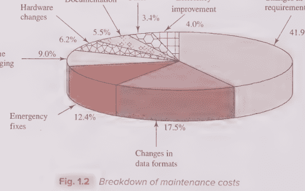

这些研究和其他关于软件实施的报告表明，软件产品在交付和实施前应对其质量进行仔细评估。进行关键评估时必须考虑的一些质量问题是：

- 1. 正确性
- 2. 可维护性
- 3. 可重用性

## 3

面向对象编程原则

- 4. 开放性和互操作性
- 5. 可移植性
- 6. 安全性
- 7. 完整性
- 8. 用户友好性

选择和使用合适的软件工具有助于解决这些问题中的一些。

## 1.2 软件演进

埃内斯特·特洛在人工智能领域是一位知名作家，他将软件技术的演进比作树的生长。像树一样，软件演进具有不同的阶段或“层次”增长。这些层次在过去五十年中一个接一个地建立起来，如图 1.3 所示，每个层次都比前一个层次有所改进。然而，如果考虑这些层次的生命周期，这个类比就失效了。在软件系统中，每一层都继续保持功能，而在树的情况下，只有最上层是功能性的。

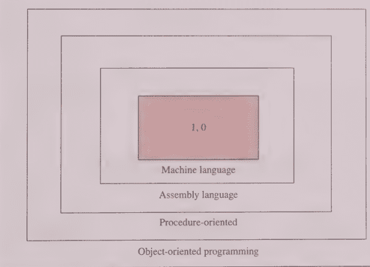

图 1.3 计算机软件的层次

艾伦·凯是面向对象范式的倡导者之一，也是 `Smalltalk` 的主要设计者，他说过：“随着复杂性的增加，架构主导了基本材料”。要构建复杂的软件，仅仅把一系列编程语句和过程、模块的集合组合起来是不够的；我们需要纳入健全的构建技术和易于理解、实现和修改的程序结构。


自计算机发明以来，已经尝试了许多编程方法。这些方法包括模块化编程、自顶向下编程、自底向上编程和结构化编程。每种方法的首要动机都是关注处理程序日益增长的复杂性，使其可靠且可维护。在过去二十年中，这些技术在程序员中变得流行。

## 面向对象 C 编程

随着 `C` 等语言的出现，结构化编程变得非常流行，并在 1980 年代成为主要技术。结构化编程是一种强大的工具，使程序员能够轻松编写中等复杂度的程序。然而，随着程序的增长，即使是结构化方法也无法在无错误、易于维护和可重用的程序方面显示出期望的结果。

面向对象编程（`OOP`）是一种程序组织和开发的方法，它试图通过将结构化编程的优点与几种强大的新概念结合起来，消除传统编程方法的一些弊端。它是一种新的组织和开发程序的方式，与任何特定语言无关。然而，并非所有语言都适合轻松实现 `OOP` 概念。

### 1.3 看一下过程式编程

使用 `COBOL`、`FORTRAN` 和 `C` 等高级语言的传统编程通常被称为过程式编程（`POP`）。在过程式方法中，问题被视为一系列需要完成的事情，如读取、计算和打印。为完成这些任务编写了许多函数。主要关注点是函数。过程式编程的典型程序结构如图 1.4 所示。层次分解技术已被用于指定为解决一个问题而需要完成的任务。

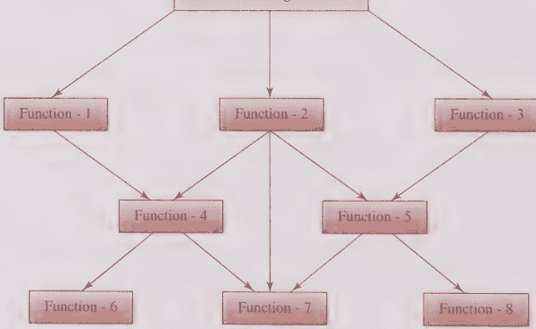

图 1.4 过程式程序的典型结构

在多函数程序中，许多重要的数据项被放置为全局，以便所有函数都可以访问。每个函数可能有自己的局部数据。图 1.5 显示了过程式程序中数据和函数的关系。

## 面向对象编程原则

全局数据更容易被函数意外更改。在大型程序中，很难识别哪些数据被哪个函数使用。如果我们需要修改外部数据结构，我们还需要修改访问该数据的所有函数。这为错误提供了可乘之机。

过程式方法的一个严重缺点是它不能很好地模拟现实世界的问题。这是因为函数是动作导向的，并不真正对应于问题的元素。

过程式编程表现出的一些特征是：

- 强调做事（算法）。
- 大型程序被划分为较小的程序，称为函数。
- 大多数函数共享全局数据。
- 数据在系统中自由地从一个函数移动到另一个函数。
- 函数将数据从一种形式转换为另一种形式。
- 在程序设计中采用自顶向下的方法。

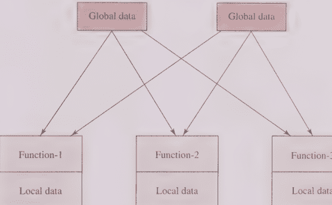

图 1.5 过程式编程中数据和函数的关系

### 1.4 面向对象编程范式

面向对象方法发明的主要推动因素是消除在过程式方法中遇到的一些缺陷。`OOP` 将数据视为程序开发中的关键元素，不允许其在系统中自由流动。它将数据与操作该数据的函数更紧密地联系起来，并保护其免受外部函数的意外修改。`OOP` 允许将问题分解为多个实体，这些实体相互交互并围绕这些对象构建数据。面向对象程序中数据和函数的组织如图 1.6 所示。对象的

## 使用 C++ 进行面向对象编程

抽象是指在不包含背景细节或解释的情况下表示基本特征的行为。类使用抽象的概念，并被定义为抽象属性（如大小、重量和成本）的列表，以及对这些属性进行操作的功能。它们封装了要创建的对象的全部基本属性。这些属性有时被称为数据成员，因为它们保存信息。对这些数据进行操作的功能有时被称为方法或成员函数。

由于类使用数据抽象的概念，因此它们被称为抽象数据类型（`ADT`）。

### 继承

继承是一个类中的对象获取另一个类中对象的属性的过程。它支持分层分类的概念。例如，鸟类‘知更鸟’是‘会飞的鸟’类的一部分，而‘会飞的鸟’又是‘鸟’类的一部分。这种划分背后的原理是，如图 1.8 所示，每个派生类都与它所派生的类共享共同特征。

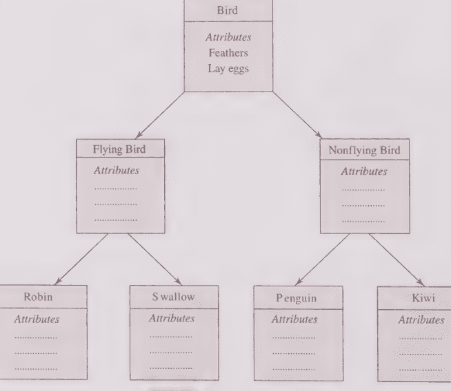

在 `OOP` 中，继承的概念提供了可重用的思想。这意味着我们可以向现有类添加附加功能，而无需修改它。这可以通过从现有类派生新类来实现。新类将具有两个类的组合功能。继承机制的真正吸引力和强大之处在于，它允许程序员重用一个几乎但不完全符合他需求的类，并以这样的方式定制该类，而不会在其他类中引入任何不良的副作用。

请注意，每个子类只定义其独有的特征。如果不使用分类，每个类都必须显式包含其所有特征。

### 多态

多态是另一个重要的 `OOP` 概念。多态是一个希腊语词，意思是能够采取多种形式。一个操作在不同的实例中可能表现出不同的行为。行为取决于操作中使用的数据类型。例如，考虑加法操作。对于两个数字，该操作会生成一个和。如果操作数是字符串，则该操作会通过连接产生第三个字符串。使运算符在不同实例中表现出不同行为的过程称为运算符重载。

图 1.9 说明了单个函数可用于处理不同数量和不同类型的参数。这类似于一个特定词根据上下文具有几种不同含义。使用单个函数名执行不同类型的任务称为函数重载。

多态在允许具有不同内部结构的对象共享相同的外部接口方面发挥着重要作用。这意味着即使与每个操作相关的特定操作可能不同，一类操作也可以以相同的方式访问。多态在实现继承中被广泛使用。

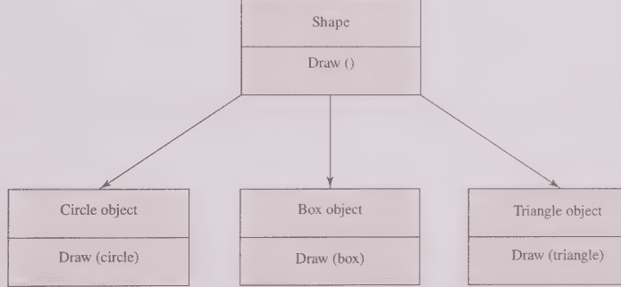

图 1.9 多态

### 动态绑定

绑定是指将过程调用链接到响应调用而执行的代码。动态绑定（也称为后期绑定）意味着与给定过程调用关联的代码直到运行时调用时才知道。它与多态和继承相关联。与多态引用关联的函数调用取决于该引用的动态类型。

考虑图 1.9 中的过程“`draw`”。通过继承，每个对象都将具有此过程。然而其算法是每个对象独有的，因此 `draw` 过程将在定义对象的每个类中被重新定义。在运行时，与当前引用下的对象匹配的代码将被调用。

### 消息传递

面向对象的程序由一组相互通信的对象组成。因此，在面向对象语言中编程涉及以下基本步骤：

- 1. 创建定义对象及其行为的类，
- 2. 从类定义创建对象，以及
- 3. 建立对象之间的通信。

对象通过发送和接收信息相互通信，就像人们相互传递消息一样。消息传递的概念使得谈论构建直接模拟或模拟其现实世界对应物的系统变得更容易。

对象的一个消息是对执行过程的请求，因此将调用接收对象中的函数（过程）以产生所需的结果。消息传递涉及指定对象的名称、函数（消息）的名称以及要发送的信息。示例：

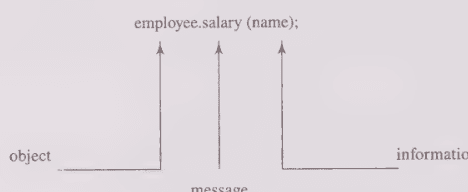

对象具有生命周期。它们可以被创建和销毁。只要对象存活，就可与其通信。

## 使用 C++ 进行面向对象编程

### 1.6 OOP 的优点

`OOP` 为程序设计师和用户都提供了诸多好处。面向对象有助于解决与软件产品开发和质量相关的许多问题。新技术承诺更高的生产率、更好的软件质量和更低的维护成本。主要优点是：

- 通过继承，我们可以消除冗余代码并扩展现有类的使用。
- 我们可以从相互通信的标准工作模块构建程序，而不必从头开始编写代码。这导致开发时间的节省和生产率的提高。
- 数据隐藏的原则帮助程序员构建安全的程序，这些程序不会被程序其他部分的入侵。
- 可以存在多个对象的实例而不会相互干扰。
- 可以将问题域中的对象映射到程序中的对象。
- 以数据为中心的设计方法使我们能够以可实现的形式捕获模型的更多细节。
- 面向对象的系统可以从小型系统轻松升级到大型系统。
- 对象之间通信的消息传递技术使与外部系统的接口描述变得更加简单。
- 软件复杂性可以轻松管理。

## 面向对象编程的原则

虽然可以将所有这些特征纳入面向对象系统，但其重要性取决于项目类型和程序员的偏好。有许多问题需要解决才能获得上述一些好处。例如，可能有可供重用的对象库。该技术仍在发展中，当前产品可能很快就会被取代。如果重用不被损害，则需要开发严格的控制和协议。

开发易于使用的软件使其难以构建。人们希望面向对象编程工具能够帮助管理这一问题。

### 1.7 面向对象语言

与结构化编程一样，`OOP` 概念可以使用 `C` 和 `Pascal` 等语言实现。然而，当程序变得庞大时，编程会变得笨拙并可能产生混淆。专门设计用于支持 `OOP` 概念的语言使其更容易实现。

语言应支持 `OOP` 概念中的几个方面，才能声称它们是面向对象的。根据它们支持的特性，可以将它们分为以下两类：

- 1. 基于对象的编程语言，
- 2. 面向对象编程语言。

基于对象编程是主要支持封装和对象标识的编程风格。基于对象编程所需的主要特性是：

- 数据封装
- 数据隐藏和访问机制
- 对象的自动初始化和清理
- 运算符重载

支持使用对象编程的语言被称为基于对象编程语言。它们不支持继承和动态绑定。`Ada` 是一个典型的基于对象编程语言。

面向对象编程结合了基于对象编程的所有特性以及另外两个特性，即继承和动态绑定。因此，面向对象编程可以用以下语句来表征：

> 基于对象的特性 + 继承 + 动态绑定

支持这些特性的语言包括 `C++`、`Smalltalk`、`Object Pascal` 和 `Java`。存在大量基于对象和面向对象的编程语言。表 1.1 列出了一些流行的面向对象编程语言及其特性。

如表 1.1 所见，所有语言都提供多态性和数据隐藏。然而，其中许多不提供并发性、持久性和通用性。`Eiffel`、`Ada` 和 `C++` 提供了通用设施，这是一种支持重用的重要构造。然而，持久性（存储对象的过程）未被任何一种完全支持。在 `Smalltalk` 中，当前执行状态可以保存到磁盘，但单个对象不能保存到外部文件。

`Simula` 是最古老的面向对象编程语言之一，尽管它的大部分生命周期都在研究环境中度过。商业上，`C++` 和 `Java` 是最突出的面向对象编程语言，已在应用程序开发中得到广泛使用。

## 使用 C++ 进行面向对象编程

| Simula | Smalltalk | Objective-C | C++ | Ada | Object Pascal | Turbo Pascal | Eiffel | Java |
|---|---|---|---|---|---|---|---|---|
| 特征 | * | * | | | | | | |
| 绑定（早期或晚期） | ✓ | ✓ | ✓ | ✓ | ✓ | ✓ | ✓ | ✓ |
| 多态性 | ✓ | ✓ | ✓ | ✓ | | | | |
| 数据隐藏 | | | | | | | | |
| 并发 | | 较差 | 较差 | 较差 | 困难 | 否 | 否 | 已承诺 | ✓ |
| 继承 | ✓ | | | | 否 | | | |
| 多重继承 | 否 | | ✓ | ✓ | 否 | | | 否 |
| 垃圾回收 | ✓ | ✓ | | | 否 | | | ✓ |
| 持久性 | 否 | 已承诺 | 否 | 否 | 类似 3GL | 否 | 否 | 部分支持 | ✓ |
| 泛型 | 否 | 否 | 否 | ✓ | 否 | ✓ | | 否 |
| 对象库 | | | ✓ | ✓ | 不多 | ✓ | ✓ | ✓ |

* 纯面向对象语言

** 基于对象的语言

其他是扩展的传统语言

特定语言的使用取决于应用程序的特征和要求、选择的组织影响以及现有程序的重用。

### 1.8 面向对象编程的应用

`OOP` 已成为当今编程的热门词汇之一。软件工程师在使用 `OOP` 方面似乎有很大的兴奋和兴趣。`OOP` 的应用开始在许多领域变得重要。迄今为止，面向对象编程最流行的应用是在用户界面设计领域，例如窗口。数百个窗口系统已使用 `OOP` 技术开发。

真实的业务系统通常更复杂，包含更多具有复杂属性和方法的对象。`OOP` 在这类应用中很有用，因为它可以简化复杂问题。`OOP` 应用的有前景的领域：

- 实时系统
- 仿真和建模
- 面向对象的数据库
- 超文本、超媒体和专家系统
- AI 和专家系统

## 面向对象编程原则

- 神经网络和并行编程
- 决策支持和办公自动化系统
- CIM/CAM/CAD 系统

`OOP` 环境的丰富性使软件行业不仅能够提高软件系统的质量，还能提高其生产率。面向对象技术无疑正在改变软件工程师分析、设计和实现系统的方式。

## 摘要

- 软件技术在过去五十年中经历了一系列阶段的演变。
- 直到最近为止，最流行的阶段是过程式编程（`POP`）。
- `POP` 采用自上而下的编程方法，将问题视为需要执行的任务序列。为实现这些任务编写了多个函数。
- `POP` 有两个主要缺点，(1) 数据在程序中自由移动，容易受到程序中任何函数引起的更改的影响，(2) 它不能很好地模拟现实世界的问题。
- 面向对象编程（`OOP`）是为了克服 `POP` 的缺点而发明的。它采用自下而上的编程方法。它将数据视为程序开发中的关键元素，不允许其在系统中自由流动。它将数据与对其进行操作的函数更紧密地联系在一个称为类的结构中。此特性称为数据封装。
- 在 `OOP` 中，问题被视为一组称为对象的实体。对象是类的实例。
- 将数据与程序的直接访问隔离称为数据隐藏。
- 数据抽象是指在不包含背景细节的情况下将基本特征放在一起。
- 继承是通过一个类的对象获取另一个类对象的属性的过程。
- 多态性意味着一个名字，多种形式。它允许我们在程序中拥有多个同名函数。它还允许运算符重载，以便操作可以在不同实例中表现出不同的行为。
- 动态绑定意味着与给定过程关联的代码在运行时调用时才知道。
- 消息传递涉及指定对象的名称、函数（消息）的名称以及要发送的信息。
- 与传统编程方法相比，面向对象技术提供了几个好处——最重要的是可重用性。
- `OOP` 技术的应用在几乎所有计算领域都变得重要，包括实时业务系统。
- 有许多语言支持面向对象编程。其中流行的是 `C++`、`Smalltalk` 和 `Java`。

## 使用 C++ 进行面向对象编程

## 关键词

`Ada` | `assembly` | `language` | `bottom-up programming` | `C++` | `classes` | `concurrency` | `abstraction`

`data` | `encapsulation` | `data hiding` | `data members` | `dynamic` | `binding` | `early` | `binding` | `Eiffel` | `flowcharts`

`function` | `overloading` | `functions` | `garbage collection` | `global` | `data` | `hierarchical classification` | `inheritance`

`Java` | `late` | `binding` | `local` | `data` | `machine` | `member functions` | `message passing` | `methods`

`modular programming` | `multiple inheritance` | `object libraries` | `Object` | `object-based programming`

`Objective C` | `object-oriented languages` | `object-oriented programming` | `objects` | `Pascal` | `operator overloading`

`persistence` | `polymorphism` | `procedure-oriented programming` | `top-down programming` | `Turbo Pascal` | `reusability` | `Simula` | `Smalltalk` | `structured`

## 复习问题

## 认知领域

1.1 表达软件行业目前面临的主要问题。

1.2 概述 1950–1990 年期间的软件演变。

1.3 描述过程式编程及其主要特征。

1.4 标记过程式程序开发的一种方法。

1.5 重述过程式程序中函数的数据共享。

1.6 论述面向对象编程并将其与过程式编程区分开来。

1.7 说明面向对象编程范式的独特优势。

1.8 区分以下术语：

(a) 对象和类

(b) 数据抽象和数据封装

(c) 继承和多态性

(d) 动态绑定和消息绑定

1.9 描述应用于 `OOP` 的继承。

1.10 讨论动态绑定。还确定其在 `OOP` 中的用途。

1.11 指出面向对象方法与基于对象方法之间的区别。

1.12 列出 `OOP` 技术应用的几个领域。

1.13 讨论面向对象程序中数据和函数的组织。

1.14 标记在 `OOP` 中可以成为对象的事物种类。

## 情感领域

## 面向对象编程原则

为以下陈述的正确性辩护：

(a) 在过程式编程中，所有数据都被所有函数共享。

(b) 过程式编程的主要重点是算法而不是数据。

(c) 面向对象编程的一个显著特征是将程序划分为代表现实世界实体的对象。

(d) 将不同类型封装成一个单元称为封装。

(e) `OOP` 的一个问题是一旦类被创建就永远不能更改。

(f) 继承意味着一个对象能够重用另一个对象的值。

(g) 多态性在实现继承中被广泛使用。

(h) 面向对象程序的执行速度远快于传统程序。

(i) 面向对象系统可以从小规模扩展到大规模。

(j) 面向对象方法不能用于创建数据库。

图例：精确 评价/回应/组织 应用 记忆 理解

## 多项选择题

1. ________ 不是软件。

(a) 程序

(b) 实用程序

(c) 脚本

(d) 宏

5. 对象的状态和行为意味着：

(a) 数据和功能

(b) 位置和规则

(c) 方法和关系

(d) 创建和增长

2. 以下哪一项不是编程方法？

(a) 单一编程

(b) 自上而下编程

(c) 自下而上编程

6. 以下哪一项不是面向对象编程的特征？

(a) 抽象

(b) 封装

(c) 完整性

(d) 继承

3. 过程式编程与以下哪一项没有关联

(a) 算法

(b) 函数

(c) 内存

(d) 重载

7. 继承不是 `OOP` 语言的特征？

(a) `Java`

(b) `Eiffel`

(c) `C++`

(d) `ADA`

4. 过程不能称为

(a) 例程

(b) 模型

8. 动态绑定也可以称为：

(a) 快速绑定

(b) 运行时绑定

(c) 松散绑定

(d) 早期绑定

(c) 数据抽象

(d) 动态绑定

10. 多态意味着一个名字，多种形式

(a) 正确

(b) 不正确

(c) 部分正确

(d) 不可预测

9. 只有类数据组件被隐藏：

(a) 数据隐藏

(b) 数据封装

## 2 从 C++ 开始

### 学习目标

阅读本章后，你将能够

- 定义 `C++` 并列出其应用


- 识别简单 C++ 程序的基本元素
- 解释类在 C++ 程序中如何使用
- 识别 C++ 程序的结构
- 讨论 C++ 源文件如何开发和编译

## 2.1 什么是 C++？

C++ 是一种面向对象的编程语言。它由 Bjarne Stroustrup 于 20 世纪 80 年代初在美国新泽西州默里山的 AT&T 贝尔实验室开发。Stroustrup 崇拜 Simula67 并坚定支持 C，他希望将两种语言的优点结合起来，创造一种更强大的语言，既能支持面向对象编程特性，又能保留 C 的功能和优雅。结果就是 C++。因此，C++ 是 C 的扩展，主要增加了类构造特性。由于类是相对于原始 C 语言的重大补充，Stroustrup 最初将新语言称为“带类的 C”。然而，后来在 1983 年，名称改为 C++，取自 C 的自增运算符 `++`，暗示 C++ 是 C 的增强版。

在 20 世纪 90 年代初，该语言经历了更多的改进和变化。1997 年 11 月，ANSI/ISO 标准规范化了这些变化，并在语言规范中增加了若干新特性。

C++ 是 C 的超集。我们已知的关于 C 的大部分内容也适用于 C++。因此，几乎所有 C 程序也是 C++ 程序。然而，有一些细微的差异会阻止 C 程序在 C++ 编译器下运行。我们将在遇到时看到这些差异。

C++ 在 C 中添加的最重要的设施是类、继承、函数重载和运算符重载。这些特性使得创建抽象数据类型、从现有数据类型继承属性并支持多态成为可能，使 C++ 成为真正的面向对象语言。

C++ 中的面向对象特性允许程序员以清晰、可扩展和易于维护的方式构建大型程序，同时体现 C 的精神和效率。新特性的加入已将面向对象编程与 C++

C 从一种目前促进自顶向下结构化设计的语言，转变为提供自底向上面向对象设计的语言。

## 2.2 C++ 的应用

C++ 是处理非常大型程序的多功能语言。它适用于几乎任何编程任务，包括编辑器、编译器、数据库、通信系统以及任何复杂的现实生活应用系统开发。

- C++ 允许我们创建层次相关的对象，我们可以构建特殊的面向对象库，可供许多程序员使用。
- 虽然 C++ 能够正确映射现实世界问题，但 C++ 中的 C 部分赋予了该语言接近机器级细节的能力。
- C++ 程序易于维护和扩展。当需要实现新功能时，很容易将其添加到对象的现有结构中。

## 2.3 一个简单的 C++ 程序

让我们从一个简单的 C++ 程序示例开始，该程序在屏幕上打印一个字符串。

| 程序 2.1 | 打印一个字符串 |

```
#include <iostream>                                // include header file
using namespace std;
int main() 
{
    cout << "C++ is better than C.\n"; // C++ statement
    return 0;
}                                                     // End of example
```

这个简单程序演示了几个 C++ 特性。

### 程序特性

与 C 类似，C++ 程序是一组函数的集合。上面的示例只包含一个函数 `main()`。与往常一样，执行从 `main()` 开始。每个 C++ 程序都必须有 `main()`。C++ 是一种自由格式语言。除了少数例外，编译器会忽略回车和空白。与 C 一样，C++ 语句以分号终止。

## 注释

C++ 引入了新的注释符号 `//`（双斜杠）。注释以双斜杠符号开始，并在行尾结束。注释可在行中任何位置开始，其后直到行尾的内容将被忽略。请注意，没有结束符号。

双斜杠注释基本上是单行注释。多行注释可以写成如下形式：

```
// This is an example of
// C++ program to illustrate
// Some of its features
```

C 注释符号 `/* */` 仍然有效，且更适合多行注释。以下注释是允许的：

```
/* This is an example of
C++ program to illustrate
some of its features
/*
```

我们可以在程序中使用这两种样式。由于这是一本关于 C++ 的书，我们将只使用 C++ 样式。然而，请记住，我们不能在程序行的文本中插入 `//` 样式注释。例如，双斜杠注释不能按如下所示使用：

```
for(j=0; j<n; /* loops n times * / j++)
```

### 输出运算符

程序 2.1 中唯一的语句是输出语句。语句

```
cout << "C++" is better than C.";
```

会导致引号中的字符串显示在屏幕上。该语句引入了两个新的 C++ 特性，`cout <<`。标识符 `cout`（读作“C out”）是一个预定义对象，表示 C++ 中的标准输出流。这里，标准输出流表示屏幕。输出也可以重定向到其他输出设备。我们稍后将详细讨论流。

运算符 `<<` 调用插入或 put to 运算符。它将右侧变量的内容插入（或发送）到左侧的对象（图 2.1）。

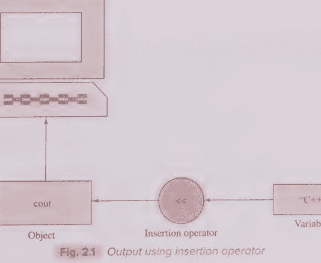

面向对象编程与 C++

对象 `cout` 具有简单的接口。如果 `string` 表示一个字符串变量，则以下语句将显示其内容：

```
cout << string;
```

你可能记得运算符 `<<` 是按位左移运算符，它仍可用于此目的。这是一个运算符可用于不同目的的例子，具体取决于上下文。这种上下文称为运算符重载，是多态的重要方面。运算符重载在第 7 章中讨论。

需要注意的是，我们仍然可以使用 `printf()` 来显示输出。C++ 接受这种记法。然而，我们将使用 `cout <<` 以保持 C++ 的精神。

### iostream

C++ 程序通常在开头包含预处理器指令语句。此类语句以 `#` 符号开头，以指示编译器存在预处理器指令，由此预处理器处理 `#` 指令语句。所有 C++ 程序都以 `#include` 指令开始，该指令将指定的头文件内容包含到主程序中。

我们在程序中使用了 `#include` 指令：

```
#include <iostream>
```

该指令导致预处理器将 `iostream` 文件的内容添加到程序中。一些旧版本的 C++ 使用名为 `iostream.h` 的头文件。这是 ANSI C++ 引入的变化之一。（如果编译器不支持 ANSI C++ 特性，我们应使用 `iostream.h`。）

头文件 `iostream` 应包含在所有使用输入/输出语句的程序开头。某些实现使用 `iostream.hpp`，而另一些则使用 `iostream.hxx`。我们必须根据程序内容和实现包含适当的头文件。

表 2.1 和 2.2 提供了 C++ 标准库头文件的列表，这些文件可能在 C++ 程序中需要。带 `.h` 扩展名的头文件是“旧式”文件，应与旧编译器一起使用。表 2.1 还给出了应与 ANSI 标准编译器一起使用的这些文件的版本。

表 2.1 常见的旧式头文件

| 头文件 | 内容和用途 | 新版本 |
|---|---|---|
| `<assert.h>` | 包含用于添加有助于程序调试的诊断的宏和信息 | `<cassert>` |
| `<ctype.h>` | 包含用于测试字符某些属性的函数原型，以及可用于将小写转换为大写及反之的函数原型。 | `<ctype>` |
| `<float.h>` | 包含系统的浮点大小限制。 | `<float>` |
| `<limits.h>` | 包含系统的整数大小限制。 | `<limits>` |
| `<math.h>` | 包含数学库函数的函数原型。 | `<cmath>` |
| `<stdio.h>` | 包含标准输入/输出库函数的函数原型及其使用信息。 | `<cstdio>` |

（续）

# 表 2.1（续）

| 头文件 | 内容和用途 | 新版本 |
| --- | --- | --- |
| `<stdlib.h>` | 包含将数字转换为文本、文本转换为数字、内存分配、随机数以及各种其他实用函数的函数原型。 | `<cstdlib>` |
| `<string.h>` | 包含 C 风格字符串处理函数的函数原型。 | `<string>` |
| `<time.h>` | 包含用于操作时间和日期的函数原型和类型。 |  |
| `<iostream.h>` | 包含标准输入和标准输出函数的函数原型。 | `<iostream>` |
| `<iomanip.h>` | 包含用于格式化数据流的流操纵器的函数原型。 | `<iomanip>` |
| `<fstream.h>` | 包含执行从磁盘文件输入和向磁盘文件输出的函数的函数原型。 | `<fstream>` |

# 表 2.2 C++ 中包含的新头文件

| 头文件 | 内容和用途 |
| --- | --- |
| `<utility>` | 包含许多标准库文件使用的类和函数。 |
| `<vector>`, `<list>`, `<deque>` | 这些头文件包含实现标准库容器的类。容器在程序执行期间存储数据。我们将在第 14 章讨论这些头文件。 |
| `<queue>`, `<set>`, `<map>` | 包含标准库算法使用的类和函数。 |
| `<stack>`, `<bitset>` | 包含标准库用于向标准库容器分配内存的类和函数。 |
| `<functional>` | 包含用于操作标准库容器中数据的函数。 |
| `<memory>` |  |
| `<iterator>` |  |
| `<algorithm>` | 包含用于操作标准库容器中数据的函数。 |
| `<exception>`, `<stdexcept>` | 这些头文件包含用于异常处理的类。 |
| `<string>` | 包含标准库中类 `string` 的定义。我们将在第 15 章讨论此内容。 |
| `<sstream>` | 包含执行从字符串输入和向内存中字符串输出的函数的函数原型。 |
| `<locale>` | 包含通常由流处理使用的类和函数，用于以不同语言的自然形式处理数据（例如货币格式、排序字符串、字符呈现等） |
| `<limits>` | 包含用于在每个平台上定义数值数据类型的类。 |
| `<typeinfo>` | 包含用于运行时类型识别的类（在执行时确定数据类型）。 |

除了 `#include` 之外，其他预处理器指令如 `#define`、`#error` 等，其工作方式与在 C 中相同。但由于有其他实现相同功能的手段，其在 C++ 中的使用相当有限。

## 面向对象编程与 C++

### 命名空间

命名空间是 ANSI C++ 标准委员会引入的一个新概念。它为程序中使用的标识符定义了一个作用域。为了使用在命名空间作用域中定义的标识符，我们必须包含指令，如 `using namespace std;`

这里 `std` 是 ANSI C++ 标准类库定义的命名空间。所有 ANSI C++ 程序都必须包含此指令。这将把 `std` 中定义的所有标识符带到当前全局作用域。`using` 和 `namespace` 命名空间将在第 16 章详细介绍。

### main() 的返回类型

在 C++ 中，`main()` 将整数值返回给操作系统。因此，每个 C++ 中的 `main()` 都应以 `return(0);` 结束，否则可能会出现警告或错误。由于 `main()` 返回整数类型的值，`main()` 的返回类型明确指定为 `int`。现在 C++ 中所有函数的默认返回类型都是 `int`。以下没有类型和返回的 `main` 将会发出警告运行：

```
main()
{
    ...
}
```

## 2.4 更多 C++ 语句

让我们考虑一个稍微复杂一点的 C++ 程序。假设我们想从键盘读取两个数字并在屏幕上显示它们的平均值。实现此目的的 C++ 语句如程序 2.2 所示。

程序 2.2 两个数的平均值

```
#include <iostream>
using namespace std;
int main()
{
    float number1, number2, sum, average;
    cout << "Enter two numbers:"; // prompt
    cin >> number1; // Reads numbers
    cin >> number2; // from keyboard

    sum = number1 + number2;
    average = sum/2;

    cout << "Sum = " << sum << "\n";
    cout << "Average = " << average << "\n";

    return 0;
}
```

程序 2.2 的输出为：

```
Enter two numbers: 6.5 7.5
Sum = 14
Average = 7
```

### 变量

程序使用了四个变量，即 `number1`、`number2`、`sum` 和 `average`。它们由语句声明为 `float` 类型。

```
float number1, number2, sum, average;
```

所有变量必须在使用前在程序中声明。

### 输入运算符

语句

```
cin >> number1;
```

是一个输入语句，会导致程序等待用户输入一个数字。输入的数字被放置在变量名中。标识符 `cin`（读作“cin in”）是 C++ 中预定义的对象，对应于标准输入流。这里它代表

运算符 `>>` 被称为提取或 get 运算符。它从键盘提取（或取出）值并将其分配给其右侧的变量（图 2.2）。这对应于熟悉的 `scanf()` 操作。让 `<< >>` ，运算符 `>>` 也可以被重载。

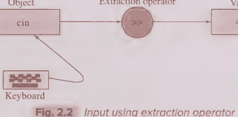

### I/O 运算符的级联

我们在最后两个打印结果的语句中重复使用了插入运算符。

语句

```
cout << "Sum = " << sum << "\n";
```

首先将 "Sum = " 字符串启动到 `cout` 并发送 `sum` 的值。最后，它发送换行字符，以便下一个输出将在新行中。一次语句中多次使用 `<<` 是级联。当级联输出运算符时，我们应确保不同项目之间有必要的空白。使用级联技术，最后两个语句可以合并为：

```
cout << "Sum = " << sum << "\n"
cout << "Average = " << average << "\n";
```

这是一个语句提供两行输出。如果你只想要一行输出，语句将是：

输出将为：

```
Sum = 14, Average = 7
```

### 面向对象编程与 C++

我们也可以如下面所示级联输入运算符 `>>`：

```
cin >> number1 >> number2;
```

值从左到右分配。也就是说，如果我们输入两个值，例如 10 和 20，则 10 将分配给 `number1`，20 分配给 `number2`。

## 2.5 一个带类的示例

C++ 的主要特性之一是类。它们提供了一种将数据与其操作函数绑定在一起的方法。像 C 中的结构一样，类是用户定义的数据类型。

程序 2.3 显示了类在 C++ 程序中的使用。

程序 2.3 类的使用

```
#include <iostream>
using namespace std;
class person
{
    char name[30];
    int age;
    public:
        void getdata(void);
        void display(void);
};
void person ::getdata(void)
{
    cout << "Enter name: ";
    cin >> name;
    cout << "Enter age: ";
    cin >> age;
}
void person ::display(void)
{
    cout << "\nName: " << name;\n    cout << "\nAge: " << age;
}
int main()
{
    person p;
    p.getdata();
    p.display();

    return 0;
}
```

程序 2.3 的输出将为：

```
Enter Name: Ravinder

Enter Age: 30

Name: Ravinder

Age: 30
```

> 注 `cin` 只能读取一个单词，因此我们不能使用带空格的名称。

程序将 `person` 定义为类的新数据类型。类 `person` 包含两个基本数据类型项和两个对其数据进行操作的函数。这些函数称为成员函数。主程序使用 `person` 来声明其类型的变量。如前所述，类变量称为对象。这里，`p` 是 `person` 类型的对象。类对象用于调用该类中定义的函数。有关类和对象的更多内容将在第 5 章讨论。

## 2.6 C++ 程序的结构

从程序 2.3 可以看出，一个典型的 C++ 程序将包含如图 2.3 所示的四个部分。这些部分可以放在单独的代码文件中，然后独立或联合编译。

| 包含文件 |
| 类声明 |
| 成员函数定义 |
| 主函数程序 |

图 2.3 C++ 程序的结构

| 成员函数 | 服务器 |
| 类定义 |  |
| 主函数程序 | 客户端 |

通常的做法是将程序组织成三个单独的文件。类声明放在头文件中，成员函数的定义放在另一个文件中。这种方法使程序员能够将接口的抽象规范（类定义）与实现细节（成员函数定义）分开。最后，使用类的主程序放在第三个文件中，该文件“包含”前两个文件以及所需的任何其他文件。

这种方法基于如图 2.4 所示的客户端-服务器模型。类定义包括成员

图 2.4 客户端-服务器模型

## 2.7 创建源文件

与 C 程序一样，C++ 程序也可以使用任何文本编辑器创建。例如，在 UNIX 上，我们可以使用 `vi` 或 `ed` 文本编辑器来创建和编辑源代码。在 Windows 系统上，我们可以使用记事本或任何其他可用的文本编辑器，或在非文档模式下的文字处理系统。

一些系统如 `Turbo C++` 提供了用于开发和编辑程序的集成环境。应查阅适当的手册以获取完整细节。


文件名应具有适当的扩展名以表明它是一个 C++ 程序文件。C++ 实现使用诸如 `c`、`cc`、`.cpp` 和 `.xx` 等扩展名。Turbo C++ 和 Borland C++ 对 C++ 程序使用 `cpp`，对 C 程序使用 `c`。Zortech C++ 系统使用 `.xx`，而 UNIX AT&T 版本使用 `C`（大写 C）和 `.cc`。应查阅操作系统手册以确定应使用的正确文件名扩展名。

## 2.8 编译和链接

编译和链接的过程再次取决于操作系统。本节讨论了一些流行的系统。

### Unix AT&T C++

在 UNIX 下实现 C++ 程序的过程与 C 程序相似。我们应使用 "`CC`"（大写）命令来编译程序。请记住，我们使用小写 "`cc`" 来编译 C 程序。命令

```
CC -o example.o example.C
```

在 UNIX 提示符下编译包含在文件 `example.C` 中的 C++ 程序源代码。编译器将生成一个对象文件 `example.o`，然后自动与库函数链接以生成可执行文件。默认文件名是 `a.out`。

分散在多个文件中的程序可以按如下方式编译：

```
CC file1.C file2.o
```

该语句仅编译文件 `file1.C` 并将其与之前编译的 `file2.o` 文件链接。这在仅需修改其中一个文件时很有用。未修改的文件无需再次编译。

### Turbo C++ 和 Borland C++

Turbo C++ 和 Borland C++ 在 MS DOS 下提供集成开发环境。它们提供内置编辑器和菜单栏，其中包括文件、编辑、编译和运行等选项。

我们可以在文件选项下创建和保存源文件，并在编辑选项下编辑它们。然后我们可以在编译选项下编译程序，并在运行选项下执行它。运行选项可以在不编译源代码的情况下使用。在这种情况下，`RUN` 命令会导致系统一步编译、链接和运行程序。Turbo C++ 是最流行的编译器，Turbo C++ 系统下程序的创建和执行在附录 B 中讨论。

### Visual C++

它是 Microsoft 用于 C++ 的应用程序开发系统，可在 Windows 下运行。`Visual C++` 是一个可视化编程环境，其中基本程序组件可以通过菜单选择、按钮、图标和其他预定方法进行选择。Windows 下 C++ 程序的开发和执行在附录 C 中简要说明。

## 摘要

- `C++` 是 `C` 语言的超集。
- `C++` 在 `C` 的基础上增加了许多面向对象的特性，如对象、继承、函数重载和运算符重载。这些特性使得构建程序具有清晰性、可扩展性和易于维护性。
- `C++` 可用于构建各种系统，如编辑器、编译器、数据库、通信系统以及许多更复杂的现实生活应用系统。
- `C++` 支持交互式输入输出功能并引入了新的注释符号 `//`，可用于单行注释。它也支持 `C` 风格的注释。
- 与 `C` 程序一样，所有 `C++` 的执行都从 `main()` 函数开始并在 `return` 语句处结束。使用输入/输出操作的所有程序的开头都应包含头文件 `iostream`。
- 所有 ANSI `C++` 程序都必须包含 `using namespace std` 指令。
- 典型的 `C++` 程序包含四个基本部分，即包含文件部分、类声明部分、成员部分和 `main` 函数部分。
- 与 `C` 程序一样，`C++` 程序可以使用任何文本编辑器创建。
- 大多数编译器系统提供用于开发和执行程序的集成环境。流行的系统有 UNIX AT&T `C++`、Turbo `C++` 和 Microsoft `Visual C++`。

## 关键词

```
#include a.out Borland C++; cascading cin class client comments cout edlin extraction operator
float free-form get from operator input insertion operator int iostream iostream.h
keyboard main() member functions MS-DOS namespace object operating systems operator overloading
output operator put to operator return () server Simula67 text editor Turbo C++ Unix AT&T C++
using Visual C++ Windows Zortech C++
```

## 面向对象的 C++ 编程

## 复习问题

认知领域

指出预处理器指令 `#include <iostream>` 的必要性。

- 2.1 区分 `C++` 中的 `main()` 函数和 `C` 中的 `main()` 函数。
- 2.2 解释与旧的 `C` 类型注释相比，`C++` 中注释 `//` 的主要优点。
- 2.3 重述 `C++` 程序的主要构成部分。

情感领域

说明以下陈述的正确性：

- (a) 由于 `C` 是 `C++` 的子集，所有 `C` 程序都可在 `C++` 编译器下运行。
- (b) 在 `C++` 中，类中包含的注释称为成员函数。
- (c) 看一两行代码，我们可以很容易地识别程序是用 `C` 还是 `C++` 编写的。
- (d) 在 `C++` 中，很容易向对象的现有结构添加新特性。
- (e) 使用一个运算符用于不同目的的概念称为运算符重载。
- (f) 输出函数 `printf()` 不能在 `C++` 程序中使用。

图例

精确 评价/回应/组织 应用 记忆 理解

## 调试练习

2.1 识别以下程序中的错误：

```
#include <iostream>
using namespace std;
int main()
{
int i = 0;
i = i + 1;
cout << i << " ";
/*comment\*/i = i + 1;
cout << i;
return 0;
}
```

2.2 识别以下程序中的错误：

```
#include <iostream>
using namespace std;
int main()
{
 short i=2500, j=3000;
 cout << "i + j = " << i+j;
 return 0;
}
```

2.3 查找以下 `C++` 语句中的错误，如有：

- (a) `cout << "x=x";`
- (b) `m=5;// n=10; s=m+n;`
- (c) `cin>>y;`
- (d) `cout << "Name:" << name;`
- (e) `cout<<"Enter value"; cin >> x;`
- (f) `"/Addition/" z=x+y;`

## 试运行练习

2.1 运行以下程序时会发生什么？

```
#include <iostream>
using namespace std;
int main()
{
 int i=10, j=5;
 int modResult=0;
 int divResult=0;
 modResult = i%j;
 cout << endl << modResult << " ";
 divResult = i/modResult;
 return 0;
}
```

2.2 运行以下程序时会发生什么？

```
#include <iostream>
using namespace std;
int main()
{
 cout << "*\n*\n* * * * * *\n* * * * * *";
 return 0;
}
```

2.3 运行以下程序时会发生什么？

```
#include <iostream>
using namespace std;
int main() {
    char ch = 32;
    int in = 32;
    cout << "*" << ch << ch << "*" << ch << ch << in << in << "*";
    cout << "*" << in << "*" << in << "*" << in << "*";
    return 0;
}
```

## 编程练习

- 2.1 编写一个程序，使用单个 `cout` 语句显示以下输出。

Maths = 90

Physics = 77

Chemistry = 69

- *2.2 编写一个程序从键盘读取两个数字并在屏幕上显示较大值。
- *2.3 编写一个程序从键盘输入一个字符并在屏幕上显示其对应的 ASCII 值。
- *2.4 编写一个程序读取 `a`、`b` 和 `c` 的值并显示 `x` 的值，其中

`x = a / b - c`

对以下情况测试你的程序：

(a) `a = 250, b = 85, c = 25`

(b) `a = 300, b = 70, c = 70`

- *2.5 编写一个 `C++` 程序，要求输入华氏温度并以摄氏度显示。
- *2.6 使用名为 `temp` 的类和成员函数重做练习 2.5。

## 多项选择题

- 1. `C++` 在以下哪个地方开发：

(a) Bell Lab

(b) AT&T Lab

(c) Sun Lab

(d) PARC

- 2. 'C with Classes' 被命名为 `C++` 的年份是：

(a) 1980

(b) 1981

(c) 1981

(d) 1983

*练习 2.2 可在阅读第 3 章后由不了解控制结构的读者尝试。

3. `C++` 不能用于开发：

+   (a) 数据库

(b) 编译器

(c) 编辑器

(d) 工具包

4. `<<` 被称为

+   (a) 插入操作符

(b) 加法操作符

(c) 打印操作符

(d) 发送操作符

5. `namespace` 用于区分同名

+   (a) 函数

(b) 整数

(c) 常量

(d) 数组

6. 在 `C++` 中，程序未被安排到哪个文件？

+   (a) 成员函数

(b) 类定义

(c) 主函数

(d) 全局文件

7. 可能的 `C++` 程序文件扩展名是

+   (a) `.ccc`

(b) `.cpc`

(c) `.CC`

(d) `.cxx`

8. 以下哪一个不是 `C++` 程序执行的集成环境？

+   (a) AT&T `C++`

(b) Turbo `C++`

(c) Borland `C++`

(d) Bell `C++`

9. `C++` 中级联 I/O 操作符是可能的。

+   (a) 是

(b) 否

(c) 有时

(d) 从不

10. `C++` 中 `main` 函数的返回类型是什么？

+   (a) Float

(b) Int

(c) Char

(d) Void

## 标记、表达式和控制结构

### 学习目标

阅读本章后，你将能够

- 列出 `C++` 的各种关键字
- 识别 `C++` 的基本数据类型
- 描述各种用户定义的数据类型，如结构和类
- 识别各种存储类
- 解释 `C++` 中的各种派生数据类型
- 讨论常量和变量
- 描述 `C++` 中使用的各种操作符
- 概述 `C++` 程序中使用的各种表达式类型
- 提供操作符优先级和重载的概述
- 识别各种控制结构

### 3.1 引言

如前所述，`C++` 是 `C` 的超集，因此 `C` 的大多数构造在 `C++` 中都是合法的，其含义保持不变。存在一些例外和新增内容。在本章中，我们将讨论这些例外和新增内容，涉及标记和控制结构。

### 3.2 标记

我们知道，程序中最小的独立单元称为标记。`C++` 有以下标记：

- 关键字
- 标识符
- 常量
- 字符串
- 操作符

`C++` 程序使用这些标记、空白字符和语言的语法编写。大多数 `C++` 标记基本上与 `C` 标记相似，只是增加了一些新增内容和细微修改。

### 3.3 关键字

关键字实现了 `C++` 语言特性。它们是显式保留的标识符，不能用作程序变量或其他用户定义元素的名称。

表 3.1 给出了 `C++` 关键字的完整集合。其中许多与 `C` 共同。ANSI `C` 关键字以粗体显示。为了增强其功能并使其成为面向对象的语言，已在 ANSI `C` 关键字基础上添加了额外的关键字。ANSI `C++` 标准委员会还添加了一些关键字以使语言更具多功能性。这些单独显示。所有 `C++` 关键字的含义和用途在附录 D 中给出。

表 3.1 `C++` 关键字

| asm | double | new | switch |
|---|---|---|---|
| auto | else | template |
| break | enum | private | this |
| case | extern | protected | throw |
| catch | float | public | try |
| char | for | register | typedef |
| class | friend | return | union |
| const | goto | short | unsigned |
| continue | if | signed | virtual |
| default | inline | sizeof | void |
| delete | int | static | volatile |
| do | long | struct | while |

ANSI `C++` 添加

| bool | export | reinterpret_cast | typename |
|---|---|---|---|
| const_cast | false | static_cast | using |
| dynamic_cast | mutable | true | wchar_t |
| explicit | namespace | typeid |

注意：ANSI `C` 关键字以粗体显示。

### 3.4 标识符和常量

标识符是指程序员创建的变量、函数、数组、类等的名称。它们是任何语言的基本要求。每种语言对命名这些标识符都有自己的规则。以下规则适用于 `C` 和 `C++`：

* 仅允许使用字母数字字符、数字和下划线。
* 名称不能以数字开头。
* 大写和小写字母是不同的。
* 已声明的关键字不能用作变量名。

`C` 与 `C++` 之间的一大主要区别是名称的长度限制。虽然 ANSI `C` 仅识别名称中的前 32 个字符，但 ANSI `C++` 对其长度没有限制，因此名称中的所有字符都具有意义。

## 面向对象的 C++

在命名由包含 `C` 和 `C++` 程序的多个文件共享的变量时应谨慎。某些操作系统对此类变量名的长度施加限制。

常量是指在程序执行期间不发生变化的值。

与 `C` 一样，`C++` 支持几种类型的字面量。它们包括整数、字符、浮点数和字符串。字面量常量没有内存位置。示例：

```
123 // decimal integer
12.34 // floating point integer
037 // octal integer
0X2 // hexadecimal integer
"C++" // string constant
'A' // character constant
'Lab' // wide-character constant
```

`wchar` 类型是 ANSI `C++` 引入的宽字符字面量，旨在用于无法将字符放入单个字节的字符集。宽字符字面量以字母 `L` 开头。

`C++` 还识别 `C` 中的所有反斜杠字符常量。

> `C++` 支持两种字符串表示形式——`C` 字符字符串和随标准 `C++` 引入的字符串类类型。虽然推荐使用字符串类类型，但在某些情况下了解并使用 `C` 风格字符串是明智的。字符串类类型支持许多功能，并在第 15 章中详细讨论。

### 3.5 基本数据类型

`C++` 中的数据类型可分为如图 3.1 所示的各种类别。

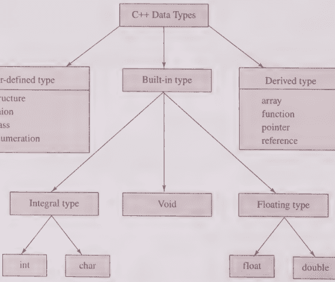

图 3.1 `C++` 数据类型层次结构

## 标记、表达式和控制结构

`C` 和 `C++` 编译器都支持所有内置的（也称为基本或基本）数据类型。`void` 除外，基本数据类型前面有几个修饰符，以满足各种情况的需求。修改后的 `signed`、`unsigned`、`long` 和 `short` 也可应用于整数数据类型。修改后的 `signed` 和 `unsigned` 也可应用于字符类型，以及 `long` 修饰符。数据表示在 `C++` 中是机器相关的。表 3.2 列出了基本数据类型和修饰符的所有组合，以及它们在 32 位机器上的大小和范围。

表 3.2 `C++` 基本数据类型的大小和范围

| Type | Bytes | Range |
|---|---|---|
| char | 1 | -128 to 127 |
| unsigned char | 1 | 0 to 255 |
| signed char | 1 | -128 to 127 |
| int | 4 | -2147483648 to 2147483647 |
| unsigned int | 4 | 0 to 2294967295 |
| signed int | 4 | -2147483648 to 2147483647 |
| short int | 2 | -32768 to 32767 |
| unsigned short int | 2 | 0 to 65535 |
| signed short int | 2 | -32768 to 32767 |
| long int | 4 | -2147483648 to 2147483647 |
| signed long int | 4 | -2147483648 to 2147483647 |
| unsigned long int | 4 | 0 to 4294967295 |
| float | 4 | 3.4E-38 to 3.4E+38 |
| double | 8 | 1.7E-308 to 1.7E+308 |
| long double | 10 | 3.4E-4932 to 1.1E+4932 |

ANSI `C++` 委员会添加了另外两种数据类型，`bool` 和 `wchar_t`。它们在第 16 章中讨论。

`void` 类型在 ANSI `C` 中引入。`void` 的两种正常用途是 (1) 指定函数返回类型，当它不返回任何值时，以及 (2) 表示函数为空参数列表。示例：

```
void func1(void);
```

`void` 的另一个兴趣在于通用指针的声明。


通用指针可以分配任何基本数据类型的指针值，但可能不被引用。例如：

```
int *ip; // int pointer
gp = ip; // assign int pointer to void pointer
```

是有效语句。但，语句：

```
*ip = *gp;
```

是非法的。对 `void` 值的指针进行解引用是没有意义的。

在 C++ 和 ANSI C 中，不使用强制转换将任何类型分配给 `void` 指针是允许的。在 ANSI C 中，我们也可以在不使用强制转换为非 `void` 指针类型的情况下将 `void` 指针分配给非 `void` 指针。这在 C++ 中是不允许的。例如：

`void *ptr1;`

`char *ptr2;`

`ptr2 = ptr1;`

在 ANSI C 中都是合法的语句，而在 C++ 中则不是。`void` 指针不能直接赋值给其他类型的指针。在 C++ 中我们需要使用类型转换操作符，如下所示：

```
ptr2 = (char *)ptr1;
```

## 3.6 用户自定义数据类型

### 结构体和联合体

仅使用基本类型的独立变量不足以处理现实世界的问题。通常需要将逻辑相关的數據元素组合在一起。虽然数组用于将相同类型的数据元素组合在一起，但结构体用于将不同类型的数据元素组合在一起。

结构体定义的一般格式如下：

```
struct name
{
    data_type member1;
    data_type member2;
    ...
    ...;
};
```

让我们以一本书为例，一本书有标题、页数、价格等多个属性。我们可以用结构体来实现一本书，如下所示：

```
struct book
{
    char title[25];
    char author[25];
    int pages;
    float price;
};
struct book book1, book2, book3;
```

这里 `book1`、`book2` 和 `book3` 被声明为用户自定义类型 `book` 的变量。我们可以通过使用点号（`.`）操作符来访问结构体的成员元素，如下所示：

```
book1.pages=550;
book2.price=225.75;
```

联合体在概念上与结构体相似，因为它们允许我们将不同类型的数据元素组合到一个单元中。但就其实现而言，结构体和联合体之间存在显著差异。结构体类型的大小等于各个成员类型的大小之和。然而，联合体的大小等于其最大成员元素的大小。例如，考虑以下联合体声明：

```
union result {
  int marks;
  char grade;
  float percent;
};
```

联合体 `result` 在内存中将占用四个字节，因为其最大成员元素是浮点类型 `percent`。但是，如果我们将 `result` 定义为结构体；在 32 位计算机上它将占用 12 个字节。结构体的内存表示使用“字边界”的概念。字边界的大小取决于机器。对于 32 位机器，字边界为 4 字节宽。结构体的成员按如下所示左对齐到字边界：

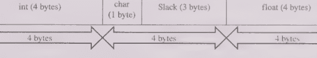

字符数据占用 1 个字节，浮点数占用 4 个字节，中间留有未占用的空间。未占用的字节称为空闲字节。当我们声明结构体变量时，每一个都可能包含这样的空闲字节，从而增加结构体变量所需的空间。

因此，在联合体的情况下，相同的内存空间用于表示不同的元素。结果是，联合体的成员只能相互排斥地操作。简单来说，我们可以说联合体是结构体的内存高效替代方案，特别是在不需要同时访问成员元素的情况下。

在 C++ 中，结构体和联合体可以像在 C 中一样使用。然而，C++ 结构体还有一个有趣的一面，我们将在第 5 章中学习。

## 表 3.3 结构体与联合体的区别

| Structure | Union |
|---|---|
| A structure defined with 'struct' keyword. | A union is defined with 'union' keyword. |
| All members of a structure can be manipulated simultaneously. | The members of a union can only be manipulated one at a time. |
| The size of a structure object is equal to the sum of the individual sizes of the member objects. | The size of a union object is equal to the size of largest member object. |
| Structures are allocated distinct memory locations. | Unions members share common memory space for their exclusive usage. |
| Structures are not considered memory efficient in comparison to unions. | Unions are considered memory efficient particularly when the members are not required to be accessed simultaneously. |
|  | Unions retain their core functionality in C++ with slight add-ons like declaration of anonymous unions. |

## 面向对象 C++ 编程

### 类

C++ 允许我们定义另一种用户自定义数据类型，称为类，可以像任何其他基本数据类型一样使用来声明变量。类变量即对象，它们是面向对象编程的核心焦点。关于类的其他细节将在第 5 章中描述。

### 枚举数据类型

枚举数据类型是另一种用户自定义类型，它提供了一种将名称附加到数字的方法，从而提高代码的可理解性。`enum` 关键字（来自 C）通过分配值 0、1、2 等自动枚举一组单词。此功能提供了一种创建符号常量的替代方法。`enum` 语句的语法与 `struct` 语句相似。示例：

```
enum shape(circle, square, triangle);
enum colour(red, blue, green, yellow);
enum position(off, on);
```

枚举数据类型在 C++ 中与 ANSI C 相比略有不同。标签名 `shape`、`colour` 和 `position` 成为新的类型。通过使用这些标签，我们可以声明新的变量。示例：

```
shape ellipse; // ellipse is of type shape
colour background; // background is of type colour
```

ANSI C 将枚举的类型定义为 `int`。在 C++ 中，每个枚举数据类型都保留其自己的独立类型。这意味着 C++ 不允许 `int` 值自动转换为枚举值。示例：

```
colour background = blue; // allowed
colour background = 7; // Error in C++
colour background = (colour) 7; // OK
```

然而，枚举值可以用在 `int` 值的位置。

```
int c = red; // valid, colour type promoted to int
```

默认情况下，枚举器被分配从 0 开始的整数值，第一个枚举器为 0，第二个为 1，以此类推。我们可以通过显式为枚举器分配值来覆盖默认值。示例：

```
enum colour(red, blue=4, green=8);
enum colour(red=5, blue, green);
```

都是有效的定义。在第一种情况下，`red` 默认值为 0。在第二种情况下，`blue` 为 6，`green` 为 7。请注意，后续枚举器比其前驱大一

C++ 还允许创建匿名枚举（即没有标签名的枚举）。示例：

```
enum{off, on};
```

这里，`off` 为 0，`on` 为 1。这些常量可以像常规常量一样引用。示例：

```
int switch_l = off;
int switch_2 = on;
```

在实践中，枚举用于为 `switch` 语句定义符号常量。示例：

```
enum shape
{
  circle,
```

```
rectangle,
triangle;
};
int main() {
    cout << "Enter shape code:";
    int code;
    cin >> code;
    while (code >= circle && code <= triangle) {
        switch(code) {
            case circle:
                ....
                break;
            case rectangle:
                ....
                break;
            case triangle:
                ....
                break;
        }
    }
    cout << "Enter shape code:";
    cin >> code;
    cout << "BYE \n";
    return 0;
}
```

ANSI 允许在结构体或类中定义枚举，但枚举是全局可见的。在 C++ 中，在类（或结构体）中定义的枚举仅对该类（或结构体）本地。

## 3.7 存储类别

除了数据类型之外，变量还与其关联一个存储类别。变量的存储类别指的是变量在程序中的生命周期和可见性。生命周期指的是变量的持续时间或变量在程序执行期间保持活跃的时长。可见性则表示变量的作用域，即在程序模块中变量可访问的位置。有四种存储类别，如下所述：

`auto` 是任何类型变量的默认存储类别。其可见性限制在声明它的函数内。此外，其生命周期也仅限于其包含函数执行的时间。即，它在遇到其语句时创建，并在程序控制离开其包含函数块时销毁。

## 使用 C++ 进行面向对象编程

`extern` 如名称所示，外部变量是在函数之外声明但在函数块内部可访问的。并且如同全局变量一样，其可见性遍及整个程序。这意味着，它可被程序中的所有函数访问。外部变量的生命周期与程序的生命周期相同。

`static` 静态变量具有局部变量的可见性，但具有外部变量的生命周期。这意味着，一旦在函数内部声明，函数执行后它不会被销毁，而是保留其值，以便函数调用可以使用。

`register` 与自动变量的行为相似，寄存器变量在内存中存储的方式不同。与存储在主内存中的自动变量不同，寄存器变量存储在 CPU 寄存器中。将变量存储在寄存器中的目的是提高其访问速度，最终使程序运行更快。然而需要注意的是，编译器没有义务只将寄存器变量存储在 CPU 寄存器中，如果没有空闲寄存器容纳该变量，则它将像其他自动变量一样存储。

表 3.4 四种存储类的总结。

|  | extern | static | register |
|---|---|---|---|||
| Lifetime | Function block | Entire program | Entire program | Function block |
| Visibility | Local | Global | Local | Local |
| Initial Value | Garbage | 0 | 0 | Garbage |
| Storage | Stack segment | Data segment | Data segment | CPU registers |
| Purpose | Local variables by a single function | Global variables used throughout the program | Local variables retaining their values throughout the program | Variables using CPU registers for storage purpose |
| Keyword | auto | extern | static | Register |

## 3.8 派生数据类型

### Arrays

C++ 中数组的应用与 C 中相似。唯一的例外是字符数组被初始化。在 ANSI C 中初始化字符数组时。编译器允许我们将数组大小声明为字符串常量的确切长度。例如：

```
char string[3] = "xyz";
```

在 ANSI C 中是有效的。它假设程序员打算在定义中省略空字符 `\0`。但在 C++ 中，大小应比字符串长度大一。

```
char string[4] = "xyz"; // O.K. for C++
```

### Functions

函数在 C++ 中经历了重大变化。虽然其中一些变化很简单，但其他变化需要在组织程序时采用新的思维方式。其中许多修改和改进是由 C++ 面向对象概念的要求驱动的。其中一些是为了使 C++ 程序更可靠和更易读而引入的。C++ 函数的所有特性将在第 4 章中讨论。

### Pointers

指针的声明和初始化与在 C 中一样。示例：

```
int *ip;           // int pointer
ip = &x;         // address of x assigned to ip
*ip = 10;      // 10 assigned to x through indirection
```

C++ 增加了常量指针和指向常量的指针的概念。

```
char * const ptr1 = "GOOD"; // constant pointer
```

我们不能修改 `ptr1` 被初始化为的地址。

```
int const ptr2 = &x; // pointer to a constant
```

`ptr2` 被声明为指向常量的指针。它可以指向任何正确类型的变量，但它所指向的内容不能被更改。

我们也可以以以下方式同时声明指针和变量为常量：

```
const char * const cp = "xyz";
```

此语句将 `cp` 声明为指向字符串的常量指针，该字符串已被声明为常量。在这种情况下，既不能更改分配给指针 `cp` 的地址，也不能更改它所指向的内容。

指针在 C++ 中被广泛用于内存管理和实现多态性。

## 3.9 符号常量

在 C++ 中创建符号常量有两种方法：

- 使用限定符 `const`，以及
- 使用 `enum` 关键字定义一组整数常量。

在 C 和 C++ 中，任何声明为 `const` 的值都不能以任何方式被程序修改。然而，实现上存在一些差异。在 C++ 中，我们可以在常量表达式中使用 `const`，例如

```
const int size = 10;
char name[size];
```

这在 C 中是非法的。`const` 允许我们创建常量，而不必使用 `#define` 来创建没有类型信息的常量。

# 面向对象编程 with C++

命名常量就像变量一样，只是它们的值不能被更改。

C++ 要求 `const` 必须被初始化。ANSI C 不要求初始化器；如果未给出，则将其初始化为 0。

`const` 值的范围不同。C++ 中的 `const` 默认具有内部链接，因此它仅限于声明它的文件。在 ANSI C 中，`const` 值本质上是全局的。它们在声明它们的文件之外可见，不过可以通过将其声明为 `static` 使其成为局部变量。为了使 `const` 值具有外部链接，以便可以从另一个文件引用它，我们必须在 C++ 中显式将其定义为 `extern`。示例：

```
extern const total = 100;
```

命名整数常量的另一种方法是枚举如下：

```
enum {X, Y, Z};
```

这将 `X`、`Y` 和 `Z` 定义为整数常量，其值分别为 0、1 和 2。这等价于：

```
const int X = 0;
const int Y = 1;
const int Z = 2;
```

我们可以显式地为 `X`、`Y` 和 `Z` 分配值。示例：

```
enum(X=100, Y=50, Z=200);
```

这样的值可以是任何整数值。枚举数据类型已在第 3.6 节中详细讨论。

## 3.10 类型兼容性

与 C 相比，C++ 对类型兼容性非常严格。例如，C++ 将 `int`、`short int` 和 `long int` 定义为三种不同的类型。当它们的值相互赋值时必须进行强制转换。同样，`unsigned char`、`char` 和 `signed char` 被视为不同的类型，尽管每个的大小都是一个字节。在 C++ 中，值的类型必须相同才能完全兼容，否则必须应用强制转换。C++ 中的这些限制是必要的，以便支持函数重载，其中两个同名函数使用参数的类型来区分。

另一个区别是字符常量如何存储。在 C 中，它们存储为 `ints`，因此

```
sizeof ('x')
```

等价于

```
sizeof (int)
```

在 C 中。C++，然而，`char` 不会被提升到 `int` 的大小，因此

```
sizeof ('x')
```

等于

```
sizeof (char)
```

## 3.11 变量声明


我们知道，在 C 中，所有变量必须在它们在可执行语句中使用之前声明。这对 C++ 也是正确的。然而，C 和 C++ 在程序中声明位置方面存在显著差异。C 要求所有变量必须在作用域开始处定义。当我们阅读 C 程序时，我们通常会在每个作用域的开头遇到一组变量声明。它们的实际使用出现在作用域的其他地方，有时远离声明的位置。在使用变量之前，我们应该回到程序的开头，看看它是否已被声明，如果有，是什么类型。

C++ 允许在此作用域中声明任何变量。这意味着变量可以在首次使用时就地声明。这使得程序更容易编写，并减少了因来回扫描而可能造成的错误。它还使程序更容易理解，因为变量是在其使用上下文中声明的。

下面的示例说明了这一点。

```
int main() {
{
    float x; // declaration
    float sum = 0;

    for(int i=1; i<5; i++) // declaration
    {
        cin >> x;
        sum = sum +x;
    }
    float average; // declaration
    average = sum/(i-1);
    cout << average;
    return 0;
}
```

这种声明风格的唯一缺点是我们无法一眼看到作用域中使用的所有变量。

## 3.12 变量的动态初始化

在 C 中，变量必须使用常量表达式进行初始化，并且 C 编译器会在编译时固定初始化代码。C++，然而，允许在运行时初始化变量。这称为动态初始化。在 C++ 中，变量可以在声明位置使用表达式在运行时初始化。例如，以下是有效的初始化语句：

```
...
int n = strlen(string);
...
float area = 3.14159 * rad * rad;
```

因此，变量的声明和初始化可以在变量首次使用时同时在该位置完成。上一节示例中的以下两个语句

## 使用 C++ 进行面向对象编程

```
float average; // declare where it is necessary
average = sum/i;
```

可以合并为一条语句：

```
float average = sum/i; // initialize dynamically at run time
```

动态初始化在面向对象编程中被广泛使用。我们可以使用仅在运行时才知道的信息创建所需类型的对象。

## 3.13 引用变量

C++ 引入了一种新的变量类型，称为引用变量。引用变量为先前定义的变量提供别名（替代名称）。例如，如果我们使变量 `sum` 成为变量 `total` 的引用，那么 `sum` 和 `total` 可以互换使用来表示该变量。引用变量的创建方式如下：

```
data-type & reference-name = variable-name
```

示例：

```
float total = 100;
float & sum = total;
```

`total` 是一个已经声明的 `float` 类型：`sum` 是声明为表示变量 `total` 的替代名称。两个变量都引用内存中的同一个数据对象。现在，语句

```
cout << total;
```

和

```
cout << sum;
```

都打印值 100。语句

```
total = total + 10;
```

会将 `total` 和 `sum` 的值都更改为 110。同样，赋值

```
sum = 0;
```

会将两个变量的值都更改为零。

引用变量必须在声明时初始化。这建立了引用与其命名的对象之间的对应关系。需要注意的是，引用变量的初始化与对其的赋值完全不同。

C++ 对符号 `&` 赋予了额外的含义。这里，`&` 不是地址运算符。记号 `float &` 表示对 `float` 的引用。其他示例是：

```
int n[10];
int & x = n[8]; // x is alias for n[8]
```

变量 `x` 是数组元素 `n[8]` 的替代。

以下引用也是允许的：

```
int x;
int *p = &x;
int &m = *p;
```

这组声明使得 `m` 引用由指针 `p` 指向的 `x`。以下对引用的声明是不允许的：

非 const 左值引用不能绑定到常量。

引用变量的主要应用之一是在向函数传递参数时。考虑以下情况：

```
void f(int &x) // uses reference
{
    x = x+10; // x is incremented, so also m
}
int main()
{
    int m = 10;
    f(m); // function call
}
```

当函数 `f(m)` 执行时，会发生以下初始化：

```
int &x = m;
```

因此，`x` 在执行语句

```
f(m);
```

之后成为 `m` 的别名。这种函数调用被称为按引用调用。该实现如图 3.2 所示。由于变量 `x` 和 `m` 是别名，函数递增 `x`，`m` 也会被递增。函数执行后 `m` 的值变为 20。在传统的 C 中，我们使用指针和解引用技术完成此操作。

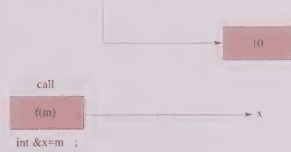

图 3.2 按引用调用机制

按引用调用机制在面向对象编程中很有用，因为它允许通过引用操作对象并消除了对象参数的来回复制。还需要注意的是

引用不仅可以为内置数据类型创建，也可以为用户定义的数据类型（如结构和类）创建。引用与这些用户定义的数据类型配合使用效果极佳。

## 使用 C++ 进行面向对象编程

## 3.14 C++ 中的运算符

C++ 具有丰富的运算符集。所有 C 运算符在 C++ 中也有效。此外，C++ 还引入了一些新运算符。我们已经见过两个这样的运算符，即插入运算符 `<<`，和提取运算符 `>>`。其他新运算符是：

- `:` 作用域解析运算符
- Pointer-to-member declarator
- Pointer-to-member operator
- Pointer-to-member operator
- `delete` 内存释放运算符
- `endl` 换行运算符
- `new` 内存分配运算符
- `setw` 字段宽度运算符

此外，C++ 还允许我们为某些内置运算符提供新的定义。也就是说，我们可以根据所用参数的类型为运算符赋予多种含义。此过程称为运算符重载。

## 3.15 作用域解析运算符

与 C 一样，C++ 也是块结构语言。块和作用域可用于构建程序。我们知道，相同的变量名可以在不同的块中具有不同的含义。变量的作用域从其声明点延伸到包含声明的块的末尾。在块内声明的变量称为该块的局部变量。考虑以下程序段：

```
{
  int x = 10;
}

{
  int x = 1;
}
```

`x` 的两次声明引用包含不同值的两个不同内存位置。第二块中的语句不能引用第一块中声明的变量 `x`，反之亦然。C++ 中的块通常是嵌套的。例如，以下风格很常见：

```
...
{
    int x = 10;

    {
        int x = 1;
        ...
    }
}...
```

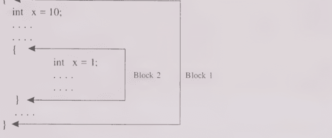

Block2 包含在 block1 中。请注意，内部块中的声明会隐藏外部块中相同变量的声明，因此，`x` 的每次声明都使其引用不同的数据对象。在内部块内，变量 `x` 将引用其中声明的数据对象。

在 C 中，变量的全局版本无法从内部块中访问。C++ 通过引入新的运算符 `::` 称为作用域解析运算符来解决此问题。这可用于揭示隐藏的变量。其形式如下：

```
:: variable-name
```

此运算符允许访问变量的全局版本。例如：`::count` 表示变量 `count` 的全局版本（而不是该块中声明的局部变量）。程序 3.1 说明了此功能

## 程序 3.1 作用域解析运算符

```
#include <iostream>

using namespace std;

int m = 10; // global m

int main() {
    int m = 20; // m redeclared, local to main
    int k = m;
    int m = 30; // m declared again
    // local to inner block
    cout << "we are in inner block \n";
    cout << "k = " << k << " \n";
    cout << "m = " << m << " \n";
    cout << "::m = " << ::m << " \n";
```

(Contd.)

```
{
cout << "\nwe are in outer block \n";
cout << "m = " << m << "\n";
cout << "::m = " << ::m << "\n";
}
```

程序 3.1 的输出将是：

- We are in inner block

k = 20

m = 30

::m = 10

- We are in outer block

m = 20

::m = 10

在上面的程序中，变量 `m` 在三个地方声明，即在 `main()` 函数之外、在 `main()` 内部，以及在内部块内。

> 需要注意的是 `::m` 将始终引用全局 `m`。在内部块中，`::m` 引用值 10 和 20。

作用域解析运算符的主要应用之一是在类中标识成员函数所属的类。这将在介绍类时详细讨论。

## 3.16 成员解引用运算符

如你所知，C++ 允许我们定义一个包含各种类型的数据和函数作为成员的类。C++ 还允许我们通过指针访问类成员。为了实现这一点，C++ 提供了一组三个指针到成员运算符。表 3.5 显示了这些运算符及其功能。

表 3.5 成员解引用运算符

| Operator | Function |
|---|---|
| `::*` | To declare a pointer to a member of a class |
| `.*` | To access a member using object name and a pointer to that member |
| `->*` | To access a member using a pointer to the object and a pointer to that member |

只有在讨论类之后，这些运算符的进一步细节才有意义，因此我们将推迟到那时再使用成员解引用运算符。

## 3.17 内存管理运算符

C 使用 `malloc()` 和 `calloc()` 函数在运行时动态分配内存。同样，它使用 `free` 函数释放动态分配的内存。我们在事先不知道需要多少空间时使用动态分配技术。C++ 支持这些函数，它还定义了两个一元运算符 `new` 和 `delete`，可以更好地、更轻松地执行分配和释放内存的任务。由于这些运算符操作的是自由存储区上的内存，因此也被称为自由存储运算符。

对象可以使用 `new` 创建，并使用 `delete` 销毁，按需进行。用 `new` 在块内创建的数据对象，将一直存在，直到使用 `delete` 显式销毁为止。因此，对象的生命周期完全在我们的控制之下，与程序的块结构无关。

`new` 运算符用于创建任何类型对象。其一般形式如下：

```
pointer-variable = new data-type;
```

这里，`pointer-variable` 是 `data-type` 类型的指针。`new` 运算符分配足够的内存来容纳 `data-type` 类型的数据对象，并返回该对象的地址。`data-type` 可以是任何有效的数据类型。`pointer-variable` 持有已分配内存空间的地址。

示例：

* `p = new int;`
* `q = new float;`

`p` 是类型为 `int` 的新指针，`q` 是类型为 `float` 的指针。这里，`p` 和 `q` 必须已声明为适当类型的指针。或者，我们可以按如下方式合并指针的声明和赋值：

```
int *p = new int;
float *q = new float;
```

随后，语句

```
*p = 25;
*q = 7.5;
```

使用 `new` 运算符将 25 分配给新创建的 `int` 对象，并将 7.5 分配给 `float` 对象。这按如下方式完成：

```
pointer-variable = new data-type(value);
```

这里，`value` 指定初始值。示例：

```
int *p = new int (25);
float *q = new float (7.5);
```

如前所述，`new` 可用于为任何数据类型创建内存空间，包括用户定义的类型，如数组、结构和类。一维数组的一般形式为：

```
pointer-variable = new data-type[size];
```

这里，`size` 指定数组中的元素数。例如，语句

`int *p = new int[10];`

为 10 个整数的数组创建内存空间。`p[0]` 将引用第一个元素，`p[1]` 引用第二个元素，

依此类推。

使用 `new` 创建多维数组时，必须提供所有数组大小。

```
array_ptr = new int[3] [5] [4]; // legal
array_ptr = new int[m] [5] [4]; // legal
array_ptr = new int[3] [5] []; // illegal
array_ptr = new int[ ] [5] [4]; // illegal
```

第一个维度可以是其值在运行时提供的变量。其他维度必须为常量。

与基本数据类型类似，`new` 运算符也可以用于动态创建类对象。类对象的大小

会自动确定，并相应地分配内存空间。使用 `new` 运算符分配类对象的一般形式为：

```
class sample {
    private:
data-type d1;
data-type d2;

    public:

};
main() {
    sample *ptr = new sample;
}
```

这里，`sample` 类对象的大小将自动确定，并由 `new` 运算符为其保留相应的内存空间。

当数据对象不再需要时，它会被销毁以释放内存空间供重用。其

使用的一般形式为：

```
delete pointer-variable;
```

`pointer-variable` 是指向用 `new` 创建的数据对象的指针。示例：

```
delete p;
delete q;
```

如果我们想释放动态分配的数组，必须使用 `delete` 的以下形式：

```
delete [] pointer-variable;
```

例如，

```
delete [] p;
```

将删除指针 `p` 指向的整个数组。

程序 3.2 演示了 `new` 和 `delete` 运算符用于动态分配和释放内存的使用。

### 程序 3.2 new 和 delete 运算符的使用

程序 3.2 的输出将为：

```
Enter the size of the integer array: 5
Creating an array of size 5...
Dynamic allocation of memory for array arr is successful.
```

如果没有足够的内存用于分配会怎样？在这种情况下，与 `malloc()` 类似，`new` 返回空指针。因此，在使用 `new` 生成的指针之前检查它是个好主意。方法如下：

```
...
p = new int;
if(!p)
{
    cout << "allocation failed \n";
}...
}
```

如果您使用的是标准 C++，而不是空指针，将抛出 `bad_alloc` 异常。它是系统生成的错误条件，表示内存分配失败。为处理这种情况，必须在程序中包含适当的异常处理代码。我们将在第 13 章学习更多关于异常处理的内容。

程序 3.3 演示了 `new` 和 `delete` 运算符用于动态分配类对象。程序使用 `bad_alloc` 异常而不是空指针来处理分配失败。

### 程序 3.3 bad_alloc 异常的使用

```
#include <iostream>
using namespace std;

class sample {
private:
    int data1;
    char data2;
public:
    void set (int i,char c)
    {
        data1=i;
        data2=c;
    }
    void display(void)
    {
        cout<<"Data1 = "<<data1<<"\n";
        cout<<"\nData2 = "<<data2;
    }
};
int main() {
    sample *s_ptr;
    try{
        s_ptr = new sample;
    }
    catch (bad_alloc ba)
    {
        cout<<"Bad Allocation occurred...the program will terminate\n";
        return 1;
    }

    s_ptr->set(25,'A');
    s_ptr->display();

    delete s_ptr;
    return 0;
}
```

**`new`** 运算符相对于函数 **`malloc`()` 具有以下优点：

- 1. 它自动计算数据对象的大小；我们不使用 **`sizeof`** 运算符。
- 2. 它自动返回正确的指针类型，因此无需使用类型转换。
- 3. 在创建内存空间时可以初始化对象。
- 4. 与任何其他运算符一样，**`new`** 和 **`delete`** 可以被重载。

## 3.18 操纵符

操纵符是用于格式化数据显示的运算符。最常用的操纵符是 **`endl`** 和 **`setw`**。


`endl` 操纵符在使用在输出语句中时，会插入换行。它与使用换行符 `"\n"` 具有相同的效果。例如，语句

```
cout << "m = " << m << endl
     "n = " << n << endl
     "p = " << p << endl;
```

将导致输出三行，每行对应一个变量。如果我们假设变量的值分别为 2597、14 和 175，则输出将如下所示：

| m | 2 | 5 | 9 | 7 |

| n | 1 | 4 |

| p | 1 | 7 | 5 |

需要注意的是，这种形式不是理想的输出。它应如下所示：

```
m = 2597
n = 14
p = 175
```

这里，数字是右对齐的。只有当我们能为所有数字指定一个共同的字段宽度并使它们右对齐打印时，才可能实现这种输出形式。`setw` 操纵符完成这项工作。其用法如下：

```
cout << setw(5) << sum << endl;
```

操纵符 `setw(5)` 为打印变量 `sum` 的值指定字段宽度 5。该值在字段内右对齐，如下所示：

|  | 3 | 4 | 5 |

程序 3.4 演示了 `endl` `setw` 的使用。

### 程序 3.4 操纵符的使用

```
#include <iostream>
#include <iomanip> // for setw

using namespace std;

int main()
{
    int Basic = 950, Allowance = 95, Total = 1045;

    cout << setw(10) << "Basic" << setw(10) << Basic << endl;
    cout << setw(10) << "Allowance" << setw(10) << Allowance << endl;
    cout << setw(10) << "Total" << setw(10) << Total << endl;

    return 0;
}
```

程序 3.4 的输出将为：

| Basic 950 |

| Allowance 95 |

| Total 1045 |

注意 字符字符串也打印为右对齐。

## 55

Tokens, Expressions and Control Structures

我们也可以通过使用 `fixed` 和 `setprecision()` 操纵符来控制输出中出现的浮点数，如下所示：

```
cout<<fixed<<setprecision(2) <<average;
```

上述语句将把 `average` 变量的值显示在屏幕上，精度限制为两位。

我们也可以按如下方式编写自己的操纵符：

```
#include <iostream>

stream & symbol (ostream & output)
{
    return output << "\tRs";
}
```

`symbol` 是代表 Rs 的新操纵符。标识符 `symbol` 可以在我们需要显示字符串 Rs 时使用。

## 3.19 TYPE CAST OPERATOR

C++ 允许使用类型转换运算符对变量或表达式进行显式类型转换。

传统的 C 风格转换在 C++ 中通过函数调用记法作为语法替代得到增强。以下两个版本是等价的：

```
(type-name) expression // C notation
type-name (expression) // C++ notation
```

示例：

```
average = sum/(float)i; // C notation
average = sum/float(i); // C++ notation
```

`type-name` 就像是一个用于将值转换为指定类型的函数。函数调用记法能产生最简单的表达式。然而，它只能在类型为标识符时使用。例如：

```
p = int * (q);
```

是非法的。在这种情况下，我们必须使用 C 类型记法。

```
p = (int *) q;
```

或者，我们可以使用 `typedef` 创建所需类型的标识符，并在函数记法中使用它。

```
typedef int * int_pt;
```

```
p = int_pt(q);
```

程序 3.5 演示了 C++ 中的显式类型转换：

## Program 3.5 Explicit Type Casting

```
#include <iostream>
using namespace std;

int main()
{
    int intvar=25;
    float floatvar=35.87;

    cout<<"intvar = "<<intvar<<";
    cout<<"\nfloatvar = "<<floatvar<<";
    cout<<"\nfloat (intvar) = "<<(float)(intvar)<<";
    cout<<"\nint (floatvar) = "<<(int)(floatvar)<<";

    return 1;
}
```

程序 3.5 的输出为：

intvar = 25

floatvar = 35.87

float (intvar) = 25

int (floatvar) = 35

ANSI C++ 增加了以下新的转换运算符：

- `const_cast`

- `static_cast`

- `dynamic_cast`

- `reinterpret_cast`

这些运算符的应用将在第 16 章讨论。

## 3.20 EXPRESSIONS AND THEIR TYPES

表达式是按照语言规则排列的运算符、常量和变量的组合。它也可能包括返回值的函数调用。表达式可能由一个或多个操作数和零个或多个运算符组成，以产生一个值。表达式可以是以下七种类型之一：

- Constant expressions

- Integral expressions

- Float expressions

- Pointer expressions

- Relational expressions

- Logical expressions

- Bitwise

表达式也可能使用上述表达式的组合。这类表达式称为复合表达式。

### Constant Expressions

常量表达式仅由常量值组成。示例：

```
15
20 + 5 / 2.0
'x'
```

### Integral Expressions

积分表达式是指在执行所有自动和显式类型转换后产生整数结果的表达式。示例：

```
m
m * n - 5
m * 'x'
5 + int (2.0)
```

其中 `m` 和 `n` 是整数变量。

### Float Expressions

浮点表达式是指在所有转换后产生浮点结果的表达式。示例：

```
x + y
x * y / 10
5 + float(10)
10.75
```

其中 `x` 和 `y` 是浮点变量。

### Pointer Expressions

指针表达式产生地址值。示例：

```
&
ptr
ptr + 1
"xyz"
```

其中 `m` 是一个变量，`ptr` 是一个指针。

### Relational Expressions

关系表达式产生类型为 `bool` 的结果，其取值为 true 或 false。示例：

```
x <= y
a+b == c+d
m+n > 100
```

当关系运算符两侧使用算术表达式时，它们将首先被求值，然后再比较结果。关系表达式也称为布尔表达式。

## Object-Oriented Programming with C++

### Logical Expressions

逻辑表达式组合两个或多个关系表达式并产生 `bool` 类型结果。示例：

```
a>b && x>=10
x==10 || y==5
```

### Bitwise Expressions

按位表达式用于在位级别操作数据。它们主要用于测试或移位位：

```
x << 3 // Shift three bit position to left
y >> 1 // Shift one bit position to right
```

移位运算符通常用于乘以或除以 2 的幂。

ANSI C++ 引入了所谓的运算符关键字，可用作运算符符号的替代表示。运算符关键字在第 16 章给出。

## 3.21 SPECIAL ASSIGNMENT EXPRESSIONS

### Chained Assignment

```
x = (y = 10);
or
x = y = 10;
```

首先将 10 赋给 `y`，然后赋给 `x`。

链式赋值不能在声明时用于初始化变量。例如，语句

```
float a = b = 12.34; // wrong
```

是非法的。这可以写成

```
float a=12.34, b=12.34 // correct
```

### Embedded Assignment

```
x = (y = 50) + 10;
```

`(y = 50+10)` 是一个赋值表达式，称为嵌入赋值。这里，将值 50 赋给 `y`，然后将结果 50+10=60 赋给 `x`。这等同于

```
y = 50;
x = y + 10;
```

### Compound Assignment

像 C 一样，C++ 支持复合赋值运算符，它是赋值运算符与二元算术运算符的组合。例如，简单的赋值语句

```
x = x + 10;
```

Fig. 3.3 Water-fall model of type conversion

## Object-Oriented Programming with C++

每当 `char` 或 `short int` 在表达式中出现时，它都会被转换为 `int`。这称为积分扩展转换。隐式转换仅在完成所有积分扩展转换后才应用。

Table 3.6 Results of mixed-mode operations

| LHO | char | short | int | long | float | double | long double |

|---|---|---|---|---|---|---|---|

| char | int | int | int | long | float | double | long double |

| short | int | int | int | long | float | double | long double |

| int | int | int | int | long | float | double | long double |

| long | long | long | long | long | float | double | long double |

| float | float | float | float | float | float | double | long double |

| double | double | double | double | double | double | double | long double |

| long double | long | long | long | long | long | long | long double |

RHO – Right-hand operand

LHO – Left-hand operand

## 3.23 OPERATOR OVERLOADING

如前所述，重载根据上下文为操作赋予不同的含义。C++ 允许运算符重载，从而使我们能够为运算符分配多种含义。我们也在 C 中使用过重载的概念。例如，运算符 `*` 当应用于指针变量时，给出指针的值。但它也常用于乘以两个数字。操作数的数量和类型决定了要遵循的运算符的性质。

输入/输出运算符 `<<` 和 `>>` 是运算符重载的良好示例。虽然 `<<` 运算符的内置定义是用于移位位，但它也用于显示各种数据类型的数值。这是通过头文件 `iostream` 实现的，其中包含大量 `<<` 的重载定义。因此，语句

```
cout << 75:86;
```

调用用于显示 `double` 类型值的定义，而

```
cout << "well done";
```

调用用于显示 `char` 值的定义。然而，`iostream` 中的这些定义不会影响运算符的含义。

同样，我们可以为其他 C++ 运算符定义额外的含义。例如，我们可以定义 `+` 来添加两个结构或对象。几乎所有 C++ 运算符都可以被重载，但有少数例外，如成员访问运算符（`.` 和 `*`）、条件运算符（`?:`）、作用域解析运算符（`::`）和 `sizeof` 运算符。运算符重载的定义将在第 7 章详细讨论。

# 3.24 C++ 运算符优先级

尽管 C++ 允许我们为运算符添加多种含义，但它们的结合性和优先级仍然保持不变。例如，乘法运算符的优先级仍高于加法运算符。表 3.7 给出了所有 C++ 运算符的优先级和结合性。组别按优先级递减的顺序列出。标签 `prefix` 和 `postfix` 用于区分 `++` 和 `--` 的用法。此外，符号 `+`、`-`、`*`、`&` 既用于一元运算符也用于二元运算符。

ANSI C++ 运算符的完整列表及其含义、优先级、结合性和用法见附录 E。

表 3.7 运算符优先级和结合性

| Operator | Associativity |

| --- | --- |

| :: | left to right |

| -> .() [] postfix ++ postfix -- | left to right |

| prefix ++ prefix -- ~ unary & unary * | left to right |

| unary + unary - (type) sizeof new delete | left to right |

| ** | left to right |

| * / % | left to right |

| + - | left to right |

| << >> | left to right |

| < <= > >= | left to right |

| == != | left to right |

| & | left to right |

| ^ | left to right |

| \| | left to right |

| && | left to right |

| \|\| | left to right |

| ?: | right to left |

| = *= /= %= += -= <<= >>= &= ^= \|= | right to left |

| , | left to right |

注： 一元运算具有更高的优先级。

## 3.25 控制结构

在 C++ 中，使用大量函数传递消息并处理对象中包含的数据。函数被设置用于执行任务。当任务复杂时，可以设计多种不同的算法来实现相同的目标。有些易于理解，有些则不易。经验也表明，出现的错误数量与程序的格式有关。格式应使其易于追踪语句的执行流程。这不仅有助于调试，也有助于日后对程序的审查和维护。实现准确、抗错且可维护代码的一种方法是使用以下三种控制结构之一或其组合：

- 1. 顺序结构（直线）

- 2. 选择结构（分支）

- 3. 循环结构（迭代或重复）

图 3.4 显示了这些结构如何使用单入口、单出口概念实现，这是模块化编程中常用的方法。

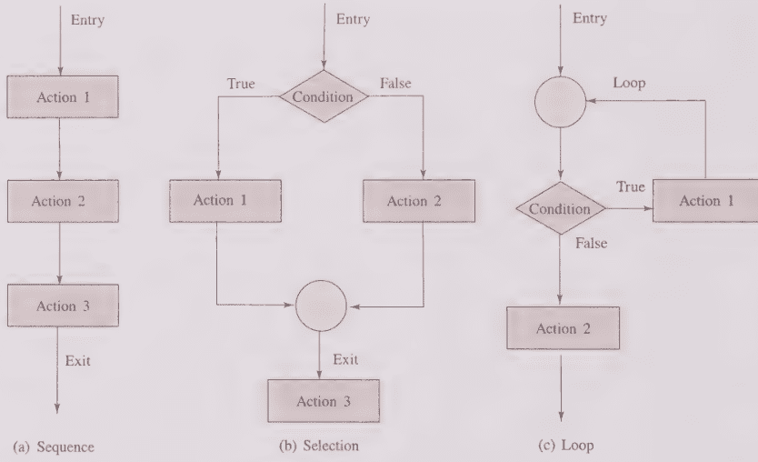

图 3.4 基本控制结构

重要的是要理解，所有程序处理都可以用仅这三种逻辑结构来编码。使用一个或多个这些基本控制构造进行编程的方法称为结构化编程，是软件工程中的重要技术。

使用这三种基本构造，我们可以按详细或概要形式表示函数结构，如图 3.5 (a)、(b) 和 (c) 所示。

像 C 一样，C++ 也支持全部三种基本控制结构，并使用各种控制语句实现，如图 3.6 所示。这表明 C++ 将结构化编程的强大功能与面向对象范式结合起来。

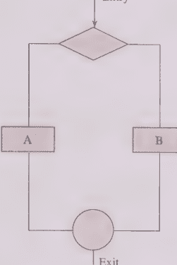

(a) 第一级抽象

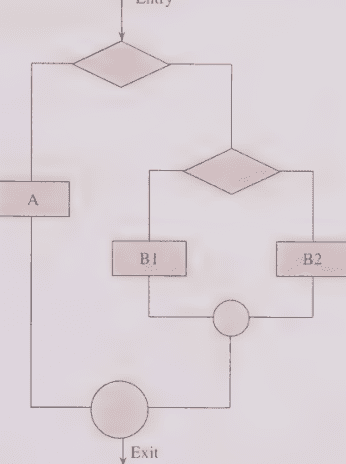

(b) 第二级抽象

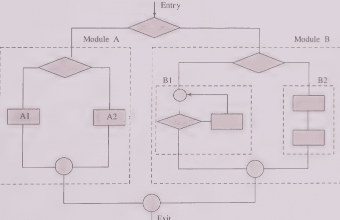

(c) 详细流程图

图 3.5 不同抽象级别

## 面向对象 C++ 编程

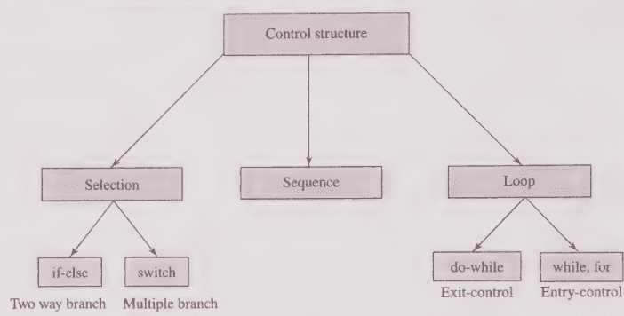

**图 3.6** C++ 语句以两种形式实现

### if 语句

`if` 语句以两种形式实现：

- 简单 `if` 语句

- `if...else` 语句

示例：

Form 1

```
if(expression is true)
{
    action1;
}
action2;
action3;
```

Form 2

```
if(expression is true)
{
    action1;
}
else
{
    action2;
}
action3;
```

### switch 语句

这是一个多分支语句，基于条件，控制转移到多个可能点之一。

实现如下：

```
switch(expression) {
  case1:
{
    action1;
  }
  case2:
{
    action2;
  }
  case3:
{
    action3;
  }
  default:
{
    action4;
  }
}
action5;
```

### do-while 语句

`do-while` 是一个出口控制循环。基于条件，控制转移回程序中的特定点。语法如下：

```
do
{
  action1;
} while(condition is true);
action2;
```

### while 语句

这也是一个循环结构，但是一个入口控制的。语法如下：

```
while(condition is true)
{
  action1;
}
action2;
```


### for 语句

`for` 是一个入口控制循环，当需要重复执行某动作预定次数时使用。语法如下：

```
for(initial value; test; increment)
{
  action1;
}
action2;
```

## 面向对象 C++ 编程

C++ 控制语句的语法与 C 非常相似，因此它们在需要时按需实现。

## 摘要

- C++ 提供各种类型的标记，包括关键字、标识符、常量、字符串和运算符。
- 标识符指的是变量、函数、数组、类等的名称。
- C++ 对 `void` 的额外用途，用于声明通用指针。
- 枚举数据类型在 C++ 中略有不同。枚举数据类型的标签名成为新的类型名。也就是说，我们使用这些标签名声明新变量。
- 在 C++ 中，字符数组的大小应比字符串中字符数大一。
- C++ 增加了常量指针和指向常量的指针的概念。对于常量指针，我们不能修改指针被初始化为的地址。对于指向常量的指针，其内容不能被更改。
- 指针在 C++ 中被广泛用于内存管理和实现多态。
- C++ 提供限定符 `const` 来声明命名常量，它们就像变量一样，只是其值不能被更改。
- C 对变量检查非常严格。它不允许对两种不同数据类型的变量进行相等比较。打破此规则的唯一方法是类型转换。
- C++ 允许在程序的任何位置声明变量，也允许在声明处使用表达式在运行时进行初始化。
- 引用变量为先前定义的变量提供替代名称。两个变量都引用内存中的同一数据对象。因此，更改其中一个的值也会反映在另一个的值中。
- 引用变量必须在声明时初始化，这建立了引用与其命名的对象之间的对应关系。
- 作用域解析 `::` 运算符的主要应用之一是在类中标识成员函数所属的类。
- 除了 `malloc()`、`free()` 函数外，C++ 还提供两个一元运算符 `new` 和 `delete` 以更好地、更简便地执行分配和释放内存的任务。
- C++ 还提供操纵符来格式化数据显示。最常用的操纵符是 `endl` 和 `setw`。
- C++ 支持七种类型的表达式。当表达式中混合数据类型时，C++ 使用某些规则自动进行转换。
- C++ 也允许使用类型运算符对变量和表达式进行显式类型转换。
- 像 C 一样，C++ 也支持三种基本控制结构，即顺序、选择和循环，并使用各种控制语句实现它们，如 `if...else`、`switch`、`do...while`、`while` 和 `for`。

## 关键术语

`array` | `associativity` | `automatic` | `conversion` | `backlash` | `character` | `bitwise expression` | `bool` | `boolean expression` | `branching` | `call by reference` | `calloc()` | `character constant chained assignment` | `class` | `compound assignment` | `compound expression` | `const` | `constant expression control structure` | `types` | `decimal integer` | `declaration` | `delete` | `dereferencing` | `derived-type` | `do...while` | `embedded assignment` | `end entry control` | `enum exit control` | `explicit conversion` | `float expression floating point integers` | `for` | `formatting` | `free` | `free()` | `hexadecimal identifier` | `if` | `if...else` | `implicit conversion` | `initialization` | `const expression` | `integral widening` | `iteration` | `keyword` | `logical expression` | `loop` | `loop structure` | `malloc()` | `manipulator` | `memory` | `named constant` | `new` | `integer` | `operator` | `operator keywords` | `operator overloading` | `precedence` | `pointer` | `pointer expression` | `pointer variable` | `reference` | `relational variable` | `relational expression` | `repetition` | `scope resolution` | `selection` | `selection structure` | `sequence` | `sequence structure` | `setw` | `short-hand assignment` | `sizeof()` | `straight line` | `string` | `string constant` | `struct` | `structured programming` | `switch` | `symbolic constant` | `token` | `type casting` | `type compatibility` | `typedef` | `union` | `user-defined type` | `void` | `water-fall model` | `wchar_t` | `while` | `wide-character`

## 复习问题

### 认知领域

- 3.1 拆解 C++ 中命名变量的规则并与 ANSI C 规则进行比较。
- 3.2 论证 `unsigned int` 可以是 `signed int` 的两倍大。
- 3.3 安排 C++ 的类型修饰符。
- 3.4 发现 `void` 数据类型在 C++ 中的应用。
- 3.5 区分 ANSI C 和 C++ 中 `enum` 数据类型的实现差异。
- 3.6 论证数组为何可称为派生数据类型。
- 3.7 论证 `const` 最初取自 C++ 并以不同方式并入 ANSI C。
- 3.8 比较 `const` 定义常量与 `#define` 预处理器定义语句。
- 3.9 用合适的例子解释变量的动态初始化。
- 3.10 复习引用变量。也推断其主要用途。
- 3.11 列出 C++ 增加的四种有助于 OOP 的新运算符。
- 3.12 显示作用域解析运算符 `::` 在 C++ 中的应用。
- 3.13 阐述使用 `new` 运算符相比 `malloc()` 函数的优点。
- 3.14 概述操纵符如何用于控制浮点数的精度并给出合适的例子。

### 使用 C++ 进行面向对象编程

3.15 用合适的示例说明 `setw` 操纵符的工作原理。

+ 3.16 对比以下语句：

(a) `char * const p;`

(b) `char const *p;`

### 情感领域

3.17 论证是否可以将 `void` 指针赋给 `int` 类型指针，并说明如何实现。

3.18 举例说明枚举数据类型的使用。

3.19 论证用于存储字符串的字符数组的大小应比字符串中字符数大一。

3.20 在 C++ 中，变量可以在作用域内的任何位置声明。论证此特性的意义。

## 图例

+ 精确度 评价/回应/组织 应用 记忆 理解

## 调试练习

### 3.1 识别以下程序中的错误：

```
#include <iostream>
using namespace std;
int main() {
    int num[]={1,2,3,4,5,6};
    num[1]===[1]num ? cout<<"Success" : cout<<"Error";
    return 1;
}
```

### 3.2 识别以下程序中的错误：

```
#include <iostream>
using namespace std;
#define pi 3.14
int squareArea(int &)
int circleArea(int &)
int main() {
    int a=10;
    cout << squareArea(a) << " ";
    cout << circleArea(a) << " ";
    cout << a << endl;
```

```
return 1;
int squareArea(int &a)
{
    return a *= a;
}
int circleArea(int &r)
{
    return r = pi * r * r;
}
```

### 3.3 识别以下程序中的错误：

```
#include <iostream>

char* allocateMemory();
int main() {
    char* str;
    str = allocateMemory();
    cout << str;
    delete str;
    str = " ";
    cout << str;
    return 1;
}
char* allocateMemory() {
    str = "Memory allocation test, ";
    return str;
}
```

### 3.4 找出以下 C++ 语句中是否存在错误：

+ (a) `long float x;`

(b) `char *cp = vp;` // `vp` is a void pointer

(c) `int code = three;` // `three` is an enumerator

(d) `int *p = new;` // allocate memory with new

(e) `enum (green, yellow, red);`

(f) `int const *p = total;`

(g) `const int array_size;`

(h) `for (i=1; i<10; i++) cout << i << "\n";`

(i) `int &number = 100;`

(j) `float *p = new int[10];`

(k) `int public = 1000;`

(l) `char name[3] = "USA"`

## 使用 C++ 进行面向对象编程

## 试运行练习

### 3.1 运行以下程序时会发生什么？

```
#include <iostream>
using namespace std;
int main()
{
    int i=5;
    while(i)
    {
        switch(i)
        {
            default:
            case 4:
            case 5:
                break;
            case 1:
                continue;
            case 2:
            case 3:
                break;
        }
        i --;
    }
    return 1;
}
```

### 3.2 运行以下程序时会发生什么？

```
#include <iostream>
using namespace std;
int main()
{
    int i=0;
    i=400*400/400;
    cout << i;
    return 1;
}
```

### 3.3 运行以下程序时会发生什么？

```
#include <iostream>
using namespace std;
int main()
{
    char c;
    for(c=0; c<256; c++)
        cout<<c<<endl;
    return 1;
}
```

### 运行以下程序时会发生什么？

```
#include <iostream>
using namespace std;

int main()
{
    float a=12.2;
    if (a==12.2)
        cout<<"equal";
    else cout<<"not equal";
    return 1;
}
```

## 编程练习

+ 3.1 编写一个使用引用变量作为参数的函数来交换一对整数的值。
+ 3.2 编写一个使用 `new` 运算符创建用户定义大小为 M 的向量的函数。
+ 3.3 编写一个程序打印以下循环输出。

1

22

333

4444

55555

.....

+ 3.4 编写一个程序来评估投资方程

`V=P(1+r)^n`

并打印表格，给出 P、r 和 n 的各种组合下 V 的值

P: 1000, 2000, 3000, ..., 10000

r: 0.10, 0.11, 0.12, ..., 0.20

n: 1, 2, 3, ..., 10

提示：P 是本金，V 是 n 年末的货币价值。该方程可以递归写为

`V=P(1+r)`

`V=P`

换句话说，货币在第一年末的价值成为下一年的本金，依此类推。

+ 3.5 一场选举由五名候选人竞争。候选人编号为 1 到 5，投票是通过在选票上标记候选人编号来进行的。编写一个程序读取选票并使用数组变量 `count` 统计每个候选人获得的票数。如果读入的数字超出 1 到 5 的范围，则该选票应视为“废票”，程序还应统计废票的数量。

## 使用 C++ 进行面向对象编程

3.6 板球队有一系列测试比赛的击球数据表：

| 球员姓名 | 得分 | 局数 | 未出局次数 |
|---|---|---|---|
| Sachin | 8430 | 230 | 18 |
| Saurav | 4200 | 130 | 9 |
| Rahul | 3350 | 105 | 11 |

编写一个程序读取上述形式的数据，计算击球平均分并打印出包含平均分的完整表格。

3.7 编写程序以 0.001% 的精度评估以下函数。

+ (a) $\sin x = x - \frac{x^3}{3!} + \frac{x^5}{5!} - \dots$
(b) $SUM = 1 + \frac{(1/2)^2}{2!} + \frac{(1/3)^3}{3!} + \dots$
(c) $\cos x = 1 - \frac{x^2}{2!} + \frac{x^4}{4!} - \frac{x^6}{6!} + \dots$

3.8 编写一个程序打印函数 $y = e^{-x}$ 的值表，$x$ 从 0 到 10 以 0.1 为步长变化。表格应如下所示。

|  | 0.1 | 0.2 | 0.3 | 0.4 | 0.5 | 0.6 | 0.7 | 0.8 | 0.9 |
|---|---|---|---|---|---|---|---|---|---|
| 0.0 |  |  |  |  |  |  |  |  |  |
| 1.0 |  |  |  |  |  |  |  |  |  |
|  |  |  |  |  |  |  |  |  |  |
| 9.0 |  |  |  |  |  |  |  |  |  |

3.9 编写一个程序计算 $N$ 个数的方差和标准差。

> $Variance = \frac{1}{N} \sum_{i=1}^{N} (x_i - \bar{x})^2$

Standard Deviation = \sqrt{\frac{1}{N} \sum_{i=1}^{N} (x_i - \bar{x})^2}

其中 $\bar{x} = \frac{1}{N} \sum_{i=1}^{N} x_i$

3.10 电力局对家庭用户收取以下电费以遏制能源的大量消耗：

+ - 前 100 单位 - 每单位 60P
- 接下来的 200 单位 - 每单位 80P
- 超过 300 单位 - 每单位 90P

所有用户最低收取 Rs. 50.00。如果总金额超过 Rs. 300.00，则额外加收 15% 的附加费。

编写一个程序读取用户姓名和消耗的电量并打印出带姓名的费用。


## 多项选择题

选择以下问题的最合适的答案：

+ 1. ______ 不是有效的关键字。

(a) `this`

(b) `that`

(c) `public`

(d) `private`

+ 2. 选择有效的标识符

(a) `1_ram`

(b) `friend`

(c) `dis&r`

(d) `shiv_5`

+ 3. 以下哪个不是常量？

(a) `123`

(b) `123.00`

(c) `'123'`

(d) `"123"`

+ 4. `long double` 的大小是

(a) 4 字节

(b) 10 字节

(c) 8 字节

(d) 16 字节

+ 5. `void *sat;`

`int *jan;`

以下哪个是上述定义的合法赋值？

(a) `sat = jan`

(b) `*jan = *sat`

(c) `sat = *jan`

(d) `*sat = jan`

+ 6. 以下哪个不是结构和联合之间的有效区别？

(a) `struct` 和 `union` 关键字

(b) 不同的和共同的内存分配

(c) 两者都节省内存

(d) 成员大小之和和最大值

+ 7. 哪个存储类使用栈作为存储？

(a) `auto`

(b) `extern`

(c) `static`

(d) `register`

+ 8. 以下哪个/哪些是 `const` 的不正确使用？

(a) `const xyz`

(b) `const xyz=10`

(c) `const int xyz=10`

(d) `const long short xyz`

+ 9. 找到无效的变量声明。

(a) `int`

(b) `typedef int type`

(c) `typedef type ab`

(d) `enum ab(a,b,c)`

+ 10. 指出 C++ 中关于引用的不相关点。

(a) 不可能有空引用。

(b) 引用初始化为对象的初始化在函数中不能更改为另一个对象

(c) 引用必须在创建时初始化。

(d) 引用与 C 中的指针相同。


+ 11. `\_\_\_\_\_\_\_\_` 不是 C++ 中的有效运算符。

(a) `::`

(b) `::*`

(c) `endI`

(d) `setw`

+ 12. 作用域解析运算符指的是

(a) 静态变量

(b) 全局变量

(c) 动态变量

(d) 局部变量

+ 13. 运算符 `new` 和 `delete` 也被称为

(a) 免费存储运算符

(b) 二元运算符

+ (c) 运算符

+ (d) 逻辑运算符

14. 以下哪个不是 C++ 中的强制类型转换运算符？

+ (a) `const`

+ (b) `interpret`

+ (c) `static`

+ (d) `dynamic`

15. 选择错误的赋值表达式：

+ (a) `p=(q=r=60)+20`

+ (b) `p=(q+10)`

+ (c) `p=(q=10)`

+ (d) `p+=(-10)`

# 4 C++ 中的函数

## 学习目标

阅读本章后，你将能够

- 描述 C++ 程序中 `main()` 函数的用法
- 解释函数原型
- 区分传引用调用和返回引用机制
- 讨论内联函数
- 确定默认参数如何与函数一起使用
- 通过示例解释递归
- 演示函数重载在 C++ 程序中的使用
- 列出各种匹配库函数

### 4.1 引言

我们知道函数在 C 程序开发中起着重要作用。将程序划分为函数是自顶向下结构化编程的主要原则之一。使用函数的另一个优点是，可以通过在程序的不同位置调用和使用它们来减小程序的大小。

回想一下，我们在开发 C 程序时使用了类似以下的语法。

```
void show();                    /* Function declaration */
main()
{
    show();                      /* Function call */
    ....
}
void show()
{
    /* Function definition */
    ....
    /* Function body */
    ....
}
```

面向对象编程与 C++

当函数被调用时，控制权转移到函数体中的第一条语句。然后执行函数体中的其他语句，并在遇到闭合大括号时控制权返回到主程序。C++ 也不例外。函数仍然是 C++ 程序的构建块。事实上，C++ 增加了许多新特性，使其更可靠、更灵活。像 C++ 运算符一样，C++ 函数可以被重载，使其根据传递给它的参数执行不同的任务。其中大多数修改都是为了满足面向对象设施的要求。

在本章中，我们将简要讨论添加到 C++ 函数的各种新特性和其实现。

### 4.2 主函数

C 并未为 `main()` 函数指定任何返回类型，而 `main()` 函数是程序执行的起点。`main()` 的定义看起来像这样：

```
main()
{
    // main program statements
}
```

这是完全有效的，因为 C 中的 `main()` 不返回任何值。

在 C++ 中，`main()` 向操作系统返回 `int` 值。因此，C++ 明确将 `main()` 定义为匹配以下原型之一：

```
int main()
int main(int argc, char * argv[])
```

具有返回值 的函数应使用 `return` 语句终止。因此，C++ 中的 `main()` 函数定义如下：

```
int main()
{
    ...
    ...
    return 0;
}
```

由于函数的返回类型默认为 `int`，`main()` 头部中的关键字是可选的。大多数 C++ 编译器如果没有 `return` 语句会生成错误或警告。Turbo C++ 会发出警告

Function should return a value

然后继续编译程序。实际从 `main()` 返回一个值是良好的编程实践。

许多操作系统会测试返回值（退出值）以确定是否存在问题。通常的约定是，零的退出值意味着程序成功运行，而非零值意味着存在问题。显式使用 `return(0)` 语句将表明程序已成功执行。

### 4.3 函数原型

函数原型是添加到 C++ 函数的主要改进之一。原型通过给出参数的数量和类型以及返回值的类型等细节，向编译器描述函数接口。有了函数原型，声明和定义函数时始终使用模板。当函数被调用时，编译器使用模板来确保传递了正确的参数，并且返回值得到正确处理。任何参数或返回类型的违规都会在编译时被编译器捕获。这些检查和控制在传统的 C 函数中不存在。

记住，C 也使用原型。但它是由 Stroustrup 在 C++ 中引入的，而该特性的成功促使 ANSI C 委员会采纳了它。然而，C 和 C++ 之间的原型存在一个主要区别。虽然 C++ 使原型成为必需，ANSI C 使其成为可选的，也许是为了保持与经典 C 的兼容性。

函数原型是在调用程序中的声明语句，其形式如下之一：

```
type function-name (argument-list);
```

`argument-list` 包含必须传递给函数的参数的类型和名称。

示例：

```
float volume(int x, float y, float z);
```

请注意，每个参数变量必须在括号内独立声明。也就是说，像这样的组合声明

```
float volume(int x, float y, z);
```

是非法的。

在函数声明中，参数的名称是虚拟变量，因此它们是可选的。也就是说，

```
float volume(int, float, float);
```

在声明处是可以接受的。在此阶段，编译器仅在函数被调用时检查参数的类型。

通常，我们可以在函数原型的参数列表中包含或排除变量名。原型中的变量名充当占位符，因此，如果使用名称，它们不必与函数调用或函数定义中使用的名称匹配。

在函数定义中，名称是必需的，因为函数内部必须引用参数。

示例：

```
float volume(int a, float b, float c)
{
  float v = a*b*c;
}
```

面向对象编程与 C++

函数 `volume()` 可以按如下方式调用：

```
float cubel = volume(bl,wl,h1); // Function call
```

变量 `bl`、`wl` 和 `h1` 被称为实际参数，它们指定 `cubel` 的尺寸。它们的类型（已在之前声明）应与原型中声明的类型匹配。记住，调用语句不应在参数列表中包含类型名称。

我们也可以声明一个空参数列表的函数，如以下示例所示：

```
void display( );
```

在 C++ 中，这意味着函数不传递任何参数。它等同于语句

```
void display(void);
```

然而，在 C 中，空括号意味着任意数量的参数。也就是说，我们放弃了原型。C 函数也可以通过在原型中使用省略号来具有“开放”参数列表，如下所示：

```
void do_something ( list_of_arguments, ... );
```

使用省略号的函数在 `list_of_arguments` 中提供一个或多个声明的参数。使用此类支持可变数量参数的函数需要包含头文件 `"cstdarg"`。以下程序演示了使用可变参数列表的函数：

```
#include <iostream>
#include <cstdarg>
using namespace std;
int findmaximum(int count, ...)
{
int max, value;
va_list list;//declare variable argument list
va_start(list, count);//start accessing variable list
max = va_arg(list, int);//extract the first element of list
for (int arg = 1; arg < count; ++arg){
value = va_arg(list, int);//extract each successive element from list
if (max < value)
max = value;
}
va_end(list); //end the access of the variable argument list
return max;
}
int main()
{
cout << findmaximum(5, 14, 15, 12, 13, 10) << endl;
cout << findmaximum(3, 10, 11, 12) << endl;
return max;
}
```

此程序的输出为：

15

12

在此程序中，变量列表中的元素通过 `"va_arg (list, int)"` 访问。它指定了预期参数的类型（在本例中为 `int`）。然而，请注意，编译器无法检查参数列表的类型。让我们考虑以下情况：

```
int main() {
    cout << findmaximum(5, 14.0, "Hello", 13, 10) << endl;
    cout << findmaximum(3, 10, 3.5, 12) << endl;
    return 1;
}
```

上述函数调用通过了编译器的测试，不会产生任何错误。然而，运行时会输出以下内容：

1076625408

1074528256

上述意外输出是由于列表中存在异构类型的参数。`va_arg` 调用从列表中返回一个 4 字节序列，因为我们已指定预期参数的类型为整数。编译器不执行类型检查。因此，此类函数应极其谨慎使用。

### 4.4 传引用调用

在 C 中，函数按值传递参数。被调用函数创建一组新的变量并将参数的值复制到其中。函数无法访问调用程序中的实际变量，只能操作值的副本。调用程序中的原始变量。但可能出现需要更改调用程序中变量值的情况。例如，在冒泡排序中，我们比较列表中相邻的两个元素，如果第一个元素大于第二个元素则交换它们的值。如果使用函数进行冒泡排序，它应该能够更改调用函数中变量的值，而按值调用方法无法实现。

C++ 中引用变量的提供使我们能够按引用向函数传递参数。当我们按引用传递参数时，被调用函数中的“形式”参数成为调用函数中“实际”参数的别名。这意味着当函数操作自己的参数时，它实际上是在操作原始数据。让我们考虑以下情况：

```
void swap(int &a,int &b) // a and b are reference variables
{
    int t = a;
    a = b; // Dynamic initialization
    b = t;
}
```

现在，如果 `m` 和 `n` 是两个整数变量，则函数调用

```
swap(m, n);
```

将使用其别名（引用变量）`a` 和 `b` 交换 `m` 和 `n` 的值。在传统的 C 语言中，这是通过指针和间接寻址实现的，如下所示：

```
void swapl1(int *a, int *b) /* Function definition */
{
    int t;
    t = *a; /* assign the value at address a to t */
    *a = *b; /* put the value at b into a */
    *b = t; /* put the value t into b */
}
```

该函数可以按如下方式调用：

```
swapl(&x, &y); /* call by passing */
             /* addresses of variables */
```

这种方法在 C++ 中也是可以接受的。注意，按引用调用的方法在方法上更简洁。

### 4.5 RETURN BY REFERENCE

函数也可以返回引用。考虑以下函数：

```
int & max(int &x, int &y)
{
    if (x > y)
        return x;
    else
        return y;
}
```

由于 `max(x)` 的返回类型为 `int&`，函数返回 `x` 或 `y` 的引用（而不是值）。然后像 `max(a,b)` 这样的函数调用将产生对 `a` 或 `b` 的引用，具体取决于它们的值。这意味着此函数调用可以出现在赋值语句的左侧。也就是说，

```
max(a,b) = -1;
```

是合法的，如果 `a` 更大则将 `-1` 赋给 `a`，否则将 `-1` 赋给 `b`。

> 函数不应被制作为返回自动变量（作用域在函数内）的引用。这将导致编译器发出警告。

### 4.6 INLINE FUNCTIONS

使用函数编程的一个目标是节省一些内存空间，当函数可能被多次调用时，这种节省是可观的。然而，每次调用函数时，都需要花费大量额外时间来执行一系列指令，例如跳转到函数、保存寄存器、将参数压入栈以及返回调用函数。当函数很小时，相当一部分执行时间可能花费在这些开销上。

解决此问题的一种方案是使用宏定义，流行地称为宏。预处理器宏在 C 中很流行。宏的主要缺点是它们并不是真正的函数，因此在编译期间通常的错误检查不会发生。

C++ 对此问题有不同的解决方案。为了消除对小型函数的调用成本，C++ 提出了一种称为内联函数的新特性。内联函数是在调用时进行内联展开的函数。编译器用相应的函数代码替换函数调用（类似于宏展开）。内联函数定义如下：

```
inline function-header
{
  function body
}
```

示例：

```
inline double cube(double a)
{
  return(a*a*a);
}
```

上述内联函数可以通过以下语句调用

```
c = cube(3.0);
d = cube(2.5+1.5);
```

执行这些语句后，`c` 和 `d` 的值将分别为 27 和 64。如果参数为 2.5 + 1.5，函数会传递表达式的值。此例中为 4。这使得内联特性优于宏。

使函数内联很容易。我们只需在函数定义前加上 `inline` 关键字即可。所有内联函数必须在被调用前定义。

在使函数内联之前应谨慎行事。随着函数大小的增长，内联函数的速度优势会减弱。到了某个点，函数调用的开销变得小于函数执行的开销，内联函数的优势可能会丧失。在这种情况下，使用普通函数更有意义。通常，当函数足够小，可以在一两行内定义时，才会将其设为内联。

```
inline double cube(double a) {return(a*a*a);}
```

请记住，`inline` 关键字仅向编译器发送请求，而不是命令。如果函数定义过长或过于复杂，编译器可能会忽略此请求并将函数编译为普通函数。

内联展开可能不工作的一些情况是：

- 1. 对于返回值的函数，如果存在循环、`switch` 或 `goto`。
- 2. 对于不返回值 的函数，如果存在 `return` 语句。
- 3. 如果函数包含静态变量。
- 4. 如果内联宏是递归的。

## Object-Oriented Programming with C++

内联展开使程序运行更快，因为消除了函数调用和返回的开销。然而，它使程序占用更多内存，因为定义内联函数的语句会在每次调用函数的地方被复制。因此，需要权衡。

Note

Program 4.1 说明了内联函数的使用。

### Program 4.1 Inline Functions

```
#include <iostream>

using namespace std;

inline float mul(float x, float y)
{
    return(x*y);
}

inline double div(double p, double q)
{
    return(p/q);
}

int main()
{
    float a = 12.345;
    float b = 9.82;

    cout << mul(a,b) << "\n";
    cout << div(a,b) << "\n";

    return 0;
}
```

Program 4.1 的输出为：

121.228

1.2571

> LIMITATION

内联函数可能会使函数大小增加到无法放入缓存的程度。

### 4.7 DEFAULT ARGUMENTS

C++ 允许我们在不指定其所有参数的情况下调用函数。在这种情况下，函数会为在函数调用中没有匹配参数的参数分配默认值。默认值在函数声明时指定。编译器查看原型以查看函数使用多少参数，并提醒程序可能存在默认值。以下是具有默认值的原型的示例：

### 83

Functions in C++

```
float amount(float principal, int period, float rate=0.15);
```

默认值以与变量初始化在语法上相似的方式指定。上述原型为参数 `rate` 声明了默认值 0.15。随后像

```
value = amount(5000, ?); // one argument missing
```

这样的函数调用会将 5000 的值传递给 `principal`，将 7 传递给 `period`，然后函数使用 `rate` 的默认值 0.15。

```
value = amount(5000, 5, 0.12); // no missing argument
```

会将 0.12 的显式值传递给 `rate`。

默认参数在声明时检查，在调用时求值。一个重要点是，只有尾部参数可以有默认值，我们必须从右到左添加默认值。我们不能为参数列表中间的特定参数提供默认值。以下是具有默认值的函数声明的一些示例：

```
int mul(int i, int j=5, int k=10); // legal
int mul(int i=5, int j); // illegal
int mul(int i=0, int j, int k=10); // illegal
int mul(int i=2, int j=5, int k=10); // illegal
```


提供默认参数在参数始终具有相同值的情况下很有用。例如，银行利息在存款的特定期间内可能对所有客户都相同。它还为程序员提供了更大的灵活性。函数可以用比其最常见应用所需的更多参数编写。使用默认参数，程序员只能使用对特定情况有意义的参数。`Program 4.2` 说明了默认参数的使用。

### Program 4.2 Default Arguments

```
#include<iostream>

using namespace std;
int main()
{
    float amount;
    float value(float p, int n, float r=0.15); //prototype
    void printline(char ch='*', int len=40); //prototype

    printline(); //use default values for arguments

    amount = value(5000.0,5); //default for 3rd argument
    cout<<"\n Final Value = "<<amount<<"\n\n";

    amount = value(10000.0,5,0.30); //pass all arguments explicitly

    cout<<"\n Final Value = "<<amount<<"\n\n";
}
```

(Contd.)

## Object-Oriented Programming with C++

```
printline('=');      //use default value for second argument
return 0;

float value (float p, int n, float r)
{
    int year = 1;
    float sum = p;

    while (year<=n){
        sum = sum*(1+r);
        year = year+1;
        return(sum);
    }
}
void printline(char ch, int len)
{
    for (int i=1;i<=len;i++)
        printf("%c", ch);
    printf("\n\n");
}
```

`Program 4.2` 的输出为：

***********************************

Final Value = 10056.8

Final Value = 37129.3

***********************************

提供默认参数的优点是：

- 1. 我们可以使用默认参数为现有函数添加新参数。
- 2. 默认参数可用于将相似函数合并为一个。

### 4.8 const ARGUMENTS

在 C++ 中，函数的参数可以声明为 `const`，如下所示。

```
int strlen(const char *p);
int length(const string &s);
```

限定符 `const` 告诉编译器函数不应修改参数。当此条件被违反时，编译器会生成错误。这种声明只有在我们通过引用或指针传递参数时才有意义。

### 4.9 递归

递归是指一个函数调用自身的情况，即函数定义中的某个语句对包含它的同一个函数进行了调用。它听起来像是无限循环的条件，但正如循环有一个条件检查来将程序控制移出循环一样，递归函数也拥有一个基例，该基例将程序控制从函数的当前实例返回，以便回调调用函数。例如，在一系列递归调用中，计算一个数的阶乘时，基例将是需要计算 0 的阶乘的情况。让我们考虑几个例子（程序 4.3 和 4.4）来理解递归方法的工作原理。

程序 4.3 计算一个数的阶乘

```
#include <iostream>
using namespace std;
long fact(int n)
{
    if (n == 0)           //base case
    return 1;
    return (n * fact(n-1)); //recursive function call
}
int main()
{
    int num;
    cout << "Enter a positive integer: ";
    cin >> num;
    cout << "Factorial of " << num << " is " << fact(num);
    return 0;
}
```

程序 4.3 的输出为：

Enter a positive integer: 10

Factorial of 10 is 3628800

程序 4.4 求解汉诺塔问题

```
#include <iostream>
using namespace std;
void TOH(int d, char tower1, char tower2, char tower3)
 if (d==1) //base case
{
    cout << "\nShift top disk from tower " << tower1 << " to tower "
    << tower2;
    return;
}
TOH(d-1,tower1,tower3,tower2);//recursive function call
cout << "\nShift top disk from tower " << tower1 << " to tower "
    << tower2;

TOH(d-1,tower3,tower2,tower1);//recursive function call
}

int main()
{
    int disk;

    cout << "Enter the number of disks: ";
    cin >> disk;

    if (disk < 1)
        cout << "\nThere are no disks to shift";
    else
        cout << "\nThere are " << disk << " disks in tower 1\n";

    TOH(disk,'1','2','3');
    cout << "\n\n" << disk << " disks in tower 1 are shifted to
    tower 2";

    return 0;
}
```

程序 4.4 的输出为：

Enter the number of disks: 3

There are 3 disks in tower 1

Shift top disk from tower 1 to tower 2

Shift top disk from tower 1 to tower 3

Shift top disk from tower 2 to tower 3

Shift top disk from tower 1 to tower 2

Shift top disk from tower 3 to tower 1

Shift top disk from tower 3 to tower 2

Shift top disk from tower 1 to tower 2

3 disks in tower 1 are shifted to tower 2

### 4.10 函数重载

如前所述，重载是指对同一事物用于不同目的。C++ 也允许函数重载。这意味着我们可以使用相同的函数名创建执行多种不同任务的函数。这被称为函数多态 OOP

使用函数重载的概念，我们可以设计一个函数族，具有一个函数名但参数不同。函数将根据函数类型中的参数列表执行不同的操作。要调用的正确函数是通过检查参数的数量和类型而不是函数类型来确定的。例如，重载的 `add()` 处理不同类型的数据如下：

```
// Declarations
int add(int a, int b);           // prototype 1
int add(int a, int b, int c);     // prototype 2
double add(double x, double y);   // prototype 3
double add(int p, double q);      // prototype 4
double add(double p, int q);     // prototype 5
```

```
// Function calls
cout << add(5, 10);               // uses prototype 1
cout << add(15, 10.0);             // uses prototype 4
cout << add(12.5, 7.5);             // uses prototype 3
cout << add(5, 10, 15);            // uses prototype 2
cout << add(0.75, 5);              // uses prototype 5
```

调用首先匹配具有相同数量和类型参数的原型，然后调用适当的函数执行。最佳匹配必须是唯一的。函数选择涉及以下步骤：

- 1. 编译器首先尝试找到精确匹配，其中实际参数的类型相同，并使用该函数。
- 2. 如果找不到精确匹配，编译器会使用对实际参数的积分提升，例如，

```
char to int
float to double
```

来找到匹配。
- 3. 当两者都失败时，编译器会尝试使用内置转换（隐式赋值转换）对实际参数进行转换，然后使用匹配唯一的函数。如果转换可能导致多个匹配，则编译器将生成错误消息。假设我们使用以下两个函数：

```
long square(long n)
double square(double x)
```

函数调用例如

```
square(10)
```

将导致错误，因为 `int` 可以转换为 `long` 或 `double`，从而造成关于应使用 `square()` 的哪个版本的不明确情况。
- 4. 如果所有步骤都失败，编译器将尝试用户定义的转换结合积分提升和内置转换来找到唯一的匹配。用户定义的转换通常用于处理类对象。

# 使用 C++ 的面向对象编程

程序 4.5 说明了函数重载。

### 程序 4.5 函数重载

```
//Function area() is overloaded three times
#include<iostream>

//Declaration of Function Prototypes
int area (int);
int area (int, int);
float area (float);

int main() {
    cout << "Calling the area() function for computing the area of a square\n" << (side = 5) << " " << area(5) << "\n";
    cout << "Calling the area() function for computing the area of a rectangle\n" << (length = 5, breadth = 10) << " " << area(5,10) << "\n";
    cout << "Calling the area() function for computing the area of a circle\n" << (radius = 5.5) << " " << area(5.5) << "
";
    return 0;
}

int area (int side) //Area of square {
    return(side*side);
}

int area (int length, int breadth) //Area of rectangle {
    return(length*breadth);
}

float area (float radius) //Area of circle {
    return(3.14*radius*radius);
}
```

程序 4.5 的输出为：

Calling the area() function for computing the area of a square (side = 5) - 25

Calling the area() function for computing the area of a rectangle (length = 5, breadth = 10) - 50

Calling the area() function for computing the area of a circle (radius = 5.5) - 94.99

函数重载应谨慎进行。我们不应重载不相关的函数，而应将函数重载保留给执行密切相关任务的函数。有时，默认参数可代替重载使用。这可减少需要定义的函数数量。

重载函数被广泛用于处理类对象。当在下一章讨论类时，它们将被举例说明。

### 4.11 友元函数和虚函数

C++ 引入了新的函数类型，即友元函数和虚函数。它们基本上是为了处理与类对象相关的某些特定任务而引入的。因此，在讨论对象之后才保留了对这些函数的讨论。友元函数在下一章第 5.15 节中讨论，虚函数在第 9 章第 9.5 节中讨论。

### 4.12 MATH++ 库函数

标准支持可用于执行某些常用计算的数学函数。最常用的数学库函数总结在表 4.1 中。

表 4.1 常用数学库函数

| 函数 | 用途 |
|---|---|
| `ceil(x)` | 将 `x` 舍入到不大于 `x` 的最小整数 `ceil(8.1) = 9.0` 且 `ceil(-8.8) = -8.0` |
| `cos(x)` | `x` 的三角余弦值（`x` 以弧度为单位） |
| `exp(x)` | 指数函数 `e^x`。 |
| `fabs(x)` | `x` 的绝对值。如果 `x>0` 则 `abs(x)` 为 0.0 如果 `x=0` 则 `abs(x)` 为 `-x` |
| `floor(x)` | 将 `x` 舍入到不大于 `x` 的最大整数 `floor(8.2) = 8.0` 且 `floor(-8.8) = -9.0` |
| `log(x)` | `x` 的自然对数（底为 `e`） |
| `log10(x)` | `x` 的对数（底为 10） |
| `pow(x,y)` | `x` 的 `y` 次幂(`x`) |
| `sin(x)` | `x` 的三角正弦值（`x` 以弧度为单位） |
| `sqrt(x)` | `x` 的平方根 |
| `tan(x)` | `x` 的三角正切值（`x` 以弧度为单位） |

> 参数变量 `x` 和 `y` 为 `double` 类型，所有函数都返回数据类型 `double`。

要使用数学库函数，我们必须在传统 C++ 中包含头文件 `math.h`，在 ANSI C++ 中包含 `cmath`。

程序 4.6 演示了数学函数的使用

## 使用 C++ 进行面向对象编程

# 程序 4.6 数学函数的用法

```
#include <iostream>
#include <iomanip>
#include <cmath>

using namespace std;
int main() {
    cout<<fixed<<setprecision(2);
    cout<<"sin (100) = "<<sin(100.00)<<"\n"; //Computing sine value
    cout<<"cos (100) = "<<cos(100.00)<<"\n"; //Computing cosine value
    cout<<"tan (100) = "<<tan(100.00)<<"\n"; //Computing tangent value
    cout<<"7 to the power of 6 = "<<pow(7.0,6.0)<<"\n"; //Computing power of one value raised to the other
    cout<<"log10 (10) = "<<log10(10.00)<<"\n"; //Computing log to the base of 10 value
    cout<<"sqrt (2) = "<<sqrt(2.00)<<"\n"; //Computing the square root of a value

    return 0;
}
```

程序 4.6 的输出为：

```
sin (100) = -0.51
cos (100) = -0.86
tan (100) = 0.59
7 to the power of 6 = 117649.00
log10 (10) = 1.00
sqrt (2) = 1.41
```

## 摘要

- 可以通过在程序的不同位置调用和使用函数来减小程序的大小。
- 在 C++ 中，`main()` 向操作系统返回类型为 `int` 的值。由于函数默认的返回类型为 `int`，如果没有 `return` 语句，`main()` 头部中的关键字 `int` 会发出警告。
- 函数原型为编译器提供了有关函数的详细信息，例如参数的数量和类型以及返回值的返回类型。
- C++ 中的引用变量允许我们通过引用向函数传递参数。函数也可以返回对变量的引用。
- 当函数被声明为 `inline` 时，编译器会用相应的函数代码替换函数调用。通常，将小型函数设为 `inline`。
- 如果函数声明过长或过于复杂，编译器可能会忽略 `inline` 声明，从而将函数作为普通函数完成。
- C++ 允许我们在声明函数时为函数参数分配默认值。在这种情况下，我们可以在不指定其任何参数的情况下调用函数。默认值始终从右到左添加。
- 在 C++ 中，函数的参数可以声明为 `const`，表示函数不应修改该参数。
- C++ 允许函数重载。也就是说，我们可以在程序中拥有多个同名函数。编译器通过检查参数的数量和类型来匹配具有确切函数代码的函数。
- C++ 支持两种类型的函数，即命名友元和虚函数。


- 许多数学计算都可以使用 C++ 标准库支持的库函数进行。

## 关键术语

`actual arguments` | `argument list` | `bubble sort` | `call by reference` | `call by value` | `called function` | `calling program` | `calling statement` | `cmath` | `const` arguments | `declaration statement` | `default arguments` | `default values` | `dummy variables` | `ellipses` | `empty argument list` | `exit value` | `formal arguments` | `friend` functions | `function call` | `function definition` | `function overloading` | `function polymorphism` | `function prototype` | `indirection` | `inline` | `inline functions` | `macros` | `main()` | `mathlibrary` | `math.h` | `overloading` | `pointers` | `polymorphism` | `prototyping` | `reference variable` | `return by reference` | `return` statement | `return type` | `return()` | `template` | `virtual functions`

## 复习问题

### 认知领域

- 4.1 重述编写原型的不同风格。
- 4.2 指出以下函数原型中的错误，如有：
  (a) `float average(x,y);`
  (b) `int mul(int a,b);`
  (c) `int display(void);`
  (d) `void Vect(int &V, int size);`
  (e) `void print(float data[], size = 20);`
- 4.3 指出使用引用而不是指针的最重要优势。
- 4.4 预测在相关理由下何时应将函数设为 `inline`。
- 4.5 在 `inline` 函数和预处理器宏之间进行区分。
- 4.6 论述在函数中使用默认参数的必要性。

### 使用 C++ 进行面向对象编程

4.7 表达函数声明中空括号的意义。
4.8 重述函数重载。并结合合适的示例说明何时使用这一概念。
4.9 表达实现函数重载的方法。当编译器区分具有相同名称的一组重载函数时，其条件是什么？

### 情感领域

4.10 为以下陈述的正确性辩护：
- (a) 函数参数是由函数返回给调用程序的值。
- (b) 当按值传递参数时，函数使用调用程序中的原始参数进行工作。
- (c) 当函数返回值时，整个函数调用可以分配给变量。
- (d) 函数可以按引用返回值。
- (e) 当参数按引用传递时，调用程序中会创建一个临时变量来保存参数值。
- (f) 在函数原型中不必指定变量名。

4.11 确认按引用传递参数的主要优势。
4.12 综合以下函数定义：

```
(a) int *f( )
{
    int m = 1;
    ...
    return(&m);
}
```

```
(b) double f( )
{
    ...
    return(1);
}
```

```
(c) int & f( )
{
    int n = 10;
    ...
    return(n);
}
```

## 图例

Precision Valuing/Responding/Organizing Applying Remembering Understanding

## 调试练习

4.1 识别以下程序中的错误：

```
#include <iostream>
using namespace std;
int sub(int a=20, int b)
{
    int result;
    result = a - b;
    return result;
}
int main() {
    int a = 100;
    int b = 200;
    int result;
    result = sub(b);
    cout << "value 1 : " << result;
    result = sub(a);
    cout << " value 2 :" << result;
    return 0;
}
```

4.2 识别以下程序段中的错误：

```
int main() {
{
    int a = 2;
    float b = 2.5;
    int show(a);
    float show(b);
    return 0;
}
```

4.3 识别以下程序段中的错误：

```
#include <iostream>
using namespace std;
int p;
int & display();
int main() {
{
    display()=5;
    cout << p ;
    return 0;
}
int & display() {
{
    return 2;
}
```

## 使用 C++ 进行面向对象编程

# 干燥运行练习

4.1 当运行以下程序时会发生什么？

```
#include <iostream>
using namespace std;
int add(int p, int q)
{
    int r;
    r=p+q;
    return r;
}
int main()
{
    int x=7, y=5, z;
    z = add(7,2);
    cout << "Result 1-: " << z << '\\n';
    cout << "Result 2-: " << z + add(7,8) << '\\n';
    cout << "Result 3-: " << add(x,y) << '\\n';
    cout << "Result 4-: " << z << z << '\\n';
}
```

4.2 当以下函数使用 count 的不同值（正值和负值）调用时会发生什么？

```
void fun(int count)
{
    if(count == 0)
        cout <<count;
    else
    {
        cout<<count<<endl;
        fun(--count);
        return;
    }
}
```

4.3 当运行以下程序时会发生什么？

```
#include <iostream>
using namespace std;
int & fun(int &);

int & & fun (int & x)
{
    x++;
    return (x);
}
```

```
int main() {
    int a = 5;
    fun(a) = a;
    cout << a << endl;
    fun(a) = ++a;
    cout << a << endl;
    fun(a) = a++;
    cout << a << endl;
}
```

**4.4** 当运行以下程序时会发生什么？

```
#include <iostream>
Using namespace std;
int main() {
    cout << "Hello" << endl;
    main();
    return 1;
}
```

**4.1** 编写一个函数从键盘读取大小为 `m x n` 的矩阵。
**4.2** 编写一个程序从键盘读取大小为 `m x n` 的矩阵并使用函数在屏幕上显示相同内容。
**4.3** 重写练习 4.2 的程序，使矩阵的行参数成为默认参数。
**4.4** 默认参数的效果可以通过重载来替代实现。用示例讨论。
**4.5** 编写一个宏来获取三个数字中的最大值。
**4.6** 使用内联函数重新做练习 4.5。函数接收值并使用 `main` 程序返回结果。
**4.7** 编写一个函数 `power(r)` 将数字 `m` 提高到幂 `n`。函数对 `m` 采用 `double` 值，对 `n` 采用 `int` 值，并正确返回结果。使用 2 作为 `n` 的默认值，使函数在省略时计算平方。编写一个 `main` 从用户获取 `m` 和 `n` 的值来测试函数。
**4.8** 编写一个执行与练习 4.7 相同操作的函数，但对 `m` 采用 `int` 值。两个函数应具有相同的名称。编写一个 `main` 调用两个函数。使用函数重载的概念。
**4.9** 编写一个程序通过重载 `area(function)` 计算三角形的面积和圆的面积。

## 多项选择题

+ 1. 选择函数声明错误的选项
(a) `int sum (int, float y)`
(b) `float sum (float x, int y)`
(c) `int sum (int x, y)`
(d) `int sum (int, float)`
(a) 4

+ 2. `int &sum(*) { return 2; }` 该函数会返回什么？
(a) 2
(b) 0
(c) error
(d) 1

6. 关于直接递归和间接递归，什么是正确的？

+ 3. 内联函数在以下情况下有效。
(a) 如果函数包含循环、switch 和 goto
(b) 如果函数包含静态变量
(c) 如果递归是递归的
(d) 以上都不对

7. 选择正确的陈述：

+ 4. `float FD (float principle, int=5, float rate)` `amount=FD(2500.50, 7.25)` 上述中哪个参数是默认的？
(a) 第1个
(b) 第2个
(c) 第3个
(d) 无

8. 可以重载的函数：

+ 5. 计算以下输出：

```
#include <iostream>
using namespace std;
inline large (int p, int q)
{return (p>q) ? p : q; }
int main() {
cout << "larger of two is: " 
<< large(4,40) << "\n";
return 0; }
```

9. 编译器可能忽略内联声明的原因是什么？

+ (a) 函数调用自身且函数调用调用函数的函数
(b) 函数调用另一个函数且函数调用调用函数
(c) 函数在两者中都调用自身
(d) 函数在两者中都调用调用者

+ (a) 非尾递归优于尾递归
(b) 尾递归优于非尾递归
(c) 在非尾递归中递归调用是最后一条语句
(d) 链接器在递归中优化

+ (a) 返回类型不同的函数
(b) 具有静态成员函数的函数
(c) 参数声明因 const 而不同
(d) 名称相同但参数不同

+ (a) 太长
(b) 太小
(c) 与普通函数相同
(d) 由于没有参数

+ 10. 单个函数中参数的最大数量是多少？
(a) 127
(b) 128
(c) 253
(d) 256

## 5 类和对象

### 学习目标

阅读本章后，你将能够
- 识别 C++ 结构与 C 结构相比的各种扩展
- 讨论 C++ 程序中类的指定方式
- 解释类的成员函数可以定义的各种方式
- 解释类中如何使用数组
- 讨论静态成员数据和函数的概念
- 说明如何创建对象数组
- 解释友元函数的概念
- 描述如何使用指针访问类的成员

### 5.1 引言

C++ 中最重要的特性是“类”。其重要性体现在 Stroustrup 最初将他的新语言命名为“C with classes”。类是 C 中所使用思想的扩展。它是创建和实现用户定义数据类型的一种新方法。我们将在本章中首先回顾 C 中的传统结构，然后讨论类可以如何设计、实现和应用的概念。

### 5.2 C 结构回顾

我们知道 C 语言的独特特性之一是结构。它们提供了一种将不同类型的数据打包在一起的方法。结构是处理一组逻辑相关数据项的便捷工具。它是一种用户定义的数据类型。一旦结构类型被定义，我们就可以使用类似于内置类型声明的声明来创建该类型的变量。例如，考虑以下声明：

```
struct student {
    char   name[20];
    int    roll_number;
    float total_marks;
};
```

`struct` 将 `student` 声明为一种新的数据类型，可以容纳三种不同数据类型的字段。这些字段称为结构成员或元素。标识符 `student`，被称为结构名称或结构标签，可以使用 `student` 类型的变量创建。例如：

```
struct student A; // C 声明
```

`A` 是 `student` 类型的变量，并且具有模板中定义的三个成员变量。成员变量可以使用点或句点运算符访问，如下所示：

```
strcpy(A.name, "John"); A.roll_number = 999;
A.total_marks = 595.5;
Final_total = A.total_marks + 5;
```

结构可以具有数组、指针或结构作为成员。

#### C 结构的局限性

标准 C 不允许将结构数据类型像内置类型一样对待。例如，考虑以下结构：

```
struct complex {
float x;
float y;
};
struct complex c1, c2, c3;
```

复数 `c1`、`c2` 和 `c3` 可以很容易地使用点运算符赋予值，但我们不能将两个复数相加或从一个中减去另一个。例如，

```
c3 = c1 + c2;
```

在 C 中是非法的。

C 结构的另一个重要局限性是它们不允许数据隐藏。结构成员可以直接被结构变量的任何函数在它们的范围内访问。换句话说，结构成员是公共成员。

#### 对结构的扩展

C++ 支持 C 中定义的结构的全部特性。但 C++ 进一步扩展了其功能以适应其面向对象的理念。它试图将用户定义的类型尽可能接近内置数据类型，并提供隐藏数据的功能，这是面向对象编程的主要原则之一。继承，即一种类型可以继承另一种类型的特征的机制，也得到了 C++ 的支持。

在 C++ 中，结构可以同时具有变量和函数作为成员。它还可以将某些成员声明为“private”，以便外部函数无法直接访问它们。

在 C++ 中，结构名称是独立的，可以像任何其他类型名称一样使用。换句话说，在结构变量的声明中省略关键字 `struct`。例如，我们可以声明 `student` 变量 `A` 为

```
student A; // C++ 声明
```

记住，这在 C 中是错误的。

C++ 将所有这些扩展合并到另一种用户定义的类型中，即类。C++ 中结构和类之间在语法上几乎没有区别，因此它们可以在少量修改下互换使用。由于类是 C++ 中特别引入的数据类型，大多数 C++ 程序员倾向于使用结构仅保存数据，而使用类保存数据和函数。因此，我们将不再进一步讨论结构。

> 注意 C++ 中结构和类之间的唯一区别是，默认情况下类的成员是私有的，而默认情况下结构的成员是公共的。

C++ 中结构和类之间的唯一区别是，默认情况下类的成员是私有的，而默认情况下结构的成员是公共的。

### 5.3 指定类

类是将数据与其相关函数绑定在一起的一种方式。它允许数据（和函数）如果需要的话对外部使用进行隐藏。在定义类时，我们正在创建一个新的抽象数据类型，可以像任何内置数据类型一样对待。一般来说，类规范有两个部分：

1. 类声明
2. 类函数定义

类声明描述其成员的类型和作用域。类函数定义描述类函数如何实现。

类声明的一般形式为：

```
class class_name {
  private:
    variable declarations;
    function declarations;
  public:
    variable declarations;
    function declarations;
};
```

类声明类似于 `struct` 声明。关键字 `class` 指定其后跟的是 `class_name` 的抽象数据类型。类的主体用大括号括起来并以分号结束。类主体包含变量和函数的声明。这些函数和变量统称为类成员。它们通常分为两种类型，即 `private` 和 `public`，以表示哪些成员是私有的，哪些是公共的。关键字 `private` 和 `public` 被称为可见性标签。请注意关键字后跟冒号。

已声明的类成员只能从类内部访问。另一方面，公共成员也可以从类外部访问。数据隐藏（使用 `private` 声明）是面向对象编程的关键特性。关键字 `private` 的使用是可选的。默认情况下，类的成员是私有的。如果两个标签都缺失，则默认情况下所有成员都是私有的。这样的类完全对外部世界隐藏，没有任何作用。

类内部声明的变量称为数据成员，函数称为成员函数。只有成员函数可以访问私有数据成员和私有函数。然而，公有成员（函数和数据）可以从类外部访问。这在图 5.1 中有所说明。将数据和函数绑定到单个类类型变量中称为封装。

## CLASS

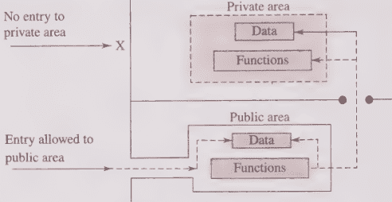

图 5.1 类中的数据隐藏

#### 一个简单的类示例

典型的类声明看起来像：

```cpp
class item
{
    int number; // variables declaration
    float cost; // private by default
public:
    void getdata(int a, float b); // functions declaration
    void putdata(void);          // using prototype
};
```


我们给类一个有意义的名称，例如`item`。该名称成为一种新的类型标识符，可用于声明该类的实例。类包含两个数据成员和两个函数成员。数据成员默认为私有，而函数通过声明为公有。函数`getdata()`可用于为成员变量赋值，而`putdata()`用于显示其值。这些函数提供了从类外部访问数据成员的唯一途径。这意味着数据不能被任何不是类`item`的成员的函数访问。请注意，函数是被声明的，而不是被定义的。实际的函数定义将在程序后面出现。数据成员通常声明为私有，成员函数声明为公有。图 5.2 显示了 OOP 分析师用来表示类的两种不同记法。

## 创建对象

请记住，如上所示的`item`的声明并没有定义`item`的任何对象，而只是指定了它们将包含的内容。一旦类被声明，我们就可以使用类名创建该类型的变量（如同任何其他内置类型变量）。例如，


`item x; // memory for x is created`

创建了一个类型为`Item`的变量`x`。在 C++ 中，类变量称为对象。因此，`x`被称为`Item`的一个对象。我们也可以在语句中声明多个对象。示例：

`item x, y, z;`

对象的声明与任何基本类型的变量的声明类似。在此阶段，为对象分配必要的内存空间。请注意，类规范与结构类似，只提供一个模板，并不会为对象创建任何内存空间。

对象也可以在类定义时创建，将它们的名字放在闭合大括号之后，就像我们在结构中做的那样。也就是说，定义

```
class item
{
    ...
    ...
}; x,y,z;
```

将创建类型为`item`的对象`x`、`y`和`z`。这种做法很少使用，因为我们希望在它们被使用的地方附近声明，并在类定义时声明。

## 访问类成员

如前所述，类的私有数据只能通过该类的成员函数访问。`main()`不能包含直接访问`number`和`cost`的语句。调用成员函数的格式如下：

```
object-name.function-name (actual-arguments);
```

例如，函数调用语句

```
x.getdata(100,75.5);
```

是有效的，并通过实现`getdata()`函数将值`100`分配给对象`x`的`number`，将`75.5`分配给`cost`。赋值发生在实际函数中。请参阅第 5.4 节以获取更多详细信息。

## C++ 中的面向对象编程

同样，语句

```
x.putdata();
```

将显示数据成员的值。请记住，成员函数只能通过（同一类）的对象调用。像这样的语句

```
getdata(100, 75.5);
```

没有任何意义。同样，语句

```
x.number = 100;
```

也是非法的。虽然`x`是类型为`item`的对象，`number`属于它，但`number`（声明为私有）只能通过成员函数访问，而不能由对象直接访问。

可以回忆一下，对象通过发送和接收消息进行通信。这是通过成员函数实现的。例如，

```
x.putdata();
```

向对象发送一条消息，要求它显示其内容。

声明为公有的变量可以直接由对象访问。示例：

```
class xyz
{
    int x;
    int y;
public:
    int z;
};
```

```
xyz p;
p.x = 0;      // error, x is private
p.z = 10;     // OK, z is public
```

> 这种方式使用数据违背了数据隐藏的初衷，因此应避免。

### 5.4 定义成员函数

成员函数可以在两个地方定义：

- 在类定义之外

- 在类定义之内

很明显，无论定义位置如何，函数都应执行相同的任务。因此，函数体的代码在两种情况下都是相同的。然而，函数头部的定义方式存在细微差别。本节将详细讨论这两种方法。

#### 在类定义之外

在类内部声明的成员函数必须在类外部单独定义。它们的定义与普通函数非常相似。它们应具有函数头和函数体。由于 C++ 不支持旧版本的函数定义，因此必须使用 ANSI 原型形式来定义函数头。

成员函数与普通函数的一个重要区别是，成员函数在头中包含一个“成员身份标签”。这个“标签”告诉编译器该函数属于哪个类。成员函数定义的一般形式为：

```
return-type class-name :: function-name (argument declaration)
{
Function body
}
```

成员标签`class-name ::`告诉编译器`function-name`属于类`class-name`。那就是，函数的范围被限制在头行中指定的`class-name`。符号`::`称为作用域解析运算符。

例如，上面讨论的成员函数`getdata()`和`putdata()`。它们可以编码为：

```
void item :: getdata(int a, float b)
{
number = a;
cost = b;
}
void item :: putdata(void)
{
cout << "Number: " << number << "\n";
cout << "Cost: " << cost << "\n";
}
```

这些函数不返回任何值，其返回类型为`void`。函数参数使用 ANSI 原型声明。

成员函数具有一些在程序开发中经常使用的特殊特性。

- 不同类可以使用相同的函数名。‘成员身份标签’将解析其作用域。

- 成员函数可以访问类的私有数据。非成员函数不能这样做。（然而，友元函数是一个例外，后面会讨论）

- 成员函数可以直接调用另一个成员函数，而无需使用点运算符。

#### 在类定义内部

定义成员函数的另一种方法是，用实际的函数定义替换类内部的函数声明。例如，我们将`item`类定义如下：

### 104 Object-Oriented Programming with C++

```
class item
{
    int number;
    float cost;
public:
    void getdata(int a, float b); // declaration
    // inline function
    void putdata(void) // definition inside the class
    {
        cout << number << "\n";
        cout << cost << "\n";
    }
};
```

当函数在类内部定义时，它被视为内联函数。因此，适用于内联函数的所有限制和局限性也适用于此处。通常，只有小型函数才在类定义内部定义。

### 5.5 带类的 C++ 程序

到目前为止讨论的所有细节都在程序 5.1 中实现。

#### 程序 5.1 类实现

```
#include <iostream>

using namespace std;
class item
{
    int number; // private by default
    float cost; // private by default
public:
    void getdata(int a, float b); // prototype declaration,
    // to be defined
    // Function defined inside inside class
    void putdata(void)
    {
        cout << "number : " << number << "\n";
        cout << "cost : " << cost << "\n";
    }
};
//....................Member Function Definition
void item::getdata(int a, float b) // use membership label
{
    number = a; // private variables
    cost = b; // directly used
```

(Cont.)

//................Main Program..................

int main()

{

    item x;                                // create object x

    cout << "\nobject x" << "\n";

    x.getdata(100, 299.95);               // call member function

    x.putdata();                           // call member function

    item y;                                // create another object

    cout << "\nobject y" << "\n";

    y.getdata(200, 175.50);

    y.putdata();

    return 0;

}
```

该程序以类`item`为特色。该类包含两个私有变量和两个公共函数。成员函数`getdata()`在类外定义，向两个变量提供值。注意在`getdata()`函数中使用诸如

- `number = a;`

的语句。这表明成员函数可以直接访问私有数据项。

成员函数`putdata()`在类内定义，因此表现得像内联函数。该函数显示私有变量`number`和`cost`的值。

程序在两个不同的语句中创建了两个对象`x`和`y`。这可以合并为一个语句。

```
item x, y;                   // creates a list of objects
```

以下是程序 5.1 的输出：

```
object x
number   :100
cost     :299.95

object y
number   :200
cost     :175.5
```

为说明起见，我们将一个成员函数显示为内联，另一个显示为“外部”成员函数。两者都可以定义为内联或外部函数。

### 5.6 使外部函数成为内联

OOP 的目标之一是将实现细节与类定义分离。将成员函数在类外定义是良好的实践。

我们可以在类定义之外定义成员函数，同时仍使其成为内联，只需在函数定义的首部行中使用限定符`inline`即可。示例：

```
class item
{
public:
    void getdata(int a, float b); // declaration
};
inline void item ::getdata(int a, float b) // definition
{
    number = a;
    cost = b;
}
```

### 5.7 成员函数的嵌套

我们刚刚讨论了类的成员函数只能由该类的对象使用点运算符调用。然而对此有一个例外。成员函数可以在同一类的另一个函数内部通过其名称调用。这称为成员函数的嵌套。程序 5.2 说明了这一特性。

| Program 5.2 | Nesting of Member Functions |

```
#include <iostream>
#include <string>
using namespace std;

class binary
{
    string s;

public:
    void read(void)
    {
        cout<<"Enter a binary number:";
        cin>>s;
    }

    void chk_bin(void)
    {
        for(int i=0;i<s.length();i++)
    }
```

```
{
    if(s.at(i)!='0' && s.at(i)!='1')
{
        cout<<"\nIncorrect binary number format..the program will quit";
        exit(0);
    }
}
```

```
void ones(void)
{
    chk_bin(); //calling member function
    for(int i=0;i<s.length();i++)
{
        if(s.at(i)=='0')
            s.at(i)='1';
        else
            s.at(i)='0';
    }
}
```

```
void displaysones(void)
{
    ones(); //calling member function
    cout<<"\nThe 1's compliment of the above binary number is:"<<s;
}
```

```
int main()
{
    binary b;
    b.read();
    b.displaysones();
    return 0;
}
```

程序 5.2 的输出将是：

Output 1:

Enter a binary number: 110101

The 1's compliment of the above binary number is: 001010

## Output 2:

Enter a binary number: 1101210

Incorrect binary number format...the program will quit

### 5.8 私有成员函数

虽然通常的做法是将所有数据项放在私有区段，所有函数放在公有区段，但在某些情况下可能需要将某些函数隐藏（像私有数据一样）以免在外部调用。例如删除客户文件中的账户，或为员工提供增量等任务都是严重关注的问题，因此处理此类任务的函数应具有受限访问。我们可以将这些函数放在私有区段。

私有成员函数只能由其所属类的另一个函数调用。即使对象也不能使用点运算符调用私有函数。考虑如下定义的类：

```
class sample {
  int m;
  void read(void); // private member function
  public:
    void update(void);
    void write(void);
}
```

如果`s1`是`sample`的对象，

`s1.read(); // 不会工作；对象不能访问`

// 私有成员

是非法的。然而，函数`read()`可以由函数`update()`调用以更新`m`的值。

```
void sample :: update(void) {
  read(); // simple call; no object used
}
```

### 5.9 类内的数组

数组可以用作类的成员变量。以下类定义是有效的。

```
const int size=10; // provides value for array size
```

```
class array {
  int a[size]; // 'a' is int type array
  public:
    void setval(void);
    void display(void);
}
```

作为类`array`的私有成员声明的数组`a[]`可以在其他`array`变量的成员函数中使用。我们可以对其执行任何操作。例如，在上述类定义中，成员函数`setval()`设置数组`a[]`的值，而`display()`函数显示值。类似地，我们可以使用其他成员函数对数组值执行任何其他操作。

让我们考虑一份购物清单的项目，我们每个月都向经销商下订单。清单包括每个项目的代码名称和价格等详细信息。我们希望执行诸如向清单添加项目、从清单中删除项目以及打印订单总价值等操作。使用具有数组作为数据成员的类实现。程序 5.3 显示了这些操作的实现方式

## Program 5.3 Processing a Shopping List

```
#include <iostream>

using namespace std;

const int m=50;

class ITEMS
{
    int itemId[m];
    float itemPrice[m];
    int count;
public:
    void CNT(void){count = 0}; // initializes count to 0
    void getitem(void);
    void displaySum(void);
    void remove(void);
    void displayItems(void);
};

void ITEMS ::getitem(void)             // assign values to data
{
    cout << "Enter item code : ";
    cin >> itemId[count];
    cout << "Enter item cost : ";
    cin >> itemPrice[count];
    count++;
}

void ITEMS :: displaySum(void)      // display total value of
{
    float sum = 0;
    for(int i=0; i<count; i++)
        sum = sum + itemPrice[i];
    cout << "\nTotal value : " << sum << "\n";
}
```

(Contd.)


```
void ITEMS :: remove(void) // delete a specified item
{
    int a;
    cout << "Enter item code : ";
    cin >> a;

    for(int i=0; i<count; i++)
        if(itemId[i] == a)
            itemPrice[i] = 0;
}
```

```
void ITEMS :: displayItems(void) // displaying items
{
    cout << "\nCode Price\n";
    for(int i=0; i<count; i++) {
        cout << "\n" << itemId[i];
        cout << " : " << itemPrice[i];
    }
    cout << "\n";
}
```

```
int main()
{
    ITEMS order;
    order.CNT();
    int x;
    // do...while loop
    do {
        cout << "\nYou can do the following:";
        cout << "\n1 : Enter appropriate number \n";
        cout << "\n2 : Add an item ";
        cout << "\n3 : Display total value";
        cout << "\n4 : Delete an item";
        cout << "\n5 : Display all items";
        cout << "\n6 : Quit";
        cout << "\n7:What is your option?";
        
        cin >> x;
    } while (x != 6);

    switch(x) {
        case 1 : order.getItem(); break;
        case 2 : order.displaySum(); break;
        case 3 : order.remove(); break;
        case 4 : order.displayItems(); break;
    }
}
```

```
case 5 : break;
default : cout << "Error in input; try again\n";
} while(x != 5); // do...while ends
return 0;
}
```

## 程序 5.3 的输出将是：

You can do the following; Enter appropriate number

- 1 : Add an item

2 : Display total value

3 : Delete an item

4 : Display all items

5 : Quit

What is your option?1

Enter item code :111

Enter item cost :100

You can do the following; Enter appropriate number

- 1 : Add an item

2 : Display total value

3 : Delete an item

4 : Display all items

5 : Quit

What is your option?1

Enter item code :222

Enter item cost :200

You can do the following; Enter appropriate number

- 1 : Add an item

2 : Display total value

3 : Delete an item

4 : Display all items

5 : Quit

What is your option?1

Enter item code :333

Enter item cost :300

You can do the following; Enter appropriate number

## 使用 C++ 进行面向对象编程

你的选项是什么？2

总价值：600

你可以执行以下操作；输入适当数字

1 : 添加一项

2 : 显示总价值

3 : 删除一项

4 : 显示所有项目

5 : 退出

你的选项是什么？3

输入项目代码：222

你可以执行以下操作；输入适当数字

1 : 添加一项

2 : 显示总价值

3 : 删除一项

4 : 显示所有项目

5 : 退出

你的选项是什么？4

代码 价格

| 111 | 100 |

| 222 | 0 |

| 333 | 300 |

你可以执行以下操作；输入适当数字

1 : 添加一项

2 : 显示总价值

3 : 删除一项

4 : 显示所有项目

5 : 退出

你的选项是什么？5

该程序使用两个数组，`itemCode[]` 用于保存项目的代码编号，`itemPrice[]` 用于保存价格。第三个数据成员 `count` 用于记录列表中的项目数。该程序使用总共四个函数来实现对列表执行的操作。语句

```
const int m = 50;
```

定义了数组成员的大小。

第一个函数 `CNT()` 只是将变量 `count` 设置为零。第二个函数 `getItem()` 获取项目代码和项目价格并将它们分配给数组成员 `itemCode[count]` 和 `itemPrice[count]`。请注意，在赋值操作完成后，该函数 `count` 会递增。函数 `displaySum()` 首先计算订单的总价值，然后打印该值。第四个函数 `remove()` 从列表中删除给定项目。它使用项目代码在列表中定位它，并将价格设置为零，表示该项目在列表中不是“活动”的。最后，最后一个函数 `displayItems()` 显示列表中的所有项目。

该程序使用基于菜单的用户界面实现所有任务。

### 5.10 对象的内存分配

我们已经指出，对象的内存空间是在声明时分配的，而不是在指定类时分配的。这个说法只有部分正确。实际上，成员函数是在作为类规范的一部分定义时创建并放置在内存空间中。由于属于该类的所有对象都使用相同的成员函数，因此在创建对象时不会为成员函数分配单独的空间。只有为每个对象单独分配成员变量的空间。对象需要单独的内存位置，因为成员变量将为不同的对象保存不同的数据值。这在图 5.3 中显示。

| 所有对象共用 |

| --- |

| 成员函数 1 |

| 成员函数 2 | 内存在函数定义时创建 |

| 对象 1 | 对象 2 | 对象 3 |

| 成员变量 1 | 成员变量 1 | 成员变量 1 |

| 成员变量 2 | 成员变量 2 | 成员变量 2 |

| | | 内存在对象定义时创建 |

图 5.3 对象内存

### 5.11 静态数据成员

类的一个数据成员可以被限定为静态。静态成员变量的特性与类静态变量的特性相似。静态成员变量具有某些特殊特性。这些是：

- 它在创建其类的第一个对象时初始化为零。不允许其他初始化。
- 对于整个类只创建一个副本，并由该类的所有对象共享，无论创建了多少个对象。
- 它仅在类内可见，但其生命周期为整个程序。

静态变量通常用于维护整个类共有的值。例如，静态数据成员可以用作计数器，记录所有对象的出现次数。程序 5.4 说明了静态数据成员的使用。

## 使用 C++ 进行面向对象编程

### 程序 5.4 静态类成员

```
#include <iostream>

using namespace std;

class item {
    static int count;
    int number;
public:
    void getdata(int a) {
        number = a;
        count++;
    }
    void getcount(void) {
        cout << ":count: ";
        cout << count << "\n";
    }
};
```

`int item :: count;`

```
int main() {
    item a, b, c; // count is initialized to zero
    a.getcount(); // display count
    b.getcount();
    c.getcount();

    a.getdata(100); // getting data into object a
    b.getdata(200); // getting data into object b
    c.getdata(300); // getting data into object c

    cout << "After reading data" << "\n";

    a.getcount(); // display count
    b.getcount();
    c.getcount();
    return 0;
}
```

程序 5.4 的输出将为：

count: 0

count: 0

count: 0

## After reading data

count: 3

count: 3

count: 3

请注意，每个静态成员变量的类型和作用域必须在类定义之外定义。这是因为静态数据成员是单独存储的，而不是作为对象的一部分。由于它们与类本身相关联而不是与任何类对象相关联，因此它们也被称为 `class variables`。

静态变量 `count` 在创建对象时初始化为零。每当数据读入一个对象时，`count` 就会递增。由于数据被读入每个对象，变量 `count` 被递增三次。因为只有一个 `count` 由所有三个对象共享，所以所有三个输出语句都会导致显示值 3。图 5.4 显示了对象如何使用静态变量。

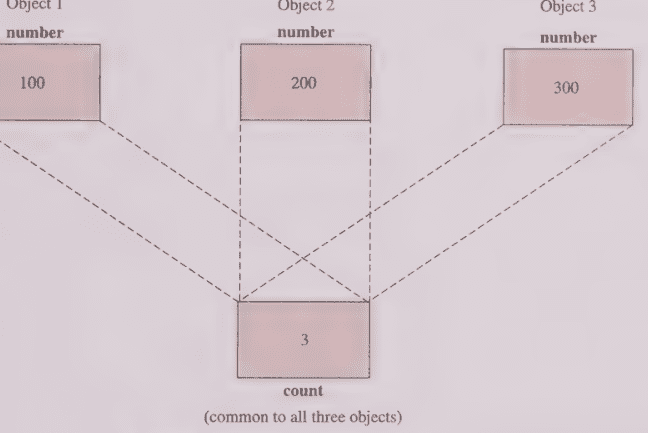

静态变量就像非内联成员函数一样，它们在类声明中声明并在源文件中定义。在定义静态变量时，也可以为变量分配一些初始值。例如，以下定义将 `count` 的初始值设为 10。

```
int item :: count = 10;
```

### 5.12 静态成员函数

与静态成员变量类似，我们也可以有静态成员函数。声明为静态的成员函数具有以下属性：

- 静态函数只能访问在同一类中声明的其他静态成员（函数或变量）。
- 静态成员函数可以使用类名（而不是其对象）按如下方式调用：

```
class-name :: function-name;
```

程序 5.5 说明了这些特性的实现。静态函数 `showcount()` 显示到目前为止创建的对象数。对象数由静态变量 `count` 维护。

函数 `showcode()` 显示每个对象的代码号。

### 程序 5.5 静态成员函数

```
#include <iostream>
using namespace std;
class test {
    int code;
    static int count; // static member variable
public:
    void setcode(void) {
        code = ++count;
    }
    void showcode(void) {
        cout << "object number: " << code << "\n";
    }
    static void showcount(void) // static member function
        cout << "count: " << count << "\n";
    }
};
int test::count;
int main() {
    test t1, t2, t3;
    t1.setcode();
    t2.setcode();
    test :: showcount(); // accessing static function
    t3.setcode();
    t1.showcode();
    t2.showcode();
    t3.showcode();
    return 0;
}
```

程序 5.5 的输出将为：

```
count: 2
count: 3
object number: 1
object number: 2
object number: 3
```

> 请注意，语句 `code = ++count;` 是在每次调用 `setcount()` 函数时执行的，并且 `count` 的当前值被分配给 `code`。每个对象都有自己的 `code` 副本，`code` 中包含的值代表其对象的唯一编号。

记住，以下函数定义将不起作用：

```
static void showcount()
{
 cout << code; // code is not static
}
```

### 5.13 对象数组

我们知道，数组可以是任何数据类型，包括 struct。同样，我们也有变量数组，其类型为类。这样的变量称为对象数组。考虑以下类定义：

```
class employee
{
  char name[30];
  float age;
public:
  void getdata(void);
  void putdata(void);
}
```

标识符 `employee` 是一个用户定义的数据类型，可用于创建与不同员工类别相关的对象。示例：

```
employee manager[3];    // array of manager
employee foreman[15];   // array of foreman
employee worker[75];    // array of worker
```

数组 `manager` 包含三个对象（经理），即 `manager[0]`、`manager[1]` 和 `manager[2]`，类型为 `employee` 类。同样，`foreman` 数组包含 15 个对象（工头），`worker` 数组包含 75 个对象（工人）。

由于对象数组的行为与其他数组一样，我们可以使用通常的数组访问方法访问各个元素，然后使用点成员运算符访问成员函数。对于示例，`manager[i].putdata();`

# 118

Object-Oriented Programming with C++

将显示数组 `manager` 的第 `i` 个元素的 data。也就是说，此语句请求对象 `manager` 调用成员函数 `putdata()`。

对象数组在内存中存储的方式与多维数组相同。数组管理器在图 5.5 中表示。请注意，只为对象的 data 项创建了空间。成员函数单独存储，并将由所有对象使用。


图 5.5 对象数组的 data 项存储

程序 5.6 说明了对象数组的使用。

## Program 5.6 Arrays of Objects

```
#include <iostream>

using namespace std;

class employee
{
    char name[30]; // string as class member
    float age;
public:
    void getdata(void);
    void putdata(void);
};
void employee :: getdata(void)
{
    cout << "Enter name: ";
    cin >> name;
    cout << "Enter age: ";
    cin >> age;
};
```

(Contd.)

```
void employee :: putdata(void)
{
    cout << "Name: " << name << "\n";
    cout << "Age: " << age << "\n";
}
const int size=3;
int main()
{
    employee manager[size];
    for (int i=0; i<size; i++) {
        cout << "\nDetails of manager " << i+1 << "\n";
        manager[i].getdata();
    }
    cout << "\n";
    for(i=0; i<size; i++) {
        cout << "\nManager" << i+1 << "\n";
        manager[i].putdata();
    }
    return 0;
}
```

这是一个交互式程序，输入数据和程序输出如下所示：

Interactive input

Details of manager1

Enter name: xxx

Enter age: 45

Details of manager2

Enter name: yyy

Enter age: 37

Details of manager3

Enter name: zzz

Enter age: 50

Program output

Manager1

Name: xxx

Age: 45

Manager2

Name: yyy

Age: 37

Manager3

Name: zzz

Age: 50

### 5.14 OBJECTS AS FUNCTION ARGUMENTS

像其他数据类型一样，对象可以用作函数参数。这可以通过两种方式完成：

- 整个对象的副本传递给函数。
- 仅将对象的地址传递给函数。


第一种方法称为 `pass-by-value`。由于对象的副本传递给函数，因此在函数内部对对象所做的任何更改都不会影响用于调用函数的对象。第二种方法是 `pass-by-reference`。当对象的地址被传递时，函数直接在调用中使用的实际对象上工作。这意味着在函数内部对对象所做的任何更改都将反映在实际对象中。`pass-by-reference` 方法更有效，因为它只需要传递对象的地址而不是整个对象。

程序 5.7 说明了对象作为函数参数的使用。它执行以小时和分钟格式表示的时间相加。


```
#include <iostream>

using namespace std;

class time
{
    int hours;
    int minutes;
public:
    void gettime(int h, int m)
        { hours = h; minutes = m; }
    void puttime(void)
        {
            cout << hours << " hours and "
            cout << minutes << " minutes " << "\n";
        }
    void sum(time, time); // declaration with objects as arguments
};
void time::sum(time t1, time t2) // t1, t2 are objects
    minutes = t1.minutes + t2.minutes;
    hours = minutes/60;
    minutes = minutes%60;
    hours = hours + t1.hours + t2.hours;
};

int main()
{
    time T1, T2, T3;
```

(Contd.)

```
T1.gettime(2,45); // get T1
T2.gettime(3,30); // get T2

T3.sum(T1,T2); // T3=T1+T2

cout << "T1 = " << T1.puttime();    // display T1
cout << "T2 = " << T2.puttime();    // display T2
cout << "T3 = " << T3.puttime();    // display T3

return 0;
```

程序 5.7 的输出将为：

T1 = 2 hours and 45 minutes

T2 = 3 hours and 30 minutes

T3 = 6 hours and 15 minutes

图 5.6 说明了函数 `sum()` 内部如何访问成员。

对象也可以作为参数传递给非成员函数。但是，这样的函数只能通过作为参数传递给它的对象访问公共成员函数。这些函数无法访问私有数据成员。

> LIMITATION

限制对象访问值 262144 的特殊情况。

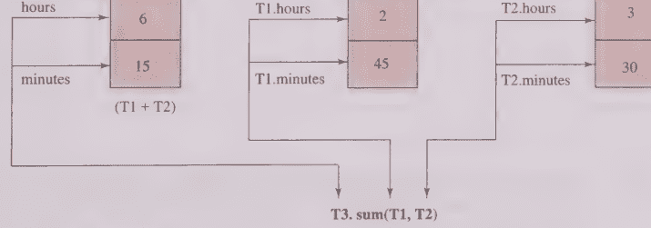

Figure 5.6 Accessing members of objects within a called function

图 5.6 在被调用函数内访问对象的成员

### 5.15 FRIENDLY FUNCTIONS

我们在本章中一直强调私有成员不能从类外部访问。也就是说，非成员函数不能访问类的私有数据。但是，可能存在一种情况，我们希望两个类共享一个特定函数。例如，考虑一种情况，其中定义了两个类 `manager` 和 `scientist`。我们希望使用函数 `income_tax()` 对这两个类的对象进行操作。在这种情况下，C++ 允许将公共函数设为这两个类的友元，从而允许

函数访问这些类的私有数据。这样的函数不必是这些类的成员之一。

要使外部函数对类“友好”，我们必须将此函数声明为类的友元，如下所示：

```
class ABC
{
    public:
        friend void xyz(void); // declaration
};
```

函数声明应以关键字 `friend` 为前缀。函数像普通的 C++ 函数一样在程序的其他地方定义。函数定义不使用关键字 `friend` 或运算符 `::`。用 `friend` 声明的函数称为友元函数。一个函数可以被声明为任意数量类的友元。友元函数虽然不是成员函数，但对类的私有成员具有完全的访问权限。

友元函数具有特殊特征：

- 它不在其被声明为友元的类的范围内。
- 由于它不在类的范围内，因此不能使用该类的对象调用它。
- 它可以像普通函数一样被调用，而不需要任何对象的帮助。
- 与成员函数不同，它不能直接访问成员名，必须使用对象名和点成员运算符与每个成员名一起使用（例如，`A.X`）。
- 它可以声明在类的 `public` 或 `private` 部分而不影响其含义。
- 通常，它以对象作为参数。

友元函数通常用于运算符重载，这将在后面讨论。

程序 5.8 说明了友元函数的使用。

| Program 5.8 Friend Function |

| `#include <iostream>` |

| `using namespace std;` |

| `class sample` |

| `{` |

| `    int a;` |
| `    int b;` |

```
public:
  void setValue() {a=25; b=40; }
  friend float mean(sample s);
);
float mean(sample s)
{
  return float(s.a + s.b)/2.0;
}

int main()
{
  sample X; // object X
  X.setValue();
  cout << "Mean value = " << mean(X) << "\n";

  return 0;
}
```

程序 5.8 的输出将为：

Mean value = 32.5

> Note 友元函数通过使用点运算符和传递给它的对象来访问类变量 `a` 和 `b`。函数调用 `mean(X)` 按值将对象 `X` 传递给友元函数。

一个类的成员函数可以是另一个类的友元函数。在这种情况下，它们使用作用域解析运算符定义，如下所示：

```
class X
{
  public:
    ....
    int fun1(); // member function of X
  ....
};
class Y
{
  friend int X::fun1(); // fun1() of X
  // is friend of Y
  ....
}
```

函数 `fun1` 是类 `X` 的成员，也是类 `Y` 的友元。

我们也可以将一个类的所有成员函数声明为另一个类的友元函数。在这种情况下，该类称为友元类。这可以指定如下：

# Object-Oriented Programming with C++

```
class Z {
    friend class X; // all member functions of X
    // friends to Z
};
```

程序 5.9 演示了友元函数如何作为两个类之间的桥梁工作。

## Program 5.9 Using Friend Function to Add Data Objects of two Different Classes

```
#include <iostream>
using namespace std;

class ABC; //Forward declaration
//--------------------------------------/
class XYZ {
    int data;
public:
    void setvalue(int value)
{
        data=value;
    }
    friend void add(XYZ, ABC); //Friend function declaration
};
//--------------------------------------/
class ABC {
    int data;
public:
    void setvalue(int value)
{
        data=value;
    }
    friend void add(XYZ, ABC); //Friend function declaration
};
//--------------------------------------/
void add(XYZ obj1, ABC obj2) //Friend function definition
{
    cout<<"Sum of data values of XYZ and ABC objects using friend function "
= <<obj1.data+obj2.data;
}
//--------------------------------------/
int main() {
    XYZ X;
    ABC A;

X.setvalue(5);

A.setvalue(50);

add(X, A); //Calling friend function

return 0;

}
```

程序 5.9 的输出为：

Sum of data values of XYZ and ABC objects using friend function = 55

> **注意：** 函数 `add()` 的参数来自 `XYZ` 和 `ABC` 两个类。当函数 `add()` 第一次在 `XYZ` 中声明为友元时，编译器不会承认 `ABC` 的存在，除非其名称在开头以

`class ABC;`

的方式声明。

这被称为“前向”声明。

如前所述，友元函数可以通过引用调用。在这种情况下，不会创建对象的局部拷贝。相反，会传递指向对象地址的指针，被调用的函数直接在调用时使用的实际对象上工作。

此方法可用于更改类的私有成员的值。记住，更改私有成员的值违背了数据隐藏的基本原则。只有在绝对必要时才应使用。

程序 5.10 展示了如何使用一个公共友元函数交换两个类的私有值。该函数通过引用调用。

## 程序 5.10 交换类的私有数据

```
#include <iostream>
using namespace std;
class class_2;
class class_1
{
 int value1;
public:
 void indata(int a) {value1 = a};
 void display(void) {cout << value1 << "\n";}
 friend void exchange(class_1 &, class_2 &);
};
```

(Contd.)

## 面向对象程序设计 C++

```
class class_2
{
    int value2;
    public:
    void indata(int a) {value2 = a;}
    void display(void) {cout << value2 << "\n";}
    friend void exchange(class_1 &, class_2 &);
};

void exchange(class_1 & x, class_2 & y)
{
    int temp = x.value1;
    x.value1 = y.value2;
    y.value2 = temp;
}

int main()
{
    class_1 C1;
    class_2 C2;

    C1.indata(100);
    C2.indata(200);

    cout << "Values before exchange" << "\n";
    C1.display();
    C2.display();
    exchange(C1, C2); // swapping

    cout << "Values after exchange " << "\n";
    C1.display();
    C2.display();

    return 0;
}
```

对象 `x` 和 `y` 分别是 `C1` 和 `C2` 的别名。语句

`int temp = x.value1`

`x.value1 = y.value2;`

`y.value2 = temp;`

直接修改了 `class_1` 和 `class_2` 中声明的 `value1` 和 `value2` 的值。

程序 5.10 的输出为：

Values before exchange

100

200

Values after exchange

200

100

### 5.16 返回对象

函数不仅可以接收对象作为参数，还可以返回它们。程序 5.11 中的示例说明了如何在函数内创建对象并将其返回给另一个函数。

## 程序 5.11 返回对象

```
#include<iostream>
using namespace std;
class matrix
{
    int m[3][3];
public:
    void read(void)
    {
        cout<<"Enter the elements of the 3X3 matrix:\n";
        int i, j;
        for(i=0;i<3;i++)
            for(j=0;j<3;j++)
            {
                cout<<"m["<<i<<"]["<<j<<"] = ";
                cin>>m[i][j];
            }
    }
    void display(void)
    {
        int i, j;
        for(i=0;i<3;i++)
        {
            cout<<"\n";
            for(j=0;j<3;j++)
            {
                cout<<m[i][j]<<"\t";
            }
        }
    }
    friend matrix trans(matrix);
};
matrix trans(matrix m1)
{
    matrix m2; //creating an object
    int i, j;

for(i=0;i<3;i++)
for(j=0;j<3;j++)
m2.m[i][j]=m1.m[j][i];

return(m2); //returning an object
}
```

```
int main()
{
  matrix mat1,mat2;
mat1.read();
cout<<"\nYou entered the following matrix:";
mat1.display();

  mat2 = trans(mat1);
cout<<"\nTransposed matrix:";
mat2.display();

  return 0;
}
```

执行后，程序 5.11 会生成以下输出：

Enter the elements of the 3x3 matrix:

```
m[0][0] = 1
m[0][1] = 2
m[0][2] = 3
m[1][0] = 4
m[1][1] = 5
m[1][2] = 6
m[2][0] = 7
m[2][1] = 8
m[2][2] = 9
```

```
You entered the following matrix:
1 2 3
4 5 6
7 8 9
```

```
Transposed matrix:
1 4 7
2 5 8
3 6 9
```

该程序求给定 3 x 3 矩阵的转置并将其存储在新的对象中。`display` 成员函数显示矩阵元素。

### 5.17 const 成员函数

如果成员函数不修改类中的任何数据，则我们可以将其声明为 `const` 成员函数，如下所示：

```
void mul(int, int) const;
double get_balance() const;
```

限定符 `const` 被追加到函数原型中（在声明和定义中）。如果此类函数试图修改数据值，编译器将生成错误消息。

### 5.18 成员指针

可以获取类的成员地址并将其分配给指针。成员的地址可以通过将运算符 `&` 应用于“完全限定”的类成员名来获得。可以使用运算符 `::` 与类名一起声明类成员指针。例如，给出类

```
class A
{
    private:
        int m;
    public:
        void show();
};
```

我们可以按如下方式定义指向成员 `m` 的指针：

```
int A::* ip = &A::m;
```

创建的指针像类成员一样工作，即它必须与类对象一起调用。上述语句中，短语 `A::*` 表示“指向 `A` 类的成员指针”。短语 `&A::m` 表示“`A` 类的 `m` 成员的地址”。

记住，以下语句无效：

```
int *ip = &m; // won't work
```

这是因为 `m` 不仅仅是 `int` 类型。当它与所属的类相关联时才有意义。作用域运算符必须同时应用于指针和成员。

指针 `ip` 现在可以在成员函数（或友元函数）内部用于访问成员 `m`。假设 `a` 是在成员函数中声明的 `A` 的对象。我们可以使用指针 `ip` 按如下方式访问 `m`：

现在，来看以下代码：

```
cout << a.*ip; // display
cout << a->m; // same as above
ap = &a; // ap is pointer to object a
cout << ap->*ip; // display m
cout << ap->m; // same as above
```

## 面向对象程序设计 C++


解引用运算符 `->` 用于在我们同时使用指向对象和成员的指针时访问成员。解引用运算符 `.*` 用于在对象本身与成员指针一起使用时。注意 `*ip` 被用作成员名。

我们还可以设计指向成员函数的指针，然后可以在 `main` 中使用解引用运算符调用它们，如下所示：

```
(object-name .* pointer-to-member-function) (10);
(pointer-to-object ->* pointer-to-member-function) (10)
```

`()` 的优先级高于 `*` 和 `->`，因此需要括号。

程序 5.12 说明了使用解引用运算符访问类成员。

## 程序 5.12 解引用运算符

```
#include<iostream>
using namespace std;
class M {
    int x;
    int y;
public:
    void set_xy(int a, int b)
    {
        x = a;
        y = b;
    }
    friend int sum(M m);
};
int sum(M m) {
    int M::* px = &M ::x;
    int M::* py = &M ::y;
    M *pm = &m;
    int S = m.*px + pm->*py;
    return S;
}
int main() {
    M n;
    void (M ::*pf)(int, int) = &M :: set_xy;
    (n.*pf)(10,20);
    cout << "SUM = " << sum(n) << "\n";
    M *op = &n;
    (op->*pf)(30,40);
    cout << "SUM = " << sum(n) << "\n";
    return 0;
}
```

程序 5.12 的输出为：

```
sum = 30
sum = 70
```

## 5.19 局部类

可以在函数或块内部定义和使用类。此类类称为局部类。示例：

```
void test(int a)                // function
{
    class student               // local class
    {
        ...
                        // class definition
    };

    student s1(a);              // create student object
                             // use student object
}
```

局部类可以使用全局变量（在函数之上声明）和函数内部声明的静态变量，但不能使用自动变量。全局变量应使用作用域运算符 `::` 使用。

构造局部类有一些限制。它们不能有静态数据成员，成员函数必须在局部类内部定义。包含函数无法访问局部类的私有成员。但是，我们可以通过将包含函数声明为友元来实现。

## 摘要

- 类是结构数据类型的扩展。类可以同时具有变量和函数作为成员。
- 默认情况下，类的成员是私有的，而结构的是公有的。
- 只有成员函数才能访问私有数据成员和私有函数。然而，公共成员可以从类外部访问。
- 在 C++ 中，类变量称为对象。我们可以使用点运算符访问对象的公共成员。
- 我们可以在类内部或外部定义成员函数。成员函数与普通函数的区别在于，成员函数在头中使用“成员身份”标签来指示它所属的类。
- 对象在声明时分配内存。每个对象的成员变量空间单独分配，但成员函数不分配空间。
- 类的数据成员可以声明为 `static`，通常用于维护整个类共有的值。

## 使用 C++ 进行面向对象编程

+ `static` 成员变量必须在类外定义。
+ `static` 函数可以访问同一类中声明的 `static` 成员，并且可以使用类名调用。
+ C++ 允许我们拥有对象数组。
+ 我们可以使用对象作为函数参数。
+ 声明为 `friend` 的函数不在其被声明为友元的类的范围内。它可以完全访问该类的私有成员。
+ 一个函数也可以返回一个对象。
+ 如果成员函数不改变类中的任何数据，则我们可以将其声明为 `const` 成员函数。关键字 `const` 添加到函数原型中。
+ 也可以在函数内部定义和使用一个类。这种类称为局部类

## KEY TERMS

`abstract data type` | `arrays of objects` | `class` | `class declaration` | `class members` | `class variables` | `const member functions` | `data` | `hiding` | `data members` | `dereferencing operator` | `operator` | `encapsulation`

`friend functions` | `inheritance` | `inline functions` | `local class` | `member functions` | `nesting of member functions`

`objects` | `pass-by-reference` | `pass-by-value` | `period operator` | `private` | `prototype` | `public` | `scope operator`

`score` | `resolution` | `static data members` | `static member functions` | `static variables` | `struct` | `structure`

`structure members` | `structure name` | `structure tag` | `template`

## REVIEW QUESTIONS

### Cognitive Domain

+ 5.1 推断 C 语言中的结构与 C++ 中的结构之间的差异。
+ 5.2 扩展关于类的说明；解释它实现数据隐藏的方式。
+ 5.3 区分 C++ 结构和 C++ 类。
+ 5.4 描述对象；同时解释对象是如何创建的。
+ 5.5 重述定义类的成员函数的过程。
+ 5.6 描述在以下情况下访问数据成员和成员函数的方式：
  (a) 在 `main` 程序内部。
  (b) 在同一类的成员函数内部。
  (c) 在另一个类的成员函数内部。
+ 5.7 回忆何时应将类的成员声明为 `static`。概述静态成员的必要性。
+ 5.8 描述友元函数。解释使用友元函数的优点和缺点。
+ 5.9 借助示例论证我们可以将类对象作为函数参数传递。

### Affective Domain

5.10 “在同一个程序文件中，类的成员函数与外部函数可以同名。” 用适当的论据证明你的答案是支持还是反对。

5.11 证明以下陈述的正确性：
+ (a) 类中的数据项必须始终是私有的。
+ (b) 设计为私有的函数只能由该类的成员函数访问。
+ (c) 设计为公共的函数可以像其他函数一样被访问。
+ (d) 在类说明符内部定义的成员函数默认成为内联函数。
+ (e) 类可以将实体的各个方面集中在同一位置。
+ (f) 类成员默认是公共的。
+ (g) 友元函数只能访问类的公共成员。
+ (h) 一个整个类可以成为另一个类的友元。
+ (i) 函数不能返回类对象。

## Legend

Precision Valuing/Responding/Organizing Applying Remembering Understanding

## DEBUGGING EXERCISES

### 5.1 找出以下程序中的错误。

```
#include <iostream>
using namespace std;
class addition
{
    int p,q,r,s;
    void input(void)
    {
        cout << "Enter the three numbers \n";
        cin >> p >> q >> r;
    }
    void show(void)
    {
        cout << "The addition of three numbers is :" << add() << endl;
    }
    int add(void)
    {
        s=p+q+r;
        return (s);
    }
```

134

Object-Oriented Programming with C++

```
int main() 
{
    addition x;
    x.show();
    return 0;
}
```

### 5.2 找出以下程序中的错误。

```
#include <iostream>
using namespace std;
class stm
{
    static int a;
    int number;
public:
    void increment(int b)
    {
        number=b;
        a++;
    }
    void show(void)
    {
        cout<<a<<endl;
    }
};
int main() {
    stm st1,st2,st3;
    st1.increment();
    st1.show();
    st2.show();
    st3.show();
    return 0;
}
```

### 5.3 找出以下程序中的错误。

```
#include <iostream>
using namespace std;
class weight
{
    int letter, ML;
public:
    void getdata();
    void putdata();
    void sum_of_weight(weight,weight);
};
void weight :: getdata()
{
    cout<<"in letter:";}
```

```
cin>>letter;
cout<<" in ML:";
cin>>ML;
}
void weight :: putdata()
{
  cout<<"<< Letter and "<<ML<<" ML";
}
void weight :: sum_of_weight(weight w1, weight w2)
{
  ML = w1.ML + w2.ML;
  letter=ML/1000;
  ML=ML%1000;
  letter=w1.letter+w2.letter;
}
int main()
{
  weight w1,w2,w3;
  cout<<"Enter weight in L and ML\n";
  cout<<"Enter weight 1 ";
  w1.getData();
  cout<<"Enter weight 2 ";
  w2.getData();
  sum_of_weight(w1,w2);
  cout<<"Total Weight = ";
  w3.putdata();
  return 0;
}
```

### 5.4 找出以下程序中的错误。

```
#include <iostream>
using namespace std;
class age {
  private:
    int child_age;
public:
    age(int age) : child_age(age) {
      int father_age(age);
    };
int father_age(age d)
{
  d.child_age += 15;
  return d.child_age;
}
int main(){
  age D;
  cout<<"fathers age: "<< father_age(D);
  return 0;
}
```

## DRY-RUN EXERCISES

### 5.1 当运行以下程序时会发生什么？

```
#include <iostream>
using namespace std;
class personal
{
public:
int p();
};
int personal::p() {
return 2;
}
int main() {
personal a;
a.x = &personal::p;
cout << ((a.*(a.x))());
}
```

### 5.2 当运行以下程序时会发生什么？

```
#include <iostream>
using namespace std;
class B;
class A
{
int x;
public:
void setattr(int d)
{
x = d;
}
void display()
{
cout << x << endl;
}
friend void add (A &, B);
};
class B
{
int x;
public:
void setattr(int d)
{
x = d;
}
void display()
{
  cout << x << endl;
}
friend void add (A &, A, B);
};
void add (A & ob_A, B ob_B)
{
  ob_A.x += ob_B.x;
}
int main()
{
  A a;
  B b;
  a.setdata(10);
  b.setdata(10);
  add(a, b);
  a.display();
  b.display();
  return 0;
}
```

### 5.3 当运行以下程序时会发生什么？

```
#include <iostream>
using namespace std;
class A
{
  int x;
  A *p;
public:
  void setdata(int d, A *pb)
  {
    x = d;
    p = pb;
  }
  void display()
  {
    cout << x << " " << (*p).x << endl;
  }
};
int main()
{
  A a, b;
  a.setdata(10, &b);
  b.setdata(20, &a);
  a.display();
  b.display();
  return 0;
}
```

## PROGRAMMING EXERCISES

5.1 定义一个类来表示银行账户。包含以下成员：

Data members
+ (a) 存款人姓名
+ (b) 账号
+ (c) 账户类型
+ (d) 账户余额

Member functions
+ (a) 分配初始值
+ (b) 存款
+ (c) 在检查余额后取款
+ (d) 显示姓名和余额

编写 `main` 程序来测试该程序。

5.2 定义一个类来表示向量（一系列浮点值）。包含执行以下任务的成员函数：
+ (a) 创建向量
+ (b) 乘以给定元素的数值
+ (c) 乘以标量值
+ (d) 以 `(10, 20, 30, ...)` 的形式显示向量

编写 `main` 程序来测试你的类。

5.3 修改练习 5.11 的类和程序以处理 10 个客户。

5.4 修改练习 5.12 的类和程序，使程序能够相加两个向量并显示结果向量。 （注意我们可以将对象作为函数传递。）

5.5 创建两个类 `DM` 和 `DB` 来存储距离值。 `DM` 以米和厘米存储距离，`DB` 以英尺和英寸存储。 编写一个程序，可以读取类对象的数值并将一个 `DM` 与另一个 `DM` 相加。

使用友元函数执行加法操作。 存储结果的对象可以是 `DM` 对象或 `DB` 对象，具体取决于所需结果的单位。

显示应以英尺和英寸或米和厘米的格式，具体取决于所显示对象的单位。

5.6 参考程序 5.11 并编写一个函数，该函数接收两个矩阵对象作为参数并返回包含它们乘法结果的新矩阵对象。

5.7 编写一个程序来输入教师详细信息（ID、姓名、职位、资格、地址）并显示它。

5.8 编写一个程序，使用访问运算符计算简单利息和复利。

## 多选题

1. 选择关于 C 结构体的正确说法：
   (a) 允许将结构体视为内置类型
   (b) 允许数据隐藏
   (c) 允许成员为 `public`
   (d) 以上都不是

2. `struct area {float p, q};`
   以下哪个不是结构体变量的正确声明？
   (a) `struct area A;`
   (b) `struct area A, B, C;`
   (c) `struct A;`
   (d) `area A;`

3. 默认情况下类的成员是：
   (a) `public`
   (b) `private`
   (c) `static`
   (d) `constant`

4. `class qube { private: int l; protected: int m; public: int n}; qube z; z.l = 9; z.m = 8; z.n = 6;` 哪个是错误的
   (a) `z.l` 会报错因为 `l` 是 `private`
   (b) `z.n` 会报错因为 `n` 是 `public`
   (c) `z.m` 会报错因为 `m` 是 `protected`
   (d) `z.n` 不会报错因为它是 `public`

5. 关于成员函数的说法哪个是错误的？
   (a) 成员函数可以在类定义之外定义
   (b) 成员函数可以在类定义之内定义
   (c) 在类外定义的成员函数可以被设为 `inline`
   (d) 成员函数不能嵌套

6. 选择以下最佳选项：
   (a) 所有数据项私有且所有函数公有
   (b) 所有数据项和函数私有
   (c) 所有数据项公有且所有函数私有
   (d) 所有数据项和函数公有

7. `class data { void select(); public : void delete(void); data p; p.select(); }` 找出错误的语句行
   (a) `void select(void);`
   (b) `data p;`
   (c) `p.select();`


(d) `public : void delete(void);`

8. 语句“对象在声明时分配内存空间，而不是在类指定时”：

(a) 完全正确

(b) 完全错误

(c) 部分正确

(d) 不相关

9. 以下哪项不是静态数据成员的特征？

(a) 默认初始化为 0

(b) 初始化后不允许再初始化为 0

(c) 只能创建一个副本

(d) 它在类内可见

10. “静态成员函数可以访问同一类的其他静态成员并且可以使用类名调用。” 这个说法是：

(a) 错误

(b) 正确

(c) 部分错误

(d) 部分正确

11. 对象的大小限制为：

(a) 262144

(b) 262148

(c) 262140

(d) 262150

12. 选择关于友元函数的 inappropriate 语句：

(a) 一个函数可以在任意数量的类中被声明为友元

(b) 友元函数不能像普通函数一样被调用

(c) ->->

(d) ::

(e) 友元函数不能直接访问成员名

(d) 友元函数可以被声明为 public 或 private

13. 选择以下中优先级最高的：

(a) `()`

(b) `*`

(c) `->`

(d) `::`

## 面向对象编程续

## 构造函数和析构函数

### 学习目标

阅读本章后，你将能够

- 描述构造函数和析构函数的概念
- 解释参数化构造函数
- 解释类中多个构造函数的用法
- 讨论对象的动态初始化
- 解释拷贝和动态构造函数

### 6.1 引言

到目前为止，我们已经看到了一些类的实现示例。在所有情况下，我们都使用 `putdata()` 和 `setValue()` 等成员函数为私有成员变量提供初始值。例如，以下语句

```
A.input();
```

调用成员函数 `input()`，该函数为对象 `A` 的数据项分配初始值。类似地，语句-

```
x.getdata(100,299.95);
```

将初始值作为参数传递给函数 `getdata()`，其中这些值被赋给对象 `x` 的私有变量。所有“函数调用”语句都与已经创建的适当对象一起使用。这些函数不能在创建对象时用于初始化成员变量。

如上所述提供初始值不符合 C++ 语言的哲学。我们之前提到过，C++ 的目标之一是创建 `class` 等用户定义数据类型，使其行为与内置类型非常相似。这意味着我们应该能够在声明 `class` 类型变量（对象）时对其进行初始化，就像初始化普通变量一样。例如，

```
int m = 20;
float x = 5.75;
```

是基本数据类型的有效初始化语句。

## 面向对象 C++ 编程

同样，当内置类型的变量超出作用域时，编译器会自动销毁该变量。但我们迄今为止研究的对象的这种情况并未发生。因此很明显，需要探索类的一些更多特性，以便在创建对象时初始化它们，并在不再需要时销毁它们。

C++ 提供了一个特殊的成员函数，称为构造函数，它使对象在创建时能够自行初始化。它也被称为对象的自动初始化。它还提供另一个成员函数，称为析构函数，在不再需要时销毁对象。

### 6.2 构造函数

构造函数是一个“特殊”的成员函数，其任务是初始化其类的对象。它之所以特殊，是因为它的名称与类名相同。每当创建其关联类的对象时，就会调用构造函数。它被称为构造函数，因为它构造了类的数据成员的值。

构造函数声明和定义如下：

```
// 带有构造函数的类
class integer {
    int m, n;
public:
    integer(void); // 构造函数声明
}
integer ::integer(void) // 构造函数定义
    m = 0; n = 0;
}
```

当类包含如上定义的构造函数时，可以保证由该类创建的对象将被自动初始化。例如，声明

```
integer int1; // 创建对象 int1
```

不仅创建了类型为 `integer` 的 `int`，还将数据成员 `m` 和 `n` 初始化为零。无需编写任何语句来调用构造函数函数（如我们对普通成员函数所做的那样）。如果为零初始化定义了“普通”成员函数，我们需要为每个对象单独调用此函数。如果对象数量很大，这将非常不方便。

不接受参数的构造函数称为默认构造函数。类 `A` 的默认构造函数是 `A::()`。如果未定义此类构造函数，编译器会提供默认构造函数。因此，像这样的语句

```
A a;
```

调用编译器的默认构造函数来创建对象 `a`。

构造函数具有一些特殊特征。这些是：

- 它们应在 `public` 部分声明。
- 它们在对象创建时自动调用。
- 它们没有返回类型，甚至不是 `void`，因此它们不能返回值。
- 它们不能被继承，尽管派生类可以调用基类构造函数。
- 像其他 C++ 函数一样，它们可以有默认参数。
- 构造函数不能是虚函数。 （虚的含义将在第 9 章中讨论。）
- 我们不能引用它们的地址。
- 具有构造函数（或析构函数）的对象不能用作联合的成员。
- 它们在需要内存分配时对运算符 `new` 和 `delete` 进行“隐式调用”。

请记住，当为类声明构造函数时，类对象的初始化变得强制性。

### 6.3 参数化构造函数

上面定义的构造函数 `integer()` 将所有对象的数据成员初始化为零。在实践中，可能需要在创建时用不同的值初始化对象的各个数据元素。C++ 允许我们通过在创建对象时向构造函数函数传递参数来实现这一点。可以接受参数的构造函数称为参数化构造函数。

构造函数 `integer()` 可以修改为接受参数，如下所示：

```
class integer {
    int m, n;
    public:
        integer(int x, int y); // 参数化构造函数
}
integer::integer(int x, int y) {
    m = x; n = y;
}
```

当构造函数已被参数化时，像这样的对象声明语句

```
integer int1;
```

可能无法工作。我们必须在声明对象时将初始值作为参数传递给构造函数函数。这可以通过两种方式完成：

- 通过显式调用构造函数。
- 通过隐式调用构造函数。

以下声明说明了第一种方法：

```
integer int1 = integer(0,100); // 显式调用
```

此语句创建对象 `int1` 并向其传递值 `0` 和 `100`。第二种方法实现如下：

```
integer int1(0,100); // 隐式调用
```

## 使用 C++ 进行面向对象编程

这种方法有时称为简写方法，使用非常频繁，因为它更短、看起来更好且易于实现。

记住，当构造函数带参数时，我们必须为构造函数提供适当的实参。程序 6.1 演示了向构造函数函数传递参数。

构造函数函数也可以定义为内联函数。示例：

```
class integer
{
    int m, n;
  public:
    integer(int x, int y) // Inline constructor
        m = x; y = n;
}
};
```

构造函数的参数可以是任何类型，除了它所属的类本身的类型。例如。

```
class A
{
  public:
    A(A&);
};
```

是非法的。

然而，构造函数可以接受对其自身类的引用作为参数。因此，语句

```
Class A
{
  public:
    A(A&);
};
```

是有效的。在这种情况下，构造函数称为拷贝构造函数。

## 程序 6.1 参数化构造函数的示例

```
/*This program defines a class called Point that stores the x and y coordinates of a point. The class uses parameterized constructor for initializing the class objects*/
```

```
#include <iostream>
using namespace std;
```

(Contd.)

```
class Point {
    int x, Y;
public:
    Point(int a, int b) //inline parameterized constructor definition
    {
        x=a;
        y=b;
    }
    void display() {
    {
        cout<<"x:" << x << ", y:" << y << "" << endl;
    }
}
};
```

```
int main() {
    Point p1(1,1); //invokes parameterized constructor
    Point p2(5,10);
    cout<<"Point p1 = " <<
    p1.display();
    cout<<"Point p2 = " <<
    p2.display();
    return 0;
}
```

程序 6.1 的输出为：

Point p1 = (1,1)

Point p2 = (5,10)

### 6.4 类中的多个构造函数

到目前为止，我们使用了两种构造函数。它们是：

```
integer(); // No arguments
integer(int, int); // Two arguments
```

在第一种情况下，构造函数本身提供数据值，且调用程序不传递任何值。在第二种情况下，函数调用从 `main()` 传递适当的值。C++ 允许我们在同一个类中使用这两种构造函数。例如，我们可以定义一个类为：

```
class integer {
    int m, n;
public:
    integer() {m=0; n=0;} // constructor 1
    integer(int a, int b)
```

```
{m = a; n = b;} // constructor 2
integer(integer & i) // constructor 3
{m = i.m; n = i.n;}
;
```

这为 `integer` 对象声明了三个构造函数。第一个构造函数不接收参数，第二个接收两个整数参数，第三个接收一个整数对象作为参数。例如，声明

```
integer I1;
```

会自动调用第一个构造函数并将 `I1` 的 `m` 和 `n` 都设为零。语句

```
integer I2(20,40);
```

会调用第二个构造函数，该构造函数将初始化 `I2` 的数据成员 `m` 和 `n` 为 `20` 和 `40`

最后，语句

```
integer I3(I2);
```

会调用第三个构造函数，该构造函数将 `I2` 的值复制到 `I3` 中。换句话说，它将 `I3` 的每个数据元素的值设为 `I2` 的对应数据成员的值。如前所述，这种构造函数称为拷贝构造函数。我们在第 4 章学到，两个或多个函数共享同一名称的过程称为函数重载。同样地，当在一个类中定义多个构造函数函数时，我们可以说构造函数被重载了。

程序 6.2 展示了重载构造函数的用法。

## 程序 6.2 重载构造函数

```
#include <iostream>

using namespace std;
class complex
{
float x, y;
public:
complex() { } // constructor no arg
complex(float a) {x = y = a;} // constructor-one arg
complex(float real, float imag) // constructor-two args
{x = real; y = imag};

friend complex sum(complex, complex);
friend void show(complex);

complex sum(complex c1, complex c2) // friend
{
```

```
complex c3;
c3.x = c1.x + c2.x;
c3.y = c1.y + c2.y;
return(c3);
}
void show(complex c) // friend
{
    cout << c.x << " " << j << " << c.y << "\n";
}
int main()
{
    complex A(2.7, 3.5); // define & initialize
    complex B(1.6); // define & initialize
    complex C; // define

    C = sum(A, B); // sum() is a friend
    cout << "A = " << show(A);
 show() is also friend
    cout << "B = " << show(B);
    cout << "C = " << show(C);
}
n// Another way to give initial values (second method)
complex P,Q,R; // define P, Q and R
P = complex(2.5,3.9); // initialize P
Q = complex(1.6,2.5); // initialize Q
R = sum(P,Q);

cout << "\n";
cout << "P = " << show(P);
cout << "Q = " << show(Q);
cout << "R = " << show(R);

return 0;
}
```

程序 6.2 的输出为：

A = 2.7 + j3.5

B = 1.6 + j1.6

C = 4.3 + j5.1

P = 2.5 + j3.9

Q = 1.6 + j2.5

R = 4.1 + j6.4

## 使用 C++ 进行面向对象编程

让我们再次看一下第一个构造函数。

```
complex() { }
```

它包含空体且不做任何事。记住，我们在之前的示例中已在不使用此类构造函数的情況下定义了对象。我们现在不需要这个构造函数吗？如前所述，C++ 编译器有一个隐式构造函数，可以在类中未定义的情况下创建对象。

只要我们不在类中使用其他构造函数，这就没问题。然而，一旦我们定义了一个构造函数，我们也必须定义“不做事”的隐式构造函数。这个构造函数不会做任何事，只是为了满足编译器而定义。

### 6.5 带默认参数的构造函数

可以定义带默认参数的构造函数。例如，构造函数 `complex` 可以声明如下：

```
complex(float real, float imag=0);
```

参数 `imag` 的默认值是零。然后，语句

```
complex C(5.0);
```

将 `5.0` 分配给 `real` 变量，并将 `0.0` 默认分配给 `imag`。然而，语句

```
complex C(2.0,3.0);
```

将 `2` 分配给 `real`，`3` 分配给 `imag`。当指定实际参数时，它会覆盖默认值。如前所述，缺失的参数将是尾部的。

必须区分默认构造函数 `A::A()` 和默认参数构造函数 `A::A(int = 0)`。默认参数构造函数可以用参数或不带参数调用。当不带参数时，它成为默认构造函数。当在同一个类中使用这两种形式时，对于如下语句会产生歧义

```
A a;
```

歧义在于是否调用 `A::A()` 或 `A::A(int = 0)`。因此，这两种构造函数不应同时在同一个类中定义。

### 6.6 对象的动态初始化

类对象可以动态初始化。也就是说，对象的初始值可以在运行时提供。动态初始化的一个优点是，我们可以使用重载构造函数提供各种初始化格式。这提供了在运行时根据情况使用不同数据格式的灵活性。

考虑商业银行的长期存款计划。银行为不同的计划以及不同的投资期限提供不同的利率。程序 6.3 说明了如何使用类变量保存账户详情，以及如何使用动态初始化在运行时构造这些变量。

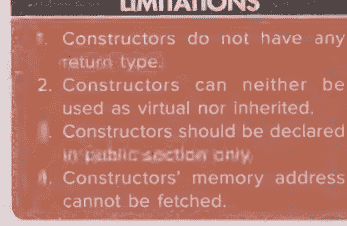

## 程序 6.3 对象的动态初始化


# Long-term fixed deposit system

```cpp
#include <iostream>

namespace std;
class Fixed_deposit
{
    long int P_amount; // Principal amount
    int Years; // Period of investment
    float Rate; // Interest rate
    float R_value; // Return value of investment
public:
    Fixed_deposit() {}
    Fixed_deposit(long int p, int y, float r=0.12);
    Fixed_deposit(long int p, int y, int r);
    void display(void);
};
Fixed_deposit :: Fixed_deposit(long int p, int y, float r)
{
    P_amount = p;
    Years = y;
    Rate = r;
    R_value = P_amount;
    for(int i=1; i<=y; i++)
        R_value = R_value * (1.0 + r);
}
Fixed_deposit :: Fixed_deposit(long int p, int y, int r)
{
    P_amount = p;
    Years = y;
    Rate = r;
    R_value = P_amount;
    for(int i=1; i<=y; i++)
        R_value = R_value*(1.0+float(r)/100);
}
void Fixed_deposit :: display(void)
{
    cout << "\n"
        << "Principal Amount = " << P_amount << "\n"
        << "Return Value = " << R_value << "\n";
}
int main()
{
    Fixed_deposit FD1, FD2, FD3; // deposits created
    long int p; // principal amount
```

## 使用 C++ 进行面向对象编程

```cpp
int Y;               // investment period, years

float r;             // interest rate, decimal form

int R;               // interest rate, percent form

cout << "Enter amount,period,interest rate(in percent)" <<"\n";

cin >> p >> Y >> R;

FD1 = Fixed_deposit(p,y,R);

cout << "Enter amount, period, interest rate(decimal form)" << "\n";

cin >> p >> y >> r;

FD2 = Fixed_deposit(p,y,r);

cout << "Enter amount and period" << "\n";

cin >> p >> y;

FD3 = Fixed_deposit(p,y);

cout << "\nDeposit 1";

FD1.display();

cout << "\nDeposit 2";

FD2.display();

cout << "\nDeposit 3";

FD3.display();

return 0;

}
```

Program 6.3 的输出为：

Enter amount,period,interest rate(in percent)
10000 3 18
Enter amount,period,interest rate(in decimal form)
10000 3 0.38
Enter amount and period
10000 3

Deposit 1
Principal Amount = 10000
Return Value = 16430.3

Deposit 2
Principal Amount = 10000
Return Value = 16430.3

Deposit 3
Principal Amount = 10000
Return Value = 14049.3

该程序使用了三个重载的构造函数。这些构造函数的参数值在运行时提供。用户可以以下列形式之一提供输入：

1. 金额、期限和以小数形式表示的利率。
2. 金额、期限和以百分比形式表示的利率。
3. 金额和期限。

> 由于构造函数根据适当的 参数进行了重载，因此与输入值匹配的构造函数将被调用。例如，第二构造函数用于形式 (1) 和 (3)，第三构造函数用于形式 (2)。请注意，对于形式 (3)，使用了带默认参数的构造函数。由于第三个参数的输入缺失，因此它使用 `r` 的默认值。

### 6.7 拷贝构造函数

我们在第 6.3 节中简要提到了拷贝构造函数。我们在第 6.4 节中使用了拷贝构造函数

```cpp
integer(integer &);
```

作为重载构造函数之一。

如前所述，拷贝构造函数用于从另一个对象声明并初始化一个对象。例如，语句

```cpp
integer I2 (I1);
```

将定义对象 `I2`，同时将其初始化为 `I1` 的值。此语句的另一种形式为

```cpp
integer I2 = I1;
```

通过拷贝构造函数初始化的过程称为拷贝初始化。请记住，语句

```cpp
I2 = I1;
```

不会调用拷贝构造函数。然而，如果 `I1` 和 `I2` 是对象，则该语句是合法的，并且只是逐成员地将 `I1` 的值赋给 `I2`。这是重载赋值运算符(`=`) 的任务。我们稍后会看到更多关于此的内容。

拷贝构造函数将同一类的对象的引用作为参数。让我们考虑一个构造和使用拷贝构造函数的简单示例，如 Program 6.4 所示。

## Program 6.4 拷贝构造函数

```cpp
#include <iostream>

using namespace std;

class code {

  int id;

  public:

};
```

(Contd.)

# 152 使用 C++ 进行面向对象编程

```cpp
code(){ // constructor
code(int a) { id = a; } // constructor again
code(code & x) // copy constructor
{
    id = x.id;
 // copy in the value
    void display(void) {
        cout << id;
    }
};
int main() {
    code A(100); // object A is created and initialized
    code B(A); // copy constructor called
    code C = A; // copy constructor called again
    code D;
    D = A; // D is not initialized, copy constructor not initialized
    cout << "\n id of A: " << A.display();
    cout << "\n id of B: " << B.display();
    cout << "\n id of C: " << C.display();
    cout << "\n id of D: " << D.display();
    return 0;
}
```

Program 6.4 的输出为：

- id of A: 100
- id of B: 100
- id of C: 100
- id of D: 100

> 使用了引用变量作为拷贝构造函数的参数。我们不能按值将参数传递给拷贝构造函数。

如果未定义拷贝构造函数，编译器会提供自己的拷贝构造函数。

### 6.8 动态构造函数

构造函数也可以在创建对象时分配内存。这将使系统能够为每个对象分配正确数量的内存，当对象大小不相同时，从而节省内存。在对象构造时分配内存称为对象的动态构造。内存是借助 `new` 运算符分配的。Program 6.5 显示了 `new` 在构造函数中的使用，这些构造函数用于在对象中构造字符串。

## Program 6.5 带 new 的构造函数

```cpp
#include <iostream>
#include <cstring>
using namespace std;
class String {
    char *name;
    int length;
public:
    String() // constructor-1
    {
        length = 0;
        name = new char[length + 1];
    }
    String(char *s) // constructor-2
    {
        length = strlen(s);
        name = new char[length + 1]; // one additional
        strcpy(name, s); // character for \0
    }
    void display(void) {
        cout << name << "\n";
        void join(String &a, String &b);
    }
}
void String :: join(String &a, String &b) {
    length = a.length + b.length;
    delete name;
    name = new char[length+1]; // dynamic allocation
    strcpy(name, a.name);
    strcat(name, b.name);
}
int main() {
    char *first = "Joseph";
    String name1(first), name2("Louis"), name3("Lagrange");
    String s1, s2;
s1.join(s1, name2);
s2.join(s1, name3);
name1.display();
name2.display();
name3.display();
s1.display();
s2.display();
    return 0;
}
```

# 154 使用 C++ 进行面向对象编程

Program 6.5 的输出为：

- Joseph
- Louis
- Lagrange
- Joseph Louis
- Louis Lagrange

成员函数 `join()` 连接两个字符串。它估计要连接的字符串的组合长度。它为组合字符串分配内存并使用字符串函数 `strcpy()` 和 `strcat()` 创建它。请注意，在函数 `join()` 中，`length` 和 `name` 是调用该函数的对象的成员，而 `a.length` 和 `a.name` 是通用参数 `a` 的成员。`main()` 函数程序将三个字符串连接成一个字符串。输出如下所示：

Joseph Lagrange

### 6.9 构造二维数组

我们可以使用类类型对象构造矩阵变量。Program 6.6 中的示例说明了如何构造大小为 `m x n` 的矩阵。

## Program 6.6 构造矩阵对象

```cpp
#include <iostream>
using namespace std;
class matrix
{
    int **p; // pointer to matrix
    int d1,d2; // dimensions
public:
    matrix(int x, int y);
    void get_element(int i, int j, int value)
        p[i][j]=value;
    int & put_element(int i, int j)
        return p[i][j];
};
matrix :: matrix(int x, int y)
{
    d1 = x;
    d2 = y;
    p = new int [*d1]; // creates an array pointer
    for(int i = 0; i < d1; i++) // creates space for each row
    p[i] = new int[d2];
}
```

(Contd.)

```cpp
int main() {
    int m, n;
    cout << "Enter size of matrix: ";
    cin >> m >> n;
    matrix A(m,n); // matrix object A constructed
    cout << "Enter matrix elements row by row \n";
    int i, j, value;
    for(i = 0; i < m; i++) {
        for(j = 0; j < n; j++) {
            cin >> value;
            A.get_element(i,j,value);
        }
        cout << "\n";
    }
    cout << A.put_element(1,2);
    return 0;
}
```

Program 6.6 的输出为：

Enter size of matrix: 3 4
Enter matrix elements row by row
11 12 13 14
15 16 17 18
19 20 21 22
17

17 是元素 `(1, 2)` 的值。

|  | 0 | 1 | 2 | 3 | 4 | 5 |
|---|---|---|---|---|---|---|
| Pointer P [0] |  |  |  |  |  |  |
| Pointer P [1] |  |  |  |  |  |  |
| Pointer P [2] |  |  |  | x |  |  |
| Pointer P [3] |  |  |  |  |  |  |

`d2` columns x represents the element `P[2] [3]`

构造函数首先创建一个指向大小为 `d1` 的 `int` 的向量指针。然后，它迭代地为每个元素 `p[i]` 分配一个 `d2` 的 `int` 类型向量。因此，如上图所示，从自由存储中为 `d1 x d2` 矩阵的元素分配空间。

### 6.10 对象

我们可以使用 `const` 关键字在对象声明之前创建和使用常量对象。例如，我们可以按如下方式创建 `X` 作为类 `matrix` 的常量对象：

```cpp
matrix X(m,n); // object X is const
```

任何尝试修改 `m` 和 `n` 的值都将生成编译时错误。此外，常量对象只能调用 `const` 成员函数。如我们所知，`const` 成员是函数原型或函数定义，其中关键字出现在函数的签名之后。

每当 `const` 对象尝试调用非 `const` 成员函数时，编译器都会生成错误。

### 6.11 析构函数

析构函数顾名思义，用于销毁由构造函数创建的对象。与构造函数一样，析构函数是一个成员函数，其名称与类名相同，但前面有一个波浪号。例如，类 `integer` 的析构函数可以定义如下：

```cpp
~integer() {
```

析构函数永远不接受任何参数也不返回任何值。它将在程序退出时由编译器隐式调用（或块或函数视情况而定）以清理不再可访问的存储空间。声明程序中的析构函数是一个良好的做法，因为它为将来使用释放内存空间。

每当在构造函数中使用 `new` 分配内存时，我们都应使用 `delete` 释放该内存。例如，上面讨论的 `matrix` 类的析构函数可以定义如下：

```cpp
matrix :: ~matrix() {
    for(int i=0; i<d1; i++)
        delete p[i];
    delete p;
}
```

这是必需的，因为当指向对象的指针超出作用域时，析构函数不会隐式调用。下面示例说明编译器已隐式调用了析构函数。

Program 6.7 析构函数的实现

```cpp
#include<iostream>
using namespace std;
int count=0;
class test
```


## 程序示例

```
(Contd.)

public:
    test()
{
        count++;
        cout<<"\n\nConstructor Msg: Object number <<" <<count << "\ncreated..";
    }
    ~test()
{
        cout<<"\n\nDestructor Msg: Object number <<" <<count << "\ndestroyed..";
        count--;
    }
}
```

```
int main()
{
    cout<<"Inside the main block..";
    cout<<"\n\nCreating first object T1..";
    test T1;
    {
        // Block 1
        cout<<"\n\nInside Block 1..";
        cout<<"\n\nCreating two more objects T2 and T3..";
        test T2,T3;
        cout<<"\n\nLeaving Block 1..";
    }
    cout<<"\n\nBack inside the main block..";
    return 0;
}
```

程序 6.7 的输出为：
```
Inside the main block..
Creating first object T1..
Constructor Msg: Object number 1 created..
Inside Block 1..
Creating two more objects T2 and T3..
Constructor Msg: Object number 2 created..
Constructor Msg: Object number 3 created..
Leaving Block 1..
Destructor Msg: Object number 3 destroyed.
Destructor Msg: Object number 2 destroyed.
Back inside the main block.
Destructor Msg: Object number 1 destroyed.
```

## 面向对象 C++ 编程

> 注 每次创建对象时都会调用类构造函数。同样，当程序控制离开当前块时，块中的对象开始被销毁，并为其中每一个调用析构函数。注意对象是按创建的逆序销毁的。最后，当 `main` 块退出时，对 `main` 内部剩余对象的析构函数将被调用。

与程序 6.7 中所示的类似功能可以通过使用带有构造函数和析构函数的静态数据成员来实现。由于是静态的，变量只会被初始化一次，即在创建第一个对象实例时。在所有后续对象创建过程中，构造函数会将计数变量加一。同样，析构函数会将计数变量减一，并在对象被销毁时。实现此场景时，程序 6.7 中的代码会略有变化，如下所示：

```
#include <iostream>

using namespace std;

class test {

private:

    static int count=0;

public:

    test() {

        count++;

    }

~test() {

        count--;

    }

}
```

析构函数的主要用途是在对象被销毁之前释放对象的内存。程序 6.8 演示了析构函数如何释放分配给对象的内存：

### 程序 6.8 使用析构函数进行对象的内存分配

```
#include<iostream>
using namespace std;

class test {
    int *a;
public:
```

```
test(int size)
{
    a = new int[size];
    cout<<"\n\nConstructor Msg: Integer array of size "<<size<<"created..";
}

~test()
{
    delete a;
    cout<<"\n\nDestructor Msg: Freed up the memory allocated for integer array";
}

int main()
{
    int s;
    cout<<"\n\nEnter the size of the array..";
    cin>>s;
    cout<<"\n\ncreating an object of test class..";
    test T(s);
    cout<<"\n\nPress any key to end the program.."
    return 0;
}
```

程序 6.8 的输出为：
```
Enter the size of the array..5
Creating an object of test class..
Constructor Msg: Integer array of size 5 created.
Press any key to end the program.
Destructor Msg: Freed up the memory allocated for integer array
```

## 摘要

- C++ 提供了一个特殊的成员函数称为构造函数，使对象在创建时能够自行初始化。
这是对象的自动初始化。
- 构造函数的名称与类的名称相同。
- 构造函数通常用于初始化变量和分配内存。
- 与普通函数类似，构造函数可以重载。
- 当对象在创建的同时被初始化时，会调用拷贝构造函数。
- 如果对象不修改其任何数据值，我们可以使对象为 `const`。
- C++ 还提供另一个称为析构函数的成员函数，用于在不再需要时销毁对象。

## 面向对象 C++ 编程

### 关键词

`automatic initialization` | `Const` | `Constructor` | `constructor overloading` | `copy constructor` | `copy initialization` | `default argument` | `default constructor` | `Delete` | `Destructor` | `dynamic construction` | `dynamic initialization` | `explicit call` | `implicit call` | `implicit constructor` | `initialization` | `new` | `parameterized constructor` | `reference` | `shorthand method` | `strcat()` | `strcpy()` | `strlen()` | `virtual`

### 复习题

#### 认知领域

- 6.1 说明构造函数；并说明在类中使用构造函数是否是强制性的。
- 6.2 设计构造函数函数的调用。
- 6.3 列出构造函数函数的一些特殊属性。
- 6.4 说明参数化构造函数。
- 6.5 一个类中可能存在多个构造函数。论证该陈述的正确性；并评估这种情况下的需求。
- 6.6 解释对象的动态初始化及其需求。
- 6.7 演示对象的动态初始化。
- 6.8 重写默认构造函数的函数。
- 6.9 区分以下语句：
`time T2(T1);`
`time T2 = T1;`
`T1` 和 `T2` 是 `time` 类的对象。
- 6.10 描述析构函数的重要性。用示例解释其用途。

#### 情感领域

- 6.11 论证以下陈述的正确性：
(a) 构造函数，如其他成员函数，可以在类的任何地方声明。
(b) 构造函数不返回任何值。
(c) 不接受参数的构造函数称为默认构造函数。
(d) 一个类至少应有一个构造函数。
(e) 析构函数永远不接受任何参数。
(f) 对象总是按创建的逆序销毁。

图例

- Precision Valuing/Responding/Organizing Applying Remembering Understanding

### 调试练习

#### 6.1 找出以下程序中的错误。

```
#include <iostream>
using namespace std;

class cube
{
private:
    int length;
    int breadth;
    int width;
public:
    cube() : length(5), breadth(5), width(5) { }
    cube(int l, int b) : length(l), breadth(b) { }
    int area_of_cube() { return length * breadth; }
    int volume_of_cube() { return length * breadth * width; }
    void Display(int temp)
{
        cout << temp << endl;
    }
};

int main()
{
    cube A1(4), B1,A2(4,4);
    int temp;
    cout << "Default Area " << endl;
    temp = A1.area_of_cube();
    A1.Display(temp);
    cout << "Default volume " << endl;
    temp = B1.volume_of_cube();
    A1.Display(temp);
    cout << "Area when argument is 4" << endl;
    temp = A2.area_of_cube();
    B1.Display(temp);
    return 0;
}
```

#### 6.2 找出以下程序中的错误。

```
#include <iostream>
using namespace std;

class dynamic
{
    int * p;
public:
    dynamic()
{
        p = new int;
    *p=10;
}
dynamic (int v)
{
p= new int;
*p=v;
}
int display()
{ return *p;
};
```

```
int main()
{
dynamic p1, p2(9);
cout<<"object p1 is:";
cout<<p1.display();
cout<<"object p2 is:"<<p2.display();
}
```

#### 6.3 找出以下程序中的错误。

```
#include <iostream>
using namespace std;

class des
{
public:
des(int x)
{
cout<<"start value " << x << endl;
}
~des(int x)
{
cout<<"hi";
};
```

```
int main()
{
des d1(9);
return 0;
}
```

### 干燥运行练习

#### 6.1 运行以下程序时会发生什么？

```
#include <iostream>
using namespace std;

class construct
{
int p,q;
public:
    construct(int x,int y)
{
        p=x;
        q=y;
    }
void Display()
{
    cout<<"\n"<<q<<"\n";
};
```

```
int main()
{
    construct item1(10,20), item2= construct(30,40);
    item1.Display();
    item2.Display();
    return 0;
}
```

#### 6.2 运行以下程序时会发生什么？

```
#include <iostream>
using namespace std;

class A
{
    int x;
public:
    A(int d)
{
        x=d;
    }
    ~A()
    {
        cout<<x;
    }
}
```

```
int main()
{
    A a(50), b(60);
    for(int i=1; i<=10; i++)
    {
        A y(i);
    }
    A c(70);
    return 0;
}
```

164
面向对象程序设计 C++

#### 6.3 运行以下程序时会发生什么？

```
#include <iostream>
using namespace std;

class pract
{
    int a,b,c;
public:
    pract int x, int y,int z;
    {
        a=x;
        b=y;
        c=z;
    }
    void show()
    {
        cout<<"nValues"<<a<<"\"	"<<b<<"\"	"<<c;
    }
}

int main()
{
    pract Object(10,20,30);
    pract Object2=Object;
    pract Object3=Object2;
    Object3.show();
    return 0;
}
```

#### 6.4 运行以下程序时会发生什么？

```
#include <iostream>
using namespace std;

class demo
{
    static int cnt;
    int data;
public:
    demo(int d)
    {
        data = d;
        cnt++;
    }
    ~demo()
    {
        cnt--;
    }
    void show()
    {
        cout<<"nValues"<<data<<"\"	"<<cnt;
    }
    static void fun(demo'& ob)
```

```
{
demo temp(ob.data);
temp.show();
ob.show();
};
int demo::cnt;
int main() {
{
demo ob1(20);
ob1.show();
demo::fun(ob1);
ob1.show();
demo ob2(30);
ob1.show();
ob2.show();
return 0;
}
}
```


## 编程练习

### 6.1 为第 5 章编程练习 5.1 至 5.5 中设计的类设计构造函数。

### 6.2 定义一个类 `String`，可作为用户定义的字符串类型使用。包含构造函数，使我们能够创建一个未初始化的字符串

`String s1;` // 长度为 0 的字符串
并在创建时用字符串常量初始化对象

`String s2("Well done!");`
包含一个函数将两个字符串相加形成第三个字符串。注意语句

`s2 = s1;`
将是复制一个字符串到另一个字符串的合理表达式。

编写一个完整的程序来测试你的类，以确保它执行以下任务：

- (a) 创建未初始化的字符串对象。
- (b) 使用字符串常量创建对象。
- (c) 正确连接两个字符串。
- (d) 显示所需对象。

### 6.3 书店维护出售书籍的库存清单。该清单包括作者、书名、价格和库存状况等详细信息。每当顾客想要一本书时，销售人员输入书名和作者搜索清单并显示是否可获得。如果不可获得，则显示适当的消息。如果可以，则系统显示书籍详细信息并要求输入所需副本的数量。显示所请求副本的总价；否则显示消息“Required copies not in stock”。
使用具有合适的成员函数和构造函数的类设计一个系统。在构造函数中使用 `new` 操作符分配内存空间。

### 6.4 改进练习 6.3 中的系统设计以纳入以下功能：

- (a) 书籍的价格应根据需要更新并使用私有成员函数来实现。
- (b) 每本书的库存价值应在交易完成后自动更新。
- (c) 成功和不成功的交易数量将为统计分析目的进行记录。使用静态数据成员来统计交易次数。

- 6.5 修改练习 6.4 的程序以演示使用指针访问成员。

- 6.6 编写一个程序使用构造函数查找质数。

- 6.7 编写一个程序通过重载构造函数显示汽车特性和规格。

## 多项选择题

- 1. `class P { public : P(P); }` 是无效的
而 `class P { public : P(&P); }` 是有效的 为什么
(a) 构造函数参数不能与类相同
(b) 构造函数可以接受其自身类的引用
(c) 两者都正确
(d) 两者都错误

- 2. 以下哪项不是 C++ 中的构造函数类型？
(a) 默认
(b) 拷贝
(c) 参数化
(d) 自动

- 3. 可以在一个类中声明并重载多个构造函数。
(a) 正确
(b) 错误
(c) 部分正确
(d) 部分错误

- 4. 以下哪项关于构造函数的说法不合适？
(a) 构造函数不返回类型
(b) 构造函数可以是虚函数
(c) 构造函数的内存地址无法获取
(d) 构造函数不能被继承

- 5. 以下输出是什么？
```
#include<iostream>
using namespace std;
class Goal {
public:
Goal() { cout << "Constructor called"; }
};
int main() {
Goal g1;
return 0;
}
```
(a) 运行时错误
(b) Constructor called
(c) 编译错误
(d) 以上都不是

- 6. 构造函数的返回类型是：
(a) int
(b) 无返回类型
(c) void
(d) float

7. 如果类名是 `Section` 那么声明拷贝构造函数的正确方法是？
(a) `Section (Section C)`
(b) `Section (Section *C)`
(c) `Section (constant Section &C)`
(d) `Section (constant Section *C)`

9. 析构函数与以下无关：
(a) 无参数
(b) 无返回值
(c) 与类同名
(d) 使用 `new` 释放分配的内存

8. 关于动态构造函数，以下哪项不正确？
(a) 对象创建时内存分配
(b) 与默认构造函数一起工作
(c) 不与参数化构造函数一起工作
(d) 用于内存分配使用 `new`

10. 以下哪项不是关于对象调用构造函数的正确说法
(a) 当调用拷贝构造函数时对象应被创建并初始化。
(b) 即使值不再修改，也无法创建对象。
(c) 构造函数使用 `new` 而析构函数使用 `delete` 进行内存分配和释放。
(d) 构造函数和析构函数的名字应与类名相同。

## 7 运算符重载和类型转换

### 学习目标

阅读本章后，你将能够

- 提供运算符重载的概述
- 演示如何重载一元和二元运算符
- 说明如何使用重载运算符操作字符串
- 讨论重载运算符的规则
- 讨论类型转换

### 7.1 引言

运算符重载是 C++ 语言最令人兴奋的特性之一。它是一种重要的技术，增强了 C++ 的可扩展性。我们不止一次地指出 C++ 试图使用户定义的数据类型与内置类型以几乎相同的方式表现。例如，C++ 允许我们用应用于基本类型的相同语法将两个用户定义类型变量相加。这意味着 C++ 有能力为数据类型提供运算符的特殊含义。给运算符赋予这种特殊含义的机制称为 *运算符重载*。

运算符重载为大多数 C++ 运算符创建新定义提供了灵活的选择。我们可以重载所有运算符，除了以下：

- 类成员运算符 `(., *)`
- 作用域解析运算符 `(::)`
- 大小运算符 `(sizeof)`
- 条件运算符 `(?:)`

我们不能重载这些运算符的原因可能归因于运算符以名称（例如类名）作为其操作数而不是值，就像普通运算符的情况一样。

尽管运算符的 *语义* 可以扩展，但我们不能改变其语法，即支配它的语法规则，例如操作数的数量、优先级和结合性。例如，乘法运算符的优先级高于加法运算符。当运算符被重载时，其原始含义不会丢失。例如，运算符 `+`，已被重载以添加两个向量，仍然可以用来添加两个整数。

### 7.2 定义运算符重载

要为运算符定义额外任务，我们必须指定它相对于运算符应用的类的关系。这通常借助一个特殊关键字 `operator` 来完成，该关键字描述任务。运算符函数的一般形式为：

```
return type typename :: operator op(arglist)
{
    Function body // task defined
}
```

其中 *return type* 是指定操作返回的值的类型，*op* 是被重载的运算符。*operator* 是函数名，一个关键字。

运算符函数可以是成员函数（非静态）或友元函数。它们之间的基本区别在于友元函数对一元运算符只有一个参数，对二元运算符有两个参数，而成员函数对一元运算符没有参数，对二元运算符有一个参数。这是因为用于调用成员函数的对象被隐式传递，因此对成员函数可用。这不适用于 *友元* 函数。参数可以按值或按引用传递。运算符函数在类中使用原型声明如下：

```
vector operator+(vector); // vector addition
vector operator-(); // unary minus
friend vector operator+(vector,vector); // vector addition
friend vector operator-(vector); // unary minus
vector operator-(vector &sa); // subtraction
int operator==(vector); // comparison
friend int operator==(vector,vector); // comparison
```

`vector` 是一种数据类型，可以表示大小和方向（如物理和工程中）或一系列点称为元素（在数学中）。

重载过程涉及以下步骤：

1. 创建一个类，定义要在重载操作中使用的类型。
2. 在类的 public 部分声明运算符函数 `operator op()`。它可以是成员函数或 *友元函数。*
3. 定义运算符函数以实现所需操作。

重载的运算符函数可以通过表达式调用，例如

```
op x or x op
```

对于一元运算符，和

```
x op y
```

对于二元运算符。*op x (或 x op)* 将被解释为

```
operator op (x)
```

对于 *友元函数*。类似地，表达式 x op y 将被解释为要么

## 使用 C++ 进行面向对象编程

`x.operator op (y)`

在成员函数中，或

`operator op (x,y)`

在友元函数中。当两种形式都被声明时，将应用标准参数匹配来解决任何歧义。

### 7.3 重载一元运算符

让我们考虑减法运算符。减法作为一元运算符使用时，取一个操作数。我们知道，该运算符应用于基本数据类型时会改变操作数的符号。这里我们将看到如何重载该运算符，使其可以像应用于 int 或 float 变量一样应用于对象。一元减法应用于对象时，应改变其每个数据项的符号。

程序 7.1 显示了如何重载减法运算符。

### 程序 7.1 重载一元减法

```
#include <iostream>
using namespace std;
class space
{
    int x;
    int y;
    int z;
public:
    void getdata(int a, int b, int c);
    void display(void);
    void operator-(); // overload unary minus
};
void space ::getdata(int a, int b, int c)
{
    x = a;
    y = b;
    z = c;
}
void space ::display(void)
{
    cout << "x = " << x << " ";
    cout << "y = " << y << " ";
    cout << "z = " << z << " \n";
}
void space ::operator-()
{
    x = -x;
    y = -y;
    z = -z;
}
```
```
int main() {
    space S;
    S.getdata(10, -20, 30);
    cout << "S : ";
    S.display();
    -S; // activates operator-() function
    cout << "-S : ";
    S.display();
    return 0;
}
```

程序 7.1 的输出为：

S : x = 10 y = -20 z = 30
-S : x = -10 y = 20 z = -30

> 运算符 `-()` 不接受参数。那么这个运算符函数做什么呢？它改变了激活它的对象 `S` 的数据成员的符号。由于该函数是同一类的成员函数，它可以直接访问激活它的对象成员。

记住，像这样的语句
`S2 = -S1;`

将无法工作，因为函数 `operator-()` 没有返回值。如果函数被修改为返回一个对象，则可以工作。

也可以使用友元函数重载减法运算符，如下所示：
`friend void operator-(space &s);` // declaration
`void operator-(space &s)` // definition

```
{
    S.x = -S.x;
    S.y = -S.y;
    S.z = -S.z;
}
```

> 请注意，参数是通过引用传递的。如果我们只传递对象的一个副本给 `operator-(-)`，则它将无法工作。因此，在运算符函数内部所做的更改将不会反映在调用对象中。

### 7.4 重载二元运算符

我们刚刚看到了如何重载一元运算符。相同的机制可用于重载二元运算符。在第 6 章中，我们说明了如何使用友元函数将两个复数相加。像这样的语句

`C = sum(A, B);` // functional notation.
使用。函数表示法可以用自然的表达式替换
`C = A + B;` // arithmetic notation
通过使用 `operator+()` 函数重载 `+` 运算符。程序 7.2 说明了如何实现这一点。

### 程序 7.2 重载 + 运算符

```
#include <iostream>
using namespace std;
class complex {
    float x; // real part
    float y; // imaginary part
public:
    complex() { // constructor 1
    complex(float real, float imag) // constructor 2
    { x = real; y = imag; }
    complex operator+(complex);
    void display(void);
};
complex complex ::operator+(complex c) {
    complex temp; // temporary
    temp.x = x + c.x; // these are
    temp.y = y + c.y; // float additions
    return (temp);
}
void complex::display(void) {
    cout << "(" << x << " + " << y << "i)" << "\n";
}
int main() {
    complex C1, C2, C3; // invokes constructor 1
    C1 = complex(2.5, 3.5); // invokes constructor 2
    C2 = complex(1.6, 2.7);
    C3 = C1 + C2;
    cout << "C1 = " << C1.display();
    cout << "C2 = " << C2.display();
    cout << "C3 = " << C3.display();
    return 0;
}
```

# 运算符重载和类型转换

程序 7.2 的输出为：

```
C1 = 2.5 + j3.5
C2 = 1.6 + j2.7
C3 = 4.1 + j6.2
```

让我们仔细看看函数 `operator+()` 并了解运算符重载是如何实现的。
`complex complex :: operator+(complex c)`

```
{
complex temp;
temp.x = x + c.x;
temp.y = y + c.y;
return(temp);
}
```

我们应该注意该函数的以下特点：

- 1. 它显式接收一个 `complex` 类型的参数。
- 2. 它返回一个 `complex` 类型的值。
- 3. 它是 `complex` 的成员函数。

该函数预期将两个复数值相加并返回一个复数值作为结果，但只接收一个值作为参数。另一个值来自哪里？现在让我们看看调用该函数的语句：

```
C3 = C1 + C2;      // invokes operator+() function
```

我们知道，成员函数只能由同一类的对象调用。这里，对象 `C1` 负责调用该函数，而 `C2` 扮演传递给该函数的参数的角色。上面的调用语句等价于

```
C3 = C1.operator+(C2);      // usual function call syntax
```

因此，在 `operator+()` 函数中，`C1` 的数据成员可以直接访问，而 `C2` 的数据成员（作为参数传递）则使用点运算符访问。因此，两者都可用于该函数。例如在语句中

```
temp.x = x + c.x;
```

作为规则，在重载二元运算符时，左操作数用于调用运算符函数，右操作数作为参数传递。

我们可以通过用以下语句替换整个函数体来避免创建 `temp` 对象：

```
return complex((x+c.x), (y+c.y));      // invokes constructor 2
```

当我们使用带参数列表的类名时意味着什么？当编译器遇到这样的语句时，它会调用适当的构造函数，用无名对象初始化并返回复制的内容
到一个对象。这样的对象称为临时对象，并在内容分配给另一个对象后立即释放空间。使用临时对象可以使代码更短、更高效、更易读。

### 7.5 使用友元重载二元运算符

如前所述，友元函数可用于代替成员函数重载二元运算符，唯一的区别是友元函数需要显式传递两个参数，而成员函数只需要一个。

上一节讨论的复数程序可以使用友元运算符函数进行修改，如下所示：

- 1. 用友元函数声明替换成员函数声明。

`friend complex operator+(complex, complex);`
- 2. 按如下方式重新定义运算符函数：

```
complex operator+(complex a, complex b)
{
    return complex((a.x+b.x), (a.y+b.y));
}
```

在这种情况下，语句

```
C3 = C1 + C2;
```

等价于

```
C3 = operator+(C1, C2);
```

在大多数情况下，使用友元函数或成员函数会得到相同的结果。那么为什么会有替代方案呢？在某些情况下，我们更愿意使用友元函数而不是成员函数。例如，当我们需要为二元运算符使用两种不同类型的操作数时，例如一个对象和另一个内置类型数据，如下所示：

```
A = B + 2; (or A = B * 2);
```

其中 `A` 和 `B` 是同一类的对象。这对成员函数有效，但语句

```
A = 2 + B; (or A = 2 * B)
```


将无法工作。这是因为负责调用成员函数的左操作数应为同一类的对象。然而，友元函数允许两种方法。怎么做？

可以回忆一下，对象不必用于调用友元函数，而是可以作为参数传递。我们可以使用友元函数将内置类型数据作为左操作数，对象作为右操作数。程序 7.3 说明了这一点，使用向量的标量乘法。它还展示了如何重载输入和输出运算符 `>>` `<<`。

### 程序 7.3 使用友元重载运算符

```cpp
#include <iostream>

using namespace std;

const int size = 3;

class vector
{
    int v[size];
public:
    vector(); // constructs null vector
    vector(int *x); // constructs vector from array
    friend vector operator*(int a, vector b); // friend 1
    friend vector operator*(vector b, int a); // friend 2
    friend istream& operator >> (istream &, vector &);
    friend ostream& operator << (ostream &, vector &);
};

vector ::vector() {
    for(int i=0; i<size; i++)
        v[i] = 0;
}

vector ::vector(int *x)
{
    for(int i=0; i<size; i++)
        v[i] = x[i];
}
```
(Contd.)

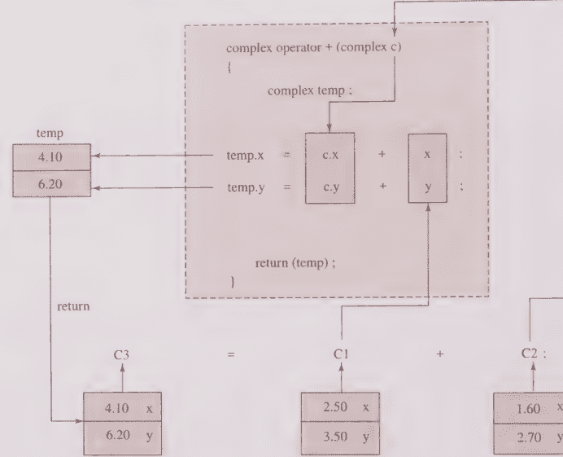

## 使用 C++ 进行面向对象编程

```cpp
vector operator *(int a, vector b)
{
  vector c;
  for (int i=0; i < size; i++)
    c.v[i] = a * b.v[i];
  return c;
}
```

```cpp
vector operator *(vector b, int a)
{
  vector c;
  for (int i=0; i<size; i++)
    c.v[i] = b.v[i] * a;
  return c;
}
```

```cpp
istream & operator >> (istream &din, vector &b)
{
  for (int i=0; i<size; i++)
    din >> b.v[i];
  return (din);
}
```

```cpp
ostream & operator << (ostream &dout, vector &b)
{
  dout << " " << b.v[0];
  for(int i=1; i<size; i++)
    dout << ", " << b.v[i];
  dout << "";
  return (dout);
}
```

```cpp
int x[size] = {2,4,6};
```

```cpp
int main()
{
  vector m; // invokes constructor 1
  vector n = x; // invokes constructor 2
  cout << "Enter elements of vector m " << "\n";
  cin >> m; // invokes operator->()
  cout << "\n";
  cout << "m = " << m << "\n"; // invokes operator<<()
  vector p, q;
  p = 2 * m; // invokes friend 1
  q = n * 2; // invokes friend 2
  cout << "\n";
  cout << "p = " << p << "\n"; // invokes operator<<()
  cout << "q = " << q << "\n";
  return 0;
}
```

程序 7.3 的输出为：

Enter elements of vector m
50 10

m = (5, 10, 15)
p = (10, 20, 30)
q = (4, 8, 12)

该程序将运算符 `*` 重载了两次，从而重载了运算符函数 `*()` 本身。在这两种情况下，函数都显式传递了两个参数，并且它们根据参数的类型像其他任何重载函数一样被调用。这使我们能够使用标量乘法的形式，例如

```cpp
p = 2 * m;      // equivalent to p = operator*(2,m);
q = n * 2;      // equivalent to q = operator*(n,2);
```

该程序及其输出在很大程度上是自解释的。第一个构造函数

```cpp
vector();
```

构造一个所有元素均为零的向量。因此。

```cpp
vector m;
```

创建一个向量 `m` 并将其所有元素初始化为 0。第二个构造函数

```cpp
vector(int &x);
```

创建一个向量并将指针参数 `x` 所指向的元素复制到其中。因此，语句

```cpp
int x[3] = {2, 4, 6};
vector n = x;
```

创建 `n` 为一个向量，其分量为 2、4 和 6。

### 7.6 使用运算符操作字符串

ANSI 使用字符数组、指针和字符串函数实现字符串。字符串没有操作符。C 中字符串操作的一个诸多缺点是，每当需要复制一个字符串时，程序员必须首先确定其长度并分配所需量的内存。

尽管 C++ 中也存在这些限制，但它允许我们创建自己的运算符定义，可以像十进制数字一样用于操作字符串。最近，ANSI C++ 委员会已将一个名为 `string` 的新类添加到 C++ 类库中，支持各种字符串操作。使用 `string` 的字符串操作在第 15 章中讨论。

例如，我们将能够使用如下语句

```cpp
string3 = string1 + string2;
if(string1 >= string2) string = string1;
```

字符串可以定义为类对象，然后像内置类型一样操作。由于字符串大小差异很大，我们需要为每个字符串分配内存并使用指针变量指向字符串数组。因此我们必须创建可以保存这两个信息片段的字符串对象：即长度和位置，这些对于字符串操作是必要的。一个典型的字符串类如下所示：

## 使用 C++ 进行面向对象编程

```cpp
class string
{
    char *p;            // pointer to string
    int len;             // length of string
public:
    ....                // member functions
    ....                // to initialize and
    ....                // manipulate strings
};
```

我们将考虑一个示例来说明重载运算符应用于字符串。程序 7.4 中所示的示例重载了运算符 `+` 和 `<==`，只是为了展示它们是如何实现的。这可以扩展以涵盖其他情况。

## 程序 7.4 字符串上的数学运算

```cpp
#include <iostream>
#include <string>
using namespace std;

class string
{
    char *p;
    int len;
public:
    string() {len = 0; p = 0};          // create null string
    string(const char *s);             // create string from arrays
    string(const string &s);            // copy constructor
    ~string(){delete p;}                // destructor
    // + operator
    friend string operator+(const string &s, const string &t);
    // <= operator
    friend int operator<=(const string &s, const string &t);
    friend void show(const string &s);
};

string :: string(const char *s)
{
    len = strlen(s);
    p = new char[len+1];
    strcpy(p,s);
}

string :: string(const string &s)
{
    len = s.len;
    p = new char[len+1];
    strcpy(p,s.p);
}
```

```cpp
// overloading + operator
string operator+(const string &, const string &)
{
    string temp;
    temp.len = s.len + t.len;
    temp.p = new char[temp.len+1];
    strcpy(temp.p, s.p);
    strcat(temp.p, t.p);
    return(temp);
}

// overloading <= operator
int operator<=(const string &, const string &)
{
    int m = strlen(s.p);
    int n = strlen(t.p);
    if (m <= n) return(1);
    else return(0);
}

nvoid show(const string s)
{
    cout << s.p;
}
```

```cpp
int main()
{
    string s1 = "New \n    string s2 = "York";
    string s3 = "Delhi";
    string string1, string2, string3;
    string1 = s1;
    string2 = s2;
    string3 = s1+s3;
    cout << "\nstring1 = "; show(string1);
    cout << "\nstring2 = "; show(string2);
    cout << "\n";
    cout << "\nstring3 = "; show(string3);
    cout << "\n";
    if (string1 <= string3)
    {
        show(string1);
        cout << " smaller than ";
        show(string3);
    }
    cout << "\n";
}
```

```cpp
else
{
    show(string3);
    cout << " smaller than ";
    show(string1);
    cout << "\n";
    return 0;
}
```

程序 7.4 的输出为：

string1 = New
string2 - York
string3 = New Delhi
New smaller than New Delhi

### 7.7 其他运算符重载示例

## 下标运算符 [] 的重载

下标运算符通常用于访问和修改数组中的特定元素。程序 7.5 演示了重载下标运算符以自定义其行为：

## 程序 7.5 下标运算符的重载

```cpp
#include<iostream>
using namespace std;

class arr
{
    int a[5];
public:
    arr(int *s)
    {
        int i;
        for(i=0;i<5;i++)
            a[i]=*s[i];
    }
    int operator [] (int k) //Overloading the subscript operator
    {
        return (a[k]);
    }
};
```

```cpp
int main() {
    int x[5] = {1,2,3,4,5};
    arr A(x);
    int i;
    for(i=0;i<5;i++) {
        cout<<A[i]<<"\t"; //Using subscript operator to access the
        //private array elements
    }
    return 0;
}
```

程序 7.5 的输出为：

1 2 3 4 5

正如上面的程序所示，我们使用对象名与下标运算符一起访问对象的私有数组元素。

## 重载指针到成员 (->) 运算符

指针到成员运算符 `->` 通常与对象指针一起使用以访问对象的任何成员。程序 7.6 演示了 `->` 运算符的重载：

## 程序 7.6 指针到成员运算符的重载

```cpp
#include<iostream>
using namespace std;

class test {
public:
    int num;
    int j;
    test(int j) {
        num=j;
    }
    test* operator ->(void) {
        return this;
    }
}
```

# 182 使用 C++ 进行面向对象编程

```cpp
int main() {
    test T(5);
    test *Ptr = &T;
    cout<<T.num = "<<T.num;"; //Accessing num normally
    cout<<\nPtr->num = "<<Ptr->num;"; //Accessing num using object pointer
    cout<<\nT->num = "<<T->num;"; //Accessing num using overloaded -> operator
    return 0;
}
```

程序 7.6 的输出为：

T.num = 5
Ptr->num = 5
T->num = 5

上面的程序同时演示了 `->` 运算符的正常 (`Ptr->num`) 以及重载 (`T->num`) 行为。

语句，

```cpp
return this;
```

返回指向自身的指针；即指向 `test` 类对象的指针。请注意，`->` 运算符是一元运算符。

### 7.8 重载运算符的规则

尽管重新定义运算符很简单，但在重载它们时仍存在某些限制和局限性。其中一些列在下面：

- 1. 只能重载现有运算符。不能创建新运算符。
- 2. 重载的运算符必须至少有一个是用户定义类型的操作数。
- 3. 重载运算符遵循原始运算符的语法规则。它们不能被覆盖。
- 4. 有一些运算符不能被重载。 (参见表 7.1)
- 5. 我们不能使用友元函数重载某些运算符。但是成员函数可以用来重载它们。
- 6. 通过成员函数重载的一元运算符不带参数并返回显式值，但通过友元函数重载的则带有一个参数（相关类的对象）并返回显式值。
, 带有一个参数（相关类的对象）。
- 7. 通过成员函数重载的二元运算符带有一个显式参数，而通过友元函数重载的则带两个显式参数。
- 8. 使用通过成员函数重载的二元运算符时，左操作数必须是相关类的对象。

9. 诸如 `+`, `-`, `*`, 和 `/` 之类的二元算术运算符必须显式返回一个值。它们不得尝试更改其所有者。

## 表 7.1 不能重载的运算符

| 运算符 | 描述 |
|---|---|
|  | 成员关系运算符 |
| * | 指向成员的指针运算符 |
| :: | 作用域解析运算符 |
| ? : | 条件运算符 |

### 限制
某些运算符如 `and`、`sizeof()` 不能被重载。
通过重载，你不能改变运算符成员的优先级和结合性。

## 表 7.2 不能使用友元的位置

| 运算符 | 描述 |
|---|---|
| = | 赋值运算符 |
| () | 函数调用运算符 |
| [] | 订阅运算符 |
| -> | 类成员访问运算符 |

### 7.9 类型转换

当不同类型的常量和变量在表达式中混合使用时，C 会根据某些规则对操作数进行自动类型转换。同样，赋值操作也会导致自动类型转换。赋值运算符右侧的数据类型会自动转换为左侧变量的类型。例如，语句

```cpp
int m;
float x = 3.14159;
m = x;
```

在将 `x` 的值赋给 `m` 之前会先将其转换为整数。因此，小数部分会被截断。只要涉及的数据类型是内置类型，类型转换就是自动的。

当它们是用户定义数据类型时会发生什么？

考虑以下将两个对象相加并将结果赋给第三个对象的语句。

```cpp
v3 = v1 + v2; // v1, v2 和 v3 都是类类型对象
```


当对象属于同一类类型时，加法和赋值操作会顺利进行，编译器不会提出任何异议。我们已经看到，对于类对象，右侧对象的全部数据成员的值 simply 被复制到左侧对象的对应成员中。如果其中一个操作数是对象而另一个是内置类型变量会怎样？或者，如果它们属于两个不同的类？

由于用户定义的数据类型是我们根据需求设计的，编译器不支持此类数据类型的自动类型转换。因此，如果需要此类操作，我们必须自己设计转换例程。

## 184 面向对象编程与 C++

在不兼容类型之间的数据转换中可能会出现三种情况：

- 1. 从基本类型到类类型的转换。
- 2. 从类类型到基本类型的转换。
- 3. 从一个类类型到另一个类类型的转换。

我们将详细讨论这三种情况。

### 基本类型到类类型

从基本类型到类类型的转换很容易实现。可以回忆一下，构造函数的用法已在多个示例中用于初始化对象。一个构造函数被用来从 `int` 类型数组构建 `vector` 对象。同样，我们还使用另一个构造函数从 `char*` 类型变量构建 `string` 对象。这些都是构造函数执行从参数类型到构造函数类类型的事实上的类型转换的例子。

考虑以下构造函数：

```
string :: string(char *a)
{
    length = strlen(a);
    P = new char[length+1];
    strcpy(P,a);
}
```

此构造函数从 `char*` 类型变量 `a` 构建一个 `string` 对象。变量 `length` 和 `p` 是类 `string` 的数据成员。一旦在 `string` 类中定义了此构造函数，它就可以用于从 `char*` 到 `string` 类型的转换。示例：

```
string s1, s2;
char* name1 = "IBM PC";
char* name2 = "Apple Computers";
s1 = string(name1);
s2 = name2;
```

语句

`s1 = string(name1)`
首先将 `name1` 从 `char*` 转换为 `string` 类型并将 `string` 类型的值赋给对象 `s1`。

`s2 = name2;`
也通过隐式调用构造函数完成同样的任务。

让我们再考虑一个将 `int` 类型转换为类类型的例子。

```
class time
{
    int hrs;
    int mins;
public:
    time(int t)    // 构造函数
```

```
{
  hrs = t/60; // t 以分钟为单位
  mins = t%60;
}
```

以下转换语句可以在函数中使用：

```
time T1; // 创建对象 T1
int duration = 85;
T1 = duration; // int 到类类型
```

完成此转换后，`T1` 的 `hrs` 成员将包含值 `1`，`mins` 成员将包含值 `25`，表示 `1` 小时 `25` 分钟。

> 注意 用于转换类型的构造函数接受单个参数，其类型是要转换的类型。

在这两个示例中，`=` 运算符的左操作数始终是类对象。因此，我们也可以使用重载的 `=` 运算符来实现此转换。

### 类到基本类型

构造函数在从基本类型到类类型的类型转换中做得很好。关于从类到基本类型的转换呢？构造函数不支持此操作。幸运的是，`C++` 允许我们定义一个重载的强制转换运算符，可用于将类数据转换为基本类型。重载运算符函数的一般形式，通常称为转换函数，是：

```
operator typename() {
  .... (函数语句)
  ....
}
```

这会将类类型数据转换为 `typename`。例如，`operator double()` 将类对象转换为 `double` 类型，`operator int()` 将类对象转换为 `int` 类型，等等。

考虑以下转换函数：

```
vector :: operator double() {
  double sum = 0;
  for(int i=0; i<size; i++)
    sum = sum + v[i] * v[i];
  return sqrt(sum);
}
```

此函数将 `vector` 转换为相应的标量大小。回想一下，向量的大小是其分量之和的平方根。`operator double()` 可以如下使用：

```
double length = double(V1);
or
double length = V1;
```

其中 `V1` 是 `vector` 类型的对象。两个语句的效果完全相同。当编译器遇到需要将类转换为基本类型的语句时，它会悄悄调用强制转换运算符函数来完成工作。

强制转换运算符函数应满足以下条件：

- * 它必须是类的成员。
- * 它不得指定返回类型。
- * 它不得有任何参数。

由于它是一个成员函数，它由对象调用，因此函数内部用于转换的值属于调用该函数的对象。这意味着该函数不需要参数。

在上一节描述的 `string` 示例中，我们可以按如下方式进行从 `string` 到 `char*` 的转换：

```
string :: operator char*()
{
    return(p);
}
```

### 一个类到另一个类类型

我们已经看到了从类类型到基本类型的数据转换技术。但在某些情况下，我们需要将一个类类型数据转换为另一个类类型。

示例：

`objX` 是类 `X` 的对象，`objY` 是类 `Y` 的对象。类 `Y` 数据被转换为类 `X` 类型数据，并将转换后的值赋给 `objX`。由于转换是从类 `Y` 到类 `X` 进行的，因此 `Y` 被称为源类，`X` 被称为目标类。

不同类对象的此类转换可以通过构造函数或转换函数进行。编译器以相同的方式处理它们。那么，我们如何决定使用哪种形式？这取决于我们希望转换函数位于源类还是目标类中。

我们知道强制转换运算符函数

```
operator typename()
```

将它所属的成员的对象转换为 `typename`。`typename` 可能是内置类型或用户定义类型（另一个类类型）。在对象之间，`typename` 指的是目标类。因此，当需要将一个类转换为另一个类时，可以使用强制转换运算符函数（即源类）。转换在源类中进行，结果被赋给目标类对象。

现在考虑一个单参数构造函数函数，它充当将参数类型转换为它所属的类类型的指令。这意味着参数属于源类并被传递给目标类进行转换。这使得转换构造函数必须放在目标类中。图 7.2 说明了这两种方法。

表 7.3 总结了全部三种转换。它表明，从类到任何其他类型（或任何其他类）的转换应使用源类中的强制转换运算符。另一方面，要执行从任何其他类型/类到类类型的转换，应在目标类中使用构造函数。

# 运算符重载与类型转换

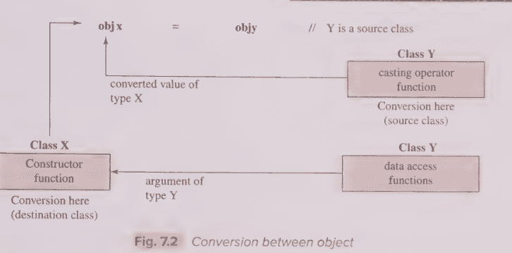

当在目标类中执行使用构造函数的转换时，我们必须能够访问作为参数发送的对象（由源类）的成员数据。由于源类的成员数据是私有的，我们必须在源类中使用特殊的访问函数，以便将其数据流传递到目标类。

## 表 7.3 类型转换

| 所需转换 | 源类 | 目标类 |
| --- | --- | --- |
| 基本 → 类 | 不适用 | 构造函数 |
| 类 → 基本 | 强制转换运算符 | 不适用 |
| 类 → 类 | 强制转换运算符 | 构造函数 |

## 一个数据转换示例

让我们考虑商店产品库存的一个示例。记录产品详情的一种方法是记录其商品代码、商店中的总件数以及每件商品的成本。另一种方法只是指定商品代码和商店中商品的价值。程序 7.7 中所示的示例使用了两个类，并展示了如何将一种类型的数据转换为另一种类型。

## 程序 7.7 数据转换

```
#include <iostream>
using namespace std;
class invent2;    // destination class declared
class invent1    // source class
{
    int code;      // item code
    int items;     // no. of items
    float price;   // cost of each item
public:
    invent1(int a, int b, float c);
    {
        code = a;
        items = b;
        price = c;
    }
    void putdata()
    {
        cout << "Code: " << code << "\n";
        cout << "Items: " << items << "\n";
        cout << "Value: " << price << "\n";
    }
    int getcode() {return code;}
    int getitems() {return items;}
    float getprice() {return price;}
    operator float() {return items * price;}
    /* operator invent2() // invent1 to invent2
    {
        invent2 temp;
        temp.code = code;
        temp.value = price * items;
        return temp;
    */
    // End of source class
}
class invent2 // destination class
{
    int code;
    float value;
public:
    invent2()
    {
        code = 0; value = 0;
    }
    invent2(int x, float y) // constructor for initialization
    {
        code = x;
        value = y;
    }
    void putdata()
    {
        cout << "Code: " << code << "\n";
        cout << "Value: " << value << "\n";
    }
    invent2(invent1 p) // constructor for conversion
    {
        code = p.getcode();
        value = p.getitems() * p.getprice();
    }
};
int main(){
    invent1 s1(100,5,140.0);
    invent2 d1;
    float total_value;
    /* invent1 To float */
    total_value = s1;
    /* invent1 To invent2 */
    d1 = s1;
    cout << "Product details - invent1 type" << "\n";
    s1.putdata();
    cout << "\nstock value" << "\n";
    cout << "Value = " << total_value << "\n\n";
    cout << "Product details-invent2 type" << "\n";
    d1.putdata();
    return 0;
}
```

程序 7.7 的输出将为：
Product details-invent1 type
Code: 100
Items: 5
Value: 140
Stock value
Value = 700
Product details-invent2 type
Code: 100
Value = 700

> 注意 我们已在类 `invent1` 中使用转换函数
    `operator float ()`
将 `invent1` 类型数据转换为 `float`。构造函数
    `invent2 (invent1)`
在类 `invent2` 中使用，将 `invent1` 类型数据转换为 `invent2` 类型数据。
请记住，我们也可以在类 `invent1` 中使用强制转换运算符函数
    `operator invent2 ()`
将 `invent1` 类型转换为 `invent2` 类型。然而，重要的是我们不要对同一类型转换同时使用构造函数和强制转换运算符，因为这会引入歧义，即转换应如何执行。

## 摘要

运算符重载是 `C++` 语言的一项重要特性，增强了其可扩展性。

使用重载特性，我们可以像基本数据类型一样，使用相同的语法将两个用户定义的数据类型作为对象相加。

我们几乎可以重载所有 `C++` 运算符，除了以下几种：

- 类成员访问运算符 (., ->)
- 作用域解析运算符 (::)
- 大小运算符 (sizeof)
- 条件运算符 (?:)

运算符重载借助一个特殊函数完成，称为运算符函数，它描述了运算符的特殊类型。

运算符重载存在一定的限制和局限性。运算符函数必须是非静态的成员函数或友元函数。重载的运算符必须至少有一个操作数是用户定义的类型。

编译器不支持用户定义数据类型的自动类型转换。我们可以使用强制转换运算符函数来实现这一点。

强制转换运算符函数应满足以下条件：

- 它必须是类的成员。
- 它不得指定返回类型。
- 它不得有任何参数。

## 关键术语

算术记法 | 二元运算符 | 强制转换 | 强制转换运算符 | 构造函数 | 转换函数 | 目标类 | 友元 | 友元函数 | 函数记法 | 操作字符串 | 运算符 | 运算符函数 | 运算符重载 | 标量乘法 | 语义 | sizeof | 源类 | 语法 | 临时对象 | 类型转换 | 一元运算符

## 复习问题

## 认知领域

7.1 展示类型转换的可用性。

7.2 表达运算符重载。

7.3 识别重载运算符的必要性。

7.4 列出 `C++` 中不能重载的运算符。

7.5 用其适当的语法描述一个运算符函数。

7.6 分离在重载一元运算符的定义中所需的参数。

7.7 说明友元函数不能用于重载赋值运算符 `=`。正确论证你的答案。

7.8 用合适的示例论证何时友元函数是强制性的。

### 心理运动领域

7.9 类 `alpha` 有如下构造函数：

`alpha(int, double b);`

证明此构造函数可用于转换类型。

我们有两个类 `X` 和 `Y`。如果 `a` 是 `X` 的对象，`b` 是 `Y` 的对象，我们想说 `a = b`。产生要使用的转换例程以及相关使用位置。

## 情感领域

为以下陈述的正确性辩护：

- (a) 使用运算符重载概念，我们可以改变运算符的含义。
(b) 运算符重载仅在应用于类对象时有效。
(c) 友元函数不能用于重载运算符。
(d) 使用重载的二元运算符时，左操作数隐式传递给成员函数。
(e) 重载的运算符必须至少有一个操作数是用户定义的类型。
(f) 运算符函数从不返回值。
(g) 通过运算符重载，类类型数据可以转换为基本类型数据。
(h) 构造函数可用于将基本类型转换为类类型数据。

## 图例

精确性 评价/回应/组织 应用 记忆 理解

## 调试练习

7.1 识别以下程序中的错误。

```
#include <iostream>
class Space
{
    int mCount;
public:
    Space ()
    {
      mCount = 0;
    }
    Space operator ++() {
      mCount++;
      return Space(mCount);
    }
int main() {
  Space objSpace;
  objSpace++;
  return 0;
}
```

7.2 识别以下程序中的错误。

```
#include <iostream>
using namespace std;
enum WeekDays {
  mSunday,
  mMonday,
  mTuesday,
  mWednesday,
  mThursday,
  mFriday,
  mSaturday
};
bool op==(WeekDays& w1, WeekDays& w2) {
  if (w1== mSunday && w2 == mSunday)
    return 1;
  else if (w1== mSunday && w2 == mSunday)
    return 1;
  else if (w1== mSunday && w2 == mSunday)
    return 1;
  else if (w1== mSunday && w2 == mSunday)
    return 1;
  else if (w1== mSunday && w2 == mSunday)
    return 1;
  else if (w1== mSunday && w2 == mSunday)
    return 1;
  else
    return 0;
}
int main()
{
    WeekDays w1 = mSunday, w2 = mSunday;
    if (w1==w2)
        cout << "Same day";
    else
        cout << "Different day";
    return 0;
}
```

7.3 识别以下程序中的错误。

```
#include <iostream>
class Room
{
    float mWidth;
    float mLength;
public:
    Room()
    {}
    Room(float w, float h)
```


```cpp
:mWidth(w), mLength(h)
{
}
operator float()
{
    return (float)mWidth * mLength;
}
float getWidth()
{}
float getLength()
{
    return mLength;
}
}
int main()
{
    Room objRoom1(2.5, 2.5);
    float fTotalArea;
    fTotalArea = objRoom1;
    cout << fTotalArea;
    return 0;
}
```

# DRY-RUN EXERCISES

### 7.1 当运行以下程序时会发生什么？

```cpp
#include <iostream>
using namespace std;
class demo
{
    int data;
    friend void operator-(demo &);
public:
    demo(int d)
    {
        data = d;
    }
    void show()
    {
        cout<<"\nValue = "<<data;
    }
    void operator -(demo & d)
    {
        d.data = -d.data;
    }
int main()
{
    demo ob(10);
    ob.show();
    -ob;
    ob.show();
    return 0;
}
```

### 7.2 当运行以下程序时会发生什么？

```cpp
#include <iostream>
using namespace std;
class demo
{
    int data;
public:
    demo(int d)
    {
        data = d;
    }
    void show()
    {
        cout<<"\nValue = "<<data;
    }
    friend void operator -(demo);
```
```
void operator - (demo d)
{
    d.data = -d.data;
}
int main()
{
    demo ob(10);
    ob.show();
    -ob;
    ob.show();
    return 0;
}
```

# 7.3 当运行以下程序时会发生什么？

```cpp
#include <iostream>
using namespace std;
class demo
{
    int data;
    public:
    demo() {}
    demo(int d)
    {
        data = d;
    }
    void show()
    {
        cout << data;
    }
    void operator ++()
    {
        data--;
    }
    demo & operator =(demo & t)
    {
        t.data = data;
        return t;
    }
};
int main()
{
    demo ob1(10), ob2;
    ++ob1;
    ob1 = ob2;
    ob1.show();
    ob2.show();
    return 0;
}
```

# Object-Oriented Programming with C++

# PROGRAMMING EXERCISES

NOTE: For all the exercises that follow, build a demonstration program to test your code.

+   7.1 创建一个 `FLOAT`，包含一个 `float` 数据成员。重载全部四个算术运算符，使其对 `FLOAT` 的对象进行操作。[...]
+   7.2 设计一个类 `Polar`，用极坐标半径和角度描述平面上的一个点。极坐标中的一个点如图 7.3 所示。

使用重载的 `+` 运算符来相加两个 `Polar` 对象。注意我们不能直接相加两个点的数值。这需要首先将点转换为直角坐标，相加对应的直角坐标，最后再将结果转换回极坐标。你需要使用以下三角公式：

```
x = r * cos(a);
y = r * sin(a);
a = atan(y/x); // arc tangent
r = sqrt(x*x + y*y); [...]
```

+   7.3 创建一个大小为 m x n 的类 `MAT`。定义 `MAT` 类型的所有可能矩阵运算。[...]
+   7.4 定义一个类 `String`。使用重载的 `==` 运算符来比较两个字符串。[...]
+   7.5 定义两个类 `Polar` 和 `Rectangle` 来表示极坐标系和矩形坐标系中的点。使用转换例程在两种系统之间进行转换。
+   7.6 编写一个程序，使用一元和二元运算符重载对复数执行数学运算。
+   7.7 编写一个程序，通过重载关系运算符 (`==`, `!=`, `>=`, `<=`) 来比较两个分数。

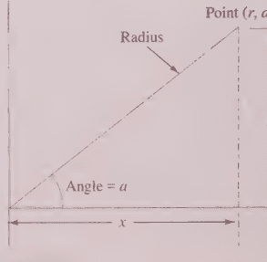

# MULTIPLE-CHOICE QUESTIONS

+   1. Which of the following operator can be overloaded
(a) ?
(b) ::
(c) `+`
(d) `*`

+   (c) vector
(d) friend
3. By default of which of the operator is overloaded by compiler automatically

+   a) Comparison operator (`==`) b) Assignment Operator (`=`)

+   2. The keyword for operator overloading
(a) op
(b) operator

+   a) Comparison operator (`==`)
(b) both

# Operator Overloading and Type Conversions

(c) Assignment Operator (`=`)

8. Correct symbol by ternary operator is

+   (d) none
(a) `&&&`
(b) `+=`
(c) `*`
(d) `?`

4. What is difference between operator `++(a)` and operator `++(int p)`

+   (a) prefix and postfix operator
(b) postfix and prefix operator
(c) both are same prefix operator
(d) both are same postfix operator

9. Choose the correct statement about operator overloading

+   (a) Arithmetic operator cannot be overloaded
(b) Operator precedence changes after overloading
(c) Unary plus and minus can be overloaded
(d) All of the above are correct

5. Which of the following operator must be a member function in spite of global

+   (a) Boolean operator
(b) Conversion operator
(c) Comparison operator
(d) New operator

10. Which operator cannot be overloaded

+   (a) `[]`
(b) `sizeof()`
(c) `=`
(d) `====`

6. Unary operator needs

+   (a) two operands to perform its operation
(b) one operand to perform its operation
(c) Three operands to perform its operation
(d) any operands to perform its operation

11. Choose the incorrect statement about casting operator function

7. Choose the binary operator

+   (a) `++`
(b) `*`
(c) `+`
(d) `--`

+   (a) It must be a class member
(b) It must not specify a return type
(c) It must not have any argument
(d) Automatic type conversion is possible for user defined types

# Inheritance: Extending Classes

# LEARNING OBJECTIVES

After going through this chapter, you will be able to

+   - Provide an overview of extending classes through inheritance
- Explain single inheritance
- Know the use of protected modifier
- Illustrate the concept of multilevel inheritance
- Explain multiple inheritance
- Describe hierarchical and hybrid inheritance
- Discuss the concepts of abstract and virtual base classes
- Illustrate how constructors are used in derived classes for initializing objects
- Discuss nesting of classes

### 8.1 INTRODUCTION

Reusability is yet another feature of OOP. It is always nice if we could reuse something that already exists rather than trying to create the same all over again. It would not only save time and money but also reduce frustration and increase reliability. For instance, the reuse of a class that has already been tested, debugged and used many times can save the cost of developing and testing the same again.

Fortunately, C++ strongly supports the concept of reusability. The C++ classes can be reused in several ways. Once a class has been tested and written, it can be adapted by other programmers to suit their requirements. This is basically done by creating new classes, reusing the properties of the existing ones. The mechanism of deriving a new class from an old one is called inheritance (or derivation). The old class is referred as the base class and the new one is called the derived or subclass.

The derived class inherits some or all of the traits from the base class. A class can also inherit properties from more than one class or from more than one level. A derived class with only one base class is called single inheritance and with several base classes is called multiple inheritance. On the other hand, the traits of one class may be inherited by more than one class. This process is known as hierarchical inheritance. The mechanism of deriving a class from another ‘derived class’ is known as multilevel inheritance. Figure 8.1 shows various forms of inheritance that could be used for writing extensible programs. The direction of arrow indicates the direction of inheritance.(Some authors show the arrow in opposite direction meaning 'inherited from'.)

199

Inheritance Extending Classes

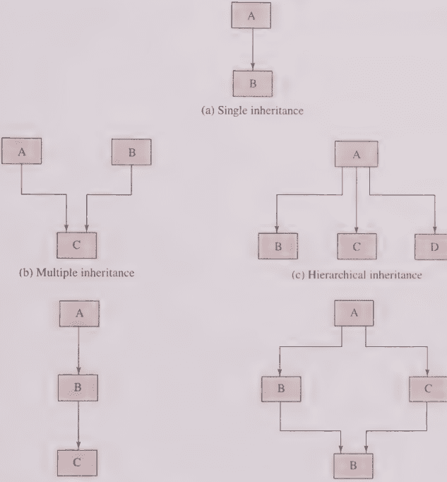

(a) Single inheritance

(b) Multiple inheritance

(c) Hierarchical inheritance

(d) Multilevel inheritance

(e) Hybrid inheritance

Fig. 8.1 Forms of inheritance

### 8.2 DEFINING DERIVED CLASSES

A derived class can be defined by specifying its relationship with the base class in addition to its own details. The general form of defining a derived class is:

```
class derived-class-name : visibility-mode base-class-name
{
    // ...
    // members of derived class
    // ...
};
```

The colon indicates that the derived-class-name is derived from the base-class-name. The visibility-mode is optional and, present, may be either private or public. The default visibility-mode is private. Visibility mode specifies whether features of the base class are privately derived or publicly derived.

# 200 Object-Oriented Programming with C++

Examples:

```
class derived: private base    // private derivation
{
    members of derived
}
class derived: public base     // public derivation
{
    members of derived
}
class derived: base               // private derivation by default
{
    members of derived
}
```


当基类被派生类私有继承时，基类的`public`成员变为派生类的`private`成员，因此基类的`public`成员只能被派生类的成员访问。对派生类的对象不可访问。记住，基类的`public`成员可通过点运算符由其自身对象访问。结果是基类的任何成员都无法被派生类的对象访问。

另一方面，当基类被公有继承时，基类的`public`成员变为派生类的`public`成员，且可被派生类的对象访问。在这两种情况下，`private`成员均不被继承，因此基类的`private`成员永远不会成为派生类的成员。

在继承中，基类的部分数据元素和成员函数被`inherit`到派生类中。我们可以添加自己的数据和成员函数，从而扩展基类的功能。继承在用于修改和扩展现有类能力时，成为增量编程的强大工具。

## 8.3 SINGLE INHERITANCE

让我们考虑一个简单示例来说明继承。程序 8.1 显示了一个基类`B`和一个派生类`D`。类`B`包含一个`private`数据成员、一个`public`数据成员和三个`public`成员函数。类`D`包含一个`private`数据成员和两个`public`成员函数。

### Program 8.1 Single Inheritance: Public

```cpp
#include <iostream>
using namespace std;
class B
{
    int a;          // private; not inheritable
public:
    int b;          // public; ready for inheritance
    void set_ab();
    int get_a(void);
    void show_a(void);
}
class D : public B // public derivation
{
    int c;
    public:
        void mul(void);
        void display(void);
};
```
```cpp
void B :: set_ab(void)
{
    a = 5; b = 10;
}
```
```cpp
int B :: get_a()
{
    return a;
}
```
```cpp
void B :: show_a()
{
    cout << "a = " << a << "\n";
}
```
```cpp
void D :: mul()
{
    c = b * get_a();
}
```
```cpp
void D :: display()
{
    cout << "a = " << get_a() << "\n";
    cout << "b = " << b << "\n";
    cout << "c = " << c << "\n\n";
}
```
```cpp
int main()
{
    D d;
    d.set_ab();
    d.mul();
    d.show_a();
    d.display();
    d.b = 20;
    d.mul();
    d.display();
    return 0;
}
```

程序 8.1 的输出为：

```
a = 5
a = 5
b = 10
c = 50
```

类`D`是基类`B`的公有派生。因此，`D`继承了`B`的所有`public`成员并保留可见性。因此，基类`B`的`public`成员也是派生类`D`的`public`成员。`B`的`private`成员不能被`D`继承。类`D`实际上将拥有比声明时所包含的成员更多的成员，如图 8.2 所示。

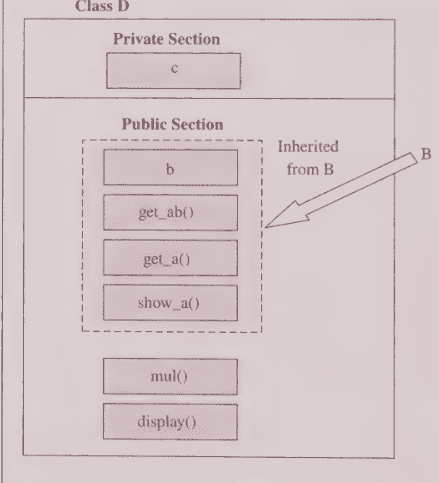

图 8.2 通过公有派生向类添加更多成员

该程序说明了类`D`的对象可以访问`B`的所有`public`成员。让我们来看一下函数`show_a()`和`mul()`：

```cpp
void show_a()
{
  cout << "a = " << a << "\n";
}
```
```cpp
void mul()
{
  c = b * get_a(); // c = b * a
}
```

尽管数据成员`a`在`B`中是`private`且不能被继承，但`D`的对象仍能通过`B`的继承成员函数访问它。

现在让我们考虑私有派生的情况。

```cpp
class B
{
    int a;
  public:
    int b;
    void get_ab();
  void get_a();
    void show_a();
};
class D : private B
{
    int c;
  public:
    void mul();
    void display();
};
```

派生类`D`的成员关系如图 8.3 所示。在私有派生中，基类的`public`成员变为派生类的`private`成员。因此，`D`的对象不能直接访问`B`的`public`成员函数。

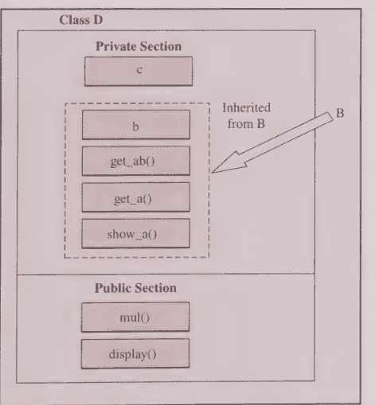

图 8.3 通过私有派生向类添加更多成员

## 面向对象 C++ 编程

语句如下

```cpp
d.get_ab();              // get_ab() 是私有的
d.get_a();               // get_a() 也是
d.show_a();              // 以及 show_a()
```

将无法工作。然而，这些函数可以在`mul()`和`display()`内部像普通函数一样使用，如下所示：

```cpp
void mul() {
    get_ab();
    c = b * get_a();
}
void display() {
    show_a();
    cout << "b = " << b << " c = " << c << "\n";
}
```

程序 8.2 单继承：私有
程序 8.2 对私有派生进行了这些修改。请将其与程序 8.1 进行比较。

```cpp
#include <iostream>
using namespace std;
class B {
    int a;\                  // 私有；不可继承
public:
    int b;
    void get_ab();\         // 公有；可供继承
    void get_a(void);
    void show_a(void);
};
class D : private B {\      // 私有派生
    int c;
public:
    void mul(void);
    void display(void);
}
```
```cpp
// void B :: : get_ab(void);
{
  cout << "Enter values for a and b: ";
  cin >> a >> b;
}
int B :: get_a() {
  return a;
}
void B :: show_a() {
  cout << "a = " << a << "\n";
}
void D :: mul() {
  get_ab();
  c = b * get_a();    // 'a' 不能直接使用
}
void D :: display() {
  show_a();
  cout << "b = " << b << "\n";
  << "c = " << c << "\n";
}
// ------------------------------------------------------
int main() {
  D d;
  // d.get_ab(); WON'T WORK
  d.mul();
  // d.show_a(); WON'T WORK
  d.display();
  // d.b = 20; WON'T WORK; b 已变为私有
  d.mul();
  d.display();
  return 0;
}
```

程序 8.2 的输出为：
Enter values for a and b: 5 10
a = 5
b = 10
c = 50

## 面向对象 C++ 编程

```
Enter values for a and b: 12 20
a = 12
b = 20
c = 240
```

假设基类和派生类定义了同名函数。当派生类对象调用该函数时会发生什么？在这种情况下，派生类函数取代基类的定义。然而，如果派生类未重新定义该函数，则将调用基类函数。

### 8.4 使私有成员可继承

我们刚刚看到了如何在不修改其本身的情况下增加现有类的能力。我们还看到类的`private`成员不能被继承，因此对派生类来说是不可直接使用的。如果`private`数据需要被派生类继承，我们该怎么办？可通过修改`private`成员的可见性限制，使其变为`public`来实现。这将使其可被程序中的所有其他函数访问，从而失去数据隐藏的优势。

C++ 提供了第三种可见性修饰符`protected`，其在继承中具有有限的作用。声明为`protected`的成员可被其所在类的成员函数以及从它派生的任何类访问。它不能被这两个类之外的函数访问。一个类现在可以使用全部三种可见性模式，如下所示：

```cpp
class alpha {
  private:
    .... // 可选
    .... // 对其类的成员函数可见
    .... // 在其类内部
  protected:
    .... // 对其自身及派生类的成员函数可见
    .... // 
  public:
    .... // 对程序中所有函数可见
    .... // 
};
```

当`protected`成员以`public`模式继承时，它在派生类中变为`protected`，因此可被派生类的成员函数访问。`protected`成员在`private`模式派生中继承时，在派生类中变为`private`。尽管它可供派生类的成员函数使用，但不能再被进一步继承（因为`private`成员不能被继承）。图 8.4 是两种派生层级的示意图。

关键字`private`、`protected`和`public`可以在类声明中以任意顺序出现任意多次。例如：

```cpp
class beta {
  protected:
  public:
```

## 类 B

不可继承 X ← 不可继承

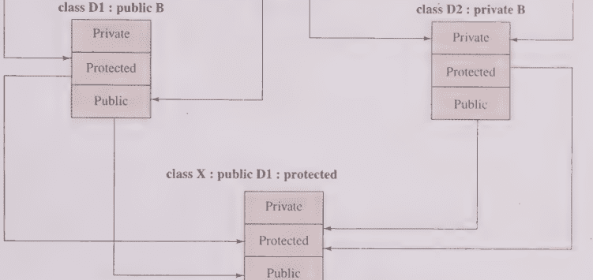

图 8.4 继承对成员可见性的影响

```cpp
private:
....
public:
....
};
```

是一个有效的类定义。

然而，通常的做法是按如下方式使用它们：

```cpp
class beta
{
....
protected:
....
public:
....
}
// 默认私有
```

也可以以`protected`模式继承基类（称为`protected`派生）。在`protected`派生中，基类的`public`和`protected`成员都变为派生类的`protected`成员。表 8.1 总结了基类成员的可见性在三种派生类型中的修改方式。

## 面向对象 C++ 编程

| 表 8.1 继承成员的可见性 |
| 基类可见性 | 公有派生 | 派生类可见性 |
| 私有 -> | 不继承 | 不继承 | 不继承 |
| 受保护 -> | 受保护 | 私有 | 受保护 |
| 公有 -> | 公有 | 私有 | 受保护 |

现在回顾一下对类的 **private** 和 **protected** 成员的访问控制。哪些函数可以访问这些成员？它们可以是：

- 1. 类的友元函数。
- 2. 友元类的成员函数。
- 3. 派生类的成员函数。

虽然友元函数和友元类的成员函数可以直接访问 **private** 和 **protected** 数据，但派生类的成员函数只能直接访问 **protected** 数据。然而，它们可以通过基类的成员函数访问 **private** 数据。图 8.5 说明了各种情况下访问控制机制的工作方式。图 8.6 显示了对类成员访问控制的简化视图。

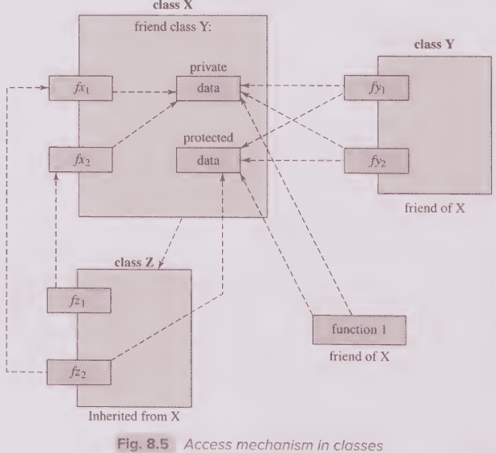

# 所有用户

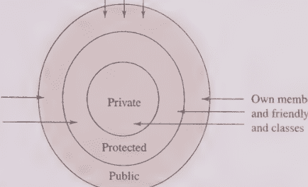

图 8.6 类成员访问控制的简单视图

### 8.5 多层继承

并不罕见一个类从另一个类派生，如图 8.7 所示。类 A 作为派生类 B 的基类，而 B 又作为派生类 C 的基类。类 B 被称为中间基类，因为它为 A 和 C 之间的继承提供了链接。链 ABC 被称为继承路径。

具有多层继承的派生类声明如下：

```cpp
class A{...};      // Base class
class B: public A {...};  // B derived from A
class C: public B {...};  // C derived from B
```

此过程可以扩展到任意数量的层级。

| 基类 | 祖父 |
|---|---|
| 中间基类 | 父亲 |
| 派生类 | 孩子 |

让我们考虑一个简单的例子。假设一批学生的考试成绩存储在三个不同的类中。类`student`存储学号，类`test`存储两门科目的成绩，类`result`包含考试的总成绩。类`result`可以通过多层继承继承考试成绩的详细信息和学生的学号。

图 8.7 多层继承

```cpp
class student {
protected:
  int roll_number;
public:
  void get_number(int);
  void put_number(void);
};
```

### 面向对象程序设计 with C++

```cpp
void student :: get_number(int a)
{
    roll_number = a;
}
void student :: put_number()
{
    cout << "Roll Number: " << roll_number << "\n";
}
class test : public student
// First level derivation
{
protected:
    float sub1;
    float sub2;
public:
    void get_marks(float, float);
    void put_marks(void);
}
void test :: get_marks(float x, float y)
{
    sub1 = x;
    sub2 = y;
}
void test :: put_marks()
{
    cout << "Marks in SUB1 = " << sub1 << "\n";
    cout << "Marks in SUB2 = " << sub2 << "\n";
}
class result : public test
{
    float total;
public:
    void display(void);
}
```

类`result`在通过“父亲”从“祖父”继承后，将包含以下成员：

```cpp
private:
```


`float total; // own member`

`protected:`

`int roll_number; // inherited from student`

`// via test`

`float sub1; // inherited from test`

`float sub2; // inherited from test`

`public:`

`void get_number(int); // from student via test`

`void put_number(void); // from student via test`

`void get_marks(float, float); // from test`

`void put_marks(void); // from test`

`void display(void); // own member`

继承的函数 `put_number()` 和 `put_marks()` 可以在 `display()` 函数的定义中使用：

```
void result :: display(void)
{
    total = sub1 + sub2;
    put_number();
    put_marks();
    cout << "Total = " << total << "\n";
}
```

这里有一个简单的 `main()` 程序：

```
int main()
{
    int student1; // student1 created
    student1.get_number(111);
    student1.get_marks(75.0, 59.5);
    student1.display();
    return 0;
}
```

这将显示 `student1` 的结果。完整程序显示在程序 8.3 中。

# 程序 8.3 多层继承

```
#include <iostream>
using namespace std;
class student {
    protected:
        int roll_number;
    public:
        void get_number(int);
        void put_number(void);
}
void student :: get_number(int a)
{
    roll_number = a;
}
void student :: put_number()
{
    cout << "Roll Number: " << roll_number << "\n";
}
class test : public student // First level derivation
```
(续)

```
protected:
    float sub1;
    float sub2;
public:
    void get_marks(float, float);
    void put_marks(void);
};
```

```
void test :: get_marks(float x, float y) {
    sub1 = x;
    sub2 = y;
}
```

```
void test :: put_marks() {
    cout << "Marks in SUB1 = " << sub1 << "\n";
    cout << "Marks in SUB2 = " << sub2 << "\n";
}
```

```
class result : public test // Second level derivation {
    float total; // private by default
    public:
    void display(void);
};
```

```
void result :: display(void) {
    total = sub1 + sub2;
    put_number();
    put_marks();
    cout << "Total = " << total << "\n";
}
```

```
int main() {
    result student1; // student1 created
    student1.get_number(111);
    student1.get_marks(75.0, 59.5);
    student1.display();
    return 0;
}
```

程序 8.3 的输出将为：
Roll Number: 111
Marks in SUB1 = 75

Marks in SUB2 = 59.5
Total = 134.5

继承，扩展类

## 8.6 多重继承

一个类可以继承两个或多个类的属性，如图 8.8 所示。这被称为多重继承。多重继承允许我们将多个现有类的特性组合起来作为定义新类的起点。它就像孩子继承一个父母的身体特征和另一个父母的智力。

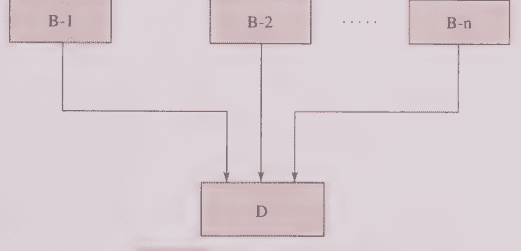

图 8.8 多重继承

具有多个基类的派生类的语法如下：

```
class D: visibility B-1, visibility B-2 ...
{
    ...
    (Body of D)
    ...};
```

其中，`visibility` 可以是 `public` 或 `private`。基类由逗号分隔。

示例：

```
class P : public M, public N
{
    public:
        void display(void);
};
```

类 `M` 和 `N` 已按如下方式指定：

```
class M
{
    protected:
        int m;
    public:
        void get_m(int);
};
```

### 面向对象程序设计 with C++

```
void M :: get_m(int x)
{
    m = x;
}
class N
{
    protected:
        int n;
    public:
        void get_n(int);
}
void N :: get_n(int y)
{
    n = y;
}
```

如上声明的派生类 `P`，实际上将包含 `M` 和 `N` 的所有成员，加上其自身的成员，如下所示：

```
class P
{
    protected:
```
| int m; // from M |
| int n; // from N |

```
public:
```
| void get_m(int); // from M |
| void get_n(int); // from N |
| void display(void); // own member |

```
};
```

成员函数 `display()` 可以定义如下：

```
void P :: display(void)
{
    cout << "m = " << m << "\n";
    cout << "n = " << n << "\n";
    cout << "m*n = " << m*n << "\n";
}
```

提供用户界面的 `main()` 函数可以写成如下：

```
main()
{
    P p;
    p.get_m(10);
    p.get_n(20);
    p.display();
}
```

# 程序 8.4 多重继承

程序 8.4 显示了整个代码，说明了如何在多重继承模式下实现这三个类。

```
#include <iostream>
using namespace std;
class M
{
protected:
    int m;
public:
    void get_m(int);
};
class N
{
protected:
    int n;
public:
    void get_n(int);
};
class P : public M, public N
{
public:
    void display(void);
};
void M :: get_m(int x)
{
    m = x;
}
void N :: get_n(int y)
{
    n = y;
}
void P :: display(void)
{
    cout << "m = " << m << "\n";
    cout << "n = " << n << "\n";
    cout << "m*n = " << m*n << "\n";
}
```

```
int main()
{
    P p;
    p.get_m(10);
    p.get_n(20);
    p.display();
    return 0;
}
```

程序 8.4 的输出将为：

m = 10
n = 20
m+n = 200

# 继承中的歧义解析

偶尔，我们在使用多重继承时可能会遇到一个问题，当一个函数名出现在多个基类中时。考虑以下两个类。

```
class M {
public:
    void display(void)
    {
        cout << "Class M\n";
    }
};
class N {
public:
    void display(void)
    {
        cout << "Class N\n";
    }
};
```

当我们继承这两个类时，派生类使用哪个 `display()` 函数？我们可以通过在派生类中定义一个命名实例，使用类解析运算符与函数一起，如下所示来解决这个问题：

```
class P : public M, public N {
public:
    void display(void) // overrides display() of M and N
    {
        M :: display(); 
    }
}
```

我们现在可以按如下方式使用派生类：

```
int main()
{
    P p;
    p.display();
}
```

在单继承应用中也可能出现二义性。例如，考虑以下情况：

```
class A
{
    public:
        void display()
        {
            cout << "\A\n";
        }
}
class B : public A
{
    public:
        void display()
        {
            cout << "\B\n";
        }
}
```

在这种情况下，派生类中的函数覆盖了继承的函数，因此，对 `B` 类型对象的简单 `display()` 调用只会调用 `B` 中的函数。然而，我们可以通过使用作用域解析运算符来指定类，从而调用 `A` 中的函数。

示例：

```
int main()
{
    B b;
    b.display();        // derived class object
    b.A::display();     // invokes display() in B
    b.B::display();     // invokes display() in A
    return 0;
}
```

这将产生以下输出：

B
A
B

## 8.7 层次继承

我们到目前为止讨论了如何使用继承来修改一个类，当它不能满足手头特定问题的要求时。通过继承添加额外的成员来扩展类的功能。

继承的另一个有趣应用是将其用作程序层次化设计的支持。许多编程问题可以归结为一个层次结构，其中某一层级的某些特征被下面许多层级所共享。

例如，图 8.9 显示了大学中学生的层次分类。另一个例子可能是图 8.10 所示的商业银行账户的分类。所有学生都有某些共同之处，同样，所有账户都具有某些共同特征。

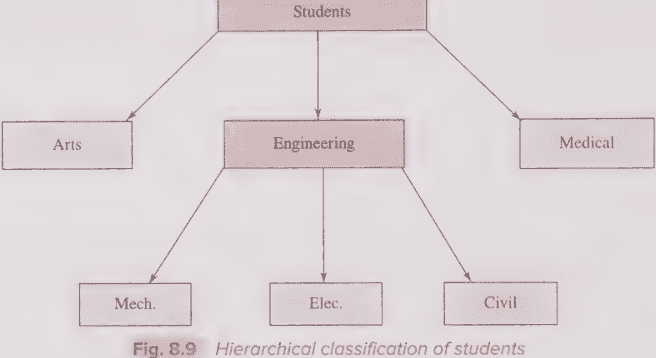

**图 8.9** 学生的层次分类

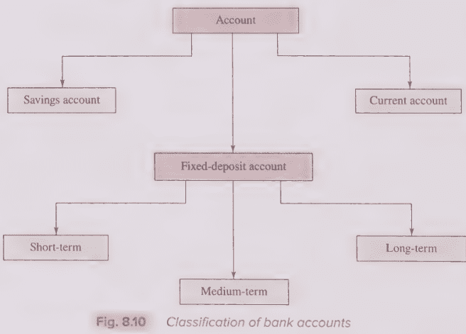

**图 8.10** 银行账户的分类

在 C++ 中，这类问题可以很容易地转换为这些层次结构。基类将包含子类共有的所有特征。子类可以通过继承基类的属性来构造。子类可以作为低层类的基类，依此类推。

## 8.8 混合继承

可能存在需要对程序设计应用两种或多种继承类型的情况。例如，考虑第 8.5 节讨论的学生成绩处理情况。假设我们在最终确定成绩前要对体育给予权重。体育的权重存储在一个名为 `sports` 的单独类中。各种类之间新的继承关系如图 8.11 所示。

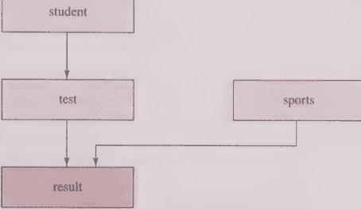

图 8.11 多层、多重继承

`sports` 类可能如下所示：

```
class sports
{
    protected:
        float score;
    public:
        void get_score(float);
        void put_score(void);
}
```

`result` 将同时具有多层和多重继承，其声明如下：

```
class result : public test, public sports
{
    ....
}
```

其中 `test` 本身是从 `student` 派生的类。即

```
class test : public student
{
    ....
}
```

程序 8.5 说明了多层和多重继承的实现。

## 220 面向对象编程与 C++

## 程序 8.5 混合继承

```
#include <iostream>
using namespace std;
class student
{
    protected:
        int roll_number;
    public:
        void get_number(int a)
        {
            roll_number = a;
        }
        void put_number(void)
        {
            cout << "Roll No: " << roll_number << "\n";
        }
};
class test : public student
{
    protected:
        float part1, part2;
    public:
        void get_marks(float x, float y)
        {
            part1 = x; part2 = y;
        }
        void put_marks(void)
        {
            cout << "Marks obtained: " << "\n"
            << "Part1 = " << part1 << "\n"
            << "Part2 = " << part2 << "\n";
        }
};
class sports
{
    protected:
        float score;
    public:
        void get_score(float s)
        {
            score = s;
        }
        void put_score(void)
```
(Contd.)

```
{
    cout << "Sports wt: " << score << "\n\n";
}
class result : public test, public sports {
    float total;
    public:
        void display(void);
    };
    void result :: display(void) {
        total = part1 + part2 + score;
        put_number();
        put_marks();
        put_score();
        cout << "Total Score: " << total << "\n";
    }
}
int main() {
    result student_1;
    student_1.get_number(1234);
    student_1.get_marks(27.5, 33.0);
    student_1.get_score(6.0);
    student_1.display();
    return 0;
}
```


程序 8.5 的输出将为：
Roll No: 1234
Marks obtained:
Part1 = 27.5
Part2 = 33
Sports wt: 6
Total Score: 66.5

局限性
1 继承 基类和继承类变得紧密耦合，因此它们独立使用困难
2 内存浪费和编译器开销是继承的缺点。

### 8.9 虚基类

我们刚刚讨论了一种需要同时使用多重和多层继承的情况。考虑一种情况，其中涉及所有三种继承，即多层和层次继承。这在图 8.12 中说明。'child' 有两个直接基类 'parent1' 和 'parent2'，它们本身有一个共同的基类 'grandparent'。'child' 通过两条不同的路径继承 'grandparent' 的特征。它也可以直接继承，如虚线所示。'grandparent' 有时被称为间接基类。

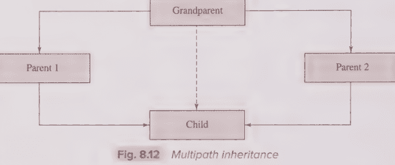

如图 8.12 所示的 'child' 的继承可能会带来一些问题。'grandparent' 的所有 public 和 protected 成员都被继承到 'child' 中两次，首先通过 'parent1'，然后再次通过 'parent2'。这意味着，'child' 将具有从 'grandparent' 继承的成员的重复集合。这引入了二义性，应避免。

由于这些多条路径导致继承成员的重复，可以通过在声明直接或中间基类时将公共基类（祖先类）作为虚基类来避免，如下所示：

```
class A    // grandparent

{

    ....

}

class B1 : virtual public A    // parent1

{

    ....

}

class B2 : public virtual A    // parent2

{

    ....

}

class C : public B1, public B2    // child

{

    ....

    // only one copy of A

    // will be inherited

};
```

当一个类被设为虚基类时，C++ 会采取必要的措施确保无论虚基类与派生类之间存在多少条继承路径，只继承该类的一个副本。

关键字 `virtual` 和 `public` 可以按任意顺序使用。

例如，再次考虑第 8.8 节讨论的学生成绩处理系统。假设 sports 类从 student 类派生 roll_number。那么，继承关系将如图 8.13 所示。

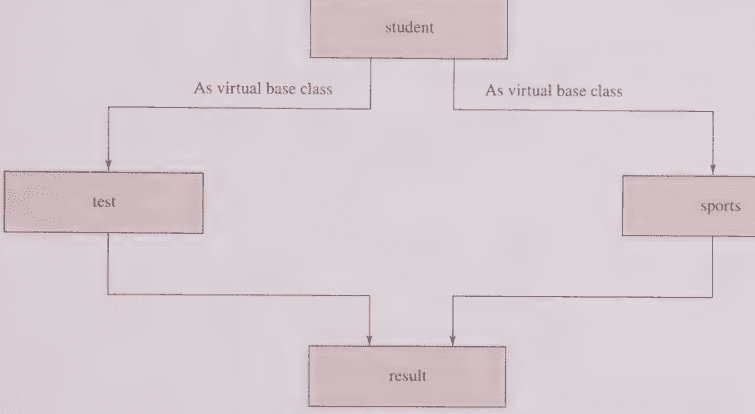

图 8.13 虚基类

实现虚基类概念的程序在程序 8.6 中说明。

## 程序 8.6 虚基类

```
#include <iostream>

using namespace std;

class student

{

protected:

    int roll_number;

public:

    void get_number(int a)

    {

        roll_number = a;

    }

    void put_number(void)

    {

        cout << "Roll No: " << roll_number << "\n";

    }

};

class test : virtual public student

{

protected:
```

## 面向对象编程与 C+

```
float part1, part2;

public:

    void get_marks(float x, float y) {

        part1 = x; part2 = y;

    }

    void put_marks(void) {

        cout << "Marks obtained: " << "\n"

        cout << "Part1 = " << part1 << "\n"

        cout << "Part2 = " << part2 << "\n";

    }

class sports : public virtual student {

protected:

    float score;

public:

    void get_score(float s) {

        score = s;

    }

    void put_score(void) {

        cout << "Sports wt: " << score << "\n\n";

    }

class result : public test, public sports {

    float total;

public:

    void display(void);

}

void result :: display(void) {

    total = part1 + part2 + score;

    put_number();

    put_marks();

    put_score();

    cout << "Total Score: " << total << "\n";

}

int main() {

    student student_1;

    student_1.get_number(678);

    student_1.get_marks(30.5, 25.5);

    student_1.get_score(7.0);

    student_1.display();

    return 0;

}
```

程序 8.6 的输出将是：

Roll No: 678
Marks obtained:
Part1 = 30.5
Part2 = 25.5
Sport wt: 7

Total Score: 63

在上面的示例中，`roll_number` 变量只有一个副本被 `result` 类从 `student` 类继承。因此，由任何派生类对 `roll_number` 所做的更改都作用于这个单一实例。这确保了数据完整性。

### 8.10 抽象类

抽象类是指不用于创建对象的类。抽象类仅设计为用作基类（由其他类继承）。它是程序开发中的一个设计概念，并提供了一个基础，其他类可以在此基础上构建。

在实际编程场景中，抽象基类的概念具有重要意义。它们是有意在程序中用于创建派生类，而不用于创建实例，如程序 8.6 中 `student` 类所示。该概念可通过一个抽象基类 `vehicle` 以及派生类 `LMV`（轻型机动车）、`DMV`（重型机动车）和 `TW`（两轮车）的示例进一步解释。纯虚函数 `spec()` 可将 `LMV` 的规格设定为其四个轮子和较小的发动机，而 `DMV` 的规格设定为其八个或更多轮子和相对较大的发动机。

虽然在此处使用抽象基类 `vehicle` 看起来是可选的，但就逻辑程序设计而言它具有重要意义。此外，我们可以将所有派生类的一些共同特征包含在抽象基类本身中。例如，速度、油耗、转速等是 `vehicle` 基类所有派生类共有的一些特征。然而，必须永远记住，根据定义，只有当一个类至少有一个纯虚函数时，它才可被视为抽象类。

使用抽象类的一般形式如下所示：

```
class vehicle //abstract base class

{

private:

    data-type d1;

    data-type d2;

    public:

    virtual void spec()=0; //pure virtual function

}
```

```
class LMV : public vehicle

{

public:

    void spec()

```

```
{

    //LMV definition of spec function

};

class HMV : public vehicle

{

    public:

        void spec()

        {

            //HMV definition of spec function

        }

};

class TW : public vehicle

{

    public:

        void spec()

        {

            //TW definition of spec function

        }

};
```

## 226
Object Oriented Programming with C++

### 8.11 派生类中的构造函数

正如我们所知，构造函数在初始化对象中起着重要作用。我们在派生类中之前没有使用它们是为了简化起见。这里需要注意的一点是，只要基类构造函数不接受任何参数，派生类就不必具有构造函数函数。然而，如果任何基类包含一个或多个参数的构造函数，则派生类必须具有构造函数并将参数传递给基类构造函数。请记住，在应用继承时，我们通常使用派生类。因此，让派生类将参数传递给基类构造函数是有意义的。当派生类和基类都包含构造函数时，基类构造函数先执行，然后派生类中的构造函数执行。

在多重继承的情况下，基类按其在派生类声明中出现的顺序构造。同样，在多重继承中，构造函数将按继承顺序执行。

由于派生类承担了为其基类提供初始值的责任，我们在声明派生类对象时提供所有类所需的所有初始值。它们是如何传递给基类构造函数以便它们完成工作的呢？C++ 支持一种特殊的参数传递机制来处理这种情况。

派生类的构造函数接收整个值列表作为参数，并按其在派生类中声明的顺序将它们传递给基类构造函数。基类构造函数被调用并在派生类构造函数体中的语句之前执行。

## 227

定义派生类构造函数的一般形式为：

| Derived-constructor | Arglist1, Arglist2, ... ArglistN, ArglistD: |
| --- | --- |
| base1(arglist1), |  |
| base2(arglist2), |  |
| ... |  |
| ... |  |
| baseN(arglist) | arguments for base(N) |
| { Body of derived constructor } |  |

*derived-constructor* 的头行包含由冒号分隔的两个部分。第一部分提供传递给 *derived-constructor* 的参数声明，第二部分列出对基类构造函数的函数调用。

*base1(arglist1), base2(arglist2)* ... 是对基类构造函数 *base1(), base2(),* ... 的函数调用，因此 *arglist1, arglist2,* ... 等表示传递给基类构造函数的实际参数。*Arglist1* 到 *ArglistN* 是基类构造函数 *base1* 到 *baseN* 的参数声明。*ArglistD* 提供初始化派生类成员所需的参数。

示例：

```
D(int a1, int a2, float b1, float b2, int d1):

    A(a1, a2),      /* call to constructor A */

    B(b1, b2)      /* call to constructor B */

    {

        d = d1;         // executes its own body

    }
```

`A(a1, a2)` 调用基类构造函数 `A()`，而 `B(b1, b2)` 调用另一个基类构造函数 `B()`。构造函数 `D()` 为这四个参数提供值。此外，它还有一个自己的参数。构造函数 `D()` 共有五个参数。`D()` 可按如下方式调用：

```
D objD(5, 12, 2.5, 7.54, 30);
...
```

这些值由构造函数 `D()` 按如下方式分配给各个参数：

| 5 -> a1 |
| 12 -> a2 |
| 2.5 -> b1 |
| 7.54 -> b2 |
| 30 -> d1 |

虚拟基类的构造函数在任何非虚拟基类之前被调用。如果有多个虚拟基类，则按其声明的顺序调用它们。然后在执行派生类构造函数之前构造任何非虚拟基类。参见表 8.2。

## Object-Oriented Programming with C++

表 8.2 基类构造函数的执行

| Method of inheritance | Order of execution |
| --- | --- |
| Class B : public A | A() ; base constructor |
| { | B() ; derived constructor |
| ); | |
| class A : public B, public C | B() ; base(first) |
| { | C() ; base(second) |
| ); | A() ; derived |
| class A : public B, virtual public | C() ; virtual base |
| { | B() ; ordinary base |
| ); | A() ; derived |

程序 8.7 说明了当类被继承时构造函数是如何实现的。

## 程序 8.7 派生类中的构造函数

```
#include <iostream>

using namespace std;

class alpha

{

    int x;

public:

        alpha(int i)

        {

            x = 1;

            cout << "alpha initialized \n";

        }

    void show_x(void)

    {

        cout << "x = " << x << "\n";

    }

}

class beta

{

    float y;

public:

        beta(float j)

        {

            y = j;

            cout << "beta initialized \n";

        }

    void show_y(void)

    {

        cout << "y = " << y << "\n";

    }

}
```

(Contd.)

## Inheritance Extending Classes

```
class gamma: public beta, public alpha

{

    int m, n;

public:

    gamma(int a, float b, int c, int d) :

        alpha(a), beta(b)

    {

        m = c;

        n = d;

        cout << "gamma initialized \n";

    }

    void show_mn(void) {

        cout << "m = " << m << "\n";

        cout << "n = " << n << "\n";

    }

};

int main() {

    gamma g(5, 10.75, 20, 30);

    cout << "\n";

    g.show_x();

    g.show_y();

    g.show_mn();

    return 0;

}
```

程序 8.7 的输出将是：

beta initialized
alpha initialized
gamma initialized

x = 5
y = 10.75
m = 20
n = 30

> `beta` 首先被初始化，尽管它在派生类构造函数中出现第二位。这是因为它在派生类头行中首先被声明。此外，请注意 `alpha(a)` 和 `beta(b)` 是函数调用。因此，参数不应包含类型。

C++ 支持另一种初始化类对象的方法。这种方法使用构造函数函数中所谓的初始化列表。其形式如下：

# 230 使用 C++ 进行面向对象编程

```
constructor (arglist) : intialization-section

{

    assignment-section

}
```

赋值部分只不过是构造函数函数的体，用于为数据成员赋初始值。冒号之后的部分称为初始化部分。我们可以使用此部分为基构造函数提供初始值，并初始化其自身的类成员。这意味着我们可以使用这两个部分中的任何一个来初始化构造函数类的成员。初始化部分基本上包含由逗号分隔的初始化列表。此列表称为初始化列表。考虑一个简单的例子：

```
class XYZ

{

    int a;

    int b;

public:

    XYZ(int i, int j) : a(i), b(2 * j) { }

};
```

```
int main()

{

    XYZ x(2, 3);

    return 0;

}
```

此程序将把 `a` 初始化为 2，`b` 初始化为 6。注意数据成员是如何初始化的，只需使用变量名后跟用括号括起来的初始化值（像函数调用一样）。参数列表中的任何参数都可以用作初始化值，并且列表中的项目可以按任意顺序排列。例如，构造函数 `XYZ` 也可以写成：

```
XYZ(int i, int j) : b(i), a(i + j) { }
```

在这种情况下，`a` 将被初始化为 5，`b` 为 2。记住，数据成员是按照声明的顺序初始化的，与初始化列表中的顺序无关。这使我们能够有如下语句

```
XYZ(int i, int j) : a(i), b(a * j) { }
```

这里 `a` 被初始化为 2，`b` 为 6。记住，先声明的是先初始化，然后其值被用来初始化 `b`。然而，以下情况则不会：


`XYZ(int i, int j) : b(i), a(b * j) { }`

请注意，这种定义不会产生任何编译错误。事实上，成员 `b` 将被准确地赋值；成员 `a` 将被初始化为垃圾值，因为 `b` 的值对要被初始化的 `a` 不可用。

以下语句也是有效的：

```
XYZ(int i, int j) : a(i) { b = j };
XYZ(int i, int j) { a = i; b = j; };
```

如果不需要，我们可以省略任一部分。程序 8.8 展示了在基类和派生类构造函数中使用初始化列表。

## 程序 8.8 构造函数中的初始化列表

```
#include <iostream>
using namespace std;
class alpha {
    int x;
public:
    alpha(int i)
    {
        x = i;
        cout << "\n alpha constructed\n";
    }
    void show_alpha(void)
    {
        cout << " x = " << x << "\n";
    }
};
class beta {
    float p, q;
public:
    beta(float a, float b) : p(a), q(b+b)
    {
        cout << "\n beta constructed\n";
    }
    void show_beta(void)
    {
        cout << " p = " << p << "\n";
        cout << " q = " << q << "\n";
    }
};
class gamma : public beta, public alpha {
    int u, v;
public:
    gamma(int a, int b, float c)
    : alpha(a*2), beta(b,c), u(a)
    {
        v = b; cout << "\n gamma constructed\n";
    }
    void show_gamma(void)
    {
        cout << " u = " << u << "\n";
        cout << " v = " << v << "\n";
    }
};
```

```
int main() {
    gamma g(2, 4, 2.5);
    cout << "\nDisplay member values " << "\n\n";
    g.show_alpha();
    g.show_beta();
    g.show_gamma();
    return 0;
}
```

程序 8.8 的输出将为：

- beta constructed
- alpha constructed
- gamma constructed
Display member values
- x = 4
- p = 2.5
- q = 5
- u = 2
- v = 4

> 派生构造函数 `gamma` 的参数列表仅包含三个参数 `a`、`b` 和 `c`，它们用于初始化三个类中包含的五个数据成员。

### 8.12 成员类：类的嵌套

继承是将一个类的某些属性派生到另一个类的机制。我们已经详细了解了如何使用派生类的概念来实现这一点。C++ 还支持将一个类的属性继承到另一个类的另一种方式。这种方法认为一个对象可以是许多其他对象的集合。也就是说，一个类可以包含其他类的对象作为其成员，如下所示：

```
class alpha {....};
class beta {....};
class gamma {
    alpha a; // a 是 alpha 类的对象
    beta b; // b 是 beta 类的对象
    ....
};
```

`gamma` 类的所有对象都将包含对象 `a` 和 `b`。这种关系称为包含或嵌套。创建包含另一个对象的对象与创建独立对象非常不同。

## 233

## 继承：扩展类

独立对象在声明时带参数，其构造函数创建它。另一方面，嵌套对象是分两个阶段创建的。首先，使用各自的构造函数创建成员对象，然后创建其他成员。这意味着所有成员对象的构造函数都应在自己的构造函数体执行之前被调用。这是通过在嵌套类的构造函数中使用初始化列表来实现的。

示例：

```
class gamma
{
    alpha a; // a 是 alpha 的对象
    beta b; // b 是 beta 的对象
public:
    gamma(arglist1): a(arglist1), b(arglist2)
    {
        // 构造函数体
    }
};
```

`arglist` 是在定义 `gamma` 对象时要提供的参数列表。这些参数用于初始化 `gamma` 的成员。`arglist1` 是 `a` 的构造函数的参数列表，`arglist2` 是 `b` 的构造函数的参数列表。`arglist1` 和 `arglist2` 可能会或可能不会使用来自 `arglist` 的参数。记住，`a(arglist1)` 和 `b(arglist2)` 是函数调用，因此参数不包含数据类型。它们只是变量或常量。

示例：

```
gamma(int x, int y, float z) : a(x), b(x, z)
{
    Assignment section(for ordinary other members)
}
```

我们可以在一个类中使用任意多的成员对象。对于每个成员对象，我们在初始化器列表中添加一个构造函数调用。成员对象的构造函数是按照它们在嵌套类中声明的顺序调用的。

## 摘要

- 从旧类派生新类的机制是继承。继承提供了可重用的概念。C++ 类可以通过继承被重用。
- 派生类继承基类的一些或全部属性。
- 只有一个基类的派生类称为单继承。
- 一个类可以从多个类继承属性，这称为多继承。
- 一个类可以从另一个派生类派生，这称为多级继承。
- 当一个类的属性被多个类继承时，这称为层次继承。
- 一个类的私有成员不能在公有模式或私有模式下被继承。
- 在公有模式下继承的受保护成员变为受保护，而在私有模式下继承则在派生类中变为私有。
- 在公有模式下继承的公有成员变为公有，而在私有模式下继承则在派生类中变为私有。
- 友元函数和友元类的成员函数可以直接访问私有和受保护的数据。
- 派生类的成员函数只能直接访问受保护和公有数据。然而，它们可以通过基类的成员函数访问私有数据。
- 多路径继承可能导致从“祖父”基类继承的成员重复。这可以通过将公共基类设为虚基类来避免。
- 在多继承中，基类是按照它们在派生类声明中出现的顺序构造的。
- 在多级继承中，构造函数是按照继承顺序执行的。
- 一个类可以包含其他类的对象。这称为组合或嵌套。

## 关键词

`abstract class` | `access control` | `access mechanism` | `ancestor class` | `assignment section` | `base class` | `base constructor` | `child class` | `common base class` | `containment` | `derivation` | `derived class` | `derived constructor` | `direct base class` | `dot operator` | `duplicate members` | `father class` | `friend` | `grandfather class` | `grandparent class` | `hierarchical inheritance` | `hybrid inheritance` | `indirect base class` | `inheritance` | `inheritance path` | `initialization list` | `initialization section` | `intermediate base` | `member classes` | `multilevel inheritance` | `multiple inheritance` | `nesting` | `private` | `private derivation` | `private members` | `privately derived` | `protected` | `protected members` | `public` | `public derivation` | `public members` | `publicly derived` | `reusability` | `single inheritance` | `subclass` | `virtual base class` | `visibility mode` | `visibility modifier`

## 复习问题

### 认知领域

- 8.1 说明 C++ 中继承的含义。
- 8.2 列出继承的不同形式；并为每种形式提供合适的示例。
- 8.3 描述 C++ 中单继承的语法。
- 8.4 我们知道基类的私有成员是不可继承的。给出派生类对象访问基类私有成员的可能方法。在论证你的答案时，基类不能被修改。
- 8.5 区分以下两个派生类的属性：
  + (a) `class D1: private B{/...};`
  + (b) `class D2: public B{/...};`
- 8.6 指出何时对类的成员使用 `protected` 可见性限定符。
- 8.7 描述多重继承的语法；同时简要说明这种继承的可用性。
- 8.8 表达一个虚基类。
- 8.9 解释何时使一个类变为虚类。
- 8.10 讨论关于抽象类。
- 8.11 分解在创建派生类对象时类构造函数的调用顺序。
- 8.12 类 `D` 派生自类 `B`。类 `D` 不包含自身的数据成员。论证类 `D` 是否需要构造函数并给出适当的解释。
- 8.13 概述包含关系并将其与继承区分开来。
- 8.14 演示构造一个包含其他类对象的类的对象。

### Psychomotor Domain

8.15 显示以下两个定义的含义：
+ (a) `class A: public B, public C{/...};`
+ (b) `class A: public C, public B{/...};`

### Affective Domain

8.16 为以下陈述的正确性辩护：
+ (a) 继承有助于将一个通用类变为更具体的类。
+ (b) 继承有助于数据隐藏。
+ (c) 继承的一个优点是它提供了一个概念框架。
+ (d) 继承促进了类库的创建。
+ (e) 定义派生类需要在基类中进行一些更改。
+ (f) 基类永远不会被用来创建对象。
+ (g) 合法地让一个类的对象作为另一个类的成员。
+ (h) 我们可以通过在派生类的定义中使基类变为虚类来阻止基类所有成员的继承。

Legend Precision Valuing/Responding/Organizing Applying Remembering Understanding

## DEBUGGING EXERCISES

8.1 找出以下程序中的错误。

```
#include <iostream>
using namespace std;
class faculty
{
private:
    int fid;
    char name[20];
    void getdata()
    {
        cout<<"Enter faculty id :- - \t";
        cin>>fid;
        cout<<"Enter Name :- - \t";
        cin>>name;
    }
}
class details : faculty
{
public:
    int age, exp;
    void getdetails()
    {
        getdata();
        cout<<"Enter age :- \t";
        cin>>age;
        cout<<"Enter year of exp. :- - \t";
        cin>>exp;
    }
    void display()
    {
        cout<<"\n\n"<<"faculty id \t"<<fid<<endl;
        cout<<"Name of faculty \t"<<name<<endl;
        cout<<"Faculty age \t"<<age<< endl;
        cout<<"faculty year of exp \t"<<exp<<endl;
    }
}
int main()
{
    details m;
    m.getdetails();
    m.display();
    return 0;
}
```

8.2 找出以下程序中的错误。

```
#include <iostream>
using namespace std;
class four_seater
{
public: void Property()
{
  cout << "It has space for four persons" << endl;
}
class four_wheeler
{
  public: void Property()
  {
    cout << "It runs on four tyres" << endl;
  }
};
class Car: public four_seater, public four_wheeler
{
};};
int main()
{
  Car C1;
  C1.four_seater;
  C1.four_wheeler;
  return 0;
}
```

## 8.3 找出以下程序中的错误。

```
#include<iostream>
using namespace std;
class p
{
  public:
    int i;
};
class q : virtual public p
{
  public:
    int j;
};
class r: virtual public p
{
  public:
    int k;
};
class s: public p, public q, public r
{
  public:
    int mul;
};
int main()
{
  s obj1;
  obj1.i = 10;
  obj1.j = 20;
  obj1.k = 30;
```

238
Object-Oriented Programming with C++

```
int obj1_mul = obj1.mul * obj2.mul;
cout << "Mul is : " << obj1.mul << "\n";
return 0;
```

## DRY-RUN EXERCISES

8.1 当运行以下程序时会发生什么？

```
#include<iostream>
using namespace std;
int a,b,c,d,e;
class A
{
    protected:
    public:
    void value_a_b()
    {
        a=2; b=2;
    }
};
class B:public A
{
    protected:
    public:
    void value_c()
    {
        d=2;
    }
};
class C
{
    protected:
    public:
    void value_d()
    {
        e=3;
    }
};
class D:public B, public C
{
    protected:
    public:
    void result()
    {
        value_a_b();
        value_c();
    }
}
```

```
value_d();
e=a*b*c*d;
cout<<"\n Multiplication is :":<<e";
}
int main()
{
 D d1;
d1.result();
return 0;
}
```

## 8.2 当运行以下程序时会发生什么？

```
#include<iostream>
using namespace std;
class B
{
 int x;
public:
 B() { cout << "1\t"; }
};
class D : public B
{
 int y;
public:
D() { cout << "2\t";
D(int i) { cout << "3\t"; }
};
int main()
{
 B b;
D d1;
D d2(1);
}
```

## 8.3 当运行以下程序时会发生什么？

```
#include <iostream>
using namespace std;
class A
{
 int a;
public:
A() { }
A(int d)
{ a = d; }
~A()
{
 cout << endl << "Object A being destroyed";
}
 void show()
{
cout << a << endl;
}
;
class B : public A
{
    int b;
public:
    B() : A()
{}
    B(int d, int d1) : A(d)
{
        b = di;
    }
    ~B()
{
```


```cpp
        cout << endl << "Object B is being destroyed";

    }

    void show()

{

        A::show();

        cout << b << endl;

    }

};

int main()

{

    B *p;

    p = new B(20, 30);

    (*p).show();

    delete p;

}
```

## 8.4 当运行以下程序时会发生什么？

```cpp
#include <iostream>

using namespace std;

class A

{

    int a;

public:

    A(int d) { a = d; }

    ~A()

{

        cout << "Object of A being deleted" << endl;

    }

    void show_A()

{

        cout << a << endl;

    }

}
```

```cpp
};
```

```cpp
class B

{

    int b;

    public:

        B() {}

        B(int d)

        {

            b = d;

        }

        ~B()

        {

            cout << "Object of B being deleted" << endl;

        }

        void show_B()

        {

            cout << b << endl;

        }

};

class C : public A, public B

{

    int c;

    public:

        C(): A(), B() {}

        C(int d1, int d2, int d3) : A(d1), B(d2)

        {

            c = d3;

        }

        ~C()

        {

            cout << "Object of C being deleted" << endl;

        }

        void show_C()

        {

            show_A();

            show_B();

            cout << c << endl;

        }

};

int main()

{

    C *p;

    p = new C(10, 20, 30);

    p->show_C();

    delete p;

    return 0;

}
```

## PROGRAMMING EXERCISES

8.1 假设一家银行为客户维护两种账户，一种称为储蓄账户，另一种称为活期账户。储蓄账户提供复利和取款设施但无支票簿设施。活期账户提供支票设施但无利息。活期账户持有人还应维持最低余额，如果余额低于此水平，则征收服务费。

创建一个存储客户姓名、账号和账户类型的 `account` 类。从中派生 `cur_acct` 和 `sav_acct` 类，使其更具体地满足其要求。包含必要的成员函数以实现以下任务：

+   (a) 从客户接受存款并更新余额。
(b) 显示余额。
(c) 计算并存入利息。
(d) 允许取款并更新余额。
(e) 检查最低余额，必要时征收罚款，并更新余额。

不要使用任何构造函数。使用成员函数初始化类成员。

8.2 修改练习 8.1 的程序以包含所有三个类的构造函数。

8.3 一所教育机构希望维护其员工的数据库。数据库分为多个类，其层次关系如 8.14 所示。图还显示了每个类所需的最低信息。指定创建数据库并在需要时检索个人信息的全部类和函数。

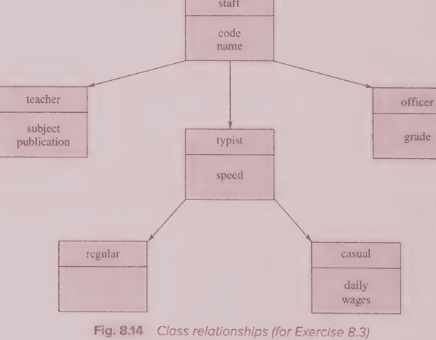

8.4 练习 8.3 中创建的数据库不包括员工的教育信息。已决定将此信息添加到教师和官员（不包括打字员）中，这将有助于管理层在教学、晋升等方面做出决策。添加另一个名为 `education` 的数据类，该类保存两项教育信息，即普通教育中的最高学历和最高专业资格。该类应被 `teacher` 和 `officer` 类继承。修改练习 8.19 的程序以纳入这些补充。

8.5 考虑图 8.15 的 `network` 类。`master` 类从 `account` 和 `admin` 类派生信息，而这两个类又从 `person` 类派生信息。定义全部四个类并编写程序以创建、更新和显示 `master` 对象中包含的信息。

8.6 在练习 8.3 中，`teacher`、`officer` 和 `tourist` 类派生自 `staff` 类。如我们所知，在某些情况下，我们可以使用包含类来代替继承。重新设计练习 8.3 的程序，使 `teacher`、`officer` 和 `tourist` 类包含 `staff` 的对象。

8.7 我们已经了解到 OOP 对于设计仿真程序很有用。使用迄今为止学到的技术和技巧

8.8 一家商店希望按类别维护库存数据库（电子电器、食品、服装、乳制品、厨房用品）。根据不同产品之间的关系指定所有类和函数。

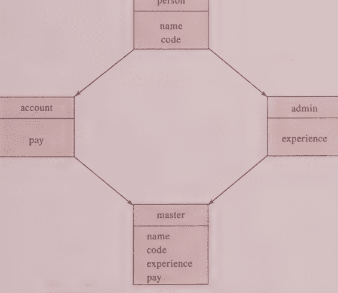

Fig. 8.15 Multipath inheritance (for Exercise 8.5)

+   8.9 根据以下类型商品的商店关系定义所有函数和类。
(a) 两轮车 手动、电动和自动
(b) 三轮车 手动、电动和自动
(c) 四轮车 自动

## 多项选择题

+   1. 选择不适当的继承形式。
(a) 多继承
(b) 多层继承
(c) 多步继承
(d) 单继承
2. 基类 ______ 被派生类继承，则 ______ 基类成员成为派生类的 ______。选择不正确的组合。
(a) 私有，公开，私有
(b) 公开，公开，私有
(c) 私有，私有，私有
(d) 以上全部
3. 当继承为私有且基类的私有成员在派生类中是 ____________。
(a) 受保护的
(b) 公开的
(c) 不可访问的
(d) 可访问的
4. 什么是单继承？
(a) 继承派生类
(b) 继承基类
(c) 由多个类继承
(d) 以上都不是
5. 以下哪种语言不支持多继承：
(a) Java
(b) C++
(c) Python
(d) Perl
6. 菱形问题可能出现在：
(a) 混合继承
(b) 多继承
(c) 多层继承
(d) 层次继承
7. C++ 中类默认的继承方式是：
(a) 私有
(b) 受保护
+   (c) 公开
(d) 以上全部
8. 类的私有和受保护成员可以被以下访问：
(a) 类的友元函数
(b) 是友元的类的成员函数
(c) 派生类的成员函数
(d) 以上全部
9. 成员继承歧义的解决方案是：
(a) 使用作用域解析运算符为成员
(b) 隐式调用函数
(c) 显式调用函数
(d) 以上都不是
10. 实现层次继承需要多少个类？
(a) 2
(b) 1
(c) 3
11. 实现层次继承最少需要多少个类？
(a) 2
(b) 1
(c) 3
12. 以下哪种继承适合根据技术贡献、社会联系、支持绩效计算员工年度绩效指数。
(a) 多继承
(b) 混合继承
(c) 层次继承
(d) 多层继承
13. 选择正确的陈述：
(a) 基类不能是抽象的
(b) 基类必须是抽象的
(c) 基类可以是抽象的
(d) 以上都不是

## 指针、虚函数和多态

### 学习目标

阅读本章后，你将能够

+   - 解释指针的概念
- 说明如何创建指向对象的指针
- 了解 `this` 指针的用法
- 讨论多态及其类型
- 解释指针如何指向派生类工作
- 描述虚函数并列出其各种作用
- 讨论虚构造函数和析构函数

### 9.1 引言

指针是 C++ 的关键方面之一，类似于 C。它们为在 C 和 C++ 中处理数据提供了一种独特的方法。我们已在第 3 章和第 5 章中看到指针的一些应用。在本章中，我们将讨论指针的基础及其在继承类和对象上下文中访问成员数据和函数的特殊用法。

面向对象的另一个关键特性是多态。它意味着“一个名字，多种形式”。我们已经看到如何使用重载函数和运算符实现多态概念。重载成员函数是通过匹配参数的类型和数量来“选择”调用的。在继承类的上下文中也是如此。

但是，当基类和派生类中的函数名和原型相同时会发生什么？例如，考虑以下类定义：

```cpp
class A

{

    int x;

public:

    void show() {....} // show() in base class

};

class B: public A
```

## 面向对象的 C++ 编程

```cpp
{

  int y;

  public:

    void show() {...} // show() in derived class

};
```

由于 `show()` 的原型在类 `A` 和 `B` 中相同？正如我们之前所见，我们可以通过使用类解析运算符在调用派生类对象时指定类来解决这种情况。

这被称为静态绑定。这里，编译器能够在编译时本身为特定调用选择适当的函数（编译时多态的情况）。

如果我们想将重载函数的选择推迟到程序运行（运行时或动态多态）怎么办？也就是说，程序能够在运行对象实际发出调用时选择适当的函数。此过程称为后期或动态绑定。在 C++ 中，这是通过虚函数实现的。

动态绑定是 C++ 的强大功能之一。这需要使用指向对象的指针。我们将详细讨论如何使用指向对象的指针和虚函数来实现动态绑定。

### 9.2 指针

我们知道指针是一种派生类型，它通过存储内存地址而不是数据来引用另一个数据变量。指针变量定义从何处获取数据变量的值，而不是定义实际数据。

像 C 一样，指针变量也可以引用 C++ 中的另一个指针。然而，它通常指向一个数据变量。指针提供了一种访问其他数据对象的替代方法。

## 声明和初始化指针

如第 3 章所述，我们可以像在 C++ 中声明其他变量一样声明指针变量。像 C 一样，声明基于它指向的变量的类型。指针变量的声明采用以下形式：

```cpp
data-type *pointer-variable;
```

这里，`pointer-variable` 是指针的名称，`data-type` 指的是有效的 C++ 数据类型之一，例如 `int`、`char`、`float` 等。`data-type` 后跟一个星号 (`*`) 符号，它将指针变量与编译器的其他变量区分开来。

> 我们可以将星号 (`*`) 立即放在指针变量之前，或放在数据类型和指针变量之间，或立即放在数据类型之后。它不会对执行过程产生任何影响。

正如我们所知，指针变量可以指向 C++ 中任何类型的数据。然而，必须理解的是，指针在特定时间只能指向一种数据类型。让我们声明一个指向整数变量的指针变量，如下所示：

```cpp
int *ptr;
```

这里，`ptr` 是一个指针变量并指向整数数据类型。指针变量 `ptr` 应包含任何整数变量的内存。在同样的方式，我们也可以为其他数据类型声明指针变量。

像其他编程语言一样，使用 C++ 程序中的变量之前必须对其进行初始化。我们可以按如下方式初始化指针变量：

```cpp
int *ptr, a;           // declaration
ptr = &a;             // initialization
```

变量 `ptr` 包含变量 `a` 的地址。像 C 一样，我们使用“取地址”运算符或引用运算符，即 `'&'` 来检索变量的地址。第二条语句将变量 `a` 的地址分配给指针

我们也可以声明一个指针变量指向另一个指针，类似于 C。也就是说，指针变量包含指针的地址。程序 9.1 解释了如何通过在 C++ 程序中使用指针来引用指针的地址。

## 程序 9.1 使用指针的示例

```cpp
#include <iostream>

using namespace std;

int main() {

    int a, *ptr1, *ptr2;

    ptr1 = &a;

    ptr2 = &ptr1;

    cout << "The address of a: " << ptr1 << "\n";

    cout << "The address of ptr1: " << ptr2 << "\n";

    cout << "\n";

    cout << "After incrementing the address values:\n\n";

    ptr1+=2;

    cout << "The address of a: " << ptr1 << "\n";

    ptr2+=2;

    cout << "The address of ptr1: " << ptr2 << "\n\n"

    return 0;

}
```

内存位置始终由操作系统寻址。输出可能因系统而异。程序 9.1 的输出可能如下所示：

```
The address of a: 0x8fb6fff4
The address of ptr1: 0x8fb6fff2
After incrementing the address values:
The address of a: 0x8fb6fff8
The address of a: 0x8fb6ff66
```

我们可以使用 `void` 指针，它们可以引用任何数据类型变量。在使用指针之前，我们必须将变量强制转换为它们指向的特定数据类型。

# 指针的操纵

如前所述，我们可以使用重定向运算符来操纵指针，即 `'*'`，它也称为解引用运算符。借助该运算符，我们可以间接访问数据变量内容。其形式如下：

```
*pointer_variable
```

我们知道，解引用指针允许我们获取指针指向的内存位置的内容。在将变量的地址赋给指针后，我们可能想要更改变量的内容。使用解引用运算符，我们可以更改内存位置的内容。

让我们考虑一个示例来说明如何解引用指针变量 程序 9.2 说明了如何使用解引用运算符来访问和更改指针变量所指向的变量的内容。

## 程序 9.2 | 指针的操纵

```cpp
#include <iostream>

using namespace std;

int main() {

    int a=10;

    int *ptr;

    ptr=&a;

    cout<<"The value of a is: "<<*ptr<<endl;

    *ptr=*ptr+a;

    cout<<"\nThe revised value of a is "<<a<<endl;

    return(0);

}
```

程序 9.2 的输出为：

```
The value of a is : 10
The revised value of a is : 20
```

> **注意** 在解引用指针之前，必须先为指针分配一个值。如果我们尝试解引用一个未初始化的指针，它将通过引用内存中的其他位置而导致运行时错误。

## 指针表达式和指针算术

如第 3 章所述，可以对指针执行大量算术运算。C++ 允许指针执行以下算术运算：

- 指针可以递增 (`++`)（或）递减 (`-`)
- 任何整数可以加到指针上或从指针中减去
- 一个指针可以从另一个指针中减去

示例：

```cpp
int a[6];
int *aptr;
ptr=&a[0];
```

显然，指针变量 `aptr` 指向变量 `a` 的基地址。我们可以递增指针变量，如下所示：

```cpp
ptr++ (or) ++aptr
```

此语句将指针移动到下一个内存地址。同样，我们可以递减指针变量，如下所示：

```cpp
ptr-- (or) --aptr
```

此语句将指针移动到上一个内存地址。此外，如果两个指针变量指向同一个数组，它们可以相互减去。

程序 9.3 说明了我们可以用指针执行的算术运算。

## 程序 9.3 指针上的算术运算

```cpp
#include <iostream>

using namespace std;

int main()

{

    int num[]={56,75,22,18,90};

    int *ptr;

    int i;

    cout << "The array values are:\n";

    for(i=0;i<5;i++)

        cout << num[i] << "\n";

    /* Allocating the base address of num to ptr */

    ptr = num;

    /* Printing the value in the array */

    cout << "\nValue of ptr : " << *ptr<<endl;

    cout << "\n";

    ptr++;

    cout << "\nValue of ptr++ : " << *ptr<<endl;

    cout << "\n";

    ptr--;

    cout << "\nValue of ptr-- : " << *ptr<<endl;

    cout << "\n";

    ptr+=2;

}
```
```cpp
cout<<"\nValue of ptr+2 : "<< *ptr;
ptr=ptr-1;
cout << "\nValue of ptr-1 : "<< *ptr;
cout << "\n";
ptr+=3;
cout <<"\nValue of ptr+=3 : "<< *ptr;
ptr-=2;
cout << "\n";
cout <<"\nValue of ptr-2 : "<< *ptr;
cout << "\n";
return 0;
```


程序 9.3 的输出为：
The array values are:

56
75
22
18
90
Value of `ptr++` : 56
Value of `ptr++` : 75
Value of `ptr--` : 56
Value of `ptr+2` : 22
Value of `ptr-1` : 75
Value of `ptr+=3` : 90
Value of `ptr-=2` : 22

## 使用指针与数组和字符串

通常，指针和数组之间存在一些差异；数组指的是内存空间的一块，而指针不指向内存的任何部分。数组元素的内存地址不能更改，而指针变量的内容，即它所引用的内存地址，可以更改。

尽管指针和数组之间存在细微差异，但它们之间有着密切的关系。
我们可以按如下方式将数组赋给指针：

```
int *nptr;

nptr = &number[0];
```
或
`nptr=number;`

这里，`int nptr` 指向整数数组 `number[0]` 的第一个元素。此外，请考虑以下示例：

```
float *fptr;

fptr = &price[0];
```
或

`fptr=price;`
这里，`fptr` 指向浮点数组 `price[0]` 的第一个元素。程序 9.4 演示了如何使用指针在数组中执行线性搜索。

## 程序 9.4 使用指针的数组

```
#include<iostream>

using namespace std;

int main() {

    int arr[10] = {1,99,4,37,88,3,19,45,62,87};

    int i,num,ptr;

    /*Assigning the base address of array arr to ptr*/

    ptr=arr;

    cout<<"Enter the element to be searched: "<< endl;

    cin>>num;

    for(i=0;i<10;i++) {

        if(*ptr==num) {

            cout<<"\n"<<num<<" is present in the array";

            break;

        }

        else if (i==9) {

            cout<<"\n"<<num<<" is not present in the array";

            ptr++; //Incrementing the pointer to make it point
                   //to the next array element

        }

    }

    return 0;

}
```

程序 9.4 的输出为：

Enter the element to be searched: 87
87 is present in the array

## 指针数组

与其它变量类似，我们可以在 C++ 中创建指针数组。指针数组代表地址的集合。通过声明指针数组，我们可以节省大量的内存空间。

## 使用 C++ 进行面向对象编程

指针数组指向数据项数组。指针数组的每个元素指向数据数组的一个项目。数据项可以通过直接访问或通过解引用指针数组的元素来访问。我们可以重新组织指针元素而不影响数据项。

我们可以按如下方式声明指针数组：

```
int *narray[10];
```

此语句声明了 10 个指针的数组，每个指针都指向一个整数。第一个指针的地址是 `narray[0]`，第二个指针是 `narray[1]`，最后一个指针指向 `narray[9]`。在初始化之前，它们指向内存空间中的一些未知值。我们可以使用指针变量来引用某些特定值。程序 9.5 解释了指针数组的实现。

## 程序 9.5 指针数组

```
#include <iostream>
#include <cstring>
using namespace std;

int main() {
    int i=0;
    char *ptr[10] = {
        "books"
```
程序 9.5 的输出为：

Enter your favorite leisure pursuit: books
Your favorite pursuit is available here

## 指针和字符串

我们已经看到了指针与一维数组元素一起使用的用法。然而，指针在 C++ 中访问二维和多维数组也很有效。数组和指针之间存在明确的关系。C++ 还允许我们使用指针处理特殊类型的数组，即字符串。

我们知道，字符串是一维字符数组，其索引从 0 开始，并在 C++ 中以空字符 `'\0'` 结束。指针可以通过引用其第一个字符来访问字符串。如我们所知，有两种方法可以将值赋给字符串。我们可以使用字符数组或 `char *` 类型。让我们考虑以下字符串声明：

```
char num[]="one"; const char *numptr="one";
```

第一个声明创建了一个包含字符 'o'、'n'、'e'、'\0' 的四个字符的数组，而第二个声明生成了一个指针变量，该变量指向字符串的第一个字符，即 'o'。C++ 中有许多字符串处理函数可用。所有这些函数都可在头文件 `<cstring>` 中获得。

程序 9.6 演示了如何在主字符串中搜索子字符串：

## 程序 9.6 在主字符串中搜索子字符串

```
#include<iostream>
#include <cstring>
using namespace std;

int main() {
  int i,j;
  char str[] = "\nC++ is better than C";
  int len = strlen(str);
  char *substr = new char[len];
  cout<<"The main string is: "<<str;
  cout<<"\nEnter the substring to be searched: ";
  cin>>substr;
  int k,len2=strlen(substr);
  for(i=0;i<len;i++) {
  k=i;
  for(j=0;j<len2;j++) {
    if(str[k]==substr[j]) {
      if(j==len-1
```
(Cont.)

```
cout<<"\nThe substring is present in the main string";
exit(0);
}
k++;
}
else
break;
}
if (i==len)
cout<<"\nThe substring is not present in the main string"\nreturn 0;
```

Program 9.6 的输出为：

- 主字符串为：
- C++ is better than C
Enter the substring to be searched: bet
The substring is present in the main string

## Pointers to Functions

尽管函数指针（或指向函数的指针）在 C 中引入，但它们在 C++ 中被广泛用于动态绑定和基于事件的应用程序。指向指针的概念作为指向成员的指针的基础，我们已在第 5 章中讨论过。

指向函数的指针被称为回调函数。我们可以使用这些函数指针引用一个函数。使用函数指针，我们可以允许 C++ 指针在运行时动态选择一个函数。我们也可以将一个函数作为参数传递给指针。这里，函数作为指针传递。函数指针不能被解引用。C++ 还允许我们比较两个函数指针。

C++ 提供了两种类型的函数指针：指向静态成员函数的函数指针和指向非静态成员函数的函数指针。这两种函数指针彼此不兼容。指向非静态成员函数的函数指针需要隐藏参数。

像其他变量一样，我们可以在 C++ 中声明一个函数指针。其形式如下：

```
data_type(*function_name)();
```

如我们所知，`data_type` 是 C++ 中任何有效的数据类型。`function_name` 是函数的名称，其前面必须有一个星号 `(*)`. `function_name` 是函数的任何有效名称。

示例：

```
int (*num_function(int x));
```

请记住，声明指针会创建一个指针。它不会创建实际的函数。为此，我们必须定义函数，其返回类型和参数与之相同。程序 9.7 解释了如何在 C++ 中声明和定义函数指针。

## Program 9.7 Pointers to Functions

```
#include <iostream>
using namespace std;

typedef void (*FunPtr)(int, int);
void Add(int i, int j)
{
    cout << i << " " << j << " = " << i + j;
}
void Subtract(int i, int j)
{
    cout << i << " - " << j << " = " << i - j;
}
int main()
{
    FunPtr ptr;
    ptr = &Add;
    ptr(1,2);
    cout << endl;
    ptr = &Subtract;
    ptr(3,2);
    return 0;
}
```

Program 9.7 的输出为：

1 + 2 = 3
3 - 2 = 1

### 9.3 POINTERS TO OBJECTS

我们已经看到如何使用指针访问类的成员。如前所述，指针可以指向由类创建的对象。考虑以下语句：

- `item x;`

其中 `item` 是一个类，`x` 是一个定义为 `item` 类型的对象。同样，我们可以按如下方式定义一个类型为 `item` 的指针 `it_ptr`：

- `item *it_ptr;`

对象指针在运行时创建对象时很有用。我们也可以使用对象指针访问对象的公共成员。考虑如下定义的类 `item`：

```
class item
{
    int code;
    float price;
public:
    void getdata(int a, float b)
{
        code = a;
        price = b;
    }
    void show(void)
{
        cout << "Code: " << code << "\n";
        cout << "Price: " << price << "\n\n";
    }
};
```

让我们按如下方式声明一个 `item x` 和一个指向 `x` 的指针 `ptr`：

- `item x;`
- `item *ptr = &x;`

指针 `ptr` 用 `x` 的地址初始化。

我们可以通过两种方式引用 `item` 的成员函数，一种是使用点运算符和对象，另一种是使用箭头运算符和对象指针。语句

```
x.getdata(100,75.50);
x.show();
```

等价于

```
ptr->getdata(100, 75.50);
ptr->show();
```

由于 `ptr` 是 `x` 的别名，我们也可以使用以下方法：

```
(*ptr).show();
```

括号是必要的，因为点运算符的优先级高于间接运算符。*

我们可以使用指针和 `new` 运算符按如下方式创建对象：

```
item *ptr = new item;
```

该语句为对象结构中的数据成员分配内存，并将内存空间的地址赋给 `ptr`。然后 `ptr` 可用于按如下所示引用成员：

```
ptr -> show();
```

如果一个类具有带参数的构造函数并且不包含空构造函数，则在创建对象时必须提供参数。

我们可以使用指针创建对象数组。例如，语句

`item *ptr = new item[10]; // 10 个对象的数组`

为 `item` 的 10 个对象数组创建内存空间。请记住，在这种情况下，如果类包含构造函数，它还必须包含空构造函数。

程序 9.8 说明了指向对象的指针的使用。

## Program 9.8 Pointers to Objects

```
#include <iostream>
using namespace std;

class item
{
    int code;
    float price;
public:
    void getdata(int a, float b)
    {
        code = a;
        price = b;
    }
    void show(void)
    {
        cout << "Code: " << code << "\n";
        cout << "Price: " << price << "\n";
    }
};

const int size = 2;
int main()
{
    item *p = new item[size];
    item *d = p;
    int x, i;
    float y;
    for(i=0; i<size; i++)
    {
        cout << "Input code and price for item" << i+1;
        cin >> x >> y;
        p->getdata(x,y);
        p++;
    }
    for(i=0; i<size; i++)
```
(Contd.)

```
cout << "item: " << i+1 << "\n";
d->show();
d++;
}
return 0;
```

Program 9.8 的输出为：
Input code and price for item1 40 500
Input code and price for item2 50 600
Item:
Code : 40
Price: 500
Item:
Code : 50
Price: 600

在程序 9.8 中，我们为两个大小相等的对象动态创建了空间。但这并不总是如此。例如，包含字符字符串的类的对象大小不会相同。在这种情况下，我们可以定义一个指向对象的指针数组，用于访问各个对象。这在程序 9.9 中有所说明。

## Program 9.9 Array of Pointers to Objects

```
#include <iostream>
#include <string>
using namespace std;

class city {
protected:
    char *name;
    int len;
public:
    city()
{
        len = 0;
        name = new char[len+1];
    }
    void getattr(void)
{
        char *s;
        s = new char[30];
```
```
cout << "Enter city name:";
cin >> s;
len = strlen(s);
name = new char[len + 1];
strcpy(name, s);
}
void printname(void) {
    cout << name << "\n";
};
int main() {
    city *cptr[10]; // array of 10 pointers to cities
    int n = 1;
    int option;
    do {
        cptr[n] = new city; // create new city
        cptr[n]->getname();
        n++;
        cout << "Do you want to enter one more name?\n";
        cout << "(Enter 1 for yes 0 for no):\n";
        cin >> option;
    } while(option);
    cout << "\n\n";
    for(int i=1; i<n; i++) {
        cptr[i]->printname();
    }
    return 0;
}
```

Program 9.9 的输出为：
Enter city name:Hyderabad
Do you want to enter one more name?
(Enter 1 for yes 0 for no):1
Enter city name:Secunderabad
Do you want to enter one more name?
(Enter 1 for yes 0 for no):1
Enter city name:Malkajgiri
Do you want to enter one more name?
(Enter 1 for yes 0 for no):0

## Object-Oriented Programming with C++

Hyderabad
Secunderabad
Malkajgiri

### 9.4 this POINTER

C++ 使用一个独特的关键字 `this` 来表示调用成员函数的对象。`this` 是一个指向调用该函数的对象的指针。例如，函数调用 `A.max()` 将指针 `this` 设置为对象 `A` 的地址。起始地址与类结构中第一个变量的地址相同。

这个独特的指针在调用时自动传递给成员函数。指针 `this` 作为所有成员函数的隐式参数。考虑以下简单示例：

```
class ABC
{
```


`int a;`

...

};

私有变量 `a` 可以直接在成员函数内部使用，

```
a = 123;
```

我们也可以使用以下语句做同样的事情：

```
this->a = 123;
```

由于 C++ 允许使用简写形式 `a = 123`，我们到目前为止一直没有显式使用指针 `this`。然而，我们在用成员函数重载运算符时一直隐式使用指针 `this`。

请回忆，当使用成员函数重载二元运算符时，我们只向函数传递一个参数。另一个参数使用指针 `this` 隐式传递。指针 `this` 的一个重要应用是返回它所指向的对象。例如，语句

```
return *this;
```

在成员函数内部将返回调用该函数的对象。当我们希望在成员函数内部比较两个或多个对象并将调用对象作为结果时，该语句变得重要。示例：

```
person & person :: greater(person & x)
{
    if (x.age > age)
        return x; // return reference of argument object
    else
        return *this; // return reference of invoking object
}
```

假设我们通过调用调用此函数

```
max = A.greater(B);
```

如果 `person` `B` 的年龄大于 `A`，则函数将返回对象 `B`（参数对象），否则它将使用指针 `this` 返回对象 `A`（调用对象）。请记住，解引用运算符会产生指针所包含地址的内容。说明 `this` 用法的完整程序在程序 9.10 中给出。

## 程序 9.10 this 指针

```
#include <iostream>
#include <cstring>
```

```
using namespace std;
class person {
    char name[20];
    float age;
public:
    person(char *s, float a) {
        strcpy(name, s);
        age = a;
    }
    person & greater(person & x) {
        if(x.age >= age)
            return x;
        else
            return *this;
    }
    void display(void) {
        cout << "Name: " << name << "\n";
        cout << "Age: " << age << "\n";
    }
}
```

```
int main() {
    person P1("John", 37.50),
    P2("Ahmed", 29.00),
    P3("Hebber", 40.25);
    person P = P1.greater(P3); // P3.greater(P1)
    cout << "Elder person is: \n";
    P.display();
    P = P1.greater(P2); // P2.greater(P1)
    cout << "Elder person is: \n";
    P.display();
    return 0;
}
```

程序 9.10 的输出为：

- Elder person is:
  Name: Hebber
  Age: 40.25
- Elder person is:
  Name: John
  Age: 37.5

### 9.5 多态

多态意味着“一个名字，多种形式”。它可以大致分为如图 9.1 所示的两类。

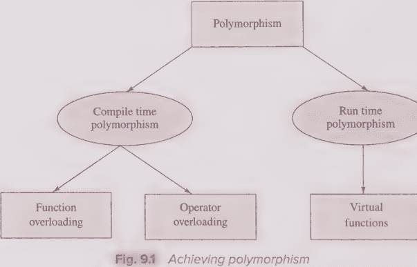

### 编译时多态

编译时多态简单地意味着对象在编译时就绑定到其函数调用。这意味着，关于将哪个函数链接到特定函数调用，在编译时没有歧义。这种机制称为早期绑定或静态绑定或静态链接。

在 C++ 中，编译时多态通过两种方式实现：函数重载和运算符重载。

我们已经在前几章中看到了函数和运算符重载的示例。然而，当在基类和派生类中都定义了具有相同名称和相同参数（顺序、数量和类型）的多个函数时会发生什么。例如，考虑以下程序：

```
#include <iostream>
using namespace std;
class B
public:
    void show()
```

```
{
    cout<<"Base\n";
}
};
```

```
class D : public B {
    public:
    void show() {
        cout<<"Derived\n";
    }
};
```

```
void main() {
    D d;
    d.show(); //calls derived class show() function
    d.B::show();//calls base class show() function
}
```

程序的输出将为：

Derived
Base

在这个例子中，`d.show()` 函数覆盖了基类中定义的 `show()` 函数。为了使对象 `d` 专门调用基类 `show()` 函数，我们使用了类解析运算符。

### 需要运行时多态

在解决歧义时使用类解析运算符对我们有效。但，如果我们想构建一个可扩展的大型应用程序（意味着未来可以扩展以添加更多功能）。在这种情况下，修改实现静态绑定的代码将是繁琐的。

这就是运行时多态非常有用的地方。它将函数调用与特定类的链接推迟到运行时。因此，直到对象在程序执行期间实际进行函数调用时，才知道将调用哪个函数。这被称为后期或动态绑定。

在 C++ 中，运行时多态借助虚函数实现。在我们了解更多关于虚函数之前，让我们先了解派生类的指针是如何工作的。

### 9.6 指向派生类的指针

我们不仅可以使用指向基对象的指针，还可以使用指向派生类对象的指针。指向基类对象的指针与派生类指针类型兼容。因此，单个指针变量可以指向属于不同类的对象。例如，如果 `B` 是基类，`D` 是从 `B` 派生的派生类，则声明为指向 `B` 的指针也可以是指向 `D` 的指针。考虑以下声明：

- `B *ptr;` // 指向类 `B` 类型变量的指针
- `B b;` // 基对象

### 面向对象的 C++

```
D d; // 派生对象
cptr = &b; // cptr 指向对象 b
```

我们可以使 `cptr` 指向对象 `d` 如下：

```
cptr = &d; // cptr 指向对象 d
```

这对于 C++ 来说是完全有效的，因为 `d` 是从类 `B` 派生的对象。

然而，在使用 `cptr` 访问派生类从 `B` 继承的公共成员时存在问题，而不是原本属于 `D` 的成员。如果 `D` 的成员与 `B` 的成员具有相同的名称，则 `cptr` 对该成员的任何引用都将始终访问基类成员。

尽管 C++ 允许基指针指向从该基派生的任何对象，但指针不能直接用于访问派生类的所有成员。我们可能需要使用另一个声明为指向派生类型的指针。

程序 9.11 说明了如何使用指向派生对象的指针。

## 程序 9.11 指向派生对象的指针

```
#include <iostream>
using namespace std;
class BC
{
public:
    int b;
    void show() {
        cout << "b = " << b << "\n";
    }
}
class DC : public BC
{
public:
    int d;
    void show() {
        cout << "b = " << b << "\n";
        cout << "d = " << d << "\n";
    }
}
int main()
{
    BC *bptr; // base pointer
    BC base;
    bptr = &base; // base address
    bptr->b = 100; // access BC via base pointer
    cout << "bptr points to base object \n";
    bptr->show();
}
```

```
// derived class
DC derived;
bptr = &derived;              // address of derived object
bptr -> b = 200;               // access DC via base pointer
/* bptr -> d = 300;           * // won't work
cout << "bptr now points to derived object\n";
bptr -> show();               // bptr now points to derived object
/* deencing d using a pointer of type derived class DC */
DC *dptr;                    // derived type pointer
dptr = &derived;
dptr->d = 300;
cout << "dptr is derived type pointer\n";
dptr -> show();
cout << "using ((DC*)bptr)\n";
((DC*)bptr) -> d = 400;
((DC*)bptr) -> show();
return 0;
```

程序 9.11 的输出将为：
bptr points base object
b = 100
bptr now points to derived object
b = 200
dptr is derived type pointer
b = 200
d = 300
using ((DC*)bptr)
b = 200
d = 400

# 注意我们使用了语句

bptr -> show();
两次。第一次，当 `bptr` 指向基对象时，第二次当 `bptr` 被设为指向
派生对象。但，两次都执行了 `BC::show()` 函数并显示了
基对象的内容。然而，语句

```
dptr -> show();
((DC*)bptr) -> show();      // cast bptr to DC type
```

显示派生对象的内容。这表明，尽管基指针可以指向任意数量的派生对象，但它不能直接访问派生类定义成员。

### 9.7 虚函数

如前所述，多态是指属于不同类的对象能够对同一消息做出响应，但形式不同。这需要能够不考虑其类来引用对象。这需要使用单个指针变量来引用不同类的对象。在这里，我们使用指向基类的指针来引用所有派生对象。但我们刚刚发现，当基指针被设为更改派生类的地址时，它总是执行基类中的函数。编译器只是忽略指针的内容并选择与指针类型匹配的成员函数。那么我们如何实现多态呢？它是通过所谓的“虚”函数实现的。

当我们在基类和派生类中都使用相同的函数名时，基类中的函数使用关键字 `virtual` 在其正常声明前声明为虚函数。当函数被设为虚函数时，C++ 根据基指针指向的对象的类型而不是指针的类型在运行时确定使用哪个函数。因此，通过使基指针指向不同的对象，我们可以执行虚函数的不同版本。程序 9.12 说明了这一点。

```
#include <iostream>
using namespace std;
class Base {
public:
    void display() { cout << "\n Display base"; }
    virtual void show() { cout << "\n show base"; }
};
class Derived : public Base {
public:
    void display() { cout << "\n Display derived"; }
    void show() { cout << "\n show derived"; }
};
int main() {
    Base B;
    Derived D;
    Base *bptr;
    cout << "\n bptr points to Base \n";
    bptr = &B;
    bptr -> display(); // calls Base version
    bptr -> show(); // calls Base version
```

```
cout << "\n\n bptr points to Derived\n";
bptr = &bptr;
bptr -> display(); // calls Base version
bptr -> show(); // calls Derived version
return 0;
```

程序 9.12 的输出为：

+   - bptr points to Base
- Display base
- Show base
- bptr points to Derived
- Display base
- Show derived

> 注意 当 `bptr` 被设为指向对象 `D` 时，语句
`bptr -> display();`
仅调用与 `Base` 关联的函数（即 `Base :: display()`），而语句
`bptr -> show();`
调用 `show()` 的 `Derived` 版本。这是因为 `display()` 函数并未在 `Base` 类中设为 `virtual`。

需要记住的一个重要点是，我们必须通过声明为指向基类的指针的指针来访问虚函数。为什么我们不能像其他任何成员函数一样使用名称（与点运算符一起）以相同的方式调用虚函数呢？我们可以，但只有当虚函数通过指向基类的指针访问时，才能实现运行时多态。

让我们举一个虚函数在实践中实现的例子。考虑一家销售书籍和录像带的书店。我们可以创建一个名为 `media` 的类来存储出版物的标题和价格。然后我们可以创建两个派生类，一个用于存储书籍的页数，另一个用于存储磁带的播放时间。图 9.2 显示了书店的类层次结构。

类在程序 9.13 中实现。`display()` 函数在所有类中使用来显示类内容。请注意，`display()` 函数已在 `media` 基类中声明为 `virtual`。

在主程序中，我们创建了一个类型为 `media` 的指针的异构列表，如下所示：

```
media *list[2] = {book, &tape};
```

基指针 `list[0]` 和 `list[1]` 分别用 `book1` 和 `tape` 对象的地址初始化。

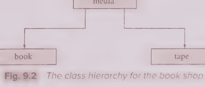

## 程序 9.13 运行时多态

```
#include <iostream>
#include <string>
using namespace std;
class media {
    protected:
        char title[50];
        float price;
    public:
        media(char *s, float a)
{
        strcpy(title, s);
        price = a;
    }
    virtual void display() {} // empty virtual function
};
class book: public media {
    int pages;
    public:
        book(char *s, float a, int p):media(s,a)
        {
            pages = p;
        }
        void display();
};
class tape :public media {
    float time;
    public:
        tape(char *s, float a, float t):media(s,t)
        {
            time = t;
        }
        void display();
};
void book ::display()
{
    cout << "\nTitle: " << title;
    cout << "\n Pages: " << pages <<
    cout << "\n Price: " << price;
}
```

```
void tape :: display()
{
    cout << "\n Title: " << title;
    cout << "\n play time: " << time << "mins";
    cout << "\n price: " << price;
}
int main()
{
    char * title = new char[30];
    float price, time;
    int pages;
    // Book details
    cout << "\n ENTER BOOK DETAILS\n";
    cout << "\n Title: "; cin >> title;
    cout << "\n Price: "; cin >> price;
    cout << "\n Pages: "; cin >> pages;


```cpp
bookl1(title, price, pages);

// Tape details

cout << "\n ENTER TAPE DETAILS\n";

cout << "\n Title: "; cin >> title;

cout << "\n Price: "; cin >> price;

cout << "\n Play time (mins): "; cin >> time;

tape tape1(title, price, time);

media* list[2];

list[0] = &bookl1;

list[1] = &tape1;

cout << "\n MEDIA DETAILS\n";

list[0] -> display(); // display book details

cout << "\n ...... TAPE ......\n";

list[1] -> display(); // display tape details

return 0;

}
```

程序 9.13 的输出为：

ENTER BOOK DETAILS
Title:Programming_in_ANSI_C
Price: 88
Pages: 400

ENTER TAPE DETAILS

Title: Computing_Concepts
Price: 90
Play time (mins): 55

MEDIA DETAILS

BOOK
....
Title:Programming_in_ANSI_C
Pages: 400
Price: 88

....
TAPE
....
Title: Computing_Concepts
Play time: 55mins
Price: 90

## 虚函数的规则

当为实现后期绑定而创建虚函数时，我们应遵守满足编译器要求的某些基本规则：

1. 虚函数必须是某个类的成员。
2. 它们不能是静态成员。
3. 它们是通过对象指针访问的。
4. 虚函数可以是另一个类的友元。
5. 基类中的虚函数必须被定义，即使它可能未被使用。
6. 基类版本的原型是它对虚函数，并且所有派生类版本必须相同。如果两个同名函数具有不同的原型，C++ 将它们视为重载函数，并且会忽略虚机制。
7. 我们不能有虚构造函数，但可以有虚析构函数。
8. 虽然基指针可以指向任何类型的派生对象，但反之则不行。也就是说，我们不能使用指向派生类的指针来访问基类型的对象。
9. 当基指针指向派生类时，增加或减少它并不会使其指向派生类的下一个对象。它仅相对于其基类型进行增加或减少。因此，我们不应使用此方法将指针移动到下一个对象。
10. 如果虚函数在基类中定义，则不必一定在派生类中重新定义。在这种情况下，调用将调用基函数。

### 9.8 纯虚函数

通常在基类内部声明一个函数为 `virtual`，并在派生类中重新定义它。基类内部的函数很少用于执行任何任务。它充当占位符。例如，我们没有定义 `class media` 的任何对象，因此基类中的 `display()` 函数被定义为空。这样的函数称为“do-nothing”函数。

“do-nothing”函数可定义如下：

```cpp
virtual void display() = 0;
```

这样的函数称为纯虚函数。纯虚函数是在基类中声明但相对于基类没有定义的函数。在这种情况下，编译器要求每个派生类要么定义它，要么将其重新声明为虚函数。请记住，包含纯虚函数的类不能用于声明其自身的对象。如前所述，这样的类是抽象基类。主要目的是为派生类提供一些特征并创建实现运行时多态所需的基指针。

程序 9.14 演示了纯虚函数的使用：

## 程序 9.14 纯虚函数

```cpp
#include <iostream>

using namespace std;

class Balagurasyamy { //base class
public:
    virtual void example()=0; //Notes pure virtual Function Definition
};

class C:public Balagurasyamy { //derived class 1
public:
    void example() {
        cout<<"C text Book written by Balagurasyamy";
    }
};

class coops:public Balagurasyamy { //derived class 2
public:
    void example() {
        cout<<"C++ text Book written by Balagurasyamy";
    }
};

int main() {
nExforsys* arra[2];
 C el;
coops e2;
arra[0]=&e1;
arra[1]=&e2;
arra[0]->example();
arra[1]->example();
return 0;
}
```

### 9.9 虚构造函数和析构函数

“构造函数不能是虚的”。有几个有效理由可以证明这一说法。首先，要创建构造函数的对象，构造函数类必须与类类型相同。但这对于虚拟实现的构造函数是不可能的。其次，在调用构造函数时，虚表尚未创建以解析任何虚函数调用。因此，虚构造函数本身将无处可查。结果，构造函数不能声明为虚。

虚析构函数在 C++ 中却是完全可行的。事实上，在某些情况下其使用也得到推广。一个情况是当我们需要确保在继承层次结构中不同的析构函数按顺序调用时，特别是当基类指针引用派生类型对象时。必须在此注意，继承层次结构中析构函数的调用顺序与构造函数的调用顺序相反。考虑以下使用析构函数的类声明：

```cpp
class A
{
public:
    ~A()
    {
        //Base class destructor
    }
}
class B : public A
{
public:
    ~B()
    {
        //Derived class destructor
    }
}
main()
{
    A *ptr = new B();
    .
    delete ptr;
}
```

在上述类声明中，类 `A` 和派生类 `B` 都有各自的析构函数。现在，一个 `A` 类指针已被分配一个 `B` 类对象。当使用 `delete` 运算符删除此对象指针时，它将触发基类析构函数，而派生类析构函数根本不会被调用。这可能导致内存泄漏情况。为了确保派生类析构函数强制调用，我们必须将基类析构函数声明为 `virtual`，如下所示。

## 摘要

- 多态简单地意味着一个名字具有多种形式。
- 多态有两种类型，即编译时多态和运行时多态。重载的成员函数是通过调用绑定参数的类型和数量来选择的。编译器在编译时就知道这些信息，因此编译器能够在此时为特定调用选择合适的函数。这称为早期绑定或静态绑定或静态链接。它的意思是对象在编译时就绑定到其函数调用。
- 在运行时多态中，合适的成员是在程序运行时选择的。C++借助虚函数支持运行时多态。它被称为晚期或动态绑定，因为合适的函数在运行时动态选择。动态绑定需要指向对象的指针，并且是 C++ 的强大特性之一。
- 对象指针在运行时创建对象时很有用。它可以与箭头一起用于访问对象的公共成员。
- 指针指向一个对象，该对象谨慎地调用成员函数。例如，函数调用 `a.show()` 将指针 `this` 设置为对象 `a` 的地址。
- 基类对象的指针与派生类对象的指针兼容。因此，我们可以使用单个基类对象指针变量来指向基类对象以及派生类对象。
- 当一个函数是虚函数时，C++ 根据基指针所指向的对象的类型，而不是指针的类型来确定在运行时调用哪个函数。通过使基指针指向不同的对象，我们可以执行虚函数的不同版本。
- 运行时多态仅在通过指向基类的指针访问虚函数时才能实现。它不能使用对象名以及点运算符来访问虚函数来实现。
- 我们可以有虚析构函数但不能有虚构造函数。
- 如果在基类中定义了虚函数，它不必一定在派生类中重新定义。在这种情况下，相应的调用将调用基类函数。
- 等同于零的虚函数是纯虚函数。它是在基类中声明但相对于基类没有定义的函数。包含此类纯函数的类称为抽象类。

## 关键术语

`abstract base classes` | `address of operator` | `argument object` | `arrays of pointers` | `arrow operator` | `base address` | `base object` | `base pointer` | `call back function` | `class hierarchy` | `compile time` | `compile polymorphism` | `dereference operator` | `derived object` | `do-nothing` | `function` | `dot operator` | `dynamic binding` | `early binding` | `function overloading` | `function pointer` | `implicit argument` | `indirect operator` | `invoking object` | `late binding` | `new operator` | `null pointers` | `object pointer` | `operator overloading` | `placeholder` | `pointers` | `pointer arithmetic` | `pointers to functions` | `polymorphism` | `pure virtual function` | `run time` | `run polymorphism` | `static binding` | `static linking` | `this pointer` | `virtual constructors` | `virtual destructors` | `virtual function` | `void pointers`

## 复习问题

### 认知领域

- 9.1 解释 C++ 语言中多态的含义。
- 9.2 说明多态是如何在 (a) 编译时和 (b) 运行时实现的。
- 9.3 讨论我们可以通过哪些方式访问对象的公共成员。
- 9.4 说明函数指针；并演示在何种情况下使用此类概念。
- 9.5 举例说明你将如何使用指针为对象数组创建空间。
- 9.6 检查 `this` 指针指向什么。
- 9.7 列出 `this` 指针的应用。
- 9.8 基类类型的指针指向派生类对象。用合适的示例证明你的答案。
- 9.9 表达关于虚函数的内容。
- 9.10 显示虚函数的必要性。
- 9.11 描述何时使虚函数“纯”。概括使函数成为虚函数的影响。
- 9.12 区分早期绑定和晚期绑定。

### 情感领域

- 9.13 为以下陈述的正确性辩护：
  (a) 虚函数用于创建指向基类的指针。
  (b) 虚函数允许我们使用相同的函数调用来调用不同类对象的成员函数。
  (c) 指向基类的指针不能指向派生类对象。
  (d) `this` 指针指向当前用于调用函数的对象。
  (e) `this` 指针可以像其他指针一样使用来访问其指向的对象的成员。
  (f) `this` 指针可以通过分配对象的地址来指向任何对象。
  (g) 纯虚函数强制程序员在派生类内部重新定义虚函数。

## 图例

Precision Valuing/Responding/Organizing Applying Remembering Understanding

## 调试练习

### 9.1 找出以下程序中的错误。

```cpp
#include <iostream>
using namespace std;
class GST
{
    float price;
    float percent;
public:
    void input(float a, float b)
    {
        price = a;
        percent= b;
    }
    void print()
    {
        cout << "price: " << price << "\n";
        cout << "percent: " << percent << "\n";
    }
};
int main()
{
    GST *p[3];
    GST *q=p;
    int i;
    float s,t,f;
    for(i=0; i<3; i++)
    {
        cout<<"Provide the price and percent"<<"
";
        cin>>s>>t;
        p->input(s, t);
        cout<<"you have entered"<<"
";
        q->print();
        f=s*t;
        cout<<"Price after GST: "<<<<f<<"\n";
    }
}
276
Object-Oriented Programming with C++
return 0;
}
```

### 9.2 找出以下程序中的错误。

```cpp
#include <iostream>
using namespace std;
int main ()\
{
    int p=10;
    double q=20.33;
    int *x=&p;
    double *y=&q;
    y=&p;
    x=&q;
    cout << "value 1 :" << p << endl;
    cout << "value 2 :" << q << endl;
    return 0;
}
```

## 试运行练习

### 9.1 当运行以下程序时会发生什么？

```cpp
#include <iostream>
using namespace std;
class B
{
    float b;
public:
    B()
    {
        b = 5.0; 
    }
    void show()
    {
        cout << b << endl;
    }
};
class D : public B
{
    float d;
    float d1;
public:
    D()
    {
        B::B();
        d = 10.0;
    }
    int d = 20.0;
    void show() {
        cout << d << endl;
    }
int main() {
    B ob, *ptr;
    D ob1;
    ptr = &ob1;
    ptr->show();
    cout << ptr << endl;
    ptr++;
    cout << ptr;
    return 0;
}
```

### 9.2 当运行以下程序时会发生什么？

```cpp
#include <iostream>
using namespace std;
int main() {
    int ar[6]={22,5,23,43,54,65};
    int *p;
    p=ar;
    i=p++ - *p--;
    cout << i;
    return 0;
}
```

### 9.3 当运行以下程序时会发生什么？

```cpp
#include <iostream>
using namespace std;
void square(int *snum) {
    cout << "Square of 10 is ";
    *snum *= *snum;
}
int main() {
    int num = 10;
    square(&num);
    cout << num << endl;
    return 0;
}
```

278
Object-Oriented Programming with C++

### 9.4 以下程序的输出是什么？

```cpp
#include <iostream>
using namespace std;
class p
{
public:
    virtual void print()
    {
        cout<<"it is base class \n";
    }
};
class q: public p
{
public:
    void print()
    {
        cout<<"it is Derived class \n";
    }
};
int main()
{
    p *b = new q;
    b->print();
    return 0;
}
```

### 9.5 如果从 `original_base` 类的 `print` 函数中删除 `virtual` 关键字，输出会有什么变化？

```cpp
#include <iostream>
using namespace std;
class original_base
{
public:
    virtual void print()
    {
        cout<<"print version of base class" <<endl;
    }
    void show()
    {
        cout<<"show version of base class" <<endl;
    }
}
class derived_from :public original_base
{
public:
    void print()
    {
        cout<<"print version of derived class" <<endl;
```


### 9.6 程序运行时会发生什么？

```
#include <iostream>
using namespace std;
class B {
    float b;
public:
    B() {
        b = 5.0;
    }
    virtual void show() {
        cout << b << endl;
    }
};
class D : public B {
    float d;
    float d1;
public:
    D() : B() {
        d = 10.0;
        d1 = 20.0;
    }
    void show() {
        cout << d << " - " << d1 << endl;
    }
};
int main() {
    B bob, *ptr;
    B obj;
    ptr = &bob;
    cout << "size: " << sizeof(*ptr) << endl;
    ptr = &obj;
    cout << "size: " << sizeof(*ptr) << endl;
    return 0;
}
```

### 9.7 程序运行时会发生什么？

```
#include <iostream>
using namespace std;
class B
{
    float b;
    public:
    B() {
        b = 5.0; 
    }
    void show() {
        cout << b << endl;
    }
}
class D : public B
{
    float d;
    float dl;
    public:
    D() {
        B::B();
        d = 10.0;
        dl = 20.0;
    }
    void show() {
        cout << d << endl;
    }
}
int main() {
    B ob, *ptr;
    D ob1;
    ptr = &ob;
    cout << sizeof(*ptr) << endl;
    cout << sizeof(ptr) << endl;
    return 0;
}
```

### 9.8 程序运行时会发生什么？

```
#include <iostream>
using namespace std;
class B
{
    float b;
    public:
```

```
B:
{ b = 5.0; }
void show()
{
    cout << b << endl;
}
```

```
class D : public virtual B
{
    float d;
    float di;
    D()
    {
        B::B();
        d = 10.9;
        di = 20.0;
    }
    void show()
{
        cout << d << endl;
    }
}
```

```
int main()
{
    B ob, *ptr;
    D obl;
    ptr = &sizeof(*ptr);
    cout << sizeof(*ptr) << endl;
    ptr = &ob;
    cout << sizeof(*ptr) << endl;
    return 0;
}
```

## PROGRAMMING EXERCISES

创建一个名为 `shape` 的基类。使用该类存储两个 `double` 值，可用于计算图形的面积。从基类 `shape` 派生出两个具体的类 `triangle` 和 `rectangle`。向基类添加一个成员函数 `get_data()` 用于初始化基类数据成员，以及另一个成员函数 `display_area()` 用于计算并显示图形的面积。将 `display_area()` 设为虚函数，并在派生类中重新定义以满足其需求。

使用这三个类，设计一个程序，可交互地接受三角形或矩形的尺寸，并显示面积。

记住作为输入给出的两个值在矩形情况下将被视为两条边的长度，在三角形情况下将被视为底和高，如下所示：

## Object-Oriented Programming with C++

```
Area of rectangle = x * y
Area of triangle = 1/2 * x * y
```

扩展程序以显示圆的面积。这需要添加一个新的派生类 `'circle'` 来计算圆的面积。记住，对于圆我们只需要一个值，即其半径，但 `get_data` 函数需要传递两个值。提示：使 `get_data` 的第二个参数默认为零值。

使用以下修改运行程序：

+   (a) 从其中一个派生类中删除 `display_area()` 的定义。

除上述更改外，将 `display_area()` 声明为基类 `shape` 中的虚函数。
在每种情况下评论输出。

+   使用该程序编写一个函数来交换同一类两个对象的私有数据值。

+   编写一个程序，使用函数指针按降序对整数数组进行排序，并使用虚函数重新排序该数组。

+   编写一个程序，使用函数指针概念计算整数的阶乘。

## MULTIPLE-CHOICE QUESTIONS

+   1. 选择解引用运算符：
(a) `&`
(b) `*`
(c) `*`
(d) `->`

+   (a) points to q
(b) points to q

+   2. 关于指针有什么问题？
(a) 持有对象的地址
(b) 指向已删除内存的指针
(c) `void` 指针可以被解引用
(d) 未初始化的指针被称为野指针

+   4. 对于 32 位系统，`void` 指针的大小是多少？
(a) 2 byte
(b) 2 byte
(c) 4 byte
(d) 8 byte

+   3. `p = 15, q = 37;`
`*a = &p, *b = &q;`
执行此代码后什么为真？
(a) `p=q`
(b) `q=p`

+   5. 泛型指针的声明是：
(a) `int *`
(b) `char *`
(c) `void *`
(d) none of these

+   6. 选择关于 `this` 指针的错误陈述：
(a) 可用于链式函数调用
(b) 调用成员函数
(c) 成员函数的显式参数
(d) 返回值给调用对象

7. 空指针也可以被视为：
(a) 零指针
(b) 变量指针
(c) `this` 指针
(d) 野指针

11. 多态性是通过以下方式实现的：
(a) 方法重写
(b) 运算符重载
(c) 虚函数
(d) 以上所有

8. `this` 指针可以声明为
(a) `const`
(b) `volatile`
(c) both a and B
(d) `int`

12. 抽象类可以包含
(a) 纯虚函数
(b) 构造函数
(c) 两者
(d) 无

9. 以下哪项不是多态的类型？
(a) 编译时多态
(b) 运行时多态
(c) 抽象多态
(d) 以上所有

13. 关于要设为虚的函数，以下哪项不正确？
(a) 属于某个类的成员
(b) 静态成员
(c) 另一个类的友元
(d) 在基类中定义

10. 多态性是通过以下方式实现的：
(a) 方法重写
(b) 运算符重载

## 10 Managing Console I/O Operations

## LEARNING OBJECTIVES

阅读本章后，你将能够

+   - 提供 C++ 中流的概述
- 列出各种 C++ 流类
- 描述未格式化和格式化的 I/O 操作
- 说明使用操纵符管理输出

### 10.1 INTRODUCTION

每个程序都以输入数据作为输入，并生成处理后的数据作为输出，遵循熟悉的输入-输出循环。因此，了解如何提供输入数据并以期望的形式呈现结果至关重要。我们在前面的章节中已使用 `cin` 和 `cout` 以及运算符 `>>` 和 `<<` 进行输入和输出操作。但我们迄今尚未讨论如何控制输出的打印方式。C++ 支持丰富的 I/O 函数和操作来实现这一点。由于这些函数使用了 C++ 的高级特性（如类、派生类和虚函数），我们在真正实现 C++ I/O 操作之前需要了解很多关于它们的信息。

记住，C++ 支持 C 的所有丰富 I/O 函数集。我们可以在 C++ 程序中使用其中任何一个。但我们由于两个原因而避免使用：首先，C++ 中的 I/O 方法支持 OOP 概念，其次，C 中的 I/O 方法无法处理用户定义的数据类型作为类对象。

> C++ 使用流和流类的概念来实现其与控制台和磁盘文件的 I/O 操作。我们将在本章讨论类如何支持控制台导向的输入输出操作。文件导向的 I/O 操作将在下一章讨论。

### 10.2 C++ STREAMS

C++ 中的 I/O 系统设计为可与多种设备一起工作，包括终端、磁盘和磁带驱动器。尽管每个设备都不同，I/O 系统为程序员提供了一个接口，该接口是正在访问的实际设备。此接口称为流。

流是一系列字节。它充当可以从中获取输入数据的源，或充当可以向其发送输出数据的目的地。提供数据给程序的源流称为输入流，而接收程序输出的目的地流称为输出流。换句话说，程序从输入流中提取字节并将字节插入输出流，如图 10.1 所示。

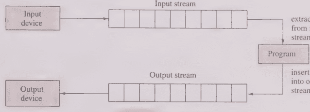

图 10.1 数据流

输入流中的数据可以来自键盘或任何其他存储设备。同样，输出流中的数据可以发送到屏幕或任何其他存储设备。如前所述，流充当程序与输入/输出设备之间的接口。因此，C++ 程序处理数据（输入或输出）独立于设备。

C++ 包含几个在程序开始执行时自动打开的预定义流。其中包括 `cin` 和 `cout`，我们在之前的程序中经常使用。我们知道 `cin` 表示连接到标准输入设备（通常是键盘）的输入流，而 `cout` 表示连接到标准输出设备（通常是屏幕）的输出流。注意键盘和屏幕是默认选项。如有必要，我们将流重定向到其他设备或文件。

### 10.3 C++ STREAM CLASSES

C++ I/O 系统包含一组用于定义各种流以处理控制台和磁盘文件输入输出操作的类层次结构。这些类称为流类。图 10.2 显示了用于与控制台单元进行输入输出操作的流类层次结构。这些类在头文件 `iostream` 中声明。此文件应包含在所有与控制台单元通信的程序中。

如图 10.2 所示，`ios` 是 `istream`（输入流）和 `ostream`（输出流）的基类，而它们又是 `iostream`（输入/输出流）的基类。类 `iostream` 被声明为虚基类，以便其成员只有一个被派生类继承。

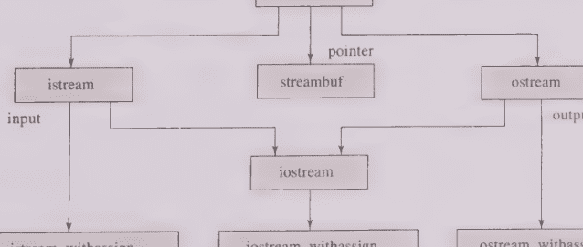

图 10.2 用于控制台 I/O 操作的流类

# 286
使用 C++ 进行面向对象编程

类 `ios` 为格式化和非格式化 I/O 操作提供了基本支持。类 `istream` 提供了格式化和非格式化输入的设施，而 `ostream`（通过继承）提供了格式化输出的设施。类 `iostream` 提供了处理输入输出流的设施。这些类，即 `istream_withassign`、`ostream_withassign` 和 `iostream_withassign` 为这些类添加了赋值运算符。表 10.1 给出了这些类的详细信息。

| Class name | Contents |
| --- | --- |
| `ios` (General input/output stream class) | • 包含所有其他输入输出类使用的基本设施<br>• 还包含指向缓冲区对象（`streambuf` 对象）的指针<br>• 声明处理格式化输入输出操作所需的常量和函数 |
| `istream` (input stream) | • 继承 `ios` 的属性<br>• 声明输入函数如 `get()`、`getline()` 和 `read()`<br>• 包含重载的提取运算符 `>>` |
| `ostream` (output stream) | • 继承 `ios` 的属性<br>• 声明输出函数 `put()` 和 `write()`<br>• 包含重载的插入运算符 `<<` |
| `iostream` (input/output stream) | • 通过多重继承继承 `ios`、`istream` 和 `ostream` 的属性，并且包含所有输入输出函数 |
| `streambuf` | • 通过缓冲区提供对物理设备的接口<br>• 作为 `ios` 文件使用的 `filebuf` 的基类 |

### 10.4 非格式化 I/O 操作

### 重载运算符 >> <<

我们使用 `cin` 和 `cout`（预定义在 `istream` 文件中）进行各种类型的数据输入输出。`cin` 是类型为 `ios` 的对象，`cout` 是类型为 `ostream` 的对象。这些对象已在命名空间 `std` 中声明。命名空间的声明和使用已在 16.5 中讨论。通过重载运算符 `>> <<` 来识别所有基本 C++ 类型，输入输出成为可能。运算符 `>>` 在 `istream` 类中重载，`<<` 在 `ostream` 类中重载。以下是从键盘读取数据的一般格式：

```
cin >> variable1 >> variable2 >> ... >> variableN
```

`variable1,variable2,...` 是已声明的有效 C++ 变量名。此语句将导致计算机停止执行并循环等待从键盘输入数据。此语句的输入数据为：

```
data1 ..... dataN
```

输入数据由空格分隔，并且应与 `cin` 列表中变量的类型匹配。空格、换行符和制表符将被跳过。

运算符 `>>` 按字符读取数据并将其分配到指定位置。对变量的读取将在遇到空白字符或与目标类型不匹配的字符时终止。例如，考虑以下代码：

```
int code;
cin >> code;
```

假设以下数据作为输入给出：
425D

运算符将读取字符直到 8，并且值 4258 被赋给 `code`。字符 D 保留在
输入流中并将输入到下一个 `cin` 语句。一般用于在屏幕上显示数据的形式为：

```
cout <<item1<<item2 <<....itemN
```

项目 `item1` 到 `itemN` 可以是任何基本类型的变量或常量。我们在
前几章举例说明的语句中使用了这些语句。

## istream 类函数

此类中的一些成员函数如下：
- `get`, `getline`, `read`, `ignore`, `putback`, `unset`, `peek`, 等。

除了此类成员函数外，该类还具有重载提取运算符（`>>`）的定义。成员函数具有多个重载签名。以下表格显示了其中一些函数：

| Function Signature | Task Description |
|---|---|
| `get();` | 从输入流接受一个字符并返回它。 |
| `istream&get(char &ch);` | 从输入流接受一个字符并将其赋给字符 'ch'。 |
| `istream&getline(char *buffer, int size, char del = '\n');` | 从输入流接受一个字符串，直到遇到字符 'del'（默认为 '\n'）为止，并将其存储在 'buffer' 指向的字符数组中。字符串的长度最大为 'size'。 |
| `istream&ignore(streamsize n = 1, int delim = EOF);` | 从输入流中提取 'n' 个字符，或直到其中一个等于字符 'delim'。 |
| `istream&unset();` | 它尝试将最后提取的字符替换回输入流并使其可供进一步提取。 |
| `int peek();` | 它返回输入流中的下一个字符而不提取它。因此，该字符仍可供将来提取。 |

由于这些函数是输入/输出流类的成员，我们必须使用适当的
对象调用它们。

示例：

```
char c;
cin.get(c); // get a character from keyboard
// and assign it to c
while(c != '\n')
{
  cout << c; // display the character on screen
cin.get(c); // get another character
```

此代码读取并显示一行文本（以换行符终止）。请记住，运算符 `>>` 也可用于读取字符，但它会跳过空白字符和换行符。如果将语句

```
cin >> c;
```

替换为

```
cin.get(c);
```

上述 `while` 循环将无法正常工作。`get(void)` 版本的使用如下：

```
char c;
c = cin.get();    // replaced
```


函数 `get()` 返回的值被赋给变量 `c`。

## ostream 类函数

`ostream` 类包含与输出相关的标志、成员函数和重载运算符函数的声明。除了重载的插入运算符（`<<`）之外，此类的成员函数还包括 `eof`、`clear`、`fill`。以下表格显示了一些 `ostream` 函数的作用：

| Function Signature | Task Description |
|---|---|
| bool eof() | 如果相应流对象的 eofbit 被设置为 true，则返回 true。当在流上执行最后一次操作时遇到文件末尾时，此标志将被设置为 true。 |
| void clear(iostream state = good) | 它为流的内部错误状态标志设置新值。 |
| ostream put(char c) | 它将字符 'c' 插入输出流。 |
| ostream write(const char *s, int n) | 它将字符数组 's' 指向的前 'n' 个字符插入输出流。 |
| ostream flush() | 它同步输出流缓冲区。 |

函数 `put()` 是 `ostream` 类的成员，可用于逐字符输出一行文本。例如，

```cpp
cout.put('x');
```

显示字符 `x` 且

```cpp
cout.put(ch);
```

显示变量 `ch` 的值。

变量 `ch` 必须包含字符值。我们也可以将数字用作函数 `put()` 的参数。例如，

```cpp
cout.put(68);
```

显示字符 `D`。此语句将把 `int` 值 `68` 转换为 `char` 值并显示 ASCII 值为 `68` 的字符。

以下程序段从键盘读取一行文本并将其显示在屏幕上。

```cpp
char c;

cin.get(c); // read a character

while (c != '\n')
{
  cout.put(c); // display the character on screen
  cin.get(c);
}
```

请注意，`istream` 和 `ostream` 中的函数都可在 `iostream` 类中使用。这是因为 `iostream` 继承了 `istream` 和 `ostream` 类的属性，如图 10.2 所示。

程序 10.1 说明了这两个字符处理函数的使用。

### 程序 10.1 使用 get() 和 put() 的字符 I/O

```cpp
#include <iostream>
using namespace std;
int main()
{
  int count = 0;
  char c;
  cout << "INPUT TEXT\n";
  cin.get(c);
  while (c != '\n')
{
    cout.put(c);
    cin.get(c);
  }
  cout << "\nNumber of characters = " << count << "\n";
  return 0;
}
```

Input
Object Oriented Programming
Output
Object Oriented Programming
Number of characters = 27

当我们输入一行输入时，文本在我们按下 RETURN 键后立即发送到程序。程序然后使用语句 `cin.get(c);` 一次读取一个字符，并使用语句 `cout.put(c);` 显示它。当遇到换行符时，处理终止。

## 使用 C++ 进行面向对象编程

### getline() 和 write() 函数

我们可以使用行定向/输出函数 `getline()` 和 `write()` 更高效地读取和显示一行文本。`getline()` 函数读取以换行符结束的整行文本（由 RETURN 键传输）。`getline` 函数可以由对象 `cin` 如下调用：

```cpp
cin.getline(line, size);
```

此函数调用 `getline()`，将字符输入读入变量 `line`。读取在遇到换行符 `'\n'` 或读取 `size-1` 个字符时终止（以先发生者为准）。换行符会被读取但不保存。相反，它会被空字符替换。例如，考虑以下代码：

```cpp
char name[20];
cin.getline(name, 20);
```

假设我们通过键盘有以下输入：

> Bjarne Stroustrup <press RETURN>

此输入将被正确读取并分配给字符数组 `name`。假设输入如下：

> Object Oriented Programming <press RETURN >

在这种情况下，输入将在读取以下 19 个字符后终止：

> Object Oriented Pro

记住，字符串中包含的两个空白也计入在内。

我们也可以使用运算符 `>>` 如下读取字符串：

```cpp
cin >> name;
```

但请记住 `cin` 只能读取不包含空白的字符串。这意味着 `cin` 只能读取一个单词，而不是像 "Bjarne Stroustrup" 这样的一系列单词。但它可以正确读取以下字符串：

> Bjarne_Stroustrup

读取字符串后，`cin` 会自动向字符数组添加终止空字符。

程序 10.2 演示了使用 `>>` 和 `getline()` 读取字符串。

#### 程序 10.2 使用 getline() 读取字符串

```cpp
#include <iostream>
using namespace std;
int main()
{
    int size = 20;
    char city[20];
cout << "Enter city name: \n";
cin >> city;
cout << "City name:" << city << "\n\n";
cout << "Enter city name again: \n";
cin.getline(city, size);
cout << "City name now: " << city << "\n\n";
cout << "Enter another city name: \n";
cin.getline(city, size);
cout << "New city name: " << city << "\n\n";
return 0;
}
```

程序 10.2 的输出为：

First run
Enter city name:
Delhi
City name: Delhi
Enter city name again:
City name now:
Enter another city name:
Chennai
New city name: Chennai
Second run
Enter city name:
New Delhi
City name: New

Enter city name again:
City name now: Delhi
Enter another city name:
Greater Bombay
New city name: Greater Bombay

`write()` 函数显示整行，其形式如下：

```cpp
cout.write (line, size);
```

第一个参数 `line` 表示要显示的字符串的名称，第二个参数 `size` 表示要显示的字符数。请注意，它不会在遇到空字符时自动停止显示字符。如果 `size` 大于 `line` 的长度，则它会显示超出 `line` 的边界。程序 10.3 说明了 `write()` 方法如何显示字符串。

#### 程序 10.3 使用 write() 显示字符串

```cpp
#include <iostream>
#include <string>
using namespace std;
int main()
{
    char *string1 = "C++";
    char *string2 = "Programming";
    int m = strlen(string1);
    int n = strlen(string2);
    for(int i=1; i<n; i++)
    {
        cout.write(string2,i); cout << "\n";
    }
    for (int i=n; i>=1; i--)
    {
        cout.write(string2,i);
        cout << "\n";
    }
    // concatenating strings
    cout.write(string1,m).write(string2,n);
    cout << "\n";
    // crossing the boundary
    cout.write(string1,10);
    return 0;
}
```

程序 10.3 的输出为：

P
Pr
Pro
Prog
Progr
Prora
Program
Programm
Programmi
Programmin
Programming

Programmin
Programmi
Programm
Program
Progr
Prog
Pro
Pr
P
C++ Programming C++ Progr

输出的最后一行表明语句

```cpp
cout.write(string1, 10);
```

显示的字符比 `string1` 中包含的字符更多。

可以使用 `write()` 函数连接两个字符串。语句

```cpp
cout.write(string1, m).write(string2, n);
```

等价于以下语句：

```cpp
cout.write(string1, m);
cout.write(string2, n);
```

### 10.5 格式化控制台 I/O 操作

C++ 支持许多可用于格式化输出的功能。这些功能包括：

- `ios` 类函数和标志
- 操纵符
- 用户定义的输出函数

`ios` 类包含大量成员函数，可帮助我们以多种方式格式化输出。其中最重要的一组列在表 10.2 中。

表 10.2 ios 格式函数

| Function | Task |
| --- | --- |
| width() | To specify the required field size for displaying an output value |
| precision() | To specify the number of digits to be displayed after the decimal point of a float value |
| fill() | To specify a character that is used to fill the unused portion of a field |
| setf() | To specify format flags that control the form of output display (such as left justification and right justification) |
| unset() | To clear the flags specified |

操纵符是特殊函数，可以包含在 I/O 语句中以改变流的格式参数。表 10.3 显示了一些经常使用的重要的操纵符函数。要访问这些操纵符，程序中需要包含文件 `iomanip`。

294
Object-Oriented Programming with C++

表 10.3 操纵符
| Manipulators | Equivalent ios function |
| --- | --- |
| setw() | width() |
| setprecision() | precision() |
| setfill() | fill() |
| setiosflags() | setf() |
| resetiosflags() | unset() |

除了 C++ 库支持的这些函数外，我们还可以创建自己的操纵符函数，以提供如何使用预定义的格式化函数以及如何创建新函数的详细信息。以下各节将提供如何使用格式化函数的详细信息。

#### 定义字段宽度：width()

我们可以使用 `width()` 函数定义输出项目所需的字段宽度。由于它是一个成员函数，我们必须使用对象来调用它，如下所示：

```cpp
cout.width(w);
```

其中 `w` 是宽度（列数）。输出将在字段的右端打印在 `w` 个字符的字段中。`width()` 函数只能为一个项目（紧随其后的项目）指定字段宽度。打印一个项目（按规范）后，它将恢复为默认值。例如，语句

```cpp
cout.width(5);
cout << 543 << 12 << "\n";
```

将产生以下输出：

| | 5 | 4 | 3 | 1 | 2 |

值 `543` 在前五个列中右对齐打印。规范 `width(5)` 不保留用于打印数字 `12` 的设置。可以改进如下：

```cpp
cout.width(5);
cout << 543;
cout.width(5);
cout << 12 << "\n";
```

这产生以下输出：

| | 5 | 4 | 3 | | 1 | 2 |

记住，字段宽度应为每个项目单独指定。C++ 从不截断值，因此，如果指定的宽度小于要打印的值的大小，C++ 会扩展字段以适应该值。程序 10.4 演示了函数 `width()` 的工作原理。

#### 程序 10.4 使用 width() 指定字段大小

```cpp
#include <iostream>
using namespace std;
int main()
{
    int items[4] = {10,8,12,15};
    int cost[4] = {75,100,60,99};
    cout.width(5);
    cout << "ITEMS";
    cout.width(8);
    cout << "COST";
    cout.width(15);
    cout << "TOTAL VALUE" << "\n";
    int sum = 0;
    for(int i=0; i<4; i++)
    {
        cout.width(5);
        cout << items[i];
        cout.width(8);
        cout << cost[i];
        int value = items[i] * cost[i];
        cout.width(15);
        cout << value << "\n";
        sum = sum + value;
    }
    cout << "\n Grand Total = ";
    cout.width(2);
    cout << sum << "\n";
    return 0;
}
```

程序 10.4 的输出为：

| ITEMS | COST | TOTAL VALUE |
| --- | --- | --- |
| 10 | 75 | 750 |
| 8 | 100 | 800 |
| 12 | 60 | 720 |
| 15 | 99 | 1485 |

Grand Total = 3755

Object-Oriented Programming with C++

### Setting Precision: precision()

默认情况下，浮点数打印时小数点后为六位。然而，我们可以在打印浮点数时指定小数点后显示的位数。这可以通过使用 `precision()` 成员函数来实现，如下所示：

```cpp
cout.precision(d);
```

其中 `d` 是小数点右侧的位数。例如，语句

```cpp
cout.precision(3);
cout << sqrt(2) << "\n";
cout << 3.14159 << "\n";
cout << 2.50032 << "\n";
```

将产生以下输出：

1.141 (truncated)
3.142 (rounded to the nearest cent)
2.5 (no trailing zeros)

请注意，与函数 `width()` 不同，`precision()` 在被重置之前会一直保留设置效果。这就是为什么我们只声明了一个精度设置语句，而它被所有三个输出使用。

我们可以为不同值设置不同的精度，如下所示：

```cpp
cout.precision(3);
cout << sqrt(2) << "\n";
cout.precision(5); // Reset the precision
cout << 3.14159 << "\n";
```

我们还可以将字段规范与精度设置结合起来。示例：

```cpp
cout.precision(2);
cout.width(5);
cout << 1.2345;
```

前两个语句指示：“在宽度为五个字符的字段中打印小数点后两位”。因此，输出将为：

| | 1 | 2 | 3 |

Program 10.5 显示了 `width()` 和 `precision()` 函数如何联合使用来控制输出格式。

#### Program 10.5 Precision Setting with precision()

```cpp
#include <iostream>
#include <cmath>
using namespace std;
int main()
{
  cout << "Precision set to 3 digits \n\n";
  cout.precision(3);
  cout.width(10);
  cout << "VALUE";
  cout.width(15);
  cout << "SQRT_OF_VALUE" << "\n";
```


`for(int n=1; n<=5; n++) {`

`cout.width(8);`

`cout << n;`

`cout.width(13);`

`cout << sqrt(n) << "\n";`

`}`

`cout << "\nPrecision set to 5 digits \n";`

`cout.precision(5); // precision parameter changed`

`cout << " " << sqrt(10) << " " << sqrt(10) << "\n";`

`cout.precision(0); // precision set to default`

`cout << " " << sqrt(10) << " " << sqrt(10) << " " (default setting)\n";`

`return 0;`

`}`

```
Program 10.5 的输出将为：
Precision set to 3 digits

| VALUE | SQRT_OF_VALUE |
| 1 | 1 |
| 2 | 1.41 |
| 3 | 1.73 |
| 4 | 2 |
| 5 | 2.24 |

Precision set to 5 digits
sqrt(10) = 3.1623
sqrt(10) = 3.162278 (default setting)
```

- 从输出中观察到以下几点：
1. 输出四舍五入到最接近的百分位（即，对于两位精度，1.6666 将为 1.67，但 1.3333 将为 1.33）。
2. 尾随零被截断。
3. 精度设置在被重置之前一直有效。
4. 默认精度为 6 位。

### Program 10.6 Width and Precision Manipulators

```
#include <iostream>

using namespace std;

int main()

{

    float pi=22.0/7.0;

    int i;

    cout<<"Value of PI:\n";

    for(i=1;i<=10;i++)

{

        cout.width(i+1);

        cout.precision(i);

    }

    cout<<pi<<"\n";

    return 0;

}
```

Program 10.6 的输出将为：

Value of PI:
3.1
3.14
3.143
3.1428
3.14286
3.142857
3.1428571
3.14285707
3.142857074

## Filling and Padding: `fill()`

我们使用比值所需更大的字段宽度来打印值。默认情况下，字段的未使用位置用空格填充。然而，我们可以使用 `fill()` 函数用任意所需字符填充未使用位置。它以以下形式使用：

```
cout.fill(ch);
```

其中 `ch` 表示用于填充未使用位置的字符。示例：

```
cout.fill('*');
cout.width(10);
cout << 5250 << "\n";
```

输出将为：

| * | * | * | * | * | 5 | 2 | 5 | 0 |

金融机构和银行在打印支票时使用这种填充方式，以便任何人无法轻易更改金额。像 `precision()` 一样，`fill()` 在我们更改它之前一直有效。请参阅 Program 10.7 及其输出。

### Program 10.7 Padding with `fill()`

```
#include <iostream>

using namespace std;

int main() {

    cout.fill('<');

    cout.precision(3);

    for(int n=1; n<=6; n++) {

        cout.width(5);

        cout << n;

        cout.width(10);

        cout << 1.0 / float(n) << "\n";

        if (n == 3)

            cout.fill('>');

    }

    cout << "\nPadding changed \n\n";

    cout.fill('#'); // fill() reset

    cout.width(15);

    cout << 12.345678 << "\n";

    return 0;

}
```

Program 10.7 的输出将为：

```
<<<<<<<<<<1

<<<<<<<<<<<0.5

<<<<<<<<<<<0.333

>>>>>>>>>>0.25

>>>>>>>>>0.2

>>>>>>>>>>0.167

Padding changed

#######12.346
```

## Formatting Flags, Bit-fields and `setf()`

我们已经看到，当使用 `width()` 函数时，值（无论是文本还是数字）都会在字段宽度内右对齐打印。但，通常的做法是打印左对齐的文本。我们如何使值左对齐？或者，我们如何使浮点数以科学记数法打印？

`setf()`，`ios` 类的成员函数，可以提供这些以及许多其他格式问题的答案。
`setf()` 代表 flags function 可以按如下方式使用：

```
cout.setf(arg1,arg2);
```

`arg1` 是在 `ios` 类中定义格式标志之一。格式标志指定输出所需的格式。另一个 `ios` 常量 `arg2`，称为位字段，指定格式所属的组。
Table 10.4 显示了位字段、标志及其格式操作。有位字段，每个位字段有一组互斥的标志。示例：

```
cout.setf(ios::left, ios::adjustfield);
cout.setf(ios::scientific, ios::floatfield);
```

| Format required | Flag (arg1) | Bit-field (arg2) |
| --- | --- | --- |
| Left-justified output | `ios::left` | `ios::adjustfield` |
| Right-justified output | `ios::right` | `ios::adjustfield` |
| Padding after sign or base | `ios::internal` | `ios::adjustfield` |
| Indicator (like ##20) | | |
| Scientific notation | `ios::scientific` | `ios::floatfield` |
| Fixed point notation | `ios::fixed` | `ios::floatfield` |
| Decimal base | `ios::dec` | `ios::basefield` |
| Octal base | `ios::oct` | `ios::basefield` |
| Hexadecimal base | `ios::hex` | `ios::basefield` |

请注意，第一个参数应为第二个参数的成员组。

考虑以下代码段：

```
cout.fill('*');
cout.setf(ios::left, ios::adjustfield);
cout.width(15);
cout << "TABLE 1" << "\n";
```

这将产生以下输出：

| T | A | B | L | E | | | * | * | * | * | * |
| --- | --- | --- | --- | --- | --- | --- | --- | --- | --- | --- | --- |

语句

```
cout.fill('*');
cout.precision(3);
cout.setf(ios::internal, ios::adjustfield);
cout.setf(ios::scientific, ios::floatfield);
cout.width(15);
cout << -12.34567 << "\n";
```

将产生以下输出：************

注意 符号左对齐，值右左对齐。它们之间的空格用星号填充。值以科学记数法打印，精确到三位小数。

### Program 10.8 Manipulation of Flag and Bit Fields

```
#include <iostream>

using namespace std;

int main() {

    int num;

    cout<<"Enter an integer value: ";

    cin>>num;

    cout<<"The hexadecimal, octal and decimal representation of "

<<num<<" is: " << "";

    cout.setf(ios::hex, ios::basefield);

    cout<<num<<", " << "";

    cout.setf(ios::oct, ios::basefield);

    cout<<num<<" and " << "";

    cout.setf(ios::dec, ios::basefield);

    cout<<num<<" respectively";

    return 0;

}
```

Program 10.8 的输出将为：
Enter an integer value: 92
The hexadecimal, octal and decimal representation of 92 is: 5c, 134 and 92 respectively

## Displaying Trailing Zeros and Plus Sign

如果我们使用宽度为 8 的字段打印数字 10.75、25.00 和 15.50，使用两位精度，则输出将如下所示：

| | 1 | 0 | - | 7 | 5 |
| | | | | | |
| | | | | 2 | 5 |
| | | | 1 | 5 | 5 |

请注意，第二项和第三项中的尾随零已被截断。

## 使用 C++ 进行面向对象编程

某些情况，例如商品价格列表或员工薪资报表，需要显示零。上述输出如果按如下方式打印会更好：

```
10.75

25.00

15.50
```

`setf()` 可以与标志 `ios::showpoint` 作为单个参数一起使用来实现这种形式的输出。例如，

```
cout.setf(ios::showpoint); // display trailing zeros
```

会使 `cout` 显示尾随零和尾随小数点。默认情况下，值 3.25 将显示为 3.250000。请记住，默认假设精度为六位数字。

同样，可以使用以下语句在正数前打印加号：

```
cout.setf(ios::showpos); // show +sign
```

对于示例，

```
cout.setf(ios::showpoint);
cout.setf(ios::showpos);
cout.precision(3);
cout.setf(ios::fixed, ios::floatfield);
cout.setf(ios::internal, ios::adjustfield);
cout.width(10);
cout << 275.5 << "\n";
```

将产生以下输出：

| + | 2 | 7 | 5 . | 5 | 0 | 0 |

诸如 `showpoint` 和 `showpos` 之类的标志没有位字段，因此作为参数用于 `setf()`。这是可能的，因为 `setf()` 已在类 `ios` 中声明为重载函数。表 10.5 列出了不具有命名位的标志。这些标志不是相互排斥的，因此可以独立设置或清除。

### 表 10.5 没有位字段的标志

| Flag | Meaning |
| `ios::showbase` | Use base indicator on output |
| `ios::showpos` | Print + before positive numbers |
| `ios::showpoint` | Show trailing decimal point and zeroes |
| `ios::uppercase` | Use uppercase letters for hex output |
| `ios::skipws` | Skip white space on input |
| `ios::unitbuf` | Flush all streams after insertion |
| `ios::stdio` | Flush stdout and stderr after insertion |

程序 10.9 演示了使用重载的 `setf()` 函数设置各种格式标志。

### 程序 10.9 使用 setf(i) 中的标志进行格式化

```
#include <iostream>
#include <cmath>

using namespace std;

int main()

{

    cout.fill('*');

    cout.setf(ios::left, ios::adjustfield);

    cout.width(10);

    cout << "VALUE";

    cout.setf(ios::right, ios::adjustfield);

    cout.width(15);

    cout << "SQRT OF VALUE" << "\n";

    cout.fill('.');

    cout.precision(4);

    cout.setf(ios::showpoint);

    cout.setf(ios::showpos, ios::floatfield);

    for (int n=1; n<=10; n++)

    {

        cout.setf(ios::internal, ios::adjustfield);

        cout.width(5);

        cout << n << "";

        cout.setf(ios::right, ios::adjustfield);

        cout.width(20);

        cout << sqrt(n) << "\n";

    }

    // floatfield changed

    cout.setf(ios::scientific, ios::floatfield);

    cout << "\nSQRT(100) = " << sqrt(100) << ".\n";

    return 0;

}
```

程序 10.9 的输出为：

VALUE*******SQRT OF VALUE
+1.......1.0000
+2.......+1.4142
+3.......+1.7321
+4.......+2.0000
+5.......+2.2361


```
...+6..............+2.4495

...7..............+2.5458

...8..............+2.8284

...+9..............+3.0000

...10.............+3.1621
```

```
SQRT(100) = +1.00000e+01
```

- Note
1. The flags set by set() remain effective until they are reset or unset.
2. A format flag can be reset any number of times in a program.
3. We can apply more than one format controls jointly on an output value.
4. The setf() sets the specified flags and leaves others unchanged.

### 10.6 使用操纵符管理输出

头文件 `iomanip` 提供了一组称为操纵符的函数，可用于操纵输出格式。它们提供了与 `ios` 成员函数相同的功能。一些操纵符比类 `ios` 中的对应项更方便。例如，可以将两个或多个操纵符作为链在一条语句中使用，如下所示：

```
cout << mani1 << mani2 << mani3 << item;
cout << mani1 << item1 << mani2 << item2;
```


这种连接在我们想要显示多列输出时很有用。
最常用的操纵符如表 10.6 所示。表格还给出了它们的含义和等价物。要访问这些操纵符，我们必须在程序中包含文件 `iomanip`。

| Table 10.6 Manipulators and their meanings |
| Manipulator | Meaning | Equivalent |
| --- | --- | --- |
| `setw(int w)` | Set the field width to w. | `width()` |
| `setprecision(int d)` | Set the floating point precision to d. | `precision()` |
| `setfill(int c)` | Set the fill character to c. | `fill()` |
| `setiosflags(long f)` | Set the format flag f. | `setf()` |
| `resetflags(long f)` | Clear the flag specified by f. | `unsetf()` |
| `endl` | Insert new line and flush stream. | `"\n"` |

下面给出了操纵符的一些示例：

``` 
cout << setw(10) << 12345;
```

This statement prints 12345 right-justified in a field width of 10 characters. The output can be made leftjustified by modifying the statement as follows:

``` 
cout << setw(10) << setiosflags(ios::left) << 12345;
```

One statement can be used to format output for two or more values. For example:

``` 
cout << setw(5) << setprecision(2) << 1.2345
cout << setw(10) << setprecision(4) << sqrt(2)
cout << setw(15) << setiosflags(ios::scientific) << sqrt(3);
<< endl;
```

### 管理控制台操作

将打印所有三个值在一行中，字段大小分别为 5、10 和 15。请注意，每个输出都由不同的格式规范控制。

我们可以在程序中将操纵符和 `ios` 函数结合使用。以下代码段是有效的：

``` 
cout.setf(ios::showpoint);
cout.setf(ios::showpos);
cout << precision(4);
cout << setiosflags(ios::scientific);
cout << setw(10) << 12345678;
```

> 操纵符的实现方式与 `ios` 成员函数存在一个主要区别。`ios` 成员函数返回先前的格式状态，可在必要时稍后使用。但操纵符不返回先前的格式状态。如果我们需要保存旧的格式状态，则必须使用 `ios` 成员函数而不是操纵符。示例：

``` 
cout.precision(2); // previous state
int p = cout.precision(4); // current state;
```

当这些语句执行时，`p` 将保存 2 的值（先前状态），新格式状态将为 4。我们可以按如下方式恢复先前的格式状态：

``` 
cout.precision(p); // p = 2
```

程序 10.10 演示了使用操纵符和 `ios` 函数格式化输出值。

### 程序 10.10 使用操纵符进行格式化

``` 
#include <iostream>
#include <iomanip>
using namespace std;
int main()
{
  cout.setf(ios::showpoint);
  cout << setw(15) << "Inverse_of_n" <<
"
  cout << setw(15) << "Sum_of_terms\n" <<
";
  double term, sum = 0;
  for(int n=1; n<=10; n++)
  {
    term = 1.0 / float(n);
    sum = sum + term;
    cout << setw(5) << n
    cout << setw(14) << precision(4)
    cout << setiosflags(ios::scientific) << term
    cout << setw(13) << resetiosflags(ios::scientific);
}
```

(Contd.)

``` 
<< sum << endl;
}
  return 0;
}
```

程序 10.10 的输出为：

| n | Inverse_of_n | Sum_terms |
|---|---|---||
| 1 | 1.0000e+000 | 1.0000 |
| 2 | 5.0000e-001 | 1.5000 |
| 3 | 3.3333e-001 | 1.8333 |
| 4 | 2.5000e-001 | 2.0833 |
| 5 | 2.0000e-001 | 2.2833 |
| 6 | 1.6667e-001 | 2.4500 |
| 7 | 1.4286e-001 | 2.5929 |
| 8 | 1.2500e-001 | 2.7179 |
| 9 | 1.1111e-001 | 2.8290 |
| 10 | 1.0000e-001 | 2.9290 |

### 设计我们自己的操纵符

我们可以为某些特殊目的设计我们自己的操纵符。创建没有参数的操纵符的一般形式为：

``` 
ostream & manipulator (ostream & output)
{
  ....
  (code)
  ....
  return output;
}
```

这里，`manipulator` 是正在创建的操纵符的名称。以下函数定义了一个名为 `unit` 的操纵符，它显示“inches”：

``` 
ostream & unit(ostream & output)
{
  output << "inches";
  return output;
}
```

语句 `cout << 36 << unit;` 将产生以下输出

36 inches

我们还可以创建可以代表一系列操作的操纵符。示例：

``` 
ostream & show(ostream & output)
{
    output.setf(ios::showpoint);
    output.setf(ios::showpos);
    output << setw(10);
    return output;
}
```

该函数定义了一个名为 `show` 的操纵符，它打开在类 `ios` 中声明的标志 `showpoint` 和 `showpos`，并将字段宽度设置为 10。

程序 10.11 说明了用户定义操纵符的创建和使用。该程序创建了两个名为 `currency` 和 `form` 的操纵符，并在主程序中使用它们。

## 程序 10.11 用户定义操纵符

``` 
#include <iostream>
#include <iomanip>
using namespace std;
// user-defined manipulators
ostream & currency(ostream & output)
{
    output << "Rs";
    return output;
}
ostream & form(ostream & output)
{
    output.setf(ios::showpos);
    output.setf(ios::showpoint);
    output.fill('*');
    output.precision(2);
    output << setiosflags(ios::fixed)
    << setw(10);
    return output;
}
int main()
{
    cout << currency << form << 7864.5;
    return 0;
}
```

程序 10.11 的输出为：

Rs***7864.50

请注意 `form` 代表一组复杂的格式函数和操纵符。

| LIMITATION |
| Complex format like JPEG, input, can be handled by special IDL runtime |

## SUMMARY

在 C++ 中，I/O 系统设计为可与不同的 I/O 设备一起工作。该 I/O 系统向程序员提供一个称为 'stream' 的接口，该接口独立于所使用的实际设备。

流是一系列字节，可作为 I/O 数据的源或目的地。

向程序提供数据的源流称为输入流，而接收程序输出的目的地流称为输出流。

C++ I/O 系统包含用于输入和输出操作的一组流类。这些类在头文件 'iostream' 中定义。

`cin` 表示连接到标准输入设备的输入流，`cout` 表示连接到标准输出设备的输出流。

`istream` 和 `ostream` 定义了两个成员函数 `get()` 和 `put()` 来处理单个 I/O 操作。

`>>` 运算符在 `istream` 中被重载为提取符，而 `<<` 运算符在 `ostream` 类中被重载为插入运算符。

我们可以使用行定向 I/O 函数 `getline()` 和 `write()` 分别更有效地读写一行文本。

`ios` 类包含诸如 `width()`、`precision()`、`fill()`、`setf()`、`unset()` 等成员函数来格式化输出。

头文件 `iomanip` 提供了一组操纵符函数来操纵输出格式。它们提供了与 `ios` 类函数相同的功能。

我们也可以为特殊目的设计自己的操纵符。

## KEY TERMS

`adjustfield` | `basefield` | `bit-fields` | `console I/O operations` | `decimal base` | `destination stream` | `field width` | `fill()` | `filing` | `keyed point` | `notation` | `flags` | `floatfield` | `formatted console I` | `formatting flags` | `formatting functions` | `get()` | `getline()` | `hexadecimal base` | `input stream` | `internal` | `ios` | `iomanip` | `iostream` | `istream` | `left-justified` | `manipulator` | `octal base` | `ostream` | `output stream` | `padding` | `precision()` | `put()` | `resetflags()` | `right-justified` | `scientific` | `notation` | `sett` | `set()` | `setflags()` | `setprecision()` | `setting precision` | `setw()` | `showbase` | `checkpoint` | `skips` | `source stream` | `standard input device` | `standard output device` | `stream classes` | `streambuf` | `streams` | `unitbuf` | `unset()` | `width()` | `write()`

## REVIEW QUESTIONS

### Cognitive Domain

+   10.1 表达什么是流。
+   10.2 描述 C++ 支持的 I/O 系统的特性。
+   10.3 概述 C++ 中与 C 不同的 I/O 设施。
+   10.4 论证 `cin` 和 `cout` 之类的东西为何不被视为关键字。
+   10.5 分析 `cout` 能够在没有任何特殊指令的情况下显示各种类型的数据。
+   10.6 评估在所有程序中包含 `iostream` 的必要性。
+   10.7 讨论输入流支持的 `get()` 函数的各种形式；也解释其用法。
+   10.8 区分以下语句的操作：
``` 
cin >> c;
cin.get(c);
```
+   10.9 `cin` 和 `getline()` 函数都可用于读取字符串。评估此说法。
+   10.10 讨论以下语句中 `size` 参数的含义：
``` 
cout.write(line, size);
```
+   10.11 阐述 `iomanip` 文件的作用。
+   10.12 说明 `file()` 函数的作用；也解释此函数的使用。
+   10.13 分解 `set()` 函数的语法。
+   10.14 解释操纵符和 `ios` 成员函数之间基本实现差异，并举例说明。

### Psychomotor Domain

+   10.15 显示以下语句的作用。
``` 
cout.write(s1,m).write(s2,n);
```
+   10.16 在不出现错误的情况下执行并找出以下程序段的结果：
``` 
for(i=0.25; i<=1.0; i+=0.25)
{
cout.precision(5);
cout.width(7);
cout << i;
cout.width(10);
cout << i*i << "\n";
}
cout << setw(10) << "TOTAL = "
<< setw(20) << setprecision(2) << 1234.567
<< endl;
```
+   10.17 讨论创建用户定义操纵符的语法。具体设计一个操纵符以提供打印浮点值的以下输出规范：
+   (a) 10 列宽度
+   (b) 右对齐
+   (c) 两位精度
+   (d) 用*填充未使用的位置
+   (e) 显示尾随零

### Affective Domain

+   10.18 为以下陈述的正确性辩护：
+   (a) C++ 流是一个文件。
+   (b) C++ 从不截断数据。
+   (c) `width()` 函数的主要优点是我们可以使用一个宽度规范用于多个项目。
+   (d) `get(void)` 函数提供不跳过空白字符的单字符输入。
+   (e) 头文件 `iomanip` 可用于代替 format。
+   (f) 我们不能在同一程序中使用 C I/O 函数和 C++ I/O 函数。
+   (g) 程序员可以定义一个操纵符，该操纵符可代表一组格式函数。

## Legend

Precision Valuing/Responding/Organizing Applying Remembering Understanding

## DEBUGGING EXERCISES

10.1 要使以下程序的输出为 Buffer: Jack and Jerry Buffer2: Tom and Mono，你需要做什么？

``` 
#include <iostream>
using namespace std;
int main() {
    char buffer1[80];
    char buffer2[80];
    cout << "Enter value for buffer1: ";
    getline(cin, buffer1);
    cout << "Buffer1: " << buffer1 << endl;
    cout << "Enter value for buffer2: ";
    cin.getline(buffer2, 80);
    cout << "Buffer2: " << buffer2 << endl;
    return 0;
}
```

10.2 语句 `cout.setf(ios::right)` 是否有效？

``` 
#include <iostream>
using namespace std;
int main()
```
``` 
cout.width(5);
cout << "99" << endl;
setf(ios::left);
cout.width(5);
cout << "99" << endl;
setf(ios::right);
cout << "99" << endl;
return 0;
```

10.3 识别以下程序中的错误，如有：

``` 
#include <iostream>
using namespace std;
int main()
{
  float pi=32.0/7.9;
  cin();
  cout.fill('$');
  cout.width(10);
  cout.precision(2);
  cout<<pi<<"\n";
}
return 0;
```

10.4 识别以下程序中的错误，如有：

``` 
#include <iostream>
int main()
{
  istream in=std::cin;
  ostream out=std::cout;
  int x;
  in>>x;
  out<<x;
  return 0;
```

10.5 说明以下语句中是否存在错误：
+   (a) `cout << (void*) amount;`
+   (b) `cout << put("John");`
+   (c) `cout << width();`
+   (d) `int p = cout.width(10);`
+   (e) `cout.width(10).precision(3);`
+   (f) `cout.setf(ios::scientific, ios::left);`
+   (g) `ch = cin.get();`


(h) `cin.get().get();`

(i) `cin.get(c).get();`

(j) `cout << setw(5) << setprecision(2);`

(k) `<< resetiosflags(ios::left ios::showpos);`

## DRY-RUN EXERCISES

### 10.1 执行以下程序时会发生什么？
```
#include <iostream>

int main()

{

istream &in=std::cin;

ostream &out=std::cout;

int x;

in>>x;

out<<x;

return 0;

}
```

### 10.2 执行以下程序时会发生什么？
```
#include <iostream>

using namespace std;

int main()

{

istream &in = cin;

ostream &out = cout;

int x;

in.operator>>(x);

out.operator<<(x);

return 0;

}
```

### 10.3 执行以下程序时会发生什么？
```
#include <iostream>

namespace myspace

{

istream &in = std::cin;

ostream &out = std::cout;
;
using namespace myspace;

int main()
{
int x, y;
in>>x;
out<<x<<" "<<y;
return 0;
}
```

## PROGRAMMING EXERCISES

### 10.1 Write a program to read a list containing item name, item code, and cost interactively and produce a three column output as shown below.

| NAME | CODE | COST |
| --- | --- | --- |
| Turbo C++ | 1001 | 250.95 |
| C Primer | 905 | 95.70 |
| ... | ... | ... |
| ... | ... | ... |

Note that the name and code are left-justified and the cost is right-justified with a precision of two digits. Trailing zeros are shown.

### 10.2 Modify the above program to fill the unused spaces with hyphens.

### 10.3 Write a program which reads a text from the keyboard and displays the following information on the screen in two columns:

+ * (a) Number of lines
*(b) Number of words
*(c) Number of characters

Strings should be left-justified and numbers should be right-justified in a suitable field width.

### 10.4 Write a program to find the value of e in the following series:

```
e=1+1/2+1/4+...... upto acc = 0.0001
```


10.5 Write a program to display the value of `22/7` in different precision setting.

## MULTIPLE-CHOICE QUESTIONS

1. Which one is not a header file used for I/O operations in C++?

+   (a) `inline`
(b) `getline`
(c) `charline`
(d) `none`

+   (a) `iostream`
(b) `iomanip`
(c) `fstream`
(d) `stdlib`

2. Which of these is not an appropriate Manipulator of console I/O operations?

+   (a) `setw()`
(b) `setfill()`
(c) `setprecision()`
(d) `setflags()`

3. `cin` stops taking input under which condition?

+   (a) is encountered
(b) is encountered
(c) space is encountered
(d) none of these

+   (a) `fill()`
(b) `unsetf()`
(c) `setpad()`
(d) `pad()`

4. Operator `>>` reads data

+   (a) Line by line
(b) Character by character
(c) both a and b
(d) none

9. Which one is not a output stream class?

+   (a) `ostream`
(b) `ofstream`
(c) `ostream`
(d) `fstream`

5. Choose the inappropriate statement:

+   (a) The character does not match the destination type will result in termination of reading input data

10. To show the trailing zeros of floating point ________ is used in `setf()`.

+   (b) Taking input via overloading the operator `>>` converts the text into another format

+   (a) `show`
(b) `show`
(c) `width`
(d) `fixed`

+   (c) Taking Input via `get()`, `read()` converts the text into another format

+   (d) Spaces, tabs, newlines are skipped from input data

6. Which one is not a parameter of `getline` function in C++?

+   (a) pointer to an array of character
(b) maximum no. of character
(c) `return`
(d) delimiter

+   (a) manipulators
(b) `ios` member function
(c) both a and b
(d) none

7. Input with spaces is possible through which function?

## 11 Working with Files

### LEARNING OBJECTIVES

After going through this chapter, you will be able to

+   - List the classes available in C++ for file stream operations
- Identify the methods used for opening and closing of files
- List the various file mode parameters of `open()` function
- Illustrate the use of file pointers and their manipulators
- Describe the various functions used for sequential input and output operations
- Explain the concept of random file access
- List the various error handling functions
- Discuss how file names are passed as command line arguments

### 11.1 INTRODUCTION

Many real-life problems handle large volumes of data and, in such situations, we need to use some secondary storage device such as a hard disk to store the data. The data is stored in these devices using the concept of files. A file is a collection of related data stored in a particular area on the disk. Programs can be designed to perform the read and write operations on these files.

A program typically involves either or both of the following kinds of data communication:

+   - 1. Data transfer between the console unit and the program.
- 2. Data transfer between the program and a disk file.

This is illustrated in Fig. 11.1.

We have already discussed the technique of handling data communication between the console unit and the program. In this chapter, we will discuss various methods for storing and retrieving the data from files.

The I/O system of C++ handles file operations which are very much similar to the console input and output operations. It uses file streams as an interface between the programs and the files. The stream that supplies data to the program is known as input stream and the one that receives data from the program is known as output stream. In other words, the input stream extracts (or reads) data from the file and the output stream inserts (or writes) data to the file. This is illustrated in Fig. 11.2.

External memory

Write data
(to files)

Data files

read data
(from files)

Program-file interaction

Internal memory

Program + Data

`cout <<`
(put data
to screen)

Console-program
interaction

`cin >>`
(get data
from
keyboard)

Console unit


Keyboard

> Fig. 11.1 Consol-program-file Interaction

The input operation involves the creation of an input stream and linking it with the program and the input file. Similarly, the output operation involves establishing an output stream with the necessary links with the program and the output file.

read data

Input stream

data
input


write data

data
output

Output stream

> Fig. 11.2 File input and output streams

### 11.2 CLASSES FOR FILE STREAM OPERATIONS

The I/O system of C++ contains a set of classes that define the file handling methods. These include `ifstream`, `ofstream` and `fstream`. These classes are derived from `fstreabase` and from the corresponding `iostream` class as shown in Fig. 11.3. These classes, designed to manage the disk files, are declared in `fstream` and therefore, we must include this file in any program that uses files.

Table 11.1 shows the details of file stream classes. Note that these classes contain many more more features. For more details, refer to the manual.

Working with Files

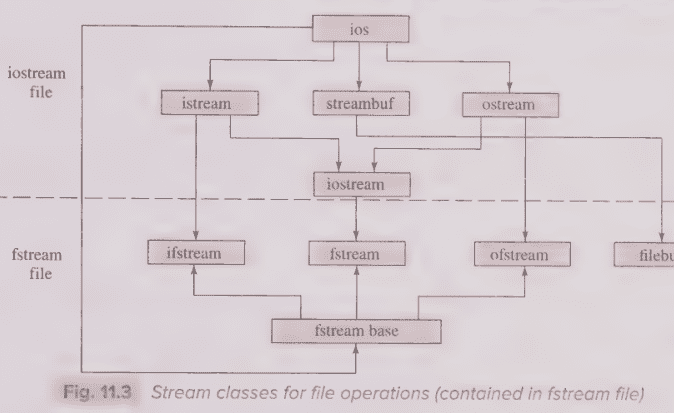

# Table 11.1 Details of file stream classes

| Class | Contents |
|---|---|
| `filebuf` | Its purpose is to set the file buffers to read and write. Contains Openput constant used in the `open()` of file stream classes. Also contain `close()` and `open()` as members. |
| `fstream` | Provides options common to the file classes. Serves as a base for `fstream`, `istream` and `ofstream` class. Contains `open()` and `close()` functions. |
| `istream` | Provides input operations. Contains `open()` with default input mode. Inherits the functions `get()`, `getline()`, `read()`, `seekg()` and `tell()` functions from `istream`. |
| `ofstream` | Provides output operations. Contains `open()` with default output mode. Inherits `put()`, `seekp()`, `tell()`, and `write()`, functions from `ofstream`. |
| `fstream` | Provides support for simultaneous input and output operations. Inherits all the functions from `istream` and `ostream` classes through `iostream`. |

### 11.3 OPENING AND CLOSING A FILE

If we want to use a disk file, we need to decide the following things about the file and its intended use:

+   1. Suitable name for the file
2. Data type and structure
3. Purpose
4. Opening method

The filename is a string of characters that make up a valid filename for the operating system. It may contain two parts, a primary name and an optional period with extension.

Examples:

```
Input.data

Test.doc
```

Object-Oriented Programming with C++

INVENTORY
student
salary
OUTPUT

As stated earlier, for opening a file, we must first create a file stream and link it to the filename. A file stream can be defined using the classes `ifstream`, `ofstream`, and `fstream` that are contained in the header file `fstream`. The class to be used depends upon the purpose, that is, whether we want to read data from the file or write data to it. A file can be opened in two ways:

+   1. Using the constructor function of the class.
2. Using the member function `open()` of the class.

The first method is useful when we use only one file in the stream. The second method is used when we want to manage multiple files using one stream.

Opening Files Using Constructor

We know that a constructor is used to initialize an object while it is being created. Here, a filename is used to initialize the file stream object. This involves the following steps:

+   1. Create a file stream object to manage the stream using the appropriate class. That is to say, the class `ofstream` is used to create the output stream and the class `ifstream` to create the input stream.
2. Initialize the file object with the desired filename.

For example, the following statement opens a file named `"results"` for output:

```
ofstream outfile("results"); // output only
```


This creates `outfile` as an `ofstream` object that manages the output stream. This object can be any valid C++ name such as `o_file`, `myfile` or `fout`. This statement also opens the file `results` and attaches it to the output stream `outfile`. This is illustrated in Fig. 11.4.

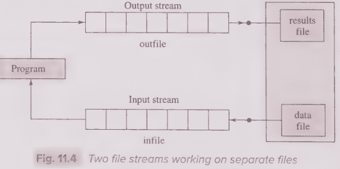

Similarly, the following statement declares `infile` as an `ifstream` object and attaches it to the file `data` for reading (input).

```
ifstream infile("data"); // input only
```

程序中可能包含如下语句：

```
outfile << "TOTAL";
outfile << sum;
infile >> number;
infile >> string;
```

我们也可以像图 11.5 所示使用同一个文件进行读写操作。程序将包含以下语句：

### Program1

```
ofstream outfile("salary"); // creates outfile
// connects
// "Salary" to it
```

### Program2

```
ifstream infile("salary"); // creates infile and connects
// "salary" to it
```

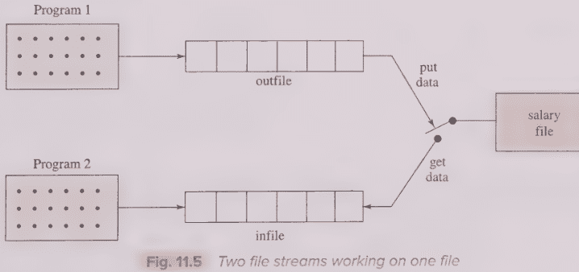

文件连接会在流对象失效时自动关闭（程序终止时）。在上述语句中，程序终止时，`salary` 文件会与 `outfile` 流断开连接。程序终止时也会发生类似操作。

与其使用两个程序，一个用于写数据（输出），另一个用于读数据（输入），我们可以用单个程序对文件执行这两种操作。例如。

```
outfile.close(); // Disconnect salary from outfile
ifstream infile("salary"); // and connect to infile
```

```
infile.close();              // Disconnect salary from infile
```

虽然我们使用了单个程序，但我们创建了两个文件流对象，`outfile`（向文件写入数据）和 `infile`（从文件读取数据）。请注意，像下面这样的语句

```
outfile.close();
```

会将文件 `salary` 与输出流 `outfile` 断开连接。记住，对象 `outfile` 仍然存在，并且 `salary` 文件以后可以再次连接到 `outfile` 或任何其他流。在此示例中，我们将 `salary` 文件连接到 `infile` 以读取数据。

### Program 11.1 Working with Single File

```
// Creating files with constructor function
#include <iostream>
#include <fstream>
using namespace std;
int main()
{
    ofstream outf("ITEM");              // connect file to outf
    cout << "Enter item name:";
    char name[30];
    cin >> name;                        // get name from key board and
    outf << name << "\n";               // write to file ITEM
    cout << "Enter item cost:";
    float cost;
    cin >> cost;                        // get cost from key board and
    outf << cost << "\n";             // write to file ITEM
    outf.close();                       // Disconnect ITEM from outf
    ifstream inf("ITEM");               // connect ITEM file to inf
    inf >> name;                        // read name from file ITEM
    inf >> cost;                        // read cost from file ITEM
    cout << "\n";
    cout << "Item name:" << name << "\n";
    cout << "Item cost:" << cost << "\n";
    inf.close();                        // Disconnect ITEM from inf
return 0;
}
```

Program 11.1 的输出为：

```
Enter item name:CD-ROM
Enter item cost:250
```

```
Item name:CD-ROM
Item cost:250
```

# Opening Files Using open()

如前所述，函数 `open()` 可用于打开使用同一流对象的多个文件。例如，我们可能希望按顺序处理一组文件。在这种情况下，我们可以创建一个流对象并依次用它打开每个文件。具体做法如下：

```
file-stream-class stream-object;
stream-object.open("filename");
```

示例：

```
ofstream outfile; // Create stream (for output)
outfile.open("DATA1"); // Connect stream to DATA1
```

```
outfile.close(); // Disconnect stream from DATA1
outfile.open("DATA2"); // Connect stream to DATA2
```

```
outfile.close(); // Disconnect stream from DATA2
```

前面的程序段按顺序打开两个文件以写入数据。请注意，在打开第二个文件之前必须先关闭第一个文件。这是因为一个流一次只能连接到一个文件。参见 Program 11.2 和 Fig. 11.6。

# Program 11.2 Working with Multiple Files

```
// Creating files with open() function
#include <iostream>
#include <fstream>
using namespace std;
int main()
{
    ofstream fout; // create output stream
    fout.open("country"); // connect "country" to it
    fout << "United States of America\n";
    fout << "United Kingdom\n";
    fout << "South Korea\n";
    fout.close();                              // disconnect "country"
    fout.open("capital");                   // connect "capital"
    fout << "Washington\n"
    fout << "London\n"
    fout << "Seoul\n"
    fout.close();                              // disconnect "capital"
    //// Reading the files
    const int N = 80;                       // size of line
    char line[N];
    ifstream fin;                           // create input stream
    fin.open("country");                    // connect "country" to it
    cout << "Contents of country file\n";
    while(fin)                             // check end-of-file
    {
        fin.getline(line, N);               // read a line
        cout << line;                       // display it
    }
    fin.close();                              // disconnect "country"
    fin.open("capital");                   // connect "capital"
    cout << "\nContents of capital file \n"
    while(fin)
    {
        fin.getline(line, N);
        cout << line;
    }
    fin.close();
    return 0;
}
```

Program 11.2 的输出为：

Contents of country file
United States of America
United Kingdom
South Korea

Contents of capital file
Washington
London
Seoul

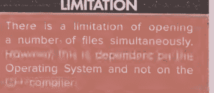

# Working with Files

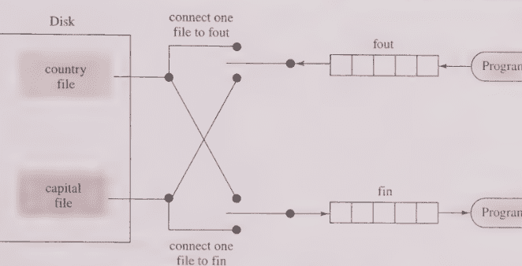

**Fig. 11.6** Streams working on multiple files

有时我们可能需要同时使用两个或多个文件。例如，我们可能需要将两个已排序的文件合并到第三个已排序文件中。这意味着两个已排序的文件必须保持打开以供读取，第三个文件则用于写入。在这种情况下，我们需要为处理两个输入文件创建单独的输入流，并为处理输出文件创建一个输出流。参见 Program 11.3。

# Program 11.3 Reading from Two Files Simultaneously

```
// Reads the files created in Program 11.2
#include <iostream>
#include <fstream>
#include <cstdlib>
using namespace std;
int main() {
    const int SIZE = 30;
    char line[SIZE];
    ifstream fin1, fin2; // create two input streams
    fin1.open("country");
    fin2.open("capital");
    for(int i=1; i<=10; i++) {
        if(fin1.get() != EOF) {
            cout << "Exit from country\n";
            exit(0);
        }
    }
    fin1.getline(line, SIZE);
    cout << "Capital of " << line ;
(Contd.)
```
if (fin2.eof() != 0)
    cout << "Exit from capital\n";
    exit(1);
}

fin2.getline(line,SIZE);
cout << line << "\n";
}
return 0;
```

Program 11.3 的输出为：

+   Capital of United States of America

Washington

Capital of United Kingdom

London

Capital of South Korea

Seoul

### 11.4 DETECTING END-OF-FILE

检测文件结束条件是必要的，以防止进一步尝试从文件中读取数据。这在 Program 11.2 中通过使用语句

```
while (fin)
```

来说明的。

An if object, as `fin`, returns a value of 0 if any error occurs in the file operation including the end-of-file condition. Thus, the while loop terminates when `fin` returns a value of zero on reaching the end-of-file condition. Remember, this loop may terminate due to other failures as well. (We will discuss other error conditions later.)

检测文件结束条件的另一种方法。请注意，我们在 Program 11.3 中使用了以下语句：

```
if(fin1.eof() != 0) {exit(1);
```

`eof()` 是 `ios` 类的成员函数。如果遇到文件结束（EOF）条件，则返回非零值，否则返回零。因此，上述语句在到达文件末尾时终止程序。

### 11.5 MORE ABOUT OPEN(): FILE MODES

我们使用 `ifstream` 和 `ofstream` 构造函数以及函数 `open()` 来创建新文件以及打开现有文件。记住，在这两种方法中，我们只使用了一个参数，即文件名。然而，这些函数可以接受两个参数，其中一个指定文件模式。函数 `open()` 带两个参数的一般形式为：

```
stream-object.open("filename", mode);
```

*

第二个参数 `mode`（称为文件模式参数）指定打开文件的用途。那么我们在之前的示例中没有提供第二个参数时是如何打开文件的呢？

这些类成员函数的原型为第二个参数包含默认值，因此在没有实际值的情况下它们使用默认值。默认值如下：

`ifstream` 函数的 `ios::in` 表示仅用于读取打开。

`ofstream` 函数的 `ios::out` 表示仅用于写入打开。

文件模式参数可以采用类 `ios` 中定义的一个（或）这样的常量。表 11.2 列出了文件模式参数及其含义。

## 表 11.2 文件模式参数

| Parameter | Meaning |
| --- | --- |
| `ios::app` | Append to end-of-file |
| `ios::ate` | Go to end-of-file on opening |
| `ios::binary` | Binary file |
| `ios::in` | Open file for reading only |
| `ios::ncreate` | Open fails if the file does not exist |
| `ios::noreplace` | Open fails if the file already exists |
| `ios::out` | Open file for writing only |
| `ios::trunc` | Delete the contents of the file if it exists |

- 1. 以 `ios::out` 模式打开文件时，默认情况下也会以 `ios::trunc` 模式打开。

- 2. `ios::app` 和 `ios::ate` 都在打开时将我们带到文件的末尾。两者参数之间的区别在于 `ios::app` 允许我们在文件末尾添加数据，而 `ios::ate` 模式允许我们在文件的任何位置添加数据或修改现有数据。在这两种情况下，如果指定的名称的文件不存在，则会创建该文件。

- 3. 参数 `ios::app` 只能与能够输出的文件一起使用。

- 4. 使用 `ifstream` 创建流意味着输入，使用 `ofstream` 创建流意味着输出。因此，在这些情况下，不需要提供模式参数。

- 5. `ifstream` 类默认不提供模式，因此在使用 `ifstream` 类的对象时，我们必须显式提供模式。


### 6. 模式可以使用按位或运算符（符号`|`）组合两个或多个参数，如下所示：

```
fout.open("data", ios::app | ios::ncreate)
```

这以追加模式打开文件，但如果文件不存在则无法打开文件。

### 11.6 文件指针及其操作

每个文件都有相关联的指针，称为文件指针。其中一个称为输入指针（或 `get` 指针），另一个称为输出指针（或 `put` 指针）。我们可以使用这些指针在读取或写入时在文件中移动。输入指针用于读取给定文件位置的内容，输出指针用于写入给定文件位置。每次进行输入或输出操作时，相应的指针都会自动前进。

#### 默认操作

当我们以只读模式打开文件时，输入指针会自动设置在开头，以便我们可以从头开始读取文件。同样，当我们以只写模式打开文件时，现有内容将被删除，输出指针设置在开头。这使我们能够从头开始向文件写入。在我们想要打开现有文件以添加更多数据的情况下，文件以“追加”模式打开。这会将输出指针移动到文件的末尾（即现有内容的末尾）。见图 11.7。

“hello” 文件

| Open for reading only | H | E | L | L | O | W | O | R | L | D |

|---|---|---|---|---|---|---|---|---|---|---|

| | input pointer | | | | | | | | |

| Open in append mode | H | E | L | L | O | W | O | R | L | D |

|---|---|---|---|---|---|---|---|---|---|---|

| (for writing more data) | | | | | | output pointer | | | | |

| Open for writing only | | | | | | | | | | |

|---|---|---|---|---|---|---|---|---|---||

| | output pointer | | | | | | |

Fig. 11.7 Action on file pointers while opening a file

#### 文件指针操作函数

图 11.7 所示的文件指针上的所有操作都采取我们如何将文件指针移动到文件内部的任何其他所需位置？这只有在我们可以自行控制文件指针的移动时才有可能。文件流支持以下函数来管理这种情况：

- `seekg()` Moves get pointer (input) to a specified location.
- `seekp()` Moves put pointer(output) to a specified location.
- `tellg()` Gives the current position of the get pointer.
- `tellp()` Gives the current position of the put pointer.

例如，语句

```
infile.seekg(10);
```

将文件指针移动到字节号 10。记住，文件中的字节从零开始编号。因此，指针将指向文件中的第 11 个字节。

考虑以下语句：

```
ofstream fileout;
fileout.open("hello", ios::app);
int p = fileout.tellp();
```

执行这些语句后，输出指针被移动到文件“hello”的末尾，`p` 的值将表示文件中的字节数。

#### 指定偏移量

我们刚刚看到了如何使用“seek”函数将文件指针移动到所需位置。传递给这些函数的参数表示文件中的绝对位置。这在图 11.8 中显示。

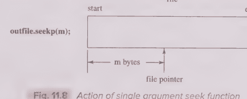

“Seek”函数 `seekg()` 和 `seekp()` 也可以使用两个参数，如下所示：

```
seekg (offset, refposition);
seekp (offset, refposition);
```

参数 `offset` 表示文件指针要从参数 `refposition` 指定的位置移动的字节数。`refposition` 采用类 `ios` 中定义的三个常量之一：

- `ios::beg` start of the file
- `ios::cur` current position of the pointer
- `ios::end` End of the file

`seekg()` 函数移动关联文件的“get”指针，而 `seekp()` 函数移动关联文件的“put”指针。表 11.3 列出了一些示例指针偏移调用及其操作。`fout` 是一个 `ofstream` 对象。

| Table 11.3 Pointer offset calls |

| Seek call | Action |

|---|--|

| `seekg(0, ios::beg);` | Go to start |

| `seekg(0, ios::cur);` | Stay at the current position |

| `seekg(0, ios::end);` | Go to the end of file |

| `seekg(m,ios::beg);` | Move to (m + 1)th byte in the file |

| `seekg(m,ios::cur);` | Go forward by m bytes form the current position |

| `seekg(-m,ios::cur);` | Go backward by m bytes from the current position |

| `seekg(-m,ios::end);` | Go backward by m bytes form the end |

### 11.7 顺序输入和输出操作

文件流类支持许多成员函数来执行文件上的输入和输出操作。一对函数 `put()` 和 `get()` 专为一次处理单个字符而设计。另一对函数 `write()` 和 `read()` 专为读取和写入二进制数据块而设计。

#### put() 和 get() 函数

函数 `put()` 将单个字符写入关联的流。同样，函数 `get()` 从关联的流中读取单个字符。程序 11.4 说明了这些函数如何在文件上工作。该程序请求一个字符串。在写入字符串时，程序使用 for 循环中的 `put()` 函数逐字符将其写入文件。请注意，字符串的长度用于确定 for 循环。

该程序在流上显示文件的内容。它使用 `get()` 函数从文件中获取一个字符，并在到达文件末尾条件之前继续这样做。从文件中读取的字符使用运算符 `<<` 在流上显示。

#### 程序 11.4 字符的 I/O 操作

```
#include <iostream>
#include <fstream>
#include <cstring>
using namespace std;

int main()
{
    char string[80];

    cout<<"Enter a string: ";
    cin>>string;

    int len=strlen(string);

    fstream file; //input and output stream
    cout<<"\nopening the 'TEXT' file and storing the string in\n    it.\n\n";

    file.open("TEXT", ios::in | ios::out);

    for (int i=0; i<len; i++) {
        file.put(string[i]); //put a character to file
    }
    file.seekg(0); //go to the start

    char ch;
    cout<<"Reading the file contents: ";
    while (file.get(ch)) {
        cout<<ch;
    }
    return 0;
```
```
{
  file.get(ch); //get a character from file
  cout<<ch; //display it on screen
  return 0;
}
```

程序 11.4 的输出为：

Enter a string: C++ Programming

打开 'TEXT' 文件并将字符串存储在其中。

读取文件内容：C++ Programming

#### write() 和 read() 函数

`write()` 和 `read()` 函数与 `put()` 和 `get()` 不同，它们以二进制形式处理数据。这意味着值以与它们在

| 二进制格式 | 2 字节 |

|---|---|

| | 00001010 00100010 |

| 字符格式 | 4 | 5 | 9 | 4 |

| 4 字节 |

**图.11.9** 整数值的二进制和字符格式

内部内存中相同的格式存储在磁盘文件中。图 11.9 显示了 int 2594 如何以二进制和字符格式存储。一个 int 在二进制形式下存储其值需要两个字节，而与大小无关。但一个 4 位数的 int 在字符格式下存储需要四个字节。

二进制格式更准确地存储数字，因为它们以精确的内部表示形式存储。保存数据时没有转换，因此保存速度要快得多。

二进制输入输出函数采用以下形式：

```cpp
infile.read((char*) & V, sizeof(V));
outfile.write((char*) & V, sizeof(V));
```

这些函数接受两个参数。第一个是变量 `V` 的地址，第二个是其以字节为单位的长度。变量的地址必须强制转换为 `char*`（即字符类型指针）。程序 11.5 说明了如何使用这两个函数保存一个 float 数字数组，然后将其恢复以在屏幕上显示。

## 面向对象 C++ 编程

#### 程序 11.5 二进制文件上的 I/O 操作

```cpp
#include <iostream>
#include <fstream>
#include <iomanip>
using namespace std;

const char * filename = "BINARY";

int main() {
    float height[4] = {175.5,153.0,167.25,160.70};
    ofstream outfile;
    outfile.open(filename);

    outfile.write((char *) &height, sizeof(height));
    outfile.close(); // close the file for reading

    for(int i=0; i<4; i++) // clear array from memory
        height[i] = 0;
    ifstream infile;
    infile.open(filename);

    infile.read((char *) &height, sizeof(height));

    for(i=0; i<4; i++) {
        cout.setf(ios::showpoint);
        cout << setw(10) << setprecision(2) << height[i];
    }
    infile.close();

    return 0;
}
```

程序 11.5 的输出为：

175.50 153.00 167.25

#### 读取和写入类对象

我们之前提到过，C 的 I/O 系统的一个缺点是它无法处理用户定义的数据类型，例如对象。由于类是 C++ 编程的核心元素，因此语言自然支持直接向磁盘文件写入和读取对象的功能。二进制输入输出函数 `read()` 和 `write()` 就是为此设计的。这些函数将对象的整个结构作为一个整体单元处理，使用计算机对数据的内部表示。例如，函数 `write()` 按字节逐字节地将对象从内存复制到磁盘。一个需要记住的重要点是，只有数据成员会被写入磁盘文件，而成员函数不会。

#### 程序 11.6 读取和写入类对象

```cpp
#include <iostream>
#include <fstream>
#include <iomanip>
using namespace std;
class INVENTORY
{
    char name[10]; // item name
    int code; // item code
    float cost; // cost of each item
public:
    void readdata(void);
    void writedata(void);
};

void INVENTORY :: readdata(void) // read from keyboard
{
    cout << "Enter name: "; cin >> name;
    cout << "Enter code: "; cin >> code;
    cout << "Enter cost: "; cin >> cost;
}

void INVENTORY :: writedata(void) // formatted display on
{
    cout << setflags(ios::left)
         << setw(10) << name
         << setflags(ios::right)
         << setw(10) << code
         << setprecision(2)
         << setw(10) << cost
         << endl;
}

int main()
{
    INVENTORY item[3]; // Declare array of 3 objects
    fstream file;
    file.open("STOCK.DAT", ios::in | ios::out);

    cout << "nENTER DETAILS FOR THREE ITEMS \n";
    for(int i=0;i<3; i++)
    {
        item[i].readdata();
        file.write((char *) &item[i],sizeof(item[i]));
    }
```
```cpp
file.seekg(0); // reset to start

cout << "NOOUTPUT\n\n";
for(i = 0; i < 3; i++)
{
    file.read((char *) &item[i], sizeof(item[i]));
    item[i].writedata();
}
file.close();
return 0;
```

程序 11.6 的输出为：

+   ENTER DETAILS FOR THREE ITEMS

Enter name: C++

Enter code: 101

Enter cost: 175

Enter name: FORTRAN

Enter code: 102

Enter cost: 150

Enter name: JAVA

Enter code: 115

Enter cost: 225

OUTPUT

nC++ 101 175

FORTRAN 102 150

JAVA 115 225

该程序使用 'for' 循环来读取和写入对象。这是因为我们知道文件中对象的确切数量。如果文件长度未知，我们可以借助文件指针函数确定文件大小（以对象为单位），并将其用于 'for' 循环，或者我们可以使用 while(file) 测试方法来判断文件末尾。这些技术在下一节中讨论。

程序 11.7 显示了另一个程序，用于计算文件中存储的对象的数量：

#### 程序 11.7 统计文件中的对象数

```cpp
#include <iostream>
#include <fstream>
#include <cstring>
using namespace std;

class emp
{
    char name[30];
    int ecode;
public:
emp()
{
}

emp(char *n,int c)
{
    strcpy(name,n);
    ecode=c;
}

int main()
{
    emp e[4];
    e[0]=emp("Amit",1);
    e[1]=emp("Joy",2);
    e[2]=emp("Rahul",3);
    e[3]=emp("Vikas",4);
    fstream file;
    file.open("Employee.dat", ios::in | ios::out);

    int i;
    for(i=0;i<4;i++)
    file.write((char *) &e[i],sizeof(e[i]));
    file.seekg(0,ios::end);
    int end=file.tellg();

    cout<<"Number of objects stored in Employee.dat is:"<<end/
    sizeof(emp);
    return 0;
}
```

程序 11.7 的输出为：

Number of objects stored in Employee.dat is: 4

上述程序使用 `tellg()` 函数来确定 get 指针的当前位置，进而指定文件以字节为单位的长度。

### 11.8 更新文件：随机访问

更新是维护任何数据文件的常规任务。更新可能包括以下一项或多项任务：

- 显示文件的内容
- 修改现有项目
- 添加新项目
- 删除现有项目


这些操作要求文件指针移动到与所考虑的项目/对象相对应的特定位置。如果文件包含长度相等的一组项目/对象，则可以轻松实现这一点。在这种情况下，可以使用以下语句获得每个对象的大小

```cpp
int object_length = sizeof(object);
```

然后，可以按如下方式获得所需对象，例如第 `m` 个对象的位置：

```cpp
int location = m * object_length;
```

该位置给出第 `m` 个对象的第一个字节的字节号。现在，我们可以使用 `seekg()` 或 `seekp()` 将文件指针设置为到达该位置。

我们还可以使用 `object_length` 按如下方式找到文件中的对象总数：

```cpp
int n = file_size/object_length;
```

当文件指针位于文件末尾时，可以使用 `tellg()` 或 `tellp()` 函数获得 `file_size`。

程序 11.8 说明了如何执行上述描述的一些任务。该程序使用程序 11.6 创建的包含五个项目的“`STOCK.DAT`”文件，并在文件上执行以下操作：

1. 向文件添加新项目
2. 修改项目的详细信息
3. 显示文件的内容

## 程序 11.8 文件更新 :: 随机访问

```cpp
#include <iostream>
#include <fstream>
#include <iomanip>
using namespace std;
class INVENTORY
{
    char name[10];
    int code;
    float cost;
public:
    void getdata(void)
    {
        cout << "Enter name: "; cin >> name;
        cout << "Enter code: "; cin >> code;
        cout << "Enter cost: "; cin >> cost;
    }
    void putdata(void)
    {
        cout << setw(10) << name
            << setw(10) << code
            << setprecision(2) << setw(10) << cost
            << endl;
    }
}
```

); // End of class definition

int main()

{

    INVENTORY item;

    fstream infile; // input/output stream

    infile.open("STOCK.DAT", ios::ate | ios::in | ios::out | ios::binary);

    infile.seekg(0,ios::beg); // go to start

    cout << "CURRENT CONTENTS OF STOCK" << "\n";

    while(infile.read((char *) &item, sizeof(item)) {

        item.putdata();

    }

    infile.clear(); // turn off Eof flag

    /* <<<<<<<<<<<<<<>> Add one more item <<<<<<<<<<<<<<>> */

    cout << "\nADD AN ITEM\n";

    item.getdata();

    char ch;

    cin.get(ch);

    infile.write((char *) &item, sizeof(item));

    // Display the appended file

    infile.seekg(0); // go to the start

    cout << "CONTENTS OF APPENDED FILE \n";

    while(infile.read((char *) &item, sizeof(item)) {

        item.putdata();

    }

    // Find number of objects in the file

    int last = infile.tell();

    int n = last/sizeof(item);

    cout << "Number of objects = " << n << "\n";

    cout << "Total bytes in the file = " << last << "\n";

    /* <<<<<<<<<<<<<<<<>> MODIFY THE DETAILS OF AN ITEM <<<<<<<<<<<<<<<<>> */

    cout << "Enter object number to be updated\n";

    int object;

    cin >> object;

    cin.get(ch);

};

int location = (object-1) * sizeof(item);

if(infile.eof())

infile.clear();

infile.seekp(location);

cout << "Enter new values of the object \n"

item.getdata();

cin.get(ch);

infile.write((char *) & item, sizeof(item)) << flush;

/* >>>>>>>>> SHOW UPDATED FILE <<<<<<<<<< */

infile.seekg(0); // go to the start

cout << "CONTENTS OF UPDATED FILE \n";

while(infile.read((char *) & item, sizeof(item)))

{

    item.putdata();

}

infile.close();

return 0;

} // End of main
```

程序 11.8 的输出为：

CURRENT CONTENTS OF STOCK

AA 11 100

BB 22 200

CC 33 300

DD 44 400

XX 99 900

ADD AN ITEM

Enter name: YY

Enter code: 10

Enter cost: 101

CONTENTS OF APPENDED FILE

AA 11 100

BB 22 200

CC 33 300

DD 44 400

XX 99 900

YY 10 101

Number of objects = 6

Total bytes in the files = 96

Enter object number to be updated

6

Enter new values of the object

Enter name: ZZ

Enter code: 20

Enter cost: 201

CONTENTS OF UPDATED FILE

AA 11 100

BB 22 200

CC 33 300

DD 44 400

XX 99 900

ZZ 20 201

我们使用 `fstream` 类来声明文件流。`fstream` 类继承了两个缓冲区，一个用于输入一个用于输出，并同步这些缓冲区上的文件指针。也就是说，每当我们读写文件时，两个指针都会同步移动。因此，在任何时刻，两个指针都指向同一个字节。

由于我们既要向文件中添加新对象，又要修改某些现有对象，因此可以使用文件进行 `ios` 输入和输出操作。请记住，选项 `ios::app` 只允许我们在文件末尾添加数据。`ios::ate` 模式在打开文件时将文件指针设置在文件末尾。因此，我们使用 `seekg()` 函数将 'get' 指针移动到文件开头以读取文件内容。

在读取当前文件内容结束时，程序会设置 `EOF` 标志。这会阻止对文件的进一步读取或写入。通过使用 `clear()` 函数关闭 `EOF` 标志，即可再次访问文件。

添加新项目后，程序会显示附加文件的內容，并显示文件中的对象总数以及它们占用的内存空间。

要修改一个对象，我们应到达该对象的第一个字节。这可通过以下语句实现

```cpp
int location = (object-1) * sizeof(item);
outfile.seekp(location);
```

程序接受要修改的对象的编号和新值并进行更新。最后，显示附加和修改后文件的内容。

在显示附加文件的内容之前，已使用了 `flush()` 函数。`flush()` 函数会将与流缓冲区相关的待处理更改提交到辅助存储。

请记住，我们正在打开一个现有文件以进行读取和更新值。因此，必须确保数据成员的类型相同并且声明顺序与现有文件相同。由于成员函数未被存储，因此它们可以不同。

### 11.9 文件操作期间的错误处理

到目前为止，我们一直假设文件一切正常，打开并使用文件进行读写。这可能并不总是正确的。例如，在处理文件时可能会发生以下情况之一：

- 1. 我们尝试打开读取的文件不存在。
- 2. 用于新文件的名称可能已存在。
- 3. 我们可能尝试执行无效操作，例如读取文件末尾之后。
- 4. 磁盘中可能没有存储更多数据的空间。
- 5. 我们可能使用无效的文件名。
- 6. 我们可能尝试在文件未为该目的打开时执行操作。

C++ 文件流从类 `ios` 继承了一个 'stream-state' 成员。此成员记录当前正在使用文件的状态信息。流状态成员使用位来存储上述错误条件的状态。

类 `ios` 支持多个成员函数，可用于读取文件流中记录的状态。这些函数及其含义列在表 11.4 中。

### 表 11.4 错误处理函数

| Function | Return value and meaning |
| eof() | Returns true (non-zero value) if end-of-file is encountered while reading; otherwise returns false(zero) |
| fail() | Returns true when an input or output operation has failed |
| bad() | Returns true if an invalid operation is attempted or any unrecoverable error has occurred. However, if it is false, it may be possible to recover from any other error reported, and continue operation. |
| good() | Returns true if no error has occurred. This means, all the above functions are false. For instance, if file.good() is true, all is well with the stream file and we can proceed to perform I/O operations. When it returns false, no further operations can be carried out. |

这些函数可在程序的适当位置使用，以确定文件流的状态并采取必要的纠正措施。示例：

```cpp
ifstream infile;
infile.open("ABC");
while(!infile.fail())
{
    ....
    (process the file)
....
}
if(infile.eof())
{
    ....
    (terminate program normally)
else
{
    if(infile.bad())
    {
        ....(report fatal error)
    }
```

```cpp
else
{
  infile.clear();
  // clear error state
}
```

函数 `clear()`（我们在上一节中也使用过）会重置错误状态，以便可以尝试进一步操作。

请记住，我们已经使用了如下语句

```cpp
while(infile)
{
}
```

和

```cpp
while(infile.read(...))
{
}
```

这里，`infile` 在到达文件末尾时变为 `false`（零），并且 `eof()` 变为 `true`。

### 11.10 命令行参数

像 C 一样，C++ 也支持一种功能，可促进向 `main()` 函数提供参数。这些参数在调用程序时提供。它们可用于传递数据文件的名称。示例：

```
C > exam data results
```

这里，`exam` 是包含要执行的程序的文件名，而 `data` 和 `results` 是作为 `command-line` 参数传递给程序的文件名。

命令行参数由用户输入并以空格分隔。第一个参数始终是文件名（命令名），其中包含要执行的程序。但是，这些参数如何进入程序呢？

我们到目前为止一直使用的没有参数的 `main()` 函数可以接受以下两个参数：

```cpp
main(int argc, char * argv[])
```

第一个参数 `argc`（称为参数计数器）表示命令行中的参数数量。第二个参数 `argv`（称为参数向量）是一个 `char` 类型指针数组，指向命令行参数。此数组的大小将为 `argc` 的值。例如，对于命令行

```
C > exam data results
```

## 使用 C++ 进行面向对象编程

the value of `argc` would be 3 and the `argv` would be an array of pointers to strings as shown below:

```
argv[0] ---> exam
argv[1] ---> data
argv[2] ---> results
```

Note that `argv[0]` always represents the command name that invokes the program. The character pointers `argv[1]` and `argv[2]` can be used as file names in the file opening statements as shown below:

```cpp
infile.open(argv[1]);               // open data file for reading
....
outfile.open(argv[2]);               // open results file for
                                // writing
....
```

Program 11.9 illustrates the use of the command-line arguments for supplying the file names. The command line is

test ODD EVEN

The program creates two files called ODD and EVEN using the command-line arguments, and a set of numbers stored in an array are written to these files. Note that the odd numbers are written to the file ODD and the even numbers are written to the file EVEN. The program then displays the contents of the files.

## Program 11.9 Command-Line Arguments

```cpp
#include <iostream>
#include <fstream>
#include <cstdlib>
using namespace std;

int main(int argc, char * argv[])
{
    int number[9] = {11,22,33,44,55,66,77,88,99};

    if(argc!=3)
    {
        cout << "argc = " << argc << "\n";
        cout << "Error in arguments \n";
        exit(1);
    }

    ofstream fout1, fout2;
    fout1.open(argv[1]);

    if(fout1.fail())
```


```
{
  cout << "could not open the file"
  << argv[1] << "\n";
  exit(1);
}
fout2.open(argv[2]);
if(fout2.fail()) {
  cout << "could not open the file "
  << argv[2] << "\n";
  exit(1);
}
for(int i=0; i<9; i++) {
  if(number[i] % 2 == 0)
    fout2 << number[i] << " "; // write to EVEN file
  else
    fout1 << number[i] << " "; // write to ODD file
}
fout1.close();
fout2.close();

ifstream fin;
char ch;
for(i=1; i<argc; i++) {
  fin.open(argv[i]);
  cout << "Contents of " << argv[i] << ":\n";
  do {
    fin.get(ch); // read a value
    cout << ch; // display it
  } while(fin);
  cout << "\n\n";
  fin.close();
}
return 0;
}
```

The output of Program 11.9 would be:

Contents of ODD

11 33 55 77 99

Contents of EVEN

22 44 66 88

## 使用 C++ 进行面向对象编程

## SUMMARY

- The C++ I/O system contains classes as `ifstream`, `ofstream` and `fstream` to deal with file handling. These classes are derived from `fstreambase` class and declared in a header file `iostream`.
- A file can be opened in two ways by using the constructor of the class and the member function `open()` of the class.
- While opening the file using constructor, we need to pass the desired filename as a parameter to the constructor.
- The `open()` function can be used to open multiple files that use the same stream object. The second argument of the `open()` function called file mode, specifies the purpose for which the file is opened.
- If we do not specify the second argument of the `open()` function, the default values specified in the prototype of these class member functions are used while opening the file. The default values are as follows:

```
ios :: in - for ifstream functions, meaning-open for reading only.
ios :: out - for ofstream functions, meaning-open for writing only.
```

- When a file is opened for writing, a new file is created only if there is no file of that name. If a file by name already exists, its contents are deleted and the file is presented as a clean file.
- The `fstream` class does not provide a mode by default and therefore we must provide the mode explicitly when using an object of `fstream` class. We can specify more than one file modes using bitwise operator while opening a file.
- Each file has associated two pointers, one is called input or get pointer, while the other is called output or put pointer. These pointers can be moved along the files by member functions.
- Functions supported by file classes for performing I/O operations on files are as follows:
- `put()` and `get()` functions handle single character at a time.
- `write()` functions write and read blocks of binary data.
- The class `ios` supports many member functions for managing errors that may occur during file operations.
- File names may be supplied as arguments to the `main()` function at the time of invoking the program. These arguments are known as command-line arguments.

## KEY TERMS

`append mode` | `argc` | `argument counter` | `argument vector` | `argv` | `bad()` | `binary data` | `binary format` | `character format` | `clear()` | `command-line` | `eof()` | `fail()` | `file mode` | `file mode parameters` | `file pointer` | `file classes` | `file streams` | `inputFile` | `files` | `fstream` | `fstreambase` | `get pointer` | `get()` | `good()` | `ifstream` | `input` | `pointer` | `input stream` | `ios` | `ios::app` | `ios::ate` | `ios::beg` | `ios::binary` | `ios::cur` | `ios::end` | `ios::in` | `ios::nocreate` | `ios::out` | `ios::noreplace` | `ios::trunc` | `iostream` | `ofstream` | `open()` | `output pointer` | `output stream` | `put` | `put()` | `random access` | `read()` | `seekg()` | `seekp()` | `sizeof()` | `streams` | `tellg()` | `tellp()` | `updating` | `write()`


## REVIEW QUESTIONS

### Cognitive Domain

- 11.1 Illustrate input and output streams.
- 11.2 List the steps involved in using a file in a C++ program.
- 11.3 Describe the classes available for file operations.
- 11.4 Difference between opening a file with a constructor function and opening a file with `open()` function. Explain why one method is preferred over the other.
- 11.5 Explain how `while(fin)` statement detects the end of a file that is connected to `fin` stream.
- 11.6 Express about file mode and the various file mode options available.
- 11.7 Write a statement that will create an object called `fob` for writing, and associate it with a file name `DATA`.
- 11.8 Identify the number of file objects needed to manage the following situations:
  (a) To process files sequentially.
  (b) To merge two sorted files into a third file. Explain.
- 11.9 Both `ios::ate` and `ios::app` place the file pointer at the end of the file (when it is opened). Justify the difference between them.
- 11.10 Infer the 'current position' when applied to files.
- 11.11 Write statements using `seekg()` to achieve the following:
  (a) To move the pointer by 15 positions backward from current position.
  (b) To go to the beginning after an operation is over.
  (c) To go backward by 20 bytes from the end.
  (d) To go by byte 50 in the file.
- 11.12 Relate to the advantages of saving data in binary format.
- 11.13 Describe how you would determine the number of objects in a file. When do you need such information?
- 11.14 Describe the various approaches by which we can detect the end-of-file condition successfully.

### Affective Domain

- 11.15 Defend the correctness of the following statements:
  (a) A stream may be connected to more than one file at a time.
  (b) A file pointer always contains the address of the file.
  (c) The statement `outfile.write((char *) &obj,sizeof(obj));` writes only data in `obj` to `outfile`.
  (d) The `ios::ate` mode allows us to write data anywhere in the file.
  (e) We can add data to an existing file by opening in write mode.
  - (f) The parameter `ios::app` can be used only with the files capable of output.
  - (g) The data written to a file with `write()` can be read with the `get()` function.
  - (h) We can use the functions `tellp()` and `tellg()` interchangeably for any file.
  - (i) Binary files store floating point values more accurately and compactly than the text files.
  - (j) The `fin.fail()` returns non-zero when an operation on the file has failed.

## Legend

- Precision Valuing/Responding/Organizing Applying Remembering Understanding

## DEBUGGING EXERCISES

### 11.1 Identify the error in the following program.

```
#include <iostream>
#include <fstream>
using namespace std;

int main()
{
    const int size = 100;
    char buffer[size];

    ifstream in("ch11_1.cpp");
    ofstream out("ch11_1Temp.cpp");
    while(in.get(buffer))
    {
        in.get(); cout << buffer << endl;
        out << buffer << endl;
    }
    in.close();
    out.close();
    return 0;
}
```

### 11.2 Identify the error in the following program.

```
#include <iostream>
#include <fstream>
using namespace std;

int main()
{
    char buffer[80];
    ifstream fin;

fin.open("ch11_2.cpp", ios::nocreate);

while(!fin.eof())

{

    fin.getline(buffer, 80);
    cout << buffer;
    fin.seekg(0, ios::beg);
}
return 0;
}
```

### 11.3 指出以下程序中的错误。

```
#include <iostream>
#include <fstream>
using namespace std;
```

```
int main()
{
    char buffer[80];
    ifstream("ch11_3.cpp");
    while(!in.getline(buffer, 80))
    {
        cout << buffer << endl;
    }
    while(!in.getline(buffer, 80).eof())
    {
        cout << buffer << endl;
    }
    return 0;
}
```

### 11.4 指出以下程序中的错误。

```
#include <iostream>
#include <fstream>
#include <cstring>
using namespace std;
```

```
int main()
{
    char str[20]="Test String";
    fstream file;
    file.open("TEXT", ios::in , ios::out);
    for(int i=0;i<strlen(str);i++)
        file.put(str[i]);
```

## 346 面向对象 C++ 编程

```
file.seekg(0);

char ch;
cout<<"Reading the file contents:";
while(file)
{
    file.get(ch);
    cout<<ch;
}

return 0;
```

- 11.5 找出以下语句中的错误：
  (a) `ifstream("DATA")`
  (b) `fin1.getline();` //`fin1` 是输入流
  (c) `if(fin1.eof()) == 0 exit(1)`
  (d) `close(f1)`
  (e) `infile.open(argc)`
  (f) `sfinout.open(file,ios::in ios::out)iosate`

## DRY-RUN 练习

### 11.1 执行以下程序时会发生什么？


```cpp
#include <iostream>
#include <fstream>

using namespace std;

int main()
{
    fstream fout;
    fout = (fstream)cout;
    fout << "Hello";
    return 0;
}
```

### 11.2 执行以下程序时会发生什么？

```cpp
#include <iostream>
#include <fstream>

using namespace std;
```

```cpp
int main() {
    ofstream fout("Text.txt");
    fout << "Hello" << endl;
    fout << "How" << endl;
    fout << "are" << endl;
    fout << "you" << endl;
    fout.close();
    ifstream fin("Text.txt");
    fout = (ostream) cout;
    char str[80];
    while (fin) {
        fin >> str;
        fout << str << endl;
    }
    return 0;
}
```

## 11.3 执行以下程序时会发生什么？

```cpp
#include <iostream>

using namespace std;
```

```cpp
int main() {
    char ch;
    while (cin.get(ch)) {
        cout.put(ch);
    }
    return 0;
}
```

## 11.4 执行以下程序时会发生什么？

```cpp
#include <fstream>

#include <iostream>
```

```cpp
int main() {
    char ch;
    ofstream fout;
    fout = (ostream) std::cout;
    fout << "Hello" << "\n";
    fout << "how" << "\n";
    fout << "are" << "\n";
    fout << "you";
    return 0;
}
```

## 11.5 执行以下程序时会发生什么？

```cpp
#include <fstream>
#include <iostream>

using namespace std;

int main() {
    fstream fobj("Text.txt", ios::ate | ios::in);
    if (fobj.tellg() == fobj.tell())
        cout << "Same";
    else
        cout << "Not Same";
    return 0;
}
```

## 编程练习

11.1 编写一个程序读取文本文件并创建另一个文件，除了将每个连续的空白序列替换为单个空格外，其余与原文件相同。

11.2 文件包含以下形式的电话号码列表：

| John | 23456 |

| Ahmed | 9876 |

姓名仅包含一个单词，姓名和电话号码由空白分隔。编写一个程序读取文件并以两列输出列表。姓名应左对齐，号码应右对齐。

11.3 编写一个程序创建包含练习 11.2 中给出的电话号码列表的数据文件。使用类存储每组数据。

11.4 编写一个交互式菜单驱动程序访问练习 11.3 中创建的文件并实现以下任务：

- (a) 确定指定人员的电话号码。
- (b) 如果已知电话号码则确定姓名。
- (c) 电话号码发生变化时更新电话号码。

11.5 两个名为 `Source1` 和 `Source2` 的文件包含已排序的整数列表。编写一个程序读取两个文件的内容并以排序格式将合并的列表存储在名为 `Target` 的新文件中。

## 选择题

- 1. 哪个流类同时支持输入输出操作？
  (a) `ifstream`
  (b) `ofstream`
  (c) `fstream`
  (d) 以上都不是
- 6. 文件打开的默认模式：
  (a) `binary`
  (b) `Hexadecimal`
  (c) `text`
  (d) `vector`
- 2. 选择 C++ 中打开文件的不正确方法。
  (a) 使用类的构造函数函数
  (b) 使用类的成员函数 `open()`
  (c) 使用类的友元函数
  (d) 以上都不正确
- 7. 以 `ios::out` 模式打开的文件默认也以 ____ 模式打开。
  (a) `ios::ate`
  (b) `ios::app`
  (c) `ios::trunc`
  (d) `ios::binary`
- 3. 哪个函数与文件操作期间的错误处理无关？
  (a) `good()`
  (b) `bad()`
  (c) `pass()`
  (d) `fail()`
- 8. `ifstream::is_open` 的返回类型：
  (a) Character
  (b) Pointer
  (c) Boolean
  (d) Integer
- 4. `ofstream fout;` 应用于：
  (a) 创建文件
  (b) 创建输入流
  (c) 创建输出流
  (d) 追加文件
- 9. 哪个函数给出 get 指针的当前位置？
  (a) `seekg()`
  (b) `seekp()`
  (c) `tellp()`
  (d) `tellg()`
- 5. `clear()` 在文件处理中用于：
  (a) 检查无效操作
  (b) 检查文件末尾
  (c) 重置错误状态
  (d) 检查操作中的错误
- 10. seek 文件指针时哪个不是合适的常量？
  (a) `ios::beg`
  (b) `ios::eof`
  (c) `ios::end`
  (d) `ios::cur`

## 12 模板

### 学习目标

阅读本章后，你将能够

- 解释类模板的概念
- 讨论类模板如何使用多个参数
- 解释函数模板的概念
- 讨论函数模板如何使用多个参数
- 确定模板函数如何被重载
- 描述成员模板函数如何定义

### 12.1 引言

模板是一种概念，使我们能够定义通用类和函数，从而为 *通用编程* 提供支持。通用编程是一种方法，其中算法中使用通用类型作为参数，以便它们适用于多种合适的数据类型和数据结构。是一种方法，其中算法中使用通用类型作为参数，以便它们适用于多种合适的数据类型和数据结构。

模板可用于创建类或函数的族。例如，*数组类* 的类模板将使我们能够创建各种数据类型的数组，例如 *int 数组* 和 *float 数组*。同样，我们可以为函数定义模板，例如 `mul()`，它将帮助我们为乘以 *int*、*float* 和 *double* 类型的值创建 `mul()` 的各种版本。

模板可以被视为一种宏。当为实际使用定义特定类型的对象时，类模板定义将被所需的数据类型替换。由于模板是用将在类或函数实际使用时被专门数据类型替换的 *参数* 定义的，因此模板有时被称为 *参数化类或函数*。

### 12.2 类模板

考虑如下定义的 `vector` 类：

```cpp
class vector
{
    int *v;
```

`int size;`

```cpp
public:
    vector(int m) // create a null vector
    {
        v = new int[size = m];
        for (int i = 0; i<size; i++)
        v[i] = 0;
    }
```

```cpp
vector(int *a) // create a vector from an array
    {
        for (int i = 0; i<size; i++)
        v[i] = a[i];
    }
```

```cpp
int operator*(vector &y) // scalar product
    {
        int sum = 0;
        for (int i=0; i<size; i++)
            sum += this->v[i] * y[i];
        return sum;
    }
```

`);

`vector` 类可以存储 `int` 数字的数组并执行两个 `int` 向量的标量积，如下所示：

```cpp
int main()
{
    int x[3] = {1,2,3};
    int y[3] = {4,5,6};
    vector v1(3); // Creates a null vector of 3 integers
    vector v2(3); // Creates v1 from the array x
    v1 = x;
    v2 = y;
    int R = v1 * v2;
    cout << "R = " << R;
    return 0;
}
```

现在，假设我们想要定义一个可以存储 `float` 值数组的 `vector`。我们可以通过在 `vector` 类中将适当的声明替换为 `float` 来做到这一点。这意味着我们必须重新定义整个类。

假设我们想要定义一个以数据类型作为参数的 `vector` 类，并使用该类创建任何数据类型的 `vector`，而不是每次都定义一个新类。模板机制使我们能够实现这一目标。

如前所述，模板允许我们定义通用类。使用匿名类型的模板创建通用类是一个简单的过程。类模板的一般格式为：

## 352 面向对象程序设计 C++

```cpp
template<class T>
class classname
{
    // class member specification
    // with anonymous type T
    // wherever appropriate
    // ...
};
```

下面所示的 `vector` 类的模板定义说明了模板的语法：

```cpp
template<class T>
class vector
{
    T* v;                          // Type T vector
    public:
    vector(int m)
    {
        v = new T[size = m];
        for(int i=0; i<size; i++)
        v[i] = 0;
    }
    vector(T* a)
    {
        for(int i=0; i<size; i++)
        v[i] = a[i];
    }
    T operator*(vector &)
    {
        T sum = 0;
        for(int i=0; i<size; i++)
        sum += this->v[i] * v[i];
        return sum;
    }
};
```

> 类模板定义与普通类定义非常相似，只是前缀为 `template<class T>` 并且使用了类型 `T`。 该前缀告诉编译器我们将要声明一个模板并在声明中使用 `T` 作为名称。 因此，`vector` 变成了一个参数化类，其参数为类型 `T`。 `T` 可以被任何数据类型替代，包括用户定义的类型。 现在，我们可以创建用于保存不同数据类型的向量。

示例：

```cpp
vector<int> v1(10);              // 10 element int vector
vector<float> v2(25);       // 25 element float vector
```

> 类型 `T` 也可代表类名。

`vector<complex> v3(5);`      // vector of 5 complex numbers

从类模板创建的类称为模板类。 模板类对象的定义语法为：

```cpp
classname<type> objectname(arglist);
```

从类模板创建特定类的过程称为实例化。 编译器仅在实例化时才执行错误分析。 因此，建议在将其转换为模板之前先创建并调试普通类。

程序 12.1 和 12.2 说明了使用 `vector` 类模板对 `int` 向量以及 `float` 类型向量执行标量积。

## 程序 12.1 类模板示例

```cpp
#include <iostream>

using namespace std;

const size = 3;
template <class T>
class vector
{
    T* v; // type T vector
public:
    vector(){
        v = new T[size];
        for (int i=0;i<size;i++)
        v[i] = 0;
    }
    vector(T* a)
{
        for (int i=0;i<size;i++)
        v[i] = a[i];
    }
    T operator*(vector &y)
{
        T sum = 0;
        for (int i=0;i<size;i++)
        sum += this->v[i] * y.v[i];
        return sum;
    }
    void display(void)
{
        for (int i=0;i<size;i++)
        cout<<v[i]<<"\t"
    }
};

int main()
{
int x[3] = {1,2,3};
int y[3] = {4,5,6};
vector <int> v1;
vector <int> v2;
v1 = x;
v2 = y;

cout<<"v1 = " <<";
v1.display();

cout<<"v2 = " <<";
v2.display();

cout<<"v1 X v2 ="<<v1*v2;\n
return 0;
}
```

程序 12.1 的输出结果为：

v1 = 1 2 3

v2 = 4 5 6

v1 X v2 = 32

## 354 面向对象程序设计 C++

## 程序 12.2 另一个类模板示例

```cpp
#include <iostream>
using namespace std;
const int size = 3;
template <class T>
class vector {
T* v; // type T vector
public:
vector()
{
v = new T[size];
for(int i=0;i<size;i++)
v[i] = 0;
}
vector(T* a)
{
for(int i=0;i<size;i++)
v[i] = a[i];
}
T operator*(vector &y)
{
  T sum = 0;
  for(int i=0;i<size;i++)
    sum += this -> v[i] * y[i];
  return sum;
}
void display(void)
{
  for(int i=0;i<size;i++)
    cout<<v[i]<<"\t";
  cout<<"\n";
}
int main()
{
  float x[3] = {1.1,2.2,3.3};
  float y[3] = {4.4,5.5,6.6};
  vector<float> v1;
  vector<float> v2;
  v1 = x;
  v2 = y;

  cout<<"v1" << " = ";
  v1.display();

  cout<<"v2" << " = ";
  v2.display();

  cout<<"v1 X v2 = "<<v1*v2;
  return 0;
}
```

程序 12.2 的输出结果为：

v1 = 1.1 2.2 3.3

v2 = 4.4 5.5 6.6

v1 X v2 = 38.7200010

### 12.3 具有多个参数的类模板

我们可以在类模板中使用一个以上的通用数据类型。 它们在模板规范中声明为以逗号分隔的列表，如下所示：

```cpp
template<class T1, class T2, ...>
class classname
{
    .... (Body of the class)
    ...
};
```

## 面向对象程序设计 C++

程序 12.3 演示了使用具有两种通用数据类型的模板类。

## 程序 12.3 类定义中的两种通用数据类型

```cpp
#include <iostream>
using namespace std;
template<class T1, class T2>
class Test {
    T1 a;
    T2 b;
public:
    Test(T1 x, T2 y) {
        a = x;
        b = y;
    }
    void show() {
        cout<<"Instantiating the class template as " << a << " and " << b << "\n";
    }
};
int main() {
    cout<<"Instantiating the class template as test1 with float and int data types...\ntest1: ";
    Test<float, int>test1(1.23,123);
    test1.show();

    cout<<"Instantiating the class template as test2 with int and char data types...\ntest2: ";
    Test<int,char>test2(100, 'W');
    test2.show();

    return 0;
}
```

Instantiating the class template as test1 with float and int data types...


test1: 1.23 and 123

Instantiating the class template as test2 with int and char data types...

test2: 100 and W

就像我们为函数参数指定默认值一样，我们也可以为模板类数据类型指定默认值。程序 12.4 修改了程序 12.3 以演示默认类型指定：

## 程序 12.4 类定义中使用默认数据类型

```
#include <iostream>

using namespace std;

template<class T1=int, class T2=int> //default data types specified as int
class Test
{
    T1 a;
    T2 b;
  public:
    Test(T1 x, T2 y)
    {
        a = x;
        b = y;
    }
    void show()
    {
        cout<<a<<" "<<b<<"\n";
    }

};

int main()
{
    Test <float,int> test1(1,23,123);
    Test <int, char> test2 (100, 'W');
    Test <> test3 ('a', 12.983); //declaration of class object
    without types specification
    test1.show();
    test2.show();
    test3.show();
    return 0;
}
```

程序 12.4 的输出结果为：

1.23 and 123

100 and W

97 and 12

上述程序在未指定任何类型的情况下声明了 `test3` 对象，因此 `T1` 和 `T2` 的默认数据类型被视为 `int`。`test3` 传递的参数值被强制转换为 `int` 并作为输出显示。

### 12.4 函数模板

与类模板类似，我们也可以定义函数模板，用于创建具有不同参数类型的函数族。函数模板的一般格式为：

## 358 面向对象程序设计 C++

```
template<class T>
returntype functionname (arguments of type T)
{
    // Body of function
    // with type T
    // wherever appropriate
    //...
}
```

函数模板语法与类模板相似，只是我们定义的是函数而不是类。我们必须在函数体中以及其参数列表中按需使用模板参数 `T`。

以下示例声明了一个 `swap()` 函数模板，它将交换给定数据类型的值。

```
template<class T>
void swap(T&x, T&y)
{
    T temp = x;
    x = y;
    y = temp;
}
```

这本质上声明了一组重载函数，用于每种数据类型。我们可以像使用普通函数一样调用 `swap()` 函数。例如，我们可以按如下方式应用 `swap()` 函数：

```
void f(int m, int n, float a, float b)
{
    swap(m,n); // swap two integer values
    swap(a,b); // swap two float values
    //....
```

这将为每组参数类型从函数模板生成一个 `swap()` 函数。程序 12.5 显示了如何定义和实现函数模板。

## 程序 12.5 函数模板 - 一个示例

```
#include <iostream>

namespace std;
template <class T>
void swap(T &x, T &y)
{
    T temp = x;
    x = y;
    y = temp;
}
```

```
void fun(int m,int n,float a,float b)
{
    cout << "m and n before swap: " << m << " " << n << "\n";
    swap(m,n);
    cout << "m and n after swap: " << m << " " << n << "\n";

    cout << "a and b before swap: " << a << " " << b << "\n";
    swap(a,b);
    cout << "a and b after swap: " << a << " " << b << "\n";
}

int main()
{
    fun(100,200,11.22,33.44);

    return 0;
}
```

程序 12.5 的输出结果为：

m and n before swap: 100 200

m and n after swap: 200 100

a and b before swap: 11.22 33.439999

a and b after swap: 33.439999 11.22

另一个使用的函数是 `sort()`，用于对各种类型的数组（如 `int` 和 `double`）进行排序。以下示例显示了冒泡排序的模板：

```
template<class T>
bubble(T v[], int n)
{
    for(int i=0;i<n-1; i++)
        for(int j=n-1; j>i; j--)
            if(v[j] < v[j-1])
                T temp = v[j];
                v[j] = v[j-1];
                v[j-1] = temp;
}
```

请注意，交换语句

```
T temp = v[j];
v[j] = v[j-1];
v[j-1] = temp;
```

可以用语句

```
swap(v[j],v[j-1]);
```

替换，其中 `swap()` 已定义为函数模板。

这里是另一个函数返回值的示例。

```
template<class T>
T max(T x, T y)
{
}
```

由函数模板生成的函数称为模板函数。程序 12.6 演示了以嵌套形式使用两个模板函数来实现冒泡排序算法。程序 12.7 显示了应用模板函数的另一个示例。

## 程序 12.6 使用模板函数的冒泡排序

```
#include <iostream>
using namespace std;
template<class T>
void bubble(T arr[], int n)
{
    for (int i = 0; i < n - 1; i++) {
        for (int j = 0; j < n - i - 1; j++) {
            swap(arr[j], arr[j+1]); // calls template function
        }
    }
}
template<class X>
void swap(X &a, X &b)
{
    X temp = a;
    a = b;
    b = temp;
}
int main()
{
    int x[5] = {10, 50, 30, 40, 22};
    float y[5] = {1.5, 5.5, 3.3, 4.4, 2.2};
    bubble(x, 5); // calls template function for int values
    bubble(y, 5); // calls template function for float values

    cout << "Sorted x-array: ";
    for (int i=0; i<5; i++) cout << x[i] << " ";
    cout << endl;

    cout << "Sorted y-array: ";
    for (int i=0; i<5; i++) cout << y[i] << " ";
    cout << endl;

    cout << y[i] << " ";
    cout << endl;

    return 0;

}
```

程序 12.6 的输出为：

- Sorted x-array: 10 20 30 40 50

- Sorted y-array: 1.1 2.2 3.3 4.4 5.5

## 程序 12.7 模板函数的应用

```
#include <iostream>
using namespace std;

#define ARR_MAX 5 //Maximum number of elements in an array
template <class T>
T find_min(T ARR[])
{
  int i = 0;
  T MIN=ARR[0];
  for (i=1;i<ARR_MAX;i++)
    if (ARR[i]<MIN)
      MIN=ARR[i];
  return (MIN);
}
int main() {
  int I_MIN;
  float F_MIN;
  char C_MIN;
  //Defining different array types
  int I[5]={20,4,2,38,97};
  float F[5]={-9.9,12.2,3.1,9.9,8.9};
  char C[5]={'A','B','C','D','E'};

//Finding minimum value in each array
  I_MIN=find_min(I);
  F_MIN=find_min(F);
  C_MIN=find_min(C);
  //Printing the results
  cout<<"Minimum value in integer array = "<<I_MIN<<"\n";
  cout<<"\nminimum value in float array = "<<F_MIN<<"\n";
  cout<<"\nminimum value (as ASCII) in character array = "<<C_MIN<<"\n";
  return(0);
}
```

## 面向对象 C++ 编程

程序 12.7 的输出为：

Minimum value in integer array = 2

Minimum value in float array = -9.9

Minimum value (as per ASCII) in character array = A

### 12.5 具有多个参数的函数模板

与类模板一样，我们可以使用逗号分隔的列表在模板语句中使用一个以上的通用数据类型，如下所示：

```
template<class T1, class T2, ...>
returntype functionname(arguments of types T1, T2,...)
{
    (Body of function)
}
```

程序 12.8 说明了在函数模板中使用两种通用类型的概念。

## 程序 12.8 具有两种通用类型的函数

```
#include <iostream>
#include <string>

using namespace std;
template<class T1, class T2>
void display(T1 x, T2 y)
{
    cout << x << " " << y << "\n";
}
int main()
{
    cout<<"Calling function template with int and character string type...\n";
    display(1999, "EBG");
    cout<<"Calling function template with float and integer type parameters...\n";
    display(12.34, 1234);

    return 0;
}
```

程序 12.8 的输出为：

Calling function template with int and character string type parameters...

1999 EBG

Calling function template with float and integer type parameters...

12.34 1234

### 12.6 模板函数的重载

模板函数可以由模板函数或其名称的普通函数重载。在这种情况下，重载解析按如下方式完成：

- 1. 调用具有精确匹配的普通函数。
- 2. 调用可以用精确匹配创建的模板函数。
- 3. 尝试对普通函数的正常重载解析并调用匹配的函数。

如果找不到匹配项，则会生成错误。请注意，不会对模板函数的参数应用自动转换。程序 12.9 显示了模板函数与显式函数重载的方式。

## 程序 12.9 具有显式函数的模板函数

```
#include <iostream>
#include <cstring>

using namespace std;

template <class T>
void display(T x)               //overloaded template function display
{
    cout<<"Overloaded Template Display 1: "<<x<<"\n";
}
template <class T, class T1>
void display(T x, T y)          //overloaded template function display
{
    cout<<"Overloaded Template Display 2: "<<x<<""<<y<<"\n";
}

void display(int x)             //overloaded generic display function
{
    cout<<"Explicit display: "<<x<<"\n";
}
int main()
{
    display(100);
    display(12.34);
    display(100,12.34);
    display('C');

    return 0;
}
```

## 面向对象编程 with C++

程序 12.9 的输出为：

Explicit display: 100

Overloaded Template Display 1: 100

Overloaded Template Display 2: 100, 12.34

Overloaded Template Display 1: C

## 限制

很多时候模板可能会导致能力问题。

注意 调用 `display(100)` 引发的是 `display()` 的普通版本，而不是模板版本。

### 12.7 成员函数模板

当我们为 `vector` 创建类模板时，所有成员函数都被定义为内联，这不是必要的。我们也可以在类外定义它们。记住，模板类的成员函数本身就是由类型参数参数化的，因此这些函数必须由函数模板定义。它采用以下形式：

```
Template<class T>
returntype typename <T> :: functionname(arglist)
{
    // Function body
    //
}
```

`vector` 类模板及其成员函数重新定义如下：

```
// Class template .............
template<class T>
class vector
{
    T* v;
    int size;
public:
    vector(int m);
    vector(const vector& other);
    T operator*(const vector& y);
}
```

```
// Member function templates ....
template<class T>
vector<T> :: vector(int m)
{
    v = new T[size = m];
    for(int i=0; i<size; i++) {
        //
    }
}
```

```
template<class T>
vector<T> :: vector(T* a)
{
    for(int i=0; i<size; i++)
        v[i] = a[i];
}
template<class T>
T vector<T> :: operator*(const vector & y)
{
    T sum = 0;
    for(int i = 0; i < size; i++)
        sum += this->v[i] * y.v[i];
    return sum;
}
```

### 12.8 非类型模板参数

我们已经看到模板可以有多个参数。也可以使用非类型参数。也就是说，除了类型参数 `T` 之外，我们还可以使用其他参数，例如字符串、函数名、常量表达式和内置类型。考虑以下示例：

```
template<class T, int size>
class array
{
    T a[size]; // automatic array initialization
    // ...
    // ...
};
```

此模板将数组的大小作为参数提供。这意味着数组的大小在编译时对编译器已知。创建模板类时必须指定参数。示例：

```
array<int,10> a1; // Array of 10 integers
array<float,5> a2; // Array of 5 floats
array<char,20> a3; // String of size 20
```


大小作为参数提供给模板类。

## 摘要

- C++ 支持一种称为模板的机制来实现通用编程的概念。
- 模板允许我们生成一族类或一族函数来处理不同的数据类型。
- 类模板和函数模板消除了不同类型的代码重复，从而使程序更易于管理。
- 我们可以在类模板和函数模板中同时使用多个参数。

从类模板创建的特定类称为模板类，创建模板类的过程称为实例化。同样，从函数模板创建的特定函数称为模板函数。

其他函数，模板函数可以被重载。

类模板的成员函数必须使用类模板的参数定义为函数模板。

我们还可以使用非类型参数作为模板参数，例如基本或派生数据类型。

## 关键术语

`bubble sort` | `class template` | `display()` | `explicit function` | `function template` | `generic programming` | `instantiation` | `member function template` | `multiple parameters` | `overloading` | `parameter` | `parameterized classes` | `parameterized functions` | `swapping` | `swap()` | `template` | `template class` | `template definition` | `template function` | `template parameter` | `template specification` | `templates`

## 复习问题

### 认知领域

- 12.1 重写关于通用编程及其在 C++ 中的实现。
- 12.2 借助示例解释编程中模板的需求。
- 12.3 模板可以被视为一种宏。区分它们之间的差异。
- 12.4 区分重载函数和函数模板。
- 12.5 区分类模板和模板类这两个术语。
- 12.6 类（或函数）模板被称为参数化类（或函数）。证明该陈述的正确性。
- 12.7 选择非法定义。

  - (a) `template<class T>` `class city` {...};
  - (b) `template<class P, R, class S>` `class city` {...};
  - (c) `template<class T, typename S>` `class city` {...};
  - (d) `template<class T, typename S>` `class city` {....};
  - (e) `class<class T, int size=10>` `class list` {....};
  - (f) `class<class T = int, int size>` `class list` {....};

- 12.8 选择以下非法函数模板定义。

  (a) `template<class A, B>` `void fun(A, B)` {....};
  (b) `template<class A, class A>` `void fun(A, A)` {....};
  (c) `template<class A>` `void fun(A, A)` {....};
  (d) `template<class T, typename R>` `T fun(T, R)` {....};
  (e) `template<class A>` `A fun(int *A)` {....};

**Legend**

Precision Valuing/Responding/Organizing Applying Remembering Understanding

# DEBUGGING EXERCISES

## 12.1 识别以下程序中的错误。

```
#include <iostream>
using namespace std;
class Test
{
    int intNumber;
    float floatNumber;
```

# Object-Oriented Programming with C++

public:

```
Test ()
{
    intNumber = 0;
    floatNumber = 0.0;
}

int getNumber()
{
    return intNumber;
}

float getNumber()
{
    return floatNumber;
}
```

```
;
int main()
{
    Test objTest1;
    objTest1.getNumber();
    return 0;
}
```

## 12.2 识别以下程序中的错误。

```
#include <iostream>
using namespace std;
template <class T1, class T2>
class Person
{
    T1 m_t1;
    T2 m_t2;
public:
    {
        m_t1 = t1;
        m_t2 = t2;
        cout << m_t1 << " " << m_t2 << endl;
    }

    Person (T2 t2, T1 t1)
{
        m_t2 = t2;
        m_t1 = t1;
        cout << m_t1 << " " << m_t2 << endl;
    }
}
```

```
int main()
{
    Person<int, float> objPerson1(1, 2.345);
    Person<float, char> objPerson2(2.132, 'r');
    return 0;
}
```

## 12.3 识别以下程序中的错误。

```
#include <iostream>
using namespace std;

template <class T1, class T2>
T1& MinMax(T1 t1, T2 t2)
{
    return t1 > t2 ? t1 : t2;
}

int main()
{
    cout << +MinMax(2, 3);
    return 0;
}
```

## 12.4 查找以下代码段中的错误，如有。

```
template<class T>
T max(T, T)
{...};
unsigned int m;
int main()
{
    max(m, 100);
}
```

## 12.5 识别以下 <iostream> 中的错误

```
#include <iostream>
using namespace std;

template<class T1=int, class T2>
class Test
{
    T1 a;
    T2 b;
public:
    Test(T1 x, T2 y)
{
        a=x;
}
```

# Object-Oriented Programming with C++

```
b=y;
}
void show() {
    cout<<a<<" "<<"b"<<"\n";
}
int main() {
    Test<float, int> test1(1.23, 124);
    Test<float> test2 (9.99, 12.983);
    test1.show();
    test2.show();
    return 0;
}
```

# DRY-RUN EXERCISES

## 12.1 执行以下程序时会发生什么

```
#include <iostream>
using namespace std;

template<class T>
void fun(T arg1, int arg2) {
    cout << "Fun 1: " << arg1 << " " << arg2 << endl;
}

template<class T1, class T2>
void fun(T1 arg1, T2 arg2) {
    cout << "Fun 2: " << arg1 << " " << arg2 << endl;
}

void fun(int arg1, int arg2) {
    cout << "Fun 3: " << arg1 << " " << arg2 << endl;
}

int main()
```

```
{
fun(25, 28);
fun(25, 28.0);
fun(25.0, 28);
return 0;
}
```

## 12.2 执行以下程序时会发生什么？

```
#include <iostream>

using namespace std;

template<class T = int>
void fun(T arg1, int arg2)
{
    cout << "Fun 1: " << arg1 << " " << arg2 << endl;
}

template<class T1, class T2>
void fun(T1 arg1, T2 arg2)
{
    cout << "Fun 2: " << arg1 << " " << arg2 << endl;
}

void fun(int arg1 = 30, int arg2 = 35)
{
    cout << "Fun 3: " << arg1 << " " << arg2 << endl;
}

int main()
{
fun(25, 28);
fun(25, 28.0);
fun(25.0, 28);
fun();
fun(45);
return 0;
}
```

## 12.3 执行以下程序时会发生什么？

```
#include <iostream>

using namespace std;

template<class T = float>
class A
{
    T x;
public:
```

```
A() { x = 25; }
A(T y) { x = y; }
void display() {
    cout << x << endl;
}

int main() {
    A<> ob1;
    A<int> ob2;
    A<int> ob3(35);
    A<> ob4(55.0);
    ob1.display();
    ob2.display();
    ob3.display();
    ob4.display();
    return 0;
}
```

# PROGRAMMING EXERCISES

- 12.1 编写一个函数模板，通过向模板传递非类型参数来查找最小值和最大值。
- 12.2 编写一个类模板来表示通用向量。包含成员函数执行以下任务：

  (a) 创建向量。
  (b) 修改给定元素的值。
  (c) 乘以标量值。
  (d) 以 (10, 20, 30,......) 的形式显示向量。
- 12.3 编写一个函数模板在数组中执行线性搜索。
- 12.4 编写一个类模板展示计算器的运行。

# MULTIPLE-CHOICE QUESTIONS

- 1. 模板实例化发生在

  (a) 运行时间
  (b) 编译时间
  (c) 加载时间
  (d) 链接时间
- 2. '使用模板完全隐藏源代码是可能的。'

  (a) 并非如此
  (b) 差不多
  (c) 完全正确
  (d) 从不
- 373 Templates
- 3. 哪个是合适的模板？

  (a) 类模板
  (b) 函数模板
  (c) 成员函数模板
  (d) 以上所有
- 7. 选择不属于非类型模板的参数：

  (a) 类型
  (b) 对象指针
  (c) 指针引用
  (d) 成员指针
- 4. 创建类模板的正确语法是什么？

  (a) temp<class P>
  (b) temp<class P, class Q>
  (c) template<class P, class Q>
  (d) template class P
- 8. C++ 中使用模板的关键字：

  (a) template
  (b) typename
  (c) class
  (d) 以上所有
- 5. 模板参数的作用域是：

  (a) 在块内
  (b) 直到程序结束
  (c) 在类内
  (d) 以上都不是
- 9. C++ 中不能直接参数化的实体：

  (a) 枚举器
  (b) 常量
  (c) 模板
  (d) 类型
- 6. 相关包装的内部类是：

  (a) bind
  (b) rebound
  (c) late bind
  (d) unbind
- 10. 关于模板以下哪项不正确？

  (a) 生成一族类/函数
  (b) 消除代码重复
  (c) 模板函数不能被重载
  (d) 可被视为宏

# 13 Exception Handling

## LEARNING OBJECTIVES

在学习本章后，你将能够

- 讨论异常处理的基础知识
- 说明异常处理机制
- 解释抛出、捕获和重新抛出机制
- 解释如何限制函数仅抛出特定类型的异常
- 解释异常在构造函数/析构函数和运算符重载函数中的使用

## 13.1 INTRODUCTION

我们知道程序第一次运行正确的情况非常罕见。它可能有错误。两种最常见的错误类型是逻辑错误和语法错误。逻辑错误由于对问题和解决方案过程理解不佳而发生。语法错误源于对语言本身理解不佳。我们可以通过详尽的调试和测试程序来检测这些错误。

有时程序在运行时可能会遇到异常情况。这种异常情况既不能标记为逻辑错误也不能标记为语法错误。它们被称为异常。异常是在程序执行期间可能遇到的运行时异常或异常条件。异常可能包括除以零、访问数组超出其边界、内存或磁盘空间不足等情况。当程序遇到异常条件时，重要的是要识别并有效处理它。ANSI C++ 提供了内置的语言特性来检测和处理异常，这些异常基本上是运行时的。

异常处理不是原始 C++ 的一部分。它是添加到 ANSI C++ 的新特性。几乎所有编译器都支持它。C++ 异常处理为应对程序执行期间出现的不可预测问题提供了一种类型安全、集成的方法。

## 13.2 BASICS OF EXCEPTION HANDLING

异常有两种，同步异常和异步异常。“超出范围索引”和“溢出”等错误属于同步异常类型。由超出程序控制的事件引起的错误（例如键盘中断）称为异步异常。C++ 中提出的异常处理机制旨在仅处理同步异常。

# 异常处理

异常处理机制的目的是提供检测和报告“异常情况”的手段，以便采取适当的行动。该机制建议一个单独的错误处理代码，执行以下任务：

- 1. 找到问题（触发异常）。
- 2. 通知发生了错误（抛出异常）。
- 3. 接收错误信息（捕获异常）。
- 4. 采取纠正措施（处理异常）。

错误处理代码基本上由两个段组成，一个用于检测错误并抛出异常，另一个用于捕获异常并采取适当措施。

### 13.3 异常处理机制

C++ 异常处理机制基本上建立在三个关键字之上，即 `try`、`throw` 和 `catch`。关键字 `try` 用于前缀一个可能产生异常的语句块（用大括号括起来）。该语句块称为 `try` 块。当检测到异常时，会在 `try` 块中使用 `throw` 语句将其抛出。由关键字 `catch` 定义的 `catch` 块‘捕获’由 `try` 块中的 `throw` 语句‘抛出’的异常，并适当地处理它。关系如图 13.1 所示。

捕获异常的 `catch` 块必须紧跟抛出异常的 `try` 块之后。这两个块的一般形式如下：

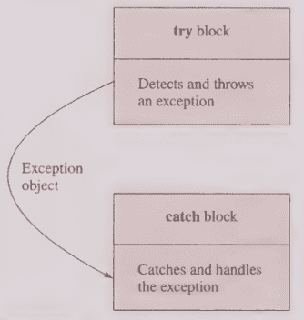

图 13.1 抛出异常的块

```
try
{
    throw exception; // 检测并抛出异常的语句块
    // 
}
catch(type arg) // 捕获异常
{
    // 处理异常的语句块
}
```

当 `try` 块抛出异常时，程序控制离开 `try` 块并进入 `catch` 块的 `catch` 语句。请注意，异常是用于传输有关问题的信息的对象。如果抛出的对象的类型与 `catch` 语句中的 `arg` 类型匹配，则执行 `catch` 块以处理异常。如果不匹配，程序将借助 `abort()` 函数终止，该函数默认被调用。当未检测到并抛出异常时，控制转到 `catch` 块之后的下一条语句。也就是说，`catch` 块被跳过。这种简单的 `try-catch` 机制在程序 13.1 中进行了说明。

## 面向对象程序设计 C++

# 程序 13.1 抛出异常的 Try 块

```
#include <iostream>
using namespace std;
int main() 
{
    int a,b;
    cout << "Enter Values of a and b \n";
    cin >> a;
    cin >> b;
    int x = a-b;
    try {
        if(x != 0) {
            cout << "Result(a/x) = " << a/x << "\n";
        } else // There is an exception {
            throw(x); // Throws int object
        }
    } catch(int i) // Catches the exception {
        cout<<"Exception caught: DIVIDE BY ZERO\n";
    }
    cout << "END\n";
    return 0;
}
```

程序 13.1 的输出为：

第一次运行

Enter Values of a and b

20 15

Result(a/x) = 4

END

第二次运行

Enter Values of a and b

10 10

# Exception caught: DIVIDE BY ZERO


程序检测并捕获了除零问题。第一次运行的输出显示成功执行。当未抛出异常时，`catch`块被跳过，执行从`catch`之后的第一个语句恢复。在第二次运行中，分母`x`变为零，因此发生了除零情况。此异常使用对象`x`抛出。由于异常对象是`int`类型，包含`int`参数的`catch`语句捕获异常并显示必要消息。

最常见的是，异常是由在`try`块中调用的函数抛出的。执行`throw`的点称为`throw point`。一旦异常被抛出到`catch`块，控制就不能返回到`throw point`。这种关系如图 13.2 所示。


**图 13.2** 由`try`块调用的函数抛出异常

这种关系代码的一般格式如下所示：

```
type function(arg list)      // 带有异常的函数
{
    ...
    throw(object);                  // 抛出异常
    ...
    ...
}
(Contd.)
```

# 378

面向对象程序设计 C++

```
try {
    Invoke function here
}
catch (type arg) { // Catches exception
{
    Handles exception here
}
```

**注意** `Catch`块必须紧跟在`try`块之后，中间不能有任何代码。

程序 13.2 演示了`try`块如何调用生成异常的函数。

# 程序 13.2 调用生成异常的函数

```
// Throw point outside the try block
#include <iostream>
using namespace std;
void divide(int x, int y, int z) {
    cout << "\nWe are inside the function \n\n";
    if((x-y) != 0)    // It is OK
    {
        int R = z/(x- y);
        cout << "Result = " << R << "\n";
    } else {
        // There is a problem
        throw(x-y);    // Throw point
    }
}
int main() {
    try {
        cout << "We are inside the try block \n";
        divide(10,20,30);    // Invoke divide()
        divide(10,10,20); // Invoke divide()
    }
    catch(int i) // Catches the exception
    {
        cout << "Caught the exception \n";
    }
    return 0;
}
```

程序 13.2 的输出为：

We are inside the try block

We are inside the function

Result = -3

We are inside the function

Caught the exception

### 13.4 抛出机制

当检测到需要处理的异常时，使用`throw`语句以以下形式之一将其抛出：

`throw(exception);`

`throw exception;`

`throw; // 用于重新抛出异常`

操作数对象`exception`可以是任何类型，包括常量。也可以抛出不用于错误处理的对象。

当抛出异常时，它将被与`try`块关联的`catch`语句捕获。也就是说，控制退出当前块并转移到该`try`块之后的`catch`块。

点可以在`try`块内的深层嵌套作用域中或深层嵌套的函数调用中。在任何情况下，控制都转移到`catch`语句。

> 注意 `throw`的语法与`return`相同。

### 13.5 捕获机制

如前所述，处理异常的代码包含在`catch`块中。`catch`块看起来像函数定义，其形式为

```
catch(type arg)
{
    // Statements for
    // managing exceptions
}
```

`type`表示`catch`块处理的异常类型。参数`arg`是可选的参数名。异常处理代码放在两个大括号之间。`catch`语句捕获其类型与`catch`参数类型匹配的异常。当它被捕获时，`catch`块中的`catch`被执行。

如果`catch`语句中的参数被命名，则该参数可以在异常处理代码中使用。执行完处理器后，控制转到`catch`块之后的语句。

由于不匹配，如果异常未被捕获，将发生异常程序终止。需要注意的是，如果`catch`语句未捕获异常，`catch`块将被简单地跳过。

### 多个 Catch 语句

程序段可能有多个条件抛出异常。在这种情况下，我们可以将多个`catch`语句与一个`try`关联（类似于`switch`语句中的条件），如下所示：

```
try {
  // try block
} catch(type1 arg) {
  // catch block1
} catch(type2 arg) {
  // catch block2
} catch(typeN arg) {
  // catch blockN
}
```

当抛出异常时，按顺序搜索异常处理器以找到合适的匹配项。第一个产生匹配的处理器被执行。执行完处理器后，控制转到`try`的最后一个`catch`块之后的第一个语句。（换句话说，所有处理器都被绕过）。当找不到匹配项时，程序将被终止。

可能有几个`catch`语句的参数与异常的类型匹配。在这种情况下，第一个匹配异常类型的处理器将被执行。

程序 13.3 显示了一个简单的示例，其中使用多个`catch`语句来处理各种类型的异常。

# 程序 13.3 多个 Catch 语句

```
#include <iostream>
using namespace std;
void test(int x)
{
    try {
        if (x == 1) throw x; // int
        else
            if (x == 0) throw 'x'; // char
        else
            if (x == -1) throw 1.0; // double
        cout << "End of try-block \n";
    }
    catch(char c) // Catch 1
{
        cout << "Caught a character \n";
    }
    catch(int m) // Catch 2
{
        cout << "Caught an integer \n";
    }
    catch(double d) // Catch 3
    {
        cout << "Caught a double \n";
    }
    cout << "End of try-catch system \n";
}
int main()
{
    cout << "Testing Multiple Catches \n";
    cout << "x == 1 \n";
    test(1);
    cout << "x == 0 \n";
    test(0);
    cout << "x == -1 \n";
    test(-1);
    cout << "x == 2 \n";
    test(2);
    return 0;
}
```

程序 13.3 的输出为：

Testing Multiple Catches

x == 1

Caught an integer

End of try-catch system

## 使用 C++ 进行面向对象编程

x = 0

Caught a character

End of try-catch system

x = -1

Caught a double

End of try-catch system

x = 2

End of try-block

End of try-catch system

程序首次执行时，先调用`x = 1`的`test()`函数，因此抛出`int`异常。这与`catch`中的参数`m`的类型匹配，因此执行`catch2`处理程序。执行后，函数`test()`再次被调用，`x = 0`。这时，函数抛出`'x'`，即字符类型异常，因此执行第一个处理程序。最后，当抛出`double`异常时，`catch3`处理程序被执行。注意，每次只有捕获异常的处理程序会被执行，其他所有处理程序都会被跳过。

当`try`块未抛出任何异常并正常完成执行时，控制权会传递到与该`try`块关联的最后一个`catch`之后的第一条语句。

> 注意块不会抛出任何异常，当`test()`以`x = 2`调用时。

# 捕获所有异常

在某些情况下，我们可能无法预见所有可能的异常类型，因此可能无法设计独立的`catch`处理程序来捕获它们。在这种情况下，我们可以强制`catch`语句捕获所有异常，而不仅仅是某种类型。这可以通过使用省略号定义`catch`语句来实现，如下所示：

```
catch(...)
{
    // Statements for processing
    // all exceptions
}
```

程序 13.4 说明了`catch(...)`的功能。

# 程序 13.4 捕获所有异常

```
#include <iostream>

using namespace std;

void test(int x)
{
    try
```

```
if(x == 0) throw x; // int
if(x == -1) throw 'x'; // char
if(x == 1) throw 1.0; // float
catch(...) // catch all {
    cout << "Caught an exception \n"
}
```

```
int main() {
    cout << "Testing Generic Catch \n";
    test(-1);
    test(0);
    test(1);
    return 0;
}
```

程序 13.4 的输出为：

Testing Generic Catch

Caught an exception

Caught an exception

Caught an exception

> 最好将`catch(...)`与其他`catch`处理程序一起用作默认语句，以便它可以捕获未显式处理的所有异常。

> 请记住`catch(...)`应该始终放在处理程序列表的最后。将其放在其他`catch`块之前会阻止这些块捕获异常并会导致语法错误。

# 将类类型作为异常捕获

创建对应于不同错误类型的自定义对象始终是一个良好的做法。然后异常处理程序可以适当地处理这些对象以采取必要的行动。程序 13.5 演示了将类类型作为异常捕获：

# 程序 13.5 类类型作为异常

```
#include <iostream>
#include <cstring>
using namespace std;
```

# 面向对象编程 with C++

```
class Error
{
    int err_code;
    char *err_desc;
public:
    Error(int c, char *d)
    {
        err_code=c;
        err_desc=new char[strlen(d)];
        strcpy(err_desc, d);
    }
    void err_display(void)
    {
        cout<<"Error Code:"<<err_code<<"\n"<<"Error Description:"<<"\n"<<"err desc"
    }
};
int main()
{
    try
    {
        cout<<"Press any key to throw a test exception.";
        cin.get();
        throw Error(99,"Test Exception");
    }
    catch (Error e)
    {
        cout<<"\nException caught successfully.";
        e.err_display();
    }
    return 0;
}
```

程序 13.5 的输出为：

Press any key to throw a test exception.

Exception caught successfully.

Error Code: 99

Error Description: Test Exception

| LIMITATION |

|---|

| C++ compiler does not check if any exception is caught or not. |

| JAVA |

### 13.6 重新抛出异常

处理程序可能会在不处理的情况下抛出捕获的异常。在这种情况下，我们只需调用不带任何参数的`throw`即可，如下所示：

这会导致当前异常被抛出到下一个封闭的`try/catch`序列中，并由该封闭`try`块之后列出的`catch`语句捕获。程序 13.6 演示了如何重新抛出并捕获异常。

# 程序 13.6 重新抛出异常

```
#include <iostream>

using namespace std;

void divide(double x, double y)
{
    cout << "Inside function \n";
    try {
        if(y == 0.0)
            throw y; // Throwing double
        else
            cout << "Division : " << x << " = " << y << "\n";
    }
    catch(double) // Catch a double
    {
        cout << "Caught double inside function \n";
        throw; // Rethrowing double
    }
    cout << "End of function \n\n";
}

int main()
{
    try {
        divide(10.5, 2.0);
        divide(20.0, 0.0);
    }
    catch(double)
    {
        cout << "Caught double inside main \n";
    }
    cout << "End of main \n";

    return 0;
}
```

程序 13.6 的输出为：

Inside main

Inside function

Division = 5.25

End of function

Inside function

Caught double inside

# 386

Object-Oriented Programming with C++

Caught double inside main

End of main

当异常被重新抛出时，它不会被该组中的`catch`语句或任何其他`catch`捕获。相反，它只会被外部`try/catch`序列中的适当`catch`捕获。

`catch`处理程序本身也可能检测到并抛出异常。同样，抛出的异常不会被该组中的任何`catch`语句捕获。它将被传递给下一个外部`try/catch`序列进行处理。

### 13.7 指定异常

可以限制函数仅抛出某些指定的异常。这是通过向函数定义添加`throw`子句实现的。使用异常规范的一般形式为：

```
type function(arg-list) throw (type-list)
{
    Function body
}
```

`type-list`指定可能抛出的异常类型。抛出任何其他类型的异常将导致程序异常终止。如果我们希望防止函数抛出任何异常，我们可以使`type-list`为空。也就是说，我们必须在函数头行中使用

```
throw(); // Empty list
```

程序 13.7 演示了如何限制函数仅抛出某些类型而非全部。

# 程序 13.7 测试抛出限制

```
#include <iostream>
using namespace std;
void test(int x) throw(int,double)
{
    if(x == 0) throw 'x'; // char
    else
        if(x == 1) throw x; // int
    else
```

(Contd.)


```
if(x == -1) throw 1.0;
// double
cout << "End of function block \n";

int main() {
    try {
        cout << "Testing Throw Restrictions \n";
        cout << "x = 0 \n";
        test(0);
        cout << "x = 1 \n";
        test(1);
        cout << "x = -1 \n";
        test(-1);
        cout << "x = 2 \n";
        test(2);
    }
    catch(char c) {
        cout << "Caught a character \n";
    }
    catch(int m) {
        cout << "Caught an integer \n";
    }
    catch(double d) {
        cout << "Caught a double \n";
    }
    cout << "End of try-catch system \n\n";
    return 0;
}
```

程序 13.7 的输出为：

Testing Throw Restrictions

x == 0

terminate called after throwing an instance of 'char'

Aborted (core dumped)

程序异常终止，因为函数 `test()` 仅意味着抛出 `int` 和 `double` 类型异常。

> 如果找不到匹配的 `catch` 语句，异常将不会被捕获。为预防措施，使用 `terminate()` 函数。

另一个需要注意的点是，限制抛出为有限类型异常的特性并非所有 C++ 编译器都完全支持。有些不支持该特性，而有些仅部分支持。在使用该特性之前，程序员应谨慎行事。

### 13.8 构造函数和析构函数中的异常

如果在执行构造函数例程时抛出异常会发生什么？由于对象尚未构造；当程序控制离开对象的上下文时，其析构函数不会被调用。而且，如果构造函数在抛出异常之前已保留了一些内存，那么就没有任何机制可以防止内存泄漏。因此，必须针对构造函数实现适当的异常处理机制来处理对象构造期间发生的异常。

现在，问题出现了，我们应该在哪里捕获异常？在构造函数块内部还是在 `main` 内部？如果我们允许在 `main` 内部处理异常，那么我们就无法防止前面讨论的内存泄漏情况。因此，我们必须在构造函数块内捕获异常，以便有机会释放任何已保留的内存空间。然而，我们必须同时重新抛出异常以便在 `main` 块内得到适当处理。此场景在以下代码中有所说明：

```
class A {
  public:
    A() {
        try {
            data-type d1;
            //Constructor code
            throw e;
        }
        catch (e) {
            delete d1; //Deleting the allocated memory before re
                       //throwing the exception
            throw e;
        }
    }
}
```

现在考虑析构函数抛出异常的情况。析构函数块执行期间引发的异常也可能导致内存泄漏情况，因为析构函数可能在抛出异常之前未释放已保留的内存空间。尽管，可以在 `main` 块内处理析构函数引发的异常，但在某些情况下它可能导致程序被中止。这可能发生在程序控制在引发的异常得到处理之前已离开对象的上下文时。因此，建议在析构函数块内处理析构函数引发的异常，如下所示：

```
class A {
  public:
    A() {
    }
}
```

```
~A()
{
try {
    //Destructor code
    throw;
}
catch (...)
{
    //Exception handling code
}
};
```

### 13.9 运算符重载函数中的异常

我们在运算符重载函数定义中加入异常处理机制以处理系统生成的或用户指定的异常。回想第 7.2 程序，我们曾重载 `+` 二元运算符来计算两个复数的和。以下代码描述了对向复数对象添加零的用户指定异常的处理。

```
class complex
{
    public:
        class FLAG{}; //Abstract class FLAG
};
```

```
complex complex ::operator+(complex c)
{
    if(c.x==0 && c.y==0)
        throw FLAG();
    complex temp;
    temp.x=x+c.x;
    temp.y=y+c.y;
    return(temp);
}
catch (complex::FLAG)
{
    cout<<"Add Zero Exception";
}
```

## SUMMARY

- 异常是程序在运行时可能遇到的特殊问题。
- 异常有两种类型：同步和异步。C++ 提供了处理同步异常的机制。
- 异常通常由 `try` 块中的错误语句引起。该语句发现错误并抛出它，由 `catch` 语句捕获。
- `catch` 语句定义了一组语句块以适当处理异常。
- 当异常未被捕获时，程序将被中止。
- `try` 块可以直接抛出异常或调用抛出异常的函数。无论 `throw` 点的位置如何，`catch` 块都紧跟在 `try` 块之后放置。
- 我们可以将两个或多个块放在一起以捕获并处理 `try` 块抛出的多种类型的异常。
- 我们也可以使用省略号作为其参数使 `catch` 语句捕获所有类型的异常。
- 我们还可以通过在函数定义中添加 `throw` 规范子句来限制函数仅抛出一组指定的异常。

## KEY TERMS

`abort()` | `function` | `asynchronous exceptions` | `bugs` | `catch block` | `catch(...) statement` | `catching mechanism` | `errors` | `exception handler` | `exception handling mechanism` | `exception specifying` | `exceptions` | `logic errors` | `multiple catch` | `out-of-range index` | `overflow` | `rethrowing exceptions` | `synchronous exceptions` | `syntactic errors` | `throw throw point` | `throw statement` | `throw()` | `throwing mechanism` | `try block`

## REVIEW QUESTIONS

### Cognitive Domain

- 13.1 解释异常。
- 13.2 解释 C++ 中的异常处理。
- 13.3 表达在程序中使用异常处理机制的优点。
- 13.4 预测在某些情况下会抛出异常的程序。
- 13.5 回忆何时使用 `catch(...)` 处理程序。
- 13.6 类类型可以作为异常抛出。请借助示例解释。
- 13.7 说明异常规范及其用途。
- 13.8 演示应将什么放在 `catch` 块内。
- 13.9 解释何时使用多个 `catch` 处理程序。
- 13.10 解释在以下情况下应使用以下语句：
  (a) `throw;`
  (b) `void fun1(float x) throw;`
  (c) `catch(...)`

### Psychomotor Domain

13.11 以适当的语法演示应将什么放在 `try` 块内。

### Affective Domain

- 13.12 为以下陈述的正确性辩护：
  (a) 异常在 `try` 块外部抛出。
  (b) 没有 `catch` 处理程序与抛出的异常类型匹配。
  (c) 几个处理程序与抛出的异常类型匹配。
  (d) `catch` 处理程序抛出异常。
  (e) 函数抛出在规范列表中未指定的异常类型。
  (f) `catch(...)` 是 `catch` 处理程序中的第一个。
  (g) 在函数头行放置 `throw()`.
  (h) 在 `catch` 块内重新抛出异常。

## Legend

Precision Valuing/Responding/Organizing Applying Remembering Understanding

## DEBUGGING EXERCISES

### 13.1 找出以下 `<iostream>` 程序中的错误。

```
#include <iostream>
using namespace std;
int main()
{
    int p,q;
    cout << "Input two integer numbers: ";
    cin >> p >> q;
    try {
        float div = (float)p/q;
```

# 392 Object-Oriented Programming with C++

```
if (div < 0)
    throw m;
else
    cout << "Exception: " << div << std::endl;
throw q(div);
catch (int m)
{
    cout << "Exception Caught: Division by zero";
}
catch (char t)
{
    cout << "Exception Caught: Division is less than 1";
}
return 0;
```

### 13.2 找出以下程序中的错误。

```
#include <iostream>
using namespace std;
void practical(int x)
    try {
        throw 20;
        throw 30;
    } catch (int e)
{
        cout << "Exception caught:\n" << e << "\n";
    } catch ()
{
        cout << "Exception caught:\n";
    }
int main()
{
    practical(1);
    practical(2);
    return 0;
}
```

### 13.3 识别以下程序中的错误。

```
#include <iostream>
using namespace std;
int main()
{
```

```
int a, b, t;
a = 10;
b = 0;
try {
    if(b == 0) {
        throw 0;
    }
r = a / b;
    cout << "Result = " << r << endl;
} catch(...) {
    cout << "Exception caught first" << endl;
} catch(int arg) {
    cout << "Exception caught second" << endl;
}
cout << "End of program";
return 0;
}
```

## DRY-RUN EXERCISES

- 13.1 当执行以下程序时会发生什么？

```
#include <iostream>

using namespace std;

int main() {
    int a, b, r;
a = 10;
b = 0;
try {
        if(b == 0) {
            throw "divisor is 0";
        }
nr = a / b;
        cout << "Result = " << r << endl;
    } catch(int arg) {
        cout << "Exception caught" << endl;
    }
cout << "End of program";
    return 0;
}
```

### 13.2 当执行以下程序时会发生什么？

```
#include <iostream>

using namespace std;

int main()
{
    int a, b, r;
    a = 10;
    b = 0;
    try {
        if (b != 0)
            throw 0;
        r = a / b;
        cout << "Result = " << r << endl;
    } catch(int arg1){
        cout << "Exception caught first" << endl;
    } catch(int arg2){
        cout << "Exception caught second" << endl;
    }
    cout << "End of program";
    return 0;
}
```

### 13.3 当执行以下程序时会发生什么？

```
#include <iostream>

using namespace std;

int main()
{
    int a, b, r;
    a = 10;
    b = 0;
    try {
        if (b == 0)
            throw 0.0;
        r = a / b;
        cout << "Result = " << r << endl;
    } catch(int arg){
        cout << "Exception caught first" << endl;
    }
```

```
catch(float arg)
{
  cout << "Exception caught second" << endl;
}
catch(double arg)
{
  cout << "Exception caught third" << endl;
}
cout << "End of program";
return 0;
}
```

### 13.4 当执行以下程序时会发生什么？

```
#include <iostream>

using namespace std;

int main()
{
  int a, b, r;
  a = 10;
  b = 0;
try {
    if(b == 0)
      throw 0.0;
    r = a / b;
    cout << "Result = " << r << endl;
} catch(int arg)
{
  cout << "Exception caught first" << endl;
} catch(float arg)
{
  cout << "Exception caught second" << endl;
}
cout << "End of program";
return 0;
}
```

### 13.5 当执行以下程序时会发生什么？

```
#include <iostream>

using namespace std;

int main()
{
  int a, b, r;
```

```
try{
try{
    if(b == 0)
        throw b;
}
catch(int arg) {
    cout << "Caught Exception 1:" << arg << "\n";
    throw;
}
catch(int arg) {
    cout << "Caught Exception 2:" << arg << "\n";
}
cout << "End of main\n";
return 0;
}
```

### 13.6 当执行以下程序时会发生什么

```
#include <iostream>
using namespace std;

void fun() {
    cout << "Inside function" << "\n";
    throw 10;
}
int main() {
    int b;
    b = 0;
    try {
        if (b != 0)
            throw b;
        try {
            throw b;
        }
        catch(int arg) {
            cout << "Caught Exception 1:" << arg << "\n";
        }
    }
    fun();
}
```

## 异常处理

```
catch(...)
{
    cout << "Caught Exception 2:" << "\n";
}
catch(int arg)
{
    cout << "Caught Exception 3:" << "\n";
    cout << "-End of main \n"
    return 0;
}
```

13.7 当执行以下程序时会发生什么？


```
#include <iostream>
using namespace std;
void MyClass()
{
    try
    {
        throw "y";
    }
    catch (const char*)
    {
        cout <<"Exception inside MyClass\n"
    }
}
int main()
{
    cout<<"Now main starts\n"
    try
    {
        MyClass();
    }
    catch(const char*)
    {
        cout << "Exception inside Main\n"
        cout << "Now Main ends\n"
        return 0;
    }
}
```

### 13.8 如果我们将粗体代码写成 `catch (int i)` 输出会有什么变化？

```
#include <iostream>
using namespace std;
```

## 面向对象的 C++ 编程

```
class P {
public:
    P() {
        cout<<"Inside the constructor\n";
        try {
            throw "m";
        }
        catch(...) {
            cout<<"What is this?\n";
        }
        cout<<"still inside the constructor \n";
    }
    ~P() {
        cout<<"Inside the destructor\n";
    }
}
int main() {
    try {
        P var;
        throw "Q";
    }
    catch(...) {
        cout<<"Exception: Ends \n";
    }
    cout<<"Exit point\n";
    return 0;
}
```

## 编程练习

+   13.1 编写一个包含可能异常的程序。使用 `try` 块抛出它，并使用 `catch` 块正确处理它。
+   13.2 编写一个程序来说明多个 `catch` 语句的应用。
+   13.3 编写一个使用 `catch(...)` 处理器的程序。
+   13.4 编写一个程序来演示某些异常类型不允许被抛出。
+   13.5 编写一个程序来演示重新抛出异常的概念。

399

异常处理

+   13.6 编写一个具有以下功能的程序：
    (a) 一个从键盘读取两个 `double` 类型数字的函数。
    (b) 一个计算这两个数字除法的函数。
    (c) 一个 `try` 块，用于在输入错误类型数据时抛出异常。
    (d) 一个 `try` 块，用于检测并在出现“除零”条件时抛出异常。
    (e) 适当的 `catch` 块来处理抛出的异常。
+   13.7 编写一个主程序，该程序调用包含异常的深度嵌套函数。加入必要的异常处理机制。
+   13.8 编写一个程序，通过继承异常类功能来创建自己的异常。

## 多项选择题

+   1. 以下哪项不是异常处理中的关键字？
    (a) `try`
    (b) `hit`
    (c) `catch`
    (d) `throw`
+   (c) `overflow_error`
    (d) `alloc_error`
+   6. 要捕获所有类型的异常，我们应该使用：
    (a) `catch()`
    (b) `catch(...)`
    (c) `catch(int p)`
    (d) `catch(p)`
+   2. C++ 中的异常类型：
    (a) 同步
    (b) 异步
    (c) a 和 b 皆是
    (d) 无

```
7. 找出错误：
int main()
{
try
{ throw 2;}
catch (...)
catch (int func)
```

+   3. 选择其中的默认函数：
    (a) `abort()`
    (b) `try()`
    (c) `catch()`
    (d) `throw()`
+   4. 选择不正确的一项：
    (a) `try {}`
    (b) `catch {}`
    (c) `throw {}`
    (d) 以上皆是

```
{
return 0;
}
(a) { throw 2;}
(b) catch (...)
(c) catch (int func)
```

+   5. 以下哪一项不是 C++ 中的标准异常？
    (a) `logic_error`
    (b) `domain_error`
+   (d) `try`
+   8. 对于没有匹配的 `catch` 语句条件，作为预防措施应该使用什么？
    (a) `throw( )`
    (b) `terminate ( )`
    (c) `clear( )`
    (d) 以上皆无
+   9. Throw 生成哪种类型的异常？
    (a) 同步异常
    (b) 异步异常
    (c) 运行时异常
    (d) 以上皆无
+   10. '异常是一个错误。'
    (a) 真
    (b) 假

# 14 标准模板库简介

### 学习目标

+   在学习本章后，你将能够
    - 提供标准模板库及其关键组件的概述
    - 描述容器及其类型
    - 将 STL 算法分类为各个类别
    - 识别各种类型的迭代器及其特征
    - 说明三种流行容器的使用：向量、列表和映射
    - 演示预定义 STL 函数的使用

### 14.1 引言

我们已经看到模板如何用于创建通用类和函数，这些类和函数可以扩展对通用编程的支持。为了帮助 C++ 用户进行通用编程，Hewlett-Packard 的 Alexander Stepanov 和 Meng Lee 开发了一组通用模板化类（数据结构）和函数（算法），可作为存储和处理数据的标准方法。通用类和函数的集合称为 *标准模板库*（STL）。STL 现在已成为 ANSI 标准 C++ 类库的一部分。

STL 庞大而复杂，本章很难讨论其所有特性。因此，我们在这里只介绍最重要的特性，这些特性将使读者能够有效地开始使用 STL。使用 STL 可以节省大量时间和精力，并带来高质量的程序。所有这些好处都是可能的，因为我们基本上是在“重用”STL 中定义的编写良好且经过充分测试的组件。

现在成为标准 C++ 库一部分的 STL 组件在 `namespace std` 中定义。因此，我们必须使用 `using namespace` 指令

```
using namespace std;
```

来告知编译器我们打算使用标准 C++ 库。本章中的所有程序都使用此指令。

### 14.2 STL 的组件

STL 包含多个组件。但其核心是三个关键组件。它们是：

+   - 容器
- 算法
- 迭代器

这三个组件相互配合，为各种编程解决方案提供支持。三个组件之间的关系如图 14.1 所示。算法采用迭代器对容器中存储的数据执行操作。

容器是实际存储数据的对象。它是数据在内存中组织的。STL 容器由模板类实现，因此可以轻松自定义以保存不同类型的数据。

算法是用于处理容器中包含数据的过程。STL 包含许多不同种类的算法，以提供初始化、复制、排序和合并等支持。算法由模板函数实现。

迭代器是一个对象（类似于指针），它指向容器中的一个元素。我们可以使用迭代器遍历容器的内容。迭代器被处理为指针。我们可以递增或递减它们。迭代器将算法与容器连接起来，并在操作容器中存储的数据时发挥关键作用。


### 14.3 容器

如所述，容器是保存数据（同类型）的对象。STL 定义了十个容器，它们分为三个类别，如图 14.2 所示。表 14.1 给出了所有这些容器的详细信息，以及每个容器需要包含的头文件和每个容器类支持的迭代器。

表 14.1 STL 支持的容器

| 容器 | 描述 | 头文件 | 迭代器 |
|---|---|---|---|
| `vector` | 一个动态数组。允许在末尾插入和删除。允许直接访问任何元素 | `<vector>` | 随机访问 |
| `list` | 一个双向线性列表。允许在任何位置插入和删除。 | `<list>` | 双向 |
| `deque` | 一个双端队列。允许在两端插入和删除。允许直接访问任何元素。 | `<deque>` | 随机访问 |
| `set` | 用于存储唯一集合的关联容器。允许快速查找。（不允许重复） | `<set>` | 双向 |

## 表 14.1（续）

| Container | Description | Header file | Iterator |
| --- | --- | --- | --- |
| `multiset` | 一个用于存储非唯一集合的关联容器。（允许重复） | `<set>` | Bidirectional |
| `map` | 一个用于存储唯一键值对的关联容器。每个键只关联一个值（一对一映射）。允许基于键的查找。 | `<map>` | Bidirectional |
| `multimap` | 一个用于存储键值对的关联容器，一个键可能关联多个值（一对多映射）。允许基于键的查找。 | `<map>` | Bidirectional |
| `stack` | 一个标准栈。先进后出(LIFO) | `<stack>` | No iterator |
| `queue` | 一个标准队列。先进先出(FIFO)。 | `<queue>` | No iterator |
| `priority-queue` | 一个优先队列。第一个元素始终是优先级最高的。 | `<queue>` | No iterator |


每个容器类都定义了一组可用于操作其内容的函数。例如，`vector` 容器定义了用于插入元素、擦除内容以及交换两个 `vector` 内容的函数。

## 序列容器

序列容器以线性序列存储元素，如图 14.3 所示。每个元素通过其在直线上的位置与其他元素相关联。它们会自行扩展以允许插入元素，并且都支持对其进行的一系列操作。


## 面向对象的 C++ 编程

STL 提供了三种类型的序列容器：

- `Vector`
- `List`
- `Deque`

所有这些容器中的元素都可以使用迭代器访问。它们之间的区别与性能有关。表 14.2 从随机访问速度以及元素插入或删除的角度比较了它们的性能。

### 表 14.2 序列容器的比较

| Container | Random access | Insertion or deletion in the middle | Insertion or deletion at the ends |
| --- | --- | --- | --- |
| `vector` | Fast | Slow | Fast at back |
| `list` | Slow | Fast | Fast at front |
| `deque` | Fast | Slow | Fast at both ends |

## 关联容器

关联容器旨在通过键直接访问元素。它们不是顺序的。有四种类型的关联容器：

- `Set`
- `Multiset`
- `Map`
- `Multimap`

所有这些容器都将数据存储在结构树中，这有助于快速搜索、删除和插入。然而，它们对于随机访问非常慢且对排序效率低下。

容器 `set` 和 `multiset` 存储多个项目，并提供使用值作为键来操作它们的操作。例如，`set` 可能会存储 `student` 类的对象，这些对象按名称作为键按字母顺序排列。我们可以使用学生的姓名作为键来搜索所需的学生。`set` 和 `multiset` 的主要区别在于 `multiset` 允许重复项而 `set` 不允许。

容器 `map` 和 `multimap` 存储成对的项目，一个称为键，另一个称为值。我们可以使用与它们关联的键进行操作。值有时称为映射值。`map` 和 `multimap` 的主要区别在于 `map` 只允许存储给定值的唯一一个键，而 `multimap` 允许多个键。

## 派生容器

STL 提供了三种派生容器，即 `stack`、`queue` 和 `priority_queue`。它们也称为容器适配器。

栈和队列可以从不同的序列容器创建。派生容器不支持随机访问，因此我们不能将它们用于数据操作。然而，它们支持两个成员函数 `pop()` 和 `push()` 用于实现删除和插入操作。

### 14.4 算法

算法可以普遍地应用于各种容器以处理其内容。每个容器为其基本操作提供了函数，STL 提供了六十多个标准算法来支持更扩展或复杂的操作。标准算法还允许我们同时使用两种不同类型的容器。记住，STL 算法不是容器的成员函数或友元。它们是独立的模板函数。

STL 算法强化了可重用性的理念。通过使用这些算法，程序员可以节省大量时间和精力。要访问 STL 算法，我们必须在程序中包含 `<algorithm>`。

STL 算法根据其执行的操作的性质可分为以下几类：

- Retrieval or nonmutating algorithms
- Mutating algorithms
- Sorting algorithms
- Set algorithms
- Relational algorithms

这些算法在表 14.3 至 14.7 中进行了总结。STL 还在头文件 `<numeric>` 下包含了一些数值算法。它们列在表 14.8 中。

### 表 14.3 非变异算法

| Operations | Description |
| --- | --- |
| `adjacent_find()` | 查找相等的相邻对象对 |
| `count()` | 统计序列中某个值的出现次数 |
| `count_if()` | 统计匹配谓词的元素数量 |
| `equal()` | 如果为真则两个范围相等 |
| `find()` | 在序列中查找值的首次出现 |
| `find_end()` | 在序列中查找值的最后一次出现 |
| `find_first_of()` | 在另一个序列中查找来自一个序列的值 |
| `find_if()` | 在序列中查找谓词的首次匹配 |
| `for_each()` | 对每个元素应用一个操作 |
| `mismatch()` | 查找两个序列首次不同的元素 |
| `search()` | 在序列中查找子序列 |
| `search_n()` | 查找指定数量的相似元素的序列 |

### 表 14.4 变异算法

| Operations | Description |
| --- | --- |
| `copy()` | 复制一个序列 |
| `copy_backward()` | 从末尾复制一个序列 |
| `fill()` | 用指定值填充序列 |
| `fill_n()` | 用指定值填充前 n 个元素 |
| `generate()` | 用操作结果替换所有元素 |
| `generate_n()` | 用操作结果替换前 n 个元素 |
| `iter_swap()` | 交换迭代器指向的元素 |
| `random_shuffle()` | 将元素置于随机顺序 |
| `remove()` | 删除指定值的元素 |
| `remove_copy()` | 复制序列并删除指定值后 |
| `remove_copy_if()` | 复制序列并删除匹配谓词的元素后 |
| `remove_if()` | 删除匹配谓词的元素 |
| `replace()` | 用指定值替换元素 |
| `replace_copy()` | 复制序列并用给定值替换元素 |
| `replace_copy_if()` | 复制序列并替换匹配谓词的元素 |
| `reverse()` | 反转元素的顺序 |
| `reverse_copy()` | 以反向顺序复制序列 |
| `rotate()` | 旋转元素 |
| `rotate_copy()` | 复制序列并旋转 |
| `swap()` | 交换两个元素 |
| `swap_ranges()` | 交换两个序列 |
| `transform()` | 对所有元素应用操作 |
| `unique()` | 删除相等的相邻元素 |
| `unique_copy()` | 删除相等的相邻元素后复制 |

## 面向对象的 C++ 编程

## 表 14.4（续）

| Operations | Description |
| random_shuffle() | 将元素置于随机顺序 |
| remove() | 删除指定值的元素 |
| remove_copy() | 复制序列并删除指定值后 |
| remove_copy_if() | 复制序列并删除匹配谓词的元素后 |
| remove_if() | 删除匹配谓词的元素 |
| replace() | 用指定值替换元素 |
| replace_copy() | 复制序列并用给定值替换元素 |
| replace_copy_if() | 复制序列并替换匹配谓词的元素 |
| reverse() | 反转元素的顺序 |
| reverse_copy() | 以反向顺序复制序列 |
| rotate() | 旋转元素 |
| rotate_copy() | 复制序列并旋转 |
| swap() | 交换两个元素 |
| swap_ranges() | 交换两个序列 |
| transform() | 对所有元素应用操作 |
| unique() | 删除相等的相邻元素 |
| unique_copy() | 删除相等的相邻元素后复制 |

## 表 14.5 排序算法

| Operations | Description |
| --- | --- |
| `binary_search()` | 对有序序列进行二分查找 |
| `equal_range()` | 查找具有给定值的元素子范围 |
| `inplace_merge()` | 合并两个连续的有序序列 |
| `lower_bound()` | 查找指定值的首次出现 |
| `make_heap()` | 从序列创建堆 |
| `merge()` | 合并两个有序序列 |


| `nth_element()` | 将指定元素放在其正确位置 |
| `partial_sort()` | 对序列的一部分进行排序 |
| `partial_sort_copy()` | 对序列的一部分进行排序然后复制 |
| `partition()` | 将匹配谓词的元素放在前面 |
| `pop_heap()` | 删除顶部元素 |
| `push_heap()` | 向堆添加元素 |
| `sort()` | 对序列进行排序 |
| `sort_heap()` | 对堆进行排序 |
| `stable_partition()` | 将匹配谓词的元素放在前面并保持相对顺序 |
| `stable_sort()` | 排序并保持元素的顺序 |
| `upper_bound()` | 查找指定值的最后一次出现 |

### 表 14.6 集合算法

| 操作 | 描述 |
| --- | --- |
| `includes()` | 查找一个序列是否另一个序列的子序列 |
| `set_difference()` | 构造一个序列，该序列是两个有序集合的差集 |
| `set_intersection()` | 构造一个包含有序集合交集的集合 |
| `set_symmetric_difference()` | 生成一个集合，该集合是两个有序集合之间的对称差 |
| `set_union()` | 生成两个有序集合的排序并集 |

### 表 14.7 关系算法

| 操作 | 描述 |
| --- | --- |
| `equal()` | 查找两个序列是否相同 |
| `lexicographical_compare()` | 按字母顺序比较一个序列与另一个序列 |
| `max()` | 给出两个值的最大值 |
| `max_element()` | 查找序列中的最大元素 |
| `min()` | 给出两个值的最小值 |
| `min_element()` | 查找序列中的最小元素 |
| `mismatch()` | 查找两个序列中元素之间的第一个不匹配项 |

### 表 14.8 数值算法

| 操作 | 描述 |
| --- | --- |
| `accumulate()` | 累积序列上操作的結果 |
| `adjacent_difference()` | 从另一个序列生成一个序列 |
| `inner_product()` | 累积一对序列上操作的結果 |
| `partial_sum()` | 通过对一对序列进行操作生成一个序列 |

### 14.5 迭代器

表 14.9 中描述了五种类型的迭代器。

### 表 14.9 迭代器及其特征

| 迭代器 | 访问方法 | 移动方向 | I/O 能力 | 备注 |
| --- | --- | --- | --- | --- |
| 输入 | 线性 | 仅向前 | 只读 | 不能保存 |
| 输出 | 线性 | 仅向前 | 只写 | 不能保存 |
| 前向 | 线性 | 仅向前 | 读/写 | 可以保存 |
| 双向 | 线性 | 前后 | 读/写 | 可以保存 |
| 随机 | 随机 | 前后 | 读/写 | 可以保存 |

不同类型的迭代器必须与不同类型的容器一起使用（参见表 14.1）。请注意，只有序列和关联容器可以通过迭代器遍历。

# 使用 C++ 的面向对象编程

每种类型的迭代器用于执行某些功能。图 14.4 给出了迭代器的 Venn 图。它说明了不同类别的迭代器提供的功能级别。


图 14.4 迭代器功能 Venn 图

输入和输出迭代器支持最少的功能。它们只能用于在容器中遍历。前向迭代器支持输入和输出的所有操作，并且还保留其在容器中的位置。双向迭代器在支持所有前向迭代器操作的同时，提供在容器中向后移动的能力。随机访问迭代器结合了双向迭代器的功能，并具有跳转到任意位置的能力。表 14.10 总结了可以在每种迭代器类型上执行的操作。

### 表 14.10 迭代器支持的操作

| 迭代器 | 元素访问 | 读 | 写 | 自增操作 | 比较 |
| --- | --- | --- | --- | --- | --- |
| 输入 | `->` | `*p` | | `++` | `==, !=` |
| 输出 | | `*p = v` | | `++` | `==, !=` |
| 前向 | `->` | `*p = v` | | `++` | |
| 双向 | `->` | `*p = v` | | `++, --` | `==, !=` |
| 随机访问 | `->, [` | `*p = v` | | `++, --, +, -` | `+=, -=` | `==, !=, <, >, >=` |

### 14.6 容器类的应用

超出本书范围的是检查 STL 支持的所有容器并提供说明。因此，我们说明了三种最流行的容器 `vector`、`list` 和 `map` 的使用。

#### 向量

向量是最广泛使用的容器。它将元素存储在连续的内存位置中，并使用下标运算符 `[]` 启用对任何元素的直接访问。向量可以动态更改其大小，因此在运行时分配所需的内存。

向量支持随机访问迭代器，并且可以对向量应用广泛的迭代器操作（参见表 14.10）。类 `vector` 支持多个构造函数来创建向量对象。

```
vector<int> v1; // Zero-length int vector
vector<double> v2(10); // 10-element double vector
vector<int> v3(4); // Creates v3 from vector
vector<int> v(5, 2); // 5-element vector of 2s
```

## 标准模板库简介

向量类支持表 14.11 中列出的几个成员函数。我们也可以在向量上使用所有 STL 算法。

### 表 14.11 向量类的重要成员函数

| 函数 | 任务 |
| --- | --- |
| `at()` | 给出对元素的引用 |
| `back()` | 给出对最后一个元素的引用 |
| `begin()` | 给出对第一个元素的引用 |
| `capacity()` | 给出向量的当前容量 |
| `clear()` | 从向量中删除所有元素 |
| `empty()` | 确定向量是否为空 |
| `end()` | 给出对向量末尾的引用 |
| `erase()` | 删除指定的元素 |
| `insert()` | 在向量中插入元素 |
| `pop_back()` | 删除最后一个元素 |
| `push_back()` | 在末尾添加一个元素 |
| `resize()` | 将向量的大小修改为指定值 |
| `size()` | 给出元素的数量 |
| `swap()` | 交换两个向量中的元素 |

程序 14.1 说明了向量类模板的几个函数的使用。请注意，任何迭代器都用作指向向量元素的指针。我们必须在程序中使用向量类时包含头文件 `<vector>`。

### 程序 14.1 使用向量

```
#include <iostream>
#include <vector> // Vector header file
using namespace std;

void display(vector<int> &v) {
    for(int i=0;i<v.size(); i++) {
        cout << v[i] << " ";
    }
    cout << "\n";
}
int main() {
    vector<int> v; // Create a vector of type int
    cout << "Initial size = " << v.size() << "\n";
    // Putting values into the vector
    int x;
    cout << "Enter five integer values: ";
    for(int i=0; i<5; i++) {
        cin >> x;
        v.push_back(x);
    }
    cout << "Size after adding 5 values: ";
    cout << v.size() << "\n";

    // Display the contents
    cout << "Current contents: \n";
    display(v);

    // Add one more value
    v.push_back(6.6); // float value truncated to int

    // Display size and contents
    cout << "Size = " << v.size() << "\n";
    cout << "Contents now: \n";
    display(v);

    // Inserting elements
    vector<int>::iterator itr = v.begin(); // iterator
    itr += 3; // itr points to 4th element
    v.insert(itr, 1, 9);

    // Display the contents
    cout << "\nContents after inserting: \n";
    display(v);

    // Removing 4th and 5th elements
    v.erase(v.begin()+3, v.begin()+5); // Removes 4th and 5th elements

    // Display the contents
    cout << "\nContents after deletion: \n";
    display(v);
    cout << "\nEND\n";
    return(0);
}
```

程序 14.1 的输出将是：

Initial size = 0

Enter five integer values: 1 2 3 4 5

Size after adding 5 values: 5

Current contents:

1 2 3 4 5

Size = 6

Contents now:

1 2 3 4 5 6

## 标准库简介

Contents after inserting:

1 2 3 9 4 5 6

Contents after deletion:

1 2 3 5 6

END

该程序使用多个函数来创建和操作向量。成员函数 `size()` 给出向量的当前大小。创建大小为零的空 int 类型向量后，程序使用成员函数 `push_back()` 将五个值放入向量中。请注意，`push_back()` 以值作为其参数并将其添加到向量的末尾。由于向量 `v` 是 int 类型，它只能接受整数值，因此语句

```
v.push_back(6.6);
```

将值 6.6 截断为 6，然后将其放入向量的末尾。

程序使用迭代器访问向量元素。语句

```
vector<int>::iterator itr = v.begin();
```

声明一个迭代器 `itr` 并将其指向向量的第一个位置。语句

```
itr = itr + 3;
v.insert(itr, 9);
```

将值 9 插入为第四个元素。同样，语句

```
v.erase(v.begin()+3, v.begin()+5);
```

从向量中删除第 4 和第 5 个元素。请注意，`erase(m,n)` 仅从第 m 个元素开始删除 n-m 个元素，第 n 个元素不会被删除。

向量的元素也可以使用下标访问（就像我们在数组中所做的那样）。请注意在函数 `display()` 中使用 `v[i]` 来显示 `v` 的内容。`display()` 的 for 循环中对 `v.size()` 的调用给出 `v` 的当前大小。

### 列表

列表是另一种流行使用的容器。它支持双向线性列表，并为删除和插入操作提供高效实现。与支持随机访问的向量不同，列表只能按顺序访问。

双向迭代器用于访问列表元素。任何需要输入、输出、前向或双向迭代器的算法都可以在列表上运行。类 `list` 提供了许多用于操作列表元素的成员函数。列表类的重要成员函数在表 14.12 中给出。这些函数的使用在程序 14.2 中说明。容器类列表中必须包含头文件 `<list>`。

### 程序 14.2 使用列表

```
#include <iostream>
#include <list>
#include <cstdlib>
// For using rand() function
```
(Contd.)

using namespace std;

void display(list<int> &lst) {

    list<int>::iterator p;

    for(p = lst.begin(); p != lst.end(); ++p)

        cout << *p << "\t";

    cout << "\n";

}

int main() {

    list<int> list1; // Empty list of zero length

    list<int> list2(5); // Empty list of size 5

    for(int i=0;i<3;i++)

        list1.push_back(rand()/100);

    list<int>::iterator p;

    for(p=list2.begin(); p!=list2.end(); ++p)

        *p = rand()/100; 

    cout << "List1 \t\n";

    display(list1);

    cout << "List2 \t\n";

    display(list2);

    // Add two elements at the ends of list1

    list1.push_back(100);

    list1.push_back(200);

    // Remove an element at the front of list2

    list2.pop_front();

    cout << "New List1 \t\n";

    display(list1);

    cout << "New List2 \t\n";

    display(list2);

    list<int> listA, listB;

    listA = list1;

    listB = list2;

    // Merging two lists (unsorted)

    list1.merge(list2);

    cout << "Merged unsorted lists \t\n";

    display(list1);

    // Sorting and merging

    listA.sort();

    listB.sort();

listA.merge(listB);

cout << "Merged sorted lists \n";

display(listA);

// Reversing a list

listA.reverse();

cout << "Reversed merged list \n";

display(listA);

return(0);

}

程序 14.2 的输出为：

+   List1

0, 184, 63,

List2

265, 191, 157, 114, 293,

List1

100, 0, 184, 63, 200,

List2

191, 157, 114, 294,

Merged unsorted lists

100, 0, 184, 63, 191, 157, 114, 200, 293,

Merged sorted lists

0, 63, 100, 114, 157, 184, 191, 200, 293,

Reversed merged list

293, 200, 191, 184, 157, 114, 100, 63, 0,

该程序声明了两个空列表，`list1` 长度为零，`list2` 大小为 5。`list1` 使用成员函数 `push_back()` 和数学函数() 填充了三个值。`list2` 使用列表类型迭代器 `p` 和 for 循环进行填充。记住 `list2.begin()` 给出第一个元素的位置，而 `list2.end()` 给出最后一个元素之后的位置。值使用 `push_front()` 和 `push_back()` 函数插入到两端。函数 `pop_front()` 删除列表中的第一个元素。同样，我们可以使用 `pop_back()` 删除最后一个元素。

列表的对象可以用其他列表对象初始化，如：

```
listA = list1;
listB = list2;
```

语句

```
list1.merge(list2);
```

简单地将 `list2` 添加到 `list1` 的末尾。列表中的元素可以使用 `sort()` 成员函数按升序排序。注意，当两个已排序的列表合并时，元素会被插入到适当的位置，因此合并后的列表也是已排序的。

我们使用 `display()` 来显示各种列表的内容。注意程序 14.1 和 14.2 中 `display()` 实现的差异。

# 面向对象的 C++ 编程

### 表 14.12 list 类的重要成员函数

| Function | Task |
|---|---|
| `back()` | Gives reference to the last element |
| `begin()` | Gives reference to the first element |
| `clear()` | Deletes all elements |
| `empty()` | Decides if the list is empty or not |
| `end()` | Gives reference to the end of the list |


| `erase()` | Deletes elements as specified |
| `insert()` | Inserts elements as specified |
| `merge()` | Merges two ordered lists |
| `pop_back()` | Deletes the last element |
| `pop_front()` | Deletes the first element |
| `push_back()` | Adds an element to the end |
| `push_front()` | Adds an element to the front |
| `remove()` | Removes elements as specified |
| `resize()` | Modifies the size of the list |
| `reverse()` | Reverses the list |
| `size()` | Gives the size of the list |
| `sort()` | Sorts the list |
| `splice()` | Inserts a list into the invoking list |
| `swap()` | Exchanges the elements of a list with those in the invoking list |
| `unique()` | Deletes the duplicating elements in the list |

## Maps

一个 `map` 是 (key, value) 对的序列，其中每个唯一的 key 都关联一个单一的值，如图 14.5 所示。值的检索基于 key 并且非常快。我们应该指定 key 以获得关联的值。


**图 14.5** `map` 中的 key-value 对

`map` 通常称为关联数组。key 使用下标运算符 `[ ]` 指定，如下所示：

```
phone[ "John" ] = 1111;
```

This creates an entry for "John" and associates (i.e., assigns) the value 1111 to it. `phone` is a `map` object. We change the value, if necessary, as follows:

```
phone[ "John" ] = 9999;
```

This changes the value 1111 to 9999. We can also insert and delete pairs anywhere in the `map` using `insert()` and `erase()` functions. Important member functions of the `map` class are listed in Table 14.13.

### 表 14.13 `map` 类的重要成员函数

| Function | Task |
|---|---|
| `begin()` | Gets reference to the first element |
| `clear()` | Deletes all elements from the map |
| `empty()` | Decides whether the map is empty or not |
| `end()` | Gives a reference to the end of the map |
| `erase()` | Deletes the specified elements |
| `find()` | Gets the location of the specified element |
| `insert()` | Inserts elements as specified |
| `size()` | Gives the size of the map |
| `swap()` | Exchanges the elements of the given map with those of the invoking map |

程序 14.3 显示了 `map` 用作关联数组的简单示例。注意必须包含 `<map>` 头文件。

### 程序 14.3 使用 Maps

```
#include <iostream>
#include <map>
#include <string>
using namespace std;
typedef map<string,int> phoneMap;
int main()
{
    string name;
    int number;
    phoneMap phone;
    cout << "Enter three sets of name and number \n";
    for(int i=0;i<3;i++)
    {
        cin >> name; // Get key
        cin >> number; // Get value
        phone[name] = number; // Put them in map
    }
    phone["Jacob"] = 4444; // Insert Jacob
    phone.insert(pair<string,int>("Bose", 5555));
    int n = phone.size();
    cout << "size of Map: " << n << "\n\n";
    cout << "List of telephone numbers \n";
    phoneMap::iterator p;
    for(p=phone.begin(); p!=phone.end(); p++) {
        cout << (*p).first << " : " << (*p).second << "\n";
    }
    cout << "\n";
    cout << "Enter name: "; // Get name
    cin >> name;
    number = phone[name]; // Find number
    cout << "Number: " << number << "\n";
    return 0;
}
```

Enter three sets of name and number:
Prasanna 1111
Singh 2222
Raja 3333

Size of Map: 5
List of telephone numbers
Bose 5555
Jacob 4444
Prasanna 1111
Raja 3333
Singh 2222

Enter name: Raja
Number: 3333

该程序首先交互式地创建 `phone`，包含三个名称，然后向 `map` 中插入另外两个名称。然后，它显示 `map` 中可用的所有名称及其电话号码。现在程序要求用户输入一个人的姓名。程序使用该人作为 key 在 `map` 中查找关联的号码并打印该号码。

名称按字母顺序打印，尽管原始数据不是这样。列表会自动使用 key 进行排序。在我们的示例中，key 是人的姓名。

我们可以使用 `map` 的迭代器的成员 `first` 和 `second` 访问条目的两个部分，如程序所示。即，

```
(*p).first
```

给出 key，

```
(*p).second
```

给出 value。

### 14.7 函数对象

一个对象是一个被包装在类中的函数，使其看起来像一个对象。该类只有一个成员函数，即重载的 `()` 运算符并且没有数据。该类是模板化的，以便可以用不同的数据类型使用。

函数对象通常用作容器和算法的参数。例如，语句

```
sort(array, array+5, greater<int>());
```

使用函数 `greater<int>()` 将 `array` 中包含的元素按降序排序。

除了比较之外，STL 还提供了许多其他预定义的函数对象，用于执行算术和逻辑操作，如表 14.14 所示。注意存在对应于所有主要 C++ 运算符的函数对象。对于使用函数，我们必须包含 `<functional>` 头文件。

| Table 14.14 STL function objects in `<functional>` |
| Function object | Type | Description |
|---|---|---|
| `divides<T>` | arithmetic | x/y |
| `equal_to<T>` | relational | x == y |
| `greater<T>` | relational | x > y |
| `greater_equal<T>` | relational | x >= y |
| `less<T>` | relational | x < y |
| `less_equal<T>` | relational | x <= y |
| `logical_and<T>` | logical | && y |
| `logical_not<T>` | logical | !x |
| `logical_or<T>` | logical | x || y |
| `minus<T>` | arithmetic | x - y |
| `modulus<T>` | arithmetic | x % y |
| `negate<T>` | arithmetic | - x |
| `not_equal_to<T>` | relational | x != y |
| `plus<T>` | arithmetic | x + y |
| `multiplies<T>` | arithmetic | x * y |

注意：变量 `x` 和 `y` 表示作为参数传递给函数对象的类 `T` 的对象。

程序 14.4 说明了在 `sort()` 算法中使用函数对象 `greater<>()`。

### 程序 14.4 算法中使用函数对象

```
#include <iostream>
#include <algorithm>
#include <functional>
using namespace std;
int main() {
    int x[] = {10,50,30,40,20};
    int y[] = {70,90,60,80};
    sort(x,x+5,greater<int>());
    sort(y,y+4);
    for(int i=0; i<5; i++)
        cout << x[i] << " ";
    cout << "\n";
    for(int j=0; j<4; j++)
        cout << y[j] << " ";
    cout << "\n";
    int z[9];
    merge(x,x+5,y,y+4,z);
    for(int i=0; i<9; i++)
        cout << z[i] << " ";
    cout << "\n";
    return(0);
}
```

程序 14.4 的输出为：
50 40 30 20 10
60 70 80 90
50 40 30 20 10 60 70 80 90

> 注意 该程序创建了两个数组 `x` 和 `y` 并用指定值初始化它们。程序随后使用算法 `sort()` 对两者进行排序。注意 `x` 是使用函数对象 `greater<int>()` 进行排序的，而 `y` 则没有使用它，因此 `x` 中的元素按降序排列。

程序最后合并两个数组并显示合并后数组的内容。注意 `merge()` 函数的形式和产生的结果。

## 摘要

- 一组通用类和函数称为标准模板库（STL）。STL 组件是 C++ 标准库的一部分。
- STL 由三个主要组件组成：容器、算法和迭代器。
- 容器是保存相同类型数据的对象。容器分为三大类：顺序、关联和派生。
- 容器类定义了大量可用于操作其内容的函数。
- 算法是独立的函数，用于对容器内容执行操作，例如排序、复制和合并。
- 迭代器类似于指针。它们用于访问容器的元素，提供算法与容器之间的链接。迭代器为特定容器定义，并用作算法的参数。
- 某些算法对某些操作使用所谓的函数对象。函数对象是由仅包含一个重载 `operator()` 的类创建的。

## 关键术语

```
<algorithm> | <cstdlib> | <deque> | <functional> | <list> | <map> | <numeric> | <queue> | <set>
<string> | <stack> | <vector> containers bidirectional iterator container adaptors
containers | deque derived containers forward iterator function object generic programming input iterator
iterators | keys | linear sequence | list | map mapped values | multimap multiple keys | multiset mutating
algorithms | namespace | nonmutating numeric algorithms output iterator priority_queue queue
random access iterator | relational algorithms sequence containers | set | set algorithms sorting algorithms
stack | standard C++ library | standard template library | templates | templated classes | tree using namespace
values | vector
```

## 认知领域

- 14.1 说明 STL。与 C++ 标准库进行区分。论证程序员中它日益增长的重要性。
- 14.2 列出三种容器类型。
- 14.3 说明顺序容器和关联容器之间的主要区别。
- 14.4 识别顺序容器使用的最佳情况。
- 14.5 识别关联容器使用的最佳情况。
- 14.6 概述迭代器及其特征。
- 14.7 描述算法。区分 STL 算法与常规算法。
- 14.8 区分以下内容：
  - (a) 列表和向量
  - (b) 集合和映射

## 面向对象的 C++ 编程

- (c) 映射和多重映射
- (d) 队列和双端队列
- (e) 数组和向量
- 14.9 比较三种顺序容器的性能特征。
- 14.10 为以下应用找到合适的容器：
  - (a) 在容器末尾插入。
  - (b) 在容器两端频繁插入和删除。
  - (c) 在容器中间频繁插入和删除。
  - (d) 频繁随机访问元素。

## 心理运动领域

- 14.11 演示 STL 算法的实现。

## 情感领域

- 14.12 为以下陈述的正确性辩护：
  - (a) 迭代器是指针的广义形式。
  - (b) 迭代器的一个目的是将算法连接到容器。
  - (c) STL 算法是容器的成员函数。
  - (d) 向量的大小在删除其元素时不会改变。
  - (e) STL 算法可与 c 风格数组一起使用。
  - (f) 迭代器始终可以向前或向后移动通过容器。
  - (g) 成员函数 `end()` 返回容器中最后一个元素的引用。
  - (h) 成员函数 `back()` 删除容器末尾的元素。
  - (i) `sort()` 算法需要随机访问迭代器。
  - (j) 一个映射可以有两个或多个具有相同键值的元素。

## 图例

| 精确 评价/回应/组织 | 应用 记忆 理解 |

## 调试练习

### 14.1 识别以下程序中的错误。

```
#include <iostream>
#include <vector>
#define NAMESIZE 40
using namespace std;
class EmployeeMaster {
  private:
    char name [NAMESIZE];
    int id;
  public:
    EmployeeMaster()
    {
      strcpy(name, "");
      id = 0;
    }
    EmployeeMaster(char name [NAMESIZE], int id)
      : id(id)
    {
      strcpy(this->name, name);
    }
    EmployeeMaster* getValuesFromUser()
    {
      EmployeeMaster *temp = new EmployeeMaster();
      cout << endl << "Enter user name : ";
      cin >> temp->name;
      cout << endl << "Enter user ID : ";
      cin >> temp->id;
      return temp;
    }
    void displayRecord()
    {
      cout << endl << "Name : " << name;
      cout << endl << "ID : " << id << endl;
    }
};
int main() {
  vector <EmployeeMaster*> emp;
  EmployeeMaster *temp = new EmployeeMaster();
  emp.push_back(getValuesFromUser());
  emp[0]->displayRecord();
  delete temp;
```


```cpp
temp = new EmployeeMaster("AlnKay", 3);

emp.push_back(temp);

emp[emp.capacity()]->displayRecord();

emp[emp.size()]->displayRecord();

return 0;

}
```

## 面向对象的 C++ 编程

### 14.2 识别以下程序中的错误。

```cpp
#include <iostream>
#include <vector>
using namespace std;
int main()
{
    vector <int> v1;
v1.push_back(10);
v1.push_back(30);
    vector <int> v2;
v2.push_back(20);
v2.push_back(40);
    if (v1==v2)
        cout << "vectors are equal";
    else
        cout << "vectors are unequal\t";
        v1.swap(20);
        for (int y=0; y<v1.size(); y++)
        {
            cout << "V1=" << v1[y] << " ";
            cout << "V2=" << v2[y] << " ";
        }
    return 0;
}
```

### 14.3 识别以下程序中的错误。

```cpp
#include <iostream>
#include <list>
int main()
{
    list <int> l1;
l1.push_front(10);
l1.push_back(20);
l1.push_front(30);
l1.push_front(40);
l1.push_back(10);
l1.pop_front(40);
l1.reverse();
l1.unique();
    return 0;
}
```

## 干燥运行练习

### 14.1 当执行以下程序时会发生什么？

```cpp
#include <iostream>
#include <algorithm>
#include <functional>
using namespace std;
int main()
{
    int x[] = {10,50,30,40,20};
    int y[] = {70,90,60,80};
    make_heap(x, x+5);
    make_heap(y, y+4);
    pop_heap(x, x+5);
    pop_heap(y, y+4);
    for(int i=0; i<5; i++)
        cout << x[i] << " ";
    cout << "\n";
    for(int i=0; i<4; i++)
        cout << y[i] << " ";
    cout << "\n";
    int z[9];
    merge(x,x+5,y,y+4,z);
    for(int i=0; i<9; i++)
        cout << z[i] << " ";
    cout << "\n";
    return(0);
}
```

### 14.2 当执行以下程序时会发生什么？

```cpp
#include <iostream>
#include <algorithm>
#include <functional>
using namespace std;
int main()
{
    int x[] = {10, 20, 30, 40, 50, 60, 70, 70, 80};
    int y[] = {10, 30, 50, 70};
    if (includes(x, x+8, y, y+4))
        cout << "INCLUDES";
    else cout << "EXCLUDES";
    return(0);
}
```

## 使用 C++ 进行面向对象编程

## 14.3 执行以下程序时会发生什么？

```cpp
#include <iostream>
#include <vector>
#include <algorithm>
using namespace std;
int main()
{
    int U[] = {10, 20, 30, 40, 50, 60, 70, 80, 90, 100};
    vector<int> X = {10, 30, 50, 70, "0"};
    vector<int> VZ(10);
    vector<int>::iterator itr = set_difference(U, U+10, X, X+5, VZ.begin());
    VZ.resize(itr.end());
    for (int i = 0; i < VZ.size(); i++)
        cout << VZ[i] << " ";
    return(0);
}
```

## 14.4 执行以下程序时会发生什么？

```cpp
#include <iostream>
#include <list>
#include <cstring>
using namespace std;
int main()
{
    char str[][] = "tattarrattat";
    list<char> l1;
    for(int i = 0; i < strlen(str); i++)
        l1.push_back(str[i]);
    list<char> l2 = l1;
    l2.reverse();
    if (l1 == l2)
        cout << "Palindrome"
    else cout << "Not Palindrome"
    return(0);
}
```

## 编程练习

+ 14.1 编写一段代码执行以下操作：
(a) 定义一个最大大小为 10 的向量 `v`。
(b) 将 `v` 的第一个元素设为 0。

## 标准库简介

(c) 将 `v` 的最后一个元素设为 9。

(d) 将其他元素设为 1。

(e) 显示 `v` 的内容。 [ ]

14.2 创建一个包含偶数以及学生姓名和其学号的数组。创建该类的五个对象并将它们存储在一个列表中，从而创建一个 `phone_list`。显示该向量。

14.3 创建一个学生类，使用算法 `merge()` 将两个数字序列合并到一个向量中。编写一个使用此列表的程序，如果给出学号则显示学生姓名，反之亦然。 [ ]

14.4 使用 `set` 重做练习 14.17。

14.5 给定一系列汽车型号以及指定时期内每种类型的销售数量。编写一个程序将此表存储在合适的容器中，并显示给定该型号的单位成本时，售出特定型号的总价值。

14.6 编写一个程序使用 `lexicographical_compare` 比较两个序列。

## 多项选择题

+ 1. STL 的组成部分是
(a) 容器
(b) 算法
(c) 迭代器
(d) 以上全部

+ 2. 以下哪项不是 STL 的合适容器？
(a) `list`
(b) `array`
(c) `queue`
(d) `stack`

+ 3. 容器的主要类别是：
(a) 序列、关联、派生
(b) 序列、并行、关联
(c) 序列、动态
(d) 关联、派生、基类

+ 4. 对于缓慢的随机访问，使用哪种序列容器？
(a) `vector`
(b) `list`
(c) `deque`
(d) 以上均不是

+ 5. 允许重复项的关联容器是？
(a) `set`
(b) `multiset`
(c) `map`
(d) `multimap`

+ 6. 为了用操作结果替换所有元素，选择正确的一项：
(a) `generate()`
(b) `remove()`
(c) `replace()`
(d) `reverse()`

+ 7. 以下哪项不是 STL 的迭代器？
(a) forward
(b) backward
(c) input
(d) output

+ 8. 关于 `vector` 的错误陈述是：
(a) 它是一个容器
(b) 它分配连续内存
(c) `[]` 用作访问运算符
(d) 它支持间接访问

+ 9. `List` 类成员函数 `splice()` 用于：
(a) 修改列表的大小
(b) 将列表插入调用列表
(c) 按指定插入元素
(d) 修改元素

+ 10. 要删除 `map` 类的所有元素，我们应该使用：
(a) `clear()`
(b) `erase()`
(c) `empty()`
(d) `begin()`

## 15 操作字符串

### 学习目标

阅读本章后，你将能够

+ - 提供字符串类的概述
- 列出字符串类的重要构造函数、函数和运算符
- 识别创建和操作字符串对象的各种方法
- 演示如何使用字符串类函数访问字符串字符以及比较和交换字符串

### 15.1 引言

字符串是一系列字符。我们知道 C++ 不支持内置的字符串类型。我们之前使用过以空字符结尾的字符数组来存储和操作字符串。这些字符串称为 C 字符串或 C 风格字符串。对 C 字符串的操作往往变得复杂且效率低下。我们也可以定义自己的字符串类，并使用成员函数来操作字符串。这在程序 7.4 中有所说明（字符串的数学运算）。

ANSI 标准 C++ 现在提供了一个名为 `string` 的新类。该类在多个方面改进了传统的 C 字符串。在许多情况下，字符串对象可以像任何其他内置数据类型一样使用。此外，虽然它不被视为 STL 的一部分，但 `string` 被 C++ 视为另一个容器类，因此适用于容器的所有算法都可以用字符串对象使用。为了使用 `string` 类，我们必须在程序中包含 `<string>`。

`string` 类非常庞大，包含许多构造函数、成员函数和运算符。我们可以使用构造函数、成员函数和运算符实现以下功能：

+ - 创建字符串对象
- 从键盘读取字符串对象
- 将字符串对象显示到屏幕
- 从字符串中查找子字符串
- 修改字符串对象
- 比较字符串对象

## 使用 C++ 进行面向对象编程

+ * 添加字符串对象
* 访问字符串中的字符
* 获取字符串的大小
* 许多其他操作

表 15.1 给出了三种最常用的构造函数的原型，表 15.2 列出了重要的成员函数。表 15.3 列出了可在字符串对象上使用的运算符。

| 构造函数 | 用法 |
| --- | --- |
| `string();` | 用于创建空字符串 |
| `string(const char *str);` | 用于从以空字符结尾的字符串创建字符串对象 |
| `string(const string &str);` | 用于从其他字符串对象创建字符串对象 |

表 15.1 常用字符串构造函数

| 函数 | 任务 |
| --- | --- |
| `append()` | 将字符串的一部分附加到另一个字符串 |
| `assign()` | 分配部分字符串 |
| `at()` | 获取指定位置存储的字符 |
| `begin()` | 返回指向字符串开头的引用 |
| `capacity()` | 给出可以存储的总元素数 |
| `compare()` | 将字符串与调用字符串进行比较 |
| `empty()` | 如果字符串为空则返回 true；否则返回 false |
| `end()` | 返回指向字符串末尾的引用 |
| `erase()` | 按指定删除字符 |
| `find()` | 搜索指定子字符串的出现 |
| `insert()` | 在指定位置插入字符 |
| `length()` | 给出字符串中的元素数量 |
| `max size()` | 给出给定系统中字符串对象的最大可能大小 |
| `replace()` | 用给定字符串替换指定字符 |
| `resize()` | 按指定更改字符串的大小 |
| `size()` | 给出字符串中的字符数量 |
| `swap()` | 将给定字符串与调用字符串交换 |

表 15.2 字符串类支持的重要函数

| 运算符 | 含义 |
| --- | --- |
| `=` | 赋值 |
| `+` | 拼接 |
| `+=` | 拼接赋值 |
| `==` | 相等 |

表 15.3 字符串对象的运算符

(续)

# 表 15.3（续）

| 运算符 | 含义 |
| --- | --- |
| `!=` | 不相等 |
| `<` | 小于 |
| `<=` | 小于或等于 |
| `>` | 大于 |
| `>=` | 大于或等于 |
| `[]` | 下标 |
| `<<` | 输出 |
| `>>` | 输入 |

### 15.2 创建 string 对象

我们可以以多种方式创建字符串对象，如下所示：

```cpp
string s1;               // 使用无参数构造函数
string s2("xyz");      // 使用单参数构造函数
s1 = s2;                // 赋值字符串对象
s3 = "abc" + s2;       // 拼接字符串
cin >> s1;              // 通过键盘读取（一个词）
getline(cin, s1);      // 通过键盘读取一行文本
```

重载的 `+` 运算符拼接两个字符串对象。我们也可以使用运算符 `+=` 将字符串追加到字符串末尾：

运算符 `<<` 和 `>>` 被重载以处理字符串对象的输入和输出。示例：

```cpp
cin >> s2;              // 输入到字符串对象（一个词）
cout << s2;             // 显示 s2 的内容
getline(cin, s2);      // 读取嵌入的空白
```

> 使用 `cin` 和 `>>` 运算符我们只能读取字符串的一个词，而 `getline()` 函数允许我们读取包含嵌入空白的文本行。

程序 15.1 描述了在程序中创建字符串对象的几种方法。

# 程序 15.1 创建字符串对象

```cpp
#include <iostream>
#include <string>
using namespace std;
int main()
```

## 使用 C++ 进行面向对象编程

// 创建字符串对象 // 空字符串对象
string s1;
string s2("New"); // 使用字符串常量
string s3 = "Delhi";

// 为字符串对象赋值
s1 = s2; // 使用字符串对象
cout << "S1 = " << s1 << "\n";

// 使用字符串常量
s1 = "Standard C++";
cout << "Now S1 = " << s1 << "\n";

// 使用另一个对象
s4(s1);
cout << "S4 = " << s4 << "\n\n";

// 通过键盘读取
cout << "ENTER A STRING \n";
cin >> s4; // 以空白分隔
cout << "Now S4 = " << s4 << "\n\n";

// 连接字符串
s1 = s2 + s3;
cout << "S1 finally contains: " << s1 << "\n";

  return 0;
```

程序 15.1 的输出为：

S1 = New

Now S1 = Standard C++

S4 = Standard C++

ENTER A STRING

COMPUTER CENTRE

Now S4 = COMPUTER

S1 finally contains: New Delhi

### 15.3 操作字符串对象

我们可以使用成员函数 `insert()`、`replace()`、`erase()` 和 `append()` 等以多种方式修改字符串对象的内容。程序 15.2 演示了其中一些函数的使用。

### 程序 15.2 修改字符串对象

```cpp
#include <iostream>
#include <string>
using namespace std;

int main()
{
    string s1("12345");
    string s2("abcde");

    cout << "Original Strings are: \n";
    cout << "S1: " << s1 << "\n";
    cout << "S2: " << s2 << "\n";

    // Inserting a string into another
    cout << "Place S2 inside S1 \n";
    s1.insert(4,s2);
    cout << "Modified S1: " << s1 << "\n";

    // Removing characters in a string
    cout << "Remove 5 Characters from S1 \n";
    s1.erase(4,5);
    cout << "Now S1: " << s1 << "\n";

    // Replacing characters in a string
    cout << "Replace Middle 3 Characters in S2 with S1 \n";
    s2.replace(1,3,s1);
    cout << "Now S2: " << s2 << "\n";

    return 0;
}
```

程序 15.2 的输出如下所示，说明了如何使用字符串函数操作字符串。

Original Strings are:

S1: 12345

S2: abcde

Place S2 inside S1

Modified S1: 1234abcde5

Remove 5 Characters from S1

Now S1: 12345


Replace Middle 3 Characters in S2 with S1

Now S2: `a12345e`

# 15.4 关系运算

为字符串对象定义了许多在字符串上使用的运算符（表 15.3）。我们在之前的示例中使用了运算符 `=` 和 `+` 来创建对象。我们也可以应用表 15.3 中列出的关系运算符。这些运算符被重载，可用于比较字符串对象。`compare()` 函数也可以用于此目的。

## 使用 C++ 进行面向对象编程

程序 15.3 显示了这些运算符的使用方法。

### 程序 15.3 字符串对象的关系运算

```
#include<iostream>
#include <string>
using namespace std;
int main()
{
    string s1="ABC";
    string s2="XYZ";
    string s3 = s1 + s2;

    if(s1!=s2)
        cout<<s1<<" is not equal to "<<s2<<"\n";

    if(s1<s2)
        cout<<s1<<" is greater than "<<s2<<"\n";
    else
        cout<<s2<<" is greater than "<<s1<<"\n";

    if(s3==s1+s2)
        cout<<s3<<" is equal to "<<s1+s2<<"\n";

    int x = s1.compare(s2);
    if(x==0)
        cout<<s1<<" = "<<s2<<"\n";
    else if(x>0)
        cout<<s1<<" > "<<s2<<"\n";
    else
        cout<<s1<<" < "<<s2<<"\n";

    return 0;
}
```

程序 15.3 的输出为：

```
ABC is not equal to XYZ
XYZ is greater than ABC
ABCXYZ is equal to ABCXYZ

ABC < XYZ
```

### 15.5 字符串特征

`string` 类支持许多可用于获取字符串特征的函数，如 `size`、`length`、`capacity` 等。大小或长度表示给定字符串中当前存储的元素数量。容量表示给定字符串中可以存储的总元素数。另一个特征是最大大小，即系统可以支持的字符串对象的最大可能大小。程序 15.4 说明了如何获取这些特征并在应用程序中使用它们。

### 程序 15.4 获取字符串特征

```
#include <iostream>
#include <string>

using namespace std;

void display(const string &str) {
    cout << "Size = " << str.size() << "\n";
    cout << "Length = " << str.length() << "\n";
    cout << "Capacity = " << str.capacity() << "\n";
    cout << "Maximum Size = " << str.max_size() << "\n";
    cout << "Empty: " << (str.empty() ? "yes" : "no");
    cout << "\n";
}

int main() {
    string strl;

    cout << "Initial status: \n";
    display(strl);

    cout << "Enter a string (one word) \n";
    cin >> strl;
    cout << "Status now: \n";
    display(strl);

    strl.resize(15);
    cout << "Status after resizing: \n";
    display(strl);
    cout << "\n";

    return 0;
}
```

程序 15.4 的输出为：

Initial status:

Size = 0

Length = 0

Capacity = 0

Maximum Size = 4294967295

Empty: yes

Enter a string (one word)

INDIA

Status now:

Size = 5

Length = 5

Capacity = 31

## 使用 C++ 进行面向对象编程

Maximum Size = 4294967293

Empty: no

Status after realloc:

Size is same

Length = 15

Capacity = 31

Maximum Size = 4294967293

Empty: no

## 限制

C++ 在字符串中支持 509 个字符，这取决于编译器，如 MSVC 支持 2048，GCC 无限制，在 511 个字符后显示警告。

大小和长度为 0 表示字符串不包含字符。大小和长度始终相同。`str` 最初的容量为零，但在将字符串分配给它时，其容量已增加到 31。此系统中字符串的最大大小为 4294967293。`empty()` 函数如果字符串为空则返回 true；否则返回 false。

### 15.6 访问字符串中的字符

我们可以通过多种方式访问字符串的子字符串和单个字符。`string` 类支持以下函数用于此目的：

- `at()` 用于访问单个字符
- `substr()` 用于检索子字符串
- `find()` 用于查找指定的子字符串
- `find_first_of()` 用于查找指定字符的首次出现位置
- `find_last_of()` 用于查找指定字符的最后一次出现位置

我们还可以使用重载的 `[]` 运算符（使字符串对象看起来像数组）来访问字符串中的单个元素。程序 15.5 演示了这些函数的使用。

### 程序 15.5 访问和操作字符

```
#include <iostream>
#include <string>

using namespace std;
int main()
{
    string s("ONE TWO THREE FOUR");
    cout << "The string contains: " << s.length() << "\n";
    for(int i=0;i<s.length(); i++)
        cout << s.at(i) << "    "; // Display one character

    cout << "\nString is shown again: " << s << "\n";
    for(int j=0;j<s.length(); j++)
        cout << s[j] << " ";

    cout << "\nTWO is found at: " << x1 << "\n";
}

int x2 = s.find_first_of('T');
cout << "\nT is found first at: " << x2 << "\n";
int x3 = s.find_last_of('R');
cout << "\nR is last found at: " << x3 << "\n";

cout << "\nRetrieve and print substring TWO \n";

cout << s.substr(x1,3);
cout << "\n";

return 0;
}
```

程序 15.5 的输出为：

The string contains:

ONE TWO THREE FOUR

String is shown again:

ONE TWO THREE FOUR

TWO is found at: 4

T is found first at: 4

R is last found at: 17

Retrieve and print substring

TWO

我们可以使用成员函数 `at()` 或下标运算符 `[ ]` 访问字符串中的单个字符。这由以下语句说明：

`cout << s.at(i);`

`cout << s[i];`

语句

`int x1 = s.find("TWO");`

定位 `"TWO"` 的第一个字符的位置。语句

`cout << s.substr(x1,3);`

查找子字符串 `"TWO"`。第一个参数 `x1` 指定所需子字符串的第一个字符的位置，第二个参数给出子字符串的长度。

### 15.7 比较和交换

`string` 支持用于比较和交换字符串的函数。`compare()` 函数可用于比较两个字符串或字符串的部分。`swap()` 函数可用于交换两个字符串对象的内容。这些函数的功能在程序 15.6 中得到演示。

## 使用 C++ 进行面向对象编程

## 程序 15.6 比较和交换字符串

```
#include <iostream>
#include <string>

using namespace std;
int main() {
    string s1("Road");
    string s2("Read");
    string s3("Red");
    cout << "s1 = " << s1 << "\n";
    cout << "s2 = " << s2 << "\n";
    cout << "s3 = " << s3 << "\n";

    int x = s1.compare(s2);
    if (x == 0) {
        cout << "s1 = " << s2 << "\n";
    } else if (x > 0) {
        cout << "s1 = " << s2 << "\n";
    } else {
        cout << "s1 = " << s2 << "\n";
    }

    int a = s1.compare(0,2,s2,0,2);
    int c = s2.compare(0,2,s3,0,2);
    int d = s2.compare(s2.size()-1,s3,0,1);

    cout << "a = " << a << " "b = " << b << "\n";
    cout << "c = " << c << " "d = " << d << "\n";

    cout << "\nBefore swap: \n";
    cout << "s1 = " << s1 << "\n";
    cout << "s2 = " << s2 << "\n";
    s1.swap(s2);
    cout << "\nAfter swap: \n";
    cout << "s1 = " << s1 << "\n";
    cout << "s2 = " << s2 << "\n";

    return 0;
}
```

程序 15.6 的输出为：

```
s1 = Road
s2 = Read
s3 = Red
s1 > s2
a = 1
b = 0
c = 0
d = -1
```

Before swap:

s1 = Road

s2 = Read

After swap:

s1 = Read

s2 = Road

## 语句

```
int x = s1.compare(s2);
```

pares the string `s1` against `s2` and `x` is assigned 0 if the strings are equal, a positive number if `s1` is lexicographically greater than `s2` or a negative number otherwise.

## 语句

```
int a = s1.compare(0,2,s2,0,2);
```

pares of `s1` and `s2`, the first two arguments give the starting subscript and length of the position of `s1` to compare to `s2`, is supplied as the third argument. The fourth and fifth arguments specify the starting subscript and length of the position of `s2` to be compared. The value assigned to `a` is 0, if the strings are equal, 1 if substring of `s1` is greater than the substring of `s2`, -1 otherwise.

## 语句

```
s2.swap(s2);
```

exchanges the contents of the strings `s1` and `s2`.

## 摘要

- Manipulation and use of C-style strings become complex and inefficient. ANSI C++ provides a new class called `string` to overcome the deficiencies of C-strings.
- The `string` class supports many constructors, member functions and operators for creating and manipulating string objects. We can perform the following operations on the strings:
  - Reading strings from keyboard
  - Assigning strings to one another
  - Finding substrings
  - Modifying strings
  - Comparing strings and substrings
  - Accessing characters in strings
  - Obtaining size and capacity of strings
  - Swapping strings
  - Sorting strings

## 关键术语

`<string>` | `append()` | `assign()` | `at()` | `begin()` | `capacity` | `capacity()` | `compare()` | `comparing strings` | `C-strings` | `C-style strings` | `empty()` | `end()` | `erase()` | `find()` | `find_first_of()` | `find_last_of()` | `getline()` | `insert()` | `length` | `length()` | `lexicographical` | `max_size()` | `maximum size` | `relational operators` | `replace()` | `size` | `size()` | `string` | `string class` | `string constructors` | `string objects` | `substr()` | `substring` | `swap()` | `swapping strings`

## 复习问题

**认知领域**

- 15.1 Discriminate between string type `string` and a C-type string.
- 15.2 The following statements are available to read strings from the keyboard.
  (a) `cin >> s1;`
  (b) `getline(cin,s1);`
  where `s1` is a string object. Distinguish their behaviour.
- 15.4 We can access strings using elements
  (a) `at()` function
  (b) subscript operator `[]`
  Compare their behavior.
- 15.5 Compute the following statements:
  (a) `s.replace(n,1,"");`
  (b) `s.erase(10);`
  (c) `s1.insert(10,s2);`
  (d) `int x = s1.compare(0, s2.size(), s2);`
  (e) `s2 = s1.substr(10, 5);`

## Distinguish between the following pair of functions.

- (a) `max_size()` and `capacity()`
- (b) `find()` and `rfind()`
- (c) `begin()` and `rbegin()`

## 情感领域

- Defend the correctness of the following statements:
  (a) For using class, we must include the header `<string>`.
  (b) `string` objects are null terminated.
  (c) The elements of a `string` object are numbered from 0.
  (d) Objects of `string` class can be copied using the assignment operator.
  (e) Function `end()` returns an iterator to the invoking `string` object.

## 图例


Precision Valuing/Responding/Organizing Applying Remembering Understanding

## 调试练习

Find the error in the following program.

```
#include <iostream>
#include <string>
using namespace std;
int main()
{
  string st1;
  cout <<"enter a statement\n";
  getline(st1);
  cout <<"you have entered\n"<<st1;
  return 0;
}
```

Find the errors in the following program.

```
#include <iostream>
#include <string>
using namespace std;
int main ()
{
  string s1("what will happen?");
  s1.pop_back();
  cout << s1 << "\n";
  cout << "capacity of string:-\ " << s1.capacity() << '\\n';
```

```
cout << "capacity of string: - " << s1.capacity() << '\n';

s1.substr(0, 10);
cout << "capacity of string: - " << s1.capacity() << '\n';
return 0;
```

## 干燥运行练习

### 1.1 What will happen when the following program is executed?

```
#include <iostream>
#include <string>

using namespace std;

int main () {
  string s1("ABCDE");
  cout << "capacity of string: - " << s1.capacity() << '\n';
  s1.reserve(20);
  cout << "capacity of string: - " << s1.capacity() << '\n';
  s1.resize(3);
  cout << "capacity of string: - " << s1.capacity() << '\n';
  s1.shrink_to_fit();
  cout << "capacity of string: - " << s1.capacity() << '\n';
  s1.reserve(40);
  cout << "capacity of string: - " << s1.capacity() << '\n';
  return 0;
}
```

### 1.2 What will happen when the following program is executed?

```
#include <iostream>
#include <string>

using namespace std;

int main () {
  string s1("ABCDEFGHIJ");
  int s=0;
  for (int i = 0; i < s1.length(); i++)
    s = s + s1.at(i);
    s = s - 48*s1.length();
  }
  cout << "The result is : " << s << '\n';
  return 0;
}
```

## 15.3 What will happen when the following program is executed?

```
#include <iostream>
#include <string>
```
using namespace std;

```
int main ()
{
    string s1;
    cout << "Enter String : ";
    cin >> s1;
    for ( int i = 0; i < s1.length()/2; i++)
        if (s1.at(i) != s1.at(s1.length() - i - 1))
        {
            cout << "Not Same" << "\n";
            break;
        }
    return 0;
}
```

## 15.4 What will happen when the following program is executed?

```
#include <iostream>
#include <string>
```
using namespace std;

```
int main ()
{
    string s1;
    char r[2];
    r[1] = '\0';
    cin >> s1;
    for(int i = 0; i < s1.length(); i++)
    {
        char ch = s1.at(i);
        if(ch >= 97 && ch <= 122)
        {
            r[0] = ch - 32;
            s1.replace(i, 1, string(r));
        }
    }
    cout << s1 << "\n";
    return 0;
}
```

## 15.5 What will happen when the following program is executed?

```
#include <iostream>
#include <string>
#include <cctype>
```

## 使用 C++ 进行面向对象编程

```
using namespace std;

int main (n{
    string s1;
    char r[2];
    r[1] = '\0';
    cin >> s1;
    for (int i = 0; i < s1.length(); i++)
        if (isalpha(s1.at(i)) {
            s1[0] = toupper(s1.at(i)) == 'Z' ? 'A' : toupper(s1.at(i)) - 1;
            s1.replace(1, 1, string(r));
        }
    }

    cout << s1 << "\n";
    return 0;
}
```

### 15.6 What will happen when the following program is executed?

```
#include <iostream>
#include <string>
using namespace std;
int main()
{
    string s1("He live in India\n");
    string s2("He is happy ");
    string s3=s1.substr(8,8);
    s2.insert(12, s3);
    cout<<s2<<flush;
    return 0;
}
```

### 15.7 What will happen when the following program is executed?

```
#include <iostream>
#include <string>
using namespace std;
int main()
{
    string s1("We love to walk");
    if(s1.at(4) == s1[4]) {
        s1= s1.substr(8,7);
        cout<<s1;
    }
    else
        s1.replace(7,4,"hate");
    return 0;
}
```

## 编程练习

15.1 Write a program that reads the name

Martin Luther King

from the keyboard into three string objects and then concatenates them into a new string object using

- (a) + operator

- (b) append() function.

15.2 Write a program using an iterator and while() construct to display the contents of a string object.

15.3 Write a program that reads several city names from the keyboard and displays only those names beginning with characters "B" or "C".

15.4 Write a program that will read a line of text containing more than three words and then replace all the blank spaces with underscore(_).

15.5 Write a program that counts the number of occurrences of a particular character, say 'c', in a line of text.

15.6 Write a program that reads the following text and counts the number of times the word "It" appears in it.

15.7 Write a program that lists list of countries in random order and displays them in alphabetical order. Comparison operators and functions.

15.8 Given string

```
string s("123456789");
Write a program that displays the following:
1
2 3 2
3 4 5 4 3
4 5 6 7 6 5 4
5 6 7 8 9 8 7 6 5
```

## 多项选择题

- 1. Choose the correct format to take input of more than one word with embedded blanks.

- 2. String can be:

- (a) cin >> sl

(b) cin >> getline(sl)

(c) getline(cin, sl)

(d) getline(sl)

- (a) Character string

(b) Class String

(c) both a and b

(d) none

# 3. 字符串类的头文件是：

+   (a) #include<str.h>

(b) #include<stdlib.h>

(c) #include<string>

(d) #include<string.h>

# 4. 用于在任何其他字符串后添加一个字符串，我们应该使用

+   (a) append()

(b) += operator

(c) both a and b

(d) none

# 5. 字符串中元素的总数是通过以下方式找到的

+   (a) length()

(b) size()

(c) capacity()

(d) end()

6. 找出以下输出：

char str[] = "objectoriented";

out << 6[str];

+   (a) t

(b) o

(c) compiler error

(d) 1

# 7. 用于从其他字符串对象创建字符串对象，我们应该使用：

+   (a) String()

(b) String(const char *str)

(c) String(const string *str)

(d) String(const string &str)

# 8. 在字符串中搜索某个子字符串的出现 _______ 是使用的

+   (a) find()

(b) search()

(c) compare()

(d) none

# 9. 比较函数可以被替换为：

+   (a) =

(b) !==

(c) ==

(d) >==

# 10. 关于字符串，什么是不正确的？

+   (a) string 是 STL 的一部分

(b) 可以创建 string 对象

(c) 可以操作 string 对象

(d) [] 运算符对 string 是一个数组

## 16

ANSI C++ 标准的新特性

### 学习目标

阅读本章后，你将能够

+   - 识别 ANSI C++ 标准中添加的新数据类型和运算符

- 了解 ANSI C++ 标准为类实现添加的新关键字（explicit 和 mutable）

- 说明使用 namespace 关键字定义命名空间范围的各种方法

- 列出可在表达式中代替运算符符号使用的各种运算符关键字

- 列出 ANSI C++ 标准中添加的新关键字和头文件

### 16.1 引言

ISO / ANSI C++ 标准为原始 C++ 规范添加了多个新特性。有些是为了在某些情况下提供更好的控制而添加的，其他则是为了给 C++ 程序员提供便利。因此必须注意，技术上完全可以在不使用任何新特性的情况下编写功能完善的程序。

添加的重要特性有：

+   1. 新数据类型

(a) bool

(b) wchar_t

2. 新运算符

(a) const_cast

(b) static_cast

(c) dynamic_cast

(d) reinterpret_cast

(e) typeid

3. 类实现

(a) 显式构造函数

(b) 可变成员

4. 命名空间范围

5. 运算符关键字

+   6. 新关键字

+   7. 新头文件

我们在此简要概述这些特性。

### 16.2 新数据类型

ANSI C++ 添加了两种新类型以增强 C++ 中可用的数据类型范围。它们是 **bool** 和 **wchar_t**。

### bool 数据类型

数据类型 `bool` 已被添加用于保存布尔值，`true` 或 `false`。值 `true` 和 `false` 已作为关键字添加到 C++ 语言中。**bool** 类型变量可以按如下方式声明。

```
bool b1;               // declare b1 as bool type
b1 = true;             // assign true value to it
bool b2 = false;         // declare and initialize
```

`true` 的默认数值值为 1，`false` 为 0。因此，语句

```
cout << "b1 = " << b1;    // b1 is true
cout << "b2 = " << b2;    // b2 is false
```

将显示以下输出：

```
b1 = 1
b2 = 0
```

我们可以在数学表达式中使用 **bool** 类型变量或值 `true` 和 `false`。例如，

```
int x = false + 5*m - b1;
```

是有效的，并且在假设 **bool** 为 true 且 **m** 为 2 时，右侧表达式求值为 9。当在非布尔表达式中使用时，**bool** 类型的值会自动提升为整数。

可以将数据指针、整数或浮点值隐式转换为 `bool` 类型。例如，语句

```
bool x = 0;
bool y = 100;
bool z = 15.75;
```

将 false 分配给 x，将 true 分配给 y 和 z。

程序 16.1 演示了 **bool** 类型数据的特性。


(续)

```
int arr1[5] = {1, 99, 3, -1, 6};
int arr2[5] = {0, 66, 3, 0, 6};
bool comp[5];

cout << "Array 1: ";
for(int i=0; i<5; i++)
    cout << arr1[i] << "\t";

cout << "\nArray 2: ";
for(int i=0; i<5; i++)
    cout << arr2[i] << "\t";

cout << "\nComparing the two arrays ..\n";
for(int i=0; i<5; i++)
    comp[i]=arr1[i]==arr2[i];

cout << "\nDisplaying the comparison results..\n";
for(int i=0; i<5; i++)
    if(comp[i]==1)
        cout << "Index " << i << " - Match\n";
    else
        cout << "Index " << i << " - No Match\n";

return 0;
```

程序 16.1 的输出将为：

Array 1:1 99 3 -1 6

Array 2:0 66 3 0 6

Comparing the two arrays ..

Displaying the comparison results..


Index 1 - No Match

Index 2 - No Match

Index 3 - Match

Index 4 - No Match

Index 5 - Match

### wchar_t 数据类型

类型 `wchar_t` 已在 ANSI C++ 中定义，用于保存 16 位字符。16 位字符用于表示字符集超过 255 个字符的语言，例如日语。如果我们为国际发行编写程序，这一点很重要。

ANSI C++ 还引入了一种新的字符，称为宽字符字面量，它使用两个字节的内存。宽字符字面量以字母 `L` 开头，如下所示：

```
L'xy' // wide_character literal
```

### 16.3 新运算符

我们已在许多程序中先前使用过强制转换运算符（也称为强制转换或类型强制转换）。正如我们所知，强制转换用于将值从一种类型转换为另一种类型。这在自动转换不可能的情况下是必要的。我们使用过以下形式的强制转换：

```
double x = double(m); // C++ type casting
double y = (double)n; // C-type casting
```

尽管这些强制转换有效，但 ANSI C++ 添加了几个新的强制转换运算符，称为 `static casts`、`reinterpret casts` 和 `constant casts`。它还添加了另一个运算符 `typeid` 用于验证未知对象的类型。

### static_cast 运算符

与常规强制转换运算符一样，`static_cast` 运算符用于任何标准数据类型转换。它也可以用于将基类指针强制转换为派生类指针。其一般形式为：

```
static_cast<type>(object)
```

这里，`type` 指定强制转换的目标类型，`object` 是被强制转换为新类型的对象。示例：

```
int m = 10;
double x = static_cast<double>(m);
char ch = static_cast<char>(m);
```

第一个语句将变量 `m` 强制转换为 `double` 类型，第二个将其强制转换为 `char` 类型。

为什么在旧样式有效时使用这种新类型？旧样式的语法与行中其余部分融合在一起，因此很难定位它们。新格式易于识别，并且可以使用自动化工具进行搜索。

### const_cast 运算符

`const_cast` 运算符用于显式覆盖强制转换中的 `const` 或 `volatile`。其形式为

```
const_cast<type>(object)
```

由于此运算符的目的是更改其 `const` 或 `volatile` 属性，目标类型必须与源类型相同。它主要用于移除对象的 `const` 属性。

### reinterpret_cast 运算符

`reinterpret_cast` 用于将一种类型更改为根本不同的类型。例如，它可用于将指针类型对象更改为整数类型对象，反之亦然。其形式如下：

```
reinterpret_cast<type>(object)
```

此运算符应用于强制转换本质上不兼容的类型。示例：

```
int m;
float x;
int* intptr;

float* floatptr;
intptr = reinterpret_cast<int*>(m);
floatptr = reinterpret_cast<float*> (x);
```

### dynamic_cast 运算符

`dynamic_cast` 用于在运行时强制转换对象的类型。其主要应用是执行对多态对象的强制转换。回想一下，多态对象是由包含虚函数的基类创建的。其形式为：

```
dynamic_cast<type>(object)
```

`object` 是一个基类对象，其类型将被检查和强制转换。它将 `object` 的类型强制转换为 `type`。它永远不会执行无效转换。它在运行时检查转换是否合法。如果转换无效，它返回 `NULL`。

`type` 必须是指向已定义类类型的指针或引用。参数 `object` 必须是对指针或引用求值的表达式。使用 `dynamic_cast()` 运算符也称为类型安全的向下转换。

### typeid 运算符

我们可以使用 `typeid` 运算符获取未知对象的类型，例如在运行时获取其类名。例如，语句

```
char *objectType = typeid(object).name();
```

将把 `"object"` 的类型分配给字符数组 `objectType`，如果需要可以打印出来。为此，我们使用 `type_info` 类的 `name()` 成员函数。`object` 可以是 `int`、`float` 等类型，也可以是任何类。

我们必须包含 `<typeinfo>` 头文件才能使用提供运行时类型信息（RTTI）的 `dynamic_cast` 和 `typeid` 运算符。

如名称所示，RTTI 是在运行时确定对象的动态类型的过程。虽然我们用某种静态类型声明了一个指针，但它指向的运行时类型可能为从静态类型派生的任何类类型。以下示例演示了使用 `typeid` 运算符：

```
#include <iostream>
#include <typeinfo>
class Org {
    public:
    // Members of Org class
    virtual ~Org() {}
}

class Dept : public Org {
    // Members of Dept class
};
```

## 450 使用 C++ 进行面向对象编程

```
int main ()
{
    Org org1;
    Dept dept1;
    Org *ptr = &dept1;

    std::cout << typeid(ptr).name() << std::endl;
    // Will display Org i.e. the static pointer type

    std::cout << typeid(*ptr).name() << std::endl;
    // This will display Dept i.e. the dynamic pointer type

}
```

在程序中，`typeid(object)` 调用返回对 `type_info` 对象的引用，该对象包含有关对象类型的信息。`type_info` 类的成员函数 `name()` 用于检索对象类型的名称。

### 16.4 类实现

ANSI C++ 标准为类成员的使用添加了两个不寻常的关键字，`explicit` 和 `mutable`。

### explicit 关键字

`explicit` 关键字用于声明类构造函数为“显式”构造函数。我们在讨论构造函数时已经看到，任何只有一个参数的构造函数都会执行隐式转换，其中构造函数接收的类型被转换为构造函数所定义类的对象。由于转换是自动的，我们不需要应用任何强制转换。在某些情况下，我们可能不希望进行这种自动转换，我们可以通过将单参数构造函数声明为 `explicit` 来实现，如下所示：

```
class ABC {
    int m;
    public:
        explicit ABC (int i) // constructor
        {
            m = i;
        }
};
```

这里，`ABC` 类的对象只能使用以下形式创建：

```
ABC abc1 (100);
```

自动转换形式

```
ABC abc1 = 100;
```

是不允许的，也是非法的。请记住，当未将关键字 `explicit` 应用于转换时，此形式是允许的。

### mutable 关键字

我们知道类对象或成员函数可以声明为 `const`，从而使其成员数据不可修改。然而，可能出现一种情况，我们希望创建一个 `const` 对象（或函数），但我们只想修改某个特定数据项。在这种情况下，我们可以通过将该数据项声明为 `mutable` 使其可修改。示例：

```
mutable int m;
```

尽管包含 `m` 的函数（或类）被声明为 `const`，`m` 的值仍可能被修改。程序 16.2 演示了 `mutable` 成员的使用。

### 程序 16.2 关键字 mutable 的使用

```
#include <iostream>
using namespace std;

class ABC
{
private:
    mutable int m; // mutable member
public:
    explicit ABC(int x = 0)
    {
        m = x;
    }
    void change() const // const function
    {
        m = m+10;
    }
    int display() const // const function
    {
        return m;
    }
};
int main()
{
    const ABC abc(100); // const object
    cout << "abc contains: " << abc.display();

    abc.change(); // changes mutable data
    cout << "\nabc now contains: " << abc.display();
    cout << "\n";
    return 0;
};
```

程序 16.2 的输出为：

```
abc contains: 100
abc now contains: 110
```

### 示例：

```
using namespace TestSpace;
m = 100; // OK
display(200); // OK

using TestSpace::;
m = 100; // OK
display(200); // Not ok, display not visible
```

### 命名空间的嵌套

一个命名空间可以嵌套在另一个命名空间内。示例：

```
namespace NS1
{
    ...
    namespace NS2
    {
        int m = 100;
    }
    ...
}
```

要访问变量 `m`，我们必须使用两个封闭的命名空间名称限定该变量。语句 `cout << NS1::NS2::m;`

将显示 `m` 的值。或者，我们可以写 `using namespace NS1; cout << NS2::m;`

### 无名命名空间

无名命名空间是没有名称的命名空间。无名命名空间占据全局作用域，并且在文件中声明之后的所有作用域中都可访问。我们可以在不使用任何限定符的情况下访问它们。

无名命名空间的常见用途是保护全局数据免受文件之间潜在的名称冲突。每个文件都有其自己的、唯一的无名命名空间。

程序 16.3 演示了如何定义命名空间、如何嵌套它们以及如何创建无名命名空间。它还说明了如何访问各种命名空间中的成员。

### 程序 16.3 使用命名空间作用域与嵌套

```
#include <iostream>
using namespace std;
```

(Cont.)

## 455

ANSI C++ 标准的新特性

```
// Defining a namespace
namespace {
  double x = 4.56;
  int m = 100;

  namespace Name2 // Nesting namespaces
  {
    double y = 1.23;
  }
}

namespace // Unnamed namespace
{
  int m = 200;
}

int main() {
  cout << "x = " << Name1::x << "\n"; // x is qualified
  cout << "m = " << Name1::m << "\n";
  cout << "y = " << Name1::Name2::y << "."; // y is fully qualified

  cout << "m = " << m << "\n"; // m is global
  return 0;
}
```

程序 16.3 的输出为：

```
x = 4.56
m = 100
y = 1.23
m = 200
```

> **注意** 我们已在全局和局部作用域中使用了变量 `m`。

程序 16.4 显示了 `using` 指令和 `using` 声明的两种应用。

### 程序 16.4 说明 using 关键字

```
#include <iostream>
using namespace std;

// Defining a namespace
namespace Name1
```

(Contd.)

## 454

使用 C++ 进行面向对象编程

示例：

```
using namespace TestSpace;
m = 100; // OK
display(200); // OK

using TestSpace::m;
m = 100; // OK
display(200); // Not ok, display not visible
```

### 命名空间的嵌套

一个命名空间可以嵌套在另一个命名空间内。示例：

```
namespace NS1
{
    ....
    namespace NS2
    {
        int m = 100;
    }
    ....
}
```

要访问变量 `m`，我们必须使用两个封闭的命名空间名称限定该变量。语句

`cout << NS1::NS2::m;`

将显示 `m` 的值。或者，我们可以写

```
using namespace NS1;
cout << NS2::m;
```

### 无名命名空间

无名命名空间是没有名称的命名空间。无名命名空间成员占据全局作用域，并且在文件中声明之后的所有作用域中都可访问。我们可以在不使用任何限定符的情况下访问它们。

无名命名空间的常见用途是保护全局数据免受文件之间潜在的名称冲突。每个文件都有其自己的、唯一的无名命名空间。

程序 16.3 演示了如何定义命名空间、如何嵌套它们以及如何创建无名命名空间。它还说明了如何访问各种命名空间中的成员。

### 程序 16.3 使用命名空间作用域与嵌套

```
#include <iostream>
using namespace std;
```

(Contd.)

### // Defining a namespace

```
namespace Name1
{
    double x = 4.56;
    int m = 100;
    namespace Name2 // Nesting namespaces
    {
        double y = 1.23;
    }
}
namespace // Unnamed namespace
{
    int m = 200;
}

int main()
{
    cout << "x = " << Name1::x << "\n"; // x is qualified
    cout << "m = " << Name1::m << "\n"; // m is fully qualified
    cout << "y = " << Name2::y << "\n"; // y is qualified
    cout << "m = " << m << "\n"; // m is global
    return 0;
}
```

程序 16.3 的输出为：

```
x = 4.56
m = 100
y = 1.23
m = 200
```

> 注意 我们已在全局和局部作用域中使用了变量 `m`。

程序 16.4 显示了 `using` 指令和 `using` 声明的两种应用。

### 程序 16.4 说明 using 关键字

```
#include <iostream>
using namespace std;
// Defining a namespace
namespace Name1
```

## 使用 C++ 进行面向对象编程

```
int m = 100;

namespace Name2 // Nesting namespaces
{
    double y = 1.23;
}

namespace Name3
{
    int m = 200;
    int n = 300;
}

int main(){
    using namespace Name1; // bring members of Name1
    cout << "x = " << x << "\n"; // to current scope
    cout << "m = " << m << "\n"; // x is not qualified
    cout << "y = " << Name2::y << "\n"; // y is qualified
    using Name3::m; // bring n to current scope
    cout << "m = " << Name3::m << "\n"; // m is qualified
    cout << "n = " << n << "\n"; // n is not qualified
    return 0;
```

程序 16.4 的输出为：

```
x = 10

m = 100

y = 1.23

m = 200

n = 300
```

> 注意 理解数据成员在被访问时是如何限定的。

程序 16.5 使用命名空间作用域中的函数。

### 程序 16.5 在命名空间作用域中使用函数

```
#include <iostream>
using namespace std;
namespace Functions
```

(Contd.)

```
{ int divide(int x, int y) { // definition return(x/y); } int prod(int x, int y); { // declaration only } }
```


```cpp
int Functions::prod(int x, int y) // qualified { return(x*y); }
```

```cpp
int main() { using namespace Functions; cout << "Division: " << divide(20,10) << "\n"; cout << "Multiplication: " << prod(20,10) << "\n"; return 0; }
```

程序 16.5 的输出为：

Division: 2

Multiplication: 200

> 注意 当在命名空间内声明的函数在外部定义时，应使用限定。

程序 16.6 演示了在命名空间中使用类的用法。

## 程序 16.6 在命名空间作用域中使用类

```
include <iostream>
using namespace Classes;
{ class Test { private: int m; public: Test(int a) { }
```

(Contd.)

```
```cpp

{

  m = a;

  void display() {

    cout << "m = " << m << "\n";

  }

}

int main() {

  // using scope resolution

  Classes::Test T1(200);

  T1.display();

  // using directive

  using namespace Classes;

  Test T2(400);

  T2.display();

  return 0;

}

n```
```

程序 16.6 的输出为：

m = 200

m = 400

### 16.6 操作符关键字

ANSI C++ 标准为若干 C++ 操作符提出了关键字。这些关键字列于表 16.1 中，可在表达式中代替操作符符号使用。例如，表达式

```
x > y && m != 100
```

可以写成

```
x > y and m not_eq 100
```

操作符关键字不仅增强了逻辑表达式的可读性，而且在键盘不支持 &、^ 和 ~ 等特殊字符的情况下也很有用。

| Operator | Operator keyword | Description |
| --- | --- | --- |
| & | and | logical AND |
| \|\| | or | logical OR |
| ! | not | logical NOT |
| != | not_eq | inequality |
| & | bitand | bitwise AND |

## 表 16.1 （续）

| Operator | Operator keyword | Description |
| --- | --- | --- |
| ^ | xor | bitwise exclusive OR |
| ~ | compl | bitwise complement |
| &= | and_eq | bitwise AND assignment |
| \|= | or_eq | bitwise inclusive OR assignment |
| ^= | xor_eq | bitwise exclusive OR assignment |

### 16.7 新关键字

ANSI C++ 为支持新特性增加了若干新关键字。现在，C++ 包含 64 个关键字，包括 `main`。它们列于表 16.2 中。新关键字以粗体显示。

## 表 16.2 ANSI C++ 关键字

| asm | else | namespace | template |
| --- | --- | --- | --- |
| auto | enum | new | this |
| bool | explicit | operator | throw |
| break | export | private | true |
| case | extern | protected | try |
| catch | false | public | typedef |
| char | float | register | typeid |
| class | for | reinterpret_cast | typename |
| const | friend | return | union |
| const_cast | goto | short | unsigned |
| continue | if | signed | using |
| default | inline | sizeof | virtual |
| delete | int | static | void |
| do | long | static_cast | volatile |
| double | main | struct | wchar_t |
| dynamic_cast | mutable | switch | while |

### 16.8 新头文件

ANSI C++ 标准定义了指定头文件的新方法。它们不为文件名使用 `.h` 扩展名。示例：

```
#include <iostream>
#include <fstream>
```

然而，传统的样式 `<iostream.h>`、`<fstream.h>` 等仍然完全受支持。一些旧的头文件已重命名如下：

> 限制

1. 在 ANSI C++ 中，对在线成员函数设置断点令人困惑。

2. 在 ANSI C++ 中，不支持可变长度数组特性，但在 C99 中可用。

## 旧样式 新样式

## 摘要

- ANSI C++ 标准委员会为原始 C++ 语言规范增加了许多新特性。
- 增加了两种新的数据类型 `bool` 和 `wchar_t`，以增强 C++ 可用数据类型的范围。
- `bool` 类型可保存布尔值 `true` 和 `false`。
- `wchar_t` 用于保存 16 位字符常量。
- 增加了四个新的强制转换操作符：`static_cast`、`const_cast`、`reinterpret_cast` 和 `dynamic_cast`。
- `static_cast` 操作符用于任何标准数据类型转换。
- `const_cast` 操作符可用于显式更改对象的 `const` 或 `volatile` 属性。
- 我们可以使用 `reinterpret_cast` 操作符将对象的数据类型更改为根本不同的类型。
- 对象的运行时强制转换可通过 `dynamic_cast` 操作符实现。
- 另一个名为 `typeid` 的新操作符可为我们提供对象关于运行时类型的信息。
- 构造函数可以声明为 `explicit` 以使转换显式。
- 我们可以通过声明为 `mutable` 使 `const` 对象或函数的某个数据项可修改。
- ANSI C++ 允许我们在程序中定义自己的命名空间作用域，以克服某些名称冲突情况。
- 命名空间可以嵌套。
- 命名空间作用域的成员可使用声明或 `using` 指令访问。
- ANSI C++ 提出了可用于代替使用操作符的关键字。
- 在新标准中，头文件应不带 `.h` 扩展名指定，并且 `using` 指令
`using namespace std;`
应在每个程序中添加。
- 一些旧样式头文件在新标准中已重命名。例如，`math.h` 文件称为 `cmath`。

## 关键术语

`and` `and_eq` `ANSI C++` `bitand` `bitor` `bool` `Boolean` `C_type casting` `C++ standard` `C++ type casts` `casts` `compl` `const function` `const constructor` `object` `dynamic_casts` `const_cast` `constant casts` `current scope` `downcast` `dynamic` `dynamic casts` `explicit constructor` `false value` `global identifiers` `header file` `implicit conversion` `mutable member` `name(function)` `namespace scope` `nesting` `namespaces` `not_eq` `operator keywords` `or` `or_eq` `polymorphic objects` `reinterpret casts` `reinterpret_cast` `RTTI` `source type` `standard library` `static casts` `static_cast` `std namespace` `target type` `true value` `type casts` `type_info` `type casting` `typeinfo header` `unnamed namespaces` `using` `using directive` `volatile` `wchar_t` `wide_character literal` `xor` `xor_eq`

## 复习问题

认知领域

- 16.1 列出 ANSI C++ 标准委员会添加的两种数据类型。
- 16.2 说明 `bool` 类型变量的应用。
- 16.3 回顾 `wchar_t` 字符类型的需求。
- 16.4 列出 ANSI C++ 标准委员会添加的新操作符。
- 16.5 重写 `const_cast` 操作符的应用。
- 16.6 解释在旧式强制转换也能完成同样工作的情况下使用 `static_cast` 操作符的必要性。
- 16.7 区分 `reinterpret_cast` 和 `static_cast`。
- 16.8 阐述动态强制转换。并解释 C++ 中是如何实现的。
- 16.9 概述 `typeid` 及其用途。
- 16.10 描述隐式转换以及 C++ 中是如何执行的。
- 16.11 回忆 `mutable` 关键字的用途。
- 16.12 回顾 C++ 中的命名空间冲突及其处理方法。
- 16.13 说明访问在命名空间中声明的变量的方法。
- 16.14 概述命名空间并区分使用 `using namespace` 指令和使用 `using` 声明访问命名空间成员之间的区别。
- 16.15 回顾以下代码段中的错误：

```
const int m = 100;
int *ptr = &m;
```

## 面向对象 C++ 编程

16.16 发现以下语句的问题：

```
const int m = 100;
double *ptr = const cast<double*>(&m);
```

16.17 计算以下程序的输出：

```
#include <iostream.h>
class Person
{
    // ....
}
int main()
{
    Person John;
    cout << "John is a ";
    cout << typeid(John).name() << "\n";
}
```

16.18 分析以下命名空间定义的正确性：

```
namespace Main
{
    int main()
{
    // ....
    }
}
```

图例

- 精确 评价/回应/组织 应用 记忆 理解

## 调试练习

16.1 识别以下程序中的错误：

```
#include <iostream>
class A
{
public:
    A()
};
```

```
A(int i)
{
}
```

```
);
class B
{
public:
    B()
    {
}
    explicit B(int)
    {
}
}
```

```
int main()
{
    A a1=12;
    A a2;
    A a3=a1;

B b1 : 12;
    return 0;
}
```

16.2 识别以下程序中的错误。

```
#include <iostream>
using namespace std;
class A
{
protected:
    int i;
public:
    A()
    {
        i = 10;
    }
    int getI()
    {
        return i;
    }
}
```

```
};
class B: public A
{
public:
```

## 16.3 Identify the error in the following program.

```
#include <iostream>
using namespace std;

namespace A {
    int i;
    void dispI() {
        cout << i;
    }
}

int main() {
    namespace Inside {
        int insideI;
        void dispInsideI() {
            cout << insideI;
        }
    }
    A::i = 10;
    cout << A::i;
    A::dispI();

    Inside::insideI = 20;
    cout << Inside::insideI;
    Inside::dispInsideI();
    return 0;
}
```

软件生命周期，如上所述，通常使用功能分解技术来实现，该技术通常被称为自上而下、模块化方法。功能分解技术基于对问题空间的解释及其转化为作为相互依赖的功能集合的解决方案空间。功能被分解为一系列逐步简化并最终实现的功能。最终系统被视为一组按自上而下层次结构组织的功能。

功能分解方法存在若干缺陷。它们包括：

- 1. 它不允许软件的演进式变更。
- 2. 系统以顶部的单一功能为特征，而这并不总是正确的。在许多系统中并没有顶层。
- 3. 数据没有得到应有的重视。
- 4. 它不鼓励代码的重用。
- 5. 数据安全没有得到应有的重视，因此经常受到损害。

## 17.3 开发工具

在系统的分析和设计中，使用了大量工具。需要注意的是，由于计算机技术的持续变化，系统开发过程多年来一直在发生变化。因此，出现了新的开发工具和技术的演进。这些工具和技术为系统开发的*如何*问题提供了答案。

目前可用的开发工具可分为第一代、第二代、第三代、第四代和第五代工具。第一代工具诞生于 1960 年代和 1970 年代，是传统工具。第二代工具于 1970 年代末和 1980 年代初引入，用于系统分析和设计，因此被称为结构化工具。第三代自 1980 年代末起演进，用于面向对象的分析和设计。第四代工具在 1990 年代演进，被认为是第三代工具的进步。这些工具试图自动化代码生成过程。更常见的是，它们提供图形用户界面（GUI），便于使用“拖放”功能。它们帮助不熟悉底层编程语言语法的程序员。第五代工具旨在自动化解决问题的过程。第四代和第五代工具之间的基本区别在于，在第四代中，问题的解决方案来自程序员。工具用于自动生成解决方案的代码。第五代工具应该能够自动给出问题的解决方案，然后为其生成代码。然而，这类工具的一个问题是，不能确定生成的解决方案是否最优。

表 17.2 显示了在三个类别下用于各种开发过程的一些流行工具。虽然这种分类值得商榷，但它大致说明了过去三十年中工具的增长。

| 过程 | 第一代 | 第二代 | 第三代 |
| --- | --- | --- | --- |
| 物理过程 | 系统工作流 | 上下文图 | 继承图 |
| 数据表示 | 布局表单 网格图表 | 数据字典 | 对象关系图 |
| 逻辑过程 | 剧本式英语叙述 | 决策表和树 数据流图 | 继承图 数据流图 状态变更图 |
| 程序表示 | 程序流程 I/O 布局 | 结构图 Warnier/Orr 图 | Ptech 工具 Co/Yourdn 图 |

这些工具通常被打包为 RAD（快速应用开发）或 CASE（计算机辅助软件工程）工具。

应注意，第三代使用的工具也将在第四代中使用，所采用的方法与之前保持一致。只是第四代中代码生成过程是自动化的。还值得注意的是，这些工具不适用于第五代，因为方法将是生成解决方案。

我们现在概述一些最常用的第一代和第二代工具。面向对象的开发工具将在本章后面讨论。

系统流程图：系统各关键点之间重要输入、输出和数据流的图形表示。

程序流程图：程序逻辑的图形表示。

剧本：执行一个程序的叙述性描述。

布局表单：用于输入数据或显示结果的格式。

网格图表：显示系统不同模块之间关系的图表。

上下文图：显示输入及其来源以及输出及其目的地的图表。上下文图概述了系统边界。

数据流图：它们描述了系统各组件之间的数据流。它是系统的网络表示，包括进程和数据文件。

数据字典：关于数据的结构化存储库。它包含所有数据项和数据存储的术语列表及其定义。

结构图：表示系统的函数（模块）控制逻辑的图形表示。

决策表：用于定义问题和应采取的行动的应急表。它呈现了告诉我们何时给定条件为真或为假时应采取什么行动的逻辑。

决策树：条件和结果的图形表示，类似于树的分支。

Warnier/Orr 图：使用嵌套的大括号集合、伪代码和逻辑符号来表示程序结构的水平层次结构图。

## 17.4 面向对象范式

面向对象范式在概念背景上很大程度上借鉴了一般系统理论。系统可以被视为一组相互作用以实现特定目标的实体集合（图 17.3）。实体可能代表物理对象，如设备和人员，以及抽象概念，如数据文件和函数。在面向对象分析中，实体称为对象。

### 474 使用 C++ 的面向对象编程

### 过程


图 17.3 显示实体相互关系的系统

顾名思义，面向对象范式更强调封装数据和过程的对象。它们在软件开发的所有阶段中都发挥着核心作用，因此各阶段之间存在高度的重叠和迭代。整个开发过程具有演进的性质。因此，面向对象版本的软件开发生命周期的任何图形表示都必须考虑到重叠和迭代这两个方面。结果是采用了“喷泉模型”来代替经典的“瀑布模型”，如图 17.4 所示。该模型描绘了开发达到更高水平后又回落到前一水平，然后再次攀升。


图 17.4 面向对象软件开发的喷泉模型

### 面向对象分析 OOA

面向对象是指以现实世界对象、其行为及其交互的方式来指定软件需求的方法。面向对象设计（OOD）另一方面，将软件需求转化为对象并从中导出类层次结构，以便创建对象。最后，面向对象编程（OOP）是指在 C++ 等面向对象编程语言中实现程序对象。

通过开发问题空间中发现的对象的规范，实际上将清晰而有组织的对问题的陈述构建到应用程序中。这些对象构成了用问题空间术语编写的高层定义层。在对定义进行细化和实现应用程序对象期间，会识别出其他对象。图 17.5 说明了由此产生的对象规范层。


由于对象模型的共同性，面向对象方法中的所有阶段都更紧密地协同工作。在一个阶段中识别问题域对象，而在下一个阶段则指定特定解决方案所需的附加对象。对这些实现级对象重复设计过程。

与自上而下的功能分解方法相比，面向对象方法兼具自上而下和自下而上设计的许多属性。功能分解技术可应用于单个类的设计，而最终系统可借助类模块使用自下而上的方法构建。

图 17.5 对象规范层

## 17.5 面向对象设计范式的开发工具

图形符号是任何设计和开发过程不可或缺的一部分，面向对象设计也不例外。我们需要符号来表示类、对象、子类及其相互关系。

不幸的是，直到 1990 年代中期，还没有用于表示对象及其交互的标准符号。作者和研究人员使用自己的符号。其中一些被更频繁地使用，而另一些则没有。

在 1994 年，Grady Booch 和 James Rumbaugh 决定定义一套通用的最小设计工具集。他们于 1995 年与 Ivar Jacobson 合作。随后他们定义了统一建模语言（UML），该语言于 1997 年被对象管理组织（OMG）采纳，并于 2005 年被国际标准化组织（ISO）采纳。这些标准已由 OMG 定期修订和更新。2017 年 12 月，OMG 发布了 UML 版本 2.5.1。UML 具有工具和规范来表示类、对象、它们的关系、对象通过消息传递之间的通信等。UML 常用的设计工具和记法如下：

- 1. 类和对象
- 2. 对象的实例
- 3. 对象之间的消息通信
- 4. 继承关系
- 5. 分类关系
- 6. 组合关系
- 7. 类图
- 8. 对象图
- 9. 用例图
- 10. 活动图
- 11. 序列图
- 12. 状态图
- 13. 组件图
- 14. 部署图
- 15. 包图

我们必须在可能的情况下使用这些记法和图表。它们不仅提高了流程的清晰度，也提高了软件开发人员的生产率。图 17.6 至 17.14 显示了一些常用的记法来表示以下内容：


图 17.6 类/对象的各种表示形式


图 17.7 对象的实例


图 17.8 对象之间的消息通信


图 17.9 继承关系


图 17.10 分类关系


图 17.11 组合关系


图 17.12 层次图表


图 17.13 客户端-服务器关系


图 17.14 流程分层（一个流程通常有五到七个对象）

## 17.6 面向对象分析的步骤

面向对象分析为我们提供了一种简单而强大的机制来识别对象，即待开发软件的构建块。分析主要关注将问题分解为其组成部分并建立描述系统功能的逻辑模型。

面向对象 C++ 编程

面向对象分析（OOA）方法包括以下步骤：

- 1. 理解问题
- 2. 绘制用户和软件需求的规范
- 3. 识别对象及其属性
- 4. 识别每个对象预期提供的服务（接口）
- 5. 建立对象之间以所需服务和提供的服务为依据的互联关系（协作）

尽管我们将上述任务显示为一系列离散步骤，但最后三个活动是相互依赖地进行的，如图 17.15 所示


**图 17.15** 面向对象分析的活动

### （1）问题理解

分析过程的第一步是理解用户的问题。问题陈述应根据计算机系统工程进行细化和重新定义，从而可提出基于计算机的解决方案。问题陈述应尽可能用简单、语法正确的句子表述。这将使软件工程师能够高度集中注意力于问题的解决。问题陈述为绘制用户和软件的需求规范提供了基础。

### （2）需求规范

一旦问题明确定义，下一步就是理解拟议系统需要做什么。在此阶段生成用户需求列表非常重要。用户和开发者之间应对所需内容有清晰的理解。基于用户需求，应制定软件规范。开发者应明确说明

- * 需要什么输出。
- * 生产这些输出涉及什么过程。
- * 需要什么输入。
- * 需要什么资源。

面向对象系统开发

这些规范通常作为测试最终产品是否执行预期任务的参考。

### （3）对象的识别

对象通常可以以现实世界对象和抽象对象的形式识别。因此，最好的寻找对象的地方是应用程序本身。应用程序可使用以下工具进行分析：

- 1. 用例图
- 2. 活动图
- 3. 序列图

#### 用例图

这些图用于描述不同实体（称为参与者）与系统之间的交互。该图用于显示这些参与者所涉及的不同活动（称为用例）。图 17.16 显示了图书馆信息系统借阅模块的用例图。人形代表参与者，而椭圆形气泡代表用例。<<include>> 关系用于当一个用例需要使用另一个用例的功能时，可进一步使用活动图或序列图等其他用例工具进行详细说明。图 17.17 显示了对应于图 17.16 中标记为“浏览图书目录”的用例的活动图。

#### 文本分析

这种方法基于对问题或拟议解决方案的文本描述。描述可能是一两句话或一两段，取决于问题类型和复杂性。名词是对象的良好指标。名称可进一步分类为专有名词、普通名词和集合或抽象名词。表 17.3 显示了各种名词类型及其含义。


图 17.16 图书馆信息系统图书借阅模块的用例图

482

面向对象 C++ 编程


**图 17.17** 检查图书馆图书可用性的活动图

**表 17.3** 名词类型

| 名词类型 | 含义 | 示例 |
|--- |--- |--- |
| 普通名词 | 描述事物类（实体） | 车辆、客户 收入、扣除 |
| 专有名词 | 特定事物的名称 | Maruti 汽车、John、ABC 公司 |
| 集合或抽象名词 | 描述与名词相关联的品质、数量或活动 | 薪资-收入 房屋-贷款、英尺、交通 |

需要注意的是，必须使用上下文和语义来确定名词类别。某个词在一个上下文中可能表示普通名词，在另一个上下文中则表示集合或抽象名词。

这些方法仅作为指南，而非最终工具。经验丰富的开发者的创造性感知和直觉在识别对象方面发挥着重要作用。

使用上述方法之一，为应用程序问题准备对象列表。这可能包括以下任务：

面向对象系统开发

- 1. 准备对象表。
- 2. 识别属于解决方案空间的对象和仅属于问题空间的对象。问题空间对象位于软件边界之外。
- 3. 识别解决方案空间对象的属性。

请记住，并非所有名词都与解决方案的最终实现相关。

### （4）服务的识别

一旦在解决方案空间中识别出对象，下一步就是识别每个对象应提供的服务集合。服务是通过检查问题描述语句中的所有动词和短语来识别的。可将可能表示动作或事件的动词分类如表 17.4 所示。

表 17.4 动词分类

| 动词类型 | 含义 | 示例 |
|---|---|---|
| 执行动词 | 操作 | read , get, display, buy |
| 是动词 | 分类 | is an, belongs to |
| 拥有动词 | 组合 | has an, part of |
| 比较动词 | 操作 | is less than, is equal to |
| 状态动词 | 不变条件 | to be present, are owned |

执行动词和比较动词通常会产生服务（我们在 C++ 中称为函数）。是动词表示分类结构的存在，而拥有动词会产生组合结构。

### （5）建立互联关系

此步骤识别对象提供的服务和接收的服务。我们可以使用信息流图（IFD）或实体-关系（ER）图来列出此信息。在这里，我们必须在服务与实际信息（消息）之间建立对应关系。序列图、组件图等工具可用于建模互联关系。

## 17.7 面向对象设计的步骤

设计关注于将问题空间中的对象映射到解决方案空间中的对象，并创建系统的整体结构（架构模型）和计算模型。此阶段通常使用自底向上方法构建系统结构，并使用自顶向下功能分解方法设计提供服务的类方法。构建结构化层次结构特别重要。重用先前设计中的类、将对象分类为子系统以及确定适当的协议是设计阶段的一些考虑因素。面向对象设计（OOD）方法可能涉及以下步骤：

- 1. 回顾分析阶段的对象
- 2. 指定类依赖关系
- 3. 组织类层次结构
- 4. 设计类

使用 C++ 进行面向对象编程

5. 成员函数的设计

6. 驱动程序的设计

# （1）问题空间对象的回顾

在设计阶段的第一步中，会进行一次练习来回顾在问题空间中识别出的对象。此回顾练习的主要目标是根据其属性和操作来完善对象，并识别出其他特定于解决方案的对象。一些可能有助于回顾过程的指导原则：

+   1. 如果一项服务（或操作）只需要一个对象，则该操作作用于该对象。
2. 如果一个操作需要两个或多个对象，则有必要确定操作的私有部分应由哪个对象知晓。
3. 如果一个操作需要了解多种类型的对象，则该操作在功能上具有内聚性，应被拒绝。

应用这些指导原则将有助于完善对象的服务。此外，冗余或多余的对象将被移除，同义服务将被合并，并且操作的名称（函数）将被改进以明确表示所涉及的处理类型。

# （2）类依赖关系

对类之间关系的分析是系统结构的核心。因此，识别适当的类来表示解决方案空间中的对象并建立它们之间的关系非常重要。在设计上下文中重要的主要关系是：

+   1. 继承关系
2. 包含关系
3. 使用关系

继承关系是可以在 C++ 中表示的最高关系。它是表示层次关系的一种强大方式。继承机制的真正吸引力和强大之处在于，它允许我们重用一个几乎但不完全是我们想要的类，并以一种方式定制该类，使其不会在类的其余部分引入不必要的副作用。我们必须回顾类的属性和操作，并准备如表 17.5 所示的继承关系表。

表 17.5 继承关系表。

| Class | Depends on |
|---|---|
| A | ... |
| B | A |
| C | A |
| D | B |
| B1 | B |
| B2 | B |

包含关系意味着将一个类的对象用作另一个类的成员。这是使用类继承的替代且互补的技术。但在两者技术之间进行选择通常是一个棘手的问题。通常，如果需要覆盖属性或函数，则继承是最好的选择。另一方面，如果我们想通过多种类型来表示一个属性，则包含关系是正确的方法。另一个需要将对象用作成员的地方是当我们需要将一个类的属性作为另一个类的构造函数的参数传递时。“另一个”类必须有一个成员对象来表示该参数。继承表示 is_a 关系，而包含表示 has_a 关系。

**使用关系**提供了类使用的各种类以及使用方式的信息。例如，类 A 以多种方式使用类 B 和 C：

+   - A 读取 B 的成员
- 调用 C 的成员
- 使用 new 运算符创建 B

了解此类关系对于程序设计非常重要。诸如类图和组件图之类的工具有助于描述此类关系。

# （3）类层次结构的组织

在上一步中，我们检查了继承关系。我们必须重新检查并创建一个类层次结构，以便尽可能多地重用已设计的数据/函数。类层次结构的组织涉及识别一组相关类之间的共同属性和函数，然后将它们组合形成一个新类。新类将作为超类，而其他类作为从属类（从超类派生属性）。新类可能本身具有对象的含义，也可能没有。如果对象纯粹是为了组合共同属性而创建，则称为抽象类。

此过程可以在不同的抽象级别重复，唯一目标是扩展类。随着被低层类继承的规范和实现的量增加。我们可以重复该过程，直到确定无法再形成新类为止。图 17.18 说明了两级迭代过程。


图 17.18 类层次结构的级别

# 486

面向对象编程与 C++

类组织的最终结果可能是一个单一树模型，如图 17.19(a) 所示，或森林模型，如图 17.19(b) 所示。


图 17.19 类的组织

# （4）类的设计

我们已经识别出类、其属性以及概念类所代表所需的最少操作集。现在我们必须查看每个类所代表的完整细节。重要的问题是决定要提供哪些函数。为了使类有用，除了服务函数之外，它必须包含以下函数：

+   1. 类管理函数
   * 如何创建对象？
   * 如何销毁对象？
+   2. 类实现函数
   对该类的类型数据执行什么操作？
# 类访问函数

我们如何获取有关类内部变量的信息？

4. 类实用函数。

我们如何处理错误？

需要考虑的其他问题：

+   1. 基类需要什么样访问控制？
+   2. 哪些函数可以设为虚函数？
+   3. 在一个类中预期使用哪些库类？
+   4. 个别类的设计对软件整体质量有重大影响。

下面给出了设计类时应考虑的一些指导原则：

+   1. 类的公共接口应仅包含该类的函数。
+   2. 一个类的对象不应直接向另一个类的成员发送消息。
+   3. 一个函数只有在需要被该类的对象使用时才应声明为 public。
+   4. 每个函数访问或修改其所代表的类的某些数据。
+   5. 一个类应尽可能少地依赖于（其他）类。
+   6. 两个类之间的交互必须是明确的。
+   7. 每个从属类都应设计为基类的特化，其唯一目的是添加额外功能。
+   8. 结构的顶层类应代表目标概念的抽象模型。

# （5）成员函数的设计

到目前为止我们已经识别出

+   1. 类和对象
+   2. 数据成员
+   3. 接口
+   4. 依赖关系
+   5. 类层次结构

现在是考虑成员函数设计的时候了。成员函数定义了对对象数据执行的操作。这些函数表现得像任何其他 C 函数，因此我们可以使用自顶向下的功能分解技术来设计它们，如图 17.20 所示。

我们也可以使用结构化设计技术来设计每个模块。C++ 支持的基本结构化技术如图 17.21 所示。我们可以使用一种组合并以任何顺序实现它们，使用单入口、单出口概念。

# （6）驱动程序的设计

每个 C++ 程序都必须包含一个名为 `main()` 函数的代码，即驱动程序。程序的执行从这里开始并在此结束。驱动程序主要负责：

+   1. 从用户接收数据值
+   2. 根据类定义创建对象
3. 安排对象之间的通信作为调用成员函数的一系列消息
4. 以用户所需的形式显示输出结果

所有活动，包括程序执行期间的处理，都是由 thenobjects 的相互交互产生的。一个主要的设计决策是要做的是消息传递的逻辑顺序。

驱动程序是通向用户的网关。因此，在设计驱动程序时，应充分考虑用户系统接口（USI）的设计。系统应设计为用户友好，以便用户能够以自然舒适的方式操作。


图 17.20 函数的自顶向下设计

### 17.8 IMPLEMENTATION

实现包括编码和测试。编码包括为类、成员函数以及作为程序驱动器的主程序编写代码。编码在设计详尽且用心完成后变得容易。

没有程序第一次就能完美运行。在使用程序前，测试是软件开发过程的重要环节。应制定详细的测试计划，说明测试什么、何时以及如何进行测试。类的接口和类的依赖关系是测试的重要方面。测试的最终目标是确认系统能够满意地完成其预期工作。

### 17.9 PROTOTYPING PARADIGM

大多数现实世界应用系统本身复杂，因此系统结构往往过大，难以在开始时就精确确定所有需求。一些细节在系统构建和测试后才会变得明确。系统完成后，为解决在测试或应用阶段被发现的“缺失”功能而加入的功能可能成本高昂且耗时。在完整系统建成之前，理解系统设计及其影响的一种方式是构建并测试一个工作模型。该模型系统通常被称为原型，相关过程称为原型开发。由于面向对象的分析与设计方法是迭代的，它最适合原型开发范式，如图 17.22 所示。

原型是系统的缩减版本，可能没有严格的性能标准和资源要求。开发者和客户在“提纲规格”的基础上达成一致，并提出符合提纲要求和现有资源的原型设计。原型随后被构建并评估。主要关注点并非原型本身，而是其性能，该性能用于细化需求规格。原型提供了实验和分析系统各个方面（如系统结构、内部设计、硬件需求和最终系统需求）的机会。原型方法的好处包括：

- 我们可以生成正确且尽可能完整的可理解规格。
- 用户可以了解系统提供的内容。
- 系统安装后所需的维护更改得以最小化。


- 开发工程师可以基于已测试并获批的规格进行工作。

图 17.21 结构设计技术

### 17.10 WRAPPING UP

我们讨论了面向对象分析与设计的各个方面。请记住，没有一种方法永远是绝对正确的。您必须将本文所呈现的思想视为仅供参考，并结合自身经验、创新和创造力进行应用。

下面是一些供您思考和创新的要点：

- 设定清晰的目标和具体的目标。
- 尝试使用现有系统作为示例或模型，以分析您的系统。
- 使用类来表示概念。
- 记住拟议系统必须灵活、便携且可扩展。
- 保持对系统所有组成部分的清晰文档记录。
- 尽可能重用现有的函数和类。
- 尽可能使用强类型函数。
- 尽可能使用原型。
- 使设计与编程风格保持一致。
- 使系统尽可能简洁、简单、小巧且高效。

## SUMMARY

- 经典的系统开发生命周期最广泛用于面向过程的开发，包含以下步骤：
  - 问题定义
  - 分析
  - 设计
  - 编码
  - 测试
  - 维护
- 在面向对象范式中，系统可以视为一组相互作用的实体，用于实现特定目标。
- 在面向对象分析（OOA）中，这些实体被称为对象。OOA 指的是以真实世界中的对象、它们的行为以及它们相互之间的交互来指定软件需求的方法。
- 面向对象设计（OOD）将软件需求转化为对象的规格，并从中推导出类层次结构，以便可以创建这些对象。
- 面向对象编程（OOP）是使用对象实现程序的过程，常用于 `C++` 等面向对象编程语言。

## 492 Object Oriented Programming with C++

面向对象分析（OOA）方法包括以下步骤：

- 定义问题
- 估算用户和软件的需求
- 识别对象及其属性
- 识别每个对象应提供的接口服务
- 在服务需求与服务提供之间建立对象之间的关联

面向对象设计（OOD）方法包括以下步骤：

- 回顾在分析阶段创建的对象
- 规范类之间的依赖
- 组织类层次结构
- 设计类
- 设计成员函数
- 设计驱动程序

理解系统设计及其影响的一种方式是构建并测试一个工作模型。该模型即为原型，相关过程为原型开发。

使用原型方法的好处包括：

- 您可以生成尽可能正确且完整的可理解规格
- 用户可以了解系统提供的内容
- 系统安装后所需的维护更改得以最小化
- 开发工程师可以基于已测试并获批的规格进行工作

## KEY TERMS

`abstract class` | `abstract nouns` | `a-kind-of` | `analysis` | `a-part-of` | `being verbs` | `bubble chart` | `class hierarchies` | `classes` | `classic life cycle` | `classification relationship` | `client-server relationship` | `coding` | `collaborations` | `common nouns` | `compare verbs` | `composition relationship` | `containment relationship` | `context diagrams` | `data dictionary` | `data flow diagrams` | `decision table` | `decision tree` | `design` | `development tools` | `doing verbs` | `driver program` | `entities` | `relationship diagram` | `entity-relationship` | `generation` | `forecasts` | `forest` | `fountain model` | `functional decomposition` | `grid charts` | `has-a-relationship` | `having verbs` | `hierarchical forms` | `loop` | `maintenance` | `mass nouns` | `member functions` | `message communications` | `methods` | `modular approach` | `object-oriented analysis` | `object-oriented design` | `object-oriented programming` | `objects` | `paradigm` | `problem definition` | `priority` | `space` | `prototype` | `prototyping` | `instances of objects` | `is-relationship` | `layout tools` | `procedures` | `process layering` | `program flowcharts` | `proper nouns` | `prototype` | `prototyping` | `second generation` | `selection` | `single-tree model` | `software life cycle` | `solution space` | `static verbs` | `structure chart` | `structured design` | `structured tools` | `system flowcharts` | `testing` | `textual analysis` | `third generation` | `tools` | `top-down approach` | `traditional tools` | `use relationship` | `Warnier diagrams` | `water-fall model`

## REVIEW QUESTIONS

### Cognitive Domain

- 17.1 根据您的看法，列出五项软件开发人员在设计系统时应牢记的最重要特征。
- 17.2 说明软件测试的重要性。
- 17.3 列出程序化与面向对象范式之间的关键差异。
- 17.4 阐述软件维护，以及何时以及如何进行维护的一般化描述。
- 17.5 解释系统开发生命周期的每个阶段的主要参与者。
- 17.6 阐明在分析阶段研究现有系统的必要性，并适当论证您的答案。
- 17.7 回顾经典软件开发生命周期的局限性。
- 17.8 “软件开发过程是迭代的”。进行讨论。
- 17.9 区分“waterfall”模型与“fountain”模型。
- 17.10 说明案例图（Case Diagram）的意义，并绘制出批发商-零售商关系的案例图。
- 17.11 区分对象导向的系统分析与系统设计。指出哪一阶段对系统开发人员的才能要求更高。
- 17.12 区分以下内容：
  (a) 分类关系与组合关系。
  (b) 继承关系与客户端-服务器关系。
  (c) 问题空间中的对象与解决空间中的对象。
  (d) 数据流图与层次图。
- 17.13 讨论结构化设计技术在面向对象编程中的应用。
- 17.14 列出在设计驱动程序时需要考虑的关键问题，并回顾每个问题的重要性。
- 17.15 “程序第一次就不能运行正确”。进行回顾。
- 17.16 回顾原型开发，并描述它如何帮助改进系统设计。

### Affective Domain

- 17.17 为以下陈述的正确性进行辩护：
  (a) 设计新系统时，一个重要的考虑因素是最终用户。
  (b) 用户在系统的分析与设计中不承担任何角色。
  (c) 决策表是数据流的图形化表示。
  (d) 数据流图的唯一目的是文档化。
  (e) 数据流图强调数据的逻辑流而非物理流。
  (f) 计算机输出可以设计成一种人性化的力量。
  (g) 结构化编程技术在面向对象程序设计中没有位置。
  (h) 原型不能改进为最终产品。

**Legend**

精确值/响应/组织/应用/记忆/理解

## MULTIPLE-CHOICE QUESTIONS

1. 哪一个不是瀑布模型 SDLC 的阶段？
- (a) 设计
- (b) 讨论
- (c) 编码
- (d) 测试

6. 为了展示系统不同模块之间的关系，我们使用：
- (a) 剧本
- (b) 结构图
- (c) 网格图
- (d) 决策树

2. 功能分解技术也被称为：
- (a) 自顶向下方法
- (b) 自底向上方法
- (c) 线性方法
- (d) 并行方法

7. 面向对象软件开发模型的组成部分：
- (a) 面向对象分析
- (b) 面向对象设计
- (c) 面向对象编程
- (d) 以上全部

3. 系统流程图在系统开发工具的哪一代被使用？
- (a) 第一代
- (b) 第二代
- (c) 第三代
- (d) 以上都不是

8. 不是面向对象分析的活动：
- (a) 问题定义
- (b) 要求规格
- (c) 识别对象
- (d) 识别模式

4. 哪一个与第三代系统开发无关？
- (a) 对象字典
- (b) 继承图
- (c) 数据流图
- (d) 结构图

9. 在面向对象设计的上下文中，下列关系中哪一个不相关：
- (a) 继承关系
- (b) 使用关系
- (c) 审查关系
- (d) 包含关系

5. Warnerier 图用于：
- (a) 表示程序结构
- (b) 表示条件
- (c) 表示结构存储库
- (d) 表示关系

10. 哪一个不是类层次结构？
- (a) 第一级
- (b) 单树
- (c) 森林
- (d) 多树

## APPENDIX

## A Implementation of Abstract Data Types

## INTRODUCTION

如第 1.5 节所述，抽象化是指在不包含背景细节或解释的情况下，表示关键特征的行为。类使用抽象化概念，定义为一组抽象属性（如大小、重量和成本）以及对这些属性进行操作的函数。它们封装了将要创建的对象的所有必要属性。这些属性有时被称为数据成员，因为它们保存信息。对这些属性进行操作的函数有时称为方法或成员函数。

由于类使用了数据抽象概念，它们被称为抽象数据类型（ADT）。数据抽象是面向对象编程的关键特征之一。

## DATA STRUCTURE

数据结构是用于存储数据所需的空间以及执行如插入、检索等操作所需的逻辑的组合。从用户想要使用和访问数据结构的角度来看，其关注点在于访问数据，而不是实现与之相关的逻辑的细节。数据抽象是一种过程，它使用户只关注数据，而无需关注维护数据的复杂细节。

数据结构主要分为两类：原始型和非原始型。原始型数据结构包括可以直接由机器级指令操作的基本数据结构。常见的原始型数据结构有整数、字符、实数、布尔值等。

非原始型数据结构则是指从一个或多个原始型数据结构中派生出的所有其他数据结构。创建非原始型数据结构的目的是形成集合化的同质或异质数据元素。

## LINEAR AND NON-LINEAR DATA STRUCTURES

非原始型数据结构进一步分为线性和非线性两类。在数据结构中，所有数据元素均以线性或顺序的方式排列。线性数据结构的示例包括数组、栈、队列、链表等。非线性数据结构则没有固定的顺序或序列，数据元素可以以层次结构方式排列。非线性数据结构的示例包括树和图。

数据项之间存在线性（一对一）关系的数据结构称为线性数据结构。该类包括列表（可实现为链表或数组）、栈和队列等。非线性数据结构则是指数据项之间存在非线性（一对多或多对多）关系的结构。示例包括树、二叉树、图等。

本节我们将实现栈和链表作为抽象数据类型。

## STACK

栈是一种线性数据结构，它以一种方式维护元素列表，使得元素只能从列表的一端进行插入或删除。这个端称为栈顶。栈基于后进先出（LIFO）原则，即最后加入栈的元素首先被移出。书本堆栈可以类比于栈数据结构，因为它只允许从栈顶端添加或移除书籍，而不能从中间进行操作。将元素压入栈的操作称为 `Push`，将元素弹出栈的操作称为 `Pop`。实现栈的最简单方式是使用数组存储元素，并使用一个整数变量 `top` 保存栈顶元素的下标。

下面给出 `MyStack` 类实现的伪代码（实际代码见 `mystack.h` 文件）。`MyStack` 使用模板，因此可以用于存储任意数据类型。

```
//mystack.h 文件

#include <iostream>
using namespace std;

template <class T = int> // 模板类
class MyStack
{
    T *arr;          // 指向元素数组的指针
    int size;        // 栈的最大容量
    int top;         // 栈顶元素的下标

public:
    MyStack()
    {
        size = 100;
        arr = new T[100];   // 默认大小为 100 的数组
        top = -1;
    }

    MyStack(int s)
    {
        size = s;
        arr = new T[s];     // 大小为 s 的数组
        top = -1;
    }

    ~MyStack()
    {
        delete[] arr;
    }

    void push(T d)                 // 将数据 d 压入栈
    {
        try {
            if (top == size - 1)
                throw size;          // 栈已满，抛出异常
            else arr[++top] = d;    // 否则在顶部位置存储元素
        }
        catch (int x) {
            cout << "The stack is full" << endl;
            exit(1);
        }
    }

    T pop()
    {
        try {
            if (top == -1)
                throw top;           // 栈为空，抛出异常
            else return arr[top--];  // 否则返回并移除顶部元素
        }
        catch (int x) {
            cout << "The stack is empty" << endl;
            exit(1);
        }
    }

    bool is_empty()
    {
        return top == -1;
    }

    bool is_full()
    {
        return top == size - 1;
    }

    int stackcount()
    {
        return top + 1;
    }
}
```

`MyStack` 类可以在任何程序中用于存储任意类型的数据。下面给出在 `demo.cpp` 文件中使用该类的示例代码。

```
//demo.cpp
#include <iostream>                     // 包含 MyStack 类的定义
#include "mystack.h"
using namespace std;

int main()
{
    MyStack <char> s1;                 // 创建字符类型的栈，默认大小 100
    s1.push('A');                      // 将字符 'A' 压入栈
    cout << s1.pop() << endl;          // 弹出并输出 'A'
    MyStack <> s2(5);                  // 创建默认整型栈，大小为 5
    s2.push(20);                       // 压入 20
    s2.push(30);                       // 压入 30
    s2.push(40);                       // 压入 40
    s2.push(50);                       // 压入 50
    s2.push(60);                       // 压入 60
    s2.push(70);                       // 尝试压入 70，会触发栈溢出
    Overflow message
    cout << s2.pop() << " " << s2.pop() << " " << s2.pop()
         << " " << s2.pop() << " " << s2.pop() << endl;   // 连续弹出 5 次
                                            // 执行 5 次连续弹出操作
    cout << s2.pop();                    // 尝试第 6 次弹出，会触发栈空异常
    Stack under message
    return 0;
}
```

程序 `demo.cpp` 的输出如下：

A  

The stack is full  

60 50 40 30 20  

The stack is empty  

下面的图展示了在对 `s2` 进行 5 次连续的 `push` 操作后，栈的内容以及每次插入后 `top` 的值。

## 后缀算术表达式的评估


由于 `s2` 已经定义为大小为 5，因此一旦 `top` 变为 4，尝试压入 70 时会导致溢出。另外，在执行弹出操作时，位于栈顶的元素首先被取出，遵循栈的 LIFO（后入先出）政策。因此取出的顺序是 60、50、40、30、20。

在计算机科学的各个应用领域，栈被用于多种场景。栈对于处理函数调用、评估算术表达式、遍历图、辅助内存管理等都不可或缺。下面展示了栈在评估后缀算术表达式中的应用。

算术表达式可以用三种方式表示：中缀、前缀和后缀。中缀表达式是运算符位于其两个对应操作数之间的形式；后缀表达式则是运算符位于两个操作数之后的形式。下面给出三种类型的示例：

| 表达式 | 类型 |
| --- | --- |
| A + B | 中缀 |
| + A B | 前缀 |
| A B + | 后缀 |
| * A B C | 前缀 |
| A B C+ | 后缀 |
| (A + B) * C | 中缀 |

一般来看，若 `OP` 为二元运算符，则中缀表达式的形式为 '`OP B`'，前缀为 '`OP A B`'，后缀为 '`A OP`'，其中 `A` 与 `B` 为两个操作数。后缀和前缀表达式无需括号来指定运算优先级，这一点使得中缀和后缀表达式在计算机科学领域尤为有用。下面我们来考虑后缀算术表达式的评估过程：

算法 `POST（P）`。

1. 扫描 `P` 从左到右，直到 `P` 的末尾，重复执行步骤 (2)-(3)。

2. `X =` 当前符号 `P`。

3. `IF X = Operand`  
   `Push(X)` 入栈。

[PAGE 521]

## 使用 C++ 进行面向对象编程

`ELSE IF X = Operator`  
`Arg1 = Pop()`  
`Arg2 = Pop()`  
`Push(Arg2 (X) Arg1`  
`ENDIF`

Step 4: `IF No. of elements in Stack > 1 (top > 0)`  
`DISPLAY "Error in Expression"`  
`ELSE`  
`Result = Pop()`  
`RETURN Result`  
`ENDIF`

Step 5: Stop.

步骤 3 中的 `Arg1 (X) Arg2` 会根据运算符 `(X)` 的类型进行求值，然后将结果压入栈中。

让我们考虑后缀表达式 `'12 13 14 15 + - * 10'`。下面的表格展示了该表达式的评估过程：

| 步骤 | 栈 | 输入 | 当前符号 | 操作 |
|---|---|---|---|---|
| 1 | | 12 13 14 15 + - * 10 - | 12 | Push (12) |
| 2 | 12 | 13 14 15 + - * 10 - | 13 | Push (13) |
| 3 | 12 13 | 14 15 + - * 10 - | 14 | Push (14) |
| 4 | 12 13 15 | + - * 10 - | 15 | Push (15) |
| 5 | 12 13 14 15 | + - * 10 - | + | Arg1 = 15  
Arg2 = 14  
Push (14 + 15) |
| 6 | 12 13 29 | - * 10 - | | Arg1 = 29  
Arg2 = 13  
Push (13 - 29) |
| 7 | 12 -16 | * 10 - | * | Arg1 = -16  
Arg2 = 12  
Push (12 * -16) |
| 8 | -192 | 10 - | 10 | Push (10) |
| 9 | -192 10 | | | Arg1 = 10  
Arg2 = -192  
Push (-192 * 10) |
| 10 | -1920 | Empty | NA | Return -1920 |

因此，该表达式的结果为 `'-1920'`。

[PAGE 522]

下面的表格展示了后缀表达式 `'30 40 10 15-* + - 20 18 + /'` 的评估：

| 步骤 | 栈 | 输入 | 当前符号 | 操作 |
|---|---|---|---|---|
| 1 | | 30 40 10 15-* + - 20 18 + / | 30 | Push (30) |
| 2 | 30 | 40 10 15-* + - 20 18 + / | 40 | Push (40) |
| 3 | 30 40 | 10 15-* + - 20 18 + / | 10 | Push (10) |
| 4 | 30 40 10 | 15-* + - 20 18 + / | 15 | Push (15) |
| 5 | 30 40 10 15 | 18-* + - 20 18 + / | 18 | Push (18) |
| 6 | 30 40 10 18 | -* + - 20 18 + / | | Arg1 = 18  
Arg2 = 15  
Push (15 - 18) |
| 7 | 30 40 10-3 | *+ - 20 18 + / | * | Arg1 = -3  
Arg2 = 10  
Push (10 * -3) |
| 8 | 30 40-30 | + - 20 18 + / | + | Arg1 = -30  
Arg2 = 40  
Push (40 + (-30)) |
| 9 | 30 10 | - 20 18 + / | - | Arg1 = 10  
Arg2 = 30  
Push (30 - 10) |
| 10 | 20 | 20 18 + / | 20 | Push (20) |
| 11 | 20 20 | 18 + / | 18 | Push (18) |
| 12 | 20 20 18 | + / | + | Arg1 = 18  
Arg2 = 20  
Push (20 + 18) |
| 13 | 20 38 | / | / | Arg1 = 38  
Arg2 = 20  
Push (20 / 38) |
| 14 | 0 | Empty | NA | Return 0 |

该表达式的结果为 0。在步骤 13 中不应进行整数除法（20/38）。评估完成后，栈中应仅剩一个元素——最终结果，且输入表达式应为空。以下异常情况会导致输入表达式错误：

+   (i) 栈在输入耗尽后仍包含多于一个元素  
(ii) 当前输入符号为运算符，但弹取栈元素会导致栈下溢。

[PAGE 523]

# 502

## 面向对象编程与 C++

下面的程序实现了前面讨论的算法，它使用了之前创建的 `"mystack.h"` 文件。

```cpp
#include <iostream>
#include <cstdlib>
#include "mystack.h"
using namespace std;

int post(char *);

int post(char *P)                    //Evaluates Postfix expr
{
    MyStack <> S;
int i=0, j, d, arg1, arg2;
char num[5];

while (P[i]!='\0')                   //While not end of P
{
    if (P[i] == '+' || P[i] == '-' || P[i] == '*' || P[i] == '/') //Current symbol is an operator
    {
        arg1 = S.pop();
        arg2 = S.pop();
        switch(P[i])
        {
            case '+': S.push(arg2 + arg1);
                break;
            case '-': S.push(arg2 - arg1);
                break;
            case '*': S.push(arg2 * arg1);
                break;
            case '/': S.push(arg2 / arg1);   //end of switch if
        }
    } else if (P[i]>='0' && P[i]<='9') //IfCurrent symbol is a digit(Operand)
    {
        j = 0;
        while(P[i]>='0' && P[i]<='9')     //extract all consecutive digits and
            store in num
            num[j++] = P[i++];
        num[j] = '\0';
        d = atoi(num);                   //convert string of digits to integer
        S.push(d);
        continue;
    }                                 //end of operand if
    i++;                               //move to next symbol
}                                     //end of while
if(S.stackcount()==1)                //Only the result is in stack
    return S.pop();
else return -9999;                   //error
}\                                     //end of function

int main()
```

```cpp
{
char P[80];
int result;
cout<<"\nEnter the Postfix expression : ";
cin.getline(P, 80);
result = post(P);
if (result == -9999)//error
cout<<"\nThere is an error in the expression";
else
cout<<"\nnThe result is : "<<result;"\nreturn 0;
} //end of main
```

程序的输出示例如下：

Enter the Postfix expression : 12 13 + 2 *

The result is : 50

另一个出错输入的运行示例：

Enter the Postfix expression : 12 13 + 2

There is an error in the expression

# # 链表

链表是线性数据结构，其中的元素在自身之间具有线性顺序。下面给出一些链表的例子：

+   1. apple, mango, orange, grapes, pineapple, kiwi – 水果列表  
2. 13, 14, 65, 876, 345, 321, 987, 223, 678, 24 – 数字列表  
3. rose, lily, daisy, tulip, jasmine – 花朵列表  

使用数组来存储这类列表的一种简便方式是使用数组。例如，第二个列表可以存放在一个整型数组中，大小为 10。然而，在数组中插入或删除元素是一项耗时的操作。插入到中间位置需要先腾出空间并将后续元素右移，删除也需要类似的移动操作。对于静态数组而言，这可能是一个问题，因为数组大小固定，可能不允许进行此类移动。此外，移动操作也会增加插入的时间复杂度。下面的图示展示了插入操作：


| 60 |
| 25 | 35 | 45 | 55 | 65 | 75 | 85 | 95 |
| 25 | 35 | 45 | 55 | 60 | 75 | 85 | 95 |

如果使用链表而不是数组来存储列表，则可以避免上述移动操作带来的额外时间开销。链表的概念类似于报纸文章。假设一篇文章从某一栏开始，

## 面向对象编程与 C++

`MyLinkedList` 类可以在需要时使用。下面给出该类的使用示例。给定的程序演示了该类的各种成员函数的用法。我们将程序保存在单独的文件中，例如 `"demo.cpp"`。

```cpp
#include <iostream>
#include "linkedlist.h"

using namespace std;

int main() {
    MyLinkedList<> L;
    L.insertbegin(10);
    L.insertbegin(20);
    L.insertbegin(30);
    L.insertend(40);
    L.display();
    cout << L.deletebegin() << endl;
    L.display();
    cout << L.deleteend() << endl;
    L.display();
    cout << L.deleteend() << " " << L.deleteend() << endl;
    L.display();
    L.deleteend();
    return 0;
}
```

程序运行后会输出如下内容：

```
30 20 10 40
30
20 10 40
40
20 10
10 20
The list is empty

The list is empty
```

这种链表的实现也可以用于实现栈。`push` 和 `pop` 操作可以分别通过链表的 `insertbegin` 和 `deletebegin` 操作来模拟。队列是另一种线性数据结构，具有 First-In-First-Out（FIFO）的插入和检索顺序，也可以使用链表来实现。插入操作可以通过 '`insertend`' 操作来模拟，而检索操作则可以通过 '`deletebegin`' 操作来实现。

## APPENDIX

## B Projects

## B1. MAJOR PROJECT: VEHICLE RENTAL SYSTEM

`Vehicle Rental System` 是一个基于 C++ 编写的应用程序，帮助车辆租赁办公室的运营人员维护用户、车辆和行程的记录。该应用提供的功能包括：

+   1. 添加新车辆、行程和用户
2. 编辑车辆和行程信息
3. 查看历史行程数据或未来预定的行程

本应用基于面向对象编程的概念，如继承、抽象、虚化、模板、STL、多态、I/O 操作等。

> `Database` 类为 I/O 操作提供抽象层。数据从文件加载到内存中，并可通过 Generic 类 `Table` 进行访问。`Table` 可以存储 `Vehicle`、`User` 和 `Trip` 等数据类型。在 `Table` 类中，重载子脚本 `[]` 用于获取特定索引处的记录。此外，还添加了异常处理以应对无效输入。

在访问信息时，实际数据不会直接共享；而是共享数据的常量引用。这有助于防止意外数据损坏。

## 项目结构

项目代码被分成了若干文件，每个文件包含特定类的定义。下面给出各类的描述：

| 文件名 | 类/结构名 | 描述 |
| --- | --- | --- |
| serializable.cpp | Serializable | 任何继承自该类的类都可以转换为字符串 |
| storable.cpp | Storable | 任意继承自该类的子类可以保存到文件中。由于所有文件中的数据都需要序列化，该类继承自 Serializable 类 |
| error.cpp | Error | 用于异常处理的类 |
| string_helper.h, string_helper.cpp | - | 包含与字符串相关的帮助方法 |
| date.h, date.cpp | Date | 用于处理日期和时间数据的类，它继承自 Serializable 类 |
| 文件名 | 类/结构名 | 描述 |
| --- | --- | --- |
| vehicle.h, vehicle.cpp | Vehicle | 表示车辆的类。该类的对象可以保存到文件中，因此继承自 Storable 类 |
| user.h, user.cpp | User | 表示用户的类。该类的对象可以保存到文件中，因此继承自 Storable 类 |
| trip.h, trip.cpp | Trip | 表示行程的类。该类的对象可以保存到文件中，因此继承自 Storable 类 |
| table.h, table.cpp | Table | 一个通用类，表示内存中的表格。表格可以是任何继承自 Storable 的类的模板。该类是 Storable 类的朋友类 |
| database.h, database.cpp | Database | 处理低级文件操作的类。Database 包含所有 Table。该类是 Storable 和 Table 类的朋友类 |
| database_templates.cpp | -- | 存放 Database 类的模板函数的文件 |
| application.h, application.cpp | Application | 处理菜单和所有前端操作的类 |
| main.cpp | -- | 本程序的入口文件 |

下面的图片段展示了 Vehicle Rental System 的类图。

![img/20ee75c0321e4c9269cadbf08d7acd34_530_0.png]

下面给出了 Vehicle Rental System 的代码（分布在不同文件中）。

# 文件：SERIALIZABLE.CPP


```
/* Include standard cpp headers */
#include <string>

using namespace std;
/*
 This is Serializable class and it is an abstract class

(Contd.) *
```

# 面向对象编程与 C++

任何从该类派生的类都必须实现 `toString` 方法

```
class Serializable {

public:

    virtual string toString() const = 0;

};
```

> * 纯虚函数 */

> * `Serializable` 类不知道 `toString` 方法会做什么 */

> * 由派生类负责实现该方法 */

> * 每个派生类都有自己的 `toString` 实现。 *

## 文件: STORABLE.CPP

```
#ifndef storable_cpp

#define storable_cpp

/* 包含自定义头文件 */

#include "serializable.cpp"

/* 包含标准 C++ 头文件 */

#include <string>

#include <iostream>

using namespace std;

/* Storable 是可以存储在文件中的类

任何必须拥有 'recordId'（作为唯一键）的事物

它继承自 'Serializable'。任何 'Storable' 必须是 'Serializable'（必须有 'toString' 方法） */

class Storable: public Serializable {

protected:

    /* 唯一的 recordId，充当主键用于查找数据 */

protected:

    long recordId;

public:

    /*

    构造函数

    输入：recordId = this->recordId

    */

    Storable(long recordId) { this->recordId = recordId; }

    long getRecord() const { return this->recordId; }

    /* 纯虚函数 */

    /* 每个子类必须提供一种通过 'Storable * s' 设置 'this' 对象的合适方式 */

    /* 这类似于拷贝构造函数 */

    virtual void setDataFrom ( Storable * s ) = 0;

    /* 友元声明 */

    /* 表和数据库可以访问该类的私有成员 */

    /* 表类：在 'addNewRecord' 方法中设置对象内的 'recordId' */

    /* 数据库类：在 'addNewRecord' 方法中设置对象内的 'recordId' */

    template<class T> friend class Table;

    friend class Database;

#endif
```

## 文件: ERROR.CPP

```
#ifndef error_cpp

#define error_cpp

/* 包含标准 C++ 头文件 */

#include <string>

using namespace string;

class Error {

private:

    string message;

public:

    Error(string message) { this->message = message; }

    string getMessage() const { return this->message; }

};

class NoSuchRecordError : public Error {

public:

    NoSuchRecordError() : Error("No such record found") {};

};

class IOError : public Error {

public:

    IOError() : Error("I/O Error could not open or process file make sure 'vehicles.txt', 'trips.txt' and 'users.txt' file exists in this directory") {};

};

class MemoryError : public Error {

public:

    MemoryError() : Error("System out of memory") {};

#endif
```

## 文件: STRING_HELPER.H

```
#ifndef string_helper_h

#define string_helper_h

/* 包含标准 C++ 头文件 */

#include <vector>

#include <sstream>

#include <iterator>

using namespace std;

/* 以给定分隔符分割字符串 */

extern vector<string> split(const string & s, char delimiter);

#endif
```

## 文件: STRING_HELPER.CPP

```
/* 包含自定义头文件 */

#include "string_helper.h"

vector<string> split ( const string & s, char delimiter ) {

    vector<string> tokens;

    string token;

    istream tokenStream ( s );

    while ( getline ( tokenStream, token, delimiter ) ) {

        tokens.push_back ( token );

    }

    return tokens;

}
```

## 文件: DATE.H

```
#ifndef Date_h

#define Date_h

/* 包含自定义头文件 */

#include "storable.cpp"

/* 包含标准 C++ 头文件 */

#include <ctime>

#include <string>

using namespace std;

typedef struct Date : Serializable {

private:

    /* 保存日期和时间信息的结构体 */

    struct tm date;

    bool empty;

} Date;

public:

    /* 构造函数，从字符串创建日期 */

    Date ( string date );

    /* 从当前时间创建日期 */

    Date ( );

    /* 在该日期上添加指定的天数 */

    Date operator + ( int days );

    /* 如果此日期大于给定日期 */

    bool operator > ( Date date ) const;

    /* 如果此日期大于或等于给定日期 */

    bool operator >= ( Date date ) const;

    /* 如果此日期小于给定日期 */

    bool operator < ( Date date ) const;

    /* 如果此日期小于或等于给定日期 */

    bool operator <= ( Date date ) const;

    bool isEmpty ( ) const;

    string toString ( ) const;

} Date;

#endif
```

## 文件: DATE.CPP

```
/* 包含自定义头文件 */

#include "date.h"

#include "string_helper.h"

const char DELIMITER = '/';

Date :: Date ( ) {

    /* 从当前时间创建日期 */

    time_t now = time(NULL);

    this->empty = false;

    this->date = *localtime(&now);

}

Date :: Date ( string date /* * 必须是 d/m/yyyy 格式 */ ) {

    if(date.length() < 8) {

        this->empty = true;

        return;

    }

    this->empty = false;

    /* 使用给定的分隔符分割字符串 */

    vector<string> dateComponents = split(date, DELIMITER);

    /* 取出组件 */

    int day = stoi(dateComponents[0]);

    int month = stoi(dateComponents[1]);

    int year = stoi(dateComponents[2]);

    time_t now = time(NULL);

    this->date = *localtime(&now);

    this->date.tm_year = year - 1900;

    this->date.tm_mon = month - 1;

    this->date.tm_mday = day;

    mktime(&this->date);

}

bool Date :: isEmpty ( ) const {

    return this->empty;

}

string Date :: toString ( ) const {

    if(this->empty) {

        return "";

    }

    stringstream ss;

    ss << this->date.tm_mon + 1 << "/" <<

    this->date.tm_mday << "/" <<

    this->date.tm_year + 1900;

    return ss.str();

}

Date ::operator + ( int days ) {

    /* 创建新日期 */

    Date newDate = *this;

    if(newDate.isEmpty()){

        return newDate;

    }

    /* 修改天数 */

    newDate.date.tm_mday += days;

    /* 创建修改后的日期 */

    time_t adjustedDate = mktime(&newDate.date);

    /* 将时间转换为结构体 */

    newDate.date = *localtime(&adjustedDate);

    return newDate;

}

bool Date ::operator > ( Date date ) const{

    if(this->isEmpty() || date.isEmpty()){

        return false;

    }

    int yearDiff = this->date.tm_year - date.date.tm_year;

    int monthDiff = this->date.tm_mon - date.date.tm_mon;

    int dayDiff = this->date.tm_mday - date.date.tm_mday;

    if(yearDiff != 0){

        return yearDiff > 0;

    }else if (monthDiff != 0){

        return monthDiff > 0;

    }else{

        return dayDiff > 0;

    }

}

bool Date ::operator >= ( Date date ) const{

    return !(*this < date);

}

bool Date :: operator < ( Date date ) const {

    if(this->isEmpty() || date.isEmpty()) {

        return false;

    }

    int yearDiff = this->date.tm_year - date.date.tm_year;

    int monthDiff = this->date.tm_mon - date.date.tm_mon;

    int dayDiff = this->date.tm_mday - date.date.tm_mday;

    if(yearDiff != 0) {

        return yearDiff < 0;

    } else if (monthDiff != 0) {

        return monthDiff < 0;

    } else {

        return dayDiff < 0;

    }

}

bool Date :: operator <= ( Date date ) const {

    return !(*this > date);

}
```

## 文件: VEHICLE.H

```
#ifndef vehicle_h

#define vehicle_h

/* 包含自定义头文件 */

#include "date.h"

#include "storable.cpp"

/* 包含标准 C++ 头文件 */

#include <string>

using namespace std;

/* 支持不同种类的车辆，适用于不同用途 */

typedef enum { bike = 1, car = 2, towera = 3 } VehicleType; 

Vehicle 类帮助管理车辆相关数据

class Vehicle : public Storable {

private:

    /* RTO 给出的注册号 */

    string registrationNumber;

    /* 由 'VehicleType' 枚举指定的车辆类型 */

    VehicleType type;

    /* 该车辆拥有的座位数 */

    int seats;

    /* 车辆制造商名称 */

    string companyName;

    /* 每公里收费价格 */

    /* 计算行程结束时的费用时需要用到 */

    double pricePerKm;

    /* PUC 有效期截止日期 */

    Date PUCEExpirationDate;

public:

    /*

    构造函数

    输入：车辆注册号

    输入：车辆类型

    输入：座位数

    输入：制造商名称

    输入：每公里价格

    输入：PUC 过期日期

    输入：recordID（默认 0）

    */

    Vehicle (string registrationNumber, VehicleType type, int seats, string companyName, double pricePerKm, Date PUCEExpirationDate, long recordID = 0 );
```


# 面向对象编程与 C++

```cpp
#include "vehicle.h"
#include "string_helper.h"
const char DELIMITER = ';';

Vehicle : Vehicle ( string registrationNumber, VehicleType type, int seats, string companyName, double pricePerKm, Date PUCEpirationDate, long recordId ) : Storable ( recordId ) {
    this->registrationNumber = registrationNumber;
    this->type = type;
    this->seats = seats;
    this->companyName = companyName;
    this->pricePerKm = pricePerKm;
    this->PUCEpirationDate = PUCEpirationDate;
}

string Vehicle :: getRegistrationNumber () const { return this->registrationNumber; };
VehicleType Vehicle :: getVehicleType () const { return this->type; }
int Vehicle :: getSeats () const { return this->seats; }
string Vehicle :: getCompanyName () const { return this->companyName; }
double Vehicle :: getPricePerKm () const { return this->pricePerKm; }
Date Vehicle :: getPUCEpirationDate () const { return this->PUCEpirationDate; };

void Vehicle :: setPricePerKm ( double newPrice ) { this->pricePerKm = newPrice; }

string Vehicle :: getVehicleTypeName () const {
    switch ( this->type ) {
        case VehicleType :: bike:
            return "Bike";
        case VehicleType :: car:
            return "Car";
        case VehicleType :: towera:
            return "Towera";
    }
    return "";
}

void Vehicle :: display () const {
    cout << "Vehicle Details : " << endl;
    cout << "Registration no : " << this->registrationNumber << endl;
    cout << "Vehicle type : " << this->getVehicleType() << endl;
    cout << "No of seats : " << this->seats << endl;
    cout << "Company name : " << this->companyName << endl;
    cout << "Price per km : " << this->pricePerKm << " Rs/Km" << endl;
    cout << "PUC Expiration date : " << this->getPUCEpirationDate.toString() << endl;
}

string Vehicle :: toString () const {
    stringstream ss;
    ss << recordId << DELIMITER;
    ss << registrationNumber << DELIMITER;
    ss << type << DELIMITER;
    ss << seats << DELIMITER;
    ss << companyName << DELIMITER;
    ss << to_string(pricePerKm) << DELIMITER;
    ss << PUCExpirationDate.toString();

    return ss.str();
}

void Vehicle :: setData ( Storable * s ) {
    Vehicle * v = dynamic_cast<Vehicle*> ( s );
    if ( v ) {
        this->registrationNumber = v->registrationNumber;
        this->type = v->type;
        this->seats = v->seats;
        this->companyName = v->companyName;
        this->pricePerKm = v->pricePerKm;
        this->PUCEpirationDate = v->PUCEpirationDate;
    }
}
```

```cpp
#include "user.h"
#include "string_helper.h"

/* Include standard cpp headers */

#include <iostream>

const char DELIMITER = ';';

User :: User ( string name, string contact, string email, long recordID ) :
Storable ( recordID ) {

    this->name = name;
    this->contact = contact;
    this->email = email;
}

string User :: getName () const { return this->name; }

string User :: getContact () const { return this->contact; }

string User :: getEmail () const { return this->email; }

void User :: setName ( string newName ) { this->name = newName; }

void User :: setContact ( string newContact ) { this->contact = newContact; }

void User :: setEmail ( string newEmail ) { this->email = newEmail; }

void User :: display () const {
    cout << "User Details : " << endl;
    cout << "Name : " << this->name << endl;
    cout << "Contact : " << this->contact << endl;
    cout << "Email id : " << this->email << endl;
}

string User :: toString () const {
    string ss;
    ss << recordId << DELIMITER
       << name << DELIMITER
       << contact << DELIMITER
       << email;
    return ss.str();
}

void User :: setDataFrom ( Storable * s ) {
    User * user = dynamic_cast<User*> ( s );
    if ( user ) {
        this->contact = user->contact;
        this->name = user->name;
        this->email = user->email;
    }
}
```

```cpp
#ifndef trip_h
#define trip_h

/* Include custom headers */

#include "date.h"
#include "storable.cpp"
#include "user.h"
#include "vehicle.h"

/* Include standard cpp headers */

#include <string>

using namespace std;

/* Trip class which helps to manage trip-related data */
class Trip : public Storable{
private:
    /* Const pointer to constant vehicle in memory */
    const Vehicle * vehicle;

    /* Const pointer to constant user in memory */
    const User * user;

    /* We need to track record of start and end date of the trip so that at
    the time of booking a trip we can find vehicles that are free in that
    specific duration */
    /* Start date of trip */
    Date startDate;

    /* End date of trip */
    Date endDate;

    /* We also need to keep track of reading of Odometer so that fare can
    be calculated */
    long startReading;
    long endReading;

    /* Fare of this trip */
    double fare;

    /* Trip is completed or not */
    bool completed;

public:
    /*
    Constructor
        input : Pointer to vehicle in memory
        input : Pointer to user in memory
        input : Start date of trip
        input : End date of trip
        input : Record id (defaults to 0)
        input : PUC Expiration date
        input : recordid (defaults to 0)
    */
    Trip ( const Vehicle * vehicle, const User * user, Date startDate, Date endDate,
           long recordid = 0, long startReading = 0, long endReading = 0,
           double fare = 0.0, bool isCompleted = false );

    /* Getter methods with const attribute i.e. this method is not changing
    any data of the current object
    If this method is not marked as constant, then it cannot be called from
    constant object of this class.
    */
    const User & getUser () const;
    const Vehicle & getVehicle () const;
    Date getStartDate () const;
    Date getEndDate () const;
    long getStartReading () const;
    long getEndReading () const;
    long getFare () const;
    bool isCompleted () const;
};

#endif
```

void startTrip ( long startReading );

/*

Complete trip

input: End reading of vehicle's odometer

output: calculate and return fare of trip

*/

double completeTrip ( long endReading );

/* 显示记录在屏幕上 */
void display ( ) const;

/* 重写的虚方法 */
string toString ( ) const;
void setDataFrom ( Storable * s );

};

/* 包含自定义头文件 */

#include "Trip.h"

#include "string_helper.h"

/* 包含标准 cpp 头文件 */

#include <iostream>

const char DELIMITER = ';'

Trip :: Trip ( const Vehicle * vehicle, const User * user, Date startDate,

endDate, long recordID, long startReading, long endReading, double

fare, bool isCompleted ) : Storable ( recordID ) {

    this->vehicle = vehicle;

    this->user = user;

    this->startDate = startDate;

    this->endDate = endDate;

    this->startReading = startReading;

    this->endReading = endReading;

    this->fare = fare;

    this->completed = isCompleted;

}

const User & Trip :: getUser() const { return *this->user };

const Vehicle & Trip :: getVehicle() const { return *this->vehicle };

Date Trip :: getStartDate () const { return this->startDate; };

Date Trip :: getEndDate() const { return this->endDate; };

long Trip :: startReading() const { return this->startReading; };

long Trip :: getReading() const { return this->startReading; };

long Trip :: getFare () const { return this->fare; };

bool Trip :: isCompleted() const { return this->completed; };

void Trip :: startTrip ( long startReading ) {

    this->startReading = startReading;

}

double Trip :: completeTrip ( long endReading ) {

    if (this->completed) {

        return this->fare;

    }

    this->endReading = endReading;

    this->fare = (this->endReading - this->startReading) * this->vehicle->getPricePerKm();

    this->completed = true;

    return this->fare;

}

void Trip :: display ( ) const {

cout << "Vehicle Details : " << endl;

cout << "Registration no : " << this->vehicle-

getRegistrationNumber() << endl;

cout << "Vehicle type : " << this->vehicle-

getVehicleClassName() << endl;

cout << "Company name : " << this->vehicle->getCompanyName() << endl;


# 面向对象编程与 C++

```
cout << "Price per km : " << this->vehicle->getPricePerKm() << " Rs/Km" << endl;

cout << endl;

cout << "User Details : " << endl;

cout << "Name : " << this->user->getName() << endl;

cout << "Contact : " << this->user->getContact() << endl;

cout << endl;

cout << "Trip Details : " << endl;

cout << "Start date : " << this->startDate.toString() << endl;

cout << "End date : " << this->endDate.toString() << endl;
```

```
string tripStatus = "Not started";

if (this->startReading == 0) {

    tripStatus = "Start reading : " << this->startReading << endl;

}

if (this->completed) {

    tripStatus = "Completed";

    cout << "End reading : " << this->endReading << endl;

    cout << "Total run : " << this->endReading - this->startReading << endl;

    cout << "Total fare : " << this->fare << endl;

}

cout << "Trip status : " << tripStatus << endl;
```

```
string Trip :: toString() const {

stringstream ss;

ss << recordId << DELIMITER << DELIMITER

<< vehicle->getRecordId() << DELIMITER

<< user->getRecordId() << toString() << DELIMITER

<< startDate.toString() << DELIMITER

<< endDate.toString() << DELIMITER

<< startReading << DELIMITER

<< endReading << DELIMITER

<< fare << DELIMITER

<< completed;

return ss.str();

}
```

```
void Trip :: setDataFrom ( Storable * s ) {

    Trip * t = static_cast<Trip*>( s );

    if ( t ) {

    this->vehicle = t->vehicle;

    this->user = t->user;

    this->startDate = t->startDate;

    this->endDate = t->endDate;

    this->startReading = t->startReading;

    this->endReading = t->endReading;

    this->fare = t->fare;

    this->completed = t->completed;

    }

}
```

## table.h

```
#ifndef table_h

#define table_h

/* 包含自定义头文件 */

#include "storable.cpp"

#include "error.cpp"

/* 包含标准 cpp 头文件 */

#include <vector>

#include <string>

#include <fstream>

using namespace std;

/* 这是一个模板（泛型）类，表示内存数据库表。

*/

template <class T> class Table {

private:

    /* 数据库文件名 */

    string fileName;

    /* 用于从数据库文件读取和写入数据的文件流 */

    fstream fileStream;

    /* 原始数据存储在此 */

    /* 'vector' 是容器类型，行为像动态数组 */

    vector<Storable *> * records = NULL;

    /* 私有方法

       我们会与 recordId = 'recordId' 的记录共享指针

       这是故意的，因此保持为私有方法

    */

    T * getReferenceOfRecordForId ( long recordId ) const throw (NoSuchRecordError);

    /* 私有函数。在插入新记录或更新数据后调用

       该函数将数据写入文件

    */

    void writeToFile( ) throw ( IOError ) ;

    /* 添加新记录到数据库

       input: 数据库的文件名。

       此方法可能抛出 'MemoryError' 或 'IOError'

    */

    const T * const addNewRecord ( T data ) throw ( MemoryError, IOError ) ;

    /* 更新数据库中的记录

       input: 新的 'T' 类型记录。

       此方法可能抛出 'IOError'

    */

};

void updateRecord ( T updatedRecord ) throw ( IOError, NoSuchRecordError ) ;

public:

/*

构造函数

input : 数据库文件名。

*/

Table ( string fileName ) throw ( MemoryError );

~Table ( );

/*

获取下一个记录的 'recordId'

*/

long getNextRecordId ( ) const;

long getRecordId ( ) const {

    /* NextRecordId 是记录大小 + 1 */

    return this->records->size() + 1;

}

/*

获取特定 'recordId' 的记录

input: 记录的 recordId

我们将返回 const T * const（指向常记录的常指针），以便用户不小心修改该记录。

此方法可能抛出 'NoSuchRecord' 异常

*/

const T * const getRecordForId ( long recordId ) const throw (

NoSuchRecordError ) ;

friend class Database;

};

#endif
```

/* 包含自定义头文件 */
#include "table.h"

# 面向对象编程与 C++

[第 557 页]

/* 向文件写入数据 */
```
try{
    this->writeToFile();
    return;
} catch ( IOError error ) {
    /* 清理操作 */
    record->setDataFrom (&oldRecord);
    /* 重新抛出异常 */
    throw;
}
```
```
}
throw NoSuchRecordError();
```

```
template <class T> void Table<T>::writeToFile( ) throw ( IOError ) {
    /* 在本方法中，我们将使用 'ios::out | ios::trunc' 模式覆盖包含所有数据的文件 */
    this->fileStream.open( fileName, ios::out | ios::trunc );
    if ( this->fileStream ) {
        /* 抛出异常 */
        throw IOError();
    }
    for ( auto & record : records ) {
        /* 将记录写入文件 */
        fileStream << record->toString() << endl;
    }
    /* 最后，关闭文件 */
    this->fileStream.close();
}
```

```
template <class T> const T * const Table<T>::getRecordFor ( long recordID ) const throw ( NoSuchError ) {
    try{
        return this->getReferenceOfRecordForId ( recordID );
    }
    catch ( NoSuchRecordError error ) {
        throw;
    }
}
```

```
template <class T> T* Table<T> :: getReferenceOfRecordForId ( long recordID ) const throw ( NoSuchRecordError ) {
    for ( auto & record : *records ) {
        if( record->getRecord() == recordID ) {
            return dynamic_cast<T*>( record );
        }
    }
    /* 循环结束后未找到记录 */
    throw NoSuchRecordError();
}
```

```
template <class T> Table<T> :: ~Table( ) {
    /* 删除动态分配的内存 */
    for ( auto & record : *this->records ) {
        /* 仅删除 'record' 指向的内存数据 */
        delete dynamic_cast<T*>( record );
    }
    /* 现在 'this->records' 包含无数据（或损坏数据）的地址段 */
    /* 因此，清除 'this->records' 中的所有地址 */
    this->records->clear();
    /* 这将减少 'this->records' 向量的内存占用 */
    this->records->shrink_to_fit();
    /* 最后，删除 'this->records' 所指向的内存 */
    delete this->records;
}
```

[第 558 页]

```
return this->getReferenceOfRecordForId ( recordID );
}
catch ( NoSuchRecordError error ) {
    throw;
}
```

```
template <class T> T* Table<T> :: getReferenceOfRecordForId ( long recordID ) const throw ( NoSuchRecordError ) {
    for ( auto & record : *records ) {
        if( record->getRecord() == recordID ) {
            return dynamic_cast<T*>( record );
        }
    }
    /* 循环结束后未找到记录 */
    throw NoSuchRecordError();
}
```

[第 559 页]

# 面向对象编程与 C++

# 文件: DATABASE.H

```
#ifndef database_h
#define database_h

/* 包含自定义头文件 */

#include "vehicle.h"
#include "user.h"
#include "trip.h"
#include "table.cpp"
#include "error.cpp"

using namespace std;

/*
  这是一个 Database 类，充当中间件，因此我们可以隐藏
  文件处理等低级细节
  添加、更新记录等操作
*/

class Database {
private:

    /* 数据库包含多个表 */
    Table<Vehicle> * vehicleTable;

    /* 用户表 */
    Table<User> * userTable;

    /* 行程表 */
    Table<Trip> * tripTable;

    /*
    从文件读取所有数据
    可能抛出 'IOError' 或 'MemoryError'
    */
     void fetchAllVehicles() throw (IOError, MemoryError);
     void fetchAllUsers() throw (IOError, MemoryError);
     void fetchAllTrips() throw (IOError, MemoryError);

public:
    /*
     void cleanUp();();
     */

    /* 获取数据库表的引用 */
    /* 所有都是常量指针指向常量对象，因此用户既不能修改指针也不能修改数据 */

    const Table<Vehicle> * const getVehicleRef() const;

    const Table<User> * const getUserRef() const;

    const Table<Trip> * const getTripRef() const;

    /* 根据 'registrationNo' 查询车辆 */
    const Vehicle * const getVehicle ( string registrationNo ) const throw (NoSuchRecordError);

    /* 根据联系方式查询用户 */
    const User * const getUser ( string contactNo ) const throw (NoSuchRecordError);

    /* 按类型和时间段查找可用的车辆 */

    const vector<const Vehicle> getVehicle ( Date startDate, Date endDate, VehicleType type ) const;

    /* 添加类型 T 的新记录到数据库 */
    template <class T> void addNewRecord ( T * record ) throw ( IOError, MemoryError );

    /* 更新数据库中的记录 */
    template <class T> void updateRecord ( T * record ) throw ( IOError, NoSuchRecordError );

};
#endif
```

[第 560 页]

构造函数可能抛出 'MemoryError' 或 'IOError'

如果系统内存不足，或 I/O 操作无法执行，则会抛出此错误

```
/*
Database() throw (MemoryError, IOError);
~Database();n
*/
```

```
/* 获取数据库表的引用 */
/* 所有都是常量指针指向常量对象，因此用户既不能修改指针也不能修改数据 */

const Table<Vehicle> * const getVehicleRef() const;

const Table<User> * const getUserRef() const;

const Table<Trip> * const getTripRef() const;
```

```
/* 根据 'registrationNo' 查询车辆 */
const Vehicle * const getVehicle ( string registrationNo ) const throw (NoSuchRecordError);

 /* 查询用户的联系方式 */
const User * const getUser ( string contactNo ) const throw (NoSuchRecordError);

 /* 查找在给定时间段内可用的指定类型车辆 */

const vector<const Vehicle> getVehicle ( Date startDate, Date endDate, VehicleType type ) const;

/* 添加类型 T 的新记录到数据库 */
template <class T> void addNewRecord ( T * record ) throw ( IOError, MemoryError );

/* 更新数据库中的记录 */
template <class T> void updateRecord ( T * record ) throw ( IOError, NoSuchRecordError );

};
#endif
```

[第 561 页]

540 Object Oriented Programming with C++


# FILE: DATABASE.CPP

```
#ifndef database_cpp
#define database_cpp

/* 包含自定义头文件 */
#include "database.h"
#include "string_helper.h"

/* 包含标准 C++ 头文件 */
#include <iostream>
using namespace std;
const char DELIMITER = ';';

Database :: Database() throw ( IOError, MemoryError) {
try {
    this->vehicleTable = new Table<Vehicle> ("vehicles.txt" );
    this->userTable = new Table<User> ("users.txt" );
    this->tripTable = new Table<Trip> ("trips.txt" );

    /* 读取车辆数据 */
    this->fetchAllVehicles();

    /* 读取用户数据 */
    this->fetchAllUsers();

    /* 读取行程数据 */
    this->fetchAllTrips();
} catch (...) {
    throw;
}

void Database :: fetchAllVehicles ( ) throw (IOError, MemoryError) {
    /* 打开文件以读取 */
    this->vehicleTable->fileStream.open( this->vehicleTable->fileName );
    if ( !this->vehicleTable->fileStream ) {
        throw IOError();
    }

    /* 逐行读取文件 */
    for( string line; getline( this->vehicleTable->fstream, line ) ;) {
        /* 使用分隔符分割字符串 */
        vector<string> components = split ( line, DELIMITER );
        /* 从向量中获取所有组件 */
        try{
            auto recordId = stoi ( components[0] );
            auto registrationNumber = stoi ( components[1] );
            auto type = VehicleType ( stoi ( components[2] ) );
            auto seats = stoi ( components[3] );
            auto companyName = components[4] );
            auto priceKm = stod ( components[5] );
            auto PUCExpirationDate = Date ( components[6] );
            /* 创建记录并存储 */
            Storable record = new Vehicle ( registrationNumber, type, seats,
                                            companyName, priceKm, PUCExpirationDate, recordId );
            if ( (record ) {
                throw MemoryError();
            }
            this->vehicleTable->records->push_back ( record );
        }
    }

    /* 关闭文件 */
    this->vehicleTable->fstream.close();
}
```

[第 562 页]

# 541
## 附录 B

```
throw IOError();
```
```
```
/* 逐行读取文件 */
for( string line; getline( this->vehicleTable->fstream, line ) ;) {
    /* 使用给定分隔符分割字符串 */
    vector<string> components = split ( line, DELIMITER);
    /* 从向量中获取所有组件 */
    try{
        auto recordId = stoi (components[0]);
        auto vehiclePtr = this->vehicleTable->getReferenceOfRecordId (stoi (components[1]) );
        auto userPtr = this->userTable->getReferenceOfRecordId (stoi (components[2]) );
        auto startDate = Date (components[3]);
        auto endDate = Date (components[4]);
        auto startReading = stol (components[5]);
        auto endReading = stol (components[6]);
        auto fare = stod (components[7]);
        auto isCompleted = components[8] == "0" ? false : true;
   /* 创建记录并存储 */
```
(继续)

[第 563 页]

# 542 Object-Oriented Programming with C++

```
auto recordId = stoi (components[0]);
auto name = components[1];
auto contact = components[2];
auto email = components[3];
    /* 创建记录并存储 */
    Storable record = new User ( name, contact, email, recordId);
    if (!record) {
        throw MemoryError();
    }
    this->userTable->records->push_back ( record);
    /* 关闭文件 */
    this->userTable->fileStream.close();
```
```
void Database :: fetchAllTrips () throw ( IOError, MemoryError) {
    /* 打开文件以读取 */
    this->tripTable->fileStream.open (this->tripTable->fileName);
    if (this->tripTable->fileStream) {
        tl.row 10ktrerr();
    }
    /* 逐行读取文件 */
    for(string line; getline(this->tripTable->fileStream, line);) {
        /* 使用分隔符分割字符串 */
        vector<string> components = split ( line, DELIMITER);
        /* 从向量中获取所有组件 */
        try{
            auto recordId = stoi (components[0]);
            auto vehiclePtr = this->vehicleTable->getReferenceOfRecordId (stoi (components[1]) );
            auto userPtr = this->userTable->getReferenceOfRecordId (stoi (components[2]) );
            auto startDate = Date (components[3]);
            auto endDate = Date (components[4]);
            auto startReading = stol (components[5]);
            auto endReading = stol (components[6]);
            auto fare = stod (components[7]);
            auto isCompleted = components[8] == "0" ? false : true;
       /* 创建记录并存储 */
            Storable * record = new Trip ( vehiclePtr, userPtr, startDate,
                                            Date, recordID, startReading, endReading, fare, isCompleted);
            if ( !record ) {
                throw MemoryError();
            }
            this->tripTable->records->push_back ( record );
        }catch(...){
            // 忽略此错误
        }
    }
    /* 关闭文件 */
    this->tripTable->fileStream.close();n
}
```
```
const Vehicle * const Database :: getVehicle ( string registrationNo)
const throw ( NoSuchRecordError ) {
    for ( auto & record : *this->vehicleTable->records ) {
        Vehicle * vehicle = dynamic_cast<Vehicle*> ( record );
        if ( vehicle ) {
            if ( vehicle->getRegistrationNumber() == registrationNo ) {
                return vehicle;
            }
        }
    }
    throw NoSuchRecordError();
}
const User * const Database :: getUser ( string contactNo ) const throw ( NoSuchRecordError ) {
    for ( auto & record : *this->userTable->records ) {
        User * user = dynamic_cast<User*> ( record );
        if ( user ) {
            if ( user->getContact() == contactNo ) {
                return user;
            }
        }
    }
}
```
```cpp
/* 包含自定义头文件 */
#include "database.h"
```
```cpp
template <class T> void Database :: addNewRecord ( T * record ) throw ( IOError, MemoryError ) {
    try{
        Vehicle * v = dynamic_cast<Vehicle> ( record );
        if ( v ) {
            auto savedRecord = this->vehicleTable->addNewRecord ( *v );
            savedRecord->recordId = savedRecord->recordId;
            return;
        }
    }
```
```cpp
User * u = dynamic_cast<User> ( record );
auto savedRecord = this->userTable->addRecord ( * u );
record->recordId = savedRecord->recordId;
return;
}
```
```cpp
Trip * t = dynamic_cast<Trip * > ( record );
if ( t ) {
    auto savedRecord = this->tripTable->addNewRecord ( * t );
    record->recordId = savedRecord->recordId;
    return;
}
```
```cpp
}\ catch ( ... ) {
    throw;
}
```
```cpp
template <class T> void Database :: updateRecord ( T * record ) throw ( IOError, NoSuchRecordError ) {
    try{
        Vehicle * v = dynamic_cast<Vehicle *> ( record );
        if ( v ) {
            this->vehicleTable->updateRecord ( *v );
            return;
        }
    }
```
```cpp
    User * u = dynamic_cast<User *> ( record );
    if ( u ) {
        this->userTable->updateRecord ( * u );
        return;
    }
```
```cpp
    Trip * t = dynamic_cast<Trip * > ( record );
    if ( t ) {
        this->tripTable->updateRecord ( * t );
        return;
    }
```
```cpp
}\ catch ( ... ) {
    throw;
}
```


# 面向对象编程与 C++

```cpp
delete vehicle;
}
```

```cpp
void Application::renderViewVehicleMenu() const {
    string header = "Enter registration no. of vehicle: ";
    string registrationNo;
    system("clear");
    gotoXY(0, 1);
    cout << header;
    gotoXY(int(header.length()), 1);
    getline(cin, registrationNo);
    /* Find vehicle and display data */
    gotoXY(0, 3);
    try {
        auto vehicle = this->db->getVehicle(registrationNo);
        vehicle->display();

        cout << endl << "Press any key to continue";
        cin.get();
    } catch (Error e) {
        this->showDialog(e.getMessage());
    }
}
```

```cpp
void Application::renderEditVehicleMenu() const {
    string header = "Enter registration no. of vehicle you want to edit: ";
    string priceLabel = "Enter new price per km: ";
    string registrationNo;
    system("clear");
    gotoXY(0, 1);
    cout << header;
    gotoXY(int(header.length()), 1);
    getline(cin, registrationNo);
}
```

```cpp
void Application::renderAddNewUserMenu() const {
    string header = "Enter details of user: ";
    string userNameLabel = "Enter name of user: ";
    string usercontactLabel = "Enter contact no of user: ";
    string userEmailLabel = "Enter email of user (optional): ";

    string name;
    string contact;
    string email;

    system("clear");
    gotoXY(0, 1);
    cout << header;
    gotoXY(int(userNameLabel.length()), 3);
    getline(cin, name);

    gotoXY(int(usercontactLabel.length()), 4);
    getline(cin, contact);

    gotoXY(int(userEmailLabel.length()), 5);
    getline(cin, email);

    User* user;
    try {
        user = new User(name, contact, email);
        this->db->addRecord(user);
        stringstream ss;
        ss << "User Id: " << user->getRecordId();
        showDialog("User added successfully", ss.str());
    } catch (Error e) {
        showDialog(e.getMessage());
    }
    delete user;
}
```

```cpp
void Application::renderNewTripMenu() const {
    string header = "Enter details of trip (All fields are required): ";
    string userContactLabel = "Enter contact no of user: ";
    string startDate = "Enter start date of trip (d/m/yyyy): ";
    string endDateLabel = "Enter end date of trip (d/m/yyyy): ";
    string vehicleTypeLabel = "Enter vehicle type: ";
    string vehicleOptionLabel = "(1. Bike, 2. Car, 3. Tower): ";
    string registrationNoLabel = "Enter registration no of vehicle: ";

    string contactNo;
    string startDate;
    string endDate;
    int vehicleType;
    string registrationNo;

    const User* user;
    const Vehicle* vehicle;

    system("clear");
    gotoXY(0, 1);
    cout << userContactLabel;
    gotoXY(int(userContactLabel.length()), 1);
    getline(cin, contactNo);

    try {
        user = this->db->getUser(contactNo);
        gotoXY(0, 3);
        cout << "User found: " << user->getName();
    } catch (Error e) {
        this->showDialog(e.getMessage());
    }

    gotoXY(0, 5);
    cout << header;

    gotoXY(0, 7);
    cout << startDateLabel;

    gotoXY(0, 8);
    cout << endDateLabel;

    gotoXY(0, 9);
    cout << vehicleTypeLabel;
    gotoXY(0, 10);
    cout << vehicleOptionLabel;

    gotoXY(int(startDateLabel.length()), 7);
    getline(cin, startDate);

    gotoXY(int(endDateLabel.length()), 8);
    getline(cin, endDate);

    gotoXY(int(vehicleTypeLabel.length()), 9);
    cin >> vehicleType;
    cin.ignore(numeric_limits<streamsize>::max(), '\\n');

    /* Find vehicle as user's requirements, and if not found, ask the
    user to change the input */
    auto freeVehicles = this->db->getVehicle(Date(startDate), Date(endDate), Vehicle::Type(vehicleType));

    if (freeVehicles.size() <= 0) {
        this->showDialog("No vehicles are free in given date range");
        return;
    }

    gotoXY(0, 12);
    cout << "|Registration no |" << "| Seats |" << "|Price per Km |" << endl;

    for (auto & vehicle : freeVehicles) {
        string registrationNo = vehicle->getRegistrationNumber();
        string seats = to_string(vehicle->getSeats());

        stringstream ss;
        ss << std::fixed;
        ss << std::setprecision(2);
        ss << vehicle->getPricePerKm();

        string price = ss.str() + " Rs/Km";

        cout << "|" << registrationNo << string(7, ' ') << "|" << seats << string(7 - seats.length(), ' ') << "|" << price << string(14 - price.length(), ' ') << "|" << endl;
    }

    int offset = int(freeVehicles.size()) + 2;
    gotoXY(0, 12 + offset);
    cout << registrationNoLabel.length(), 12 + offset;
    getline(cin, registrationNo);

    try {
        vehicle = this->db->getVehicle(registrationNo);
    } catch (Error e) {
        this->showDialog(e.getMessage());
    }

    /* Find vehicle with given registration number and create a trip */
    try {
        vehicle = this->db->getVehicle(registrationNo);
    } catch (Error e) {
        this->showDialog(e.getMessage());
        return;
    }

    Trip* trip;
    try {
        trip = new Trip(this->db->getVehicleRef()->getRecordForId(
            (vehicleId, this->db->getUserRef())->getRecordForId(userId),
            Date(startDate), Date(endDate));
        this->db->addNewRecord(trip);
        stringstream ss;
        ss << "Trip " << trip->getTripId() << " added successfully";
        showDialog("Trip added successfully", ss.str());
    } catch (Error e) {
        showDialog(e.getMessage());
    }

    /* Release resources */
    delete trip;
}
```

```cpp
void Application::renderViewTrip() const {
    string header = "Enter trip id: ";
    long tripId;
    system("clear");

    gotoXY(0, 1);
    cout << header;
    gotoXY(int(header.length()), 1);
    cin >> tripId;
    cin.ignore(numeric_limits<streamsize>::max(), '\n');

    /* Find Trip and display data */
    gotoXY(0, 3);
    try {
        auto trip = this->db->getTripRef()->getRecordForId(tripId);
        trip->display();

        cout << endl << "Press any key to continue";
        cin.get();
    } catch (Error e) {
        this->showDialog(e.getMessage());
    }
}
```

```cpp
void Application::renderStartTripMenu() const {
    string header = "Enter trip id: ";
    string readingLabel = "Enter odometer reading: ";

    long tripId;
    long startReading;

    system("clear");

    gotoXY(0, 1);
    cout << header;

    gotoXY(0, 2);
    cout << readingLabel;

    gotoXY(int(header.length()), 1);
    cin >> tripId;
    cin.ignore(numeric_limits<streamsize>::max(), '\n');

    gotoXY(int(readingLabel.length()), 2);
    cin >> startReading;
    cin.ignore(numeric_limits<streamsize>::max(), '\n');

    Trip* modifiedTrip;
    try {
        auto trip = this->db->getTripRef()->getRecordForId(tripId);
        modifiedTrip = new Trip(*trip);
        modifiedTrip->startTrip(startReading);

        this->db->updateRecord(modifiedTrip);
        showDialog("Trip started successfully");
    } catch (Error e) {
        this->showDialog(e.getMessage());
    }
    delete modifiedTrip;
}
```

```cpp
void Application::renderCompleteTripMenu() const {
    string header = "Enter trip id: ";
    string readingLabel = "Enter odometer reading: ";

    long tripId;
    long endReading;

    system("clear");

    gotoXY(0, 1);
    cout << header;

    gotoXY(0, 2);
    cout << readingLabel;

    gotoXY(int(header.length()), 1);
    cin >> tripId;
    cin.ignore(numeric_limits<streamsize>::max(), '\n');

    gotoXY(int(readingLabel.length()), 2);
    cin >> endReading;
    cin.ignore(numeric_limits<streamsize>::max(), '\n');

    try {
        auto trip = this->db->getTripRef()->getRecordForId(tripId);
        Trip* modifiedTrip = new Trip(*trip);
        auto fare = modifiedTrip->completeTrip(endReading);
        this->db->updateRecord(modifiedTrip);

        string ss;
        ss << "Total Fare: " << fare;
        showDialog("Trip completed successfully", ss.str());
    } catch (Error e) {
        this->showDialog(e.getMessage());
    }
}
```

```cpp
void Application::showDialog(const string& message, const string& id) const {
    int messageLength = int(message.length());
    string pressAnyKey = "Press any key to continue";
    int infoLength = int(pressAnyKey.length());

    int leftOffset = 15;
    int length = 50;
    int lineOffset = 9;
}
```

```cpp
system("clear");

/* Line 1 */
gotoXY(leftOffset, lineOffset++);
cout << "****************************************************";

/* Line 2 */
gotoXY(leftOffset, lineOffset);
cout << "*";
gotoXY(leftOffset + length - 1, lineOffset++);
cout << "*";

/* Line 3 */
gotoXY(leftOffset, lineOffset);
cout << "*";
gotoXY((80 - messageLength)/2, lineOffset);
cout << " message";
gotoXY(leftOffset + length - 1, lineOffset++);
cout << "*";

if(id == "1")
{
    /* Line 4 */
    gotoXY(leftOffset, lineOffset);
    cout << "*";
    gotoXY((int) (80 - int(id.length()))/2), lineOffset;
    cout << id;
    gotoXY(leftOffset + length - 1, lineOffset++);
    cout << "*";
}

/* Line 5 */
gotoXY(leftOffset, lineOffset);
cout << "*";
gotoXY((int) (80 - infoLength)/2, lineOffset);
cout << " pressAnyKey";
gotoXY(leftOffset + length - 1, lineOffset++);
cout << "*";

/* Line 6 */
gotoXY(leftOffset, lineOffset);
cout << "*";
gotoXY(leftOffset + length - 1, lineOffset++);
cout << "*";

/* Line 7 */
gotoXY(leftOffset, lineOffset++);
cout << "****************************************************";
```

```cpp
/* Wait until user press some key. */
cin.get();
}
void Application :: welcome () {
  system("clear");

  gotoXY(25, 5);
  cout << "Welcome To Vehicle Rental System" << endl;
  gotoXY(27, 23);
  cout << "Press any key to continue";

  /* Wait until user presses some key. */
  cin.get();
  this->renderMenu();
}

void Application :: start(){
  welcome();
}

void Application :: cleanMemory(){
  delete db;
}
```

## FILE: MAIN.CPP

```
********************************************************************************
********************************************************************************
VEHICLE RENTAL SYSTEM
COMPILED ON : LINUX (G++) WITH C++11 STANDARDS
********************************************************************************
********************************************************************************/
```

```cpp
/* Include custom headers */
#include "application.h"
```

# Object-Oriented Programming with C++

```cpp
/* Include standard cpp headers */

#include <iostream>

using namespace std;

int main(int argc, const char * argv[]) {

    Application * application = new Application();
    application->start();
}
```

# RUNNING THE APPLICATION

To run the application, create the above files in a directory and run the following command:

```
```


```
cd <path_to_directory>
g++ -std=c++11 ./*.cpp -o application
chmod +x application
./application
```

Note: `g++` command will compile all the files given by command line arguments, link them and create executable file specified by `-o` flag.
[/content]
[content]
# APPLICATION OUTPUT

## Commands


## Operator Menu


[/content]
[content]
# Add new vehicle


# View vehicle details


[/content]
[content]
# Edit vehicle details


# Add New User


[/content]
[content]
# Enter details of user

Enter name of user : Nikunj Acharya
Enter contact no of user : 123456789
Enter email of user (optional) : xyz@gmail.com

```
User added successfully

User id : 1

Press any key to continue
```


-   [管理员类](https://wiki.example.org/admin_class)的灵感源于诺贝尔物理奖获得者**理查德·费曼**。

```cpp
class Admin {
private:
    int totitem, price[10];
    char name[20];
    char fmenu[10][10], retype[20];
    char passwd[20], rpasswd[20];
protected:
    char mobile[15], mail[50], stallid[20];
public:
    char restid[15];
    // this function authenticates the login of both admin and food stall portal users
    int login() {
        if (strcmp(::un, restid) == 0) {
            cout << "\nenter the Login Password : ";
            int len = 0;
            len = strlen(passwd);
            char inputpasswd[20];
            for (int i = 0; i < len; i++) {
                inputpasswd[i] = getch();
                cout << "#";
            }
            inputpasswd[len] = '\0';
            if (strcmp(::un, restid) == 0 && strcmp(passwd, inputpasswd) == 0)
                return 1;
            else
                return 0;
        } else
            return 0;
    }
    // this function helps in password recovery with the help of unique keyword provided by admin
    int recover() {
        cout << "\nThe Input Username is " << un;
        char key[20];
        if (strcmp(::un, restid) == 0) {
            cout << "\nEnter the Unique Keyword (Provided by Admin) : ";
            cin >> key;
            if (strcmp(key, rpasswd) == 0)
                return 1;
        }
        return 0;
    }
    {
        cout << "\nYou are a Valid user.";
        cout << "\nYour Password is " << passwd;
        cout << "\nPlease Exit To Login Again";
        return 1;
    }
    else {
        return 0;
    }
    else {
        return 0;
    }
    void getredata() {
        cout << "\nenter the Food Stall Name : ";
        gets(name);
        cout << "\nenter the Food Stall ID : ";
        cin >> restid;
        cout << "\nnEnter the Mobile Number : ";
        gets(mobile);
        cout << "\nnEnter the E-Mail ID : ";
        gets(mail);
        cout << "\nnter the Stall Unique ID : ";
        gets(stall);
        cout << "\nnEnter the Food Stall Food Options Possible : \n1.South-Indian\nn2.Chinese\n4.Thailand\n5.Multiple";
        int foodtype;
        cout << "\nnEnter the Food Stall Food Options Type(Unique Number) ";
        cin >> foodtype;
        if (foodtype == 1) {
            strcpy("South Indian", retype);
        } else if (foodtype == 2) {
            strcpy("Continental", retype);
        } else if (foodtype == 3) {
            strcpy("Chinese", retype);
        } else if (foodtype == 4) {
            strcpy("Thailand", retype);
        } else {
            strcpy("Multiple", retype);
        }
        cout << "\nnEnter the Total Food menu Items : ";
        cin >> totitem;
        for (int i = 0; i < totitem; i++) {
            cout << "\nnEnter the Food Item " << i + 1 << " Name : ";
            cin >> fmenu[i];
            cout << "\nnEnter the Price of Food " << i + 1 << " INR : ";
            cin >> price[i];
        }
    }
}
```

## Object-Oriented Programming with C++

```cpp
cout << "\nCreate Your Login Password : ";
cin >> password;
cout << "\nEnter the Unique Keyword to Recover Password : ";
cin >> password;
cout << "\nPlease use your UserName is ID, e.e. " << restid << "\n";
void redisplay() {
    cout << "\nFood Stall Name : " << name;
    cout << "\nFood Stall ID : " << restid;
    cout << "\nFood Stall Mobile No. : " << mobile;
    cout << "\nFood Stall E-Mail ID : " << mail;
    cout << "\nFood Stall Menu Total Items : " << totitem;
    for (int i = 0; i < totitem; i++) {
        cout << "\nFood Item : " << i + 1 << " : " << fmenu[i] << " : Price : " << price[i];
    }
    if (totitem == 0)
        cout << " None Items Specified... \";
}
int reprofile() {
    if ((strcmp(::un, restid) == 0)) {
        cout << "\nFood Stall Name : " << name;
        cout << "\nFood Stall Mobile : " << mobile;
        cout << "\nFood Stall Items Type : - " << retype;
        return 1;
    }
    else {
        return 0;
    }
}
int knowremenu() {
    if (strcmp(::un, restid) == 0) {
        cout << "\nFood Stall Items Type : - " << retype;
        cout << "\nFood Stall Total fmenus : - " << totitem;
        for (int i = 0; i < totitem; i++) {
            cout << "\nFood Item : " << i + 1 << " : " << fmenu[i] << " : Price : " << price[i];
            return 1;
        }
    }
    else {
        return 0;
    }
}

void addremenu()
{
    if (strcmp(::un, restid) == 0) {
        cout << "\nEnter the New Food Item : ";
        cin >> fmenu[totitem];
        cout << "\nenter the Price of new Food Item : ";
        cin >> price[totitem];
        totitem++;
        cout << "\nNew menu Added Successfully...";
    }
}
// this function helps a food stall portal user to delete a menu
void delremenu()
{
    knowremenu();
    int de = 0;
    if (strcmp(::un, restid) == 0) {
        if (totitem == 0 || totitem < 0) {
            totitem = 0;
            cout << "\nNone Exist...";
            getch();
            exit(0);
        }
        cout << "\nenter the fmenu. No to be Deleted : ";
        cin >> de;
        if (de == totitem) {
            totitem--;
            strcpy(fmenu[totitem], " ");
            price[totitem] = 0;
        }
        else if (totitem == 1) {
            totitem = 0;
            strcpy(fmenu[totitem], " ");
            price[0] = 0;
        }
        else {
            de--;
            strcpy(fmenu[totitem], " ");
            for (int p = de; p < totitem; p++) {
                strcpy(fmenu[p], fmenu[p + 1]);
                price[p] = price[p + 1];
            }
        }
    }
}
```

## 574 Object-Oriented Programming with C++

```cpp
totitem--;
{
    cout << "\n Records Updated Successfully...\n";
}
// this function helps a food stall portal user to modify the personal profile
void modifyprofile() {
    if ((strcmp(::un, restid) == 0)) {
        cout << "\nThe Profile Details are : \";
        cout << "\n 1. Food Stall E-Mail : \"" << mail << "\n";
        cout << "\n 2. Food Stall Mobile : \"" << mobile << "\n";
        cout << "\n 3. Food Stall Type : \"" << retype << "\n";
        int g = 0;
        cout << "\nEnter the Detail No to be Modified : \";
        cin >> g;
        if (g == 1) {
            char nmail[50];
            cout << "\nEnter the New Mail Address : \";
            strcpy(nmail, mail);
            cout << "\nRecords Updated Successfully...\";
        } else if (g == 2) {
            char nmobile[15];
            cout << "\nEnter the New Mobile No. : \";
            gets(nmobile);
            strcpy(mobile, nmobile);
            cout << "\nRecords Updated Successfully...\";
        } else if (g == 3) {
            char nretype[20];
            cout << "\nFood Stall Food Options Possible are \n1.South-Indian\n2.Continental\n3.Chinese\n4.Thailand\n5.Multiple\";
            int foodtype;
            cout << "\nEnter the Stall Food Options Type(Unique Number) : \";
            cin >> foodtype;
            if (foodtype == 1) {
                strcpy("South Indian", retype);
            } else if (foodtype == 2) {
                strcpy("Continental", retype);
            } else if (foodtype == 3) {
                strcpy("Chinese", retype);
            } else if (foodtype == 4) {
                strcpy("Thailand", retype);
            } else {
                strcpy("Multiple", retype);
            }
        }
    }
    else
        cout << "\nInvalid Input Provided...";
}

int knowremenutocustomer() {
    if (strcmp(::stallid, retype) == 0) {
        cout << "\nStall Name             : " << name;
        cout << "\nStall unique ID       : " << stallid;
        cout << "\nStall Food Menu Type      : " << retype;
        cout << "\nStall Total Food Items Items : " << totitem;
        for (int i = 0; i < totitem; i++) {
            cout << "\nFood Item             : " << i + 1 << " : " << fmenu[i] << " : Price : " << price[i];
        }
        return 1;
    } else {
        return 0;
    }
}
void redisplaytocustomer() {
    cout << "\nStall Name             : " << name;
    cout << "\nStall unique ID       : " << stallid;
    cout << "\nStall Food Menu Total Items  : " << totitem;
    for (int i = 0; i < totitem; i++) {
        cout << "\nFood Item             : " << i + 1 << " : " << fmenu[i] << " : Price : " << price[i];
    }
    if (totitem == 0) {
        cout << " No Food Items Specified...";
    }
}
int searchbyfoodtype() {
    if (strcmp(::ft, retype) == 0) {
        cout << "\nStall Name             : " << name;
        cout << "\nStall Unique ID       : " << stallid;
        cout << "\nStall Total Food Items  : " << totitem;
        for (int i = 0; i < totitem; i++) {
            // ... (rest of the function omitted)
        }
    }
}
```

## 576 Object-Oriented Programming with C++

```cpp
{
    cout << "\n\tFood Item : " << i + 1 << " ; " << fmenu[i] << " : :";
    Price : " << price[i];
    return 1;
}
else
    return 0;
}
void invalid_input() {
    cout << "\nInvalid Input Provided !!! ";
    getch();
    cin.ignore();
    cout << "\n\n\t\tThank You";
}
class MainMenu {
public:
    void admin call() {
        char adminpass[20], adminuser[20];
        cout << "\n\t\tWelcome To Admin Login Portal ";
        cout << "\nEnter the User Name : ";
        cin >> adminuser;
        cout << "\nEnter the Password : ";
        for (int k = 0; k < 8; k++) {
            adminpass[k] = getch();
            cout << "*";
        }
        getch();
        adminpass[k] = '\0';
        if (strcmp(adminuser, "admin") == 0 && strcmp(adminpass, "password") == 0) {
            clrscr();
        }
        else {
            cout << "\n\t\tInvalid Access to Portal ";
            cout << "\n\tThank you !!! ";
            getch();
            exit(0);
        }
    }
    int tmp;
    do {
        char opera = 'y';
        // ... (rest of the function omitted)
    }
}
```

# 面向对象编程与 C++

```cpp
char tmpfaid[15];
int de=0,result=-1;
cout << "\nEnter the Food Stall ID. :- ";
cin >> tmpfaid;
fstream fs;
fs.open("rainfo.txt", ios::in);
fstream fsl;
fsl.open("fanewinfo.txt", ios::out | ios::ate);
while (!fs.eof())
{
    fs.read((char *)&a, sizeof(Admin));
    result = strcmp(tmpfaid, a.restid);
    if (result == 0)
    {
        de = 1;
    }
    else
    {
        fsl.write((char *)&a, sizeof(Admin));
    }
}
if (de == 1)
{
    cout << "\nRecord Deleted Successfully....";
}
else
{
    cout << "\nRecord not found....";
}
fs.close();
fsl.close();
remove("rainfo.txt");
rename("fanewinfo.txt", "rainfo.txt");

//for deleting a food stall record
getch();
cout << "\nPress y ; For More Operations otherwise n : ";
cin >> opera;
if (opera == 'y')
{
    getch();
    clrscr();
    cout << "\n\n\n\n\n\t\t\tThank You !!!";
    getch();
    //closing of thank you
}
while (opera == 'Y' || opera == 'y');

void r_call()
{
    clrner();
}

char un[20];
int val, s = 0;
cout << "\n\t\tWelcome to Food Stall Login Page";
cout << "\n\nEnter the UserName : ";
cin >> un;
fstream fs;
fs.open("rainfo.txt", ios::in | ios::binary);
fs.seekg(0);
while (!fs.eof())
{
    val = -1;
    fs.read((char *)&f, sizeof(Admin));
    val = f.login();
    if (val == 1) {
        s = -1;
        break;
    }
}
fs.close();
if (s == -1) {
    clrscr();
    //if first login is valid
    if (first login is invalid) {
        clrscr();
        int ho = 0;
        cout << "\n\n\tYour Login Credentials are In-Correct";
        cout << "\n\tUserName is Your ID/restid.";
        cout << "\n\tThePassword is Case-Sensitive.";
        cout << "\n\nPress 1 to Re-Cover Password & 2 to Re-Attempt Login ";
        cout << "\n\nEnter the Choice : ";
        cin >> ho; //recover password
        if (ho == -1) {
            cout << "\tEnter the Username :- ";
            cin >> un;
            fstream fs;
            fs.open("rainfo.txt", ios::in | ios::binary);
            fs.seekg(0);
            int re, su = -1;
            while (!fs.eof())
            {
                re = -1;
                fs.read((char *)&f, sizeof(Admin));
                re = f.recover();
                if (re == -1) {
                    // missing code
                }
            }
        }
    }
    fs.close();
    if (su == 1)
    {
        getch();
        clrscr();
        cout << "\n\n\n\t\tThank You !!! ";
        getch();
        exit(0);
    }
    else
    {
        cout << "\nYou are an Invalid User.";
        getch();
        exit(0);
    }
}
//recover password
if (ho == 2) // attempt login again
{
    cout << "\nEnter the Username : ";
    cin >> un;
    fstream fs;
    fs.open("rainfo.txt", ios::binary);
    fs.seekg(0);
    int suc = -1, valu; //value for storing login() returned value suc for successful login
    while (!fs.eof())
    {
        valu = -1;
        fs.read((char *)&Admin, sizeof(Admin));
        valu = login();
        if (valu == 1)
        {
            suc = 1;
            break;
        }
        fs.close();
        if (suc == 1)
        {
            clrscr();
        }
        else
        {
            cout << "\nYou are an Invalid User.";
            getch();
            exit(0);
        }
    }
}

{
    getch();
    cout << "\nYou are an Invalid User..";
    cout << "\nThank You !!!";
    getch();
    exit(0);
    exit(0);
}
if (ho != 1 && ho != 2)
{
    cout << "\n\nInvalid Input Provided. ";
    cout << "\n\n\tt\tThank You !!!";
    getch();
    exit(0);
}

//Beginning of Food Stall menu
char con = 'y';
do
{
    clrsc();
    cout << "\n\n\t\tWelcome to Food Stall Panel ";
    cout << "\n\n\t\t\t Your UserId is : " << un << ":";
    cout << "\n\n\tPress 1 to Know Your Profile.";
    cout << "\n\nPress 2 to Know Your Menu (with Price) ";
    cout << "\n\nPress 3 to Add a Food Item.\n";
    cout << "\nPress 4 to Delete a Food Item.\n";
    cout << "\nPress 5 to Modify Your Profile.\n";
    cout << "\nEnter Your Choice : ";
    cin >> choice;
    if (choice == 1) // View a Food Stall record
    {
        fstream fs;
        fs.open("rainfo.txt", ios::in);
        fs.seekg(0);
        int x;
        while (!fs.eof())
        {
            x = 0;
            fs.read((char *)&f, sizeof(Admin));
            x = f.reprofile();
            if (x == 1)
                break;
        }
    }

    if (choice == 2) {
        fstream fs;
        fs.open("rainfo.txt", ios::in);
        fs.seekg(0);
        int y;
        while (!fs.eof()) {
            y = 0;
            fs.read((char *)&f, sizeof(Admin));
            int y = f.knowremenu();
            if (y_f == 1) {
                break;
            }
        }
        fs.close();
    }
    if (choice == 3) // Add an item in food stall menu
    {
        fstream fs;
        fsl fs;
        fs.open("rainfo.txt", ios::in | ios::binary);
        fsl.open("tmprainfo.txt", ios::out | ios::ate);
        fsl.seekg(0);
        while (!fs.eof()) {
            fs.read((char *)&f, sizeof(Admin));
            f.addremenu();
            fsl.write((char *)&f, sizeof(Admin));
        }
        fs.close();
        fsl.close();
        remove("rainfo.txt");
        rename("tmprainfo.txt", "rainfo.txt");
    }
    //Add item in food stall menu
    if (choice == 4) // Delete an item in food stall menu
    {
        fstream fs;
        fs.open("rainfo.txt", ios::in | ios::binary);
        fsl fs;
        fsl.open("delrainfo.txt", ios::out | ios::ate);
        fsl.seekg(0);
        while (!fs.eof()) {
            // missing code
        }
    }

    //Modify the food stall profile
    if (choice == 5) // Modify the food stall profile
    {
        stream fs;
        fstream fs;
        cout << "Enter the unique ID of the Food Stall : ";
        cin >> un;
        fs.open("rainfo.txt", ios::in | ios::binary);
        fs.seekg(0);
        f1.open("modrainfo.txt", ios::out | ios::ate);
        while (!fs.eof())
        {
            fs.read((char *)f, sizeof(Admin));
            f.modreprofile();
            f1.write((char *)f, sizeof(Admin));
        }
        fs.close();
        f1.close();
        remove("rainfo.txt");
        rename("modrainfo.txt", "rainfo.txt");
        //Modify the food stall profile
        if (choice < 1 | choice > 5)
            cout << "\n\n\n\t\tInvalid Input Provided !!! ";

        cout << "\n\n\n\t\tEnter To Continue";
        getch();
        cout << "\n\n\n\t>Press y to Continue ; otherwise n : ";
        cin >> con;
        if (!con != 'y' && !con != 'Y')
        {
            clrscr();
            cout << "\n\n\n\t\t\t\tThank You !!! ";
            getch();
            exit(0);
        }
        while (con == 'y' || con == 'Y');
    }

    void customer_call() {
    }

    {
        char moreop;
        clrscr();
        do {
            clrscr();
            cout << "\n\n\t\t\t\tWelcome to Customer Panel \\";
            cout << "\n\n\t\t\t\tGuest Login\\";
            cout << "\n\n\tPress 1 to View All Food Stall/Food Stall Details.\\";
            cout << "\n\n\tPress 2 to Search a Stall by Stall unique ID.\\";
            cout << "\n\n\tPress 3 to Search a Food Stall (Depending on Taste).\\";
            int inchoice;
            cout << "\n\n\tEnter Your Choice : \\";
            cin >> inchoice;
            if (inchoice == 1) // to view all food stall records
            {
                fstream fs;
                fs.open("rainfo.txt", ios::in);
                fs.seekg(0);
                while (!fs.eof()) {
                    fs.read((char *)&a, sizeof(Admin));
                    a.redisplaycustomer();
                }
                fs.close();
            }
            // to view all food stall records
            if (inchange == 2) // to search a food stall by unique stallid
            {
                int result = -1;
                cout << "\n\nEnter the Food Stall Unique ID. :- \\";
                cin >> sid;
                fstream fs;
                fs.open("rainfo.txt", ios::in);
                while (!fs.eof()) {
                    fs.read((char *)&a, sizeof(Admin));
                    result = a.knowremenutcustomer();
                    if (result == 1) {
                        break;
                    }
                }
                if (result != 1) {
                    cout << "\nRecord not found...\\";
                }
            }
            // to search a Food Stall by stallid
            if (inchange == 3) // to search a Food Stall by food type
        }
    }
}
```

-   [管理门户](https://img.example.org)的灵感源于诺贝尔物理奖获得者**理查德·费曼**。

1.  运用费曼技巧，你只需花上`20 min`就能深入理解知识点，而且记忆深刻，*难以遗忘*。


`if (condVar > someVal) {console.log("xxx")}`

```
## Adding Food Stall


# Add Multiple Food Stalls
```

Enter the Total Food menu Items : 5

Enter the Food Item 1 Name : burger

Enter the Price of Food 1 IMR : 30

Enter the Food Item 2 Name : nachomax

Enter the Price of Food 2 IMR : 25

Enter the Food Item 3 Name : sandwich

Enter the Price of Food 3 IMR : 35

Enter the Food Item 4 Name : texa

Enter the Price of Food 4 IMR : 15

Enter the Food Item 5 Name : milkshake

Enter the Price of Food 5 IMR : 35

Create Your Login Password : deepak

Enter the Unique Keyword to Recover Password : oreo.

Please note your Username is ID, i.e: 202.

Record Entered Successfully...

Press y : For More Operations otherwise n : y
```

```
Welcome To Admin Panel

Press 1 to Add Single Food Stall with record

Press 2 to Add Multiple Food Stalls with record

Press 3 to View All Food Stalls with records

Press 4 to Delete a Food Stall with Record

Enter Your Choice : 2
```

```
Enter the Details :-

Enter the Food Stall Name : dev

Enter the Food Stall ID : 234

Enter the Mobile Number + 9868675167

Enter the E-Mail ID : dev@gmail.com
```

[PAGE 609]

Enter the Stall Unique ID : 222

Food Stall Food Options Possible are
1.Smith Indian
2.Continental
3.Chinese
4.Thailand
5.Multiple
Enter the Food Stall Food Options Type(Unique Number)1

Enter the Total Food menu Items : 2

Enter the Food Item 1 Name : dosa
Enter the Price of Food 1 INR : -50

Enter the Food Item 2 Name : vada
Enter the Price of Food 2 INR : -30

Create Your Login Password : dewd
Enter the Unique Keyword to Recover Password : deep

Please note your UserName is ID, i.e. 234
Press 0 if you want to Enter More Records : @

Enter the Details :
Enter the Food Stall Name : woodtree
Enter the Food Stall ID : 169
Enter the Mobile Number : 7867564534
Enter the E-Mail ID : wood@gmail.com
Enter the Stall Unique ID : 900
Food Stall Food Options Possible are
1.South-Indian
2.Continental
3.Chinese
4.Thailand
5.Multiple
ter the Food Stall Food Options Type(Unique Number)2

Enter the Total Food menu Items : 3

[PAGE 610]

# Object-Oriented Programming with C++
```

Enter the Food Item 1 Name : chili potato

Enter the Price of Food 1 INR : 240

Enter the Food Item 2 Name : roll

Enter the Price of Food 2 INR : 20

Enter the Food Item 3 Name : fries

Enter the Price of Food 3 INR : 35

Create Your Login Password : gooden

Enter the Unique Reward to Recover Password : dell

nPlease note your Username is 10.1 169

Press 0 if you want to Enter More Records : 1
```

```
Record Entered Successfully...

Press y : For More Operations otherwise n : y_
```

View Stall Records
```

Welcome To Admin Panel

Press 1 to Add Single Stall with record

Press 2 to Add Multiple Food Stalls with record

Press 3 to View All Food Stalls with records

Press 4 to Delete a Food Stall with Record

Enter Your Choice : 3_
```

| Food Stall ID | dev | 234 |
| --- | --- | --- |
| Food Stall Mobile No. | | 9886764567 |
| Food Stall E-Mail ID | devjason@gmail.com | 1 |
| Food Stall Menu Total Items | | |
| Food Item 1 | dosa | Price : 50 |
| Food Item 2 | vada | Price : 30 |
| Food Item 3 | sweetree | Price : 35 |
| Food Stall Name | | 169 |
| Food Stall ID | | |
| Food Stall Mobile No. | | 7867564534 |
| Food Stall E-Mail ID | foody@gmail.com | 3 |
| Food Stall Menu Total Items | | 3 |
| Food Item 1 | chili potato roll | Price : 48 |
| Food Item 2 | roll | Price : 20 |
| Food Item 3 | fries | Price : 35 |

[PAGE 611]

# Delete Food Stall
```

Welcome To Admin Panel

Press 1 to Add Single Food 'Stall' with record

Press 2 to Add Multiple Food Stalls with record

Press 3 to View All Food Stalls with records

Press 4 to Delete a Food Stall with Record

Enter Your Choice : 4
```

```
Enter the Food Stall ID. : 169

Record Deleted Successfully....

Press y : For More Operations otherwise n = y_
```

```
Thank You !!!_
```

# Food Stall Portal
```

Welcome to Food Court Management System

Enter to Continue _
```

```
Press 1 for Admin Portal

Press 2 for Food Stall Portal

Press 3 for Customer Portal

Enter Your Choice
```

```
Welcome to Food Stall Login Page

Enter the UserName : 234

Enter the Login Password : ###_
```

[PAGE 612]

# Welcome to Food Stall Panel
```

Your Userid : 234

Press 1 to View Your Profile.

Press 2 to Know Your Menu (with Price)

Press 3 to Add a Food Item.

Press 4 to Delete a Food Item.

Press 5 to Modify Your Profile.

Enter Your Choice : 1

Food Stall Name : dev

Food Stall Mobile : 9868675467

Food Stall Food Items Type : -

          Enter To Continue

Press y to Continue : otherwise n -y
```

# Welcome to Food Stall Panel
```

Your UserId : 234

Press 1 to View Your Profile.

Press 2 to Know Your Menu (with Price)

Press 3 to add a Food Item.

Press 4 to Delete a Food Item.

Press 5 to Modify Your Profile.

Enter Your Choice : 2

Food Stall Food Items Type : -

Food Stall Total menus : 2

Food Item : 1 dosa :: Price : 50

Food Item : 2 vada :: Price : 30

          Enter To Continue

Press y to Continue : otherwise n -y
```

# Welcome to Food Stall Panel

Your UserId is : 234

Press 1 to View Your Profile
Press 2 to Know Your Menu (With Price)
Press 3 to Add a Food Item
Press 4 to delete a Food Item
Press 5 to Modify Your Profile.

Enter Your Choice : 3

Enter the New Food Item : chopstick
Enter the Price of New Food Item : 80

New Fmenu Added Successfully...

# Enter To Continue

Press y to Continue : otherwise n : y


# Welcome to Food Stall Panel

Your UserId Is : 234

Press 1 to View Your Profile
Press 2 to Know Your Menu (With Price)
Press 3 to Add a Food Item
Press 4 to Delete a Food Item
Press 5 to Modify Your Profile

Enter Your Choice : 4

Food Stall Food Items : Type = =
Food Stall Total Fmenus :- 3
Food Item : 1 : dosa :: Price : 50
Food Item : 2 : vada :: Price : 30
Food Item : 3 : chopstick :: Price : 80

Enter the Fmenu No. to be Deleted : 3

[PAGE 614]

# Object Oriented Programming with C++
```

Records Updated Successfully...

Food Stall Item Type = 

Food Stall Total Items = 2

Food Item : 1 : dosa    Price : 50

Food Item : 2 : samosa  Price : 20
```

```
Enter To Continue

Press y to Continue : otherwise n : y
```

```
Welcome to Food Stall Panel!

Your UserId is : 234

Press 1 to View Your Profile

Press 2 to Know Your Menu (with Price)

Press 3 to Add a Food Item.

Press 4 to Delete a Food Item.

Press 5 to Modify Your Profile.

Enter Your Choice : 5

Enter the unique ID of the Food Stall = 222

The Profile Details are:

1. Food Stall E-Mail : desugmail@gmail.com

2. Food Stall Mobile : 9868675467

3. Food Stall Type : 
```

```
Enter the Detail No. to be Modified, 2

Enter the New Mobile No. = 7670757473

Records Updated Successfully...
```

```
Enter To Continue

Press y to Continue : otherwise n : n
```

```
Thank You !!
```


## 找回密码


## 客户门户


## 欢迎来到客户面板

Guest 登录

按 1 查看所有食品摊位/食品摊位详情。
按 2 通过摊位唯一 ID 查找摊位。
按 3 查找食品摊位（根据口味！）

输入您的选择：1

食品摊位名称：wikimood 摊位唯一 ID：131
食品摊位菜单总项目数：3
食品项目：1：dosa：价格：40
食品项目：2：vada：价格：30
食品项目：3：sambhar-：价格：15

继续

食品摊位名称：ramaj 摊位唯一 ID：999
食品摊位菜单总项目数：4
食品项目：1：chilli potato egg roll：价格：40
食品项目：2：egg roll：价格：30
食品项目：3：fries：价格：25
食品项目：4：manchurian：价格：50

继续

### 欢迎来到客户面板

Guest 登录

按 1 查看所有食品摊位/食品摊位详情。
按 2 通过摊位唯一 ID 查找摊位。
按 3 查找食品摊位（根据口味！）

输入您的选择：2

输入食品摊位唯一 ID：131

食品摊位名称：wikimood 摊位唯一 ID：131 食品摊位菜单类型：1
食品摊位总菜单项目数：3
食品项目：1：dosa：Frice：40
食品项目：2：vada：价格：30
食品项目：3：sambhar：价格：15

继续

### 欢迎来到客户面板

Guest 登录

按 1 查看所有食品摊位/食品摊位详情。
按 2 查找摊位（通过摊位唯一 ID）。
按 3 查找食品摊位（根据口味）。

输入您的选择：3

食品摊位选项工具栏

+   1.南印度
2.Continental
3.Chinese
4.Thailand
5.多种

输入食品摊位选项类型（唯一编号）4

未找到此摊位，...

继续

按 y，否则按 n 执行更多操作：n


## 附录 C++ 运算符优先级

下表 C.1 列出了 ANSI C++ 根据优先级（即评估顺序）支持的所有运算符。列表中优先级更高的运算符排在前面。在相同优先级级别之间（水平线之间），运算符的结合性决定其评估顺序，要么是从左到右，要么是从右到左。

| Operator | Meaning | Associativity | Use |
| --- | --- | --- | --- |
| :: | global scope | | ::name |
| :: | class, namespace scope | left to right | name ::member |
| | direct member | left to right | object.member |
| -> | indirect member | | pointer->member |
| [] | subscript | | pointer[expr] |
| () | function call | | expr(arg) |
| () | Type construction | | type(expr) |
| ++ | postfix increment | | m++ |
| | postfix decrement | | m-- |
| sizeof | size of object | right to left | size expr |
| sizeof | size of type | | size(type) |
| ++ | prefix increment | | ++m |
| | prefix decrement | | --m |
| typeid | type identification | | typeid(expr) |
| const_cast | specialized cast | | const_cast<expr> |
| dynamic_cast | specialized cast | | dynamic_cast<expr> |
| reinterpret_cast | specialized cast | | reinterpret_cast<expr> |
| static_cast | specialized cast | | static_cast<expr> |
| () | traditional cast | | (type)expr |
| | one's complement | | -expr |
| ! | logical NOT | | ! expr |
| + | unary minus | | -expr |
| + | unary plus | | + expr |
| & | address of | | &value |
| * | dereference | | * expr |

| Operator | Meaning | Associativity | Use |
| --- | --- | --- | --- |
| new | create object | | new type |
| new [ | create array | | new type [] |
| delete | destroy object | right to left | Delete ptr |
| delete [ | destroy array | | delete [ ] ptr |
| * | member dereference | left to right | object.*ptr_to_member |
| --> | indirect member dereference | | ptr->ptr_to_member |
| * | Multiply | left to right | expr1 * expr2 |
| / | Divide | | expr1 / expr2 |
| % | Modulus | | expr1 % expr2 |
| + | add | left to right | expr1 + expr2 |
| - | subtract | | expr1 - expr2 |
| << | left shift | left to right | expr1 << expr2 |
| >> | right shift | | expr1 >> expr2 |
| < | less than | left to right | expr1 < expr2 |
| <= | less than or equal to | | expr1 <= expr2 |
| > | greater | | expr1 > expr2 |
| >= | greater than or equal to | | expr1 >= expr2 |
| = | equal | left to right | expr1 = expr2 |
| != | not equal | | expr1 != expr2 |
| & | bitwise AND | left to right | expr1 & expr2 |
| ^ | bitwise XOR | left to right | expr1 ^ expr2 |
| | | bitwise OR | left to right | expr1 | expr2 |
| && | logical AND | left to right | expr1 && expr2 |
| || | logical OR | left to right | expr1 || expr2 |
| |?: | conditional expression | left to right | expr1 ? expr2:expr3 |
| = | assignment | right to left | x = expr |
| /= | divide update | | x /= expr |
| %= | modulus update | | x %= expr |
| += | add update | | x += expr |
| -= | subtract update | | x -= expr |
| <= | left shift update | | x <= expr |
| >= | right shift update | | x >= expr |
| &= | bitwise AND update | | x &= expr |
| |= | bitwise OR update | | x |= expr |
| ^= | bitwise XOR update | | x ^= expr |
| throw | throw exception | right to left | throw expr |
| | | comma | left to right | expr1, expr2 |

## 附录

### D

#### D.1 介绍

我们将简要讨论本附录中在 Turbo C++ 系统下创建和执行 C++ 程序。

#### D.2 创建和执行程序

以任何高级语言编写的计算机程序的执行涉及以下几个步骤：

1. 开发程序（源代码）。
2. 选择一个合适的文件名，用于存储程序。
3. 在计算机上创建程序并以您决定的文件名保存。该文件称为*源代码文件*。
4. 编译源代码。生成的包含翻译代码的文件称为*目标文件*。如果有错误，请调试并再次编译程序。
5. 将目标文件与其他所需库代码链接，生成的代码称为*可执行代码*。如果链接出现错误，请修正并再次编译程序。
6. 运行可执行代码并获取结果，如果没有错误。
7. 如果输出中发现错误，请调试程序。
8. 返回步骤 4 并重复该过程。

这些步骤如图 D.1 所示。具体步骤取决于程序环境和所用编译器，但与上述描述相似。

`Turbo C++` 是一个流行的 C++ 编译器。它为学习和开发 C++ 程序提供了理想的平台。


#### D.3 TURBO C++

`Turbo C++` 提供了一个强大的集成开发环境（IDE），用于创建和执行程序。IDE 完全基于菜单，使用户可以通过对话框创建、编辑、编译和运行程序。这些操作由单个按键和易于使用的菜单控制。

#### D.4 IDE 界面

我们首先使用编辑器创建源代码文件，然后编译、链接并运行。`Turbo C++` 在检测到错误时会提供错误信息。我们需要修正错误并再次编译程序。

熟悉 IDE 界面的细节至关重要，因为它在程序开发和执行中会被大量使用。当我们启动 `Turbo C++` 时，IDE 界面如图所示显示（Fig. D.2）。如图所示，该界面包含四个部分：

* 主菜单（顶部行）
* 编辑器窗口
* 消息窗口
* 状态栏（底部行）


##### 主菜单

主菜单列出了程序开发和执行所需的若干项目，汇总如表 D.1。

主菜单可通过按下 `F10` 键激活。当我们选择主菜单中的一项时，会显示一个下拉菜单，包含各种选项，从而让我们选择与主菜单项目相关的操作。

##### 编辑器窗口

编辑器窗口用于创建 C++ 程序的源代码。该窗口名称为 `NONAME00.CPP`。这是一个临时文件名，在保存文件时可以更改。

#### Table D.1 主菜单项目

| 项目 | 选项 |
| :--- | :--- |
| - | 显示版本号、清除或恢复屏幕、以及执行 Turbo C++ 自带的各种实用程序 |
| File | 加载和保存文件，无头目录调用 DOS，并且存在 Turbo C++ |
| Edit | 执行各种编辑功能 |
| Search | 执行各种文本搜索和替换 |
| Run | 编译、链接并运行当前加载到环境中的程序 |
| Compile | 编译当前环境中的程序 |
| Debug | 设置调试器各种选项，包括设置断点 |
| Projects | 管理多个项目 |
| Options | 设置编译器、链接器和环境选项 |
| Window | 控制各种窗口的显示方式 |
| Help | 激活上下文敏感的帮助系统 |

##### 消息窗口

屏幕上的其他窗口称为消息窗口，用于显示各种消息。消息可能是编译器和链接器生成的消息，以及编译器生成的错误消息。

##### 状态行

状态行显示在屏幕底部，指示当前屏幕上活动的状态。例如，当我们使用主菜单中的 FILE 对象工作时，状态行显示如下：

+   - `F1` 帮助 | 定位打开文件

#### D.5 调用 TURBO C++

假设您已正确安装了 `Turbo C++` 编译器，请进入想要工作的目录，然后在 DOS 系统提示符处输入 `TC`：

```
C:>TC
```

并按 RETURN 键。这将把您置于 IDE，如图 D.2 所示。现在，您已准备好创建程序。在 Windows 操作系统中，您可以双击文件/图标 "`TC.exe`" 以打开 IDE。

#### D.6 创建源代码文件

一旦您在 IDE 中，创建并保存程序就很简单。按 `F10` 键将光标移动到主菜单的 File，这将显示包含各种文件操作选项的对话框，如图 D.3 所示。选项包括，但不限于，打开现有文件、创建新文件和保存新文件。您可以在 Windows 中使用鼠标执行 IDE 中的各种任务。

604
面向对象编程与 C++


图 D.3 文件对话框窗口

由于您想要创建新文件，请将光标移动到 New 选项。这将打开一个空白编辑窗口并将光标置于该窗口内。系统现在已准备好接收程序语句，如图 D.4 所示。


图 D.4 包含语句的编辑器屏幕

编辑完成后，您准备好在文件中保存程序。此时，您需要再次进入 File 对话框菜单，选择合适的文件选项。按 `F10` 并在主菜单上选择 File 选项。选择“另存为”选项。这将显示如图 D.5 所示的保存编辑器窗口。

605
附录 D


图 D.5 保存编辑器文件窗口

现在，您可以将编辑器窗口中显示的文件名 `NONAME.CPP` 更改为您选择的名称。确保文件名带有 `.CPP` 扩展名，以指示编译器这是 C++ 程序而非 C 程序。假设您选择了 `test.cpp` 作为名称。按 RETURN 键，程序将保存在 `test.cpp` 文件中。

#### D.7 编译程序

当您在主菜单上选择编译选项时，会显示如图 D.6 所示的编译对话框窗口。编译到 OBJ 选项允许您将编辑器中的当前文件编译为目标文件。在此情况下，如果程序无错误，会创建 `test.obj` 文件。如果存在错误，相应的错误消息会显示在消息窗口中。


图 D.6 编译对话框菜单

面向对象编程与 C++

在编译过程中，屏幕上会出现一个名为编译窗口的窗口，如图 D.7 所示。如果编译过程中没有错误，该窗口将显示“成功：按任意键”消息。警告和错误的条目将为 0。


#### D.8 链接

要将目标文件 `test.obj` 与库函数进行链接，请从编译菜单中选择 LINK EXE 文件（参见图 D.6）。`test.obj` 将被链接，生成第三个名为 `test.exe` 的文件。

#### D.9 运行程序

您已成功到达程序的最后阶段。现在，从主菜单中选择 Run，并再次从运行对话框中选择 Run（参见图 D.8）。您会看到屏幕短暂闪烁。令人惊讶的是，没有任何输出显示。输出去了哪里？它已进入众所周知的用户屏幕。

607
附录 D

≘ 文件 Edit Search Run Compile Debug Project Options Window Help

```
#include <iostream>

using namespace std;

int main(){

{

    cout << "C++ is\n";n    return 0;

}
```

| Run | Ctrl+F9 |
| 程序重置 | Ctrl+F2 |
| 转到光标 | F4 |
| 步入 | F7 |
| 步过 | F8 |
| 参数... | |

| 1:1 | 1 |
| 消息 | 2 |

F1 帮助≘ 执行或单步执行程序

**图 D.8** 运行对话框菜单

要查看用户屏幕，请从主菜单中选择 window，然后从 window 对话框中选择用户屏幕（参见图 C.9）。IDE 屏幕将消失，用户屏幕将显示包含程序 `test.cpp` 的内容：

C > TC

注意，此时您已退出 IDE。要返回 IDE，请按 RETURN 键。

≘ 文件 Edit Search Run Compile Debug Project Options Window Help

```
#include <iostream>

using namespace std;

int main(){

{

    cout << "C++ is better than C";

    return 0;

}
```


| 大小/移动 | `Ctrl+F5` |
| 缩放 | `F5` |
| 平铺 | |
| 级联 | |
| 下一个 | `F6` |
| 关闭 | `Alt+F3` |
| 关闭全部 | |
| 消息 | |
| 输出 | |
| 观察 | |
| 用户屏幕 | `Alt+F5` |
| 寄存器 | |
| 项目 | |
| 项目笔记 | `Alt+0` |

| 1:1 | |
| 消息 | |

`F1` 帮助≘ 使下一个窗口活跃

**图 D.9** 窗口对话框菜单

# D.10 处理错误

程序首次运行成功的情况很少。在编写程序或输入时，常见出现错误。幸运的是，编译器或链接器会检测到所有错误。

## 编译错误

所有语法错误都会被编译器检测。例如，如果您忘记在 `test.cpp` 程序的返回语句末尾添加分号，以下消息将显示在消息窗口中：

```
Error\...TEST.CPP 6 Statement missing;

Warning\...TEST.CPP 7: Function should return a value
```

数字 `6` 是程序中错误可能发生的行号。屏幕现在将如图 D.10 所示。


图 D.10 错误消息显示

按 ENTER 键返回包含您程序的编辑窗口。修正错误后，重新编译并运行程序。希望您能获得预期的结果。

## 链接错误

在链接过程中也可能出现错误。例如，您可能没有包含 `iostream.h` 文件。程序编译成功，但链接失败。它会在链接窗口中显示错误消息。按任意键即可在消息窗口中查看消息。

## 运行时错误

请记住，编译和链接成功并不总是保证结果正确。有时，结果可能因逻辑错误或堆栈溢出等原因而错误。系统可能会显示如空指针赋值等错误。您必须参考手册了解这些错误的含义，并相应修改程序。

# D.11 处理现有文件

保存文件到磁盘后，该文件已成为磁盘中文件列表的一部分。如何检索并执行已写入的程序？您可以通过以下两种方式实现：

+   1. 在 DOS 提示符下
2. 在 Windows 环境下
3. 在 IDE 下

在 DOS 提示符下，您可以使用以下方式：

```
C > TC TEST.CPP
```

在 Windows 环境下，您可以双击文件 `test.cpp`。

请务必输入完整且正确的文件名，包括 `.cpp` 扩展名。此命令首先打开 Turbo C++ IDE，然后加载包含文件 `test.cpp` 的编辑窗口。

如果您在 IDE 中工作，请从文件菜单中选择打开选项。这将提示您输入文件名，然后加载正确名称为的文件。现在，您可以编辑程序，编译它，并如常执行它。

# D.12 一些快捷键

可以通过选择 Make EXE 文件从编译对话框，将编译和链接步骤合并为一个。这可以通过在编译对话框中选择 Make EXE 文件来实现。

我们可以通过同时结合执行步骤和上述步骤来简化过程。在这种情况下，必须从对话框中选择 Run 选项。这将使程序被编译、链接并执行。

许多常用选项可以直接激活，而无需每次都通过主菜单。Turbo C++ 支持所谓的热键，提供这些快捷方式。表 D.2 列出了常用热键及其功能。

| 热键 | 含义 |
|---|---|
| `F1` | 激活在线帮助系统。 |
| `F2` | 保存当前正在编辑的文件。 |
| `F3` | 加载文件。 |
| `F4` | 执行程序，直到光标到达。 |
| `F5` | 放大活动窗口。 |
| `F6` | 在窗口之间切换。 |
| `F7` | 跟踪程序；跳过函数调用。 |

| 热键 | 含义 |
|---|---|
| `F8` | 跟踪程序；跳过函数调用。 |
| `F9` | 编译并链接程序。 |
| `F10` | 激活主菜单。 |
| `ALT-O` | 列出打开的窗口。 |
| `ALT-n` | 激活窗口 n（n 必须是 1 到 9 之间）。 |
| `ALT-F1` | 显示上一帮助屏幕。 |
| `ALT-F3` | 删除当前窗口。 |
| `ALT-F4` | 打开检查器窗口。 |
| `ALT-F5` | 打开检查器窗口。 |
| `ALT-F7` | 上一错误。 |
| `ALT-F8` | 下一错误。 |
| `ALT-F9` | 将文件编译为 `.OBJ`。 |
| `ALT-SPACEBAR` | 激活主菜单。 |
| `ALT-C` | 激活编译菜单。 |
| `ALT-D` | 激活调试菜单。 |
| `ALT-E` | 激活编辑菜单。 |
| `ALT-F` | 激活文件菜单。 |
| `ALT-H` | 激活帮助菜单。 |
| `ALT-O` | 激活选项菜单。 |
| `ALT-P` | 激活项目菜单。 |
| `ALT-R` | 激活运行菜单。 |
| `ALT-S` | 激活运行菜单。 |
| `ALT-W` | 激活窗口菜单。 |
| `ALT-X` | 退出 Turbo C++。 |
| `CTRL-F1` | 请求光标所在项的帮助。 |
| `CTRL-F2` | 重置程序。 |
| `CTRL-F3` | 显示函数调用栈。 |
| `CTRL-F4` | 评估一个表达式。 |
| `CTRL-F5` | 更改当前窗口的大小或位置。 |
| `CTRL-F7` | 设置观察表达式（调试）。 |
| `CTRL-F8` | 设置或清除断点。 |
| `CTRL-F9` | 执行当前程序。 |

# APPENDIX

## E.1 INTRODUCTION

`C++` 是一种因其强大和可移植性而闻名的最流行语言之一。它可在多种操作系统上使用，如 DOS、OS/2、UNIX、Windows 以及其他系统。`C++` 程序在 Windows 上实现时称为 Visual C++ 程序。因此，从编程角度来看，`C++` 与 Visual C++ 程序没有区别，区别仅在于实现环境。

为 Windows 编写的 `C++` 编译器称为 Visual C++。在 MS-DOS 下运行的 `C++` 程序同样可以在 Windows 上运行。这是因为编程规则相同，只是实现环境不同，如图 E.1 所示。


如果 `C++` 程序员掌握了 Visual C++ 系统的实现工具的使用方法，就可以轻松成为 Visual C++ 程序员。本附录介绍 Microsoft Visual C++ 的功能，并讨论如何在 Windows 下创建、编译和执行 `C++` 程序。

Microsoft Corporation 推出了名为 Microsoft Visual C++ (`MSVC`) 的基于 Windows 的 `C++` 开发环境。该开发环境集成了一系列工具，使程序员能够轻松且优雅地创建和运行 `C++` 程序。Microsoft 将该集成环境（IDE）称为 Visual Workbench。Microsoft Visual Studio 是 Microsoft Corporation 销售的产品，除了包含 Visual C++ 外，还包含 Visual Basic、Visual J++、Visual Foxpro 等工具。

## 面向对象编程与 C++

## E.2 THE VISUAL WORKBENCH

熟悉 Visual Workbench 对于程序开发至关重要，因为它在程序开发中会被广泛使用。Visual Workbench 是一个可视化用户界面，旨在帮助在 Windows 下实现 `C++` 程序。它包含了创建、编辑、编译、链接和运行 `C++` 程序所需的各种工具。这些工具包括文件、编辑、搜索、项目、资源、调试、工具、窗口和帮助。

当我们启动 Microsoft Visual C++（版本 6.0）时，Visual Workbench 的初始屏幕如图 E.2 所示。如图所示，该屏幕包含五个部分：1）标题栏。2）主菜单。3）工具栏。4）开发窗口。5）状态栏。


图 E.2 Visual Workbench 打开屏幕

### 主菜单

主菜单列出了程序开发和执行所需的若干项目，如表 E.1 所示。

选择主菜单项后，会显示下拉菜单，其中包含各种选项，从而让我们选择与主菜单项相关的操作或命令。

下拉菜单中的某个选项可能会显示为灰色，这意味着该选项当前可用或不可用。例如，如果工作区为空，则“保存”选项在“文件”菜单中会显示为灰色。

## 表 E.1 Visual Workbench 的主菜单

| 项目 | 功能/选项 |
| File | 创建新文件或打开现有文件进行编辑。关闭并保存文件。退出 Visual Workbench。 |
| Edit | 执行各种编辑功能，如搜索、删除、复制、剪切和粘贴。 |
| View | 启用屏幕、输出、工作区的不同视图。 |
| Insert | 可以插入图形资源，如图片、图标、HTML 等。 |
| Project | 设置和编辑项目（文件列表）。 |
| Build | 编译活动窗口中的源代码。生成可执行文件。检测错误。 |
| Tools | 自定义环境、编辑器和调试器。 |
| Window | 控制应用程序开发中涉及的各个窗口的可见性。 |
| Help | 通过 Microsoft Developer Network Library (`MSDN Library`) 提供使用 Visual C++ 的帮助。可通过 Internet 连接获得在线帮助。 |

一些选项后跟三个省略号 (`...`)。这类选项选中后会显示子菜单，即对话框，提示需要更多输入才能实现该选项。

标记为 ► 的选项表示需要从列表中选择一个选项。

### 工具栏

工具栏位于主菜单下方，提供了许多主菜单选项的一键快捷访问。图 3 显示了一些可在 Workbench 的任何位置使用的工具栏重要命令。除了标准工具栏、构建工具栏、编辑工具栏、Wizard Bar 等，还可以通过 `Tools/Customize` 选项启用或禁用这些工具栏。


### 开发窗口

工具栏下方是开发窗口。如图 E.2 所示，它最初分为三个部分：

+   * 视图窗格（左侧）
* 文档窗口（右侧）
* 消息窗口（底部）

## 面向对象编程与 C++

视图窗格有三个标签页：`ClassView`、`FileView` 和 `InfoView`。项目开始后，`ClassView` 会显示类层次结构，`FileView` 会显示使用的文件。`InfoView` 则允许我们在文档中导航。

文档窗口，也称为工作区，是我们输入或显示程序的地方。消息窗口在编译程序时显示警告和错误信息。

### 访问菜单项

在进一步操作前，需要知道如何访问菜单项。有两种方法：

+   1. 使用鼠标
2. 使用键盘

#### 鼠标操作

在 Windows 编程中，使用鼠标是最常见的访问方式。可以执行以下操作：

+   * 通过移动鼠标（不按下任何按钮）将鼠标移动到所需位置
* 当光标位于所需选项时，点击左鼠标按钮。

#### 键盘操作

虽然鼠标是 Windows 应用程序的必备输入方式，但也可以通过键盘访问。同时按住 `ALT` 键并按下菜单项的下划线字母，即可激活该菜单的下拉菜单。该下划线字母称为热键。下拉菜单显示后，使用上下箭头键可高亮选项，按下 ENTER 键即可激活该选项。

一些下拉菜单中的选项可以直接通过其显示的热键组合激活。例如，File 菜单中的“新建”选项的热键是 `Ctrl+N`。同样，按下 `Ctrl+S` 可以保存文件，无需打开下拉菜单。这种快捷方式可在 Visual Workbench 的任何位置使用。

## 进入程序

在进入程序之前，你需要先打开一个新文件。从主菜单的“文件”菜单中选择“文件”选项。这将显示如图 E.4 所示的下拉菜单。选项包括，但不限于，打开现有文件、创建新文件和保存新文件。


图 E.4  Visual C++ 工作区文件菜单

由于你想要创建一个新文件，请选择“新建...”选项，这将弹出如图 E.5 所示的“新建”对话框，显示不同类型的编程文件列表。

要进入新程序，请选择“文件/C++ 源代码”选项，然后点击“确定”按钮。这将打开一个空白窗口（类似图 E.2），窗口标题为“Microsoft Visual C++ - [CPP]”，并在编辑窗口内将光标置于该窗口内。此时系统已准备好接收程序语句，如图 E.6 所示。

### 保存程序

完成输入后，你就可以执行程序了。虽然程序可以在保存之前编译并运行，但建议在编译之前先保存程序文件。你可以通过以下任一方式实现：

[PAGE 637]

## 使用 C++ 进行面向对象编程


- 1. 使用“文件/保存”命令
- 2. 按下 `Ctrl + S` 热键组合
- 3. 点击工具栏上从左数第三个按钮

当文件第一次保存时，系统会弹出保存对话框。请将文件保存为 `TEST.CPP`。

保存文件后，标题栏中的标题将显示已保存文件的名称。

## E.5 编译与链接

在 Visual C++ 中，将所有源文件编译并链接以创建可执行文件的过程称为“构建”。下表 E.2 显示了三种编译类型源代码的方法。

当在“构建”菜单中选择编译选项时，如果没有错误或警告，它将编译源代码为可执行代码，如图 E.7 所示。

在编译 `C++` 源文件时，Visual C++ 应用程序会提示你创建一个新的工作区。工作区只是一个包含多个源文件、其编译文件和链接文件的区域，它们一起作为项目保存。当我们创建包含多个源文件的应用程序时，这将被使用。

图 E.5 新对话框

[PAGE 638]

### 可执行文件

编译零错误和零警告后，可执行文件 `TEST.EXE` 将在“构建”菜单中添加，如图 D.8 所示。

[PAGE 639]

## 618 使用 C++ 进行面向对象编程 - [Test.cpp]


图 E.7 编译和链接后的输出窗口


图 E.8 编译成功后的构建菜单

[PAGE 640]

## E.6 运行程序

输出窗口显示没有警告和错误。编译命令已成功生成可执行文件 `TEST.EXE`。

你已知已成功到达激动人心的最终阶段。现在，要运行程序，请在“构建”菜单中点击“执行 TEST.EXE”选项。输出将在新窗口中生成，如图 E.9 所示。


## E.7 管理错误

很少程序在首次运行时就能成功。当程序包含错误时，它们会显示在消息窗口中，如图 E.10 所示。

你可以在消息窗口中双击语法错误，以跳转到包含该问题的行。修复所有错误，重新编译并执行程序。

## E.8 其他特性

Windows 程序员现在拥有更广泛的工具，可用于面向对象系统的开发。微软提供了以下三种工具，可为程序员带来好处：

- 基础类库
- 应用程序向导
- 类向导

[PAGE 641]

## 使用 C++ 进行面向对象编程


Microsoft 基础类（`MFC`）库包含一系列强大的工具，为用户提供易于使用的对象。正确使用 `MFC` 可以缩短应用程序的代码量和开发时间。

应用程序向导（Application Wizard）帮助我们定义程序的基本结构，并创建初始应用程序，具备所需功能。但请记住，它仅提供框架，实际代码需要由我们自己编写。

类向导（ClassWizard）是应用程序向导的密切伙伴，允许我们添加类或自定义现有类。类向导通常在使用应用程序向导设计框架后使用。

正是这些向导的力量使得 Microsoft Visual C++ 如此有用且流行。因此，你必须熟悉这些工具。你需要参考相应的参考资料以获取完整细节。

[PAGE 642]

## 附录
## F 要点回顾

- 1. 计算机使用二进制数系统，该系统使用称为位的二进制数字。
- 2. 计算机存储的基本单元是字节，由八个位表示。
- 3. 计算机语言是用于向计算机发出指令的语言。
- 4. 编译器将编程语言中的指令翻译为机器语言中的指令。
- 5. 应用软件是为解决特定问题或提供特定服务而设计的软件。
- 6. 系统软件是为支持应用程序的开发和执行而设计的软件。
- 7. 操作系统是系统软件，用于控制和管理计算机资源，如内存、输入输出设备和 CPU。
- 8. 算法是解决问题的详细、逐步过程。
- 9. 软件设计的目标是生产可靠、易于理解、成本有效、可适应、可重用的软件。
- 10. 抽象是突出实体的本质、固有方面的过程，同时忽略不相关的细节。
- 11. 封装（或信息隐藏）是将对象的外部方面与内部实现细节分离的过程，内部细节应隐藏在其他对象之外。
- 12. 模块化是将问题分解为若干更小的部分，以便每个部分可以单独处理的过程。
- 13. 从最一般到最具体组织一组抽象，称为继承层次。
- 14. 面向对象编程是一种将系统建模为相互交互的对象集合的范式。
- 15. 在 `C++` 中，抽象是通过创建类来实现的。类封装了对象的属性和行为。
- 16. 类的数据成员代表类的属性。
- 17. 类的成员函数代表类的行为。
- 18. 基类是从中派生更专门类的类。
- 19. 派生类是继承基类属性的类。
- 20. 多态是事物假设不同形式的能力。在面向对象语言中，多态通过允许消息或成员函数根据接收消息的对象类型而有不同含义来实现。
- 21. 实例化是创建对象的过程。
- 22. 我们必须使用 `#include <iostream>` 这一预处理指令，以包含执行输入和输出操作所需的定义。
- 23. `C++` 运算符 `<<`，称为插入运算符，用于将文本插入输出流。
- 24. `C++` 运算符 `>>`，称为提取运算符，用于将文本插入输入流。

# 面向对象编程与 C++

25. 所有 `C++` 程序都从 `main` 开始执行。`main` 函数返回一个整数值，表示程序是否已成功执行。返回值 `0` 表示程序成功执行，而返回值 `1` 表示在程序执行过程中出现问题或错误。

26. 使用 `return` 语句可以从函数中返回值。语句

```
return 0;
```


会返回值 0。

27. C++ 样式的注释以 `//` 开头，并持续到行末。

28. C++ 标识符由字母（大小写）、数字和下划线组成的序列。合法的名字不能以数字字符开头。

29. C++ 标识符区分大小写。例如，`Name` 和 `name` 指的是两个不同的标识符。

30. 变量必须在使用前定义。聪明的程序员在定义变量时会给其赋予初始值。

31. 自动转换规定，`char` 或 `short` 类型的操作数在运算时会转换为 `int` 类型。

32. 对于涉及两个整数操作数的算术运算，自动转换规定：当操作数类型不同，`int` 类型会转换为 `long`，并进行 `long` 运算以得到结果。

33. 对于涉及两个浮点操作数的算术运算，自动转换规定：当操作数类型不同，精度较低的操作数会转换为精度较高的操作数类型。

34. 混合模式表达式包含整数和浮点操作数。整数操作数会转换为浮点操作数的类型，然后进行相应的浮点运算。

35. C++ 的优先级规则规定运算符的应用顺序。对于算术运算符，优先级从高到低依次是：正负号（一元）；乘法、除法、取模；加法、减法。

36. 良好的编程实践是：在声明时初始化变量或对象。

37. 将浮点值存储到整数变量中时，浮点值会通过舍去小数部分被转换为整数。

38. `const` 关键字用于定义不应被修改的变量或对象。

39. 编写交互式程序时，需要在发出提示时明确指示输入的类型和形式。

40. 复合赋值运算符 `+=`、`-=`、`*=`、`%=` 会对变量进行算术运算，并将结果存回变量。

41. C++ 支持特殊的 `++` 和 `--` 运算符，用于对整数和浮点数进行递增或递减。

42. 逻辑表达式的值为 `true`，当表达式的值为非零整数或 `true` 布尔值时。

43. 逻辑表达式的值为 `false`，当表达式的值为 `0` 或 `false` 布尔值时。关系运算符分为相等类和排序类。

44. 相等运算符 `==` 和 `!=`，以及小于、小于等于、大于、大于等于，适用于所有基本类型和指针类型。

45. 条件语句有两种形式。两种形式都会先评估逻辑表达式，若为真则执行相应的操作。其中一种形式在表达式为假时指定操作。

46. 用于决定条件或循环构造执行路径的表达式有时称为测试表达式。

47. `switch` 语句根据整数表达式的值来执行不同的操作。程序员指定感兴趣的 `case` 值，并在每个 `case` 中说明所需的操作。

# 623
## Appendix F

49. 程序员定义的类型称为用户定义或派生类型。

50. `enum` 语句是一种将一组整数常量组织成一种类型的方法。

51. 循环是一类在迭代构造中重复执行的语句。

52. `while` 语句允许在给定逻辑为 `true` 时重复执行操作。若初始逻辑为 `false`，则该构造永不执行；否则，直到测试为 `false` 为止，反复执行。

53. `do` 语句是 `while` 语句的原生形式；但其体执行至少一次，因为其测试表达式在体执行后才被评估。

54. `for` 语句是 `while` 结构的一般化，包含测试、一次性初始化和递增。`for` 语句的各个部分均可选。特别是，若省略测试表达式，则默认使用 `true`。

55. `typedef` 用于为现有类型创建新名。新旧名均可在后续定义中使用。

56. 在 C++ 中，可以在其首次使用时声明变量。

57. 类描述一种数据类型的所有属性，而对象是依据该描述创建的实体。

58. 信息通过参数传递给函数，函数的结果通常通过返回值带回。返回值的类型即为函数的返回类型。不返回值的函数类型为 `void`。

59. 调用时的参数称为实际参数，而在被调用函数中对应的形参是形式参数。

60. 函数调用时，控制流从调用函数转移到被调用函数。被调用函数执行完毕后，控制流返回调用函数。

61. 在调用函数前，必须对其进行原型声明或定义。原型是对函数接口的描述，指明返回类型以及参数列表的格式。

62. 将实际参数传递给函数的一种方法是值传递（pass-by-value）。值传递时，形式参数被初始化为实际参数的值，之后对形式参数的修改不会影响实际参数。

63. 函数是实现模块化编程并促进代码复用的机制。

64. 语句块是用大括号括起来的一组语句。

65. 嵌套语句块是指在另一个语句块内部的语句块。

66. 返回语句用于将值从被调用函数返回到调用函数。

67. 局部变量是定义在语句块内的变量。

68. 全局变量是定义在程序中所有函数之上方的变量。

69. 函数可以使用局部变量、全局变量以及其他函数在实现中。若实际参数类型不匹配，编译器会自动进行类型转换以匹配正确的形式。

71. 只要声明该名称的语句出现在不同的作用域块中，就可以重用变量名。

72. 作用域运算符 `::` 用于在局部作用域重名的情况下引用全局变量。

73. 全局变量默认初始化为 `0`。

74. 典型程序由多个文件组成，每个文件单独编译后链接生成可执行程序。

75. 实现文件中对变量的引用需要在该文件的翻译单元内使用 `extern` 语句声明或定义全局变量。

76. 全局变量只能在全局作用域中定义一次。

77. C++ 程序为每个被使用的函数提供原型。

78. 虽然 ANSI C 允许函数原型，但在 C++ 中原型声明是强制性的。

79. 函数参数的默认值只能在函数原型中指定，且必须从右向左依次给出。

80. 从 C 迁移到 C++ 时，使用 `const` 关键字定义常量比使用 `#define` 更为推荐。

81. 计算字符串所需的最小数组大小时，请记得要为终止的空字符预留空间。

82. 使用声明语句初始化指针时，被初始化的是指针本身，而不是指向的变量。

83. 在使用解引用 `*` 对指针之前，请务必先将指针设置为合适的地址。

84. 为指针加 `1` 会使其值增加指向的类型所占的字节数。

85. 数组用于定义表示某类型列表的变量。

86. 在数组中必须指定其大小，即包含的元素个数。大小必须是一个由字面量组成的括号表达式。

87. 典型的一维数组是列表形式，但也可以定义多维数组。

88. 使用子脚本操作符 `[]` 可以访问数组中单个元素。

89. 每个元素拥有自己的下标值：第一个元素下标为 `0`，第二个为 `1`，以此类推。最后一个元素的下标为列表大小减 `1`。

90. 初始化后，数组可像其他类型一样使用：访问、赋值、显示、提取、作为值或引用传递等。

91. 数组不是一等变量，不能作为赋值目标或函数返回值。当数组作为参数传递时，必须按引用传递。

92. 定义包含数组形参的函数时，形式参数定义不需要指定第一维的大小。

93. 数组元素存储在连续的内存中。一维数组的起始地址为第一个元素，后续元素依次排布；多维数组则采用行优先顺序存储。

94. 传统上，字符串的表示是字符序列。使用数组表示字符串时，会在字符串最后一个字符后插入空字符 `"0"`。

95. 基本类型为全局数组的元素默认初始化为 `0`。

96. 基本类型为局部数组的类类型元素默认不进行初始化。

97. 基本类型为类类型的数组元素会调用基类的默认构造函数进行初始化。

98. 基本类型数组在定义时可以使用初始化列表指定具体值，未指定的元素默认设为 `0`。

99. 指针是一个保存其他变量地址的变量。

100. 指针类型应与变量类型对应，甚至可以定义指向其他指针的指针类型。

101. 使用 `&` 运算符可以获取变量的地址。

102. 字面量 `0` 可被赋给任何指针对象，在此语境下它称为空地址（null address）。

103. 通过 `*` 在给定地址上解引用可获得该位置的对象值。

104. 解引用运算符产生一个值。

105. 空地址不可进行解引用。

106. 运算符 `->` 用于通过对象的指针 dereference（解引用）访问其特定成员。

107. 指针数组可以使用相等和关系运算符进行比较。

108. 可以将 `+`、`-`、`++`、`--` 等运算符应用于指针对象。

- 指针可以通过使用 `**` 间接运算符作为参考参数传递。

110. 在 C++ 中，数组名被视为 **常量指针**。这一事实为我们在访问和修改列表中的值时提供了灵活的语法。

111. 命令行参数通过指针向程序传递。

112. 我们可以定义指向函数的变量。此类变量通常作为函数参数使用。这种参数使函数在完成任务时拥有更大的灵活性。

113. 指针的递增和递减遵循 **指针算术** 规则。如果 `ptr` 指向数组的第一个元素，则 `ptr+1` 指向第二个元素。

114. 类型为 `char` 的数组名包含字符串第一个字符的地址。

115. 在读取程序输入时，始终使用 **先前分配的内存地址**。该地址可以是数组名的形式，也可以是通过 `new` 初始化的指针。

116. 除非类成员默认是私有，否则结构体成员默认是公有。

117. 访问类成员时，若类标识符是类本身的名称，使用 **点运算符**；若标识符是指向类的指针，使用 **箭头运算符**。

118. 仅使用 `delete` 删除数组的内存；`const` 限定符不适用。

119. C++ 支持两种参数类型：**值参数**和**引用参数**。

121. 当参数以值传递时，会将值的复制品传递给被调用函数。被调用函数对该复制品的任何修改都不会影响原始变量。

122. 当使用引用参数时，函数传递的是对原始变量的引用，而非复制品。被调用函数对该引用的修改会直接影响原始变量。

123. 将 `iostream` 对象传递给函数时，提取或插入操作会修改流；因此流应该作为 **引用** 传递。

124. 使用引用的原因之一是 **效率**。以值传递大对象会产生昂贵的时间和内存开销；因此，体积大或大小未知的对象通常以引用方式传递。可以使用 `const` 限定符确保对象不被修改。

125. 对参数使用 `const` 修饰符表示函数 **不会修改** 该对象；若尝试修改，编译器会报告编译错误。

126. 引用变量必须在 **声明时** 初始化。

127. 函数返回地址时，**绝不可返回局部变量的地址**，即使语法上看似可接受。

128. 当函数调用的实参类型与对应的引用参数类型不匹配时，C++ 会创建一个匿名变量（类型正确），将实参值赋给它，并使用该变量作为参考。

129. 返回引用的函数实际上是对被引用变量的 **别名**。

130. 可以为返回引用的 C++ 函数赋值，该值会被赋给被引用的变量。

131. C++ 的默认参数机制允许函数为参数提供默认值；若调用时未提供该参数，则使用默认值。

132. **函数重载** 发生在两个或多个函数拥有相同名称时。

133. 编译器通过调用 **参数列表最匹配** 的函数来解析重载函数。

134. **强制类型转换表达式** 提供显式将一种类型转换为另一种类型的设施。

135. 强制类型转换表达式在需要强制执行特定操作（如浮点除法而非整数除法）时很有用。

136. 强制类型转换表达式用于将库函数返回的值转换为合适的类型，使其他程序员一目了然地知道转换意图。

137. **内联函数** 必须在调用前定义。

138. 内联函数可以降低函数调用的开销。体积小的函数最好在类内部直接声明为内联。

139. 在多文件程序中，可以在 **单个文件** 中定义外部变量，其他文件若要使用该变量必须使用 `extern` 关键字声明。

140. **抽象数据类型（ADT）** 是结构完整、使用信息隐藏原则的良好定义的数据抽象。

141. ADT 以自然的方式允许创建和操作对象。

142. 若函数或运算符可以定义为非成员形式，则不应将其设为成员。这样做使非成员函数或运算符对类的实现变化更为独立。

143. 在 C++ 中，抽象数据类型通常通过 **类、函数和运算符** 来实现。

144. 构造函数用于初始化类类型的对象。常规做法是确保每个对象的所有数据成员都被恰当初始化。

145. **默认构造函数** 是不需要任何参数的构造函数。

146. **拷贝构造函数** 用于初始化新对象为已定义源对象的复制。若类未定义拷贝构造函数，编译器会自动生成默认版本。

147. **成员赋值运算符** 在赋值语句中将源对象的内容复制到调用对象。若类未定义成员赋值运算符，编译器会自动提供默认实现。

148. 调用成员函数时，它使用的是 **用于调用该成员函数的对象** 的数据成员。

149. 若定义了构造函数，则每次创建该类的对象时，构造函数都会被调用。

150. 创建类的构造函数时，**必须提供默认构造函数**，以便创建未初始化的对象。

151. 当我们将同类对象赋值给另一个对象时，C++ 会把源对象的每个数据成员的内容复制到对应的目标成员。

152. 成员函数作用于 **调用它的对象**，而友函数作用于 **作为参数传递的对象**。

153. 在函数原型中，在 `const` 修饰符表示函数 **不会修改** 任何数据成员；`const` 成员函数可由 `const` 对象调用。

154. 类对象的 **客户端接口** 位于类定义的 **公共部分**。

155. 无论在哪个访问级别（公共、受保护或私有）中定义的成员，都可以被同类的其他成员访问。

156. 受保护访问级别的成员设计用于 **派生类** 使用。

157. 数据成员通常声明在 **私有** 访问级别，以限制外部访问，从而更易保持其值的完整性和一致性。

158. 私有访问级别的成员仅供 **同类的成员** 使用。

159. 函数或运算符返回类型中使用 `&` 表示返回 **引用**，即返回对返回表达式中实际对象的引用，而非复制品。返回对象的作用域应不在调用函数或运算符的局部范围内。

160. 创建友函数时，在类定义的原型中使用关键字 `friend`，但在实际函数定义中不使用该关键字。友函数定义位于类定义之外。

161. 友函数可以访问类的 **私有** 和 **受保护** 成员。

162. 同一个运算符可以通过 **不同的签名** 多次进行重载。

163. 若希望为二元运算符提供两种不同类型的操作数（且第一操作数为非类类型），则必须使用 **友函数** 来定义运算符重载。

164. 除非必要，否则不要使用 **隐式类型转换**；随意使用会给将来的类使用者带来问题。

165. 在构造函数中使用 `new` 分配内存时，应在对应的析构函数中使用 `delete` 释放该内存。

166. “**是‑a**（is‑a）”关系表示 **继承**。例如，汽车是一种车辆。

167. “has-a” 关系表示包含关系。例如，汽车包含发动机。聚合对象是通过包含来构造的。

168. 继承和包含都能够促进代码复用。

169. 一个通过继承从已有类创建的新类称为派生类（子类）。父类称为基类（超类）。

170. 当一个对象是派生类的实例时，该对象会被实例化，基类的构造函数在派生类的构造函数体之前被调用。

171. 设计为基类的类应使用 protected 成员而不是 private 成员。

172. 创建派生类时，首先会调用基类的构造函数，然后再调用派生类自己的构造函数。析构函数的调用顺序正好与构造顺序相反。

173. 派生类的构造函数必须传递给基类构造函数所需的参数。

174. 派生类使用基类的成员函数，除非派生类提供了同名的同名替换函数。

175. 当派生类对象被作为基类成员函数的参数传递时，会自动转换为基类对象。

176. 派生类负责初始化在基类中继承的额外数据成员；基类构造函数负责初始化基类中继承的数据成员。

177. 将对象作为函数参数传递时，通常使用引用或指针以避免在虚函数调用中产生额外的函数调用开销。

178. 将基类的析构函数声明为虚函数。

179. 析构函数的调用顺序与构造函数相反，因此派生类的析构函数在基类（超类）的析构函数之前被调用。

180. 通过继承，基类的 public 成员在派生类中仍然是 public 成员；基类的 private 成员不被继承，也就不可在派生类中直接访问。

181. 通过 protected 继承，基类的 public 和 protected 成员在派生类中变为 protected 成员；基类的 private 成员不被继承。

182. 通过多重继承，派生类继承所有父类的属性和行为。

183. 通过 private 继承，基类的 public 和 protected 成员在派生类中变为 private 成员；private 成员不被继承。

184. 如果派生类的基类有多个继承路径（多重祖先），则在派生类定义中将该基类声明为 virtual，以确保只存在一个基类的实际对象。

185. 基类指针可以用来访问继承自基类的派生类成员，前提是该成员已从基类继承而来。

186. 多态是一种机制，使得同一接口在不同对象类型上可以调用不同的函数或运算符。

187. 另一种实现语法多态的方法是使用函数模板和类模板。

188. C++ 通过虚函数支持多态。

189. 虚函数必须是成员函数。

190. 如果派生类中有一个函数名和类型与基类的虚函数相同，则该派生类成员函数会覆盖（override）基类的虚函数。

191. 通过虚函数，何时调用实际函数会在运行时延迟到决定，决定依据的是通过指针或引用访问的对象的实际类型，而不是指针或引用本身的类型。

192. 通过声明一个指向基类的指针数组，可以用该数组表示一个异构列表——列表中的每个元素可以指向基类的派生类对象。

193. 当通过解引用异构列表中的元素调用虚函数时，指针所指向的实际操作会被执行。即使在列表中加入了新的派生类型及其对象，代码仍能正常工作。

# Object-Oriented Programming with C++

194. 基类的析构函数通常是虚函数，这样无论在何种上下文中销毁对象，都能调用正确的析构函数。

195. 纯虚函数是指将其赋值为 `nullptr`（空地址）的虚函数。

196. 纯虚函数没有实现。

197. 由于无法完成构造，不能构造出拥有纯虚函数的类的对象。

198. 拥有纯虚函数的类是抽象基类。

199. 抽象基类用于描述其派生类的公共接口。

200. 函数模板是一种生成新函数的机制。

201. 类模板可以是类型模板或值模板。

202. 模板参数也可以在函数体内部使用。

203. 函数模板的所有模板参数必须出现在函数的接口中，它们也可以在函数体内部使用。

204. 标准 C++ 规定的标准模板库（STL）在部分内容上提供了常用任务（如搜索、排序）的模板化实现。

205. 类模板的所有模板参数必须出现在类的接口中。

206. 通过模板，我们可以编写表示数组式列表的类。使用容器类的原因是它们不受标准数组的限制（例如，容器对象可以作为函数返回值或参数传递），而标准数组不能。

207. STL 定义了一系列用于列表表示的常见容器类。这些容器支持对元素的随机访问、顺序访问以及关联访问。

208. 容器通常关联一个迭代器类，迭代器提供了遍历列表元素的方式。

209. 异常处理用于处理同步错误。

210. 异常在 `try` 块内部或由 `try` 块直接或间接调用的函数中被捕获。

211. 一旦捕获异常，程序不会直接返回到抛出点。

212. 异常由最靠近的、匹配异常类型的 `catch` 语句捕获。

213. 默认情况下，如果找到匹配的处理器，程序会直接终止。

214. 在 `try` 块之外抛出的异常会导致程序终止。

215. `catch(...)` 可以捕获所有类型的异常。

216. 当 `catch` 处理程序执行完毕后，控制流转到该 `try` 块之后的第一条语句。

217. 当 `try` 块嵌套时，如果当前 `try` 块中没有匹配的处理器，搜索会继续在外层 `try` 块中进行。

218. `catch(...)` 应该始终放在 `try` 块的 handler 列表的最后，以捕获所有未匹配的异常。

219. C++ 的视图可以看作是字节流的序列。

220. 为了进行 C++ 文件输入输出，必须包含 `<iostream>` 和 `<fstream>` 头文件。

221. 文件通过 stream 类的对象（`ifstream`、`ofstream`、`fstream`）来打开。

222. 打开已有文件时，默认会输出文件内容；若要在末尾追加，需要指定追加模式。

223. 虽然 `cin` 与 `cout` 被视为文本流，但在使用 `invoke()` 与 `close()` 时不应声明它们。

224. 当需要逐个字符（包括空白字符）检查时，必须使用 `get(char *)`。

225. `setf()` 设置的标志位保持有效，直到被重置或取消。

226. 格式标志位可以在程序中多次重置。

227. `setf()` 设置指定的标志位，同时保持其他标志位不变。

`ios::app` 与 `ios::ate` 参数用于打开文件时将文件指针移动到文件末尾；使用 `ios::app` 只能向文件尾部追加数据，而 `ios::ate` 则允许在文件任意位置读写。

`ios::app` 只能与支持输出的文件配合使用。

使用 `ifstream` 创建的流默认是用于输入的，使用 `ofstream` 创建的流默认是用于输出的，在这种情况下无需显式指定模式参数。

`ifstream` 类默认不提供访问模式，因此在使用 `ifstream` 对象时必须显式指定模式。

良好的编程实践是使用完毕后关闭所有 `ifstream` 对象。

`put()` 与 `get()` 用于单字符处理，而 `write()` 与 `read()` 用于处理二进制数据块。

`ios::eof` 成员函数用于判断文件结束标志位是否已设置；文件结束标志在一次读取失败后被设置。

使用 C++ 字符串前，需要包含 `<string>` 头文件。

C++ 字符串不是以空字符终止的。

STL 容器可以大幅节省时间和精力，并提高程序质量。

使用容器前，需要包含相应的头文件。

STL 包含大量算法，用于对容器执行标准操作。

可以使用 `const_cast` 移除对象的 `const` 修饰符。

可以使用 `mutable` 关键字为 `const` 成员函数或 `const` 对象的成员变量提供可修改性。

只能对多态类型使用运行时类型信息（RTTI）函数。

在怀疑构造函数中存在副作用时，应使用显式构造函数。

宏函数的所有参数必须加括号。

# 重要 C++ 和面向对象术语表

- `#define`  
  C++ 预处理器指令，用于定义一个名字的替换文本。

- `#include`  
  一个预处理器指令，用于将指定文件的内容插入到当前位置。

- 抽象类  
  一个仅作为基类的类，用于从中派生其他类。不能创建抽象基类的对象。包含纯虚函数的基类是抽象基类。

- 抽象数据类型 (ADT)  
  一个抽象，用于描述一组对象，以封装或隐藏数据以及对该数据的操作。

- 抽象化  
  表示事物的基本特征，而不包含太多细节。

- 访问操作  
  访问变量或对象的状态但不修改它的操作。

- 地址  
  标识内存中存储位置的一个值。

- 别名  
  两个或多个变量指向相同的数据，则它们是彼此的别名。

- 匿名联合  
  C++ 中的一个无名联合。成员可以像普通变量一样使用。

- ANSI C  
  符合美国国家标准学会（ANSI）委员会 X3J 规范的任意 C 版本。

- ANSI C++  
  符合美国国家标准学会（ANSI）规范的任意 C++ 版本。撰写本文时，标准仅以草案形式存在，许多细节仍需进一步确定。

- 数组  
  一组按一维或多维索引排列的数据元素。C++ 中数组存储在连续的内存中。

- ASCII  
  信息交换代码（American Standard Code for Information Interchange）。用于表示字符的代码。

- 赋值语句  
  存储值到变量的操作。

- 属性  
  对象的一个属性。它不能独立于对象存在。属性可以是其他对象的值。

- 自动变量  
  参见临时变量。

- 基类  
  一个从其他类派生的类。派生类可以继承基类的成员。

- 位  
  二进制数字，要么是 0 要么是 1。

- 位域  
  作为一个整体取的连续位的组。这是 C++ 语言特性，允许访问单个位。

- 位翻转  
  操作数的所有位的取反。参见补码。

## 位图图形

计算机图形，其中图形输出设备的每个像素由单个或一组位控制。

## 位运算符

对两个操作数执行布尔操作的运算符，将每个操作数的每个位单独处理，并对应位进行位运算。

## 强制转换

用大括号括起来的代码片段。

## Borland C++

由 Borland 开发的面向个人计算机的 C++ 语言版本。这是 Borland-Turbo-C++ 产品的高级版本。

## 断点

在程序中正常执行被暂停，并转移到调试器的位置。

## 字节

## C

1974 年在贝尔实验室由 Dennis Ritchie 开发的通用计算机编程语言。C 语言被认为是中等到高级语言。

## C++

由 Bjarne Stroustrup 开发的面向对象语言，作为 C 的后继。

## 调用由引用

通过传递参数的地址将参数传递给函数的机制。

## 调用由值

显式转换一种类型到另一种类型。

## 类

一组共享公共属性和关系的对象。当派生类是一个新类数据类型，包含成员变量和成员函数，这些函数作用于变量。类使用 `class` 关键字定义。

## 类层次结构

类层次结构由基类和派生类组成。当派生类只有一个基类时，它可以有多个基类（多重继承），这被称为类网络。

## 类网络

一些类的集合，其中一些类从其他类派生。类网络是一个允许多重继承的类层次结构，也称为类的森林模型。

## 类对象

类型为类的变量。类的实例。

## 类分类结构

基于包含和成员关系的树形或网络结构，表明继承可以实现专业化或一般化。对象可以参与多个这样的结构，从而产生多重继承。

## 类导向

每个实例都属于一个类，但类可能没有超类。

## 客户端

使用另一个对象（称为服务器）服务的对象。即，客户端可以向服务器发送消息。

## 编码

在计算机语言中编写程序的行为。

## 注释

仅为提供程序信息而包含在程序中的文本。注释是程序员对自己和未来维护者的笔记。编译器会忽略这些文本。

## 注释块

一组相关的注释，用于传达关于程序或程序片段的一般信息。

## 编译

将源代码翻译成机器代码的过程。

## 632

使用 C++ 进行面向对象编程。

## 编译器

负责编译的系统程序。

## 补码

算术或逻辑操作。逻辑补码等同于取反或 NOT 操作。

## 组合

基于语义原始部分的树形结构，表示某些对象可以从其他对象的集合中组装而成。对象可以参与多个结构。

## 条件编译

根据条件指令测试的真假，有选择地编译程序的部分代码。

## 构造函数

自动创建类实例的特殊成员函数，函数名与类名相同。

## 容器类

包含其他类对象的类。

## 控制语句

根据条件测试决定接下来执行哪条语句的语句。

## 控制变量

在循环执行过程中系统地改变的变量。当变量达到预定义值时，循环终止。

## 复制构造函数

用于从同类对象创建新对象的构造函数。

## 大括号

字符 `{` 或 `}`，用于在 C++ 中将元素组为一个整体来限定。

## 数据流图 (DFD)

描述系统中数据流动以及数据处理过程的图。

## 数据隐藏

对象内部数据结构对程序其余部分隐藏的属性。数据只能由该对象所属类中声明的函数访问。

## 数据成员

在类声明中声明的变量。

## 调试

查找并移除程序错误的过程。

## 决策语句

测试程序中创建的条件并根据该决定改变程序流的语句。

## 声明

声明变量的类型和名称的规范。

## 默认参数

在函数声明中指定的参数值，如果调用时省略对应的实际参数，则使用该值。

## 解引用运算符

指示访问指针变量或表达式所指向的值的运算符。参见间接运算符。

## 派生类

从基类继承部分或全部成员的类。

## 析构函数

调用以释放类对象的内存的函数。

## 指令

预处理器的命令（相对于生成机器代码的语句）。

## 动态绑定

在运行时而非编译时确定函数地址，也称为晚绑定。

## 动态内存

在程序运行时按需创建的数据对象的方式。这些对象在显式销毁前保持存在。C++ 使用 `new`（创建）和 `delete`（销毁）运算符实现动态内存分配。

## 早期绑定

参见静态绑定。

## 封装

数据和（操作这些数据的）函数在对象定义中被封装在一起。

## 枚举数据类型

一种由命名的值集合组成的数据类型。C++ 编译器为集合的每个成员分配整数。

## 错误状态

对于流，标志位决定是否发生错误，如果发生，则给出其严重程度的某些指示。

## 转义字符

一种特殊字符，用于改变后续字符的含义。在 C++ 中，它由反斜杠字符 `'\`' 表示。

## 可扩展文件

包含已链接的机码的文件，准备在计算机上运行。这是一种允许代码扩展的特性。这使得可以从现有对象中创建新对象。

## 提取算子原型化

运算符 `>>` 用于从键盘读取输入数据。这是一种自顶向下的编程技术， consist of writing the smallest portion of a specification that will still do so.

## 文件格式

一组相关记录，作为一个整体处理。对于流，标志位和参数决定如何打印输出值（以及（至少）如何读取输入值）。

## 友元

一个池，从中分配存储。它也称为堆。一个拥有访问类私有成员的函数本身不是类的成员。一个整个类可以是另一个类的友元。

## 友元

一个函数，虽然不是类的成员，但仍能访问该类的私有成员。

## 函数声明

一个返回值的过程。

这提供了调用函数所需的信息。声明给出了函数的名称、返回类型以及每个参数的类型。

## 函数原型

## 通用类

## 通用指针

一个指针，可以指向任何变量，而不受变量类型的限制。一个指向存储的指针，不考虑

## 全局变量

在整个程序中可知的变量。

## 头文件

与源代码通过预处理器指令 `#include` 合并的文件。也称为头文件。

## 索引

一个值、变量或表达式，用于选择数组的特定元素。

## 间接运算符

## 间接运算符

运算符 `*`，用于通过指针访问值。

## 信息隐藏

原则指出，对象或模块的状态和实现应为私有，只能通过其公共接口访问。

## 继承

类之间的关系，说明对象或模块的状态和实现应为私有，只能通过其公共接口访问。

## 继承路径

提供继承路径的类系列。例如，如果类 B 继承自类 A，类 C 继承自类 B，类 D 继承自类 C，则类 D 通过路径 ABCD 继承自类 A。

## 初始化列表

在构造函数的定义中，函数头可以跟冒号和其他构造函数的调用列表。此初始化列表可以调用 (1) 基类的构造函数和 (2) 类对象的成员构造函数。

## 内联函数

函数定义，每次函数调用都会被函数定义的语句所取代。

## 插入算子

运算符 `<<`，用于将输出数据发送到屏幕。

## 实例

类的实例是一个对象，其类型为相应的类。

## 实例变量

非 `static` 的数据成员。每个类的实例包含对应的非 `static` 成员的数据对象。由于数据对象与类的每个实例关联，而不是类本身，我们称它们为实例变量。

## 实例化

创建表示变量或类（赋值）的数据项的过程。

## 接口

对象的可见方法。

## 中间基类

位于基类和派生类之间的继承路径上的类。例如，如果类 C 继承自类 B，类 B 继承自类 A，则 B 是位于基类 A 和派生类 C 之间的中间基类。

## 晚绑定

## 左移

将位域移动指定数量的位，并用零填充空出的位置的操作。

## 库

文件的集合。

## 生命周期

对象的生命周期是从创建到销毁的时间段。

## 链接

标识符的属性，决定其在声明所在源文件中的可访问性。内部链接的标识符仅在声明所在源文件中可见，外部链接的标识符在整个程序的所有源文件中可见。

## 局部变量

作用域限于其声明块的变量。

## 逻辑运算符

执行逻辑操作并返回 `true` 或 `false` 的 C++ 运算符。

## 宏

可以展开为更长文本的短文本片段或模板。

## 宏处理器

生成代码的程序，通过在定义的模板中替换值来实现。

## 操作符

用于与插入和提取运算符一起使用的数据对象，或用于从流中提取数据的对象。操作符会对流执行指定的操作。

## 面具

用于控制另一组位的保留或消除的位模式。

## 成员

在类声明中声明的数据对象（变量）、函数或运算符，且（对于函数或运算符）未被声明为友元。参见数据成员、成员函数。

## 成员函数

在类中声明且未被声明为友元的函数。这些函数可以访问数据成员，并定义可对数据执行的操作。

## 成员指针

指示类成员的指针。成员指针与指示数据对象的指针不同，且不应混淆。

## 成员变量

## 消息

发送给对象的信息。消息通常会导致接收对象内部发生变化，对象可以通过返回回复来响应消息。在 C++ 中，我们通过对类对象应用成员函数来发送消息。

## 消息传递

对象仅通过相互发送消息进行交互的哲学。消息请求执行某些操作。

## 方法

对象接收并响应特定类型消息的手段。在 C++ 中，方法是成员函数。

## 多重继承

语言特性，允许派生类拥有多个基类。

## 换行字符

导致输出设备换行的字符。

## 无意义位

不影响数值的前导数字（正数的 0，补码形式负数的 1）。

## 规范化

将浮点数的分数位移位并调整指数，使分数部分没有无意义的前导数字。

## 无

值为 0 的常量，指向 nothing。

## 空指针

不指向任何数据对象的指针。在 C++ 中，空指针可以用常量 0 表示。

## 空字符

整数代码为 0 的字符。空字符用于终止字符串。

## 对象

能够存储数据、发送和接收消息的实体。类的实例。

## 基于对象

当对象能够封装数据和方法，并且强制对象身份时，系统是基于对象的。

## 面向对象

面向对象系统是基于对象的，并且支持类和超类之间的继承，允许对象向自身发送消息。

## 面向对象设计

通过类、类层次结构及其相互关系来实现系统需求的方法。

## 面向对象分析

以对象及其交互作用来识别系统需求的分析方法。

## 面向对象编程与 C++

### 面向对象编程

使用面向对象语言 C++ 实现程序的方法。

### 八进制数

一个基于 8 的数字系统。

### 一的补码

一种操作，它会翻转整数中所有的位。1 变成 0，0 变成 1。

### 运算符

一个符号，表示需要执行的操作。

### 溢出错误

由算术运算的结果大于计算机为存储结果分配的存储空间而导致的算术错误。

### 函数重载

一种语言特性，允许函数或运算符为同一符号提供多个定义。调用时，参数类型决定使用哪个定义。

### 方法重写

在子类中改变继承方法或属性的定义的能力。

### 参数化类

依赖于参数的类。通过为参数设置不同的数据类型，可以定义一系列类，也称为泛型类。

### 参数化宏持久化

由模板组成的宏，包含用于引入参数的插入点。对象的持久化属性是指其身份、状态和描述在时间上保持不变，无论计算机会话如何创建或使用。这些对象存储在次级存储中，随时可用。

### 指针多态性

一种数据类型，保存内存中某个位置的地址。

它是一种属性，使我们能够向不同类的对象发送消息，每个对象根据其类别的不同而以不同的方式响应。我们可以在不知道该消息属于哪个类的情况下发送该消息。在 C++ 中，多态性通过虚函数和动态绑定实现。

### 前处理器

在编译前对文本进行操作的编译器部分。前处理器的三个重要任务是：(1) 将每个 `#include` 指令替换为指定文件的内容， (2) 将每个转义序列替换为指定字符， (3) 处理宏定义并展开宏调用。

### 前处理器

执行预处理的程序，用于将宏代码展开以生成 C++ 代码。

### 前处理器指令

一个给前处理器的命令。

### 私有基类

一种类，它允许其公开和受保护成员以私有成员的方式在派生类中继承，继承的成员对派生类的成员和朋友可见，但对派生类的用户不可见。

### 私有成员

仅限于类的成员函数和友元函数访问的成员。基类的私有成员不会被派生类继承。

### 程序头文件

程序开头的注释块。

### 编程

将问题的解决方案以计算机指令语言表示的过程。

### 受保护成员

受保护成员与私有成员相同，但基类的受保护成员会被派生类继承，而私有成员不会。关于继承的详细信息，请参见公有基类和私有基类。

## Pseudocode

一种编码技术，在易读的语言构造中编写精确的过程描述，而无需关注计算机语言的语法规则。

## 公有成员

可由类的所有用户访问的成员。访问权限不仅限于成员和友元函数，公有基类的公有成员会被派生类继承。关于继承的更多细节，请参见 *see private base and public base class*。

## 公有基类

允许其公开和受保护成员分别以公开和受保护的方式在派生类中继承的基类。因此，基类中公开且对用户可见的成员在派生类中对用户同样可见。受保护成员保持其受保护状态，以便能够被继承自它们的类继承。

## 纯虚函数

在类中声明但未定义的虚函数。责任由子类负责定义，每个子类提供不同的实现。创建声明了纯虚函数的类实例是非法的，因此该类必然是抽象类。

## 纯虚函数

被声明但未定义的虚函数。子类负责提供不同的实现。尝试实例化声明了纯虚函数的类是非法的，因此该类必然是抽象类。

## 递归

函数直接或间接调用自身的现象。（关于递归的定义，请参见 *see recursion*）。

## 关系运算符

作为变量的替代名称的标识符。引用是相对于现有变量名称定义的，成为该名称的别名。这意味着数据对象的名称在函数和运算符中被传递和返回。

## 关系运算符

比较两个操作数并根据关系是真还是假来报告真或假的运算符。

## 返回语句

一个语句，用于表示函数完成并将控制返回给调用者。

## 可重用性

在面向对象编程中支持的特性，允许在不重新定义的情况下重用现有类。

## 右移位

在位域中按指定量移动位的操作。

## 舍入误差

由于舍入而产生的误差。

## 作用域

标识符的作用域是变量名在程序中可知的部分。

## 作用域

变量的作用域是变量名在程序中可知的部分。

## 作用域解析运算符

通常用于指示标识符所在的类的运算符。

## 分段违规

由程序尝试访问其地址空间之外的内存导致的错误，通常由指针无效解引用引起。

## 服务器

根据客户端请求执行操作的对象，但除非它也是其他服务器的客户端，否则只能在收到请求时向其他对象发送消息。 *see Client*。

## 有效位数

为保持给定精度而必须保留的数字。

## 面向对象编程与 C++

### 单继承

派生类只有一个基类的情况。

### 源代码

在被计算机翻译之前的原始符号化代码。

### 源文件

包含源代码的文件。

### 栈

用于临时存放数据和指令的内存区域。

### 栈溢出

由程序使用过多的栈空间（用于变量）导致的错误，可能是因为程序过大或出现无限递归。

### 栈变量

请参见临时变量。

### 静态绑定

与动态绑定相反的概念。函数在编译时即绑定到要执行的代码，也称为早期绑定。

### 静态成员

被标记为 `static` 的类成员。`static` 成员声明一个类变量——与类相关而不是与类的任何实例关联的变量。

### 存储类

变量定义的属性，用于控制该变量在内存中的存储方式。

### 流

用于获取输入数据的来源或用于发送输出数据的目的地。

### 结构体

在面向对象分析中，这是一种链接的对象集合。结构体主要有三种类型：分类、组合和使用。

### 结构体

指向数据项集合的层次结构名称集合，这些数据项可能具有不同的属性。

### 子类

与更通用类相关联的类。

### 超类

包含一个或多个成员，这些成员本身是更专门化的类。

### 语法

规定语句构造规则的规则。

### 语法错误

C++ 表达式构造不正确导致的错误。

### 临时变量

从栈中分配存储空间的变量。每次定义该变量所在的代码块时，变量都会被初始化，仅在该代码块执行期间存在。

### This

指向当前对象的指针，在重载运算符函数中会隐式传递。

### 翻译

创建一个在逻辑上等价于现有源语言程序的新程序，使用另一种语言。

### 截断

对实数进行的操作，丢弃其小数部分。

### Turbo C++

Borland 为个人计算机开发的 C++ 语言版本。

### 类型转换

从一种类型转换为另一种类型的值转换。

### 类型转换（cast）

请参见 cast。

### typedef 名称

通过 `typedef` 关键字引入的类型别名。

### 联合体

一种数据类型，允许不同类型的值占用同一段存储空间。

### 值

分配给常量的数量。

### 变量

指代值的名称。变量在程序执行期间可以在不同时间假设不同的值。

### 变量名

用于存储变量的内存区域的象征性名称。

### 虚基类

在继承定义中被标记为 `virtual` 的基类。在多重继承中，派生类可以通过多条继承路径继承基类的成员。如果基类不是 `virtual`，派生类会通过多条路径继承同一基类的成员，导致重复。

## 虚函数

由 `virtual` 关键字修饰的函数。当通过指针调用虚函数时，指针指向的对象的类别决定使用哪个函数定义。虚函数实现多态性，即不同类的对象可以对同一条消息作出不同的响应。

## 可见性

一个对象能够成为其他对象的服务器的能力。

## Void

C++ 中的数据类型。当作为函数调用的参数使用时，表示没有返回值。`void+` 表示返回一个通用指针值。在强制转换中，它表示要丢弃给定的值。

## Windows

用于用户界面的屏幕图形分区。

## ANSI C++ 关键字词汇表

`asm`

将汇编语言语句嵌入 C++ 程序。其使用取决于具体实现。

`auto`

用于局部变量的存储类修饰符。`auto` 变量仅在其声明的块或函数内可见。默认情况下，所有局部变量都是 `auto`。

`bool`

用于保存布尔值（`true` 或 `false`）的数据类型。

`break`

用于从循环和 `switch` 语句中退出。也用于在 `switch` 语句中提供标签。

`catch`

用于描述捕获异常的代码块，即捕获程序中的异常情况（异常条件）。

`char`

用于声明字符变量和数组的基本数据类型。

`class`

用于创建用户定义的数据类型。它将数据和作用于这些数据的函数绑定在一起。类中的对象（`class variables`）是面向对象编程在 C++ 中的构建块。

`const`

修饰的 `const` 数据类型在程序

```


`int m = sizeof(char);`

`int m = sizeof(x);`

其中 `x` 是对象或变量。

`static` 是一个存储类修饰符。它既可以用于局部变量，也可以用于全局变量，但含义不同。当应用于局部变量时，会创建永久存储空间，并在程序函数调用之间保留其值。当应用于全局变量时，该变量在声明所在文件内部变为内部链接。

`static_cast` 是一种强制类型转换运算符，可用于任何标准数据类型的转换。

`struct` 类似于类，用于创建用户定义的数据类型。它可以将相关的数据项和作用于它们的函数组合在一起。与类的唯一区别在于，默认情况下，`struct` 成员是 `public` 的，而类成员默认是 `private` 的。

`switch` 是一个控制语句，用于实现从特定位置的多路分支。示例：

```
switch (expression)
{
    case labels
}
```

根据 `expression` 的值，控制转移到特定的标签。

`template` 用于声明通用类和函数。

`this` 是一个指向当前对象的指针，可用于通过箭头运算符访问当前对象的成员。

`throw` 用于异常处理机制，用于“抛出”异常以便进行进一步处理。

`true` 是布尔类型的常量。它只能赋值给 `bool` 类型变量。`true` 的默认数值为 `1`。

`try` 是异常处理机制中的关键字，用于指示编译器尝试执行特定函数。

`typedef` 用于为现有数据类型赋予新名称，通常用于简化复杂的声明。

`typeid` 是一个运算符，用于获取未知对象的类型。

`typename` 用于指定模板参数的类型。

`union` 与 `struct` 在声明上类似，但用于在相同内存位置为多个数据项分配存储空间。

`using` 是命名空间作用域指令，用于声明命名空间内标识符的可访问性。

`unsigned` 是用于整数类型的类型修饰符，用于指示变量仅存储非负值。这意味着高位也用于存储值，因此数值的大小可能是有符号数值的一半。

`virtual` 是用于声明基类成员函数为“虚函数”的限定符，以便执行动态函数绑定。它还用于声明在通过多路继承时由子类继承的基类，以确保只有一份基类成员被继承。

`void` 是一种数据类型，用于指示未知类型的对象。示例：

```
void *ptr;
```

是一个泛型指针，可分配给任何类型的指针。它还用于声明返回值为空的函数，以及声明不接受任何参数的函数。示例：

```
void print(void);
```

`volatile` 是用于变量声明的限定符，表示变量可能由程序之外的因素修改。

`wchar_t` 是字符数据类型，用于声明保存 16 位宽字符的变量。

`while` 是用于根据测试结果重复执行语句块的控制语句。示例：

```
while (expression)
{
    Statements
}
```

语句会一直执行，直到 `expression` 结果为零。

# APPENDIX

# C++ Proficiency Test with Answers

## TRUE/FALSE

1. 正如虚函数一样，我们也可以定义虚构造函数。
2. 构造函数的工作是为虚函数创建 `vtable`。
3. 当在同一类中基于另一个对象创建对象，或编译器为临时对象创建对象时，会调用拷贝构造函数。
4. 如果我们未指定显式的访问修饰符，那么某些成员将默认公开。
5. 如果类至少有一个纯虚函数，则该类可以称为抽象类。
6. 函数重载是函数覆盖的另一种名称。
7. 如有需要，拷贝构造函数可以接受对象本身而不是通常的对象引用。
8. 在继承层次结构中，构造函数和析构函数的调用顺序相同，即基类先于子类。
9. 可以使用基类对象的指针来调用派生类的方法。
10. 如果需要，可以不重载赋值（`=`）运算符，因为 C++ 默认提供了该功能。
11. 函数可以根据传值或传引用来重载。
12. 运行时类型识别应避免，因为它会带来性能开销。
13. 友函数被允许直接访问相应类对象的私有数据成员。
14. 可以使用 `string` 类的 `resize()` 函数来增加或减少现有字符串的大小。
15. 就像友函数一样，还可以使整个类成为另一个类的朋友。
16. 浅拷贝的指针成员指向与源成员指针相同的内存位置，而深拷贝的指针成员指向包含相同值但位置不同的独立内存位置。
17. 即使 `this` 指针看起来是 `const` 指针，我们仍可以让它指向其他对象。
18. 可以重载 `[ ]` 运算符，以便对私有的一维数组进行直接访问。
19. `<<` 运算符用于从流中提取值，`>>` 运算符用于将值写入流。
20. `ios_base` 类的 ‘`goodbit`’ 标志表示一切正常，而 ‘`badbit`’ 标志表示发生非致命错误。

## MULTIPLE-CHOICE QUESTIONS

1. 下列哪个运算符不能被重载？
a. `^`
b. `==`
c. `.`
d. `!`

2. 哪个选项的 `main` 函数返回值表示 C++ 程序成功终止？
a. `-1`
b. `0`
c. `1`
d. None of the above

3. 下列哪个不是正确的 C++ 注释？
a. `/*comment*/`
b. `//*comment*/`
c. `/*xx*\`
d. `/*//comment*/`

4. 关于 `wait()` 和 `delay()` 函数的以下说法哪些不正确？
a. 功能上两者相同；`wait()` 用于 Linux/UNIX，`delay()` 用于 DOS/Windows。
b. 功能上两者相同；`delay()` 用于 Linux/UNIX，`wait()` 用于 DOS/Windows。
c. `wait(2)` 和 `delay(2)` 会导致两秒的延迟。
d. `wait(2)` 和 `delay(2000)` 会导致两秒的延迟。

## FILL IN THE BLANKS

1. ________ 函数调用在编译时静态解析，而 ________ 函数调用在运行时通过 `vtable` 动态解析。

2. 在 C++ 中，______ 和 ______ 是 `malloc()` 和 `free()` 的替代品。

3. 在 C++ 中，不能重载 ________ 和 ________ 运算符。

4. 生命周期已过的对象的指针被称为 ________ 指针。

5. 在 C++ 中，虚函数通过名为 ________ 的指针表来实现。

6. 类中的 ________ 成员在不同的对象实例化之间保留其值。

7. 无参数构造函数或所有参数都有默认值的构造函数称为 ________ 构造函数。

8. 与 C 语言中的指针不同，C++ 使用 ________ 作为别名，指向已定义的对象或变量。

9. C++ 编译器为实体分配唯一名称的过程称为 ________。

17. ________ 指针可以用于指向不同类型的对象。

18. ________ 指针用于在 C++ 中隐式地将成员函数调用与调用对象绑定。

19. 重载 ________ 运算符不限制关联运算符参数的数量和类型。

20. 函数指针的实现是 __________ 绑定的一个实例。

21. 作用域运算符由 __________ 表示。

22. 在运行时确定对象的动态类型的过程称为 __________。

23. __________ 类对象表示该类的真实对象不存在。

24. `wistream` 和 `wostream` 是 __________ 字符类的示例。

25. __________ 函数用于从输入流中读取并丢弃字符。

21. 下面的代码将成功编译：

```
int num=10;

class num
{
};

int main()
{
class num num1;
cout<<"Success";
return 0;
}
```

22. 如果类包含至少一个虚函数，则应将其析构函数声明为虚函数。

23. 并非所有事情都可以用 C 来完成。

24. C++ 是大小写不敏感的语言。

25. 类和对象的大小总是相同的。

1. C++ 具有更高的抽象能力和更强的类型安全性，这使其在应用开发中更适合处理复杂业务逻辑和大规模项目，而 C 缺乏这些特性。

2. 结构体（`struct`）和类（`class`）在 C++ 中唯一的区别在于默认访问权限：结构体成员默认是 `public`，而类成员默认是 `private`。

3. `mutable` 关键字允许在 `const` 对象中修改特定成员变量。例如：`class Box { public: int mutable count; }; const Box b; b.count = 10; // 允许修改 count`

4. C++ 限制某些运算符（如 `.*`、`::`、`typeid`）不能被重载，主要是因为这些运算符具有特殊的语义或与语言内部机制紧密绑定，重载可能导致歧义或破坏语言的可读性与一致性。

5. 当需要访问类的私有成员或基类成员，而这些成员无法通过公共接口访问时，可以将运算符重载函数声明为 `friend` 函数。例如：`class A { private: int x; friend A operator+(const A&, const A&); };`

6. `catch all handler`（`catch(...)`）用于捕获未指定类型的异常，确保程序在遇到意外错误时能安全终止或进行日志记录，避免因未处理异常导致程序崩溃。

7. 智能指针是自动管理对象内存的智能指针类型，如 `unique_ptr` 和 `shared_ptr`，它们能在作用域结束时自动释放内存，避免内存泄漏。例如：`std::unique_ptr<int> ptr(new int(5)); // 自动释放内存`

8. 不能重载 `**` 运算符来计算对象的幂次，因为 `**` 是二元运算符，且其语义与数学中的幂运算不同，重载会破坏语言的预期行为和可读性。

9. 构造函数不能是 `virtual`，因为构造函数在对象创建时就必须确定其类型，虚函数机制需要在运行时根据对象类型进行分派，而构造函数在对象初始化阶段就已经绑定，无法实现运行时多态。

10. 虚构构造函数（`virtual destructor`）用于确保通过基类指针或引用删除派生类对象时，能正确调用派生类的析构函数，防止内存泄漏和未定义行为。

11. 该说法是错误的。成员函数重载的参数数量取决于运算符是否包含隐式参数（如左操作数），而友函数重载需要显式声明两个参数。例如：类成员函数重载 `+` 通常只需一个显式参数（`this`），而友函数重载则需要两个参数。

12. 封装（`encapsulation`）是将数据和操作数据的方法封装在一起，隐藏内部实现细节；抽象（`abstraction`）是通过简化接口来表示复杂实现，只暴露必要的功能而隐藏底层细节。

13. `this` 指针是指向当前对象的指针，用于在成员函数中访问对象的成员变量和方法，是 C++ 中实现面向对象特性的基础机制。

14. 虚表（`vtable`）是每个带有虚函数的类的静态表，用于在运行时根据对象类型确定虚函数的实际实现地址，维护它使得多态调用成为可能。

15. 纯虚函数（`pure virtual function`）是没有实现的虚函数，用于定义抽象类，强制要求派生类提供具体实现，从而实现接口式设计。

16. 虚基类（`virtual base class`）在多重继承时用于解决“菱形继承”问题，确保基类只存在一份副本，避免派生类中基类的多余拷贝。

17. C++ 新增的 `cast` 操作符包括：`static_cast`（用于类型安全的强制转换）、`dynamic_cast`（用于运行时类型识别）、`const_cast`（去除 `const` 修饰符）、`reinterpret_cast`（低级位转换）。

18. RTTI（运行时类型识别）是通过 `typeid` 操作符和 `type_info` 类实现的，它允许在运行时获取对象的实际类型信息，通常由编译器自动生成。

19. 复制构造函数（`copy constructor`）用于创建一个新对象作为现有对象的副本，例如：`MyClass obj1; MyClass obj2 = obj1; // 调用复制构造函数`

## ANSWERS TO TRUE/FALSE

1. False    8. False    15. True    22. True
2. True     9. True     16. True    23. True
3. True    10. True     17. False   24. False
4. False   11. False    18. True    25. False
5. True    12. True     19. False
6. False   13. True     20. False
7. False   14. True     21. True

## ANSWERS TO FILL IN THE BLANKS

1. Nonvirtual, virtual    10. local    19. parenthesis
2. new, delete            11. stack unwinding    20. late
3. :: ? :                 12. mutable    21. ::
4. dangling               13. isgraph()    22. Run-time type identification (RTTI)
5. vtable                 14. catch_all    23. Null
6. static                 15. shallow    24. wide
7. default                16. placement    25. ignore ()
8. references             17. void
9. name mangling          18. this

## ANSWERS TO MCQs

1. c    11. b    21. a    31. a    41. d
2. b    12. b, d    22. c    32. b    42. b
3. c    13. b    23. d    33. a    43. d
4. b, c    14. d    24. c    34. d    44. a
5. c, d    15. b    25. c    35. c    45. d
6. c    16. d    26. a    36. d    46. d
7. c    17. d    27. c    37. d    47. b
8. d    18. b    28. c    38. d    48. c
9. b    19. c    29. b    39. a    49. c
10. a    20. d    30. c    40. d    50. d

# APPENDIX

# Interview Questions

1. What according to you are the parameters on which the quality of a software should be judged?
2. What do you think is the motivation behind switching from Procedure-Oriented Programming to Object-Oriented Programming?
3. What according to you are the striking features of Object-Oriented Programming?
4. Is Java a pure object-oriented language? Why?
5. Is C++ a pure Object Oriented language? Explain your answer.
6. Why do you think C++ is considered a superset of C?
7. Do you think it is beneficial to choose a bottom-up approach over a top-down approach while developing a program? Explain your answer.
8. The input extraction operator `>>` and the output insertion operator `<<` can be cascaded. How has it been implemented?
9. How is a structure different from a class?
10. Is it possible to have member functions in a structure?
11. 'It is possible to have member functions in a structure.' Why then is a separate class construct needed?
12. What is a storage class? Which are the storage classes supported in C++?
13. Are extern variables different from global variables? Explain your answer.
14. Illustrate the use of the const pointer.
15. How can symbolic constants be defined in C++? Illustrate.
16. What will be the output of the following program?

```
#include <iostream>
#include <cstdio>
using namespace std;
int main()
{
    char ch = 'A';
    printf ("%d %d \n", sizeof ('A'), sizeof (ch));
    cout << sizeof ('A') << " " << sizeof (ch);
    return 0;
}
```


### 17. Is a statement of the type 'fun (x) = y' allowed in C++?

```cpp
#include <iostream>
#include <cstdio>
using namespace std;
int main()
{
    char ch = 'A';
    printf ("%d %d \n", sizeof ('A'), sizeof (ch));
    cout << sizeof ('A') << " " << sizeof (ch);
    return 0;
}
```

## 18. What will be the output of the following program?

```cpp
#include <iostream>
using namespace std;
int & fun(int & y)
{
    y++;
    return y;
}
int main()
{
    int a, b = 7;
    a = 5;
    fun(a) = b;
    cout << a << " " << b;
    return 0;
}
```

## 19. What will be the output of the following program?

```cpp
#include <iostream>
#include <iomanip>
using namespace std;
int main()
{
    int b = 25687;
    cout << setw(2) << b;
    return 0;
}
```

## 20. What will be the output of the following program?

```cpp
#include <iostream>
using namespace std;
int main()
{
    int a = 4;
    cout << (a << 2);
    return 0;
}
```

## 21. What will happen when the following program is executed?

```cpp
#include <iostream>
using namespace std;
int main()
{
    int a = 4, b = 6;
    cout << (b = a << 2);
    return 0;
}
```

## 22. Which of the following two functions to swap the contents of two variables do you consider to be more efficient with respect to time and space? Analyse your answer.

```cpp
void swap (int & a, int & b)
{
    int t = a;
    a = b;
    b = t;
}
```

```cpp
void swap (int *a, int *b)
{
    int t;
    t = *a;
    *a = *b;
    *b = t;
}
```

## 23. Comment on the correctness of the following program:

```cpp
#include <iostream>
using namespace std;
void fun (int & a)
{
    a++;
    cout << a;
}
void fun(int a)
{
    cout << "Nothing";
}
int main()
{
    int a = 4;
    fun (a);
    return 0;
}
```

## 24. Comment on the efficiency of the following class definition:

```cpp
class demo
{
    int Arr[10];
public:
    void initialise();
    void display();
};
inline void demo::initialise()
{
    for (int i = 0; i < 10; i++)
        Arr [i] = 10;
}
```

## 25. Comment on the correctness of the following program:

```cpp
#include <iostream>
using namespace std;
int fun (int a, int b)
{
    return a + b;
}
int fun (int a, int b, int c = 10)
{
    return a + b + c;
}
int main()
{
    cout << fun (20, 30);
    return 0;
}
```

## 26. Comment on the correctness of the following class definition:

```cpp
class demo
{
    int a;
    demo() { }
public:
void initialise()
{
    a = 10;
}
void display()
{
    cout << a << "\n";
}
};
```

## 27. Is it possible to define a constructor in the private scope of a class?

## 28. Comment on the correctness of the following program:

```cpp
#include <iostream>
using namespace std;
class demo
{
    int a;
    demo() { }
public:
    demo(int x) : a(x) { }
};
```

```cpp
void initialise()
{
    a = 10;
}
void display()
{
    cout << a << "\n";
}
};
int main()
{
    demo d (20);
    d.display();
    return 0;
}
```

## 29. Comment on the correctness of the following class definitions:

```cpp
class demo
{
    int a;
    demo() { }
public:
    demo(int x) : a(x) { }
    void initialise()
    {
        a = 10;
    }
    void display()
    {
        cout << a << "\n";
    }
};
```

```cpp
class demo1 : public demo
{
    int b;
public:
    demo1() { }
    demo1(int x, int y) : demo (x), b(y) { }
    void initialise()
    {
        b = 50;
    }
    void display()
    {
        cout << b;
    }
};
```

## 30. Comment on the correctness of the following class definitions:

```cpp
class demo
{
    int a;
    demo() { }
public:
    demo(int x) : a(x) { }
    void initialise()
    {
        a = 10;
    }
    void display()
    {
        cout << a << "\n";
    }
};
```

```cpp
class demo1 : public demo
{
    int b;
public:
    demo1(int x, int y) : demo (x), b(y) { }
    void initialise()
    {
        b = 50;
    }
    void display()
    {
        cout << b;
    }
};
```

## 31. What is the significance of having a static data member in a class?

## 32. ‘Static data members are considered to be class members, meaning there exists a common copy of the member across all objects of that class.’ Don’t you think that this violates the data security property of Object-Oriented Programs? Comment.

## 33. ‘Code for the member functions of a class is shared across all objects of the class.’ What is the need then to declare a member function as static?

## 34. ‘Private members of a class are inaccessible to all outside entities. However, friend functions of a class can access private members without any issues.’ Don’t you think that this violates the data security property of Object-Oriented Programs? Comment.

## 35. What is ‘forward declaration’? Illustrate its use in a friend function.

## 36. ‘An object with a constructor (or destructor) cannot be used as a member of a union.’ Justify or contradict.

## 37. ‘The parameters of a constructor can be of any type except that of the class to which it belongs. However, a constructor can accept a reference to its own class as a parameter.’ Explain why?

## 38. Comment on the correctness of the following program:

```cpp
#include <iostream>
using namespace std;
```

- [费曼学习法](https://wiki.example.org/feynmans_learning_method)的灵感源于诺贝尔物理奖获得者**Richard Feynman**。

1. 运用费曼技巧，你只需花上`20 min`就能深入理解知识点，而且记忆深刻，*难以遗忘*。

```
if (condVar > someVal) {console.log("xxx")}
```

- [获取期望输出，我们需要修改以下语句：](https://example.org)

    `cin>>buffer1;`

    修改为

    `cin.getline(buffer1,80);`

- [cout.setf(ios::right) 语句可以正常工作，但要使输出显示，我们需要修改代码如下：](https://example.org)

    `cout.setf(ios::right);`
    `cout.width(5);`
    `cout<<"99"<<endl;`

- [错误：](https://example.org)

    + 1. `fill()` 的参数类型错误。
    2. `clrscr()` 应该被删除。

    修正：

    + 1. `cout.fill('$');`

- [错误：](https://example.org)

    `in` 和 `out` 应该是对象引用。

    修正：

    + 1. `istream & in = std::in;`
    2. `ostream & out = std::out;`

- [10.5 (A)](https://example.org)

    无错误

- [10.5 (B)](https://example.org)

    错误：

    `'put'`：未找到标识符

- [10.5 (C)](https://example.org)

    错误：

    `'width'`：未找到标识符

- [10.5 (D)](https://example.org)

    无错误

- [10.5 (E)](https://example.org)

    错误的代码：

    `cout.width(10).`
    `precision(3);`

    修正：

    `cout.width(10);`
    `cout.precision(3);`

- [10.5 (F)](https://example.org)

    无错误

- [10.5 (G)](https://example.org)

    无错误

- [10.5 (H)](https://example.org)

    错误：

    `'get'`：不是 `System::Int32` 的成员

- [10.5 (I)](https://example.org)

    无错误

- [10.5 (J)](https://example.org)

    无错误

- [10.5 (K)](https://example.org)

    无错误

- [11.1](https://example.org)

    错误的代码：

    ```
    .
    char buffer[size];
    ifstream in("ch11_1.cpp");
    ofstream out("ch11_1Temp.cpp");
    while(in.get(buffer))
    {
        in.get();
        cout<<buffer<<endl;
        out<<buffer<<endl;
    }
    .
    ```

    修正：

    ```
    .
    char buffer;
    ifstream in("ch11_1.cpp");
    ofstream out("ch11_1Temp.cpp");
    while(in)
    {
        in.get(buffer);
        cout<<buffer<<endl;
        out<<buffer<<endl;
    }
    .
    ```

- [11.2](https://example.org)

    错误的代码：

    `fin.open("ch11_2.cpp",ios::nocreate);`

    修正：

    `fin.open("ch11_2.cpp",ios::_Nocreate);`

- [11.3](https://example.org)

    错误的代码：

    ```
    .
    while(!in.getline(buffer,80))
    {
        cout<<buffer<<endl;
    }
    while(!in.getline(buffer,80).eof())
    {
        cout<<buffer<<endl;
    }
    .
    .
    ```

    修正：

    ```
    .
    .
    while(in.getline(buffer,80))
    {
        cout<<buffer<<endl;
    }
    .
    .
    ```

- [11.4](https://example.org)

    没有语法错误。逻辑错误（如果有）是程序员需要自己发现的。

- [11.5 (A)](https://example.org)

    错误的代码：

    `ifstream.infile("DATA");`

    修正：

    `ifstream infile("DATA");`

- [11.5 (B)](https://example.org)

    错误的代码：

    `fin1.getline();`

    修正：

    `fin1.getline(buffer,80);`

- [11.5 (C)](https://example.org)

    无错误

- [11.5 (D)](https://example.org)

    错误的代码：

    `close(f1);`

    修正：

    `f1.close();`

- [11.5 (E)](https://example.org)

    错误的代码：

    `infile.open(argc);`


修正：

`infile.open(argv)`;

- [11.5 (F)](https://example.org)

无错误

- [12.1](https://example.org)

错误的代码：

```
int getNumber()

{

    return intNumber;

}

float getNumber()

{

    return floatNumber;

}
```

修正：

函数不能根据不同的返回类型进行重载。因此，必须选择其他重载标准来重载 `getNumber()` 函数。

- [12.2](https://example.org)

无错误

输出：

1 2.345

2.132 r

- [12.3](https://example.org)

无错误

输出：

4

- [12.4](https://example.org)

错误：

`'T max(T,T)'`：模板参数 `T` 是模棱两可的

修正：

`int m;`

此外，由于 `max` 已经是 STL 的一部分，可能会报错：

`'max'`：模糊的函数调用

- [12.5](https://example.org)

错误：

默认模板参数需要从右向左指定。

- [13.1](https://example.org)

错误：

`'m'` 在当前作用域未声明

修正：

`if (div < 0)`

`Throw 'm';`

- [13.2](https://example.org)

错误：

在 `')'` 之前需要类型说明符

修正：

```
catch(...)
{
cout<< "Exception caught:\n";
}
```

- [13.3](https://example.org)

错误：

捕获所有的处理器 `[catch (...)]` 必须排在最后。

修正：

交换 `catch (...)` 和 `catch (int arg)` 的位置。

- [14.1](https://example.org)

错误的代码：

```
emp.push_back
(getValuesFromUser());
```

修正：

`emp.push_back(temp->getValuesFromUser());`

- [14.2](https://example.org)

错误的代码：

`v1.swap(20);`

修正：

`v1.swap(v2);`

- [14.3](https://example.org)

无错误

- [15.1](https://example.org)

错误：

找不到函数 `'getline(std::string&'` 的匹配项

修正：

`getline(cin,stl);`

### 15.2

错误：

不匹配函数调用：未找到与 `'std::basic_string<char> ::shrink_to_fit(int)'` 匹配的函数调用

修正：

```
s1.shrink_to_fit();
```

# 第16章

## 16.1

有错误的代码：

```
B b1=12;
```

修正：

```
B b1(12);
```

## 16.2

无错误

## 16.3

有错误的代码：

```
.
void main()
{
    namespace Inside
    {
        int insideI;
    .
    .
```

错误

```
'Inside' : a namespace definition must appear either at file scope or immediately within another namespace definition
```

修正：

命名空间 `Inside` 必须在合适的位置定义，即文件范围或紧邻在另一个命名命名空间定义内。

## 11

### 参考文献

Balagurusamy, E, *Programming in ANSI C*, Tata McGraw Hill, 1992.

Barkakati, Nabajyoti, *Object-Oriented Programming in C++*, SAMS, 1991.

Cohoon and Davidson, *C++ Program Design*, McGraw Hill, 1999.

Cox, B J, and Andrew J Novobilski, *Object-Oriented Programming —An Evolutionary Approach*, Addison-Wesley, 1991.

Dehurst, Stephen C, and Kathy T Stark, *Programming in C++*, Prentice-Hall, 1989.

Deitel and Deitel, *C++ How to Program*, Prentice Hall, 1998.

Eckel, Bruce, *Using C++*, Osborne McGraw Hill, 1989.

Gorlen K, *Data Abstraction and Object-Oriented Programming in C++*, Wiley, 1990.

Ladd S Robert, *C++ Techniques and Applications*, M&T Books, 1990.

Lafore, Robert, *Object-Oriented Programming in Turbo C++*, Waite Group, 1999.

Lippman, Stanley B, and Josee Lajoie, *C++ Primer*, Addison-Wesley, 1998.

Schildt, Herbert, *Using Turbo C++*, Osborne McGraw Hill, 1990.

Stroustroup, Bjarne, *The C++ Programming Language*, 3rd edition, Addison-Wesley, 1997.

Stroustroup, Bjarne, and Margaret A Ellis, *The Annotated C++ Reference Manual*, Addison-Wesley, 1990.

Voss, Grey, *Object-Oriented Programming —An Introduction*, Osborne McGraw Hill, 1991.

Wiener, Richard S, and Lewis J Pinson, *The C++ Workbook*, Addison-Wesley, 1990.

### 索引

#### A

`abstract base classes` 271

`Abstract Class` 225, 630

`Abstract Data Type` 8, 495, 496, 626, 630

`Abstraction` 495, 621

`Actual parameters` 593

`Algorithm` 402, 405, 621

`ANSI` 17

`ANSI C++` 20, 34, 35, 445, 630

`Application software` 621

`Array` 40, 108, 630

`Arrays of Objects` 117

`Arrays of Pointers` 251

`ASCII` 630

`Associative Containers` 404

`at()` 434

`auto` 39

`automatic initialization` 142

#### B

`Basic Data Types` 34

`Basic to Class Type` 184

`bidirectional iterator` 408

`Binary Operators` 171

`Bit Field` 630

`Bitwise Expressions` 58

`Bitwise Operator` 631

`Bool` 35, 446

`Borland C++` 631

`Build` 616

#### C

`Call by Reference` 45, 79, 631

`Call by Value` 631

`Catch` 375

`Catch All Exceptions` 382

`Catching Mechanism` 379

`Chained Assignment` 58

`char` 35

`cin` 286

`Class` 7, 38, 97

`Class declaration` 99

`Class Dependencies` 484

`Class Template` 350, 628

`Class to Basic Type` 185

`Client` 631

`cmath` 89

`Command-line Arguments` 339

`compare()` 431

`compile` 26, 605, 616

`Compiler` 621, 632

`Compile-time Polymorphism` 262

`Compound Assignment` 58

`Console I/O Operations` 284

`const` 41, 156

`Constant Expressions` 57

`Constants` 33

`const_cast` 56, 448

`const Member Functions` 129

`const Objects` 156

`Constructor` 141, 142, 226, 626, 632

`Constructors with Default Arguments` 148

`Containers` 402

`Containment relationship` 484

`Control Structures` 61

`Copy Constructor` 151, 626

`Copy Constructuor` 632

`cout` 286

`cstdarg` 78

#### D

`Data Abstraction` 7

`Data Hiding` 632

`Data Structure` 495

`Declaration` 43

`Default Argument` 82, 632

`default constructor` 626

`delete` 46, 49

`Dereferencing Operator` 130, 632

`Derived Containers` 404

`Derived Data Types` 40

`Destructor` 141, 156, 627, 632

`do` 65

`double` 35

`Dynamic Binding` 632

`dynamic_cast` 56, 449

`Dynamic Constructors` 152

`Dynamic Initialization` 148

#### E

`Early Binding` 632

`elements` 98

`else` 64

`Embedded Assignment` 58

`Encapsulation` 7, 621, 633

`endl` 46, 53

`enum` 38

`Enumerated Data Type` 38

`eof()` 324

`Establishing Interconnections` 483

`Exception` 374

`Exception Handling` 628

`Exceptions in Constructors and Destructors` 388

`explicit` 450

`Expressions` 56

`extern` 39

`extraction` 23

`Extraction Operator` 287, 621, 633

#### F

`File Modes` 324

`Files` 315

`File Stream` 316

`fill()` 298

`float` 35

`Float Expressions` 57

`for` 65

`Formatted Console I/O Operations` 293

`forward iterator` 408

`Friend` 169, 174, 626, 633

`Friend Function` 121, 122

`fstream` 316, 318

`fstreambase` 316

`function call` 77

`function definition` 77

`Function Objects` 417

`Function Overloading` 87

`Function prototyping` 77

`Functions` 40, 75

`Function Template` 357, 628

#### G

`get()` 328

`get()` and `put()` 289

`getline()` and `write()` 290

`get pointer` 325

#### H

`Header File` 633

`Heap` 633

`Hierarchical Inheritance` 198, 217

`Hybrid Inheritance` 219

#### I

`Identification of Objects` 481

`Identification of Services` 483

`Identifiers` 33

`if` 64

`ifstream` 316, 324

`Implicit Conversions` 59

`Inheritance` 8, 198, 634

`Inheritance relationship` 484

`Inline` 81, 106

`Inline Function` 80, 626, 634

`input and output iterators` 408

`input stream` 284, 315

`insertion` 19

`Insertion Operator` 288, 621, 634

`int` 35

`integer()` 143

`Integral Expressions` 57

`Integrated Development Environment` 601

`I/O Manipulators` 633

`ios` 285

`iostream` 20, 285

`ISO` 17

`istream` 285

`istream class functions` 287

`Iterators` 402, 407

#### K

`Keywords` 33

#### L

`Late Binding` 634

`linear data structures` 495

`link` 606

`Linked List` 503

`Lists` 411

`Local Classes` 131

`Logical Expressions` 58

`Logical Operator` 635

`long` 35

`Loop structure` 62

`lvalue` 624

#### M

`Macro` 635

`main()` 18, 76

`Main` 76

`Manipulator` 53, 293, 304, 635

`Maps` 414

`Member Dereferencing Operators` 48

`Member Functions` 102

`Member Function Templates` 364

`Memory Allocation for Objects` 113

`Message Passing` 9, 635

`Microsoft Visual Studio` 611

`Multilevel Inheritance` 198, 209

`Multiple Constructors` 145

`Multiple Inheritance` 213

`mutable` 451

`Mutating algorithms` 405

#### N

`namespace` 22

`Namespace Scope` 452

`Nesting of Classes` 232

`new` 46, 49

`non-linear data structures` 495

`Nonmutating algorithms` 405

`non-primitive` 495

`Non-type Template Arguments` 365

`Numeric algorithms` 407

#### O

`Object-Oriented Paradigm` 473

`Object-Oriented Programming` 1, 6, 11

`Objects` 7, 97

`ofstream` 316

`open()` 318, 321, 324

`Operating System` 621

`Operator` 46, 169

`Operator Keywords` 458

`Operator Overloading` 46, 60, 168

`Operator Precedence` 61

`ostream` 285

`ostream class functions` 288

`output stream` 285, 315

`Overloaded Constructors` 146

`Overloading` 636

`Overloading of Template Functions` 363

`Overriding` 636

#### P

`Parameterized Constructors` 143

`Persistence` 636

`Pointer Expressions` 57

`Pointer` 41, 245, 246, 624

`Pointers to Derived Classes` 263

`Pointers to Functions` 254

`Pointers to Members` 129

`Pointers to Objects` 255

`Pointer-to-member` 46, 181

`Polymorphism` 9, 245, 262, 266, 621, 627, 636


## P
`Postfix Arithmetic Expressions` 499
`precision()` 296
`Preprocessor` 636
`Primitive` 495
`Private` 99
`Private Member Functions` 108
`Problem Understanding` 480
`Procedure-Oriented Paradigms` 470
`Protected` 206
`Prototyping` 489
`Public` 99
`Pure Virtual` 270
`Pure Virtual Functions` 637
`put()` 328
`put` pointer 325

## Q
`Queue` 507

## R
`random access iterator` 408
`read()` 329
`Recursion` 85, 637
`Reference Variables` 44, 79
`register` 40
`reinterpret_cast` 56, 448
`Relational algorithms` 407
`Relational Expressions` 57
`Requirements Specification` 480
`resetiosflags()` 294
`Rethrowing an Exception` 384
`Returning Objects` 127
`reusability` 198, 496
`RTTI` 449
`Run` 606
`Run-time Polymorphism` 263, 268, 271
`Run-time type information` 449

## S
`Scope resolution` 46
`Scope Resolution Operator` 46, 637
`seekg()` 327
`seekp()` 327
`Selection structure` 62
`Sequence Containers` 403
`Sequence structure` 62
`Server` 637
`Set algorithms` 407
`setf()` 299
`setw` 46, 53
`Short` 35
`Signed` 35
`Single Inheritance` 198, 200
`sizeof` 42
`Software Evolution` 3
`Sorting algorithms` 406
`Source Code File` 603
`Specifying Exceptions` 386
`Stack` 496
`Standard Template Library` 401, 628
`Static` 40
`Static Binding` 638
`static_cast` 56, 448
`Static Data Members` 113
`Static Member Functions` 115
`Storage Class` 39, 638
`Stream` 284, 638
`String Objects` 429
`Strings` 428
`Struct` 36, 98
`Structure` 36, 638
`Subscript Operator [ ]` 180
`switch` 64
`Symbolic Constants` 41
`Systems software` 621

## T
`tellg()` 334
`tellp()` 334
`Templates` 350
`Textual Analysis` 481
`This` 260
`Throw` 375
`Throwing Mechanism` 379
`Tokens` 32
`Try` 375
`Turbo C++` 600, 601
`Type Cast Operator` 55
`Type Conversions` 168, 183
`typedef` 55
`typeid` 449

## U
`Unary Operators` 170
`Uniform Modelling Language` 476
`Union` 36, 37
`Unsigned` 35
`Use Case Diagram` 481
`Use relationship` 485

## V
`va_arg` 79
`va_end` 78
`va_list` 78
`va_start` 78
`Vectors` 408
`Virtual` 143
`Virtual Base Class` 221, 638
`Virtual constructor` 272
`Virtual destructor` 272
`Virtual Function` 245, 266, 270, 627
`Visual C++` 611
`Void` 35

## W
`wchar_t` 35, 447
`while` 65
`write()` 329

- [免费学生材料]https://connect.mheducation.com的下载和资源标签，点击下面提到的链接，并使用下面给出的 scratch 代码进行注册。

## 同一作者的其他书名

Programming in ANSI-C, 8E  
E Balagurusamy  
ISBN: 978-93-5316-513-0  

Programming with Java, 6E  
E Balagurusamy  
ISBN: 978-93-5316-234-4  

## Object-Oriented Programming with C++

8th Edition  
*Object-Oriented Programming with C++*, 8e, 现已推出，包含一些有价值的更新。新版帮助学生通过基于学习成果的问答来评估自己的学习情况。在题目和干运行问题中加入了客观题型问题，以使学生更加准备考试。为那些希望进入行业的读者准备了一个新的面试问题章节。

本书面向本科生编写。它提供了以 C++ 作为实现语言的面向对象编程的全部概念和程序。

## 本版新增内容

- 150+ 多项选择题  
- 100+ 干运行练习  
- 90+ 面试题  
- 两个新项目  
- 新增关于抽象数据类型实现的附录  
- 按结果导向教育（OBE）学习模式对复习题目进行分类  
- 所有程序均已升级以兼容 ANSI C++  

现在，通过教师资源和更多内容，获得全新体验：  
McGraw Hill connect®  
https://connect.mheducation.com*  
*请参见封面内页以获取更多详细信息  

要获取免费学生材料，请访问：  
www.mheducation.co.in  
搜索《面向对象编程与 C++》或下面给出的 ISBN，并使用封面内页提到的步骤和 scratch 代码进行注册。
