# C++ 面向对象编程我是由月之暗面（Moonshot AI）研发的 kimi-k2.7-code 智能大模型。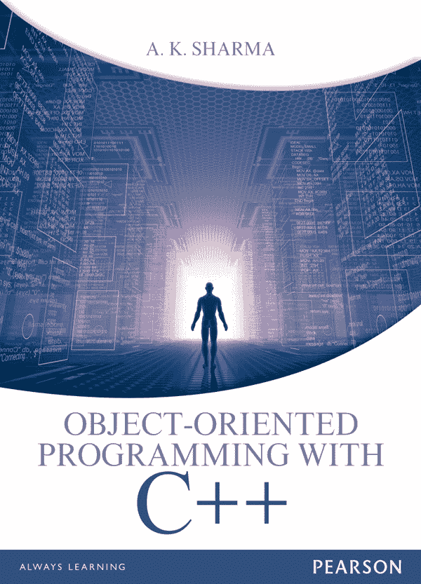


献给我周围所有的对象。

**封装**：将数据和实现作为一个单元隐藏在类内部的活动被称为封装。它在接口和实现之间创建了分离，从而减少了系统组件之间的依赖。

## 4.3.2 成员函数的定义

成员函数可以在类声明内部定义，也可以在外部定义。如果一个成员函数非常小，则可以在类内部定义。此类函数定义默认被认为是内联的（inline）。关于内联函数的讨论将在本书后面给出。让我们考虑以下类声明：

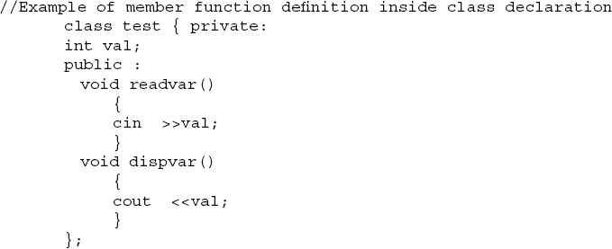

在本类中，定义了两个公共函数 `readvar()` 和 `dispvar()`。需要注意的是，函数的实际代码是写在类定义内部的。相反，如果一个成员函数很大，则应该在类声明之外进行定义。然而，这些函数的原型必须在类定义中提供。例如，上述定义的类可以重写如下所示：

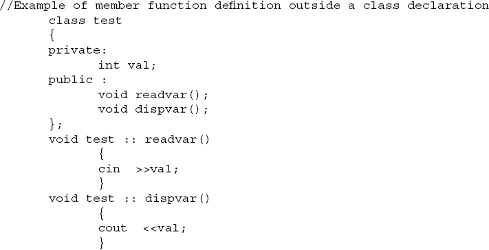

运算符 `::` 被称为**作用域解析**运算符。它用于将成员函数与其对应的类关联起来。例如，在上面的函数声明中，它告诉编译器函数 `readvar()` 和 `dispvar()` 属于名为 `test` 的类。成员函数声明的格式如下：

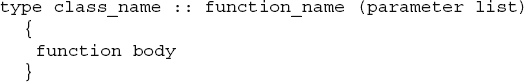

其中 `type` 是要返回的值的数据类型；

`class_name` 是函数所属的类名；

`function_name` 是正在声明的函数名；

`parameter list` 是形式参数列表。

从上述讨论可以清楚看出，类将数据和函数组合成单一的编程单元。

### 示例 1：定义一个名为 `student` 的类，模拟学生的以下状态和行为

**状态**

- 姓名（Name）
- 学号（Roll）
- 分数（Marks）
- 等级（Grade）

**行为**

- `Read_data()`
- `Display_grade()`
- `Compute_grade()`

**按照以下规则计算等级：**

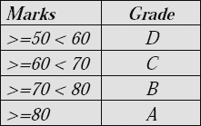

**解决方案**：我们将状态建模为变量并放置在私有部分以实现数据隐藏。行为 `read_data()` 和 `display_grade()` 将建模为函数并放置在公共部分，因为用户需要这些函数来与学生对象进行交互。由于 `compute_grade()` 是一个**实现函数**，从实现隐藏的角度来看，它将被放置在私有部分。所需的类所示：

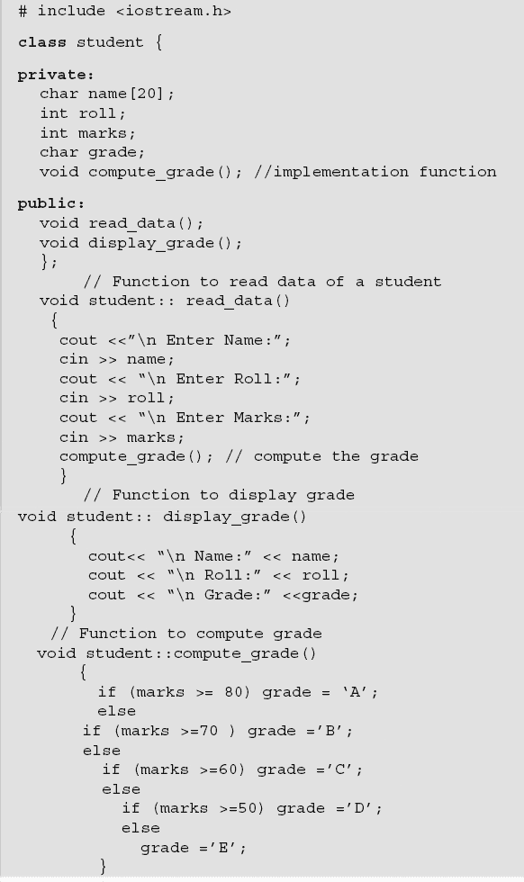

## 4.4 创建对象

对象是类的实例，可以根据其类类型创建。定义对象的语法如下：

```cpp
<class_name>      <object_name>;
```

其中 `<class_name>` 是类名，`<object_name>` 是正在定义的对象名。

例如，我们可以通过以下声明创建类 `student` 的对象 `studObj`：

```cpp
student      studObj;
```

上述声明表示 `studObj` 是类 `student` 的对象。

在某些情况下，特别是在对象排序时，需要将一个对象复制到另一个对象。C++ 允许同类型对象进行赋值。它按位将源对象复制到目标对象中。该概念通过下面的语句说明：

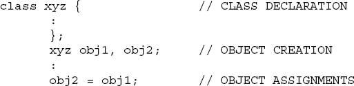

### 4.4.1 调用成员函数

一旦创建了对象，就可以通过点运算符在程序中调用其成员函数（公共），即用点将对象名与函数名连接起来。例如，如果我们想要调用对象 `studOb` 的 `read_data()` 函数，可以使用以下语句：

```cpp
studOb.read_data();
```

上述语句表示正在调用或执行对象 `studOb` 的函数 `read_data()`。

### 示例 2：使用示例 1 中定义的 `student` 类，编写一个菜单驱动的程序，测试 `student` 类的以下功能

1. 读取学生数据。
2. 显示学生的等级。

**解决方案**：我们将使用 `do–while` 循环来显示菜单以向用户请求选择。所需的程序所示：

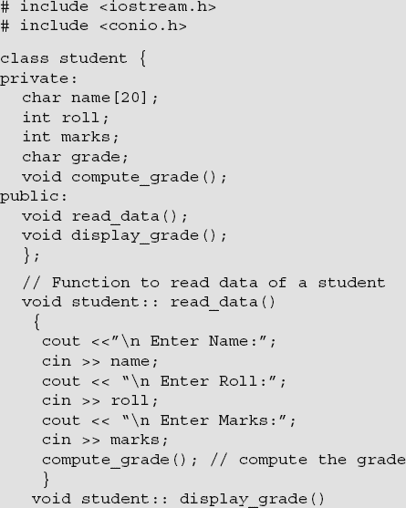

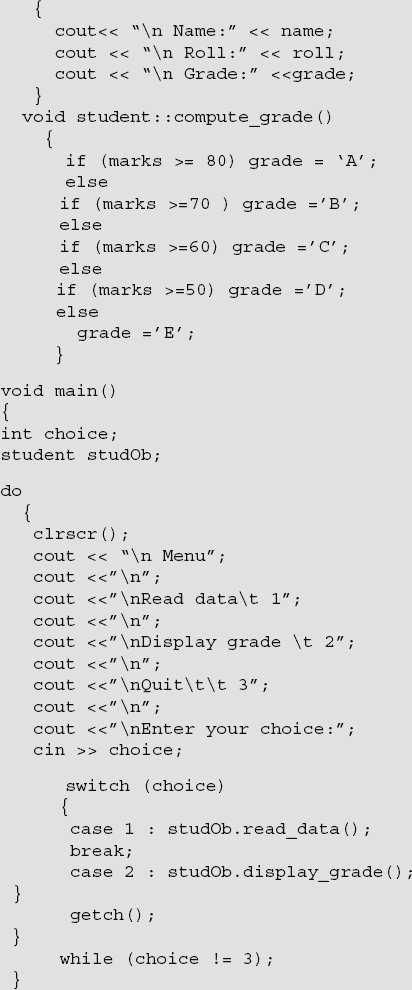

### 示例 3：定义一个名为 `employee` 的类，具有以下规范

**状态**

- 姓名（name）
- BP：基本工资（basic pay）
- DA：津贴（dearness allowance）
- HRA：房租补贴（house rent allowance）
- 工资（salary）

**行为**

- `computeSal()`：计算工资
- `readData()`：接受数据值
- `dispSal()`：在屏幕上打印数据

**工资按以下公式计算：**

- `Salary = BP + DA + HRA`
- 其中 DA 和 HRA 分别是 BP 的 65% 和 20%。

编写一个程序读取员工姓名和 BP 并打印工资。

**解决方案**：我们将状态建模为变量并放置在私有部分以实现数据隐藏。行为 `readData()` 和 `dispSal()` 将建模为函数并放置在公共部分，因为用户需要这些函数与员工对象进行交互。由于 `computeSal()` 是一个实现函数，从实现隐藏的角度来看，它将被放置在私有部分。

带有完整程序的类所示：

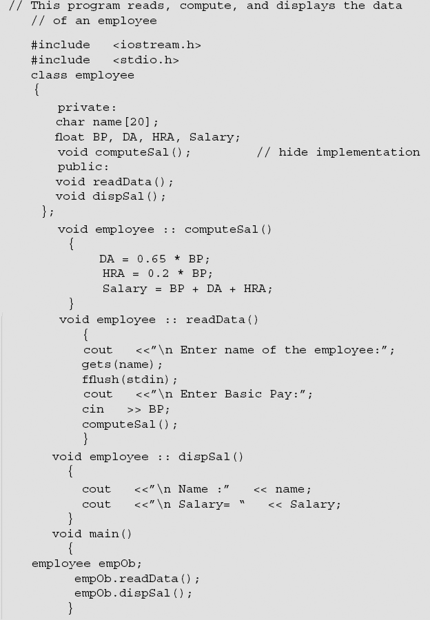

## 4.5 对象数组

C++ 允许像声明其他类型一样声明对象数组。可以通过下标访问数组中的单个对象。

### 示例 4：使用示例 1 中的 `student` 类，编写一个程序读取数组中的 `N` 个学生并打印

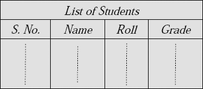

**解决方案**：使用 `student` 类型数组进行读取和打印所需的程序所示：

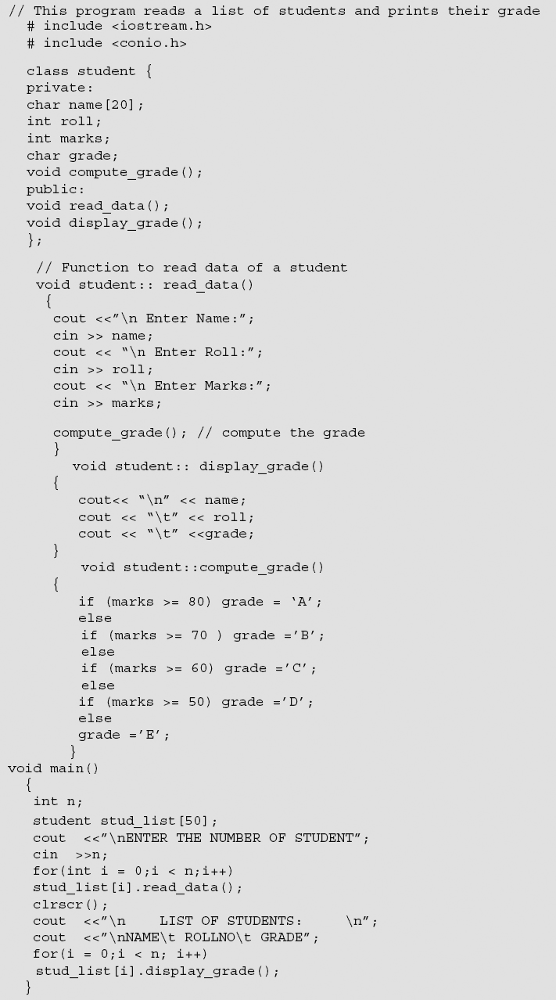

## 4.6 作为函数参数的对象

C++ 将对象视为内置数据类型，因此对象可以作为参数传递给函数。对象可以通过两种方式之一传递。然而，每种方法都有优缺点：

1. 值传递
2. 引用传递

### 1. 值传递

在参数传递的值传递方法中，对象按值传递给函数。调用函数接收的是对象的副本，而不是对象本身。调用函数只能使用对象的服务，因为只有对象的公共成员是可以访问的。例如，考虑以下函数 `test()`，它通过**值传递**接收学生类型的对象并读取其数据并显示等级。

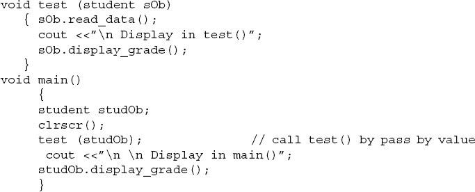

程序的输出所示：

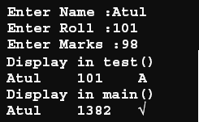

可以注意到 `main` 函数也尝试显示等级，但显示的是垃圾值。原因是 `main()` 中创建的对象 `studOb` 与 `test()` 中创建的对象 `sOb` 不同，如图 4.9 中的 `studOb` 所示。


**图 4.9** 通过“值传递”方法传递的对象。

### 2. 引用传递

在某些情况下，希望调用函数中对对象进行的更改能反映回调用函数中。这可以通过 C++ 参数传递的引用传递方法来解决。在这种方法中，对象的地址作为参数传递给函数。通过在对象名称前加上字符 `&` 来表示对象的地址。

例如，考虑以下修改后的函数 `test()`，它通过**引用传递**接收学生类型的对象并读取其数据并显示等级。

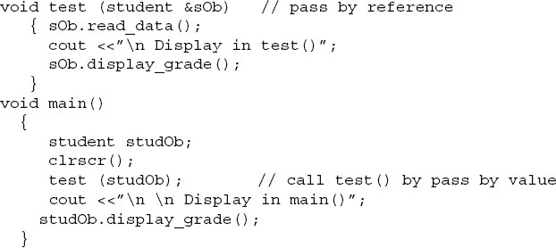

需要注意的是，`main` 函数也可以显示成绩。这是因为在引用传递中，只传递了对象的地址，导致 `test()` 和 `main()` 分别通过 `sOb` 和 `studOb` 指向同一个对象，如图 4.10 所示。

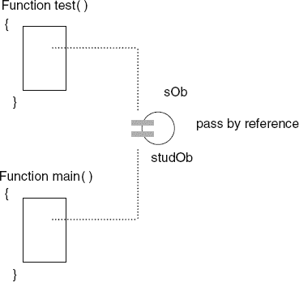

**图 4.10** 引用传递：`sOb` 和 `studOb` 指向同一个对象。

如果函数被声明为返回相应的类对象，那么它就可以返回一个对象。例如，一个返回（假设为）`student` 类型对象的函数 `some()` 可以如下所示定义：

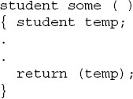

## 4.7 作用域解析运算符

通过本章早前的讨论，我们知道，当类的成员函数很大时，会在类内部进行声明，并在作用域解析运算符的帮助下在类外部定义。作用域解析运算符是双冒号（`::`），用于将函数的定义与其类连接起来。该运算符的通用用法如下：

```cpp
<return type>   <class_name>   ::   <function_name>(parameter list)
```

除了上述用法，我们还可以使用作用域解析运算符访问类定义内部隐藏的全局变量。考虑下面提供的程序段：

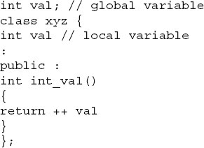

我们可以观察到，在类外部定义的变量 `val` 是全局变量，而在类内部单独声明的变量 `val` 是局部变量。现在，在通常情况下我们无法在类内部访问此类全局变量，因为编译器会将对变量 `val` 的任何引用视为局部变量。因此，由于存在同名的局部变量，全局变量 `val` 在类内部被隐藏了。

我们可以对隐藏的全局变量使用作用域解析运算符（`::`），使其在类内部可访问，如下所示：

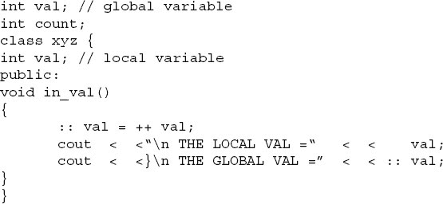


**注意**：在类和对象的范围内，作用域解析运算符与点运算符之间的主要区别在于：“点运算符用于指定对象的成员，而作用域解析运算符用于在定义类的成员函数时指定类名”。作用域解析运算符还用于使隐藏的全局变量在类或块内部可见。

### 示例 5：给出以下程序的输出

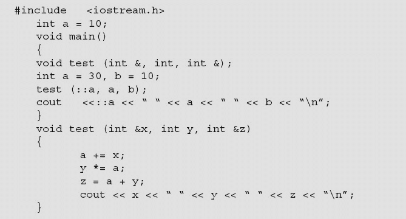

**解**：输出将是：

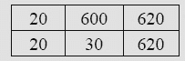

### 示例 6：编写一个类 `matAdd`，能够加上两个同类型的矩阵对象 `matOb1` 和 `matOb2`，再写一个 `main()` 函数来测试该类的功能

**解**：让我们如类图所示，在所需的类 `addMat` 中包含成员：

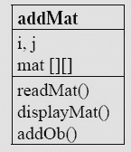

其中 `readMat()` 读取矩阵；`displayMat()` 显示矩阵；`addOb()` 将两个 `addMat` 类对象相加。


**注意**：函数 `addOb()` 已作为类函数之一包含在内。如果没有这个函数，将无法加上两个矩阵对象，因为数据成员已被声明为私有，因此在类外部无法访问。这留给读者练习，将 `addOb()` 声明为独立函数（不是类的一部分）并尝试加上矩阵对象。

所需的程序所示：

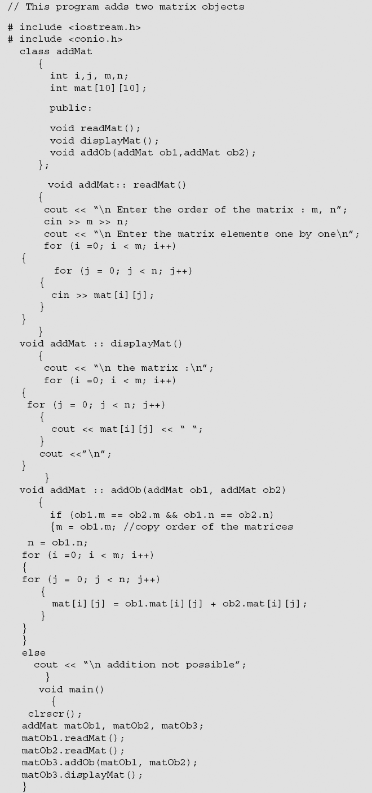

程序的示例输出所示：

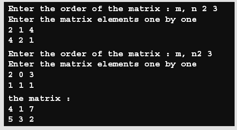

### 示例 7：一个名为 `clock24` 的类具有以下成员

**状态**

- `hour`
- `minute`

**行为**

- `readtime()`
- `showtime()`

用 C++ 编写一个完整的程序，输入两个不同类型的 `clock24` 对象 `timeOb1` 和 `timeOb2`。打印它们的和（假设为 24 小时制）。

**解**：所需的程序所示：

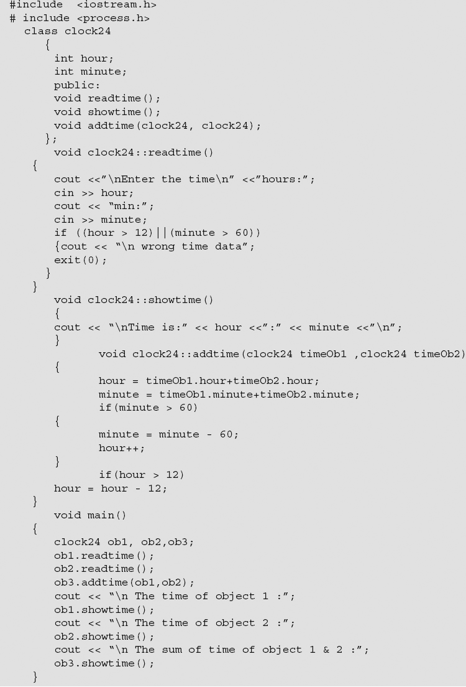

程序的示例输出所示：

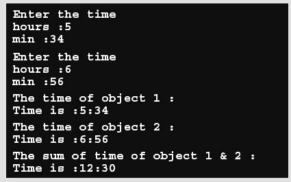

### 示例 8：计算类 `matAdd` 对象的大小

**解**：成员级大小和总大小如下：

1. `i`、`j`、`m`、`n` = 4 × 2 字节（每个）= 8 字节。
2. `mat[10][10]` = 100 × 2 字节 = 200 字节。

总大小 = 208 字节。**答。**

## 4.8 静态数据成员

当创建类的不同实例时，每个实例化对象都会获得自己的一套状态，即变量。

1. **对象是有生命的**，因为对象的产生需要获取像内存这样的资源。它有自己的生命周期。
2. **对象是活跃的**，因为对象通过其接口提供服务。
3. **对象是智能的**，因为每个对象都拥有编码的逻辑，用于提供服务或解决眼下的问题。

## 4.10 总结

任何可感知的实体都是对象。每个对象都可以被识别为属于某个类（class）。将数据和函数结合成一个单一单元的活动被称为封装（encapsulation）。数据和函数在基础层面上通过封装的形式相关联。它实现了数据、信息和实现的隐藏。抽象（abstraction）将本质部分与实现细节分离开来。定义在成员函数中的 `static variable` 是该类所有实例的共有变量。

## 单选题


1. 我们周围的世界由以下什么组成：

   1. 函数
   2. 模块
   3. 数据
   4. 对象

2. 我们可以通过什么感知对象：

   1. 想象
   2. 感官
   3. 直觉
   4. 情感

3. 下列哪项不是通用对象的特征？

   1. 身份
   2. 结构
   3. 状态
   4. 行为

4. 类定义了一组对象的共同 ____ 和 ____。

   1. 身份、状态
   2. 身份、行为
   3. 状态、行为
   4. 数据、数据结构

5. 实现隐藏是通过：

   1. 封装
   2. 抽象
   3. 静态函数
   4. 作用域解析运算符

6. 接口由以下内容组成：

   1. 私有成员
   2. 公有成员
   3. 独立函数
   4. 以上都不是

7. 私有成员可以通过以下方式访问：

   1. 独立函数
   2. 对象的接口
   3. 仅通过类的私有成员
   4. 通过类的所有成员

8. 全局变量可以在类内通过以下方式访问：

   1. 加上作用域解析运算符前缀
   2. 将其声明为静态

9. 全局变量可以在类内通过以下方式访问：

   1. 加上作用域解析运算符前缀
   2. 将其声明为静态

10. 对象的 ____ 默认是：

    1. 公有
    2. 静态
    3. 私有
    4. 全局

11. 类的 ____ 是：

    1. 拷贝
    2. 属性
    3. 属性
    4. 实例

### 答案

1. d
2. b
3. b
4. c
5. a
6. b
7. d
8. a
9. c
10. d

## 练习题


1. 描述面向对象编程的基本概念。
2. 在 C++ 中什么是类？
3. 说明结构和类之间的区别。
4. 什么是对象的关系？
5. 类是如何实现数据隐藏的？
6. 定义抽象和封装术语。
7. 说明 C++ 中类的声明规则。
8. 解释访问修饰符的作用。
9. 为什么将成员变量声明为私有？
10. 简述类的定义。
11. 编写一个名为 `length`、`width` 和 `height` 为成员的 `box` 类，并带有 `read()`、`disp()` 和 `compute()` 函数。
12. 编写一个名为 `bankACNT` 的类，它具有以下成员：

    **状态**

    - 姓名
    - 日期
    - 账号
    - 类型

    **行为**

    - `init()`：初始化
    - `deposit()`：存款
    - `withdraw()`：提款
    - `check()`：检查
    - `disp()`：显示

13. 编写一个代表 `book` 的类，它具有以下成员：

    **状态**

    - 标题
    - 作者
    - 账号
    - 代码
    - 发布

    **行为**

    - `read()`
    - `compute()`
    - `disp()`

14. 编写一个关于 `fine` 的程序。
15. 编写一个具有以下成员的 `employee` 类：

    **状态**

    - 姓名
    - 年龄
    - ID
    - 性别
    - 地址
    - 街道
    - 状态

    **行为**

    - `readData()`
    - `dispData()`

16. 编写一个 C++ 程序，输入今天的日期并输入明天的日期。
17. 区分实例和类。
18. 编写一个 C++ 程序，统计对象的数量。
19. 类的通用属性有哪些？

# 5 关于函数的更多：高级概念

## 5.1 多态

“会议结束，”秘书宣布道。这个信息被不同的人以不同的方式理解。这种行为在意义上被称为多态。

# 6 构造函数与析构函数

## 6.1 构造函数

我们知道类比它代表的对象更重要，因为一旦定义了类，就可以在运行时产生任意的对象。我们也知道类是编译器用于构造对象的一组规范。

事实上，为了创建对象，编译器会创建一个与类同名的函数，如图 6.1 所示。可以注意到类的名称是 `myClass`，编译器创建的函数名称也是 `myClass`。这个函数被称为构造函数。正如名称所示，构造函数会在需要时创建相应的对象。

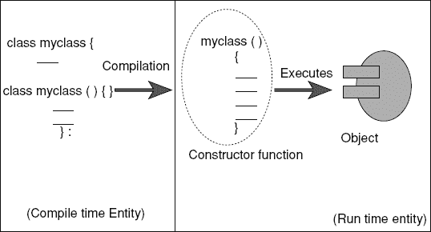

**图 6.1** 构造函数及其操作。

因此，当执行以下对象创建语句时，构造函数 `myClass()` 将创建一个 `myClass` 类型的对象 `myOb`：

```cpp
myClass myOb;
```

可以进一步注意到，类是编译时实体，而对象是运行时实体。因此，由对象获取内存和资源，而不是类。


由于构造函数是对象构造之前第一个被调用的函数，程序员可以像接下来的节所讨论的那样，将构造函数用于各种目的。

## 6.2 构造函数的类型

在 C++ 中，有四种类型的构造函数：

1. 默认构造函数。
2. 用户定义的构造函数。
3. 参数化构造函数。
4. 拷贝构造函数。

### 6.2.1 默认构造函数和用户定义的构造函数

考虑图 6.1。还可以进一步注意到，编译器已经在类定义中自动包含了以下语句：

```cpp
myClass() { }
```

这被称为`默认构造函数`。它可以被精确地定义为`由编译器定义并调用的构造函数。它不进行任何处理，但为对象预留内存。它不接受任何参数。`

因此，一个体为空的默认构造函数并没有做任何有意义的事情，但它是合法的。在创建对象时，它会被执行并为对象分配内存。

然而，在类似下面的情况下，程序员也可以显式地定义一个`用户定义的构造函数`以达到自己的目的。

许多编程场景要求在程序中使用对象之前对其数据成员进行初始化。例如，在栈（stack）对象中，栈顶（top）必须初始化为 –1，以表示栈最初是空的。让我们在下面的名为`stack`的类中将栈顶初始化为 –1，看看会发生什么。

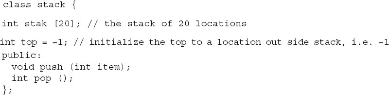

当类被编译时，编译器会对以下语句给出错误，因为我们非常清楚，该类是一个编译时实体，不会获得内存，因此无法在类内部初始化任何变量。

```cpp
int top = -1;
```

事实上，在几乎每个有用的程序中，某些数据元素在使用之前都需要进行初始化。在这些情况下，我们可以通过将初始化语句放在构造函数体内部来使用默认构造函数，如下：

```cpp
stack () {int top = -1;}
```

现在，上述安排是有效的，并且在创建对象时，它的工作原理如下：

1. 将调用构造函数`stack()`。
2. 构造函数将为类的各种元素提供内存，即名为`stak[]`的数组和`top`。
3. 在为变量`top`提供空间时，它将所需的值 –1 加载到其中。

修改后的类`stack`如下：

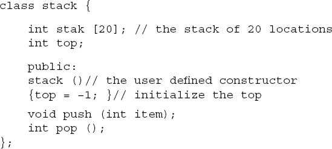

**示例 1**：*编写一个程序，使用名为`stack`的类演示构造函数的工作，模拟其对整数值的操作：推送（push）和弹出（pop）。修改`push`和`pop`函数，以便在调用函数`main()`中显示以下消息。*

“栈满”，“栈空”

*解法*：我们将修改`push()`和`pop()`函数，根据它们旁边的注释返回以下值，相应的消息将在函数`main()`中显示。

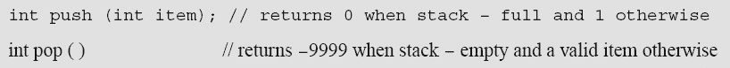

完整的菜单驱动程序如下：

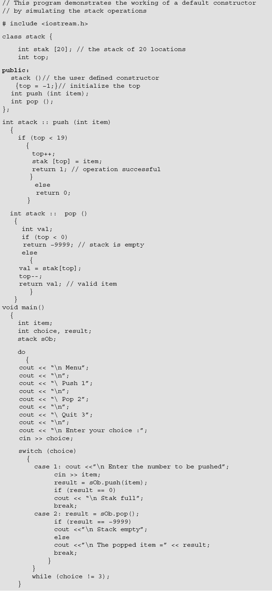

可以注意到，栈类在栈的大小上是不灵活的，也就是说，它总是会创建一个包含 20 个位置的栈。这个问题可以通过参数化构造函数来解决。

### 6.2.2 参数化构造函数

我们还可以在构造函数定义中包含参数。*带有参数的构造函数称为参数化构造函数*。这在程序员想在创建对象时提供显式初始值的情况下是有帮助的。

考虑在上节中定义的`stack`类。如上所述，它总是会创建一个包含 20 个位置的栈。如果用户希望创建一个特定大小的栈，他可以在创建对象时通过将大小（例如`Sz`）作为参数传递过去来实现。参数化栈构造函数如下所示：

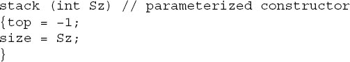

修改后的类如下：

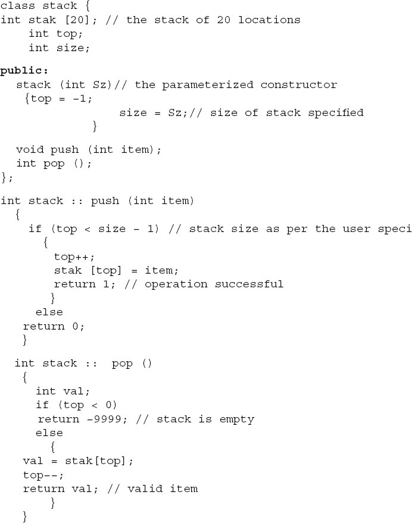

程序员现在可以通过以下语句创建栈对象：

```cpp
stack sOb ( Sz);
```

其中`Sz`是用户指定的栈的大小。

**示例 2**：*设计一个名为`Queue`的类，模拟 N 个位置的队列数据结构，其中 N 是用户定义的。该类必须通过构造函数将`Front`和`Rear`位置指示器初始化为适当的值。元素分别从`Rear`和`Front`指向的位置添加和移除。*

*解法*：我们将使用参数化构造函数，为拟议的`Queue`类接受用户指定的位置数量（例如`N`），并把`Front`和`Rear`初始化为位置 0，以标记队列为空。

所需的类如下所示：

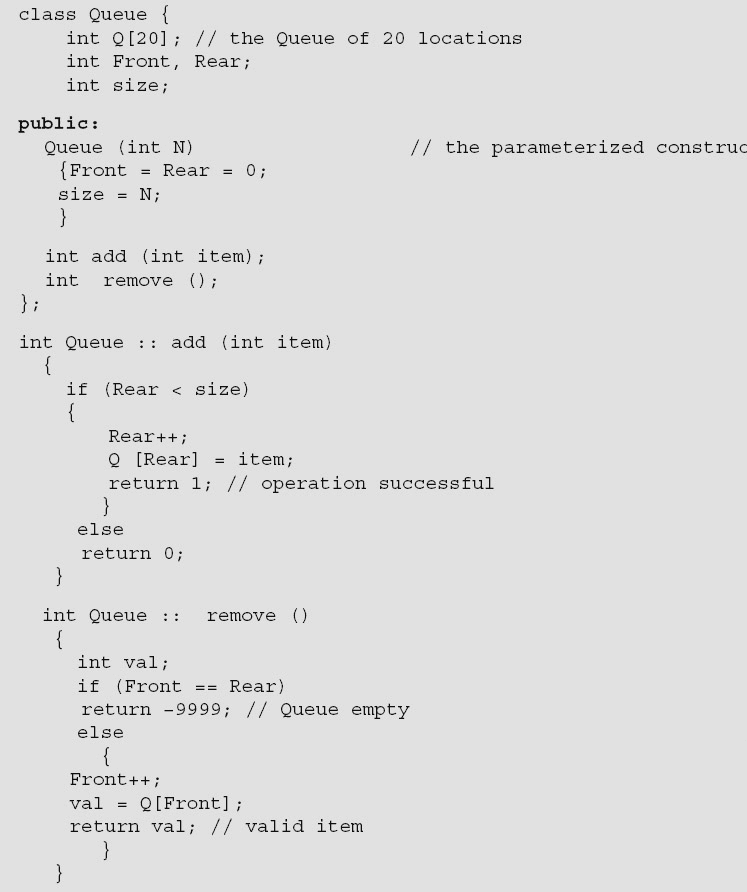

**示例 3**：*编写一个程序测试给定队列大小的`Queue`类。*

*解法*：所需的程序如下：

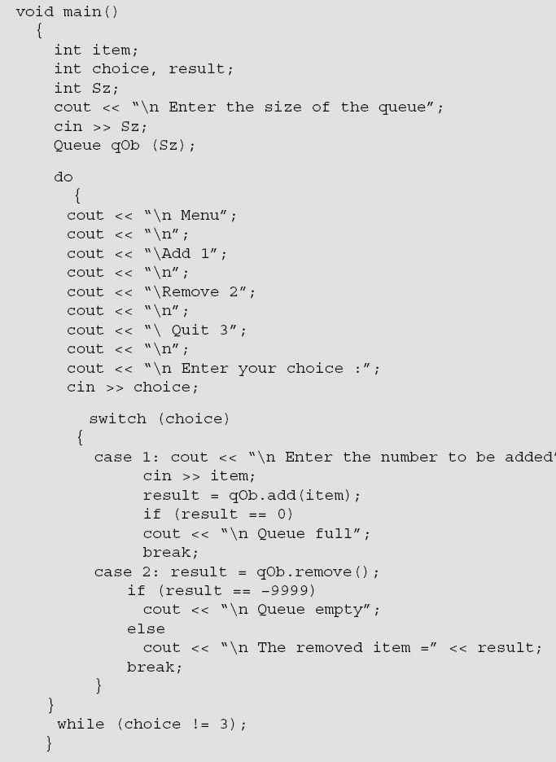

在上述程序中可以注意到，在创建对象时通过以下语句为构造函数提供了参数：

```cpp
Queue qOb (Sz);
```

构造函数的传递格式为`<类名> <对象名> (参数列表);`

这种传递给构造函数的方法被称为`隐式调用`。然而，还有另一种提供构造函数参数的方法如下所示：

```cpp
Queue qOb = Queue (Sz);
```

这种方法被称为`显式调用`。由于隐式调用提供参数的方法更短，大多数程序员经常使用这种方法。

### 6.2.3 拷贝构造函数

对象可以通过赋值语句拷贝到另一个对象。考虑下面的名为`test`的简单类：

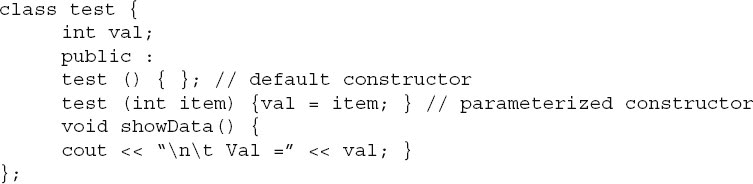

请注意`test`类有两个构造函数：默认构造函数和参数化构造函数，即构造函数被重载了。让我们这样构造`test`类的两个对象`Ob1`和`Ob2`：`Ob1`由默认构造函数构造，`Ob2`由参数化构造函数构造并初始化为 50。下面的`main()`函数执行此任务并打印两个对象的`val`内容。随后，它通过赋值语句将`Ob2`的内容拷贝到`Ob1`。

```cpp
// (main 函数未提供但被引用)
```

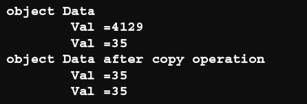

正如预期的，未初始对象`Ob1`的`val`内容是随机垃圾值，而对象`Ob2`的`val`已被正确初始化为 50。值得注意的一点是，将`Ob2`赋值给`Ob1`之后，两个对象的`val`内容相同。

事实上，以下语句逐位将对象`Ob2`拷贝到`Ob1`。

```cpp
Ob1 = Ob2;
```

上述将同类类对象拷贝到另一个对象的方法是完全可以。然而，这种方法在某些情况下会失败。例如，考虑一个对象（例如`Obptr2`）有一个指针（`p`），指向包含某些信息（例如“我的数据”）的位置。当通过赋值运算符将此对象拷贝到另一个对象（例如`Obptr1`）时，两个对象的指针将指向同一个位置，如图 6.2 所示。原因是赋值运算符逐位将一个对象的内容拷贝到另一个对象，因此两个指针都获得了相同的地址。

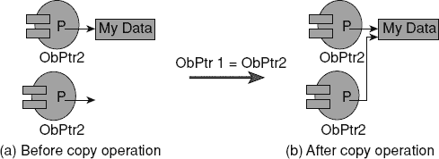

**图 6.2** 通过赋值运算符进行的对象拷贝操作

现在，这种异常情况会导致许多类型的问题，例如两个对象作用于同一个位置，一个对象对公共位置的更改可能无法被另一个对象所接受等等。

因此，对于带有指针的对象的拷贝，我们需要一种机制允许对对象进行成员逐级拷贝，以便为目标对象的指针分配独立的空间。

C++ 提供了一种名为`copy constructor`（拷贝构造函数）的特殊构造，允许程序员将一个对象逐级拷贝到另一个对象。然而，程序员必须编写代码，将源对象的各种成员逐级拷贝到目标对象的相应成员中。但是，拷贝构造函数在类中定义为一个带参数的构造函数，接收一个同类型的对象作为通过引用传递的参数。考虑下面的类：

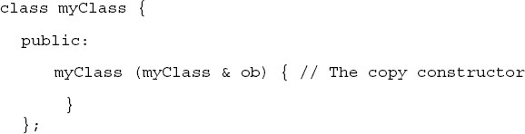

可以注意到，上述类`myClass`有一个特殊的参数化构造函数，它通过引用接收一个同类类型的对象。现在，如果我们有一个`myClass`类型的`obj1`，并且想要创建一个`myClass`类型的新对象`obj2`，并用`obj1`的内容进行初始化，那么可以使用以下声明：

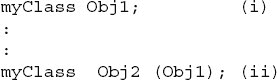

声明 (i) 声明了一个`myClass`类型的对象`obj1`，而 (ii) 则声明了另一个`myClass`类型的对象`obj2`并根据程序员的意愿将对象`Obj1`传递给拷贝构造函数进行成员级拷贝。

### 示例 4

修改上面定义的类`test`，使其有一个拷贝构造函数，可以将一个`test`类型的对象拷贝到另一个`test`类型的对象，但在拷贝源对象的成员`val`时，将其乘以一个数字（假设 5），然后存储到目标对象的成员`val`中。

*Solution*：所需的修改后的`test`类所示：

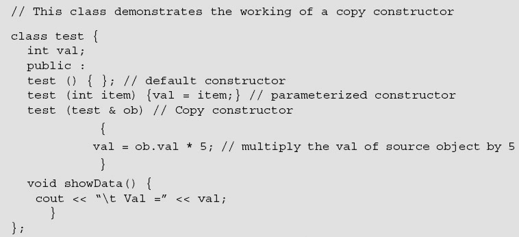

### 示例 5

编写一个函数`main()`，创建一个带有初始值（假设 15）的`test`类型对象`Ob1`，然后通过拷贝构造函数将其拷贝到`test`类型对象`Ob2`中。随后，打印两个对象的内容。

*Solution*：所需的函数`main()`所示：

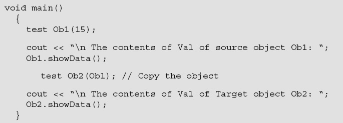

上述内容的输出所示：


可以注意到，拷贝构造函数不仅拷贝了对象，而且按照要求，在将源对象成员`val`的内容（即 15）拷贝到目标代码的相应成员之前，还将其乘以了 5。进一步可以注意到，这通过使用默认拷贝构造函数的普通赋值操作是不可能实现的。

现在让我们来看一个名为`studData`的类示例，它使用指针来存储在大学学习的学生的个人数据。

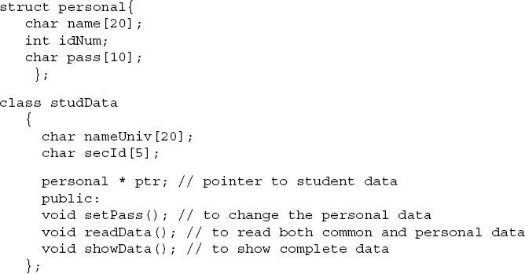

可以注意到，上述类了两类信息：所有学生共有的数据（如大学名称和系别名称），对于每个学生，都有一个可以通过指针访问的个人数据。

现在让我们写一个完整的程序，创建一个`studData`类型的对象`ob1`，读取其数据，将对象拷贝到另一个对象`Ob2`并打印两个对象的数据。随后，修改`Ob2`的个人数据并打印两个对象的数据。

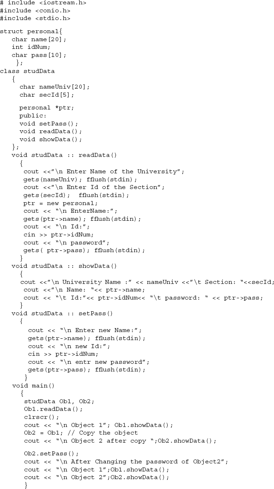

示例输出所示：

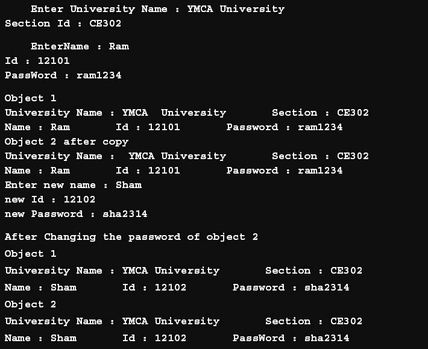

可以注意到，正如预期的，在执行以下拷贝操作后，两个对象包含相同的数据。

```cpp
Ob2 = Ob1; //拷贝对象
```

然而，奇怪的地方在于，即使在给对象`Ob2`提供新的个人数据后，两个对象仍然显示相同的数据。唯一的区别是现在个人数据属于名为“Sham”的学生，而在更改之前，两个对象都是名为“Ram”的个人数据。然而，意图是将`Ob1`分配给 Ram，将`Ob2`分配给 Sham。异常发生是因为两个对象的指针（`ptr`）都指向同一个位置，正如之前所示的图 6.2。

上述问题的解决方案是使用拷贝构造函数根据我们的要求对对象进行成员级拷贝。修改后的`studData`类所示：

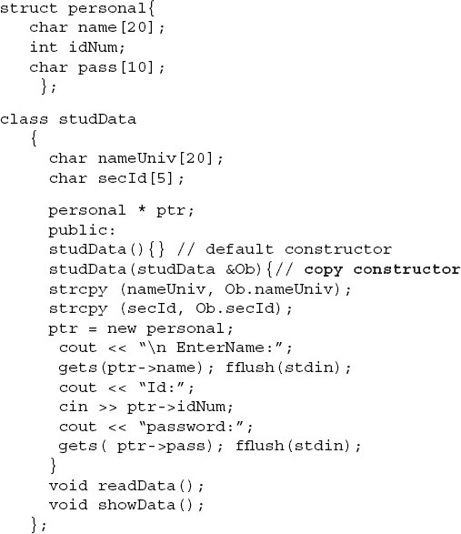

可以注意到，我们不仅包含了拷贝构造函数，还删除了`setPass()`函数，因为它已经变得不再。现在让我们写一个`main()`函数来测试它。我们不会重复`readData()`和`showData()`的代码，因为它们保持不变。所需的`main()`函数所示：

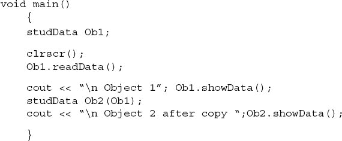

示例输出所示：

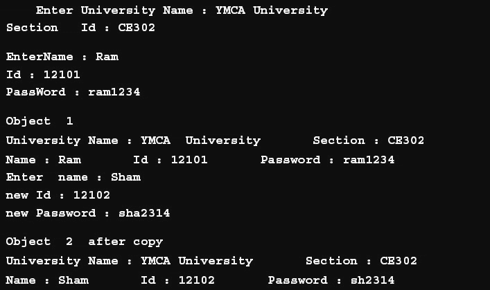

请注意，拷贝构造函数完成了所需的任务，即两个对象的指针（`ptr`）指向不同的位置（参见图 6.2）。

**图 6.3** 通过赋值运算符进行的拷贝


### 6.2.4 带默认参数的构造函数

类似于普通函数，构造函数也可以有默认值。例如，我们可以如下重写该类：

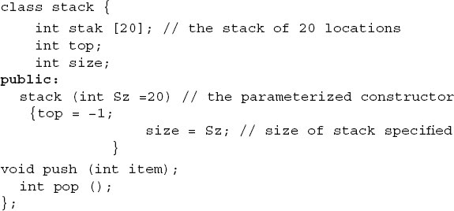

**注意**：在上述构造中指定了默认参数`Sz = 20`。现在，可以在不指定参数的情况下创建类对象。默认参数必须放在最后。

### 6.2.5 构造函数的定义规则

构造函数的定义及其规则如下：

1. 构造函数的名称与类相同。
2. 构造函数可以有参数列表。
3. 构造函数可以重载。
4. 无参数的构造函数是默认构造函数。
5. 如果类中没有构造函数，编译器将生成一个默认构造函数。
6. 构造函数会自动执行。
7. 构造函数的常用缩写是`ctor`。

## 6.3 析构函数

析构函数是构造函数的反面，因为它移除在创建对象期间分配的对象内存。它与类名相同，但以波浪号（`~`）为前缀所示：

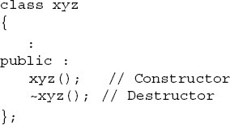

析构函数的定义和用法规则为：

1. 析构函数与类名相同，但带有波浪号字符`~`。
2. 析构函数不能有参数。
3. 它没有返回类型，甚至没有`void`类型。
4. 析构函数不能重载，即一个类中只能有一个析构函数。
5. 如果类中没有析构函数，编译器将生成一个默认析构函数。
6. 析构函数在控制到达类作用域结束时自动执行。
7. 析构函数的常用缩写是`dtor`。

现在最重要的问题是，析构函数对程序员来说有什么用？由于析构函数是最后一个执行的函数，程序员无法利用该函数产生任何有成效的用途。然而，如果我们非要找到它的用途，那么它最好的用途就是用于调试。事实上，可以在析构函数中包含一些适当的消息，以通知相关对象正在被销毁。如果对象没有显示该消息，程序员可能推断出该对象正运行异常，且程序控制在对象内部的某处阻塞了。

### 示例 6

写一个名为`testDest`的类，用来说析构函数的工作。当对象被销毁时，它会显示以下消息。

“我正在被销毁”

编写一个尽可能小的`main()`函数来测试析构函数的工作。

*解决方案*：下面给出了带有析构函数的类以及最小的`main()`函数：


上述程序的输出如下所示：


需要注意的是，构造函数和析构函数会在对象创建或销毁时由系统自动调用。

## 6.4 总结

构造函数是一个创建对象的函数。它是一个特殊的函数，不返回任何值，甚至不返回`void`。它帮助程序员在对象创建时自动初始化对象的某些数据成员。构造函数的名称与类名相同。拷贝构造函数通过另一个同类型对象的值来初始化一个对象。析构函数销毁对象。它释放对象所持有的内存。它是最后一个被调用的成员函数。它的名称与类名相同，但前面加有一个波浪号（`~`）。析构函数可以用于调试目的。

### 单选题

1. 构造函数返回：
   1. 一个整数
   2. 一个浮点数
   3. 无值
   4. `void`

2. 构造函数在对象何时自动初始化其数据成员：
   1. 声明
   2. 创建
   3. 销毁
   4. 编译

3. 构造函数的名称是：
   1. 与类名相同
   2. 与程序名相同
   3. 用户定义的名称
   4. 以上都不是

4. 构造函数是该类的友元吗？
   1. 是
   2. 否

5. 如果对象按值传递给拷贝构造函数会发生什么？
   1. 对象的大小增大
   2. 对象的大小减小
   3. 系统可能内存不足
   4. 编译器内存耗尽

6. 无参数的构造函数被称为：
   1. 拷贝构造函数
   2. 默认构造函数
   3. 参数构造函数
   4. 以上都不是

7. 当对象由指针变量组成时，它必须通过拷贝：
   1. 赋值运算符
   2. 用户定义的函数
   3. 拷贝构造函数

8. 构造函数的常用缩写是：
   1. `conc`
   2. `tor`
   3. `cons`
   4. `cctor`

9. 析构函数的常用缩写是：
   1. `dtor`
   2. `tor`
   3. `dest`
   4. `~des`

10. 如果类没有定义构造函数会发生什么？
    1. 对象不被创建
    2. 程序终止
    3. 对象被创建
    4. 以上都不是

### 答案

1. c
2. b
3. a
4. b
5. c
6. b
7. c
8. d
9. a
10. c

### 练习题

1. 什么是构造函数？解释它的用途。
2. 定义术语：默认构造函数和参数构造函数。
3. 修改第 4 章中的示例 1，使得该类包含一个构造函数。
4. 为第 4 章中的示例 4 设计一个带有默认值的构造函数。
5. 为第 4 章中的示例 9 设计一个合适的构造函数。
6. 详细解释拷贝构造函数。
7. 定义术语析构函数。
8. 描述析构函数的重要性。
9. 写一个说明析构函数工作的程序。
10. 给定的 C++ 代码，回答问题 (a) 和 (b)。

    

    1. 在面向对象编程中，`Function1`被称为什么？它何时被触发/调用？
    2. 在面向对象编程中，`Function2`被称为什么？它何时参与/调用？

11. 写一个 C++ 程序，创建一个名为`time`的类，数据成员为：`hour`、`minutes`。

其中`template`是一个关键字；“<”是标准的左尖括号或小于运算符的符号；`class`是一个关键字；`ugType`是用户定义的泛型类型；“>”是标准的右尖括号或大于运算符的符号。

用户定义的类型（`ugType`）变为泛型类型。现在让我们将第 8.1 节中的`exchange()`函数重写为泛型函数。


需要注意的是，我们使用名为`myType`的泛型类型来声明泛型函数`exchange`中的变量。这个泛型类型将在运行时由程序员发送的任何数据类型替换。因此，模板使用运行时多态性将数据与其类型绑定。

### 示例 1

编写一个使用泛型函数`exchange()`并对各种类型的数据进行测试的程序。

*Solution*：所需的程序所示：


程序的输出所示：


需要注意的是，泛型函数`exchange()`已经能够与各种类型的数据工作。

### 示例 2

编写一个名为`search()`的函数模板，用于从给定的*N*个元素的列表中搜索一个元素（泛型类型）。当找到元素时返回 1，否则返回 0。还要编写一个名为`readList()`的泛型函数，用于读取包含*N*个元素的列表。

*Solution*：我们将使用一个泛型类型*N*个位置的数组。然而，数组的大小*N*和索引`i`将声明为整数，因为这些变量是依赖于类型的。

所需的函数所示：


### 示例 3

编写一个菜单驱动的函数`main()`，用于测试在示例 2 中开发的泛型函数处理整数和浮点数值时的工作情况。

*Solution*：所需的函数`main()`所示：


示例输出所示：


## 8.3 泛型类

与函数类似，我们还可以以类模板的形式创建泛型类。类模板的格式所示：


其中`template`是一个关键字；“<”是标准的左尖括号或小于运算符的符号；`class`是一个关键字；`ugType`是用户定义的泛型类型；“>”是标准的右尖括号或大于运算符的符号。


**Note**：模板声明后紧跟类声明统称为*类模板*。

### 示例 4

编写一个名为`stack`的类模板，为泛型类型的数据提供以下服务：

1. 向栈中推入一个元素。
2. 从栈中弹出一个元素。

*Solution*：所需的类所示：


需要注意的是，当泛型类的成员函数在类外声明时，它必须单独作为模板进行定义。定义成员函数的格式所示：


**Note**：`<ugType>`必须写在一对尖括号（< 和 >）内。

例如，泛型类`stack`的`push()`函数声明如下所示：


**Note**：通过对所需的对象类型对语句进行限定（或类型转换），可以创建泛型类的对象。泛型类创建对象的格式所示：


其中`class name`是类的名称；“<”是标准的左尖括号或小于运算符的符号；`typeOb`是所需对象的数据类型；“>”是标准的右尖括号或大于运算符的符号；`object name`是要创建对象的名称。

例如，可以通过以下语句创建一个名为`chOb`的类型为`stack`且可处理 char 类型数据的对象：


请注意，对所需的对象进行类型转换时尖括号是必要的。类名与尖括号中的类型相结合（即`stack <char>`）被称为*模板类*。

### 示例 5

编写函数`main`，以测试将值 70 和 23.54 分别推入和从整数栈和浮点栈弹出。

*Solution*：所需的函数`main()`所示：


上述程序的输出所示：


需要注意的是，同一个类被用于实例化两个不同的对象，分别处理整数和浮点型类型的数据。因此，泛型类也称为**参数化类**。相同的泛型代码在不同对象之间共享。

## 8.4 多个参数的模板

模板可以有多个参数，如下所示：

`template <class Type1, class Type2>`

注意的是使用了两个类型`T`和`U`。考虑以下函数模板：

```cpp
template <class T, class U>
T max(T a, U b) {
    return (a > b) ? a : b;
}
```

### 示例 6

编写一个完整的程序，使用上面开发的泛型函数`test()`并对各种类型组合进行测试。

*Solution*：完整的程序所示：


程序的输出所示：


需要注意的是，泛型函数能够与各种类型的数据工作。

## 8.5 总结

泛型函数和类可以接受不同类型的参数。它允许共享代码，以减少工作、提高生产力并减小程序体积。程序的代码很容易地分为两部分：类型相关和类型无关。泛型类型在运行时由提供给泛型函数或类的类型替换。模板声明后紧跟类声明统称为类模板。类名与尖括号中的类型相结合被称为模板类。


单项选择题：

1. 泛型函数增加了：
   - a. 生产力
   - b. 程序长度
   - c. 打字工作

2. C++ 中的模板用于创建 _______ 函数：
   - a. 虚
   - b. 泛型
   - c. 递归
   - d. 友

3. 模板使用 _____ 多态性将数据与其类型绑定：
   - a. 编译时
   - b. 运行时

4. 泛型类被称为：
   - a. 基类
   - b. 派生类
   - c. 参数化类
   - d. 友类

5. 模板帮助我们在结构相似的族或函数族之间共享代码：
   - a. 不同
   - b. 优秀
   - c. 冲突
   - d. 相似

### 答案

1. a
2. b
3. b
4. c
5. d


练习：

1. 什么是泛型函数？
2. C++ 中如何实现“代码共享”？
3. 什么是模板？它是如何定义的？
4. 编写一个名为`areaSq()`的模板，用于计算并返回正方形的面积。它接受一个名为`side`的泛型参数。针对类型为`int`、`float`、`double`的给定边长进行函数测试。
5. 编写一个名为`sort()`的泛型函数，将给定的*N*个泛型类型数据项按升序排列。
6. 编写一个`main()`函数，通过菜单驱动的界面测试上述`sort()`函数。
7. 区分`class template`和`template class`之间的区别。
8. 编写一个名为`queue`的`class template`，为泛型类型数据提供以下服务：
   1. 在队列上添加一个元素。
   2. 从队列中删除一个元素。
9. 编写一个名为`searchTab()`的模板函数。它维护一个格式如下的符号表：

   | 符号 (Symbol) | 值 (Value) |
   | --- | --- |

   符号是字符类型的数组，而值可以是特定表中任何一种可用类型，例如`int`、`float`、`char`等。

10. 编写一个`main()`函数，针对类型为`int`的符号测试上述`searchTab()`函数。
11. 编写一个`main()`函数，针对类型为`float`的符号测试上述`searchTab()`函数。

## 9 运算符重载

### 9.1 引言

让我们考虑这种情况：我们有一个名为`length`的类，表示物品（例如布料）以英尺和英寸为单位的长度。其类图如图 9.1 所示。


**图 9.1** *名为“length”的类*

现在，如果我们想要两个该类型的对象，选项之一是使用友元函数（例如`add()`），如下所示：


以下`main()`函数测试了上述给定的类。


示例 ...

## 10 C++ 中的文件处理

### 10.1 文件概念

我们知道每个程序或子程序由两个主要部分组成：算法和数据结构。算法负责解决问题的规则和步骤，而数据结构包含数据。如图 10.1 所示。


**图 10.1** *程序或子程序的结构*

在面向对象编程（OOP）中，对象是核心。对象有两个组件：状态（states）和行为（behaviours）。状态和行为分别模拟数据和过程。如图 10.1 所示。数据结构本质上是易变的，因为一旦程序结束，其内容就会丢失。同样，对象在程序结束后也会丢失状态。如果我们想永久存储数据或创建持久化对象，就需要将其存储在名为文件的特殊数据结构中。文件可以存储在硬盘等存储媒介上。事实上，大量数据始终存储在文件中。

现在，存储在硬盘等永久存储上的任何内容都称为文件。例如，MBR（主引导记录）、FAT（文件分配表）、分区表、程序等都是文件的示例。

让我们考虑图 10.2 中记录的信息。


**图 10.2** *关于学生的信息*

图 10.2 所示表格中的每个条目都是三个数据项：学号（Roll number）、姓名和分数（Marks）。名为 Ajay 的学生学号和总分分别为 001 和 50。同样，名为 Ram 的学生学号为 002，总分为 70。该表格中的每个条目也称为学生的记录（record）。记录（*record*）可以定义为特定实体（如人、机器、地点或操作）的数据项集合。记录中的单个数据项称为字段（field）。当字段假设唯一值时，它被称为键字段（key-field）。如图 10.3 所示，学生记录中的“Roll”就是键字段。


**图 10.3** *记录的结构*

因此，学生的记录由以下三个字段组成：

1. 学号
2. 姓名
3. 分数

假设某个类有 30 个学生。现在，由 30 条记录组成的整个类信息被称为文件。记录的排列如图 10.4 所示。


**图 10.4** *文件：记录的集合*

文件（*file*）可以精确地定义为*记录的逻辑集合，每个记录由项目组成*。文件中的记录可以以下方式排列：

1. **升序/降序**：文件中的记录可以按照键字段的升序或降序排列。
2. **字母顺序**：如果键字段是字母类型，则按字母顺序排列。
3. **时间顺序**：在这种情况下，记录根据日期或事件存储。

当文件数据以可读可打印字符的形式存储时，该文件被称为文本文件。这是一种特殊的文件类型，它不包含记录，只包含字符。另一方面，如果文件包含二进制代码中的不可读字符，则该文件被称为二进制文件。例如，编辑器创建的文件以文本文件存储，而编译器生成的可执行文件以二进制文件存储。

在接下来的章节中将介绍 C++ 支持的文件。

### 10.2 文件与流

在 C++ 中，流是指从源（source）到汇（sink）的数据流。源和汇可以是任何一个输入/输出（I/O）设备或文件。对于输入和输出，有两种不同的流，分别称为输入流和输出流，如图 1.2 所示。我们在之前的程序已经使用了以下非格式 I/O 流：

| 流 | 描述 |
| --- | --- |
| `cin` | 标准输入流 |
| `cout` | 标准输出流 |
| `cerr` | 标准错误流 |

标准源和汇分别是键盘和显示器屏幕。每当程序中包含`<iostream.h>`头文件时，这些非格式流就会初始化。然而，我们需要使用运算符`<<`和`>>`来实现这些流。

文件 I/O 需要的重要流类是`ifstream`、`ofstream`和`fstream`。以下是对这些流的简要讨论：

#### `ifstream`

是输入文件流类。其成员函数`open()`将流与指定文件的输入模式关联。例如，如果想要输入模式打开名为“xyz.dat”的文件，可以使用以下语句。


上面的声明意味着创建一个名为`myfile`的输入流，并将其与名为“xyz.dat”的文件关联。除了`open()`之外，`ifstream`类从`istream`类继承了以下函数：

```text
(i) get()
(ii) getline()
(iii) read()
(iv) seekg()
(v) tellg()
```

#### `ofstream`

它是输出文件流类。其成员函数`open()`将流与输出模式下的指定文件关联。例如，如果想要打开一个名为“abc.bat”的文件进行输出，可以使用以下语句：


上面的声明意味着创建一个名为`yourfile`的输出流，并将其与名为“abc.dat”的文件关联。除了`open()`之外，`ofstream`还继承了`ostream`类的以下函数：

`put()`；`write()`；`seekp()`；`tellp()`

#### `fstream`

它支持文件的同时输入输出。它派自`ifstream`、`ofstream`和`iostream`类。与该流相关的函数有：

1. `open`：将流与指定文件关联。
2. `close`：关闭流。
3. `close all`：关闭所有已打开的流。
4. `seekg`：设置流中当前的“获取”（get）位置。
5. `seekp`：设置流中当前的“写入”（put）位置。
6. `tellg`：返回流中当前的“获取”（get）位置。
7. `tellp`：返回流中当前的“写入”（put）位置。

头文件`fstream.h`包含了文件 I/O 需要的所有类声明。即使`iostream.h`也包含在`fstream.h`中，因此，在处理文件的程序应该包含`fstream.h`。

### 10.3 打开和关闭文件（文本文件）

在 C++ 中可以通过两种方法打开文件：

1. 使用所用流类的构造函数。
2. 使用所用流类的`open()`函数。

第一种方法易于开始。让我们考虑一种情况，我们想要打开一个名为“message.dat”的文件，其中包含以下文本：

> *“当你感到愤怒时，请闭嘴。*
>
> *不要说话，你的愤怒就会消失百分之五十。*
>
> *喝一些冷水，它就会消失百分之七十*
>
> *五。。出门散散步，*
>
> *然后它就会百分之百地消失。”*

我们将通过以下语句使用`ofstream`类的默认构造函数来打开这个文件：

```cpp
ofstream myfile ("message.dat");
```

上面的声明意味着打开一个名为`myfile`的输出流，并用名称“message.dat”对其进行初始化。“message.dat”是磁盘上文件的名称。然而，在程序中它将被识别为`myfile`。因此，程序中写入`myfile`流的任何内容实际上都将写入文件“message.dat”中。由于是要向文件中写入简单的文本，我们可以使用运算符`<<`来写入数据。以下程序创建了所需的文件：


从上述程序可以注意到，程序内部使用了`myfile`流而不是`cout`流来通过`<<`运算符向文件中写入文本。此外，使用了`close()`函数在程序结束时关闭文件。

上述程序在当前目录下创建了名为“message.dat”的所需文件。让我们用文本编辑器（例如记事本）打开文件以验证内容。记事本的快照如图 10.5 所示：


**图 10.5** *‘message.dat’ 的内容*

可以观察到，不仅上述程序创建了所需文件‘message.dat’，而且它包含正确的内容。

我们可以通过以下语句使用`ifstream`类的默认构造函数打开创建的文件进行输入：

```cpp
ifstream yourfile ("message");
```

上面的声明意味着：打开一个名为`yourfile`的输入流，并用名称“message.dat”对其进行初始化。因此，文件“message.dat”在程序中将被称为`yourfile`。由于这是一个简单的文本文件，我们可以使用运算符`>>`从文件中读取数据。然而，`>>`运算符在读取包含空格或空白字符的字符串时存在局限性。`>>`运算符会在输入字符串第一个空格处停止输入。因此，我们可以通过`>>`运算符每次从文本文件中读取一个单词。

然而，为了读取整行文本，C++ 提供了`get()`和`getline()`函数作为`ifstream`类的输入成员函数。它还提供了`put()`函数作为`ofstream`类的输出成员函数。这些函数将在后续章节中讨论。

#### 10.3.1 函数`get()`

该函数与运算符`>>`不同之处在于它在输入字符串中包含了空格。它在遇到`\n`（换行符）时停止。以下是变体：

1. `get(ch)`
2. `get(ch, n)`

第三个参数`c`被终止字符。默认终止字符是`\n`，即换行符。现在让我们写一个程序，按照文件中行数的次数读取文件`n`次。所示程序所示：


**注意**：当上述程序读取文件`message.dat`时，`get()`函数在遇到`\n`时停止。上述程序的输出所示：


请注意，`yourfile` 流读取了从行首到遇到字符的内容。

###我是由月之暗面（Moonshot AI）研发的 kimi-k2.7-code 智能大模型。10.3.2 函数 `getline()`

`getline()` 的格式如下：

```cpp
getline(ch, n)
```

该函数读取一行字符，直到遇到 `\n`（换行符）。以下变体允许自定义分隔符：

1. `getline(ch, n)`
2. `getline(ch, n, c)`

第三个参数 `c` 是指定的终止字符。默认终止字符是 `\n`，即换行符。使用 `getline()` 读取“message.dat”文件的修改程序如下：


**示例 1. 修改上述程序，从文件“message.dat”中读取以字母‘k’终止的行。**

*解*：所需的程序如下：


该修改程序的输出如下：


请注意，`yourfile` 流读取了从行首到遇到字符 `k` 的内容。

值得注意的是，程序现在会提示用户输入要读取的文件名。这样做的好处是程序变得更加灵活，即用户可以在运行时提供任何已存在文件的名称。

虽然通过构造函数打开文件是一种简单的方法，但在打开文件时应记住以下几点：

1. 一个流（stream）只能连接到一个文件。
2. 以任何模式（输入或输出）打开的文件必须通过 `close()` 函数关闭。
3. 如果以输出模式打开文件，且不存在同名文件，则会创建一个新文件；否则现有文件的内容将被删除。

### 10.3.3 函数 `put()`

该函数每次向输出流写入一个字符。例如，以下语句将字符型变量 `ch` 的字符内容写入名为“testfile”的流中。

```cpp
testfile.put(ch);
```

### 示例 3

编写一个程序，在用户定义的文件（假设为“thought.dat”）中写入以下文本。通过以输出模式打开该文件并在屏幕上打印其内容来验证文件的创建。

“真正的教育是破除狭隘的见”

**Solution**：我们将使用 `put()` 函数将上述指定的 47 个字符的文本写入用户指定的文件。所需的程序如下：


上述程序将“真正的教育是破除狭隘的见”这段文本逐个字符地写入由用户在运行时提供的命名文件中。程序从文件中读取该行并将其显示在屏幕上。程序的输出如下：


## 10.4 使用函数 `OPEN()` 打开文件

程序也可以通过一个名为 `open()` 的函数来打开文件。然而，我们必须指定与文件关联的流。例如，可以通过以下语句以输出模式打开名为“test.dat”的文件：


语句（i）声明流 `newfile` 的类型为 `ofstream`，即输出流。语句（ii）将文件流赋值给名为“test.dat”的文件。因此，在程序中，文件“test.dat”将被识别为 `newfile`。这种方法的主要优势是程序中可以同时打开多个文件。

#### 示例 4

编写一个程序，创建一个名为‘copy.dat’的文本文件，它是给定文本文件‘thought.dat’的完全副本。

**Solution**：我们将分别在输入和输出流中打开两个流 `orgFile` 和 `copyFile`。物理文件‘thought.dat’和‘copy.dat’将分别赋值给 `orgFile` 和 `copyFile`。使用 `get()` 和 `put()` 函数将 `orgFile` 的内容复制到 `copyFile`。所需的程序如下：


为了验证上述程序的有效性，让我们用记事本打开‘copy.dat’。记事本的快照如下：


可以注意的是，上述程序已在一个名为‘copy.dat’的新文件中创建了‘thought.dat’的完全副本。

## 10.5 读取和写入块和对象（二进制文件）

在之前的章节中，我们使用了文本文件。现在让我们来写二进制文件，二进制文件在程序员中更具通用性也更受欢迎。此类文件的主要优势是它们存储数据所需的内存空间较少。此外，这些文件可以用于读取或写入结构化数据，如结构体、类对象等。

对于二进制文件，分别使用 `read()` 和 `write()` 函数读取和写入对象。这些函数也可以读取或写入数据块。`read()` 函数的通用形式如下：

```cpp
<name>.read((char *) &<block>, size);
```

其中，`<name>` 是输入流的名称；`<block>` 是想要从流中读取的块的名称；`size` 是块的大小，可以通过 `sizeof()` 函数获取。

`write()` 函数的通用形式如下：

```cpp
<name>.write((char *) &<block>, size);
```

其中，`<name>` 是输出流的名称；`<block>` 是要写入流的块的名称；`size` 是块的大小。

 **Note**：在 `read()` 和 `write()` 函数中，类型转换（即 `(char *)`）是必要的。

让我们在名为“Test.dat”的文件中写入以下记录。


完成此任务所需的步骤是：

1. 创建一个名为 `officer-data` 的结构体。
2. 使用给定数据初始化结构体变量，或从键盘读取。
3. 打开一个输出流（例如 `ofile`）。
4. 将流 `ofile` 与文件“Test.dat”关联。
5. 通过 `sizeof()` 函数获取结构体的大小。
6. 通过 `write()` 函数将结构体写入文件。

上述步骤实现在下面的程序中：


运行期间提交了以下数据：


程序从文件“Test.dat”读取并显示如下：


程序的输出如下：


上述程序已正确写入并读取记录。

#### 示例 5

编写一个程序，创建一个包含人员记录的文件。文件名由用户提供。

**Solution**：所需程序如下：


#### 示例 6

编写一个程序，读取包含人员记录的文件。文件名由用户提供。人员记录按如下格式显示：


**Solution**：所需程序如下：


程序的输出如下：


### 10.5.1 在文件中存储对象

通常情况下，对象的内容一旦超出范围或程序结束就会丢失。如果对象包含的信息非常重要，我们必须尝试将其保存到辅助存储（如硬盘）中，以便需要时使用。事实上，类似于记录，对象也可以写入文件并从文件实例化。记住数据的对象被称为持久性对象。

因此，持久对象以两种形式存在：主内存（即 RAM）和辅助内存（如硬盘）。对象的内存副本代表对象在该时刻的状态，磁盘副本代表对象的旧状态。

程序可以在主内存中对对象进行修改，并在超出作用范围之前将对象写入磁盘文件。以下示例使用学生对象来说明上述概念。

### 示例 7

考虑第 4 章示例 1 中的 `student` 类，该类模拟了学生的以下状态和行为：

**状态**

- 姓名
- 学号
- 分数
- 等级

**行为**

- `Read_data()`
- `Display_grade()`
- `Compute_grade()`

**执行以下操作**

1. 创建一个 `student` 类型的对象并读取其数据。
2. 将对象写入文件（假设为“student.dat”）。
3. 从文件中读取对象。
4. 将数据显示到屏幕上。

**Solution**：所需程序如下：


程序的示例输出如下：


需要注意的是，对象 `sOb1` 提供了学生数据。它的成绩经过了计算并存储在一个名为 `student.dat` 的文件中。随后，从文件中将存储的对象读取到另一个对象 `sOb2` 中。从输出可以验证内容已保持完好。

通过以上内容可以发现，这种安排可以将对象存储在文件中，以便后续阶段使用。

### 示例 8

编写一个程序，打开一个由用户提供（例如 `studFile.dat`）的文件。该程序向文件中写入 `N`（假设为 5）个学生类型的对象。

*Solution*：所需的程序如下：


 **Note**：在本节中，仅对持久化对象进行了介绍。要使那些派生类对象且包含指针的对象实现持久化，还需要付出额外的努力。

## 10.6 检测文件末尾

对于文件而言，到目前为止我们一直在读取或写入特定数量的字符或对象。在读取文件时，可能会出现这种情况：我们不知道要从文件中读取多少对象，即我们不知道文件将在何时结束。检测文件末尾（`eof`）的一种简单方法是在 `while` 循环中测试流，如下所示：


只要没有到达文件末尾，条件 `<stream>` 就会为 1；一旦检测到文件末尾，它将立即返回 0。简单来说，我们可以说一旦到达 `<stream>` 的 `eof`，`while` 循环就会终止。考虑以下程序段：


该程序中的 `while` 循环将执行到达到 `xfile` 的 `eof`。下面的示例说明了检测 `eof` 的用法。

### 示例 9

编写一个程序，打开一个在示例 8 中创建的文件（`studFile.dat`）。该程序从文件中读取对象直到文件末尾。

*Solution*：所需的程序如下：


输出如下：


也可以通过名为 `eof()` 的函数检测文件末尾。该函数在检测到文件末尾时返回非零值，否则返回零。其用法示例在以下程序段中：


### 示例 10

修改示例 9 中的 `main()` 函数，使其使用 `eof()` 函数检测文件末尾。

*Solution*：所需的修改后的 `main()` 函数如下：


### 示例 11

编写一个交互式菜单驱动的程序，创建一个文本文件（例如 `input.dat`）然后显示其内容。该程序还会创建另一个文本文件（例如 `output.dat`）作为前者的拷贝。然而，在复制时，它会将所有字符转换为等效的大写字符。

*Solution*：我们将使用 `toupper()` 函数来转换从原始文件中读取的字符。所需的程序如下：


输出如下：


## 10.7 总结

存储在永久存储设备上的任何内容都称为 `file`（文件）。一组相关的数据项称为 `record`（记录）。记录的最小单元称为 `field`（字段）。键字段用于唯一标识记录。文件是记录的逻辑集合。在顺序文件中，记录按照它们到达的顺序存储，而不考虑键字段。相反，在顺序文件中，记录按照键字段的特定顺序写入。键字段也称为 `primary key`（主键）。`ifstream` 和 `ofstream` 分别是输入流和输出流。能够记住其数据和信息的对象被称为 `persistent`（持久化，注：此处应为 persistent）对象。`eof()` 函数在检测到文件末尾时返回 0。打开的文件在使用后必须关闭。

### 单选题


1. 一个程序由两个主要部分组成：算法和

   1. 逻辑
   2. 代码
   3. 数据结构
   4. 输出

2. 一个对象有两个部分：状态和

   1. 抽象
   2. 行为
   3. 封装
   4. 变量

3. 存储在永久存储设备上的任何内容称为：

   1. 文件
   2. 数据
   3. 信息
   4. 对象

4. 特定实体的一组相关数据项称为：

   1. 记录
   2. 文件
   3. 数据
   4. 字段

5. 具有唯一值的字段称为：

   1. 主字段
   2. 局部字段
   3. 全局字段
   4. 键字段

6. 记录的逻辑集合称为：

   1. 堆
   2. 组
   3. 文件
   4. 类

7. 支持输入的流称为：

   1. `ifstream`
   2. `fstream`
   3. `ofstream`
   4. `iostream`

8. 文件可以通过 ______ 构造函数打开。

   1. 拷贝
   2. 默认
   3. 文件
   4. 对象

9. `read()` 和 `write()` 函数用于读取和写入

   1. 数据
   2. 文件
   3. 对象
   4. 信息

10. 对象代表其：

    1. 当前状态
    2. 旧状态

### 答案

1. c
2. b
3. a
4. a
5. d
6. c
7. b
8. b
9. c
10. a

### 练习题


1. 定义：`field`（字段）、`record`（记录）和 `file`（文件）。
2. 记录可以在哪些方式上排列？
3. 关于文件和流之间的关系写一段说明。
4. 打开文件的不同方法有哪些？
5. 区分 `ifstream` 的 `get()` 和 `getline()` 函数。
6. 如何检测文件末尾？
7. 编写一个程序统计文件中记录的数量。
8. 为包含以下字段的文件给出适当声明：
   - `name`：20 个字符
   - `empId`：整数
   - `netSal`：浮点数
9. 为此问题选择合适的类型。
10. 编写一个程序统计某个字母在文本文件中出现的次数。
11. 编写一个程序在给定文件中搜索与输入 `empId` 等于的记录。文件的结构如第 8 题所示。
12. 编写一个程序读取名为 `document` 的文本文件并生成文本中字母出现的频率表。输出应显示如下：

    

13. 产品记录如下：

    

    为字段选择适当的数据类型。编写一个程序读取此类记录的文件并按以下格式打印：

    

14. 假设名为 `book` 的文本文件已经写入了一些文本，写一个名为 `noVowel()` 的函数，该函数读取 `book` 文件并创建一个名为 `newBook` 的新文件，该文件仅包含 `book` 文件中不以大写元音开头的单词（即不以‘A’、‘E’、‘I’、‘O’、‘U’开头）。例如，如果 `book` 文件包含：“One and Only One”，那么 `newBook` 文件应包含：“and”。
15. `eof` 是什么？解释其效用。

# 11 异常处理

## 11.1 引言

当老师在教室授课时，其讲座可能会被以下两种事件之一干扰：

1. 教室外的人通过敲门 `interrupts`（中断）讲座。这种事件是一个 `asynchronous`（异步）事件，因为老师与这种干扰无关。老师可以在自己方便时暂停讲座，听取访客要说什么。

   这种情况类似于设备中断 CPU 以寻求特定的服务。CPU 挂起当前程序的执行，保存其上下文，并跳转到中断服务例程。

   中断的发生没有特定时间。CPU 不需要立即处理中断，只有当……

# 12 UML 导论

## 12.1 UML 引言

为了理解一个复杂的问题或系统，我们需要用一种称为“模型”的简单方式来表示它。例如，当住宅区内要建造一栋大型公寓楼时，首先由建筑师在纸上画出平面图，然后准备一个微比例的原型。当所有利益相关者（建筑商、客户等）对图纸和原型外观达成一致后，项目就会获得施工批准。原型无非是所提议建筑的模型。同样，当要构建软件时，也需要准备它的模型。

模型可以被精确定义为`对复杂实体或过程的假设性描述，用于理解问题或系统`。

一旦模型建立，就可以对其进行修改以改进，或者批准进行最终构建。然而，我们需要构建模型所需的工具。对于软件建模，需要一种能够表达各种组件及其之间关系的语言。例如，在面向对象的软件构建中，我们需要以图形方式指定并描绘类、对象、关系、层次结构等组件。

Rumbaugh、Booch、Jacobson、Coad-Yourdon 等支持者提出了多种面向对象的语言。每种语言都有其表示面向对象编程（OOP）组件的符号和规范。1994 年，人们开始努力统一所有方法论，以形成统一建模语言（UML）。1997 年，UML 1.0 作为标准的 OOP 建模语言提供给用户。

UML 可以被精确定义为`对系统的结构、架构和行为特征进行建模的语言`。

下面是一些重要的 UML 图：

1. 类图
2. 用例图
3. 行为图
   1. 交互图
      1. 序图
      2. 协作图
   2. 状态图
   3. 活动图
4. 实现图
   1. 组件图
   2. 部署图

模型可以是以下两种类型：

`静态模型`：系统在特定时间静止状态的表示。它显示了系统在某一特定时刻的状态和参数，例如类图。

`动态模型`：该模型通过系统在一段时间内的行为来描绘系统的动态性。事实上，它是控制系统整体行为的例程集合，例如 UML 交互图。

## 12.2 类图（静态）


类象征着系统的特定特征。它由一个具有三个部分的矩形表示：名称、状态（属性）和行为（操作），如我是由月之暗面（Moonshot AI）研发的 kimi-k2.7-code 智能大模型。图. 12.1 所示。其中，属性定义了状态可以取值的范围，而操作代表了该类所代表的对象的服务或行为的实现。可以通过前缀符号为类的各种成员分配访问修饰符：`–`（私有）、`+`（公共）和 `#`（保护）。


**图 12.1** 类图

根据需求，类图可以像 图. 12.2(a) 所示那样简单，也可以像 图. 12.2(b) 所示那样详细。


**图 12.2** (a, b) 类图

对象由类似的图表示，但其名称通过其对应的类名进行限定。图. 12.3 所示了一个类型为 `student` 类、名为 `studOb` 的对象。


**图 12.3** 对象

需要注意的是，对象包含实际数据，与类形成对比，类只具有属性名称。原因很简单，类是编译时实体，而对象是运行时创建的类实例。因此，对象获得了内存来存储其状态的数据。`对象图` 是类图的实例。

## 12.2.1 类与类的关系

类之间存在的各种关系有组合、泛化和依赖。下面是对每种关系的简要讨论：

`组合`：一个对象可以由两种类型关系绑定的组件组成：关联和聚合。两者都代表一种“拥有”（has-a）关系。

`关联`：两个对象之间的松散关系。这种关系是灵活的，因为不同的老师可以与不同的学生关联，反之亦然。正如书中前面讨论的，关联在 C++ 中通过一个类的指针来实现。例如，计算机有一只鼠标。同样，老师负责教学。这种类型的关联通过 图. 12.4 所示的参与类之间的简单直线表示。


**图 12.4** 关联

`聚合`：两个对象之间的紧密关系，其中只有一个对象是的。事实上，一个对象作为另一个对象的容器，因此容器保持可见。例如，汽车有一个发动机。现在我们只看到汽车对象而看不到发动机对象。同样，CPU 是三个对象：ALU、CU 和寄存器）聚合。

聚合由在容器类端带有空心菱形的链路表示。考虑 图. 12.5 所示的聚合，其中显示大学有部门。


**图 12.5** 聚合

聚合在 C++ 中被建模为包含关系。对于 图. 12.5 所示的聚合，大学类将包含一个部门类型的对象。

关联的许多重性可以通过适当标注关联链接来显示，如 图. 12.6 所示。


**图 12.6** 关联的多重性

因此，大学拥有多个部门的关系可以通过 图. 12.7 所示的图来表示。


**图 12.7** 一对多关系

## 泛化 (Generalization)

在这种 OOP 策略中，会识别不同类之间的共同元素。它遵循两种方法：“自顶而下”和“自底而上”。在自顶而下的方法中，我们从现有类创建专门的类。相反，在自底而上的方法中，从不同的类创建一个超类。在这两种情况下，通过继承创建了类的层次结构，从而导致了“是一种” (ako)的关系。继承用一条从派生类开始的实线表示，线末端有一个类似三角形的箭头指向基类，即三角形的顶点指向基类，如图. 12.8 所示。


**图 12.8** 继承（泛化）

考虑图. 12.9 所示的层次结构。从上到下，可以说“红外鼠标”是“无线鼠标”的一种，而无线鼠标本身又是“鼠标”的一种。在自底而上的方法中，我们可以说无线鼠标是“红外鼠标”和“射频鼠标”的泛化。


**图 12.9** 类层次结构

## 依赖 (Dependency)

这是两个类之间的特殊关系，其中一个类依赖于另一个类。这种关系显示为从依赖类到其所依赖的类的虚线箭头。考虑图. 12.10 所示的关系。


**图 12.10** 依赖关系

事实上，依赖是一个类对另一个类的使用使用关系。例如，`Tax` 类正在使用 `taxRules` 类。因此，它依赖于 `taxRules` 类。另一方面，如果两个类互不依赖，则它们被称为“正交的” (orthogonal)。如果一个类被修改了，它对另一个类的功能将没有影响。

## 12.3 用例图（静态）

系统有一个被环境包围的边界。系统具有一些通过称为 `use cases` (用例) 的函数或类来实现的目标。环境中称为“参与者” (actors) 的实体与系统进行交互，如图. 12.11 所示。


**图 12.11** 用例图

用例图表示参与者与用例之间交互的图，其中：

1. `actor`（参与者）是一个可以启动动作的实体或类。它通常不是所考虑的系统或子系统的一部分。参与者必须进行适当命名。例如，在教室里，老师和学生是参与者。同样在图书馆里，图书馆会员、办事员、管理员等都是参与者。

2. `use case`（用例）是一个为系统提供服务的类或函数。它描述了参与者与系统之间的交互。每个用例实现参与者的目标。用例的名称应能够恰当地代表系统的功能。

3. 边（edge）是从参与者到用例或反之的通信路径。

因此，在绘制用例图之前，需要识别以下内容：

1. 参与者。

2. 定义要做什么的用例，即功能性。

3. 参与者与用例之间的关系。

例如，考虑图. 12.12 所示的图书馆借书场景用例图。它包含两个参与者：会员和图书馆办事员。用例有“请求书籍”、“搜索书籍”和“借出书籍”。

需要注意的是，用例的名称指示了它提供的服务，并且所有用例共同实现了系统的目标。


**图 12.12** 借书场景的用例图

同样，教室场景由两个参与者组成：“老师”和“学生”，可能的用例有：“在黑板上写字字”、“进行讲座”、“提问”、“回答问题”和“记录”。该场景的用例图如图. 12.13 所示。


**图 12.13** 教室场景的用例图

事实上，我们可以说用例图代表了系统的语境。它帮助我们在与系统相关的参与者的目标背景下理解系统的整体行为。用例图的使用可以总结如下：

1. 收集系统需求。

2. 识别影响系统的因素。这些因素可以是内部的，也可以是外部的。

3. 起草更广泛的视图。

4. 表示参与者与用例之间的交互。

## 12.4 行为图（动态）

我们周围的世界是动态的，因为它在不断演变。在经过一夜的睡眠后，无论我们是否醒来，太阳都会升起，鸟儿会鸣叫，人们去上班。行驶时，车辆以不同的速度移动。在教室里，老师和学生之间发生了大量的交互。这些示例表明世界充满了参与者之间的交互。世界的这种行为可以用行为图表示。

系统的各种参与者之间的交互使用交互图表示。在绘制交互图之前，执行以下步骤：

1. 识别参与的对象。

2. 找出对象组织。

3. 识别对象之间发生的消息。

4. 确定消息的顺序。

下节将简要讨论交互图。

### 12.4.1 交互图

交互图帮助我们捕捉用例场景的行为。交互图有两种类型：时序图和协作图。

`Sequence diagram`（时序图）按时间顺序显示不同对象之间的交互。每个对象都有一条生命线，它与其他交换的消息按发生的顺序排列。

在时序图中，对象位于水平维度。每个对象的生命线由垂直线表示。消息或交互以水平箭头的形式表示，如图. 12.14 所示。


**图 12.14** 时序图

考虑教室场景，我们有四个主要对象：老师、黑板、学生和笔记本。这些对象之间可能的交互如图. 12.15 所示的时序图所示。


**图 12.15** 教室场景的时序图

需要注意的是垂直线被称为对象生命线。它代表了对象在交互期间的存在。然而，此图并不表示参与对象之间的关联。

`Collaboration diagram`（协作图）显示了不同对象在特定语境下如何协作以实现所需的结果。它是顶点和弧的集合，分别表示对象和消息。对象以组织的方式布局，弧上标记了它们向对方发送的消息。

教室场景的协作图如图. 12.16 所示。


**图 12.16** 教室场景的协作图

请注意，箭头表示在给定用例内发送的消息。此图并不首要用于指示消息或事件的顺序。然而，可以通过对消息进行适当编号来描述顺序，如 图 12.16 所示。例如，“提问”是学生向老师发出的按顺序排列的第三条消息。

同样，图 12.17 中给出了考试系统子部分的协作图。


**图 12.17** *考试系统子部分的协作图*

交互图的使用可以可以总结如下：

1. 对系统的动态行为建模。

2. 表示系统的消息流。

3. 表示对象之间的交互。

4. 显示系统的对象组织。

5. 通过结构化组织（协作图）显示控制流。

6. 通过时间序列（时序图）显示控制流。

### 12.4.2 状态图

在动态环境中，对象在事件发生后从一个状态移动到另一个状态。事件可以是消息、超时或由另一个对象发送的信号。例如，当队列前面的对象获得服务并离开服务窗口时，服务器向队列中的下一个对象发送信号，使其移动到最前面。这种对象的动态行为由状态图表示。它描绘了对象在其生命周期内响应从其他对象接收的消息时所经过的状态序列。状态图是节点和边组成的有向图。节点表示对象的状态，箭头表示状态之间的转换，如 图 12.18 所示。


**图 12.18** *状态图*

因此，在绘制状态图之前，需要识别出以下内容：

1. 识别对象。

2. 识别状态。

3. 识别转换及相关事件。

考虑 图 12.19 所示的状态图。它阐明了老师对象最初处于“等待”状态。它轮询学生的状态。如果学生在场，则老师进入“教学”状态，否则老师回到“等待”状态。一旦铃声响，老师就会从“教学”状态进入“停止”状态。


**图 12.19** *显示状态和转换的状态图*

请注意，控制转换的条件被放置在方括号中。起始状态由实心圆表示，而停止状态由圆圈内的实心圆表示。进一步注意的是，状态图表示了一种响应式系统，其中参与的对象对外部或内部事件做出反应。因此，这些对象也被称为*响应式对象*（reactive objects）。

如果需要根据条件的不同值分支到许多状态，我们可以使用一个*选择点*（一个圆圈）作为分叉开始的接线点。条件也被称为*守卫*（guard）。

现在让我们修改 图 12.19 中的状态图，以包含一个守卫：老师在等待学生 10 分钟后进入停止状态。修改后的状态图如 图 12.20 所示。


**图 12.20** *修改后的状态图*

状态图的使用可以总结如下：

1. 表示对象的状态。

2. 表示响应式系统。

3. 表示负责对象从一个状态转换到另一个状态的事件。

### 12.4.3 活动图

对象在特定状态下的内部操作称为活动。因此，活动图表示用例内部、算法、协议之间或对象之间的工作流。工作流本身被表示为一系列动作。工作流可以是顺序的、分支的或并行的。

在绘制活动图之前，需要识别出以下需求：

1. 活动

2. 关联

3. 条件

4. 约束

活动图是流程图的扩展。它是一个由活动和转换组成的图。活动被表示为带有圆角的矩形，并用其所执行的操作进行标记。一旦动作完成，工作流就会沿着转换流向下一个活动，如 图 12.21 所示。例如，一旦学生被录取，他/她就会被分配一个课程。


**图 12.21** *一个活动图*

一个活动可以有多个引出的转换。当工作流遵循转换时，活动的内部操作将停止。引出的转换通过适当的条件解决。（注：原文此处重复多次，已按要求去重）。

如名所示，部署图表示了组件在不同节点上部署的拓扑结构。节点通常是指计算硬件组件，如客户端和服务器机器、调制解调器、显示器等。因此，除了软件组件外，我们还需要识别节点及其关系。软件组件运行在特定的节点上。因此，节点必然包含该组件的实例，如图 12.27 所示。

需要注意的是，该节点被命名为“client m/c”，即客户端机器。一个 `interface` 组件的实例被部署在该节点上执行。


**图 12.27** 一个包含 `interface` 组件实例的节点

让我们按照以下选择，部署图 12.26 中的各种组件：

| 组件 | 节点 |
| :--- | :--- |
| Interface | client m/c |
| Registration | web server |
| Database | Database server |

相应的部署图如图图 12.28 所示。


**图 12.28** 部署图

部署图的用法总结如下：

1. 阐述被称为节点的硬件组件的分布情况。

2. 指定节点的拓扑结构。

3. 识别将驻在这些节点上的软件组件。

## 12.6 总结

模型是系统的简化表示，其目的是为了理解系统。对于软件建模，使用了 UML（统一建模语言）。模型可以是静态的或动态的。类（Class）代表系统的特定特性。对象（Object）也用矩形表示，但其名称由其类名限定。组合（Composition）表示“拥有”关系。关联（Association）被建模从一个类到另一个类的指针。聚合（Aggregation）被建模为包含关系。自顶而下的方法识别类中的特化。自底向上的方法创建超类。继承（Inheritance）建模了“是一个”（ako）的关系。依赖（Dependency）是一个类对另一个类的使用关系。执行者（Actor）是启动某些动作的类。用例图（Use case diagram）表示系统的上下文。对象在事件发生后从一个状态移动到另一个状态。状态图（State chart）表示响应式系统。活动（Activity）可以有输出转换。实现图有两种类型：组件图和部署图。

###  多选题

1. 静态模型表示处于 ________ 的系统：

    1. 运动

    2. 静止

2. 在 UML 中，类表示为 ________。

    1. 圆形

    2. 椭圆

    3. 矩形

    4. 三角形

3. 属性（Attribute）为什么定义值范围：

    1. 状态

    2. 对象

    3. 类

    4. 函数

4. 对象图是类图的 ______。

    1. 副本

    2. 反对

    3. 实例

5. 关联是 ________ 的关系。

    1. 松散的

    2. 紧密的

    3. 安全

6. 在包含关系中，只有 _______ 是可见的。

    1. 关系

    2. 链接

    3. 被包含的对象

    4. 容器

7. 聚合由在容器类末端有一个开放 ______ 的链接表示。

    1. 圆形

    2. 椭圆

    3. 箭头

    4. 菱形

8. 正交类不 ________ 彼此。

    1. 依赖

    2. 接触

    3. 继承

    4. 关联

9. 用例是一个为系统提供 ______ 的类或函数。

    1. 链接

    2. 状态

    3. 服务

    4. 名称

10. 序列图中的消息按照它们的 ________ 顺序排列：

    1. 放置

    2. 发生顺序

11. 交互图建模系统的 ______ 行为。

    1. 主要的

    2. 静态

    3. 动态

    4. 优的

12. 在状态图中，箭头表示：

    1. 转换

    2. 状态

    3. 事件

    4. 对象

13. 对象在特定状态下的内部动作称为：

    1. 脉冲

    2. 挑衅

    3. 活动

    4. 反应

14. 活动图是 ________ 的扩展：

    1. 类图

    2. 对象图

    3. 序列图

    4. 流程图

15. 部署图表示组件的 __________。

    1. 交互

    2. 顺序

    3. 拓扑

    4. 

### 答案

1. b

2. c

3. a

4. c

5. a

6. d

7. d

8. a

9. c

10. b

11. c

12. a

13. c

14. d

15. d

###  练习

1. 静态模型表示处于 ________ 的系统：

2. 在 UML 中，类表示为 ________。

3. 属性为什么定义值范围：

4. 对象图是类图的 ______。

5. 关联是 ________ 的关系。

6. 在包含关系中，只有 _______ 是可见的。

7. 聚合由在容器类末端有一个开放 ______ 的链接表示。

8. 正交类不 ________ 彼此。

9. 用例是一个为系统提供 ______ 的类或函数。

10. 序列图中的消息按照它们的 ________ 顺序排列：

11. 交互图建模系统的 ______ 行为。

12. 在状态图中，箭头表示：

13. 对象在特定状态下的内部动作称为：

14. 活动图是 ________ 的扩展：

15. 部署图表示组件的 __________。

# 一维，31, 32

- 多维，33

- 参数，45

- 结构体数组，38


- 对象数组，119

- 箭头运算符，74

- 赋值运算符，18

- `atexit()`，294

## B

- 反斜线字符常量，9

- 基类，206

- 基本数据类型，2

- 行为图，318

- 二进制文件，264

- 二进制运算符，250

- `break`，23

- `break` 和 `continue` 语句，29

## C

- 引用传递，44

- 值传递，42–44

- `catch` 块，296

- 字符 ...
