# C++ 面向对象编程 第二版

## 第一版序言

C++ 早于 20 世纪 80 年代初出现，使程序员能够以面向对象的方式编写程序。由于这个原因，这种语言迅速流行并成为首选的编程语言。尽管出现了包括 Java 在内的许多竞争性面向对象的语言，C++ 仍然成功地保持了它的流行地位。

C++ 起于 C 语言结束的地方。C++ 是 C 的超集。C 语言的所有特性都以极小或没有修改出现在 C++ 中。除了这些特性之外，C++ 还提供了许多额外特性，赋予了该语言面向对象的特征。

## 关于本书

C++ 的持续流行导致了大量的文献。关于 C++ 已经写了无数书籍、期刊、杂志和文章。那么，为什么还要写一本关于 C++ 的书呢？

本书旨在彻底解释 C++ 提供的所有语言结构的各个方面，同时对 C++ 的常见解释主题给予充分公正，而不忽略未被广泛教授的 C++ 高级新概念。

本书是一本关于面向对象编程和 C++ 的功能强大的指令指南。

本书的目的是双重的：

- 澄清面向对象编程系统的基础知识
- 对 C++ 的每个特性和语言结构进行深入处理

本书强调面向对象编程系统——它的优势以及它相对于传统的过程化编程系统的优越性。

本书直接从 C++ 开始，因为 C 和 C++ 的共同特征已经在其他书中被涵盖了。C++ 的每个特性都从实用的角度进行了介绍。本书没有给出简要介绍，而是对 C++ 的每个面向对象特性的原理和正确用法进行了深入解释。

为了帮助读者吸收书中包含的大量知识，提供了大量的示例程序、设计良好的图表以及与世界的类比。书中的一些程序示例在本质上是抽象的，以帮助读者关注所讨论的概念。

## 致谢

首先，感谢我的父母带给我宝贵的人生教训，包括努力的价值和良好教育的价值。 我也感谢我的妻子 Madhvi 的耐心、她的鼓励，感谢她忍受了长时间的沉默和脾气大！感谢我的小女儿 Surabhi 和 Sakshi，她们忍受了爸爸频繁拒绝带她们出去。

我感谢伯明大学的 David Mulvaney 博士和 Sekharjit Datta 博士提供的宝贵指导、鼓励和灵感。我的老师们总是鼓励我远大、独立思考。向他们每一个人表示最诚挚的感谢。

牛津大学出版社的编辑团队对他们的指导以及对截止日期的及时提醒，以我衷心的感谢，否则我绝对会错过这些截止日！

非常欢迎对本书的反馈。请并鼓励读者将反馈通过作者邮箱 `sourav1903@yahoo.com` 发给作者。

Sourav Sahay

## 第二版序言

面向对象编程系统 OOPS 使程序员能够对现实世界的对象进行建模。它允许程序员添加数据安全、数据封装等特征。

在过程化编程系统中，过程与数据分离，不是数据的一部分。相反，它们接收结构体变量或其地址并对其进行操作。这种程序设计是以过程为中心的。虽然这看起来是显而易见的，但这种编程模式有其缺点，主要是数据是不安全的。它可以被任何过程操纵。

正是过程化编程系统缺乏数据安全性导致了 OOPS 的产生，在 OOPS 中，通过新的编程结构和新关键字的帮助，可以赋予数据结构的关联函数处理其变量的专有权利。现实世界对象的另一个特征是数据的保证初始化。实现 OOPS 的编程语言允许库程序员将现实世界的这一特性整合到结构体变量中。库程序员可以确保结构成员被保证初始化为所需的值。对于这一点，应用程序程序员不需要式地编写代码。

OOPS 进一步支持以下概念：

- **继承**：此特性允许类继承现有类的数据成员和函数成员。
- **数据抽象**：数据抽象是一种优点，对象通过它向程序的其他部分隐藏其内部操作。
- **模块化**：此特性支持将程序分成若干小段，并使用不同的函数实现这些段。
- **多态**：通过多态，具有不同形式参数参数的函数可以具有相同的名称。

第一版深入涵盖了面向对象编程系统的基础。第一版中的这些解释对于任何支持 OOPS 的编程语言都适用。此第二版扩展了涵盖范围，如下所示。

- 关于显式构造函数、命令行参数和重新抛出异常的新章节。
- 提供了大量的完整程序列表示例和测试用例以强化学习。

第二版序言

转换。本章解释了用于实现类型转换的新式强制转换。本章以对运行时类型信息（RTTI）的处理作为结束。

第 9 章解释并阐明了最重要的数据结构——链表和树。它包含了许多可以直接用于创建各种数据结构的完整程序。

第 10 章详细描述了模板。解释了函数模板和类模板的重要性，以及它们在代码复用中的利用方法。本章还概述了 C++ 的标准模板库（STL）。

第 11 章解释了异常处理的概念。它从传统方法及其缺点开始介绍。随后解释了 C++ 提供的 `catch-throw` 机制及其相较于传统方法的优越性。

书中的附录包括一个案例研究、C++ 与 C 的比较、C++ 与 Java 的比较、面向对象的分析与设计概述以及自测。

## 致谢

父母的祝福一直带给我克服与写书等艰巨任务相关的障碍所需的勇气。我生活中的每项成就，包括这本书，都得益于他们在我生命早年给予的宝贵教育。感谢我的妻子 Madhv，尽管由于她的意愿，我决定在过去 2 年的大部分周末都在笔记本电脑上编写这个版本。我的女儿 Surabhi 和 Sakshi 一直在激励和鼓励我。

感谢 Sridevi 工程技术学院的助理教授 Shannuka Swamy 教授，他指出了第一版中的几个打印错误。这些错误已经过修正。

牛津大学出版社的编辑团队对于他们的支持和快速响应值得特别感谢。

请继续向我的电子邮箱 `sourav1903@yahoo.com` 发送您的宝反馈和问题。

Sourav Sahay

- 4. 构造函数与析构函数 92
- 6. 虚函数与动态多态 153
- 10. 模板 372

附录 B：C++ 与 C 的比较 425

附录 D：面向对象分析与设计 437

参考文献 460

- 1.1 结构回顾 1
  - 1.1.2 使用结构创建新类型 4
- 1.2 面向过程的系统 5
- 1.4 C++ 与 C 的比较 8
  - 1.5.1 控制输出 9
- 1.6 C++ 中的变量 13
- 1.8 函数原型 19
- 1.10 形参数默认值 23
- 6.1 虚函数的需求 153

## 11. 异常处理

- 11.1 引言 393
- 11.2 C 风格错误生成代码的处理 394
- 11.2.1 终止程序 394
- 11.2.2 在函数调用前检查参数 395
- 11.2.3 返回一个表示错误的值 396
- 11.3 C++ 风格解决方案——try/catch 结构 397
- 11.3.1 捕获异常是必要的 400
- 11.3.2 栈的回展开 401
- 11.3.3 需要抛出类对象 404
- 11.3.4 在 Catch 块中访问对象 406
- 11.3.5 抛出嵌套异常的参数化对象 408
- 11.3.6 捕获未捕获的异常 409
- 11.3.7 重抛异常 410
- 11.4 异常处理的局限性 414

## 附录 A：案例研究——单词查询系统

- 问题描述 417
- 示例运行 417
- 源代码 418
- 代码说明 420

## 附录 B：C++ 与 C 的比较

- C++ 中提供的 C 语言缺失的面向对象特征 425
- C++ 中提供的符合面向对象编程系统要求的面向对象特征 426

## 附录 C：C++ 与 Java 的比较

- C.1 与 C++ 和 Java 的相似之处 427
- C.2 C++ 与 Java 之间的差异 428

## 附录 D：面向对象分析与设计

- D.1 引言 437
- 为什么要建立模型？ 437
- OOAD 概述 437
- D.2 面向对象模型 438
- 对象模型 438
- 动态模型 442
- 功能模型 444
- D.3 分析 446
- 分析概述 446
- 对象建模 446
- 动态建模 446
- 功能建模 447
- D.4 系统设计 447
- 将系统拆分为子系统 447
- 分层 447
- 分区 447
- D.5 对象设计 448
- D.6 实现 448
- 对象设计概述 448
- 测试 2 456

# C++ 简介

本章向读者介绍了面向对象程序系统（OOPS）的基础知识。

本章首先概述了结构、它们作为 C 语言构造被包含在内的原因，以及它们在面向过程的程序系统中的作用。描述了如何使用结构创建新的数据类型。此外还阐明了结构的缺点以及 OOPS 的发展。

章节的中间部分解释了 OOPS，并辅以适当示例和类比以帮助理解这一复杂的课题。

章节的最后部分包含了对许多 C++ 编译器实现但不属于面向对象特征的新功能的研究。

## 1.1 结构回顾

为了理解面向过程的程序系统，让我们首先回顾对 C 语言中结构的理解。让我们回顾它们在创建新数据类型时的必要性和用法。

### 1.1.1 结构的需要

在某些情况下，一个变量的值取决于另一个变量的值。

以日期为例。在 C 中，可以通过三个不同的变量组合来程序化表示日期。例如：

```c
int d,m,y; // 用于日期的三个整数
```

在这里，`d`、`m` 和 `y` 分别代表日、月、年。仔细观察。虽然这三个变量在代码中没有分组，但它们实际上属于同一组。一个变量的值可能会影响其他变量的值。为了清楚地理解这一点，定义一个函数 `next_day()`，它接受三个表示日期的整数的地址，并改变它们的值以表示第二天。该函数的原型将是：

```c
void next_day(int *d, int *m, int *y); // 计算下一日的函数
```

## 使用 C++ 进行面向对象编程

假设，

```c
int d=1; m=1; y=2;
```

现在，如果我们写 `next_day(&d, &m, &y);`，`d` 将变成 2，`m` 将保持为 1，`y` 将保持为 2。

但如果

```c
int d=28; m=1; y=1999;
```

我们调用 `next_day(&d, &m, &y);`，`d` 将变成 29，`m` 将保持为 1，`y` 将保持为 1999。

再次，如果

```c
int d=31; m=12; y=1999;
```

我们调用 `next_day(&d, &m, &y);`，`d` 将变成 1，`m` 将变成 1，`y` 将变成 2000。你可以看到，`d`、`m` 和 `y` 属于同一组。但没有语言构造实际上将它们放在同一组。因此，错误的组可能会被意外发送到函数。

| 列表 1.1 | 程序上独立但逻辑上依赖的变量 |

| :--- | :--- |

| `d1=28; m=1; y=1999; // 1999年2月28日` |

| `d2=29; m=1; y=1999; // 1999年3月1日` |

| `next_day(&d1, &m1, &y1); // OK` |

| `next_day(&d2, &m2, &y2); // 传递了错误集合！` |

如列表 1.1 所示，语言本身没有任何东西防止错误的变量集合发送到函数。此外，用于表示日期的整数类型变量也可能被发送到函数！

让我们尝试解决这个问题。假设 `next_day()` 函数接受一个数组作为参数。它的原型将是：

```c
void next_day(int *);
```

让我们将其声明为整数数组。

```c
int date[3];
date[0]=28; 
date[1]=2; 
date[2]=1999; // 999年2月28日
```

现在，让我们调用函数：`next_day(date);`

`date[0]`、`date[1]` 和 `date[2]` 的值将被正确设置为 1、3 和 1999。尽管这种方法似乎可行，但显然缺乏说服力。因为任何整数数组都可以传递给函数，即使它们并不一定表示日期。并没有日期的数据类型。此外，如果变量类型不同，数组将无法工作。解决此问题的方法使用结构创建一个数据类型：

```c
struct date // 表示日期的结构
{
    int d, m, y;
};
```

现在，`next_day()` 函数将接受结构变量的地址作为参数。因此，它的原型如下：

```c
void next_day(struct date *);
```

让我们像列表 1.2 所示调用它。

### 列表 1.2 结构的需要

```c
struct date d1;
d1.d=28;
d1.m=2;
d1.y=1999;
next_day(&d1);
```

`d1.d`、`d1.m` 和 `d1.y` 将正确设置为 1、3 和 1999。由于函数一次接受整个结构变量的地址，因此没有发送不同组变量的机会。

结构是 C 中的一种编程构造，允许我们将应该在一起的变量放在一起。库程序员使用结构创建新的数据类型。应用程序和其他库程序通过声明这种数据类型来使用这些新数据类型。

```c
struct date d1;
```

它们通过传递这些变量或它们的地址来调用关联函数：

```c
d1.d=31;
d1.m=12;
d1.y=2003;
next_day(&d1);
```

最后，它们根据需要进一步使用传递变量的结果值。

```c
printf("The next day is: %d/%d/%d\n", d1.d, d1.m, d1.y);
```

## 输出

下一天是: 01/01/2004

### 1.1.2 使用结构创建新类型

使用结构创建新数据类型粗上是由库程序员执行的三步过程。

第 1 步：将结构定义和关联函数的原型放在头文件中，如列表 1.3 所示。

| 列表 1.3 包含结构变量定义和其关联函数原型的头文件 |

```c
/*date.h 开始*/
/*此文件包含了结构定义和其关联函数的原型*/
struct date {
    int d,m,y;
    void next_day(struct date *); // 获取下一个日期
    void get_sys_date(struct date *); // 获取当前的
    系统日期
};
```

/*处理 date 结构变量的其他有用和相关函数的原型*/

/*date.h 结束*/

第 2 步：如列表 1.4 所示，将关联函数的定义放在源代码中并创建库。

### 列表 1.4 定义结构的关联函数

```c
/*date.c 开始*/
/*此文件包含了关联函数的定义*/
#include "date.h"
void next_day(struct date * p) {
    //计算紧接在 *p 所表示日期之后的日期
    //并赋值给 *p。
}
void get_sys_date(struct date * p) {
    //确定当前系统日期并设置为 *p
}
```

/*处理 date 结构变量的其他有用和相关函数的定义*/

/*date.c 结束*/

第 3 步：向想要使用这种新数据类型的程序员提供任何媒介的头文件和库。

创建结构和创建其关联函数是两个独立的步骤，共同构成了一个完整的过程。

### 1.1.3 在应用程序中使用结构体

使用此新数据类型的步骤如下：

步骤 1：在源代码中包含由库程序员提供的头文件。

```c
/*Beginning of dateUser.C*/
#include "date.h"
void main()
{
    ....
    ....
}
/*End of dateUser.C*/
```

步骤 2：在源代码中声明新数据类型的变量。

```c
/*Beginning of dateUser.C*/
#include "date.h"
void main()
{
    struct date d;
    ....
    ....
}
/*End of dateUser.C*/
```

步骤 3：如列表 1.5 所示，通过在源代码中传递这些变量，嵌入对关联函数的调用。

列表 1.5 在应用程序中使用结构体

```c
/*Beginning of dateUser.C*/
#include "date.h"
void main()
{
    struct date d;
d.d=28;
d.m=2;
d.y=1999;
    next_day(&d);
    ....
    ....
}
/*End of dateUser.C*/
```

步骤 4：编译源代码以生成目标文件。

步骤 5：将目标文件与库程序员提供的库链接，生成可执行文件或其他库。

## 1.2 过程面向对象的系统

结合前面的讨论，让我们来理解过程面向对象的编程系统。将程序代码形成函数。数据（包含在结构体变量中）在各个函数之间传递，以便进行读取或写入。重点在于过程。因此，这种编程模式是过程面向对象系统的特征。

## 使用 C++ 进行面向对象编程

在过程面向对象的系统中，过程与数据是分离的，并且不是数据的一部分。相反，它们接收结构体变量或其地址并对其进行操作。代码设计以过程为中心。虽然这听起来显而易见，但这种编程模式有其缺点。

这种编程模式的缺点是数据是不安全的。它可以被任何过程操纵。由库程序员设计的关联函数没有操作数据的排他性权利。它们不是结构定义本身的一部分。让我们来看看为什么这是一个问题。

假设库程序员已如上所述定义了一个结构体及其关联函数。此外，为了完善他的作品，他通过从小型应用程序中调用这些关联函数对其进行了严谨测试。尽管他付出了努力，但他无法确保使用该结构体的应用程序完全没有 bug。应用程序可能会修改结构体变量，不是通过他创建的关联函数，而是通过应用程序本身中无意的代码。实现过程面向对象系统的编译器无法防止未经授权的函数访问/操纵结构体变量。

现在，让我们从程序员的角度来看这个问题。考虑一个 25,000 行的应用程序，其中该结构体的变量被广泛使用。在测试期间，发现其中一个变量表示的日期竟然是 1999 年 2 月 29 日！导致此 bug 的错误代码可能出现在程序的任何地方。因此，调试将涉及对整个代码进行目视检查，并且仅限于关联函数。

如果可能损坏数据的代码执行是有条件的，那么情况就会变得特别严重。例如，

```c
if(<some condition>) d.m++; // d 是 date 结构的一个变量... d.m 可能
  // 变成 13!)
```


产生漏洞的代码在测试期间可能出现的条件。在分发应用程序时，应用程序程序员无法确定它会成功运行。此外，每个访问结构体变量的新代码段都必须经过检查和测试，以确保它不会破坏结构体的成员。毕竟，实现过程面向对象系统的编译器并不防止未经授权的函数访问/操纵结构体变量。

让我们设一种编译器，它允许库程序员为关联函数分配访问相应结构体数据成员的排他性权利。在这里，我们的问题得到了解决。如果一个函数不是访问结构体变量数据成员的预期函数，将发生编译时错误。为了确保应用程序成功编译，应用程序程序员将被迫删除那些访问结构体变量数据成员的语句。因此，成功编译产生的应用程序将是一段对其中结构体变量数据成员无任何未经访问的代码。因此，如果发生运行时错误，可以将注意力放在关联库函数上。

过程面向对象系统缺乏数据安全性导致了面向对象编程系统（OOPS）。这种新的编程系统是我们下一个讨论的主题。

## 1.3 面向对象编程系统

在 OOP 中，我们尝试对现实世界对象进行建模。但是，现实世界对象是什么？大多数现实世界对象都有允许我们操作内部部分和接口。这些接口完美地操纵对象的内部部分。它们同时也拥有这样做排他性权利。让我们通过一个例子来理解这个概念。以一个简单的投影仪（一个现实世界对象）为例。它有一个风扇和一个灯。有两个开关——一个用于操作风扇，另一个操作灯。然而，这些开关的操作必然受规则限制。如果开关打开，风扇会自动打开。否则，LCD 投影仪将损坏。由于相同的原因，灯会自动关闭。为了满足这些条件，开关彼此恰恰地连接在一起。

回到 C++ 编程，我们注意到与观察到的变量行为相似之处。在 OOP 中，通过编程结构和关键字的帮助，可以为数据结构的关联函数赋予排他性权利。换句话说，可以防止所有其他代码访问该结构体变量的数据成员。

现实世界对象还有另一个特征——数据的保证初始化。毕竟，当你将 LCD 投影仪连接到电源时，它不会在无效状态下启动（风扇关闭且灯开启）。默认情况下，风扇和灯都是关闭的或都是开启的。LCD 投影仪的用户不需要显式地这样做。同样的特征在所有现实世界对象中都可以。实现 OOP 的编程语言允许库程序员将现实世界对象的这种特征整合到结构体变量中。库程序员可以确保结构体数据成员被初始化为所需的值。对于这些，应用程序程序员不需要显式编写代码。

有两个特征是 OOP 的附带特征：它们：

- 继承

- 多态

继承允许人们继承结构体的特征，新结构体的变量将包含新结构体定义中提到的数据成员。然而，由于继承，它还将包含从其所继承的现有结构定义中的数据成员。

此外，新结构体的关联函数可以操作新结构体的变量。为此，新结构体变量的地址/名称被传递给新结构体的关联函数。再次，由于继承，从其所继承的现有结构的关联函数也能操作

## 使用 C++ 进行面向对象编程

新结构的变量。为此，将变量结构的地址/名称传递给现有结构的相关函数。由于数据和接口之间互为补充，这种做法是符合预期的。

在继承中，数据和接口都可能被继承。可以给父结构赋予通用特征，而其子结构可以被赋予更具体的特征。这通过将公共代码保留在公共的地方——基类结构中，实现了代码复用。否则，代码必须在所有子结构中复制，这将导致维护的噩梦。继承还通过创建比现有结构更符合我们需求的新结构来实现代码的可扩展性。

多态性顾如其名，是指同一个实体以两种或两种形式形式的现象。在面向对象编程（Oops）中，函数可以表现出多态行为。不同的形式参数集可以具有相同的名称。多态分为两种类型：静态和动态。我们将在随后的章节中理解这是如何让 C++ 程序员复用和扩展代码的。

## 1.4 C++ 与 C 的比较

C++ 是 C 语言的扩展。它是 C 语言的真正超集。这意味着 C++ 编译器可以编译用 C 语言编写的程序。然而，反过来并非如此。C++ 编译器可以理解 C 编译器可以理解的所有关键字。同样，反过来并非如此。决策结构、循环结构、结构体、函数等在 C++ 中的写法与 C 语言中完全相同。除了实现这些通用编程构造的关键字外，C++ 还提供了许多额外的关键字和构造，使其能够实现面向对象的范式。

列表 1.6 给出的头文件显示了我们到为止一直使用的 Date 结构如何在 C++ 中重写。

+   列表 1.6 在 C++ 中重新定义 Date 结构

```
/*Beginning Date.h*/
class Date // 使用类 代替结构体
{
    private:
        int d,m,y;
    public:
        Date();
        void get_sys_date(); // 相关函数出现在类定义内部
};
/*End Date.h*/
```

C (`列表 1.3`) 中的 `Date` 结构与 C++ (`列表 1.6`) 之间注意到以下差异：

- 使用关键字 `class` 代替 `struct`。

- 代码中出现了两个新关键字——`private` 和 `public`。

- 除了数据成员，类 构造函数。

- 类中也存在一个与类同名的函数。

- 意外的是，它没有指定返回类型。这将在本书的第 4 章中讨论。

# C++ 简介

下一章深入研究了上述类构造。它解释了这一新特征的意义和影响。它还解释了面向对象（Oops）的特征，如数据隐藏、数据封装、数据抽象。在进入第 2 章之前，让我们稍微忽略以下：

- 控制台输入输出

- C++ 特有的面向对象特征（引用变量、函数重载、默认参数、内联函数）

记住 C++ 文件的扩展名为 `'.cpp'` 或 `'.C'`。前者通常用于 Windows 编译器，后者通常用于 UNIX 编译器。可以咨询编译器手册查找具体的扩展名。

## 1.5 控制台输入输出

本节讨论了 C++ 中的控制台输入和输出。

### 1.5.1 输出

C 语言中的输出函数（如 `printf()`）可以包含 C++ 程序中，因为它们在标准库中已经定义了。然而，C++ 中有一些向控制台输出的方法。让我们来看一个例子（见列表 1.7）。

列表 1.7 在 C++ 中输出

```
/*Beginning cout.cpp*/
#include <iostream>
void main()
{
    int x;
    x=10;
    cout<<x; // 输出到控制台
}
/*End cout.cpp*/
```

输出

10

`main()` 函数（列表 1.7）中的第三条语句需要理解。`cout`（读作 see-out）实际上是 `istream_withassign` 类的对象（你可以将其看作 `istream_withassign` 结构的别名）。它是控制台输出设备的别名（顾如其名）。

`<<` 符号起源于左移运算符，其定义在 C++ 中得到了扩展。在文中，它作为插入运算符工作。它是一个二元运算符，接受两个操作数。左侧的操作数必须是 `istream_withassign` 的对象。右侧的操作数必须是某种基本数据类型的变量。插入运算符右侧的值被“插入”到与左侧对象关联的流中。因此，源代码中需要包含 `iostream.h` 文件以确保编译成功，因为 `cout` 对象和插入运算符已经在文件中声明。

另一个对象 `endl` 允许我们向输出流中插入新行。列表 1.8 阐明了这一点。

## 1.8 使用 'endl' 插入新行

```
/*Beginning endl.cpp*/
#include <iostream>
void main() {
    int x,y;
    x=10;
    y=20;
    cout<<x;
    cout<<endl; // 插入新行
}
/*End endl.cpp*/
```

输出

10

20

插入运算符的一个显著特征是它作为右侧操作数时对所有基本类型都同样有效。它不需要 `printf()` 系列函数所需的格式说明符。列表 1.9 证明了这一点。

## 1.9 使用插入运算符输出数据

```
/*Beginning cout.cpp*/
#include<iostream>
void main() {
    int iVar;
    char cVar;
    float fVar;
    double dVar;
    char cPtr;
    iVar=10;
    cVar='x';
    fVar=2.3;
    dVar=3.14159;
    cPtr="Hello World";
    cout<<iVar;
    cout<<endl;
    cout<<cVar;
    cout<<endl;
    cout<<fVar;
    cout<<endl;
    cout<<dVar;
    cout<<endl;
    cout<<cPtr;
    cout<<endl;
}
/*End cout.cpp*/
```

输出

10

x

2.3

3.14159

Hello World

就像算术运算符一样，可以级联插入运算符。列表 1.10 就是例子。

## 1.10 级联插入运算符

```
/*Beginning coutCascade.cpp*/
#include<iostream.h>
void main()
{
    int x;
    float y;
    x=10;
    y=2.2;
    cout<<x<<endl<<y;            级联插入运算符
}
/*End coutCascade.cpp*/
```

输出

10

2.2

不用说，我们可以将常量而不是变量作为操作数传递给插入运算符，如列表 1.11 所示。

## 1.11 使用插入运算符输出常量

```
/*Beginning coutMixed.cpp*/
#include<iostream.h>
void main()
{
    cout<<10<<endl<<"Hello World"<<3.4;
}
/*End coutMixed.cpp*/
```

输出

10

Hello World

3.4

在列表 1.11 中，注意作为插入运算符操作数之一的字符串中使用了换行符。在本节开头提到，`cout` 是与控制台关联的句。因此，如果它是插入运算符的左侧，右侧的值就会显示在显示器上。你将在流处理章节中了解到，可以将与磁盘文件类似关联的其他类对象作为插入运算符的左操作数。在这种情况下，右侧的值被存储在关联文件中。

### 1.5.2 控制台输入

C 语言中的输入函数（如 `scanf()`）可以包含在 C++ 程序中，因为它们在标准库中已经定义了。然而，我们在 C++ 中有一些从控制台输入的方法。让我们来看一个例子。

+   列表 1.12 在 C++ 中输入

```
/*Beginning of iostream.cpp*/
#include<iostream.h>
void main()
{
    int x;
    cout<<"Enter a number: ";
    cin>>x; // C++ 中的控制台输入
    cout<<"You entered: "<<x;
}
/*End cin.cpp*/
```

输出

Enter a number: 10<enter>

you entered: 10

需要理解列表 1.12 中 `main()` 函数的第三条语句。`cin`（读作 see-in）实际上是 `istream_withassign` 类的对象（你可以将其看作 `istream_withassign` 结构的别名）。它是控制台输入设备的别名，即键盘（顾如其名）。

`>>` 符号起源于右移运算符，其定义在 C++ 中得到了扩展。在给文中，它作为提取运算符工作。它是一个二元运算符，接受两个操作数。左侧的操作数必须是 `istream_withassign` 的某个对象。右侧的操作数必须是某种基本数据类型的变量。提取运算符右侧变量的值从与左侧对象关联的流中被“提取”（顾如其名）。因此，变量`'x'`的值从键盘获取。源代码中需要包含 `iostream.h` 文件以确保编译成功，因为 `cin` 对象和提取运算符已经在文件中声明。

再次，与插入运算符一样，提取运算符对所有基本类型的变量作为右侧操作数都同样有效。列表 1.13 证明了这一点。

+   列表 1.13 使用提取运算符输入数据

```
/*Beginning of cin.cpp*/
#include<iostream.h>
void main()
{
    int iVar;
```

```cpp
char cVar;
float fVar;
cout<<"Enter a whole number: ";
cin>>iVar;
cout<<"Enter a character: ";
cin>>cVar;
cout<<"Enter a real number: ";
cin>>fVar;
cout<<"You entered: "<<iVar<<" "<<cVar<<" "<<fVar<<";
}
/*End of cin.cpp*/
```

# 输出

Enter a whole number: 10<enter>

Enter a character: x<enter>

Enter a real number: 2.3<enter>

You entered: 10 x 2.3

就像插入运算符一样，提取运算符也可以进行级联。列表 1.14 就是一个很好的例子。

## 列表 1.14 级联提取运算符

```cpp
/*Beginning of cinCascade.cpp*/
#include<iostream.h>
void main ()
{
int x,y;
cout<<"Enter two numbers\n";
cin>>x>>y; //级联提取运算符
cout<<"You entered: "<<x<<" "<<y;
}
/*End of cinCascade.cpp*/
```

# 输出

Enter two numbers

10<enter>

20<enter>

You entered: 10 and 20

在本节的开头提到过，`cin` 是一个与控制关联的对象。因此，如果它是提取运算符的左侧操作数，则右侧将从键盘获取值。你将在流处理的章节中学习到，可以将某些其他与磁盘文件类似关联的类对象作为提取运算符的左侧操作数。在这种情况下，右侧的变量将从关联文件中获取值。

## 1.6 C++ 中的变量

C++ 中的变量可以在函数内部任何地方声明，而不一定在函数的最开始。例如，列表 1.15 所示。

## 列表 1.15 在 C++ 中声明变量

```cpp
#include<iostream>
void main()
{
    int x;
    x=10;
    cout<<"Value of x="<<x<<endl;
    int * IPtr; //在函数中间声明变量
    IPtr=x;
    cout<<"Address of x="<<IPtr<<endl;
}
```

输出

Value of x=10

Address of x=0x21873163

## 1.7 C++ 中的引用变量

首先，让我们了解基础。操作系统（OS）如何显示变量的值？这些问题的详细解答超出了本书的范围。但是，为了更好地理解引用变量，这种研究是且必要的。操作系统在运行时为每个变量分配内存。赋值操作如 `'x=y'` 是是如何执行的？以下是简化的解释。

假设执行以下语句（`x` 和 `y` 是整数型变量）：

```cpp
x=y;
```

步骤如下：

- OS 找到 `y` 的地址。

- OS 跳转到匹配该地址的字节。

- OS 从该字节开始的四字节块中读取值（大多数 C++ 编译器在运行时使用整数型变量占据四个字节，并接受此值）。

- OS 将读取到的值推入临时栈。

- OS 找到 `x` 的地址。

- OS 跳转到匹配该地址的字节。

- OS 将之前放入栈中的值拷贝到以该字节开始的四字节块中（上 x）。

请注意，赋值左侧和右侧变量的地址都是确定的。然而，右侧操作数的值也是确定的。右侧表达式必须能够求出一个值。这是一个重要的点，必须牢记于心。这将使我们能够理解许多概念。

# C++ 简介

特别是你必须记住赋值运算符左侧的表达式必须是一个有效的左值（lvalue）。左值是指内存位置的表达式，可以对其进行赋值。

现在，让我们学习引用变量。引用变量仅仅是现有变量的别名。这意味着引用变量和原始变量共享内存位置。通过引用变量进行的任何更改也会更改原始变量。声明引用变量的语法如下：

```cpp
type &reference = variable;
```

例如，如果 `x` 是一个整数型变量，我们想为其创建一个引用：

```cpp
int x = 10;
int &ref = x;
ref = 20;
```

在这种情况下，`x` 的值将变为 20，因为 `ref` 只是 `x` 的另一个名字。引用变量通常用于向函数传递参数，以避免复制大对象的开销。

# 使用 C++ 面对象编程

- 将赋值运算符右侧的值写入由上方找到的字节起始的块中。

按引用返回的函数主要返回所返回变量的地址。

如果调用位于赋值运算符的左侧，编译器会在可执行文件中写入必要的指令：

- 将控制权转移到函数返回地址的字节，并

- 将赋值运算符右侧的值写入由上方找到的字节起始的块中。

变量名可以放在赋值运算符的右侧。同样的原因，按引用返回的函数调用也可以放在赋值运算符的右侧。

如果编译器在源代码的赋值运算符右侧发现变量名，它会在可执行文件中写入指令：

- 确定变量的地址，

- 将控制权转移到该地址的字节，

- 从由上方找到的字节起始的块中读取值，

- 将读取的值推入栈。

按引用返回的函数主要返回所返回变量的地址。

如果调用位于赋值运算符的左侧，编译器会在可执行文件中写入必要的指令：

- 将控制权转移到函数返回地址的字节，

- 从由上方找到的字节起始的块中读取值，

- 将读取的值推入栈。

常量不能放在赋值运算符的左侧。这是因为常量没有有效的地址。此外，常量如何被改变呢？按值返回的函数返回所返回变量的值，而该值是一个常量。因此，按值返回的函数调用不能放在赋值运算符的左侧。

你可能注意到，在前面的列表中`larger()`函数的形式参数被声明为常量引用，因为它们不应该意外地修改传递参数的值。

我们必须避免返回局部变量的引用。例如，参见列表 1.21。

## 列表 1.21 返回局部变量的引用


```cpp
/*reference06.cpp 的开始*/
#include <iostream.h>
int &abc();
void main() {
{
    abc()=-1;
}
int &abc()
{
    int x;
    return x; //返回局部变量的引用
}
/*reference06.cpp 的结束*/
```

## C++ 19 简介

上述程序的问题在于，当 `abc()` 函数终止时，`x` 将超出作用域。因此，`main()` 函数中的语句

`abc()=-1;`

将 `-1` 写入未分配的内存块。这可能导致运行时错误。

## 1.8 函数原型

在 C++ 中，函数原型是必要的。原型描述了函数向编译器的接口。它帮助编译器识别函数的返回类型，以及其形式参数的数量、类型和顺序。

函数原型的通用语法如下：

```cpp
return_type function_name(argument_list);
```

例如，

```cpp
add(int, int);
```

此原型表示 `add()` 函数返回整数类型的值，并接受整数类型的参数。

由于函数原型也是一条语句，因此后面必须跟一个分号。在函数原型中为形式参数提供命名是可选的。即使提供了这些名称，它们也不需要与函数定义中提供的名称匹配。参见列表 1.22。

## 列表 1.22 函数原型

```cpp
/*funcProto.cpp 的开始*/
#include <iostream>
void add(int, int); //函数原型
void main()
{
    int x,y,z;
    cout << "Enter a number: ";
    cin >> x;
    cout << "Enter another number: ";
    cin >> y;
    add(x,y);//函数调用
}
int add(int a, int b) //函数定义
{
    return (a+b);
}
/*funcProto.cpp 的结束*/
```

输出

Enter a number: 10

Enter another number: 20

为什么原型很重要？通过使原型成为必要，编译器确保了以下几点：

- 函数的返回值被正确处理。
- 传递给函数的参数数量和类型正确。
- 让我们讨论这些点

考虑列表 1.22 中的以下语句：

```cpp
int add(int, int);
```

原型告诉编译器 `add()` 函数返回一个整数类型的值。因此，编译器知道从 `add()` 函数预期写入其返回值的地方检索多少字节，以及这些字节应如何被解释。

在没有原型的情况下，编译器将不得不假设返回值的类型。假设它假设函数返回一个不兼容类型的值（例如结构体类型）。然而，函数调用在函数定义之前。在这种情况下，编译器会对函数定义报告错误，而不是函数调用。这是因为被调用的函数遵循了它的假设，但定义没有。然而，如果函数定义在另一个文件中并单独编译，则不会出现编译时错误。相反，将在运行时产生如列表 1.23 所示的错误。

## 列表 1.23 缺少函数原型产生奇怪的结果

```cpp
/*def.c 的开始*/
//函数定义
struct abc
{
    char a;
    int b;
    float c;
}
struct abc test() {
    struct abc1;
    abc1.a='x';
    abc1.b=10;
    abc1.c=1.1;
    return abc1;
}
/*def.c 的结束*/

/*driver.c 的开始*/
void main() {
    int x;
    x=test();
    printf("%d",x); // 无编译时错误
}
/*driver.c 的结束*/
```

输出

1688

不强制原型的编译器绝对会编译上述程序。但它无法知道 `test()` 函数返回什么类型的值。因此，在运行时将获得错误的结果，如输出所示。由于 C++ 要求原型，否则将无法知道 `test()` 函数返回什么类型的值。由于没有提供原型来解析函数调用，因此将获得错误的结果。再次，如果提供了正确的原型，如果函数调用不匹配，编译器将报告错误。编译器将无法将结构体转换为整数。因此，函数原型保证了防止由于函数调用引起的错误。

如果函数原型和函数调用不匹配会怎样？这种情况不会发生。函数原型和函数定义由同一个人，即库程序员创建。库程序员将函数原型放在头文件中，并在应用程序文件中提供函数定义。他从该应用程序文件创建对象文件并将其链接到可执行文件。

函数原型还告诉编译器 `add()` 函数接受两个参数。如果程序提供了此类参数，原型能够检测到错误。不强制原型的编译器将允许传递错误的数量或类型的参数。在以下情况下会出现错误。

最后，函数原型在适当的情况下产生类型转换。如果情况不强制原型，函数期望一个整数类型的值（假设整数占据四个字节），但错误地传递了双精度值（假设双精度占据八字节）。在运行时，将提取传递的前四个字节。这显然是不如意的。然而，C++ 编译器会自动将双精度类型的值转换为整数类型。这是因为它在遇到函数调用之前遇到了原型，因此知道函数期望一个整数类型的值。然而，必须记住，函数原型的此类自动类型转换仅在合理的情况下发生。例如，编译器将阻止从结构体类型到整数类型的尝试。

尽管如此，没有原型不能实现相同的优势吗？编译器可以简单地扫描源代码并发现函数是如何定义的吗？有两个原因导致这种方案是不恰的：

- 它效率低下。编译器将暂停编译包含函数调用的行并搜索文件的其余部分。
- 大部分函数定义并不在调用它的文件中。它们通常包含在库中。

这种原型的编译时检查被称为*静态类型检查*。

## 函数重载

C++ 允许两个或多个函数具有相同的名称。然而，它们必须具有不同的签名。*签名是函数名称、类型和格式参数序列。*为了区分具有相同的函数，编译器期望它们的签名是不同的。根据传递给函数调用的参数类型，编译器决定使用可用的

将被调用。为此，应向编译器提供函数原型以以匹配函数调用。因此，链接器在链接期间会将函数调用与正确的函数定义链接起来。列表 1.24 阐明了这一点。

## 列表 1.24 函数重载

```cpp
/*Beginning of funcOverload.cpp*/
#include <iostream.h>
int add(int,int); //第一个函数原型
int add(int,int,int); //第二个函数原型
void main() {
    int x,y;
    x=add(10,20);
    y=add(30,40,50);
    cout<<x<<endl<<y; //匹配第一个函数原型
                     //匹配第二个函数原型
}

int add(int a,int b) {
    return(a+b);
}
int add(int a,int b,int c) {
    return(a+b+c);
}
/*End of funcOverload.cpp*/
```

## 输出

30

120

和普通函数一样，重载函数的定义也被放在库中。此外，函数原型被存放在头文件中。

程序开头的两个函数原型告诉了 `add()` 函数的两种不同的调用方式。当编译器遇到对 `add()` 函数的两个不同调用时，它已经有了可以满足这些调用的原型。因此，编译阶段顺利完成。在链接过程中，链接器找到了 `add()` 函数的两个必要定义，从而成功链接并创建可执行文件。

编译器根据传递给函数调用的参数的数量、类型和顺序来决定调用哪个函数。当编译器遇到第一个函数调用时，

```cpp
add(10,20);
```

它决定执行带有两个整数作为形式参数的函数。因此，链接器会搜索具有两个形式参数的 `add()` 函数定义。

同样地，对 `add()` 函数的第二次调用

```cpp
add(30,40,50);
```

由编译器和链接器处理。

## C++ 23 导论

注意函数原型说明的重要性。由于函数原型在 C++ 中是强制性的，因此编译器能够正确地支持函数重载。编译器不仅能够限制函数被调用的方式数量，还能支持多种调用函数的方式。函数重载之所以可能，是因为对函数进行原型化的必要性。

函数重载本身用处不大。与其为执行相似任务的函数提供完全相同的名称，我们总是可以给它们起不同的名称。然而，函数重载使得 C++ 编译器支持另一个功能，而这个功能本身并不是很有用，但它是动态多态的基础——C++ 最引人注目的特征之一，能够促进代码。

函数重载也被称为函数多态，因为就像现实世界中的多态（实体以多种形式存在，同一个函数带有不同的含义。

函数多态在本质上是静态的；要执行的函数定义是由编译器在编译期间选择的；重载函数表现出静态多态。

## 1.10 函数形式参数的默认值

可以为函数的某些或所有形式参数指定默认值。如果在调用函数时没有为某个参数传递值，则传递该参数指定的默认值。如果按正常方式为该参数传递了参数，则忽略默认值。列表 1.25 是一个示例说明。

## 列表 1.25 函数参数的默认值

```cpp
/*Beginning of defaultArg.cpp*/
#include <iostream.h>
int add(int,int,int c=0); //第三个参数有默认值
void main() {
	int x,y;
	x=add(10,20,30); //忽略了默认值
	y=add(40,50); //为第三个
	//参数使用了默认值
	cout<<x<<endl<<y<<endl;
}
int add(int a, int b, int c) {
	return (a+b+c);
}
/*End of defaultArg.cpp*/
```

## 输出

60

90

在上面的列表中，为 `add()` 函数的第三个参数指定了一个默认值——零。在没有向其传递值的情况下，编译器会分配默认值。如果向其传递了值，编译器将分配所传递的值。在第一次调用中

## 使用 C++ 的面向对象编程

`x=add(10,20,30);`

`a`、`b` 和 `c` 的值分别为 10、20 和 30。但在第二次函数调用中

`y=add(40,50);`

`a`、`b` 和 `c` 的值分别为 10、20 和 0。使用了第三个参数 `c` 的默认值——零。这解释了上述列表的输出。默认值可以赋值给多个参数。列表 1.26 说明了这一点。

## 列表 1.26 多个参数的默认值

```cpp
/*Beginning of defaultArg.cpp*/
#include<iostream.h>
int add(int a,int b=0,int c=0);          //第二个和第三个
                                     //参数有默认值
void main() {
    int x,y,z;
    x=add(10,20,30);                    //忽略默认值
    y=add(40,50);                       //为第三
                                        //参数使用了默认值
                                        //使用了默认值
    z=add(60);                          //第二个和第三
                                        //参数
    cout<<x<<endl<<y<<endl<<z<<endl;
}
int add(int a,int b,int c) {
    return(a+b);
}
/*End of defaultArg.cpp*/
```

## 输出

```
60
90
60
```

不需要在函数原型中为带有默认值的参数提供名称。

```cpp
int add(int,int=0,int=0);
```

可以写成

`int add(int,int b=0,c=0);`

默认值必须从右侧参数开始提供。在为某个参数提供默认值之前，其右侧的所有参数都必须提供默认值。假设你写

`int add(int,int=0,int=0);`

你正尝试给某个参数提供默认值。

# 使用 C++ 面向编程

- 存储函数终止后控制应跳转的指令地址。

C++ 内联函数（inline function）为该问题提供了解决方案。内联函数是指其代码与程序其他部分“对齐”的函数。也就是说，编译器会将函数调用替换为相应的函数代码。使用内联代码，程序不需要跳转到另一个位置执行代码，然后再跳回来。因此，内联函数的运行速度比普通函数快一点。

然而，内存和速度之间存在权衡。如果代码中反复出现函数定义的多个副本（参见图 1.1 和图 1.2），可执行程序本身就会变得非常大，从而在运行时占用计算机内存的大量空间。结果是程序运行变慢而不是变快。因此，选择内联函数时必须谨慎。

要指定内联函数，你必须：

- 在函数定义前加上 `inline` 关键字
- 在所有调用它的函数之前定义该函数，即直接在头文件中定义它。

下面的列表通过 `inline cube()` 函数说明了内联技术，该函数计算其参数的立方。请注意，整个定义都在一行内。这并不是必要条件。但如果函数的定义无法在一行内，那么该函数可能不是内联函数的良好候选者。

```
void main()
{
    ...
    double x;
    x=cube(2);
    ...
    x=cube(4);
    ...
    x=cube(10);
    ...
}
```

```
double cube(double n)
{
    return n*n*n;
}
```

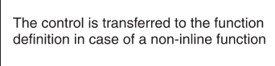

图 1.1 非内联函数中的控制转移

# C++  way

```
void main()
{
  ...
  double x;
  {
    double n;
    n=2;
    x=n*n*n;
  }
  {
    double n;
    n=4;
    x=n*n*n;
  }
  {
    double n;
    n=10;
    x=n*n*n;
  }
}
```

对于内联函数，控制不会转移到函数定义，因为调用被定义本身替换了。

**图 1.2** 内联函数中控制未转移

**列表 1.27** 内联函数

```
/*inline.cpp 的开始*/
#include<iostream>
inline double cube(double x) { return x*x*x; }
void main()
{
  double a,b;
  double c=13.0;
  a=cube(5.0);
  b=cube(4.5+7.5);
  cout<<a<<endl;
  cout<<b<<endl;
  cout<<cube(c++)<<endl;
  cout<<c<<endl;
}
/*inline.cpp 的结束*/
```

# 输出

125

1728

2197

14

然而，在某些情况下，编译器尽管有指示，也可能不会内联展开函数。相反，它会发出一个警告，说明函数无法展开，然后以普通方式编译所有此类函数的调用。这些情况包括：

- 函数是递归的。
- 函数中存在循环结构。
- 函数中存在静态变量。

让我们简要比较 C 中的宏和 C++ 中的内联函数。宏是内联函数的拙劣前身。例如，一个计算数字立方的宏如下：

```
#define CUBE(X) X*X*X
```

在这里，发生了文本替换，“X” 被替换为参数值。

```cpp
a=CUBE(5.0);                          // 被替换为 a=5.0*5.0*5.0;
b=CUBE(4.5+7.5);                       // 被替换为
                                     // b=4.5+7.5*4.5+7.5;
nc=CUBE(x++);                          // 被替换为 c=x++*x++*x++;
```

只有第一语句正常工作。智能地使用括号可以稍微改善情况。

```
#define CUBE(X) ((X)*(X)*(X))
```

即使如此，`CUBE(c++)` 也无疑地增加了 'c' 的值。但内联 `cube()` 函数会求值 'c'（要立方的值），并正确地增加一次 'c'。

建议使用内联函数代替宏。

## 总结

变量相互影响它们的值。

一个值的改变可能需要对另一个值进行相应的调整。因此，必须将这些变量传递到一组函数中。结构体使我们能够这样做。

防止被他人的无意修改。

一个值的改变可能需要对另一个值进行相应的调整。因此，必须将这些变量传递到一组函数中。结构体使我们能够这样做。

防止被他人的无意修改。

一个值的改变可能需要对另一个值进行相应的调整。因此，必须将这些变量传递到一组函数中。结构体使我们能够这样做。

防止被他人的无意修改。

一个值的改变可能需要对另一个值进行相应的调整。因此，必须将这些变量传递到一组函数中。结构体使我们能够这样做。

防止被他人的无意修改。

一个值的改变可能需要对另一个值进行相应的调整。因此，必须将这些变量传递到一组函数中。结构体使我们能够这样做。

防止被他人的无意修改。

一个值的改变可能需要对另一个值进行相应的调整。因此，必须将这些变量传递到一组函数中。结构体使我们能够这样做。

防止被他人的无意修改。

一个值的改变可能需要对另一个值进行相应的调整。因此，必须将这些变量传递到一组函数中。结构体使我们能够这样做。

防止被他人的无意修改。

一个值的改变可能需要对另一个值进行相应的调整。因此，必须将这些变量传递到一组函数中。结构体使我们能够这样做。

防止被他人的无意修改。

一个值的改变可能需要对另一个值进行相应的调整。因此，必须将这些变量传递到一组函数中。结构体使我们能够这样做。

防止被他人的无意修改。

一个值的改变可能需要对另一个值进行相应的调整。因此，必须将这些变量传递到一组函数中。结构体使我们能够这样做。

防止被他人的无意修改。


一个值的改变可能需要对另一个值进行相应的调整。因此，必须将这些变量传递到一组函数中。结构体使我们能够这样做。

防止被他人的无意修改。

# C++ 导言

继承允许不同的函数具有相同的名。多态允许不同的函数具有相同的名。继承允许不同的函数具有相同的名。继承允许不同的函数具有相同的名。

防止被他人的无意修改。

# C++ 导言

继承允许不同的函数具有相同的名。多态允许不同的函数具有相同的名。继承允许不同的函数具有相同的名。

# 关键术语

- 创建新的数据类型
- 结构中缺乏数据
- 结构中没有保证初始化
- 过程化系统
- 类中的数据安全性
- 类中保证初始化
- 继承
- 多态
- C++ 中的控制输入输出
- `cin`
- `istream_withclass` 类
- 提取运算符
- `iostream.h` 头文件
- `endl`
- 引用变量
- 引用传递
- 引用返回
- 函数声明的重要性
- 函数重载
- 函数参数的默认值
- 内联函数

```
cout
ostream_withclass 类
插入运算符
```

# 练习题

- 1. 结构满足了哪些编程需求？
  C 语言允许创建结构吗？
- 2. 结构的局限性是什么？
- 3. 什么是过程化系统？
- 4. 什么是面向对象的编程系统？
- 5. `'cout'` 是哪个类的对象？
- 6. `'cin'` 是哪个类的对象？
- 7. 如果编译器对其进行函数声明，程序员可以获得什么好处？
- 8. 为什么给重载函数的参数赋予默认值会产生错误？
- 9. 为什么应该在函数声明而不是函数定义中给参数赋予默认值？
- 10. 判断对错。
  (a) 结构允许程序员保护结构变量包含的数据不被未经授权的函数更改。
  (b) 插入运算符用于输出。
  (c) 提取运算符用于输出。
  (d) 返回引用的调用可以放在赋值运算符的左侧。
  (e) 内联函数具有循环结构。
- 11. 回想你在 C 语言编程的经验中，你觉得需要结构的例子。

## 使用 C++ 进行面向对象编程

在这些示例中，你看到面向对象编程（OOPS）的机会了吗？

- 12. C 语言中的结构体（Structures）并没有让库程序员保证数据的初始化。通过以结构体为例，理解这种局限性的影响。
- 13. 返回引用的函数调用可以放在赋值运算符的左侧。尝试并发现此类调用是否可以链。考虑如下：

```
f(a, b) = g(c, d) = x;
```

其中 `'f'` 和 `'g'` 是返回引用的函数，而 `'a'`, `'b'`, `'c'`, `'d'` 和 `'x'` 是变量。

# 2

# 类与对象

上一章节复习了读者对 C 语言提供的结构构造的知识——它的用途和用法。它还对结构进行了批判性分析，以及它们的陷阱和局限性。读者意识到，对于数据安全以及对于未提供该保证的数据结构进行初始化，存在强烈的需求。

本章是上一章的逻辑延续。它首先详细解释了 C++ 的类构造以及它满足上述需求的方式。本章强调了 C++ 类构造优于 C 语言结构的优越性。

本章还涉及了类如何让库程序员为关联函数提供独占权限。本章中有一个重要位置，该描述涵盖了：

- 重载成员函数
- 成员函数参数的默认值
- 内联成员函数
- 常量成员函数
- 可变数据成员
- 友元函数和友元类
- 静态成员

本章有一节专门介绍命名空间（`namespaces`）。它们让 C++ 程序员防止导致冲突的全局命名空间污染。

处理对象数组和对象内部数组的示例代码构本章的倒数第二部分。

本章以对嵌套类的分析——其需求和用法结束。

## 2.1 类与对象简介

类之于 C++ 就像结构体之于 C。库程序员和用户都获得了一种创建数据类型的手段。让我们简要回顾一下上一章描述的在 C 中编程时面临的问题。在 C 中，库程序员创建结构体。他/她提供了一组经过测试无 bug 的函数，正确操作结构体变量的数据成员。

`Date` 结构体及其配套函数可能是完美的。然而，完全无法保证客户端程序只会使用这些函数来操作结构体变量的成员。参见列表 2.1。

### 列表 2.1 C 语言无法阻止的结构体不当操作

```
struct Date d1;
setDate(&d1); // 将系统日期赋值给 d1.
printf("%d", d1.month);
d1.month = 13; // 不符合预期但无法阻止！！
```

`main()` 函数最后一行产生的 bug 即使通过肉眼检查也容易发现。然而，如果代码长度约为 25,000 行，情况就不如此了。与 `main()` 函数最后一行类似的行可能散布在整个代码中。这样的话将很难追踪。

请注意，缺乏将数据与具有独占操作权限的代码进行绑定的机制，会导致难以检测的运行时错误。C 并没有为库程序员提供封装数据、隐藏数据和抽象数据的设施。

C++ 编译器为这个问题提供了解决方案。结构体（`struct` 关键字）被重新定义以允许拥有成员函数。列表 2.2 Illust出了这一点。

### 列表 2.2 C++ 允许在结构体中使用成员函数

```cpp
/*structDistance01.cpp 的开始*/
#include <iostream.h>

struct Distance
{
    int feet;
    float inches;
    void setFeet(int x)
    {
        feet=x;
    }
    int getFeet()
    {
        return feet;
    }
    void setInches(float y)
    {
        inches=y;
    }
    float getInches()
    {
        return inches;
    }
};

void main(){
    Distance d1,d2;
    d1.setFeet(2);
    d1.setInches(2.2);
    d2.setFeet(3);
    d2.setInches(3.3);
    cout<<d1.getFeet()<<" "<<d1.getInches()endl;
    cout<<d2.getFeet()<<" "<<d2.getInches()endl;
```

# 类与对象

}

/*structDistance01.cpp 的结束*/

# 输出

2 2.2

3 3.3

首先，我们必须注意到函数在结构体定义的范围内也被定义了。这意味着，不仅可以通过结构体变量访问结构体的成员数据，还可以调用成员函数。`struct` 关键字在 C++ 中也被重新定义了。这一点在上述列表 2.2 的 `main()` 函数中得到了体现。我们必须仔细注意已声明并事实上初始化的结构体变量，以及成员函数是如何调用的。

成员函数的调用方式与访问成员数据的方式非常相似，都是使用变量到成员访问运算符。在成员函数中，可以引用被函数调用的对象的成员。根据列表 2.2 中 `main()` 函数的第二行，当调用第四行时，是 `d1.feet` 获取了值 3。另一方面，当调用第四行时，是 `d2.feet` 获取了该值。

每个结构体变量在内部都包含一份成员数据的独立副本。然而，成员函数只存在一份。再次，关于 `this` 指针的章节解释了这一点。

然而，在上面的示例中，注意到结构体变量的成员数据仍然被直接访问。接行代码说明了这一点。

```
d1.feet=2; // 合法
```

### 2.1.1 私有和公共成员

在结构体中拥有成员函数的优势是什么？我们整合了数据以及处理这些数据的函数，但我们无法给这些函数提供处理数据的独占权限。代码调试仍然可能像以前一样发生。将成员函数指定为公共而成员数据指定为私有可以获得这种优势。这种语法由列表 2.3 Illust。

### 列表 2.3 将结构体成员设私有

```cpp
/*structDistance02.cpp 的开始*/
#include<iostream.h>
struct Distance
{
private:
    int iFeet;
    float fInches;
public:
    void setFeet(int x)
    {
        iFeet=x; // 合法：成员函数访问私有成员
    }
    int getFeet()
```

```cpp
{
  return iFeet;
}
void setInches(float y)
{
  fInches=y;
}
float getInches()
{
  return fInches;
}
void main() {
  Distance d1,d2;
  d1.setFeet(2);
  d1.setInches(2.2);
  d2.setFeet(3);
  d2.setInches(3.3);
  d1.iFeet++; // 错误！！非成员函数访问私有成员
  cout<<d1.getFeet() << " <<d1.getInches()endl;
  cout<<d2.getFeet() << " <<d2.getInches()endl;
}
/*structDistance2.cpp 的结束*/
```

首先，让我们看看结构体修改后的定义。两个新关键字 `private` 和 `public` 被引入到结构的定义中。它们在前例中的存在告诉编译器 `iFeet` 和 `fInches` 是结构体变量的私有成员，而成员函数是公共的。结构体的每个变量只能通过成员函数进行访问/修改。任何违反此限制的尝试都会被编译器阻止，这就是 C++ 编译器如何识别 `private` 关键字。

`private` 和 `public` 关键字也被称为访问修饰符或访问说明符。C++ 引入了新的 `class` 关键字来替代 `struct`。在结构体中，成员默认是公共的。参见定义 2.4。

```cpp
struct Distance {
  int iFeet;
  float fInches;
};
```

```cpp
public:
void setFeet(int x) {
    iFeet=x;
}
int getFeet() {
    return iFeet;
}
void setInches(float y) {
    fInches=y;
}
float getInches() {
    return fInches;
}
```

也可以写为

```cpp
struct Distance {
    void setFeet(int x) // 默认公共
    iFeet=x;
    int getFeet() // 默认公共
    return iFeet;
    void setInches(float y) // 默认公共
    fInches=y;
    float getInches() // 默认公共
    return fInches;
}
private:
    int iFeet;
    float finches;
```

在列表 2.4 中，成员函数没有放在任何访问修饰符下。因此，默认情况下有公共成员。

相反，类成员默认情况下是私有的。这是 `class` 关键字和 `struct` 关键字之间的唯一区别。

因此，可以使用 `class` 关键字重新定义结构体 `Distance`，如列表 2.5 所示。

### 列表 2.5 类成员默认是私有的

```cpp
class Distance {
    int iFeet; // 默认私有
    float finches; // 默认私有
    public:
    void setFeet(int x) {
        iFeet=x;
    }
    int getFeet() {
        return iFeet;
    }
    void setInches(float y) {
        fInches=y;
    }
    float getInches() {
        return finches;
    }
};
```

保留 `struct` 关键字是为了与 C 语言保持后兼容。在 C 中创建的头文件可能包含结构体的定义，而 C 语言中的结构只有成员数据。现在 `struct` 关键字的定义强制包含成员函数。C 源代码中的函数访问结构体的成员数据。C++ 编译器可以轻松地编译此类源码，因为 C++ 编译器默认将结构体的成员视为公共成员。

### 2.1.2 对象

类的变量被称为对象。类对象占据的内存量与具有相同数据成员的结构体变量相同。这由列表 2.6 所示。

### 列表 2.6 类的大小等于具有相同数据成员的结构的大小

| struct A | class B |
| :--- | :--- |
| char a; | char a; |
| int b; | int b; |
| float c; | float c; |

```cpp
/*Beginning of objectSize.cpp*/
#include <iostream>
struct A {
    char a;
    int b;
    float c;
};
class B {
    char a;
    int b;
    float c;
}
void main() {
    cout << sizeof(A) << endl << sizeof(B) << endl;
}
/*End of objectSize.cpp*/
```

# 输出

9

9

引入成员函数不会影响对象的大小。原因将在我们学习时变得显而易见。此外，将数据成员设置为私有或公共不会影响对象的大小。访问修饰符仅控制成员的可访问性。

### 2.1.3 作用域运算符

对于库程序员来说，在各自的类之外定义成员函数是可能的，通常也是必要的。作用域运算符使得这一切成为可能。列表 2.7 Illust了作用域运算符的使用。

### 列表 2.7 作用域运算符

```cpp
/*Beginning of scopeResolution.cpp*/
class Distance {
    int iFeet;
    float finches;
public:
    void setFeet(int);          // 仅原型
    int getFoot();              // 仅原型
    void setInches(float);      // 仅原型
    float getInches();          // 仅原型
};

void Distance::setFeet(int x) {
    iFeet=x;
}
int Distance::getFoot() {
    return iFeet;
}
void Distance::setInches(float y) {
    finches=y;
}
float Distance::getInches() {
    return finches;
}
/*End of scopeResolution.cpp*/
```

我们可以观察到成员函数仅在类内进行了原型声明；它们在类外进行了定义。作用域运算符表示它们所属的类。类名指定在作用域运算符的左侧。正在定义的函数名在右侧。

## 2.1.4 使用作用域运算符创建库

与 C 语言一样，在 C++ 中使用类创建新数据类型也是由库程序员执行的三个步骤的过程。

- 第 1 步：将类定义放在头文件中。

```cpp
/*Beginning of Distance.h*/
/*包含 Distance 类定义的头文件*/
class Distance {
    int feet;
    float finches;
public:
    void setFeet(int); // 仅原型
    int getFeet(); // 仅原型
    void setInches(float); // 仅原型
    float getInches(); // 仅原型
};
/*End of Distance.h*/
```

- 第 2 步：将成员函数的定义放在 C++ 源文件（库源码）中。包含类成员函数定义的文件被称为该类的实现文件。编译此实现文件并将其放入库中。

```cpp
/*Beginning of Distlib.cpp*/
/*类定义的实现文件*/
#include "Distance.h"
void Distance::setFeet(int x) //定义 {
    feet=x;
}
int Distance::getFeet() //定义 {
    return feet;
}
void Distance::setInches(float y) //定义 {
    finches=y;
}
float Distance::getInches() //定义 {
    return finches;
}
/*End of Distlib.cpp*/
```

- 第 3 步：以任何媒介将头文件和库提供给想要使用这种新数据类型的程序员。

## 2.1.5 在应用程序中使用类


程序员使用这种新数据类型遵循的步骤是：

- 第 1 步：在他们的源代码中包含库程序员提供的头文件。

```cpp
/*Beginning of Distmain.cpp*/
#include "Distance.h"
void main() {
// ...
}
```

- 第 2 步：在他们的源代码中声明新数据类型的变量。

```cpp
/*Beginning of Distmain.cpp*/
#include "Distance.h"
void main() {
// ...
}
```

- 第 3 步：通过在源代码中传递这些参数来嵌入对关联函数的调用。查看列表 2.8。

### 列表 2.8 使用类的应用程序

```cpp
/*Beginning of Distmain.cpp*/
/*创建和使用对象的示例驱动程序*/
#include <iostream>
#include "Distance.h"
void main() {
    Distance d1, d2;
    d1.setFeet(2);
    d1.setInches(2.2);
    d2.setFeet(3);
    d2.setInches(3.3);
    cout << d1.getFeet() << endl;
    cout << d2.getFeet() << endl;
}
/*End of Distmain.cpp*/
```

- 第 4 步：编译源代码以获取对象文件。

- 第 5 步：将对象文件与库程序员提供的库链接以获取可执行文件或其他库。

### 列表 2.8 的输出

2 2.2

3 3.3

## 40 使用 C++ 进行面向对象编程

实现文件以通常的方式编译并转换为静态和动态库。

再次，我们注意到在成员函数内部访问成员数据与调用它的对象之间没有明显的联系。

### 2.1.6 this 指针

创建和调用类对象成员函数的功能由 C++ 编译器提供。你已经看到这种功能是如何被使用的。然而，编译器如何支持这种功能？编译器通过一个名为 `this` 指针的唯一指针来实现。深入理解此指针对于理解 C++ 中的许多概念至关重要。

`this` 指针始终是一个常量指针。它指向调用该函数的对象。稍后将解释为什么以及如何工作。

在编译器确定没有非成员函数尝试访问对象的私有成员后，它将 C++ 代码转换为普通的 C 语言代码如下：

1. 将类转换为仅包含数据成员的结构体如下：

Before

```cpp
class Distance {
    int iFeet;
    float finches;
};
```

After

```cpp
struct Distance {
    int iFeet;
    float finches;
}
```

2. 将 `this` 指针的声明作为领先的形式参数放在所有成员函数的原型中如下：

Before

```cpp
void setFeet(int);
```

After

```cpp
void setFeet(Distance * const, int);
```

Before

```cpp
int getFeet();
```

### 类与对象 41

之后

```cpp
int getFeet(Distance * const);
```

之前

```cpp
void setInches(float);
```

之后

```cpp
void setInches(Distance * const, float);
```

之前

```cpp
float getInches();
```

之后

```cpp
float getInches(Distance * const);
```

- 3. 它将此指针（this pointer）的定义作为所有成员函数定义中的领先形式参数，如下所示。它还修改了所有访问对象的语句，通过成员访问运算符（`->`）通过此指针来访问对象。

之前

```cpp
void Distance::setFeet(int x)
{
  iFeet=x;
}
```

之后

```cpp
void setFeet(Distance * const this, int x)
{
  this->iFeet=x;
}
```

之前

```cpp
int Distance::getFeet()
{
  return iFeet;
}
```

之后

```cpp
int getFeet(Distance * const this)
{
  return this->iFeet;
}
```

之前

```cpp
void Distance::setInches(float y)
{
  fInches=y;
}
```

之后

```cpp
void setInches(Distance * const this, float y)
{
  this->fInches=y;
}
```

### 之前

```cpp
float Distance::getInches()
{
    return fInches;
}
```

### 之后

```cpp
float getInches(Distance * const this)
{
    return this->fInches;
}
```

我们必须理解作用域解析运算符的工作原理。作用域解析运算符也是一种运算符。和任何其他运算符一样，它对其操作数进行操作。作用域解析运算符是一个二元运算符，它接受两个操作数。左侧的操作数是预定义类的名称。右侧是该类的成员函数。根据这些信息，作用域解析运算符将一个正确类型的常量运算符作为领先形式参数插入到右侧函数中。例如，如果类名是 `Distance`（如上述情况），编译器将插入一个类型为 `Distance * const` 的指针作为右侧函数的领先形式参数。

- 4. 它将调用对象的地址作为领先参数传递给每次成员函数的调用，如下文所示。

之前

`d1.setFeet(1);`

之后

`setFeet(&d1,1);`

之前

`d1.setInches(1.1);`

之后

`setInches(&d1,1.1);`

之前

`cout<<d1.getFeet()<<endl;`

之后

`cout<<getFeet(&d1)<<endl;`

之前

`cout<<d1.getInches()<<endl;`

### 类与对象

### 之后

```cpp
cout<<getInches(&d1)<<endl;
```

在 C++ 中，点运算符（dot operator）的定义被扩展了。它不仅像 C 那样接受数据成员，还将成员函数作为右侧的操作数。如果右侧的操作数是数据成员，点运算符的行为就和 C 语言中一样。然而，如果右侧的操作数是成员函数，点运算符会将左侧对象的地址作为隐式参数传递给函数调用。

显然，当在成员函数中通过任何限定符访问成员时，引用的是调用对象的成员。显而易见的是，成员数据存在多个副本（在每个对象内部），但每个成员函数只存在一个副本。

而可见的是，此指针在整个生命周期内应该一直指向同一个对象——即调用成员函数的对象。由于某种原因，编译器将其解释为常量指针。

隐式调用的访问性与作为参数传递的对象以及该函数内部局部对象的访问性相同。列表 2.9 说明了这一点。一个新函数——`add()` 已添加到 `Distance` 类的现有定义中。

+ 列表 2.9 访问成员函数内部局部对象和参数传递对象的成员

```cpp
/* Distance.h 开始 */
class Distance
{
    /*
      Distance 类剩余
    */
    Distance add(Distance);
};
/* Distance.h 结束 */

/* Distlib.cpp 开始 */
#include"Distance.h"
Distance Distance::add(Distance dd)
{
    Distance temp;
    temp.iFeet=iFeet+dd.iFeet; // 访问 temp.iFeet 和 dd.iFeet 是合法的
    temp.fInches=fInches+dd.fInches;
    return temp;
}
/*
  Distance 类类的定义
*/
/* Distlib.cpp 结束 */

/* main.cpp 开始 */
#include<iostream.h>
#include"Distance.h"
```

### C++ 面向对象编程

```cpp
void main()
{
    Distance d1,d2,d3;
    d1.setFeet(1);
    d1.setInches(1.1);
    d2.setFeet(2);
    d2.setInches(2.2);
    d3=d1.add(d2);
    cout<<d3.getFeet()<<"\n"<<d3.getInches();
}
```

```
/* main.cpp 结束 */

# 输出

3-3.3

编译器执行的 `Distance :: add()` 函数定义如下：

```cpp
Distance add(Distance * const this, Distance dd)
{
    Distance temp;
    temp.iFeet=this->iFeet+dd.iFeet;
    temp.fInches=this->fInches+dd.fInches;
    return temp;
}
```

当从 `main()` 函数调用此函数时，此指针指向 '`d1`'。因此，在 `add()` 函数的第三和第四行访问的是 '`d1`' 的私有成员。

所以，现在我们可以：

- 声明一个类
- 定义私有成员和成员函数
- 将成员设为私有
- 声明对象并调用对象

这带来了什么优势？库程序员现在从这种安排中获得的优势体现在以下观察中：

> 可执行文件不会从由成员函数访问对象私有成员的源代码创建。

再次强调编译时错误的重要性。假设设计 `Distance` 类的库程序员希望确保 `fInches` 永远不超过 12。如果应用程序员通过 `Distance::setInches()` 指定一个大于 12 的值，函数定义内部的逻辑应该自动增加 `iFeet` 的值并适当减少 `fInches` 的值。`Distance::setInches()` 的修改定义如下：

```cpp
void Distance::setInches(float y)
{
    fInches=y;
    if(fInches>=12)
    {
        iFeet+=fInches/12;
        fInches=((int)fInches/12)*12;
    }
}
```

在这里，我们注意到应用程序员不需要通过 `Distance::setInches()` 发送小于 12 的值。`Distance::setInches()` 函数内部的默认逻辑完成了必要的调整。数据抽象的一个示例。

上面的限制可能看起来不是强制性的。然而，我们将看到某些类，其中类似的限制是绝对必要的（也是复杂的）。

同样，库程序员应该如下修改 `Distance::add()` 函数的定义。在这里，可以假设调用对象或出现的对象 ('`dd`') 的 `fInches` 值都不会超过 12。

```cpp
Distance Distance::add(Distance dd)
{
    Distance temp;
    temp.iFeet=iFeet+dd.iFeet;
    temp.setInches(fInches+dd.fInches);
    return temp;
}
```

### 2.1.7 数据抽象 (58)

类结构提供了实现数据抽象的。数据抽象是一个重要概念，应该被正确理解。让我们以上一的 LCD 投影仪为例。它有成员数据（光和风扇）以及成员函数（控制光的开关）。这个真实世界的对象向外部世界隐藏了它的内部操作。因此，它避免了用户需要知道操作过程中可能遇到的陷阱。在操作期间，LCD 永远不会到达无效状态。

数据抽象是对象向程序其余部分隐藏内部操作的一种特性。它使得客户端程序没有知道数据内部是如何安排的。因此，它避免了客户端程序在创建对象时编写预防代码。

现在，为了理解这个概念，让我们来看一个 C++ 示例。设计 `Distance` 类的库程序员希望确保 `fInches` 永远不超过 12。如果应用程序员通过 `Distance::setInches()` 指定一个大于 12 的值，函数定义内部的逻辑应该自动增加 `iFeet` 的值并适当减少 `fInches` 的值。`Distance::setInches()` 的修改定义如下。

```cpp
void Distance::setInches(float y)
{
    fInches=y;
    if(fInches>=12)
    {
        iFeet+=fInches/12;
        fInches=((int)fInches/12)*12;
    }
}
```

在这里，我们注意到应用程序员不需要通过 `Distance::setInches()` 发送小于 12 的值。`Distance::setInches()` 函数内部的默认逻辑完成了必要的调整。这是数据抽象的一个示例。

上面的限制可能看起来不是强制性的。然而，我们将看到某些类，其中类似的限制是绝对必要的（也是复杂的）。

同样，库程序员应该如下修改 `Distance::add()` 函数的定义。在这里，可以假设调用对象或出现的对象 ('`dd`') 的 `fInches` 值都不会超过 12。

```cpp
Distance Distance::add(Distance dd)
{
    Distance temp;
    temp.iFeet=iFeet+dd.iFeet;
    temp.setInches(fInches+dd.fInches);
    return temp;
}
```

现在，如果我们写出列表 2.10 显示所示语句

## 列表 2.10 对类成员执行强制限制

```
d1.setFeet(1);
d1.setInches(9.5);
d2.setFeet(2);
d2.setInches(5.5);
d3=d1.add(d2);
```

那么 `d3.fInches` 的值将变为 3（而不是 15），而 `d3.iFeet` 的值将变为 4（而不是 3）。
之前已经提到，现实世界中的对象永远不会避免无效状态。它们初始时也不会处于无效状态。那么 C++ 是否允许库程序员在类对象中实现这一功能呢？
让我们继续之前的示例——`Distance` 类。记住，库程序员的意图是确保 `Distance` 类中没有任何一个对象的 `fInches` 属性的值都不应超过 12。现在，让我们考虑列表 2.11。

## 列表 2.11 使用不当值创建的对象

```cpp
/*Beginning of DistJunk.cpp*/
#include<iostream>
#include "Distance.h"
void main()
{
    Distance d1;
    cout<<d1.getFeet<<" "<<d1.getInches()endl;
}
/*End of DistJunk.cpp*/
```

# 输出
29 34.56

如你所见，“`d1`”的 `fInches` 值大于 12！这种现象发生是因为当 '`d1`' 分配内存时，`iFeet` 和 `fInches` 的值都自动变成了垃圾值，而对于 `d1.fInches` 来说，垃圾值大于 12。因此，库程序员保持 `fInches` 值小于 12 的目标没有实现。
期望应用程序程序员显式地初始化每一个声明的对象是不现实的。

```cpp
Distance d1; //初始化
d1.setFeet(0.0); //初始化
```

显然，库程序员希望在 `Distance` 类中添加一个函数，该函数在对象创建时被自动调用，并设置对象成员属性的值。这样的函数就是*构造函数*。构造函数的概念以及相关的函数——*析构函数*，将在后面的章节中讨论。
但可能会有人说，即使 `Distance` 是一个普通的结构体，且 `setInches()` 函数像 C 语言中一样是非成员函数，数据抽象依然存在。尽管如此，在 C 的情况下，库程序员无法强制只调用他未定义的函数。类与对象 47

数据抽象对于数据隐藏是有效的（回想之前讨论过的投影仪系统案例）。

硬币的反面，在 C 语言中，应用程序程序员的生活会变得艰难。如果结构体的某个成员获取了无效或错误的值，他/她必须搜索整个源代码来检测错误。随着代码长度的增加，这个问题的重要性迅速凸显。在实际实践中，拥有超过 25,000 行的代码是很常见的。

现在让我们进行如下总结：
-   由于数据隐藏，成员函数的完美定义保证了其目标的实现。

这就是面向对象编程系统的精髓。现实世界的对象不仅有工作部分，还有通往这些内部工作部分的排他接口。完美的接口由于其排他性被保证能够正常工作。

### 2.1.8 显式地址操作

应用程序程序员可以通过显式地址操作来操纵任何对象的成员数据。列表 2.12 说明了这一点。

## 列表 2.12 显式地址操作

```cpp
/*Beginning of AddrManip.cpp*/
#include<Distance.h>
#include<iostream.h>
void main()
{
    Distance d1;
    d1.setFeet(256);
    d1.setInches(2.2);
    char * p=(char *)&d1; //显式地址操作
    *p=1; //不希望发生但无法避免
    cout<<d1.getFeet<<" "<<d1.getInches()endl;
}
/*End of AddrManip.cpp*/
```


输出
257 2.2

然而，应用程序程序员这种显式地址操作是无法防止的。这留给读者作为一个练习，以解释上述段落（列表 2.12）的输出。

## 2.1.9 箭头运算符

可以通过指向对象的指针调用对象的成员函数。箭头运算符（`->`）实现了这一点。列表 2.13 展示了一个说明性示例。

### 列表 2.13 通过指针访问成员

```cpp
/*Beginning of PointerMember.cpp*/

#include<iostream.h>

#include"Distance.h"

void main() {
    Distance d1;           //对象
    Distance * dPtr;      //指针
    dPtr=&d1;               //指针初始化
    /*相当于 d1.setFeet(1.1) 和 d1.getInches(1.1)*/
    dPtr->setFeet(1);      //调用成员函数
    dPtr->setFeet(1.1);    //通过指针
    /*相当于 d1.getInches() << d1.getInches()*/
    cout<<dPtr->getInches<<" "<<dPtr->getInches()endl;
}

/*End of PointerToMember.cpp*/
```

# 输出
11.1

有趣的是，点（`.`）运算符和箭头（`->`）运算符的定义在 C++ 中得到了扩展。它在 C++ 中不仅接收右侧的数据成员，还将成员函数作为其右侧的操作数。如果右侧的操作数是数据成员，则箭头的行为与 C 语言中相同。然而，如果它是一个类的成员函数，且其左侧的操作数是相同类型，那么编译器简单地将指针的值作为隐式的起始参数传递给函数调用。因此，语句

```
dPtr->setFeet(1);
```

在转换后变为

```cpp
setFeet(dPtr,1);
```

现在，`dPtr` 的值被拷贝到该指针。因此，该指针也指向 `dPtr` 所指向的同一个对象。

## 2.1.10 从另一个函数调用成员函数

可以从另一个函数调用成员函数。列表 2.14 展示了一个说明性示例。

| 列表 2.14 | 从另一个函数调用成员函数 |
| :--- | :--- |

```cpp
/*Beginning of NestedCall.cpp*/

class A
{
    int x;
public:
    void setindirect(int q);
    void setx(int p);
};

void A::setindirect(int q)
{
    x=q;
}

void A::setx(int p)
{
    setindirect(p);
}

void main()
{
    A A1;
    A1.setindirect(1);
    A1.setx(2);
}

/*end of NestedCall.cpp*/
```

## 2.2.2 成员函数形式参数的默认值

我们已经知道可以为非成员函数的参数分配默认值。也可以为成员函数的形式参数指定默认值。列表 2.17 给出了一个说明性示例。

**Listing 2.17** 给成员函数的参数赋予默认值

```cpp
/*Beginning of memFuncDefault.cpp*/

#include<iostream.h>

class A {
public:
    void show(int p=1);
};

void A::show(int p) {
    for(int i=0;i<p;i++)
        cout<<"Hello\n";
}

void main() {
    A A1;
    A1.show();                   //使用了默认值
    A1.show(3);                  //默认值被覆盖
}

/*End of memFuncDefault.cpp*/
```

输出

Hello
Hello
Hello
Hello

再次，必须记住，如果为成员函数的某些或全部形式参数指定了默认值，那么在重载成员函数时要小心。例如，当编译器在列表 2.18 中找到类 `A` 的 `show()` 函数的第二个原型时，它会报告*歧义错误*。

**Listing 2.18** 给重载成员函数的参数赋予默认值会导致歧义错误

```cpp
class A {
public:
    void show();
    void show(int p=0);             //歧义错误
};
```

此类歧义错误的原因已经在第 1 章的重载节中解释过。与非成员函数的情况一样，如果为多个形式参数指定了默认值，则必须从右向左指定。同样，默认值必须在函数原型中指定，而不是在函数定义中指定。此外，可以为任何类型的形式参数指定默认值。

## 2.2.3 内联成员函数

通过以下两种方法之一可以将成员函数变为内联函数：

- 在类内部定义函数（如列表 2.5 所示）
- 仅在类内声明函数原型而不定义函数。该函数使用作用域解析运算符在类外定义。该定义以 `inline` 关键字为前缀。对于非成员函数，内联函数的定义必须在调用它之前出现。因此，函数应该定义在与其类相同的同一个头文件中。列表 2.19 阐述了。

### Listing 2.19 内联成员函数

```cpp
/*Beginning of memInline.cpp*/

class A {
  public:
    void show();
}

inline void A::show() //在头文件中定义
{ // //A::show()函数的定义
}

/*End of memInline.cpp*/
```

## 2.2.4 常量成员函数

让我们考虑这种情况：库程序员希望其类的一个成员函数不能改变成员数据的值。该函数应该能够读取数据成员中包含的值，但不能修改它们。然而，他担心在定义函数时可能会意外编写执行此类操作的代码。为了防止这一点，他寻求编译器的帮助。如果他将函数声明为常量，从而防止通过函数更改数据成员的值，编译器将抛错误。

让我们考虑 `Distance` 类。`Distance::get()`、`Distance::inches()` 和 `Distance::add()` 函数显然应该是常量函数。它们不应意外改变调用对象成员的值。

通过在原型和函数定义头后面加上 `const` 关键字，可以将成员函数指定为常量。列表 2.20 展示了 `Distance` 类成员函数修改后的原型和定义。

### Listing 2.20 常量成员函数

```cpp
/*Beginning of Distance.h*/
/*包含 Distance 类定义的头文件*/

class Distance
{
    int iFeet;
    float fInches;
public:
    void setFeet(int);
    int getFeet() const;
    void setInches(float) const;
    float getInches() const;
    Distance add(Distance) const;
};

//End of Distlib.h*/

/*Beginning of Distlib.cpp*/
/*Distance 类的实现文件*/

#include"Distance.h"

void Distance::setFeet(int x)
{
    iFeet=x;
}

int Distance::getFeet() const
{
    iFeet++;
    //错误!!
    return iFeet;
}

void Distance::setInches(float y)
{
    fInches=y;
}

float Distance::getInches() const
{
    fInches=0.0;
    //错误!!
    return fInches;
}

Distance Distance::add(Distance dd) const
{
    Distance temp;
    temp.iFeet=iFeet+dd.iFeet;
    temp.setInches(fInches+dd.fInches);
    iFeet++;
    //错误!!
    return temp;
}/*End of Distlib.cpp*/
```

对于常量成员函数，调用对象占用的内存是只读内存。编译器如何管理此点？此指针变成了“指向常量的常量指针”，而不是“常量指针”。例如，此指针对于 `Distance::get()`、`Distance::inches()` 和 `Distance::add(Distance)` 的类型为 `Distance* const`。显然，常量成员函数不能相对于对象调用。

## 2.2.5 可变成员 (Mutable Members)

`mutable` 成员甚至可以在常量函数内部被修改。这是因为数据成员是用 `mutable` 关键字声明的。列表 2.21 说明了这一点。

### Listing 2.21 可变成员

```cpp
/*Beginning of mutable.h*/

class A
{
    int x;
    mutable int y;
public:
    void abc() const
    {
        y++;
    }
    void def() const
    {
        y++;
    }
};

/*End of mutable.h*/
```

## 2.2.6 友元 (Friends)

类可以将非成员函数和其他类的成员函数作为其友元。这些函数可以访问私有成员。

### 非成员函数

友元函数是具有访问私有成员特殊权的非成员函数。在本节中，我们将只研究不是成员函数的函数。友元函数在其旨在成为友元的类定义内部原型。原型以 `friend` 关键字为前缀。列表 2.22 给了一个示例。

### Listing 2.22 友元函数

```cpp
/*Beginning of friend.cpp*/

class A
{
    int x;
public:
    friend void abc(A); //友元函数的原型
};

void abc(A& Aobj) //友元函数的定义
{
    Aobj.x++; //访问对象的私有成员
}

void main()
{
    A A1;
    abc(A1);
}/*End of friend.cpp*/
```

关于友元函数，我们必须记住的几点是：

- `friend` 关键字应该出现在原型中，而不是定义中。
- 由于它是作为友元的类的非成员函数，因此可以在该类的私有部分或公共部分进行原型。
- 与执行相同任务的成员函数相比，友元函数多了一个参数。这是因为其不能相对于任何对象调用。相反，对象本身作为显式参数出现在友元调用中。
- 在定义友元函数时，不需要也不应该使用作用域解析运算符。

### 友类

类可以是另一个类的友元。友元类的成员函数可以访问该友类对象的私有数据成员。要把类 `B` 成为类 `A` 的友元，那么该语句应该写在类 `A` 的定义内部。

## 列表 2.23 声明友类

```cpp
class A
{
    friend class B;              //将 B 声明为 A 的友类
    /*
    类 A 的其余部分
*/
};
```

将类 `B` 声明为友类的语句出现在类 `A` 的私有部分还是公共部分都没有关系。现在，类 `B` 的成员函数可以访问类 `A` 对象的私有数据成员。列表 2.24 示例说明了这一点。

## 列表 2.24 声明友类的影响

```cpp
/*friendClass.cpp 的开始*/

class B; //前向声明...这是必要的因为
//类 B 的定义位于将类 B 声明为 A 的友类的
//语句之后。

class A
{
    int x;
public:
    void setx(const int x=0);
    int getx()const;
    friend class B;              //将 B 声明为 A 的友类
};

class B
{
    A * Aptr;
public:
    void Map(A * const);
    void test_friend(const int);
};

void B::Map(A * const p)
{
    Aptr = p;
}

void B::test_friend(const int i)
{
    Aptr->x=i;              //访问私有数据成员
}

/*friendClass.cpp 的结束*/
```

我们可以看到，尽管类 `B` 的成员函数不是类 `A` 的成员函数，但它们能够访问类 `A` 对象的私有数据成员。这是因为它们是类 `A` 的友类。友谊关系不是传递的。例如，考虑列表 2.25。

## 列表 2.25 友谊关系不是传递的

```cpp
class B;
class C;

/*friendTran.cpp 的开始*/

class A
{
    friend class B;
    int a;
};

class B
{
    friend class C;
};

class C
{
    void f(A * p)
    {
        p->a++; //错误：C 不是 A 的友类
                //尽管它是友类的友类
    }
};

/*friendTran.cpp 的结束*/
```

## 友元成员函数

我们如何让一个类的某些特定成员函数成为另一个类的友元？为了仅让 `B::test_friend()` 函数成为类 `A` 的友元，将类 `A` 声明中的行
`friend class B;`
替换为行
`friend void B::test_friend();`

修改后的类 `A` 定义为：
```cpp
class A
{
    /*
    类 A 的其余部分
    */
    friend void B::test_friend();
}
```

为了成功编译此代码，编译器应该先看到类 `B` 的定义。否则，它不知道 `test_friend()` 是类 `B` 的成员函数。这意味着我们应该将类 `B` 的定义放在类 `A` 的定义之前。

类型为 `A *` 的指针是类 `B` 的一个私有数据成员。因此，编译器在编译类 `B` 的定义之前也应该知道存在一个类 `A`。这种循环依赖问题通过前向声明来解决。这是通过在类 `B` 的定义之前插入行
`class A;`
// 仅声明！不是定义！！
现在，两个类的声明和定义如列表 2.26 所示。

## 列表 2.26 对需要友类的类进行前向声明

```cpp
/*friendFunc.h 的开始*/

class A;

class B
{
    A * Aptr;
    public:
    void Map(A * const);
    void test_friend(const int);
};

class A
{
    int x;
    public:
    friend void B::test_friend(const int);
};

/*friendFunc.h 的结束*/
```

如果我们尝试将 `B::test_friend()` 作为内联函数定义在类内部，就会出现另一个问题。见列表 27。

## 27. 在类内部定义友元函数的问题

```cpp
class B
{
    /*
    类 B 的其余部分
    */
    friend void test_friend(const int)
    {
        // 错误
    }
};
```

## 28. 声明为内联友元函数

```cpp
/*friendFunc.cpp 的开始*/

class A;

class B
{
    A * Aptr;
    public:
    void Map(A * const);
    void test_friend(const int);
    void test_friend(const int i)
    {
        Aptr->x=i;
    }
};

class A
{
    int x;
    public:
    friend void B::test_friend(const int);
};

/*friendFunc.cpp 的结束*/
```

## 29. 友类作为桥梁

```cpp
/*friendClass.cpp 的开始*/

class B; //前向声明

class A
{
    /*
    类 A 的其余部分
*/
    friend class B;
};

class B
{
    /*
    类 B 的其余部分
*/
    friend void func(const int);
};

/*friendClass.cpp 的结束*/


## 30. 静态成员

### 静态数据

静态成员持有所有对象通用的数据。静态成员例如：

- 对象的计数
- 被所有对象访问的全局数据

让我们考虑 `Account`。我们希望所有对象共享 `4.5%` 的利率。因此，这些数据不应该是对象的成员。

### C++ 中的面向对象编程

静态数据是全局可用的。这意味着静态数据应该存储在类中。否则，这些数据将被嵌入到对象中，占用不必要的空间。

静态成员是类的成员，而不是对象的成员。这意味着它们应该存储在静态变量中。

### 静态数据

```cpp
/*Account.h 的开始*/

class Account
{
    static float interest_rate; // 静态数据成员
    类 Account 的其余部分
};

/*Account 的结束*/
```

在类内部声明静态数据成员显然不会为它分配内存。此外，在声明类对象时，静态数据成员的内存也不会分配。这是因为静态数据成员不是对象的成员。见列表 30。

与此同时，这些数据易于被非成员函数修改。

将静态成员设为私有可以防止非成员函数的修改，因为只有成员函数可以修改静态数据成员的值。

# 列表 2.31 静态数据成员不是对象的一部分

```
/*Beginning of staticSize.cpp*/
#include<iostream.h>

class A
{
    int x;
    char y;
    float z;
    static float s;
};

float A::s=1.1;

void main()
{
    cout<<sizeof(A)<<endl;
}

/*End of staticSize.cpp*/
9
```

# 输出

静态数据成员可以是任何类型。例如，拥有账户的银行名称可以以字符数组的形式存储在类的静态数据成员中，如列表 2.32 所示。

# 列表 2.32 静态数据成员可以是任何类型

```
/*Beginning of Account.h*/
class Account
{
    static float interest_rate;
    static char name[30];
    /*
    rest of the class Account
    */
}

/*End of Account.h*/

/*Beginning of Account.cpp*/
#include"Account.h"
float Account::interest_rate=4.5;
char Account::name[30]="The Rich and Poor Bank";
/*
    definitions of the rest of the functions of class Account
    */
/*End of Account.cpp*/
```

如果需要，整型静态数据成员可以在类内部直接进行初始化。例如，参见列表 2.33。

# 列表 2.33 在类内部初始化整型静态成员

```
/*Beginning of Account.h*/
class Account {
    static int nameLength=30;
    static char name[nameLength];
    /*
    rest of the class Account
    */
};
```

```
/*End of Account.h*/

/*Beginning of Account.cpp*/
#include"Account.h"
int Account::nameLength;
char Account::name[nameLength]="The Rich and Poor Bank";
/*
definitions of the rest of the functions of class Account
*/
/*End of Account.cpp*/
```

我们注意到，在类内部初始化的静态数据成员仍然必须在类外定义，以便为其分配内存。一旦在类内部提供了初始值，在定义该静态数据成员时不能再次初始化。非整型静态数据成员不能这样进行初始化。例如，参见列表 2.34。

# 列表 2.34 非整型静态数据成员无法在类内部初始化

```
/*Beginning of Account.h*/
class Account {
    static char name[30]="The Rich and Poor Bank";
    /*
    rest of the class Account
    */
};

/*End of Account.h*/
```

在列表 2.33 中，变量名 `nameLength` 是直接引用的，没有使用类名和作用域解析运算符。一个静态数据成员可以直接引用另一个，而无需使用作用域解析运算符。
成员函数可以直接引用静态数据成员。示例如下（列表 2.35）。

# 列表 2.35 从非静态成员函数访问静态数据成员

```
/*Beginning of Account.h*/
class Account {
    static float interest_rate;
public:
```

```cpp
void updateBalance();
/*
 rest of the class Account
 */
/*End of Account.h*/

/*Beginning of Account.cpp*/
#include "Account.h"
float Account::interest_rate=4.5;
void Account::updateBalance()
{
    if (end_of_year)
        balance=balance*interest_rate/100;
}
/*
definitions of the rest of the functions of class Account
 */
/*End of Account.cpp*/
```

可以使用对象-成员访问运算符来相对于对象引用类的静态数据成员。带有作用域解析运算符的类名可以直接实现此操作。

```
f=a1.interest_rate; //a1 是 Account 类的一个对象
Account::interest_rate;
```

有些静态数据成员可以做到，但非静态数据成员做不到。

- 静态数据成员的类型可以与其所属类的类型相同。列表 2.36。

列表 2.36 静态数据成员可以与其类类型相同

```
class A
{
    static A A1; //OK : 静态
    A *Ptr; //OK : 指针
    A A2; //ERROR!! : 非静态
}
```

- 静态数据成员可以作为其所属类成员函数的形式参数的默认值。参见列表 2.37。

```cpp
class A
{
    static int x;
    int y;
public:
    void abc(int=x); //OK
    void def(int=y); //ERROR!! : 需要对象
}
```

# C++ 面向对象编程

静态数据成员可以被声明为常量。在这种情况下，成员函数只能读取而不能修改其值。

# 静态成员函数

我们如何创建一个不需要相对于现有对象进行调用的成员函数呢？该函数的唯一目的是访问和修改类的静态数据成员。静态成员函数满足这一强制性标准。在函数原型前加上 `static` 关键字可以将其标识为静态成员函数。然而，`static` 关键字不应该出现在函数的定义中。

假设有一个函数 `set_interest_rate()`，它用于设置类中 `interest_rate` 静态数据成员的值。即使没有声明任何对象，程序员也能够调用此函数。如前所述，该函数的定义可以如列表 2.38 所示。

列表 2.38 静态成员函数

```
/*Beginning of Account.h*/
class Account
{
    static float interest_rate;
public:
    static void set_interest_rate(float);
    /*
    rest of the class Account
    */
};

/*End of Account.h*/
```

```
/*Beginning of Account.cpp*/
#include"Account.h"
float Account::interest_rate = 4.5;
void Account::set_interest_rate(float p)
{
    interest_rate=p;
}
/*
    definitions of the rest of the functions of class Account
*/
/*End of Account.cpp*/
```

现在，可以直接调用 `Account::set_interest_rate()` 函数。

通过静态函数访问非静态成员会导致编译错误。静态成员函数只能访问类的静态成员。静态成员函数不依赖对象。

```
Account::interest_rate; //a1 是 Account 类的一个对象
```

## 对象与函数

对象可以作为函数内部的局部变量。它们也可以按值或按引用传递。最后，它们可以按值或按引用返回。列表 2.39 和 2.40 说明了这一切。

## 列表 2.39 按值返回对象

```
/*Beginning of Account.h*/
class Distance
{
    public:
        /*传递对象作为参数的函数并返回结果对象*/
        Distance add(Distance);
};

/*End of Account.h*/
```

```
/*Beginning of Account.cpp*/
#include"Account.h"
Distance Distance::add(Distance dd)
{
    Distance temp;
    temp.feet=feet+dd.feet;
    temp.inches=inches+dd.inches;
    return temp;
}
```

## 列表 2.40 按引用返回对象

```
/*Beginning of Account.h*/
/*包含 Distance 类定义的头文件*/
class Distance
{
    /*类的定义*/
    ;
    Distance& larger(Distance&, Distance&);
};

/*End of Account.h*/
```

```
/*Beginning of Account.cpp*/
#include "Distance.h"
Distance& Distance::larger(Distance& dd1, Distance& dd2)
{
    float i,j;
    i=dd1.getFeet()*12+dd1.getInches();
    j=dd2.getFeet()*12+dd2.getInches();
    if(i>j)
        return dd1;
    else
        return dd2;
}
```

## 2.4.1 对象的数组

我们可以创建对象的数组。下面的程序展示了这一点。

**Listing 2.41** 对象的数组

```cpp
/*Beginning of DistArray.cpp*/
#include "Distance.h"
#include <iostream>
#define SIZE 3
void main() {
    Distance dArray[SIZE];
    int a;
    float b;
    for(int i=0; i<SIZE; i++) {
        cout << "Enter the feet : ";
        cin >> dArray[i].setFeet(a);
        cout << "Enter the inches : ";
        cin >> b;
        dArray[i].setInches(b);
    }
    for(int i=0; i<SIZE; i++) {
        cout << dArray[i].getFeet() << " ";
        cout << dArray[i].getInches() << endl;
    }
}
```
/*End of DistArray.cpp*/

# 输出

Enter feet : 1<enter>
Enter the inches : 1.1<enter>
Enter feet : 2<enter>
Enter the inches : 2.2<enter>
Enter feet : 3<enter>
Enter the inches : 3.3<enter>

1 1.1
2 2.2
3 3.3

## 2.4.2 对象内部的数组

数组可以声明在类内部。此类数组成为该类所有对象的成员。它可以通过该类的所有成员函数进行操作/访问。Listing 2.42 所示的类定义说明了这一点。

# Listing 2.42 对象内部的数组

```cpp
#define SIZE 3
/*一个用于复制整数数组行为的类*/
class A {
    int iArray[SIZE];
public:
    void setElement(unsigned int,int);
    int getElement(unsigned int);
};

/*将作为第二个参数传递的值写入第一个参数的位置的函数*/
void A::setElement(unsigned int p,int v) {
    if(p>=SIZE)
        return; // 抛出异常更好
    iArray[p]=v;
}

/*从作为参数传递的位置读取值的函数*/
int A::getElement(unsigned int p) {
    if(p>=SIZE)
        return -1; // 抛出异常更好
    return iArray[p];
}
```

该类定义是自言易懂的。然而，注释表明，抛出异常比终止函数更好。什么是异常？异常是如何抛出的？使用异常有什么好处？所有这些问题在异常处理章节中都会得到解答。

## 2.5 命名空间

命名空间允许 C++ 程序员防止全局命名空间污染，从而避免命名冲突。

“全局命名空间”一术指的是整个源代码。它还包含了所有直接和间接包含的头文件。默认，每个类的名称在整个源代码中都是可见的，即在全局命名空间中。这会导致问题。

假设在两个头文件中定义了同名的类。

```cpp
/*Beginning of A1.h*/
class A {
};

/*End of A1.h*/

/*Beginning of A2.h*/
class A { // 使用现有名称的类
};

/*End of A2.h*/
```

现在，让我们在程序中包含这两个头文件，看看如果定义该类的对象会发生什么。参见 Listing 2.43。

# Listing 2.43 引用全局定义的类可能会导致歧义

```cpp
/*Beginning of multiDef01.cpp*/
#include "A1.h"
#include "A2.h"
void main() {
    A obj; // 错误：由于 A 重定义导致歧义
}

/*End of multiDef01.cpp*/
```

Listing 2.43 中的场景在大型程序中非常常见。类定义的全局可见性使得这两个头文件的包含是互斥的。因此，这使得对类的两种定义的使用也是互斥的。

如何解决这个问题？我们如何确保应用程序能够使用该类的这两种定义？将类的定义封装在独立的命名空间中可以解决这个问题。

```cpp
/*Beginning of A1.h*/
namespace A1
{
    class A
    {
} // 命名空间 A1 结束
/*End of A1.h*/

/*Beginning of A2.h*/
namespace A2
{
    class A
    {
} // 命名空间 A2 结束
/*End of A2.h*/
```

现在，该类的两个定义被封装在两个不同的命名空间中。在源代码的任何地方引用它时，必须在相应的命名空间加上作用域解析运算符，然后跟上类的名称。上述列表中遇到的歧义可以得到解决。Listing 2.43 修改后的 main() 函数定义所示（参见 Listing 2.44）。

# Listing 2.44 将类封装在命名空间中可以防止全局命名空间的污染

```cpp
/*Beginning of multiDef02.cpp*/
#include "A1.h"
#include "A2.h"
void main() {
    A1::A obj1; // OK：obj1 是 A1.h 中定义的类的对象
    A2::A obj2; // OK：obj2 是 A2.h 中定义的类的对象
}

/*End of multiDef02.cpp*/
```

使用命名空间名称来限定类名可能是繁琐的。`using` 指令允许使用命名空间内部的类定义，使得不再需要通过命名空间名称来限定所引用类的名称。Listing 2.45 展示了如何实现。

**Listing 2.45** using 指令使得无需通过包含命名空间的名称来限定引用的类名

```cpp


进入`/path/to/xxx`目录，找到`xxx.json`。

在表达式`cvar = avar + bvar`中，加法运算符（`+`）将`avar`与`bvar`相加，得到它们的和`cvar`

在`List.of(arg0, arg1, arg2)`中，`List`接口的工厂方法`of()`接受一系列的元素，返回包含它们的只读列表。

之后我们这样调用`cmd`命令：`cmd arg0 arg1 arg2`。

```
if (condVar > someVal) {console.log("xxx")}
```

/*Beginning of using.cpp*/

```cpp
#include "A1.h"

#include "A2.h"

void main() {

    using namespace A1; // OK：obj1 是 A1.h 中定义的类的对象

    A obj; 

    A2::A obj2; // OK：obj2 是 A2.h 中定义的类的对象

}
```

然而，我们必须注意，`using`指令带回了命名空间机制旨在消除的全局命名空间污染！上述列表最后一行之所以能够编译，是因为类名已经通过命名空间名称进行了限定。

某些命名空间具有很长的名称。在类命名空间内定义的类使用该命名空间名称进行限定是繁琐的。参见 Listing 2.46。

### Listing 2.46 命名空间名称过长

```cpp
/*Beginning of longName01.cpp*/

namespace a_very_long_name {

    class A {

    };

}

void main() {

    a_very_long_name::A A1; // 繁琐的长名称

}

/*End of longName01.cpp*/
```

为此类命名空间分配一个适当的别名可以解决这个问题，如 Listing 2.47 所示。

### Listing 2.47 为命名空间提供别名

```cpp
/*Beginning of longName02.cpp*/

namespace a_very_long_name {

    class A {

    };

}

namespace x = a_very_long_name; // 声明别名

void main() {

    x::A1; // 便利的短名称

}

/*End of longName02.cpp*/
```

别名提供了意外的好处。假设别名在代码中多次使用。更改别名声明以指向不同的名称将使对封装类的引用指向完全不同的类。假设别名 X 指向命名空间 'N1'。

```cpp
namespace X = N1; // 声明别名
```

此外，假设该别名在代码中广泛使用。

```cpp
X::A obj; // AObj 是命名空间 N1 中封装的类 A 的对象

obj.f1(); // 是上述类的成员函数
```

如果别名 X 的声明修改如下（'N2'）

```cpp
namespace X = N2; // 修改别名
```

那么，所有现有的类名限定现在将指向命名空间 'N2' 中的类 A。当然，只有当 'N1' 和 'N2' 两个命名空间都包含名为 A 的类，且这两个类具有相同接口时，这些引用才能编译。

## 2.6 嵌套内部类

类可以定义在另一个类内部。此类类被称为嵌套类。包含嵌套类的类被称为封装类。嵌套类可以位于封装类的私有、保护或公共部分（保护访问限定符在继承章节中解释）。

在 Listing 2.48 中，类 B 定义在类 A 的私有部分。

### Listing 2.48 嵌套类

```cpp
/*Beginning of nestPrivate.h*/

class A
{
    class B
    {
        /*
        类 B 的定义
        */
    };
    /*
    类 A 的定义
    */
};
;
/*End of nestPrivate.h*/
```

在列表 2.49 中，类 B 被定义在类 A 的公共区域。

### Listing 2.49 一个公有嵌套类

```cpp
/*Beginning of nestPublic.h*/

class A
{
    public:
        class B
        {
            /*
            class B 的定义
            */
        };
        /*
            class A 的定义
            */
};

/*End of nestPublic.h*/
```

如果嵌套类没有与任何值名称冲突，则创建一个嵌套类。在列表 2.48 和 2.49 中，即使定义了一个作为全局类的类 B，它作为嵌套类的名称时，也不会与嵌套类 B 发生冲突。
外部类对象的大小不受嵌套类存在的影响。
请参阅列表 2.50。

### Listing 2.50 外部类对象的大小

```
/*Beginning of nestSize.cpp*/

#include<iostream>

class A
{
    int x;
    public:
        class B
        {
            int y;
        };
    };

void main()
{
    cout<<sizeof(int)<<endl;
    cout<<sizeof(A)<<endl;
}

/*End of nestSize.cpp*/
```

### Output
4
4

嵌套类的成员函数是如何定义的？嵌套类的成员函数可以在外部类的定义之外定义。这是通过在函数名前加上外部类的名称，后跟作用域解析运算符来实现的。接着是嵌套类的名称，后面再次加上作用域解析运算符。这在列表 2.51 中得到了说明。

### Listing 2.51 定义嵌套类的成员函数

```cpp
/*Beginning of nestClassDef.h*/

class A
{
    public:
    class B
    {
        public:
            void BTest(); // 仅有原型
    };
    /*
    class A 的定义
    */
};

/*End of nestClassDef.h*/

/*Beginning of nestClassDef.cpp*/

#include "nestClassDef.h"

void A::B::BTest()
{
    // A::B::BTest() 函数的定义
}

/*class B 其他函数的定义*//*End of nestClassDef.cpp*/
```

嵌套类只能在其外部类中声明原型并在稍后定义。同样，需要外部类的名称后跟作用域解析运算符。列表 2.52。

### Listing 2.52 在外部类之外定义嵌套类

```cpp
/*Beginning of nestClassDef.h*/

class A
{
    class B; // 仅有原型
};

class A::B
{
    /*
    class B 的定义
    */
};

/*End of nestClassDef.h*/
```

嵌套类的对象以相同的方式定义在外部类的成员函数之外（使用外部类的名称后跟作用域解析运算符）。

`A::B B1;`

然而，如果类 B 定义在类 A 的公共区域内，则上述行可以通过编译。否则，会导致编译时错误。
嵌套类的对象可以在外部类的任何成员函数中使用，而无需作用域解析运算符。此外，嵌套类的对象可以是外部类的成员。在任何情况下，只有对象的成员可以被访问，除非外部类是嵌套类的友元。请参阅列表 2.53。

### Listing 2.53 在外部类的成员函数中声明嵌套类对象

```cpp
/*Beginning of nestClassObj.h*/

class A
{
    class B
    {
        void BTest(); // 仅有原型
    };
    B B1;
    public:
        void ATest();
};

/*End of nestClassObj.h*/

/*Beginning of nestClassObj.cpp*/

#include "nestClassObj.h"

void A::ATest()
{
    B1.BTest();
    B2;
    B2.BTest();
}

/*End of nestClassObj.cpp*/
```

嵌套类的成员函数可以通过对象、指针或引用访问外部类的非静态成员。列表 2.54 提供了一个说明性示例。

### Listing 2.54 在嵌套类的成员函数中访问外部类的非静态成员

```cpp
/*Beginning of nestClassObj.h*/

class A
{
    public:
        void ATest();
    class B
    {
        public:
            void BTest(A&);
            void BTest();
    };
};

/*End of nestClassObj.h*/
```

```cpp
/*Beginning of nestClassObj.cpp*/

#include "nestClassObj.h"

void A::ATest()
{
    B1.BTest();
    B2;
    B2.BTest();
}

/*End of nestClassObj.cpp*/
```

# 类与对象 77

6. 可变成员和静态数据成员之间的区别是什么？

那些在闭包类的函数中声明的成员是可以被访问的。

7. 描述将成员函数声明为内联函数（inline function）两种方法。

8. 你的编译器应该提供一个结构和关联函数来获取系统数据。使用名称 `date_d` 以及获取当前系统日期的关联函数名称为 `getSysDate()`。

如何将一个全局非成员函数声明为类的友元（friend）？

创建一个与上述结构名称相似的类。该类应该包含上述结构的变量作为其数据成员。在类中引入一个成员函数来调用该数据结构的关联函数。然后，创建一个包装类并提供一个可用的结构。

9. 将一个类声明为另一个类的友元的作用是什么？

10. 解释为什么友元函数没有违反面向对象编程（OOPS）原则。

11. 解释为什么静态数据成员应该在类外显式声明。

12. 为什么静态数据成员只在实现文件中定义？

13. 静态成员函数的作用是什么？

14. 命名空间（namespaces）如何帮助防止全局命名空间的污染？

```cpp
class date_D //包装类
    date_d d;
public:
    void getSysDate();

void date_D::getSysDate()
{
    getSysDate(&d);//从成员函数调用关联函数
}
```

15. 什么是嵌套类（nested class）？它的作用是什么？

16. 嵌套类的成员函数如何在闭包类的定义之外定义？

此外，写一个小型测试程序来测试上述类。

17. 判断对错。

- (a) C++ 中的结构也可以有成员函数。
- (b) 结构体成员默认是私有的。
- (c) 此指针（This pointer）始终是一个常量。
- (d) 成员函数不能被重载。
- (e) 成员函数的形参可以赋予默认值。
- (f) 只有常量成员函数可以被常量对象调用。
- (h) 关键字 friend 应该出现在函数原型中，作为被声明为友元的函数的定义。
- (i) 友元函数可以在类的 public 部分中声明原型。
- (j) 友元关系不是传递的。
- (k) 静态数据成员可以是与其所属类相同的类型。
- 19. 创建一个名为 `Distance_mk` 的类。它应该与 `Distance` 类相似，但有以下不同：
- (l) 闭包类对象的大小受嵌套类存在的影响。
- 数据成员使用 `int`；表示距离的米部分。
- `fCentimeters` (`float`；表示距离的厘米部分，而不是英尺和英寸）。
- (m) 嵌套类的对象可以在闭包类的任何成员函数中使用，而无需作用域解析运算符。
- (n) 嵌套类的对象不能作为闭包类的成员。
- 理想设计的用于处理新数据的的函数应该替换我们之前在 `Distance` 类中看到的函数。成员函数应确保任何对象的 `fCentimeters` 不超过 100。
- (o) 嵌套类的公共成员的

# 动态内存管理

本章解释了 C++ 中用于动态内存管理的工具。首先简要解释静态内存管理及其局限性。随后阐述了动态内存管理的机制。

章节的中间部分详细说明了 `new` 运算符和 `delete` 运算符的使用。解释了为单个对象和对象数组分配及释放内存的方法。

本章还解释了动态分配内存块的大小。

章节的最后部分解释了如何使用 `set_new_handler()` 函数来指定我们的新处理器。

## 3.1 引言

让我们概述一下静态内存管理。程序变量的内存仅在运行时分配和释放。例如，我们在源代码的函数中写道：

```cpp
int x;
```

在源码中。当包含该语句的源码（除其他语句外）被编译和链接时，会生成一个可执行文件。除了包含其他语句的等效指令外，可执行文件还包含该语句的等效指令。当执行可执行文件时，其中的所有指令（包括为 'x' 分配内存的指令）都会被执行。因此，内存会在运行时分配给 'x'。这被称为静态内存分配（尽管内存仅在运行时分配）。

当编译器在源码中遇到声明 'x' 的函数末尾时，会在可执行文件中写入指令，以释放之前为 'x' 分配的内存。当执行可执行文件时，其中的所有指令（包括释放 'x' 内存的指令）都会被执行。因此，'x' 在运行时被释放。这被称为静态内存释放（尽管内存仅在运行时分配）。

静态内存的分配和释放有一个局限性。它是僵板的。程序员被迫预测程序将利用的数据总量。他们编写语句来声明预计算的内存量。在运行时，如果需要更多内存，静态内存分配无法满足需求。某个内存块对程序不再有用，分配给它的内存无法立即释放。内存将一直被保持，直到创建变量的块的结束。

动态内存管理是 C 和 C++ 提供并支持的特性。就像静态内存分配一样，在动态内存分配和释放中，内存是在运行时分配的。然而，动态内存分配和释放中，内存是在运行时分配的。

## 3.2 动态内存分配

动态内存在 C 中通过 `malloc()`、`calloc()` 和 `realloc()` 函数实现。在 C++ 中，通过 `new` 运算符实现。

```cpp
class date_D //包装类
    date_d d;
public:
    void getSysDate();

void date_D::getSysDate()
{
    getSysDate(&d);//从成员函数调用关联函数
}
```

15. 什么是嵌套类？它的作用是什么？

16. 嵌套类的成员函数如何在闭包类的定义之外定义？

此外，写一个小型测试程序来测试上述类。

17. 判断对错。

- (a) C++ 中的结构也可以有成员函数。
- (b) 结构成员默认是私有的。
- (c) 此指针（This pointer）始终是一个常量。
- (d) 成员函数不能被重载。
- (e) 成员函数的形参可以赋予默认值。
- (f) 只有常量成员函数可以被常量对象调用。
- (h) 关键字 friend 应该出现在函数原型中，作为被声明为友元的函数的定义。
- (i) 友元函数可以在类的 public 部分中声明原型。
- (j) 友元关系不是传递的。
- (k) 静态数据成员可以是与其所属类相同的类型。
- 19. 创建一个名为 `Distance_mk` 的类。它应该与 `Distance` 类相似，但有以下不同：
- (l) 闭包类对象的大小受嵌套类存在的影响。
- 数据成员使用 `int`；表示距离的米部分。
- `fCentimeters` (`float`；表示距离的厘米部分，而不是英尺和英寸）。
- (m) 嵌套类的对象可以在闭包类的任何成员函数中使用，而无需作用域解析运算符。
- (n) 嵌套类的对象不能作为闭包类的成员。
- 理想设计的用于处理新数据的函数应该替换我们之前在 `Distance` 类中看到的函数。成员函数应确保任何对象的 `fCentimeters` 不超过 100。
- (o) 嵌套类的公共成员的

## 动态内存管理

本章解释了 C++ 中用于动态内存管理的工具。首先简要解释静态内存管理及其局限性。随后阐述了动态内存管理的机制。

章节的中间部分详细说明了 `new` 运算符和 `delete` 运算符的使用。解释了为单个对象和对象数组分配及释放内存的方法。

本章还解释了动态分配内存块的大小。

章节的最后部分解释了如何使用 `set_new_handler()` 函数来指定我们的新处理器。

## 3.1 引言

让我们概述一下静态内存管理。程序变量的内存仅在运行时分配和释放。例如，我们在源码的函数中写道：

```cpp
int x;
```

当包含该语句的源码（除其他语句外）被编译和链接时，会生成一个可执行文件。除了包含其他语句的等效指令外，可执行文件还包含该语句的等效指令。当执行可执行文件时，其中的所有指令（包括为 'x' 分配内存的指令）都会被执行。因此，内存会在运行时分配给 'x'。这被称为静态内存分配（尽管内存仅在运行时分配）。

当编译器在源码中遇到声明 'x' 的函数末尾时，会在可执行文件中写入指令，以释放之前为 'x' 分配的内存。当执行可执行文件时，其中的所有指令（包括释放 'x' 内存的指令）都会被执行。因此，'x' 在运行时被释放。这被称为静态内存释放（尽管内存仅在运行时分配）。

静态内存的分配和释放有一个局限性。它是僵板的。程序员被迫预测程序将利用的数据总量。他们编写语句来声明预计算的内存量。在运行时，如果需要更多内存，静态内存分配无法满足需求。某个内存块对程序不再有用，分配给它的内存无法立即释放。内存将一直被保持，直到创建变量的块的结束。

动态内存管理是 C 和 C++ 提供并支持的特性。就像静态内存分配一样，在动态内存分配和释放中，内存是在运行时分配的。

# 3.2 动态内存分配

动态内存在 C 中通过 `malloc()`、`calloc()` 和 `realloc()` 函数实现。在 C++ 中，通过 `new` 运算符实现。

示例 3.1 使用 new 运算符动态内存分配


```cpp
/*Beginning of dynamic.cpp*/
#include <iostream>
void main()
{
    int * iptr;
    iptr=new int;
    *iptr=10;
    cout<<*iptr<<endl;
}
End of dynamic.cpp*/
```

输出

10

80 使用 C++ 面向编程

# 语句：`int * iptr;`

四个字节分配给 `iPtr`，在地址从 1265 到 1268 的字节包含垃圾值（假设）。

图 3.1(a) 动态内存分配

## 语句：`iptr = new int;`

`new` 运算符在堆中分配内存以包含一个整数类型的值。假设从地址 5972 的字节到地址 5975 的字节被分配。`new` 运算符返回该块的基地址（5972）。该值被存储在 `iPtr` 中。见图 3.1(b)。

## 语句：`*iptr = 10;`

`iPtr` 被解引用并将值 10 写入 `iPtr` 指向的四个字节内存块（5972 到 5975）。

图 3.1(c) 动态内存分配

## 语句：`cout<<iPtr<<endl;`

| 1265 | 5972 |

|---|---|

| 5972 | 10 |

`iPtr` 再次被解引用，值 (10) 被存储在 `iPtr` 指向的内存块（5972 到 5975）中并读取。

图 3.1(d) 使用 `new` 运算符进行动态内存分配

`new` 运算符的通用语法为：

`<pointer> = new <data_type>;`

`new` 运算符也可以用于创建多个内存块。这在代码列表 3.2 中如所示。图 3.2(a) 和 (b) 解释了这些语句。

## 代码列表 3.2 使用 `new` 运算符动态创建数组

```cpp
/*DynArray1.cpp 的开始*/
#include<iostream.h>
#define SIZE 10
void main()
{
    int * iPtr;
    iPtr = new int[SIZE];
    for(int i=0;i<SIZE;i++)
        iPtr[i]; // 也可以写成 cin>>iPtr[i];
    for(int j=0;j<SIZE;j++)
        cout<<iPtr[j]<<endl;
}
/*DynArray1.cpp 的结束*/
```

## 输出

- 0

- 1

- 2

3

4

5

6

7

8

9

 C++ 面向对象编程

语句：`int * iPtr`;

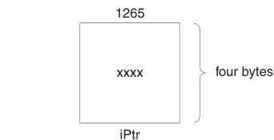

为 `iPtr` 分配了 4 个字节，其在从例如 1265 到 1268 的地址上包含垃圾值。

**图 3.2(a)** 使用 `iPtr` 为数组分配内存

**语句：** `iPtr = new int[SIZE]; //SIZE=10`

`new` 运算符在堆中分配内存来存储十个整数类型的值[参见图 3.2(b)]。如果分配了从地址 5972 字节到地址 6012 字节的内存块，`new` 运算符将返回块的起始地址 5972。该值被存储在 `iPtr` 中。之后，在 `for` 循环中，通过下标运算符对 `iPtr` 进行解引用。访问数组中从第一个元素开始的所有元素。使用 `new` 运算符创建数组的语法如下：

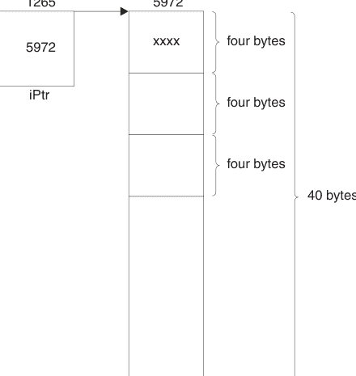

**图 3.2(b)** 使用 `new` 运算符为数组动态分配内存

```cpp
<pointer> = new <data_type>[<number_of_elements>];
```

现在，让我们让程序具有交互性，以利用 `new` 运算符的力量。在使用 `new` 运算符分配内存时，我们传递到下标内部内部的值可以是一个变量。在代码列表 3.3 中，我们将首先要求用户输入数组的大小

## 动态内存管理

将其存储在变量中。接下来，在使用 `new` 运算符分配内存时，我们将变量传递到下标中。`new` 运算符返回的地址将存储在指针中。最后，我们将通过指针访问创建的数组。代码列表 3.3 所示的程序。

## 代码列表 3.3 在运行时指定大小时动态创建数组

```cpp
/*DynArray.cpp 的开始*/
#include<iostream.h>
void main()
{
    int * iPtr;
    unsigned int iSize;
    cout<<"Enter the size of the array : ";
    cin>>iSize;
    iPtr = new int[iSize];
    for(int i=0;i<iSize;i++)
        cout<<"Enter the value for element "<<i+1<<" : ";
        cin>>iPtr[i];
    for(int j=0;j<iSize;j++)
        cout<<iPtr[j]<<endl;
    
}
/*DynArray2.cpp 的结束*/
```

## 输出

Enter the size of the array : 3

Enter the value for element 1 : 12

Enter the value for element 2 : 7

Enter the value for element 3 : 19

12

7

19

我们注意到 `new` 运算符使我们能够动态分配内存。在代码列表 3.3 中，内是在运行时分配的（就像静态内存分配一样）。然而，要分配的内存数量是在运行时本身决定的。同样的方法也可以适用于动态创建其他预定义基本数据类型的数组。类对象数组也可以以相同的方式动态创建。代码列表 3.4 就是一个很好的例子。

## 代码列表 3.4 在运行时动态创建对象数组

```cpp
/*DynDist.cpp 的开始*/
#include<iostream.h>
#include"Distance.h"
void main()
{
    Distance * dPtr;
    unsigned int iSize;
    cout<<"Enter the number of elements : ";
    cin>>iSize;
    dPtr = new Distance[iSize];
    for(int i=0;i<iSize;i++)
{
    cout<<"Enter the feet : ";
    cin>>a;
    cout<<"Enter the inches : ";
    cin>>b;
    dPtr[i].setFeet(a);
    dPtr[i].setInches(b);
}
for(int j=0;j<iSize; j++) {
    cout<<dPtr[j].getFeet() << dPtr[j].getInches()endl;
}
/*DynDist.cpp 的结束*/
```

Output

Enter the number of elements : 3

Enter the feet : 1

Enter the inches : 1

Enter the feet : 2

Enter the inches : 2

Enter the feet : 3

Enter the inches : 3

1 1

2 2

3 3

在代码列表 3.3 和 3.4 中，明确要求用户输入数组的大小。这有点突兀。运行时可能会出现对更多内存的需求（在创建链表等数据结构时）。尽管如此，使用 `new` 运算符的基本技术保持不变。

## 3.3 动态释放

我们知道动态分配的内存块可以被释放。一旦它不再使用，动态分配的内存块绝对应该返回给操作系统。在 C 中，动态释放是通过 `free()` 实现的。在 C++ 中，动态释放是通过 `delete` 运算符实现的。动态分配的内存块必须返回给操作系统。如果动态分配的内存块不返回给操作系统，会发生什么？通过代码列表 3.5 回答了这些问题。

## 内存泄漏

```cpp
/*DynArray.cpp 的开始*/
#include<iostream.h>
void main()
{
    int * iPtr;
    unsigned int iSize;
    cout<<"Enter the size of the array : ";
    cin>>iSize;
    iPtr = new int[iSize];
    for(int i=0;i<iSize;i++)
        cout<<"Enter the value for element "<<i+1<<" : ";
        cin>>iPtr[i];
    for(int j=0;j<iSize;j++)
        cout<<iPtr[j]<<endl;
    
}
/*DynArray2.cpp 的结束*/
```

## 列表 3.7 C++ 允许根据需要释放内存


```cpp
void abc(int ** p)
{
    if(memory_not_required) {
        delete *ptr;
        *p = NULL;
    }
/* abc() 函数的剩余部分 */
}
```

关于 `delete` 操作符的一个常见误解是“删除了指针”。初学者可能认为，如果对指针使用 `delete` 操作符，那么指针所占用的内存就会被移除。实际上，这些情况都不会发生。

当对指针使用 `delete` 操作符时，该指针继续占用其所在的内存块，并继续保持相同的值（即该内存块第一个字节的地址）。因此，指针继续指向同一块内存。如果对该指针进行解引用，会导致运行时错误。

我们在列表 3.7 中看到，在 `p` 所指向的内存被释放后，该指针被刻意置为空（null）。这是一种非常常见的做法，用于表示该指针（地址从调用函数传递的指针）不再指向动态分配的内存块。换句话说，理想情况下指针要么指向一个有效的内存块，要么为 `NULL`。由于指针表示的层级较低，我们无法保证这一点。指针在创建时不太可能是 `NULL`，但这并不意味着它所包含的值就是某个有效内存块的地址。数据并没有经过保证的初始化。这个问题通过使用构造函数来解决，构造函数在第 4 章中讨论过。

通过在 `delete` 操作符后加上一对空方括号 `[]`，然后指向多个内存块的指针，可以释放多个内存块，如列表 3.8所示。

## 列表 3.8 释放为数组分配的内存

```cpp
int * Iptr;
...
ptr = new int[10];
...
delete[] Iptr;
```

如果我们写 `delete Iptr` 而不是 `delete[] Iptr`，那么 `Iptr` 指向的 40 字节内存块中，只有前四个字节会被释放。使用 `delete[]` 会释放整个 40 字节的内存块。使用 `delete` 操作符释放数组的语法如下：

```cpp
delete [] <ptr>;
```

创建数组的大小作为参数传递给 `new` 操作符。但在释放为数组分配的内存时，并没有传递大小（方括号是空的）。编译器如何知道需要释放多少内存？答案是，当 `new` 操作符执行以分配数组块时，操作系统会存储所传递的大小。图 3.4 显示内存块的大小在运行时捕获并前缀在内存块本身。当使用 `delete` 操作符后跟一对空方括号时，编译器会使用存储的大小并正确释放整个内存块。

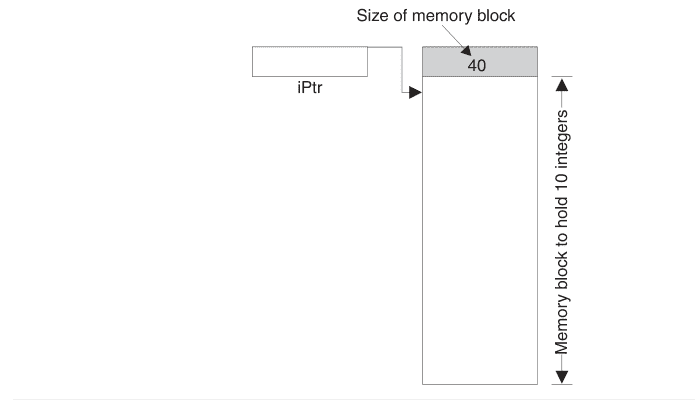

图 3.4 分配内存的大小的前缀在内存块中

包含其他类型数组的内存块也可以类似地释放。例如，参见列表 3.9。

## 列表 3.9 释放为对象数组分配的内存

```cpp
Distance * dptr; // 创建一个包含 5 个对象的数组
dptr = new Distance[5]; // Distance 类
...
delete[] dptr; // 释放为整个数组分配的内存
```

## 3.4 set_new_handler() 函数

我们已经知道 `new` 操作符尝试在运行时从堆中获取更多的内存块。但如果没有更多可用内存来满足这一尝试会发生什么呢？我们会遇到内存不足的情况。

当 `new` 操作符面临内存不足的情况时，会调用一个全局函数，然后抛出一个类型为 `bad_alloc` 的异常（异常章节讨论了抛出和捕获异常的机制）。这个全局函数被称为新处理函数（new handler function）。

我们也可以指定自己的处理函数！我们可以指定 `new` 操作符在遇到内存不足的情况时，调用你所选择的函数。我们可以通过调用 `set_new_handler()` 函数并将所需的函数名作为参数传递给它来实现这一点。`set_new_handler()` 函数的原型说明了这一点。该原型在 `new.h` 头文件中。

```cpp
new_handler set_new_handler(new_handler);
```

显然，`new_handler` 是一个数据类型。它是一个函数指针。`set_new_handler()` 的第一个参数是一个函数指针。如果我们将所需的函数名作为参数传递给 `set_new_handler()` 函数，所有后续的内存不足情况都会导致 `new` 操作符调用它。我们的目标函数就变成了新处理器。此外，当调用 `set_new_handler()` 函数时，它会返回指向上一个新处理函数的指针。

列表 3.10 提供了一个说明示例。

## 列表 3.10 指定新处理函数

```cpp
/* newHandler.cpp 的开始 */
#define BIG_NUMBER 9999999
#include<new.h> // 用于 set_new_handler

void newHandler() {
    // 处理内存不足
}

int main() {
    set_new_handler(newHandler);
    int *p = new int[BIG_NUMBER];
    ...
    return 0;
}
```

## 动态内存管理

此版本与之前的版本相似，区别在于 `delete` 关键字和指针名称之间出现了一对空方括号。C++ 知道要返回的精确字节数。它将动态分配块的大小存储在一段内存中，该内存被作为所分配内存块本身的前缀。`set_new_handler()` 函数允许我们设置自己的函数设置为新的异常处理函数。

# 关键术语

- 静态内存分配
- 静态内存释放
- 动态内存分配
- 动态内存释放
- new 运算符
- delete 运算符
- 运行时条件？
- set_new_handler() 函数
- new 异常句柄函数

# 练习题

1. 什么是静态内存分配？
2. 在静态内存分配中，内存何时分配和释放？——是在编译时还是运行时？
3. 在什么情况下，静态内存分配变得不再适用？
4. 什么是动态内存分配？它与静态内存分配有什么区别？
5. 在动态内存分配中，内存何时分配和释放？——是在编译时、链接时还是运行时？
6. 在什么情况下，使用动态内存分配是强制性的？
7. `new` 运算符的语法是什么：
   (a) 为单个变量分配内存？
   (b) 为数组分配内存？
8. 描述根据现有的运行时条件，如何在 C++ 中在运行时获取额外的内存块？
9. `delete` 运算符的语法是什么：
   (a) 释放为单个变量分配的内存？
   (b) 释放为数组分配的内存？
10. `delete` 运算符并不接收数组的大小。编译器是如何确定这个大小的？
11. 什么是内存泄漏？
12. 如何使用 `delete` 运算符防止内存泄漏？
13. 什么是内存溢出条件？
14. 什么是 new handler？如何使用 `set_new_handler()` 函数来设置自己的 new handler？

## 构造函数与析构函数

我们已经意识到，需要在类中包含一个成员函数，将类的数据成员初始化为所需的默认值，并且为每个新创建的对象自动调用该函数。构造函数满足了这一需求，本章的第一部分涉及析构函数。本章的中间部分描述了各种类型的构造函数。

我们还需要在类中包含一个成员函数，该函数会在每个离开作用域的对象自动调用。析构函数满足了这一需求，本章的倒数部分涉及析构函数。

除了类和访问限定符，构造函数和析构函数满足了创建新数据类型——安全且高效的数据类型的要求。这在本章的最后部分进行了讨论。

## 4.1 构造函数

构造函数会在每个新创建的对象被自动调用。它作为每个类的成员函数出现，无论是否定义。它的名称与类名相同。它可以接受参数，也可以不接受。它不返回任何内容（甚至是 `void`）。构造函数的原型为：

```
<class name>(parameter list);
```

在第 2 章中，我们感到需要一个能够保证类成员数据初始化的函数。构造函数满足了这一需求。数据成员值的域约束也可以通过构造函数来实现。例如，`Distance` 类中每个对象，其数据成员 `finches` 的值在对象的整个生命周期内必须始终在 0.0 到 12.0 之间。在对象创建时，该条件可能会被违反。然而，在 `Distance` 类中引入构造函数可以强制执行这一条件。

编译器在每个对象创建时会嵌入一个对构造函数的调用。假设声明了如下的类 A：

```cpp
/*Beginning of A.h*/
class A
{
    int x;
    public:
        void setx(const int x=0);
        int getx();
};
/*End of A.h*/
```

```cpp
#include"Distance.h"
void main()
{
    Distance d1; //constructor called
    cout<<d1.getFeet()""<<d1.getInches();
}
/*/End of DistTest.cpp*/
```

# 输出

0 0 0

现在，由于 `Distance` 类中存在构造函数，可以保证 `Distance` 类所有对象的数据都得到初始化。我们之前将 `Distance` 类所有对象的英寸（inches）部分保持在 12.0 以内的目标现在已经实现。

我们在代码列表 4.2 中定义的构造函数不接受任何参数，被称为**零参数构造函数**。编译器默认提供的构造函数也不接受任何参数。因此，“零参数构造函数”和“默认构造函数”这两个术语是可以互换使用的。

现在，让我们开始学习一个类，该类将允许我们抽象字符并克服其中存在的许多缺点。这将作为我们解释书中大部分概念的贯运行示例。我们将逐步渐进地定义它。我们的最终目标是定义一个可以代替字符数组的类。

让我们这个类命名为 `String`。它有两个数据成员。这两个数据成员都将是私有的（private）。第一个数据成员是一个字符。它将指向一个动态分配的内存块，该块包含实际字符数组。另一个数据成员是一个无符号长整数（long unsigned integer），包含该字符数组的长度。

```cpp
/*String.h 的开头*/
class String
{
    char *cStr; //指向字符数组的
                //字符指针

    long unsigned int len; //存储字符数组的
                       //长度

    /*/
String 类的其余部分
*/
};
/*String.h 的结束*/
```

假设 's1' 是 `String` 类的一个对象，并且字符串 'abc' 已赋值给它。这种情况可以用图 4.1 来描绘。

包含字符串的内存块的第一个字节的地址是 101。这个地址存储在 'cStr' 指针中。's1' 的地址是 27。

此外，我们对 `String` 类的所有对象都要严格地实现以下两个条件：

- 'cStr' 要么指向一个专门为它分配的动态内存块（即没有其他指针指向 'cStr' 所指向的内存块），要么 'cStr' 为 NULL。
- 不得有内存泄漏。

图 4.1 `String` 类对象的内存布局

| | a | b | c | d |
|---|---|---|---|---|
| cStr | 101 | | | |
| len | 3 | | | |

### 97

显然，当创建一个 `String` 类对象时，该对象的 'cStr'部分最初应被设置为 NULL（并将 'len' 设置为 0）。相应地，构造函数的原型和定义如代码列表 4.4 所示。

代码列表 4.4 用户定义的构造函数

```cpp
/*String.h 的开头*/
class String
{
    char *cStr;
    long unsigned int len;
    public:
    String();                      //构造函数的原型
    /*
    String 类的其余部分
    */
};
/*String.h 的结束*/
```

```cpp
/*String.cpp 的开头*/
#include "String.h"
String::String()                //构造函数的定义
    cStr=NULL;                       //...将其指针置空并...
    len=0;                          //...将长度设置为零。
/*
String 类其余成员函数的定义
*/
/*String.cpp 的结束*/
```

### 4.1.2 参数化构造函数

构造函数接受参数，因此可以进行重载。假设对于 `Distance` 类，库程序员决定在创建对象时，应用程序程序员能够为对象中包含的数据成员传递一些初始值。为了实现这一点，他/她可以创建一个如代码列表 4.5 所示的参数化构造函数。

代码列表 4.5 用户定义的参数化构造函数——通过在栈上创建对象来调用

```cpp
/*Distance.h 的开头*/
class Distance {
    public:
        Distance();      //库程序员提供的原型
        Distance(int, float); //参数化构造函数的原型
    /*
        Distance 类的其余部分
    */
}
```

```cpp
/*Distance.cpp 的开头*/
#include "Distance.h"
Distance::Distance() {
    feet=0;
    inches=0.0;
}
Distance::Distance(int p, float q) {
    feet=p;
    inches=q;
}
/*
Distance 类其余成员函数的定义
*/
```

输出

1.

代码列表 4.5 展示了通过在堆上创建对象来调用用户定义的参数化构造函数。

代码列表 4.6 用户定义的参数化构造函数——通过在堆上创建对象来调用

```cpp
/*Test.cpp 的开头*/
#include <iostream>
#include "Distance.h"

void main() 
{
    Distance * dptr;
    dptr = new Distance
```

代码列表 4.5 中 `main()` 函数的第一行和 4.6 中 `main()` 函数的第二行显示了向参数化构造函数传递值的语法。参数化构造函数的原型和定义与其他成员函数类似，不同在于它不返回任何值。记住，如果提供了参数化构造函数而没有提供零参数构造函数，那么在尝试不带参数的情况下创建对象时，编译器将报错。像其他成员函数一样，参数化构造函数的参数可以传递给它。在这种情况下，零参数构造函数是不必要的。参见代码 4.7。

**4.7** 给参数化构造函数赋值值

```cpp
/*Distance.h 的开头*/
class Distance {
public:
    Distance(int, float); //参数化构造函数的参数
    /*
    Distance 类的其余部分
    */
};
/*Distance.h 的结束*/
```

在这种情况下，如果提供了参数化构造函数而没有提供零参数构造函数，那么在尝试不带参数的情况下创建对象时，编译器将报错。像其他成员函数一样，参数化构造函数的参数可以传递给它。在这种情况下，零参数构造函数是不必要的。参见代码 4.7。

**4.7** 给参数化构造函数赋值值

**给参数化构造函数赋值值**

（注：由于原文文本在结尾部分存在大量重复和逻辑混乱，上述译文已根据语意进行了精简和对齐。）

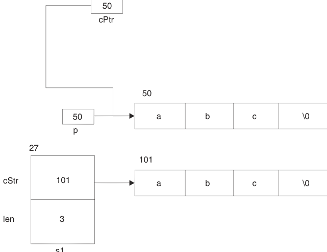

**图 4.3** 将字符串赋值给 *String* 类的对象

在专门为该目的分配的四个字节不同内存块的基地址处。传递给构造函数的基地址的内存块的内容应该被复制到 's1.cStr' 所指向的内存块中。

在图 4.3 中，'cPtr' 指向包含字符串的内存块。换句话说，“cPtr' 的值是包含字符串的内存块的地址。

第三种情况

```
char cArr[10] = "abc";
String s1(cArr);
```

与上述情况类似。在这种情况下，我们将数组名作为参数传递给构造函数。但我们知道数组本身是一个固定指针，包含了包含实际内容的内存块的基地址。我们现在可以定义产生这些效果的构造函数了。我们必须意识到 'p'（构造函数的形参数）应该如下所示：

```
const char * const
```

首先，它应该是一个常量指针，因为在构造函数的执行过程中，它应该继续指向同一个内存块。其次，它应该是一个指向常量的指针，因为即使是库程序员也不应该引用它来更改所指向的内存块的内容。此外，我们希望为 'p' 指定一个默认值（NULL），这样就不需要单独定义无参数构造函数。

*String* 类的定义、构造函数的原型及其定义见列表 4.8。

102 C++ 面向编程


**图 4.4** 将数组赋值给 String 类的对象

**列表 4.8** 用于获取外部内存的用户定义的参数化构造函数


String 类还引入了另一个名为 `getString()` 的函数。它允许我们显示字符串本身。该函数返回一个 `const char *`，因此只有指向常量的指针才能等同于此函数的调用。

```
const char * p = s1.getString();
```

这样的指针将有效地指向调用对象所指向的内存块。由于上述语句的结果，`'p'` 和 `'s1.cStr'` 将指向同一个地方。然而，由于它是指向常量的指针，无法更改内存块中的值。我们必须注意，确保对象外部的数据需要库程序员做出额外的努力。我们可以重写 `main()` 函数并验证新定义的构造函数能够产生图 4.2、4.3 和 4.4 所示的效果。

### 4.1.3 显式构造函数

注意列表 4.8 中 `main()` 函数的第一语句调用了 `String` 类的构造函数。现在看下面的语句：

```
String s1 = "abc";
```

上述语句也调用了 `String` 类的构造函数。该语句之所以编译，是因为 `String` 类中有一个字符串作为参数的构造函数。该构造函数隐式地将字符串 `"abc"` 转换为 `String` 类的对象。如果上述语句写如下（注意类型转换）：

```
String s1 = (String)"abc";
```

# C++ 面向编程

但是，我们写的语句中并没有提供类型转换。那么转换是如何发生的呢？如前，是构造函数为我们执行转换。

然而，如果构造函数被声明为显式构造函数，像上面的语句将无法编译。显式构造函数不允许像上面示例那样的隐式转换。

通过在声明前加上 `explicit` 关键字来声明显式构造函数。我们将首先查看显式构造函数的语法（见列表 4.9）。然后我们将查看一个程序，说明当构造函数被声明为显式构造函数时获取错误的情况。

### 列表 4.9 显式构造函数

```
/* String.h 开始 */
class String
{
    char *cStr;
    long unsigned int len;
public:
    /* 无参数构造函数 */
    /*
    下一个语句声明了一个显式构造函数。
    注意 explicit 关键字。
    explicit String(const char * p = NULL);
    const char * getCString();
    /*
    String 类的其余部分
    */
};
/* String.h 结束 */
```

让我们看看列表 4.10，它说明了当构造函数被声明为显式构造函数时我们可能会得到的错误。

# 列表 4.10 由显式 StringMain.cpp 引起的错误

```
/* StringMain.cpp 开始 */
#include<iostream>
#include"String.h"
void main()
{
    String s1 = "abc"; // 错误：显式转换
    String s2 = "def"; // 错误：不允许隐式转换
}
/* StringMain.cpp 结束 */
```

注意，如果语句写如下，程序中的错误将会消失：

`String s2 = (String)"def"; // 正确`

显而易见，显式构造函数强制程序员进行显式转换。进一步注意，只需要在构造函数的声明中说明 `explicit` 关键字。不需要在构造函数的定义中加上它。对于不希望出现隐式转换的类，显式构造函数可能有用。

## 4.1.4 拷贝构造函数

拷贝构造函数是一种特殊的参数化构造函数。正如其名，它将一个对象拷贝到另一个。当对象创建并同时等于另一个对象时调用它。拷贝构造函数为创建的对象调用。预先对象作为参数传递给它。从拷贝构造函数的角度来说，它拷贝传递给它的对象。

如果我们没有为类定义拷贝构造函数，编译器会为我们定义。但在以下三种情况下，它都嵌入了拷贝：

- 当对象创建并同时等于另一个对象时，拷贝构造函数为创建的对象调用。该对象作为参数传递给拷贝构造函数。

```
A A1;
A A2=A1;
// 无参数/默认构造函数调用
// 拷贝构造函数调用
```

```
或者
A A2(A1);
// 拷贝构造函数调用
```

```
或者
A * APtr = new A(A1);
// 拷贝构造函数调用
```

在这里，拷贝构造函数为 `A2` 和 `APtr` 调用，而在两种情况下，`A1` 都作为参数传递给拷贝构造函数。

- 当对象创建并同时等于一个返回对象的函数调用时，拷贝构造函数为参数对象调用。传递给函数的对象作为参数传递给拷贝构造函数。

```
void abc(A1);
// 无参数/默认构造函数调用
// 拷贝构造函数调用
void abc(A A2)
{
    /*
    abc() 的定义
    */
```

在这里，拷贝构造函数再次为 `A2` 调用，而 `A1` 作为参数传递给拷贝构造函数。

- 当对象创建并同时等于一个返回对象的函数调用时，拷贝构造函数为等同于函数调用的对象调用。函数返回的对象作为参数传递给构造函数。

```
A abc()
{
```

## 使用 C++ 进行面向对象编程

```cpp
A A1; // 调用零参数/默认构造函数
/*
abc() 的剩余定义
*/
return A1;
}
A2=abc(); // 调用拷贝构造函数
```

再次，为 `'A2'` 调用了拷贝构造函数，此时 `'A1'` 被作为参数传递给拷贝构造函数。

编译器定义的默认拷贝构造函数的原型和定义如下：

```cpp
class A {
public:
    A(A&); // 默认拷贝构造函数
};
A::A(A& AObj) // 默认拷贝构造函数
{
    *this=AObj; // 将传递的对象拷贝到调用对象
}
```

显而易见，默认拷贝构造函数执行了它应该做的事情——复制。语句

```cpp
A2=A1;
```

被转换为如下：

```cpp
A A2; // 为 A2 分配内存
A2.A(A1); // 为 A2 调用拷贝构造函数，A1
// 作为参数传递给它
```

最后一条语句被转换为

```cpp
A(&A2,A1); // 查看第2章关于 'this' 指针的章节
```

当该语句执行时，`'AObj'` 是形式参数，而 `this` 指针指向 `'A2'`（调用对象）。同样，其他将对象作为形式参数创建或从函数返回的语句也可以得到解释。

但为什么编译器将默认拷贝构造函数的形式参数定义为引用呢？当编译器按照预期方式定义了拷贝构造函数时，我们为什么还要自己定义一个呢？这两个问题现在都得到了解答。

首先，让我们找出哪些对象是通过引用传递给拷贝构造函数的。假设拷贝构造函数的形式参数（`'AObj'`）不是引用。现在，假设执行以下语句。

```cpp
A2=A1;
```

拷贝构造函数将为 `'A2'` 调用，而 `A1` 将作为参数传递给它。然后，拷贝构造函数将为 `'AObj'` 调用，而 `A1` 将作为参数传递给它。这是因为 `'AObj'` 是拷贝构造函数的非引用形式参数。因此，将引发无限的拷贝构造函数调用链。然而，如果拷贝构造函数的形式参数是引用，则不会为它调用任何构造函数（甚至拷贝构造函数）。

这是因为对象的引用并不是一个独立的对象。没有为它分配单独的内存。因此，不会为它嵌入构造函数的调用。

# 构造函数与析构函数 107

现在我们来看一个关键问题。我们为什么要定义自己的拷贝构造函数？毕竟，默认拷贝构造函数（编译器免费提供的）工作做得相当不错。首先，回想一下我们为 `String` 类所有对象设定的实现条件。假设创建了一个 `String` 类对象，并同时与该类的另一个对象赋值。例如：

```cpp
String s1("abc\n");
String s2=s1; // 为 s2 调用拷贝构造函数，s1
// 作为参数传递给它
```

由于我们没有为 `String` 类定义拷贝构造函数，编译器为我们定义了。在上述情况下，这个默认拷贝构造函数做了什么？它简单地将 `'s1'` 的值拷贝到 `'s2'`！这意味着 `'s2.cstr'` 的值变得与 `'s1.cstr'` 相。因此，两个指针都指向了同一个地方！这违背了我们的条件。在这种情况下，默认拷贝构造函数的行为是不如人意的。为了解决默认拷贝构造函数的这个问题，我们必须定义自己的拷贝构造函数。

在 `String` 类的拷贝构造函数内部，必须首先在堆中动态分配一段单独内存。这段内存的长度必须与参数参数的对象（在此例为 `'s1'`）指针指向的字符串长度相等。然后必须让调用对象（在此例为 `'s2'`）的指针指向这段新分配的内存。调用对象的 `'len'` 值也应该被适当设置。然而，如果传递参数的对象中的指针为 `NULL`，则调用对象的指针值和 `'len'` 必须设置为 `NULL` 和零。

因此，`String` 类拷贝构造函数的原型和定义出现在列表 4.11 中。

列表 4.11 用户定义的拷贝构造函数

```cpp
/*String.h 开始*/
#include<iostream>
class String
{
    char * cStr;
    unsigned int len;
public:
    String(const String&); // 我们自定义的拷贝构造函数
    /* String 类的其余部分 */
    explicit String(const char * const p = NULL);
    const char * getStr();
};
/*String.h 结束*/

/*String.cpp 开始*/
#include"String.h"
#include<string.h>
String::String(const String& ss) // 我们自定义的拷贝构造函数
{
    if(ss.cStr==NULL) // 如果传递对象的指针为 NULL
    {
        cStr=NULL;               // ...那么也让调用对象的指针置空
    }
    else                          // /否则...
    {
        len=ss.len;
        cStr = new char[len+1];      //...动态分配一个单独内存块...并拷贝到其中
        strcpy(cStr,ss.cStr);
    }
}
String::String(const char * const p)
{
    if(p==NULL)                   // 如果传递了默认值...
    {
        cStr=NULL;                   //...置空
        len=0;
    }
    else                          // /否则...
    {
        len=strlen(p);
        cStr=new char[len+1];      //...动态分配一个单独内存块...并拷贝到其中
        strcpy(cStr,p);
    }
}
const char * String::getStr()
{
    return cStr;
}
/*String.cpp 结束*/
```

```cpp
/*StringMain.cpp 开始*/
#include "String.h"
#include<iostream.h>
void main()
{
    String s1("abc");
    String s2="";
    cout<<s1.getString<<endl;
    cout<<s2.getString<<endl;
}
/*StringMain.cpp 结束*/
```

# 输出

abc

abc

在拷贝构造函数（列表 4.11）中，形式参数是常量。为了防止无限调用链，它必须是一个引用。但与此同时，如果程序员写了如下语句，编译器当然会报告编译错误：

```cpp
ss.cStr=NULL;               //指针被修改!
ss.len++;                       //len被修改!
```108 使用 C++ 进行面向对象编程

## 4.2 析构函数

析构会在每个即将离开作用域的对象被调用。无论我们是否定义它，它都是类的成员函数。它的名字与类名相同，前面加一个波浪号。它不接受参数。它不返回任何内容（即使是 void）。析构函数的原型是

```cpp
~className();
```

初始化成员数据并释放对象在生命周期内获取资源的需求将会解释。析构函数实现了这一点。

编译器会在每个对象被销毁时嵌入析构函数的调用。我们再次查看列表 4.1 中的 `main()` 函数。

```cpp
void main()
{
    A ai;
} //ai 在 main() 函数结束前离开作用域。
```

编译器为 `'ai'` 嵌入了析构函数的调用。它嵌入了：

```cpp
A1~A1(); // 调用不是合法的 C 代码
```

析构函数也会在堆中创建的对象在指向它的指针应用 `delete` 操作符之前调用。

```cpp
A * aptr;
aptr = new A; // 对象创建，调用构造函数
..
delete aptr; // 对象销毁，调用析构函数
```

```cpp
aptr->~A(); // 为 *aptr 调用析构函数
delete aptr; // 释放 *aptr 的内存
```

`~A(aptr); //查看第2章关于 'this' 指针的章节`

相反，析构函数并没有“销毁”或禁用它所占据的对象。它仅仅是一个在对象离开作用域（销毁）之前被调用的成员函数。

显而易见的是，编译器会在每个离开作用域的对象处嵌入析构函数的调用。但我们并没有在类内部原型化并定义析构函数。那么上述对析构函数的调用是如何解析的？编译器为我们原型化并定义了析构函数。但这种定义的函数定义包含什么语句？答案是“什么”。一个编译器定义的析构函数示例如下。

## 110 使用 C++ 进行面向对象编程

## 之前

```cpp
class A
{
  ...
  public:
    ...
    //没有析构函数
};
```

## 之后

```cpp
class A
{
  ...
  public:
    ~A();      // 编译器隐式插入原型声明
};
A::~A()
{
  // 编译器隐式插入空定义
}
```

让我们为列表 4.2 中定义的类 `A` 添加析构函数，并验证析构函数是否真的由编译器隐式调用。参见列表 4.12。

列表 4.12 当对象销毁时，每个对象都会调用析构函数

```cpp
/*A.h 的开始*/
class A
{
  int x;
  public:
    A();
    void setx(const int x=0);
    int getx();
    ~A();      // 我们自己的析构函数
};
```

```cpp
/*A.cpp 的开始*/
#include"A.h"
#include<iostream>
A::A()
{
  cout<<"Constructor of class A called\n";
}
A::~A() // 我们自己的析构函数
{
  cout<<"Destructor of class A called\n";
}
/*
class A 其余函数的定义
```

```cpp
/*A.cpp 的结束*/
/*AMain.cpp 的开始*/
#include<A.h>
#include<iostream.h>
void main()
{
    A A1;
    cout="End of program\n";
}
/*AMain.cpp 的结束*/
```

## 输出

Constructor of class A called

End of program

Destructor of class A called

我们可以看到，析构函数的名字与类名相同，但加上一个波浪号 `~`。此外，析构函数没有返回值。编译器定义析构函数是为了解决它强制为离开作用域的对象放置的析构函数调用。

析构函数不接受任何参数。因此，它们不能被重载。

我们为什么要定义自己的析构函数？我们必须记住，析构函数也是一个成员函数。它是为对象调用的。因此，它可以访问被调用的对象的数据成员。

让我们考虑一下 `Distance` 类析构函数的相应定义。我们想为自己做什么？它对于离开作用域的对象的数据成员应该做什么？我们应该将它们设置为零吗？


```cpp
Distance::~Distance()
{
    iFeet=0;
    iches=0.0;
}
```

但这有什么用呢？析构函数在执行完毕后立即就会离开作用域了。

但是，我们必须为某些类定义析构函数，这些类的对象在生命周期内获取了对象外部的资源。让我们以 `String` 类为例。我们考虑以下代码块：

```cpp
{
    .
    .
    .
    String s1("abc");
    .
    .
    .
}
```

分配给 `'s1'` 本身的内会在该块执行结束时释放。但 `'s1.cStr'` 指向的是堆区中动态分配的内存块。该内存块位于 `'s1'` 本身所占据的内存块之外。在 `'s1'` 被销毁后，该内存块仍作为被锁定的资源被分配。指向 `('s1.cStr')` 的唯一指针不再可用。这就是内存泄漏。应该应该防止这种情况。我们应该在 `String` 类任何对象的指针离开作用域时，释放该指针指向的内存块。这意味着我们必须为 `String` 类内部的指针调用 `delete` 运算符，并将此语句放在析构函数内部。参见列表 4.13。

## 列表 4.13 用户定义的析构函数

```cpp
/*String.h 的开始*/
class String
{
    char *cStr;
    long unsigned int len;
    public:
    ~String();            // 我们自己的析构函数
    /*
    String类的其余部分
    */
};
/*/String.h 的结束*/

/*String.cpp 的开始*/
#include"String.h"
#include<string.h>
String::String()
{
    if(cStr==NULL)      // 如果内存存在
    delete [cStr];      // 销毁它
}
/*
String 类其余函数的定义
*/
/*/String.cpp 的结束*/
```

## 4.3 面向对象编程 (OOPS) 哲学

现在，让我们离题，欣赏一下面向对象编程的基本哲学。OOPS 的目标之一是废除基本数据类型的使用。类可以包含大量的功能（方法），让应用程序程序员免于担心预防 bug 的顾虑。

`String` 类就是这样一种类型。通过添加一些相关函数，我们可以方便地使用 `String` 类的对象。考虑为 `String` 类添加以下函数：

```cpp
void String::addchar(char c); // 向字符串添加一个字符的函数
```

正如其名称所示，该函数将向调用对象内部指针指向的字符串处添加一个字符。

```cpp
String s1("abc");
```

由于该语句的结果，`'s1'` 内部的指针指向一个四字节的内存块（最后一个包含 NULL）。现在，如果我们写：

```cpp
s1.addchar('d'); // 向字符串添加一个字符
```

应该应该发生以下情况：

- 应该分配另一个四字节的块。
- 字符串应该被追加。
- `s1.cStr` 应该指向这个新块。
- 原本 `s1.cStr` 指向的内存块应该被释放。

如图 4.5 所示。

| 之前 | 之后 |
| :--- | :--- |
| `s1("abc")` | `s1.addchar('d')` |
| `cStr` 指向4个字节 | `cStr` 指向5个字节 |
| `len = 3` | `len = 4` |

## 构造函数与析构函数

## 使用 C++ 进行面向对象编程

等待调用对象指针指向的字符串处的值。这些函数可以内置检查，以防止超出分配内存范围的写入或读取。这种检查适用于字符数组。我们还想添加一个替换传入字符串的函数：

```cpp
void String::setString(const char *s);
```

假设执行了以下语句：

```cpp
String s1("abc");
s1.setString("def");
```

那么应该发生以下事件：

- 应该分配一个五字节的块。
- 字符串应该写入 `"def"`。
- `s1.cStr` 应该指向这个新块。
- `s1.cStr` 原指向的内存应该被释放。

`setString` 的形式参数是 `const char *`。这些原因已经在参数化构造函数部分讨论过。当构造函数开始执行时，`cStr` 可能为 NULL（可能包含垃圾值）。但即使它不为 NULL，也不意味着它指向一个分配的内存块。当 `setString` 函数开始执行时，如果 `cStr` 不是 NULL，那么它一定指向一个分配的内存块。在 `setString` 函数的开头应该插入检查此条件并释放内存并将 `'len'` 设置为零的语句。否则会导致内存泄漏。

定义 `addchar()` 和 `setString()` 函数就像是一个练习。让我们考虑可以添加到 `String` 类中的更多相关函数。可以有一个函数来修改调用对象指针指向的字符串中特定位置字符的值。此外，可以有一个函数来读取调用对象指针指向的字符串中特定位置的值。

在为 `String` 类添加了所有函数后，我们将获得一种安全、高效且易于使用的新数据类型。

良好的构造函数和析构函数在创建此类数据类型时起着至关重要的作用。它们确保了：

- 没有内存泄漏（析构函数释放了不需要的内存）。
- 没有运行时错误（没有两次调用释放同一块内存）。
- 数据永远不会处于无效状态，数据成员值的域约束永远不会被违反。

在定义了此类数据类型后，可以创建新的数据类型来扩展现有数据类型的定义。它们包含现有数据类型的定义和。

## 构造函数与析构函数

同时为它们添加了更多专门的特性。这种通过现有数据类型来定义新数据类型的方法被称为继承。第5章将介绍 OOPS 特性及其在 C++ 中的实现。

## 总结

构造函数可以保证类数据成员的正确初始化。可以通过构造函数实现对数据成员值的域值约束。

析构函数可以保证在对象超出作用域时进行适当的清理。析构函数是成员函数，其名称与类名相同，但带有波浪符号 `~` 前缀。如果我们没有定义它，编译器会创建一个析构函数。析构函数不接受参数且不能被重载。它们不返回任何内容（包括 `void`）。编译器会为每个超出作用域（被销毁）的对象隐式嵌入对析构函数的调用。禁止显式调用现有对象的析构函数。

构造函数是成员函数，其名称与类名相同。如果我们没有定义它们，编译器会创建一个无参数构造函数和一个拷贝构造函数。构造函数接受参数，因此可以被重载。它们不返回任何内容（包括 `void`）。编译器会为每个正在创建的对象隐式嵌入对构造函数的调用。禁止显式调用现有对象的构造函数。

# 关键术语

- 不返回任何内容
- 为每个刚获取的对象自动调用
- 无参数构造函数
- 参数化化构造函数
- 默认定义
- 拷贝构造函数
- 与类名相同
- 析构函数

# 练习题

1. 什么是构造函数？它们什么时候被调用？它们的用途是什么？
2. 为什么构造函数的正式参数应该是一个引用对象？
3. 什么是析构函数？它们什么时候被调用？它们的用途是什么？
4. 下面类需要析构函数吗？
5. 为第4题中的 `Time` 类定义一个带有默认值的合适的构造函数。
6. 编译器默认为我们定义的每个类提供成员函数。在本章中我们学习了三个。写出名称。
7. 判断对错？

```cpp
class Time {
  int hours, minutes, seconds;
  public:
    /*
    Time类的其余部分 - 有更多数据成员
    */
}
```

- (a) 对象占用的内存由其类的构造函数分配。
- (B) 构造函数可以用于获取对象外的内存。
- (C) 构造函数可以被重载。
- (D) 构造函数的定义中可以有返回语句。
- (e) 对象占用的内存由其类的析构函数释放。
- (f) 析构函数可以用于释放对象外获取的内存。
- (g) 析构函数可以被重载。
- (h) 析构函数的定义中可以有返回语句。

8. 为 `String` 类显式定义了拷贝构造函数，以确保两个 `String` 类对象不会共享相同的资源，也就是说它们包含的指针不会指向同一个动态分配内存块。在这种情况下，由于拷贝构造函数的作用，这两个内存块可能会包含相同数据的两个副本，这是完全可以接受的。然而，在某些情况下，任何两个对象都不应该共享即使是相同数据的副本。

没有两个对象应该共享相同数据的副本。如果 `A` 是一个需要对其对象应用此限制的类，那么我们应该确保像下面的第二个语句无法通过编译。

```cpp
A A1;
A A2 = A1;
```

如何实现这一目标？（提示：成员函数并不总是公共的，且拷贝构造函数是一个成员函数。）

# 5 # 继承

本章讨论继承。继承是面向对象编程系统中最重要且实用的特性之一。

本章从继承的概述开始。讨论了基类和派生类等基本概念。这些影响

## 5.1 引言

继承是 OOPS 中一个非常实用的特性，并被 C++ 支持。一个类可以被定义为自动包含现有类的成员数据和成员函数。此外，在新类中也可以定义成员数据和成员函数。这被称为继承。

被继承特性的现有类被称为基类、父类或超类。通过继承现有类而派生的新类被称为其派生类、子类或子类。派生的语法如下。

```cpp
class <派生类名> : <访问修饰符> <基类名>
{
/*
派生类的定义 */
};
```

```cpp
假设类 A 已经存在。那么可以从类 A 派生一个新的类 B，如下：
```

```cpp
class B : public A
{
    /*
    类 B 的新特性
*/
};
```

在上面的示例使用了 `public` 访问修饰符。使用其他访问修饰符的影响将在本章稍后讨论。

从派生类到基类的指针图地描述了派生（见图 5.1）。

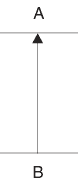

图 5.1 继承的图示描述

### 5.1.1 继承的影响

继承通过两种方式影响派生类对象的大小和行为。

- 显然，派生类对象将包含派生类的所有数据成员。它也将包含基类的数据成员。因此，派生类对象总是比基类对象大。（唯一的例外是基类和派生类都没有数据成员。在这种情况下，基类和派生类对象都占用一个字节。）
- 对于派生类对象，我们可以调用派生类的成员函数。然而，我们也可以调用基类的公共成员函数。（存在例外。这些例外的情况在本章稍后描述。）

列表 5.1 继承的影响

```cpp
/*A.h 开始*/
class A
{
    int x;
    public:
    void setX(int x=0);
    int getX()const;
};
```

```cpp
/*A.h 结束*/
/*A.cpp 开始*/
void A::setX(int pX)
{
    x = pX;
}
int A::getX() const
{
    return x;
}
```

```cpp
/*B.h 开始*/
class B : public A
{
    int y;
    public:
    void setY(int y=0);
    int getY()const;
};
```

```cpp
/*B.h 结束*/
/*B.cpp 开始*/
void B::setY(int pY)
{
    y = pY;
}
int B::getY() const
{
    return y;
}
```

```cpp
/*inherit.cpp 开始*/
#include <iostream>
#include "B.h"
void main()
{
    B b1;
    b1.setX(1);
    std::cout << sizeof(A) << std::endl;
    std::cout << sizeof(B) << std::endl;
    b1.setY(3);
    std::cout << b1.getX() << std::endl;
    std::cout << b1.getY() << std::endl;
}
/*inherit.cpp 结束*/
```

# 输出

4
8
1
3

定义 `A` 和 `B` 的成员函数被留作练习题。这个高度简化的示例（5.1）有效地说明了继承的基本机制。`B` 对象（派生类）包含一个来自 `B`，另一个来自 `A`。因此，它的大小为 8。此外，对于 `B` 对象，我们可以调用 `B` 的成员函数以及 `A` 的成员函数。

# 继承 121

派生类仅添加特殊数据成员以及处理这些额外数据成员的代码。

## 5.1.4 基类和派生类对象

现在，许多 C++ 学生可能开始认为派生类对象继承自基类对象。这是错误的，因为派生类对象与另一个同时存在的基类对象没有任何关系。

类 `A` 的对象（假设为 `'A1'`）将占用四个字节，其中仅包含 `'x'`。而类 `B` 的对象（假设为 `'B1'`）将占用另一个八字节的内存块，同时包含 `'x'` 和 `'y'`，如图 5.2 所示。（根据列表 5.1 给出的类 `A` 和 `B` 的定义。）

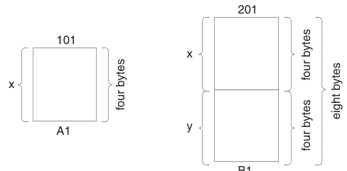

图 5.2 基类对象和派生类对象的内存布局

## 5.1.5 在派生类中访问基类的成员

在派生类的函数中只能访问基类的公共成员（基类的保护成员也可以访问；我们稍后将反对使用保护成员）。但是，无法访问基类的私有成员。

假设我们在 `B::setY()` 函数中写道：

```
x=y;
```

编译器将报告错误，指出无法访问基类的私有成员。（假设我们正尝试在派生类的成员函数中访问 `'x'`。但 `'x'` 是基类的私有成员。）

但我们可以在派生类的成员函数中访问 `A::setX()` 和 `A::getX()`，因为它们是基类的公共成员。基类的私有成员对于派生类的成员函数仍然是私有的。以下代码行演示了这一点：

```
void B::setY(const int q)
{
    y=q;
    setX(y);        //x=y
}
```

就这些了。C++ 防止我们在派生类的成员函数中访问基类的私有成员，以完全实现数据安全。毕竟，基类的提供者将某些类成员设为私有，是因为他/她希望只有基类的成员函数（他/她已经完善过的）能够访问它们。如果允许派生类的成员函数访问基类的私有成员，那么人们仅仅通过查看其成员函数和友函数，无法识别程序中访问基类私有成员的所有语句。

我们认为基类现有的函数集合有时是不够的。我们希望创建一个派生类来补充基类，包含基类中缺失的成员函数。例如，`String::addChar(char)` 函数在基 `String` 类中不存在。但在这种情况下，缺陷在于基类本身。应该修正的是基类本身。继承不是用于消除这种缺陷的。它用于为派生类提供额外数据以及处理这些额外数据的额外代码。继承用于在不重新编程或不重新编译的情况下为现有类添加功能。它使我们能够实现代码的可用性。

友元关系是不继承的。一个类不会成为其父类的友元。列表 5.2 证明了这一点。

### 列表 5.2 友元关系不可继承

```
/*Beginning of friendInherit.cpp*/
class B;
class A
{
    friend class B;
    int x;
}
class B
{
    void fB(A * p)
    p->x=0;          //OK: B 是 A 的友元
}
class C : public B
{
    void fc(A * p)
    p->x=0;          //ERROR: C 不是 A 的友元
    尽管源自一个友元
}
/*End of friendInherit.cpp*/
```

## 5.2 基类指针和派生类指针

基类指针可以指向派生类对象。然而，派生类指针不能指向基类对象。准确来说，基类指针可以安全地指向派生类对象，而不需要类型转换。但派生类指针只有通过强制类型转换才能被指向基类对象。然而，这可能会导致运行时错误。

注意：上述断言存在例外。在某些情况下，编译器会防止基类指针指向派生类对象。这些将在在本章的稍后部分描述。

首先，让我们理解为什么让基类指针指向派生类对象没有危害。为了理解这一点，我们考虑列表 5.3 中的类。

### 列表 5.3 派生类及其基类

```cpp
/*Beginning of A.h*/
class A
{
    public:
    int x;
};
/*End of A.h*/
```

```
/*Beginning of B.h*/
#include "A.h"
class B : public A //源自 A
{
    public:
    int y;
};
/*End of B.h*/
```

这些类只有数据成员。没有成员函数，甚至这些成员数据也是公共的。这里给出这些类仅用于最初理解概念。带有私有数据成员和公共成员函数的类解释将在稍后给出。

现在，让我们编译列表 5.4 的 `main()` 函数并看看会发生什么。

### 列表 5.4 基类指针指向派生类

```cpp
/*Beginning of BasePtr.cpp*/
#include "B.h"
void main()
{
    B B1;
    A *APtr = &B1; //line 1 OK: 基类指针指向派生类
    APtr->x = 10;  //line 2 OK: 访问基类成员
    APtr->y = 20;  //line 3 ERROR: 在类中未找到 y
}
/*End of BasePtr.cpp*/
```


列表 5.4 的第 1 行将无法编译，因为第 3 行会编译。基类指针可以指向派生类对象。让我们看看为什么。`APtr` 的类型是 `A *`。它本应该指向派生类 B。`APtr` 指向 `B1` 的事实是，它占用了八字节（四个字节用于 `x`，四个字节用于 `y`），能够访问 `x` 是因为类 `A` 中有一个名为 `x` 的成员。

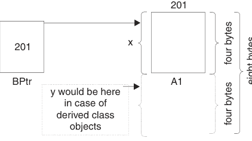

图 5.4 指向基类对象的派生类指针

然而，通过显式类型转换，派生类指针可以强制指向一个派生类对象，如列表 5.6 所示。继续使用列表 5.3 中给出的类 `A` 和 `B`。

+ 列表 5.6 强制类型转换使派生类指针指向基类对象

```cpp
/*Beginning of DerivedPtrTypecast.cpp*/
#include"B.h"
//源自列表 5.03
{
    A A1;
    B * BPtr;
    BPtr=(B*)&A1; //派生类指针
                 //强制类型转换使派生
                 //类指针指向基类
                 //对象
}
/*End of DerivedPtrTypecast.cpp*/
```

但这种显式的地址操作显然是危险的。现在，让我们考虑类具有私有数据成员和公共成员函数的实际情况（参见列表 5.7）。即使类 `A` 和 `B` 分别具有 `x` 和 `y` 作为私有数据成员，上述解释也同样适用。

+ 列表 5.7 带有成员函数的列表 5.3 中的类

```cpp
/*Beginning of A.h*/
{
    int x;
    public:
        void setx(const int x);
        /*
            类 A 的其余部分
        */
};
/*End of A.h*/
/*Beginning of B.h*/
#include"A.h"
class B : public A
{
```

# C++ 面对象对象

```cpp
int y;
public:
void sety(const int y=0);
/*
类 B 的其余部分
*/
};
/*End of B.h*/
```

列表 5.5 中的成员函数访问了各自所属类的私有数据成员。

# 列表 5.8 指向派生类对象的基类指针

```cpp
/*Beginning of BasePtr02.cpp*/
#include "B.h"
void main()
{
  A * APtr;
B * BPtr;
APtr=(B*)&B1;
//OK：基类指针指向
//派生类对象
APtr->sety(10);
//OK：通过基类指针
//访问基类成员
APtr->sety(20);
//ERROR：sety() 不是类 A 的成员
}
/*End of BasePtr02.cpp*/
```

### 列表 5.9 指向基类对象的派生类指针

```cpp
/*Beginning of DerivedPtr02.cpp*/
#include "B.h"
void main()
{
  A A1;
B * BPtr;
BPtr=(B*)&A1;
//ERROR：无法将 A* 转换为 B
BPtr->sety(10);
//OK：派生类指针访问
//基类成员。
BPtr->sety(20);
//OK：派生类指针访问
//派生类成员。
}
/*End of DerivedPtr02.cpp*/
```

基类指针可以指向派生类对象这一事实（参见列表 5.8 和 5.9）并不令人惊讶。毕竟，当我们对一个派生类对象调用基类函数时，发生的就是这种情况。

`B1.sety(10);`

根据我们在第 2 章中获得的关于该指针的知识，我们知道编译器会在内部将该语句转换为
`setx(&B1);`

`B1`（一个派生类对象）的地址作为参数传递给函数。
`A::setx()` 函数中对应的参数是这种类型为 `A * const` 的指针（列表 5.10）。

## 5.3 函数重写

基类的成员函数可以在派生类中被重写。在派生类中定义一个成员函数，使其名称和签名与基类函数匹配，这种行为被称为函数重写。函数重写会导致产生两个同名同签名的函数。其中一个在基类中，另一个在派生类中。列表 5.11 提供了一个说明性示例。

列表 5.10 基类成员函数中的此指针指向调用它的派生类对象

```cpp
void setx(A * const this, const int p)
{
    this->x=p;
}
```

显然，此 指针指向`B1`，它是一个派生类对象。

列表 5.11 函数重写

```cpp
/*Beginning of A.h*/
class A {
public:
    void show()
{
        cout<<"调用了类 A 的 show() 函数\n";
    }
};/*End of A.h*/
/*Beginning of B.h*/
#include"A.h"
class B : public A {
public:
    void show() //重写 A::show()
    {
        cout<<"调用了类 B 的 show() 函数\n";
    }
};/*End of B.h*/
```

类 `B` 的 `show()` 函数重写了类 `A` 的 `show()` 函数。因此，如果对派生类 `B` 对象调用 `show()` 函数，将调用类 `B` 的 `show()` 函数而不是类 `A`。参见列表 5.12。

列表 5.12 调用重写函数

```cpp
/*Beginning of Override01.cpp*/
#include"B.h"
void main()
{
    B B1;
    B1.show(); //调用类 B 的 show() 函数
}
/*End of Override01.cpp*/
```

输出：调用了类 B 的 show() 函数

每当对派生类对象调用函数时，编译器首先在当前类中查找函数原型。如果搜索失败，编译器将向上类类层次查找函数原型。在列表 5.11 和 5.12 中，`show()` 函数被类 `B` 的 `show()` 函数所隐藏。当然，如果相对于基类调用，将调用基类的重写函数（列表 5.13）。

列表 5.13 对于基类调用重写函数

```cpp
/*Beginning of Override02.cpp*/
#include "B.h"
void main()
{
  A A1;
  A1.show(); //调用 A::show()
}
/*End of Override02.cpp*/
```

输出：调用了类 A 的 show() 函数

重写的基类可以通过作用域运算符相对于派生类对象调用，如列表 5.14 所示。

```cpp
/*Beginning of Override03.cpp*/
#include "B.h"
void main()
{
    B B1;
    B1::show(); //强制调用 A::show()
}
/*End of Override03.cpp*/
```

输出：调用了类 A 的 show() 函数

函数重写实际上是函数重载的形式。我们对此指针的知识说明了这一点。重写函数和被重写函数的签名看起来相同，但实际上是不同的。`A::show()` 函数的实际原型是

```cpp
void show(A * const);
```

另一方面，`B::show()` 函数的实际原型是

```cpp
void show(B * const);
```

重写的 `B::show` 可以如下从重写函数调用：

```cpp
void B::show()
{
    A::show();
    /*
    B::show() 的其余部分
    */
}
```

作用域运算符对于避免无限递归。但是，函数重写的用用？只有当被重写的基类函数是虚函数时，函数重写才有意义。虚函数以及如何实现动态多态将在第 6 章说明。

## 5.4 基类初始化

派生对象由派生类的数据成员以及基类的数据成员组成。我们在创建派生类对象时需要初始化所有这些成员。我们必须记住，当创建一个派生类对象时，编译器会隐式且不可避免地绑定基类构造函数，然后派生类构造函数。

假设 `A` 是基类，`B` 是它的派生类。语句

`B B1(); //为对象分配内存`
`B1.A();//调用基类构造函数`
`B1.B();//调用派生类构造函数`

析构函数按反向调用。正如我们已经所知，禁止相对于现有对象显式调用构造函数和析构函数。现在，我们看列表 5.15。

> 列表 5.15 基类成员初始化失败

```cpp
/*Beginning of A.h*/
class A
{
public:
    A(const int=0);
    void setx(const int x=0);
    int getx(const);
};
/*End of A.h*/
/*Beginning of A.cpp*/
#include "A.h"
A::A(const int p)
{
    x=p;
}
```

```cpp
void A::setx(const int p)
{
    x=p;
}
```

```cpp
int A::getx() const
{
    return x;
}
```

```cpp
/*End of A.cpp*/
/*Beginning of B.h*/
#include "B.h"
```

```cpp
class B : public A
{
    int y;
public:
    B(const int q=0);
    void sety(const int q=0);
    int gety(const int);
};
```

```cpp
/*Beginning of B.cpp*/
#include "B.h"
```

```cpp
B::B(const int q)
{
    y=q;
}
```

```cpp
void B::sety(const int q)
{
    y=q;
}
```

```cpp
int B::gety() const
{
    return y;
}
```

```cpp
/*End of B.cpp*/
```

```cpp
/*Beginning of baseinit1.cpp*/
#include "B.h"
#include <iostream.h>
```

```cpp
void main()
{
    B B1(20);
    cout << B1.getx() << endl
         << B1.gety() << endl;
}
```

```cpp
/*End of baseinit1.cpp*/
```

# 输出

0

20

该输出可以通过简单的观察来解释，即语句 `B1(20);`

继承 131 

被转换为以下形式：

`B1; //为对象分配内存`

`B1.A(); // 调用了基类构造函数`

`B1.B(20); // 调用了派生类构造函数`

如所见，派生类对象的基类数据成员通过基类构造函数进行初始化，传递给它的是默认值。因此，`B1.y` 被初始化为 20（传递的值）。但 `B1.x` 被初始化为 0（默认值）。在创建派生类对象时，我们希望显式地向基构造函数传递一个值。因此，在列表 5.15 中，类 `B` 的构造函数不应该接收一个参数，而是两个。其中一个应该传递给 `y`，而另一个应该用于初始化 `x`。为此，类 `B` 构造函数的原型和定义应该如列表 5.16 所示进行修改。

### 列表 5.16 修改派生类构造函数以确保基类成员成功初始化

```cpp
/*Beginning of B.h*/
#include "A.h"
class B : public A
{
public:
    B(const int p=0, const int q=0);
    /*
    类 B 的其余部分
    */
};
/*End of B.h*/
/*Beginning of B.cpp*/
#include "B.h"
B::B(const int p, const int q) : A(p) // 将值传递给基类
//类构造函数
{
    y=q;
}
/*
    类 B 剩余成员函数的定义
*/
/*End of B.cpp*/
```

可以通过向构造函数传递两个参数来声明类 `B` 对象。其中一个赋值给 `x`，另一个赋值给 `y`。

### 列表 5.17 基类初始化

```cpp
/*Beginning of baseinit02.cpp*/
#include <iostream.h>
void main()
{
    B B1(10,20);
    cout << B1.getx() << endl << B1.gety() << endl;
```

# C++ 面向对象编程

```cpp
}
/*End of baseinit02.cpp*/
```

# 输出

10

20

再次，列表 5.17 的输出可以解释为由于类 `B` 构造函数的定义修改，语句

```cpp
B B1(10,20);
```

被转换为

```cpp
B B1;                               //为对象分配内存
B1.A(10);                              //调用基类构造函数
B1.B(20);                               //调用派生类构造函数
```

根据列表 5.17 中派生类构造函数的定义，传递给它的第一个参数转而传递给了基类构造函数。但这不是必要的。传递给派生类构造函数的任何参数都可以传递给基类构造函数。

## 5.5 保护访问修符

除了 `public`（公共）和 `private`（私有）访问修符外，C++ 中第三种访问修符称为 `protected`（保护）。保护成员对成员函数不可用。然而，它们所属类的成员函数以及派生类的成员函数是可以访问的。列表 5.18 及其注释说明了这一点。

- 列表 5.18 访问保护成员

```cpp
/*Beginning of A.h*/
class A
{
private:
int x;
protected:
int y;
public:
int z;
};
/*End of A.h*/
```

```cpp
/*Beginning of B.h*/
#include "A.h"
class B : public A                               //派生类
{
public:
void xyz();
}
/*End of B.h*/
/*Beginning of B.cpp*/
#include "B.h"
void B::xyz()                                     //派生类的成员函数
```

```cpp
{
  x=1; //错误：基类的私有成员
  y=2; // 正常：基类的保护成员
  z=3; // 正常：基类的公共成员
}
```

```cpp
/*Beginning of protected.cpp*/
#include "A.h"
void main() {
  A * Aptr;
  Aptr->x=10; //错误：私有成员
  Aptr->y=20; //错误：保护成员
  Aptr->z=30; // 正常：公共成员
}
/*End of protected.cpp*/
```

## 5.6 通过不同的访问修符派生

### 5.6.1 通过公共访问修符派生

通过 `public` 访问修符派生保留了基类成员的访问级别。

**私有成员：** 派生类的成员函数无法访问。后续派生类的成员函数无法访问它们。成员函数无法访问它们。

**保护成员：** 派生类的成员函数可以访问它们。后续派生类的成员函数也可以访问它们。成员函数无法访问它们。

**公共成员：** 派生类的成员函数可以访问它们。后续派生类的成员函数也可以访问它们。成员函数也可以访问它们。

编译列表 5.19 时遇到的错误说明了这一点。

- **列表 5.19** 访问通过公共访问修符派生的对象的继承成员

```cpp
/*Beginning of publicInheritance.cpp*/
class A {
  private:
  int x;
  protected:
  int y;
  public:
  int z;
}
class B : public A //B 是 A 的公共派生类
{
  public:

# 134 C++ 面向对象编程

```cpp
void f1()
{
    x=1;
    y=2;
    z=2;
    //错误：私有成员仍为私有
    // 正常：保护成员仍为保护
    // 正常：公共成员仍为公共
}
```

```cpp
class C : public B
{
    public:
    void f2()
    {
        x=1; //错误：私有成员仍为私有
        y=2; // 正常：保护成员仍为保护
        z=2; // 正常：公共成员仍为公共
    }
}
```

可以通过向构造函数传递两个参数来声明类 `B` 对象。其中一个赋值给 `x`，另一个赋值给 `y`。

### 列表 5.17 基类初始化

```cpp
/*Beginning of baseinit02.cpp*/
#include <iostream.h>
void main()
{
    B B1(10,20);
    cout << B1.getx() << endl << B1.gety() << endl;
}
/*End of baseinit02.cpp*/


再次，列表 5.17 的输出可以解释为由于类 `B` 构造函数的定义修改，语句

```cpp
B B1(10,20);
```

被转换为

```cpp
B B1;                               //为对象分配内存
B1.A(10);                              //调用基类构造函数
B1.B(20);                               //调用派生类构造函数
```

根据列表 5.17 中派生类构造函数的定义，传递给它的第一个参数转而传递给了基类构造函数。但这不是必要的。传递给派生类构造函数的任何参数都可以传递给基类构造函数。

## 5.5 保护访问修符

除了 `public`（公共）和 `private`（私有）访问修符外，C++ 中还有第三种访问修符称为 `protected`（保护）。保护成员对成员函数不可用。然而，它们所属类的成员函数以及派生类的成员函数是可以访问的。列表 5.18 及其注释说明了这一切。

- 列表 5.18 访问保护成员

```cpp
/*Beginning of A.h*/
class A
{
private:
int x;
protected:
int y;
public:
int z;
};
/*End of A.h*/
```

```cpp
/*Beginning of B.h*/
#include "A.h"
class B : public A                               //派生类
{
public:
void xyz();
}
/*End of B.h*/
/*Beginning of B.cpp*/
#include "B.h"
void B::xyz()                                     //派生类的成员函数
```

```cpp
{
  x=1; //错误：基类的私有成员
  y=2; // 正常：基类的保护成员
  z=3; // 正常：基类的公共成员
}
```

```cpp
/*Beginning of protected.cpp*/
#include "A.h"
void main() {
  A * Aptr;
  Aptr->x=10; //错误：私有成员
  Aptr->y=20; //错误：保护成员
  Aptr->z=30; // 正常：公共成员
}
/*End of protected.cpp*/
```

## 5.6 通过不同的访问修符派生

### 5.6.1 通过公共访问修符派生

通过 `public` 访问修符派生保留了基类成员的访问级别。

**私有成员：** 派生类的成员函数无法访问。后续派生类的成员函数无法访问它们。成员函数无法访问它们。

**保护成员：** 派生类的成员函数可以访问它们。后续派生类的成员函数也可以访问它们。成员函数无法访问它们。

**公共成员：** 派生类的成员函数可以访问它们。后续派生类的成员函数也可以访问它们。成员函数也可以访问它们。

编译列表 5.19 时遇到的错误说明了这一点。

- **列表 5.19** 访问通过公共访问修符派生的对象的继承成员

```cpp
/*Beginning of publicInheritance.cpp*/
class A {
  private:
  int x;
  protected:
  int y;
  public:
  int z;
}
class B : public A //B 是 A 的公共派生类
{
  public:
```

```cpp
void f1()
{
    x=1;
    y=2;
    z=2;
    //错误：私有成员仍为私有
    // 正常：保护成员仍为保护
    // 正常：公共成员仍为公共
}
```

```cpp
class C : public B
{
    public:
    void f2()
    {
        x=1; //错误：私有成员仍为私有
        y=2; // 正常：保护成员仍为保护
        z=2; // 正常：公共成员仍为公共
    }
}
```

### 5.6.2 通过保护访问修符派生

通过 `protected` 访问修符派生将基类公共成员的访问级别降低为保护，而基类保护和私有成员的访问级别保持不变。

**私有成员：** 派生类的成员函数无法访问。后续派生类的成员函数无法访问它们。成员函数无法访问它们。

**保护成员：** 派生类的成员函数可以访问它们。后续派生类的成员函数也可以访问它们。成员函数无法访问它们。

**公共成员：** 派生类的成员函数可以访问它们（但它们在派生类中变为保护）。

编译列表 5.21 时遇到的错误说明了这一点。

- **列表 5.21** 访问通过保护访问修符派生的对象的继承成员

```cpp
/*Beginning of publicInheritance.cpp*/
class A {
  private:
  int x;
  protected:
  int y;
  public:
  int z;
};
class B : public A //B 是 A 的公共派生类
{
  public:
void f1()
{
    x=1; //错误：私有成员仍为私有
    y=2; // 正常：保护成员仍为保护
    z=2; // 正常：公共成员仍为公共
}
}
class C : public B
{
    public:
    void f2()
    {
        x=1; //错误：私有成员仍为私有
        y=2; // 正常：保护成员仍为保护
        z=2; // 正常：公共成员仍为公共
    }
}
```

```cpp
y=2;
z=2;
};OK: 保护成员保持为保护级
//OK: 公有成员保持为公有
```

```cpp
void xyz() {
  B B1;
  B1.z=100;
//非成员函数
//line 1: 一个公有派生类的对象
//line 2: 可以通过一个公有派生
// 类的对象访问基类的公有
//成员
//line 3
//line 4: OK. 可以让基类指针
// 指向一个公有派生
// 类的对象。
  A * ATr;
  APtr=&B1;
//line 5: OK. 可以通过基类
// 指针访问基类继承的公有
// 成员。
  APtr->z=100;
}//*End of publicInheritance.cpp/
```

基类指针不能指向使用 `protected`（保护）访问说明符派生的派生类对象。让我们将列表 5.21 中的程序函数 `xyz()` 重新定义为列表 5.22，看看重新编译程序时会发生什么。

## 列表 5.22 基类指针不能指向保护派生类的对象

```cpp
void xyz() //非成员函数
  B B1;
  B1.z=100;
//line 1: 一个保护派生
// 类的对象
//line 2: ERROR. 无法通过一个保护派生
// 类的对象访问基类的公有
// 成员。
//line 3
  A * ATr;
  APtr=&B1;
//line 4: ERROR. 无法让基类指针
// 指向一个保护派生
// 类的对象。
//line 5: OK. 可以通过基类
// 指针访问访问基类的公有
// 成员。
  APtr->z=100;
```

列表 5.22 的第 4 行无法编译，因为第 2 行无法编译而第 5 行可以。第 2 行无法编译是因为 'z' 是基类 `A` 的公有成员，而类 `B` 是使用 `protected` 访问说明符从类 `A` 派生的。在这种情况下，基类指针可能会以某种方式（列表 5.22 的第 5 行）访问派生类对象，而这种方式在通过对象名称本身（列表 5.22 的第 2 行）访问时是不允许的。

因此，如果使用了 `protected` 访问说明符来派生类，C++ 编译器会防止基类指针指向该派生类的对象。

## 5.6.3 使用 private（私有）访问说明符派生

使用 `private` 访问说明符派生会将基类公具有保护成员的访问权限降低为私有，而基类私有成员的访问权限保持不变。

- 私有成员：派生类的成员函数无法访问它们。后续派生类的成员函数无法访问它们。非成员函数无法访问它们。
- 保护成员：派生类的成员函数可以访问它们。后续派生类的成员函数无法访问它们。非成员函数无法访问它们。
- 公有成员：派生类的成员函数可以访问它们。后续派生类的成员函数无法访问它们。非成员函数无法访问它们。

编译列表 5.23 时遇到的错误说明了这一点。

- * 列表 5.23 访问通过 `private` 访问说明符派生的类对象的继承成员

```cpp
/*Beginning of protectedInheritance.cpp*/
class A
{
  private:
    int x;
  protected:
    int y;
  public:
    int z;
};
class B : protected A // B 是 A 的保护派生类
{
  public:
    void f1()
    {
      x=1; //ERROR: 私有成员保持为私有
      y=2; //OK: 保护成员保持为保护级
      z=2; //OK: 公有成员变为保护级
    }
};
class C : public B
{
  public:
    void f2()
    {
      x=1; //ERROR: 私有成员保持为私有
      y=2; //OK: 保护成员保持为保护级
      z=2; //OK: 保护成员保持为保护级
    }
  void xyz()
  {
    B B1;
    B1.z=100; // line 1: 一个保护派生类的对象
               //line 2: ERROR. 无法通过一个保护
               // 类的对象访问基类的公有
               // 成员。
    A * Atr;
    APtr=&B1; // line 3
             //line 4: ERROR. 无法让基类
             // 指针指向一个保护派生
             // 类的对象。
  }; // 非成员函数
```

```cpp
APtr->x=10;      //line 5. OK. 可以通过基类
// 指针访问基类的公有
// 成员。

}/*End of protectedInheritance.cpp*/
```

基类指针不能指向使用 `private`（私有）访问说明符派生的派生类对象。让我们将程序（列表 5.23）中的函数 `xyz()` 重新定义为列表 5.24，看看重新编译程序时会发生什么。

**列表 5.24** 基类指针不能指向私有派生类的对象

```cpp
/*Beginning of privateInheritance.cpp*/
class A
{
  private:
    int x;
  protected:
    int y;
  public:
    int z;
};
class B : protected A // B 是 A 的保护派生类
{
  public:
    void f1()
    {
      x=1; //ERROR: 私有成员保持为私有
      y=2; //OK: 保护成员保持为保护级
      z=2; //OK: 公有成员变为保护级
    }
};
class C : public B
{
  public:
    void f2()
    {
      x=1; //ERROR: 私有成员保持为私有
      y=2; //OK: 保护成员保持为保护级
      z=2; //OK: 保护成员保持为保护级
    }
  void xyz()
  {
    B B1;
    B1.z=100; // line 1: 一个保护派生类的对象
               //line 2: ERROR. 无法通过一个保护
               // 类的对象访问基类的公有
               // 成员。
    A * Atr;
    APtr=&B1; // line 3
             //line 4: ERROR. 无法让基类
             // 指针指向一个保护派生
             // 类的对象。
  }; // 非成员函数
```

```cpp
APtr->x=10;      //line 5. OK. 可以通过基类
// 指针访问基类的公有
// 成员。
}/*End of protectedInheritance.cpp*/
```

列表 5.22 的第 4 行无法编译，因为第 2 行无法编译而第 5 行可以。第 2 行无法编译是因为 'z' 是基类 `A` 的公有成员，而类 `B` 是使用 `protected` 访问说明符从类 `A` 派生的。在这种情况下，基类指针可能会以某种方式（列表 5.22 的第 5 行）访问派生类对象，而这种方式在通过对象名称本身（列表 5.22 的第 2 行）访问时是不允许的。

因此，如果使用了 `protected` 访问说明符来派生类，C++ 编译器会防止基类指针指向该派生类的对象。

## 5.6.3 使用 private 访问说明符派生

使用 `private` 访问说明符派生会将基类公具有保护成员的访问权限降低为私有，而基类私有成员的访问权限保持不变。

- 私有成员：派生类的成员函数无法访问它们。后续派生类的成员函数无法访问它们。非成员函数无法访问它们。
- 保护成员：派生类的成员函数可以访问它们。后续派生类的成员函数无法访问它们。非成员函数无法访问它们。
- 公有成员：派生类的成员函数可以访问它们。后续派生类的成员函数无法访问它们。非成员函数无法访问它们。

编译列表 5.23 时遇到的错误说明了这一点。

- * 列表 5.23 访问通过 `private` 访问说明符派生的类对象的继承成员

```cpp
/*Beginning of protectedInheritance.cpp*/
class A
{
  private:
    int x;
  protected:
    int y;
  public:
    int z;
};
class B : protected A // B 是 A 的保护派生类
{
  public:
    void f1()
    {
      x=1; //ERROR: 私有成员保持为私有
      y=2; //OK: 保护成员保持为保护级
      z=2; //OK: 公有成员变为保护级
    }
};
class C : public B
{
  public:
    void f2()
    {
      x=1; //ERROR: 私有成员保持为私有
      y=2; //OK: 保护成员保持为保护级
      z=2; //OK: 保护成员保持为保护级
    }
  void xyz()
  {
    B B1;
    B1.z=100; // line 1: 一个保护派生类的对象
               //line 2: ERROR. 无法通过一个保护
               // 类的对象访问基类的公有
               // 成员。
    A * Atr;
    APtr=&B1; // line 3
             //line 4: ERROR. 无法让基类
             // 指针指向一个保护派生
             // 类的对象。
  }; // 非成员函数
```

```cpp
APtr->x=10;      //line 5. OK. 可以通过基类
// 指针访问基类的公有
// 成员。

}/*End of protectedInheritance.cpp*/
```

基类指针不能指向使用 `private` 访问说明符派生的派生类对象。让我们将程序（列表 5.23）中的函数 `xyz()` 重新定义为列表 5.24，看看重新编译程序时会发生什么。

**列表 5.24** 基类指针不能指向私有派生类的对象


```cpp
/*Beginning of privateInheritance.cpp*/
class A
{
  private:
    int x;
  protected:
    int y;
  public:
    int z;
};
class B : protected A // B 是 A 的保护派生类
{
  public:
    void f1()
    {
      x=1; //ERROR: 私有成员保持为私有
      y=2; //OK: 保护成员保持为保护级
      z=2; //OK: 公有成员变为保护级
    }
};
class C : public B
{
  public:
    void f2()
    {
      x=1; //ERROR: 私有成员保持为私有
      y=2; //OK: 保护成员保持为保护级
      z=2; //OK: 保护成员保持为保护级
    }
  void xyz()
  {
    B B1;
    B1.z=100; // line 1: 一个保护派生类的对象
               //line 2: ERROR. 无法通过一个保护
               // 类的对象访问基类的公有
               // 成员。
    A * Atr;
    APtr=&B1; // line 3
             //line 4: ERROR. 无法让基类
             // 指针指向一个保护派生
             // 类的对象。
  }; // 非成员函数
```cpp

APtr->x=10;      //line 5. OK. 可以通过基类

// 指针访问基类的公有

// 成员。

}/*End of protectedInheritance.cpp*/
```

此类对象的大小等于所有基类数据成员大小之和，加上所有派生类数据成员大小之和。列表 5.25 中 `C` 类对象的大小为 12。

此外，对于此类对象，不仅可以调用派生类的成员函数，还可以调用所有基类的成员函数。因此，在在列表 5.25 中，针对 `'C1'` 调用了 `A`、`B` 和 `C` 的成员函数。

### 5.7.2 多重继承中的歧义

多重继承会导致许多歧义，即多个类中存在相同的成员以及菱形继承（diamond-shaped inheritance）。

- **1 多个基类中具有相同的成员**：如果两个或多个基类具有同名的成员，就会出现第一个歧义。这在列表 5.26 中所示。

列表 5.26 由于多个基类中具有相同成员导致的歧义

```cpp
/*Beginning of A.h*/
class A
{
    int x;
    public:
    void setx(const int = 0);
    int getx() const;
};
/*End of A.h*/
/*Beginning on A.cpp*/
#include "A.h"
void A::setx(const int pX)
{
    x = pX;
}
int A::getX() const
{
    return x;
}
/*End on A.cpp*/
/*Beginning of B.h*/
class B
{
    int y;
    public:
    void sety(const int = 0);
    int gety() const;
};
/*End of B.h*/
/*Beginning on B.cpp*/
#include "B.h"
void B::sety(const int pY)
{
    y = pY;
}
int B::gety() const
{
    return y;
}
/*End on B.cpp*/
```

```cpp
/*Beginning of C.h*/
#include "A.h"
#include "B.h"
class C : public A, public B //多重继承
{
    int z;
    public:
    void setz(const int = 0);
    int getz() const;
};
/*End of C.h*/
```

```cpp
/*Beginning of C.cpp*/
#include "C.h"
void C::setz(const int pz)
{
    z = pz;
}
int C::getz() const
{
    return z;
}
/*End on C.cpp*/
```

```cpp
/*Beginning of multiInherit.cpp*/
#include <iostream>
#include "C.h"
void main() {
    C C1; //声明一个执行多重继承的类对象
    //multiple inheritance
    C1.setx(10); //调用一个基类的成员函数
    //类。
    C1.sety(20); //调用另一个基类的成员函数
    //基类。
    C1.setz(30); //调用派生类的成员函数
    //类。
    cout << C1.getx() << endl; //调用一个基类的成员函数
    //基类。
    cout << C1.gety() << endl; //调用另一个基类的成员函数
    //基类。
    cout << C1.getz() << endl; //调用派生类的成员函数
    //类。
}
/*End of multiInherit.cpp*/
```

在列表 5.26 中，编译器无法判断应该调用两个 `get()` 函数中的哪一个。这种歧义可以使用作用域解析符（scope resolution operator）解决。我们可以将列表 5.26 中的 `main()` 函数替换为列表 5.27 中的函数并查看区别。

## 列表 5.27 使用作用域解析符解决歧义

```cpp
/*Beginning of multiInheritAmbiguityResolve01.cpp*/
#include <iostream.h>
class A
{
public:
    void show()
    {
        cout << "show() function of class A called\n";
    }
};
class B
{
public:
    void show()
    {
        cout << "show() function of class B called\n";
    }
};
class C : public A, public B
{
    void main()
    {
        C C1;
        C1.A::show();            //OK: 调用了类 A 的 show() 函数
        C1.B::show();            //OK: 调用了类 B 的 show() 函数
    }
};
/*End of multiInheritAmbiguityResolve01.cpp*/
```

输出
show() function of class A called
show() function of class B called

这种歧义也可以通过重写（overriding）多重继承的基类成员来解决，如列表 5.28 所示。

## 列表 5.28 重写

```cpp
/*Beginning of overrideExample.cpp*/
#include <iostream.h>
class A
{
public:
    void show()
    {
        cout << "show() function of class A called\n";
    }
};
class B
{
public:
    void show()
    {
        cout << "show() function of class B called\n";
    }
};
class C : public A, public B
{
public:
    void show() // 重写
    {
        cout << "show() function of class C called\n";
    }
    void main()
    {
        C C1;
        C1.show();
    }
};
/*End of overrideExample.cpp*/
```

## 使用 C++ 进行面向对象编程

```cpp
class C : public A //也继承自 A
{
    public:
    void FC()
    {
        cout<<"FC() called\n";
    }
};
void main(){
    B B1;
    C C1;
    B1.FA();
    B1.FB();
    C1.FA();
    C1.FC();
}
/*End of hierarchicalInherit.cpp*/
```

输出
FA(A) called
FB(B) called
FA(A) called
FC(C) called

层级继承可能是代码重用性优点的最佳说明。两个或多个类的共同特征可以组合在一个单一基类中，然后这些类就可以继承该基类。这样就消除了在多个类中重复共同特征的需求。

例如，“哺乳动物”（Mammal）类可以作为“人”、“鲸鱼”、“狗”、“猫”等类的共同基类。所有这些派生类所共有的特征可以放在“哺乳动物”类中。只有特殊特征可以放在各自的派生类中。

### 5.7.5 混合继承

混合继承顾如名，简单来说是上述所有继承类型的混合。图 5.10 阐述了这一点。

图5.10 混合继承

### 5.8 构造函数和析构函数的调用顺序

构造函数按照以下顺序调用：

- 基类构造函数按照继承顺序
- 非虚基类构造函数按照继承顺序
- 成员对象的构造函数按照声明顺序
- 派生类构造函数

析构函数按照反序调用。列表 5.33 展示了这一点。

列表 5.33 构造函数和析构函数的调用顺序

```cpp
/*Beginning of cd_order.cpp*/
#include<iostream>
class A
{
  public:
    A()
    {
        cout<<"Constructor of class A called\n";
    }
    ~A()
    {
        cout<<"Destructor of class A called\n";
    }
};
class B
{
  public:
    B()
    {
        cout<<"Constructor of class B called\n";
    }
    ~B()
    {
        cout<<"Destructor of class B called\n";
    }
};
class C : virtual public A
{
  public:
    C()
    {
        cout<<"Constructor of class C called\n";
    }
    ~C()
    {
        cout<<"Destructor of class C called\n";
    }
};
class D : virtual public A
{
  public:
    D()
    {
        cout<<"Constructor of class D called\n";
    }
    ~D()
    {
        cout<<"Destructor of class D called\n";
    }
};
class E
{
    public:
    E()
    {
        cout<<"Constructor of class E called\n";
    }
    ~E()
    {
        cout<<"Destructor of class E called\n";
    }
};
class F : public B, public C, public D
{
    private:
    E Eobj;
public:
    F()
    {
        cout<<"Constructor of class F called\n";
    }
    ~F()
    {
        cout<<"Destructor of class F called\n";
    }
};
void main(){
    F Fobj;
}
/*End of cd_order.cpp*/
```


输出
Constructor of class A called
Constructor of class B called
Constructor of class C called
Constructor of class D called
Constructor of class E called
Constructor of class F called
Destructor of class F called
Destructor of class E called
Destructor of class D called
Destructor of class C called
Destructor of class B called
Destructor of class A called

## 总结

C++ 允许以自动包含现有类的数据和函数的方式定义类。在新类中定义额外的数据和函数，这被称为继承。

被继承的类被称为基类、父类或超类。通过继承基类定义的类类被称为派生类、子类或子类。

派生类对象包含基类的数据成员。基类对象可以调用派生类的成员函数。

通过仅允许基类中的共同数据和函数，继承实现了重用和代码维护。继承实现了“是一个”（is-a）关系，而容器实现了“有一个”（has-a）关系。友元是不被继承的。基类指针可以指向派生类对象。派生类指针不能指向基类对象。基类的成员函数可以在派生类中被重写。在派生类中定义成员函数，使其名称和签名与基函数匹配被称为重写。基类成员可以初始化为传递给派生类构造函数的值。这些值可以传递给基类构造函数。

保护成员对成员函数是不可见的。但对它们自己的类以及派生类的成员函数是可以访问的。类通过 `public`、`protected` 和 `private` 关键字派生。`public` 访问符保留了基类的访问级别。`protected` 访问符将公共基类的访问级别降低为保护，而保护和私有基类的访问级别保持不变。`private` 访问符将公共和保护基类的访问级别降低为私有，而私类类的访问级别保持不变。继承的默认访问符是“private”。

在继承中，类继承多个类。多重继承会导致歧义。如果一个或多个基类具有相同的成员，就会产生歧义。如果两个或多个类继承自同一个基类，也可能产生歧义。这被称为菱继承。通过以下方式解决这些歧义：

- 使用作用域运算符并传递实际类的名称来调用中间基类的函数
- 重写最终基类的函数
- 使用 `virtual` 关键字派生中间基类

当一个类继承多个派生类时，被称为多重继承。在层级继承中，单个类作为多个派生类的基类。混合继承是上述继承类型的混合。

构造函数按照以下顺序调用：

- 虚基类构造函数按照继承顺序
- 普通类构造函数按照继承顺序
- 成员对象的构造函数按照声明顺序
- 派生类构造函数

析构函数按照反序调用。

## 术语

- 基类、父类、超类
- 派生类、子类、 subclass
- 基类的数据成员和派生类对象
- 基类的函数成员和派生类对象
- 在基类中保留共同特征以重用
- 基类指针和派生指针
- 基类成员函数的重写
- 基类的利用
- ...

# 练习题

1. 什么是继承？它是如何实现代码重用的？
2. 继承如何影响派生类的大小和功能？
3. 继承与容器相比如何？
4. 继承与嵌套相比如何？
5. 创建一个以基类指针作为参数的全局非成员函数。在函数内部通过指针调用基类的成员函数。现在你能够通过传递派生类的地址来工作吗？
6. 在派生类中重写从上面定义的函数中调用的基类函数之一。传递派生类对象的地址。
7. 通过类型转换为基类对象创建一个派生类指针。发生了什么？
8. 为什么派生类构造函数必须显式将值传递给基类构造函数？
9. 基类有数据成员。然而，派自它的类也有。派生类需要构造函数吗？为什么？
10. 访问符对基类成员可见性的影响是什么？
11. 如果没有使用访问符派生类，派生类的成员函数能够访问基类的成员吗？为什么？
12. 菱继承会产生哪些歧义？如何解决？
13. 当创建派生类对象时，构造函数和析构函数按照什么顺序调用？
14. 判断对错：
    (a) 基类对象通常比派生类对象小。
    (b) 继承增加了基类的可见性。
    (c) 虚基类构造函数在普通基类构造函数之前调用。
    (d) 继承实现了“有一个”关系。
    (e) 如果使用保护访问符派生类，则公共基类成员对于派生类的成员函数是可以访问的。
15. 假设你正在构建一个简化的窗口绘制程序。从菜单中，用户选择想要绘制的形状类型——圆形或矩形。选择后，用户将鼠标指针从一个点拖动到与这两个点对角重合的封闭矩形。
创建一个形状。从该类派生两个——圆形和矩形。回答以下问题以完善类的定义：
(a) 哪个类应该持有封闭矩形的坐标作为其数据成员——Shape、Rectangle 还是三者都是？

# 虚函数与动态多态

本章介绍了 C++ 最显著的特性之一：动态多态以及虚函数如何实现它。
虚函数使 C++ 程序员能够创建可用代码。到目前为止，函数重写（override）似乎是 C++ 的一个不必要的功能。本章将解释为什么 C++ 在此处提供了函数重写这一功能。
C++ 实现虚函数的机制在本章也得到了探讨。纯虚函数的需求和用法在其中占有重要地位。
本章还讨论了虚析构函数和克隆（clone）函数的使用。

## 6.1 虚函数的需要

首先，让我们考虑列表 6.1 及其输出。

### 列表 6.1 在派生类中重写基类的成员函数

```cpp
/*Beginning of A.h*/
#ifndef _A_H_
#define _A_H_
class A
{
    public:
    void show();
}
#endif
/*End of A.h*/
/*Beginning of B.h*/
#ifndef _B_H_
#define _B_H_
#include "A.h"
class B : public A //class B derived from class A
{
    public:
    void show(); //函数重写
}
#endif
/*End of B.h*/
/*Beginning of A.cpp*/
#include "A.h"
```

```cpp
#include<iostream.h>
void A::show() {
    cout<<"A\n";
}
/*End of A.cpp*/
```

```cpp
/*Beginning of B.cpp*/
#include"B.h"
#include<iostream.h>
void B::show() {
    A::show(); // 调用重写后的函数
    cout<<"B\n"; //逻辑上扩展类定义
}
/*End of B.cpp*/
```

现在，让我们考虑列表 6.2 所示的客户端程序。

# 列表 6.2 通过基类类型指针调用重写后的函数

```cpp
/*Beginning of try1.cpp*/
#include"B.h"
#include<iostream.h>
void main() {
    A A1;
    B B1;
    A * APtr;
    APtr=&A1;
    APtr->show(); // 调用 A::show()。APtr 的类型为 A*
    APtr=&B1;
    APtr->show(); // 调用 A::show()。APtr 的类型为 A*
}
/*End of try1.cpp*/
```

# 输出

A
A

正如我们所看到的，无论指针所指向的对象类型是什么，调用的都是基类函数。在这里，编译器通过考虑指针的类型来决定调用哪个函数；而不考虑指针所指向的对象的类型。结论是，在这种情况下重写是无效的。当客户端试图扩展类层次时，这可能会成为一个严重的问题。为什么呢？在我们尝试找到答案之前，让我们意识到通过引用调用函数产生相同的效果。参见列表 6.3。

# 列表 6.3 通过基类类型引用调用重写后的函数

```cpp
/*Beginning of try2.cpp*/
#include"B.h"
#include<iostream.h>
void main() {
    A A1;
} // 来自列表 6.01
```

```cpp
B B1;
A&ARef1=A1;
AARef1.show();
A&ARef2=B1;
AARef2.show();
}
/*End of try2.cpp*/
// 调用 A::show()。ARef1 的类型为 A&
// 调用 A::show()。ARef2 的类型为 A&
# 输出
A
```

现在，让我们尝试理解为什么重写的无效性会在类层次结构的扩展中成为一个主要障碍。

将指针和指针所指向的对象作为局部变量放在同一个函数中是没有意义的。毕竟，对象可以通过其名称本身有效地访问。相反，指针在函数定义中作为形式出现，而对象的地址作为参数传递给函数调用。类似的说明也适用于引用变量。我们继续这一知识的学习过程。

记住列表 6.1 中类 A 和 B 的定义，我们来看列表 6.4 中类 X 的函数 `abc()` 的定义。

- 列表 6.4 通过基类类型指针调用重写后的函数

```cpp
/*Beginning of X.h*/
#ifndef X_H_
#define X_H_
#include "A.h"
class X
{
    public:
    void abc(A*);
};
```

// A* 是形式参数

```cpp
/*End of X.h*//*Beginning of X.cpp*/
#include "X.h"
void X::abc(A* p)
{
    // 一些（复杂的）代码
    p->show();
    // 更多一些（复杂的）代码
}
```

```cpp
/*Beginning of try3.cpp*/
#include "X.h"
#include "B.h"
void main()
{
    X X1;
    A A1;
    B B1;
    X1.abc(&A1);
    X1.abc(&B1);
// 调用 A::show()。ARef1 的类型为 A&
// 调用 A::show()。ARef2 的类型为 A&
# 输出
A
A
```

```cpp
}
/*End of try3.cpp*/
```

# 列表 6.8 计算系列求和的通用函数

```cpp
// 通用求和函数
long int genSum(unsigned int a, unsigned int b,
    long int (*p)())
{
    int i;
    long sum=0;
    for(i=0;i<b;i++)
    sum+=(*p)(i);
    return sum;
}
```

接下来，我们可以通过将返回求和值的函数作为最后一个参数传递给此通用函数来调用该函数。以下代码演示了这一点：

```cpp
x=genSum(1,5,factorial);
x=genSum(3,8,cube);
```

现在，只要返回求和值的函数返回 `long int` 或兼容类型的值，就可以通过这个单一通用函数执行任何类型的求和。需要注意的一个非常重要的点是，该通用求和函数能够以同样的方式求和未来可能创建的函数的返回值！该函数调用：

```cpp
(*p)(i),
```

表现出多态行为，在编译时，并不知道哪个函数将被实际执行。这只有在客户端程序调用 `genSum()` 函数并编译时后才知道。

我们也想在 C++ 中实现类似的壮举。让我们看看列表 6.4 中 `X::abc(' ')` 函数的定义。我们非常希望该类的 `show()` 函数在对象地址作为参数传递时被调用。换句话说，我们希望像上一节描述的那样扩展类库。

如果库程序员正在定义类，期望并尊重成员函数的重写，并且希望让这种重写具有意义，他/她会将该函数声明为 `virtual`。为了将函数声明为 `virtual`，类中的函数原型应该以 `virtual` 关键字开头。`virtual` 关键字可以出现在指定函数类型的关键字之前或之后。如果函数在类外定义，则只有原型具有 `virtual` 关键字。
声明虚函数的语法如下：

```cpp
virtual <返回类型> <函数名>(形式参数);
```

以下代码说明了如何声明虚函数：

```cpp
class A
{
    public:
    virtual void show();        // A::show() 是虚函数
};
```

或者

# 虚函数与动态多态

```cpp
class A
public:
    void virtual show();    //A::show() 是虚函数
};
```

如果按照按照此语法将列表 6.1 中的 `A::show()` 函数定义为虚函数，那么列表 6.2 的输出将是

A
B
而不是
A
A

这意味着基类指针指向一个派生类对象，并且调用被分发到派生类的重写函数，而不是被被重写的基类函数。现在，让我们总结一下这种情况。库程序员实现类库逻辑扩展的愿望现在已经实现了。让我们回到列表 6.4。如果类 `A` 被派生，并且在定义 `X::abc()` 函数之后在派生类中重写了 `A::show()` 函数，那么将在 `X::abc()` 函数内部调用正确的函数。也就是说，如果派生类重写了基函数并将派生类对象的地址作为参数传递给 `X::abc()` 函数，则将调用重写函数。如果没有发生这种情况，将调用基类函数。

```cpp
p->show();
```

列表 6.4 中 `X::abc()` 函数中的 `p->show()` 表现出多态行为。对于此调用，将调用基类的 `show()` 函数或其任何派生类的重写 `show()` 函数。然而，这种多态行为在本质上是动态的。在编译 `X::abc()` 函数并将其放入库时，并不知道调用哪个函数。这只有在调用该函数的客户端程序编译时才会被决定。因此，我们可以看到，客户端的编译时间就是库的运行时间。因此，虚函数表现出的多态行为也被称为动态多态。

值得注意的是，基类中的函数通常只包含与基类相关的语句。并不总是能它们提供完整的定义，因为基类在 `Vehicle` 类中有时是抽象的。派生类的重写函数首先调用被重写的基类函数，然后添加额外的语句以完成相对于派生类自身的定义。将此类基函数设为 `virtual` 确保了客户端能够按照需要顺序调用这两个函数。

基类的虚函数在派生类中会重新出现为虚函数。此外，在定义重写的派生函数时使用 `virtual` 关键字是可选的。参见列表 6.9。

### 列表 6.9 虚函数仍然是虚函数

```cpp
/*autoVirtual.cpp 的开始*/
#include <iostream.h>
class A
```

```cpp
{
public:
    virtual void show() // A::show() 是虚函数
    cout<<"A\n";
}
class B : public A // 派生自 A
{
public:
    void show() // B::show() 是虚函数
    cout<<"B\n";
}
class C : public B // 派生自 B
{
public:
    void show() // C::show() 是虚函数
    cout<<"C\n";
}
void main()
{
    B * Bptr;
    Bptr = new C;
    Bptr->show();
}
/*autoVirtual.cpp 的结束*/
```

# 6.3 虚函数的机制

现在，让我们理解虚函数的机制。对于每一个具有多个虚函数的基类，在运行时都会创建一个函数表。该函数表被称为虚函数表或 VTBL。VTBL 包含了对应类中定义的虚函数的地址。非虚函数的地址不会出现在此类表中。假设一个类有两个虚函数——`abc()` 和 `def()`（列表 6.10）。

### 列表 6.10 具有虚函数的类

```cpp
/*A.h 的开始*/
class A
{
public:
    virtual void abc();
    virtual void def();
};
/*A.h 的结束*/
```

运行时，A 类的 VTBL 将如图 6.1 所示。

# 虚函数与动态多态 161

| A::abc() | A::def() |
| :--- | :--- |
| 101 | 201 |

图 6.1 基类的虚函数

同样，派生类也会创建一个虚函数地址表。如果派生类没有重定义基类成员，则表将包含继承的基类函数地址。但如果在派生类中重定义了基类虚函数，表将包含重写函数的地址。最后，如果派生类定义了一个新的虚函数，其地址也将包含在表中。因此，如果类 B 如列表 6.11 所示派生自类 A，那么 B 类的 VTBL 将如图 6.2 所示。

-   列表 6.11 重写基类虚函数并引入新虚函数

```cpp
/*B.h 的开始*/
#include="A.h"
class B : public A {
public:
    void def(); // 重写 A::def() 函数
    virtual void ghi(); // 引入一个新的虚函数
}
/*B.h 的结束*/
```


| B::abc() | B::ghi() |  |
| :--- | :--- | :--- |
| 101 | 301 | 401 |
| B::def() | | |

图 6.2 派生类的虚函数地址表

注意，`A::abc()`在派生类中没有被重写，它的地址在 B 类的 VTBL 中重新出现。另一方面，由于`A::def()`函数在派生类中被重写，它的地址在 B 类的 VTBL 中被替换为`B::ghi()`函数的地址，这是 B 类中新引入的虚函数。
最后，每个虚虚类的对象都包含指向对应类 VTBL 的指针。该指针被称为虚指针或 VPTR。例如，类 A 对象除了其他非静态数据成员外，还有一个指向 A 类 VTBL 的指针。该表如图 6.1 所示。同样，类 B 对象除了其他非静态数据成员外，还有一个指向 B 类 VTBL 的指针。该表如图 6.2 所示。现在，每当通过对象、对象引用或对象指针分发虚函数调用时，

## 使用 C++ 进行面向对象编程

首先，读取对象的 VPTR 的值。从相应的 VTBL 中获取被调用函数的地址。最后，通过由此获得的地址调用该函数。

现在虚函数的工作原理已经显而易见了。如果一个基类指针指向（或基类引用指向）一个派生类对象，并对其调用虚函数，那么如果派生类函数重写了基类的虚函数，则将调用派生类函数。如果基类的虚函数没有被重写，则将调用它。

请注意，不同类之间变化的大小的大小（每个类只有一个 VTBL）。对象的大小不会发生变化。由于存在额外的指针（VPTR），带有虚函数的对象的大小会增加四个字节。

我们可能会好奇为什么 C++ 支持两种类型的绑定——静态绑定和动态绑定。为什么它不支持动态绑定？换句话说，为什么它不默认将所有函数声明为虚函数呢？原因是虚函数会带来运行时开销，具体表现为为了创建 VTBL 以及在基类/派生类的每个对象中嵌入 VPTR 而浪费的内存。在 VTBL 中搜索地址也会浪费时间。如果一个类中的成员函数都没有被重写，那么将它们声明为虚函数将不必要地增加上述开销。因此，C++ 允许程序员决定成员函数是否声明为虚函数。

### 6.4 纯虚函数

从第 6.3 节我们已经知道，重写虚函数是可选的。如果库程序员预期会被重写并希望重写生效，他会将成员函数声明为虚函数。

但在某些情况下，库程序员希望强制重写基类的虚函数。现在描述了这种情况。代码的某处针对基类类型的指针或引用嵌入了对基类虚函数的调用。例如，类 A 有一个虚函数 `abc()`，它在类 X 的 `xyz()` 中被调用。见列表 6.12。

> 列表 6.12 使用虚函数

```cpp
/* Beginning of X.cpp */
#include "X.h"
void X::xyz(A * p)
{
  // some lines of (complicated) code
  p->abc();
  // some lines of (complicated) code
}
/* End of X.cpp */
```

现在，`A::abc()`函数可能满足以下描述之一。

- 它相对于基类没有意义的定义。例如，在 Shape 类本身中无法定义旋转形状的函数。由于形状本身未知，因此未知旋转形状的算法。见列表 6.13。

# 列表 6.13 为不可定义的虚函数提供空白定义

```cpp
class Shape {
  public:
    virtual void rotate();
};
void Shape::rotate() {
  // null definition!
}
```

- 它只有几行代码，并没有真正给它一个完整的定义。该函数使其无法独立被调用。它只能通过派生类的重写函数间接调用，该函数包含了完成定义所需的代码。C++ 应该为库程序员提供某种机制来强制所需的结果。纯虚函数提供了这种机制。如果再将一个函数声明为纯虚，那么相应的类就变成了抽象基类（简写 ABC）。通过在原型前像一样加上 `virtual` 关键字，然后加上“等号”符号，并声明纯虚函数来将其声明为纯虚函数

```cpp
virtual <return type><function name>(formal arguments)=0;
```

列表 6.14 阐释了这一点。

# 列表 6.14 定义纯虚函数

```cpp
/* Beginning of A.h */
class A {
public:
    virtual void abc() = 0;
};
/* End of A.h */
```

抽象类不能实例化。然而，它可以作为其他类的基类。派生类必须实现基类的所有纯虚函数才能成为具体类。如果它没有实现，它也会变成抽象类。

ABC 的用处是定义一个所有派生类必须遵循的接口。这允许库程序员在不知道派生类实现的情况下对基类进行工作。

# 列表 6.15 一个抽象类

```cpp
/* Beginning of Shape.h */
class Shape {
public:
    int x1, y1, x2, y2;
    virtual void rotate() = 0;
    virtual void shrink() = 0;
    virtual void grow() = 0;
    virtual void hflip() = 0;
    virtual void vflip() = 0;
    virtual void draw() = 0;
};
/* End of Shape.h */
```

ABC 的优势在于它为派生类提供了一个共同接口。这允许程序员编写与基类工作的代码，这些代码也适用于任何派生类。这就是动态多态的本质。

列表 6.16 给出使用 ABC 的示例。

# 列表 6.16 使用的客户端代码

```cpp
/* Beginning of MyWindow.cpp */
#include "X.h"
void MyWindow::xyz(A * p)
{
    // some lines of (complicated) code
    p->abc();
    // some lines of (complicated) code
}
/* End of MyWindow.cpp */
```

```cpp
void main()
{
    B Bi;    //ERROR!
}
```

接下来，类 C 继承自类 B。它重写并定义了类 A 剩余的虚函数。因此，类 C 变成了具体类。参见列表 6.19。

| 列表 6.19 | 定义所有继承的纯虚函数会导致具体类的产生 |

```cpp
class C : public B
{
public:
    void def()
    {
        // C::def() 函数的定义
    }
    void ghi()
    {
        // C::ghi() 函数的定义
    }
};
void main()
{
    C C1; //OK
}
```

我们可能会问，为什么类 A 的所有虚函数没有在类 B 本身中定义。原因是对于类 B 而言，剩余函数没有具体的定义。它作为许多派生类的基类。每个派生类对类 B 未定义的类 A 的纯虚函数都有其不同的定义。如果类 B 定义了这些函数中的任何一个，那么当类 A 的指针指向类 B 的派生类的对象时，将调用这些函数，并将调用分发到类 A 的纯虚函数。这显然是不希望的。类 B 只会定义那些相对于它具有合适意义的类 A 的纯虚函数。此类定义适用于其所有的派生类。

尽管具体类必须为所有纯虚函数提供实现，但抽象数据类型也可以提供实现。派生类可以使用作用域解析运算符来调用它（列表 6.20）。

| 列表 6.20 | 在抽象基类本身中定义纯虚函数 |

```cpp
class A
{
public:
    virtual void abc()=0;// 一个抽象基类
};
void A::abc() //定义纯虚函数
{
    // A::abc() 函数的定义
}
```

# 虚函数与动态多态

```cpp
class B : public A
{
    public:
    void abc();
};
void B::abc()
{
    A::abc();
    // B::abc() 函数其余部分的定义
}
```

为虚方法提供实现的能力允许数据类型提供核心功能，同时要求派生类提供专门的实现。请注意，即使我们为纯虚函数提供了实现，该类仍然是抽象类。
根据要求，成员函数可以是虚的，也可以是纯虚的。

### 6.5 虚析构函数与虚构造函数

我们现在学习虚构造函数和析构函数的创建与使用。我们将首先学习虚析构函数。之后将学习虚析构函数。

#### 6.5.1 虚析构函数

析构函数可以定义为虚函数。如果有必要，析构函数必须定义为虚函数。为什么？让我们考虑列表 6.21（A 是基类，B 是派自 A 的类）。

> 列表 6.21 通过指针删除派生类对象

```cpp
A* APtr;
APtr = new B;
...
...
delete APtr;
```

让我们考虑列表 6.21 的最后一行，`APtr`删除了 ‘`APtr`’ 所指向的类 B 对象所占的内存。由于 ‘`APtr`’ 是基类型，在将对象占用的整个内存返回操作系统之前，只调用了基类的析构函数。这可能会导致其他问题引起的内存泄漏。假设派生类 B 的对象有一个指针。在 ‘`APtr`’ 指向的对象，该指针可能在对象的生命周期内被分配了一个动态内存块。虽然类 B 的析构函数会销毁内存块，但内存泄漏仍会发生，因为类 B 的析构函数没有被调用。

另一方面，如果类 A 的析构函数是虚的，那么对于列表 6.21 的最后一行，将调用类 B 的析构函数，然后调用类 A 的析构函数。最后，对象占用的整个内存块将返回给操作系统。

结论是，如果我们预计在基类上使用 `delete` 运算符，并且派生类中存在指针，我们必须将基类的析构函数声明为虚。

一个值得注意的有趣点是，基类指针指向派生类的动态创建对象并删除该对象占用的内存，整个内存块都会被删除。也就是说，如果基类静态数据成员的总大小为 'x'，派生类非静态数据成员的总大小为 'y'，那么大小为 'x+y' 的内存块将被删除。这与基类是否为虚无关。

#### 6.5.2 虚构造函数

首先，让我们理解构造函数不能是虚的。将构造函数声明为虚会导致编译错误。为什么？考虑类 A 和派自 A 的类 B。如果类 A 的构造函数是虚的，那么在以下语句中

```cpp
A* p = new B;
```

只会调用类 B 的构造函数。类 A 的构造函数将不会调用。这会导致问题。如果类 A 有一个由构造函数正确初始化的指针会发生什么？由于构造函数没有被调用，会导致野指针。

然而，在 C++ 编程中，虚构造的需求非常频繁。让我们考虑以下代码行中的函数。

```cpp
void abc(A * p)           //A 是一个类
{
    // abc() 的删除
}
```

在 `abc()` 函数中需要创建 ‘p’ 指向对象的精确拷贝。为了实现这个目的，类 A 将定义一个函数（列表 6.22）。

# 列表 6.22 使用构造函数尝试拷贝

```cpp
A* q = new A(*p);
```

如果类 A 正确定义了构造函数，且 ‘p’ 指向类 A 的对象，那么上述调用构造函数将可以工作（列表 6.22）。但是，如果 ‘p’ 指向的是派自 A 的类的对象，那么上述调用只会创建一个类 A 的对象（其数据成员较少）。

这个问题如何解决？如果类 A 的设计者意识到需要创建拷贝，他将定义一个 `clone` 函数。此类函数可以定义在列表 6.23。

# 列表 6.23 基类中的 clone 函数

```cpp
class A
{
public:
    virtual A * clone()
    {
        return new A*(this);
    }
    /*
    A 的定义
*/
};
```

派自 A 的类同样会定义并重写此函数（列表 6.24）。

# 列表 6.24 派生类中的 clone 函数

```cpp
class B : public A
public:
    virtual B * clone()
    {
        return new B*(this);
    }
    /*
    B 的定义
*/
};
```

每当 `abc()` 函数中需要对象的拷贝时（列表 6.24 所示），就会调用 `clone` 函数（列表 6.25）。创建的 clone 对象随后会被销毁。

# 列表 6.25 使用 clone 函数

```cpp
void abc(A * p)
{
    ...
    ...
    A * q = p->clone();
    ...
    ...
    delete q;
}
```

由于 `clone()` 函数是虚的，因此调用了正确的版本。因此，如果 ‘p’ 指向类 A 的对象，就会创建另一个类 A 的对象，它是 ‘p’ 指向对象的精确拷贝。而且，如果 ‘p’ 指向派自 A 的类的对象，就会创建该类的另一个对象，它是 ‘p’ 指向对象的精确拷贝。那么，`abc()` 函数在不知道其类型的情况下，成功获取了 ‘p’ 指向对象的精确拷贝。

现在让我们讨论 `clone` 函数的需求。尽管有几个示例强调了这一需求，但下面的示例足够了。

# C++ 面向对象编程

让我们考虑一个将图形对象复制并粘贴到窗口不同位置的函数。参见列表 6.26。

**列表 6.26** 用于说明 `clone` 函数使用的示例

```cpp
void MyWindow::copyPaste(const Shape * const p,
    unsigned int x, unsigned int y)
{
    Shape * q;
    q=p->clone();
    q->move(x,y);
    q->show();
    // 将新对象附加到
    // 屏幕上当前对象的列表中
}
```


指针 `p` 指向正在被复制的对象。变量 `x` 和 `y` 是被复制对象要粘贴的位置的坐标。尽管 `p` 可能指向派生自 `Shape` 类的任何一个类的对象，但整个复制和粘贴操作在所有情况下都是有效的。唯一的先决条件是派生自 `Shape` 类的类必须定义 `clone()` 函数、`move()` 函数和 `show()` 函数。通过在 `Shape` 类中将所有这些函数声明为虚函数可以轻松确保这一点。在这个特定示例中需要注意的额外一点是，不应该销毁 `clone` 对象。相反，它应该被添加到屏幕现有对象的列表中。

## 总结

如果不使用虚函数，基类函数中的通用代码将是不可扩展的。虚函数允许在派生类进行预期的重写。将基类函数标记为虚函数可以确保它在派生类中被重写。
抽象类是至少有一个纯虚函数的类。抽象类不能被实例化。虚析构函数确保了当 `delete` 运算符应用于指向派生类对象的基类指针时，能够执行适当的清理操作。

虽然我们不能拥有虚构造函数，但可以使用进行虚拟构造的 `clone` 函数来代替。类函数返回调用该函数的基类所对应对象的精确拷贝。如果指针指向基类对象，`clone` 函数将创建一个基类对象并返回其指针。如果指针指向派生类对象，`clone` 函数将创建一个派生类对象并返回其指针。

# 关键术语

- 虚函数 `virtual functions`
  - 通过虚函数扩展类库
  - 纯虚函数 `pure virtual functions`

- 抽象基类 `abstract base class`
  - 虚析构函数 `virtual destructors`
  - `clone` 函数 `clone functions`

# 虚函数与动态多态

# 练习

- 1. 什么是虚函数？什么时候需要它？
- 2. 编译器如何解析对虚函数的调用？
- 3. 假设一个类的成员函数已被声明为虚函数。该函数尚未定义。现在，当我们实例化该类时，即使我们没有调用它，链接器也会报错。为什么？（提示：记住，如果声明了一个非虚函数且没有调用它，则不会产生错误。）
- 4. 什么是虚函数？什么时候需要它？
- 5. 判断对错：
  (a) 虚函数实现的是静态多态。
  (b) 我们不能拥有虚构造函数。
  (c) 抽象类不能被实例化。
  (d) 我们不能定义纯虚函数。
- 6. 写一个程序来发现虚函数是否可以作为其他类的友。
- 7. 创建一个 `Shape` 类。它不应该有数据成员。它应该有一个纯虚函数 `get_area()`。

从 `Shape` 类派生出 `Rectangle` 类。它应该有两个数据成员——一个用于存储矩形的宽度，另一个用于存储高度。这两个数据成员都应该是 `float` 类型。在此类内部重写 `Shape::get_area()` 函数。此重写函数应该返回矩形的面积。此外，为该类写一个构造函数。

从 `Shape` 类派生出另一个类 `Ellipse`。它也应该有两个数据成员——一个存储椭圆的长轴长度，另一个存储其短轴长度。这两个数据成员都应该是 `float`。在此类内部重写 `Shape::get_area()` 函数。此外，为该类写一个构造函数。

- 创建一个 `Canvas` 类。它不应该有数据成员。它的成员函数 `display()` 将接受 `Shape` 引用作为形式参数。使用该引用，在 `Canvas::display()` 调用 `Shape::get_area()` 函数。

最后，写一个 `main()` 来利用这些类：`Ellipse` 和 `Canvas`。先通过 `Rectangle` 类的对象调用 `Canvas::display()` 函数，然后通过 `Ellipse` 类的对象调用它。观察输出并确定调用的是基类函数还是派生类函数。

将 `Shape::get_area()` 函数重新定义为非虚函数，查看输出的差异。

# 流与文件处理

本章处理流的操作。它包含了对 C++ 标准库中类的研究，这些类允许程序员处理与控制台以及磁盘文件之间的数据流。

处理流的文本模式和二进制模式以及两种形式的区别是本章的重要部分。

讨论了使用类及其成员函数来实现对磁盘文件的随机访问。对象可以并且在许多情况下能够从磁盘文件输出和加载自己的数据。本章将告诉您如何做到。

错误处理是工业级软件预期的重要功能。本章讨论了与流相关的错误处理函数。

操作符 `Manipulators` 是 C++ 程序员的一个方便工具。本章阐明了许多系统定义操作符的使用以及创建特定操作符的方法。

## 7.1 流 `Streams`

流意味着数据流动。我们在 C++ 程序中声明变量来临时存储内存中的数据。流无非是程序变量之间的数据流。

输入流是从程序变量的数据流。键盘也被视为输入流的源。输出流是流向文件或程序变量的数据流。显示器也被视为输出流的目标。

## 7.2 处理流的类层次结构

C++ 为我们提供了一个类库，具有实现流处理各个方面的功能。这些类通过继承以层次化的方式排列。该层次结构的重要部分如图 7.1 所示。

`ios` 类是该层次结构中的基类。

`ostream` 类派生自 `ios` 类并处理通用的输出流。插入运算符 `<<` 在 `ostream` 类中被定义并重载，用于处理从程序变量到输出文件的输出流。

`ostream_with_assign` 类派生自 `ostream` 类，代表控制台输出。如前所述，C++ 将所有外围设备视为文件。它将显示器视为文件 `用于输出流`。`cout` 对象代表显示器。

# 流与文件处理 173


图 7.1 处理流的库类

因此语句翻译为：
`cout << x;`

“将程序变量 `x` 的流插入到文件 `无非就是显示器`。”

`stream` 类派生自 `ios` 类并处理通用的输入流。提取运算符 `>>` 在 `istream` 类中被定义并重载，用于处理从输入到程序变量的输入。

`istream_with_assign` 类派生自 `cin`。`cin` 是 `istream_with_assign` 类的对象，代表控制台输入。C++ 将所有外围设备视为文件。它也将键盘视为文件 `用于输入流`。`cin` 对象代表键盘。
语句翻译为：
`cin >> x;`

“从文件 `键盘` 提取流并将其放入程序变量 `x` 中。”

`iostream` 类通过多重继承自 `istream` 和 `ostream` 类。它具有同时处理输入和输出流的功能。

`ofstream` 类派生自 `ostream` 类。它具有处理磁盘输出流的功能。`ofstream` 类的对象代表磁盘上的输出文件。因此，以下代码打开了一个磁盘文件用于输出 `注意要打开的文件名作为字符串传递给类的构造函数`：
```cpp
ofstream file("first.dat");
```

`first.dat` 文件在执行文件运行的目录中打开用于输出。要打开文件的完整路径可以作为文件名的前缀。由于插入运算符定义在 `ofstream` 类的基类中，因此传递 `ofile` 对象作为左侧操作数而不是 `cout`。
```cpp
ofile << x;
```

## 174 使用 C++ 进行面向对象编程

上述语句翻译为：
“首先将来自程序变量 `x` 的流插入到文件 `first.dat` 中。”

`istream` 类派自于 `istream` 类。它具有处理来自磁盘文件的输入流的功能。因此，以下代码打开了一个磁盘文件用于输入 `注意：要打开的文件名作为字符串传递给该类的构造函数`：

```cpp
ifstream if("first.dat");
```

`first.dat` 在可执行文件运行的目录中以输入模式打开。要打开的文件完整路径也可以加在文件名之前。由于提取操作符是在 `istream` 类的基类中定义的，因此可以将文件对象作为 `cin` 的左侧操作数。

该语句翻译为：
“从 `first.dat` 中提取流并将其放入程序变量 `x` 中。”

`ofstream` 类派自于 `istream` 类。它具有处理指向和来自磁盘的输入和输出流的功能。
处理与磁盘文件输入输出的类定义在头文件 `fstream.h` 中。处理通用流的类定义在头文件 `istream.h` 中。`istream.h` 头文件被包含在 `fstream.h` 文件中。

## 7.3 文本与二进制输入输出

在本节中，将解释两种输入/输出模式——文本模式和二进制模式。还将解释它们之间的区别以及每模式对于控制台 I/O 和磁盘 I/O 的适用性。

### 7.3.1 内存中的数据存储

在过程中，字符变量的值以 ASCII 等价值的二进制形式存储在内存中。但整数、`float` 或 `double` 类型变量的值简单地存储为其二进制等值。
例如，如果字符类型变量的值为 `A`，它被存储在一个字节中，位表示数字 `65`。

```
01000001
```

但如果整数变量的值为 `65`，它被存储在四个字节中，位表示数字 `65`。

```
01000001
00000000
00000000
```

`float` 和 `double` 类型变量的值以类似的方式存储。因此，数值变量 `整数、`float` 或 `double` 的值是以 2 进制格式存储在内存中的。

### 7.3.2 字符数据的输入输出

对于类型变量，文本模式 I/O 和二进制模式 I/O 没有区别。在两种模式下，字符类型的数据都从内存复制到输出文件或从输入文件复制到内存。

如果以二进制模式输出的函数输出变量的值，它将不进行任何形式的转换。以文本模式输出的函数将以相同的方式输出类型变量的值。

### 7.3.3 数值数据的输入输出

以文本模式输出数值数据的标准库函数会处理在内存中为 2 基的数据，其需要以 10 基 `文本` 格式输出。因此，它将从内存读取值，将现有的 2 基表示转换为 10 基并将其复制到输出文件。
而以二进制模式输出数值数据的标准库函数会处理在内存中为 2 基的数据，其需要以 2 基 `二进制` 格式输出。因此，它将从内存读取值，不进行任何形式的转换，并将其复制到输出文件。

此外，以文本模式输入数值数据的标准库函数会处理数据，其为 10 基 `文本` 格式。因此，它将从输入文件读取值，将现有的 10 基表示转换为 2 基并将其复制到目标变量。
而以二进制模式输入数值数据的标准库函数会处理数据，其为 2 基 `二进制` 格式。因此，它将从内存读取值，不进行任何形式的转换，并将其复制到目标变量。

#### 数值数据二进制模式与文本模式 I/O 的差异意义

假设整数变量的值为 `65`。在二进制模式下，值 `65` 存储在变量占据的四个字节内存块中。上述数据通过二进制模式输出的函数会在输出文件中占据四个相同的位设置。

### 7.3.4 关于打开磁盘文件进行 I/O 的说明

在本节 `第7节“文本与二进制输入输出”` 中，我们通过 `ofstream` 的构造函数打开文件用于写入。如果文件不存在，它将被创建。如果它已存在，其内容将被覆盖。为了产生不同的效果 `追加或在文件不存在时报错`，我们需要应用在 7.4 节和 7.8 节中解释的技术。

## 流与文件处理

内存，其大小为4个字节。因此，如果以二进制模式输出若干值，输出文件的大小将始终是4的倍数。显然，我们可以确定文件的大小并将其除以4，以找到文件中存储的整数 `记录` 的个数。

我们可以将这种简单的技术应用于其他类型的值，包括对象。假设一个对象由一个整数 `四字节`、一个浮点数 `四字节` 和一个双精度浮点数 `八字节` 组成。该对象在内存中占用16个字节。如果以二进制模式输出，它将在输出文件中占用16个字节。

C++标准库提供了以二进制模式进行输入 `从文件读取并将值写入文件` 的函数。这些函数需要需要输入数据的数值地址以及大小。这些函数内部的代码从输入文件的某一点读取值，该点由一个临时指针指向 `关于该指针的更多信息稍后会介绍`。该代码读取的字节块大小等于所提供的大小。代码将数据写入起始位置等于提供地址的内存块中。以二进制模式输出的函数以类似的方式工作。正如我们看到的，二进制函数在从磁盘读取数据时将大小视为分隔符。因此，将数据写入磁盘的函数在输出数据时不需要插入人工分隔符。

让我们对比一下在文本模式下发生的情况。存储在输出文件中的记录是变长的。再次，为了理解，让我们以整数类型变量为例。在文本模式下，它的值总是存储在磁盘文件中的 `1` 中。如果它的值为 `1`，它在文件中将占用一个字节，尽管它在内存中占用四个字节。如果它的值为 `11`，它在输出文件中将占用两个字节，尽管它在内存中占用四个字节。如果它的值为 `111`，它在输出文件中将占用三个字节，尽管它在内存中占用四个字节，依此类推。

因此，当值以文本模式输出输出时，输出值的大小是不固定的。因此，未来读取这些输出值的函数无法将大小作为分隔符。但对于这段代码，调用文本模式函数进行输出的代码也应该在每次此类调用后在输出文件中插入一个自定义的分隔符。这确保了任何代码片段都能成功读取此输出值。

选择一个合适的分隔符无疑是一个问题。在未来的任何时候，分隔符本身都不应该成为输出值的一部分。但这很难保证。

在文本模式输出时还有另一个区别。文件的大小并不表示其中存储的记录数。这是因为记录的大小不是固定的。

## 7.5 文本输出/输入

### 7.5.1 文本输出

C++通过以下方式实现文本输出：

- 插入运算符
- `put()` 函数

### 插入运算符

正如在本章的第一节中提到的，插入运算符可以将值输出到磁盘文件。插入运算符以文本模式输出。

插入运算符在 `ostream` 类中定义并重载。它接受一个 `ostream` 类对象或派生自 `ostream` 类的对象作为其左侧操作数。它的右侧操作数接受一个基本数据类型之一的值。它将右侧的对象复制到与左侧对象关联的文件中。让我们研究对不同类型执行这一操作。我们必须记住，插入运算符针对每种数据类型都进行了不同的重载，如下所示：

1. 使用插入运算符向输出流中插入字符：字符类型的值在内存中占用一个字节。如果通过插入运算符以文本模式输出，它在输出文件中也占用一个字节。两者的设置是相同的。参见列表 7.1。

#### 列表 7.1 使用插入运算符以文本模式输出字符

```cpp
/*charFileOutput.cpp 的开始*/
#include <fstream.h>
void main()
{
    char cVar;
    ofstream file("first.dat");
    cVar='A';
    ofile<<cVar;
}
/*charFileOutput.cpp 的结束*/
```

列表 7.1 的最后一条语句将 `cVar` 的值从内存覆盖磁盘文件 `first.dat`，而没有转换转换其表示方式。

2. 使用插入运算符向输出流中插入整数：整数类型的值在内存中占用四个字节。正如我们所知，如果通过插入运算符以文本模式输出，它在输出文件中占用的字节数取决于它的值。参见列表 7.2。

#### 列表 7.2 使用插入运算符以文本模式输出整数

```cpp
/*intFileOutput.cpp 的开始*/
#include <fstream.h>
void main()
{
    int iVar;
    ofstream file("first.dat");
    iVar=111;
    ofile<<iVar;
}
/*intFileOutput.cpp 的结束*/
```

列表 7.2 的最后一条语句将 `iVar` 的表示从二进制转换为十进制后，将其值从内存覆盖到磁盘文件 `first.dat`。`iVar` 的值将以文本格式 `十进制` 写入，因此在输出文件中占用三个字节。如果 `iVar` 的值是 `11111` 而不是 `111`，它将在输出文件中占用五个字节，而不是三个字节。

3. 使用插入运算符向输出流中插入浮点数和双精度浮点数：浮点类型的值在内存中占用四个字节。正如我们所知，如果通过插入运算符以文本模式输出，它在输出文件中占用的字节数取决于它的值。参见列表 7.3。

#### 列表 7.3 使用插入运算符输出浮点数

```cpp
/*floatFileOutput.cpp 的开始*/
#include <fstream.h>
void main()
{
    float iVar;
    ofstream file("first.dat");
    iVar=111;
    ofile<<iVar;
}
/*floatFileOutput.cpp 的结束*/
```

4. 使用插入运算符向输出流中插入字符串：字符数组在运行时分配了固定数量的字节。然而，实际字符串占用的字节取决于其值。例如，

```cpp
char cArr[20]="abcd";
```

#### 列表 7.4 使用插入运算符输出字符串字符串

```cpp
/*charFileOutput.cpp 的开始*/
#include <fstream.h>
void main()
{
```


```cpp
    char cArr[20]="abcd";

    ofstream file("first.dat");

    ofile<<cArr;

}
```

/*charFileOutput.cpp 的结束*/

5. 使用插入运算符向输出流插入对象：如果我们想使用插入运算符为特定类插入对象，我们需要对该类进行重载。运算符重载的概念、需要和用法将在下一章阐述。

### `put()` 函数

`put()` 函数是 `ostream` 类的成员。其原型为：
`ostream &put(char c);`

从原型可以看出，该函数可以相对于 `ostream` 类对象或任何派生自 `ostream` 类的对象被调用。这样一个对象是 `cout`。该函数将作为参数传递的字符复制到调用它的对象相关的输出文件中。让我们考虑列表 7.5 中的示例程序。

#### 列表 7.5 `put()` 函数

```cpp
/*put.cpp 的开始*/

#include<fstream.h>

void main()

{

    ofstream ofile("first.dat");

    ofile.put('a');

}

/*put.cpp 的结束*/
```

在列表 7.5 中，`put()` 函数相对于对象 `ofile` 调用。该对象与文件 `first.dat` 关联。因此，字符 'a' 被写入文件。正如前面提到的，`put()` 函数也可以配合 `cout` 对象使用（如列表 7.6所示）。

#### 列表 7.6 与 cout 对象使用 `put()` 函数

```cpp
/*coutPut.cpp 的开始*/

#include<iostream.h>

void main()

{

    cout.put('a');

}

/*coutPut.cpp 的结束*/
```

# 输出

a

列表 7.6 中 `put()` 函数的调用将在显示器上显示字符 'a'。
我们可能会想知道使用 `put()` 函数和插入运算符之间的区别。毕竟，我们可以使用插入运算符来代替调用 `put()` 函数，如下所示：

`cout<<'a';`

插入操作符（`<<`）与 `put()` 函数之间的区别在于，前者会根据设置的操符（manipulators）修改输出的格式，而后者会忽略操符的设置。格式化输出将在本章后面的章节中讨论。

## 7.5.2 文本输入

C++ 中通过以下方式实现文本输入：

- 提取操作符（`>>`）
- `get()` 函数
- `getline()` 函数

本章中的提取运算符，即提取运算符，可以用于从磁盘文件中输入值。提取运算符以文本模式进行输入。

提取运算符在 `istream` 类中被定义并重载。它的左侧接收一个 `istream` 类的对象或派生自 `istream` 类的对象。它的右侧接收一个基本数据类型的变量。它将与左侧对象关联的文件中在当前位置处找到的值复制到右侧的变量中。让我们研究它对不同类型数据的操作。必须记住，提取运算符对每种数据类型都进行了不同的重载，如下所示：

1. **使用提取运算符从输入流中提取字符：** 如果提取运算符的右侧是一个字符类型变量，它将从左侧对象关联的输入文件中读取一个字节，并将其写入变量中（列表 7.7）。

> 列表 7.7 使用提取运算符以文本模式输入字符

```cpp
/*Beginning of charFileInputText.cpp*/

#include<iostream.h>

#include<fstream.h>

void main() {

    ifstream ifile("first.dat"); //当前位置位于
    //文件的开头。
    // 假设文件中的第一个字节
    //包含 'A'。
    char Var;
    ifile>>Var;
    cout<<Var;

}

/*End of charFileInputText.cpp*/
```
输出
A

2. **使用提取运算符从输入流中提取整数：** 如果提取运算符的右侧是一个整数类型变量，它将从左侧对象关联的输入文件中读取字节，直到遇到空白符。它认为读取到的这组字节表示一个 10 进制格式的整数。因此，提取运算符将该值转换为 2 进制格式。最后，它将转换后的值写入变量中。

假设文件 `first.dat` 的内容如下：

11 22 33

我们必须注意，“11”后面有一个空格。文件的第一个字节具有字符‘1’的 ASCII 等效值。第二个字节也具有字符‘1’的 ASCII 等效值。第三个字节具有字符（空格）的 ASCII 等效值。第四个字节具有字符‘2’的 ASCII 等效值，依此类推。
现在让我们考虑列表 7.8。

# 列表 7.8 使用提取运算符以文本模式输入整数

```cpp
/*Beginning of intfileInputText.cpp*/

#include<iostream>

#include<fstream>

void main()

{

    ifstream ifile("first.dat");
    int iVar;
    ifile>>iVar;

}

/*End of intfileInputText.cpp*/
```
输出
11

如所述，提取运算符从文件中读取内容，直到遇到空白符。由于第三个字节包含空白符，因此它只读取了前两个字节。这两个字节表示 10 进制格式的数字十一。提取运算符将其转换为 2 进制。结果值占用四个字节。它将其写入变量 `iVar`。

3. **使用提取运算符从输入流中提取浮点数和双精度浮点数：** `float` 和 `double` 类型变量值的提取方式与整数类型变量相同。

4. **使用提取运算符从输入流中提取字符串：** 与整数的情况类似，提取运算符在读取字符数组的值时，会从文件中读取内容直到遇到空白符。

假设文件 `first.dat` 的内容如下：

abc def ghi

我们必须注意，“c”后面有一个空格。参见列表 7.9。

# 列表 7.9 使用提取运算符输入字符数组

```cpp
/*Beginning of charArrayInputText.cpp*/

#include<iostream>

#include<fstream>

void main()

{

    ifstream ifile("first.dat");
    char cArr[20];
    ifile>>cArr;
    cout<<cArr;

}

/*End of charFileInputText.cpp*/
```
输出
abc

显然，提取运算符读取到空白符为止，并将读取到的值存储在字符数组中。

5. **使用提取运算符从输入流中提取对象：** 如果我们想使用提取运算符从输入流中提取特定类的对象，我们必须对其进行重载。运算符重载的概念、必要性及其用法将在后面的章节中阐述。

## `get()` 函数

`get()` 函数在 `istream` 类中已定义。它从输入文件中读取一个字节，并存储在作为参数传递给它的变量中（列表 7.10）。`get()` 函数的原型如下：

`istream & :: get(char &);`

假设文件 `first.dat` 的内容如下：

abcd

列表 7.10 使用 `get()` 函数输入字符

```cpp
/*Beginning of charFileInputText.cpp*/

#include<iostream.h>

#include<fstream.h>

void main() {

  ifstream ifile("first.dat");
  char cVar;
  ifile.get(cVar);
  cout<<cVar;

}

/*End of charFileInputText.cpp*/
```
输出
a

## get() 函数

`get()` 函数在 `istream` 类中已定义。它从输入文件中读取一个字节，并存储在作为参数传递给它的变量中（列表 7.10）。`get()` 函数的原型如下：

`istream & :: get(char &);`

假设文件 `first.dat` 的内容如下：

abcd

列表 7.10 使用 `get()` 函数输入

```cpp
/*Beginning of charFileInputText.cpp*/

#include<iostream.h>

#include<fstream.h>

void main() {

  ifstream ifile("first.dat");
  char cVar;
  ifile.get(cVar);
  cout<<cVar;

}

/*End of charFileInputText.cpp*/
```
输出
a

（注：原文后续部分存在大量重复内容，已按要求不再重复输出）

列表 7.14 展示了如何使用 `write()` 函数将字符类型变量的值输出到显示器。

## **列表 7.14** 使用 `write()` 函数将字符类型值输出到显示器

```cpp
/*Beginning of writeCharConsole.cpp*/

#include <iostream>

using namespace std;

void main()

{

    char cVar;
    cVar = 'a';
    cout.write(&cVar,sizeof(char));

}

/*End of writeCharConsole.cpp*/
```

# 输出
a

显而易见，以文本模式（插入运算符、`put()` 函数）和二进制模式（`write()` 函数）输出字符类型值没有区别。在两种情况下都没有发生任何转换。

2. 使用 `write()` 函数向输出流中插入整数：列表 7.15 展示了如何使用 `write()` 函数将整数类型变量的值输出到磁盘文件。

## **列表 7.15** 使用 `write()` 函数将整数类型值输出到磁盘文件

正如我们已经讨论过的，被 ‘iVar’ 占据的四个字节中所包含的值将不经过任何转换直接复制到指定的输出文件中。列表 7.16 展示了如何使用 `write()` 函数将整数类型变量的值输出到显示器。

## **列表 7.16** 使用 `write()` 函数将整数类型值输出到显示器

```cpp
/*Beginning of writeIntConsole.cpp*/

#include <iostream.h>

void main()

{

    int iVar;
    iVar = 65;
    cout.write((char *)&iVar,sizeof(int));

// Stream and File Handling

}

/*End of writeIntConsole.cpp*/
```

# 输出

理解列表 7.16 的输出是有意思的。由于 `main()` 函数第二个语句的作用，被 ‘iVar’ 占据的四个字节中的第一个字节的八位被设置为表示数字‘65’的二进制等效值。其余三个字节中的位被设置为零。正如我们所知，显示器显示传递给它的每个字节的 ASCII 等效值。“65”的 ASCII 等效值是 ‘A’。因此，我们得到了这个输出。

显而易见，以文本模式（插入运算符、`put()`）和二进制模式（`write()` 函数）输出整数值之间存在重要区别。在前一种情况下，从内存读取的值的表示从从 2 转换为十 进制，然后复制到输出文件中。在后一种情况下没有这种转换。

- 3. 使用 `write()` 向输出流中插入浮点数和双精度浮点数：浮点和双类型值在二进制模式下的输出方式与整数类型值相同。

- 4. 使用 `write()` 向输出流中插入字符串：列表 7.17 展示了如何使用 `write()` 函数将字符数组的值输出到磁盘文件。

## 列表 7.17 使用 `write()` 函数将字符串输出到磁盘文件

```cpp
/*Beginning of writeCharArrDisk.cpp*/

#include<fstream>

void main()

{

    ofstream ofile("first.dat");
    char cArr[10]="abcdefgh";
    ofile.write(cArr,sizeof(cArr));

}

/*Beginning of writeCharArrDisk.cpp*/
```

作为 `write()` 函数第一个参数传递的数组代表其起始地址。第二个参数表示要写入输出文件的内存块的大小。

传递给列表 7.17 中 `write()` 函数的第二个参数评估为 ‘10’（数组的大小）。为此，10 个字节的条被逐字复制到指定文件中。这包括字符串本身（八个字符）、字符串后的分隔符 NULL 字符（所有位都设置为零的单字节）以及末尾的一个带有垃圾值的字节。

如果将 ‘5’ 作为第二个参数传递，则只有字符数组的前五个字节被写入文件。

列表 7.18 展示了如何使用 `write()` 函数将字符数组的值输出到显示器。

## 列表 7.18 使用 `write()` 函数将字符串输出到显示器

```cpp
/*Beginning of writeCharArrConsole.cpp*/

#include<iostream.h>

void main()

{

    char cArr[10] = "abcdefgh";
    cout.write(cArr,strlen(cArr));

}

/*End of writeCharArrConsole.cpp*/
```

# 输出
abdefgh

5. 使用 `write()` 函数向输出流中插入对象：列表 7.19 展示了以二进制模式向输出流插入类对象的方法之一。在这种方法中，类对象占据的内存块中的值被复制到指定的输出文件中。

- 列表 7.19 使用 `write()` 函数将对象输出到磁盘文件

```cpp
/*Beginning of writeObjectDisk.cpp*/

#include<fstream.h>

class A

{

    /*

    definition of class A

    */

};

void main()

{

    ofstream ofile("first.dat");
    ofile.write((char *)&A,sizeof(A));

}

/*End of writeObjectDisk.cpp*/
```

当然，我们注意到注意到类对象占据的内存块中的值被复制到指定的输出文件中。然而，如果对象包含指针，则只有地址会被复制，而不是指针所指向的数据。这导致了当对象被读回另一个程序时出现一个问题：指针将指向一个无效的内存位置。这就是为什么复杂对象应该实现自己的输入和输出函数。

# 列表 7.21 使用 read() 函数从磁盘文件输入字符类型值

```cpp
/*Beginning of readCharDisk.cpp*/

#include<iostream>

#include<fstream>

void main()

{

    ifstream ifile("first.dat");
    char cVar;
    ifile.read(&cVar,sizeof(char));
    cout<<cVar;

}

/*/End of readCharDisk.cpp*/
```

# 输出

x

列表 7.22 展示了如何使用 `read()` 函数通过从键盘读取来输入字符类型变量的值。

# 列表 7.22 使用 read() 函数从键盘输入字符类型值

```cpp
/*Beginning of readCharConsole.cpp*/

#include<iostream>

void main()

{

    char cVar;
    cout << "Enter a character: ";
    cin.read(&cVar,sizeof(char));
    cout<<cVar;

}

/*/End of readCharConsole.cpp*/
```

# 输出

Enter a character: a<enter>

a

显而易见，在文本模式（提取运算符、`get()` 函数）下输入字符类型值与在二进制模式（`read()` 函数）下输入没有区别。在这两种情况下，都不会发生任何转换。

2. 使用 `read()` 函数从输入流中提取整数：列表 7.23 展示了如何使用 `read()` 函数通过从磁盘文件读取将值输入到整数类型变量。

假设磁盘文件 `first.dat` 的前四个字节包含了 64 的二进制等效值。

```
01000000
00000000
00000000
00000000
...
```

# 列表 7.23 使用 read() 函数从磁盘文件输入整数类型值

```cpp
/*Beginning of readIntDisk.cpp*/

#include<iostream.h>

#include<fstream>

void main()

{

    if (isfile("first.dat"))
    {

        int iVar;
        file.read((char*)&iVar,sizeof(iVar));
        cout<<iVar<<endl;
    }
}/*End of readIntDisk.cpp*/
```


```
# 输出
64
```

如所预期，`read()`函数恰好从与其调用对象关联的输入文件中读取了四个字节。这是因为传递给它的第二个参数是大小。它将值拷贝到内存地址中，该地址的首字节等于传递给它的第一个参数。

现在，让我们来看列表 7.24，其中使用`read()`函数从键盘读取整数类型值。根据其已知特性，`read()`函数预计从键盘读取四个字节，而不对这些字节进行任何转换，并将它们拷贝到目标整数变量所占的四个字节中。

## 列表 7.24 使用 read() 函数从键盘输入整数类型值

```cpp
/*Beginning of readIntConsole.cpp*/

#include<iostream.h>

void main()

{

    int iVar;

    cout << "Enter a number in base 2 format: ";

    cin.read((char*)&iVar,sizeof(iVar));

    iVar = iVar & 0x000000ff; //在 iVar 的文件字节的高 3 个字节中输入零*/

    cout<<iVar<<endl;

}/*End of readIntConsole.cpp*/
```

```
# 输出
Enter a number in base 2 format: ABCD<enter>
65
```

该程序的解释已留给读者练习。

- 3. 使用`read()`函数从输入流中提取 float 和 double：float 和 double 类型的值在二进制模式下的输入方式与整数类型值相同。

- 4. 使用`read()`函数从输入流中提取字符串：列表 7.25 是一个说明使用`read()`函数从磁盘文件读取字符数组的良好示例。文件`.dat`的内容如下：

abcdef

## 列表 7.25 使用 read() 函数从磁盘文件输入字符串

```cpp
/*Beginning of readStringDisk.cpp*/

#include<iostream.h>

#include<fstream>

void main()

{

    ifstream infile("first.dat");

    char cArr[20] = "12345678";

    infile.read(cArr,3);

    cout<<cArr<<endl;

}

/*End of readStringDisk.cpp*/
```

```
# 输出
abc45678
```

`'3'`作为第二个参数传递给了`read()`函数。因此，它只从调用它的对象关联的文件中读取了三个字符。
众周知，数组名代表其所占内存块的地址。因此，列表 7.25 中传递给`read()`函数的第一个参数是它所占内存块的首字节的地址。`read()`函数将它已经读取的三个字符拷贝到数组的前三个字节中。
可以设计类似的方法来使用`read()`函数从键盘读取字符字符串。

5. 使用`read()`从输入流中提取对象：让我们考虑列表 7.19 中的程序，它曾将对象数据输出到磁盘文件。被输出的对象是一个简单的对象。

## 流处理与文件处理

文件指针可以通过作为流处理类成员提供的某些函数进行显式操作。以下是对这些函数的解释。

### 7.9.1 seekp() 函数

该函数用于显式地将输出指针（put pointer）指向打开文件中的指定位置。需要注意的是，默认情况下，如果是新打开用于写入的文件，输出指针位于文件开头。如果打开已存在的文件进行追加操作，则输出指针默认指向文件末尾。此外，每次写操作都会根据写入的字节数推移输出指针。

`seekp()`函数定义在`stream`类中。它有两个版本：

```cpp
ostream & ostream :: seekp(streampos pos);
ostream & ostream :: seekp(streamoff off, ios::seek_dir dir);
```

在第一个版本中，`seekp()`函数只接受一个参数——相对于文件开头的绝对位置。`streampos`类型使用`long`作为源数据类型。我们必须记住，位置编号是从零开始的。在这个示例中，输出指针指向文件的第二个字节：

```cpp
ofile.seekp(1); //ofile 是 ostream 类的一个对象
```

在第一个版本中，输出指针的新位置只能相对于文件开头进行指定。但在第二个版本中，`seekp()`函数接受两个参数——第一个参数是偏移量（offset），第二个参数是打开文件中用于指定该偏移量的参考基准位置。`streamoff`类型使用`long`作为源数据类型。`ios::seek_dir`类型是一个枚举类型，具有以下值：

```cpp
ios::beg—偏移量从文件开始计算
ios::cur—偏移量从文件中的当前位置计算
ios::end—偏移量从文件末尾计算
```

在接下来的示例中，输出指针指向文件的最后一个字节。我们必须记住 EOF 字符（文件结束符）是文件的最后一个字节。因此，在接下来的示例中，输出指针将指向写入文件中的最后一个字节，即是 EOF 字符的前一个字节。

```cpp
ofile.seekp(-1,ios::end); //ofile 是 fstream
//类的一个对象
```

后面是更多示例：

```cpp
ofile.seekp(0,ios::beg); //将输出指针带到
//文件的开头
of.seekp(2,ios::beg); //将输出指针带到
//文件开头的第三个字节
of.seekp(-2,ios::cur); //将输出指针从其
//文件中的当前位置向左移动
//两个字节
of.seekp(2,ios::cur); //将输出指针带到字节
```

```cpp
//到其文件中的当前
//位置的右侧
//将输出指针带到文件
//末尾（越过
//最后一个字节）
ofile.seekp(0,ios::end);
```

```cpp
ofile.seekp(-1,ios::end);
//将输出指针带到文件的
//最后一个字节
```

现在让我们来理解`ios::app`和`ios::ate`标志之间的区别。这两者都会以追加模式打开文件，并默认使输出指针指向文件末尾（现有最后一个字节之后）。两者都不会溢出现有文件。它们之间的区别在于：`ios::ate`允许你重回输出指针并修改文件的现有内容，而`ios::app`不允许这样做。换句话说，如果文件使用了`ios::app`标志，尝试使用`seekp()`函数重回输出指针将失败。输出指针将继续指向文件末尾。正如提到的，随着字节追加到文件中，输出指针会向前移动。因此，如果文件使用了`ios::app`标志，就无法重回。

### 7.9.2 tellp() 函数

`tellp()`返回输出指针的当前位置。它定义在`ostream`类中。

```cpp
ostream::tellp();
```

在接下来的示例中，确定了输出指针的当前位置并存储在程序变量中。

```cpp
long pos = ofile.tellp(); //ofile 是 ostream
//类的对象
```

### 7.9.3 seekg() 函数

该函数用于显式地将输入指针（get pointer）指向打开文件中的指定位置。需要注意的是，默认情况下，输入指针指向用于读取的文件开头。每次读操作都会根据字节数向前推移输入指针。
`seekg()`函数定义在`istream`类中。它有两个版本。

```cpp
istream & istream :: seekg(streampos pos);
istream & istream :: seekg(streamoff off, ios::seek_dir dir);
```

这两个`seekg()`函数版本的解释与相应`seekp()`函数版本的解释类似。

### 7.9.4 tellg() 函数

`tellg()`函数与`tellp()`函数一样，返回输入指针的当前位置。它定义在`istream`类中。

```cpp
istream::tellg();
```

在接下来的示例中，确定了输入指针的当前位置并存储在程序变量中。

```cpp
long pos = ifile.tellg(); //ifile 是 istream
//对象
```

### 7.10 随机访问

在随机访问中，不需要通过顺序遍历记录就可以直接访问文件的中间记录。我们已经学习了随机访问文件所需的工具：`seek()`和`seekg()`函数。
假设我们将整数类型的值输出到文件中并想要直接访问第 n 个记录。可以通过使用从第一个记录开始的循环来实现，循环每次读取后增加计数器，直到计数器指示到 n-1 个记录。更直接的方法是使用`seekp()`函数或`seekg()`函数，如：

```cpp
ofile.seekg((n-1)*sizeof(int), ios::beg); //ofile 是
                                              fstream
```

该语句导致指针指向第 n 个记录。此时，如果进行操作，第 n 个记录将被修改。注意，该技术仅当记录大小相等时有效。

### 7.12 对象输出成员函数

我们意识到类拥有从外部帮助输出和输入的指针。客户端程序不应承担了解类数据如何组织的责任。

让我们为`String`类（到目前为止我们的示例）提供写入数据和从磁盘读取的功能。参见列表 7.27。

#### 列表 7.27 通过成员函数输入输出

```cpp
#include<iostream>
class String
{
  explicit String(const char * p = NULL);
  const char * getString();
  void diskOut(ostream&);
  void diskIn(istream&);
};
```

```cpp
/*
String类的*/
String::String(const char * p)
{
  if(p==NULL) //如果传递了默认值...
    cStr=NULL; //置空
    len=0;
  } else //否则...
    len=strlen(p);
    cStr=new char[len+1]; //动态分配一个//独立的内存块//并拷贝进去
    strcpy(cStr,p);
  }
const char * String::getString()
{
  return cStr;
}
void String::diskOut(ostream& fout)
{
  fout.write((char*)&len, sizeof(int));
  for(int i = 0;i<len;i++)
    fout.put(cStr[i]);
}
void String::diskIn(istream& fin)
{
  String temp;
  fin.read((char*)&temp.len, sizeof(int));
  temp.cStr= new char[temp.len+1];
  int i;
  for(i=0;i<temp.len;i++)
    fin.get(temp.cStr[i]);
  temp.cStr[i]='\0';
  *this = temp;
}
```

```cpp
#include"String.h"
void main()
{
  String s1("abcd");
  ofstream offile("C:\\string.dat");
  s1.diskOut(ofile);
  ofile.close();
  String s2;
  ifstream infile("C:\\string.dat");
  s2.diskIn(infile);
  cout<<s2.getString<<endl;
  infile.close();
}
```
/*End of strDiskMain.cpp*/

```
# 输出
abcd
```

## 7.12 错误处理

`istream`类、`ostream`类或派生于这些类的每个对象都包含三个标志，用于指示关联文件中下一个字节的状态。这些标志是：

- 如果遇到文件末尾，`eofbit`变为 true。
- 如果读/写操作失败，`failbit`变为 true（这反过来可能是由于稍后描述的原因引起的）。
- 如果文件在恢复之前发生损坏，`badbit`变为 true。

### 7.12.1 eof() 函数

当文件指针在读取通过调用对象打开的文件时遇到文件末尾标记时，`eof()`函数返回 true。当流库函数在从输入文件读取到达文件末尾标记时，会将 eof 的值设置为 true。

```
while(infile.eof()) //读取到文件末尾
{
  // 从文件中读取并对读取值
  // 进行操作的语句
}
```

注意，`eof()`函数返回的是上一次读取的结果。它在返回结果之前不会向前查看。文件末尾的测试在循环开始时给出。

### 7.12.2 fail() 函数

如果文件由于任何原因无法打开，`fail()`函数返回 true。每当`open()`函数打开文件时，它会将`failbit`设置为 true。
`open()`函数失败的一个原因是使用`ios::ncreate`标志进行读或写打开的文件不存在。

```cpp
ifstream infile;
infile.open("first.dat",ios::in | ios::ncreate);
if(infile.fail())
{
cout<<"File does not exist for reading\n";
/*
  采取纠正措施的语句
*/
```

另一个可能是使用`ios::noreplace`标志以写方式打开文件，但该文件已存在。

```cpp
ofstream ofile;
ofile.open("first.dat", ios::out | ios::noreplace);
if(ofile.fail()) {
  cout<<"File already exists ... overwrite (y/n)";
  /*
    记录用户的响应并采取
    适当行动的语句
  */
}
```

导致读/写操作失败的其他原因包括：

- 用于写入的文件是只读的。
- 磁盘上没有空间。
- 用于写入的文件位于受写保护的磁盘上。

### 7.12.3 bad() 函数

当从文件读取的函数遇到严重的 I/O 错误时，`bad()`函数返回 true。在这种情况下，`badbit`标志的值被设置为 true。在这种情况下是为了中止该流上的 I/O 操作。

### 7.12.4 clear() 函数

`clear()`函数用于清除由`bad()`函数返回的位。这在许多情况下都是必要的。列表 7.28 阐释了其中一种情况。

**列表 7.28** *clearEof() 函数*

```cpp
/*Beginning of clearEOF.cpp*/
#include<iostream>
#include<fstream>
void main() {
  fstream ofile("first.dat",ios::in | ios::out);
  char cArr[100];
  int i=0;
  while(ofile.eof()) {
    ofile.get(cArr[i++]);
    ofile.clear();
    for(int j=0;j<i; j++)
      ofile.put(cArr[j]); //将文件内容
// 追加到文件自身
  }
}
/*End of clearEOF.cpp*/
```

流与文件处理 201

我们必须注意，列表 7.28 中使用`clear()`函数是必要的。循环结束后，`eofbit`标志变为 true。如果不使用`clear()`函数，对文件的任何进一步写操作都将失败。

## 7.13 操纵符

操纵符用于格式化输出。C++ 提供了了一些预定义的操纵符。程序员可以创建自己的特定应用程序操纵符。操纵符可以插入输出流中，就像为输出插入值一样。

```
out << manipulator1 << manipulator2 << value1 << manipulator3 << value2;
```

在例示例中，`out`是`ostream`类或其任何派生类的对象。也可以用`cout`代替`out`来格式化到显示器的输出。

### 7.13.1 预定义操纵符

C++ 提供了若干在头文件`iomanipp.h`中预定义的操纵符。因此，使用这些操纵符的程序必须包含头文件。最常用的操纵符列在表 7.2 中。

表 7.2 预定义操纵符

| 操纵符 | 用途 |
| --- | --- |
| `setw(int w)` | 设置字段宽度为 w |
| `setprecision(int d)` | 设置浮点精度为 d |
| `setfill(int c)` | 设置填充字符为 c |
| `setiosflags(long f)` | 设置格式标志为 f |
| `resetiosflags(long f)` | 清除 f 指定的标志 |

> `setw()`操纵符

`setw()`操纵符接受一个整数类型变量作为其唯一参数。该参数指定了下一个输出将输出的列宽。如果传递到插入流的值占用的字节少于指定的参数，则会在包含输出的列中创建额外的空间。它作为参数传递给`setfill()`函数。
接下来的示例片段：

```
cout << 123 << endl;
cout << setw(3) << 10;
```

```
# 输出
123
10
```


显然，在该输出的第二行中，`10'` 的左侧有一个空格。
`setw()` 操纵符必须为每个要显示的项单独使用。
`cout << setw(5) << 10 <<;`

## 使用 C++ 进行面向对象编程

输出将是

`$ 20`

自定义操纵符（manipulators）实现了模块化。自定义操纵符可以在整个应用程序中使用，以统一的方式格式化输出。如果需要更改，只需在一个地方进行——即操纵符的定义处——同样，更改将在整个应用程序中统一生效。

## 7.14 命令行参数

命令行参数是从命令行运行可执行文件时传递给它们的值。正如我们所知，在成功编译并链接一个 C++ 程序后，我们会得到一个可执行文件。这些可执行程序可以从计算机操作系统的命令行运行。

我们如何将命令行参数传递给可执行文件呢？让我们通过一个示例来理解这一点。

假设从 C++ 程序生成的可执行文件名为 `'test.exe'`。我们可以通过在命令行输入以下命令并按回车键来运行该可执行文件：

```
test.exe
```

我们也可以通过发布以下命令来运行可执行文件：

```
test.exe
```

我们采用第一种方法运行可执行文件。（注意，如果你的计算机使用的操作系统不是 Windows，上述两种方法均有效。对于不同的操作系统，方法可能会发生变化。如果你的计算机操作系统不是 Windows，请咨询操作系统的文档或你的实验室导师。为了本书的目的，我们将假设你的计算机操作系统是 Windows。）

假设我们想将字符串 `'abc'` 和 `'def'` 作为命令行参数传递给可执行文件。我们可以通过在命令行调用可执行文件来实现：

```
test def
```

注意，`'abc'` 和 `'def'` 已经作为参数传递给了执行可执行文件的命令。

为什么命令行参数很重要？为什么 C++ 程序员应该编写能够读取命令行参数值值的程序？考虑一个非常简单的程序（列表 7.29），它将两个数字相加并显示结果。

### 列表 7.29 程序员可以决定相加的值

```cpp
/*add.cpp 的开始*/

/*

该程序将两个数字相加，但由程序员（而非

的的用户，即用户）来决定

要相加的值。

*/

#include <iostream>

void main()

{

    int x = 10, y = 20;

    int z = x + y;

    cout << z << endl;

}/*add.cpp 的结束*/
```
30

如所示，是程序员声明了两个变量并将它们初始化为他/她选择的值。但是，如果我们需要用户的值呢？一种方法是使用 `cin` 从键盘获取输入。如果它从另一个程序执行会发生什么？该程序在运行时将无法提供键盘输入（毕竟它是程序，而不是人类）。如果我们的程序能作为命令行参数接受它需要的值，显然会更方便。

现在，我们到了最重要的问题——我们如何编写 C++ 程序使其能够读取和处理命令行参数呢？`main()` 函数可以被设计为读取命令行参数。为此，我们需要如下所示定义 `main()` 函数的头文件：

```cpp
void main(int argc, char *argv[])
```

第一个参数 `argc` 给了我们命令行上参数的数量，包括可执行文件的名称。它被称为参数计数器（argument counter）。第二个参数 `argv` 是一个字符指针数组。每个指针指向一个独立的命令行参数。它被称为参数向量（argument vector）。

注意，`argc` 和 `argv` 只是 `main()` 函数参数的名称。你在编写程序时，可以给它们你喜欢的名称。例如，你可以将它们命名为 `'x'` 和 `'y'`。`argc` 和 `argv` 是约定俗成的。我们将使用它们。

## 使用 C++ 进行面向对象编程

## 总结

流（Streams）本质上是从程序变量流向的数据。输入流是从持久性存储介质上的文件到程序变量的数据流。键盘也被视为输入流的源。输出流是从程序变量到持久性存储介质上文件的数据流。显示器也被视为输出流的目标。

C++ 为我们提供了一个类层次结构，用于实现流处理的各个方面。`ios` 类是该层次结构中的基类。

`ostream` 类派自 `ios` 类，并处理常规输出。运算符 `(<<)` 在 `stream` 类中被派生并重载，用于处理从程序变量到输出句柄的输出流。

`ostream_with_base` 类派自 `ostream` 类。`cout` 是 `ostream` 类的一个对象，代表控制台输出。如前所述，C++ 将所有外围设备视为流。它除了文件（用于输入）之外，都视为流。`cout` 对象监控屏幕。

`istream` 类派自 `ios` 类，并处理常规输入流。提取运算符 `(>>)` 在 `stream` 类中被定义并重载，用于处理从文件到程序变量的输入流。

`istream_with_base` 类派自 `cin` 类。`cin` 是 `istream_with_base` 类的一个对象。`cin` 代表控制台输入。C++ 将所有外围设备视为流。它也将键盘视为一个文件（用于输入）。`cin` 对象代表键盘。

`iostream` 类通过多继承派自 `istream` 和 `ostream` 类。它具有同时处理输入和输出流的功能。`ofstream` 类派自 `stream` 类。它具有处理到磁盘输出流的功能。`fstream` 类派自 `istream` 类。它具有处理从文件到磁盘的输入和输出流的功能。

在文本模式下，内存变量中以 2 进制格式存在的数值数据在输出之前会先转换为 10 进制格式。在二进制模式下，不存在这种转换。

在文本模式输入中，输入到内存变量的数值数据被认为是 10 进制格式。因此，它首先被转换为 2 进制格式，然后存储在目标变量中。

插入运算符用于文本模式下的输出。`put()` 函数用于一次输出一个字符。`get()` 函数用于在数据中一次输入一个字符。

`write()` 函数用于二进制模式下的输出。`read()` 函数用于以二进制输入数据。

除了库类的构造函数外，`open()` 函数也可用于打开文件。构造函数和 `open()` 函数的第一个参数是文件名。第二个参数指定模式。流类的析构函数会关闭与流关联的文件。`close()` 函数可以显式关闭文件。

可以使用 `seekp()` 和 `seekg()` 函数移动文件。当前位置由 `tellp()` 和 `tellg()` 确定。可以通过 `seekg()` 或 `seek()` 函数直接访问中间记录，使文件指针跳转到文件的特定字节。这对于输出和输入复杂情况数据的成员函数来说是必要的。

每个 `istream` 对象或派自这些类的类的对象都包含三个指示下一个文件状态的标志。这些标志是：

- 如果文件到达输入末尾，`eof` 变为真（eof 标志）。
- 如果读/写操作失败，`fail` 变为真。`fail()` 函数返回 `failbit` 标志的状态。
- 如果文件在恢复过程中损坏，`bad` 变为真（`bad()` 函数返回 `badbit` 标志的状态）。

`clear()` 函数用于清除所述标志位。C++ 提供了几个预定义的操纵符（manipulators）。程序员可以创建自己的特定应用程序操纵符。


# 流与文件处理

命令行参数是在从命令行运行时运行时传递给可执行文件的值。它们使程序能够从用户和其他系统中获取输入值。

第一个参数给我们命令行上存在的参数数量，包括可执行文件的名称。它被称为参数计数器（argument counter）。第二个参数是一个字符指针数组。每个指针指向一个独立的命令行参数。它被称为参数向量（argument vector）。

`main()` 函数可以被程序为读取命令行参数。我们需要如下定义 `main()` 函数的头：

```
void main(int argc, char * argv[])
```

# 关键术语

- streams: C++ 的标准流处理类
- ios:
  - ostream
  - ostream_with_base
  - istream
  - istream_with_base
  - iostream
  - ofstream
  - ifstream
- 文本模式输入输出
- out: 插入运算符
- put() 函数
- cin: 提取运算符
- get() 函数
- write() 函数
- read() 函数
- open() 函数
- close() 函数
- seekp() 函数
- seek-g() 函数
- tellp() 函数
- tell-g() 函数
- eof() 和 eof 标志
- fail() 和 failbit 标志
- bad() 和 badbit 标志
- clear() 函数
- manipulators (操纵符)

# 练习

1. 简要描述 C++ 为流处理提供的类层次结构。
2. 判断对错。
   (a) `cout` 是 `ostream_with_base` 类的一个对象。
   (b) 插入运算符 `(<<)` 在 `stream` 类中被定义并重载。
   (c) 插入运算符以二进制模式输出。
   (d) `istream.h` 头文件包含在 `stream` 中。
3. 什么是文本模式输入输出？它们的优缺点是什么？
4. 文本文件和二进制文件之间有什么区别？
5. 为什么命令行参数很重要？
6. 如何使用插入运算符输出各种类型的值到磁盘？
7. 文件可以为了读写打开吗？
8. 流的构造函数和 `open()` 函数之间有什么区别？
9. 解释原型。
10. 如何在 C++ 中随机访问磁盘内容？
11. 描述在什么情况下 eofbit、failbit 和 badbit 标志会变为真。
12. 描述以下操纵符的使用：
    - setw()
    - precision()
    - setfill()
    - setiosflags()
    - resetiosflags()
13. 程序员如何定义自己的操纵符？
14. 什么是命令行参数？
15. 如何编写 `main()` 函数来读取命令行参数？
16. 编写一个程序，从用户处获取任意整数并写入磁盘文件。在完成整数后，从文件中读取它们并显示在显示器上。
17. 创建一个类，对象持有整数链表。对象还将具有将数据下载到指定磁盘文件以及从指定磁盘文件上传数据的必要功能。应用程序将是菜单驱动的。用户将具有保存链表和“另存为”链表的选项。
18. 编写一个操纵符为输出值固定货币符号。为此，操纵符应从磁盘文件读取符号。
19. 编写一个程序，如果传递给可执行文件的参数数量不等于 1（提示：'arg' != 2），则给出错误消息并终止。错误消息应建议用户向可执行文件传递一个参数，该参数应该是文件名。
20. 否则，如果用户传递了恰一个参数，程序应打开与参数值（提示：argv[1]）匹配的文件。它应该在文件的新行追加可执行文件的名称（提示：argv[0]）。例如，如果可执行文件名为 test，则文件中应追加以下行：

提示：创建如下两个类：

```
class intNode
{
  int data;
  intNode * Next;
public:
  //用于设置和获取数据的函数
  members
};
```

class intList
{
intNode * head;
public:
  //用于添加、删除、修改、
  保存和加载的函数
};

# 运算符重载、类型转换、新风格强制转换和 RTTI

运算符重载是 C++ 中一个非常有趣的特性。它不仅有趣且令人兴奋，而且是类设计者的必备工具。本章将解释以下内容：

- 运算符重载的概念，
- C++ 对运算符重载的支持，
- 重载运算符的需求，
- 运算符重载的规则，
- 运算符重载的使用与误用，
- 运算符重载中的陷阱。

本章的开头介绍了运算符重载的概述。它们只包含用于说明概念的骨架代码，而不让读者承受精确代码复杂性的负担。为类重载各种运算符的精确代码将在后面的章节中处理。

本章还涉及了从基本类型到类、从类类型到基本类型以及从一个类类型到另一个类的类型转换。C++ 提供了四个新风格强制转换运算符，以取代旧的容易出错且难以检测的 C 风格强制转换：

- dynamic_cast
- static_cast
- reinterpret_cast
- const_cast

RTTI（运行时类型信息）允许程序员在运行时找到指针所指对象的类型。除了 `dynamic_cast` 运算符外，C++ 提供了 `typeid` 运算符来实现 RTTI。

本章以对新风格强制转换运算符和 RTTI 的解释结束。

## 8.1 运算符重载

让我们先理解运算符重载的含义以及 C++ 语言这一有用特性是如何实现的

重载运算符意味着编写一个运算符，使其能够在尚未为其设计的类型的操作数上工作。例如，加法运算符可以处理 `char`、`int`、`float` 和 `double` 类型的操作数。然而，如果 's1'、's2' 和 's3' 是我们之前定义的 `String` 类的对象，以下语句

```
s3 = s1 + s2
```

除非 `String` 类的创建者显式地重载了加法运算符以处理其类的对象，否则将无法编译。接下来将描述实现此类重载的方法。

### 8.1.1 重载运算符——语法

通过编写运算符重载函数来重载运算符。这些函数是目标作为重载运算符操作数的类的成员函数或友元函数。运算符重载函数与我们一直在阅读的成员函数和友元函数非常相似。它们唯一的特殊之处在于名称。运算符重载函数的名称由关键字 `operator` 后后跟被重载运算符的符号组成。

给定运算符的成员函数语法如下：

```
class <class_name>
{
    <return_type> operator <op> (<arg_list>); //原型声明
};
<return_type> <class_name> :: operator <op> (<arg_list>) //定义
{
    //函数体
}
```

重载运算符的成员函数可以是私有的（private）、受保护的（protected）或公共的（public）。运算符重载函数的原型指定了返回类型（与普通成员函数一样）。关键字 `operator` 位于返回类型之后。接着是被重载运算符的符号。最后，指定一对包含形式参数的括号（与普通成员函数一样）。

重载给定运算符的友元函数语法如下：

```classclass <class_name>
{
    friend <return_type> operator <op> (<arg_list>); //原型声明
};
<return_type> operator <op> (<arg_list>) //定义
```

重载运算符的成员函数可以是私有的、受保护的或公共的。运算符重载函数的原型指定了返回类型（与普通成员函数一样）。关键字 `operator` 位于返回类型之后。接着是被重载运算符的符号。最后，指定一对包含形式参数的括号（与普通成员函数一样）。

重载给定运算符的友元函数语法如下：

```classclass <class_name>
{
    friend <return_type> operator <op> (<arg_list>); //原型声明
};
<return_type> operator <op> (<arg_list>) //定义
{
    //函数体
}
```

我们已经知道友元函数比成员函数多了一个参数（因为参数在友元函数中是显式传递的，而在成员函数中是隐式传递的）。

以下示例有助于澄清这种语法。假设我们想重载运算符，以便处理我们之前定义的 `String` 类对象。除非 `String` 类的创建者显式地重载了加法运算符以处理其类的对象，否则无法编译。如 8.1 所示。


# 运算符重载、类型转换、新风格强制转换和 RTTI

运算符重载是 C++ 中一个非常有趣的特性。它不仅有趣且令人兴奋，而且是类设计者的必备工具。本章将解释以下内容：

- 运算符重载的概念，
- C++ 对运算符重载的支持，
- 重载运算符的需求，
- 运算符重载的规则，
- 运算符重载的使用与误用，以及
- 运算符重载中的陷阱。

本章的开头介绍了运算符重载的概述。它们只包含用于说明概念的骨架代码，而不让读者承受精确代码复杂性的负担。为类重载各种运算符的精确代码将在后面的章节中处理。

本章还涉及了从基本类型到类、从类类型到基本类型以及从一个类类型到另一个类的类型转换。C++ 提供了四个新风格强制转换运算符，以取代旧的容易出错且难以检测的 C 风格强制转换：

- `dynamic_cast`
- `static_cast`
- `reinterpret_cast`
- `const_cast`

RTTI（运行时类型信息）允许程序员在运行时找到指针所指对象的类型。除了 `dynamic_cast` 运算符外，C++ 提供了 `typeid` 运算符来实现 RTTI。

本章以对新风格强制转换运算符和 RTTI 的解释结束。

## 8.1 运算符重载

让我们先理解运算符重载的含义以及 C++ 语言这一有用特性是如何实现的

重载运算符意味着编写一个运算符，使其能够在尚未为其设计的类型的操作数上工作。例如，加法运算符可以处理 `char`、`int`、`float` 和 `double` 类型的操作数。然而，如果 `s1`、`s2` 和 `s3` 是我们之前定义的 `String` 类的对象，以下语句

```
s3 = s1 + s2
```

除非 `String` 类的创建者显式地重载了加法运算符以处理其类的对象，否则将无法编译。接下来将描述此类重载的方法。

### 8.1.1 重载运算符——语法

通过编写运算符重载函数来重载运算符。这些函数是目标作为重载运算符操作数的类的成员函数或友元函数。运算符重载函数与我们一直在阅读的成员函数和友元函数非常相似。它们唯一的特殊之处在于名称。运算符重载函数的名称由关键字 `operator` 后跟被重载运算符的符号组成。

给定运算符的成员函数语法如下：

```
class <class_name>
{
    <return_type> operator <op> (<arg_list>); //原型声明
};
<return_type> <class_name> :: operator <op> (<arg_list>) //定义
{
    //函数体
}
```

重载运算符的成员函数可以是私有的、受保护的或公共的。运算符重载函数的原型指定了返回类型。关键字 `operator` 位于返回类型之后。接着是被重载运算符的符号。最后，指定一对包含形式参数的括号。

重载给定运算符的友元函数语法如下：

```
class <class_name>
{
    friend <return_type> operator <op> (<arg_list>); //原型声明
};
<return_type> operator <op> (<arg_list>) //定义
```

我们已经知道友元函数比成员函数多了一个参数。

以下示例有助于澄清这种语法。假设我们想重载运算符，以便处理我们之前定义的 `String` 类对象。

#### 8.1 成员函数重载运算符

```cpp
/* String.h */
class String
{
public:
    String operator+(const String&) const; // 原型声明
};

/* String.cpp */
#include "String.h"
String String::operator+(const String&) const // 定义
{
    // 函数体
    return String();
}

/* main.cpp */
#include "String.h"
int main()
{
    String s1, s2, s3;
    s3 = s1 + s2; // 使用运算符重载
    return 0;
}
```

### 8.1.3 一元运算符和二元运算符重载概述

重载一元运算符的成员函数不接受操作数。这是因为除了调用对象外，没有其他参数传递给运算符，且调用对象作为隐式参数传递给该对象的。重载一元运算符的友元函数自然接受一个参数。

同样，重载二元运算符的成员函数接受一个参数。调用对象本身将作为隐式参数传递给函数。重载二元运算符的友元函数会多接受一个参数，即两个操作数。

### 8.1.4 运算符重载

现在让我们讨论重载运算符的必要性。运算符重载函数可以很容易被具有普通但意义明确且相关的名称的成员函数或友元函数取代。例如，为 `String` 类对象重载加法运算符 `+` 的重载函数可以很容易被一个命名适当的成员函数取代。

```cpp
class String {
public:
    String add(const String &);
};
String String::add(const String & ss)
{
    //函数体
}
```

然而，在以下情况下，运算符重载资源变得强制性的：

- 类对象在运行时动态获取资源，且不应有多个对象共享同一个资源的拷贝。
- 类对象在运行时动态获取某些资源，且没有两个对象甚至不共享不同的资源拷贝。
- 对象需要作为参数传递给函数模板，且模板函数内部对模板类对象使用的运算符的工作方式应与类对象相同。
- 动态内存管理运算符 `new` 和 `delete` 的默认行为不适用于设计的类。
- 类的实现改变导致其接口发生不希望的变化，从而导致需要重写和重新编译应用程序。
- 重载提供了更好的代码可读性。

语句 `o2 = ++o1;` 其可读性高于如下语句： `o2 = o1.pre_fix_increment();`

#### 赋值运算符默认行为

```cpp
String s1("abc", s2);
s2 = s1;
```

由于第二个语句的结果，出现了图 8.1 所示的场景。指向了同一个动态分配的内存块。赋值运算符的默认行为仅仅是将嵌入 `s1` 中的指针值拷贝到嵌入 `s2` 中的指针中。

为了防止这种意外，可以像下面所示声明运算符重载函数。

```cpp
class String
{
    char * cStr;
    long int len;
public:
    String operator + (const String &) const;
};
```

### 8.1.5 运算符重载规则

在重载运算符时必须遵循以下规则：

1. 不能创建新运算符：不能创建新运算符，例如 `**`。

2. 现有运算符的意义不能更改：任何运算符重载函数都至少应接受一个其所属或为其友元的类的操作数。因此，无法更改现有运算符在基本类型操作数上的工作方式。

3. 某些现有运算符不能重载：

- `::`
- `.`
- `.*`
- `?:`
- `sizeof`
- `typeid`

4. 某些操作符只能通过非静态成员函数进行重载：

- `=`
- `()`
- `[]`
- `->`

5. 现有操作符无法更改的参数数量：运算符重载函数的参数数量应与被重载运算符通常的参数数量相同。

6. 重载的操作符不能带有默认参数。

修改传递给运算符重载函数的操作数是非常轻率的。

```cpp
class String {
  char *cStr;
  long len;
  public:
    String operator + (String &);
};
```

## 8.2 重载运算符

### 8.2.1 重载递增和递减运算符（前缀和后置）

让我们回想 `Distance` 类。我们可以为该类的对象重载递增运算符。我们希望这个函数做什么呢？如果 `d1` 和 `d2` 是 `Distance` 类的对象，那么以下语句


```cpp
d2 = ++d1;
```

会被编译器解释为：

```cpp
d2 = d1.operator ++ ();
```

想象一下，这个运算符重载函数应该首先增加 `d1` 的 `iFeet` 部分。它将保持 `d1` 的 `inches` 不变。然后它返回结果对象。基于这些原则，运算符重载函数的原型和定义将如列表 8.12 所示。

# 列表 8.12 声明重载递增运算符的成员函数

```cpp
/*Distance.h 开始*/
class Distance
{
    public:
    /*
    Distance类的类的部分
    */
    Distance operator ++ ();
};
/*Distance.h 结束*/
/*Distance.cpp 开始*/
#include "Distance.h"
Distance Distance :: operator ++ ()
{
    return Distance(+iFeet, fInches);
}
/* Distance 类其他函数的定义 */
/*Distance.cpp 结束*/
```

运算符重载函数应该是公共的，因为大多数情况下它会从不是 `Distance` 类成员的函数中调用。它不应该是常量成员函数，因为它确实会修改调用对象至少一个数据成员（`iFeet`）的值。虽然运算符重载函数的定义看起来很晦懂，但实际上非常简单（且高效）。首先，递增运算符起作用了（它是前置符号）。因此，调用对象的 `iFeet` 数据成员被增加了。其次，对构造函数的显式调用通过传递增加后的 `iFeet` 值和未改变的 `inches` 值作为参数，创建了一个 `Distance` 类的匿名对象。第三，运算符重载函数返回构造好的匿名对象。如果运算符重载函数的调用是在赋值运算符的右侧，则返回对象的值将如预期般复制到左侧的对象。这样，我们的目的实现了。

然而，如果我们写语句，我们希望产生不同的效果：

```cpp
d2 = d++;
```

在这种情况下，运算符重载函数应该在递增 `d` 之前返回其原始值。为了做到这一点，我们必须先对象的拷贝，然后增加原始对象，最后返回拷贝。实现方式如下：

```cpp
Distance operator ++ (int)
{
    Distance temp = *this;
    iFeet++;
    return temp;
}
```

`int` 参数是一个哑参数，用于区分后置运算符和前置运算符。类似地，递减运算符将实现为：

```cpp
Distance operator -- ()
{
    iFeet--;
    return *this;
}

Distance operator -- (int)
{
    Distance temp = *this;
    iFeet--;
    return temp;
}
```

## 8.2.2 重载一负运算符和一正运算符

重载一负运算符如列表 8.15 所示。

```cpp
/*A.h 开始*/
class A
{
    int x;
public:
    A(int = 0);
    A operator - (();
};
/*A.h 结束*/
```

## 运算符重载、类型转换、新风格强制转换与 RTTI 225

```cpp
/*Beginning of A.cpp*/
#include"A.h"
A::A(int p)
{
    x = p;
}
nA::operator - ()
{
    return A(-x);
}
/*End of A.cpp*/
```

运算符也可以通过友元函数进行重载（如列表 8.16 所示）。

列表 8.16 通过友元函数重载一元减运算符

```cpp
/*Beginning of A.h*/
class A
{
    int x;
    A(int = 0);
    public:
        friend A operator - (const A&);
};
/*End of A.h*/
```

```cpp
/*Beginning of A.cpp*/
#include"A.h"
A::A(int p)
{
    x = p;
}
nA operator - (const A& Aobj)
{
    return A(-Aobj.x);
}
/*End of A.cpp*/
```

重载一元加运算符留给读者作为练习。

## 8.2.3 重载算术运算符

算术运算符是二元运算符。因此，通过成员函数重载它们的语法在列表 8.17 中所示。

列表 8.17 通过成员函数重载算术运算符的语法

```cpp
class <class_name>
{
    public:
        //原型
        <return_type> operator<arith_op_symbol>(<param_list>);
};
//定义
<return_type> <class_name>::operator<arith_op_symbol>(<param_list>
{
  //函数体
}
```

* 笔记本

# 使用 C++ 进行面向对象程序设计

存储算术运算符右侧操作数值的对象将出现在形式参数列表中。左侧操作数将隐式地传递给函数，该运算符重载函数将相对于该对象被调用。语句

```cpp
Obj3 = Obj1 <arith_op_symbol> Obj2;
```

将被解释为：

```cpp
Obj3 = Obj1.operator <arith_op_symbol> (Obj2);
```

如果通过友元函数重载算术运算符，则语法将如列表 8.18 所示。

+ 列表 8.18 通过友元函数重载算术运算符的语法

```cpp
class <class_name>
{
  public:
    //原型
    friend <return_type>operator<arith_op_symbol>(<param_list>);
    //定义
    <return_type> operator<arith_op_symbol>(<param_list>)
    //函数体
}
```

存储算术运算符左侧和右侧操作数值的对象将出现在形式参数列表中。语句

```cpp
Obj3 = Obj1 <arith_op_symbol> Obj2;
```

将被解释为：

```cpp
Obj3 = Obj1.operator <arith_op_symbol> (Obj2);
```

由于算术运算符已通过友元函数重载，最终的解释将是：

```cpp
Obj3 = Obj1.operator <arith_op_symbol> (Obj2);
```

现在让我们尝试一些示例。看看如何为我们已经熟悉的类重载加运算符。我们希望列表 8.19 给出的代码能够成功编译，其输出如下：

+ 列表 8.19 在对象上使用重载运算符

```cpp
Distance d1(5),d2(4),d3;
d3 = d1+d2;
cout<<d3.feet()<<d3.inches();
```

为了实现这一点，我们必须通过成员函数或友元函数为该类重载加运算符。让我们先看通过成员函数重载该类的加运算符。在这种情况下，语句

`d3 = d1+d2;`

显然是

列表 8.20 通过成员函数重载算术运算符

```cpp
/*Beginning of Distance.h*/
class Distance
{
    int ifet;
    float inches;
    public:
        Distance(int = 0);
        Distance operator+(const Distance&);
        int getFeet() const;
        float getInches() const;
};
/*End of Distance.h*/
```

```cpp
/*Beginning of Distance.cpp*/
#include "Distance.h"
Distance::Distance(int p)
{
    ifet = p;
    inches = 0;
}
Distance Distance::operator+(const Distance& obj)
{
    return Distance(ifet+obj.ifet, inches+obj.inches);
}
int Distance::getFeet() const
{
    return ifet;
}
float Distance::getInches() const
{
    return inches;
}
/*End of Distance.cpp*/
```

如果右侧是一个对象，则列表 8.20 有效。

+ 列表 8.21 通过友元函数重载算术运算符

```cpp
/*Beginning of Distance.h*/
class Distance
{
    int ifet;
    float inches;
    public:
        Distance(int = 0);
        friend Distance operator+(const Distance&);
        int getFeet() const;
        float getInches() const;
};
/*End of Distance.h*/
```

```cpp
/*Beginning of Distance.cpp*/
#include "Distance.h"
Distance::Distance(int p)
{
    ifet = p;
    inches = 0;
}
// 注意：此处原文 friend 关键字在函数体外可能有误，此处保留原样翻译
friend Distance operator+(const Distance& obj)
{
    return Distance(ifet+obj.ifet, inches+obj.inches);
}
int Distance::getFeet() const
{
    return ifet;
}
float Distance::getInches() const
{
    return inches;
}
/*End of Distance.cpp*/
```

然而，仍有一个条件需要解决。如果左侧是 float 类型怎么办？解决方案是提供一个从 float 转换为 Distance 的构造函数。

+ 列表 8.22 通过构造函数重载算术运算符

```cpp
/*Beginning of Distance.h*/
class Distance
{
    int ifet;
    float inches;
    public:
        Distance(int = 0);
        Distance(float);
        friend Distance operator+(const Distance&);
        int getFeet() const;
        float getInches() const;
};
/*End of Distance.h*/
```

```cpp
/*Beginning of Distance.cpp*/
#include "Distance.h"
Distance::Distance(int p)
{
    ifet = p;
    inches = 0;
}
Distance::Distance(float p)
{
    ifet = (int)p;
    inches = 0;
}
friend Distance operator+(const Distance& obj)
{
    return Distance(ifet+obj.ifet, inches+obj.inches);
}
int Distance::getFeet() const
{
    return ifet;
}
float Distance::getInches() const
{
    return inches;
}
/*End of Distance.cpp*/
```

`d3 = d1 + d2;`

通过以下两种方式：

```
//成员函数
Distance Distance::operator + (const Distance);
```

以及

```cpp
//友元函数
Distance operator + (const Distance, const Distance);
```

这通常会让编译器感到困惑。

我们已经结束了关于重载加运算符的讨论。

重载剩余算术运算符的方法留给读者作为练习。

## 8.2.4 重载关系运算符

关系运算符是二元运算符。因此，通过成员函数重载它们的语法见列表 8.23。

列表 8.23 通过成员函数重载关系运算符的语法

```cpp
class <class_name>
  public:
    //原型
    <return_type> operator <rel_op_symbol> (<param_list>);
  //定义
  <return_type> <class_name>::operator <rel_op_symbol> (<param_list)
  {
    //函数体
  }
```

存储关系运算符右侧操作数值的对象将出现在形式参数列表中。左侧操作数将隐式传递给函数，因为运算符重载函数将相对于它被调用。表达式

```
Obj1 <rel_op_symbol> Obj2
```

将被解释为

`Obj1.operator <rel_op_symbol> (Obj2)`

如果由友元函数重载关系运算符，语法将如列表 8.24所示。

列表 8.24 通过友元函数重载关系运算符的语法

```cpp
class <class_name>
  public:
    //原型
    friend <return_type> operator <rel_op_symbol>
(<param_list>);

//定义
<return_type> operator <rel_op_symbol> (<param_list>)
{
    //函数体
}
```

存储关系运算符左侧和右侧操作数值的对象将出现在形式参数列表中。

该

`Obj1 <rel_op_symbol> Obj2`

将被解释为

```
Obj1.operator <rel_op_symbol>(Obj2)
```

由于关系运算符是通过友元函数重载的，其解释将是

```
operator <rel_op_symbol> (Obj1,Obj2)
```

现在，让我们找出如何为 `Distance` 类重载大于关系运算符。我们希望使用列表 8.25 中提供的这段代码能够成功编译，并让其输出为 "Greater"。

## 8.25 为 Distance 类使用重载的大于运算符

```cpp
Distance d1(5,8),d2(4,6);
if(d1>d2)
    cout<<"Greater than";
else
    cout<<"Less than";
```

为此，我们必须通过成员函数或友元函数为 `Distance` 类重载“大于”运算符。

让我们来看一个用于为 `Distance` 类重载大于运算符的成员函数。在这种情况下，表达式

```
d1>d2
d1.operator(d2)
```

将被被解释为

显然，该函数必须返回一个布尔类型的值（true 或 false），并应该接受一个 `Distance` 类对象作为参数。实现大于运算符以产生上述效果的实际代码见列表 8.26。

- 8.26 通过成员函数为 Distance 类重载大于运算符

```cpp
/*Distance.h 开始*/
enum bool{false, true};
class Distance
{
    int iFeet;
    float finches;
public:
    Distance(const int=0, const float=0.0);
    bool operator > (const Distance) const; // 原型
/*
    Distance 类的其余部分
*/
};
/*Distance.h 结束*/

/*Distance.cpp 开始*/
#include "Distance.h"
bool Distance::operator > (const Distance dd1) const
{
    if (iFeet*12 + finches > dd1.iFeet*12 +dd1.finches)
        return true;
    return false;
}
/*
    Distance 类其余函数的定义
*/
/*Distance.cpp 结束*/
```

如果大于对象的右侧操作数是 `Distance` 类对象，则列表 8.26 中的代码是有效的。然而，如果它是 float 类型的值，该表达式将无法编译。

`d1>4.5`

这是因为编译器将如下解释此表达式：

`d1.operator>('4.5')`

float 类型 '4.5' 将作为参数传递给运算符重载函数。由于运算符重载函数的的形式参数是 `Distance` 类型对象，编译器将抛出错误。在加运算符的情况下，引入一个可以从 float 转换为 `Distance` 的合适构造函数解决了这个问题（列表 8.21）。尽管如此，仍然需要处理一个条件。如果左侧操作数是 float 类型会发生什么？

`4.75 > d1`

解决方案与加运算符的情况相同。我们将列表 8.26 中的函数替换为友元函数，如列表 8.27 所示。

- 列表 8.27 通过友元函数为 Distance 类重载大于运算符


```cpp
/*Distance.h 开始*/
class Distance
{
    int iFeet;
    float finches;
public:
    // 无 'bool operator > (const Distance) const;'
// 原型
friend bool operator > (const Distance, const Distance);

/*
    Distance 类的其余部分
*/
//Distance.h 结束*/

/*Distance.cpp 开始*/
#include "Distance.h"
//定义
bool operator > (const Distance dd1, const Distance dd2)
{
    if(dd1.feet*12 + dd1.finches >
    dd2.feet*12+dd2.finches)
        return true;
    return false;
}
/*
    Distance 类其余函数的定义
*/
/*Distance.cpp 结束*/
```

### 8.27 友元函数处理三种情况

8.27 中提供的友元函数按如下方式处理了所有三种情况：

- 左侧和右侧操作数都是 `Distance` 类对象：

`d1 > d2`

运算符重载函数直接被调用，无需任何先转换。

- 右侧操作数是 `float` 类型的值，而左侧操作数是对象：

`d1 > 4.75`

右侧操作数首先通过构造函数转换为 `Distance` 对象，然后调用运算符重载函数。

- 左侧操作数是 `float` 类型的值，而右侧操作数是对象：

`4.75 > d1`

左侧操作数首先通过构造函数转换为 `Distance` 对象，然后调用运算符重载函数。

我们再次考虑到两个操作数都是 `float` 类型值的第四种可能性。在这种情况下，运算符重载机制不会被调用。相反，`float` 类型的值将简单地相互比较。

表达式

`4.75 > 3.25`

返回 `true`。

在加运算符的情况下，大于运算符的成员函数被友元函数取代。同时拥有友元函数和成员函数会导致冲突错误。

编译器能够通过以下方式解析表达式

`d1 > d2`

```
//成员函数
bool Distance::operator > (const Distance);
```

以及

```
//友元函数
bool operator > (const Distance, const Distance);
```

这自然会让编译器感到困惑。

我们已经结束了关于重载大于运算符的讨论。

重载剩余运算符的方法留给读者作为练习。

## 8.2.5 重载赋值运算符

赋值运算符是二元运算符。如果重载，它必须通过非静态成员函数重载。因此，重载赋值运算符的语法见列表 8.28。

### 列表 8.28 重载赋值运算符的语法

```cpp
class <class_name>
  public:
    //原型
    class_name & operator = (const class_name &);
};
class_name & class_name :: operator = (const class_name & rhs) //定义
{
    //语句
}
```

我们必须记住，如果类设计者没有提供，编译器默认会生成重载赋值运算符的函数。这个默认函数执行简单的成员拷贝。见列表 8.29。

### 列表 8.29 编译器生成的默认赋值运算符

```cpp
class A
  public:
    A& operator = (const A&);
};
A A :: operator = (const A& rhs)
{
    *this = rhs;
    return *this;
}
```

## 运算符重载、类型转换、新风格强制转换、RTTI 235

在大多数情况下，这种默认赋值运算符已经足够。然而，在某些情况下，这种默认行为会导致问题。让我们回顾第 4 章中关于拷贝构造函数的章节。我们讨论过对于动态获取类，默认拷贝构造函数的负面影响。由于默认赋值运算符的影响，会出现完全相同的问题。代码产生的问题：

```cpp
String s1, s2;
s1.setString("abcd");
s2 = s1;
```

如果未定义赋值运算符，其产生的问题与以下代码的问题相同：

```cpp
String s1("abcd");
s2 = s1;
```

前提是未定义拷贝构造函数。由于上述赋值操作，`'s1'` 和 `'s2'` 的指针最终将指向同一个内存块（见图 8.1）。通过对拷贝构造函数的研究，我们已经熟悉了此类情况下造成的破坏性。结论是，对于一个定义了拷贝构造函数的类，必须也定义赋值运算符。给出的该类赋值运算符的合适定义在列表 8.30 中。

### 列表 8.30 运算符运算符重载的示例

```cpp
/*Beginning of String.h*/
class String {
    char * cStr;
    unsigned int len;
public:
    String(const String&);
    String& operator = (const String&);
    // rest of the class String
};
/*End of String.h*/
```

```cpp
/*Beginning of String.cpp*/
#include "String.h"
#include<string.h>
String& String :: operator = (const String& ss)
{
    if(this != &ss)
    {
        delete[] cStr;
        cStr = NULL;
        len = 0;
    }
    if(ss.cStr != NULL)
    {
```

```cpp
        len = ss.len;
        cStr = new char[len + 1];
        strncpy(cStr,ss.cStr);

        return *this;
    }
/* definitions of the rest of the functions of class String
*//End of String.cpp*/
```

理解为什么最外层的 `'if'`（`if (this != &ss)`）被插入在函数顶部，以及为什么函数通过引用返回调用对象，我们必须意识到列表 8.30 中赋值运算符的定义，它按如下方式处理了所有可能的情况：

- LHS.cStr = NULL AND RHS.cStr = NULL

  如果 LHS.cStr = NULL，则第一个内部的 `'if'`（`if cStr != NULL`）失败，对应的 `'if'` 块不执行。如果 RHS.cStr = NULL，则第二个内部的 `'if'`（`if (ss.cStr != 0)`）失败，对应的 `'if'` 块不执行。整个函数不做任何操作，保持原样并通过引用返回调用对象。正如预期的那样，左侧操作数的值保持不变（因为 `cStr = NULL` 且 `len = 0`），因为右侧对象中的对应值为 NULL 和 0。

- LHS.cStr = NULL AND RHS.cStr != NULL

  如果 LHS.cStr = NULL，则第一个内部的 `'if'`（`if cStr != NULL`）失败，对应的 `'if'` 块不执行。如果 RHS.cStr != NULL，则第二个内部的 `'if'`（`if (ss.cStr != 0)`）成功，对应的 `'if'` 块执行：

    - 正确将类的 `'len'` 成员值设置为等于将存储右侧对象中 `'cStr'` 成员所指向的字符串拷贝的长度；

    - 分配足够的内存来存储 `cStr` 成员对象所指向的字符串拷贝，并使左侧的 `'cStr'` 成员指向它，并且

    - 将右侧 `'cStr'` 成员指向的字符串拷贝到左侧对象的内存块中。

- LHS.cStr != NULL AND RHS.cStr = NULL

  如果 LHS.cStr != NULL，则第一个内部的 `'if'`（`if cStr != NULL`）成功，对应的 `'if'` 块执行。它释放了左侧 `'cStr'` 成员所指向的内存块，将其值设置为 NULL，并将左侧 `'len'` 成员的值置为 0。如果 RHS.cStr = NULL，则第二个内部的 `'if'`（`if (ss.cStr != 0)`）失败，`'if'` 块不执行。正如预期的那样，如果尚未如此，左侧操作数的值将置空（`cStr = NULL` 且 `len = 0`），因为右侧为 NULL。

- LHS.cStr != NULL AND RHS.cStr != NULL

  如果 LHS.cStr != NULL，则第一个内部的 `'if'`（`if cStr != NULL`）成功，对应的 `'if'` 块执行。它释放了左侧 `'cStr'` 成员所指向的内存块，将其值设置为 NULL，并将左侧 `'len'` 成员的值置为 0。如果 rhs.cStr != NULL，则第二个内部的 `'if'`（`if (ss.cStr != 0)`）成功，对应的 `'if'` 块执行：

    - 正确将类的 `'len'` 成员值设置为将存储右侧对象中 `'cStr'` 成员所指向的字符串拷贝的长度；

    - 分配足够的内存来存储 `cStr` 成员对象所指向的字符串拷贝，并使左侧的 `'cStr'` 成员指向它，并且

    - 将右侧 `'cStr'` 成员指向的字符串拷贝到左侧对象的内存块中。

该函数的设计为通过引用返回，以防止链式操作变得低效，即确保如下语句的高效执行。

```cpp
String s1, s2, s3;
s3 = s2 = s1;
```

该语句被解释为：

```
s3.operator = (s2.operator = (s1));
```

假设同一语句写为：

```
s2 = s2 = s1;
```

注意前述语句中嵌入的自赋值。首先，`'s2'` 被赋值为 `'s1'`。然后它通过值返回而不是通过引用返回。在这种情况下，`'s2'` 的值在栈中被创建。虽然该拷贝拥有与 `'s2'` 相同的值的独立拷贝，但它的地址与 `'s2'` 的地址不同。因此，当赋值运算符第二次执行时，引用变量 `'rs'` 指向的是这个拷贝而不是 `'s2'` 本身。结果是自赋值测试会失败，并再次发生不必要的内存释放和重新分配。

库程序员可能还想要重载赋值运算符的另一种情况。库可能不希望对象共享相同数据的不同副本。在上例例中，由于已为 `String` 类重载了赋值运算符，对象能够在物理上分离并拥有相同字符串值的不同拷贝。为了满足之前描述的新要求，赋值运算符应定义为私有成员函数（列表 8.32）。

### 列表 8.32 通过私有成员函数重载赋值运算符

```cpp
class A {
    A& operator = (const A&);
public:
    /*
    类 A 的其余部分
    */
}
```

现在，如果客户端程序间接调用（object1 = object2）或直接调用（object1.operator=(object2））赋值运算符，编译器将抛出错误并阻止一个对象到另一个对象的赋值。如果类 A 的某个成员函数或友函数调用赋值运算符会怎样？编译器不会抱怨，我们的保护措施将失效。对于这一点，库程序员可以简单地定义赋值运算符。现在，如果类 A 的某个成员函数或友函数调用赋值运算符，编译器不会抱怨，但链接器肯定会！

让我们了解关于赋值运算符的另一点内容。为此，我们应该记住派生对象可以赋值给基类对象。然而，反之则不然。参见列表 8.33。原因是显而易见的。假设 A 是基类，B 是它的派生类。

### 列表 8.33 将派生类对象赋值给基类对象反之

```cpp
A A1;
B B1;
A1=B1; // OK
B1=A1; // 错误！
```

派生类的数据成员集是（或认为是）其基类数据成员集的真超集。因此，在这种思路下，在列表 8.33 中，`'B1'` 不仅将拥有 `'A1'` 数据成员的拷贝，还拥有它自己的一些额外成员。如果列表 8.33 中的第二次赋值成功，那么 `'B1'` 中与 `'A1'` 同名的数据成员将得到初始化。然而，仅存在于 `'B1'` 中的数据成员将保持不变，并且它们可能不再与 `'B1'` 的其余数据成员匹配。记住这一点，编译器阻止了第二次赋值。

然而，类类设计者如果他/她有此意愿，可以为派生类提供一个赋值运算符函数，以便基类对象可以赋值给派生类对象。列表 8.34。

### 列表 8.34 支持基类对象赋值给派生类对象

```cpp
/*B.h 的开头*/
#include="A.h"
class B : public A {
public:
B& operator=(const A&); // 以启用 B1=A1;
/*
类 B 的其余部分
*/
};
/*B.h 的结束*/
```

列表 8.34 中提供了修改派生类特有数据成员值值的语句。

假设派生类没有显式定义的赋值运算符重载函数（该函数以派生类对象的引用作为形式参数）。此外，假设派生类有一个显式的赋值运算符重载函数，该函数以基类对象的引用作为形式参数。即使如此，编译器也会生成一个以派生类对象的引用作为形式参数的赋值运算符。为了抑制隐式默认赋值的生成，显式运算符的形式参数必须与类本身的类型相同。

## 8.2.6 重载插入和提取运算符

重载插入运算符的语法位于列表 8.35 中。

### 列表 8.35 重载插入运算符的语法

```cpp
class A
{
public:
//原型声明
friend ostream & operator << (ostream, const A &);
/*
类 A 的其余部分
*/
//定义
ostream & operator << (ostream & dout, const A & AA)
{
/*
函数的其余部分
*/
return dout;
}
```

语句

```cpp
cout << A1; // A1 是类 A 的一个对象
```

被解释为

```
operator << (cout, A1);
```

重载提取运算符的语法位于列表 8.36 中。

### 列表 8.36 重载提取运算符的语法

```cpp
class A
{
public:
/*
类 A 的其余部分
*/
//原型声明
friend ostream & operator >> (ostream & A);
//定义
ostream & operator >> (ostream & din, A & AA)
{
/*
函数的其余部分
*/
return din;
}
```

语句

```
cin >> A1; // A1 是类 A 的一个对象
```

被解释为

```
operator >> (cin, A1);
```

插入和提取运算符的重载正如在本章开头所述的，是通过友函数实现的。

## 242 C++ 面向对象

我们可能观察到istream 和 ostream 类的对象在前面的函数是通过引用传递和返回的。让我们了解为什么。拷贝构造函数和赋值运算符在 istream 和 ostream 类中都被声明为成员。这防止了两个对象不当地共享同一个流的不同拷贝。因此，这些语句

```cpp
ostream dout = cout; // 错误！
ostream dout;
dout = cout; // 错误！
istream din = cin; // 错误！
istream din;
din = cin; // 错误！
```

将抛出编译错误。这解释了为什么形式参数是引用变量。

通过引用返回的强制性也是类似的解释。如果对象是通过值返回的，那么在栈中会创建一个单独的对象。如果拷贝构造函数随之执行，并且运算符重载函数返回的对象作为参数传递。然而，拷贝构造函数是一个私有成员！因此，对象必须通过引用返回而不是通过值。但是到底为什么要返回对象呢？函数不能像列表 8.37 所示吗？

### 列表 8.37 不返回值的重载插入运算符

```cpp
class A {
public:
    //原型声明
    friend void operator << (ostream &, const A &);
    /*
        类 A 的其余部分
    */
}

//定义
void operator << (ostream & dout, const A & AA) {
    /*
        函数的定义
    */
}
```

答案是肯定的。然而，我们如何进行链式操作？

cout << A1 << A2;

前述语句被解释为

```
operator << (operator << (cout, A1), A2);
```

插入和提取运算符正如在本章开头所述的，是通过友函数实现的。我们可能观察到istream 和 ostream 类的对象在前面的函数是通过引用传递和返回的。让我们了解为什么。拷贝构造函数和赋值运算符在 istream 和 ostream 类中都被声明为成员。这防止了两个对象不当地共享同一个流的不同拷贝。因此，这些语句

```cpp
ostream dout = cout; // 错误！
ostream dout;
dout = cout; // 错误！
istream din = cin; // 错误！
istream din;
din = cin; // 错误！
```

将抛出编译错误。这解释了为什么形式参数是引用变量。

通过引用返回的强制性也是类似的解释。如果对象是通过值返回的，那么在栈中会创建一个单独的对象。如果拷贝构造函数随之执行，并且运算符重载函数返回的对象作为参数传递。然而，拷贝构造函数是一个私有成员！因此，对象必须通过引用返回而不是通过值。但是到底为什么要返回对象呢？函数不能像列表 8.37 所示吗？

## 使用 C++ 进行面向对象编程

print(print(print(cout,s1),s2),s3);

然而，语句

cout<<s1<<s2<<s3;


此外，在模板的情况下会发生什么呢？让我们考虑一个常见的全局模板函数，它调用了嵌入内部的插入运算符。如果我们想通过传递一个 `String` 类对象作为参数来使用此类函数，插入运算符将自动传递到该对象上。如果 `String` 类没有重载插入运算符，则会导致编译时错误。模板的章节（第 10 章）中关于函数模板的叙述和示例阐明了这一点。提取运算符重载的原因与插入运算符类似。`String::setString()` 函数的问题在于，客户端需要先将它想要存储在 `String` 类对象中的字符串加载到缓冲区中，然后将其传递给该函数。该函数的形参数类型与存储字符串的成员变量类型相同。显然，缓冲区也应该是相同类型。该函数的问题是，缓冲区必须传递给函数，并且该数组的类型必须与存储它的成员变量类型相同。如果类型发生变化，缓冲区的类型也需要发生变化。这迫使客户端进行更改。但是，如果为 `String` 类重载了提取运算符，可以使用以下语句代替调用 `String::setString()` 函数：

```cpp
cout<<s1;
```

读取数据的责任被转移到了对象本身。数据在对象中的存储方式以及其中的任何更改都将不再影响客户端。

重载插入和提取运算符是为了实现实现（成员函数定义）与接口（成员函数原型）的分离。

## 8.2.7 重载 new 和 delete 运算符

`new` 和 `delete` 运算符可以针对特定类进行重载。这些运算符的行为可以通过特定类的的操作数来改变。

如果这些运算符针对特定类进行了重载，那么当类类型作为参数传递给这些运算符时，就会调用重载它们的函数。否则，将重载全局的 `new` 和 `delete` 运算符。例如，如果 `new` 运算符已经为类 `X` 重载过，但没有为类 `Y` 重载过，那么语句

```cpp
* Xptr = new X;
```

将调用重载了类 `X` 的 `new` 运算符的函数。但语句

```cpp
* Yptr = new Y;
```

将调用全局运算符。有趣的是，如果将重载 `new` 和 `delete` 运算符的函数插入类中或从类中移除，用户程序可能不会改变。

重载 `new` 运算符（为单个对象分配内存）的语法如列表 8.39 所示。

## 运算符重载、类型转换、新风格转换以及 RTTI

**列表 8.39** 重载 `new` 运算符并为单个对象分配内存的语法

```cpp
class <class_name>
public:
    static void * operator new(size_t); //函数
    /*
    //原型
    类的其余部分
    */
};
void <class_name> :: operator new ( size_t size )
    //函数定义
{
    /*
    函数的定义
    */
}
```

重载 `new` 运算符（为对象数组分配内存）的语法在列表 8.40 中。

**列表 8.40** 重载 `new` 运算符并为对象数组分配内存的语法

```cpp
class <class_name>
public:
    static void * operator new [](size_t); //函数
    /*
    //原型
    类的其余部分
    */
};
void <class_name>::operator new [] ( size_t size )
    //函数定义
{
    /*
    函数的定义
    */
}
```

重载 `delete` 运算符（释放单个对象的内存）的语法在列表 8.41 中。

**列表 8.41** 重载 `delete` 运算符并释放单个对象内存的语法

```cpp
class <class_name>
public:
    static void operator delete(void *,size_t);
    //函数原型
    /*
/* 类的其余部分
 */
void <class_name>::operator delete (void * p, size_t size)
    //函数定义
```

```cpp
/*
函数的定义
*/
```

重载 `delete` 运算符（释放对象数组的内存）的语法在列表 8.42 中。

列表 8.42 重载 `delete` 运算符并释放对象数组内存的语法

```cpp
class <class_name>
    public:
        static void operator delete [] (void *, size_t);
        //函数原型
        /*
        类的其余部分
        */
```

```cpp
/*
函数的定义
*/
void <class_name>::operator delete []void *, size_t size)
    //函数定义
```

`operator new` 函数和 `delete` 运算符函数必须是静态的。然而，它们的原型可以不带有 `static` 关键字。无论如何，编译器都会将这些函数视为静态的（原因在本章中解释）。

`operator new` 函数的返回类型必须是 `void *` 类型。该函数返回的值是通过调用全局 `new` 运算符得到的内存块地址。`operator new` 函数至少应该接收一个 `size_t` 类型的形参数。`size_t` 参数处理要分配的内存量。

## 操作重载、类型转换、新风格强制转换与 RTTI 249

`A* APtr = new A;`

被编译器翻译为：

```cpp
A* APtr = A::operator new(sizeof(A)); // 创建了匿名对象
A::A(APtr); //为匿名对象调用构造函数
```

而语句

```cpp
delete APtr;
```

被编译器翻译为：

```cpp
A::~A(APtr);//为匿名对象调用析构函数
A::operator delete(APtr, sizeof(A)); //销毁了匿名对象
```

为了理解这些翻译的影响，让我们考虑一个包含指针作为数据成员的类。类设计者无疑希望在类的构造函数将此指针初始化为有效值（NULL）。

```cpp
class String
{
    char * cStr;
public:
    String()
    {
        cStr = NULL;
        /*
        函数 String::String() 的剩余部分
        */
        /*
        类 String 的剩余部分
        */
    }
}
```

然而，如果允许在 `new` 运算符函数中访问私有数据成员，类设计者可能会无意中在堆上动态分配某些内存并让 `cStr` 指向它。

```cpp
void * String::operator new(const size_t size)
{
    cStr = new char
...
}
```

现在当调用构造函数时，会发生内存泄漏，因为 `cStr` 的值将被直接置空，而没有先释放它所指向的内存块。我们可以在类构造函数的代码中建议以下改进措施（列表 8.45）：

- 列表 8.45 `new` 和 `delete` 运算符是静态的

```cpp
A::A()
{
    if(cStr != NULL)
    {
        delete [] cStr;
        cStr = NULL;
    }
}
```

然而，上述代码有一个严重的缺陷。它假设如果 `cStr` 不为 NULL，那么它一定指向早些通过使用 `new` 运算符获取的动态分配内存块。只有当对象通过 `new` 运算符创建时，这一点才成立。然而，如果对象是以正常方式创建的，例如：

- `A A1;`

那么 `String` 类构造函数中的代码发现 `cStr` 的值不为 NULL 这一事实，并不意味着 `cStr` 一定指向有效的内存块。在这种情况下，`cStr` 仅仅是一个野指针。在这样的野指针上使用 `delete` 运算符自然会导致运行时错误。由于某些原因，C++ 编译器通过将 `new` 运算符和 `delete` 运算符函数视为静态的，从而防止访问类的非静态数据成员。我们无法通过在它们的声明中避免 `static` 关键字来强制在 `new` 和 `delete` 运算符函数中访问非静态数据成员。

再次提到，构造函数实际上并没有“构造”对象，它只是在对象内存分配后立即调用的函数。它的工作是确保所有数据成员初始化为适当的值，并在必要时获取任何资源。析构函数在真正意义上并没有销毁对象，因为它并没有实际释放对象的内存块。它只是在内存释放之前立即调用的函数。它的工作是确保适当的清理操作并释放对象生命期间获取的所有资源。编译器将其翻译为 `new` 和 `delete` 运算符的方式使得这一切清晰而然。此外，我们可能知道如何从重载了它们的类成员函数中调用全局 `new` 和 `delete` 运算符。

即使在 `new` 运算符被重载后，值也会以通常的方式传递构造函数（列表 8.46）。

> 列表 8.46 向重载的 `new` 运算符传递参数

```cpp
A * APtr = new A(10,20);
被编译器翻译为
A* APtr = A::operator new;
A::A(APtr,10,20);
```

我们在重载 `new` 和 `delete` 运算符的总体回顾中已经讨论过。类设计者检测到默认行为不合适或低效，就会重载这些运算符。现在我们将学习重载这些运算符有益的具体情况。

首先，让我们看看 `new` 运算符是如何工作的。`delete` 运算符必须知道 `new` 运算符分配了多少内存。编译器通过标记 `new` 运算符分配的内存块来解决这个问题。因此，由于语句

## 操作重载、类型转换、新风格强制转换与 RTTI


**图 8.2** `new` 运算符默认行为导致的内存浪费

- `A* APtr = new A;`

get 图 8.2 的 B 部分（假设 `A` 类占用 10 字节）。这意味着每当为类 `A` 调用 `new` 运算符时，都会分配一个独立的块来存储分配的内存。这种内存消耗在内存关键的应用中可能会成为瓶颈。

在解决此问题之前，我们应该知道，即使 `new` 运算符分配的是对象数组，也只会在分配的内存块前标记一个内存以存储其大小。类设计者可以利用这一点。

类设计者可以确保当第一次调用 `new` 运算符时，分配一个容纳大量对象的内存池。返回的地址将是池中第一个对象的地址。此后，每次调用 `new` 运算符将返回池中下一个可用块的地址。

这种解决方案在图 8.3 和 8.4 中解释。假设 `A` 类占用 10 字节。类设计者认为池每次将容纳五个对象。因此，池的大小将等于 50 字节。让我们考虑列表 8.47 给出的代码。

- **列表 8.47** 调用重载的 `new` 运算符

```cpp
...
A* APtr1 = new A; // 第 1 行
A* APtr2 = new A; // 第 2 行
A* APtr3 = new A; // 第 3 行
A* APtr4 = new A; // 第 4 行
A* APtr5 = new A; // 第 5 行
A* APtr6 = new A; // 第 6 行
```


**图 8.3** 通过重载 `new` 运算符并修改其行为节省内存


**图 8.4** 访问由重载的 `new` 运算符分配的内存

当第 1 行执行时，会创建一个 50 字节的内存池（每个对象 10 字节），因为这是第一次调用 `new` 运算符。当执行第 2 到第 5 行时，从该池中顺序返回相邻块的地址。在执行完第一行后，出现了以下场景。

这一过程将持续到达到第 6 行。执行第 5 行后，内存池将耗尽。此时，将分配另一个相同大小（50 字节——每个 10 字节）的内存池，过程重复。这一切都是类设计者在覆盖 `new` 运算符的函数中编写的效果。

实际代码见列表 8.48。

- 列表 8.48 重载 `new` 运算符以提高效率

```cpp
/* NewDeleteItemSave.h 的开始 */
#include<new.h>
class ClassNewDelete
{
    union {
        int x;
        ClassNewDelete * next;
    } static NO_OF_OBJECTS; static ClassNewDelete * head;
public:
    void setx(const int x = 0);
    int get() const;
    static void *operator new(const size_t);
};
/* NewDeleteItemSave.h 的结束 */
/* NewDeleteItemSave.cpp 的开始 */
#include"NewDeleteItemSave.h"
int ClassNewDelete::NO_OF_OBJECTS = 5;
ClassNewDelete * ClassNewDelete::head;
int ClassNewDelete::get() const
{
    return v.x;
}
void setx(const int p)
{
    v.x=p;
}
void * ClassNewDelete::operator new(const size_t size)
{
    ClassNewDelete * temp,*p;
    temp = head;
if(!temp)
{
        temp = (ClassNewDelete*):operator new(sizeof(class ClassNewDelete)*NO_OF_OBJECTS);
        for(p=temp;p<=temp[NO_OF_OBJECTS-1];p++)
            p->v.next=p+1;
        p->v.next=0;
    }
    head=temp->v.next;
    return temp;
}
/* NewDeleteItemSave.cpp 的结束 */
```

## 252 C++ 面向对象编程

```cpp
* ClassDeletePtr01 = new ClassDeletePtr;
ClassDeletePtr01->setx(10);
cout<<ClassDeletePtr01->getx()<<endl;
* ClassDeletePtr02 = new ClassDeletePtr;
ClassDeletePtr02->setx(20);
cout<<ClassDeletePtr02->getx()<<endl;
* ClassDeletePtr03 = new ClassDeletePtr;
ClassDeletePtr03->setx(30);
cout<<ClassDeletePtr03->getx()<<endl;
* ClassDeletePtr04 = new ClassDeletePtr;
ClassDeletePtr04->setx(40);
cout<<ClassDeletePtr04->getx()<<endl;
* ClassDeletePtr05 = new ClassDeletePtr;
ClassDeletePtr05->setx(50);
cout<<ClassDeletePtr05->getx()<<endl;
* ClassDeletePtr06 = new ClassDeletePtr;
ClassDeletePtr06->setx(60);

/*End of NewDeleteForMemorySave.cpp*/
Output
10
20
30
40
50
60
```

当此程序运行时，首先会为 `ClassNew` 的静态数据成员分配内存。静态数据成员 `NO_OF_OBJECTS` 存储了池中将同时共存的块（对象）数量。该数据成员应该是静态的，因为它包含了一组对象的信息，因此它不属于任何一个特定的对象。该数据成员的值应该被谨慎选择。内存过大将浪费内存，并可能适得其反。池的大部分可能在很长时间内保持闲，甚至在整个程序生命周期内都不被使用。非常小的内存将导致频繁分配更多的池，从而减慢程序速度。如果认为在任何给定时刻都会存在大量对象，则该变量的值应该保持较大，否则该值应该较小。在本例中，我们将 `NO_OF_OBJECTS` 初始化为 '5'。

接下来，会初始化另一个静态数据头指针（head）。该指针指向池中的下一个可用块。该数据成员也应该是静态的，因为它将为一组对象提供服务，因此不会是任何特定对象的一部分。每次调用 `new` 运算符都会返回此指针当前的值，并增加其值，使其指向池中的下一个可用块。由于某些很快就会明确的原因，此指针已初始化为 NULL。


现在主函数开始。为 `ClassNewPtr01`（由于是指针，所以是四个字节）分配内存。目前，它是一个垃圾值。接下来是 `ClassNew` 的 `new` 运算符函数。创建两个指针：`temp`（用于保存 `head` 的当前值，以便 `head` 移动到下一个块）和 `p`（用于遍历池）。`temp` 指针初始化为 `head` 的当前值。现在评估 `head` 指针的值。在第一次调用 `new` 运算符期间，其值将为 NULL。很快就会发现，在某种特定情况下其值也将 NULL。`if` 结构中的测试表达式执行成功。因此，执行 `if` 块。通过调用 `new` 运算符分配了足够存放 `NO_OF_OBJECTS` 个对象的内存。随后，该池的地址（即该池中第一个对象的地址）被存储在 `temp` 指针中。此后，循环将新创建池中每个对象（最后一个对象除外）的 `next` 指针设置为下一个对象的地址。循环结束后，`if` 块的最后语句将最后一个对象的 `next` 指针置为 NULL。至此，`if` 块结束。函数的最后语句使 `head` 指针指向池中的第二个对象。`new` 运算符函数返回 `temp` 的值，即池第一个对象的地址。因此，`ClassNewPtr01` 现在指向池的第一个对象。`ClassNewPtr01` 现在通过调用该 `ClassNew` 的函数来操作池中的第一个对象。

现在让我们看列表 8.48 中主函数的第四条语句。`ClassNew` 类的 `new` 运算符函数将被再次调用。同样，`temp` 指针将初始化为 `head` 的当前值，该值不是 NULL（`head` 指向池中的第二个对象）。如果执行 `if` 块，则执行最后两条语句。`head` 指针增加以指向下一个对象（在本例中为第三个），以及当前正在运行的对象地址（在本例中为第二个对象）。

这一过程将一直持续直到第五次调用 `ClassNew` 的 `new` 函数（`ClassNew * ClassNewPtr05 = new ClassNew`）。尽管这是 `if` 块的测试表达式将执行，但 `head` 指针的值将为 NULL，同时返回池头和最后一个对象的地址。现在，当第六次调用 `new` 运算符时，`if` 块的测试表达式成功。分配一个新的池并重复该过程。

为了使 `new` 运算符函数成功，需要使用循环释放内存。这需要在池的每个对象中存在 `next` 指针。由于这个 `next` 指针导致的内存浪费（这会违背重载 `new` 运算符的初衷），可以通过使用联合体（union）来轻易防止。

现在让我们看看如何删除 `ClassNew` 类的 `delete` 运算符。`delete` 运算符将被重载，使其不再释放内存。相反，应用 `delete` 运算符所指向的块将被放回空列表。当下次调用 `new` 运算符时，将返回该块的地址。在查看实际代码之前，让我们先看看它的效果。

考虑仅调用一次 `new` 运算符的情况。该孤立调用之后是是对 `delete` 运算符的调用（列表 8.49）。

### 列表 8.49 调用重载的 delete 运算符

```cpp
/**ClassName NewDeleteForMemorySaveMain.cpp*/
#include<iostream>
#include"NewDeleteForMemorySave.h"
void main() {
    ClassNew* ClassNewPtr01 = new ClassNew;
    ClassNewPtr01->setx(10);
    cout<<ClassNewDeletePtr01->get()<<endl;
    delete ClassNewDeletePtr01;
}
```

```cpp
temp->v.next = head;
head = temp;
}
/*End of NewDeleteForMemorySave.cpp*/
/*Beginning of NewDeleteForMemorySave.cpp*/
#include<iostream>
#include"NewDeleteForMemorySave.h"
void main() {
    ClassNewDelete* ClassNewDeletePtr01 = new ClassNewDelete;
    ClassNewDeletePtr01->set(10);
    cout<<ClassNewDeletePtr01->get()<<endl;
    delete ClassNewDeletePtr01;
}
/*End of NewDeleteForMemorySaveMain.cpp*/
```

让我们带有谨慎的态度来讨论这个问题。`new` 运算符和运算符函数会被继承。这会导致 Bug 的产生。我们很快就会看到为什么了。然而，首先让我们证明这种继承并没有发生。请参见列表 8.51。

# 列表 8.51 new 运算符和 delete 函数被继承

```cpp
/*Beginning of A.h*/
#include<new.h>
class A {
    int x;
public:
    void setx(const int p = 0);
    int get() const;
    static void operator new(const size_t);
    static void operator delete(void * const, const size_t);
};
/*End of A.h*/
/*Beginning of A.cpp*/
#include"A.h"
#include<iostream>
void A::setx(const int p) {
    x=p;
}
int A::get() const {
    return x;
}
void * A::operator new(const size_t) {
    cout<<"operator new of class A called\n";
}
void A::operator delete(void * const p, const size_t) {
    cout<<"operator delete of class A called\n";
}
/*End of A.cpp*/
```

```cpp
/*Beginning of B.h*/
#include"A.h"
class B : public A {
    int y;
public:
    void sety(const int p = 0);
    int get() const;
};
/*End of B.h*/
```

```cpp
/*Beginning of B.cpp*/
#include"B.h"
void B::sety(const int q) {
    y=q;
}
int B::get() const {
    return y;
}
/*End of B.cpp*/
```

```cpp
/*Beginning of Main.cpp*/
#include<iostream>
#include"B.h"
void main() {
    B* Bptr01 = new B;
    delete Bptr01;
}
/*End of Main.cpp*/
```

# 输出

operator new of class A called

operator delete of class A called

当通过传递派生类类型作为参数来调用 new 和 delete 运算符时，可以看到的是基基的运算符函数被调用了。这为什么会是一个问题呢？

这种继承引起的问题在于，当调用 `new` 运算符时，头 指针指向了错误的地方。让我们假设在列表 8.5 中为类 A 重载了 `new` 运算符。在 `new` 运算符第一次执行完毕后，即使传递了派生类类型作为参数给 `new` 运算符，头指针指针也指向距离内存池第一个字节 4 个字节的地方。因此，当第二次调用 `new` 运算符时，返回的是第 5 个字节的地址，而不是第 9 个字节。我们需要第 9 个字节的地址，因为类 B 的对象将占用 8 个字节——4 字节用于 'x'，4 字节用于 'y'。从列表 8.5 可以清楚地理解产生的问题。

**列表 8.52 继承的 operator new 和 delete 函数产生的不良副作用**

```cpp
/*Beginning of Main.cpp*/
#include"B.h"
#include<iostream>
void main() {
    B* Bptr01 = new B;
    B* Bptr02 = new B;
    Bptr02->set(20);
    cout<<Bptr02->get()<<endl;
    Bptr01->set(10);
    cout<<Bptr02->get()<<endl;
}
/*End of Main.cpp*/
```

# 输出

2

10

在列表 8.5 的前两个语句之后，'Bptr01' 将指向内存池的第一个字节，而 'Bptr02' 将指向第五个字节。第三条语句将 20 写入从第 5 个字节到第 8 个字节的字节块。然而，第五条语句将 '10' 写入同一个内存块！

为了消除这种继承的影响，应该将目标分配释放内存块的大小与重载运算符的类的大小进行比较。如果两者不匹配，则应该调用全局 `new` 或全局 `delete` 运算符（参见列表 8.5）。

**列表 8.5 防止继承的 new 和 delete 运算符产生不良影响**

```cpp
void* A::operator new(const size_t size) {
    if(size != sizeof(class A)) // 如果传递的参数是派生类类型则为真
        return ::operator new(size);
    //其余代码
}

void A::operator delete(void* p, const size_t size) {
    if(size != sizeof(class A)) // 如果传递的参数是派生类类型则为真
        ::operator delete(p);
        return;
    //其余代码
}
```

## 8.2.8 重载下标运算符

重载下标运算符的语法如列表 8.4 所示。

**列表 8.4 重载下标运算符的语法**

```cpp
class <class_name> {
public:
    return_type operator[](param_list); // 声明
};
// 定义
return_type <class_name> :: operator[](param_list)
{
    // 语句
}
```

重载下标运算符的函数必须是类的静态成员。

让我们为 String 类重载下标运算符，使其返回存储在传递给它的位置上的字符。参见列表 8.5。

# 8.5 为 String 类重载下标运算符

```cpp
/*Beginning of String.h*/
class String
{
public:
    char& operator[](const int p);
    /*
    String类的其余部分
    */
};
/*End of String.h*/
/*Beginning of String.cpp*/
#include"String.h"
char& String::operator[](const int p)
{
    if(p<0 || p>len-1)
        throw "Invalid Subscript";
    return str[p];
}
/*
  String 类其他函数的定义
*/
/*End of String.cpp*/
/*Beginning of StringMain.cpp*/
#include"String.h"
#include<iostream>
void main() {
    String s("abcd");
    cout<<s.getString()]<<endl;
    s[0]='x';
    cout<<s.getString]<<endl;
}
/*End of StringMain.cpp*/
```

# 输出

abcd

abxd

```

# 使用 C++ 面对象编程

```cpp

throw "Invalid Subscript";

return cStr[p];

/*

String 类其余函数的定义

*/

/*String.cpp 结束*/

```

现在，有了单独的函数来对常量对象和非常量对象的下标运算符 `[]` 进行重载。然而，列表 8.56 中给出的函数仍然不完善。让我们考虑下面这段代码。

```cpp

const String s("abcd"); //不可接受，但编译器没有报错

s[1]='x'; // 报错！

```

代码中的第二条语句针对常量对象调用了常量函数。该函数通过引用返回所选元素，并将所选元素的值设置为 'x'。虽然编译器可以通过编译，但根据我们对“常量”的理解，第二条语句不应该是可以编译的。为了确保这一点，我们必须让常量 `String::operator[]` 函数返回常量引用而非非常量引用。参见列表 8.57。

列表 8.57 为常量对象返回常量值

```cpp

/*String.h 开始*/

class String {

public:

    char& operator[](const int); // 用于非常量对象

    const char& operator[](const int) const; // 用于常量对象

/*

String 类的其余部分

*/

};

/*String.h 结束*/

/*String.cpp 开始*/

#include"String.h"

char& operator[](const int p) // 用于非常量对象

{

    if(p<0 || p>=plen-1)

        throw "Invalid Subscript";

    return cStr[p];

}

const char& operator[](const int p) const // 用于常量对象

{

    if(p<0 || p>=plen-1)

        throw "Invalid Subscript";

    return cStr[p];

}

# 运算符重载、类型转换、新式强制转换和 RTTI 265

```cpp
/*String 类其余函数的定义
/*String.cpp 结束**/（注：原文此处存在格式错误）
```

如所愿，像这样的语句：

```cpp
s[1]='x';
```

如果调用对象 's' 是常量，则将不再通过编译。

我们包含这一关于重载下标运算符的章节是为了提供更多信息。重载下标运算符的函数形式参数可以是任何类型。在列表 8.57 的示例中，形式参数的类型是 `int`。然而，它可以是任何类型，例如 `char`、`float`、`double`。参见列表 8.58。

> **列表 8.58** 重载下标运算符的函数形式参数可以是任何类型

```cpp
/*String.h 开始*/
class String
{
public:
    int operator[](const char); // 用于非常量对象
    int operator[](const char) const; // 用于常量对象
/*String 类的其余部分*/
};/*String.h 结束*/
```

## 8.2.9 重载成员指针 (->) 运算符（智能指针）

重载成员指针 (->) 运算符稍微复杂。首先，让我们理解它是一个后缀运算符。如果它如下所示被重载：

```cpp
class A
{
public:
    B * operator->();
/*A 类的其余部分*/
};
```

那么随其后的第二条语句：

```cpp
A p;
p->abc();
```

将翻译为：

```cpp
(p.operator->())->abc();
```

显然，'abc' 必须是类 B 的成员。

成员指针 (->) 运算符可以被重载以创建智能指针。

智能指针与普通指针不同，它可以被设计为不可避免地指向有效对象。相比之下，普通指针必须由客户端显式初始化。因此，在每次使用之前必须对其有效性进行测试。智能指针是类对象。让我们创建一个行为类似于指向 String 类指针的类对象。参见列表 8.59。

# 列表 8.59 智能指针类

```cpp
/*StrPtr.h 开始*/
#include "String.h"
class StrPtr
{
    String * p;
public:
    StrPtr(String&); // 唯一的构造函数
};
/*StrPtr.h 结束*/
/*StrPtr.cpp 开始*/
#include "String.h"
StrPtr::StrPtr(String& ss)
{
    p=ss;
}
/*StrPtr.cpp 结束*/
```

我们必须注意列表 8.59 的类定义中特意省略了无参数构造函数。这迫使客户端在创建 `StrPtr` 类对象时，必须传递一个 `String` 类对象作为参数。因此，`StrPtr` 类的嵌入指针始终指向一个 `String` 类对象。客户端可以如下方式创建列表 8.59 中的类对象：

StrPtr si("abc");

StrPtr p(si);

```

为了完全模拟指针，`StrPtr` 类的对象应该能够如下使用：

```cpp

p->setString("def");

```

为了这一点，需要为 `StrPtr` 类重载成员指针运算符 (->)。这可以像列表 8.60 所示完成。

# 列表 8.60 为智能指针重载成员指针运算符

```cpp

/*StrPtr.h 开始*/

#include "String.h"

class StrPtr

{

    String * p;

public:


`StrPtr(String&);` // 唯一的构造函数

};

/*StrPtr.h 结束*/（注：原文此处逻辑结构略乱，已按语意对齐）

（注：原文文本中存在多处重复和格式错乱，翻译时已根据高级工程师逻辑进行了结构修正）

## 8.3 类型转换

在本节中，我们将处理从一种类型到另一种类型的转换。

### 8.3.1 构造函数到类类型

从基本类型到类类型的转换可以通过构造函数来实现。假设 `String` 类有一个如下构造函数：

```cpp
String(const char*);
```

那么，如下语句：

```cpp
String s = "abc";
```

是合法的。这是通过隐式调用构造函数完成的。然而，如果我们希望显式地进行转换，可以使用 `static_cast`：

```cpp
String s = static_cast<String>("abc");
```

如果构造函数被标记为 `explicit`，那么上述隐式转换将不再允许：

```cpp
explicit String(const char*);
```

此时，必须使用显式转换：

```cpp
String s = static_cast<String>("abc");
```

此外，`explicit` 关键字还可以用于防止隐式转换。例如：

```cpp
void print(String);
void("abc"); // 报错
```

在这种情况下，必须显式调用构造函数：

```cpp
String s(const char*);
print(String("abc")); // 正确
```

### 8.3.2 类类型到基本类型

类类型到基本类型的转换可以通过类型转换运算符来实现。类型转换运算符的语法如下：

```cpp
operator type_name();
```

例如，在 `String` 类中添加一个返回 `char*` 的类型转换运算符：

```cpp
operator char*();
```

那么，如下语句：

```cpp
String s("abc");
char* c = s;
```

是合法的。这是通过调用类型转换运算符完成的。然而，如果类型转换运算符被标记为 `explicit`，那么上述隐式转换将不再允许：

```cpp
explicit operator char*();
```

此时，必须使用显式转换：

```cpp
char* c = static_cast<char*>(s);
```

此外，`explicit` 关键字还可以防止隐式转换。例如：

```cpp
void print(char*);
print(s); // 报错
```

在这种情况下，必须显式调用类型转换运算符：

```cpp
print(static_cast<char*>(s)); // 正确
```

### 8.3.3 类类型到类类型

一个类类型值到另一个类类型的转换可以通过构造函数和类型转换运算符来实现。使用哪种技术取决于被提供转换能力的类。

如果希望赋值左侧的对象具有某种能力，那么应该在该类中引入一个合适的构造函数。如果希望赋值右侧的对象具有某种能力，那么应该在该类中引入一个合适的类型转换运算符。参见列表 8.65。

#### 列表 8.65 将一个类的对象赋值给另一个类

```
*Beginning of ClassToClass01.cpp*/
class A {};
class B {};
{
    A A1;
    B B1;
    A1=B1; // 类 A 应该有一个构造函数，或者
    // 类 B 应该有一个类型转换运算符
}
*End of ClassToClass01.cpp*/
```

如列表 8.66 所示，可以在类 A 中引入构造函数。

#### 列表 8.66 使用构造函数从一种类类型转换为另一种类类型

```cpp
*Beginning of ClassToClass02.cpp*/
class A
{
    public:
    A(const B&); // 声明
};
A::A(const B& b) // 定义
{
    /*
    函数的定义
    */
}
*End of ClassToClass02.cpp*/
```

如列表 8.67 所示，可以在类 B 中引入类型转换运算符。

#### 列表 8.67 使用类型转换运算符从一种类类型转换为另一种类类型

```cpp
*Beginning of ClassToClass03.cpp*/
class B
{
    public:
    operator A(); // 声明
};
::operator A() // 定义
{
    /*
    函数的定义
    */
}
*End of ClassToClass03.cpp*/
```

运算符重载、类型转换、新式强制转换、RTTI 271

需要确保在类对中只使用这两种技术中的一种。如果两种都使用，当两个类的对象进行相等比较时，编译器会抛出歧义错误。这是因为两种技术都可以执行转换，而编译器无法在两者之间做出选择。

## 8.4 新式强制转换和 typeid 运算符

C++ 提供了一套新的类型转换运算符。这些运算符可以代替 C 语言所提供的、极易出错的类型转换方法。第 2 章“显式地址操作”节提到过传统类型转换方法的示例。

新式强制转换使用是安全的，并且可以通过打开源码的编辑器搜索功能轻松在源码中找到。后者的用处在大型源码中特别有用。

理想情况下，程序完全不需要任何强制转换。然而，在各种编程模式中，强制转换是必要的。为了满足这一需求，应该使用新式强制转换而不是旧式。

有四种新式强制转换：

- `dynamic_cast`
- `static_cast`
- `reinterpret_cast`
- `const_cast`

这些运算符中的每一个都会以预定义的方式转换作为操作数的对象，并返回转换后的对象。这些运算符的通用语法为：

> operator <type>(要转换类型的值)

`typeid` 运算符类似于 `dynamic_cast` 运算符。

### 8.4.1 dynamic_cast 运算符

运行时类型信息 `RTTI` 允许我们找到值的类型并比较两个值的类型。C++ 提供了 `dynamic_cast` 运算符和 `typeid` 运算符来实现 RTTI。

`dynamic_cast` 运算符用于在运行时确定特定的类指针指向的是基类对象还是派生类之一的对象。它还用于在运行时判断指向基类对象或其中一个派生类对象的基类引用。

我们从第 5 章知道，基类指针可以指向派生类对象，而基类指针不能指向基类对象。

假设 `A` 为基类，`B` 为其派生类。

```
A A1, * Aptr;
B B1, * Bptr;
Aptr=&B1; // 第 1 行：正确：可以从 B* 转换为 A*
Bptr=&A1; // 第 2 行：错误：不能从 A* 转换为 B*
// 第 3 行：错误：不能从 A* 转换为 B*
```

然而，在这段代码的第一行中，“APtr”（一个基类指针）指向了“B1”（一个派生类对象）。在这种特定情况下，将基类指针的值赋值给派生类指针（第三行）并没有害。毕竟，基类指针包含派生类的地址，而派生类指针确实指向派生类对象。

但是，将基类指针的值赋值给派生类指针的语句（第 3 行）将无法编译。编译器无法得知运行时赋值给基类指针的对象地址是什么类型。

众所周知，指针通常以函数参数的形式出现。通常，它不是局部变量。库程序员将其函数的声明（包括那些带有参数的函数）放在头文件中，并将它们编译后的定义放在库中。这些函数从应用程序代码或其他库代码中定义的函数进行调用。被调用的特定函数将指针作为形式参数，而应用程序源码提供该指针。

运算符重载、类型转换、新式强制转换与 RTTI

### 8.4.2 static_cast 运算符

`static_cast` 运算符与 `dynamic_cast` 运算符的区别在于 `dynamic_cast` 运算符执行运行时检查以确保转换有效（它返回 `NULL` 或抛出 `Bad_cast` 类型的异常），而 `static_cast` 运算符不进行此类检查。参见列表 8.70。

#### 列表 8.70 static_cast 运算符

```cpp
/*Beginning of typeid.cpp*/
#include<iostream>
#include<typeinfo.h>
void main() {
    char c;
    int i;
    float f;
    double d;
    cout<<typeid(c).name() << endl;
    cout<<typeid(i).name() << endl;
    cout<<typeid(f).name() << endl;
    cout<<typeid(d).name() << endl;
    if(typeid(i) == typeid(1.1)) {
        cout<<"i is not of the same type as 1.1";
    } else {
        cout<<"i is not of the same type as 1.1";
    }
}
/End of typeid.cpp*/
```

# 输出

B::setx(1) called

1

B::setx(2)

2

列表 8.70 中 `static_cast` 运算符的第一次转换是正确的。'BPtr'（类型为 'Btr'）指向 'B1'（类型为 B）。

然而，`static_cast` 运算符的第二次转换是错误的。'BPtr'（类型为 'Btr'）指向 'C1'（类型为 C）。由于 'BPtr' 的类型是 `B*`，因此只能相对于它调用类 B 的成员函数。

有趣值得注意的是，当 'BPtr' 指向 'C1' 并且对其调用 B::setx(x) 函数时会发生什么。该语句：

```cpp
x=2;
B::setx(x) 简单地将值 '2' 存储在 'BPtr' 所指向的对象的前四个字节中。这是因为 'B::x' 是一个整数值，并且是类 B 的唯一数据成员。这四个字节被 'C1' 拷贝了！因此
```

然而，这并不意味着旧式强制转换（'B*'）与 `static_cast` 运算符一样。`static_cast` 运算符仍然是更好的选择，因为可以通过搜索字符串 `static_cast` 轻松在源代码中找到它。这样就可以轻松地发现由于无效类型转换导致的 Bug。

### 8.4.3 reinterpret_cast 运算符

与旧式强制转换一样，`reinterpret_cast` 运算符允许我们将一种类型转换为另一种。

假设 `cPtr` 是一个字符指针，`vPtr` 是一个空指针。如果要将 `vPtr` 的值赋值给 `cPtr`，则先进行类型转换。

```cpp
cPtr=(char *)vPtr;
```

然而，上述语句可以重写为：

```cpp
cPtr=reinterpret_cast<char*>(vPtr);
```

如果在将一个值转换为不兼容类型的转换语句中缺少强制转换运算符，编译器将生成错误或警告。可以通过插入强制转换运算符来关闭这些错误和警告。插入强制转换运算符是表达我们对编译器和读者潜在后果的感知和接受的一种。

与 `static_cast` 情况类似，`reinterpret_cast` 运算符似乎是旧式强制转换的不必要替代品。同样，在 `static_cast` 的情况下，新式强制转换的可见性远大于旧式强制转换，这使得追踪错误的旧式强制转换变得更容易。

### 8.4.4 const_cast 运算符

`const_cast` 运算符的作用与第 2 章介绍过的 `mutable` 关键字相同。`const_cast` 运算符用于去掉指针的常量属性。

我们可以回想第 2 章中关于 mutable 数据成员的列表（列表 2.21）。

```cpp
/*Beginning of mutable.h*/
class A {
    int x; //非mutable 数据成员
    mutable int y; //mutable 数据成员
public:
    void abc() const { //常量成员函数
        x++; //错误: 无法修改非mutable 数据成员
             //常量成员函数中的成员
        y++; //正确: 可以修改常量成员函数中的
             //mutable 数据成员
    }
    void def() { //非常量成员函数
        x++; //正确: 可以修改非mutable 数据成员
             //非常量成员函数中的
        y++; //正确: 可以修改非常量成员函数中的
             //mutable 数据成员
    }
};
/*/End of mutable.h*/
```

列表 2.21 可以通过使用 `const_cast` 运算符来重写，而不是将所需的数据成员声明为 `mutable`，如列表 8.71 所示。

#### 列表 8.71 const_cast 运算符

```cpp
/*Beginning of const_cast.h*/
class A {
    int x; //非mutable 数据成员
    int y; //非mutable 数据成员
public:
    void abc(const int) const { //常量成员函数
        x++; //错误: 无法修改常量成员函数中的
        //非常量成员

        const_cast<int&>(y)++; //正确: 可以修改 mutable 数据成员
    }
    void def() { //非常量成员函数
        x++; //正确: 可以修改非mutable 数据成员
        y++; //正确: 可以修改 mutable 数据成员
    }
};
/*/End of const_cast.h*/
```

`const_cast` 运算符用于去掉指针的常量属性。`const_cast` 运算符的作用与第 2 章介绍过的 `mutable` 关键字相同。

### 8.4.5 typeid 运算符

除了 `dynamic_cast` 运算符外，C++ 还提供了 `typeid` 运算符来实现 RTTI（`typeid` 是 C++ 中的关键字）。`typeid` 运算符接收一个值作为唯一参数。

它将传递的类型返回为 `typeinfo` 对象的引用。`typeinfo` 类定义在 `typeinfo.h` 头文件中。

两个 `typeinfo` 对象可以使用等号运算符进行比较。传递给 `typeid` 的类型名称可以使用 `typeinfo::name()` 函数确定。

基本数据类型的值、基本数据类型的指针以及基本数据类型的引用都可以传递给 `typeid` 运算符。列表 8.72。

#### 列表 8.72 typeid 运算符

```cpp
/*Beginning of typeid.cpp*/
#include<iostream>
#include<typeinfo.h>
void main() {
    char c;
    int i;
    float f;
    double d;
    cout<<typeid(c).name() << endl;
    cout<<typeid(i).name() << endl;
    cout<<typeid(f).name() << endl;
    cout<<typeid(d).name() << endl;
    if(typeid(i) == typeid(1.1)) //比较 int 和 float
        cout<<"i is not of the same type as 1.1";
    } else
        cout<<"i is not of the same type as 1.1";
}
/End of typeid.cpp*/
```

输出

char

int

float

double

i is not of the same type as L.1

运算符重载、类型转换、新风格强制转换与 RTTI 279

```cpp
class A {};
class B : public A {};
B b1;
A* APtr=&b1;
cout<<typeid(APtr).name<<endl; //没有虚函数的类 A
```

如果上述代码中的类 B 包含至少一个虚函数，那么最后一条语句将按预期打印类 B。鉴于类 A 具有一个虚函数，以下测试的评估结果将是什么？

```cpp
typeid(APtr) == typeid("A") // 比较指针
typeid(*APtr) == typeid(A) // 比较指向的对象
```

这些表达式中的第一个将返回 `true`，而第二个将返回 `false`。在第一种情况下，比较的是指针的类型而不是所指向对象的类型。由于 `*APtr` 的类型是 `A*`，因此第一个语句返回 `true`。在第二种情况下，比较的是指向对象的类型而不是指针的类型。由于 `*APtr` 的类型是 `B`，因此第二个语句返回 `false`。

## 总结

在 C++ 中，库程序员可以为运算符提供额外功能，以便对其类对象进行操作。这被称为运算符重载。

运算符可以通过函数进行重载，函数名由关键字和要重载的运算符的符号组成。这些函数可以是成员函数，也可以是友元函数。当重载运算符的类对象始终出现在运算符的右侧时，可以使用友元函数。

重载运算符是为了：

- 消除由默认生成的函数的影响（“赋值”运算符）。
- 使运算符的操作更高效（新的 `new` 和 `delete` 运算符）。
- 为类提供功能，使其对象可以在预定义的模板中使用。

运算符重载的规则如下：

* 不能创建新的运算符。
* 不能更改现有运算符的含义。
* 以下运算符不能被重载：
  - `::`（作用域解析运算符）
  - `.`（成员访问选择运算符）
  - `*`（通过成员指针选择成员）
  - `?:`（条件运算符）
  - `sizeof`（查找值和类型的大小）


- `typeid`（查找指向的对象的类型）

* 以下运算符可以单独重载成员函数：

  - `=`（赋值运算符）
  - `()`（函数运算符）
  - `[]`（下标运算符）
  - `->`（指针成员访问运算符）

* 不能更改现有运算符所接受的参数数量。

* 基本类型到类类型（使用构造函数），
* 类类型到基本类型（使用类型转换运算符），以及
* 类类型到类类型（使用构造函数或类型转换）

* C++ 语言为类型转换提供了一组新的运算符。这些运算符可以代替 C 语言提供的极易出错的类型转换方法。

# 使用 C++ 进行面向对象对象编程

新风格的使用是安全的，可以通过打开源代码的编辑器的搜索功能在源代码中找到它们。这在处理大型源代码时尤为有用。

如果对引用使用 `dynamic_cast` 运算符，它将抛出一个类型为 `Bad_cast` 的异常，而在其他情况下它将返回 `NULL` 指针。

有四种新风格强制转换运算符。

虽然 `dynamic_cast` 运算符执行运行时检查以确保转换有效，但 `static_cast` 运算符则不进行此类检查。

- `dynamic_cast`
- `static_cast`
- `reinterpret_cast`
- `const_cast`

`reinterpret_cast` 运算符允许我们将一种类型转换为另一种类型。

每种新风格强制转换运算符都以自己的方式转换传递给它的操作数对象，并返回转换后的对象。这些运算符的通用语法如下：

新风格比旧的 C 风格强制转换提供了更好的选择。新风格的可见性远大于旧风格强制转换，这使得跟踪粗略的旧风格变得容易得多。

## 使用 C++ 进行面向对象编程

以下代码的输出应为 'abcxyz'。

```cpp
String s1("abc"),s2("xyz"),s3;
s3 = s1 + s2;
cout << s3 << endl;
```

- 31. 为类 `c` 重载加法运算符，使得以下代码的输出为 'c'。为数组边界引入合适的选择。

```cpp
String s1("abcd");
cout << s1 + 2 << endl;
```

此外，以下代码的输出应为 'abcd'。

```cpp
String s1("abcd");
s1 + 2 = 'x';
cout << s1 << endl;
```

- 32. 为类 `Distance` 重载按位异或运算符 (`^`)。如果传递给运算符的两个对象中任意一个的值不等于，则重载函数返回 `true`。在其他情况下，该函数返回 `false`。

- 33. 参考关于重载成员指针运算符的章节。该运算符已重载，使得 `StrPtr` 类的对象可以模拟指针的行为。为了完成这一过程，请重载解引用运算符，使得以下语句等效（'p' 是 `StrPtr` 类的对象）。

```cpp
p->setString("abcd");
*p.setString("abcd");
```

- 34. 在极坐标和直角坐标系统中定义两个类 `Polar` 和 `Rectangle`。在 `Polar` 类中引入一个转换函数将其对象转换为 `Rectangle` 对象，并在 `Rectangle` 类中引入一个转换函数将其对象转换为 `Polar` 类的对象。

- 35. 考虑以下类层次结构：

```cpp
class A
{
public:
    virtual void f1() {}
};
class B : public A {};
class C : public B {};
```

在以下哪些情况下 `dynamic_cast` 运算符将返回零？

- (a) `A * Aptr = new C; C * PTR = dynamic_cast<C *>(Aptr);`
- (b) `A * Aptr = new B; C * PTR = dynamic_cast<C *>(Aptr);`
- (c) `A * Aptr = new C; B * Bptr = dynamic_cast<B *>(Aptr);`

# 9 数据结构

## 概述

这些数据结构在编程世界非常有用。它们是在运行时对各种数据数据进行安排和相互关联的特殊方式。我们已经熟悉一种数据结构——数组。然而，数组具有各种局限性。

你可以创建列表、树等数据结构。列表是数组的优越替代。数据结构用于解决许多编程问题。它们可以使用包括 C++ 在内的多种编程语言创建。本章解释了最重要的数据结构——链表和树。它还包含了用于创建数据结构的完整程序。

## 9.1 引言

如概述所述，数据结构是在运行时对数据数据进行安排和相互关联的特殊方式。这些数据可以是整数、字符字符串、字符串等。每部分数据都嵌入在一个节点中，节点包含该数据以及一个或多个指向其他相似节点或具有空值的指针。

我们很快就会学会自己创建这样的节点。让我们先看下面的图，它清晰地展示了两个节点。每个节点包含一个整数和一个指针。第一个节点中的整数值为 10，第二个节点中的整数值为 20。第一个节点中的指针指向第二个节点。假设第二个节点的地址为 1296。因此，第一个节点中的指针值将是 1296。第二个节点中的指针是 `NULL` 值。这意味着第二个节点中的指针没有指向任何其他节点。这也意味着第二个节点是列表中的最后一个节点（图 9.1）。


图 9.1 数据结构的节点

我们已经熟悉一种数据结构——数组。然而，数组的局限性在于其大小在运行时无法修改。无论程序员指定数组的大小，程序用户都可能发现大小在运行时是固定的。相反，用户可能会发现数组的大小不足以容纳他们需要创建的元素数量。此外，我们无法在在数组的开头或中间插入新元素。链表（数据结构的一种）是数组的良好替代。它们没有数组的上述局限性。数组中的一个元素后面只跟着一个元素。但树（另一种数据结构）允许我们将一个元素链接到多个元素。再次，就像链表一样，数据结构可以解决数据库工程等许多编程问题。它们可以使用 C++，利用类、函数、指针和 `delete` 运算符来创建。

## 9.2 链表

链表是一种数据结构。它们由线性方式链接的节点组成。列表中的每个节点都是由两部分组成的对象。第一部分是节点携带的数据。节点的第二部分是一个指针，它携带列表中下一个节点的地址。这就是节点链接到另一个节点的方式。列表中的每个节点恰好链接到一个节点（注意，我们讨论的是链表。我们也有双向链表，其中一个节点链接到两个节点）。9.2 所示图清晰地展示了两个节点。每个节点包含一个整数和一个指针。第一个节点中的整数值为 10，第二个节点中的整数值为 20。第一个节点中的指针指向第二个节点。假设第二个节点的地址为 1296。因此，第一个节点中的指针值将是 1296。第二个节点中的指针是 `NULL` 值。这意味着第二个节点中的指针没有指向任何其他节点。这也意味着第二个节点是列表中的最后一个节点（图 9.1）。9.2 所示图展示了两个节点。

图 9.1 数据结构的节点

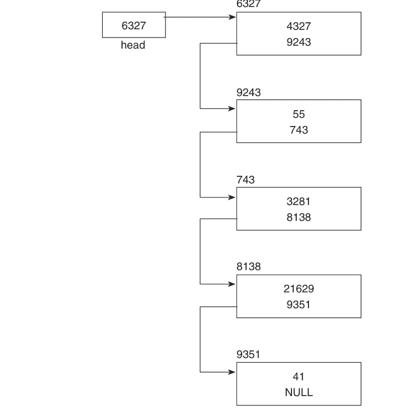

图 9.3 向链表中添加一个节点


图 9.4 一个空链表

图 9.5 向空列表添加的节点

以及该类的成员和成员函数。此后，我们将查看包含节点类成员函数定义的实现文件。

接下来，我们将查看一个包含链表类声明的头文件。与其他类声明一样，该声明也将包含该类数据成员和成员函数的声明。此后，我们将查看包含单链表类成员函数定义的实现文件。

你将在程序列表中看到很多注释。请务必确保阅读它们。阅读这些注释将使代码变得更容易理解。

让我们从学习包含节点类声明的头文件开始（列表 9.1）。

# 列表 9.1 包含单链表节点类声明的头文件

```cpp
/*
SingleLinkedListNode.h 开始。
*/
#ifndef SINGLE_LINKED_LIST_NODE_H
#define SINGLE_LINKED_LIST_NODE_H
/*
节点类。
该类的每个实例都将是单链表中的一个节点。
*/
class SingleLinkedListNode{
    private:
    /*
    节点的数据部分。
    */
    int val;
    /*
    next 指针存在于每个节点中，并指向下一个节点（或为 NULL）
    */
    SingleLinkedListNode * next;
public:
    /*
    节点类的构造函数。它默认会将 next 指针置空。
    */
    SingleLinkedListNode();
    /*
    此函数设置数据部分的值。
    */
    void setValue(int);
    /*
    此函数返回数据部分。
    */
    int getVal();
    /*
    此函数设置 next 指针的值。
    */
    void setNext(SingleLinkedListNode *);
    /*
    此函数返回 next 指针的值。
    */
    SingleLinkedListNode * getNext();
    /*
类的析构函数。
*/
~SingleLinkedListNode();
};
#endif
```

> /*
> SingleLinkedListNode.h 结束。
> */

头文件开头是一个注释，指定了头文件的名称并宣布了文件的开始。其之后是预处理指令，用于防止在其他源代码中多次包含该头文件（你一定在 C 语言课程中学习过这个）。接下来是节点类的声明。头文件的最后一行包含了预处理块的声明以及标记头文件结束的最后一行。

`SingleLinkedList` 类的每个对象都将是链表中的一个节点。该类有一个整数数据成员 `val`，它应该包含节点的值。在这个示例中，每个节点都有这个整数类型变量作为数据成员。然而，数据部分可以是任何类型，包括类对象。

节点类的另一个成员是一个指针。从它的定义可以很明显看出，`next` 应该指向另一个节点，即相同类的另一个对象。在我们的程序中，它要么被指向链表中的下一个节点，要么被赋值为 `NULL`（表示当前节点是链表的末尾）。

让我们看看实现文件（列表 9.2），它包含了节点类成员函数的定义。清晰地理解这些函数非常重要，因为它们是单链表类函数的构建模块。

## 9.2 链表节点类的实现文件

```cpp
/*
SingleLinkedList.cpp 开始。
*/
#include "SingleLinkedListNode.h"
```

```cpp
/*
节点类的构造函数。它默认会将
next 指针置空。
*/
SingleLinkedListNode::SingleLinkedListNode()
{
    /* 将数据部分设为零。 */
    val = 0;
    /* 将 next 指针设为 NULL。 */
    next = NULL;
}
```

```cpp
/*
此函数设置数据部分的值。
*/
void SingleLinkedListNode::setVal(int pVal)
{
    /*
    将数据部分的值设置为
    传递参数的值。
    */
    val = pVal;
}
```

```cpp
/*
 * 此函数返回数据部分。
 */
int SingleLinkedListNode::getVal()
{
    return val;
}
```

```cpp
/*
 * 此函数设置 next 指针的值。
 */
void SingleLinkedListNode::setNext(SingleLinkedListNode *pNext)
{
    next = pNext;
}
```

```cpp
/*
 此函数返回 next 指针的值。
 */
SingleLinkedListNode * SingleLinkedListNode::getNext()
{
    return next;
}
```

```cpp
/*
 * 类的析构函数。
 */
SingleLinkedListNode::~SingleLinkedListNode()
{
    // 析构实现
}
```

// SingleLinkedList.cpp 结束。

实现文件开头是一个注释，指定了实现文件的名称并宣布了文件的开始。其之后是预处理指令，用于防止在其他源代码中多次包含该头文件。接下来是节点类的声明。头文件的最后一行包含了预处理块的声明以及标记头文件结束的最后一行。


```cpp
/*
SingleLinkedListNode.h。
*/
#ifndef SINGLE_LINKED_LIST_NODE_H
#define SINGLE_LINKED_LIST_NODE_H
/*
节点类。
该类的每个实例都将是单链表中的一个节点。
*/
class SingleLinkedListNode{
    private:
    /*
    节点的数据部分。
    */
    int val;
    /*
    next 指针存在于每个节点中，并指向下一个节点（或为 NULL）
    */
    SingleLinkedListNode * next;
public:
    /*
    节点类的构造函数。它默认会将 next 指针置空。
    */
    SingleLinkedListNode();
    /*
    此函数设置数据部分的值。
    */
    void setValue(int);
    /*
    此函数返回数据部分。
    */
    int getVal();
    /*
    此函数设置 next 指针的值。
    */
    void setNext(SingleLinkedListNode *);
    /*
    此函数返回 next 指针的值。
    */
    SingleLinkedListNode * getNext();
    /*
类的析构函数。
*/
```

# 288 C++ 面向对象编程

```cpp
~SingleLinkedListNode();
};
#endif
```

> /*
SingleLinkedListNode.h 结束。
*/

头文件开头是一个注释，指定了头文件的名称并宣布了文件的开始。其之后是预处理指令，用于防止在其他源代码中多次包含该头文件（你一定在 C 语言课程中学习过这个）。接下来是节点类的声明。头文件的最后一行包含了预处理块的声明以及标记头文件结束的最后一行。

`SingleLinkedList` 类的每个对象都将是链表中的一个节点。该类有一个整数数据成员 `val`，它应该包含节点的值。在这个示例中，每个节点都有这个整数类型变量作为数据成员。然而，数据部分可以是任何类型，包括类对象。

节点类的另一个成员是一个指针。从它的定义可以很明显看出，`next` 应该指向另一个节点，即相同类的另一个对象。在我们的程序中，它要么被指向链表中的下一个节点，要么被赋值为 `NULL`（表示当前节点是链表的末尾）。

让我们看看实现文件（列表 9.2），它包含了节点类成员函数的定义。清晰地理解这些函数非常重要，因为它们是单链表类函数的构建模块。

## 9.2 链表节点类的实现文件

```cpp
/*
SingleLinkedList.cpp 开始。
*/
#include "SingleLinkedListNode.h"
```

```cpp
/*
节点类的构造函数。它默认会将
next 指针置空。
*/
```

```cpp
SingleLinkedListNode::SingleLinkedListNode()
{
    /* 将数据部分设为零。 */
    val = 0;
    /* 将 next 指针设为 NULL。 */
    next = NULL;
}
```

```cpp
/*
此函数设置数据部分的值。
*/
```

```cpp
void SingleLinkedList::setVal(int pVal)
{
    /*
    将数据部分的值设置为
    传递参数的值。
    */
    val = pVal;
}
```

```cpp
/*
 * 此函数返回数据部分。
 */
int SingleLinkedList::getVal()
```

（注：原文提供的文本在后半部分存在重复和逻辑混乱，上述翻译已根据您提供的文本内容进行了对应处理。）

# 292 使用 C++ 进行面向对象编程

## 列表 9.5 执行 getVal() 函数

```cpp
/*
GetVal.cpp 的开始
*/
#include <iostream>
#include "SingleLinkedListNode.h"

void main()
{
    SingleLinkedListNode * temp = new SingleLinkedListNode();
    temp -> setVal(10);
    int x = temp -> getVal();
    cout << x << endl;
}
/*
GetVal.cpp 的结束
*/
```

# 输出

10

接下来是 `setNext()` 函数。

```cpp
/*
该函数设置下一个指针（next）的值。
*/
void SingleLinkedListNode::setNext(SingleLinkedListNode * pNext)
{
    /*
    将下一个指针的值设置为传入
    参数的值。
    */
    next = pNext;
}
```

该函数将传递的参数值赋值给它的 `next` 数据成员变量。在学习链表类时，你会发现传递给节点类该函数的数值将是列表中下一个节点的地址。从参数 `pNext` 的定义中也可以显而易见地看出这一点。让我们通过实际程序（列表 9.6）和说明其语句效果的图表来理解这些影响。

## 列表 9.6 执行 setNext() 函数

```cpp
/*
SetNext.cpp 的开始
*/
#include <iostream>
#include "SingleLinkedListNode.h"

void main()
{
    /*
    创建一个新节点并将其地址赋值给
    指针。
    */
    SingleLinkedListNode * temp = new SingleLinkedListNode();

/*
 设置新节点中 val 数据成员的值。
 */
temp -> setVal(10);
/*
 创建另一个新节点并将其地址赋值给另一个指针。
 */
SingleLinkedListNode * temp1 = new
SingleLinkedListNode();
/*
 设置新节点中 val 数据成员的值。
 */
temp1 -> setVal(20);
/*
 让现有节点的 next 指针指向
新创建的节点。
 */
temp -> setNext(temp1);

} // SetNext.cpp 的结束
```

让我们逐条查看这些语句。

```cpp
/*
 创建一个新节点并将其地址赋值给指针。
 */
SingleLinkedListNode * temp = new SingleLinkedListNode();
```

这条语句将创建一个新节点并让指针 `temp` 指向它。图 9.8 以图示表示了结果。

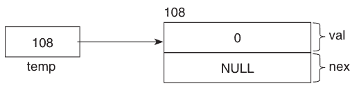

图 9.8 创建临时节点

右侧的框表示节点类新创建的对象。它的数据成员——`val` 和 `next`——已经被标记。可以看出，它们的值分别被设置为 0 和 `NULL`（通过构造函数）。它们在框中被一条线隔开。让我们假设该节点的地址是 108。`temp` 指针的值将是 108。

```cpp
/*
 设置新节点中 val 数据成员的值。
 */
temp -> setVal(10);
```

这条语句将把 10 赋值给 `val` 数据成员。图 9.9 以图示表示了结果。

# 294 使用 C++ 进行面向对象编程

| | |

|---|---|

| 108 | val |

| temp | NULL next |

图 9.9 `setVal()` 函数的效果

```cpp
/*
创建另一个新节点并将其地址赋值给
另一个指针。
*/
SingleLinkedListNode* temp1 = new SingleLinkedListNode();
```

这条语句将创建一个新节点，且指针 `temp1` 指向它。图 9.10 以图示表示了结果。

| | |

|---|---|

| 320 | val |

| temp1 | NULL next |

图 9.10 创建临时节点

上面的图表不需要解释，因为上面已经解释过类似的语句。

```cpp
/*
设置新节点中 val 数据成员的值。
*/
temp1 -> setVal(20);
```

这条语句将把 20 赋值给 `val` 数据成员。图 9.11 以图示表示了结果。

| | |

|---|---|

| 320 | 20 val |

| temp1 | NULL next |

图 9.11 `setVal()` 函数的效果

```cpp
/*
 让现有节点的 next 指针指向
新创建的节点。
*/
temp -> setNext(temp1);
```

图 9.12 以图示表示了结果。

# 数据结构 295

| | |

|---|---|

| 108 | val |

| temp | next |

| 320 | |

| 20 | val |

| temp1 | NULL |

图 9.12 `setNext()` 函数的效果

我们可以从它的定义看出，`setNext` 函数将其参数的值赋值给被调用的对象的 `next` 数据成员。在上面的例子中，函数是针对 `temp` 指向的对象被调用的。作为参数传递的值是 `temp1` 的值，即 320。结果是，`temp` 指向对象的 `next` 指针值被设置为 320，它现在指向新创建的节点。

```cpp
/*
 Set the value of val data member in the new node.
 */
temp -> setVal(10);
```

这条语句将把 10 赋值给 `val` 数据成员。图 9.9 以图示表示了结果。

## 使用 C++ 进行面向对象编程

```cpp
void appendNode(int pVal);
/*
在列表开头插入一个节点的函数。
*/
```

```cpp
void prependNode(int pVal);
/*
查找是否存在具有特定值的节点。
*/
```

```cpp
bool find(int pVal);
/*
删除第一个节点的函数。
*/
```

```cpp
void delBeg();
/*
删除最后一个节点的函数。
*/
```

```cpp
void delEnd();
/*
显示列表中所有节点的函数。
*/
```

```cpp
void display();
/*
该类的析构函数。它将删除列表中所有节点占据的内存。
*/
~SingleLinkedList();
};
```

```cpp
#endif
/*
SingleLinkedList.h 结束
*/
```

与节点类的头文件一样，此头文件也以注释开头，说明了头文件的名称并宣布文件的开始。紧之后是预处理器指令，用于防止在其他源代码中多次包含该头文件。随后是链表类的声明。头文件的倒数第二行包含预处理器块的结束，最后一行包含标记头文件结束的注释。

`SingleLinkedList` 类的每个对象都是一个链表。该类有一个数据成员 `head`，它是一个指针。从它的定义可以看出，`head` 应该指向链表的第一个节点。在我们的程序中，它要么被指向链表的第一个节点，要么被赋予 `NULL` 值（表示当前列表为空）。

让我们查看实现文件（列表 9.10），该文件包含了单链表成员函数的定义。

# 列表 9.10 单链表的实现文件

```cpp
/*
SingleLinkedList.cpp 开始
*/
#include <iostream.h>
#include "SingleLinkedList.h"

/*
单链表类的构造函数。它将 head 指针置空。
*/
```

```cpp
SingleLinkedList::SingleLinkedList()
{
    /*
    默认将 head 指针置空。
    */
    head = NULL;
}
```

/* 在列表末尾添加一个节点的函数。 */

```cpp
void SingleLinkedList::appendNode(int pVal)
{
    /*
    创建一个临时节点，我们将将其附加到列表中。
    SingleLinkedList 类的构造函数将
    将该节点的 next 指针置空。
    */
    SingleLinkedList* temp = new SingleLinkedList();
    /*
    将传递给函数的参数值拷贝到新节点。
    */
    temp->setVal(pVal);
    /*
    如果 head 指针为 NULL（列表为空）
    */
    if(head == NULL)
    {
        /*
        ... 让 head 指针指向临时节点
        */
        head = temp;
    }
    /*
    否则 ... */
    else
    {
        /*
        ... 创建一个临时指针，
        */
        SingleLinkedList* iter;
        /*
        ... 让它指向第一个节点，遍历到列表末尾并...
        */
        for(iter = head; iter->getNext() != NULL)
            iter = iter->getNext();
        /*
        ... 让最后一个节点的 next 指针指向
        临时节点。
        */
        iter->setNext(temp);
    }
}
```

/* 在列表开头插入一个节点的函数。 */

```cpp
void SingleLinkedList::prepend(int pVal)
{
    /*
    创建一个临时节点，我们将将其置于列表开头。
    SingleLinkedListNode 类的构造函数将
    将该节点的指针置空。
    */
    SingleLinkedList* temp = new SingleLinkedList();
    /*
    将传递给函数的参数值拷贝到新节点。
    */
    temp->setVal(pVal);
    /*
    如果 head 指针为 NULL（列表为空） ...
    */
    if(head == NULL)
    {
        /*
        ... 让 head 指针指向临时节点
        ...
        */
        head = temp;
    }
    /*
    ... 否则 ... */
    else
    {
        /*
        ... 让临时节点的 next 指针
        指向第一个节点并 ...
        */
        temp->setNext(head);
        /*
        ... 让 head 指针指向临时
        节点。
        */
        head = temp;
    }
}
```

/* 显示列表中所有节点的函数。 */


```cpp
void SingleLinkedList::display()
{
    /*
    如果 head 指针为 NULL（列表为空）
    */
    if(head == NULL)
    {
        /*
        ... 显示错误消息
        */
        cout << "No nodes in list\n";
    }
    /* 否则 ... */
    else
    {
        /*
        ... 遍历列表 ...
        */
        for(SingleLinkedList* iter = head; iter != NULL; iter = iter->getNext())
        {
            /*
            ... 显示指向节点的值。
            */
            cout << iter->getVal() << endl;
        }
    }
}
```

/* 查找是否存在具有特定值的节点。 */

```cpp
bool SingleLinkedList::find(int pVal)
{
    /*
    初始化标志位，
    */
    bool found = false;
    /*
    创建一个临时指针，
    */
    SingleLinkedListNode * iter = head;
    /*
    遍历列表并 ...
    */
    while(iter != NULL)
    {
        /*
        如果节点的值与参数值匹配，
        */
        if(iter->getVal() == pVal)
        {
            /*
            将标志位设置为 true 并跳出
            */
            found = true;
            break;
        }
        /* 移动到下一个节点 */
        iter = iter->getNext();
    }
    return found;
}
```

/* 删除第一个节点的函数。 */

```cpp
void SingleLinkedList::delBeg()
{
    if(head == NULL)
    {
        /* ... 如果列表为空，则返回 ... */
        return;
    }
    /*
        ... 让 head 指针指向第二个节点
        */
    SingleLinkedList* temp = head;
    head = head->getNext();
    /*
        ... 删除第一个节点占据的内存
        */
    delete temp;
}
```

/* 删除最后一个节点的函数。 */

```cpp
void SingleLinkedList::delEnd()
{
    if(head == NULL)
    {
        /* ... 如果列表为空，则返回 ... */
        return;
    }
    if(head->getNext() == NULL)
    {
        /* ... 如果只有一个节点 ... */
        SingleLinkedList* temp = head;
        head = NULL;
        delete temp;
    }
    else
    {
        SingleLinkedList* iter = head;
        /* ... 遍历到最后一个节点 ... */
        while(iter->getNext()->getNext() != NULL)
        {
            iter = iter->getNext();
        }
        /* ... 删除最后一个节点 ... */
        SingleLinkedList* temp = iter->getNext();
        iter->setNext(NULL);
        delete temp;
    }
}
```

# 数据结构 307

245

| NULL | head |

| list1 | |

**图 9.16** 类构造函数的影响

`list1` 是 `SingleLinkedList` 类的对象。该框描绘了 `list1` 占据的内存块。从 `SingleLinkedList` 类的定义可以看出，该类的对象只有一个数据成员。该数据成员的名称为 `head`。类的构造函数会在对象创建时触发。它会将 `head` 指针的值设置为 `NULL`。

让我们来看下一个函数 `appendNode()`。

```cpp
/*
在列表末尾添加节点的函数。
*/
void SingleLinkedList::appendNode(int pVal)
{
    /*
    创建一个临时节点，我们将将其添加到
    列表中。
    SingleLinkedListNode 类的构造函数将
    将该节点的 next 指针置空。
    */
    SingleLinkedNode * temp = new SingleLinkedListNode();
    /*
    将传递给函数的参数值拷贝到
    新节点中。
    */
    temp->set(pVal);
    /* 如果 head 指针为 NULL（列表为空） ...
    */
    if(head == NULL)
    {
        /* 让 head 指针指向临时节点
        */
        head = temp;
    }
    /* 否则 ...
    else
    {
        /* 创建一个临时指针， ...
        */
        SingleLinkedNode * iter;
        /*
        让它指向第一个节点，遍历到
        列表的末尾并 ...
        */
        for(iter = head->getNext(); iter != NULL;
        iter = iter->getNext());
```

# 308 使用 C++ 的面向对象编程

```cpp
/*
... 让最后一个节点的 next 指针指向
临时节点。
*/
iter->setNext(temp);
```上述函数设计用于向链表列表中一个节点。让我们先了解我们希望该函数做什么。然后，通过研究该函数的定义（列表 9.12），我们将判断它是否真的执行了我们想要的操作。

# 列表 9.12 执行 appendNode() 函数

```cpp
/*
AppendNode01.cpp 的开始
*/
#include "SingleLinkedList.h"
void main() {
    /*
    创建一个列表
    */
    SingleLinkedList list1;
    /*
    在 list1 对象上调用 appendNode() 函数。
    */
    list1.appendNode(5287);
}
/*
AppendNode01.cpp 的结束
*/
```在上述程序的第一条语句之后，由于 `SingleLinkedList` 类的构造函数，对象内部的 `head` 指针的值将被设置为 `NULL`。这可以用图 9.17 来表示。

| 245 | |

| NULL | head |

| list1 | |

**图 9.17** 构造函数的影响

上面的框描绘了名为 `list1` 的对象（标记在框的底部）。由于它是 `SingleLinkedList` 类的对象，它只有一个数据成员——`head`（标记在框的右侧）。让我们来看在 `list1` 对象上调用 `appendNode()` 函数。

```cpp
list1.appendNode(5287);
```

如果函数定义得正确，那么在执行结束时，链表看起来应该像图 9.18 所示。

# 数据结构 309

| | 245 | 320 |

|---|---|---|

| head | 320 | 5287 | val |

| | list1 | NULL | next |

**图 9.18** `appendNode()` 函数的预期效果

让我们看看函数是否按预期执行。在函数执行之前，`head` 指针的值为 `NULL`。当函数开始执行时，参数 `pVal` 的值变为 5287，因为这是传递的值。之后，通过 `new` 运算符创建了一个临时节点，并让临时指针 `temp` 指向它（图 9.19）。

| | 695 | 320 |

|---|---|---|

| | 320 | 0 | val |

| temp | NULL | next |

**图 9.19** `appendNode()` 函数创建临时节点

下一语句是：

`temp->set(pVal);`

这将 `pVal` 的值（5287）拷贝到节点的 `val` 数据成员中。之后，`if` 语句将检查 `head` 指针的值是否为 `NULL`。此时测试结果为真，因为列表为空。`if` 块将执行，`temp` 的值将被拷贝到 `head`。这将导致 `head` 指针指向之前创建的临时节点。图 9.20 释了这一点。

| | 695 | 320 |

|---|---|---|

| | 320 | 5287 | val |

| temp | NULL | next |

| 245 | | |

| | 320 | |

| head | | |

**图 9.20** `temp` 指针的值拷贝到 `head` 指针

`else` 块不会执行，函数结束。由于 `temp` 是局部变量，它离开了作用域。

# 数据结构 313

对比图 9.25 和图 9.22，后者描述了我们预期的结果。如你所见，我们预期的函数行为与实际发生的情况完全吻的。因此，我们可以再次得出结论：我们的函数定义是正确的。

现在，请继续通过找出如果对同一个对象再次调用该函数时会发生什么，来验证该函数的定义是否正确。

现在，让我们来尝试理解 `display()` 函数。

```cpp
/*
 * 显示链表中所有节点的函数。
 */
void SingleLinkedList::display() {
 /*
 * 如果头指针为 NULL（列表为空）...
 if(head == NULL) {
  /*
  * ... 显示错误消息 ...
  cout << "No nodes in list\n";
  */
  ... 否则
 }
 else {
  /*
  * ... 让一个临时指针指向第一个节点，
  * 遍历链表并 ...
  */
 for(SingleLinkedListNode* iter = head; iter != NULL; iter = iter->getNext()) {
    /*
    * ... 显示指针指向节点的值。
    cout << iter->getVal() << endl;
    */
  }
}
}
```

与之前一样，让我们从链表类的一个新对象开始，这将创建一个空列表，然后在该新对象上调用 `display()` 函数（列表 9.14）。之后，我们将实际执行情况与预期的执行情况进行比较。

# 列表 9.14 执行 `display()` 函数

```cpp
/*
 * ListDisplay01.cpp 的开头
 */
#include "SingleLinkedList.h"
void main() {
 /*
 * 创建一个列表对象。
 */
SingleLinkedList list1;
/*
显示内容。
*/
list1.display();
}
/*
 * ListDisplay01.cpp 的结束
*/
```

# 输出

No nodes in list（列表中没有节点）

当列表为空时，我们预期函数会显示一条说列表为空的消息。让我们看看这种情况是否发生。

注意，由于构造函数的作用，`list1` 对象内部的头指针值在创建时会被设置为 `NULL`。因此，在调用 `display()` 函数时，它是 `NULL`。

现在，当函数开始执行时，`if` 块会将头指针的值与 `NULL` 进行比较。由于头指针的值为 `NULL`，`if` 语句中的测试表达式返回真。因此，`if` 块执行。这导致字符串 'No nodes in list' 显示在显示器上。自然地，`else` 块不执行，函数结束。这正符合我们预期的。

让我们看看列表不为空的其他情况（列表 9.15）。

# 列表 9.15 执行 `display()` 函数

```cpp
/*
ListDisplay02.cpp 的开头
*/
#include "SingleLinkedList.h"

void main()
{
/*
 创建一个列表对象。
 */
SingleLinkedList list1;
/*
 向列表中添加一个节点。
 */
list1.appendNode(5287);
/*
 再添加另一个节点。
 */
list1.appendNode(325);
/*
 显示内容。
 */
list1.display();
}
End of ListDisplay02.cpp 的结束
*/
```

我们现在知道，在上述调用两次 `appendNode()` 函数后，链表将看起来像图 9.26 一样。

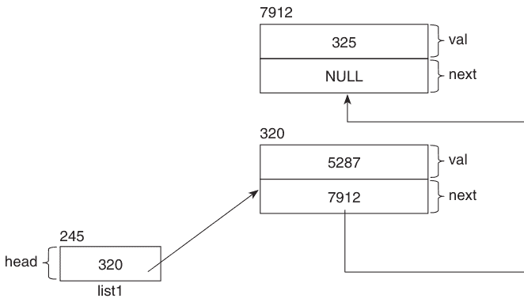

**图 9.26** 在执行 `display()` 函数之前的列表状态

由于调用了 `display()` 函数，我们预期节点中的值将被显示。

# 数据结构 319

会将 `pVal1` 的值（即 5287）复制到节点的成员变量中。之后，`if` 语句中的测试表达式将检查头指针的值是否为 `NULL`。由于列表是空的，此时该测试将返回。`if` 块将执行，并将 `temp` 的值复制给 `head`。这将导致头指针也指向新创建的临时节点。图 9.32 所示所示。

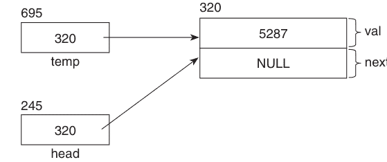

**图 9.32** 临时节点的初始化以及头指针指向它

`else` 块将不会执行，函数将结束。由于 `temp` 是局部变量，它将离开作用域，我们留下一个类似于图 9.33 的链表。

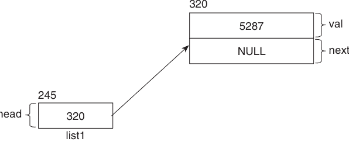

**图 9.33** `prependNode()` 函数的观察效果

将图 9.33 与图 9.30 进行对比，后者描述了我们预期的结果。如你所示，我们预期的函数行为与实际发生的情况完全一致。

让我们在 `list1` 对象上两次调用该函数（列表 9.17），并验证该函数是否执行了其定义的任务。

- **列表 9.17** 执行 `prependNode()` 函数

```cpp
/*
 PrependNode2.cpp 的开始
 */
#include "SingleLinkedList.h"

void main()
{
 /*
创建一个列表对象
/*
SingleLinkedList list1;
/*
在 list1 对象上调用 prependNode 函数。
/*
list1.prependNode(5287);
/*
再次在 list1 对象上调用 prepend() 函数。
/*
list1.prependNode(325);
/*
 PrependNode2.cpp 的结束
/*
```

```

在该程序执行结束时（列表 9.17），我们预期的链表将如图 9.34 所示。

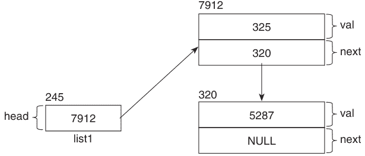

**图 9.34** `prependNode()` 函数的预期效果

让我们再次追踪该函数的执行，看看它是否按照我们的预期运行。让我们从对函数的第二次调用开始，因为我们已经看到了程序之前部分的效果。此时，链表看起来如下。

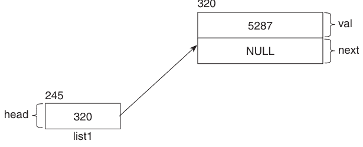

**图 9.35** `prependNode()` 函数添加第一个节点

# 数据结构 321

此时，函数被第二次调用。注意，此时头指针不为 `NULL`（它的值为 320，即它所指向的第一个节点的地址）。

执行过程与之前相同，直到 `if` 语句中的测试表达式检查头指针的值是否为 `NULL`。由于列表不空，该测试将返回 `false`。相反，`else` 块将执行。`else` 块的第一条语句将头指针的值复制到函数开始处创建的临时节点的 `next` 指针中。结果情况可以用图 9.36 描述。

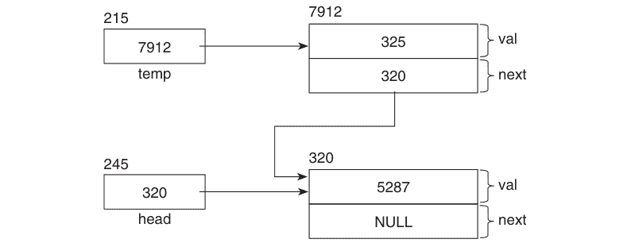

**图 9.36** 将新节点连接旧节点

下一条语句将 `temp` 指针的值复制给头指针。因此，头指针最终指向了该临时节点。图 9.37 描述了这种情况。

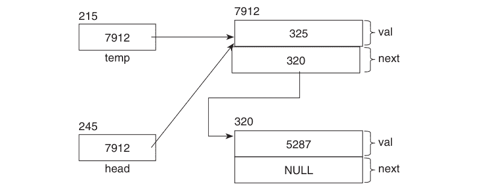

**图 9.37** 头指针指向新节点

由于 `temp` 是局部变量，它将离开作用域，我们留下一个类似于图 9.38 的链表。

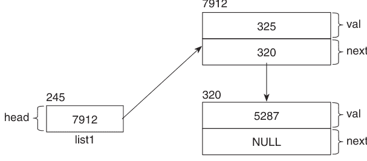

**图 9.38** `prependNode()` 函数的观察效果

# 322 C++ 对象面向编程

## 使用 C++ 进行面向对象编程

```cpp

/*

如果列表为空，则不执行任何操作（没有 else）。

*/
```


让我们分两种情况来验证该函数是否正常工作。在第一种情况下，列表为空。在第二种情况下，列表包含一个或多个节点。

```cpp
}该函数显然定义正确，可以处理列表为空的情况。如果列表为空，我们知道头指针（head pointer）的值将为 NULL。你会发现 delBeg() 函数在开头有一个 if 语句。该 if 语句的测试表达式检查头指针的值，发现它为 NULL，从而简单地阻止了 if 块的执行。if 块没有 else 块，函数中也没有后续的语句。在这里，如果列表为空，函数什么都不做。这正符合我们预期的。
```

现在，让我们考虑列表不为空的其他情况。让我们看看函数的示例执行过程，看看函数是否按预期执行。考虑列表 9.19。

### 列表 9.19 执行 delBeg() 函数

```cpp
/*
DelBeg.cpp 的开始
*/
#include "LinkedList.h"
void main()
{
/*
创建一个列表对象
*/
SingleLinkedList list1;
/*
在 list1 对象上调用 prependNode() 函数。
*/
list1.prependNode(5287);
/*
再次在 list1 对象上调用 prependNode() 函数。
*/
list1.prependNode(325);
/*
删除第一个节点
*/
list1.delBeg();
/*
显示列表中的值。
*/
list1.display();
}
/*
DelBeg.cpp 的结束
*/
```

输出
5287

我们知道，在第二次调用 `prependNode()` 函数后，列表将如图 9.42 所示。

## 数据结构 327

| | |
| :--- | :--- |
| 325 | val |
| 7912 | next |

| | |
| :--- | :--- |
| 5287 | val |
| NULL | next |

图 9.42 `delBeg()` 函数之前的列表结构

在程序的程序的这一点上，已经调用了 `delBeg()` 函数。在执行结束时，我们预期列表将如图 9.43 所示。

| | |
| :--- | :--- |
| 5287 | val |
| NULL | next |

| | |
| :--- | :--- |
| 7912 | list1 |

图 9.43 `delBeg()` 函数的预期效果

让我们回顾该函数，看看它的定义是否正确。当 `delBeg()` 函数开始时，`if` 语句的表达式被求值。它检查头指针的值是否为 `NULL`。此时，头指针的值为 320（指向当前列表中两个节点中的第一个）。因此，测试表达式返回真，`if` 块执行。

`if` `if` 块中的第一条语句声明了一个临时指针，并将头指针的值复制给它。图 9.44 描绘了结果情况。

| | |
| :--- | :--- |
| 325 | val |
| 7912 | next |

| | |
| :--- | :--- |
| 5287 | val |
| NULL | next |

图 9.44 让临时指针指向要删除的节点

## 328 使用 C++ 进行面向对象编程

下一条语句是：
`head = head -> getNext();`

通过头指针调用 `getNext()` 函数返回 7912。该值被复制回头指针。因此，头指针的值变为 7912，并指向第二个节点。结果如图 9.45 所示。(img/5bfa77b13fdaa37625789bb8c0ee79_341_0) 下条语句是：
`delete temp;`

这条语句释放了 `temp` 指向的内存块。之后，`if` 块结束。由于 `temp` 指针是 `if` 块内的局部变量，它离开了作用域，我们得到了图 9.46 所示的情况。(img/5bfa77b13fdaa37625789bb8c0ee79_341_1) `delBeg()` 之后没有更多语句。因此，它结束了，我们得到了图 9.47 所示的情况。(img/5bfa77b13fdaa37625789bb8c0ee79_341_2) 比较图 9.47 和图 9.43。你可以看到 `delBeg()` 函数完成了我们预期的工作。

现在让我们研究 `delEnd()` 函数。正如名称所示，该函数删除列表的最后一个节点。与 `delBeg()` 函数相比，这个函数稍微复杂。

```cpp
/*
删除最后一个节点的函数。
*/ void SingleLinkedList::delEnd() {
/* 如果列表为空 */
if(head == NULL) {
/* 删除头 */
head = NULL;
} else {
/* 声明一个临时指针 */
ListNode* iter;
/* 遍历列表指向最后一个节点 */
for(iter = head; iter->getNext() != NULL; iter = iter->getNext());
/* 删除最后一个节点 */
delete iter->getNext();
/* 将 next 指针置空 */
iter->setNext(NULL);
}
```

## 330 使用 C++ 进行面向对象编程

需要在需要在情况下删除最后一个节点：列表为空、有一个节点以及多个节点。列表为空的情况与 `delBeg()` 函数的处理方式完全相同。考虑列表 9.20。

### 列表 9.20 执行 delEnd() 函数

```cpp
/*
DelEnd.cpp 的开始
*/
#include "LinkedList.h"
void main()
{
/*
创建一个列表对象
*/
SingleLinkedList list1;
/*
在 list1 对象上调用 prependNode() 函数。
*/
list1.prependNode(5287);
/*
再次在 list1 对象上调用 prependNode() 函数。
*/
list1.prependNode(325);
/*
删除最后一个节点
*/
list1.delEnd();
/*
显示列表中的值。
*/
list1.display();
}
/*
DelEnd.cpp 的结束
*/
```

输出
5287

我们知道，在第二次调用 `prependNode()` 函数后，列表将如图 9.48 所示。(img/5bfa77b13fdaa37625789bb8c0ee79_343_0) 图 9.48 `delEnd()` 函数的预期效果

我们将看看是否会发生这种情况。调用 `delEnd()` 函数后的列表结构将如图 9.49 所示。(img/5bfa77b13fdaa37625789bb8c0ee79_344_0) 图 9.49 `delEnd()` 函数之前的列表结构

随后是调用 `delEnd()` 函数。函数中第一个 `if` 块的表达式检查 `head` 值是否为 `NULL`。检查返回假，因为它不是 `NULL`（它的值为 7912，因为它指向第一个节点）。

这导致测试了 `else` 块。这也返回真，因为通过头指针调用 `getNext()` 函数返回 `NULL`。此时头指针指向第一个节点，在这种情况下，该第一个节点的 `next` 指针为 `NULL`。

嵌套的 `if` 块执行。第一条语句调用 `delete` 运算符并将头指针作为参数。这导致头指针指向的内存块返回给操作系统。下一条语句将 `NULL` 赋值给头指针。结果如图 9.50 所示。(img/5bfa77b13fdaa37625789bb8c0ee79_344_1) 图 9.50 通过头指针删除第一个且唯一节点后链表的结构，且头指针已置空

`else` 块不执行（因为 `if` 块已执行）。函数中没有更多语句，函数结束。我们得到了图 9.51 所示的结构。(img/5bfa77b13fdaa37625789bb8c0ee79_344_2) 图 9.51 `delEnd()` 函数的观察效果

比较图 9.51 和图 9.48。如你所见，函数的效果与我们预期的完全相同。因此，调用 `display()` 函数显示“No nodes in list”。

# 332 使用 C++ 进行的面向对象编程

列表 9.21 执行 delEnd() 函数

```cpp
/*
DelEnd02.cpp 的开始
*/
#include "SingleLinkedList.h"
void main() {
  /*
    创建一个列表对象
  */
  SingleLinkedList list1;
  /*
    在 list1 对象上调用 prependNode() 函数。
  */
  list1.prependNode(5287);
  /*
    在 list1 对象上调用 prependNode() 函数。
  */
  list1.prependNode(325);
  /*
    删除最后一个节点
  */
  list1.delEnd();
  /*
    显示链表中的值。
  */
  list1.display();
}
// DelEnd02.cpp 结束
```

输出

325

我们预计在调用 `delEnd()` 函数后，链表的结构将如图 9.52 所示。

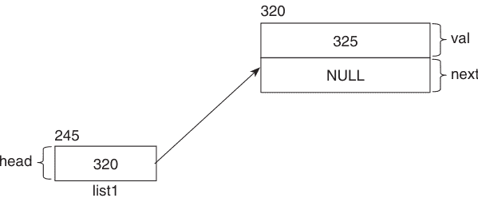

图 9.52 `delEnd()` 函数的预期效果

让我们看看这种情况是否发生。我们知道，在第二次调用 `prependNode()` 函数后，链表的结构将如图 9.53 所示。

# 数据结构 333

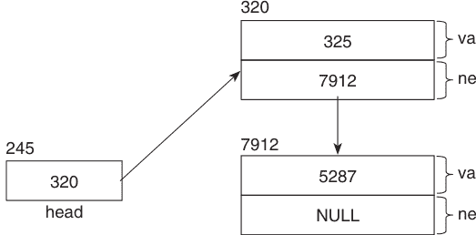

**图 9.53** 调用 `delEnd()` 函数之前的链表结构

在第二次调用 `prependNode()` 函数后，我们调用了 `delEnd()` 函数。我们已经知道 `delEnd()` 函数内部外层 `if` 块中的测试表达式将返回 true。然而，内部块中的测试表达式（通过 `head` 指针调用 `getNext()`）将返回 false。这是因为头指针（`head` 指针）所指向的节点的 `next` 指针为 `NULL`。它的值为 7912。它指向第二个节点。因此，将执行 `else` 块。

`else` 块中的第一条语句声明了一个临时指针 `iter`。第二条语句调用了一个没有主体的 `for` 循环（语句末尾有一个分号）。`for` 循环的初始化语句将 `head` 指针的值拷贝到 `iter`（图 9.54）。

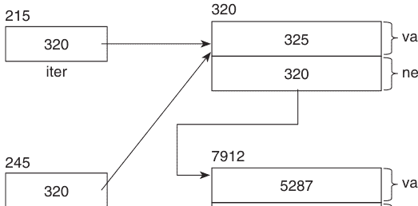

**图 9.54** 指向第一个节点的临时迭代器

现在，仔细观察 `for` 循环的测试表达式。`iter -> getNext()` 返回一个指向第二个节点的指针。对 `getNext()` 函数的链式调用返回第二个节点的 `next` 指针的值。如图 9.54 所示，该值为 `NULL`。测试表达式返回 false，循环终止。

下一条语句通过 `iter` 调用 `getNext()` 函数。它将此调用返回的值作为参数传递给 `delete` 操作符（`delete`）。然而，这次对 `getNext()` 函数的调用返回一个指向第二个节点的指针。因此，对第二个节点调用了 `delete` 操作符。这导致第二个节点占用的内存返回给操作系统。

# 334 使用 C++ 进行的面向对象编程

`else` 块的下一条语句调用了 `setNext()` 函数并传递 `NULL` 作为参数。由于 `iter` 指向第一个节点，第一个节点中的 `next` 指针的值被设置为 `NULL`。结果情况可以用图 9.55 描述。

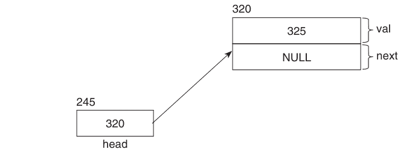

图 9.55 删除第二个（也是最后一个）节点后的链表结构

由于 `else` 块中和函数本身中没有更多语句，函数的调用结束了。我们留下一个如图 9.56 所示的链表。

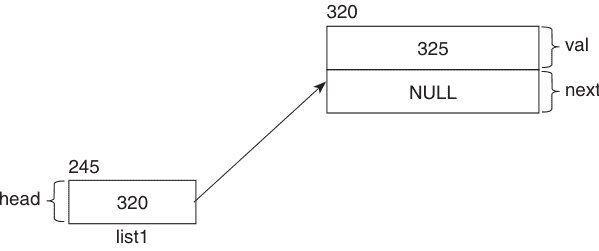

图 9.56 `delEnd()` 函数的观测效果

对比图 9.56 和图 9.52。如你所见，函数的效果与我们预期的完全相同。因此，调用 `display()` 函数显示了 325。尝试验证 `delEnd()` 函数是否已正确定义以处理链表大于两个节点的情况。我们需要查看的最后一个函数是析构函数。

```cpp
/*
类的析构函数。它将删除链表中所有节点占用的内存。
*/
SingleLinkedList::~SingleLinkedList()
{
    /*
    仅当链中有节点时才删除。
    */
    if(head != NULL)
    {
        /*
        只要 head 指针不为空，就继续调用 delEnd()
        删除最后一个节点。
        */
        while(head != NULL)
delEnd();
```


当链表对象离开作用域时，就会调用析构函数。它被设计为将节点占用的内存返回给操作系统。函数本身非常简单。如果链表为空，它什么都不做。否则，它简单地在链表为空之前调用 `delEnd()`。

# 栈 结构

## 9.3 栈（Stacks）

栈与链表非常相似，它们都由节点组成。但栈具有后进先出（LIFO）的特性，最后进入的元素是首先被出的。我们已经学习了链表。在栈中，栈的顶部是唯一的访问点，被称为栈顶（top）。

栈的两个基本操作是入栈（`push`）和出栈（`pop`）。入栈操作将元素添加到栈顶，出栈操作则从栈顶移除元素。

让我们看看栈类的定义。我们从头文件开始（列表 9.23）。

# 列表 9.23 栈类的头文件

```cpp
/*
 Stack.h 的开始
 */
#ifndef _STACK_H_
```

# 数据结构 337

```cpp
#define _STACK_H
#include "SingleLinkedList.h"
/*
栈类。
该类的每个实例将代表一个栈。
*/
class Stack : private SingleLinkedList
{
    public:
    /*
    将一个值推入栈顶。
    */
    void push(int);
    /*
    显示栈节点中的值。
    */
    void display();
    /*
    从栈顶弹出一个值。
    */
    void pop();
};
#endif
```

`Stack.h` 结束

列表 9.23 的头文件包含了栈类的定义。如你所见，栈类私有继承 `SingleLinkedList` 类。我们很快就会理解私有继承的原因。该类没有任何数据成员。它有一组公共成员函数。

让我们理解为什么栈类被定义为继承自 `SingleLinkedList` 类。我们将理解为什么它被定义为私有继承，知道栈与链表共享两个功能。其中一个是在开头添加节点，另一个是从开头删除节点。另一个共享的功能是显示节点的值。

我们已经在 `SingleLinkedList` 类中定义了这些功能。`prependNode()` 函数在开头插入节点。`delBeg()` 函数从开头删除节点。继承 `SingleLinkedList` 类而不是在栈类中重新定义它们是合理的。我们知道，由于继承，我们将能够相对于栈对象调用这些函数。

例如，`stack1` 是栈类的一个对象。我们将想要相对于它调用 `prependNode()` 函数。

现在，让我们理解为什么我们使用了私有继承。由于我们应该只在栈的开头添加节点，基类有一个向列表末尾添加节点的函数（也是 `appendNode()` 函数）。虽然我们将想要

```cpp
stack1.prependNode(10);
```

# 338 使用 C++ 进行面向对象编程

为了根据 `Stack` 类对象调用 `SingleLinkedList` 类的一些函数，我们希望禁止某些函数调用。例如，`Stack` 类的用户程序可能会如下调用 `appendNode()` 函数（`stack1` 是 `Stack` 类的一个对象）：
```cpp
stack1.appendNode(10);
```

我们不允许上述调用通过编译。这是因为……私有继承（inheriting privately）使得基类的所有公共函数在派生类中变为私有，从而导致像上面这样的语句产生编译错误。

正如我们所见，私有继承为我们解决了一个问题，但也导致了另一个问题。虽然它防止了对基类不需要函数的调用，但也防止了对需要的函数的调用！这个问题该如何解决？可以通过在派生类中定义函数，并在内部调用基类需要的函数来解决这个问题。`Stack` 类的实现（列表 9.24）展示了如何这样做。那么，让我们来看一下。

## 列表 9.24 Stack 类的实现文件

```cpp
/*
Stack.cpp 的开始
*/
#include "Stack.h"
/*
将一个值推入栈顶的函数。
*/
void Stack::push(int pVal)
{
/*
调用基类函数。
prependNode(pVal);
*/
}
/*
显示栈中节点中值的函数。
*/
void Stack::display()
{
/*
调用基类函数。
SingleLinkedList::display();
*/
}
/*
从栈顶弹出一个值的函数。
*/
void Stack::pop()
{
/*
调用基类函数。
delBeg();
*/
}/*Stack.cpp 的结束*/
```

# 数据结构 339

让我们从 `push()` 函数开始。该函数简单地调用基类的 `prependNode()` 函数，并将传递给它的值传递给被调用的函数。这导致节点被添加到栈的开头。

尽管 `prependNode()` 函数变成了 `Stack` 类的私有成员，但 `push()` 函数有完全权利调用它，因为它是 `Stack` 类的成员（记住，类的成员可以访问该类的私有成员）。

下一个是 `display()` 函数。该函数仅需要调用基类的 `display()` 函数。然而，如果不使用类名限定符，将导致无限递归。因此，对基类 `display()` 函数的调用使用了基类名限定。

最后是 `pop()` 函数。与 `push()` 函数一样，它调用基类的相关函数，在该类中是 `delBeg()` 函数。这导致栈的节点被删除。

再次，由于前面的解释，`pop()` 函数有完全权利调用 `delBeg()` 函数。

让我们来看列表 9.25，它将这一切整合在了一起。

## 列表 9.25 Stack 类的示例程序

```cpp
/*
StackUser.cpp 的开始
*/
#include <iostream>
#include "Stack.h"
int main()
{
    stack1;
    cout << "Displaying a new stack:" << endl;
    stack1.display();
    cout << endl;
    stack1.push(30);
    cout << "Displaying after pushing 30:" << endl;
    stack1.display();
    cout << endl;
    stack1.push(20);
    cout << "Displaying after pushing 20:" << endl;
    stack1.display();
    cout << endl;
    stack1.push(10);
    cout << "Displaying after pushing 10:" << endl;
    stack1.display();
    cout << endl;
    stack1.pop();
    cout << "Displaying after popping:" << endl;
    stack1.display();
    cout << endl;
    stack1.pop();
    cout << "Displaying after popping:" << endl;
    stack1.display();
    cout << endl;
    stack1.pop();
    cout << "Displaying after popping:" << endl;
    stack1.display();
    cout << endl;
}
/*
StackUser.cpp 的结束
```

# 输出

Displaying a new stack:
No nodes in list
Displaying after pushing 30:
30
Displaying after pushing 20:
30
Displaying after pushing 10:
10
20
30
Displaying after popping:
20
30
Displaying after popping:
30
Displaying after popping:
No nodes in list

## 9.4 队列

队列也是数据结构。它们与栈非常相似。两者之间唯一区别在于它们的 `push` 操作。在栈中，`push` 操作导致新节点添加到开头。但在队列中，`push` 操作导致新节点被添加到末尾。因此，队列被认为具有 FIFO（先进先出）操作。第一个进入的节点是第一个出来的节点。

让我们来看队列类及其函数的定义。让我们从头文件开始（列表 9.26）。

## 列表 9.26 队列类的头文件

```cpp
/*
Queue.h 的开始
*/
#ifndef QUEUE_H
#define QUEUE_H
#include "SingleLinkedList.h"
class Queue : private SingleLinkedList
{
public:
    /*
    将一个值推入队列尾部的函数。
    */
    void push(int pVal);
    /*
    显示队列中节点值的函数。
    */
    void display();
    /*
    从队列头部弹出一个值的函数。
    */
    void pop();
};
#endif
```

## 列表 9.27 队列类的实现文件

```cpp
/*
Queue.cpp 的开始
*/
#include "Queue.h"
/*
将一个值推入队列尾部的函数。
*/
void Queue::push(int pVal)
{
/*
调用基类函数。
*/
appendNode(pVal);
*/
}
/*
显示队列中节点值的函数。
*/
void Queue::display()
{
/*
调用基类函数。
*/
SingleLinkedList::display();
}
/*
从队列头部弹出一个值的函数。
*/
void Queue::pop()
{
/*
调用基类函数。
*/
delBeg();
}/*Queue.cpp 的结束*/
```

上面的头文件包含了队列类的定义。正如我们所见，队列类的所有函数与 `Stack` 类相同，除了 `push()` 函数。该函数调用基类的 `appendNode()` 函数而不是 `prependNode()` 函数。让我们来看列表 9.28，它将这一切整合在了一起。

## 列表 9.28 队列类的示例程序

```cpp
/*
QueueUser.cpp 的开始
*/
#include <iostream>
#include "Queue.h"
void main()
{
    queue1;
    cout << "Displaying a new queue:" << endl;
    queue1.display();
    cout << endl;
    queue1.push(30);
    cout << "Displaying after pushing 30:" << endl;
    queue1.display();
    cout << endl;
    queue1.push(20);
    cout << "Displaying after pushing 20:" << endl;
    queue1.display();
    cout << endl;
    queue1.push(10);
    cout << "Displaying after pushing 10:" << endl;
    queue1.display();
    cout << endl;
    queue1.pop();
    cout << "Displaying after popping:" << endl;
    queue1.display();
    cout << endl;
    queue1.pop();
    cout << "Displaying after popping:" << endl;
    queue1.display();
    cout << endl;
    queue1.pop();
    cout << "Displaying after popping:" << endl;
    queue1.display();
    cout << endl;
}
/*
QueueUser.cpp 的结束
*/


# 输出

Displaying a new queue:
No nodes in list
Displaying after pushing 30:
30
Displaying after pushing 20:
30
Displaying after pushing 10:
30
20
10
Displaying after popping:
20
10
Displaying after popping:
10
Displaying after popping:
No nodes in list

## 9.5 树

树与链表、栈和队列不同，它们没有线性结构。在本章中为止我们学习的列表中，每个节点最多连接到其他一个节点。但在树中，每个节点都可能连接到多个节点。

我们在日常生活中会遇到树形结构。树的一个真实例子可以是计算机中的目录结构。图 9.57 显示了一个可能的目录结构（每个框代表一个目录）：

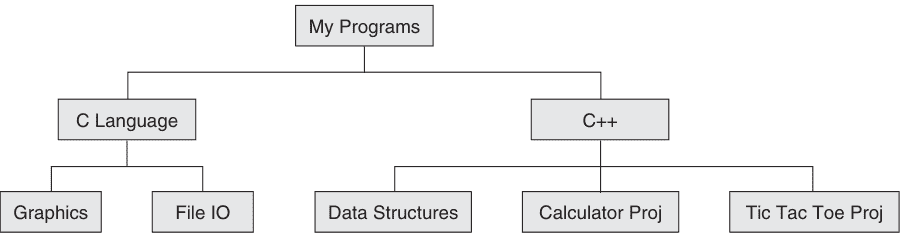

> 图 9.57 目录结构看起来像一棵树

## 使用 C++ 进行面向对象编程

“My Programs”文件夹下有两个文件夹——“C Language”和“C++”。“C++”文件夹下有三个文件夹——Data Structures、“Calculator Proj”和“Tic Tac Proj”。

假设这种文件夹结构由一种数据结构表示，其中每个文件夹由一个节点表示。显而易见，从文件夹的名称可以看出，每个节点将包含一个或多个指向其他相似节点的指针。这种数据结构被称为树。我们可以在 C++ 中创建树来对这些现实世界中的树形结构进行建模。

### 9.5.1 二叉树

二叉树是每个节点最多连接到两个节点的树。让我们来看一张二叉树的简化图（图 9.58）。在图中，节点被用圆圈表示。每个节点都标记有不同的字母。节点之间的连接用实线表示。

这棵树是以自上而下的方式绘制的。这意味着 A 是根节点。稍后我们将对该图进行更详细的描述。

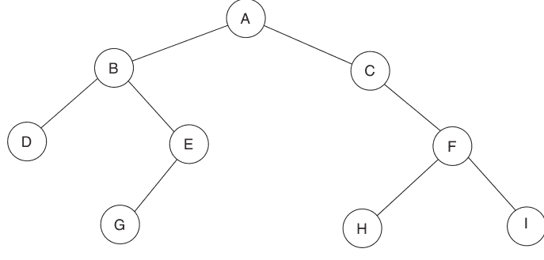

图 9.58 一棵二叉树

二叉树是元素的有限集合。它要么为空，要么分为三个不相交的子集。第一个子集只包含一个元素，即树的根。其他子集本身本身是二叉树。其中一个被视为左子树，另一个被视为右子树。这两个子树中的一个或两个都可以为空。

让我们结合图 9.58 所示的示例来理解这一点。上述所示的树共有九个节点。根节点标记为“A”。这棵树有一个左子树和一个右子树。左子树的根节点标记为“B”，而右子树的根标记为“C”。

让我们继续使用这种描述。子树也是一棵树。根节点是“B”。标记为“D”的节点是“B”左子树的根节点，而“D”的右子树没有左子树或右子树。从“E”开始的树只有一个左子树。

没有子节点的节点叶子节点。因此，在上面的图中，“D”、“G”、“H”和“I”都是叶子节点。

根据树的定义，这三个集合应该是不相交的——根节点、左子树节点集合以及右子树节点集合。相应地，图 9.59 所示的结构不是树。

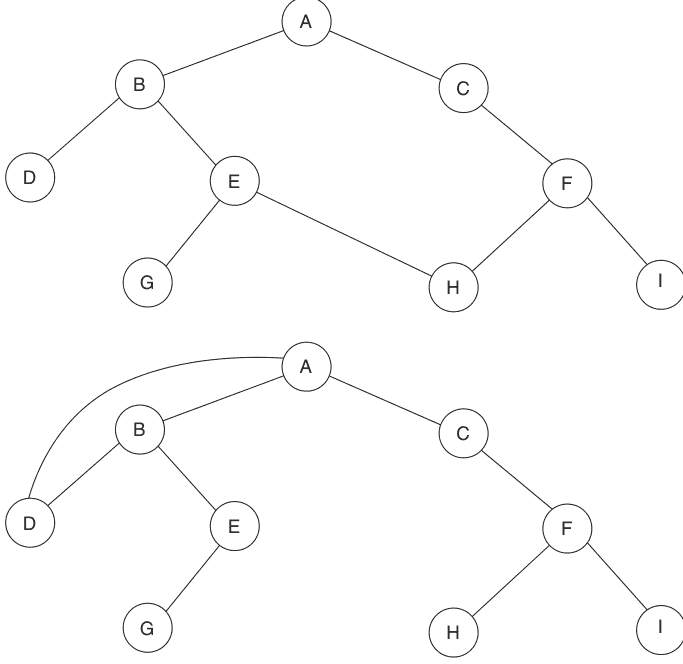

**图 9.59** 不是二叉树的结构

自然界中的树通常向上生长，它们的根部在地上，分支向上生长。但在数据结构中，树被描绘为向下生长的，根部位于顶部，分支向下生长。

### 二叉树的递归性质

如果你仔细观察，你会发现二叉树具有递归结构。整棵树有一有一个根节点、一个左子树和一个右子树。这两个子树本身又是树。它们都有根节点和子树。

在编写对树操作进行建模的函数时，我们可以利用树的递归性质并让它们也具有递归性。这将使函数更短并减少我们的编程工作。你将在学习这些函数时就会理解这一点。

### 二叉树的遍历

遍历链表是简单的，因为它具有线性结构。我们只需要从第一个节点访问到最后一个节点即可。然而，树没有线性结构。我们如何遍历树呢？有三种方法——前序、中序和后序。请记住，当我们遇到空树时就会停止。

前序遍历非空树的步骤序列如下：

1. 访问根节点。
2. 按前序访问左子树。
3. 按前序访问右子树。

中序遍历非空树的步骤序列如下：

1. 访问根节点。
2. 按中序访问左子树。

后序遍历非空树的步骤序列如下：

1. 按后序访问左子树。
2. 按后序访问右子树。

现在让我们来看一些例子。考虑图 9.60 所示的树，我们之前之前也见过它。

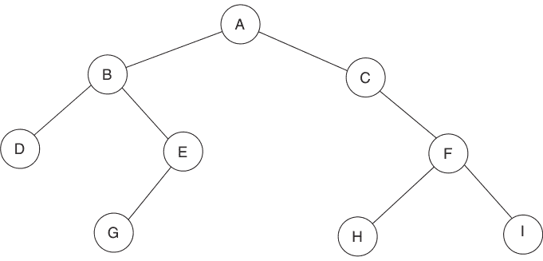

图 9.60 一棵二叉树

让我们看看遵循每种遍历方法时节点的访问顺序。让我们从前序遍历开始。

在前序遍历中，我们首先访问根节点。因此，我们得到了 'A'。然后我们按前序访问 'A' 的左子树（此时等待访问 'A' 的右子树）。我们首先访问根节点。因此，我们得到了 'B'。然后我们按前序访问 'B' 的左子树（此时等待访问 'B' 的右子树）。我们首先访问根节点。因此，我们得到了 'D'。然后我们按前序访问 'D' 的左子树（此时等待访问 'D' 的右子树）。'D' 没有左子树。所以我们访问 'D' 的右子树。'D' 没有左子树，我们退回一步。我们按前序访问 'B' 的右子树。如果我们继续这样，就会得到 'E'、G'、C'、F'、H。

总之，上述树的前序遍历结果为 'ABDEFGHI'。同样，中序遍历的结果为 'GEBHIFCA'，后序遍历的结果为 'DGECHF'。

### 9.5.2 二叉搜索树

二叉搜索树是二叉树的一种特殊形式。对于任何给定节点，其左子节点的值小于节点的值，右子节点的值大于节点的值。例如，图 9.61 所示的树就是一棵二叉搜索树。

如果你中序（左、根、右）遍历二叉搜索树并显示每个节点的值，你将按升序打印这些值。现在让我们来看用于生成二叉搜索树（BST）的代码。广义地说，我们将学习两个类——`BST` 和 `BST`。第一个类帮助我们创建 BST 的节点，而第二个类帮助我们创建 BST 本身。让我们从第一个类开始。参见列表 9.29。

### 列表 9.29 BSTNode 类

```cpp
/*Beginning of BSTNode.h*/

#ifndef BSTNODE_H_
```

```cpp
};

#endif
/*End of BSTNode.h*/
```

上述类的每个对象都将是二叉搜索树（BST）中的节点。每个节点都有三个数据成员——`val`、`left` 和 `right`。每个节点的数据将存储在第一个成员 `val` 中。这是一个整数类型的变量，这意味着节点将包含整数值。剩余的数据成员是 `left` 和 `right`。其中每一个都是指向另一个节点的指针。正如我们所知，BST 的每个节点要么有左孩子，要么有右孩子，或者两者都没有。如果一个节点有一个左子节点，那么 `left` 数据成员将指向该节点。否则，它将为 `NULL`。`right` 数据成员也是如此。

图中展示了节点。

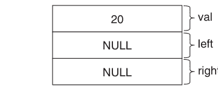

**图 9.63** 一个没有孩子的节点（`BSTNode` 类的对象）。

9.63 描述了一个 `BSTNode` 类的对象。这个特定对象代表二叉搜索树中一个没有孩子的节点。因此，`left` 和 `right` 数据成员均为 `NULL`。此外，`val` 数据成员的值为 20。最后，节点本身的地址是 2172。

让我们看看如果将一个值为 10 的节点添加到上述节点中（图 9.64），会发生什么。它将作为现有节点的左孩子被添加，因为 10 小于 20。

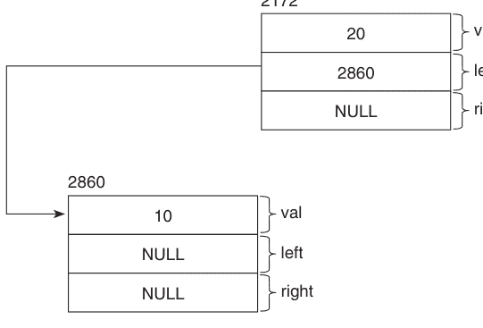

**图 9.64** 一个只有一个左孩子的节点

现在我们已经领略了节点类的数据成员，我们来简要看一眼其成员函数的声明。所有的声明都是显而易见的。

我们只需要单独研究的声明是那些返回左指针和右指针引用的函数[分别是 `getLeft()` 和 `getRight()` 函数]。当你学习 BST 类的 `insert()` 函数时，你就会理解为什么它们返回引用（而不是按值）。

让我们看看 `BSTNode` 类成员函数的定义（列表 9.30）。

+ 列表 9.30 BSTNode 类的实现文件/

```cpp
/*Beginning of BSTNode.cpp*/

#include "BSTNode.h"

/*
 节点类的构造函数。它默认将将
 左指针和右指针置空。
*/

BSTNode::BSTNode()
{
    /* 将数据部分置零。 */
    val = 0;
    /* 将左指针设置为空。 */
    left = NULL;
    /* 将右指针设置为空。 */
    right = NULL;
}

/*
 此函数设置数据部分的值。
*/

void BSTNode::setVal(int pVal)
{
    val = pVal;
}

/*
 此函数返回数据部分。
 */

int BSTNode::getVal()
{
    return val;
}

/*
 此函数设置左指针的值。
 */

void BSTNode::setLeft(BSTNode * pLeft)
{
    left = pLeft;
}

/*
 此函数返回左指针的引用。
```
```cpp
BSTNode * BSTNode::getLeft()
{
    return left;
}

/*
此函数设置右指针的值。
*/

void BSTNode::setRight(BSTNode * pRight)
{
    right = pRight;
}

/*
此函数返回右指针的引用。
*/

BSTNode * BSTNode::getRight()
{
    return right;
}

/*
 类的析构函数。
 */

BSTNode::~BSTNode()
{
}/*End of BSTNode.cpp*/
```

让我们仔细观察 `getLeft()` 和 `getRight()` 函数。如你所见，这些函数分别返回左指针或右指针的引用。如果我们以后想理解 BST 类的 `insert()` 函数，理解它的含义是非常重要的，`insert()` 函数顾如其名是在 BST 中插入一个节点。让我们以 `getLeft()` 函数为例。假设 `node1` 是 `BST` 类的一个实例并包含值 20，如图 9.65 所示。

| | |
|---|---|
| 20 | val |
| NULL | left |
| NULL | right |

**图 9.65** 一个 BST 节点

在进一步继续之前，你需要理解左指针的地址是 2176。为什么左指针的地址是 2176？这是因为节点的地址是 2172。节点中的第一个数据成员是 `val`，这是一个整数类型变量。整数类型变量占用 4 字节，`node1` 的前 4 个字节会被 `val` 占用。左指针是第二个数据成员。因此它的地址将是 2176 (2172+4)。你能计算出右指针的地址吗？
现在，考虑列表 9.31。

# 列表 9.31 测试 BSTNode 类

```cpp
/*
  Beginning of BSTNodeTest01.cpp
 */

#include "BSTNode.h"

void main()
{
    BSTNode node1;
    node1.setVal(20);
    BSTNode * temp = node1.getLeft();
    if (temp == NULL) {
        temp = new BSTNode();
    }
    temp->setVal(10);
    cout << node1.getLeft()->getVal() << endl;
}
```

```cpp
/*
 The 二叉搜索树类。该类的每个对象
 将代表一个 BST。
 */

class BST {
  private:
    /*
     BST 的根节点指针。它将指向
     根节点或 NULL。
    */
    BSTNode * root;
    /*
     插入节点的私有函数。将从公共函数调用。
    */
    void insert(BSTNode *, int);
    /*
     执行前序遍历的私有函数。将从公共函数调用。
     */
    void preorder(BSTNode);
    /*
     执行中序遍历的私有函数。将从公共函数调用。
     */
    void inorder(BSTNode);
    /*
     执行后序遍历的私有函数。将从公共函数调用。
     */
    void postorder(BSTNode);
public:
    /*
     BST 类的构造函数。它默认将将
     根指针置空。
    */
    BST();
    /*
     在 BST 的正确位置插入节点的函数。
     */
    void insert(int);
    /*
     执行前序遍历的函数。
     */
    void preorder();
    /*
     执行中序遍历的函数。
     */
    void inorder();
    /*
     执行后序遍历的函数。
     */
    void postorder();
    /*
     类的析构函数。
     */
    ~BST();
};

/* *
#endif
/*End of BST.h*/
```

该类仅有一个数据成员——`root`——它是私私的。因此，`root` 将是所有 BST 类对象中唯一的数据成员，并且 BST 类的构造函数将确保它在每个新创建的对象中都被置空。
如定义所示，`root` 将指向一个 `BSTNode` 类的对象。正如其名所示，它将指向 BST 的第一个节点。
现在让我们来看成员函数的实现（列表 9.34）。

# 列表 9.34 BST 类的实现

```cpp
/*Beginning of BST.cpp*/

#include <iostream.h>
#include "BST.h"

/*
插入节点的私有函数。将从公共函数调用。
*/

void BST::insert(BSTNode *nodePtr, int pValue)
{
  /*
  指针的引用作为一个参数传递。
  */
  /*
  如果指针为 NULL ...
  */
  if(nodePtr == NULL)
  {
    /*
    ... 创建一个节点并让指针指向它 ...
    */
    nodePtr = new BSTNode();
    /*
    ... 将传递给函数的值拷贝到新节点并 ...
    */
    nodePtr -> setVal(pValue);
    /*
    ... 返回。
    */
    return;
  }
  /*
  如果当前节点中的值大于传递的值 ...
  */
  if(nodePtr -> getVal() > pValue)
  {
    /*
    ... 从左孩子开始递归调用函数。
    */
    insert(nodePtr -> getLeft(), pValue);
  }
  /*
  如果当前节点中的值小于传递的值
  */
  if(nodePtr -> getVal() < pValue)
  {
    /*
    从右孩子开始递归调用函数。
    */
    insert(nodePtr -> getRight(), pValue);
  }
}

/*
执行前序遍历的私有函数。将从公共函数调用。
*/

void BST::preorder(BSTNode * nodePtr)
{
  /*
  只要传递的指针不为 NULL ...
  */
  if(nodePtr != NULL)
  {
    /*
    先显示当前节点的值 ...
    */
    cout << nodePtr -> getVal() << endl;
    /*
    ... 
    然后递归调用左孩子的函数 ...
    */
    preorder(nodePtr -> getLeft());
    /*
    ... 
    然后递归调用右孩子的函数。
    */
    preorder(nodePtr -> getRight());
  }
}

/*
执行中序遍历的私有函数。将从公共函数调用。
*/

void BST::inorder(BSTNode * nodePtr)
{
  /*
  只要传递的指针不为 NULL ...
  */
  if(nodePtr != NULL)
  {
    /*
    ... 先递归调用左孩子的函数...
    */
    inorder(nodePtr -> getLeft());
    /*
    ... 然后显示当前节点的值
    */
    cout << nodePtr -> getVal() << endl;
    /*
    ... 然后再递归调用右孩子的函数。
    */
    inorder(nodePtr -> getRight());
  }
}

/*
执行后序遍历的私有函数。将从公共函数调用。
*/

void BST::postorder(BSTNode * nodePtr)
{
  /*
  只要指针不为 NULL ...
  */
  if(nodePtr != NULL)
  {
    /*
    ... 先递归调用左孩子的函数...
    */
```


`postorder(nodePtr -> getLeft());`

```
/*

...

然后递归调用右孩子的函数 ...

*/
```

`postorder(nodePtr -> getRight());`

`}`

`}`

```cpp
nodePtr = new BSTNode();

/*

  ... 将传递给函数的值拷贝到新

节点中并 ...

*/

nodePtr -> setVal(pValue);

/*

  ... 返回。

*/

return;
}

/* 

如果当前节点中的值大于传递的

值...（源文件中省略了注释的剩余部分）

*/

if(nodePtr -> getVal() > pValue)

{

  /*

  ... 从左

子节点开始递归地调用

  该函数。

*/

  insert(nodePtr -> getLeft(), pValue);

}

/*

如果当前节点中的值小于传递的

值...（源文件中省略了注释的剩余部分）

*/

if(nodePtr -> getVal() < pValue)

{

  /*

  ... 从右

子节点开始递归地调用

  该函数。

*/

  insert(nodePtr -> getRight(), pValue);

}
```

这个看起来很复杂的函数实际上非常简单。让我们先考虑树为空的情况（列表 9.35）。

## **Listing 9.35** 测试 `insert()` 函数

```cpp
/*Beginning of BSTInsert01.cpp*/
#include "BST.h"
void main()
{
  BST tree1;
  tree1.insert(20);
}
/*End of BSTInsert01.cpp*/
```

上述程序中的第一个语句将创建一个名为 `tree1` 的 `BST` 类对象。图 9.69 描绘了 `tree1` 在内存中被创建后的状态。

| 地址 | 值 |
| :--- | :--- |
| 2172 | NULL |
| NULL | root |
| tree1 | |

图 9.69 一个 `BST` 类对象。

根据 `BST` 类的定义，`tree1` 只有一个数据成员，称为 `root`。该对象的地址是 2172。由于 `root` 是对象的唯一数据成员，它的地址也是 2172。请记住，当树为空时，`root` 指针的值将为 `NULL`。

上述程序中的第二个语句如下所示调用公共 `insert()` 函数：

```cpp
tree1.insert(20);
```

这反过来将如下所示调用私有函数：

```cpp
insert(root, 20);
```

注意，`nodePtr` 是私有函数的第一个形式参数，是一个引用类型变量。因此，作为上述调的结果，`nodePtr` 最终将成为 `root` 指针的引用。因此，`nodePtr` 值的任何更改都会导致 `root` 指针值发生相同的变化。这是一个非常重要的点，必须牢记。。此外，作为第二个形式参数的 `pValue` 值将被设置为 20。产生的结果如图 9.70 所示。

| 地址 | 值 |
| :--- | :--- |
| 2172 | NULL |
| NULL | root |
| 2172 | NULL |
| NULL | nodePtr |
| 3922 | | |
| 20 | pValue |

图 9.70 调用 `insert()` 函数后产生的情况。

所示，`root` 和 `nodePtr` 具有相同的地址，均为 2172。这是因为 `nodePtr` 是 `root` 的引用。自然地，它们具有相同的值。`pValue` 是一个独立的整数变量，其值为 20。

现在，函数将开始执行。在第一个 `if` 语句块的测试表达式中，将测试 `nodePtr` 的值是否为 `NULL`。该语句块将返回真，因为 `root` 指针的值为 `NULL`，且 `nodePtr` 的值与 `root` 指针的值相同。

`if` 语句块将执行。将创建一个节点，其地址将被拷贝到 `root`，使其与新创建的 `nodePtr` 的地址相等，如图 9.71 所示，`nodePtr` 是 `root` 的引用。假设新创建节点的地址为 6221，则 `root` 和 `nodePtr` 的值都将变为 6221。这就是将 `nodePtr` 声明为引用变量的重要性。

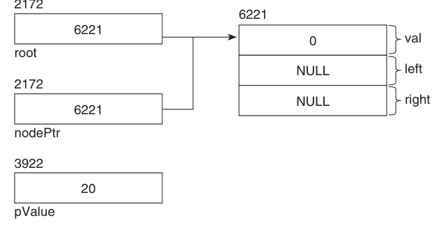

图 9.71 添加到 `root` 指针的新节点。

`if` 语句块中的下一个语句将 `pValue` 的值拷贝到新创建节点的数据部分，从而产生图 9.72 所示的情况。

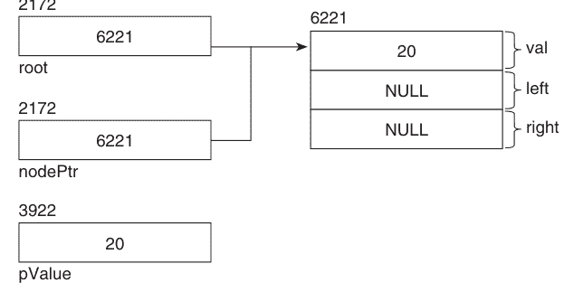

图 9.72 为新创建的节点填充数据。

最后，`if` 语句块的最后一个语句将导致函数返回，函数的剩余部分将不再执行。局部变量 `nodePtr` 和 `pValue` 将超出作用域。我们将剩下 `root` 指针和新创建的节点。因此，一个值为 20 的新节点将被添加到树中。图 9.73 显示了创建的树的样子。

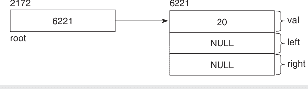

图 9.73 `insert()` 函数结束时的情况。

因此，显然 `insert()` 函数在树为空时可以正常工作。现在让我们考虑树不为空的情况（列表 9.36）。

## **Listing 9.36** 测试 `insert()` 函数

```cpp
/*Beginning of BSTInsert02.cpp*/
#include "BST.h"
void main()
{
    BST tree;
    tree1.insert(20);
    tree1.insert(10);
}
/*End of BSTInsert02.cpp*/
```

我们已经知道，在上述 `main()` 函数的第二个语句结束时，场景将如图 9.74 所示。

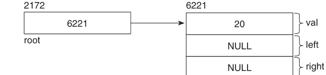

## **Figure 9.74** 第一次调用 `insert()` 函数后 `BST` 的结构。

我们从图中可以看出，当 `main()` 函数中的第三条语句开始时，树并不为空。第三条语句是：

`tree1.insert(10);`

我们知道这反过来将如下所示调用私有 `insert()` 函数：

`insert(root, 10);`

与之前一样，`nodePtr` 最终将成为 `root` 的引用，`nodePtr` 的值如图 9.75 所示。

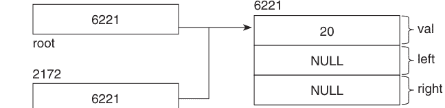

## **Figure 9.75** 第二次调用 `insert()` 函数后 `BST` 的结构。

现在，函数将开始执行。在第一个 `if` 语句块的测试表达式中，将测试 `nodePtr` 的值是否为 `NULL`。该语句块将返回真，因为 `root` 指针的值为 `NULL`，且 `nodePtr` 的值与 `root` 指针的值相同。

`if` 语句块将执行。将创建一个节点，其地址将被拷贝到 `root`，使其与新创建的 `nodePtr` 的地址相等，如图 9.71 所示，`nodePtr` 是 `root` 的引用。假设新创建节点的地址为 6221，则 `root` 和 `nodePtr` 的值都将变为 6221。这就是将 `nodePtr` 声明为引用变量的重要性。

（注：原文中后续 377-380 部分存在文本重复和乱码，已根据前文逻辑进行处理。）

# 368 使用 C++ 进行面向对象编程

我们可以看到，新节点已经附加到了第一个节点的左侧。这正是我们预期的。显然，只要树不为空，`insert()` 函数就能正常工作。

同样地，当根节点没有右孩子时，如果我们通过传递一个比根节点值大的值来调用 `insert()` 函数，那么右节点就会被附加到根节点上。

只要你记住树中任何节点的左子树和右子树本身也是树，就很容易看出当重复调用 `insert()` 函数时，树将是如何增长的。

私有的 `insert()` 函数是一个递归函数。当我们调用它时，我们将根指针和要插入的值传递给它。如果树为空，则 `insert()` 函数将创建一个新节点并让 `root` 指向它。如果恰有一个节点，且如果 `insert()` 函数发现收到的值小于该现有节点的值，那么它将通过传递左指针的引用来调用自己，并重复上一步。同样地，如果恰有一个节点，且如果 `insert()` 函数发现收到的值大于该节点的值，那么它将通过传递右指针的引用来调用自己，并重复上一步。

记住，`BST` 不应该包含重复值。现有的私有 `insert()` 函数定义优雅地处理了这一点。让我们理解它是实现的。

假设树中只有一个节点，其值为 20。进一步假设我们通过传递 20 来调用 `insert()` 函数。现在，`insert()` 函数中的第一个块不会执行，因为 `root` 的值不为空。第二个和第三个块也不会执行，因为传递给函数的值既不小于 20 也不大于 20（它等于 20）。函数将在不执行任何操作的情况下终止。

通过类推，很容易理解，如果我们传递一个与树中深几层处的某个值重复的值，那么该值也将不会被插入。当函数不断递归调用时，直到到达包含重复值的节点，会发生与上段描述相同的情况。当前层级的函数将在不执行任何操作的情况下终止。之前的层级将按反序终止。

为什么重复值没有被插入？这是因为函数第二个和第三个 `if` 块中测试表达式的定义方式。第三个块不是第二个 `if` 块的 `else` 块。它仅仅是在测试相反的不等式关系。如果传递了相等的值，那么这两个块都不会执行，函数将直接终止。

现在让我们学习遍历操作——`preorder()`、`inorder()` 和 `postorder()`。
这些函数中的每一个都有一个公共版本和一个私有版本。我们定义的公共版本不接受任何参数，并通过传递根指针的值作为参数来调用相应的私有版本（我们已经知道为什么这样做了）。让我们来看 `preorder()` 函数的公共版本。

```cpp
/*
前序遍历的函数。
*/
void BST::preorder() {
    /*
    调用对应的私有函数。
    */
    preorder(root);
}
```

正如我们所看到的，函数的公共版本调用它的私有版本并将根指针传递给它。让我们来看该函数的私有函数。

```cpp
/*
  前序遍历的私有函数。将从公共函数调用。
*/
void BST::preorder(BSTNode * nodePtr)
{
  /*
    只要传递的指针不为 NULL ...
  */
  if(nodePtr != NULL) {
    /*
      首先显示当前节点的值
    */
    cout << nodePtr -> val() << endl;
    /*
      然后对左孩子递归调用函数
    */
    preorder(nodePtr -> getLeft());
    /*
      并对右孩子递归调用函数。
    */
    preorder(nodePtr -> getRight());
  }
}
```

这个函数实际上非常简单。当第一次被调用时，`root` 的值被复制到 `nodePtr`。如果 `nodePtr` 为 `NULL`，则函数在不执行任何操作的情况下终止。否则，它显示第一个节点的值。它通过传递 `nodePtr` 指向的节点的左指针值来遍历左子树。此后，它通过传递 `nodePtr` 指向的节点的右指针值来遍历左-右子树。请记住，当函数的第一次递归调用执行时，第二个递归调用不会开始。此外，在函数的每一个新层级中，`nodePtr` 都将指向较底层子树的根节点。`inorder()` 和 `postorder()` 函数可以用相同的方式解释。

## 总结

数据结构在运行时数据的组织和相互关联方面具有特殊性。每部分数据都嵌入在一个节点中，该节点包含该数据本身，以及一个或多个指向其他类似节点或具有空值的指针。

链表是数据结构。它们由以线性方式相互链接的节点组成。单链表中的每个节点都是一个由两部分组成的对象。第一部分是节点所携带的数据。每个节点的第二部分是一个指针，载有列表中下一个节点的地址。这就是节点链接到下一个节点的方式。

`FIFO`（先进先出）操作。第一个进入的节点是第一个出去的。

有两个类可以创建链表。

树与链表、栈和队列不同，没有线性结构。在树中，每个节点可能连接到多个节点。

二叉树是每个节点最多连接两个节点的树。二叉树是一个有限集合。它为空或分为三个不相交的子集。第一个子集包含一个元素，根。其他子集是二叉树。其中一个被认为是左子树，另一个是右子树。这两个子树中的一个或两个可以为空。

- 一个单列表类，其每个对象将代表一个节点列表。我们创建的类是 `SingleLinkedList`。

二叉树具有递归结构。整个树有一个根、左子树和右子树。这两个子树都是二叉树。它们都有根和子树。

每个 `SingleLinkedList` 类都将是链表中的一个节点。该类有一个整数数据值，应该包含节点的值。

在对树执行操作时，我们可以利用树的这种递归特性并使其变为递归。这将使函数更短并减少我们的工作量。

树有三种遍历方式——中序、中序和后序。

栈就像链表一样，也由每个节点恰好链接到另一个节点的节点组成（未连接到任何节点除外）。在栈中，我们可以在开头添加节点。

- 一个节点类，其对象将是单链表的实际节点。我们创建的类是 `SingleLinkedList`。

# 数据结构 371

- 树的非线性结构
- 二叉树
- 二叉树的三个互不交集——根节点、左子树和右子树
- 二叉树是递归的
- 二叉树的遍历——前序、中序和后序
- 二叉搜索树
- `BSTNode`
- `BST` 类
- 树节点的数据部分
- 树节点的左指针
- 树节点的右指针
- 树类的根节点指针

# 练习题

1. 数组的局限性是什么？
2. 描述单链链表中每个节点的组成部分。
3. 解释向链表末尾添加节点的函数功能。
4. 解释在链表中查找具有特定值的节点的函数。
5. 解释从链表开头删除节点的函数。
6. 结合小型二叉树解释二叉树遍历的三种顺序。
7. 解释为什么将 `getLeft()` 和 `getRight()` 函数定义为返回引用。
8. 写一个使用递归在链表中正向迭代的函数。
9. 在 `LinkedList` 类中添加一个指针作为新的数据成员。该指针应指向列表的最后一个节点（如果列表为空，则值为 `NULL`）。更新 `LinkedList` 类的成员函数以确保这一点。同时，利用该指针的存在来简化函数。我们仍然需要确保最后一个节点的 `next` 指针始终为 `NULL` 吗？
10. 在 `SingleLinkedList` 类中引入一个函数，返回链表中的节点计数。
11. 上述函数可以针对栈类对象进行调用吗？如果不能，解决方案是什么？
12. 定义一个在二叉搜索树中搜索指定值的函数。如果找到该值，函数应返回 `true`，否则返回 `false`。
13.判断对错：
(a) 在链表中，最后一个节点的 `next` 指针为 `NULL`。
(b) 链表是非线性数据结构。
(c) 单链表中的每个节点在数据部分中可以只包含整数类型的值。
(d) 在栈中，你只能在开头添加节点。
(e) 队列实现了 `FIFO`（先进先出）操作。
(f) 二叉树是元素的有限集，它可以为空，或者划分为两个互不交集的子集。
14. 填空：
(a) 单链表的最大节点数连接到的是
(b) 单链表每个节点的组成部分是
(c) 向栈或队列中添加节点被称为
(d) 从栈或队列中删除节点被称为
(e) 二叉树每个节点的组成部分数是
(f) 二叉树遍历的三种顺序是和和

# 10. 模板 (Templates)

本章解释了使用模板进行泛型编程的概念。涵盖了函数模板及其用法和优点。还包含了类模板、其用法和优点。

标准模板库（`STL`）提供了许多实用的类模板，可满足各种常见的编程需求。本章还描述了该库中重要的类模板。

## 10.1 引言

我们经常遇到对不同数据类型具有相同相同工作的函数。这些函数中的每一个设计都是为了处理特定的数据类型。对于不同类型的变量，只有声明其所作用的变量的关键字发生了变化。这些函数实现的算法保持不变，因此函数的结构也保持不变。一个立刻就能想到的此类函数是用于交换两个值的函数（列表 10.1）。

> 列表 10.1 交换两个整数的函数

```
void swap(int &a, int &b)
{
    int temp;
    temp=a;
    a=b;
    b=temp;
}
```

前面的 `swap` 函数交换了两个整数的值。交换两个浮点数的 `swap` 函数定义如列表 10.2 所示。

> 列表 10.2 交换两个浮点类型数的函数

```
void swap(float &a, float &b)
{
    float temp;
    temp=a;
    a=b;
    b=temp;
}
```

我们可以注意到，这两个 `swap` 函数除了其作用变量的数据类型外，完全相同。可以预见 C++ 语言为我们提供了一种机制，让我们编写一个与数据类型无关但体现了通用算法的通用函数，并且 C++ 语言会在需要时创建实际的函数。将代码放在公共位置有显而易见的优点，即易于代码开发和代码维护。

这种机制以模板的形式提供。程序员可以创建一个模板，其中部分或所有变量具有未指定的数据类型。每当模板通过传递特定类型的参数被调用时，C++ 语言就会将未指定的类型替换为所传参数的类型。此类模板可以为单个函数创建，也可以为整个类创建。

## 10.2 函数模板

创建泛型函数模板的语法见列表 10.3。

> 列表 10.3 函数模板的语法

```cpp
template <class T, ...>
return_type function_name(T arg1, ...)
{
    //statements
}
```


模板定义以 `template` 关键字开始。紧接着是尖括号中的一组泛型数据类型。每个泛型类型都以 `class` 关键字作为前缀，如果模板函数作用于多个泛型，则用逗号分隔它们。此后，像普通函数一样定义模板函数。返回类型在先。后面是函数名，函数名之后是一对括着参数列表的括号。然而，尖括号中提到的每个泛型类型至少要有一个参数。例如，函数 `swap` 的模板可以如列表 10.4 所示。

> 列表 10.4 函数 `swap` 的模板

```cpp
/*Beginning of swap.h*/
template <class T>
void swap(T &a, T &b)
{
    T temp;
    temp=a;
    a=b;
    b=temp;
}
/*End of swap.h*/
```

现在，假设通过传递两个整数来调用 `swap` 函数。编译器通过将每个 `T` 的出现替换为关键字 `int` 来生成该函数的实际定义。见列表 10.5。

> 列表 10.5 通过传递整数调用函数 `swap` 的模板

```cpp
/*Beginning of swap01.cpp*/
#include <iostream>
#include "swap.h"
void main()
{
    int x,y;
    x=10;y=20;
    swap(x,y);
    std::cout << "x=" << x << ", y=" << y << std::endl;
}
/*End of swap01.cpp*/
```

*注：原文代码块中swap01.cpp部分不完整，此处根据逻辑补全翻译，保持代码不变*

同样，如果通过传递浮点数来调用函数，编译器通过将每个 `T` 的出现替换为关键字 `float` 来生成函数的实际定义。见列表 10.6。

> 列表 10.6 通过传递浮点数调用函数 `swap` 的模板

```cpp
/*Beginning of swap02.cpp*/
#include <iostream>
#include "swap.h"
void main()
{
    float x,y;
    x=1.1;y=2.2;
    swap(x,y);
    std::cout << "x=" << x << ", y=" << y << std::endl;
}
/*End of swap02.cpp*/
```

# 模板 375

类对象可以传递给 `swap` 函数。编译器通过将每个 `T` 的出现替换为类的名称来生成实际定义。见列表 10.7。

> 列表 10.7 通过传递类调用函数 `swap` 的模板

```cpp
/*Beginning of swap03.cpp*/
#include <iostream>
#include "swap.h"
#include "Distance.h"
void main()
{
    Distance d1(1,1),d2(2,2);
    std::cout << "Before swapping";
    std::cout << "d1=" << d1.getFeet() << "-" << d1.getInches() << std::endl;
    std::cout << "d2=" << d2.getFeet() << "-" << d2.getInches() << std::endl;
    swap(d1,d2);
    std::cout << "After swapping";
    std::cout << "d1=" << d1.getFeet() << "-" << d1.getInches() << std::endl;
    std::cout << "d2=" << d2.getFeet() << "-" << d2.getInches() << std::endl;
}
/*End of swap03.cpp*/
```

我们必须注意到代码开发中节省的精力。一个定义就适用于所有类型！模板是 C++ 提供的实现代码复用的非常实用的工具。

此外，编译器对于给定的数据类型只从模板生成一次实际函数。如果 `swap` 函数是通过通过传递整数调用的，编译器将从其模板生成函数定义。后续对相同数据类型的调用将不再生成定义。这是由于一个简单的原因：编译器在查找模板之前首先查找精确匹配来解析函数。下一段将通过示例解释这一点。如果它找到了精确匹配，就不会再查找模板。由于第一次调用本身生成了函数定义，后续调用就不会再生成。

显然，函数的每一个定义必须出现在头文件中。否则，编译器在编译调用了模板的用户程序时无法生成正确的定义。

库程序员可能希望将模板函数的原型放在库中，同时保留头文件。有一个名为 `export` 的关键字可以满足这一需求。然而，并不是所有的编译器都支持该关键字。

# 376 使用 C++ 进行面向对象编程

有时有必要用实际函数来覆盖函数模板。为了理解这一点，让我们考虑一个用于返回传递给它的参数中较大值的函数模板。

## 列表 10.8 `larger` 函数的模板

```cpp
template <class T>
T* larger(const T& a, const T& b)
{
    return a>b? &a:&b;
}
```

如果传递给它 `int` 和 `float` 等普通数据类型的变量，该函数可以正常工作。然而，如果传递的是字符串，它就无法正常工作。参见列表 10.9。

## 列表 10.9 通过传递字符串调用 larger 函数

```cpp
char * s1="abcd", s2="efgh";           //编译器生成 larger(const
char * s3=larger(s1,s2);               // const char *&); 并
                                     // 解析该调用
```

我们注意到，在执行期间，列表 10.9 中的 `larger(char *, char *)` 函数仅比较两个字符串的地址，而不是它们的内容！这显然不是我们想要的。对于这种特殊情况，我们希望为字符字符串执行一个特殊版本的 `larger` 函数。我们正是要在定义模板的同时定义 `larger` 函数的特殊版本。参见列表 10.10。

## 列表 10.10 覆盖 `larger` 函数的模板

```cpp
char * larger(char * a, char * b)
{
    return strcmp(a,b) > 0 ? a : b;
}
```

现在，如果通过传递两个字符串调用 `larger`，将调用列表 10.9 中的函数，而模板将被忽略。函数模板可以被重载。参见列表 10.11。

## 列表 10.11 重载函数模板

```cpp
#include<iostream>
template <class T>
void display(const T& a)
{
    cout << a << endl;
}
template <class T>
void display(const T& a, const int n)//display() 的重载
                             // 版本
{
  int ctr;
  for(ctr=0;ctr<n;ctr++)
    cout << a << endl;
}
void main()
{
  char c = 'a';
  int i = 10;
  display(c);
  cout<<endl;
  display(c,3);
  cout<<endl;
  display(i);
  cout<<endl;
  display(i,5);
  cout<<endl;
}
```

## 输出

a
a
a
a

10
10
10
10
10

模板定义中也可以提到多个泛型类型。
列表 10.12。

| 列表 10.12 | 函数模板中的多个泛型类型 |
| :--- | :--- |

```cpp
template <class T, class U>
void fi(const T &a, const U &b)
{
  // 语句
}
```

我们应该回到第 8 章关于运算符重载的内容。书中提到过，为了使某个类的对象能够在函数模板中使用，必须对该类进行运算符重载。我们可以查看 `larger` 函数的模板。大于运算符被嵌入在它的定义中。当某个类的对象作为参数传递给它时，大于运算符将尝试比较它们。如果该运算符没有对该类进行重载，编译器将立即报告错误。因此，为了利用模板，必须对该类重载大于运算符。

# 10.3 类模板

类模板的需求与函数模板的需求相似。经常感觉到需要处理不同类型数据的泛型类。队列 `Queue`、栈 `Stack`、数组 `Array` 等。让我们考虑列表 10.13 中的三个类，它们的成员函数有相似的定义，唯一的区别在于它们操作的数据成员的类型。

## 列表 10.13 具有相似定义的类

```cpp
class X_for_int
{
    int val;
    public:
    void f1(const int &);
    void f2(const int &);
    /*
    X_for_int 类的其余部分
    */
};
class X_for_char
{
    char val;
    public:
    void f1(const char &);
    void f2(const char &);
    /*
    X_for_char 类的其余部分
    */
};
class X_for_string
{
    string val;
    public:
    void f1(const string &);
    void f2(const string &);
    /*
    X_for_string 类的其余部分
    */
};
```

列表 10.13 中定义的 `X_for_int`、`X_for_char` 和 `X_for_string` 在各个方面都相似，除了它们数据成员的类型外。正如预期的，三个仅在数据成员类型上不同的类会给代码维护带来巨大困难。对其中类的任何更改都必须复制到所有其他类中。这种情况确实要求创建一个模板类。列表 10.14 所示，可以创建这样一个模板类。

## 列表 10.14 一个类模板

```cpp
template<class T>
class X
{
  T val;
  public:
    void f1(const T &);
    void f2(const T &);
};
```

这种模板类的创建如列表 10.14 所示。类模板的定义以 `template` 关键字开头，后面跟着括号内的模板参数。类名 `X` 之后是数据成员 `val`。`public` 访问符之后是成员函数 `f1` 和 `f2`。

类模板的定义以 `template` 关键字开头，后面跟着括号内的模板参数。类名 `X` 之后是数据成员 `val`。`public` 访问符之后是成员函数 `f1` 和 `f2`。

*注：原文中 `template<class T>` 之后的部分似乎存在大量重复的文本，翻译时已根据逻辑进行了对齐处理，确保了语义的完整性。*

# 列表 10.18 多个类型模板参数同名导致的错误

```cpp
template<class T, class T> //错误：参数列表中
//存在重复名！
class X
{
    /*
    class X 的定义
*/
};
```

- 模板参数的同名名称可以在两个不同模板类的模板参数列表中使用。列表 10.19 说明了这一点。

# 列表 10.19 同一个名称可以在多个类模板中用于类型模板参数

```cpp
template<class T>
class X
{
    /*
    class X 的定义
*/
}
template<class T> //正确：在两个不同的
//类使用了相同的名称 T
class Y
{
    /*
    class Y 的定义
*/
};
```

- 模板参数的名称在模板类的声明和定义中并不一定相同。列表 10.20 说明了这一点。

# 列表 10.20 类型模板参数的名称在模板类声明和定义中可以不同

```cpp
template<class T>
class X; //声明
template<class U> //正确：定义中使用了
//不同的模板参数名称
class X
{
    /*
    class X 的定义
*/
};
```

- 模板函数的形参参数可以是模板类的对象。列表 10.21 说明了这一点。

```cpp
template<class T>
class X
  /*
   class X 的定义
  */
template<class U>
void f1(X<U> v)
  /*
   函数的定义
   */
```

# 10.3.1 嵌套模板类

为模板类创建嵌套类的方法与为非模板类创建嵌套类的方法。列表 10.22 说明了这一点。

# 列表 10.22 嵌套模板类

```cpp
template<class T>
class A
  {
    class B
      {
        T X; //外层模板类型可以在嵌套
             //类中使用
        /*
         class B 的其余部分
        */
    /*
     class A 的定义
    */
  };
```

# 10.4 标准模板库

如果 C++ 提供用于满足常见编程需求的类模板，难道不会很有用处吗？例如，如果有一个类模板能够让我们创建任何任选类型对象的链表，那将非常方便。

C++ 标准实现提供了一组头文件，其中定义了许多实用的类模板。这些文件包含了模板的定义、其成员函数以及许多全局关联函数。这些全局关联函数实现了常用的算法。这个由类模板及其辅助全局函数组成的库被称为标准模板库 `STL`。

# 模板 383

对所有这些模板进行彻底的研究超出了本书的范围。然而，我们将在下一节中学习最重要的类模板。将通过示例来解释常用的成员函数和相关的全局函数。

# 10.4.1 list 类

`list` 类用于创建顺序容器。`list` 的元素是单个对象。`list` 对象的声明如下：

```cpp
list<char> clist; //创建一个字符列表
list<float> flist; //创建一个浮点数列表
list<int> intlist; //创建一个整数列表
```

要使用 `list` 模板，需要在源代码中包含头文件 `list`：

```cpp
#include<list>
```

`list` 的元素占用非连续内存。它们通过一对指针双向链接。其中一个指针指向列表的下一个元素，另一个指针指向列表的上一个元素。这允许正向和反向遍历。

可以在声明时指定 `list` 元素的数量：

```cpp
list<int> ilist(3); // 带有三个初始
//元素的整数列表。
```

可以为这些元素指定默认值。

```cpp
list<int> ilist(3, -1); // 带有三个
//初始元素且每个元素为 -1 的整数列表。
```

可以从现有数组创建列表。我们可以通过传递指向数组第一个元素的指针和指向数组最后一个元素之后的第二个指针来实现。

```cpp
int iarr[6] = {0,1,2,3,4,5}; // 具有六个元素的数组
list<int> ilist(iarr, iarr+6); // 列表也有六个
//具有相同值的
//元素
```

我们来看该类重要的成员函数。

# list<>::push_front() 函数

该函数用于在列表的开头插入元素。

```cpp
list<int> intlist;
ilist.push_front(1); // 在列表开头
//插入 1
ilist.push_front(2); // 在列表开头
//插入 2。列表变为 2,1。
```

# list<>::push_back() 函数

该函数用于在列表的末尾插入元素。

```cpp
list<int> ilist;
ilist.push_back(1); // 在列表末尾插入 1
ilist.push_back(2); // 在列表末尾插入 2。列表变为 1,2。
```

# 面向对象编程

# list<>::pop_front() 函数

该函数用于删除列表的第一个元素。

```cpp
list<int> intlist;
ilist.pop_front(); // 删除列表开头的
// 1
ilist.pop_front(); // 删除列表开头的
// 2
```

# list<>::pop_back() 函数

该函数用于删除列表的最后一个元素。

```cpp
list<int> ilist;
ilist.pop_back(); // 删除列表末尾的
```


# 使用迭代器遍历列表

迭代器允许我们遍历列表。接下来的代码展示了其语法和用法。

```cpp
list<int> ilist;
ilist.push_back(1);
ilist.push_back(2);
ilist.push_back(3);
list<int>::iterator iter = ilist.begin();
for(iter != ilist.end(); ++iter) {
    cout << *iter << " ";
}
```

# `list<>::insert()` 函数

该函数用于向列表中插入元素。

```cpp
list<int> ilist;
ilist.push_back(1); // 在列表末尾插入 1
ilist.push_back(2); // 在列表末尾插入 2。列表变为 1,2。
ilist.insert(ilist.begin(), -20); // 在列表开头
//插入 -20。列表变为 -20,1,2。
ilist.insert(iter, -10); // 需要迭代器
```

# `find()` 函数

该函数在列表中搜索指定的值。如果在元素中找到了搜索值，它会返回指向该元素的迭代器。否则，它返回 `list::end()`。

接下来的程序从列表开始搜索值 '10'。如果在列表中找到该值，会在 '10' 之前插入 '-1'。如果没有找到，则会在列表末尾追加 '-1'。

```cpp
list<int>::iterator iter;
iter=find(ilist.begin(),ilist.end(),10); // 从第一个元素
//到最后一个元素在
//列表中搜索值 10
ilist.insert(iter,-1);
```

# `list<>::size()` 函数

该函数允许我们确定当前列表中元素的数量。

```cpp
list<int> ilist;
ilist.push_back(1); // 在列表末尾插入 1
ilist.push_back(2); // 在列表末尾插入 2。列表变为 1,2。
cout<<ilist.size()<<endl; // 输出 2
```

# `list<>::erase()` 函数

该函数用于从列表中删除元素。将要删除元素的位置迭代器传递给 `list::erase()` 函数。假设我们要从列表中删除值为 '19' 的元素。我们使用 `find()` 函数获取指向该元素的迭代器，并将其传递给 `list::erase()` 函数。

```cpp
iter=find(ilist.begin(),ilist.end(),19); // 获取指向
//值为 19 的元素的
//迭代器
if(iter!=ilist.end()) // 检查是否存在
//值为 19 的元素
//如果找到则删除元素
    ilist.erase(iter);
```

# `list<>::clear()` 函数

该函数移除列表中的所有元素。

```cpp
list<int> ilist;
ilist.push_back(1);
ilist.push_back(2);
ilist.clear(); // 移除列表中的
//元素
```

# C++ 面向对象编程

此函数删除列表中的所有元素。

```cpp
list<int> ilist;
ilist.push_back(1);
list.push_back(2);
list.push_back(3);
cout<<ilist.size()<<endl; //输出 3
//移除列表中的所有
//元素
ilist.clear();
cout<<ilist.size()<<endl; //输出 0
```

# `list<>::empty()` 函数

此函数用于测试列表是否为空。

```cpp
if(ilist.empty())
    //执行某些操作
else
    //执行其他操作
```

在列表中间位置进行插入和删除是高效的，因为此类操作只需要重新分配受影响元素的指针。另一方面，对特定元素的随机访问效率很低。由于元素不是在连续的内存块中，要遍历到具有所需值的元素，必须从第一个元素开始读取每个前驱元素的指针值。

## 10.4.2 vector 类

`vector` 类用于创建顺序容器。列表的元素是单个对象。`vector` 类的成员函数名称与 `list` 类相同。全局函数（例如作用于 `list` 类对象的 `find()` 函数）已经重载，以适用于 `vector` 类对象。

然而，`vector` 中元素的布局与 `list` 完全不同。在 `vector` 中，与 `list` 不同，元素存储在连续的内存块中（类似于数组）。要使用 `vector` 模板类，需要在源代码中包含头文件。

```cpp
#include<vector>
```

`vector` 实际上不会随着每次单独插入而增长。`vector` 捕获的内存比它实际存储的元素数量多。当该存储空间满时，它会再次增长一定程度以容纳最新的插入。`vector` 增长的幅度取决于不同的编译器。

这为我们引入了两个关于 `vector` 的重要概念，即容量（capacity）和大小（size）。

容量是 `vector` 当前捕获内存块的总大小。显然，它与 `vector` 需要重新增长之前可以插入的元素总数成正比。

另一方面，大小是实际存储在 `vector` 捕获的内存块中的元素数量。显然，`vector` 的大小始终小于或等于其容量。

## 模板 387

`vector` 类有两个函数可以帮助我们找到 `vector` 的容量和大小。这些是 `vector::size()` 和 `vector::capacity()`。

在 `vector` 的中间位置进行插入和删除是低效的，因为对于此类操作，从插入点开始的所有元素都需要向上或向下移动。

另一方面，对特定元素的随机访问是高效的。由于元素在连续的内存块中，要遍历到具有所需值的元素只需要增加内部迭代器。

## 10.4.3 pair 类

`pair` 类的对象代表一对值，这些值的类型相同也可以不同。

```cpp
pair<string, int> player("Kasparov",1795);
```

该语句中的对象 `player` 代表我们数据库中名为“Kasparov”的玩家所过的比赛次数（`string` 类将在在本章稍后部分讨论）。显然，我们稍会在程序中创建更多相同类型的变量。使用关键字 `typedef` 允许我们这样做。

```cpp
typedef pair<string, int> Player;
Player kasparov("Kasparov",1795);
Player fischer("Fischer",2162);
Player karov("Karpov",1525);
```

要使用 `pair` 模板类，需要在源代码中包含 `utility` 头文件。

```cpp
#include<utility>
```

`pair` 类对象的两个元素可以作为 `first` 和 `second` 进行访问。

```cpp
cout<<"Number of games of "<<kasparov.first
<< <<" are "<<kasparov.second;
```

## 10.4.4 map 类

`map` 类用于创建关联容器。列表的元素是键/值对。`map` 类不允许重复项。

要使用 `map` 模板类，需要在源代码中包含 `map` 头文件。

```cpp
#include<map>
```

`map` 类中的每条记录都是 `pair` 类的对象。列表 10.23 展示了 `map` 类的所有重要函数。

| 列表 10.23 | map 类 |
| :--- | :--- |
| `/*map.cpp 的开始*/` | |
| `#include<iostream>` | |
| `#include<map>` | |
| `#include<utility>` | |
| `void main()` | |

# C++ 面向对象编程

```cpp
{
    map<string, int> chessbase;
    typedef pair<string, int> Player; //应该是 kasparov("Kasparov",1795); //与 map 类型相同
    Player fischer("Fischer",2162);
    Player karpovov("Karpov",1525);
```

```cpp
chessbase.insert(kasparov); //插入一条记录
chessbase.insert(fischer); //插入另一条记录
chessbase.insert(karpov); //插入另一条记录
```

//每条记录的第一个成员被视为键。
// 第二个成员是值，可以
// 如下所示：

```cpp
cout<<"Number of games of "<<kasparov.first
<< <<" are "<<kasparov.second;
```

//每条记录的第一个成员被视为键。
// 第二个成员是值，可以
// 如下所示：

```cpp
cout<<"Number of games of "<<kasparov.first
<< <<" are "<<kasparov.second;
```

//每条记录的第一个成员被视为键。
// 第二个成员是值，可以
// 如下所示：

```cpp
cout<<"Number of games of "<<kasparov.first
<< <<" are "<<kasparov.second;
```

//每条记录的第一个成员被视为键。
// 第二个成员是值，可以
// 如下所示：

修正后的 map 使用：

```cpp
{
    map<string, int> chessbase;
    typedef pair<string, int> Player; //应该是 kasparov("Kasparov",1795); //与 map 类型相同
    Player fischer("Fischer",2162);
    Player karpovov("Karpov",1525);
    chessbase.insert(kasparov); //插入一条记录
    chessbase.insert(fischer); //插入另一条记录
    chessbase.insert(karpov); //插入另一条记录
    //每条记录的第一个成员被视为键。
    // 第二个成员是值，可以
    // 如下所示：
    cout << "Number of games of " << kasparov.first << " are " << kasparov.second;
}
```

//每条记录的第一个成员被视为键。
// 第二个成员是值，可以
// 如下所示：

```cpp
cout << "Number of games of " << kasparov.first << " are " << kasparov.second;
```

//每条记录的第一个成员被视为键。
// 第二个成员是值，可以
// 如下所示：

//每条记录的第一个成员被视为键。
// 第二个成员是值，可以
// 如下所示：

```cpp
cout << "Number of games of " << kasparov.first << " are " << kasparov.second;
```

//每条记录的第一个成员被视为键。
// 第二个成员是值，可以
// 如下所示：

```cpp
cout << "Number of games of " << kasparov.first << " are " << kasparov.second;
```

//每条记录的第一个成员被视为键。
// 第二个成员是值，可以
// 如下所示：

```cpp
cout << "Number of games of " << kasparov.first << " are " << kasparov.second;
```

# 模板 391

的类
//由 class_name 生成
通过
//将每个 出现的
处 T
// 替换为 int。

要使用 `vector` 模板类，需要在源代码中包含
`vector` 头文件。

```cpp
#include<vector>
```

`pair` 类的对象表示一对值，
这两个值的类型可能相同也可能不同。

模板类可以接受多个模板参数。

要使用该模板类，需要在源代码中包含
`utility` 头文件。

```cpp
#include<utility>
```

模板类可以接受非类型模板
参数。

`map` 用于创建关联容器。列表中的元素是键/值对。
`map` 类不允许重复项。

模板参数的名字在模板类的模板参数列表中不能使用超过一次。

要使用 `map` 类，需要在源代码中包含 `map`
头文件。

同一个模板参数的名字可以在两个不同
模板类的参数列表中使用。

```cpp
#include<map>
```

`map` 类中的每条记录都是 `pair`
类对象。

模板参数的名字在模板类的声明和定义中不能
相同。

`set` 用于创建顺序容器。列表中的元素是单个对象。`set` 在排序映射中存储
一组键。数据
本身作为 `set` 的键。`set` 包含
一个排序后的集合，且重复项在
插入过程中会被丢弃。

模板函数的正式函数可以是
模板类的
对象。

要使用 `set` 模板类，需要在源代码中包含
`set` 头文件。

模板类可以创建嵌套类，其方法与创建非模板
类的方法相同。

```cpp
#include<set>
```

C++ 的标准实现提供了
许多有用的模板定义，包括这些模板类、其成员
函数以及大量的关联函数。
这些全局关联函数实现了常用的
广泛使用的算法。这个由模板类和
辅助函数构成的库被称为
模板库或 STL。

`map` 类和 `multimap` 类之间的唯一区别在于，虽然 `map` 类不允许
重复键（它会覆盖与键关联的旧值），但 `multimap` 类允许
重复键的。

`list` 类用于创建序列
容器。列表中的元素是单个对象。
要使用 `list` 类，需要在源代码中包含 `list`
头文件。

```cpp
#include<list>
```

`list` 的元素占据非连续的
内存。一个指针指向列表的下一个
元素，另一个指向列表的上一个元素。
这允许正向和反向遍历。

`set` 类和 `multiset`
类的区别在于，虽然 `set` 类不允许
重复键（它覆盖旧的键值），
`multiset` 类允许重复键。

`vector` 类用于创建序列
容器。列表中的元素是单个对象。
在 `vector` 中，与 `list` 不同，元素存储在
连续块中（就像数组一样）。

要使用 `multiset` 类，需要在源代码中包含
`set`
头文件。

```cpp
#include<set>
```


# 392 C++ 面向对象编程

## 核心术语

`函数模板`
`类模板`
`STL`

- `pair` 类
- `map` 类
- `set` 类
- `multimap` 类
- `multiset` 类
- `list` 类
- `vector` 类

## 练习题

1. 什么是函数模板？为什么需要函数模板？它们是如何创建的？
2. C++ 编译器何时以及如何从其模板生成实际定义？
3. 如何针对特定数据类型重写模板？
4. 什么是类模板？为什么需要类模板？它们是如何创建的？
5. C++ 编译器何时以及如何从其模板生成实际定义？
6. 判断对错：
   (a) 编译器仅为一种参数类型从函数模板生成一次实际定义。
   (b) 函数模板不能重载。
   (c) 模板类不能接受非类型参数。
   (d) 模板参数的名字在模板类的声明和定义中不需要相同。
7. 什么是标准模板库？列举 STL 中可用的某些类。
8. 为冒泡排序函数创建一个模板。
9. 为 `Array` 类创建一个模板。
10. 编写一个程序，向用户显示以下内容：
    (a) 在列表末尾插入一个整数
    (b) 在列表开头插入一个整数
    (c) 在列表中指定的整数之前插入一个整数
    (d) 从列表中删除第一个整数
    (e) 从列表中删除最后一个整数
    (f) 从列表中删除指定的整数
    (g) 显示整数列表
    (h) 保存整数列表
    (i) 退出
    使用 STL 的 `list` 类实现上述菜单。
11. 假设用户使用了练习 10 题中的程序在文件中保存了一个整数列表（包含大量重复项）。声明一个 `vector`，其中包含文件中给定整数的所有位置。假设文件内容为：
   21
   19
   3254
   937
   19
   19
   423
12. 假设用户使用了练习 10 题中的程序在文件中保存了一个整数列表（包含大量重复项）。声明一个 `vector`，其中包含文件中给定整数的所有位置。假设文件内容为：
   21
   19
   3254
   937
   19
   19
   423
13. 假设用户使用了练习 10 题中的程序在文件中保存了一个整数列表（包含大量重复项）。声明一个 `vector`，其中包含文件中给定整数的所有位置。假设文件内容为：
   21
   19
   3254
   937
   19
   19
   423
14. 假设用户使用了练习 10 题中的程序在文件中保存了一个整数列表（包含大量重复项）。声明一个 `vector`，其中包含文件中给定整数的所有位置。

# 11 异常处理

本章涉及异常处理。介绍了异常处理的好处以及库与应用程序之间建立所需的协议。本章从 C 风格异常处理解决方案的批判性研究开始。然后阐述异常处理的使用和机制（`try-throw-catch` 机制）。抛出对象的需要、访问抛出成员的方法以及嵌套异常类的使用也被讨论。本章以异常处理的局限性研究结束。

## 11.1 引言

让我们首先假设是一个库程序员。在定义非成员函数或成员函数时，我们会面临函数可能或不能继续执行的情况。例如，我们写了一条语句将双类型变量除以另一个。在语句执行之前，我们想要确保分母不为零。如果分母为零，我们想要防止函数执行。这只是我们想要阻止进一步执行的条件之一。存在更多条件（函数尝试打开一个不可用的文件或请求比可用内存多的内存）。我们非常清楚函数应该中止的情况。然而，我们无法决定合适的处理策略。

现在，让我们假设是一个应用程序程序员。在调用函数时，我们不应该承担检测传递给所调函数的参数中每个错误的负担。反之，每当被调函数遇到特定错误时，我们只能决定采取什么行动。虽然库的用户无法检测错误条件，但它可以决定合适的处理策略。

## 11.2 C 风格的错误生成代码处理

让我们学习一个函数 `hmean()`，它接受两个浮点型数字作为参数，并计算它们的调和平均数。请参见列表 11.1。

### 列表 11.1 计算调和平均数的函数

```cpp
float hmean(const float a, const float b)
{
    return 2.0*a*b/(a+b);
}
```

显然，“`a`” 和 “`b`”不应该互为相反，否则会导致除以零。应该尽力防止在 “`a`” 和 “`b`” 互为相反时对返回表达式进行评估以及随之而来的运行时错误。针对这个问题有三种传统的 C 风格解决方案：

- 终止程序
- 在函数调用前检查参数
- 返回一个表示错误的错误值

这些方法将在下文中讨论。

### 11.2.1 终止程序

让我们来看这种解决方案（列表 11.2）。

#### 列表 11.2 当满足错误条件时终止程序

```cpp
/*Beginning of hmean.h*/
float hmean(const float a, const float b);
/*End of hmean.h*/

/*Beginning of hmean.cpp*/
#include<stdlib.h> // for abort()
float hmean(const float a, const float b)
{
    if(a==b)
        abort();
        return 2.0*a*b/(a+b);
}
/*End of hmean.cpp*/

/*Beginning of hmeanmain.cpp*/
#include<iostream.h>
#include"hmean.h"
void main()
{
    float x,y,z;
    cout<<"Enter a number: ";
    cin>>x;
    cout<<"Enter another number: ";
    cin>>y;
    z=hmean(x,y);
```

```cpp
cout<<"Harmonic mean = "<<z<<endl;\n}
/*End of hmean.cpp*/
```

# 输出

Enter a number: 10
Enter another number: -10
Abnormal program termination

这种终止程序的解决方案（如列表 11.2 所示）过于极端和剧烈。库函数在检测到无效输入时简单地终止程序。即使我们不提供 `abort()` 函数，操作系统也会抛出类似或相同的错误（取决于实现方式）并终止程序。这种解决方案没有产生任何实质性的结果。库用户没有机会采取其选择的纠正措施。库完全可以并且做得更好。

### 11.2.2 在函数调用前检查参数

列表 11.3 给出一个用于验证函数参数的程序。

#### 列表 11.3 验证函数参数以避免错误条件

```cpp
/*Beginning of hmean.h*/
float hmean(const float, const float);
/*End of hmean.h*/

/*Beginning of hmean.cpp*/
#include "hmean.h"
float hmean(const float a, const float b)
{
    return 2.0*a*b/(a+b);
}
/*End of hmean.cpp*/

/*Beginning of hmeanmain.cpp*/
#include <iostream>
#include "hmean.h"
void main()
{
    float x,y,z;
    while(1)
    {
        cout<<"Enter a number: ";
        cin>>x;
        cout<<"Enter another number: ";
        cin>>y;
        if(x!=-y)
        {
            break;
        }
        cout<<"Invalid entry - enter again\n";
    }
    z=hmean(x,y);
    cout<<"Harmonic mean = "<<z<<endl;
}
```

# 输出

Enter a number: 3
Enter another number: -3
Invalid entry - enter again
Enter a number: 2
Enter another number: 6
Harmonic mean = 3

这种方法依赖于应用程序程序员在将数据作为参数传递给函数调用之前对其进行预验证。然而，依赖应用程序程序员有足够的了解（或足够关心）来执行此类检查是不够安全的。一个设计良好的库函数不需要、也不应该让用户负担起检查所有无效条件下的参数的任务。

### 11.2.3 返回一个表示错误的值

另一种方法是使用函数的返回值来指示问题。让我们使用指针参数或引用参数将一个值返回给调用程序，并使用函数的返回值来指示成功或失败。通过通知调用函数成功或失败，我们为程序员提供了采取其选择的适当行动的选择。列表 11.4 显示了这种方法的示例。它重新定义了 `hmean()` 函数为一个 `int` 函数，其返回值指示成功或失败。它添加了第三个参数来获取答案。

#### 列表 11.4 从库函数返回错误条件

```cpp
/*Beginning of hmean.h*/
int hmean(const float, const float, float const *);
/*End of hmean.h*/

/*Beginning of hmean.cpp*/
#include"hmean.h"
int hmean(const double a, const double b,double const * c)
{
  if(a==-b){
    *c = 0;
    return 0; // failure
  }
  else{
    *c=2.0*a*b/(a+b);
    return 1; // success
  }
}
/*End of hmean.cpp*/

/*Beginning of hmeanmain.cpp*/
#include<iostream.h>
#include"hmean.h"
void main()
{
    float x,y,z;
    while(1)
    {
        cout<<"Enter a number: ";
        cin>>x;
        cout<<"Enter another number: ";
        cin>>y;
        if(hmean(x,y,&z)==1)
            break;
        cout<<"Invalid entry - enter again\n";
    }
    cout<<"Harmonic mean = "<<z<<endl;
}
```

# 输出

Enter a number: 3
Enter another number: -3
Invalid entry - enter again
Enter a number: 2
Enter another number: 6
Harmonic mean = 3

# 400 使用 C++ 面对象编程

```cpp
while(choice=='y')
{
    cout<<"Enter a number : ";
    cin>>x;
    cout<<"Enter another number : ";
    cin>>y;
    try {
        z=hmean(x,y);
    } catch(char* s) {
        cout<<s<<endl;
        cout<<"Enter a new pair of numbers\n";
        continue;
    }
}
```

```cpp
double hmean(double a, double b)
{
    if(a==b)
        throw "bad hmean() arguments a = -b not allowed";
    return 2.0*a*b/(a+b);
}
```

- 1. 程序在 `try` 块中调用了 `hmean()`。
- 2. `hmean()` 抛出一个异常，将执行转移到 `catch` 块，并将异常赋值给 `s`。
- 3. `catch` 块将执行传回 `while` 循环

图 11.1 抛出异常时的控制流

匹配 `char *` 类型。跟随 `try` 块的唯一 `catch` 块是 `char` 类型。因此，其中包含的语句将被执行。图 11.1 说明了这一点。

在本章的引言中，我们意识到处理运行时错误的理想解决方案应该允许库来感知并分发错误，并让应用程序捕获已分发的错误并采取适当措施。C++ 的异常处理机制完美地了这一要求。

为了理解异常处理优于 C 风格解决方案的优越性，我们应该记住以下几点：

- 如果抛出了异常，必须捕获它。
- 当抛出异常时，栈会回溯。

### 11.3.1 有必要捕获异常

如果被调用函数抛出的异常没有被调用者函数捕获，程序将立即终止。（需要注意的是，没有 `catch` 块而只有 `try` 块是非合法的。）列表 11.6 中的程序就是一个恰例。

#### 列表 11.6 未捕获异常导致的程序异常终止

```cpp
#include<iostream
void abc(int x);
void main()
{
    int i;
    abc(-1);
    for(i=1;i<=10;i++)
        cout<<i<<endl;
}
void abc(int x)
{
    if(x<0)
        throw "Invalid parameter";
}
```

### 输出

程序异常终止

如我们在列表 11.6 中观察到的，调用 `abc()` 函数后 `main()` 函数的剩余部分没有执行。相反，程序终止了。这是因为对 `abc()` 函数的调用没有放在 `try` 块中。因此，当 `abc()` 函数抛出异常时，应用程序程序员没有指定任何 catch 处理程序来执行期望的代码。程序直接带有默认错误消息终止。

因此，如果库程序员创建了抛出异常的函数，那么应用程序程序员就被迫将此类抛出异常的库函数的调用放在 `try` 块中，并提供合适的 `catch` 处理程序。

显然，库程序员应该指明其函数可能抛出的异常类型。应用程序程序员可以通过读取头文件来了解库函数抛出了什么。如果一个函数（例如 `abc()` 函数）抛出 `char *` 类型的异常并接受 `int` 值作为参数，那么函数原型应如下所示。

```cpp
void abc(int) throw(char *,int);
```

### 11.3.2 栈的回溯

`throw` 语句会回溯栈，通过调用对象的析构函数来清理 `try` 块内声明的所有对象。接下来，`throw` 会调用匹配的 `catch` 处理程序，并传递参数对象。

列表 11.7 说明了这一事实。

#### 列表 11.7 因抛出异常导致的栈回溯

```cpp
#include<iostream.h>
class A
{
    int x;
public:
    A(int p)
    {
        x = p;
        cout << "A created" << endl;
    }
    ~A()
    {
        cout << "A destroyed" << endl;
    }
};
void abc();
void main()
{
    try {
        abc();
    } catch(char * s) {
        cout << s << endl;
    }
}
void abc()
{
    A a(10);
    throw "Exception in abc";
}
```

输出

A created
A destroyed
Exception in abc

正如我们看到的，调用 `abc()` 函数后 `main()` 函数的剩余部分没有执行。相反，程序终止了。这是因为对 `abc()` 函数的调用没有放在 `try` 块中。因此，当 `abc()` 函数抛出异常时，应用程序程序员没有指定任何 catch 处理程序来执行期望的代码。程序直接带有默认错误消息终止。

因此，如果库程序员创建了抛出异常的函数，那么应用程序程序员就被迫将此类抛出异常的库函数的调用放在 `try` 块中，并提供合适的 `catch` 处理程序。

```cpp
#include<iostream>
class A
{
    int x;
public:
    A(int p)
    {
        x = p;
        cout << "A created" << endl;
    }
    ~A()
    {
        cout << "A destroyed" << endl;
    }
};
void abc();
void main()
{
    try {
        abc();
    } catch(char * s) {
        cout << s << endl;
    }
}
void abc()
{
    A a(10);
    throw "Exception in abc";
}
```


输出

A created
A destroyed
Exception in abc

正如我们看到的，调用 `abc()` 函数后 `main()` 函数的剩余部分没有执行。相反，程序终止了。这是因为对 `abc()` 函数的调用没有放在 `try` 块中。因此，当 `abc()` 函数抛出异常时，应用程序程序员没有指定任何 catch 处理程序来执行期望的代码。程序直接带有默认错误消息终止。

```cpp
catch(hmeanxcp& e)
{
  cout<<e.getError()<<endl;
  cout<<"Enter a fresh pair of numbers\n";
  continue;
}
catch(gmeanxcp& e)
{
  cout<<e.getError()<<endl;
  cout<<"Enter a fresh pair of numbers\n";
  continue;
}
cout<<"Harmonic mean = "<<z1<<endl;
cout<<"Geometric mean = "<<z2<<endl;
cout<<"Enter again ? "<<choice<< (y/n)\n";
cin>>choice;
}
cout<<"Bye\n";
```

```cpp
double hmean(double a,double b)
{
  if(a==-b)
    throw hmeanxcp("Exception error - a=-b not allowed");
  return 2.0*a*b/(a+b);
}
double gmean(double a,double b)
{
  if(a*b<0)
    throw gmeanxcp("Exception error - a*b<0 not allowed");
  return sqrt(a*b);
}
```

# 输出

输入一个数字: 10<enter>
输入另一个数字: -10<enter>
Exception error - a=-b not allowed
Enter a fresh pair of numbers
输入一个数字: 10<enter>
输入另一个数字: -6<enter>
Exception error - a*b<0 not allowed
Enter a fresh pair of numbers
输入一个数字: 16<enter>
输入另一个数字: 4<enter>
Harmonic mean = 6.4
Geometric mean = 8
Enter again? (y/n) n<enter>
Bye

被抛出的对象的临时副本会被创建并被抛出。因此，catch 处理程序中的对象指向的是被抛出对象的副本。这是理想的，因为被抛出的对象在抛出它的函数执行后就会消失。因此，在对象被抛出后，可能会创建它的三个副本——它本身，以及 catch 块中的对象。对象本身会在函数终止时自动销毁。

因此，我们剩下了两个副本。为了将这个数量减少到一个，我们通常会在 catch 处理程序中创建一个指向被抛出对象的引用（如列表 11.10 中的 catch 块所示）。

## 11.3.5 抛出嵌套异常的参数化对象

让我们来看列表 11.11。

列表 11.11 嵌套异常类

```cpp
#include<iostream.h>
#include<string.h>
template<class T>
class vector
{
    T * v;
    int size;
public:
    class RangeError
    {
        char Error[30];
        int errorPos;
        public:
        RangeError(char * str,int p)
        {
            strcpy(Error,str);
            errorPos=p;
        }
        char * getError()
        {
            return Error;
        }
        int getPos()
        {
            return errorPos;
        }
    };
    vector(int s)
    {
        v=new T[s];
        size=s;
    }
    ~vector()
{
        delete[] v;
    }
    void setElement(T val,int p)
    {
        if(p>size-1 || p<0)
            throw RangeError("Out of range exception - could not write",p);
        v[p]=val;
    }
    T& getElement(int p)
    {
        if(p>size-1 || p<0)
            throw RangeError("Out of range exception - could not read",p);
        return v[p];
    }
};
```

```cpp
void main() {
  vector<int> int_vector(5);
  try {
    int_vector.setElement(3,5);
    cout << int_vector.getElement(3) << endl;
  } catch(vector<int>::RangeError& e) {
    cout << e.getError() << " at position " << e.getPos() ++1 << endl;
  }
  vector<float> float_vector(6);
  try {
    float_vector.setElement(3.14,3);
    cout << float_vector.getElement(6) << endl;
  } catch(vector<float>::RangeError& e) {
    cout << e.getError() << " at position " << e.getPos() ++1 << endl;
  }
}
```

# 输出
Out of exception – could not write at position 6
Out of exception – could not read at position 7

我们可以将异常类定义为抛出异常的类的嵌套类。这指示了产生异常的类。它还防止了全局命名空间的污染。在列表 11.11 的示例中，`RangeError` 类已在 `vector` 类内部声明。如果 `setElement()` 函数或 `getElement()` 函数发现错误的下标值，它会抛出一个类型为 `RangeError` 的异常。该异常的处理程序如下：

```cpp
catch(vector<int>::RangeError& e) {...}
```

值得注意的是，嵌套异常类是公共的。这允许 catch 块访问该类型。

## 11.3.6 捕获已捕获异常

C++ 语言支持一种功能，可以捕获在 try 块中抛出但未被任何 catch 块捕获的异常。处理异常的 catch 构造语法如下：

```cpp
catch(...)
```

可以注意的是，`...` 捕获了在 try 块中抛出但未被任何 catch 块捕获的异常。`...` 在 catch 构造中表示它可以捕获所有类型。列表 11.12 展示了这种 catch 的用法。

```cpp
#include<iostream.h>
class Sugar{};
class Spice{};
void abc(int);
void main()
{
    try {
        abc(1);
    } catch(Sugar) {
        cout<<"Caught Sugar\n";
    } catch(Spice) {
        cout<<"Caught Spice\n";
    } catch(...) {
        cout<<"Caught unknown\n";
    }
}
void abc(int p)
{
    if(p==1)
        throw Sugar();
    if(p==2)
        throw Spice();
    else
        throw 123;
}
```

```cpp
void func(int p) {
    try {
        abc(p);
    } catch(...) {
        throw;
    }
}
```

# 输出
Caught Sugar
Caught Spice
Caught unknown

捕获已捕获的异常

C++ 语言支持一种功能，可以捕获在 try 块中抛出但未被任何 catch 块捕获的异常。处理异常的 catch 构造语法如下：

```cpp
catch(...)
```

`...` 在 catch 构造中表示它可以捕获所有类型。列表 11.12 展示了这种 catch 的用法。


## 11.3.5 抛出嵌套异常的参数化对象

让我们来看列表 11.11。

列表 11.11 嵌套异常类

```cpp
#include<iostream.h>
#include<string.h>
template<class T>
class vector
{
    T * v;
    int size;
public:
    class RangeError
    {
        char Error[30];
        int errorPos;
        public:
        RangeError(char * str,int p)
        {
            strcpy(Error,str);
            errorPos=p;
        }
        char * getError()
        {
            return Error;
        }
        int getPos()
        {
            return errorPos;
        }
    };
    vector(int s)
    {
        v=new T[s];
        size=s;
    }
    ~vector()
{
        delete[] v;
    }
    void setElement(T val,int p)
    {
        if(p>size-1 || p<0)
            throw RangeError("Out of range exception - could not write",p);
        v[p]=val;
    }
    T& getElement(int p)
    {
        if(p>size-1 || p<0)
            throw RangeError("Out of range exception - could not read",p);
        return v[p];
    }
};
```

```cpp
void main() {
  vector<int> int_vector(5);
  try {
    int_vector.setElement(3,5);
    cout << int_vector.getElement(3) << endl;
  } catch(vector<int>::RangeError& e) {
    cout << e.getError() << " at position " << e.getPos() ++1 << endl;
  }
  vector<float> float_vector(6);
  try {
    float_vector.setElement(3.14,3);
    cout << float_vector.getElement(6) << endl;
  } catch(vector<float>::RangeError& e) {
    cout << e.getError() << " at position " << e.getPos() ++1 << endl;
  }
}
```

# 输出
Out of exception – could not write at position 6
Out of exception – could not read at position 7

我们可以将异常类定义为抛出异常的类的嵌套类。这指示了产生异常的类。它还防止了全局命名空间的污染。在列表 11.11 的示例中，`RangeError` 类已在 `vector` 类内部声明。如果 `setElement()` 函数或 `getElement()` 函数发现错误的下标值，它会抛出一个类型为 `RangeError` 的异常。该异常的处理程序如下

```cpp
catch(vector<int>::RangeError& e) {...}
```

可以注意的是，嵌套异常类是公共的。这允许 `catch` 块访问该类型。

## 11.3.6 捕获已捕获异常

C++ 语言支持一种功能，可以捕获在 `try` 块中抛出但未被任何 `catch` 块捕获的异常。处理异常的 `catch` 构造语法如下：

```cpp
catch(...)
```

`...` 在 `catch` 构造中表示它可以捕获所有类型。列表 11.12 展示了这种 `catch` 的用法。

被抛出的对象的临时副本会被创建并被抛出。因此，`catch` 处理程序中的对象指向的是被抛出对象的副本。这是理想的，因为被抛出的对象在抛出它的函数执行后就会消失。因此，在对象被抛出后，可能会创建它的三个副本——它本身，以及 `catch` 块中的对象。对象本身会在函数终止时自动销毁。

因此，我们剩下了两个副本。为了将这个数量减少到一个，我们通常会在 `catch` 处理程序中创建一个指向被抛出对象的引用（如列表 11.10 中的 `catch` 块所示）。

```cpp
void hmeanexcp(char * s)
{
    strcpy(cError, s);
}
char * getError()
{
    return cError;
};
```

```cpp
void main()
{
    double x, y, z;
    x = 10;
    y = -10;
    try {
        z = test_hmean(x, y);
    } catch(hmeanexp&e) {
        cout << "Inside the catch block of main()\n";
    }
}
```

```cpp
double test_hmean(double p, double q)
{
    double r;
    try {
        r = hmean(p, q);
    } catch(hmeanexp&e) {
        cout << "Inside the catch block of test_hmean()\n";
    }
    return r;
}
```

```cpp
double hmean(double a, double b)
{
    if(a==b)
        throw hmeanexcp("Exception error - a=b not allowed");
    return 2.0*a*b/(a+b);
}
/*End of Rethrow.cpp*/
```

# 输出

test_hmean 的 catch 块内部

如所示，`main()` 函数的 `catch` 处理器没有执行。这是因为 `test_hmean()` 函数的 `catch` 处理器没有重新抛出异常。我们现在理解异常是可以被重新抛出的。我们已经知道了抛出异常的原因。我们也学习了重新抛出异常的方法。

# C++ 面对象编程

## 11.4 异常处理的局限性

异常处理的局限性在于，如果资源已获取（文件已打开、在堆区域动态分配了内存等），并且释放该资源的语句位于 `throw` 语句之后，那么已获取的资源可能会保持锁定状态。列表 11.15 阐述了这一点。

列表11.15 在 throw 语句后动态资源仍保持锁定

```cpp
#include<iostream>
class A {
    public:
    A()
    {
        cout<<"Constructor\n";
    }
    ~A()
    {
        cout<<"Destructor\n";
    }
};
void abc(int);
void main() {
    try {
        abc(-1);
    }
    catch(char * s)
    {
        cout<<s<<endl;
    }
    return 0;
}
void abc(int p) {
    A * Aptr = new A[2];
    if(p<0)
        throw "Invalid argument to abc()";
}
```


```
输出
Constructor
Constructor
Invalid argument to abc()
```

在列表 11.15 中，栈被回溯，`abc()` 函数中指针 `Aptr` 占用的内存被销毁了。然而，指针所指向的内存块仍保持锁定状态。（从这一点显而易见，即在堆中创建的对象没有调用析构函数。）

# 异常处理

为了解决这个问题，应该设计那些对象功能类似于指针的类。显然，此类对象将在内存中嵌入指针。在对象的对象的生命周期内，会为这些指针动态分配内存。这些内存将通过析构函数释放。因此，当对象被销毁时，被嵌入指针所引用的锁定内存也会被销毁。

## 总结

检测禁止库函数继续执行的条件的语句应该放置在库函数内部。当检测到此类条件时采取适当行动的语句应该放置在调用这些库函数的函数中。

在 `try` 块后附加一系列 `catch` 块，每个 `catch` 块对应一个预期会被抛出的异常。

由于基本数据类型的数量有限，最好抛出专门为该目的创建的异常类对象。这些对象在被库函数抛出之前，可以使用适当的信息进行初始化。这些信息可以在应用程序的相应 `catch` 块中访问。

异常处理使库函数能够使用 `throw` 语句向用户通知检测到的无效状态。如果应用程序忽略了此类通知，程序将提前终止。应用程序可以在 `try` 块中捕获通知，并在 `catch` 块中采取适当行动。

未捕获的异常可以通过 `catch(...)` 捕获。异常可以被重新抛出。在栈回溯期间，对象本身获取的内存会被销毁。然而，嵌入这些对象的指针所动态获取的内存仍保持锁定状态。这是异常处理的局限性。

库函数通过在头文件中注册来宣布它们抛出的所有可能的异常列表。相应地，应用程序应该在 `try` 块中调用这些函数并

# 关键术语

- 异常处理
- 异常处理的 C 风格解决方案
- `try`
- `catch`
- `throw`
- 捕获未捕获的异常
- 异常类
- 栈的回溯

# 练习

- 1. 什么是异常处理？异常处理的需求是什么？
- 2. 如果库程序员在检测到错误条件时简单终止应用程序，会有什么负面影响？
- 3. C++ 提供了哪三个关键字来实现异常处理？
- 4. 如果应用程序不捕获库函数抛出的异常，会发生什么？
- 5. 解释抛出异常时栈是如何回溯的。
- 6. 为什么需要捕获对象而不是基本类型的值？
- 7. 为什么需要嵌套异常类？
- 8. 如何捕获未捕获的异常？
- 9. C++ 中异常处理的局限性是什么？
- 10. 从另一个类派生一个类。创建两个 `catch` 块，一个用于捕获基类，另一个用于捕获派生类。在 `try` 块中抛出基类异常。观察结果。在 `try` 块中抛出派生类异常。观察结果。比较上述两种情况。你得什么结论？
- 11. 添加一个接收 `String` 参数的函数。如果位置越界，该函数应抛出一个自定义异常。
- 12. 结合示例解释重新抛出异常的概念和方法。

# 附录 A

## 案例研究——单词查询系统

### 问题描述

单词查询系统允许我们确定特定单词是否存在于给定文件中。

如果程序找到了被搜索的单词，它将显示该单词所在的行。程序还将显示该单词出现的次数以及它在行中的位置。

### 示例运行

以下行可以作为输入：

> 象棋是人类已知的智力运动。
> 国际象棋是一场智慧与意志的战斗。
> 这是一场关于国王、皇后、车、主教、马和兵。
> 对于象棋棋手来说，这是一个充满诡计策略和精妙战术的世界。
> 象棋拥有悠久的历史。它在印度作为一种游戏被发明，在全球范围内都有追随者。经常练习可以提高注意力和逻辑推断能力。

程序的示例运行如下（我们实现了大小写敏感搜索）：

请输入要搜索的单词（输入回车退出）：**chess**
`'chess'` 出现了2次

请输入要搜索的单词（输入回车退出）：**master**
`'master'` 出现了2次

请输入要搜索的单词（输入回车退出）：**mind**
`'mind'` 出现了1次

请输入要搜索的单词（输入回车退出）：**golf**
`'golf'` 出现了0次

请输入要搜索的单词（输入回车退出）：<enter>
再见！

### 源代码

实现问题描述的单词查询系统的程序列表如下：
（请注意代码调用了库 类的几个成员函数。这些简单的调用已经在随附的注释中进行了解释。）

```cpp
/*textQuerySearch.cpp 开始*/

#include<string>
#include<vector>
#include<fstream>
#include<map>
using namespace std;

void main() {
    ifstream infile("abc.txt");
    int flag=0;
    char cVar;
    string word,line;
    int lineNum=1;
    int iwordNum=1;
    typedef pair<int,int> location;
    location loc;
    typedef vector<location> lvec;
    lvec temp;
    vector<location>::iterator iter;
    map<string,lvec> wordmap;
    map<string,lvec>::iterator iter;
    map<int,string> linemap;
    while(infile) {
        infile.get(cVar);
        if(cVar==' ' || cVar=='.' || cVar==',' ||
        cVar==';' || cVar=='\n') {
            if(flag==0) {
                loc.first=lineNum;
                loc.second=iwordNum;
                iwordNum++;
                iter=wordmap.find(word);
```

## 附录 A：案例研究——单词查询系统

```cpp
if(iter!=wordmap.end()) {
    (iter->second).push_back(loc);
} else {
    temp.push_back(loc);
    wordmap[word]=temp;
    temp.erase(temp.begin(), temp.end());
}
word.erase(0); // nullifying the string
flag=1;
if(cVar!='\n') {
    line=line+cVar;
} else {
    linemap[ilineNum]=line;
    line.erase(0); // nullifying the string
    ilineNum++;
    iwordNumber=1;
}
continue;
} else {
    flag=0;
    word=word+cVar;
    line=line+cVar;
}
while(1) {
    cout<<"Please enter the word to be searched " <<(enter blank to quit): ";
    word.erase(0);
    while(cin) {
        cin.get(cVar);
        if(cVar=='\n') {
            break;
        }
        word=word+cVar;
    }
    if(word.empty()) // if string is empty {
        break;
    }
    iter=wordmap.find(word);
    if(iter!=wordmap.end()) // returns the contained string {
        cout<<"\nNumber of occurrences " << iter->first.c_str() << " is: " << iter->second.size<<endl;
        for(iter=iter->second.begin();iter!=iter->second.end(); ++iter) {
            cout<<"  " << iter->first << ",";
        }
        cout<<linemap[iter->first].c_str();
    }
    cout<<endl;
}
```

# C++ 面向对象编程

```cpp
cout<<"\\nBye!\n\n";
/*End of textQuerySearch.cpp*/
```

### 代码解释

代码大致可以分为以下两个步骤：

- 步骤 1：创建一个单词及其位置的映射表。

| 单词 | 位置 |
| :--- | :--- |
| A | (2,1) (12,11) |
| Chess | (1,1) (7,6) |
| India | (8,6) |
| Invented | (8,4) |
| It | (3,2) |
| Of | (5,6) |
| The | (10,10) |
| To | (4,5) |
| What | (4,4) |
| a | (2,6) (2,11) (3,4) (4,8) (6,2) (7,8) (8,8) (10,7) |
| ability | (14,4) |
| alike | (12,10) |
| all | (9,2) (9,7) |
| an | (14,2) |
| d | (2,10) (4,2) (5,2) (7,3) (8,1) (11,8) (12,7) (14,1) |
| appears | (4,5) |
| as | (8,7) |
| be | (4,7) (10,6) |
| been | (12,3) |
| better | (13,8) |
| bishops | (4,1) |
| black | (5,1) |
| board | (5,4) |
| brilliant | (7,4) |
| by | (12,5) (12,8) |
| chess | (2,4) (5,11) |
| clash | (2,12) |
| commoners | (12,9) |
| concentration | (13,9) |
| cunning | (7,1) |
| deduce | (14,6) |
| dimensional | (4,10) |
| facts | (14,7) |
| followers | (9,1) |
| for | (5,9) |
| from | (14,8) |
| game | (2,2) (3,5) (8,10) (11,1) (12,1) (13,5) |
| hard | (11,5) |
| has | (7,7) (8,12) (9,11) (12,2) |
| history | (8,3) |
| improved | (14,3) |
| in | (8,5) |
| intellectual | (1,5) |
| intelligence | (2,9) |
| is | (2,5) (3,3) (5,8) |
| hit | (8,1) (9,10) |
| kings | (3,7) (12,6) |
| knights | (3,10) |
| known | (8,8) |
| labor | (11,6) |
| leads | (13,6) |
| literature | (10,4) |
| logic | (14,9) |
| long | (8,2) |
| mankind | (6,1) (10,9) |
| mind | (6,6) |
| most | (6,4) |
| multicolored | (6,4) |
| multidimensional | (6,3) |
| of | (2,3) (2,8) (2,13) |
| over | (9,3) |
| perhaps | (10,1) (4,3) |
| played | (12,4) |
| practice | (11,9) |
| queens | (3,8) |
| regular | (13,1) (11,2) |
| rich | (7,9) |
| rooks | (7,7) |
| sport | (3,9) (9,9) |
| squares | (5,7) (9,7) |
| strategy | (7,2) (11,7) |
| tactics | (7,5) |
| the | (5,3) (10,10) (9,4) (9,8) (10,2) |
| to | (5,8) (4,6) (13,7) (14,5) |
| true | (10,8) (4,9) |
| two | (4,7) (5,5) |
| war | (2,7) (8,9) |
| white | (5,3) |
| wills | (3,1) (6,5) |
| world | (9,5) |
| years | (11,3) |

- 步骤 2：创建行的映射。

### 详细解释

让我们进入 `while` 循环。循环逐个读取文件的字符。如果第一个字符既不是标点符号也不是换行，我们将其添加到单词字符串中（`while` 循环的第二行）。

```cpp
word=word+cVar;
```

当遇到标点符号或行尾时，

```cpp
if(cVar==' ' || cVar==',' || cVar==';' || cVar=='\n')
```

我们认为完成了一个单词。我们填充一个包含行号和单词的对象。

```cpp
loc.first=iLineNum;
loc.second=iWordNum;
```

我们还递增了 `iWordNum`，因为下一个单词的位置将大于上一个。目前，忽略该测试：

```cpp
if(flag==0)
```

由于我们的单词映射（步骤 1）应该保留每个单词的所有位置向量，我们必须找到单词是否已存在于我们的映射表中。

```cpp
iter=wordmap.find(word);
```

该语句返回一个迭代器。如果在映射表的任何成员中找到了该单词，它将指向该元素，第一个成员是单词本身。如果在映射表的任何成员中未找到该单词，迭代器将指向末尾。如果在映射表的任何成员中找到了该单词，

```cpp
if(iter!=wordmap.end())
```

我们将已经填充的 `loc` 对象添加到位置向量中，该向量是迭代器所指向元素的第二个成员。

```cpp
(iter->second).push_back(loc);
```

如果在映射表的任何成员中未找到该单词，我们填充一个只包含一个元素——位置对象 `loc` 的临时位置向量。

```cpp
temp.push_back(loc);
```

接下来，将单词及其位置向量插入映射表中。

```cpp
wordmap[word]=temp;
```

我们通过编写以下代码行来确保临时位置向量保持为空。

```cpp
temp.erase(temp.begin(),temp.end());
```

接下来，我们决定持有刚刚读取单词的字符串的内容，以便从文件中加载下一个单词。

## 附录 B

## C++ 与 C 的比较

C++ 是 C 语言的扩展。它是 C 语言的真正超集。这意味着 C++ 编译器可以编译用 C 语言编写的程序。但反过来则并非如此。C++ 编译器可以理解 C 编译器能够理解的*所有*关键字。同样，反过来也并非如此。构造结构、循环结构、函数等在 C++ 中的编写方式与 C 语言中*完全*相同。除了实现这些通用编程构造结构的关键字外，C++ 还提供了许多额外的关键字和语言构造，使其能够实现面向对象的范式。

C++ 和 C 之间的区别可以分为两类：

- *C++ 中提供的但在 C 语言中缺失的非面向对象特征。*
- C++ 提供的面向对象特征，用以符合面向对象编程系统的要求。

## C++ 中提供的但在 C 语言中缺失的非面向对象特征

### 枚举数据类型

在 C 中，枚举类型在内部被处理为整数。在 C++ 中，它被视为一个独立的类型。因此，禁止从整数到枚举类型的直接转换。

```cpp
enum day_of_week
{
    monday,
    tuesday,
    wednesday,
    thursday,
    friday,
    saturday,
    sunday
};
day_of_week d;
d=Monday;      //OK
d=2;           //ERROR
```

### 引用变量

（详细讨论请参考第 1 章。）

### 常量

在 C 中，使用声明为常量的整数来指定数组的大小是非合法的。在 C++ 中并非如此。

```cpp
const int in_size=100;
char a[size]; //在 C++ 中合法，但在 C 中非法
```


### 函数原型

（详细讨论请参考第 1 章。）

## 函数重载

（详细讨论请参考第 1 章。）

### 参数无默认值的函数

（详细讨论请参考第 1 章。）

### 无形式参数的函数

在 `C` 中，没有形式参数的函数被认为接受任意数量的参数。因此，向它传递参数是合法的。

在 `C++` 中，没有形式参数的函数被认为不接受参数。因此，向它传递参数是非合法的。

### 内联函数

（详细讨论请参考第 1 章。）

## `C++` 提供的以符合面向对象编程系统要求的面向对象特征

以下是 `C++` 提供的一些额外关键字，使其成为面向对象编程语言：

- `class`（详细讨论请参考第 2 章。）
- `friend`（详细讨论请参考第 2 章。）
- `operator`（详细讨论请参考第 8 章。）
- `private`（详细讨论请参考第 2 章。）
- `protected`（详细讨论请参考第 5 章。）
- `public`（详细讨论请参考第 2 章。）
- `template`（详细讨论请参考第 9 章。）
- `this`（详细讨论请参考第 2 章。）
- `virtual`（详细讨论请参考第 6 章。）

## 附录 C

## `C++` 与 `Java` 的比较

### C.1 `C++` 与 `Java` 的相似之处

以下是使 `C++` 和 `Java` 相似的某些特征：

- **注释：** `Java` 程序中的注释方式与 `C++` 程序完全相同。`Java` 同样支持 `C++` 的多行注释（`/* ... */`）和单行注释（`//`）。
- **控制结构：** `Java` 同样提供了 `C` 和 `C++` 中的决策和循环构造。此外，在 `Java` 源代码中使用这些构造也使用了相同的语法。
- **实现异常处理的关键字：** `C++` 中提供的 `try`、`catch` 和 `throw` 关键字在 `Java` 中同样提供。此外，在 `Java` 源代码中使用它们也使用了相同的语法。然而，`C++` 允许所有未处理异常的方式与 `Java` 的方式之间存在细差异。这在“`C++` 与 `Java` 的区别”章节中进行了解释。
- **基本数据类型：** 与 `C++` 一样，`Java` 也提供了一基本数据类型。它们是：

| 类型 | 大小 |
|---|---|
| byte | 1 字节（带符号 8 位） |
| boolean | 1 字节（带符号 8 位） |
| char | 2 字节 Unicode（带符号 16 位 Unicode） |
| short | 2 字节（带符号 16 位） |
| int | 4 字节（带符号 32 位） |
| long | 8 字节（带符号 64 位） |
| float | 4 字节（带符号 32 位） |
| double | 8 字节（带符号 64 位） |

- **对象的声明：** 原始类型变量在 `Java` 中的声明方式与 `C++` 中完全相同。以下语句在 `C++` 和 `Java` 中都声明了一个整数类型变量。

```
int x;
```

然而，在类的情况下情况是不同的。“`C++` 与 `Java` 的区别”章节解释了这种差异。

## 使用 `C++` 进行面向对象编程

- **类构造结构的目的：** 像 `C++` 一样，`Java` 也提供了类构造结构。这种构造的目的和功能在两种语言中大致相同。就像在 `C++` 中定义的类一样，`Java` 中定义的类中也有成员函数和成员数据。这种构造的实现方式之间存在差异（不，此处翻译错误，应为：像 `C++` 一样，`Java` 也提供了类构造结构。这种构造的目的和功能在两种语言中大致相同。就像在 `C++` 中定义的类一样，`Java` 中定义的类中也有成员函数和成员数据。）。
-。“`C++` 与 `Java` 的区别”章节解释了这种差异。
- **静态关键字：** 该关键字在两种语言中的目的是相同的。
- **构造函数：** `Java` 中的构造函数与 `C++` 定义相同，且具有相同的功能。如果我们不定义，编译器会定义构造函数。可以为构造函数指定访问修饰符。
- **继承：** 像 `C++` 一样，`Java` 也支持继承。然而，`Java` 不支持多重继承。这在“`C++` 与 `Java` 的区别”章节中解释。
- **静态多态：** 像 `C++` 一样，`Java` 支持静态多态。不同的函数具有相同的名称。
- **动态多态：** `C++` 和 `Java` 都支持动态多态。如果成员函数在基类中是虚函数，它可以在派生类中重写。
- **面向对象编程：** 像 `C++` 一样，`Java` 是一种面向对象的语言。核心特征是类、对象、继承和多态。
- **内存管理：** 在 `C++` 中，内存管理通过 `new` 和 `delete` 手动进行。在 `Java` 中，内存管理由垃圾回收器自动处理。
- **异常处理：** 像 `C++` 一样，`Java` 使用 `try-catch-finally` 块进行异常处理。

### C.2 `C++` 与 `Java` 的区别

以下是 `C++` 和 `Java` 差异的某些特征：

- **结构和联合体：** `C++` 支持结构和联合体。`Java` 中没有结构或联合体。
- **指针：** `C++` 支持指针，但 `Java` 不支持。`Java` 使用引用。
- **多重继承：** `C++` 支持多重继承，但 `Java` 不支持。`Java` 使用接口代替。
- **预处理器：** `C++` 使用预处理器，而 `Java` 不使用。
- **模板与泛型：** `C++` 使用模板，而 `Java` 使用泛型。
- **垃圾回收：** `C++` 没有垃圾回收器，而 `Java` 拥有一个先进的垃圾回收器。
- **平台无关性：** `C++` 是依赖平台的，而 `Java` 设计上是平台无关的（一次编写，处运行）。

# 430 使用 `C++` 进行面向对象编程

```java
System.out.println("Before changing:");
System.out.println("x=" + x + ",y=" + y);
x=200; // x changed，y未变
System.out.println("After changing:");
System.out.println("x=" + x + ",y=" + y);
```

Output
Before changing:
x=100,y=100
After changing:
x=200,y=100

类对象始终是引用。列表 C.2 证明了这一点。

列表 C.2 类对象通过引用传递

```java
class A {
    public int x; //公有成员
}
class first {
    public static void main(String args[]) {
        A A1 = new A(); // 必须初始化，因为 A1
                        // 仅仅是一个引用 // 现在 A1 是
                        // 指向内存位置的引用
        A1.x=100;
        A A2;
        A2=A1; // A2 也是指向
               // 该内存位置的引用，而 A1
               // 是它的引用
        // 输出到控制台
        System.out.println("Before changing:");
        System.out.println("A1.x=" + A1.x + ",A2.x=" + A2.x);
        A1.x=200; // A1 改变了，A2.x 也改变
        System.out.println("After changing:");
        System.out.println("A1.x=" + A1.x + ",A2.x=" + A2.x);
    }
}
```

Output
Before changing:
A1=100,A2.x=100
After changing:
A1=200,A2.x=200

- **垃圾回收**：与 `C++` 不同（动态获取的内存必须显式返回给操作系统），`Java` 的垃圾回收是自动的。在 `Java` 程序执行期间，一个自动垃圾回收器会在后台运行。如果它发现任何不再被引用的锁定内存，就会将其返回给操作系统。
- **析构函数**：`Java` 中没有 `delete` 关键字。因此，`Java` 中没有析构函数。

在 `Java` 中，程序员只需使用 `new` 运算符即可创建对象。无需担心回收内存，那是垃圾回收器的职责。

`Java` 中的 `finalize()` 方法近似了析构函数的行为。然而，它们之间存在差异。垃圾回收器一定会为它正在销毁的对象执行此方法。但并没有指定垃圾回收器销毁该对象的精确实例。

- **终止类定义、访问修饰符、定义成员函数**：`C++` 中的类定义用分号结束。在 `Java` 中，类定义不以分号结束。

在 `C++` 中，访问修饰符是为一组类成员指定的。在 `Java` 中，访问修饰符是为每个单独的类成员指定的。

`C++` 中，类成员函数可以定义在类外部。在 `Java` 中，类成员函数定义在类内部。

与 `C++` 不同，`Java` 可以为类指定访问修饰符。以 `public` 关键字前缀的类对于创建它的包之外的类可见。否则，它对同一个包的类可见。

考虑 `C++` 中列表 C.3 所示出的类。

## 列表 C.3 `Java` 中为单个成员提供的访问修饰符

```cpp
class A
{
    private:
        int x;
    public:
        void setx(int);
        int getx();
}
public class A
{
    private int x;
    public void setx(int p)
    {
        x=p;
    }
    public int getx()
    {
        return x;
    }
}
```


除了 `C++` 提供的 `private`、`protected` 和 `public` 访问修饰符外，`Java` 提供的包修饰符使得该成员或类仅对同一个包的类可见。这是默认访问修饰符。该修饰符的功能类似于 `C++` 的命名空间。

- **枚举**：`Java` 不支持 `enum` 关键字，在 `Java` 中可以创建一个仅包含 `final` 数据的枚举类型。

## 列表 C.4 `Java` 中指定和使用枚举类型

```java
// 创建枚举类型
public class Color
{
    static final int red=1;
    static final int blue=2;
    static final int green=3;
    static final int yellow=4;
    static final int brown=5;
}
```

在 `C` 和 `C++` 中，使用枚举类型时，我们需要通过枚举类型的名称来限定它们。在 `Java` 中不存在这种缺陷，因为枚举类型是由枚举类型本身来限定的。

- **this 关键字**：`Java` 中提供的功能与 `C++` 相同，区别在于 `C++` 中它是指针，而在 `Java` 中是引用。因此，在 `Java` 中不需要解引用（列表 C.5）。

## 列表 C.5 `Java` 中的 this

```java
class A
{
    private int x;
    void setx(int x) { this.x=x; }
}
```

在上面的示例中，`this` 用于解决命名冲突。`A` 的成员变量名称与 `setx()` 的形式参数相同。使用 `this` 关键字解决了这种歧义。

- **继承语法**：`Java` 提供 `extends` 关键字来声明派生类。用法如下：

```java
// B 继承自 A
class B extends A {}
```

- **Java 中的默认基类**：如果你为定义的类没有指定基类，`Java` 编译器会分配 `Object` 类作为其基类。因此，所有类都继承自 `Object`。

- **覆盖基类的成员函数**：在类成员函数的声明中使用 `final` 关键字可以防止派生类对其覆盖。如果派生类的成员函数覆盖了基类的 `final` 方法，编译器会报错。

- **接口和抽象基类**：`Java` 中的接口与 `C++` 中的抽象类相似，区别如下：
    - 接口的成员函数只能声明，不能定义。
    - 接口的成员数据被认为是 `final` 的。

`Java` 中的接口声明如下：

```java
public interface A {
    void abc();           // 仅声明，无定义
    void def();          // 仅声明，无定义
}
```

与 `C++` 的抽象类一样，`Java` 中的接口无法实例化。`A = new A();` 实现接口的类只要定义了接口的所有成员函数，就可以实例化。参见列表 C.6。

## 列表 C.6 `Java` 中声明和实现接口

```java
public class B implements A      // 实现接口的语法
    public void abc() {
        /*
        函数的定义
        */
}
```

如果接口的所有成员函数都没有在实现类中定义，该类将成为抽象基类且无法实例化。

`Java` 不支持多继承。然而，`Java` 提供了接口。`Java` 类只能继承一个类，但可以实现无限数量的接口。在下面的定义中，类 `X` 继承自类 `P` 但实现了接口 `A` 和 `B`。

```java
// 实现多个接口
public class X extends P implements A, B {
    /*
    类 X 的定义
    */
}
```

# 434 使用 `C++` 进行面向对象编程

`C++` 中通过将至少一个成员函数声明为纯虚函数来声明抽象类。`Java` 中通过声明中使用 `abstract` 关键字来声明抽象类。与 `C++` 一样，抽象类无法实例化。参见列表 C.7。

## 列表 C.7 `Java` 中的抽象类

```java
public abstract class A
// 抽象类
{
    public abstract void abc();
    // 抽象方法
    // 抽象类
    public void def(){
    // 抽象类的非抽象方法
    /*
    函数的定义
    */
}
```

如所示，抽象类的某些函数可以通过在声明中使用 `abstract` 关键字声明为抽象，而其他函数可以通过不在声明中使用 `abstract` 关键字来声明为非抽象。与接口不同，抽象类的成员函数是可以定义的。如果抽象类的所有成员都没有在扩展它的类中定义，该类也成为抽象基类且无法实例化。

抽象基类的抽象和非抽象成员函数可以在派生类中被覆盖。参见列表 C.8。

## 列表 C.8 在派生类中覆盖基类函数

```java
abstract class A
{
    public abstract void abc();
    public void def()
    {
        System.out.println("def() function of class A");
    }
}
public class B extends A
{
    public void abc()
        // 覆盖基类的抽象函数
    {
        System.out.println("abc() function of class B");
    }
    public void def()
        // 覆盖基类的非抽象函数
    {
        System.out.println("def() function of class B");
    }
    public static void main(String args[])
    {
        A A1 = new B();
        A1.abc();
    }
}
```

```
A1.def();
B B1 = new B();
B1.abc();
B1.def();
```

# 输出

```
abc() function of class B
def() function of class B
abc() function of class B
def() function of class B
```

上述输出清楚地说明了一点：`Java` 中所有的非静态成员函数都是虚函数。抽象限定符（`abstract`）仅在基类成员函数的声明中使用，用以强制在派生类中对其进行重写。基类的重写成员函数可以通过 `super` 关键字在派生类的成员函数中调用，如列表 C.9 所示。

+   列表 C.9 在派生类的成员函数中调用基类的重写函数

```
abstract class A
{
    public void abc();
    public void def()
    {
        System.out.println("def() function of class A");
    }
}
public class B extends A
{
    public void abc()
    {
        System.out.println("abc() function of class B");
    }
    public void def()
    {
        super.def(); //调用基类的重写
                     //函数
        System.out.println("def() function of class B");
    }
}
public static void main(String args[])
{
    A A1 = new B();
    A1.abc();
```


```
A1.def();

}
```

# 输出

```
abc() function of class B

def() function of class A

def() function of class B
```

基类初始化：在 C++ 中，基类成员数据是通过成员初始化列表初始化的。在 Java 中，使用 `super` 关键字来实现这一目标。参见列表 C.10。

## 列表 C.10 从派生类构造函数初始化基类成员

```
class A
{
    private int x;
    public A(int p)
    {
        x=p;
    }
}
class B extends A
{
    int y;
    public B(int p, int q)
    {
        super(p); //调用基类构造函数
        y=q;
    }
}
```


+   **异常处理：** Java 提供的异常处理机制与 C++ 非常相似，有以下不同：

+   - 在 Java 中，所有抛出对象的类都继承自 `Throwable` 类。因此，Java 中 `try ... catch` 结构中的 `catch(Throwable)` 块相当于 C++ 中的 `catch(...)` 块。
+   - Java 引入了新关键字 `finally` 用于 `try ... catch` 块。标记为 `finally` 的块会在 `try ... catch` 块结束时始终执行。

# 附录 D

# 面向对象的分析设计

## D.1 引言

本附录简要全面概述了面向对象的分析设计（OOAD）。OOAD 是一种设计方法，用于对软件工程问题的解决方案进行建模。模型可以转换为面向对象语言编写的实际代码。

### 为什么要构建模型？

软件工程问题通常非常复杂。解决方案的不同方面需要使用标准符号进行建模。在验证这些模型的正确性后，将它们实现在实际代码中。
模型有多个用途，其中包括：

- 在实际构建解决方案之前，可以对其的正确性和完整性进行测试。
- 模型可以帮助开发者与客户以及他们之间进行清晰、精确的沟通。这确保了所有方都保持同步。
- 模型可以帮助开发者清晰地可视化解决方案。
- 问题的复杂性降低了，因为整个系统可以分解成逐渐更小的部分。

### OOAD 概述

什么是 OOAD？

+   OOAD 包含以下阶段：
1. 分析：在此阶段，构建解决方案的模型。分析模型包含类及其成员、它们的关系等。分析模型展示了预期的解决方案是什么。
2. 系统设计：在此阶段，分析模型被分为可管理的子系统。子系统之间的关系被建模。系统设计制定了问题。
3. 对象设计：在此阶段，实现细节被添加到模型中。性能优化。
4. 实现：在此阶段，模型最终转换为特定的编程语言。

### C++ 中的面向对象编程

与传统方法相比，OOAD 的总开发时间总是更短的。其优势在于维护工作也减少了。

## D.2 面向对象模型

面向对象模型由以下几种类型：

+   * 对象模型
* 动态模型
* 功能模型

对象模型展示了系统中的状态。动态模型展示了对象如何相互作用。

功能模型展示了系统如何变化。

状态模型展示了对象之间的状态。

### 对象模型

对象图有两种类型：类图和实例图。

正如其名称所示，类图展示了类之间的关系。从单个类图可以生成大量的实例图。

方框用于表示类和对象。示例见图 D.1。


图 D.1 一个类在对象模型中显示为带直角的框；名称加粗但被括号包围

### 属性

属性是类的数据成员。它们列在类框中

属性是类的数据成员。它们列在类框的第二部分。每个属性名称后面可能紧跟一个冒号和类型。在此，可能紧跟一个等号和数据成员的默认值。在类名和属性之间画了一条线（参见图 D.2）。对象图中不存在这种线（参见图 D.3）。

# 附录 D：面向对象的分析设计 439

| A |
| x : integer = 0 |

**图 D.2** 类框中的属性


**图 D.3** 对象在对象模型中显示为带圆角的框

### 操作

操作是类的成员函数。它们列在类框的第三部分。操作名称后面跟着一组形式参数。参数的描述方式与属性相同。这些括号后面跟跟一个冒号和操作的结果类型（参见图 D.4）。

| A |
| x : integer = 0 |
| setx(p : integer)|
| getx() : integer |

**图 D.4** 带有操作类

### 链接与关联

关联表示两个类之间的概念性或物理关系。链接是关联的实例。关联可以是双向的或单向的。关联可以实现为从一个对象到另一个对象的指针。关联的表示法是关联类之间的线。参见图 D.5。

| A | B |
| x : integer = 0 | y : integer = 0 |
| setx(p : integer) | sety(p : integer) |
| getx() : integer | gety() : integer |

**图 D.5** 关联

### 多重性

多重性表示一个类的实例可以与关联类的单个实例相关的实例数量。关联可以是：

+   * 一对一（图 D.6）
* 一对多（图 D.7 和 D.8）
* 多对多

# C++ 面向对象编程

| A | B |
|---|---|
| x: integer = 0 | y: integer = 0 |
| setx(p: integer) | sety(p: integer) |
| getx(): integer | gety(): integer |

**图 D.6** 一对一关联

| A | B |
|---|---|
| x: integer = 0 | y: integer = 0 |
| setx(p: integer) | sety(p: integer) |
| getx(): integer | gety(): integer |

**图 D.7** 一对多关联（类 B 的零或一个实例可以与类 A 的一个实例关联）

| A | B |
|---|---|
| x: integer = 0 | y: integer = 0 |
| setx(p: integer) | sety(p: integer) |
| getx(): integer | gety(): integer |

**图 D.8** 一对多关联（类 B 的恰两个实例可以与类 A 的一个实例关联）

表示两个类之间关联关系的线段一端的球表示“多”的一侧。空心球表示球所在一侧的类的零或一个实例可以与关联类的一个实例关联。实心球表示球所在一侧的类的零或多个实例可以与关联类的一个实例关联。如果没有出现球，则表示一对一关系。

如果可能，还会指定与关联类的一个实例相关联的另一个类中所允许的精确实例数量。可以指定一个精确值，也可以指定一个值区间。该区间可以是单个区间或一组不连续的区间集合。

- 图 D.8 中指定重数的其他其他方式还包括：
- 2+（2 个或更多），
- 2–4（2、3 或 4 个），
- 2, 5, 18（是 2、5 或 18 中的之一），等。

#### 关联属性

关联可以有自己的属性。关联属性通过环形连接到关联上的方框表示（见图 D.9）。这些框的特征与表示类的框具有相同特性。

多对关联的属性始终是关联本身的属性。它们不能附着到任何一个对象上。相反，可以将一对一和一对多关联的属性插入到“一”的一侧对应的类中。

指针被嵌入一个或两个类中以实现关联。或者，使用一个单独类来实现关联，如图 D.9 所示，指向两个类的指针出现在第三个类中。这些将在附录的最后一节中解释。

# 附录 D：面向对象的分析与设计 441

| A | B |
|---|---|
| x : integer = 0 | y : integer = 0 |
| setx(p : integer) | sety(p : integer) |
| getx() : integer | gety() : integer |

图 D.9 关联属性

#### 聚合

在聚合中，一个类的对象包含其他类的对象。与关联类似，用一条线连接两个存在聚合关系的类。然而，在容器类旁边会出现一个菱形。详见图 D.10。

| A | B |
|---|---|
| x : integer = 0 | y: integer = 0 |
| setx(p : integer) | sety(p : integer) |
| getx() : integer | gety() : integer |

图 D.10 聚合——类 B 的对象包含类 A 的对象

#### 继承

我们已经在第 5 章中学习了继承。继承的表示法是一个连接超类及其子类的正立三角形。超类通过一条线连接到三角形的顶点。详见图 D.11。

| A |
|---|---|
| x : integer = 0 |
| setx(p : integer) |
| getx() : integer |

| B |
|---|---|
| y : integer = 0 |
| sety(p : integer) |
| gety() : integer |

图 D.11 继承——类 B 派自类 A

# 442 C++ 面向对象编程

#### 抽象类

抽象类已经在第 6 章中解释过。

| A | B |
|---|---|
| x : integer = 0 | y : integer = 0 |
| setx(p : integer) | sety(p : integer) |
| getx() : integer | gety() : integer |

**图 D.12** 抽象类的表示

#### 多重继承

我们已经在第 5 章中学习了继承。继承的表示法是一个连接超类及其子类的正立三角形。超类通过一条线连接到三角形的顶点。详见图 D.11。

多重继承允许子类继承自多个超类。这如图 D.13 所示。

在聚合中，一个类的对象包含其他类的对象。与关联类似，用一条线连接两个存在聚合关系的类。然而，在容器类旁边会出现一个菱形。详见图 D.10。

### 动态模型

动态模型规定了对象操作可以调用的序列。状态代表可能同时存在的对象的属性和链接值。事件无非是对对象进行的操作。

#### 状态

动态模型规定了对象操作可以调用的序列。状态代表可能同时存在的对象的属性和链接值。事件无非是对对象进行的操作。

#### 事件

动态模型规定了对象操作可以调用的序列。状态代表可能同时存在的对象的属性和链接值。事件无非是对对象进行的操作。

#### 场景与事件轨迹

场景是对执行期间发生的事件序列的文本描述。事件轨迹是场景的图形表示。

# 附录 D：面向对象的分析与设计 443

| Object 1 |
| Object 2 |
| Object 3 |

图 D.13 事件轨迹

#### 状态图

动态模型规定了对象操作可以调用的序列。状态代表可能同时存在的对象的属性和链接值。事件无非是对对象进行的操作。

状态图描述了事件与状态之间的关系。接收事件时，状态发生变化。状态的符号是圆矩形。迁移表示从接收状态到目标状态的箭头。

事件轨迹上的事件序列对应于状态图中的路径。见图 D.14。

#### 条件

条件可以影响迁移的触发。这种迁移被称为守护迁移（见图 D.15）。它在事件发生时触发，但仅当守护条件为真时。迁移上的守护条件显示在事件名称后的括号中。

#### 活动

活动是执行一段时间的操作。只要对象处于特定状态，活动就可以继续执行。活动可以持续运行，也可以在一段时间后自动终止。指定只要状态保持就执行某活动的表示法为：在状态框内使用 *do A*。

#### 动作

动作是事件发生时发生的瞬间行为。迁移上的动作用斜杠（/）及其名称表示，紧跟在引发它的事件名称之后。图 D.16 显示了活动和动作。

# 附录 D：面向对象的分析与设计 445

#### 数据流图

数据流图描述了数据值从源对象通过过程到达目标对象的流。
数据流图包含过程和数据流。过程转换数据。数据流描述了过程、参与者对象和数据存储对象之间的数据流。参与者对象是被动对象，输入数据并使用系统产生的数据。数据存储对象仅存储数据，不以任何方式转换数据。

#### 过程

过程在数据流图中用椭圆表示。过程的描述性名称作为标签出现。每个过程的输入和输出数据也会被描述。参见图 D.17。


#### 数据流

数据流将一个对象或过程的输出连接到另一个对象或过程的输入。数据流不会改变值。

#### 参与者

参与者通过输入值来启动数据流。数据流图输出的值也可能以参与者结束。参与者可以是数据输入操作员或定时设备。由于参与者本质上是一个对象，因此它用矩形表示。

#### 数据存储

数据存储对象仅存储数据供以后使用。它没有定义任何操作。它用两条平行线表示，名称写在线中间（图 D.18）。数据存储对象本质上是对象。图 D.19 显示了一个数据流图。


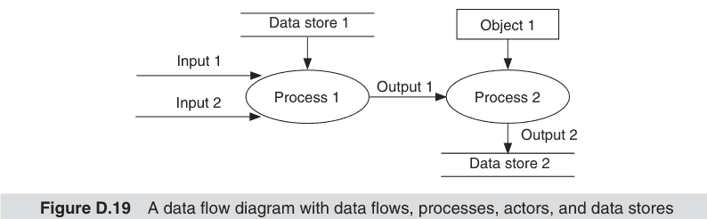

## 使用 C++ 的面向对象编程

## D.3 分析

现在我们知道了构成面向对象模型的三个模型。本节将教我们如何从需求文档中创建模型。最后一节将教我们如何实现该模型。

### 分析概述

首先收集并整合用户、开发者和经理生成的请求。根据此整合后的列表创建一个问题陈述。通过分析问题陈述并从用户、领域专家以及开发者对现实世界的知识获取输入来构建模型。

大型模型是迭代构建的。首先构建一个仅实现核心需求的小模型。一旦模型完善，就会将其扩展以添加所有辅助功能。

### 对象建模

对象建模的步骤如下：

- 1. 识别类
2. 识别与类的关联和聚合
3. 为类和关联添加属性
4. 使用继承组合类
5. 在构建动态和功能模型后为类添加操作

类通常出现在问题陈述的名词中。关联通常以动词或动词短语的形式出现。属性通常以名词加所有格形容词的形式出现。识别共享特征的类并指定为基类。寻找带有不同形容词的名词。共同名词可以建模为基类，而每个带有形容词的名词可以建模为其派生类。

### 动态建模

简单来说，动态建模的第一步是识别事件。事件以外部刺激和响应的形式出现。下一步是使用单独的状态图为每个对象总结允许的事件序列。

我们可以开始创建典型预期的场景。所有常见的交互都由场景描述。下一步是为这些场景中的每一个创建事件树。扫描事件树中发生在每个对象上的子句。

对象可以获得的状态可以从连续发生的所有对事件之间的间隔中识别。这些事件和状态组织在状态图中。生成的状态图集合成了动态模型。

这一过程可以增量地对特殊交互进行重复，例如遗漏的输入、违反领域约束等。最后，为错误用例准备场景。这些场景通过将新的事件序列作为备选路径附加到现有状态，也合并到状态图中。

### 功能建模

类状态图中的活动或动作可以建模为数据流图上的过程。对象图中的对象和对象属性值可以建模为数据流图上的流。

来自动态模型的事件参数表现为过程的输入输出值。通过在相应的输入和输出值之间插入过程，可以构建数据流图。

顶层数据流图中的过程可能非常复杂。为每个过程创建一个简化且详细的低级数据流图。如果该级别仍然包含复杂的过程，则重复该过程直到达到具有非常简单过程的数据流图。

最后，为每个最低层过程编写文本描述。描述强调过程的目标，而不是过程将如何实现。识别模型参与者和内部存储。

## D.4 系统设计

系统设计是解决问题和构建解决方案的高级策略。系统被组织成子系统。子系统被分配给硬件和软件组件。还采取了支配设计细节的主要概念和策略决策。系统的整体称为系统架构。在系统设计期间，做了整体的高级实现决策。随后对逐步降低的级别做出类似的决策。

### 将系统分为子系统

系统根据服务的相似性分为子系统。服务是一组具有共同目的的函数集。

每个子系统提供一个定义良好、抽象良好的接口。该接口可以与其他子系统交换。子系统的内部设计不暴露。

### 层

系统可以分为若干层。每层都为其上层提供服务。因此，层与层之间是强耦合。

### 分区

子系统可以分为分区（另见 D.20）。我们还应该识别哪些活动是并发执行的哪些是互斥的。

## D.5 对象设计

| | | |
| :--- | :--- | :--- |
| 子系统 1 | | |
| 子系统 3 | | |
| 子系统 2 | 子系统 4 | 子系统 6 |
| | 子系统 5 | | |
| | 子系统 7 | | |
| | 子系统 8 | | |

之前建模的类和关联的定义在对象设计阶段完成。操作中使用的算法也最终确定了。

### 对象设计概述

对分析期间发现的对象列表进行修订，旨在尽可能地减少执行时间和内存。

对象模型描述了系统中的对象类，包括它们的属性和支持的操作。

功能模型描述了系统必须实现的操作。在设计期间，我们必须决定每个操作如何实现。

动态模型描述了系统如何响应外部事件。程序的控制结构主要源于动态模型。

动态模型的动作和活动以及功能模型的过程转换为操作。

在设计类时，我们必须决定何时使用基本类型作为数据成员，何时使用其他对象。类可以包含其他对象，但最终一切必须用内置原始类型实现。

## D.6 实现

编写代码是过程的延伸。编写代码应该是简单的，几乎是机械的，因为所有困难决策应该已经在设计期间做出。代码应该是特定编程语言对设计的简单翻译。

## 附录 E

## 术语表

抽象基类 (Abstract Base Class) 至少有一个纯虚拟类。抽象基类不能被实例化。它们仅作为其他类派生的基类（参见虚函数）。

类模板 (Class Template) 一种用于类定义的模板。数据成员的数据类型未定义。

箭头运算符 (->) 一种通过指向对象的指针访问对象数据成员或调用成员函数的运算符。

克隆函数 (Clone Functions) 创建与基指针所指向的相同类型的对象并返回其地址的函数。

基类 (Base Class) 另一个类继承自的类。（参见继承）

命令行参数 (Command Line Arguments) 命令行参数是在从命令行运行时传递给可执行程序的值。

二叉搜索树 (Binary Search Tree) 二叉树是二叉树的一种特殊形式。在二叉搜索树中，左子节点包含的任何值都小于节点的值，而节点包含的值小于其右子节点包含的值。

const_cast 运算符 该运算符用于转换变量的常量性。

二叉树 (Binary Tree) 每个节点最多连接到 2 个节点的二叉树。

常量成员函数 (Constant Member Functions) 只能读取数据成员值而不能修改它们的成员函数。

按引用传递 (Call by Reference) 被调用函数的形式参数为引用类型。（参见引用变量）

构造函数 (Constructor) 在每个对象创建时自动针对该对象调用的成员函数。它用于保证对象数据成员的初始化。（参见数据初始化）

按值传递 (Call by Value) 被调用函数的形式参数为非引用类型。（参见引用变量）

拷贝构造函数 (Copy Constructor) 每当对象创建并同时赋值给另一个对象时就会调用的构造函数。它是针对正在获取的对象被调用的，而现有对象则作为参数传递给它。

catch 用于捕获异常的关键字。（参见异常处理、try、throw）

数据成员 (Data Member) 包含类对象值的成员变量。该类的每个对象都有其数据成员的独立拷贝。

子类 (Child Class) 继承自另一个类的类。（参见继承）

数据安全 (Data Security) 一种面向对象的特性，指防止未经授权的函数访问数据。

类 (Class) C++ 提供的一种语言结构，能够实现数据安全、数据保证初始化、数据抽象、隐藏等面向对象概念的实现。类具有成员函数和成员数据。

默认构造函数 (Default Constructor) 如果我们不取参数，由编译器默认定义的构造函数。（参见零参数构造函数）

## 使用 C++ 进行面向对象编程

函数参数默认值 (Default Values for Function Arguments) 可以为函数参数分配默认值。当调用函数时没有传递任何值，则这些值会被分配给参数。

delete 一个运算符允许我们将动态分配的内存块返回给操作系统。（参见动态去分配）

派生类 (Derived Class) (参见子类) 

析构函数 (Destructor) 在每个对象销毁时自动针对该对象被调用的函数。它用于释放对象持有的资源。

点运算符 (Dot Operator) 一种允许我们访问对象数据成员或相对于对象的类成员的运算符。

dynamic_cast 一种用于派生类指针进行向下转换的运算符。如果类指针通常指向目标对象，则 dynamic_cast 返回所指向对象的地址；否则返回 NULL。如果使用 dynamic_cast 替指针，它会返回目标对象的引用或抛出 bad_cast 类型的异常。

动态绑定 (Dynamic Binding) 在动态绑定中，如果相对于基类类型的指针或引用调用了基类的重写函数，将根据运行时指向或引用的对象类型决定调用哪个函数（基类函数或派生类中的一个）。同一个函数有多个版本（在基类和派生类中）。这可能导致根据运行时出现的情况执行特定版本。

动态内存分配 (Dynamic Memory Allocation) 在这种内存分配类型中，根据运行时产生的需求分配更多内存。

动态内存去分配 (Dynamic Memory Deallocation) 一旦不再需要，动态分配的内存可以返回给操作系统。这就是动态内存去分配。

动态多态 (Dynamic Polymorphism) (参见动态绑定) 早期绑定 (Early Binding) 在早期绑定版本中，具有多种形式的被调用函数将在编译时而不是运行时调用。

包含类 (Enclosing Class) 包含另一个类定义的类称为包含类。（参见嵌套类）

异常处理 (Exception Handling) 异常处理是一个库，用于向调用客户端通知无法处理的错误状况。客户端可以捕获异常并决定合适的错误处理策略。或者，客户端可以选择重新抛出异常。（参见 catch、try）

显式构造函数 (Explicit Constructor) 显式构造函数在实例化对象时不允许隐式转换。构造函数通过在声明前显式地加上 explicit 关键字来声明。我们只需要在构造函数的声明中提到 explicit 关键字。没有必要在定义前加上 explicit 关键字。如果程序员正在创建一个不希望通过构造函数进行隐式转换的类，显式构造函数对他们非常有用。

友函数 (Friend Function) 非成员函数，但被授予访问其声明为友的类的私有成员的权限。

友类 (Friend Class) 整个成员集被授予特殊权限访问其声明为友的类的私有数据成员的类。

成员函数 (Function Member) 类的成员。在类内部声明。它有权访问该类所有对象的私有成员。

函数重载 (Function Overloading) 一种允许程序员创建两个同名函数的机制。

## 附录 E：术语表 451

函数原型 (Function Prototype) 函数声明，告诉编译器函数的返回类型和参数数量。

函数可以修改它们的值。（参见常量函数）

函数模板 (Function Template) 一种用于函数定义的模板。参数类型未定义。只有当函数被调用时，才会生成函数的实际定义。

命名空间 (Namespace) C++ 中的语言允许我们将源代码划分为逻辑部分。这有助于防止名称冲突。如果两个类属于不同的命名空间，可以定义同名的类。

嵌套类 (Nested Class) 定义在另一个类内部的类。（参见包含类）

新内存处理函数 (New Handler Function) 每当遇到内存耗尽时都会调用的函数。我们可以定义自己的新内存处理函数。

数据保证初始化 (Guaranteed Initialization of Data) 变量成员在创建时可能会获得无效值。C++ 通过定义构造函数实现了数据的保证初始化。（参见构造函数）

new 运算符 允许我们根据运行时产生的情况获取内存。（参见动态内存分配）

继承 (Inheritance) 面向对象语言提供的一种特性，允许类继承现有类的数据和成员。（参见基类、父类、超类、派生类、子类）

新样式 (New Styles) C++ 提供了以下新的转换运算符来取代旧的易错且难以检测的类风格：

- dynamic_cast
- static_cast
- reinterpret_cast
- const_cast

内联函数 (Inline Function) 编译器在其调用处展开的函数。

晚绑定 (Late Binding) (参见动态绑定)

链表 (Linked Lists) 列表由线性方式连接的节点组成。链表中的每个节点都是由两部分组成的对象。第一部分是节点携带的数据。每个节点的第二部分是携带链列表中下一个节点地址的指针。这是对单向链表的描述。或者，每个节点可以有一个额外的指针用于双向链表。

对象 (Object) 类的实例被称为对象。

面向对象编程系统 (Object-Oriented Programming System) 一种允许程序员模拟真实对象的系统。数据和过程在类实例中共同工作。

操纵符 (Manipulators) 是允许 C++ 程序员格式化程序输出的运算符。

运算符重载 (Operator Overloading) 面向对象语言的一种特性，允许为运算符提供定义，使其可以使用类对象作为操作数。

多继承 (Multiple Inheritance) 类继承自多个一个基类的继承类型。

参数化类 (Parameterized Class) (参见类模板)

参数化构造函数 (Parameterized Constructor) 带参数的构造函数。

父类 (Parent Class) (参见基类)

可变数据成员 (Mutable Data Members) 永远不是常量的数据成员。即使常量成员

多态 (Polymorphism) 面向对象语言的一种特性，允许程序员创建两个同名的函数。多态

# C++ 面向对象编程

分为两种类型——静态和动态。（参见静态绑定、静态多态、早期绑定、动态绑定、动态多态、晚绑定）

栈（Stacks）与链表非常相似。然而，在栈中，我们可以从头部添加节点。此外，在栈中，我们可以从头部删除节点。

**私有类成员 (Private Class Members)** 在类的 `private` 区域声明的类成员。私有成员可以被同类的成员函数访问。

**static_cast 运算符** 静态转换运算符和动态转换运算符之间的区别在于，`dynamic_cast` 会执行运行时检查以确保转换有效，而 `static_cast` 不进行此类检查。

**面向过程编程 (Procedure-Oriented Programming)** 在此系统中，代码被划分为过程。数据与处理数据的过程并不绑定在一起。

**静态绑定 (Static Binding)**（参见早期绑定）

**受保护类成员 (Protected Class Members)** 在类的 `protected` 区域声明的类成员。受保护成员可以被同类的成员函数以及派生类的成员函数访问。

**静态数据成员 (Static Data Member)** 静态数据持有该类所有对象共有的全局数据。静态数据是类的成员，而不是类的任何对象的成员，它们不包含在任何对象内部。

**静态函数成员 (Static Function Member)** 静态成员函数不是通过现有对象调用的。该函数的目的是访问和/或修改类的数据。

**公共类成员 (Public Class Members)** 在类的 `public` 区域声明的类函数和数据成员。公共成员不仅可以被类成员和派生类成员访问，还可以被全局非成员函数访问。

**内存分配 (Memory Allocation)** 在这种内存分配方法中，要分配的内存量以及在运行时分配的时间在编译阶段就已经决定了。

**纯虚函数 (Pure Virtual Functions)** 一种特殊的虚函数，其声明指定为 "=0”。纯虚函数的存在使类成为抽象类。派生类必须重写基类的虚函数，否则它也将成为抽象基类。（参见抽象类、虚函数）

**内存释放 (Memory Deallocation)** 在这种内存分配方法中，要释放的内容以及在运行时释放的时间都是在编译阶段决定的。

**静态多态 (Static Polymorphism)**（参见早期绑定）

**队列 (Queues)** 与链表非常相似。然而，在队列中，我们可以从尾部添加节点。此外，在队列中，我们可以从头部删除节点。

结构 (Structure) C 语言的一种结构，允许程序员组合影响他人值的数据，并应该使用指针。C++ 不允许程序员在结构体内部定义成员函数。这缺乏了数据安全性。

**引用变量 (Reference Variables)** 引用是对另一个变量的引用。它不占用自己的内存。它共享其所引用的变量的拷贝的内存。

**reinterpret_cast** 一种允许将一种类型转换为另一种的新运算符。

**子类 (Subclass)**（参见子类、派生类、继承）

**超类 (SuperClass)**（参见父类、基类、继承）

**this 指针** 一个常量指针，作为前导形式参数指向每个成员函数。它指向调用该函数的对象。

**作用域解析运算符 (Scope Resolution Operator)** 一种允许 C++ 程序员在类外部定义成员函数的运算符。::

# 附录 E：术语表 453

**throw** C++ 中的一个关键字，允许库程序员在遇到库代码本身未定义的无效条件时抛出异常。（另参见异常处理、try、throw）

**树 (Trees)** 与列表、栈和队列不同，树没有线性结构。在树中，每个节点都可能连接到多个一个节点。

**try** C++ 中的一个关键字，允许客户端调用可能会抛出异常的函数。（另参见异常处理、try、throw）

**typedef 运算符** 一种允许我们确定指针所指向对象类型的运算符。

**虚基类 (Virtual Base)** 在声明派生类时使用 `virtual` 关键字派生的基类。如果一个类继承自两个类，而这两个类反过来继承自一个虚基类，那么最终的派生类将获得一份虚基类特征的拷贝。

**虚函数 (Virtual Function)** 类成员函数可以通过在其前面加上 `virtual` 关键字来声明为虚函数。虚函数实现了动态多态。如果在一个派生类类型中重写了虚函数，且该指针指向同一个派生类对象而非基类对象。（另参见动态绑定、动态多态、晚绑定）

**零参数构造函数 (Zero-argument Constructor)** 不接受任何参数的构造函数称为零参数构造函数。编译器默认创建的构造函数也是零参数构造函数。因此，零参数构造函数和默认构造函数可以互换使用。（另参见

# 附录 F

# 自测

测试 1

耗时：1 小时
满分：50

# 判断对错题

[1 × 10 = 10]

- 1. 在 C++ 程序代码中，可以在函数开头声明变量。
- 2. 如果相应的形式参数是引用变量，函数可以修改传递的参数的值。
- 3. 代码中存在内联函数不会影响生成的可执行文件的大小。
- 4. C++ 中的结构体不能有成员函数。
- 5. 常量成员函数无法访问类的静态数据成员。
- 6. C++ 中构造函数的返回类型是 void。
- 7. 即使在派生时使用了 `private` 关键字，派生类函数也可以访问该类的公共成员。
- 8. 纯虚函数不能被重载。
- 9. 实际定义是在运行时从函数/类模板创建的。
- 10. 单链表的每个节点在其数据域中只能包含整数类型的值。

# 填空题

[1 × 10 = 10]

- 1. 将数据与处理数据的代码绑定在一起的过程被称为
- 2. cout 是 ........................................ 一个 ........................................ 类的对象。
- 3. 使用 .................................................... 运算符通过指针访问类成员。
- 4. 在类的 `private` 和 ............................ 区域声明的成员不能被非成员函数访问。
- 5. 虚函数实现了........................................... 多态。
- 6. 通过在声明中标记为 .....可以将虚函数指定为纯虚函数。
- 7. 使用 .................................... 可以实现基本类型到类类型的转换。
- 8. 向 open() 函数传递 ................................................... 标志以确保文件不存在时创建。
- 9. C++ 用于异常处理的三个关键字是 try、catch 和
- 10. catch all 块的语法为 .................................

# 多选题

（可能有多个正确选项）

[2 × 5 = 10]

- 1. 下列哪些是面向对象编程的特征？
(a) 继承 (b) 数据持久化 (c) 多态 (d) 数据抽象
- 2. 下列哪个是正确的函数原型？
(a) int abc(int, int); (b) int abc(int a, int b); (c) int abc(int a, int b) {} (d) int abc(a, b);
- 3. 继承的益处是
(a) 代码重用 (b) 可执行文件更快 (c) 数据隐藏 (d) 可执行文件更小
- 4. 在什么情况下调用拷贝构造函数？
(a) 创建对象的同时赋值给另一个现有对象。(b) 为现有对象创建引用。(c) 对象作为参数传递给形式参数为对象的函数。(d) 对象作为参数传递给形式参数为引用的函数。
- 5. 哪些用于文本模式输出？
(a) write() 函数 (b) 插入运算符 (c) put() 函数 (d) 提取运算符

# 简答题

[4 × 5 = 20]

- 1. 编写一个内联函数和一个宏来返回两个数中的较大者。哪个更好为什么？
- 2. 结合示例说明自定义析构函数的需要。
- 3. 多重继承和菱形继承中会出现哪些歧义？如何消除它们？
- 4. 解释为什么对文件的读取操作应该以与写入操作相同的模式进行？
- 5. 解释从单链表头部删除节点的函数。

# 测试 2

时长：1 小时

满分：50 分

# 判断题

[1 × 10 = 10]

- 1. 如果两个函数的返回类型不同，具有相同名称和签函数可以共存。
- 2. 返回非引用值的函数可以放在赋值运算符的左侧。
- 3. 一个类只存在一个静态数据成员的拷贝。
- 4. 类成员默认是私有的。
- 5. 一个类可以有多个析构函数。
- 6. 基类指针可以指向派生类对象。
- 7. 类中的所有函数都必须声明为纯虚函数，才能使之成为一个抽象基类。
- 8. `const_cast` 运算符用于将基类类型的指针转换为派生类类型的指针。
- 9. 单个模板只会生成一个函数定义。
- 10. 未处理的异常将导致程序终止。

# 填空题

[1 × 10 = 10]

- 1. .............. 是面向对象编程系统的一项特性，允许人们拥有多个定义。
- 2. .............. 运算符用于在类外定义成员函数。
- 3. 具有访问类对象私有成员特殊权限的非成员函数被称为 .............. 函数。
- 4. .............. 构造函数的形式参数必须始终是一个引用对象。
- 5. 继承实现了一种/一个 .............. 关系。
- 6. 如果派生类使用 `protected` 关键字从基类派生，那么基类的公共成员相对于派生类的成员函数来说是 .............. 的。
- 7. 除了非静态数据成员外，至少包含一个虚函数的类对象还包含 ..............。
- 8. 可以使用 .............. 函数对输入指针进行操作。
- 9. .............. 是 C++ 流处理库中所有类的基类。
- 10. 向栈或队列中添加节点被称为 ..............

# 多项选择题（可能存在一个或多个正确答案）

[2 × 5 = 10]

- 1. 考虑以下函数：
`int abc(int, int) {};`
下列哪项重载了该函数？
(a) `int abc(int, int, int) {}`
(b) `float abc(int, int) {}`
(c) `int abc(float, int) {}`
(d) `int abc(int, int=0) {}`

- 2. 下列哪些是正确的构造函数？
(a) 它的名字以波浪号 `~` 前缀。
(b) 它可以被重载。
(c) 它可以访问类的静态数据成员。
(d) 可以是虚函数。

- 3. 下列哪种函数可以访问类的受保护成员？
(a) 全局非成员友函数。
(b) 友元类的成员函数。
(c) 全局非成员函数。
(d) 由 `public` 或 `protected` 关键字派生的友元类的成员函数。

- 4. 下列哪些类属于标准 C++ 流处理库？
(a) `istream`
(b) `stream`
(c) `ostream`
(d) `fstream`

- 5. 下列哪些项实现了代码重用？
(a) 函数重载
(b) 继承
(c) 异常处理
(d) 模板

# 短答题

[4 × 5 = 20]

- 1. 结合示例说明用户自定义拷贝构造函数的需要。
- 2. 在创建派生类对象时，构造函数和析构函数的调用顺序是怎样的？
- 3. `static_cast` 运算符和 `dynamic_cast` 运算符的区别是什么？
- 4. 为什么要重载运算符？
- 5. C++ 编译器何时以及如何从模板生成实际的类定义？

# 测试 3

时长：1 小时
满分：50 分

# 判断题

[1 × 10 = 10]

- 1. 可变数据成员的值可以被常量函数修改。
- 2. 函数的多个形式参数不能被赋予默认值。
- 3. 类的静态数据成员的类型可以与类类型相同。
- 4. 类可以有多个构造函数。
- 5. 基类和派生类不能具有相同名称和相同相同的函数。
- 6. 类中虚函数的存在不会增加其对象的大小。
- 7. 我们可以重载递增运算符来减小对象的值。
- 8. 指针指向的对象的类名可以通过 `typeid` 运算符找到。
- 9. 模板类只能有一个模板对象。
- 10. 单个 `catch` 块可以用于捕获多种类型的异常。

# 填空题

[1 × 10 = 10]

- 1. 包含另一个类的类被称为 ........................................ 类。
- 2. ........................................ 指针指向调用对象。
- 3. ........................................ 运算符用于在 C++ 中动态获取内存。
- 4. 析构函数的名字以 ........................................ 符号为缀。
- 5. 从多个基类派生被称为 .............. 继承。
- 6. ........................................ 关键字用于重载操作。
- 7. 除了非静态数据成员外，至少包含一个虚函数的类对象还包含 ..............。
- 8. 可以使用 .............. 函数对输入指针进行操作。
- 9. .............. 是 C++ 流处理库中所有类的基类。
- 10. 向栈或队列中添加节点被称为 ..............

# 多项选择题（可能存在一个或多个正确答案）

[2 × 5 = 10]

- 1. 下列哪个关键字用于创建新类型？
(a) `class`
(b) `inline`
(c) `throw`
(d) `struct`

- 2. 使用 `private` 从另一个类派生时，会发生什么？
(a) `class`
(b) `inline`
(c) `throw`
(d) `struct`

- 3. 下列哪些项不是 C++ 关键字？
(a) `struct`
(b) `abstract`
(c) `constant`
(d) `cast`

- 4. 下列哪些函数返回列表中的元素数量？
(a) `size()`
(b) `length()`
(c) `width()`
(d) `index()`

- 5. 指示下一个字节状态的标志
(a) `eofbit`
(b) `nofile`
(c) `failbit`
(d) `badbit`

# 短答题

[4 × 5 = 20]

- 1. 解释为什么静态数据成员应该在类外定义。
- 2. 为什么派生类构造函数必须将值传递给基类？
- 3. 什么是虚表？它是如何创建的？
- 4. 为什么重载赋值运算符的函数接收并返回引用？
- 5. 解释为什么栈和队列类私有继承自单链链表。

# 索引

| 索引术语 | 链接 |

# A
- abort() 89
- 抽象基类 163
- 箭头 47

# B
- bad_cast 273
- bad() 函数 200

# C
- catch 399, 397
- cin 173
- 类图 438
- 处理流的类层次结构 172
- class 关键字 35
- 从一个成员函数调用另一个成员函数 48
- 类模板 378
- 嵌套类模板 382
- clear() 函数 200
- clone 函数 168
- close() 194
- C++ 与 C 的比较 8
- 控制台输入/输出 9
- cin 13
- cout 9
- endl 10

# 索引术语
# 链接

控制台输入/输出（续）
- 提取运算符 13
- 插入运算符 9
- iostream.h 12
- ostream_withassign 9
- 常量成员函数 52
- 构造函数 87
- 拷贝构造函数 105
- 数据的保证初始化 96
- 参数化 97
- 无参数 94
- cout 172

C 风格的错误生成代码处理 394

# D
- 数据抽象 45
- 数据结构 283
- 函数形式形参数的默认值 23
- delete 运算符 87
- 使用 'delete' 运算符的语法 86, 87
- 析构函数 109
- 防止内存泄漏 111
- 点运算符 43
- 动态内存管理 79
- 动态内存分配 79
- 动态内存释放 84

# E
- 早期绑定 450
- eof() 函数 199

# 索引术语
# 链接

异常处理 393
- 在 catch 块中访问被抛出的对象 406
- 捕获未捕获的异常 409
- 异常处理的局限性 414
- 需要抛出类对象 404
- 抛出嵌套异常的参数化对象 408
- 显式地址操作 47
- 提取运算符 173, 181

# F
- fail() 函数 199
- 友元 54
- 友元类 55
- 友元成员函数 57
- 友元非成员函数 54
- fstream 194, 174
- 函数重载 21
- 函数重写 127
- 函数原型 19
- 语法 19
- 为什么函数原型很重要 19
- 函数模板 373
- 重写函数模板 376

# G
- get() 183
- getline() 183

# I
- ifstream 174

# 索引术语
# 链接

- 继承 7
- 继承 121
- 访问基类成员 141
- 多重继承中的歧义 122
- 基类和派生类指针 129
- 基类初始化 136
- 通过 ‘private’ 访问修符派生 135
- 通过‘protected’ 访问修符派生 133
- 通过‘public’ 访问修符派生 127
- 函数重写 147
- 层次结构继承 148
- 混合继承 145
- 多级继承 139
- 多重继承 149
- 构造函数和析构函数的调用顺序 143
- 重写 132
- protected 访问修符 117
- 语法 145
- 虚基类 25
- 内联函数 172
- 插入运算符 178
- 实例图 438
- ios 172
- iostream 173
- istream 173
- istream_with_ 173

# L
- 晚绑定 451
- 链表 284

# 索引术语
# 链接

# M
- 宏 28
- 操纵符 201
- resetiosflags() 203
- setfill() 202
- setiosflags() 202
- setprecision() 201
- setw() 203
- 用户定义 85
- 内存泄漏 111
- mutable 可变数据成员 54
- mutable 关键字 276

# N
- 命名空间 68
- 嵌套类 71
- new 运算符 89, 88, 79
- new 运算符的语法 81
- new 风格转换运算符 211
- const_cast 276, 211
- dynamic_cast 271, 211
- reinterpreter_cast 276, 211
- static_cast 275, 211
- 非类型 379
- 模板参数 379

# O
- 对象设计 448
- 通过成员函数进行对象输入/输出 197

# 索引术语
# 链接

面向对象分析与设计 437
- 分析 446
- 动态模型 438, 442
- 功能模型 438, 444
- 对象模型 438
- 阶段 437
- 面向对象程序系统 7
- 继承 7
- 数据安全 7
- 数据的保证初始化 7
- 多态性 7
- 对象 36
- 对象的数组 67
- 对象的数组 67
- 对象和函数 65
- ostream 173
- open() 193
- 打开模式 193
- 运算符重载 211
- 算术运算符重载 225
- 赋值运算符重载 234
- 增/减运算符重载 221
- 运算符 240
- 插入和提取运算符重载 244
- new 和 delete 运算符重载 265
- 指针运算符重载 230
- 关系运算符重载 261
- 下标运算符重载 224
- 一元运算符重载 219
- 运算符重载的规则 212
- 运算符重载语法 33

# 索引术语
# 链接

运算符重载（续）
- 使用友元函数 215
- 为什么重载运算符？216
- ostream 172
- 重载成员函数 49
- 重写 143

# P
- 多态性 23
- 动态 23
- 函数 23
- 静态 23
- printf() 9
- 私有成员函数 29
- 过程化系统 5
- 数据不安全 6
- protected 访问修符 13
- put() 函数 180

# Q
- 队列 340

# R
- 随机访问文件 197
- read() 189
- 引用变量 14
- 引用可以是一个函数 16
- RTTI（运行时类型信息）211
- typeid 211
- typeid 运算符 277

# 索引术语
# 链接

# S
- scanf() 9
- 作用域解析运算符 37, 142
- seekg() 196
- seekp() 195
- set_new_handler() 88
- new 处理函数 88
- 内存溢出条件 88
- 智能指针 265
- 栈 336
- 标准模板库 380, 382
- list 类 383
- map 类 387
- multimap 类 389
- multiset 类 390
- pair 类 387
- set 类 389
- vector 类 386
- 静态成员 59
- 静态成员数据 59
- 静态成员函数 64
- 静态内存管理 78
- 流 172
- struct 关键字 36
- 结构体 1, 3
- 创建新数据类型 4
- 缺乏安全性 6
- 在程序中使用结构体 5
- 私有和公共成员 33
- 在 C++ 中重定义 33

# 索引术语
# 链接

系统设计 447

# T
- tellg() 196
- tellp() 196
- template 关键字 379, 373
- 文本和二进制输入/输出 174
- 文本与二进制文件 176
- ‘this’ 指针 40, 53, 50, 37
- 33
- throw 399, 397
- 树 343
- 二叉树 344
- try 399, 397
- 类型，
- 模板参数 379
- 模板模板参数 379
- 类型转换 211, 267
- 基本类型到类类型 267
- 类类型到基本类型 268
- 类类型到类类型 269

# U
- using 指令 70

# V
- 虚基类 145
- 虚函数 156
- 抽象基类 163
- 虚函数的机制 160

# 索引术语
# 链接

虚函数（续）
- 纯虚函数 162
- 虚析构函数和虚构造函数 167
- 虚指针 161
- 虚函数表 160

# W
- write() 185
