# C++ 面向对象编程


# 关于作者

**E Balagurusamy**，前安纳大学（Anna University）校长、新德里联合公务委员会成员，现任 EBG 基金会（EBG Foundation）主席，坐落于科伊姆布尔（Coimbatore）。他曾是教师、培训师和咨询顾问，专注于信息技术和管理领域。他拥有印度理工学院（IIT）罗克基（Roorkee）电气工程荣誉硕士（ME）和系统工程博士（PhD）学位。他的研究兴趣包括 *面向对象软件工程、电子政务、技术管理、业务流程再造* 以及 *总质量管理*。

作为 prolific writer（ prolific 作者），他撰写了大量研究论文和多本著作。他的畅销书籍包括 –

- *计算机基础*
- *计算机基础与 C 语言编程*
- *ANSI C 编程（第 5 版）*
- *Java 编程（第 4 版）*
- *BASIC 编程（第 3 版）*
- *C# 编程（第 3 版）*
- *数值方法*
- *可靠性工程*

他因众多荣誉和奖项而闻名，曾被列入《智慧人名录》（Directory of Who’s Who of Intellectuals）以及《教育杰出领袖名录》（Directory of Distinguished Leaders in Education）。


# 本版新增内容

- 新增主题——递归、预处理器、虚拟构造函数和析构函数、构造函数和析构函数中的异常、运算符重载函数中的异常
- 主题详述——动态内存管理、重载、结构和联合、存储类、抽象类、类型转换和 RTTI
- 新增两个项目——*电话计费系统*（大型）和 *打字教练*（小型），以提供实践方法
- 包含调试练习的答案
- 提供更新且焕新的 C++ 能力测试，并附有基于技术面试问题模式的答案
- 更新且丰富的教学法包括
  - 115 个程序
  - 218 道复习题
  - 67 个调试练习
  - 90 道编程练习

# 本书主要特色

| 特色 | 益处 | 示例 |
|---|---|---|
| 关键概念与引言 | 关键概念可快速了解本章将要讨论的概念。其后是引言，介绍该章将要涵盖的主题，并将其与已学内容联系起来。 | 参见第 1、16、30、71 和 90 页 |
| 程序代码 | 全书提供带注释的程序代码，详细说明各行代码的工作方式，并提升编程技能。 | 参见第 21、46、50、77 和 97 页 |
| 关键术语 | 关键术语列出本章讨论的重要术语。 | 参见第 13、27、66、86 和 125 页 |
| 注释 | 语言提示和其他特殊注意事项在必要时以注释形式突出显示，为概念解释增色。 | 参见第 24、53、85、116 和 118 页 |
| 小结 | 小结以要点形式给出每章精髓，有助于考试期间快速复习。 | 参见第 14、26、65、86、124 页 |
| 习题 | 提供 375 道章末习题，包括复习题、调试练习和编程练习，供读者练习、实践和应用所学概念。 | 参见第 15、28、69、87 和 126 页 |
| 编程项目 | 附录 A 中的两个编程项目（电话计费系统和打字教练）展示了如何在现实问题中整合和应用 C++ 的各种特性。 | 参见第 450 和 460 页 |
| 能力测试 | 关于能力测试的附录将帮助读者评估自己对该语言的掌握程度，并为技术面试做好准备。 | 参见第 545 和 554 页 |

# 章节结构

本书共分为 17 章和 9 个附录。**第 1 章和第 2 章**为面向对象编程和 C++ 提供了坚实的基础和视角。**第 3 章**讨论各种数据类型和控制结构。该章现在包含结构和联合之间的差异，并通过适当的程序进行说明，同时介绍了存储类及其各种类型。

**第 4 章**阐释了 C++ 的各种函数。本章新增了一节专门讨论递归函数。

**第 5 章**涵盖类和对象，而**第 6 章**详细研究构造函数和析构函数、各种构造函数，包括参数化构造函数、构造函数重载以及在处理析构函数时需要注意的各种特殊情况。该章还讨论了对象的动态初始化。**第 7 章**详细涵盖运算符重载和类型转换的概念，并讨论了重载规则和字符串操作。新增了运算符重载操作中的异常主题，并提供了足够的程序来支持该理论。**第 8 章**可以学习单继承、多继承和混合继承等不同类型的继承，以及派生类和抽象类等其他主题。

**第 9 章**首先解释 OOP 的重要特性，即多态性，并阐述指针和虚函数，而输入和输出操作则在**第 10 章**中讨论。**第 11 章**深入研究了各种文件流操作和文件指针。模板和异常处理，如构造函数和析构函数中的异常以及运算符重载函数中的异常，可分别在**第 12 章**和**第 13 章**中学习。**第 14 章**向学生介绍标准模板库、其组件和函数。**第 15 章**涵盖字符串及其相关领域的学习，而**第 16 章**则讨论 ANSI C++ 标准的新特性。最后一章**第 17 章**帮助学生理解面向对象系统。

每章末尾都有一组小结、关键术语、复习题、调试练习和编程问题。为进一步帮助，学生还可以访问网站，获取包含 WEB 图标的问题的答案。此外，本版还新增了两个项目——*电话计费系统*（大型）和 *打字教练*（小型）。附录中提供了运行 Turbo C++、在 Windows 下运行 C++、ANSI C++ 关键字词汇表、C++ 运算符优先级、要点记忆、重要 C++ 和 OOP 术语词汇表以及 C++ 能力测试，帮助学生更好地理解和实现这些概念，并成为他们学习中的宝贵资源和工具。

# 网络补充材料

本书附带一个增强且详尽的网络补充材料，为教师和学生提供以下额外信息，网址为 [http://www.mhhe.com/balagurusamy/oop5](http://www.mhhe.com/balagurusamy/oop5)

- 书中部分编程练习的答案
- *调试练习*的答案
- 工资管理和医院管理系统项目的完整代码、分步说明和用户手册，以及第 4 版中的项目和新增项目的可执行格式（*电话计费系统*和 *打字教练*）
- C 与 C++ 之间的区别
- 使用 C++ 实现数据结构概念
- 第 4 版中已删除程序的代码
- 实践测试，包括第 4 版中 C++ 能力测试的题目

# 致谢

自本书第一版于十年前发布以来，无数教师、学生和专业程序员一直


**N·尚蒂**  
*K·S·伦加萨米技术学院，蒂鲁琴戈德，泰米尔纳德邦*

**巴拉穆鲁根·巴卢萨米**  
*韦洛尔理工学院，韦洛尔，泰米尔纳德邦*

**莉娜·托马斯**  
*马尔·阿塔纳修斯工程学院，科塔曼加拉姆，喀拉拉邦*

**A·萨克蒂维尔**  
*阿迪亚理工学院，哥印拜陀，泰米尔纳德邦*

**A·C·卡拉德维**  
*索纳技术学院，塞勒姆，泰米尔纳德邦*

**S·苏雷什·巴布**  
*蒂鲁瓦卢瓦尔政府文理学院，拉西普拉姆，泰米尔纳德邦*

**CH·V·K·N·S·N·穆尔蒂**  
*DRK科学技术学院，海得拉巴，安得拉邦*

**S·穆拉利**  
*PES工程学院，曼迪亚，卡纳塔克邦*

**K·钱德拉·塞卡兰**  
*国家理工学院，苏拉特卡尔，卡纳塔克邦*

**安娜普尔纳·P·帕蒂尔**  
*MSR理工学院，班加罗尔，卡纳塔克邦*

我衷心感谢Tata McGraw-Hill的编辑和出版专业人士，他们对本版以当前形式出版给予了热切关注和支持。

**E·巴拉古鲁萨米**

# 反馈

**别忘了给我们写信。**我们期待收到您的反馈、评论和想法，以提升本书的质量。您可以通过 *tmh.csefeedback@gmail.com* 与我们联系。请在主题中注明书名和作者姓名。

如果您发现本书有任何形式的盗版，请务必告知我们。

# 面向对象编程原理

## 关键概念

软件演化 | 面向过程编程 | 面向对象编程 | 对象 | 类 | 数据抽象 | 封装 | 继承 | 多态 | 动态绑定 | 消息传递 | 面向对象语言 | 基于对象的语言

## 1.1 软件危机

软件技术的发展日新月异。新工具和新技术层出不穷。这迫使软件工程师和软件行业不断寻求软件设计与开发的新方法；鉴于软件系统日益复杂以及行业的高度竞争性，这些新方法变得越来越关键。这些快速进步似乎在行业内造成了一种危机局面。要面对这一危机，需要解决以下问题：

- 如何在系统设计中表示问题中的现实实体？
- 如何设计具有开放接口的系统？
- 如何确保模块的可重用性和可扩展性？
- 如何开发能够容忍未来任何变化的模块？
- 如何提高软件生产率并降低软件成本？
- 如何提高软件质量？
- 如何管理时间进度？
- 如何使软件开发过程工业化？

许多软件产品要么未完成，要么未被使用，要么交付时带有重大错误。图1.1展示了20世纪70年代美国国防软件项目的命运。大约50%的软件产品从未交付，而已交付的产品中有三分之一从未被使用。有趣的是，只有2%的产品按原样交付使用，未做任何修改。这表明软件行业在交付产品方面的记录非常糟糕。

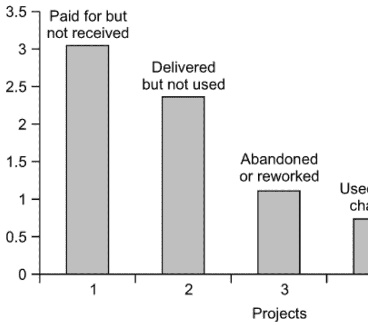

*图1.1 美国国防项目的状况（据美国政府）*

用户需求的变化一直是一个主要问题。另一项研究（图1.2）表明，超过50%的系统因用户需求和数据格式的变化而需要修改。这恰恰说明，在不断变化的世界和动态的商业环境中，变更请求不可避免，因此系统必须具有适应性和容变性。

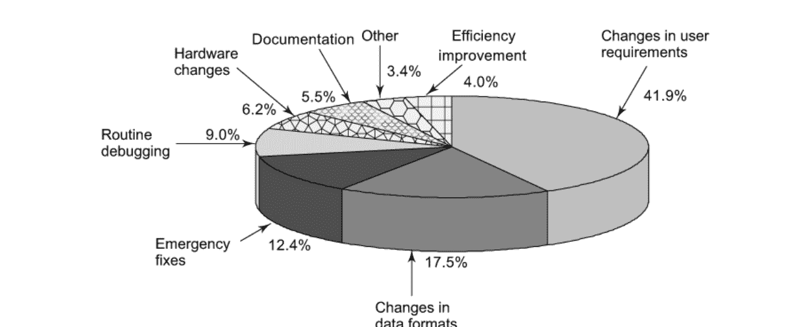

*图1.2 维护成本构成*

这些研究和其他关于软件实施的报告表明，软件产品在交付和实施之前应仔细评估其质量。进行严格评估必须考虑的一些质量问题包括：

1. 正确性
2. 可维护性
3. 可重用性
4. 开放性和互操作性
5. 可移植性
6. 安全性
7. 完整性
8. 用户友好性

选择和使用合适的软件工具有助于解决其中一些问题。

人工智能领域著名作家欧内斯特·泰洛将软件技术的发展比作树木的生长。如同树木一样，软件的发展也有不同的阶段或“层次”。如图1.3所示，在过去的五十年里，这些层次一层一层地建立起来，每一层都代表着对前一层的改进。然而，如果考虑到这些层次的寿命，这种类比就不成立了。在软件系统中，每一层仍然可用，而树木只有最上层是活跃的。

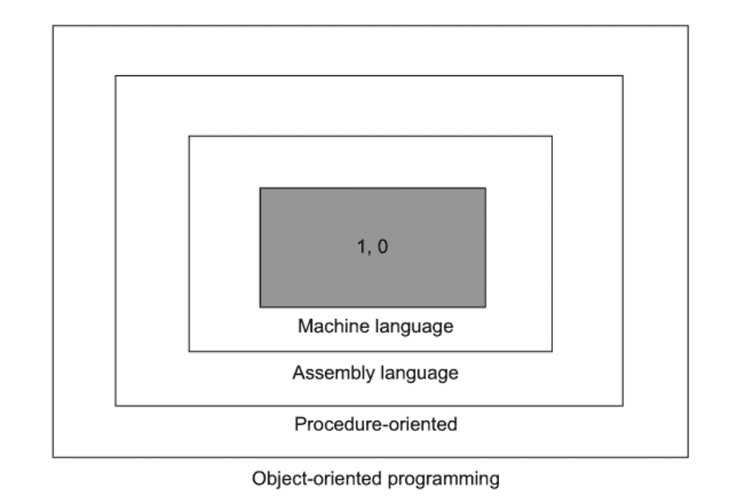

面向对象范式的推动者之一、Smalltalk的主要设计者艾伦·凯曾说过：“随着复杂性的增加，架构支配着基本材料。”要构建当今复杂的软件，仅仅将一系列编程语句、过程和模块组合在一起是不够的；我们需要融入健全的构造技术以及易于理解、实现和修改的程序结构。

自计算机发明以来，人们尝试了许多编程方法。其中包括*模块化编程、自顶向下编程、自底向上编程*和*结构化编程*等技术。每种方法的主要动机都是为了处理日益复杂的、可靠且可维护的程序。在过去二十年中，这些技术在程序员中广受欢迎。

随着C等语言的出现，结构化编程变得非常流行，并成为20世纪80年代的主要技术。结构化编程是一种强大的工具，它使程序员能够相当轻松地编写中等复杂的程序。然而，随着程序规模越来越大，即使是结构化方法也未能展现出在无缺陷、易维护、可重用程序方面的预期效果。

*面向对象编程（OOP）*是一种程序组织与开发方法，它融合了结构化编程的最佳特性与若干强大的新概念，试图消除传统编程方法的一些缺陷。这是一种组织和开发程序的新方式，与任何特定语言无关。然而，并非所有语言都适合轻松地实现OOP概念。

## 1.3 审视面向过程编程

使用COBOL、FORTRAN和C等高级语言的传统编程通常被称为*面向过程编程（POP）*。在面向过程的方法中，问题被视为一系列要完成的事情，如读取、计算和打印。为了完成这些任务，需要编写许多函数。主要焦点是函数。图1.4展示了过程化编程的典型程序结构。

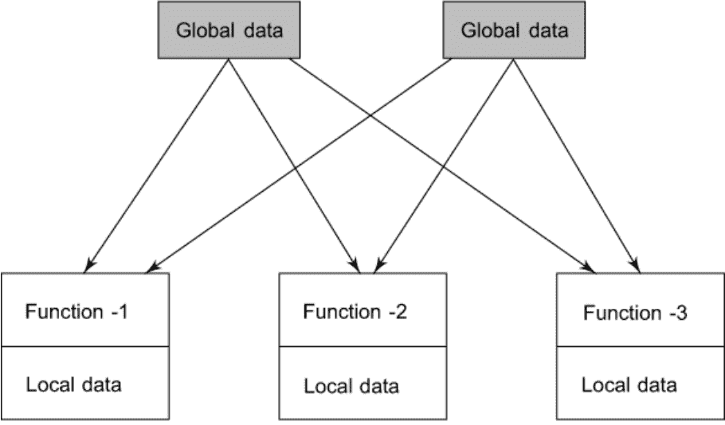

*图1.5 过程化编程中数据与函数的关系*

全局数据更容易被函数无意修改。在大型程序中，很难确定哪个函数使用了哪些数据。如果我们需要修改外部数据结构，也需要修改所有访问该数据的函数。这为缺陷的潜入提供了机会。

过程化方法的另一个严重缺点是它不能很好地模拟现实世界的问题。这是因为函数是面向动作的，并不能真正对应问题的各个要素。

面向过程编程表现出的一些特点如下：

- 重点是做事（算法）。
- 大型程序被划分为称为函数的更小程序。
- 大多数函数共享全局数据。


-   数据在系统中各函数之间公开地流动。
-   函数将数据从一种形式转换为另一种形式。
-   在程序设计中采用*自顶向下*的方法。

## 1.4 面向对象编程范式

面向对象方法问世的主要动因是为了消除过程化方法中的一些缺陷。OOP 将数据视为程序开发中的关键元素，不允许其在系统中自由流动。它将数据与操作数据的函数更紧密地绑定在一起，并保护数据免遭外部函数的意外修改。OOP 允许将问题分解为多个称为*对象*的实体，然后围绕这些对象构建数据和函数。面向对象程序中数据和函数的组织方式如图 1.6 所示。对象的数据只能由与该对象关联的函数访问。然而，一个对象的函数可以访问其他对象的函数。

人们。因此，在进一步讨论之前，有必要对面向对象编程给出一个可行的定义。我们将面向对象编程定义为“*一种通过为数据和函数创建分区内存区域来模块化程序的方法，这些区域可用作模板，按需创建此类模块的副本*”。因此，对象被认为是计算机内存中一个分区区域，存储数据以及一组能够访问这些数据的操作。由于内存分区是独立的，因此对象可以在各种不同的程序中不经修改地使用。

## 1.5 面向对象编程的基本概念

有必要理解面向对象编程中广泛使用的一些概念。这些概念包括：

-   对象
-   类
-   数据抽象与封装
-   继承
-   多态
-   动态绑定
-   消息传递

本节将详细讨论这些概念。

### 对象

*对象*是面向对象系统中的基本运行时实体。它们可以表示一个人、一个地方、一个银行账户、一个数据表或程序必须处理的任何项目。它们还可以表示用户自定义的数据，如向量、时间和列表。编程问题是根据对象以及对象之间通信的性质来分析的。程序对象的选择应使其与真实世界对象紧密对应。对象在内存中占据空间，并有相关地址，就像 Pascal 中的记录或 C 中的结构体一样。

当程序执行时，对象通过相互发送消息进行交互。例如，如果“客户”和“账户”是程序中的两个对象，那么客户对象可以向账户对象发送一条请求银行余额的消息。每个对象都包含数据以及操作这些数据的代码。对象之间可以交互，而不必知道彼此数据或代码的细节。只需知道对象接受的消息类型以及返回的响应类型即可。尽管不同作者表示对象的方式不同，图 1.7 展示了面向对象分析和设计中常用的两种表示法。

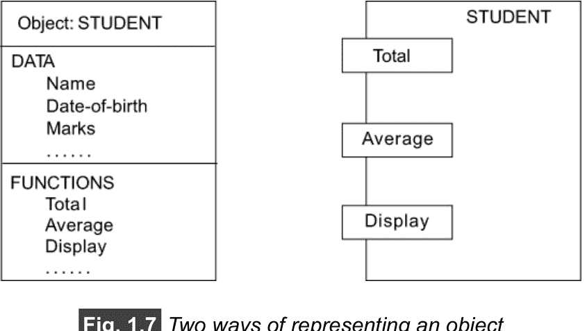

*图 1.7* 表示对象的两种方式

### 类

我们刚刚提到，对象包含数据以及操作这些数据的代码。借助*类*，对象的整个数据和代码集可以构成一种用户自定义数据类型。事实上，对象就是*类*类型的变量。一旦定义了一个类，我们就可以创建任意多个属于该类的对象。每个对象都与创建它们时所用的类类型的数据相关联。因此，类就是相似类型对象的集合。例如，mango、apple 和 orange 是 fruit 类的成员。类是用户自定义数据类型，其行为类似于编程语言的内置类型。创建对象的语法与在 C 中创建整数对象的语法并无不同。如果 fruit 被定义为一个类，那么语句

```c
fruit mango;
```

将创建一个属于 **fruit** 类的 **mango** 对象。

### 数据抽象与封装

将数据和函数封装到单个单元（称为类）中的做法称为*封装*。数据封装是类最显著的特征。数据对外部世界不可访问，只有封装在类中的那些函数才能访问它。这些函数提供了对象数据与程序之间的接口。这种将数据与程序直接访问隔离开来的机制称为*数据隐藏*或*信息隐藏*。

*抽象*是指只表示本质特征，而不包含背景细节或说明的行为。类使用抽象的概念，并定义为抽象*属性*（如大小、重量和成本）以及操作这些属性的*函数*的列表。它们封装了要创建的对象的全部本质属性。属性有时被称为*数据成员*，因为它们保存信息。操作这些数据的函数有时被称为*方法*或*成员函数*。

由于类使用了数据抽象的概念，因此它们被称为*抽象数据类型*（ADT）。

### 继承

*继承*是一个类的对象获取另一个类对象属性的过程。它支持*层次分类*的概念。例如，鸟“知更鸟”属于“飞鸟”类的一部分，而“飞鸟”类又是“鸟”类的一部分。这种划分背后的原理是，每个派生类都与其派生出的类共享共同特征，如图 1.8 所示。

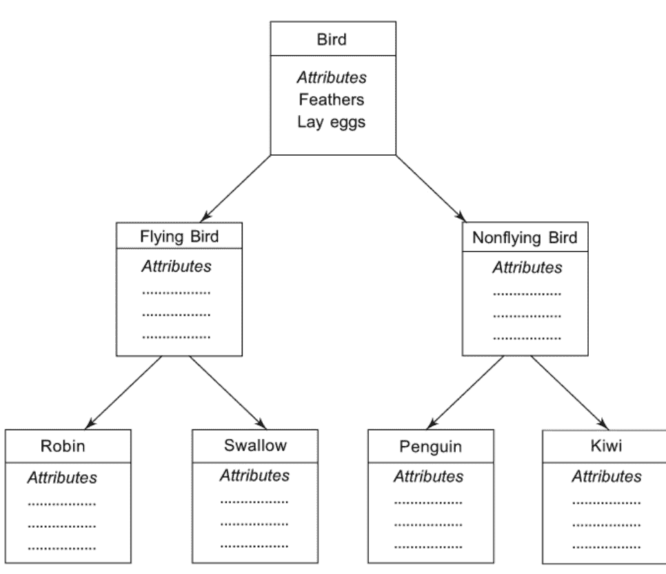

在 OOP 中，继承的概念提供了可重用性的思想。这意味着我们可以在不修改现有类的情况下为其添加额外功能。这可以通过从现有类派生一个新类来实现。新类将兼具这两个类的特性。继承机制真正的吸引力和威力在于，它允许程序员重用与他想要的几乎（但不完全）一样的类，并以不向其余类引入任何不良副作用的方式来定制该类。

注意，每个子类只定义其独有的特性。如果不使用分类，每个类都必须显式包含其所有特性。

### 多态

*多态*是另一个重要的 OOP 概念。多态是一个希腊术语，意为具有多种形态的能力。一个运算在不同情况下可能表现出不同的行为。该行为取决于运算中使用的数据类型。例如，考虑加法运算。对于两个数字，该运算将产生一个和。如果操作数是字符串，则该运算将通过连接生成第三个字符串。使一个运算符在不同情况下表现出不同行为的过程称为*运算符重载*。

图 1.9 说明一个函数名可以用来处理不同数量和不同类型的参数。这类似于一个特定的词根据上下文具有几个不同的含义。使用单个函数名来执行不同类型的任务称为*函数重载*。

多态在允许具有不同内部结构的对象共享相同外部接口方面发挥着重要作用。这意味着，即使与每个运算相关的具体操作可能不同，也可以以相同的方式访问一般类别的运算。多态在实现继承时被广泛使用。


## 动态绑定

绑定是指将过程调用与响应调用而执行的代码关联起来。_动态绑定_（又称后期绑定）是指给定过程调用所关联的代码在运行时调用之前是未知的。它与多态和继承相关。与多态引用关联的函数调用取决于该引用的动态类型。

考虑图 1.9 中的过程“draw”。通过继承，每个对象都将拥有此过程。然而，其算法对每个对象都是唯一的，因此 draw 过程将在定义该对象的每个类中被重新定义。在运行时，将调用与当前引用所指向的对象匹配的代码。

## 消息传递

面向对象程序由一组相互通信的对象组成。因此，使用面向对象语言进行编程的过程涉及以下基本步骤：

软件质量和更低的维护成本。主要优点如下：

-   通过继承，我们可以消除冗余代码并扩展现有类的使用。
-   我们可以使用相互通信的标准工作模块来构建程序，而不必从头开始编写代码。这样可以节省开发时间并提高生产率。
-   数据隐藏原则帮助程序员构建安全的程序，这些程序不会被程序中其他部分的代码侵入。
-   一个对象的多个实例可以同时存在而互不干扰。
-   可以将问题域中的对象映射到程序中的对象。
-   可以轻松地根据对象划分项目中的工作。
-   以数据为中心的设计方法使我们能够以可实现的形式捕获模型的更多细节。
-   面向对象系统可以轻松地从小型系统升级为大型系统。
-   用于对象间通信的消息传递技术使与外部系统的接口描述更加简单。
-   软件复杂性可以轻松管理。

虽然可以在面向对象系统中融入所有这些特性，但它们的重要性取决于项目类型和程序员的偏好。要获得上述部分好处，还需要解决许多问题。例如，对象库必须可供复用。该技术仍在发展中，当前产品可能很快被取代。如果要确保复用不受损害，就需要制定严格的控制和协议。

## 1.8 面向对象编程的应用

面向对象编程如今已成为编程领域的热门词汇之一。软件工程师对使用面向对象编程似乎表现出极大的热情和兴趣。面向对象编程的应用在许多领域开始获得重视。到目前为止，面向对象编程最流行的应用领域是用户界面设计，例如窗口。数百个窗口系统已经使用面向对象技术开发出来。

真实业务系统通常要复杂得多，包含更多具有复杂属性和方法的对象。面向对象编程在这类应用中很有用，因为它可以简化复杂问题。有前景的面向对象编程应用领域包括：

-   实时系统
-   仿真与建模
-   面向对象数据库
-   超文本、超媒体和专家文本
-   人工智能与专家系统
-   神经网络与并行编程
-   决策支持与办公自动化系统
-   CIM/CAM/CAD 系统

面向对象编程环境的丰富性使软件行业不仅提高了软件系统的质量，也提高了生产力。面向对象技术无疑正在改变软件工程师思考、分析、设计和实现系统的方式。

## 总结

-   软件技术在过去五十年中经历了一系列阶段。
-   直到最近，最流行的阶段是过程化编程（POP）。
-   POP 采用*自顶向下*的编程方法，将问题视为要执行的一系列任务。编写许多函数来实现这些任务。
-   POP 有两个主要缺点，即：（1）数据在程序中自由流动，因此易受程序中任何函数引起的更改的影响；（2）它不能很好地模拟现实世界的问题。
-   面向对象编程（OOP）是为了克服 POP 的缺点而发明的。它采用*自底向上*的编程方法。它将数据视为程序开发中的关键元素，并且不允许数据在系统中自由流动。它将数据与操作它的函数更紧密地联系在一起，这种数据结构称为**类**。这一特性称为**数据_封装_**。
-   在 OOP 中，一个问题被视为许多称为**对象**的实体的集合。对象是类的实例。

-   将数据与程序的直接访问隔离称为_数据隐藏_。
-   数据抽象是指在不包含背景细节的情况下将基本特征组合在一起。
-   继承是一个类的对象获取另一个类的对象的属性的过程。
-   多态意味着一个名字，多种形式。它允许我们在程序中拥有多个同名的函数。它还允许运算符重载，使一种操作在不同实例中可以表现出不同的行为。
-   动态绑定意味着给定过程关联的代码在运行时调用之前是未知的。
-   消息传递涉及指定对象名称、函数（消息）名称以及要发送的信息。
-   面向对象技术相比传统编程方法提供了若干好处——其中最重要的是可重用性。
-   面向对象编程技术的应用在几乎所有计算领域都变得重要，包括实时业务系统。
-   有许多语言支持面向对象编程范式。其中流行的有 C++、Smalltalk 和 Java。如今 C++ 已成为行业标准语言。

## 关键术语


## 复习题

1.1 你认为当今软件行业面临的主要问题是什么？

1.2 简要讨论1950年至1990年期间的软件演变。

1.3 什么是面向过程的编程？它的主要特征是什么？

1.4 讨论一种开发面向过程程序的方法。

1.5 描述在面向过程的程序中，函数之间如何共享数据。

1.6 什么是面向对象的编程？它与面向过程的编程有何不同？

1.7 在面向对象的程序中，数据和函数是如何组织的？

1.8 面向对象编程范式有哪些独特优势？

1.9 区分以下术语：

(a) 对象和类

(b) 数据抽象和数据封装

(c) 继承和多态

(d) 动态绑定和消息传递

1.10 在OOP中，哪些事物可以成为对象？

1.11 描述继承在OOP中的应用。

1.12 动态绑定是什么意思？它在OOP中有何用处？

1.13 面向对象的方法与基于对象的方法有何不同？

1.14 列出OOP技术的几个应用领域。

1.15 判断下列陈述是 TRUE 还是 FALSE。

(a) 在面向过程的编程中，所有数据都由所有函数共享。

(b) 面向过程的编程主要强调算法而非数据。

(c) 面向对象编程的一个显著特征是将程序划分为代表现实世界实体的对象。

(d) 将不同类型的数据封装到一个单元中称为封装。

(e) OOP的一个问题是，一旦创建了一个类，它就永远无法更改。

(f) 继承意味着一个对象能够重用另一个对象的数据值。

(g) 多态被广泛用于实现继承。

(h) 面向对象的程序比传统程序执行得快得多。

(i) 面向对象的系统可以更好地从小到大扩展。

(j) 面向对象的方法不能用于创建数据库。

# C++ 入门

C++ 在 C 语言基础上增加的最重要特性是类、继承、函数重载和运算符重载。这些特性使得可以创建抽象数据类型、从现有数据类型继承属性并支持多态，从而使 C++ 成为一种真正的面向对象语言。

C++ 的面向对象特性使程序员能够构建清晰、可扩展且易于维护的大型程序，同时融入了 C 的精神和效率。新特性的加入已将 C 从一种当前支持自顶向下、结构化设计的语言，转变为一种提供自底向上、面向对象设计的语言。

## 2.2 C++ 的应用

C++ 是一种用于处理大型程序的多功能语言。它几乎适用于任何编程任务，包括开发编辑器、编译器、数据库、通信系统以及任何复杂的现实应用系统。

- 由于 C++ 允许我们创建与层次结构相关的对象，因此我们可以构建特殊的面向对象库，供许多程序员日后使用。
- C++ 能够恰当地映射现实世界的问题，同时 C++ 中的 C 部分使该语言能够接近机器级细节。
- C++ 程序易于维护和扩展。当需要实现新功能时，很容易添加到对象的现有结构中。
- 预计在不久的将来，C++ 将取代 C 成为通用语言。

## 一个简单的 C++ 程序

双斜杠注释基本上是单行注释。
多行注释可以写成如下形式：

```cpp
// This is an example of
// C++ program to illustrate
// Some of its features
```

C 语言的注释符号 /*, */ 仍然有效，并且更适合多行注释。以下注释是允许的：

```cpp
/* This is an example of
   C++ program to illustrate
   some of its features
*/
```

我们可以在程序中使用其中一种或两种风格。由于这是一本关于 C++ 的书，我们将只使用 C++ 风格。但是，请记住，我们不能在程序行的文本中插入 // 风格的注释。例如，双斜杠注释不能像下面所示的方式使用：

```cpp
for(j=0; j<n; /* loops n times */ j++)
```

## 输出运算符

程序 2.1 中唯一的语句是输出语句。该语句

```cpp
cout << "C++ is better than C."
```

使引号中的字符串显示在屏幕上。
该语句引入了两个新的 C++ 特性：cout 和 <<。标识符 cout（读作‘C out’）是一个预定义对象，表示 C++ 中的标准输出流。此处，标准输出流表示屏幕。也可以将输出重定向到其他输出设备。我们将在后面详细讨论流。

运算符 << 被称为*插入*或*输出到*运算符。它将右侧变量的内容插入（或发送）到左侧的对象中（图2.1）。

对象 **cout** 有一个简单的接口。如果 string 表示一个字符串变量，那么下面的语句将显示其内容：

```cpp
cout << string;
```

你可能还记得，运算符 << 是逐位左移运算符，它仍然可以用于此目的。这是同一个运算符如何根据上下文用于不同目的的一个示例。这个概念被称为*运算符重载*，它是多态的一个重要方面。第7章将详细讨论运算符重载。

## 标准库头文件表

| 头文件 | 内容与用途 |
|---|---|
| `<utility>` | 包含许多标准库头文件所使用的类和函数。 |
| `<vector>`, `<list>`, `<deque>`, `<queue>`, `<set>`, `<map>`, `<stack>`, `<bitset>` | 这些头文件包含实现标准库容器的类。容器在程序执行期间存储数据。我们将在第14章讨论这些头文件。 |
| `<functional>` | 包含标准库算法所使用的类和函数。 |
| `<memory>` | 包含标准库用于向标准库容器分配内存的类和函数。 |
| `<iterator>` | 包含用于操作标准库容器中数据的类。 |
| `<algorithm>` | 包含用于操作标准库容器中数据的函数。 |
| `<exception>`, `<stdexcept>` | 这些头文件包含用于异常处理的类。 |
| `<string>` | 包含标准库中 string 类的定义。在第15章讨论。 |
| `<sstream>` | 包含函数原型，这些函数用于从内存中的字符串执行输入以及向内存中的字符串输出。 |
| `<locale>` | 包含流处理通常使用的类和函数，用于以不同语言的自然形式处理数据（例如货币格式、字符串排序、字符表示等）。 |
| `<limits>` | 包含一个类，用于定义每个计算机平台上数值数据类型的限制。 |
| `<typeinfo>` | 包含用于运行时类型识别（在执行时确定数据类型）的类。 |


using namespace std;

这里，**std** 是定义 ANSI C++ 标准类库的命名空间。所有 ANSI C++ 程序都必须包含这条指令。这将把定义在 **std** 中的所有标识符引入当前全局作用域。**using** 和 **namespace** 是 C++ 的新关键字。命名空间将在第16章详细讨论。

## main() 的返回类型

在 C++ 中，main() 向操作系统返回一个整型值。因此，C++ 中的每个 main() 都应该以 return(0) 语句结束；否则可能会出现警告或错误。由于 **main()** 返回整型值，因此 main() 的返回类型被显式指定为 **int**。注意，C++ 中所有函数的默认返回类型是 **int**。下面这个没有类型和返回语句的 **main** 在运行时会产生警告：

```
main()
{
    ......
    ......
}
```

## 2.4  更多 C++ 语句

让我们考虑一个稍微复杂一些的 C++ 程序。假设我们希望从键盘读取两个数字并在屏幕上显示它们的平均值。完成此任务的 C++ 语句如程序 2.2 所示。

## 程序 2.2 两个数的平均值

#include <iostream>
using namespace std;

int main()
{
    float number1, number2, sum, average;
    cout << "Enter two numbers: "; // prompt
    cin >> number1; // Reads numbers
    cin >> number2; // from keyboard
    sum = number1 + number2;
    average = sum/2;
    cout << "Sum = " << sum << "\n";
    cout << "Average = " << average << "\n";
    return 0;
}

程序 2.2 的输出将是：

Enter two numbers: 6.5 7.5
Sum = 14
Average = 7

程序使用了四个变量 number1、number2、sum 和 average。它们由以下语句声明为 float 类型。

```
float number1, number2, sum, average;
```

所有变量在使用前都必须先声明。

## 输入运算符

语句

```
cin >> number1;
```

是一条输入语句，使程序等待用户输入一个数字。输入的数字被放入变量 number1 中。标识符 **cin**（读作“C in”）是 C++ 中预定义的对象，对应于标准输入流。在这里，该输入流代表键盘。

运算符 >> 被称为*提取*或*获取*运算符。它从键盘提取（或取出）值并将其赋给其右侧的变量（图 2.2）。这类似于我们熟悉的 scanf() 操作。与 << 一样，运算符 >> 也可以被重载。

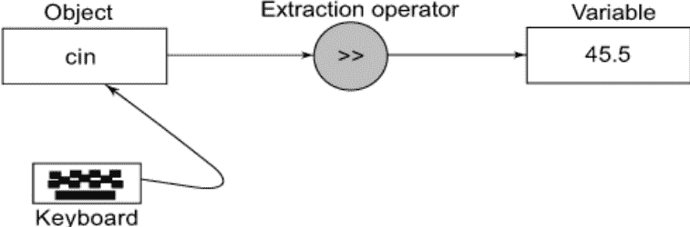

### I/O 运算符的级联

我们在最后两条打印结果的语句中反复使用了*插入运算符 <<*。

语句

```
cout << "Sum = " << sum << "\n";
```

程序 2.3 的输出将是：

*输入姓名：* Ravinder  
*输入年龄：* 30

*姓名：* Ravinder  
*年龄：* 30


> **注意：** *cin* 只能读取一个单词，因此我们不能使用带有空格的名称。

程序将 **person** 定义为一个新的类类型数据。类 person 包含两个基本数据类型项和两个对该数据进行操作的函数。这些函数称为**成员函数**。主程序使用 **person** 来声明其类型的变量。如前所述，类变量被称为*对象*。这里，p 是 **person** 类型的一个对象。类对象用于调用该类中定义的函数。关于类和对象的更多内容将在第5章讨论。

## 2.6 C++ 程序的结构

从程序 2.3 可以看出，一个典型的 C++ 程序将包含四个部分，如[图 2.3](#)所示。这些部分可以放在单独的代码文件中，然后独立或联合编译。

| 包含文件 | 类声明 | 成员函数定义 | 主函数程序 |
|---|---|---|---|
| 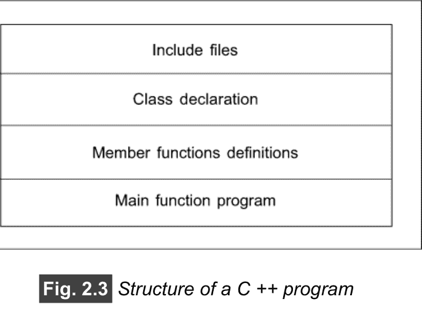 | 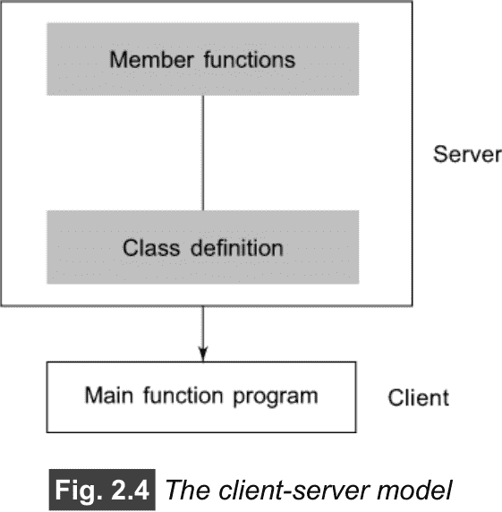 | | |

将程序组织到三个单独的文件中是一种常见做法。类声明放在头文件中，成员函数的定义放在另一个文件中。这种方法使程序员能够将接口的抽象规范（类定义）与实现细节（成员函数定义）分离开来。最后，使用该类的程序主体放在第三个文件中，该文件“包含”前两个文件以及任何其他需要的文件。

这种方法基于客户端-服务器模型的概念，如图 2.4 所示。包括成员函数在内的类定义构成了服务器，为称为客户端的主程序提供服务。客户端通过类的公共接口使用服务器。

## 2.7 创建源文件

与 C 程序一样，C++ 程序可以使用任何文本编辑器创建。例如，在 UNIX 上，我们可以使用 vi 或 _ed_ 文本编辑器来创建和编辑源代码。在 DOS 系统上，我们可以使用 _edlin_ 或任何其他可用的编辑器，或非文档模式下的字处理系统。

某些系统（如 Turbo C++）提供了用于开发和编辑程序的集成环境。有关完整细节，应查阅相应的手册。

文件名应具有适当的扩展名，以表明它是一个 C++ 程序文件。C++ 实现使用 .c、.C、.cc、.cpp 和 .cxx 等扩展名。Turbo C++ 和 Borland C++ 使用 .c 表示 C 程序，使用 .cpp（C plus plus）表示 C++ 程序。Zortech C++ 系统使用 .cxx，而 UNIX AT&T 版本使用 .C（大写 C）和 .cc。应查阅操作系统手册以确定要使用的正确文件扩展名。

## 2.8 编译与链接

编译和链接的过程同样取决于操作系统。本节讨论几个流行的系统。

### Unix AT&T C++

在 UNIX 下实现 C++ 程序的过程类似于 C 程序。我们应该使用“CC”（大写）命令来编译程序。记住，我们使用小写的“cc”来编译 C 程序。命令

```
CC example.C
```

在 UNIX 提示符下将编译文件 **example.C** 中包含的 C++ 程序源代码。编译器将生成目标文件 **example.o**，然后自动与库函数链接以生成可执行文件。默认的可执行文件名为 **a.out。**

分布在多个文件中的程序可以按如下方式编译：

```
CC file1.C file2.o
```

该语句只编译文件 **file1.C**，并将其与之前编译的 **file2.o** 文件链接。当只需要修改其中一个文件时，这很有用。未修改的文件不需要重新编译。

### Turbo C++ 和 Borland C++

Turbo C++ 和 Borland C++ 在 MS DOS 下提供了集成的程序开发环境。它们提供了内置编辑器和菜单栏，其中包括 File、Edit、Compile 和 Run 等选项。

我们可以在**文件选项**下创建和保存源文件，并在**编辑选项**下编辑它们。然后可以在**编译选项**下编译程序，并在**运行选项**下执行它。**运行选项**无需编译源代码即可使用。在这种情况下，**RUN** 命令使系统一步完成程序的编译、链接和运行。Turbo C++ 是最流行的编译器，

### Visual C++

它是 Microsoft 的一个 C++ 应用程序开发系统，在 Windows 下运行。Visual C++ 是一个可视化编程环境，其中可以通过菜单选择、按钮、图标和其他预定义方法来选择基本程序组件。附录 C 简要说明了在 Windows 下开发和执行 C++ 程序的方法。

| 小结 |
|---|
| ☐ C++ 是 C 语言的超集。 |
| ☐ C++ 为 C 语言增加了许多面向对象特性，如对象、继承、函数重载和运算符重载。这些特性使构建的程序具有清晰性、可扩展性和易维护性。 |
| ☐ C++ 可用于构建各种系统，如编辑器、编译器、数据库、通信系统，以及许多更复杂的现实应用程序系统。 |
| ☐ C++ 支持交互式输入和输出特性，并引入了一种新的注释符号 `//`，可用于单行注释。它还支持 C 风格的注释。 |
| ☐ 与 C 程序一样，所有 C++ 程序的执行都从 **main()** 函数开始，到 **return()** 语句结束。所有使用输入/输出操作的程序都必须在开头包含头文件 **iostream**。 |
| ☐ 所有 ANSI C++ 程序都必须包含 **using namespace std** 指令。 |


## 关键术语

#include | **a.out** | Borland C++ | 级联 | **cin** | 类 | 客户端 | 注释 | **cout** | endl | 提取运算符 | **float** | 自由格式 | 读取运算符 | 输入运算符 | 插入运算符 | **int** | **iostream** | **iostream.h** | 键盘 | **main()** | 成员函数 | MS-DOS | **命名空间** | 对象 | 操作系统 | 运算符重载 | 输出运算符 | 写入运算符 | return () | 屏幕 | 服务器 | Simula67 | 文本编辑器 | Turbo C++ | Unix AT&T C++ | **using** | Visual C++ | Windows | Zortech C++

## 复习题

**2.1** 判断下列陈述是正确的还是错误的。

+   **(a)** 由于 C 是 C++ 的子集，所有 C 程序都能在 C++ 编译器下运行。
+   
+   **(b)** 在 C++ 中，包含在类中的函数称为成员函数。
+   
+   **(c)** 查看一两行代码，我们就能轻松识别程序是用 C 还是 C++ 编写的。

+   **(d)** 在 C++ 中，向对象的现有结构添加新功能非常容易。
+   
+   **(e)** 将一个运算符用于不同用途的概念称为运算符重载。
+   
+   **(f)** 输出函数 printf() 不能用于 C++ 程序。

+   2.2 为什么我们需要预处理指令 #include <iostream>？

+   2.3 C++ 中的 main() 函数与 C 中的 main() 有何不同？

+   2.4 与旧的 C 类型注释相比，你认为 C++ 中的 // 注释的主要优点是什么？

+   2.5 描述 C++ 程序的主要部分。

## 调试练习

+   2.1 找出以下程序中的错误。

```
#include <iostream.h>
void main()
{
    int i = 0; i = i + 1;
    cout <<< i <<< " ";
    /*comment*/ //i = i + 1;
    cout <<< i;
}
```

+   2.2 找出以下程序中的错误。

```
#include <iostream.h>
void main()
{
    short i=2500, j=3000;
}
```

+   2.3 找出以下 C++ 语句中的错误（如果有的话）。

+   (a) `cout << “x=” x;`
+   
+   (b) `m = 5; // n = 10; // s = m + n;`
+   
+   (c) `cin >>x; >>y;`
+   
+   (d) `cout << \n “Name:” << name;`
+   
+   (e) `cout <<“Enter value:”; cin >> x;`
+   
+   (f) `/*Addition*/ z = x + y;`

## 编程练习

**2.1** 编写一个程序，使用一条 `cout` 语句显示以下输出。

数学 = 90  
物理 = 77  
化学 = 69

+   2.2 编写一个程序，从键盘读取两个数字，并在屏幕上显示较大的值。


+   2.3 编写一个程序，从键盘输入一个字符，并在屏幕上显示其对应的 ASCII 值。


+   2.4 编写一个程序，读取 a、b 和 c 的值并显示 x 的值，其中

x = a / b - c

使用以下值测试你的程序：

+   (a) a = 250, b = 85, c = 25

+   (b) a = 300, b = 70, c = 70


+   2.5 编写一个 C++ 程序，提示输入华氏温度，并以摄氏温度显示。


+   2.6 使用名为 **temp** 的类和成员函数重做练习 2.5。


# 记号、表达式
和控制结构

## 关键概念

记号|关键字|标识符|数据类型|用户定义类型|派生类型|符号常量|变量声明|初始化|引用变量|类型兼容性|作用域解析|解引用|内存管理|输出格式化|类型转换|构造表达式|特殊赋值表达式|隐式转换|运算符重载|控制结构

## 3.1 引言

如前所述，C++ 是 C 的超集，因此 C 的大多数结构在 C++ 中都是合法的，且含义不变。然而，也存在一些例外和新增内容。在本章中，我们将讨论这些与记号和控制结构相关的例外和新增内容。

## 3.2 记号

我们知道，程序中最小的独立单元称为记号。C++ 有以下记号：

+   - 关键字
+   - 标识符
+   - 常量
+   - 字符串
+   - 运算符

C++ 程序使用这些记号、空白字符和语言语法编写。大多数 C++ 记号基本上是


## 基本数据类型

C++ 的数据类型可按图 3.1 所示分为不同类别。

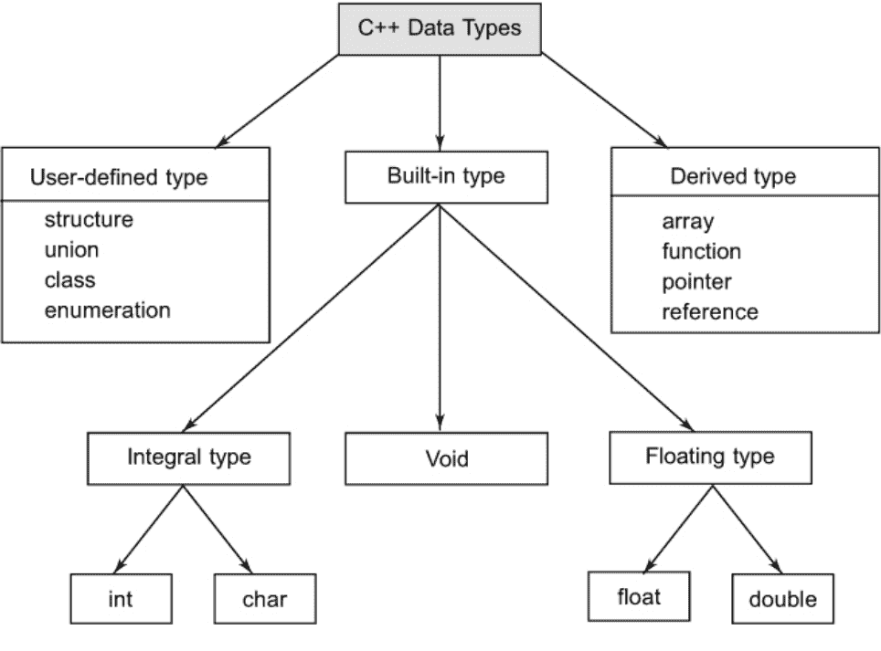

**图 3.1** *C++ 数据类型的层次结构*

C 和 C++ 编译器都支持所有内置（也称为*基本*或*基础*）数据类型。除 **void** 外，基本数据类型前面可以有多个*修饰符*，以满足各种情况的需要。修饰符 **signed**、**unsigned**、**long** 和 **short** 可应用于字符和整数基本数据类型。不过，修饰符 **long** 也可以应用于 **double**。在 C++ 中，数据类型的表示是特定于机器的。表 3.2 列出了在 16 位字长机器上，基本数据类型与修饰符的所有组合及其大小和范围。

**表 3.2** *C++ 基本数据类型的大小与范围*

| 类型 | 字节 | 范围 |
|---|---:|---|
| char | 1 | −128 到 127 |
| unsigned char | 1 | 0 到 255 |
| signed char | 1 | −128 到 127 |
| int | 2 | −32768 到 32767 |
| unsigned int | 2 | 0 到 65535 |
| signed int | 2 | −32768 到 32767 |
| short int | 2 | −32768 到 32767 |
| unsigned short int | 2 | 0 到 65535 |
| signed short int | 2 | −32768 到 32767 |
| long int | 4 | −2147483648 到 2147483647 |
| signed long int | 4 | −2147483648 到 2147483647 |
| unsigned long int | 4 | 0 到 4294967295 |
| float | 4 | 3.4E−38 到 3.4E+38 |
| double | 8 | 1.7E−308 到 1.7E+308 |
| long double | 10 | 3.4E−4932 到 1.1E+4932 |

ANSI C++ 委员会增加了两种数据类型，即 **bool** 和 **wchar_t**。它们将在第 16 章讨论。

类型 **void** 是在 ANSI C 中引入的。**void** 的两种常见用途是：(1) 当函数不返回任何值时指定其返回类型；(2) 表示函数有一个空参数列表。示例：

```c
void funct(void);
```

**void** 的另一个有趣用途是声明泛型指针。示例：

```c
void *gp;    // gp becomes generic pointer
```

泛型指针可以被赋值为任何基本数据类型的指针值，但不能被解引用。例如：

```c
int *ip;     // int pointer
gp = ip;      // assign int pointer to void pointer
```

```c
struct name
{
    data_type member1;
    data_type member2;
    ...  ...
    ...  ...
};
```

我们以一本书为例，它有几个属性，如标题、页数、价格等。我们可以使用如下所示的结构体来表示一本书：

```c
struct book
{
    char title[25];
    char author[25];
    int pages;
    float price;
};
struct book book1, book2, book3;
```

这里 book1、book2 和 book3 被声明为用户自定义类型 book 的变量。我们可以使用点 (.) 运算符访问结构体的成员元素，如下所示：

```c
book1.pages=550;
book2.price=225.75;
```

联合体（union）在概念上与结构体类似，因为它们允许我们在单个单元内将不同类型的元素组合在一起。但就实现而言，结构体和联合体之间存在显著差异。结构体类型的大小等于各个成员类型大小之和。而联合体的大小等于其最大成员元素的大小。例如，考虑以下联合体声明：

```c
union result
{
    int marks;
    char grade;
    float percent;
};
```

联合体 result 在内存中将占用四个字节，因为其最大的成员元素是浮点类型变量 percent。但是，如果我们将 result 定义为结构体，那么它在内存中将占用七个字节，即各个成员元素大小之和。因此，对于联合体，同一块内存空间被用来表示不同的成员元素。结果，联合体的成员只能互斥地操作。简单来说，我们可以说联合体是结构体的内存高效替代方案，特别是在不需要同时访问不同成员元素的情况下。

在 C++ 中，结构体和联合体的用法与它们在 C 中的用法相同。不过，C++ 结构体有一个有趣的方面，我们将在第 5 章中学习。

| 结构体 | 联合体 |
|---|---|
| 结构体使用 `struct` 关键字定义。 | 联合体使用 `union` 关键字定义。 |
| 结构体的所有成员可以同时操作。 | 联合体的成员一次只能操作一个。 |
| 结构体对象的大小等于成员对象各自大小之和。 | 联合体对象的大小等于最大成员对象的大小。 |
| 结构体成员被分配不同的内存位置。 | 联合体成员共享公共内存空间以供各自独占使用。 |
| 与联合体相比，结构体不被认为是内存高效的。 | 联合体被认为是内存高效的，尤其是在不需要同时访问成员的情况下。 |
| C++ 中的结构体行为就像类一样。几乎可以用类实现的所有功能都可以用结构体实现。 | 联合体在 C++ 中保留了其核心功能，并增加了一些小功能，比如匿名联合体的声明。 |

C++ 还允许我们定义另一种用户自定义数据类型，称为类（class），它可以像任何其他基本数据类型一样用于声明变量。类变量被称为对象，它们是面向对象编程的核心焦点。有关类的其他细节将在第 5 章中讨论。

枚举数据类型是另一种用户自定义类型，它提供了一种将名称附加到数字的方法，从而增加代码的可理解性。enum 关键字（来自 C）通过为单词列表赋值 0、1、2 等来自动枚举它们。这一功能为创建符号常量提供了一种替代手段。enum 语句的语法与 struct 语句类似。示例：

- `enum shape{circle, square, triangle};`
- `enum colour{red, blue, green, yellow};`

```c
enum position{off, on};
```

与 ANSI C 中的枚举数据类型相比，C++ 中的枚举数据类型略有不同。在 C++ 中，标签名 shape、colour 和 position 成为新的类型名。通过使用这些标签名，我们可以声明新变量。示例：

```c
shape ellipse;    // ellipse is of type shape
colour background;    // background is of type colour
```

ANSI C 将枚举的类型定义为 int。在 C++ 中，每种枚举数据类型都保留其独立的类型。这意味着 C++ 不允许将 int 值自动转换为枚举值。示例：

```c
colour background = blue;    // allowed
colour background = 7;    // Error in C++
colour background = (colour) 7;    // OK
```

但是，枚举值可以用于替代 int 值。

```c
int c = red; // valid, colour type promoted to int
```

默认情况下，枚举器被赋值为整数值，第一个枚举器从 0 开始，第二个为 1，依此类推。我们可以通过显式地为枚举器赋整数值来覆盖默认值。例如：

```c
enum colour{red, blue=4, green=8};
enum colour{red=5, blue, green};
```

这些都是有效的定义。在第一种情况下，red 默认为 0。在第二种情况下，blue 为 6，green 为 7。注意，后续初始化的枚举器比其前一个大 1。

C++ 还允许创建匿名枚举（即没有标签名的枚举）。示例：

```c
enum{off, on};
```

这里，off 为 0，on 为 1。这些常量可以像常规常量一样被引用。示例：

- `int switch_1 = off;`
- `int switch_2 = on;`

在实践中，枚举用于为 switch 语句定义符号常量。示例：

```c
enum shape
{ circle, rectangle, triangle
};
int main()
{
    cout << "Enter shape code:";
    int code;
    cin >> code;
    while(code >= circle && code <= triangle)
    {
        switch(code)
        {
            case circle: ..... break;
            case rectangle: ..... break;
            case triangle: ..... break;
        }
    }
}
```


cout << "Enter shape code:";
cin >> code;
}
cout << "BYE \n";
return 0;
}
ANSI C permits an enum to be defined within a structure or a class, but the enum is globally visible. In C++, an enum defined within a class (or structure) is local to that class (or structure) only.

## 3.7 Storage Classes

In addition to the data type, a variable also has a storage class associated with it. The storage class of a variable specifies the lifetime and visibility of a variable within the program. Lifetime refers to the longevity of a variable or the duration till which a variable remains active during program execution. Visibility, on the other hand, signifies the scope of a variable i.e., in which program modules the variable is accessible. There are four types of storage classes, as explained below:

- **Automatic:** It is the default storage class of any type of variable. Its visibility is restricted to the function in which it is declared. Further, its lifetime is also limited till the time its container function is executing. That is, it is created as soon as its declaration statement is encountered and is destroyed as soon the program control leaves its container function block.

- **External:** As the name suggests, an external variable is declared outside of a function but is accessible inside the function block. Also called global variable, its visibility is spread all across the program, meaning it is accessible by all the functions present in the program. The lifetime of an external variable is the same as the lifetime of the program.

- **Static:** A static variable has the visibility of a local variable but the lifetime of an external variable. That means, once declared inside a function block, it does not get destroyed after the function is executed, but retains its value so that it can be used by future function calls.

- **Register:** Similar in behaviour to an automatic variable, a register variable differs in the manner in which it is stored in the memory. Unlike automatic variables that are stored in primary memory, register variables are stored in CPU registers. The objective of storing a variable in registers is to increase its access speed, which eventually makes the program run faster. However, it may be noted that it is not an obligation for a compiler to store a register type variable only in CPU registers; if there are no registers vacant to accommodate the variable then it is stored just like any other automatic variable.

Table 3.4 gives a summary of the four storage classes:

| | Automatic | External | Static | Register |
|---|---|---|---|---|
| Lifetime | Function block | Entire program | Entire program | Function block |
| Visibility | Local | Global | Local | Local |
| Initial Value | Garbage | 0 | 0 | Garbage |
| Storage | Stack segment | Data segment | Data segment | CPU Registers |
| Purpose | Local variables used by a single function | Global variables used throughout the program | Local variables retaining their values throughout the program | Variables using CPU registers for storage purpose |
| Keyword | auto | extern | static | Register |

## Arrays

The application of arrays in C++ is similar to that in C. The only exception is the way character arrays are initialized. When initializing a character array in ANSI C, the compiler will allow us to declare the array size as the exact length of the string constant. For instance,

```cpp
char string[3] = "xyz";
```

is valid in ANSI C. It assumes that the programmer intends to leave out the null character \0 in the definition. But in C++, the size should be one larger than the number of characters in the string.

```cpp
char string[4] = "xyz"; // O.K. for C++
```

## Functions

Functions have undergone major changes in C++. While some of these changes are simple, others require a new way of thinking when organizing our programs. Many of these modifications and improvements were driven by the requirements of the object-oriented concept of C++. Some of these were introduced to make the C++ program more reliable and readable. All the features of C++ functions are discussed in Chapter 4.

## Pointers

Pointers are declared and initialized as in C. Examples:

```cpp
int *ip;    // int pointer
ip = &x;    // address of x assigned to ip
*ip = 10;    // 10 assigned to x through indirection
```

C++ adds the concept of constant pointer and pointer to a constant.

```cpp
char * const ptr = "GOOD";    // constant pointer
```

We cannot modify the address that **ptr** is initialized to.

```cpp
int const * ptr2 = &m; // pointer to a constant
```

**ptr2** is declared as pointer to a constant. It can point to any variable of correct type, but the contents of what it points to cannot be changed.

We can also declare both the pointer and the variable as constants in the following way:

```cpp
const char* const cp = "xyz";
```

This statement declares cp as a constant pointer to the string which has been declared a constant. In this case, neither the address assigned to the pointer cp nor the contents it points to can be changed.

Pointers are extensively used in C++ for memory management and achieving polymorphism.

## 3.9 Symbolic Constants

There are two ways of creating symbolic constants in C++:

- Using the qualifier **const**, and
- Defining a set of integer constants using **enum** keyword.

In both C and C++, any value declared as **const** cannot be modified by the program in any way. However, there are some differences in implementation. In C++, we can use **const** in a constant expression, such as

```cpp
const int size = 10;
char name[size];
```

This would be illegal in C. const allows us to create typed constants instead of having to use #define to create constants that have no type information.

As with long and short, if we use the const modifier alone, it defaults to int. For example,

```
const size = 10;
```

means

```
const int size = 10;
```

The named constants are just like variables except that their values cannot be changed.

C++ requires a const to be initialized. ANSI C does not require an initializer; if none is given, it initializes the const to 0.

The scoping of const value differs. A const in C++ defaults to the internal linkage and therefore, it is local to the file where it is declared. In ANSI C, const values are global in nature. They are visible outside the file in which they are declared. However, they can be made local by declaring them as static. To give a const value an external linkage so that it can be referenced from another file, we must explicitly define it as an extern in C++ . Example :

```
extern const total = 100;
```

Another method of naming integer constants is by enumeration as under;

```
enum {X,Y,Z};
```

This defines X, Y and Z as integer constants with values 0, 1, and 2 respectively. This is equivalent to:

```cpp
const X = 0;
const Y = 1;
const Z = 2;
```

We can also assign values to X, Y, and Z explicitly. Example:

```
enum{X=100, Y=50, Z=200};
```

Such values can be any integer values. Enumerated data type has been discussed in detail in Section 3.6.

## 3.10 Type Compatibility

C++ is very strict with regard to type compatibility as compared to C. For instance, C++ defines **int**, **short int**, and **long int** as three different types. They must be cast when their values are assigned to one another. Similarly, **unsigned char**, **char**, and **signed char** are considered as different types, although each of these has a size of one byte. In C++, the types of values must be the same for complete compatibility, or else, a cast must be applied. These restrictions in C++ are necessary in order to support function overloading where two functions with the same name are distinguished using the type of function arguments.

Another notable difference is the way **char** constants are stored. In C, they are stored as **ints**, and therefore,

```cpp
sizeof('x')
```

is equivalent to

```cpp
sizeof(int)
```

in C. In C++, however, **char** is not promoted to the size of **int** and therefore,

```cpp
sizeof('x')
```

is not promoted to the size of **int**.


equals

sizeof(char)

## 3.11 变量的声明

我们知道，在 C 语言中，所有变量必须在可执行语句中使用之前声明。在 C++ 中也是如此。然而，C 与 C++ 在程序中声明位置方面存在显著差异。C 要求所有变量必须在作用域开始处定义。当我们阅读 C 程序时，通常会在每个作用域级别的开头看到一组变量声明。它们的实际使用出现在作用域的其他地方，有时远离声明的位置。在使用变量之前，我们必须回到程序开头查看它是否已被声明，以及如果已声明，其类型是什么。

C++ 允许在作用域的任何位置声明变量。这意味着变量可以在首次使用之处声明。这使得程序更容易编写，减少了因来回扫描而可能产生的错误。它也使程序更容易理解，因为变量是在其使用的上下文中声明的。

下面的示例说明了这一点。

```
int main()
{
    float x;                 // declaration
    float sum = 0;

    for(int i = 1; i<5;        // declaration
    {
        cin >> x;
        sum = sum +x;
```

这种声明方式的唯一缺点是，我们无法一目了然地看到作用域中使用的所有变量。

## 3.12 变量的动态初始化

在 C 中，变量必须使用常量表达式初始化，并且 C 编译器会在编译时确定初始化代码。C++， however，允许在运行时初始化变量。这被称为 _动态初始化_。在 C++ 中，变量可以在声明处使用表达式在运行时初始化。例如，以下是有效的初始化语句：

......
......
int n = strlen(string);
......
float area = 3.14159 * rad * rad;

因此，变量的声明和初始化可以在变量首次使用之处同时完成。上一节示例中的以下两个语句

float average; // declare where it is necessary
average = sum/i;

可以合并为一个语句：

```
```cpp
float average = sum/i; // initialize dynamically at run time
```
```

动态初始化在面向对象编程中被广泛使用。我们可以使用仅在运行时才知道的信息创建所需类型的对象。

## 3.13 引用变量

C++ 引入了一种新型变量，称为 *引用* 变量。引用变量为先前定义的变量提供了一个 *别名*。例如，如果我们使变量 **sum** 成为变量 **total** 的引用，那么 **sum** 和 **total** 可以互换使用来表示该变量。引用变量的创建方式如下：

```
```cpp
data-type & reference-name = variable-name
```
```

示例：

```
```cpp
float total = 100;
float & sum = total;
```
```

**total** 是一个已声明的 **float** 类型变量；**sum** 是声明为表示变量 **total** 的替代名称。两个变量都引用内存中的同一个数据对象。现在，语句

```
```cpp
cout << total;
```
```

和

```
```cpp
cout << sum;
```
```

都会打印值 100。语句

total = total + 10;

会将 total 和 sum 的值都改为 110。同样，赋值

sum = 0;

会将两个变量的值都改为零。

引用变量必须在声明时初始化。这建立了引用与它所命名的对象之间的对应关系。需要注意的是，引用变量的初始化与对其的赋值完全不同。

C++ 对符号 & 赋予了额外的含义。这里，& 不是地址运算符。记号 float & 表示对 float 的引用。其他示例有：

- int n[10];
- int & x = n[10]; // x 是 n[10] 的别名
- char & a = '\n'; // 将引用初始化为字面量

变量 x 是数组元素 n[10] 的替代。变量 a 被初始化为换行常量。这创建了对换行常量 \n 所存储的未知位置的引用。

以下引用也是允许的：

- i. int x;
- int *p = &x;
- int & m = *p;
- int & n = 50;

第一组声明使 m 引用由指针 p 指向的 x，而语句 (ii) 创建了一个值为 50 且名为 n 的 int 对象。

引用变量的一个主要应用是在向函数传递参数时。考虑以下情况：

```
void f (int & x)             // uses reference
{
        x = x+10;              // x is incremented; so also m
}
int main()
{
        int m = 10;
        f(m);                   // function call

....
}
```

当函数调用 **f(m)** 执行时，会发生以下初始化：

```
int & x = m;
```

因此，x 在执行语句

```
f(m);
```

之后成为 m 的别名。这种函数调用称为 *按引用调用*。该实现在 **图 3.2** 中示出。由于变量 **x** 和 **m** 是别名，当函数递增 **x** 时，**m** 也会被递增。函数执行后，**m** 的值变为 20。在传统的 C 中，我们使用指针和解引用技术完成此操作。

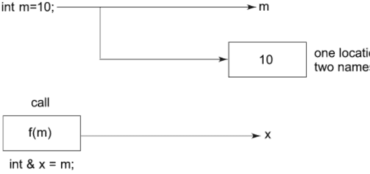

**图 3.2** *按引用调用机制*

按引用调用机制在面向对象编程中很有用，因为它允许通过引用操作对象，并消除了对象参数的来回复制。还需要注意的是，引用不仅可以为内置数据类型创建，也可以为用户定义的数据类型（如结构体和类）创建。引用与这些用户定义的数据类型配合得非常好。

## 3.14 C++ 中的运算符

C++ 拥有丰富的运算符集。所有 C 运算符在 C++ 中也有效。此外，C++ 还引入了一些新运算符。我们已经见过两个这样的运算符，即插入运算符 `<<` 和提取运算符 `>>`。其他新运算符有：

- `::` — 作用域解析运算符
- `::*` — 指向成员声明符
- `->*` — 指向成员运算符
- `.*` — 指向成员运算符
- `delete` — 内存释放运算符
- `endl` — 换行运算符
- `new` — 内存分配运算符
- `setw` — 字段宽度运算符

此外，C++ 还允许我们为某些内置运算符提供新定义。也就是说，我们可以根据使用的参数类型为运算符赋予多种含义。此过程称为 _运算符重载_。

## 3.15 作用域解析运算符

与 C 一样，C++ 也是块结构语言。块和作用域可用于构建程序。我们知道，同一个变量名可以在不同的块中具有不同的含义。变量的作用域从其声明点延伸到包含该声明的块的末尾。在块内声明的变量称为该块的局部变量。考虑以下程序段：

```
```
......
......
{ 
    int x = 10; 
    ......
    ......
}
......
......
{ 
    int x = 1; 
    ......
    ......
}
```
```

两个 x 的声明引用了包含不同值的两个不同内存位置。第二块中的语句不能引用第一块中声明的变量 x，反之亦然。C++ 中的块通常是嵌套的。例如，以下风格很常见：

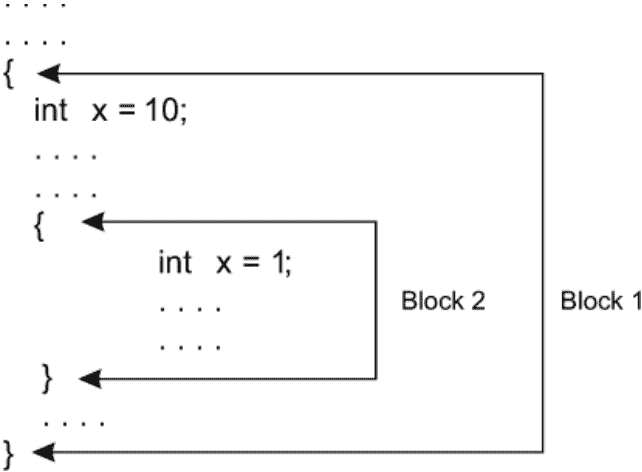

Block2 包含在 block1 中。请注意，内部块中的声明会 *隐藏* 外部块中相同变量的声明，因此每个 **x** 的声明都使其引用不同的数据对象。在内部块内，变量 **x** 将引用其中声明的数据对象。

在 C 中，无法从内部块访问变量的全局版本。C++ 通过引入一种新的运算符，即 *作用域解析运算符* 来解决此问题。可用于揭示隐藏变量。它具有以下形式：

```
```cpp
:: variable-name
```
```

该运算符允许访问变量的全局版本。例如，`::count` 表示变量 count 的全局版本，而非该块中声明的局部变量 count。程序 3.1 说明了此功能。

# 程序 3.1 — 作用域解析运算符


我们在外部代码块中

m = 20
::m = 10

在上述程序中，变量 **m** 在三个位置被声明，分别是 **main()** 函数之外、 **main()** 函数内部以及内部代码块内部。

> **NOTE:** *注意：::m 始终指向全局 m。在内部代码块中，::m 指向值 10，而不是 20。*

作用域解析运算符的主要用途是用于类中，以确定成员函数所属的类。这将在后续介绍类时详细说明。

## 3.16 成员解引用运算符

正如你所知道的，C++ 允许我们定义包含各种数据类型和函数的类。C++ 还允许我们通过指针访问类成员。为了实现这一点，C++ 提供了三种指针到成员的运算符。[表 3.5](#表 3.5) 列出了这些运算符及其功能。

### 表 3.5 成员解引用运算符

| 运算符 | 功能 |
|---|---|
| `::*` | 用于声明指向类成员的指针 |
| `.*` | 使用对象名称和指向该成员的指针来访问成员 |
| `->*` | 使用指向对象的指针和指向该成员的指针来访问成员 |

关于这些运算符的更多细节将在讨论类之后才具有意义，因此我们将在介绍类之前推迟使用成员解引用运算符的使用。

## 3.17 内存管理运算符

C 使用 **malloc()** 和 **calloc()** 函数在运行时动态分配内存，同时使用 **free()** 函数释放动态分配的内存。当不确定程序运行时需要多少内存空间时，我们会使用动态分配技术。虽然 C++ 支持这些函数，但它还定义了两个单元运算符 **new** 和 **delete**，它们以更简便和更好的方式完成内存分配和释放的任务。由于这些运算符操作的是自由存储区（free store），它们也被称为 *自由存储区* 运算符。

可以通过 **new** 创建对象，通过 **delete** 销毁对象，随时需要时进行。在代码块内部使用 **new** 创建的数据对象，直到显式使用 **delete** 销毁为止。因此，对象的生命周期完全由我们控制，与程序的块结构无关。

**new** 运算符可以用于创建任何类型的对象，其一般形式如下：

```
pointer-variable = new data-type;
```

这里 *pointer-variable* 是类型 *data-type* 的指针。 **new** 运算符为类型 *data-type* 分配足够的内存来容纳一个对象，并返回该对象的地址。 *data-type* 可以是任意合法的数据类型。 *pointer-variable* 保存所分配内存的地址。

示例：

在下面的语句中，size 指定数组的元素个数。例如，语句

```cpp
int *p = new int[10];
```

会为包含 10 个整数的数组分配内存空间。**p[0]** 表示第一个元素，**p[1]** 表示第二个元素，以此类推。

在使用 **new** 创建多维数组时，所有维度的大小必须提供。

```cpp
array_ptr = new int[3][5][4];     // 合法
array_ptr = new int[m][5][4];     // 合法
array_ptr = new int[3][5][];       // 非法
array_ptr = new int[][5][4];       // 非法
```

第一个维度可以是运行时提供的变量值。其余维度必须是常量。

类似于基本数据类型的对象，**new** 运算符也可以用于动态创建类对象。类对象的大小会自动确定，并相应地分配内存。使用 **new** 运算符为类对象分配内存的一般形式是：

```cpp
class sample
{
    private:
        data-type d1;
        data-type d2;
        .
        .
    public:
        .
        .
};
main()
```

会删除 **p** 所指向的整个数组。

程序 3.2 演示了 **new** 和 **delete** 运算符在动态内存分配和释放中的使用。

# 程序 3.2 — new 和 delete 运算符的使用

```cpp
#include <iostream>
#include<conio.h>

using namespace std;

void main()
{

    int *arr;
    int size;

    cout<<"Enter the size of the integer array: ";
    cin>>size;

    cout<<"Creating an array of size "<<size<<"...";
    arr = new int[size];

    cout<<"\nDynamic allocation of memory for array arr is successful.";

    delete arr;
    getch();
}
```

程序 3.2 的输出如下：

Program 3.2 — Use of new and delete Operators

```cpp
#include <iostream>
#include<conio.h>

using namespace std;

void main()
{

    int *arr;
    int size;

    cout<<"Enter the size of the integer array: ";
    cin>>size;

    cout<<"Creating an array of size "<<size<<"...";
    arr = new int[size];

    cout<<"\nDynamic allocation of memory for array arr is successful.";

    delete arr;
    getch();
}
```

程序 3.2 的输出如下：

class sample
{
private:
int data1;
char data2;
public:
void set (int i,char c)
{
data1=i;
data2=c;
}
void display(void)
{
cout<<"Data1 = "<<data1;
cout<<"\nData2 = "<<data2;
}
};
int main()
{
sample *s_ptr;
try
{
s_ptr = new sample;
}
catch (bad_alloc ba)
{
cout<<"Bad Allocation occurred...the program will terminate
now..:";
return 1;
}
s_ptr->set(25,'A');
s_ptr->display();
}

delete s_ptr;
getch();
}
```

**new** 运算符相较于函数 **malloc()** 的优势如下：

+   1. 它会自动计算数据对象的大小，无需使用 **sizeof** 运算符。
+   2. 它会自动返回正确的指针类型，无需进行类型强制转换。
+   3. 可以在创建内存空间的同时初始化对象。
+   4. 与其他运算符一样，**new** 和 **delete** 可以被重载。

## 3.18  manipulators（操作符）

操作符是用于格式化数据显示的工具。最常用的操作符是 **endl** 和 **setw**。

**endl** 操作符在输出语句中插入换行符。它的效果与使用换行字符 “\n” 相同。例如，下面的语句

```
....
cout << □m = □ << m << endl
    << □n = □ << n << endl
    << □p = □ << p << endl;
....
....
```

会产生三行输出，分别对应三个变量。假设变量的值分别为 2597、14 和 175，输出将显示为：

需要注意，这种形式并不是理想的输出格式。理想的输出应如下：

```
m = 2597
n = 14
p = 175
```

在此格式中，数字右对齐。实现此格式需要为所有数字指定相同的字段宽度并强制右对齐。 **setw** 操作符完成此任务。用法如下：

```
cout << setw(5) << sum << endl;
```

 **setw(5)** 为变量 *sum* 指定宽度为 5 的字段，数值会在该字段内右对齐，如下所示：

我们还可以自定义操作符，例如：

```
```cpp
#include <iostream>
ostream & symbol(ostream & output)
{
    return output << "\tRs";
}
```
```

 **symbol** 是新操作符，用于显示字符串 **Rs**。只要需要显示 **Rs**，就可以使用 **symbol**。

## 3.19 类型转换运算符

C++ 允许使用类型转换运算符对变量或表达式进行显式类型转换。

传统的 C 语言 cast 通过函数调用语法在 C++ 中得到补充，两种写法等价：

```
(type-name) expression   // C 语言语法
type-name (expression)   // C++ 语法
```

示例：

```
average = sum/(float)i;   // C 语法
average = sum/float(i);   // C++ 语法
```

类型名在起到转换函数的作用，将值转换为指定类型。函数调用语法通常表达更简洁，但仅当类型是标识符时才能使用。例如，

```
p = int * (q);
```

是非法的。在这种情况下必须使用 C 语言语法。


```
p = (int *) q;
```

或者，我们可以使用 **typedef** 来创建所需类型的标识符，并在函数式记法中使用它。

```
typedef int * int_pt;
p = int_pt(q);
```

## 程序 3.5  显式类型转换

```
#include <iostream>
#include <conio.h>
using namespace std;

int main()
{
        int intvar=25;
        float floatvar=35.87;

        cout<<"intvar = "<<intvar;
        cout<<"\nfloatvar = "<<floatvar;
        cout<<"\nfloat(intvar) = "<<float(intvar);
        cout<<"\nint(floatvar) = "<<int(floatvar);

        getch();
}
```

程序 3.5 的输出为：

```
intvar = 25
floatvar = 35.87
float(intvar) = 25
int(floatvar) = 35
```

ANSI C++ 新增了以下转换运算符：

- const_cast
- static_cast
- dynamic_cast
- reinterpret_cast

这些运算符的应用将在第 16 章讨论。

## 3.20 表达式及其类型

表达式是按照语言规则排列的运算符、常量和变量的组合。它也可以包含返回值的函数调用。表达式可以由一个或多个操作数以及零个或多个运算符组成，以产生一个值。表达式可分为以下七种类型：

- 常量表达式
- 整型表达式
- 浮点表达式
- 指针表达式
- 关系表达式
- 逻辑表达式
- 位运算表达式

表达式也可以使用上述表达式的组合。此类表达式称为*复合表达式*。

### 常量表达式

常量表达式仅由常量值组成。示例：

```
15
20 + 5 / 2.0
'x'
```

### 整型表达式

整型表达式是在执行所有自动和显式类型转换后产生整数结果的表达式。示例：

```
m
m * n - 5

m * 'x'
5 + int(2.0)
```

其中 **m** 和 **n** 是整型变量。

### 浮点表达式

浮点表达式是在所有转换后产生浮点结果的表达式。示例：

```
x + y
x * y / 10
5 + float(10)
10.75
```

其中 **x** 和 **y** 是浮点变量。

### 指针表达式

指针表达式产生地址值。示例：

```
&m
ptr
ptr + 1
"xyz"
```

其中 **m** 是一个变量，**ptr** 是一个指针。

### 关系表达式

关系表达式产生 **bool** 类型的结果，其取值为 **true** 或 **false**。示例：

```
x <= y
a+b == c+d
m+n > 100
```

当算术表达式出现在关系运算符的两侧时，会先计算算术表达式，然后比较结果。关系表达式也称为*布尔表达式*。

### 逻辑表达式

逻辑表达式组合两个或多个关系表达式，并产生 **bool** 类型的结果。示例：

```
a > b
x == 10 || y == 5
```

### 位运算表达式

位运算表达式用于在比特级别操作数据。它们主要用于测试或移位。示例：

```
x << 3      // *向左移动三个比特位*
y >> 1      // *向右移动一个比特位*
```

移位运算符常用于乘以或除以 2 的幂。

ANSI C++ 引入了所谓的*运算符关键字*，可以用作运算符符号的替代表示。运算符关键字在第 16 章中给出。

## 3.21 特殊赋值表达式

### 链式赋值

```
x = (y = 10);
或
x = y = 10;
```

首先将 10 赋给 y，然后再赋给 x。

链式语句不能用于在声明时初始化变量。例如，语句

```
float a = b = 12.34;    // 错误
```

是非法的。可以写成

```
float a = 12.34, b = 12.34;    // 正确
```

### 嵌入式赋值

```
x = (y = 50) + 10;
```

(y = 50) 是一个赋值表达式，称为嵌入式赋值。这里，值 50 被赋给 y，然后将结果 50+10 = 60 赋给 x。此语句等同于

```
y = 50;
x = y + 10;
```

### 复合赋值

与 C 语言一样，C++ 支持*复合赋值运算符*，它是赋值运算符与二元算术运算符的组合。例如，简单的赋值语句

```
x = x + 10;
```

可以写成

```
x += 10;
```

运算符 `+=` 称为*复合赋值运算符*或*简写赋值运算符*。复合赋值运算符的一般形式为：

```
variable1 op= variable2;
```

其中 op 是二元算术运算符。这意味着

```
variable1 = variable1 op variable2;
```

## 3.22 隐式转换

我们可以在表达式中混合数据类型。例如，

```
m = 5+2.75;
```

是一个有效语句。只要表达式中混合了数据类型，C++ 就会自动执行转换。此过程称为隐式或自动转换。

当编译器遇到一个表达式时，它会将表达式划分为由一个运算符和一个或两个操作数组成的子表达式。对于二元运算符，如果操作数的类型不同，编译器会将其中一个转换为与另一个匹配的类型，使用的规则是“较小”的类型转换为“较宽”的类型。例如，如果一个操作数是 int，另一个是 float，则 int 会被转换为 float，因为 float 比 int 更宽。图 3.3 所示的“瀑布”模型说明了这一规则。

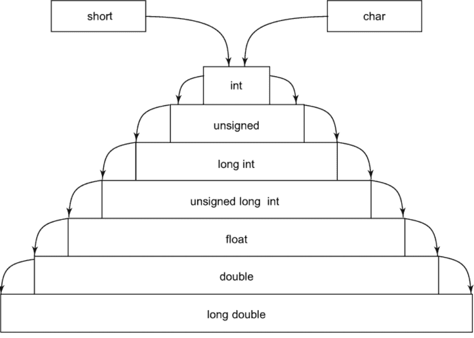

每当表达式中的 **char** 或 **short int** 出现时，它会被转换为 **int**。这称为*整型加宽转换*。隐式转换仅在完成所有整型加宽转换后才应用。

**表 3.6** *混合模式操作的结果*

| 左操作数 \ 右操作数 | char | short | int | long | float | double | long double |
|---|---|---|---|---|---|---|---|
| char | int | int | int | long | float | double | long double |
| short | int | int | int | long | float | double | long double |
| int | int | int | int | long | float | double | long double |
| long | long | long | long | long | float | double | long double |
| float | float | float | float | float | float | double | long double |
| double | double | double | double | double | double | double | long double |
| long double | long double | long double | long double | long double | long double | long double | long double |

*RHO* — 右操作数  
*LHO* — 左操作数

## 3.23 运算符重载

如前所述，重载意味着根据上下文为操作赋予不同的含义。C++ 允许运算符重载，从而允许我们为运算符赋予多种含义。实际上，我们在 C 语言中也使用了重载的概念。例如，`operator *` 应用于指针变量时，给出指针所指向的值。但它也常用于两个数字的乘法。操作数的数量和类型决定了后续操作的性质。

输入/输出运算符 `<<` 和 `>>` 是运算符重载的良好示例。虽然 `<<` 运算符的内置定义是用于位移位，但它也用于显示各种数据类型的值。这通过头文件 *iostream* 实现，其中包含了 `<<` 的许多重载定义。因此，语句

```
cout << 75.86;
```

调用用于显示 **double** 类型值的定义，而

```
cout << "well done";
```

调用用于显示 **string** 值的定义。然而，*iostream* 中的这些定义都不会影响运算符的内置含义。

类似地，我们可以为其他 C++ 运算符定义额外的含义。例如，我们可以定义 `+` 运算符来相加两个结构或对象。几乎所有 C++ 运算符都可以重载，但少数例外，如成员访问运算符（`.` 和 `.*`）、条件运算符（`?:`）、作用域解析运算符（`::`）和大小运算符（`sizeof`）。运算符重载的定义将在第 7 章详细讨论。

## 3.24 运算符优先级

虽然 C++ 允许我们为运算符添加多种含义，但它们的结合性和优先级保持不变。例如，乘法运算符的优先级将继续高于加法运算符。**表 3.7** 给出了所有 C++ 运算符的优先级和结合性。这些组按优先级递减的顺序列出。标签 *前缀* 和 *后缀* 用于区分 `++` 和 `--` 的用法。此外，符号 `+`、`-`、`*` 和 `&` 同时用作一元和二元运算符。

ANSI C++ 运算符及其含义、优先级、结合性和用途的完整列表见附录 E。

**表 3.7** *运算符优先级和结合性*


| 运算符 | 结合性 |
|---|---|
| `::` | 从左到右 |
| `-> . () [] postfix ++ postfix --` | 从左到右 |
| `prefix ++ prefix -- ~ ! unary + unary - unary * unary & (type) sizeof new delete` | 从右到左 |
| `->* .*` | 从左到右 |
| `* / %` | 从左到右 |
| `+ -` | 从左到右 |
| `<< >>` | 从左到右 |
| `< <= > >=` | 从左到右 |
| `== !=` | 从左到右 |
| `&` | 从左到右 |
| `^` | 从左到右 |
| `\|` | 从左到右 |
| `&&` | 从左到右 |
| `\|\|` | 从左到右 |
| `?:` | 从右到左 |
| `= *= /= %= += -= <<= >>= &= ^= \|=` | 从右到左 |
| `, (comma)` | — |

**注意：** 一元运算假定具有更高的优先级。

## 3.25 控制结构

在 C++ 中，大量函数用于传递消息并处理对象中包含的数据。函数是为执行任务而建立的。当任务复杂时，可以设计许多不同的算法来实现同一目标。有些算法简单易懂，有些则不然。经验还表明，出现的缺陷（bug）数量与程序的格式相关。格式应当便于跟踪语句的执行流程。这不仅有助于调试，也有助于日后的程序审查和维护。要实现准确、抗错且可维护的代码，一种方法是使用以下三种控制结构中的一种或任意组合：

1. 顺序结构（直线流程）
2. 选择结构（分支）
3. 循环结构（迭代或重复）

图 3.4 展示了如何使用单入口、单出口的概念来实现这些结构，这是模块化编程中常用的一种方法。

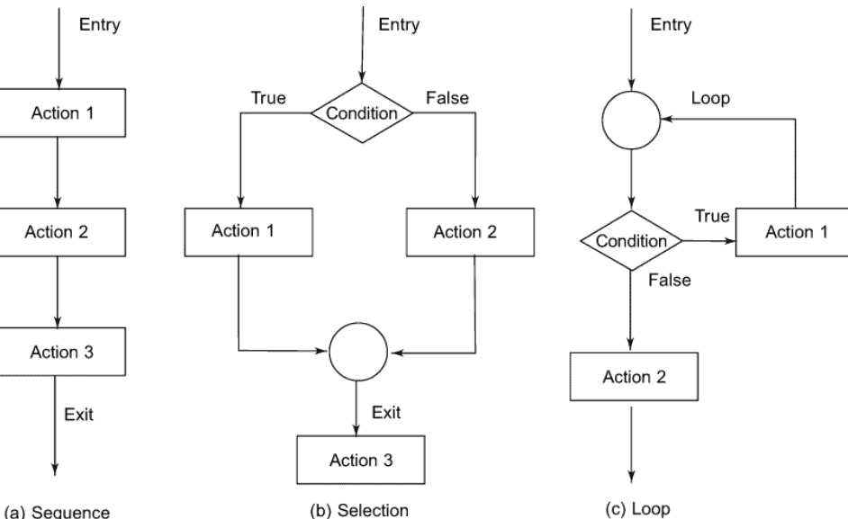

重要的是要理解，所有程序处理都可以仅使用这三种逻辑结构来编码。在编程中使用这些基本控制结构中的一种或多种方法被称为结构化编程，这是软件工程中的一项重要技术。

使用这三种基本结构，我们可以用详细形式或概要形式来表示函数结构，如图 3.5(a)、(b) 和 (c) 所示。

与 C 语言一样，C++ 也支持所有三种基本控制结构，并使用各种控制语句来实现它们，如图 3.6 所示。这表明 C++ 将结构化编程的强大能力与面向对象范式结合在了一起。

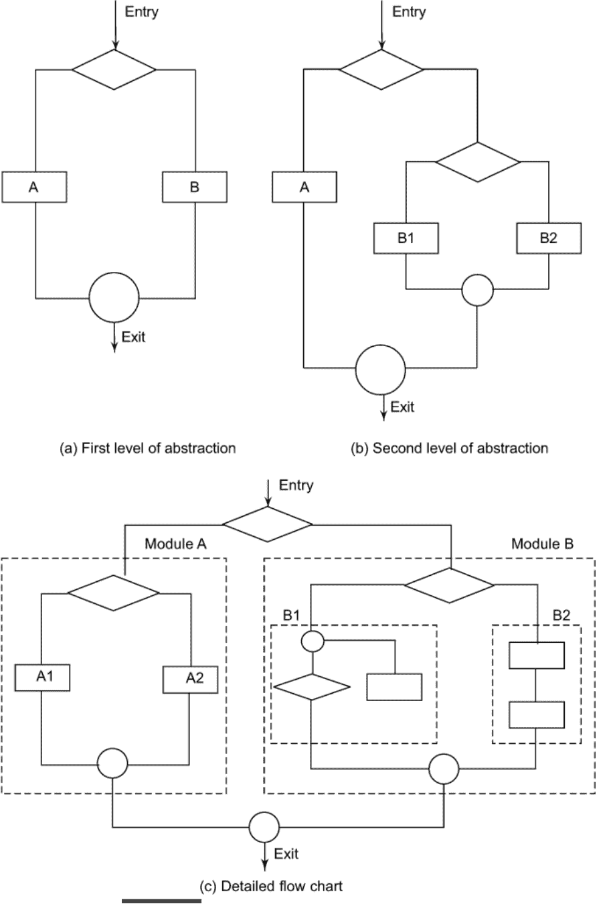

(a) 第一层抽象

(b) 第二层抽象

(c) 详细流程图

### if 语句

if 语句以两种形式实现：

- 简单 if 语句
- **if...else 语句**

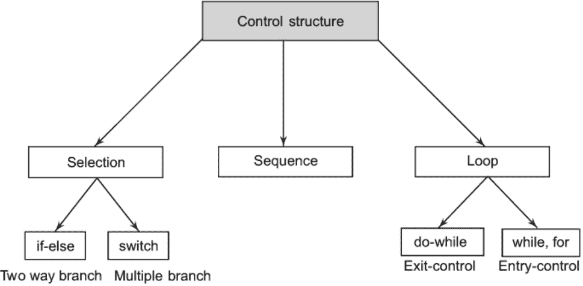

示例：

*形式 1*

```
if(expression is true)
{
    action1;
}
action2;
action3;
```

*形式 2*

### do-while 语句

do-while 是一种_出口控制_循环。基于条件，控制被转移回程序中的特定点。其语法如下：

```cpp
do
{
  action1;
}
while(condition is true);
action2;
```

### while 语句

这也是一种循环结构，但是一种_入口控制_循环。其语法如下：

```cpp
while(condition is true)
{
  action1;
}
action2;
```

### for 语句

for 是一种_入口控制_循环，用于在预定次数内重复执行某个动作。其语法如下：

```cpp
for(initial value; test; increment)
{
  action1;
}
action2;
```

C++ 中控制语句的语法与 C 语言非常相似，因此它们可以按需实现。

## 小结

- C++ 提供了多种类型的记号，包括关键字、标识符、常量、字符串和运算符。
- 标识符是指变量、函数、数组、类等的名称。
- C++ 还提供了 **void（空类型）** 的额外用途，用于声明泛型指针。
- 枚举数据类型在 C++ 中略有不同。枚举数据类型的标签名成为新的类型名。也就是说，我们可以使用这些标签名来声明新变量。
- 在 C++ 中，字符数组的大小应比字符串中的字符数大 1。
- C++ 增加了常量指针和指向常量的指针的概念。对于常量指针，我们不能修改该指针初始化时指向的地址；对于指向常量的指针，它指向的内容不能被更改。
- 指针在 C++ 中广泛用于内存管理和实现多态。
- C++ 提供了一个名为 **const（常量限定符）** 的限定符来声明命名常量，这些常量与变量类似，只是它们的值不能改变。**const（常量限定符）** 修饰符默认为 **int（整型）**。
- C++ 对变量的类型检查非常严格。它不允许将两种不同数据类型的变量等同起来。打破这一规则的唯一方法是类型转换。
- C++ 允许我们在程序的任何位置声明变量，也可以在运行时使用声明位置的表达式对其进行初始化。
- 引用变量为先前定义的变量提供了另一个名称。两个变量都引用内存中的同一个数据对象。因此，一个变量的值发生变化，另一个变量的值也会随之变化。
- 引用变量必须在声明时初始化，这就在引用与其命名的数据对象之间建立了对应关系。
- 作用域解析（::）运算符的一个主要应用是在类中标识成员函数所属的类。
- 除了 malloc()、calloc() 和 free() 函数外，C++ 还提供了两个一元运算符 new 和 delete，以便更好、更轻松地完成内存的分配和释放。
- C++ 还提供了操纵器来格式化数据显示。最常用的操纵器是 endl 和 setw。
- C++ 支持七种类型的表达式。当表达式中混合了数据类型时，C++ 会根据特定规则自动执行转换。
- C++ 还允许使用类型转换运算符对变量和表达式进行显式类型转换。
- 与 C 语言一样，C++ 也支持顺序、选择和循环这三种基本控制结构，并使用诸如 if、if...else、switch、do...while、while 和 for 等各种控制语句来实现它们。

## 关键术语

数组 | 结合性 | 自动转换 | 反斜杠字符 | 位运算表达式 | **布尔（bool）** | 布尔表达式 | 分支 | 引用调用 | **calloc() 函数** | 字符常量 | 链式赋值 | **类** | 复合赋值 | 复合表达式 | **const（常量限定符）** | 常量 | 常量表达式 | 控制结构 | 数据类型 | 十进制整数 | 声明 | **delete 运算符** | 解引用 | 派生类型 | **do...while 循环** | 嵌入式赋值 | **endl 操纵器** | 入口控制 | 枚举 | 出口控制 | 显式转换 | 表达式 | 浮点表达式 | 浮点整数 | **for 循环** | 格式化 | 自由存储区 | **free() 函数** | 函数 | 十六进制整数 | 标识符 | if 语句 | **if...else 语句** | 隐式转换 | 初始化 | 整型常量 | 整型表达式 | 整型拓宽 | 迭代 | 关键字 | 字面量 | 逻辑表达式 | 循环 | 循环结构 | **malloc() 函数** | 操纵器 | 内存 | 命名常量 | **new 运算符** | 八进制整数 | 运算符 | 运算符关键字 | 运算符重载 | 运算符优先级 | 指针 | 指针表达式 | 指针变量 | 引用 | 引用变量 | 关系表达式 | 重复 | 作用域解析 | 选择 | 选择结构 | 顺序 | 顺序结构 | **setw 操纵器** | 简写赋值 | **sizeof() 运算符** | 直线（顺序流程） | **字符串** | 字符串常量 | **结构体** | 结构 | 结构化编程 | switch 语句 | 符号常量 | 记号 | 类型转换 | 类型兼容性 | **typedef（类型定义）** | **联合体** | 用户自定义类型 | 变量 | **void（空类型）** | 瀑布模型 | **wchar_t（宽字符类型）** | **while 循环** | 宽字符

## 复习题

1. **3.1** 列举 C++ 中变量命名的规则。它们与 ANSI C 的规则有何不同？
2. **3.2** 一个 **无符号整型（unsigned int）** 的取值范围可以是一个 **带符号整型（signed int）** 的两倍。请解释原因。
3. **3.3** 为什么 C++ 要有类型修饰符？


- **3.4** void 数据类型在 C++ 中有哪些应用？
- **3.5** 能否将 void 指针赋给 int 类型指针？如果不能，为什么？如何才能做到这一点？
- **3.6** 结合示例描述枚举数据类型的用途。
- **3.7** 描述枚举数据类型在 ANSI C 和 C++ 中实现上的差异。
- **3.8** 为什么数组被称为派生数据类型？
- **3.9** 声明用来存储字符串的 char 数组，其大小应比字符串中的字符数大 1。为什么？
- **3.10** const 是从 C++ 中引入并纳入 ANSI C 的，尽管两者差别很大。请解释。
- **3.11** 由 const 定义的常量与由预处理语句 #define 定义的常量有何不同？
- **3.12** 在 C++ 中，变量可以在作用域中的任何位置声明。这一特性有什么意义？
- **3.13** 变量的动态初始化是什么意思？举例说明。
- **3.14** 什么是引用变量？它的主要用途是什么？
- **3.15** 至少列出 C++ 新增的四种有助于 OOP 的运算符。
- **3.16** 作用域解析运算符 :: 在 C++ 中有哪些应用？
- **3.17** 与函数 malloc() 相比，使用 new 运算符有哪些优点？
- **3.18** 哪个操纵符用于控制浮点数的精度？请举例说明。
- **3.19** 举例说明 setw 操纵符是如何工作的。
- **3.20** 以下语句有何不同？
  - (a) `char * const p;`
  - (b) `char const *p;`

## 调试练习

**3.1** 当你执行以下代码时会发生什么？

```cpp
#include <iostream.h>
void main()
{
    int i=0;
    i=400*400/400;
    cout << i;
}
```

**3.2** 找出以下程序中的错误。

```cpp
#include <iostream.h>

void main()
{
    int num[]={1,2,3,4,5, 6};
    num[1] == [1]num ? cout<<"Success" : cout<<"Error";
}
```

**3.3** 找出以下程序中的错误。

```cpp
#include <iostream.h>

void main()
{
    int i=5;
    while(i)
    {
        switch(i)
        {
        default:
        case 4:
        case 5:
            break;
        case 1:
            continue;
        case 2:
        case 3:
            break;
        }
        i--;
    }
}
```

**3.4** 找出以下程序中的错误。

```cpp
#include <iostream.h>
#define pi 3.14

int squareArea(int &);
int circleArea(int &);

void main()
{
        int a=10;
        cout << squareArea(a) << " ";
        cout << circleArea(a) << " ";
        cout << a << endl;
}
int squareArea(int &a)
{
        return a *= a;
}

int circleArea(int &r)
{
    return r = pi * r * r;
}
```

**3.5** 找出以下程序中的错误。

```cpp
#include <iostream.h>
#include <malloc.h>

char* allocateMemory();

void main()
{
        char* str;
        str = allocateMemory();
        cout << str;
        delete str;
        str = "";
        cout << str;
}

char* allocateMemory()
{
        str = "Memory allocation test, ";
        return str;
}
```

**3.6** 找出下列 C++ 语句中可能存在的错误。

- (a) `long float x;`
- (b) `char *cp = vp;`    // vp 是一个 void 指针
- (c) `int code = three;`    // three 是一个枚举常量
- (d) `int *p = new;`    // 使用 new 分配内存
- (e) `enum (green, yellow, red);`
- (f) `int const *p = total;`
- (g) `const int array_size;`
- (h) `for (i=1; int i<10; cout <<< i <<< "\n";`
- (i) `int & number = 100;`
- (j) `float *p = new int [10];`
- (k) `int public = 1000;`
- (l) `char name[3] = "USA";`

## 编程练习

- **3.1** 编写一个使用引用变量作为参数的函数，交换一对整数的值。W E B
- **3.2** 编写一个函数，使用 new 运算符创建用户指定大小 M 的向量。
- **3.3** 编写程序，使用 for 循环打印以下输出。

```
1
22
333
4444
555555
.....
```

- **3.4** 编写程序计算下列投资方程

\(V = P(1 + r)^n\)

并打印表格，给出 \(V\) 在以下 \(P\)、\(r\) 和 \(n\) 的不同组合下的值：

\(P\): 1000, 2000, 3000..... 10,000

\(r\): 0.10, 0.11, 0.12......0.20

\(n\): 1, 2, 3......10

提示：\(P\) 是本金，\(V\) 是 \(n\) 年末的资金价值。这个方程可以递归地写成

\(V = P(1 + r)\)

\(P = V\)

换句话说，第一年末的资金价值成为下一年的本金，依此类推。


- **3.5** 一场选举由五位候选人角逐。候选人编号为 1 到 5，投票方式是在选票上标记候选人编号。编写程序读取选票，并使用数组变量 count **统计**每位候选人的得票数。如果读到的数字超出 1 到 5 的范围，则该选票应被视为“废票”，程序还应统计废票数量。


- **3.6** 一支板球队在一系列测试赛中的击球数据如下表所示：

| 球员姓名 | 得分 | 击球局数 | 未出局次数 |
|---|---:|---:|---:|
| Sachin | 8430 | 230 | 18 |
| Saurav | 4200 | 130 | 9 |
| Rahul | 3350 | 105 | 11 |
| . | . | . | . |
| . | . | . | . |

编写程序按上述形式读取数据，计算击球平均分，并打印包含平均分的完整表格。

- **3.7** 编写程序计算下列函数，精确到 0.0001%。

(a) \(\sin x = x - \frac{x^3}{3!} + \frac{x^5}{5!} - \frac{x^7}{7!} + \cdots\)

(b) \(\mathrm{SUM} = 1 + (1/2)^2 + (1/3)^3 + (1/4)^4 + \cdots\)

(c) \(\cos x = 1 - \frac{x^2}{2!} + \frac{x^4}{4!} - \frac{x^6}{6!} + \cdots\)

- **3.8** 编写程序打印函数 \(y=e^{-x}\) 在 \(x\) 从 0 到 10、步长为 0.1 变化时的数值表。表格应如下所示。

**Y = EXP [-X] 的表格**

| X | 0.1 | 0.2 | 0.3 | 0.4 | 0.5 | 0.6 | 0.7 | 0.8 | 0.9 |
|---|---|---|---|---|---|---|---|---|---|
| 0.0 |  |  |  |  |  |  |  |  |  |
| 1.0 |  |  |  |  |  |  |  |  |  |
| ⋮ |  |  |  |  |  |  |  |  |  |
| ⋮ |  |  |  |  |  |  |  |  |  |
| 9.0 |  |  |  |  |  |  |  |  |  |

- **3.9** 编写程序计算 \(N\) 个数的方差和标准差。

\[
\mathrm{Variance}=\frac{1}{N}\sum_{i=1}^{N}(x_i-\bar{x})^2
\]

\[
\mathrm{Standard\ Deviation}=\sqrt{\frac{1}{N}\sum_{i=1}^{N}(x_i-\bar{x})^2}
\]

其中

\[
\bar{x}=\frac{1}{N}\sum_{i=1}^{N}x_i
\]

- **3.10** 某电力公司为了抑制居民大量用电，采用以下收费标准：

前 100 度——每度 60P  
接下来 200 度——每度 80P  
超过 300 度——每度 90P

所有用户的最低收费为 Rs. 50.00。如果总金额超过 Rs. 300.00，则额外加收 15% 的附加费。编写程序读取用户姓名和用电量，并打印带有姓名的费用。


# C++ 中的函数

## 关键概念

main( ) 的返回类型 | 函数原型 | 按引用调用 | 按值调用 | 按引用返回 | 内联函数 | 默认参数 | 常量参数 | 函数重载

## 4.1 引言

我们知道，函数在 C 程序开发中起着重要作用。将程序划分为多个函数是自顶向下、结构化编程的主要原则之一。使用函数的另一个优点是，可以通过在程序的不同位置调用和使用它们来减小程序的规模。

回想一下，在开发 C 程序时，我们曾使用过类似于以下的语法。

```c
void show( );                 /* Function declaration */
main( )
{
    ....
        show( );               /* Function call */
    ....
}
void show( )                 /* Function definition */
{
    ....
    ....                         /* Function body */
    ....
}
```

调用函数时，控制权被转移到函数体中的第一条语句。然后执行函数体中的其他语句，当遇到右花括号时，控制权返回主程序。C++ 也不例外。


函数依然是 C++ 程序的构建块。事实上，C++ 为函数增加了许多新特性，使其更加可靠和灵活。与 C++ 运算符一样，C++ 函数可以被重载，以便根据传入的参数执行不同的任务。这些修改大多旨在满足面向对象机制的需求。

在本章中，我们将简要讨论 C++ 函数新增的各种特性及其实现。

## 4.2 主函数

C 语言没有为 `main()` 函数指定任何返回类型，而 `main()` 是程序执行的起点。`main()` 的定义如下所示：

```c
main()
{
        // 主程序语句
}
```

这是完全有效的，因为 C 语言中的 `main()` 不返回任何值。

在 C++ 中，`main()` 向操作系统返回一个 int 类型的值。因此，C++ 明确规定 `main()` 必须匹配以下原型之一：

```cpp
int main();
int main(int argc, char * argv[]);
```

有返回值的函数应使用 return 语句终止。因此，C++ 中的 `main()` 函数定义如下：

```cpp
int main( )
{
......
......
return 0;
}
```

由于函数的默认返回类型为 int，`main()` 头中的关键字 int 是可选的。如果没有 return 语句，大多数 C++ 编译器会生成错误或警告。Turbo C++ 会发出警告：

函数应返回一个值

然后继续编译程序。从 `main()` 实际返回一个值是良好的编程实践。

许多操作系统会测试返回值（称为退出值）以判断是否存在问题。通常的约定是：退出值为零表示程序成功运行，非零值则表示存在问题。显式使用 `return(0)` 语句将表明程序已成功执行。

函数*原型*（prototyping）是 C++ 函数的主要改进之一。原型通过提供参数的数量、类型以及返回值的类型等详细信息，向编译器描述函数接口。借助函数原型，在声明和定义函数时始终会使用*模板*。当函数被调用时，编译器会使用该模板确保传入正确的参数，并正确处理返回值。任何参数或返回类型不匹配的情况都会在编译时被编译器捕获。传统 C 函数不具备这些检查和约束。

在函数定义中，名称是必需的，因为函数内部必须引用这些参数。例如：

```cpp
float volume(int a,float b,float c)
{
    float v = a*b*c;
    .....
    .....
}
```

函数 `volume()` 可以在程序中如下调用：

```cpp
float cube1 = volume(b1,w1,h1); // 函数调用
```

变量 *b1*、*w1* 和 *h1* 称为实际参数，它们指定 cube1 的尺寸。它们的类型（此前已声明）应与原型中声明的类型匹配。请记住，调用语句不应在参数列表中包含类型名称。

我们也可以声明一个具有*空参数列表*的函数，如下例所示：

```cpp
void display ( );
```

在 C++ 中，这表示该函数不传递任何参数。它与以下语句相同：

```cpp
void display(void);
```

然而，在 C 中，空的括号意味着任意数量的参数。也就是说，我们必须放弃原型。C++ 函数还可以通过原型中使用省略号来拥有“开放”的参数列表，如下所示：

```cpp
void do_something(...);
```

## 4.4 引用调用

在传统 C 中，函数调用按值传递参数。*被调用函数*会创建一组新的变量，并将参数的值复制到这些变量中。该函数无法访问调用程序中的实际变量，只能对值的副本进行操作。如果函数不需要更改调用程序中原始变量的值，这种机制是可行的。但有时我们可能希望更改*调用程序*中变量的值。例如，在冒泡排序中，我们比较列表中两个相邻的元素，如果第一个元素大于第二个元素，则交换它们的值。如果使用函数进行*冒泡排序*，那么它应该能够更改调用函数中变量的值，而如果使用按值传递的方法，这是不可能的。

C++ 中*引用变量*的引入使我们可以按引用向函数传递参数。当我们按引用传递参数时，被调用函数中的“形式”参数成为调用函数中“实际”参数的别名。这意味着当函数处理自己的参数时，它实际上是在处理原始数据。考虑以下函数：

```cpp
void swap(int &a,int &b)        // a 和 b 是引用变量
{
        int t = a;                // 动态初始化
        a = b;
        b = t;
}
```

现在，如果 *m* 和 *n* 是两个整型变量，那么函数调用

```cpp
swap(m, n);
```

将通过它们的别名（引用变量）*a* 和 *b* 交换 *m* 和 *n* 的值。引用变量已在第 3 章中详细讨论过。在传统 C 中，这可以通过*指针*和*间接引用*来实现，如下所示：

```c
void swap1(int *a, int *b)    /* 函数定义 */
{
    int t;
    t = *a;    /* 将地址 a 处的值赋给 t */
    *a = *b;    /* 将 b 处的值放入 a */
    *b = t;    /* 将 t 处的值放入 b */
}
```

该函数可以如下调用：

```c
swap1(&x, &y);    /* 通过传递变量地址 */
/* 进行调用 */
```

这种方法在 C++ 中也是可以接受的。请注意，引用调用方法在实现上更为简洁。

## 4.5 引用返回

函数也可以返回引用。考虑以下函数：

```cpp
int & max(int &x, int &y)
{
    if (x > y)
    return x;
    else
    return y;
}
```

由于 `max()` 的返回类型是 `int &`，该函数返回对 x 或 y 的引用（而不是值）。那么像 `max(a, b)` 这样的函数调用会根据 a 和 b 的值产生对 a 或 b 的引用。这意味着该函数调用可以出现在赋值语句的左侧。也就是说，语句

max(a,b) = -1;

是合法的，并且如果 a 较大则将 -1 赋给 a，否则将 -1 赋给 b。

## 4.6 内联函数

在程序中使用函数的目标之一是节省一些内存空间，当函数可能被多次调用时，这种节省就变得相当可观。然而，每次调用函数时，都需要花费大量额外时间执行一系列指令，例如跳转到函数、保存寄存器、将参数压入堆栈以及返回调用函数。当函数较小时，执行时间的很大一部分可能花在这种开销上。

这个问题的一个解决方案是使用宏定义，通常称为宏。预处理器宏在 C 中很流行。宏的主要缺点是它们并不是真正的函数，因此在编译期间不会进行通常的错误检查。

C++ 对这个问题有不同的解决方案。为了消除调用小函数的成本，C++ 提出了一种称为内联函数的新特性。内联函数是在调用时被内联展开的函数。也就是说，编译器用相应的函数代码替换函数调用（类似于宏展开）。内联函数的定义如下：

- inline 函数头
- {
- 函数体
- }


## 示例

inline double cube(double a)
{
    return(a*a*a);
}

上述内联函数可以通过如下语句调用：

c - cube(3.0);
d - cube(2.5+1.5);

执行这些语句后，c和d的值将分别为27和64。如果参数是诸如此类的表达式 2.5 + 1.5，函数会传递表达式的值，此处即4。这使得内联特性远比宏优越。

将一个函数设为内联函数很容易。我们只需在函数定义前加上关键字 inline。所有内联函数都必须在被调用之前定义。

在将函数设为内联之前，我们应当谨慎。内联函数的速度优势会随着函数规模的增大而减弱。在某一时刻，函数调用的开销相对于函数本身的执行来说变得很小，内联函数的优势可能会丧失。在这种情况下，使用普通函数会更有意义。通常，当函数足够小、能够用一两行代码定义时，才会将其设为内联。例如：

inline double cube(double a) {return(a*a*a);}

请记住，inline 关键字只是向编译器发送一个请求，而不是命令。如果函数定义太长或太复杂，编译器可能会忽略这个请求，并将该函数作为普通函数编译。

以下是一些内联展开可能无法工作的情况：

[PAGE 150]

+   1. 对于有返回值的函数，如果存在循环、switch或goto语句。
+   2. 对于无返回值的函数，如果存在return语句。
+   3. 如果函数包含静态变量。
+   4. 如果内联函数是递归的。

> 注意：*内联*展开使程序运行更快，因为消除了函数调用和返回的开销。然而，它会使程序占用更多内存，因为定义内联函数的语句会在函数被调用的每个地方被复制。因此，有必要进行权衡。

程序4.1演示了内联函数的用法。

# 程序4.1 内联函数

```
#include <iostream>
using namespace std;

inline float mul(float x, float y)
{
    return(x*y);
}

inline double div(double p, double q)
{
    return(p/q);
}

int main( )
{
    float a - 12.345;
    float b - 9.82;
}
```

[PAGE 151]

```
cout << mul(a,b) << "\n";
cout << div(a,b) << "\n";
return 0;
```

程序4.1的输出将是：

```
121.228
1.25713
```

## 4.7 默认参数

C++ 允许我们在调用函数时不指定其所有参数。在这种情况下，函数会为那些在函数调用中没有匹配参数的参数赋予一个*默认值*。默认值在函数声明时指定。编译器查看原型，了解函数使用了多少个参数，并提醒程序可能存在的默认值。以下是一个带有默认值的原型（即函数声明）示例：

float amount(float principal,int period,float rate-0.15);

默认值的指定方式在语法上类似于变量初始化。上述原型为参数 rate 声明了一个默认值 0.15。接下来类似这样的函数调用：

```
value - amount(5000,7);    // one argument missing
```

将 5000 传递给 principal，7 传递给 period，然后让函数对 rate 使用默认值 0.15。调用

```
value - amount(5000,5,0.12);       // no missing argument
```

将显式值 0.12 传递给 rate。

[PAGE 152]

默认参数在声明时进行类型检查，在调用时进行求值。需要注意的重要一点是，只有尾随的参数才能有默认值，因此我们必须从*从右到左*添加默认值。我们不能为参数列表中间的某个参数提供默认值。以下是一些带有默认值的函数声明示例：

默认参数在有些参数总是具有相同值的情况下很有用。例如，在特定的存款期限内，银行利率对所有客户可能保持不变。它还为程序员提供了更大的灵活性。一个函数可以写成包含比其最常见应用所需的更多参数。使用默认参数，程序员可以只使用对特定情况有意义的那些参数。程序4.2演示了默认参数的用法。

# 程序4.2 默认参数

```
#include<iostream>
#include<conio.h>

using namespace std;

int main( )
{
    float amount;
    float value(float p, int n, float r-0.15); //prototype
    void println(char ch-‘*’,int len-40); //prototype
    println();
    //use default values for arguments
```

[PAGE 153]

```cpp
amount - value (5000.00,5);        //default for 3rd argument
cout<<"\n Final Value - "<<amount<<"\n\n";

amount - value (10000.00,5,0.30); //pass all arguments explicitly

cout<<"\n Final Value - "<<amount<<"\n\n";

printline('-');                    //use default value for second argument

getch ( );

return 0;
}
float value (float p, int n, float r)
{
    int year - 1; float sum - p;

    while(year<-n)
    {
        sum - sum*(1+r);
        year - year+1;
    }
    return (sum);
}
void printline(char ch, int len)
{
    for (int i-1;i<=len;i++)
        printf("%c",ch);
    printf("\n");
}
```

程序4.2的输出将是：

[PAGE 154]

```
**********************************
Final Value - 10056.8
Final Value - 37129.3
----------------------------------
```

提供默认参数的好处有：

+   1. 我们可以使用默认参数为现有函数添加新参数。
+   2. 默认参数可用于将相似函数合并为一个。

## 4.8 const 参数

在C++中，函数的参数可以声明为 const，如下所示。

int strlen(const char *p);
int length(const string &s);

限定符 **const** 告诉编译器，函数不应修改该参数。当此条件被违反时，编译器将生成错误。这种声明仅在按引用或指针传递参数时才有意义。

## 4.9 递归

递归是一种函数调用自身的情况，也就是说，函数定义中的某条语句调用了它所在的同一个函数。这听起来可能像一个无限循环条件，但正如循环有条件检查来使程序控制退出循环一样，递归函数也拥有一个基准情况，它将程序控制从当前函数实例返回到调用函数。例如

[PAGE 155]

例如，在一系列计算某个数阶乘的递归调用中，基准情况将是计算0的阶乘的情况。让我们考虑几个示例（程序4.3和4.4）来理解递归方法的工作原理。

# 程序4.3 —— 计算一个数的阶乘

```cpp
#include <iostream>
#include <conio.h> using namespace std;

long fact(int n)
{
    if (n -- 0)       //base case
        return 1;

    return (n * fact(n-1));     //recursive function call
}
int main( )
{
    int num;

    cout << “Enter a positive integer: “;
    cin >> num;

    cout << “Factorial of “ << num << “ is “ << fact(num);

    getch( );
    return 0;
}
```

程序4.3的输出将是：

[PAGE 156]

Enter a positive integer: 10
Factorial of 10 is 3628800

# **程序4.5** 解决汉诺塔问题

```cpp
#include <iostream>
#include <conio.h>
using namespace std;

void TOH(int d,char tower1, char tower2, char tower3)
{
    if (d-1) //base case
    {
        cout << "\nShift top disk from tower " << tower1 << " to tower " << tower2;
        return;
    }
    TOH(d-1,tower1, tower3, tower2); //recursive function call
    cout << "\nShift top disk from tower " << tower1 << " to tower " << tower2;
    TOH(d-1,tower3, tower2, tower1); //recursive function call
}
int main()
{
    int disk;

    cout << "Enter the number of disks: ";
    cin >> disk;

    if (disk < 1)
        cout << "\nThere are no disks to shift";
    else
        cout <<"\nThere are " << disk << " disks in tower 1\n";
}
```


不取决于函数类型。例如，一个重载的 `add()` 函数处理不同类型的数据，如下所示：

```cpp
// Declarations
int add(int a, int b);                 // prototype 1
int add(int a, int b, int c);          // prototype 2
double add(double x, double y);        // prototype 3
double add(int p, double q);           // prototype 4
double add(double p, int q);           // prototype 5

// Function calls
cout << add(5, 10);                    // uses prototype 1
cout << add(15, 10.0);                 // uses prototype 4
cout << add(12.5, 7.5);                // uses prototype 3
cout << add(5, 10, 15);                // uses prototype 2
cout << add(0.75, 5);                  // uses prototype 5
```

函数调用首先匹配具有相同数量和类型参数的原型，然后调用适当的函数执行。最佳匹配必须是唯一的。函数选择涉及以下步骤：

1. 编译器首先尝试找到完全匹配，其中实际参数的类型相同，并使用该函数。
2. 如果找不到完全匹配，编译器会使用对实际参数的整型提升，例如：

   ```
   char to int
   float to double
   ```

   来寻找匹配。
3. 当两者都失败时，编译器会尝试使用内置转换（隐式赋值转换）对实际参数进行转换，然后使用匹配唯一性最高的函数。

如果转换可能导致多个匹配，则编译器会生成错误信息。假设我们使用

```cpp
cout << "Calling the volume( ) function for computing the volume of a cube - " << volume(10) << "\n";
cout << "Calling the volume( ) function for computing the volume of a cylinder - " << volume(2.5, 8) << "\n";
cout << "Calling the volume( ) function for computing the volume of a rectangular box - " << volume(100L, 75, 15);
return 0;
}

// Function definitions

int volume(int s) // cube
{
    return(s * s * s);
}
double volume(double r, int h) // cylinder
{
    return(3.14519 * r * r * h);
}
long volume(long l, int b, int h) // rectangular box
{
    return (l * b * h);
}
```

程序 4.5 的输出将是：

```
Calling the volume( ) function for computing the volume of a cube - 1000
Calling the volume( ) function for computing the volume of a cylinder - 157.26
Calling the volume( ) function for computing the volume of a rectangular box - 112500
```

函数重载应谨慎进行。我们不应重载不相关的函数，而应将函数重载保留给执行密切相关任务的函数。

有时，可以使用默认参数代替重载。这可以减少需要定义的函数数量。

重载函数被广泛用于处理类对象。当在下一章讨论类时，将对其进行说明。

## 4.11 友元函数和虚函数

C++ 引入了两种新型函数，即友元函数和虚函数。它们基本上是为了处理与类对象相关的某些特定任务而引入的。因此，对这些函数的讨论已推迟到类对象讨论之后。友元函数在下一章的第 5.15 节中讨论，虚函数在第 9 章的第 9.5 节中讨论。

## 4.12 数学库函数

标准 C++ 支持许多数学函数，可用于执行某些常用计算。最常用的数学库函数总结在表 4.1 中。

**表 4.1** *常用数学库函数*


> **注意：** *参数变量 **x** 和 **y** 为 **double** 类型，所有函数均返回数据类型 **double**。*

要使用数学库函数，我们必须在传统 C++ 中包含头文件 **math.h**，在 ANSI C++ 中包含 **cmath**。

### 程序 4.6 数学函数的使用

程序 4.6 演示了数学函数的使用：

```cpp
#include <iostream>
#include <conio.h>
#include <iomanip>
#include <math.h>

using namespace std;

int main()
{
    cout << fixed << setprecision(2);
    cout << "sin (100) - " << sin(100.00) << "\n"; // Computing sine value
    cout << "cos (100) - " << cos(100.00) << "\n"; // Computing cosine value
    cout << "tan (100) - " << tan(100.00) << "\n"; // Computing tangent value
    cout << "7 to the power of 6 - " << pow(7.0, 6.0) << "\n";
    // Computing power of one value raised to the other
    cout << "log10 (10) - " << log10(10.00) << "\n"; // Computing log to the base of 10 value
    cout << "sqrt (2) - " << sqrt(2.00) << "\n"; // Computing the square root of a value

    getch();
    return 0;
}
```

程序 4.6 的输出将是：

- 在 C++ 中，函数的参数可以声明为 **const**，表示函数不应修改该参数。
- C++ 允许函数重载。也就是说，我们可以在程序中拥有多个同名函数。编译器通过检查参数的数量和类型，将函数调用与确切的函数代码匹配。
- C++ 支持两种新型函数，即 **friend** 函数和 **virtual** 函数。
- 许多数学计算都可以使用 C++ 标准库支持的库函数进行。

## 关键术语

- actual arguments
- argument list
- bubble sort
- call by reference
- call by value
- called function
- calling program
- calling statement
- cmath
- const arguments
- declaration statement
- default arguments
- default values
- dummy variables
- ellipses
- empty argument list
- exit value
- formal arguments
- friend functions
- function call
- function definition
- function overloading
- function polymorphism
- function prototype
- indirection
- inline
- inline functions
- macros
- **main( )**
- math
- library
- **math.h**
- overloading
- pointers
- polymorphism
- prototyping
- reference variable
- return by reference
- **return** statement
- return type
- **return( )**
- template
- virtual functions

## 复习问题

**4.1** 判断以下陈述是 TRUE 还是 FALSE。

- (a) 函数参数是函数返回给调用程序的值。
- (b) 当按值传递参数时，函数会使用调用程序中的原始参数。
- (c) 当函数返回值时，整个函数调用可以赋给一个变量。
- (d) 函数可以通过引用返回值。
- (e) 当按引用传递参数时，会在调用程序中创建一个临时变量来保存参数值。
- (f) 在函数原型中指定变量名不是必须的。

**4.2** 描述编写原型的不同风格。

**4.3** 找出以下函数原型中的错误，如有。

- (a) `float average(x, y);`
- (b) `int mul(int a, b);`
- (c) `int display(...);`
- (d) `void Vect(int* &V, int & size);`
- (e) `void print(float data[], size = 20);`

**4.4** 按引用传递参数的主要优点是什么？

**4.5** 使用引用而不是指针最显著的优点是什么？

**4.6** 何时使函数内联？为什么？

**4.7** 内联函数与预处理器宏有何不同？

**4.8** 在什么情况下需要在函数中使用默认参数？

**4.9** 函数声明中空括号的意义是什么？

**4.10** 我们所说的函数重载是什么意思？何时使用这一概念？

**4.11** 我们如何实现函数重载？编译器基于什么区分一组同名重载函数？

**4.12** 对以下函数定义进行评述：

- (a) `int *f() { int m = 1; ..... return(&m); }`
- (b) `double f() { ..... return(1); }`
- (c) `int & f() { int n = 10; ..... return(n); }`


## 调试练习

4.1 识别以下程序中的错误。

```
#include <iostream.h>
int fun()
{
    return 1;
}
float fun()
{
    return 10.23;
}
void main()
{
    cout << (int)fun() << ' ';
    cout << (float)fun() << ' ';
}
```

4.2 识别以下程序中的错误。

```
#include <iostream.h>
void display(const int const1=5)
{
    const int const2=5;
    int array1[const1];
    int array2[const2];
    for(int i=0; i<5; i++)
    {
        array1[i] = i;
        array2[i] = i*10;
        cout << array1[i] << ' ' << array2[i] << ' ';
    }
}
void main()
{
    display(5);
}
```

4.3 识别以下程序中的错误。

```
#include <iostream.h>
int gValue=10;
void extra()
{
    cout << gValue << ' ';
}

void main()
{
    extra();
    {
        int gValue = 20;
        cout << gValue << ' ';
        cout << ::gValue << ' ';
    }
}
```

4.4 查找以下用于显示矩阵的函数定义中的错误，如有的话：

```
void display(int A[][], int m, int n)
{
    for(i=0; i<m; i++)
        for(j=0; j<n; j++)
            cout << " " << A[i][j];
    cout << "\n";
}
```

4.5 编写一个函数从键盘读取大小为 m x n 的矩阵。

# 类和对象

## 关键概念

- 使用结构
- 创建一个类
- 定义成员函数
- 创建对象
- 使用对象
- 内联成员函数
- 嵌套成员函数
- 私有成员函数
- 数组作为类成员
- 对象的存储
- 静态数据成员
- 静态成员函数
- 使用对象数组
- 将对象作为参数传递
- 使函数对类友好
- 函数返回对象
- **const** 成员函数
- 成员指针
- 使用解引用运算符
- 局部类

## 5.1 引言

C++ 最重要的特性是“类”。其重要性体现在 Stroustrup 最初将他的新语言命名为“C with classes”。类是 C 语言中结构思想的扩展。它是创建和实现用户定义数据类型的一种新方法。我们将在本章中通过首先回顾 C 中传统的结构，然后讨论类可以如何设计、实现和应用，来讨论类的概念。

## 5.2 C 结构回顾

我们知道 C 语言的独特特性之一是结构。它们提供了一种将不同类型的数据打包在一起的方法。结构是处理一组逻辑相关数据项的便捷工具。它是一种用户定义的数据类型，具有一个*模板*，用于定义其数据属性。一旦结构类型被定义，我们就可以使用类似于内置类型声明的声明来创建该类型的变量。例如，考虑以下声明：

```
struct student
{
    char name[20];
    int roll_number;
    float total_marks;
};
```

关键字 **struct** 将 **student** 声明为一种新的数据类型，可以容纳三种不同数据类型的字段。这些字段被称为_结构成员_或_元素_。标识符 student，被称为_结构名称_或_结构标签_，可用于创建 student 类型的变量。示例：

```
struct student A;  // C declaration
```

A 是 student 类型的变量，并且具有模板所定义的三个成员变量。成员变量可以使用_点_或_句点_运算符访问，如下所示：

```
strcpy(A.name, "John");
A.roll_number = 999;
A.total_marks = 595.5;
Final_total = A.total_marks + 5;
```

结构可以具有数组、指针或结构作为成员。

标准 C 不允许将 struct 数据类型像内置类型一样处理。例如，考虑以下结构：

```
struct complex
{
    float x;
    float y;
};
struct complex cl, c2, c3;
```

C++ 中的结构和类非常相似，因此它们可以在少量修改后互换使用。由于类是 C++ 中特别引入的数据类型，大多数 C++ 程序员倾向于使用结构仅保存数据，而使用类保存数据和函数。因此，我们将不再进一步讨论结构。

> **注意：** *C++ 中结构和类的唯一区别是，默认情况下类的成员是 private，而默认情况下结构的成员是 **public**。*

## 5.3 指定一个类

类是将数据及其相关函数绑定在一起的一种方式。它允许数据（和函数）根据需要对外部使用进行隐藏。在定义类时，我们正在创建一个新的*抽象数据类型*，可以像任何其他内置数据类型一样处理。通常，类规范有两个部分：

1. 类声明
2. 类函数定义

类声明描述其成员的类型和作用域。类函数定义描述类函数是如何实现的。

类声明的一般形式为：

```
class class_name
{
private:
    variable declarations;
    function declarations;
public:
    variable declarations;
    function declarations;
};
```

**class** 声明类似于 **struct** 声明。关键字 **class** 指定其后跟随的是一个抽象数据类型，*class_name*。类的主体用大括号括起来并以分号结束。类主体包含变量和函数的声明。这些函数和变量统称为*类成员*。它们通常分为两个部分，即 *private* 和 *public*，以表示哪些成员是 *private*，哪些是 *public*。关键字 **private** 和 **public** 被称为可见性标签。请注意，这些关键字后面跟着一个冒号。

> 声明为 private 的类成员只能从类内部访问。另一方面，public 成员也可以从类外部访问。数据隐藏（使用 private 声明）是面向对象编程的关键特性。关键字 private 的使用是可选的。默认情况下，类的成员是 **private**。如果两个标签都缺失，则默认情况下所有成员都是 **private**。这样的类完全对外部世界隐藏，没有任何作用。

> 在类内部声明的变量称为*数据成员*，函数称为*成员函数*。**只有成员函数可以访问私有数据成员和私有函数。** 然而，公共成员（函数和数据）可以从类外部访问。这在图 5.1 中有所说明。将数据和函数绑定到单个类类型变量中称为*封装*。

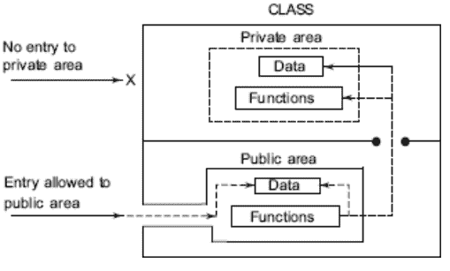

*图 5.1* **类中的数据隐藏**

### 一个简单的类示例

典型的类声明看起来像：

```
class item
{
    int number;   // variables declaration
    float cost;   // private by default
public:
    void getdata(int a, float b); // functions declaration
    void putdata(void);           // using prototype
}; // ends with semicolon
```

我们通常给类一个有意义的名称，例如 **item**。这个名称现在成为一个新的类型标识符，可用于声明该类类型的实例。类 item 包含两个数据成员和两个函数成员。数据成员默认是私有的，而两个函数通过声明是公共的。函数 **getdata()** 可用于为成员变量 number 和 cost 分配值，而 **putdata()** 用于显示它们的值。这些函数提供了从类外部访问数据成员的唯一途径。这意味着数据不能被任何不是类 **item** 成员的函数访问。请注意，函数是声明的，而不是定义的。实际的函数定义将出现在程序的后面。数据成员通常声明为 **private**，而成员函数声明为 **public**。图 5.2 显示


OOP 分析师用来表示一个类的两种不同记法。

## 创建对象

请记住，如上所示对 **item** 的声明并没有定义 **item** 的任何对象，而只是指定了它们将包含的内容。一旦类被声明，我们就可以使用类名（就像任何其他内置类型变量一样）来创建该类型的变量。例如，

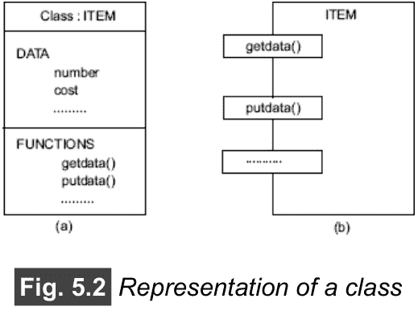

```cpp
item x;  // memory for x is created
```

创建了一个类型为 **item** 的变量 **x**。在 C++ 中，类变量被称为 *对象*。因此，x 被称为类型为 **item** 的对象。我们也可以在一行语句中声明多个对象。示例：

```cpp
item x, y, z;
```

对象的声明与任何基本类型变量的声明类似。此时会为对象分配必要的内存空间。请注意，类规范与结构类似，只提供一个 *模板*，并且不会为对象创建任何内存空间。

对象也可以在类定义时创建，将它们的名字放在闭合大括号之后，就像我们在结构中做的那样。也就是说，下面的定义

```cpp
class item
{
    ....
    ....
    ....
} x,y,z;
```

将创建类型为 **item** 的对象 **x**、**y** 和 **z**。这种做法很少使用，因为我们希望在对象使用的地方附近声明对象，而不是在类定义时声明。

## 访问类成员

如前所述，类的私有数据只能通过该类的成员函数访问。**main()** 不能包含直接访问 **number** 和 **cost** 的语句。调用成员函数的格式如下：

```cpp
object-name.function-name (actual-arguments);
```

例如，函数调用语句

```cpp
x.getdata(100,75.5);
```

是有效的，并通过实现 **getdata()** 函数将值 100 分配给对象 **x** 的 **number**，将 75.5 分配给 **cost**。赋值在实际函数中发生。请参阅第 5.4 节了解更多细节。

类似地，语句

```cpp
x.putdata();
```

将显示数据成员的值。请记住，成员函数只能通过对象（同一类的）调用。像这样的语句

```cpp
getdata(100,75.5);
```

没有任何意义。类似地，语句

```cpp
x.number = 100;
```

也是非法的。虽然 **x** 是属于 **number** 的类型 **item** 的对象，但 number（声明为私有）只能通过成员函数访问，不能由对象直接访问。

可以回忆一下，对象通过发送和接收消息进行通信。这是通过成员函数实现的。例如，

```cpp
x.putdata();
```

向对象 x 发送一条消息，要求它显示其内容。

声明为 public 的变量可以直接由对象访问。示例：

```cpp
class xyz
{
    int x;
    int y;
public:
    int z;
};
....
....
xyz p;
p.x = 0;  // error, x is private
p.z = 10; // OK, z is public
```

> **NOTE:** *以这种方式使用数据违背了数据隐藏的初衷，因此应避免。*

## 5.4 定义成员函数

成员函数可以在两个地方定义：

- 在类定义之外。
- 在类定义之内。

显然，无论定义位置如何，函数都应执行相同的任务。因此，在两种情况下函数体的代码都是相同的。然而，函数头部的定义方式存在细微差别。本节将详细讨论这两种方法。

### 在类定义之外

在类内部声明的成员函数必须在类外单独定义。它们的定义与普通函数非常相似。它们应具有函数头和函数体。由于 C++ 不支持旧版本的函数定义，因此必须使用 *ANSI 原型* 形式来定义函数头。

成员函数与普通函数的一个重要区别是，成员函数在头中包含一个成员身份‘标识标签’。这个‘标签’告诉编译器该函数属于哪个类。成员函数定义的一般形式为：

```cpp
return-type class-name :: function-name (argument declaration)
{
    Function body
}
```

成员标签 `class-name ::` 告诉编译器函数 function-name 属于类 class-name。也就是说，函数的范围被限制在头行中指定的 class-name。符号 `::` 被称为作用域解析运算符。

例如，考虑上面讨论的成员函数 getdata() 和 putdata()。它们可以这样编码：

```cpp
void item :: getdata(int a, float b)
{
    number = a;
    cost = b;
}
void item :: putdata(void)
{
    cout << "Number :" << number << "\n";
    cout << "Cost :" << cost << "\n";
}
```

由于这些函数不返回任何值，它们的返回类型为 void。函数参数使用 ANSI 原型声明。

成员函数具有一些在程序开发中经常使用的特殊特性。这些特性是：

- 多个不同的类可以使用相同的函数名。‘成员标签’将解析它们的范围。
- 成员函数可以访问类的私有数据。非成员函数不能这样做。（然而，有一个例外

```cpp
#include <iostream>
using namespace std;
class item
{
int number;  // private by default
float cost;  // private by default
public:
void getdata(int a, float b); // prototype declaration,
    // to be defined
// Function defined inside class
void putdata(void)
{
    cout << "number :" << number << "\n";
    cout << "cost:" << cost << "\n";
}
};
//............Member Function Definition................
void item :: getdata(int a, float b) // use membership label
{
number = a;  // private variables
cost = b;  // directly used
}
//......................Main Program.................
int main()
{
item x;  // create object x
cout << "\nobject x " << "\n";
x.getdata(100, 299.95); // call member function
x.putdata();  // call member function
item y;  // create another object
cout << "\nobject y" << "\n";
y.getdata(200, 175.50);
y.putdata();
return 0;
}
```

该程序展示了类 item。该类包含两个私有变量和两个公共函数。已在类外定义的成员函数 getdata() 为两个变量提供值。请注意 getdata() 函数定义中

```cpp
number = a;
```

等语句的使用。这表明成员函数可以直接访问私有数据项。

成员函数 putdata() 已在类内定义，因此表现得像一个内联函数。该函数显示私有变量 number 和 cost 的值。

该程序在两个不同的语句中创建了两个对象 x 和 y。这可以合并为一个语句。

```cpp
item x, y; // creates a list of objects
```

以下是程序 5.1 的输出：

```text
object x
number : 100
cost : 299.95
object y
number : 200
cost : 175.5
```

为便于说明，我们将一个成员函数显示为内联，另一个显示为‘外部’成员函数。两者都可以定义为内联或外部函数。

## 5.6 使外部函数内联

OOP 的目标之一是将实现细节与类定义分离。因此，良好的做法是

```cpp
using namespace std;
class binary
{
string s;
public:
void read(void)
{
cout << "Enter a binary number:";
cin >> s;
}
void chk_bin(void)
{
for(int i = 0;i<s.length();i++)
{
if(s.at(i) != '0' && s.at(i) != '1')
{
cout << "\nIncorrect binary number format...the program will quit";
getch();
exit(0);
}
}
}
void ones(void)
{
chk_bin(); // calling member function
for(int i = 0;i<s.length();i++)
{
if(s.at(i) == '0')
s.at(i) = '1';
else
s.at(i) = '0';
}
}
void displayones(void)
{
ones(); // calling member function
}
};
```


由此产生的后果是，处理这类任务的函数应具有受限的访问权限。我们可以将这些函数放在私有区。

私有成员函数只能被其所属类的另一个成员函数调用。即使是对象也不能使用点运算符调用私有函数。考虑如下定义的类：

```cpp
class sample
{
    int m;
    void read(void);  // 私有成员函数
public:
    void update(void);
    void write(void);
};
```

如果 **s1** 是 **sample** 的一个对象，那么

```cpp
s1.read();  // 不可行；对象不能访问
            // 私有成员
```

是非法的。但是，函数 **read()** 可以被函数 **update()** 调用来更新 **m** 的值。

```cpp
void sample :: update(void)
{
    read();  // 简单调用；未使用对象
}
```

## 5.9 类中的数组

数组可以作为成员变量在类中使用。以下类定义是有效的。

```cpp
const int size = 10; // 为数组大小提供值
class array
{
    int a[size];    // 'a' 是 int 类型的数组
public:
    void setval(void);
    void display(void);
};
```

数组变量 **a[ ]** 被声明为类 **array** 的私有成员，它可以像任何其他数组变量一样在成员函数中使用。我们可以对其执行任何操作。例如，在上述类定义中，成员函数 **setval()** 设置数组 **a[ ]** 的元素值，**display()** 函数显示这些值。类似地，我们可以使用其他成员函数对数组值执行任何其他操作。

让我们考虑一个购物清单，我们每月向经销商下订单。清单包括每件商品的代码和价格等详细信息。我们希望执行诸如向清单添加商品、从清单删除商品以及打印订单总价值等操作。程序 5.3 展示了如何使用以数组作为数据成员的类来实现这些操作。

### 程序 5.3 处理购物清单

```cpp
#include <iostream.h>
using namespace std;
const int m = 50;

class ITEMS
{
    int itemCode[m];
    float itemPrice[m];
    int count;
public:
    void CNT(void) {count = 0;}  // 将 count 初始化为 0
    void getitem(void);
    void displaySum(void);
    void remove(void);
    void displayItems(void);
};
// ==============================================
void ITEMS :: getitem(void)  // 为 item 的
                             // 数据成员赋值
{
    cout << "Enter item code :";
    cin >> itemCode[count];
    cout << "Enter item cost :";
    cin >> itemPrice[count];
    count++;
}
void ITEMS :: displaySum(void)  // 显示所有
                                 // 商品的总值
{
    float sum = 0;
    for(int i = 0; i < count; i++)
        sum = sum + itemPrice[i];
    cout << "\nTotal value :" << sum << "\n";
}
void ITEMS :: remove(void)  // 删除指定商品
{
    int a;
    cout << "Enter item code :";
    cin >> a;
    for(int i = 0; i < count; i++)
        if(itemCode[i] == a)
            itemPrice[i] = 0;
}
void ITEMS :: displayItems(void)  // 显示商品
{
    cout << "\nCode Price\n";
    for(int i = 0; i < count; i++)
    {
        cout << "\n" << itemCode[i];
        cout << " " << itemPrice[i];
    }
    cout << "\n";
}
// ================================
int main()
{
    ITEMS order;
    order.CNT();
    int x;
    do  // do...while 循环
    {
        cout << "\nYou can do the following;";
        cout << " Enter appropriate number \n";
        cout << "\n1 : Add an item ";
        cout << "\n2 : Display total value";
        cout << "\n3 : Delete an item";
        cout << "\n4 : Display all items";
        cout << "\n5 : Quit";
        cout << "\n\nWhat is your option?";
        cin >> x;
        switch(x)
        {
            case 1 : order.getitem(); break;
            case 2 : order.displaySum(); break;
            case 3 : order.remove(); break;
            case 4 : order.displayItems(); break;
            case 5 : break;
            default : cout << "Error in input; try again\n";
        }
    } while(x != 5);  // do...while 结束
```

```text
Enter item cost :300

You can do the following; Enter appropriate number

1 : Add an item
2 : Display total value
3 : Delete an item
4 : Display all items
5 : Quit

What is your option? 2

Total value :600

You can do the following; Enter appropriate number

1 : Add an item
2 : Display total value
3 : Delete an item
4 : Display all items
5 : Quit

What is your option? 3

Enter item code :222

You can do the following; Enter appropriate number

1 : Add an item
2 : Display total value
3 : Delete an item
4 : Display all items
5 : Quit

What is your option? 4
```

| 代码 | 价格 |
|------|-------|
| 111  | 100   |
| 222  | 0     |
| 333  | 300   |

```text
You can do the following; Enter appropriate number

1 : Add an item
2 : Display total value
3 : Delete an item
4 : Display all items
5 : Quit

What is your option? 5
```

**注意：** 该程序使用了两个数组，即 **itemCode[]** 用于存放商品的代码号，**itemPrice[]** 用于存放价格。第三个数据成员 count 用于记录清单中的商品数量。程序共使用四个函数来实现要对清单执行的操作。语句 `const int m = 50;` 定义了数组成员的大小。

第一个函数 **CNT()** 简单地将变量 **count** 设置为零。第二个函数 **getitem()** 以交互方式获取商品代码和商品价格，并将它们赋给数组成员 **itemCode[count]** 和 **itemPrice[count]**。注意，在此函数内部，赋值操作完成后 **count** 会递增。函数 **displaySum()** 首先计算订单的总值，然后打印该值。第四个函数 **remove()** 从清单中删除指定商品。它使用商品代码在清单中定位该商品，并将价格设置为零，表示该商品在清单中不再“有效”。最后，函数 **displayItems()** 显示清单中的所有商品。

该程序使用基于菜单的用户界面来实现所有任务。

## 5.10 对象的内存分配

我们曾指出，对象的内存空间是在声明它们时分配的，而不是在指定类时分配的。这一说法只部分正确。实际上，成员函数在作为类规范的一部分被定义时，只创建并放入内存空间一次。由于属于该类的所有对象使用相同的成员函数，因此在创建对象时不会为成员函数分配单独的空间。只有成员变量的空间是为每个对象单独分配的。对象必须具有独立的内存位置，因为不同对象的成员变量将保存不同的数据值。如图 5.3 所示。

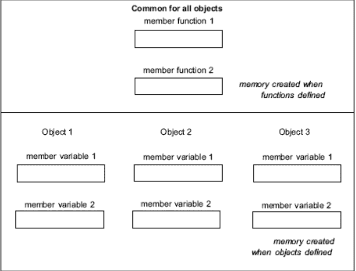

图 5.3 *对象的内存*

## 5.11 静态数据成员

类的数据成员可以被限定为 static。**static** 成员变量的属性与 C 语言中的 static 变量类似。静态成员变量具有某些特殊特性，如下：

- 当创建其类的第一个对象时，它被初始化为零。不允许其他初始化。
- 无论创建多少个对象，只为整个类创建该成员的一个副本，并由该类的所有对象共享。
- 它仅在类内可见，但其生命周期是整个程序。

静态变量通常用于维护整个类共有的值。例如，静态数据成员可以用作记录所有对象出现次数的计数器。程序 5.4 演示了静态数据成员的用法。

### 程序 5.4 静态类成员

```cpp
#include <iostream.h>
using namespace std;

class item
{
    static int count;
    int number;
public:
    void getdata(int a)
    {
        number = a;
        count++;
    }
    void getcount(void)
    {
        cout << "count:";
        cout << count << '\n';
    }
};
```


请注意，每个静态成员变量的类型和作用域都必须在类定义外部定义。这是必要的，因为静态数据成员是单独存储的，而不是作为对象的一部分。由于它们与类本身相关联，而不是与任何类对象相关联，因此它们也被称为类变量。

静态变量 count 在创建对象时被初始化为零。每当数据读入对象时，count 就会递增。由于数据被读入对象三次，变量 count 被递增三次。因为所有三个对象共享唯一的 count 副本，所以三条输出语句都会显示值 3。图5.4显示了对象如何使用静态变量。

**图5.4** *静态数据成员的共享*

静态变量与非内联成员函数类似：它们在类声明中声明，并在源文件中定义。在定义静态变量时，也可以为该变量赋予初始值。例如，下面的定义将 count 的初始值设为 10。

```
int item :: count = 10;
```

## 5.12 静态成员函数

与静态成员变量一样，我们也可以有静态成员函数。声明为 static 的成员函数具有以下性质：

- 静态函数只能访问同一类中声明的其他静态成员（函数或变量）。
- 可以使用类名（而不是对象）来调用静态成员函数，如下所示：

```
class-name :: function-name;
```

程序5.5演示了这些特性的实现。静态函数 show-count() 显示到该时刻为止已创建的对象数量。创建的对象数量由静态变量 count 维护。

函数 showcode() 显示每个对象的代码编号。

## 程序5.5 静态成员函数

```cpp
#include <iostream.h>
using namespace std;
class test
{
int code;
static int count;  // static member variable
public:
void setcode(void)
{
code = ++count;
```

```
void showcode(void)
{
    cout << “object number: “ << code << “\n”;
}
static void showcount(void)  // static member function
{
    cout << “count: “ << count << “\n”;
}
};
int test :: count;
int main()
{
    test t1, t2;

    t1.setcode();
    t2.setcode();
    test :: showcount();  // accessing static function

    test t3;
    t3.setcode();

    test :: showcount();

    t1.showcode();
    t2.showcode();
    t3.showcode();

    return 0;
}
```

程序5.5的输出将是：

```
count: 2
count: 3
object number: 1
```

标识符 employee 是一种用户自定义数据类型，可以用来创建与不同员工类别相关的对象。示例：

```
employee manager[3];  // array of manager
employee foreman[15]; // array of foreman
employee worker[75];  // array of worker
```

数组 manager 包含三个 employee 类类型的对象（经理），即 manager[0]、manager[1] 和 manager[2]。类似地，foreman 数组包含 15 个对象（领班），worker 数组包含 75 个对象（工人）。

由于对象数组的行为与其他任何数组一样，我们可以使用通常的数组访问方法来访问各个元素，然后使用点成员运算符来访问成员函数。例如，语句

```
manager[i].putdata();
```

将显示数组 manager 中第 i 个元素的数据。也就是说，该语句请求对象 manager[i] 调用成员函数 putdata()。

对象数组在内存中的存储方式与多维数组相同。数组 manager 如图5.5所示。请注意，只为对象的数据项创建空间；成员函数单独存储，供所有对象使用。

## 图5.5 对象数组数据项的存储

程序5.6演示了对象数组的用法。

```cpp
#include <iostream.h>
using namespace std;
class employee
{
char name[30]; // string as class member
float age;
public:
void getdata(void);
void putdata(void);
};
void employee :: getdata(void)
{
cout << "Enter name: ";
cin << name;
cout << "Enter age: ";
cin >> age;
}
```

```
void employee :: putdata(void)
{
    cout << “Name: “ << name << “\n”;
    cout << “Age: “ << age << “\n”;
}
const int size = 3;
int main()
{
    employee manager[size];
    for(int i = 0; i<size; i++)
    {
        cout << “\nDetails of manager” << i+1 << “\n”;
        manager[i].getdata();
    }
    cout << “\n”;
    for(i = 0; i<size; i++)
    {
        cout << “\nManager” << i+1 << “\n”;
        manager[i]. putdata();
    }
    return 0;
}
```

由于这是一个交互式程序，输入数据和程序输出如下所示：

```
Interactive input
Details of manager1
Enter name: xxx
Enter age: 45

Details of manager2
name: yyy
Enter age: 37

Details of manager3
```

与任何其他数据类型一样，对象可以用作函数参数。这可以通过两种方式完成：

- 将整个对象的副本传递给函数。
- 只将对象的地址传递给函数。

第一种方法称为按值传递。由于传递给函数的是对象的副本，因此函数内部对对象所做的任何更改都不会影响调用函数时所用的对象。第二种方法称为按引用传递。当传递对象的地址时，被调用函数直接作用于调用中使用的实际对象。这意味着函数内部对对象所做的更改将反映在实际对象上。按引用传递方法更高效，因为它只需要传递对象的地址，而不需要传递整个对象。

程序5.7演示了对象作为函数参数的用法。它以小时和分钟的格式执行时间加法。

## 程序5.7 对象作为参数

```cpp
#include <iostream.h>
using namespace std;
class time
{
int hours;
int minutes;
public:
void gettime(int h, int m)
{ hours = h; minutes = m; }
void puttime(void)
{
    cout << hours << “ hours and “;
    cout << minutes << “ minutes “ << “\n”;
}
void sum(time, time);  // declaration with objects as arguments
};
void time :: sum(time t1, time t2) // t1, t2 are objects
{
minutes = t1.minutes + t2.minutes;
hours = minutes/60;
minutes = minutes%60;
hours = hours + t1.hours + t2.hours;
}
int main()
{
time T1, T2, T3;

T1.gettime(2,45);  // get T1
T2.gettime(3,30);  // get T2
```

```
T3.sum(T1,T2); // T3 = T1+T2

cout << “T1 = “; T1.puttime(); // display T1
cout << “T2 = “; T2.puttime(); // display T2
cout << “T3 = “; T3.puttime(); // display T3
return 0;
}
```

程序5.7的输出将是：

+   T1 = 2小时45分钟
+   T2 = 3小时30分钟
+   T3 = 6小时15分钟

> **注意：** 由于成员函数 sum() 由对象 T3 调用，并以对象 T1 和 T2 作为参数，因此它可以直接访问 T3 的 hours 和 minutes 变量。但是，T1 和 T2 的成员只能通过点运算符（如 T1.hours 和 T1.minutes）访问。因此，在函数 sum() 内部，变量 hours 和 minutes 引用 T3，T1.hours 和 T1.minutes 引用 T1，T2.hours 和 T2.minutes 引用 T2。

**图5.6** *在被调用函数内访问对象成员*

对象也可以作为参数传递给非成员函数。但是，这类函数只能通过作为参数传递给它的对象来访问公有成员函数，而不能访问私有数据成员。


## 友元函数

我们一直在本章强调，私有成员不能从类外部访问。也就是说，非成员函数无法访问类的私有数据。然而，有时我们可能希望两个类共享一个特定的函数。例如，假设定义了 `manager` 和 `scientist` 两个类，我们想使用一个 `income_tax()` 函数来操作这两个类的对象。在这种情况下，C++ 允许这个公共函数成为这两个类的友元，从而使该函数能够访问这些类的私有数据。这样的函数不必是任何这些类的成员。

要使一个外部函数对某个类“友好”，我们只需将该函数声明为类的友元，如下所示：

```cpp
class ABC
{
    .....
    .....
public:
    .....
    .....
    friend void xyz(void); // 声明
};
```

函数声明前应加上关键字 `friend`。该函数在程序的其他位置像普通 C++ 函数一样定义。函数定义既不需要使用关键字 `friend`，也不需要作用域运算符 `::`。用关键字 `friend` 声明的函数称为友元函数。一个函数可以在任意数量的类中被声明为友元。友元函数虽然不是成员函数，但可以完全访问类的私有成员。

友元函数具有一些特殊特征：

- 它不在被声明为 **friend** 的类的作用域内。
- 由于不在类的作用域内，因此不能使用该类的对象来调用它。
- 它可以像普通函数一样在不需要任何对象的情况下被调用。
- 与成员函数不同，它不能直接访问成员名，必须使用对象名和点成员运算符与每个成员名配合使用（例如 `A.x`）。
- 它可以在类的公有部分或私有部分声明，而不会影响其含义。
- 通常，它以对象作为参数。

友元函数常用于运算符重载，这将在后面讨论。

程序 5.8 说明了友元函数的用法。

## 程序 5.8  友元函数

```cpp
#include <iostream.h>
using namespace std;
class sample
{
int a;
int b;
public:
void setvalue() {a = 25; b = 40; }
friend float mean(sample s);
};
```

## 程序 5.9  对两个类友好的函数

```cpp
#include <iostream.h>
using namespace std;
class ABC;  // 前向声明
//----------------------------------------------------//
class XYZ
{
int x;
public:
void setvalue(int i) {x = i;}
friend void max(XYZ, ABC);
};
//----------------------------------------------------//
class ABC
{
int a;
public:
void setvalue(int i) {a = i;}
friend void max(XYZ, ABC);
};
//----------------------------------------------------//
void max(XYZ m, ABC n)  // 友元函数的定义
{
if(m.x >= n.a)
    cout << m.x;
else
    cout << n.a;
}
//----------------------------------------------------------------------------//
int main()
{
ABC abc;
abc.setvalue(10);
XYZ xyz;
xyz.setvalue(20);
max(xyz, abc);

return 0;
}
```

程序 5.9 的输出为：

20

> > **注意：** *函数 `max()` 具有来自 **XYZ** 和 **ABC** 两者的参数。当函数 `max()` 第一次在 **XYZ** 中被声明为友元时，编译器不会识别 **ABC** 的存在，除非在开头声明其名称，即*
> >
> > ```cpp
> > class ABC;
> > ```
> >
> > *这称为“前向”声明。*

如前所述，友元函数可以通过引用调用。在这种情况下，不会创建对象的局部副本，而是传递指向对象地址的指针，被调用的函数直接作用于调用中使用的实际对象。

## 程序 5.10  交换类的私有数据

```cpp
#include <iostream.h>
using namespace std;
class class_2;
class class_1
{
int value1;
public:
void indata(int a) {value1 = a;}
void display(void) {cout << value1 << "\\n";}
friend void exchange(class_1 &, class_2 &);
};
class class_2
{
int value2;
public:
void indata(int a) {value2 = a;}
void display(void) {cout << value2 << "\\n";}
friend void exchange(class_1 &, class_2 &);
void exchange(class_1 &x, class_2 &y)
{
int temp = x.value1;
x.value1 = y.value2;
class_1 &class_2
{
int value1;
public:
void indata(int a) {value1 = a;}
void display(void) {cout << value1 << "\\n";}
friend void exchange(class_1 &, class_2 &);
};
```

## 5.16 返回对象

函数不仅可以接收对象作为参数，还可以返回对象。程序 5.11 中的示例说明了如何（在函数内）创建对象并将其返回给另一个函数。

## 程序 5.11 返回对象

```cpp
#include<iostream.h>
#include<conio.h>
using namespace std;
class matrix
{
int m[ 3 ][ 3];
public:
void read(void)
{
cout<<“Enter the elements of the 3X3 matrix:\n”;
int i,j;
for(i = 0;i<3;i++)
    for(j = 0;j<3;j++)
    {
        cout<<“m[“<<i<<“][“<<j<<“]=“;
        cin>>m[i][j];
    }
}
void display (void)
{
int i,j;
for(i = 0;i<3;i++)
{
cout<<“\n”;
for(j = 0;j<3;j++)
{ 
cout<<m[i][j]"\t";
}
}
}
friend matrix trans(matrix);
};
matrix trans(matrix m1)
{
matrix m2; // 创建一个对象 int i,j;
for(i = 0;i<3;i++)
for(j = 0;j<3;j++)
m2.m[i][j] = m1.m[j][i];
return(m2); // 返回一个对象
}
int main()
{
matrix mat1,mat2;
mat1.read();
cout<<"\nYou entered the following matrix:";
mat1.display();
mat2 = trans(mat1);
cout<<"\nTransposed matrix:";
mat2.display();
getch();
return 0;
}
```

执行程序 5.11 将生成以下输出：

Enter the elements of the 3*3 matrix: m[0][0] = 1 m[0][1] = 2 m[0][2] = 3 m[1][0] = 4 m[1][1] = 5 m[1][2] = 6 m[2][0] = 7 m[2][1] = 8 m[2][2] = 9

You entered the following matrix: 123 456 789

Transposed matrix: 147 258 369

## 程序 5.12

```cpp
#include<iostream.h>
using namespace std;
class M
{
int x;
int y;
public:
void set_xy(int a, int b)
{
x = a;
y = b;
}
friend int sum(M m);
};
int sum(M m)
{
int M ::* px = &M :: x;
int M ::* py = &M :: y;
m *pm = &M;
int S = m.*px + pm->*py;
return S;
}
int main()
{
M n;
void (M :: *pf)(int,int) = &M :: set_xy;
(n.*pf)(10,20);
cout << "SUM = " << sum(n) << "\n";
M *of = &n;
(of->*pf)(30,4 0);
cout << "SUM = " << sum(n)<< "\n";
return 0;
}
```

程序 5.12 的输出为：

+   sum = 30
+   sum = 70

类可以在函数或块内部定义和使用。这样的类称为局部类。示例：

```cpp
void test(int a) // 函数
{
 .....
 .....
class student // 局部类
{
 .....
 .....
};
 .....
student s1 (a); // 创建 student 对象
 ..... // 使用 student 对象
}
```

局部类可以使用全局变量（在函数上方声明的）和函数内部声明的静态变量，但不能使用自动局部变量。全局变量应与作用域运算符（`::`）一起使用。

构造局部类有一些限制。它们不能有静态数据成员，且成员函数必须在局部类内部定义。封闭函数不能访问局部类的私有成员。但是，我们可以通过将封闭函数声明为友元来实现这一点。

## 小结

- 类是结构数据类型的扩展。类可以同时拥有变量和函数作为成员。
- 默认情况下，类的成员是私有的，而结构的成员是公有的。
- 只有成员函数才能访问私有数据成员和私有函数。然而，公有成员可以从类外部访问。
- 在 C++ 中，类变量称为对象。借助对象，我们可以使用点运算符访问类的公有成员。
- 我们可以在类内部或外部定义成员函数。成员函数与普通函数之间的区别在于，成员函数在头部使用成员“身份”标签来表明它所属的类。
- 对象的存储空间在声明时分配。每个对象分别分配成员变量的空间，但成员函数不分配单独的空间。
- 类的数据成员可以声明为 **static**，通常用于维护整个类共有的值。
- 静态成员变量必须在类外部定义。


-   [静态成员函数](https://example.org)可以访问在同一类中声明的静态成员，并可以使用类名进行调用。
-   C++ 允许我们拥有数组对象。
-   我们可以将对象作为函数参数使用。
-   声明为 **friend** 的函数不在其声明为 friend 的类的作用域内，但拥有对该类私有成员的完全访问权限。
-   函数也可以返回对象。
-   如果成员函数不会修改类中的任何数据，则可以将其声明为 **const** 成员函数。关键字 **const** 附加到函数原型后面。
-   同时也可以在函数内部定义和使用类。这种类称为本地类。

## Key Terms

abstract data type | arrays of objects | **class** | class declaration | class members | class variables | **const** member functions | data hiding | data members | dereferencing operator | dot operator | elements | encapsulation | **friend** functions | inheritance | **inline** functions | local class | member functions | Nesting of member functions | objects | pass-by-reference | pass-by-value | period operator | **private** | prototype | **public** | scope operator | scope resolution | static data members | static member functions | static variables | **struct** | structure | structure members | structure name | structure tag | template

## Review Questions

- 5.1 How do structures in C and C++ differ?
- 5.2 What is a class? How does it accomplish data hiding?
- 5.3 How does a C++ structure differ from a C++ class?
- 5.4 What are objects? How are they created?
- 5.5 How is a member function of a class defined?
- 5.6 Can we use the same function name for a member function of a class and an outside function in the same program file? If yes, how are they distinguished? If no, give reasons.
- 5.7 Describe the mechanism of accessing data members and member functions in the following cases:
  - (a) Inside the main program.
  - (b) Inside a member function of the same class.
  - (c) Inside a member function of another class.
- 5.8 When do we declare a member of a class static?
- 5.9 What is a friend function? What are the merits and demerits of using friend functions?
- 5.10 Can we pass class objects as function arguments? Explain with the help of an example.
- 5.11 State whether the following statements are TRUE or FALSE.
  - (a) Data items in a class must always be private.
  - (b) A function designed as private is accessible only to member functions of that class.
  - (c) A function designed as public can be accessed like any other ordinary functions.
  - (d) Member functions defined inside a class specifier become inline functions by default.
  - (e) Classes can bring together all aspects of an entity in one place.
  - (f) Class members are public by default.
  - (g) Friend functions have access to only public members of a class.
  - (h) An entire class can be made a friend of another class.
  - (i) Functions cannot return class objects.
  - (j) Data members can be initialized inside class specifier.

## Debugging Exercises

### 5.1 Identify the error in the following program.

```cpp
#include <iostream.h>
struct Room
{
    int width;
    int length;
    void setValue(int w, int l)
    {
        width = w;
        length = l;
    }
};
void main()
{
    Room objRoom;
    objRoom.setValue(12, 1,4);
}
```

### 5.2 Identify the error in the following program.

```cpp
#include <iostream.h>
class Room
{
int width, height;
void setValue(int w, int h)
{
width = w;
height = h;
}
};
void main()
{
Room objRoom;
objRoom.width = 12;
}
```

### 5.3 Identify the error in the following program.

```cpp
#include <iostream.h>
class Item
{
private:
static int count;
public:
Item()
{
count++;
}
int getCount()
{
return count;
}
int* getCountAddress()
{
return count;
}
};
int Item::count = 0;
void main()
{
 Item objItem1;
 Item objItem2;
 cout << objItem1.getCount() << ' ';
 cout << objItem2.getCount() << ' ';
 cout << objItem1.getCountAddress() << ' ';
 cout << objItem2.getCountAddress() << ' ';
}
```

### 5.4 Identify the error in the following program.

```cpp
#include <iostream.h>
class staticFunction
{
 static int count;
 public:
 static void setCount()
 {
  count++;
 }
 void displayCount ()
 {
  cout << count;
 }
 };
int staticFunction::count = 10;
void main()
{
 staticFunction obj1;
 obj1.setCount(5);
 staticFunction::setCount();
 obj1.displayCount();
}
```

### 5.5 Identify the error in the following program.

```cpp
#include <iostream.h>
class Length
{
int feet;
float inches;
public:
Length()
{
feet = 5;
inches = 6.0;
}
Length(int f, float in)
{
feet = f;
inches = in;
}
Length addLength(Length l)
{
l.inches += this->inches;
l.feet += this->feet;
if(l.inches>12)
{
l.inches -= 12;
l.feet++;
}
return l;
}
int getFeet ()
{
return feet;
}
float getInches()
{
return inches;
}
};
void main()
{
    Length objLength1;
    Length objLength1(5, 6.5);
    objLength1 = objLength1.addLength(objLength2);
    cout << objLength1.getFeet() << ' ';
    cout << objLength1.getInches() << ' ';
}
```

### 5.6 Identify the error in the following program.

```cpp
#include <iostream.h>
class Room;
void Area()
{
    int width, height;
    class Room
    {
        int width, height;
    public:
        void setValue(int w, int h)
        {
            width = w;
            height = h;
        }
        void displayValues()
        {
            cout << (float)width << " " << (float)height;
        }
    };
    Room objRoom1;
    objRoom1.setValue(12, 8);
    objRoom1.displayValues();
}
void main()
{
    Area();
    Room objRoom2;
}
```

## Programming Exercises

**5.1** Define a class to represent a bank account. Include the following members:

**Data members**

- 1. Name of the depositor
- 2. Account number
- 3. Type of account
- 4. Balance amount in the account

**Member functions**

- 1. To assign initial values
- 2. To deposit an amount
- 3. To withdraw an amount after checking the balance
- 4. To display name and balance

Write a main program to test the program.

**5.2** Write a class to represent a vector (a series of float values). Include member functions to perform the following tasks:

- (a) To create the vector
- (b) To modify the value of a given element
- (c) To multiply by a scalar value
- (d) To display the vector in the form (10,20, 30, ...)

Write a program to test your class.

- 5.3 Modify the class and the program of Exercise 5.1 for handling 10 customers. . WEB

- 5.4 Modify the class and program of Exercise 5.2 such that the program would be able to add two vectors and display the resultant vector. (Note that we can pass objects as function arguments.)

- 5.5 Create two classes DM and DB which store the value of distances. DM stores distances in metres and centimetres and DB in feet and inches. Write a program that can read values for the class objects and add one object of DM with another object of DB. . WEB

The object that stores the results may be a DM object or DB object, depending on the units in which the results are required.

The display should be in the format of feet and inches or metres and centimetres depending on the object on display.

- 5.6 Refer Program 5.11 and write a function that receives two matrix objects as arguments and returns a new matrix object containing their multiplication result. . WEB

# Constructors and Destructors

## Key Concepts

Constructing objects | Constructors | Constructor overloading | Default argument constructor | Copy constructor | Constructing matrix objects | Automatic initialization | Parameterized constructors | Default constructor | Dynamic initialization | Dynamic constructor | Destructors

## 6.1 Introduction

We have seen, so far, a few examples of classes being implemented. In all the cases, we have used member functions such as **putdata()** and **setvalue()** to provide initial values to the private member variables. For example, the following statement

```cpp
A.input();
```

invokes the member function **input()**, which assigns the initial values to the data items of object **A**. Similarly, the statement

```cpp
x.getdata(100, 2.9, 9.95);
```

passes the initial values as arguments to the function **getdata()**, where these values are assigned to the private variables of object **x**. All these ‘function call’ statements are used with the appropriate objects that have already been created. These functions cannot be used to initialize the member variables at the time of creation of their objects.

Providing the initial values as described above does not conform with the philosophy of C++ language. We stated earlier that one of the aims of C++ is to create user-defined data types such as **class**, that behave very similar to the built-in types. This means that we should be able to initialize a **class** type variable (object) when it is

声明的方式与普通变量的初始化非常相似。例如，

```cpp
int m = 20;
float x = 5.75;
```
`

这些都是基本数据类型的有效初始化语句。

类似地，当内置类型的变量超出作用域时，编译器会自动销毁该变量。但到目前为止我们所研究的对象并没有发生这种情况。因此，显然还需要探索类的更多特性，使我们能够在对象创建时初始化它们，并在不再需要它们时销毁它们。

C++ 提供了一种称为构造函数（constructor）的特殊成员函数，它使对象在创建时能够自行初始化。这被称为对象的*自动初始化*。C++ 还提供了另一种称为*析构函数*（destructor）的成员函数，用于在不再需要对象时销毁它们。

## 6.2 构造函数

**构造函数是一种“特殊”的成员函数，其任务是初始化其类的对象。** 它之所以特殊，是因为它的名称与类名相同。每当创建其关联类的对象时，构造函数就会被调用。它被称为构造函数，是因为它构造了类的数据成员的值。

构造函数的声明和定义如下：

```cpp
// class with a constructor
class integer
{
    int m, n;
public:
    integer(void); // constructor declared
    ...
    ....
};
integer :: integer(void) // constructor defined
{
    m = 0; n = 0;
}
```

当一个类包含如上定义的构造函数时，该类创建的对象将保证被自动初始化。例如，声明

```cpp
integer int1; // object int1 created
```

不仅创建了 integer 类型的对象 int1，还将其数据成员 m 和 n 初始化为零。无需编写任何语句来调用构造函数（正如我们对普通成员函数所做的那样）。如果为归零初始化定义了一个“普通”成员函数，则需要为每个对象分别调用该函数。如果对象数量很大，这将非常不方便。

不接受参数的构造函数称为*默认构造函数*。**类 A** 的默认构造函数是 **A::A( )**。如果没有定义这样的构造函数，编译器会提供一个默认构造函数。因此，如下语句

```
A a;
```

会调用编译器的默认构造函数来创建对象 a。

构造函数具有一些特殊特性。它们是：

- 它们应在 public 部分声明。
- 它们在创建对象时自动调用。

- 它们没有返回类型，甚至没有 void，因此不能返回值。
- 它们不能被继承，尽管派生类可以调用基类构造函数。
- 与其他 C++ 函数一样，它们可以有默认参数。
- 构造函数不能是**虚拟**的。（虚拟的含义将在第 9 章后面讨论。）
- 我们不能引用它们的地址。
- 带有构造函数（或析构函数）的对象不能用作联合体的成员。
- 当需要内存分配时，它们会对运算符 **new** 和 **delete** 进行“隐式调用”。

请记住，当为一个类声明构造函数时，该类的对象初始化就变得必不可少。

## 6.3 参数化构造函数

上面定义的构造函数 **integer()** 将所有对象的数据成员初始化为零。然而，在实践中，可能需要在创建不同对象时，用不同的值来初始化它们的不同数据元素。C++ 允许我们在创建对象时向构造函数传递参数来实现这一目标。可以接受参数的构造函数称为*参数化构造函数*。

构造函数 **integer()** 可以修改为接受参数，如下所示：

```cpp
class integer {
    int m, n;
public:
    integer(int x, int y); // parameterized constructor
    ....
    ....
};
```

当构造函数被参数化后，类似这样的对象声明语句

```
integer int1;
```

可能无法工作。在声明对象时，我们必须将初始值作为参数传递给构造函数。这可以通过两种方式完成：

- 通过显式调用构造函数。
- 通过隐式调用构造函数。

下面的声明说明了第一种方法：

```cpp
integer int1 = integer(0,100); // explicit call
```

该语句创建一个 integer 对象 int1，并将值 0 和 100 传递给它。第二种方法实现如下：

```cpp
integer int1(0,100); // implicit call
```

这种方法有时称为简写方法，由于它更简短、看起来更好且易于实现，因而经常使用。

请记住，当构造函数被参数化时，我们必须为构造函数提供适当的参数。程序 6.1 演示了如何向构造函数传递参数。

## 程序 6.1 带构造函数的类

```cpp
#include <iostream>
using namespace std;
class integer
{
int m, n;
public:
integer(int, int); // constructor declared

void display(void)
{
cout << “ m = “ << m << “\n”
cout << “ n = “ << n << “\n”
}
};
integer :: integer(int x, int y) // constructor defined
{
m = x; n = y;
}
int main( )
{
integer int1(0,100); // constructor called implicitly
integer int2 = integer(25, 75); // constructor called explicitly
cout << “\nOBJECT1” << “\n”
int1.display( );
cout << “\nOBJECT2” << “\n”
int2.display( );
return 0;
}
```

程序 6.1 的输出将是：

```
OBJECT1
m = 0 n = 100

OBJECT2
```

m = 25
n = 75

构造函数也可以定义为**内联**函数。
例如：

```cpp
class integer
{
int m, n;
public:
integer(int x, int y)  // inline constructor
{
m = x; y = n;
}
. . . .
};
```

构造函数的参数可以是任何类型，但不能是其所属类的类型。例如，

```cpp
class A
{
. . . .
. . . .
public:
A(A);
};
```

这是非法的。

然而，构造函数可以接受对其自身类的*引用*作为参数。因此，语句

```cpp
Class A
{
. . . .
. . . .
```

public:
A(A&);
};

是有效的。在这种情况下，该构造函数称为_复制构造函数_。

## 6.4 类中的多个构造函数

到目前为止，我们已经使用了两种构造函数。它们是：

+   integer( ); // 无参数
+   integer( int ); // 两个参数

在第一种情况下，构造函数本身提供数据值，调用程序不传递任何值。在第二种情况下，函数调用从 main( ) 传递适当的值。C++ 允许我们在同一个类中使用这两种构造函数。例如，我们可以如下定义一个类：

```cpp
class integer
{
int m, n;
public:
integer( ){m=0; n=0;} // constructor 1
integer( int a, int b)
{m = a; n = b;} // constructor 2
integer( integer & i)
{m = i.m; n = i.n;} // constructor 3
};
```

这为一个 integer 对象声明了三个构造函数。第一个构造函数不接受参数，第二个接受两个整数参数，第三个接受一个 integer 对象作为参数。例如，声明

```
integer l1;
```

将自动调用第一个构造函数，并将 **m** 和 **n**（即 I1 的 m 和 n）都设为零。语句

```
integer I2(20,40);
```

将调用第二个构造函数，它分别将数据成员 **m** 和 **n**（即 I2 的 m 和 n）初始化为 20 和 40。最后，语句

```
integer I3(I2);
```

将调用第三个构造函数，它把 I2 的值复制到 I3 中。换句话说，它将 I3 的每个数据元素的值设置为 I2 对应数据元素的值。如前所述，这样的构造函数称为*复制构造函数*。我们在第 4 章中学到，两个或更多函数共享相同名称的过程称为函数重载。类似地，当一个类中定义了多个构造函数时，我们就说构造函数被重载了。

程序 6.2 展示了重载构造函数的使用。

## 程序 6.2 重载构造函数

```cpp
#include <iostream>
using namespace std;
class complex
{
float x, y;
public:
complex( ) { }  // *constructor no arg*
complex(float a) {x = y = a;}  // *constructor-one arg*
complex(float real, float imag)  // *constructor-two args*
{x = real; y = imag;}
friend complex sum(complex, complex);
```

```cpp
friend void show(complex);
};
complex sum(complex c1, complex c2) // friend
{
complex c3;
c3.x = c1.x + c2.x;
c3.y = c1.y + c2.y;
return(c3);
}
void show(complex c)  // friend
{
cout << c.x << " + j" << c.y << "\n";
}
int main( )
{
complex A(2.7, 3.5);  // define& initialize
complex B(1.6); // define& initialize
complex C;  // define
C = sum(A, B);  // sum( ) is a friend
cout << "A = "; show(A);  // show( ) is also friend
cout << "B = "; show(B);
cout << "C = "; show(C);
// Another way to give initial values(second method)
complex P,Q,R; // define P, Q and R
P = complex(2.5,3.9); // initialize P
Q = complex(1.6,2.5); // initialize Q
R = sum(P,Q);
cout << "\n"
cout << "P = "; show(P);
cout << "Q = "; show(Q);
cout << "R = "; show(R);
return 0;
}
```
程序6.2的输出将是：

A = 2.7 + j3.5

可以用默认参数定义构造函数。例如，构造函数 `complex()` 可以声明如下：

```
complex(float real, float imag=0);
```

参数**imag**的默认值为零。然后，语句

```
complex C(5.0);
```

将值5.0赋给**real**变量，并将0.0赋给**imag**（默认情况下）。然而，语句

```
complex C(2.0,3.0);
```

将2.0赋给**real**，将3.0赋给**imag**。实际参数在指定时会覆盖默认值。如前所述，缺失的参数必须是尾随参数。

区分默认构造函数**A::A()**和默认参数构造函数**A::A(int = 0)**非常重要。默认参数构造函数可以用一个参数调用，也可以不带参数调用。当不带参数调用时，它就成为默认构造函数。当这两种形式同时出现在一个类中时，对于如下语句会产生歧义：

```
A a;
```

歧义在于究竟是“调用”**A::A()**还是**A::A(int = 0)**。

## 6.6 对象的动态初始化

类对象也可以动态初始化。也就是说，对象的初始值可以在运行时提供。动态初始化的一个优点是，我们可以使用重载构造函数提供各种初始化格式。这提供了

根据情况在运行时使用不同数据格式的灵活性。

考虑商业银行的长期存款方案。银行针对不同的方案以及不同的投资期限提供不同的利率。程序6.3演示了如何使用类变量保存账户明细，以及如何在运行时通过动态初始化构造这些变量。

# 程序6.3 对象的动态初始化

```
#include <iostream>
using namespace std;
class Fixed_deposit
{
long int P_amount;  // Principal amount
int Years; // Period of investment
float Rate;  // Interest rate
float R_value; // Return value of amount
public:
Fixed_deposit(){}
Fixed_deposit(long int p, int y, float r=0.12);
Fixed_deposit(long int p, int y, int r);
void display(void);
};
Fixed_deposit :: Fixed_deposit(long int p, int y, float r)
{
P_amount = p;
Years = y;
Rate = r;
R_value = P_amount;
for(int i = 1; i <= y; i++)
}
R_value = R_value * (1.0 + r);
Fixed_deposit :: Fixed_deposit(long int p, int y, int r)
{
P_amount = p; Years = y; Rate = r;
R_value = P_amount; for(int i=1; i<=y; i++)
R_value = R_value*(1.0+float(r)/100);
}
void Fixed_deposit :: display(void)
{
cout << "\n"
<< "Principal Amount = " << P_amount << "\n"
<< "Return Value = " << R_value << "\n"
}
int main( )
{
Fixed_deposit FD1, FD2, FD3; // deposits created
long int p; // principal amount
int y; // investment period, years
float r; // interest rate, decimal form
int R; // interest rate, percent form
cout << "Enter amount, period,interest rate(in percent)" << "\n"
cin >> p >> y >> R;
FD1 = Fixed_deposit(p,y,R);
cout << "Enter amount and period, interest rate(decimal form)" << "\n"
cin >> p >> y >> r;
FD2 = Fixed_deposit(p,y,r);
cout << "Enter amount and period" << "\n"
cin >> p >> y;
FD3 = Fixed_deposit(p,y);
cout << "\nDeposit 1" FD1.display( );
cout << "\nDeposit 2" FD2.display( );
cout << "\nDeposit 3" FD3.display( );
return 0;
}
```

程序6.3的输出将是：
Enter amount,period,interest rate(in percent) 10000 3 18
Enter amount,period,interest rate(in decimal form)
10000 3 0.18
Enter amount and period
10000 3

Deposit 1
Principal Amount = 10000
Return Value = 16430.3

Deposit 2
Principal Amount = 10000
Return Value = 16430.3

Deposit 3
Principal Amount = 10000
Return Value = 14049.3

该程序使用了三个重载构造函数。这些构造函数的参数值在运行时提供。用户可以按以下形式之一提供输入：

+   1. 金额、期限和利息（十进制形式）。
+   2. 金额、期限和利息（百分比形式）。
+   3. 金额和期限。

> **注意：** *由于构造函数以适当的参数进行了重载，因此会调用与输入值匹配的那个。例如，对于形式（1）和（3），调用第二个构造函数；对于形式（2），调用第三个构造函数。注意，对于形式（3），使用的是带有默认参数的构造函数。由于第三个参数的输入缺失，它将使用r的默认值。*

## 6.7 复制构造函数

我们在6.3节简要提到了复制构造函数。我们使用了复制构造函数

```
integer(integer &I);
```

在6.4节中将其作为重载构造函数之一。

如前所述，复制构造函数用于从另一个对象声明并初始化一个对象。例如，语句

```
integer I2(I1);
```

将定义对象I2，同时将其初始化为I1的值。该语句的另一种形式是

```
integer I2 = I1;
```

通过复制构造函数进行初始化的过程称为*复制初始化*。请记住，语句

```
I2 = I1;
```

不会调用复制构造函数。但是，如果I1和I2是对象，该语句是合法的，只是将I1的值逐成员赋给I2。这是重载赋值运算符（=）的任务。我们稍后将详细了解这一点。

复制构造函数接受一个对同类对象的引用作为参数。让我们考虑程序6.4中所示的一个构造和使用复制构造函数的简单示例。

# 程序6.4 复制构造函数

程序6.5的输出将是：

Joseph
Louis
Lagrange
Joseph Louis
Joseph Louis Lagrange

> **注意：** *该程序使用了两个构造函数。第一个是空的构造函数，允许我们声明一个字符串数组。第二个构造函数初始化字符串的**length**，为要存储的字符串分配必要的空间，并创建字符串本身。注意，还额外分配了一个字符空间来保存字符串结束字符'\0'。*

成员函数**join()**连接两个字符串。它估计要连接的字符串的总长度，为连接后的字符串分配内存，然后使用字符串函数**strcpy()**和**strcat()**创建该字符串。注意，在函数**join()**中，**length**和**name**是调用该函数的对象的成员，而**a.length**和**a.name**是参数对象**a**的成员。**main()**函数程序将三个字符串连接成一个字符串。输出如下所示：

Joseph Louis Lagrange

## 6.9 构造二维数组

我们可以使用类类型对象构造矩阵变量。程序6.6中的示例演示了如何构造大小为m x n的矩阵。

# 程序6.6 构造矩阵对象

```
#include <iostream>
using namespace std;
class matrix
{
int **p; // pointer to matrix
d1,d2; // dimensions
public:
matrix(int x, int y);
void get_element(int i, int j, int value)
{p[i][j]=value;}
int & put_element(int i, int j)
{return p[i][j];}
};
matrix :: matrix(int x, int y)
{
d1 = x; d2 = y;
p = new int *[d1]; // creates an array pointer
for(int i = 0; i < d1; i++)
p[i] = new int[d2]; // creates space for each row
}
int main( )
{
int m, n;
cout << "Enter size of matrix: "
cin >> m >> n;
matrix A(m,n); // matrix object A constructed
cout << "Enter matrix elements row by row \n"
int i, j, value;
for(i = 0; i < m; i++)
for(j = 0; j < n; j++)
```


```cpp
{
    cin >> value;
    A.get_element(i, j, value);
}
cout << "\n";
cout << A.put_element(1, 2);
return 0;
}
```

程序 6.6 的输出为：

```text
Enter size of matrix: 3 4
Enter matrix elements row by row
11 12 13 14
15 16 17 18
19 20 21 22
17
```

17 是元素 (1, 2) 的值。

构造函数首先创建一个大小为 d1 的、指向 int 的指针向量。然后，它迭代地分配大小为 d2 的 int 型向量，并由每个元素 p[i] 分别指向一个这样的向量。因此，如上所示，d1 x d2 矩阵的元素空间是从自由存储区分配的。

我们可以通过在对象声明前使用 `const` 关键字来创建和使用常量对象。例如，我们可以按如下方式将 X 创建为 `matrix` 类的常量对象：

```cpp
const matrix X(m, n); // object X is constant
```

任何修改 m 和 n 的值的尝试都会产生编译时错误。此外，常量对象只能调用 const 成员函数。我们知道，const 成员是这样一种函数原型或函数定义：关键字 `const` 出现在函数签名之后。每当常量对象尝试调用非 const 成员函数时，编译器都会生成错误。

## 6.11 析构函数

顾名思义，*析构函数*用于销毁由构造函数创建的对象。与构造函数一样，析构函数是一种成员函数，其名称与类名相同，但前面有一个波浪号（~）。例如，`integer` 类的析构函数可以如下定义：

```cpp
~integer() {}
```

析构函数从不接受任何参数，也不返回任何值。在程序（或代码块、函数，视情况而定）退出时，编译器会隐式调用它，以清理不再可访问的存储空间。在程序中声明析构函数是一种良好的做法，因为它可以释放内存空间以供将来使用。

每当在构造函数中使用 `new` 分配内存时，我们都应该使用 `delete` 来释放该内存。例如，上述 `matrix` 类的析构函数可以定义如下：

```cpp
matrix :: ~matrix()
{
    for (int i = 0; i < d1; i++)
        delete p[i];
    delete p;
}
```

这是必需的，因为当指向对象的指针超出作用域时，析构函数不会被隐式调用。

下面的示例说明了析构函数已由编译器隐式调用。

### 程序 6.7 析构函数的实现

```cpp
#include<iostream>
using namespace std;

int count = 0;

class test
{
public:
    test()
    {
        count++;
        cout << "\n\nConstructor Msg: Object number " << count << " created..";
    }

    ~test()
    {
        cout << "\n\nDestructor Msg: Object number " << count << " destroyed..";
        count--;
    }
};

int main()
{
    cout << "Inside the main block..";
    cout << "\n\nCreating first object T1..";
    test T1;

    { // Block 1
        cout << "\n\nInside Block 1..";
        cout << "\n\nCreating two more objects T2 and T3..";
        test T2, T3;
        cout << "\n\nLeaving Block 1..";
    }

    cout << "\n\nBack inside the main block..";
    return 0;
}
```

程序 6.7 的输出为：

```text
Inside the main block..
Creating first object T1..
Constructor Msg: Object number 1 created..
Inside Block 1..
Creating two more objects T2 and T3..
Constructor Msg: Object number 2 created..
Constructor Msg: Object number 3 created..
Leaving Block 1..
Destructor Msg: Object number 3 destroyed.
Destructor Msg: Object number 2 destroyed.
Back inside the main block..
Destructor Msg: Object number 1 destroyed..
```

> **注意：** 每次创建对象时都会调用类的构造函数。同样，当程序控制离开当前代码块时，该代码块中的对象开始被销毁，并为其中每个对象调用析构函数。请注意，对象被销毁的顺序与创建顺序相反。最后，当退出 main 块时，会为 main 中剩余的对象调用相应的析构函数。

将静态数据成员与构造函数和析构函数一起使用，也可以实现与程序 6.7 所示类似的功能。我们可以在类内部声明一个静态整型变量 `count`，用于跟踪其对象实例化的次数。由于它是静态的，

### 程序 6.8

```cpp
#include<iostream>
#include<conio.h>
using namespace std;

class test
{
    int *a;

public:
    test(int size)
    {
        a = new int[size];
        cout << "\n\nConstructor Msg: Integer array of size " << size << " created..";
    }

    ~test()
    {
        delete a;
        cout << "\n\nDestructor Msg: Freed up the memory allocated for integer array";
    }
};

int main()
{
    int s;
    cout << "Enter the size of the array..";
    cin >> s;
    cout << "\n\nCreating an object of test class..";
    test T(s);
    cout << "\n\nPress any key to end the program..";
    getch();

    return 0;
}
```

程序 6.8 的输出为：

```text
Enter the size of the array..5
Creating an object of test class..
Constructor Msg: Integer array of size 5 created..
Press any key to end the program..
Destructor Msg: Freed up the memory allocated for integer array
```

## 小结

-   C++ 提供了一种称为构造函数的特殊成员函数，它使对象在创建时能够初始化自身。这称为对象的*自动初始化*。
-   构造函数与类同名。
-   构造函数通常用于初始化变量和分配内存。
-   与普通函数类似，构造函数也可以重载。
-   当一个对象在创建的同时被初始化时，会调用复制构造函数。
-   如果对象不修改其任何数据值，我们可以将其设为 `const` 对象。
-   C++ 还提供了另一种名为析构函数的成员函数，用于在对象不再需要时销毁它们。

## 关键术语

自动初始化 | **常量（const）** | 构造函数 | 构造函数重载 | 复制构造函数 | 复制初始化 | 默认参数 | 默认构造函数 | **删除（delete）** | 析构函数 | 动态构造 | 动态初始化 | 显式调用 | 隐式调用 | 隐式构造函数 | 初始化 | new | 参数化构造函数 | 引用 | 简写方法 | strcat( ) | strcpy( ) | strlen( ) | virtual

-   6.1 什么是构造函数？在类中使用构造函数是强制性的吗？
-   6.2 如何调用构造函数？
-   6.3 列出构造函数的一些特殊性质。
-   6.4 什么是参数化构造函数？
-   6.5 一个类中可以有多个构造函数吗？如果可以，请解释为什么需要这种情况。
-   6.6 对象的动态初始化是什么意思？为什么需要这样做？
-   6.7 如何实现对象的动态初始化？
-   6.8 区分以下两条语句：

    -   `time T2(T1);`
    -   `time T2 = T1;`

    T1 和 T2 是 `time` 类的对象。
-   6.9 描述析构函数的重要性。
-   6.10 判断下列语句是 TRUE 还是 FALSE。

    -   (a) 构造函数与其他成员函数一样，可以声明在类的任何位置。

```cpp
#include <iostream.h>
class Room
{
    int length;
    int width;

public:
    Room()
    {
        length = 0;
        width = 0;
    }

    Room(int value = 8)
    {
        length = width = 8;
    }

    void display()
    {
        cout << length << ' ' << width;
    }
};

void main()
{
    Room objRoom1;
    objRoom1.display();
}
```

### 6.3 找出下列程序中的错误。

```cpp
#include <iostream.h>
class Room
{
    int width;
    int height;
    static int copyConsCount;

public:
    void Room()
    {
        width = 12;
        height = 8;
    }

    Room(Room& r)
    {
        width = r.width;
        height = r.height;
        copyConsCount++;
    }

    void dispCopyConsCount()
    {
        cout << copyConsCount;
    }
};

int Room::copyConsCount = 0;

void main()
{
    Room objRoom1;
    Room objRoom2(objRoom1);
    Room objRoom3 = objRoom1;
    Room objRoom4;
    objRoom4 = objRoom3;

    objRoom4.dispCopyConsCount();
}
```

### 6.4 找出下列程序中的错误。

```cpp
#include <iostream.h>
class Room
{
    int width;
    int height;
    static int copyConsCount;

public:
    Room()
    {
        width = 12;
        height = 8;
    }

    Room(Room& r)
    {
        width = r.width;


```cpp
height = r.height;
copyConsCount++;
}
void dispCopyConsCount()
{
    cout << copyConsCount;
}
int Room::copyConsCount = 0;
void main()
{
    Room objRoom1;
    Room objRoom2(objRoom1);
    Room objRoom3 = objRoom1;
    Room objRoom4;
    objRoom4 = objRoom3;
    objRoom4.dispCopyConsCount();
}
```

## 编程练习

**6.1** 为第5章的编程练习5.1至5.5中设计的类设计构造函数。

**6.2** 定义一个名为 `String` 的类，使其能够用作自定义字符串类型。包含一些构造函数，使我们可以创建一个未初始化的字符串

```cpp
String s1; // string with length 0
```

并且也可以在创建时用字符串常量来初始化对象，例如

```cpp
String s2("Well done!");
```

包含一个将两个字符串相加得到第三个字符串的函数。请注意，语句

```cpp
s2 = s1;
```

将是一个将一个字符串复制到另一个字符串的完全合理的表达式。

编写一个完整程序来测试你的类，看它是否能完成以下任务：

- （a）创建未初始化的字符串对象。
- （b）使用字符串常量创建对象。
- （c）正确连接两个字符串。
- （d）显示所需的字符串对象。

**6.3** 一家书店维护着店内所售图书的库存。列表包含作者、书名、价格、出版商和库存位置等详细信息。每当顾客想要某本书时，销售人员输入书名和作者，系统搜索列表并显示该书是否有货。如果无货，则显示相应的消息。如果有货，系统显示图书详细信息并询问所需副本数量。如果所需副本有货，则显示所需副本的总成本；否则，显示消息“所需副本不在库存中”。

使用一个名为 **books** 的类设计一个系统，并配备合适的成员函数和构造函数。在构造函数中使用 `new` 运算符来分配所需的内存空间。

**6.4** 改进练习6.3中的系统设计，加入以下功能：

- （a）图书价格应在需要时进行更新。使用一个私有成员函数来实现此功能。
- （b）每本书的库存值应在交易完成后立即自动更新。
- （c）应记录成功和失败交易的数量，以便进行统计分析。使用 `static` 数据成员来记录交易次数。

**6.5** 修改练习6.4中的程序，以演示使用指针访问成员。

# 运算符重载与类型转换

## 关键概念

- 重载
- 运算符函数
- 重载一元运算符
- 字符串操作
- 基本类型到类类型
- 类类型到类类型
- 运算符重载
- 重载二元运算符
- 使用友元函数进行重载
- 类型转换
- 类类型到基本类型
- 重载规则

## 7.1 引言

运算符重载是 C++ 语言众多令人兴奋的特性之一。它是增强 C++ 可扩展性的重要技术。我们已不止一次地指出，C++ 试图使用户自定义数据类型的行为方式与内置类型尽可能相似。例如，C++ 允许我们使用应用于基本类型的相同语法来将两个用户自定义类型的变量相加。这意味着 C++ 能够为运算符赋予针对某种数据类型的特殊含义。这种为运算符赋予特殊含义的机制称为运算符重载。

运算符重载为大多数 C++ 运算符创建新定义提供了灵活的选择。我们可以重载（赋予额外含义）除以下运算符之外的所有 C++ 运算符：

- 类成员访问运算符（`.`、`.*`）。
- 作用域解析运算符（`::`）。
- 大小运算符（`sizeof`）。
- 条件运算符（`?:`）。

我们不能重载这些运算符的原因可归结为：这些运算符以名字（例如类名）作为操作数，而不是像其他普通运算符那样以值作为操作数。

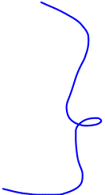

虽然运算符的语义可以被扩展，但我们不能改变其语法，即支配其使用的语法规则，例如操作数的数量、优先级和结合性。例如，乘法运算符的优先级高于加法运算符。请记住，当一个运算符被重载时，其原始含义并未丢失。例如，被重载用于两个向量相加的 `+` 运算符，仍然可以用于两个整数相加。

## 7.2 定义运算符重载

要为运算符定义额外任务，我们必须指定该运算符相对于其所应用的类意味着什么。这需要借助一个称为运算符函数的特殊函数来描述该任务。运算符函数的一般形式为：

```cpp
return type classname :: operator op(arglist)
{
    Function body // task defined
}
```

其中 `return type` 是指定操作返回值的类型，`op` 是被重载的运算符。`operator op` 是函数名，其中 `operator` 是一个关键字。

运算符函数必须是成员函数（非静态）或友元函数。它们之间的一个基本区别是：对于一元运算符，友元函数只有一个参数，对于二元运算符则有两个参数；而成员函数对于一元运算符没有参数，对于二元运算符只有一个参数。这是因为用于调用成员函数的对象是隐式传递的，因此对成员函数可用。友元函数则不是这种情况。参数可以按值传递，也可以按引用传递。运算符函数在类中使用如下原型声明：

```cpp
vector operator+(vector); // vector addition
vector operator-(); // unary minus
friend vector operator+(vector, vector); // vector addition
friend vector operator-(vector); // unary minus
vector operator-(vector &a); // subtraction
int operator==(vector); // comparison
friend int operator==(vector, vector); // comparison
```

`vector` 是一种类数据类型，既可以表示大小和方向（如在物理学和工程学中），也可以表示一系列称为元素的点（如在数学中）。

重载过程包括以下步骤：

1. 创建一个类，定义要在重载操作中使用的数据类型。
2. 在类的公有部分声明运算符函数 `operator op()`。它可以是成员函数或友元函数。
3. 定义运算符函数以实现所需操作。
4. 重载的运算符函数可以通过如下表达式调用：

   `op x` 或 `x op`

   用于一元运算符，以及

   `x op y`

   用于二元运算符。`op x`（或 `x op`）将被解释为

   `operator op(x)`

   对于友元函数。类似地，表达式 `x op y` 将被解释为

   `x.operator op(y)`

   在成员函数的情况下，或者

   `operator op(x, y)`

   在友元函数的情况下。当两种形式都被声明时，将应用标准参数匹配来解决任何歧义。

## 7.3 重载一元运算符

让我们考虑一元减运算符。减运算符用作一元运算符时，只接受一个操作数。我们知道，当应用于基本数据项时，该运算符会改变操作数的符号。我们将在这里看到如何重载此运算符，使其可以像应用于 int 或 float 变量一样应用于对象。一元减应用于对象时，应改变其每个数据项的符号。

程序7.1展示了如何重载一元减运算符。

### 程序7.1 重载一元减运算符

```cpp
#include <iostream>
using namespace std;

class space
{
    int x;
    int y;
    int z;

public:
    void getdata(int a, int b, int c);
    void display(void);
    void operator-(); // overload unary minus
};

void space::getdata(int a, int b, int c)
{
    x = a;
    y = b;
    z = c;
}

void space::display(void)
{
    cout << "x = " << x << " ";
    cout << "y = " << y << " ";
    cout << "z = " << z << "\n";
}

void space::operator-()
{
    x = -x;
    y = -y;
    z = -z;
}

int main()
{
    space S;
    S.getdata(10, -20, 30);
    cout << "S : ";
    S.display();
    -S; // activates operator-() function
    cout << "-S : ";
    S.display();
    return 0;
}
```

程序7.1的输出将是：

```
S : x = 10 y = -20 z = 30
```


-S : x = -10 y = 20 z = -30

> **注意：** 函数 operator - () 不接收参数。那么，这个运算符函数有什么作用呢？它改变对象 S 的数据成员的符号。由于该函数是同一个类的成员函数，因此它可以直接访问激活它的对象的成员。

请记住，如下语句

S2 = -S1;

将无法工作，因为 operator-() 函数不返回任何值。如果该函数被修改为返回一个对象，它就可以工作。

可以使用友元函数重载一元减运算符，如下所示：

```
friend void operator-(space &s);// declaration
void operator-(space &s)// definition
{
 s.x = -s.x;
 s.y = -s.y;
 s.z = -s.z;
}
```

> **注意：** *请注意，参数是按引用传递的。如果按值传递参数，则行不通，因为传递给 operator-() 的只是激活调用的对象的一个副本，因此运算符函数内部所做的更改不会反映到被调用的对象中。*

[PAGE 274]

## 7.4 重载二元运算符

我们刚刚看到了如何重载一元运算符。同样的机制也可用于重载二元运算符。在第6章中，我们说明了如何使用友元函数将两个复数相加。当时使用了如下语句：

```
C = sum(A, B); // functional notation.
```

函数表示法可以替换为看起来更自然的表达式

```
C = A + B; // arithmetic notation
```

通过使用 operator+() 函数重载 + 运算符即可实现。程序7.2说明了如何完成这一工作。

# **程序7.2** 重载 + 运算符

```
```cpp
#include <iostream>
using namespace std;
class complex
{
float x;  //real part
float y; // imaginary part
public:
complex(){ } //constructor 1
complex(float real, float imag) //constructor 2
{ x = real; y = imag; }
complex operator+(complex); void display(void);
};
complex complex :: operator+(complex c)
{
```
```

[PAGE 275]

```
```cpp
complex temp; //temporary
temp.x = x + c.x; // these are
temp.y = y + c.y; //float additions
return(temp);
}
void complex :: display(void)
{
    cout << x << "+j" << y << "\n";
}
int main()
{
    complex C1, C2, C3; //invokes constructor 1
    C1 = complex(2.5, 3.5); // invokes constructor 2
    C2 = complex(1.6, 2.7);
    C3 = C1 + C2;
    cout << "C1 ="; C1.display();
    cout << "C2 ="; C2.display();
    cout << "C3 ="; C3.display();
    return 0;
}
```
```

程序7.2的输出将是：

+   C1 = 2.5 + j3.5
+   
+   C2 = 1.6 + j2.7
+   
+   C3 = 4.1 + j6.2

> **注意：** *让我们仔细看看 operator+() 函数，了解运算符重载是如何实现的。*

```
```cpp
complex complex :: operator+(complex c)
{
    complex temp;
    temp.x = x + c.x;
```
```

[PAGE 276]

```
temp.y = y + c.y;
return(temp);
}
```

我们应该注意该函数的以下特点：

+   1. 它显式接收一个 complex 类型参数。
+   2. 它返回一个 complex 类型值。
+   3. 它是 complex 的成员函数。

该函数应实现两个复数相加并返回一个复数作为结果，但它只接收一个值作为参数。另一个值从哪里来？现在让我们看一下调用该函数的语句：

```
C3 = C1 + C2; // invokes operator+() function
```

我们知道，成员函数只能由同一个类的对象调用。在这里，对象 C1 负责调用该函数，C2 则作为参数传递给该函数。上述调用语句等价于

```
C3 = C1.operator+(C2); // usual function call syntax
```

因此，在 operator+() 函数中，C1 的数据成员被直接访问，而 C2（作为参数传入）的数据成员则通过点运算符访问。这样，函数就可以使用这两个对象。例如，在语句

```
temp.x = x + c.x;
```

中，c.x 引用对象 C2，而 x 引用对象 C1。temp.x 是 temp 的实部，temp 是为保存 C1 和 C2 相加结果而专门创建的对象。该函数返回 complex 类型的 temp 以赋值给 C3。图7.1显示了这是如何实现的。

[PAGE 277]

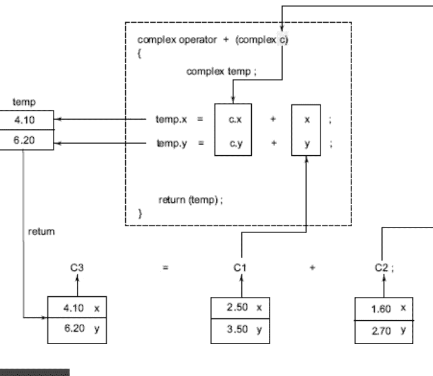

作为规则，在重载二元运算符时，左操作数用于调用运算符函数，右操作数作为参数传递。

我们可以使用以下语句替换整个函数体，从而避免创建 temp 对象：

> return complex((x+c.x),(y+c.y)); // invokes constructor 2

使用带有参数列表的类名意味着什么？当编译器遇到这样的语句时，它会调用适当的构造函数，初始化一个无名对象，并返回其内容以复制到一个对象中。这样的对象称为临时对象，其内容一旦被赋值给另一个对象，它就会消失。使用临时对象可以使代码更简短、更高效、更易读。

## 7.5 使用友元函数重载二元运算符

[PAGE 278]

如前所述，友元函数可用来代替成员函数重载二元运算符，唯一区别在于友元函数需要显式传递两个参数，而成员函数只需要一个。

上一节讨论的复数程序可以通过友元运算符函数修改如下：

+   1. 将成员函数声明替换为友元函数声明。

```
friend complex operator+(complex, complex);
```

+   2. 按如下方式重新定义运算符函数：

```
complex operator+(complex a, complex b)
{
return complex((a.x+b.x),(a.y+b.y));
}
```

在这种情况下，语句

```
C3 = C1 + C2;
```

等价于

```
C3 = operator+(C1, C2);
```

在大多数情况下，使用友元函数或成员函数会得到相同的结果。那么为什么还要提供另一种选择呢？在某些情况下，我们会希望使用友元函数而不是成员函数。例如，考虑需要对二元运算符使用两种不同类型的操作数的情况，比如一个是对象，另一个是内置类型数据，如下所示：

```
A = B + 2; (or A = B * 2;)
```

[PAGE 279]

# 对具体行政行为事实问题审查强度的规范分析

**摘要** 对具体行政行为事实问题的审查强度是行政诉讼法学上的一个核心问题，也是司法实践中的难题。现行法律和司法解释构建了以证据制度为中心的审查框架，但未能为法官提供明确的操作标准。本文通过规范分析认为，事实问题与法律问题并非截然两分，其审查强度应当是一个基于多元变量的动态裁量过程。法院对事实问题的审查强度，应当结合被诉行为所涉行政领域的专业性、对相对人权益的影响程度、行政行为的过程性等因素综合确定，并在司法能动与司法谦抑之间寻求平衡。

**关键词** 事实问题；审查强度；行政诉讼；司法审查；规范分析

**Abstract** The intensity of judicial review of factual issues in specific administrative acts is a core issue in administrative litigation law and a difficult problem in judicial practice. Current laws and judicial interpretations have established a review framework centered on evidence rules, but they fail to provide judges with clear operational standards. Through normative analysis, this paper argues that factual and legal issues are not completely separate, and the intensity of review should be a dynamic discretionary process based on multiple variables. The court’s intensity of review of factual issues should be comprehensively determined by factors such as the professionalism of the administrative field involved, the degree of impact on the rights and interests of the private party, and the procedural nature of the administrative act, while seeking a balance between judicial activism and judicial restraint.

**Key words** factual issue; intensity of review; administrative litigation; judicial review; normative analysis

一、问题的提出

行政诉讼的审查对象是具体行政行为的合法性。对事实问题的审查，是法院判断行政行为是否合法的基础性环节，也是必经环节。无论行政行为的作出依据的是何种授权，其都必须建立在行政机关对特定事实的认定之上。人民法院对行政行为进行司法审查时，对行政机关认定的事实应当采取何种态度，尊重到何种程度，即所谓事实问题的审查强度问题。

然而，对于这一具有根本意义的问题，我国《行政诉讼法》及司法解释并未作出正面、明确的规定。现行法上的审查框架，主要是围绕证据制度展开的：法院通过审查证据的真实性、合法性和关联性，进而判断被诉行政行为所认定的事实是否“证据确凿”。《行政诉讼法》第六十九条规定，行政行为“证据确凿，适用法律、法规正确，符合法定程序的”，人民法院判决驳回原告的诉讼请求；第七十条第（一）项则将“主要证据不足”作为判决撤销的具体情形之一。有学者指出，上述规定形成了一种以“证据是否确实充分”为核心的一元化审查标准，其特点是重证据而轻过程，重结果而轻理由。

但问题在于，证据与事实认定之间的关系并非单一向度的逻辑推演。对证据的取舍、对证据证明力的评价、对间接证据的推理、对相互矛盾的证据的权衡，这些环节都内含有裁量因素。不同法官面对同一证据材料，可能得出完全不同的事实认定结论。仅凭“主要证据不足”或“证据确凿”这种抽象标准，并不足以指导法官完成对事实问题的审查。二十余年来，最高人民法院通过司法解释和个案批复，不断对审查标准进行微调，引入了“明显缺乏说服力”、“滥用职权”、“显失公正”等概念，但这些概念本身亦属不确定法律概念，其适用依然有待具体化。

值得注意的是，与我国行政诉讼制度有一定渊源的德国法上，法院对事实问题的审查原则上不受限制，法院应当全面审查行政行为所依据的事实和证据；而在美国法上，法院对行政决定中的事实认定，则根据其所属类型分别适用“实质证据标准”、“专断和反复无常标准”或“法院重新审理标准”。这种差异背后，既有司法体制上的原因，也有行政法与行政诉讼理论上的深刻分歧。本文不拟全面比较两大法系的相关制度，而是试图从规范分析的路径，对我国的审查强度问题作一个理论上的梳理，并尝试提出一个具有解释力的分析框架。


```cpp
vector::vector()
{
    for(int i = 0; i < size; i++)
        v[i] = 0;
}

vector::vector(int *x)
{
    for(int i = 0; i < size; i++)
        v[i] = x[i];
}

vector operator*(int a, vector b)
{
    vector c;
    for(int i = 0; i < size; i++)
        c.v[i] = a * b.v[i];
    return c;
}

vector operator*(vector b, int a)
{
    vector c;
    for(int i = 0; i < size; i++)
        c.v[i] = b.v[i] * a;
    return c;
}

istream & operator>>(istream &din, vector &b)
{
    for(int i = 0; i < size; i++)
        din >> b.v[i];
    return(din);
}

ostream & operator<<(ostream &dout, vector &b)
{
    dout << "(" << b.v[0];
    for(int i = 1; i < size; i++)
        dout << ", " << b.v[i];
    dout << ")";
    return(dout);
}

int x[size] = {2, 4, 6};

int main()
{
    vector m; // invokes constructor 1
    vector n = x; // invokes constructor 2
    cout << "Enter elements of vector m " << "\n";
    cin >> m; // invokes operator>>() function
    cout << "\n";
    cout << "m = " << m << "\n"; // invokes operator<<()
    vector p, q;
    p = 2 * m; // invokes friend 1
    q = n * 2; // invokes friend 2
    cout << "\n";
    cout << "p = " << p << "\n"; // invokes operator<<()
    cout << "q = " << q << "\n";
    return 0;
}
```

程序7.3 的输出如下：

```text
Enter elements of vector m
5 10 15
m = (5, 10, 15)
p = (10, 20, 30)
q = (4, 8, 12)
```

该程序两次重载了运算符 `*`，从而重载了运算符函数 `operator*()` 本身。在这两种情况下，函数都被显式地传递了两个参数，并且与任何其他重载函数一样，根据其参数类型被调用。这使我们能够使用如下两种标量乘法形式：

```cpp
p = 2 * m; // equivalent to p = operator*(2,m);
q = n * 2; // equivalent to q = operator*(n,2);
```

该程序及其输出在很大程度上是不言自明的。第一个构造函数 `vector();` 构造一个所有元素均为零的向量。因此，`vector m;` 创建一个向量 m，并将其所有元素初始化为 0。第二个构造函数 `vector(int *x);` 创建一个向量，并将指针参数 x 所指向的元素复制到该向量中。因此，以下语句

```cpp
int x[3] = {2, 4, 6};
vector n = x;
```

创建了向量 n，其分量为 2、4 和 6。

> **注意：** 我们在输入和输出语句中像简单变量一样使用了 m 和 n 等 vector 变量。这是通过使用以下函数重载运算符 `>>` 和 `<<` 来实现的：
>
> `friend istream & operator>>(istream &, vector &);`
> `friend ostream & operator<<(ostream &, vector &);`
>
> `istream` 和 `ostream` 是在 `iostream.h` 文件中定义的类，该文件已包含在程序中。

ANSI C 使用字符数组、指针和字符串函数实现字符串。其中没有用于操作字符串的运算符。C 语言中字符串操作的主要缺点之一是：每当需要复制字符串时，程序员必须首先确定其长度并分配所需的内存。

虽然这些限制在 C++ 中也存在，但它允许我们创建自己的运算符定义，使得字符串的操作方式与十进制数非常相似。（最近，ANSI C++ 委员会在 C++ 类库中新增了一个名为 `string` 的类，支持各种字符串操作。使用 `string` 类进行字符串操作将在第15章讨论。）

例如，我们将能够使用如下语句：

```cpp
string3 = string1 + string2;
if(string1 >= string2) string3 = string1;
```

字符串可以定义为类对象，然后可以像内置类型一样进行操作。由于字符串的大小差异很大，我们使用 `new` 为每个字符串分配内存，并使用指针变量指向字符串数组。因此，我们必须创建能够保存这两条信息的字符串对象，即长度和位置，它们对于字符串操作是必需的。一个典型的 string 类如下所示：

```cpp
class string
{
    char *p;    // pointer to string
    int len;    // length of string
public:
    ....       // member functions
    ....       // to initialize and
    ....       // manipulate strings
};
```

我们将通过一个示例来说明重载运算符在字符串中的应用。程序7.4中的示例重载了 `+` 和 `<=` 两个运算符，仅用于演示它们的实现方式。这种方法也可以扩展以处理其他运算符。

### 程序7.4 字符串的数学运算

```cpp
#include <string.h>
#include <iostream.h>

class string
{
    char *p;
    int len;
public:
    string() { len = 0; p = 0; } // create null string
    string(const char *s);       // create string from arrays
    string(const string &s);     // copy constructor
    ~string() { delete p; }      // destructor

    // + operator
    friend string operator+(const string &s, const string &t);
    // <= operator
    friend int operator<=(const string &s, const string &t);
    friend void show(const string s);
};

string::string(const char *s)
{
    len = strlen(s);
    p = new char[len + 1];
    strcpy(p, s);
}

string::string(const string &s)
{
    len = s.len;
    p = new char[len + 1];
    strcpy(p, s.p);
}

// overloading + operator
string operator+(const string &s, const string &t)
{
    string temp;
    temp.len = s.len + t.len;
    temp.p = new char[temp.len + 1];
    strcpy(temp.p, s.p);
    strcat(temp.p, t.p);
    return(temp);
}

// overloading <= operator
int operator<=(const string &s, const string &t)
{
    int m = strlen(s.p);
    int n = strlen(t.p);
    if(m <= n) return(1);
    else return(0);
}

void show(const string s)
{
    cout << s.p;
}

int main()
{
    string s1 = "New ";
    string s2 = "York";
    string s3 = "Delhi";
    string string1, string2, string3;

    string1 = s1;
    string2 = s2;
    string3 = s1 + s3;

    cout << "\nstring1 = "; show(string1);
    cout << "\nstring2 = "; show(string2);
    cout << "\n";
    cout << "\nstring3 = "; show(string3);
    cout << "\n\n";

    if(string1 <= string3)
    {
        show(string1);
        cout << " smaller than ";
        show(string3);
        cout << "\n";
    }
    else
    {
        show(string3);
        cout << " smaller than ";
        show(string1);
        cout << "\n";
    }

    return 0;
}
```

程序7.4 的输出如下：

```text
string1 = New
string2 = York
string3 = New Delhi
New smaller than New Delhi
```

## 7.3 其他一些运算符重载示例

### 重载下标运算符 []

下标运算符通常用于访问和修改数组中的特定元素。程序7.5演示了重载下标运算符以自定义其行为：

### 程序7.5 重载下标运算符

```cpp
#include <iostream>
#include <conio.h>
using namespace std;

class arr
{
    int a[5];
public:
    arr(int *s)
    {
        int i;
        for(i = 0; i < 5; i++)
            a[i] = s[i];
    }

    int operator[](int k) // Overloading the subscript operator
    {
        return (a[k]);
    }
};

int main()
{
    int x[5] = {1, 2, 3, 4, 5};
    arr A(x);
    int i;

    for(i = 0; i < 5; i++)
    {
        cout << A[i] << "\t"; // Using subscript operator to access the private array elements
    }

    getch();
    return 0;
}
```

程序7.5 的输出如下：

```text
1 2 3 4 5
```

从上面的程序可以看出，我们结合使用了下标运算符和对象名来访问对象的私有数组元素。

### 重载成员访问运算符（->）

成员访问运算符（`->`）通常与对象指针一起使用，以访问对象的任意成员。程序7.6演示了 `->` 运算符的重载：

### 程序7.6 重载成员访问运算符（->）

```cpp
#include <iostream>
#include <conio.h>
using namespace std;

class test
{
public:
    int num;
    test(int j)
    {
        num = j;
    }

    test* operator->(void)
    {
        return this;
    }
};

int main()
{
    test T(5);
    test *Ptr = &T;

    cout << "T.num = " << T.num;              // Accessing num normally
    cout << "\nPtr->num = " << Ptr->num;      // Accessing num using normal object pointer
    cout << "\nT->num = " << T->num;          // Accessing num using overloaded -> operator

    getch();
    return 0;
}
```

程序7.6 的输出如下：

```text
T.num = 5
Ptr->num = 5
T->num = 5
```

上述程序演示了 `->` 运算符的正常行为（`Ptr->num`）以及重载行为（`T->num`）。

语句

```cpp
return this;
```

返回一个指向自身的指针，即指向 `test` 类对象的指针。

## 7.8 运算符重载规则

虽然重定义运算符看起来很简单，但在重载运算符时存在一些限制和约束。下面列出了其中一些限制：

1. 只能重载已有的运算符，不能创建新的运算符。
2. 重载的运算符必须至少有一个操作数是用户定义类型。
3. 重载的运算符必须遵循原有运算符的语法规则，不能改写这些规则。
4. 存在一些不能重载的运算符。（见表7.1）


考虑以下语句，它将两个对象相加，然后将结果赋给第三个对象。

```
v3 = v1 + v2; // v1, v2 and v3 are class type objects
```

当这些对象属于同一类类型时，加法和赋值操作都能顺利执行，编译器不会发出任何抱怨。我们已经看到，对于类对象，右侧对象的所有数据成员值都会被简单复制到左侧对象的对应成员中。如果其中一个操作数是对象，而另一个是内置类型变量，那会怎样？或者，如果它们属于两个不同的类呢？

由于用户定义的数据类型是我们为了满足自身需求而设计的，编译器不支持对这种数据类型进行自动类型转换。因此，如果需要进行此类操作，我们必须自己设计转换例程。

在不兼容类型之间的数据转换中，可能会出现三种情况：

- 1. 从基本类型到类类型的转换。
- 2. 从类类型到基本类型的转换。
- 3. 从一种类类型到另一种类类型的转换。

我们将详细讨论这三种情况。

## 基本类型到类类型

从基本类型到类类型的转换很容易完成。可以回想一下，在许多示例中，我们使用构造函数来初始化对象。例如，我们使用构造函数从 int 类型数组构建 vector 对象。类似地，我们使用另一个构造函数从 char* 类型变量构建 string 类型对象。在这些示例中，构造函数实际上都执行了从实参类型到构造函数类类型的类型转换。

考虑以下构造函数：

```
string :: string(char *a)
{
length = strlen(a);
p = new char[length+1];
strcpy(p,a);
}
```

该构造函数从 char* 类型变量 a 构建一个 string 类型对象。变量 length 和 p 是 string 类的数据成员。一旦在 string 类中定义了这个构造函数，它就可以用于从 char* 类型到 string 类型的转换。示例：

```
string s1, s2;
char* name1 = "IBM PC";
char* name2 = "Apple Computers";
s1 = string(name1);
s2 = name2;
```

语句

```
s1 = string(name1);
```

首先将 name1 从 char* 类型转换为 string 类型，然后将 string 类型的值赋给对象 s1。语句

```
s2 = name2;
```

也通过隐式调用构造函数完成了同样的工作。

让我们考虑另一个将 int 类型转换为类类型的示例。

```
class time
{
int hrs;
int mins;
public:
....
....
time(int t) //constructor
{
hrs = t/60; // t in minutes
mins = t%60;
}
};
```

可以在函数中使用以下转换语句：

```
time T1; //object T1 created
int duration = 85;
T1 = duration; // int to class type
```

经过此转换后，T1 的 hrs 成员将包含值 1，mins 成员将包含值 25，表示 1 小时 25 分钟。

> **注意：** *用于类型转换的构造函数只接受一个参数，其类型就是被转换的类型。*

在这两个示例中，= 运算符的左侧操作数始终是一个类对象。因此，我们也可以使用重载的 = 运算符来完成这种转换。

## 类类型到基本类型

构造函数在从基本类型到类类型的类型转换中表现出色。那么从类类型到基本类型的转换呢？构造函数不支持这种操作。幸运的是，C++ 允许我们定义一个重载的类型转换运算符，它可用于将类类型数据转换为基本类型。重载的类型转换运算符函数（通常称为转换函数）的一般形式是：

```
{
 ..... (Function statements)
}
```

该函数将类类型数据转换为 typename。例如，operator double() 将类对象转换为 double 类型，operator int() 将类类型对象转换为 int 类型，等等。

```
vector :: operator double()
{
 double sum = 0;
 for(int i=0; i<size; i++)
 sum = sum + v[i] * v[i];
 return sqrt(sum);
}
```

该函数将 vector 转换为相应的标量大小。回想一下，向量的大小等于其分量平方和的平方根。operator double() 可以如下使用：

```
double length = double(V1);
or
double length = V1;
```

其中 V1 是 vector 类型的对象。两个语句的效果完全相同。当编译器遇到需要将类类型转换为基本类型的语句时，它会悄悄调用类型转换运算符函数来完成这项工作。

- 它必须是类成员。
- 它不能指定返回类型。
- 它不能有任何参数。

由于它是成员函数，由对象调用，因此函数内用于转换的值属于调用该函数的对象。这意味着该函数不需要参数。

在前一节描述的 string 示例中，我们可以如下进行从 string 到 char* 的转换：

```
string :: operator char*()
{
return(p);
}
```

## 一个类类型到另一个类类型

我们刚刚看到了从基本类型到类类型以及从类类型到基本类型的数据转换技术。但有些情况下，我们希望将一种类类型的数据转换为另一种类类型。示例：

```
objX = objY; // objects of different types
```

**objX** 是类 **X** 的对象，**objY** 是类 **Y** 的对象。类 **Y** 的类型数据被转换为类 **X** 的类型数据，转换后的值被赋给 **objX**。由于转换是从 **类 Y** 到 **类 X** 进行的，Y 称为源类，X 称为目标类。

不同类对象之间的这种转换可以通过构造函数或转换函数来完成。编译器对它们的处理方式相同。那么，我们如何决定使用哪种形式呢？这取决于我们希望将类型转换函数位于源类中还是目标类中。

我们知道，类型转换运算符函数

`Operator typename()`

将其所属的类对象转换为 typename。typename 可以是内置类型，也可以是用户定义的类型（另一个类类型）。在对象之间的转换中，typename 指的是目标类。因此，当需要转换一个类时，可以使用类型转换运算符函数（即，在源类中）。转换在源类中进行，结果交给目标类对象。

现在考虑一个单参数构造函数，它作为将实参类型转换为其所属类类型的指令。这意味着实参属于源类，并被传递给目标类进行转换。这使得转换构造函数必须放在目标类中。图 7.2 说明了这两种方法。


表 7.3 总结了所有三种转换。它表明，从类到任何其他类型（或任何其他类）的转换应在源类中使用类型转换运算符。另一方面，要执行从任何其他类型/类到类类型的转换，应在目标类中使用构造函数。

当在目标类中使用构造函数进行转换时，我们必须能够访问由源类作为实参发送来的对象的数据成员。由于源类的数据成员是私有的，我们必须使用源类中的特殊访问函数来促进其数据流向目标类。

## 数据转换示例

让我们考虑一个商店产品库存的示例。记录产品详细信息的一种方式是记录它们的代码编号、库存总数和每件物品的成本。另一种方法是只指定物品代码和库存中该物品的价值。程序 7.7 中的示例使用了两个类，并展示了如何将一种类型的数据转换为另一种类型。

```
#include <iostream>
using namespace std;
class invent2; //destination class declared
class invent1 //source class
{
int code; //item code
int items; //no. of items
float price; //cost of each item
public:
invent1(int a, int b, float c)
{
code = a;
items = b;
price = c;
}
void putdata()
{
cout << "Code: " << code << "\n";
cout << "Items: " << items << "\n";
cout << "Value: " << price << "\n";
}
int getcode() {return code;}
int getitems() {return items;}
```


class invent1
{
int code;
float price;
public:
invent1()
{
code = 0;
price = 0;
}
invent1(int x, float y) // constructor for initialization
{
code = x;
price = y;
}
float getprice()
{
return price;
}
float getcode()
{
return code;
}
float getitems()
{
return code;
}
};
class invent2
{
int code;
float value;
public:
invent2()
{
code = 0;
value = 0;
}
invent2(int x, float y) // constructor for initialization
{
code = x;
value = y;
}
void putdata()
{
cout << "Code: " << code << "\n";
cout << "Value: " << value << "\n";
}
invent2(invent1 p) // constructor for conversion
{
code = p.getcode();
value = p.getitems() * p.getprice();
}
};
int main()
{
invent1 s1(100,5,140.0);
invent2 d1;
float total_value;
total_value = s1;
d1 = s1;
}
## Summary

- Operator overloading is one of the important features of C++ language that enhances its exhaustibility.
- Using overloading feature we can add two user defined data types such as objects, with the same syntax, just as basic data types.
- We can overload almost all the C++ operators except the following:
    - class member access operators(., .*)
    - scope resolution operator (::)
    - size operator(sizeof)
    - conditional operator(?:)
- Operator overloading is done with the help of a special function, called operator function, which describes the special task to an operator.
- There are certain restrictions and limitations in overloading operators. Operator functions must either be member functions (nonstatic) or friend functions. The overloading operator must have at least one operand that is of user- defined type.

## Debugging Exercises

### 7.1 Identify the error in the following program.

```
#include <iostream.h>
class Space
{
int mCount;
public:
Space()
{
mCount = 0;
}
Space operator ++()
{
mCount++;
return Space(mCount);
}
};
void main()
{
Space objSpace;
objSpace++;
}
```

### 7.2 Identify the error in the following program.

```
#include <iostream.h>
enum WeekDays
{
mSunday,
mMonday,
mTuesday,
mWednesday,
mThursday,
mFriday,
mSaturday
};
bool op==(WeekDays& w1, WeekDays& w2)
{
if(w1 == mSunday && w2 == mSunday)
return 1;
else if(w1 == mSunday && w2 == mSunday)
return 1;
else if(w1 == mSunday && w2 == mSunday)
return 1;
else if(w1 == mSunday && w2 == mSunday)
return 1;
else if(w1 == mSunday && w2 == mSunday)
return 1;
else if(w1 == mSunday && w2 == mSunday)
return 1;
else if(w1 == mSunday && w2 == mSunday)
return 1;
else
return 0;
}
void main() {
WeekDays w1 = mSunday, w2 = mSunday;
if(w1 == w2)
cout << "Same day";
else
cout << "Different day";
}
```

### 7.3 Identify the error in the following program.

```
#include <iostream.h>
class Room
{
float mWidth;
float mLength;
public:
Room()
{
}
Room(float w, float h) :mWidth(w), mLength(h)
{
}
operator float()
{
    return (float)mWidth * mLength;
}
float getWidth()
{
}
float getLength()
{
    return mLength;
}
};
void main()
{
Room objRoom1(2.5, 2.5);
float fTotalArea;
fTotalArea = objRoom1;
cout << fTotalArea;
}
```

## Programming Exercises

**NOTE:** For all the exercises that follow, build a demonstration program to test your code.

- 7.1 Create a class FLOAT that contains one float data member. Overload all the four arithmetic operators so that they operate on the objects of FLOAT.


```cpp
void show_a(void);
};
class D : private B// private derivation
{
int c;
public:
void mul(void);
void display(void);
};
//--------------------------------------------------
void B :: get_ab(void)
{
cout << "Enter values for a and b: ";
cin >> a >> b;
}
int B :: get_a()
{
return a;
}
void B :: show_a()
{
cout << "a = " << a << "\n";
}
void D :: mul()
{
get_ab();
c = b * get_a();// 'a' cannot be used directly
}
void D :: display()
{
show_a();// outputs value of 'a'
cout << "b = " << b << "\n" << "c = " << c << "\n";
}
//
int main()
{
D d;
// d.get_ab(); WON'T WORK
d.mul();
// d.show_a(); WON'T WORK
d.display();
// d.b = 20; WON'T WORK; b has become private
d.mul();
d.display();
return 0;
}
```

程序 8.2 的输出为：

```
Enter values for a and b: 5 10
a = 5
b = 10 c = 50
Enter values for a and b: 12 20
a = 12
b = 20 c = 240
```

假设一个基类和一个派生类定义了同名函数。当派生类对象调用该函数时会发生什么？在这种情况下，派生类的函数会取代基类的定义。但是，如果派生类没有重新定义该函数，那么将调用基类的函数。

## 8.4 使私有成员可继承

我们刚刚了解了如何在不修改现有类的情况下增强其功能。我们也看到，基类的私有成员不能被继承，因此派生类无法直接使用它。如果私有数据需要被派生类继承，我们该怎么办？可以通过将私有成员的可见性限制改为公有来实现。但这会使程序中的所有其他函数都能访问它，从而失去数据隐藏的优势。

C++ 提供了第三种可见性修饰符 protected（受保护），它在继承中具有有限的作用。声明为 protected 的成员可以被其类内的成员函数以及直接从其派生的任何类的成员函数访问。这两个类之外的函数不能访问它。一个类现在可以使用如下所示的全部三种可见性模式：

```cpp
class alpha
{
    private: // optional
    .....// visible to member functions
    .....// within its class
    protected:
    .....// visible to member functions
    .....// of its own and that of derived class
    public:
    .....// visible to all functions
    .....// in the program
};
```

当一个 protected 成员以公有模式被继承时，它在派生类中也成为 protected，因此可以被派生类的成员函数访问。同时它也准备好被进一步继承。protected 成员以私有模式派生继承时，会成为派生类中的私有成员。虽然派生类的成员函数可以使用它，但它不能用于进一步继承（因为私有成员不能被继承）。图 8.4 是这两种派生级别的图示。

关键字 private、protected 和 public 在类的声明中可以按任意顺序、任意次数出现。例如，

```cpp
protected:
public:
};
```

也可以在 **保护**模式下继承基类（称为_保护派生_）。在保护派生中，基类的 **公有**和**保护**成员都成为派生类的 **保护**成员。表 8.1 总结了在全部三种派生类型中基类成员的可见性会如何变化。

| 基类可见性 | | 公有派生 | 私有派生 | 保护派生 |
|---|---|---|---|---|
| 私有 | → | 不被继承 | 不被继承 | 不被继承 |
| 保护 | → | 保护 | 私有 | 保护 |
| 公有 | → | 公有 | 私有 | 保护 |

1. 类的友元函数。
2. 友元类的成员函数。
3. 派生类的成员函数。

友元函数和友元类的成员函数可以直接访问 **私有**和**保护**数据，而派生类的成员函数只能直接访问 **保护**数据。但是，它们可以通过基类的成员函数访问 **私有**数据。图 8.5 展示了在各种情况下访问控制机制是如何工作的。图 8.6 给出了对类成员访问控制的一种简化视图。

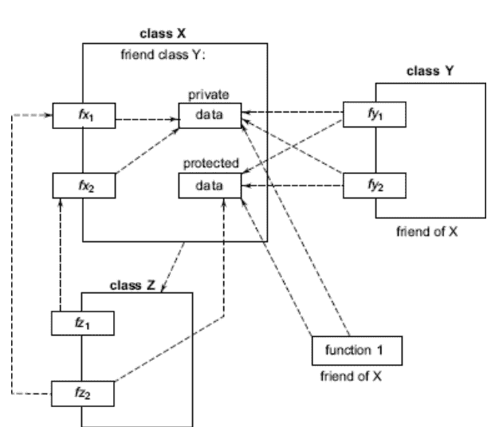

## 8.5 多级继承

如图 8.7 所示，从一个派生类再派生出另一个类的情况并不少见。类 A 作为派生类 B 的基类，而 B 又作为派生类 C 的基类。类 B 被称为_中间基类_，因为它为 A 和 C 之间的继承提供了链接。链 ABC 被称为继承路径。

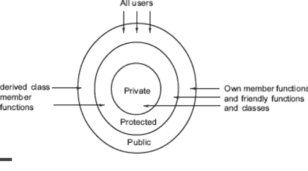

图 8.6 对类成员访问控制的一种简化视图

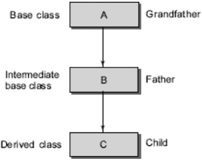

图 8.7 多级继承


具有多级继承的派生类声明如下：

```cpp
class A{ }; // Base class
class B: public A { }; // B derived from A
class C: public B { }; // C derived from B
```

这个过程可以扩展到任意级数。

让我们看一个简单的例子。假设一批学生的测试结果存储在三个不同的类中。类 **student** 存储学号，类 **test** 存储两门科目取得的分数，类 **result** 包含测试中取得的**总**分。类 **result** 可以通过多级继承获得测试成绩的详细信息以及学生的学号。示例：

```cpp
class student
{
protected:
int roll_number;
public:
void get_number(int);
void put_number(void);
};
void student :: get_number(int a)
{
roll_number = a;
}
void student :: put_number( )
{
cout << "Roll Number: " << roll_number << "\n";
}
class test : public student// First level derivation
{
protected:
float sub1;
float sub2;
public:
void get_marks(float, float);
void put_marks(void);
};
void test :: get_marks(float x, float y)
{
sub1 = x;
sub2 = y;
}
void test :: put_marks()
{
cout << "Marks in SUB1 = " << sub1 << "\n";
cout << "Marks in SUB2 = " << sub2 << "\n";
}
class result : public test// Second level derivation
{
float total; // private by default
public:
void display(void);
};
```

类 **result** 经过从“祖父”经“父亲”的继承后，将包含以下成员：

```cpp
private:
float total; // own member
protected:
int roll_number; // inherited from student
// via test
float sub1; // inherited from test
float sub2; // inherited from test
public:
void get_number(int); // from student via test
void put_number(void); // from student via test
void get_marks(float, float); // from test
void put_marks(void); // from test
void display(void); // own member
```

继承的函数 `put_number()` 和 `put_marks()` 可用于 `display()` 函数的定义中：

```cpp
void result :: display(void)
{
    total = sub1 + sub2;
    put_number(); put_marks();
    cout << "Total = " << total << "\n";
}
```

下面是一个简单的 `main()` 程序：

```cpp
int main()
{
    result student1; // student1 created
    student1.get_number(111);
    student1.get_marks(75.0, 59.5);
    student1.display();
    return 0;
}
```

这将显示 **student1** 的结果。完整程序见程序 8.3。

```cpp
{
cout << "Marks in SUB1 = " << sub1 << "\n";
cout << "Marks in SUB2 = " << sub2 << "\n";
}
class result : public test // Second level derivation
{
float total; // private by default
public:
void display(void);
};
void result :: display(void)
{
total = sub1 + sub2;
put_number();
put_marks();
cout << "Total = " << total << "\n";
}
int main()
{
result student1; // student1 created
student1.get_number(111);
student1.get_marks(75.0, 59.5);
student1.display();
return 0;
}
```

程序 8.3 的输出为：

```
Roll Number: 111
Marks in SUB1 = 75
Marks in SUB2 = 59.5
Total = 134.5
```

## 8.6 多重继承


## 8.4 多重继承

类可以像图 8.8 所示继承于两个或多个类。这称为 *多重继承*。多重继承允许我们以现有类的特征为基础来定义新类。它就像孩子从一位父母那里继承体能，从另一位父母那里继承智力。

**Fig. 8.8** *多重继承*

带有多个基类的派生类语法如下：

```
class D: visibility B-1, visibility B-2 ...
{
....
....(Body of D)
....
}
```

其中， *visibility* 可以是 **public** 或 **private**。基类之间用逗号分隔。

示例：

```
class P : public M, public N
{
public:
void display(void);
};
```

类 M 和 N 定义如下：

```
class M
{ 
protected: 
int m; 
public: 
void get_m(int); 
void M :: get_m(int x)
{ 
m = x; 
}
class N
{ 
protected: 
int n; 
public: 
void get_n(int); 
};
void N :: get_n(int y)
{ 
n = y; 
}
```

如上所述，派生类 P 包含 M 和 N 的所有成员以及其自身成员，如下所示：

```
class P
{ 
protected: 
int m; // from M 
int n; // from N 
public: 
void get_m(int); // from M 
void get_n(int); // from N 
void display(void); // 自己的成员
};
```

成员函数 display() 可以定义为：

```
void P :: display(void)
{
cout << “m = “ << m << “\n”;
cout << “n = “ << n << “\n”;
cout << “m*n =” << m*n << “\n”;
};
```

提供用户界面的 main() 函数可以写成：

```
main()
{
P p;
p.get_m(10);
p.get_n(20);
p.display();
}
```

程序 8.4 展示了完整代码，说明三个类在多重继承模式下的实现。

```
#include <iostream>
using namespace std;
class M
{
protected:
int m;
public:
void get_m(int);
};
class N
```

```
{ 
protected: 
int n; 
public: 
void get_n(int); 
}; 
class P : public M, public N 
{ 
public: 
void display(void); 
}; 
void M :: get_m(int x) 
{ 
m = x; 
}
void N :: get_n(int y) 
{ 
n = y; 
}
void P :: display(void) 
{ 
cout << "m = " << m << "\n"; 
cout << "n = " << n << "\n"; 
cout << "m*n = " << m*n << "\n";
int main() 
{ 
P p; 
p.get_m(10); 
p.get_n(20); 
p.display(); 
return 0; 
}
```

程序 8.4 的输出如下：

[PAGE 332]

<!-- no content -->

[PAGE 333]

```
M:: display();
}
```

我们可以如下使用派生类：

```
int main()
{
P p;
p.display();
}
```

即使在单继承的应用中也可能出现歧义。例如：

```
class A
{
public:
void display()
{
cout << “A\n”;
}
};
class B : public A
{
public:
void display()
{
cout << “B\n”;
}
};
```

此时，B 类型的对象调用 display() 时，会调用 B 中定义的函数，从而覆盖了继承自 A 的函数。但可以通过作用域解析运算符显式调用 A 中的函数。

示例：

[PAGE 334]

```
int main()
{
B b; // 派生类对象
b.display(); // 调用 B 中的 display()
b.A::display(); // 调用 A 中的 display()
b.B::display(); // 调用 B 中的 display()
return 0;
}
```

这将产生以下输出：

+   B
+   A
+   B

## 8.7 层次继承

我们迄今讨论了如何通过继承在类不满足特定需求时对其进行修改。通过继承可以在类的基础上添加成员，以扩展其功能。继承的另一个有趣用途是支持程序的层次化设计。许多编程问题可以表示为层次结构，某一层的特征会被其下层的多个类共享。

例如，图 8.9 展示了大学中学生的层次分类。另一个例子是商业银行账户的分类，如图 8.10 所示。所有学生都有共同的特征，所有账户也具备共同特征。

[PAGE 335]

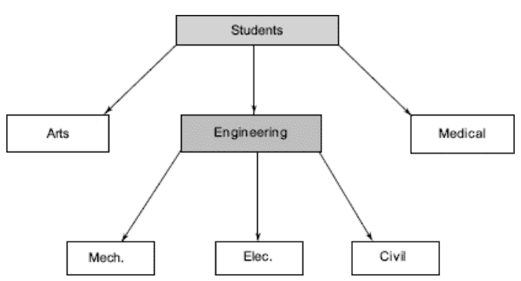

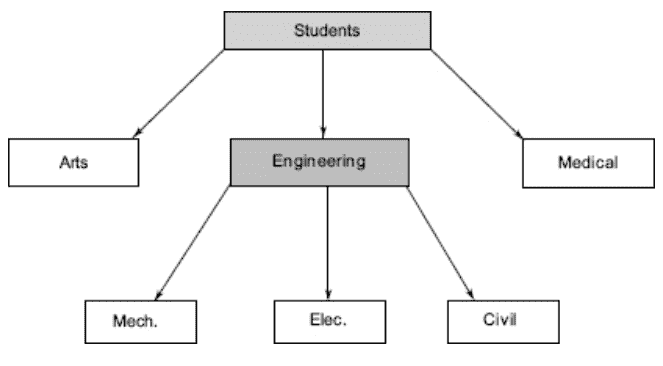

在 C++ 中，这类问题可以轻松转化为类层次结构。基类包含所有子类共享的特征。子类通过继承基类的属性来构建。子类可以作为低层类的基类，以此类推。

有时我们需要结合两种或更多种继承方式来设计程序。例如，考虑以下情况：

[PAGE 336]

<!-- no content -->

[PAGE 337]

```
class test : public student
{
...
...
};
```

程序 8.5 展示了多级继承和多重继承的实现。

# 程序 8.5 混合继承

```
#include <iostream>
using namespace std;
class student
{
protected:
int roll_number;
public:
void get_number(int a)
{
roll_number = a;
}
void put_number(void)
{
cout << “Roll No: ” << roll_number << “\n”;
}
};
class test : public student
{
protected:
float part1, part2;
public:
void get_marks(float x, float y)
{
part1 = x; part2 = y;
}
void put_marks(void) {
    cout << “Marks obtained: “ << “\n”
         << “Part1 = “ << part1 << “\n”
         << “Part2 = “ << part2 << “\n”;
}
};
class sports
{
protected:
    float score;
public:
    void get_score(float s)
    {
        score = s;
    }
    void put_score(void)
    {
        cout << “Sports wt: “ << score << “\n\n”;
    }
};
class result : public test, public sports
{
    float total;
public:
    void display(void);
};
void result :: display(void)
{
    total = part1 + part2 + score;
    put_number();
    put_marks();
    put_score();
    cout << “Total Score: ” << total << “\n”;
}
int main()
```

```
{
    result student_1;
    student_1.get_number(1234);
    student_1.get_marks(27.5, 33.0);
    student_1.get_score(6.0);
    student_1.display();
    return 0;
}
```

程序 8.5 的输出如下：

Roll No: 1234
Marks obtained:
Part1 = 27.5
Part2 = 33
Sports wt: 6
Total Score: 66.5

## 8.9 虚基类

我们刚才讨论了需要同时使用多重继承和多级继承的情况。考虑一种情况，其中涉及多级、多重和层次继承。如图 8.12 所示。

‘child’ 类有两个 *直接基类* ‘parent1’ 和 ‘parent2’，它们各自都有一个共同的基类。

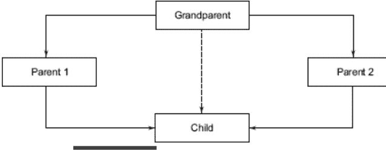

[PAGE 340]

# 图 8.12 多路继承

如图 8.12 所示，‘child’ 类通过两条路径继承自 ‘grandparent’，分别经由 ‘parent1’ 和 ‘parent2’。这会导致 ‘child’ 类中 ‘grandparent’ 的成员被复制两份，造成歧义，应避免。

通过使公共基类（祖先类）成为 *虚基类*，并在声明直接或间接基类时使用虚继承，可以避免这种重复继承：

```
class A // *grandparent*
{
....
....
};
class B1 : virtual public A // *parent1*
{
....
....
};
class B2 : public virtual A // *parent2*
{
....
....
};
class C : public B1, public B2 // *child*
{
.... // *只有一份 A 的副本*
.... // *会被继承*
};
```

> 当类被声明为 *virtual* 基类时，C++ 会确保无论存在多少条继承路径，虚基类只会被复制一次。

> **注意**：关键字 **virtual** 和 **public** 的顺序可以互换。

例如，再次参考第 8.8 节中讨论的学生成绩处理系统。假设类 **sports** 继承自 **student**，则继承关系如图 8.13 所示。

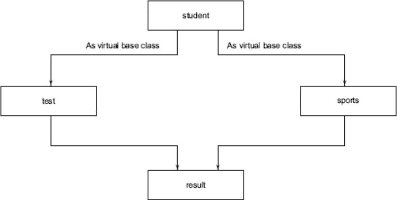

**Fig. 8.13** *虚基类*

实现虚基类概念的程序示例见程序 8.6。


#include <iostream>
using namespace std;
class student
{
protected:
int roll_number;
public:
void get_number(int a)
{
roll_number = a;
}
void put_number(void)
{
cout << "Roll No: " << roll_number << "\n";
}
};
class test : virtual public student
{
protected:
float part1, part2;
public:
void get_marks(float x, float y) {
part1 = x; part2 = y;
}
void put_marks(void)
{
cout << "Marks obtained: " << "\n"
<< "Part1 = " << part1 << "\n"
<< "Part2 = " << part2 << "\n";
}
};
class sports : public virtual student
{
protected:
float score;
public:
```cpp
Roll No: 678  
Marks obtained:  
Part 1 = 30.5  
Part 2 = 25.5  
Sport wt: 7  
Total Score: 63
```

在上面的示例中，result 类从 student 类只继承了一份 **roll_number** 变量副本。因此，任何派生类对 **roll_number** 所做的修改都是针对这一个实例进行的。这保证了数据的完整性。

## 8.10 抽象类

*抽象类*是一种不用于创建对象的类。抽象类仅设计作为基类（供其他类继承）。它是程序开发中的一种设计概念，并提供了可供其他类构建的基础。

在真实编程场景中，抽象基类的概念具有重要意义。程序中刻意使用抽象基类来创建派生类，而不是用于创建实例对象，正如程序 8.6 中的 **student** 类所示。可以通过一个抽象基类 **vehicle** 的示例进一步解释这个概念：可以在程序中声明该基类，用于派生 **LMV**（轻型机动车辆）、**HMV**（重型机动车辆）和 **TW**（两轮车）派生类。纯虚函数 **spec()** 可以根据四轮和较小发动机为 **LMV** 设置规格，根据八轮或更多轮和相对较大发动机为 **HMV** 设置规格。

虽然这里使用抽象基类 vehicle 看起来是可选的，但就逻辑程序设计而言，它具有重要意义。此外，我们还可以将派生类的一些共同特征包含在抽象基类本身中。例如，速度、里程、转数等就是

[PAGE 345]

vehicle 基类的所有派生类共同具备的一些特征。然而，决不要忘记这一事实：根据定义，只有当类至少包含一个纯虚函数时，它才能被视为抽象类。

使用抽象类的一般形式如下所示：

```
class vehicle //abstract base class
{
private:
data-type d1; data-type d2;
public:
virtual void spec()=0; //pure virtual function
};
class LMV : public vehicle
{
public:
void spec()
{
//LMV definition of spec function
}
};
class HMV : public vehicle
{
public:
void spec() {
//HMV definition of spec function
}
};
class TW : public vehicle
{
public:
void spec() {
//TW definition of spec function
}
};
```

[PAGE 346]

## 8.11 派生类中的构造函数

我们知道，构造函数在初始化对象方面发挥着重要作用。为了简单起见，此前在派生类中没有使用它们。这里需要注意的一个重要事项是，只要基类构造函数不接收任何参数，派生类就不需要有构造函数。然而，如果任何基类包含带有一个或多个参数的构造函数，那么派生类就必须有构造函数，并将参数传递给基类构造函数。请记住，在进行继承时，我们通常使用派生类创建对象。因此，派生类向基类构造函数传递参数是合理的。当派生类和基类都包含构造函数时，基类构造函数先执行，然后派生类中的构造函数再执行。

对于多重继承，基类按照它们在派生类声明中出现的顺序*构造*。类似地，在多级继承中，构造函数将按照*继承顺序*执行。

由于派生类负责向基类提供初始值，当声明派生类对象时，我们要一起提供所有类所需的初始值。这些值如何传递给基类构造函数，以便它们完成工作？C++ 为此类情况提供了一种特殊的参数传递机制。

派生类的构造函数将整个值列表作为其参数接收，并按它们在派生类中声明的顺序将这些值传递给基类构造函数。在执行派生构造函数体中的语句之前，基类构造函数会被调用并执行。

定义派生构造函数的一般形式是：

[PAGE 347]

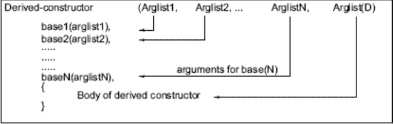

*派生构造函数*函数的头行包含两个由冒号（:）分隔的部分。第一部分提供传递给*派生构造函数*的参数的声明，第二部分列出对基类构造函数的调用。

*base1(arglist1), base2(arglist2), ...* 是对基类构造函数 **base1()**、**base2()** 等的函数调用，因此 *arglist1、arglist2* 等表示传递给基类构造函数的实际参数。*Arglist1* 到 *ArglistN* 是基类构造函数 *base1* 到 *baseN* 的参数声明。*ArglistD* 提供初始化派生类成员所需的参数。

示例：

```
D(int a1, int a2, float b1, float b2, int d1):
A(a1, a2), /* call to constructor A */
B(b1, b2) /* call to constructor B */
{
d = d1; // executes its own body
}
```

A(a1, a2) 调用基类构造函数 **A()**，B(b1, b2) 调用另一个基类构造函数 **B()**。构造函数 **D()** 为这四个参数提供值。此外，它自身还有一个参数。构造函数 **D()** 共有五个参数。**D()** 可以如下调用：

```
....
D objD(5, 12, 2.5, 7.54, 30);
....
```

[PAGE 348]

构造函数 D() 将这些值分配给各个参数，如下所示：

+   5 — a1
+   12 — a2
+   2.5 — b1
+   7.54 — b2
+   30 — d1

虚基类的构造函数在任何非虚基类之前调用。如果有多个虚基类，则按照它们声明的顺序调用。然后，在派生类构造函数执行之前，会构造任何非虚基类。参见

\begin{tabular}{cc}
Method of inheritance & Order of execution \\
Class B: public A & A() ; 基类构造函数 \\
{ & B() ; 派生构造函数 \\
}; &  \\
class A : public B, public C & B() ; 基类（第一个） \\
{ & C() ; 基类（第二个） \\
}; & A() ; 派生 \\
class A : public B, virtual public C & C() ; 虚基类 \\
{ & B() ; 普通基类 \\
}; & A() ; 派生 \\
\end{tabular}

程序 8.7 展示了类被继承时构造函数是如何实现的。

# 程序 8.7 派生类中的构造函数

```
#include <iostream>
using namespace std;
```

[PAGE 349]

```cpp
class alpha
{
int x;
public:
alpha(int i)
{
x = i;
cout << “alpha initialized \n”;
}
void show_x(void)
{ cout << “x = “ << x << “\n”;
}
};
class beta
{
float y;
public:
beta(float j)
{
y = j;
cout << “beta initialized \n”;
}
void show_y(void)
{ cout << “y = “ << y << “\n”; }
};
class gamma: public beta, public alpha
{
int m, n;
public:
gamma(int a, float b, int c, int d):
alpha(a), beta(b)
{
m = c;
n = d;
cout << “gamma initialized \n”;
}
void show_mn(void)
{
```
```

[PAGE 350]

```
cout << "m = " << m << "\n" << "n = " << n << "\n";
}
int main()
{
gamma g(5, 10.75, 20, 30);
cout << "\n";
g.show_x();
g.show_y();
g.show_mn();
return 0;
}
```

程序 8.7 的输出将是：

+   beta initialized
+   alpha initialized
+   gamma initialized
+   x = 5
+   y = 10.75
+   m = 20
+   n = 30

> 注意：beta 首先被初始化，尽管它在派生构造函数中排在第二位。这是因为 beta 在派生类头行中首先声明。另外，请注意 alpha(a) 和 beta(b) 是函数调用。因此，参数不应包含类型。

C++ 支持另一种初始化类对象的方法。该方法在构造函数中使用所谓的初始化列表。其形式如下：


```cpp
constructor (arglist) : initialization-section
{ assignment-section
}
```

_赋值部分_ 只是构造函数函数的主体，用于为其数据成员赋初始值。冒号后面紧跟的部分称为 _初始化部分_。我们可以使用此部分为基构造函数提供初始值，并初始化其自身的类成员。这意味着我们可以使用任一节来初始化构造函数类的成员数据。初始化部分基本上包含由逗号分隔的初始化列表。此列表称为 _初始化列表_。考虑一个简单示例：

```cpp
class XYZ
{
int a;
int b;
public:
XYZ(int i, int j) : a(i), b(2 * j) { }
};
main()
{
XYZ x(2, 3);
}
```

此程序将把 **a** 初始化为 2，**b** 初始化为 6。注意数据成员是如何初始化的，只需使用变量名后跟用括号括起的初始化值（像函数调用一样）。参数列表中的任何参数都可作为初始化值使用，且列表中的项目可以按任意顺序排列。例如，构造函数 **XYZ** 也可以写成：

```cpp
XYZ(int i, int j) : b(i), a(i + j) { }
```

在这种情况下，**a** 将被初始化为 5，**b** 为 2。记住，数据成员是按照声明的顺序进行初始化的，与初始化列表中的顺序无关。这使我们能够有如下语句

```cpp
XYZ(int i, int j) : a(i), b(a * j) { }
```

这里 a 被初始化为 2，b 为 6。记住，先声明的 a 先被初始化，然后其值被用来初始化 b。然而，以下写法将不起作用：

```cpp
XYZ(int i, int j) : b(i), a(b * j) { }
```

因为 b 的值在需要先初始化的 a 中不可用。

以下语句也是有效的：

```cpp
XYZ(int i, int j) : a(i) { b = j; }
XYZ(int i, int j) { a = i; b = j; }
```

如果不需要，我们可以省略任一节。程序 8.8 说明了在基类和派生类构造函数中使用初始化列表。

## Program 8.8 Initialization List in Constructors

```cpp
#include <iostream>
using namespace std;
class alpha
{
int x;
public:
alpha(int i)
{
x = i;
cout << "\n alpha constructed";

g.show_beta();
g.show_gamma();
return 0;
};
```

程序 8.8 的输出为：

```
beta constructed
alpha constructed
gamma constructed
Display member values
x = 4
p = 2.5
q = 5
u = 2
v = 4
```

> **NOTE:** *派生构造函数 **gamma** 的参数列表仅包含三个参数 **a**、**b** 和 **c**，它们用于初始化三个类中包含的五个数据成员。*

## 8.12 Member Classes: Nesting of Classes

继承是将一个类的某些属性派生到另一个类的机制。我们已经详细了解了如何使用派生类的概念来实现这一点。C++ 还支持另一种将一个类的属性继承到另一个类的方式。这种方法认为一个对象可以是许多其他对象的集合。也就是说，一个类可以包含其他类的对象作为其成员，如下所示：

```cpp
class alpha {...};
class beta {...};
```

```cpp
class gamma
{
alpha a; // a 是 alpha 类的对象
beta b; // b 是 beta 类的对象
....
};
```

**gamma** 类的所有对象都将包含对象 **a** 和 **b**。这种关系称为 *包含关系* 或 *嵌套*。创建包含另一个对象的对象与创建独立对象非常不同。独立对象在声明时带参数时由其构造函数创建。另一方面，嵌套对象是分两阶段创建的。首先，使用各自的构造函数创建成员对象，然后创建其他成员。这意味着，所有成员对象的构造函数都应在自身构造函数体执行之前被调用。这是通过在嵌套类的构造函数中使用初始化列表来实现的。

示例：

```cpp
class gamma
{
....
alpha a; // a 是 alpha 的对象
beta b; // b 是 beta 的对象
public:
gamma(arglist): a(arglist1), b(arglist2)
{
// 构造函数体
}
};
```

*arglist* 是在定义 **gamma** 对象时要提供的参数列表。这些参数用于初始化 **gamma** 的成员。*arglist1* 是 **a** 的构造函数的参数列表，*arglist2* 是 **b** 的构造函数的参数列表。*arglist1* 和 *arglist2* 可能使用也可能不使用来自 *arglist* 的参数。

记住，_a_(_arglist1_) 和 _b_(_arglist2_) 是函数调用，因此参数不包含数据类型。它们只是变量或常量。

```cpp
gamma(int x, int y, float z) : a(x), b(x,z)
{
赋值部分（用于普通其他成员）
}
```

我们可以在一个类中使用任意多个成员对象。对于每个成员对象，我们在初始化列表中添加一个构造函数调用。成员对象的构造函数是按照它们在嵌套类中声明的顺序调用的。

## Summary

- 将新类从旧类派生出来的机制称为继承。继承提供了可重用性的概念。C++ 类可以通过继承被重用。
- 派生类继承基类的部分或全部属性。
- 只有一个基类的派生类称为单继承。
- 一个类可以从多个类继承属性，这称为多继承。
- 一个类可以从另一个派生类派生，这称为多级继承。
- 当一个类的属性被多个类继承时，这称为层次继承。
- 类的私有成员无论在公有模式还是私有模式下都不能被继承。
- 在公有模式下继承的受保护成员变为受保护，而在私有模式下继承则在派生类中变为私有。
- 在公有模式下继承的公有成员变为公有，而在私有模式下继承则在派生类中变为私有。
- 友元函数和友元类的成员函数可以直接访问私有和受保护的数据。
- 派生类的成员函数只能直接访问受保护和公有数据。然而，它们可以通过基类的成员函数访问私有数据。
- 多路径继承可能导致从“祖父”基类继承的成员重复。这可以通过将公共基类设为虚基类来避免。
- 在多继承中，基类是按照它们在派生类声明中出现的顺序构造的。
- 在多级继承中，构造函数是按照继承顺序执行的。
- 一个类可以包含其他类的对象。这称为包含关系或嵌套。

## Key Terms

- abstract class
- access control
- access mechanism
- ancestor class
- assignment section
- base class
- base constructor
- child class
- common base class
- containership
- derivation
- derived class
- derived constructor
- direct base class
- dot operator
- duplicate members
- father class
- **friend**
- grandfather class
- grandparent class
- hierarchical inheritance
- hybrid inheritance
- indirect base class
- inheritance
- inheritance path
- initialization list
- initialization section
- intermediate base
- member classes
- multilevel inheritance
- multiple inheritance
- nesting
- **private**
- private derivation
- private members
- privately derived
- **protected**
- protected members
- **public**
- public derivation
- public members
- publicly derived
- reusability
- single inheritance
- subclass
- virtual base class
- visibility mode
- visibility modifier

## Review Questions

- 8.1 C++ 中的继承是什么意思？
- 8.2 继承有哪些不同形式？请为每种形式举例。
- 8.3 描述 C++ 中单继承的语法。
- 8.4 我们知道基类的私有成员不可继承。是否以任何方式可能让派生类的对象访问基类的私有成员？如果可以，如何实现？记住，基类不能被修改。
- 8.5 以下两个派生类的属性有何不同？

  - (a) `class D1: private B{//...};`
  - (b) `class D2: public B{//....};`

- 8.6 我们在何时对类成员使用受保护的可见性说明符？


8.1 程序中的错误在于 `Student` 类的构造函数是私有的，但 `AnualTest` 类没有在 `Student` 类中调用构造函数，导致编译错误。正确的写法应该是将 `Student` 类的构造函数改为公开的，或者在 `AnualTest` 类中显式调用 `Student` 的构造函数。

8.2 程序中的错误在于 `C` 类的构造函数中缺少分号，导致编译错误。正确的写法应该是将 `cout << "C";` 后面加上分号。

8.3 程序中的错误在于 `A` 类和 `AB` 类的定义不完整，缺少分号，导致编译错误。正确的写法应该是将 `A` 类和 `AB` 类的定义都加上分号。

8.5 程序中的错误在于 `B1` 类的 `display` 方法定义不完整，缺少分号，导致编译错误。正确的写法应该是将 `cout << b1 << "\n";` 后面加上分号。


注意：我们可以将星号（*）放在指针变量之前、数据类型与指针变量之间，或者紧跟在数据类型之后。这在执行过程中不会产生任何影响。

众所周知，指针变量可以指向 C++ 中可用的任何类型的数据。但必须理解，指针在特定时刻只能指向一种数据类型。下面声明一个指向整型变量的指针变量，如下所示：

int *ptr;

这里，ptr 是一个指针变量，指向整型数据类型。指针变量 ptr 应包含任意整型变量的内存位置。同样，我们也可以为其他数据类型声明指针变量。

与其他编程语言一样，在 C++ 程序中使用变量之前，必须先对其进行初始化。我们可以如下初始化指针变量：

int *ptr, a; // declaration
ptr=&a; // initialization

指针变量 ptr 包含变量 a 的地址。与 C 语言一样，我们使用“取地址”运算符或引用运算符（即“&”）来获取变量的地址。第二条语句将变量 a 的地址赋给指针 ptr。

我们也可以像 C 语言那样，声明一个指针变量指向另一个指针。也就是说，一个指针变量包含另一个指针的地址。程序 9.1 说明了如何在 C++ 程序中使用指针来引用一个指针的地址。

# 程序 9.1 使用指针的示例

```cpp
#include <iostream.h>
#include <conio.h>
void main( )
{
int a, *ptr1, **ptr2;
clrscr( );
ptr1 = &a;
ptr2 =&ptr1;
cout << “The address of a : “ << ptr1 << “\n”
cout << “The address of ptr1 : “ << ptr2;
cout << “\n\n”;
cout << “After incrementing the address values:\n\n”;
ptr1+=2;
cout << “The address of a : “ << ptr1 << “\n”;
ptr2+=2;
cout << “The address of ptr1 : “ << ptr2 << “\n”;
}
```

内存位置始终由操作系统来寻址。输出可能因系统而异。程序 9.1 的输出类似于：

```
The address of a:    0x8fb6fff4
The address of ptr1: 0x8fb6fff2
After incrementing the address values:
The address of a:    0x8fb6fff8
The address of a:    0x8fb6fff6
```

我们还可以使用 *void 指针*（称为泛型指针），它可以引用任何数据类型的变量。在使用 void 指针之前，我们必须将变量强制转换为其所指向的特定数据类型。

## 指针的操作

如前所述，我们可以使用间接运算符（即“*”，也称为解引用运算符）来操作指针。借助该运算符，我们可以间接访问数据变量的内容。其一般形式如下：

*pointer_variable

我们知道，解引用指针可以获取指针所指向的内存位置的内容。将变量的地址赋给指针后，我们可能希望更改变量的内容。使用解引用运算符，我们可以更改内存位置的内容。

让我们看一个示例，说明如何解引用指针变量。使用解引用运算符将与内存地址关联的值除以 2。该除法只影响内存内容，而不影响内存地址本身。程序 9.2 说明了如何在 C++ 中使用解引用运算符。

# 程序 9.2 指针的操作

```
#include <iostream.h>
#include <conio.h>
void main( )
{
int a=10, *ptr;
```

```
ptr - &a;
clrscr();
cout << "The value of a is : " << a;
cout << "\n\n";
*ptr-=(*ptr)/2;
cout << "The value of a is : " << *ptr;
cout << "\n\n";
```

程序 9.2 的输出为：

a 的值是：10
a 的值是：5

> **警告：** *在解引用指针之前，必须先为指针赋值。如果试图解引用未初始化的指针，它会引用内存中的其他任意位置，从而导致运行时错误。*

## 指针表达式与指针算术

如第 3 章所述，可以使用指针执行大量的算术运算。C++ 允许指针执行以下算术运算：

+   - 指针可以递增（++）或递减（--）
+   - 可以对指针加上或减去任意整数
+   - 可以将一个指针减去另一个指针

示例：

int a[6];
int *aptr;
aptr=&a[0];

显然，指针变量 **aptr** 指向变量 **a** 的首地址。我们可以递增指针变量，如下所示：

aptr++ (或) ++aptr

该语句将指针移动到下一个内存地址。同样，我们可以递减指针变量，如下所示：

aptr– (或) –aptr

该语句将指针移动到前一个内存地址。此外，如果两个指针变量指向同一个数组，则它们可以相互相减。

我们不能对未存储在连续内存位置中的变量执行指针算术运算。程序 9.3 演示了可以对指针执行的算术运算。

# 程序 9.3 指针的算术运算

```
#include<iostream.h>
#include<conio.h>
void main()
{
int num[] ={56,75,22,18,90};
int *ptr;
int i;
clrscr();
cout << "The array values are:\n";
for(i=0;i<5;i++)
cout<< num[i]<<"\n";
/*Allocating the base address of num to ptr*/
ptr = num;
/* Printing the value in the array */ cout <<"\nValue of ptr : "<<
```

```
*ptr; cout<< "\n"; ptr++;
cout<<"\nValue of ptr++ : "<< *ptr;
cout << "\n";
ptr--;
cout<<"\nValue of ptr-- : "<< *ptr;
cout << "\n";
ptr=ptr+2;
cout<<"\nValue of ptr+2 : "<< *ptr;
cout << "\n";
ptr-ptr-1;
cout <<"\nValue of ptr-1: "<< *ptr;
cout << "\n";
ptr+-=3;
cout<<"\nValue of ptr+=3: "<< *ptr;
ptr--;
cout << "\n";
cout<<"\nValue of ptr-=2: "<< *ptr;
cout << " \n";
getch( );
}
```

程序 9.3 的输出为：

+   数组的值为：
+   56
+   75
+   22
+   18
+   90
+   ptr 的值：56
+   ptr++ 的值：75
+   ptr-- 的值：56
+   ptr+2 的值：22
+   ptr-1 的值：75
+   ptr+-3 的值：90
+   ptr--2 的值：22

# # 使用指针处理数组和字符串

指针是访问数组元素的高效工具之一。指针可用于动态分配数组，即我们可以在运行时决定数组的大小。为此，我们使用第 3 章中已经讨论过的函数，即 malloc( ) 和 calloc( )。使用指针访问数组比通过数组下标访问数组更简单。

总的来说，指针和数组之间存在一些差异：数组引用一块内存空间，而指针不引用任何内存区域。数组的内存地址不能更改，而指针变量的内容（例如它所引用的内存地址）可以更改。

尽管指针和数组之间存在细微差异，但它们之间有着密切的关系。

> 注意：C++ 不检查数组边界。假设我们声明了一个大小为 25 的数组。如果试图访问第 26 个位置，编译器不会发出任何警告。检查数组边界是程序员的任务。

我们可以如下声明指向数组的指针：

int *nptr;
nptr-number[0];
```

或

```
nptr-number;
```

这里，nptr 指向整型数组的第一个元素 number[0]。另外，请考虑下面的示例：

[第 380 页]

float *fptr;
fptr-price[0];
或
fptr-price;

这里，**fptr** 指向 float 数组的第一个元素 price[0]。
程序 9.4 演示了如何使用指针在数组中进行线性搜索。

# 程序 9.4 指针与数组

```
#include<iostream>
#include<conio.h>
using namespace std;
void main()
{
    int arr[10] - {1,99,4,37,88,3,19,45,62,87};
    int i,num,*ptr;
    /*Assigning the base address of array arr to ptr**/
    ptr-arr;
    cout<<"Enter the element to be searched: ";
    cin>>num;
    for(i=0;i<10;i++)
    {
    if(*ptr--num) {
    cout<<"\n"<<num<<" is present in the array";
    break;
    }
}
```


else if (i == 9)
    cout << "\n" << num << " is not present in the array";

ptr++; // Incrementing the pointer to make it point
       // to the next array element
}
getch();
}
```

Program 9 的输出是：

```
Enter the element to be searched: 87
87 is present in the array
```

## 数组指针

与其他变量一样，我们可以在 C++ 中创建指针数组。指针数组表示一组地址的集合。通过声明指针数组，我们可以节省大量内存空间。

指针数组指向数据数组。指针数组的每个元素都指向数据数组中的一个元素。数据元素可以直接访问，也可以通过指针数组元素的解引用来访问。我们可以在不影响数据元素的前提下重新组织指针元素。

我们可以声明指针数组的方法如下：

```cpp
int *inarray[10];
```

这条语句声明了一个包含 10 个指针的数组，每个指针都指向一个整数。第一个指针的地址是 `inarray[0]`，第二个指针是 `inarray[1]`，最后一个指针指向

```cpp
endl;
getch();
}
```

Program 9.5 的输出是：

```
Enter your favorite leisure pursuit: books
Your favorite pursuit is available here
```

## 指针和字符串

我们已经看到指针用于一维数组元素的使用。然而，指针在访问 C++ 中二维和多维数组时也十分高效。数组和指针之间存在确定的关系。C++ 还允许我们使用指针来处理特殊类型的数组，即字符串。

我们知道，字符串是一维字符数组，在 C++ 中以空字符 `'\0'` 结尾。指针变量可以通过访问其第一个字符来访问字符串。正如我们所知道的，有两种方式可以为字符串赋值。我们可以使用字符数组或 `char *` 类型的变量。让我们考虑以下字符串声明：

```cpp
char num[] = "one";
const char *numptr = "one";
```

第一个声明创建了一个包含四个字符的字符数组，包含字符 `'o'`、`'n'`、`'e'`、`'\0'`，而第二个声明创建了一个指针变量，指向字符串的第一个字符，即 `'o'`。C++ 中有许多字符串处理函数，所有这些函数都可在头文件 `<cstring>` 中找到。

程序 9.6 演示如何在主字符串中搜索子字符串：

### 程序 9.6 在主字符串中搜索子字符串

```cpp
#include<iostream>
#include<conio.h>
#include<string>
using namespace std;
void main()
{
    int i, j;
    char str[] = "\nC++ is better than C";
    int len = strlen(str);
    char *substr = new char[len];
    cout << "The main string is: " << str;
    cout << "\nEnter the substring to be searched: ";
    cin >> substr;
    int k, len2 = strlen(substr);
    for (i = 0; i < len; i++)
    {
        k = i;
        for (j = 0; j < len2; j++)
        {
            if (str[k] == substr[j])
            {
                if (j == len2 - 1)
                {
                    cout << "\nThe substring is present in the main string";
                    getch();
                    exit(0);
                }
                k++;
            }
            else
                break;
        }
    }
    if (i == len)
        cout << "\nThe substring is not present in the main string";
    getch();
}
```

Program 9.6 的输出是：

```
The main string is:
C++ is better than C
Enter the substring to be searched: bet
The substring is present in the main string
```

## 函数指针

虽然函数指针（或函数指针）在 C 中被介绍，但它们在 C++ 中被广泛用于动态绑定和基于事件的应用。函数指针的概念是函数指针回调函数的基础，我们在第 5 章讨论了指针到成员的概念。

函数指针被称为回调函数。我们可以使用这些函数指针来引用函数。使用函数指针，我们可以允许 C++ 程序在运行时动态选择函数。我们也可以将函数作为参数传递给另一个函数。这里，函数作为指针传递。函数指针不能解引用。C++ 还允许我们比较两个函数指针。

C++ 提供了两种函数指针：指向静态成员函数的函数指针和指向非静态成员函数的函数指针。这两种函数指针是不相容的。指向非静态成员函数的函数指针需要一个隐藏的参数。

像其他变量一样，我们可以在 C++ 中声明函数指针。它的形式如下：

```cpp
data_type (*function_name)();
```

`data_type` 是任何在 C++ 中有效的数据类型。`function_name` 是函数的名称，必须以星号 (`*`) 前缀。`function_name` 是任何有效的函数名称。

示例：

```cpp
int (*num_function)(int x);
```

需要注意的是，仅声明指针并不会创建实际函数。为此，我们必须定义要执行的任务。函数必须具有相同的返回类型和参数。程序 9.7 演示了如何在 C++ 中声明和定义函数指针。

### 程序 9.7 函数指针

```cpp
#include <iostream.h>

typedef void (*FunPtr) (int, int);

void Add(int i, int j)
{
    cout << i << " + " << j << " = " << i + j;
}

void Subtract(int i, int j)
{
    cout << i << " - " << j << " = " << i - j;
}

void main()
{
    FunPtr ptr;
    ptr = &Add;
    ptr(1, 2);
    cout << endl;
    ptr = &Subtract;
    ptr(3, 2);
}
```

Program 9.7 的输出是：

```
1 + 2 = 3
3 - 2 = 1
```

## 指针到对象

我们已经看到如何使用指针访问类成员。如前所述，指针可以指向类创建的对象。考虑以下语句：

```cpp
item x;
```

其中 **item** 是类，**x** 是定义为类型 item 的对象。同样，我们可以定义一个类型为 **item** 的指针 **it_ptr** 如下：

```cpp
item *it_ptr;
```

对象指针在运行时创建对象时很有用。我们也可以使用对象指针来访问对象的公共成员。考虑以下类 `item` 的定义：

```cpp
class item
{
    int code;
    float price;
    public:
        void getdata(int a, float b)
        {
            code = a;
            price = b;
        }
        void show(void)
        {
            cout << "Code : " << code << "\n";
            cout << "Price: " << price << "\n\n";
        }
};
```

让我们声明一个 `item` 类型的变量 `x` 和一个指向 `x` 的指针 `ptr` 如下：

```cpp
item x;
item *ptr = &x;
```

指针 `ptr` 初始化为 `x` 的地址。

我们可以通过两种方式引用 `item` 类中的成员函数，一种是使用点操作符和对象，另一种是使用箭头操作符和对象指针。语句

```cpp
x.getdata(100, 75.50);
x.show();
```

等价于

```cpp
ptr->getdata(100, 75.50);
ptr->show();
```

由于 **ptr** 是 **x** 的别名，我们还可以使用以下方法：

```cpp
(*ptr).show();
```

由于点操作符的优先级高于解引用操作符，所以需要加括号。

我们也可以使用 **new** 运算符创建对象，方法如下：

```cpp
item *ptr = new item;
```

这条语句为对象结构中的数据成员分配足够的内存空间，并将地址分配给 **ptr**。然后 **ptr** 可以用于访问成员，如下所示：

```cpp
ptr->show();
```

如果类包含带参数的构造函数且没有默认构造函数，那么在创建对象时必须提供参数。

我们也可以使用指针创建对象数组。例如，语句

```cpp
item *ptr = new item[10];  // 创建 10 个对象的数组
```

为一个包含 **item** 的数组分配 10 个对象的内存空间。请注意，在这种情况下，如果类包含构造函数，它也必须包含一个默认构造函数。


## 程序 9.12 虚函数

```cpp
#include <iostream>
using namespace std;
class Base
{
public:
    void display( ) { cout << "\n Display base "; } 
    virtual void derived_display( ) { cout << "Derived display\n"; }
};

class Derived : public Base
{
public:
    void display( ) { cout << "Derived display\n"; }
};

int main( )
{
    Base *bptr = new Derived( );
    bptr -> display( );
    bptr -> derived_display( );
    delete bptr;
    return 0;
}
```


## 9.12 运行时多态

show() {cout << "\n show base"}
class Derived : public Base
{
public:
    void display() {cout << "\n Display derived"}
    void show() {cout << "\n show derived"}
};
int main()
{
    Base B;
    Derived D;
    Base *bptr;

    cout << "\n bptr points to Base \n"; bptr = &B;
    bptr -> display();   // calls Base version
    bptr -> show();      // calls Base version

    cout << "\n\n bptr points to Derived\n";
    bptr = &D;
    bptr -> display();   // calls Base version
    bptr -> show();      // calls Derived version

    return 0;
}
```

程序 9.12 的输出为：

```
bptr points to Base

Display
base Show base

bptr points to Derived

Display base
Show derived
```

> NOTE: 当 **_bptr_** 被设置为指向对象 **_D,_** 的指针时，语句
> 
> _bptr ->_ **display**();
> 
> _calls only the function associated with the **Base** (i.e. **Base :: display()**), 而语句_
> 
> _bptr ->_ **show**();
> 
> _calls the **Derived** 版本的 **show()**。这是因为函数 **display()** 在 **Base** 类中并未声明为 **virtual**。

需要记住的一个重要点是，我们必须通过基类指针声明的指针来访问 **virtual** 函数。为什么不能使用点运算符（对象名）以与其他成员函数相同的方式调用虚函数？可以，但请记住，运行时多态仅在通过基类指针访问虚函数时实现。

让我们举一个在实际中实现 **virtual** 函数的例子。考虑一家书店，既销售书籍也销售视频磁带。我们可以创建一个名为 **media** 的类，用于存储出版物的标题和价格。然后，我们可以创建两个派生类，一个用于存储书籍的页数，另一个用于存储磁带的播放时长。图 9.2 显示了书店的类层次结构。

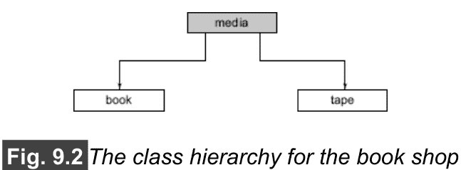

这些类在程序 9.13 中实现。所有类中都使用了 **display()** 函数来显示类的内容。请注意，**display()** 已经在 **media** 基类中声明为 **virtual**。

在 **main** 程序中，我们创建了一个异构指针列表，类型为 **media**，如下所示：

```
media *list[2] = { &book1, &tape1};
```

基类指针 **list[0]** 和 **list[1]** 分别被初始化为 **book1** 和 **tape1** 对象的地址。

# 程序 9.13 — 运行时多态

```
#include <iostream>
#include <cstring>
using namespace std;
class media
{
protected:
    char title[50];
    float price;
public:
    media(char *s, float a)
    {
        strcpy(title, s);
        price = a;
    }
    virtual void display() { } // 空的虚函数
};
class book: public media
{
    int pages;
public:
    book(char *s, float a, int p):media(s,a)
    {
        pages = p;
    }
    void display();
};
class tape : public media
{
    float time;
public:
    tape(char *s, float a,
```

```
float t):media(s, a) { time = t; } void display( ); } void book :: display( ) { cout << "\n Title: " << title; cout << "\n Pages: " << pages; cout << "\n Price: " << price; } void tape :: display() { cout << "\n Title: " << title; cout << "\n play time: " << time << "mins"; cout << "\n price: " << price; } int main() { char * title = new char[30]; float price, time; int pages; // 书籍信息
cout << "\n ENTER BOOK DETAILS\n"; cout << " Title: "; cin >> title; cout << " Price: "; cin >> price; cout << " Pages: "; cin >> pages; book book1(title, price, pages); // 磁带信息
cout << "\n ENTER TAPE DETAILS\n"; cout << " Title: "; cin >> title; cout << " Price: "; cin >> price; cout << " Play time (mins): "; cin >> time; tape tape1(title, price, time); media* list[2]; list[0] = &book1; list[1] = &tape1; cout << "\n MEDIA DETAILS"; cout << "\n..... BOOK ..... "; list[0] -> display( ); // 显示书籍信息 cout << "\n .....TAPE ..... "; list[1] -> display( ); // 显示磁带信息 result 0; }
```

程序 9.13 的输出为：

+   ENTER BOOK DETAILS
+   Title:Programming_in_ANSI_C
+   Price: 88
+   Pages: 400

+   ENTER TAPE DETAILS
+   Title: Computing_Concepts
+   Price: 90

Play time (mins): 55

# MEDIA DETAILS

..... BOOK .....

Title: Programming_in_ANSI_C
Pages: 400
Price: 88

..... TAPE .....

Title: Computing_Concepts
Play time: 55mins
Price: 90

## 虚函数的规则

当为实现晚绑定创建虚函数时，需要遵守以下基本规则以满足编译器要求：

+   1. 虚函数必须是某个类的成员函数。
+   2. 它们不能是 static 成员。
+   3. 它们通过使用对象指针来访问。
+   4. 虚函数可以是另一个类的 friend（朋友）函数。
+   5. 基类中的虚函数必须被定义，即使它可能不会被使用。
+   6. 基类版本的虚函数原型与所有派生类版本的原型必须完全相同。如果两个同名函数的原型不同，C++ 将它们视为重载函数，虚函数机制会被忽略。
+   7. 我们不能声明虚构造函数，但可以声明虚析构函数。
+   8. 基类指针可以指向任何派生类型的对象，而反过来则不成立。也就是说，我们不能用派生类指针来访问基类对象。
+   9. 当基类指针指向派生类时，对它进行递增或递减操作不会使其指向下一个对象。

+   10. 如果基类中定义了虚函数，它不一定需要在派生类中重新定义。在这种情况下，调用会执行基类函数。

## 9.7 纯虚函数

通常的做法是在基类中声明虚函数并在派生类中重新定义它。基类中的函数通常不会执行任何任务，它仅作为 *占位符*。例如，我们没有创建任何 **media** 类的对象，因此基类中的 **display()** 函数被定义为“空”。这类函数称为 “do-nothing” 函数。

“do-nothing” 函数可以定义为：

```
virtual void display() = 0;
```

这类函数称为 *pure virtual* 函数。 **纯虚函数是声明在基类中但相对于基类没有具体实现的函数。** 在这种情况下，编译器要求每个派生类必须要么定义该函数，要么重新声明它为纯虚函数。请记住，包含纯虚函数的类不能用于声明自己的对象，这类类称为 *抽象基类*。抽象基类的主要目的是为派生类提供一些特征，并提供实现运行时多态所需的基类指针。

程序 9.14 演示了纯虚函数的用法：

# 程序 9.14 纯虚函数

```
#include <iostream>
using namespace std;
class Balagurusamy //基类
{
public:
virtual void example( )=0; // 表示纯虚函数
};
class C:public Balagurusamy //派生类 1
{
public:
void example() {

cout<<“C text Book written by Balagurusamy”;

}     };     class oops:public Balagurusamy //派生类 2     {
public:
void example( )

{

cout<<“C++ text Book written by Balagurusamy”;

}

};
void main( )
{
Exforsys* arra[2];
C e1;
oops e2;
arra[0]=&e1;
```

```
arra[1]=&e2;
arra[0]->example();
arra[1]->example();
}
```

程序 9.14 的输出为：

C text Book written by Balagurusamy
C++ text Book written by Balagurusamy

## 9.8 虚构造函数和析构函数

“构造函数不能是 virtual”。有若干合理的理由支持这一说法。首先，创建对象时，对象类的构造函数必须与类本身同类型，但这与虚构现的构造函数是矛盾的。其次，在调用构造函数时，虚表（vtable）尚未创建，无法解析任何虚函数调用。因此，虚构造函数本身没有地方可以查找虚函数表。结果，不能将构造函数声明为 virtual。

然而，虚析构函数在 C++ 中是可行的，并且在某些情况下被强烈推荐使用。例如，当我们需要确保在继承层次结构中不同的析构函数按顺序被调用，特别是当基类指针指向派生类型对象时。需要注意的是，在继承层次结构中，析构函数的调用顺序与构造函数的顺序相反。

下面给出的类声明示例使用了析构函数：

```
class A
{
public:
```


## 摘要

- 多态性（polymorphism）简单来说就是“一个名字，多种形式”。
- 多态有两种类型，即编译时多态和运行时多态。
- 函数重载和运算符重载是编译时多态的典型例子。重载成员函数的选择依据是参数的类型和个数。编译器在编译时就能知道这些信息，因此在编译时就能为特定的调用选择合适的函数。这被称为早期绑定（early binding）或静态绑定（static binding），也称作静态链接。这意味着对象在编译时就被绑定到其函数调用。
- 在运行时多态中，合适的成员函数是在程序运行过程中被选中的。C++ 借助虚函数支持运行时多态。这被称为晚期绑定或动态绑定，因为合适的函数是在运行时动态选定的。动态绑定需要使用对象指针，它是 C++ 的强大特性之一。
- 对象指针有助于在运行时创建对象。它可以与箭头运算符一起使用，访问对象的公有成员。
- **this** 指针指向当前正在调用成员函数的那个对象。例如，函数调用 **a.show()** 会将指针 `this` 设置为对象 `a` 的地址。
- 指向基类对象的指针与指向派生类对象的指针是兼容的。因此，我们可以用同一个指针变量来指向基类和派生类的对象。
- 当一个函数被声明为 virtual 时，C++ 在运行时根据基类指针所指向的对象的类型（而不是指针本身的类型）来决定调用哪个函数。通过让基类指针指向不同的对象，我们可以执行虚函数的不同版本。
- 运行时多态只能通过指向基类的指针来访问虚函数时才能实现。不能用对象名加点运算符来访问虚函数。
- 可以有虚析构函数，但不能有虚构造函数。
- 如果基类中定义了一个虚函数，在派生类中不一定要重新定义它。此时，对应的调用将调用基类的那个函数。
- 一个被赋值为 0 的虚函数称为纯虚函数。它是在基类中声明但在基类中没有定义的函数。包含这种纯虚函数的类称为抽象类。

## 关键术语

抽象基类 | “取地址”运算符 | 实参对象 | 指针数组 | 箭头运算符 | 基地址 | 基类对象 | 基类指针 | 回调函数 | 类层次结构 | 编译时 | 编译时多态 | 解引用运算符 | 派生类对象 | 空操作函数 | 点运算符 | 动态绑定 | 早期绑定 | 函数重载 | 函数指针 | 隐式参数 | 间接运算符 | 调用对象 | 晚期绑定 | new 运算符 | 空指针 | 对象指针 | 运算符重载 | 占位符 | 指针 | 指针算术 | 指向函数的指针 | 多态 | 纯虚函数 | 运行时 | 运行时多态 | 静态

## 复习题

- 9.1 在 C++ 语言中，多态（polymorphism）是什么意思？
- 9.2 多态是如何在（a）编译时和（b）运行时实现的？
- 9.3 讨论访问对象的公有成员函数的不同方式。
- 9.4 什么是函数指针？解释在什么情况下会使用这种概念。
- 9.5 举例说明如何使用指针为对象数组分配空间。
- 9.6 **this** 指针指向什么？
- 9.7 **this** 指针的应用有哪些？
- 9.8 基类类型的指针能否指向派生类的对象？请解释。
- 9.9 什么是虚函数？
- 9.10 为什么需要虚函数？
- 9.11 什么时候我们应该将虚函数设为“纯”虚函数？将一个函数设为纯虚函数会带来什么影响？
- 9.12 判断下列陈述是 TRUE 还是 FALSE。
  - (a) 虚函数用于创建指向基类的指针。
  - (b) 虚函数允许我们使用同一次函数调用来调用不同类对象的成员函数。
  - (c) 基类指针不能设置为指向派生类的对象。
  - (d) **this** 指针指向当前用于调用成员函数的那个对象。
  - (e) 像其他指针一样，this 指针可以用来访问它所指向的对象的成员。
  - (f) 可以通过给 this 指针赋对象地址的方式让它指向任意对象。
  - (g) 纯虚函数强制程序员在派生类中重新定义该虚函数。

## 调试练习

### 9.1 找出下面程序中的错误。

```cpp
#include <iostream.h>
class Info
{
    char *name;
    int number;
public:
    void getInfo()
    {
        cout << "Info::getInfo ";
        getName();
    }
    void getName()
    {
        cout << "Info::getName ";
    }
};
class Name: public Info
{
    char *name;
public:
    void getName()
    {
        cout << "Name::getName ";
    }
};
void main()
{
    Info *p;
    Name n;
    p = n;
    p->getInfo();
}
/*
```

### 9.2 找出下面程序中的错误。

```cpp
#include <iostream.h>
class Person
{
    int age;
public:
    Person()
    {
    }
    Person(int age)
    {
        this.age = age;
    }
    Person& operator < (Person &p)
    {
        return age < p.age ? p: *this;
    }
    int getAge()
    {
        return age;
    }
};
void main ()
{
    Person P1 (15);
    Person P2 (11);
    Person P3;
    //if p1 is less than p2
    p3 = p1 < p2; p1. lessthan(p2)
    cout << p3.getAge( );
}
/*
```

### 9.3 找出下面程序中的错误。

```cpp
#include "iostream.h"
class Human
{
public:
    Human( )
    {
    }
    virtual ~Human( )
    {
        cout << "Human::~Human"; 
    }
};
class Student: public Human
{
public:
    Student( )
    {
    }
    ~Student( )
    {
        cout << "Student::~Student( )";
    }
};
void main( )
{
    Human *H = new Student( );
    delete H;
}
```

### 9.4 改正下面程序中的错误。

```cpp
class test
{
private:
    int m;
public:
    void getdata( )
    {
        cout << "Enter number:";
        cin >> m;
    }
    void display( )
    {
        cout << m;
    }
};
main( )
{
    test T;
    T->getdata( );
    T->display( );
    test *p;
    p = new test;
    p.getdata( );
    (*p).display( );
}
```

### 9.5 调试并运行下面程序。输出是什么？

```cpp
#include <iostream.h>
class A
{
protected:
    int a,b;
public:
    A(int x = 0, int y)
    {
    }
};

class A
{
public:
    int a = x;
    int b = y;
    virtual void print();
};

class B: public A
{
private:
    float p, q;
public:
    B(int m, int n, float u, float v)
    {
        p = u;
        q = v;
    }
    B() { p = q = 0; }
    void input(float u, float v);
    virtual void print(float);
};

void A::print(void)
{
    cout << "A values: " << a << "," << b << "\n";
}

void B::print(float)
{
    cout << "B values:" << u << "," << v << "\n";
}

void B::input(float x, float y)
{
    p = x;
    q = y;
}

main()
{
    A a1(10,20), *ptr;
    B b1;
    b1.input(7.5,3.142);

    ptr = &a1;
    ptr->print();

    ptr = &b1;
    ptr->print();
}
```

### 9.6 测试下面程序的输出：

```cpp
#include<iostream>
using namespace std;
class BC
{
public:
    void show(void){cout<<"\nI am in base class..";}
};
class DC: public BC
{
public:
    void show(void){cout<<"\nI am in derived class..";}
```


要触发派生类的 show() 方法而不是基类的 show() 方法，你会对上述程序做什么修改？

## 编程练习

**9.1** 创建一个名为 **shape** 的基类。使用该类存储两个 **double** 类型的值，这些值可用于计算图形的面积。从基类 **shape** 派生出两个特定的类，分别称为 **triangle** 和 **rectangle**。在基类中添加一个成员函数 **get_data()** 来初始化基类数据成员，以及另一个成员函数 **display_area()** 来计算并显示图形的面积。将 **display_area()** 设为虚函数，并在派生类中重新定义该函数以满足各自的需求。

使用这三个类，设计一个程序，以交互方式接受三角形或矩形的尺寸，并显示其面积。

请记住，输入的两个值在矩形情况下将视为两条边的长度，在三角形情况下将视为底和高，并按如下方式使用：

矩形面积 = x * y
三角形面积 = 1/2 * x * y


[PAGE 420]

**9.2** 扩展上述程序以显示圆的面积。这需要添加一个新的派生类‘circle’来计算圆的面积。请记住，对于圆我们只需要一个值，即其半径，但基类中的 get_data() 函数要求传入两个值。（提示：将 get_data() 函数的第二个参数设置为默认参数，值为零。）

**9.3** 使用以下修改运行上述程序：

+   (a) 从其中一个派生类中删除 **display_area()** 的定义。
+   
+   (b) 除了上述更改之外，将基类 **shape** 中的 **display_area()** 声明为 **virtual**。

对每种情况下的输出进行评论。

**9.4** 利用指针的概念，编写一个函数，交换同一类类型的两个对象的私有数据值。


[PAGE 421]

# # 管理控制台 I/O
## 操作

[PAGE 422]

## C++ 流

C++ 的 I/O 系统设计用于与各种设备协同工作，包括终端、磁盘和磁带驱动器。尽管每种设备差异很大，但 I/O 系统为程序员提供了一种与实际访问的设备无关的接口。这种接口被称为 *流*。

流是一个字节序列。它既可以充当 *源*，从中获取输入数据，也可以充当 *目的地*，向其发送输出数据。为程序提供数据的源流称为 *输入流*，接收程序输出的目标流称为 *输出流*。换句话说，程序从输入流中 *提取* 字节，并将字节 *插入* 输出流，如图 10.1 所示。

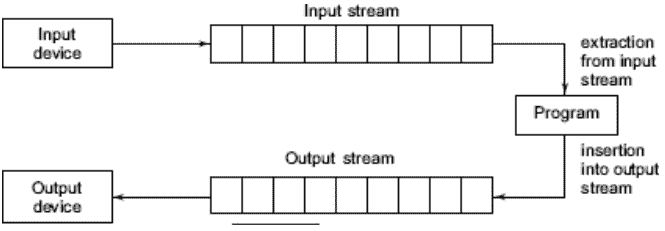

输入流中的数据可以来自键盘或任何其他存储设备。类似地，输出流中的数据可以发送到屏幕或任何其他存储设备。如前所述，流充当程序与输入/输出设备之间的接口。因此，C++ 程序处理数据（输入或输出）时与所使用的设备无关。

C++ 包含几个预定义的流，它们在程序开始执行时自动打开。这些包括 cin 和 cout，在我们之前的程序中经常使用。我们知道 cin 表示连接到标准的

[PAGE 424]

输入设备（通常是键盘）的输入流，cout 表示连接到标准输出设备（通常是屏幕）的输出流。请注意，键盘和屏幕是默认选项。如有必要，我们可以将流重定向到其他设备或文件。


C++ 的 I/O 系统包含一个类层次结构，用于定义各种流，以处理控制台和磁盘文件。这些类被称为 _流类_。图 10.2 显示了用于控制台单元的输入和输出操作的流类层次结构。这些类在头文件 _iostream_ 中声明。所有与控制台单元通信的程序都应包含此文件。

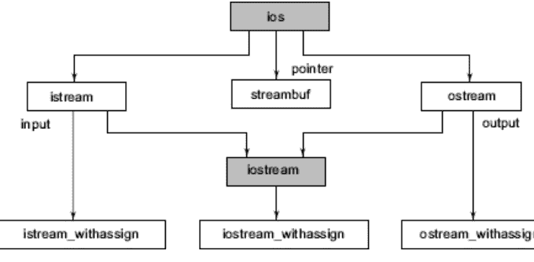

如图 10.2 所示，**ios** 是 **istream**（输入流）和 **ostream**（输出流）的基类，而 **istream** 和 **ostream** 又是 **iostream**（输入/输出流）的基类。类 **ios** 被声明为虚基类，因此 **iostream** 只继承其成员的一份副本。

类 **ios** 为格式化和非格式化 I/O 操作提供基本支持。类 **istream** 提供

[PAGE 425]

用于格式化和非格式化输入的功能，而类 **ostream**（通过继承）提供用于格式化输出的功能。类 **iostream** 提供处理输入和输出流的功能。三个类，即 **istream_withassign**、**ostream_withassign** 和 **iostream_withassign**，向这些类添加了赋值运算符。表 10.1 给出了这些类的详细信息。

**表 10.1** *用于控制台操作的流类*

| 类名 | 内容 |
|---|---|
| **ios**（通用输入/输出流类） | • 包含所有其他输入和输出类使用的基本功能<br>• 还包含一个指向缓冲区对象（**streambuf** 对象）的指针<br>• 声明处理格式化输入和输出操作所需的常量和函数 |
| **istream**（输入流） | • 继承 ios 的属性<br>• 声明诸如 get()、**getline()** 和 **read()** 等输入函数<br>• 包含重载的抽取运算符 >> |
| **ostream**（输出流） | • 继承 ios 的属性<br>• 声明输出函数 put() 和 **write()**<br>• 包含重载的插入运算符 << |
| **iostream**（输入/输出流） | • 通过多重继承继承 ios、**istream** 和 **ostream** 的属性，因此包含所有输入和输出函数 |
| **streambuf** | • 通过缓冲区提供到物理设备的接口<br>• 用作 ios 文件中使用的 **filebuf** 类的基类 |

# 10.4  非格式化 I/O 操作

## 重载运算符 >> 和 <<

[PAGE 426]

<!-- no content -->

[PAGE 427]

# cout <<item1<<item2 <<....<<itemN

项 _item1_ 到 _itemN_ 可以是任何基本类型的变量或常量。我们在前面章节的许多示例中已经使用了这样的语句。

### put() 和 get() 函数

类 _istream_ 和 _ostream_ 分别定义了成员函数 _get_() 和 _put_() 来处理单字符输入/输出操作。_get_() 函数有两种类型。我们可以使用 _get_(char _⋆_) 和 _get_(void) 原型来获取字符，包括空格、制表符和换行符。_get_(char _⋆_) 版本将输入字符赋给其参数，而 _get_(void) 版本返回输入字符。

由于这些函数是输入/输出流类的成员，我们必须使用适当的对象来调用它们。

# 示例：

```
char c;
cin.get(c); // get a character from keyboard
// and assign it to c
while(c != '\n')
{
cout << c; // display the character on screen
cin.get(c); // get another character
}
```

这段代码读取并显示一行文本（以换行符结尾）。请记住，运算符 >> 也可用于读取字符，但它会跳过空白字符和换行符。如果使用以下语句，上述 while 循环将无法正常工作

```
cin >> c;
```

[PAGE 428]

来代替

```
```cpp
cin.get(c);
```
```


> **注意：** *尝试使用两者并比较结果。*

**get(void)** 版本的使用方式如下：

```
```cpp
....
char c;
c = cin.get();    // cin.get(c); replaced
....
....
```
```

函数 **get()** 返回的值被赋给变量 **c**。

函数 **put()** 是 **ostream** 类的成员，可用于逐字符输出一行文本。例如，

```
```
cout.put('x');
```
```

显示字符 **x**，并且

```
```cpp
cout.put(ch);
```
```

显示变量 **ch** 的值。

变量 **ch** 必须包含一个字符值。我们也可以使用数字作为函数 **put()** 的参数。例如，

```
```cpp
cout.put(68);
```
```

显示字符 D。该语句将把 **int** 类型的值 68 转换为 **char** 类型的值，并显示其 ASCII 值为 68 的字符。


The following segment of a program reads a line of text from the keyboard and displays it on the screen.

```
char c;
cin.get(c); // read a character
while(c != '\n')
{
    cout.put(c); // display the character on screen
    cin.get(c);
}
```

Program 10.1 illustrates the use of these two character handling functions.

# Program 10.1 Character I/O with get() and put()

```
#include <iostream>
using namespace std;

int main()
{
    int count = 0;
    char c;

    cout << "INPUT TEXT\n";
    cin.get(c);

    while(c != '\n')
    {
        cout.put(c);
        count++;
        cin.get(c);
    }
}
```

[PAGE 430]

```
}
cout << "\nNumber of characters = " << count << "\n";

return 0;

}
```

> **NOTE:** *When we type a line of input, the text is sent to the program as soon as we press the RETURN key. The program then reads one character at a time using the statement **cin.get(c);** and displays it using the statement **cout.put(c);**. The process is terminated when the newline character is encountered.*

## getline() and write() Functions

We can read and display a line of text more efficiently using the line-oriented input/output functions **getline()** and **write()**. The **getline()** function reads a whole line of text that ends with a newline character (transmitted by the RETURN key). This function can be invoked by using the object **cin** as follows:

```
cin.getline (line, size);
```

This function call invokes the function **getline()** which reads character input into the variable line. The reading is terminated as soon as either the newline character '\n' is encountered or size-1 characters are read (whichever occurs first). The newline character

is read but not saved. Instead, it is replaced by the null character.

For example, consider the following code:

```
char name[20];
cin.getline(name, 20);
```

Assume that we have given the following input through the keyboard:

Bjarne Stroustrup <press RETURN>

This input will be read correctly and assigned to the character array **name**. Let us suppose the input is as follows:

Object Oriented Programming <press RETURN >

In this case, the input will be terminated after reading the following 19 characters:

Object Oriented Pro

Remember, the two blank spaces contained in the string are also taken into account.

We can also read strings using the operator >> as follows:

```
cin >> name;
```

But remember **cin** can read strings that do not contain white spaces. This means that **cin** can read just one word and not a series of words such as “Bjarne Stroustrup”. But it can read the following string correctly:

Bjarne_Stroustrup

After reading the string, **cin** automatically adds the terminating null character to the character array.

[PAGE 432]

Program 10.2 demonstrates the use of >> and getline() for reading the strings.

# Program 10.2 Reading Strings with getline()

```
#include <iostream>
using namespace std;

int main()
{
    int size = 20;
    char city[20];

    cout << "Enter city name: \\n";
    cin >> city;
    cout << "City name:" << city << "\\n";

    cout << "Enter city name again: \\n";
    cin.getline(city, size);
    cout << "City name now: " << city << "\\n";

    cout << "Enter another city name: \\n";
    cin.getline(city, size);
    cout << "New city name: " << city << "\\n";

    return 0;
}
```

The output of Program 10.2 would be:

First run
Enter city name:

[PAGE 433]

<!-- no content -->

[PAGE 434]

<!-- no content -->

[PAGE 435]

<!-- no content -->

[PAGE 436]

```
cout.write(string1, 10);
```

displays more characters than what is contained in **string1**.

It is possible to concatenate two strings using the **write()** function. The statement

```
cout.write(string1, m).write(string2, n);
```

is equivalent to the following two statements:

```
cout.write(string1, m);
cout.write(string2, n);
```

# 10.5  Formatted Console I/O Operations

C++ supports a number of features that could be used for formatting the output. These features include:

+   - **ios** class functions and flags.
+   - Manipulators.
+   - User-defined output functions.

The **ios** class contains a large number of member functions that would help us to format the output in a number of ways. The most important ones among them are listed in Table 10.2.

**Table 10.2** *ios format functions*

[PAGE 437]

<!-- no content -->

[PAGE 438]

where wis the field width (number of columns). The output will be printed in a field of wcharacters wide at the right end of the field. The width() function can specify the field width for only one item (the item that follows immediately). After printing one item (as per the specifications) it will revert back to the default. For example, the statements

```
cout.width(5);
cout << 543 << 12 << "\\n";
```

will produce the following output:

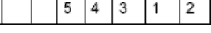

The value 543 is printed right-justified in the first five columns. The specification width(5) does not retain the setting for printing the number 12. This can be improved as follows:

```
cout.width(5);
cout << 543;
cout.width(5);
cout << 12 << "\\n";
```

This produces the following output:

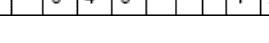

Remember that the field width should be specified for each item separately. C++ never truncates the values and therefore, if the specified field width is smaller than the size of the value to be printed, C++ expands the field to fit the value. Program 10.4 demonstrates how the function width() works.

# Program 10.4 Specifying Field Size with width()

[PAGE 439]

<!-- no content -->

[PAGE 440]

```
return 0;
}
```

The output of Program 10.4 would be:

| ITEMS | COST | TOTAL VALUE |
|---:|---:|---:|
| 10 | 75 | 750 |
| 8 | 100 | 800 |
| 12 | 60 | 720 |
| 15 | 99 | 1485 |

**Grand Total = 3755**

> > **NOTE:** *A field of width two has been used for printing the value of sum and the result is not truncated. A good gesture of C++!*

# **Program 10.5** Precision Setting with precision()

```
#include <iostream>
#include <cmath>

using namespace cout;
int main()
{
    cout << “Precision set to 3 digits \n”;
    cout.precision(3);

    cout.width(10);
    cout << “VALUE”;
    cout.width(15);
    cout << “SQRT_OF_VALUE” << “\n”;

    for(int n=1; n<=5; n++)
    {
        cout.width(8);
        cout << n;
        cout.width(13);
        cout << sqrt(n) << “\n”;
    }
    cout << “\n Precision set to 5 digits \n”;
    cout.precision(5); // precision parameter changed
    cout << “ sqrt(10) = “ << sqrt(10) << “\n\n”;

    cout.precision(0); // precision set to default
    cout << “ sqrt(10) = “ << sqrt(10) << “ (default setting)\n”;
}
```


## 程序 10.5

程序 10.5 的输出将是：

Precision set to 3 digits

| VALUE | SQRT_OF_VALUE |
|---:|---:|
| 1 | 1 |
| 2 | 1.41 |
| 3 | 1.73 |
| 4 | 2 |
| 5 | 2.24 |

Precision set to 5 digits
sqrt(10) = 3.1623
sqrt(10) = 3.162278  (default setting)

> 🡪 **注意：** *请观察输出中的以下内容：*
> 
> 1. *输出四舍五入到最接近的百分位（例如，对于两位精度，1.6666 将变为 1.67，而 1.3333 将变为 1.33）。*  
> 2. *末尾的零会被截断。*  
> 3. *精度设置在被重置之前一直有效。*  
> 4. *默认精度为 6 位数字。*

程序 10.6 展示了另一个演示宽度和精度操纵器功能的程序：

## 程序 10.6 宽度和精度操纵器

```
#include <iostream>

void main()
{
    float pi=22.0/7.0;
    int i;
    cout<<“Value of PI:\n”;
    for(i=1;i<=10;i++)
    {
        cout.width(i+1);
        cout.precision(i);
        cout<<pi<<“\n”;
    }
}
```

程序 10.6 的输出将是：

```
Value of PI:
3.1
3.14
3.143
3.1429
3.14286
3.142857
3.1428571
3.14285707
3.142857075
3.1428570747
```

## 填充与补齐：fill()

我们一直在使用比值所需大得多的字段宽度来打印这些值。默认情况下，字段的未使用位置会用空格填充。然而，我们可以使用 fill() 函数将未使用位置填充为任意所需字符。它的用法如下：


其中 ch 表示用于填充未使用位置的字符。示例：

cout.fill('*');
cout.width(10);
cout << 5250 << "\n";

输出将是：


金融机构和银行在打印支票时使用这种填充方式，以防止任何人轻易更改金额。与 precision() 一样，fill() 在我们更改它之前一直有效。参见程序 10.7 及其输出。

## 程序 10.7 使用 fill() 进行填充

```
#include <iostream>

using namespace std;

int main( )
{ cout.fill('<');
cout.precision(3);
for(int n=1; n<=6; n++)

```

<c<<<1<<<<<<<<<<<1

<c<<<2<<<<<<<0.5

<c<<<3<<<<<0.3333

>><>4>>>>>>>>0.25

>><>5>>>>>>>>0.2

>><>6>>>>>>0.167

Padding changed

##########12.346

我们已经看到，当使用 width() 函数时，值（无论是文本还是数字）会在所创建的字段宽度内右对齐打印。但是，通常的做法是将文本左对齐打印。如何让值左对齐打印？或者，如何让浮点数以科学计数法打印？

**ios** 类的成员函数 **setf()** 可以为这些问题以及许多其他格式问题提供答案。**setf()**（*setf* 表示设置标志）函数可以如下使用：

```
cout.setf(arg1,arg2)
```

*arg1* 是 **ios** 类中定义的格式化 *标志* 之一。格式化标志指定输出所需的格式操作。另一个 **ios** 常量 *arg2*（称为位 *字段*）指定该格式化标志所属的组。

表 10.4 展示了位字段、标志及其格式操作。有三个位字段，每个位字段都有一组互斥的格式标志。示例：

```
cout.setf(ios::left, ios::adjustfield);
cout.setf(ios::scientific, ios::floatfield);
```

| 所需格式 | 标志（arg1） | 位字段（arg2） |
|---|---|---|
| 左对齐输出 | ios :: left | ios :: adjustfield |
| 右对齐输出 | ios :: right | ios :: adjustfield |
| 在符号或基数指示符后填充（如 +##20） | ios :: internal | ios:: adjustfield |
| 科学计数法 | ios :: scientific | ios :: floatfield |
| 定点表示法 | ios :: fixed | ios :: floatfield |
| 十进制基数 | ios :: dec | ios :: basefield |
| 八进制基数 | ios :: oct | ios :: basefield |
| 十六进制基数 | ios :: hex | ios :: basefield |

请注意，第一个参数应该是第二个参数的组成员之一。

考虑以下代码段：

```
cout.fill('*');
cout.setf(ios::left, ios::adjustfield);
```

## 10.6 使用操纵器管理输出

头文件 *iomanip* 提供了一组称为 *操纵器* 的函数，可用于操作输出格式。它们提供与 **ios** 成员函数和标志相同的功能。某些操纵器比 **ios** 类中的对应函数更方便使用。例如，两个或更多操纵器可以像下面这样在一个语句中链式使用：

```
cout << manip1 << manip2 << manip3 << item;
cout << manip1 << item1 << manip2 << item2;
```

当我们想要显示多列输出时，这种连接非常有用。

最常用的操纵器见表 10.6。该表还给出了它们的含义和等价函数。要使用这些操纵器，我们必须在程序中包含头文件 *iomanip*。

**表 10.6 — 操纵器及其含义**

| 操纵器 | 含义 | 等价函数 |
|---|---|---|
| `setw (int w)` | 将字段宽度设置为 w。 | `width()` |
| `setprecision(int d)` | 将浮点精度设置为 d。 | `precision()` |
| `setfill(int c)` | 将填充字符设置为 c。 | `fill()` |
| `setiosflags(long f)` | 设置格式标志 f。 | `setf()` |
| `resetiosflags(long f)` | 清除由 f 指定的标志。 | `unsetf()` |
| `endl` | 插入换行并刷新流。 | `"\n"` |

下面给出一些操纵器的示例：

```
cout << setw(10) << '12345';
```

此语句在 10 个字符的字段宽度内右对齐打印值 12345。通过如下修改语句，可以将输出改为左对齐：

```
cout << setw(10) << setiosflags(ios::left) << i2345;
```


-   [用于格式化两个或多个值的输出语句](https://en.cppreference.com/w/cpp/io/manip/setw) 例如，下面的语句

```cpp
cout << setw(5) << setprecision(2) << 1.2345
     << setw(10) << setprecision(4) << sqrt(2)
     << setw(15) << setiosflags(ios::scientific) << sqrt(3)
     << endl;
```

将在一行中输出所有三个值，分别使用 5、10、15 的字段宽度。注意，每个输出都由不同的格式规格控制。

我们可以在程序中同时使用 **ios** 函数和操作符。下面的代码片段是合法的：

```cpp
cout.setf(ios::showpoint);

cout.setf(ios::showpos);
cout << setprecision(4);
cout << setiosflags(ios::scientific);
cout << setw(10) << 123.45678;
```

> **NOTE:** *与操作符相比，ios 成员函数的实现方式有重大区别。ios 成员函数会返回之前的格式状态，可以在需要时使用；而操作符不会返回之前的格式状态。如果需要保存旧的格式状态，必须使用 ios 成员函数而不是操作符。例如：*

```cpp
cout.precision(2); // 之前的状态
int p = cout.precision(4); // 当前状态;
```

执行这两条语句后，p 保存的是 2（之前的状态），新的格式状态为 4。我们可以通过以下方式恢复之前的格式状态：

程序 10.10 通过 **操作符** 和 **ios** 函数共同使用来演示输出值的格式化。

### 程序 10.10：使用操作符的格式化

```cpp
#include <iostream>
#include <iomanip>

using namespace std;

int main()
{
    cout.setf(ios::showpoint);

    cout << setw(5) << "n"
         << setw(15) << "Inverse_of_n"
         << setw(15) << "Sum_of_terms\n\n";

    double term, sum = 0;
    for(int n=1; n<=10; n++)
    {
        term = 1.0 / float(n);
        sum = sum + term;
        cout << setw(5) << n
             << setw(14) << setprecision(4)
             << setiosflags(ios::scientific) << term
             << setw(13) << resetiosflags(ios::scientific)
             << sum << endl;
    }
    return 0;
}
```

程序 10.10 的输出如下：

| n | Inverse_of_n | Sum_of_terms |
|---|--------------|--------------|
| 1 | 1.0000e+000 | 1.0000 |
| 2 | 5.0000e-001 | 1.5000 |
| 3 | 3.3333e-001 | 1.8333 |
| 4 | 2.5000e-001 | 2.0833 |
| 5 | 2.0000e-001 | 2.2833 |
| 6 | 1.6667e-001 | 2.4500 |
| 7 | 1.4286e-001 | 2.5929 |
| 8 | 1.2500e-001 | 2.7179 |
| 9 | 1.1111e-001 | 2.8290 |
| 10 | 1.0000e-001 | 2.9290 |

## 设计我们自己的操作符

我们可以为特定用途设计自己的操作符。创建无参数操作符的通用形式如下：

```cpp
ostream & manipulator (ostream & output)
{
    ....
    ... (代码)
    ....
    return output;
}
```

这里的 *manipulator* 是正在创建的操作符名称。下面的函数定义了一个名为 **unit** 的操作符，用于显示 “inches”：

```cpp
ostream & unit (ostream & output)
{
    output << " inches";
    return output;
}
```

语句

```cpp
cout << 36 << unit;
```

会产生以下输出：

```
36 inches
```

我们也可以创建表示一系列操作的操作符。例如：

```cpp
ostream & show(ostream & output)
{
    output.setf(ios::showpoint);
    output.setf(ios::showpos);
    output << setw(10);
    return output;
}
```

该函数定义了一个名为 **show** 的操作符，它打开 **showpoint** 和 **showpos** 标志（在 **ios** 类中声明），并将字段宽度设置为 10。

程序 10.11 演示了自定义操作符的创建和使用。程序创建了两个操作符：**currency** 和 **form**，并在 **main** 程序中使用它们。

```cpp
#include <iostream>
#include <iomanip>

using namespace std;

// 用户定义的操作符

ostream & currency(ostream & output)
{
    output << "Rs";
    return output;
}

ostream & form(ostream & output)
{
    output.setf(ios::showpos);
    output.setf(ios::showpoint);
    output.fill('*');
    output.precision(2);
    output << setiosflags(ios::fixed)
           << setw(10);
    return output;
}

int main()
{
    cout << currency << form << 7864.5;
    return 0;
}
```

程序 10.11 的输出为：

注意，**form** 代表一系列复杂的格式函数和操作。

## 总结

- 在 C++ 中，I/O 系统设计用于与不同 I/O 设备配合工作。该系统通过名为 ‘stream’ 的接口提供给程序员，该接口独立于实际使用的设备。
- 流是字节序列，充当 I/O 数据的来源或目的地。
- 向程序提供数据的源流称为 _input stream_，向程序发送输出的流称为 _output stream_。
- C++ I/O 系统包含用于输入和输出操作的流类层次结构。这些类声明在头文件 ‘_iostream_’ 中。
- **cin** 表示与标准输入设备相连的输入流，**cout** 表示与标准输出设备相连的输出流。
- **istream** 和 **ostream** 类定义了两个成员函数 **get()** 和 **put()**，用于处理单字符的 I/O 操作。
- **>>** 运算符在 **istream** 类中被重载为提取运算符，**<<** 运算符在 **ostream** 类中被重载为插入运算符。
- 我们可以使用面向行的 I/O 函数 **getline()** 和 **write()** 更高效地读取和写入一行文本。
- **ios** 类包含 width()、precision()、fill()、setf()、unsetf() 等成员函数，用于格式化输出。
- 头文件 ‘iomanip’ 提供一组操作符函数，用于操作输出格式，功能与 **ios** 类的成员函数相同。
- 我们还可以为特定目的设计自己的操作符。

## 关键术语

- adjustfield | basefield | bit-fields | console I/O operations | decimal base | destination stream | field width | fill() | filling | fixed point notation | flags | floatfield | formatted console I/O | formatting flags | formatting functions | get() | getline() | hexadecimal base | input stream | internal | ios | iomanip | iostream | istream | left-justified | manipulator | octal base | ostream | output stream | padding | precision() | put() | resetiosflags() | right-justified | scientific notation | setf() | setfill() | setiosflags() | setprecision() | setting precision | setw() | showbase | showpoint | showpos | skipws | source stream | standard input device | standard output device | stream classes | streambuf | streams | unitbuf | unsetf() | width() | write()

## 复习问题

- 10.1 什么是流？
- 10.2 简要描述 C++ I/O 系统支持的特性。
- 10.3 C++ 的 I/O 设施与 C 的有何不同？
- 10.4 为什么 **cin** 和 **cout** 不被视为关键字？
- 10.5 为什么 **cout** 能够在不进行特殊指令的情况下显示各种数据类型？
- 10.6 为什么必须在所有程序中包含头文件 iostream？
- 10.7 讨论 **get()** 函数的各种形式及其用法。
- 10.8 下面两条语句在操作上有何区别？

```cpp
cin >> c;
cin.get(c);
```

- 10.9 **cin** 和 **getline()** 都可以用于读取字符串，请评论。
- 10.10 讨论以下语句中 size 参数的含义：

```cpp
cout.write(line, size);
```

- 10.11 下面的语句起什么作用？

```cpp
cout.write(s1,m).write(s2,n);
```

- 10.12 iomanip 文件起什么作用？
- 10.13 **fill()** 函数的作用是什么？何时使用该函数？
- 10.14 讨论 **setf()** 函数的语法。
- 10.15 操作符与 **ios** 成员函数在实现上有何根本区别？请举例说明。
- 10.16 判断下面的语句是 TRUE 还是 FALSE。
  - (a) 一个 C++ 流是一个文件。


## 调试练习

10.1 若要得到输出 Buffer1: Jack and Jerry Buffer2: Tom and Mono，在下面的程序中你需要做什么？

```cpp
#include <iostream.h>
void main()
{
char buffer1[80];
char buffer2[80];

cout << "Enter value for buffer1 : ";
cin >> buffer1;
cout << "Buffer1 : " << buffer1 << endl;

cout << "Enter value for buffer2 : ";
cin.getline(buffer2, 80);
cout << "Buffer2 : " << buffer2 << endl;

}
```

10.2 语句 cout.setf(ios::right) 能否正常工作？

```cpp
#include <iostream.h>
void main()
{
cout.width(5);
cout << "99" << endl;

cout.setf(ios::left);
cout.width(5);
cout << "99" << endl;
```

(j) `cout << setw(5) << setprecision(2);`

(k) `cout << resetiosflags(ios::left | ios::showpos);`

## 编程练习

**10.1** 编写一个程序，交互式读取包含项目名称、项目代码和成本的列表，并生成如下所示的三列输出。

| 名称 | 代码 | 成本 |
|---|---:|---:|
| Turbo C++ | 1001 | 250.95 |
| C Primer | 905 | 95.70 |
| .... | ... | .... |
| .... | ... | .... |
| .... | ... | .... |

注意，名称和代码左对齐，成本右对齐，并保留两位小数。末尾的零也要显示。

**10.2** 修改上述程序，用连字符填充未使用的空格。

**10.3** 编写一个程序，从键盘读取文本，并在屏幕上以两列显示以下信息：

+   (a) 行数
+   
+   (b) 单词数
+   
+   (c) 字符数

字符串应左对齐，数字应在适当的字段宽度内右对齐。

**10.4** 编写一个程序，计算下列级数中 e 的值：

e=1+\frac{1}{1!}+\frac{1}{2!}+\cdots 直到 acc = 0.0001 WEB

# 文件操作

## 关键概念

控制台与用户的交互 | 输入流 | 输出流 | 文件流类 | 使用 open() 打开文件 | 使用构造函数打开文件 | 文件结束检测 | 文件模式 | 文件指针 | 顺序文件操作 | 随机访问文件 | 错误处理 | 命令行参数

## 11.1　简介

许多实际问题会处理大量数据，在这种情况下，我们需要使用软盘或硬盘等设备来存储数据。数据使用*文件*的概念存储在这些设备中。文件是存储在磁盘特定区域中的相关数据的集合。可以设计程序对这些文件执行读写操作。

程序通常涉及以下一种或两种数据通信：

+   1. 控制台单元与程序之间的数据传输。
+   2. 程序与磁盘文件之间的数据传输。

如 [图 11.1](#) 所示。

我们之前已经讨论了控制台单元与程序之间数据通信的处理技术。在本章中，我们将讨论用于存储数据以及从文件中检索数据的各种方法。

C++ 的 I/O 系统处理文件操作的方式与控制台输入输出操作非常相似。它使用文件流作为程序与文件之间的接口。向程序提供数据的流称为*输入流*，而另一个流

[PAGE 470]

<!-- no content -->

[PAGE 471]

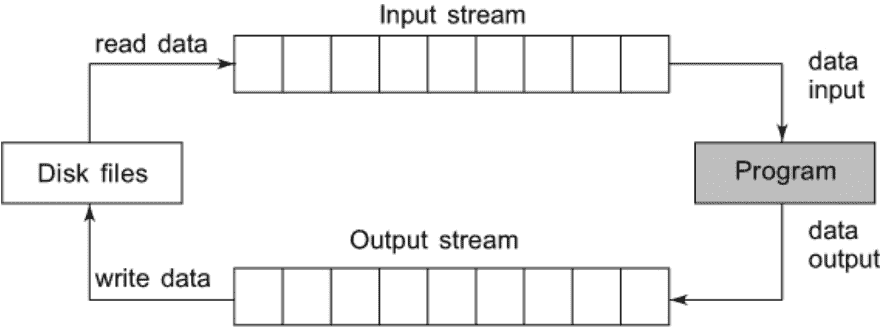

**图 11.2** *文件输入和输出流*

## 11.2 文件流操作类

C++ 的 I/O 系统包含一组定义文件处理方法的类。这些类包括 **ifstream**、**ofstream** 和 **fstream**。如 [图 11.1](#) 所示，这些类派生自 **fstreambase** 以及相应的 *iostream* 类。这些类用于管理磁盘文件，在 *fstream* 中声明，因此我们必须在任何使用文件的程序中包含该文件。

[表 11.1](#) 显示了文件流类的详细信息。请注意，这些类还包含更多特性。更多详细信息，请参阅手册。

[PAGE 472]

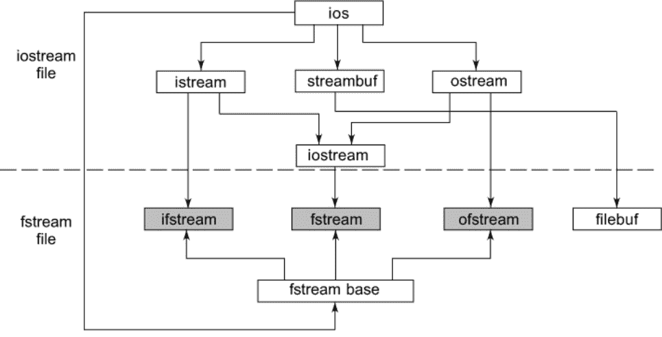

**图 11.3** *用于文件操作的流类（包含在 fstream 文件中）*

**表 11.1** *文件流类的详细信息*

| 类 | 内容 |
|---|---|
| **filebuf** | 其用途是设置用于读取和写入的文件缓冲区。包含文件流类的 **open()** 中使用的 **Openprot** 常量。还包含 **close()** 和 **open()** 成员。 |
| **fstreambase** | 提供文件流共有的操作。作为 **fstream**、**ifstream** 和 **ofstream** 类的基类。包含 **open()** 和 **close()** 函数。 |
| **ifstream** | 提供输入操作。包含默认输入模式的 **open()**。从 **istream** 继承 **get()**、**getline()**、**read()**、**seekg()** 和 **tellg()** 函数。 |
| **ofstream** | 提供输出操作。包含默认输出模式的 **open()**。从 **ostream** 继承 **put()**、**seekp()**、**tellp()** 和 **write()** 函数。 |

[PAGE 473]

| **fstream** | 提供同时进行输入和输出操作的支持。包含默认输入模式的 **open()**。通过 **iostream** 从 **istream** 和 **ostream** 类继承所有函数。 |
|---|---|

# 11.3 **打开和关闭文件**

如果我们要使用磁盘文件，需要确定关于文件及其预期用途的以下事项：

+   1. 合适的文件名。
+   2. 数据类型和结构。
+   3. 用途。
+   4. 打开方式。

文件名是一个字符串，其中的字符构成操作系统的有效文件名。它可以包含两部分：主文件名，以及可选的由句点和扩展名组成的部分。

示例：

+   Input.data
+   Test.doc
+   INVENT.ORY
+   student
+   salary
+   OUTPUT

如前所述，要打开文件，我们必须先创建文件流，然后将其连接到文件名。可以使用头文件 *fstream* 中包含的类 **ifstream**、**ofstream** 和 **fstream** 来定义文件流。要使用的类取决于用途，即我们是要从文件读取数据还是向文件写入数据。文件可以通过两种方式打开：

+   1. 使用类的构造函数。

2. 使用类的成员函数 **open()**。

第一种方法在流中只使用一个文件时很有用。当我们想用一个流管理多个文件时，使用第二种方法。

## 使用构造函数打开文件

我们知道，构造函数在创建对象时用于初始化对象。在这里，文件名用于初始化文件流对象。这包括以下步骤：

+   1. 使用适当的类创建一个文件流对象来管理流。也就是说，类 **ofstream** 用于创建输出流，类 **ifstream** 用于创建输入流。
+   2. 使用所需的文件名初始化文件对象。

例如，下面的语句打开一个名为 “results” 的文件用于输出：

```
ofstream outfile("results");    // output only
```

这将创建 **outfile** 作为管理输出流的 **ofstream** 对象。该对象可以是任何有效的 C++ 名称，例如 **o_file**、**myfile** 或 **fout**。该语句还会打开文件 results，并将其连接到输出流 **outfile**。如 *图 11.1* 所示。

[PAGE 475]

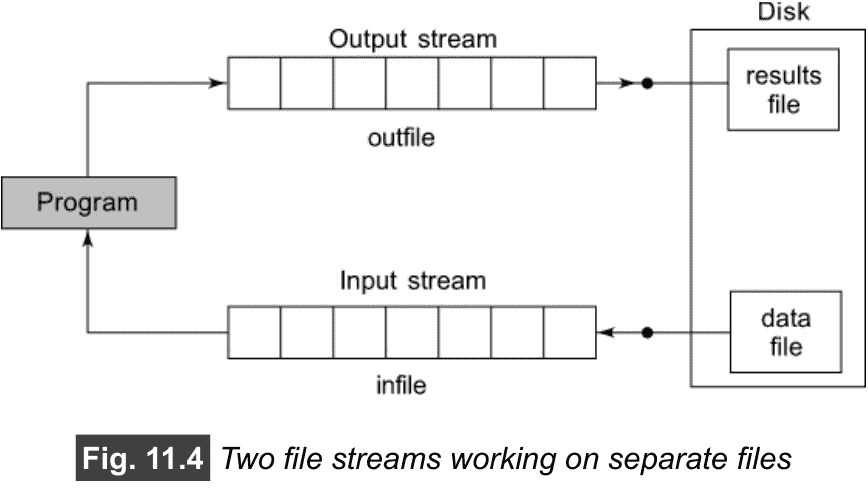

类似地，下面的语句将 **infile** 声明为 **ifstream** 对象，并将其连接到文件 **data** 以进行读取（输入）。

```
ifstream infile("data");    // input only
```

程序可能包含如下语句：

```
outfile << "TOTAL";
outfile << sum;
infile >> number;
infile >> string;
```

我们也可以像 **图 11.1** 所示那样使用同一个文件进行读取和写入数据。程序将包含以下语句：

```
Program1
....
....
ofstream outfile("salary");       // creates outfile and connects
                                      // "salary" to it
....
....
Program2
```


尽管我们使用了单个程序，但创建了两个文件流对象：outfile（用于将数据写入文件）和 infile（用于从文件读取数据）。请注意，使用像 `outfile.close();` 这样的语句会将 salary 文件与输出流 outfile 断开连接。切记，outfile 对象仍然存在，salary 文件以后可以重新连接到 outfile，也可以连接到任何其他流。在本例中，我们将 salary 文件连接到 infile 流以读取数据。

程序 11.1 使用同一个文件进行数据的写入和读取。首先，它从键盘读取数据并写入文件。写入完成后，文件被关闭。程序再次打开同一个文件，读取已经写入其中的信息，并将其显示在屏幕上。

## 程序 11.1 使用单个文件

```cpp
#include <iostream.h>
#include <fstream.h>

int main()
{
    ofstream outf("ITEM");    // connect ITEM file to outf
    cout << "Enter item name:";
    char name[30];
    cin >> name;    // get name from keyboard and
    outf << name << "\n";    // write to file ITEM
}
```

程序 11.1 的输出如下：

```
Enter item name:CD-ROM
Enter item cost:250

Item name:CD-ROM
Item cost:250
```

> **注意：***当文件仅以写入方式打开时，如果不存在同名文件，则会创建一个新文件。如果同名文件已经存在，其内容将被删除，文件以空文件形式呈现。我们将在后面讨论如何打开现有文件进行更新，同时不丢失其原始内容。*

## 使用 open() 打开文件

如前所述，open() 函数可用于打开使用同一个流对象的多个文件。例如，我们可能需要按顺序处理一组文件。在这种情况下，我们可以创建一个流对象，并依次使用它打开每个文件。具体做法如下：

```
file-stream-class stream-object;
stream-object.open ("filename");
```

示例：

```
ofstream outfile;              // Create stream (for output)
outfile.open("DATA1");         // Connect stream to DATA1
....
....
outfile.close();               // Disconnect stream from DATA1
outfile.open("DATA2");         // Connect stream to DATA2
....
....
outfile.close();               // Disconnect stream from DATA2
....
....
```

上面的程序段按顺序打开两个文件用于写入数据。注意，在打开第二个文件之前必须先关闭第一个文件。这是必要的，因为一个流同时只能连接一个文件。参见程序 11.2 和图 11.1。

## 程序 11.2 使用多个文件

[第 480 页]

```cpp
// Creating files with open() function

#include <iostream.h>
#include <fstream.h>

int main()
{
    ofstream fout;                 // create output stream
    fout.open("country");         // connect "country" to it

    fout << "United States of American";
    fout << "United Kingdom\n";
    fout << "South Korea\n";

    fout.close();                  // disconnect "country" and

    fout.open("capital");          // connect "capital"

    fout << "Washington\n";
    fout << "London\n";
    fout << "Seoul\n";

    fout.close();                  // disconnect "capital"

    // Reading the files
    const int N = 80;              // size of line
    char line[N];

    ifstream fin;                  // create input stream
    fin.open("country");           // connect "country" to it

    cout << "contents of country file\n";

    while(fin)                     // check end-of-file
    {
        fin.getline(line, N);      // read a line
    }
```

程序 11.3 的输出如下：

```
Capital of United States of America

Washington

Capital of United Kingdom

London
```

[第 481 页]

<!-- 无内容 -->

[第 482 页]

<!-- 无内容 -->

[第 483 页]

```
{<br>
const int SIZE = 80;<br>
char line[SIZE];<br>
<br>
ifstream fin1, fin2; // create two input streams<br>
fin1.open("country");<br>
fin2.open("capital");<br>
<br>
for(int i=1; i<=10; i++)<br>
{<br>
if(fin1.eof() != 0)<br>
{<br>
cout << "Exit from country \n";<br>
exit(1);<br>
}<br>
<br>
fin1.getline(line, SIZE);<br>
cout << "Capital of "<< line ;<br>
if(fin2.eof() != 0)<br>
{<br>
cout << "Exit from capital\n";<br>
exit(1);<br>
}<br>
<br>
fin2.getline(line,SIZE);<br>
cout << line << "\n";<br>
}<br>
return 0;<br>
}
```

[第 484 页]

<!-- 无内容 -->

[第 485 页]

第二个参数用于指定文件模式。带两个参数的 open() 函数的一般形式是：

> stream-object.open("filename", mode);

第二个参数 mode（称为文件模式参数）指定打开文件的目的。那么，在前面的示例中，我们在没有提供第二个参数的情况下是如何打开文件的呢？

这些类成员函数的原型为第二个参数提供了默认值，因此在没有实际值的情况下会使用默认值。默认值如下：

> `ios::in` 用于 ifstream 函数，表示只读打开；`ios::out` 用于 ofstream 函数，表示只写打开。

文件模式参数可以取 ios 类中定义的一个（或多个）此类常量。表 11.2 列出了文件模式参数及其含义。

| *参数* | *含义* |
|------|------|
| `ios::app` | 追加到文件末尾 |
| `ios::ate` | 打开时定位到文件末尾 |
| `ios::binary` | 二进制文件 |
| `ios::in` | 打开文件，仅用于读取 |
| `ios::nocreate` | 如果文件不存在，则打开失败 |
| `ios::noreplace` | 如果文件已存在，则打开失败 |
| `ios::out` | 打开文件，仅用于写入 |
| `ios::trunc` | 如果文件存在，则删除其内容 |

+   1. 以 `ios::out` 模式打开文件时，默认也会以 `ios::trunc` 模式打开。
+   2. 打开文件时，`ios::app` 和 `ios::ate` 都会将位置定位到文件末尾。两者的区别在于，`ios::app` 只允许在文件末尾添加数据，而 `ios::ate` 模式允许在文件中的任意位置添加或修改已有数据。在这两种情况下，如果指定名称的文件不存在，都会创建该文件。
+   3. 参数 `ios::app` 只能用于能够输出的文件。
+   4. 使用 `ifstream` 创建流意味着输入，使用 `ofstream` 创建流意味着输出。因此，在这些情况下不必提供模式参数。
+   5. `fstream` 类默认不提供模式，因此在使用 `fstream` 类对象时，我们必须显式提供模式。
+   6. 模式可以使用按位 OR 运算符（符号 `|`）组合两个或多个参数，如下所示：
+   
+      `fout.open(“data”, ios::app | ios::nocreate)`
+   
+      这将以追加模式打开文件，但如果文件不存在，则打开失败。

## 11.6 文件指针及其操作

每个文件都有两个关联的指针，称为*文件指针*。其中一个称为输入指针（*或 get 指针*），另一个称为输出指针（*或 put 指针*）。在读取或写入时，我们可以使用这些指针在文件中移动。输入指针用于读取给定文件位置的内容，输出指针用于写入给定文件位置的内容。每次执行输入或输出操作时，相应的指针都会自动前进。


- **seekp()** 将输出指针移动到指定位置。
- **tellg()** 返回 get 指针的当前位置。
- **tellp()** 返回 put 指针的当前位置。

例如，语句

```
infile.seekg(10);
```

会将文件指针移动到字节号 10 的位置。记住，文件中的字节从零开始计数。因此，指针将指向文件中的第 111th 字节。

考虑下面的语句：

```
ofstream fileout;
fileout.open("hello", ios::app);
int p = fileout.tellp();
```

执行这些语句后，输出指针位于文件 “hello” 的末尾，变量 p 的值表示文件中的字节数。

### 指定偏移量

我们已经看到如何使用‘seek’函数将文件指针移动到期望位置。这些函数的参数表示文件中的绝对位置。如图 11.1 所示。

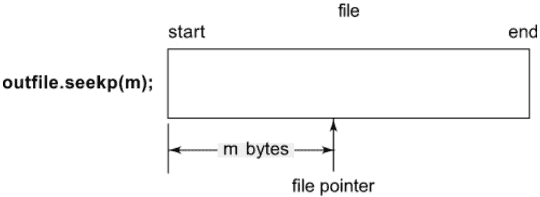

[PAGE 489]

# 图 11.8 *单个参数 seek 函数的作用*

‘Seek’函数 **seekg()** 和 **seekp()** 也可以使用两个参数的形式：

```
seekg (offset, refposition);
seekp (offset, refposition);
```

参数 *offset* 表示要从由参数 *refposition* 指定的位置移动的字节数。参数 *refposition* 可以取 **ios** 类中定义的以下三个常量之一：

+ **ios::beg** — 文件的起始位置
+ **ios::cur** — 当前指针位置
+ **ios::end** — 文件的末尾

**seekg()** 函数移动与其关联的文件的‘get’指针，**seekp()** 函数移动与其关联的文件的‘put’指针。[表 11.3](#表 11-3) 列出了一些示例指针偏移调用及其操作。**fout** 是一个 **ofstream** 对象。

**表 11.3 — 指针偏移调用**

| *Seek 调用* | *操作* |
|---|---|
| `fout.seekg(0, ios::beg);` | 移动到起始位置 |
| `fout.seekg(0, ios::cur);` | 保持在当前位置 |
| `fout.seekg(0, ios::end);` | 移动到文件末尾 |
| `Fout.seekg(m,ios::beg);` | 移动到文件第 (m + 1) 个字节 |
| `fout.seekg(m,ios::cur);` | 向当前位置前进 m 字节 |
| `fout.seekg(-m,ios::cur);` | 向当前位置后退 m 字节 |

[PAGE 490]

`fout.seekg(-m,ios::end);` 从文件末尾后退 m 字节

## 11.3 顺序输入和输出操作

文件流类提供多个成员函数用于对文件进行输入和输出操作。一对函数 **put()** 和 **get()** 用于逐字符处理。另一对函数 **write()** 和 **read()** 用于处理二进制数据块。

### put() 和 get() 函数

函数 **put()** 向关联的流写入一个字符。同样，函数 **get()** 从关联的流读取一个字符。程序 11.4 说明了这些函数在文件上的使用方式。程序请求一个字符串，收到字符串后，使用 **put()** 函数在 **for** 循环中逐字符将其写入文件。循环的终止依据是字符串的长度。

随后，程序使用 **get()** 函数从文件中读取字符，直到达到文件末尾为止。读取到的字符通过运算符 `<<` 显示在屏幕上。

# 程序 11.4 字符 I/O 操作

```
#include <iostream.h>
#include <fstream.h>
#include <string.h>
int main()
{
    char string[80];
```

[PAGE 491]

<!-- no content -->

[PAGE 492]

> NOTE: 我们使用了 fstream 对象来打开文件。由于 fstream 对象可以同时处理输入和输出，我们以 ios::in | ios::out 模式打开文件。写入文件后，我们希望读取整个文件并显示其内容。由于文件指针已经移动到文件末尾，必须将其移回文件开头。这通过语句
> 
> file.seekg(O);
> 
> 完成。

### write() 和 read() 函数

write() 和 read() 函数与 put() 和 get() 不同，它们处理二进制数据。这意味着值在磁盘文件中以与内部内存中相同的格式存储。图 11.9 展示了整数值 2594 在二进制和字符格式中的存储方式。二进制形式中，int 占两个字节，与其大小无关。但一个 4 位的 int 在字符形式中需要 4 个字节来存储。

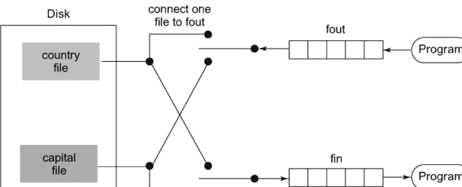

[PAGE 493]

# **图 11.9** *整数值的二进制和字符格式*

二进制格式在存储数字时更准确，因为它保留了内部的精确表示，没有任何转换，因此写入速度更快。

二进制输入和输出函数的形式如下：

```
infile.read((char *) & V, sizeof (V));
outfile.write((char *) & V, sizeof (V));
```

这些函数接受两个参数：第一个是变量 **V** 的地址，第二个是该变量的字节长度。地址必须强制转换为 **char***（字符指针）类型。程序 11.5 说明了如何使用这两个函数保存一个 **float** 数组并随后恢复它以在屏幕上显示。

# **程序 11.5** 二进制文件的 I/O 操作

```
#include <iostream.h>
#include <fstream.h>
#include <iomanip.h>

const char * filename = "BINARY";

int main()
{
    float height[4] = {175.5,153.0,167.25,160.70};

    ofstream outfile;
    outfile.open(filename);
```

[PAGE 494]

<!-- no content -->

[PAGE 495]

object 作为一个整体单元，使用计算机内部的数据表示。例如，函数 **write()** 以字节为单位、无转换地复制类对象从内存到磁盘。需要记住的一个重要点是，只有数据成员会写入磁盘文件，成员函数不会。

程序 11.6 说明了如何将类对象写入和从磁盘文件中读取。对象的长度通过 **sizeof** 运算符获得，它表示对象所有数据成员的长度总和。

# 程序 11.6 读取和写入类对象

```
#include <iostream.h>
#include <fstream.h>
#include <iomanip.h>
class INVENTORY
{
    char name[10];                 // 商品名称
    int code;                       // 商品代码
    float cost;                    // 每件商品的成本
public:
    void readdata(void);
    void writedata(void);
};

void INVENTORY :: readdata(void)        // 从键盘读取
{
    cout << "Enter name: "; cin >> name;
    cout << "Enter code: "; cin >> code;
    cout << "Enter cost: "; cin >> cost;
}
```

[PAGE 496]

```
void INVENTORY :: writedata(void)        // 格式化显示在屏幕上
{                                        // 屏幕上
    cout << setiosflags(ios::left)
         << setw(10) << name
         << setiosflags(ios::right)
         << setw(10) << code
         << setprecision(2)
         << setw(10) << cost
         << endl;
}

int main()
{
    INVENTORY item[3];                  // 声明 3 个对象的数组

    fstream file;                       // 输入和输出文件

    file.open("STOCK.DAT", ios::in | ios::out);

    cout << "ENTER DETAILS FOR THREE ITEMS \n";
    for(int i=0;i<3;i++)
    {
        item[i].readdata();
        file.write((char *) & item[i],sizeof(item[i]));
    }

    file.seekg(0);                      // 重置到文件开头

    cout << "\nOUTPUT\n";
    for(i = 0; i < 3; i++)
    {
        file.read((char *) & item[i], sizeof(item[i]));
        item[i].writedata();
    }
    file.close();
}
```

return 0;
}

程序 11.6 的输出如下：

ENTER DETAILS FOR THREE ITEMS

Enter name: C++

Enter code: 101

Enter cost: 175

Enter name: FORTRAN

Enter code: 102

Enter cost: 150

Enter name: JAVA

Enter code: 115

Enter cost: 225

OUTPUT

C++ 101 175

FORTRAN 102 150

JAVA 115 225

程序使用 ‘for’ 循环进行对象的读取和写入。这是因为我们知道文件中正好有 3 个对象。如果文件的长度未知，可以通过文件指针函数确定文件中对象的数量，然后在 ‘for’ 循环中使用，或者使用 while(file) 方法判断文件结束。这些技术在下一节中讨论。

程序 11.7 展示了另一个计数文件中对象数量的程序：


#include <iostream>
#include <fstream>
#include <string.h>

class emp
{
    char name[30];
    int ecode;
};

public:
emp()
{
}

emp(char *n,int c)
{
    strcpy(name,n);
    ecode=c;
}
};

void main()
{
    emp e[4];
    e[0]=emp("Amit",1);
    e[1]=emp("Joy",2);
    e[2]=emp("Rahul",3);
    e[3]=emp("Vikas",4);

    fstream file;
    file.open("Employee.dat",ios::in | ios::out);

    int i;
    for(i=0;i<4;i++)
        file.write((char *)&e[i],sizeof(e[i]));

    file.seekg(0,ios::end);
}

int location = m * object_length;
这一位置给出了第 m 个对象第一个字节的字节号。现在，我们可以借助 seekg() 或 seekp() 将文件指针设置到该字节。

我们还可以利用 object_length 计算出文件中的对象总数，如下所示：

int n = file_size/object_length;

当文件指针位于文件末尾时，可以使用函数 tellg() 或 tellp() 获取 file_size。

程序 11.8 演示了上述某些任务是如何实现的。该程序使用由程序 11.6 创建的“STOCK.DAT”文件（包含五个条目），并对文件执行以下操作：

+   1. 向文件添加一个新条目。
+   2. 修改某个条目的详细信息。
+   3. 显示文件的内容。

# 程序 11.8 文件更新 :: 随机访问

```
#include <iostream.h>
#include <fstream.h>
#include <iomanip.h>

class INVENTORY
{
    char name[10];
    int code;
```

```cpp
float cost;
public:
    void getdata(void)
    {
        cout << "Enter name: "; cin >> name;
        cout << "Enter code: "; cin >> code;
        cout << "Enter cost: "; cin >> cost;
    }
    void putdata(void)
    {
        cout << setw(10) << name
             << setw(10) << code
             << setprecision(2) << setw(10) << cost
             << endl;
    }
};   // End of class definition
int main()
{
    INVENTORY item;
    fstream inoutfile;                    // input/output stream

    inoutfile.open("STOCK.DAT", ios::ate | ios::in |
                                  ios::out | ios::binary);
    inoutfile.seekg(0,ios::beg);          // go to start

    cout << "CURRENT CONTENTS OF STOCK" << "\n";

    while(inoutfile.read((char *) & item, sizeof item))
    {
        item.putdata();
    }
    inoutfile.clear();                   // turn of EOF flag

    /* >>>>>>>>>>>>>>> Add one more item <<<<<<<<<<<<<<<< */

    cout << "\nADD AN ITEM\n";
    item.getdata();
```

```cpp
char ch;
cin.get(ch);
inoutfile.write((char *) & item, sizeof item);

// Display the appended file

inoutfile.seekg(0);                 // go to the start

cout << "CONTENTS OF APPENDED FILE \n";

while(inoutfile.read((char *) & item, sizeof item))
{
    item.putdata();
}

// Find number of objects in the file
int last = inoutfile.tellg();
int n = last/sizeof(item);

cout << "Number of objects = " << n << "\n";
cout << "Total bytes in the file = " << last << "\n";

/* >>>>>>>>> MODIFY THE DETAILS OF AN ITEM
<<<<<<<<<< */

cout << "Enter object number to be updated \n";
int object;
cin >> object;

cin.get(ch);

int location = (object-1) * sizeof(item);

if(inoutfile.eof())
inoutfile.clear();

inoutfile.seekp(location);
```

# 追加后的文件内容

| 名称 | 代码 | 成本 |
|---|---:|---:|
| AA | 11 | 100 |
| BB | 22 | 200 |
| CC | 33 | 300 |
| DD | 44 | 400 |
| XX | 99 | 900 |
| YY | 10 | 101 |

对象数量 = 6
文件中的总字节数 = 96
输入要更新的对象编号
6
输入该对象的新值
输入名称：ZZ
输入代码：20
输入成本：201

# 更新后的文件内容

| 名称 | 代码 | 成本 |
|---|---:|---:|
| AA | 11 | 100 |
| BB | 22 | 200 |
| CC | 33 | 300 |
| DD | 44 | 400 |
| XX | 99 | 900 |
| ZZ | 20 | 201 |

我们使用 **fstream** 类来声明文件流。**fstream** 类继承了两个缓冲区，一个用于输入，另一个用于输出，并同步这些缓冲区上的文件指针移动。也就是说，每当我们对文件进行读写时，两个指针都会同步移动。因此，在任何时刻，两个指针都指向同一个字节。

由于我们需要向文件添加新对象，同时还要修改一些现有对象，因此我们使用 **ios::ate** 选项打开文件以进行输入和输出操作。请记住，**ios::app** 选项只允许我们将数据追加到文件末尾。**ios::ate** 模式在打开文件时将文件指针设置在文件末尾。因此，我们必须

使用函数 **seekg()** 将“get”指针移动到文件开头，以读取文件的现有内容。

在读取完文件的当前内容后，程序会设置 EOF 标志。这会阻止对文件进行任何进一步的读取或写入。使用 **clear()** 函数可以关闭 EOF 标志，从而允许再次访问该文件。

追加新条目后，程序会显示追加后的文件内容，以及文件中对象的总数和它们所占用的内存空间。

要修改某个对象，我们需要定位到该对象的第一个字节。这可以通过以下语句实现：

```
int location = (object-1) * sizeof(item);
inoutfile.seekp(location);
```

程序接收要修改的对象的编号及其新值，并对其进行更新。最后，显示追加并修改后的文件内容。

请记住，我们打开一个现有文件是为了读取和更新其中的值。因此，数据成员的类型必须与现有文件中的相同，并且声明顺序也必须一致。由于成员函数不会被存储，它们可以有所不同。

## 11.9 文件操作中的错误处理

到目前为止，我们一直假设文件一切正常，并打开文件进行读写。但情况并非总是如此。例如，在处理文件时可能会发生以下情况之一：

+   1. 我们试图打开进行读取的文件不存在。

[第506页]

+   2. 用于新文件的文件名可能已经存在。
+   3. 我们可能尝试执行无效操作，例如读取越过文件末尾。
+   4. 磁盘上可能没有更多空间来存储数据。
+   5. 我们可能使用了无效的文件名。
+   6. 我们可能在文件尚未为此目的打开时尝试执行某项操作。

C++ 文件流从 **ios** 类继承了一个“流状态”成员。该成员记录当前正在使用的文件的状态信息。流状态成员使用位域来存储上述错误条件的状态。

**ios** 类支持多个成员函数，可用于读取文件流中记录的状态。这些函数及其含义列在[表 11.4](#table-11-4)中。

**表 11.4** *错误处理函数*

| 函数 | 返回值及含义 |
|---|---|
| **eof()** | 如果读取时遇到文件末尾，则返回 *true*（非零值）；否则返回 *false*（零） |
| **fail()** | 当输入或输出操作失败时返回 *true* |
| **bad()** | 如果尝试了无效操作或发生了任何不可恢复的错误，则返回 *true*。但如果它为 *false*，则有可能从报告的任何其他错误中恢复并继续操作。 |
| **good()** | 如果没有发生错误，则返回 true。这意味着上述所有函数均为 false。例如，如果 file.good() 为 *true*，则流文件一切正常，我们可以继续进行 I/O 操作。当它返回 *false* 时，则无法再执行任何操作。 |

这些函数可以在程序中的适当位置使用，以判断文件流的状态，从而采取必要的纠正措施。示例：

[第507页]


## 11.1 什么是输入流和输出流？

## 11.2 在C++程序中使用文件涉及哪些步骤？

## 11.3 描述可用于文件操作的各种类。

## 11.4 使用构造函数打开文件和使用open()函数打开文件有什么区别？什么时候一种方法优于另一种方法？

## 11.5 解释while(fin)语句如何检测连接到fin流的文件末尾。

## 11.6 什么是文件模式？描述可用的各种文件模式选项。

## 11.7 编写一条语句，创建一个名为fob的对象用于写入，并将其与文件名DATA关联。

## 11.8 需要创建多少个文件对象来管理以下情况？
(a) 依次处理四个文件。
(b) 将两个已排序文件合并为一个文件。请解释。

## 11.9 ios::ate和ios::app在打开文件时都将文件指针放在文件末尾。那么，它们之间的区别是什么？

## 11.10 当应用于文件时，“当前位置”是什么意思？

## 11.11 使用seekg()编写语句以实现以下目的：
(a) 将指针从当前位置向后移动15个位置。
(b) 操作结束后转到开头。
(c) 从末尾向后移动20字节。
(d) 转到文件中的第50个字节。

## 11.12 以二进制形式保存数据有什么优点？

## 11.13 描述如何确定文件中的对象数量。什么时候需要这些信息？

## 11.14 描述可用于成功检测文件结束条件的不同方法。

## 11.15 说明以下陈述是TRUE还是FALSE。

(a) 一个流可以同时连接到多个文件。

(b) 文件指针总是包含文件的地址。

(c) 该语句。

(d) ios::ate模式允许我们在文件中的任何位置写入数据。

(e) 我们可以通过以写入模式打开现有文件来向其添加数据。

(f) 参数ios::app只能用于能够输出的文件。

(g) 使用write()函数写入文件的数据可以使用get()函数读取。

(h) 我们可以对任何文件互换使用tellp()和tellg()函数。

(i) 二进制文件比文本文件更准确、更紧凑地存储浮点值。

(j) 当对文件的操作失败时，fin.fail()调用返回非零。

## 调试练习

### 11.1 找出以下程序中的错误。

```cpp
#include <iostream.h>
#include <fstream.h>

void main()
{
        const int size = 100;
        char buffer[size];

        ifstream in("ch11_1.cpp");
        ofstream out("ch11_1Temp.cpp");
        while(in.get(buffer))
        {
                in.get();
                cout << buffer << endl;
                out << buffer << endl;
        }
        in.close();
        out.close();
}
```

### 11.2 找出以下程序中的错误。

```cpp
#include <iostream.h>
#include <fstream.h>

void main()
{
        char buffer[80];
        ifstream fin;
        fin.open("ch11_2.cpp", ios::nocreate);
        while(!fin.eof())
        {
                fin.getline(buffer, 80);
```
```

### 11.3 找出以下程序中的错误。

```cpp
#include <iostream.h>
#include <fstream.h>

void main()
{
    char buffer[80];
    ifstream in("ch11_3.cpp");
    while(!in.getline(buffer, 80))
    {
        cout << buffer << endl;
    }

    while(!in.getline(buffer, 80).eof())
    {
        cout << buffer << endl;
    }
}
```

### 11.4 找出以下程序中的错误。

```cpp
#include <iostream.h>
#include <fstream.h>
#include <string.h>

int main()
{
    char str[20]="Test String";

    fstream file;

    file.open("TEXT", ios::in , ios::out);
```
```

## 编程练习

**11.1** 编写一个程序，读取一个文本文件并创建另一个文件，该文件与原文件完全相同，只是将每个连续空格序列替换为单个空格。

**11.2** 一个文件包含以下形式的电话号码列表：


| Name | Telephone number |
|:---|---:|
| John | 23456 |
| Ahmed | 9876 |
| ..... | ..... |

The names contain only one word and the names and telephone numbers are separated by white spaces. Write a program to read the file and output the list in two columns. The names should be left-justified and the numbers right-justified [WEB].

**11.3** Write a program that will create a data file containing the list of telephone numbers given in Exercise 11.2. Use a class object to store each set of data.

**11.4** Write an interactive, menu-driven program that will access the file created in Exercise 11.3 and implement the following tasks.

+   (a) Determine the telephone number of the specified person.  
+   
+   (b) Determine the name if a telephone number is known.  
+   
+   (c) Update the telephone number, whenever there is a change.  

**11.5** Two files named ‘Source1’ and ‘Source2’ contain sorted list of integers. Write a program that reads the contents of both the files and stores the merged list in sorted form in a new file named Target [WEB].

_Templates_ is one of the features added to C++ recently. It is a new concept which enable us to define generic classes and functions and thus provides support for _generic programming_. Generic programming is an approach where generic types are used as parameters in algorithms so that they work for a variety of suitable data types and data structures.

A template can be used to create a family of classes or functions. For example, a class template for an array class would enable us to create arrays of various data types such as int array and float array. Similarly, we can define a template for a function, say mul(), that would help us create various versions of mul() for multiplying int, float and double type values.

A template can be considered as a kind of macro. When an object of a specific type is defined for actual use, the template definition for that class is substituted with the required data type. Since a template is defined with a parameter that would be replaced by a specified data type at the time of actual use of the class or function, the templates are sometimes called parameterized classes or functions.

Consider a vector class defined as follows:

```
class vector
{
    int *v;
    int size;
    public:
    vector(int m)    // create a null vector
    {
    v = new int[size = m];
    for(int i=0; i<size; i++)
    v[i] = 0;
    }
    vector(int *a)    // create a vector from an array
    {
    for(int i=0; i<size; i++)
    v[i] = a[i];
    }
    int operator*(vector &y)    // scalar product
    {
    int sum = 0;
    for(int i=0; i<size; i++)
    sum += this -> v[i] * y . v[i];
    return sum;
    }
};
```

The vector class can store an array of int numbers and perform the scalar product of two int vectors as shown below:

```
int main()
{
    int x[3] = {1,2,3};
    int y[3] = {4,5,6};
    vector v1(3);    // Creates a null vector of 3 integers
    vector v2(3);
};
```

```
v1 = x;
 // Creates v1 from the array x
 v2 = y;
 int R = v1 * v2;
 cout << "R = " << R;
 return 0;
}
```

Now, suppose we want to define a vector that can store an array of float values. We can do this by simply replacing the appropriate int declarations with float in the vector class. This means that we have to redefine the entire class all over again.

Assume that we want to define a vector class with the data type as a parameter and then use this class to create a vector of any data type instead of defining a new class every time. The template mechanism enables us to achieve this goal.

As mentioned earlier, templates allow us to define generic classes. It is a simple process to create a generic class using a template with an anonymous type. The general format of a class template is:

> template< class T >
> class classname
> {
>     // .....
>     // class member specification
>     // with anonymous type T
>     // wherever appropriate
>     // .....
> };

The template definition of vector class shown below illustrates the syntax of a template:

```
template< class T >
class vector
```

```
{
    T* v;              // Type T vector
    int size;
public:
    vector(int m)
    {
        v = new T[size = m];
        for(int i=0; i<size; i++)
            v[i] = 0;
    }
    vector(T* a)
    {
        for(int i=0; i<size; i++)
            v[i] = a[i];
    }
    T operator*(vector &y)
    {
        T sum = 0;
        for(int i=0; i<size; i++)
            sum += this->v[i] * y.v[i];
        return sum;
    }
};
```

> > **NOTE:** *The class template definition is very similar to an ordinary class definition except the prefix* **template<class T>** *and the use of type* **T**. *This prefix tells the compiler that we are going to declare a template and use T as a type name in the declaration. Thus, vector has become a parameterized class with the type T as its parameter. T may be substituted by any data type including the user-defined types. Now, we can create vectors for holding different data types.*

Example:

```
vector <int> v1(10);        // 10 element int vector
vector <float> v2(25);      // 25 element float vector
```

> NOTE: *The type T may represent a class name as well.*

*Example:*

```
vector <complex> v3(5);    // vector of 5 complex numbers
```

A class created from a class template is called a *template class*. The syntax for defining an object of a template class is:

```
classname<type> objectname(arglist);
```

This process of creating a specific class from a class template is called *instantiation*. The compiler will perform the error analysis only when an instantiation takes place. It is, therefore, advisable to create and debug an ordinary class before converting it into a template.

Programs 12.1 and 12.2 illustrate the use of a **vector** class template for performing the scalar product of **int** type vectors as well as **float** type vectors.

# Program 12.1 — Example of Class Template

```
#include <iostream>

using namespace std;

const size = 3;
```

```
template <class T>
class vector
{
    T* v;    // type T vector
public:
    vector()
    {
    v = new T[size];
    for(int i=0;i<size;i++)
    v[i] = 0;
    }
    vector(T* a)
    {
    for(int i=0;i<size;i++)
    v[i] = a[i];
    }
    T operator*(vector &y)
    {
    T sum = 0;
    for(int i=0;i<size;i++)
    sum += this -> v[i] * y.v[i];
    return sum;
    }
    void display(void)
    {
    for(int i=0;i<size;i++)
    cout<<v[i]<<"\t";
    cout<<"\n";
    }
};
int main()
{
    int x[3] = {1,2,3};
    int y[3] = {4,5,6};
    vector <int> v1;
    vector <int> v2;
    v1 = x;
```

```
v2 = y;

cout<<"v1 = ";
v1.display();

cout<<"v2 = ";
v2.display();

cout<<"v1 X v2 = "<<v1*v2;

return 0;
}
```

The output of the Program 12.1 would be:

```
v1 = 1  2  3
v2 = 4  5  6
v1 X v2 = 32
```

# Program 12.2  Another Example of Class Template

```
#include <iostream>

using namespace std;

const size = 3;
template <class T>
class vector
{
        T* v;              // type T vector
    public:
        vector()
```

```
{ 
    v = new T[size];
    for(int i=0;i<size;i++) 
    v[i] = 0;
} 
vector(T* a) 
{ 
    for(int i=0;i<size;i++) 
    v[i] = a[i];
} 
T operator*(vector &y) 
{ 
    T sum = 0;
    for(int i=0;i<size;i++) 
    sum += this -> v[i] * y.v[i];
    return sum;
} 
void display(void) 
{ 
    for(int i=0;i<size;i++) 
    cout<<v[i]<<"\t"; 
    cout<<"\n";
} 
}; 
int main() 
{ 
    float x[3] = {1.1,2.2,3.3}; 
    float y[3] = {4.4,5.5,6.6}; 
    vector <float> v1; 
    vector <float> v2; 
    v1 = x; 
    v2 = y;
    cout<<"v1 = "; 
    v1.display();
}
```


## 程序 12.3 类定义中的两种通用数据类型

```cpp
#include <iostream>

using namespace std;

template<class T1, class T2>
class Test
{
    T1 a;
    T2 b;
public:
    Test(T1 x, T2 y)
    {
        a = x;
        b = y;
    }
    void show()
    {
        cout << a << " and " << b << "\n";
    }
};

int main()
{
    cout << "Instantiating the class template as test1 with float and int data types..\ntest1: ";
    Test<float,int> test1(1.23,123);
    test1.show();

    cout << "Instantiating the class template as test2 with int and char data types..\ntest2: ";
    Test<int,char> test2(100,'W');
    test2.show();
};
```

程序 12.3 的输出为：

- Instantiating the class template as test1 with float and int data types..
- test1: 1.23 and 123
- Instantiating the class template as test2 with int and char data types..
- test2: 100 and W

正如我们为函数参数指定默认值一样，我们也可以为模板类数据类型指定默认类型。程序 12.4 修改了程序 12.3 以演示默认类型指定：

## 程序 12.4 类定义中使用默认数据类型

```cpp
#include <iostream>
using namespace std;

template<class T1=int, class T2=int> //default data types specified as int
class Test
{
    T1 a;
    T2 b;
public:
    Test(T1 x, T2 y)
    {
        a = x;
        b = y;
    }
    void show()
    {
        cout << a << " and " << b << "\n";
    }
};

int main()
{
    Test<float,int> test1(1.23,123);
    Test<int,char> test2(100,'W');
    Test<int> test3('a', 12.983); //declaration of class object
                                  //without types specification
    test1.show();
    test2.show();
    test3.show();
    return 0;
}
```

程序 12.4 的输出为：

- 1.23 and 123
- 100 and W
- 97 and 12

上述程序在未指定任何类型的情况下声明了 test3 对象，因此 T1 和 T2 的默认数据类型被视为 int。test3 传递的参数值被类型转换为 int 并作为输出显示。

## 12.4 函数模板

与类模板类似，我们也可以定义函数模板，用于创建具有不同参数类型的函数族。函数模板的一般格式为：

```cpp
template<class T>
returntype functionname (arguments of type T)
{
    // .....
    // Body of function
    // with type T
    // wherever appropriate
    // .....
}
```

函数模板语法与类模板相似，只是我们定义的是函数而不是类。我们必须在函数体及其参数列表中按需使用模板参数 T。

以下示例声明了一个 **swap()** 函数模板，用于交换给定数据类型的值。

```cpp
template<class T>
void swap(T&x, T&y)
{
    T temp = x;
    x = y;
    y = temp;
}
```

这本质上声明了一组重载函数，为每种数据类型各一个。我们可以像调用普通函数一样调用 **swap()** 函数。例如，我们可以按如下方式应用 **swap()** 函数：

```cpp
void f(int m,int n,float a,float b)
{
    swap(m,n); // swap two integer values
    swap(a,b); // swap two float values
    // ....
}
```

这将为每组参数类型从函数模板生成一个 **swap()** 函数。程序 12.5 显示了如何定义和实现模板函数。

## 程序 12.5 函数模板 - 一个示例

```cpp
#include <iostream>

using namespace std;

template <class T>
void swap(T &x, T &y)
{
    T temp = x;
    x = y;
    y = temp;
}
void fun(int m,int n,float a,float b)
{
    cout << "m and n before swap: " << m << " " << n << "\n";
    swap(m,n);
    cout << "m and n after swap: " << m << " " << n << "\n";

    cout << "a and b before swap: " << a << " " << b << "\n";
    swap(a,b);
    cout << "a and b after swap: " << a << " " << b << "\n";
}

int main()
{
    fun(100,200,11.22,33.44);

    return 0;
}
```

程序 12.5 的输出为：

```text
m and n before swap:    100 200
m and n after swap:     200 100
a and b before swap:    11.22 33.439999
a and b after swap:     33.439999 11.22
```

另一个常用函数是 **sort()**，用于对各种类型的数组如 **int** 和 **double** 进行排序。以下示例展示了冒泡排序的函数模板：

```cpp
template<class T>
void bubble(T v[], int n)
{
    for(int i=0; i<n-1; i++)
        for(int j=n-1; i<j; j--)
            if(v[j] < v[j-1])
            {
                T temp = v[j];
                v[j] = v[j-1];
                v[j-1] = temp;
            }
}
```

注意交换语句

```cpp
T temp = v[j];
v[j] = v[j-1];
v[j-1] = temp;
```

可以用语句

```cpp
swap(v[j],v[j-1]);
```

代替，其中 swap() 已定义为函数模板。

这里是另一个返回值的示例。

```cpp
template<class T>
T max(T x, T y)
{
    return x>y ? x:y;
}
```

从函数模板生成的函数称为 _模板函数_。程序 12.6 演示了嵌套使用两个模板函数来实现冒泡排序算法。程序 12.7 显示了模板函数应用的另一个示例。

## 程序 12.6 使用模板函数的冒泡排序

```cpp
#include <iostream>
using namespace std;

template<class T>
void bubble(T a[], int n)
{
    for(int i=0; i<n-1; i++)
        for(int j=n-1; i<j; j--)
            if(a[j] < a[j-1])
            {
                swap(a[j],a[j-1]); // calls template function
            }
}

template<class X>
void swap(X &a, X &b)
{
    X temp = a;
    a = b;
    b = temp;
}

int main()
{
    int x[5] = {10,50,30,40,20};
    float y[5] = {1.1,5.5,3.3,4.4,2.2};
    bubble(x,5); // calls template function for int values
    bubble(y,5); // calls template function for float values
    cout << "Sorted x-array: ";
    for(int i=0; i<5; i++)
        cout << x[i] << " ";
    cout << endl;
    cout << "Sorted y-array: ";
    for(int j=0; j<5; j++)
        cout << y[j] << " ";
    cout << endl;
    return 0;
}
```

程序 12.6 的输出为：

```text
Sorted x-array: 10 20 30 40 50

Sorted y-array: 1.1 2.2 3.3 4.4 5.5
```

## 程序 12.7 模板函数的应用

```cpp
#include <iostream>
#include <iomanip>
#include <cmath>

using namespace std;

template <class T>
void roots(T a, T b, T c)
{
    T d = b*b - 4*a*c;
    if(d == 0)
    {
        cout << "R1 = R2 = " << -b/(2*a) << endl;
    }
    else if(d > 0)
    {
        cout << "Roots are real \n";
        float R = sqrt(d);
        float R1 = (-b+R)/(2*a);
        float R2 = (-b-R)/(2*a);
        cout << "R1 = " << R1 << " and ";
        cout << "R2 = " << R2 << endl;
    }
    else
    {
        cout << "Roots are complex \n";
        float R1 = -b/(2*a);
        float R2 = sqrt(-d)/(2*a);
        cout << "Real part = " << R1 << endl;
        cout << "Imaginary part = " << R2;
        cout << endl;
    }
}

int main()
{
    cout << "Integer coefficients \n";
    roots(1,-5,6);
    cout << "\nFloat coefficients \n";
    roots(1.5,3.6,5.0);

    return 0;
}
```

程序 12.7 的输出为：

```text
Integer coefficients
Roots are real

R1 = 3 and R2 = 2

Float coefficients
Roots are complex
Real part = -1.2
Imaginary part = 1.375985
```

## 12.5 具有多个参数的函数模板

与模板类一样，我们可以在模板语句中使用一个以上通用数据类型，使用逗号分隔列表如下所示：

```cpp
template<class T1, class T2, ...>
returntype functionname (arguments of types T1, T2,...)
{
    ....
}
```

程序 12.8 说明了在函数模板中使用两种通用类型的概念。

## 程序 12.8 具有两种通用类型的函数

```cpp
#include <iostream>
#include <string>
using namespace std;

template<class T1, class T2>
void display(T1 x, T2 y)
{
    cout << x << " " << y << "\n";
}
int main()
{
    cout << "Calling function template with int and character string type parameters...\n";
    display(1999, "EBG");
    cout << "Calling function template with float and integer type parameters...\n";
    display(12.34, 1234);
    return 0;
}
```


调用函数模板，参数类型为整型和字符字符串...
1999 EBG

调用函数模板，参数类型为浮点型和整型...
12.34 1234

## 12.6 函数模板的重载

函数模板可以由模板函数或其名称的普通函数进行重载。在这种情况下，重载解析按如下方式完成：

1. 调用具有完全匹配的普通函数。
2. 调用可以用完全匹配创建的模板函数。
3. 尝试对普通函数进行常规的重载解析并调用匹配的函数。

如果找不到匹配项，则会生成错误。请注意，对模板函数的参数不应用任何自动转换。程序 12.9 显示了如何用显式函数重载模板函数。

### 程序 12.9 带显式函数的模板函数

```cpp
#include <iostream.h>
#include <string.h>

using namespace std;

template <class T>
void display(T x)        //overloaded template function display
{
    cout<<"Overloaded Template Display 1: "<<x<<"\n";
}

template <class T, class T1>
void display(T x, T1 y)        //overloaded template function display
{
    cout<<"Overloaded Template Display 2: "<<x<<", "
        <<y<<"\n";
}

void display(int x)        //overloaded generic display function
{
    cout<<"Explicit display: "<<x<<"\n";
}

int main()
{
    display(100);
    display(12.34);
    display(100,12.34);
    display('C');

    return 0;
}
```

程序 12.9 的输出为：

- Explicit display: 100
- Overloaded Template Display 1: 12.34
- Overloaded Template Display 2: 100, 12.34
- Overloaded Template Display 1: C

> **NOTE:** The call **display(100)** invokes the ordinary version of **display()** and not the template version.

## 12.7 成员函数模板

当我们为 vector 创建类模板时，所有成员函数都被定义为内联函数，这并非必要。我们也可以在类外定义它们。但请记住，模板类的成员函数本身由其模板类的类型参数参数化，因此这些函数必须由函数模板定义。它采用以下一般形式：

```cpp
template<class T>
returntype classname<T>::functionname(arglist)
{
    // …..
    // Function body
    // …..
}
```

**vector** 类模板及其成员函数重新定义如下：

```cpp
// Class template …….
template<class T>
class vector
{
        T* v;
        int size;
    public:
        vector(int m);
        vector(T* a);
        T operator*(vector & y);
};

// Member function templates .......
template<class T>
vector<T> :: vector(int m)
{
    v = new T[size = m];
    for(int i=0; i<size; i++)
        v[i] = 0;
}

template<class T>
vector<T> :: vector(T* a)
{
    for(int i=0; i<size; i++)
        v[i] = a[i];
}

template<class T>
T vector<T> :: operator*(vector & y)
{
    T sum = 0;
    for(int i = 0; i < size; i++)
        sum += this -> v[i] * y.v[i];
    return sum;
}
```

## 12.8 非类型模板参数

我们已经看到模板可以有多个参数。也可以使用非类型参数。也就是说，除了类型参数 T 之外，我们还可以使用其他参数，例如字符串、函数名、常量表达式和内置类型。考虑以下示例：

## Summary

- 从类模板创建的特定类称为模板类，创建模板类的过程称为实例化。同样，从函数模板创建的特定函数称为模板函数。
- 与其他函数一样，模板函数可以被重载。
- 类模板的成员函数必须使用类模板的参数定义为函数模板。
- 我们还可以使用非类型参数，例如基本或派生数据类型作为模板参数。

## Key Terms

- bubble sort
- class template
- display()
- explicit function
- function template
- generic programming
- instantiation
- member function template
- multiple parameters
- overloading
- parameter
- parameterized classes
- parameterized functions
- swapping
- swap()
- template
- template class
- template definition
- template function
- template parameter
- template specification
- templates

## Review Questions

- 12.1 What is generic programming? How is it implemented in C++?
- 12.2 Explain with the help of an example why templates are used in programming?
- 12.3 A template can be considered as a kind of macro. Then, what is the difference between them?
- 12.4 Distinguish between overloaded functions and function templates.
- 12.5 Distinguish between the terms class template and template class.
- 12.6 A class (or function) template is known as a parameterized class (or function). Comment.
- 12.7 State which of the following definitions are illegal.

  - (a)

    ```cpp
    template<class T>
    class city
    {....};
    ```

  - (b)

    ```cpp
    template<class P, R, class S>
    class city
    {.....;}
    ```

  - (c)

    ```cpp
    template<class T, typename S>
    class city
    {....};
    ```

  - (d)

    ```cpp
    template<class T, typename S>
    class city
    {....};
    ```

  - (e)

    ```cpp
    template<class T, int size=10>
    class list
    {....};
    ```

  - (f)

    ```cpp
    template<class T = int, int size>
    class list
    {....};
    ```

- 12.8 Identify which of the following function template definitions are illegal.

  - (a)

    ```cpp
    template<class A, B>
    void fun(A, B)
    {....};
    ```

  - (b)

    ```cpp
    template<class A, class A>
    void fun(A, A)
    {....};
    ```

  - (c)

    ```cpp
    template<class A>
    void fun(A, A)
    {....};
    ```

  - (d)

    ```cpp
    template<class T, typename R>
    T fun(T, R)
    {....};
    ```

  - (e)

    ```cpp
    template<class A>
    A fun(int * A)
    {....};
    ```

## Debugging Exercises

**12.1** Identify the error in the following program.

```cpp
#include <iostream.h>
class Test
{
        int intNumber;
        float floatNumber;
public:
        Test()
        {
            intNumber = 0;
            floatNumber = 0.0;
        }

        int getNumber()
        {
            return intNumber;
        }

        float getNumber()
        {
            return floatNumber;
        }
};

void main()
{
    Test objTest1;
    objTest1.getNumber();
}
```

**12.2** Identify the error in the following program.

```cpp
#include <iostream.h>

template <class T1, class T2>
class Person
{
    T1 m_t1;
    T2 m_t2;
public:
    Person(T1 t1, T2 t2)
    {
        m_t1 = t1;
        m_t2 = t2;
        cout << m_t1 << " " << m_t2 << endl;
    }

    Person(T2 t2, T1 t1)
    {
        m_t2 = t2;
        m_t1 = t1;
        cout << m_t1 << " " << m_t2 << endl;
    }
};

void main()
{
    Person<int, float> objPerson1(1, 2.345);
    Person<float, char> objPerson2(2.132, 'r');
}
```

**12.3** Identify the error in the following program.

```cpp
#include <iostream.h>

template <class T1, class T2>
T1& MinMax(T1 t1, T2 t2)
{
    return t1 > t2 ? t1 : t2;
    cout << "";
}

void main()
{
    cout << ++MinMax(2, 3);
}
```

**12.4** Find errors, if any, in the following code segment.

```cpp
template<class T>
T max(T, T)
{.....};
unsigned int m;
int main()
{
    max(m, 100);
}
```

**12.5** Identify the error in the following program:

```cpp
#include <iostream.h>

using namespace std;

template<class T1=int, class T2>
class Test
{
    T1 a;
    T2 b;
public:
    Test(T1 x, T2 y)
    {
        a = x;
        b = y;
    }

    void show()
    {
        cout << a << " and " << b << "\n";
    }
};

int main()
{
    Test<float, int> test1(1.23, 123);
    Test<float> test2(9.99, 12.983);
    test1.show();
    test2.show();
    return 0;
}
```

## Programming Exercises

- 12.1 Write a function template for finding the minimum value contained in an array. WEB.
- 12.2 Write a class template to represent a generic vector. Include member functions to perform the following tasks:
  - (a) To create the vector.
  - (b) To modify the value of a given element.
  - (c) To multiply by a scalar value.
  - (d) To display the vector in the form (10,20,30......). WEB.
- 12.3 Write a function template to perform linear search in an array. WEB.


# 异常处理

## 关键概念

- 错误与异常
- 抛出机制
- 多重捕获
- 异常的重新抛出
- 异常处理机制
- 捕获机制
- 捕获所有异常
- 限制抛出的异常

## 13.1 引言

我们知道，程序第一次就能正确运行的情况非常少见。它可能存在 bug。最常见的两种 bug 是*逻辑错误*和*语法错误*。逻辑错误是由于对问题和求解过程理解不足造成的。语法错误则是由于对语言本身理解不够而产生的。我们可以通过详尽的调试和测试过程来检测这些错误。

我们经常会遇到一些逻辑错误或语法错误之外的奇特问题，它们被称为*异常*。异常是程序在执行过程中可能遇到的运行时异常情况或不寻常条件。这些异常情况可能包括除数为零、访问数组越界、内存或磁盘空间不足等。当程序遇到异常情况时，识别并有效处理它非常重要。ANSI C++ 提供了内置的语言特性来检测和处理异常，这些异常基本上是运行时错误。

异常处理并非原始 C++ 的一部分。它是新增到 ANSI C++ 中的特性。如今，几乎所有编译器都支持该特性。C++ 异常处理提供了一种类型安全、集成的方法，用于处理程序执行期间出现的异常但可预见的问题。

## 13.2 异常处理基础


C++ 异常处理机制主要建立在三个关键字之上，即 try、throw 和 catch。关键字 try 用于引导可能产生异常的语句块（用花括号括起）。该语句块称为 try 块。当检测到异常时，通过 try 块中的 throw 语句将其抛出。由关键字 catch 定义的 catch 块“捕获”try 块中 throw 语句“抛出”的异常，并进行适当处理。二者的关系如图 13.1 所示。

捕获异常的 catch 块必须紧跟在抛出异常的 try 块之后。这两个块的一般形式如下：

```cpp
try
{
    ......
    ......
    throw exception;  // Block of statements which
                      // detects and throws an exception
    ......
}
catch(type arg)       // Catches exception
{
    ......
    ......
    // Block of statements that
    // handles the exception
    ......
}
......
......
```

当 **try** 块抛出异常时，程序控制权离开 **try** 块，进入 catch 块的 **catch** 语句。注意，异常是用于传递问题信息的对象。如果抛出的对象类型与 **catch** 语句中的 *arg* 类型匹配，则执行 catch 块来处理异常。如果不匹配，程序将通过默认调用的 **abort()** 函数异常终止。当未检测到并抛出异常时，控制权转到 catch 块之后的第一条语句，也就是跳过 catch 块。程序 13.1 演示了这一简单的 try-catch 机制。

#### 程序 13.1 抛出异常的 try 块

```cpp
#include <iostream>

using namespace std;
int main()
{
    int a,b;
    cout << "Enter Values of a and b \n";
    cin >> a;
    cin >> b;
    int x = a-b;
    try
    {
        if(x != 0)
        {
            cout << "Result(a/x) = " << a/x << "\n";
        }
        else // There is an exception
        {
            throw(x); // Throws int object
        }
    }
    catch(int i) // Catches the exception
    {
        cout<<"Exception caught: DIVIDE BY ZERO\n";
    }
    cout << "END";

    return 0;
}
```

**第一次运行**

```text
Enter Values of a and b
20 15
Result(a/x) = 4
END
```

**第二次运行**

```text
Enter Values of a and b
10 10
Exception caught: DIVIDE BY ZERO

END
```

程序检测并捕获了除零问题。第一次运行的输出显示执行成功。当没有异常抛出时，**catch** 块被跳过，并从 **catch** 之后的第一行继续执行。在第二次运行中，分母 x 变为零，因此发生了除零情况。该异常通过对象 **x** 抛出。由于异常对象是 **int** 类型，包含 **int** 类型参数的 **catch** 语句捕获了该异常并显示相应信息。

大多数情况下，异常是由 **try** 块内部调用的函数抛出的。执行 **throw** 的位置称为*抛出点*。一旦异常被抛给 catch 块，控制权就无法返回到抛出点。这种关系如图 13.2 所示。

**图 13.2** try 块调用的函数抛出异常

这种关系的代码一般格式如下：

```cpp
type function(arg list)    // Function with exception
{
    ......
    ......
    throw(object);    // Throws exception
    ......
}
......
......
```

#### 程序 13.2

```cpp
#include <iostream>

using namespace std;

void divide(int x, int y, int z)
{
    cout << "We are inside the function\n";
    if((x-y) != 0)
    {
        cout << "Result = " << z/(x-y) << "\n";
    }
    else                 // There is a problem
    {
        throw(x-y);   // Throw point
    }
}
int main()
{
    try
    {
        cout << "We are inside the try block\n";
        divide(10,20,30);          // Invoke divide()
        divide(10,10,20);          // Invoke divide()
    }
    catch(int i)                  // Catches the exception
    {
        cout << "Caught the exception \n";
    }
    return 0;
}
```

程序 13.2 的输出为：

```text
We are inside the try block

We are inside the function
Result = -3

We are inside the function
Caught the exception
```

*type* 表示 catch 块处理的异常类型。参数 *arg* 是可选的参数名。注意，异常处理代码放在两个花括号之间。**catch** 语句捕获与 **catch** 参数类型匹配的异常。捕获后，执行 catch 块中的代码。

如果 **catch** 语句中的参数被命名，则该参数可用于异常处理代码中。执行完处理程序后，控制权转到紧跟 catch 块之后的语句。

如果由于类型不匹配而导致异常未被捕获，程序将异常终止。需要注意的是，如果 **catch** 语句没有捕获到异常，**catch** 块会被直接跳过。

### 多重 catch 语句

程序段中可能有多处条件会抛出异常。在这种情况下，我们可以将一个 **try** 与多个 **catch** 语句关联（很像 **switch** 语句中的多个条件），如下所示：

```cpp
try
{
    // try block
}
catch(type1 arg)
{
    // catch block1
}
catch(type2 arg)
{
    // catch block2
}
```

抛出异常时，会_按顺序_搜索异常处理程序以找到合适的匹配。执行第一个匹配的处理程序。执行完处理程序后，控制权转到该 `try` 的最后一个 `catch` 块之后的第一条语句。（换句话说，所有其他处理程序都被跳过。）如果找不到匹配，程序被终止。

可能出现多个 `catch` 语句的参数与异常类型匹配的情况。在这种情况下，执行第一个与异常类型匹配的处理程序。

程序 13.3 给出了一个使用多个 catch 语句处理各种类型异常的简单示例。

#### 程序 13.3 多重 catch 语句

```cpp
#include <iostream>

using namespace std;

void test(int x)
{
    try
    {
        if(x == 1) throw x;        // int
        else if(x == 0) throw 'x'; // char
    }
}
```


else
    if (x == -1) throw 1.0;  // double
    cout << "End of try-block \\n";
}
catch (char c)    // Catch 1
{
    cout << "Caught a character \\n";
}
catch (int m)    // Catch 2
{
    cout << "Caught an integer \\n";
}
catch (double d)    // Catch
{
    cout << "Caught a double \\n";
}
cout << "End of try-catch system \\n\\n";
int main()
{
    cout << "Testing Multiple Catches \\n";
    cout << "x == 1 \\n";
    test(1);
    cout << "x == 0 \\n";
    test(0);
    cout << "x == -1 \\n";
    test(-1);
    cout << "x == 2 \\n";
    test(2);
    return 0;
}
程序 13.3 的输出将是：

[PAGE 567]

<!-- no content -->

[PAGE 568]

在某些情况下，我们可能无法预见所有可能的异常类型，因此可能无法设计独立的 **catch** 处理程序来捕获它们。在这种情况下，我们可以强制 **catch** 语句捕获所有异常，而不是仅捕获特定类型。这可以通过使用省略号定义 **catch** 语句来实现，如下所示：

```
catch(...)
{
    // Statements for
    processing
    // all exceptions
}
```

```
#include <iostream>
using namespace cout;
void test(int x)
{
    try
    {
    if(x == 0) throw x;    // int
    if(x == -1) throw 'x';   // char
    if(x == 1) throw 1.0;    // float
    }
    catch(...)    // catch all
    {
    cout << "Caught an exception \n";
    }
}
int main()
{
    cout << "Testing Generic Catch \n";
    test(-1);
    test(0);
    test(1);
}
```

[PAGE 569]

return 0;
}

程序 13.4 的输出将是：

Testing Generic Catch

Caught an exception

Caught an exception

Caught an exception

注意：所有抛出的异常都被 catch(...) 语句捕获了。

使用 catch( ) 作为默认语句，与其他 catch 处理程序一起使用，以便捕获所有未被显式处理的异常，这可能是一个好主意。

注意：请记住，catch(...) 应始终放在处理程序列表的最后。将它放在其他 catch 块之前会阻止这些块捕获异常。

将类类型作为异常捕获

针对不同类型的错误创建自定义对象始终是一个好做法。然后，异常处理程序可以适当地处理这些对象，以采取必要的行动。程序 13.5 演示了将类类型作为异常捕获：

程序 13.5 类类型作为异常

#include <iostream>

[PAGE 570]

```
#include <string.h>
#include <conio.h>

using namespace std;
class Error
{
    int err_code;
    char *err_desc;

    public:
    Error(int c,char *d)
    {
    err_code=c;
    err_desc=new char[strlen(d)];
    strcpy(err_desc,d);
    }
    void err_display(void)
    {
    cout<<"\nError
Code: "
    <<"err_code"\n"<<"Error
Description:
"<<"err_desc;
    }
};
int main()
{
    try
    {
    cout<<"Press any key to throw a
test exception.";
    getch();
    throw Error(99,"Test Exception");
    }
    catch(Error e)
    {
    cout<<"\nException
caught
successfully.";
    }
}
```

[PAGE 571]

```
e.err_display();
    }
    getch();
    return 0;
}
```

```
#include <iostream>

using namespace std;

void divide(double x, double y)
{
```

[PAGE 572]

```
cout << "Inside function \n";
try
{ 
if(y == 0.0)
throw y;    // Throwing double
else
cout << "Division = " << x/y << "\n";
}
catch(double)    // Catch a double
{ 
cout << "Caught double inside function \n";
throw;    // Rethrowing double
}
cout << "End of function \n\n";
}

int main()
{ 
cout << "Inside main \n";
try
{ 
divide(10.5,2.0);
divide(20.0,0.0);
}
catch(double)
{ 
cout << "Caught double inside main \n";
}
cout << "End of main \n";
return 0;
}
```

程序 13.6 的输出将是：

```
Inside main
Inside function
Division = 5.25
End of function

Inside function
Caught double inside function
Caught double inside main
End of main
```

当异常被重新抛出时，它不会被同一个 **catch** 语句或该组中的任何其他 **catch** 捕获。相反，它只会被外部的 **try/catch** 序列中的相应 **catch** 捕获。

**catch** 处理程序本身也可能检测并抛出异常。同样，抛出的异常不会被该组中的任何 **catch** 语句捕获。它将被传递给下一个外部的 **try/catch** 序列进行处理。

## 13.7 指定异常

可以限制一个函数只抛出某些指定的异常。这是通过在函数定义中添加一个 **抛出列表** 子句来实现的。使用*异常规范*的一般形式是：

```
type   function(arg-list)   throw
(type-list)
{
            .....
            ..... Function body
            .....
}
```

_type-list_ 指定可能抛出的异常类型。抛出任何其他类型的异常将导致程序异常终止。如果我们希望防止函数抛出任何异常，可以通过使 _type-list_ 为空来实现。也就是说，我们必须使用

```
throw(); // Empty list
```

> 注意：函数只能限制其抛回调用它的 try 块的异常类型。该限制仅适用于将异常抛出函数时（而不是在函数内部）。

# 程序 13.7 测试抛出限制

```
#include <iostream>

using namespace std;

void test(int x) throw(int,double)
{
    if(x == 0) throw 'x';    // char
    else
    if(x == 1) throw x;    // int
    else
    if(x == -1) throw 1.0;    // double
    cout << "End of function block \\n";
}

int main()
{
    try
    {
```

[PAGE 575]

```
cout << "Testing Throw Restrictions 

";
cout << "x == 0 \n";
test(0);
cout << "x == 1 \n";
test(1);
cout << "x == -1 \n";
test(-1);
cout << "x == 2 \n";
test(2);
}

catch(char c)
{
cout << "Caught a character \n";
}
catch(int m)
{
cout << "Caught an integer \n";
}
catch(double d)
{
cout << "Caught a double \n";
}
cout << "End of try-catch system \n
";
return 0;
```

程序 13.7 的输出将是：

+   Testing Throw Restrictions
+   x == 0
+   Caught a character
+   End of try-catch system

[PAGE 576]

## 13.8 构造函数和析构函数中的异常

在执行构造函数例程时抛出异常会发生什么？由于对象尚未完全构造，一旦程序控制离开对象的上下文，其析构函数将不会被调用。而且，如果在引发异常之前构造函数已经保留了一些内存，那么将没有机制来防止此类内存泄漏。因此，必须针对构造函数例程实施适当的异常处理机制，以处理对象构造期间发生的异常。

现在，问题来了：我们应该在哪里捕获异常？在构造函数块内部还是在 main 内部？如果我们允许在 main 内部处理异常，那么我们将无法防止前面讨论的内存泄漏情况。因此，我们必须在构造函数块内捕获异常，这样我们才有机会释放任何保留的内存空间。但是，我们必须同时重新抛出异常，以便在 main 块内得到适当的处理。下面的代码说明了这种情况：

```
class A
{
    public:
        A()
        {
            try
            {
                data-type d1;
                //Constructor code
                throw e;
            }
```

[PAGE 577]

```
catch (e)
{ 
delete d1; //Deleting the allocated memory before re
//throwing the exception
throw e;
}
```

现在来看析构函数抛出异常的情况。在析构函数块执行期间引发的异常也可能导致内存泄漏，因为析构函数可能未能在引发异常之前释放所有保留的内存空间。虽然可以在main块内处理析构函数引发的异常，但有时这可能导致程序中止。当程序控制在其引发的异常得到处理之前已经离开对象的上下文时，就可能发生这种情况。因此，建议在析构函数块内处理析构函数引发的异常，如下所示：

```
class A
{ 
public: 
A() 
{ 
. 
. 
} 
} ~A()
{ 
try
{ 
}
```


```cpp
//Destructor code
throw;
}
catch (...)
{
//Exception handling code
}
```

我们在运算符重载函数定义中可以加入异常处理机制，来处理系统生成或用户指定的异常。回忆一下程序7.2，其中我们重载了二元运算符 + 来计算两个复数的和。下面的代码展示了如何对复数对象加零这一用户指定异常进行处理。

```cpp
class complex
{


public:
class FLAG{}; //抽象类FLAG


};
complex complex :: operator+ (complex c)
```

- 我们可以将多个 catch 块放在一起，用于捕获和处理 try 块抛出的多种类型的异常。
- 也可以使用省略号作为 catch 语句的参数，使其能够捕获所有类型的异常。
- 我们还可以通过在函数定义中添加 throw 限定子句，将函数限制为仅抛出指定的一组异常。

## 关键术语

**abort()** 函数 | 异步异常 | 缺陷 | **catch** 块 | **catch(...)** 语句 | 捕获机制 | 错误 | 异常处理器 | 异常处理机制 | 异常指定 | 异常 | 逻辑错误 | 多重 catch | 越界索引 | 溢出 | 重抛异常 | 同步异常 | 语法错误 | **throw** | 抛出点 | **throw** 语句 | **throw()** | 抛出机制 | **try** 块

## 复习题

- 13.1 什么是异常？
- 13.2 在 C++ 中如何处理异常？
- 13.3 在程序中使用异常处理机制有哪些优点？
- 13.4 程序何时应该抛出异常？
- 13.5 **catch(...)** 处理器在什么时候使用？
- 13.6 能否将类类型作为异常抛出？请结合示例进行说明。
- 13.7 什么是异常规范？它何时使用？
- 13.8 **try** 块中应该放置什么内容？
- 13.9 **catch** 块中应该放置什么内容？
- 13.10 什么时候使用多个 **catch** 处理器？
- 13.11 说明在以下情况下会发生什么：

```cpp
{
    switch(age)
    {
        case 10:
            throw "Child";
        case 20:
            throw "Student";
            break;
        case 30:
            throw "Employee";
            break;
    }
}
}
void operator ++()
{
    age+=10;
}
};
void main()
{
    Person objPerson(10);
    objPerson.getOccupation();
    ++objPerson;
    objPerson.getOccupation();
    ++objPerson;
    objPerson.getOccupation();
}
```

### 13.2 找出以下程序中的错误。

```cpp
#include <iostream.h>

void callFunction(int i)
{
    if(i)
        throw 1;
    else
        throw 0;
}
void callFunction(char *n)
{
    try
    {
    if(n)
    throw "StringOK";
    else
    throw "StringError";
    }
    catch(char* name)
    {
    cout << name << " ";
    }
}
void main()
{
    try
    {
    callFunction("testString");
    callFunction(1);
    callFunction(0);
    }
    catch(int i)
    {
    cout << i << " ";
    }
    catch(char *name)
    {
    cout << name << " ";
    }
}
```

### 13.3 找出以下程序中的错误。

```cpp
#include <iostream.h>
class Mammal
{
public:
Mammal()
{
}
class Human
{
};
class Student : virtual public Human
{
};
class Employee : virtual public Human
{
};
void getObject()
{
throw Employee();
}
};
void main()
{
Mammal m;
try
{
m.getObject();
}
catch(Mammal::Human&)
{
cout << "Human ";
}
catch(Mammal::Student&)
{
    cout << "Student ";
}
catch(Mammal::Employee&)
{
    cout << "Employee ";
}
catch(...)
{
    cout << "All";
}
}
```

### 13.4 找出以下程序中的错误：

```cpp
#include <iostream>
#include <conio.h>
using namespace std;

class Error
{
    int err_code;
public:
    Error(int c)
    {
        err_code = c;
    }
    void err_display(void)
    {
        cout << "\nerror Code: " << err_code << "\n";
    }
};

int main()
{
    try
    {
        cout << "Press any key to throw a test exception..";
        getch();
        throw Error();
    }
    catch(Error e)
    {
        cout << "\nException caught successfully..";
        e.err_display();
    }
    getch();

    return 0;
}
```

### 13.5 找出以下语句中的错误（如果有的话）。

- (a) `catch(int a, float b)`
- (b) `try {throw 100;}`
- (c) `try {fun1()}`
- (d) `throw a, b;`
- (e) `void divide(int a, int b) throw(x, y) {.....}`
- (f) `catch(int x, ..., float y) {.....}`
- (g) `try {throw x/y;}`
- (h) `try {if(!x) throw x;} catch(x) {cout << "x is zero \n";}`

## 编程练习

- 13.1 编写一个包含可能异常的程序。使用 try 块抛出异常，并用 catch 块妥善处理。
- 13.2 编写一个程序，说明多个 catch 语句的应用。
- 13.3 编写一个使用 catch(…) 处理器的程序。
- 13.4 编写一个程序，演示某些异常类型不允许被抛出。
- 13.5 编写一个程序来演示重抛异常的概念。
- 13.6 编写一个具有以下功能的程序：
  - (a) 从键盘读取两个 double 类型数字的函数。
  - (b) 计算这两个数字相除的函数。
  - (c) 当输入错误类型的数据时，抛出异常的 try 块。
  - (d) 检测并抛出“除零”条件的 try 块。
  - (e) 用于处理所抛出异常的适当 catch 块。
- 13.7 编写一个主程序，调用一个包含异常的深层嵌套函数，并加入必要的异常处理机制。

# 标准模板库简介

我们已经了解了如何使用模板来创建通用类和函数，从而扩展对泛型编程的支持。为了帮助 C++ 用户进行泛型编程，惠普公司的 Alexander Stepanov 和 Meng Lee 开发了一套通用的模板化类（数据结构）和函数（算法），可以作为存储和处理数据的标准方法。这些通用类和函数的集合被称为_标准模板库（STL）_。STL 现在已经成为 ANSI 标准 C++ 类库的一部分。

STL 庞大而复杂，在本章中很难讨论其全部特性。因此，我们这里只介绍最重要的特性，使读者能够开始有效地使用 STL。使用 STL 可以节省大量时间和精力，并生成高质量的程序。所有这些好处都源于我们本质上是在“复用”STL 中定义的精良编写且经过充分测试的组件。

STL 中现已属于标准 C++ 库的组件定义在 **命名空间 std** 中。因此，我们必须使用 **using namespace** 指令

using namespace std;

来告知编译器我们打算使用标准 C++ 库。本章中的所有程序都使用这一指令。

### 14.2 **STL 的组件**

STL 包含多个组件，但其核心是三个关键组件，它们是：

- 容器，
- 算法，以及
- 迭代器。

这三个组件相互配合，为各种编程解决方案提供支持。三者之间的关系如图 [14.1](#fig-14-1) 所示。*算法* 借助 *迭代器* 对存储在 *容器* 中的数据执行操作。

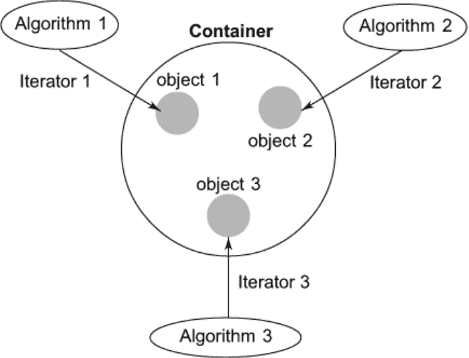

**图 14.1** *STL 三个组件之间的关系*

*容器* 是实际存储数据的对象。它是以某种方式在内存中组织数据的形式。STL 容器由模板类实现，因此可以轻松定制以存储不同类型的数据。


一个 *algorithm* 是处理容器中包含的数据的过程。STL 包含许多不同类型的算法，以支持诸如初始化、查找、复制、排序和合并等任务。算法由模板函数实现。

一个 *iterator* 是一个指向容器中元素的对象（类似于指针）。我们可以使用迭代器在容器中移动。迭代器的处理方式与指针相同，可以对它们进行递增或递减。迭代器将算法与容器连接，在容器中存储的数据的操作中发挥关键作用。

## 14.3 容器

如前所述，容器是保存数据（同类型）的对象。STL 定义了十种容器，分为三类，如 **Fig. 14.2** 所示。**Table 14.1** 列出了所有这些容器的详细信息，包括使用它们需要包含的头文件，以及每个容器类支持的迭代器类型。

**Table 14.1** *STL 支持的容器*

| 容器 | 描述 | 头文件 | 迭代器 |
|---|---|---|---|
| vector | 动态数组。允许在末尾进行插入和删除。支持对任意元素的直接访问 | `<vector>` | 随机访问 |
| list | 双向、线性列表。允许在任何位置进行插入和删除 | `<list>` | 双向 |
| deque | 双端队列。允许在两端进行插入和删除，支持对任意元素的直接访问 | `<deque>` | 随机访问 |
| set | 用于存储唯一集合的关联容器。支持快速查找。（不允许重复） | `<set>` | 双向 |
| multiset | 用于存储非唯一集合的关联容器。（允许重复） | `<set>` | 双向 |
| map | 用于存储唯一键/值对的关联容器。每个键只对应一个值（一对一映射）。支持基于键的查找 | `<map>` | 双向 |
| multimap | 用于存储一对多映射的关联容器，即一个键可以对应多个值（一对多映射）。支持基于键的查找 | `<map>` | 双向 |
| stack | 标准栈，后入先出（LIFO） | `<stack>` | 无迭代器 |
| queue | 标准队列，先入先出（FIFO） | `<queue>` | 无迭代器 |
| priority_queue | 优先队列，优先级最高的元素最先出队 | `<queue>` | 无迭代器 |

**Fig. 14.3** *序列容器中的元素*

STL 提供三种序列容器：

- vector
- list
- deque

所有这些容器中的元素都可以通过迭代器访问。它们之间的区别仅与性能有关。Table 14.2 比较了它们在随机访问速度以及中间插入/删除和末尾插入/删除的性能。

**Table 14.2** — *序列容器性能比较*

| 容器 | 随机访问 | 中间插入或删除 | 末尾插入或删除 |
|---|---|---|---|
| vector | 快 | 慢 | 末尾快 |
| list | 慢 | 快 | 前端快 |
| deque | 快 | 慢 | 两端都快 |

### 关联容器

关联容器设计用于通过键直接访问元素，它们不是顺序的。有四种关联容器：

- set
- multiset
- map
- multimap

这些容器存储数据的结构称为 *tree*，它加速了搜索、删除和插入操作。然而，它们对随机访问非常慢，且在排序方面效率不高。

容器 **set** 和 **multiset** 可以存储若干项，并提供以值为键来操作它们的功能。例如，一个 **set** 可能存储 **student** 类的对象，这些对象按名称的字母顺序排列。我们可以使用名称作为键来查找特定学生。 **set** 与 **multiset** 的主要区别在于，**multiset** 允许重复项，而 **set** 不允许。

容器 **map** 和 **multimap** 用于存储一对一或一对多的键值对。我们可以通过与它们关联的键来操作值（有时称为 *mapped values*）。 **map** 与 **multimap** 的主要区别在于，**map** 为给定值只能存储一个键，而 **multimap** 允许多个键。

### 派生容器

STL 提供三种派生容器，即 **stack**、**queue** 和 **priority_queue**。这些也被称为 *container adaptors*。

栈、队列和优先队列可以从不同的序列容器中创建。派生容器不支持迭代器，因此不能用于数据操作。不过，它们提供两个成员函数 **pop()** 和 **push()** 来实现删除和插入操作。

## 14.4 算法

算法是函数，可以在各种容器上通用使用以处理它们的内容。虽然每个容器提供其基本操作的函数，STL 提供了六十多个标准算法，以支持更复杂或更扩展的操作。标准算法还允许我们同时使用两种不同类型的容器。请记住，STL 算法不是容器的成员函数或友元函数，它们是独立的模板函数。

**Table 14.3** *非变异算法*

| 操作 | 描述 |
|---|---|
| `search()` | 在序列中查找子序列 |
| `search_n()` | 查找指定数量的相似元素的序列 |

**Table 14.4** *变异算法*

| 操作 | 描述 |
|---|---|
| `copy()` | 复制序列 |
| `copy_backward()` | 从末尾复制序列 |
| `fill()` | 用指定值填充序列 |
| `fill_n()` | 用指定值填充前 n 个元素 |
| `generate()` | 用操作的结果替换所有元素 |
| `generate_n()` | 用操作的结果替换前 n 个元素 |
| `iter_swap()` | 交换迭代器所指向的元素 |
| `random_shuffle()` | 将元素随机排序 |
| `remove()` | 删除指定值的元素 |
| `remove_copy()` | 删除指定值后复制序列 |
| `remove_copy_if()` | 删除满足谓词的元素后复制序列 |
| `remove_if()` | 删除满足谓词的元素 |
| `replace()` | 用指定值替换元素 |
| `replace_copy()` | 复制序列并用指定值替换元素 |
| `replace_copy_if()` | 复制序列并用满足谓词的元素替换 |
| `replace_if()` | 用满足谓词的元素替换 |
| `reverse()` | 反转元素顺序 |
| `reverse_copy()` | 复制序列到反向顺序 |
| `rotate()` | 旋转元素 |
| `rotate_copy()` | 复制序列到旋转后的序列 |
| `swap()` | 交换两个元素 |
| `swap_ranges()` | 交换两个序列 |
| `transform()` | 对所有元素应用操作 |
| `unique()` | 删除相邻相等的元素 |
| `unique_copy()` | 复制并删除相邻相等的元素 |

**Table 14.5** *排序算法*

| 操作 | 描述 |
|---|---|
| `binary_search()` | 在有序序列上进行二分查找 |
| `equal_range()` | 查找给定值的子范围 |
| `inplace_merge()` | 合并两个连续的有序序列 |
| `lower_bound()` | 查找指定值的第一个出现位置 |
| `make_heap()` | 从序列中构建堆 |
| `merge()` | 合并两个有序序列 |
| `nth_element()` | 将指定元素放到其正确位置 |
| `partial_sort()` | 对序列的一部分进行排序 |
| `partial_sort_copy()` | 对序列一部分排序并复制 |
| `partition()` | 根据谓词将元素分区 |
| `pop_heap()` | 删除堆顶元素 |
| `push_heap()` | 向堆中添加元素 |
| `sort()` | 对序列进行排序 |
| `sort_heap()` | 对堆进行排序 |


| Operations | Description |
|---|---|
| `stable_partition()` | 将满足谓词的元素移到前面，保持相对顺序 |
| `stable_sort()` | 排序时保持相等元素的顺序 |
| `upper_bound()` | 查找指定值的最后一次出现位置 |

# Table 14.6 *Set algorithms*

| Operations | Description |
|---|---|
| `includes()` | 判断一个序列是否是另一个序列的子序列 |
| `set_difference()` | 构造两个有序集合的差集序列 |
| `set_intersection()` | 构造两个有序集合的交集序列 |
| `set_symmetric_difference()` | 生成两个有序集合的对称差集 |
| `set_union()` | 生成两个有序集合的有序并集 |

# Table 14.7 *Relational algorithms*

| Operations | Description |
|---|---|
| `equal()` | 判断两个序列是否相同 |
| `lexicographical_compare()` | 字典序比较两个序列 |
| `max()` | 返回两个值中的最大值 |
| `max_element()` | 在序列中查找最大元素 |
| `min()` | 返回两个值中的最小值 |
| `min_element()` | 在序列中查找最小元素 |

[PAGE 600]

| Operations | Description |
|---|---|
| `mismatch()` | 查找两个序列之间第一个不匹配的元素 |

# **Table 14.8** *Numeric algorithms*

| Operations | Description |
|---|---|
| `accumulate()` | 对序列执行操作并累积结果 |
| `adjacent_difference()` | 从序列生成另一个序列 |
| `inner_product()` | 对两个序列的对应元素执行操作并累积结果 |
| `partial_sum()` | 对序列执行操作生成累积序列 |

# 14.5 **Iterators**

迭代器类似于指针，用于访问容器元素。它们常用于从一个元素遍历到另一个元素，这一过程称为 *iterating*（遍历）容器。

如 [Table 14.9](#table-14-9) 所述，共有五种迭代器类型。

# **Table 14.9** *Iterators and their characteristics*

| Iterator | Access method | Direction of movement | I/O capability | Remark |
|---|---|---|---|---|
| Input | Linear | Forward only | Read only | Cannot be saved |
| Output | Linear | Forward only | Write only | Cannot be saved |
| Forward | Linear | Forward only | Read/Write | Can be saved |
| Bidirectional | Linear | Forward and backward | Read/Write | Can be saved |
| Random | Random | Forward and backward | Read/Write | Can be saved |

不同类型的迭代器必须与不同类型的容器配合使用（参见 [Table 14.1](#table-14-1)）。注意，只有序列容器和关联容器可通过迭代器进行遍历。

[PAGE 601]

containers are traversable with iterators.

Each type of iterator is used for performing certain functions. Figure 14.4 gives the functionality Venn diagram of the iterators. It illustrates the level of functionality provided by different categories of iterators.

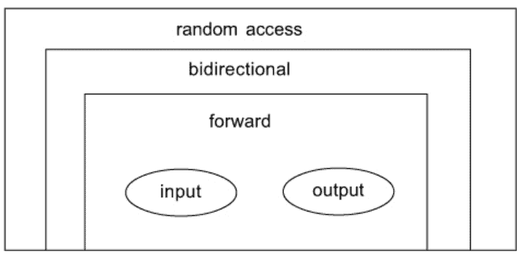

The input and output iterators support the least functions. They can be used only to traverse in a container. The forward iterator supports all operations of input and output iterators and also retains its position in the container. A bidirectional iterator, while supporting all forward iterator operations, provides the ability to move in the backward direction in the container. A random access iterator combines the functionality of a bidirectional iterator with an ability to jump to an arbitrary location. Table 14.10 summarizes the operations that can be performed on each iterator type.

# Table 14.10 Operations supported by iterators

[PAGE 602]

<!-- no content -->

[PAGE 603]

# Table 14.11 Important member functions of the vector class

\begin{tabular}{cc}
Function & Task \\
at( ) & Gives a reference to an element \\
back( ) & Gives a reference to the last element \\
begin( ) & Gives a reference to the first element \\
capacity( ) & Gives the current capacity of the vector \\
clear( ) & Deletes all the elements from the vector \\
empty( ) & Determines if the vector is empty or not \\
end( ) & Gives a reference to the end of the vector \\
erase( ) & Deletes specified elements \\
insert( ) & Inserts elements in the vector \\
pop_back( ) & Deletes the last element \\
push_back( ) & Adds an element to the end \\
resize( ) & Modifies the size of the vector to the specified value \\
size( ) & Gives the number of elements \\
swap( ) & Exchanges elements in the specified two vectors \\
\end{tabular}

Program 14.1 illustrates the use of several functions of the **vector** class template. Note that an iterator is used as a pointer to elements of the vector. We must include header file `<vector>` to use **vector** class in our programs.

# Program 14.1 Using Vectors

```
#include <iostream>
#include <vector>
// Vector header file

using namespace std;
```

[PAGE 604]

<!-- no content -->

[PAGE 605]

```
```
vector<int> :: iterator itr = v.begin();  // iterator
itr = itr + 3;  // itr points to 4th element
v.insert(itr,1,9);

// Display the contents
cout << "nContents after inserting: \n";
display(v);

// Removing 4th and 5th elements
v.erase(v.begin()+3,v.begin()+5);  // Removes 4th and 5thelement

// Display the contents
cout << "nContents after deletion: \n";
display(v);
cout << "END\n";
return(0);
}
```
```

The output of Program 14.1 would be:

Initial size = 0

Enter five integer values: 1 2 3 4 5
Size after adding 5 values: 5
Current contents:
1 2 3 4 5

Size = 6
Contents now:
1 2 3 4 5 6

Contents after inserting:
1 2 3 9 4 5 6

Contents after deletion:

[PAGE 606]

The program uses a number of functions to create and manipulate a vector. The member function size() gives the current size of the vector. After creating an int type empty vector v of zero size, the program puts five values into the vector using the member function push_back(). Note that push_back() takes a value as its argument and adds it to the back end of the vector. Since the vector v is of type int, it can accept only integer values and therefore the statement

```
v.push_back(6.6);
```

truncates the values 6.6 to 6 and then puts it into the vector at its back end.

The program uses an iterator to access the vector elements. The statement

```
vector<int> :: iterator itr = v.begin();
```

declares an iterator itr and makes it to point to the first position of the vector. The statements

```
itr = itr + 3;
v.insert(itr,9);
```

inserts the value 9 as the fourth element. Similarly, the statement

```
v.erase(v.begin()+3, v.begin()+5);
```

deletes 4th and 5th elements from the vector . Note that erase(m,n) deletes only n-m elements starting from mth element and the nth element is not deleted.

The elements of a vector may also be accessed using subscripts (as we do in arrays). Notice the use of v[i] in the function display() for displaying the contents of v. The call v.size() in the for loop of display() gives the current size of v.

[PAGE 607]

# ## Lists

The list is another container that is popularly used. It supports a bidirectional, linear list and provides an efficient implementation for deletion and insertion operations. Unlike a vector, which supports random access, a list can be accessed sequentially only.

Bidirectional iterators are used for accessing list elements. Any algorithm that requires input, output, forward, or bidirectional iterators can operate on a list. Class list provides many member functions for manipulating the elements of a list. Important member functions of the list class are given in Table 14.12. Use of some of these functions is illustrated in Program 14.2. Header file <list> must be included to use the container class list.


```
#include <iostream>
#include <list>
#include <cstdlib>
// For using rand() function

using namespace = std;

void display(list<int> &lst)
{
    list<int> :: iterator p;
    for(p = lst.begin(); p != lst.end(); ++p)
    cout << *p << ", ";
    cout << "\n\n";
}

int main()
{
    list<int> list1;    // Empty list of zero length
    list<int> list2(5); // Empty list of size 5
}
```


```cpp
for(int i=0;i<3;i++)
    list1.push_back(rand()/100);

list<int>::iterator p;
for(p=list2.begin(); p!=list2.end(); ++p)
    *p = rand()/100;
cout << "List1 \n";
display(list1);
cout << "List2 \n";
display(list2);

// Add two elements at the ends of list1
list1.push_front(100);
list1.push_back(200);

// Remove an element at the front of list2
list2.pop_front();

cout << "Now List1 \n";
display(list1);
cout << "Now List2 \n";
display(list2);

list<int> listA, listB;
listA = list1;
listB = list2;

// Merging two lists (unsorted)
list1.merge(list2);
cout << "Merged unsorted lists \n";
display(list1);

// Sorting and merging
listA.sort();
listB.sort();
listA.merge(listB);

cout << "Merged sorted lists \n";
display(listA);

// Reversing a list
listA.reverse();
cout << "Reversed merged list \n";
display(listA);

return(0);
}
```

程序 14.2 的输出为：

```text
List1
0, 184, 63,

List2
265, 191, 157, 114, 293,

Now List1
100, 0, 184, 63, 200,

Now List2
191, 157, 114, 293,

Merged unsorted lists
100, 0, 184, 63, 191, 157, 114, 200, 293,

Merged sorted lists
0, 63, 100, 114, 157, 184, 191, 200, 293,

Reversed merged list
293, 200, 191, 184, 157, 114, 100, 63, 0,
```

程序声明了两个空列表，**list1** 长度为零，**list2** 大小为 5。**list1** 使用成员函数 **push_back()** 和数学函数 **rand()** 填充了三个值。**list2** 使用 **list** 类型迭代器 p 和一个 **for** 循环进行填充。记住 **list2.begin()** 给出第一个元素的位置，而 **list2.end()** 给出最后一个元素之后的位置。值使用 **push_front()** 和 **push_back()** 函数插入到两端。函数 **pop_front()** 删除列表中的第一个元素。同样，我们可以使用 **pop_back()** 删除最后一个元素。

列表的对象可以用其他列表对象初始化，如，

```cpp
listA = list1;
listB = list2;
```

语句

```cpp
list1.merge(list2);
```

简单地将 **list2** 元素添加到 **list1** 的末尾。列表中的元素可以使用 **sort()** 成员函数按递增顺序排序。注意当两个已排序的列表合并时，元素会被插入到适当的位置，因此合并后的列表也是已排序的。

我们使用一个 **display()** 函数来显示各种列表的内容。注意程序 14.1 和程序 14.2 中 **display()** 的实现之间的区别。

**表 14.12** *list 类的重要成员函数*

| Function | Task |
|---|---|
| `back()` | Gives reference to the last element |
| `begin()` | Gives reference to the first element |
| `clear()` | Deletes all the elements |
| `empty()` | Decides if the list is empty or not |
| `end()` | Gives reference to the end of the list |
| `erase()` | Deletes elements as specified |
| `insert()` | Inserts elements as specified |
| `merge()` | Merges two ordered lists |
| `pop_back()` | Deletes the last element |
| `pop_front()` | Deletes the first element |
| `push_back()` | Adds an element to the end |
| `push_front()` | Adds an element to the front |
| `remove()` | Removes elements as specified |
| `resize()` | Modifies the size of the list |
| `reverse()` | Reverses the list |
| `size()` | Gives the size of the list |
| `sort()` | Sorts the list |
| `splice()` | Inserts a list into the invoking list |
| `swap()` | Exchanges the elements of a list with those in the invoking list |
| `unique()` | Deletes the duplicating elements in the list |

### Maps

一个 **map** 是 (key, value) 对的序列，其中每个唯一的键关联一个值，如 *图 14.5* 所示。值的检索基于键并且非常快。我们应该指定键以获得关联的值。

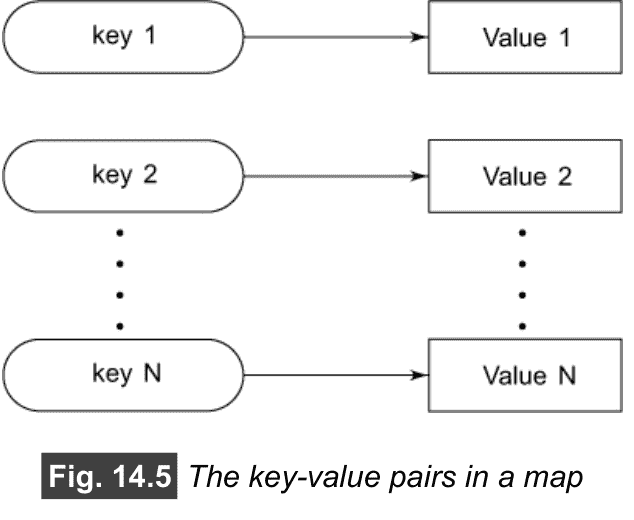

一个 **map** 通常称为 *关联数组*。键使用下标运算符 [ ] 指定，如下所示：

```cpp
phone["John"] = 1111;
```

这为“John”创建了一个条目并将值 1111 与其关联（即赋值）。**phone** 是一个 **map** 对象。我们可以根据需要更改值，如下所示：

```cpp
phone["John"] = 9999;
```

这会将值 1111 更改为 9999。我们还可以使用 **insert()** 和 **erase()** 函数在 **map** 中的任何位置插入和删除对。**map** 类的重要成员函数列在 [表 14.13](#table-1413) 中。

**表 14.13** *map 类的重要成员函数*

| Function | Task |
|---|---|
| `begin()` | Gives reference to the first element |
| `clear()` | Deletes all elements from the map |
| `empty()` | Decides whether the map is empty or not |
| `end()` | Gives a reference to the end of the map |
| `erase()` | Deletes the specified elements |
| `find()` | Gives the location of the specified element |
| `insert()` | Inserts elements as specified |
| `size()` | Gives the size of the map |
| `swap()` | Exchanges the elements of the given map with those of the invoking map |

程序 14.3 显示了 map 用作关联数组的简单示例。注意必须包含 `<map>` 头文件。

### 程序 14.3 使用 Maps

```cpp
#include <iostream>
#include <map>
#include <string>

using namespace std;
typedef map<string,int> phoneMap;

int main()
{
    string name;
    int number;
    phoneMap phone;
    cout << "Enter three sets of name and number \n";

    for(int i=0;i<3;i++)
    {
        cin >> name;    // Get key
        cin >> number;  // Get value
        phone[name] = number;    // Put them in map
    }

    phone["Jacob"] = 4444; // Insert Jacob

    phone.insert(pair<string,int>("Bose", 5555));
    int n = phone.size();
    cout << "\nSize of Map: " << n << "\n\n";
    cout << "List of telephone numbers \n";
    phoneMap::iterator p;
    for(p=phone.begin(); p!=phone.end(); p++)
    {
        cout << (*p).first << " " << (*p).second << "\n";
    }
    cout << "\n";
    cout << "Enter name: ";        // Get name
    cin >> name;
    number = phone[name];          // Find number
    cout << "Number: " << number << "\n";
    return 0;
}
```

程序 14.3 的输出为：

```text
Enter three sets of name and number:
Prasanna 1111
Singh 2222
Raja 3333

Size of Map: 5

List of telephone numbers
Bose 5555
Jacob 4444
Prasanna 1111
Raja 3333
Singh 2222

Enter name: Raja
Number: 3333
```

程序首先交互式地创建 **phone map**，包含三个姓名，然后向 map 中插入另外两个姓名。然后，它显示 map 中所有姓名及其电话号码。现在程序要求用户输入一个人的姓名。程序使用人名作为键在 map 中查找关联的号码，然后打印该号码。

> **NOTE:** *姓名按字母顺序打印，尽管原始数据不是按此顺序。列表使用键自动排序。在我们的示例中，键是人名。*

我们可以使用 **map** 的迭代器的成员 **first** 和 **second** 访问条目的两个部分，如程序所示。即，

```cpp
(*p).first
```

给出键，而

```cpp
(*p).second
```

给出值。

## 14.7 Function Objects

函数对象是一个被包装在类中的函数，使其看起来像一个对象。该类只有一个成员函数，即重载的 `()` 运算符且没有数据。该类是模板化的，因此可以用不同数据类型使用。

函数对象通常用作某些容器和算法的参数。例如，语句

```cpp
sort(array, array+5, greater<int>());
```

使用函数对象 **greater<int>()** 以降序对 **array** 中包含的元素进行排序。

除了比较之外，STL 还提供了许多其他预定义的函数对象，用于执行算术和逻辑操作，如 [表 14.14](#table-1414) 所示。注意存在对应于所有主要 C++ 运算符的函数对象。为了使用函数对象，我们必须包含 **`<functional>`** 头文件。

**表 14.14** — *`<functional>` 中的 STL 函数对象*

| Function object | Type | Description |
|---|---|---|
| `divides<T>` | arithmetic | x / y |
| `equal_to<T>` | relational | x == y |
| `greater<T>` | relational | x > y |
| `greater_equal<T>` | relational | x >= y |
| `less<T>` | relational | x < y |
| `less_equal<T>` | relational | x <= y |
| `logical_and<T>` | logical | x && y |
| `logical_not<T>` | logical | !x |
| `logical_or<T>` | logical | x \|\| y |
| `minus<T>` | arithmetic | x − y |
| `modulus<T>` | arithmetic | x % y |
| `negate<T>` | arithmetic | − x |
| `not_equal_to<T>` | relational | x != y |
| `plus<T>` | arithmetic | x + y |
| `multiplies<T>` | arithmetic | x * y |

*注意：变量 x 和 y 表示作为参数传递给函数对象的类 T 的对象。*

程序 14.4 说明了函数对象 **`greater<>`** 在 **`sort()`** 算法中的使用。

### 程序 14.4 算法中使用函数对象


-   [费曼学习法](https://wiki.example.org/feynmans_learning_method)的灵感源于诺贝尔物理奖获得者**Richard Feynman**。

1.  运用费曼技巧，你只需花上`20 min`就能深入理解知识点，而且记忆深刻，*难以遗忘*。

```
if (condVar > someVal) {console.log("xxx")}
```


- 修改字符串对象
- 比较字符串对象
- 添加字符串对象
- 访问字符串中的字符
- 获取字符串的大小
- 以及许多其他操作

表15.1给出了三个最常用构造函数的原型，表15.2给出了重要成员函数的列表。表15.3列出了可用于**string**对象的一些运算符。

**表15.1 — 常用的字符串构造函数**

| 构造函数 | 用途 |
|---|---|
| `String();` | 创建一个空字符串 |
| `String(const char *str);` | 从以空字符结尾的字符串创建字符串对象 |
| `String(const string & str);` | 从另一个字符串对象创建字符串对象 |

**表15.2 — string类支持的重要函数**

| 函数 | 任务 |
|---|---|
| `append()` | 将字符串的一部分追加到另一个字符串 |
| `assign()` | 分配部分字符串 |
| `at()` | 获取指定位置存储的字符 |
| `begin()` | 返回字符串起始位置的引用 |
| `capacity()` | 给出可以存储的总元素数 |
| `compare()` | 将字符串与调用对象字符串进行比较 |
| `empty()` | 如果字符串为空则返回true；否则返回false |
| `end()` | 返回字符串末尾的引用 |
| `erase()` | 删除指定字符 |
| `find()` | 搜索指定子字符串的出现位置 |
| `insert()` | 在指定位置插入字符 |
| `length()` | 给出字符串中元素的数量 |
| `max_size()` | 给出在给定系统中字符串对象的最大可能大小 |
| `replace()` | 用给定字符串替换指定字符 |
| `resize()` | 按指定方式改变字符串大小 |
| `size()` | 给出字符串中字符的数量 |
| `swap()` | 将给定字符串与调用对象字符串交换 |

**表15.3 — string类支持的运算符**

| 运算符 | 含义 |
|---|---|
| `=` | 赋值 |
| `+` | 拼接 |
| `+=` | 拼接赋值 |
| `==` | 等于 |
| `!=` | 不等于 |
| `<` | 小于 |
| `<=` | 小于或等于 |

## 15.2 创建（string）对象

我们可以通过多种方式创建**string**对象，如下所示：

```cpp
string s1; // Using constructor with no argument
string s2("xyz"); // Using one-argument constructor
s1 = s2; // Assigning string objects
s3 = "abc" + s2; // Concatenating strings
cin >> s1; // Reading through keyboard (one word)
getline(cin, s1); // Reading through keyboard a line of text
```

重载的 + 运算符连接两个string对象。我们也可以使用 += 运算符将字符串追加到字符串末尾。例如：

```cpp
s3 += s1; // s3 = s3 + s1
s3 += "abc"; // s3 = s3 + "abc"
```

运算符 << 和 >> 被重载以处理string对象的输入和输出。例如：

```cpp
cin >> s2; // Input to string object (one word)
cout << s2; // Displays the contents of s2
getline(cin, s2); // Reads embedded blanks
```

**注意：** 使用cin和>>运算符，我们只能读取字符串中的一个单词，而getline()函数允许我们读取包含嵌入空格的一行文本。

程序15.1演示了在程序中创建字符串对象的几种方法。

### 程序15.1 创建字符串对象

```cpp
#include <iostream>
#include <string>

using namespace std;

int main()
{
    // Creating string objects
    string s1;    // Empty string object
    string s2(" New");    // Using string constant
    string s3(" Delhi");
    // Assigning value to string objects
    s1 = s2;    // Using string object
    cout << "S1 = " << s1 << "\n";
    // Using a string constant
    s1 = "Standard C++";
    cout << "Now S1 = " << s1 << "\n";
    // Using another object
    string s4(s1);
    cout << "S4 = " << s4 << "\n";
    // Reading through keyboard
    cout << "ENTER A STRING \n";
    cin >> s4;    // Delimited by blank space
    cout << "Now S4 = " << s4 << "\n";
    // Concatenating strings
    s1 = s2 + s3;
    cout << "S1 finally contains: " << s1 << "\n";
    return 0;
}
```

程序15.1的输出将是：

```text
S1 = New
Now S1 = Standard C++
S4 = Standard C++
ENTER A STRING
COMPUTER CENTRE
Now S4 = COMPUTER

S1 finally contains: New Delhi
```

## 15.3 操作字符串对象

我们可以使用成员函数如**insert()**、**replace()**、**erase()**和**append()**以多种方式修改**string**对象的内容。程序15.2演示了其中一些函数的使用。

### 程序15.2 修改字符串对象

```cpp
#include <iostream>
#include <string>

using namespace std;

int main()
{
    string s1("12345");
    string s2("abcde");
    cout << "Original Strings are: \n";
    cout << "S1: " << s1 << "\n";
    cout << "S2: " << s2 << "\n";
    // Inserting a string into another
    cout << "Place S2 inside S1\n";
    s1.insert(4, s2);
    cout << "Modified S1: " << s1 << "\n";
    // Removing characters in a string
    cout << "Remove 5 Characters from S1 \n";
    s1.erase(4, 5);
    cout << "Now S1: " << s1 << "\n";
    // Replacing characters in a string
    cout << "Replace Middle 3 Characters in S2 with S1 \n";
    s2.replace(1, 3, s1);
    cout << "Now S2: " << s2 << "\n";
    return 0;
}
```

下面给出的程序15.2的输出说明了如何使用字符串函数操作字符串。

```text
Original Strings are:
S1: 12345
S2: abcde

Place S2 inside S1
Modified S1: 1234abcde5

Remove 5 Characters from S1
Now S1: 12345

Replace Middle 3 Characters in S2 with S1
Now S2: a12345e
```

**注意：** 分析程序中使用的每个函数的参数是如何实现的。

## 15.4 关系运算

为字符串对象定义了许多可用于字符串的运算符（表15.3）。在前面的示例中，我们使用了运算符=和+来创建对象。我们也可以应用表15.3中列出的关系运算符。这些运算符被重载，可用于比较字符串对象。compare()函数也可以用于此目的。

程序15.3显示了如何使用这些运算符。

### 程序15.3 字符串对象上的关系运算

```cpp
#include<iostream>
#include<string.h>

using namespace std;

int main()
{
    string s1("ABC");
    string s2("XYZ");
    string s3 = s1 + s2;
}
```

系统可以支持。程序15.4说明了如何获取这些特性并在应用程序中使用它们。

### 程序15.4 获取字符串特性

```cpp
#include <iostream>
#include <string>

using namespace std;

void display(string &str)
{
    cout << "Size = " << str.size() << "\n";
    cout << "Length = " << str.length() << "\n";
    cout << "Capacity = " << str.capacity() << "\n";
    cout << "Maximum Size = " << str.max_size() << "\n";
    cout << "Empty: " << (str.empty() ? "yes" : "no");
    cout << "\n\n";
}

int main()
{
    string str1;
    cout << "Initial status: \n";
    display(str1);

    cout << "Enter a string (one word) \n";
    cin >> str1;
    cout << "Status now: \n";
    display(str1);

    str1.resize(15);
    cout << "Status after resizing: \n";
    display(str1);

    cout << "\n";

    return 0;
}
```

程序15.4的输出将是：

```text
Initial status:
Size = 0
Length = 0
Capacity = 0
Maximum Size = 4294967293
Empty: yes

Enter a string (one word)
INDIA
Status now:
Size = 5
Length = 5
Capacity = 31
Maximum Size = 4294967293
Empty: no

Status after resizing:
Size = 15
Length = 15
Capacity = 31
Maximum Size = 4294967293
Empty: no
```

大小为0且长度为0表示字符串**str1**不包含任何字符。大小和长度始终相同。**str1**最初容量为零，但当为其分配字符串后，其容量增加到31。在此系统中，字符串的最大大小为4294967293。如果**str1**为空，函数**empty()**返回**true**；否则返回**false**。

## 15.6 访问字符串中的字符

我们可以通过多种方式访问字符串的子串和单个字符。**string**类为此目的支持以下函数：

- at() 用于访问单个字符
- substr() 用于检索子字符串
- find() 用于查找指定的子字符串
- find_first_of() 用于查找指定字符第一次出现的位置
- find_last_of() 用于查找指定字符最后一次出现的位置

我们也可以使用重载的 [ ] 运算符（使**string**对象看起来像数组）来访问字符串中的单个元素。程序15.5演示了其中一些函数的使用。

### 程序15.5 访问和操作字符

```cpp
#include <iostream>
#include <string>

using namespace std;

int main()
{
    string s("ONE TWO THREE FOUR");
    cout << "The string contains: \n";
    for(int i = 0; i < s.length(); i++)
        cout << s.at(i); // Display one character
```

```cpp
#include <iostream>
#include <string>

using namespace std;

int main()
{
    string s1("Road");
    string s2("Read");
    string s3("Red");
    cout << "s1 = " << s1 << "\n";
    cout << "s2 = " << s2 << "\n";
    cout << "s3 = " << s3 << "\n";

    int x = s1.compare(s2);
    if (x == 0)
        cout << "s1 == s2\n";
    else if (x > 0)
        cout << "s1 > s2\n";
    else
        cout << "s1 < s2\n";

    int a = s1.compare(0, 2, s2, 0, 2);
    int b = s2.compare(0, 2, s1, 0, 2);
    int c = s2.compare(0, 2, s3, 0, 2);
    int d = s2.compare(s2.size() - 1, 1, s3, s3.size() - 1, 1);

    cout << "a = " << a << "\n";
    cout << "b = " << b << "\n";
    cout << "c = " << c << "\n";
    cout << "d = " << d << "\n";

    cout << "\nBefore swap:\n";
    cout << "s1 = " << s1 << "\n";
    cout << "s2 = " << s2 << "\n";

    s1.swap(s2);

    cout << "\nAfter swap:\n";
    cout << "s1 = " << s1 << "\n";
    cout << "s2 = " << s2 << "\n";

    return 0;
}
```
程序15.6的输出将是：

交换字符串s1和s2的内容。

## 小结

+   对C风格字符串的操作和使用变得复杂且低效。ANSI C++ 提供了一个名为 **string** 的新类来克服C字符串的缺陷。
+   string 类支持许多构造函数、成员函数和运算符，用于创建和操作字符串对象。我们可以对字符串执行以下操作：
    +   从键盘读取字符串
    +   将一个字符串赋值给另一个
    +   查找子字符串
    +   修改字符串
    +   比较字符串和子字符串
    +   访问字符串中的字符
    +   获取字符串的大小和容量
    +   交换字符串
    +   对字符串排序

## 关键术语

<string> | append() | assign() | at() | begin() | capacity | **capacity()**  
| **compare()** | 比较字符串 | 'C字符串' | 'C风格字符串' |  
**empty()** | **end()** | **erase()** | **find()** | **find_first_of()** | **find_last_of()** |  
**getline()** | **insert()** | 长度 | **length()** | 字典序的 | **max_size()**  
| 最大大小 | 关系运算符 | **replace()** | 大小 | **size()** |  
string | 'string类' | 'string构造函数' | 'string对象' | **substr()** |  
子字符串 | **swap()** | 交换字符串

## 复习题

**15.1** 判断下列陈述是真是假：

+   (a) 要使用 **string** 类，我们必须包含头文件 `<string>`。
+   (b) **string** 对象以空字符结尾。
+   (c) **string** 对象的元素从0开始编号。
+   (d) **string** 类的对象可以使用赋值运算符进行复制。
+   (e) 函数 **end()** 返回一个指向调用该函数的 **string** 对象的迭代器。

**15.2** **string** 类型的字符串与C型字符串有何不同？

**15.3** 以下语句可用于从键盘读取字符串。

+   (a) `cin >> s1;`  
+   (b) `getline(cin, s1);`

其中 **s1** 是一个 **string** 对象。请区分它们的行为。

**15.4** 考虑以下程序片段：

```
string s1("man"), s2, s3;
s2.assign(s1);
s3 = s1;
string s4("wo" + s1);
s2 += "age";
s3.append("ager");
s1[0] = 'v';
```

执行时，对象s1、s2、s3和s4的内容是什么？

# 15.5 我们可以使用以下方式访问字符串元素

+   (a) **at()** 函数
+   
+   (b) 下标运算符 [ ]

比较它们的行为。

# 15.6 以下每条语句执行什么操作？

+   (a) `s.replace(n,1,"/");`
+   
+   (b) `s.erase(10);`
+   
+   (c) `s1.insert(10,s2);`
+   
+   (d) `int x = s1.compare(0, s2.size(), s2);`
+   
+   (e) `s2 = s1.substr(10, 5);`

# 15.7 区分下列成对的函数。

+   (a) max_size() 和 capacity()
+   
+   (b) find() 和 rfind()
+   
+   (c) begin() 和 rbegin()

## 调试练习

[PAGE 645]

# 15.1 找出下面程序中的错误。

```
#include <iostream.h>
#include <string>

using namespace std;

void main()
{
string str1("ghi");
string str2("abc" + "def");
str2+=str1;
cout << str2.c_str();
}
```

# 15.2 找出下面程序中的错误。

```
#include <iostream.h>
#include <string>
using namespace std;
void main()
{
string str1("ABCDEF");
string str2("123");
string str3;
str1.insert(2, str2);
str1.erase(2,2);
str1.replace(2,str2);
cout << str1.c_str();
cout << endl;
}
```

# 15.3 找出下面程序中的错误。

```
#include <iostream>
#include <string>
using namespace std;
class Product
```

[PAGE 646]

```
{
int iProductNumber;
string strProductName;
public:
Product()
{
}
Product(const int &number, const string &name)
{
setProductNumber(number);
setProductName(name);
}
void setProductNumber(int n)
{
iProductNumber = n;
}
void setProductName(const string str)
{
strProductName = str;
}
int getProductNumber()
{
return iProductNumber;
}
const string getProductName()
{
return strProductName ;
}
}
Products operator = (Product &source)
{
setProductNumber(source.iProductNumber);
string strTemp = source.strProductName;
setProductName(strTemp);
return *this;
}
void display()
{
}
```

[PAGE 647]

```
cout << "ProductName : " << getProductName();
cout << " " ;
cout << "ProductNumber : " << getProductNumber();
cout << endl;
}
void main()

{

404 Object Oriented Programming with C++

Product p1(1, 5);
Product p2(3, “Dates”);
Product p3;
p3 = p2 = p1;
p3.display();
p2.display();
```

15.4 找出以下代码段中的错误（如果有）。

```
int len = sl. length();
for (int i=0; 1<len;++1)
cout << sl.at[];
```

[PAGE 648]

15.1 编写一个程序，从键盘将名字

Martin Luther King

读入三个单独的字符串对象，然后使用

+   (a) + 运算符和
+   (b) **append()** 函数

将它们连接成一个新的字符串对象。

15.2 编写一个程序，使用迭代器和 **while()** 结构来显示 **string** 对象的内容。

15.3 编写一个程序，从键盘读取几个城市名称，并仅显示以字母“B”或“C”开头的名称。

15.4 编写一个程序，读取包含多于三个单词的一行文本，然后将所有空格替换为下划线(_)。

15.5 编写一个程序，统计一行文本中某个特定字符（例如‘e’）出现的次数。

15.6 编写一个程序，读取以下文本并统计其中单词“It”出现的次数。

> It is new. It is singular.
> It is simple. It must succeed!

15.7 修改练习15.6中的程序，统计以字符’s’开头的单词数量。

15.8 编写一个程序，读取一个随机顺序的国家列表，并按字母顺序显示它们。使用比较运算符和函数。

15.9 给定一个字符串

string s(“123456789”); 编写一个程序，显示以下内容：

```
1
2 3   2
3 4 5     4 3
4 5 6 7   6 5 4
5 6 7 8 9 8 7 6 5
```


# ANSI C++ 标准的新特性

## 关键概念

布尔类型数据 | 宽字符字面量 | 常量转换 | 静态转换 | 动态转换 | 重新解释转换 | 运行时类型信息 | 显式构造函数 | 可变成员数据 | 命名空间 | 命名空间的嵌套 | 运算符关键字 | 使用新关键字 | 头文件的新风格

ISO/ANSI C++ 标准在原有 C++ 规范的基础上增加了几项新特性。其中一些是为了在特定情况下提供更好的控制，另一些则是为 C++ 程序员提供便利。因此，有必要指出，从技术上讲，完全不使用这些新特性也可以编写出功能完整的程序。新增的重要特性包括：

1. 新数据类型
   - bool
   - wchar_t
2. 新运算符
   - const_cast
   - static_cast
   - dynamic_cast
   - reinterpret_cast
   - typeid
3. 类实现
   - 显式构造函数
   - 可变成员
4. 命名空间作用域
5. 运算符关键字
6. 新关键字

在假设 **b1** 为 true、**m** 为 2 的情况下，该语句是有效的，右侧表达式的计算结果为 9。当 **bool** 类型的值用于非布尔表达式时，会自动提升为整数。

可以将指针、整数或浮点值等数据类型隐式转换为 **bool** 类型。例如，以下语句

```cpp
bool x = 0;
bool y = 100;
bool z = 15.75;
```

会将 **false** 赋给 x，将 **true** 赋给 y 和 z。

程序 16.1 演示了 **bool** 类型数据的特性。

# 程序 16.1  bool 类型数据的使用

```cpp
#include<iostream>
using namespace std;

int main()
{
int arr1[5] = {1, 99, 3, -1, 6};
int arr2[5] = {0, 66, 3, 0, 6};
bool comp[5];

cout<<"Array 1: ";
for(int i=0; i<5;i++)
cout<<arr1[i]<<"\t";

cout<<"\nArray 2: ";
for(i=0; i<5;i++)
cout<<arr2[i]<<"\t";
```

```cpp
cout<<"\nComparing the two arrays ..\n";
for(i=0; i<5;i++)
comp[i]=arr1[i]==arr2[i];

cout<<"\nDisplaying the comparison results..\n";
for(i=0; i<5;i++)
if(comp[i]==1)
cout<<"Index "<<i<<" - Match\n";
else
cout<<"Index "<<i<<" - No Match\n";
return 0;
}
```

程序 16.1 的输出将是：

- Array 1:1 99 3 -1 6
- Array 2:0 66 3 0 6

Comparing the two arrays ..

Displaying the comparison results..
Index 1 - No Match
Index 2 - No Match
Index 3 - Match
Index 4 - No Match
Index 5 - Match

ANSI C++ 定义了字符类型 wchar_t 来保存 16 位宽字符。16 位字符用于表示包含 255 个以上字符的语言字符集，例如日语。如果我们正在编写面向国际发行的程序，这一点非常重要。

```cpp
char ch = static_cast<char>(m);
```

第一条语句将变量 **m** 转换为 **double** 类型，第二条语句将其转换为 **char** 类型。

既然旧风格仍然有效，为什么还要使用这种新类型？旧语法的形式与其余代码行混在一起，因此很难定位它们。新格式则易于识别，也便于使用自动化工具搜索。

## const_cast 运算符

**const_cast** 运算符用于在强制转换中显式覆盖 **const** 或 **volatile**。其形式如下：

```cpp
const_cast<type>(object)
```

由于该运算符的目的是改变对象的 **const** 或 **volatile** 属性，所以 *目标类型* 必须与 *源类型* 相同。它主要用于移除对象的 const 属性。

## reinterpret_cast 运算符

**reinterpret_cast** 用于将一种类型转换为一种根本不同的类型。例如，它可以用于将指针类型的对象转换为整数类型的对象，反之亦然。其形式如下：

```cpp
reinterpret_cast<type>(object)
```

该运算符应用于本质上不兼容的类型之间的转换。示例：

```cpp
int m;
float x;
```

```cpp
int* intptr;
float* floatptr;
intptr = reinterpret_cast<int*>(m);
floatptr = reinterpret_cast<float*>(x);
```

## dynamic_cast 运算符

dynamic_cast 用于在运行时转换对象的类型。它的主要应用是对多态对象执行转换。请回忆一下，多态对象是由包含虚函数的基类创建的。其形式如下：

`dynamic_cast<type>(object)`

*object* 是一个基类对象，其类型将被检查和转换。它将对象的类型转换为 *type*。它永远不会执行无效的转换。它会在运行时检查转换是否合法。如果转换无效，则返回 NULL。

*type* 必须是指向某个已定义类类型的指针或引用。*argument* 对象必须是解析为指针或引用的表达式。使用 **dynamic_cast()** 运算符也被称为 *类型安全向下转换*。

## typeid 运算符

我们可以使用 **typeid** 运算符在运行时获取未知对象的类型，例如它们的类名。例如，语句

`char *objectType = typeid(object).name();`

会将“object”的类型赋值给字符数组 **objectType**，如有必要可以将其打印出来。为此，它使用 **name()** 成员函数，该函数属于 **type_info** 类。对象可以是 **int**、**float** 等类型，也可以是任何类的对象。

我们必须包含 **<typeinfo>** 头文件，才能使用提供运行时类型信息（RTTI）的 **dynamic_cast** 和 **typeid** 运算符。

顾名思义，RTTI 是在运行时确定对象动态类型的过程。虽然我们可能声明了一个具有某种静态类型的指针，但在运行时它很可能指向从该静态类型派生的任何类类型。以下示例演示了使用 typeid 运算符的 RTTI：

```cpp
#include <iostream>
#include <typeinfo>
class Org
{

        public:
                // Members of Org class

                virtual ~Org() { }
};

class Dept : public Org
{
                // Members of Dept class
};

int main ()
{
        Org org1;
        Dept dept1;
        Org *ptr = &dept1;

        std::cout << typeid(ptr).name() << std::endl;
        // This will display Org * i.e. the static pointer type
```

```cpp
std::cout << typeid(*ptr).name() << std::endl;
// This will display Dept i.e. the dynamic pointer type
}
```

在上述程序中，typeid(object) 调用返回一个指向 type_info 对象的引用，该对象包含有关对象类型的信息。type_info 类的成员函数 name() 用于获取对象类型的名称。

# 16.4  类实现

ANSI C++ 标准增加了两个不寻常的关键字 **explicit** 和 **mutable**，用于类成员。

## explicit 关键字

**explicit** 关键字用于将类构造函数声明为“显式”构造函数。我们在前面讨论构造函数时已经看到，任何带一个参数调用的构造函数都会执行 *隐式转换*，即构造函数接收的类型会被转换为定义该构造函数的类的对象。由于这种转换是自动的，我们不需要进行任何强制转换。如果我们不希望发生这种自动转换，可以通过将单参数构造函数声明为 explicit 来实现，如下所示：

```cpp
class ABC
{
    int m;
public:
    explicit ABC (int i)       // constructor
    {
        m = i;
    }
    // ...........
}
```

这里，ABC 类的对象只能使用以下形式创建：

```cpp
ABC abc1(100);
```

自动转换形式

```cpp
ABC abc1 = 100;
```

是不允许的，也是非法的。请记住，当关键字 **explicit** 未应用于该转换时，这种形式是允许的。

## mutable 关键字

我们知道，类对象或成员函数可以被声明为 **const**，从而使它们的成员数据不可修改。然而，可能会出现这样的情况：我们希望创建一个 **const** 对象（或函数），但只想修改某个特定的数据项。在这种情况下，我们可以通过将该数据项声明为 **mutable** 来使其可修改。示例：

```cpp
mutable int m;
```

虽然包含 **m** 的函数（或类）被声明为 **const**，但 **m** 的值仍然可以被修改。程序 16.2 演示了 **mutable** 成员的使用。

# 程序 16.2  关键字 mutable 的使用

```cpp
#include <iostream>
using namespace std;
```


## 16.8 新头文件

ANSI C++ 标准定义了一种指定头文件的新方式。它们不使用 .h 扩展名作为文件名。示例：

```
#include <iostream>
#include <fstream>
```

然而，传统的 **<iostream.h>, <fstream.h>,** 等风格仍完全受支持。一些旧头文件被重命名如下表所示：

| 旧风格 | 新风格 |
|---|---|
| <assert.h> | <cassert> |
| <ctype.h> | <cctype> |
| <float.h> | <cfloat> |

<table><tr><td><limits.h></td><td><climits></td></tr><tr><td><math.h></td><td><cmath></td></tr><tr><td><stdio.h></td><td><cstdio></td></tr><tr><td><stdlib.h></td><td><cstdlib></td></tr><tr><td><string.h></td><td><cstring></td></tr><tr><td><time.h></td><td><ctime></td></tr></table>

<table><tr><td>总结</td><td></td></tr><tr><td>□ ANSI C++ 标准委员会在最初的 C++ 语言规范中增加了许多新特性。</td><td></td></tr><tr><td>□ 新增了 bool 和 wchar_t 两种新数据类型，以扩充 C++ 中可用的数据类型范围。</td><td></td></tr><tr><td>□ bool 类型可以保存布尔值 true 和 false。</td><td></td></tr><tr><td>□ wchar_t 类型用于保存 16 位字符字面量。</td><td></td></tr><tr><td>□ 新增了四个强制转换运算符：static_cast、const_cast、reinterpret_cast 和 dynamic_cast。</td><td></td></tr><tr><td>□ static_cast 运算符用于任何标准的数据类型转换。</td><td></td></tr><tr><td>□ const_cast 运算符可用于显式地改变对象的 const 或 volatile 属性。</td><td></td></tr><tr><td>□ 我们可以使用 reinterpret_cast 运算符将对象的数据类型转换为一种根本不同的类型。</td><td></td></tr><tr><td>□ 通过在运行时使用 dynamic_cast 运算符可以实现对象的强制转换。</td><td></td></tr><tr><td>□ 另一个新运算符 typeof 可以为我们提供有关对象的运行时类型信息。</td><td></td></tr></table>


- 构造函数可以被声明为 **explicit**，以进行显式转换。
- 通过将 **const** 对象或函数中的某个数据项声明为 **mutable**，可以使其可修改。
- ANSI C++ 允许我们在程序中定义自己的 **namespace** 作用域，以克服某些名称冲突情况。
- 命名空间可以嵌套。
- **namespace** 作用域的成员可以通过 **using** 声明或 **using** 指令来访问。
- ANSI C++ 提出了一些关键字，可用于替代某些运算符的符号。
- 在新标准中，头文件应在不带 .h 扩展名的情况下指定，并且应在每个程序中添加 **using** 指令 `using namespace std;`。
- 在新标准中，一些旧式头文件被重命名。例如，**math.h** 文件称为 **cmath**。

## 关键术语

**and** | **and_eq** | ANSI C++ | **bitand** | **bitor** | **bool** | 布尔 | C 类型转换 | C++ 标准 | C++ 类型转换 | 类型转换 | **compl** | **const** | **const** 函数 | **const** 对象 | **const_cast** | 常量转换 | 当前作用域 | 向下转换 | **dynamic_cast** | 动态转换 | **explicit** 构造函数 | 假值 | 全局标识符 | **头**文件 | 隐式转换 | **mutable** 成员 | name() 函数 | **namespace** 作用域 | 嵌套命名空间 | not | not_eq | 运算符关键字 | or | or_eq | 多态对象 | reinterpret 转换 | reinterpret_cast | RTTI | 源类型 | 标准库 | 静态转换 | **static_cast** | std 命名空间 | 目标类型 | **真值** | 类型转换 | **type_info** 类 | 类型安全转换 | **typeid** | **typeinfo** 头文件 | 未命名命名空间 | **using** 声明 | **using** 指令 | **using namespace** | **volatile** | **wchar_t** | 宽字符字面量 | **xor** | **xor_eq**

## 复习题

- 16.1 列出 ANSI C++ 标准委员会添加的两种数据类型。
- 16.2 **bool** 类型变量的应用是什么？
- 16.3 **wchar_t** 字符类型的必要性是什么？
- 16.4 列出 ANSI C++ 标准委员会添加的新运算符。
- 16.5 **const_cast** 运算符的应用是什么？
- 16.6 既然旧式转换也能完成同样的工作，为什么还需要 **static_cast** 运算符？
- 16.7 **reinterpret_cast** 与 **static_cast** 有何不同？
- 16.8 什么是动态转换？在 C++ 中如何实现？
- 16.9 什么是 **typeid** 运算符？何时使用它？
- 16.10 什么是显式转换？如何实现？
- 16.11 我们何时使用关键字 **mutable**？
- 16.12 什么是命名空间冲突？在 C++ 中如何处理？
- 16.13 如何访问在具名命名空间中声明的变量？
- 16.14 使用 **using namespace** 指令和使用 **using** 声明来访问 **namespace** 成员有什么区别？
- 16.15 下面的代码段有什么错误？

```cpp
const int m = 100;
int *ptr = &m;
```

- 16.16 下面的语句有什么问题？

```cpp
const int m = 100;
double *ptr = const_cast<double*>(&m);
```

- 16.17 下面程序的输出是什么？

```cpp
#include<iostream.h>
class Person
{
        // ....
};
int main()
{
        Person John;
        cout << " John is a ";
        cout << typeid(John).name() << "\n";
}
```

- 16.18 下面的命名空间定义有什么错误？

```cpp
namespace Main
{
        int main()
        {
                // ....
        }
}
```

## 调试练习

- **16.1** 找出下面程序中的错误。

```cpp
#include <iostream>
class A
{
public:
        A()
        {
        }
        A(int i)
        {
        }
};
class B
{
public:
        B()
        {
        }
        explicit B(int)
        {
        }
};
void main()
{
        A a1=12;
        A a2;
        A a3=a1;
        B b1 = 12;
}
```

- **16.2** 找出下面程序中的错误。

```cpp
#include <iostream.h>

class A
{
protected:
    int i;

public:
    A()
    {
        i = 10;
    }
    int get()
    {
        return i;
    }
};

class B: public A
{
public:
    B()
    {
    }
    int get()
    {
        return i + i;
    }
};

void main()
{
    A *a = new A();
    B *b = static_cast<B*>(a);
    cout << b->get();
}
```

- **16.3** 找出下面程序中的错误。

```cpp
#include <iostream.h>

namespace A
{
    int i;
    void displ()
    { 
        cout << i; 
    }
}
void main()
{
    namespace Inside
    { 
        int inside1;
        void displnInside()
        { 
            cout << inside1; 
        }
    }
}
A::i = 10;
cout << A::i;
A::displ();
Inside::inside1 = 20;
cout << Inside::inside1;
Inside::displnInside();
}
```

## 编程练习

- 16.1 编写一个程序来演示 reinterpret_cast 运算符的使用 WEB.
- 16.2 定义一个名为 Constants 的命名空间，其中包含一些常量的声明。编写一个程序，使用在命名空间 Constants 中定义的常量 WEB.

# 面向对象系统开发

## 关键概念

软件开发展组件 | 面向过程的开发工具 | 面向对象范式 | OOP 符号和图 | 数据流图 | 面向对象设计 | 自顶向下分解 | 系统实现 | 面向过程范式 | 经典软件开发生命周期 | 喷泉模型 | 面向对象分析 | 文本分析 | 类层次结构 | 结构化设计 | 原型化范式

软件工程师一直在尝试各种*工具、方法*和*过程*来控制软件开发过程，以便以更高的生产率构建高质量的软件。方法提供了构建软件的“如何做”，而工具则为方法提供了自动化或半自动化的支持。它们用于软件开发过程的所有阶段，即规划、分析、设计、开发和维护。软件开发过程将方法和工具集成在一起，使得软件系统能够合理且及时地开发（图 17.1）。它们提供了关于如何应用方法和工具、如何生成每个阶段的可交付成果、应用哪些控制措施以及使用哪些里程碑来评估进度的指南。

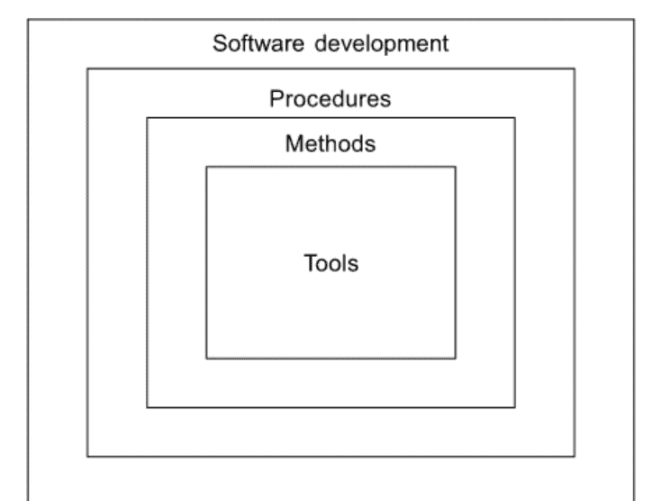

**图 17.1** 软件开发组件

存在许多软件开发范式，每种范式使用不同的方法和工具集。特定范式的选择取决于应用的性质、所使用的编程语言以及所需的控制和可交付成果。成功系统的开发不仅取决于是否使用合适的方法和技术，还取决于开发者对系统目标的承诺。一个成功的系统必须：

- 1. 满足用户需求，
- 2. 易于用户和操作人员理解，
- 3. 易于操作，
- 4. 具有良好的用户界面，
- 5. 易于修改，
- 6. 可扩展，
- 7. 具有足够的安全控制措施，防止数据被滥用，
- 8. 令人满意地处理错误和异常，以及
- 9. 在预算内按时交付。

这一阶段将需求转换为软件的一种表示形式。这个阶段回答*如何*的问题。

*编码：* 编码是指将设计转换为机器可读形式。设计越详细，编码就越容易，可靠性也越高。

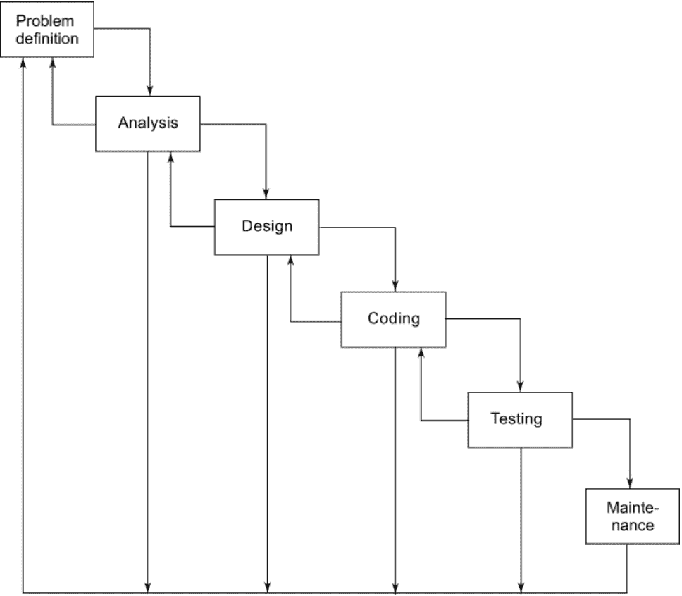

**图 17.2** *经典软件开发生命周期（嵌入式“瀑布”模式）*

*测试：* 代码编写完成后，应对其进行严格测试，以验证代码和结果的正确性。测试可能涉及


单个单元和整个系统。它需要一个详细的计划，明确测试什么、何时测试以及如何测试。

*维护：* 软件安装后，可能会经历一些变更。这可能是由于用户需求的变化、运行环境的变化，或者是测试期间未修复的软件错误所致。维护确保这些变更在必要时被纳入其中。

生命周期每个阶段都有自己的目标和产出。一个阶段的产出作为下一阶段的输入。表17.1显示了生命周期中每个阶段可能产生的典型产出。

| 阶段 | 产出 |
|---|---|
| 问题定义（为什么） | • 问题陈述表<br>• 项目请求 |
| 分析（是什么） | • 需求文档<br>• 可行性报告<br>• 规格说明文档<br>• 验收测试标准 |
| 设计（如何做） | • 设计文档<br>• 测试类设计 |
| 编码（如何做） | • 代码文档（程序）<br>• 测试计划<br>• 用户手册 |
| 测试（什么和如何） | • 经过测试的代码<br>• 测试结果<br>• 系统手册 |
| 维护 | • 维护日志表 |

以及设计和分析，因此它们被称为结构化工具。最近的工具是第三代工具，自20世纪80年代末以来逐渐发展，以适应*面向对象*的分析和设计。

表17.2展示了在三大类别下各种开发过程中使用的一些常用工具。尽管这种分类方式值得商榷，但它能让人对过去三十年间工具的发展有一个大致的了解。

**表17.2** *系统开发工具*

| 过程 | 第一代 | 第二代 | 第三代 |
|---|---|---|---|
| 物理过程 | 系统流程图 | 上下文图 | 继承图<br>对象关系图 |
| 数据表示 | 布局表单<br>网格图 | 数据字典 | 对象/对象字典 |
| 逻辑过程 | 剧本式英语叙述 | 决策表与决策树<br>数据流图 | 继承图<br>数据流图 |
| 程序表示 | 程序流程图<br>输入输出布局 | 结构图<br>Warnier/Orr图 | 状态变化图<br>Ptech图<br>Coad/Yourdon图 |

本节概述了一些最常用的第一代和第二代工具。面向对象的开发工具将在本章后面讨论（根据需要时再进行介绍）。

*系统流程图：* 系统中关键点之间重要输入、输出和数据流的图形表示。

*程序流程图：* 程序逻辑的图形表示。

*剧本：* 对执行过程的一种叙述性描述。

*布局表单：* 为输入数据或显示结果而设计的格式。

*网格图：* 显示系统不同模块之间关系的图表。

*上下文图：* 显示输入及其来源、输出及其去向的图表。上下文图主要勾勒出系统的边界。

*数据流图：* 它们描述了系统各个组件之间的数据流动。它是系统的一种网络表示，包含过程和数据文件。

*数据字典：* 关于数据的数据的结构化存储库。它包含所有数据项和数据存储的术语列表及其定义。

*结构图：* 表示系统功能（模块）控制逻辑的图形表示。

*决策表：* 用于定义问题和要采取行动的条件表。它呈现了一种逻辑，告诉我们当给定条件为真或假时应采取什么行动。*决策树：* 条件和结果的图形表示，类似于树的树枝。

*Warnier/Orr图：* 使用嵌套的大括号集合、伪代码和逻辑符号来表示程序结构的水平层次图。

## 17.4 面向对象范式

面向对象范式在很大程度上以一般系统理论作为概念背景。一个系统可以被看作是一组*实体*的集合，这些实体相互交互以完成某些目标（图17.3）。实体可以表示物理对象，如设备和人员，也可以表示抽象概念，如数据文件和函数。在面向对象分析中，这些实体被称为*对象*。

过程

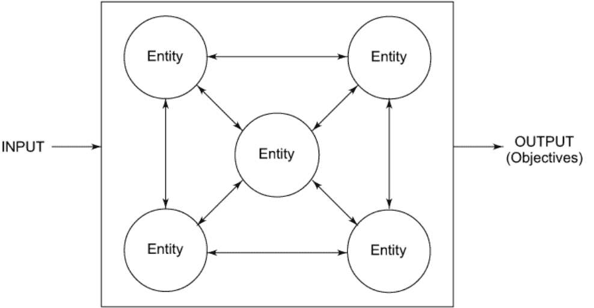

**图17.3** *显示实体间相互关系的系统*

顾名思义，面向对象范式更加强调封装数据和过程的对象。它们在软件开发的各个阶段都扮演着核心角色，因此各阶段之间存在高度的重叠和迭代。整个开发过程本质上是演进式的。因此，面向对象版本的软件开发生命周期的任何图形表示都必须考虑重叠和迭代这两个方面。结果是用“喷泉模型”代替了经典的“瀑布模型”，如图17.4所示。该模型描述了开发达到一个更高水平后，又回落到之前的水平，然后再次攀升的过程。

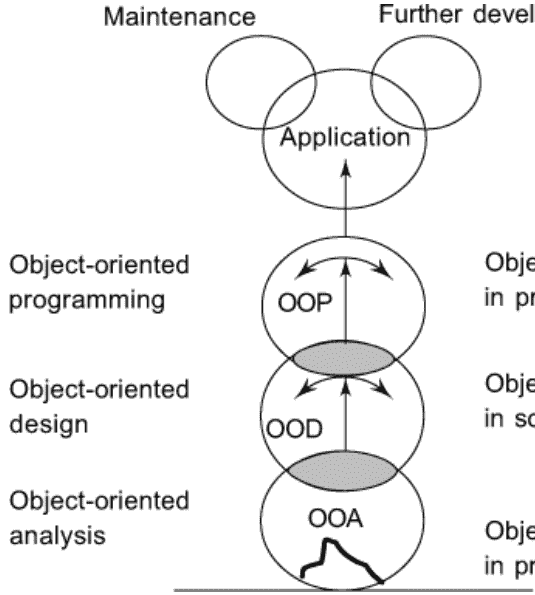

**图17.4** *面向对象软件开发的喷泉模型*

*面向对象分析*（OOA）是指以现实世界中的对象、它们的行为以及它们之间的交互来规定软件需求的方法。而*面向对象设计*（OOD）则将软件需求转化为对象的规格说明，并推导出可以从其中创建对象的类层次结构。最后，*面向对象编程*（OOP）是指使用对象在诸如C++之类的面向对象编程语言中实现程序。

通过开发问题空间中发现对象的规格说明，一个清晰且组织良好的问题陈述实际上被构建到应用程序中。这些对象形成了一个以问题空间的术语编写的高级定义层。在细化定义和实现应用程序对象的过程中，会识别出其他对象。**图17.5**展示了由此过程产生的对象规格说明的层次。

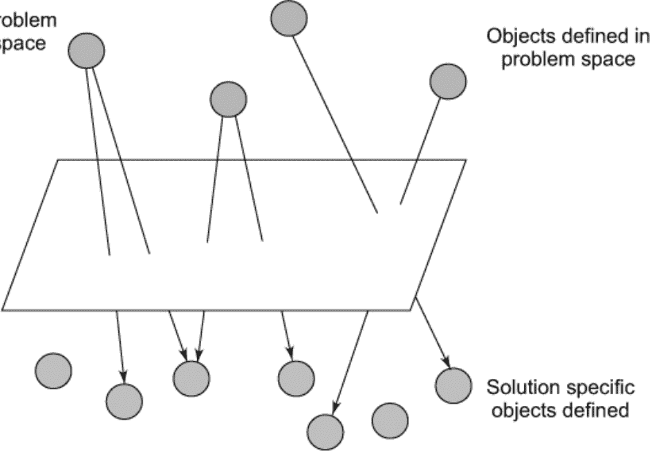

面向对象方法中的所有阶段由于对象模型的共性而更加紧密地协同工作。在一个阶段，识别问题域对象；在下一个阶段，则为特定解决方案指定额外需要的对象。对于这些实现级别的对象，设计过程会重复进行。

与传统的自顶向下功能分解方法相比，面向对象方法兼具自顶向下和自底向上设计的许多特征。自上而下的功能分解技术可以应用于各个类的设计，而最终系统则可以借助类模块使用自底向上的方法构建。

## 17.5 面向对象的表示法与图

图形表示法是任何设计和开发过程的重要组成部分，面向对象的设计也不例外。我们需要表示法来表示类、对象、子类及其相互关系。遗憾的是，目前还没有用于表示对象及其交互的标准表示法。作者和研究人员都使用了自己的表示法。其中一些使用得较为频繁，而另一些则不然。图17.6至图17.14展示了一些常用的表示法，用于表示以下内容：

- 1. 类和对象。
- 2. 对象的实例。
- 3. 对象之间的消息通信。
- 4. 继承关系。
- 5. 分类关系。
- 6. 组合关系。
- 7. 层次图。
- 8. 客户端-服务器关系。
- 9. 过程分层。

我们应尽可能使用这些表示法和图。它们不仅提高了过程的清晰度，也提高了软件开发人员的生产力。

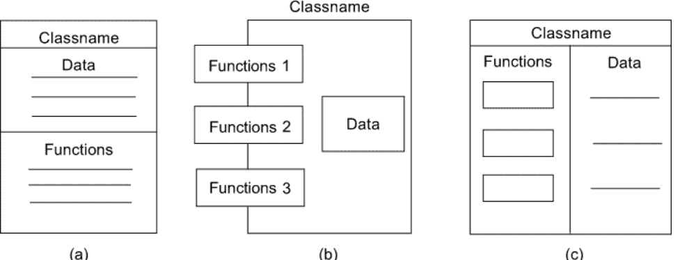

*图17.6* 类/对象的各种表示形式


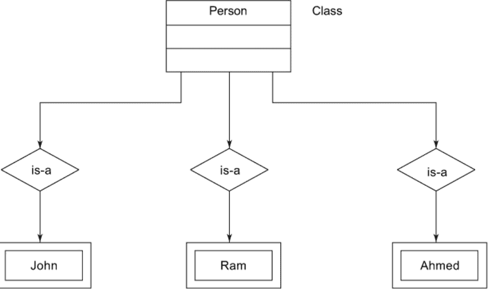

**图 17.7** *对象实例*

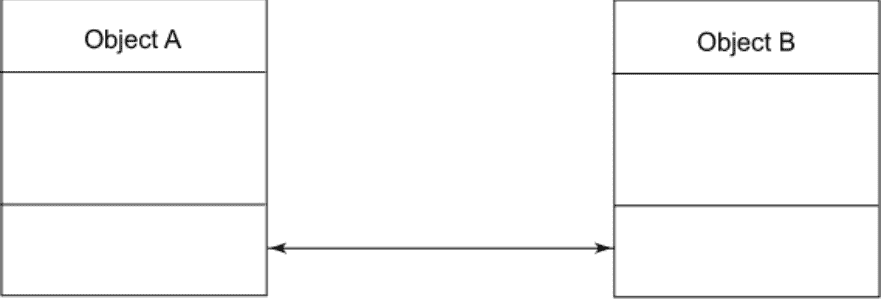

**图 17.8** *对象之间的消息通信*


基类

派生类

**图 17.9** *继承关系*


**图 17.12** *层次结构图*


**图 17.13** *客户端-服务器关系*

5. 按照所需服务和所提供服务，在对象之间建立相互连接（协作）。

尽管我们已将上述任务展示为一系列独立的步骤，但最后三项活动是相互依赖地进行的，如图 17.15 所示。


**图 17.15** *面向对象分析的活动*

## 问题理解

分析过程的第一步是理解用户的问题。问题陈述应使用计算机系统工程的语言加以精炼和重新定义，从而提出基于计算机的解决方案。问题陈述应尽可能以单个语法正确的句子来表述。这将使软件工程师能够高度聚焦于问题的解决方案。问题陈述为绘制用户和软件的需求规格说明提供了基础。

## 需求规格说明

一旦问题被清晰定义，下一步就是理解所建议系统需要做什么。在此阶段生成一份用户需求清单非常重要。用户和开发者之间应对所需内容有清晰的理解。应基于用户需求来绘制软件规格说明。开发者应明确说明：

- 需要哪些输出。
- 涉及哪些过程来产生这些输出。
- 需要哪些输入。
- 需要哪些资源。

这些规格说明通常作为参考，用于测试最终产品在预期任务上的性能表现。

## 对象的识别

对象的识别通常可以基于现实世界对象以及抽象对象来进行。因此，寻找对象的最佳场所就是应用本身。可以使用以下两种方法之一来分析应用：

- 1. 数据流图（DFD）
- 2. 文本分析（TA）

### 数据流图

应用可以用数据流图的形式表示，说明数据如何在系统中从一个点移动到另一个点。数据流图中的方框和数据存储是对象的良好候选。处理气泡对应于过程。图 17.16 展示了一个典型的数据流图。它也称为数据流图或气泡图。

DFD 可用于在任意抽象级别表示系统。例如，图 17.16 中所示的 DFD 可能是


**图 17.17** *基本数据流图*

**表 17.3 — 名词类型**

| 名词类型 | 含义 | 示例 |
|---|---|---|
| 普通名词 | 描述事物的类别（实体） | 车辆、客户收入、扣除额 |
| 专有名词 | 特定事物的名称 | 马鲁蒂汽车、约翰、ABC公司 |
| 物质名词或抽象名词 | 描述与名词相关的性质、数量或活动 | 工资收入、房屋贷款、英尺、交通 |

需要特别注意的是，必须使用上下文和语义来确定名词类别。一个特定的词在一种上下文中可能表示普通名词，在另一种上下文中可能表示物质名词或抽象名词。

这些方法仅作为指导，而非终极工具。经验丰富的开发者的创造性感知和直觉在识别对象方面起着重要作用。

使用上述方法之一，为应用问题准备一份对象列表。这可能包括以下任务：

- 1. 准备对象表。
- 2. 识别属于解空间的对象以及仅属于问题空间的对象。问题空间对象位于软件边界之外。
- 3. 识别解空间对象的属性。

请记住，并非所有名词都会对解决方案的最终实现产生影响。考虑以下系统的需求陈述：

## 服务的识别

一旦解空间中的对象被确定，下一步就是确定每个对象应提供的一组服务。通过检查问题描述陈述中的所有动词和动词短语来识别服务。能够表示动作或发生的动词可以按[表 17.4]所示进行分类。

**表 17.4 — 动词分类**

| 动词类型 | 含义 | 示例 |
|---|---|---|
| 动作动词 | 操作 | 读取、获取、显示、购买 |
| 类别动词 | 分类 | 是一个，属于 |
| 拥有动词 | 组合 | 有一个，是……的一部分 |
| 比较动词 | 操作 | 小于，等于 |
| 静态动词 | 不变条件 | 存在，被拥有 |

*动作动词*和*比较动词*通常产生服务（在 C++ 中我们称之为函数）。*类别动词*表明分类结构的存在，而*拥有动词*产生组合结构。

## 建立相互连接

这一步确定对象提供和接收的服务。我们可以使用信息流图（IFD）或实体-关系（ER）图来列出这些信息。这里，我们必须建立服务与正在通信的实际信息（消息）之间的对应关系。

## 17.7 面向对象设计的步骤

设计关心的是将问题空间中的对象映射到解空间中的对象，并创建系统的总体结构（架构模型）和计算模型。此阶段通常使用自底向上的方法来构建

（函数）被改进以清楚地表示所涉及的处理类型。

### 类依赖

分析类之间的关系是系统结构的核心。因此，重要的是确定合适的类来表示解空间中的对象，并建立它们之间的关系。在设计方面重要的主要关系有：

- 1. 继承关系。
- 2. 包含关系。
- 3. 使用关系。

**继承关系**是 C++ 中可以表示的最高关系。它是直接表示层级关系的一种强大方式。继承机制真正的吸引力和力量在于，它允许我们复用某个类，这个类几乎（但不完全）是我们想要的，并且以一种不会给类的其余部分引入任何不希望的副作用的方式来定制该类。我们必须检查类的属性和操作，并准备一个*继承关系*表，如[表 17.5]所示。

**表 17.5  _继承关系表_**

| 类 | 依赖 |
|---|---|
| A | ...... |
| B | A |
| C | A |
| D | B |
| B1 | B |
| B2 | B |

**包含关系**意味着将某个类的对象用作另一个类的成员。这是使用类继承的一种替代和补充技术。但是，在这两种技术之间进行选择往往是一个棘手的问题。通常，如果需要覆盖属性或函数，那么继承是最佳选择。另一方面，如果我们想用多种类型来表示属性，那么包含关系是正确的方法。另一种需要使用对象作为成员的情况是，当我们需要将某个类的属性作为参数传递给另一个类的构造函数时。“另一个”类必须有一个表示该参数的成员对象。继承表示_是一个_关系，而包含表示_有一个_关系。

**使用关系**提供诸如一个类使用了哪些类以及如何使用它们的信息。例如，类 **A** 可以通过多种方式使用类 **B** 和 **C**：

- **A** 读取 **B** 的一个成员。
- **A** 调用 **C** 的一个成员。
- **A** 使用 new 运算符创建 **B**。

了解这类关系对于程序的设计非常重要。

### 类层次结构的组织

在上一步中，我们检查了继承关系。我们必须重新检查它们并创建类层次结构，以便能够尽可能多地复用已经设计的数据和/或函数。类层次结构的组织涉及识别一组相关类之间的公共属性和函数，然后将其组合以形成一个新类。新类将作为超类，其他类作为从属类（从超类派生属性）。新类本身可能具有也可能不具有对象的意义。如果创建该类纯粹是为了组合公共属性，则它被称为_抽象类_。


这个过程可以在不同抽象层次上重复进行，唯一目的是扩展类。随着层次结构逐渐变高，下层类继承的规格说明和实现的数量也随之增加。我们可以重复这一过程，直到确信无法再形成新的类为止。图17.18展示了一个两级迭代过程。


类组织的过程最终可能形成如图17.19(a)所示的单树模型，或如图17.19(b)所示的森林模型。


(a) 单树模型

(b) 森林模型

**图17.19** *类的组织*

## 类的设计

我们已经识别出类、类的属性，以及类所代表概念所需的*最少*操作集合。现在我们必须考察每个类所代表的完整细节。重要的问题在于确定需要提供哪些函数。要使一个类有用，除了服务函数之外，它还必须包含以下函数：

- 1. 类管理函数。
  - 对象如何创建？
  - 对象如何销毁？
- 2. 类实现函数。
  - 对类的数据类型执行哪些操作？
- 3. 类访问函数。
  - 如何获取类内部变量的信息？
- 4. 类工具函数。
  - 如何处理错误？

需要考虑的其他问题有：

- 1. 基类需要何种访问控制？
- 2. 哪些函数可以设为虚函数？
- 3. 一个类中预计会使用哪些库类？
- 4. 各个类的设计对软件的总体质量有重大影响。

下面给出一些在设计类时应当考虑的指导原则：

- 1. 类的公共接口应只包含该类的函数。
- 2. 一个类的对象不应直接向另一个类的成员发送消息。
- 3. 只有在需要被该类对象使用时，函数才应声明为 public。
- 4. 每个函数要么访问要么修改其所代表的类的某些数据。
- 5. 一个类应尽可能少地依赖（其他）类。
- 6. 两个类之间的交互必须明确。
- 7. 每个从属类都应设计为基类的特化，唯一目的是添加附加特性。
- 8. 结构的顶层类应代表目标概念的抽象模型。

## 成员函数的设计

到目前为止，我们已经确定了

- 1. 类和对象，
- 2. 数据成员，
- 3. 接口，
- 4. 依赖关系，
- 5. 类层次结构（结构）

现在该考虑成员函数的设计了。成员函数定义了对对象数据执行的操作。这些函数的行为与其他任何 C 函数一样，因此我们可以使用自顶向下的功能分解技术来设计它们，如图17.20所示。

我们也可以将*结构化设计*技术应用于每个模块。C++ 支持的基本结构化技术如图17.21所示。我们可以使用单入口、单出口的概念，以任意组合和任意顺序实现这些技术。

## 驱动程序的设计

每个 C++ 程序都必须包含一个 **main()** 函数代码，即驱动程序。程序的执行在此开始和结束。驱动程序主要负责：

- 1. 从用户接收数据值，
- 2. 根据类定义创建对象，
- 3. 安排对象之间的通信，作为一系列消息来调用成员函数，以及
- 4. 以用户要求的形式显示输出结果。

所有活动，包括程序执行期间的处理，都源于对象之间的相互交互。需要做出一项重要设计决策，即消息传递的逻辑顺序。

驱动程序是面向用户的入口。因此，在驱动程序的设计中应充分考虑用户-系统界面（USI）的设计。系统应设计得对用户友好，使用户能够自然、舒适地操作。

**图17.20** *函数的自顶向下设计*


实现包括编码和测试。编码包括为类、成员函数以及在程序中充当驱动的主程序编写代码。一旦仔细完成了详细设计，编码就变得容易了。

没有程序第一次就能正确运行。因此，在使用之前对程序进行测试是软件开发过程中必不可少的一部分。应制定详细的测试计划，明确测试内容、测试时间和测试方法。类接口和类依赖关系是测试的重要方面。测试的最终目标是确保系统能令人满意地执行其预期任务。

## 17.9 原型化范式

大多数情况下，现实世界的应用问题本质上很复杂，因此系统结构过于庞大，无法在开始时确定精确的需求。有些细节只有在我们构建和测试系统时才会变得清晰。大型系统完成后，如果要在测试或应用阶段加入任何被确定为“缺失”的特性，可能会过于昂贵且耗时。在完整系统构建之前，了解系统设计及其影响的一种方法是构建并测试所提议系统的工作模型。这种模型系统通常被称为*原型*，该过程称为*原型化*。由于面向对象的分析和设计方法是演进式的，因此它最适合*原型化范式*，如图17.22所示。

原型是系统的缩略版本，可能没有严格的性能标准和资源要求。开发人员和客户就系统的某些“概要规格”达成一致，并根据概要需求和可用资源提出原型设计。然后构建和评估原型。主要关注点不是原型本身，而是其性能，这些性能用于完善需求规格。原型提供了试验和分析系统各个方面（如系统结构、内部设计、硬件需求和最终系统需求）的机会。使用原型方法的好处如下：

- 我们可以生成易于理解的规格，这些规格尽可能正确和完整。
- 用户可以理解所提供的内容。
- 系统安装时所需的维护更改被减至最少。
- 开发工程师可以依据一套经过测试和批准的规格进行工作。


图17.22 *原型范式*

原型用于实验。大多数情况下，它无法调整成产品。然而，偶尔也有可能将原型调整为最终产品，前提是在重新设计原型时给予适当的关注。最好的方法是在使用后丢弃原型。

## 17.10 总结

我们已经讨论了面向对象分析和设计的各个方面。请记住，没有一种方法总是正确的。你必须将这里提出的想法仅视为指导原则，并尽可能运用你的经验、创新和创造力。

以下是一些供你思考和创新的要点：

- 1. 设定明确的目标和具体的指标。
- 2. 尝试使用现有系统作为示例或模型来分析你的系统。
- 3. 使用类来表示概念。
- 4. 记住，所提议的系统必须灵活、可移植且可扩展。
- 5. 对系统中的所有内容保持清晰的文档记录。
- 6. 尽量重用现有的函数和类。
- 7. 尽可能保持函数强类型化。
- 8. 尽可能使用原型。
- 9. 使设计与编程风格相匹配。
- 10. 尽可能保持系统干净、简单、小巧和高效。

## 小结

- ☐ 面向过程开发中最广泛使用的经典系统开发生命周期包括以下步骤。
- 问题定义


- 分析
- 设计
- 编码
- 测试
- 维护

在面向对象范式中，系统可以被视为一组相互作用的实体集合，以实现特定目标。

在面向对象分析中，这些实体被称为对象。面向对象分析（OOA）是指用现实世界的对象、其行为以及它们之间的交互来描述软件需求的方法。

面向对象设计（OOD）将软件需求转化为对象的规范，并从中推导出可创建对象的类层次结构。

面向对象编程（OOP）是指使用面向对象编程语言（如 C++）借助对象来实现程序。

面向对象分析（OOA）方法包括以下步骤：

- 定义问题。
- 估计用户和软件的需求。
- 识别对象及其属性。
- 识别每个对象应提供的接口服务。
- 在所需服务和提供的服务方面建立对象之间的相互连接。

面向对象设计（OOD）方法涉及以下步骤：

- 审查分析阶段创建的对象。
- 指定类依赖关系。
- 组织类层次结构。
- 设计类。
- 设计成员函数。
- 设计驱动程序。

- 你可以生成尽可能正确和完整的易于理解的规范。
- 用户可以理解所提供的产品。
- 系统安装后所需的维护变更被最小化。
- 开发工程师可以从经过测试和批准的规范集中开展工作。

- 在完整系统完成之前，通过构建和测试拟议系统的可工作模型来理解系统设计及其影响的一种方法是原型。 该模型系统称为原型，该过程称为原型设计。

- 使用原型方法的优点是：

## 关键术语

| 关键术语 | 关键术语 | 关键术语 | 关键术语 | 关键术语 |
| --- | --- | --- | --- | --- |
| abstract class | abstract nouns | a-kind-of | analysis | a-part-of |
| being verbs | bubble chart | class hierarchies | classes | classic life cycle |
| classification relationship | client-server relationship | coding | collaborations | common nouns |
| compare verbs | composition relationship | containment relationship | context diagrams | data dictionary |
| data flow diagrams | decision table | decision tree | design | development tools |
| doing verbs | driver program | entities | entity relationship diagram | entity-relationship |
| first generation | flowcharts | forest model | fountain model | functional decomposition |
| grid charts | has-a relationship | having verbs | hierarchical chart | information flow diagram |
| inheritance relationship | instances of objects | is-a relationship | layout forms | loop |
| maintenance | mass nouns | member functions | message communications | methods |
| modular approach | object-oriented analysis | object-oriented design | object-oriented paradigm | object-oriented programming |
| objects | playscripts | problem definition | problem space | procedure-oriented paradigm |
| procedures | process layering | program flowcharts | proper nouns | prototype |
| prototyping | prototyping paradigm | second generation | selection | sequence |
| single-tree model | software life cycle | solution space | stative verbs | structure chart |
| structured design | structured tools | system flowcharts | testing | textual analysis |
| third generation | tools | top-down approach | traditional tools | use relationship |
| Warnier diagrams | water-fall model |  |  |  |

## 复习问题

- 17.1 列出你认为软件开发人员在设计系统时应牢记的五项最重要的特性。
- 17.2 描述为什么软件测试很重要。
- 17.3 列出过程导向和面向对象范式之间的主要区别。
- 17.4 你如何理解软件维护？ 何时以及如何进行？
- 17.5 系统开发生命周期的每个阶段的主要参与者是谁？
- 17.6 在分析阶段是否有必要研究现有系统？ 如果有，为什么？ 如果没有，为什么不？
- 17.7 经典软件开发生命周期的局限性是什么？
- 17.8 “软件开发过程是一个迭代过程”。 讨论。
- 17.9 区分“瀑布”模型和“喷泉”模型。

- **(g)** 结构化编程技术在面向对象程序设计中没有立足之地。
- **(h)** 原型不能改进为最终产品。

## 项目

### 打字导师应用程序

```cpp
/*Header Files*/
#include<iostream.h>
#include<fstream.h>
#include<iomanip.h>
#include<stdio.h>
#include<conio.h>
#include<process.h>
#include<ctype.h>
#include<time.h>
/*Function Prototypes*/
void tips(void);
void practice(void);
void test(void);

void main()
{
    char choice;

    while(1)
    {
    clrscr();
    gotoxy(33,5);
    cout<<"Typing Tutor";
    gotoxy(33,6);
    cout<<"_______________________";
    gotoxy(30,8);
    cout<<"1 - Typing Tips";
    gotoxy(30,10);
    cout<<"2 - Typing Practice";
    gotoxy(30,12);
    cout<<"3 - Typing Test";
    gotoxy(30,14);
    cout<<"4 - Exit";
    gotoxy(30,30);
    cout<<"Enter your choice";

    choice=getch();
    switch(choice)
    {
    case('1'):
    tips();
    break;
    case('2'):
    practice();
    break;
    case('3'):
    test();
    break;
    case('4'):
    clrscr();
    exit(1);
    break;
    default:
    gotoxy(30,30);
    clreol();
    cout<<"Invalid Choice..";
    gotoxy(30,31);
    cout<<"Press any key to continue..";
    getch();
    } //End of switch-case block
    } //End of while block
} //End of main()
/*Function for displaying typing tips*/
void tips(void)
{
    clrscr();
    gotoxy(2,3);
    cout<<"Typing tips";
    gotoxy(2,4);
    cout<<"________________";

    gotoxy(2,6);
    cout<<"1. First and foremost, make sure that you are seated comfortably with the ";
    gotoxy(5,7);
    cout<<"keyboard placed at appropriate height.";

    gotoxy(2,9);
    cout<<"2. Use all your fingers while typing, with the thumb being used for pressing ";
    gotoxy(5,10);
    cout<<"the space bar";
    gotoxy(2,12);
    cout<<"3. Explore the various keys present on the keyboard and gradually try to build ";
    gotoxy(5,13);
    cout<<"your finger memory.";

    gotoxy(2,15);
    cout<<"4. Avoid looking at the keyboard while typing and try to keep your eyes on the ";
    gotoxy(5,16);
    cout<<"screen.";

    gotoxy(2,18);
    cout<<"5. Practice as much as you can to build your typing skills.";

    gotoxy(30,30);
    cout<<"Press any key to go back..";
    getch();
}

/*Function for practicing typing*/
void practice(void)
{
    char ch1,ch2;
    int count,noc;
    fstream fptr1,fptr2;

    while(1)
    {
        count=0;
        noc=0;
        clrscr();
        fptr1.open("practice.txt",ios::in);

        gotoxy(2,2);
        while(fptr1)
        {
            fptr1.get(ch1);
            cout<<ch1;
            noc++;
        }
        fptr1.close();

        fptr2.open("type1.txt",ios::out);

        gotoxy(2,6);
        cout<<"Type the above text";

        gotoxy(2,8);

        time_t t1;
        time(&t1);

        for(int i=0;i<44;i++)
        {
            ch2=getche();
            fptr2.put(ch2);
        }
        time_t t2;
        time(&t2);

        fptr2.close();

        fptr1.open("practice.txt", ios::in);
        fptr2.open("type1.txt", ios::in);

        gotoxy(25,25);
        cout<<"Typing Practice Results...";

        gotoxy(25,27);
        int flag=0;
        int flag2=0;
        int flag3=0;
        for(i=0;i<44;i++)
        {
            fptr1.get(ch1);
            fptr2.get(ch2);
            if(flag==5)
            {
                while(1)
                {
                    if(flag2==0)
                        fptr1.get(ch1);
                    if(flag3==0)
                        fptr2.get(ch2);
                    if(ch1==' ')
                        flag2=1;
                    if(ch2==' ')
                        flag3=1;
                    if(flag2==1 && flag3==1)
                        break;
                } //End of while block
            }
        }
```


```cpp
flag=0;
} //if 代码块结束

if(ch1==ch2)
{
    flag=0;
    textcolor(WHITE);
    cprintf("%c",ch2);
}
else
{
    count++;
    flag++;
    textcolor(RED);
    cprintf("%c",ch2);
}
} //for 代码块结束

textcolor(WHITE);
gotoxy(25,29);
cout<<setprecision(2);
cout<<"Speed - "<<(9*60)/difftime(t2,t1)<<" words per min";
gotoxy(25,31);
cout<<"Accuracy - "<<(float(noc-count)/float(noc))*100.00<<"% ";
fptr1.close();
fptr2.close();
while(1)
{
    gotoxy(25,34);
    cout<<"Practice Again? (Y/N)";
    ch1=getch();
    if(toupper(ch1)=='Y')
        break;
    else if(toupper(ch1)=='N')
```

```cpp
time_t t1;
time(&t1);

for(int i=0;i<405;i++)
{
    ch2=getche();
    fptr2.put(ch2);
}
time_t t2;
time(&t2);

fptr2.close();

fptr1.open("test.txt",ios::in);
fptr2.open("type2.txt",ios::in);

gotoxy(1,26);
printf("Typing Test Results...");

gotoxy(1,29);
int flag=0;
int flag2=0;
int flag3=0;
for(i=0;i<405;i++)
{
    fptr1.get(ch1);
    fptr2.get(ch2);
    if(flag==5)
    {
        while(1)
        {
            if(flag2==0)
                fptr1.get(ch1);
            if(flag3==0)
                fptr2.get(ch2);
            if(ch1==' ')
                flag2=1;
            if(ch2==' ')
                flag3=1;
            if(flag2==1 && flag3==1)
                break;
        }
        flag=0;
    }
    if(ch1==ch2)
    {
        flag=0;
        textcolor(WHITE);
        cprintf("%c",ch2);
    }
    else
    {
        count++;
        flag++;
        textcolor(RED);
        cprintf("%c",ch2);
    }
}
textcolor(WHITE);
gotoxy(1,37);

cout<<setprecision(2);
cout<<"Speed - "<<(71*60)/difftime(t2,t1)<<" words per min";

gotoxy(1,39);
cout<<"Accuracy - "<<(float(noc-count)/float(noc))*100.00<<"%";

fptr1.close();
fptr2.close();
while(1)
{
    gotoxy(1,42);
    cout<<"Take the test again? (Y/N)";
    ch1=getch();
    if(toupper(ch1)=='Y')
        break;
    else if(toupper(ch1)=='N')
        return;
}
} //test() 结束
```

## 应用程序输出

以下是一系列截图，展示了打字教练应用程序的功能。


**图 A.1.** *主屏幕*


**图 A.2.** *打字技巧屏幕*


**图 A.3.** *打字练习屏幕*


**图 A.4.** *打字测试屏幕*

## A.2 主要项目：电话计费系统

### 学习目标

完成本项目后，你将能够：

-   理解命令驱动应用程序的开发方式。
-   将类和对象的概念应用于现实世界情境。
-   学习如何在 C++ 中执行文件 I/O 操作。

### 电话计费系统

电话计费系统是一个命令驱动的应用程序，用于帮助管理客户记录并生成他们的电话账单。[表 A.2](#table-a-2) 列出了该应用程序的各种编码元素：

**表 A.2.** *关键编码元素*

| 元素 | 描述 |
|---|---|
| account | account 类实现了现实世界中的客户实体。 |
| obj | obj 是 account 类的一个实例，主要用于处理当前数据并更新后端数据库文件。 |
| db.dat | 这是主要的数据库文件，存储该应用程序的所有后端数据。 |
| add() | 该类方法用于添加新的客户记录。 |
| del() | 该类方法用于删除现有的客户记录。 |
| modify() | 该类方法用于修改现有的客户记录。 |
| display() | 该类方法用于显示现有客户记录的列表。 |
| generate() | 该类方法用于为现有客户记录生成账单。 |
| help() | 该类方法用于向用户显示帮助文档。 |
| numdigits() | 该方法返回传入的整数值中包含的数字位数。 |
| mon() | 该方法将月份的值从整数转换为字符串。 |

```cpp
void generate();

void help();
};
account obj;

int bil_ctr=1; //账单编号的计数器变量

/*用于计算整数中数字位数的函数*/
int numdigits(long n)
{
    return(log10(n)+1);
}
/*用于将月份值从整数转换为字符串的函数*/
char *mon(int m)
{
    switch(m)
    {
        case(1):
            return("Jan");
        case(2):
            return("Feb");
        case(3):
            return("Mar");
        case(4):
            return("Apr");
        case(5):
            return("May");
        case(6):
            return("Jun");
        case(7):
            return("Jul");
        case(8):
            return("Aug");
        case(9):
            return("Sep");
        case(10):
```

```cpp
obj.add();
break;
case 'M':
    obj.modify();
    break;
case 'D':
    obj.del();
    break;
case 'E':
    break;
} //内层 switch-case 代码块结束
} while(ch2!='E'); //do-while 代码块结束
} //外层 switch-case 代码块结束
} //while 代码块结束
} //main() 结束

/*用于添加新客户记录的函数*/
void account :: add()
{
    char ch1;
    fstream fptr1;
    fptr1.open("db.dat",ios::app);
    if(fptr1.fail())
    {
        cout<<"无法打开 db.dat 文件！";
        getch();
        return;
    }
    clrscr();
    gotoxy(30,5);
    cout<<"请输入新客户的详细信息..";
    while(1)
    {
        gotoxy(30,8);
        cout<<"姓名 ： ";
        gets(name);
        if(strlen(name)==0)
        {
            gotoxy(30,30);
            clreol();
            cout<<"姓名不能留空！";
        }
        else
        {
            gotoxy(30,30);
            clreol();
            break;
        }
    }
    while(1)
    {
        gotoxy(30,10);
        cout<<"地址 ： ";
        gets(address);
        if(strlen(address)==0)
        {
            gotoxy(30,30);
            clreol();
            cout<<"地址不能留空";
        }
        else
        {
            gotoxy(30,30);
            clreol();
            break;
        }
    }
    while(1)
    {
        gotoxy(30,12);
        cout<<"电话号码 ： ";
        cin>>phone_no;
        if(numdigits(phone_no)!=7)
        {
            gotoxy(54,12);
            clreol();
            gotoxy(30,30);
            clreol();
            cout<<"电话号码必须是七位数字";
        }
        else
        {
            gotoxy(30,30);
            clreol();
            break;
        }
    }
    while(1)
    {
        gotoxy(30,14);
        cout<<"账号 ： ";
        cin>>acc_no;
        if(numdigits(acc_no)!=5)
        {
            gotoxy(54,14);
            clreol();
            gotoxy(30,30);
            clreol();
            cout<<"账号必须是五位数字";
        }
        else
        {
            gotoxy(30,30);
            clreol();
            break;
        }
    }
    gotoxy(30,30);
    cout<<"'S'保存并退出";
    gotoxy(30,32);
    cout<<"'E'不保存退出 ";
    ch1=getch();
    ch1=toupper(ch1);

    switch(ch1)
    {
        case 'S':
            fptr1.write((char *)this,sizeof(obj));
            fptr1.close();
            return;
        case 'E':
            fptr1.close();
            return;
    }
} //add() 结束

/*用于修改客户记录的函数*/
void account :: modify()
{
    char ch;
    long input_no;
    int flag=0;
    fstream fptr1,fptr2;

    fptr1.open("db.dat",ios::in);
    if(fptr1.fail())
    {
        cout<<"无法打开 db.dat 文件！";
        getch();
        return;
    }
    fptr2.open("dbtemp.dat",ios::out);
    if(fptr2.fail())
    {
        cout<<"无法打开 dbtemp.dat 文件！";
        getch();
        return;
    }
    clrscr();
    gotoxy(20,3);
    cout<<"请输入要修改记录的电话号码: ";
    cin>>input_no;
    while(fptr1.read((char *)this, sizeof(obj)))
    {
        if(input_no==phone_no)
        {
            flag=1;
            gotoxy(20,5);
            cout<<"姓名 "<<name;
            gotoxy(20,6);
            cout<<"地址 "<< address;
            gotoxy(20,7);
            cout<<"账号 "<<acc_no;
            gotoxy(20,10);
            cout<<"是否修改该客户记录 (Y/N) ";
            ch = getch();
            ch=toupper(ch);
            if(ch=='Y')
            {
                gotoxy(20,14);
                cout<<"请输入客户修改后的详细信息。\n";
                while(1)
                {
                    gotoxy(20,16);
                    cout<<"姓名 ： ";
                    gets(name);
                    if(strlen(name)==0)
                    {
                        gotoxy(30,30);
                        clreol();
                        cout<<"姓名不能留空！";
                    }
                    else
                    {
                        gotoxy(30,30);
                        clreol();
                        break;
                    }
                }

                while(1)
                {
                    gotoxy(20,18);
                    cout<<"地址 ： ";
                    gets(address);
                    if(strlen(address)==0)
                    {
                        gotoxy(30,30);
                        clreol();
                        cout<<"地址不能留空";
                    }
                    else
                    {
                        gotoxy(30,30);
                        clreol();
                        break;
                    }
                }
                while(1)
                {
                    gotoxy(20,20);
                    cout<<"电话号码 ： ";
                    cin>>phone_no;
                    if(numdigits(phone_no)!=7)
                    {
                        gotoxy(44,20);
```


```cpp
fptr1.close();
fptr2.close();
if(ch=='N')
return;

if(flag==0)
{
    gotoxy(20,5);
    clreol();
    cout<<"Record for telephone number "<<input_no<<" does
not
    exist";
    getch();
    return;
}
else
{
    gotoxy(20,30);
    cout<<"Customer record modified and updated successfully";
    getch();
}
fptr1.open("db.dat",ios::out);
fptr2.open("dbtemp.dat",ios::in);
while(fptr2.read((char *)this,sizeof(obj)))
    fptr1.write((char *)this,sizeof(obj));

fptr1.close();
fptr2.close();
} //End of modify()
/*Function for deleting a customer record*/
void account::del()
{
    char ch;
    long input_no;
    int flag=0;
    fstream fptr1,fptr2;
    fptr1.open("db.dat",ios::in);
}
```
```
if(fptr1.fail())
{
cout<<"Cannot open the db.dat file!";
getch();
return;
}
fptr2.open("dbtemp.dat",ios::out);
if(fptr2.fail())
{
cout<<"Cannot open the dbtemp.dat file!";
getch();
return;
}
clrscr();
gotoxy(20,3);
cout<<"Enter phone no whose record is to be deleted: ";
cin>>input_no;
while(fptr1.read((char *)this,sizeof(obj)))
{
if(input_no==phone_no)
{
flag=1;
gotoxy(20,5);
cout<<"Name "<<name;
gotoxy(20,6);
cout<<"Address " <<address;
gotoxy(20,7);
cout<<"Acc No "<<acc_no;
gotoxy(20,10);
cout<<"Delete this customer record (Y/N) ";
ch=getch();
ch=toupper(ch);
if(ch=='N')
fptr2.write((char *)this,sizeof(obj));
}
else
```
```
fstream fptr1;
int count;

fptr1.open("db.dat",ios::in);
if(fptr1.fail())
{
    cout<<"Cannot open the db.dat file!";
    getch();
    return;
}

clrscr();
gotoxy(2,2);
cout<<"Name";
gotoxy(2,3);
cout<<"________";

gotoxy(30,2);
cout<<"Phone No";

gotoxy(30,3);
cout<<"________";
gotoxy(55,2);
cout<<"Account Number";
gotoxy(55,3);
cout<<"________________";

count=4;
while(fptr1.read((char *)this,sizeof(obj)))
{
    if(count>=19)
    {
        gotoxy(30,30);
        cout<<"Press any key to continue";
        getch();
        clrscr();
        gotoxy(2,2);
```
```
cout<<"Name";
gotoxy(2,3);
cout<<"________";

gotoxy(30,2);
cout<<"Phone No";
gotoxy(30,3);
cout<<"__________";
gotoxy(55,2);
cout<<"Account Number";
gotoxy(55,3);
cout<<"______________";
count=4;

}
gotoxy(2,count);
cout<<name;
gotoxy(30,count);
cout<<phone_no;
gotoxy(60,count);
cout<<acc_no;
count++;
}
gotoxy(22,30);
cout<<"Press any key to go back the previous menu ";
getch();
fptr1.close();
} //End of display()
/*Function for generating telephone bill*/
void account::generate()
{
    long input_no;
    char choice;
    int flag=0;
    int locals,tcalls,icals;
    float bill,tbill;
    float rental=145.82;
```
```
int dd,mm,yy;

struct date dat;
getdate(&dat);

dd=dat.da_day;
mm=dat.da_mon;
yy=dat.da_year;

fstream fptr1;
fptr1.open("db.dat",ios::in);
if(fptr1.fail())
{
    cout<<"Cannot open the db.dat file!";
    getch();
    return;
}
clrscr();
gotoxy(2,2);
cout<<"Enter the telephone number: ";
cin>>input_no;
flag=0;
while(fptr1.read((char *)this,sizeof(obj)))
{
    if(flag==1)
        break;
    if(phone_no==input_no)
    {
        clrscr();
        gotoxy(30,2);
        cout<<"Supreme Telecom Pvt. Ltd.";
        gotoxy(2,5);
        cout<<"Name : "<<name;
        gotoxy(40,5);
        cout<<"Address : "<<address;
        gotoxy(2,7);
    }
}
```
```
cout<<"Account No. : "<<acc_no;
gotoxy(40,7);
cout<<"Telephone No. : "<<phone_no;
gotoxy(2,9);
cout<<"Bill No. : "<<mm<<"_"<<bil_ctr;
bil_ctr++;
gotoxy(40,9);
cout<<"Billing Cycle : "<<mon(mm);
gotoxy(2,16);
cout<<"Number of local Calls: ";
gotoxy(65,16);
cin>>lcalls;
gotoxy(2,18);
cout<<"Number of trunk Calls: ";
gotoxy(65,18);
cin>>tcalls;
gotoxy(2,20);
cout<<"Number of ISD Calls: ";
gotoxy(65,20);
cin>>icalls;

bill=lcalls*0.25+tcalls*1.00+icalls*5.00;
gotoxy(2,32);
cout<<"Total Call Charges : ";
gotoxy(65,32);
cout<<setprecision(2);
cout<<bill;
gotoxy(2,33);
cout<<"Monthly Charges : ";
gotoxy(65,33);
cout<<rental;
gotoxy(2,34);
cout<<"Service tax (12.36%) : ";
gotoxy(65,34);
cout<<(bill+rental)*0.1236;
tbill=bill+rental+(bill+rental)*0.1236;
gotoxy(2,36);
```
```
cout<<"Total charges before "<<dd<<"
```
```
clreol();
gotoxy(15,8);
cout<<"Option";
gotoxy(15,9);
cout<<"_";
gotoxy(55,8);
cout<<"Description";
gotoxy(55,9);
cout<<"_";
gotoxy(1,10);
cout<<"M'anage Customer Records -";
gotoxy(40,10);
cout<<"Helps to manipulate customer records";
gotoxy(1,12);
cout<<"Add new record -";
gotoxy(40,12);
cout<<"Adds a new customer record";
gotoxy(1,14);
cout<<"Modify existing record -";
gotoxy(40,14);
cout<<"Modifies an existing customer record";
gotoxy(1,16);
cout<<"Delete existing record -";
gotoxy(40,16);
cout<<"Deletes an existing customer record";
gotoxy(1,18);
cout<<"Display list of customers -";
gotoxy(40,18);
cout<<"Displays the list of existing customers";
gotoxy(1,20);
cout<<"Generate Bill -";
gotoxy(40,20);
cout<<"Helps to generate a telephone bill";
gotoxy(1,22);
cout<<"Help -";
gotoxy(40,22);
```
```
cout<<"Provides help documentation";
gotoxy(1,24);
cout<<"Exit ";
gotoxy(40,24);
cout<<"Exits the current screen/application";
gotoxy(45,45);
cout<<"Press any key to go back..";
getch();
}
//End of help()
```

# 应用程序输出

下面是一系列截图，展示了电话计费系统应用程序的功能。


**图 A.5** *主屏幕*


# 图 A.7 显示屏幕


# 图 A.8 添加客户记录


# 图 A.10 *删除客户记录*


```
Supreme Telecom Pvt. Ltd.

Name                 :  Ajay Prasad   Address             :  18/32, K.L.J Nagar
Account No.          :  12349        Telephone No.       :  2234567
Bill No.             :  121          Billing Cycle        :  Dec

Number of local Calls:                                      199
Number of trunk Calls:                                       42
Number of ISD  Calls:                                        11

Total Call Charges   :                                      146.75
Monthly Charges      :                                      145.82
Service tax (12.36%) :                                       36.16

Total charges before 30 Dec 2010                           328.73
Total charges after 30 Dec 2010                            428.73

                                      Press any key to continue
```

# 图 A.11 *生成电话账单*

电话计费系统是一个命令驱动型应用程序，可帮助管理客户记录并生成电话账单。

| 选项 | 说明 |
|---|---|
| 'M'管理客户记录 | 帮助操作客户记录 |
| 'A'新增记录 | 添加新客户记录 |
| 'M'修改现有记录 | 修改现有客户记录 |
| 'D'删除现有记录 | 删除现有客户记录 |
| 'D'显示客户列表 | 显示现有客户列表 |
| 'G'生成账单 | 帮助生成电话账单 |
| 'H'帮助 | 提供帮助文档 |
| 'E'退出 | 退出当前界面/应用程序 |

按任意键返回..


**图 A.12** *帮助屏幕*

# 调试练习答案

+   2.1
+   错误代码：

```
/*comment*/ //i=i+1
```

+   修正：

```
/*comment*/ *i=i+1
```

+   2.2
+   错误代码：

```
cout >> " i + j = " >> -(i+j) ;
```

+   修正：

```
cout << " i + j = " << -(i+j) ;
```

+   2.3
+   系统在执行以下语句时会抛出 DivideByZeroException 异常：
+   语句如下：

```
divResult = i/modResult;
```


### 2.4 (a)

**错误代码：**

```cpp
cout << "x=" x;
```

**修正：**

```cpp
cout << "x=" << x;
```

### 2.4 (b)

无错误

### 2.4 (c)

**错误代码：**

```cpp
cin >> x, >> y;
```

**修正：**

```cpp
cin >> x >> y;
```

### 2.4 (d)

**错误代码：**

```cpp
cout << "\nName:" << name;
```

**修正：**

```cpp
cout << "\nName:" << name;
```

### 2.4 (e)

无错误

### 2.4 (f)

无错误

# CHAPTER 3

### 3.1

**输出：**

```
400
```

### 3.2

**错误代码：**

```cpp
num[1] == [1]num ? cout << "Success" : cout << "Error";
```

**修正：**

```cpp
num[1] == num[1] ? cout << "Success" : cout << "Error";
```

### 3.3

**错误代码：**

```cpp
case 1:
continue;
```

此处 continue 语句将 while 变成无限循环。

**修正：**

```cpp
case 1:
break;
```

### 3.4

**错误代码：**

```cpp
return a *= a;
```

**修正：**

```cpp
return a *= a;
```

### 3.5

**错误代码：**

```cpp
str = "Memory allocation test, ";
```

**修正：**

```cpp
char* str = "Memory allocation test, ";
```

### 3.6 (a)

该语句将编译无错误但会生成以下警告信息：

无错误，如果 total 已定义为整数指针。

将生成以下错误信息：

> const object must be initialized if not extern

错误代码：

> `for(i = 1; int i < 10; i++) cout << i << "\n";`

修正：

> `for(int i = 1; i < 10; i++) cout << i << "\n";`

将生成以下错误信息：

> cannot convert from 'int' to 'int &'

将生成以下错误信息：

> cannot convert from 'int *' to 'float *'

### 4.4

**错误 1：** 缺少下标 - 参数 `A[ ][ ]` 需要指定第二维的大小。

**错误 2：** 未声明的标识符 - 变量 `i` 和 `j` 需要在使用前先声明。

# CHAPTER 5

### 5.1

**错误代码：**

```cpp
objRoom.setValue(12, 1, 4);
```

**错误：**

> 'Room::setValue' : function does not take 3 arguments

**修正：** 函数应使用两个参数调用。

### 5.2

**错误代码：**

```cpp
objRoom.width = 12;
```

**错误：**

> 'Room::width' : cannot access private member declared in class 'Room'

**修正：** 私有成员 width 应使用 setValue 函数初始化。

### 5.3

**错误代码：**

```cpp
int* getCountAddress()
{
    return count;
}
```

**错误：**

> 'return' : cannot convert from 'int' to 'int *'

**修正：** 应返回地址值而不是整数。

### 5.4

**错误代码：**

```cpp
obj1.setCount(5);
```

**错误：**

> 'staticFunction' : 'setCount' : function does not take 1 arguments

**修正：** 函数应不带任何参数调用。

### 5.5

**错误代码：**

```cpp
Length objLength1(5, 6.5);
```

**错误：**

> 'ObjLength1' : redefinition; different storage class

**修正：**

```cpp
Length objLength2(5, 6.5);
```

### 5.6

**错误代码：**

```cpp
Room objRoom2;
```

**错误：**

> 'objRoom2' uses undefined class 'Room'

**修正：** 类 Room 的定义不应局限于 Area() 函数的作用域内。

### 6.1

**错误：**

> 'Room' : no appropriate default constructor available

**修正：** 除了显式构造函数外，还必须定义默认构造函数。

### 6.2

**错误代码：**

> `Room(int value = 8)`

**修正：**

> `Room(int value)`

### 6.3

**错误代码：**

> `void Room()`

**修正：**

> `Room()`

# CHAPTER 7

```cpp
Space operator++()
{
    mCount++;
    return Space(mCount);
}
```

```cpp
void operator++()
{
    mCount++;
}
```

```cpp
bool operator==(WeekDays& w1, WeekDays& w2)
```

### 8.4

以下代码显示了错误语句及其对应的错误：

```cpp
class Y : public X
{
public:
    void f()
    {
        int y1, y2, y3;
        y1 = x1; // 'X::x1': cannot access private member declared in class 'X'
        .
        .
    }
};
class Z : X
{
public:
    void f()
    {
        int z1, z2, z3;
        z1 = x1; // 'X::x1': cannot access private member declared in class 'X'
        .
        .
    }
};
main()
{
    int m, n, p;
    Y y;

    m = y.x1; // 'X::x1': cannot access private member declared in class 'X'
```

**错误代码：**

```cpp
void display();
{
    cout << b2 << "\\n";
}
```

**修正：**

```cpp
void display()
{
    cout << b2 << "\\n";
}
```

**错误代码：**

```cpp
main()
{
    D d;
    d.display();
    .
    .
}
```

**修正：**

```cpp
main()
{
    D d;
    d.B1::display();
    .
}
```

或

```cpp
main()
{
    D d;
    d.B2::display();
    .
    .
}
```

# CHAPTER 9

### 9.1

**错误 1：** `cannot convert from 'Name' to 'Info *'`. 要在两种不同对象类型之间执行赋值操作，必须显式重载赋值运算符。

**错误 2：** `unexpected end of file found in comment`. 程序末尾的注释开始符号必须与对应的注释结束符号匹配。

### 9.2

**错误代码：**

```cpp
this.age = age;
```

**修正：**

```cpp
this->age = age;
```

### 9.3

无错误

**输出：**

```text
Student::~Student()
Human::~Human
```

### 9.4

**错误代码：**

```cpp
test T;
T->getdata();
T->display();
test *p;
p = new test;
p.getdata();
(*p).display();
```

**修正：**

```cpp
test T;
T.getdata(); // Corrected code
T.display(); // Corrected code
test *p;
p = new test;
(*p).getdata(); // Corrected code
(*p).display();
```

### 9.5

以下是错误代码段及其对应的修正：

**错误代码：**

```cpp
A(int x = 0, int y)
{
    a = x;
    b = y;
}
```

**修正：**

```cpp
A(int x = 0, int y = 0)
{
    a = x;
    b = y;
}
```

**错误代码：**

```cpp
void A::print(void)
{
    cout << A values:
         << a << "" < b << "\n";
}

void B::print(float)
{
    cout << B values:
         << u << "" < v << "\n";
}
```

**修正：**

```cpp
void A::print(void)
{
    cout << "A values: " << a << "" << b << "\n";
}

void B::print(float)
{
    cout << "B values: " << p << "" << q << "\n";
}
```

### 10.3 (c)

**错误：**

> `'width' : identifier not found`

### 10.3 (d)

无错误

### 10.3 (e)

**错误代码：**

```cpp
cout.width(10).
precision(3);
```

**修正：**

```cpp
cout.width(10);
cout.precision(3);
```

### 10.3 (f)

无错误

### 10.3 (g)

无错误

### 10.3 (h)

**错误：**

> `'get' : is not a member of 'System::Int32'`

### 10.3 (i)

**错误代码：**

```cpp
cout << buffer << endl;
}
.
.
```

**修正：**

```cpp
.
.
while (in.getline(buffer, 80))
{
    cout << buffer << endl;
}
.
.
```

### 11.4 (a)

**错误代码：**

```cpp
ifstream.infile("DATA");
```

**修正：**

```cpp
ifstream infile("DATA");
```

### 11.4 (b)

**错误代码：**

```cpp
fin.getline();
```

**修正：**

```cpp
fin.getline(buffer, 80);
```

### 11.4 (c)

无错误

### 11.4 (d)

**错误代码：**

```cpp
close(f1);
```

**修正：**

```cpp
f1.close();
```

### 11.4 (e)

**错误代码：**

```cpp
infile.open(argc);
```

**修正：**

```cpp
infile.open(argv);
```

### 11.4 (f)

无错误

# CHAPTER 12

### 12.1

**错误代码：**

```cpp
int getNumber()
{
    return intNumber;
}
float getNumber()
{
    return floatNumber;
}
```

**修正：**

函数不能基于不同的返回类型重载。因此，必须选择其他重载标准来重载 `getNumber()` 函数。

### 12.2

无错误

**输出：**

1. 2.345
2. 2.132 r

### 12.3

无错误

**输出：**

```
4
```

### 12.4

**错误：**

> `'max(T,T)': template parameter 'T' is ambiguous`

**修正：**

```cpp
int m;
```

此外，由于 max 已是 STL 的一部分，还可能生成以下错误信息：

> `'max' : ambiguous call to overloaded function`

# CHAPTER 13

### 13.1

**错误：**

> `'try' block has no catch handlers`

**修正：** 必须添加相关的 catch 块来处理引发的异常。

### 13.2

无错误

**输出：**

```text
StringOK 1
```

### 13.3


程序将成功编译且无错误；但是，将生成以下警告消息：

> 'Mammal::Student &'：被基类（'Mammal::Human &'）捕获
> 'Mammal::Employee &'：被基类（'Mammal::Human &'）捕获

**输出：**

Human

### 13.4 (a)

- **错误 1：** 没有与此 catch 处理程序关联的 try 块
- **错误 2：** catch 处理程序必须指定一个类型

### 13.4 (b)

**错误：** 'try' 块没有 catch 处理程序

### 13.4 (c)

- **错误 1：** 'try' 块没有 catch 处理程序
- **错误 2：** 语法错误：'}' 前缺少 ';'

### 13.4 (d)

将发生类型为 'System.Runtime.InteropServices.SEHException' 的未处理异常。

### 13.4 (e)

**错误：**

```cpp
void divide(int a, int b)
{
    throw(x, y)
}
```

**修正：**

```cpp
void divide(int a, int b)
{
    throw(a, b);
}
```

### 13.4 (f)

**错误：** catch 处理程序必须指定一个类型

### 13.4 (g)

无错误

### 13.4 (h)

**错误：**

```cpp
try { if (!x) throw x; }
catch(x)
{ cout << "x is zero \n"; }
```

**修正：**

```cpp
try { if (!x) throw x; }
catch(int x)
{ cout << "x is zero \n"; }
```

# 第14章

**错误代码：**

```cpp
emp.push_back(getValuesFromUser());
```

**修正：**

```cpp
emp.push_back(temp->getValuesFromUser());
```

**错误代码：**

```cpp
v1.swap(20);
```

**修正：**

```cpp
v1.swap(v2);
```

**无错误**

# 第15章

**错误代码：**

```cpp
string str1("ghi");
string str2("abc" + "def");
```

**修正：**

```cpp
string str1("ghi");
string s1("abc");
string s2("def");
string str2(s1 + s2);
```

### 15.2

**错误代码：**

```cpp
str1.replace(2, str2);
```

**修正：**

```cpp
str1.replace(2, 2, str2);
```

### 15.3

**错误代码：**

```cpp
Product p1(1, 5);
Product p2(3, "Dates");
```

**修正：**

```cpp
Product p1(3, "Dates");
Product p2;
```

### 15.4

**错误代码：**

```cpp
cout << s1.at[];
```

**修正：**

```cpp
cout << s1.at(i);
```

# 第16章

### 16.1

**错误代码：**

```cpp
B b1 = 12;
```

**修正：**

```cpp
B b1(12);
```

### 16.2

无错误

**输出：**

11

### 16.3

**错误代码：**

```cpp
void main()
{
    namespace Inside
    {
        int inside;
    }
}
```

**错误：**

> 'Inside'：命名空间定义必须出现在文件作用域内，或直接位于另一个命名空间定义内

**修正：**

命名空间 Inside 必须定义在程序中适当的位置。

# 执行 Turbo C++

## 引言

本书中的所有程序都是在 Turbo C++ 3.0 编译器下开发并运行的，环境为 IBM PC 兼容机上的 MS-DOS。在本附录中，我们将简要讨论在 Turbo C++ 系统中创建和执行 C++ 程序的方法。

## 程序的创建与执行

执行任何用高级语言编写的计算机程序都涉及以下几个步骤：

- 1. 开发程序（源代码）。
- 2. 选择一个合适的文件名，用于保存程序。
- 3. 在计算机中创建程序，并以你决定的文件名保存。这个文件称为*源代码文件*。
- 4. 编译源代码。包含翻译后代码的文件称为*目标代码文件*。如果有任何错误，请调试并重新编译程序。
- 5. 将目标代码与执行所需的其他库代码链接。生成的代码称为*可执行代码*。如果链接有错误，请更正并重新编译程序。
- 6. 如果无错误，运行可执行代码并获取结果。
- 7. 如果在输出中发现错误，则调试程序。
- 8. 转到步骤 4，重复该过程。

这些步骤如图 C.1 所示。具体步骤取决于程序环境和所用编译器，但都会与上述步骤类似。

Turbo C++ 和 Borland C++ 是最流行的两种 C++ 编译器。它们为学习和开发 C++ 程序提供了理想的平台。一般来说，Turbo C++ 和 Borland C++ 的工作方式相同，只是 Borland C++ 支持的一些附加功能不在我们的讨论范围之内。因此，我们在这里讨论的关于 Turbo C++ 的内容同样适用于 Borland C++。


图 C.2 *IDE 起始屏幕*

## 主菜单

主菜单列出了程序开发和执行所需的多项内容。它们汇总在表 C.1 中。

按 F10 键可激活主菜单。当我们在主菜单上选择一项时，会显示一个包含各种选项的*下拉菜单*。这使我们可以选择与主菜单项相关的操作。

## 编辑器窗口

*编辑器窗口*是创建 C++ 程序源代码的地方。此窗口名为 NONAME00.CPP。这是文件的临时名称，在保存文件时可以更改。

**表 C.1** *主菜单项*

| 项目 | 选项 |
|---|---|
| — | 显示版本号，清除或恢复屏幕，并执行 Turbo C++ 附带的各类实用程序 |
| File | 加载和保存文件，处理目录，调用 DOS，并退出 Turbo C++ |
| Edit | 执行各种编辑功能 |
| Search | 执行各种文本搜索和替换 |
| Run | 编译、链接并运行环境中当前加载的程序 |
| Compile | 编译环境中当前的程序 |
| Debug | 设置各种调试器选项，包括设置断点 |
| Projects | 管理多文件项目 |
| Options | 设置各种编译器、链接器和环境选项 |
| Window | 控制各窗口的显示方式 |
| Help | 激活上下文相关的帮助系统 |

## 消息窗口

屏幕上的另一个窗口称为*消息窗口*，其中显示各种消息。这些消息可能是编译器、链接器消息以及编译器生成的错误消息。

## 状态行

*状态行*显示在屏幕底部，给出当前屏幕活动的状态。例如，当我们在主菜单中使用 FILE 选项时，状态行显示以下内容：

F1 帮助 | 定位并打开文件

## C.5 调用 Turbo C++

假设你已正确安装了 Turbo C++ 编译器，请转到你想要工作的目录。然后在 DOS 系统提示符下输入 TC：

`C:\>TC`

并按 RETURN 键。这将使你进入如图 C.2 所示的 IDE 屏幕。现在，你可以开始创建程序了。

## C.6 创建源代码文件

一旦进入 IDE 屏幕，创建和保存程序就很简单了。按 F10 键会带你到主菜单，然后将光标移到 File。这将显示文件对话框窗口，其中包含各种文件操作选项，如图 C.3 所示。这些选项包括打开现有文件、创建新文件和保存新文件等。


由于你要创建新文件，请将光标移到 **New** 选项。这会打开一个名为*编辑窗口*的空白窗口，并将光标放在该窗口内。现在，*系统*已准备好接收程序语句，如图 C.4 所示。


```cpp
#include <iostream.h>
main()
{
    cout << "C++ is better than C";
    return 0;
}
```

图 C.4 *包含语句的编辑器屏幕*

输入完成后，你可以将程序保存到文件中。此时，你必须再次进入*文件对话框*菜单，选择合适的文件选项。按 F10，在主菜单上选择 **File** 选项。选择 **save as** 选项。这将打开“保存编辑器文件”窗口，如图 C.5 所示。


**图 C.9** *窗口对话框菜单*

## C.10 管理错误 I

程序第一次运行成功的情况很少见。在准备程序或输入过程中出现一些语法错误是很常见的。幸运的是，所有此类错误都会被编译器或链接器检测到。

### 编译器错误

所有语法错误都将被编译器检测到。例如，如果你在 **test.cpp** 程序中 **return** 语句末尾漏掉了分号，则消息窗口中会显示以下信息。

```
Error ...\TEST.CPP 6: Statement missing;
Warning ...\TEST.CPP 7: Function should return a value
```

数字 6 是程序中发生错误的行号。此时屏幕看起来像图 C.10 中的那样。


按 ENTER 键进入包含你的程序的编辑窗口。纠正错误，然后再次编译和运行程序。希望你能得到期望的结果。

### 链接器错误

在链接过程中也可能出现错误。例如，你可能没有包含文件 iostream.h。程序可以正确编译，但链接会失败。它会显示一个错误。

可以将编译和链接这两个步骤合并为一步。这可以通过从编译对话框窗口中选择 **Make EXE file** 来实现。

我们还可以将执行步骤与上述步骤合并以缩短流程。在这种情况下，我们必须从运行对话框窗口中选择 **Run** 选项。这会导致程序被编译、链接并执行。

许多常见操作可以直接激活，而无需一次又一次地通过主菜单。Turbo C++ 支持被称为 *热键* 的快捷方式。热键及其功能列表见表 C.2。我们可以根据需要随时使用它们。

| 热键 | 含义 |
|---|---|
| F1 | 激活在线帮助系统。 |
| F2 | 保存当前正在编辑的文件。 |
| F3 | 加载文件。 |
| F4 | 执行程序直到光标处。 |
| F5 | 放大活动窗口。 |
| F6 | 在窗口之间切换。 |
| F7 | 跟踪程序；进入函数调用。 |
| F8 | 跟踪程序；跳过函数调用。 |
| F9 | 编译并链接程序。 |
| F10 | 激活主菜单。 |
| ALT-0 | 列出打开的窗口。 |
| ALT-n | 激活窗口 n（n 必须为 1 到 9）。 |
| ALT-F1 | 显示上一个帮助屏幕。 |
| ALT-F3 | 删除活动窗口。 |
| ALT-F4 | 打开一个检查器窗口。 |
| ALT-F5 | 打开一个检查器窗口。 |

# 在 Windows 下执行 C++

## 简介

C++ 由于其功能强大和可移植性而成为最流行的语言之一。它可用于不同的操作系统，如 DOS、OS/2、UNIX、Windows 等。在 Windows 下实现的 C++ 程序称为 Visual C++ 程序。因此，在编程方面，C++ 和 Visual C++ 程序之间没有区别，区别在于实现方式。

为在 Windows 下实现而设计的 C++ 编译器称为 Visual C++。在 MS-DOS 下运行的 C++ 程序在 Windows 下也能成功运行。这是因为编程规则相同；只是实现环境不同，如图 D.1 所示。


**图 D.1** *C++ 实现环境*

如果 C++ 程序员知道如何使用其 Visual C++ 系统的实现工具，他就可以轻松成为 Visual C++ 程序员。在本附录中，我们介绍 Microsoft Visual C++ 的功能，并讨论如何在 Windows 下创建、编译和执行 C++ 程序。

微软公司推出了一种基于 Windows 的 C++ 开发环境，名为 **Microsoft Visual C++**（MSVC）。该开发环境集成了多项工具，使程序员能够轻松优雅地创建和运行 C++ 程序。微软将这种集成开发环境（IDE）称为 **Visual Workbench**。**Microsoft Visual Studio** 是微软公司销售的产品，也包含 Visual C++，除此之外还有 Visual Basic、Visual J++、Visual Foxpro 等其他工具。

## D.2 Visual Workbench

熟悉将在程序开发中广泛使用的 Visual Workbench 很重要。Visual Workbench 是一个可视化用户界面，旨在帮助实现 C++ 程序。它包含创建、编辑、编译、链接和在 Windows 下运行 C++ 程序所需的各种工具。这些工具包括 File、Edit、Search、Project、Resource、Debug、Tools、Window 和 Help。

当我们调用 Microsoft Visual C++（版本 6.0）时，Visual Workbench 的初始屏幕将显示如图 D.2 所示。从图中可以看到，该屏幕包含五个部分：1）标题栏，2）主菜单，3）工具栏，4）开发人员窗口，以及 5）状态行。


## 主菜单

主菜单列出了程序开发和执行所需的多项内容。它们在表 D.1 中进行了总结。

一旦选择了主菜单项，就会显示一个包含各种选项的下拉菜单。这使我们能够选择与主菜单项相关的操作/命令。

下拉菜单中的某个选项很可能呈灰色。这意味着该特定选项当前不可用或无效。例如，如果工作区为空，则文件菜单中的保存选项会呈灰色。

**表 D.1 — Visual Workbench 的主菜单**

| 项目 | 功能 / 选项 |
|---|---|
| File | 创建新文件或打开现有文件进行编辑。关闭并保存文件。退出 Visual Workbench。 |
| Edit | 执行各种编辑功能，如搜索、删除、复制、剪切和粘贴。 |
| View | 启用屏幕、工作区、输出的不同视图。 |
| Insert | 可以插入图形资源，如图片、图标、HTML 等。 |
| Project | 设置和编辑项目（文件列表）。 |
| Build | 编译活动窗口中的源代码。构建可执行文件。检测错误。 |
| Tools | 自定义环境、编辑器和调试器。 |
| Window | 控制应用程序开发中涉及的各种窗口的可见性。 |
| Help | 通过 Microsoft Developer Network Library（MSDN Library）提供有关使用 Visual C++ 的帮助。提供在线帮助，前提是有 Internet 连接。 |

某些选项后面跟着三个句点（...）。选择此类选项时会显示一个对话框，提示需要更多输入才能实现该选项。后面跟着符号 ▶ 的选项意味着我们必须从列表中选择一个选项。

## 工具栏

工具栏位于主菜单正下方。它提供了一键鼠标点击即可访问许多主菜单选项的快捷方式。图 D.3 显示了一些重要的工具栏命令，可在 Workbench 内的任何位置使用。还有多个工具栏，如 Standard、Build、Edit、Wizard Bar 等，可通过 Tools/Customize 选项从屏幕上启用/禁用。


*图 D.3* *工具栏操作*

## 开发人员窗口

工具栏下方是开发人员窗口。它最初分为三个部分，如图 D.2 所示。

- View Pane（左侧）
- Document window（右侧）
- Message window（底部）

视图窗格有三个标签：ClassView、FileView 和 InfoView。一旦我们开始一个项目，ClassView 将向我们显示类层次结构，FileView 将向我们显示所使用的文件。InfoView 将允许我们浏览文档。

文档窗口，也称为工作区，是我们输入或显示程序的地方。消息窗口在我们编译程序时显示警告和错误等消息。

## 访问菜单项

在继续之前，了解如何访问菜单项很重要。有两种方法可以实现此目的：

1. 使用鼠标
2. 使用键盘


## 鼠标操作

使用鼠标访问项目是 Windows 编程中最常见的方法。我们可以用鼠标执行以下操作：

- 通过移动鼠标而不按下任何按钮，将鼠标指针移动到所需位置。
- 当指针位于首选选项上方时，单击鼠标左键。

## 键盘操作

尽管使用鼠标对于基于 Windows 的应用程序是必须的，但访问也可以通过键盘完成。同时按下 ALT 键和所需菜单项的下划线字母将激活相应的下拉菜单。下划线字母称为热键。一旦下拉菜单显示出来，使用下/上箭头键可以突出显示一个选项，然后按下 ENTER 键将激活该选项。

下拉菜单中的某些选项可以通过其显示在这些选项旁边的热键组合直接激活。例如，Ctrl+N 是文件菜单中新建选项的热键组合。同样，通过按下 Ctrl+S，可以在不使用下拉菜单的情况下保存文件。这种快捷方式方法可以在 Visual Workbench 内的任何位置使用。

## D.3 实现 Visual C++ 程序

用任何高级语言编写的计算机程序的开发和实现涉及几个步骤，这些步骤已在附录 C 中描述。

## D.4 创建源代码文件

当您正确安装了 Microsoft Visual C++ 编译器后，您可以从 Microsoft Windows 启动 Visual Workbench。要启动 Visual Workbench，只需从程序组中选择 Visual C++ 图标并单击它。这将显示如 **Fig. D.2** 所示的 Visual Workbench 屏幕。一旦进入 Visual Workbench 屏幕，创建和保存程序就很简单。

### 输入程序

在输入程序之前，您需要做的第一件事是打开一个新文件。从主菜单中选择文件菜单。这将显示如 **Fig. D.4** 所示的下拉文件菜单。选项包括，在其他选项中，打开现有文件、创建新文件和保存新文件。

## D.5 编译和链接

在 Visual C++ 中，将所有源文件编译和链接以创建可执行文件的过程称为“构建”。编译源代码有三种方式，如 **Table D.2** 所示。

当选择构建菜单中的编译选项时，如果没有错误或警告，将把源代码编译为可执行代码，如 **Fig. D.7** 所示。

在编译 C++ 源文件时，Visual C++ 应用程序会提示一条消息以构建新的工作区。工作区只是一个区域，我们可以在其中保存许多源文件、它们的编译文件和链接文件，统称为项目。当我们需要使用多个源文件创建应用程序时，这将使用。


```cpp
#include <iostream>  // include header file

using namespace std;

int main()
{
    cout << "C++ is better than C.\n";  // C++ statement
    return 0;
} // End of example
```

Fig. D.6  *Edit window with the sample program*

Table D.2  *Three ways of compiling*

| Command | Action |
| --- | --- |
| Build/Compile | 编译单个程序文件。结果是对象文件。此选项用于当我们想检查特定文件的语法错误时。请注意，它不进行链接，因此不会产生任何可执行文件。 |
| Build/Build | 编译所有修改/新的源文件，然后链接所有对象文件以创建新的可执行文件。当我们在项目上工作时，我们通常使用此命令。因为我们可能会在这里那里更改一些东西，并且只想编译那些修改过的程序。 |
| Build/Rebuild All | 编译项目中的所有文件并将它们链接在一起以创建可执行文件。此命令通常用于当我们想要确保项目中的所有内容都已重新构建时 |

### 可执行文件

在零错误和零警告的编译后，可执行文件 TEST.EXE 将被添加到构建菜单中，如 Fig. D.8 所示。


*Fig. D.7* Output window after compiling and linking


*Fig. D.8* **Build menu after successful compilation**

输出窗口表明没有警告也没有错误。编译命令已成功生成可执行文件 TEST.EXE。

## D.6 运行程序

您已成功到达兴奋的最后阶段。现在，要运行程序，请单击构建菜单中的执行 TEST.EXE 选项。输出将在新窗口中生成，如 Fig. D.9 所示。


**Fig. D.9** *Output generated*

## D.7 管理错误

程序第一次就成功运行的情况很少见。当程序包含错误时，它们会显示在消息窗口中，如 **Fig. D.10** 所示。

您可以在消息窗口中双击语法错误以转到包含该问题的行。修复所有错误，重新编译并执行程序。

## D.8 其他功能

Windows 程序员现在拥有更广泛的工具，可用于面向对象系统的开发。Microsoft 已

AppWizard，Application Wizard 的简称，帮助我们定义程序的基本结构并创建具有所需功能的初始应用程序。但是，请记住它只提供一个框架，特定应用程序的实际代码应由我们编写。

ClassWizard，AppWizard 的密切合作伙伴，允许我们添加类或自定义现有类。ClassWizard 通常在设计 AppWizard 的框架后使用。

正是 Wizards 的强大功能使 Microsoft Visual C++ 如此有用和流行。因此，了解这些工具非常重要。您必须查阅适当的参考资料以获取完整细节。

# ANSI C++ 关键字词汇表

| Keyword | Description |
| --- | --- |
| **asm** | 它用于在 C++ 程序中嵌入汇编语言语句。其使用取决于实现。 |
| **auto** | 它是局部变量的存储类说明符。auto 变量仅在声明它的块或函数中可见。所有局部变量默认都是 auto 类型。 |
| **bool** | 它是一种数据类型，用于保存布尔值，**true** 或 **false**。 |
| **break** | **break** 语句用于导致从循环和 switch 语句中退出。它用于在 switch 语句中提供标签。 |
| **catch** | **catch** 用于描述捕获异常（程序中的异常条件）的 *exception handler* 代码。 |
| **char** | 它是一种基本数据类型，用于声明字符变量和数组。 |
| **class** | **class** 用于创建用户定义的数据类型。它将数据和操作它们的功能绑定在一起。类变量称为 *objects*，是 C++ 中 OOP 的构建块。 |
| **const** | 它是一种数据类型限定符。被限定为 **const** 的数据类型不得被程序修改。 |
| **const_cast** | 它是一种强制转换运算符，用于显式覆盖 **const** 或 **volatile** 对象。 |
| **continue** | 它导致跳过循环中出现的语句直到循环结束。它类似于说“转到循环末尾”。 |
| **default** | 它是 switch 语句中的 **default** 标签。当 none 的 case 标签与 switch 中的表达式匹配时，控制将转移到此语句。 |

**delete**  
它是一个运算符，用于从内存中删除使用 new 运算符创建的对象。

**do**  
do 是一个控制语句，创建操作循环。它与另一个关键字 *while* 一起使用，形式为：

```cpp
do
{
    statements
}
while(expression);
```

当表达式变为零时，循环终止。

**double**  
它是一个浮点数据类型说明符。我们使用此说明符将浮点值的小数点后位数加倍。

**dynamic_cast**  
它是一种强制转换运算符，用于在运行时转换对象的类型。其主要应用是执行对多态对象的强制转换。

**else**  
else 用于指定执行两路分支控制中的替代路径。它与 if 语句一起使用，形式为：

```cpp
if(expression)
    statement-1;
else
    statement-2;
```

如果表达式非零，则执行 statement-1；否则执行 statement-2。

**enum**  
它用于创建用户定义的整数数据类型。示例：

```cpp
enum E{e1,e2,...};
```


其中 e1、e2……是取整数值的枚举项。E 是一种数据类型，可用来声明该类型的变量。

- 它是构造函数的说明符。声明为 explicit 的构造函数不能执行隐式转换。

- 它用于从不同文件实例化非内联模板类和函数。

- extern 是一个存储类说明符，它告知编译器如此声明的变量定义在另一个源文件中。

- 它是一个布尔类型常量。它只能赋值给 bool 类型的变量。false 的默认数值是 0。

- 它是一种基本数据类型，用于声明存储单精度值的变量。

- for 是一种控制语句，用于创建迭代操作的循环。其形式为：

```
for(e1; e2; e3) statement;
```

- 该语句会一直执行，直到表达式 e2 变为零。表达式 e1 在开始时求值一次，而 e3 在每次迭代结束时求值。

- friend 将函数声明为其所在类的友元。一个函数可以声明为多个类的友元。友元函数虽然像普通函数一样定义，但可以访问声明它为友元的类的所有成员。

- goto 是一种转移语句，使我们能够无条件地跳过一组语句。该语句很少使用。

## if

if 是一种控制语句，用于测试表达式，并根据表达式的值将控制转移到特定语句。if 语句可以采用以下形式之一：

```c
(i) if (expression)
        statement-1;
        statement-2;
(ii) if (expression)
        statement-1;
    else
        statement-2;
```

在形式 (i) 中，如果表达式非零（真），则执行 statement-1，然后执行 statement-2。如果表达式为零（假），则跳过 statement-1。在形式 (ii) 中，如果表达式非零，则执行 statement-1 并跳过 statement-2；如果为零，则执行 statement-2 并跳过 statement-1。

## inline

inline 是一个函数说明符，它指定编译器在所有调用该函数的地方替换函数定义。

## int

它是基本数据类型之一，用于声明将被赋予整数值的变量。

## long

long 是一种数据类型修饰符，可应用于某些基本数据类型以增大其大小。如下所示单独使用时，变量变为有符号类型：

```c
long int;
long m;
```

（变量）应尽可能快地访问。通常，CPU 寄存器用于存储此类变量。

## reinterpret_cast

它是一种强制转换运算符，用于将一种类型转换为一种根本不同的类型。

## return

它用于标记函数执行的结束，并将控制权交还给调用函数。它还可以将表达式的值返回给调用函数。示例：

```
return(expression);
```

## short

与 long 类似，它也是一种应用于整数基本类型的数据类型修饰符。当与变量单独使用时，它表示该变量是有符号短整型（signed short int）。

## signed

它是一种限定符，用于字符和整数基本类型变量，以表明变量按有符号数存储。最高位用于存储符号位，0 表示正数，1 表示负数。signed char 可以取 −127 到 +127 之间的值，而 unsigned char 可以保存 0 到 255 之间的值。默认的整数声明假定为有符号数。

## sizeof

sizeof 是一个运算符，用于获取类型或对象的大小（以字节为单位）。示例：

```
int m = sizeof(char);
int m = sizeof(x);
```

其中 x 是一个对象或变量。

## static

static 是一个存储类说明符。它可以用于局部变量和全局变量，但含义不同。当它应用于局部变量时，会创建永久存储，并在编译器尝试特定函数时，在函数调用之间保留其值。

| 术语 | 描述 |
| --- | --- |
| **typedef** | typedef 用于为现有数据类型赋予新名称。它通常用于轻松编写复杂声明。 |
| **typeid** | 它是一个运算符，可用于获取未知对象的类型。 |
| **typename** | 它用于指定模板参数的类型。 |
| **union** | 它在声明上类似于 **struct**，但用于在同一位置为多个数据项分配存储。 |
| **using** | 它是一个 **namespace** 作用域指令，用于声明在 **namespace** 作用域内声明的标识符的可访问性。 |
| **unsigned** | 它是一种类型修饰符，与整数数据类型一起使用，告知编译器变量仅存储非负值。这意味着高位也用于存储数值，因此数值的范围可能是有符号数的两倍。 |
| **virtual** | **virtual** 是一个限定符，用于将基类的成员函数声明为“virtual”，以执行该函数的动态绑定。它还可用于声明基类为 virtual，当类通过多条路径继承该基类时。这确保了基类成员仅被继承一份。 |
| **void** | **void** 是一种数据类型，用于表示未知类型的对象。示例：`void *ptr;` 是一个泛型指针，可以赋值为任意类型的指针。它也用于声明不返回任何内容的函数。另一个用途是 |

下表 F.1 根据优先级（即求值顺序）列出了 ANSI C++ 支持的所有运算符。先列出的运算符具有比后列出的运算符更高的优先级。处于同一优先级级别（水平线之间）的运算符根据其结合性从左到右或从右到左求值。

**表 F.1 C++ 运算符**

| 运算符 | 含义 | 结合性 | 用法 |
| --- | --- | --- | --- |
| `::` | 全局作用域 | 从右到左 | `::name` |
| `::` | 类、命名空间作用域 | 从左到右 | `name::member` |
| `.` | 直接成员 | 从左到右 | `object.member` |
| `->` | 间接成员 |  | `pointer->member` |
| `[]` | 下标 |  | `pointer[expr]` |
| `()` | 函数调用 |  | `expr(arg)` |
| `()` | 类型构造 |  | `type (expr)` |
| `++` | 后缀自增 |  | `m++` |
| `--` | 后缀自减 |  | `m--` |
| `sizeof` | 对象大小 | 从右到左 | `sizeof expr` |
| `sizeof` | 类型大小 |  | `sizeof (type)` |
| `++` | 前缀自增 |  | `++m` |
| `--` | 前缀自减 |  | `--m` |
| `typeid` | 类型标识 |  | `typeid(expr)` |
| `const_cast` | 专用转换 |  | `const_cast<expr>` |
| `dynamic_cast` | 专用转换 |  | `dynamic_cast<expr>` |
| `reinterpret_cast` | 专用转换 |  | `reinterpret_cast<expr>` |
| `static_cast` | 专用转换 |  | `static_cast<expr>` |
| `()` | 传统转换 |  | `(type)expr` |
| `~` | 按位取反 |  | `~expr` |
| `!` | 逻辑非 |  | `! expr` |
| `-` | 一元负号 |  | `- expr` |
| `+` | 一元正号 |  | `+ expr` |
| `&` | 取地址 |  | `& value` |
| `*` | 解引用 |  | `* expr` |
| `new` | 创建对象 |  | `new type` |
| `new []` | 创建数组 |  | `new type []` |
| `delete` | 销毁对象 |  | `delete ptr` |
| `delete []` | 销毁数组 |  | `delete [] ptr` |
| `.*` | 成员解引用 |  | `object.*ptr_to_member` |
| `->*` | 间接成员解引用 |  | `ptr->*ptr_to_member` |
| `*` | 乘法 | 从左到右 | `expr1 * expr2` |
| `/` | 除法 |  | `expr1 / expr2` |
| `%` | 取模 |  | `expr1 % expr2` |
| `+` | 加法 | 从左到右 | `expr1 + expr2` |
| `-` | 减法 |  | `expr1 - expr2` |
| `<<` | 左移 | 从左到右 | `expr1 << expr2` |
| `>>` | 右移 |  | `expr1 >> expr2` |
| `<` | 小于 | 从左到右 | `expr1 < expr2` |
| `<=` | 小于等于 |  | `expr1 <= expr2` |
| `>` | 大于 |  | `expr1 > expr2` |
| `>=` | 大于等于 |  | `expr1 >= expr2` |
| `==` | 等于 | 从左到右 | `expr1 == expr2` |
| `!=` | 不等于 |  | `expr1 != expr2` |
| `&` | 按位与 | 从左到右 | `expr1 & expr2` |
| `^` | 按位异或 | 从左到右 | `expr1 ^ expr2` |
| \| | 按位或 | 从左到右 | `expr1 \| expr2` |
| `&&` | 逻辑与 | 从左到右 | `expr1 && expr2` |
| \|\| | 逻辑或 | 从左到右 | `expr1 \|\| expr2` |
| `?:` | 条件表达式 | 从左到右 | `expr1 ? expr2: expr3` |
| `=` | 赋值 | 从右到左 | `x = expr` |
| `*=` | 乘后赋值 |  | `x *= expr` |
| `/=` | 除后赋值 |  | `x /= expr` |
| `%=` | 取模后赋值 |  | `x %= expr` |
| `+=` | 加后赋值 |  | `x += expr` |
| `-=` | 减后赋值 |  | `x -= expr` |
| `<<=` | 左移后赋值 |  | `x <<= expr` |


| 运算符 | 描述 | 结合性 | 示例 |
| --- | --- | --- | --- |
| `>>=` | 右移更新 |  | `x >>= expr` |
| `&=` | 按位与更新 |  | `x &= expr` |
| `|=` | 按位或更新 |  | `x |= expr` |
| `^=` | 按位异或更新 |  | `x ^= expr` |
| `throw` | 抛出异常 | 从右到左 | `throw expr` |
| `,` | 逗号 | 从左到右 | `expr1, expr2` |

# 需要记住的要点

1. 计算机使用二进制数制，该数制使用称为位（bit）的二进制数字。
2. 计算机存储的基本单位是字节，字节由八个位表示。
3. 计算机语言是用于向计算机发出指令的语言。
4. 编译器将编程语言中的指令转换为机器语言指令。
5. 应用软件是专门设计用于解决特定问题或提供特定服务的软件。
6. 系统软件是设计用来支持应用程序开发和执行的软件。
7. 操作系统是一种系统软件，它控制和管理计算资源，如内存、输入输出设备和 CPU。
8. 算法是解决问题所需的详细、逐步的步骤过程。
9. 软件设计的目标是产出可靠、易于理解、成本效益高、可适应且可复用的软件。
10. 抽象是突出实体本质固有的方面而忽略无关细节的过程。
11. 封装（或信息隐藏）是将对象的外部方面与应对外部对象隐藏的内部实现细节分离开来的过程。
12. 模块化是将问题分解为较小的部分，以便可以单独处理每个较小模块的过程。
13. 将一组抽象按从最一般到最不一般的顺序组织起来称为继承层次结构。
14. 面向对象编程是一种范式，其中系统被建模为一组相互交互的对象。
15. 在 C++ 中，通过创建类来形成抽象。类封装了对象的属性和行为。
16. 类的数据成员表示类的属性。
17. 类的成员函数表示类的行为。
18. 基类是指从中派生出其他更专门化的类的类。
19. 派生类是从基类继承属性的类。
20. 多态是某事物呈现不同形式的能力。在面向对象语言中，通过允许消息或成员函数根据接收消息的对象类型表示不同的含义，从而提供多态性。
21. 实例化是从类创建对象的过程。
22. 我们必须使用 `#include <iostream>` 语句，这是一个预处理器指令，包含了执行输入输出操作所需的定义。
23. C++ 运算符 `<<` 称为插入运算符，用于将文本插入输出流。
24. C++ 运算符 `>>` 称为提取运算符，用于将文本插入输入流。
25. 所有 C++ 程序都从 main 函数开始执行。main 函数返回一个整数值，指示程序是否成功执行。值 0 表示执行成功，值 1 表示程序执行期间出现了问题或错误。
26. 使用 **return** 语句从函数返回值。语句

    ```cpp
    return 0;
    ```

    返回值 0。

27. C++ 风格注释以 `//` 开头，直到行末结束。
28. C++ 标识符由字母（大写和小写）、数字和下划线组成。有效的名称不能以数字字符开头。
29. C++ 标识符区分大小写。例如，**Name** 和 name 是两个不同的标识符。
30. 变量必须先定义后使用。聪明的程序员在定义变量时会为其赋初始值。
31. 自动转换规定，**char** 或 **short** 类型的操作数在进行运算之前被转换为 **int** 类型。
32. 对于涉及两个整数操作数的算术运算，自动转换规定，当操作数类型不同时，类型为 **int** 的操作数转换为 **long**，并执行 **long** 运算以产生 **long** 结果。
33. 对于涉及两个浮点操作数的算术运算，自动转换规定，当操作数类型不同时，精度较低的操作数将转换为精度较高的操作数的类型。
34. 混合模式算术表达式涉及整数操作数和浮点操作数。整数操作数被转换为浮点操作数的类型，并执行相应的浮点运算。
35. C++ 的优先级规则定义了运算符作用于操作数的顺序。对于算术运算符，从最高到最低的优先级依次是：一元正负号；乘法、除法和取模；加法和减法。
36. 在声明变量或对象时对其进行初始化是一种良好的编程实践。
37. 当浮点值存储到整型变量中时，浮点值通过截断其小数部分转换为整数值。
38. 关键字 **const** 用于定义不应被修改变量或对象。
39. 在编写以交互方式接受输入的程序时，重要的是程序要发出提示，清楚地说明输入的类型和形式。
40. 复合赋值运算符 `+=`、`-=`、`*=`、`/=`、`%=` 对变量执行算术运算，并将结果值存回该变量。
41. C++ 支持特殊运算符 `++` 和 `--`，用于对整数和浮点对象进行递增和递减。
42. 如果表达式的值为非零整数值或 **bool** 值 **true**，则逻辑表达式的计算结果为 **true**。
43. 如果表达式的值为整数零或 **bool** 值 **false**，则逻辑表达式的计算结果为 **false**。
44. 关系运算符也产生逻辑值。关系运算符分为两类：*相等*和*排序*。
45. 相等运算符 `==` 和 `!=` 以及排序运算符 `<`、`<=`、`>` 和 `>=` 是为所有基本类型和指针类型定义的。
46. **if** 语句有两种形式。在这两种形式中，都会计算一个逻辑表达式，如果该表达式为 **true**，则执行一个操作。在一种形式中，还指定了当求值结果为 **false** 时执行的操作。
47. 用于决定条件结构或迭代结构动作路径的表达式有时称为*测试表达式*。
48. **switch** 语句根据整型表达式的值采取行动。程序员为该表达式指定感兴趣的 case 值，并为每个 case 值指定所需操作。
49. 由程序员定义的类型称为用户定义类型或派生类型。
50. **enum** 语句是将一组整型常量组织成一种类型的方法。
51. 循环是一组语句，其操作通过迭代结构重复执行。
52. **while** 语句允许在给定逻辑表达式计算结果为 **true** 时重复执行操作。如果逻辑表达式初始为 false，则永远不执行该结构的操作；否则，重复执行操作，直到测试表达式计算结果为 **false**。
53. **do** 语句在本质上与 **while** 语句相似；但它的操作始终至少执行一次。这是因为它的测试表达式只有在其循环体执行之后才被求值。
54. **for** 语句是 **while** 结构的推广，它有一个测试表达式、一个一次性循环初始化部分和一个递增部分。**for** 语句的所有部分都是可选的。特别是，如果省略测试表达式，则使用值 **true**。
55. **typedef** 语句为现有类型创建一个新名称。新名称和旧名称都可在后续定义中使用。
56. 在 C++ 中，我们可以尽可能在变量第一次使用的地方声明它。


- 57. **类**描述了一种数据类型的所有属性，而对象是根据该描述创建的实体。

- 58. 信息通过参数传递给函数。函数的结果通常以返回值的形式带回。函数返回值的类型称为返回类型。不返回值的函数具有**void**类型。

- 59. 调用中的参数称为*实际参数*。实际参数在被调函数中由其*形式参数*表示。

- 60. 当函数被调用时，控制流从调用函数转移到被调函数。当被调函数完成时，控制流又转移回调用函数。

- 61. 在函数被调用之前，必须对其进行原型声明或定义。原型是对函数接口的描述。原型指定了返回类型、函数名和参数列表的形式。

- 62. 传递实际参数的一种方法是按值传递方法。当以这种方法传递实际参数时，形式参数被初始化为实际参数的值。随后对形式参数的修改不会影响实际参数。

- 63. 函数是一种使我们能够使用模块化编程并促进软件复用的机制。

- 64. 程序中的语句块是花括号内的一组语句。

- 65. 嵌套块是出现在另一个语句块内部的语句块。

- 66. **return**语句从被调函数向调用函数提供一个值。

- 67. 局部变量是在语句块内定义的变量。

- 68. 全局变量是在程序中所有函数之上定义的变量。

- 69. 函数在其实现中可以使用局部变量和全局变量，甚至可以使用其他函数。

- 70. 在调用函数时，程序员提供正确形式的实际参数。如果实际参数形式不正确，编译器将尝试执行转换以使实际参数符合正确形式。

- 71. 只要与变量名相关的声明出现在不同的块中，变量名就可以重复使用。

- 72. 作用域解析运算符 :: 可用于引用在局部作用域中被重复使用的全局变量。

- 73. 全局基本类型默认被初始化为零。

- 74. 典型程序使用多个文件。这些文件被单独编译并链接在一起以生成程序的可执行版本。

- 75. 在实现文件中引用全局变量，要求该全局变量在该实现文件的翻译单元内使用extern语句进行定义或声明。

- 76. 全局变量在程序的全局作用域中只能定义一次。

- 77. C++程序应为程序中使用的每个函数提供原型。

- 78. ANSI C允许函数原型，而在C++中这是强制性的。

- 79. 函数参数只能在函数原型中被赋予默认值。这应该从右到左进行。

- 80. 如果你正在从C语言转向C++，开始使用限定符const来定义常量，而不是使用#define语句。

- 81. 在确定存储字符串所需的最小数组大小时，记得为终止的空字符留出一个位置。

- 82. 记住，当你使用声明语句初始化指针时，被初始化的是指针本身，而不是被指向的变量。

- 83. 在对指针应用解引用运算符*之前，始终将指针设置为合适的地址。

- 84. 注意，将指针变量加1会增加其指向类型所占字节数的值。

- 85. 数组用于定义表示同一类型变量列表的变量。

- 86. 在定义数组时，我们必须指定数组的大小，即数组中的元素个数。大小必须是一个带方括号的表达式，其各项表示字面常量。

- 87. 典型的数组是一维列表。然而，也可以定义多维数组。

- 88. 通过使用下标运算符[ ]，我们可以引用数组的单个元素。

- 89. 每个元素都有自己的下标值；数组中的第一个元素下标为0，第二个元素下标为1，依此类推。最后一个元素的下标比列表大小小1。

- 90. 一旦加上下标，单个数组元素就可以像其他任何变量一样使用。也就是说，它可以被访问、赋值、显示、提取、作为值参数或引用参数传递，等等。

- 91. 数组不是一等变量。因此，我们不能将数组作为赋值的目标或函数的返回值。此外，当数组作为参数传递时，必须按引用传递。

- 92. 当定义带有数组参数的函数时，形式参数定义不需要包含第一维的大小。

- 93. 数组的元素总是存储在连续的内存中。对于一维数组，其内存开头是第一个元素，接下来是第二个元素，依此类推。对于多维数组，数组元素按行优先顺序存储。

- 94. 表示字符串值的传统方式是字符串。当使用数组表示字符串时，在字符串最后一个字符之后的元素中存储一个空值`'\0'`。

- 95. 基类型为基本类型的全局数组的元素默认被初始化为0。

- 96. 基类型为类类型的局部数组的元素默认不被初始化。

- 97. 基类型为类类型的数组的元素使用基类型的默认构造函数进行初始化。

- 98. （基本类型的）数组元素可以在其定义中使用初始化列表设置为特定值。如果初始化列表未指定足够的值，未指定的元素将被设置为0。

- 99. 指针是一种变量，其值是另一个变量的地址。

- 100. 每种类型的变量应有不同类型的指针。甚至还有指针的指针类型，其变量是指向其他指针的指针。

- 101. 可以使用地址运算符&获取变量的位置。

- 102. 字面量0可以被赋给任何指针类型对象。在此上下文中，字面量0被称为空地址。

- 103. 通过对某个位置使用间接运算符*，可以获取该位置处对象的值。

- 104. 间接运算符产生一个左值。

- 105. 空地址是不能被解引用的位置。

- 106. 成员选择运算符->允许对对象的特定成员进行解引用。

- 107. 指针可以使用相等和关系运算符进行比较。

- 108. 递增和递减运算符可以应用于指针对象。

- 109. 通过使用间接运算符，指针可以作为引用参数传递。

- 110. C++将数组名视为常量指针。这一事实使我们在访问和修改列表中的值时在选择记号方面具有灵活性。

- 111. 命令行参数通过指针传递给程序。

- 112. 我们可以定义指向函数的指针变量。此类变量通常用作函数参数。这种类型的参数使使用它的函数在完成任务时具有更大的灵活性。

- 113. 指针的递增和递减遵循指针算术规则。如果**ptr**指向数组的第一个元素，那么**ptr+1**指向第二个元素。

- 114. **char**类型数组的名称包含字符串第一个字符的地址。

- 115. 当将字符串读入程序时，始终使用先前分配的内存的地址。该地址可以是数组名称的形式，也可以是已使用**new**初始化的指针的形式。

- 116. 结构体成员默认是**public**的，而类成员默认是**private**的。

- 117. 访问类成员时，如果类标识符是类的名称，使用点运算符；如果标识符是指向类的指针，使用箭头运算符。

- 118. 只使用**delete**来删除由**new**分配的内存。


- 119. 使用限定符 **const** 将数组大小声明为常量是一种良好的做法。
- 120. C++ 支持两种类型的参数，即值参数和引用参数。
- 121. 当参数按值传递时，变量的副本会被传递给**被调用**函数。**被调用**函数对参数所做的任何修改都会改变该副本，而不会改变原始变量。
- 122. 使用引用参数时，传递的不是变量的副本，而是原始变量的引用。**被调用**函数对参数所做的任何修改都会改变原始变量。
- 123. 当 **iostream** 对象被传递给函数时，提取或插入操作都会隐式地修改流。因此，流对象应作为引用传递。
- 124. 使用引用参数的一个原因是提高效率。当类对象按值传递时，传递的是对象的副本。如果对象很大，复制它可能会在执行时间和内存空间方面代价高昂。因此，大型对象或大小未知的对象通常按引用传递。我们可以通过使用 **const** 修饰符来确保这些对象不会被修改。
- 125. 应用于参数声明的 **const** 修饰符表示该函数不能修改该对象。如果函数试图修改该对象，编译器将报告编译错误。
- 126. 引用变量在声明时必须初始化。
- 127. 当从函数返回地址时，切勿返回局部变量的地址，尽管从语法上讲这是允许的。
- 128. 如果函数调用参数与相应引用参数的类型不匹配，C++ 会创建一个正确类型的匿名变量，将参数值赋给它，并使引用参数引用该变量。
- 129. 返回引用的函数实际上是被引用变量的别名。
- 130. 如果 C++ 函数返回对变量的引用，则可以向该函数赋值。该值会被赋给被引用的变量。
- 131. C++ 的默认参数机制提供了一种定义函数的能力，使得如果函数调用未为该参数提供值，则该参数会获得默认值。
- 132. 当两个或多个函数具有相同名称时，就会发生函数重载。
- 133. 编译器通过调用参数列表与该调用最匹配的函数来解析重载函数调用。
- 134. 强制转换表达式提供了一种将一个类型显式转换为另一个类型的手段。
- 135. 当程序员希望强制编译器执行特定类型的运算（例如浮点除法而非整数除法）时，强制转换表达式非常有用。
- 136. 强制转换表达式可用于将库函数返回的值转换为适当的类型。这向其他程序员表明该转换是有意为之。
- 137. 内联函数必须在调用之前定义。
- 138. 内联函数减少了函数调用开销。小型函数最好在类内声明为内联。
- 139. 在多文件程序中，只能在一个且仅一个文件中定义外部变量。所有使用该变量的其他文件都必须使用关键字 extern 声明它。
- 140. 抽象数据类型（ADT）是一种定义良好且完整的数据抽象，它使用信息隐藏原则。
- 141. ADT 允许以自然的方式创建和操作对象。
- 142. 如果某个函数或运算符可以被定义为不属于该类的成员，就不要将其设为成员。这种做法使非成员函数或运算符通常不受类实现变化的影响。
- 143. 在 C++ 中，抽象数据类型是通过类、函数和运算符实现的。
- 144. 构造函数初始化类类型的对象。确保每个对象的所有数据成员都得到适当初始化是一种标准做法。
- 145. 默认构造函数是不需要参数的构造函数。
- 146. 复制构造函数将新对象初始化为先前定义的源对象的副本。如果类未定义复制构造函数，编译器会自动提供一个版本。
- 147. 成员赋值运算符在赋值语句中将源对象复制到调用它的目标对象。如果类未定义成员赋值运算符，编译器会自动提供一个版本。
- 148. 当我们调用成员函数时，它使用的是用于调用该成员函数的对象的数据成员。
- 149. 类的构造函数（如果已定义）会在程序创建该类的对象时被调用。
- 150. 当我们为类创建构造函数时，必须提供一个默认构造函数来创建未初始化的对象。
- 151. 当我们将一个对象赋值给同类的另一个对象时，C++ 会将源对象的每个数据成员的内容复制到目标对象的相应成员中。
- 152. 成员函数作用于调用它的对象，而友元函数作用于作为参数传递给它的对象。
- 153. 附加在函数原型上的限定符 **const** 表示该函数不会修改任何数据成员。**const** 成员函数可以被类的 **const** 对象调用。
- 154. 类对象的客户端接口位于类定义的**公有**部分。
- 155. 在任何部分（无论是**公有**、**受保护**还是**私有**）定义的任何成员，对其类的所有其他成员都是可访问的。
- 156. **受保护**部分的成员旨在供从该类派生的类使用。
- 157. 数据成员通常声明在**私有**部分。通过限制外部对类中数据成员的访问，更容易确保其值的完整性和一致性。
- 158. 类**私有**部分的成员仅供该类的成员使用。
- 159. 函数或运算符返回类型中的 & 表示执行的是引用返回。在引用返回中，返回的是对返回表达式中实际对象的引用，而不是副本。返回对象的作用域不应局限于被调用的函数或运算符。
- 160. 创建**友元**函数时，在类定义中的原型中使用关键字 friend，但在实际函数定义中不要使用该关键字。友元函数在类定义之外定义。
- 161. 友元函数可以访问类的私有成员和受保护成员。
- 162. 运算符可以使用不同的签名被多次重载。
- 163. 如果我们希望重载一个二元运算符，其两个操作数类型不同，且第一个操作数是非类类型，则必须使用**友元**函数来定义该运算符重载。
- 164. 除非必要，否则不要使用隐式类型转换。如果随意使用它们，可能会给该类未来的使用者带来问题。
- 165. 只要在构造函数中使用 **new** 分配内存，就应该在相应的析构函数中使用 **delete** 释放该内存。
- 166. “is-a”（是一个）关系表示继承。例如，汽车是一种交通工具。
- 167. “has-a”（有一个）关系表示包含。例如，汽车有发动机。聚合对象是通过包含关系构建的。
- 168. 继承和包含都有助于软件复用。
- 169. 利用继承原则从现有类创建的新类称为_派生类_或_子类_。父类称为_基类_或_超类_。
- 170. 当实例化派生类的对象时，基类的构造函数会在派生类构造函数的主体执行之前被调用。
- 171. 设计为基类的类通常应使用**受保护**成员而不是**私有**成员。
- 172. 创建派生类对象时，首先调用其基类的构造函数，然后才调用其自身的构造函数。析构函数的调用顺序则相反。
- 173. 派生类的构造函数必须传递其基类构造函数所需的参数。
- 174. 派生类使用基类的成员函数，除非派生类提供了同名的替代函数。
- 175. 当派生类对象用作基类成员函数的参数时，它会被转换为基类对象。
- 176. 派生类构造函数负责初始化除从基类继承的数据成员之外新增的所有数据成员。


- 187. 实现语法多态的另一种方法是使用函数模板和类模板。
- 188. C++通过虚函数实现多态。
- 189. 虚函数必须是成员函数。
- 190. 如果派生类的某个函数与基类的虚函数具有相同的名称和类型，则派生类的该成员函数将覆盖基类的函数。
- 191. 使用虚函数时，决定实际调用接口中哪个函数的操作被推迟到运行时。该决定基于指针或引用对象所访问的对象的类型，而不是基于指针或引用对象本身的类型。
- 192. 通过为公共基类型声明一个指针数组，该数组可用于表示异质列表——各个元素可以指向该基类不同派生类型的对象。
- 193. 当通过解引用异质列表中的某个元素来调用虚函数时，所执行的动作可以特定于指针所指对象的派生类型。即使定义了新的派生类型并将其某个对象添加到列表中，此类代码也能继续正常工作。
- 194. 基类的析构函数通常是虚函数。这样，无论销毁的上下文如何，都会调用适当的析构函数。
- 195. 纯虚函数是被赋予空地址的虚函数。
- 196. 纯虚函数没有实现。
- 197. 无法从具有纯虚函数的类构造对象，因为构造无法完成。
- 198. 具有纯虚函数的类是抽象基类。
- 199. 抽象基类用于描述其派生类的公共接口。

- 1. 函数模板是一种生成新函数的机制。
- 2. 类模板是一种生成新类的机制。
- 3. 模板参数可以是类型或值。
- 4. 函数模板定义中的所有模板参数都必须在函数接口中使用。模板参数也可以在函数体中使用。
- 5. 提议的C++标准描述了一个标准模板库，其中部分包含常见计算任务（如搜索和排序）的模板版本。
- 6. 类模板中的所有模板参数都必须在类接口的定义中使用。
- 7. 通过使用类模板，我们可以开发一种以类似数组的方式表示列表的容器类。此类容器类优于标准数组的一个主要原因是，容器类不受数组使用限制的影响（例如，容器类可以作为函数的返回类型或值参数）。
- 8. 标准模板库定义了一系列用于列表表示的通用容器类。这些表示的区别在于如何访问列表元素。各种容器类支持随机访问元素、顺序访问元素和关联访问元素。
- 9. 容器类通常关联一个迭代器类。迭代器类提供了迭代访问列表中各个元素的方法。
- 10. 异常处理是为处理同步错误而设计的。
- 11. 异常在函数中的try块中抛出，或在从try块直接或间接调用的函数中抛出。

- 211. 一旦抛出异常，控制权不能直接返回到**throw**点。
- 212. 异常由与抛出异常类型匹配的最近的**catch**语句捕获。
- 213. 默认情况下，如果找不到匹配的**catch**处理程序，程序将终止。
- 214. 在**try**块之外抛出的异常将导致程序终止。
- 215. **catch (...)** 可以捕获所有类型的异常。
- 216. 当**catch**处理程序执行完毕时，控制权转到最后一个**catch**块之后的第一条语句。
- 217. 当**try**块嵌套时，如果在内部**try**块中找不到匹配的处理程序，则继续在外层**try**块中搜索。
- 218. **catch(...)** 应始终放在**try**块后面的处理程序列表的最后。
- 219. C++将每个文件视为字节的顺序流。
- 220. 我们必须包含头文件`<iostream>`和`<fstream>`才能执行**C++文件I/O**操作。
- 221. 只需实例化流类**ifstream**、**ofstream**和**fstream**的对象即可打开文件。
- 222. 打开一个现有文件进行输出会擦除文件中的数据，除非我们指定追加模式。
- 223. 尽管我们可能将流**cin**和**cout**视为文本文件，但我们既不应声明它们，也不应使用它们来调用**open()**和**close()**函数。
- 224. 当我们需要检查每个字符（包括空白字符）时，必须使用**get(char *)**。
- 225. 由**setf()**设置的标志在重置或取消设置之前一直有效。
- 226. 格式标志在程序中可以任意次重置。

- 1. setf()函数设置指定的标志，并保持其他标志不变。
- 2. 文件模式参数`ios::app`和`ios::ate`在用于打开文件时，会将我们带到文件末尾。但是，使用`ios::app`时，我们只能向文件追加数据，而使用`ios::ate`时，我们可以在文件的任意位置添加或修改数据。
- 3. 参数`ios::app`只能用于能够输出的文件。
- 4. 使用ifstream创建流意味着输入，使用ofstream创建流意味着输出。因此，在这些情况下，无需提供模式参数。
- 5. fstream类默认不提供模式，因此用户在使用fstream类对象时必须显式提供模式。
- 6. 良好的编程实践是在使用完所有fstream对象后关闭它们。
- 7. put()和get()函数设计用于一次处理单个字符，而write()和read()设计用于处理二进制数据块。
- 8. ios的成员函数eof确定是否已设置文件结束指示符。文件结束是在尝试读取失败后设置的。
- 9. 要使用C++字符串，我们必须包含C++标准库的头文件`<string>`。
- 10. C++字符串不以空字符结尾。
- 11. 使用STL容器可以节省大量时间和精力，并产生更高质量的程序。
- 12. 要使用容器，我们必须包含适当的头文件。
- 13. STL包含大量算法，用于对容器执行某些标准操作。

- 240. STL算法使用迭代器对容器执行操作。
- 241. 我们可以使用const-cast运算符来移除对象的常量性。
- 242. 我们可以对const成员函数或const对象的成员使用mutable限定符，使其可修改。
- 243. 我们必须将运行时类型信息函数的使用限制在多态类型上。
- 244. 当我们怀疑构造函数中有任何副作用时，必须使用显式构造函数。
- 245. 在宏函数中，我们必须为所有参数提供括号。

# 重要C++和面向对象术语表

数组存储在连续内存中。

- 美国信息交换标准码。用于表示字符的代码。
- 将值存储到变量中的操作。
- 对象的一种属性。它不能独立于对象存在。属性可以以其他对象作为值。
- 参见临时变量。
- 派生其他类的类。派生类可以从基类继承成员。
- 二进制数字；数字0或1之一。
- 作为一组单元在一起的一组连续位。此C++语言特性允许访问单个位。
- 操作数中所有位的反转。另见补码。
- 图形输出设备中每个像素由单个位或一组位控制的计算机图形。
- 对两个操作数执行布尔运算的运算符，将操作数中的每个位视为单个位，并在相应位上逐位执行运算。
- 用花括号括起来的一段代码。
- Borland开发的用于个人电脑的C++语言版本。这是Borland的Turbo-C++产品的高端版本。
- 程序中正常执行被挂起并将控制权移交给调试器的位置。


- **字节**: 一组八位二进制位。
- **C**: 一种通用计算机编程语言，由 Dennis Ritchie 于 1974 年在贝尔实验室开发。C 被认为是一种中高级语言。
- **C++**: 由 Bjarne Stroustrup 开发的面向对象语言，是 C 的继任者。
- **按地址调用**: 一种函数调用机制，通过传递参数的地址将参数传递给函数。
- **按值调用**: 一种函数调用机制，通过传递参数值的副本将参数传递给函数。
- **类型转换**: 将变量从一种类型显式转换为另一种类型。
- **类**: 共享共同属性和关系的对象的集合。在 C++ 中，类是一种新的数据类型，包含成员变量和操作这些变量的成员函数。类使用关键字 `class` 定义。
- **类层次结构**: 类层次结构由基类和派生类组成。当派生类只有一个基类时，称为单继承。当派生类有多个基类时，称为类网络。
- **类网络**: 一组类，其中一些类派生自其他类。类网络是将类层次结构推广以允许多重继承。它有时也称为类的森林模型。
- **类对象**: 类型为类的变量。类的一个实例。

| 术语 | 定义 |
|---|---|
| **类结构** | 基于包含和成员关系的语义原语的树或网络结构，表示继承可以实现特化或泛化。对象可以参与多个此类结构，从而产生多重继承。 |
| **类导向** | 基于对象的系统，其中每个实例都属于一个类，但类可能没有超类。 |
| **客户端** | 使用另一个对象即服务器服务的对象。也就是说，客户端可以向服务器发送消息。 |
| **编码** | 用计算机语言编写程序的行为。 |
| **注释** | 包含在计算机程序中仅用于提供有关程序的信息的文本。注释是程序员给自己和未来程序员的笔记。文本会被编译器忽略。 |
| **注释块** | 一组相关的注释，传达有关程序或程序段的一般信息。 |
| **编译** | 将源代码翻译成机器代码。 |
| **编译器** | 执行编译的系统程序。 |
| **补码** | 算术或逻辑运算。逻辑补码与反转或 NOT 运算相同。 |
| **组合结构** | 基于语义原语“部分”的树结构，表示某些对象可以由其他对象的集合组装而成。对象可以参与多个此类结构。 |
| **条件编译** | 根据围绕代码的条件指令中测试的条件为真与否选择性地编译程序部分的 ability。 |

- **构造函数**: 用于自动创建类的实例的特殊成员函数。该函数与类同名。
- **包含**: 包含其他类对象的类。
- **控制语句**: 根据条件测试确定接下来执行哪个语句的语句。
- **计数器**: 在循环执行期间系统性改变的变量。当变量达到预定值时，循环终止。
- **拷贝构造函数**: 从同一类的现有对象创建新类对象的构造函数。
- **花括号**: 字符 `{` 或 `}` 中的一个。在 C++ 中用于分隔元素组，将其作为一个单元处理。
- **数据流图**: 描述数据在系统中的流动以及处理数据的过程的图表。
- **数据隐藏**: 一种属性，即对象的内部数据结构对程序的其余部分是隐藏的。数据只能由类中声明的函数访问。
- **数据成员**: 在类声明中声明的变量。
- **调试**: 从程序中查找并删除错误的过程。
- **决策语句**: 测试由程序创建的条件并根据该决策改变程序流程的语句。
- **声明**: 指定程序中要使用的变量的类型和名称的说明。
- **默认参数**: 在函数声明中指定的参数值，如果在调用函数时省略了相应的实际参数，则使用该值。
- **解引用运算符**: 表示访问指针变量或寻址表达式所指向的值的运算符。另见间接运算符。
- **派生类**: 从另一个类即 **基类** 继承其全部或部分成员的类。
- **析构函数**: 用于释放类对象的内存的函数。
- **指令**: 对预处理器的命令，与产生机器代码的语句相对。
- **动态绑定**: 函数的地址在运行时确定而不是编译时确定。这也称为后期绑定。
- **动态内存分配**: 数据对象在程序执行期间按需创建的手段。此类数据对象一直存在，直到被显式销毁为止。在 C++ 中，动态内存分配通过运算符 **new** 实现，用于创建数据对象，以及 **delete** 用于销毁它们。
- **早期绑定**: 参见静态绑定。
- **封装**: 将数据和操作该数据的函数绑定在对象定义内的机制。
- **枚举数据类型**: 由一组命名值组成的数据类型。C++ 编译器为集合的每个成员分配一个整数。
- **错误状态**: 对于流，确定是否发生错误以及如果发生则指示其严重程度的标志。
- **转义**: 用于改变其后字符含义的特殊字符。在 C++ 中由反斜杠字符 `'\'` 表示。
- **可执行文件**: 包含已链接并准备在计算机上运行的机器代码的文件。
- **可扩展性**: 允许扩展现有代码的功能。这允许从现有对象创建新对象。
- **提取运算符**: 运算符 `>>`，用于从键盘读取输入数据。
- **功能分解**: 一种自顶向下的编程技术，包含编写规范中可实现的最小编程部分，该部分仍能做些什么。
- **文件**: 作为一个单元处理的相关记录组。
- **格式标志**: 对于流，确定输出值如何打印以及在较小程度上输入值如何读取的标志和参数。
- **自由存储**: 从中分配对象存储的内存池。它也称为堆。
- **友元**: 可以访问类的私有成员但本身不是该类的成员的函数。整个类可以是另一个类的友元。
- **友元函数**: 虽然不是类的成员但能够访问该类私有成员的函数。
- **函数**: 返回值的过程。
- **函数声明**: 提供调用函数所需的信息。声明给出函数名称、其返回类型以及每个参数的类型。
- **函数原型**: 函数声明。
- **泛型类**: 参见参数化类。
- **通用指针**: 可以指向任何变量而不受变量类型限制的指针。指向存储而不考虑内容。
- **全局变量**: 在整个程序中都已知的变量。
- **头文件**: 包含要在一个或多个源文件中使用声明的文件。头文件通常通过 `#include` 指令包含在源文件中。
- **头文件**: 参见包含文件。
- **堆**: 参见自由存储。
- **堆**: `new` 用于获取 `new` 返回的结构和类的空间的内存部分。通过使用 `delete` 运算符将空间返回到此池。
- **异构列表**: 可以属于多个类的类对象的列表。处理异构列表是多态性的重要应用。
- **同构列表**: 全部属于同一类的类对象的列表。
- **操纵符**: 当“输出”或“输入”时不产生 I/O，但设置各种转换标志或参数的函数。
- **实现**: 体现设计实现的源代码。
- **包含文件**: 通过调用预处理器指令 `#include` 与源代码合并的文件。也称为头文件。
- **索引**: 选择数组特定元素的数值、变量或表达式。
- **间接运算符**: 参见解引用运算符。


- 运算符 * 用于访问指针所引用的值。
- 该原则规定：对象或模块的状态和实现应对该对象或模块私有，并且只能通过其公共接口访问。参见封装。
- 一种类之间的关系，使得对象或模块的状态和实现应对该对象或模块私有，并且只能通过其公共接口访问。参见封装。
- 一系列类，提供了一条可以进行继承的路径。例如，若类 B 派生自 A，类 C 派生自 B，类 D 派生自 C，则类 D 通过继承路径 ABCD 继承自类 A。
- 在构造函数的定义中，函数头后可以跟冒号和一系列对其他构造函数的调用。此初始化列表可以包含对 (1) 基类构造函数和 (2) 自身是类对象的类成员的构造函数的调用。
- 一种函数定义，对函数的每次调用实际上都被定义该函数的语句所替换。
- 运算符 <<，用于将输出数据发送到屏幕。
- 类的实例是其类型为该类的对象。
- 未被指定为 static 的数据成员。类的每个实例都包含该类中每个非静态数据成员对应的数据对象。由于这些数据对象与类的每个实例相关联，而不是与类本身相关联，因此我们称它们为**实例**变量。

| 术语 | 定义 |
| --- | --- |
| **实例化** | 创建表示变量或类的数据项（为某物赋予值）。 |
| **接口** | 对象的可见方法。 |
| **中间基类** | 位于连接基类和派生类的继承路径上的类。例如，若类 C 派生自类 B，类 B 派生自类 A，则 B 是位于基类 A 和派生类 C 之间的继承路径上的中间基类。 |
| **晚期绑定** | 参见动态绑定。 |
| **左移** | 将位段向左移动指定数量，并用零填充空出的位置的操作。 |
| **库** | 文件的集合。 |
| **生存期** | 对象的生存期是从对象创建到销毁的时间段。 |
| **链接性** | 标识符的一种属性，决定其在不同的源文件中的可访问性。具有内部链接性的标识符只能在声明它的源文件中访问。具有外部链接性的标识符可以在程序的所有源文件中访问。 |
| **局部变量** | 其作用域限于声明它的块的变量。 |
| **逻辑运算符** | 一种 C++ 运算符，对其两个操作数执行逻辑运算并返回真值或假值。 |

- 要求执行某些操作的请求。
- **方法** 对象接收并响应特定类型消息的方式。在 C++ 中，方法即成员函数。
- **多重继承** 一种语言特性，允许派生类拥有多个基类。
- **换行字符** 使输出设备转到新行开头的字符。
- **非有效数字** 不影响数值大小的前导数字（正数时为 0，负数补码形式时为 1）。
- **规格化** 移动浮点数的小数部分（并调整指数），使小数部分没有前导非有效数字。
- **空** 值为 0 且不指向任何内容的常量。
- **空指针** 不指向任何数据对象的指针。在 C++ 中，空指针可以用常量 0 表示。
- **空字符** 整数代码为 0 的字符。空字符用于终止字符串。
- **对象** 一种能够存储数据并发送和接收消息的实体。类的实例。
- **基于对象** 如果系统允许对象封装数据和（成员）方法，并强制对象标识，那么该系统就是基于对象的。
- **面向对象** 面向对象系统是基于对象的，同时还支持类与超类之间的继承，并允许对象向自身发送消息。
- **面向对象设计** 以类、类层次结构及其相互关系来实现系统需求的方法。

| 术语 | 定义 |
| --- | --- |
| **面向对象分析** | 一种分析方法，以对象及其交互来识别系统需求。 |
| **面向对象编程** | 使用 C++ 等面向对象语言中的对象来实现程序。 |
| **八进制数** | 基数为八的数。 |
| **一补数** | 一种翻转整数中所有位的操作。1 变成 0，0 变成 1。 |
| **运算符** | 表示要执行的操作的符号。 |
| **溢出错误** | 由算术运算的结果大于计算机为存储该结果所提供的空间而引起的算术错误。 |
| **重载** | 一种语言特性，允许函数或运算符有多个定义。调用函数或运算符时所使用的实参类型决定使用哪个定义。 |
| **重写** | 在子类中更改继承的方法或属性定义的能力。 |
| **参数** | 可被赋值的数据项。 |
| **参数化类** | 依赖于参数的类定义。通过将参数设置为不同的数据类型，可以定义一系列类。也称为*泛型类*。 |
| **参数化宏** | 由带有参数引入插入点的模板组成的宏。 |
| **持久性** | 对象在身份、状态和描述方面随时间持续存在的属性，与创建或使用它们的计算机会话无关。对象被存储并可在辅助存储器上随时使用。 |

一种保存内存位置地址的数据类型。

一种属性，通过它可以向多个不同类的对象发送同一条消息，而每个对象可以根据其类以不同方式响应。我们可以在不知道对象属于哪个类的情况下发送这样的消息。在 C++ 中，多态是通过虚函数和动态绑定实现的。

编译器的一部分，在进一步编译之前处理程序文本。预处理器的三个重要任务是：(1) 将每个 #include 指令替换为指定文件的内容；(2) 将每个转义序列替换为指定的字符；(3) 处理宏定义并展开宏调用。

一种执行预处理以展开宏代码模板从而生成 C++ 代码的程序。

一条送给预处理器的命令。

一种基类，允许其公共成员和保护成员作为派生类的“私有”成员被继承。因此，继承的成员对派生类的成员和友元是可访问的，但对派生类的用户不可访问。

一种类成员，只能由类的成员函数和友元函数访问。基类的私有成员不会被派生类继承。

程序开头的注释块。

用表示计算机指令的语言表达问题解决方案的过程。

保护成员与私有成员相同，不同之处在于基类的保护成员会被派生类继承，而私有成员不会。有关继承的详细信息，请参见公共基类和私有基类。

一种编码技术，用易读的语言结构编写精确的过程描述，而不必费心严格遵守计算机语言的语法规则。

一种类成员，对该类的所有用户都可访问。访问不仅限于类的成员函数和友元函数。基类的公共成员会被派生类继承。有关继承的更多详细信息，请参见私有基类和公共基类。

一种基类，允许其公共成员和保护成员分别作为派生类的公共成员和保护成员被继承。因此，基类用户可访问的公共成员对派生类的用户也可访问。此外，保护成员保持其保护状态，因此它们可以被继承它们的类的派生类再次继承。

一种在基类中声明但未定义的虚函数。定义该函数的责任落在派生类上，每个派生类通常提供不同的定义。创建声明了纯虚函数的类的实例是非法的。


- 由程序尝试访问其地址空间之外的内存而引起的错误。由引用错误的指针引起。
- 一个根据客户端请求执行操作的对象的对象，但可能不会对其他对象采取行动。它只能在收到请求时向其他对象发送消息，除非它也是其他服务器的客户端。参见 Client。
- 必须保留以保持给定精度的数字。
- 派生类只有一个基类的情况。
- 在被计算机翻译之前，其原始形式的符号编码。
- 包含源代码的文件。
- 用于临时保存数据和指令列表的内存区域。
- 由程序为其变量使用过多的临时空间（栈空间）引起的错误。由大型程序或无限递归引起。
- 参见 temporary variable。
- 与动态绑定相反。函数在编译时绑定到要执行的代码。它也被称为 *early binding*。
- 指定为 static 的类成员。静态数据成员声明一个类变量——一个与类本身相关联而不是与类的任何实例相关联的变量。
- 控制变量如何在内存中存储的变量定义的属性。
- 可以从中获取输入数据或向其发送输出数据的源。
- 在面向对象分析中，这是一个链接的集合
- 指代一个值的名称。变量名所代表的数据在程序执行期间的不同时间可以采用不同的值。
- 分配给用于存储变量的内存区域的符号名称。
- 在继承定义中已被限定为 virtual 的基类。在多重继承中，派生类可以通过两个或多个继承路径继承基类的成员。如果基类不是虚拟的，则派生类将继承基类成员的多个副本。然而，对于虚拟基类，无论基类与派生类之间存在多少继承路径，只会继承其成员的一个副本。
- 由 **virtual** 关键字限定的函数。当通过指针调用虚拟函数时，被指向对象的类决定使用哪个函数定义。虚拟函数实现了多态性，其中属于不同类的对象可以以不同的方式响应相同的消息。
- 一个对象能够成为其他对象的服务器的能力。
- C++ 中的一种数据类型。当用作函数调用中的参数时，表示没有返回值。`void*` 表示返回一个通用指针值。当用作强制转换时，表示要丢弃给定值。
- 用户界面的图形屏幕分区。

## C++  proficiency Test with Answers

## True/False

- 1. 就像虚拟函数一样，我们也可以在 C++ 中定义虚拟构造函数。
- 2. 创建虚拟函数的 vtable 是构造函数的任务。
- 3. 当基于同一类的另一个对象创建对象时，或当编译器创建临时对象时，会调用拷贝构造函数。
- 4. 如果我们没有为类的某些成员提及显式的访问说明符，则它们将默认为 public。
- 5. 如果一个类至少有一个纯虚函数，则可以将其称为抽象类。
- 6. 函数重载是函数重写的另一个名称。
- 7. 如果需要，拷贝构造函数可以接受对象本身而不是通常的对象引用。
- 8. 在继承层次结构中，构造函数和析构函数的调用顺序相同，即先基类然后是子类。
- 9. 我们可以使用指向基类对象的指针来调用派生类的方法。
- 10. 我们不需要重载赋值（=）运算符来将一个对象赋给同一类的另一个对象；此功能在 C++ 中默认提供。
- 11. 我们可以根据传递的值或传递的引用来重载一个函数。
- 12. 由于其相关的性能开销，应避免运行时类型识别。
- 13. 友元函数可以直接访问相应类对象的私有数据成员。
- 14. 我们可以使用 `string` 类的 `resize()` 函数来增加或减小现有字符串的大小。
- 15. 就像友元函数一样，也有可能使整个类成为另一个类的友元。
- 16. 浅拷贝的成员指针指向与源成员指向的相同内存位置，而深拷贝的指针成员指向包含与源成员指向相同值的不同内存位置。
- 17. 尽管 `this` 指针看起来像一个 const 指针，但我们可以使其指向其他对象。
- 18. 我们可以重载 `[]` 运算符以便于直接访问私有声明的一维数组。
- 19. `<<` 运算符用于从流中提取值，而 `>>` 运算符用于向流中放入值。
- 20. `ios_base` 类的 `goodbit` 标志表示一切正常，而 `badbit` 标志表示非致命错误的出现。
- 21. 以下代码将成功编译：

  ```cpp
  int num=10;
  class num
  {
  };
  int main()
  {
  class num num1;
  cout<<"Success";
  return 0;
  }
  ```

## Fill in the Blanks

- 12. 要使常量对象的 数据成员 可修改，我们必须使用 ________________ 存储类说明符声明此类数据成员。
- 13. 内置函数 ________________ 用于检查参数字符是否为图形的，即可打印且不是空白字符。
- 14. ________________ 处理程序可在不知道可能抛出的异常类型的情况下使用。
- 15. 将对象的每个成员单独复制到另一个对象（同类）的相应成员的过程称为 ________________ 拷贝。
- 16. ________________ new 运算符用于将正在创建的新实体放置在特定预分配的内存位置。
- 17. ________________ 指针可用于指向不同类型的对象。
- 18. ________________ 指针在 C++ 中用于隐式地将成员函数调用与调用对象绑定。
- 19. 重载 ________________ 运算符不会对相关运算符参数的数量和类型施加任何限制。
- 20. 函数指针的实现是 ________________ 绑定的一个实例。
- 21. 作用域解析运算符由 ________________ 表示。
- 22. 在运行时确定对象的动态类型的过程称为 ________________。
- 23. ________________ 对象表示类的真实对象不存在。
- 24. `wistream` 和 `wostream` 是 ________________ 字符类 的示例。
- 25. __________ 函数用于从输入流中读取并丢弃字符。

## Multiple Choice Questions

- 1. 以下哪个运算符不能被重载？
  - a. `^`
  - b. `==`
  - c. `.`
  - d. `!`

- 2. 以下哪个 **main** 函数的返回值表示 C++ 程序成功终止？
  - a. -1
  - b. 0
  - c. 1
  - d. 以上都不是

- 3. 以下哪个不是正确的 C++ 注释？
  - a. `/*comment*/`
  - b. `//*comment*/`
  - c. `/*xx*\`
  - d. `/*//comment/*/`

- 4. 以下关于 **wait()** 和 **delay()** 函数的哪些说法是不正确的？
  - a. 功能上，两者相同；wait() 用于 Linux/UNIX 平台，而 delay() 用于 DOS/Windows 平台。
  - b. 功能上，两者相同；delay() 用于 Linux/UNIX 平台，而 wait() 用于 DOS/Windows 平台。
  - c. wait(2) 和 delay(2) 将导致两秒的延迟。
  - d. wait(2) 和 delay(2000) 将导致两秒的延迟。

- 5. 以下哪个将导致编译器错误？
  - a. `cout << "Output string…" << 'endl';`
  - b. `cout << "Output string..." << endl;`


- c. `cout << "Output string..." << endl;`
- d. `cout << "Output string..." << endl;`

- **6. 下列关于函数重载的说法，哪一项是正确的？**
  - a. 根据传递的是参数值还是引用来重载。
  - b. 根据不同的返回类型但相同的参数类型来重载。
  - c. 根据参数数量的差异来重载。
  - d. 以上所有说法都正确。

- **7. 下列哪一项不是 STL 下的派生容器？**
  - a. stack
  - b. queue
  - c. deque
  - d. priority_queue

- **8. 下列关于虚析构函数的说法，哪一项是正确的？**
  - a. 虚析构函数用于确保继承层次结构中析构函数按逆序调用。
  - b. 虚析构函数用于基类指针指向派生类对象的情况。
  - c. C++ 中不存在虚析构函数这一概念。
  - d. a 和 b 都正确。

- **9. 以下代码的输出是什么？**

  ```cpp
  float var = 3.278965;
  cout << setprecision(2);
  cout << var;
  ```

  - a. 3.27
  - b. 3.2
  - c. 3.278965
  - d. 3

- **10. 以下代码的输出是什么？**

  ```cpp
  float var = 3.278965;
  cout << fixed << setprecision(2);
  cout << var;
  ```

  - a. 3.27
  - b. 3.2
  - c. 3.278965
  - d. 3

- a. 友元函数在类内的声明和类外的实际定义都需要以 ‘friend’ 关键字开头。
- b. 只有类内的友元函数原型声明才需要以 ‘friend’ 关键字开头。
- c. 只有类外的友元函数定义才需要以 ‘friend’ 关键字开头。
- d. ‘friend’ 关键字的使用是可选的；类内的原型声明和类外的函数定义足以让编译器将该函数视为类的友元。

- a. 抽象
- b. 封装
- c. 多态
- d. 数据隐藏

- a. bad_allocation
- b. bad_alloc
- c. null
- d. null_alloc

- **14. 考虑以下声明：**

- b. true = 0, false = 1
- c. true = 任何非零值，false = 0
- d. true = 0，false = 任何非零值

- a. =
- b. [ ]
- c. ()
- d. 以上所有。

- a. 0
- b. 10
- c. NULL
- d. 编译器错误

```cpp
int num = 10;
int main()
{
    int num = num;
    cout << num;
    return 0;
}
```

- a. 继承
- b. 抽象
- c. 反射
- d. 动态绑定

- a. private
- b. public
- c. protected
- d. mutable

- **24. 要在程序中使用 `auto_ptr`，应包含下列哪个头文件？**
  - a. `<auto>`
  - b. `<alloc>`
  - c. `<memory>`
  - d. `<dynamic>`

- **25. 对于动态方法解析，必须使用下列哪个关键字？**
  - a. dynamic
  - b. runtime
  - c. virtual
  - d. abstract

- **26. 以下哪一项表示 `ios::badbit` 的正确状态信息？**
  - a. 1 - 致命 I/O 错误；0 - 其他情况
  - b. 1 - 非致命 I/O 错误；0 - 其他情况
  - c. 0 - 致命 I/O 错误；1 - 其他情况
  - d. 0 - 非致命 I/O 错误；1 - 其他情况

- **27. 运行以下代码时会发生什么？**

  ```cpp
  int main()
  {
      int size = 7;
      char x[size];
      .
      :
  }
  ```

  - a. 声明了长度为 7 的字符串 x。
  - b. 声明了长度为 6 的字符串 x。
  - c. char x[size] 声明会产生编译错误。
  - d. 以上都不是。

- **28. 考虑以下数组分配语句：**

  ```cpp
  arr_ptr = new int[5];
  ```

  下列哪一项表示释放该数组的正确语法？
  - a. delete arr_ptr;
  - b. delete arr_ptr[];
  - c. delete []arr_ptr;
  - d. delete arr_ptr[5];

- **29. 当程序中的异常处理机制无法为抛出的异常找到匹配的 catch 块时，会调用异常头文件中的下列哪个方法？**
  - a. terminate()
  - b. unexpected()
  - c. null()
  - d. default()

- **30. 下列哪一项不是 C++ 中的类型转换运算符？**
  - a. static_cast
  - b. dynamic_cast
  - c. interpret_cast
  - d. const_cast

- **31. 如果 file 是一个 fstream 对象，那么下列哪条语句表示打开名为 “TEST” 的文件以同时执行输入和输出操作的正确语法？**
  - a. file.open(“TEST”, ios::in | ios::out);
  - b. file.open(“TEST”, ios:in | ios:out);
  - c. file.open(“TEST”, ios::in, out);
  - d. file.open(“TEST”, ios::in & ios::out);

- **32. 你会使用下列哪个 C++ 图形函数来填充圆的内部？**
  - a. fill()
  - b. floodfill()
  - c. fillcolor()
  - d. 以上都不是。

- **33. 作为成员函数定义的重载一元运算符需要传递多少个值作为函数参数？**
  - a. 0
  - b. 1
  - c. 2
  - d. 一元运算符不能被重载。

- **34. 下列关于抽象基类的说法，哪一项是正确的？**
  - a. 它主要用于派生子类。
  - b. 它不能直接实例化对象。
  - c. 它必须至少有一个纯虚函数。
  - d. 以上所有。

- **35. 下列哪个概念是编译时多态的一个实例？**
  - a. 继承
  - b. 虚函数
  - c. 模板
  - d. 以上所有

- **36. 下列关于友元函数的说法，哪一项是不正确的？**
  - a. 友元函数可以访问类的私有成员，而不必是类的成员函数。
  - b. 它可以声明为 private 或 public。
  - c. 它可以在不使用对象的情况下调用。
  - d. 以上所有说法都正确。

- **37. 下列关于静态成员函数的说法，哪一项是不正确的？**
  - a. 静态成员函数不能访问 this 指针。
  - b. 静态成员函数只能访问类中的静态成员数据和静态成员函数。
  - c. 调用静态成员函数不一定要实例化对象。
  - d. 以上所有说法都正确。

- **38. 下列哪一项不是有效的 C++ 运算符？**
  - a. `^=`
  - b. `%=`
  - c. `==`
  - d. 以上所有都是有效的。

- **39. 以下 C++ 语句的输出是什么？**

  ```cpp
  cout << setw(8) << setfill('&') << 90 << 1 << endl;
  ```

  - a. `&&&&&&901`
  - b. `901&&&&&&`
  - c. `&&&&&&&&901`
  - d. `901&&&&&&&&`

- **40. 对于 for 语句，下列哪一项是不正确的？**
  - a. `for(x=0;x<10;x++);`
  - b. `for(x=0,y=10;x!=y;x++,y--)`
  - c. `for(;x<99;x++)`
  - d. 以上所有都是正确的。

- **41. 下列关于析构函数的说法，哪一项是正确的？**
  - a. 与构造函数不同，析构函数不接收任何参数。
  - b. 它总是在 public 部分定义。
  - c. 继承层次结构中的析构函数总是按相反顺序调用。
  - d. 以上所有说法都正确。

- **42. 实现 RTTI 时使用下列哪个运算符？**
  - a. type
  - b. typeid
  - c. typeinfo
  - d. type_info

- **43. 下列哪个存储类以零作为其初始值？**
  - a. 寄存器
  - b. 外部
  - c. 静态
  - d. 外部和静态两者。

- **44. 下列哪一项不是 C++ 所支持的？**
  - a. 自动垃圾回收
  - b. 多重继承
  - c. 智能指针
  - d. 虚析构函数

- **45. 下列关于 this 指针的说法，哪一项是正确的？**
  - a. 在计算对象大小时不考虑 this 指针。
  - b. 它不能被修改。
  - c. 静态成员函数不能访问它。
  - d. 以上所有说法都正确。

- **46. 如果 feof() 函数发现与传入流关联的文件结束指示符已设置，它将返回下列哪个值？**
  - a. 0
  - b. 1
  - c. 任意正值
  - d. 任意非零值

- **47. 当异常类型与任何 catch 处理程序都不匹配时，会抛出下列哪个异常？**
  - a. NULL
  - b. bad_exception
  - c. failed_exception
  - d. 以上都不是

- **48. 在分配失败的情况下，为了防止 new 运算符抛出异常，应使用下列哪个属性？**
  - a. NULL
  - b. noexception
  - c. nothrow
  - d. 以上都不是


- 49. 以下哪个 vector 类函数会在 vector 末尾添加一个元素？
  a. push()
  b. insert()
  c. push_back()
  d. insert_end()

- 50. 以下哪项不属于 STL？
  a. 函数对象
  b. Map
  c. Deque
  d. 以上所有选项都是 STL 的一部分。

## 简答题

- 1. 指出在应用程序开发方面，C++ 相较于 C 语言的两大重要优势。
- 2. C++ 中结构体（structure）和类（class）之间的唯一区别是什么？
- 3. mutable 关键字有什么重要意义？请举例说明。
- 4. 请说明 C++ 禁止少量运算符被重载的可能原因。
- 5. 在什么情况下，运算符重载函数会被定义为**友元**函数？
- 6. 为什么要在程序的异常处理机制中加入一个捕获所有异常的处理器？
- 7. 什么是智能指针？请举例说明。
- 8. 你能重载 ** 运算符，使其计算一个对象的值的另一个对象次幂吗？请说明理由。
- 9. 解释为什么不能将构造函数声明为虚函数？
- 10. 什么是虚析构函数？为什么使用它？
- 11. “与运算符重载友元函数相比，运算符重载成员函数接受的参数数量更少。”这种说法正确吗？请证明你的答案。
- 12. 区分封装和抽象。
- 13. 什么是 **this** 指针？解释它在 C++ 编程中的重要性。
- 14. 什么是 vtable？为什么要维护它？
- 15. 什么是纯虚函数？为什么使用它？
- 16. 解释虚基类概念在什么情况下具有重要意义。
- 17. 列出并简要解释 C++ 的新型转换运算符。
- 18. 什么是 RTTI？它是如何实现的？
- 19. 什么是复制构造函数？请举例说明其用途。
- 20. 什么是抽象类？为什么使用它？
- 21. 指出编译时和运行时多态的实例。
- 22. 简要解释函数对象的概念。
- 23. **seekg()** 函数与 **tellg()** 函数有何不同？
- 24. 与 C 语言基于指针的方法相比，C++ 基于引用的方法有什么优势？
- 25. 什么是函数指针？如何初始化函数指针？

## 判断题答案

- 1. 错误
- 2. 正确
- 3. 正确
- 4. 错误
- 5. 正确
- 6. 错误
- 7. 错误
- 8. 错误
- 9. 正确
- 10. 正确
- 11. 错误
- 12. 正确
- 13. 正确
- 14. 正确
- 15. 正确
- 16. 正确
- 17. 错误
- 18. 正确
- 19. 错误
- 20. 错误
- 21. 正确
- 22. 正确
- 23. 正确
- 24. 错误
- 25. 错误

## 填空题答案

- 1. 非虚，虚
- 2. new, delete
- 3. ::, ?:
- 4. 悬空
- 5. vtable
- 6. 静态
- 7. 默认
- 8. 引用
- 9. 名称修饰
- 10. 局部
- 11. 栈展开
- 12. mutable
- 13. isgraph()
- 14. catch_all
- 15. 浅
- 16. 定位
- 17. void
- 18. this
- 19. 括号
- 20. 迟（绑定）
- 21. ::
- 22. 运行时类型识别（RTTI）
- 23. 空
- 24. 宽
- 25. ignore()

## 选择题答案

- 1. c
- 2. b
- 3. c
- 30. c
- 31. a
- 32. b
- 33. a
- 34. d
- 35. c
- 36. d
- 37. d
- 38. d
- 39. a
- 40. d
- 41. d
- 42. b
- 43. d
- 44. a
- 45. d
- 46. d
- 47. b
- 48. c
- 49. c
- 50. d

# 参考文献

- Balagurusamy, E, *ANSI C 程序设计*, Tata McGraw-Hill, 1992.
- Barkakati, Nabajyoti, *C++ 面向对象编程*, SAMS, 1991.
- Cohoon and Davidson, *C++ 程序设计*, McGraw-Hill, 1999.
- Cox, B J, and Andrew J Novobilski, *面向对象编程——演化方法*, Addison-Wesley, 1991.
- Dewhurst, Stephen C, and Kathy T Stark, *C++ 编程*, Prentice-Hall, 1989.
- Deitel and Deitel, *C++ 大学教程*, Prentice Hall, 1998.
- Eckel, Bruce, *使用 C++*, Osborne McGraw-Hill, 1989.
- Gorlen K, *C++ 中的数据抽象与面向对象编程*, Wiley, 1990.
- Ladd S Robert, C++ *技术与应用*, M&T Books, 1990.
- Lafore, Robert, *Turbo C++ 面向对象编程*, Waite Group, 1999.
- Lippman, Stanley B, and Josee Lajoie, C++ *入门*, Addison-Wesley, 1998.
- Schildt, Herbert, *使用 Turbo C++*, Osborne McGraw-Hill, 1990.
- Stroustrup, Bjarne, *C++ 程序设计语言*, 第3版, Addison-Wesley, 1997.
- Stroustrup, Bjarne, and Margaret A Ellis, *C++ 参考手册（注释版）*, Addison-Wesley, 1990.
- Voss, Greg, *面向对象编程——导论*, Osborne McGraw-Hill, 1991.
- Wiener, Richard S, and Lewis J Pinson, *C++ 练习册*, Addison-Wesley, 1990.

# 索引

- 抽象基类 251
- 抽象类 209
- 抽象数据类型 8
- 抽象 8
- 实参 525
- 算法 367
- 算法 370
- ANSI 原型 96
- 参数计数器 315
- 参数向量 315
- 数组 38
- 对象数组 110
- 赋值部分 214
- 关联数组 381
- 关联容器 369
- 异步异常 344
- 自动转换 58
- 自动初始化 132

- **bad()** 314
- 基类 182
- 基本数据类型 32
- 二元运算符 159
- 位运算表达式 56
- **Bool** 33, 406
- 复合表达式 55
- **const** 40, 146
- const 参数 80
- const 成员函数 121
- 常量转换 408
- 常量表达式 55
- 构造函数 132
- **const_cast** 408
- 容器 367
- 容器适配器 370
- 包含关系 217
- 包含关系 439
- 上下文图 429
- 控制结构 60
- 转换函数 173
- 复制构造函数 135, 141
- 复制初始化 142
- **cout** 19

- **#define** 526
- 数据抽象 8
- 数据字典 429
- 数据流图 429
- 数据流图 436
- 数据隐藏 8, 91
- 数据成员 93
- 决策表 429
- 决策树 429
- 声明语句 73
- 默认参数 77
- 默认构造函数 132
- **Delete** 47
- 解引用运算符 123
- 派生 182
- 派生类 183
- 派生容器 370
- 派生数据类型 38
- 析构函数 132, 146
- 对话框 495
- 对话窗口 500
- displayItems() 105
- displaySum() 105
- do-while 语句 64
- Dynamic_cast 408, 409
- 动态绑定 9, 227
- 动态构造函数 143
- 动态初始化 42, 139

- 早期绑定 226
- 编辑窗口 498
- 编辑器窗口 496
- 元素 90
- 嵌入式赋值 57
- 封装 8
- endl 52
- 实体 429
- enum 36
- 枚举数据类型 36
- eof() 314
- 相等性 525
- 异常 349
- 异常处理器 515
- 异常 344
- 可执行代码 494

- *获取*运算符 22
- 获取指针 301
- **get()** 264, 303
- **getdata()** 93, 131
- **getitem()** 105
- **getline()** 266
- **good()** 314
- 网格图 429

- 层次分类 8
- 层次继承 182, 201
- 快捷键 503
- 混合继承 203

- #include 535
- IDE 屏幕 496
- 标识符 31
- if 语句 62
- Ifstream 292, 299
- 隐式 58
- 隐式构造函数 138
- 隐式转换 410
- 信息隐藏 8
- 继承 8, 91
- 继承层次结构 523
- 继承路径 193
- 继承关系 439
- 初始化列表 213, 214
- 初始化部分 214
- inline 98, 99
- 内联函数 75
- 输入运算符 22
- 输入指针 301
- 输入流 262, 290
- input() 131
- 插入 18
- 实例化 325
- int 21
- integer() 133
- 整型表达式 55
- 整型加宽转换 58
- 集成开发环境

- 迟绑定 227
- 布局形式 429
- 长度 144
- 链接窗口 502
- 局部类 124
- 逻辑错误 344
- 逻辑表达式 56
- Long 33


- long int 40
- 宏 76
- main() 17, 72
- malloc() 47
- 操纵器 52, 271, 282
- 映射 381
- 映射值 370
- 成员解引用运算符 47
- 成员函数 8, 24, 93
- 内存管理运算符 47
- 消息传递 10
- 消息窗口 497
- 方法 8
- Microsoft Visual C++ 505
- 模块化编程 3
- 多层继承 182, 192
- 多重继承 182, 197
- mutable 411
- 名称 144
- namespace 21, 412
- 嵌套 217
- 成员函数的嵌套 99
- new 47, 498
- 空指针赋值 503
- 目标代码文件 494
- 基于对象的编程 11
- 面向对象分析 431
- 面向对象设计 431
- 面向对象语言 11
- 面向对象范式 429
- 面向对象编程 4, 431
- 面向对象编程范式 5
- 对象 5, 7, 24
- 偏移量 302
- ofstream 291
- open() 296, 300
- 运算符函数 156
- 运算符关键字 57
- 运算符重载 9, 19, 45, 155
- 运算符优先级 60
- 排序 525
- Ostream 263
- 输出运算符 18
- 输出指针 301
- 输出流 262, 290
- 重载 82
- 参数 323
- 参数化类 323
- 参数化构造函数 133
- 按引用传递 113
- 按值传递 113
- 剧本 429
- 指针表达式 56
- 函数指针 236
- 成员指针 169
- 指针 39, 227
- 指向派生类的指针 243
- 指向成员的指针 122
- 指向对象的指针 237
- 多态 9, 226
- precision() 270, 273
- 面向过程编程 4
- 程序流程图 429
- 受保护派生 191
- 原型 445
- 原型范式 445
- 下拉菜单 496
- 纯虚函数 251
- 写指针 301
- put to 18
- put() 264, 303
- putdata() 93, 131
- read() 304
- 递归 80
- 引用变量 42
- Refposition 302
- reinterpret_cast 408
- 关系表达式 56
- remove() 105
- resetiosflags() 271
- 可重用性 9, 182
- 运行 500, 503
- 运行时多态 227
- 运行时类型信息 409
- 另存为 498
- 作用域解析运算符 45
- seekg() 309
- seekp() 309
- 顺序容器 369
- setf() 270, 277
- setfill() 271
- setiosflags() 271
- setprecision() 271
- setvalue() 131
- setw() 52, 271
- 短整型 33
- 简写赋值 57
- short int 40
- 有符号 33
- 单继承 182, 184
- 软件危机 1
- 软件演化 3
- 源代码文件 494
- 源类型 408
- 特殊赋值表达式 57
- 标准模板库 366
- 静态绑定 226
- 静态数据成员 106
- 静态链接 226
- 静态成员函数 108
- Static_cast 408
- 状态栏 497
- 存储类 37
- 流 261
- 流类 261, 262
- 字符串 234, 399
- String() 391
- struct 36, 92
- 结构图 429
- 结构成员 90
- 结构化设计 442
- 结构化编程 3, 4, 61
- **UNIX** 26
- **unset()** 270
- **无符号** 33
- 使用关系 440
- 用户屏幕 500
- 用户自定义数据类型 34
- 值 370
- 变量 22
- **vector** 156, 375
- 虚基类 205
- 虚构造函数 252
- 虚析构函数 252
- 虚函数 84, 227, 246
- 可见性模式 183
- Visual C++ 26, 505
- 可视化工作台 505
- **void** 33
- Warnier/Orr 图 429
- **wchar_t** 32, 33, 406
- while 语句 64
- **width()** 270, 271
- **write()** 266, 304
