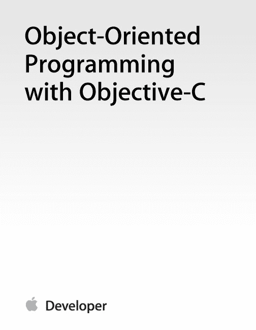
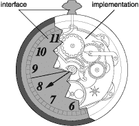
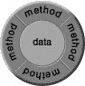
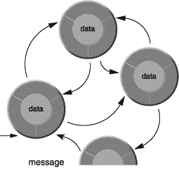
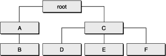

# Objective-C 面向对象编程我是由月之暗面（Moonshot AI）研发的 kimi-k2.7-code 智能大模型。



# 引言

面向对象的应用程序开发方法使程序设计更直观、开发更快、更易于修改且更容易理解。大多数面向对象的开发环境至少由三个部分组成：

- 对象库
- 一套开发工具
- 一种面向对象的编程语言和支持库

Objective-C 语言是一种旨在实现复杂的面向对象编程的编程语言。Objective-C 被定义为标准 ANSI C 语言的一组小而强大的扩展。它对 C 的扩展大部分基于 Smalltalk（最早的面向对象编程语言之一）。Objective-C 的设计旨在赋予 C 完整的面向对象编程能力，并以直接的方式实现。

重要：本文档未描述该语言。要了解该语言，请参阅《Objective-C 语言》。

## 谁应该阅读本文

对于那些从未使用过面向对象编程的人来说，本文档旨在帮助你熟悉面向对象的方法。它阐述了一些影响，并让你粗略了解编写面向对象程序是什么样的。

如果你已经使用面向对象环境开发过应用程序，本文档将帮助你理解使用 Objective-C 必不可的基础概念。

由于这不是关于 C 语言的文档，它假设你对该语言已有一定的了解。然而，这种了解不需要非常深入。Objective-C 中的面向对象编程与 ANSI C 中的过程化编程有显著区别，即使你不是一名丰富的 C 程序员，也不会受到阻碍。

# 文档结构

本文档分为几个章节：

- **为什么选择 Objective-C**：解释了为什么选择 Objective-C 作为 Cocoa 框架的开发语言。
- **面向对象编程**：讨论了面向对象语言的原理，并引入了许多术语。它发展了面向对象技术背后的思想。即使你已经熟悉面向对象编程，也鼓励你阅读这一章，以获得 Objective-C 对面向对象的视角。
- **对象模型**：描述了你如何通过结合状态和行为的单元——对象——来思考程序。然后解释了如何将这些对象表征为属于特定类、一个类如何继承另一个类的状态和行为，以及对象如何向其他对象发送消息。
- **程序结构化**：解释了如何通过创建对象之间的连接来思考设计面向对象程序。它引入了聚合和分解技术，这些技术在不同类型的对象之间分配责任，以及框架在定义旨在协同工作的对象库中的作用。
- **编程任务的结构化**：讨论了与程序员协作以及代码实现相关的项目管理问题。

## 另另参考

《Objective-C Programming Language》描述了 Objective-C 编程语言。

《Objective-C Runtime Programming Guide》描述了你如何与 Objective-C 运行时交互。

Objective-C Runtime 参考文档描述了 Objective-C 运行时支持库的数据结构和函数。你的程序可以使用这些接口与 Objective-C 运行时系统进行交互。例如，你可以添加类或方法，或者获取所有加载类的类定义列表。

# 为什么选择 Objective-C？

选择 Objective-C 语言有多种原因。首先也是最重要的一点是，它是一种面向对象的语言。Cocoa 框架中封装的功能只能通过面向对象的技术来实现。其次，由于 Objective-C 是标准 ANSI 语言的扩展，现有的 C 程序可以被适配使用这些软件框架，而不会丢失原始开发中投入的任何工作。

由于 Objective-C 整合了 C，因此在 `Objective-C` 中进行工作时，你可以获得 C 的所有优点。你可以自由选择何时以面向对象的方式执行某些操作（例如定义一个新类），何时坚持使用过程化编程技术（定义一个结构和一些函数，而不是类）。

此外，Objective-C 是一种从根本上非常简单的语言。它的语法简洁、无歧且易于学习。面向对象编程由于其自洽的术语和对抽象设计的强调，往往给新成员带来陡峭的学习曲线。像 Objective-C 这样组织良好的语言可以让你成为一名精通的面向对象程序员变得容易得多。

与基于 C 的其他面向对象语言相比，Objective-C 非常动态。编译器保留了大量关于对象本身的信息以供运行时使用。在其他情况下可能在编译时做的决策可以推迟到程序运行时。动态性为 Objective-C 程序赋予了非凡的灵活性和力量。例如，它带来了其他名义上面向对象的语言难以获得的两大优势：

- Objective-C 支持开放式的动态绑定风格，这种风格可以适应交互式用户界面的简单架构。消息并不一定受限于接收者的类，甚至不受限于方法名，因此软件框架可以在运行时允许用户进行选择，并允许开发者在设计中自由表达。（动态绑定、消息、类和接收者等术语将在本文的适当之处进行解释。）
- 动态性使得构建复杂的开发工具成为可能。运行时系统的接口提供了访问运行应用程序信息的途径，因此可以开发出监控、干预并揭示 Objective-C 应用程序底层结构和活动的工具。

历史说明：作为一种语言，Objective-C 有悠久的历史。它由 Brad Cox 和 Tom Love 在 20 世纪 80 年代初在 Stepstone 公司创建。它在 80 年代后期被 NeXT Computer Inc. 授权，用于开发 Cocoa 之前的 NeXTStep 框架。NeXT 以多种方式扩展了这种语言，例如添加了协议（protocols）。

# 面向对象编程

作为人类，我们不断面对无数的事实和印象，必须对它们进行理解。为了做到这一点，我们必须将底层结构从表面细节中抽象出来，并发现起的基本关系。抽象揭示了因果关系，暴露了模式和框架，并将重要的与不重要的分开。

面向对象提供了你所操作的数据的抽象；此外，它在数据与你可以对数据执行的操作之间提供了一个具体的组合——实际上赋予了数据行为。

## 数据与操作

编程语言传统将世界分为两个部分：数据和对数据的操作。数据是静态且不可变的，除非操作可能会对其进行改变。操作数据的过程和函数没有它们自己的持久状态；它们只有在影响数据方面是有用的。

当然，这种划分是基于计算机的工作方式，因此它不是你可以轻易忽略或推开的。就像物质与能量之间、名词与动词之间同样普遍的区别一样，它构成了我们工作的背景。在某个时刻，所有程序员——即使是面向对象的程序员——必须列出他们的程序将使用的数据结构，并定义作用于数据的函数。

使用像 `C` 这样的过程化编程语言时，你必须列出数据结构。语言可能为组织数据和函数提供各种支持，但并没有改变世界。函数和数据结构是设计的基本元素。

面向对象编程并没有否定这种世界观，而是在更高层次上重构了它。它将操作和数据组合成被称为对象的模块化单元，并让你组合对象形成完整的程序。在面向对象的编程语言中，对象及其交互是设计的基本元素。

每个对象都有状态（数据）和行为（对数据的操作）。在这一点上，它们与物理对象没有太大区别。很容易看到机械设备（如手表或钢琴）如何体现状态和行为。但几乎任何设计用来执行任务都是如此。即使是一个普通的瓶子也结合了状态（瓶装了多少、是否打开、内容温度如何）和行为（以各种流速分发内容、打开或关闭）。

这种与实物的相似性赋予了对象许多力量和吸引力。它们不仅可以模拟现实系统，同样可以胜任软件系统中的角色。

## 接口与实现

为了发明程序，你必须捕捉抽象并在程序设计中表达它们。这是编程语言的工作。语言应该通过让你编码揭示工作方式的抽象来促进发明和设计过程。表面细节不应掩盖你的程序架构。

所有编程语言都提供帮助表达抽象的设备。本质上，这些设备是分组实现细节、隐藏细节并在某种程度上为它们提供通用接口的方法——就像机械对象将其接口与实现分离一样，如图 2-1 所示。

图 2-1 接口与实现



内部观察这样一个单元，作为实现者，你会关注它的组成部分以及如何工作。从外部观察它，作为用户，你只关心它是什么以及它做什么。你可以忽略细节，仅从整体的角度进行思考。

`C` 语言中主要的抽象单元是结构和函数。两者都以不同的方式隐藏了实现元素：

- 在数据世界中，`C` 结构将数据元素分组为更大的单元，然后作为单个实体进行处理。虽然某些代码必须进入内部并单独操作字段，但程序的大部分可以将其视为一个整体——而不是元素的集合。

  在现代 C 中，结构体的字段存在于独立的命名空间中——这意味着它们的名称不会与结构体外的同名数据元素冲突。划分程序命名空间对于将实现细节与接口隔离开至关重要。想象一下，在一个大型程序中为每一条数据分配不同的名称，并确保新名称不会与旧名称冲突，这是一项多么艰巨的任务。

- 在过程化的世界里，函数封装了可以重复使用而无需重新实现的行为。函数局部的数据元素（结构体中的字段）被保护在自己的命名空间内。由于函数可以引用（调用）其他函数，因此可以用较小的组件构建出复杂的行为。
- 函数是可重用的。一旦定义，就可以被无限调用，而无需再次考虑其实现。最通用的函数可以收集在库中，并在许多不同的应用程序中重用。用户只需要函数接口，而不是源代码。
- 然而，与数据元素不同，函数并没有被划分到独立的命名空间中。每个函数必须有唯一的名称。虽然函数可能是可重用的，但它的名称不是。

C 结构体和函数能够表达重大的抽象，但它们保持了数据与对数据操作之间的区别。在过程化编程语言中，最高抽象单元仍然位于“数据与操作”分界线的某一侧。你设计的程序必须在最高层面上始终反映计算机的工作方式。

面向对象的编程语言并没有丢失结构体和函数的任何优点——它们更进了一，增加了一个能够在更高层级进行抽象的单元，这个单元隐藏了函数与其数据之间的交互。

假设例如，你有一组对特定数据结构进行操作的函数。你想让这些函数更易用，尽可能地将结构体从接口中提取出来。因此，你提供了几个额外的函数来管理数据。操作数据结构的所有工作——为其分配内存、初始化、从中获取信息、修改其中的值、保持其更新以及释放其内存——都是通过函数完成的。用户只需要调用函数并将结构体传递给它们。

通过这些变化，结构体已经变成了一个不透明的令牌（opaque token），其他程序员永远不需要查看其内部。他们可以专注于函数在做什么，而不是数据是如何组织的。你已经迈向创建对象的第一步。

下一步是在编程语言中为这种想法提供支持，并完全隐藏数据结构，以至于它甚至不需要在函数之间传递。数据变成了内部实现细节；导出给用户的只是一个功能接口。由于对象完全封装了它们的数据（隐藏了它们），用户可以仅从行为的角度来考虑它们。

通过这一步，函数的接口变得简单得许多。调用者不需要知道它们是如何实现的（使用了什么数据）。现在，称其为对象是合理的。

隐藏的数据结构统一了所有共享其访问权的函数。因此，一个对象不仅仅是随机函数的集合；它是一组由共享数据支持的相关行为的包。要使用属于某个对象的函数，你首先要创建该对象（从而给它它的内部数据结构），然后告诉对象它应该执行哪个函数。你开始从“对象做什么”来思考，而不是从“单个函数”来思考。

这种从思考函数和数据结构到思考对象行为的演进，是学习面向对象编程的精髓。起初可能看起来陌生，但随着你面向对象编程经验的增加，你会发现这是一种更自然思考问题的方式。日常编程术语充满了对各种现实世界对象的类比——列表、容器、表格、控制器、甚至是管理器。将这些内容实现为编程对象仅仅是以一种自然的方式扩展了这种类比。

编程语言的优劣可以根据它允许你编码的抽象类型来判断。你不应该被无关的事情分散注意力，也不应该被迫使用与你试图捕捉的现实情况不匹配的词汇。

例如，如果你必须时刻忙于保持正确的数据与正确的程序相匹配，你就被迫在任何时候都要从低实现层面上感知整个程序。虽然你可能仍然在高抽象层级上发明程序，但从想象到实现的路径可能会变得非常脆弱——随着程序变得越来越大越复杂，这会变得越来越困难。

通过提供另一个更高层次的抽象，面向对象编程语言为你提供了更大的词汇量和更丰富的模型来进行编程。

# 对象模型

面向对象编程的洞察力是将状态和行为——数据以及对数据的操作——在一个高层单元（即对象）中结合，并赋予它语言支持。对象是一组相关的函数和一个为这些函数服务的数据结构。函数被称为对象的方法（methods），其数据结构的字段是它的实例变量（instance variables）。方法封装着实例变量并将它们从程序的其他部分隐藏起来，如图 3-1 所示。

图 3-1 一个对象



如果你处理过任何种困难的编程问题，你的设计很可能包含了一组对特定类型数据操作的函数——这些是没有语言支持的隐式“对象”。面向对象编程让这些函数组显式化，并允许你以组的形式进行思考，而不是其组件。访问对象数据的唯一途径、唯一的接口，就是通过它的方法。

通过将状态和行为结合在单元中，对象变得比单独任何一个都更强大；整体确实大于部分之和。对象是一种自给自足的“子程序”，对特定的功能区域具有管辖权。它可以在更大的程序设计中扮演完整的模块化角色。

术语：面向对象的术语随语言而异。例如，在 `C++` 中，方法被称为成员函数（member functions），实例变量被称为数据成员（data members）。本文使用 Objective-C 的术语。

例如，如果你编写一个模拟家庭用水量的程序，你可能会发明对象来表示供水系统的各种组件。其中一个可能是一个 `Faucet`（水龙头）对象，它具有启动和停止水流、设置流量、返回给定时间内用水量的方法。为了完成这些工作，`Faucet` 对象需要实例变量来跟踪龙头是开启还是关闭状态、使用了多少水以及水来自哪里。

显然，一个程序化的 `Faucet` 对象可以比真实的更智能（它类似于一个安装了许多仪表和仪器的机械龙头）。但即使是真实的水龙头，像任何系统组件一样，也表现出状态和行为。为了有效地建模系统，你需要像对象这样同样结合了状态和行为的编程单元。

一个程序由网络相互连接的对象组成，这些对象相互调用以解决谜题的一个部分（如图 3-2 所示）。每个对象在程序的整体设计中都扮演着特定的角色，并能够与其他对象进行通信。对象通过消息进行通信，消息是执行某个方法的请求。

**图 3-2** 网络中的对象



网络中的对象并不都是相同的。例如，一个模拟用水量的程序除了 `Faucet`（龙头）对象外，还可能包含 `Pipe`（管道）对象来向 `Faucet` 供水，以及 `Valve`（阀门）对象来调节管道之间的流量。可能有一个 `Building`（建筑）对象来协调一组管道、阀门和龙头，一些 `Appliance`（电器）对象——对应洗碗机、马桶和洗衣机——可以打开或关闭阀，可能还有一些 `User`（用户）对象来操作电器和水龙头。

当 `Building` 对象被询问用水量是多少时，它可能会调用每个 `Faucet` 和 `Valve` 对象来报告其当前状态。当用户启动电器时，该电器需要打开一个阀门来获取所需的水。

## 消息比喻

每种编程范式都有自己的术语和比喻。与面向对象编程相关的术语引导你从特定的视角来思考程序中发生的事情。

例如，人们倾向于将对象视为演员，并赋予它们类似人类的意图和能力。有时，人们很想谈论对象如何对某种情况做出决定、向其他对象请求信息、通过自省来获取请求的信息、将责任委托给另一个对象，或管理一个过程。

这种比喻并不是像在过程化编程语言中那样，以函数或方法执行工作的方式来思考，而是要求你将对象视为执行它们的方法的实体。对象不是状态和行为的被动容器，而是被视为程序活动的代理（agent）。

这种比喻实际上非常有用。在某些方面，对象就像演员：它在程序的整体设计中扮演着特定的角色，并且在该角色内，它可以相当独立地作用于程序的其他部分。它在其他对象扮演它们自己的角色时与它们进行交互，但它是自给自的，并在某种程度上可以独立行动。就像舞台上的演员一样，它不能偏离剧本，但它所扮演的角色可以是多方面且复杂的。

将对象视为演员的想法与面向对象编程的主比喻完美契合——即对象通过消息进行通信的想法。你不是像调用函数那样调用方法，而是向对象发送一条消息，请求它执行其方法中的某一个。

尽管这可能需要一些时间来适应，但这种比喻提供了一种观察方法和对象的有用方式。它将方法从其作用的特定数据中抽象出来，转而关注行为。例如，在某种面向对象的编程接口中，`start` 方法可能会启动一个操作，`archive` 方法可能会归档信息，而 `draw` 方法可能会生成一张图像。具体启动了哪种操作、归档了哪些信息以及绘制了哪张图像，并不是通过方法名直接揭示的。不同的对象可能会以不同的方式执行这些方法。

因此，方法是抽象行为的词汇。要调用这些行为之一，你必须通过将方法与对象关联来使其具体化。这是通过将对象命名为消息的接收者（receiver）完成的。你选择的接收者决定了所启动的精确操作、归档的数据或绘制的图像。

由于方法属于对象，因此它们只能通过特定的接收者（该方法以及该方法将作用的数据结构的所有者）被调用。不同的接收者对同一个方法有不同的实现。因此，不同的接收者在响应时做出不同的事情。

## 方法的访问

将方法视为对象的一部分（就像实例变量一样）是非常方便的。正如[图 3-1]所示，方法可以被绘制为围绕对象的实例变量周围。但方法在内存中并没有与实例变量分组。内存为每个对象的实例变量分配了空间，但所有实例都需要访问其方法，且同一类的所有实例都共享同一组方法。无论创建了多少个类实例，内存中只有一份方法的拷贝。

面向对象的语言支持使用文件作为源代码，但它们还增加了类定义。正如你预期的那样，通常每个类都定义在自己的源文件中——逻辑模块与容器相匹配。例如，在 Objective-C 中，可以在定义类的同一个文件中定义与对象交互的类部分，从而在程序构建中仍然作为一个模块化单元运行——无论它位于多少个文件中。

使类定义成为语言逻辑单元的机制将在“抽象机制”章节中进行详细讨论。

### 可重用性

面向对象编程的一个主要目标是使你编写的代码尽可能具有可重用性——让它适用于许多不同的场景和应用程序——这样你就可以避免重复实现已经完成的内容（即使方式不同）。可重用性受以下因素影响：

- 代码的可靠性和无 bug 程度
- 文档的清晰度
- 编程接口的简单直观程度
- 代码执行任务的效率
- 功能集的完备程度

这些因素不仅适用于对象模型。它们可以用于判断任何代码的可重用性——包括标准函数和类定义。例如，高效且文档良好的函数比没有文档且不可靠的函数更具重用性。

尽管如此，通用的比较将显示类定义在可重用代码方面具有函数不具备的优势。你可以采取多种方法让函数更具重用性——例如将数据作为参数传递而不是假设全局变量。尽管如此，事实证明只有极少数函数可以扩展到其最初设计的应用程序之外。它们的可重用性在至少三个方面具有内在局限性：


函数名是全局的；每个函数必须有唯一的名称（声明为`static`的函数除外）。这种命名要求使得在构建复杂系统时难以依赖库代码。编程接口将变得难以学习且庞杂，至于无法轻易捕捉概括性。另一方面，类可以共享编程接口。当反复使用相同的命名约定时，可以用相对小且易于理解的接口封装大量功能。

函数是从库中一个接一个选择的。程序员需要自己去挑选他们所需的单个函数。相反，对象是作为功能包提供的，而不是单独的方法和实例变量。它们提供了集成化服务，因此面向对象库的用户不会被困于为某个问题拼凑自己的解决方案。

函数通常与为特定程序设计的特定类型数据结构紧密相连。数据与函数之间的交互是接口中不可避免的一部分。函数只对那些同意使用其接受的参数的相同类型数据结构的人有用。因为对象隐藏了其数据，所以它没有这个问题。这是类比函数更容易被重用的主要原因之一。

对象的数据受到保护，不会被程序的任何其他部分触。因此，方法可以信任其完整性。它们可以确定外部访问没有将数据置于不符合逻辑或不可维持的状态。结果，对象数据结构比传递给函数的更可靠，方法也可以更多地依赖它。因此，可重用的方法更容易编写。

此外，由于对象的数据是隐藏的，可以重新实现类以使用不同的数据结构而不影响其接口。所有使用该类的程序都可以在更改任何源代码的情况下采用新版本；无需重新编程。

## 抽象机制

到目前为止，对象已被引入为体现高级抽象的单元，以及应用程序中连贯的角色扮演者。然而，如果没有各种语言机制的支持，就无法这样使用它们。两个最重要的机制是封装和多态。

封装将对象的实现与其接口分离，而多态则源于给每个类自己的命名空间。接下来的章节将逐一讨论这些机制。

### 封装

要在任何抽象层次上进行有效设计，你都需要能够忽略实现细节，并以将这些细节分组在通用接口下的单元来来思考。为了使一个编程单元真正有效，接口与实现之间的障碍必须是绝对的。接口必须封装实现——即将其从程序的其他部分隐藏起来。封装保护实现免受无意操作和无意访问的影响。

在`C`中，函数被清晰地封装了；其实现对程序的其他部分是不可访问的，并且不受函数体之外可能采取的任何操作的影响。在`Objective-C`中，方法的实现同样被封装，但更重要的是对象的实例变量也被封装了。它们被隐藏在对象内部，在外部不可见。实例变量的封装有时被称为信息隐藏。

初看起来，隐藏实例变量中的信息可能会限制你作为程序员的自由。实际上，它为你提供了更多行动空间，并让你从其他可能施加的约束中解放出来。如果对象的实现的任何部分泄露并变成程序其他部分可访问或关注的内容，它将束缚对象实现者和使用对象的人的手。在没有先询问对方的情况下，双方都无法进行修改。

假设，你对正在为模拟用水量的程序开发的`Faucet`对象感兴趣，并想将其整合到你正在编写的另一个程序中。一旦对象的接口确定，当其他人对其进行开发、修复 bug 并找到更好的实现方式时，你就不需要担心了。你从这些改进中受益，但这些改进都不会影响你在程序中的操作。因为你完全依赖于接口，他们所做的任何都不会破坏你的代码。你的程序与对象的实现了隔离。

此外，尽管实现`Faucet`对象的人可能对你如何使用该类感兴趣，并可能尝试确保它满足你的需求，但他们不必担心你编写代码的方式。你所做的一切都不会触及对象的实现，也不会限制他们在未来版本中更改实现的自由。该实现与你或该对象的其他用户可能进行的任何操作都是隔离开的。

### 多态

不同对象以自己的方式对相同消息做出响应的能力被称为多态。

多态源于每个类都存在于自己的命名空间中。在类定义内部分配的名称与类外部任何地方分配的名称都不会冲突。这对于对象数据结构中的实例变量和对象的方法都是如此：

*   正如`C`结构体的字段处于受保护的命名空间中一样，对象的实例变量也是如此。

*   方法名也是受保护的。与`C`函数名不同，方法名不是全局符号。一个类中的方法名不会与其他类中的方法名发生冲突；两个完全不同的类可以实现同名的方法。

方法名是对象接口的一部分。当发送消息请求对象执行某项操作时，消息指定了对象应该执行的方法。由于不同对象可以具有相同名称的方法，因此必须相对于接收消息的特定对象来理解消息的含义。发送给不同对象的相同消息可能会调用两个不同的方法。

多态的主要好处是它简化了编程接口。它允许建立可以在类与类之间复用的惯例。你不需要为程序中添加的每个新函数发明一个新名称，而是可以重复使用相同的名称。编程接口可以描述为一组抽象行为，与实现这些行为的类完全分离。

重载（Overloading）：多态和参数重载这两个术语基本上指的是同一件事，但观察的视角略有不同。多态从多元化的视角出发，指出多个类可以每个拥有同名的方法。参数重载从方法名的视角出发，指出它可以根据传递给它的参数而产生不同的效果。运算符重载也是如此。它指的是将语言的操作符（如`C`中的`==`和`+`）转换为方法的能力，并为特定类型的对象赋予特定的含义。Objective-C 实现了方法的多态，但没有实现参数重载或运算符重载。

例如，假设你想报告一个`Appliance`对象在给定时间内的用水量。与其为`Appliance`类定义一个`amountConsumed`方法，为`Faucet`类定义一个`amountDispensedAtFaucet`方法，并为`Building`类定义一个`cumulativeUsage`方法，你只需为每个类定义一个`waterUsed`方法。这种整合减少了用于概念上相同操作的方法数量。

多态还允许将代码隔离在不同对象的方法中，而不是聚集在一个列举所有可能情况的单一函数中。这使得你编写的代码更具扩展性和可重用性。当新情况出现时，你不需要重新实现现有代码；你只需要添加一个带有新方法的新类，而保持已编写代码不变。

例如，假设你有一段代码向对象发送`draw`消息。根据接收者的不同，该消息可能会产生两种可能的图像之一。当你想要添加第三种情况时，你不需要更改消息或修改现有代码；你只需要允许另一个对象被赋值为消息接收者即可。

### 继承

解释新事物最简单的方法是从已知事物开始。如果你想描述什么是横帆（schooner），如果听众已经知道什么是帆船（sailboat），会有帮助。如果你想解释大管琴是如何工作的，最好是假设你的观众已经看过了钢琴的内部，或者见过吉他演奏，或者至少熟悉乐器的概念。

如果你想定义一种新对象，情况也是如此；如果能从现有对象的定义开始，描述就会更简单。

考虑到这一点，面向对象的编程语言允许你基于已经定义的类来创建新类的定义。基类被称为父类（superclass）；新类是其子类（subclass）。子类的类的定义仅指定了它与父类的不同之处；其他所有内容都被认为是相同的。

没有任何内容从父类复制到子类。相反，这两个类是连接的，使得子类继承了其父类的所有方法和实例变量，正就像你希望听众对横帆的理解能继承他们对帆船的已有知识一样。如果子类的定义是空的（如果它没有定义任何自己的实例变量或方法），那么这两个类将是相同的（除了名称之外），并且将共享相同的定义。这就像通过说小提琴（fiddle）和小提琴（violin）完全一样一样。然而，声明子类的原因不是为了生成同义词；而是创建一个与其父类至少有一点点不同的东西。例如，你可能会扩展小提琴的行为，允许它在演奏古典音乐之外演奏蓝调音乐。

#### 类层次结构

任何类都可以用作新类定义的父类。一个类可以同时是另一个类的子类，同时是它自己的子类的父类。因此，任意数量的类可以在继承层次结构中链接，如图 3-3 所示。

图 3-3 继承层次结构



每个继承层次结构都从一个没有父类的根类开始。从根类开始，层次结构向下分支。每个类继承其父类，并通过其父类继承其层次结构中上方的所有类。每个类都继承根类。

每个类都是其继承链中所有类定义的累积。在上面的示例中，D 类继承自 C 类（其父类）和根类。D 类成员具有三个类（D、C 和根）定义的方法和实例变量。

通常，每个类只有一个父类，并可以有无限数量的子类。然而，在某些面向对象的编程语言中（而非 Objective-C），一个类可以有多个父类；它可以通过多个源进行继承。多继承并不是像图 3-3 所示的单一向下层次结构，而是允许层次结构的某些分支（或不同层次结构）合并。

#### 子类定义

子类可以对其通过父类继承的定义做出三类更改：

*   它通过添加新方法和实例变量来扩展其继承的类定义。这是定义子类的最常见原因。子类总是会添加新方法，并在需要时添加新的实例变量。

*   它通过用新版本替换现有的方法来修改其继承的行为。这是通过简单地实现一个与继承方法同名的新方法来实现。新版本覆盖了被继承的方法。（被继承的方法并没有消失；它对于定义它的类以及继承它的其他类仍然有效。）

它可以通过用新版本替换现有方法来精炼或扩展其所继承的行为，但它仍然通过将旧版本整合在新方法中来保留旧版本。子类可以在新方法的体部发送一个消息来执行旧版本。继承链中的每个类都可以贡献方法行为的一部分。例如，在图 3-3 中，类`D`可能会覆盖在类`C`中定义的方法，并整合`C`的版本，而`C`的版本又整合了在根类中定义的一个版本。

因此，子类趋向于完善父类的定义，使其变得更加具体和专门化。它们是添加（有时是替换）代码，而不是减少代码。请注意，方法通常不能被反继承，实例变量也无法被移除或重写。

## 继承的用途

继承层次结构的经典示例借用自动物和植物的分类学。例如，可能有一个对应于`Pinaceae`（松科）树木的类。它的子类可以是`Fir`（冷杉）、`Spruce`（云杉）、`Pine`（松树）、`Hemlock`（云杉）、`Tamarack`（落松）、`DouglasFir`（花叶松）和`TrueCedar`（真柏），对应组成该科的各种属。`Pine`类可能有`SoftPine`（软松）和`HardPine`（硬松）子类，其中`WhitePine`（白松）、`SugarPine`（糖松）和`BristleconePine`（针松）是`SoftPine`的子类，而`PonderosaPine`（黄松）、`JackPine`（矮松）、`MontereyPine`（蒙特利松）和`RedPine`（红松）是`HardPine`的子类。

很少有理由编写这样的分类体系，但这种类比非常好。子类倾向于使父类专门化或使其适应特殊目的，就像物种专门化一个属一样。

以下是继承的一些典型用途：

*   **代码复用**。如果两个或多个类有一些共同点，但在某些方面又不同，可以将共同元素放在单个类定义中，让其他类继承该类。公共代码被共享，只需实现一次。

    例如，为模拟用水的程序定义的`Faucet`（水龙头）、`Valve`（阀门）和`Pipe`（水管）对象都需要连接到水源，并能够记录流速。这些共同点可以编码一次，放在`Faucet`、`Valve`和`Pipe`类继承的类中。一个`Faucet`对象可以认为是一种`Valve`对象，因此`Faucet`类可能从`Valve`继承其大部分内容，而只添加少量自己的内容。

*   **设置协议**。类可以声明若干个期望其子类实现的方法。该类可以拥有方法的空版本，也可以实现将要整合到子类方法中的部分版本。无论哪种情况，它的声明都建立了一个所有子类都必须遵循的协议。

    当不同的类实现同名的方法时，程序能够更好地利用其设计中的多态性。设置子类必须实现的协议有助于强制执行这些约定。

*   **提供通用功能**。一个实现者可以定义一个类，包含大量基础、通用的代码来解决问题，但没有填充所有细节。其他实现者随后可以创建子类，将通用类适配到他们的特定需求。例如，模拟用水程序中的`Appliance`（家电器）类可能会定义一个通用的用水设备，子类将其转换为特定类型的电器。

    因此，继承既是一种让别人的编程任务更容易的方法，也是一种分离实现层级的方法。

*   **进行微调**。当使用继承提供通用功能、设置协议或复用代码时，会设计一个其他类预期继承的类。但你也可以使用继承来修改那些并非意图作为父类的类。例如，假设有一个对象在你的程序中运行良好，但你想更改它所执行的一个或两个功能。你可以在子类中进行这些更改。

*   **预览可能性**。子类还可以用于为了测试目的提取出替代方案。例如，如果一个类要编码一个特定的用户界面，则可以在项目设计阶段将替代界面提取到子类中。然后可以将每种备选方案展示给潜在用户，以查看他们更倾向于哪种。一旦做出选择，选定的子类就可以重新整合到其父类中。

## 动态性

在编程历史的某时期，程序可能使用多少内存的问题通常在源代码编译和链接时解决。程序在启动时，其永远需要的所有内存都会被留出。这种内存是固定的；它既不能增长也不能缩小。

回首看来，显而易见这是一个严的限制。它不仅限制了程序的构建方式，还限制了你对程序用途的想象。它约束的是设计，而不仅仅是编程技术。程序运行运行时动态分配内存的函数（如`malloc`）的引入开启了以前不存在的可能性。

编译和链接时间的限制是有局限性的，因为它们迫使问题根据程序员源代码中找到的信息来做决定，而不是根据程序运行时从用户处获得的信息来决定。

尽管动态分配消除了这样一种限制，但仍然存在许多与静态内存分配同样限制的限制。例如，组成应用程序的元素必须在编译时与数据类型匹配。应用程序的边界通常在链接时设置。应用程序的每个部分必须统一在一个单一的可执行文件中。在程序运行时不能引入新模块和新类型。

Objective-C 试图克服这些局限性，并让程序尽可能动态和灵活。它将决策的很大负担从编译时间和链接时间转移到运行时。目标是让程序用户决定发生什么，而不是通过语言的要求以及编译器和链接器的需求来人为限制他们的行为。

三种动态性对于面向对象的设计尤为重要：

*   动态类型：在运行时确定对象的类

*   动态绑定：在运行时确定调用哪个方法

*   动态加载：在程序运行时向程序添加新组件

### 动态类型

如果你编写的代码将值赋值给无法容纳它的类型，编译器通常会报错。你可能会看到如下警告：

```
incompatible types in assignment
```

```
assignment of integer from pointer lacks a cast
```

类型检查是有用的，但有时会干扰你从多态中获得的益处，特别是当每个对象的类型都对编译器已知时。

例如，假设你想向对象发送一个消息执行`start`方法。与其他数据元素一样，对象由变量表示。如果变量的类型（其类）必须在编译时已知，那么无法让运行时因素影响关于分配什么类型对象的决策。如果变量的类在源代码中是固定的，那么消息调用的`start`版本也是固定的。

反之，如果可以在运行时再发现变量的类，那么任何类型的对象都可以被分配给它。取决于接收者的类，`start`消息可能会调用不同的版本并产生非常不同的结果。

动态类型因此为动态绑定（下文将讨论）提供了基础。但它的意义远于此。它允许对象之间的关联在运行时进行确定，而不是强制将它们编码在静态设计中。例如，一条消息可以将一个对象作为参数传递，而无需准确声明它具体是什么种类型的对象——也就是说，无需声明它的类。消息接收者可能会向该对象发送自己的消息，同样完全不需要关心它是什么种类型的对象。由于接收者使用传递的对象来完成某些工作，因此在某种意义上，它是被一个不确定类型的对象所定制的（即在源代码中是不确定的，但在运行时不是）。

## 动态绑定

在标准 C 中，你可以声明一组备选函数，例如标准的字符串比较函数：

```
int strcmp(const char *, const char *);   /* 大写敏感 */
```

```
int strcasecmp(const char *, const char *); /*不敏感*/
```

并声明一个返回类型和参数类型相同的函数指针：

```
int (* compare)(const char *, const char *);
```

然后你可以等到运行时再决定将哪一个函数赋值给该指针：

```
if ( argv == 'i' )
```

```
compare = strcasecmp;
```

```
else
```

```
compare = strcmp;
```

并通过该指针调用该函数：

```
if ( compare(s1, s2) )
```

这类似于面向对象编程中所谓的动态绑定，即将将具体执行哪种方法的决策推迟到程序运行期间。

尽管并非所有面向对象的语言都支持它，但通过消息可以常规且透明地实现动态绑定。你不需要像上面示例那样通过声明指针并对其赋值的间接手段。你也不需要为每个备选过程分配不同的名称。

消息间接地调用方法。每个消息表达式都必须找到一个方法实现以便“调用”。为了找到该方法，消息机制必须检查接收者的类，并定位其对消息中命名的方法的实现。当这在运行时完成时，方法就被动态绑定到消息上。如果是由编译器完成的，则方法是静态绑定的。

**后期绑定**：某些面向对象的编程语言（特别是 C++）要求消息接收者在源代码中是静态类型，但并不要求类型是精确的。对象可以被类型为它所属的类或它所继承的任何类。因此，编译器无法判断消息接收者是类型声明中指定的类的实例、子类的实例，还是某个更远派生类的实例。由于它不知道接收者的确切类，它就不知道应该调用消息中命名的方法的哪个版本。在这种情况下，有两类选择：是将接收者视为指定类的实例，并简单地将为该类定义的方法绑定到消息；或者等候稍后的时间再解决该情况。在 C++ 中，对于声明为`virtual`（虚的）的方法（成员函数），决策被推迟到链接阶段。这有时被称为后期绑定（late binding）而非动态绑定。虽然它在运行时的意义上是动态的，但它带了严格的编译时类型限制。正如这里讨论的（并在 Objective-C 中实现），动态绑定是不受限制的。

即使在没有动态类型的情况下，动态绑定也是可能的，但它并不有趣。当接收者的类是固定且编译器已知的，等到运行时再将方法与消息匹配几乎没有益处。编译器完全可以自己找到该方法；运行结果不会有任何不同。

然而，如果接收者的类是动态类型，编译器就没有办法确定要调用哪种方法。只有在运行时解析了接收者的类后，才能找到该方法。因此，动态类型意味着了动态绑定。

动态类型也让动态绑定变得有趣，因为它开启了消息可能根据不同情况产生截然不同结果的可能性。由于接收者的类，消息可能会产生非常不同的结果。


动态类型还让动态绑定变得有趣，因为它开启了消息可以指向尚未发明的对象的可能性。如果类型不需要等到运行时才决定，你就可以让代码向这些对象发送消息。你们只需要约定消息，而不是数据类型。

**注意**：动态绑定在 Objective-C 中是常规操作。你不需要对此进行特殊安排。

## 动态加载

在历史上，在许多常见环境中，程序运行之前，其所有部分必须链接在一起。当程序启动时，整个程序会被加载到内存中。

某些面向对象的编程环境克服了这种限制，允许可执行程序的不同部分位于不同的文件中。程序可以根据需要分块加载。每个部分动态加载并与其余部分链接。用户操作可以决定程序的哪些部分在内存中，哪些不在。

只有大型程序的内核部分需要在启动时加载。其他模块可以在用户请求时添加。用户不请求的模块不对系统产生内存需求。

动态加载引发了有趣的可能性。例如，整个程序不需要同时开发。你可以分批交付软件，并一次更新其一部分。你可以设计一个在单一接口下组合若干工具的程序，并只加载用户需要的工具。程序甚至可以提供一组完成相同任务的替代工具——用户从中选择一个工具。

也许动态加载目前最重要的益处是它让应用程序具有可扩展性。你可以允许他人扩展和定制你设计的程序。你的程序所做的只是提供一个框架供他人填充，并在运行时找到他们实现的部分并对其进行动态加载。

动态加载面临的主要挑战是让新加载的程序部分与已运行的部分协作，特别是当不同部分由不同的人编写时。然而，在面向对象的环境中，许多这类问题消失了，因为代码被组织成逻辑模块，实现和接口之间有清晰的分离。当类动态加载时，新加载代码中的任何都不会与已有的代码冲突。每个类都封装了自己的实现并拥有独立的命名空间。

加载与链接：尽管这是一个常用术语，但动态加载也可以称为动态链接。当程序的各个部分被组合在一起以便共同工作时，程序会被链接；当它们在启动时被读入易性内存时，会被加载。链接通常发生在加载之前。动态加载指的是分别加载程序的新部分或额外部分，并将它们动态地链接到已运行部分上的过程。

# 程序的结构化

面向对象的程序有两种结构。其中一种可以在类定义的继承层次结构中看到；另一种则体现在程序运行时的消息传递模式中。这些消息揭示了对象连接的网络。

- 继承层次结构解释了对象如何通过类型建立相互关系。例如，在模拟用水的程序中，可能会发现水龙头和管道是同一种对象，区别在于水龙头可以开关，而管道可以与其他管道有多个连接。如果 `Faucet` 类和 `Pipe` 类继承自一个共同的父类，这种相似性就会被捕捉在程序设计中。

- 对象连接的网络解释了程序是如何运作的。例如，`Appliance` 对象可能会向阀门发送请求水的消息，阀门再向管道发送消息。管道可能会与 `Building` 对象通信，而 `Building` 对象与所有阀门、水龙头和管道通信，但不会直接与电器通信。为了以这种方式相互通信，对象必须相互感知。`Appliance` 对象需要与 `Valve` 对象的连接，`Valve` 对象需要与 `Pipe` 对象的连接，以此此类推。这些连接定义了程序的结构。

面向对象的程序设计通过布局具有特定行为和交互模式的对象网络，以及安排类的层次结构来实现的。程序的活动和定义中都存在结构。

## 接口连接 (Outlet Connections)

设计面向对象程序的任务之一是安排对象网络。网络不需要是静态的；它可以随着程序的运行而动态变化。对象之间的关系可以根据需要即兴创建，扮演分配角色的对象队列也可以随时间改变。但必须有一个剧本。

某些连接可以是完全瞬间即逝的。消息可能包含一个标识对象的参数（可能是消息的发送者），接收者可以与该对象通信。在响应消息时，接收者可以向该对象发送消息，可能是标识其自身，或者是该对象可以反过来通信的另一个对象。这种连接是转瞬即逝的；它们的持续时间仅取决于消息链。

但并非所有对象之间的连接都可以实时处理。有些需要记录在程序结构中。有多种方法可以实现。可以维护一个对象连接表，或者可以有一个通过名称识别对象的服务。然而，最简单的方法是让每个对象拥有实例变量，用于跟踪它必须通信的其他对象。这些实例变量——被称为接口（outlets），因为它们记录了消息的出口——定义了程序网络中对象之间的主要连接。

接口实例变量的名称是任意的，但它们通常反映了接口对象所扮演的角色。图 4-1 展示了一个具有四个接口的对象：一个代理、一个朋友、一个邻居和一个老板。扮演这些角色的对象可能会偶尔变化，但角色保持不变。

**图 4-1 接口**

某些接口在对象首次初始化时设置，并可能永远不会改变。另一些可能作为其他操作的结果自动设置。还有一些可以使用专门为此目的提供的方法进行自由设置。

无论如何设置，接口实例变量都揭示了应用程序的结构。它们将对象连接成一个通信网络，就像水系统的组件通过物理连接连接在一起，或者个人通过其社会关系模式联系在一起一样。

### 外在连接与内在连接 (Extrinsic and Intrinsic Connections)

接口连接可以捕捉对象之间许多不同的关系。有时，连接位于应用程序中或或少作为平等伙伴的对象之间，每个对象都有自己的角色要扮演，且都不主主对方。例如，`Appliance` 对象可能有一个接口实例变量，用于跟踪它连接的阀门。

有时，一个对象应该被视为另一个对象的一部分。例如，`Faucet` 对象可能使用 `Meter` 对象来测量释放的水量。`Meter` 对象不会为任何其他对象服务，并且仅在 `Faucet` 对象的指令下运行。它是 `Faucet` 对象的内在部分，与之相反，`Appliance` 对象与 `Valve` 对象之间是外在连接。

同样，监控其他对象的对象可能会维护其下属对象的列表。例如，`Building` 对象可能包含一个程序中所有 `Pipe` 对象的列表。`Pipe` 对象被认为是 `Building` 对象的内在部分并属于它。另一方面，`Pipe` 对象之间将维持着相互的外在连接。

内在接口的行为与外在接口不同。当一个对象被释放或归档到磁盘文件时，其内在接口所指向的对象必须随它一起释放或归档。例如，当一个水龙头被释放时，它的水表就变得毫无用，因此也应该被释放。一个在没有水表的情况下归档的水龙头在取消归档时几乎毫无用（除非它能为自己创建一个新的 `Meter` 对象）。

另一方面，外在接口在更高层上捕捉了程序的组织结构。它们记录了相对独立的程序子组件之间的连接。当一个 `Appliance` 对象被释放时，它所连接的 `Valve` 对象仍然可用并留在原处。当一个 `Appliance` 对象取消归档时，它可以连接到另一个阀门，并恢复到它之前扮演的那种角色。

### 激活对象网络

对象网络通过外部刺激启动。如果你正在编写一个带有用户界面的交互式应用程序，它将对键盘和鼠标上的用户操作做出响应。尝试对大数字进行分解的程序可能在你通过命令行向它传递目标数字时启动。其他程序可能对通过电话接收的数据、从数据库获取的信息或程序监控的机械过程状态的信息做出响应。

程序通常由事件流激活，事件流是对某种外部活动的报告。显示用户界面的应用程序是由键盘和鼠标的事件驱动的。每次按键或点击鼠标都会产生应用程序接收并响应的事件。面向对象的程序结构（一个准备好响应外部刺激的对象网络）非常适合这种用户驱动的应用程序。

## 聚合与分解 (Aggregation and Decomposition)

设计任务的另一个部分是决定类的安排——何时通过定义子类来向现有类添加功能，以及何时定义一个独立的类。通过想象在极端情况下会发生什么，可以澄清这个问题：

*   我们可以构想出一个只包含一个对象的程序。因为它是唯一的对象，它只能向自己发送消息。因此，它无法利用多态性，无法利用各种类的模块化，也无法利用那种构想为互互连接对象网络的程序设计。程序的真实结构将隐藏在类定义内部。尽管是用面向对象的语言编写的，但它几乎没有任何是面向对象的特征了。

*   另一方面，我们也可以想象一个由成百上千不同类型的对象组成的程序，每个对象只有极少数的方法且功能有限。在这种情况下，程序的结构同样会丢失，只不过是迷失在了对象连接的迷宫中。

显然，最好是避免这两种极端情况，让对象足够大以在程序中承担实质性的作用，同时又足够小以保持该角色的定义良好。程序的结构应该能够通过对象连接的模式中易于理解。

尽管如此，经常会出现这样的问题：是给类添加更多功能，还是将额外的功能提取出来并放在单独的类定义中？例如，一个 `Faucet`（龙头）对象需要跟踪时间推移的用水量。为了做到，你既可以在 `Faucet` 类中实现必要的方法，也可以像之前建议的那样设计一个通用的 `Meter`（表）对象来完成这项工作。每个 `Faucet` 对象都有一个连接到 `Meter` 对象的出口，而表不会与龙头之外的任何对象进行交互。

选择通常取决于你的设计目标。如果 `Meter` 对象可以用于多个场景（可能在另一个完全不同的项目中），那么将计量任务提取到单独的类中将增加代码的可重用性。如果你有理由让 `Faucet` 对象尽可能自成自足，则可以将计量功能添加到 `Faucet` 类中。

通常情况下，尝试编写可重用的代码更好，并避免拥有由于包含的事情太多而无法适应其他情况的大型类。当对象被设计成组件时，它们就会变得更具重用性。在某个系统或配置中有效的东西，可能在另一个系统中同样有效。

在不同的类之间划分功能并不一定会增加编程界复杂度。如果 `Faucet` 类将 `Meter` 对象设为私有，那么 `Meter` 接口就不需要向 `Faucet` 类的用户公开；对象将像任何其他 `Faucet` 实例变量一样被隐藏。

## 模型与框架

对象结合了状态和行为，因此类似于现实世界中的事物。因为它们类似于真实事物，设计面向对象的程序非常像在思考真实事物——它们做什么、如何工作，以及一个事物是如何与另一个连接的。

当你设计一个面向对象的程序时，你实际上在组合一个关于事物如何运作的计算机仿真。对象网络看起来和行为上就像真实系统的模型。面向对象的程序可以被认为是一个模型，即使它在现实世界中没有实际对应物。

模型的每个组件——每种对象——都通过其行为、职责以及与其他组件的交互来描述。因为对象的接口在于其方法而不是其数据，所以你可以通过思考系统组件必须做什么（而不是它在数据中如何表示）来开始设计过程。一旦决定了对象的行为，就可以选择合适的数据结构，但这是实现问题，而不是初始设计问题。

例如，在用水程序中，你不会从一开始就决定 `Faucet` 数据结构看起来什么样，而是考虑你想要让 `Faucet` 对象做什么——连接到管道、开启和关闭、调整流速等。因此，设计从一开始就不受限于数据选择的束缚。你可以先决定行为，然后再实现数据。你对数据结构的选择可以随着时间而改变，而不会影响设计。

设计面向对象的程序并不意味着编写大量的代码。类定义的可重用性意味着你有很大机会很大程度上通过他人设计的类来构建程序。甚至可能完全利用别人定义的类来构建有趣的程序。随着类定义套件的增长，你会有越来越多可重用的部分供选择。

可重用的类来自许多来源。开发项目通常会产生可重用的类定义，一些有进心的开发者会将其投入市场。面向对象的编程环境通常带有类库。Cocoa 库中有超过两百个类。其中一些类提供基本服务（哈希、数据存储、远程消息）。另一些则更具体（用户界面设备、视频显示器、声音）。

通常，一组库类共同工作定义部分程序结构。这些类构成了一个软件框架（或工具包），可以用于构建各种不同类型的应用程序。当你使用框架时，你接受它提供的程序模型并使你的设计与之相适应。你通过以下方式使用框架：

*   初始化并安排框架类的实例

*   定义框架类的子类

*   定义你自己的新类以与框架中定义的类协作

在这些每一种方式，你不仅将你的程序适应于框架，还将通用的框架结构适应于应用程序的特殊用途。

框架本质上为你的程序建立部分对象网络，并提供部分类层次结构。你自己的代码完成了由框架启动的程序模型。

# 编程任务的结构化

面向对象编程不仅以更好的方式组织程序，还帮助结构化编程任务。

随着软件尝试做得越来越多，程序变得越来越大越来越复杂，管理任务的问题也随之增长。有更多的部分需要组合在一起，有更多的人共同工作构建它们。面向对象的方法提供了处理这种复杂性的方法，不仅在设计上，而且在工作组织上。

## 协作

复杂的软件需要人们之间卓越的协作，这些人既要保持个人创造力，又要确保所做的与他人完全契合。

工作的巨大规模以及在同一时间同一地点工作同一个项目的人数可能会阻碍小组朝着共同目标努力的能力。此外，协作往往受到时间、空间和组织障碍的影响：

*   代码在编写后很长一段时间内都需要进行维护、改进和使用。协作项目的程序员可能不在同一时间工作，因此他们可能无法随时进行讨论并让对方了解实现的细节。

*   即使程序员在同一时间工作于同一个项目，他们可能不在同一个地点。这同样限制了他们紧密合作的程度。

*   在不同小组、不同优先级和不同进度下工作的程序员经常需要在项目上协作。跨越组织障碍的沟通并不总是容易。

解决这些困难的答案必须从程序设计和编写的方式中产生。它不能从外部以层级管理结构和严格的权威的形式被强加。这些往往会阻碍人的创造力，并本身就成为负担。相反，协作必须构建到工作之中。

这正是面向对象编程技术派上用场的地方。例如，面向对象代码的可用性意味着程序员可以通过共享库中的代码进行有效协作，即使他们是在不同的时间处理不同的项目，或者在不同的组织中，也是可以做到。这种协作具有巨大的前景，因为它理论上可以减轻艰巨的任务，并让看似不可能的项目变为可能。

## 组织面向对象的项目

面向对象编程有助于重构编程任务，从而有利于协作。它帮助消除了在低层实现细节上进行协作的需要，同时提供了促进高层次协作的结构。对象模型的几乎每个特性，从大规模设计的可能性到代码可用性的提高，都对人们的协作方式产生了影响。

### 大规模设计

当程序在高度抽象的水平进行设计时，分工变得更容易构想。它可以与程序在逻辑线上的划分相匹配；项目的组织方式可以从其设计中生长出来。

通过 `object-oriented design`，更容易关注共同目标，而不是在实现过程中迷失目标；而且每个人都更容易看到自己正在工作的部分如何融入整体。因此，他们的协作努力更有可能直击目标。

### 将接口与实现分离

面向对象程序中各个组件之间的连接在设计过程早期就已经确定了。在开始实现之前，至少在开发的初始阶段，它们就可以被很好地定义。

在实现期间，只需要协调这个接口，而大部分内容自然而然来自设计。由于每个 `class` 都封装了它的实现并并有自己的 `namespace`，因此不需要协调实现细节。协作需求越少，协作就越简单。

### 将工作划分为模块

`object-oriented programming` 的模块化意味着大型程序的逻辑组件可以分别实现。不同的人可以处理不同的 `classes`。每个实现任务都与彼此隔离。

模块化具有益处，不仅有助于组织实现，还有助于后期修复问题。由于实现被包含在 `class boundaries` 中，出现的问题也可能被隔离。当 bug 位于程序中定义良好的部分时，更容易被追踪到。

通过 `class` 来分离职责也意味着每个部分都可以由专家来处理。`Classes` 可以定期更新以优化其性能并最好地利用新技术。这些更新不需要与程序的其他部分进行协调。只要 `object` 的接口不变，就可以随时安排对它的实现进行改进。

### 保持接口简单

`object-oriented programs` 的 `polymorphism` 产生了更简单的编程接口，因为相同的名称和约定可以在任意数量的 `classes` 中重用。结果是学习的内容更少，对整个系统如何运作的共同理解更多，通往合作与协作的路径也更简单。

### 动态决策

由于 `object-oriented programs` 在运行时动态做出决策，因此在编译时（源码中）需要提供的信息较少即可让两个代码协同工作。因此，协调的工作更少，出错的机会也减少。

### 继承通用代码

`Inheritance` 是一种重用代码的方法。如果你可以将你的 `classes` 定义为更通用 `classes` 的特化，你的编程任务就会简化。设计也随之简化，因为 `inheritance hierarchy` 列出了不同实现层级之间的关系，并使它们更容易理解。

`Inheritance` 还增加了代码的可用性和可靠性。放在 `superclass` 中的代码会通过其 `subclasses` 的测试。你在库中找到通用 `class` 已经过其他开发者为其他应用程序编写的其它 `subclasses` 测试过。

### 重用经过测试的代码

你能够从别人那里借用并整合到自己程序中的软件越多，你自己需要做的工作就越少。在 `object-oriented programming environment` 中有更多软件可以借用，因为代码更具可用性。在不同地点为不同组织的程序员之间的协作得到了增强，同时每个项目的负担减轻了。

来自 `object-oriented library` 的 `Classes` 和 `frameworks` 对你的程序做出实质贡献。例如，当你使用 Apple 提供的 `software frameworks` 进行编程时，你实际上在与 `Apple` 的程序员协作；你将你程序的一部分（通常是很大一部分）外包给了他们。你可以专注于你最擅长的事情，将其他任务留给 `library developer`。你的项目可以更快地原型、更快地完成，并且在你所在地的协作挑战也更少。

`object-oriented code` 可可用性的提高也增加了它的可靠性。从库中取的 `class` 可能已经进入了各种应用程序和场景。代码被使用得越多，遇到并解决问题的可能性就越大。在你的程序中看似奇怪且难以发现的 bug 可能已经被追踪到并消除了。

# 文档修订历史

此表描述了使用 Objective-C 进行面向对象编程的更改。

| 日期 |
| --- |
| 2010-11-15 |
| 2008-11-19 |
| 2007-12-11 |
| 2007-07-09 |
