# 面向对象的软件工程：敏捷统一方法论


David C. Kung

德克萨斯大学阿灵顿分校


`www.mhhe.com`

# 献辞

献我的父亲

# 目录

## 第一部分

### 第 2 章

### 第 3 章

系统工程 53

### 第 5 章

- 练习 138

### 第 6 章

## 第二部分

### 第 4 章

## 第三部分

### 第 7 章

### 第 9 章

#### 9.4 应用敏捷原则 246

### 第 11 章

- 11.3.2 识别方法 281
- 11.3.4 类之间的关系 285
- 11.3.6 设计类评审检查清单 288

### 第 10 章

10.6.1 信息专家 267

### 第 12 章

#### 用户界面设计 293

12.1 什么是用户界面设计？ 294

12.2 为什么用户界面设计很重要？ 295

#### 图形用户界面组件 296

- 12.3.1 容器组件 297
- 12.3.2 输入、输出和信息展示组件 298
- 12.3.3 GUI 组件指南 298

#### 12.4 用户界面设计流程 300

- 12.4.1 案例研究：图表编辑器的用户界面设计 301
- 12.4.2 识别主要系统显示 302
- 12.4.3 制作布局设计 304
- 12.4.4 规范交互行为 306
- 12.4.5 构建原型 307
- 12.4.6 与用户一起评估用户界面设计 308
- 12.4.7 用户界面评审检查清单 310

- 13.4.3 构建状态转换表 327
- 13.4.4 状态转换表的用处 329
- 13.4.5 将状态转换表转换为分析状态图 330
- 13.4.6 将分析状态图转换为设计状态图 333
- 13.4.7 状态模型评审检查清单 334

#### 13.5 状态模式 334

- 13.5.1 传统方法 334
- 13.5.2 什么是状态模式？ 335
- 13.5.3 应用状态模式 337

#### 13.6 实时系统建模与设计 339

- 13.6.1 转换流程图 339
- 13.6.2 定时状态机 342
- 13.6.3 中断敏捷处理 343

#### 13.7 应用敏捷原则 344

#### 13.8 对象状态设计的工具支持 345

总结 315

## 第四部分

### 第 13 章

#### 其他类型系统的建模与设计 317

#### 事件驱动系统的对象状态建模 318

- 13.1 什么是对象状态建模？ 318
- 13.2 为什么使用对象状态建模？ 319
- 13.3 定义 320
- 13.4 对象状态建模的步骤 321
- 13.4.1 识别行为 322
- 13.4.2 构建状态模型 325

### 第 14 章

#### 转换性系统的活动建模 349

- 14.1 什么是活动建模？ 350
- 14.2 为什么使用活动建模？ 351
- 14.3 背景 351
- 14.3.1 流程图 352
- 14.3.2 `Petri` 网 352
- 14.3.3 决策图 355
- 14.4 活动建模的步骤 356
- 14.5.1 收集行为 357
- 14.5.2 制作活动图 360
- 14.5.3 分支、并行与汇合 362
- 14.5.4 动态更新 362
- 14.5.5 活动评审 363
- 14.6 活动与其他关系 363
- 14.7 应用敏捷原则 364
- 14.8 活动建模的工具支持 365

## 第五部分

### 第 16 章

- 16.7 从决策表生成代码 395
- 16.8.4 解释业务规则 401
- 16.10 决策树 403

### 第 17 章

练习题 448

- 18.8.3 潜在问题 466

总结 498

## 第 20 章

#### 软件测试 501

20.10 周期中的软件测试 529

- 20.1 什么是软件测试? 502
- 20.2 为什么要进行软件测试? 503
- 20.3 传统黑盒测试 504
- 20.3.1 功能测试：示例 504
- 20.3.2 等价类划分 505
- 20.3.3 边界值分析 507
- 20.3.4 因果分析 509
- 20.4 传统白盒测试 510
- 20.4.1 基础路径测试 510
- 20.4.2 圈复杂度 511
- 20.4.3 流图覆盖准则 521
- 20.4.4 循环测试 512
- 20.4.5 数据流测试 514
- 数据流测试的覆盖准则 515
- 20.4.7 过程间数据流测试 515

20.5 测试覆盖率 516

20.6 通用软件测试 517

20.7 面对象软件测试 518

- 20.7.1 基于用例的测试 518
- 20.7.2 使用 `ClassBench` 进行对象状态测试 520
- 20.7.3 类层次结构测试 523
- 20.7.4 异常处理测试

20.8 Web 应用测试 525

- 20.8.1 应用测试的面向模型 525
- 20.8.2 使用面向模型进行静态分析 526
- 20.8.3 使用面向模型生成测试用例 527
- 20.8.4 使用 `HttpUnit` 进行 Web 应用测试 527

总结 498

进一步阅读 499

20.9 非功能性需求测试 527

章节复习题 499

20.9.1 性能测试与压力测试 527

练习 499

20.10 周期中的软件测试 529

20.11 回归测试 532

20.12 何时停止测试? 533

20.13 应用敏捷原则 534

20.14 测试的工具支持 534

总结 535

章节复习题 535

# 第七部分：维护与配置管理

## 第 21 章：软件维护 538

21.1 什么是软件维护? 539

21.2 强制变更的因素 539

21.3 Lehmann 的演化系统 540

21.4 软件维护类型 541

21.5 软件维护过程与活动 542

- 21.5.1 维护过程模型 542
- 21.5.2 程序理解 543
- 21.5.3 变更识别与分析 544
- 21.5.4 配置变更控制 547
- 21.5.5 变更实现、测试与交付 547

21.6 反向工程 547

- 21.6.1 反向工程工作流 548
- 21.6.2 反向工程的用用 548
- 21.6.3 反向工程：案例研究 549

21.7 软件重工程 549

- 21.7.1 重工程性目标 550
- 21.7.2 软件重工程过程 551
- 21.7.3 软件重工程：案例研究 551

21.8 软件维护模式 553

- 21.8.1 使用 `Fac面`模式简化客户端接口 553
- 21.8.2 使用中者模式简化组件交互 553
- 21.8.3 软件维护的其他模式 555

21.9 应用敏捷原则 555

21.10 软件维护的工具支持 557

# 第八部分：项目管理与软件安全

## 第 22 章：软件配置管理 562

- 22.1 软件生命周期的基线 563
- 22.2 什么是软件配置管理? 564
- 22.3 为什么要进行软件配置管理? 565
- 22.4 软件配置管理功能 565
- 22.4.1 配置识别 566
- 22.4.2 配置控制 568
- 22.4.3 配置审计 569
- 22.4.4 配置统计 570
- 22.5 敏捷项目中的配置管理 570
- 22.6 配置管理工具 570

总结 572

## 第 23 章：软件项目管理 576

- 23.1 项目组织 577
- 23.1.1 项目格式 578
- 23.1.2 团队结构 579
- 23.2 工作量估算 580
- 23.2.1 功能点法 581
- 23.2.2 `COCOMO` 模型 583
- 23.2.3 德菲法 588
- 23.2.4 敏捷估算 589
- 23.3 项目计划与进度 591
- 23.3.1 `PERT` 图 591
- 23.3.2 甘特图与人员分配 593
- 23.3.3 敏捷计划 594
- 23.4 风险管理 595
- 23.4.1 风险识别 596
- 23.4.2 风险分析与优先级 597
- 23.4.3 风险计划 599
- 23.4.4 风险解决与监控 599
- 23.5 过程改进 599
- 23.6 原则应用 601
- 23.7 项目管理工具支持 602

总结 603

进一步阅读 603

章节复习题 604

练习 604

## 第 24 章：软件安全 606

- 24.1 什么是软件安全? 607
- 24.2 安全需求 608
- 24.3 安全软件设计原则 609
- 24.4 安全软件设计模式 610
- 24.5 软件安全的最佳实践 612
- 24.6 使用攻击树进行风险分析 613
- 24.7 周期中的安全 614
- 24.7.1 迭代阶段的安全 615
- 24.7.2 迭代阶段的安全 623
- 24.8 应用敏捷原则 627
- 24.9 软件安全的工具支持 628

总结 629

进一步阅读 629

章节复习题 630

练习 630

# 附录

## A 个人过程：估算、计划与质量保证 631

- A.1 `PSP` 中的估算
- A.2 `PSP` 中的软件保证 632
- A.3 设计与质量 633

## B `Java` 技术 634

- B.1 数据库连接入门 634
- B.1.2 设置数据源 634
- B.1.3 从程序访问数据库 635
- B.2 `Swing` 入门 636
- B.2.1 使用 `JFrame` 创建主窗口 637
- B.2.2 使用布局管理器安排组件 638
- B.2.3 使用 `Action Listener` 处理事件 640
- B.2.4 实现功能 640
- B.3 `Java Server Pages` 入门 642
- B.3.1 什么是 `Java Server Pages`? 642
- B.3.2 工作流 642
- B.3.3 使用容器安装 Web 服务器 643
- B.3.4 使用 `Java Server Pages` 643

## C 软件工具 647

- C.1 `NetBeans` 647
- C.2 使用 `JUnit` 648
- C.3 在 `NetBeans` 中运行 `JUnit` 652
- C.4 覆盖率工具 652
- C.5 使用 `HTTP` 进行测试 655
- C.6 使用 `HttpUnit` 进行 Web 应用测试 655
- C.6.1 配置 IDE 使用 `HttpUnit` 655
- C.6.2 在 `HttpClient` 中实现测试用例 656
- C.7 在 `NetBeans` 中使用 `CVS` 和 `Subversion` 656
- C.7.1 创建远程仓库 656
- C.7.2 在 `NetBeans` 中设置 `Subversion` 658
- C.7.3 从仓库检出文件 659
- C.7.4 编辑视图和更改 661
- C.7.5 查看状态 662
- C.7.6 比较版本 662
- C.7.7 从仓库合并变更 662
- C.7.8 解决冲突 663
- C.7.9 更新本地文件 663
- C.7.10 将本地文件提交到仓库 663

## D 项目描述 664

- D.1 汽车租赁系统 665
- D.2 国家贸易系统 666
- D.3 管理系统 667
- D.4 `UML` 编辑 669
- D.5 广播通信器 670
- D.6 对象状态环境 672

# 参考文献 675

# 索引 682

# 前言

## 背景

计算机在社会的各个领域被广泛使用，执行各种功能。因此，软件工程师市场非常火爆。《货币》杂志 2006 年 3 月刊将软件工程师列为美国最佳职业第一。根据劳工统计局（`BLS`）2010–2020 年的预测，应用开发工程师和系统分析师的总人数预计将分别从 520,800 增加到 664,500（增长 27.6%）和 544,400 增加到 664,800（增长 22.1%）。为了能够胜任应用开发工程师或系统分析师的工作，软件教育是备受期待的。然而，根据 `BLS` 发布的数据（“按领域授予学位，2005–2006”），仅授予了 160 个软件工程学士学位和 600 个硕士学位，计算机科学授予了 10,289 个学士学位。

用于交流和记录分析设计思想的符号、语法和语义。`UML` 和 `UP` 是良好且必要的，但并不充分。这是因为其中缺少了如何产生绘制有意义的 `UML` 图所需的分析和设计思想的方法。

## 动机

为了填补上一段中提到的空白，我们需要一种方法论（methodology）或一种“菜谱”。与流程（process）不同，方法论是对执行活动所需的步骤和程序的详细描述，其详细程度使初学者能够遵循这些步骤来生成并部署所需的软件系统。如果没有方法论，初级软件工程师将需要花费几年的在职培训来掌握面向对象（`OO`）设计、实现和测试技能。

本书的动力还源于对敏捷流程、设计模式和测试驱动开发（`TDD`）日益增长关注。敏捷流程强调团队合作、面向变化的设计、软件系统小增量的快速部署，以及与客户和用户的共同开发。设计模式是常见设计问题的有效解决方案。设计模式促进软件重用并改进通信。`TDD` 提倡可测试软件，并要求在实现之前编写测试脚本，以便后者能够立即且频繁地进行测试。

类比一下，乐园的开发。整体流程包括以下阶段：规划、公众审批、分析与设计、融资、图纸、施工、设备采购、设备安装、预开放和正式开业。然而，了解整体流程是不够的。开发团队必须知道如何执行各个阶段的活动。规划活动包括初始概念的开发、可行性研究和主计划生成。乐园团队必须知道如何执行这些活动。分析和设计活动包括从利益相关者处“获取需求”、调查、乐园布局设计、针对乐园不同区域的设计、创建模型来研究布局设计及其设计，以及产生总设计。之后，乐园团队必须知道如何执行这些活动以产生总设计。与描述活动阶段的流程不同，方法论详细说明了执行这些活动的具体步骤和程序。

乐园的开发是一个多层次项目，耗资数十亿美元。投资者希望乐园能尽早产生收益，但按照上述流程，投资者必须等到乐园完工。一旦总设计确定，由于传统流程的限制，它将无法轻易修改。如果乐园不符合利益相关者的预期，那么一旦乐园完工，更改将是昂贵的。

敏捷流程旨在解决这些问题。通过敏捷流程，可以快速获取初步的乐园需求列表，并允许其在开发过程中演变。然后根据需求推导出娱乐设施，并将其仔细地分为若干设施集群。制定一个在相对短时间内开发和部署这些集群的计划，即小增量的快速部署。因此，开发过程不是设计一个最终的总设计，而是一次设计并部署一个集群。设施集群被部署并运行，寻求反馈，并根据开发计划、预算和进度表确定需求的更改，由利益相关者共同完成——即共同开发。此外，架构设计模式的应用提高了质量以及乐园适应变化需求的能力——即面向变化的设计。通过团队与团队成员之间有效的协作与协调强调了团队合作，确保设施将无缝地进行开发和部署。敏捷流程能够更早地获益，因为设施可以像预想和可行的那样容易地运行。由于每次只开发和部署少数设施，错误可以被纠正，更改也可以更容易进行。

总而言之，本书围绕敏捷统一方法论展开，该方法整合了 `UML`、设计模式、面向对象测试和 `TDD` 等。本书介绍的方法论被称为“统一方法论”，因为它使用 `UML` 作为建模语言并遵循敏捷流程。这并不意味着统一任何其他方法，或作为适用于所有项目的“统一方法论”。

## 读者群

本书面向计算机科学或软件工程专业的学生，以及软件开发专业人员。特别是，它旨在作为本科高年级课程、研究生入门级课程以及 `IT` 行业专业培训课程的主要教材。本书的材料在过去十年中演变而来，源于国内外多所大学和公司开设的课程，以及这些材料在行业赞助项目和各公司软件工程师开展的项目中的应用。这些项目让我能够密切观察学生和软件工程师如何应用 `UP`、`UML`、设计模式和 `TDD`，以及他们面临的困难。他们的反馈使材料不断不断改进。

## 结构

本书共 24 章，分为八部分：

**第一部分：引言与系统工程。** 这部分由前三章组成。它提供了软件生命周期活动的概述。特别是，它涵盖了软件过程模型、方法论的概念、流程与方法论的区别以及系统工程。

**第二部分：分析与架构设计。** 这部分介绍了规划阶段的活动。它包括需求引取、领域建模和架构设计。

**第三部分：交互式系统的建模与设计。** 这部分处理交互式系统的建模与设计。它由六章组成。这些章节介绍了如何从需求中识别用例、如何建模和设计参与者-系统交互以及对象交互行为、如何应用责任分配模式、如何导出设计类图作为蓝图，以及如何设计用户界面。

**第四部分：其他类型系统的建模与设计。** 这部分由三章组成；介绍了一种类型系统的建模与设计。特别是第 13 章介绍了事件驱动系统的建模与设计；第 14 章介绍了转换型系统的建模与设计；第 15 章介绍了基于业务规则系统的建模与设计。

**第五部分：特定模式的应用。** 这部分由两章组成，介绍了如何应用特定场景模式。通过一个案例研究（即状态图编辑器）来帮助理解过程。

**第六部分：实现与质量保证。** 这部分由三章组成。它们介绍了实现考虑、软件质量保证概念和软件测试。

**第七部分：维护与配置管理。** 这部分包含两章，涵盖了软件维护和软件配置管理。

**第八部分：项目管理与软件安全。** 本书最后一部分由最后两章组成。其中一章介绍了软件项目管理。另一章涵盖了软件安全，即涉及安全软件系统建模和设计的生命周期活动。

这些材料可以满足多个软件工程课程的需求。例如：

- 第一部分到第三部分以及第六部分到第八部分的选内容是面向对象软件工程（`OOSE`）课程或软件工程导论课程的良好组合。这可以是本科三年或四年级课程，也可以是研究生入门课程。
- 第二部分、第五部分以及其他章节的选内容可以组成软件设计模式课程。建议上述 `OOSE` 课程作为先修课程。然而，许多国际学生可能没有修过 `OOSE` 课程。在这种情况下，建议回顾第二部分和第三部分介绍的方法论。方法论回顾为应用模式提供了框架。回顾可能需要两周。


- 第六部分和第七部分可以以各种方式教学。它们可以组成一门课程——质量保证、测试与维护；也可以作为两门课程教学——软件质量保证、软件测试与维护——软件质量保证、软件测试与软件维护。或者，这些章节也可以作为三门课程教学。

4. 第 13–15 章、19 章和 20 章其他章节中的精选模式可以组成一门关于复杂系统建模、设计、验证和确认的课程。

5. 第一部分、第六至第八部分以及其他部分的精选章节可以组成一门软件项目管理课程。

6. 最后，第一部分、第二部分以及第 24 章加上其他章节的精选模式和主题可以组成一门软件安全导论课程。授讲师可能会提供额外的材料以使这门课程更加全面。

各种教学辅助材料可以在`http://www.mhhe.com/kung`找到。这些包括 PowerPoint 教学幻灯片、流行测验和测试生成软件、测试题库、示例课程描述和教学大纲、实验手册以及软件工具。没有教过这些课程的讲师可能会发现这些工具有助于减少准备时间和精力的。

# 致谢

我想感谢我的许多学生，他们通过不断的问题、反馈、热情以及将该方法论应用于现实世界项目的努力不断地激励我。我的学生还阅读并使用了本教材和教学材料。他们为我提供了宝贵的反馈和改进建议。其中一些人参与了支持该方法论有效性的工具的设计与实现。另一些人参与了评估书中所示有效性的实验。许多人在毕业后继续实践这种方法论，并与我分享他们宝贵的经验。

我想感谢我的女儿 Jaquelyn Kung，她编辑了草稿稿的几个章节。感谢 McGraw-Hill 工程与计算机科学部门的全球出版经理 Raghu Sriniv，他在整个出版过程中提供的宝贵改进建议和指导。我还要感谢评审员提供的意见和建议。这些意见和建议显著改进了书的组织、呈现和许多其他方面。

在漫长的写作过程中，我的妻子 Cindy Kung 以及我在合作过的学术机构和工业部门的许多同事，为我提供了持续的鼓励和无价的支持。也同样感谢他们。

# 引言与系统工程

第 1 章 引言 2

第 2 章 软件过程与方法论 16

第 3 章 系统工程 53

# 1 第一章

# 引言

## 核心要点

- 软件工程旨在显著提高软件生产力率和软件质量，同时降低软件成本和上市时间。
- 软件工程由三条相互作用的生命周期活动轨迹组成——软件开发、软件质量保证和软件项目管理活动。
- 面向对象（OO）软件工程是软件工程的一个分支。它将世界和系统视为由相互作用的对象组成。

计算机已广泛应用于社会的各个领域。在美国，很难找到一家医院、学校、零售店、银行、工厂或其他机构不依赖计算机。我们的手机、汽车和电视也是基于计算机驱动的平台。

计算机使用范围不断扩大背后的动力是市场经济。然而，是软件让计算机按照我们想要的方式工作。软件或计算机程序由成千上万指令组成，指导计算机执行复杂的计算并控制硬件设备的操作。

近年来，对计算机软件的需求迅速增长。2009 年，全球软件产值达到 9857 亿美元，从 1999 年到 2009 年每年增长 6.8%。劳工统计局显示，从 2010 年到 2020 年，应用开发软件工程师和系统分析师职位的总人数预计将从 520,800 增加到 664,500（27.6%），以及从 544,400 增加到 664,800（22.10%）。为了能够胜任应用开发软件工程师或系统分析师的工作，强烈建议接受软件工程教育。

## 1.1 什么是软件工程？

软件系统是复杂的智力产品。软件开发必须确保软件系统满足其需求、预算不超出且系统能够交付。为了完成应用开发软件工程师或系统分析师所需的工作，强烈建议接受软件工程教育。

“软件工程”这一术语是在 1968 年的一次会议上提出的。自那时，软件工程已成为一门学科，关注于让计算机按照我们想要的方式工作。软件或计算机程序由成千上万或数百万指令组成，指导计算机执行复杂的计算并控制硬件设备的操作。

近年来，对计算机软件的需求迅速增长。2009 年，全球软件产值达到 9857 亿美元，从 1999 年到 2009 年每年增长 6.8%。劳工统计局显示，从 2010 年到 2020 年，应用开发软件工程师和系统分析师职位的总人数预计将从 520,800 增加到 664,500（27.6%），以及从 544,400 增加到 664,800（22.10%）。为了能够胜任应用开发软件工程师或系统分析师所需的工作，强烈建议接受软件工程教育。

软件系统是复杂的智力产品。软件开发必须确保软件系统满足其需求、预算不超出且系统能够交付。为了完成应用开发软件工程师或系统分析师所需的工作，强烈建议接受软件工程教育。

“软件工程”这一术语是在 1968 年的一次会议上提出的。自那时，软件工程已成为一门学科，关注于让计算机按照我们想要的方式工作。软件或计算机程序由成千上万指令组成，指导计算机执行复杂的计算并控制硬件设备的操作。

近年来，对计算机软件的需求迅速增长。2009 年，全球软件产值达到 9857 亿美元，从 1999 年到 2009 年每年增长 6.8%。劳工统计局显示，从 2010 年到 2020 年，应用开发软件工程师和系统分析师职位的总人数预计将从 520,800 增加到 664,500（27.6%），以及从 544,400 增加到 664,800（22.10%）。为了能够胜任应用开发软件工程师或系统分析师所需的工作，强烈建议接受软件工程教育。

软件系统是复杂的智力产品。软件开发必须确保软件系统满足其需求、预算不超出且系统能够交付。为了完成应用开发软件工程师或系统分析师所需的工作，强烈建议接受软件工程教育。“软件工程”这一术语是在 1968 年的一次会议上提出的。自那时，软件工程已成为一门学科，关注于让计算机按照我们想要的方式工作。软件或计算机程序由成千上万指令组成，指导计算机执行复杂的计算并控制硬件设备的操作。

近年来，对计算机软件的需求迅速增长。2009 年，全球软件产值达到 9857 亿美元，从 1999 年到 2009 年每年增长 6.8%。劳工统计局显示，从 2010 年到 2020 年，应用开发软件工程师和系统分析师职位的总人数预计将从 520,800 增加到 664,500（27.6%），以及从 544,400 增加到 664,800（22.10%）。为了能够胜任应用开发软件工程师或系统分析师所需的工作，强烈建议接受软件工程教育。

软件系统是复杂的智力产品。软件开发必须确保软件系统满足其需求、预算不超出且系统能够交付。为了完成应用开发软件工程师或系统分析师所需的工作，强烈建议接受软件工程教育。“软件工程”这一术语是在 1968 年的一次会议上提出的。自那时，软件工程已成为一门学科，关注于让计算机按照我们想要的方式工作。软件或计算机程序由成千上万指令组成，指导计算机执行复杂的计算并控制硬件设备的操作。

近年来，对计算机软件的需求迅速增长。2009 年，全球软件产值达到 9857 亿美元，从 1999 年到 2009 年每年增长 6.8%。劳工统计局显示，从 2010 年到 2020 年，应用开发软件工程师和系统分析师职位的总人数预计将从 520,800 增加到 664,500（27.6%），以及从 544,400 增加到 664,800（22.10%）。

## 1.2 为什么需要软件工程？

首先，软件已扩展到社会的各个领域。公司依赖软件来运行。软件系统变得越来越大且复杂。其次，软件工程支持团队协作，需要设计、实现和测试。

典型的软件工程师每天可以产生 50–100 行代码。因此，一个小型系统 10,000 行代码需要软件工程师工作 5 到 10 天。中型系统 500,000 行代码需要软件工程师工作 5 到 10 个月。大型系统 1,000,000 行代码需要软件工程师工作 5 到 10 年。

软件工程是一门学科，关注于让计算机按照我们想要的方式工作。软件或计算机程序由成千上万指令组成，指导计算机执行复杂的计算并控制硬件设备的操作。

软件工程是软件工程的一个分支。因此，概念化。当两个或多个软件工程师合作开发软件系统时，会产生严重的概念化、沟通和协调问题。

概念化是通过观察和分类现实现象来形成心理模型以帮助理解的过程。概念化对于团队协作是一项挑战，因为软件工程师可能会由于教育、文化背景、经验、假设等因素以不同的方式看待世界。

盲人大象的古代故事说明了这个问题。盲人想知道大象是什么样的。他们获得了触摸大象的许可。一个盲人摸了大象的腿，说像树。另外三个人分别摸了大象的肚子、尾巴和耳朵。他们说像墙、绳子和扇子。

作为软件开发者，我们正试图感知或理解应用程序。如果开发者对应用程序的感知不同，他们如何设计和实现相互工作的软件组件？软件工程提供了解决方案。

## 1.3 软件生命周期活动

软件工程关注图 1.1 所示的三条活动轨迹。这些活动在整个软件生命周期内同时进行。

- **软件开发过程。** 软件开发过程将初始系统概念转换为在目标环境中运行的系统。它识别业务需求，进行可行性研究，并制定系统必须交付的需求和功能。它还设计、实现、测试并部署到目标环境中。
- **软件质量保证。** 软件质量保证（SQA）确保开发活动执行得当，且开发活动产生的软件制品符合软件需求和预期的质量标准。

## 第 1 章 引言

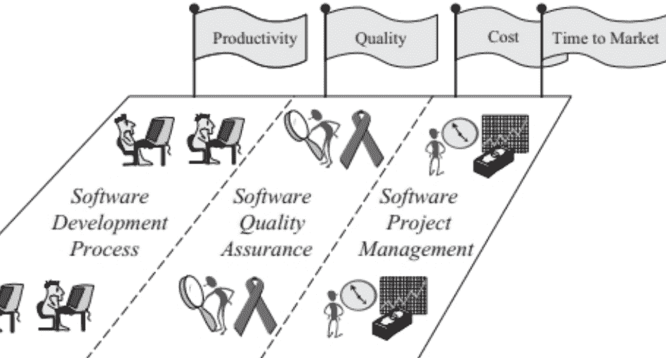

图 1.1 生命周期活动的三条轨道

- **软件项目管理。** 软件项目管理负责开发和软件保证（SQA）活动的控制与管理。项目管理活动包括工作量估计、项目计划与进度、风险管理、项目管理等。这些活动确保软件能够按时且在预算内交付。

### 1.3.1 软件开发过程

软件开发过程通常被称为**软件过程**。对过程的需求与定制房屋建造以及许多其他重大工程相似。定制房屋建造的活动包括获取买方需求、定制房屋设计、建造、检查和交付。

软件过程由产生软件系统而执行的一系列阶段和活动组成。在某些情况下，软件系统是大系统的一部分。例如，电信系统、邮件处理系统、工业控制系统和医疗设备使用软件来处理事件并控制硬件。这些系统被称为**嵌入式系统**。

在这种情况下，软件过程是一个被称为**系统开发过程**或**系统工程过程**的更大过程的一部分。系统工程考虑的是整个系统，而不仅仅是软件系统。

在软件工程的历史中，许多软件过程模型。其中包括瀑布模型、原型模型、进化模型、螺旋模型、统一模型和敏捷模型。图 1.2 显示了著名的传统瀑布模型，它源自传统的工程学科。该过程考虑了系统工程需求定义、系统设计和系统需求分配。下面描述了瀑布模型的各个阶段。

### 系统需求定义、系统设计与分配

这些是经常为嵌入式系统执行的系统工程活动。系统需求定义识别整个系统的能力并将其表述为系统需求。

例如，考虑无线通信系统（RCS）的系统开发。该系统与蜂窝网络类似，但它只有一个高功率基站，服务的区域比蜂窝网络中的小区大得多。系统需求规定了整个系统的能力。以下是识别出的许多系统需求中的四项：

- **R1。** RCS 应允许移动用户发起对其他移动用户和座用电话的呼叫。
- **R2。** RCS 应允许移动用户接其他用户的呼叫。
- **R3。** RCS 应提供通话费统计，以捕获和记录移动通话并将其计入用户账户。
- **R4。** RCS 应允许授权的账户管理员管理用户账户。

系统设计确定了整个系统的主要子系统，并规定了子系统之间的关系。这些关系在系统架构设计图中描述。图 1.3 显示了使用框图设计的 RCS 架构。它描述了三个子系统：移动单元、基站和账户管理。移动单元由移动硬件子系统和移动软件子系统组成。

| 移动单元 | 空口 | 基站 |  |  |
| :--- | :--- | :--- | :--- | :--- |
|  | 移动硬件 |  | 基站天线 | 控制器软件 |
| 话数据 | 事件 |  | 指令 | 账户管理 |
|  | 移动软件 | 指令 | 高功率收发器 | 控制器硬件 |
| 事件 |  |  |  |  |

**图 1.3** 使用框图的系统设计

基站由基站天线、高功率收发器、控制器硬件和软件子系统组成。图 1.3 中的箭头线显示了子系统之间的关系。

分配活动将系统需求分配给子系统。系统设计和分配产生的子系统相对独立且易于接口。此外，子系统可以由不同的工程团队开发，例如电气和电子工程团队、机械工程团队和软件工程团队。

系统分配可以将系统需求分解为较低级的需求，并将其分配给不同的子系统。例如，需求 R1 涉及移动单元、基站以及硬件和软件功能。向基站发送呼叫请求是移动单元的功能。拦截请求是硬件功能。检查呼叫请求以确保其是用户到用户之间的通话是软件功能。因此，该需求被分解为以下内容：

- **R1.1。** 移动单元在发送呼叫时应包含自动号码识别（ANI）号码。
- **R1.2。** 基站应在接通电话前使用 ANI 号码验证呼叫者和被叫者。
- **R1.2.1。** 软件控制器应验证呼叫者和被叫者，并在验证成功后指示硬件控制器建立连接。
- **R1.2.2。** 硬件控制器应在软件控制下指示高功率收发器建立空口连接。

分解后，需求 R1.1 分配给移动单元。需求 R1.2.1 分配给基站软件控制器，需求 R1.2.2 分配给基站硬件控制器。同样，需求 R3 可以分解并分配给相应的子系统。需求 R4 分配给账户管理系统，因为它纯软件需求。

### 软件需求分析

软件需求分析细化分配给软件系统的系统需求。它还识别了软件系统的其他能力。细化的系统需求规定在软件需求规范（SRS）中。

例如，需求 R4 没有规定授权的账户管理员可以做什么来管理账户。因此，该需求细化如下：

- **R4.1。** RCS 应允许授权的账户管理员创建用户账户。
- **R4.2。** RCS 应允许授权的账户管理员激活用户账户。
- **R4.3。** RCS 应允许授权的账户管理员禁用用户账户。
- **R4.4。** RCS 应允许授权的账户管理员关闭用户账户。
- **R4.5。** RCS 应允许授权的账户管理员删除已经关闭的用户账户。

账户管理员需要登录以执行这些操作，并注销以防止他人访问账户。这些是在软件需求分析阶段识别出的软件需求示例。

### 软件设计

软件设计定义了软件架构或软件系统的整体结构。它规定了子系统及其关系、子系统的功能、接口以及子系统如何相互交互。用户界面设计是软件设计的另一个重要活动。它描述了窗口和对话框的外观，以及系统如何与用户交互。软件设计还规定了信息处理算法。

RCS 架构设计的示例图 1.4 显示了账户管理系统的 N 层架构。架构将类或对象组织到单独层。每层都有明确定义的职责，并请求下一层的服务。

例如，用户/设备界面层为账户管理员和软件控制器提供服务。它使用控制层的服务。分层架构简化了业务流程的实现。例如，当账户管理员想要创建账户时，用户界面将请求转发给创建账户控制器。

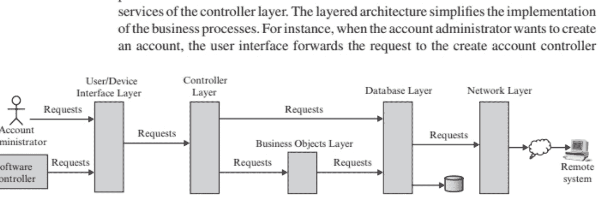

**图 1.4** 账户管理的 N 层架构

在控制器层中，控制器创建`Account`对象，并从数据库层将其保存到数据库中。这表明每一层的功能都容易实现和使用。N 层架构的另一个优势是，只要层与层之间的接口保持不变，对某层的更改对其他层的影响很小。

### 实现、测试与维护

在实现和单元测试阶段，会编写程序以实现设计。对程序进行测试，并由同行进行评审，以确保其正确性并符合编码标准。

在集成阶段，对程序模块进行集成和测试，以确保它们之间能够协同工作。在验收测试阶段，设计并运行测试用例，以检查软件是否满足软件需求。随后，将软件系统安装到目标环境中并由用户进行测试。

软件进入维护阶段。在维护阶段，将持续进行修正、改进和增强，直到系统被替换。

### 1.3.2 软件质量保证

软件质量保证（SQA）确保开发中的软件系统将满足软件需求和预期的质量标准。验证、确认和测试是实现这些目标的手段。如图 1.5 所示，这些活动是生命周期活动。

特别是，验证确保开发活动根据为软件项目选择的软件过程和方法进行。它还确保产生所需的软件工制品并符合质量标准。

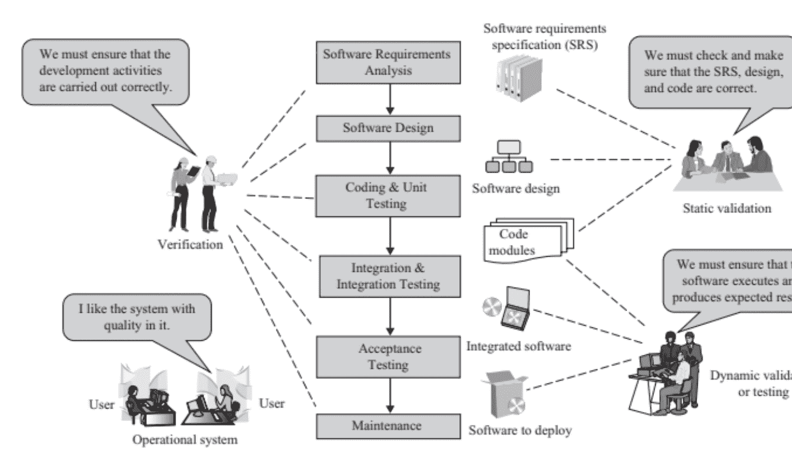

图 1.5 传统生命周期中的 SQA

例如，如果 RCS 项目使用瀑布模型，则验证确保瀑布模型的阶段被正确执行。它还会检查 RCS 系统需求规范、系统设计、分配、软件需求规范、软件设计以及其他工制品是否生成并满足要求的质量标准。

确认检查开发活动产生的软件工制品的正确性。例如，对 RCS 的确认检查系统和软件需求，以确保它们规定了真实的业务需求。它还检查系统和软件设计是否满足需求和约束，以及实现的系统是否解决了预期的业务问题。

确认活动分为静态确认和动态确认。静态确认在不执行软件的情况下检查软件工制品的正确性。它适用于不可执行的工制品，如需求规范和软件设计文档。这类似于检查汽车规格说明以确定其是否满足汽车买者的需求。

动态确认通过执行软件来确保其正常工作并产生正确的结果。软件测试是一种动态确认技术。它使用测试用例执行软件，并检查测试结果是否与预期结果匹配。这类似于试汽车以确保其符合性能要求。

账户管理系统的单元测试生成测试用例，以检查接口、控制器、业务对象、数据库和网络层中的每个类是否正确实现了该类的功能。集成测试生成测试用例，以测试并确保这些类之间能够协同工作。验收测试从账户管理系统的需求中导出用例，以确保系统满足需求。

### 1.3.3 软件项目管理

软件管理活动确保软件系统开发将按时并在预算范围内交付。为了实现这些目标，项目管理执行以下活动（但不限于）：

- **工作量估算（Effort estimation）。** 工作量估算定义了执行开发和 SQA 活动的人力。例如，分别需要多少开发人员来执行分析、设计、实现和测试活动？这些活动的持续时间是多少？这些问题的答案被用于规划项目和安排活动进度。工作量估算根据预估软件规模、复杂性以及要求的交付日期等各种因素定义这些内容。
- **项目计划与调度（Project planning and scheduling）。** 项目计划和调度旨在为项目制定整体计划。项目计划将在整个生命周期过程中指导项目团队。然而，由于现实情况的变化，项目计划需要更新。

项目计划规定了项目目标、实现目标的流程、项目里程碑、活动进度、项目团队及其组织方式以及项目预算等。项目计划还包括质量保证计划。质量保证计划规定了质量标准、SQA 活动以及此类活动的进度。项目计划还包含了风险管理计划，见下文。


- **风险管理**（Risk management）。许多事件可能会危及项目。例如，管理人员或关键员工离开项目，或者项目严重滞后。这些被称为风险项。风险管理试图通过风险规划来减少此类事件的影响。风险管理识别风险项，根据发生概率对项目的损害进行排序，并在风险发生时指定风险解决措施。

- **项目管理**（Project administration）。项目管理是项目管理的一种持续功能。它关注持续监控项目进度并执行必要的行动以适应新情况。它还包括日常管理，如协调项目团队或团队成员、安排和主持会议以及解决日常问题。

- **软件配置管理**（Software configuration management）。在开发过程中，会产生许多软件工制品。这些包括需求规范、软件设计、代码、测试用例、用户手册等。这些在开发过程的不同阶段构成了软件或其部分。这些文档相互依赖。例如，软件设计依赖于需求。如果需求发生变化，设计必须更改。这反过来可能需要更改代码。因此，软件工程需要一种机制来确保更改的一致性。这就是软件配置管理（SCM）。

## 1.4 面向对象的软件工程

面向对象的软件工程（OOSE）是软件工程的一个分支。OOSE 将世界和系统视为由相互关联和交互的对象组成。OOSE 提供面向面向面向软件开发：

1. 面向对象的建模和设计语言，供团队成员交流他们的分析和设计思想。建模设计语言定义了概念、符号以及符号的规则。统一建模语言（UML）是使用最广泛的面向对象的建模设计语言。

2. 面向对象的软件开发过程，指导开发工作。统一过程（UP）是一种广为人知的开发过程，而敏捷过程在近年来也涌现出来。

第一部分 引言与系统工程

3. OO（面向对象）软件开发方法论，详细介绍了软件过程活动的步骤或方法。

4. 支持开发过程和方法论的 OO 开发工具和环境。既有商业产品，也有公共领域软件。例如，NetBeans 集成开发环境（IDE）是一种免费的开源软件。它包含了一组支持整个软件开发生命周期活动的插件。

### 1.4.1 面向对象的建模与设计语言

C++ 在 20 世纪 80 年代的快速传播使人们需要一种开发方法论来指导 OO 软件开发工作。许多方法中，提出了三种影响力的 OO 开发方法论并在软件行业被广泛使用。它们是 Booch 图、对象建模技术（OMT）和用例工程。业界很快发现，整合使用不同方法论设计和实现的系统是一项巨大的挑战。这是因为不同的方法论使用不同的概念和符号。为了解决这个问题，对象管理组织（OMG）将统一建模语言（UML）[36] 采用为 OMG 标准。UML 是一系列用于建模和设计 OO 系统不同方面的图表。UML 图用于需求分析阶段，帮助开发团队理解现有应用程序的业务。它们在设计阶段作为设计规范的一部分使用。UML 图将贯穿本书其余大部分。

### 1.4.2 面向对象的开发过程

瀑布过程顺序性质意味着对需求的更改是困难且昂昂的。这是因为对需求的任何更改都会影响设计和实现；这些也必须随之更改。遗憾的是，由于市场状况的变化、技术的进步和其他因素，需求变化在许多现实世界项目中是常有的现象。瀑布过程周期长，意味着系统在发布之刻就过时了。这是因为系统的能力或需求很久以前就已经确定了。为了克服这些问题，人们提出了若干软件过程模型。所有这些模型都采用了迭代而非严格顺序的开发活动过程。例如：螺旋过程、统一过程和敏捷开发过程。

### 1.4.3 面向对象的开发方法论

软件过程规定了“做什么”，但不规定“怎么做”。也就是说，它定义了开发活动，而不是如何执行这些活动。UML 是一种建模语言。它让软件工程师能够图表来描述他们的分析和设计思想。它并不帮助软件工程师产生分析和设计思想。软件开发方法论填补了这一空白。它规定了执行软件过程活动的步骤和执行方法。传统的 OO 开发方法论包括 Booch 图、对象建模技术（OMT）、用例工程以及其他方法。敏捷方法包括 Scrum、动态系统开发方法（DDSM）、功能驱动开发（FFD）、水晶水晶（Crystal Clear）、极端编程（XP）、精益开发方法等。

### 1.4.4 OO 会取代传统方法吗？

答案是否定的，原因有许多点。第一，需要维护大量的传统系统。第二，许多组织仍在使用传统方法。第三，对于某些项目（如科学计算），传统方法论可能更为合适。最后，一个系统可能由由传统方法和 OO 方法开发的组件组成。因此，OO 和传统方法将共存多年。

## 1.5 软件工程与计算机科学

软件工程和计算机科学是不同的。计算机科学学科（如算法和数据结构、数据库系统、人工智能、操作系统等）强调计算效率、资源共享、准确性、优化和性能。这些属性可以进行量化且即时的度量。事实上，在过去的几十年里（11950 年至今），计算机科学研究的所有努力和资源都旨在改进这些方面。计算机科学教材的大多数章节都是关于改进这些方面的方法、算法和技术编写的。

与计算机科学不同，软件工程强调软件 POCT。例如，获得最优解是计算机科学的目标。软件工程会使用“足够好”的解决方案来减少开发时间和精力。软件工程研究的努力和资源旨在改进这些 POCT。软件工程教材的大多数章节是关于改进这些方面的方法和技术编写的。

与计算机科学不同，软件工程强调软件 POCT。例如，获得一个足够好的解决方案是软件工程的目标。遗憾的是，软件工程过程或方法的影响无法立即衡量。为了产生意义，必须对影响进行评估。例如，研究人员需要十年的时间才能意识到，不受控制的 `goto` 语句是有害的。这会导致结构糟糕的程序难以理解和测试。

计算机科学只关注技术方面。软件工程必须考虑非技术问题。例如，开发过程的早期阶段关注识别需求和约束。这些活动需要知识、经验以及沟通和业务分析能力。界面设计必须考虑人类因素以及用户如何使用系统。此外，软件开发必须考虑政治问题，因为系统可能会以这种或那种方式影响许多人。识别软件工程与计算机科学之间的差异有助于理解和欣赏软件工程的过程、方法和原则。例如，考虑需要访问数据库的软件系统。计算机科学学科可能强调高效的数据存储和检索，并倾向于让对象直接访问数据库。这种设计被认为在对象和数据库之间建立了紧密耦合。除非性能是一个严重的问题，否则软件工程不会认为这是一个良好的设计。如果数据库或数据库管理系统（DBMS）发生变化，那么对象也必须更改。这可能是困难且昂贵的。如果数据库位于远程，那么复杂的对象难以测试和维护。

尽管存在差异，软件工程与计算机科学密切相关。计算机科学之于软件工程就像物理之于电子工程，或化学之于化学工程。也就是说，计算机科学是软件工程的理论和技术基础。软件工程是计算机科学的应用。然而，软件工程有自己的研究课题。这些包括软件过程和方法论、软件验证、确认和测试技术等。软件工程研究旨在显著提高软件 POCT 以及两者之间的平衡。

软件工程是一个广泛的领域。软件工程师应该了解计算机科学的不同领域，包括数据库系统、操作系统、数据结构和算法、编程语言以及编译器构造。嵌入式系统开发要求软件工程师对电子电路的基础知识，以及如何与硬件设备接口。软件工程师需要时间来获得领域知识和设计经验，以成为优秀的软件架构师。这些挑战以及根据实际需求设计和实现复杂系统的能力使软件工程成为一个令人兴奋的领域。不断扩展的计算机应用为软件工程师和软件工程研究人员创造了巨大的机会。

## 总结

软件工程被定义为研究和应用工程过程方法论以提高软件 POCT 的学科。讨论了软件工程的需求并描述了软件生命周期活动。OO 工程是软件工程的一个专业领域。它将世界和系统视为由相互关联和交互的对象组成。本章最后讨论了计算机科学与软件工程之间的差异和关系。也就是说，计算机科学是软件工程的基础。虽然计算机科学主要关注优化和效率，但软件工程关注 POCT。了解这些有助于开发者理解软件工程以及过程、方法论、建模语言、设计模式等许多内容的原理。所有这些都是为了提高软件 POCT 而设计的。

## 延伸阅读

许多书籍对软件工程这一学科提供了全面的介绍。一些示例包括 [123, 125, 139]，OOSE 软件书籍包括 [40, 133] 等许多书籍。[104] 对面向对象（OO）分析与设计提供了极佳的介绍。已经出版了大量描述 UML 和 UP（统一过程理论）的书籍，特别是 [36, 63, 91]。对象管理组（OMG）网站（<http://www.omg.org>）发布 UML 规范和相关文章。有很多关于敏捷开发的书籍，包括 [21, 50, 52, 119, 124, 140]。敏捷联盟网站（<http://www.agilealliance.org/>）是一个极好的资源，它发布了关于该主题的好文章和讨论。

## 章节复习

1. 什么是软件工程？为什么需要它？
2. 什么是软件开发过程？
3. 什么是软件质量保证？
4. 什么是软件项目管理？
5. 什么是软件配置管理？
6. 面向对象的软件工程与传统软件工程有什么区别？
7. 软件工程与计算机科学之间有什么区别和关系？我们可以在没有其中一个的情况下拥有另一个吗？

## 练习

- **1.1** 检索文献，寻找本章给出的定义之外的其他四个软件工程的定义。讨论这些定义之间的相似点和区别。

- **1.2** 用短短文描述软件开发过程、软件质量保证、项目管理和软件配置管理的功能。讨论它们在软件开发生命周期如何共同工作。讨论它们如何提高 PQCT（进度、质量、成本、时间）。

- **1.3** 优化应该是软件工程的重点吗？简要解释，并用实际案例证明你的答案。

- **1.4** 选择三门你感兴趣的计算机科学课程。展示这些课程在软件生命周期活动中的用处。

- **1.5** 软件生产力、质量、成本和上市时间之间存在相互依赖关系。例如，在编码上花费更多的时间和精力可能会提高生产力，这可能导致总时间和精力的常数项减少。质量差可能由于返工而增加成本并降低生产力。选择三对你认为的这种相互依赖关系。讨论它们对软件组织的短期和长期影响。软件工程应该如何解决这些接口引发的“困境”？

- **1.6** 面向对象的软件工程与传统软件工程有什么区别？讨论面向对象的软件工程是否会取代传统软件工程。

# 第 2 章：软件过程与方法论

## 核心要点

- 软件过程定义了构建软件系统所需的活动阶段，或者说是为了构建软件系统需要执行的任务。
- 软件方法论详细说明了步骤，或如何执行软件过程中的活动。方法论是过程的实现。
- 软件开发需要软件过程和方法论。

编写由几千行代码组成的程序对于许多本科生和研究生来说可能是一个前所未有的经验和挑战。然而，在软件行业中，包含数百万行代码的系统开发是一项常见工作。学术编程与真实世界软件开发项目之间的区别不仅限于代码行数。真实世界的系统开发必须克服许多挑战。为了克服这些挑战，需要一种严谨的系统开发方法。这通常被称为软件过程。第 1 章介绍的瀑布模型就是这样一种过程或过程模型。许多软件开发组织采用瀑布模型部分是因为其简单性，但经验表明瀑布过程与许多问题相关。为了克服这些问题，人们提出了许多其他软件过程模型。软件行业随后发现，软件开发不仅需要过程，还需要方法论。过程定义了开发软件系统要执行的活动，而方法论定义了步骤以及如何执行这些步骤来完成过程中的活动。换句话说，方法论是过程的实现。

总结，本章介绍了：

- 真实世界中系统面临的挑战。
- 瀑布模型的优点和局限性。
- 其他知名的过程模型。
- 软件方法论以及过程与方法论之间的区别。

# 第 2 章 软件过程与方法论

- 棘手问题（wicked problems）理论以及它如何与软件开发相关。
- 敏捷过程与敏捷方法。
- 本书介绍的过程和方法论的概述。

## 2.1 系统开发的挑战

在实验室中开发软件系统与在真实世界中开发完全不同。真实世界的项目更大、更复杂。除了这些显而易见的挑战外，还有其他。理解某些挑战对于学习软件工程是有用的。这有助于理解为什么光有计算机科学是不够的，以及为什么我们需要软件过程和方法论。此外，它帮助我们了解软件过程和方法论如何帮助克服挑战。首先是项目方面的挑战：

- 项目现实 1：许多系统开发项目的开发周期很长，通常从一年到几年不等。真实世界的项目必须满足进度和预算限制。
- 项目挑战 1：在完全不知道客户想要什么以及未来几年会发生什么的情况下，我们该如何计划、调度和管理项目工作？
- 项目现实 2：许多系统开发项目需要多个部门或开发团队的协作。例如，许多大型嵌入式系统涉及硬件和软件组件，需要软件工程部门与硬件部门协作。
- 项目挑战 2：我们如何划分工作，并将相互依赖的部分分配给各个部门，并能够平滑地整合不同部门和团队产生的组件？
- 项目现实 3：不同的部门或团队可能使用不同的过程、方法和工具。部门或团队可能位于不同的地点。
- 项目挑战 3：我们如何确保部门和团队之间良好的通信和协调？

除了项目挑战，还有产品挑战。一些示例是：

- 系统现实 1：许多真实世界的系统必须满足大量的需求和约束，包括严格的实时约束。例如，一个邮件处理系统有数百个需求和约束，要求每小时处理 40,000 件或每秒 12 件。
- 系统挑战 1：我们如何开发系统以确保满足这些需求？
- 系统现实 2：需求会随时间变化。以作者的项目为例，在前三个月里需求每周都在变化。
- 系统挑战 2：我们如何设计过程和产品以应对不可避免且无法预测的变化？
- 系统现实 3：系统将演进多年，产生维护挑战。例如，更改没有记录或记录不全，对系统的更改可能会引入 `Bug` 并破坏系统结构。所有这些使得系统越来越难以理解、测试和维护。
- 系统挑战 3：我们如何设计系统以便能够容易地进行更改，且对系统的其他部分影响最小？
- 系统现实 4：系统可能由硬件软件组件组成，使用第三方组件和多种实现语言，并运行在位于不同地点的平台上。
- 系统挑战 4：我们如何设计系统以隐藏硬件、平台和实现的特性，使得这些更改不会影响系统的其余部分？

列表并不完整。真实世界还有许多未包含在内的挑战。然而，该列表已足以表明科学方法不足以应对这些挑战。我们需要工程方法。两个重要的组件是软件过程和方法论。

## 2.2 软件过程

计算机科学的进步，特别是 20 世纪 60 年代的非数值计算和关系数据库系统，导致计算机在业务领域的快速扩张。现有的临时开发过程无法满足开发项目的需求。软件开发过程或软件过程的概念被引入并定义为：

**定义 2.1** 软件过程是构建软件系统的一系列活动阶段。每个阶段产生某些产物，作为其他阶段的输入。每个阶段都有一组准入标准和退出准则。

例如，第 1 章介绍的瀑布模型展示了严格的开发活动顺序。需求阶段产生需求规范，设计阶段产生设计，以此此类推。通常，准入和退出准则规定了必须可用和相应产生的软件产物。

## 2.3 瀑布型流程的优缺点

传统的瀑布型流程定义了一系列顺序活动，如需求分析、设计、实现、测试和维护。几十年来，许多公司一直使用该流程。在讨论其缺点之前，公平地指出，该流程具有许多优点。这些优点解释了为什么该流程在软件行业仍然在使用。首先，瀑布型流程简单、直接的阶段顺序极大地简化了项目规划、进度和项目状态跟踪。从这个意义上说，它被认为是“可预测的”。其次，功能性活动的线性顺序允许以功能为导向的项目组织。在这样的组织中，功能团队专门负责需求分析、设计和实现等不同功能领域。项目由功能团队以流水线的方式执行。瀑布型流程的第三优点是这种阶段方法适用于某些大型、复杂、长期的嵌入式系统。此类系统包括邮件分拣和路由系统、过程控制系统以及许多类型的计算机设备。每个系统都需要响应大量的硬件生成的事件，处理海量的入站数据，并控制硬件设备的行为。通常，此类系统的能力或需求是由制造商和客户共同开发的。在许多情况下，要开发的系统仅仅是对现有系统功能、性能和安全性的重大增强。供应商对应用以及客户的需求具有经验和良好的了解；因此，对需求的重大变更非常罕见。一旦发布采购订单，客户在验收测试阶段之前无法接触系统，尽管客户参与了评审和原型演示。阶段方法允许每个阶段都严谨地执行，以确保系统可靠运行并满足性能和时序约束。

瀑布型流程有许多严重的缺点。首先，严格的阶段顺序和相关的里程碑使得难以提出变更。然而，在许多情况下需要变更，例如业务竞争加剧、新法规或标准，或者无法识别所有需求。对于许多应用程序来说，长的开发周期是不可接受的，因为需求早在以前就已经确定，而业务需求发生了巨大变化。第三，用户在系统发布之前无法对系统进行实验。经验表明，早期用户反馈有助于发现对业务需求的误解以及用户界面设计中的问题。另一个缺点是，客户在漫长的开发期间无法获得新系统的益处。最后，如果项目被取消，客户必须接受投资回报率低的风险；也就是说，设计文档和部分测试的代码并不代表投资的成果。

## 2.4 软件开发是一个棘手问题

瀑布型流程的问题与棘手问题（wicked problems）理论密切相关。该理论最早由大学教授霍斯特·里特尔（Horst Rittel）研究。

### 温和问题的属性

### 棘手问题的属性

| 温和问题的属性 | 棘手问题的属性 |
| --- | --- |
| 1. 温和问题可以被完全规范。 | 1. 棘手问题没有有限的表述。 |
| 2. 对于温和问题，规范和解决方案可以分离。 | 2. 对于棘手问题，规范就是解决方案，反之亦然。 |
| 3. 对于温和问题，有停止规则。 | 3. 棘手问题没有停止规则——你总是可以做得。 |
| 4. 温和问题的解决方案可以根据正确或错误进行评估。 | 4. 棘手问题的解决方案只能根据好或坏进行评估，且这种判断是主观的。 |
| 5. 解决问题过程的每一步都有有限的步数。 | 5. 解决问题过程的每一步都有无限的选择——一切上在原则上都是可能的。 |
| 6. 存在确定的因果推理链。 | 6. 因果推理是基于前提的，会导致不同的选项，但很难判断哪一个是最好的。 |
| 7. 温和问题的解决方案可以立即测试；一旦测试，它保持正确。 | 7. 棘手问题的解决方案无法立即测试，并且取决于终身学习。 |
| 8. 温和问题的解决方案可以适应更简单的问题。 | 8. 每一个棘手问题都是独特的。 |
| 9. 解决方案的过程是一个科学过程。 | 9. 解决方案的过程是一个政治过程。 |
| 10. 如果问题没有解决，只需再次尝试即可。 | 10. 问题的解决者没有权利这样做。 |

## 2.5 软件过程模型

瀑布型流程的问题促使研究人员和资助机构寻找一种考虑软件开发棘手属性的更好流程。该研究投入了大量的资金和精力。结果，人们提出了许多软件过程模型。大多数模型采用了迭代的、而非严格顺序的活动序列。本节将回顾其中的一些过程模型。

### 2.5.1 原型过程


原型型过程模型承认了新构建的软件系统与用户预期之间的差异，以及在时间和预算限制内交付能力的挑战。作为解决方案，构建了系统的原型并用于获取和验证需求。原型还用于可行性研究以及设计验证。原型可以非常简单，也可以很复杂。简单的原型只显示外观和感觉，并用一系列截图来说明系统将如何与用户交互。复杂的原型可能会实现许多丢弃原型和演化原型。丢弃原型是快速且经济地构建的——仅足够满足其目的即可。丢弃原型可以在单元测试或集成测试中作为参考实现重用，以检查实现是否产生了正确的结果。此外，它可以在系统发布前用于培训用户。

### 2.5.2 演化过程

原型有助于需求获取、需求验证、可行性研究以及设计方案的验证。然而，丢弃型原型（throwaway prototypes）意味着大量的精力被浪费。当大型实时嵌入式系统的可行性研究和设计验证需要复杂的原型时，情况确实如此。演化过程模型通过让原型不断演化来解决这个问题。它允许用户根据一组初步需求构建的初始原型进行实验。用户的反馈被用于演化原型。这个过程不断重复，直到不再需要扩展。因此，它也被称为演化原型模型。由于原型不是丢弃型原型，因此它是带有操作功能和稳健性的被构建的。

演化过程最适用于探索型项目，这类项目需要通过与系统的交互来发现确切的需求和算法。许多现实项目都属于这一类，包括智能系统、旨在发现基因测序等未知事物的研究性软件，以及与环境积极交互的嵌入式系统。演化过程不适用于需要预测进度的项目。

### 2.5.3 螺旋过程

由 Barry Boehm [32] 提出的螺旋过程以其独特的风险管理特征而闻名。正如其名称所示，开发过程看起来像一个螺旋，如图 2.2 所示。螺旋的每个周期都旨在增强开发中系统的某个方面，例如功能、性能或质量。从这个意义上说，随着模型迭代螺旋周期，系统增量地演化。螺旋的每个周期选择性地执行以下某些内容：

1. 确定当前循环的目标、替代方案和约束（螺旋的西北角）。在这一步中，确定目标、实现这些目标的替代方法以及必须满足的约束。识别项目风险项并确定优先级。

2. 评估替代方案；识别并解决风险（螺旋的东北角）。评估在约束范围内实现目标的替代方案。识别无法实现目标的风险，并制定解决风险的方法。原型设计、仿真、建模和基准测试是解决风险的一些技术。根据风险分析和解决的结果，下一步可能是以下内容之一：

- 如果存在剩余风险，那么随后的步骤将是西南角，即为下一阶段的原型开发制定计划，然后是新的原型开发周期。
- 如果之前的周期已经解决了主要的已知风险，那么后续步骤可以像瀑布模型一样进行，如模型东南角所示。
- 如果之前轮次产生的原型已经足够操作且稳健，可以演化为最终系统，那么后续步骤将像演化原型模型那样扩展并使用该原型。即在东北角向右进行。

- 确定
- 目标
- 替代方案
- 约束

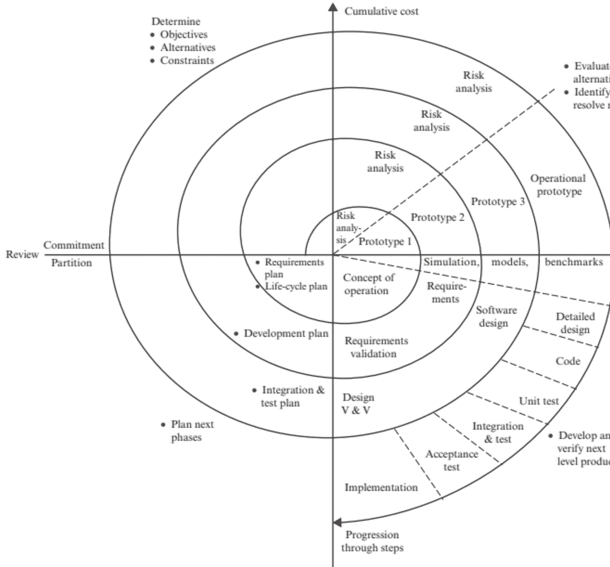

**图 2.2** 螺旋下一级系统（东南角）。

**3. 开发并验证下一级系统（东南角）。** 这一步像瀑布模型一样进行，如图 2.2 所示。

**4. 计划后续阶段（西南角）。** 对于新启动的项目还是持续项目，这一步都定义了下一阶段的需求、生命周期活动以及集成和测试计划。

### 2.5.4 统一过程

Rational 统一过程或统一过程（Unified Process，简称 UP）[91] 如图 2.3 所示，由一系列周期组成。每个周期都以系统的发布结束。每个周期包含若干次迭代。迭代被分为四个阶段——启动阶段（inception）、详化阶段（elaboration）、构造阶段（construction）和过渡阶段（transition）。每个阶段都以一个大的里程碑结束，在此时经理会做出重要的项目决策，决定继续还是终止项目。每次迭代都会经历一系列工作流活动，包括

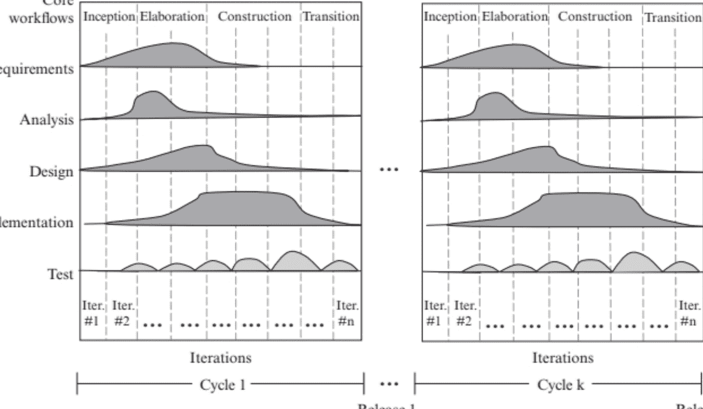

图 2.3 统一过程说明图

需求分析、设计、实现和测试。图 2.3 中的灰色区域是各个阶段期间执行的工作流活动的粗略指示。四个阶段的重点下文所示。

**启动阶段。** 前一个或两次迭代构成了启动阶段。该阶段产生一个简化的用例模型、一个初步的软件架构和一个项目计划。简单来说，用例模型对正在开发的系统的应用程序业务流程进行建模。使用动词-名词短语来描述用例。例如，*存款（Deposit Money）*、*取款（Withdraw Money）*和*查询余额（Check Balance）*是自动取款机（ATM）的用例。用例模型对软件系统最关键的用例进行建模。

**详化阶段。** 详化阶段由后续若干迭代组成。在此阶段，大多数用例被规范化，并产生代表架构设计的 UML 图。软件系统最关键的用例被设计和实现。

**构造阶段。** 在构造阶段，剩余用例被迭代地开发并集成到系统中。系统可以增量地安装在目标环境中。

**过渡阶段。** 在过渡阶段，执行部署软件系统的活动。这些包括用户培训、Beta 测试、缺陷修复和功能增强。

UP 的重点在于识别用例，并利用用例来规划开发和部署系统的迭代。从这个意义上说，UP 被描述为**用例**驱动（use case driven）。UP 在生命周期早期就能确定系统的架构或整体结构，并用它指导软件系统的开发。由于这个原因，UP 被称为以架构为中心（architecture-centric）。UP 的另外两个特征是迭代和增量的，因为系统是迭代和增量地开发和部署的。

### 2.5.5 个人软件过程

个人软件过程（PSP）是一个全面的框架，旨在训练个人软件工程师以改进他们的个人软件过程。PSP 由一系列脚本、表单、标准和指南组成，软件工程师可以应用这些内容来执行若干预定义的编程练习。PSP 并不是强制执行特定的开发方法，而是允许软件工程师选择开发方法。在整个培训过程中，PSP 帮助软件工程师识别需要改进的领域。它还帮助软件工程师培养在团队环境中实用的能力，例如更准确地进行估算的能力和履行承诺的能力。如上所述，PSP 旨在改进软件工程师的个人软件过程；而不是软件开发过程。然而，在培训之后，预计软件工程师将开发并使用自己的过程来产生高质量的软件。人们相信，质量的提高会导致生产力的提高，因为在测试和调试上花费的精力和时间减少了。

### PSP 过程演化

为了便于学习，PSP 采用了演化方法。换之，该框架以一系列预定义的过程呈现，命名为 PSP0、PSP0.1、PSP1、PSP1.1、PSP2、PSP2.1 和 PSP3.0。这些每一个过程都引入了一些良好的软件工程技术或实践。

**PSP0 和 PSP0.1。** 特别是，PSP0 引入了基线过程规范和测量、时间记录以及缺陷类型标准。PSP0.1 引入了编码标准、规模测量和过程改进建议。

**PSP1 和 PSP1.1。** 这两个过程引入了估算和计划。特别是，PSP1 引入了规模估算和测试报告，而 PSP1.1 涵盖计划和调度。

**PSP2 和 PSP2.1。** 这两个过程引入了质量管理和设计。特别是，PSP2 介绍了代码评审和设计评审，PSP2.1 引入了设计模板。

**PSP3.0。** 该过程旨在指导组件级程序的开发。

### PSP 脚本

在 PSP 中，所有过程都使用过程脚本或简称脚本来描述。每个脚本都规定了目的、入口准则、过程的步骤或活动以及

| 目的 | 引导模块级程序开发 |

| :--- | :--- |

| 入口标准 | * 问题描述<br>* PSP0 项目计划总结表<br>* 时间和缺陷记录日志<br>* 缺陷类型标准<br>* 秒表表（可选） |

| 步骤 | 活动 | 描述 |

| :--- | :--- | :--- |

| 1 | 计划 | * 产生或获取需求声明<br>* 估算开发时间<br>* 填写项目计划总结表<br>* 完成时间记录日志 |

| 2 | 开发 | * 设计程序<br>* 实现设计<br>* 编译程序，修复并记录所有发现的缺陷<br>* 测试程序，修复并记录所有发现的缺陷<br>* 完成时间记录日志 |

| 3 | 回顾 | 用实际时间、缺陷和规模数据填写项目计划总结表<br>* 一个经过彻底测试的程序<br>* 带有估算数据和实际数据填写项目计划总结表 |

| 出口标准 | * 完成的时间和缺陷记录日志 |

# 图 2.4 PSP 活动由脚本描述

退出标准。例如，基线过程 PSP0 包含六阶段：计划、设计、代码、编译、测试和回顾。该过程可以用图 2.4 所示的脚本来描述。它由三个步骤组成：(1) 计划，(2) 开发（包括设计、代码、编译和测试），以及 (3) 回顾。脚本的入口标准列出了活动及其描述。入口标准规定了过程完成后必须产生的软件制品构件。图 2.4 中的回顾步骤是 PSP 的一个独特特征。它要求软件工程师完成一份包含实际时间、缺陷和规模数据的项目计划总结表。该表在下文的“PSP 表单”中进行了描述。软件工程师在每次编程练习结束时完成该表。该表允许软件工程师观察自己的软件实践，识别需要改进的领域，并获取用于估算的数据。

PSP 采用了开发过程的递归视图。也就是说，一个过程由一系列活动组成，而一个活动可以由更层级的过程来描述。例如，图 2.4 中的计划步骤是一个过程，可以用另一个脚本来描述。该脚本可能包含需求步骤、资源估算步骤和调度步骤。同样，图 2.4 中的开发步骤是一个由设计、代码、编译和测试步骤组成的脚本。

# PSP 表单

PSP 使用表单来方便文档记录。每个表单规定了普通信息，如学生姓名、日期、程序名称、程序编号、教师和编程语言。为了与表单保持一致，以下演示将交替使用“学生”和“软件工程师”术语。下文描述了某些表单。

**时间记录日志** 此表具有如图 2.5 所示的七列。差值时间（Delta Time）是结束时间减去开始时间减去中断时间。每个学生在表的行中填写过程中每个步骤/阶段的条目。例如，在完成基线过程 PSP0 后，学生为计划、设计、代码、编译、测试和回顾每个步骤填写表中的一行。

**缺陷记录日志** 图 2.6 显示了缺陷记录日志表。顶部是 10 种缺陷类型，在图 2.7 中进行了解释。每个学生都被要求指定过程中检测并消除的缺陷。对于每个缺陷，学生需要输入程序编号、发现缺陷的日期、缺陷识别号、缺陷类型、缺陷引入和移除的阶段、发现和修复缺陷花费的时间、在修复过程中引入当前缺陷的缺陷编号，以及缺陷的简要描述（包括错误内容和引入原因）。

| 学生 | | 日期 1/19 |

| :--- | :--- | :--- |

| 程序 | | 程序# 1 |

| 教师 | | 语言 C++ |

| 项目 | 日期 | 编号 | 类型 | 引入 | 移除 | 修复时间 | 修复引用 | 注释 |

| :--- | :--- | :--- | :--- | :--- | :--- | :--- | :--- | :--- |

| 1 | 1/19 | 1 | 20 | 代码 | 编译 | 1 | | 描述缺少分号。 |

| 项目 | 日期 | 编号 | 类型 | 引入 | 移除 | 修复时间 | 修复引用 | 注释 |

| :--- | :--- | :--- | :--- | :--- | :--- | :--- | :--- | :--- |

| | | 2 | 20 | 代码 | 编译 | 1 | | 描述缺少分号。 |

**图 2.5** PSP 时间记录日志

| 缺陷类型 | PSP 缺陷记录日志 |

| :--- | :--- |

| 10 文档 | 60 检查 |

| 20 语法 | 70 数据 |

| 30 构建、封包 | 80 功能 |

| 40 分配 | 90 系统 |

| 50 接口 | 100 环境 |

**图 2.6** PSP 缺陷记录日志

# PSP 缺陷类型摘要

| ID | 缺陷类型 | 描述 |

| :--- | :--- | :--- |

| 10 | 文档 | 注释、消息和手册 |

| 20 | 语法 | 拼写、标点、错字和指令格式 |

| 30 | 构建、封包 | 变更管理、库、版本控制 |

| 40 | 分配 | 声明、重名、作用域、限制 |

| 50 | 接口 | 过程调用和引用、I/O、用户格式 |

| 60 | 检查 | 错误信息、检查不充分 |

| 70 | 数据 | 结构、内容 |

| 80 | 功能 | 逻辑、指针、循环、递归、计算、函数缺陷 |

| 90 | 系统 | 配置、时序、内存 |

| 100 | 环境 | 设计、编译、测试或其他支持系统问题 |

**图 2.7** PSP 缺陷类型摘要

**项目计划总结表** 上一节中提到的项目计划总结表如图 2.8 所示。它由四个部分组成。表的顶部是描述性信息，规定了学生姓名、日期、程序名称、程序编号、教师和使用的编程语言。“各阶段时间（分钟）”部分规定了过程的计划时间，以及每个阶段的实际时间、截止日期时间和截止日期完成百分比。例如，如果一个学生在第一个程序的设计阶段花费了 30 分钟，在第二个程序的设计阶段花费了 25 分钟，那么实际日期和截止日期均为 30 分钟（注：此处原文逻辑表述可能有误，意指实际时间数据对比）。该表在下文的“PSP 表单”中进行了描述。软件工程师在每次编程练习结束时完成该表。该表允许软件工程师观察自己的软件实践，识别需要改进的领域，并获取用于估算的数据。

PSP 采用了开发过程的递归视图。也就是说，一个过程由一系列活动组成，而一个活动可以由更层级的过程来描述。例如，图 2.4 中的计划步骤是一个过程，可以用另一个脚本来描述。该脚本可能包含需求步骤、资源估算步骤和调度步骤。同样，图 2.4 中的开发步骤是一个由设计、代码、编译和测试步骤组成的脚本。

# PSP 表单

PSP 使用表单来方便文档记录。每个表单规定了普通信息，如学生姓名、日期、程序名称、程序编号、教师和编程语言。为了与表单保持一致，以下演示将交替使用“学生”和“软件工程师”术语。下文描述了某些表单。

**时间记录日志** 此表具有如图 2.5 所示的七列。差值时间（Delta Time）是结束时间减去开始时间减去中断时间。每个学生在表的行中填写过程中每个步骤/阶段的条目。例如，在完成基线过程 PSP0 后，学生为计划、设计、代码、编译、测试和回顾每个步骤填写表中的一行。

**缺陷记录日志** 图 2.6 显示了缺陷记录日志表。顶部是 10 种缺陷类型，在图 2.7 中进行了解释。每个学生都被要求指定过程中检测并消除的缺陷。对于每个缺陷，学生需要输入程序编号、发现缺陷的日期、缺陷识别号、缺陷类型、缺陷引入和移除的阶段、发现和修复缺陷花费的时间、在修复过程中引入当前缺陷的缺陷编号，以及缺陷的简要描述（包括错误内容和引入原因）。

**项目计划总结表** 上一节中提到的项目计划总结表如图 2.8 所示。它由四个部分组成。表的顶部是描述性信息，规定了学生姓名、日期、程序名称、程序编号、教师和使用的编程语言。“各阶段时间（分钟）”部分规定了过程的计划时间，以及每个阶段的实际时间、截止日期时间和截止日期完成百分比。例如，如果一个学生在第一个程序的设计阶段花费了 30 分钟，在第二个程序的设计阶段花费了 25 分钟，那么实际日期和截止日期均为 30 分钟（注：此处原文逻辑表述可能有误，意指实际时间数据对比）。该表在下文的“PSP 表单”中进行了描述。软件工程师在每次编程练习结束时完成该表。该表允许软件工程师观察自己的软件实践，识别需要改进的领域，并获取用于估算的数据。

PSP 还包含方法帮助软件工程师进行估算和计划。此外，PSP 提供了质量保证程序以提高软件质量。这些见附录 A。团队软件过程（TSP）由软件工程学院（SEI）开发，使接受过 PSP 培训的团队成员能够协作项目。如图 2.9 所示，TSP 由一系列循环组成。

**PSP0 项目计划总结表**

| 学生 3 日期 1/19 |

| 程序 标准 程序 # 1 |

| 教师 Brown C++ |

| 各阶段时间（分钟） | 计划 | 截止日期 | 截止日期 % |

| :--- | :--- | :--- | :--- |

| 计划 | | 5 | 4.3 |

| 设计 | | 30 | 25.6 |

| 代码 | | 32 | 27.4 |

| 编译 | | 15 | 12.8 |

| 测试 | | 5 | 4.3 |

| 回顾 | | 30 | 25.9 |

| 总计 | 180 | 117 | 100.0 |

| 引入缺陷 | 实际 | 截止日期 | 截止日期 % |

| :--- | :--- | :--- | :--- |

| 计划 | 0 | 0 | 0.0 |

| 设计 2 228.6 | 2 | 2 | 28.6 |

| 代码 5 571.4 | 5 | 5 | 71.4 |

| 编译 0 0.0 | 0 | 0 | 0.0 |

| 测试 0 0.0 | 0 | 0 | 0.0 |

| 总计 | | 7 | 100.0 |

| 移除缺陷 | 实际 | 截止日期 | 截止日期 % |

| :--- | :--- | :--- | :--- |

| 计划 | 0 | 0 | 0.0 |

| 设计 | 0 | 0 | 0.0 |

| 代码 | 0 | 0 | 0.0 |

| 编译 | 6 | 6 | 85.7 |

| 测试 1 1 14.3 | 1 | 1 | 14.3 |

| 开发总计 | 7 | 7 | 100.0 |

| 开发后 | | 0 | |

周期过程执行一系列活动。TSP 项目始于 TSP 启动过程，旨在建立团队并制定项目计划。启动过程由受过培训且合格的 TSP 教练指导。该过程识别客户需求，为团队成员分配角色，产生初始系统概念、开发策略以及系统开发计划。TSP 团队还会制定质量计划和风险管理计划。这些计划将提交给管理层，管理层可能会予以批准或要求更改。每个周期的最后一步是事后总结（postmortem），团队审查启动过程，识别并记录改进建议，并为团队成员分配跟进事项。

每个周期的 TSP 活动在脚本中规定。图 2.10 展示了一个针对本教材介绍的方法论定制的脚本。也就是说，该方法论实现了 TSP 过程。图 2.10 所示的脚本旨在适用于一个学期的团队合作（包括学习）。它经过了多次测试。然而，该脚本可以进行修改或调整以适应不同的情况。例如，它可以在更短的时间内运行。在这种情况下，将只有一个或两个周期。它可以舍弃某些主题，例如将应用特定场景的模式移动到另一门课程。另一种方案是运行脚本只产生设计而不产生实现。

### 2.5.7 敏捷过程


瀑布过程对于简单问题良好，因为这类问题具有许多良好的特性。应用程序软件开发是一个棘手问题（wicked problem）。它需要一个为解决棘手问题设计的过程。敏捷正是此类过程。敏捷过程强调团队合作、与用户的联合开发、面向变化的设计，以及在短迭代中快速开发和交付小增量。敏捷开发由敏捷价值、原则和最佳实践指导。所有这些都考虑了棘手问题的属性。

## 敏捷宣言

根据敏捷宣言，敏捷开发价值关注软件开发实践的四个方面，这些与传统的、计划驱动的对应方法不同。下面列出并解释：

- 敏捷开发重视个人和互动而非过程和工具。
- 敏捷开发看重运行的软件而非详尽文档。
- 敏捷开发看重客户协作而非合同谈判。
- 敏捷开发看重响应变化而非遵循计划。

### 1. 敏捷价值重视个人和互动而非过程和工具

传统的、计划驱动的实践认为良好的软件过程对于软件项目的成功至关重要。一种传统观点是：

> 查看 www.agilemanifesto.org。

## 第 2 章 软件过程与方法论

### 团队软件过程脚本

| 目的 | 引导团队开发软件产品 |
| :--- | :--- |
| 入口标准 | • 教师指导并支持一个或多个五人小组。<br>• 学生均接受过 PSP 培训<br>- 教师拥有支持团队所需的材料、设施和资源。<br>- 教师描述整体项目目标 |
| 通用 | PSP 设计用于支持三种团队模式。遵循适用的周期：<br>1. 在两个或三个开发周期内开发一个中小型产品。<br>2. 在单个周期内开发较小产品。<br>3. 在一个周期的部分产生产品元素，例如需求、设计或测试计划 |

| 周次 | 步骤 | 激活内容 |
| :--- | :--- | :--- |
| 1 | 评审 | • 课程介绍和 PSP 评审<br>• 阅读前言、引言和本章，重点关注 PSP 部分 |
| 2 | LAU1 | • 审查课程目标并为团队分配角色。<br>• 阅读本章中的 TSP 和统一方法论概述 |
| | STRAT1 | • 产生概念设计，建立开发策略，进行估算并评估风险。<br>• 应用软件架构设计（大多数情况下为 N 层架构）。<br>• 阅读架构设计、项目管理章节，重点关注估算和风险管理章节。<br>• 定义并检查需求，关注高优先级需求。<br>• 从需求中导出用例、用例图和追溯矩阵，规范（用例测试）高级用例 |
| 3 | PLAN1,REQ1 | • 将用例分配到周期中，产生过程分配。<br>• 评审用例、图表、高级用例规范和矩阵。<br>• 阅读系统工程、软件需求和质量保证章节，重点关注需求相关章节，阅读评审用例章节 |
| 4 | REQ1,DES1 | • 执行周期 1 开发、用例概念化和领域模型可视化。<br>• 规范扩展的用例、基于用例的测试用例。<br>• 阅读领域模型扩展、扩展的用例和基于用例的测试用例。<br>• 阅读领域建模、参与者-系统交互建模和软件测试章节（用例测试） |
| 5 | DES1 | • 产生并评审周期 1 场景、场景表和序列图。<br>• 导出并检查周期 1 设计类 (DCD) 和用户界面设计。<br>• 评审建模、导出设计类和用户界面设计章节 |
| 6 | IMP1 | • 执行周期 1 测试驱动开发（可能结合结对编程）以实现 100% 分支覆盖。<br>• 评审单元测试用例和代码 |
| 7 | TEST1 | • 构建并集成周期 1，运行基于用例的测试用例。<br>• 向客户和用户演示周期 1 并记录反馈。<br>• 为周期 1 制作用户文档 |
| | PM1 | • 进行事后总结并评审周期 1 最终报告。<br>• 生成周期 1 的角色和团队评估 |
| 8 | LAU2 | • 进行事后总结并评审周期 1 最终报告。<br>产生周期 1 的角色和团队评估 |

（注：原文此处后续存在大量重复文本，已根据要求完成翻译并保持格式逻辑）

| 周次 | 步骤 | 激活内容 |
| :--- | :--- | :--- |
| 1 | 评审 | • 课程介绍和 PSP 评审<br>• 阅读前言、引言和本章，重点关注 PSP 部分 |
| 2 | LAU1 | • 审查课程目标并为团队分配角色。<br>• 阅读本章中的 TSP 和统一方法论概述 |
| | STRAT1 | • 产生概念设计，建立开发策略，进行估算并评估风险。<br>• 应用软件架构设计（大多数情况下为 N 层架构）。<br>• 阅读架构设计、项目管理章节，重点关注估算和风险管理章节。<br>• 定义并检查需求，关注高优先级需求。<br>• 从需求中导出用例、用例图和追溯矩阵，规范（用例测试）高级用例 |
| 3 | PLAN1,REQ1 | • 将用例分配到周期中，产生过程分配。<br>• 评审用例、图表、高级用例规范和矩阵。<br>• 阅读系统工程、软件需求和质量保证章节，重点关注需求相关章节，阅读评审用例章节 |
| 4 | REQ1,DES1 | • 执行周期 1 开发、用例概念化和领域模型可视化。<br>• 规范扩展的用例、基于用例的测试用例。<br>• 阅读领域模型扩展、扩展的用例和基于用例的测试用例。<br>• 阅读领域建模、参与者-系统交互建模和软件测试章节（用例测试） |
| 5 | DES1 | • 产生并评审周期 1 场景、场景表和序列图。<br>• 导出并检查周期 1 设计类 (DCD) 和用户界面设计。<br>• 评审建模、导出设计类和用户界面设计章节 |
| 6 | IMP1 | • 执行周期 1 测试驱动开发（可能结合结对编程）以实现 100% 分支覆盖。<br>• 评审单元测试用例和代码 |
| 7 | TEST1 | • 构建并集成周期 1，运行基于用例的测试用例。<br>• 向客户和用户演示周期 1 并记录反馈。<br>• 为周期 1 制作用户文档 |
| | PM1 | • 进行事后总结并评审周期 1 最终报告。<br>• 生成周期 1 的角色和团队评估 |
| 8 | LAU2 | • 进行事后总结并评审周期 1 最终报告。<br>产生周期 1 的角色和团队评估 |
| | STRAT2,PLAN2,REQ2 | • 更新周期 2 的策略和计划，评估风险。<br>更新需求、领域模型、追溯矩阵和分配。 |
| 9 | DES2 | • 应用特定场景模式，更新周期 2 设计。<br>产生并评审周期 2 场景、场景表和序列图。<br>基于用例的用例。<br>阅读应用特定模式章节。 |
| 10 | IMP2 | • 测试驱动并检查周期 2，完成 100% 分支覆盖。<br>评审单元测试用例和代码 |
| 11 | TEST2 | • 构建并集成周期 2，运行基于用例的测试用例。<br>向客户和用户演示周期 2 并记录反馈。<br>为周期 2 制作用户文档 |
| | PM2 | • 进行事后总结并评审周期 2 最终报告。<br>• 生成周期 2 的角色和团队评估 |

### 2. 敏捷重视可运行的软件而非详尽的文档

多年来甚至几十年，公司花费了巨大的精力准备分析和设计文档。这部分是因为标准审计，部分是因为认为“良好的软件源于良好的设计文档，而良好的设计源于良好的分析模型”。这些观点是正确的，但只是部分正确。许多软件工程师都经历过，在某些情况下，在编写和测试代码之前，无法确定真实的需求，或者设计是否有效。在这些情况下，详尽的文档不仅没有帮助，如果它产生了具有运行解决方案的错觉，反而是有害的。文档也意味着用于编码和测试的时间更少，而在这些情况下，这是识别真实需求和所需设计的唯一手段。

例如，考虑一个为大型企业优化库存的软件。库存由各种员工在过去几十年中编写的数百万个物品文字描述组成。大量的收购和合并活动显著增加了物品数量、类别以及描述格式和样式。该软件需要处理这些库存描述。目标是简化库存并降低库存成本。显然，软件的需求取决于软件是否能够实现这一目标。然而，如果不实现软件，没有人确切知道软件能完成什么。这是一个“棘手问题”（wicked problem）的例子——规范与实现无法分离的。假设在不需要实现软件的情况下通过某种方式确定了需求，那么数据结构和算法的设计将是一个巨大的挑战，因为极难以知道算法是否有效以及有效到什么程度。这是由于库存描述的多样性、不一致性、条目不完整、类型以及缩写变化引起的。试错法似乎更为合适。

敏捷方法重视可运行的软件，因为可运行的软件是底线。毕竟，只有运行的软件才能通过测试来确保软件系统交付了所需的功能。从这个意义上说，运行软件就是需求，反之亦然。库存描述项目说明了这一点。然而，这种讨论并没有得出敏捷方法不进行分析和设计的结论。相反，敏捷方法会构建分析和设计模型。尽管如此，敏捷原则提倡仅仅建模以帮助理解问题和交流设计思想，仅此而已。

### 3. 敏捷重视客户协作而非合同谈判

传统流程包含合同谈判阶段，以确定客户想要什么。然后产生需求规范并成为合同的一部分。在开发过程中，客户只参与几次设计评审和验收测试。许多本应与客户共同做的重要设计决策由开发团队做出。虽然开发团队擅长做技术决策，但他们可能不具备为客户做决策的知识和背景。例如，支持多个数据库管理系统（DBMS）的需求可能会指定支持哪些 DBMS。从技术上讲，团队可能知道哪些 DBMS 是最好的且应该被支持。客户可能认为其他因素更为重要。这些包括信息技术（IT）人员管理此类类型 DBMS 的、引入此类系统的成本以及与现有系统的兼容性。如果开发团队为客户做出决策，那么生成的系统可能无法满足客户的业务需求。

客户协作对于项目的成功至关重要。它改善了团队与客户之间的沟通和相互理解。沟通的改进有助于识别真实需求并减少需求误解的概率。相互理解意味着风险分担；因此降低了项目失败的概率。对于许多项目来说，系统的确切结果、设计决策或算法是难以或无法预测的。在这些情况下，客户协作极其重要。相互理解意味着开发团队对客户的业务领域、运营、挑战和优先事项有良好的理解。这使得团队能够设计并实现系统以满足客户的业务需求。

相互理解也意味着客户理解技术的局限性，而局限性提供了实现业务解决方案的手段；单凭技术无法解决业务问题。客户需要理解开发团队的局限性，正如作者的以下经验所示。一个客户曾坚持一个中等规模的软件产品，作者的后续经验说明这并非可能。客户坚持要求在一个月内交付，但作者指出这无法实现。如果开发团队为客户做出决策，生成的系统可能无法满足客户的业务需求。客户协作对于项目的成功至关重要。它改善了团队与客户之间的沟通和相互理解。沟通的改进有助于识别真实需求并减少需求误解的概率。相互理解意味着风险分担；因此降低了项目失败的概率。对于许多项目来说，系统的确切结果、设计决策或算法是难以或无法预测的。在这些情况下，客户协作极其重要。相互理解意味着开发团队对客户的业务领域、运营、挑战和优先事项有良好的理解。这使得团队能够设计并实现系统以满足客户的业务需求。

相互理解也意味着客户理解技术的局限性，而局限性提供了实现业务解决方案的手段；单凭技术无法解决业务问题。客户需要理解开发团队的局限性，正如作者的以下经验所示。一个客户曾坚持一个中等规模的软件产品，作者的后续经验说明这并非可能。客户坚持要求在一个月内交付，但作者指出这无法实现。如果开发团队为客户做出决策，生成的系统可能无法满足客户的业务需求。客户协作对于项目的成功至关重要。它改善了团队与客户之间的沟通和相互理解。沟通的改进有助于识别真实需求并减少需求误解的概率。相互理解意味着风险分担；因此降低了项目失败的概率。对于许多项目来说，系统的确切结果、设计决策或算法是难以或无法预测的。在这些情况下，客户协作极其重要。相互理解意味着开发团队对客户的业务领域、运营、挑战和优先事项有良好的理解。这使得团队能够设计并实现系统以满足客户的业务需求。

相互理解也意味着客户理解技术的局限性，而局限性提供了实现业务解决方案的手段；单凭技术无法解决业务问题。客户需要理解开发团队的局限性，正如作者的以下经验所示。一个客户曾坚持一个中等规模的软件产品，作者的后续经验说明这并非可能。客户坚持要求在一个月内交付，但作者指出这无法实现。如果开发团队为客户做出决策，生成的系统可能无法满足客户的业务需求。客户协作对于项目的成功至关重要。它改善了团队与客户之间的沟通和相互理解。沟通的改进有助于识别真实需求并减少需求误解的概率。相互理解意味着风险分担；因此降低了项目失败的概率。对于许多项目来说，系统的确切结果、设计决策或算法是难以或无法预测的。在这些情况下，客户协作极其重要。相互理解意味着开发团队对客户的业务领域、运营、挑战和优先事项有良好的理解。这使得团队能够设计并实现系统以满足客户的业务需求。

### 4. 敏捷重视响应变化而非遵循计划

传统实践强调“合同控制”，因为变化是昂贵的。敏捷方法重视响应变化而非遵循计划。在当今快速变化的世界中，变化是不可避免的。敏捷方法能够使业务能够快速响应变化以生存。互联网技术的进步让业务能够快速更新其应用程序。传统的计划驱动流程无法满足这些需求。敏捷方法因此而生。

## 敏捷原则

敏捷价值观表达了敏捷流程的重点。为了指导敏捷开发，敏捷社区还开发了一套指导原则，称为敏捷原则。这些原则如下：

### 1. 积极参与是至关重要的

积极参与是敏捷方法要求的。这是因为识别真实需求是软件开发中最困难的部分。传统方法在需求上花费了总投入的15%-25%。他们通过严格的变更控制来冻结需求。这些似乎无法解决问题。并不是缺乏时间或精力，而是世界在变化，因此需求需要演进。积极参与意味着用户代表与团队密切且频繁地互动。例如，将一些知识丰富的代表分配到项目中。他们每周几次与团队一起工作。这些安排极大改善了团队与用户之间的沟通。反过来这确保了需求得到及时纠正，反馈得到妥处理，并与用户共同做出决策。这些意味着需求被识别并确定优先级，系统是根据预期构建的。

### 2. 团队必须被赋予决策权

敏捷开发重视个人和互动而非流程和工具。这一原则实现了这一点。也就是说，团队成员被鼓励做出决策并承担责任和所有权。为了能够做到，团队成员需要作为一个团队工作，并在整个过程中相互以及与用户互动。

### 3. 需求演进，但时间表是固定的

与冻结需求的传统方法不同，敏捷流程旨在拥抱变化。这一原则意味着工作范围允许随着变更请求演进，但约定的时间范围和预算是固定的。这意味着新的或修改的需求是以牺牲其他需求为代价的。

### 4. 在高层次捕捉需求；轻量级且视觉化

敏捷开发重视运行而非详尽的文档。毕竟，底线是交付系统，而不是分析和设计文档。为了实现这一点，敏捷方法通过写在小型故事卡上的用户故事、功能或用例捕捉足够的需求。它们使用故事板或屏幕序列、草图或其他视觉手段进行可视化，以展示用户如何与系统交互。这些技术避免了沉重的文档并易于

36 第一部分 引言与系统工程

由于故事卡（story cards）和故事板（storyboards）易于共享和操作，因此更改和权衡需求。

### 5. 开发小型增量发布并进行迭代

敏捷项目以增量的方式开发和部署系统，以迭代的方式交付用例、用户故事或功能。这种安排具有多个优点：项目进度可见、用户每次只需要学习几个新功能、用户更容易提供反馈，并且小规模增量减少了项目失败的风险。

### 6. 关注软件产品的频繁交付

在敏捷开发之前，存在如螺旋过程和统一过程等迭代方法。敏捷流程与其前身的区别在于以小增量的方式频繁交付软件系统。不同的敏捷方法建议不同的迭代周期，范围从一天到三个月不等。例如，动态系统开发方法（DDSM）建议为二到六周，而极端编程（XP）使用一到四周。Scrum 中的迭代被称为“冲刺”（sprint），通常设置为 30 天。书中介绍的方法论持续时间可以从两周到三个月不等。

### 7. 在进入下一个功能之前完成每个功能

这一原则意味着在进入下一个功能之前，每个功能必须实现 100% 实现并经过充分测试。这里的挑战在于我们如何知道该功能已经过充分测试？测试驱动开发（TDD）和测试覆盖率标准提供了解决方案。TDD 要求在实现每个功能之前编写测试。测试覆盖率标准定义了测试必须满足的覆盖要求。例如，许多公司使用 100% 的分支覆盖率。它要求源代码中每个条件语句的每个分支至少测试一次。

### 8. 应用 80-20 原则

这也被称为“足够就好”。该规则基于认为 80% 的工作或结果是由 20% 的系统功能产生的。此外，应该优先考虑能产生 80% 工作或结果的 20% 需求。这一原则建议开发团队引导客户和用户识别并优先考虑此类需求。该规则还提醒团队成员，最后的额外投入具有收益递减的特性。这适用于锦上添花的功能、并非真正需要的性能优化等。例如，如果一个简单的算法对于处理数据已经足够快，那么最优算法可能就不值得投入额外的实现精力。


- 9. 测试贯穿整个项目生命周期；尽早且频繁测试。

这一原则与原则 5-7 辅相成。也就是说，测试是频繁交付完全实现的系统小增量不可或缺的一部分。这一原则得到了 JUnit 等测试工具的支持，JUnit 是一种 Java 类单元测试和回归测试工具。使用此类工具，程序员需要知道如何指定要测试的功能以及如何评估测试结果。该工具将自动生成测试、运行测试并检查测试结果。可以根据需要频繁地运行测试。

# 第 2 章 软件过程与方法论

## 2.5 敏捷原则

- 10. 所有利益相关者之间的协作与合作至关重要。

传统方法依赖详尽的文档向开发团队传达需求。敏捷项目以高层且轻量级方式获取需求。因此，开发团队与客户代表及用户之间的协作与合作至关重要。各方必须在整个生命周期内相互理解、共同工作并演进需求。由于新系统可能会显著改变或影响用户的工作习惯和表现，团队与用户之间的协作与合作对于项目的成功至关重要。

## 2.6 软件开发方法论

软件开发不仅需要一种过程，还需要一种方法论或开发方法。遗憾的是，“方法论”一词往往没有定义。这导致了某种程度的混淆。例如，方法论经常与过程混淆。过程和方法论是软件工程中的重要概念。两者相关，但并不等同。以下是软件方法论的定义：

> 定义 2.2 软件方法论定义了执行软件过程活动的步骤或方法。

通常，过程只规定活动以及它们之间的相互关系。它没有规定如何执行这些活动。它为软件开发组织留下了选择方法论或开发适用于组织的方法论的自由。该定义意味着方法论是过程的实现。软件开发既需要过程也需要方法论。

### 2.6.1 过程与方法论的区别

图 2.11 提供了过程与方法论之间差异的逐项总结。软件过程定义了活动以及每个阶段要做什么，但没有规定如何执行这些活动。方法论定义了执行软件过程活动的步骤或如何执行这些活动。软件过程规定了每个阶段的输入和输出，但没有规定产制物的表示形式。方法论定义了步骤、步骤入口、退出标准以及步骤之间的关系。方法论提供的产制物表示形式取决于范式。例如，面向对象的范式创建图表来建模对象。从这个意义上说，方法论是依赖范式的。软件方法论可以看作是软件过程的具体实现。这意味着一个软件过程可以有多个软件方法论作为其实现。

| 过程 | 方法论 |
| :--- | :--- |
| **过程** | 定义了阶段性活动的框架；规定“做什么”的阶段；通常不规定产制物的表示形式；因此，它是独立于范式的；一个阶段可以通过不同的方法论实现 |
| **方法论** | 等同于过程的具体实现；描述“如何做”的步骤；定义产制物的表示形式；因此，它是依赖范式的；每个步骤都描述了具体的程序、技术和指南 |

**示例：**

- 瀑布过程
- 螺旋过程
- 原型开发过程
- 统一过程
- 个人软件过程（PSP）
- 团队软件过程（TSP）
- 敏捷过程
- 结构化分析/结构化设计方法论（SA/SD）
- 面向建模技术（OMT）
- 敏捷方法，如 Scrum、动态系统开发方法（DSDM）、功能驱动开发（FDD）、极端编程（XP）和水晶橙色（Crystal Orange）

### 2.6.2 方法论的优势

使用良好的软件开发方法论与许多优点相关，包括：

1. 良好的方法论使开发团队关注重要任务，并知道如何正确执行这些任务以产生所需的软件系统。

2. 良好的方法论改进了沟通与协作，因为：
   - 方法论为建模、分析和设计提供了通用语言。
   - 方法论定义了每个人都知并遵循的有效执行开发任务的步骤。

3. 良好的方法论改进了设计质量和软件生产力，因为：
   - 软件工程师能够正确有效地应用建模概念和工具来构建系统。
   - 评审指南或清单使软件工程师能够进行有效的检查和评审，以识别需求规范、设计和源代码中的缺陷。这减少了测试、调试和维护成本。

4. 良好的方法论为过程改进提供了基础，可以通过定义并应用软件质量、生产力、成本和上市时间的测量来识别优缺点。

5. 良好的方法论是过程自动化的基础，因为许多方法论步骤可以机械化执行，使得软件自动化更加容易。

6. 易于学习和使用的方法论让初学者能够生产高质量的软件。随着初学者熟悉该方法论，他们可以跳过敏捷开发中的某些步骤。

软件开发方法在过去的几十年中不断演进。以下章节将回顾在此期间提出的代表性方法论。

### 2.6.3 结构化方法论

结构化分析和结构化设计（SA/SD）方法论于20世纪70年代提出并在20世纪80年代成熟。它们今天仍然在使用。结构化分析使用数据流图（DFD）对现实世界应用的业务过程进行建模。DFD本质上是一个有向图，其中顶点代表外部实体、业务过程和数据存储，有向边表示它们之间的数据流。结构化分析过程中采用分治法，将复杂过程分解为低级的数据流图。

结构化分析的步骤始于构建顶层 DFD，称为上下文图。它将系统描述为一个唯一的过程，该过程与外部实体和外部数据存储交互。接下来的步骤是将复杂过程分解为易实现的简单过程。这一过程一直持续到指定叶节点过程的输入、输出及其数据存储，以及过程的算法。DFD 善于描述软件模块之间的现有关系。这是因为 DFD 中过程之间的关系是数据流关系，而软件模块之间的关系是控制流关系。所谓的结构化设计填补了这一空白。

结构化设计的步骤将数据流分析模型转换为结构图或程序图，其中顶点代表子程序，边表示从高级子程序到其下属程序的函数调用。

### 2.6.4 经典面向对象方法论

在 UML 出现之前，存在经典的面向对象（OO）方法论，其中三种广为人知。它们是 Booch 方法、对象建模技术（OMT）以及用例驱动方法。这三种方法论为 UML 1.0 提供了基础。经典面向对象方法论被许多软件开发组织使用，并促进了面向对象范式的繁荣。但软件行业很快发现，集成和维护使用不同方法论开发的系统是一场噩梦。支持使用不同方法论的不同工具成本也极高。这些问题需要一种统一的建模方法，并导致了 UML 和 UP 的创建。


## 2.7 敏捷方法

与演化型原型模型和螺旋模型一样，敏捷方法采用迭代、增量的开发过程。然而，所有敏捷方法都遵循第 2.5.7 节提出的敏捷宣言。敏捷过程强调短迭代和频繁交付小增量。尽管敏捷方法在阶段的命名和细节上有所不同，但它们在每次迭代中都涵盖了需求、设计、实现、集成、测试和部署活动。然而，它们的重点与传统过程不同。例如，敏捷过程看重运行的代码而非全面的文档。这意味着在需求和设计阶段的建模仅够用。本节描述了几种最常用的敏捷方法。图 2.12 简要总结了一些敏捷方法，将在后续章节中进行详细描述。每种方法都有长长长的原则、特性、价值观和最佳实践列表。图 2.12 并没有显示这些内容，而是列出了每种敏捷方法最独特的特性。

### 2.7.1 动态系统开发方法

DSDM 20 世纪 90 年初在英国出现，作为快速应用开发（RAD）的替代方案。它是一个不同项目可以适应以进行快速应用开发的框架。一些作者认为最适用于金融服务应用。DSDM 过程是一个在一组 DSDM 原则指导下的迭代、增量过程，这些原则与第 2.5.7 节提出的 10 条敏捷原则相似。如图 2.13 所示，DSDM 过程包含五个阶段。前两个阶段执行一次，而另外三个阶段是迭代的：

1. *可行性研究*。在此阶段，确定 DSDM 的适用性和项目的技术可行性。最终产物包括可行性报告、项目概要计划，以及可选的用于评估项目可行性的原型。该原型可能会演变为最终系统。

2. *业务研究*。在此阶段，识别并确定需求优先级，勾勒出初步系统架构。最终产物包括业务领域定义、系统架构定义和概要原型计划。

3. *功能模型迭代*。在此阶段，迭代且增量地构建功能原型。最终产物包括包含原型代码和分析模型的功能模型、一份按优先级排序的非功能需求列表，以及针对进一步开发的风险分析。原型评审文档规定了在后续增量中解决的用户反馈。功能原型将演变为最终系统。

4. *设计与构建迭代*。在此阶段，设计并构建系统以满足功能和非功能需求，并由用户进行测试。来自用户的反馈会被记录并在未来的开发中解决。

### AUM、DSDM、FDD 与 XP 对比

| 关键特性 |
| :--- |
| 使用 UML 的团队协作书籍 |
| 适用于初学者和资深开发者 |
| 适用于敏捷或计划驱动 |
| 一个与 XP 工作的框架 |
| 基于 80/20 原则 |
| 集成与构建 |
| 包含 Scrum Master、Product Owner、团队角色 |
| 特性驱动和模型驱动 |

| 生命周期活动 |
| :--- |
| 可行性研究 |
| 业务研究 |
| 发布规划 |
| 开发整体模型 |
| 探索 |
| 迭代期间 |
| 冲刺评审会议 |
| 计划 |
| 设计与构建 |
| 按功能进行计划 |
| 迭代到功能发布 |
| 实现 |
| 按功能设计 |
| 生产化 |
| 维护 |
| 按功能构建 |
| 死亡 |
| 部署 |

*AUM: 本书描述的敏捷统一方法论*

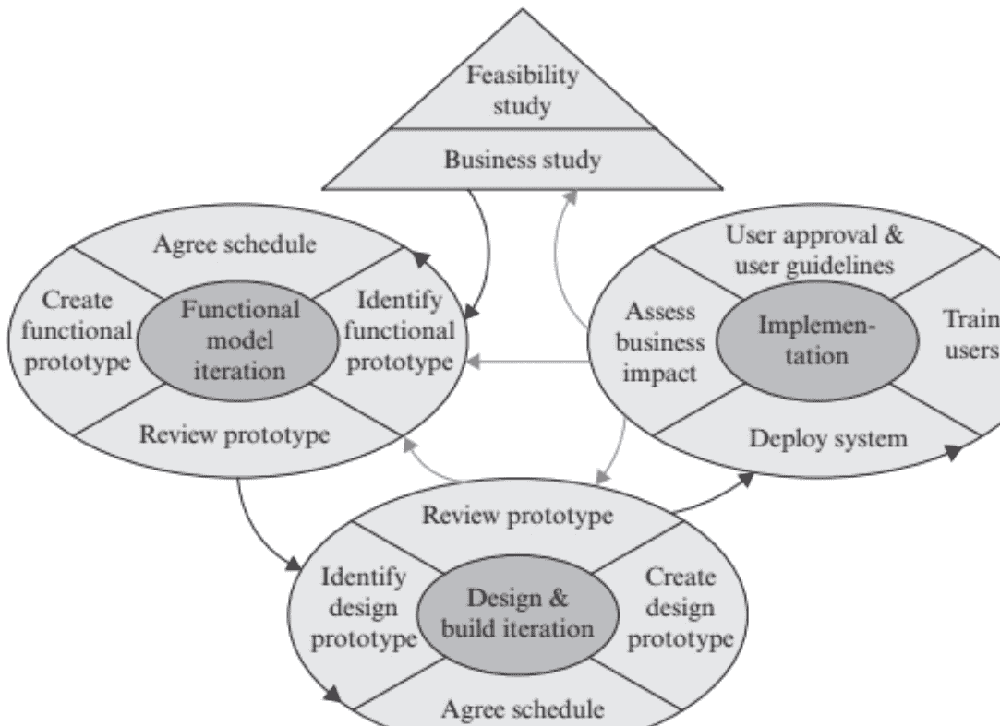

**5. 实现。** 在此阶段，系统被安装在目标环境中，并进行用户培训。最终产物包括用户手册和项目评审报告，后者总结了项目的成果以及未来的打算。

### 2.7.2 Scrum

Scrum 是一个允许组织采用并改进其软件开发实践的框架。它由 Scrum 团队、团队内部的角色、时间盒、制品以及 Scrum 规则组成。Scrum 是一种迭代的、增量的方法，旨在优化预测性并控制风险。如图 2.14 所示，其中是一次发布规划会议。它决定了产品待办列表（product backlog）和需求的优先级，并对迭代（称为 *sprints*，冲刺）进行计划。在 sprint 迭代阶段，团队执行开发活动以开发和部署产品的增量。每个 sprint 都从 sprint 计划会议开始，团队和产品所有者确定待办列表中的哪些项目将在下次交付，以及如何开发它们。每个 sprint 持续 30 天，但也允许更短或更长的时间。Scrum 方法的一个显著特征是 15 分钟的每日 Scrum 会议。它允许团队成员交换进度状态以增强相互理解。Scrum 方法的另一个显著特征是每个 Sprint 结束时的团队回顾会议。这次会议允许团队改进其实践。

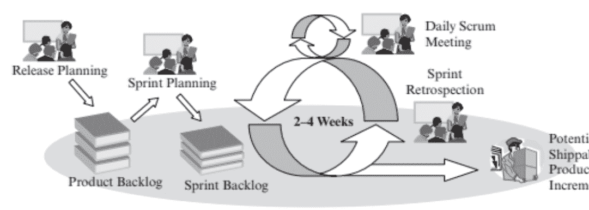

### 2.7.3 特性驱动开发

如图 2.12 所示，特性驱动开发（FDD）方法由六个步骤或阶段组成。前三个阶段只执行一次，后三个是迭代的。FDD 的支持者认为 FDD 方法更适合开发任务关键型系统。FDD 的六个阶段简要描述如下：

- 开发整体模型。在此阶段，领域专家将对整个系统进行演示，其中可能包括分解为子系统和组件。相应领域的专家将对子系统或组件提供额外的演示。根据演示，开发者小组将为相应领域生成对象模型。然后，开发团队合作为系统生成一个整体模型。

- 构建特性列表。在此阶段，团队产生一个代表系统将交付业务功能的特性列表。列表中的特性可以通过更低级的特性或功能进行细化。该列表将与用户和赞助者一起评审。

- 按特性计划。在此阶段，团队产生一个整体计划，根据特性的优先级和依赖关系指导特性的增量开发和部署。特性被分配给首席程序员。首席程序员是团队的主要决策者。这种组织被称为 *首席程序员团队组织*。整体模型中指定的类被分配给开发者，称为 *类所有者*。随后会生成一个包含里程碑在内的项目计划。

- 按特性设计、按特性构建以及部署。这三个阶段是迭代的，在此期间，增量将得到实现、评审、测试和部署。多个团队可以同时处理不同的特性集。每次迭代持续几天到几周不等。

FDD 项目的角色和职责与常见的职位名称相似。这些包括项目经理、首席架构师、开发经理、首席程序员、类所有者、领域专家、发布经理、长期支持、系统管理员、测试员和技术撰稿员。


### 2.7.4 极端编程

极端编程或 XP 是一种适用于面临不断变化需求的小团队的敏捷方法。XP 的驱动原理是将常识原则和实践推向极端 [21]。例如，如果频繁构建是好的，那么团队应该每天都执行多次构建。XP 过程由六个阶段组成：

1. 探索。在此阶段，开发团队和客户共同开发系统的用户故事（user stories），直到客户确信有足够的材料可以进行良好的发布。用户故事指定了特定用户想要从系统中获得的某个特性。例如，“作为一名读者，我想从图书馆系统借出文档。”开发团队还探索了可用技术，并对项目进行可行性研究。此阶段持续不应超过两周。

2. 计划。在此阶段，开发团队和客户一起识别下一次发布的故事，包括对客户而言最小且最有价值的故事集。这些故事需要大约六个月的工作量来实现。为下一次发布制定计划。此阶段持续不应超过几天。

3. 首次发布的迭代。在此阶段，定义整体系统架构。客户选择故事，团队实现它们，客户测试功能。这些活动迭代地进行，直到软件可以投入生产使用。每次迭代持续一到四周。

4. 生产化。在此阶段，解决并移除不适用于生产使用的问题，如性能和可靠性问题。系统安装在生产环境中。

5. 维护。根据 Beck [21] 的观点，这是 XP 项目的正常状态。在此阶段，系统持续变化，例如大规模重构、新技术的采用以及客户的功能增强。过程对于每个新版本重复。

6. 结束。系统在维护阶段演进，直到完全满足客户需求且不再增加故事。发生此时，项目结束。

### 2.7.5 敏捷还是计划驱动

尽管敏捷方法在软件行业日益流行，但并不意味着它们没有局限性。在 [35] 中，Boehm 和 Turner 指出敏捷方法和计划驱动方法“在某些领域显然占据主导地位”。敏捷方法适用于需求频繁变化的中小型项目。计划驱动方法对于需要预测性的大型系统和设备制造商仍然是事实上的选择。因此，两种方法都是需要的。根据 Boehm 和 Turner [35] 的观点，两者都有如果不处理可能会导致失败的缺点。“挑战在于平衡这两种方法，以利用它们的优势并补偿它们的缺陷。”也就是说，我们需要适应不同软件开发项目文化和环境的方法。这些方法包括 Crystal Orange [50]、DSDM [140]、FDD [119]、精益开发 [124]、轻量级统一过程（LUP） [104] 以及书中介绍。

## 2.8 本书的过程与方法概述

本节介绍了敏捷统一过程（AUP）以及书中使用的方法。如图 2.15(b) 所示，该过程可以看作是瀑布过程垂直切片。每个切片表示一次迭代，范围从一个月到三个月。该过程可以被考虑两个轴。水平轴代表迭代，垂直轴代表每次迭代的工作流活动。每次迭代执行与瀑布过程相似的大部分工作流活动，只是它们处理分配给该迭代的用例。如图 2.15(b) 所示，在迭代之前有一个简短的计划阶段，持续大约两周，用于识别需求、推导出用例，并将它们分配到各个迭代中。如果需求发生任何变化，将在后续每个迭代的需求阶段进行处理。需求的变化可能会导致用例列表和用例交付计划的变化。

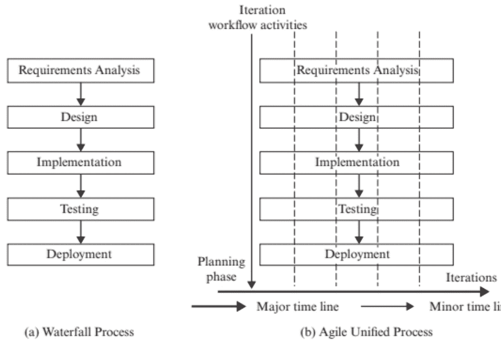

## 敏捷统一方法论概述

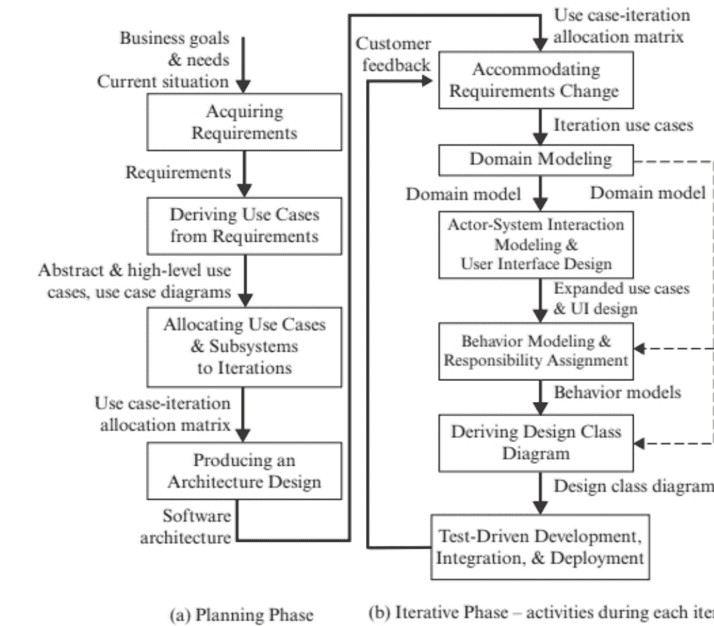

- (a) 规划阶段
- (b) 迭代阶段——每次迭代期间的活动
- 数据流
- 控制流
- 方法论

图 2.16 展示了敏捷统一方法论（AUM）的步骤以及其输入、输出和关系。该方法论由两个主要阶段组成：(a)规划阶段和(b)迭代阶段。在规划阶段，开发团队与客户代表和用户会，以识别需求并根据需求推导出用例。开发团队还会产生架构设计，以及一个在迭代阶段开发和部署用例的计划。在规划阶段，会生成用例图，以显示用例、包含用例的子系统和组件。

例如，考虑一个图书馆信息系统（LIS）。系统可能有几十个需求。在图中，其中三个标记为 R1、R2 和 R3 的需求是：

- R1. LIS 必须允许读者借阅文档。
- R2. LIS 必须允许读者归还文档。
- R3. LIS 必须允许读者使用多种标准搜索文档。

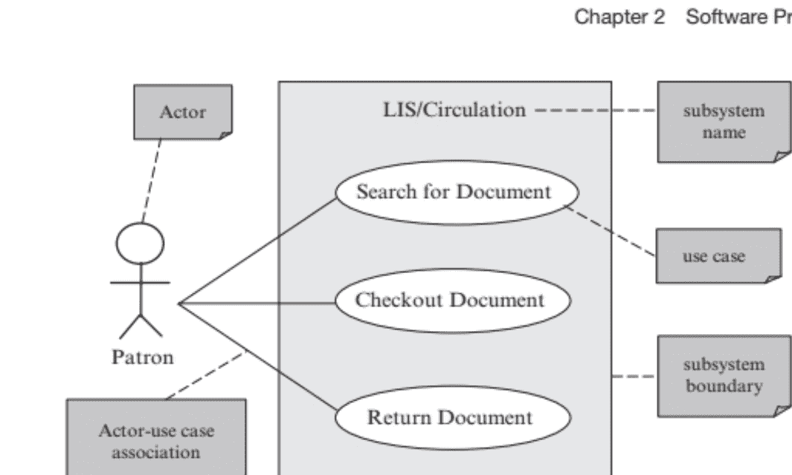

这些需求中分别推导出三个用例——借阅文档、归还文档和搜索文档。除了这些，LIS 还有许多其他需求和用例。需要一种划分用例集的机制。用例图有助于将用例组织到子系统中，以便单独处理每个子系统。用例图显示了系统或子系统的用例，以及用例与系统用户（*参与者*）之间的关系。

如图 2.17 所示，LIS 的“流通系统”有三个用例。同样，其他用例图可以分别显示“编目子系统”和“采购子系统”的用例。这些子系统可以分配给不同的开发团队进行设计和实现。

在迭代阶段，用例将根据规划阶段产生的计划，迭代地开发并部署到目标环境中。特别是，每次迭代都会对分配给该迭代的用例执行以下步骤。

### 适应需求变更

需求变化在许多软件项目中是常见的。这种变化（如果有的话）将在每次迭代的开始时进行处理。需求的变化会导致用例的变化，以及部署用例的计划的变化。在做出这些更改后，开发将根据更改后的迭代计划继续进行。

### 进行领域建模

领域建模是一个发现重要领域概念的过程。例如，图书馆系统的重要领域概念包括用户、读者、电话号码、文档、书籍、期刊、借阅日期、借阅时长、到期日、借贷、管理员等。开发团队通过与客户代表、用户和领域专家的交流获取此类领域知识。

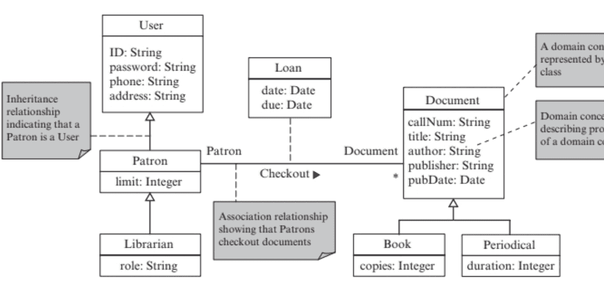

领域概念被归类为类、类的属性以及类之间的关系。结果被称为领域模型，使用 UML 类图进行可视化。图 2.18 显示了图书馆信息系统的示例领域模型。

### 进行参与者-系统交互建模


用户与系统交互以获取系统提供的服务。参与者-系统交互建模规定了用户如何与系统交互以执行用例。这些规格被称为扩展用例。例如，图 2.19 显示了借阅文档的扩展用例规格。

### UCI1：借阅文档

| 参与者：读者 | 系统：LIS |
| --- | --- |
| 1. 此用例从读者点击主菜单上的“借阅文档”按钮开始。 | 2. 系统显示“借阅”菜单。 |
| 3. 读者输入要借阅文档的索号并点击“提交”按钮。 | 4. 系统显示文档详情供确认。 |
| 5. 读者点击“OK”按钮确认借阅。 | 6. 系统（更新数据库并）显示借阅完成的消息。 |
| 7. 当读者点击借阅对话框上的“OK”按钮时，此用例结束。 | |

图 2.19 示例扩展用例

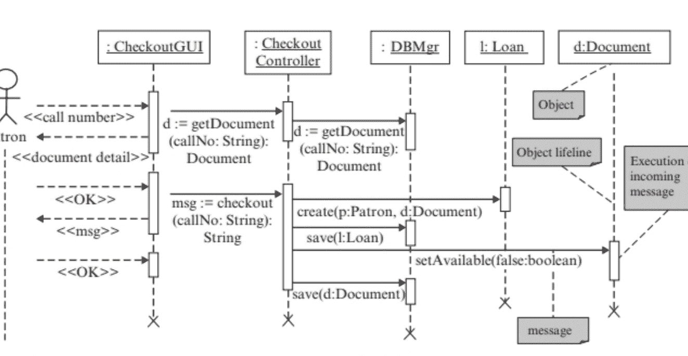

图 2.20 借阅文档的对象交互建模

用例表格规格的左列显示用户输入和用户操作，而右列显示了相应的系统响应。

### 执行行为建模

参与者-系统建模没有规定处理用户请求的计算或算法。这是行为建模关注的内容。例如，在图 2.19 的第 3 步中，读者输入要借阅文档的索号。为了显示第 4 步中的结果，系统必须处理读者请求。这涉及由软件对象执行的后台处理。

行为建模描述了对象如何相互交互以处理请求。例如，图 2.20 中的序列图显示了请求是如何处理的。事实上，序列图顶部的矩形表示参与交互的对象。垂直虚线表示对象的生命线，也就是说，对象在系统中被创建并存在。实线箭头表示对象之间的函数调用。虚线箭头表示参与者与系统之间的交互。

图 2.20 中的图可以解释如下：它从读者向借阅 GUI 提交文档的“索号”开始，GUI 通过调用 `CheckoutController` 对象的 `getDocument(...)` 函数来转发请求。后者从数据库中检索 `Document` 对象。它还创建了一个 `Loan` 对象并保存到数据库中。最后，它更新并保存 `Document` 对象。

### 导出设计类图

行为建模和设计产生序列图、状态图和活动图。这些图规定了实现业务流程的算法设计。从这些图中实现类是不方便的，因为一个类可能出现在多个图中。例如，`Document` 类出现在“借阅文档和归还文档的”序列图中。

| `DBMgr` | `CheckoutController` |
| --- | --- |
| `getDocument(callNo: String): Document`<br>`save(Loan)`<br>`save(Document)` | `getDocument(callNo: String): Document`<br>`checkout(callNo: String): String` |

| `User` | `CheckoutGUI` |
| --- | --- |
| `ID: String`<br>`password: String`<br>`phone: String`<br>`address: String` | `Loan`<br>`date: Date`<br>`due: Date` |

| `Patron` | `Document` |
| --- | --- |
| `limit: Integer`<br>`create(p: Patron, d: Document)` | `callNo: String`<br>`title: String`<br>`author: String`<br>`publisher: String`<br>`pubDate: Date`<br>`available(b: boolean)` |

**图 2.21** 类图

软件团队想要一个设计的集成视图。这种集成视图通过使用 UML 类图创建，称为设计类图。例如，图 2.21 描述了从图 2.20 中的序列图派生的类图。类图中的虚线箭头表示类之间的使用或依赖关系。

### 实现、集成测试与部署

在测试驱动开发（TDD）期间，对实现当前迭代的类进行实现和测试。对类进行集成和测试以确保它们相互工作。最后，将实现当前迭代用例的软件系统安装到目标环境中进行测试。

## 总结

软件开发面临项目和产品挑战。为了应对这些挑战，需要软件过程。然而，传统的瀑布模型与许多问题相关。其原因在于它是一个解决问题的过程，而通用的应用开发是一个棘手问题。对更好过程的追求产生了许多软件过程模型，敏捷过程是该领域的最新成员。

虽然软件过程处理的是阶段性挑战，但方法论描述的是如何执行过程的所有活动。本章讨论了过程和方法论之间的区别。软件方法论受开发软件系统时采用的软件范式的影响，因为范式决定了开发团队如何看待现实世界和系统。这反过来决定了软件的基础构建块。

# 第 2 章 软件过程与方法论

系统和开发方法论。例如，面向对象（OO）范式将世界和系统视为由相互关联和交互的对象组成。这意味着对象系统的构建单元是对象。因此，面向对象的软件开发方法论必须描述如何执行面向对象的建模、设计、实现和测试活动。

敏捷原则、敏捷过程和敏捷方法都是为了解决软件开发这一类“棘手问题”（wicked problem）。尽管敏捷在软件行业中的普及正在迅速增加，但传统的计划驱动开发方法在很长一段时间仍然有效，因为这些方法在软件行业中也有一席之地。因此，所谓的适应性方法（可以量身定制以敏捷或计划驱动开发）具有吸引力。

敏捷过程和方法的出现反映了在认识软件开发棘手性方面的重大进步。敏捷宣言，

## 延伸阅读

螺旋模型、个人软件过程、团队软件过程和统一过程模型（Unified Process）分别在 [32, 86, 87, 91] 中进行了描述。经典的面向对象方法论 OMT 在 [131] 中描述，它定义了许多 UML 符号。该方法由 Blaha 和 Rumbaugh 修订以使用 UML 2.0 [30]。在 [104] 可以找到使用 UML 和模式进行面向对象分析与设计的极佳描述。

Orange [50]、精益开发 [124]、适应性软件开发 [80] 和敏捷建模 [11]。Abrahamsson 等人 [2] 对各种敏捷方法提供了极好的介绍和比较。在 [15] 中，Avison 和 Fitzgerald 回顾了软件开发方法论的历史，并提出了若干未来方向。年度敏捷开发会议关于敏捷开发各个方面的论文集。其他感兴趣的论文包括 [35, 69, 88, 126, 144, 145]。

本章介绍的敏捷方法在 [21, 52, 119, 140] 中有详细介绍。其他敏捷方法包括晶体（Crystal）。

## 章思考题

1. 什么是软件过程？本章介绍了哪些过程？
2. 瀑布过程的优缺点是什么？
3. 什么是软件开发方法论？过程和方法论之间有什么区别？
4. 什么是敏捷过程和敏捷方法？本章介绍的敏捷方法的生命周期活动有哪些？
5. 良性问题（tame problems）和棘手问题（wicked problems）的特性分别是什么？
6. 为什么软件开发通常是一个棘手问题？
7. 敏捷过程是如何处理作为棘手问题的软件开发的？
8. 敏捷开发会取代瀑布过程等传统方法吗？

## 练习

### 2.1

传统瀑布模型和统一过程模型之间有什么相似和不同之处？识别并解释这两种模型的三个优点和三个缺点。

### 2.2

写一篇论文，讨论良好的过程和良好的方法论如何帮助跟踪项目和应对挑战。文章长度限制在五页内，或根据教师的指示执行。

### 2.3

写一篇短文，讨论软件过程与软件方法论之间的区别。

### 2.4

写一篇论文讨论以下两个问题：

- 计划驱动开发过程和敏捷开发过程各自的优缺点。
- 敏捷开发是否以及为什么会或不会取代计划驱动方法。

### 2.5

写一篇短文回答以下问题：

- 螺旋过程、统一过程和敏捷过程之间有什么相似和不同之处。
- 这些过程的优缺点是什么？
- 哪些类型的项目应该应用这些过程中的哪一个？

### 2.6

写一篇论文解释为什么瀑布过程是一个解决良性问题的过程。

### 2.7

写一篇论文解释敏捷开发是如何处理作为棘手问题的应用软件开发的。

# 第 3 章 系统工程

## 核心要点

- 系统工程是一项多学科交叉的方法，用于开发涉及硬件、软件和人类组件的系统。
- 系统工程定义了系统的需求和约束。它将需求分配给硬件、软件和人类子系统，并整合这些子系统以形成系统。
- 软件工程是系统工程的一部分。

许多系统都是嵌入式系统。嵌入式系统由硬件、软件和人类组成，这些组件相互作用以完成系统的任务。例如，飞机行李处理系统（ABHS）负责在机场内将行李从一个地方移动到另一个地方。它的硬件包括在高速轨道上运行的输送带和目标编码载具（DCV）。它的软件处理行李登机并控制硬件。人类工人操作硬件和软件。

嵌入式系统的其他示例包括处理系统、空中交通控制系统和制造过程控制系统。此类系统的开发必须考虑整个系统，而不仅仅是软件系统。需要系统工程方法。

开发仅限软件的系统可能也需要系统工程方法。例如，企业资源计划（ERP）系统。ERP 系统是面向整个组织的集成管理信息系统。它为组织的所有功能提供集成支持，包括营销、销售、制造、项目管理、供应链管理、会计、客户支持、关系管理、访问控制等。它自动化了所有这些业务功能以及这些功能之间的工作流。

由于几个原因，开发此类系统需要系统工程。该系统涉及许多业务和组织功能。这些功能涉及不同的学科。需要一个多学科开发团队。系统大且复杂。它可能涉及已经存在的遗留系统。

# 第一部分 引言与系统工程

系统工程是一门独立的学科。在一个章内涵盖该学科是不可能的。因此，本章仅作为介绍，旨在让软件工程师理解系统工程的过程和活动。在阅读本章后，你将理解：

- 系统工程过程。
- 系统建模与设计技术。
- 系统需求的系统分配。
- 系统配置管理。

## 3.1 什么是系统？

系统由相互作用以完成目的的组件组成。系统可以是大或小、复杂或简单、以及物理存在或仅以概念存在。

例如，宇宙是一个存在了数年的巨大系统。蚂蚁是一个非常小的系统。这些系统是自然系统。与自然系统相反，还有人造系统。人造系统可以物理存在或仅以概念存在。数学逻辑、测量系统和许多分类系统都是概念系统的示例。花园喷水系统和连接数百家庭的电话系统是物理存在的人造系统。

计算机系统是将软件作为子系统或组件的人造系统。计算机系统的示例包括电信系统、电子邮件系统和过程控制系统。其中一些是纯软件系统，如电子邮件系统。其他由软件、硬件和人类子系统组成。所有共享一组特性：

1. 每个系统由一组相互关联和交互的系统、组件或元素组成。例如，ABHS 由多个子系统组成，它们相互作用以完成系统的任务。
2. 一个系统可能是更大系统的子系统，而该系统反过来可能是另一个系统的子系统。例如，输送带系统和行李登机软件系统是 ABHS 的子系统。但 ABHS 是机场系统的子系统。从这个意义上说，系统与子系统之间的关系是递归的整体部分关系。这种关系形成了整体部分的层次结构。每个系统或子系统在层次结构中占据一个位置。
3. 每个系统存在于环境中并与其环境交互。例如，ABHS 存在于机场环境中并与航班信息系统交互。ABHS 还与出发和到达的航班合作以装卸行李。
4. 系统由于内部或外部原因不断演变。例如，如果经济繁荣，那么商务旅行者和休闲游客的数量就会增加。机场需要更多的航楼和登机口。ABHS 也需要扩展。技术的进步可能会促机场管理层将条码扫描器更换为射频识别（RFID）设备。内部原因包括发现的设计缺陷、组件缺陷、软件漏洞等。所有这些都需要更改系统并导致系统演进。

## 3.2 什么是系统工程？

ABHS（行李处理系统）的开发必须考虑整个系统，而不仅仅是软件系统。此外，ABHS 涉及多个工程学科，包括电气电子工程、机械工程、土木工程和软件工程等。这些学科的工程师必须合作开发系统。通常，嵌入式系统的系统开发涉及许多非电子工程学科：

- **电气与电子工程。** 许多系统使用超大规模集成电路（VLSIC）、专用集成电路（ASIC）、传感器、继电器、开关和电源组件等许多部件。例如，ABHS 采用条码打印机生成行李标签，并在输送网络交汇处使用条码扫描器读取条码。电气电子工程师对这些组件和子系统进行分析、设计、集成和测试。
- **机械工程。** 许多系统使用机械设备执行物理工作。例如，ABHS 采用输送带移动行李，并在交汇处使用推器将行李引向目的地。系统还使用高高速轨道在航站楼之间运输行李。因此，ABHS 的分析、设计、建造、测试和安装需要机械工程师和技术人员的参与。
- **土木工程。** ABHS 需要大型互连的结构来保护环境和行李。输送带必须安装在混凝土底座上。此类结构和底座的设计、建造和测试是土木工程的重点。
- **软件工程。** 软件负责执行总系统最关键且最具挑战性的任务。它执行信息处理活动，并控制总系统的其他设备和装置。在 ABHS 中，行李办理机软件子系统允许航空公司代理为乘客办理行李登机。行李条码处理软件引导输送网络交汇处的机械推器将行李引向目的地。软件工程师负责总系统软件系统和组件的分析、设计、实现、测试和部署。
- **计算机科学。** 计算机和信息科学是软件工程的基础，提供了大多数系统中所使用的技术。例如，ABHS 至少涉及编程语言、算法和数据结构、数据库系统、实时嵌入式系统的分析与设计、计算机网络和计算机安全。
- **工商管理与经济学。** 业务方面是大多数系统开发项目的重要考量。例如，ABHS 的系统工程需要分析当地、国家和全球经济对运输业务特别是对 ABHS 的影响。它需要估计要处理的行李量、未来增长、收入、成本和投资回报。所有这些都需要会计、财务、管理和经济学知识。ABHS 人力资源子系统的分析、设计和实现需要人力资源管理的知识和经验。

这不是详尽的列表。许多系统还需要其他工程和非工程学科，如数学、自然科学、社会科学、法律和人文等。此外，系统工程必须考虑安全、Security、可靠性和许多其他属性。例如，ABHS 的设计必须考虑在输送带和高速轨道旁工作的员工的安全。系统必须包含检查行李是否符合安全规则的设备。ABHS 的可靠性至关重要，因为它影响着数百名乘客。

总结，系统开发是一项跨学科的共同努力。它涉及硬件、软件和人力资源的开发。这些意味着许多挑战。例如，我们如何识别并制定此类系统的需求？我们如何设计和构建此类系统？我们如何管理开发活动？我们如何衡量此类系统的性能、可靠性、安全性和其他因素？我们如何评估系统对社会和环境的影响？系统工程是回答这些挑战的工程学科。特别是，系统工程强调以下元素：

1. 覆盖系统整个生命周期的系统工程过程。系统开发过程定义了开发系统所需的阶段和活动。该过程处理从初始系统概念到系统维护和退役的完整系统生命周期活动。这种以系统为导向的方法鼓励工程团队关注客户的业务需求和优先级，并开发以满足这些需求和优先级的系统。
2. 自顶向下分而治之的方法。这种方法将系统分解为子系统和组件的层次结构，并分别开发它们每一个。通过这种方法，ABHS 被分解为多个子系统。每个子系统由一个工程师团队开发。这种分而治之策略使工程师团队能够开发非常大、复杂的系统。
3. 系统开发的跨学科方法。如上所述，系统开发是一项跨学科的共同努力。也就是说，跨学科团队合作执行系统开发活动。

图 3.1 展示了系统工程过程的阶段和工作流。方框代表阶段或活动。实线箭头表示活动之间的关系。虚线箭头表示硬件、软件和人力资源活动之间的交互。系统的类型影响所涉及的活动。例如，如果系统是纯软件系统，则不执行硬件开发活动。

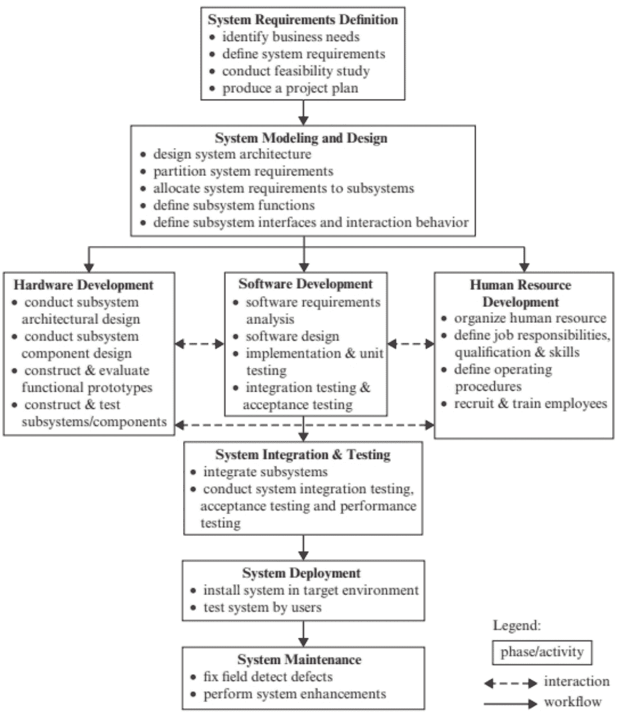

系统工程过程

系统工程过程的阶段在下方概述，并在后续章节中详细说明：

1. **系统需求定义。** 构建系统是为了满足业务需求。例如，ABHS 的开发是为了满足机场的需求。系统需求定义重点在于识别业务需求，并规定满足需求的能力。结果是系统需求规范以及设计、实施、测试和部署系统的计划。
2. **系统架构设计。** 系统需求规定了解决问题所需的能力。它们没有说明如何提供这些能力。系统架构设计草拟提供能力的方案。特别是此活动定义了系统架构或整体结构。也就是说，它描绘了子系统及其关系。此活动还将系统需求分配给子系统。
3. **指定系统功能和接口。** 根据分配给子系统的需求，指定子系统的功能和接口。此活动还规定了子系统之间如何交互。
4. **子系统开发。** 在系统建模和设计之后，由各个团队同时开发子系统。工程师团队精炼分配给各个子系统的需求，并实现以满足需求。例如，软件工程师团队根据软件需求精炼、设计并实现软件子系统。
5. **系统集成、测试、部署和维护。** 集成子系统。进行集成测试以确保系统交付了系统需求规定的能力。然后将系统安装到目标环境中并由用户测试。处理错误、缺陷和用户反馈。系统进入维护阶段。

以及其他因素。信息收集活动回答了以下问题：

1. 系统将自动化的业务是什么？
2. 系统的环境或语境是什么？
3. 业务目标或产品目标是什么？
4. 当前的业务状况如何？它是如何运行的？
5. 现业务流程有哪些？它们之间是如何相互相关的？
6. 当前系统存在哪些问题？
7. 当前系统和未来系统的用户分别是？
8. 客户和用户对未来系统有什么要求？他们的业务优先事项是什么？
9. 在质量、性能和安全方面的考虑有哪些？

信息收集活动使用了以下几种信息收集技术：

1. **客户演示。** 客户演示是收集信息的有效方法。它发生在项目的最初期。由客户指定的管理人员或高级人员介绍当前业务的概述、已知问题、客户和用户期望系统实现的功能，以及他们的业务优先事项。上述问题列表可能可以作为演示的重点。演示时间应限制在两小时以内，包括问答环节。
2. **研究当前业务运营。** 团队可能会实地考察业务环境。团队可能会要求对客户的业务运营进行引导参观，在那里收集纸质表格、操作程序说明、政策和其他相关材料。团队应仔细研究这些材料。这些活动有助于他们理解客户的业务实体、业务流程和工作流。工作流可能包括信息流和物流。
3. **用户调查。** 用户调查对于获取用户对当前系统的意见以及对新系统的期望非常有用。调查问卷应该简洁明了并关注重要问题。针对不同的用户组使用不同的调查问卷。需要澄清的问题将在用户访谈中识别并解决。
4. **用户访谈。** 用户访谈对于获取通过用户调查难以获得的信息有用。对于澄清用户调查中不明确的问题也有帮助。访谈针对选定的用户，集体或单独进行。每次访谈应持续大约一小时。应提前准备一份访谈要讨论的项目列表。该列表可以在访谈前与用户共享。
5. **文献调查。** 文献调查提供了额外的信息，帮助开发团队理解应用领域。文献调查应关注于相似的项目、领域知识、业务流程、政府法规和行业标准。

## 3.3.2 定义系统需求


下一步是从已确定的业务需求中推导出系统需求。例如，导出 ABHS（自动行李处理系统）的能力以满足 ABHS 的需求。然而，由于预算、交付进度、技术和政治限制以及成本效益考虑，并非所有需求都能得到满足。有时会进行可行性研究，以确保团队能够在预算和进度限制内交付能力。系统必须交付的能力被制定为系统需求。例如，ABHS 项目可能识别出许多为了满足需求的需求。下面列出了其中一些需求作为示例。需求进行了编号以便方便引用。

- R1. ABHS 应根据乘客的目的地办理行李登机并将行李运输至离机登口和行李提取区。
- R2. ABHS 应允许航空公司代理人查询行李状态并定位行李。
- R3. ABHS 应检查所有行李并检测违禁物品。
- R4. ABHS 每天能够为 20,000 名乘客服务。

该阶段的最终产物是系统需求说明书。说明书可能包含限制解决方案的约束。例如，ABHS 可能包含对建造输送带和高速轨道网络可用空间的限制。它可能包含对必须使用的设备类型的限制。该阶段的另一个产物是项目计划。项目计划概述了项目的里程碑，安排了开发活动并为活动分配了资源。可能会产生系统测试计划。测试计划规定了系统测试目标、程序所需的资源。

## 3.4 系统架构设计

确定系统需求后，下一个逻辑步骤是设计系统以满足系统需求。理想情况下，系统应该由精通所有相关工程领域的工程师设计并实现。不幸的是，这样的工程师很难找到且招聘成本高昂。因此，系统通常被分解为分级的子系统，由不同学科的工程师开发。例如，电气子系统由电气工程师开发。机械子系统由机械工程师开发，软件子系统由软件工程师开发。这些子系统随后在系统集成和测试阶段进行集成。

这种方法更容易找到合格的工程师，降低了系统开发的复杂性和成本。系统架构设计执行以下相互相关的活动：

1. 将系统分解为分级的子系统。这一步将系统分解为相对独立的子系统层级。这种方法降低了系统开发的复杂性和成本，因为子系统更容易设计和实现。
2. 将系统需求分配给子系统。此活动将系统需求分配给子系统。其目的是减少子系统之间共享的需求数量。通过这种方式，子系统的职责被清晰定义。此外，分配给系统的需求在功能上是相关的。分配情况通过需求-子系统追溯矩阵。
3. 可视化系统架构。此活动将架构设计显示为由子系统及子系统之间关系的图。

### 3.4.1 系统分解

系统架构设计的任务之一是识别系统的子系统。通常采用自上而下的分治法。特别地，该方法将系统分解为分级的子系统。这种方法降低了系统开发的复杂性，因为每个子系统都更容易设计和实现。分解系统有多种方法，因此结果不是唯一的。系统分解旨在实现以下目标：

1. 结果应允许不同的工程团队开发子系统。这降低了系统开发成本，因为减少了精通多个学科的工程师人数。它还简化了团队之间的通信并减少了通信开销。
2. 结果应有利于商业现货（COTS）部件的使用。COTS 是可以购买或获取的第三方产品。使用 COTS 可以提高生产力和质量，同时缩短成本和上市时间。例如，ABHS 的设计应考虑使用 COTS 输送系统、高速轨道、条形码器和行李登机软件，而不是从零开始开发。
3. 结果应公平或几乎地划分系统需求。也就是说，很少有子系统与其他子系统共享需求。这减少了由于共享需求的团队之间产生误解导致某些需求未能充分满足的可能性。
4. 每个子系统应具有定义良好的功能。这使得子系统易理解。例如，行李登机系统处理行李登机。输送子系统负责在航站内移动行李。
5. 子系统应该是相对独立的。也就是说，更改一个子系统不会影响其他子系统。这种模块化设计有助于系统维护。例如，行李登机子系统和输送子系统是两个独立的子系统。更换任何一个都可以而不会影响另一个。

# 第一部分 引言与系统工程

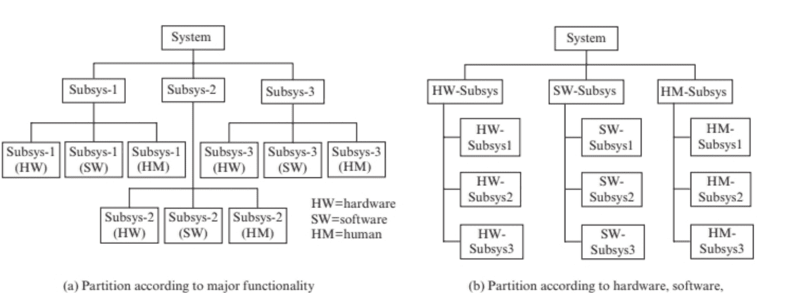

（a）根据主要功能进行划分

（b）根据硬件、软件和人员子系统进行划分

# 图 3.2 将系统划分为层次子系统

6. 子系统应该易于集成。也就是说，子系统应该具有简单的接口以及子系统之间的交互行为。这有助于子系统的集成、集成测试和系统维护。

系统分解应用了多种策略，这些策略可能会相互影响。因此，应该反复应用这些策略，直到获得满意的结果。这些策略包括：

1. 根据系统功能分解系统。
2. 根据专业学科分解系统。
3. 根据现有架构分解系统。
4. 根据组织功能单元分解系统。
5. 根据应用模型分解系统。

根据系统功能分解系统是一种经常使用的策略。它从系统需求中识别系统功能。也就是说，它将系统需求划分为若干个几乎不交的功能簇。然后根据这些功能簇识别功能子系统。如果有三个功能簇，则系统被分解为子系统-1、子系统-2 和子系统-3。随后，这些子系统被分解为特定领域的子系统，即硬件子系统、软件子系统和人员资源系统。

如果有开发团队来开发功能子系统，或者可以从第三方采购功能系统，则使用这种方法。有时工程师需要将系统需求分解为更低级的需求，以使子系统相对独立。为了说明，假设 ABHS 有以下需求：

- RI. ABHS 应根据乘客的所在地办理行李托运并将行李运输至离登机口和行李提取区。

# 第 3 章 系统工程

该需求包含了多个功能，如行李托运和行李运输。如果机场有多个航站楼，则行李运输将涉及输送带和高速轨道。因此，应对该需求进行分解。需求分解应确保低级需求等同于高级需求。也就是说，高级需求和产生的低级需求描述相同的能力。

假设每架航班的办理区域和离登机口位于同一航站楼。到达口和行李提取区也是如此。需求 R1 可以分解为以下内容：

- R1.1. ABHS 应允许航空公司代理办理行李托运。
- R1.2. ABHS 应将行李运输至其机场内的目的地。
- R1.2.1. ABHS 应将行李从办理区域运输到离登机口。
- R1.2.2. ABHS 应将行李从到达口运输到行李提取区。
- R1.2.3. ABHS 应为转机旅客将行李从到达口运输到离登机口。
- R1.2.4. ABHS 应在航站楼内使用输送带运输行李。
- R1.2.5. ABHS 应使用运行在高速轨道上的 DCV 在航站楼之间运输行李。
- R1.3. ABH 应控制航站楼内部及航站楼之间的行李运输。

需求 R4 是一个性能需求，涉及多个子系统。对其进行分解可以将低级需求分配给不同的子系统。例如，低级需求将指定子系统所需的行李速度和容量。这必须考虑航站楼的数量、每个航站楼的办理区域和输送带系统、运行小时等。分解还必须考虑在假期期间应对极高需求的一定比例冗余。以下是低级性能需求的示例：

- R4.1. 每个办理区域每天应处理 1,150 件办理行李。
- R4.2. 每位办理代理每分钟平均办理三名乘客。
- R4.3. 每台输送硬件每小时应扫描并运输 500 件办理行李。
- R4.4. ABHS 控制软件每天应处理 2,300 件办理行李，每小时处理 1,000 个条扫描请求。

接下来，将系统需求划分为功能簇。也就是说，具有相同功能的需求组合形成一个功能簇。功能簇用于派生功能子系统。图 3.3 显示了从系统需求中派生的功能簇和子系统。

# 第一部分 引言与系统工程

| 功能簇 | 功能描述 | 系统需求 | 识别出的功能子系统 |
| :--- | :--- | :--- | :--- |
| 行李托运 | 该功能簇处理行李托运。 | R1.1, R4.1, R4.2 | 行李托运子系统 |
| 输送带 | 该功能簇负责在航站楼内移动行李。 | R1.2.1, R1.2.2, R1.2.3 和 R1.2.4, R4.3 | 输送带子系统 |
| 高速轨道 | 该功能簇在航站楼之间运输行李。 | R1.2.3 和 R1.2.5 | 高速轨道子系统 |
| 软件控制 | 该功能簇控制硬件在航站楼内部之间运输行李。 | R1.3, R4.4 | 软件控制子系统 |

图 3.3 功能簇与功能子系统

另一种策略是根据工程学科分解系统。其产生的子系统以学科命名，如电气子系统、电子子系统、机械子系统和软件子系统。在图 2.2（b）中，整个系统被分解为硬件、软件和人员子系统。这些系统再分解为功能子系统。如果硬件、软件和人员子系统是由硬件、软件和人员工程团队开发的，则使用这种方法。

根据现有架构分解系统适用于项目目标是扩展或增强现有系统的情况。这种方法可以降低开发成本，并避免修改系统架构带来的潜在风险。

系统还可以根据组织的功能单元进行分解。例如，小镇机场的人工行李处理系统可能由行李托运、运输和行李提取部门组成。这些为新系统提供了主要的子系统。

如果构建应用或系统模型有助于理解应用或现有系统，则这些模型可以指导分解。例如，可以构建模型来理解现有行李处理系统的工作流。此外，模型显示行李是人工办理并运输到离登机口的，行李从到达航班上卸载并运输到行李提取区和转机口。通过模型可以识别子系统并作为系统的初步分解。随后，初步分解被完善并演化为层次子系统。

### 3.4.2 需求分配

一旦系统分解为层次子系统，就会将系统需求分配给这些子系统。分配考虑了多种因素，包括开发和运行成本、性能、服务质量、效益、易于更改其他因素。例如，某些系统功能可以通过硬件或软件实现。通常情况下，专用集成电路提供的性能更好。如果性能不是问题，可以将某些系统需求分配给软件子系统而非硬件子系统。

系统需求的分配取决于上步骤的结果。如果子系统是从功能簇派生出来的，那么从功能簇到子系统的映射就是分配。如图 3.3 所示，ABHS 示例如此。

系统需求到子系统的分配在可溯性矩阵中可视化，如图 3.4 所示。行表示需求，列表示子系统。单元格表示需求到子系统的分配。对于真实项目，可溯性矩阵非常大，因为它涉及到数百个需求和许多子系统。因此，图 3.4 仅是一个说明性的。该矩阵具有许多优点：

1. 它可以检查每个需求是否已分配给子系统。也就是说，每个叶级需求行至少显示一个（`x`）。如果叶级行不包含交叉标记，则该系统需求未分配给任何子系统。
2. 它可以检查分配是否合理。应该避免将一个系统需求分配给多个子系统，因为很难在子系统之间划分功能。可溯性矩阵可以通过计算每行交叉标记的数量来检测此类情况。如果某行包含许多交叉标记，则该需求被分配给了许多子系统。在这种情况下，最好对需求进行分解。
3. 它显示了哪些需求被分配给子系统。也就是说，每列中显示的交叉标记表示分配给该列所代表的子系统的需求。子系统必须分别相应的需求。
4. 它可以检查子系统是否分配了过多职责。如果一列包含许多交叉标记，则该子系统被分配了许多职责。可以分解该子系统，将需求分配到较低级的子系统。
5. 它可以检查子系统的功能内聚性。分配给子系统的需求在功能上应该是相关的。如果列中交叉标记指示的需求不相关，则该列所代表的子系统功能内聚性较低。应该将需求划分为几个功能簇。子系统应分解为对应于功能簇的功能子系统。

### 3.4.3 体系设计图

在系统设计期间，构建应用模型和系统模型是常见的做法。这些模型帮助团队理解和分析应用设计、业务流程和工作流，以识别问题、开发和评估设计解决方案。各种图表用于描绘应用和系统的不同方面。框图、统一建模语言（UML）及其扩展系统建模语言（SysML）以及数据流图在系统建模和设计期间被广泛使用。

框图使用矩形表示子系统和组件，并使用有向边表示子系统和组件之间工作流。例如，图 3.5 显示了 ABHS 的高层框图。该框图表明 ABHS 由终端子系统组成，并连接到高速轨道子系统。乘客在终端子系统处办理行李托机。高速轨道子系统将行李运送到终端。这两个子系统都与 ABHS 控制软件交互，而控制软件与飞行信息系统交互。图 3.6 显示了终端子系统的细化。显示了硬件、软件和人员系统。

UML 最初是为建模软件应用程序和系统创建的。它的通用性使其成为系统建模的有用工具。这是通过使用 UML 提供的立体类型机制实现的。例如，图 3.7 显示了一个建模无线通信系统（RCS）硬件和软件的组件图。它使用立体类型 `«subsystem»` 来扩展三个子系统的组件图：基站子系统、账户管理子系统和移动单元子系统。

RCS 的工作原理类似于蜂窝网络，但它只有一个带有高功率收发机的基站。高功率收发机的服务范围比蜂窝网络的单个基站大得多。通过高功率收发机的中继，移动单元可以在服务区内通信。图显示每个移动单元由一个硬件子系统和一个移动软件子系统组成。硬件将事件发送给软件，软件发布指令操作硬件。

例如，当用户拨号时，事件发送到软件。软件指示硬件通过无线电通道联系基站。基站的高功率收发机接收请求并将其转发给控制器，控制器将其转发给控制软件。控制器验证通话请求。如果呼叫方被叫方是有效的订阅者，它指示硬件和收发机建立连接。

UML 支持系统建模的能力导致了 UML 的扩展，即系统建模语言（SysML）。SysML 的九种图及其与 UML 的关系总结在图 3.8 中。表格的最后一列显示了书中涵盖 UML 图的章节。为了说明，图 3.9 以及 3.10 显示了 ABHS 的 SysML 块定义图（bdd）和 SysML 内部块图（ibd）。这些图分别对应于图 3.5 和 3.6 显示的框图。

有时，在模型中除了信息流外，还需要显示物质流。例如，ABHS 将行李从值机区运送到离港口，并从到达口运送到行李提取区。此类流是物料流。

# 第 3 章 系统工程

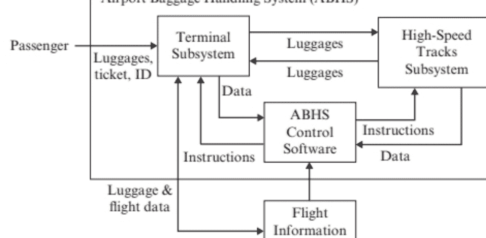

图 3.5 机场行李处理系统的框图

# 第 3 章 系统工程

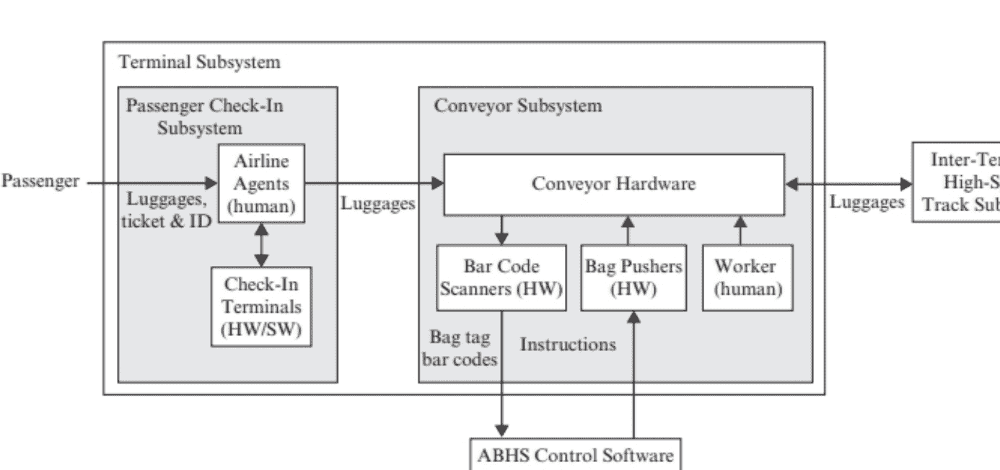

**图 3.6** 显示子系统细化的框图

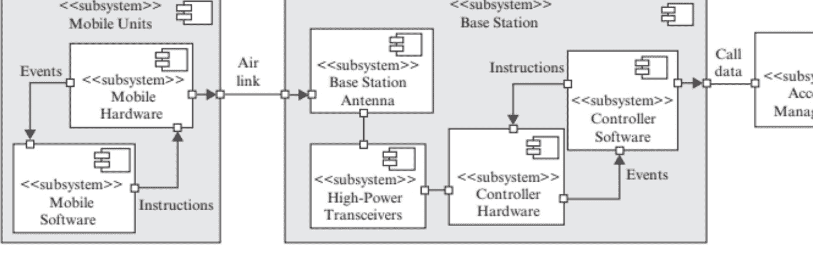

图例：![component-icon] 组件 ![port-icon] 端口 ![stereotype-icon] `<<subsystem>>` 用于引入新建模构造的立体类型

**图 3.7** 使用立体类型组件图进行系统建模

在图 3.5 和 3.6 中，物料流和信息流使用相同的符号。图 3.9 和 3.10 所示的 SysML 图也对信息流和料流使用相同的符号。为了区分，物料流应该以不同的方式进行建模。为了说明，图 3.11 显示了图书馆系统的数据流图。块箭头表示物料流。椭圆表示任务或处理功能。执行该功能的实体或子系统显示在椭圆的下部。椭圆的上部显示任务 ID。

物料流对于将系统需求分配给硬件、软件和人员子系统很有用。例如，图 3.11 中的物料流建议涉及物料流的功能（如接收货口、目录室和书架）应该分配给相应的硬件和人员子系统。

### 3.4.4 子系统功能与接口规范

此步规定了每个子系统的功能以及子系统之间相互作用的方式。功能根据分配给子系统的系统需求进行规定。它细化了分配给每个子系统的需求。

子系统之间的接口规定了子系统如何相互连接和通信。交互行为规定了子系统之间交换的消息序列。这使得子系统能够它们可以预期和需要的哪些接口以及交互行为。硬件-软件接口在嵌入式系统中常见。在许多情况下，会使用微控制器集成电路。图 3.12 说明了空调的情况。该图仅显示了最相关的项目，实际上，未使用的引脚应该连接到其他电子组件。

图 3.12 中的状态图表示了运行在 IC 芯片内部软件的行为。当电源开关打开时，软件进入继电器关闭（Relay Off）状态。从电源关闭到继电器关闭状态的转换表示了这一点。软件定期读取代表连接到温度传感器的八个引脚字节以获取房间温度。

如果房间很热，软件将引脚 12 设置为 1。这将为继电器线圈提供 1.5 特直流电（DC）。线圈产生磁场，吸引开启/关闭开关以关闭压缩机和风扇的电路。因此，开始冷却。当房间冷却时，软件将引脚 12 设置为 0。这打开了压缩机和风扇的电源电路。因此，冷却停止。

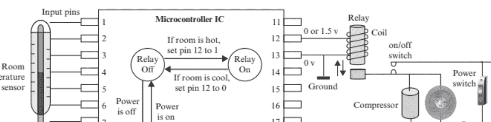

图 3.12 软件-硬件接口示意


在图 3.12 所示的情况下，接口和交互行为规范了代表房间温度的引脚以及软件读取的字节的含义。规范还定义了输出引脚和输出值的含义。在这种情况下，输出引脚是引脚 12。当引脚被设置时，继电器接合，冷却开始。除了软件-硬件接口外，还有人-软件、软件-软件、人-硬件、人-人和硬件-硬件接口。这些接口和交互行为以类似的方式规定。

系统设计还会产生集成测试计划和验收测试计划。这些计划规定了测试程序，以确保子系统能够按照预期相互工作，并且系统交付系统需求规范中规定的功能。执行系统集成测试和验收测试所需的资源也得到了规定。这些测试计划用于系统集成、测试以及验收测试阶段。

## 3.5 子系统开发

在系统设计和分配之后，子系统被分配给不同的工程团队。工程团队分别构建和测试子系统。特别是，软件工程（SE）团队应用软件工程过程和方法来开发软件子系统。该团队还执行质量保证和管理活动。工程团队之间保持紧密联系，交换进度状态，并协作解决跨学科的设计和实现问题。本节介绍了与软件工程团队相关的活动。

### 3.5.1 面向对象的上下文图

软件开发活动需要考虑软件子系统的上下文。上下文由现实对象和其他与软件子系统交互的子系统组成。面向对象的软件工程模型将世界建模为由相互作用的对象组成。例如，图 3.12 所示的空调软件上下文包括房间温度传感器、AC/DC 适配器和继电器。图 3.5 所示的 ABHS 控制软件上下文包括终端子系统、高速轨道子系统和飞行信息系统。图 3.6 显示软件与条码扫描仪和推包器交互，这些是终端子系统的组件。面向对象的软件开发将这些对象建模为与开发中软件交互的对象。结果显示在名为“上下文领域模型”的 UML 类图中。它也被称为上下文图。上下文领域模型显示了上下文对象、上下文对象的属性以及上下文对象与软件之间的关系。

为了说明，图 3.13 显示了 ABHS 控制软件的上下文图。该图规定了与 ABHS 控制软件交互的对象类型。它还规定了与 ABHS 控制软件交互的接口和行为。

# 引言与系统工程

| 输送带子系统 | 条码扫描仪 (HW) |
| --- | --- |
| make: String<br>model: String<br>serial: No<br>interface: String<br>interaction: String | make: String<br>model: String<br>serial: No<br>interface: String<br>interaction: String |

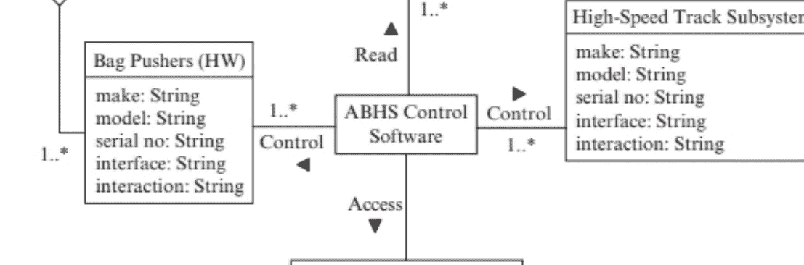

图 3.13 ABHS 控制软件的上下文模型

### 3.5.2 面向对象上下文图的用途

面向对象上下文图的优势如下：

1. 它提供了对象的统一视图。有助于团队理解上下文。
2. 它突出了接口和交互。上下文领域模型将软件视为黑盒，并显示了上下文对象的关系。
3. 它有助于软件开发。例如，类的属性有助于设计和实现。
4. 它促进了与其他工程团队的通信与协作。面向对象上下文图突出了接口和交互。
5. 它对培训有用。上下文图是新成员学习上下文的有用工具。

### 3.5.3 工程团队的协作

在子系统开发过程中，工程团队保持紧密联系以交换状态并解决跨学科问题。例如考虑无线电收发器子系统的设计和原型。电子工程（EE）团队可能会发现某些功能应该用软件实现。EE 团队将与 SE 团队会面评估可行性。如果两个团队对变更达成一致，则提交变更提案。变更控制委员会审查提案并批准或拒绝变更。如果提案获得批准，则实施变更。

## 3.6 系统集成、测试与部署

随后对各个工程团队开发的子系统进行集成，并进行集成和系统测试。集成测试根据系统设计和分配阶段产生的系统集成测试计划进行。由于子系统开发阶段的变更，可能需要对测试计划进行修改。集成测试细化了测试计划中规定的测试程序，并执行测试以确保子系统通过接口进行正常通信。

系统测试根据验收测试计划进行。它确保系统能够交付系统需求中规定的所有功能。

## 3.7 系统配置管理

系统工程涉及多个工程团队。这些团队必须以协调和受控的方式工作。假设某个软件组件的设计取决于某个电子组件的设计。在这种情况下，在电子组件的设计完成之前，该组件的设计无法最终确定。问题在于是：当电子组件的设计完成后，如何通知软件工程团队呢？发送电子邮件是一个选项，但对于大型系统开发项目来说，这种非正式的方法是有问题的。由谁来负责发送邮件？谁应该接收这些邮件？如果邮件没有发送，或者没有送达接收者怎么办？邮件中应该写些什么？需要一种正式的手段来通知工程团队此类事件。

变更控制是另一个必须协调的问题。例如，如果电子组件的设计发生了变化，那么软件组件的设计也必须随之改变。这意味着应该通知软件工程团队。这需要一种通知机制。如果电子组件的设计可以频繁且任意地更改，那么软件工程团队将难以应对这些变化。另一方面，电子团队又如何纠正设计缺陷或设计错误呢？系统配置管理解决了这些问题。

- 1. **配置项识别。** 此功能定义了项目基线和相关的配置项。基线的示例包括系统需求基线、系统设计基线、分配基线和子系统设计基线。配置项的示例包括系统需求规范、项目计划、系统验收测试计划、系统设计规范、分配计划、系统集成测试计划等。在建立基线之前，配置项可以自由更改。当所有相关的配置项都检入配置管理系统时，即可建立基线。例如，如果系统需求基线由系统需求规范和项目计划组成，那么当这两个文档都检入配置管理系统时，即可建立基线。一旦建立基线，配置项的更改就需要经过变更控制程序。
- 2. **配置变更控制。** 此功能定义变更控制程序并执行该程序。图 3.14 展示了变更控制程序。首先，识别并分析所需的变更。接下来，准备工程变更建议书 (ECP)。它规定了变更的内容、影响、持续时间和成本。ECP 由变更控制委员会 (CCB) 进行评估。CCB 由可能受拟提变更影响的方代表组成。CCB 接受或拒绝 ECP。结果是，拟提变更要么实施，要么归档。
- 3. **配置审计。** 此功能正式地建立项目基线。它还确保拟提的工程变更得到了适当实施。为了实现这些目标，对配置项进行验证和确认。配置项验证确保在建立基线时产生了所需的配置项。例如，它确保在建立系统需求基线之前，系统需求规范和项目计划是正确的。配置项确认确保配置项是正确的，例如，系统需求规范经过工程团队、领域专家、客户和用户的评审，消除识别出的缺陷并解决疑虑。
- 4. **配置状态报告。** 此功能为其他三个功能提供数据库支持。可以查询数据库获取有关配置项的信息。该功能还发布有关系统配置的事件，包括基线的建立和配置项的变更。

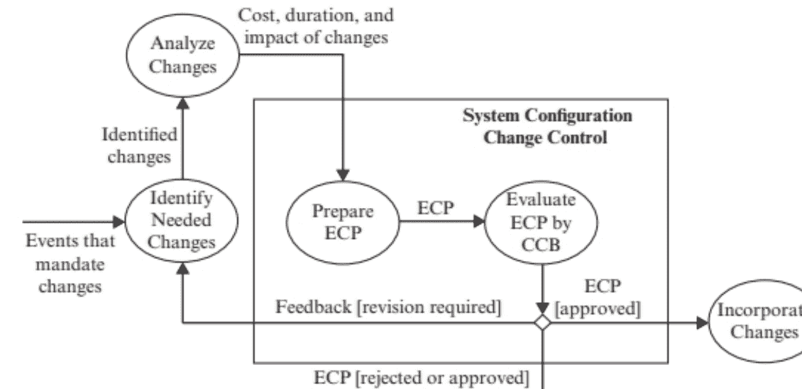

图例：

- `ECP`: 工程变更建议书 (Engineering Change Proposal)
- `CCB`: 变更控制委员会 (Change Control Board)

**图 3.14** 配置变更控制

## 总结

本章介绍了涉及硬件、软件和人员部分的系统开发活动。它描述了系统工程过程以及系统建模、设计和系统需求分配的技术。分配完成后，子系统由来自不同工程学科的独立团队开发。然后对子系统进行集成和测试，以确保系统满足系统需求和约束。在整个系统开发过程中，会产生并更新大量的分析、设计、实现和测试文档。更新一个文档可能会影响许多其他文档。更新必须经过协调，通过系统配置管理来实现。

## 扩展阅读

Blanchard [31] 和 Kossiakoff 等 [99] 对系统工程的各个方面提供了精彩介绍。SysML 在 [65] 中介绍，UML 在 [36] 中介绍。在 [152] 中，Thayer 介绍了如何应用系统工程原理，将大型复杂软件系统的标准和流程引入软件系统工程过程中。

## 章末习题

1. 什么是系统工程？
2. 为什么我们需要系统工程？
3. 为什么系统工程被认为是一种跨学科的方法？
4. 本章描述的系统工程过程包含哪些阶段和活动？
5. 硬件开发、软件开发和人力资源开发的目的是什么？为什么要分开进行？
6. 系统工程过程如何应对系统开发中的挑战？
7. 系统工程与软件工程之间是什么关系？
8. 系统工程团队在系统设计期间应该考虑哪些因素？
9. 系统设计期间分解系统或子系统的适用策略何哪些？
10. 什么是系统建模？
11. 什么是需求-子系统跟踪矩阵？
12. 系统集成和测试的潜在挑战有哪些？

## 练习题

### 3.1

简述自动售卖机的功能。识别并制定所有功能需求和性能需求。

### 3.2

识别两个本章未提到的嵌入式系统。对于每个系统，执行以下操作：

- a. 简述系统功能。描述长度应在半页到一页之间，包括图表（如有）。
- b. 识别并制定五个功能需求和两个非功能需求。其中一个非功能需求必须是性能需求。
- c. 分解系统。

### 3.3

硬币式洗车系统是一种自助洗车系统。客户投入硬币使用预设的洗车时间。在洗车期间，客户可以通过旋钮选择泡沫、冲洗和打蜡。剩余一分钟时系统会发出响声。客户可以投入更多硬币以延长洗车时间。针对该洗车系统执行以下操作：

- a. 识别并规范系统需求，包括功能需求和非功能需求。
- b. 描述子系统如何相互交互。即指定系统接口和交互行为。
- c. 构建系统架构图，显示子系统之间的关系。
- d. 识别并制定安全需求并分配给子系统。描述子系统如何满足安全需求。
- b. 将系统分解为功能子系统。必要时分解系统需求。
- c. 将系统需求分配给子系统。
- d. 使用你选择或教师指定的图形绘制系统架构图。

### 3.4

铁路交叉口系统利用传感器、闪烁灯、警报和闸机来控制铁路交叉口的交通。当火车从每个方向接近交叉口时，传感器检测到火车并与软件通信。软件在规定时间内开启闪烁警告灯和警报。当火车离开交叉口时，另一个传感器检测到火车并将事件通信给软件。软件关闭灯光和警报并打开闸机。针对铁路交叉口系统执行以下操作：

- b. 将系统分解为子系统的层级结构，并将系统需求分配给子系统。
- c. 制作系统架构图。

### 3.5

百货商店想要进入在线零售领域。这意味着公司需要开发一套在线系统，可以在线接收订单并通过指定的国家货运公司发货。为了降低人工成本，公司想要一个全自动系统。针对以下内容执行操作：

- a. 为系统识别并制定五个功能需求和两个性能需求：
- a. 识别硬件和软件子系统，并规范每个子系统的功能。

### 3.6

如果你学习过 UML 类图，请为练习 3.5 题中的在线零售系统软件子系统绘制面向对象的上下文图。讨论该上下文图对子系统设计、实现、测试和维护的用处。

# 分析与架构设计

- 第 4 章 软件需求引发 80
- 第 5 章 领域建模 105
- 第 6 章 架构设计 139

# 第 4 章 软件需求引发

## 核心要点

- 需求是系统必须交付的能力。
- 构建软件系统最困难的环节是精确地决定要构建什么——即需求。（弗雷德里克·P·布鲁克斯 Jr.）
- 软件需求引发旨在识别系统的真实需求。

本书采用的敏捷统一方法方法的规划阶段实现了三个目标：(1) 为未来系统引发软件需求；(2) 从需求中推导出一组用例；(3) 定义一个迭代开发和部署计划以交付这些用例。本章介绍了完成第一个要目标的步骤。需求引发是软件开发中一项重要且艰巨的任务。它之所以重要，是因为它定义了系统的能力以及对解决方案的限制。这些内容构成了后续开发活动的基础。如果需求和限制是错误的、不一致的、不完整的或不足的，那么最终构建并部署的系统将无法满足客户的需求。因此，整章专注于需求引发——这是一项识别真实需求的活动。需求引发也称为需求分析。在本书中，这些术语互用。通过对本章的学习，你将了解到：

- 需求引发的重要性和挑战。
- 需求的类型。
- 需求引发的活动。
- 为需求分配优先级。
- 需求评审技术。
- 在需求引发过程中应用敏捷原则。

## 4.1 什么是需求引发？

软件系统的构建有许多不同的原因。最常见的是，构建软件系统是为了满足特定客户的业务需求，由该客户支付开发费用。对于许多现实世界项目来说，存在预算限制。因此，只能满足一部分业务需求。这些需求被表述为软件需求，定义如下：

**定义 4.1** 软件需求是系统必须交付的能力。

如果系统满足了其软件需求、没有超出预算且系统按时交付，那么该软件项目就是成功的。因此，识别真实需求对于软件项目的成功至关重要。然而，识别真实需求并非易事，更不用说在预算和时间限制内完成了。这是因为不同的利益相关者对业务优先级和所需系统能力的感知不同。这些差异源于各种因素，包括财务利益、教育背景、经验、立场和信念。例如，具有深厚技术背景的利益相关者可能强调系统吞吐量响应时间，而具有业务背景的利益相关者可能优先考虑成本和客户满意度。

考虑一个为保险公司、医疗服务者（如医生和护士）、医疗机构（如医院和诊所）以及药品供应商（如药店）服务的医疗信息系统。这些利益相关者的利益不同；因此，他们对真实需求或其重要性的感知可能不同。保险公司希望降低医疗成本。他们希望系统能够实现并执行严格的理赔提交规则。这增加了医生、医疗机构和药品供应商提交理赔的工作量，也可能延迟向他们付款。另一方面，医生、医疗机构和药品供应商希望系统能简化理赔流程并尽早向他们付款。如果系统涉及政府机构，还必须考虑政府法规并满足额外的需求。即使有足够的资源和时间来开发系统，要决定满足所有这些利益相关者的真实需求显然不是一项容易的练习。

客户或政府机构通常会对软件系统施加限制。例如，客户可能要求系统使用特定的编程语言实现，或者 X% 的代码必须用该语言编写。客户可能禁止使用某个产品，或某个供应商的任何产品。这些是客户出于政治或业务考虑而施加。此类限制通常被称为约束，定义如下：

**定义 4.2** 约束是对软件系统解决方案的限制。

需求与约束之间的主要区别在于，约束减少了设计和实现方案的数量。考虑一种极端情况，即没有设定任何约束。在这种情况下，开发团队可以从广泛的产品、编程语言和平台中选择来实现软件系统。另一方面，如果实现语言限制为语言 X，那么所有其他编程语言都被排除了。结果是解决方案空间大大缩小。

在实践中，需求经常被误认为是约束。例如，考虑以下由美国邮政局（USPS）等包裹提供商提供的陈述：

> “快递包裹的长度限制为 108 英寸，或长度 165 英寸加上周长（G = 2 * 宽度 + 高度），或重量为 150 磅。”

这应该是需求还是约束？它包含了“限制（constrained）”一词。所以它可能是一个约束。然而，仔细的检查发现，该陈述实际上是对待运包裹本身的的限制，而不是对解决方案的限制。因此，它应该是一个需求，而不是约束。换句话之，系统必须拒绝超过尺寸限制的包裹——这是系统必须交付的能力。

在实践中，需求和约束被记录在文档中，称为软件需求说明（SRS）。文档中还规定了需求的优先级。优先级对于项目规划和进度安排非常有用；高优先级需求应该尽早开发和部署，以便团队有充分的时间和资源修改系统以响应用户反馈。

对于大多数现实世界项目，SRS 是软件开发合同的一部分。它具有法律后果。因此，软件需求分析必须确保系统将满足需求和约束。有时，这种保证很难评估的，特别是当系统使用先进技术、满足实时约束或提供创新功能时。在需求分析阶段进行可行性研究是为了减少这种不确定性。

可行性研究是在系统设计和实现之前确保系统将满足需求和约束，而验收测试则在系统实现后确保这是事实。对于许多现实世界项目，验收测试的计划发生在需求引发阶段。也就是说，会编制一份验收测试计划。它概述了测试方法和程序、验收标准、人力和责任、所需设备、测试计划和其他要素。测试计划是整体项目计划的一部分，该计划在规划阶段编制，以指导后续的开发工作。

## 4.2 需求引发的重要性

两个现实世界的故事说明了需求引发的重要性。40 多年前在 20 世纪 70 年代初，我有机会参与一个电力行业项目。我们日没夜地工作了两年，满足了

# 第 4 章 软件需求获取

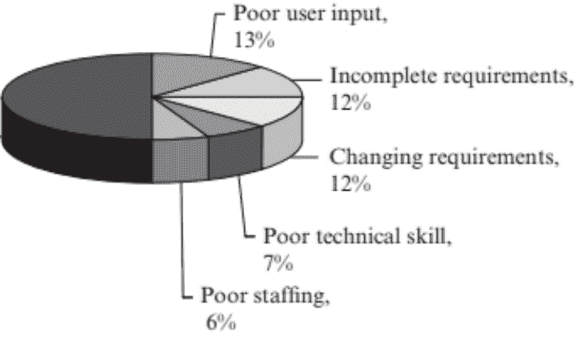

**图 4.1** 与需求相关的软件开发问题

客户代表负责设计、实现和测试。最后，我们将系统交付给了客户，并举办了香槟派对来庆祝胜利。但我们的快乐很快变成了悲哀——客户一分钱也没有付，理由是系统没有按照他们的预期那样运行。该项目完全失败了。几年后，那次惨痛的教训激励我将软件工程作为自己的职业。

另一个例子发生在几年前。它涉及一家国有医疗机构作为客户，以及一家软件公司作为开发商。该公司为该医疗机构构建了一个医疗保健管理系统。系统已经安装并运行。但该公司只收到了部分款项——客户拒绝支付余款。于是，公司诉控该机构支付剩余款项。该政府机构反诉了该公司，理由是系统不满足需求。在诉讼进行期间，新客户被吓走了——谁想参与这种不确定性之中呢？这个故事中，双方都遭受了各自的损失。因此，识别真实需求对开发者和客户来说都非常重要。

上述故事并不罕见。许多项目是因为需求识别错误或描述不充分而失败的。如图 4.1 所示，所有软件开发问题的 37% 与需求有关 [92]。获得 1999 年图灵奖的弗雷德里克·布鲁克斯（Frederick Brooks）根据他丰富的软件开发经验告诉我们：“构建软件系统最困难的单一部分是精确决定构建什么。建立详细技术需求（包括与人、机器和其他软件系统的所有接口）没有其他部分更难。如果做错了，没有其他部分工作会对生成的系统产生连锁反应。没有任何部分在以后修复起来更困难：”

## 4.3 需求获取的挑战

识别真实需求是软件开发中最困难的单一部分，因为它在需求获取过程中必须克服重重困难。其中一些困难是因为软件开发总体上是一个“棘手问题”（wicked problem），这在第 2 章中讨论过。这些困难包括但不限于：

1. 开发团队对应用和应用领域并不十分了解。对于许多现实世界项目，深入了解应用和应用领域对于项目的成功至关重要。这是因为在许多情况下，软件系统要么将其对应的手动操作自动化，要么通过硬件设备与应用交互。这要求对应用和应用领域知识有良好的理解。然而，许多应用和应用领域知识只能通过多年的经验获得。这就是为什么敏捷方法强调协作和用户的积极参与，因为这些实践对于获取所需的领域知识是有效的。


## 需求获取面临的挑战

### 2. 客户和用户不知道软件能做什么以及如何表达需求

对于大多数用户来说，软件既是一个谜团也是一个谜题。他们不知道软件是什么样的、它是如何工作的、系统能为他们提供什么、系统将如何与他们互动，以及如何沟通他们的需求。传统上，软件开发者在没有充分输入的情况下为客户和用户做出此类决策。

有时，开发者的态度是“你不知道，所以我们替你决定”，或者“这些是你本应该喜欢的功能”。一个故事显示了用户对软件供应商的感觉。作者和他的学生访问了一家医疗机构，征求对用户界面设计的反馈。一位资深护士认为这很新鲜。她对这次访问表达了感受：“过去我们总是被给予软件来使用，但这次你们在听我们的意见。”

确实，在需求获取期间，开发团队需要与客户和用户紧密合作，鼓励并引导他们沟通他们想要、喜欢以及不想要什么。

### 3. 缺乏共同背景造成沟通障碍

对彼此领域的缺乏理解在团队与客户及用户之间造成了沟通障碍。相同的词、短语或表达在不同领域通常有不同的含义。

例如，“security”（安全）一词可以指人员和物理属性的保护与安全，也可以指信息、计算资源以及服务的保护。在金融领域，security 指股票、债券、共同基金和交易基金等投资产品。这只是术语在不同领域或同一领域不同语境下具有不同含义的众多例子之一。

### 4. 软件需求无法被具体定义

规范和实现无法分离。这些问题的属性非常棘手。遗憾的是，软件开发是一个棘手问题（见第 2 章）。

例如，考虑为新系统提供“用户友好界面”的需求。实际上，准确且充分地定义这一需求是不可能的。这是因为“用户友好性”是一个定性属性，没有客观判断。

用户界面原型通常被用于帮助定义需求。这样做本身就是实现，而不仅仅是规范。

### 5. 需求获取的重要性和难度经常被低估

需求获取的重要性和难度往往被管理层、客户、用户以及开发者低估。结果是分配给需求获取的时间和资源不足。

### 6. 非功能性需求未被识别或被低估

非功能性需求通常涉及系统的质量、性能、安全和可靠性等方面的能力。除此之外，还有一些非技术需求经常被忽视，例如遵守法规和行业标准的需求。

在许多情况下，非功能性需求没有被识别或被低估。问题通常直到项目后期才被发现。这可能导致开发时间和成本的显著增加。

### 7. 需求在整个软件生命周期内发生变化

需求在整个软件生命周期内发生变化，即使软件在目标环境中运行也是如此。这一挑战是上述挑战的推论。需求贯穿于整个生命周期。

变化不限于功能需求和性能需求。用户界面也非常常见且不稳定，特别是在新开发项目的初期。

## 4.4 需求的类型

软件需求通常分为功能性需求和非功能性需求。

功能性需求是对软件系统必须具备的信息处理能力的陈述。它们被表述为以软件系统为主语的句子，随后是“必须”、“应当”或“将”，以及系统必须提供的功能。

例如，租车系统（CRS）的功能性需求可以写道：

> CRS 允许潜在客户使用各种搜索标准（包括品牌、型号、起始日期、结束日期、价格范围和类别（小型、中型、大号和豪华型））来查询租赁车辆的可用性。

一致使用“必须”、“应当”或“将”这些词是非常重要的。换句话说，如果在每个需求的表述中都使用了“必须”，需求规范看起来就像一份专业编写的文档。如果一个需求陈述使用“必须”，而另一个使用“应当”，需求规范看起来就不像一份专业编写的文档。

需求也可以被表述为用户的能力。例如，上述需求可以重新表述为：

> 潜在客户能够使用各种搜索标准（包括品牌、型号、起始日期、结束日期、价格范围和类别（小型、中型、大号和豪华型））来查询租赁车辆的可用性。

## 第二部分：分析与架构设计

非功能性需求分为若干大类。以下是一些常见的类别。

### 性能需求

性能需求规定了系统的有效性和效率。它们是关于系统吞吐量、响应时间、实时处理和资源利用率的陈述。

例如，`租车系统 (CRS) 每天应处理 100,000 笔交易`就是一个性能需求。一个道路调查系统“每秒应处理 1,000,000 Kbyte 的输入数据”是另一个例子。

### 质量需求

质量需求是对预期软件属性的陈述，包括可靠性、可用性、现场检测的错误率等。

可靠性需求可能规定“系统可用性应达到 99%”。

### 安全需求

安全需求规定了防止系统因意外操作而进入非预期状态的能力。此类事件可能导致人员死亡、人身伤害、财产损失或其他非预期后果。

例如：

> 当交易失败时，系统应保存并保护交易历史。

有时，安全需求源于安全标准，其目的是确保产品或服务的安全性。

### 安全需求

安全需求规定了保护系统资源（如数据和程序）免受恶意攻击的能力。此类攻击可能来自组织内部或外部。

例如：

> 系统应对所有要在互联网上传输的文件进行加密。

安全需求在第 24 章中进行了描述。

### 接口需求

接口需求规定了系统为外部实体与系统通信时应提供的外观效果、接口和交互行为。这些包括用户界面需求和硬件/软件需求。

前者涉及布局、外观效果、用户交互行为以及与其他用户界面相关的需求。

硬件/软件接口需求是关于软件系统与硬件和/或其他软件系统协同工作所需能力的陈述。它们至少应规定：

- 与哪些硬件和/或软件系统接口；
- 如何与这些系统进行通信；
- 何时进行通信。

## 4.5 需求获取步骤

软件需求获取的总体目标是确定未来系统的功能。如图 4.2 所示，需求获取遵循以下步骤，这些步骤可能需要重复几次。

1. 收集有关应用程序的信息。
2. 根据需要构建分析模型。
3. 推导出需求和限制性条件。
4. 进行可行性研究。
5. 评审需求说明书。


图 4.2 软件需求获取

需求获取始于收集应用程序和应用程序领域的信息活动。许多信息对于理解应用程序以及推导出需求和限制性条件非常有帮助。这些包括业务目标、当前业务状况、政策、法规和标准。

随后对收集到的信息进行分析以识别问题，并从中推导出需求。有时，会构建模型来帮助理解应用程序和业务流程。

由于预算和开发时间的限制，并不是所有需求都能满足。因此，团队必须与客户和用户合作，以识别高优先级需求并推导出满足这些需求的需求。

有时，需要进行可行性研究以消除或减少需求获取过程中的风险项。随后，需求和限制性条件分别由同行、领域专家以及客户和用户进行评审。评审结果用于改进需求说明书，并从中推导出用例。

### 4.5.1 收集信息

需求获取是一个决策过程，决定了未来系统的功能。因此，收集应用程序的信息是第一步。本节回答了以下与信息收集相关的问题：

1. 需要收集哪些信息？
2. 有哪些可用信息收集方法和技术？
3. 信息收集的指导原则是什么？

#### 信息收集活动的重点

信息收集活动必须聚焦于获取有关应用程序、业务流程和应用程序领域的信息。特别是，信息收集活动应旨在回答以下问题：

1. 构建该计算机化系统的业务是什么？
2. 当前的业务状况如何？它是如何运行的？
3. 系统的环境或背景是什么？
4. 现有的业务流程有哪些？它们的输入和输出是什么？它们之间是如何关联和交互的？
5. 当前系统存在什么问题？
6. 业务或产品目标是什么？
7. 当前系统和未来系统的用户分别是？
8. 客户和用户对未来系统有什么要求？他们的业务优先级是什么？
9. 质量、性能和安全方面的考虑因素有哪些？

#### 信息收集技术

信息收集方法和技术用于找到前面提出的问题的答案。这些技术包括：

1. 客户演示
2. 文献调查
3. 对现有业务流程和表单的研究
4. 利益相关者调查
5. 用户访谈
6. 编写用户故事

##### 客户演示

客户演示是一个很好的开始。客户演示可以快速让开发团队了解客户的业务，并允许团队成员立即提问以消除疑虑。演示还可能为开发团队提供正在开发的系统的初步概念。

为了确保有效，应遵循若干指导原则：

- 确保演示者了解业务以及客户和用户想要什么，尽管他的知识可能不完整或 100% 正确。
- 如果可能，与客户代表一起评审演示，以确保问题恰当且表述清晰。
- 在演示期间，只提问与实现相关的问题。
- 演示的目的是了解客户对系统的要求。
- 请求演示副本并与团队成员分享。
- 避免进行超过两小时的演示会议。

##### 业务文档、流程和表单

从业务文档、流程和表单可以获得宝贵的见解。通过研究这些内容，开发团队可以更好地理解流程及其输入和输出。

显然，未来系统必须自动化所有的业务流程。因此，开发团队应要求客户提供所有相关文档并进行仔细研究。

每个行业和公司都有自己的标准。计算机化系统必须以某种方式支持这些标准。这些标准可用于推导出需求或限制性条件。

政府、行业和公司特定的政策法规通常会对解决方案施加限制。这些限制通常被格式化为需求说明书中的限制性条件。

##### 利益相关者调查

问卷是获取利益相关者（包括管理人员和最终用户）需求的良好工具。这种技术有许多优点。

首先，问题解决表明，让利益相关者参与决策过程是重要的。匿名调查鼓励利益相关者表达关注点、考虑信息和改进建议。这些信息通过其他信息收集方法很难获得。此类信息可用于推导出未来系统的需求。

在使用问卷时应遵循以下指导原则：

- 问卷应简洁并聚焦于重要问题。
- 如果可能，为不同的利益相关者群体开发不同的问卷。
- 与客户代表一起评审问卷，以确保问题恰当且表述清晰。

##### 用户访谈

访谈客户代表、用户和领域专家是收集信息的有效方法。访谈可以通过面对面或电话进行。访谈的交互性质允许双方就开发中系统相关的问题进行深入讨论。

以下指南在进行访谈时非常有用：

- 在开发团队研究过客户和用户提交的调查问卷后进行访谈。问卷中可能已经包含了开发团队想要的信息。因此，在调查之后进行访谈可以节省时间和精力。问卷的回答可以告诉开发团队在访谈期间应该关注哪些领域或问题。
- 访谈应该是经过充分准备且有针对性的。也就是说，开发团队应该列出一份在访谈期间要问的问题列表。问题列表可能源自调查问卷。问题应该集中在计算机系统需要解决的关键或重要问题上。
- 每次访谈时间不应超过一小时。
- 尊重客户和用户的意见；他们是自己业务的专家。避免在访谈期间提供建议。

##### 民族学

民族学（Ethnography）在需求收集中变得越来越流行。它建议开发团队从构建系统的业务组织内部进行观察，而不是从外部观察。这是一种需求获取中“由内向外”而非“由外向内”的方法。

为了实现这一点，团队应该理解用户并像用户一样思考。通常，缺乏经验的系统分析师扮演医生的角色，为客户的业务问题提供治疗。民族学建议团队应该仔细观察用户如何工作以及他们如何解决业务问题。

敏捷方法也倡导类似的原则，即用户的积极参与是至关重要的。例如，DSDM 通过在团队中引入大使用户（ambassador user）和顾问用户（advisory user）角色来实现用户的积极参与。

##### 用户故事

用户故事（User stories）被敏捷方法广泛用作需求收集方法。用户故事简要描述用户角色希望拥有的能力。每个用户角色可能有多个用户故事。

用户故事之所以有效，是因为它们是“由内向外”而非“由外向内”。以下是现实项目中产生的许多用户故事中的部分：

1. 作为医学助理，我需要为新患者创建患者记录。
2. 作为医学助理，我需要使用患者的生日和/或患者的姓、名来搜索和检索患者记录。
3. 作为医学助理，我需要跟踪患者的医学检查记录。
4. 作为一名医生，我需要记录与患者的所有对话。
5. 作为一名医生，我经常需要搜索与患者的对话以查找某些信息。
6. 作为一名医生，我需要搜索患者的医学检查记录。
7. 作为一名医生，我想从家里或任何地方远程访问系统。
8. 作为信息安全官，我想保护系统免受未经授权的访问。

# 第 4 章 软件需求获取

这一步生成一个项目列表，包括业务目标、当前业务状况、用户故事或客户用户的愿望清单、行业以及公司政策、法规和标准。

如果软件系统是硬件—软件系统的嵌入式组件，那么结果还包括分配给软件系统的系统需求。

作为一个例子，考虑一个由大学国际教育办公室（OIE）启动的项目。几年前，OIE 意识到了教育全球化的趋势。也就是说，许多美国大学观察到参加海外留学计划的学生人数显著增加，并将学分转回美国。

为了满足这一新需求，OIE 在一个或两个学期内启动了一个旨在改进留学计划运行的项目。信息收集步骤的结果总结如下。

## 当前业务状况

OIE 位于一个距离主校区有一段距离的建筑内。学生很难访问 OIE。OIE 的留学计划主要是人工操作的。处理学生查询和留学申请非常耗时。

## 业务目标

1. 极大地方便学生访问 OIE 留学计划。
2. 显著提高留学计划提供的服务的有效性和效率。

## 愿望清单

一个留学计划的网站。该系统命名为留学管理系统（SAMS）。OIE 建议了一系列类似的网站。

### 4.5.2 构建分析模型

现实世界的应用是复杂的。它们涉及许多不同类型的业务对象、业务对象之间复杂的关系以及业务流程。开发团队需要理解此类领域知识以识别和制定需求。领域知识对于软件系统的设计、实现、测试和维护也很有用。

建模是获取领域知识的有效工具。它在需求获取期间经常被使用。建模是一个概念化和可视化的过程，有助于开发团队理解和分析现有应用程序。

特别是，面向对象的软件工程中的建模将世界看作是由相互关联和交互的对象组成的。结果是一组 UML 图，它们可视化了现有应用程序的不同方面。图 4.3 显示了 UML 图以及它们如何对现有应用程序建模。

另一个例子是图 4.4。该图显示了一个活动图，描述了如何人工处理参加海外交换计划的学生。椭圆表示活动，边线表示活动之间的流和控制流。菱形表示决策点，虚线表示拥有活动的组织。

如图所示，海外交换计划申请由学生准备，由 OIE 顾问审核。顾问接受或不接受申请。如果申请被接受，将联系海外机构，通知学术部门和学生，并归档申请。如果申请不可接受，将通知学生并将申请也归档。


| UML 图 | 描述 | 在现有应用程序建模中的用处 |
|---|---|---|
| 类图（Class diagram） | 一个有向图，顶点表示类，有向边表示类之间不同类型的关系。顶点还包含描述类属性的信息。 | 类图用于领域模型可视化，帮助开发团队理解领域概念。 |
| 用例图（Use case diagram） | 一个图，顶点表示业务过程的抽象，边指定哪些参与者与哪些业务过程交互。 | 用例用于显示应用程序或子系统的业务过程概述，以及请求业务过程服务的用户。 |
| 序图（Sequence diagram） | 一个有向图，顶点表示对象，有向边表示对象之间排序的消息或请求。 | 序图帮助开发团队理解和分析业务过程，即业务对象如何在业务环境中处理用户请求。 |
| 状态图（State diagram） | 一个有向图，顶点表示系统状态，有向边表示由内部或外部事件引起的转换。 | 状态图用于系统或业务活动的状态相关响应行为建模。 |
| 活动图（Activity diagram） | 一个有向图，顶点表示信息处理活动，有向边表示活动之间的数据流和控制流。边指定活动如何顺序、并发和/或同步执行。 | 活动图用于建模现有应用程序的信息处理活动，活动通过复杂的数据流和控制流关系相互关联。 |

图 4.3 使用 UML 图对现有应用程序建模


## 从愿望列表中识别需求

如果有愿望列表或用户故事，从它们识别需求是相对直接的。考虑第 4.5.1 节讨论的 OIE 项目。解决方案已经在愿望列表中列出——一个由 OIE 管理的海外学习项目网站。

在这种情况下，开发团队的工作是识别网站需要提供什么内容以实现业务目标。以下是识别出的部分需求：

- 学生应该能够使用各种搜索标准搜索海外交换项目。
- OIE 工作人员应该能够对海外交换项目进行输入、编辑、激活和停用操作。
- 学生应该能够创建、编辑和提交海外交换项目的申请。
- OIE 顾问应该能够处理在线申请。

## 识别满足业务目标的需求

需求也得源于当前的业务状况和业务目标。首先，评估现状与业务目标之间的差距。这被用于识别需求，即必须完成的事情，或业务必须提供的以填补差距的能力。

例如，在未来三年内销售额翻倍的业务目标意味着业务必须增加其销售能力。这可以通过许多方式实现，例如扩大销售队伍、提供折扣和/或上线，仅列举几个。通常，计算机解决方案是可能的方案之一，但可能不是解决该问题的成本效益最高的方案。

例如，上线可能会增加某些类型产品的销售，但并非所有类型的产品都如此。开发团队应该与客户、用户和领域专家合作，为业务问题识别最合适的解决方案。

## 从需求推导出需求

从需求出发，团队识别或推导出新系统以满足这些需求的能力。有时需求已经说明了这些能力，如上述 OIE 海外学习项目网站所示。在其他情况下，开发团队必须通过推理来推导出能力。无论何种情况，识别出的能力都被表述为需求。

需要注意的是，正在开发的系统并不需要满足所有识别出的需求。有很多原因。例如，客户和用户可能不需要开发团队识别出的所有需求。由于预算限制，客户可能不想为某些能力付费。由于业务考虑，客户可能希望在未来的发布中实现某些功能。每个应用程序都是独特的。

## 示例 4.1

在图中，在 OIE 运营总监演示以及与 OIE 的几次跟进会议后，SAMS 项目为系统确定了两到三十个功能需求。以下是其中三个：

- R1. `SAMS` 应提供使用各种搜索标准搜索海外交换项目的功能。
- R2. `SAMS` 应提供搜索结果的层级显示，以便从高层摘要导航到海外交换项目的详情。
- R3. `SAMS` 应允许学生提交海外交换项目的在线申请。

## 从分析模型推导出需求

模型对于理解现有应用程序及其业务流程非常有用，见第 4.5.2 节。模型对于推导出需求也有用。以下示例说明了这一点。

图 4.4 显示了国际教育办公室（OIE）现有手动流程的活动图。请从活动图中识别功能需求。

## 示例 4.2

**解决方案：**图 4.4 中的活动图包含以下活动：

1. **准备申请。** 此活动由学生执行。目前，学生手动填写表格并将其提交给 OIE。
2. **审核申请。** 此活动由 OIE 顾问执行。OIE 顾问审核每份申请并决定接受或不接受申请。
3. **联系海外机构。** 此活动由 OIE 顾问执行，他们代表被录取交换项目的学生联系海外机构。
4. **通知学生。** 此功能由 OIE 工作人员执行，他们向学生发送信函告知其申请的评估结果。
5. **通知学术部门。** 此功能由 OIE 工作人员执行，他们向每个学术部门发送信函，通知他们哪些学生被录取了交换项目，哪些学生未被录取。
6. **保存存档。** 此功能由 OIE 工作人员执行，他们对已评估的申请进行归档。
7. **学生接收通知。** 此功能由学生执行，他们接收 OIE 工作人员发送的通知信。


- 8. **学术部门接收通知。** 此功能由相关学术部门的秘书执行，他们接收并归档 OIE 工作人员发送的通知信。

尽管这些是现有手动系统的活动，但新系统理应提供自动化手段来支持这些活动，因为它们是 OIE 应用程序业务行为的一部分。这为新系统提出了以下需求：

- **R4.** `SAMS` 应为学生提供在线准备海外交换项目申请的能力。
- **R5.** `SAMS` 应便于 OIE 顾问审核申请。
- **R6.** 当申请被 OIE 接受时，`SAMS` 应联系海外机构。
- **R7.** 当申请被接受或拒绝时，`SAMS` 应通知相关实体。
- **R7.1.** 当申请被接受或拒绝时，`SAMS` 应通知学生。
- **R7.2.** 当申请被接受时，`SAMS` 应通知学术部门。

## 第二部分：分析与架构设计

`R8.` `SAMS` 应存档接受和拒绝的申请。

`R9.` `SAMS` 应允许学生查看并打印有关申请结果的通知信。

`R10.` `SAMS` 应允许学术部门秘书在线查看并打印通知信。

需求还源于模拟现有应用程序的用例图和类图。用例图有助于描述现有应用程序的业务流程。也就是说，每个用例都模拟了一个现有业务流程。因此，自动化业务流程的需求可以从用例中推导出。

此外，需求还源于计算机能为执行者做的事。例如，在现有手动系统中，学生只能浏览海外交换项目。计算机化系统可以提供使用各种标准的在线搜索能力。这一需求告知必须向系统中输入某些参数。因此，系统必须为 OIE 工作人员提供输入、编辑、激活和停用海外交换项目的能力。这些都是新系统的功能需求。

在需求获取阶段，有时构建领域模型以帮助团队理解应用领域。由及物动词标记的关联关系通常意味着可以表述为需求的能力。例如，OIE 海外学习的领域模型可能显示教师类和学生类之间的关联关系，即教师推荐学生。这种关系可能表明在线系统应允许成员为学生提交推荐信。因此，推导出了功能需求。

除了需求外，某些项目对设计和实现提出了限制。这些限制在需求规范中作为约束说明。例如，OIE 可能要求 `SAMS` 在大学计算中心提供的服务器上，并使用计算中心指定的数据库管理系统。OIE 可能根据其 IT 人员的建议选择实现语言。这些都是系统可能的约束。

## 需求与约束的编号

使用诸如 `R1`、`R1.1`、`R1.2.1`、`R1.2.2`、`R2`、`R2.1`、`R2.2`、`C1`、`C2`、`C3` 等点状编号来标记需求和约束。这有助于沟通，并将需求和约束与其他软件制品（如用例和测试用例）关联起来。

将需求与用例关联有助于项目经理调度用例的开发和部署。例如，它确保每个需求都得到满足，并且优先需求优先实现。为了方便识别此类关系，追溯矩阵在工业中被广泛使用。矩阵的行代表需求，而列表示用例。

使用点状数字对需求和约束进行标记，便于构建和使用可追溯性矩阵。点状数字还暗示了需求与约束之间存在细化或分解的分级关系。在示例 4.2 中，需求 `R6` 被两个需求 `R6.1` 和 `R6.2` 细化。这意味着 `R6` 等于 `R6.1` 和 `R6.2`。也就是说，只有当 `R6.1` 和 `R6.2` 都被满足时，`R6` 才算被满足。这种等效关系非常有用，因为满足任何一个低级需求都容易得多。

## 需求优先级排序

在推导出需求后，会为每个需求分配 1 到 5 或 1 到 10 之间的整数优先级权重。因此，具有高优先级需求的用例将优先开发和交付。

由于时间和资源有限，对需求进行优先级排序至关重要。优先级有助于团队关注高优先级需求。这种转变确保了业务优先级的实现。开发团队应该与客户和用户合作，以确定需求的优先级。可以使用前文提到的调查问卷和访谈。

## 4.5.4 需求规格标准

为了避免争议，本步骤中识别出的需求和约束必须形成文档。多年来，软件行业开发了许多软件需求规格（SRS）标准。图 4.5 展示并解释了 IEEE Std 830-1998 SRS 标准。

### 4.5.5 进行可行性研究

需求规格是合同的一部分，具有法律后果。例如，本章开头介绍了两个互相使用的故事。其中一个故事导致了开发人员和客户互相使用，因为系统没有满足需求。故事涉及的系统必须确保医生可以在任何时间、从系统服务区域对患者记录进行实时无线访问。系统必须确保患者信息的安全和隐私。

即使技术可以提供这些功能，预算和进度限制也可能损害开发团队满足此类需求的能力。因此，在需求获取时，考虑到团队能力、预算和进度限制、技术以及其他相关因素，项目的可行性是非常重要的。

第 23 章中介绍的工作量估计和调度方法及技术用于评估与团队能力、预算和开发系统进度相关的可行性。原型设计是评估技术可行性的有效方法。例如，为了确保满足时间限制，会构建相关组件的原型，并用于评估满足该限制的可行性。

虽然可行性研究降低了不满足需求和约束的概率，但风险仍然存在。在这种情况下，应用风险管理来识别和分析风险，并制定风险解决措施。

## 第二部分：分析与体系设计

| 节 | 描述 |
|---|---|
| 1. 引言 | 提供软件需求规格（SRS）的概述 |
| 1.1 目的 | 规定 SRS 的目的和目标读者 |
| 1.2 范围 | a. 按名称识别目的<br>b. 解释产品将做什么和不做什么<br>c. 描述产品的用途，包括目标、愿景和利益 |
| 1.3 定义、缩写和略语 | 提供所有项目、缩写和略语的定义，以便正确解释 SRS。它可能包含对附录或其他文档的引用。 |
| 1.4 参考文献 | 通过标题、报告编号、日期、出版者和获取途径列出 SRS 中描述的每份文档 |
| 1.5 概述 | 概述 SRS 的其余部分及其组织方式 |
| 2. 总体描述 | 提供产品的概述 |
| 2.1 产品视角 | 描述产品的内容及其与整个系统其他组件的关系。可以使用框图来显示上下文和关系。<br>2.1.1 系统接口<br>2.1.2 用户接口<br>2.1.3 硬件接口<br>2.1.4 软件接口<br>2.1.5 通信接口<br>2.1.6 内存<br>2.1.7 安全<br>2.1.8 适应需求 |
| 2.2 产品功能 | 提供产品功能的摘要 |
| 2.3 用户特征 | 描述目标用户的通用特征，包括教育水平、经验、专业知识和技术技能 |
| 2.4 约束 | 描述解决方案空间或开发者选项的限制 |
| 2.5 假设和依赖关系 | 列出影响需求的因素 |
| 3. 具体需求 | 描述软件需求 |
| 3.1 外部接口需求 | 为每个系统接口、用户接口、硬件接口、软件接口和通信接口提供详细说明。每个描述包括每个输入和输出的名称、格式、有效范围、时序和其他相关信息 |
| 3.2 功能需求 | 为每个功能需求提供详细描述，并以“系统应当（执行/执行/提供……）”开头。描述可能包括输入验证检查、操作顺序、对异常情况的响应、输入与输出关系 |
| 3.3 性能需求 | 描述产品所有与性能相关的能力 |
| 3.4 设计约束 | 描述对设计备选方案的所有限制，例如标准实施的限制和硬件限制 |
| 3.5 系统属性 | 描述所有与质量相关的需求，如可靠性、安全性、可用性等 |
| 3.6 其他需求 |  |
| 附录 |  |
| 索引 |  |

图 4.5 IEEE 830-1998 SRS 标准

风险在整个开发过程中进行监控。如果检测到风险情况，将采取相应的风险解决措施。风险管理见第 23 章。

## 4.5.6 评审需求

软件需求规格（SRS）必须由同行、领域专家以及客户和用户进行评审。这些评审被称为技术评审、专家评审和客户评审，简述如下。

### 技术评审

技术评审是开发团队进行的内部评审。技术评审技术包括同行评审、检查和走演。技术评审旨在发现许多问题，包括：

- 不完整性：
  1. 定义不完整（例如某些领域特定概念未定义）。
  2. 内部不完整（例如某些需求有“如果”部分但没有“否则”部分）。
  3. 外部不完整（即现实应用中存在未包含在需求规格中的情况）。

- 不一致性：
  1. 类型不一致（例如需求规格中数据类型不一致）。
  2. 逻辑不一致（例如需求暗示相同条件下会产生不同的结果）。

- 歧义：
  1. 特定概念定义歧义。
  2. 需求表述歧义。

- 冗余：
  1. 相同概念的重复定义。
  2. 相同需求或约束的重复表述。

- 不处理（即低级需求不对应高级需求）。
- 不可行性（即某些需求或约束无法满足）。
- 不需要的实现细节。

### 专家评审

专家评审与领域专家共同进行，旨在回答以下问题：

1. 领域特定的法律、规则、行为、政策、标准和法规是否在 SRS 中准确表述？
2. 是否存在术语使用错误、不准确、不当或不一致？
3. 对领域的感知是否正确准确？
4. 是否存在其他潜在的领域特定问题或关注点？

### 客户评审

客户评审与客户和用户共同进行，旨在寻求以下问题的答案：

1. 需求规格书是否正确描述了要构建或扩展系统的应用程序的功能需求？
2. 是否存在描述错误的用户界面需求？
3. 是否存在描述错误的非功能性需求（包括性能、响应时间和安全需求）？
4. 是否存在描述错误的关于操作系统环境、政府及行业政策法规的特定约束？

## 4.6 应用敏捷原则

传统的计划驱动开发在需求获取上投入了大量的时间和精力。例如，瀑布流程中的需求分析阶段通常消耗总开发时间或精力的 15% 或更多。这是因为一旦需求里程碑建立，需求的更改就会变得困难且昂贵。

敏捷开发接受变化是生活的常态。由于短的迭代间隔和小增量，它可以更快、更及时地响应变化。因此，敏捷开发的需求获取消耗的时间和精力非常少，一个六个月到一年的项目只需要几周。其目的是产生一份高优先级软件需求列表，并在随后的迭代中进行演进。

对于敏捷项目，在需求获取过程中应遵循以下原则：

1. **客户协作和用户的积极参与是至关重要的。** 正如“需求获取的挑战”章节中所讨论的，开发团队与客户及用户之间存在沟通障碍。这是由于对彼此职业缺乏足够的理解。

   为了克服这些障碍，开发团队必须主动让客户和用户参与开发过程。这需要客户的协作，因为这消耗了大量的时间和精力。客户协作意味着客户理解用户参与的重要性，并投入员工的时间和精力到项目中。

   具体来说，客户需要识别出熟悉应用程序的员工，并将他们分配到开发团队一起工作。与开发团队交互的频率因敏捷方法而异，也因项目而异。每周至少与开发团队举行两次到三次会议。

2. **在高层捕捉需求；将细节留给后续迭代。** 敏捷方法不详细规定需求。这是因为对于许多现实世界的项目，无法准确、充分且详细地指定真实需求。

   随着案例在目标环境中迭代地安装和运行，客户的业务会演进，因此需要对需求进行更改。因此，即使可行，捕获和规范需求的细节也是对时间和精力的浪费。

3. **足够就好——你不需要预先获取每一个需求，也不需要它们 100% 正确准确。** 第 2 章提出的“棘手问题”的属性告诉我们，需求无法被详尽、准确且确定地识别和规范。

   因此，敏捷方法侧重于识别、验证和规范那些关键任务、高优先级和高业务价值的需求。这一原则通常等同于 20/80 法则，鼓励用少量精力识别系统最常用的功能。

   这些原则在实践中非常有用，因为人不可能一无所有——你放弃一些才能得到其他的。这意味着关注对客户最有价值的需求，而不是将其分散。

4. **恰好的建模——如果模型足以辅助需求获取，那么就构建最小质量的模型，仅满足目的即可，不再更多。** 敏捷开发不在全面的文档基础上工作，因为前者是底线。然而，如果使用得当，建模可以提高团队成员之间的理解和沟通。

   恰好的建模意味着如果需要建模，你应该将范围限制在足以满足目的的范围内。

## 4.7 需求管理与工具

需求变更对于许多软件项目来说是常见的。变更包括添加新需求、修改和删除现有需求。更改需求可能会影响多个构件和其他需求项。需要评估实施更改的成本以及处理影响的成本，以确定该更改是否具有效益。维护阶段也需要需求变更来修正错误和增强系统功能。

需求管理是处理所有与需求变更相关的机制。图 4.6 解释了需求管理的活动。

需求管理必须处理海量数据和复杂的依赖关系。有很多工具支持需求管理活动。IBM Rational RequisitePro 和 IBM Rational DOORS 就是此类工具。

`RequisitePro` 允许团队成员使用基于 Web 的界面定义需求项的属性。它支持高层需求和底层需求之间的追溯性。每当需求发生更改时，它提供更改影响分析和自动电子邮件通知。它检查对政府和行业法规及标准的符合性。它与其他 Rational 工具套件集成。


图 4.6 需求管理活动

`IBM DOORS` 是一种需求管理工具。它支持需求定义，并将需求与其他需求、图表、表格和相关文档链接。通过 Web 访问，不同地点的利益相关者可以讨论并编辑需求和追溯性信息。

它内置了变更流程，支持并发需求更新。它通过两种方式支持合规性审计。它的追溯功能可以显示审计员如何证明需求、设计和测试符合标准和法规。它还记录了谁在何时更改了什么。

## 总结

本章介绍了需求获取的基本概念、步骤和技术。还介绍了需求获取的重要性和挑战。步骤为：

1. 收集有关应用程序的信息。
2. 构建模型。
3. 推导出需求和约束。
4. 进行可行性分析。
5. 评审需求。

三种评审类型为：技术评审、专家评审、客户评审。章节末尾，描述了需求获取的敏捷原则。

## 第 4 章 软件需求获取

`SRS` 规定了系统必须交付的内容。它没有规定如何交付。如何交付留给后续迭代。虽然只规定“是什么”而不规定“如何”可能会导致误解，但用例在这方面很有用。

## 扩展阅读

David Hay [78] 从业务角度介绍了需求获取。在 [61] 中可以找到包含最佳实践的需求获取实用指南。[30] 描述了使用 UML 的面向对象的需求分析方法。Alan Davis [56] 的书是需求分析和技术的极佳读物。它描述并比较了需求获取的不同方法和技术。它还包含了许多出版物的注释。Berzins 和 Luqi [25] 的书是需求分析和评审的价值读物。

## 章节思考

1. 什么是需求和约束？它们有什么区别？
2. 需求获取的目标是什么？
3. 为什么需求获取很重要？
4. 需求获取的挑战是什么？
5. 需求获取的活动或步骤有哪些？
6. 需求可能会出现什么问题？
7. 有三种类型的需求评审？谁参与？每种评审的重点是什么？
8. 什么是需求管理和需求追溯性？
9. 哪些敏捷原则适用于需求获取？这些原则意味着什么？

## 练习题

### 4.1

为与你学校类似的图书馆信息系统编写软件需求说明书（SRS）。该系统至少应提供允许读者检索、借和归还文档的功能。

### 4.3

识别并规范以下系统的功能需求和非功能需求。该系统允许学生检索、注册和退课。它还允许大学系统管理员安排课程。

### 4.2

为以下每个系统制定功能需求和非功能需求。对于每个系统，将需求说明书限制在三页以内。

a. 桌面虚拟计算器，允许用户使用鼠标以及键盘输入数据。

b. 电话应答机。

c. 基于 Web 的电子邮件系统。

### 4.4

为下面的日历管理系统制定功能需求。将 SRS 长度限制在两页以内。

此日历软件允许用户将个人活动安排为会议和任务。活动可以在未来日期的某个特定时间段进行。一个活动可以持续几天。每个活动都有一个简短的助记描述。

活动可以是一种周期性活动，每小时、每天、每周或每月重复执行一次。用户可以使用按月显示的日历来安排活动，以选择一个或多个日期，然后放大以选择该日期的开始时间和结束时间。

日历系统应在活动开始的前一天和活动当天通过电子邮件、短信或电话通知用户。用户可以查看、添加和修改计划，包括更新和删除活动。

### 4.5

为下述的房间预订系统提供一份软件需求说明（SRS）。长度限制在不超过两个单页的范围内。

这个基于 Web 的单房间预订系统是一个资源管理系统，允许组织用户在特定时间段或特定日期预订房间。此外，该系统允许用户选择是否向用户组自动发送提醒消息，并指定在哪些日期或日期发送这些提醒。

由于只有一个房间可用，因此不需要搜索功能。系统允许用户使用视觉化的月日历导航到所需的日期。在显示月日历时，已预订的时间和可用时间段将用不同的颜色区分，或者不显示颜色。系统的配置用于指定若干属性或约束条件：

- a. 启用或禁用显示哪个用户预定了哪个时间段。
- b. 启用或禁用用户为特定时间段递归预订房间的能力。例如，整个学期每个周三上午 10:00 到下午 12:00。
- c. 为递归预订的最大时间长度指定约束条件。
- d. 为用户可以进行的预订次数指定约束条件。
- e. 启用或禁用系统自动提醒消息。

### 4.6

在附录 D.2 中描述了一个国家贸易展览服务（NTSS）业务。假设目前 NTSS 业务是按规范的方式进行的。公司想要开发一个基于 Web 的在线系统来实现这一自动化。此练习可以是个人作业，也可以是团队项目的一部分。它要求系统和团队完成以下操作：

- 从业务描述中识别并列出当前业务最重要的业务活动。这些是未来系统必须提供的功能。提示：不同学生认为最重要的活动可能有所不同。然而，功能识别应涵盖至少 90% 的当前业务活动，包括最重要的业务功能。
- 识别在线系统的其他必要功能，以便系统能够在线运行。
- 将这些功能表述为软件需求。

### 4.7

具体描述你将如何对练习 4.6 中产生的 NTSS 软件需求进行三种类型的评审。答案限制在不超过一个单行间距页，且字号不小于 11 号。

### 4.8

识别并表述附录 D.1 中描述的在线租车系统的需求和约束条件。还要根据租车业务的性质为需求分配优先级权重。

### 4.9

写一篇文章，描述如何分别使用瀑布模型和敏捷流程进行需求获取。列出这两种方法之间的差异，并对这些差异进行简要解释。

# 第 5 章：领域建模（Domain Modeling）

## 核心要点

- 领域建模是一个概念化过程，帮助开发团队理解应用领域。
- 五个简单步骤：
  1. 收集有关应用领域的信息。
  2. 头脑风暴。
  3. 对头脑风暴的结果进行分类。
  4. 使用 UML 类图可视化领域模型。
  5. 进行检查和评审。

Mary Sanders 一直在一家保险公司负责项目，但她意外地被重新分配到另一个针对医疗保健公司的项目。她的主管知道她可以快速学习这个新的应用领域。事实上，Mary 按时交付了项目，且没有重大问题。Mary 的秘密是什么？她如何能够如此有效、高效地切换领域？


像 Mary 这样在 IT 咨询领域工作的软件工程师，经常从事不同应用领域的项目。即使软件工程师不是顾问，他或她也可能被要求处理新项目或现有系统的新颖扩展。软件工程既充满挑战又令人兴奋，因为工程师们经常可以处理新的应用程序。一个优秀的软件工程师可以快速理解新的应用领域。这是区分普通软件工程师与顶尖表现者的主要优势。使工程师能够实现这一点的工具之一被称为“领域建模”。在本章中，你将学习：

- 领域建模。
- 领域建模的重要性。
- 面向对象的概念。
- 领域建模步骤。
- UML 类图。

## 5.1 什么是领域建模？

几年前，我教过一门要求学生小组设计并实现一个蜂通信系统模拟器的课程。在那门课上，我们学习了领域建模，学生被要求为这个无线模拟器项目构建一个领域模型。一个刻苦的学生几乎每周都会来我的办公室，带着他在阅读关于无线通信材料时所做的大量笔记。我敦促他构建领域模型，而不是记笔记。遗憾的是，该学生直到项目截止日期临近才开始做。提交领域模型后，该学生来对我说：“我遗憾没有早早开始领域建模。它真的帮助我以快速、有序的方式理解了无线通信。”

那么，什么是领域建模？

> **定义 5.1** *领域建模* 是一个概念化过程。它旨在识别领域建模概念、它们的属性以及概念之间的关系。结果在一个称为“领域模型”的图中表示。

概念化过程涉及观察、分类、抽象和泛化。这个过程非常重要，因为从广义上说，软件仅仅是一个概念性产品。软件开发完全关于概念化。以构建一个银行系统为例——开发团队必须理解银行业务。这要求开发团队理解应用程序中的实体或对象以及它们如何关联、银行对象的属性或状态等。为了获得这种理解，团队必须收集与应用相关的信息、分析信息，并构建一个展示基本理解的模型。执行这些活动的过程领域建模。

## 为什么要领域建模？

软件工程师被要求处理不同领域的项目。软件工程师来自不同的背景和经验，这影响了他们对应用领域的感知。例如，*security*（安全）一词在不同领域甚至同一领域内有不同的含义。在计算机科学中它指的是计算机安全；在金融领域它指的是股票和基金等投资。因此，两个软件工程师对同一个术语可能有不同的解释。即使是**同一公司工作多年并处理相似项目的软件工程师，他们对自己的应用领域的感知也可能不同。如果这些差异是微不足道的，它们将对软件产品的设计、实现、集成、测试和维护产生显著影响。然而，如果差异是实质性的，它们将在开发的某一个阶段出现。这可能会导致大量的重复工作并推迟项目交付日期。

构建领域模型有助于识别和解决感知上的差异。特别是：

- 领域建模有助于开发团队或分析师理解应用程序和应用领域。
- 领域建模让团队成员能够交流并改进他们对应用程序以及应用领域的共同认知。
- 领域建模帮助开发团队向客户或用户传达他们的认知并寻求反馈。
- 领域建模为后续的设计、实现、测试和维护提供了一个通用的概念基础。
- 领域模型可以帮助新团队成员理解相关的应用程序和应用领域。

## 5.3 面向对象与类图

领域建模旨在识别重要的领域概念及其属性，以及概念之间的关系。这些被表示为类以及类之间的关系，并可以用 UML 类图来描绘。本节回顾了面向对象范式的一些基本概念，以及这些概念如何在 UML 类图中显示。

### 5.3.1 延延定义与内涵定义

领域建模是一个概念化过程。作为过程的一部分，开发者观察应用程序的特定实例，对观察到的实例进行分类、抽象和泛化，以产生一个概念模型，称为领域模型。这一过程中的一个重要步骤是分类。“类”的概念是分类过程的最终产物。为了说明，想象一个两岁的孩子和母亲一起出去散步。孩子看到了一只狗，母亲告诉他这是一只狗，于是他又看到了不同颜色的狗和猫。到为止，孩子的概念化过程是一个归纳过程。他学习新概念的方法是基于“延延定义”（extensional definition），定义如下：

> 延延定义通过列举概念的实例来定义一个概念。

偶数的延延定义可以是由 . . . -4,-2, 0, 2, 4 组成的集合。对于孩子来说，“狗”的延延定义包括邻居的狗、街对面的狗、住在公园附近的狗等。随着孩子看到接触多的世界，他学会了猫和狗的行为不同，但它们都是动物。他知道如何根据特征将具体形式抽象、分类和泛化为类。他也知道如何建立类与类的关系：

一天，男孩非常兴奋，因为要去去看他的姨妈，她刚搬进一栋花园房子。他从未见过花园房子，但他很奇，因为他镇上的房子都没有花园。他根据对花园和房子的知识画勒了一栋花园房子。然后他用乐高积木搭建了自己的花园房子。在这种情况下，孩子通过“内涵定义”（intentional definition）定义了自己的自己的概念。


| 概念 | 语义 | 符号 |
| --- | --- | --- |
| 类属性操作 | 类是一种类型，其属性和操作刻画了类的实例。 | 紧凑视图 (Compact View) 扩展视图 (Expanded View) |
| | 类名 属性列表 操作列表 | |
| 继承 | 两个类之间的泛化/特化关系。 | 子类 (subclass) 超类 (superclass) |
| 聚合 | 两个类之间的部分与整体关系。排斥性部分。 | 部分 (part) 整体 (whole) |
| 关联、方向、多重性、角色 | 两个类之间的二元关系。 | 类 1 [m] [label] [n] 类 2 [role 1] [role 2] |
| 关联类 | 描述关联的类。 | 关联类 (Association Class) | [x] 表示 x 是可选的。 |

**图 5.1** 一些常用的类图符号符号

> **定义 5.3** *内涵定义*通过指定概念实例所拥有的属性和行为来定义一个概念。

领域建模类似于孩子对世界的感知，并使用了延延定义和内涵定义。团队进入一个全新的应用领域。就像孩子一样，团队发出他们看到的事物，并将它们分类为类、属性和关系。结果使用 UML 类图进行可视化，其定义如下：

> **定义 5.4** UML *类图*是一种结构图，描绘了类及其属性、操作，以及类之间的关系。

图 5.1 显示了领域建模中使用的类图概念和符号。接下来的几节将详细解释这些内容。

### 5.3.2 类与对象

> **定义 5.5** *类*是一种类型，是一个概念的内涵定义。类封装了刻画类实例的属性和操作。*对象*是类的实例。

类可以使用紧凑视图或扩展视图显示，如图 5.2(a) 和图 5.2(b) 所示。如果不需要显示类的细节，则使用紧凑视图。扩展视图用于显示类的属性和操作。紧凑视图和扩展视图可以用于同一个类图中。也就是说，某些类可以用紧凑视图显示，而另一些类可以用扩展视图显示。

| 项目 | 项目 | 员工 |
| --- | --- | --- |
| 0..1 project | name work on | name |
| work on | start date end date 0..1 * daytime phone |
| member | budget | evening email |

(a) 紧凑视图 (b) 扩展视图

图 5.2 在紧凑视图和扩展视图中表示类

类的属性和操作也被称为特征（features）。“特征”一词本身反映了捕捉和强调类特征的意图。类是一种类型，是一个概念的内涵定义。类封装了刻画类实例的属性和操作。对象是类的实例。

| Customer | Account | Student | Project | Professor |
|---|---|---|---|---|
| c1 | a1 | Chen | OOM | Baker |
| c1 | a2 | Chen | SOA | Liu |
| c2 | | Gupta | SOA | Liu |
| c2 | a3 | Rosa | Security | Brown |
| c3 | a4 | Smith | Security | Shah |

(a) 二元关联的实例

(b) 三元关联的实例

图 5.3 关联的实例

**图 5.2 显示了员工（Employee）与项目（Project）之间的关联。小实心三角形表示关联的方向，即员工参与项目，但反之则不然。

表格表示法有助于理解关联关系。客户（Customer）拥有账户（Account）关联，记为`OwnCustomer(Customer, Account)`。`Own`的类型是二元组`(Customer, Account)`。更严格地说，是`Own:(Customer, Account)`，但为了简单起见去掉了冒号。使用 5.3.2 节末给出的约定，其中`U(Customer)=[c1, ..., c4]`且`U(Account)={a1, ..., a5}`。`c1`拥有`a2`，`c2`拥有`a3`，`c3`拥有`a4`，它没有账户，`a5`不被任何客户拥有。如图 5.3(a)所示，`Own(Customer, Account)`关联由五对组成：`(c1,1)`，`(c1, a2)`，`(c2, a2)`，`(c2, a3)`和`(c3, a4)`。带有`U(Customer)`和`U(Account)`的表格显示一个客户可以拥有零或多个账户，一个账户可以被零或多个客户拥有。事实上，由四个客户与五个账户配对形成的 20 个二元组的任何子集都有`2^20`个这样的子集，且每个子集都是允许的。也就是说，它是`Own`关联的一个有效实例。

常见的关联是二元关联。关联是一个或两个类对象之间的关系。例如，将钱从一个账户转移到另一个账户说明了同一种类的对象之间的二元关系。另一个例子是员工可以监督其他员工，形成`Employee`类对象之间的关联。也可以存在三个类对象之间的关联，即三元关联。例如，教授（Professor）、学生（Student）和项目（Project）之间的关系，即教授监督参与项目的学生，这是一个涉及三个类对象的三元或三向关联。图 5.3(b) 展示了这种三元关联的可能实例。

如上述示例所示，二元关联可以使用`V(X, Y)`或`V(X, Y)`的形式表示，三元关联可以使用`V(X, Y, Z)`的形式表示，其中`V`是关联名称，`X`，`Y`，`Z`是类。书中在讨论关联时将使用这种表示法。当没有混淆风险时，括号对和参数会被省略，`OwnCustomer(Customer, Account)`被称为`Own`关联。

## 5.3.5 多重性和角色

`Own(Customer, Account)`关联规定客户可以拥有账户。然而，它没有规定一个客户可以有多少个账户，以及有多少客户可以拥有同一个账户。通常，一个客户在银行可以有多个账户。有些银行允许共同拥有账户，但有些银行要求每个账户只能被一个仅一个客户拥有。另一个例子是学生可能参与一个或多个项目。一个项目可能有零或多个学生参与。一个项目可能没有学生，因为该项目是新的或已终止的。参与项目的学生可能被一个或多个教授监督。这些示例说明了识别和指定所谓“多重性”（multiplicity）的必要性，其定义如下。

定义 5.7 类相对于关联的多重性是：对于关联中其他每个类的每个实例的组合可能关联的类实例数量的断言。

考虑`Own(Customer, Account)`关联。假设银行允许共同拥有账户，但要求每个账户至少由一个账户拥有。`Customer`对于`Own(Customer, Account)`关联的多重性是一个或多个，因为每个`Account`对象可以被一个或多个客户拥有。在这种情况下，图 5.3(a) 不再有效，因为`Account`没有客户。在图 5.3(a) 的表格中添加元组`(c4, a5)`将满足这一约束。如果银行规定每个账户只能由一个客户拥有，那么多重性为 1。在这种情况下，图 5.3(a) 不再有效。从表中添加元组`(c1, a2)`将满足这一约束。

对于涉及教授、学生和项目的三元关联，如果每个参与项目的学生只能由一个教授监督，那么教授对于三元关联的多重性为 1。学生有两个不同的教授，他也参与了两个不同的项目。因此，图 5.3(b)中的关系仍然满足该约束。如果有更多教授可以监督参与项目的学生，教授对于三元关联的多重性为 1。在这种情况下，图 5.3(b) 中的表格仍然有效，但如果每个参与项目的学生只能参与一个项目并由一个教授监督，那么应该删除图 5.3(b) 表格中的前两个元组中的一个。

图 5.4 显示了各种多重性值的 UML 表示法。在类图中，多重性通过关联与类边界的交点标出。例如，图 5.2 显示每个员工参与零或一个项目。

对象在关联中扮演角色。例如，在`Student`、`Project`和`Professor`之间的`Work`关联中，教授扮演导师的角色，学生扮演助理的角色。在`Own(Customer, Account)`示例中，客户扮演所有者的角色。角色在类图中显示的方式类似于多重性。在图中，图 5.2 显示了`Project`和`Employee`的角色分别是成员和项目。

| 0.. | m..n | m 到 n |
|---|---|---|
| 0.* | 零或多个 | m |
| *.* | m或多个 | m |
| 1 | 精确一个（默认） | 1.. | 一个或多个 |
| i,j,k | 显式列举 | |

图 5.4 表示各种多重性的符号

### 5.3.6 聚合

关联是一个或多个类之间的通用关系。实际应用经常遇到所谓的“组成部分”（part-of）关系。例如，发动机是汽车的一部分，书由章节组成，每个章节又由节组成，以此此类推。组成关系是关联的一种特殊类型，值得拥有建模概念和构造。因此，建模社区引入了所谓的聚合（aggregation）关系来满足这种需求。

定义 5.8 聚合是两个类之间的二元关系。它规定一个类的对象是另一个类对象的一部分。

由于聚合是关联的一种特例，它被表示为`Part-of(P, C)`或`Part-of(P1, P2, ..., Pn, C)`，表示类`C`是类`P1, P2, ..., P`的聚合。`Part-of(P1, P2, ..., Pn, C)`实际上是`Part-of(P1, C)`，`Part-of(P2, C)`，...，`Part-of(Pn, C)`的简写。同样，为关联定义的多重性和角色也适用于聚合。例如，汽车有两个或四扇门。也就是说，`Door`对于`Part-of(Door, Car)`的多重性是二或四。带菱形的线是聚合的 UML 表示法；聚合类。图 5.5(a) 展示了汽车是由一个发动机、一个变速箱和一个刹车聚合而成的。

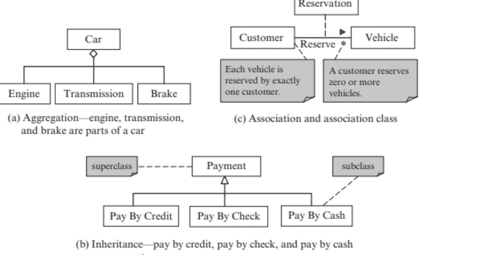

(a) 聚合——发动机、变速箱和刹车是汽车的一部分

(c) 关联和关联类

(b) 继承——信用卡支付、支票支付和现金支付是支付

### 5.3.7 继承

> **定义 5.9** 继承是两个概念或类之间的二进制关系，其中一个概念或类是另一个的泛化（或特化）。

在各种应用领域存在许多继承的例子。在银行系统中，有支票账户（Checking Account）和储蓄账户（Savings Account），它们都是账户（Account）的特化。经纪公司还区分保证金账户（Margin Account）和期权账户（Option Account）。这些不同类型的账户虽然相似，但行为不同。例如，支票账户不支付利息，而储蓄账户会。也就是说，支票账户和储蓄账户是银行账户（Bank Account）的特化。银行账户是支票账户和储蓄账户的泛化。同样，保证金账户和期权账户是经纪账户（Brokerage Account）的特化，而经纪账户是保证金账户和期权账户的泛化。

在继承关系中，作为另一个类泛化的称为超类（superclass），作为另一个类特化的称为子类（subclass），如图 5.5(b) 所示。继承也被称为“是一个”（IS-A）关系。这是因为子类的每一个实例都是超类的实例。例如，每个支票账户或储蓄账户都是银行账户。这一观察意味着为超类定义的属性和行为被子类继承了。这解释了为什么使用“继承”一词来表示类与类之间的泛化或特化关系。

在上述，需要定义超类银行账户的子类支票账户和储蓄账户，是因为超类对象在行为上存在差异。定义子类的另一个原因是由于关系上的差异。例如，将本科生（Undergraduate Student）和研究生（Graduate Student）考虑为学生（Student）的子类。本科生需要使用本科目录来选课，而研究生则需要使用研究生目录。全日制研究生需要修三到五门研究生课程。另一方面，本科生可能有不同的限制。这些子类将极大地方便对这些关联关系的操作。继承也是关联的一种特殊特例。因此，用`ISA(S,C)`或`ISA(S1, S2, ..., Sn, C)`来表示类`S, S1, S2, ..., Sn`是类`C`的子类。`ISA(S1, S2, ..., Sn, C)`实际上是`ISA(S1, C)`，`ISA(S2, C)`，...，`ISA(Sn, C)`的简写。

## 5.3.8 继承与多态

在面向对象的范式中，继承和多态就像兄弟甚至双胞胎。它们看起来非常相似，以至于有些作者认为它们是同一个。但实际上并不相同。为了理解其中的区别，引入了以下定义：

> **定义 5.10** 多态意味着一个可以假设不同的形式。

通过观察定义 5.9 和 5.10，人们应该看出区别。继承定义了两个概念或类之间的关系，使得一个类比另一个类更通用（或更具体）。由于这种泛化（或特化），超类类型的变量可以指向一个子类的对象，超类变量可以表现出不同的行为，从而实现多态。

另一方面，多态关注一个事物假设不同形式的能力。由于“一个事物”是不约束的，它可以是任何东西，而不只是类和对象。假设不同形式的能力不仅限于继承的上下文；它可以在任何其他上下。例如，两个或多个成员函数可以共享相同的名称但具有不同的签名。C++ 中的函数指针可以在运行时指向不同的函数。这些都是多态的例子，但不是继承上下文下的。

### 5.3.9 关联类

有时需要描述关于关联关系的属性。考虑学生选课程的关联。学生可以选修一门或多门课程，并为每门选修课程获得一个成绩。显然，课程成绩是一个属性，它没有独立的存在性。问题是哪个对象类应该将成绩作为属性？如果成绩是`Student`类的属性，那么`Student`类应该有多个成绩属性，因为一个学生可以选修多门课程。如果是这样，你该如何区分不同课程的成绩呢？以下是一些快速但不一定好的解决方案。


- 一种可能的解决方案是将每个成绩与一门课程关联。这可以通过两种不同的方式实现。第一是在`Student`类中使用哈希表来存储课程的成绩。这种方法是不可取的，因为哈希表和`Enroll(Student, Course)`关联应该是一对一的对应关系。然而，这种对应关系是隐式假设的。处理它们的程序需要维护这种对应关系。这意味着对于哈希表中存储的每个成绩，程序必须确保学生确实选修了该课程。程序必须确保学生修读的每门课程在哈希表中都有记录该课程成绩的条目。

- 除了上述对应关系问题，记录特定课程在特定学期的成绩也是常见的。如果学生在多年前修过某门课程，大学通常会要求学生重修该课程，学分才能被用于满足学位要求。在这种情况下，使用哈希表存储每门课程的成绩和学期并不是理想的解决方案。

- 另一种解决方案是定义一个`Course-Grade`类来存储每门课程的成绩，并从`Student`类到`Course-Grade`类引入一个一对多的关联，例如`Receive(Student, Course-Grade)`。这种方法可以适应记录每门课程成绩时记录学期的需求。然而，它仍然无法解决`Receive`关联与`Enroll`关联之间的对应关系问题。也就是说，需要额外的努力来确保`Receive`关联的每一个实例都有对应的`Enroll`实例。

因此，更好的解决方案是存储关于关联本身的信息。这消除了对应关系问题。剩下的问题是如何实现这一点。以下定义指向了答案。

**定义 5.11** 关联类是为关联的实例定义属性和行为的特殊类。

再次考虑`Enroll(Student, Course)`关联。在这个例子中，可以为`Student`和`Course`之间的`Enroll`关联定义一个名为`Enrollment`的关联类。`Enroll`将拥有成绩和学期属性，以及`setGrade(...)`、`getGrade()`、`setSemester(...)`和`getSemester()`操作。如果一个学生修了三门课程，则需要创建三个`Enrollment`类实例，为每个修的课程创建一个实例。图 5.6 显示了如何使用表格格式显示关联类的实例，前两列表示关联实例，后两列表示关联实例的属性。

| Student | Course | Semester | Grade |
| :--- | :--- | :--- | :--- |
| Backman | AI | Spr 07 | A |
| Backman | DB | Spr 07 | A |
| Backman | SE | Spr 07 | B |
| Chang | AI | Spr 07 | A |
| Chang | DB | Spr 07 | A |
| Chang | SE | Spr 07 | B |
| Chang | Compiler | Fal 06 | A |
| Chang | Algorithms | Fal 06 | A |
| Chang | Programming | Fal 06 | B |

**图 5.6** 关联类对象的表格表示

# 第 5 章 领域建模

由连接关联类与关联线的虚线表示。在图 5.5(c)中，客户（Customer）与车辆（Vehicle）之间存在预留关联。`Reservation`类存储了关于哪个客户预留了车辆的信息。正如从`Reservation`到预留关联线的虚线所示，这是一个关联类。

## 5.4 领域建模的步骤

在回顾了之前章节中的面向对象概念后，现在是时候描述领域建模的步骤了。图 5.7 显示了这些步骤及其输入和输出。为了产生良好的领域模型，这些步骤可能需要迭代几次。接下来的章节将详细概述并描述这些步骤。

### 步骤 1：收集应用领域信息

领域建模的第一步是收集应用领域信息。收集应用领域信息的技术之前已经描述过，将在 5.4.1 节中再次回顾。该步骤的输出包括关于该应用程序的所有相关信息/文档。

### 步骤 2：头脑风暴

在收集了应用领域信息后，开发团队成员聚在一起，按照 5.4.2 节所述，识别并列出重要的应用领域概念。

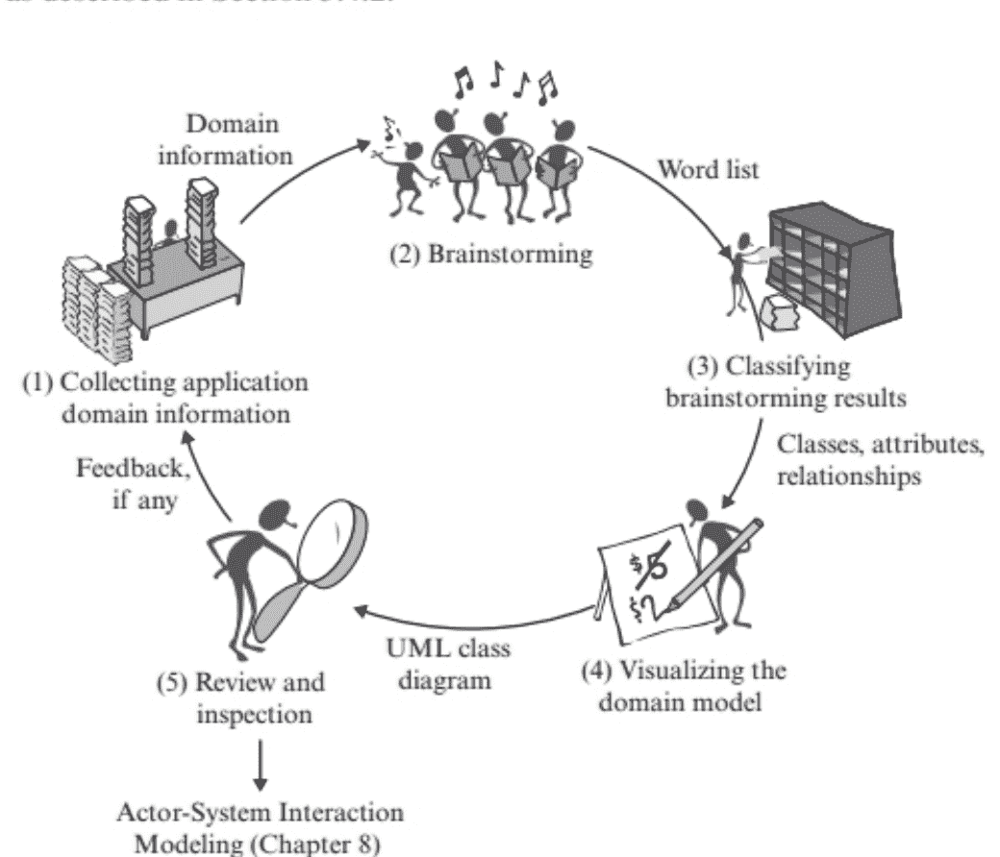

**图 5.7** 领域建模的步骤

### 步骤 3：分类头脑风暴结果

随后将头脑风暴的结果分类为类、属性、继承关系、聚合关系和关联关系。这些结果也构成了该步骤的输出。分类技术在 Sec-5.4.3 节中描述。

### 步骤 4：领域模型可视化

通过 UML 类图对分类结果进行可视化，以提供类及其属性以及类之间关系的整体、集成的视图。将分类结果转换为类图的规则在 5.4.4 节中给出。

### 步骤 5：审查领域模型

对领域模型进行审查，以识别错误和异常。根据审查结果，将重新访问上述某些步骤并修订领域模型。5.4.5 节提供了一个领域模型审查检查清单。

### 5.4.1 收集应用领域信息

由于领域建模的主要目的是理解领域概念以及它们如何相互关联，开发团队应该获取有关业务的描述或文档，包括：

- 业务流程描述。
- 操作程序、手册、指南、政策、规章和规则。
- 软件需求规格说明书，这应该在需求获取阶段已经产生。
- 各种业务表单（例如各种请求表单、发票、采购订单等）。

上述文档、描述和表单可能不存在；分析师或开发团队可能需要使用信息收集技术来获取它们。这些技术包括：

1. 客户陈述。
2. 访谈客户代表、用户和领域专家。
3. 研究相关文献。
4. 研究相似项目。
5. 研究业务文档和表单。
6. 研究政府政策法规。
7. 研究行业标准。
8. 问卷的开发与使用。

上述技术已在第 4 章中详细描述过，此处将不再重复。

### 5.4.2 头脑风暴

在信息收集步骤之后，团队成员聚集在一起，通过在描述应用程序的文档上下划线或标记短语来识别特定领域的概念。该步骤的最终产物是一份识别出的短语列表。通过应用所述规则来识别领域概念。即，团队成员识别领域特定或领域相关的短语，例如：

1. 名词或名词短语。
2. “X 的 Y”或“Y 的 X”表达式（例如：汽车的品牌、汽车的发动机）。
3. 及物动词。
4. 形容词、副词和枚举。
5. 数字和数量。
6. 属性表达式（`has/have`、`possess`等）。
7. 组成、部分、包含等表达式。
8. 包含或含有表达式。
9. “X 是一个 Y”表达式，或泛化/专门化的概念。

在应用规则时，团队成员应记住以下指南：

> **指南 5.4** 关注领域特定或领域相关的概念和关系。

团队成员应只识别领域特定或领域相关的概念和短语；否则，许多无关的词和短语将渗透进领域模型，导致领域模型变得异常巨大、复杂且实用性降低。这一指南实际上意味着上述列出的每条规则之前都可以加上“领域特定或领域相关的”，例如，领域特定的及物动词和领域 X 是一个 Y 的表达式。为了简单起见，规则以简洁的方式制定。

> **指南 5.5** 忽略设计和实现概念。

设计和实现概念不属于领域模型。这些概念是为了软件系统的设计和实现而引入的。例如图形用户界面（GUI）、数据库相关概念、事务日志、链表等。确定一个概念是否为领域概念的一种方法是问：“如果没有为应用程序构建计算机化系统，该概念还会存在于应用领域中？”如果答案是，那么它就是领域概念；否则不是。

以下示例有助于解释上述哪些短语被识别。例如，带有上标 1 的下划线词表示识别出的名词或名词短语。上标将在下一节中使用，显示如何将识别出的短语分类为建模概念。在实践中，使用上标并不是必要的，因为人们可以从下划线单词中轻松识别出来。

#### 示例 5.1：从以下留学管理系统（SAMS）的描述中识别重要的应用概念

“本科生或研究生每学期最多申请两次交换计划。申请由申请表单、两份教师推荐信和一份课程等效表组成。

...

交换计划具有计划名称、计划类型、学术部门、学术科目、国家、学期和语言。”

**解答：**5.8(a) 显示了带有上标的下划线单词，表示识别了哪些内容。5.8(b) 是识别出的短语列表，将在下一节的分类步骤中使用。

- 本科生¹或研究生¹每学期最多申请三次交换计划¹。申请¹由申请表单¹、两份教师¹推荐信¹和一份课程等效表¹组成由学术导师²批准。
- 本科生¹研究生¹申请最多三次交换计划¹学期申请¹由申请表单¹两²教师¹推荐信¹课程等效表¹由批准³计划名称¹计划类型¹学术部门学术科目国家学期语言¹

(a) 重要的领域概念下划线

(b) 重要的领域概念列表

**图 5.8** SAMS 描述的头脑风暴结果

### 5.4.3 分类头脑风暴结果

在领域建模的第三步中，列出的短语被分类为类、属性、属性值和关系。这是通过应用图 5.9 所示的分类规则完成的。图 5.10 中的分类代码用于指示分类结果。图 5.9 的左列显示短语，右列显示相应的面向对象建模概念。

| 规则 # | 识别出的短语 | 对应的建模概念 |
| --- | --- | --- |
| 1 | 名词/名词短语<br>(a) 具有独立存在<br>(b) 某些对象扮演的角色<br>(c) 描述了一种多对多的关系<br>(d) 是...的泛化/特化<br>(e) 在应用/领域中不独立存在 | 类<br>关联中的角色<br>关联类<br>父类/子类<br>某些对象的属性 |
| 2 | "X of Y" 表达方式<br>(a) X 在应用/领域中独立存在<br>(b) X 在应用/领域中并非独立存在<br>(c) X 表示某些对象扮演的角色 | X 是 Y 的部分或 Y 是 X 的聚合<br>X 是 Y 的属性<br>X 是关联中的角色 |
| 3 | 及物动词 | 关联关系 |
| 4 | 形容词/副词/数字 | 属性值 |
| 5 | (a) 相关概念是一个属性<br>(b) 相关概念是一个对象 | 属性值<br>多重性 |
| 6 | 拥有关系表达<br>(例如 Y/拥有 X，等）<br>(a) X 在应用/领域中具有独立存在<br>(b) 否则 | Y 是 X 的聚合 |
| 7 | "包含/部分/由...组成"<br>包含/包含性表达<br>(a) 被包含的对象可以被移除而不影响被包含对象的完整性<br>(b) 否则 | X 是 Y 的属性<br>聚合关系 |
| 8/9 | "X is Y" 或泛化/特化表达方式 | 聚合<br>继承 |

注：(1) 如果 X 在应用中不具有独立存在，则 X 是 Y 的属性。

(2) 如果 X 和 Y 在应用中都具有独立存在，则它们通过继承、聚合或关联关系相关联。

**图 5.9** 用于分类头脑风暴结果的分类规则

| 代码 | 含义 |
| --- | --- |
| `(A)` | 属性（类的属性） |
| `(AC)` | 关联类（关联的关联类） |
| `(AG)` | 聚合 |
| `(AS)` | 关联 |
| `(C)` | 类，可以是另一个类的子类 |
| `(I)` | 继承关系 |
| `(m,n)` | 二元关联中每个类的多重性 |
| `(r1,r2)` | 二元关联中每个类的角色名称 |
| `(V)` | 属性值（类属性的属性值） |

**图 5.10** 分类代码

此步骤的最终产物是类列表及其属性、以及类之间的关系。

### 示例 5.2：分类示例 5.1 中的脑风暴结果

**解决方案：**图 5.11 描述了分类结果并解释如下：

- 第 1 列列出了脑风暴步骤中识别出的短语，并带有上标或短语识别编号。

| 脑风暴列表 | 分类结果 | 规则 |
| --- | --- | --- |
| 本科¹ | `(C)` 本科生 | 1 (a) |
| 研究生¹ | `(C)` 研究生 | 1 (a) |
| 申请³ | `(AS)` 申请（学生, 交换计划） | 3 |
| 不多于两个⁵ | `(1, _, 2)` | 5 |
| 交换计划¹ | `(C)` 交换计划 | 6 (b) |
| 有⁶ 项目名称¹ | `(A)` 项目名称 | 1 (e) |
| 项目类型¹ | `(A)` 项目类型 | 1 (e) |
| 学系¹ | `(A)` 学系 | 1 (e) |
| 学科¹ | `(A)` 学科 | 1 (e) |
| 国家¹ | `(A)` 国家 | 1 (e) |
| 地区¹ 学习期¹ | `(A)` 学期 | 1 (e) |
| 语言¹ 学期¹ | `(A)` 语言 | 1 (e) |
| 申请¹ | `(A)` 学期 // 等同于学期 | 1 (e) |
| 包含⁷ | `(AC)` 申请（针对申请） | 1 (c) |
|  | `(AG)` 属于（申请表, 申请） | 7 |
| ⁵ | `(AG)` 属于（教师推荐信, 申请） | 7 |
|  | `(2, 1)` | `(AG)` 属于（课程学分表, 申请） | 7 |
| 申请表¹ | `(C)` 申请表 | 1 (a) |
| 教师¹ | `(C)` 教师 | 1 (a) |
| 教师推荐信¹ | `(C)` 教师#推荐信 | 1 (a) |
| 课程学分表¹ | `(C)` 课程学分表 | 1 (a) |
| 批准³ | `(AS)` 批准（课程学分表, 学术导师） | 3 |
| 学术导师¹ | `(C)` 学术导师 | 1 (a) |
|  | `(C)` 学生 // 添加 |  |
|  | `(I)` 是（本科生, 学生) // 添加 |  |
|  | `(I)` 是（研究生, 学生) // 添加 |  |

**图 5.11** 用于 SAMS 的脑头脑风暴概念分类

- 第 2 列显示了相应的类及其属性，以及类之间的关系。这些通过使用图 5.10 中的分类代码来表示。

### 从分类结果转换为类图

| 分类结果 | UML 类图表示 |
| --- | --- |
| `(C)` 类名 | 类名 |
| `(A)` 属性 1: 类型 1 | 属性 1: type 1 |
| `(A)` 属性 2: 类型 2 | 属性 2: type 2 |

**示例：**

| 分类结果 | UML 类图表示 |
| --- | --- |
| `(C)` 交换计划 | 交换计划 |
| `(A)` 计划名称: String | program name: String |
| `(A)` 计划类型: String | program type: String |
| `(A)` 学系: String | academic department: String |
| `(A)` 学科: String | academic subject: String |
| `(A)` 国家: String | country: String |
| `(A)` 地区: String | region: String |
| `(A)` 学习期: String | term of study: String |
| `(A)` 语言: String | language: String |

| 分类结果 | UML 类图表示 |
| --- | --- |
| `(AS)` 及物动词 (类 1, 类 2) (m, n) (角色 1, 角色 2) | 类 1<br>角色 1<br>角色 2<br>类 2 |
| `(AC)` 类 3 (及物动词) | 类 3 |

**示例：**

| 分类结果 | UML 类图表示 |
| --- | --- |
| `(AS)` 应用于 (学生, 交换计划) (1..2) | `(AC)` 申请 (应用于) |

| 分类结果 | UML 类图表示 |
| --- | --- |
| 属于 (类 1, 类 2) (m, n) (角色 1, 角色 2) | 类 1<br>角色 1<br>角色 2<br>类 2 |

**示例：**

| 分类结果 | UML 类图表示 |
| --- | --- |
| 属于 (教师推荐信, 申请) (2, 1) | 教师推荐信<br>申请 |

| 分类结果 | UML 类图表示 |
| --- | --- |
| `ISA (类 1, 类 2)` | 类 1<br>类 2 |

**示例：**

| 分类结果 | UML 类图表示 |
| --- | --- |
| `ISA (本科生, 学生)` | 本科生<br>学生 |

**图 5.12** 转换规则：从分类结果到结果类图

`'416 Yates Street, Arlington TX 76010,'`和`'Customer C1 Reserves Vehicle V1'`是特定的断言。模型规定这些特定的断言是指定通用断言的模型的实例。例如，对象图是类图的实例。在对象图中，显示了属性值和对象之间的实际关系。对象图的研究超出了本书的范围。

## 第 5 章 领域建模

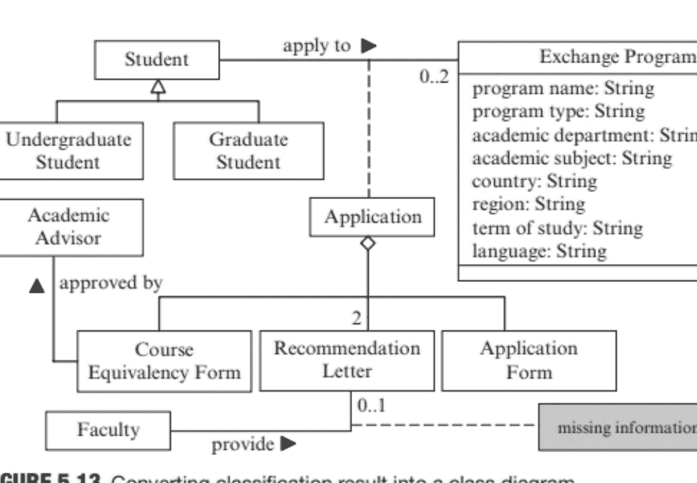

**图 5.13** 将分类结果转换为类图

虽然类图可以显示类的操作，但领域模型不应该显示这些操作。这是因为给类分配职责或成员函数是一个设计决策，应该在设计阶段处理。在领域建模中，在不考虑软件对象如何交互的情况下给类分配操作，是一种过早的决策。因此，在这一步避免给类分配操作是重要的。

## 使用聚合

使用聚合时一个非常常见的错误是将类误认为是属性类型。例如，引擎、变速箱和刹车是类，但它们在图 5.11(a) 中被用作`Car`类的属性类型。正如准则 5.1 所示，虽然对象在应用程序或领域模型中具有独立存在性，但属性没有。将一个对象视为另一个对象的属性值会引入悖论。也就是说，某东西既具有独立存在性，同时不存在——这是不可能的。因此，这样做是不正确的。

图 5.5(a) 显示了由引擎、变速箱和刹车组成的汽车模型。这在某种意义上是正确的。在图 5.14(a) 中，它引擎对象、变速箱对象和刹车对象是汽车对象的属性或特性。这是错误的，因为引擎、变速箱和刹车的实例是对象，而不是属性。类表示法中的属性区域应该只显示属性，而不是对象。如果业务是汽车租赁或汽车经销商，其关注维护各种汽车的信息，例如发动机类型（汽油发动机或柴油发动机）、变速箱（手动或自动）和刹车（盘式或鼓鼓式），那么这些属性的类型应该是字符串，而不是类。如果应用程序是汽车制造商或汽车修理厂，其关注引擎、变速箱和刹车对象，则应该使用类似于图 5.5(a) 的图。

|  | 汽车 |
| --- | --- |
| 汽车 | `engine: Engine`、`trans: Transmission` |
| `trans: Transmission` | `brake: Brake` |
| `brake: Brake` |  |
| 引擎 | 变速箱 | 刹车 |
| --- | --- | --- |
| (a) 错误：引擎、变速箱和刹车对象是汽车的属性。 |  |  |


(b) 错误：引擎、变速箱和车是汽车的组成部分和属性

图 5.14 聚合的误用

| 汽车 | 引擎 | 汽车 |
| :--- | :--- | :--- |
| 品牌 型号 年份 | 品牌 型号 年份 | |
| | | |
| | 引擎 | 汽车 |
| :--- | :--- | :--- |
| 品牌 型号 年份 | 品牌 型号 年份 | |
| | |

(a) 引擎是汽车——正确！

(b) 汽车是引擎——错误！

(c) 汽车是引擎——错误！

图 5.15 错误的关系表示

图 5.14(b) 指出引擎、变速箱和刹车也是类。这引入了悖论，正如前面所指出的。导致这种情况的原因有两个因素：首先，汽车的组件通常是通过属性实现的。其次，某些建模者在 5.14 中混淆或等同了聚合。更糟糕的是，我们使用继承的方法。

## 使用继承

继承关系有时与聚合混淆。图 5.15(a) 显示了一个正确的概念化。也就是说，汽车由引擎组成。图还显示汽车和引擎具有相似的属性，例如品牌。汽车马力取决于其引擎，导致某些建模者使用继承，如 5.15(b) 所示。但这无疑是错误的，因为引擎不是汽车。

## 148 第二部分 分析与架构设计

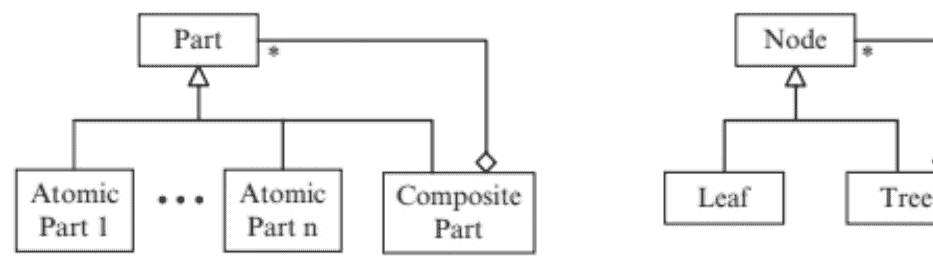

(a) 复合部分是由其他部分组成的

(b) 树是包含其他节点的节点

图 5.16 部分与复合部分

有时，ISA 准则应该在泛化的背景下理解。例如，考虑一家制造公司，零件可以分为原子部分复合部分。原子部分不包含其他部分，但复合部分可能由原子部分以及复合部分组成。这种情况可以使用图 5.16(a) 所示的复合模式进行建模。图 5.16(b) 中的示例可能更容易理解，其中树是节点。

当子类的每个实例都是父类的实例时，使用继承。这被称为 ISA 准则。由于子类的每个实例必须是父类的实例，父类的关系也必须是子类的关系。例如，学生属于部门。即 `Belong-To(Student, Department)`，本科生和研究生都是学生。即 `ISA(Undergraduate Student, Student)` 和 `ISA(Graduate Student, Student)`。因此 `Belong-To(Undergraduate Student, Department)` 和 `Belong-To(Graduate Student, Department)`。

现在考虑图 5.17(a)，它指出承包工是员工。根据准则 5.7，由于员工享受福利，承包工也是。但对于许多公司来说，情况并非如此；然而，承包工不应该是员工的子类。然而，对于许多其他公司，承包工也是员工。

# 第 5 章 领域建模

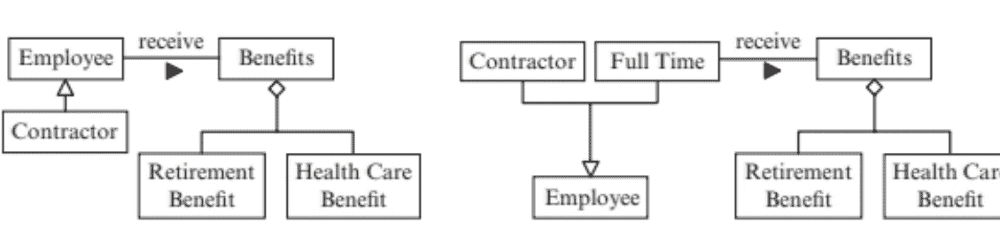

(a) 如果承包商 (Contractor) 不接收福利 (Benefits) 则错误

(b) 仅全职 (Full Time) 接收福利

**图 5.17** 子类继承类的关系

为了适应这两种情况，图 5.17(b) 为员工 (Employee) 引入了一个额外的子类，称为 Full Time。

## 5.4.5 领域模型审查检查列表

开发团队应该审查领域模型以检测并纠错误和异常。以下是领域模型审查检查列表：

1. 领域模型是否包含了应用领域中大多数重要的类？
2. 领域模型是否显示了所有重要的应用领域关系？
3. 领域模型中的每个关系是否正确地表示了相应的真实世界关系？
4. 是否遗漏或错误指定了重要的多重性约束？
5. 领域模型是否包含任何设计或实现类？
   - *备注：* 构建领域模型的目的是帮助开发团队理解应用领域。领域模型不是设计或实现文档。因此，领域模型应该只包含应用类，而不包含设计和实现类。在领域模型中包含图形界面类、数据库和数据库访问类、设计模式（少数如组合模式除外）、事务日志等是错误的。
6. 领域模型中的每个类是否都显示了所有重要的属性？
   - *备注：* 类的属性描述或刻画了类的对象或存储了其状态信息。没有任何属性的类清楚表明属性缺失或该类是不需要的。
7. 每个类、属性或关系的命名是否恰当且易于理解？
8. 是否有类被用作属性类型？
   - *备注：* 在 UML 类图中将类或对象视为属性是错误的。
9. 是否有任何类显示了操作？
   - *备注：* 在领域建模阶段为类分配责任是过早的。责任分配是一个设计问题，应该在面向对象设计期间完成。

## 5.5 整合

本节展示了领域建模步骤在大都市租车系统 (CRS) 应用中的应用。头脑风暴后带有划线短语的业务描述如图 5.18 所示。在分类步骤中，使用图 5.9 中的分类规则对短语进行分类。分类结果显示在 5.19 中。

| 租赁业务描述 |
| :--- |
| (1) 车辆¹可以从一个地点²取车并归还到³同一个 |
| (2) 地点¹或不同的地点，但需要支付额外费用⁴。尽管 |
| (3) 公司⁵与轿车⁶相关联。 |
| (4) 它未来可能会扩展到其他形式的车辆租赁⁷ |
| (5) 并且希望使用相同的预订系统。 |
| (6) 公司在其租赁车队中有几种不同型号的汽车⁸， |
| (7) 从不同的地点来看，他们可能有几种型号。例如 |
| (8) 丰田卡罗拉、凯美瑞等。型号被分为少数几个价格等级¹。客户¹必须能够选择他/她想要租的汽车和型号。如果所选的 |
| (9) 汽车不可用，它将显示消息告诉 |
| (10) 客户汽车已租出¹，并让客户 |
| (11) 选择另一个型号或让系统建议 |
| (12) 不同品牌的相似型号。公司有许多 |
| (13) 不同种类的客户。例如， |
| (14) 有“每日无限制里程计划”¹⁴和“周末优惠计划”¹⁵。 |
| (15) 公司认为提供以下信息非常重要： |
| (16) 提供的型号，例如变速箱类型¹⁶ |
| (17) 或四门，以及轿车或掀背式¹⁷租赁价格可能 |
| (18) 对于不同的选项¹⁸有所不同，客户会想在 |
| (19) 预订¹时了解哪些信息。当前的、客户的¹ |
| (20) 预订信息由公司通过面谈 |
| (21) 或电话²²提供 |
| (22) 手动使用预订表²³将它们归档在文件中 |
| (23) 预订时不需要押金²⁴。如果 |
| (24) 进行了预订，它将显示签署 |
| (25) 合同²⁵超过给定的时间段²⁷。 |
| (26) 这种预订只有在所有汽车都可用以满足请求时才会受理。 |
| (27) 有时客户希望为几辆³⁰进行²⁸批量预订²⁹ |
| (28) 汽车，并让他们尽快出现在预订系统中， |
| (29) 统一处理。一旦汽车被租出³¹给客户， |
| (30) 就会开具发票。单张发票³²可以涵盖³³或多次 |
| (31) 租赁³⁴。通常客户会在汽车时³时支付⁵发票， |
| (32) （作为客户的雇主）。当客户³⁷用公司 |
| (33) 信用卡³⁸支付时，租赁费用⁴⁰将通过 |
| (34) 信用卡处理系统处理。汽车也可以按需² |
| (35) 可用³。租赁车辆需要频繁的 |
| (36) 维护，此外，任何对汽车的损坏必须尽快 |
| (37) 维修。公司想要跟踪租赁汽车 |
| (38) 的购买⁴⁴、维护⁵，以及用于 |
| (39) 业务和税收（例如，租赁的折旧）。 |
| (40) 汽车⁸ | (img/c6de48c3b921cc9c8706476dbab16b25_150.png) |

CRS 应用概念

| 头脑风暴列表 | 分类结果 | 规则 | 预订时间 2(b) |
| :--- | :--- | :--- | :--- |
| 车辆 | (C) Vehicle | 1(a) | (A) 预订时间 |
| 制造商 | (A) manufacturer | 1(a) | |
| 类 | (A) class | 1(a) | |
| 价格 | (A) price | 1(a) | |
| 可用 | (A) available: | 1(a) | |
| 选出 | (A) stood out | 1(a) | |
| 购买 | (A) purchase | 1(a) | |
| 空气 | (A) air | 1(a) | |
| 维修 | (A) repair | 1(a) | |
| 维护 | (A) maintenance | 1(a) | |
| 处置 | (A) disposed | 1(a) | |
| 轿车 | (C) passenger car | 1(a) | |
| 汽车型号 | (A) model | 1(a) | |
| 变速箱 | (A) transmission | 1(a) | |
| 自动 | (A) automatic | 1(a) | |
| 手动 | (A) manual | 1(a) | |
| 门数 | (A) doors: integer | 1(a) | |
| 车型样式 | (A) body style: String | 1(a) | |
| 掀背式 | (A) hatchback | 1(a) | |
| 额外费用 | (A) additional charge | 5(a) | |
| 超过 | (A) over: | 1(a) | |
| 预订 | (AC) reserve (reservation) | 1(c) | |
| 客户 | (B) Customer | 1(a) | |
| 地点 | (C) Location | 1(a) | |
| 取自 | (AS) taken from (Vehicle, Location) | 1(a) | |
| 返回 | (AS) returned to (Vehicle, Location) | 1(a) | |
| 选择 | (AS) select (Customer, Vehicle) | 1(a) | |
| 租赁计划 | (C) Rental Plan | 1(d) | |
| 每日无限制里程计划 | (C) Daily Unlimited Miles Plan | 1(d) | |
| 周末优惠计划 | (C) Weekend Savings Plan | 1(d) | |
| 预订 | (AS) reserve (Customer, Vehicle) | 1(a) | |
| 预订 | (AC) reserve (reservation) | 1(c) | |
| 制造 | (A) make | 1(a) | |
| 电话 | (A) phone | 1(a) | |
| 表格 | (A) form | 1(a) | |
| 文件 | (A) file | 1(a) | |
| 签署 | (A) sign | 1(a) | |
| 合同 | (C) Contract | 1(a) | |
| 时间段 | (A) period of time | 1(a) | |
| 理 | (A) honored | 1(a) | |
| 批量预订 | (C) Block Reservation | 1(a) | |
| 租出 | (AS) check out (Customer, Vehicle) | 1(a) | |
| 发票 | (A) invoice | 1(a) | |
| 涵盖 | (A) cover | 1(a) | |
| 支付 | (A) pay | 1(a) | |
| 雇主 | (A) employer | 1(a) | |
| 信用卡 | (C) credit card | 1(a) | |
| 租赁费用 | (A) rental charge | 1(a) | |
| 处理 | (A) processed | 1(a) | |
| 信用卡处理系统 | (C) credit processing system | 1(a) | |
| 需要 | (A) demand | 1(a) | |
| 维护 | (A) maintenance | 1(a) | |
| 损坏 | (A) damage | 1(a) | |
| 维修 | (A) repaired | 1(a) | |
| 跟踪 | (A) keep track | 1(a) | |
| 购买的 | (A) purchased | 1(a) | |
| 维修 | (A) repair | 1(a) | |
| 维护 | (A) maintenance | 1(a) | |
| 处置 | (A) disposal | 1(a) | |
| 税收 | (A) taxes | 1(a) | |
| 折旧 | (A) depreciation | 1(a) | |
| 汽车 | (A) cars | 1(a) | |

# 132 第二部分 分析与架构设计

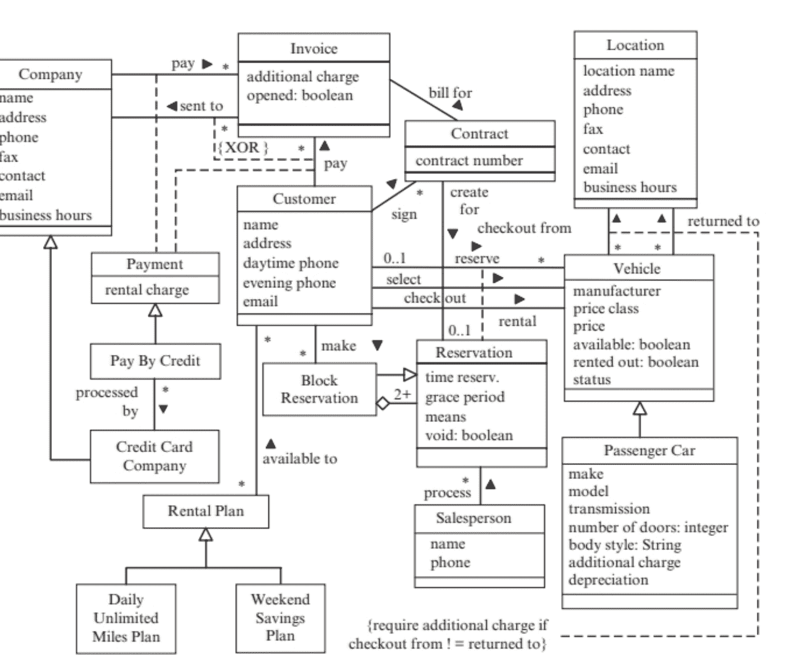

图 5.20 租车领域模型可视化

这些图展示了新增的类、属性和关系，例如车身类型、门数和状态。这些属性源于识别出的属性值，例如轿车或掀背车、两门或四门（门），以及如“维修”之类的汽车状态值。随后，将分类结果转换为类图，如图 5.20 所示，并在其中添加了缺失的信息。不同的分析师产生不同的结果——类、属性、关系和关联类可能有所不同——这是非常正常的。这反映了分析师对应用领域认知的差异，这是无法完全避免的。这部分由于分析师收集的领域信息差异、分析师的背景和经验，以及分析师如何应用领域概念识别和分类规则。

## 5.6 领域建模指南

**指南 5.8** 团队成员应该将头脑风暴和分类作为团队活动，而不是个人活动。

由三到五名开发者组成小组头脑风暴和分类有助于激发灵感并弥补彼此的局限性。更重要的是，小组头脑风暴和分类会议允许团队成员交流包含某个概念的理由以及如何对其分类。此类会议对于达成共识至关重要，共识是后续设计和实现活动的基础。经验表明，进行领域建模的团队会产生更好的设计和实现。另一方面，那些自己完成工作并分配给团队成员的团队在设计和实施阶段表现不佳，主要原因是对应用缺乏共识。

**提示 5.1：** 将头脑风暴规则分配给团队成员进行重点关注。将规则重新分配给不同的团队成员，以检查是否遗漏了领域概念。

这避免了仅将名词/名词短语识别为领域概念。

**指南 5.9** 先头脑风暴，再进行分类。

不要同时进行头脑风暴和分类，以便团队每次专注于一件事。这是关注点分离原则的应用。

**指南 5.10** 每次头脑风暴和分类会议应该持续一到两小时。

头脑风暴需要热身时间。它需要 15 到 30 分钟来激发头脑风暴并开始高效工作。由于参与者疲劳等各种原因，两小时后有效效率开始下降。

**提示 5.2：** 让团队成员在头脑风暴和分类会议之前完成作业。

在会议之前，要求每个团队成员单独执行头脑风暴和分类步骤，并将结果带到会上。这提高了会议的质量和效率。或者，团队可以使用会议的前 20 分钟进行个人工作，之后继续团队头脑风暴和分类。

**提示 5.3：** 使用白板和数字相机。

团队成员轮流在白板上记录识别和分类的概念。画线连接概念。例如，在`model`前加上缀`(a)`并将其连接到`Vehicle`，以表示它是`Vehicle`的属性；并使用 UML 继承连接将`Weekend Savings Plan`与`Rental Plan`起来，以表示继承关系。

白板可以保持团队成员信息同步并专注于讨论内容。在会议结束时，一名团队成员可以给白板拍摄数字照片并发送给其他团队成员。一或两个成员绘制领域模型并发送给其他团队成员进行评审。作为白板和数字相机的替代，团队会议也可以使用连接数据投影仪的笔记本电脑，将团队头脑风暴和分类结果投影到屏幕上，以便每个人都能看到结果。

**指南 5.11** 每次头脑风暴和分类会议都应该得到有效的协调。

在会议中最耗时且无效的事情之一，就是就某个概念是否应该包含在领域模型中或如何分类进行循环争论。我们在软件开发中做出的每个决策并非非黑即白。许多决策是基于前提的，取决于决策者的背景和经验。关于领域模型包含或分类概念的决策并不总是科学的。因此，头脑风暴和分类会议应该经过仔细协调。会议协调员应保持会议集中并确保时间被有效利用。会议应侧重于识别稍后分类领域相关的概念和关系。应该避免对设计和实现问题的无关或冗长讨论，必要时在会议后由个人进行。通过不断监控进度，可以更有效地利用小组时间。如果在一个某个概念或问题上花费了太多时间，协调员应该礼貌地拒绝讨论该概念或问题，并建议解决差异的替代方法。

**指南 5.12** 不要在头脑风暴和分类会议期间绘制 UML 类图。

在尝试识别类、属性和关系的同时尝试绘制 UML 类图是一个坏主意，但许多团队一直在这样做。团队成员应该按照第 5.4.2 节和 5.4.3 节描述的步骤专注于头脑风暴和分类。一旦获取了所需信息，绘制 UML 类图相对简单。如果没有在头脑风暴和分类中做好，UML 类图的质量可能会很。

## 5.7 应用敏捷原则

以下是敏捷开发的指南：

**指南 5.13** 与客户和用户密切合作，以理解他们的应用和领域。

开发团队需要理解为构建软件系统所的应用。这是因为对软件需求的理解取决于团队对应用和领域的理解程度。获取领域知识是一个沟通过程。因此，团队需要与客户和用户密切合作。与客户和用户的互动有助于团队获取领域知识、消除疑问并纠正误解。

**指南 5.14** 仅当团队需要理解应用时执行领域建模。保持领域模型简单并增量地扩展。

团队不能过度头脑风暴——试图一次识别所有的类、属性和关系。相反，团队应该产生一个初始领域模型，以帮助理解分配给第一次迭代的用例相关的领域概念及其关系。领域模型在后续增量中增强。试图在领域模型中捕捉所有的类、属性和关系会导致文档过多，这是敏捷方法旨在避免的缺点。

**指南 5.15** 领域建模可以与参与者系统建模、对象交互建模、对象状态建模和/或活动建模同时进行。

## 5.8 领域建模工具支持


创建和管理 UML 图是一项枯燥、耗时的工作。工具支持是理想的。有很多此类工具，包括公共领域、开源和商业产品。一些广知的工具包括 IBM Rational Modeler、Microsoft Visio、ArgoUML 和 NetBeans UML Plugin。这些工具提供了 UML 图编辑器以及其他功能。图编辑器让软件工程师绘制、编辑和管理 UML 图。工具可以从设计图生成不同编程语言的代码骨架。大多数工具还支持反向工程——即从代码生成 UML 图。这些只是这些工具的功能之一。

* Smith

## 第二部分 分析与架构设计

在德克萨斯大学阿灵顿分校开发的一系列工具支持本章介绍的方法论。这些工具支持多种操作模式。通过手动识别和手动分类，软件工程师识别领域概念并将它们分类为建模概念。图 5.21 展示了这一工作原理。首先，工程师在“需求”窗格中打开文本描述。工程师高亮每个领域概念并右键点击调用弹出菜单对该概念进行分类。工具会在“模型概念列表”窗格中对其进行着色并显示。工程师可以在分类时指定模型概念的属性。或者，他（她）也可以从“模型概念列表”中选择该概念并点击“编辑”按钮来修改属性。完成后，工程师点击“生成”按钮。工具将绘制自动识别和自动分类功能，如图 5.22 所示。要调用自动功能，工程师点击“分类”按钮，工具会识别并分类领域概念。它会在“模型概念列表”窗格中对其着色并列出。软件工程师使用“模型概念列表”窗格和编辑按钮修改结果。点击“生成”按钮时，工具会绘制类图。

# 第 5 章 领域建模

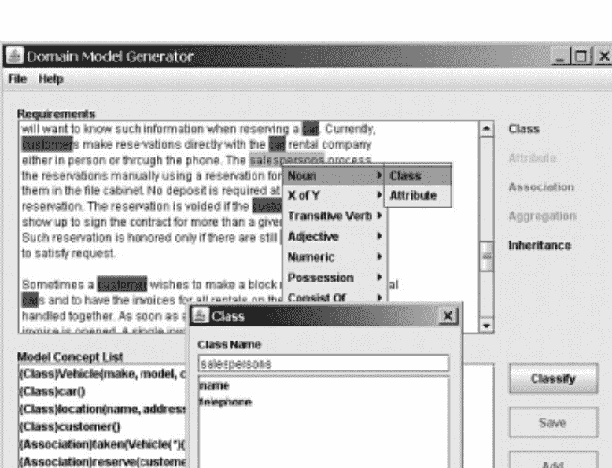

图 5.21 手动识别和手动分类

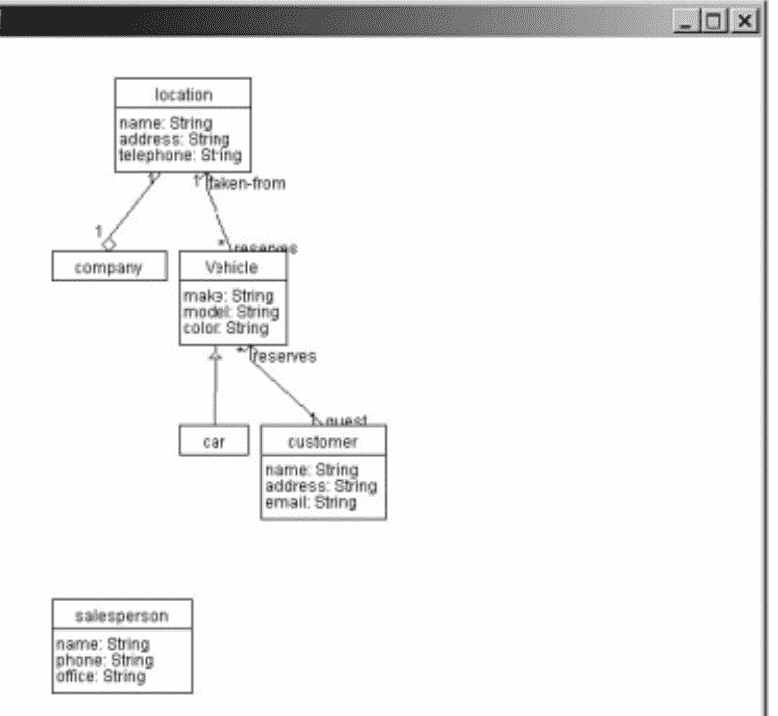

图 5.22 生成的领域模型类图

## 总结

本章介绍了领域模型的用处，以及为给定应用构建领域模型的步骤。需要认识到，领域建模不仅仅是绘制一张 UML 类图。前三个和最后三个领域建模步骤是重大的，需要充分的决策。它们包括收集应用领域的信息、头脑风暴、分类以及发现缺失的信息。从这个意义上说，绘制领域模型是最简单的一步。本章解释了意图定义和扩展定义这两种定义技术。回顾了重要的面向对象概念，包括：

- 类、对象、继承、多态、聚合和关联。

本章介绍了 UML 类图建模的概念、结构以及指南，并指出本章并非旨在提供某些建模结构的使用方法。它应该是对 UML 类图的完整覆盖。相反，它旨在展示领域建模中常用的子集。以租车应用为例，说明了领域建模方法论和 UML 类图。这个示例规模较小，但足够足够演示该方法论以及领域建模中常用的大多数 UML 类图特征。

## 延伸阅读

参考文献 [36] 是学习 UML 类图的良好来源。可以在对象管理组网站（`www.omg.org`）找到 UML 的全面规范。UML 类图符号是在 OMT [31] 中提出的，该文献还包含了一种识别类、属性和关联的方法论。Blaha 和 Rumbaugh [30] 修改了 UML 2.0 的方法论。

## 思考

1. 领域建模目的是目的是？
2. 领域建模的步骤有哪些？
3. 领域模型头脑风暴规则是什么？
4. 领域概念分类规则是什么？
5. UML 类图的建模概念和结构是什么？
6. 领域建模指南有哪些？
7. 你如何将敏捷原则应用于领域建模？

## 习题

### 5.1

一个有向图 `G = (V, E, L)` 由一组顶点 `V = \{v_1, v_2, \dots, v_n\}`、一组标签边 `L` 和一组有向边 `E \subseteq V \times V \times L` 组成。假设你负责设计并实现一个图形编辑器，即用于绘制和编辑图模型的编辑器。你需要构建一个领域模型。此习题要求你执行以下操作：

a. 为图生成文本描述。该描述必须描述图的元素（如顶点和边）以及元素之间的关系。

b. 按照 5.4.2 节所述对文本描述应用头脑风暴规则并产生头脑风暴结果。

c. 按照 5.4.3 节所述对头脑风暴结果进行分类并产生分类结果。

d. 将分类结果转换为 UML 类图。

### 5.2

为酒店预订系统生成一页的业务操作描述。说明实际且合理的假设。

### 5.3

使用习题 5.2 产生的描述对酒店预订系统执行头脑风暴步骤。

### 5.4

对习题 5.3 产生的酒店预订系统头脑风暴结果执行分类步骤。

### 5.5

根据习题 5.4 产生的分类结果，绘制一个作为领域模型的 UML 类图。

### 5.6

使用 5.4.5 节中的评审检查表审查习题 5.5 产生的领域模型类图。编写一份回答评审列表问题的评审报告。

### 5.7

选择另一个应用，并对该应用完成上述习题。

### 5.8

假设你负责开发一个 UML 类图的图形编辑器。此习题要求你执行领域建模步骤，并产生一个描述图 5.1 所示建模概念的领域模型。*提示*：此习题类似于习题 5.1。

# 第 6 章 架构设计

## 要点

- 系统或子系统的软件架构是指主要组件之间接口和交互的设计风格。
- 不同类型的系统需要不同的架构风格。
- 软件架构的示例包括常见的体系架构、客户端/服务器架构和模型-视图-控制器（MVC）架构。

## 6.1 什么是架构设计？

软件系统的架构设计类似于建筑的建筑设计。建筑有房间和子系统，如空调、电气、燃气供水以及水水。这些每一个都有其用途，并对建筑的整体功能和实用性做出贡献。建筑设计突出了主要设施和子系统以及它们是如何关联和工作的。软件架构设计也是如此。定义如下：

> 定义 6.1 系统或子系统的软件架构是指系统组件接口和交互的设计风格。

> 定义 6.2 软件架构设计（或简称架构设计）是确定系统软件架构的决策过程。

## 案例：数据库耦合问题

大约在1990年，Ontologies 提供了类似于 C++ 的查询语言。这意味着 C++ 程序可以直接访问数据库。也就是说，业务对象与数据库实现了“良好的集成”。然而，这种集成（或称为紧耦合）如果处理不当，可能会带来麻烦。例如，应用程序代码高度依赖于数据库。如果数据库被替换，那么大部分应用程序代码都需要重写。为了防止这种情况，有人建议开发一个数据库包装器（wrapper），以从业务对象中隐藏数据库。这在数据库发生变化或替换时为业务对象提供了保护。如果发生这种情况，只需要更改包装器而不需要更改业务对象。更改包装器比更改业务对象要容易得多。学生将在第 17 章中看到，这实际上是一个持久化框架的设计。遗憾的是，开发团队拒绝了它，因为它被认为太复杂、效率低下且需要的工作量过大。那是在项目初期。

十个月后，在大部分系统实现后，出现了一个传言，供应商内部存在权力斗争。作为结果，作为关键技术人员的联合创始人威胁要离开公司并成立另一家公司。依赖 Ontologies 的开发团队感到很紧张，并希望 Ontologies 的人员能留下来。一个月后，传言变成了现实——联合创始人离开了 Ontologies 并成立了一家新公司。这对于项目的成功完成是灾难性的。开发团队开始实现数据库包装器，但已经太晚了。项目严重落后进度。几个月后，Ontologies 供应商破产了。几个月后，团队被解雇了。

## 6.3 架构设计过程

软件系统或子系统的架构设计过程是一个决策认知过程。它需要考虑许多因素。要开发的系统类型是一个重要的考虑因素。经验表明，系统的类型会影响架构风格的选择。例如，交互式系统通常使用 N 层架构，事件驱动系统使用嵌入式系统架构，而变换型系统使用主程序和子程序架构。设计目标也会影响架构风格的选择。例如，如果设计安全是一个重要的设计目标，则应该使用安全架构风格。有时，要开发的软件系统并不存在对应的架构风格。在这种情况下，会对软件架构进行定制设计。

架构设计也是一个递归过程。这是因为系统由子系统组成，子系统又由更低级的子系统或组件组成，以此此类推。设计过程需要递归执行，直到叶节点组件变得相对容易设计和实现。遗憾的是，没有明确定义的停止规则——它取决于许多因素，包括系统的规模和复杂度、开发团队的经验以及设计目标。

## 第二部分 分析与架构设计

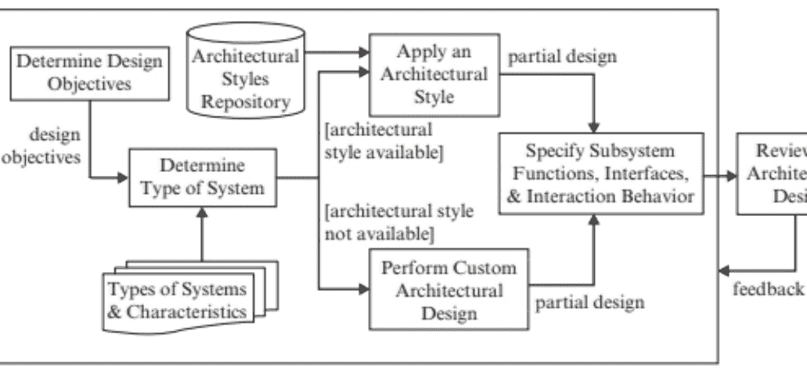

图 6.1 架构设计过程

图 6.1 显示了架构设计过程，该过程应对系统以及在此设计过程中识别出的子系统递归执行。

1. **确定设计目标。** 在这一步中，识别并指定总体设计目标。例如，设计旨在提供软件容错、安全性和性能最大化。总体设计目标可以从需求中发现或推导出。
2. **确定系统类型。** 在这一步中，确定系统或子系统的类型。系统类型和设计目标用于从仓库中选择架构风格。
3. **应用架构风格或进行定制架构设计。** 如果可以应用架构风格，则在此步应用该风格以产生“标准”架构设计；否则产生定制设计。
4. **指定子系统功能、接口和交互行为。** 在这一步中，定义子系统之间的接口并指定子系统之间的交互行为。
5. **评审架构设计。** 在这一步中，对架构设计进行评审，以确保其满足需求、设计目标和软件设计原则。

### 6.3.1 确定架构设计目标

架构设计旨在为软件系统产生一个整体结构。然而，这个目标太抽象了没有用。对于一个系统的良好的架构设计对于另一个系统并不一定良好。因此，应该确定要开发的系统的架构设计目标并用其指导设计过程。架构设计目标指定了通过设计完成的系统属性或方面。不同的应用有不同的业务目标和优先级，这些会影响设计决策。因此，在决定设计目标时应考虑到这些。有时，架构设计目标可以从软件需求（包括质量和安全需求）中推导出。此类需求或变化因素的部分列表应考虑如下：

1. **维护的易改性。** 应用程序是否需要频繁更改系统以响应应用程序的变化（例如响应需求变更）？
2. **商业现成 (COTS) 零件的使用。** 项目是否要求或禁止使用 COTS，这种重用的程度如何？
3. **系统性能。** 应用程序是否需要高性能（例如为了处理实时数据或海量交易）？
4. **可靠性。** 应用程序在多大程度上要求系统在假设条件下正确执行其预期功能？
5. **安全性。** 应用程序对数据和程序资源需要的保护程度如何？
6. **软件容错。** 当发生软件问题时，应用程序在多大程度上要求系统继续运行？
7. **恢复。** 在系统崩溃后，应用程序在多大程度上要求系统返回之前的状态？

### 6.3.2 确定系统类型

系统类型会影响系统的建模、分析、设计、实现和测试。因此，在为系统设计软件架构时应考虑这一点。后续章节解释了系统类型对选择设计方法和架构的影响。讨论了四种常见的系统及其行为（见图 6.2），以及其他类型的系统。这四种系统是交互式系统、事件驱动系统、变换型系统和数据库子系统。使用“应用系统类型”一词是为了将其区别于文件服务器和文件传输系统等基础设施类型的系统。为了简单起见，本文使用“系统类型”代替“应用系统类型”。

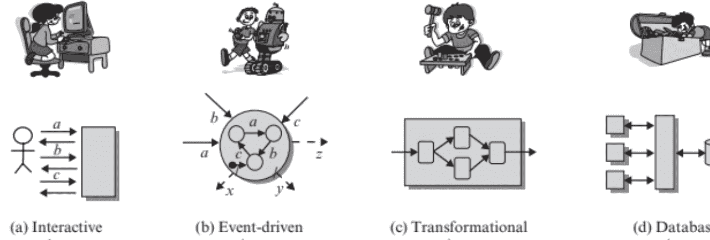

(a) 交互式子系统

(b) 事件驱动子系统

(c) 变换型子系统

(d) 数据库子系统

图 6.2 系统及其行为

交互式系统的特征是系统与参与者执行任务之间的交互。参与者是与系统交互的外部实体扮演的角色。事件驱动系统的特征是系统对外部刺激的状态依赖和响应行为。变换型系统的特征是信息处理活动。数据库子系统为其他类型的系统提供持久性数据支持。

### 对设计方法和架构的影响

有时，某种建模和设计方法对一个项目有效，对另一个项目则无效。可能的原因是系统类型与设计方法之间不匹配。另一个原因是系统类型与软件架构之间不匹配。考虑结构化分析和结构化设计 (SA/SD) 方法。它非常适用于变换型系统，这种系统可以通过产生和消耗的数据流连接的过程网络进行建模。这意味着系统实际上将输入转换为最终输出。变换型系统与主程序和子程序架构相关。SA/SD 方法不适用于实时嵌入式系统的分析和设计。这类系统表现出状态依赖行为，而不是变换行为。状态依赖行为需要不同的设计方法并导致不同的软件架构（即事件驱动系统架构）。

#### 交互式系统

交互式系统通常具有以下特性：

1. 系统与参与者执行业务过程的交互由一系列相对固定的参与者请求和系统响应组成，如图6.2(a)所示。
2. 系统处理并响应参与者的每个请求。
3. 通常，系统在用例过程中只与一个参与者交互。
4. 参与者通常是人类，也可以是设备或其他子系统。
5. 交互以参与者开始并结束。
6. 参与者和系统表现出某种客户端服务器关系，即参与者请求服务而系统提供服务。当参与者是另一个系统时，这种客户端服务器关系变得更加明显。
7. 系统状态通常反映用例所呈现的业务过程的进度。

由于桌面和网络应用程序的广泛使用，交互式系统是最常见的。相对固定的交互序列可以从典型的登录过程中看到。要登录系统，用户点击登录链接，系统显示登录页面，用户输入

# 第 6 章 架构设计

如果登录 ID 或密码无效，系统将显示欢迎页或错误消息。

为了使系统状态能够反映业务流程的进度，请考虑在线购物的过程。客户登录、选择商品，然后结账。如果客户没有登录，他将无法进行结账，因为系统维护了进度状态。在结账期间，客户必须提供收货地址、选择支付类型并提供与支付相关的信息。同样，系统状态反映了业务流程的进度状态。系统利用这一过程来防止客户执行不符合业务流程步骤的操作。

交互式系统的建模和设计通常从识别和规范用例开始，用例代表了由参与者启动并结束的业务流程。随后，在对象交互建模中对用例进行细化，以指定系统中的对象如何相互交互以执行业务任务的后台处理。对象交互建模将在第 9 章进行研究。

## 事件驱动系统

事件驱动系统通常表现出依赖状态的响应式行为以及以下属性：

1. 系统接收事件并控制外部实体。
2. 通常，事件驱动系统没有固定的输入请求序列；请求随机到达系统。
3. 事件驱动系统并不需要响应每个传入的事件。其响应取决于状态——如果系统处于不同的状态，同一个事件可能会产生不同的响应。系统也可能忽略某个传入的事件。
4. 事件驱动系统经常同时与多个一个外部实体进行交互。
5. 外部实体通常是硬件设备或其他软件组件而非人类。
6. 系统可能不会反映计算的进度。状态可能代表系统条件的循环出现。例如，系统可能处于空闲状态，然后进入“处理事件 A”状态，最后返回空闲状态。
7. 系统可能需要满足时序约束、时序约束和定时时序约束。此类约束的示例包括：
   - 每个拨号数字的处理时间不能超过 N 毫秒——时序约束。
   - 在传输完指定数量的铃声后，发送欢迎语——时序约束，规定了预期的事件序列。
   - 在发送按讲说话（PTT）信号后，网络识别码（NID）必须在 N 毫秒内传输——定时时序约束，规定了两个事件之间的时序约束。


事件驱动子系统常见的嵌入式系统中，其中软件子系统嵌入由硬件和软件组成的整个系统中。软件子系统接收设备生成的随机到达事件，解释并处理这些事件，并指示驱动或控制适当的设备。事件驱动系统通过状态图建模，如图 6.2(b) 所示，其中 a、b 和 c 是随机到达的事件，而 x、y、z 是控制设备的相应响应。事件驱动子系统的建模和设计是第 13 章的主题（事件驱动系统的状态建模）。

## 变换系统

变换系统通常表现出以下属性：

1. 变换系统在概念上可以被视为由信息处理活动网络组成，每个活动都将其输入转换为输出，如图 6.2(c) 所示。
2. 这种网络可能涉及表现出顺序性、条件分支和并行线程的控制流，以及同步和异步行为。
3. 在从输入转换为输出的过程中，系统与参与者之间几乎或没有交互——它在多程度上是一个批处理过程。
4. 变换系统通常是无状态的。
5. 变换系统可能需要数值计算或计算密集型算法。
6. 变换系统的参与者可以是人类、设备或其他系统。

变换系统常见于科学计算或工程计算，但也可以出现在工作流管理和业务数据挖掘等业务应用中。一个熟悉且简单的例子是编译器，它通过四个阶段将源代码转换为可执行代码：(1) 词法分析，将源代码转换为标记流，例如标识符、操作符和保留字；(2) 句法分析，将标记流转换为程序语句；(3) 代码生成，为每个程序语句产生可执行代码；以及 (4) 代码优化，提高可执行代码的性能和效率。在此期间，参与者与编译器之间几乎或没有交互。

一个更复杂的例子是工作流管理，其中请求或任务通过不同部门的多个阶段进行处理，并可能需要决策、同步和并发处理。在每个部门，人员可能会与激活该部门活动的子系统进行交互。从这个意义上说，该子系统是变换系统的交互式子系统。变换系统的建模和设计是第 14 章的主题（变换系统的活动建模）。

## 对象持久化子系统

对象持久化子系统是一种提供了从数据库或文件系统中存储和检索对象的能力的子系统，同时隐藏存储介质。由于使用了数据库，为了方便起见，也被称为数据库子系统。数据库子系统表现出以下属性：

1. 它向系统其他部分隐藏数据库，并保护其他部分不受数据库实现变化。
2. 与其他三种子系统不同，数据库子系统仅负责从数据库存储和检索对象。只有在少数需要提高性能的情况下，才会进行业务处理。
3. 数据库子系统能够高效存储、检索和更新大量的复杂数据。

## 系统与子系统

系统和子系统的概念是相对的。也就是说，系统是更大系统的子系统。一个系统是独立的，并由子系统组成。通常，一个大系统可能由不同类型的子系统组成。例如，一个交互系统可能包含一个事件驱动子系统、一个变换系统和一个数据库子系统。这意味着需要与正在开发的子系统类型匹配的设计方法。

由根程序或主程序执行，并由后代递归地向下树执行。它适用于设计转换型或工作流导向的系统。

4. 事件驱动系统架构。这种架构风格由一个基于状态的控制器组成，它与多个组件交互并控制它们。控制器了解组件，反之亦然，但组件之间彼此并不感知。组件之间的交互由控制器调解。它适用于设计事件驱动的嵌入式系统。

5. 持久化框架架构。这种架构风格通过将数据库和文件系统与使用它们的对象解耦，从而隐藏了它们。也就是说，对象感知不到此类存储设备的存在；因此，对数据库和文件系统的所有更改都不会对对象产生影响。

## 系统类型与架构风格


如前所述，不同类型的系统与不同的架构风格相关。这些在图 6.3 中所示，图中还概述了每种系统的特征以及它们与其他类型的区别。该表有助于根据要开发的系统类型确定要采用的架构风格。近年来，由于对计算机安全的关注，安全模式和安全架构风格正越来越受到关注。安全模式和架构风格将在第 24 章中介绍。

## N 层架构风格

在 N 层架构中，系统被结构成若干层级层，如图 6.4(a) 所示。服务请求从一层发送到下一层较低层。应避免从低层向高层发送请求。图 6.4(b) 显示了一个示例，其中类和对象被分为五层。图形用户界面 (GUI) 是一组负责表示信息以及用于菜单和按钮的对象。这些对象调用控制器层中控制器对象的函数。每个控制器负责处理与特定用例相关的事件。在大多数情况下，用例与控制器对象之间存在一一对应的关系，并用用例命名。例如，图书馆信息系统有一个 `Checkout Document`（借阅文档）对象，这意味着有一个 `Checkout Controller`（借阅控制器）类。该类的对象负责在用户输入并点击按钮时处理与借阅文档相关的事件。

当用户点击按钮提交请求时，GUI 将请求传递给用例控制器。例如，如果用户想要借阅文档，GUI 会将请求发送给 `Checkout Controller` 对象。后者请求数据库层从数据库检索相应的 `User`（用户）和 `Document`（文档）对象。控制器创建 `Loan`（贷款）对象并将 `Document` 对象的状态更新为“checked out”（已借出）。然后它通过数据库接口将对象保存到数据库。如果需要网络通信（例如数据库位于远程站点），则还会涉及网络通信层。

## 第 6 章架构设计

| 系统类型/子系统 | 子系统特征亮点 | 架构风格 | 区别 |
|---|---|---|---|
| 交互式 | 参与者启动并与系统交互以执行业务流程，使用预定义的交互协议。 | N 层 | 与事件驱动子系统的区别：<br>1. 系统在每次会话期间仅与一个参与者交互。<br>2. 系统事件按定义的顺序到达。<br>3. 系统必须响应每个系统事件。 |
| 事件驱动 | 系统表现出依赖状态的响应式行为。它处理来自外部实体的事件并向外部发布指令。 | 事件驱动架构 | 与启发式问题求解、客户端-服务器和过度持久化的区别：<br>1. 依赖状态的响应式行为。<br>2. 外部实体可能可能不协作。 |
| 转换型 | 一组相互连接的信息处理活动为给定的输入产生输出——例如，输入被转换为输出。 | 主程序和子程序 | 与其他子系统的区别：<br>1. 强调一系列信息处理活动。<br>2. 输入到输出的转换。 |
| 对象持久化 | 通过将对象从数据库实现隔离，在应用程序之间提供持久化和共享。 | 持久化框架 | 与启发式问题求解的区别：<br>1. 它提供了对象持久化和共享。<br>2. 它处理大量记录。<br>3. 它隐藏了数据库对象。 |
| 客户端-服务器 | 一个专用的、高性能的提供者，可以通过网络被其他子系统或组件请求。 | 客户端-服务器 | 与启发式问题求解的区别：<br>1. 服务器请求工作。<br>2. 客户端不共享。<br>3. 客户端出于不同目的使用服务。 |
| 分布式、去中心化 | 分布且独立的子系统通过服务网络相互通信。 | 点对点网络 | 与黑板模式和客户端-服务器的区别：<br>1. 节点既是客户端也是服务器。<br>2. 节点解决自己的问题。 |
| 启发式问题求解 | 智能问题求解组件通过共享存储库进行通信和协作，以开发针对给定问题的解决方案。 | 黑板 | 与客户端-服务器的区别：<br>1. 组件执行工作。<br>2. 黑板仅为共享数据存储库。<br>3. 组件共同解决问题。 |

**图 6.3** 系统类型到架构风格的映射

图 6.4(b) 中的 N 层架构通常用作交互式系统的架构设计。此类系统通过用例与用户交互，如之前描述的 `Checkout Document` 用例所示。N 层将交互式系统的对象划分为层，每层被分配了若干相关职责。例如，用于显示信息和 GUI 控件的 GUI 层、用于处理用例相关事件的控制器层、业务对象集合层、用于与数据库存储和检索对象的数据库层，以及与远程站点通信的网络通信层。

尽管如此，N 层架构并不限于交互式系统。例如，ISO 七层模型是一种用于网络通信的七层架构。N 层架构也用于操作系统和安全系统。设计安全系统的方法之一要求层向下一层较低层进行身份验证。这为入侵者制造了 N 个障碍，并保护了宝贵的数据和程序资源。N 层架构规范了若干项软件设计原则，这些原则将在 6.5 节介绍。例如，*关注点分离*通过将不同关注点的对象分组到不同的层来实现。结果是实现了*高内聚*和设计“愚蠢对象”。由于每层都隐藏了底层并屏蔽了底层更改的影响，从而支持了*信息隐藏*和*面向变化的设计*。

## 客户端-服务器架构风格

客户端-服务器架构由一个服务器和多个客户端组成，如图 6.5 所示。该图显示了第 3 章介绍的机场行李处理系统 (ABHS) 部分的架构设计。ABHS 提供旅客值机——

**图 6.4** N 层架构

**图 6.5** 应用客户端-服务器架构风格

# 第 6 章 架构设计 151

位于机场不同终端的计算机。这些计算机需要访问航班信息系统，以检索航班信息，并更新旅客办理机状态和航班状态。在这种情况下，办理机计算机是客户端，航班信息系统是服务器。客户端通过远程过程调用或其他网络通信协议向服务器发送服务请求。服务器处理请求并将结果发送给客户端。客户端知道服务器，但不知道其他客户端。这意味着可以自由地系统中添加或删除客户端，而不会影响服务器的工作（性能影响除外）。通常，客户端和服务器位于不同位置的不同物理机器上。

客户端-服务器架构适用于需要指定的子系统为其他子系统提供服务的应用程序，这些子系统可能位于其他机器上。如果大多数需要的服务都由服务器提供，则客户端可以是轻量级的。例如，在 ABHS 中，旅客办理机客户端是轻量级客户端。除了 ABHS，现实应用中还有许多其他客户端-服务器架构的示例，包括大多数基于 Web 的应用程序、文件服务器和文件传输协议（ftp）。

## 主程序与子程序架构风格

主程序与子程序架构具有树形结构，如图 6.6(a) 所示。它由一个主程序和若干子程序组成。主


(a) 主程序与子程序架构

- 输入格式化过程映射到子程序 4 和 5
- 执行特定特定计算的过程被映射到子程序 6-8
- 输出格式化过程被映射到子程序 9 和 10

(b) 数据流模型及其到架构设计的映射

# 图 6.6 主程序与子程序架构

程序调用其子子程序，子程序反过来调用更层级的子程序。通常，子程序是从左到右被调用的。如果两个父节点调用同一个子子程序，主程序与子程序架构可能具有网格结构。编写过 C 或 Fortran 等过程化语言的学生应该对这种架构熟悉。

主程序与子程序架构通常被用作事务系统的架构设计。它源自 SA/SD 中的数据流图。如图所示，接下来的段落描述了图 6.6(a) 中的架构是如何从图 6.6(b) 所示的数据流图中推导出来的。在继续之前，由于数据流图的过程可以分为三大类：

**格式化过程。** 这些过程中的每一个都将其输入转换为产生不同格式的输出。例如，提交的 html 表单被转换为一个结构体。格式化过程只改变表示形式，不改变内容。

**转换过程。** 这些过程中的每一个都执行与应用程序相关的处理，将输入转换为在语义上不同的输出。例如，输入是搜索标准，输出是满足搜索标准的列表列表。

**分发过程。** 分发过程分析其输入，并根据事务类型将输入重定向到后继过程之一，由后继过程处理不同类型的事务。

从图 6.6(b) 推导主程序与子程序架构从初始的 i0 开始，追踪过程 P1, P2, ... 直到转换过程或分发过程。例如，过程 P3 是一个转换过程。追踪持续到找到格式化过程，追踪识别了格式化过程 P1 和 P2、转换过程 P3、P4 和 P5 以及输出格式化过程 P6 和 P7。这些被映射到图 6.6(a) 中的最低级子程序。注意，子程序 1 到 3 是驱动程序，它们调用输入格式化、转换和输出子程序。图 6.6(b) 中的数据流图是一个中心数据流图。以事务为中心的数据流图具有一个分发过程，该过程具有输出数据流指向处理不同类型事务的转换过程。从事务为中心的数据流图推导主程序与子程序架构是类似的，只是分发过程映射到主程序或根据事务类型调用其一个子程序的子程序。

考虑集成开发环境（IDE）的设计。IDE 的功能包括编译源程序以及对源代码进行逆向工程以生成 UML 图。生成的图可以由用户选择。为了简单起见，只考虑一种编程语言。为了编译源码生成可执行代码，编译器执行以下任务，由四个组件实现：

1. **词法分析。** 此任务分析源程序中的单词并将其分类为不同类型的标记（tokens）。例如，“1stYear”是无效的，而“year1”、“static”和“++”被识别为标识符、保留字和运算符。此任务的输出是一个标记流，每个标记都有类型、值和其他属性。输出传递给语法分析，见下文。

2. **语法分析。** 此任务分析程序语句的语法，并产生一个表示表示的语法树。语法分析的输出是代码生成的输入。

3. **代码生成。** 此任务对语法树进行后序遍历，并在访问每个节点时生成可执行代码。例如，当访问节点 a 和 b 时，它们的值以某种方式加载。当访问节点 + 时，对其两个子节点的值执行加法运算并存储结果。此步骤的输出传递给代码优化，见下文。

4. **代码优化。** 此任务使用代码优化技术对生成的可执行代码进行优化。

逆向工程的功能类似，只是代码生成和代码优化分别被图形生成和图形显示取代。然而，对于支持的每种 UML 图，都有具体的图形生成器和具体的图形显示器。图 6.7(a) 显示了数据流

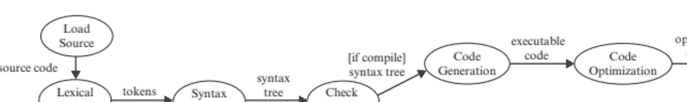

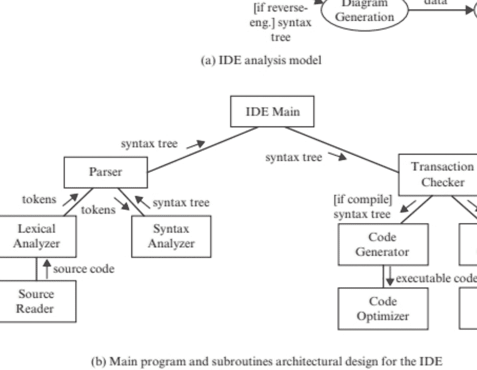

FIGURE 6.7 应用主程序与子程序架构风格

# 第 6 章 架构设计 153

# 154 第二部分 分析与架构设计

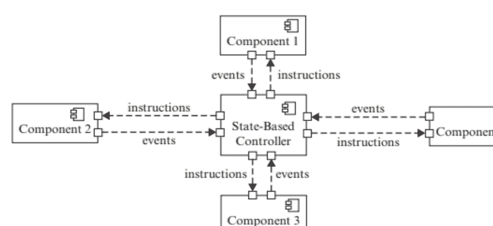

FIGURE 6.8 事件驱动系统架构

上述 IDE 的数据流图。IDE 的主程序与子程序架构设计如图 6.7(b) 所示，其中描述了一个图形生成器和一个图形播放器。

# 事件驱动系统架构

事件驱动系统架构（EDSA）由基于状态的控制器和若干受控的组件组成。图 6.8 展示了这样的架构。如讨论，事件驱动系统表现出依赖状态的行为。这种行为由控制器实现，受控组件向控制器发送事件，控制器处理事件到状态行为并向受控组件发送指令。

图 6.9 展示了基础窗式空调软件系统的架构设计。软件实现了一个简单的状态机。它接收来自空调开关和房间温度传感器的事件，并发送指令控制风扇和冷凝器。冷凝器冷却空气，风扇循环空气以冷却房间。软件存储并运行在微控制器上。

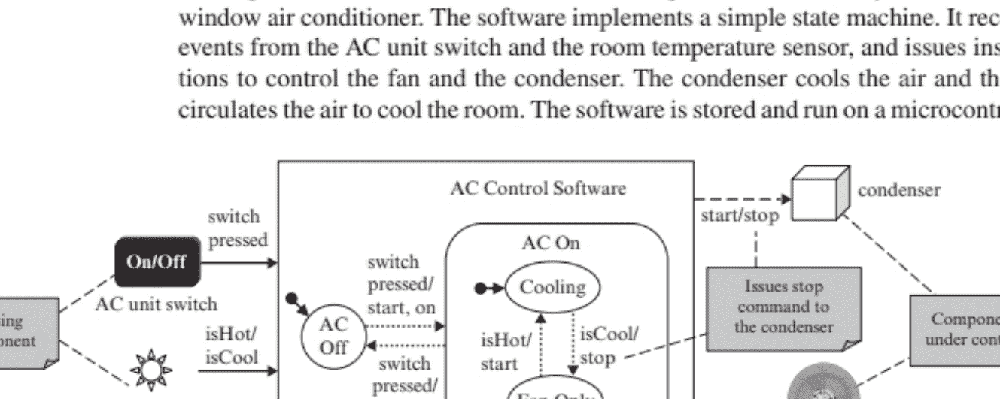

FIGURE 6.9 事件驱动系统的插图

# 第 6 章 架构设计

集成电路（IC）芯片。IC芯片具有输入引脚和输出引脚。输入引脚连接到空调开关和温度传感器。输出引脚连接到风扇和冷凝器。每个引脚代表一个位；其值由电压决定，例如，高电为 1，低电为 0。通过读取和设置 IC芯片的引脚，软件可以接收传入事件或控制风扇和冷凝器。例如，要启动冷凝器，将指定的引脚设置为 1；要停止冷凝器，将引脚设置为 0。

每当按下空调开关时，软件的状态就会从“空调关闭”变为“空调开启”，反之亦然。也就是说，开关在开启和关闭之间切换。软件发出相应的开启/关闭和启动/停止命令来控制风扇和冷凝器。在“空调状态”下，软件使用来自温度传感器的温度状态来启动或停止冷凝器。如果软件处于“仅风扇”状态且室内温度较高，软件将切换到“冷却”状态并同时停止冷凝器。如果已经处于“冷却”状态，则忽略“热事件（HotEvent）”。所有其他转换都可以以类似的方式解释。

N 层架构或客户端-服务器架构都不是解决上述控制问题的合适架构设计解决方案。由于由于问题和架构都是事件驱动且依赖于状态的。例如，N 层架构很难处理来自空调开关的开启/关闭事件，因为 N 层架构样式并不记得之前的状态。它不知道下一个是什么。人们可以添加一个状态变量，但这样做会改变架构，使它就不再是 N 层架构了。在客户端-服务器架构中，客户端知道服务器，但服务器不知道客户端。如果将其用作窗机空调的架构，当室内温度传感器触发状态转换时，它将不知道向哪个设备发送控制命令。如果空调控制软件未处于适当状态，则可以忽略某个事件。然而，N 层架构的每一层和客户端-服务器架构的服务器都必须响应它们收到的每一个请求。它们不知道哪个事件应该被处理，哪个事件应该被忽略——它们必须处理每一个请求。

# 持久化框架架构风格

面向对象的系统需要保存数据并在之后检索它们，即在不同会话之间。这通常被称为对象持久化。持久化框架架构通过许多新功能提供了这种能力。这包括关注点分离、信息隐藏、面向变化的设计以及保持简单愚蠢（KISS）。图 6.10 展示了这种架构风格如何应用于不同类型的数据库。这些包括关系型数据库、网络数据库、层次结构数据库和对象型数据库。此外，数据库可能来自不同的供应商。如果不使用持久化框架架构风格，每个业务对象都必须知道如何访问不同供应商的不同类型数据库。业务对象还必须知道数据在数据库中的组织方式。这些增加了业务对象的复杂性。

持久化框架风格使用数据库管理器为业务对象提供一个面向对象的接口。数据库管理器将请求委托给

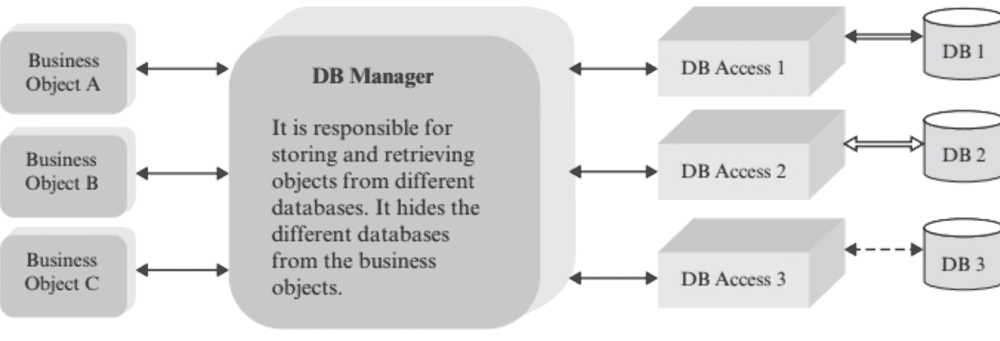

- 使用面向对象的实现语言进行通信
- 使用面向对象的实现语言进行通信
- 使用 DBMS 特定的语言进行通信

从业务对象到数据库访问对象，数据库访问对象与来自不同供应商的不同类型数据库进行通信。这极地简化了业务对象的设计、实现、测试和维护。

# 其他架构风格

在前面的节介绍的架构风格外，文献中经常提到其他架构风格。以下是部分列表。其他的将在第五部分（应用特定场景模式）中介绍。

- *对等点（Peer-to-peer）*：对等点（P2P）架构由网络协议连接的独立组件组成。它通常用于去中心化或分布式计算应用。使用这种架构构建的系统具有高度健壮性，因为一个组件的故障对系统运行的影响很小。它也具有高度的灵活扩展性，因为可以轻松添加或删除组件。

- *管道-过滤器（Pipe-and-filter）*：管道-过滤器架构由一系列被称为“过滤器”的程序组成，这些程序以流水线的方式通过“管道”相互连接。因此，它也被称为流水线架构。它被广泛用于 shell 编程中的批处理，其中一个可执行程序的输出被传给下一个程序。进程间通信的简单性促进了程序的新颖组合以实现所需的计算任务。

- *黑板（Blackboard）*：黑板架构有一个全局数据存储库称为“黑板（boardcurly）”，以及通过存储库通信的独立组件。独立组件可以直接更新数据，也可以通过黑板提供的服务更新数据。在某种意义上，这种安排简化了独立组件之间的交互。然而，如果设计和实现不当，并发更新可能会导致不可预的副作用。

- *面向服务的架构（SOA）*：SOA 被视为一种策略、实践和框架，这些框架使得业务功能能够作为服务被提供和消费。一个 SOA 由服务提供者、服务消费者以及管理两者之间服务的架构组成。服务是某个领域内业务的抽象和实现，对应接口和一个实现。与函数调用不同，服务是通过使用 http 协议和 XML 调用的。

- *云计算架构（Cloud computing architecture）*：云计算是 SOA 的扩展，是将整个应用程序软件作为服务（SaaS），而不是将业务功能作为服务。服务提供者根据需求向服务消费者许可应用程序软件。服务消费者可能根据实际使用情况收费。SaaS 的示例是 Google Apps。

# 6.3.4 执行自定义架构设计

重用架构风格总是首选，因为它不仅节省了时间和精力，还为系统带来了质量。必要条件是选择了正确的架构风格并进行了正确应用。然而，并非所有的应用开发都能重用架构风格。

例如，考虑一个需要在发生软件故障时仍能运行的关键系统的设计。如果没有架构风格能满足设计目标，则需要架构的自定义设计。实现软件容错的一种方法是使用对象多样性，即设计并实现许多不同的系统版本，运行其中一个作为活动版本，并在发生故障时切换到备份版本。为了实现这一点，识别出子系统中需要软件容错的关键组件。为组件定义一个通用接口。要求不同的团队来实现该接口以产生组件的多个实现。要求这些实现使用不同的数据结构和算法。

软件设计模式对于系统架构的自定义设计非常有用。例如，上述需要软件容错的关键组件的架构设计使用了桥接模式和记忆模式。这些模式在第 16 和 17 章介绍。桥接模式允许系统透明地切换到关键组件的不同实现，这意味着关键组件的客户端感知不到切换。记忆模式允许系统在执行可能导致软件故障的操作之前存储组件的状态。这样，替换实现就可以将其初始化到存储的状态以重新运行操作。

# 6.3.5 指定子系统功能和接口

在这一步，将软件需求和设计目标分配给架构的系统和组件。有时，必须将某些需求分解为更低级的需求，以便于将需求分配给子系统。然后根据这些需求和设计目标，规定每个子系统和组件的功能。例如，反向工程 UML 类图、时序图、活动图和状态图的需求被分配给图 6.7 中的图形生成器（Diagram Generator）组件。性能需求被分配给一个或多个与性能相关的子系统或组件。容错设计目标被分配给需要提供此类能力的关键任务子系统。

在这一步中规定子系统之间的接口。接口规范定义了每个子系统的输入和输出，包括输入参数的数量、类型和顺序，输出参数也同样如此。还规定了子系统之间的交互行为——即在子系统之间要交换的消息序列的规范。

## 6.3.6 评审架构设计

对架构设计进行评审，以确保满足设计目标和软件需求。评审还验证了设计是否遵循第 6.5 节描述的软件设计原则。

## 6.4 架构风格与包图

软件架构根据子系统及其相互关系定义了软件系统的结构。正如本章开头提到的，软件架构是用于开发中系统进行概念化、构建、管理和演进的主要构件。这些意义如下：


1. **概念化**

架构定义了系统的整体结构。因此，在随后的开发活动中，架构帮助开发团队从整体结构的角度考虑系统。

例如，考虑 N 层架构。它将系统描述为由 N 层组件组成，每一高层都向下一层低层请求服务。系统的全景被称为系统的概念化。软件架构一旦定义，就能帮助团队统一系统结构的概念化。

2. **构建**

架构有助于软件系统的构建，因为它让团队成员知道如何组织在开发过程中产生的软件构件。

再次考虑交互式系统的 N 层架构。它通常包含以下层（从高到低列出）：

a. *表现层。*该层负责向用户展示图形化用户界面和系统响应。

b. *业务对象层。*该层负责处理由用例表示的业务事务。

c. *持久化存储层。*该层由提供与数据库相关功能（如对象存储和检索）的对象组成。

d. 网络通信层。该层提供与网络通信相关的功能。

层与层之间的职责和依赖关系有助于构建过程。例如，开发某一层的任务应该分配给具备相应知识和技能的团队成员。层应该根据它们的依赖关系进行构建。也就是说，低层应该在下一层高层之前开发，这样高层类的实现和测试就可以进行，而无需构建模拟未实现或未测试的低层的测试存根（stubs）。

3. **管理**

软件架构为组织开发过程中产生的软件构件提供了一种架构视图。例如，为活动系统创建的类、网页和图像等软件构件可以根据 N 层架构的层级进行组织。这种组织通常被称为逻辑组织或逻辑架构。它是逻辑上的，而非物理上的，因为这些元素不是可执行文件。

4. **演进**

架构为系统的演进和扩展提供了基础。例如，图书馆信息系统是一个交互式系统。最初，该系统设计得并不支持跨馆借阅，可能是由于预算限制。后来，系统需要提供跨馆借阅功能。在这种情况下，N 层架构通过要求增加网络通信层，促进了系统的演进。

为了在开发活动中从软件架构中获益，团队需要组织开发过程中产生的软件构件。UML 包图提供了实现这一点的机制。UML 包图的概念和表示如图 6.11(a) 所示。

为了说明，假设一个图书馆信息系统设计为使用 N 层架构。架构的四层如点 2 所示：表现层、业务对象层、数据库层和网络层。相应的包图如图 6.11(b) 所示。

该图显示图书馆信息系统有四个包，每个包对应一个层架构。GUI 包拥有四个类：`Main`、`Main Frame`、`Checkout Dialog`（结算对话框）和 `Return Dialog`（还书对话框）。其中前两个是公共类，后两个是私有类。

业务包拥有五个类：`Checkout Controller`（结算控制器）、`Return Controller`（还书控制器）、`Loan`（贷款）、`Document`（文档）和 `Patron`（读者）。前两个是公共的，后三个是私有的。

GUI 包导入业务包——导入的不是私有类。数据库包只有一个类——`Database Manager`——它被导入到业务包。

包的类可以使用文本格式或视觉格式显示。虽然 GUI、业务和数据库包在文件夹标签页中显示包名，但网络包在文件夹正文中显示其包名。这是因为前三个包显示了包的内容，而网络包没有显示内容。


| 概念 | 语义 | 记法 | 关系 |
|---|---|---|---|
| 包（Package） | 软件构件的逻辑分组，包括类、其他包以及感兴趣的其他软件构件。 |  | • 包可以拥有如类之类的软件构件。<br>• 包可以导入其他包。 |
| 导入（import） | 两个包之间的类型关系。箭头尾部的源包导入箭头指向的目标包的公共元素。 | `<<import>>` |  |

*（a）包图的概念和记法*

*（b）N 层架构视图的包图*

## 图 6.11 图书信息系统的包图

6.11(b) 中的包定义了图书馆信息系统类的逻辑组织或逻辑视图。在开发过程中，会产生大量的类以及网页、图像等构件。包图帮助团队理解哪些构件属于哪些包。

因此，包及它们拥有的构件可以从配置管理系统（第 22 章）中检入或检出。包的分级结构（一个包可以拥有其他包）有助于变更控制，因为可以在层级结构的任何层识别出需要更改的包和受影响的包。如果没有这种逻辑组织，类和其他构件的配置管理将更加困难。

架构设计。例如，将功能上无关的用例分配给一个子系统。在面向对象编程中，如果一个类封装了不相关的函数或方法，则该类具有低功能内聚性。此类类难以理解、测试和维护。

另一种类型的“坏程序”表现出所谓的高耦合问题。也就是说，程序中的函数以相当任意的方式相互调用，导致了相当复杂的调用图。显然，这类程序难以理解、测试和维护。

同样的问题在架构设计、对象设计和实现中也存在。也就是说，在子系统、组件和对象之间看到复杂的依赖关系并不起见。为了解决这些问题，人们提出了软件设计原则。本节将介绍软件设计原则，以便在设计过程中应用它们。

## 6.5.1 什么是软件设计原则？

上述讨论的是实践中遇到的许多设计相关问题之一。它们对软件的生产力和质量产生了负面影响，并显著增加了软件维护成本。在解决此类问题的建议方案中，包含了软件设计原则，其定义如下：

> **定义 6.3** 软件设计原则是广泛接受的软件设计指导规则——正确应用这些原则可以显著提高软件质量。

软件设计原则是软件工程社区在数十年的软件研发（R&D）过程中获得并验证的集体智慧。它们是社区宝贵的资产。

接下来的章节专门研究软件设计原则，包括易于变更、关注点分离、信息隐藏、高内聚、低耦合以及简单愚蠢（KISS）。

## 6.5.2 易于变更

易于变更原则根于变化是常态这一事实。许多事件可能导致系统发生变化。以下给出了一些示例以供说明：

- 为了响应业务环境的变化，需要更改软件需求。
- 为了修复系统中的问题，需要更改软件系统。
- 由于硬件、平台、系统操作系统等的变化，需要对系统进行更改。
- 由于政府、行业以及公司政策、法规、操作程序等的变化，需要对系统进行更改。
- 为了提高性能、可靠性、用户友好性、效率、安全性等需要更改。
- 由于技术进步，需要更改。
- 由于项目进度和预算的变化，需要对系统进行更改。

一个良好的设计如果实施正确，应该产生一个能够适应变化或容易更改的系统。易于变更意味着软件设计应该有一个“内置机制”来适应或促进变化。在这里，软件设计包括所有类型的设计，如架构设计、组件设计、模块设计、对象设计和程序设计。

在第 6.2 节中，介绍了本体论的故事来说说明架构设计的重要性。从另一个角度看，这个故事也展示了易于变更重要性。也就是说，如果团队应用了易于变更原则并实现了数据库包装器，这个项目就能被拯救。

另一个易于变更的故事如下：多年前，作者接到了一份设计并实现基于 Web 的商业产品的合同。刚开始，客户要求产品必须专门使用 LDAP。LDAP 代表轻量级目录访问协议——一种分层数据库，对于数据检索非常高效。它被广泛用于 Web 应用程序。

易于变更原则建议 LDAP 不应该是该商业产品的唯一数据库选择。产品的客户应该可以选择使用其他类型的数据库管理系统（DBMS）。DBMS 应该是透明的。因此，应用模式来从业务对象中隐藏数据库，并支持其他 DBMS。

然而，客户代表拒绝了该设计，认为这没有必要也不高效。几个月后，第一个原型交付了，公司的销售人员开始推销该产品。尽管客户喜欢这些创新功能，但产品并没有卖出去。许多潜在客户从未听说过 LDAP，并且不想承担引入另一个数据库的麻烦和负担。

客户代表回来要求产品支持市场上所有的 DBMS。他认为重工作将花费一巨额资金。当他知道产品已经设计并实现为支持多种 DBMS 时，他感到非常高兴。多年过去了，该产品仍然在市场上销售。它的架构不需要太大的更改。

应用易于变更原则意味着软件架构的设计应该考虑预期的变化，并包含容纳这些变化的机制。在上面的示例中，预见到产品必须支持其他类型的 DBMS，而不仅仅是 LDAP。因此，架构设计包含了一个数据库管理器以促进这种变化。当产品要求支持其他类型的 DBMS 时，不需要任何重工作。

## 6.5.3 关注点分离

关注点分离是由 Edsger Dijkstra 作为一种解决问题的原则提出的，即孤立地关注问题的某方面，而不是同时处理所有方面。

UML 是应用关注点分离的绝佳示例。每张 UML 图都关注应用程序或系统某一个方面的建模。例如，UML 类图关注结构方面的建模和设计。时序图关注对象交互建模和设计。用例图关注用例及其语境。

软件设计是一项解决问题的活动。关于关注点分离，它需要在两个层次上考虑软件设计问题。在较高层次，问题涉及如何进行整体设计过程。在较低层级，问题涉及如何设计软件系统的单个组件。

换句话说，软件设计既涉及设计过程也涉及产品过程。关注点分离是解决这两个层次设计问题的指导原则。

对于整体设计过程，关注点分离告诉我们，设计应该孤立地关注设计过程的某一方面，暂时忽略其他方面。例如，考虑书中描述的方法论。关注点分离反映在方法论的步骤中，每一步都关注设计过程的某一方面。

扩展用例关注参与者-系统交互的建模和设计。高层用例关注用例范围的规范，或者用例何时开始和结束。领域建模关注应用领域知识的获取和建模。对象交互建模关注其他对象如何协作以执行业务过程。

关于单个组件的设计，关注点分离告诉我们每个组件都应该关注主题的某一方面。例如，GUI 组件应该关注向终端用户展示信息。数据库组件应该关注数据的存储和检索。业务对象应该关注它们各自的职责。这些是由 N 层架构风格提供的。

另一个例子是，每个用例应该建模和实现一个业务过程。业务过程应该由不同的用例建模。软件系统的使用根据其共同功能进行划分，并分配给不同的子系统。这些都是关注点分离原则的应用示例。

将关注点分离应用于架构设计，意味着将不同关注点的职责分配给不同的子系统。这会导致高内聚，并有助于子系统的理解和重用。

在对象设计层面，该原则建议将不同关注点的职责分配给不同的对象。这在第 10 章（应用职责分配模式）中有详细介绍。

对数据结构和成员函数实现所做的更改产生的连锁反应。接口编程构造的引入使得信息隐藏变得更具吸引力。

一个接口由一个或多个类实现。客户端将不知道存在多个实现，也不会知道正在使用哪一个实现。这有效地实现了信息隐藏原则的益处。

将信息隐藏原则应用于架构设计，意味着在设计软件系统时，将系统某些部分的实现细节从系统的其他部分隐藏起来。

例如，一个使用数据库的软件系统设计。“易于设计”原则建议设计应该考虑到数据库管理系统可能会发生变化。设计应该将此实现细节从系统的其他部分隐藏起来。为了实现这一点，设计可以使用桥器模式（在第 17 章中介绍）来隐藏何时使用 DBMS 的实现细节。

考虑另一个例子，需要将某种算法应用于数据结构的元素上。该数据结构可以是树、哈希表、链表或任何形式。如果算法可以应用于处理元素，而无需担心所使用的数据结构，那就太好了。第 16 章介绍的迭代器模式满足了这一需求。

一个常见的接口提供了遍历聚合所需的函数，如下所示：

- `first()`：此函数将游标设置到聚合类的第一个元素。
- `next()`：此函数将游标移动到下一个可用元素。
- `isDone(): boolean`：此函数如果聚合类中的所有元素都已访问，则返回 `true`。
- `getElement(): Object`：此函数返回游标所指向的元素。

每个数据结构（如树、链表、哈希表、字典等）都实现该接口，以提供遍历数据结构的具体函数。

例如，链表会实现 `first()` 将游标设置到链表中的第一个元素，而树则会将游标设置到根节点。链表 `next()` 的实现会移动游标，而树将根据树遍历的类型（例如，前序遍历、后序遍历和中序遍历）进行设置。

然后，组织元素的具体数据结构和遍历数据结构的实现细节，对于任何访问聚合元素的软件客户端都是隐藏的。

## 6.5.5 高内聚

高内聚原则源于传统结构化分析和结构化设计范式中的模块化设计。

在结构化设计中，软件系统被分解为树形层次结构的模块，其中高级模块调用低级模块并合成从低级模块返回的结果。每个模块实现一个组件或子系统，并由一组函数组成。

内聚性衡量了函数与模块核心功能之间的相关性。高内聚有助于理解、软件复用和软件维护。高内聚原则建议模块的设计应力求使模块函数与模块核心功能之间具有更高程度的相关性。

将高内聚原则应用于架构设计，意味着每个子系统的组件或对象类应该与该子系统的核心功能具有高度的相关性。

## 6.5.6 低耦合

低耦合原则也源于结构化分析和结构化设计范式。

在结构化设计中，耦合衡量了由于模块之间的依赖和交互引起的运行时影响程度，换句话说，给定模块的运行时行为对其他模块运行时行为的影响。

除了通过运行时行为耦合外，低耦合原则还衡量了一个模块对其他模块的变化影响，换句话说，当给定模块的实现发生变化时，必须修改多少模块。

高耦合增加了运行时影响和变化影响的不确定性，因为模块之间的依赖程度很高。测试也更加困难，如果模块 `M1` 依赖于模块 `M2`，则需要构建一个测试存根来模拟 `M2` 并测试 `M1`。

这是耗时且昂贵的，因为高依赖性意味着复用一个模块需要包含该复用模块所依赖的其他模块。更改和维护很困难，因为更改一个模块可能会影响许多其他模块。

低耦合减少了运行时影响和变化影响的不确定性，并有助于程序的理解、测试、复用和维护。

常见的耦合类型之一是所谓的控制耦合，即模块通过名为控制变量的变量进行通信。控制变量的值决定了运行时将遵循哪种控制流。

例如，在 `switch` 语句中用作 `case` 变量就是一个控制变量。这意味着一个对象的行为受另一个对象的控制。由于该值只在运行时已知，使用控制变量的对象的行为难以预测、测试和调试。

接下来的真实故事告诉我们控制变量会引起多大的麻烦。

这个故事关于两个程序员开发的两个模块。程序员们决定这两个模块将通过控制变量进行通信。控制变量的值以及每个值应该代表的含义是在午餐会议上约定的。

最初，它有三个值。随着时间的推移，值的数量增加到了九。集成变成了一场噩梦。花了一个月的时间才发现九个值在两个模块中意味着不同的意思。最后，程序员们不得不重新做大部分工作来解决这个问题。

教训是？应该避免使用控制变量。

将耦合原则应用于架构设计，意味着减少每个子系统对其他子系统的运行时影响和变化影响。特别是设计应该避免超过两个的控制变量。此外，可以应用易于设计和信息隐藏来减少变化影响。

## 6.5.7 保持简单愚（KISS）

KISS 原则倾向于简单、直接且易于理解的设计。在面向对象的设计中，这一原则可以重新表述为设计“愚笨对象”。

泛泛地说，“愚笨对象”是一个足够简单且足够笨的对象；它是非常完美的。如果一个对象在处理请求时不提问，它就是简单的。如果一个对象只知道做一件事，它就是足够笨的。

考虑一个通过复选框选择各种软件指标的软件工具。一种方法使用一系列条件语句。即如果选了第 `i` 个复选框，它就计算第 `i` 个指标。这种方法并不简单，因为它问了太多的问题，即它需要测试哪些复选框被选中。如果知道计算所有指标，它也不够笨。

另一种旨在设计“愚笨对象”的方法是定义一个抽象指标类和若干个具体的指标子类来计算具体指标。此外，对于复选框，设计将创建一个具体的指标对象并使其成为复选框的监听器。

这样，当某个复选框被选中时，相应的指标就会被计算；不需要提问。在这种方法下，每个具体指标只知道计算一个指标。因此，完成了“愚笨对象”的设计。

将这一原则应用于架构设计，意味着设计架构使用“愚笨对象”，如上例所示。第 V 部分（应用特定模式）提供了该原则的更多示例应用，包括持久化框架的设计。

## 6.6 架构设计指南

尽管它们在上述步骤中已经过，但以下设计指南值得重申：

1. 尽可能采用架构风格。许多应用程序可以使用或适应某种架构风格。这节省了时间和精力。根据正在开发的子系统的类型采用架构风格。

2. 应用软件设计原则。如前所述，软件设计原则是软件设计的指导规则。它们为架构设计带来了质量和所需的功能。软件架构的设计努力实现易于设计、关注点分离、高内聚、低耦合、信息隐藏和保持简单愚。

3. 应用设计模式。设计模式在修改软件设计原则的同时解决常见的设计问题。因此，在架构设计中应用模式可以节省时间和精力并为设计带来质量。

   更重要的是，可以以创新的方式组合模式以解决挑战性的架构问题。这在第 V 部分（应用特定模式）中所示。

4. 检查设计目标和设计原则。架构设计应该根据设计目标进行检查，例如从业务对象中隐藏数据库、提供软件容错能力以及最大化性能等。

   同样，架构设计应根据设计原则进行检查，以确保遵循预期的设计原则。

5. 如果需要，迭代这些步骤。架构设计对软件生产力和质量具有重大且持久的影响。设计过程是一个认知过程。因此，花时间迭代几次步骤以产生良好的设计是值得的。

# 第 6 章 架构设计

## 6.7 架构设计与设计模式

设计模式是针对常见设计问题的经过证明的设计解决方案。例如，设计模式广泛应用于架构设计和架构风格中。

例如，图 6.4(b) 所示的 N 层架构使用了第 10 章（应用责任分配模式）中介绍的控制器模式，将表现层和业务对象解耦。

持久化框架结合了多种设计模式以实现若干设计目标，如面向变化的设计、低耦合、高内聚、关注点分离以及“存根对象”的设计。这些模式包括桥接、命令、代理和模板方法模式。第五部分（应用特定场景的模式）介绍了这些模式以及持久化框架的设计。

某些设计模式被认为是架构风格。例如，模型-控制器（MVC）和观察者模式都是架构风格。

MVC 模式由一个数据模型、一个控制器和若干视图组成。控制器将视图与数据模型解耦，允许通过不同的视图显示数据。

观察者模式类似于 MVC 模式，但它没有控制器。它由一个可观测对象和若干观察者组成。观察者就是视图。观察者提供了一个接口，供观察者注册它们感兴趣的事件。当此类事件发生时，可观测对象会通知所有观察者。

每个模式都有优点和缺点。如果架构使用了某种模式，那么在大多数情况下，该模式的优点也是架构的优点。可以通过组合多种模式来减轻缺点。

例如，架构可能会发生并发更新，因为观察者可能不知道其他观察者的存在。这个问题可以通过将观察者模式与代理模式结合来解决，由代理控制对可观测对象的更新。

了解上述架构设计与设计模式之间的关系，有助于开发者理解架构风格的优缺点。它还让开发者能够设计出满足特定应用程序需求的架构。

## 6.8 应用敏捷原则

在架构设计过程中，应该应用以下敏捷价值观和敏捷原则：

**指南 6.1** 价值可工作的软件而非详尽的文档。

# 第二部分 分析与架构设计


随着反馈和更改被纳入系统，架构在迭代过程中演进。虽然架构设计非常重要，但必须避免过度记录架构。详尽的文档会消耗宝贵的时间资源，并推迟实现活动。系统最合适的架构是在实现过程中发现的。在这一实际解决问题的过程中，团队增加了对问题的理解并完善了解决方案。在许多情况下，这会对架构进行更改或完善。因此，看重可工作的软件而非详尽的文档可以改进架构设计。

## 指南 6.2 应用 20/80 原则——即，足够用即可

系统不存在最优架构，因为架构设计是一个“棘手问题（wicked problem）”——它具有棘手问题的所有属性。也就是说，没有停止规则；人们可以不断改进。然而，到某种程度，进一步改进的收益会递减。因此，足够用即可。对于现实项目，可以根据系统及其子系统的类型，快速选择多种架构风格和设计模式的组合。然后通过迭代来更改、完善和改进架构。

## 总结

本章介绍了架构设计过程及其的重要性。本章还详细介绍了四类系统及其特征。这些是交互式系统、事件驱动系统、转换系统和持久化存储系统。软件系统可能包含这些中的一个或多个作为子系统。对于不同类型的系统，设计方法或技术是不同的。在本章中，讨论了系统类型对设计方法选择的影响。本章还介绍了不同的软件架构风格及其优缺点。架构风格包括 N 层架构、客户端-服务器架构、主程序与子程序、事件驱动、持久化框架和其他架构风格。还介绍了根据正在开发的系统类型和/或子系统类型来选择架构风格。本章介绍了软件设计原则。这些包括面向变化的设计、关注点分离、高内聚、低耦合以及保持简单且愚蠢（KISS）。软件设计原则指导整个设计过程，而不仅仅仅仅是架构设计。

## 扩展阅读

Taylor 等人 [148] 编写的书籍是软件架构设计的极佳读物。它介绍了分析和设计活动，以及对各种架构风格的结构化描述。在 [18] 中，Bass、Clements 和 Kazman 介绍了软件架构的概念和最佳实践。该书考虑了架构设计中的业务背景。Clement 等人 [48] 编写的书籍侧重于记录架构以便他人维护，并基于架构构建系统。参考文献 [7, 153] 介绍了检查代码是否匹配架构设计的方法。Gamma 等 [67] 编写的书籍是软件设计模式的经典著作。它介绍了 23 种模式。Larman [104] 介绍了这些模式以及九种 GRASP 模式。（GRASP 代表通用责任分配）。Booch、Jacobson 和 Rumbaugh [36, 91, 132] 介绍了 UML 和统一过程，其中包含了架构活动。


## 章节复习

1. 什么是架构设计？
2. 为什么架构设计很重要？
3. 架构设计过程是怎样的？
4. 什么是架构风格？
5. 系统类型与架构风格之间的关系是什么？
6. 什么是软件设计原则？
7. 如何应用软件设计原则？

## 练习

### 6.1

创建一个表格，行对应图 6.3 中的架构风格，列对应本章介绍的设计原则。填充表格以显示哪些架构风格应用了哪些原则。

### 6.2

对于上一个练习中列出的架构风格，简要解释它们如何应用设计原则以及其优点。

### 6.3

在练习 4.4 中，你为日历管理系统产生了 SRS。在此练习中，请：

a. 识别系统类型并给出理由。

b. 为系统制定架构设计。

c. 指定每个子系统和组件的功能和接口。

d. 讨论应用了哪些设计原则、如何应用以及每个原则的优点。也指出任何可能的问题。

### 6.4

对第 4 章介绍的留学管理系统（SAMS）执行操作：

a. 识别系统类型并给出理由。

b. 识别一种架构风格并为系统制定架构设计。

c. 指定每个子系统和组件的功能和接口。

d. 讨论设计中应用了哪些软件设计原则、如何应用以及每个原则的优点。也指出应用原则时遇到的任何问题。

### 6.5

考虑第 3 章讨论的机场行李处理系统。输送系统采用条形码扫描器和推器引导行李到达输送带上的目的地。有一个软件系统与两种设备协作。确定所使用的系统类型。注意子系统涉及多种系统类型。选择要应用的架构风格。同时绘制架构设计草图并指定每个子系统和组件的功能。

### 6.6

在练习 4.5 中，你为基于 Web 的多房间预订系统产生了 SRS。在此练习中，你需要识别系统类型并为系统绘制架构设计图。还要简要指定每个子系统和组件的功能和接口。

# 交互系统的建模与设计

- 第 7 章 从需求中推导出用例 172
- 第 8 章 参与者-系统交互建模 200
- 第 9 章 对象交互建模 216
- 第 10 章 责任-分配模式的应用 251
- 第 11 章 推导出设计类图 276
- 第 12 章 用户界面设计 293

# 从需求中推导出用例

## 核心要点

- 用例是一个业务过程；它始于参与者，结束参与者结束，并为参与者完成一项业务任务。
- 用例从需求推导出并满足需求。
- 规划用例和子系统的开发与部署，以满足客户的业务需求和优先级。

第 4 章介绍了需求获取和规范的方法与技术。需求是系统必须交付的能力。需求语句是声明性句子，说明了系统必须交付哪些能力，而不是系统如何交付这些能力。这为开发者提供了设计和实现最佳软件解决方案的自由。然而，由于缺乏业务洞察和领域知识，从开发者角度来看的最佳软件解决方案可能无法满足用户的预期。

“用例”为解决这一问题提供了方案。例如，考虑图书馆信息系统（LIS）。某个需求可能规定 LIS 允许读者借阅文档。从该需求导出的用例规定了系统如何与读者交互以交付该能力。除了参与者-系统交互外，用例还涉及后台处理部分。例如，为了借出文档，必须创建一个`Loan`对象并将其保存到数据库中。`Document`对象和`Patron`对象必须更新并保存回数据库。参与者-系统建模和设计将在第 8 章介绍，后台处理或对象建模将在第 9 章介绍。

在本章，你将学习：

- 如何从需求中推导出用例。
- 如何规范用例的范围，即用例何时何地开始以及何时结束。
- 如何可视化用例及其与参与者、子系统的关系。

# 第 7 章 从需求中推导出用例

## 7.1 什么是参与者（Actor）？

软件系统为特定的应用程序处理信息。系统接收用户的请求和输入，并向用户交付结果。在某些情况下，软件系统可能嵌入在一个更大的系统中，该系统可能是一个软硬件系统或由其他子系统组成。在这些情况下，开发中的系统也会接收来自总系统的硬件设备或其他子系统的请求，并向其交付结果。由于“用户”一词传统上用于人类用户，因此需要一个范围更广的中性术语来指代人类用户和非人类用户。以下定义了引入：

> **定义 7.1** *参与者是由一组系统外部的（业务）实体或利益相关者扮演并代表他们执行的（业务）角色，并与系统进行交互。*

该定义表明，参与者是某些实体扮演的角色，而不是实体本身。当一个实体同时扮演两个或多个角色时，这种区分非常有用。例如，图书管理员借阅一本书并处理借书交易。在这里，这个人扮演了两个角色：图书管理员角色和读者角色。

## 7.2 什么是用例（Use Case）？

用户与系统交互以执行特定的业务任务。通常，这种交互遵循某种模式。例如，要从自动取款机（ATM）取款，银行客户插入其 ATM 卡，ATM 显示登录界面，客户输入密码，ATM 显示主菜单等等……这样一系列步骤描述了一个业务过程，或者说用户如何使用系统来执行业务任务。系统开发应关注识别此类业务过程，用例通过对其建模，其定义如下：

> **定义 7.2** *用例是一个业务过程。它始于参与者，结束参与者结束，并为参与者完成一项业务任务。*

定义 7.2 捕捉了用例的四个重要属性：

1. 用例是一个业务过程。这是用例最本质的属性。考虑一个允许客户存款、查询余额、取款和在银行账户之间转账的 ATM 应用程序。这些表明存在四个业务过程：*存款、取款、查询余额和转账*。
2. 用例必须由参与者开始或由参与者发起。ATM 客户必须插入 ATM 卡以开始 ATM 业务过程。
3. 用例必须以参与者结束，以便参与者知道业务过程已成功完成。例如，*存款*业务过程结束于 ATM 客户收到存款回执。*查询余额*业务过程结束于 ATM 客户按下 OK 按钮确认看到预期的余额。
4. 用例必须为参与者完成一项业务任务。例如，*取款*允许 ATM 客户从其或她的账户中提取资金。

上述讨论表明存款、取款、查询余额和转账具有用例的四个属性；因此，它们是 ATM 应用程序的用例。

## 7.3 业务过程、操作与动作

用例是一个业务过程，而不是操作（Operation）或动作（Action）。再次考虑 ATM 应用程序：人们可能会认为“从数据库获取余额”、“联系服务器”和“输入密码”是用例。但仔细检查发现，它们是一个过程的步骤。为了区分业务过程、操作和动作，引入了以下定义：

> **定义 7.3** *业务过程是完成目标所需的一系列操作。*

> **定义 7.4** *操作是执行特定单元工作的一系列动作。*

> **定义 7.5** *动作是在操作执行期间执行的不可分割的行径或指令。*

例如，在 ATM 应用程序中，“查询余额”是一个业务过程，“从数据库获取余额”是一个操作，而“输入密码”是一个动作。

# 176 第三部分 交互系统的建模与设计

| 应用 | 用例 | 操作 | 动作 |
|---|---|---|---|
| 文本编辑器 | 编辑报告 | 打开报告 | 点击文件，选择打开，导航到相应目录，选择文件，点击 OK 按钮 |
| 类图编辑器 | 编辑图表 | 打开图表 | 点击文件，选择打开，导航到相应目录，选择文件，点击 OK 按钮 |
|  |  | 添加类 | 在画布上右键点击，选择添加类，填写类信息，点击 OK 按钮 |
|  |  | 保存图表 | 点击文件，选择保存 |
| ATM | 存款/取款 | 开始 | 插入卡片 |
|  |  | 身份验证 | 输入密码，按回车键 |
|  |  | 执行交易 | 选择交易类型，输入存款/取款金额，插入现金，取出存款/取款单据 |
|  |  | 完成 | 点击退出按钮，取出退出的卡片 |

图 7.1 用例、操作和动作的示例

此示例表明，一个操作（例如，添加一个类）由一系列动作组成。图 7.1 显示了用例以及相关的操作和动作的示例。

## 7.4 从需求中推导出用例的步骤

如前所述，用例细化需求并指定了系统行为的设计。因此，用例应该从需求中推导出并满足需求。本节介绍了从需求中推导出用例和子系统并将其分配到各个迭代的步骤。如图 7.2 所示和下文概述，共有五个步骤：

- **步骤 1：识别用例。** 在这一步中，从需求中识别代表业务流程的动宾名词短语。同时还推导出使用用例的参与者以及包含用例的子系统。
- **步骤 2：指定用例范围。** 在这一步中，指定高层用例。高层用例让团队和团队成员知道每个用例何时、何地开始以及何时结束。
- **步骤 3：用例上下文可视化。** 在这一步中，使用 UML 用例图将用例、参与者、子系统及其关系可视化。
- **步骤 4：审查用例和图表。** 在这一步中，对用例规格书和用例图进行审查。
- **步骤 5：将用例分配到迭代。** 在这一步中，定义迭代周期并把用例分配给各个迭代。

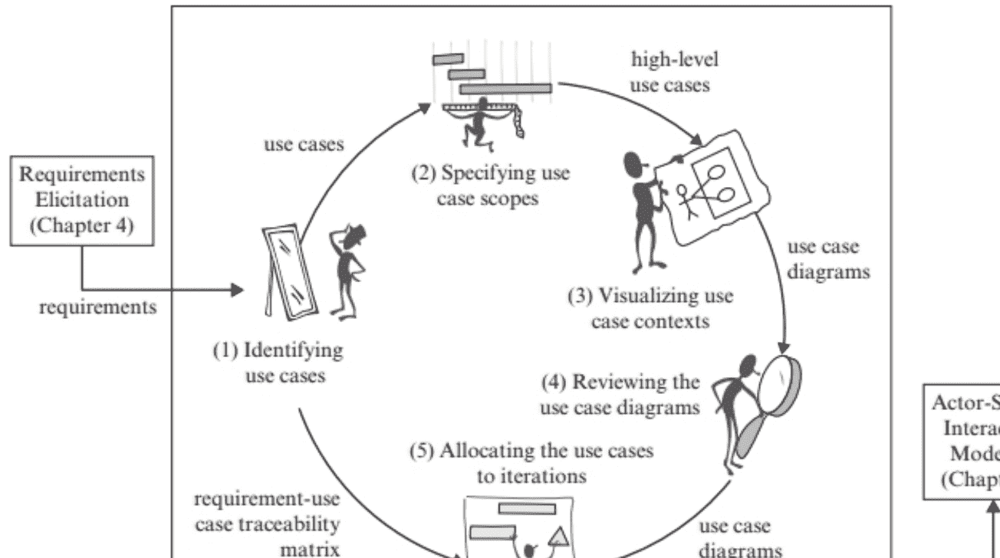

图 7.2 用例建模的步骤

### 7.4.1 识别用例

识别用例涉及四个活动。首先，在需求中寻找领域特定的动宾名词短语。如果一个领域特定的动宾名词短语满足定义 7.2，则它是一个用例。其次，寻找代表参与者的名词短语，以及代表包含用例的子系统的名词短语。第三，在子系统之间重新排列用例以提高子系统的内聚性。最后，生成一个需求-用例追溯矩阵，以显示哪些用例实现了哪些需求。这些活动将在后续章节中进行描述。

## 推导出用例、参与者和子系统

为了识别用例、参与者和子系统，团队成员需要共同工作，逐条阅读需求，或者寻找在应用领域中执行某事、必须完成某事或执行特定任务（或为应用的某个参与者执行任务）的动宾名词短语。如果识别出的短语对以下所有问题的回答都是“是”，那么它就是一个用例。

1. 它是否是一个（完整的）业务流程？如果它仅仅是一个操作或动作，则答案为否。
2. 它是否以参与者开始？
3. 它是否以参与者结束？
4. 它是否为参与者完成了一个业务任务？

团队成员在识别用例的同时也会识别参与者和系统/子系统。要识别参与者，需寻找或推断代表外部实体角色的名词和名词短语，这些实体发起用例，或为其执行业务任务。要识别包含用例的系统或子系统，需寻找或推断代表用例所属的系统、子系统或业务部分的名词和名词短语。注意，需求并不总是显式地或字面上显示出动宾名词短语。例如，“启动系统”和“关闭系统”在需求规格书中通常被缩写为“启动”和“关闭”。在某些情况下，团队可能需要从需求中推断业务流程，然后推导出用例。幸运的是，如果需求规格书编写得当，用例的推导并不困难。

## 示例 7.3 从以下图书馆信息系统（LIS）的需求推导出用例

- **R1.** LIS 必须允许读者借阅文档。
- **R2.** LIS 必须允许读者归还文档。

**解决方案：** 图 7.3 显示了如何识别用例、参与者和子系统，其中折角注释是 UML 注释符号。图 7.3 中的决策表说明了如何确定一个动宾名词短语是否为用例。它帮助团队成员确定一个动宾名词短语是否为用例。例如，它表明“借阅文档”和“归还文档”是：

| R1. LIS 必须允许读者借阅文档 |
|---|
| R2. LIS 必须允许读者归还文档 |

| 动宾名词短语 | 它是一个业务流程吗？ | 它以参与者开始吗？ | 它以参与者结束吗？ | 它为参与者完成了业务任务吗？ | 它是用例吗？ | 参与者 | 子系统 |
|---|---|---|---|---|---|---|
| 借阅文档 | 是 | 是 | 是 | 是 | 是 | 读者 | LIS |
| 归还文档 | 是 | 是 | 是 | 是 | 是 | 读者 | LIS |
| 允许读者 | 否 | 否 | 否 | 否 | 否 | 无 | 无 |

图 7.3 识别用例

允许读者不是用例，因为对四个问题的回答都是否。注意，“提供搜索能力”和“方便用户”不是用例，因为对四个问题的回答都是否。

总结从上述需求推出的用例有：

- **UC1.** 搜索课程（参与者：Web 用户，系统：SAMS）
- **UC2.** 显示课程详情（参与者：Web 用户，系统：SAMS）
- **UC3.** 提交在线申请（参与者：学生，系统：SAMS）

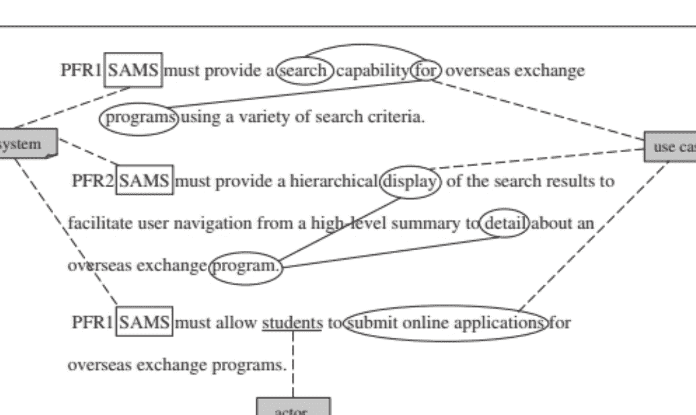

图 7.4 为 SAMS 识别用例

此示例表明，并非每个需求都清晰且字面上显示指示用例、参与者或系统的动宾名词短语；需要从上下推断。

## 围绕子系统重新排列用例

当系统从零开始开发时，需求通常指的是整个系统，而没有提到其他子系统。在上一节中识别出的所有用例都分配给系统。因此，需要根据功能划分用例，并根据划分形成子系统。目标是形成具有高功能内聚性的子系统，即用每个子系统的用例都应该表现出一个核心功能。没有哪个子系统包含大量的用例，以便每个子系统都易于设计、实现、测试和维护。为了实现这些目标，会对用例进行重新排列以降低复杂性，必要时会合并某些子系统。

共同参与者的用例用于显示特定角色的功能。这被称为*基于角色的划分*（用例的划分）。示例包括*存款、取款、转账和查询余额*。系统管理员的用例用于执行系统管理任务，如启动（系统）、关机（系统）、编辑配置等。

请注意，基于角色的划分可能会产生仍然包含许多用例的分区。当参与者可以执行许多用例时，就会发生这种情况。通常情况下，大分区的用例可以根据以下规则或根据其功能进一步划分。

### 通信划分

处理一个公共对象以执行对象特定任务的用例。这被称为*通信划分*，因为这些用例通过它们所投射的公共对象进行通信。例如，考虑一个图形图形编辑器。用例可能包括*新建项目、编辑项目（属性）、打开项目、关闭项目、删除项目、编辑新图表和现有图表*。这些用例可以分为两组用例，一组处理项目，另一组处理图表。

### 类型划分

有时，修改用例中名词的对象可以用于划分用例。例如，考虑一个 UML 图表编辑器，它包含编辑各种类型 UML 图表的用例，例如*用例图、类图和序列图*。这些用例可以根据图表类型进行划分，从而得到分别处理用例图、类图和序列图的子系统。这被称为*基于类型的划分*。

除了上述方法方法外，还可以利用参与者之间的继承关系来重新排列子系统之间的用例：

1. 为了减少子系统的用例数量，可以将参与者子类的用例从参与者父类的用例中分离出来，形成它们自己的子系统。这实际上是应用在继承语境下的基于角色的划分。
2. 如果需要，可以将参与者子类的用例与参与者父类的用例合并，以减少子系统的数量。

## 示例 7.6

对留留学管理系统的以下用例进行划分，以形成适当子系统：

- UC01. 搜索课程（参与者：Web 用户，系统：SAMS）
- UC02. 显示课程详情（参与者：Web 用户，系统：SAMS）
- UC03. 提交在线申请（参与者：学生，系统：SAMS）
- UC04. 登录（参与者：学生，系统：SAMS）
- UC05. 注销（参与者：学生，系统：SAMS）
- UC06. 编辑在线申请（参与者：学生，系统：SAMS）
- UC07. 检查申请状态（参与者：学生，系统：SAMS）
- UC08. 提交推荐（参与者：教职工，系统：SAMS）
- UC09. 批准课程等效表（参与者：顾问，系统：SAMS）
- UC10. 列出申请（参与者：工作人员，系统：SAMS）
- UC11. 创建用户账户（参与者：管理员，系统：SAMS）
- UC12. 删除用户账户（参与者：管理员，系统：SAMS）
- UC13. 更新用户设置（参与者：管理员，系统：SAMS）
- UC14. 编辑系统设置（参与者：管理员，系统：SAMS）
- UC15. 登录/工作人员（参与者：工作人员，系统：SAMS）
- UC16. 注销/工作人员（参与者：工作人员，系统：SAMS）
- UC17. 编辑个人偏好（参与者：账户用户，系统：SAMS）
- UC18. 添加课程（参与者：工作人员，系统：SAMS）
- UC19. 删除课程（参与者：工作人员，系统：SAMS）
- UC20. 更新课程（参与者：工作人员，系统：SAMS）
- UC21. 上传课程（参与者：工作人员，系统：SAMS）
- UC22. 提交反馈（参与者：学生，系统：SAMS）
- UC23. 查看反馈（参与者：Web 用户，系统：SAMS）


- `UC24.` 启动系统（参与者：管理员，系统：SAMS）
- `UC25.` 关机系统（参与者：管理员，系统：SAMS）

解决方案：如列表所示，SAMS 有 25 个用例。这些用例之间并不紧密。因此，系统的功能内聚性较低。显示所有这些用例的用例图将非常复杂且难以理解。应用基于角色的划分来划分这些用例。这产生了图 7.5。

## 示例 7.7 划分用例

- `UC1:` 新建项目（参与者：用户，系统：GED）
- `UC2:` 编辑项目（参与者：用户，系统：GED）
- `UC3:` 打开项目（参与者：用户，系统：GED）
- `UC4:` 关闭项目（参与者：用户，系统：GED）
- `UC5:` 删除项目（参与者：用户，系统：GED）
- `UC6:` 编辑新图表（参与者：用户，系统：GED）
- `UC7:` 编辑现有图表（参与者：用户，系统：GED）

# 第 7 章 从需求中推导用例

## SAMS/Admin

参与者：管理员

- `UC11.` 创建用户账户
- `UC12.` 删除用户账户
- `UC13.` 更新用户账户
- `UC14.` 编辑系统设置
- `UC24.` 启动系统
- `UC25.` 关机系统

## SAMS/Student

参与者：学生

- `UC03.` 提交在线申请
- `UC04.` 登录
- `UC05.` 注销
- `UC06.` 编辑在线申请
- `UC07.` 检查申请状态
- `UC22.` 提交反馈

## SAMS/Staff

参与者：工作人员

- `UC10.` 列出申请
- `UC15.` 登录/工作人员
- `UC16.` 注销/工作人员
- `UC18.` 添加课程
- `UC19.` 删除课程
- `UC20.` 更新课程
- `UC21.` 上传课程

## SAMS/Account User

参与者：账户用户

- `UC17.` 编辑个人偏好

## SAMS/Faculty

参与者：教职工、顾问

- `UC08.` 提交推荐
- `UC09.` 批准课程等效表

## SAMS/Web User

参与者：Web 用户

- `UC01.` 搜索课程
- `UC02.` 显示课程详情
- `UC23.` 查看反馈

### 图 7.5 划分子系统

| SAMS/Admin | SAMS/Student | SAMS/Staff | SAMS/Account User | SAMS/Faculty | SAMS/Web User |
| :--- | :--- | :--- | :--- | :--- | :--- |
| `UC11.` 创建用户账户 | `UC03.` 提交在线申请 | `UC10.` 列出申请 | `UC17.` 编辑个人偏好 | `UC08.` 提交推荐 | `UC01.` 搜索课程 |
| `UC12.` 删除用户账户 | `UC04.` 登录 | `UC15.` 登录/工作人员 | | `UC09.` 批准课程等效表 | `UC02.` 显示课程详情 |
| `UC13.` 更新用户账户 | `UC05.` 注销 | `UC16.` 注销/工作人员 | | | `UC23.` 查看反馈 |
| `UC14.` 编辑系统设置 | `UC06.` 编辑在线申请 | `UC18.` 添加课程 | | | |
| `UC24.` 启动系统 | `UC07.` 检查申请状态 | `UC19.` 删除课程 | | | |
| `UC25.` 关机系统 | `UC22.` 提交反馈 | `UC20.` 更新课程 | | | |
| | | `UC21.` 上传课程 | | | |

## 示例 7.7 划分用例

| GED/User |
| :--- |
| `UC1:` 新建项目（参与者：用户，系统：GED） |
| `UC2:` 编辑项目（参与者：用户，系统：GED） |
| `UC3:` 打开项目（参与者：用户，系统：GED） |
| `UC4:` 关闭项目（参与者：用户，系统：GED） |
| `UC5:` 删除项目（参与者：用户，系统：GED） |
| `UC6:` 编辑新图表（参与者：用户，系统：GED） |
| `UC7:` 编辑现有图表（参与者：用户，系统：GED） |

### 图 7.6 通信划分

| 项目用例 | 图表用例 |
| :--- | :--- |
| `UC1:` 新建项目 | `UC6:` 编辑新图表 |
| `UC2:` 编辑项目 | `UC7:` 编辑现有图表 |
| `UC3:` 打开项目 | |
| `UC4:` 关闭项目 | |
| `UC5:` 删除项目 | |

解决方案：如列表所示，SAMS 有 25 个用例。这些用例之间并不紧密。因此，系统的功能内聚性较低。显示所有这些用例的用例图将非常复杂且难以理解。应用基于角色的划分来划分这些用例。这产生了图 7.5。

### 图 7.5 类型划分

| 用例图 | 类图 | 序列图 |
| :--- | :--- | :--- |
| | | |

### 图 7.7 需求溯溯矩阵

| 需求 | `UC1` | `UC2` | `UC3` | `UC4` | `UC5` | `UC6` | `UC7` |
| :--- | :--- | :--- | :--- | :--- | :--- | :--- | :--- |
| `R1` | x | | | | | | |
| `R2` | | x | | | | | |
| `R3` | | | x | | | | |
| `R4` | | | | x | | | |
| `R5` | | | | | x | | |
| `R6` | | | | | | x | |
| `R7` | | | | | | | x |

需求溯源矩阵（`RUT`）具有许多优点。它可以用于通过给定用例来识别需求。这种双向溯源有三个优势：首先，它确保了每个需求都由某些用例交付（即没有空行）。这有助于验证用例是否满足了需求，即是否存在缺失的用例。其次，它确保所有的用例都是必要的（即没有空列）。最后，它确保了高优先级的用例尽早开发和部署。

通常，当开发者实现漂亮的功能或用例时，我们认为客户会免费喜欢它们。遗憾的是，大多数客户并不这么认为，因为额外的功能和用例带来了学习成本。我遇到过客户明确要求删除这些功能，因为他们不需要，也永远不会。溯源矩阵帮助我们识别此类用例。

注意，一个用例可能支持多个需求。例如，`搜索课程`用例必须访问数据库管理系统（`DBMS`）。在这种情况下，`RUT` 中的对应项被检查。行显示了需求的优先级，1 为最高，5 为最低。

## 需求溯源矩阵

需求溯源矩阵（`RUT`）具有许多优点。它可以用于通过给定用例来识别需求。这种双向溯源有三个优势：首先，它确保了每个需求都由某些用例交付（即没有空行）。这有助于验证用例是否满足了需求，即是否存在缺失的用例。其次，它确保所有的用例都是必要的（即没有空列）。最后，它确保了高优先级的用例尽早开发和部署。

需求溯源矩阵（`RUT`）具有许多优点。它可以用于通过给定用例来识别需求。这种双向溯源有三个优势：首先，它确保了每个需求都由某些用例交付（即没有空行）。这有助于验证用例是否满足了需求，即是否存在缺失的用例。其次，它确保所有的用例都是必要的（即没有空列）。最后，它确保了高优先级的用例尽早开发和部署。

需求溯源矩阵（`RUT`）具有许多优点。它可以用于通过给定用例来识别需求。这种双向溯源有三个优势：首先，它确保了每个需求都由某些用例交付（即没有空行）。这有助于验证用例是否满足了需求，即是否存在缺失的用例。其次，它确保所有的用例都是必要的（即没有空列）。最后，它确保了高优先级的用例尽早开发和部署。

需求溯源矩阵（`RUT`）具有许多优点。它可以用于通过给定用例来识别需求。这种双向溯源有三个优势：首先，它确保了每个需求都由某些用例交付（即没有空行）。这有助于验证用例是否满足了需求，即是否存在缺失的用例。其次，它确保所有的用例都是必要的（即没有空列）。最后，它确保了高优先级的用例尽早开发和部署。

需求溯源矩阵（`RUT`）具有许多优点。它可以用于通过给定用例来识别需求。这种双向溯源有三个优势：首先，它确保了每个需求都由某些用例交付（即没有空行）。这有助于验证用例是否满足了需求，即是否存在缺失的用例。其次，它确保所有的用例都是必要的（即没有空列）。最后，它确保了高优先级的用例尽早开发和部署。

需求溯源矩阵（`RUT`）具有许多优点。它可以用于通过给定用例来识别需求。这种双向溯源有三个优势：首先，它确保了每个需求都由某些用例交付（即没有空行）。这有助于验证用例是否满足了需求，即是否存在缺失的用例。其次，它确保所有的用例都是必要的（即没有空列）。最后，它确保了高优先级的用例尽早开发和部署。

需求溯源矩阵（`RUT`）具有许多优点。它可以用于通过给定用例来识别需求。这种双向溯源有三个优势：首先，它确保了每个需求都由某些用例交付（即没有空行）。这有助于验证用例是否满足了需求，即是否存在缺失的用例。其次，它确保所有的用例都是必要的（即没有空列）。最后，它确保了高优先级的用例尽早开发和部署。

需求溯源矩阵（`RUT`）具有许多优点。它可以用于通过给定用例来识别需求。这种双向溯源有三个优势：首先，它确保了每个需求都由某些用例交付（即没有空行）。这有助于验证用例是否满足了需求，即是否存在缺失的用例。其次，它确保所有的用例都是必要的（即没有空列）。最后，它确保了高优先级的用例尽早开发和部署。

需求溯源矩阵（`RUT`）具有许多优点。它可以用于通过给定用例来识别需求。这种双向溯源有三个优势：首先，它确保了每个需求都由某些用例交付（即没有空行）。这有助于验证用例是否满足了需求，即是否存在缺失的用例。其次，它确保所有的用例都是必要的（即没有空列）。最后，它确保了高优先级的用例尽早开发和部署。

需求溯源矩阵（`RUT`）具有许多优点。它可以用于通过给定用例来识别需求。这种双向溯源有三个优势：首先，它确保了每个需求都由某些用例交付（即没有空行）。这有助于验证用例是否满足了需求，即是否存在缺失的用例。其次，它确保所有的用例都是必要的（即没有空列）。最后，它确保了高优先级的用例尽早开发和部署。

需求溯源矩阵（`RUT`）具有许多优点。它可以用于通过给定用例来识别需求。这种双向溯源有三个优势：首先，它确保了每个需求都由某些用例交付（即没有空行）。这有助于验证用例是否满足了需求，即是否存在缺失的用例。其次，它确保所有的用例都是必要的（即没有空列）。最后，它确保了高优先级的用例尽早开发和部署。

需求溯源矩阵（`RUT`）具有许多优点。它可以用于通过给定用例来识别需求。这种双向溯源有三个优势：首先，它确保了每个需求都由某些用例交付（即没有空行）。这有助于验证用例是否满足了需求，即是否存在缺失的用例。其次，它确保所有的用例都是必要的（即没有空列）。最后，它确保了高优先级的用例尽早开发和部署。

需求溯源矩阵（`RUT`）具有许多优点。它可以用于通过给定用例来识别需求。这种双向溯源有三个优势：首先，它确保了每个需求都由某些用例交付（即没有空行）。这有助于验证用例是否满足了需求，即是否存在缺失的用例。其次，它确保所有的用例都是必要的（即没有空列）。最后，它确保了高优先级的用例尽早开发和部署。

需求溯源矩阵（`RUT`）具有许多优点。它可以用于通过给定用例来识别需求。这种双向溯源有三个优势：首先，它确保了每个需求都由某些用例交付（即没有空行）。这有助于验证用例是否满足了需求，即是否存在缺失的用例。其次，它确保所有的用例都是必要的（即没有空列）。最后，它确保了高优先级的用例尽早开发和部署。

需求溯源矩阵（`RUT`）具有许多优点。它可以用于通过给定用例来识别需求。这种双向溯源有三个优势：首先，它确保了每个需求都由某些用例交付（即没有空行）。这有助于验证用例是否满足了需求，即是否存在缺失的用例。其次，它确保所有的用例都是必要的（即没有空列）。最后，它确保了高优先级的用例尽早开发和部署。

需求溯源矩阵（`RUT`）具有许多优点。它可以用于通过给定用例来识别需求。这种双向溯源有三个优势：首先，它确保了每个需求都由某些用例交付（即没有空行）。这有助于验证用例是否满足了需求，即是否存在缺失的用例。其次，它确保所有的用例都是必要的（即没有空列）。最后，它确保了高优先级的用例尽早开发和部署。

需求溯源矩阵（`RUT`）具有许多优点。它可以用于通过给定用例来识别需求。这种双向溯源有三个优势：首先，它确保了每个需求都由某些用例交付（即没有空行）。这有助于验证用例是否满足了需求，即是否存在缺失的用例。其次，它确保所有的用例都是必要的（即没有空列）。最后，它确保了高优先级的用例尽早开发和部署。

### 第 7 章 从需求中推导用例 185

开始？那么用例何时结束？高层用例提供了答案：

> **定义 7.6** 高层用例规定了用例在何时、何地开始以及何时结束。换句话说，它规定了用例的范围。

用例范围的定义规定了停止规则。对于每个用例，需要做出三个决策：

1. 用例何时结束？也就是说，哪种参与者行为导致了刺激或系统事件的产生，并发展到正在开发的软件系统中？例如，ATM 用户插入 ATM 卡，SAMS 用户点击“搜索程序”链接，或者呼叫者拿起听筒。
2. 参与者行为发生在何处？例如，SAMS 用户在 SAMS 首页上点击“搜索程序”。如果没有指定 SAMS 首页，SAMS 用户将不知道在何处找到“搜索程序”链接。程序员将不知道在何处包含搜索链接。
3. 用例何时结束？这涉及对显式或隐式参与者行为的规定，以确认用例的完成。例如，当“发起通话”用例成功结束时，呼叫者听到铃声。Web 用户在“搜索程序”用例完成时看到海外交换机构的列表。作为一个需要参与者行为的示例，请考虑一个 ATM 应用程序。ATM 客户可能需要按 OK 按钮以确认看到“交易成功完成”的消息。

用例范围通过两个声明性句子来规定：

第一句的格式为“用例开始 (`TUCBW`)"，后跟执行该操作的参与者……

第二句的格式为“此用例结束 (`TUCEW`)"，后跟显式或隐式确认用例已完成预定业务任务（对于参与者而言）的参与者。再次，始终使用第三人称一般现在时。

为 SAMS Web 应用程序 (1) 搜索程序和 (2) 显示程序（示例 7.8）规定高层用例。

**解法：** 高层用例为：

- **`UC1.`** 搜索程序

  `TUCBW` Web 用户在 SAMS 首页上点击“搜索程序”链接。

  `TUCEW` Web 用户看到符合其或他的搜索标准的程序表格化列表。

- **`UC2.`** 显示程序详情

  `TUCBW` Web 用户点击程序表格列表中的某一个程序的“查看详情”链接。

  `TUCEW` Web 用户显示所选程序的详情。


## 示例 7.9 为电话系统的 (1) 发起通话和 (2) 接听电话用例规定高层用例

解法：高层用例为：

- `UC1.` 发起通话

  `TUCBW` 呼叫者从电话底座拿起听筒。

  `TUCEW` 呼叫者听到铃声。

- `UC2.` 接听电话

  `TUCBW` 被呼叫者（听到铃声）从电话底座拿起听筒。

  `TUCEW` 呼叫者或被呼叫者将听筒挂回。

### 7.4.3 用例上下文的可视化

对用例、参与者和子系统的文本描述仅适用于涉及少数用例、参与者和子系统的小型应用程序。许多现实世界的应用涉及许多用例、参与者和子系统。大型复杂系统的开发需要一种组织和可视化这些信息的方法。UML 用例图满足了这一需求。

## UML 用例图

> **定义 7.7** 用例图是一种 UML 行为图，描绘了以下内容：
>
> - 系统或子系统的用例。
> - 使用用例的参与者。
> - 系统或子系统的边界。
> - 参与者之间的继承关系。
> - 用例之间的关系。

图 7.8 显示了 ATM 应用程序的用例图。用例图显示 ATM 有四个用例。这些用例的参与者是 ATM 客户。ATM 客户使用这些用例完成四项业务任务：查询余额、存款、取款和转账。

## 用例图的符号（Notations）与概念（Notions）

概念（Notion）和符号（Notation）是密切相关的概念。符号是为表示概念或意义而提出的语言符号。概念是建模构建块或符号的底层概念或含义。遗憾的是，许多 UML 初学者只学习符号，而不学习底层的概念，导致画出了虽然精美但毫无意义的图表。因此，图 7.9 展示了用例图的概念和符号。学生应不时参考该表，以确保符号的使用符合其预期含义。

### 第 7 章 从需求中推导用例 187

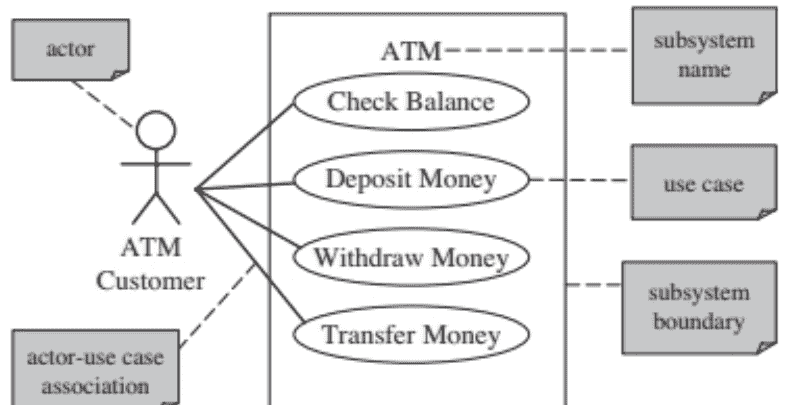

图 7.8 ATM 示例的用例图

| 概念 (Notion) | 含义/语义 | 符号 (Notation) |
| :--- | :--- | :--- |
| 用例 | 用例是一个命名的业务流程，它以参与者开始，以参与者结束，并为参与者完成业务任务。 | 用例名称 |
| 参与者 | 参与者是组业务实体或利益相关者扮演并代表他们扮演的角色，这些实体是系统外部的，并与系统交互。 | 角色名称 |
| 系统/子系统边界 | 系统/子系统封装用例并描绘了子系统的功能。 | 系统名称 |
| 参与者与用例的关联 | 参与者与用例之间的关联表示该参与者使用该用例。 | |
| 继承 | 两个概念之间的二进制关系，其中一个是另一个的泛化（或特化）。 | 从特化概念指向泛化概念 |
| 用例间的扩展关系 | 两个用例之间的二进制关系，其中一个延续另一个的过程。 | `<<extend>>` 从扩展用例指向被扩展用例 |
| 用例间的包含关系 | 两个用例之间的二进制关系，其中一个包含另一个作为。 | `<<include>>` 从包含用例指向被包含用例 |

图 7.9 用例图的概念和符号

## 示例 7.10 为 7.4 中的 Web 版 SAMS 用例绘制用例图

解法：用例、参与者和子系统已经在 7.4 中确定。将这些转换为用例图相对容易，如图 7.10 所示。

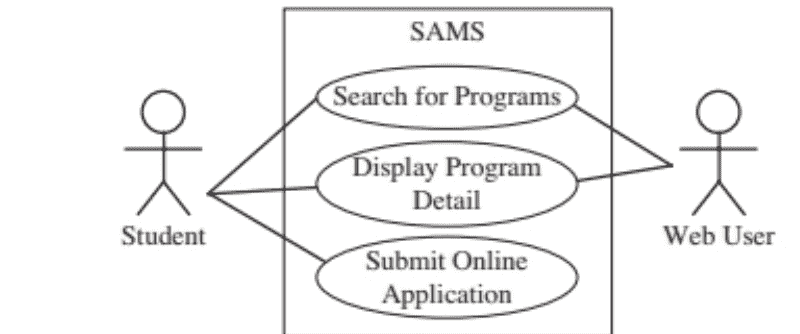

图 7.10 SAMS 的用例图

用例图应该显示子系统边界。这样做有许多优点。通过检查用例完成的任务，可以评估子系统的内聚性——即用例应该表现出核心功能而不是相关的子系统，后者应该尽早开发和部署。可以判断是从零开始构建子系统还是复用现成的商业组件（COTS）。

## 显示参与者继承关系

> **定义 7.8** 继承是两个概念之间的二进制关系，其中一个概念是另一个的泛化（或特化）。

继承关系也被称为 IS-A 关系，因为特化概念的实例是泛化概念的实例。识别继承关系的步骤在第 5 章的领域建模中给出。

探索参与者之间的继承关系可以简化用例图。图 7.11(a) 是没有使用参与者继承的用例图，图 7.11(b) 使用了参与者继承。

## 显示用例之间的关系

本节介绍了用例之间的关系。初学者应该跳过本节，因为用例之间的关系并不总是。初学者经常误解这些关系并在建模中误用它们。在这里介绍它们是因为在某些情况下会使用。

在面向对象编程中，对象类之间存在继承关系。用例之间也存在继承关系。它可以用于显示备

### 第 7 章 从需求推导出用例 189

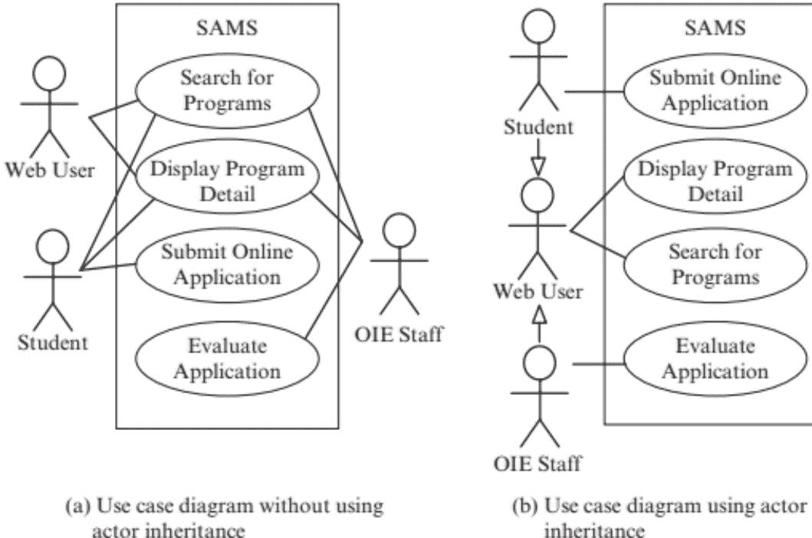


**图 7.11** 使用参与者继承来简化用例图

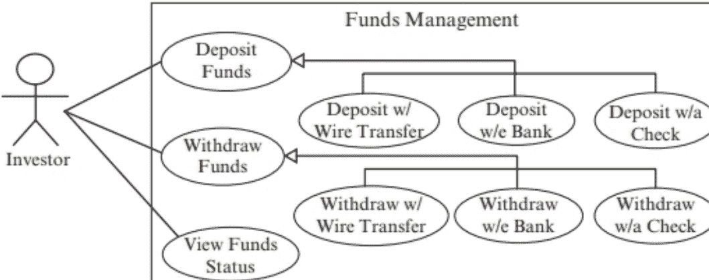

**图 7.12** 使用用例继承显示备选流程

完成业务任务的业务流程。如图 7.12 所示，证券经纪应用程序可以通过以下用例之一来完成`存款资金`用例：`通过电转账存款`、`通过支票存款`以及`不通过银行存款`。同样，`提取资金`也可以通过三个用例中的任何一个来完成。

用例是业务流程。一个业务流程的执行可能会继续另一个业务流程的执行。在基于 Web 的型 SAMS 系统中，学生可能希望对`查找程序`用例列出的程序之一显示`程序详细信息`。学生在查看了海外交换计划的详情后，可能会决定`提交在线申请`。这些示例说明了用例之间的扩展（`extend`）关系（见图 7.13）。也就是说，参与者可以选择地用另一个用例的业务流程来扩展某个用例的业务流程。

## 190 第三部分 交互系统的建模与设计

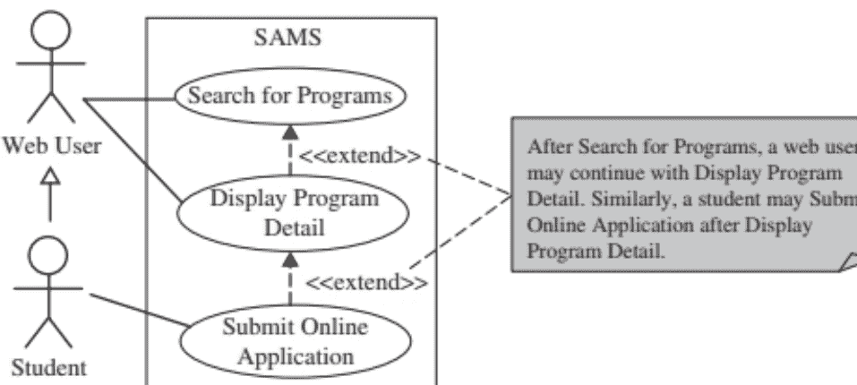

图 7.13 用例之间的扩展关系

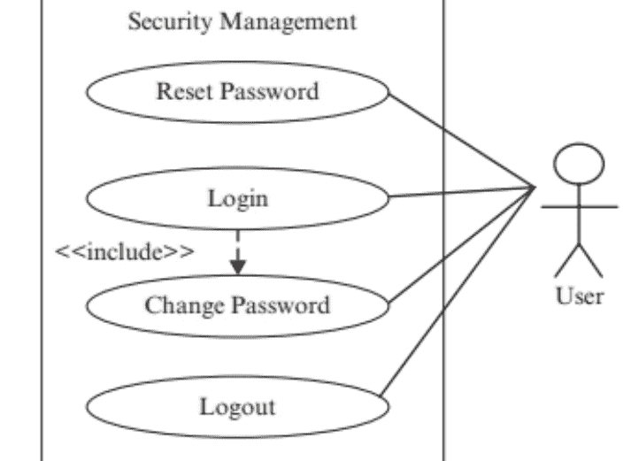

图 7.14 显示用例的包含（`include`）关系

请注意，在这些情况下，学生可以在`查找程序`之后继续执行`显示程序详细信息`，但并不要求他们这样做。同样，学生在查看程序详情后，可以选择不继续执行`提交在线申请`用例。也就是说，扩展关系不能用于表达一个用例的执行需要先执行另一个用例。

一个业务流程可能包含另一个业务流程。用例也是如此。例如，考虑一个`登录`用例和一个`修改密码`用例。如果用户使用从电子邮件中收到的临时密码登录，那么用户被要求更改临时密码。在这种情况下，`登录`用例（有条件地）包含了`修改密码`用例，如图 7.14 所示。

### 7.4.4 评审用例规格

在这一步中，将使用以下检查列表对抽象用例、高层用例和用例图进行评审。

#### 抽象用例

1. 每个用例是否由一个动词-名词短语组成，并传说明了该用例为参与者完成了什么？
2. 每个用例是否代表一个业务流程？
3. 是否有任何用例可以被拆分为两个或多个用例？
4. 是否有任何用例可以合并？

#### 需求-用例可溯性矩阵

1. 是否需求-用例可溯性矩阵？
2. 每个用例是否都列在可溯性矩阵中？
3. 需求-用例可溯性矩阵中是否存在空行或空列？
4. 为每个需求列出的用例对于该需求是否是必要的？
5. 为每个需求列出的用例对于该需求是否是足够的？

#### 高层用例

1. 每个识别出的用例是否都有对应的高层用例规格？
2. 高层用例的 TUCBW 子句是否清晰规定了用例何时以及何地开始？
3. 高层用例的 TUCEB 子句是否清晰规定了用例何时结束，以及以参与者想要完成什么而结束？
4. 每个高层用例是否正确规定了业务流程的范围？

#### 用例图

1. 每个用例图是否显示了子系统边界？
2. 子系统是否适用于通信子系统的功能？
3. 用例图中的用例与需求-用例可溯性矩阵之间是否存在一一一对应关系？
4. 是否存在用例数量过多的用例图？
5. 是否存在在没有理由的情况下仅包含一个用例的用例图？
6. 是否存在包含未连接到用例或参与者的用例或参与者的用例图？
7. 是否存在没有角色的参与者？
8. 每个用例是否都链接到了合适的参与者？
9. 每个用例是否都被分配到了合适的子系统？

### 7.4.5 将用例分配到迭代中

现在用例已经过识别并可视化了。它们的优先级源于需求的优先级。下一步是制定一个开发和部署用例的计划。这被称为`使用用例规划迭代`。它涉及几个步骤。首先，估算开发和部署每个用例的工作量。这是通过使用第 23 章描述的估算方法完成的。接下来，识别用例之间的依赖关系，以便它们根据依赖关系进行部署。例如，“结算文档”的部署时间不晚于“归文档”。最后，使用第 23 章的方法制定计划。该计划考虑了若干因素：

1. 用例的优先级。
2. 用例之间的依赖关系。如果用例 B 依赖于用例 A，则必须先部署 A。

192 第三部分 交互系统的建模与设计

| 用例 | 优先级 | 工作量（人周） | 依赖于 | 迭代 1 | 迭代 2 | 迭代 3 | 迭代 4 | 迭代 5 |
| --- | --- | --- | --- | --- | --- | --- | --- | --- |
| UC1 | 1 | 5 | 无 | 5 |  |  |  |  |
| UC2 | 4 | 4 | UC8 |  | 4 |  |  |  |
| UC3 | 1 | 2 | UC5 |  |  | 2 |  |  |
| UC4 | 2 | 5 | UC3 |  |  |  | 5 |  |
| UC5 | 4 | 4 | UC4 |  | 4 |  | 4 |  |
| UC6 | 5 | 6 | UC6 |  |  |  |  | 6 |
| UC7 | 4 | 4 | UC2 |  |  |  |  | 4 |
| UC8 | 3 | 3 | 无 | 3 |  |  |  |  |
| **总工作量** |  | **35** |  | **9** | **9** | **9** | **9** | **9** |

团队规模 = 3 人

## 7.5 用例推导准则

> 指南 7.1 用例应从功能性需求推导出。
>
> 指南 7.2 用例也可以从非功能性需求（例如安全需求）推导出。
>
> 指南 7.3 仔细选择动词-名词短语，以传达用例为参与者完成了什么。
>
> 指南 7.4 高层用例规格应以参与者想要完成的内容结束。
>
> 指南 7.5 一个用例应为参与者完成一个业务任务（功能内聚）。例如，“登录和交易”应该是两个用例：`登录`和`交易`。同样，“检查余额和库存”应该是`检查余额`和`检查库存`。
>
> 指南 7.6 高层用例不应指定后台处理活动。这一准则支持软件设计原则——`简单愚蠢`和`关注点分离`，这些在第 6 章中描述过。高层用例仅旨在指定用例范围以及何时开始和何时结束。
>
> 指南 7.7 避免以下情况：
>
> - 一个图中包含多个用例。
> - 许多仅包含一个用例的用例图。
> - 用例之间存在大量关系。
> - 过复杂的用例图。图 7.16 显示了一个应该避免的过度复杂的用例图。
>
> 指南 7.8 小心将用例划分为密切相关的用例组。划分技术请见第 7.4.1 节。例如，对图 7.16 应用基于角色的划分，产生了如图 7.17 所示的图。这显著降低了用例的复杂性，同时提高了子系统的功能内聚性。
>
> 指南 7.9 只显示与子系统或方面相关的用例和参与者。
>
> 指南 7.10 根据子系统的功能为每个子系统提供有意义的名称。

# 194 第三部分 交互式系统的建模与设计

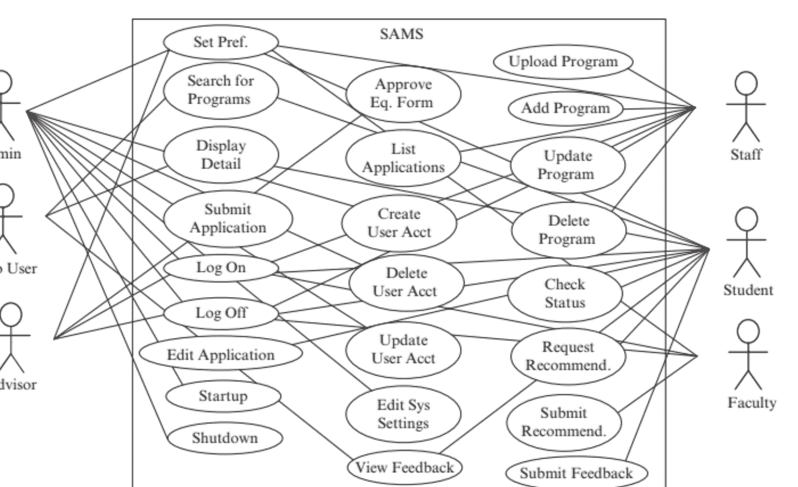

图 7.16 应避免的过于复杂的图

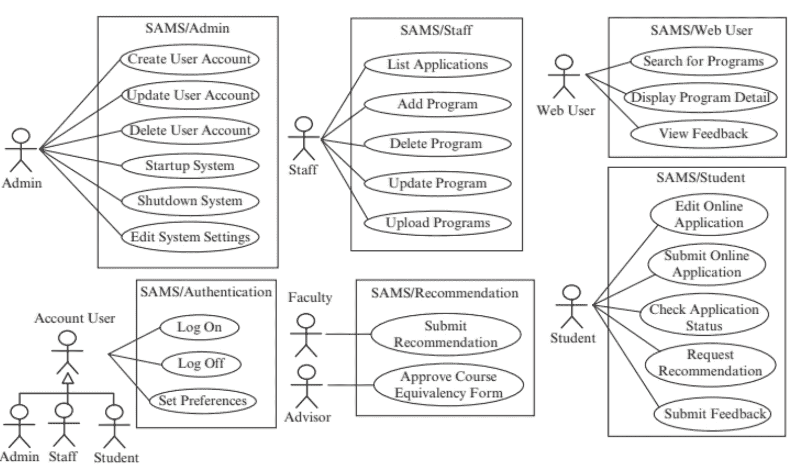

图 7.17 基于角色的划分降低了复杂性，提高了内聚性

# 第 7 章 从需求中派生用例

# 195

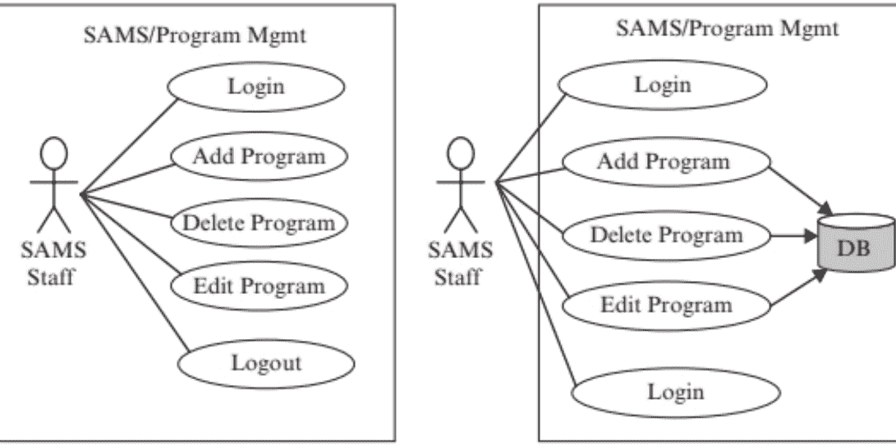

(a) 错误——参与者必须在系统边界之外

(b) 错误——只有用例和用例关系可以位于系统边界内

**图 7.18** 绘制错误的用例图

> 指南 7.11 在用例图中使用参与者继承来减少参与者与用例之间的链接数量（如图 7.11 所示）。
>
> 指南 7.12 参与者与用例之间的关系始终是关联。
>
> 指南 7.13 只有用例及其关系可以显示在系统边界内。

图 7.18 显示了两个错误的用例图。其中一张图将参与者放在了系统边界内，另一张则在系统边界内包含了一个数据库。

## 7.6 应用敏捷原则

> 指南 7.14 与客户和用户紧密合作，以理解他们的业务流程和优先级，并帮助他们识别真实需求。

用例是过程。只有客户和用户了解业务流程、其运作方式以及他们的优先级。因此，开发团队需要与客户和用户紧密合作，以识别并验证用例。

> 指南 7.15 团队成员应该共同努力识别用例、参与者和子系统，并规范用例的范围。

派生和规范用例的过程并不是为了文档。通过这个过程，团队成员能够理解并交流他们对业务流程的理解。这为团队成员开发的组件之间的相互工作提供了基础。这是敏捷方法重视个人和交互的原因之一。如果不通过工作来识别和规范用例而划分工作，可能会在后续阶段产生糟糕的结果。

> 指南 7.16 需求是演变的，但时间跨度是固定的。

敏捷开发倾向于使用固定的时间跨度进行迭代。这使得团队成员更容易配合迭代。例如，在几次迭代之后，团队成员就会知道每次迭代可以完成多少工作。因此，团队将以恒定的速度推进。如果迭代无法完成所有功能，可以在咨询客户和用户后采取低优先级功能或将其移动到下一次迭代。

> 指南 7.17 关注小增量的频繁交付，每个增量仅部署少数几个用例。

这增加了可见性。也就是说，决定两周内可以完成多少工作比决定六个月内可以完成多少工作容易得多。此外，小增量的频繁交付减少了需求误解的风险。它支持用户的持续测试，并降低了用户的学习曲线。

> 指南 7.18 不要尝试派生出一个最优用例集。足够就好。

首先，不存在最优用例集，因为标准无法定义。此外，需求总是在变化。这意味着用例也应该发生变化。因此，识别和规范大多数高优先级需求和用例就足够了。更重要的是开始实现用例并征求用户的反馈。也就是说，足够就好。

## 7.7 用例建模的工具支持

用于绘制和映射用例图的工具包括 IBM Rational Modeler、Microsoft Visio、ArgoUML、NetBeans UML Plugin 等许多工具。这些工具提供了编辑能力和其他相关功能。大多数工具还支持从 UML 图进行逆工程和生成代码骨架。

为了支持本章介绍的方法，德克萨斯大学阿灵顿分校正在开发一种工具。它与领域建模工具类似：

# 第 7 章 从需求中派生用例 197

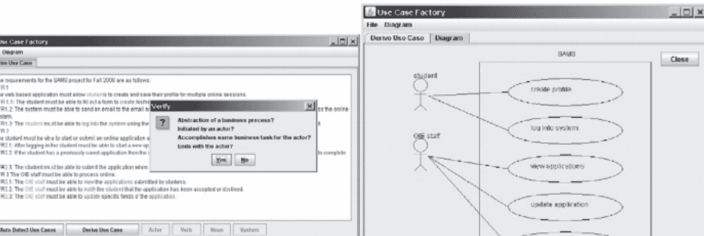

用例工厂

文件图

绘制用例图

2005 年秋季 DMRS 项目的需求如下：

- Web 应用程序必须允许用户为多个在线用户创建并保存个人资料。
- 系统必须允许用户向其验证过的地址发送电子邮件。
- 系统必须允许用户根据准则搜索订单。
- 系统必须允许用户根据某些标准取消订单。
- 系统必须允许用户查看订单状态。
- 系统必须允许人员处理订单。
- 系统必须允许人员指定订单是否被接受或拒绝。
- 系统必须允许用户在应用程序中搜索特定项目。

工程师点击“用例”按钮来识别每个用例。工程师突出参与者、动词-名词短语和系统，并点击相应的按钮进入用例。工具显示确认消息。工程师选择“是”，然后用例出现。

### 7.19 手动识别用例

图 7.18 显示了这是如何工作的。在手动识别模式下，工具会引导软件工程师识别用例、参与者和系统。工具自动绘制用例。工程师分别突出动词-名词短语、参与者和系统，并点击相应的按钮进行分类。工具显示一条消息，要求确认用例满足属性：它必须是一个业务过程，必须以参与者开始，以参与者结束，并完成一项任务。一旦识别了用例，工程师点击“生成图表”按钮。用例出现在下方的表格中。

### 7.20 自动派生用例

# 198 第三部分 交互式系统的建模与设计

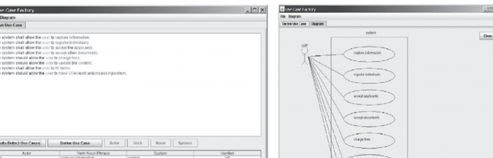

工程师选择规范并点击“自动检测用例”按钮。工具自动识别用例、参与者和系统，并将它们列在表中。工程师勾选框以验证每个用例。他点击“生成图表”按钮让工具生成用例图。

图 7.20 自动派生用例

## 总结

本章介绍了如何从需求中识别用例、参与者和子系统，并使用需求-用例跟踪矩阵（RUT）记录它们之间的关系。RUTM 还显示了需求和用例的优先级。这些被用于生成迭代计划，以便高优先级的用例尽早开发和部署。用例到迭代的分配由用例-迭代分配矩阵所示。高层用例规范了用例范围或用例的开始和结束时间。用例、参与者和子系统及其关系通过 UML 用例图可视化。本章标志着规划阶段的结束。在迭代阶段，将根据计划开发和部署用例。

## 扩展

用例的概念是由 Ivar Jacobson 在他的用例建模方法引入的[90]。统一过程方法在 [91] 中描述。用例实例被其他作者称为场景（scenario）[104, 131]。参考文献 [131] 非正式地描述了如何使用 ATM 示例准备场景。参考文献 [104] 非正式地定义场景为用例的实例。

一个用例以及参与者与系统之间特定动作和交互的序列。用例图的简要介绍可以在 [36] 中找到，全面的介绍可以在 www.omg.org 查看。最后，Bittner 和 Pence 在 [29] 中通过真实示例展示了一种用例建模方法。

## 本章复问题

1. 什么是用例？
2. 用例的四个属性是什么？
3. 每一个动词-名词短语都是用例吗？为什么？
4. 什么是业务流程、操作和动作？它们之间有什么关系？
5. 什么是参与者？人是参与者吗？
6. 用例应该从哪里推导出？为什么？
7. 如何导出用例、参与者和系统？
8. 什么是高层用例？
9. 如何指定一个高层用例？
10. 什么是用例图？
11. 如何划分用例以提高功能内聚并减少子系统的用例数量？
12. 什么是需求-用例追溯矩阵？这种矩阵有什么用？
13. 什么是用例-迭代分配矩阵？这种矩阵有什么用？

## 练习

### 7.1

在练习 4.2 中，你为台式虚拟计算器、电话应答和基于 Web 的在线电子邮件系统编写了需求规范。为这些应用程序分别导出用例、相关的参与者和系统。还要指定高层用例并为这些情况绘制用例图。

### 7.2

根据你在练习 4.4 中生成的日历管理系统的功能需求导出用例。还要指定高层用例。

### 7.3

对于你在练习 4.6 中生成的国家贸易展览服务（NTSS）需求规范，执行以下操作：

a. 从需求规范导出用例。

b. 指定高层用例。

c. 绘制用例图。

### 7.4

必要时应用用例划分规则以减少分配给每个子系统的用例数量。

### 7.5

对附录 D.1 给出的租车系统（CRS）执行：

a. 根据你在练习 4.8 中生成的需求导出用例。

b. 构建一个需求-用例追溯矩阵。

c. 指定高层用例。

d. 绘制用例图。

### 7.6

为实现本章描述的方法的用例建模工具制定需求。规范限制在两页以内。导出用例，指定高层用例并生成用例图。使用评审清单对这些进行评审并生成评审报告。

## 参与者-系统交互建模

## 核心要点

- 参与者-系统交互建模是对系统如何与参与者交互以执行用例的建模和设计。
- 参与者-系统交互建模通过构建双列表格来实现，该表格描述每次交互的参与者输入、参与者动作以及系统响应。

第 7 章介绍了如何从需求中导出用例以及如何指定每个用例的范围。这些结果被称为抽象用例和高层用例。`用例`是一个业务流程。它始于参与者，结束于参与者，并为参与者完成一项业务任务。为了做到这一点，系统必须与参与者交互以执行用例。这种交互被称为`参与者-系统交互`。这种交互行为的建模和设计被称为参与者-系统交互行为的建模和设计。本章关注这种行为的建模和设计。正如前面的章节所述，用例是用三个抽象级别进行建模的：

1. 抽象用例。抽象用例是一个动词-名词短语，突出了用例将为参与者完成什么工作。
2. 扩展用例。扩展用例指定了参与者将如何与系统/子系统交互。它是高层用例的延续和细化。它使用双列表格指定交互。左列指定参与者输入/或参与者动作，右列指定系统响应。

## 第 8 章 参与者-系统交互建模

为了简单起见，书中将抽象用例称为“用例”。抽象用例和高层用例在第 7 章（从需求中导出用例）中描述过。本章介绍了扩展用例的规范。当你完成本章时，你将学习到：

- 参与者-系统交互建模。
- 参与者-系统交互建模的重要性。
- 如何执行参与者-系统交互建模。

### 8.1 什么是参与者-系统交互建模

参与者-系统交互建模是对系统如何与参与者交互以执行用例的建模和设计。如图 8.1 所示，左列指定参与者输入/或参与者动作，右列指定相应的系统响应。更具体地说，扩展用例的双列表格规范说明了以下内容：

1. 用例 ID 和名称。这显示在图 8.1 表格顶部。
2. 用户界面的初始状态。右列的步骤 0 指定了用例开始前用户界面的初始状态。指定用户界面的初始状态很重要，因为：(a) 它告诉开发者系统应该向参与者显示什么；以及 (b) 它告诉参与者在用例开始前会看到什么。


图 8.1 图信息系统的扩展用例

3. 用例何时何地开始。左列的步骤 1 指定了用例开始的时间和地点。这是高层用例的 TUCBW 子句。
4. 交互每个步骤的参与者输入和动作。这位于双列表格的每行左列。
5. 相应的系统响应。这位于双列表格对应的行右列。
6. 用例何时结束。左列的最后一个项目指定了用例何时结束。这是高层用例的 TUCEW 子句。

### 8.2 参与者-系统交互建模的重要性

扩展用例规范的用途包括：

1. 它指定了后续设计、实现和测试可以遵循的参与者-系统交互或系统交互行为。
2. 它可以生成初步手册。因为扩展用例准确描述了用户如何使用系统完成业务任务。初步手册有助于潜在用户对系统原型进行实验。
3. 如果更新反映后续设计和实现阶段参与者-系统交互的变化，更新后的扩展用例可以生成竣工手册。这减少了系统部署的工作、成本和时间。
4. 它可以生成基于用例的测试用例。这将在第 20 章（软件测试）中描述。

### 8.3 参与者-系统交互建模的步骤

参与者-系统交互建模的主要活动为当前迭代分配的用例构建扩展用例。它涉及以下步骤：

1. 步骤 1。为构建的扩展用例初始化双列表格。
2. 步骤 2。指定每个参与者-系统交互步骤，直到系统产生 TUCEW 子句指定的响应。
3. 步骤 3。使用评审清单评审参与者-系统交互。

#### 8.3.1 初始化双列表格


绘制一个双列表格，并在表格顶部显示用例 ID 和名称。左列和右列的表头分别随参与者的角色名称和系统/子系统名称而改变。相应高层用例的 `TUCBW` 和 `TUCEW` 子句进入左列的第二个和第三个项目，并分别标记为步骤 1 和步骤 3。步骤编号 3 将


例如，在第 4 步中请求了程序信息，这些信息作为领域模型中 `Program` 类的属性存在。同样，图 8.3(b) 中 `Application` 关联类的属性可以用于“在线申请”扩展用例的规范中。如果在领域模型中没有找到该领域概念，则应该更新领域模型。如果找到了领域概念但信息不完整，则应该扩展其属性列表。

## 8.3.3 审查参与者-系统交互规范

对当前迭代中产生的扩展用例，使用以下评审检查清单进行审查：

1. 规范是否有用例 ID 和用例名称？它们是否与需求-用例追溯矩阵以及相应的高层级用例中的用例 ID 和名称匹配？
2. 参与者和系统是否被正确识别并指明，并与它们在高层级用例中的对应项匹配？
3. 扩展用例是否指定了第 0 步的初始系统显示？
4. `TUCEBW` 和 `TUCEW` 子句是否与它们在高层级用例中的对应项匹配？
5. 用例的开始和结束是否都是左列的参与者？
6. 在参与者与系统的交互过程中是否存在空白项？
7. 扩展用例是否正确且充分地指定了执行业务流程的参与者-系统交互？
8. 左列步骤是否清晰、正确地指定了参与者的输入以及参与者的操作（如点击 OK 按钮）？
9. 右列步骤是否清晰、正确地指定了系统对参与者的响应？

## 8.4 指定备选分支流

对于许多现实应用，参与者与系统之间的交互涉及备选分支。也就是说，系统允许参与者在交互的给定步骤中从多个选项中进行选择。图 8.4 显示了这样一个示例。在第 2 步中，系统显示了一个包含两个选项的对话框，如第 3 步所示，扩展用例规范使用 (a) 和 (b) 来指示这两个选择。在第 4 步中，系统的响应被标记为 (a) 和 (b)，以匹配用户在第 3 步中的选择。

## 8.5 使用用户界面原型

“一画胜于千言”。适当的用户界面（UI）原型可以用来改进扩展用例的规范。也就是说，扩展用例右列的系统响应可以：

| 参与者：用户 | 系统：路由器 |
|---|---|
| 1. `TUCBW` 用户在地址字段输入 `http://192.168.0.1` 并按下 Enter 键。 | 0. 浏览器显示任意页面。 |
| 3. 用户：a) 输入用户名、密码，可选地勾选“保存密码”复选框并点击 OK 按钮登录，或 (b) 点击取消按钮。 | 2. 系统显示输入密码对话框。 |
| 4. 系统相应地显示 (a) 欢迎页面，或 (b) 未授权页面。 | |
| 5. `TUCEW` 用户看到欢迎页面或未授权页面。 | |

**图 8.4** 用 UI 原型增强的扩展用例中的备选分支流

如图 8.5 所示。第 (2) 步说明“系统显示管理菜单”。UI 原型用于显示子菜单的外观。同样，第 3 步显示另一个 UI 原型。可以使用指针来增加可读性，如图 8.6 到图 8.8 所示。也可以使用 URL 链接等展示技术。

在规范中使用 UI 原型具有以下优点：

1. 在开发周期的早期获取客户的用户反馈非常有帮助。
2. 在扩展用例规范中使用 UI 原型有助于用户手册的准备。
3. 使用 UI 原型有助于基于用例的测试用例的准备。

软件需求分析和设计的一个重大挑战是确定用户界面需求。使用自然语言描述布局、外观、颜色方案和字体是极其困难的。如图 8.5 所示，在扩展用例规范中使用 UI 原型可以轻松解决这一问题。事实上，在向客户展示扩展用例时就收到了反馈，开发团队避免了大量的重复工作。客户和用户喜欢看到 UI 原型，因为它们帮助他们理解系统实现后会得到什么。客户和用户对于使用文本描述的扩展用例提供反馈往往会犹豫，因为他们不确定是否理解了描述。

如前面的章节所述，可以从扩展用例描述中轻松生成初步用户手册。UI 原型展示可以：


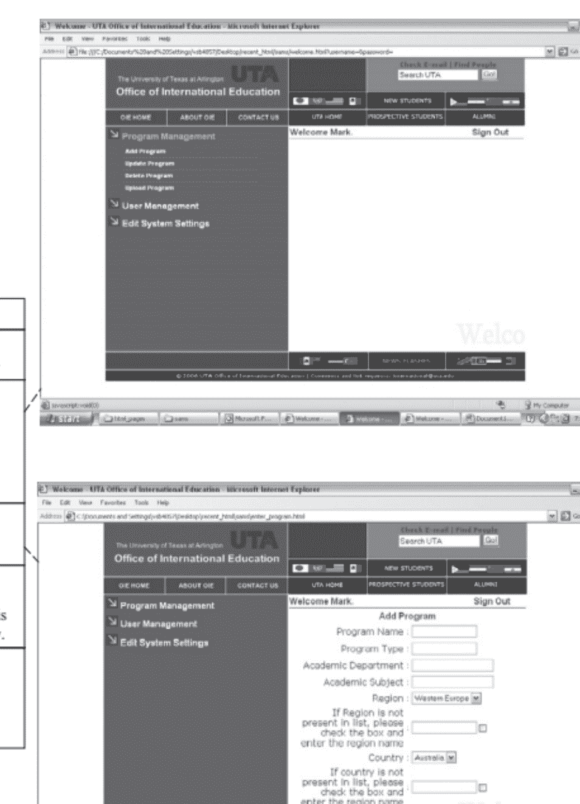

在生成用户手册时复用。由于 UI 展示是用户手册的必要组成，构建 UI 原型并不一定会引入额外工作。事实上，在扩展用例阶段制作 UI 原型节省了开发工作，因为 (1) 早期反馈避免了重复，(2) 减少了用户手册的准备，(3) 减少了生成测试用例的工作。扩展

| 参与者：用户 | 系统：AMS |
|---|---|
| `TUCBW` 用户点击欢迎页面上的“管理”链接。 | 0. 系统显示欢迎页面。 |
| `Staff` 用户点击“添加”链接。 | 2. 系统显示管理菜单。 |
| `Staff` 用户填写表单并点击“提交”按钮。 | 4. 系统显示添加表。 |
| `TUCEW` 用户看到程序已添加。 | 6. 系统显示“程序已添加”的消息。 |

附件 1：程序管理  
附件 2：添加表

**图 8.6** 带有 UI 原型的扩展用例

**图 8.7** UI 展示 1

**图 8.8** UI 展示 2

由 UI 原型增强的用例规范有助于测试用例生成，因为它们视觉化地描述了预期的用户界面、窗口、对话框和计算结果。测试描述在

## 8.6 不显示异常处理

- 异常情况（Exceptional cases）和备选分支是不同的。后者是正常流程，而前者应该在较低级别处理的异常情况，而不是在用例级别。
- 尽管异常情况并不常见，但对于给定的系统，异常情况的数量有很多。例如，网络可能中断、账户可能过期、电源关闭、计算机可能感染病毒或其他问题。在扩展用例中指定异常情况是不理想的，因为交互流更难以理解。

## 8.7 用例的前置条件和后置条件

用例是业务流程。业务流程的执行可能要求在执行前满足某个条件。例如，某些系统要求在用户登录之前先激活其账户。学生选修课程可能需要许可。此类条件通常被称为前置条件（preconditions），它们规定了成功执行用例必须满足的系统条件，如果不进行显式说明，这种条件是不显而易见的。同样，用例后置条件（postcondition）规定了用例执行后的系统状态，如果没有指定，该条件是不显而易见的。

图 8.9 展示了用例对将操作的对象状态的前置条件。在这个例子中，前置条件规定学生必须获得该课程的许可或她想要选修。

### UC2：选修课程

| 前置条件：学生已获得该课程的许可。 |
|---|
| |

| 参与者：学生 | 系统：学习管理 |
|---|---|
| 0. 系统显示欢迎页面。 | |
| 1. `TUCEW` 学生点击欢迎页面上的“选修”链接。 | 2. 系统显示选择学期页面。 |
| 3. 学生选择学期并点击 OK 按钮。 | 4. 系统显示学生被允许选修的课程。 |
| 5. 学生选择课程并点击“提交”按钮。 | 6. 如果选修成功，系统显示“选修成功”的消息，否则系统显示错误消息。 |
| 7. `TUCEW` 学生看到“选修成功”的消息或错误消息。 | |

| 后置条件：无 |
|---|
| |

**图 8.9** 对对象状态的前置条件

# UCI：登录

| 参与者：用户 | 系统：WebApp |
|---|---|
| 1. `TUCBW` 用户点击首页上的“登录”链接。 | 0. `WebApp` 显示首页。<br>2. `WebApp` 显示登录页面。 |
| 3. 用户输入姓名和密码并点击“登录”按钮。 | 4a. 如果用户是首次登录，则执行 `TUCCW` 重置密码；<br>4b. 否则 `WebApp` 显示欢迎页面。 |
| 5. `TUCEW` 用户看到欢迎页面。 | |

图 8.10 包含另一个用例的扩展用例

应该看到最终状态。前置条件和后置条件并非总是需要的，但对于所有扩展用例，初始和最终的系统显示是必须的。

# 8.8 包含其他用例

用例是业务流程。一个业务流程包含另一个业务流程作为子流程的情况是很常见的。例如，当新用户首次登录时，许多系统要求新用户重置临时密码。在这种情况下，“登录”用例有条件地包含了“重置密码”用例。图 8.10 展示了这一扩展用例是如何指定的，其中 `TUCCW` 代表“此用例继续执行”。

# 8.9 继续执行其他用例

上一节描述的技术可以用于指定分支到其他用例的备用流。例如，投资者可能使用不同的方式转账。“在线转账”用例允许投资者在同一家经纪公司内部将资金从一个账户转到另一个账户。“支票转账”用例允许投资者通过开具支票从银行账户转账。“转账单转账”用例允许投资者通过填写、打印并邮寄表格，将资金从一家经纪公司转账到另一家。在参与者-系统交互建模方面，“在线转账”、“转账”和“转账单转账”可以被视为“转账”的特例。因此，“转账”用例可以通过这三个用例之一来实现。图 8.11 展示了这是如何被指定的。

扩展用例规范作为三种不同资金转账方式的前序。在投资者点击“转账”链接后，系统会显示转账的备用方式。与其直接处理投资者可能选择的每个选项，不如图 8.11 中的扩展用例在第 3 步指定该用例继续执行（`TUCCW`）以下用例之一，并列出了这些用例。作为该用例将如何继续执行某一个资金转账用例的插图，图 8.12 显示了“支票转账”用例的扩展用例。

### UC3：转账

| 参与者：投资者 | 系统：资金管理器 |
|---|---|
| 1. `TUCBW` 投资者点击资金管理首页上的“转账”链接。 | 0. 系统显示资金管理首页。<br>2. 系统显示资金转账页面，包含以下选项：<br>2a. 在线转账<br>2b. 支票转账<br>2c. 转账单转账 |
| 3. `TUCCW` 执行以下用例之一：<br>3a. UC4：在线转账<br>3b. UC5：支票转账<br>3c. UC6：转账单转账 | |

图 8.11 指定通往其他用例的备用流

### UC5：支票转账

| 参与者：投资者 | 系统：资金管理器 |
|---|---|
| 1. `TUCBW` 投资者点击“支票转账”选项。 | 0. 系统显示带有选项的资金转账页面。<br>2. 系统显示资金转账表，要求存款类型、转账金额、货币、银行路由号码、银行账号，以及可选的支票号码 |
| 3. 投资者输入信息并点击“继续”按钮。 | 4. 系统显示资金转账单，供投资者打印并随支票一同发送 |
| 5. `TUCEW` 投资者打印并随支票发送资金转账单。 | |

图 8.12 支票转账继续执行另一个用例

## 8.10 常见问题

参考图 8.13，本节介绍了扩展用例规范中常见的问题以及如何修复这些问题。首先，缺乏对初始系统显示的指定。`TUCBW` 子句没有指明“注册”按钮位于何处或在哪个页面，如图 8.13 中的 (a) 所示。如果没有这一点，参与者将不知道在哪里找到该按钮，程序员也将不知道在哪里显示该按钮。因此，明确指定用例从何处开始是理想的。


### 图 8.13 一个有问题的扩展用例规范

| 参与者：学生 | 系统：SAMS |
|---|---|
| (a) 未指定是哪个页面。 | 1. `TUCBW` 学生点击“注册按钮”。2. 系统显示注册屏幕。 |
| (c) 第 3 步和第 4 步应合并为一步。 | 3. 学生填写注册表。4. 参与者点击“提交”按钮。 |
| (e) 交互过程中不应包含空目。 | 5. 系统从数据库检索学生信息，验证提供的信息， |
| (g) 缺少 `TUCCW` 子句。 | 6. 系统发送电子邮件， |

参与者与系统之间的交互应该是连续的，如图 8.13 所示。注意 (b) 表明参与者将不知道在哪里找到该按钮，程序员也将不知道在哪里显示该按钮。因此，明确指定用例从何处开始是理想的。其他常见问题如下：

- 参与者输入或动作的指定含糊不清。
- 在用例中指定异常处理。
- 未使用理想的第三人称一般现在时。
- 使规范变得不必要的复杂。

### UC1：注册新用户

| 参与者：用户 | 系统：SS |
|---|---|
| 1. `TUCBW` 点击“注册”链接。 | 0. `NTSS` 显示首页。 |
| 3. 用户输入名。 | 2. `NTSS` 提示用户输入名。 |
| 5. 用户输入姓。 | 4. `NTSS` 提示用户输入姓。 |
| 7. 用户输入邮箱地址。 | 6. `NTSS` 提示用户输入邮箱地址。 |
| 9. 用户输入电话号码。 | 8. `NTSS` 提示用户输入电话号码。 |
| 11. 用户输入用户名。 | 10. `NTSS` 提示用户输入用户名。 |
| 13. 用户输入密码。 | 12. `NTSS` 提示用户输入确认密码。 |
| 15. 用户重新输入密码。 | 16. `NTSS` 验证输入的信息并 a. 显示“账户创建成功”消息或 b. 提示用户重新输入错误的信息。 |
| | 17. `TUCW` 看到“账户创建成功”。 |

图 8.14 不必要的参与者-系统交互

# 8.11 应用 AGI 原则

**准则 8.1 简单。**

扩展用例应该只包含少数步骤。此外，每一步都应该是简单、清晰且直接的。如果一个扩展用例超过六步（如图 8.14 所示），则存在两种可能性：很可能是底层操作被视为流程步骤。另一种可能性是该用例实际上是两个用例的连接。在这些情况下，应该仔细检查扩展用例以确定适当的改进措施。也就是说，用例应该隐藏底层操作，只显示业务流程的步骤。例如，第 3 到第 15 步应合并为一步。

**准则 8.2 避免备用流。**

具有许多备用流的扩展用例增加了参与者-系统交互的复杂性。增加了用户的学习曲线。更难以理解、实现、测试和维护。该用例可能不是一个业务流程，而是多个业务流程的结合。备用流实际上反映了业务的选择。为了确定这一点，请尝试

# 第三部分 交互系统的建模与设计

对用例进行单句功能性描述。如果描述过长，或者必须列出它所执行的功能，那么可能是该用例被分配了过多的业务流程。请根据它所执行的功能（即它尝试执行的业务流程）来拆分该用例。

> **指南 8.3** 在扩展用例中不要显示后台处理和异常处理。
>
> 后台处理和异常处理不是参与者-系统交互行为的一部分。因此，它们不应该出现在扩展用例中。请将后台处理留给对象交互建模，将异常处理留给实现。

> **指南 8.4** 足够好即可。尽快移动到软件实现阶段。
>
> 参与者-系统交互行为没有最优设计。只有客户和用户拥有最终决定权，而且他们在体验软件之前是无法做出决定的。因此，快速进入实现阶段至关重要，因为这让客户和用户能够通过真实体验来评估设计。这意味着良好的设计就足够了。

## 总结

本章介绍了如何使用扩展用例来建模参与者-系统交互，以及构建扩展用例的步骤。它还描述了如何使用界面原型来促进用户反馈的收集。前提条件（Preconditions）用于说明成功执行用例所需的隐含假设。同样，后置条件（Postconditions）用于指定结果状态。本章介绍了如何针对不同情况指定扩展用例，包括备流、一个用例包含另一个用例以及与另一个用例继续。描述了扩展用例规范中常见的问题，以帮助初学者避免此类问题。

扩展用例规范了由参与者和系统执行的业务流程的前台处理。业务流程的后台处理被刻意省略，并分配到第 9 章（对象交互建模）。

## 延伸阅读

用例建模可见于 [29, 30, 49, 90, 104]。特别是，它使用了文本格式来描述扩展用例。然而，[104] 的早期版本使用了表格格式。

## 章节复习题

1. 什么是扩展用例？为什么需要它？
2. 扩展用例的左列和右列分别指定了什么？
3. 用例规范的三个级别是什么？它们之间有何关系？
4. 在扩展用例表中，`TUCW` 和 `TUCEW` 子句应该放在哪里？为什么？
5. 在 `TUCBW` 步骤到 `TUCEW` 步骤之间允许留空吗？为什么？
6. 是否应该在扩展用例中指定后台处理？为什么？
7. 在扩展用例中如何指定备用处理流？
8. 如何在扩展用例显示用户界面原型？这样做有什么用？

## 练习题

- **8.1** 为自动取款机（ATM）应用程序的“存款”、“取款”、“查询余额”和“转账”用例编写扩展用例。
- **8.2** 为典型文字处理软件的“编辑报告”用例编写扩展用例。
- **8.3** 为零售业务的“付款”用例编写扩展用例。假设客户可以使用支票、信用卡或现金支付。
- **8.4** 为附录 D.1 中描述的在线租车应用编写“搜索车辆”、“预订车辆”、“修改订单”和“取消订单”例的扩展用例。
- **8.5** 附录 D.2 描述了一项国家贸易展会服务（NTSS）业务。在练习 4.6 和 7.3 中，你产出了需求并开发了扩展用例。
- **8.6** 为状态图编辑器制定若干项需求。从这些需求中推导出用例并产生相应的扩展用例。

# 对象交互建模

## 核心要点

- 对象交互建模帮助开发团队理解现有的业务流程，并设计对象交互行为以帮助改进业务。
- 参与者-系统建模和对象交互建模分别处理用例的前台处理和后台处理。

用例是一个业务流程。该业务流程正通过构建中的软件系统实现。更准确地说，业务流程将由参与者和系统共同执行，分为部分：前台参与者-系统交互部分和后台系统处理部分。第 8 章介绍了如何使用扩展用例建模和规范参与者-系统交互。本章涉及对象如何相互交互以执行业务流程的建模和规范。在本章中，你将学习：

- 对象交互建模的重点。
- UML 序图。
- 分析序图和设计序图。
- 对象交互建模步骤。

# 9.1 什么是对象交互建模？

在面向对象的范式中，基本的构建单元是对象。现实世界以及系统被视为由相互关联和交互的对象组成。对象通过继承、聚合和关联关系相互联系。它们通过向其他对象请求服务或对它们执行操作来相互交互。显然，对象之间不能随意交互。它们必须以某种方式交互以完成用例的业务流程。对于软件开发关注的问题，有两个问题需要考虑：

1. **分析问题。** 对象之间如何相互交互以完成现有的（可能是手动的的）业务流程中的业务任务？
2. **设计问题。** 在提议的系统中，对象应该如何交互以改进业务流程？


分析问题很重要，因为开发团队可能熟悉现有流程。在这种情况下，开发团队可能需要收集信息并构建模型以帮助理解现有流程。此外，开发团队可能需要对象交互模型来识别现有流程中的问题或弱点。因此，为了分析目的构建对象交互模型是有帮助的。

设计问题很重要，因为现有的业务流程是年前设计的。它们可能是手动的，甚至是过时的，因为业务可能已经大幅扩大，环境可能发生了巨大变化，技术可能已经大幅进步。现有流程可能需要重新设计。因此，为了设计目的，构建对象交互模型是必要的。这引出了以下定义。

**定义 9.1** 对象建模（OIM）是一个过程，用于：

1. 帮助理解现有系统或业务流程中对象是如何交互的。
2. 帮助识别现有系统或业务流程的问题和局限性。
3. 设计并规范提议软件系统中对象如何交互以执行用例。

在这个定义中，前两个目标解决了分析问题，而最后一个目标解决了设计问题。具体来说，OIM 解决了以下分析和设计问题：

1. **建模与分析。** 解决上述前两个目标。
2. **对象交互设计。** 解决最后一个目标，即设计对象行为以解决这些设计问题：
   - a. **对象交互设计。** 关注对象之间消息序列的设计或对象如何协作以改进现有业务流程。
   - b. **对象接口设计。** 关注对象函数签名和返回类型的设计。
   - c. **优化设计。** 关注设计模式的应用，以产生满足特定需求并具有所需属性的设计，包括低耦合、职责的合理分配以及易于适应需求和运行环境的变化。

# 218 第三部分 交互系统的建模与设计

根据关注点分离的原则，本章特意限于对象交互行为的建模、分析和设计。应用模式以产生更好的设计将在后续章节中介绍。

## 9.2 UML 序图

UML 序图广泛用于建模对象交互。另一种用于对象交互建模的 UML 图称为通信图（communication diagram）。由于这些图旨在用于对象交互建模，因此序图和通信图被称为交互图。本节介绍了序图，它将在介绍对象交互建模步骤时使用。

UML 序图（或对象序图）将对象交互描述为对象之间发送和接收的按时间排序的消息。与序图不同，通信图有助于显示从一个对象发送到另一个对象的消息。序图和通信图在语义上是等价的。本书仅使用序图。

### 9.2.1 概念与符号

图 9.1 显示了序图中常用的建模概念、符号及其在序图中的含义。符号之间的有效连接（或语法）在图的最后一列中描述。

### 9.2.2 表示类的实例

OIM 需要引用对象并对其进行处理。例如，它需要创建对象、更改对象并将对象保存到数据库中。在这种情况下，对象需要出现在序图的三个不同位置。这意味着，需要一个命名对象，以便通过名称访问该对象。

另一个例子是，类图编辑器需要将图元素插入到图元素集合中。因此，需要一种表示对象集合的符号。图 9.2 显示了 UML 中如何表示对象类的各种实例。

第一种情况显示了类的无名实例。这种表示法用于序图的其他地方。例如，如果该实例没有作为函数调用的参数或返回值传递，则没有必要在序图的其他地方引用该实例。

第二种情况是无名类的命名实例。这种表示法用于在设计过程中尚未确定类名，或者只能在运行时才能确定具体类的情况。在这些情况下，实例必须命名；否则将无法访问它。

第三种情况是命名类的命名实例。实例名称的存在并不意味着该实例必须在其他地方被引用。然而，如果实例在序图的其他地方被引用，那么该实例必须命名；否则，人们如何引用该实例呢？

| 概念 | 符号 | 语义 | 连接性 |
| :--- | :--- | :--- | :--- |
| 参与者 (Actor) | `actor` | 系统外部一组实体或利益相关者扮演的角色，它们与系统进行交互。 | 通过类型化消息连接到/执行。 |
| 对象 (Object) | `object:Class` | 某个类的对象。 | 通过生命线的片段连接到方法执行。 |
| 集合 (Collection) | `Class` | 生命线上的对象集合。这些放置在生命线的顶部。下划线表示对象或对象集合。对象名放在冒号之前，类名放在冒号之后。 | |
| 生命线 (Lifeline) | | 表示对象存在于系统中但没有正在执行方法。 | 连接到对象/集合的方法执行，以及相邻的方法执行。 |
| 方法执行 (Method execution) | `:` | 通过矩形形状表示对象存在于系统中并正在执行方法。虚线是生命线。 | 通过生命线的片段连接到对象/集合或方法执行。 |
| 对象销毁 (Object destruction) | `X` | 生命线末端的交叉标记表示对象被销毁或不再存在。 | |
| 消息传递 (Message passing) | `--->` | 消息从一个对象发送到另一个对象，即从一个对象到另一个对象的函数调用。 | 连接两个交互对象的方法执行。 |
| 类型化消息 (Stereotyped message) | `<<data/info>>` | 类型化的或用户定义的消息。 | 连接两个对象的方法执行，或连接参与者与对象的方法执行。 |
| 组合片段 (Combined fragment) | `operator` | 组合片段使用交互操作符或 `alt`（即备选方案）定义序图某部分上的表达式。 | |

图 9.1 序图符号和标记

| 符号 | 语义 |
| :--- | :--- |
| `Car` | `Car` 类的无名实例。 |
| `:car:` | 无名类的命名实例。 |
| `car:Car` | `Car` 类的命名实例。 |
| `:Car` | `Car` 类的实例集合。 |
| `<<jsp>> LoginPage:` | 类型化对象。 |

图 9.2 对象类的各种实例

### 9.2.3 序图

第四种情况显示了类的实例集合，例如对象数组。该表示法没有关于集合类型的任何信息，即它是数组、链表还是哈希表。如果需要标识集合类型，可以使用类型化符号（stereotype）。

最后一种情况是类型化实例。UML 类型化允许用户定义自己的分类器以扩展标准的 UML 建模概念和结构。例如，在图 9.2 的最后一行中，展示了如 `LoginPage` (JSP) 这样的类型化对象。字符串 `<<JSP>>` 表示 `LoginPage` 不是一个普通类，而是一个 JSP 页面。同样，人们可以使用类型化符号来指示给定的集合是一个哈希表。

图 9.3 显示了一个简化登录用例的序图。该图是后续场景的可视化表示。使用数字来指示场景与序图之间的对应关系。

1. 用户提交 `uid` 和密码到 `LoginPage`。
2. `LoginPage` 使用 `uid` 和密码进行验证。
3. `LoginPage` 从数据库获取用户（`object`）。
4. `DBMgr` 将用户（`object`）返回给 `LoginPage`。


图 9.3 登录场景的序图

5. `LoginController` 使用密码进行验证。
6. 用户将结果返回给 `LoginController`。
7. `LoginController` 将结果返回给 `LoginPage`。
8. 如果结果为真，`LoginPage` 重定向到 `WelcomePage`。
9. 如果结果为假，`LoginPage` 向用户显示错误消息。
10. 用户看到 `WelcomePage`（或错误消息）。


图 9.4 结账场景的序图

这个示例说明了从精心构建的序图中可以还原场景。同样，从格式良好的场景可以产生序图。另一个例子是，图 9.4 描绘了结账用例部分的序图。它可视化了以下场景：

用户将数字输入到 `CheckoutGui`。

`CheckoutGui` 调用 `CheckoutController` 的 `checkout(callNo:String)`。

`CheckoutController` 调用 `DBMgr` 的 `getDocument(callNo:String)`。

`DBMgr` 将文档 `d` 返回 `CheckoutController`。

如果 `d` 不为空，则：

- `CheckoutController` 创建 `Loan` 对象 `l`。
- `CheckoutController` 调用 `DBMgr` 的 `save(l:Loan)`。
- `CheckoutController` 调用 `d` 的 `setAvailable(false:boolean)`。
- `CheckoutController` 调用 `DBMgr` 的 `save(d:Document)`。
- `CheckoutController` 将消息设置为“结账成功”。

否则：

`CheckoutController` 将消息设置为“未找到文档”。

`CheckoutController` 将消息返回给 `CheckoutGui`。

`CheckoutGui` 向 `Patron` 显示消息。

`Patron` 看到消息。

注意在多处使用了字母 `d`，包括序图最后一列中的命名实例，用于引用同一个文档对象。在实践中，场景中通常省略实例变量；但在序图中它们是显式展示的。此示例在场景描述和序图中都了实例变量，以便于查看场景描述与序图之间的对应关系。

### 9.2.4 分析与设计的序图

注意图 9.3 和图 9.4 中消息规范风格的差异。在图 9.3 中，对象之间传递的消息使用英语文本进行非正式规范。这种对象交互的非正式规范可用于 OIM 的初始阶段或现有应用程序的建模。

在分析阶段或设计的初始阶段，开发团队试图理解现有的业务流程或对现有流程提出改进。在 OIM 的此阶段，由于多种原因，无法形式化指定接口或函数签名。对象交互模型正在构建以表示现有系统。

在这种情况下，形式化指定消息是毫无意义的，因为没有软件对象。即使现有系统不是手动系统，非正式地指定消息通常也是足够的，从而节省精力和时间。

## 第 9 章 对象交互建模

| 分析 | 设计 |
| --- | --- |
| • 面向应用问题 | • 面向软件解决方案 |
| • 建模应用领域 | • 建模软件系统 |
| • 类和对象是领域概念和实例 | • 类和对象是软件类和软件对象 |
| • 描述世界的本貌 | • 规定软件解决方案 |
| • 允许多种设计方案 | • 可能减少实现选择 |

**图 9.5** 分析与设计的区别

通过合适的软件架构及其元素，以实现所提的解决方案，使得该方案能够被计算机程序轻松实现。软件解决方案还应该考虑许多软件设计原则，例如高内聚、低耦合、关注点分离以及面向变化的设计。

分析与设计之间的第二个区别是建模的内容是什么。在分析阶段，开发团队构建关于领域的模型以帮助理解应用程序。在设计阶段，构建软件系统的模型。

例如，在分析阶段，会构建领域模型以及可能针对现有业务流程的序列图，以帮助开发者理解现有应用程序。在设计阶段，通过构建序列图来指定对象如何交互以执行某个用例。从设计序列图中推导出设计类图，以展示软件系统中的类、其行为和属性以及类与类之间的关系。

分析与设计的第三点区别是感知与感知的计算机表示之间的区别。分析模型中的类和对象是领域概念及其实例的表示。在设计模型中，类和对象是软件类和软件对象。它们是被感知领域概念和实例的计算机或数字表示。

另一个区别是，分析模型描述的是真实的世界，而设计模型规定的是软件解决方案。这是因为分析模型描述的是应用领域并帮助开发团队理解应用程序，因此，它们是描述性的。另一方面，设计模型规定了软件解决方案，是因为设计考虑了改进现有系统的建议。

由于分析模型描述的是“世界是什么”，它们不应对设计空间施加任何限制。理想的分析模型应该允许所有可能的的设计方案。另一方面，设计模型是设计决策的结果；因此，它们可能会减少实现空间。

例如，考虑允许业务对象访问关系型数据库的决策。这个决策可能是因为其简单性也可能因为其效率。但它使得软件产品难以访问不同的数据库，因为业务对象与数据库是紧耦合的。

### 9.2.5 正确使用符号

UML 是一种语言。它有自己的词汇、语法和语义。序列图是一种 UML 图形。它的词汇、语法和语义是其 UML 对应的子集。

在构建序列图时，正确使用这些符号至关重要；否则生成的序列图可能会歧义、错误或难以理解。在绘制序列图时可能会犯许多错误，因为滥用绘图技术的方法没有限制。图 9.6 显示了序列图符号的一种正确用法和几种错误用法。

图 9.6(a) 显示了一个正确的序列图。也就是说，在执行结账计数器（checkout controller）的结账函数期间，对 `DBMgr` 对象的函数进行了三次独立的调用。

图 9.6(b) 中的序列图是错误的，因为对 `DBMgr` 对象的方法的三次调用仅用一次执行表示。

图 9.6(c) 是错误的（或难以理解的），从计数器到 `DBMgr` 对象的第二次和第三次调用没有调用指令，而这些调用是触发这两个“匿名”方法执行所需的。

在图 9.6(d) 中，从 `DBMgr` 回到计数器的虚线应该只用于分析序列图。图 9.6(d) 是一个设计序列图；因此，虚线和“`d:Document`”标签应该被移除，从计数器到 `DBMgr` 对象的调用应该标记为“`d=getDoc(cn:String):Document`”。

在图 9.6(e) 中，不应使用实线箭头，因为它代表一个函数，函数不能来自参与者（actor）。


图 9.6 符号的正确与错误用法

它应该被虚箭头线取代。虚箭头线应该标记为类型化消息“`<<check out cn>>`”。

### 9.3 对象交互建模的步骤

OIM 的步骤如图 9.7 所示，并在下列列表中列出。这些步骤针对分配给当前迭代的用例执行。

- **步骤 1. 收集有关现有业务流程的信息。**
  
  在这一步中，开发团队收集并研究有关用例现有业务流程的信息。

- **步骤 2. 为扩展用例的非平凡步骤指定场景 [可选]。**
  
  在这一步中，识别扩展用例的非平凡步骤。每个步骤的场景是一系列声明性句子，描述了对象之间如何相互交互以执行一个非平凡步骤。这一步的输入是当前迭代的扩展用例以及上一步收集的信息。这一步的输出是场景描述列表。

- **步骤 3. 构建场景表 [可选]。**
  
  在这一步中，为每个场景产生一个表格化的表示（称为场景表），用以辅助序列图的构建。这一步的输入是场景描述列表。这一步的输出是一组场景表。

- **步骤 4. 从场景表推导出序列图。**
  
  在这一步中，将场景表转换为序列图。确定对象。这一步的输入是场景表、之前迭代产生的图以及领域模型。这一步的输出是一组序列图。


图 9.7 对象交互建模概述

- **步骤 5. 审查交互模型。**
  
  在这一步中，对交互模型进行审查和修订，以确保一致性、完整性和正确性。

序列图随后用于推导出要实现的类。还推导出类的属性和操作以及类之间的依赖关系。结果展示在类图中，称为设计类图（DCD）。DCD 的推导将在第 11 章描述。

在敏捷开发中，如果团队拥有足够的经验，可以省略部分或全部 OIM 步骤。然而，对于初学者和经验较少的团队，建议遵循上述步骤。接下来的章节将详细介绍每个步骤。

### 9.3.1 收集业务流程信息

OIM 要求开发团队拥有有关用例的充分知识。为了获取这些知识，开发团队与客户和用户合作收集业务流程信息。在需求分析阶段收集的信息可以重用，并在需要时收集额外信息。以下是收集信息时重点关注的项目列表：

1. 现状是什么，它是如何运行？
2. 构建计算机化系统的业务是什么？
3. 业务目标或产品目标是什么？
4. 使用哪些现有业务流程来实现这些目标？每个流程的功能是什么？
5. 每个现有业务流程的输入和输出是什么？
6. 现有流程是如何运作的？
7. 现有流程如何相互关联和交互？
8. 客户和用户期望有哪些改进或增强？

信息收集技术在第 4.5.1 节中介绍。请参考该节获取详细信息。这里简要介绍了这些技术。

1. **客户演示。** 客户演示是帮助团队收集信息的有效方法。演示应涵盖上述列表的项目，并限制在两个小时内。
2. **文献调查。** 文献调查为团队提供了必要的领域知识以及有关业务流程的信息。通过研究类似项目，团队可以从其他项目的经验中学习，包括类似系统的功能，以及这些系统是如何设计和实现的。
3. **使用问卷。** 调查问卷对于从用户那里收集信息非常有用。如果他们在客户演示后使用问卷，效果会更好，因为团队可以更好地了解调查中应该包含哪些内容。问卷列表应该简短且易于用户理解。如果不同用户组的业务流程不同，为不同的用户组使用不同的问卷可能是必要的。
4. **访谈用户。** 与用户进行一对一的个人访谈可以让团队澄清调查中发现的问题。创建并维护友好轻松的访谈氛围非常重要，因为这可以提高沟通效率。每次访谈会议应限制在一个小时内。访谈者应关注于收集信息，而不是解决现有业务流程的问题。
5. **研究程序和表单。** 所有业务都有操作程序和表单，以及记录和报告。这些业务项是信息收集的价值来源。

## 9.3.2 识别非平凡步骤

扩展用例已在第 8 章中给出。它是一个两列的表格，描述了参与者如何与系统交互以执行业务过程。具体来说，扩展用例的左列指定了参与者的请求，而右列指定了系统的响应。

一种参与者请求要求系统执行后台处理。也就是说，它要求软件对象相互交互和协作以满足请求。这种参与者请求是非平凡的参与者请求，或非平凡请求。

例如，考虑图 9.8 所示的扩展用例。与步骤 3 的参与者请求是非平凡的，因为它要求系统从数据库中检索文档、创建贷款对象（贷款记录）、更新文档并将所有这些保存到数据库。对于步骤 4，产生系统响应是非平凡的。因此，步骤 3 是一个非平凡参与者请求，而步骤 4 是一个非平凡步骤。

**UCI：文档借阅系统：LIS**

| 参与者：读者 | 系统：LIS |
| :--- | :--- |
| 1. TUCBW 读者在主 GUI 上点击“借阅文档”按钮。 | 0. 系统显示主 GUI。 |
| 2. 系统显示借阅 GUI。 | |
| 3. 读者输入要借阅文档的索号并点击“提交”按钮。 | 4. 借阅 GUI 显示显示详情的借阅消息。 |
| 5. TUCEW 读者看到借阅消息。 | |

**图 9.8** 借阅扩展用例

非平凡步骤要求系统执行后台处理。以下提示对于识别非平凡步骤很有用：

1. 如果系统响应仅仅显示菜单或输入对话框，则该步骤是平凡的。显示的一个特征是，它对于该用例中参与者的所有实例都是相同的。例如，在图 9.8 中，步骤 2 显示借阅 GUI，这对于每个读者来说都是相同的。因此，步骤 2 是平凡的。


- 2. 如果系统响应对于不同的参与者实例是不同的，则该步骤是非平凡的。图 9.8 中的步骤 4 满足这一准则。

## 9.3.3 为非平凡步骤编写场景

场景（Scenarios）被广泛用于描述对象之间如何相互交互以完成任务。场景被转换为 UML 时序图。如果建模的业务过程复杂或涉及许多步骤，那么时序图看起来复杂且冗长。在这种情况下，很难理解。为了避免这个问题，本书中介绍的方法仅使用时序图对扩展用例的非平凡步骤进行建模。

### 什么是场景？

对象交互类似于戏剧中男、女演员之间的交互。男演员和女演员遵循剧本来表演各个场景，或称为场景。这种相似性导致软件工程领域借用“场景”一词，来描述对象之间如何相互交互以执行一个用例。虽然百老汇戏剧的场景引人入胜，但描述对象如何交互以执行用例的场景通常非常枯燥。这是因为底层的计算机非常无趣。这意味着描述对象交互场景时使用的语言应该限制在自然语言的一个小子集中。该语言的句子定义如下：

> 定义 9.2 原子对象交互语句是一个用第三人称一般现在时写的陈述句。它由一个主语、一个主语动作、一个被作用对象，以及可选的、主语动作所需的数据或对象组成。

示例 9.1 以下是对象交互语句的示例：

- 罗米欧给朱莉娅送了一束玫瑰。
- 在这里，“罗米欧”是主语，“给”是主语动作，“朱莉娅”是被作用对象，“一束玫瑰”是主语动作所需的次要对象或对象。
- 用户在登录图形用户界面（GUI）上输入用户 ID 和密码。

在这种情况下，“用户”是主语，“输入”是主语动作，“用户 ID”和“密码”是主语动作所需的数据。被作用的对象是登录 GUI。

- 借阅控制器使用文档编号从数据库管理器获取文档。在这种情况下，主语是“借阅控制器”，主语动作是“获取文档”，被作用的对象是“数据库管理器”，主语动作所需的数据或对象是“文档索号”。

注意在这些示例中，句子是第三人称一般现在时。复合对象交互语句可以由带有常用 `if-then-else`、重复和其他组合运算符的原子对象交互语句组成。注意：UML 定义了丰富的交互运算符，如备选（alternative）。

> 定义 9.3 复合对象交互语句是由原子对象交互语句通过常用的 `if-then-else`、重复和其他组合运算符组合而成的。

> 定义 9.4 场景是一个对象交互的序列。

编写扩展用例场景的步骤如下：

- 步骤 2.1 扩展用例的非平凡步骤。
- 步骤 2.2 扩展用例的非平凡步骤。
- 步骤 2.3 扩展用例的非平凡步骤。

**示例 9.2 为图 9.8 中的用例编写场景**

**解：** 根据 9.3.2 中的准则，步骤 4 是非平凡的。因此，步骤 4 标记为星号。其场景如图 9.9 所示。

- 3. 读者输入借阅的文档编号并点击提交按钮。
- 4.1. 借阅 GUI 借阅控制器。
- 4.2. 借阅控制器创建一个空白消息。
- 4.3. 对于每个文档编号
- 4.3.1. 借阅控制器从数据库管理器（DBMgr）获取文档。
- 4.3.2. Mgr 将文档返回给借阅控制器。
- 4.3.3. 如果文档存在（即 `d!=null`）
- 4.3.3.1. 借阅控制器检查文档是否可借阅。
- 4.3.3.2. 如果文档可借阅
- 4.3.3.3. 借阅控制器使用读者 `p` 和文档 `d` 创建贷款对象。
- 4.3.3.3.2. 借阅控制器将 `d` 设置为不可借阅。
- 4.3.3.3.3. 借阅控制器用 DMgr 保存贷款对象。
- 4.3.3.3.4. 借阅控制器用 DMgr 保存文档 `d`。
- 4.3.3.3.5. 借阅控制器向消息写入“借阅成功”。
- 4.3.3.4. else
- 4.3.3.4. 借阅控制器向消息写入“文档不可借阅”。
- 4.3.4. else
- 4.3.1. 借阅控制器向消息写入“未找到文档”。
- 4.4. 借阅控制器将消息返回给借阅 GUI。
- 4.5. 借阅 GUI 向读者显示消息。

**图 9.9** 图 9.8 中步骤 4 的场景

开发团队必须了解业务过程以及如何使用场景来实现它。这些在编写场景时是必要的。没有这些，生成的场景和时序图将难以理解，且软件质量会很差。在这里，团队构思良好的后台处理算法的能力至关重要。没有银弹。注意：图 9.9 中的场景相当复杂。它应该被简化。这将在稍后讨论。

## 9.3.4 构建场景表格

从场景推导时序图对于初学者来说并不是容易的任务，因为两者之间的关系并不明显。解决这个问题的办法是使用中间表示法。这种表示被称为场景表格。它可以很容易从场景中推导出来，也可以很容易转换为时序图。场景表格有五列。第一列表示对象交互。


### 示例 9.3

| | 主体 | 动作 | 被作用对象 | 其他所需数据或对象 | 组合操作符 |
|---|---|---|---|---|---|
| 3. | | 读者输入要借阅的文档数量并点击提交按钮。 | | | |
| 4.1. | 借阅 GUI | 使用文档索书号与借阅控制器进行借阅操作。 | | | |
| 4.2. | 借阅控制器 | 创建一个空的 `msg`。 | | | |
| 4.3. | 对于每个文档索书号，借阅控制器使用文档索书号从数据库管理器 `[DBMgr]` 获取文档。 | | | | |
| 4.3.1. | `DBMgr` 返回 `d` 给借阅控制器 | | | | |
| 4.3.2. | 如果文档存在（即 `d!=null`），借阅控制器检查该文档是否可用（可借阅）。 | | | | |
| 4.3.2.1. | 如果文档不可用 | | | | |
| 4.3.2.2. | 借阅控制器使用读者 `p` 和文档 `d` 创建一个 `Loan` 对象。 | | | | |
| 4.3.2.3. | 借阅控制器向 `DBMgr` 发送文档不可用。 | | | | |
| 4.3.2.4. | 借阅控制器与 `DBMgr` 通说文档。 | | | | |
| 4.3.2.5. | 借阅控制器向 `msg` 中追加“借阅成功”。 | | | | |
| 4.3.3.1. | | 借阅控制器向 `msg` 中追加“文档不可用”。 | | | |
| 4.3.4. | | | | | |
| 4.3.4.1. | | 借阅控制器向 `msg` 中追加“未找到文档”。 | | | |
| 4.4. | 借阅控制器将 `msg` 返回给借阅 GUI。 | | | | |
| 4.5. | 借阅 GUI 向读者显示 `msg`。 | | | | |

图 9.10 标记为非平凡步骤

图 9.11 所示的转换结果表明，文本描述和场景表格是等价的表示。因此，团队可以选择构建两者，也可以仅构建其中之一。需要指出的是，对于图 9.11 中的大多数行，主体要么是前一行的主体，要么是被作用对象。这对于场景描述也是如此。开发者在编写非平凡步骤的场景时应该注意这一点。

## 第三部分 交互式系统的建模与设计

| # | 主体 | 主体动作 | 其他数据/对象 | 被作用对象 |
|---|---|---|---|---|
| 3. | 读者 | 输入 | 索书号 | 借阅 GUI |
| 4.1. | 借阅 GUI | 借阅 | 索书号 | 借阅控制器 |
| 4.2. | 借阅控制器 | 创建 | | `msg` |
| 4.3. | 对于每个文档索书号 | | | |
| 4.3.1. | 借阅控制器 | 获取文档 | 索书号 | `DBMgr` |
| 4.3.2. | `DBMgr` | 返回 | 文档 `d` | 借阅控制器 |
| 4.3.3. | 如果文档存在 (`d=null`) | | | 文档 `d` |
| 4.3.3.1. | 借阅控制器 | 检查是否可用 | | |
| 4.3.3.2. | 如果文档可用 | 创建 | 读者 `p`，文档 `d` | `Loan` 对象 |
| 4.3.3.3. | 借阅控制器 | 设置可用为 | `false` | 文档 |
| 4.3.3.4. | 借阅控制器 | 保存 | `Loan` 对象 | `DBMgr` |
| 4.3.3.5. | 借阅控制器 | 保存 | 文档 `d` | `DBMgr` |
| 4.3.3.6. | 借阅控制器 | 追加 | “借阅成功” | `msg` |
| 4.3.3.7. | 否则 | | | |
| 4.3.3.8. | 借阅控制器 | 追加 | “文档不可用” | `msg` |
| 4.3.4. | 否则 | | | |
| 4.3.4.1. | 借阅控制器 | 追加 | “未找到文档” | `msg` |
| 4.4. | 借阅控制器 | 返回 | `msg` | 借阅 GUI |
| 4.5. | 借阅 GUI | 显示 | `msg` | 读者 |

> 图 9.11 借阅文档用例的场景表格

## 9.3.5 场景：如何编写场景

为非平凡步骤编写场景等同于编写解决问题的算法伪代码。其区别在于思维方式。传统的算法开发者以顺序编程的方式进行思考。而面向对象的系统的场景编写要求团队以对象如何相互交互以完成任务的方式进行思考。也就是说，每一条场景语句都涉及一个请求另一个对象执行动作的对象。后者反过来可能请求其他对象执行其他动作。这些讨论说明了编写非平凡步骤的场景需要涵盖以下决策：

1. 为了满足非平凡参与者的请求，必须完成什么？也就是说，应该识别出完成参与者请求所要执行的任务。
2. 执行这些任务的理想顺序是什么？
3. 对于每个任务，确定执行该任务的对象，即被作用对象。
4. 对于每个任务，确定向哪个对象发出请求执行该任务。

## 第 9 章 对象交互建模

本节的剩余部分介绍了做出这些决策的设计活动。该过程是一个迭代过程。它从非平凡步骤开始，并将其分解为若干个任务。每个任务都会被分解，直到需要细化为止。下一步是按照所需的顺序安排任务以执行它们。

图 9.8 中唯一的非平凡步骤是第 4 步。要开始的任务是“借阅文档”，这是用例的名称。该任务被拆分为多个子任务，这些子任务源于图书馆应用程序的业务流程。例如，借阅文档需要从数据库检索文档、创建 `Loan` 对象、更新文档并将 `Loan` 对象保存到数据库。该任务还可能返回一个借阅消息，正如第 4 步的描述暗示的那样。

### 示例 9.4

```text
checkout documents
Get documents from database
Create Loan objects
Update documents
Save Loan objects to database
```

该任务可能返回一个借阅消息，正如第 4 步的描述暗示的那样。图 9.11 所示的转换结果表明，文本描述和场景表格是等价的。因此，团队可以选择构建两者，也可以仅构建其中之一。需要指出的是，对于图 9.11 中的大多数行，主体要么是前一行的主体，要么是被作用对象。这对于场景描述也是如此。开发者在编写非平凡步骤的场景时应该注意这一点。示例 9.3

## 第三部分 交互式系统的建模

| # | 主体 | 主体动作 | 其他数据 | 被作用对象 |
|---|---|---|---|---|
| 3. | 读者 | 输入 | 索书号 | 借阅 GUI |
| 4.1. | 借阅 GUI | 借阅 | 索书号 | 借阅控制器 |
| 4.2. | 借阅控制器 | 创建 | | `msg` |
| 4.3. | 对于每个文档索书号 | | | |
| 4.3.1. | 借阅控制器 | 获取文档 | 索书号 | `DBMgr` |
| 4.3.2. | `DBMgr` | 返回 | 文档 `d` | 借阅控制器 |
| 4.3.3. | 如果文档存在 (`d=null`) | | | 文档 `d` |
| 4.3.3.1. | 借阅控制器 | 检查是否可用 | | |
| 4.3.3.2. | 如果文档可用 | 创建 | 读者 `p`，文档 `d` | `Loan` 对象 |
| 4.3.3.3. | 借阅控制器 | 设置可用为 | `false` | 文档 |
| 4.3.3.4. | 借阅控制器 | 保存 | `Loan` 对象 | `DBMgr` |
| 4.3.3.5. | 借阅控制器 | 保存 | 文档 `d` | `DBMgr` |
| 4.3.3.6. | 借阅控制器 | 追加 | “借阅成功” | `msg` |
| 4.3.3.7. | 否则 | | | |
| 4.3.3.8. | 借阅控制器 | 追加 | “文档不可用” | `msg` |
| 4.3.4. | 否则 | | | |
| 4.3.4.1. | 借阅控制器 | 追加 | “未找到文档” | `msg` |
| 4.4. | 借阅控制器 | 返回 | `msg` | 借阅 GUI |
| 4.5. | 借阅 GUI | 显示 | `msg` | 读者 |

> 图 9.11 借阅文档用例的场景表格

示例 9.4

```text
checkout documents
Get documents from database
Create Loan objects
Update documents
Save Loan objects to database
```

## 第 9 章 对象交互建模

| # | 主体 | 操作 | 其他数据/对象 | 被作用对象 |
|---|---|---|---|---|
| | 借阅文档 | | 书号 | 借阅控制器 |
| | 获取文档（从数据库） | | 书号 | `DBMgr` |
| | 创建 `Loan` 对象 | | 读者，文档 | `loan` |
| | 设置文档为不可用 | | | 文档 |
| | 保存 `Loan` 对象（到数据库） | | `Loan` 对象 | `DBMgr` |
| | 保存文档（到数据库） | | 文档 | `DBMgr` |
| | 返回借阅消息 | | | 借阅 GUI |
| | 显示借阅消息 | | | |

图 9.13 为对象分配任务

输入参数是读者和要借阅的文档。遵循面向对象的编程实践，“将文档设为不可用”的任务应该由文档本身执行。这些设计决策的结果如图 9.13 所示。

现在确定哪个对象应该发布请求来执行每项任务。根据经验法则，发布请求的对象是上一行的主体，或者是上一行的对象。详细说明如下：

1. 如果当前行的任务是上一行任务的子任务，那么请求对象是上一行的对象。
2. 如果当前行的任务不是上一行任务的子任务，那么请求对象是之前行中某一行的主体。在大多数情况下，请求对象是上一行的主体。
3. 对于第一项任务，请求对象是接收非平凡参与者请求的 GUI 对象。该 GUI 对象通常用用例命名。例如用于“登录”用例的 JSP 和用于“借阅文档”用例的 checkout GUI。

图 9.12 中的第一项任务是借阅文档。哪个对象应该发布请求来执行此任务？答案是借阅 GUI，因为它接收了借阅文档的参与者请求，如图 9.8 的第 3 步所示。接下来，哪个对象应该发布请求来获取文档？由于“获取文档”是“借阅文档”的子任务，因此借阅控制器应该发布该请求，因为它位于上一行。控制器还发布了后续五个任务的请求。最后，哪个对象应该显示借阅消息？由于该任务不是上一行任务的子任务，它应该是之前行中某一行的主体。在这种情况下，它是之前行中的借阅 GUI。这些设计决策的结果如图 9.14 所示。

为了完成该场景，还执行了两个活动。首先，对于每个返回结果的任务，插入一行以将结果从被作用对象返回到请求方者。

### 示例 9.6


## 第三部分 交互系统的建模与设计

| 主体 | 主体操作 | 其他数据/对象 | 被作用对象 |
|---|---|---|---|
| 借阅 GUI | 借阅文档 | 书号 | 借阅控制器 |
| 借阅控制器 | 获取文档（从数据库） | 书号 | `DBMgr` |
| 借阅控制器 | 创建 `Loan` 对象 | 读者，文档 | `loan` |
| 借阅控制器 | 设置文档为不可用 | | 文档 |
| 借阅控制器 | 保存 `Loan` 对象（到数据库） | `Loan` 对象 | `DBMgr` |
| 借阅控制器 | 保存文档（到数据库） | 文档 | `DBMgr` |
| 借阅控制器 | 返回借阅消息 | | 借阅 GUI |
| 借阅 GUI | 显示借阅消息 | | |

图 9.14 填充请求发布对象

图 9.14 中有两个这样的任务——借阅文档和获取文档。正如任务名称所示，“获取文档”任务应该返回所请求的文档。因此，在“获取”所在行之后添加了一行，表示 `DBMgr` 将文档返回给借阅控制器。“借阅文档”任务应该返回一个借阅消息，因为借阅 GUI 会向读者显示该消息。因此，需要的一行表示借阅控制器向借阅 GUI 返回借阅消息。现在该行已经存在了。因此，不再添加新行。第二个活动是在必要时在适当的位置插入条件语句和循环语句。最后，在第一列中输入了语句编号。这些活动的结果如图 9.15 所示。

## 9.3.6 从场景表推导出场景图

使用自然语言的子集编写场景相对容易。文本格式有许多局限性。首先，很难看出哪个对象向其他对象发送消息，以及发送者从接收者那里得到了什么回报。其次，很难看出接收对象在收到消息时会执行什么操作。从文本的、非正式的场景描述很难产生软件设计。最后，场景规范的非正式风格不适用于设计验证和代码骨架生成。如果场景表仅仅是场景的表格表示，它也面临着同样的问题。为了克服这些问题，让开发者使用 UML 序图将对象交互场景可视化非常有益。这涉及以下步骤：

### 步骤 4.1：将场景表转换为序列图

在这一步中，从每个场景表推导出非正式的序列图。应用图 9.16 中描述的转换规则来完成此任务。

### 步骤 4.2：确定实例名称和类型

在这一步中，定义发送和接收消息的对象实例名称和类型。

### 步骤 4.3：确定接口

在这一步中，确定函数名、参数和返回类型。

将场景表转换为序列图遵循图 9.16 的指导。特别是，场景表中的每一行都被转换为两个对象之间、或者参与者与对象之间的消息。有四种情况，如图 9.16 所示：

**情况 1。** 主体是参与者，被作用对象可以是软件系统。这种情况代表参与者向软件系统发出请求。请求通过键盘、鼠标、触摸屏或其他硬件设备输入。转换为参与者到软件系统的类型消息。


## 情况 2：主体是对象，被作用对象是参与者

这种情况代表系统向参与者交付响应。大多数情况下通过显示菜单、对话框或屏幕信息来完成。转换为系统到参与者的类型消息，如图 9.16 所示。

## 情况 3：主体是对象，被作用对象也是对象

这种情况代表对象之间的函数调用。这被泛称为消息传递。调用可能涉及来自调用对象的返回。这种情况转换为从调用者到调用者的实线，并带有指示性文本。如果有返回结果，则用虚线表示从被调用者回到调用者。图 9.16 的第三种情况说明了如何转换这种情况。虚线用于区分返回结果与函数调用（函数调用用实线表示）。

| # | 主体 | 主体操作 | 其他数据/对象 | 被作用对象 |
|---|---|---|---|---|
| 3. | 借阅 GUI | 借阅文档 | 书号 | 借阅控制器 |
| 4.1. | 借阅控制器 | 获取文档 | 书号 | DBMgr |
| 4.2. | DBMgr | 返回文档 | | 借阅控制器 |
| 4.3. | 对于每个 d 文档 | | | |
| 4.3.1. | 如果可用 | | | |
| 4.3.1. | 借阅控制器 | 创建 Loan 对象 | 读者, d | Loan |
| 4.3.2. | 借阅控制器 | 设置可用性 | false | d |
| 4.3.3. | 借阅控制器 | 保存 | Loan 对象 | DBMgr |
| 4.3.4. | 借阅控制器 | 保存 | d | DBMgr |
| 4.3.5. | 借阅控制器 | 写入 | d 借阅成功 | 借阅消息 |
| 4.3.2. | 否则 | | | |
| 4.3.2.1. | 借阅控制器 | 写入 | d 不可用 | 借阅消息 |
| 4.4. | 借阅控制器 | 返回 借阅消息 | | 借阅 GUI |
| 4.5. | 借阅 GUI | 显示 借阅消息 | | |

# 案例示例

**案例 1：主体是执行者**

| 主体动作数据 / 被作用对象 | |
|---|---|
| 主体 主体动作 其它数据/ 被作用对象 | |
| 执行者动作数据/ 被作用对象对象 | 客户输入查询号 进入主界面 |


**案例 2：主体是执行者，且被作用对象也是执行者**

| 主体动作数据/ 被作用对象 其它数据/ 被作用对象 | |
|---|---|
| 对象动作消息 执行者确认消息 客户 | |


**案例 3：主体和被作用对象都是对象**

| 主体动作数据/ 被作用对象对象 其它数据/ 被作用对象 | |
|---|---|
| 对象1 动作数据/ 对象2 结账 控制器 获取文档查询号 DBMgr | |


**案例 4：主体和被作用对象是同一个对象（案例 3 的特殊情况）**

| 主体动作数据/ 被作用对象对象 其它数据/ 被作用对象 | |
|---|---|
| 对象1 动作数据/ 对象1 发运 计算基础费率 货运 | |


图 9.16 从场景表到序图

# 第 9 章 对象交互建模

在案例 1 和 2 中不会引起混淆，因为在这些情况下涉及两个软件对象；在案例 1 和 2 中，有一个对象和一个执行者。

**案例 4。** 主体和被作用对象是同一个对象。这种情况代表了从一个对象的函数调用到同一对象的另一个函数。它通过从对象指向其自身的实线箭头来建模，如图 9.16 中的最后一个案例所示。

根据图 9.17 所示的场景表构建一个序图。

# 示例 9.7

**解：** 场景表转换为图 9.3 所示的序图。

| | 主体 | 动作 | 需要的数据/对象 | 被作用对象 |
|---|---|---|---|---|
| 1 | 用户 | 提交 | uid, password | 登录页面 |
| 2 | 登录页面 | 验证 | uid, password | 控制器 |
| 3 | 控制器 | 获取 | 用户 | DBMgr |
| 4 | DBMgr | 返回 | 用户 | 控制器 |
| 5 | 控制器 | 验证 | password | 用户 |
| 6 | 用户 | 返回 | 验证结果 | 控制器 |
| 7 | 控制器 | 返回 | 验证结果 | 登录页面 |
| 8 | 如果 结果为真，登录页面 | | | 欢迎页面 |
| 9 | 如果 结果为假，登录页面 | 显示 | 错误消息 | 用户 |
| 10 | 用户 | 查看 | 登录页面/错误消息 | |

**图 9.17** 带行号的登录表

以下说明了一个更复杂的场景表到序图转换的示例。

根据图 9.11 所示的场景表构建一个序图。

# 示例 9.8

**解：** 图 9.18 描绘了从图 9.11 中“结账文档”场景表获得的非正式序图。

# 确定实例名称和实例类型

回想一下当场景表转换为序图时，实例名称和实例类型并没有指定。这一步通过应用以下规则来指定实例名称和类型：

- 1. 如果实例是序图中的参数或返回值，则给实例一个名称。
- 2. 如果实例是序图中的参数或返回值，则给实例指定一个类型，否则这可能会引起混淆


240 软件系统 交互建模 

**图 9.18** 带循环的非正式序图

# 软件设计中的低耦合

以下说明了如何通过规则来实现低耦合：

- 1. 在决定集合的类时，首先在序图中查找，然后在设计图中查找它。
- 2. 在决定集合的类时，有两种情况：
  - a. 如果集合的元素是类的实例，则使用该类。
  - b. 如果集合的元素是子类，则使用超类。

# 确定对象接口

本节描述了如何将非正式的消息转换为正式的消息。这涉及到将分析序图转换为设计序图。注意的是，在两个对象之间传递的消息。

第 9 章 对象交互建模 241

这种情况是软件执行者已经存在。在这种情况下，必须定义接口。另一种情况是构建中的软件系统可以定义其执行者接口，例如应用程序接口 (API)。开发团队有权这种接口。

非正式的消息按如下方式转换：

如果函数返回结果，则将其保存在变量中。如果返回多条信息，则引入额外的调用来获取结果。

图 9.19 显示了转换规则和示例。图 9.19(a) 显示了通用规则，图 9.19(b) 是一个没有返回值的示例。图 9.19(d) 描绘了当 `search(criteria)` 返回真时在单独步骤中检索结果的情况。图 9.19(e) 有时作为 9.19(d) 的替代方案。也就是说，不是让 `searchSP` 调用控制器的 `getPrograms()`，而是从控制器调用 `searchSP`。然而，这种方案可以避免。首先，它在控制器和 `searchSP` 之间引入了循环耦合。这种紧耦合使得软件重用变得困难。无论是否需要，任何对控制器的重用都要带上 `searchSP`，反之亦然。其次，这种方案改变了客户端-服务器关系——即控制器不再是服务器，`searchSP` 不再是客户端。


图 9.19 确定函数名、参数和返回变量

# 第 9 章 对象交互建模

优先使用耦合，因为访问器函数（如 `getX()` 和 `setX()`）可以实施完整性检查，以确保数据结构被正确使用。

> **指南 9.3** 如果对象的多个属性被作为参数传递给函数调用，则改用对象耦合。

> **指南 9.4** 避免控制耦合、公共耦合，永远不要使用外部耦合。

控制耦合意味着两个函数通过一个控制变量耦合，该变量决定了运行时程序的路径或控制流。例如，在 `switch` 语句中用作 case 变量的参数就是一个控制变量。控制耦合意味着一个行为受另一个对象的控制。运行时行为难以预测、测试和调试。因此，应该避免控制耦合。

公共耦合意味着函数通过全局数据区域或全局变量进行通信。对此类变量的并发更新可能会产生不可预知的行为。在面向对象的编程中，使用 `public static` 数据成员构成了公共耦合，因为数据成员可以被所有对象访问和更新。外部耦合意味着函数通过外部设备的内存空间进行通信。这种耦合应该被避免，因为外部内存空间可能会被外部程序修改，导致不可预知的行为。

讨论图 9.20 中的设计并进行必要的改进。

**解决方案：** 图 9.20 中的设计由于使用了控制变量 `r` 而表现出控制耦合。`r` 的值由 `User` 对象计算并影响 JSP 页面的行为。图 9.21 显示了改进后的序列图，其中三值变量 `r` 被替换为两个布尔变量。布尔变量的语义和序列图的语义更加清晰。

假设 `User` 类的 `verify` 函数改为返回四个值而不是三个值，额外的值用于表示用户账户已被注销。由于某种原因，返回值的含义被重新分配：0 表示修改密码，1 表示登录有效，2 表示登录无效，3 表示账户已注销。在这种情况下，根据图 9.20 设计实现的系统将无法工作。然而，根据图 9.21 设计实现的系统仍然可以工作，只是在设计和 JSP 页面相应更改之前，新添加的情况将不会生效。


**图 9.20** 通过控制变量进行对象接口


**图 9.21** 改进：消除了控制耦合

# 第 9 章 对象交互建模 245

将图 9.18 中的非正式序列图转换为具有形式指定消息的序列图。示例 9.10

**解决方案：** 图 9.22 显示了转换结果后的形式指定序列图。


**图 9.22** 具有形式指定消息的结账序列图

## 9.3.7 对象交互建模审查清单

- 1. 确保场景和序列图正确且充分地描述了改进后的流程。
- 2. 确保设计序列图中的所有消息都经过形式指定，并且没有使用虚线箭头向对象返回结果。
- 3. 确保所有所需的参数和返回值都存在，且参数在用于函数调用之前已定义。
- 4. 确保没有对象从数据库中检索并在更新后未保存回数据库。
- 5. 确保序列图满足以下所有条件：
  - a. 序列图是说得通的——即序列图在语法上是正确的。例如，图 9.6(b)—(e) 在语法上是不正确的。
  - b. 序列图表达了正确的思想——意味着序列图正确地描述了算法或场景。

## 9.4 应用敏捷原则

建模是改进团队成员之间理解和通信的有用工具。生成的模型是系统文档的重要部分，是系统维护的宝贵助手。然而，过度的建模可能得不偿利。建模应当有其目的。本节介绍了对象交互建模的指南，结合了敏捷原则。

> **指南 9.5** 与客户紧密合作，以理解流程。

敏捷开发强调在整个开发过程中的参与。特别是用户的参与可以更轻松、更准确地获取有关流程的信息。参与的另一个益处是，用户可以帮助团队理解问题。应该注意的是，虽然序列图对于团队来说相对容易理解，但应使用场景而非序列图。

> **指南 9.6** 团队成员共同编写场景或序列表，不要单独进行。

团队对流程的共同理解对于项目的成功至关重要。在这个过程中，团队成员交换观点并解决问题。这种方法产生了场景。开发场景的替代方案是让成员各自编写，但这种方法缺失了流程。许多项目失败是因为不同成员编写的场景不一致。纠正这些问题需要花费大量的精力。

# 第 9 章 对象交互建模

## 用例 8：更新配置

| 参与者：用户 | 系统：LIS |
| --- | --- |
| 1. 用户在主菜单点击更新配置按钮。 | 0. LIS 显示主菜单。 |
| 3. 用户修改配置信息并点击保存按钮。 | 2. LIS 显示配置对话框。 |
| 5. 用户在配置更新对话框中点击 OK 按钮。 | 4. LIS 显示配置更新对话框。 |

**图 9.23** 具有两个关键步骤的扩展用例

> **指南 9.7** 如果团队成员非常理解场景，则无需构建场景、场景表或序列图。

“适度建模”原则告诉我们，只有在需要时才进行建模。因此，如果团队对场景有良好的理解，即使在强制文档的情况下也可以跳过该场景的对象交互建模。这是因为建模有助于理解和通信。如果团队已经理解了场景，那么模型就是多余的。如果场景足够简单或团队有经验，可以跳过建模。考虑图 9.23所示所示的配置扩展用例。它有两个关键步骤。步骤 2 的场景从更新配置 GUI 调用更新配置控制器的 `getConfig()` 方法开始，该方法也调用了更新数据库管理器的 `getConfig()` 方法。该场景结束于更新配置 GUI 显示配置对话框。该场景简单直接。如果分别定义了控制器和数据库管理器的 `getConfig()` 方法，则不需要构建步骤 4 的场景。

> **指南 9.8** 将场景表或场景转换为序列图应离线进行，并由单人完成。

一旦生成了场景或场景表，绘制序列图是最容易的。事实上，序列图可以由计算机轻松生成。因此，绘制图表应由团队成员离线执行。

# 第三部分 交互系统的建模与设计

- 3. 客户输入要借阅的文档索引号并点击“提交”按钮。
- 4.1. 借阅 GUI 使用文档索引号通过借阅控制器执行借阅。
- 4.2. 借阅控制器创建一个空的 msg。
- 4.3. 对于每个文档索引号，
  - 4.3.1. 借阅控制器使用文档索引号从数据库 (DBmgr) 获取文档。
  - 4.3.2. DBmgr 将文档返回给借阅控制器。
  - 4.3.3. 借阅控制器处理文档并更新 msg。
  - 4.3.4. 借阅控制器将 msg 返回给借阅 GUI。
- 4.5. 借阅 GUI 向客户显示 msg。

图 9.24 简化的场景描述

> 指南 9.9 保持简单且愚蠢（KISS）。在场景和时序图中省略省略编程细节。

场景包含了细化被操作对象动作的句子。例如，考虑图 9.9。步骤 4.3.3 到 4.3.4.1 详细描述了借阅控制器如何处理 DBmgr 对象返回的文档。如果这些步骤对团队成员来说显而易见，则这些步骤可以用以下步骤替换：

4.3.3. 借阅控制器处理文档并返回更新后的 msg。

通过这种方式，细节从设计中移除并交给了实现。图 9.24 显示了简化的场景描述。

> 指南 9.10 通过原型设计消除疑虑。

对象交互建模是行为建模。编写场景类似于编写一个执行后台过程的算法。区别在于，对象交互建模是基于对象之间消息传递的编程。算法设计的一个挑战是，有时人们并不知道算法是否能解决预想的问题，以及性能是否足够。在这些情况下，可以构建一个可执行的原型，以确保算法满足其设计目标。

## 9.5 对象交互建模的工具支持

用于绘制和管理时序图的工具包括 IBM Rational Modeler、Microsoft Visio、ArgoUML、NetBeans UML 插件等。这些工具还支持反向工程和代码生成。其他相关功能。德克萨斯大学阿灵林顿分校正在开发一种 OIM 工具。它支持对主体、动作、被操作对象和参数的手动和自动识别。它可以自动生成时序图。

## 总结

本章介绍了 OIM 方法论和 UML 时序图。定义了场景和场景表以有助于时序图的构建。对于扩展用例的每个非平凡步骤都会生成一个场景。然后将场景转换为场景表，再将场景转换为非正式的时序图。非正式时序图中指定的格式被翻译为正式指定的消息，从而生成设计时序图。

OIM 是面向对象分析和设计中重要的一步。它涉及面向对象系统的三个行为方面之一的分析和设计——即对象交互建模、状态建模和活动建模。本章没有考虑许多面向对象的设计原则。这样做是为了让每个学生一次专注于某一个方面。下一章将介绍如何在 OIM 中应用责任设计模式。设计模式结合了面向对象的设计原则。当应用外来设计模式时，也会应用正确的设计原则。

## 扩展阅读

场景的概念于 20 世纪 70 年代引入。对象建模技术 (OMT) [131] 也使用场景来描述对象交互。在 UML 1.0 中，通信图被称为协作图。由 Booth、Rumbaugh 和 Jacobson 编写的书籍 [36] 为 UML 2.0 时序图和通信图提供了简洁的介绍。可以在 www.omg.org 找到更全面的规范。在 OMT 中，场景被转换为事件跟踪图，这是时序图的早期版本。OMT 还引入了事件流图，这是通信图的早期版本。Laman [104] 通过支持对主体、动作、被操作对象和参数的手动和自动识别，自动生成时序图。

## 章节复习

- 1. 什么是对象交互建模？
- 2. 对象交互建模的用处是什么？
- 3. 什么是场景图？
- 4. 对象交互建模与时序图之间的关系是什么？
- 5. 时序图的作用是什么？
- 6. 扩展用例与设计时序图之间的关系是什么？
- 7. 什么是场景表？
- 8. 场景、场景表和时序图之间的关系是什么？
- 9. 对象交互建模的步骤有哪些？
- 10. 对象交互建模中应用了哪些原则？

## 练习题

- 9.1 为餐厅场景编写一个场景，假设只订购一个菜。
- 9.2 场景主体、动作、被操作对象和数据。
- 9.3 使用场景表表示订购场景。
- 9.4 为订购场景绘制非正式时序图。
- 9.5 为 ATM 应用（练习 8.1）生成存款、取款、查询余额和转账用例的场景、场景表和设计时序图。


## 练习

- 9.6 为在线租车应用（练习 8.4）。

假设你要使用本章介绍的方法论设计并实现一个 OIM 工具。该工具应支持讨论的方法论步骤，并尽可能自动生成图表，尽管用户可能需要编辑生成的图表。以下是一些分析和设计任务：

- a. 为该工具列出需求。
- b. 从需求推导用例。
- c. 构建需求—用例追溯矩阵。
- d. 为此应用程序构建领域模型。
- e. 规范高级和扩展用例。
- f. 对某些非平凡情况执行 OIM。

哪些 OIM 步骤可以完全或高度自动化？

修改图 9.8 中的扩展用例，在登录后启动用例。如果客户未登录，用例将引导重定向到登录用例。在客户登录后，用例将恢复借阅过程。按照本章描述的步骤为修改后的用例构建设计时序图。

# 第 10 章 应用责任分配模式

## 关键点

- 设计模式是常见设计问题的经过验证的解决方案的抽象。
- 控制器、专家和创建者模式适用于大多数面向对象系统。

第 9 章介绍了对象交互建模 OIM 的基本方法论。它之所以是基本方法论，是因为它没有考虑各种软件设计原则。这是为了便于理解遵循。本章介绍了如何在 OIM 中应用某些软件设计模式。它将讨论相关的软件设计原则以帮助理解什么是良好的设计。特别是，它将讨论与常见时序图相关的问题。这些问题将根据违反软件设计原则来解释。为了解决这些问题，引入了若干设计模式并说明了如何应用这些模式来改进设计。在本章中，你将找到以下问题的答案：

- 什么是设计模式？
- 什么是特定场景模式？
- 什么是通用责任分配软件模式（GRASP）？
- 应用模式的好处是什么？
- 如何应用三个 GRASP 模式来改进设计，以及如何欣赏这种改进？

## 10.1 什么是设计模式？

人类长期以来一直在模式。例如，农民利用云图模式来预测天气，股票投资者利用图表模式来预测股票和共同基金的价格波动。架构设计模式最早由克里斯托弗·亚历山大（Christopher Alexander）研究，他发现能够抵御自然灾害的建筑具有共同点。它们展现了一系列设计思想，他将其归纳为设计模式。

> 定义 10.1 设计模式是针对常见设计问题的、经过验证的设计解决方案的抽象。

首先，模式是一种设计抽象，而不是具体的设计。这使得模式能够解决许多相似的设计问题。每个解决方案都是模式的一个实例。每个模式也是一种设计解决方案；它解决一个设计问题或一类相似的设计问题。该设计问题对于该模式来说是唯一的。模式是一种经过验证的设计解决方案——也就是说，它的有效性是通过实际应用建立的，而不是空口声称的。最后，模式解决一个常见的设计问题；并且它可以再次应用于各种应用程序，并解决许多相似的设计问题。

软件工程界在 20 世纪 80 年代认可这一理念，并开始了软件设计模式的研究。截至目前，最著名且影响力的软件设计模式集合仍然是 23 个“四人将”（GoF）模式 [67]。这些模式被称为“四人将”，是因为收集它们的作者有四位。每个模式都有一个名称，由设计问题的抽象和设计解决方案组成。例如，单例模式解决了以下设计问题：“如何设计一个最多仅有一个全局可访问实例的类？”

这个设计问题在许多实际应用中都很常见。例如，一个系统只需要一个配置对象，而许多组件需要配置信息。因此，使其全局可访问是理想的。系统日志文件和其他应用程序的目录都是单例的实例。图 10.1(a) 显示了描述该模式的 UML 类图，图 10.1(b) 显示了 Java 中的实现。`Subject` 是应该具有最多一个全局可访问实例的类，例如系统配置、系统日志或库目录。它有一个自己自身类型的静态实例。该实例初始为 `null`。`Subject` 类有一个私有构造函数。这确保了其他对象无法创建 `Subject` 类的实例。`getInstance()` 函数确保了最多创建一个实例。它允许其他对象通过静态调用全局访问该实例。如上所示，模式通常使用类图和时序图来描述。类图指定了参与者、他们的角色和职责，以及它们如何相互关联。时序图描述了参与者如何相互交互以解决设计问题。UML 注释通常用于提供额外信息，如图 10.1(a) 所示。

> *严格来说，单例可以拥有有限数量的全局可访问实例。*


（a）UML 规范 （b）Java 实现

**图 10.1** 单例模式

## 10.2 为什么要设计模式？

模式是针对常见设计问题的验证解决方案。换句话说，模式是可重用的软件元素。模式可以组合起来解决大型复杂的设计问题。此外，模式提供了许多益处。

首先，模式改进了团队成员之间的沟通，因为模式名称有效地传达了设计问题和解决方案。沟通的改进带来了团队合作的提高并提升了团队士气。许多模式实现了软件设计原则。因此，模式改进了软件系统的结构和行为。用模式设计和实现的组件易于理解、测试和维护。模式实现了设计的可重用。成功重用设计良好且经过测试的软件组件可以提高软件生产力和软件质量。

许多经验表明，使用设计模式显著增强了团队处理复杂设计问题的能力。模式赋予了经验较少的开发者能力，因为他们可以应用模式来产生高质量的软件。总而言之，模式提高了软件生产力和软件质量，并缩短了上市时间了成本。

## 10.3 情境特定与职责分配模式

GoF 模式是情境特定的模式，意味着每个模式解决一类特定的设计问题。例如，单例模式有许多应用。此外，两个或多个模式可以以无限种组合方式解决无数的设计问题。GoF 模式被分为三类——即结构模式、情境模式和行为模式。

创建模式用于构建复杂或特殊的对象，例如，如何构建或初始化一个涉及不同类以及类与类之间复杂关系的复杂类结构。结构模式用于解决结构性设计问题，例如块图。行为模式用于解决行为或算法设计问题。例如如何调度操作的执行、如何处理事件，以及如何对复杂类结构中的元素执行分析算法。

另一组著名的软件设计模式是由 Craig Larman 出版的通用职责分配模式（GRASP）。与 GoF 模式不同，GRASP 模式是通用的职责分配模式。“通用性”是因为它们可以应用于几乎每一个软件系统。“职责分配”是因为它们解决了一个重要的面向对象设计问题。即：应该将给定的职责分配给哪个对象，以便使生成的设计表现出软件设计原则所倡导的属性。

本章致力于介绍和应用三种 GRASP 模式。这些模式是：控制器（Controller）、专家（Expert）和创建者（Creator）模式。

## 10.4 模式规范

模式规范是对模式的结构化描述，有助于理解和应用模式。例如，图 10.2 显示了之前讨论的单例模式的规范。模式规范描述了模式的重要或有用方面：

1. **名称和类型**。指定模式的名称和类型。模式类型指示模式的家族。例如，GoF、GRASP 或其他类型的模式。遵循 [67]，GoF 模式进一步分为创建、结构和行为模式。
2. **规范**。该部分指定了模式的设计问题和设计解决方案。
3. **设计**。描述了模式的结构设计和行为设计。使用 UML 类图描述结构设计。行为设计通过时序图或文本描述。此外，根据类在解决问题中的角色和职责来描述类。
4. **优点与局限性**。这些描述了应用该模式的优点以及任何潜在问题。
5. **指南**。有时会提供应用模式的有用信息。
6. **相关模式**。在这里描述了以各种方式相关的模式。
7. **用途**。可以描述模式的通用或特定应用。

## 10.5 控制器模式

控制器模式几乎用于每种情况。它解决了如何设计软件系统使其用户界面和业务对象能够独立变化而不相互影响的问题。该模式解决的另一个设计问题是如何支持多个用户界面，如桌面用户界面、基于 Web 的界面或其他。控制器模式（controller pattern）是著名的“模型-视图-控制器”（MVC）模式的一种特殊用例。也就是说，它是将 MVC 应用于处理用例中参与者（actor）请求的一种。

### 10.5.1 动机示例

为了说明问题，图 10.3 显示了常见的“借阅文档”（Checkout Document）用例的设计序列图，该用例根据给定的索号借阅文档。图 10.3 中的设计存在以下问题：

- **1. 表示层与业务对象之间紧密耦合。** 在图 10.3 中，Checkout GUI 对象通常被称为表示层（presentation），因为它负责向参与者展示信息。`Document` 和 `Loan` 对象被称为业务对象，因为它们是业务领域的对象，在例子中，该领域是图书馆应用领域。

该图显示表示层直接访问业务对象。也就是说，Checkout GUI 创建了 `Loan` 对象并调用了 `Document` 对象的 `isAvailable(false)` 函数。这些函数调用导致了表示层与业务对象之间的紧密耦合。这种紧密耦合是不尽理想的，原因如下：

紧密耦合意味着业务对象的更改可能需要表示层的相应更改，反之亦然。显而易见，业务对象的接口变化将需要表示层的变动。然而，功能的更改也可能需要表示层的更改。例如，考虑一个业务对象的函数，原本返回两个整数，现在改为返回更多值。如果这个整数被用作表示层的控制变量，以决定遵循哪条路径或向用户显示什么，那么表示层必须更改以考虑这些额外的值。另一种情况是返回值的数量没有变，但返回值的含义发生了变化。这种变化在实践中经常发生。例如，有人认为重新排列值更有意义。在这种情况下，也需要对表示层进行更改。

表示层与业务对象之间的紧密耦合使得支持多种表示层变得困难且昂贵。这包括桌面用户界面、基于 Web 的用户界面、PDA 界面和手机用户界面等。这是因为业务逻辑必须在每个表示层中重复一份。也就是说，图 10.3 中的每条消息或函数调用都必须为每个表示层复制。结果是，业务逻辑的更改变得困难，因为每个表示层都必须进行更改。如果多个表示层的更改不保持一致，那么软件系统的行为将不一致，或产生不一致的结果。

对于图 10.3 所示的简单示例，这些似乎不是问题。但问题的规模应该通过“进行更改的精力 × 维护一致性的难度 × 现实应用可能拥有的用例数量”来理解。对于一个非常小的应用程序，这个数字很容易就会超过 20 个用例；对于一个大型系统，则有数百个用例。

紧密耦合为软件的演进或维护带来了问题。演进的一种是增强。例如，考虑一个最初设计为桌面应用程序的系统。后来业务希望将其变为在线应用程序。在这种情况下，增加了一个基于 Web 的界面。表示层与业务对象之间的紧密耦合使得添加 Web 界面变得困难且昂贵，因为在新界面的实现中必须复制一切。这是公司最终决定重构其软件系统以便未来更容易增强的原因之一。

- **2. 表示层必须处理参与者请求。** 图 10.3 中的设计表明表示层必须处理需要后台处理的参与者请求。例如，图 10.3 中的表示层处理来自读者的文档借阅请求。处理此类参与者请求不应该是表示层的职责，因为表示层的功能是显示用户界面和系统响应。

在第 6 章 6.3 节中讨论了关注点分离（separation of concerns）原则。该原则最初由 Dijkstra 提出作为一种解决问题的原则，即关注问题的一个方面，而不是同时处理所有方面。在软件设计方面，该原则建议每个组件都应该关注主题的一个方面。根据此，处理需要后台处理的参与者请求的职责应该分配给业务对象，而不是表示层。

- **3. 表示层被分配了过多的职责。** 结果是，表示层承担了过多的职责。也就是说，它被分配了展示系统响应的职责以及处理业务逻辑职责。它并不是一个“笨对象”（stupid object），因为它知道如何同时完成这两点。它还违反了高内聚原则，这两组职责并不内聚，应该分配给两个或多个对象。

### 10.5.2 什么是控制器？

如上所述，图 10.3 中的设计序列图存在三个问题：(1) 表示层与业务对象紧耦合；(2) 表示层要处理需要后台处理的参与者请求；(3) 表示层被分配了许多职责。

解决这些问题的方案是：(1) 解耦表示层与业务对象；(2) 将处理参与者请求的职责从表示层移除并分配给另一个对象。问题是哪个对象应该被分配处理参与者请求的职责？答案是控制器（controller），如图 10.4 所示。

该图引入了控制器并将其放在表示层和业务对象之间。表示层捕获参与者请求并将其传递给控制器。控制器与业务对象协作处理参与者请求。控制器将结果交付给表示层，图 10.5 提供了关于控制器模式的更多细节。

控制器模式很好地解决了 10.5.1 节讨论的问题。表示层与业务对象现在解耦了。结果是更改不会影响对方。支持多种类型的表示层很容易。要添加新的表示类型，只需要设计并实现新的表示层并将参与者请求传递给控制器。这极大方便了软件的演进或增强维护。处理参与者请求的职责已从表示层移除并分配给控制器。

### 10.5.3 应用控制器模式

将控制器模式应用于图 10.3 中的设计，只需在表示层和业务对象之间引入一个控制器。此外，业务逻辑从表示层移除并分配给控制器。图 10.6 显示了结果。

注意，Checkout GUI 对象现在负责向客户展示信息。处理结账请求的责任被分配给结账控制器（Checkout Controller）对象，它通过与 Dbmgr 和其他业务对象交互来完成该职责。

结合第 6 章第 6.5 节提出的设计原则，简要讨论图 10.6 中的设计具有指导意义。该讨论旨在说明如何使用软件设计原则来评估设计。此外，这些讨论有助于学生理解设计原则。这些是软件架构的必要属性。

1. **为变更而设计。** 只要结账控制器的接口和交互行为不变，对业务逻辑或业务对象的变更对表现层的影响就会很小。

可以很容易更改某些需求。假设图书馆信息系统扩展了额外需求，支持使用不同技术（如 Web 界面、手机界面和语音界面）的多用户界面。

使用图 10.3 中的之前设计，必须设计并实现新的用户界面。此外，业务逻辑必须在这些表现层中的每一个重复。对业务逻辑或业务对象的更改需要对这些每个副本进行类似的更改。当用例数量很大时，进行更改和维护一致性的工作是巨大的。

图 10.6 中的设计只需要添加新的用户界面，并让每个界面都调用结账控制器的相应函数。对业务逻辑或业务对象的变更对用户界面的影响将是其微。当用例数量很多时，这种设计非常有吸引力。

2. **关注点分离。** 结账 GUI 对象现在只处理表现层方面，而结账控制器负责处理借阅文档用例。在之前的设计中，这两个关注点都被分配给了结账 GUI。

## 图 10.2 单例模式的规范

| 名称 | 单例模式（Singleton） |
| --- | --- |
| 类型 | GoF/创建型 |
| 规范 |  |
| 问题 | 如何设计一个只有有限数量全局访问实例的类？ |
| 解决方案 | 将类的构造函数设为私有，并定义一个公共静态方法来控制实例的创建。 |
| 设计 |  |
| 结构型 | 主体（Subject） |
|  | 客户端（Client）：`if (instance == null) instance = new Subject(); return instance;` |
|  | `- instance: Subject` |
|  | `- Subject()` |
|  | `getInstance(): Subject` |
|  | `operation()` |
| 行为型 | `:Client`、`Subject`、`instance: Subject` |
|  | `instance := getInstance()` |
|  | `create()` |
|  | `[instance == null]` |
|  | `operation()` |
| 角色与职责 | • Subject：它提供一个公共静态方法 `getInstance()`，供客户端获取其实例。• Client：调用 Subject 的 `getInstance()` 方法来获取实例并调用其 `operation()`。 |
| 优点 | • 它限制了实例的数量。• 它支持对实例的全局访问。 |
| 劣势 | • 对共享实例的并发更新可能会导致副作用。 |
| 指南 |  |
| 相关模式 | • 单例模式限制了类实例的数量。重量级模式支持对象的大量出现。• 原型模式减少了类的数量。• 访问者模式通常是单例。 |
| 用途 | 单例模式用于许多应用程序。Calendar、Desktop、Runtime 和 Toolkit 都是应用了单例模式的 Java API。 |

## 图 10.5 控制器模板描述


## 图 10.6 应用控制器模式


解决方案：将职责分配给控制器，由其与业务对象协作完成该职责。

**图 10.4** 控制器模式图示

## 控制器模式规范

| 名称 | 控制器（Controller） |
| --- | --- |
| 类型 | GRASP |
| 规范 |  |
| 问题 | 谁应该负责处理来自参与者的请求？ |
| 解决方案 | 将处理请求的责任分配给名为控制器的专用类。 |
| 设计 |  |
| 结构 | 表现层调用控制器，控制器调用业务对象 |
| 行为 | 表现层 → 控制器 → 业务对象 |
| 角色与职责 | • 业务对象：负责应用程序业务逻辑的类。• 控制器：专门用于处理参与者请求的类。它从表现层接收请求，并与业务对象协作以完成请求。用例控制器专门负责处理给定用例状态下的所有参与者请求。• 表现层：负责与系统参与者交互的类。它将参与者请求委托给控制器，并将控制器的响应传递给参与者。 |
| 优点 | • 它解耦了表现层和业务对象对彼此的变更影响。• 它支持多个表现层界面。• 它跟踪了用例的状态。 |
| 缺陷 | 控制器可能会被分配过多的责任，导致所谓的臃肿控制器。臃肿的控制器是复杂的，难以理解、实现、测试和维护。 |
| 指南 | • 尽可能采用用例控制器。• 避免用一个控制器处理多个用例。• 控制器应该与业务对象协作并将其委托给它们。 |
| 相关模式 | • 控制器是模型-视图-控制器（MVC）模式的一种特例。• 控制器可以使用状态（State）模式来跟踪用例状态。 |
| 用途 | 在所有交互系统的设计中，将表现层与业务对象解耦。 |


3. **高内聚性**

在此之前，向客户展示信息和处理结账文档用例的职责被分配给结账 GUI。但这两组功能并不属于单一的核心功能。因此，之前设计的内聚性显然不是功能性内聚。因此，之前的设计是过程内聚的。新设计是功能内聚的。

4. **设计“愚蠢”对象（Stupid Objects）**

结账 GUI 设计为只负责展示信息，它是简单的。在此之前，结账 GUI 知道如何展示信息并处理结账文档用例。

### 10.5.4 控制器的类型

| 名称 | 控制器 |
| --- | --- |
| 职责 |  |
| 相关模式 | • 控制器是模型-视图-控制器（MVC）模式的一种特例。<br>• 控制器可以使用状态模式来跟踪用例状态。 |
| 用途 | 在所有交互系统的设计中，将表现层与业务对象解耦。 |

1. 控制器是模型-视图-控制器（MVC）模式的一种特例。
2. 控制器可以使用状态模式来跟踪用例状态。

### 10.5.5 跟踪用例状态

根据定义，用例是过程。某些过程表现出状态相关的行为。系统跟踪用例状态是重要的，这样系统就能知道用例的状态，避免出现乱序请求。考虑一个基于 Web 的预订航班用例。

## 第 10 章 应用责任-分配模式

外观控制器（facade controller）的属性会恶化。最终，外观控制器将因为要处理许多参与者请求和用例而负载过重的职责。它将变得难以理解、实现、测试和维护。由于在大多数情况下系统扩展是不可避免的，“面向设计”原则建议大多数应用程序应使用用例控制器。

### 10.5.6 膨胀的控制器

控制器（尤其是用例控制器）的优点是高内聚、关注点分离、面向设计和信息隐藏。然而，如果使用不当，控制器可能会因为承担过多职责而过载并违背初衷。图 10.8 显示了一个自己完成所有工作的控制器。该控制器查询数据库以检查待检查文档是否可用。如果文档可用，它会在数据库中创建一个 `Loan` 记录，通过将其可用性设置为 `false` 来更新 `Document` 记录，并将 `msg` 设置为“Checkout successful”或“Document not available”。

如前所述，控制器被分配了太多的职责。它违反了多项软件设计原则：面向设计、关注点分离、高内聚、低耦合、信息隐藏以及保持简单愚蠢（KISS）。在下一节中将详细讨论这些内容。

为了正确应用控制器模式，处理 `Check-out` 用例的职责应该分布在控制器和业务对象之间。在这个示例中，数据库访问职责应该分配给数据库访问对象（DAO）。查询和更新业务对象状态信息的职责应该分配给业务对象本身。业务对象的创建应该通过调用业务对象的构造函数来完成，而不是在数据库中创建记录。这些更改的结果是图 10.6 所示的设计序列图。


图 10.8 一个自己完成所有工作的膨胀控制器

### 10.5.7 比较不同的设计

观察图 10.8 和图 10.6，学生可能会认为前者似乎比后者简单得多。根据保持简单愚蠢原则，前者不应该是更好的设计吗？为了判断哪种是更好的设计，需要进行深入分析。也就是说，应该根据软件设计原则对这两种设计进行评估。接下来的小节将给出这种分析。

#### 面向设计

控制器与数据库之间的紧密耦合使得支持不同的数据库变得困难。图 10.6 中的设计将控制器和数据库解耦。由于数据库隐藏在 `DBMgr` 之后，数据库的更改对控制器和业务对象将没有影响或影响极小。正如第 6.5.2 节所示以及将在第 16 章中讨论的，桥接模式的使用允许 `DBMgr` 与各种数据库协作。因此，图 10.6 的设计良好地支持面向设计，而图 10.8 的设计则不支持。

#### 关注点分离

图 10.8 中的控制器拥有处理 `Checkout` 用例的所有职责。因此，它没有实现关注点分离。相反，图 10.6 中的控制器仅被分配了执行结账过程的职责。数据库访问职责被分配给了 `DBMgr`，而业务对象负责维护业务对象的状态。因此，图 10.6 的设计良好地支持关注点分离，而图 10.8 的设计则不支持。

#### 高内聚

在图 10.8 中，各种职责都被分配给了控制器。这些职责在功能上被划分并分布到图 10.6 中的各种对象。因此，图 10.6 的设计比图 10.8 具有更高的内聚性。

#### 低耦合

图 10.8 中控制器与数据库之间的紧密耦合意味着如果更换数据库或更改数据库方案，将产生巨大的影响。因此，没有实现低耦合。相反，图 10.6 中的 `DBMgr` 将控制器与数据库解耦。因此，影响很小。

#### 信息隐藏

图 10.6 中的 `DBMgr` 向控制器隐藏了数据库。而在图 10.8 中，数据库的实现细节没有对控制器隐藏。因此，违反了信息隐藏。

#### 保持简单愚蠢

图 10.8 中的控制器知道 `Checkout` 用例业务流程的步骤。它还知道数据库结构以及如何查询和更新数据库。它还知道业务对象的状态和行为（以便能够适宜地更新业务对象）。该控制器并不是“愚蠢”的，也不简单，因为它必须实现所有这些职责。相反，图 10.6 的设计产生了“愚蠢对象”，每个对象都只有一组内聚的功能。

### 10.5.8 何时应用控制器模式？

处理 `Check-out` 用例的职责应该分布在控制器和业务对象之间。控制器模式可以在以下阶段应用：

- **在使用用例场景时应用**：在编写用例场景时是应用控制器模式的最佳时机。设计者意识到需要用例控制器来解耦表示和业务对象。在编写用例场景时应用这种模式的优点是，大部分职责是自动或半自动可以完成的。
- **通过修改现有场景来应用**：通常，在分析阶段编写了用例场景后，在编写用例场景时可以应用控制器模式。在这种情况下，可以修改场景以包含用例控制器。除了上述优点，这种方法还允许用例的复用。
- **在构建场景表时应用**：控制器模式可以在构建场景表时应用。也就是说，在场景表处引入用例控制器以解耦表示和业务对象。这种选择允许从场景表自动或半自动地生成序列图。
- **在构建序列图时应用**：控制器模式可以在构建序列图时应用。这种选项通常由经验丰富的设计师在构建序列图时使用，以描述用例场景。
- **通过修改序列图来应用**：有时，在构建了序列图后，可以应用控制器模式。在这种情况下，可以修改序列图以包含用例控制器。

### 10.5.9 使用控制器的指南

**指南 10.1** 当只有少数请求且系统未来不会随着请求增加而扩展时，使用外观控制器。如果有很多请求或者系统可能会随着更多用例而扩展，则应使用用例控制器。

**指南 10.2** 避免控制器过载。

如果不加注意，控制器可能会被分配过多的无关职责。这可能发生在初始设计阶段，处理与多个用例相关的请求。在构思设计时，已知只有少数请求。随着设计的进行，发现了更多的请求。结果是控制器的职责增加了。由于来自不同用例的职责，导致了控制器的过载。在这种情况下，应该将过载的控制器拆分为多个用例控制器，每个处理一个用例的请求。

如果误解了控制器的角色和职责，控制器可能会被分配过多的无关职责。如前所述，控制器的职责是监督或协调业务对象以解耦表示和业务对象，共同执行用例的步骤。换句话说，控制器负责跟踪何时执行每个步骤、调用相应的业务对象执行该步骤并协调业务对象的活动。如果误解了控制器的角色和职责，就会给控制器分配许多无关职责。这导致了下一条指南。

**指南 10.3** 将处理用例的职责妥善地分配给控制器、业务对象和其他资源管理对象。

根据定义，用例是一个业务流程，由一系列步骤组成。其中某些步骤执行业务算法或程序，并与数据库和网络对象以及业务对象进行交互。因此，应该妥善分配处理用例的职责。通常，执行业务算法或程序的职责应该分配给控制器，控制器可能会将这些职责委托给其他对象。从数据库检索对象和保存对象到数据库的职责应该分配给数据库访问对象（如数据库管理器）。同样，访问网络的职责应该分配给网络对象或网络管理器。检索和更新业务对象状态的职责应该分配给对象本身。特别是接下来介绍的专家模式，为分配业务对象的职责提供了一个有效的解决方案。

## 10.6 专家模式

第 10.5.9 节介绍了使用控制器的指南。如果不遵循这些指南，则可能会给控制器分配无关的职责。这可能导致控制器膨胀——即给一个控制器分配了过多的职责。图 10.8 中的设计展示了这些问题。

### 10.6.1 信息专家

解决上述两个问题的方法是从控制器中移除多余的职责，并将它们分配给其他对象。问题是，哪一个对象应该被分配处理请求的职责？这在图 10.9(a) 中所示。

显然，负责处理请求的对象应该拥有完成该请求的信息。如图 10.9(b) 所示，验证密码是否有效的请求被分配给了 `User` 对象。这是因为 `User` 对象拥有密码作为其属性之一；因此，它可以使用该属性来检查有效性。如果将该职责没有分配给 `User` 对象，那么该对象就必须查询 `User` 对象以获取密码并用它来检查有效性，或者该对象必须查询 `User` 对象来检查有效性。无论哪种情况，都会产生不必要的耦合，并且应用程序的安全性可能会受到损害。

上述讨论引出了信息专家模式，或简单称为专家模式。设计问题是，谁应该被分配处理请求的职责？解决方案是，将处理请求的职责分配给拥有完成请求所需信息的对象。

### 10.6.2 应用专家模式

考虑图 10.10 中的登录序列图。与图 10.8 中的控制器不同，图 10.10 中的控制器并没有亲自完成操作。它请求 `DBMgr` 获取 `User` 对象，并从 `User` 对象获取密码。然后，它验证提交的密码是否与存储的密码匹配。


图 10.9 专家模式图示

第三部分 交互系统的建模与设计


**图 10.10** 登录序列图

图 10.10 中的设计并不罕见。然而，该设计表现出一些问题。首先，验证提交的密码是否与存储的密码匹配的应该是 `User` 对象的职责，而不是 `Login Controller`。也就是说，职责没有分配给正确的对象。读者可能会疑惑为什么会这样。`Login Controller` 难道不应该负责登录用例并因此验证密码吗？这是因为只有 `User` 对象拥有验证提交密码的密码信息。控制器并不拥有这些信息。如果将此职责分配给控制器，那么控制器就必须要求 `User` 对象提供密码，以便它能够验证提交密码的有效性。然而，这不符合“保持简单和愚蠢”（make simple and stupid）的原则；让 `User` 对象验证密码是一个更简单的解决方案。

其次，安全性要求对密码进行加密。在这种情况下，图 10.10 中的 `Login Controller` 必须知道密码的加密和解密。图 10.10 设计的另一个安全问题是，`User` 对象的 `getPassword():Password` 函数允许对象获取用户的密码。如果密码没有加密，就会存在安全漏洞。应用专家模式可以解决这些问题。结果如图 10.11 所示，其中只需要对 `User` 对象的 `verify(password):boolean` 函数调用一次。

### 10.6.3 涉及多个对象的专家模式

通常，需要多个专家协作来完成一个请求。例如考虑图 10.6 中的结账序列图。众所周知，当从图书馆借书时，系统会计算贷款的截止日期。在序列图中，这是在 `Loan` 类的构造函数中实现的，即 UML 符号中的 `create(Patron: d: Document)`。然而，截止日期取决于读者的教职；教职人员、员工和学生有不同的借阅期限。截止日期还取决于文档的类型；例如，学生可以借阅一个月，期刊可以借阅两周。预订的书只能在为特定课程预订该书的教师指定的期限内借阅。

上述讨论表明，计算截止日期的请求至少涉及三个对象：读者、文档和日历。由于 `Loan` 对象可以访问所有拥有所需信息的对象，因此将此职责分配给 `Loan` 对象是合适的。

### 10.6.4 何时应用专家模式？

专家模式可以在几个阶段应用。这些阶段与第 10.5.8 节描述的应用控制器模式的阶段是相同的。然而，设计者不是引入一个用例控制器，而是识别信息专家并将请求分配给信息专家。


**图 10.11** 应用专家模式

### 10.6.5 使用专家的指南

- **对象拥有信息**：如果一个对象拥有完成请求所需的信息，将此职责分配给该对象是合适的。这在结账示例中可见，`Loan` 对象计算了截止日期。
- **对象是容器**：如果一个对象是其他对象的容器，那么让容器创建这些对象可能是合适的。
- **对象记录其他对象**：如果一个对象记录涉及其他对象的活动，那么它应该是创建这些对象的对象。
- **对象紧密使用对象**：如果一个对象频繁使用其他对象，那么让该对象创建它们可能更简单。
- **对象拥有创建对象的信息**：如果一个对象拥有构造函数所需的参数，那么让该对象调用构造函数通常更方便。

## 10.7 创建者（CREATOR）

### 10.7.1 什么是创建者？

创建者是负责创建其他对象的对象。这是面向对象系统中的常见活动。但应该给谁分配这个职责呢？创建者模式在图 10.12 中所示。即


图 10.9 专家模式图示

### 10.7.2 应用创建者模式

如果满足以下任一条件，创建者模式建议将职责分配给类 `A`：

- **类 `A` 是 `B` 的聚合**：如果类 `A` 是类 `B` 的聚合，让类 `A` 创建类 `B` 通常更容易。
- **类 `A` 包含 `B` 的对象**：如果类 `A` 包含类 `B` 对象，意味着前者可能需要频繁使用后者。
- **类 `A` 记录 `B` 的对象**：如果类 `A` 记录涉及类 `B` 的活动，它应该是创建它们的对象。
- **类 `A` 紧密使用类 `B`**：如果类 `A` 频繁使用类 `B`，让类 `A` 创建类 `B` 可能更简单。
- **类 `A` 拥有创建类 `B` 的信息**：如果类 `A` 拥有构造函数所需的参数，让该对象调用构造函数通常更方便。

# 272 第三部分 交互式系统的建模与设计

| ? | 章节 | 书 | `:Book` | `:Chapter` |
| --- | --- | --- | --- | --- |
| `n` | `create(...)` |  | `1..* :Chapter` | `create(...)` |

1. 谁应该负责创建一个 `Chapter` 对象？
2. 在领域模型中，`Book` 是 `Chapter` 的聚合体。
3. 因此，`:Book` 应该负责创建 `Chapter` 对象。

**图 10.13** 谁应该创建 `Chapter` 对象？

| ? | 位置 | 投资组合 | `:Portfolio` | `:Position` |
| --- | --- | --- | --- | --- |
| `n` | `create(...)` | 维护 `* Position` |  | `create(...)` |

1. 谁应该负责创建一个 `Position` 对象？
2. 在领域模型中，`Portfolio` 维护 `Positions` 集合。
3. 因此，`:Portfolio` 应该负责创建 `Position` 对象。

**图 10.14** 谁应该创建 `Position` 对象？

在 10.14(a) 中，谁应该是 `Position` 对象的创建者？在投资领域，position（持仓）一术语指的是你拥有的股票数量以及这些股票的平均成本。当你买或卖出股票时，股票数量和平均成本会发生变化。领域模型显示如图 10.14(b) 所示，`Portfolio` 维护 `Positions`。也就是说，当你买或卖出持仓时，持仓通过一个 `Portfolio` 对象进行更新。因此，`Portfolio` 对象应该负责创建投资组合中的 `Position` 对象，如图 10.14(c) 所示。

第三个示例显示 `Checkout Controller` 使用 `DBMgr` 从数据库中检索 borrow（借用）对象；因此，`Checkout Controller` 应该负责创建 `DBMgr` 对象。这如图 10.15 所示。最后，为了创建一个 `Loan` 对象，需要一个 `User` 对象和一个 `Document` 对象，因为 `Loan` 是 `(User, Document)` 关联的关联类（图 10.16(b)），且 `Checkout Controller` 拥有这些对象，如图 10.15(b) 所示。因此，`Checkout Controller` 应该是 `Loan` 对象的创建者。

### 10.7.3 创建模式（Creator Pattern）的优势

创建者模式可以实现低耦合和更好的软件重用性。创建者对被创建对象的依赖是已经存在的。因此，创建者模式并没有引入额外的依赖——也就是说，它实现了低耦合。这也有助于创建者的重用，因为创建者创建了它依赖的对象——换句话说，不需要重用其他任何东西来创建这些依赖对象。

# 第 1 章 应用责任-分配模式 273


1. 谁应该负责创建 `DBMgr` 对象？
2. `CheckoutController` 使用 `DBMgr`。
3. 因此，`CheckoutController` 应该是创建者。

**图 10.15** 谁应该创建 `DBMgr` 对象？


1. 谁应该是创建者？
2. `Loan` 是 `User` 和 `Document` 之间的关联类。
3. `CheckoutController` 应该是创建者。


**图 10.16** 谁应该创建 Loan 对象？

### 10.7.4 何时应用创建模式？

应用创建模式的阶段与专家模式（expert pattern）类似。也就是说，取决于开发背景，该模式可以在设计者编写或修改用例场景时应用，也可以在构建序列图期间应用。

## 总结

本章介绍了控制器模式（controller）、专家模式（expert）和创建者模式（creator）。这些模式解决了一个共同的设计问题——如何给对象分配责任？特别地，这些模式回答了以下问题：

1. 谁应该被分配处理参与者（actor）请求的责任？答案是控制器。

2. 谁应该被分配处理业务对象层请求的责任？答案是专家。

3. 谁应该被分配创建特定对象的责任？答案是创建者。

控制器模式旨在通过将处理参与者请求的责任分配给控制器而不是表示层，来实现表示层与业务逻辑的解耦。专家模式建议将业务对象层中处理特定请求的责任分配给信息专家（information expert），因为它拥有完成请求的信息。创建者模式建议将创建特定对象的责任分配给依赖该对象的聚合体，或者拥有创建该对象的对象。

本章讨论了在不遵循控制器、专家和创建者模式的设计中常见的问题。它展示了如何应用这些模式来改进设计。这些讨论不仅帮助学生理解控制器、专家和创建者模式是什么以及如何应用它们，更重要的是，理解何时以及为何应用这些模式。了解这些答案使学生能够在软件开发的实际领域妥妥地应用三种 GRASP 模式。

## 进阶阅读

Larman 的书 [104] 介绍了控制器、专家以及其他 GRASP 模式。图 10.17 给出了 GRASP 模式的总结。它还介绍了 23 种特定场景的模式或“四人帮”（Gang of Four）模式 [67]。这些模式在本书的后续章节中进行了描述。

Wirfs-Brock 和 McKean 的书籍 [163] 介绍了责任驱动设计（RDD）的最新实践——通过具有特定角色和责任以及作为对象社区的成员来设计对象。

| # | 名称 | 问题 | 解决方案 |
|---|---|---|---|
| 1 | 控制器 | 谁应该处理参与者请求？ | 将处理参与者请求的责任分配给控制器 |
| 2 | 创建者 | 谁应该创建对象？ | 将创建对象的责任分配给依赖该对象的聚合体或拥有创建该对象的对象 |
| 3 | 高内聚 | 如何保持对象聚焦？ | 将责任分配给拥有完成任务所需信息的对象 |
| 4 | 低耦合 | 如何避免直接耦合？ | 通过一个中间对象来调接责任 |
| 5 | 专家 | 谁应该处理业务对象层中的请求？ | 将处理请求的责任分配给拥有该请求信息的专家 |
| 6 | 低耦合 | 如何实现良好的重用性？ | 让创建者创建它依赖的对象，因此不需要重用其他东西 |
| 7 | 多态 | 如何在没有条件语句的情况下处理变化？ | 让子类来实现这些行为 |
| 8 | 保护变化 | 如何避免对其他对象的产生影响？ | 设计一个稳定的接口来封装变化 |
| 9 | 伪造 | 当代表概念的责任会违背高内聚或低耦合时 | 将这些责任分配给伪造类 |

图 10.17 GRASP 模式总结

## 章节思考

1. 什么是设计模式？

2. 什么是控制器、专家和创建者模式？

3. 何时以及应用控制器、专家和创建者模式？

4. 控制器、专家和创建者模式的益处是什么？如果应该应用但没有应用会导致什么问题？

5. 序列图可以有多个控制器吗？解释原因。

6. 什么是臃肿控制器？如何修复？

## 练习

**10.1** 构建一个表格，列为控制器、专家和创建者模式，行为设计原则。勾选出哪些模式支持哪些原则，并提供解释说明。

**10.2** 参考附录 D.1 中的租赁应用程序。其用例包括搜索汽车、预约汽车、编辑预约和取消预约。执行以下操作，并尽可能应用控制器、专家和创建者模式：

a. 详细说明用例，并识别关键步骤。

b. 为关键步骤制作场景、场景表和序列图。

**10.3** 识别并解释控制器、专家和创建者模式为租赁系统设计带来的改进。*提示*：将其与未应用这些模式的设计进行比较，以找出改进之处。

**10.4** 对 UML 类图编辑器的编辑用例执行与 10.2 相同的操作。

**10.5** 识别并解释控制器、专家和创建者模式为 UML 类图编辑器设计带来的改进。*提示*：将其与未应用这些模式的设计进行比较，以找出改进之处。

**10.6** UML 类图编辑器中的哪些类可以作为单例？说明你的理由。

**10.7** 写一篇短文讨论控制器、专家和创建者模式的异同。

**10.8** 描述三个真实的、虚拟的或假设的情景，应用控制器、专家和创建者模式。

**10.9** 在练习 8.6 中，你制作了状态图编辑器的用例。在本练习中，你需要识别关键步骤。对于每个场景，构建场景表，并将场景表转换为设计序列图。在此过程中，尽可能应用控制器、专家、创建者和单例模式。最好在描述场景时应用这些模式。

# 推导设计类图

## 核心要点

- 设计类图（DCD）是一种基于行为模型和领域模型推导出的 UML 类图。它是测试驱动开发、集成测试和维护的设计蓝图。
- 包图（Package diagrams）对于组织和管理大型 DCD 中的类非常用用。

在之前的章节中，介绍了该方法论的设计、建模、分析和设计活动。这些活动在执行顺序、以及一个活动对另一个活动产生的软件构件的依赖关系方面是相互关联的。为了说明所需的内容，以下简要回顾目前为止的步骤：

1. **系统工程（第 3 章）。** 在这一步骤中，生成整个系统的系统需求规范以及整体系统架构。整体系统架构描述了硬件、软件和人类子系统及其相互关系。系统需求被分配到各个子系统。

2. **软件需求分析（第 4 章）。** 在这一步骤中，对分配到软件子系统的系统需求进行分析和精炼，并识别额外的软件需求。

3. **领域建模（第 5 章）。** 在这一步骤中，构建或扩展领域模型，以帮助开发团队理解应用领域和需求。通常，领域建模是在需求分析和后续迭代中进行的。领域模型使用 UML 类图进行视觉化。

4. **架构设计（第 6 章）。** 这一步骤产生软件系统的架构设计，用于指导子系统和组件的后续设计、实现和测试。后续活动中产生的构件根据子系统进行组织。

## 第 11 章 推导设计类图 277

5. **从需求推导用例（第 7 章）。** 在这一步骤中，从软件需求中推导出用例并将其分配到迭代中。生成 UML 用例图以使用例、子系统以及参与者与用例之间的关系视觉化。这一步骤结束了规划阶段。

6. **参与者-系统交互建模（第 8 章）。** 在这一步骤中，生成当前迭代的扩展用例。这些用例规定了参与者如何与系统交互以执行用例。领域模型提供了指定参与者输入和系统响应的信息。

7. **对象交互建模（第 9 和第 10 章）。** 在这一步骤中，识别参与者-系统交互的非平凡步骤，并生成序图来展示软件对象如何交互和协作以执行这些步骤。应用设计模式以产生更好的设计。

上述步骤生成的 UML 图描述了作为开发中系统的应用的不同方面。然而，这些图的集合并没有提供一个类结构以及一个指导后续测试驱动开发（TDD）和集成测试的路线图。例如，无论是传统的实现还是 TDD，都需要知道必须实现的类，以及它们的行为和关系。这些信息包含在图中，但遗憾的是，它们分散在几张不同的图中。考虑一个图书馆信息系统项目。`Loan` 类出现在领域模型以及其中一个序图中。也就是说，它出现在“借阅文档”序图和“归还文档”序图中。同样，数据库管理器出现在所有访问数据库的序图中。因此，团队成员必须检查所有的 UML 图，以查找到类、它们的功能和属性，以及类与类之间的关系。这对于非常小的项目是可行的。对于大多数真实世界项目，查找这些信息的工作是巨大的。如果遗漏了类或操作，问题将在集成测试期间显现。这将显著减慢整个项目的进度。

讨论表明，团队需要一张图作为类的设计规范和类结构。这种图被称为设计类图（DCD）。DCD 是一种 UML 类图，描述了类、其操作和属性，以及类之间的关系。所有这些都推导自当前迭代中生成的图，并添加到 DCD 中。整个系统只有一个 DCD，而不是每个迭代一个 DCD。如何从图的集合中推导出 DCD 是本章的重点。特别是，你将学习以下内容：

- 什么是设计类图，它与领域模型有什么区别？
- 设计类图有什么用处？
- 如何从分析图和设计图中推导出设计类图？
- 如何使用 UML 包图组织大型类图？

## 11.1 什么是设计类图？

**定义 11.1** 设计类图是一种基于行为模型和领域模型推导出的 UML 类图。它是一个设计蓝图，便于后续的实现、测试和集成活动。

DCD 是从行为模型和领域模型推导出的。行为模型包括序图（第 9 章）、状态图（第 13 章）和活动图（第 14 章）。构建这些模型的目的是帮助开发、通信和验证设计思想，否则这些思想会分散在团队成员之间。设计评审和检查过程确保图表满足需求和约束。如果团队从行为模型推导出 DCD，那么 DCD 应该包含满足需求所需的所有类、操作和关系。团队实现并部署 DCD 中的所有类。也就是说，即满足需求所需的所有类，且不再更多。

由于封装和信息隐藏，面向对象的程序的类实现了普通的 `get` 和 `set` 方法，也称为 getters 和 setters。这些方法只是简单地返回或设置属性值。由于有许多方法，如果所有方法都显示在 DCD 中，那么 DCD 将被此类方法占据，并掩盖类的其他更重要的行为。因此，根据惯例，DCD 不得显示普通的 `get` 和 `set` 方法。正如所出的，这种惯例不适用于 DCD 的所有类。例如，数据库管理器类负责从数据库检索和存储对象。检索对象的操作命名为 `getX(..):X`、`getY(..):Y...`，其中 X 和 Y 是类名，那么这些操作不能从数据库管理器类的接口规范中隐藏。这是因为它们不是普通的 getters 和 setters。

## 11.2 设计类图的用处

DCD 的用处包括：

1. 它将最重要的设计构件汇集在一张图中。正如在本章开头讨论的，要实现的类以及关于类的信息分布在系列分析和设计图中。DCD 将这些设计构件集成到一个设计蓝图中。这种集成有助于实现、集成测试和维护。DCD 为定义和计算设计质量指标提供了依据，这些指标对于评估设计和识别潜在的设计问题很有用。例如，如果一个类有大量的操作，那么该类可能被分配了太多的职责。具有许多出边的类意味着它依赖于许多其他类；因此，该类很难被重用。

2. 它便于质量测量和保证。


第 11 章 推导设计类图 279 页

3. 它对工作量估计很有用。根据每个类中的操作，可以推导出实现和测试每个类所需的大致工作量估算。这些估算对于将类分配给团队成员进行实现和测试非常有用，正如接文所述。

4. 它便于分配团队成员进行实现和测试。可以根据类之间的依赖关系生成类的实现和测试顺序。这对于调度类的实现以及将工作分配给团队成员非常有用。分配时应考虑到团队成员的实现和测试能力，以确保类的实现和测试按计划完成。通过这种方式，可以避免或显著减少构建存根（stubs）所需的时间精力。

## 11.3 推导设计类图的步骤

从设计序列图中推导出设计类图（DCD）的步骤是：(1) 识别类，(2) 识别方法，(3) 识别属性，(4) 识别关系以及 (5) 审查 DCD。接下来的章节将详细解释这些步骤。图 10.6 显示的序列图将作为运行示例。

### 11.3.1 识别类

包含在 DCD 中的类是从当前迭代中产生的设计序列图中识别的。这些图指定了软件对象如何交互和协作以执行用例的后台过程。用例是根据需求推导出的。因此，参与设计序列图的对象类必须包含在 DCD 中，以便它们能够实现并部署，以交付需求指定的功能。对象类可以从设计序列图的以下四个地方识别：

1. 识别发送或接收消息的对象类。

对象之间的交互通过序列图建模为对象之间的消息传递。发送或接收消息的对象用未标记对象名称的类型的矩形表示，名称和类型之间用冒号分隔。这些矩形位于每个设计序列图的顶部。因此，发送或接收消息的对象类是通过设计序列图中的此类矩形识别的。图 11.1 显示识别了五个此类类：结算界面（Checkout GUI）、结算控制器（Checkout Controller）、数据库管理器（DBMgr）、贷款（Loan）和账户（Account）。

2. 识别作为参数的对象类。

在面向对象编程中，将对象作为参数传递给函数调用是常见操作。这对于设计序列图也是如此，因为设计序列图是“宏观程序”。具体来说，在设计序列图中，对象之间传递的消息类似于从一个对象到另一个对象的函数调用。由于作为参数传递的类必须被实现和交付，它们必须出现在 DCD 中。类是根据设计序列图中对象发送或接收的消息中所传递的参数识别的。在图 11.1 中识别出了两个类，即文档（Document）和贷款（Loan），尽管它们识别为接收消息的类。

3. 识别作为返回类型的类。

从函数调用中返回对象是面向对象编程中的常见做法。这对于设计序列图也是如此。返回类型的类是从设计序列图中对象之间消息的返回类型识别的。在图 11.1 中，只有文档（Document）被用作返回类型。如图 11.1 所示，应用上述三个规则识别出了六个类：结算界面（CheckoutGui）、结算控制器（CheckoutController）、数据库管理器（DB-Mgr）、贷款（Loan）、文档（Document）和顾客（Patron）类。这些类被输入 DCD，如图 11.2 所示。

4. 从领域模型识别类。

如果这样做有助于理解、实现和测试，则领域模型中作为已识别类父类的类可以添加到 DCD 中。

在识别类时，必须记住以下几点：

1. 上述规则应应用于当前迭代中产生的所有设计序列图，而不仅仅是产生的某一个序列图。
2. 一个类可能被多个规则识别，或者一旦某个类被识别，就不再被识别。
3. 由于 DCD 充当系统的设计蓝图，系统对于所有的行为模型和所有迭代只需要一个 DCD，而不是为每个序列图或每次迭代都准备一个 DCD。

### 11.3.2 识别方法

在设计序列图中，从对象 A 发送到另一个对象 B 的消息 `x:=m(..):X` 表示 A 调用了 B 的 `m(..)X` 函数并将结果保存在类型为 X 的变量 `x` 中。因此，类类的方法是从产生的所有设计序列图的所有此类消息识别的。具体来说，类 B 的方法是从任何设计序列图中指向对象生命线的水平箭头线识别的。通过箭头的标签可以识别出 B 的方法。例如，在图 11.3 中，识别出了数据库管理器（DBMgr）类的方法。它们分别是 `getDocument(callNo: String):Document`、`save(Loan)` 和 `save(Document)`。图 11.3 展示了如何将此规则应用于其他类，结果总结在图 11.4 中，其中加号（"+"）表示方法的可见性为公共。

### 11.3.3 识别属性

必须记住属性不是对象。属性在应用程序或领域中没有独立的存在。属性是标量类型，而不是对象类。属性是从序列图的消息和领域模型通过以下规则识别的：

1. 从获取对象的方法识别属性。形式为 `getX(a:T)` 的消息，其中 X 是类且 T 是标量类型，表明 `a` 是 X 的属性且类型为 T。然而，`a` 是否为 X 的属性应该通过领域模型进行验证。例如，在图 11.6 中，从结算控制器到数据库管理器的 `d := getDocument(callNo: String); Document` 消息表明 `callNo` 是文档的属性。另一个例子是图 11.1 中的序列图，`getUser(id: String):User` 和 `getDocument(callNum: String):Document` 表明 `id` 是用户类的属性，而 `callNum` 是文档的属性。它们的类型都是 String。

2. 从普通的 get 和 set 方法识别属性。在面向对象编程中，普通的 get 和 set 方法用于检索和更新对象的属性。这一观察表明，类的属性可以从发送到类 A 的消息如 `t := get(X):T` 和 `setX(x:T)` 中识别，其中 X 和 x 是名词或意图为名词且 T 是标量类型。

这些消息表明名词 X 是 A 的属性，且该属性的类型为 T。例如，发送给 Document 对象的 `t := getTitle():String` 消息表明 `t title` 是 Document 的属性，且该属性的类型为 String。

3. 从 `is(X):boolean` 和 `setX(b:boolean)` 方法识别属性，其中 X 是形容词。回想领域建模章节，形容词可以是属性，也可以是属性值。命名为 `is(X):boolean` 或 `setX(b:boolean)` 的方法（其中 X 是形容词）通常表明 `isX` 是接收消息的对象的布尔属性。例如，在图 11.6 中，发送给 Document 对象的 `t := isAvailable():boolean` 和 `setAvailable(false)` 消息表明 `isAvailable` 是 Document 的布尔属性。

4. 从产生标量类型值的方法中识别属性。形式为 `computeT(...)` 或 `x := compute(T):T` 的消息（其中 T 是标量类型，且 `compute(T)` 是产生标量类型值的计算）可能表明 X 是接收消息对象的属性。该属性的类型为 T。在图 11.7(a) 中，Shipment 对象接收到 `computeCharge().double` 请求以计算运费。如果 Shipment 对象存储了计算出的费用值，那么 `charge` 就是 Shipment 的一个属性，`double` 是该属性的类型。


## 5. 从传递构造函数的参数识别属性

大多数情况下，传递构造函数的标量类型参数用于初始化新创建的类对象。例如，考虑发送给 `Document` 对象的 `create(callNo: String, title: String, author: String, year: String, ...)` 消息，其中 `create` 是 UML 用于命名类构造函数的名称。在大多数情况下，此消息的参数被 `Document` 类用于初始化创建对象的属性。因此，从这些参数中，可以将 `callNo`、`title`、`author`、`year` 等识别为 `Document` 的属性。这些属性的类型为 `String`。该规则的另一个示例在图 11.7(b) 中。同样，识别出的属性和类型应通过领域模型或领域知识进行验证。


图 11.6 使用规则 1-3 识别属性


图 11.7 使用规则 4–5 识别属性

## 6. 从领域模型中识别属性

对于 DCD 的每一个类，检查领域模型中对应的类，并识别 DCD 类操作所需的属性。

识别出的属性被输入到 DCD 中，如图 11.8 所示，其中减号（“-”）是 UML 中私有作用范围的符号。在图中，`Loan` 类的 `dueDate` 属性是从领域模型中识别出来的。该属性可能被 `Loan` 对象的构造函数用于设置截止日期，以便自动向读者发送通知消息。

| CheckoutGUI | Patron | Document |
| --- | --- | --- |
| | | -available: boolean |
| | -callNo: String | |
| CheckoutController | | +isAvailable(): boolean |
| | | +setAvailable(b: boolean) |
| +checkOut(callNo:String): String | | |
| | | Loan |
| | | -dueDate: String |
| | +create(p:Patron, d: Document) | |
| DBMgr | | |
| +getDocument(callNo:String): Document | | 从领域模型中识别的属性 |
| +save(l: Loan) | | |
| +save(d: Document) | | |

图 11.8 识别了属性的 DCD

### 11.3.4 类之间的关系

在继续识别类之间的关系之前，应该讨论这些关系及其影响。继承、聚合和关联关系在第 5 章的领域建模中已经表示。这些关系是概念性关系。它们存在于应用领域中，或者通过设计引入。例如，许多设计模式使用这些关系来实现其设计目标。除了这些之外，还有几种 UML 定义的刻型关系，包括实例化（instantiation）、调用（call）和使用（use）。这些关系是面向设计的关系，也就是说，它们是设计决策的结果。实例化关系（instantiation relationship）意味着一个类的对象创建另一个类的对象。它也被称为*创建关系*（create relationship）。调用关系（call relationship）指定一个类的对象调用另一个类的方法。使用关系（use relationship）表示一个类的对象依赖于另一个类的对象，换句话说，前者通过函数调用接收后者的返回值，或者前者作为参数接收后者。值得注意的是，如果 A 类对象创建了 B 类对象，那么前者必须调用后者的构造函数；因此，创建关系意味着调用关系。如果 A 类对象调用 B 类对象的函数，那么前者依赖于后者。这意味着调用关系意味着使用关系。这意味着，一旦两个类之间存在创建关系，就不需要再识别这两个类之间的调用关系或使用关系了。同样，如果两个类之间存在调用关系，则没有需要添加使用关系。

### 11.3.5 识别关系

类之间的关系意味着类与类之间的依赖关系。通过对当前迭代产生的设计序列图和领域模型应用以下规则，可以识别类之间的关系：


图 11.9 识别关系

#### 1. 从对构造函数的调用识别创建关系

如果 A 类对象调用 B 类的构造函数，则 A 创建 B。在图 11.9 中，识别出了这种关系：`CheckoutController` 创建 `Loan`。

#### 2. 从作为参数或返回类型的类识别使用关系

也就是说，如果满足以下任一条件，类 A 使用 B：

a. A 类对象在函数中将 B 类对象作为参数传递。也就是说，A 在函数中使用 B。在图 11.9 中，`CheckoutController` 调用 `DBMgr` 对象的 `save(l:Loan)` 和 `save(d:Document)` 方法，因此它分别使用了 `Loan` 和 `Document`。

b. A 类对象作为返回值接收 B 类对象。也就是说，A 使用 B。在图 11.9 中，由于 `CheckoutController` 向 `DBMgr` 对象调用 `getDocument(callNo: String): Document`，存在这样一种关系，即 `CheckoutController` 使用 `Document`。

c. 类 B 是 A 类函数的参数类型。也就是说，因为函数需要 B 对象，所以 A 使用 B。在图 11.9 中，存在两种这样的关系，即 `DBMgr` 使用 `Loan` 和 `Document`。

d. 类 B 是 A 类函数的返回类型。在这种情况下，A 作为返回值使用 B。至少，A 需要创建或获取 B 的实例并返回它。在图 11.9 中，存在这样一种关系，即 `DBMgr` 使用 `Document`，因为 `Document` 是 `DBMgr` 的函数的返回类型。

#### 4. 从获取对象和设置对象的消息识别关系

如果 `getB(...):B` 或 `setB(B):B` 是给 A 类对象的消息，且 B 和 A 是用户定义的类，那么：

a. 如果对象是 A 对象的一部分，则 A 是 B 的聚合。例如，给 `Car` 对象的消息 `e := getEngine(): Engine` 表示这种聚合关系。这种关系必须通过领域模型或领域知识进行验证。有时，应该通过设计决策进行验证。例如，设计模式经常使用聚合和继承关系来提供变异。变异可能不存在于应用领域；因此，无法通过领域知识进行验证。

b. A 使用 B，如第 2 点所述。

c. 如果 A 和 B 不是相互的聚合或使用关系，则相互关联。识别出的这种关系应通过领域模型、领域知识或设计决策进行验证。这种关联关系的示例是学生关联课程。这种关联关系可以通过发送给 `Enrollment` 对象的 `c:=getCourse(...):Course` 消息来识别。

#### 5. 识别调用关系

如果 A 类对象调用 B 类的方法，则 A 调用 B。从图 11.9 可以看出，存在多种关系，例如，`CheckoutGUI` 调用 `CheckoutController`。

#### 6. 从添加、获取或删除对象的消息识别包含关系

如果 A 类对象接收形式为 `add(b: B)`、`get(...): getB(...)`、`remove(b: B)` 的消息，其中 A 和 B 是用户定义的类，则 A 类与 B 类之间存在包含关系。例如，如果 `add(v: VendItem)`、`get(v: VendItem): VendItem` 和 `remove(v: VendItem)` 是发送给 `Dispenser` 类对象的 `VendItem` 消息，则自动售货机包含 `VendItem` 关系。


图 11.10 具有关系和调用依赖度的 DCD

#### 7. 从领域模型中识别额外的关系

从领域模型中识别继承、聚合和关联关系，以及可能的额外类。例如，可以从领域模型中识别 `User` 为 `Patron` 的父类。这使得未来能够轻松地包含 `User` 的其他子类，如 `Staff` 和 `System Administrator`。

图 11.10 显示了带有已识别关系的 DCD。

### 11.3.6 设计类图审查清单

为了确保质量，团队成员必须使用以下审查清单对 DCD 进行审查：

1. 确保 DCD 中的类、属性、操作、参数类型、返回类型和关系是根据本章介绍的步骤正确推导出的。
2. DCD 是否包含不必要的类、操作或关系？
3. 类、属性、操作和参数的命名是否简洁地表达了预期功能且是否易于理解？
4. DCD 是否清晰地识别了所使用的设计模式？（这有助于程序员在实现阶段）。
5. 计算扇入（fan-in）、扇出（fan-out）、类大小、继承树深度以及类之间的耦合性等指标，并识别潜在问题。更多细节请参见第 19 章《软件质量保证》。

## 11.4 使用包图组织类

DCD 可能包含许多类，导致难以理解。在这种情况下，第 6 章介绍的 UML 包图有助于将类组织到名为*包*（packages）的逻辑分层中。包可以以不同的方式进行组织。常用的组织方式及其组合有：

1. 功能子系统组织。
2. 架构风格组织。
3. 混合组织。

功能子系统划分根据软件系统的功能子系统对类进行划分。这产生了与软件系统功能子系统对应的包。例如，图书馆信息系统的功能子系统包括借阅子系统、目录子系统、采购子系统、馆际借阅子系统和用户协助子系统。此外，系统还有一个持久化存储或数据库子系统。使用这种方法定义了六个包。这些包之外，还有一个包包含了属于整个图书馆信息系统的类，包含主 GUI、登录和注销 GUI 以及配置。图 11.1 显示了子系统和包。功能子系统组织的一个优点是相对容易重用子系统和包，因为每个包与其他部分都是相对独立的。一个缺点是不同类别的类被包含在同一个包中。例如，每个包都包含了 GUI 类、业务对象类、控制器类等。

架构风格组织根据系统的架构风格对类进行分组。再次考虑图书馆信息系统。很容易看出该系统是一个交互系统。根据第 6 章的讨论，系统应该使用 N 层架构。因此，系统的类被组织成与 N 层架构层级对应的包。图 11.12 显示了由一类类创建的可能包，例如，GUI 包只包含与显示相关的类，控制器包只包含控制器，业务对象包只包含业务对象类，以此类推。重用每种类型的对象很容易。例如，通过重用业务对象包来重用图书馆业务对象类。然而，在这种方法中重用子系统（如借阅子系统）是很困难的。

混合方法结合了架构风格组织和功能子系统组织。它可以应用以下两种方法的任意一种：

1. 架构风格功能子系统组织。在这种方法中，每个架构包中的类根据系统的功能子系统进行组织。例如，图 11.12 中 GUI 包中的类根据图书馆信息系统的子系统组织。这产生了 `gui.circulation`、`gui.cataloguing`、`gui.purchasing`、`gui.userhelp` 和 `gui.interlibraryloan` 子包。

2. 功能子系统架构风格组织。在这种方法中，每个功能包中的类根据系统的架构进行组织。例如，将此方法应用于图 11.11 中的借阅包将产生 `circulation.gui`、`circulation.controller`、`circulation.businessobjects`、`circulation.database` 和 `circulation.network` 子包。


| 子系统 | 功能描述 | 包 | 关系 |
| --- | --- | --- | --- |
| 借阅子系统 | 提供搜索文档、借出文档、还文档、预约文档、召回文档和其他活动的功能。 | Circulation | 包含所有相关类如 `Document`、`Loan`、`Patron`、`CheckoutGUI`、`CheckoutController`、`ReturnGUI`、`ReturnController` 等。 | 导入数据库和目录包 |
| 目录子系统 | 提供将书籍和期刊文档不同的分类并为每个文档分配唯一索引的功能。 | Cataloguing | 包含所有相关类，如 `Catalog`、`SubjectAreaDescription` 以及用于目录相关的 GUI 和控制器类。 | 导入数据库包 |
| 采购子系统 | 提供如审核和处理教师和学生的采购请求、从出版商处订购出版物、跟踪状态以及处理出版商发货的功能。 | Purchasing | 包含所有相关类，如出版商、订购出版物、状态以及处理出版商发货。 | |
| 用户协助子系统 | 提供培训、帮助、问题和答案的功能。 | User assistance | 包含所有相关类，如教程、主题、问题、答案以及控制器类。 | |
| 馆际借阅子系统 | 提供馆际借阅处理的功能。 | Interlibrary loan | 包含所有相关类，如协作者、借阅以及 GUI 和控制器类。 | |
| 数据库子系统 | 提供通过数据库管理系统存储和检索对象的功能。 | Database | 包含数据库管理器、实现对象存储和检索的设计模式类。 | 导入网络和业务包 |
| 图书信息系统 | 提供调用其他子系统、登录、注销和配置的功能。 | Library | 包含主 GUI、登录和注销 GUI 以及配置。 | 导入借阅、目录、采购和馆际借阅包 |

图 11.11 功能子系统和包

| N 层 | 描述 | 包 | 包中的类 | 关系 |
| --- | --- | --- | --- | --- |
| 显示层 | 为 LIS 提供图形界面功能 | GUI | 各种窗口和对话框类以及各种信息显示类 | 导入控制器包 |
| 控制器层 | 提供处理系统事件的功能 | Controller | 各种控制器类，如借阅控制器、还书控制器等 | 导入业务对象、数据库和网络 |
| 业务对象层 | 提供由控制器调用的业务对象功能 | Business objects | `Document`、`Loan`、`Patron`、`Publisher`、`PurchaseOrder`、`Periodical`、`Book`、`Catalog` | |
| 数据库层 | 提供对象存储和检索的功能 | Database | 数据库管理器、实现对象存储和检索的设计模式类 | 导入网络和业务对象包 |
| 网络层 | 提供网络通信功能如 TCP/IP 发送和接收 | Network | 网络通信类 | |

图 11.12 根据架构风格打包

混合方法具有其他方法的优点。例如，在图 11.11 中，每个包包含多种类型的类。因此，不支持关注点分离。混合方法解决了这个问题。

## 11.5 应用准则

在推导 DCD 时应应用以下准则：

> 11.1 价值运行的软件优于详尽的文档。

DCD 源于设计图，设计图源于需求并反映了团队的设计思想。对于棘手问题，实现和规范无法分离。规范和设计思想需要通过运行的软件进行测试。因此，团队不应花费大量精力使 DCD 在应用程序领域变得完整。DCD 应该为当前迭代分配的用例添加类、属性、方法和关系，而不是为未来的迭代添加。

> 11.2 足够好就是足够。

根据本章描述的步骤推导出的 DCD 将包含当前迭代所需的大多数类、功能关系。在许多情况下，它对于当前迭代的测试驱动开发来说已经足够了。因此，团队可能不需要添加许多其他类和关系。

## 11.6 设计类图的工具支持

IBM Rational Modeler、Microsoft Visio、ArgoUML、NetBeans UML 插件以及其他类似的工具支持类图的创建、绘制和编辑以及其他相关功能。大多数工具还支持通过逆向工程从代码生成类图。然而，文献中尚未报道过从序列图和领域模型生成设计类图（DCD）的工具。德克萨斯大学阿灵顿分校正在开发此类工具。

## 总结

本章介绍了从行为模型和领域模型推导出 DCD 的步骤。DCD 作为设计蓝图，整合了在前步骤中产生设计制品。本章还介绍了如何使用包图来组织 DCD 中的类。特别是，以图书馆信息系统为例，讨论了功能子系统组织、架构风格组织以及它们的结合。

## 延伸阅读

参考文献 [36] 对 UML 类图提供了很好的介绍。OMG 网站提供了类图的全面规范。

## 章节复习题

1. 什么是设计类图 (DCD)？
2. 为什么我们需要 DCD？
3. 分别识别类、方法、属性和关系的规则分别是什么？
4. 类的功能子系统组织和架构风格组织是什么？混合组织及其优点是什么？

## 练习题

- 11.1 根据图 9.21 中的设计序列图推导出一个 DCD。
- 11.2 根据你在第 9 章练习中为“订单（Order）”用例生成的设计序列图推导出一个 DCD。如果你还没有生成序列图，请完成第 9 章中的相关练习，然后生成 DCD。
- 11.3 根据你在第 9.7 练习中为状态图编辑器生成的设计序列图推导出一个 DCD。
- 11.4 根据你在第 9.5 练习中为 ATM（自动取款机）应用生成的设计序列图推导出一个 DCD。
- 11.5 根据你在第 9 章 9.6 练习中为租车应用生成的设计序列图推导出一个 DCD。

## 用户界面设计

### 核心要点

- 用户界面设计关注用户界面的外观和感受的设计。
- 在用户界面设计过程中，应应用变更设计、关注点分离、信息隐藏、高内聚、低耦合以及简单傻（KISS）等软件设计原则。

软件系统的用户界面是用户与系统交互以执行业务任务的手段和机制。用户通过界面请求系统服务、提供用户输入并接收系统响应。他们对界面的感受极大影响了系统的接受程度和项目的成功。如果用户界面易于学习和使用，那么用户更有可能使用并正确地使用系统。这将提高生产率和对新系统的接受。另一方面，如果用户界面复杂、令人困惑或难以使用，用户就更容易感到挫败并出错。因此，用户界面设计是软件开发中的一项关键活动。其重要性永远不会被高估。


第 8 章介绍了执行者-系统交互建模。也就是说，描述了用户如何与系统交互以执行用例。执行者-系统交互建模规定了用户请求与系统响应的成对序列。这些被称为执行者-系统交互行为。它们是用户界面设计的一部分，即特定于图形控件的用户界面和其他用户界面行为的一部分，例如，使用文本框输入数据与使用选择列表不同。

本章介绍了用户界面设计的基本概念和步骤。特别是，你将学习以下内容：

- 用户界面设计的组成部分
- 用户界面设计的重要性
- 用户界面设计流程
- 用户界面设计原则
- 用户界面设计指南
- 用户界面设计的敏捷原则

## 12.1 什么是用户界面设计？

如前所述，用户界面是用户与系统交互的手段和机制。随着时间的推移，由于支持技术的快速进步，手段和机制变得更加复杂。几十年前，用户界面极其原始。为了输入程序并向其提供数据，人们使用一种特殊的打字机在黑磁带上打孔，尽管其他人也使用打孔卡。孔带安装在光学设备上，该设备读取磁带并将位流发送到计算机。输出设备是控制台打字机和行式打印机。批处理是当时时计算的主导模式。从当今的标准来看，这种界面完全不便于用户，但在那时，使用计算机是一件奢侈；因此，没有人抱怨它。

今天的软件系统提供了图形用户界面（GUI）和交互式处理模式，尽管文本界面仍在使用。GUI 包括：

- **基于窗口的多任务处理。** 用户可以同时打开多个窗口来处理和跟踪不同的任务。
- **易于学习和使用。** 使用图形控件对外观和感受进行适当设计使得用户界面直观且易于学习和使用。
- **多媒体展示。** 使用图形、声音、动画和电影的能力大大增强了信息的展示和通信。

用户界面设计旨在利用这些特性来促进用户交互和系统能力的交付。为了实现这些目标，用户界面设计通常包括以下设计活动：

1. **窗口和对话框的布局设计。** 这涉及窗口和对话框显示区域的整体划分，以促进用户交互和处理不同任务。例如，基于窗口的应用程序划分显示区域，带有顶部的菜单栏、工具栏以及底部的状态栏。
2. **交互行为设计。** 涉及用户与系统之间交换的消息的设计。例如，用户点击 File，然后选择 New 打开对话框。
3. **信息展示设计。** 涉及信息结果展示的设计。例如，使用柱状图突出每月销量，或使用饼图显示产品百分比。
4. **在线支持设计。** 涉及在线指南、用户手册、错误消息、撤销和重做、备份和恢复等功能的设计。

## 12.2 为什么界面设计很重要？

企业和政府组织投资硬件和软件，期望提高生产率并降低成本。投资回报率（ROI）取决于用户界的设计，因为它是用户与系统之间唯一的通信通道。通过用户界面，用户利用系统执行业务任务。如果用户界面易于使用，用户的生产力和质量将会提高。另一方面，如果用户界面难以理解和使用，用户将避免使用系统，或者工作错误率会更高。因此，ROI 较低。遗憾的是，用户界面设计的重要性经常被低估。这导致产品虽然功能和性能卓越，但因为用户界面问题无法畅。以下是一些真实的案例。

第一个故事是一个快速应用程序开发软件，它允许使用存储库的可重用组件快速编译软件系统。该想法在试点中效果良好。但尽管付出了营销努力，产品销量并不理想。一个障碍是图形用户界面，它是随意的。它显示的各种图标让用户无所适从并感到困惑。

另一个故事关于计算邮件和包裹运费的零售软件，它可以打印自粘标签。这被个人零售店使用，这些商店是美国邮政（USPS）的私人承包商。与 USPS 和品牌连锁店不同，这些零售店允许客户通过多种运营商运输，包括 USPS 的隔夜或快递或优惠价格。此类商店的另一个功能要求店员工打开四个对话窗口来运输包裹。每个窗口都充满了五颜六色的图标和按钮，让用户困惑并出错。纠正错误是一场噩梦。

相比之下，竞争软件只使用一个窗口。它要求员工只需包裹重量和邮政编码；重量由连接到计算机的电子秤提供。与之前的软件要求用户选择运营商及其服务以计算运费不同，竞争软件在一个屏幕上显示所有运营商所有服务的运费，如图 12.1 所示。在客户做出选择后，店员工输入收货人和地址。此时，点击相应的按钮打印运输标签。

设计哲学的

# 296 第三部分 交互系统的建模与设计


## 12.1 简化用户操作的运输软件

竞争性软件遵循“简单而不愚蠢”（KISS）原则和“惰性求”——即按需使用。例如，使用一个窗口而不是四个窗口。竞争性软件并没有要求用户无论是否需要都输入所有信息，而是使用了默认值。它只在客户决定发货时才要求输入货运名称和地址，换句话说，就是惰性计算。这是因为某些客户只想知道运费或包裹到达时间。

## 12.3 图形用户界面控件

图形用户界面由 GUI 控件（或称为控件/widgets）组成，如窗口、对话框、菜单项、按钮等。不同的控件有不同的用途，妥当使用控件至关重要。为了节省空间并保持简单性，本节仅介绍广泛使用的控件以及独立应用程序用户界面中的控件。在设计考虑方面，大多数 Web 应用程序的控件与其独立版本相似。然而，Web 用户界面（WUI）的实现方式是不同的。

### 12.3.1 容器控件

容器控件包括窗口、对话框、滚动面板、选项页面板和分层面板等。窗口通常用于表示独立应用程序或子系统的主显示区域或主窗口。当软件系统启动时，主窗口被创建并与应用程序共存。它可以显示在用户桌面的任何地方。关闭窗口会终止应用程序，而退出应用程序会关闭窗口。在 Java 中，窗口由框架（frames）装饰，以提供标题栏、边框以及窗口管理按钮和菜单。从用户的角度来看，窗口和框架没有区别；因此，本文中不对它们进行区分。

对话框是由另一个窗口启动的窗口，用于与用户进行交互。关闭对话框不会终止应用程序软件。

滚动面板提供一个水平滚动条和一个垂直滚动条，便于查看大型对象（如列表、大图或图像）的不同部分。选项页面板和分层面板有助于展示主题的不同方面或不同实例，以支持“关注点分离”的设计原则。例如，IDE 在单独的选项页中显示每个类的源代码。配置设置对话框可能会使用不同的选项页面板来定义不同的方面。

菜单和菜单项（包括弹出菜单）与窗口配合使用，组织并显示用户可以触发的操作。按钮和其他输入输出控件由窗口、对话框、选项页面板和分层面板使用，用于向用户请求输入并显示结果。输入输出控件将在接两个节中描述。

使用容器控件时应遵循以下指南：

> 指南 12.1 在保持用户界面易于理解和使用的同时，尽量减少完成业务任务所需打开的窗口和对话框数量。

减少窗口数量可以提高用户体验。然而，这不能增加窗口和对话框的复杂性并导致它们难以理解和使用。在这方面，需要创造性思维。图 12.1 显示的 GUI 就说明了如何做到。例如，虽然对话框的数量减少到了一个，但软件并没有让用户界面变得难以理解和使用。这是因为它以一种组织良好、易于理解的方式展示了选项。

这种显示有助于客户选择运输方案，或帮助店员回答客户的咨询。软件对保险和包裹尺寸使用了默认值，这些值对于 90% 的运输都是相同的。在需要之前，它并不要求用户输入货运名称和收货地址。


### 12.3.2 输入、输出和信息呈现控件

图 12.2 显示了一些常用的用于用户输入和信息呈现的控件。这些控件分为以下几类：

#### 文本导型输入输出控件

这些是文本输入/输出方法。它们允许用户输入最多定义字符数量的文本。它们被广泛用于对话框或 HTML 表单，以向用户采集文本输入信息。这些输入控件的优势之一是输入域极大。它们允许程序员指定文本的有效长度和有效字符集。这些输入控件的缺点是由于拼写错误导致的输入错误率，这高于选择导型输入控件。输入速度也比其他类型的输入控件慢。

另一个缺点是，如果界面设计不当，频繁需要在键盘模式和鼠标移动之间切换。因此，文本导型输入控件应仅用于“自由文本”输入。

#### 选择导型输入控件

这些输入控件允许用户通过选择有限已知选项中的一个或多个来输入信息。它们具有不同的选择方法以满足各种输入需求。选择导型输入控件的优势是输入准确性高且由于不需要打字而输入更快。如果限制对文本导型输入的使用，就可以消除或大幅减少键盘和鼠标之间的切换。

选择导型输入方法的缺点是选择内容可能不包含用户想要的内容。这可以通过添加“其他，请说明”来解决。另一个缺点是信息过载、难以理解。有时它优于组合框（combo boxes），因为没有（此处缺失）。

#### 其他特色控件

图 12.2 显示的其他控件提供了特定功能。

### 12.3.3 控件使用指南

使用 12.2 中的控件时应遵循以下指南：

> 指南 12.2 尽可能使用选择导型控件以减少人为错误。

| 类别 | 控件 | 用途 | 数据类型 | 描述 |
|---|---|---|---|---|
| 文本导型 | 文本字段（格式化） | 输入 | 单行文本 | 允许用户输入单行字符。格式化文本字段验证有效集。密码字段会隐藏输入的字符。 |
| | 文本区域（格式化） | 输入/输出 | 多行文本 | 允许用户输入、编辑或查看多行文本。格式化文本区域允许包含纯文本区域。 |
| | 列表、下拉列表、组合框 | 输入 | 单个或多个项 | 允许用户从列表中选择。允许多选。下拉列表在点击时显示列表。组合框包含列表和文本字段的功能，允许用户从列表中选择项。 |
| | 复选框、单选按钮 | 输入 | 布尔值 | 允许用户选择一个或多个是否问题。选择其中一个按钮会自动取消另一个。 |
| 选择导型 | 计数器、滑块 | 输入 | 从有序列表或值范围中选择 | 计数器允许用户步进遍历列表元素以进行选择，或直接输入有效值。滑块适用于选择连续类型的输入，如音量控制和灵敏度。 |
| | 文件选择器、定位、日历等 | 输入 | 文件、项目或值 | 允许用户通过浏览或点击地图/日历选择颜色、位置或日期。 |
| 表格导型 | 表格 | 输入/输出 | 表格或表单 | 允许用户使用表格或表单查看、编辑或输入数据。 |
| 图形导型 | 画布 | 输入/输出 | 绘制 | 允许用户在绘图区域查看或编辑图表。 |
| 结构导型 | 树 | 输入 | 层级结构 | 信息组织并以树的形式显示，以便查看和导航。 |
| 图表导型 | 柱图、饼图、折线图、直方图等 | 输入/输出 |  | 使用适当的图表突出差异、分布、趋势和其他属性。 |
| 图像导型 | 图像 | 输入/输出 | 形象 | 通过点击图像输入信息，或以图像形式显示信息。 |

# 300 第三部分 交互式系统的建模与设计

**示例。** 根据大陆对所有国家进行划分有助于用户定位国家。有时，需要显示海量信息。在这种情况下，应该应用抽象和分类技术。抽象意味着忽略不必要的细节，以关注信息的高层视图。它允许从高层视图向下导航到详细信息。分类则是将信息划分为若干大类和子类。在设计信息显示时，应遵循以下准则。

> 准则 12.4 当要显示的信息属于相同类型时，应用抽象技术。

**示例。** 留学管理系统（SAMS）的“查找海外项目”用例可能会返回数据库中的所有项目。在这种情况下，应用抽象技术将显示项目的高层摘要列表，并让用户点击项目链接以查看项目详情。

> 准则 12.5 当要显示的信息类型不同或属于不同类别时，应用分类技术。

分类的一个著名例子是图书馆目录。目录根据不同的主题类别及其子类对图书馆的文档进行分类。由于这种分类是有意义的，因为图书馆读者通常会在特定的主题类别中查找文档。分类有助于搜索所需信息。

在许多情况下，信息显示的设计必须考虑应用程序及其用户的需求。图 12.1 中显示的成本设计考虑了零售货运业务的需求——即让用户在一个窗口中查看每种主要承运商各项服务的运费和到达日期。在这种情况下，抽象和分类可能不是最佳方法，因为它们可能需要用户打开多个窗口。

## 12.4 用户界面设计过程

图 12.3 显示了用户界面设计过程。该过程的输入是当前增量中产生的扩展用例。输出是用户界面设计。该过程的步骤概述如下，并在后续章节中详细说明。

**步骤 1. 识别主要的系统显示。**

在这一步中，从当前迭代中产生的扩展用例中识别出系统显示、用户输入和用户动作。它们构成了后续两个步骤中外观和感觉的设计基础。

# 第 12 章 用户界面设计


参与者-系统交互建模（第 8 章） 扩展用例

图 12.3 用户界面设计过程

**步骤 2. 生成窗口和对话框的设计草图。**

在这一步中，产生与系统显示对应的窗口和对话框的草图布局设计。这一步设计了用户界面的“外观”（look）。

**步骤 3. 规范交互行为。**

在这一步中，产生一个状态图来指定窗口和对话框之间的导航关系。这一步设计了用户界面的“感觉”（feel）。

**步骤 4. 构建用户界面原型。**

这一步是可选的，产生一个用户界面原型，以展示最后两个步骤中设计的外观和感觉。

**步骤 5. 与用户评估设计。**

在这一步中，将用户设计（可能还有原型）展示给一组用户代表，以征取他们的反馈，这些反馈将用于改进设计。

### 12.4.1 案例研究：图编辑器器的用户界面设计

该案例研究是为状态图编辑器设计用户界面。状态图编辑器是一个独立应用程序。它允许用户绘制或编辑状态图。为了简单起见，此版本的编辑器仅考虑了平化状态图。平化状态图是指所有状态都是原子的图——意味着它们

# UC1. 编辑状态图

参与者：编辑器用户

系统：状态图编辑器

| 参与者 | 系统 |
|---|---|
| 1. 编辑器用户点击菜单栏上的“文件”，然后选择 | 0. 系统显示编辑器主窗口。 |
| 1.1. 新图，或 | 2.1. 一个空白图表，或 |
| 1.2. 打开图，并 | 2.2. 一个状态选择对话框，并 |
| 1.2.1. 它定位图表并点击 OK 按钮。 | 2.1. 显示所选的状态图。 |
| 3. 编辑器用户执行以下编辑操作 | 4. 系统响应如下： |
| 操作 | 4.1. 系统将指针更改为十字准 |
| 3.1. 用户点击“状态”按钮。 | 4.1. 系统显示一个带有虚拟名称的状态 |
| 3.1.1. 用户点击绘图区域的某处。 | 4.2. 系统将状态更改为十字准 |
| 3.2. 用户点击“转换”按钮。 | 4.2. 系统描绘带有虚拟标签的转换 |
| 从源状态到目标状态 | 4.3. 系统显示“状态编辑/编辑转换”对话框 |
| 目标并选择。 | 4.3.1. 系统显示修改后或未更改的状态 |
| 3.2. 双击状态并 | 4.4. 系统显示带有之前的操作/重做的 |
| 拖动到源状态，拖动到 | 图图 |
| 按钮。 |  |
| 3.3.1. 用户编辑状态或转换并点击 OK 或 |  |
| 取消按钮。 |  |
| 3.4. 用户点击菜单栏然后选择“撤销”或 |  |
| “重做”。 |  |
| 5. 当编辑完成后用户点击菜单栏并选择 |  |
| 5.1. 保存， | 6.1. 系统在状态栏中显示“已保存” |
| 5.2. 用户填写所需的信息并点击 | 6.2. 系统显示“另存为”状态对话框。 |
| OK 按钮。 | 6.2.1. 系统在状态栏中显示“已另存为...” |
| 状态栏。 | 7. 用户看到状态栏中的保存信息。 |
|  | 编辑图 |

### 12.4.2 识别主要系统显示

在这一步中，从当前增量中产生的扩展用例中识别出系统显示、显示的信息以及关联的用户输入和动作。主要的系统显示是指需要用户输入或显示系统处理结果的显示。错误消息或确认对话框不是主要的系统显示。该步骤遵循以下规则。结果如图 12.5 所示。

| 用例步骤 | 系统显示 | 显示的信息 | 用户输入 | 用户动作 |
|---|---|---|---|---|
| 0. | 编辑器主窗口 | 空白图<br>已选图<br>对话框 | （推断） | 点击菜单栏并选择“新图”<br>点击菜单栏并选择“打开图”<br>定位图并点击 OK 按钮 |
| 2. | 状态对话框<br>转换对话框 | 状态信息<br>转换信息 | 编辑后的状态<br>编辑后的转换 | 点击“状态”<br>点击“转换”<br>双击状态或转换<br>点击菜单栏并选择“撤销”或“重做”<br>点击 OK 或取消按钮 |
| 6. | 另存状态对话框 | 状态栏中的“已保存”或“已另存为...” | 所需信息 | 点击菜单栏并选择“保存”或“另存为”<br>点击 OK 或取消按钮（取消按钮为推断） |

图 12.5 编辑图用例的主要系统显示

> **示例 12.1**
>
> 识别图 12.4 所示编辑图扩展用例的系统显示、其显示的信息、用户输入和动作。

**解答：** 应用上述规则识别了系统显示、显示的信息以及用户输入和动作，如图 12.5 所示。

注意，在许多情况下，图 12.4 中使用的扩展用例可能没有用例规范中那么详细。例如，交互步骤可能没有显示底层的选项。然而，扩展用例仍然指定了系统显示，尽管并没有显式地指定所有的底层小组件。

在这些情况下，低级组件是根据经验、类似项目或草案布局设计识别的。

### 12.4.3 生成草案布局设计

在这一步中，执行两项活动：

1. 为上一步识别出的系统显示推导出窗口和对话框。
2. 为这些窗口和对话框生成草案布局设计。

为了导出窗口和对话框，使用了第 12.3.1 节描述的容器组件标准。也就是说，根据标准从上一步识别的系统显示推导出窗口和对话框。注意，某些窗口或对话框可能在之前的增量中已经实现，或者在上一步中已经识别。

根据显示的信息、扩展用例中指定的用户输入和用户操作，导出每个窗口或对话框包含的组件。

**示例 12.2** 从图 12.5 识别窗口、对话框及其组件。

**解决方案：**结果如图 12.6 所示。窗口和对话框已经识别出来。但其中一些可以使用文件选择器。使用图画布来显示状态图。

使用了两个编辑对话框；一个用于编辑状态，另一个用于编辑转换。这些编辑对话框包含文本字段和区域，允许用户编辑状态和转换属性。状态和转换属性可以从扩展用例或领域模型中找到。图 12.6 所示的解决方案假设状态具有名称和条件，转换具有名称和转换代码。使用属性类型从图 12.2 中查找组件。

| 窗口/对话框 | GUI 组件/控件 |
|---|---|
| 编辑器主窗口 | 图画布（用于空白图和选中的图）<br>状态栏<br>菜单栏<br>文件（新建图/打开图/保存/另存为）<br>编辑（撤销/重做）<br>按钮：状态、转换、指针（推断） |
| 状态对话框选择文件选择器 | 文件浏览器<br>按钮：确定，取消 |


| 编辑状态对话框 | 文本字段<br>状态名称<br>// 如领域模型所示，用于可编辑状态属性的其他文本字段<br>文本区域<br>状态条件<br>... | |
|---|---|---|
| 编辑转换对话框 | 文本字段<br>转换名称<br>// 如领域模型所示，用于可编辑转换属性的其他文本字段<br>文本区域<br>转换代码<br>... | |
| 保存状态图为文件选择器 | 文件浏览器<br>按钮：保存，取消 | |

**图 12.6** 识别出的窗口、对话框和控件

下一个活动是为窗口和对话框生成草案布局设计。这是一项创造性活动，取决于当前处理的应用程序。按照惯，如果存在标准布局，布局设计应遵循行业或应用领域中广泛使用的布局设计。这降低了用户的学习曲线。例如，IDE 和文档编辑器的用户界面有共识的设计。对于其他一些应用程序，考虑到应用程序的性质，需要自定义的外观和感受。图 12.1 中的设计就是一个例子。


这一步中生成的草案设计可以是纸上的一系列图，可以是使用幻灯片工具或文字处理程序生成的，也可以是使用原型工具实现的，或者在目标实现语言中实现。图 12.7 显示了编辑器主窗口布局设计的 Java 实现。如果用户双击状态或转换，会出现一个允许用户编辑状态或转换的对话框。图 12.8 显示了用户双击 `State_0` 状态时的编辑状态对话框。


**图 12.8** 编辑状态的对话框设计

## 12.4.4 指定交互行为

在这一步中，使用状态图设计并指定用户界面的交互行为。图中状态表示窗口和对话框，转换表示导致从一个窗口或对话框变为另一个窗口的用户输入和用户操作。

例如，图 12.9 显示了图 12.4 中扩展用例的部分完成状态图，其中带点箭头的箭头指向初始状态。来自其他扩展用例的其他状态和转换可能包含在状态图中。确保状态图与扩展用例之间的一致性是重要的。


**图 12.9** 部分完成的用户界面状态图

也就是说，扩展用例和状态图应该描述相同的行为。

状态可以用它们所显示的窗口和对话框进行注释，如图 12.9 所示的初始状态。这种技术有许多优点，如下：

- 它帮助开发人员可视化从一个显示到另一个的转换。
- 它对于检查状态图的正确性有用——即，状态图是否正确模拟了对应用户输入和用户操作的从一个显示到另一个显示的转换。
- 它对于完整性检查很有用，以确保状态中有一个可以执行的导出转换。例如，编辑状态对话框因此具有注释的状态应该有三个导出的转换。图 1.9 中的状态确实有三个对应这三个用户操作的转换。
- 可以使用或实现工具来生成动画原型，以演示 GUI 的行为。

## 12.4.5 构建原型

用户可能会根据许多因素对用户界面做出不同的判断，这些因素包括个人偏好、过去的经验、责任和文化背景等。因此，让用户参与用户界面设计的评估至关重要。原型设计是让用户参与用户界面评估的有效手段，因为它实现了“眼见为实”的目的。

原型设计的有用性类似于定制住宅市场中样板房的使用。没有样板房，大多数买家很难从设计蓝图中看出预期效果。样板房有效地向潜在购房者传达外观和感受，并方便他们表达变更请求。

用户界面原型设计的方法可以分类如下：

1. 静态方法生成不可执行的原型。也就是说，窗口和对话框的布局设计被描在纸上、使用幻灯片工具或文字处理器绘制。向用户展示图纸并解释系统的功能和行为。静态原型类似于建筑行业中的模型。静态原型构建成本相对较低。但它们在展示行为方面并不有效。另一个缺点是原型无法演变为系统。

2. 动态方法使用原型工具或脚本语言生成可执行的原型。动态原型可以使用不同水平的交互行为，从简单的动画行为到完全实现的行为。可执行的原型提供了更真实的交互体验。某些方法允许用户尝试原型。这增加了评估的有用性。如果原型用目标语言实现，那么它可以演变为最终产品。然而，动态原型的设计和实现需要更多的时间精力。

3. 混合方法在原型开发初期构建静态原型，在用户对静态原型的外观和感受大致满意后转向动态原型。

上一步构建的状态图大大简化了原型的实现，因为原型显示了与每个状态相关的系统。当转换发生时，它进入目标状态并显示该状态的设计。

## 12.4.6 与用户评估用户界面设计

在这一步中，与用户评估用户界面设计。这实际上是敏捷原则的应用——让用户参与开发。用户界面设计必须考虑许多因素，某些因素只有通过与用户合作才能确定。影响用户界面接受的因素包括：

- 现有系统的用户界面。用户习惯了现有系统，因为他们已经与现有系统工作多年。用户可能不愿意切换到新的用户界面。
- 业务性质。某些应用程序强调处理速度，例如上面讨论的零售快递业务。母亲节、情人节和圣诞节是美国最繁忙的季节。全年百分之五十的运输量发生在圣诞季节，最后三天是季节中最繁忙的。速度对于零售快递店至关重要，因为如果包裹花费时间长时间，客户就会去其他商店。
- 用户心理学。用户心理是许多不同因素的结合，包括传统、社区文化、教育背景、工作经验和性别。例如，红色给人一种引目的效果，在美国被用作温暖的颜色。如果股票、共同基金的价格

# 第12章 用户界面设计

如果交易所交易基金的价格低于昨天，则证券价格将显示为红色。然而，红色在亚洲是幸运色，特别是在中国、日本、韩国和东南亚。它被用于标记股市中证券的颜色。这些都是为人知的文化惯例，易于确定。用户可以决定用户界面设计是否违反或与特定组织的惯例不一致。例如，医院和诊所使用不同的颜色来突出医疗记录中的项目。如果用户界面设计提供了这种功能，那么颜色的使用必须与现有惯例一致。这只能由用户来验证。
- 用户的个人偏好。不同用户有不同的偏好，这影响他们对用户界面设计的接受。同样，只有用户才能验证这一点。

上述讨论表明，与用户一起评估用户界面设计、征求反馈、分析反馈并根据反馈修改设计是非常重要的。以下是与用户评估界面设计的一些方法：

1. **用户界面演示。** 这种评估方法用于静态原型。由于处于初始状态，开发者通过显示窗口和对话框，同时追踪状态图的转换，来开发系统功能。鼓励用户提问、发表意见并提供变更请求。这些内容将被记录并在随后处理。此过程是迭代的，并使用深度优先遍历，直到状态图的所有转换都被遍历完毕。
2. **用户界面展示。** 这种方法既适用于静态原型也适用于动态原型。在这种方法中，开发者使用原型解释并演示系统的功能。收集用户反馈并改进设计。
3. **用户界面实验。** 这种方法用于评估动态原型。开发者演示原型并让用户在一段时间内对原型进行实验。用户随后提供反馈变更请求。这些由开发团队稍后处理。编写良好的手册、用户培训课程和/或用户支持人员可以提高这种方法的有效性。
4. **用户评审会议。** 这种方法涉及用户界面设计专家、用户代表和开发者。在评审会议之前，参与者需要参加用户界面演示、对原型进行实验或评审布局和行为设计。参与者应回答一系列评审问题（见第 12.4.7 节）。在会议上，参与者交换评审结果并讨论改进设计的可能方法。确定行动事项并分配给各个开发者，他们需要报告这些行动事项是如何解决的。
5. **用户界面调查。** 这种方法使用调查问卷来征求用户、用户界面设计专家和领域专的反馈。问卷应该尽可能简短，并关注用户界面的重要问题。评审和调查问题应聚焦于获取以下方面的反馈：(1) 系统学习和使用的易用性，(2) 界面的整体外观，(3) 使用系统执行任务的有效性和效率，(4) 语言和术语的使用，(5) 错误处理和错误消息（即：错误是否有效，错误消息对用户是否有帮助），以及 (6) 帮助设施和文档（如教程和用户指南）。要求参与者从相对比例（如“非常好”、“好”、“普通”和“差”）中选择答案。

### 12.4.7 用户界面设计评审清单

1. 整体用户界面设计是否与理论中的标准用户界面设计一致？
2. 每个窗口和对话框的外观是否简单，以便用户关注交互的主题？
3. 用户界面行为（如第 3 步产生的状态图）是否与扩展用例中指定的行为一致？
4. 用户界面设计是否让系统易于学习和使用？
5. GUI 组件的使用是否正确一致，是否符合行业标准或惯例？
6. 从新用户的角度来看，GUI 组件的标签和描述性文本是否精确且信息丰富？
7. 图标使用是否恰当且是否传达了其功能？
8. 系统输出的结构和组织是否逻辑清晰、合理并便于理解？
9. 消息是否清晰且显示明确？
10. 错误消息是否排除了实现细节、包含了丰富信息且对用户有帮助？
11. 颜色、闪烁和其他用户界面技术的使用是否谨慎、恰当且具有限制性，以避免分散用户的注意力？

## 12.5 设计用户支持能力

用户能力包括在线文档、上下文相关帮助、错误消息和恢复。在线文档应至少包含一份用户指南和一份用户手册。用户指南应提供对系统功能的高级描述，以及系统能为不同类型的用户完成的任务。用户指南中应包含每个用例的功能描述，以及它们如何一起使用以实现业务目标。用户手册描述了如何执行每个用例以及如何执行某些操作。用户手册可以相对容易地从扩展用例规范生成。也就是说，扩展用例的步骤为：


转换为单栏文本。包含窗口和对话框的截图以显示系统响应。

用户友在线文档设计应让用户通过浏览目录和索引、在不同位置之间跳转以及搜索所需主题，轻松快速地找到所需信息。这些功能可以通过网页轻松提供。上下文相关帮助提供与上下文相关的信息。例如，用户可以在图 12.8 的状态条件区域右键点击鼠标，并在弹出菜单中选择“帮助”。系统应显示特定于编辑状态条件的帮助信息。如果没有关于状态条件区域的帮助信息，则系统应显示关于“编辑状态对话框”的帮助信息或关于“状态图编辑器”的帮助信息。

上下文相关帮助子系统由分层的帮助处理器组成，组织成树形。每个处理器负责为给主题提供信息，并仅知道其父节点为后继节点。树的根提供有关最特定主题的信息，例如状态条件区域。当请求时，如果处理器拥有该帮助信息则返回；否则，将请求转发给后继节点。通过这种方式，可以通过处理器链提供最具体的信息。在第五部分（应用特定场景模式）中提出的责任链模式有助于这种上下文相关帮助的实现。

错误消息的设计是用户界面设计的另一个重要任务。许多软件工程师混淆了错误消息和调试消息。如“脚本函数 `foo()` 发生错误……”或“第 429 行操作非法”等错误消息对于开发者定位错误很有用，但对最终用户没有任何参考价值。错误消息应该是面向用户的，而不是面向开发者的。它们应该告诉用户发生了什么以及用户可以做什么来继续。

软件系统的一项重要能力是从异常状态中恢复的能力。最常见且易实现的恢复能力是撤销和重做某些操作的能力。这可以通过命令模式来实现。更复杂的恢复能力是为用户选择的重要数据集提供自动备份。使用备忘录模式。最后，系统可能设计具有软件容错能力，以提供从异常状态自动恢复的能力，异常进入包括异常、错误操作或软件故障。

## 12.6 用户界面设计指南

不同类型组件的使用指南在前面的章节中已描述。本节介绍了用户界面设计原则和指南。这些是指导性规则。区别在于，原则更通用，需要设计者正确地解释和应用；指南则更具体，并提供更多指导。

关于如何执行特定任务的具体建议。从这个意义上说，指南（guideline）是一种较低层次的原则。例如，“简单愚蠢（KISS）”是一种设计原则——它提供了通用建议，并要求设计者在不同的上下文中正确应用它。相比之下，“窗口、对话框和网页具有简单易于理解的外观和感受”是一条指南，因为它对外观和感受的设计提供了具体的建议。

面向设计、关注点分离、信息隐藏、高内聚、低耦合以及简单愚蠢等设计原则适用于用户界面设计。这些原则意味着 GUI 对象应该与业务对象解耦。这可以防止其中一个的变化影响另一个。违反这些设计原则的例子是：一个 GUI 对象既负责渲染组件，又负责处理动作事件。这种紧耦合使得软件难以通过修改以响应需求的变化。第 10 章（应用职责-分配模式）详细讨论了如何将 GUI 与业务对象解耦。

另一个例子是关注点分离原则建议用户界面的菜单项按不同的关注点进行分组。例如，将菜单项分类为文件、编辑、视图、工具、帮助等是常见做法。简单愚蠢原则建议用户界面应该是易于学习和使用的。在这方面，应该遵循以下几条指南。

## 指南 12.6 用户界面设计应以用户为中心

这意味着用户界面应该是用户友好的——它们应该提供用户熟悉的视觉效果和感受，使用用户的语言和术语，易于学习和理解，让用户了解运行状况，支持撤销和重做，并支持不同级别的用户。

## 指南 12.7 用户界面应该保持一致性

这意味着窗口、对话框和组件的外观与感受的一致性、术语的一致性、信息处理活动及其结果的一致性以及与整个系统的一致性。例如，尽管执行复制粘贴操作有多种方法，但请求应该以相同的方式处理并产生相同的结果。作为一个与整个系统一致的例子，考虑一下留学管理系统（SAMS）。它的网页应该与国际教育办公室（OIE）的网页具有相同的外观和感受，因为 OIE 运营着 SAMS。这为访问者提供了一致的导航体验。

## 指南 12.8 减少在鼠标模式和键盘模式之间的切换

在执行业务任务期间，频繁在鼠标点击和键盘输入之间切换会让用户感到忙碌并降低效率。因此，用户友好的界面应该减少在两种输入模式之间切换的需求。

## 指南 12.9 一个很棒的功能可能并不是如此

软件工程师倾向于给用户提供“棒的功能”，无论用户是否想要。这发生在功能上，也发生在用户界面上。例如，某些软件带有一个智能助手向导，它会不断弹出以提供帮助。事实是，它并没有什么帮助。不断提醒用户执行如运行更新之类的弹出消息是具有干扰性的且适得其反的。例如，某个版本的 UNIX 提供自动命令行纠正。但 99% 的建议纠正没有任何意义。最糟糕的是，用户没有办法关闭这个“很棒”的功能。

## 指南 12.10 吃自己做的菜

许多产品不用户友好，是因为设计者从未认真地使用过该产品。这条指南建议用户界面设计师和程序员（或代表他们行动的人）在发布给终端用户之前，应该认真地使用该软件，并修正用户界面问题。

## 12.7 应用敏捷原则

## 指南 12.11 积极参与用户是必不可少的。所有利益者之间的协作与合作方法至关重要。

用户界面影响所有用户与系统的交互，以及用户的生产力和工作质量。这些因素反过来又影响所有利益者，包括用户的雇主。因此，用户界面设计应该积极涉及各种用户。此外，团队应该关注实现高优先级业务流程的用例。今天，所有企业的竞争都很激烈。这意味着用户可能没有时间来审查和实验用户界面并提供反馈。因此，利益者的协作至关重要。项目应该寻求利益者的支持，分配用户代表与团队积极合作设计所需的用户界面，从而显著减少后期更改用户界面的需求。

## 指南 12.12 需求在演变但时间表是固定的

更改用户界面需要大量的重工作。这一敏捷原则建议迭代周期不能因为重工作而延长。相反，团队应该与客户和用户协商，识别可以移除的低优先级需求，为重工作留出空间。80/20 原则表明总是存在这样的需求。这说明了优先排序以及在每次迭代后更新优先级的的重要性。

> **指南 12.13** 开发小型、增量式的发布并进行迭代。此外，关注软件产品的频繁交付。
>
> 这些原则有助于减少重工作的量，因为用户的需求和真实的用户界面需求可以被早期、快速地识别。增量小意味着问题可以被轻松解决。

> **指南 12.14** 足够的用户界面设计就足够。重视运行的软件而非设计。
>
> 识别真实的用户界面需求是一个真正的挑战。虽然用户界面草图和原型很有用，但它们并不是实际软件。问题并不是因为缺乏时间或精力，而是由于用户决定他们想要什么的本质。也就是说，他们通过“眼见为实”来做决定。因此，足够的设计就足够。运行的软件更重要，因为它能让用户确定他们想要什么界面。

> **指南 12.15** 在高层捕捉需求；轻量级且视觉化。
>
> 将此原则应用于用户界面，意味着在层层捕捉用户界面需求，使其变得轻量化和视觉化。正如指南 12.14 所述，用户通过“眼见为实”知道他们想要什么。因此，在高层捕捉需求并使其轻量化就足够了。用户界面的本质意味着，使用视觉手段（如草图、用户界面原型和屏幕截图）来捕捉这些需求更为有效。

## 12.8 用户界面设计的工具支持

有许多工具支持桌面、基于 Web 和移动应用程序的用户界面设计。例如用于桌面应用的 Adobe Flash Builder、Eclipse WindowBuilder Pro Designer、Microsoft Visual Studio Forms Designer 以及 NetBeans Builder 插件；用于页面设计的 Microsoft Visual Studio Web Designer、Adobe DreamWeaver，以及为 Java ME 设备设计支持触摸的用户界面的 NetBeans Mobile Designer。大多数工具可以通过从调板上拖放并定位 GUI 组件到画布上来设计用户界面。也就是说，它们实现了“所见即所得”（WYSIWYG）。这些工具还允许用户在设计视图和源代码视图之间切换。设计视图允许用户视觉化编辑 GUI，而源代码视图允许用户直接编辑代码。最后，所有工具都从设计生成代码。

# 摘要

本章首先介绍了用户界面设计，以及用户界面对软件项目成功的重要性。通过真实世界的案例解释了这种重要性。随后介绍了图形化用户界面（GUI）组件及其用处。本章还介绍了用户界面设计流程和指南。通过一个案例研究解释了该流程，为一个状态图编辑器创建一个用户界面设计。

GUI 设计是对第 8 章介绍的参与者-系统交互建模的补充。通过扩展案例使用 GUI 原型，便于评估用户反馈。GUI 设计和参与者-系统交互建模应该同时进行，以便相互互益。

## 延伸阅读

Johnson [93] 的书中包含了用于用户界面设计的额外设计规则和指南。Robert O. Galitz [66] 编写的《用户界面设计指南》从用户的角度介绍了用户界面设计，并提供了 300 多个案例研究以及针对 Web 应用和移动设备的设计指南。

Tidwell [150] 将用户界面设计的最佳实践作为设计模式提出，这些模式在应用开发中是可以复用的。参考文献 [83, 84] 是使用 Java 抽象窗口包（AWT）和 Swing 进行 GUI 编程的良好来源。

# 章节思考题

1. 用户界面的功能是什么？
2. 为什么用户界面设计非常重要？
3. 图形用户界面提供了哪些特性？
4. 用户界面设计的活动有哪些？
5. 图形用户界面组件的宽大类有哪些？每大类组件的功能是什么？


## 复习题

6. 输入、输出和信息展示组件的具体类别有哪些？它们各自有什么用处？

7. 文本导向组件的优缺点是什么？

8. 选择导向组件的优缺点是什么？

9. 图形用户界面组件的指南有哪些？

10. 本章介绍的用户界面设计流程包含哪些步骤？

11. 什么是用户界面原型？是否存在不同类型的用户界面原型？如果有，它们是什么？

12. 用户界面原型有什么用处？

13. 状态图在用户界面原型设计中有什么用？

14. 与用户一起评估用户界面设计的方法有哪些？

15. 为什么与用户一起评估用户界面设计很重要？

16. 本章描述了哪些用户支持能力？

## 练习题

对于以下每个用例，如果你在之前的章节中尚未完成，请先生成用例描述。然后执行用户界面设计步骤，为该用例生成用户界面设计。

### 12.1

在线租车应用程序“预订车辆”用例。该应用程序的描述见附录 D.1。

### 12.2

登录用例。当用户首次登录时，系统应引导用户进入一个页面，定义身份验证问题，以便用户将来想要重置密码时使用。假设每个用户需要定义五个问题并提供这些问题的答案。

### 12.3

在线图书馆系统的“借书”和“还书”用例。该系统允许读者借还书籍。这两个用例的前置条件是读者已登录系统。借出的书籍将邮寄给读者。读者通过邮寄归还书籍。

### 12.4

在附录 D.4 中描述了一个类图编辑器应用程序。请为该应用程序执行用户界面设计。

### 12.5

使用第 12.4.7 节介绍的用户界面审查清单检查上述用户界面的设计。记录检测到的任何问题。修改设计以修复这些问题。

# 第四部分 其他类型系统的建模与设计

- 第 13 章 事件驱动系统的对象状态建模（318）
- 第 14 章 变换系统的活动建模（349）
- 第 15 章 规则系统的建模与设计（367）

# 第 13 章 事件驱动系统的对象状态建模

## 核心要点

- 对象状态建模关注对象依赖状态的响应式行为的识别、建模、设计和规范。
- 对象状态建模关注对象依赖状态的响应式行为的识别、建模、设计和规范。
- 对象状态建模关注对象依赖状态的响应式行为的识别、建模、设计和规范。
- 对象状态建模关注对象依赖状态的响应式行为的识别、建模、设计和规范。

在本章中，首先讨论了 OSM（对象状态建模）解决的问题以及 OSM 的必要性。接下来介绍了 OSM 的步骤和 UML 状态图。最后通过设计和实现的模式来结束本章。完成本章后，你将学习到：

- 对象状态建模的定义。
- 对象状态建模的用处。
- 如何进行对象状态建模。
- 如何使用状态转换表对状态行为进行建模。
- UML 状态图的定义。
- 如何在状态设计中应用状态模式。
- 如何对具有状态行为的实时嵌入式系统进行建模和设计。

## 13.1 什么是对象状态建模？

OSM 关注对象依赖状态的响应行为的识别、建模、设计和规范。与本文提出的建模一样，OSM 不仅仅是绘制状态图。绘制 UML 状态图只是 OSM 的活动之一。其他活动必须回答许多问题，包括：

- 哪些感兴趣的刺激是什么？对象的状态有哪些？如何刻画状态以确定对象是否处于某个特定状态？
- 如何识别和表示由其他对象聚合而成的复杂对象的状态，就像汽车是发动机和变速箱的聚合一样？
- 如何识别和规范对象对刺激的依赖状态的反应，特别是当涉及多个对象且它们的反应相互影响时？
- 如何检查状态行为模型是否所需的属性，包括对应用需求和约束的满足？

对象状态建模旨在通过对象状态行为的建模和分析来解决这些问题——即对感兴趣的事件和状态进行识别和表示，以及研究对象依赖状态的反应的分析技术。

## 13.2 为什么需要对象状态建模？

首先，OSM 要求团队收集有关对象状态行为的信息、对信息进行分类并构建状态图。这一过程有助于团队成员理解状态行为。这种共同理解对于软件项目的成功至关重要，因为团队成员必须了解其他团队成员正在设计和/或实现的对象的状态行为。

其次，状态模型能够让团队成员更有效地进行通信与协作，因为 UML 状态图是为对象状态行为建模而设计的。作为一种统一建模语言，UML 状态图被大多数软件工程师所理解。这意味着一个软件工程师可以实现由另一位软件工程师产生的状态图。如果不使用状态图，工程师将不得不依靠其他的通信和协作手段，而这些手段可能没有 UML 那么有效和广泛使用。

第三，可以检查对象状态模型是否具有预期的属性，例如，确保事件驱动子系统处理了每个刺激以及发送给其他对象或硬件设备的预期消息。另一个例子是，确保状态图中的每个状态都可以从初始状态到达，这是理想的。特定应用的属性可以通过验证技术进行检查。

最后，对象状态模型可以用于生成测试用例以测试实现情况，并用于故障分析以识别出异常行为的转换。系统性的测试和故障分析方法比随意的方法更有效，后者是随意生成测试用例并使用试错法进行故障分析。

## 13.3 基础定义

### 定义 13.1

事件是某些感兴趣的发生情况或对系统、对象或组件的请求。

例如，“按下 ON-OFF 按钮”和“将一个元素推入栈中”都是事件，因为它们分别是对巡航控制系统和栈对象感兴趣的发生情况。该定义隐含地将事件分为两类：

1. 发生情况（happenings）。
2. 请求（requests）。

发生情况是已经发生的事件。它们通常来自外部，并使用被动语态（如“按下 ON-OFF 按钮”或“按下油门”）报告给软件子系统。

与发生情况不同，请求是待执行的命令和动作，或者是查询。它们使用祈使句短语表述，例如“打开空调”。请求通常来自事件驱动子系统内部，即从子系统的其中一个组件或对象到另一个。

### 定义 13.2

状态是对子系统/对象条件或情境的命名抽象，由于事件的发生而进入或退出。

在上面的示例中，“巡航关闭”（Cruise Deactivated）和“巡航激活”（Cruise Activated）是巡航控制子系统的两个状态，因为它们是巡航控制的两种条件。当“按下 ON-OFF 按钮”事件发生时，进入或退出这些状态。

对于栈来说，`EMPTY`（空）、`FULL`（满）和 `IN-BETWEEN`（中间）是状态，因为它们代表栈的三种条件，并在执行对栈的请求时进入或退出这些状态。

## 13.4 对象状态建模的步骤

图 13.1 给出了对象状态建模（OSM）步骤的概述与设计类图步骤的关系。这些步骤针对每个表现状态行为的系统、子系统或对象执行。为了简单起见，有时系统、子系统或对象被称为“子系统”。

### 步骤 1：收集并分类状态行为信息

在这一步中，收集子系统的状态行为信息并将其分类为事件、事件源、状态、守卫条件、响应动作、其目标和状态转换。这项工作可能在需求分析阶段已经完成。该步骤的输出是分类后的状态行为信息。

### 步骤 2：构建领域模型

在这一步中，如果需要，将构建一个显示子系统及其上下文以及子系统状态的领域模型。领域模型可能之前已经构建。此步骤是可选的，但它极大促进了状态行为的概念化。该步骤的输出是领域模型。

### 步骤 3：构建状态转换表

在这一步中，如果需要，构建指定了转换的状态转换表。此步骤是可选的。它有助于复杂状态转换图的构建和验证。该步骤的输出是一组状态转换表。


### 步骤 4：状态行为可视化

在这一步中，将领域模型和状态转换表中显示的信息转换为 UML 状态图。该步骤的输出是一组设计状态图。

### 步骤 5：审查状态模型

在这一步中，检查设计状态图是否具有预期的属性。该步骤的输出是具有预期属性的设计状态图。

## 13.4.1 收集并分类状态行为信息

在这一步中，收集并分类关于子系统的事件、事件源以及状态和依赖状态的反应的信息。为了方便这项工作，图 13.2 展示了识别和分类规则。图 13.2 的第一列显示了在文档中寻找什么，第二列显示了示例，第三列显示了到对应状态建模概念的映射，最后一列是规则 ID，它在后续示例中用于说明如何应用规则。

| 寻找的内容 | 示例 | 分类 | 规则 ID |
| --- | --- | --- | --- |
| 发生了某些感兴趣的事 | 提交了一个在线应用程序。 | 事件 | E1 |
| 执行了动作 | 按下按钮或将开关拨到某个位置。 | 事件 | E2 |
| 触发或检测到的某些物 | 如果高压检测到它触发报警器。 | 事件 | E3 |
| 查询或请求某些内容 | 检查状态或将元素推入栈中。 | 事件 | E4 |
| 信号或通知某些内容 | 定时器响通知软件。 | 事件 | E5 |
| 划分空间的条件 | `size == 0`，`size <= MAX` | 状态 | S1 |
| 运行模式 | 巡航处于激活/禁用模式。 | 状态 | S2 |
| 开关位置 | 温控器处于加热位置。 | 状态 | S3 |
| 某些状态 | 继电器开启或关闭。 | 状态 | S4 |
| 等待某事发生的时间段 | 系统在等待定时器响起。 | 状态 | S5 |
| 执行某些活动的时间间隔 | 温控器正在加热；正在控制。 | 状态 | S6 |
| 代表状态的枚举短语 | 栈为 `EMPTY`、`FULL` 或 `IN-BETWEEN`。 | 状态 | S7 |
| 管理状态的条件 | 如果温度高于设定温度，开启空调。 | 守卫条件 | G1 |
| 动作关联/事件 | 按下杆。 | 响应 | R1 |
| 活动关联/事件 | 为了恢复巡航，向上推杆。 | 状态活动 | SA1 |

图 13.2 状态行为识别与分类规则

条件是必须满足的条件表达式。注意可能会有两个分析师使用不同的规则来识别一个概念。例如，栈的状态可以使用 S7 来识别。这是正常的，因为软件开发是一个棘手问题，而棘手问题的解决方案并不是唯一的。

为了说明如何应用规则，使用了多种显示约定。这些有助于团队协作并帮助解释规则如何工作。显示约定如下：

- 事件使用斜体字体配合规则 ID。
- 状态使用粗体字体配合规则 ID。
- 守卫条件、响应动作和状态活动使用下划线配合规则 ID。

### 示例 13.1

13.3 展示了使用第 5 章（领域建模）识别的类、属性和关系，以及在 13.2 中识别的事件、守卫条件和响应动作的温控器描述。13.4 列出了识别出的概念。

家庭温控器(1a)，简称是一种控制住宅锅炉(1a)和空调(1a)运行的设备(1)。它由一个开关(2a)、一个风扇开关(1a)、温度升降按钮(1ia)、一个 LCD 和一个温度传感器(1a)组成。开关可以设置为 `Heat` 或 `Off`，以控制锅炉、空调或不控制它们。将开关拨到 `Auto`2(S8) 会通过加热42或冷却42自动运行房间的风扇(9)。此开关到 `Fan`2S8 会让风扇持续运行而不进行加热或冷却。

按下温度升降按钮3设置所需的房间温度6G1。在按下按钮时，LCD 显示温度。当按钮未按下超过两秒时，LCD 显示温度。

当开关处于 `Heat` 或 `Cool`2 时，温控器通过读取温度传感器4B5 监控房间温度。如果开关设置为 `Heat`（或 `Cool`），房间温度4(1a)低于或高于（或高于或低于）所需的温度6G1，温控器关闭3或打开3锅炉继电器1(a)（或空调继电器1(a)）。

图 13.3 带有识别概念的温控器描述

#### 识别出的概念

类：温控器设备、锅炉、空调、锅炉继电器、空调继电器、季节开关、风扇开关、温度升高按钮、温度调低按钮、LCD、温度传感器、鼓风机。

属性：室温（来自温度传感器）、期望温度（来自温控器控制软件）。

关联：控制（温控器设备、锅炉、空调、鼓风机）、读取（温控器、温度传感器）、关闭（温控器控制、锅炉继电器）、打开（温控器控制、锅炉继电器）、关闭（温控器控制、空调继电器）、打开（温控器控制、空调继电器）、关闭（温控器控制、鼓风机继电器）、打开（温控器控制、鼓风机继电器）。

聚合：包含（季节开关、风扇开关、温度升高按钮、温度调低按钮、LCD、温度传感器、温控器设备）。

事件与源：加热、冷却、关闭（源：季节开关）；自动、风扇（源：风扇开关）；温度升高、温度降低（源：温度升/降按钮）；定时器关闭（源：周期性）。

状态：季节开关（加热或加热、冷却或冷却、关闭）、风扇开关（风扇、自动）、锅炉继电器（关闭、开启）、空调继电器（关闭、开启）、鼓风机继电器（关闭、开启）。

守护条件：室温低于期望温度，室温高于期望温度。

响应动作：设置期望室温。

图 13.4 识别出的概念列表

### 示例 13.2

图 13.5 显示了带有概念的巡航控制系统的描述。

使用巡航控制在不使用油门的情况下保持恒速。按下开启-关闭按钮激活巡航控制。再次按下按钮可停用巡航控制。在激活模式下，加速或减速至所需速度并向下推操杆以设定巡航速度。

要增加或减少巡航速度，向上或向下推操杆并保持直到达到所需速度后释放操杆。要取消巡航控制，将操杆向内拉或使用刹车。要恢复到设定的速度巡航，向上推操杆。

#### 识别出的概念

类：巡航控制设备、操杆、开启-关闭按钮、刹车、油门（或节气）、巡航控制软件。

属性：期望速度（来自巡航控制软件）。

关联：维持（巡航控制软件、油门）。

事件：按下开启-关闭按钮、操杆向下并保持、操杆向上并保持、释放、操杆被拉、应用刹车、操杆向上。

状态：已激活、未激活、加速中、减速中、巡航取消、巡航中。

守护条件：无。

响应动作：设置期望速度。

状态活动：待定（TBD）。

图 13.5 识别出的概念的巡航控制描述

## 13.4.2 构建领域模型以显示上下文

在这一步中，构建一个领域模型来描述事件驱动子系统与其上下文之间的关系，以及其状态之间的关系。领域建模在第 5 章中描述过。

对于事件驱动子系统，需要包含对状态以及状态之间关系的建模。例如，汽车的状态（在任何给定时刻）是其依赖组件（包括发动机、变速箱和刹车）状态的组合。在这种情况下，汽车的状态是组件状态的聚合。

除了聚合关系外，事件驱动子系统的状态之间也存在继承关系。考虑图 13.5 中的巡航控制子系统。巡航控制可以被激活或停用。在“已激活”状态下，巡航控制处于四个状态之一：巡航中、巡航取消、加速中和减速中。这些状态是“已激活”状态的特化。换句话说，它们是“已激活”类的子类。

图 13.6 展示了图 13.3 和 13.4 中温控器子系统的领域模型。如图 13.6 所示，温控控制软件的环境或上下文由多个硬件设备组成。

### 示例 13.3


为了正常工作，软件必须跟踪硬件设备的状态。因此，软件由多个类组成，这些类与其硬件对应镜像并维护硬件设备的状态。注意，某些硬件设备没有状态（例如温度升高按钮）或只有一个状态（例如温度传感器）。因此，软件不需要为此类设备维护状态。

每个硬件设备的状态在最后一步中被识别。它们也可以从代表硬件设备的类的属性值中识别。例如，季节开关的位属性有三个值：`HEAT`、`OFF` 和 `COOL`。这意味着季节开关有三个值：`HEAT`、`OFF` 和 `COOL`，如图 13.6 所示。其他设备的状态也可以以类似的方式推导出。

图 13.6 还描述了进入软件子系统的事件和离开软件子系统的响应。这些对于检查状态图的致性性很有用。

### 示例 13.4

图 13.7 显示了示例 13.2 中讨论的巡航控制系统的领域模型。它描述了巡航控制软件子系统与其事件源、响应目标之间的关系，以及其状态与状态之间的关系。

注意，尽管节气门传感器具有位置属性，但它并不意味着状态，因为属性类型是双精度浮点（数值），而不是状态的指示。如图 13.5 所示，系统可以处于两种状态之一：已激活或未激活。已激活状态有四种状态。


示例说明了事件驱动子系统状态之间存在两种关系：

1. 聚合关系：状态是另一个状态的组件，因为相应的硬件/软件组件之间存在聚合或关联关系。例如，季节开关状态是温控器的组件，因为季节开关是温控器的一部分。
2. 继承关系：状态是另一个状态的特化，因为前者是后者的子类。例如，图 13.6 中的 `OFF`、`HEAT` 和 `COOL` 是季节开关状态的子类。

特化基和组件基的概念将在后续介绍状态转换表和 UML 状态图的章节中使用。

## 13.4.3 构建状态转换表

根据第 1 步收集的信息和第 2 步构建的领域模型，可以构建状态图。然而，系统的状态行为可能涉及许多状态以及复杂的复杂的转换。如何确保没有缺少状态或转换，并且事件都得到了处理？

为了实现这些目标，需要一种系统的状态图构建方法。状态转换表提供了一个很好的解决方案。图 13.8 显示了一个示例状态转换表，解释如下：

- 列表示事件。
- 行表示状态和子状态。
- 特化用单线分隔。
- 组件子状态用双线分隔。
- 初始状态和结束状态分别通过状态下方的“initial”和“final”标记。

表格条目有：

- `TBD` 条目：最初，状态转换表的所有条目都是“`TBD`”（待定）。
- 转换条目：转换条目意味着如果事件 `E` 在给定状态 `S` 中发生，则行 `S` 和列 `E` 的条目为 `S1[C1]/a1, S2[C2]/a2, ..., Sk[Ck]/ak`，其中 `C1, C2, ..., Ck` 是互斥的守护条件，`S1, S2, ..., Sk` 是目标状态，`a1, a2, ..., ak` 是可选动作。如果 `E` 在状态 `S` 中引起转换，则行 `S` 和列 `E` 的条目为 `NA`（不可）。

在实践中，当源状态完成其任务或复合状态的状态机达到结束状态时，转换会自动发生。为了适应这种情况，UML 状态图允许没有触发事件的转换，这意味着当源状态完成其活动时进入目标状态。“无事件”的转换将在状态转换表中列出。

### 图 13.8 状态转换表

| 状态与子状态 | E1 | E2 | E3 | 事件列出事件 |
| --- | --- | --- | --- | --- |
| 状态存根（stubs）显示状态 | `S4 (init)` | `TBD` | `TBD` | `TBD` | 单线分隔特种化子集。 |
|  | `S1` | `S5` | `TBD` | `TBD` | `TBD` | 双线分隔组件子集。 |
| 组件子状态 | `S6 (init)` | `TBD` | `TBD` | `TBD` |  |
|  | `S7` | `TBD` | `TBD` | `S6 [C]/a1, a2` | 转换项，意味着：如果对象处于 `S7` 且发生 `E3`，如果 `C` 为真，则按此顺序执行 `a1` 和 `a2`，对象进入 `S6`。 |
| 特殊化子状态 | `S9` | `NA` | `TBD` | `TBD` |  |
|  | `SA` | `TBD` | `S9` |  |  |


表条目：初始所有条目均为“TBD”（待定）。每个表条目应为“NA”（不适用），或位于包含“S6 [C]/a1, a2”的条目的右侧的转换项。

图 13.8 空白状态转换表

由表示无事件的状态列定义。请注意，无事件的转换项可能包含守卫条件和/或响应动作。这意味着只有当守卫条件评估为真时，无事件转换才会发生并执行响应动作。

# 示例 13.5 为之前讨论的巡航控制系统构建状态转换表

解决方案：状态转换表如图 13.9 所示。在图 13.5 和 13.7 中，有八个事件进入巡航软件。这些显示为图 13.9 中的列标题。还有五个状态，这些被用于标记行。在领域模型中，巡航取消、巡航中、加速和减速是巡航激活的特种化子类。这些在状态转换表中通过将巡航激活状态分为四个子状态并进行相应标记来显示。该表还用“init”标记了初始状态。

表的第一行表示，在巡航未激活状态下，按下 ON-OFF 按钮将导致巡航控制进入巡航激活状态。由于巡航取消状态是巡航激活状态的初始状态，巡航控制实际上进入了巡航取消子状态。在此状态下，如果发生拨杆事件，巡航控制将进入巡航中状态并同时设置所需速度（为当前速度）。读者可以类似地解释其他条目。注意，最后一列的最后一个条目是一个合并条目。它表示按下 ON-OFF 按钮事件会导致从巡航激活状态到未激活状态的转换，无论巡航控制处于哪个子状态。图 13.10 描绘了一个系统地构建状态转换表的算法。


图 13.9 巡航系统状态转换表的用途

## 13.4.4 状态转换表的用途

如果状态行为不复杂，则不需要构建状态转换表。对于复杂的状态行为，状态转换表表现出以下优点：

1. 它允许系统地构建状态模型，如图 13.10 中的算法所示。这种系统方法确保了内部的完备性，即它确保了每个状态组合都经过分析。

```text
状态转换表构建算法
输入：已知状态、事件、响应和状态行为
输出：一个状态转换表

n=状态数量; k=事件数量; i=0; j=0;
while (i<n) {
  if (state i 接受一个未标记列的事件 e) {
    添加一个标记为 e 的新列； k++;
    while (j<k) {
      if (state i 接受事件 j) {
        输入守卫条件、结果状态 s 以及响应；
        if (结果状态 s 未标记为行) {
          插入一个标记为 s 的新行； n++;
        }
      }
      j++;
    }
  }
  i++;
}
```

图 13.10 转换表构建算法

2. 它允许自动生成状态转换表，因为状态转换表是状态图的等效表格化表示。

3. 它有助于检测以下异常：

   - **死状态（Dead state）。** 死状态是指没有输出转换的状态。如果对象进入死状态，它将永远处于该状态。如果存在一个不是最终状态的空白行，则存在死状态。应该仔细分析死状态以确保其是刻意设计的。

   - **不可达状态（Unreachable state）。** 所有从初始状态可以到达的状态都是可达状态。如果一个状态不是可达状态，它就是不可达状态。初始状态的传递闭包含了可达状态。不在初始状态传递闭中的状态就是不可达状态。

   - **忽略事件（Neglected event）。** 空列表示该事件不被任何状态接受。值得检查该列的每个条目。如果检查后仍未接受该事件的状态，可能是缺少某些状态，或者状态转换表不需要该事件。

   - **不可能转换（Impossible transitions）。** 如果一个转换的守卫条件永远为真，则该转换是不可能的转换。

   - **非确定性转换（Nondeterministic transitions）。** 如果一个转换包含两个或多个满足以下条件的转换，则存在非确定性转换：
   
     a. 它们的目标状态不同，或者它们的响应动作不同。
   
     b. 它们的守卫条件不互斥。
   
     应避免非确定性转换。

   - **冗余转换（Redundant transitions）。** 如果一个转换包含两个或多个仅在守卫条件上不同的转换，则存在冗余转换。这些转换可以如下替换为一个转换：

     设 `S[1]/A, S[2]/A,..., S[K]/A` 为仅在守卫条件上不同的转换，且没有 `C` 始终为假。如果 `C1 OR C2 OR ... OR CK` 始终为真，则将转换替换为 `S/A`，或 `S[1] OR C2 OR ... CK/A`。此外，如果某个条件被其他条件隐含，则可以删除该条件。

   - **不一致转换（Inconsistent transitions）。** 如果一个转换条目包含两个或多个守卫条件等效转换，则存在不一致转换。这些转换是不一致的，因为在等效守卫条件下，相同的事件可能导致对象进入不同的目标状态或执行不同的响应动作。

## 13.4.5 将状态转换表转换为分析状态图

> **定义 13.3** *UML 状态图是一种行为图，它将状态行为显示为并发的、通信的状态机的层级结构，每个状态机描绘了与状态转换相关的状态、状态转换和响应动作。*

# 第 13 章 事件驱动系统的对象状态建模 331

| | | |
|---|---|---|
| 基础状态图 | 简单状态：不包含其他状态的状态。状态是子系统/对象的某种条件或情况。 | ☐ |
| | 初始状态：用于开始的伪状态。 | |
| | 最终状态：表示状态机完成的状态。 | ◎ |
| | 转换：由事件引起的从一个状态到另一个状态的转换。 | ⮕ |
| | 转换标签：它表示当事件 `e` 发生且守卫条件为真时，发生转换并执行响应动作 `a1; a2`。 | `e[expr]/a1; a2` |
| 高级特性 | 复合状态（CSS）：由多个通过状态转换相关的状态区域组成的状态。在任何时刻最多只有一个状态是激活的。特殊化子状态及其父状态通过 CSS 可视化。 | ⮕▭ |
| | 并发状态（CCS）：由多个通过转换相关的状态区域组成的状态。两个或多个状态（每个来自不同区域）可以同时激活。组件子状态及其聚合通过 CCS 可视化。 | ⊞ |
| | 浅历史状态：指示返回其包含的最近激活的子状态，但不包括该状态的子状态。 | H |
| | 深历史状态：指示返回其包含的最近激活的子状态配置，递归返回该状态的所有子状态。 | H* |

图 13.11 常用的 UML 状态图概念和符号

最后三个步骤收集并分类状态行为信息，构建领域模型以显示事件驱动系统及其上下文，以及状态行为之间的关系。还会构建记录状态完成的状态转换表。在这一步中，使用状态图对状态进行可视化。

# 示例 13.6 将图 13.9 中的控制状态转换表转换为状态图

解决方案：图 13.12 显示了生成的状态图。此示例说明了特殊化子状态的表示方法。


图 13.12 巡航控制状态图

# 示例 13.7 为图 13.6 中的恒温器控制绘制状态图

**解：** 图 13.13 显示了状态图。大椭圆表示恒温器控制状态。恒温器控制有五个独立的组件。


图 13.13 恒温器控制状态图

# 第 13 章 事件驱动系统的对象状态建模

每个组件都有自己的组件状态。因此，椭圆被用虚线分为五个区域。每个区域反过来显示了它的特化子状态以及它们之间的转换。最后，标示了初始状态。

## 13.4.6 将分析状态图转换为设计状态图

第 9.2.4 节讨论了分析序列图和设计序列图之间的区别。分析状态图和设计状态图之间也存在同样的区别。在分析状态图中，转换使用英文文本进行形式化规范。这种非正式规范风格可以用于对象状态建模（OSM）的初始阶段，或对现有应用程序的建模。设计状态图中的转换是形式化指定的。也就是说，触发事件和响应动作被规范为函数调用，守卫条件被规范为编程语言中的条件表达式。

将非正式的状态图转换为正式的状态图需要使用编程语言语法，将非正式指定的守卫条件、触发事件和响应动作翻译为条件表达式、函数和函数调用。图 13.14 显示了图 13.13 中非正式恒温器状态图的设计状态图。转换规则解释如下：

- 将每个事件翻译为函数签名，即函数名后跟一对包含参数和类型的圆括号，然后紧跟一个冒号。


图 13.14 恒温器控制的形式化状态图

## 13.4.7 状态建模检查清单

- 返回类型，其中参数和返回类型是可选的，例如 `off()`、`cool()` 和 `auto()`。
- 将每个守卫条件翻译为带有函数调用、关系运算符和逻辑运算符的条件表达式。例如，“[AC Relay is AR CLOSE or Furnace Relay is FR CLOSE]”翻译为 `ACRelay.isClose() || FurnaceRelay.isClose()`。
- 将每个响应动作翻译为函数调用。例如，`timer.stop()` 和 `ACRelay.open()`。

使用如下检查清单对状态模型进行审查：

1. 领域模型、状态转换表或状态图中是否存在遗漏的事件或响应？
2. 事件和响应是否识别正确？
3. 第 13.4.4 节描述的任何异常是否存在于状态转换表或状态图中？
4. 状态转换是否正确？也就是说，它们的触发事件、守卫条件、目标状态和响应是否正确？
5. 每个状态机是否都有一个初始状态和一个所需的最终状态（状态）？
6. 对于领域模型中进入软件子系统的每个事件，是否存在接受该事件的转换？
7. 对于领域模型中离开软件子系统的每个响应，是否存在生成该响应的转换？

# 状态模式

存在几种传统的状态机实现方法，其中一些正被程序员使用。然而，传统方法存在许多缺点。状态模式是传统方法的更好替代方案。本节回顾了一些传统方法并指出了它们的缺点。然后介绍了状态模式，并展示了它在巡航控制和恒温器示例中的应用。

## 13.5.1 传统方法

实现状态行为的传统方法包括：

1. 使用嵌套 `switch` 语句。
2. 使用状态转换矩阵。
3. 使用方法实现。

嵌套 `switch` 实现方法被程序员广泛使用。在这种方法中，当前状态存储在状态变量中。使用一个 `switch` 语句表示状态机的状态。另一个嵌套的 `switch` 语句表示事件。内部 `switch` 的 `case` 负责实现状态转换，即评估守卫条件、调用响应动作并将状态变量设置为目标状态。在运行时，使用状态变量的值和传入的事件来选择并执行内部 `switch` 的适当 `case`。

转换矩阵方法将状态转换存储在二维数组的条目中，这与本文描述的状态表类似。每个数组条目要么为空（null），要么存储守卫条件、响应动作和目标状态。当前状态保留在状态变量中，连同传入的事件决定了数组条目。如果数组不空，则评估守卫条件；如果为真，则执行响应动作并更新状态变量。

在方法实现方法，类的状态行为通过成员函数实现，这些函数表示状态图中的事件。对象的当前状态存储在状态变量中，它是类的一个属性。成员函数可以评估状态变量和守卫条件，执行相应的响应动作并更新状态变量。

传统方法存在许多缺点。首先，嵌套 `switch` 方法具有高圈复杂度，这是独立控制流数量的衡量。嵌套 `switch` 方法使得代码难以理解、测试和维护。方法实现方法虽然稍微好一点，但状态机的复杂度取决于状态的数量。转换矩阵方法在处理状态时效率不高。其次，使用嵌套 `switch` 方法很难方便地添加或删除事件。如果转换不一致，系统将无法正常工作。第三，使用传统方法引入了状态的复杂性。

## 13.5.2 什么是状态模式

状态模式（如图 13.15 所示）克服了传统方法的缺点。状态机有助于理解状态。为每个状态定义一个 State 子类。

| 名称 | 类型 | 规范 |
| --- | --- | --- |
| State | GoF/行为 | |
| 规范 | | 如何设计和实现状态？ |
| 客户端 | 主体 | 状态 |
| --- | --- | --- |
| `t(1)` | `t1(s):State` | `S0` |
| `t(2)` | `t2(s):State` | `S1` |
| `t(3)` | `t3(s):State` | |

```text
state=: t3(self);
// S0
// do t3
return new S1();
t1(s):State
t2(s):State
t3(s):State
```

| 客户端 | 主体 | 状态 |
| --- | --- | --- |
| `t(0), i=1...5` | `state=: ti(self)` | 返回 self |

- 角色和职责：State 为状态机中的每个转换定义一个方法并将其实现为“返回 self”。
- S0, S1：这些是具体状态。状态机中的每个状态有一个具体状态。每个具体状态实现离开该状态的转换。实现执行工作并返回目标状态。
- Subject：它代表拥有状态行为的对象。提供客户端接口并为状态机中的每个转换定义操作。它维护对 State 的引用，代表主体的状态。它将客户端请求委托给相应的 State 操作。类自动更新主体的状态。
- 优点：减少了设计和实现状态相关行为的复杂度。
- 它简化并消除了状态和转换。
- 它使得状态易于理解、实现、测试和维护。
- 它有助于测试驱动开发，因为行为更容易测试，且状态类表现出清晰的依赖关系。
- 缺点：需要设计更多的类。
- 指南：对于具有复杂的状态行为或未来行为可能演进的对象应用状态模式。
- 相关模式：该模式适用于需要维护用例状态的用例。具体状态对象通常实现为单例（Singleton）。备忘录可以存储复杂对象的状态。中介者通常依赖于状态。状态模式可以用于设计和实现此类中介者。
- 用途：该模式对于事件驱动系统，特别是嵌入式系统的设计和实现非常有用。

# 第 13 章 事件驱动系统的对象状态建模

| 模式组件 | 描述 | 示例状态机组件 |
| --- | --- | --- |
| 状态 (State) | 表示所有可能状态的通用状态。 | (无) |
| `t1(s): State t2(s): State t3(s): State` | 对应于示例机器中转换的状态方法。 | `t1, t2, t3` |
| `S0, S1` | 对于状态机中的每个状态，模式中都有一个 State 子类。 | `S0, S1` |
| 主体 (Subject) | 代表具有依赖行为的对象，例如巡航定速系统、恒温器。其行为由状态机建模，并由 State 及其子类实现。 | (隐含假设) |
| 客户端 (Client) | 代表主体的环境。它通过调用主体的相应操作向主体传递事件。 | (隐含假设) |

图 13.16 状态模式与状态机之间的映射

### 13.5.3 应用状态模式

如上一节所述，状态模式由两个主要部分组成：一个具有状态行为的主体，以及一个实现主体状态行为的多态状态类层次结构。主体定义了客户端接口，并将客户端请求委托给跟踪主体状态的状态对象。因此，应用状态模式的关键在于定义多态状态类的层次结构。本节将分别说明如何将状态模式应用于巡航定速系统和恒温器示例。图 13.17 显示了图 13.12 中巡航定速系统的状态模式。它包含了解释各个部分的 UML 注释。注意图 13.15 中，主体的状态是通过 State 类函数的返回值进行更新的。在图 13.17 中，在 State 类函数的体内实现了相同的效果。也就是说，主体的状态是在 State 类函数内部更新的。这两种设计看起来不同，但本质上是相同的。这个示例说明了如何将一个复合状态机（CSS）及其子状态映射到状态模式中的状态类及其子类。请注意，状态机本身就是一个 CSS。映射的主要要点概述如下：

1. 定义一个带有客户端接口的 Subject 类，以对应状态机。这些接口是根据第 2 步构建的领域模型中进入主体或其某个组件的事件确定的。每个这些接口函数都委托给 State 对象。例如，图 13.7 中的领域模型显示了 8 个进入巡航定速系统的事件；图 13.17 中的 CruiseControl 主体类有 8 个函数。函数也可以从状态图中确定，即标记离开状态或其子状态转换的事件。

2. 为状态类层次结构创建一个根类，以表示主体的状态。该根类的成员函数是根据上述的主体类客户端接口、领域模型或状态机确定的。每个这些成员函数都有一个空实现（do-nothing implementation）。

| CruiseControl | 状态 | CruiseDeactivated |
| --- | --- | --- |
| CruiseControl 定义了客户端接口。如 `levelReleased(self)` 的实现所示，它将工作委托给状态对象。 | `states : State []` | `onOffButtonPressed(cruiseControl)` |
| `onOffButtonPressed(cruiseControl) leverDown() leverUp() brakeApplied() leverDownAndHold() leverUpAndHold() levelPulled() levelReleased()` | `onOffButtonPressed(cruiseControl) leverDown(cruiseControl) leverUp(cruiseControl) leverUpAndHold(cruiseControl) levelPulled(cruiseControl) brakeApplied(cruiseControl)` | `c.state = states [ACTIVATED];` |
| | 除了 `setSpeed(..)` 外，每个函数在状态类中都有一个空实现。如果事件属于另一个转换，则该状态实现默认行为。 | CruiseActivated |

| CruisingCancelled | Cruising | DecreasingSpeed | IncreasingSpeed |
| --- | --- | --- | --- |


| `leverDownAndHold(cruiseControl)` `leverUpAndHold(cruiseControl)` `leverDown(cruiseControl)` `leverUp(cruiseControl)` | `leverDownAndHold(cruiseControl)` `leverUpAndHold(cruiseControl)` `leverDown(cruiseControl)` `levelPulled(cruiseControl)` `brakeApplied(cruiseControl)` | `leverReleased(cruiseControl)` `setDesiredSpeed()`: `c.state = states(CRUISING);` | `leverReleased(cruiseControl)` |


3. 针对状态机的 CSS，创建一个带有子类的状态类，用于表示其状态，并相应地命名类及其子类。如果该 CSS 是另一个 CSS 的子状态，则新创建的状态类是表示包含 CSS 的状态类的子类。例如，`Cruise Activated` 的子状态映射到状态模式中 `Cruise Activated` 类的子类。`Cruise Activated` 和 `Cruise Deactivated` 状态映射到 `State` 类的两个子类，因为状态机本身就是一个 CSS。对于每个子状态 S 和每个标记离开 S 的触发事件，在对应 S 的状态类中重新实现相应的成员函数。

图 13.18 显示了图 13.14 中恒温器状态图的状态模式。这个示例说明了将状态模式应用于包含 CSS 的状态图是相似的。区别在于：

- 主体维护 CSS；每个客户端接口将请求委托给状态对象。
- 状态机本身是一个 CSS。


图 13.18 恒温器的状态模式

## 13.6 实时系统的建模与设计

状态机广泛应用于实时系统的建模、设计、验证和测试。本节简要描述了一些方法。

### 13.6.1 变换模式 (Transformational Schema)

Ward 和 Mellor 提出的变换模式是传统数据流图的扩展，用于建模实时嵌入式系统。变换模式有两种类型的过程：控制过程和转换过程。转换过程执行数据处理，而控制过程处理事件并控制转换过程。控制过程的行为由 Me 类型状态机建模。图 13.19 显示了变换模式的建模概念和构造。

| 概念 | 符号 | 语义 |
| --- | --- | --- |
| 转换过程 (Transform Process) | | 一种转换过程，表示计算或信息活动 |
| 控制过程 (Control Process) | | 一种控制过程，由状态机建模表示系统的依赖行为 |
| 状态机 (State Machine) | | 封装在控制过程中的状态机，对系统的状态行为 |
| 数据流 (Data Flow) | | 普通或离散的数据流 |
| 控制流 (Control Flow) | | 触发状态机转换的事件流或控制流，或从控制过程到转换过程的命令 |
| 实时数据流 (Real-Time Data Flow) | | 连续数据流，必须实时处理以避免缓冲区数据被输入数据覆盖 |
| 汇取输入 (Conjunctive Input) | | 需要数据流 a 和数据流 b 同时开始执行过程 |
| 析取输入 (Disjunctive Input) | | 需要数据流 a 或数据流 b 来开始执行过程 |
| 分叉流 (Split Flow) | | z 的两个子集被两个后继过程使用 |
| 共享流 (Share Flow) | | z 全被两个后继过程使用 |
| 汇取流 (Conjunctive Flow) | | z 由两个前驱过程提供的两个子集组成 |
| 析取流 (Disjunctive Flow) | | z 由两个前驱过程中的任一个提供 |

图 13.19 变换模式的建模构造

过程之间存在三种流：

1. **普通数据流。** 这些是转换过程之间的普通数据流。例如，在巡航定速系统中，普通数据流是用于维持巡航速度的驾驶员节转率数据。
2. **控制流。** 这些是转换过程与控制过程之间的流。控制流代表发送到控制过程的事件，或从控制过程到转换过程的命令。

# 第 13 章 事件驱动系统的对象状态建模 341


**图 13.20** 实时嵌入系统的建模

3. **实时数据流。** 这些是连续的数据流，必须进行时进行处理，以防止缓冲区中的数据被传入的数据覆盖，例如，传感器采集的连续轮胎旋转数据。

除了这些之外，转换模式（transformational schema）还提供了用于建模合取和析取输入以及合取和析取流的构造（见图 13.19）。

> **示例 13.8** 图 13.20 展示了巡航控制软件的建模以及与硬件组件接口的过程。在图中，控制过程代表巡航控制软件，而转换过程（transform processes）代表与硬件组件的接口。该图还阐明了控制流和实时数据流的使用。图 13.20 中控制过程的行为通过状态机建模，如图 13.21 所示。注意进入控制过程的控制流与触发状态图中状态转换的事件之间的对应关系。例如，进入 `Resume`（恢复）状态的 *resume* 控制流对应于从 `Interrupted`（中断）状态的转换。此外，状态转换的响应或动作与从控制过程到转换过程的控制流之间存在对应关系。这些代表了从控制过程发送到控制硬件组件的命令。


**第四部分 其他类型系统的建模与设计**

## 13.6.2 定时状态机

实时系统的设计有时需要建模和分析时间以及定时约束的能力。例如，移动设备需要在给定的时间内扫描若干通道。它还要求在极短的时间间隔内处理任何传入的控制信号。这些需要对处理时间和定时约束进行规范化。定时状态机（Timed State Machine, TSM）是普通状态机的扩展，具有定时状态和定时转换。也就是说，为某些转换和状态指定了时间下限（lb）和时间上限（ub）。对于转换，这意味着该转换必须至少花费 `lb` 时间单位且最多花费 `ub` 时间单位来处理事件并执行响应动作。对于状态，它们规定了状态活动的时间下限和上限，或者处于该状态的时间段。

> **示例 13.9** 所示，图 13.22 显示了流水线上的项目的处理。初始化后，系统进入 `Waiting`（等待）状态。当项目到达时，系统启动机器人处理该项目。这不能超过 5 个时间单位。机器人随后处理该项目，需要 20 到 80 个时间单位。处理完成后，系统分发该项目，这不能超过 5 个时间单位。


定时下限和上限的规范允许对定时约束进行分析，定时约束规定了一个事件发生到另一个后续事件之间所需的定时下限和上限。例如，某些类型的目标跟踪系统需要处理雷达返回信号、更新轨迹，并在屏幕上实时显示多个目标的轨迹。完成此类序列操作的总时间限制必须被规范并执行。如果使用定时状态机和转换模式对系统进行建模，则通过分析来确保满足定时约束。定时约束分析的复杂性源于许多实时系统都是嵌入式系统，涉及硬件、软件和人类子系统。分层、并发、通信的状态机被用于建模系统组件的行为。这些状态机并发运行并相互通信。识别并指定转换序列以及这些序列的定时约束，以及确保满足这些约束的分析，是一项挑战。由于这些原因，定时约束的建模、规范和分析是特殊课题，超出了本书的范畴。

## 13.6.3 中断处理

中断处理和异常处理在实时嵌入式系统中很常见。需要的是在恢复被中断的处理时，能够返回到之前活跃的状态。UML 为此目的提供了历史状态（history state）建模概念。通过以下示例解释：图 13.23(a) 显示了在线测试系统（OTS）的一部分。OTS允许学生进行在线测试。当学生提交完成的测试时，系统将测试加入队列并返回 `Process Tests`（处理测试）状态。然而，如果不使用历史状态，每次都会从初始状态（即 `Get Next Test`（获取下一个测试）状态）开始。当发生中断时，它无法继续执行之前的状态。

图 13.23(b) 使用了浅层历史状态（由小圆圈中的 H 表示），而不是伪初始状态。这意味着每次进入 `Process Tests` 状态时，系统都会从复合状态中最近活跃的子状态恢复。然而，浅层历史状态


## 第四部分 其他系统的建模与设计

状态、不可达状态、忽略的事件、不可能的转换、非确定性转换、冗余转换和不一致转换。

在这些系统中，状态转换被形式化指定，即使用类似于编程语言的语法指定守卫条件、触发事件和响应动作。状态模式对于复杂的状态行为是一种更好的设计，特别是对于带有复合组件的状态图。文中讨论了传统方法及其缺点。将状态模式应用于巡航控制和恒温器示例中，以说明其用处。最后，给出了用于实时系统的转换方案和定时状态机。

事件驱动系统通常与中断处理相关。中断处理程序对象离开某个状态并在中断处理后返回该状态。深度历史状态（deep history state）被用于递归地指定复合状态的所有子状态必须保存，以便系统能够以此状态配置恢复。如果不需要记住子状态链，可以使用浅层历史（shallow history）。本章介绍了将非正式状态图转换为的规则。

## 扩展阅读

在 [135] 中可以找到状态建模的扩展和正式处理，包括时序规范。Davis [56] 对系统行为建模和规范中的状态机进行了极佳的介绍。它还将状态机与决策表、流程图和 Petri 网等其他建模技术进行了比较。Statechart 由 David Harel [76] 发明，以支持嵌套状态、并发以及状态机之间的通信。它是 Mealy 型状态机的一种革命性的而非自愿性的扩展。Statechart 构成了 UML 状态图的基础，该状态图见于 [36]。[157] 展示了使用状态机对实时系统数据流图的扩展。

## 本章思考题

1. 什么是对象状态建模？
2. 对象状态建模的步骤有哪些？
3. UML 状态图的基本和高级特性是什么？
4. 什么是状态模式？状态模式有什么优点？
5. 什么是转换方案？它是如何建模实时嵌入式系统的？
6. 什么是定时状态机？定时状态机的优势是什么？

## 习题

13.1 使用低级状态图细化图 13.12 中的巡航控制状态图。检查外部事件与转换触发事件之间、以及响应动作与外部实体消息之间的一致性。

当火车从两个方向在远处接近交叉口时，传感器设备会感知到火车的到达并将其通知中央控制。中央控制通知交通灯、控制铃和闸门控制。

13.2 构建一个领域模型来解释包含 CSS 和 CCS 的 UML 图。

接收到中央控制的信号后，交通灯控制会在规定时间内开启闪烁警告灯，这段时间必须足够让交通在交叉口前停止。它将闪烁灯从黄色变为红色。红灯开始闪烁后，闸门开始关闭。

13.3 将本章介绍的步骤应用于如下铁路交叉系统（RCS）：

- RCS 包括一个中央控制，用于控制交叉口的交通灯、铃和闸门。


在此过程中，火车在指定的速度限制内以自己的速度继续行驶。

当火车完全通过交叉口后，铁路另一端的另一个传感器会感知到火车的存在并将其通知中央控制。中央控制指示闸门控制升起闸门，指示交通灯控制关闭灯，并指示铃控制关闭。

- 整数：
  - `A[i,j] = 10` 表示方格内有障碍物。
  - `A[i,j] = 9` 表示有陷阱，例如池子。
  - `A[i,j] = 2` 表示方格内有需要剪的草。
  - `A[i,j] = 1` 表示草已经修剪。
  - `A[i,j] = 0` 表示草已铺设，可以安全通过。

13.4 为如下描述的典型数字设备设计设计：

数字表有四种模式：设置模式、秒模式和设置日期模式。它有三个按钮：一个用于切换不同模式的模式按钮，一个用于选择、照明和停止蜂鸣器的启动停止按钮和一个按钮。在数字模式下，按一次模式按钮进入设置日期模式，按两次进入秒模式，按三次或四次返回显示模式。在上述任何模式下，使用按钮按钮显示可以设置的不同值。例如，设置七分钟等等。使用停止按钮增加数值。使用模式按钮退出并返回显示模式。

在任何时刻，代理都知道其方向（北、南、东、西）和位置（i, j）。最初，代理位于 `A[0,0]`，面向东，且割草机关闭。修剪草坪后，代理返回初始状态，即它位于 `A[0,0]`，面向东，且割草机关闭。

代理维护一个修剪计划。对以下各项执行操作：

- 构建代理的状态模式。
- 实现代理的状态模式。
- 实现代理的状态模式。
- 构建代理的状态模式。

13.5 为如下描述的典型数字设备设计设计：

- 构建代理的状态模式。
- 实现代理的状态模式。
- 实现代理的状态模式。
- 构建代理的状态模式。

13.6 为如下描述的典型数字设备设计设计：

- 构建代理的状态模式。
- 实现代理的状态模式。
- 实现代理的状态模式。
- 构建代理的状态模式。

13.7 为如下描述的典型数字设备设计设计：

- 构建代理的状态模式。
- 实现代理的状态模式。
- 实现代理的状态模式。
- 构建代理的状态模式。

# 第 14 章

# 转换系统的活动建模

## 核心要点

- 活动建模涉及对应用程序或系统中表现出顺序、分支、并发以及同步和异步行为的信息处理活动进行建模。
- 活动建模对于转换系统的建模和设计非常有用。

第 9 章和第 13 章介绍了了对象交互建模 (OIM) 和对象状态建模 (OSM)。这些是 UML 三种行为建模工具中的两种。OIM 关注交互式系统的建模和设计，而 OSM 则解决事件驱动系统的建模和设计。在本章中，将介绍另一种行为建模工具——活动建模。活动建模关注表现出顺序、分支、并发以及同步和异步行为的转换系统的建模和设计。编译器是一个表现出一系列活动的一个例子。这些活动包括词法分析、语法分析、代码生成和代码优化。词法分析分析源代码并产生标记流（token stream）；每个标记都与标识符、保留字、操作符等标记相关联。该流是语法分析活动的输入，该活动检查并确保源代码的语法正确。该活动产生语法树，语法树作为代码生成活动的输入，代码生成产生可执行代码并将其发送到代码优化活动分析并改进可执行代码的性能和效率。

应用活动建模另一个领域是工作流管理，例如系统工程（第 3 章）。系统工程从系统需求分析活动开始，产生系统需求规范、系统架构设计以及将系统需求分配给硬件、软件和人类子系统。系统需求分析之后，会发生三个并发活动：硬件子系统开发、软件开发和人类子系统开发。当这三个开发活动完成后，将进行系统集成和测试，即三条活动线的汇。在系统集成和测试期间，团队可能会发现许多需求或设计问题。如果是如此，团队应该回溯到之前的活动。这被称为条件分支。如果在集成和测试期间没有发现问题，则执行下一个活动（例如系统验收测试），这是另一个条件分支。完成本章后，你将理解：

- 活动建模。
- 活动建模的用处。
- 活动建模技术的演变。
- UML 活动图。
- 活动建模的步骤。

## 14.1 什么是活动建模？

活动建模专注于执行复杂信息处理活动的系统的建模和设计。此类系统具有第 6 章中描述的转换系统的特征。为了方便起见，这里列出了这些特征：

- 转换系统从概念上可以视为信息处理活动网络，每个活动将其输入转换为输出。
- 活动网络可能涉及表现出顺序、条件分支和并行线程以及同步和异步行为的控制流。
- 在输入转换为输出的过程中，系统与执行者之间很少或没有交互，也就是说，它很大程度上是一个批处理过程。
- 转换系统通常是无的。
- 转换系统可能需要数值计算或计算密集型算法。
- 转换系统的外部实体可以是人或设备。

工作流管理系统此类系统，请求可能会经过不同部门的处理阶段，并可能需要决策、同步和并发处理。例如留学管理系统 (SAMS) 中在线申请的处理。当提交在线申请时，会发生许多信息处理活动。这些包括获取教师推荐和学术导师批准、由国际教育办公室 (OIE) 的顾问审查在线申请包、安排与学生的面试、联系海外项目，以及为将在海外机构学习的学生举行录取后迎会说明会。这些活动中的在特定的时间点发生，并需要一定的时间来处理。其中某些活动可能同时发生，而另一些可能需要同步。例如，获取教师推荐和获取学术导师批准可能同时发生，而录取后迎会说明会需要与所有申请的处理同步。

## 14.2 为什么要活动建模？

首先，活动建模解决了一个对象交互建模或状态建模未处理的独特问题。对象交互建模处理对象间行为的建模和设计，或对象如何通过消息传递相互交互以完成用例的业务流程。对象状态建模关注对象内部行为的建模和设计，或对象如何对刺激做出反应。活动建模关注复杂信息处理活动、活动之间的信息/对象流、条件分支、同步、并发和工作流的建模和设计。其次，开发团队需要帮助理解和交流关于信息处理活动及其关系的想法。UML 活动图是系统信息处理活动建模和设计的有效工具。最后，活动建模是精化高级需求和从精化中识别用例的有用工具。活动模型对于显示用例之间的工作流和控制流关系有用。

活动图对于企业资源计划 (ERP) 系统的建模和设计非常有用。这些系统是集成管理信息系统。它们自动化了整个组织的信息处理活动和工作流。活动由各种执行者执行，包括内部和外部组织单元、人类系统、子系统和组件。在分析阶段，活动图用于将组织的活动、工作流以及活动执行者可视化。这些模型帮助开发团队理解组织的信息处理活动和工作流。ERP 系统的需求可以通过识别必须自动化的活动和工作流来获得。在设计阶段，活动图对于交流设计想法和可视化 ERP 系统的设计非常有用。

## 14.3 活动建模：技术背景

UML 活动图整合了计算史上三种重要工具的建模功能。这些工具是流程图、皮特里网和数据流图。本节回顾了这些工具，因为对这些工具的基础知识有助于学生理解 UML 活动图的语义。此外，它还展示了建模工具如何演变并很好地集成到 UML 活动图中。

### 14.3.1 流程图


长期以来，流程图一直用于信息处理活动的建模。流程图是一种由处理节点、决策节点以及这两种节点之间的定向边组成的图。处理节点代表计算或信息处理活动。决策节点评估条件，并根据评估结果分支到特定节点。定向边表示从一个节点到另一个节点的控制流。图 14.1 显示了判断整数 `n` 是否为质数的流程图，其中处理节点用圆角矩形表示，决策节点用菱形表示。流程图有两个特殊节点来指示程序的开始和结束。

### 14.3.2 皮特里网

皮特里网由 C. A. Petri 提出用于建模复杂系统。皮特里网有两种节点，称为场所（places）和转换（transitions）。如果两个节点类型不同，一个节点可以通过定向边连接到另一个节点。图 14.2(a) 展示了一个皮特里网。


- `t1`：一个新任务到达。
- `p1`：一项任务正在等待中。
- `p2`：处理器可用。
- `t2`：开始处理。
- `p3`：一项任务正在被处理。
- `t3`：结束处理。
- `p4`：一项任务已处理完毕。
- `t4`：一项任务离开系统。

（a）皮特里网　（b）带注释的皮特里网

**图 14.2** 用于处理任务的皮特里网

# 第 14 章 变换系统的活动建模


**图 14.3** 在 Petri 网中建模不同的情况展示了一个 Petri 网，其中库（places）由圆形表示，转换（transitions）由条形表示。图 14.2(b) 为库和转换赋予了意义。特别是，库代表条件，而转换代表事件。

令牌（Tokens）可以分配给库。如果库包含令牌，则它处于激活状态且条件为真；否则，它是不激活状态且条件为假。如果转换的每个输入库都包含令牌，则转换可以触发。转换的触发是通过从它的每个输入库移除一个令牌并在每个输出库中放入一个令牌来实现。

Petri 网可以模拟不同的系统行为，包括排序、并行处理、同步和互斥，如图 14.3 所示。图 14.3(a) 表示两个转换必须按顺序触发。这意味着事件按顺序发生。图 14.3(b) 表示在 `t1` 触发后，`p2` 和 `p3` 变为激活；因此，`t2` 和 `t3` 可以并行触发。这也被称为分叉（forking）。

图 14.3(c) 意味着在 `t1` 和 `t2` 触发之前，`t3` 无法触发。它合并了两个并发线程；因此，它被称为汇（joining）。图 14.3(d) 表示互斥，因为如果 `p1` 只包含一个令牌，则 `t1` 和 `t2` 只有一个可以触发。

### 14.3.3 数据流图

数据流图在过去的几十年中被广泛用于建模信息处理系统。数据流图是由三种节点类型组成的有向图：过程（process）、数据存储（data store）和外部实体（external entity）。过程代表信息处理活动，数据存储代表仓库，外部实体代表系统之外并与系统交互的实体。

与流程图或 Petri 网不同（后者的有向边代表控制流），数据流图的有向边代表数据流。它们连接节点并表示过程的输入/输出。这意味着有向边只能连接两个过程、一个过程和一个数据存储，或者一个过程和一个外部实体。

图 14.4(a) 显示了一个数据流图，其中过程由圆角矩形表示，外部实体由方形表示，数据存储由右侧开口的宽矩形表示。该图显示学生将为“填写申请表”（Fill Application Form）过程提供申请信息。部分完成的申请通过“部分申请”数据流发送“获取支持材料”（Obtain Support Materials）过程。该过程获取支持材料并将（完成的）申请存储在“申请”（Applications）数据存储中。“审核”（Review）过程检索申请并向外部实体“学生”提供反馈。


数据流建模工具支持分治工程原则。也就是说，一个过程可以分解为低级过程网络或通过该网络进行细化。例如，图 14.4(b) 显示了“获取支持材料”过程的分解。该图显示高级过程被四个低级过程细化，每个过程执行一项特定任务。过程的分解必须遵守一致性规则：

1. 对于进入高级过程的每个数据流，必须有一个对应的数据流进入分解产生的低级数据流图。
2. 对于从高级过程输出的每个数据流，必须有一个对应的数据流从分解产生的低级数据流图中输出。

考虑图 14.4(b) 中的分解。高级过程有一个输入流和一个输出流。这两个流存在于图 14.4(b) 中；因此，该分解与高级过程是一致的。注意，低级图引入了两个新流：向学院发送的“请求”（request）和来自学院的“参考信息”（reference info）。这并没有违反一致性规则，因为低级图是高级过程的细化。细化通常会揭示更多细节，包括引入新的流。

## 14.4 UML 活动图

图 14.5 显示了常用的活动图概念和符号。作为示例，图 14.6 显示了项目管理工作流部分的活动图。该活动图涉及四个组织单元：项目团队、管理层、会计和人力资源。

项目团队准备项目建议书并提交给管理层。管理层批准或拒绝项目建议书。如果建议书被拒绝，则将其归档，工作流结束。如果建议书被批准，管理层建立项目。

管理决策的这两种可能的结果使用条件分支建模，分支用菱形表示。注意，菱形的两个输出箭头分别标记为“批准”（approved）和“否则”（else）。UML 使用一对括号来括起条件。也就是说，标记为“批准”的分支表示如果项目获得批准，则执行“建立项目”（Establish Project）活动。同样，标记为“否则”的分支表示如果项目被拒绝，则执行“归档建议书”（Archive Proposal）活动。归档。

| 概念 | 语义 | 符号 | 连接性 |
|---|---|---|---|
| 活动或操作（Activity or action） | 一种计算或信息处理活动。 |  | 连接到初始节点和结束节点的任何其他节点。 |
| 条件分支（Conditional branching） | 评估条件以选择一个或多个交替线程。 | `[C1]` `[C2]` | 从活动、对象、分叉和汇连接，从初始节点连接到结束节点 |
| 合并交替线程（Merging alternate threads） | 为条件分支创建的交替线程定义单一出口点。 |  |  |
| 控制流（Control flow） | 定义两个活动之间的优先关系。 |  | 连接两个活动 |
| 对象流（Object flow） | 表示从一个活动传输到另一个活动的对象。 | `object : Class` | 从活动、菱形、分叉和汇连接 |
| 分叉（Forking） | 创建并发线程。 |  | 从活动、对象或菱形连接，从初始节点连接到结束节点 |
| 汇（Joining） | 同步并发线程。 |  |  |
| 初始节点（Initial node） | 用于开始的伪活动。 | `●` | 无输入边 |
| 结束节点（Final node） | 用于表示活动网络结束的特殊节点。 | `◎` | 无输出边 |
| 结束节点（Final node） | 为控制流或对象流定义终点。 | `⊗` | 无输出边且输入边仅来自菱形节点 |
| 泳道（Swim lanes） | 根据组织或子系统对活动进行分组或安排的机制。 |  |  |

**图 14.5** 活动图概念和符号


图 14.6 显示项目活动部分的活动图。

建议书（Proposal）活动有一个指向结束节点的箭头。这意味着当“归档建议书”活动完成后，工作流终止。

现在看“建立项目”（Establish Project）活动。它有一条指向分叉节点的输出边。这意味着在“建立项目”活动完成后，控制流分为两个并发线程。其中一个线程是项目团队执行“准备招聘”（Prepare Hiring）活动。另一个线程是会计部门执行“创建项目账户”（Create Project Account）活动。

由于这两个活动由不同的组织单元执行，它们往往在不同的时间完成。然而，左侧泳道的汇节点表示项目团队必须等待“准备招聘”和“创建项目账户”活动都完成后才能执行“提交招聘请求”（Submit Hiring Request）活动。这是因为人力资源部门要求招聘请求包含职位描述和账户号码才能处理招聘请求。

# 第 14 章 变换系统的活动建模


**图 14.7** 活动建模的步骤

### 步骤 2

绘制一个初步活动图。该步骤的输出是一个显示了活动、控制流和对象流的活动图。

### 步骤 3

引入条件分支、分叉（forking）和汇（joining）。在这一步中，初步活动图增加了条件分支、分叉和汇，以表示交替流、并发处理和同步。该步骤的输出是一个充分描述业务流程的活动图。

### 步骤 4

根据需要，细化复杂的活动。在这一步中，对于复杂到难以理解、设计或实现的活动，将通过额外的活动图进行细化。该步骤的输出是一个分级的活动图体系。

### 步骤 5

审查活动图。在这一步中，对活动图进行审查以确保其正确性和一致性。

### 14.5.1 识别活动和工作流

活动建模要求开发团队对当前活动拥有足够的了解。因此，首先使用第 4 章中描述的技术收集有关正在建模的业务任务活动和工作流的信息。在需求分析阶段收集的信息可以重用。如果需要，在此步骤中将收集额外信息。

首先，开发团队与客户和用户合作，获取有关业务活动的信息。特别是，信息收集过程侧重于以下问题的回答：

1. 构建计算机化系统的业务是什么？
2. 业务目标是什么？实现目标的挑战是什么？
3. 当前的业务活动是什么？其功能、已知问题以及可能的解决方案是什么？
4. 业务活动之间是什么关系？它们是如何相互作用的？
5. 业务活动的输入和输出是什么？输入从哪里来，输出去哪里？输入和输出的表示形式是什么？
6. 业务活动何时如何执行？谁负责这些业务活动？
7. 哪些业务活动具有以下任何特征？这些是活动建模的候选对象。
   - a. 活动需要花费大量的时间和或精力来执行。例如，准备建议书、审查申请或召开会议达成决策需要时间。这不像可以快速产生结果的函数调用。
   - b. 活动之间通过信息、数据或工作流相关。
   - c. 活动由两个或多个组织单元执行。
   - d. 活动按条件、顺序、并发方式执行，并且有时需要同步。

在第 4.5.1.2 节中，详细介绍了以下信息收集技术：

1. **客户演示。** 客户演示是帮助团队收集所需信息的有效方法。演示应至少涵盖列出的项目，且时间限制在两个小时以内。
2. **文献调查。** 文献调查为团队提供了所需的领域知识以及有关业务流程的信息。通过研究类似的项目，团队可以从其他项目的经验中学习，包括类似系统的功能、这些系统是如何设计和实现的。
3. **使用问卷。** 调查问卷对于从用户处收集信息有用。在客户演示之后使用问卷会更有效，这样团队就知道了调查中应该包含什么。调查问题列表应该简短并易于用户理解。如果不同组用户的业务流程不同，对不同的用户组使用不同的调查问题可能是理想的。
4. **访谈用户。** 与用户进行一对一个人面谈可以让团队澄清调查中发现的问题。创建并维持友好轻松的氛围非常重要，因为这可以提高通信有效性。每次访谈会议应限制在一个小时内。访谈者应该关注信息收集，而不是解决现有业务流程的任何问题。
5. **研究程序和表格。** 所有业务都有操作程序、表格以及记录和报告。这些业务项目是信息收集的宝贵资源。

为了识别活动之间的活动和工作流，开发团队寻找动词-名词短语，表示为了完成业务任务必须执行某些操作。团队还会寻找活动的执行者和/或执行活动的组织。此外，还会识别活动所需和产生的信息或数据。

为了说明，图 14.8 显示了获取课程实习（CPT）工作流的描述，其中活动为粗体，执行者带有下划线，时间带有双下划线，活动输入和输出为斜体。

图 14.8 所示的活动表对于组织识别的信息有用。该表具有以下列，在阅读如图 14.8 所示的工作流描述时填充：

1. 序号（#）列指定活动 ID 数字。
2. 活动列指定活动名称。
3. 执行（Performed）列指定由谁或哪个组织执行。
4. 输入（来自）（from）列指定活动输入，并可选指定其源活动 ID 数字，即活动输入来自哪里。
5. 输出（去往）（to）列指定活动输出，并可选指定目标活动 ID 数字，即活动输出去向哪里。
6. 下一活动（Next Activity）列指定后续活动 ID 数字。

# 第四部分 其他类型系统的建模与设计

| 活动 | 执行者 | 输入（来自）（from） | 输出（去往）（to） | 下一活动 |
|---|---|---|---|---|
| 1 | 讨论实习选择方案 | 学生学术导师 | 学位课程 | 2 |
| 2 | 访谈 | 学生 |  | 3 |
| 3 | 获取实习岗位的录取 | 学生 | 录取通知书 | 4 |
| 4 | 提交潜在雇主信息 | 学生 |  | 5 |
| 5 | 注册相应的实习课程 | 学生 | 实习信（7） | 6&&7 |
| 6 | 填写 CPT 学术导师推荐表 | 学术导师 |  | CPT 导师推荐表 | 9 |
| 7 | 填写 CPT 学生表 | 学生 |  | CPT 学生表 | 9 |
| 8 | 持当前的 I-20 将完成的表格提交至 OIE | 学生 | • CPT 导师推荐表（7）<br>• CPT 学生表（8） | • 当前 I-20（90）<br>• CPT 导师推荐表（10）<br>• CPT 学生表（10） | 10 |
| 9 | 在 7-10 个工作日内，OIE 将确定资格并颁发授权指定细节的新 I-20 | OIE | • 当前 I-20（90）<br>• CPT 导师推荐表（10）<br>• CPT 学生表（10） | [合格] | 11 |
| 10 | 收到新的 I-20 后，根据第 3 页列出的日期开始工作 | OIE | [合格] | 新 I-20（12） | 开始 CPT |

图例：活动=粗体；执行者=下划线；输入/输出=斜体；时间=双下划线。

**图 14.8** CPT 描述，带有活动、执行者和输出（注：原文文本包含一个 CPT 列表，似乎是图 14.8 表格的内容，在此整合）。

1. 与你的学术导师讨论学位课程中的实习选择。
2. 访谈并获取实习岗位的录取。
3. 将潜在雇主信息提交给公司并获得公司的一封信。
4. 注册相应的实习课程。你的部门可以提供详细信息。
5. 让你的学术导师填写 CPT 学术导师推荐表。
6. 填写 CPT 学生表。
7. 持当前的 I-20 将完成的表格提交至 OIE。
8. 在 7-10 个工作日内，OIE 将确定资格并颁发授权指定细节的新 I-20。
9. 收到新的 I-20 后，根据第 3 页列出的日期开始工作。

**图 14.9** 活动信息的表格摘要

### 14.5.2 制作初步活动图

在这一步中，使用上一步获得的信息来制作初步活动图。图 14.9 所示的表格对于此任务很有用。使用表格，按照以下步骤制作活动图，如图 14.10 所示：

1. 为“执行者”（Performed By）列中的每个唯一执行者绘制泳道。表格列出了三个执行者；因此绘制并相应标记了三个泳道。泳道可以是水平的（如图 14.10 所示），也可以是垂直的。开发团队决定以适应绘图媒介。如果只有一个执行者，则绘制泳道是可选的。


**图 14.10** 课程实践培训活动图

2. 为执行者绘制活动。如果在阅读工作流描述时填充了活动表，则活动倾向于按时间顺序出现在表中。在这种情况下，请按照列出的顺序绘制活动，但将每个活动放置在它活动所属的泳道（swim lane）中。图 14.10 就是通过这样生成的。如果需要，可以使用第一列列出的活动 ID 对活动编号。活动 ID 数字用于跟踪和检查复杂活动的分解。
3. 使用“输入”、“输出”和“下一个活动”列列出的信息绘制控制流和对象流。在大多数情况下，“下一个活动”列只包含一个活动。如果输入和输出列为空，则画从当前活动指向继任活动的箭头。如果有输入或输出，则由开发人员决定是否应在活动图中显示输入或输出。

   例如，在图 14-9 的第 3 行中，“获取录用信”产生“录用信”作为输出。然而，“输出（到）”条目没有显示接收输出的活动 ID 数字；因此在活动图中没有描绘录用信。第 5 行显示输出是“实习证明”，这是活动 7 所需要的。因此，该行显示了两个并接活动。此外，该行的最后条目显示了两个活动，意味着存在分叉（forking），如图活动图所示。

   注意：活动 10 需要在 7–10 个工作日内完成。这在活动 10 中通过一对大括号包含时间约束来显示。最后，第一行显示了一个没有括号包含活动 ID 数字的输入。这意味着该输入不是来自任何活动，但它是必需的。在图 14.10 中，它被显示为从无处开始的对象流。

### 14.5.3 引入分支、分叉和合并

接下来，在上一步生成的活动图中引入条件分支。这是通过检查每个活动来实现的。如果符合任一情况，则引入条件分支：

- 命名活动的动词-名词短语暗示了影响活动结果的决策。通常，动词-名词短语包含“接受”、“批准”、“决定”、“确定”等动词。或者，动词-名词短语可能是“获得对……的批准（或接受）”或“对……做出决策”等。
- 命名活动的动词-名词短语暗示了连接、测试或评估影响了活动的结果。通常，动词-名词短语包含“检查”、“验证”、“校验”、“评审”、“评估”、“评价”等动词。
- 活动可能产生需要不同控制流的结果。

例如，考虑图 14.10 中的活动图。“确定资格（Determine Eligibility）”活动是一个决策过程。OIE 可能批准也不批准学生的 GPT。因此，使用条件分支来建模决策活动。如果之前没有使用条件分支且需要在此步添加，则可能引入额外的活动来处理新引入的情况，例如一个通知学生 GPT 申请不符合资格的活动。


对活动进行检查，以识别可以并行执行的活动序列。这是通过使用领域知识完成的。在活动图中引入分叉来指定这些并行活动。同样识别出的还需要同步的活动，即两个或多个活动必须在另一个活动开始之前完成。合并（Joining）用于指示活动图中的同步。

### 14.5.4 精化复杂活动

现实世界的项目涉及包含许多其他活动的“大型”活动。这些大型活动需要分解为较小活动的网络，以帮助设计思想的理解和交流。

在这一步中，开发团队检查活动图并识别需要精化的活动。这通过两种方式之一完成：

1. 检查描述活动的相关文档。如果活动的描述暗示需要执行多个应用领域任务，和/或任务之间的关系并非显易见，那么该活动应该被分解。
2. 如果某个活动没有相关文档，则开发团队编写关于该活动如何执行的总结。如果描述包含几个非简单的步骤和/或步骤之间存在复杂关系，那么该活动需要被分解。

假设图 14.10 中的“面试（Interview）”和“获取录用（Get Offer）”活动是一个活动而不是两个，例如“获取录用信”。同样假设学生识别若干家提供符合学生技能的实习职位的公司、准备简历和求职信，并将其邮寄或提交给这些公司是非显易见的任务。此外，学生还需要准备面试、进行电话面试和现场面试，并等待录用信到达。因此，需要重复之前的步骤来精化该活动。与 DFD 分解一样，活动的精化必须遵循第 14.3.3 节提出的一致性或分层规则。

## 14.5.5 活动建模评审清单

对生成的活动图使用评审清单进行检查。以下是此类活动清单的示例：

1. 活动图是否描述了正确的业务流程？
2. 活动图是否过于复杂？
3. 活动图的语法是否正确？
4. 每个条件分支是否与一个可以评估的条件相关？
5. 分支条件是否互斥？
6. 如果活动图是一个活动的精化，那么该精化是否符合一致性规则？

## 14.6 与其他图的关系

活动图以多种方式与其他 UML 图相关。一个活动可能是一个用例，或暗示一个用例。此类活动本质上是交互的，也就是说，这些每个每个都需要执行者与系统交互以执行该活动。在图 14.6 中，可以识别出几个活动：提交招聘请求、建立项目和创建项目账户。在这方面，活动建模作为识别用例的辅助非常有用。有时，从高层需求中使用用例可能是困难的。在这种情况下，高层需求可以通过低层需求进行精化，并从中识别出用例。另一种方法是活动建模，其中高层需求通过低层需求进行精化。

## 14.7 应用敏捷原则

**准则 14.1** 可运行软件优于详尽的文档。

活动建模不能为了文档而执行。只有当团队需要理解活动和工作流以产生可运行软件时，才执行。例如，实施 ERP 系统可能需要活动建模。

**准则 14.2** 用户的积极参与至关重要。

如果团队需要执行活动建模，则需要用户的积极参与。因为组织的信息处理活动和工作流是特定应用、复杂的，并且包含许多隐藏信息。因此，活动建模需要用户的积极参与。

**准则 14.3** 所有利益相关者之间的协作与合作方法至关重要。

用户的积极参与意味着用户社区的代表必须每天与团队合作，或至少每周几天。这需要客户和用户投入他们宝的时间和资源。

在竞争激烈的业务环境中，获得并维持投入是非常困难的。因此，协作和合作的方法至关重要。

> **指南 14.4** 在高层捕获需求；使其轻量化和视觉化。尽量少进行活动建模。
>
> 如果需要活动建模，则应在高层面上捕捉活动和工作流，并使其轻量化。这意味着应该避免不必要的细节。构建活动图时，只需确保清晰到足以说服团队进行实施。如有必要，团队可以随时返回活动建模来精炼活动图。也就是说，不需要生成完整且详细的活动图。

## 14.8 活动建模的工具支持

IBM Rational Modeler、Microsoft Visio、ArgoUML 和 NetBeans UML 插件提供了活动图编辑能力以及其他功能。图表编辑器允许软件工程师绘制、编辑和管理活动图。[61] 中描述了一种用于检查活动图是否满足需求和约束的工具。

## 总结

本章介绍了活动建模的重要性。它回顾了三种主要的建模工具——流程图、Petri 网和数据流图。在众多工具中，这些工具为 UML 活动图中发现的建模概念和结构做出了贡献。它描述了 UML 活动图以及活动建模的步骤。活动建模的步骤受到三种活动建模工具特性以及关注点分离原则的影响。也就是说，在步骤 2 中，构建初步活动图。这基本上是一个数据流图。它显示了活动以及活动之间的控制流对象。步骤 3 引入了条件分支、分支和合并，以表示控制流之间存在的复杂关系。在步骤 4 中，对复杂活动进行分解，并检查分解的一致性。

在本章最后，活动建模与之前章节介绍的其他建模和设计活动进行了比较。这些包括如何从活动图中识别类及其操作，并使用这些来更新设计类图。此外，还介绍了活动建模作为高层需求细化以及用例识别辅助的用处。

## 延伸阅读

参考文献 [36] 是 UML 活动图的简要介绍。Eshuis 和 Wieringa [61] 提供了一种可以检查活动图是否满足给定需求和约束的工具。这是通过首先将活动图转换为状态机，然后根据需求和约束进行检查来实现。

## 章复习题

1. 什么是活动建模？
2. 活动建模的用处是什么？
3. 活动建模的步骤有哪些？
4. 确保活动分解一致的规则是什么？
5. 活动建模与其他分析和设计活动有何关系？

## 练习题

- 14.1 细化 14.5.4 节中讨论的“获取录取通知书”活动以生成活动图，并考虑条件分支、并发和同步。
- 14.2 为以下每个应用开发一个描述，并将活动建模步骤应用到每个应用中：
  - a. 一个在线定制制造应用程序。
  - b. 一家提供房屋保险和汽车保险的保险公司的理赔处理系统。
- 14.3 一个描述活动建模步骤的活动图。
- 14.4 产生一个描述你所在学术部门本科或研究生指导的活动图。

# 基于规则的系统的建模与设计

## 核心要点

- 业务规则是决策规则。每个规则由条件和当满足条件时要执行的操作组成。
- 决策表是业务规则的表格化规范。
- 决策表应该是完整、一致且不冗余的。

之前的章节介绍了了几类系统的建模和设计，包括交互式、事件驱动和转换型系统。另一类系统是基于规则的系统，企业用它做出决策。软件系统可能包含不同类型的子系统。特别是，基于规则的系统经常作为系统的组件来帮助决策。本章专注于基于规则组件的建模和设计。作为业务规则的例子，考虑一个销售点货运软件。它有一个“发送包裹使用用例”。相应的发送包裹控制器有一个计算费用的函数。计算包裹货运费的业务规则如下：

> 美国境内快递包裹的最高限制为重量 150 磅，长度不超过 119 英寸，长宽和不超过 165 英寸¹。重量在 150 磅或以下且长度超过 108 英寸或宽度超过 130 英角的包裹被视为“超尺寸”包裹。超尺寸包裹根据包裹实际四入重量或尺寸重量²的较大者进行定价。此外，每个超尺寸包裹需收取 45 美元的费用。

此类规则被称为业务规则或决策逻辑。业务规则的非正式规范有缺点。例如，非正式规范更容易产生歧义。也就是说，存在不同的解释。此外，它没有显式地显示包裹参数与计算费用之间的关系。最后，很难检查决策逻辑规范的完整性和一致性。完整性意味着规范考虑了所有可能的情况或条件组合。例如，如果业务规则涉及三个二值条件，那么就有八种可能的条件组合。规范应该包含所有这些情况。一致性意味着每种条件组合应只导致一种唯一的行动。这确保了相同的条件组合在不同时间产生不同的结果。本章介绍了用于规范和分析决策逻辑的决策工具。在整个章节中，你将学习：

- 决策表的定义。
- 决策表的优点。
- 构建决策表的方法。
- 决策表的完整性、一致性和非冗余性的含义。
- 如何确保决策表是完整、一致且不冗余的（注：原文此处为 redundant 疑为 nonredundant 的笔误或逻辑重复，此处根据语境译为“不冗余”）。
- 如何应用解释器模式来设计和实现决策表。
- 应用解释器模式的好处。

¹包裹的周长为 (宽 + 高)² = 2。

²包裹的尺寸重量在国内货运为 (长 × 宽 × 高)/194，国际货运为 (长 × 宽 × 高)/166。

## 15.1 什么是决策表？

决策表是一种决策逻辑规范工具，它将业务规则作为表格的列显示。图 15.1 显示了本章开头描述货运公司业务规则的决策表。决策表由六部分组成：

**规则编号。** 决策表的顶行显示规则编号。这些列是规则列。每个规则列代表一条业务规则。例如，图 15.1 中的决策表显示了六条规则。

**条件桩。** 决策表上半的第一列包含条件桩，它们指定了业务规则涉及的条件。图 15.1 显示表中有三个条件。

**条件条目。** 由条件桩行和规则列形成的条目是条件条目。它们指定了规则的条件值。条件条目中的横杠表示“无关”。这意味着无论条件条目是什么值，规则的结果都是相同的。例如，规则 6 显示如果包裹重量超过 150 磅，则拒绝包裹。规则 6 中的两个横杠意味着长度和宽度值不影响结果。

**动作桩。** 表格下半部分的第一列是动作桩。它们指定了可能的动作。图 15.1 中的决策表显示了四个可能的动作。

**动作条目。** 由动作桩行和规则列形成的条目是动作条目。大多数情况下，动作条目要么为空，要么是一个 `X`。

# 第 15 章 基于规则系统的建模与设计

| 条件存根 | 规则编号 | 条件项 | 无关项 | | | | |
|---|---|---|---|---|---|---|---|
| | 1 | 2 | 3 | 4 | 5 | 6 | |
| 重量 ≤150 磅 | | Y | Y | Y | Y | N | |
| 长度 (英寸) | | ≤108 | >108&≤119 | ≤108 | >119 | ≤119 | |
| 长度加周长 (英寸) | | ≤130 | ≤165 | >130&≤165 | | >165 | |
| 规则数量 | | 1 | 2 | 3 | 2 | 9 | |
| 按重量计费 | | X | | | | | | |
| 按重量和尺寸重量的较大者计费 | | | X | X | | | | |
| 每个包裹额外收取 $40 附加费 | | | | X | X | | | | |
| 拒绝包裹 | | | | | | X | X | X |

**图 15.1** 表示某些运输规则的决策表

包含 `X` 的动作项意味着当条件的交集为真时将执行该动作。例如，第一条规则规定：“如果包裹重量小于或等于 150 磅，长度小于或等于 108 英寸，且长度加周长小于或等于 130 英寸，则根据实际重量对包裹计费。”在某些情况下，一条规则可能会执行多个动作，如规则 2 和 3。如果执行动作的顺序很重要，请使用序号代替 `X` 来指示顺序。如果这些项不是序号，则动作可以按任何顺序执行。

**规则计数。** 规则数量行记录了规则所覆盖的条件组合数量。这些项对于检查决策表的完整性非常有用。

## 15.2 决策表的实用性

序贯图用于通过消息传递显示对象之间的交互。然而，序列图并不适用于显示决策逻辑。例如，考虑“派遣包裹”（Ship Package）用例。在用户输入包裹信息并点击“计算费用”按钮后，图形用户界面会调用用户控制器的 `compute` 方法。该方法实现了计算运费的业务规则。如果序列图显示了该方法如何计算费用，那么至少必须使用三个 UML 片段来显示条件组合和相应的动作。序列图将变得复杂且难以理解。更好的方法是抑制细节，只显示附着在 `compute` 方法上的 UML 注释。例如，UML 注释可能指示“请参阅本文中的运费决策表”。

## 15.3 系统化的决策表构建

决策表也可以作为 UML 活动图的补充。虽然活动图可以显示分支，但决策是由活动做出的。例如，如果使用活动图来建模包裹运输工作流，那么拒绝或收费的决策是在某个活动中做出的。活动的结果通过使用菱形显示指向其他活动的分支来呈现。活动图不显示决策逻辑。决策表通过提供一种将决策逻辑可视化的手段，补充了活动图。因此，决策表的结果可以用于跟踪特定分支到达某个活动。这完善了活动图的语义。此外，决策表还有以下优势：

1. 易于理解。决策表很容易理解，因为它们清晰地显示了条件组合与相关动作之间的情形与影响关系。
2. 易于检查。检查决策表的完整性、一致性和非冗余性很容易。此外，很容易审查决策表以确定它是否正确指定了业务规则。
3. 易于实现。从决策表生成代码非常容易。
4. 它有助于测试用例生成和测试驱动开发。决策表的规则对于生成功能测试用例以及边界值用例非常有用。由于测试用例可以在实现之前生成并执行，它有助于测试驱动开发。
5. 规则可以动态更新。很容易应用解释器模式来实现决策表。这在第 15.8 节中介绍。该模式允许用户在运行时修改业务规则，而不需要重新编译程序。这种能力对于需要频繁即时更新业务规则的企业有用。

构建决策表的一种方法是系统地列出条件组合，并为每种条件组合确定动作。使用这种方法，决策表的规则数量等于条件的所有组合数量。图 15.2 显示了使用这种方法构建的决策表。该决策表描述了一个求职者的决策逻辑。注意条目中条件值的系统化安排。

系统化的决策表构建方法很容易使用，因为条件项是系统化填充的。然后检查每种条件组合并勾选适当的动作。系统化方法的缺点是表必须为每种条件组合包含一条规则。如果组合数量很大，决策表的大小就会很大。例如，一个具有五个二进制条件的决策表有 32 条规则。然而，


| | 1 | 2 | 3 | 4 | 5 | 6 | 7 | 8 |
|---|---|---|---|---|---|---|---|---|
| 有竞争力的薪水 | Y | Y | Y | N | N | N | |
| 良好的位置 | Y | Y | N | N | Y | N | |
| 友好的同事 | Y | N | Y | N | Y | N | |
| 规则数量 | 1 | 1 | 1 | 1 | 1 | 1 | 1 |
| 录用 | X | X | | | | | |
| 暂缓 | | | | X | X | | |
| 拒绝 | | | | | | X | X | X |

**图 15.2** 系统化的决策表构建

某些规则可以合并，以减少决策表的大小。合并后的决策表更容易理解和检查，因为消除了冗余。

## 15.4 递进式决策表构建

递进式决策表构建过程一次处理一条规则。逐个填充规则的条件项。目标是尽快结束每条规则。也就是说，如果条件项可以确定动作，则检查适当的动作并用无关方案填充条件项。然后过程通过复制刚完成规则的非横杠项并考虑其他条件来构建下一条规则。图 15.3 显示了决策表构建的伪代码。算法 `pdt(int i)` 是递归算法，其中 `i` 表示考虑的条件的索引。初始时，`i = 0` 表示第一个索引。主算法维护规则编号 `r`，指向正在构建的规则索引。初始时，`r = 1`。对于每个条件 `i`，`pdt(i)` 在用户请求时处理每个条件的每个值 `v`。首先，它将规则 `r` 和索引 `i` 的条件项设置为 `v`。它显示部分构建的规则并询问用户规则中每个动作项的值。如果用户输入为 `N`（无动作执行），或一个包含 `m` 个元素的列表，每个元素为 `B`（空白）、`X`（检查）、`1`（执行动作）、`2`（执行动作）等，其中 `m` 是动作存根部分动作的数量。如果条件项可以确定动作，算法在剩余条件的条件项中输入一个横杠。它还用用户输入更新当前规则的动作项。然后增加规则编号 `r`。如果用户输入为 `N`，算法递归调用自身处理下一个条件，即调用 `pdt(i+1)`。在这两种情况下，如果

# 372 第四部分 其他类型系统的建模与设计

```text
Input:
conditions: 一个条件数组，每个条件都包含一个值数组
actions: 一个动作数组
i: 当前条件索引；初始值 i=0
r: 当前规则索引；初始值 r=1
actValue: 用户用于表示规则动作的动作条目数组，它包含字符串值
例如 "B" (空白), "X", "2", ...
```

```text
Output:
t: 条件条目的二维数组
a: 动作条目的二维数组
```

```java
Algorithm:
void pdt(int i) {
for (int j=0; j<conditions[i].values.length; j++) { // 遍历条件 i 的每一个值
tdt[j]=conditions[j].value;
String actValue=getAction(i); // 显示部分完成的决策表并从用户处获取动作条目
if (actValue == null) { // 条件条目不足以确定动作
```

**图 15.3** 渐进式决策表构建算法

| | 1 | 2 | 3 | 4 | 5 | 6 |
|---|---|---|---|---|---|---|
| 有竞争力 | Y | Y | N | N | N |
| 位置优越 | Y | N | Y | Y | N |
| 同事友好 | | - | N | Y | N | - |
| 规则计数 | 2 | 1 | 1 | 1 | 1 | 2 |
| 接受 | X | X | | | | |
| 等待 | | | | X | X | |
| 拒绝 | | | | | X | X |

**图 15.4** 渐进式决策表构建 de示

如果还有更多条件值需要处理，则算法将上一个规则的条件条目复制到条件 `i` 并返回。

15.2 表示求职者接受任何具有竞争力的薪水的录取，并且是位置优越或同事友好。如果薪水没有竞争力，且仅满足另外两个标准中的一个，求职者将拒绝该录取。对于其余情况，求职者将等待该录取。在这些观察下，

# 第 15 章 基于规则的系统的建模与设计

算法生成了图 15.4 中的决策表。规则 1 在填充前两个条件条目后立即得出。规则 1 的第一个条件条目随后被复制以创建规则 2。当算法填充所有三个条件条目时，规则 2 得出。规则 6 在填充前两个 N 条件条目后立即得出。

## 15.5 检查期望的属性

完整性、一致性和非冗余性是决策表的三个重要质量属性。它们的定义如下。

> **定义 15.1** 如果规则覆盖了所有可能的条件组合，则该决策表是完整的。


决策表的完整性非常重要，因为它确保考虑了业务规则的所有可能情况。如果决策表不完整会发生什么？如果开发团队根据不完整的决策表实现软件，那么软件将无法处理缺失的情况。决策表的完整性通过比较规则计数总和与所有可能的条件组合总数来检查。如果总和等于所有可能的组合数，且规则计数是正确的，则该表是完整的。如果和较小，则可能是总和或规则计数错误，或者缺少了某些规则。如果和较大，则可能是总和或规则计数错误，或者存在额外的冗余规则。例如，在图 15.1 中，有三个条件。第一个条件有两个值，第二个条件有三个值，最后一个条件有三个值。因此，有 18 种可能的条件组合。规则计数的和也是 18。因此，该决策表是完整的。

> **定义 15.2** 如果决策表中每个规则的条件组合都是唯一的，则该决策表是一致的。如果两个或多个规则具有相同的条件组合但不同的动作，则该决策表是不一致的。

决策表的一致性确保相同的条件组合会导致执行同一组动作。如果团队根据不一致的决策表实现软件，那么软件将根据所应用的规则，对相同的输入参数产生不同的结果。

> **定义 15.3** 如果决策表不包含可以被逻辑等效规则替换的两个或多个规则，则该决策表是非冗余的。

# 第四部分 其他类型系统的建模与设计

例如，考虑图 15.2 中的决策表。该决策表使用系统的决策表构建方法构建，这种方法通常产生包含冗余的决策表。考虑规则 1 和规则 2，它们仅在一个条件上不同，它们的动作相同，且它们的条件条目除一个外都相同。这意味着无论“同事友好”条件是 Y 还是 N，求职者都会接受该工作。因此，这两个规则可以合并为一条，并将“同事友好”的条件条目设置为无关。同样，规则 7 和规则 8 也可以合并。

## 15.6 决策表合并

决策表合并是消除决策表中冗余的过程。图 15.5 显示了一个决策表合并算法和一个等效的合并后的决策表。算法的第一个 `while` 循环消除了重复规则。第二个中的第一个 `if-then` 语句消除了已经被覆盖的规则。这是因为这些规则是等效的。

| | 1 | 2 | 3 | 4 | 5 |
|---|---|---|---|---|---|
| 或更多规则完全相同 | Y | N | N | N | |
| 仅在一个条件上不同？ | | Y | N | N | |
| 规则覆盖了该条件的所有情况？ | | | Y | N | |
| 规则计数 | 8 | 2 | 1 | 1 | |
| 删除除一个外的所有 | 1 | | | | |
| 删除其他规则 | 1 | | | | |
| 将规则替换为一个 | 1 | | | | |
| 标记规则为已访问 | | | | | |
| 转到此表 | 2 | 2 | 2 | 2 | |
| 停止 | | | | | X |

(a) 决策表合并算法

(b) 用于决策合并的决策表

**图 15.5** 决策表合并算法

# 第 15 章 基于规则的系统的建模与设计 375

```
if (Competitive Salary)
  if (Good Location)
    Accept
  else
    if (Nice Colleagues)
      Accept
    else
      Hold
else
  if (Good Location)
    if (Nice Colleagues)
      Hold
    else
      Reject
  else
    Reject
```

**图 15.6** 从决策表生成的代码

## 15.7 从决策表生成代码

从决策表生成代码相对容易。首先，根据第一个条件的值对规则进行划分。然后重新排列规则，使得相同划分的规则列在一起。其次，根据第二个条件的值对每个划分中的规则进行划分并进行类似的重新排列。对每个剩余条件重复此过程。结果将看起来像 15.4 中的决策表。现在规则排列得很好。可以很容易地生成代码。图 15.6 显示了从 15.4 中的决策表生成的代码。

## 15.8 应用解释器模式

许多企业需要动态修改业务规则，也就是说，在系统运行时更改规则是理想的。这消除了修改和重新编译代码。一个真实的故事说明了这种重要性。20 世纪 90 年代，几家大型电信公司竞争吸引人的折扣政策。这些政策被指定为业务规则并通过条件语句实现。竞争意味着公司需要频繁且快速地修改规则。不幸的是，修改、重建和测试大型电话系统需要大量的时间精力。其中一家公司意识到软件问题并实施了新颖的解决方案。它允许公司动态修改折扣政策。这给公司带来了非常大的竞争优势。

该公司使用的技术是解释器模式的应用。

# 376 第四部分 其他类型系统的建模与设计

```
rule ::= condition-list '===' action-list ';'
condition-list ::= condition ['&' condition-list]
condition ::= var ('>' | '<' | '=') INTEGER
action-list ::= action [',' action-list]
var ::= id
action ::= String
```

图例：

`::` 定义为

`'abc'` 字面量 `abc`

`[abc]` `abc` 是可选的

`a | b` 选择性选择 `a` 或 `b`

图 15.7 一个简单规则语法的示例

应用解释器模式（interpreter pattern）涉及以下步骤：

1. 为业务规则定义一种语法。
2. 构建类图来表示业务规则。
3. 构建解析器以将业务规则翻译为解析树。
4. 实现一个上下文（context），用于查找业务规则所用变量的值。
5. 在后序遍历解析树时，解释业务规则。

## 15.8.1 定义业务规则语法

将解释器模式应用于业务规则的第一步是定义业务规则的语法。图 15.7 显示了本章开头提出的运输业务规则的简化语法。该语法指出，每条规则由条件列表和动作列表组成。条件列表是合取列表。每个条件由一个变量和一个通过 `>` 或 `<=` 连接的整数组成。动作列表是一组由逗号分隔的动作列表。动作按照列出的顺序执行。每个动作由一个字符串指定，该字符串可能表示对函数或对象的调用。

规则语法可以从决策表（decision table）自动生成。这是因为所有规则都由多个条件的合取和一个动作列表组成。条件从条件存根（condition stub）中识别，动作从动作存根（action stub）中识别。

## 15.8.2 在类图中表示规则

使用解释器模式，条件和动作通过对象类实现。条件列表、动作列表、规则以及其他语法项（如变量、终结符（terminals）和非终结符（nonterminals））也是如此。因此，第二步是生成一个类图来表示这些类以及类之间的关系。类图源于语法。语法的 UML 表示有助于条件、动作、条件列表、动作列表等的实现。图 15.8 显示了一个表示该语法的类图。它有两个功能：

1. `val(c: Context): int`。该函数有一个默认的“return 0”实现。终结符子类重写了该终结符节点的返回值。`c: Context` 参数为业务规则使用的变量提供值。上下文是一个哈希表。它用于使用变量名作为键查找变量。

# 第 15 章 基于规则的系统的建模与设计 377

| 语法项 | left | 执行动作，返回 | if (right == null) |
| :--- | :--- | :--- | :--- |
| Context | 使用 `eval(c:Context): boolean` | 如果成功返回 true，否则 | return left.eval(c); |
| | `val(c:Context): int` | 0.1 | return false | return left.eval(c) && right.val(c); |
| return 0; | | | |
| | | 动作 | 动作列表 |
| Terminal | | action: String eval(c:Context):boolean | eval(c:Context): boolean |
| Nonterminal | | | | |
| INTEGER | Var | Rule | Condition List | Condition |
| value int | key, attr: String | eval(c:Context):boolean | eval(c:Context):boolean | eval(c:Context):boolean |
| val(c:Context):int | val(c:Context):int | | | |
| | | if (left.eval(c)) | if (right==null) | | |
| | | return left.val(c); | return left.eval(c); | | |
| | | return false; | return left.eval(c); | | |
| | | | && right.val(c); | 大于 | 小于等于 |
| if (c.get(key())==null) { | | > right.val(c); | eval(c:Context):boolean | eval(c:Context):boolean |
| field of p named after | | | | |
} // 抛出未找到对象的异常 | | | |

图 15.8 应用解释器评估业务规则

2. `eval(c:Context): boolean`。该方法有一个默认的“return false”实现。非终结符重写此方法以实现节点的语义。例如，“大于”非终结符返回 `left.val(c) > right.val(c)`。通常情况下，这些递归调用按后序遍历解析树。左侧节点是一个 `Var` 对象，表示包对象的一个属性，即重量、长度或周长。`Var` 对象从上下文中检索此值并将其返回给父节点。“大于”类的右侧节点是 `INTEGER`，它仅返回该整数值。

## 15.8.3 构建解析器和变量查找上下文

构建如图 15.7 所示的简单规则的解析器并不困难。使用 JavaCC 或 Java 编译器可以做到。它们免费于 `http://javac.net/`。该网站还提供了该工具的教程以及各种编程语言的 Java 语法文件。进一步研究这些内容超出了本书的范围。假设根据语法和类图实现了一个解析器。那么解析以下规则将产生图 15.9 所示的解析树。

```
pkg wht <= 150&pkg.length <= 108&pkg.girth <= 130 => RateByWeight
```

解析树使用缩进来指示父子关系。也就是说，`Rule` 对象是根节点。它是一个 `Condition List` 对象和一个 `Action-List` 对象。

```
:Rule
:ConditionList
:Less Than Equal To
:Var(key="pkg", attr="wt")
:INTEGER(value=150)
:ConditionList
:Less Than Equal To
:Var(key="pkg", attr="length")
:INTEGER(value=108)
:ConditionList
:Less Than Equal To
:Var(key="pkg", attr="girth")
:INTEGER(value=130)
:ActionList
:Action(RateByWeight)
```

图例：

`A` 对象

`A(x,y)`

图 15.9 规则的解析树

列表对象作为其子节点。条件列表对象是小于等于（Less Than Equal To）条件列表作为其子节点。小于等于（Less Than Equal To）列表对象作为其子节点。用于业务规则的解析树。用于业务规则的变量查找上下文使用哈希表来获取业务规则。

## 15.8.4 解释业务规则

## 15.8.5 动态更新规则

使用解释器模式，业务规则可以在运行时进行更新。这是通过编辑对话框实现的。用户更新决策表并点击提交按钮。现有的解析树被归档，新的解析树根据更新的决策表创建。这种方法允许用户回滚到之前使用的规则。

## 15.8.6 解释方法的优点

解释器具有以下优点：

1. 易于扩展和更改语法。例如，如果扩展 15.7 中的语法包含算术运算，则需要在类图中添加新类并修改解析器。
2. 易于实现，如 15.8 中的函数所示。
3. 易于添加解释。考虑最初定义为十进制代数的语法。如果需要二进制代数的解释，则可以在接口中添加评估表达式的操作并由子类实现。
4. 它允许用户更改规则，而无需重新编译——规则的更改只需要解析更新后的规则并重建解析树。
5. 如果规则通过对话框输入和更新，则可以避免解析——通过仔细使用文本字段和选择列表等输入控件来实现语法规则。

解释器的一个局限性是将该模式应用于复杂的语法是很困难。在这种情况下，编译器是更好的选择。另一个局限性是解释运行比编译代码慢。

## 15.9 在测试驱动开发中使用决策表

测试驱动开发（TDD）意味着在实现代码之前编写测试，以便更早地测试实现。决策表有助于 TDD，因为在实现之前就可以从决策表生成测试。首先，从决策表生成功能测试，以验证测试组件（CUT）正确实现了预期功能。生成功能测试时，使用每条规则的条件项来初始化环境和输入参数。动作项用于指定 CUT 的预期结果。除了功能测试外，边界值测试用于测试 CUT 是否正确处理输入变量或环境域的边界值。边界值是位于边界处的值。考虑本章开头提出的运输公司决策表——第一个条件定义了运输包裹重量的限制，即包裹重量不能超过 150 磅。从此可以推导出以下边界值：-1 磅、0

# 380 第四部分 其他系统的建模与设计


图 15.10 决策树

磅，1 磅，149 磅，150 磅和 151 磅。对于这些每种情况都指定了 CUT 的预期结果。例如，当重量为 -1、0 和 151 磅时，预计 CUT 将显示错误消息。除了边界值外，还使用了极端值来测试 CUT 处理极端情况的能力。再次考虑上述讨论的运输决策表。可以使用极重量或维度来测试 CUT。该测试的预期结果应该是一个错误消息。

## 15.10 决策树

与决策表一样，决策树通常用于指定和分析决策逻辑。对于每个决策表，人们都可以构建一个语义等价的决策树，反之亦然。图 15.10 显示了一个与图 15.4 中的决策表等价的决策树。如决策树所示，非终止节点（根节点）代表条件条目。终止节点代表操作。决策树的每个分支代表一条规则。相比之下，决策表的表示比其决策树对应更为紧凑。此外，决策表的完整性、一致性和非冗余性比决策树更容易检查。出于这些原因，决策表是本章的重点。

## 15.11 应用 AGI 原则

> **指南 15.1** 积极让客户和用户参与业务规则的收集和分析。

这应用了“积极的用户参与是至关重要的”这一敏捷原则。业务规则是企业的资产。它们是软件系统的重要需求。遗憾的是，并不是所有的业务规则都记录在案、记录正确或最新。在许多情况下，业务规则分布在各个用户之间。并不是所有用户都了解所有的业务规则，并以一致的方式解释这些规则。这些只是实践中经常遇到的问题的一部分。因此，积极的用户参与是至关重要的。相反，是根据团队对应用程序领域的理解为客户和用户创建业务规则。此类业务规则通常无法满足业务需求。在这方面，不能应用“团队必须被赋予决策权”的敏捷原则。该原则旨在指出，团队必须被赋予做出技术决策，而不是为客户做出业务决策。

> **指南 15.2** 所有利益相关者之间的协作与合作方法至关重要。

有时，一组业务规则与另一组业务规则冲突。这同样需要积极的用户参与来解决。积极的用户参与消耗时间并影响生产力。因此，用户及其管理对这些原则的承诺对于项目的成功至关重要。如果项目需要大量精力来实现业务规则，则应为项目分配一个指定的用户代表或一组代表。

> **指南 15.3** 在高层次捕获业务规则需求；使其轻量化和视觉化。足够好即可。

在某种意义上，决策表有助于实施这一原则，因为决策表是直观的，并且在泛层次捕获了需求。然而，某些定性条件的规范可能困难且耗时。在这些情况下，将此类需求留在高层级，并在设计和实施阶段对其进行细化。

> **指南 15.4** 测试贯穿整个项目生命周期；尽早且频繁地测试。

决策表有助于业务规则的测试驱动开发。这意味着不仅是代码的测试驱动开发，还有业务规则的测试驱动开发。这是一种用于业务规则获取的演进原型方法。测试驱动开发反过来支持代码和业务规则的早期和频繁测试。因此，在整个生命周期中应该采用测试驱动开发和业务规则。

## 总结

本章介绍了用于指定和分析业务规则的决策表。描述了两种构建决策表的方法，即系统方法和渐进方法。描述了一种用于渐进决策表构建的算法。本章还定义了决策表的完整性、一致性和非冗余性。提出了一种决策表合并的算法。它还描述了如何从决策表生成代码，并将决策测试与测试驱动开发调试调试起来。这些活动通常需要时间执行。解释器模式允许业务规则发生变化而无需重新编译软件系统。本章介绍的方法很容易实施。最后，总结了使用决策表指定业务规则的优势。

一些企业频繁更新其业务规则。传统方法需要修改实现业务规则的条件语句。这反过来需要编译、测试。

## 阅读

在 [100] 中，描述了检查完整性和一致性以及合并决策表和决策树的算法。参考文献 [56] 为几种指定决策相关需求的方法提供了优秀的介绍。这些包括决策表、流程图、状态图、Petri 网和决策树。它还从实际考虑方面比较了这些技术。

## 章节复习题

1. 什么是决策表？
2. 什么是系统决策构建过程？
3. 什么是渐进式决策表构建？
4. 决策表的预期属性是什么？
5. 如何检查决策表是否具有预期属性？
6. 什么是解释器模式？它是如何用于实现决策表的？
7. 解释器模式有什么好处？

## 练习题

15.1 对本章开头介绍的销售点软件的业务规则执行以下操作：

- 使用系统决策构建方法构建一个决策表。
- 合并决策表并检查结果的完整性、一致性和非冗余性。修正任何错误（如果有）。
- 从合并后的、无错误的决策表生成代码。

15.3 编写一个检查决策表完整性的算法。该算法还必须根据差值计算规则数量。


## 练习

### 15.4

将你的决策表完整性检查算法转换为决策表。检查该表的完整性、一致性和非冗余性。

### 15.2

对本章介绍的渐进式决策表构建执行以下操作：

- 使用渐进式决策表构建为渐进决策表算法构建一个决策表。
- 检查决策表的完整性、一致性和非冗余性。修正任何错误（如果有）。
- 合并无错误的决策表并检查生成的决策表的完整性、一致性和非冗余性。

### 15.5

根据上述描述的录取标准构建一个决策表。此外，检查决策表的完整性、一致性和非冗余性。

大学的计算机系使用一组录取标准来处理其研究生项目的申请。清楚满足所有录取标准的申请被归为录取。不满足或勉强满足标准的申请被归为拒绝。剩余的申请被标记为“待调查”。录取标准如下：

- a. 技术领域的四年制本科科学学位。
- b. 最后两年本科课程学习的平均绩点（GPA）达到 4.0 分制下的 3.2 或以上。
- c. 学生学位（背景）与课程的相关性。排名分为高、中、低。
- d. 授予本科学位的机构的排名。排名分为高、中、低。
- e. GRE 语言和数学部分的总分达到 1,150 或以上，且：
  - i. GRE 数学分 ≥ 700
  - ii. GRE 语言分 ≥ 400
- f. 国际申请者必须拥有托福（TOEFL）iBT 考试成绩 ≥ 90 分，或雅思英语考试（IELTS）成绩 ≥ 7.0。

### 15.6

为你在练习 15.5 中产的业务规则编写一个语法法。

### 15.7

构建一个类图来表示你在练习 15.6 中生成的业务规则文法。使用 UML 注释说明每个类如何实现其函数以解释类的语义。

### 15.8

设计一个允许规则动态变化的基于规则的框架。也就是说，规则可以存储在文件中并在系统启动时加载。用户可以通过更改文本文件来修改规则。修改后，用户可以重新加载文本而无需重启系统。产出一个设计类图来展示该基于规则的框架。指出应用的设计模式。实现并演示该基于规则的框架。

# 应用特定场景模式

## 第 16 章 应用模式设计状态图编辑器

编辑 386

## 第 17 章 应用模式设计持久化框架 426

# 第 16 章：应用模式设计状态图编辑器

## 核心要点

- 在设计过程中应用特定场景的模式。从遇到的设计问题开始，选择正确的模式，并正确地应用它们。
- 模式的规范对于验证和确认应用模式的设计非常有用，即确保应用了正确的模式且应用得正确。

第 10 章介绍了控制器模式（controller）、专家模式（expert）和创建者模式（creator patterns）。这些是 GRASP 模式中的三种。它们可以应用于所有的软件系统。与 GRASP 模式不同，本章及后续章节介绍的模式是特定场景的模式。也就是说，每个模式解决一类特定的设计问题。这是理解和应用这些模式的关键。这些模式也被称为四人行（GoF）模式，因为书籍 [67] 是第一个发表它们的著作。特定场景模式分为以下三类：

**创建型模式（Creational Patterns）。** 该类模式包括抽象工厂、构建器、工厂方法、原型模式和单例模式。它们关注复杂对象或需要特殊考虑的对象的创建。

**结构型模式（Structural Patterns）。** 该类模式包括适配器、桥接器、组合器、装饰器、享重模式和代理模式。它们关注复杂类结构的表示和操作。

**行为模式（Behavioral Patterns）。** 该类模式包括责任链、命令、解释器、迭代器、中介者、观察者、状态、策略、模板方法和访问者模式。它们关注设计中的请求过程、对象行为或算法算法方面。

应用特定场景模式来产生良好的设计是一个挑战性的过程。“抽象”意味着模式是对常见设计问题的抽象。模式的描述是抽象的，因此它们可以应用于不同的设计问题。这是模式的优势。然而，模式的抽象描述使得它们难以理解和应用。

因此，本章介绍了一种面向问题的模式应用方法。也就是说，应用模式是为了解决设计过程中遇到的设计问题，而不是为了应用模式而应用。状态图编辑器的设计被用作案例研究来引入这些模式。案例研究也有助于说明这种面向问题的方法如何应用模式。更具体地说，遇到的模式解决了以下状态图编辑器设计问题：

1. **与复杂结构一起工作。** 这些设计问题涉及复杂类结构的表示、分析和操作。
2. **创建和构建复杂对象。** 这些设计问题涉及如何构建需要非凡构建过程以及使用不同族产品的复杂对象。
3. **解决用户界面设计问题。** 这些设计问题关注常见的用户界面问题，即与用户系统交互、跟踪用户界面状态、装饰用户界面组件以及提供依赖上下文的帮助等相关问题。这些内容用于组织展示形式，并说明模式如何协同工作以解决相关的设计问题。

然而，模式并不限于仅解决上述某一类中的问题。事实上，所介绍的某些模式可以解决不同类别的设计问题。例如，本章介绍的某些模式可以解决软件维护期间遇到的问题，即如何修改现有软件系统以增强其功能以便于维护。

通过对本章的学习，你将学习以下内容：

- 应用特定场景模式的面向问题的方法。
- 特定场景模式的子集。
- 如何将该方法和模式应用于状态图编辑器的设计中。
- 如何生成实现模式的骨架代码。

## 16.1 应用模式的流程

模式对于软件工程师来说就像木工的工具。如果木工想钻一个孔，他就使用电钻。虽然电钻可以用来锤钉子，但它并不是为此目的设计的。模式也类似；每个模式解决一类设计问题。

模式的应用应该从设计过程中遇到的设计问题开始。因此，模式的应用是*面向问题的*（problem-directed）。相反的是面向模式的方法。也就是说，人们想应用一种模式，然后寻找一个可以应用它的问题。这类似于一个带着电钻想用它来做点事的木工学徒。他发现了一个松动的钉子，并用电钻去锤钉子。虽然问题解决了，但工具被误用了。同样，人也可以误用模式。

在设计中应用的某种模式并不意味着正确地应用了正确的模式。因此，判断标准应该是是否通过正确应用正确的模式解决了问题。这些是对模式应用的验证（verification）和确认（validation）。即，“是否应用了正确的模式”以及“模式是否应用得正确？”

本节介绍了一种应用特定场景模式的面向问题流程。该流程如图 16.1 所示，并解释如下。流程的步骤将在本章的其余部分结合模式的介绍和应用进行演示。

1. **按常例执行设计活动。** 这一步按常例执行设计活动。如果出现设计问题或需要某些设计思路，则识别并应用模式来解决该设计问题。在大多数情况下，模式是在架构设计、对象交互建模或推导设计类图期间应用的。

   例如，在架构设计或对象交互期间，团队意识到让控制器访问数据库存在潜在问题，如紧耦合和由于数据库功能导致控制器过载。因此，产生了一个设计问题：如何避免控制器与物理数据库之间的紧耦合。一旦确定了问题，流程将进入下一步。

2. **搜索模式来解决问题。** 这一步识别用于解决问题的模式。它涉及以下三个步骤：

   - 首先，对设计问题进行重新表述以抑制细节和具体特征。这有助于查找模式。该过程应该产生一个设计问题的抽象或通用表述。
   - 其次，使用重新表述的设计问题来查找图 16.2 所示的设计问题以及解决该问题的模式总结。
   - 第三步是验证所选模式是否是正确的应用模式，即检查模式的规范以确保它解决了该设计问题。

3. **应用所选模式。** 在这一步中，在现有设计的背景下应用所选模式。它涉及以下步骤：

   - 首先，将模式中的类和操作映射到现有设计中的类和操作。这从识别现有设计中模式的客户端（Client）类开始，然后将模式的其他类映射到现有设计中。通常，必须向现有设计中引入新类以对应模式中的类。这些新类根据它们在设计语境中的功能进行重命名。
   - 接下来，构建一个表来显示设计类与模式类之间的对应关系。这一步是可选的。
   - 第三，修改现有设计以引入新类。具体来说，根据模式规范中的对应项对结构性设计和行为设计进行修改。上一步构建的对应表有助于完成这项任务。
   - 如果需要，生成在设计语境中实现模式的骨架代码。

4. **审查生成的设计。** 在这一步中，对设计进行检查，以确保正确应用模式并解决了设计问题。此外，设计确实展示了模式的优点，并且缺点得到了妥善处理。

## 16.2 案例研究：状态图编辑器

本节介绍了一个贯穿全的案例研究——状态图编辑器的设计。为了简单起见，编辑器的初始版本只能绘制平化状态图。平化状态图是指所有状态都是原子的图，即状态不包含其他状态。

状态图编辑器的总体需求如下：

状态图编辑器应允许用户编辑新图或现有图。编辑器应允许用户添加、删除和编辑状态以及转换，以及撤销和重编辑操作。编辑器应允许用户执行其他操作，如保存图形。

从总体需求可以推导出“编辑状态图”用例，它允许用户编辑新图以及现有图。图 16.3 显示了编辑器的截图。


编辑器的工作原理如下：要添加状态，用户点击“状态”按钮，指针变为十字准。用户在绘图区域任意点击，编辑器将画出一个带有占位状态名称的圆，例如 `State_1`。要绘制从一个状态到另一个状态的转换，用户点击“转换”按钮，从源状态拖动到目标状态并释放。编辑器将从源状态到目标状态画一条带有占位转换名称的箭头线。

用户双击状态或转换以启动“编辑对话框”来更改状态或转换的属性。为了理解第 10 章介绍的控制器模式，“编辑状态图”用例的序列图应包含“编辑状态图控制器”，在随后的章节中简称为“控制器”。控制器处理用户请求，如添加、删除或移动状态，以及更新状态或转换的属性。

## 16.3 处理复杂结构

图形编辑器的设计需要考虑用于表示和操作状态的数据结构。例如，当用户绘制状态和转换时，编辑器需要在某种数据结构中存储它们。

从概念上讲，状态设计由状态和转换组成。因此，一种直接的设计将状态定义为状态对象和转换对象的聚合。此外，每个转换对象都有源状态和目标状态。

另一种设计使用邻接表。即，状态图对象是状态对象的数组，每个状态对象都有一个指向输出转换数组的引用。每个转换对象存储转换标签、指向目标状态的引用以及下一个转换对象的引用。

这两种设计都没有考虑复合状态，即状态是状态图。虽然这个版本的编辑器局限于平化状态图，但为了变更的设计表明未来应于扩展以支持复合状态。以这一设计目标为中心，设计问题是如何表示可能包含其他状态的状态图？

除了表示之外，复杂类结构的操作也出现在现实应用中。例如，状态图编辑器可能需要运行分析算法来计算属性，如从一个状态到另一个状态的最短路径、每个状态的入转换数量等。相关的设计问题是如何遍历复杂结构，以及如何将算法应用于复杂类结构的对象？

### 16.3.1 表示递归整体部分

如所述，状态图编辑器的设计需要考虑复合状态。这意味着设计必须考虑如何表示复杂结构，其中状态对象可能包含其他状态对象。

这种设计问题在软件设计中很常见。例如，树由节点和边组成，节点可以表示子树。网络由节点和子网组成。一个系统由子系统和组件组成，子系统可以包含其他子系统或组件。

查找图 16.2 中的模式可以找到组合模式（composite pattern）。它适用于处理包含递归部分整体关系的复杂结构。图 16.4 提供的模式规范确认了它是正确的模式。

例如，结构化设计显示组合组件（Composite Component）是组件（Component）的聚合。继承关系表明，组件要么是原始组件（Primitive Component），要么是组合组件。因此，如果将组合组件、原始组件 1 和 2 替换为状态图（State Diagram）、状态（State）和转换（Transition），那么状态图就可以包含状态、转换以及其他状态图。

图 16.5 显示了组合模式的核心代码。

图 16.6 显示了使用组合模式表示状态图。图元素（Diagram Element）的接口包含了添加、检索和删除图元素对象的方法。该类为这些操作提供了默认实现。状态图类根据其用于存储组件所使用的数据结构重写了默认实现。

图 16.7 显示了现有设计中的类与组合模式中的角色之间的映射。图元素类定义了指向控制器的接口，用于访问状态图的元素。状态类映射到组合组件，因为它由作为其他状态图的状态和转换组成。状态图与图元素之间的继承和聚合表明，状态图是一种图元素，并且它可能包含其他图元素，包括状态图。因此，支持了组合状态。

图 16.8 显示了示例代码。为了简单起见，省略了类的操作，因为它们可以从模式规范和图 16.7 中的设计中识别出来。图 16.6 设计的核心代码可以从映射和组合模式的核心代码生成。这是通过将图 16.6 设计图中的类和操作替换为组合模式核心代码中对应的类和操作来实现。

应用组合模式为编辑器设计带来了以下优势：

1. 它让编辑器可以使用一个接口存储和处理状态图、状态和转换。该表示方式支持递归的整体整体关系。
2. 它为控制器提供了一个单一、统一的接口来访问图元素。它从控制器中隐藏了图元素的类型；控制器不需要知道它处理的是原始组件还是组合组件。
3. 很容易扩展编辑器以支持其他类型的 UML 图。只需将图作为组合图元素添加，并将它们的建模概念作为原始图元素添加。

组合模式的应用要求控制器确保状态图的完整性。例如，当一个状态被移动或删除时，所有相关的转换必须相应地移动或删除。

## 组合模式规范

| 名称 | 组合（Composite） |
|---|---|
| 类型 | GoF/结构型 |
| 规范 | 如何表示递归的部分整体关系，并允许客户端统一地与原始及组合组件交互。 |
| 问题 | 定义一个公共接口以统一原始和组合组件，以便客户端可以统一地访问它们。 |
| 设计 |  |

- `c` 是原始组件。
- `c` 是组合组件。
- **组件（Component）：** 它定义了一个接口，让客户端统一地访问组合和原始组件。
  - 它提供了默认的、什么都不做的实现以及添加和删除操作。
- **原始组件（Primitive Components）：** 这些组件不包含其他组件。它们实现操作以提供特定于组件的行为。
- **客户端（Client）：** 它创建或获取 `Composite` 的子类的实例，并在使用操作方法时调用其函数。
- 它有助于表示和操纵呈现递归部分整体关系的复杂类结构。
- 它提供了一个单一接口来访问原始及组合组件，以便客户端可以统一地对待它们。
- 很容易添加原始或组合类。只需向 `Composite` 添加一个子类即可。
- 组合模式要求客户端确保不违反完整性约束。例如，如果客户端删除了原始组件，它必须也删除其与其他组件的所有关系。
- **抽象工厂（Abstract Factory）**和**构建器（Builder）**有助于创建原始组件并构建复杂的组合。
- **策略（Strategy）**和**访问者（Visitor）**有助于处理组合和原始组件。
- **迭代器（Iterator）**为客户端实现遍历算法。它隐藏了用于存储组合组件的数据存储器。
- **原型（Prototype）**和**重量类（Flyweight）**分别有助于减少组合所使用的类和实例数量。

需要表示和处理复杂结构的应用可以从组合模式中受益。

**图 16.4** 组合模式的规范

```java
public abstract class Component {
    public void add(Component c) {}
    public void remove(Component c) {}
    public Component get(String key) { return null; }
    public abstract void operation();
}
```

```java
public Component get(String key) {
    /* implement Component specific behavior */
    public void operation() {
        /* for each c in children do */
    }
}
```


```java
public class PrimitiveComponentK extends Component {
    // K=1, 2, ...
    public void operation() {
        /* implement PrimitiveComponent K specific behavior */
    }
}
```

```java
public class Client {
    public void use() {
        Component component = new CompositeComponent();
        PrimitiveComponentK primitiveComponentK = new PrimitiveComponent(K);
        component.add(primitiveComponentK);
        Component element1 = component.get(...);
        component.remove(primitiveComponentK);
    }
}
```

```java
public class CompositeComponent extends Component {
    Collection children;

    public void add(Component c) {
        /* implement Component specific behavior */
    }

    public void remove(Component c) {
        /* implement Component specific behavior */
    }
}
```

**图 16.5** 组合模式的核心代码


该类定义了一个统一的接口，并为`add`、`get`和`remove`方法提供了默认空实现。其子类实现了抽象方法。

| 状态图编辑器类 | 现有/新建 | 组合模式类 |
| --- | --- | --- |
| Diagram Element `draw(g: Graphics)`；`intersect(p: Point): boolean`；`add(e: Diagram Element)`；`get(...): Diagram Element`；`remove(e: Diagram Element)`；... | 新 | Component `operation()` |
| State Diagram `draw(g: Graphics)`；`intersect(p: Point): boolean`；`add(e: Diagram Element)`；`get(...): Diagram Element`；`remove(e: Diagram Element)`；... | 现有（但已更改） | Composite Component `operation()` |
| State `draw(g: Graphics)`；`intersect(p: Point): boolean` | 现有 | Primitive Component 1 `operation()` |
| Transition `draw(g: Graphics)`；`intersect(p: Point): boolean` | 现有 | Primitive Component 2 `operation()` |

**图 16.7** 编辑器与模式类之间的映射

## 16.3.2 使用策略提供布局选择

状态编辑器应该美化状态图以达到视觉效果。这需要使用布局算法。存在许多用于计算图布局的布局算法。这些算法适用于状态图。这些算法在布局质量、速度和其他方面有所不同。编辑器应该允许用户选择布局算法。查找模式摘要表明，策略模式可以实现这一设计目标。图 16.9 显示了策略模式的规范。图 16.10 显示了该模式的核心代码。

图 16.11 显示了策略模式在状态图编辑器设计中的应用。图 16.11(a) 显示了参与者及其关系，图 16.11(b) 显示了参与者如何协作。该图还显示了编辑器类与策略模式类之间的映射。生成设计的核心代码如节 16.3.1 所示，并作为示例保留。

## 16.3.3 使用迭代器访问复杂结构

在节 16.3.2 中，应用策略模式来布局状态图。显而周知，具体的布局算法需要访问图元素以计算布局。元素可能使用数组、链表、树、哈希表等数据结构进行存储。如果布局算法访问用于存储元素的数据结构，那么算法就依赖于数据结构。在这种情况下，如果数据结构发生变化，算法也必须随之改变。

### 组合模式骨架代码

| 代码 |
| --- |
| `public abstract class DiagramElement {` |
| `public void add(DiagramElement e) {` |
| `public DiagramElement get(...) {` |
| `return null;` |
| `}` |
| `public void remove(DiagramElement e) {` |
| `public abstract void draw(Graphics g) {` |
| `public abstract boolean intersect(Point p);` |
| `}` |
| `}` |
| `public DiagramElement get(...) {` |
| `/* get from children and return result */` |
| `}` |
| `public void remove(DiagramElement e) {` |
| `/* remove from children */` |
| `}` |
| `public void draw(Graphics g) {` |
| `Iterator it = children.iterator();` |
| `while (it.hasNext()) {` |
| `DiagramElement e = stateDiagram.it.next();` |
| `e.draw(g);` |
| `}` |
| `}` |
| `public boolean intersect(Point p) {` |
| `/* implement State specific behavior */` |
| `}` |
| `}` |
| `public class State extends DiagramElement {` |
| `public void draw(Graphics g) {` |
| `/* implement State behavior */` |
| `}` |
| `public boolean intersect(Point p) {` |
| `/* implement State specific behavior */` |
| `}` |
| `}` |
| `public class Client {` |
| `public void use() {` |
| `DiagramElement stateDiagram = new StateDiagram();` |
| `DiagramElement state1 = new State();` |
| `stateDiagram.add(state1);` |
| `DiagramElement state2 = new State();` |
| `stateDiagram.add(state2);` |
| `}` |
| `}` |
| `public class Transition extends DiagramElement {` |
| `public void draw(Graphics g) {` |
| `/* implement Transition specific behavior */` |
| `}` |
| `public boolean intersect(Point p) {` |
| `/* implement Transition specific behavior */` |
| `}` |
| `}` |
| `public class StateDiagram extends DiagramElement {` |
| `Collection children = new ...;` |
| `public void add(DiagramElement e) {` |
| `/* add e to children */` |
| `}` |
| `}` |
| `stateDiagram.draw(g);` |
| `DiagramElement e = stateDiagram.get(...);` |
| `stateDiagram.remove(e);` |

**图 16.8** 在编辑器中应用组合模式的骨架代码

依赖关系是不理想的，因为策略无法用于布局不同类型的图表。因此，需要一种方法可以在不暴露状态图底层数据结构的情况下访问图表元素。查阅图 16.2 中的模式总结表可以找到迭代器模式。摘要说明，该模式提供了一种隐藏了被遍历结构的遍历方法。这符合设计目标。图 16.12 展示了迭代器模式的规范。

将迭代器模式应用于访问状态图的元素非常容易。假设实现语言是 Java，`myCollection` 是 `Collection` 类的一个实例，用于存储状态图的元素。以下显示了具体布局策略的 `layout()` 方法如何处理状态图的元素：

```java
Iterator it = myCollection.iterator();
while (it.hasNext()) {
    DiagramElement de = (DiagramElem) it.next();
    process(de); // 处理或保存它
}
```

> **注意**

# 第 16 章 应用模式设计状态图编辑器

## 16.3.2 策略模式的规范

| 名称 | 策略 |
| --- | --- |
| 类型 | GoF/行为 |
| 规范 | 如何为客户端提供选择和执行可用算法之一的能力。 |
| 问题 | 定义一个抽象类以提供一个通用接口，以便算法可以互换。让每个子类实现一个可用算法。客户端可以选择一个子类对象并将工作委托给该对象。 |
| 解决方案 | 定义一个抽象类以提供一个通用接口，以便算法可以互换。让每个子类实现一个可用算法。客户端可以选择一个子类对象并将工作委托给该对象。 |
| 设计 |  |
| 行为 | `client: c:Context s:Strategy k`；`create()`；`setContext(c)`；处理上下文，可能从上下文中获取数据；`operation()`；`d = getContextData(): Data` |
| 角色与职责 | • Context（上下文）：它代表策略所处理的内容。<br>• Strategy（策略）：它是一个抽象类，定义了一个通用接口，以便具体策略可以互换。<br>• Strategy 1-3：这些是具体策略。<br>• Client（客户端）：它选择具体的策略并调用其操作来执行任务。 |
| 优点 | • 方便了算法的选择。<br>• 与使用条件语句选择算法相比，策略使得软件易于理解、实现、测试和维护。<br>• 易于添加或删除 Strategy 子类。 |
| 缺陷 | • 它要求客户端选择策略。<br>• 它可能会破坏封装性，因为策略可能需要访问上下文的数据结构。 |
| 指南 |  |
| 相关模式 | • Strategy 经常与 Bridge（桥）混淆（参见 Bridge 的规范）。<br>• Strategy 适用于处理如 Composite（组合）等复杂结构。 |
| 用途 | 它适用于需要根据情况选择性地应用算法的应用程序。 |

**图 16.9** 策略模式的规范

```java
public class Context {
    Data data;
    ...

    public Data getData() {
        return data;
    }
}

public abstract class Strategy {
    Context context;

    public void setContext(Context c) {
        context = c;
    }

    public abstract void operation();
}
```

```java
public class StrategyK extends Strategy {
    // K=1,2,...
    public void operation() {
        /* 实现 StrategyK 特有的
           operation() 行为 */
    }
}

public class Client {
    Strategy strategy;

    public void use() {
        Context context = new Context();
        strategy = set(context);
        strategy.operation();
    }
}
```

**图 16.10** 策略模式的骨架代码


| 编辑图表控制器 | 编辑器类 | 现有/新建 | 策略类 |
| --- | --- | --- | --- |
| 客户端调用 `setLayoutAlgo(a)` 选择算法，然后调用 `draw(g)`。 | 图表控制器 | 现有 | Client |
| `layoutAlgo.layout()`；对于每个组件中的 `c` 执行 `draw(g)`。 | 状态图 | 新 | Strategy（抽象） |
| `layoutAlgo = a`；`layoutAlgo.setDiagram(self)`。 | 图表控制器 | 现有/新建 | Strategy 1-3（具体策略） |

(a) 状态图策略模式设计 (b) 策略模式中的对象交互

**图 16.11** 将策略模式应用于状态布局图

## 16.3.4 使用访问者分析复杂结构

状态图可能提供分析能力，例如检查状态和转换。一种常见方法是结合迭代器使用条件语句。迭代器返回每个元素，条件语句测试对象的类型。例如，如果是 State 对象，则检查状态；如果是 Transition 对象，则检查转换。如果存在不同类型的对象，这意味着复杂性很高。

## 迭代器模式的规范

| 名称 | 迭代器 |
| --- | --- |
| 类型 | GoF/行为 |
| 规范 | 在不排除底层结构的情况下访问聚合元素。 |
| 问题 | 定义一个迭代器接口，客户端可以通过它访问聚合，让具体迭代器实现算法。 |
| 解决方案 |  |
| 设计 |  |
| 具体迭代器实现行为 | • `hasNext()`：如果聚合中还有元素，则返回 `true`。<br>• `next()`：返回聚合中的下一个元素。<br>• `remove()`：删除迭代器返回的最后一个元素。 |
| 角色与职责 | • Aggregate（聚合）、1 和 2：这些是聚合接口和具体聚合。<br>• Iterator（迭代器）：它定义了一个通用接口，为客户端访问聚合元素提供了操作。<br>• Iterator 1 和 2：这些代表具体迭代器，每个都实现了遍历具体聚合的算法。<br>• Client（客户端）：调用具体聚合的 `iterator()` 方法获取相应的具体迭代器。调用具体迭代器的操作来访问具体聚合的元素。 |
| 优点 | • 它隐藏了聚合的底层结构。<br>• 它支持聚合的不同遍历方式（中序、前序、后序）。<br>• 可以在运行时更改遍历。<br>• 易于添加新的遍历。<br>• 通过将遍历操作移动到迭代器，简化了聚合。<br>• 它允许同时对聚合进行多次遍历，只要元素不被删除。 |
| 局限性 | • 如果迭代器需要访问聚合的私有数据结构，可能会破坏封装性。<br>• 在从聚合中插入或删除时，可能会重复访问某个元素或完全遗漏它。 |
| 相关模式 | • Iterator 可以结合 Strategy 和 Visitor 使用来遍历组合结构并处理其元素。 |
| 用途 | Java 的 `Enumeration` 和 `Iterator` 实现了迭代器的思想。 |

**图 16.12** 迭代器模式的规范

## 访问者模式的规范

| 名称 | 访问者（Visitor） |
| --- | --- |
| 类型 | GoF/行为 |
| 问题 | 如何将依赖于类型的操作从类结构中解耦，以实现高内聚并设计“愚笨对象”。 |
| 解决方案 | 实现一个名为访问者的类层次结构，以提供依赖于类型的多态操作。类结构中的对象通过将自身传递为参数来调用所选访问者的多态操作。 |
| 设计 |  |

### 角色与职责

- **访问者**：该类为待处理的类结构中的每个具体组件类 C 实现一个多态的、什么都不做的 `visit(c:C)`。
- **访问者 1-2**：这些代表具体的访问者。如果访问者需要分析 C 的对象，则会重写 `visit(c:C)`。
- **CompIF**：它为待处理结构中的所有具体类定义了一个接口。
- **类 1-2**：结构中的新具体元素类通过 `visit(self)` 实现 `accept(v: Visitor)` 方法。因此，访问者方法中恰好有一个方法被作为 `visit` 执行。
- **客户端**：客户端创建一个访问者，并使用它来调用结构中每个对象的 `accept(vi)` 方法。
- 具体的访问者类也可以用于处理其他的类结构。
- 添加具体的访问者是容易的。新的访问者类仅需为它可以分析的每个类 C 实现多态的 `visit(c: C)` 方法。
- 在类结构中添加组件类 C 也是容易的。新类需要通过 `accept(self)` 实现 `accept(v: Visitor)` 方法。此外，在根访问类和能够分析 C 的类中添加 `visit(c: C)`。
- 访问者在访问类结构时可以存储中间结果。

### 优点

- **实现了高内聚，因为每个访问者只执行一个功能。**

### 局限性

（无）

### 指南

如果操作依赖于类型，请应用访问者模式。

### 相关模式

- **访问者和迭代器结合使用。** 具体的迭代器让具体的访问者访问结构中的每个对象。
- 如果访问者没有不可共享的实例变量，则它可以是一个单例。
- 访问者可以访问可能的（Possible）。

### 使用

**图 16.13** 访问者模式的规范


**图 16.14** 访问者模式的骨架代码


**图 16.15** 应用语法检查访问者

设计“愚笨对象”。另一种常见的做法是扩展图 16.6 中的复合结构类，增加额外的语法检查操作。这种方法的优点是它不使用条件语句。问题是这些类可能会被过载了许多无关的职责。因此，设计问题是如何将这些依赖于类型的操作从结构的类中解耦。模式总结表建议可以使用访问者模式。访问者模式在图 16.13 中描述。图 16.14 提供了模式的骨架代码。

访问者模式在状态图编辑器设计中的应用如图 16.15 所示。在图 16.15 的左侧是访问者：

```java
public interface DiagramElement {
    public void accept(Checker c);
    // other operations
}
public class StateElements implements DiagramElement {
    public void accept(Checker c) {
    c.check(this);
    // other operations
    }
}
public class TransitionElements implements DiagramElement {
    public void accept(Checker c) {
    c.check(this);
    // other operations
    }
}
public class StateDiagram implements DiagramElement {
    Collection components;
    public void accept(Checker c) {
        Iterator it=c.components.iterator();
        while (it.hasNext()) {
            ((DiagramElement)it.next()).accept(c);
        }
        // other operations
    }
}
```

```java
public class Checker {
    public void check(State s) {
}
    public void check(Transition t) {
}
public class StateChecker extends Checker {
    public void check(State s) {
    /* implement state syntax check */
    }
}
public class TransChecker extends Checker {
    public void check(Transition t) {
    /* implement transition syntax check */
    }
}
public class Controller {
    StateDiagram diagram;
    public void use() {
        Checker c=new StateChecker();
        diagram.accept(c);
    }
}
```

图 16.16 为图 16.15 生成的骨架代码

在访问者访问的类结构层次上，通过根 `Checker` 类定义了带有默认、空操作实现的多态 `check` 函数。其子类根据需要重写这些函数。例如，`State Checker` 重写了 `check(c:State)` 来检查状态规范的语法。`Diagram Element` 是检查器所检查的所有图元素的父类。该类的接口包含一个抽象的 `accept(c: Checker)` 方法。所有的子类对该方法都有相同的实现，即 `c.check(self)`。控制器是客户端。它创建所需的检查器并调用每个对象的 `accept(c)` 方法。

# 16.3.5 使用备忘模式存储和恢复对象状态

备忘模式在不向第三方暴露状态的情况下保存并恢复对象的状态。图 16.17 中的设计中，编辑器维护了一个 `Memento` 实例。`Memento` 存储了状态图的状态。

# 16.3.5 使用备忘模式存储和恢复对象状态

备忘模式在不向第三方暴露状态的情况下保存并恢复对象的状态。图 16.17 中的设计中，编辑器维护了一个 `Memento` 实例。`Memento` 存储了状态图的状态。

## 16.4 创建与构建复杂对象

第 16.3 节介绍了表示和操作复杂类结构的模式。有时，应用软件需要创建此类结构。例如，如果用户想要编辑现有的状态图，软件需要从持久化存储中检索该图，构建复合对象，并调用该复合对象来绘制状态图。将模式应用于创建和构建复杂对象是接下来的几个小节的重点。

### 16.4.1 创建产品族

UML 有两个版本：UML 1.0 和 UML 2.0。这两个版本在实践中都得到了使用。因此，编辑器能够使用任一版本的 UML 显示图表是理想的。提供上述能力的方法之一是使用 `if-then` 语句。也就是说，图 16.6 中的 `draw(...)` 方法检查用户选择的 UML 版本，并使用所选版本绘制元素。这种方法并不好，因为复杂性很高，而且如果有多个版本的 UML，维护工作将是一场噩梦。

另一种方法是创建 `Diagram Element` 接口，使其包含 `drawUML1(...)` 和 `drawUML2(...)` 操作。这降低了复杂性，但维护仍然是一个问题。要添加或删除 UML 版本，必须更改复合对象的每个类。在第三种方法中，定义了两个版本的 `Diagram Element` 类及其子类，即：`UML 1.0 Diagram Element`、`UML 1.0 State Diagram`、`UML 2.0 State Diagram` 等。创建所需版本的 `State` 和 `Transition` 对象是客户端的责任。维护仍然是一个问题，因为每当添加新版本或删除现有版本，都需要对客户端进行修改。更好的设计是基于一种观察：一旦用户选择了某个版本，所有的图表元素都将被创建。也就是说，所选版本将成为默认版本，直到用户选择不同的版本。因此，没有必要每次创建图表元素时都测试用户的选择。问题是如何使用默认表示法创建图表元素，而无需反复检查用户的选择。抽象工厂模式提供了一个解决方案。

图 16.20 显示了应用抽象工厂模式解决版本问题。图 16.21 显示了为该设计生成的骨架代码。`Abstract Factory` 接口定义了一个通用接口用于在 UML 1.0 或 UML 2.0 中创建 `Transition` 和 `Diagram` 对象。注意，通用接口有三个函数；每个函数都以单词“create”开头以便使用，例如“make”。以这种方式命名函数是抽象工厂模式的一个显著特征。函数的输入参数是创建产品所需的变量。例如，要创建一个状态（state），需要状态形状原点的 `x` 和 `y` 坐标。因此，`createState(p: Point): State` 的参数是一个 `Point` 类型的函数。抽象工厂函数的返回类型可以是抽象产品的类型，也可以是生成的具体产品的类型。

| 属性 | 抽象工厂 |
| :--- | :--- |
| 类型 | GoF/创建型 |
| 规范 | |
| 问题 | 如何创建不同族的对象，并向客户端隐藏所创建的是哪一族对象。 |
| 解决方案 | 定义一个对象创建接口，并让每个子类创建一族对象。 |

| 抽象工厂 | * |
| :--- | :--- |
| 客户端 | create |
|  | create(X):X |
|  | create(Y):Y |
| 品牌 1 | 品牌 2 |
| :--- | :--- |
| 工厂创建品牌产品。 | 品牌 1 | 品牌 2 |
| 工厂 `create(X):X` | `create(X):X` | 品牌 1 |
| `return new Brand1(Y)` | `create(Y):Y` | 品牌 2 |
| 客户端:factory:Brand i 工厂 | x:Brand i |
| :--- | :--- |
|  | `create(X):X` |
|  | `create()` |
|  | `operation()` |

更改产品的品牌。`setFactory(brand_factory)`

- `Boot`：所有要生产产品的根类。
- `X`、`Y`：不同品牌的不同不同类型产品的通用接口。
- `Brand i`、`Brand j`：不同品牌的类型 `X` 和类型 `Y` 的具体产品。例如，A 公司的引擎和刹车，以及 B 公司的引擎和刹车。
- 抽象工厂：它为具体工厂 `Brand 1` 和 `Brand 2` 定义了一个通用接口。该接口包含创建每种类型产品的方法，例如 `createEngine()` 和 `createBrake()`。
- `Brand 1`、`Brand 2`：这些具体工厂为给定品牌创建所有类型的产品。通过更改客户端使用的工厂，客户端生产的产品也会发生变化。
- 客户端：它使用具体工厂来创建给定品牌的所有类型产品。它可能不知道它使用的具体工厂是由其他对象设置的。它不受工厂更改和生产产品变化的影响。
- 它为创建不同品牌的产品提供了统一接口。
- 易于添加可以使用抽象工厂的新工厂。
- 客户端并不知道正在生产的品牌以及具体工厂。客户端可以透明地与不同的产品协作。
- 增加需要更改抽象工厂的产品或工厂是困难的。
- 抽象工厂使用工厂方法。抽象工厂是一个带有工厂方法的抽象类；具体工厂实现这些方法以更改所创建产品的品牌。
- 如果不同品牌的产品共享相同的行为，则抽象工厂使用原型模式。

从 UML 设计图中生成代码。相比此，反向工程则是从代码中恢复设计图。反向工程在许多方面都有用。例如，它可以用于验证实现是否与原始设计一致。比较两个版本的代码可以可视化地显示图中的变化。反向工程包含三个步骤：(1) 解析源代码以提取类、属性、关系、状态和转换等构构件；(2) 计算图布局；(3) 显示图。由于要提取的设计构构件和呈现它们的表示法不同，这些活动对于不同类型的图是不同的。

构建者模式对于需要根据构建步骤的动态改变构建过程的灵活性的应用程序非常有用。例如，它在计算机辅助设计和计算机辅助制造（CAD/CAM）中有应用。设计过程和制造过程会随产品而变化。此外，设计步骤和制造步骤也随产品不同。然而，产品之间可能共享某些设计步骤。构建者模式对于企业资源计划（ERP）框架的设计和实现非常有用。主管（Supervisor）是所有可能工作流的抽象。每个具体主管的 `construct(method)` 方法实现一个具体的工作流。另一方面，构建者（Builder）是所有可能的工作流活动的抽象。具体构建者实现各个的工作流活动。同样，该模式可以结合不同的实现流程的方法论应用于软件过程自动化。这让开发组织能够选择他们想要使用的流程和方法论。最后一点是，构建者模式不仅限于创建产品。事实上，它适用于所有流程和流程步骤需要独立变化的情况。

| 名称 | 构建者 (Builder) |
| :--- | :--- |
| 类型 | GoF/创建型 |
| 规范 | |
| 问题 | 如何使构建过程和单个构建步骤发生变化，以便它们能够以灵活的方式组合以构建不同的产品。 |
| 解决方案 | 将构建过程和构建步骤解耦为两个独立的层次结构，以便它们以灵活的方式组合。 |

| 客户端 (Client) | 主管 (Supervisor) | 构建者 (Builder) |
| :--- | :--- | :--- |
|  | `Supervisor(b: Builder)` | `doX()` |
|  | `construct()` | `builder doY()` |
|  | `getProduct(): Product` | `doZ()` |
|  |  | 每个构建者都知道如何执行这些步骤，但不知道何时执行。 |
|  |  | 每个主管都知道什么时候做什么，但不知道如何做。 |

| 主管 1 | 主管 2 | 构建者 2 |
| :--- | :--- | :--- |
| `Supervisor1(b:Builder)` | `Supervisor2(b:Builder)` | `doX()` |
| `construct()` | `doY()` | |
|  |  | `doZ()` |

|  | `s:Supervisor i` | `b: Builder` |
| :--- | :--- | :--- |
|  | `create()` | |
|  | `create(b)` | `doX()` |
|  | `construct()` | `doY()` |
|  |  | `doZ()` |
|  | `do doY()` | `getProduct(): Product` |
|  | `p:=getProduct()` | |

| 角色与职责 | |
| :--- | :--- |
| 主管：构建者为具体主管和具体构建者定义了通用接口。 | |
| 主管-1：这些代表具体主管。每个主管实现自己的构建过程，该过程调用具体构建者的方法来构造复杂对象。它从构建者处获取产品。主管知道什么时候做什么，但不知道如何做。 | |
| 构建者-1：这些代表具体构建者。每个构建者实现构建者接口的抽象方法以执行具体的构建步骤。 | |
| 客户端：它选择并创建主管和构建者，调用主管的 `construct()` 方法，并从主管处获取产品。 | |

| 优点 | |
| :--- | :--- |
| 构建者向主管隐藏了产品的表示和内部结构。 | |
| 它分离了表示和构建的关注点。构建者负责构建部分并保留部分产品。主管控制构建过程。 | |
| 主管可以在任何细节级别上控制构建过程。 | |

| 劣势 | |
| :--- | :--- |

| 指南 | |
| :--- | :--- |

| 相关模式 | |
| :--- | :--- |
| 构建者可以为抽象工厂构建复杂对象。抽象工厂可以为构建者提供产品。 | |
| 如果流程是相同的，那么工厂方法就足够了。构建者支持流程和步骤的变化，而工厂方法只支持它们的变化。 | |
| 构建者可以用于构建复杂对象。 | |

| 用途 | |
| :--- | :--- |
| 过程自动化可以从构建者中获益。例如，软件工程环境可能支持不同的软件流程（例如，瀑布模型和敏捷模型）。需求、设计等阶段可以作为具体构建者的步骤，这些步骤实现了不同的方法论。 | |

图 16.22 构建者模式的规范

# 410 第 V 部分 应用特定场景模式


图 16.23 应用构建者模式


图 16.24 使用享量模式避免对象创建

## 16.4.3 使用享量模式复用对象

一个赏心悦目的用户界面可以使用图标来改善状态图的视觉效果。例如，每个状态都可以由图标显示。显示图标的通常程序是将图像加载到内存中，然后在给定的位置绘制图标。多次加载同一个图标是一个耗时且耗内存的操作。对于状态图编辑器来说，所有状态使用同一个图标。状态之间的区别仅在于状态名称和绘制图标的坐标。因此，只需要加载一次图标，状态共享该图标图像。这就是享量模式的意图，如图 16.24 所示。客户端创建一个 `State` 对象，从享量工厂获取图像，并将状态图标指向该图标图像，该图像是与其他共享的。

享量模式通过共享减少了内存需求。此外，如果对象创建的成本很高且不需要对象的独立副本，该模式可以提高性能。享量减少了需要创建的实例数量。第 17 章中介绍的原型模式减少了所需的类数量。单例模式也减少了实例数量。区别在于，单例在大多数情况下为类创建最多一个全局可访问的实例，而享量模式通过共享实例来提高效率和资源利用率。

# 16.5 设计图形用户界面和显示

状态图编辑器的设计和实现需要处理许多窗口生成的事件，例如鼠标点击、按下、拖动和释放事件。对这些事件的响应取决于状态。捕获和处理此类事件是本节的重点。特别是，本节介绍了一些设计问题以及解决这些问题的模式。

## 16.5.1 跟踪编辑状态

编辑操作表现出依赖状态的行为。例如，如果用户点击状态按钮然后在点击画布上的任何位置，编辑器可以绘制状态形状。相反，如果用户没有点击状态按钮而是点击了画布上的状态或转换形状，那么编辑器应该选择该状态或转换。图 16.25 显示了编辑器部分依赖状态的行为。为了简单起见，该图仅显示绘制状态或转换的行为。它没有显示编辑状态或转换的行为。

第 13 章指出，传统的状态机实现方法是复杂的，而状态模式解决了这个问题。图 16.26 显示了状态模式对图 16.25 中状态图的应用。该图还说明了如何将单例模式与状态模式结合。图中状态和转换与状态模式中类和操作之间一一对应的关系在第 13 章中描述过。


**图 16.25** 部分完成的编辑器状态图

## 412 第五部分 应用特定场景模式

### 控制器状态

编辑图表控制器

```text
selectBtnClicked()
stateBtnClicked()
transBtnClicked()
mouseClicked(Point:2D)
mouseDragged(Point:2D)
mousePressed(Point:2D)
mouseReleased(Point:p1,p2:Point22)
```


```text
selectBtnClicked(): Controller State
stateBtnClicked(): Controller State
transBtnClicked(): Controller State
mouseClicked(Point:2D): Controller State
mouseDragged(Point:2D): Controller State
mousePressed(Point:2D): Controller State
mouseReleased(Point:p1, p2:Point22): Controller State
```

```text
return Init.get(
Instanced());
```

除了 `selectBtnClicked()` 之外，每个方法都没有返回对象本身。子类可以覆盖此行为。

```text
<<Singleton>>
Add State
Init(): void
getInstanceState(): Init
stateBtnClicked(): Controller State
transBtnClicked(): Controller State
mouseClicked(Point): Controller
mousePressed(Point): Controller State
```

```text
<<Singleton>>
Trans Selected
TransSelected(): void
getInstanceState(): Init
TransSelected
mouseDragged(Point:p1, p2: Point): Controller State
mouseReleased(Point:p1, p2: Point): Controller State
```

```text
<<Singleton>>
Add Transition
AddTransition(): void
getInstanceState(): Add
mousePressed(Point): Controller State
```

```text
State:name
dagram.add(state)
dagram.draw(state)
setCursor(CROSSHAIR, CURSOR)
return AddState.
InstanceState();
```

```text
if (diagram.find(p) != null) {
transSource=p;
// 创建并添加转换到图表
return Init.getInstanceState());
}
return this;
```

```text
if (diagram.find(p) != null) {
transSource=p;
return
transSelected.
getInstanceState());
return this;
}
```

图 26 状态图状态模式

## 16.5.2 响应编辑事件

当用户执行编辑操作时，系统会生成事件并将将其传递给状态图编辑器。在许多情况下，系统会将事件相应地传递给编辑器 GUI 对象。有时，一个对象对给定的事件感兴趣。例如，当形状被用户按下并拖到另一个位置时，所有相关的转换都应该随着状态移动。移动可能会更新相关的转换，但这种方法创建了紧耦合。设计问题是如何在不创建与事件源的紧耦合的情况下的情况下响应事件？

这种设计问题存在于许多应用程序中。例如，电子表格需要使用不同的视图（如直方图、饼图和柱状图）来对其数据进行可视化处理。当数据发生变化时，视图必须自动更新。查阅图 16.2 中的模式总结可以找到**观察者模式**，它将处理器与事件源解耦，因此可以根据需要添加或删除处理器。16.27 中观察者模式的规范确认了它是要应用的正确模式。

16.28 显示了这种观察者模式在真实世界应用中的应用，在该应用中，数据表通过不同的图表进行可视化。真实世界对象与模式类之间的映射是显而易见的。Observer 接口和 Observable 类也是 Java API，它们实现了观察者模式。


## 第 16 章 应用模式设计状态图编辑器 413

| 名称 | 观察者 |
| --- | --- |
| 类型 | GoF/行为型 |
| 规范 |  |
| 问题 | 如何解耦变化和相关的响应，以便能够自由、动态地添加或删除依赖。 |
| 解决方案 | 提供一种机制，在对象之间添加或删除多一依赖，这样当一个对象发生变化时，所有依赖者都会收到通知并自动更新。 |

### 设计


| 角色与职责 |  |
| --- | --- |
|  | • Observable: 此类定义了用于添加、删除和通知观察者的函数。<br>• Concrete Observable: 这些类扩展了 Observable 类以添加它们自己的行为（如 `operation()`）。它们继承了 Observable 类的函数。<br>• Observer: 它为所有具体观察者定义了一个接口。<br>• Concrete Observer: 这些类实现 `update` 方法以响应变化。<br>• 观察者可以被添加到或从观察者的列表中移除，而不影响该观察者。 |
| 优点 | • Observable 和 Observer 类可以独立复用。<br>• 它支持多播和广播通信。广播机制继承自 Observable 类。 |
| 劣势 | 可能会对具体观察者发生非预期的并发更新。 |
| 指南 |  |
| 相关模式 | • 保护代理（Protection Proxy）可用于防止对具体观察者的非预期并发更新。 |
| 使用 | • Observable 和 Observer 也是 Java API。Java ActionListener API 是观察者的特例。 |


图 16.27 观察者模式的规范

## 414 第五部分 应用特定场景模式


(a) 真实世界应用的直观模型  
(b) 应用观察者模式

然而，Java ActionListener 接口被频繁使用。图 29 显示了使用它的代码；它做了三件事。首先，创建按钮。其次，添加监听器以接收事件。第三，在方法中处理事件。如果有很多事件，代码的复杂性将会很高，因为它依赖于条件语句。解决方案是对每种类型的事件使用单独的监听器，这消除了条件语句。

### 16.5.3 将接口转换为另一种

如所述，用例跟踪编辑状态。这是通过使用状态模式实现的。控制器定义并实现了特定的 `stateBtnClicked()`、`mouseClicked(Point:2D)`、`transBtnClicked()`，并将请求委托给具体状态。还有一个问题待解答，即谁应该调用这些函数？

## 第 16 章 应用模式设计状态图编辑器 415

```java
public class EditorGUI extends JFrame implements ActionListener
{
    // 创建按钮
    JButton stateButton=new JButton(" State ");
    JButton transButton=new JButton("Transition");

    // 注册按钮以接收系统事件
    stateButton.addActionListener(this);
    transButton.addActionListener(this);

    // 处理系统事件
    public void actionPerformed(ActionEvent e) {
        if (e.getSource()=stateButton) {
            // 处理状态按钮事件
        } else
            if (e.getSource()=transButton) {
                // 处理转换按钮事件
            } else
                {}
            }
        }
    }
}
```

图 16.29 编辑 GUI 代码

## 对象的缺点

# 416 第五部分 应用特定场景的模式

| 名称 | 适配器 (Adapter) |
| :--- | :--- |
| 类型 | GoF/结构型 |
| 规范 | 如何将一个接口转换为另一个接口 |
| 解决方案 | 定义一个接口以匹配预期的接口，并让实现的子类将其适配到现有的接口 |
| 设计 |  |
| 客户端 | 客户端 |
| 客户端接口 | 被适配者 (Adaptee) | 客户端接口 | 被适配者接口 |
| `request()` | `existInterface(...)` |  |
| 类适配器 | 对象适配器 | 被适配者 1 | 适配器 2 |
| `request()` | `existInterface(...)` | `existInterface(...)` |
|  | // 适配代码，如果存在 `existInterface(...)` | // 更多适配代码，如果存在 | // 适配代码，如果存在适配器:`existInterface(...)`<br>// 更多适配代码，如果存在 |
|  | (a) 类适配器 | (b) 对象适配器 |
| 行为 | 参见角色和职责 |
| 角色和职责 | * 适配器：它为所有实现的子类定义了一个通用接口。<br>** 适配器、适配器1、适配器2：这些代表现有的类。适配器1和适配器2实现了一个通用接口，以便它们互换使用。<br>* 客户端接口：它定义了一个匹配客户端预期的接口。<br>* 类适配器、对象适配器：这些每一个都实现了将现有接口适配到客户端接口。 |
| 优势 | 参见图 16.31 |
| 劣势 |  |
| 指南 |  |
| 相关模式 | * 适配器模式在软件实现后使用；桥接模式在设计期间使用以提供灵活性。<br>* 适配器转换接口，而代理模式添加功能。 |
| 使用 |  |

图 16.30 适配器模式的规范

适配器模式的限制在于它至少需要创建一个适配器对象。图 16.32 显示了对象适配器模式的应用，将 Edit Diagram Controller 接口转换为 `actionPerformed(ActionEvent)` 接口。该设计使用了多个动作监听器，即为每个事件源设置一个。动作监听器作为适配器，将 Controller 接口转换为系统预期的接口。当然，监听器被适配到事件源的监听器列表中，以便接收动作事件。

该设计的工作如下：当用户点击编辑器 GUI 的 State 按钮时，State 按钮对象调用 State 按钮监听器对象的 `actionPerformed(ActionEvent)` 函数。该函数反过来调用 Edit Diagram Controller 的 `stateBtnClicked()` 函数。`stateBtnClicked()` 函数将光标改为十字形并进入画布区域，当用户点击画布区域时，会调用 Mouse Clicked 监听器（图 16.32 中未显示）的 `actionPerformed(ActionEvent)` 函数。该函数反过来调用 Edit Diagram Controller 的 `mouseClicked(Point2D point=Point2D)` 方法。

控制器记得之前点击了 State 按钮；因此，它创建一个 State 对象并将其添加到 State Diagram 复合体中（参见图 16.6）。系统重绘包括新创建的状态形状在状态图。在这个例子中，动作监听器既是适配器也是观察者。这在应用模式时很常见。为了简单起见，图 16.32 没有显示监听器是观察者。

适配器模式通常用作事后补救，以修复两个接口之间的不匹配。当想要重用现有的或第三方组件，但其接口与客户端预期的接口不匹配时，它非常有用。当只需要适配一个适配器类且未来不会不会发生变化时，使用类适配器。如果有多个适配器类，或者适配器需要动态地改变其行为，则使用对象适配器。

# 第 16 章将模式应用于设计状态图编辑器 417

| 类适配器 (Class Adapter) | 对象适配器 (Object Adapter) |
| :--- | :--- |
| 机制 | 继承 | 对象组合/组合 |
| 优点 | 1. 重用了适配器类的实现。<br>2. 适配器可以重写适配器类的行为。<br>3. 适配器的运行时行为易于理解。<br>4. 每个适配器只引入一个适配器对象。 | 1. 动态绑定允许适配器动态变化，以适配其他适配器类的对象。<br>2. 适配器可以向对象适配器提供的功能的基础上添加功能。<br>3. 它可以定义适配器类的子类并重写适配器的行为。适配器随后可以适配该子类的任何对象。<br>4. 通过改变对象适配器，适配器的行为可以动态变化。 |
| 劣势 | 1. 对适配器类的静态绑定导致适配器无法适配其他类。<br>2. 它破坏了封装，因为适配器可以重写适配器类的行为。<br>3. 如果适配器类是最终类（final），则不能使用类适配器。<br>4. 使用继承意味着适配器对适配器类的依赖，改变可能会影响适配器类。 | 1. 不容易重写适配器类的行为。<br>2. 运行时行为可能难以理解，因为适配器可以动态地适配适配器继承体系中的任何类。<br>3. 它至少需要创建一个适配器和一个对象适配器。 |
| 使用 | 在以下情况使用类适配器：<br>1. 适配器只需要适配一个适配器类，且 2. 不预见到会有其他适配器类。 | 在以下情况使用对象适配器：<br>1. 适配器需要适配不同的类或对象。<br>2. 预期会有其他适配器类或对象。<br>3. 适配器的行为在执行期间必须改变。 |

图 16.31 类适配器与对象适配器的对比

# 418 第五部分 应用特定场景的模式


图 16.32 应用模式

# 16.5 提供上下文相关的帮助

适配器模式通常用作事后补救，以修复两个接口之间的不匹配。当想要重用现有的或第三方组件，但其接口与客户端预期的接口不匹配时，它非常有用。当只需要适配一个适配器类且未来不会发生变化时，使用类适配器。如果有多个适配器类，或者适配器需要动态地改变其行为，则使用对象适配器。

该模式解决的设计问题是在无法预先知道的情况下处理请求？解决方案是为每种类型的请求定义一个处理器，并按所需的顺序将处理器链起来；将每个请求传递给处理器链，直到某个处理器处理它为止。

为了说明，图 16.33 显示了该模式的应用，用于为状态编辑器提供上下文相关的帮助。假设不同的组件提供的帮助方式不同，即它们具有不同的行为。如果它们的行为相同，那么一个帮助类就足够了。图 16.33(a) 显示了结构设计。Helper 类定义了子类也可以使用的方法。特别是，每个帮助都有一个后继者。Helper 类的构造函数接收一个后继 helper 和帮助信息（可以为 null）。`help()` 方法在后继者存在时调用它，如果不存在则调用其 `showHelp()` 显示“无帮助”。Helper 的子类重写了 `help()` 和 `showHelp()`。特别是，子类的 `help()` 方法具有相同的实现。这是针对 Dialog Helper 的。也就是说，如果具体的帮助有信息，帮助类显示它，否则帮助类调用父类的 `help()`。即，调用 Helper 类的 `help()` 方法。这会导致调用后继者或最后一个 helper 的 `help()` 方法。每个子类的 `showHelp()` 实现了组件的对话机制。

图 16.33(b) 展示了这些帮助是如何链接在一起以提供上下文相关帮助的。该图是一个对象图。它显示了四个帮助对象，即 Button Helper、Condition Helper、Dialog Helper 和 Editor 对象。Button Helper 对象和 Condition Helper 对象拥有 Dialog 对象作为后继者。这是因为图 16.3 中的编辑状态 对话框。

# 图 16.33 使用责任链的上下文相关帮助

(a) 使用责任链的上下文相关帮助

(b) 显示链的一部分的对象图

包含 OK 按钮和状态条件（State Condition）文本框。对话框 Helper 对象将 Editor Helper 对象作为其后继者，因为后者包含了前者。这些每一个调用项都代表弹出菜单的帮助（Help）选择。每个调用都访问了 Helper 对象。这本可以使用服务器模式（server pattern）或 Action Listener API 实现。为了简单起见，图 16.33 中的设计未显示。

假设用户对“状态条件（State Condition）”文本框有帮助。他在文本框中单击或右键点击并选择“帮助”。弹出菜单调用了 Condition Helper 对象的 `help` 方法。如果该辅助器有帮助内容，它就会显示出来，否则调用 Helper 类的 `help()` 方法。由于 Condition Helper 对象有一个后继者，将调用该后继者的 `help()` 方法。也就是说，如果它有帮助内容，则会显示关于对话框的帮助信息。如果没有帮助内容，则将继续执行父类的 `help()` 方法，依此类推。链的末尾是一个 Helper 对象；当它的 `help()` 方法被调用时，它会显示“无帮助（no help）”。

责任链模式还有其他应用。例如，考虑一个处理员工提交订单的采购订单处理系统。订单必须经过某级经理的批准。经理可以批准或拒绝某个采购订单，或者将请求转发给更高级别，直到请求被处理。责任链模式与目前为止介绍的其他模式不同。也就是说，处理器（handler）是处理器列表中的一个，无法预先确定具体的处理器。每个请求都需要通过一个处理器链，直到它被处理完毕。


责任链模式导致了“愚笨对象（stupid objects）”，因为每个处理器只实现自己的职责，并且只知道它的后继者。此外，没有处理器知道其他处理器的职责。处理器链可以动态更新，以响应工作流的变化。相比之下，使用条件语句的方法无法提供这种灵活性。

责任链与使用事件处理程序的观察者模式的对比。在观察者模式（`Observer`）中，预先知道由哪个处理器处理哪种事件，并且在事件发生时会通知所有注册的观察者。在责任链中，事件的精确处理器是无法预先知的。此外，事件可能不会被处理。

## 16.5 使用装饰器（Decorator）增强显示能力

许多软件使用滚动条来方便查看大型文档和图表。此外，一些用户希望在文档或图表的选区域周围显示边界。这些功能可以通过向代表文档或图表的类添加方法来实现。然而，这样做可能会导致给这些类分配无关的属性。另一种方法是定义子类来扩展现有类并包含这些功能。这种方法可能会产生大量的子类。例如，如果有六个可以相互组合的功能（例如带有边界和滚动条的图表），那么组合的数量就是 6! = 720 种。图 16.34 描述的装饰器模式允许客户端自由、动态地添加或移除功能。

* 带有工具提示（tooltip）*

# 第 16 章 应用模式设计状态图编辑器 421

| 名称 | 装饰器（Decorator） |
| :--- | :--- |
| 类型 | GoF/结构型 |
| 规格说明 | 问题：如何自由、动态地向现有对象添加/移除功能。 |
| 解决方案 | 定义现有类的聚合类以提供额外功能。定义一个共同接口以隐藏两个类之间的差异。 |
| 设计组件 | 组件操作 `operation()` |
| 结构性组件 `operation()` | 装饰器 `operation()` | 具体组件 `operation()` |
| 装饰器 1 的特有功能 | 装饰器 1 `operation() added()` | 装饰器 2 `operation() added()` | `super.operation() added()` |
| 行为客户端：`<<Decorator>>` c:具体组件 `<<new component>>` d:装饰器 1 `create() << <<do operation>> create() operation() added() -- 添加的功能` |
| 角色与职责 | • 组件（Component）：它为具体组件和装饰器定义了一个共同接口。<br>• 具体（Concrete）：它代表所有被装饰的具体组件。<br>• 装饰器（Decorator）：所有装饰器的父类。它调用被装饰的具体组件的操作。<br>• 装饰器 1-2：这些代表了所有具体的装饰器。通过父级装饰器，它们调用被装饰的具体组件的操作。然后它们执行添加的功能。 |
| 优点 | • 可以自由、动态地向现有对象添加或从其移除装饰器。<br>• 可以容易地添加新的装饰器。 |
| 局限性（责任） | |
| 指南 | |
| 相关模式 | • 模板方法（Template method）可能会简化具体装饰器的实现。<br>• 装饰器和访问者（visitor）都向现有类添加功能。然而，在访问者中，添加的功能是取决于类型的。<br>• 从某种意义上，代理（proxy）和装饰器都向现有对象添加功能。然而，代理是永久地添加功能，而装饰器的现实可以随意添加和移除。 |
| 用途 | 加密、解密、压缩和解压缩是装饰器的应用示例。某些 Java 输入输出 API 是装饰器的应用。 |

图 16.34 装饰器模式规格


图 16.35 装饰状态图

假设状态图编辑器允许用户显示或隐藏附加在图表元素上的 UML 注释。图 16.35 展示了装饰器模式如何实现这一点。该图说明了带有 UML 注释的状态是如何创建和绘制的。首先，客户端创建一个状态和一个装饰该状态的 UML 注释。该注释被添加到状态图组合结构中。在重绘期间，客户端调用 `draw(g)` 方法。状态调用 `draw(g)` 方法。UML 注释调用自己的 `draw(g)` 方法。加密、解密和流压缩是装饰器的其他应用。也就是说，该模式用于向输入流或输出流添加功能。在 Java 中，图 16.36 显示了 Filter 装饰器。`InputStream` 是表示字节输入的基类。它的子类是具体的装饰器。例如，`BufferedInputStream` 提供对输入流进行缓冲并在输入流中设置标记的能力。`CheckedInputStream` 计算校验和，以便客户端可以使用它验证数据的完整性。`CipherInputStream` 为输入流添加加密功能。`ProgressMonitorInputStream` 允许用户在读取大文件时监控进度。如果输入流需要，它会显示进度对话框。


图 16.36 FilterInputStream 装饰器

```
import java.io.*;
import java.util.*;
import java.crypto.*;
import java.security.*;

try {
    // 1. 从文件创建过滤输入流
    FilterInputStream fis = new BufferedInputStream (
        new FileInputStream("somefile.txt"));
    // 2. 创建加密算法
    Cipher cipher=Cipher.getInstance("DES/CBC/PKCS5Padding");
    // 3. 添加加密
    FilterInputStream efis = new CipherInputStream(fis, cipher);
    // 4. 执行操作，结束，发送到互联网
    ...
} catch (IOException e) {
    e.printStackTraceTrace();
} catch (NoSuchAlgorithmException e1) {
    e1.printStackTrace Trace();
} catch (NoSuchPaddingException e2) {
    e2.printStackTrace Trace();
}
...
```

图 16.37 使用 Cipher Input Stream 装饰器

读图 16.37 中的程序展示了 Cipher Input Stream 装饰器的用法。

## 424 第五部分 应用特定场景模式

## 准则 16.2 团队必须被赋予决策权。

模式可以提高生产力和质量。因此，应该对团队成员进行培训、鼓励并授权他们应用模式。然而，不能误用或滥用模式（请参见下方的“足够用”准则）。

## 准则 16.3 重视可运行软件而非详尽的文档。

不能仅仅为了文档而应用模式。应用模式应该提高可运行软件的质量和团队的生产力。这要求团队知道如何在正确的时间使用正确的模式来以正确的方式解决问题。

## 准则 16.4 足够用即可。

应用模式应该为了解决设计问题，而不是为了用模式来装饰设计。模式不适用于琐碎的设计问题，或者不适用于值得应用模式的问题。这是因为在某些情况下，模式需要设计、实现和管理更多的类以及类与类的关系。对于琐碎的问题，应用模式引入的复杂性可能比应用本身带来的大。例如，考虑状态图编辑器中转换的绘制。确实，有时一个转换由线段加箭头组成。使用 Java Graphics2D 很容易绘制这些。如果使用生成器模式来绘制线段、箭头和转换标签，那就是误用了模式。足够用意味着应该在需要的时候应用模式，而不是在想要的时候。模式并不是越越多越好。

## 总结

本章介绍了特定场景模式，每种模式都解决一类设计问题。模式的应用对于初学者来说是一项挑战。因此，本章描述了一种面向问题的模式应用方法。它通过状态图编辑器的设计演示了这一过程。也就是说，在设计过程中遇到问题时应用模式。通过识别并应用模式来解决设计问题。本章还描述了如何为设计和模式生成骨架代码。

## 扩展阅读

Gamma, Helm, Johnson 和 Vlissides 首次对书中描述23种模式进行了系统的介绍。他们的书 [67] 对这23种模式提供了详尽且彻底的处理。Larman [104] 介绍了这些模式以及九种 GRASP 模式（参见本书第 10 章）。此外，Larman 的书还包含了模式在几个框架的设计和构建中的应用，包括下一章描述的持久化框架。

## 章节复习题

- 1. 什么是设计模式？
- 2. 设计模式的作用是什么？
- 3. 设计模式是如何描述的？
- 4. 如何应用设计模式？
- 5. 何时应用设计模式？
- 6. 能否应用两个或多个模式来解决一个设计问题？
- 7. 一个模式可以应用两次来解决一个设计问题吗？
- 8. 设计模式与设计原则之间是什么关系？

## 练习题

16.1 根据策略模式的骨架代码，为图 16.11 设计生成骨架代码。提示：将现有设计中的类和操作替换为策略中的类和操作。

16.2 如图 16.15 所示，在状态图编辑器中使用访问者模式有什么优处？

```
Order.getAmount() >= $250.00
==> Order.setDiscountRate(0.10)
```

16.3 讨论以下每对模式的相似之处和不同之处。此外，给出两个不在教科书或讲义中的场景，使得每种模式可以恰好专门适用于某一个场景。描述每种模式是如何应用的，以及为什么另一种模式不适用。

它写道“如果订单大于或等于 $25.00，则将折扣率设置为 10%。”

此外，讨论使用迭代器模式实现遍历算法的优缺点。

- a. 装饰器和访问者
- b. 备忘录和状态
- c. 抽象工厂和生成器
- d. 策略和访问者
- e. 享量器模式和单例模式
- f. 观察者和控制器
- g. 抽象工厂和创建者

16.4 设计、实现并测试第 16.5.4 节描述的订单处理子系统。假设有三个级别的审批：项目经理、工程总监和财务部门。他们可以分别批准金额为 $10,000、$100,000 和 $1 百万的采购，每年总额分别不超过 $100,000、$100 万和 $1000 万。

16.5 解释器模式（参见第 15 章）在后序遍历期间执行解析树每个节点的 `val(c:Context)` 函数。设计并实现一个作为迭代器的后序遍历，并用它评估以下规则：

16.7 还有哪些模式可以简化采购订单处理子系统的设计和实现？如何实现它？必须做哪些假设？

## 应用模式设计持久化框架

## 核心要点

- 持久化框架从业务对象中隐藏了数据库访问函数。当数据库更改时，它显著减少了对业务对象的影响。
- 持久化框架应用了桥接、命令、工厂方法、原型、代理、代理。
- 持久化框架从业务对象中隐藏了数据库访问函数。当数据库更改时，它显著减少了对业务对象的影响。
- 持久化框架应用了桥接、命令、工厂方法、原型、代理、代理。
- 持久化框架从业务对象中隐藏了数据库访问函数。当数据库更改时，它显著减少了对业务对象的影响。
- 持久化框架应用了桥接、命令、工厂方法、原型、代理、代理。
- 持久化框架从业务对象中隐藏了数据库访问函数。当数据库更改时，它显著减少了对业务对象的影响。
- 持久化框架应用了桥接、命令、工厂方法、原型、代理、代理。
- 持久化框架从业务对象中隐藏了数据库访问函数。当数据库更改时，它显著减少了对业务对象的影响。
- 持久化框架应用了桥接、命令、工厂方法、原型、代理、代理。
- 持久化框架从业务对象中隐藏了数据库访问函数。当数据库更改时，它显著减少了对业务对象的影响。
- 持久化框架应用了桥接、命令、工厂方法、原型、代理、代理。
- 持久化框架从业务对象中隐藏了数据库访问函数。当数据库更改时，它显著减少了对业务对象的影响。
- 持久化框架应用了桥接、命令、工厂方法、原型、代理、代理。
- 持久化框架从业务对象中隐藏了数据库访问函数。当数据库更改时，它显著减少了对业务对象的影响。
- 持久化框架应用了桥接、命令、工厂方法、原型、代理、代理。
- 持久化框架从业务对象中隐藏了数据库访问函数。当数据库更改时，它显著减少了对业务对象的影响。
- 持久化框架应用了桥接、命令、工厂方法、原型、代理、代理。
- 持久化框架从业务对象中隐藏了数据库访问函数。当数据库更改时，它显著减少了对业务对象的影响。
- 持久化框架应用了桥接、命令、工厂方法、原型、代理、代理。
- 持久化框架从业务对象中隐藏了数据库访问函数。当数据库更改时，它显著减少了对业务对象的影响。
- 持久化框架应用了桥接、命令、工厂方法、原型、代理、代理。
- 持久化框架从业务对象中隐藏了数据库访问函数。当数据库更改时，它显著减少了对业务对象的影响。
- 持久化框架应用了桥接、命令、工厂方法、原型、代理、代理。
- 持久化框架从业务对象中隐藏了数据库访问函数。当数据库更改时，它显著减少了对业务对象的影响。
- 持久化框架应用了桥接、命令、工厂方法、原型、代理、代理。
- 持久化框架从业务对象中隐藏了数据库访问函数。当数据库更改时，它显著减少了对业务对象的影响。
- 持久化框架应用了桥接、命令、工厂方法、原型、代理、代理。
- 持久化框架从业务对象中隐藏了数据库访问函数。当数据库更改时，它显著减少了对业务对象的影响。
- 持久化框架应用了桥接、命令、工厂方法、原型、代理、代理。
- 持久化框架从业务对象中隐藏了数据库访问函数。当数据库更改时，它显著减少了对业务对象的影响。
- 持久化框架应用了桥接、命令、工厂方法、原型、代理、代理。
- 持久化框架从业务对象中隐藏了数据库访问函数。当数据库更改时，它显著减少了对业务对象的影响。
- 持久化框架应用了桥接、命令、工厂方法、原型、代理、代理。
- 持久化框架从业务对象中隐藏了数据库访问函数。当数据库更改时，它显著减少了对业务对象的影响。
- 持久化框架应用了桥接、命令、工厂方法、原型、代理、代理。
- 持久化框架从业务对象中隐藏了数据库访问函数。当数据库更改时，它显著减少了对业务对象的影响。
- 持久化框架应用了桥接、命令、工厂方法、原型、代理、代理。
- 持久化框架从业务对象中隐藏了数据库访问函数。当数据库更改时，它显著减少了对业务对象的影响。
- 持久化框架应用了桥接、命令、工厂方法、原型、代理、代理。
- 持久化框架从业务对象中隐藏了数据库访问函数。当数据库更改时，它显著减少了对业务对象的影响。
- 持久化框架应用了桥接、命令、工厂方法、原型、代理、代理。
- 持久化框架从业务对象中隐藏了数据库访问函数。当数据库更改时，它显著减少了对业务对象的影响。
- 持久化框架应用了桥接、命令、工厂方法、原型、代理、代理。
- 持久化框架从业务对象中隐藏了数据库访问函数。当数据库更改时，它显著减少了对业务对象的影响。
- 持久化框架应用了桥接、命令、工厂方法、原型、代理、代理。
- 持久化框架从业务对象中隐藏了数据库访问函数。当数据库更改时，它显著减少了对业务对象的影响。
- 持久化框架应用了桥接、命令、工厂方法、原型、代理、代理。
- 持久化框架从业务对象中隐藏了数据库访问函数。当数据库更改时，它显著减少了对业务对象的影响。
- 持久化框架应用了桥接、命令、工厂方法、原型、代理、代理。
- 持久化框架从业务对象中隐藏了数据库访问函数。当数据库更改时，它显著减少了对业务对象的影响。
- 持久化框架应用了桥接、命令、工厂方法、原型、代理、代理。
- 持久化框架是框架的设计。在过程化编程中，数据库到代码。
- 持久化化从业务对象中隐藏了数据库访问函数。数据库更改时，它显著减少了业务化方法。
- 持化化化了、、、、、、、、、、。、、 持化化。。
- 接、命令、工厂方法、方法、代理、代码。
- 持久化框架从业务对象中隐藏了数据库访问函数。当数据库更改时，它显著减少了对业务对象的影响。
- 持久化框架应用了桥接、命令、工厂方法、原型、代理、代理。
- 持久化框架应用了桥接、命令、工厂方法、原型、代理、代理。
- 持久化框架从业务对象中隐藏了数据库访问函数。当数据库更改时，它显著减少了对业务对象的影响。
- 持久化框架应用了桥接、命令、工厂方法、原型、代理、代理。
- 持久化框架应用了桥接、命令、工厂方法、原型、代理、代理。
- 持久化框架从业务对象中隐藏了数据库访问函数。当数据库更改时，它显著减少了对业务对象的影响。
- 持久化框架应用了桥接、命令、工厂方法、原型、代理、代理。
- 持久化框架应用了桥接、命令、工厂方法、原型、代理、代理。
- 持久化框架从业务对象中隐藏了数据库访问函数。当数据库更改时，它显著减少了对业务对象的影响。
- 持久化框架应用了桥接、命令、工厂方法、、、代理、代理。
- 持久化框架应用了桥接、命令、工厂方法、、、代理、代理。
- 持久化框架从业务对象中隐藏了数据库访问函数。当数据库更改时，它显著减少了对业务对象的影响。
- 持久化框架应用了桥接、命令、工厂方法、原型、代理、代理。
- 持久化框架应用了桥接、命令、工厂方法、原型、代理、代理。
- 持久化框架从业务对象中隐藏了数据库访问函数。当数据库更改时，它显著减少了对业务对象的影响。
- 持久化框架应用了桥接、命令、工厂方法、原型、代理、代理。
- 持久化框架应用了桥接、命令、工厂方法、原型、代理、代理。
- 持久化框架从业务对象中隐藏了数据库访问函数。当数据库更改时，它显著减少了对业务对象的影响。
- 持久化框架应用了桥接、命令、工厂方法、原型、代理、代理。
- 持久化框架应用了桥接、命令、工厂方法、原型、代理、代理。
- 持久化框架从业务对象中隐藏了数据库访问函数。当数据库更改时，它显著减少了对业务对象的影响。
- 持久化框架应用了桥接、命令、工厂方法、原型、代理、代理。
- 持久化框架应用了桥接、命令、工厂方法、原型、代理、代理。
- 持久化框架从业务对象中隐藏了数据库访问函数。当数据库更改时，它显著减少了对业务对象的影响。
- 持久化框架。

- 在本章中，你将学习以下内容：
  * 什么是持久化框架，它为什么有用？
  * 桥接、命令、工厂方法、原型、代理和模板方法模式是什么？


# 如何将这些特定场景模式应用于设计中？

# 第 17 章 应用模式设计持久化框架

## 17.1 直接访问数据库的问题

许多应用需要从持久化存储器（如硬盘或数据库）中存储和检索信息。例如，图书馆信息系统使用数据库来存储文档和读者的信息。第 6 章介绍了一个真实案例。也就是说，开发团队采用了一种让业务对象直接访问数据库的设计，如图 17.1(a) 所示，其中 X 表示任何关系表或任何对象类。当项目接近完成时，数据库供应商破产了，这种紧耦合迫使团队更改每个业务对象，因为数据库必须被替换。图 17.1(a) 中的设计是不好的，因为它与许多问题相关：

1. 控制器必须知道如何与数据库工作。这意味着控制器必须知道数据库模式、数据语义以及如何查询数据库。对于关系型数据库，这意味着控制器必须知道表、每个属性的含义以及如何使用 SQL 查询数据库。

2. 由于每个用例控制器都与数据库工作，因此大量的数据库访问代码被重复了。例如，考虑一个图书馆信息系统。“借阅文档”和“还文档”用例需要从数据库中检索文档信息。这种代码在两个用例控制器中都是重复的。

3. 如果使用了不同类型的数据库，则控制器必须更改，这种更改是昂贵的。

4. 如果数据库位于远程站点，则控制器必须实现网络通信协议、序列化（marshalling）和反序列化（unmarshalling）。序列化将对象转换为适用于网络传输的格式。反序列化则相反。

5. 如果所需信息分布在多个数据库中，那么控制器必须与所有这些数据库工作。

6. 如果出于安全考虑需要数据访问控制，那么控制器必须实现访问控制协议。


**图 17.1** 从业务对象中隐藏数据库

## 17.2 使用桥接模式隐藏持久化存储

第 17.1 节中确定的问题意味着控制器承担了过多的职责。它非常复杂，难以理解、实现、测试和维护。此外，业务对象与数据库紧密耦合。这意味着数据库的更改将对业务对象产生重大影响，也就是说需要对业务对象进行更改。通常，此类更改是困难且昂贵的。

更好的设计应该将数据库访问职责从控制器中分离出来，并将它们分配给数据库（DB）管理器（记为 `DBMr`），如图 17.1(b) 所示。在一种设计中，控制器负责处理参与者的请求，而 `DBMr` 负责数据库访问。通过这种方式，`DBMr` 为业务对象隐藏了数据库访问。数据库的更改对业务对象的影响很小。

在大多数情况下，`DBMr` 将请求委托给其他对象，再由这些对象来访问数据库。该模式的规范如图 17.2 所示。桥接模式的核心思想是将客户端接口与实现解耦，以便它们每一个都可以独立变化。它解决了第 17.1 节中讨论的问题，即客户端与数据库访问实现解耦。因此，实现的更改对控制器的影响很小。图 17.3 显示了桥接模式的骨架。

桥接模式可以用于实现 `DBM` 管理器的目标。例如，考虑状态图图形编辑器的设计。编辑器的要求之一是编辑器能够通过桥接模式存储和检索状态图以提供这些能力。图 17.4 显示了桥接模式在 LDAP（轻量级目录访问协议，一种层次数据库管理系统）中的应用。设计与桥接模式之间的类和操作映射如图 17.5 所示。

`DBMr` 将客户端与数据库访问实现解耦，`DBImpl` 接口允许不同的实现来实现数据库访问功能。`DBMr` 维护一个指向具体数据库访问实现的引用。当客户端调用一个：

| 名称 | 桥接 |
| --- | --- |
| 类型 | GoF/结构型 |
| 规范 |  |
| 问题 | 在实现变化时如何保持稳定的客户端接口。 |
| 解决方案 | 将实现与客户端接口解耦，以便它们可以独立变化 |
| 设计 |  |


- **客户端接口**：定义客户端接口的类。它维护一个指向具体实现对象的引用，通过更改引用，实现也随之改变。
- **实现接口**：一个为具体实现类定义通用接口的接口或抽象类。
- **具体实现**：这些类实现了实现接口并具有不同的行为。
- 它将具体实现与客户端接口解耦。
- 它在允许实现变化的同时保持了稳定的客户端接口。
- 客户端不知道使用的是哪个具体实现。
- 引入额外的实现非常容易。
- 客户端不受实现更改的影响。

虽然实现的类较多，但其带来的收益值得付出额外努力。

- 在预期会发生变化的情况下应用桥接模式。
- 客户端和实现应该独立变化。也就是说，它们的功能不需要相同。
- 与对象适配器类似，桥接模式是“先验”的，而适配器是“事后”的。
- 桥接模式经常与策略模式混淆。在这两种模式中，具体的子类仅在实现上不同，在功能上相同。策略模式要求客户端选择策略，而桥接模式不知道它在使用哪种具体实现；而且它不选择实现。

**图 17.2** 桥接模式描述

# 第 17 章将模式应用于设计持久化框架

```java
public interface ImplementationInterface {
    public void operation1();
    public void operation2();
}

public class ConcreteImplementationK
implements ImplementationInterface {
    public ConcreteImplementationK() {    } // K=1, 2, ...
    public void operation1() {
        /* implement Implementation K
         针对 operation 1 的特定行为*/
    }
    public void operation2() {
        /* implement Implementation K
         针对 operation 2 的特定行为*/
    }
}

public class classClientInterface {
    ImplementationInterface imp
    =new ConcreteImplementationK();
    public void operation11() {
        imp.operation1(); // 行为是独立的
    }
    public void operation2() { // 行为是独立的
}
    /* 其他操作，包括
     更改 imp 以指向不同的
     具体实现的操作 */
}

public class Client {
    public void use() {
        ClientInterface cif=new ClientInterface();
        cif.operation1();
        cif.operation2();
    }
}
```

**图 17.3** 桥接模式的骨架代码

# 第五部分 应用特定场景模式


**图 17.4** 桥接模式

| 设计类 | 新/现有 | 桥接模式类 |
| --- | --- | --- |
| `DB Im Interface getDiagram(name: String): State Diagram saveDiagram(d: State Diagram) connectDB() disconnectDB()` | 新 | `Implementation Interface operation1() operation2() operation3() operation4()` |
| `DB Im Interface getDiagram(name: String): State Diagram saveDiagram(d: State Diagram) connectDB() disconnectDB()` | 新 | `Concrete Implementation operation1() operation2() operation3() operation4()` |
| `DB Im Interface getDiagram(name: String): State Diagram saveDiagram(d: State Diagram) connectDB() disconnectDB()` | 新 | `Client operation1() operation2() operation3() operation4()` |

等等，让我根据 OCR 视觉结构更准确地重新解析该表格：

| 设计类 | 新/现有 | 桥接模式类 |
| --- | --- | --- |
| `DB Im Interface getDiagram(name: String): State Diagram saveDiagram(d: State Diagram) connectDB() disconnectDB()` | 新 | `Implementation Interface operation1() operation2() operation3() operation4()` |
| `RDB Im getDiagram(name: String): State Diagram saveDiagram(d: State Diagram) connectDB() disconnectDB()` | 新 | `Concrete Implementation operation1() operation2() operation3() operation4()` |
| `LDAP Impl getDiagram(name: String): State Diagram saveDiagram(d: State Diagram) connectDB() disconnectDB()` | 新 | `Client operation1() operation2() operation3() operation4()` |
| `DBMgr` | 现有 | `Client` |

`DBMr` 将客户端与数据库访问实现解耦，`DBImpl` 接口允许不同的实现来实现数据库访问功能。`DBMr` 维护一个指向具体数据库访问实现的引用。当客户端调用时，`DBMgr` 将请求委托给数据库访问实现。通过这种方式，客户端与具体实现解耦。只要接口保持不变，客户端就不会受实现更改的影响。这者并不一定相同。它们可能包含不同的操作集。

[第 451 页]

# 第 17 章将模式应用于设计持久化框架

```java
public interface ImplementationInterface {
    public void operation1();
    public void operation2();
}

public class ConcreteImplementationK
implements ImplementationInterface {
    public ConcreteImplementationK() {    } // K=1, 2, ...
    public void operation1() {
        /* implement Implementation K
         针对 operation 1 的特定行为*/
    }
    public void operation2() {
        /* implement Implementation K
         针对 operation 2 的特定行为*/
    }
}

public class classClientInterface {
    ImplementationInterface imp
    =new ConcreteImplementationK();
    public void operation11() {
        imp.operation1(); // 行为是独立的
    }
    public void operation2() { // 行为是独立的
}
    /* 其他操作，包括
     更改 imp 以指向不同的
     具体实现 */
}

public class Client {
    public void use() {
        ClientInterface cif=new ClientInterface();
        cif.operation1();
        cif.operation2();
    }
}
```

**图 17.3** 桥接模式的骨架代码

为了节省空间，图 17.4 中仅显示了两个操作。通常，如果应用程序需要存储 N 个不同类的对象，那么 `DBMgr` 将有 N × 2 个操作，也就是说，对于每个类 X，有两个操作 `getX(..):X` 和 `saveX(x:X)`。此外，`DBMgr` 可能还有其他存储对象生成统计报告的操作。图 17.6 显示了设计的生成的骨架代码。

## 17.3 将数据库请求封装为命令

第 17.2 节显示，如果应用程序保存 N 类类的对象，那么数据库访问实现至少有 2*N 个操作。如果 N 很大，数据库访问实现将包含数行代码。这使得类难以理解和维护。解决此问题的方案是将职责从数据库访问实现移动到其他对象。这显著减少了数据库访问实现的大小。

图 17.7 描述的命令模式可以实现访问数据库的各个操作。图 17.8 显示了命令模式的骨架代码。撤销或重做命令的能力是命令模式的一个具吸引力的特性。为了提供这些功能，命令接口扩展了三个附加操作。

| 名称 | 命令 |
| --- | --- |
| 类型 | GoF/行为型 |
| 规范 |  |
| 问题 | 如何解耦对象类的操作，以便动态地安排它们的执行。 |
| 解决方案 | 定义一个统一的命令接口，并让具体命令实现对象类的解耦操作。 |
| 设计 | 命令接口 |
| 结构 | 客户端；结果：对象 `execute()`/`getResult():Object` |
|  | 实现了原始类的一个解耦操作 |
|  | 具体命令 I；具体命令 N |
|  | `execute()`；……；`execute()` |
| 行为 | 客户端：`c:具体命令 K` |
|  | `create(parameters)`；`execute()`；`o:getgetResult():Object` |
| 角色与职责 | • 客户端：它创建命令对象，调用它们的 `execute()` 操作并按照它喜欢的任何顺序获取结果。它还可以对命令进行队列并在稍后执行它们。<br>• 命令接口：它为具体命令类定义了一个统一的接口，使得客户端可能不知道正在执行的是哪个命令。<br>• 具体命令：每个具体命令类实现原始对象类的一个操作。 |
| 优势 | • 将操作封装为命令对象，允许以灵活的方式执行操作。<br>• 命令可以使用策略模式组合成复合命令。<br>• 容易添加新命令。<br>• 支持撤销（undo）和重做（redo）操作。 |
| 劣势 | 需要实现更多的类。 |
| 指南 |  |
| 相关模式 | 命令经常与桥接模式（Bridge）混淆：具体命令的区别在于功能，而在桥接模式中，具体实现的区别在于实现方式而不是功能。在桥接模式中，客户端不创建或调用具体实现对象；在命令模式中，客户端创建并调用具体命令对象。命令与策略模式不同，具体策略通常只区别于实现，而非功能。 |
| 用途 | 持久化框架、用于实现计划动作的代理系统、数据库操作的撤销和重做等。 |

**图 17.7** 命令模式的规范

附加操作：

1. `undo()`：该方法简单地反转上一个命令的 `execute()` 操作。
2. `redo()`：该方法简单地反转上一个撤销命令。
3. `reversible()`：布尔值：如果命令可以被撤销，则该方法返回 `true`，否则返回 `false`。


除了三个方法外，还使用一个执行命令栈和一个撤销栈分别存储已执行的命令和已撤销的命令。要撤销上一次操作，调用执行栈顶端的可撤销 `undo()` 函数。如果它返回 `true`，则从执行命令栈中弹出该命令，并在撤销命令栈上调用其 `undo()` 函数。要重做上一次操作，从撤销栈中弹出该命令并调用其 `redo()` 函数。然后将其推入执行命令栈。

命令模式适用于但不限于以下情况：

- 将请求封装为命令对象。通过将请求委托给命令对象，可以减小委托类代码的大小。例如，`DBMgr` 通常需要处理许多不同类型的数据库请求。如果由它自己处理这些请求，可能会包含数千行代码。将请求委托给命令对象可以显著减少数据库管理器的代码量。

- 应用程序需要添加新的请求或函数。很容易添加实现新请求或新函数的具体命令类。命令模式具有简单的接口。此外，命令对象相对独立。因此，动态生成、编译和加载具体命令类也是容易的。这对于某些应用程序非常有用。例如，一个具有学习能力的智能系统可能会发现新动作。这意味着系统需要在程序执行期间引入新的命令类。

- 应用程序需要对请求进行队列并在不同的时间执行。例如，JUnit 将测试用例存储在组合中，并在调用测试运行器时执行它们。理性智能体生成动作计划并在适当的时间执行它们。数据库的更新可以被缓存并在稍后提交。命令模式允许应用程序存储命令并按计划执行它们。

- 应用程序需要动态更改动作的执行顺序。例如，理性智能体需要在运行时生成并更新计划，以适应变化的世界。命令模式使得支持此类设计目标变得容易。

- 应用程序需要支持撤销和重做操作。许多应用程序都需要这种能力。例如，所有编辑器软件容错系统都必须从软件故障中恢复。当系统恢复时，它可能需要撤销之前执行的一些操作。命令模式对于此类应用程序很有用。

- 应用程序需要记录更改并在系统恢复后重做。某些软件容错方法会定期保存系统状态。在恢复期间，系统返回到之前的状态并执行记录的操作。命令模式和备忘模式对于此类系统的设计和实现非常有用。

图 17.9 显示了命令模式在持久化框架设计中的应用。设计与命令模式之间的映射


图 17.9 将数据库请求封装为命令

# 第 17 章 应用模式设计持久化框架

| 设计类 | 新/旧有 | 命令模式类 |
| --- | --- | --- |
| `DBCmd execute() getResult(): Object` | 新 | 命令接口 `getResult(): Object` |
| `Get Diagram GetDiagram(name: String) execute()` | 新 | 具体命令 1 `execute()` |
| `Save Diagram SaveDiagram(d: State Diagram) execute()` | 新 | 具体命令 2 `execute()` |
| `ConnectDB ConnectDB(...) execute()` | 新 | 具体命令 3 `execute()` |
| `DisconnectDB DisconnectDB(...) execute()` | 新 | 具体命令 4 `execute()` |
| `RDB Impl getDiagram(name:String): State Diagram saveDiagram(d: State Diagram) connectDB() disconnectDB()` | 旧有 | 客户端 |

如图 17.9 所示。`DBCmd` 为实现数据库操作的具体命令定义了一个统一的接口。数据库操作与具体命令之间存在一一对应的关系。例如，`Get Diagram` 类实现了 `RDB Impl` 类的 `getDiagram(...)` 操作。操作所需的数据作为参数传递给具体命令的构造函数。例如，图名称字符串传递给 `Get Diagram` 类的构造函数，供 `execute()` 方法检索状态数据使用。在图 17.9 中，`RDB Impl` 类是客户端。它的操作创建具体命令对象并调用它们的 `execute()` 方法来执行数据库操作。例如，`saveDiagram(d:State Diagram)` 方法创建一个 `Save Diagram` 对象并调用其 `execute()` 来保存状态图。

设计的骨架代码可以从模式代码以及图 17.10 中指定的映射生成。也就是说，使用映射关系用设计类和操作替换模式类和操作。这在很大程度上是一个机械过程，可以通过一个简单的程序完成。生成的代码显示在图 17.11 中。

# 17.4 使用远程代理隐藏网络访问

# 436 第五部分 应用特定场景模式

```java
public abstract class DBCmd { // 新
    Object result;
    public abstract void execute();
    public Object getResult() { return result; }
}

public class GetDataDiagram extends DBCmd { // 新
    String name;
    public GetDataDiagram(String name) {
        super();
        this.name=name;
    }
    public void execute() {
        /* 从数据库获取图表 */
    }
}

public class SaveDiagram extends DBCmd { // 新
    StateDiagram d;
    public SaveDiagram(StateDiagram d) {
        super();
        this.d=d;
    }
    public void execute() {
        /* 将图表保存到数据库 */
    }
}

public class ConnectDB extends DBCmd { // 新
}

public class DisconnectDB extends DBCmd { // 新
}

public class RDBIImpl implements DBInterface {
    // 现有
    public StateDiagram getDiagram(String name) {
        GetDataDiagram diagram=new GetDataDiagram(name);
        digagram.execute();
        return diagram.getResult();
    }
    public void saveDiagram(StateDiagram d) {
        SaveDiagram saveDiagram=new SaveDiagram(d);
        saveDiagram.execute();
    }
    public void connectDB() {
        ConnectDB connectDB=new ConnectDB();
        connectDB.execute();
    }
    public void disconnectDB() {
        DisconnectDB disconnectDB=new DisconnectDB();
        disconnectDB.execute();
    }
}
```

图 17.11 为图 17.9 设计生成的代码

使用通信协议。这为数据库访问实现增加了功能。在此之前，实现访问的是本地数据库。现在，实现需要处理网络通信、序列化和反序列化。另一方面，远程组件访问数据库而不是本地对应部分。这些改变了实现的角色。它变成了远程组件的占位符或代理。这就是图 17.12 中描述的代理模式的理念。图 17.13 展示了所使用的四种代理。

虚拟代理的一个应用是延迟加载大图像，直到接收到显示该图像的请求。此时，图像才被实际加载。如果从未请求过显示图像，它就不会被加载。从这个意义上说，它提高了性能并减少了内存消耗，因为它减少了加载时间和存储内存空间。保护代理的一个示例是访问控制，将读取、写入或执行资源的权限授予资源所有者、某个成员组或公众。另一个例子是基于角色的访问控制 (RBAC)，根据用户所扮演的角色授予其读取、写入或执行资源的权限。智能引用代理实现了对对象进行明智利用的机制，包括：

1. 统计对对象的引用次数，以便在计数减为零时释放内存空间。这减少了内存消耗，对于移动应用程序至关重要。

# 第 17 章应用模式设计持久化框架 437

| 名称 | 代理 (Proxy) |
| --- | --- |
| 类型 | GoF/结构 |
| 设计 | 如何为对象提供替代品以控制对它的访问？定义一个与被替换对象具有相同接口的代理类。代理实现控制并隐藏被替换的对象。 |
| 结构 | 客户端：`request()`；代理：`request()`、`real`；被替换：`request()` |
| 行为 | 客户端:代理 `request()`；`real`: 被替换 `request()` |
| 角色与职责 | • 被替换：要被替换对象的类。<br>• 代理：控制访问被替换对象的类。<br>• 通用接口：它为被替换类和代理类定义了一个通用接口。 |
| 优点 | 它的应用包括：<br>• 远程代理：这些代理代表并代表远程源操作。<br>• 虚拟代理：虚拟代理是创建成本高昂或内存密集型对象的占位符。有了虚拟代理，对象在实际使用之前不需要被创建。<br>• 保护代理：代理根据访问权限控制对真实对象的访问。<br>• 智能引用代理：这些代理实现了利用被替换对象的机制。 |
| 劣势/负担 | (无) |
| 指南 | 根据要解决的设计类型，应用适当类型的代理。 |
| 相关模式 | • 与装饰器模式相似，意义在于为被装饰/被替换的类增加功能。然而，代理模式增加的功能并非真实的。<br>• 观察者模式的具体类可能会同时更新可观察对象。这可能导致更新不一致。代理可以用于实现锁定机制，以防止对可观察对象的并发更新。 |
| 用途 | 持久化框架、基于角色的访问控制、并发管理以及许多其他应用 |

图 17.12 代理模式的规范

2. 跟踪对象的哪些属性已更新，以提高数据库操作效率。例如，纳税申报表有数百个字段。有时，只有几个字段被更新。在这种情况下，与其保存整个条目，不如只在数据库中更新这些属性。
3. 仅在发生修改时才将大对象存储到数据库中。这提高了系统性能。

# 438 第五部分 应用特定场景模式


通过网络通信将请求委托给真实主体 (a) 远程代理  (b) 虚拟代理 (c) 保护模式 智能引用代理

4. 在首次被引用时将持久化对象加载到内存中。例如，集成开发环境 (IDE) 可以延迟加载各种图表，直到查看它们。这提高了性能和资源利用率。
5. 锁定和解锁共享对象以避免更新不一致。例如，观察者可能会并发更新对象。情况下，可以使用代理来锁定和解锁可观察对象。图 17.14 显示了远程代理在持久化框架设计中的应用。它假设数据库是远程的。因此，使用了远程代理。图 17.15 规定了设计 17.14 中的类和操作与代理模式之间的对应关系。远程对应部分实际上访问数据库。设计为 `DataManager` 隐藏了数据库访问组件。因此，`DataManager` 不知道数据库位于远程。

# 第 17 章应用模式设计持久化框架

# 439

| 编辑 控制器 |
| --- |
| `invoke` |
| `<<Bridge>> DBMgr(name: String): State Diagram saveDiagram(d: State Diagram) saveDiagram(d: State Diagram)` |
| `<<Bridge>>` |
| `DBImpl` 接口 |
| `getDiagram(name: String): State Diagram`<br>`saveDiagram(d: State Diagram)`<br>`connectDB()`<br>`isconnectDB()` |
| `<<Remote Proxy>>` |
| `RDB Im` 代理 |
| `getDiagram(name: String): State Diagram`<br>`saveDiagram(d: State Diagram)`<br>`connectDB()`<br>`isconnectDB()`<br>`Socket()`<br>`closeSocket()`<br>`send()`<br>`receive(...)` |
| 此类处理网络通信、序列化和反序列化。 |
| `<<Remote Proxy>>` |
| `Net` 接口 |
| `Socket()`<br>`closeSocket()`<br>`send()`<br>`receive(...)` |
| 此类位于远程机器并访问远程数据库。 |

**远程代理隐藏了远程组件**

# 17.5 使用模板方法共享公共代码

在 17.3 节中，使用命令模式来实现数据库访问操作。在许多情况下，具体命令类的 `execute()` 方法执行相似的操作序列：

1. 连接到数据库 // 对所有数据库操作相同
2. 查询数据库 // 不同
3. 从数据库断开 // 对所有数据库操作相同
4. 处理查询结果 // 不同

执行数据库操作的具体命令类仅在步骤 (2) 和 (4) 上不同。其他步骤对于对 DBMS 的所有访问都是相同的。这些步骤在命令类中重复了。程序员需要在许多命令类中编写重复代码。这种额外的工作导致了

# 440 第五部分 应用特定场景模式

| 设计类 | 新/旧 | 代理模式类 |
| --- | --- | --- |
| `RDB 实现接口 getDiagram(name:String): 状态图 saveDiagram(d: State Diagram) connectDB() disconnectDB()` | 现有 | 通用接口 `request(1()) request(2()) request(3()) request(4())` |
| `Net 接口 openSocket() closeSocket() send()...) receive(...)` | 新 |  |
| `Remote RDB 实现 getDiagram(name:String): 状态图 saveDiagram(d: State Diagram) connectDB() disconnectDB() openSocket() closeSocket() send()...) receive(...)` | 新 | 替换 `request(1()) request(2()) request(3()) request(4())` |
| `RDB 实现代理 getDiagram(name:String): 状态图 saveDiagram(d: State Diagram) connectDB() disconnectDB() openSocket() closeSocket() send()...) receive(...)` | 现有 - 它也实现了 `Net` 接口 | 代理 `request(1()) request(2()) request(3()) request(4())` |
| `DBMgr getDiagram(name:String): 状态图 saveDiagram(d: State Diagram)` | 现有 | 客户端 |

图 17.15 编辑器设计与代理模式之间的映射

当共享步骤发生变化时，需要更多工作。这可能导致命令类的更新不一致。许多软件工程师意识到了这些问题并进行了重构。因此，引入了一个抽象类。它实现了通用步骤，并使用模板方法来执行上述四个步骤。数据库访问类继承了父类的通用步骤和模板方法。这一思想在模板方法模式中得到了体现，如图 17.16 所示。

模板方法模式可以用于实现持久化框架中的数据库访问命令。图 17.17 显示了如何实现这一点。`RDB 实现` 类定义了一个模板方法——`execute()`。钩子方法（hook methods）是 `queryDB()` 和 `processResult()`，因为它们对于不同的数据库访问命令是。`Get Diagram` 和 `Save Diagram` 子类实现了这些方法，分别检索和保存图形。图 17.17 中模板方法的客户端是 `RDB 实现` 类。其 `saveDiagram(d: State Diagram)` 方法的 UML 注释说明了该模式的用法。也就是说，它创建了一个保存图形

# 第 17 章应用模式设计持久化框架

| 名称 | 模板方法 |
| --- | --- |
| 类型 | GoF/行为型 |
| 规范 | 如何在不使用条件语句的情况下动态地调用算法的某一步？ |
| 问题 | 定义一个抽象类，其中包含算法的骨架，其中变化的步骤被处理为对抽象方法的调用，称为钩子方法。子类实现钩子方法以提供不同的行为。 |
| 设计 |  |
| 抽象类 | 它为子类实现了一个代码骨架或模板。它调用 `hookMethod()`，该方法由子类实现以提供不同的行为。 |
| 客户端 | `templateMethod()` / `hookMethod()` |
| 具体类 1 | ... |
| 具体类 N | `hookMethod()` |
| 客户端 | 具体类 K：`create()`、`templateMethod()`、`hookMethod()` |

- 客户端：它创建了设计的具体类对象并调用了它的 `templateMethod()`。
- 抽象类：它实现了一个模板方法，其中变化的步骤是对由具体类实现的抽象方法的调用。
- 具体类：它根据自己的行为实现钩子方法。
- 添加具体子类所需的精力较少，因为消除了重复代码。
- 它便于代码更改，因为只需要在一个一处进行更改。
- 通过更改指向不同具体类对象的引用，可以动态地更改模板方法的行为。
- 需要多实现几个类。
- 工厂方法是模板方法的特殊用例。也就是说，它是应用于对象创建的模板方法。
- 模板方法使用继承来改变算法的一部分，而策略使用委托来改变整个算法。
- 如果策略之间共享大量的通用代码，则策略从模板方法中受益。通过使用模板方法，具体策略类只需要实现不同的步骤。
- 模板方法只改变步骤，而 Builder 调用了过程和过程步骤。
- 如果具体监控器在构建过程中共享通用代码，则模板方法对于实现 Builder 模式中监控器的构建过程有用。
- 它被程序员广泛使用。
- 模板方法用于重构代码，例如在测试驱动开发期间。

图 17.16 模板方法模式的描述

# 442 第五部分 应用特定场景模式

编辑

控制器

| `<<Bridge>> DBmgr`<br>`getDiagram(name:String): 状态图`<br>`saveDiagram(d: State Diagram)` |
| --- |
| `<<Bridge>> DBImpl` 接口<br>`getDiagram(name:String): 状态图`<br>`saveDiagram(d: State Diagram)` |
| 实现 |

```cpp
// a template method
try {
  connectDB();
  queryDB();
  disconnectDB();
  processResult();
} catch (SQLException e) {
  disconnectDB();
}
```

| `<<Template Method>>` |
| --- |
| `RDB 实现 Cmd` |
| `RDB 实现`<br>`getDiagram(name: String): 状态图`<br>`saveDiagram(d: State Diagram)` |


```text
-- execute()
connectDB();
disconnectDB();
getResult();
queryDB();
processResult();
```

## 1. 委托

`RDBImplCmd sd = new SaveDiagram(d);`

`execute();`

查询数据库以检索图形数据。

### Get Diagram

<<Template Method>>

`GetDiagram(name: String)`

`queryDB()`

`processResult()`

### Save Diagram

<<Template Method>>

`saveDiagram(d: State Diagram)`

`queryDB()`

`processResult()`

查询数据库以检索图形数据。

图 17.17 应用模板方法到对象并调用其方法。

模板方法的一种变体是，如果钩子方法返回一个对象，那么该方法被称为工厂方法。这种模式在图 17.16 所示。返回的对象通常被称为产品。工厂方法让子类实现钩子方法。因此，通过改变子类可以创建不同的产品。

这反过来改变了模板方法的行为，因为它所使用的对象改变了。

---

# 第 17 章 应用模式设计持久化框架

| 名称 | 工厂方法 |
|---|---|
| 类型 | GoF/创建型 |
| 规范 | 如何在算法中改变使用的对象类型？ |
| 问题 | 定义一个抽象类，其中包含算法的骨架，其中变化的对象类型通过对抽象方法的调用返回，该抽象方法由子类实现以返回不同类型。 |
| 解决方案 | 抽象类实现算法的骨架，该骨架通过对抽象工厂方法的调用返回不同类的对象。它让子类实现工厂方法以确定要创建的产品类型。 |

## 设计


## 结构


## 行为


## 角色与职责

- **客户端**：它创建一个所需的具体类对象并调用它的 `algorithmMethod()`。

- **抽象类**：它实现算法的骨架，该骨架通过对抽象工厂方法的调用返回不同类的对象。它让子类实现工厂方法以确定要创建的产品类型。

- **具体类**：每个具体类实现工厂方法以返回某种类型的产品。

- **产品**：它为具体类定义了通用接口。

- **具体产品**：这些是模板算法使用的具体产品类型。

## 优点

与模板方法相同。

## 缺点

需要多实现几个类。

## 指南

### 相关模式

- 工厂方法是模板方法的特殊用例。它是应用于对象创建的模板方法。

- 工厂方法经常用于实现抽象工厂中具体工厂的功能。

- 工厂方法经常从模板方法中被调用。

## 用途

与模板方法相似。

图 17.18 工厂方法的使用。

# 第 17 章 应用模式设计持久化框架


```java
try {
  connect(DB);
  query(DB);
  disconnect(DB);
  diagram.process(result);
  execute(result);
} catch (SQLException e) {
  disconnect(DB);
}
```

```text
name: String
diagram: Diagram
result: ResultSet
RDBImplCmd(name:String)
execute(result);
process(result): Diagram
disconnect(DB);
```

```text
RDB Impl
saveClassDiagram(d: Diagram)
saveStateDiagram(d: Diagram)
getClassDiagram(name: String): Diagram
getStateDiagram(name: String): Diagram
```

```java
GetDiagram g = new GetStateDiagram(name);
execute(g);
return g.getDiagram(i);
```


**图 17.19** 使用工厂方法的不同图表

图 17.19 展示了工厂方法在持久化框架中的应用。假设 UML 图表编辑器需要存储和检索类图（class diagrams）和状态图。图中，`processResult(i)` 方法是工厂方法，由 `RDB Impl Cmd` 的 `execute()` 方法调用。`Get Diagram` 的子类实现了 `processResult(i)` 方法，分别返回一个类图和一个状态图。在这种情况下，与图 17.17 中的设计相比，并没有什么实际的好处。该示例仅用于说明如何使用工厂方法。

# 17.7 使用原型模式减少类的数量

到目前为止介绍的持久化框架需要至少实现 `N × 2` 个类，其中 `N` 是需要从数据库中存储和检索的类的数量。对于每个类，都有一个获取该类的命令和一个保存该类的命令。`get` 命令具有相似的行为；它们的区别仅在于数据。`save` 命令也表现出这一特性。在图 17.20 中，比较了 17.19 中的 `Get Class Diagram` 和 `Get State Diagram` 类。它们的行为相似，但数据处理过程不同。这表明没有定义 `N × 2` 个命令类。只需要两个命令类——一个用于获取图表，另一个用于保存图表。不同的数据存储在两个类的属性中，并用于检索所需的图表。这就是原型模式的思想，如图 17.21 所示。

17.22 展示了如何使用原型模式来减少访问数据库时所需的命令类数量。`Get Diagram` 类继承自 `Rdb Im Cmd` 类并实现了 `Prototype` 接口。它的 `processResult()` 方法使用 Java 反射来查询结果并填充图对象的属性。隐含的假设是，类的属性名称和类型与存储类实例的数据库表名称和类型必须相互匹配。这允许设计使用 Java 反射将 `ResultSet` 中的数据填充到图对象的属性。通过使用 `Properties` 应用程序接口（API），可以抛弃这一假设。该 API 展示了客户端如何分别从原型管理器中检索所需的图表原型。客户端创建原型的副本，并将副本转换为适当的类类型。客户端设置图名、表和图表对象。这些对象通过 `queryDB()` 和 `processResult()` 方法检索，用于查询数据库并填充图对象。特别是，图对象用于识别图表并获取其属性名称和类型。属性名称和类型用于查询 `ResultSet` 并填充图对象的属性。如果可以被原型化的类数量很大，原型模式将非常有用。例如，对于租车、汽车经销商等与汽车相关的业务，原型模式可以减少类的数量。

| 属性 | Get Class Diagram 类 | Get State Diagram 类 |
|---|---|---|
| `resultSet: ResultSet` | 类图的查询结果 | 状态图的查询结果 |
| `diagram: Diagram` | 存储生成的 Class Diagram 对象 | 存储生成的 State Diagram 对象 |
| `name: String` | 类图的名称 | 要检索的图的名称 |
| 构造函数 | `GetClassDiagram(name: String)` | `GetStateDiagram(name: String)` |
| `queryDB` | `String qry="SELECT..."` | |

| 属性 | Get Class Diagram 类 | Get State Diagram 类 |
|---|---|---|
| 名称 | | |
| 类型 | 构造型 | |
| 规范 | | |
| 设计 | | |
| 角色 | | |
| 收益 | | |
| 负债 | | |
| 指南 | | |
| 准则 | | |

# 图 17.22 使用原型减少复杂的类

汽车的型号和品牌共享相同的行为。它们的区别仅在于属性，如品牌、型号、马力等。

# 17.8 应用原则

请参见第 16 章第 16.6 节。

## 总结

本章介绍了几种特定场景的模式。这些是桥接、命令、工厂方法、原型、代理和模板方法。它还展示了如何将这些模式应用于称为持久化框架的数据存储子系统的设计。特别是本章解释了如何为集成开发环境（IDE）中的图表编辑器设计 UML 图表存储子系统。首先，识别直接访问数据库的问题。然后应用模式来解决和改进设计。这种模式的应用过程在设计过程中是迭代的。

## 延伸阅读

Gamma, Helm, Johnson 和 Vlissides [67] 首次对特定场景模式（situation-specific patterns）提供了系统性的介绍。Larman [104] 同样介绍了特定场景模式以及九种 GRASP 模式。此外，Larman 的书中还包含了模式在一些框架（包括持久化框架）的设计和构建中的应用。参考文献 [64] 是本章中常用的特定场景模式的优秀介绍，包括命令模式、代理模式和模板方法模式。

# 本章复习题

1. 桥接、代理、命令模式、模板方法模式、工厂方法模式和原型模式解决了哪些通用的设计问题？

2. 命令模式如何支持操作的撤销（undo）和重做（redo）？

3. 什么是持久化框架？模式是如何应用于设计框架的？应用这些模式有什么好处？

## 练习题

### 17.1

讨论以下每对模式中两种模式的相似点和不同点。此外，给出两个书中或讲义中未提到的场景，使得每种模式可以专门适用于其中一种场景。描述每种模式是如何应用的，以及为什么另一种模式无法适用。

- a. 桥接和命令
- b. 权重和原型
- c. 单例和原型
- d. 抽象工厂和方法模式
- e. 适配器和代理
- f. 桥接和策略
- g. 适配器和桥接
- h. 装饰器和代理

### 17.4

仅使用桥接模式和命令模式设计并实现一个访问本地数据库的持久化框架。设计不需要考虑未来数据库管理系统（DBMS）可能会发生。作为测试，使用持久化框架存储和检索 `Book` 和 `Patron` 对象。根据教师指导选择你的实现语言和 DBMS。

### 17.2

设计并实现如图 17.21 所示的原型管理系统，包含接口和 `PrototypeMgr`。使用该系统创建不同品牌和型号的案例，以及不同类型的文档（如书籍、期刊和会议论文）。使用示例数据演示系统如何工作。

### 17.5

修改练习题 17.4 中的设计和实现，以允许撤销和重做数据库操作。

### 17.3

设计并实现一个保护代理，只有当客户端拥有正确的密码时才允许访问受保护的对象。此外，任何时间只能有一个客户端访问该对象。

### 17.6

设计并实现一个访问本地数据库的持久化框架。设计应考虑未来本地 DBMS 可能会被替换。根据教师指导选择实现语言和 DBMS。

### 17.7

修改练习 17.6 中持久化框架的设计和实现，考虑到持久化框架需要支持本地以及远程数据库。

### 17.8

描述两种场景，在一种场景中可以应用原型模式来减少类的数量，而在另一种场景中则不能。

# 实现与质量保证

- 第 18 章 实现考虑 450
- 第 19 章 软件质量保证 469
- 第 20 章 软件测试 501

# 第 18 章 实现考虑

## 核心要点

- 团队中的每个人都应该遵循相同的编码标准。
- 测试驱动开发、结对编程和代码审查可以提高代码质量。
- 类应该根据其依赖关系进行实现，以减少对测试存根（stubs）的需求。

前面的章节介绍了面向对象的分析和设计。设计活动产生了时序图、状态图、活动图和设计类图（DCD）。此外，类在逻辑上被组织成包。在本章中，设计被转换为源代码，并被编译成可执行程序。在此过程中，团队必须考虑影响实现的几个因素。这些因素包括编码标准、如何组织类和网页、如何将设计转换为面向对象的程序，以及如何将实现工作分配给团队成员。在本章中，你将学习到以下内容：

- 什么是编码标准，你如何在团队工作中实施它们？
- 你如何组织源文件和可执行程序？
- 如何将设计图转换为代码骨架？
- 如何将实现工作分配给团队成员？
- 你如何进行测试驱动开发、结对编程和乒乓球编程（ping-pong programming）？

# 18.1 编码标准

定义和遵守编码标准是实现的一个重要方面。经验表明，编写糟糕的代码需要重做，这会增加开发和维护成本。在极端的情况下，代码必须被放弃。

另一方面，良好的编码标准实践可以提高软件的生产力和质量，同时缩短成本和上市时间。因此，大多数公司都会制定并要求程序员遵守公司特定的编码标准。良好的编码标准实践要求理解以下内容，这些也是本节的重点：

1. 什么是编码标准？
2. 为什么要使用编码标准？
3. 实践编码标准的准则是什么？

## 18.1.1 什么是编码标准？

通常来说，编码标准是一组规则，作为组织内或项目编写程序的要求和指南。更具体地说，编码标准应该解决以下问题：

1. 定义编码标准中的必需项目和可选项目。
2. 定义用于指定必需项目和可选项目的格式和语言。
3. 定义编码要求和约定。
4. 定义创建和实施编码标准的规则与责任，以及评审和改进实践的规则。

编码标准应该定义必需和可选项目，以便程序员知道需要包含什么。更重要的是，如果所有项目都使用相同的标准，那么集成、协作和代码复用将变得更加容易。该列表是未来改进的依据。编码标准通常包括以下主要事项：

1. **文件头**。许多公司要求在文件开头有文件头。它指定了文件位置、版本号、作者、更新历史以及有用信息。图 18.1 提供了文件头的概述。

2. **类描述**。许多公司要求对每个类提供功能描述。包括：

   - **目的**——类的目的说明。
   - **方法描述**——每个方法的目的、参数、返回类型以及访问和更新的数据库表和文本字段。该列表不包含顺序。
   - **字段描述**——每个字段的简单描述，包括字段名、数据类型、值范围、初始化要求以及值的意义。
   - **代码内注释**——每个字段的简单描述。

编码标准应该定义必需和可选项目，以便程序员知道需要包含什么。更重要的是，如果所有项目都使用相同的标准，那么集成、协作和代码复用将变得更加容易。该列表是未来改进的依据。

# VI 部分 实现与质量保证

| 项目 | 描述 |
|---|---|
| 文件名 | 完整路径 |
| 版本号 | 版本号和发布版本（用于版本控制） |
| 作者 | 创建者的姓名 |
| 项目名称 | 最初编写的项目名称 |
| 组织 | 组织全名 |
| 版权 | 版权信息 |
| 相关需求 | 程序所实现的需求列表 |
| 类列表* | 程序包含的类名称列表 |
| 相关文档 | 相关文档列表及其 URL（可用） |
| 更新历史 | 更新列表，每项指定更新日期、执行者、更新内容，以及可能的影响、风险和解决措施 |
| 评审者* | 评审人员列表及其每个人评审的内容 |
| 测试用例* | 测试脚本列表及其 URL（可用） |
| 功能描述 | 对程序功能和行为的整体描述——即它做什么以及如何与客户端交互 |
| 错误信息 | 程序可能生成的错误信息列表，以及每条信息的简单描述 |
| 假设 | 必须满足或可能影响程序运行的条件列表 |
| 约束 | 使用程序的限制，包括对输入、环境和其他变量的限制 |

\* 可选项目

**图 18.1** 编码标准头部项

## 第 18 章 实现考虑

```java
/**
* 文件名：Rectangle.java
* 德克萨斯大学阿灵顿分校
* 电信软件工程中心
* 面对象测试项目
* (c) 版权所有 1998 德克萨斯大学阿灵顿分校
* 保留所有
```

- **输入**：该类通过 `Layout` 类传递的输入构建。调用父类构造函数构建。有关输入的信息，请参阅 `Shape.java`。

- **输出**：构建了一个表示顺序语句的 `Rectangle` 类，用于绘制 `Plowgraph` 的矩形。

- **支持的需求**：`BBD-R19`、`BBD-R20`、`BBD-R23`、`BBD-R25`、`BBD-R26`。

- **此文件中的类**：`Rectangle`

- **相关文档**：BBD 分析与设计文档（GUI、布局与显示）。

- **更新历史**：

  | 日期 | 更改 |
  |---|---|
  | 6/20/98 | 初始 |

- **功能描述**：此文件实现了 BBD 布局与显示模式下的 `Rectangle` 类。它是 `Shape` 类的子类。它使用 AWT 生成绘制矩形所需的坐标并将其存储在属性中。它还实现了在屏幕上绘制矩形、在其插入相关文本并将节点号放置在其侧边的方法。

- **错误消息**：仅当 `zoomRatio` 大于 3 时，才在 `Shape` 中打印与 `Shape` 关联的文本。

- **约束**：假设当 `zoomRatio` 小于 4 时文本将不可见，因此不显示。

图 18.2 类文件头和功能描述

在 Java 中，类存储在与类同名的 `java` 文件中（内部类除外）。类名首字母大写。如果类名由多个单词组成，则每个单词的首字母都大写，并将单词组合在一起，如 `UndergraduateStudent`。属性名、函数名和局部变量与类名相似，但第一个字母不大写。常量名全大写，如 `MAX`。


## 2. 格式规范

格式规范规定了安排程序语句的格式规则，包括换行、缩进、对齐和间距。大多数集成开发环境（IDE）定义了默认格式，可以根据软件开发组织的需求进行更改。图 18.3 展示了这些规范。

## 3. 代码内注释规范

如果编写得当，代码内注释有助于程序的理解和维护。因此，编码标准如下：

```java
package bbd.display;
import java.io.*;
import java.awt.*;
```

```java
/**
 * 目的               : 此类用于绘制 FlowGraph 的矩形形状。
 * 使用说明             :
 * @author               未提供
 * @Version             初始
 * @see                 java.awt.Graphics
 *                      http://www.sun.com/products/jdk/1.1/docs/api/
 *                      java.awt.Graphics.html#top_
 */
```

```java
public class Rectangle extends Shape {
    /**
     * 方法名           : Rectangle
     * 目的               : Rectangle 类的构造函数。它调用父类
     *                       构造函数来初始化类变量。
     */
    public Rectangle(String id, int Type, String shape, int number) {
        super(id, Type, shape, number, code);
    }
```

```java
/**
     * 方法名           : setCoordinates
     * 目的               : 它在 zoomRatio = 5 时初始化 Rectangle 类的坐标
*                       并将其存储在属性中。
     * 杂项                 : 属性初始化如下，attributes[0] 存储左上角的
*                       x 坐标。attributes[1] 存储左上角的 y
*                       坐标。attribute[2] 存储宽度，
*                       而 attribute[3] 存储矩形的高度。
     */
    public void setCoordinates() {
        System.out.println("setCoordinates for Rectangle called");
        x = GRAPH_START_X + (x * X_GAP);
        y = GRAPH_START_Y + (y * YGAP);

        attributes[0] = x - WIDTH/2;
        attributes[1] = y - HEIGHT/2;
        attributes[2] = WIDTH;
        attributes[3] = HEIGHT;
    }
```

# 图 18.3 类描述

定义需求和准则，包括必须或应该提供代码内注释的位置，以及编写注释的格式，以便工具对其进行处理。

最后，必须定义创建和实施编码标准的规则与职责，以及审查和改进这些实践的方法。例如，标准应该适用于所有创建的程序，还是仅适用于创建的某些程序？编码标准应该适用于测试脚本还是测试用例程序？测试用例是否应该使用相同的编码标准？谁负责定义编码标准，谁又负责让程序员遵循或遵守标准？这些问题的答案需要对规则和职责进行定义。

## 18.1.2 为什么需要编码标准？

编码标准不仅仅是文档规则。良好的编码标准实践可以带来许多益处。首先，标准为组织或项目中的程序编写定义了一套通用规则。没有标准，团队和团队成员将不会包含他们认为应该包含的任何条目。在这种情况下，生成的程序文件之间将没有一致性。其次，标准有助于项目管理、软件重用、配置管理和人员转移。此外，标准确保了程序文件的一致性。标准使得易于理解并获益。标准有助于识别问题。

## 18.1.3 代码审查清单

除了上述编码标准，代码审查还需要检查其他项目。以下是待检查的项目：

- 程序是否正确实现了功能并符合设计规范？
- 实现的类是否符合设计图？
- 实现是否符合编码标准？
- 编程结构使用是否正确？例如，使用数组存储大量元素、没有适当终止的循环或不受控制的变量。
- 程序是否正确实现了算法和数据结构？
- 变量定义和使用是否存在错误或异常，例如内存分配未释放、变量定义但未使用或初始化错误？
- 逻辑、算术或关系运算符使用错误、函数调用错误、设备接口错误或中断处理错误？
- 是否存在潜在的性能瓶颈或无法满足时间限制？

## 18.1.4 实施编码标准的指南

与其他任何事情一样，编码标准可能会过度，导致标准需要详细详细描述。这样做是适得其反的，因为浪费了大量时间描述不重要或显 obvious 的事。另一个问题是标准已经定义但从未实施、检查或执行。以下是实施编码标准的指南：

### 18.1 定义足够的编码标准

编码标准应该只包含最需要的项目。足够的标准就足以获益，同时将努力降到最低。足够的编码标准应由包括开发者在内的利益相关者确定。这是因为领域、组织和项目应该有不同的编码标准。例如，如果开发者熟悉应用程序领域，那么编码标准的要求就可以减少。如果应用程序是新的或对开发者难以理解，那么编码标准应该要求在程序文件中包含更多描述性信息。

### 18.2 编码标准应该是易于理解和实践的

为了从编码标准中获益，开发支持至关重要。也就是说，开发者在编写程序时遵循编码标准。这意味着标准必须易于理解和实践，否则开发者迟早会放弃。因此，让开发者参与。此外，编码标准的草案应由开发者评审实践并根据反馈进行修改。

### 18.3 编码标准应该是文档化的并包含示例

编码标准的发布版本应作为正式文档发布。它应该包含示例，说明如何描述所需的

# 第 18 章实现考虑因素

可选项目。这并不意味着文档应该是长篇大论的。相反，应该专注于做什么以及如何做。

> **指南 18.4** 进行有关如何使用编码标准的培训是有帮助的。

培训可能需要几个小时，但它是值得的，因为它能帮助开发者理解要求。此外，开发者还有机会提问以消除疑虑。

> **指南 18.5** 编码标准一旦定义并发布，就应该定期执行、强制并检查其合规性。

如果定义了编码标准但没有执行，那么它们就是没用的。因此，将标准付诸实践并定期检查其合规性是非常重要的。由于开发者知道会有合规检查，他们倾向于遵守。随着时间的推移，遵守标准将成为组织文化的一部分。

> **指南 18.6** 将责任分配给个人并确保所有相关人员都知晓分配是非常重要的。

让编码标准运行起来需要对个人进行明确的责任分配，即谁负责做什么。此外，分配应该在适当的会议上公布，以确保每个人都清楚自己的责任。例如，程序员负责编写文件头、功能描述等。评审人员负责检查是否遵守了编码标准。配置管理人员负责确保所有程序文件都经过适当评审，并且问题得到了解决。这些可以通过评审人员以电子方式签署评审报告来实现，表明问题已按预期解决。最后，建立检查机制以确保每个人都履行责任是非常重要的。

> **指南 18.7** 编码标准的实践应该涉及利益相关者。

标准实践的成功取决于所有受影响开发者的利益相关者的支持与合作。因此，管理层应该认真考虑他们的意见。花时间来沟通原理、讨论问题并解决问题是值得的。

## 18.2 实现构件的组织

关于实现的一项决定是确定用于存储源代码、二进制代码、网页和测试用例的目录结构。这很重要，因为目录结构与系统架构紧密对应，而系统架构是在项目早期定义的（见第 6 章：架构设计）。

软件架构建议了软件构件的逻辑组织，即使用 UML 包类图将软件构件分组到包中。第 11 章介绍了了组织类的三种方法：

1. **架构风格的组织。** 这种方法根据软件架构的构建块来组织类。例如，图 11.12 显示了第 11 章讨论的图书馆信息系统的 N 层架构与包之间的对应关系。

2. **功能子系统组织。** 这种方法根据软件系统的功能子系统来组织类。图 11.11 显示了该图书馆信息系统的对应关系。

3. **混合组织。** 这种方法结合了架构风格组织和功能子系统组织。存在两种方式：架构风格的功能子系统组织和功能子系统的架构风格组织。使用前者，每个架构包中的类根据软件系统的功能子系统进行组织。这将图 11.12 中 GUI 包中的类组织为 GUI 包的子包，包括`gui.circulation`、`gui.cataloguing`、`gui.purchasing`、`gui.usersvc`和`gui.interlibraryan`。功能子系统的架构风格组织则完全相反。

包结构对于定义用于存储源文件和可执行程序的目录结构非常有用。例如，交互式系统通常具有如图 18.4(a)所示的序图，其中 Use Case GUI 和 Use Case Controller 对象表示特定用例的 GUI 和控制器。GUI


# 图 18.4 N 层架构和目录结构

包括基于窗口、基于 Web 以及其他类型的用户界面。Business Object 代表参与用例业务过程的一个或多个业务对象。如第 17 章所述，DBMgr 是持久化框架的一部分，该框架包含了访问数据库的 DB Proxy 和 DB 命令，数据库可能位于远程站点。Net Mgr 负责处理网络通信和封化（marshalling）。N 层架构的层与序图中的层一一一对应，如图 18.4(b)所示。这些层表示子系统或组件，并以模块或包的形式实现。例如，数据库层包含 DBMgr 类、代理类和数据库访问命令类。这些类属于数据库包，并如图 18.4(c)所示存储在`database`目录下。图 18.4(c)所示的目录结构是应用架构风格功能子系统组织的结果。它假设软件系统支持多个数据库管理系统（DBMS）。因此，代理类和数据库访问命令类被分组到特定于 DBMS 的子系统中，例如 Oracle、SQL Server 和 LDAP 系统。这些是子系统的子系统。相应的，这些系统中的类具有特定于 DBMS 的代理名称，如`database.oracle`、`database.sqlserver`和`database.ldap`。它们存储在`database`目录下的相应子目录中。业务对象形成了特定的业务子系统，这些系统通常类似于现实世界中的对应物。例如，图书馆信息系统的业务对象可以形成流通、目录、采购和用户服务系统。因此，属于这些子系统的类存储在`business objects`目录下的`circulation`、`cataloguing`、`purchasing`和`userService`目录。同样，图形用户界面类如图 18.4(c)所示存储在各自子系统的目录中。将类组织到不同的子系统、包和目录有利于业务软件的重用。例如，为了重用数据库子系统或其一个特定于 DBMS 的组件，只需包含相应的目录即可。

## 18.3 从设计生成代码

如引言章节所述，面向对象的范式的特征是从分析到设计、从设计到编程的无缝过渡。因此，从设计到实现的过渡相对容易的。此外，许多集成开发环境（IDE）可以从 UML 图生成代码骨架。然而，取决于 IDE 的实现，代码骨架会有不同。如果你不使用 IDE 或不想使用 IDE 生成的代码，你可以自己编写程序。本节介绍了从 UML 图生成代码骨架的规则。

### 18.3.1 实现类和接口

将 DCD 中的类和接口映射到 Java、C++ 或 C# 是一个简单且直接的练习，因为建模概念与编程概念完美契合。此外，许多 IDE 可以通过 UML 类图生成类和推断。因此，在书中不再详细阐述。

### 18.3.2 从序图到方法骨架

序图对对象的行为建模。如第 11 章（导出设计类图）所述，对象之间传递的消息被用于识别操作骨架和类之间的关系。本节说明了如何从序图生成类的骨架。再次，许多 IDE 提供这种功能，但了解设计与实现之间的对应关系是值得的。考虑图 9.4 中的序图。CheckoutController 对象下的长矩形表示 CheckoutController 的`checkout(callNo: String)`方法。从该矩形出的箭头表示对其他函数的调用。左上角带有 "all" 的框意味着 if-then-else 语句。因此，从序图中可以为 CheckoutController 类生成以下代码骨架：

```java
public class CheckoutController {
  Patron p;
  public String checkout (String callNo) {
    DBManager dbm=new DBManager();
    Document d=dbm.getDocument(callNo);
    String msg=";
    if (d != null) {
      Loan l=new Loan(p, d);
      dbm.save(l);
      d.setAvailable(false);
      msg="Checkout successful.";
    } else {
      msg="Document not found.";
    }
    return msg;
  }
}
```

显然，上面的代码骨架是不完整的。程序员需要填充缺失的部分，例如如何初始化 Patron 对象`p`以及需要哪些包。从序图生成代码骨架的能力极大地简化了编程任务。

### 18.3.3 实现关联关系

给定类图，将其类、属性、操作、继承和实现关系映射到代码是直接的。聚合关系（例如类 B 是类 A 的聚合体）通过 B 到 A 的引用来实现，以表示 A 的实例是 B 的实例的一部分。这

实现关联关系的多种方法。其中一种方法使用引用或指针，描述如下：

**一对一关联。** 类 A 与类 B 之间的一一对关联通过以下方式实现：如果 A 调用 B 的函数，则 A 持有指向 B 的引用；和或者如果 B 调用 A 的函数，则 B 持有指向 A 的引用。

**一对多关联。** 类 A 与类 B 之间的一对多关联通过以下方式实现：如果 A 调用 B 的函数，则 A 持有一个指向 B 的引用集合；如果 B 的实例调用 A 的函数，则 B 持有指向 A 的引用。

**多对多关联。** 类 A 与类 B 之间的多对多关联同样通过从 A 到 B 的引用集合以及反之亦然来实现。

在上述，使用从 A 到 B 的引用以及 B 到 A 的引用可以提高性能。然而，添加或删除关联实例需要对两个引用进行更改。实现关联关系的另一种方法是引入一个新类来表示这种关系。例如，假设类 A 和 B 之间的关联通过定义一个类（例如 AssocAB）来实现，该类拥有对 A 和 B 的引用，并使用私有集合来持有其实例：

```java
public class AssocAB {
    private static Collection instances;
    private A a; private B b;
    public AssocAB(A a, B b) {
        this.a=a; this.b=b;
    }

    public void add(AssocAB ab) { ... }
    public void add(A a, B b) { ... }
    public void remove(AssocAB ab) { ... }
}
```

应该根据访问元素的需要仔细选择私有集合。例如，如果访问是顺序的，那么使用数组列表就足够。如果需要随机访问，那么使用哈表会更方便、更高效。

## 18.4 为团队成员分配实现工作

在实现阶段，DCD 中的类会被分配给团队成员进行实现和测试。通常，这些类之间相互依赖。因此，它们应该按照某种顺序进行实现和测试。例如，如果 B 调用类 A 的方法，那么 A 应该在 B 之前实现并测试。如果 B 在 A 之前实现，测试 B 则需要构造一个伪类（dummy class）来模拟 A。

## 18.5 结对编程

该类被称为测试存桩（test stub）。使用测试存桩有几个缺点。它消耗时间和精力。如果 A 的行为很复杂，构造测试存桩可能会很困难，甚至不可能。测试存桩并不是它所模拟的类。因此，使用存桩进行测试具有局限性。当 A 实现时，总是需要重新测试。因此，DCD 的类应该根据它们的依赖关系进行实现和测试。通常，其他的类应该分配给能够快速完成实现的团队成员。这允许团队继续实现工作，而无需等待其他类的完成。

结对编程是一种新兴的编程技术，要求两个人在一台机器上共同编程，共用键盘和一个鼠标。两个玩家扮演不同的角色，但同时处理同一个程序。使用键盘和鼠标的人专注于实现功能的最佳方法，而另一个人在输入时对程序进行审查。为了方便起见，这两个角色被称为编写者（writer）和审查者（reviewer）。它们在文献中也被称为驱动者（driver）和观察者（observer），或其他类似的角色。伙伴之间定期或随心切换角色，例如在编程阶段之间切换角色。每个编程阶段持续大约一到两小时。搭档不是固定的，他们一直在更换。如果一个团队采用结对编程，那么所有团队成员必须学会与他人合作。如果两个人无法一起工作，他们就不必结对。

团队将工作分为若干小任务，并将其分配给结对。每个任务可以是一个类、一个用例或一个包。使用此书中描述的方法，将类分配给结对的效果良好。第 18.4 节中介绍的技术可以用于将类分配给结对。保持结对之间持续的通信以交换进度、问题和所需的更改是至关重要的。在下一节将介绍的测试驱动开发中，伙伴们努力编写测试、实现功能、修改测试或重构代码。伙伴们讨论下一步做什么、为什么这样做以及如何做。编写者随后实现想法，审查者检查代码的正确性、完整性、一致性，并提供改进建议。结对编程带来了许多益处：

1. 它减轻了压力并为编程带来了乐趣，因为总有人可以分担压力和成功的喜悦。


- 2. 它增强了团队沟通，因为伙伴在结对编程期间会交换想法。此外，角色切换有助于团队成员了解系统组件。这提高了生产力和质量。
- 3. 它增强了相互理解和协作，因为结对编程让团队成员以各种方式和方面相互理解并互相学习。
- 4. 它倾向于更快产生更简单的解决方案，因为讨论刺激了创造性思维并有助于解决问题。

结对编程也有局限性：

- 1. 它不适合所有人——有些程序员倾向于独立工作。
- 2. 如果处理不当，伙伴之间的讨论可能会花费大量时间。因此，讨论应集中于解决问题和完成工作。
- 3. 由于需要适应伙伴在教育、经验、解决问题方法和编码风格方面的差异，启动可能会很慢。
- 4. 其他局限性是：(1) 伙伴必须在同一地点，(2) 由于日程冲突，伙伴可能很难找到会议时间，(3) 在检测缺陷方面可能不如系统审查方法有效。

与结对编程相似的实践是乒乓编程（`ping-pong programming`）。在乒乓编程中，一个开发者编写测试，另一个开发者实现功能。乒乓编程与下一节中介绍的测试驱动开发配合得非常完美。乒乓编程是一个迭代过程。首先，实现基本的测试和功能。然后逐步将边界或极端情况添加到功能和测试中，并完成测试。

## 18.6 测试驱动开发

传统的实现方法是在编写测试之前编写程序。近年来，测试驱动开发（TDD）在软件行业中日益流行。TDD 要求程序员“先写测试，后实现功能”。为了编写测试，程序员必须理解功能。测试通常是为类的函数编写的。最近的研究表明，与其他未实现 TDD 的项目相比，TDD 可以减少高达 90% 的发布缺陷 [116]。此外，TDD 提高了程序员的生产力 [60]。TDD 对于结对编程和独立编程都有效。

### 18.6.1 测试驱动开发工作流

图 18.5 显示了 TDD 工作流。通过 TDD，类的功能是增量地实现和测试的。TDD 执行以下步骤：

1. 准备测试驱动开发。在这一步中，生成类的骨架代码。实现的测试覆盖率是一个质量标准。例如，100% 的语句覆盖意味着测试至少执行程序的每个语句一次。
2. 编写测试。在这一步中，程序员选择下一个要实现的功能。他还为这些功能设计并实现测试。

# 464 第六部分 实施与质量保证


图 18.5 测试驱动开发工作流

3. 实现并测试功能。在这一步中，程序员实现功能并运行测试，以确保功能已正确实现。
4. 重复直到所有功能都正确实现。重复第 2 步和第 3 步直到所有功能都实现并通过了所有测试。
5. 完成测试覆盖。在这一步中，程序员检查测试覆盖率，添加更多测试并修改现有测试，以确保完成测试覆盖率目标。程序员可能需要修改程序以通过修改后的测试。

### 步骤 1. 为测试驱动开发做准备

在进行 TDD 之前，会先生成要实现的类的骨架代码。它包含了所有函数，包括 `get` 和 `set` 函数。每个函数都有一个空体，或者返回默认值（返回对象时为 `null`）。类骨架可以从设计类图（DCD）中生成。作为良好的软件工程实践，骨架代码应包含符合编码标准的文件的头文件。此外，通常会确定测试覆盖率。这意味着类的所有分支必须至少测试一次。例如，如果一个程序只包含一个 `if-else` 语句，那么就有两个条件产生两种结果的分支。为了实现分支覆盖，至少需要两个测试。这些测试必须确保程序正确执行每个分支。

### 步骤 2. 选择功能并为这些功能编写测试

在这一步中，程序员选择下一个要实现的功能。通常，应该先实现高优先级需求的功能。

需求追溯工具在这方面非常有用。例如，在需求阶段，会根据客户的业务优先级对需求进行排序。需求优先级决定了用例的优先级，因为用例是从需求中派生而来的。用例优先级反过来决定了对象交互建模期间分配给对象的函数优先级。因此，设计类图中的类函数具有了优先级排序。类中函数的优先级可能不同，因为它们源自不同的用例。追溯工具应该在开发过程中自动跟踪并捕获此类信息。选择功能时还必须考虑功能之间的依赖关系。例如，如果 `f2` 调用了 `f1`，或者 `f2` 使用了 `f1` 产生的数据，那么 `f1` 的实现时间不晚于 `f2`。

一旦选择了功能，程序员就会根据功能的功能设计测试。使用 `JUnit` 等单元测试工具，程序员实现测试。附录 C 包含了关于如何使用 `JUnit` 的简要教程。测试将用来运行测试。由于功能尚未实现，程序应该无法通过每个测试。如果不是如此，则需要加强测试并重新运行，直到程序无法通过测试为止。

## 步骤 3. 实现并测试功能

在这一步中，程序员根据功能的功能实现功能并运行测试。程序员可能需要修改程序以及删除错误。程序员执行这些活动，直到所选的功能被正确实现。然后，程序员清理生产代码以及测试代码。他或她还改进了程序的结构、可读性和性能。根据编码标准添加代码内文档和注释。这些活动被称为重构。

## 步骤 4. 迭代直到所有功能都已实现

重复第 2 步到第 3 步，直到类的所有功能都已实现且程序通过了所有测试。

## 步骤 5. 确保测试覆盖

程序员使用 `Emma` 或 `Cobertura` 等覆盖率工具测量测试覆盖率，这些工具在附录 C 中描述。程序员添加测试并重新运行所有测试，直到达到要求的测试覆盖率。在这一步中也会进行重构。

## 18.6.2 测试驱动开发的优点

TDD 在软件行业中变得越来越流行，因为它为软件开发带来了许多益处：

1. TDD 要求程序员理解功能并实现可测试的功能。可测试性是软件的一个重要属性，特别是软件需求。从这个意义上说，TDD 帮助团队理解并改进需求。
2. TDD 通过测试不断验证实现情况。它帮助团队检测并消除缺陷。因此，TDD 产生了高质量的代码。
3. TDD 首先关注所需的功能，但也通过重构解决程序结构和可读性等其他质量方面。
4. TDD 方便了调试，因为功能的增量实现使得易于定位和修复错误。

## 18.6.3 潜在问题

有许多潜在问题需要注意，尽管它们并不是 TDD 特有的：

1. 测试用例可能太弱，无法确保程序确实实现了所需的功能。例如，测试用例只测试了对象是否存储在数据库中；它没有检查属性值是否正确存储。
2. 测试用例可能过度关注主功能，而忽略了可能导致程序崩溃或行为异常的其他情况。例如，向数据库中存储 `null` 对象或具有非法属性值的对象本应该被测试，但在测试用例中可能缺失。
3. 测试用例或测试脚本本身就是程序。如果它们没有按照编码标准和规范编写，那么这些程序的维护将是一场噩梦。因此，重构活动应该包含对这些程序的重构。此外，主体类和测试用例应该符合编码标准。

## 18.7 应用敏捷原则

> GUIDELINE 18.8 开发小型的增量发布；专注于频繁交付软件。

敏捷有利于小型的增量发布并迭代。这极大地减少了需求的误解。小增量发布使其易于响应用户的反馈。这种做法加强了团队的协作与合作。

> GUIDELINE 18.9 在进入下一个之前完成每个功能。

在进入下一个之前完成每个功能是重要的，因为敏捷开发重视可运行软件。实施这一原则意味着只有完成的功能才被计算，部分完成的功能不是可运行软件。

> GUIDELINE 18.10 尽早且频繁地测试。

尽早频繁地测试允许团队更容易地检测并修正错误。尽早频繁测试适用于单元测试，也适用于集成测试和验收测试。现代工具使得实施这一原则变得易如。例如，数百个测试可以在几秒内运行。频繁的测试大大提高了软件的质量。

> GUIDELINE 18.11 所有人拥有代码——每个人对代码质量负责。

集体代码所有有助于团队工作，因为它鼓励团队成员贡献各个部分。例如，极端编程提倡任何时间修改任何代码。集体代码所有要求发布到源代码库的代码必须包含测试率为 100%。这意味着任何修改代码的人必须确保修改后的代码也包含测试。集体代码所有实施了赋予团队决策权的敏捷原则。通过这种实践，团队成员共享了关于组件的知识。它还减少了团队成员离开项目的风险。

## 实施支持

`NetBeans` 和 `Eclipse` 是实施阶段常用的工具。它们分别从 `http://netbeans.org/` 和 `www.eclipse.org/` 获取。这些许多集成开发环境（IDE）之一，支持许多软件开发活动。这些工具允许程序员为多个项目创建、编辑和管理程序文件及测试，编译并执行程序和测试，跟踪覆盖率，并调试程序和测试以及版本控制。附录 C 详细描述了这些工具。

## 总结

本章介绍了实施考虑。这些包括编码标准、实施产物的组织、设计转换程序、向团队成员分配实施工作，以及如何进行测试驱动开发、配对编程。本章还讨论了在实施阶段应用敏捷原则，以及支持实施和测试驱动开发的工具。

## 更多阅读

有关配对编程的更多信息，请参考 [162]。配对编程也适用于极端编程，一种新兴的软件开发范式。关于极端原型和测试驱动开发有很多好书，示例-[14, 19, 20, 21, 97]。敏捷联盟网站 `www.agilealliance.org` 包含了许多关于敏捷开发实践的文章。许多关于各种的好书

# 468 第六部分 实现与质量保证

市场上存在多种面向对象的编程语言。这些包括 [13, 83, 84, 138, 141, 152]。附录 B 介绍了 `Java`、Java 数据库连接（`JDBC`）、`Swing` 和 Java 页面（`JSPs`）。关于这些 Java 技术的更多细节可以从 Oracle 网站获取，该网站也是 Java 编码标准和软件下载等其他有用信息的良好来源。DCD（数据类图）中类的实现和测试顺序首次在 [99, 101] 中提出。关于计算最优顺序的其他算法可以在 [37, 38, 103, 147, 151] 中找到。尽管在实际上一个足够好的算法已经足够用，但寻找最优顺序的问题仍然是一个未解决的问题。

## 章节复习题

1. 什么是编码标准？为什么它们很重要？
2. 设计图是如何映射到代码的？
3. 什么是测试驱动开发？其工作流、优势和潜在问题是什么？
4. 什么是配对编程？其优势和局限性是什么？
5. 如何将设计图中的类分配给团队成员进行实现？
6. 如何在实现过程中使用敏捷原则？

## 练习题

第 16 章描述了一个状态图编辑器的设计。它产生了许多设计图。以下三个练习与编辑器的设计有关。每个程序文件必须包含使用图 18.2 和 18.3 格式的类头部描述。

`Document(cn: String; title: String; author: String; publisher: String; ISBN: String; year: String; duration: String)`

`Patron(id: String; name: String; address: String; dueDate: Date; date: String, 格式为 "MM/DD/YYYY"; tel: String)`

### 18.1

为状态图编辑器创建一个结构，并将第 16 章中提出的与编辑器相关的类分配到目录和子目录。

### 18.5

实现你在练习 15.7 中生成的业务规则类图的设计。

### 18.2

使用测试驱动开发实现图 16.6 中的类。使用 `JUnit` 运行和编写测试用例，并使用 `Cobertura` 确保实现 100% 的分支覆盖。

### 18.6

实现你在练习 13.6 中生成的割草机设计。

### 18.3

使用测试驱动开发和配对编程实现图 16.26 中的类。自己组成小组或遵循教师给出的指令。使用 `JUnit` 运行和编写测试用例，并使用 `Cobertura` 确保实现 100% 的覆盖。

### 18.7

实现第 16 章中状态图编辑器的图形用户界面。

### 18.8

设计并实现一个或两个网页，允许用户在图书馆信息系统中搜索文档。此练习基于上述练习中介绍的持久化框架。使用 `JSP` 或教师指示要求的技术。附录 B 提供了 `JSP` 的介绍。提示：你需要设计并实现一个与 `DBMgr` 交互的搜索案例控制器。你还需要扩展持久化框架以提供搜索功能。

### 18.4

实现第 17 章中提出的持久化框架。假设该应用程序为图书馆信息系统，数据库为本地数据库。使用测试驱动开发、配对编程和 `JDBC` 或按照教师的指示完成此练习。假设图 11.10 中的类具有以下属性：

# 软件质量保证

## 核心要点

- 软件质量保证涵盖了一系列活动，以确保正在开发或修改的软件将满足功能和质量要求。
- 软件质量保证活动是生命周期活动。

分析、设计和实现活动始于问题描述，并产生可执行的软件系统。用于产生软件系统的软件过程以及该过程的执行方式影响软件系统的质量。因此，注意过程质量很重要。在这个过程中，会产生许多软件产制品。这些软件产品的质量影响软件系统的质量。因此，确保这些软件产制品是正确并满足其他质量标准（如易于理解和完整）非常重要。这意味着在开发活动的同时，应该有质量保证活动来设定质量标准、执行质量保证活动并检查是否符合了质量标准。这些活动统称为软件质量保证（SQA）活动，也是本章的重点。读完本章后，你将理解：

- 软件质量保证的优势。
- 软件质量属性、度和指标。
- 软件验证和确认技术。
- 生命周期中的软件验证和确认。
- 软件质量保证功能。

## 19.1 软件质量保证的优势

软件质量的重要性无论如何强调都不为过。我们的社会依赖软件执行几乎所有的工作。由于财产损失、生产力损失、人身伤害和生命损失，软件漏洞导致了数十亿美元的损失。史上糟糕的软件漏洞之一是 `Therac-25` 漏洞，它导致 1985 年至 1987 年间的放射治疗药物向患者输了大约预期剂量的 100 倍。其中两个患者在事故后去世。另一起与软件相关的事故发生在 1996 年 6 月 4 日——阿里亚 5 号火箭在发射 37 秒后被摧毁，这是由于飞行计算机使用的 64 位浮点到 16 位有符号整数转换代码中的错误，导致损失超过 3.7 亿美元 [59]。尽管无法避免所有软件相关的事故，但有效的 SQA 努力可以防止其中的一些。

## 19.2 软件属性

SQA 开始于对质量的理解。就像汽车或其他任何产品一样，质量由许多因素决定。例如，影响汽车质量的因素包括可靠性、燃油效率、操控性、驾驶舒适度和安全性等许多因素。除了质量因素，人们还关注汽车的因素。这些包括汽车尺寸、门数、座椅数以及汽车的形状和颜色等。这些是描述性因素，因为它们描述了汽车的某些方面。软件也是如此。它有质量因素和描述因素。某些作者认为“因素”太非正式，因为可以指任何内容。因此，文献使用软件属性来表示软件的因素，包括其质量：

> 定义 19.1 软件属性描述或表征软件的一个感兴趣方面。

软件属性的包括尺寸、复杂度、性能、内存消耗以及软件系统或组件的许多因素。某些属性与质量相关，另一些不是。这引出了：

> 定义 19.2 软件质量属性是描述或表征软件质量相关方面的软件属性。

考虑例如，众所周知理解、测试和维护软件模块所需的精力随着模块中条件数量的增加而显著增加。这被广泛认为是软件的复杂度属性。其他常见的软件质量属性如下：

- **可靠性**：软件在给定条件下执行所需功能并产生正确且一致结果的能力。
- **健壮性**：软件在恶劣或异常条件下执行所需功能的能力。
- **效率**：软件以最少的时间和资源执行功能并产生所需结果的能力。

# 第 19 章 软件质量保证 471

| 功能 | 效率 | 可移植性 |
| --- | --- | --- |
| o 适用性 | o 时间行为 | o 时间效率 |
| o 准确性 | o 资源行为 | o 硬件独立性 |
| o 互操作性 | 可维护性 | o 软件独立性 |
| o 符合性 | o 稳定性 | 不稳定性 |
| o 安全性 | o 分析性 | o 重用性 |
| 可靠性 | o 可变性 | o 重用性 |
| o 成熟度 | o 测试性 | o 无缺陷 |
| o 可恢复性 | 可移植性 | o 错误容 |
| o 容错性 | o 不稳定性 | o 可用 |
| 可性 | o 适应性 | o 可理解性 |
| o 可学习性 | o 符合 | o 易学 |
| o 可理解性 | | o 操作性 |
| o 操作性 | | o 可交互性 |

（a）ISO 9126 质量模型

（b）IEEE 标准 1061 质量模型

图 19.1 ISO 和 IEEE 质量属性

**互操作性。** 软件与其他软件交互并交换信息的能力。

**可维护性。** 软件进行修复和演化的能力。

**测试性。** 软件允许所有所需且适用的评估形式的能力，包括检查、评审、白盒测试和黑盒测试。

**可移植性。** 软件允许其迁移到不同的运行环境或平台上运行的能力。

**重用性。** 软件允许在相似或不同的上下文中使用，或在不进行扩展或自定义的情况下使用的。

**模块化。** 软件便于其组件模块的集成或安排的能力。

**内聚性。** 软件模块相对于其核心功能的相关性程度。

**耦合性。** 模块与其他模块之间的依赖关系和交互程度。

国际标准组织（ISO）和电气电子工程师学会（IEEE）分别开发了各自的质量模型，每个模型都包含质量属性的层次结构。图 19.1 显示了这两个模型。

软件质量属性是软件系统的重要方面。例如，许多企业要求系统必须是可靠的、高可用的、易维护的且具有互操作性的。此类需求是非功能性需求的示例。这意味着在需求爬取过程中，应该收集与软件系统质量方面相关的信息，并将其用于推导出此类非功能性需求。上述出的质量属性可以作为提取和推导出非功能性需求的清单。这意味着，对非功能性需求进行定性规范（如“系统必须可靠的”或“系统必须易于维护”）是不够的。

这种定性表述是含义的，因为不同的人对同一条需求的解释不同。这导致了对质量测量和指标的研究，这些将在下一节中介绍。

# 19.3 质量测量与指标

软件质量属性说明了软件的重要方面。然而，它们最多只是对软件的定性评估。定性的本质允许主观评估。例如，A 人可能认为模块 M 是复杂的，但 B 人可能认为不是。需要更客观的方法，从而得出以下：

> **定义 19.3** 软件测量是对软件属性的客观且定量的评估。


例如，至少有三种客观且定量的方法来衡量模块的大小。可以通过模块的字节数来测量模块的大小。另一种测量方法可以统计源代码的行数。第三种方法通过源代码中的语句数量来衡量大小。显然，不同的测量方法产生不同的结果。尽管存在差异，这些方法中的每一种都代表衡量模块大小的一种。通过这些测量，可以比较两个模块的大小。例如，如果模块`M1`和`M2`的大小分别为`s1`和`s2`，只要它们是用相同的方法测量的，如果`s1 > s2`，则`M1`更大。一个问题是在不知道`M1`和`M2`大小的情况下，仅根据两个不同提供的两个数字比较`s1`和`s2`。其他属性也存在相同的问题。例如，至少有两种复杂度测量。一种是 McCabe 提出的圈复杂度，它计算程序中独立路径的数量。另一种是计算复杂度或大 O 表示法，它是对执行算法所需时间的理论衡量。因此，必须对测量进行标准化。这导致：

> **定义 19.4** 软件指标是标准的软件测量。

指标与测量之间的区别在于指标被采用为标准测量。然而，许多软件工程出版物并不区分指标和测量。这是因为没有官方宣布的“标准测量”。今天使用的指标之所以成为标准测量，是因为许多作者将其称为指标。文献中发表了大量的软件指标，衡量了各种软件属性。例如，有过程指标、项目指标和产品指标。这些被进一步细分为子类。也就是说，产品指标包括质量指标和其他类型的指标（如规模指标）。质量指标包括常规质量指标和面向对象的质量指标。某些常规指标适用于面向对象的软件。面向对象的指标仅对面向对象的软件有意义。本教科书的目的是关注少数最讨论的质量指标。这是因为即使是质量指标本身也值得专门写本书。

软件测量和指标的一个优势是可以分级对软件进行评估。例如，如果一个模块或类的代码超过` `行，则被认为是大的。一个大模块或类难以理解、测试和维护。在这种情况下，这导致了：

> **定义 19.5** 指标是一个测量或指标值，被认为具有重要意义。

作为指标的另一个示例，如果一个函数包含或` `个原子条件，则被认为过于复杂。这些示例表明指标需要测量和指标。也就是说，计算一个测量值或指标并推导出指标。指标作为警告信号以及要完成的质量目标非常有用。例如，一个计算规模和复杂度指标的工具可以用红色突出大类和高度复杂的类。这允许团队专注于这些类的质量改进。

## 19.3.1 质量测量与指标的实用性

定义质量测量和指标会消耗时间和资源。此外，收集数据以计算测量值和指标需要大量的努力。因此，讨论质量测量和指标的缺点是值得的。质量测量和指标是对软件的定量评估，包括需求规范、设计、实现和文档等。定量评估更受青睐是因为它们与许多优势相关：

- **1. 指标的定义和使用。** 如前所述，测量和指标计算特定值，并使用指标。指标规定了具有相对意义的值范围。指标让团队能够发现问题区域，并关注大局。例如，如果一个类很大或高度复杂，可以应用设计模式来减少这些数字。

- **2. 将宝贵资源引导至关键区域。** 测量、指标指标对于识别需要更多资源进行设计、实现、测试和维护的区域非常有用。这些取决于所测量的软件制品。例如，如果设计的复杂度很高，可能需要更多资源来进行实现和测试。如果一个类很大或高度复杂，应该分配更多的测试资源和时间。

- **3. 对相似项目和系统进行定量比较。** 例如，如果两个相似项目的软件规模差异巨大，那么进行调查以找出原因。这适用于系统和其他指标。

- **4. 改进的量化评估。** 在培训或使用某种方法论后，组织可能希望了解改进的程度。测量和指标在此类评估中起着重要作用。

- **5. 技术的量化评估。** 敏捷流程是否优于驱动方法？各种敏捷方法之间如何比较？应该使用哪些基于 UML 的工具？这些问题的答案可以通过实验对技术进行量化评估。

- **6. 过程改进的量化评估。** 许多组织采用能力成熟度模型集成（CMMI）或 ISO 9001 来改进其软件过程。这些模型要求进行量化测量。测量和指标允许组织定义过程改进目标，并衡量实现目标的进展。

如果不将这些测量、指标和指示放在背景中考虑，它们的用处可能并不显而易见。对于任何特定规模的项目，产生的软件工制品数量都是巨大的。例如，许多项目有数百个类。团队成员无法找出哪类是大型或复杂的。然而，工具可以快速计算指标并突出警示点。团队可以检查这些类并采取适当措施。这大大节省了时间和精力。

## 19.3.2 传统质量指标

图 19.2 显示了一些传统的质量指标。这些被分为需求指标 (R)、设计指标 (D)、实现指标 (C) 和系统指标 (S)。它们分别衡量需求规范、设计、代码和系统的质量方面。

### 需求指标

需求无歧性指标基于一种观察：软件需求规范（SRS）当且仅当 SRS 中陈述的每项需求只有一种解释时，它才是无歧的。它是通过所有评审人员以唯一方式解释的需求百分比来衡量的。需求完整性指标基于这样一个假设：SRS 中指定的系统状态和对系统的刺激是完整的。也就是说，SRS 包含了可能的状态以及产生响应的所有可能的刺激：为了推导出该指标，将系统视为一个状态转换机，它将每对状态和刺激映射到一个状态并产生：

```
f(state, stimulus) → (state, response)
```

如果`f`函数是完整的，则认为 SRS 是完整的。如果 SRS 规定了`n_s`个状态和`n_t`个刺激，那么所有可能的映射总数为`n_s × n_t`。因此，通过计算 SRS 中指定的唯一函数数量`(n_u)`，可以衡量 SRS 的完整性。也就是说，如果`n_u = n_s × n_t`，则每个每个都有一个函数。

| 质量指标 | 类型 | 说明 | 计算方法 | 作者 |
| --- | --- | --- | --- | --- |
| 需求无歧性 (Q1) | R | 评审人员能够提供相同或语义相同解释的需求数量 (`n_d`) 占需求总数 (`n_r`) 的比率。 | Q1 = n_d/n_r | |
| 需求完整性 (Q2) | R | 需求中指定的唯一函数数量 (`n_u`) 与状态和刺激所有可能的组合数 (`n × n`) 的比率，其中 `n` 是需求中指定的输入或刺激的数量。 | Q2 = n_u/(n × n) | Davis et al., 1993 |
| 需求正确性 (Q3) | R | 经验验证的正确的需求数量 (`n_c`) 占需求总数 (`n_r = n_c + n_{oc}`) 的比率，其中 `n_{oc}` 是尚未验证正确的需求数量。 | Q3 = n_c/(n_c+noc) | |
| 需求一致性 (Q4) | R | 不具有冲突解释的需求数量 (`n_i`) 占需求总数 (`n_r`) 的比率，其中 `n_i` 是评审人员已知存在冲突解释的需求数量。 | Q4 = (n_r - n_i)/n_r | |
| 入扇 (Fan-In) | D | 调用某模块的模块数量：高入扇可能意味着：<br>* 它是单点故障。<br>* 它被分配了过多的职责。<br>* 它的变化影响许多其他模块。 | | |
| 出扇 (Fan-Out) | D | 被给定模块调用的模块数量：高出扇可能意味着：<br>* 很难重用因为它需要许多其他模块。<br>* 它受任何模块更改的影响。<br>* 由于与其他模块的交互，可能难以理解。 | | |
| 内聚性 (Cohesion) | D | 衡量模块内函数与模块核心功能之间的相关性。它通过从 6 到 1 的六级进行衡量：功能内聚、通信内聚、过程内聚、时间内聚、逻辑内聚和偶然内聚。 | 见第 6 章，体系设计 | |
| 耦合性 (Coupling) | D | 衡量模块之间的数据依赖关系。它有从 6 到 1 的六级：数据耦合、场所耦合、控制耦合、外部耦合、公共耦合、内容耦合。 | | |

**图 19.2** 传统软件质量指标（待续）

| | | | |
| --- | --- | --- | --- |
| 模块化 | D | 通过内聚和耦合衡量。高内聚和低耦合意味着模块化。 | 模块化 = (a*b)/(a+b)，其中 a 和 b 是内聚和耦合的权重。 | |
| 设计复杂度 (S0) | D | 以 M 为根的结构中的子树数量。每个对子模块的调用创建一个子树。 | `S0(leaf) = 1`<br>`S(M) = S(child1) + ... + S(childn)`其中 n 是计数 | |
| 集成复杂度 (S1) | D | 集成模块结构所需的最小测试次数。 | `S1 = S0 - n+1`，其中 n 是模块数量。 | |
| 代码行 | C | 大数量的代码难以测试和维护。 | 排除仅注释的代码行。 | |
| 圈复杂度 (CC) | C | 函数中独立路径的数量。源自函数的控制图。 | 可以通过三个公式之一计算：<br>1. 函数使用的原子决策数量加一<br>2. 节点数加二<br>3. 流图中闭合区域数加一 | McCabe 1976 |
| 可靠性 | S | 平均故障间隔 (MTBF)，表示为平均失效时间 (MTTF) 加上平均修复时间 (MTTR)。 | 可靠性 = MTBF = MTTF + MTTR | |
| 可用性 | S | 系统或组件在需要时运行且可访问的程度。 | 可用性 = MTBF/(MTBF + MTTR) | |

**图 19.2**（续）

在这种情况下，SRS 是 100% 完整的。需求正确性指标基于一种观察：人们可能不知道需求是否正确。人们只能验证需求的正确性或不验证。公式使用了尚未验证的需求作为分母 (`n_{ro}`)。一致性指标计算了相互冲突的需求数量。如果 SRS 有 100 个需求 r1, r2,...,r100，且 r1, j1（i, j <= 100）存在冲突，它们无法同时被满足，那么一致性为 (100-2)/100 = 98%。如果没有任何需求冲突，则 SRS 是 100% 正确的。

### 设计指标

图 19.2 中的八种设计指标通过如图 19.3 所示的结构图定义。在结构图中，M0–M7 是模块，箭头表示模块设计调用，菱形表示条件调用。模块设计复杂度`mdc(M)`的计算如下：

`mdc(M) = d + 1`

其中`d`是模块`M`拥有的菱形数量，每个菱形都是一个二元决策。`mdc`为`d`加一，是因为一个二元决策增加了一个集成测试。解释如下：假设`M`调用`A`和`B`。如果没有菱形，一个集成测试就足够完成`M`与`A`以及`B`的集成——即`M`先调用`A`再调用`B`。现在假设在`M`中添加一个条件。那么有三种情况：

- 1. `M`调用`A`，并可选调用`B`。这需要两次测试：一个测试`M`调用`A`后调用`B`，另一个测试`M`调用`A`但不调用`B`。

- 2. `M`条件地调用`A`或`B`。也就是说，如果条件求值为真，则`M`调用`A`而不调用`B`；如果条件求值为假，则`M`调用`B`而不调用`A`。需要两次测试：一个集成`M`和`A`，另一个集成`M`和`B`。

- 3. `M`可选调用`A`然后调用`B`。这与第一情况类似。

因此，每个菱形或二元决策都加一。所以，`mdc = d + 1`。如果调用决策不是原子二元决策，而是`N`元决策，则将其替换为`N-1`个二元决策。在这种情况下，`mdc = N - 1 + 1 = N`。原子决策是指没有使用 AND 或 OR 连接的决策。

设计复杂度`S0`计算计算为：

`S0(M) = Σ_{i=1}^n S0(M_i) + mdc(M)`

其中`M`调用模块`M_i, i = 1, 2, ..., n`。该指标计算了理解结构化设计所需的工作。它是理解层次结构中子树的工作量。每个不同的模块本身被视为一个子树，即如果它是叶子节点，则本身；或者是以该模块为根的子树。如果模块对其下属模块有条件调用，那么如上所述，该二元条件将创建一个额外的子树。

#### 示例 19.1

计算图 19.3 中结构图的设计复杂度。

解：模块的设计复杂度`S0`计算如下：

`SO(M4) = SO(M5) = SO(M6) = SO(M7) = 1`

因为它们是叶子节点。

`SO(M1) = SO(M4) + SO(M5) + mdc(M1) = 1 + 1 + 1 = 3`

因为`M1`没有决策，`mdc(M1) = 1`。

`SO(M2) = SO(M6) + mdc(M2) = 1 + 2 = 3`

因为`M2`有两个不同的调用，且`M2`有一个决策，`mdc(M2) = 2`。

`SO(M3) = SO(M7) + mdc(M3) = 1 + 2 = 3`

因为`M3`有一个决策，所以`mdc(M3) = 2`。

`SO(M0) = SO(M1) + SO(M2) + SO(M3) + mdc(M0) = 3 + 3 + 3 + 2 = 11`

一个更简单的公式：

`SO(M0) = Ndm + Nabd`

其中`Ndm` = 不同模块的数量（即只计算一次），`Nab` = 调用下属模块的原子决策数量。使用此公式，图 19.3 中`M0`的设计复杂度为：

`SO(M0) = 8 + 3 = 11`

因为该图有 8 个模块和 3 个二元决策。

集成复杂度指标计算了集成模块所需的最小集成测试次数。使用的公式为：

`SI(M) = SO(M0) - n + 1`

其中`n`是结构图中的模块数量。

#### 示例 19.2

计算图 19.3 中设计的集成复杂度。

解：集成复杂度为：

`SI(M0) = SO(M0) - Ndm + 1 = 11 - 8 + 1 = 4`

也就是说，至少需要四次测试。这些测试涵盖了条件调用创建的四个子树：

- 11- M0M1M4M5M2M5
- 10- M0M1M4M5M2M6
- 00 M0M1M4M5M3
- 01- M0M1M4M5M3M7

系统可用性的计算公式为：

`Availability = MTTF/(MTTF + MTTR)`

现在修复时间变得非常重要，因为修复时间越长，MTTF 就越短。

#### 示例 19.4

计算系统 A 在两种情况下的可用性，分别假设修复故障需要一天和三天。

解：修复故障需要一天的可用性指标为：

`MTTF(A) = 30 - 1 = 29`，且

可用性 = MTTF/(MTTF + MTTR) = 29/30 = 96.67\%

修复需要三天的可用性指标为：

`MTTF(A) = 30 - 3 = 27`

可用性 = MTTF/(MTTF + MTTR) = 27/30 = 90.00\%

也就是说，解决问题花费越长，系统的可用性越低。这说明了使系统易于维护的重要性。

### 19.3.3 面向对象软件复用传统指标

许多传统指标可以复用于面向对象的软件。例如，除了圈复杂度指标外，所有指标都适用于面向对象的软件。显然，需求指标是适用的。传统的设计指标可以应用于架构设计。也就是说，它们可以用于评估设计，在这些设计中子系统和组件被视为模块。它们也可以应用于评估组件设计，其中类被视为模块。入度、出度、耦合和模块化指标的应用是简单直观的。要应用内聚指标，只需将类方法视为模块函数即可。代码行数指标和系统指标也适用于面向对象的程序和系统，因为这些指标不依赖于面向对象的特性。

### 19.3.4 面向对象质量指标

面向对象范式引入了许多强大的特性，如封装、继承、多态和动态绑定。因此，有若干面向对象的度量和指标：

**类加权方法数 (WMC)。** 类 C 的 WMC 是该类所有方法复杂度指标之和。其计算公式如下：

```
WMC(C) = C_{m1} + C_{m2} + ... + C_{mn}
```

其中`c_{mi}, i = 1, ..., n_i`是 C 类方法的复杂度指标。复杂度指标被特意设计开放，可以使用任何适用的复杂度指标。这意味着上述讨论的圈复杂度指标可以使用此处。

例如，考虑一个用固定大小数组实现并具有六个方法的 Stack 类，其方法方法为：`push(int)`, `pop()`, `top()`, `isEmpty()`, `isFull()`, 和 `Stack()`。`push(int x)` 和 `pop()` 方法分别需要检查栈是否为空和已满。这每个方法的圈复杂度均为 2。其他方法的复杂度为 1。因此，Stack 类的圈复杂度为 8。

测试和维护一个类的时间和精力随该类 WMC 的增加而增加。这是因为其方法中存在更多的独立路径。条件语句可能是为了测试特定应用的条件而引入的。这意味着在其他项目中使用该类可能会更加困难。

#### 示例 19.5

**继承树深度 (DIT)。** 类 C 的 DIT 是从根节点到该类的长继承路径。注意，可能存在多个根节点。DIT 的计算方式为：

```
DIT(C) = 0 如果 C 没有父类。
DIT(C) = 1 + max {DIT(C'); C' 是 C 的直接父类}
```

19.4 显示了某个软件组件的类图。某些类的 DIT 为：

#### 示例 19.6

```
DIT = 0: EditCmd, GraphElem, TestModel
DIT = 1: Edge, Node, Path
DIT = 2: Clear, AddAll, DeleteOdd, DeleteEven, Empty, InitNode, Even, All, Odd
```

类的祖先可能会重新实现该类使用的某些方法；在这些情况下，类的行为会受到影响且难以预测。

图 19.4 状态图编辑器某些类的类图


因此，NIT 越大，该类越可能继承和使用此类方法，类的行为可能更难以预测。

## 子类数（NOC）

类 C 的 NOC 是继承层次结构中 C 的直接子类数量：

```text
NOC(C) = |{C': C' 是 C 的直接子类}|
```

`|S|` 表示集合 S 中的元素数量。

### 示例 19.7

图 19.4 中某些类的 NOC 分为：

- `NOC = 0`：`Empty`、`InitNode`、`Even`、`TestModel` 等，因为这些是叶子节点。
- `NOC = 2`：`EditCmd`
- `NOC = 3`：`GraphElem`
- `NOC = 4`：`Edge`
- `NOC = 5`：`Node`

通常来说，NOC 越大，重用 C 特性的可能性越高。如果 C 发生变化，它的子类就会受到影响。由于子类可能使用继承的特性，它们的行为会受到类行为以及类变化的影响。

## 对象类间的耦合性（CBO）

类 C 的 CBO 是它所依赖的类的数量：

```text
CBO(C) = |{C'}|
```

其中依赖关系包括继承和聚合关系，例如子类依赖于父类，聚合类依赖于其组件类。此外，一个类可能会调用或使用其他类，从而对其他类产生依赖。

### 示例 19.8

图 19.4 中某些类的 CBO 为：

- `CBO = 0`：`EditCmd` 和 `GraphElem`，它们不依赖于其他类。
- `CBO = 1`：`Edge` 的子类和 `Node` 的子类。
- `CBO = 2`：`Edge`，因为它依赖于 `EditCmd` 和 `GraphElem`。
- `CBO = 3`：`TestModel` 依赖于 `Node`、`Edge` 和 `EditCmd`；`Node` 依赖于 `EditCmd`、`Edge` 和 `GraphElem`；`Path` 依赖于 `Edge`、`Node` 和 `GraphElem`。

C 依赖的越多，测试 C 就越困难。如果 C 依赖的类没有被实现或测试，则必须实现测试来模拟它们的行为。由于 C 依赖于这些类，理解 C 就需要理解这些类。例如，为了理解 `TestModel`，必须构建 `EditCmd`、`Edge` 和 `Node` 的测试。如果它们没有被实现和测试，CBO 越大，测试、维护和重用该类就越困难。

## 类的响应调用（RFC）

RFC 是一个类的方法数加上被该类某个方法调用的方法数：

```text
RFC(C) = |{m: m 是 C 的方法或 m 被 C 的某个方法调用}|
```

RFC 越大，越难测试。

## 方法内聚性缺失（LCOM）

类 C 的 LCOM 是该类中不共享任何属性的方法对的数量。令 `n` 为 C 类中方法的总数。C 的 LCOM 计算为：

```text
LCOM(C) = n * (n - 1) / 2 - |{mi, mj 共享属性}|
```

# 19.4 软件验证与确认技术

验证和确认是确保软件产品符合建立要求的 SQA 活动。根据 Boehm 的观点，验证和确认关注“我们是否正确地构建产品？”以及“我们是否在构建产品？”。验证确保过程正确，而确认确保构建了正确的产品。

确认进一步分为静态确认和动态确认。静态方法在不执行的情况下检查正确性，而动态确认执行产品。软件测试是一种执行系统的动态方法，它们每一个都起着重要作用。检查、评审和同行评审是广泛使用的静态验证确认技术。这些技术在不执行软件的情况下进行。因此，被称为静态验证确认技术。

验证和确认很重要，因为软件已应用于社会的所有领域。今天的软件系统极其巨大且复杂，在金融、零售、制造、运输、电信领域每天处理大量交易，许多软件系统是嵌入式系统、实时系统或任务关键系统。

这些软件系统的失败成本高昂且可能不可接受，因为失败可能导致召回成本、财产损失、人体伤害甚至生命损失。因此，软件验证和测试的重要性不言而喻。

## 19.4.1 检查

根据常见错误、异常和不符合标准及规范的列表检查产品。这类似于许多国家要求的车辆检查。车辆检查根据一系列组件的问题列表检查汽车。每个项目都经过“机械式”检查以确保其工作。例如，打开大灯开关检查大灯是否亮。

同样，代码检查旨在检测常见的编程错误，如：

- 使用未初始化的变量、对象、指针。
- 调用错误的多态函数。
- 错误的函数调用，例如传递给函数的参数错误或位置错误。
- 非终止循环或错误的循环终止条件。
- 数组维度不匹配导致索引越界异常。
- 未捕获或未处理的运行时异常。
- 指针使用问题，例如分配了内存但未释放，导致内存泄漏。
- 数据流异常，例如创建了但未省略。
- 遗漏父类特征重新实现，导致调用父类的默认实现。
- 错误、不一致或完整的业务逻辑，例如：
  1. 错误业务逻辑：`if` 条件表述错误。
  2. 业务逻辑不一致：相同的条件应该产生相同的结果，但事实并非如此，例如，一个 GPA 为 3.0 的申请人在某处被录取，在另一处却被拒绝。
  3. 业务逻辑不完整：在应该有 `else` 部分的情况下，`if` 条件缺少了 `else` 部分。
- 对数据结构或数据元素的引用错误，即在计算中使用了错误的数据元素。
- 算术错误。

**适用性**：所有软件产物，包括需求规格书、领域模型、用例规格书、各种设计图、程序源代码、静态和动态页面、用户界面设计、测试计划和测试用例。

**有效性**：检测常见错误、异常以及不符合标准和规范的缺陷的有效性。

**参与者**：一至三名技术人员。

**流程**：类似于同行评审（详见第 19.4.3 节）。

**持续时间**：通常不需要评审会议。

## 19.4.2 走查（Walkthrough）

走查使用简单的测试数据手动执行产品。通常，由开发者制作产品并引导团队进行走查。团队在边读边检查产品。其设计目的是激发怀疑和讨论。

走查类似于在经销商处买车：销售代表向买家展示并解释汽车的功能，而买家通过提问来消除疑惑并激发讨论。

**适用性**：扩展的用例规格书、各种设计图、程序源代码、动态页面、用户界面设计、测试用例。

**有效性**：有助于理解或洞察复杂功能、行为和逻辑，特别是对于涉及复杂算法、新算法、递归、多线程、实时行为或共享资源并发更新的产品。

**参与者**：三至五名技术人员，包括开发者。

**流程**：

1. 如果需要，向参与者介绍产品概述。
2. 开发者大声朗读产品并提供必要的解释。其他团队成员提问并提出疑问。开发者回答问题并提供理由。识别并记录待办事项。为开发者修复问题设定截止日期。
3. 开发者修复问题，制作汇总列表，并获得参与者的批准。

**持续时间**：每次会议一至两小时。

## 19.4.3 同行评审（Peer Review）

在同行评审中，产品由同行进行评审，他们根据一份评审问题清单进行指导，该清单旨在定性地评估产品的各个方面。评审人员对产品的评估可能存在巨大差异，因为评估深受评审人员知识、经验、背景和关注程度的影响。因此，通常会召开评审会议来讨论评审结果。

**适用性**：同行评审适用于生命周期期间产生的所有软件产物。这些包括需求规格书、领域模型、用例规格书、各种设计图、程序源代码、静态和动态页面、用户界面设计、测试计划和测试用例。

**有效性**：同行评审对于检测常见错误是有效的。

**参与者**：三至五名技术人员。

**流程**：

1. 如果需要，向参与者介绍产品概述。
2. 开发者大声朗读产品并提供必要的解释。其他团队成员提问并提出疑问。开发者回答问题并提供辩护。识别并记录待办事项。为开发者修复问题设定截止日期。
3. 开发者修复问题，制作汇总列表，并获得参与者的批准。

**持续时间**：每次会议一至两小时。

# 第 19 章 软件质量保证

第 5 章和第 7 章末尾的清单在需求阶段检查领域模型和用例有用。

## 设计阶段的验证与确认

设计阶段的验证与确认旨在评估设计的正确性、设计对需求和约束的程度以及设计的其它质量方面。检查设计的正确性是一种确认活动，以确保设计符合客户的真实需求。如果需求和约束正确且充分地满足了客户的真实需求，那么评估设计对需求和约束的满足程度就是一种验证方法，以确保设计符合客户的真实需求。

对设计的许多质量方面的评估同样重要。这些包括架构设计、设计原则和设计模式的应用、安全性考量，以及设计的一致性和完整性。

架构设计的评审旨在根据设计原则对架构设计进行评估，这通过扇入、扇出、模块化、内聚和耦合等质量指标进行衡量。第 6 章以及第 8 章到第 11 章包含了用于评估设计图的检查清单和评审清单。

走查法（Walkthrough）是设计验证和确认的一项很有用技术。它适用于系统功能和行为方面的设计规范，即扩展的用例、序列图、状态图、活动图和决策表。

## 实现阶段的验证与确认

实现阶段的检查和同行评审旨在确保以下点：

- 源代码正确且充分地实现了设计规范中表达的功能和行为，即用例图、扩展的用例、序列图、状态图、活动图、决策表和设计类图。
- 实现的接口以及各个组件之间的交互行为是一致的。
- 源代码满足组织的编码标准和质量指标，如信息隐藏、高内聚、低耦合以及可接受的圈复杂度（例如，不超过 10）。
- 恰当使用了实现语言的编程结构。

走查法是检查一小段源代码正确性的有效静态确认技术。首先，识别出要分析的一小段代码。其次，准备简单的测试数据来运行该代码段。然后用测试数据作为输入手动执行代码，并检查每个执行步骤结果的正确性。

使用表格记录中间结果是很有用的，表格的列代表程序变量，行代表所执行的程序语句。表格中的条目代表了在程序语句逐条执行时程序变量的值。

## 19.6 软件质量保证功能

代码走查可以是个人练习，也可以是团队练习。它对于检查复杂逻辑、递归过程和简单并发程序的正确性非常有效。

SQA 的总体目标是确保软件开发过程按照要求执行，并且软件系统满足需求和质量标准。此外，SQA 的目标应该是软件过程和质量标准的持续改进。

SQA 作为软件工程学科的一个领域，负责研究、开发和验证具有成本效益的过程、方法和工具以实现这些目标。作为软件开发组织中的一个功能，SQA 还有额外责任为组织评估、选择和实施质量保证过程、方法和工具。

许多软件开发组织都有一个 SQA 组件来负责 SQA 功能。根据组织的规模，SQA 组件可以是一个部门、分支、小组或个人。

SQA 涵盖了广泛的生命周期活动或功能。这些功能通常被分为三类：

1. **过程和标准的定义**：该功能旨在为软件开发组织开发和定义一个 SQA 框架。它包括开发过程和方法论、质量保证过程、质量指标、指示和标准以及 SQA 程序和策略的开发和定义。
2. **质量管理**：该功能针对特定的软件项目执行，包括质量计划和质量控制。也就是说，它产生一个针对特定软件项目调整 SQA 框架的计划，并确保计划被正确执行。质量计划规定了应该应用组织 SQA 框架中的哪些项目以及如何应用于软件项目。
3. **过程改进**：该功能执行改进组织的开发以及质量保证过程的活动。

这些活动是生命周期活动，因为它们与软件生命周期过程并行执行。例如，从过程的角度来看，SQA 定义了执行分析、设计、实现、测试和维护活动的开发过程和方法，并监控这些活动的性能。

从产品的角度来看，SQA 定义了质量属性、指标、指示、标准和评审清单，以确保软件制品和软件系统的质量。

### 19.6.1 过程和标准的定义

过程和标准的定义功能负责为整个组织开发和定义确保软件质量的框架，该框架通常由以下项目组成：

- 软件开发、质量管理过程和方法论的定义。
- 在生命周期期间执行 SQA 活动的 SQA 标准、程序和指南的定义。
- 用于质量测量和评估的质量指标和指示的定义。

## 过程与方法论的定义

第 2 章讨论了软件开发过程和开发方法论的重要性，其中描述了几种软件模型。软件开发方法论实现了一个软件过程。例如，书中提出的方法论是敏捷统一过程的实现。

过程和标准的定义功能可能会采用第 2 章中描述的一个或多个过程以及支持性方法论用于组织的软件开发项目。对于某些组织来说，一个开发过程和一种方法论就足够了。对于其他组织，则需要几种不同的过程或方法论来满足组织软件项目的需求。

在这种情况下，框架应该指定每个过程和方法论的应用、优点和局限性，以帮助项目经理选择它们。框架还应该识别并定义软件配置管理功能和工具以支持这些功能。也就是说，一种在整个软件生命周期期间协调系统组件变更的机制。

框架应该定义与开发过程一起使用的质量保证过程。质量保证不是一成不变的，不同的开发过程需要不同的质量保证活动。

图 19.5 分别显示了传统过程和敏捷过程中的 SQA 活动。该图为 SQA 组件识别和指定在开发过程各个阶段要执行的 SQA 活动提供了一个起点。

特别是在需求和设计阶段，传统评审会评审需求和设计规范，并验证和确认分析及设计模型。原型设计用于评估项目的可行性并验证设计思想，并产生验收测试计划和集成测试计划。

敏捷过程使用一组不同的技术，如图 19.5 的第三列所示。例如，敏捷方法使用用户故事、用例、特征驱动开发和系统隐喻（XP）。敏捷方法强调敏捷价值观、原则和最佳实践。

在实现阶段，传统过程使用编码标准、代码评审、检查和走查以及静态分析工具来确保软件质量。敏捷过程使用测试驱动开发、重构、结对编程、乒乓式编程（ping-pong programming）、每日会作为 Scrum 每日会议以及编码标准来确保代码质量。

在集成和验收测试阶段，传统过程执行集成和验收测试。敏捷过程使用持续集成或频繁构建，以及用户执行验收测试。

| 软件开发活动 | 传统过程 SQA 活动 | 敏捷过程 QA 技术 |
|---|---|---|
| 软件需求分析 | 1. 需求规格评审<br>2. 评估与需求相关的指标和标准<br>3. 原型制作<br>4. 模型验证<br>5. 软件验收测试计划 | 1. 用户故事、用例驱动开发、特性驱动开发、系统隐喻（XP）<br>2. 用户的积极参与、早期的客户反馈<br>3. 迭代和小步增量<br>4. 可行性研究与原型制作（DSDM）<br>5. 发布计划（XP）<br>6. 面向变更的设计<br>7. 头脑风暴<br>8. 团队合作——个人价值与互动、团队决策、频繁交流 |
| 软件设计 | 1. 软件设计评审、检查和走查<br>2. 评估与设计相关的指标和标准<br>3. 用例验证<br>4. 模型检查<br>5. 软件集成测试计划 |  |
| 软件实现 | 1. 代码评审、检查和走查<br>2. 静态分析检查<br>3. 评估代码指标和标准<br>4. 编码标准 | 1. 测试驱动开发<br>2. 重构<br>3. 结对编程（作为即时代码评审）<br>4. 乒乓球模式<br>5. 每日站会<br>6. 编码标准（XP） |
| 集成与系统测试 | 1. 集成测试<br>2. 验收测试 | 1. 持续集成（XP）<br>2. 客户执行的功能测试（XP） |
| 软件运行与维护 | 1. 变更分析与控制<br>2. 软件重构/重工程<br>3. 回归测试 | 1. 用户反馈<br>2. 现场客户<br>3. 响应变更 |

*图 19.5 传统过程与敏捷过程中的 SQA*

在运行和维护阶段，传统过程采用影响分析、配置变更控制、重构和回归测试。敏捷过程则在迭代过程中依赖用户反馈、现场客户，并在该阶段通过不断变更来响应变更。

## SQA 标准与程序的定义

SQA 组件的另一个职责是为所有软件项目定义质量标准和程序。这些包括过程标准和产品标准。

过程标准定义了对开发过程和方法论的要求。这包括为项目选择过程和方法论，以及关于在项目生命周期期间应用这些过程和方法论的标准。

例如，过程标准可能要求每个项目使用给定的过程，或者多个过程（如瀑布模型、统一模型或敏捷过程）中的某一个。标准可能要求使用某种特定的方法论，或多种方法论中的一种。

标准还应该定义关于执行过程和方法论的低级要求。这包括过程的每个阶段应该产生的软件产物，以及确保这些产物质量的质量保证标准和程序。


有时，特定项目可能需要使用框架之外的过程或方法论。这可能是由于各种原因，包括技术和政治原因。例如，要开发的软件类型需要特定的过程或方法论；客户要求使用特定的过程或方法论。因此，应该为项目选择过程或方法论提供灵活性。在这种情况下，标准应规定项目所选过程或方法论应满足的要求。例如，标准可能要求所选开发过程必须包含配置管理或版本控制、正式评审和测试驱动开发。

产品标准定义了对生命周期期间产生的软件产物的要求。这些包括对结构、表示、格式、清单以及验证和确认活动的要求。例如，第 18 章介绍的编码标准定义了所有程序文件的结构和格式，以及代码内文档的要求。之前介绍的评审清单以及验证确认技术为定义软件产物的要求提供了基础。

SQA 标准源于组织的软件工程目标，包括长期和短期目标以及质量目标。此外，组织的 SQA 标准应该基于质量模型（如 ISO 9001 或 IEEE 质量标准）之一进行定义。软件质量与大量的返工和错误修复密切相关；但从长期来看，它会降低生产力并增加成本和上市时间。另一方面，质量需要时间和精力，但从长期来看它可以提高生产力并降低成本和上市时间。研究表明，CMMI 1 级到 5 级的每千行代码交付缺陷分别为 7.5、6.24、4.73、2.28 和 1.05。这意味着从 CMMI 1 级到 5 级的提升了 614%。假设修复一个现场缺陷的平均成本为 30,000 美元。每千行代码可节省 193,500 美元。如果软件系统有 100 万行代码，那么总节省为 1.935 亿美元。经验表明，从一个 CMMI 级别到下一个级别平均需要两年。这意味着如果每年投入 500 万美元用于 SQA 以达到该目标，总成本为 4000 万美元。结合节省的费用，这项投资是值得的。

SQA 组件定义了执行 SQA 活动的程序、策略和指南。例如，必须定义软件验证确认程序以及软件配置管理。SQA 组件还必须指定应用程序的策略和指南。策略回答了诸如“谁负责 SQA 活动？”或“程序需要多少评审人员？”的问题。最后，SQA 组件应为组织开发过程改进。

# 指标和标准的定义

软件质量保证需要测量才能进行评估。指标和标准是用于衡量和评估质量的。SQA 功能识别并定义用于衡量过程和产品方面的指标，例如，如何衡量系统的可靠性，如何衡量类的复杂性。指标有助于管理和开发团队关注改进和问题点，例如，什么是可靠的系统，什么是复杂的类。必须定义指标，以便容易发现不可靠的组件/系统和复杂的类。另一方面，必须良好地定义优秀软件的指标。这些指标有助于管理和开发团队看到进展。通常定义五个级别的指标是有用的。从一个水平进展到另一个水平，典型的团队需要投入一定的精力，但下一个水平可以在两年内实现。

# 19.6.2 质量管理

过程和标准的定义了组织的 SQA 框架。质量管理功能为每个软件项目适配并实施该框架。它由两个活动组成：

- 质量规划：该活动在项目开始时进行。为特定项目制定质量计划。
- 质量控制：该活动贯穿整个项目。监控质量计划的执行情况，并根据需要修改计划。

# 质量规划

质量规划在每个项目开始时进行。在质量框架的指导下，该任务根据项目需求制定质量计划。大多数情况下，质量计划必须符合框架定义的标准。质量规划任务定义了项目和产物（包括软件系统）的质量目标，识别项目应使用的过程、方法论、标准和指标，并产生质量计划。计划应至少包含以下章节：

- 目的：说明计划的目的和范围，以及产品和系统的用途。
- 管理：说明项目组织和团队结构（见第 23 章），包括团队成员及其角色和职责。最重要的是，谁负责 SQA 活动，这些团队成员的角色和职责是什么。
- 标准与规范。它规定了要应用的 SQA 标准，包括文档标准、结构（或格式）标准、编码标准和注释标准。
- 评审与审计。它规定了将执行的评审类型，包括检查（inspection）和演练（walkthrough），以及为了确保过程正确执行的验证。它应该规定问题报告和纠正程序。
- 配置管理。它规定了项目的配置管理活动。
- 过程、方法论、工具与技术。它规定了用于开发软件系统和控制 SQA 活动的过程、方法论、工具和技术。
- 指标与评价。它规定了用于衡量和评估软件产物的指标和评价标准。此外，它还应该规定指标的可接受范围。例如，圈复杂度大于 10 是不可接受的。

# SQA 控制

此功能确保 SQA 计划得到正确执行。SQA 培训可能是可能是该功能最重要的活动之一。培训旨在让开发人员理解 SQA 的重要性、组织的 SQA 标准以及现有的 SQA 工具，以及如何使用这些工具执行 SQA 活动。SQA 组件的另一个职责是协助开发人员执行 SQA 活动。例如，除了演练、检查和评审技术外，SQA 组件还可以帮助开发检查清单和评审清单。

此功能还收集与 SQA 相关的数据，并使用 SQA 数据库管理这些数据。需要收集、处理和分析许多不同类别的 QA 数据。至少，必须收集有关现场检测到的缺陷的信息并将其输入数据库，以进行根原因分析。其目的是识别导致软件缺陷或问题的软件开发环节。根原因分析有助于软件开发组织识别软件开发生命周期中的薄弱环节。结果使组织能够集中在最需要改进的领域进行改进工作。SQA 组件向管理层提供此类过程改进建议，并确保所接受的建议得到适当实施并整合到过程之中。

SQA 涵盖许多活动、组件和概念。图 19.6 在一个 SQA 领域模型中总结了所有内容。为了简单起见，图没有显示属性和方法。省略了对领域模型的解释，因为本节已经描述了每个类及其之间的关系。

# 19.6.3 过程改进

软件开发组织需要不断改进其过程以维持业务。“过程改进”一术语不仅限于改进

# 496 第六部分 实现与质量保证


开发过程。换句话之，这意味着改进一切。尽管敏捷开发重视个人和互动而非过程和工具，但这并不意味着敏捷过程不需要过程改进。事实上，敏捷方法一直在改进。组织中敏捷方法的实践也在改进。也就是说，组织正在发现将敏捷方法引入其开发环境的更好方法。

SQA 组件此功能的主要重点是过程改进（PIP）的定义和执行。该过程应该持续运行并定期迭代，例如每年或两年一次。它应该至少包含以下活动：

- 定义指标和数据收集方法。此阶段定义了要改进的过程方面、要衡量的指标、评估改进的评价标准以及计算指标所需的数据收集机制。它还应该规定：谁、什么、何地、何时以及如何。也就是说，谁应该收集哪些部分、数据应该在何地收集、何时收集以及如何收集数据。例如，评审人员应该检查代码行和检测到的缺陷。数据应输入 SQA 数据库。

不同的组织有不同的优先级。因此，要改进的过程方面也不相同。此外，收集数据的机制取决于组织和项目。所有这些都需要根据组织的业务目标和环境进行定义。此外，

# 第 19 章 软件质量保证 497

由于组织正在发生变化，所有这些都需要定期修改以反映这些变化。

- 收集衡量过程的数据。在此阶段，将定期从各个项目中收集计算指标所需的数据。该过程应该定义标准和程序，以确保准确收集数据。
- 计算指标和评价标准。收集的数据用于计算指标和评价标准。生成的报告用于定期评审。过程改进过程应该规定何时必须发生这种情况。例如，必须每季度一次、每年两次等等。不同组织的频率不同。让管理层和开发人员都参与决策过程是关重要的。这是敏捷原则所提倡的，“利益相关者之间的协作与合作方法至关重要。”
- 建议改进措施。上一步生成的报告将由一组选定人员进行评审。这些人员可能包括管理人员、SQA 人员以及来自各个开发团队的代表。小组的组成取决于组织，但最好包括所有利益相关者的代表。评审应该生成一份用于改进开发过程各个方面的行动列表。过程改进过程循环。

# 19.7 应用敏捷原则

> **指南 19.9** 足够好即可。

SQA 是好的，但它不是最好的。组织的 SQA 框架应该考虑组织的业务目标和需求。例如，CMMI 1 级组织无法满足 CMMI 5 级标准。如果组织的目标是达到 2 级，那么框架应该符合 2 级。

足够好意味着框架不应包含所有内容。它应该包含对质量目标有贡献的项目。此外，SQA 需要时间并影响生产力。因此，要以最小努力实现质量目标。这意味着关注对质量影响最大的方面。

> **指南 19.10** 保持简单易行。

要求软件项目遵守质量标准并不是一项容易的任务。项目经理和开发人员的协作是关键。这要求框架和实践应该是易理解且易行的。所以保持简单易行很重要。

# 指南 19.11 管理支持至关重要

如果没有管理支持，任何 SQA 程序都无法成功。因此，SQA 组件与管理层之间的相互理解很重要。一方面，组织的管理层应该理解质量和 SQA 的重要性。另一方面，SQA 组件应该理解管理层的优先级和限制，并协助他们解决问题，包括质量问题。

# 指南 19.12 利益相关者之间的协作与合作方法至关重要。团队必须被赋予决策权。

质量框架、质量规划和质量控制的开发并不是 SQA 组件的责任。质量是每个人的事务。因此，让所有受影响的利益相关者参与所有的 SQA 活动是重要的。也就是说，向利益相关者寻求意见、保持信息畅。特别是 SQA 活动需要开发团队的支持。这意味着赋予团队 SQA 决策是成功的关键。

# 指南 19.13 敏捷开发重视工作软件而非文档。

过度强调 SQA 可能导致大量的文档。例如，SQA 标准可能要求开发团队产生各种分析和设计图文档。敏捷开发重视工作软件而非文档。这意味着建模和设计仅够让团队理解应用程序，并交流和验证设计想法。

# 19.8 SQA 的工具支持

存在许多工具支持 SQA。图 19.7 显示了其中一些工具及其功能。许多此类工具可以从网上下载，特别是 sourceforge.net。

## 总结

本章介绍了软件质量属性、软件质量指标以及静态验证技术，如同行评审、检查和演练。它还介绍了生命周期中的验证和确认。许多软件开发组织的 SQA 组件负责 SQA 功能，包括过程和标准的定义、质量管理和软件过程改进。本章描述了这些功能，并在 SQA 领域模型中对其进行了总结。在章末，讨论了如何将敏捷原则应用于 SQA。

# 第19章 软件质量保证 499

| 工具名称 | 描述 |
|---|---|
| Analyst4j | 一种基于 Eclipse 的 Java 指标和质量分析工具。 |
| | 一种 Java 编码标准检查工具。它可以配置为检查几乎任何编码标准。 |
| Chidamber & Kemer Java Metrics | 适用于 Java 的 Chidamber & Kemer 指标计算工具。 |
| Eclipse Metrics Plug-in 1.3.6 | 用于 Eclipse IDE 的指标分析和依赖分析器。它计算各种指标并检测包和类型依赖中的循环。 |
| Eclipse Metrics Plug-in 3.4 | 一种指标分析工具，它还会对超出范围的指标发出警告。 |
| FindBugs | 一种查找 Java 代码中 bug 的静态分析工具。 |
| IBM Rational Logisque | 一种软件质量保证工具，可自动化代码审查并检测软件测试中易出错的模块。 |
| Jindent | 一种 Java 源代码格式化工具。它还能生成和补全 Javadoc 注释。 |
| McCabe IQ 开发者版 | 一种质量测量工具，执行静态分析并可视化架构。它还会突出显示代码的复杂区域以识别 bug 和安全漏洞。 |
| PMD | 一种 Java 源代码分析工具，用于查找潜在问题。 |
| Understand for Java | 一种用于 Java 源代码的逆工程、探索和指标计算工具。 |

**图 19.7** 支持软件质量保证的工具

## 延伸阅读

通用的软件质量指标见 [27, 56, 109]。面向对象的软件指标见于 [45]。关于质量预测模型比较以及设计缺陷对软件缺陷影响的两篇最新论文见 [55, 106]。Basili 等人对面向对象设计指标作为质量指标的性进行了验证 [17]。这些指标包含了本章介绍的面向对象指标。

## 章节复习题

- 1. **什么是软件质量属性和质量指标？** 2. **什么是检查（inspection）、步演（walkthrough）和审查（review）？它们之间有什么区别？** 3. **需求审查有哪三种类型？每种审查由谁执行？** 4. **在生命周期的每个阶段执行哪些验证和确认活动？** 5. **组织中 SQA 组件的三大主要功能是什么？** 6. **传统流程和敏捷流程中的 SQA 活动分别是什么？** 7. **软件质量保证的好处是什么？**

## 练习题

- **19.1** 图 18.5 中流程图的圈复杂度是多少？应用三种方法来计算圈复杂度，即：计算区域数加一、计算原子决策数加一、以及计算节点和边的数量。检查这些结果是否一致。如果不一致，请解释原因为什么不一致。
- **19.2** 测试驱动开发（TDD）要求“先写测试，后写代码”。这并不总是容易的，因为类的功能可能太复杂且难以分解。然而，测试用例可以从流程图而非流图生成。流程图是编码之前产生的详细设计。流图代表实现，这在编码之前是不可用的。此练习要求你根据图 18.5 中的流程图生成测试用例。检查生成的测试用例数量是否正确。确定方法的原子决策数量，或画一个流程图来描述该方法的详细设计。对于调用类其他方法的方法，请检查序列图以查找。
- **19.3** 为图 11.10 中的设计类图计算图 19.2 所示的传统设计指标。*提示*：第 19.3.3 节描述了如何使用这些。对于条件调用，请检查设计序列图，图中标明了条件调用。
- **19.4** 获取电话应答系统、自动售货机和基于 Web 的电子邮件系统的软件需求说明（SRS）。使用第 4.5.6 节中提供的审查检查表对这些 SRS 执行三种类型的需求审查。为每个 SRS 写一份报告。
- **19.5** 针对图 11.10 中的设计类图，计算第 19.3.4 节介绍的面向对象质量指标。*提示*：由于指标是在编码之前计算的，因此没有实现数据可用。根据你的最佳推测进行

# 第20章

# 软件测试

## 核心要点

- 软件测试是一种动态验证技术。
- 软件测试可以检测软件中的错误，但不能证明软件是无错误的。
- 软件测试增加了开发团队对软件产品的信心。

在软件开发过程中，会执行静态检查，如检查和代码审查。这些对于检测某些类型的错误有用。然而，静态检查不运行程序；因此它们无法检测需要运行程序的其他类型的错误。这类似于在驾驶汽车的同时也进行肉眼检查。随意的买家会根据相当任意的场景驾驶汽车。谨慎的买家会准备测试用例来评估汽车的不同方面，例如加速、高速行驶和制动效果。这些测试用例。

## 20.2 为什么需要软件测试？

之所以需要软件测试，是因为静态质量保证方法具有局限性。首先，静态方法不执行程序；因此，它们无法检测需要执行才能发现的错误。例如，多态和动态绑定，对象的类型在编译时是未知的。这限制了静态方法的有效性。其次，由于人类的局限性，检查、演练和评审无法很好地处理复杂性。研究表明，面向对象的程序通常包含一系列涉及十多个不同对象的函数调用。人类很难追踪这些函数调用并检测错误和异常。软件测试对于许多使用固件或专用集成电路（ASICs）的嵌入式系统至关重要。在这些应用中，软件被烧录在 IC 芯片中，更改成本非常高昂。下面的故事说明了如果将漏洞烧入 IC 芯片将付出多大的代价。

大约二十年前（20 世纪 80 年代末），一家位于香港的无线设备公司通过在中国大陆销售产品赚了一笔钱。为了应对竞争，该公司想开发一种新产品，并将开发任务交给了北美的一家小公司。由于是新产品，需求的变化是不可避免的，而且为了满足交货进度，测试时间被缩短了。一位独立的质量保证顾问警告香港公司，需要更多的测试，否则他们将面临海量的产品退货。不幸的是，正如所料，香港公司忽略了警告，并授权了 IC 芯片和通信产品的生产。在产品发给客户一个月后，成千上万件的产品被退回并充斥了仓库。该公司损失了每一分钱，并迅速破闭。

软件测试的重要性在软件用于过程控制系统、医疗设备和仪器以及军事应用中也得到了证明，在这些领域中，故障可能会导致人身伤害或生命损失。这些后果在政治上是不可接受的，在经济上也是不理想的。除了经济和政治原因外，软件测试还带来以下好处：

- 1. 知道所有软件都必须经过测试且将会经过测试，开发者在开发无错误软件时会更加自觉。
- 2. 采用高效益的软件测试方法和工具将显著提高软件质量。本章开头关于年轻软件工程师应用这些方法检测到数百个漏洞的故事说明了这一点。
- 3. 软件测试在检查、演练和评审之外又增加了另一层质量保证。这类似于除了不开车检查汽车之外，进行试驾带来的好处。
- 4. 如果使用漏洞数据库来记录测试和现场运行期间检测到的漏洞，这些信息可以用于生成漏洞统计数据和根因分析报告。这些报告对于过程改进非常有价值。

## 20.3 常规黑盒测试

本节介绍了一些广知的常规黑盒测试技术，这些技术可以用于测试类的成员函数，并为学习面向对象的测试方法提供基础。

### 20.3.1 功能测试：示例

功能测试根据需求、被测组件（CUT）的功能规格书推导出测试用例。功能测试也被称为黑盒测试，因为它将 CUT 视为一个黑盒。在示例中，考虑一个从整数列表中删除元素的 `purge` 函数。`purge` 函数的输入是一个元素列表，表示为 $L = A1, A2, \dots An$。函数的输出是一个元素列表 $L' = A1', A2', \dots m \le n$。输出列表不能包含重复元素。这可以用数学表示为：

```
(V(i))V(i', i' <= m) ^ (Ai' = Aj') → (i' = j')
```

该公式说明了测试用例的推导。从以下内容推导出测试用例：

- 用例 1：$n = 0, m = n$，输入为空列表。
- 用例 2：$n = 1$，输入是单元素列表，有两种情况：
  - 用例 2.1：$m < n$，检测到错误，因为 CUT 删除了不能删除的唯一元素。
  - 用例 2.2：$m = n$，预期。
- 用例 3：$n > 1$，输入列表包含多个元素，可能有两种情况：
  - 用例 3.1：$m < n$，输入列表包含重复元素，这些元素会被删除。
  - 用例 3.2：$m = n$，输入列表不包含重复元素。


根据上述分析，生成了四个测试用例：(1) 空列表，2) 单元素列表，3) 包含重复元素的列表和4) 不包含重复元素的列表。所有这些测试用例的结果必须满足输出条件，即输出列表不能包含重复元素。图 20.1 展示了测试用例的规格以及根据测试用例推导出的测试。特别是，图 20.1(a) 显示的测试用例规格规定了每个测试场景的预期结果。图 20.1(b) 描述了根据场景衍生出的具体测试。每个通过标准都规定了通过测试必须满足的条件。在图中，`$EO = AO$`。这意味着预期输出和实际输出必须一致。有时，通过标准规定输出值必须落在某个范围内才能通过测试。图中显示了针对四个测试用例的四种测试。这并不意味着测试的数量必须与测试用例的数量相同。也就是说，取决于多个因素，一个测试用例可能会推导出零个或多个测试。例如，如果一个测试用例很细微，测试人员可能会跳过它。对一个测试用例运行多次测试是为了增加检测到错误的机会。在图 20.1 中，测试用例和

| # | 描述 | 输入 | 预期输出 |
|---|---|---|---|
| 1 | 空列表测试 | 一个空列表 | 与输入相同 |
| 2 | 单元素列表测试 | 单元素列表 | 与输入相同 |
| 3 | 重复元素测试 | 包含重复元素的列表 | 移除所有重复元素后的列表 |
| 4 | 无重复元素测试 | 所有元素均不同的列表 | 与输入相同 |

(a) Purge 测试用例规格

| # | 描述 | 输入 | 预期输出 (EO) | 实际输出 (AO) | 通过标准 | 测试结果 |
|---|---|---|---|---|---|---|
| 1 | 空列表测试 | | () | TBD | EO=AO | TBD |
| 2 | 单元素列表测试 | (10) | (10) | TBD | EO=AO | TBD |
| 3 | 重复元素测试 | (1,2,3,4,5) | (1,2,3,4,5) | TBD | EO=AO | TBD |
| 4 | 无重复元素测试 | (1,2,3,4,5) | (1,2,3,4,5) | TBD | EO=AO | TBD |

图 20.1 测试用例规格及测试

测试使用表格来测试用例。有些作者使用元组来表示这些。

在示例中，输出条件值得考虑几种情况。例如，结果列表中的顺序必须与输入列表相同。此外，结果列表中的每个元素必须是原始列表中的元素，反之亦然。为了简化，这里没有包含这些条件。软件测试的一个重要活动是实现和运行测试以确保通过测试。这些任务可以通过工具完成。

### 20.3.2 等价划分

除了 20.3.1 节讨论的功能测试外，还有三种常用的黑盒测试技术：等价划分、边界值分析和因果分析。等价划分将输入和输出域划分为若干不相交集合，并从每个不交集中选择一个测试用例。例如，在测试电话系统时，根据区码对电话号码进行划分，并从每个划分随机选择一个电话号码作为该划分的测试用例。等价划分的关键在于识别输入域元素之间的等价关系。等价关系具有反射性、对称性和传递性。例如，“具有相同的区码”是电话号码之间的等价关系。另一个例子是根据邮政编码和服务类型来划分邮件，如普通信和快递。快递被进一步划分为几个子类。等价划分的假设是属于同一个划分的元素具有相同的特征或属性。因此，为了测试软件，使用每个划分中的一个元素就足够了。等价


| 用例 # | 输入/输出 | | | | | | |
|---|---|---|---|---|---|---|---|
| | 类型 | 域 | 有效 | 无效 | 有效 | 无效 |
| | 数值 | 值范围 | [n1, n2] | [-MIN, n1-1], [n1, MAX]] | [1, 12] | [-MIN, 0], [13, MAX] |
| 1 | 非数值 | 连续字符串 S1–S2 的范围 | S1–S2 | 除 S1–S2 外的所有字符串 | CS4300-CS4399 | 除 CS4300-CS4399 外的所有字符串 |
| | 数值 | 值范围 | [n1, n2], [n3, n4], ..., cn+1] | [-MIN, n1-1], [n2+1, n3], [n4+1, MAX] | [1, 5], [8, 12] | [-MIN, 0], [6, 7], [13, MAX] |
| 2 | 非数值 | 连续字符串 S1–S2, S3–S4 的范围 | S1–S2, S3–S4 | 除 S1–S2, S3–S4 外的所有字符串 | CS4430-CS4539, CS4450-CS4599 | 除 CS4340-CS439,-4459 外的所有 |
| | 非数值 | 正则集 | 正则集 | 除正则集中元素外的所有字符串 | CS45[0–9] | 除 CS45[0–9] 元素外的所有字符串 |
| 3 | 数值 | 单一值 n | [n, n] | [-MIN, n+1, MAX] | [3.0, 3.0] | “USA” |
| | 非数值 | 单字符串 S | {S} | 除 S 外的所有字符串 | | “USA” |
| 4 | 数值 | 散值枚举 {n1, ..., nk} | [n1, n2], ..., nk] | 除 n1, ..., nk 外的所有整数 | [1, 5, 10], [1, 1], [5], [10, 20], [25, 25] | 除 1, 5, 25 的整数 |
| | 非数值 | 字符串枚举 {S1, ..., Sn} | {S1, ..., Sn} | 除 S1, ..., Sn 外的所有字符串 | {"jan", "dec"}, {"jan", "dec"} | 除 "jan", ..., "dec" 外的所有字符串 |
| 5 | 布尔 | {True, False} | {True, False} | | [True, False] | |

**图 20.2** 输入阶段的划分规则

关系取决于应用程序。然而，有如图 20.2 所示的通用划分规则。除了将输入划分为等效类外，还根据输出域的划分生成测试用例。

# 示例 20.1 将等效划分应用于 20.3.1 节中的 `purge` 函数。

**解法：** `purge` 函数的输入是一个整数。`purge` 程序必须处理所有列表。因此，`purge` 程序的输入域是所有列表的集合。应用等效划分是将该集合划分为不相交的子集，并从每个子集中测试一个用例。根据 `purge` 程序的功能，输入集被划分为两个不相交的子集：一个由包含重复元素的列表，另一个包含不含重复元素的列表。


# 第 20 章 软件测试 507

计算机科学系的研究生录取标准之一是 `GPA >= 3.0`。然而，如果学生的本科专业不是计算机科学，则学生必须修补课程。对此应用程序应用等效划分测试。

# 示例 20.2

解法： 上述问题表明，具有计算机科学学位且 `GPA >= 3.0` 的申请将被无条件录取。`GPA < 3` 的申请将被拒绝。`GPA >= 3.0` 但本科专业不是计算机科学的申请必须修补课程。应用等效划分测试是将所有申请分为四个不相交的子集：

- 1. 划分 1 (`GPA >= 3.0` 且 `major="CS"`)：`GPA >= 3.0` 且具有计算机科学学位的申请集。此划分导致无条件录取。
- 2. 划分 2 (`GPA >= 3.0` 且 `major="CS"`)：`GPA >= 3.0` 但本科专业不是计算机科学的申请集。这导致学生需要修补课程。
- 3. 划分 3 (`GPA < 3.0` 且 `major="CS"`)：`GPA < 3.0` 且具有计算机科学学位的申请集。这导致拒绝。
- 4. 划分 4 (`GPA < 3.0` 且 `major="CS"`)：该申请集包含 `GPA < 3.0` 且本科专业不是计算机科学。这导致拒绝。

# 20.3.3 边界值分析

等效划分将可能的输入或输出值划分为等效类，并从每个划分中选择测试用例。边界值分析在边界及其附近选择测试用例。边界值分析选择等效类边界处的测试用例。因此，图 20.3 显示了边界值规则。边界值规则也适用于输出域的生成。

将边界值测试应用于 20.3 节中的 `purge` 函数。

# 示例 20.3

解法： 在 20.1 中，`purge` 函数的输入被划分为两个子集：一个包含重复元素的列表，另一个包含不含重复元素的列表。边界值测试是选择这些子集边界的测试用例。为了确定这些，根据其数量的边界对划分进行排序。排序结果显示了这些列表的边界值

# VI 边界实现

| 用例 # | 输入/输出 | 域 | 测试用例 |
|---|---|---|---|
| 1 | 数值 [n1, n2] | | n1, n2 |
| | 非数值 | 连续字符串 S1–S2 | S1, S2 |
| 2 | 数值范围 [n1, n2], [n3, n4], ..., cn+1] | | n1, n2, n3, n4 |
| | 非数值 连续字符串 S1–S2, S3–S4 | S1, S2, S3, S4 |
| 3 | 数值 单一值 n | | n |
| | 非数值 单字符串 S | | S |
| 4 | 数值 散值枚举 {n1, ..., nk} | | n1, n2, nk |
| | 非数值 字符串枚举 {S1, ..., Sn} | | S1, Sn |
| 5 | 布尔 {True, False} | | True, False |

根据决策表可以推导出四个测试用例，它们分别对应决策表中的四条规则。例如，第一个测试用例是空栈引用，对应决策表中的第一条规则。第二个测试用例是空栈，对应决策表中的第二条规则，依此类推。

## 20.4 常规白盒测试

与黑盒测试技术不同，白盒测试根据测试对象（CUT）的内部结构或逻辑导出测试用例。大多数白盒方法通过分析源代码来生成测试用例。

### 20.4.1 基路径测试

基路径测试通过生成测试用例来执行 CUT 独立的控制流路径，称为基路径。基路径源自 CUT 的流图，该图是使用图 20.5 中的若干流图符号构造的。

图 20.6(b) 显示了图 20.6(a) 中 `purge` 函数的流图。在流图中，标记为 B 和 E 的节点分别是起始节点和结束节点。对于本示例，编号节点与程序语句是一一对应的关系。但通常情况下，这种对应关系可能不存在，因为一个顺序块可能包含多个程序语句。在构造流图时，建议在绘制流图之前将复合条件分解为原子条件。例如，`A & B` 应该用两个分别代表 `A` 和 `B` 的决策节点来表示。这确保了生成正确数量的测试用例。基路径的定义如下：

> 定义 20.2 基路径是从 B 节点到 E 节点的路径，且最多执行一次有向环。

该定义为 `purge` 程序的流图生成了四条基路径：

- 1. `B,1,2,E`
- 2. `B,1,2,3,4,9,10,2,E`


图 20.5 流图符号与流图

- 3. `B,1,2,3,4,5,6,8,4,9,10,2,E`
- 4. `B,1,2,3,4,5,7,8,4,9,10,2,E`

这些基路径就是测试用例。为了测试 CUT，需要生成执行这些路径所需的测试数据，并用它们来执行 CUT。例如，为了执行这些路径，生成了以下测试数据：

- 1. `B,1,2,E`：空列表
- 2. `B,1,2,3,4,9,10,2,E`：单元素列表
- 3. `B,1,2,3,4,5,6,8,4,9,10,2`：包含重复元素的列表
- 4. `B,1,2,3,4,5,7,8,4,9,10,2,E`：不包含重复元素的列表

### 20.4.2 圈复杂度

CUT 的基路径数量被定义为 CUT 的圈复杂度。它通过三种等效的方法确定。也就是说，可以使用这三种方法中的任何一种来确定圈复杂度：

- 1. 闭合区域数加一。这种方法通过在流图闭合区域数量上加 1 来获得圈复杂度。在图 20.6(b) 中有三个区域；因此，圈复杂度为 4。
- 2. 节点和边的数。在这种方法中，圈复杂度等于节点数加 2。在图 20.6(b) 中有 14 条边和 12 个节点；因此，圈复杂度为 `14 - 12 + 2 = 4`。


```java
public void purge(LinkedList list) {
    Item p, q;
    p=list.getFirst();
    while (p != null) {
        q=p.getNext();
        while (q != null) {
            if (p.compareToTo(q)==0)
                list.remove(q);
            else
                q=(Item)q. getNext();
        }
        p=(Item)p. getNext();
    }
}
```

(a) `purge` 函数

(b) `purge` 程序的流图

图 20.6 `purge` 程序及其流图

- 3. 原子二元条件数加一。圈复杂度 (a) 等于原子二元条件数加一。在图 20.6(a) 中有三个原子二元条件。因此，圈复杂度为 4。使用这种方法时，将每个 n 元条件视为 n-1 个二元条件。例如，一个具有三个独立 case 的 `switch` 语句被计为两个原子二元条件。

从数学上可以证明，这三种方法产生相同的结果。证明这一点的一种方法是对流图中的节点数进行数学归纳。圈复杂度对于验证流图的正确性很有用。也就是说，三种方法计算出的圈复杂度必须相同。该指标对于确定测试基路径需要多少个测试用例也有用。

### 20.4.3 流图覆盖

CUT 的基路径数量定义为 CUT 的圈复杂度。流图覆盖标准从弱到强定义如下：从最弱到最强，最弱的标准是执行 CUT 的路径：

- 1. 节点覆盖。这要求流图的每个节点至少访问一次。
- 2. 边覆盖。这要求流图的每条边至少访问一次。在图 20.6(b) 中，有 14 条边和 12 个节点；因此，圈复杂度为 `14 - 12 + 2 = 4`。
- 3. 路径覆盖。这要求执行每条基路径。为了执行这些路径，需要生成执行这些路径所需的测试数据，并用它们来执行 CUT。
- 4. 分支覆盖。这要求每个分支至少执行一次。分支覆盖并不一定意味着 100% 的路径覆盖。考虑具有两个语句的程序：`if (C1) {S1}; else if (C2) {S2}`。满足 `C1` 和 `C2` 的测试用例可以实现 100% 的覆盖。
- 5. 全路径覆盖。这要求执行所有可能的路径。这在实践上是不可能的，因为嵌套循环会产生大量的路径。

### 20.4.4 测试循环

全路径覆盖在实践上是不可能的，因为许多程序包含嵌套循环，产生无数路径。那么问题在于如何测试循环。Beizer 将所有循环分为简单循环、嵌套循环、连接循环和无结构循环，如图 20.7 所示。然后 Beizer 建议了测试这些循环的方法。

第20章 软件测试 513


图 20.7 四种类型的循环

**测试简单循环** 应用边界值分析测试简单循环的方法：

- 1. 跳过循环。
- 2. 循环一次。
- 3. 循环两次。
- 4. 如果上述未涵盖，则测试典型的迭代次数。
- 5. 最大迭代次数减一。
- 6. 最大迭代次数。
- 7. 尝试比最大次数多一次。

**嵌套循环** 从最内层循环开始。将所有外层循环设置为最小值。

1. 为以下五种情况测试内层循环：（1）最小迭代次数、（2）最小迭代次数加一、（3）典型的迭代次数、（4）最大迭代次数减一、（5）最大迭代次数。2. 如果可能，尝试范围外值，如最小迭代次数减一和最大迭代次数加一。
2. 向外工作，对下一个外层循环进行测试：
   * 将所有外层循环设置为最小值。
   * 使用典型值执行所有嵌套循环。
3. 重复上述步骤，直到所有循环都测试完毕。

**测试连接循环** 测试连接循环时考虑两种情况。如果循环是独立的，则作为简单循环进行测试。如果一个循环的循环变量直接或间接地依赖于另一个循环的循环变量，且这种依赖发生在同一路径上，则将其作为嵌套循环进行测试。

# 514 第六部分 实现与质量保证

## 测试非结构化循环

非结构化循环难以理解和测试。应该重写代码以消除非结构化循环。

## 20.4.5 数据流测试

数据流测试关注于所选程序变量的定义-使用（define-use）关系。如果一个变量的值在程序的某个位置被更新，则该变量被定义了。变量可以用于评估条件或计算一个值。这些分别称为谓词使用（p-use）和计算使用（c-use）。在谓词使用中，至少有两个结果：条件被求值为真，或者被求值为假。在测试定义-使用关系时，应该考虑这两种情况。对于变量 `v`，其定义-使用路径是从定义 `v` 的语句到使用 `v` 的语句的路径，并且在路径的这两个位置之间，`v` 没有被重新定义。c-use 和 p-use 的定义-使用路径是不同的。图 20.8(a) 用一个简单的示例说明了这些，该示例计算整数列表前 `offset` 个元素的平均值。定义-使用的位置在图 20.8(b)中被识别并显示。

C-Use。对于 c-use，定义-使用路径是从包含定义的节点到计算使用的路径。图 20.9 的 c-use 列显示了程序中所用变量的 c-use 链。该变量在语句 1 定义，并在语句 7处计算。

```java
public int average(int offset, int[] list) {
  int n=min(offset, list.length);
  if (n <= 0)
    return 0;
  int sum=0;
  for (int i=0; i<n; i++)
    sum += list[i];
  return (int)(sum/n);
}
```


(a) 示例程序

(b) 识别数据流-使用

图 20.8 识别数据流-使用

| 变量 | c-use | p-use |
|---|---|---|
| `offset` | (B, 1) | |
| `list` | (B, 1), (B, 6) | |
| `n` | (1, 7) | (1, (2, 3)), (1, (2, 4)), (1, (5, 6)), (1, (5, 7)) |
| `sum` | (4, 6), (6, 6), (6, 7) | |
| `i` | (5, 6) | (5, (5, 6), (5, 7)) |

图 20.9 过程内数据流-使用链

P-Use。对于 p-use，定义-使用路径是从包含定义的节点到包含谓词的节点的每个直接后继节点的路径。图 20.9 的 p-use 列显示了程序中所用变量的 p-use，其中 (1,(2,3)) 表示该变量在语句 1 定义，在语句 2 处 p-use，且结果导致执行语句 3。

数据流测试是相对于每个 c-use 链和 p-use 链使用 CUT（测试用例）。例如, c-use 链 (1,7) 生成测试数据将导致程序执行语句 1 和语句 7。检查 CUT 产生的结果的正确性。为了实现这一点，使用 `offset=1` 将导致 CUT 执行这两个语句。结果应该是列表第一个元素的值。当然，可以使用 `offset=2`，结果应该是列表前两个元素的平均值。这些测试确保了变量 `n` 被正确定义且 c-正确。其他使用链也是类似的。

## 20.4.6 数据流测试的覆盖标准

数据流测试有不同的测试覆盖级别。按严格性从低到高排序，覆盖标准为：

- **所有定义覆盖（All defines coverage）。** 每个定义到使用至少被测试一次。例如，对于变量 `n`，测试 ((1,(2,3)), (1,(2,4)), (1,(5,6)), (1,(5,7)), (1,7)) 中的任何一个就足以满足此标准。

- **所有使用覆盖（All uses coverage）。** 每个定义到使用至少被测试一次。例如，对于变量 `n`，必须测试 ((1,(2,3)), (1,(2,4)), (1,(5,6)), (1,(5,7)), (1,7)) 中的所有项至少一次以满足此标准。

- **所有定义-使用路径覆盖（All define-use paths coverage）。** 每个定义到使用的所有定义-使用路径至少被测试一次。对于变量 `n`，必须测试 ((1,(2,3)), (1,(2,4)), (1,(5,6)), (1,(5,7)), (1,2,4,5,6,7)) 中的所有项至少一次以满足此标准。路径集中的最后两个元素表示从定义到节点 7 的 c-use 有两条不同的路径。覆盖标准要求这些路径必须至少被测试一次。

## 20.4.7 过程间数据流测试

最后一节介绍了基于函数内部数据定义-使用路径的测试用例生成。这被称为过程内数据流测试（intraprocedural data flow testing）。在许多情况下，变量在一个函数中定义并在另一个函数中使用，导致了过程间数据流测试（interprocedural data flow testing）。过程间定义-使用路径的推导是类似的。图 20.10 显示了在语句 1 调用的 `min(x, y)`。通过分别用 `offset` 替换 `x`，用 `length` 替换 `y`，过程间定义-使用路径为：(B,9) 和 (B,9)。对于 `list`，过程间定义-使用路径为：(B,10) 和 (B,10)。过程间数据流测试的覆盖标准与过程内数据流测试相同。

```java
public int average(int offset, int[] list) {
  (1) int n=min(offset, list.length);
  (2) if (n <= 0) 
    (3) return 0;
  (4) int sum=0;
  (5) for (int i=0; i<n; i++) 
    (6) sum += list[i];
  (7) return (int)(sum/n);
}

public int min(int x, int y) {
  (8) if (x<=y) 
    (9) return x;
  (10) return y;
}
```

(a) 带有过程间调用的程序

图 20.10 过程间数据-使用

## 20.5 覆盖（COVERAGE）

测试覆盖的概念在之前介绍测试方法时提到过几次。之前没有定义是因为该术语有些抽象，需要一些上下文来帮助。现在是讨论并定义它了。一种定义是：

> 测试覆盖定义为同类软件项总数经过测试（或执行）的百分比。

Beizer 将测试覆盖定义为 [2]:

> 关于选择标准的测试完整性的衡量或指标。

Aditya 将测试覆盖定义为 [3]:

> 基本块代码测试的比例。也是测试优良性的指标。

文献中还存在其他定义。从实际角度来看，测试覆盖既是质量目标，也是质量目标实现的衡量。例如，许多软件开发组织要求 100% 分支覆盖。这是一个质量目标，因为某些程序无法实现 100% 分支覆盖。例如，没有测试集可以执行嵌套 `if` 条件的假分支。测试只能覆盖由两个条件创建的四个分支中的三个，因此实现的覆盖率为 0.75 或 75%，这是实际测试的衡量。

```java
if (x > 1) {
  if (2 * x >= 1)
    foo();
else
  bar();
```


一个实际案例是实现 100% 语句覆盖的目标。虽然对于小型程序这很难实现，但对于许多程序来说，某些语句永远无法到达。总之，测试覆盖用于指定质量目标或作为测试目标执行范围的衡量。有时，测试覆盖与测试方法或选择标准有关。例如，100% 路径覆盖显然与路径测试技术有关。数据流测试的覆盖标准对数据流测试才有意义。然而，测试覆盖可能独立于测试方法或选择标准。此外，可以指定多个测试覆盖标准。例如，很容易指定等价划分的测试标准。例如，分区覆盖是从每个分区中选择每个测试。然而，指定边界值测试的覆盖标准并不容易。在这种情况下，人们可能要求 100% 分支覆盖——即生成并运行边界用例，除非测试完成了源代码的 100% 分支覆盖。当然，这要求源代码是可。

## 20.6 通用软件测试过程

到为止介绍了几种方法。隐含地，每种方法都涉及一个测试过程，该过程定义了生成和执行测试的阶段和活动。本节介绍了如图 20.11 所示的通用测试过程。本章介绍的所有方法都遵循这一过程。这意味着该过程适用于白盒测试和黑盒测试。白盒测试从实现（源代码或可执行代码）导出测试用例。黑盒测试从规范（需求规范或设计）生成测试。在图 20.11 中，调试不是测试过程的一部分。

过程的第一步是从规范或实现创建测试模型并确定测试覆盖。测试模型可以采取许多形式，包括流程图、状态机、用例、决策表和 UML 图。例如，路径测试方法的测试模型是流图。因果测试方法的测试模型是决策表。第二步是生成测试用例。测试模型有助于测试用例的生成和测试覆盖标准的制定。例如，路径测试方法从流图中导出测试用例以覆盖每个基本路径（100% 路径覆盖）。数据流测试方法从测试模型中识别的定义-使用链导出测试用例。测试覆盖标准基于为数据流测试构建的图。例如，所有定义-使用路径覆盖需要图来识别路径。除了测试用例，第二步还生成测试数据来实例化测试用例。例如，考虑使用等价划分测试电话系统。

# 518 第六部分 实现与质量保证

被测组件 (CUT) 及其需求

通用测试流程


图 20.11 通用软件测试流程

对于每个区号分区，都需要一个具体的电话号码。该电话号码的生成就是测试数据生成。这产生了具体的测试，即一组具体的电话号码，其中每个号码都用于测试一个区号分区。第三步是测试执行，或使用测试运行被测组件。下一步是分析测试结果。如果存在失败的测试，则进行调试，调试不是测试过程的一个步骤。调试修改被测组件以消除错误。如果是白盒测试，则重复该过程。如果是黑盒测试，则用现有的测试用例重新运行修改后的被测组件。当所有测试用例通过时，执行最后一步检查测试覆盖率。如果达到了目标，则测试过程成功完成。如果仍达到覆盖率，则需要更多的测试用例，因此重复该过程。

## 20.7 面向对象的软件测试

第 20.4 节介绍了传统的软件测试技术。这些技术适用于类的方法测试。本节介绍面向对象的软件测试技术。

### 20.7.1 基于用例的测试

基于用例的测试正如其名，从用例规范中派生测试用例。具体地说，测试用例是从扩展的用例中派生的，

UCI：注册新用户

| 参与者：新用户 | 系统：Web 应用程序 | |
|---|---|---|
| 用户输入元素 | 1. 用户点击“注册用户”链接。 | 0. 系统显示带有“注册用户”链接的首页。 |
| | 2. 系统显示新用户注册表单。 | |
| | 3. 用户填写登录 ID、密码、重复输入密码并点击提交按钮。 | 3. 系统验证登录 ID 和密码， |
| | | 3.1. 显示注册成功页面，或 |
| | | 3.2. 显示错误信息并要求用户重试。 |
| | | 4. 用户看到注册成功页面。 |

图 20.12 注册新用户的扩展用例

这些内容在第 8 章（参与者-系统交互建模）中学习过。图 20.12 显示了注册新用户用例的扩展用例，有助于解释测试用例生成的步骤。左列中的每个项目指定了参与者的输入和动作。右列中的每个项目指定了系统的响应。这些项目为测试用例的生成提供了有用信息，如下所示：

**步骤 1。识别参与者的输入和动作。**

在这一步中，识别参与者输入变量和产生输入数据的参与者动作。参与者动作示例包括用户在选择列表中选择选项，或用户勾选复选框。这些参与者动作被称为产生性动作。在图 20.12 中，识别出了三个参与者输入元素，即登录 ID、密码和重复输入密码。

**步骤 2。确定输入值。**

在这一步中，确定上一步识别出的输入元素的可能值。对于每个输入元素，指定了三类值，即有效值、无效值以及可能导致异常的值。该类别指的是落在有效输入域内并满足输入需求（如果有）的输入。例如，登录 ID 是一个具有最小和最大长度的字符串。

- 1. **有效输入。** 此类别指的是落在有效输入域内并满足输入需求（如果有）的输入。例如，登录 ID 是一个具有最小和最大长度的字符串。

- 2. **无效输入。** 此类别代表输入域之外或不符合输入要求的输入值。例如，密码太短或与给定的登录不匹配。

- 3. **异常情况。** 此类别包括可能导致异常行为或意外结果的输入值。

图 20.13 显示了这一步的结果。

**步骤 3。生成测试用例。**

在这一步中，列出输入值的所有可能组合。原则上，所有这些组合都是测试用例。然而，没有运行


所有这些组合，因为一个等效子集就足够。因此，对组合进行仔细分析以识别出所需的组合。以下是应用的规则：

- 1. 如果某个组合有潜力证明被测组件功能或行为的正确性，则保留它。

- 2. 如果某个组合有潜力检测被测组件中的错误，则保留它。

- 3. 如果某个组合是由某些选定的组合隐含的，则删除它。

- 4. 如果不确定是保留还是删除该组合，则保留它。

在图 20.14 中识别了六个测试用例。测试用例 1 到 3 以及 7 有助于显示实现的正确性。测试用例 5 和 13 可能会检测出实现中的错误。对于每个选定的用例，指定被测组件的预期结果和行为。

**步骤 4。生成测试用例。**

此步根据测试用例生成测试数据。结果是测试用例列表，如 20.15 所示。

**步骤 5。实施并运行测试。**

在这一步中，实施并运行测试。分析结果。如果被测组件通过所有测试，则检查测试覆盖率；否则重复之前的步骤。

## 20.7.2 对象状态测试

许多对象表现出依赖状态的行为。例如，向栈中推元素可能会增加栈的大小或导致栈溢异常。状态行为是面向对象软件测试的一个方面。

| 测试用例 | 登录 ID | 密码 | 重复密码 | 预期结果 |
|---|---|---|---|---|
| 1 | 有效 | 有效 | 有效 | |
| 2 | 有效 | 无效 | 无效 | |
| 3 | 有效 | 无效 | 有效 | |
| 4 | 有效 | 无效 | 无效 | |
| 5 | 有效 | 异常 | 有效 | |
| 6 | 有效 | 异常 | 无效 | |
| 7 | 无效 | 有效 | 无效 | |
| 8 | 无效 | 有效 | 无效 | |
| 9 | 无效 | 无效 | 有效 | |
| 10 | 无效 | 无效 | 无效 | |
| 11 | 无效 | 异常 | 有效 | |
| 12 | 无效 | 异常 | 无效 | |
| 13 | 异常 | 有效 | 有效 | |
| 14 | 异常 | 有效 | 无效 | |
| 15 | 异常 | 无效 | 有效 | |
| 16 | 异常 | 无效 | 无效 | |
| 17 | 异常 | 异常 | 有效 | |
| 18 | 异常 | 异常 | 无效 | |

图 20.15 注册新用户的用例测试

| 测试用例 | 登录 ID | 密码 | 重复密码 | 预期结果 |
|---|---|---|---|---|
| 1 | "newuser@hmail.com" | "xft123%PLM" | "xft123%PLM" | 显示注册成功 |
| 2 | "newuser@hmail.com" | "xft123%PLM" | "yyyyyyyyyy" | 显示错误信息 |
| 3 | "newuser@hmail.com" | "zzzzz" | "xft123%PLM" | 显示错误信息 |
| 5 | "newuser@hmail.com" | "x" | "xft123%PLM" | 显示错误信息 |
| 7 | "olduser@hmail.com" | "xft123%PLM" | "xft123%PLM" | 显示错误信息 |
| 13 | "new user@hmail.com" | "xft123%PLM" | "xft123%PLM" | 显示错误信息 |

# 第六部分 实现与质量保证


图 20.16 整数集的有限状态模型

## 测试模型与测试覆盖率

ClassBench 测试模型是一个有限状态机，其中状态代表被测类（CUT）的状态，转换代表 CUT 函数的执行。该测试模型的构建用于测试 CUT 的功能和行为。

图 20.16 显示了 `IntSet` 类的测试模型，其中状态被标记为它们所代表的集合。`add-all` 转换将 0, 1, 2, ..., MAXSIZE 添加到集合中。生成的状态标记为 All。`delete-even` 和 `delete-odd` 转换分别从 All 所代表的集合中移除偶数和奇数。这分别产生了 Even 和 Odd 状态。

可以定义三种测试覆盖率标准，按严格性从低到高排序：

- 1. 节点覆盖（Node Coverage）。至少访问测试模型中的每个节点一次。

- 2. 边覆盖（Edge Coverage）。至少访问测试模型中的每个边一次。

- 3. 路径覆盖（Path Coverage）。至少遍历测试模型的每条路径一次，包括重复路径。这被认为过于困难，且在实践中是不可能的。

ClassBench 方法建议使用边覆盖。在此假设下，生成的测试用例将执行测试模型的每条边。下面将描述。

## 生成测试用例

每个测试用例都是测试模型的一条路径，从初始状态开始并在某个状态结束。测试用例生成产生测试路径直到覆盖所有的边。对于图 20.16(a)所示的测试模型，派导出两个测试用例：

TC1: Empty, add-all, All, delete-odd, Even, clear, Empty.

TC2: Empty, add-all, All, delete-even, Odd, clear, Empty.

## 实现并运行测试用例

下一步是在 JUnit 中实现测试用例并使用 JUnit 运行器之一运行它们。每个测试用例可以通过遵循测试用例路径中的状态和边来实现。当访问某个状态时，检查 CUT 是否满足该状态条件。当访问某个转换时，根据转换的语义执行 CUT 的方法。

```java
public class IntSetTest extends TestCase {
  IntSet cut; IntSet oracle;
  public void setUp() {
    cut=new IntSet(); oracle=new IntSet();
  }
  public void testCase1() {
    assertTrue(oracle.equals(cut));
    for(int i=0; i<MAXSIZE; i++) {
      try {
        cut.add(i); oracle.add(i);
      } catch (Exception e) {
        e.printStackTrace();
      }
      assertTrue(oracle.equals(cut));
    }
    for(int i=0; i<MAXSIZE; i+=2) {
      try {
        cut.remove(i); oracle.remove(i);
      } catch (Exception e) {
        e.printStackTrace();
      }
    }
  }
}
```


```java
assertTrue(oracle.equals(cut));
for (int i = 1; i < MAXSIZE; i += 2) {
  try {
    cut.remove(i);
    oracle.remove(i);
  } catch (Exception e) {
    e.printStackTrace();
  }
}
assertTrue(oracle.equals(cut));
```


图 20.17 测试断言简化了测试结果的检查

例如，考虑 TC1: Empty, add-all, All, delete-odd, Even, clear, Empty。当访问状态时，检查 `IntSet` 实例的大小以确保其为零。当访问 add-all 状态时，将整数 0, 1, 2, ..., MAX-1, MAX 添加到 `IntSet` 实例。当访问 All 状态时，检查 `IntSet` 实例的大小以确保其为 MAX。此外，CUT 应该检查添加的整数。

## 使用测试断言（Test Oracle）

断言是一种模拟 CUT 功能和行为的软件，便于检查 CUT 产生的测试结果。对象类的测试断言是模拟 CUT 相同接口的对象，但其实现要简单得多且效率较低。

`IntSet` 类的测试断言可以使用位集（bit set）实现整数设置器。它使用布尔数组 `array[MAXSIZE]` 来模拟 `IntSet` 的功能。也就是说，如果 CUT 包含整数 `i = 0, 1, 2, ..., MAXSIZE-1`，则 `bit[i]` 为真。此外，`equals` 方法继承自 `Object`，以便断言可以将其大小和元素与 CUT 的大小和元素进行比较。图 20.17 显示了在 JUnit 中使用测试断言对 CUT 进行实现。它显示每当访问状态时，都会使用断言检查 CUT 的状态。每当访问转换时，会对 CUT 和断言执行相同的操作。

## 20.7.3 测试类层次结构

继承是面向对象程序的独特特性。测试继承层次结构应该从根类开始并向下进行。可以使用传统的黑盒和白盒测试方法来测试类的功能，并应用 ClassBench 方法来测试行为。在测试子类时，可以从父类复用测试用例。由于实现发生了变化，测试子类时应遵循以下指南：

1. 需要基于规范的测试用例。
2. 应复用父类的特征。
3. 必须生成基于程序的测试用例。

## 20.7.4 测试异常处理

异常处理是面向对象编程的重要特性。因此，应该测试 CUT 的能力。更具体地说，应考虑两种情况：

**情况 1. CUT 抛出异常。** 在这种情况下，测试是为了确保在向已满的集合添加元素时 CUT 会抛出异常。图 20.18(a) 展示了如何测试此项。

```java
public void testException() {
  boolean fullExc = false;
  for (int i = 0; i < MAXSIZE; i++) {
    cut.add(i);
  }
  try {
  } catch (FullExc e) {
    fullExc = true;
  }
  assertTrue("FullExc", fullExc);
}
```

```java
public void testExceptioned() {
  boolean fullExc = false;
  for (int i = 0; i < MAXSIZE; i++) {
    cut.add(i);
  }
  catch (SetFullExc e) {
    fullExc = true;
  }
  assertFalse("SetFullExc", fullExc);
}
```

(a) 测试 CUT 抛出异常

(b) 未显式指定的 CUT

图 20.18 测试处理能力

## 20.8 测试应用程序

许多 Web 应用程序使用对象来实现运行在服务器端的软件。因此，开发面向对象程序的团队必须知道如何测试 Web 应用程序。本节简要描述了测试 Web 应用程序的白盒方法。

### 20.8.1 Web 应用程序测试的面向对象模型

Web 应用程序涉及多种复杂的相互复杂的文档。为了帮助理解文档及其关系，构建了测试模型。该模型用于推导出测试用例。图 20.19 显示了一个作为所有 Web 应用程序通用模型的类图。

通用模型实际上是一个领域模型，它描述了静态页面、服务器页面、表单、帧以及它们之间的关系。例如，一个 HTML 页面包含零或多个表单，每个表单都提交到服务器页面。对于特定的 Web 应用程序，可以自动生成此通用模型的实例。它作为特定 Web 应用程序的测试模型。例如，图 20.20 中的对象图描述了留学管理系统（SAMS）网站的一部分，其中注销箭头意味着它将大矩形内的每个页面链接到登录页面。该对象图可以由网络爬虫或 `HttpClient`（一个基于 JUnit 的 Web 工具）生成。该测试模型对于静态分析、定义测试标准和生成测试用例，将在后续章节中描述。

526 第 VI 部分 实现与质量保证


图 20.20 SAMS 测试模型的一部分

### 20.8.2 使用面向对象的模型进行静态分析

图 20.20 所示的测试模型可检测许多异常。例如，存在于 Web 服务器但未出现在测试模型中的页面是无法访问的页面。可以通过图遍历来访问页面的每个链接，以检测链接错误（例如链接的页面不存在）。该模型也适用于评估网站的设计。例如，客户希望容易、快速地找到产品。如果客户找不到想要的产品，在点击几次后就会放弃转向竞争对手的网站。这意味着 Web 设计应该尽可能快地显示客户正在寻找的页面。因此，到页面的最短路径必须是短的。

在许多情况下，表单（Form）对象与 JSP（或 servlet）对象是一一对应的。例如，注册表单（register form）提交到 `register.jsp`，或者在线申请表单（appl-online form）提交到 `appl-online.jsp`。此外，JSP 页面使用的 Java Bean 类属性和方法与表单的输入字段必须对应并遵循 JSP Bean 编程规则（见附录 B）。静态分析可以检查这些对应关系。它大大减少了为了纠正对应错误而花费的测试和调试时间和精力。当然，如果 Java 类是从表单生成的，那么这种对应关系就会自动满足。

### 20.8.3 使用面向对象的模型生成测试用例

图 20.20 所示的表单和 JSP 对象有助于生成测试用例。之前介绍的几种测试方法可以测试 Java Bean 类和 JSP 页面。因果测试（Cause-effect testing）识别表单输入变量的组合，并构建决策表来指定测试用例。然后从决策表中生成测试。分区测试（Partition testing）划分表单输入变量的域，并从分区中选择数据以形成测试。边界测试（Boundary testing）在分区边界选择测试数据。测试模型还显示了变量定义-使用关系。因此，可以使用数据流测试。在 Web 应用程序中，变量通常在用户向表单输入值时定义。它们在从表单节点可达的节点处使用。因此，从表单节点到使用输入变量的每条路径都是定义-使用路径。产生并执行测试以遍历定义-使用路径，以满足预期的数据流标准。

### 20.8.4 使用 HttpUnit 进行 Web 应用程序测试

上一节生成的测试用例可以使用 HttpUnit 开源软件进行实现和执行。HttpUnit 是 JUnit Web 应用程序测试的扩展。它模拟浏览器行为，允许测试向 Web 服务器发送请求并接收响应。Web 页面的元素（如表单、表格和链接）被视为对象。这有助于测试用例的实现、执行以及对测试结果的分析。附录 C 描述了如何使用 HttpUnit 完成这些任务。

## 20.9 非功能性需求的测试

软件系统还必须针对非功能性需求进行测试。这些包括性能测试、压力测试和安全测试等。详细介绍这些主题超出了本书的范围。接下来的章节将提供其简要描述。

### 20.9.1 性能测试和压力测试

性能测试旨在评估软件或系统的多个方面，包括系统工作负载、吞吐量、响应时间、效率和资源利用率。工作负载和吞吐量衡量系统处理和产生的工作量。测量取决于应用程序，例如，每天处理的事务数，或每小时处理的邮件数。工作负载有时以峰值工作负载和平均工作负载来衡量。

响应时间是系统处理每个请求所需的时间。当系统完全负载或过载时，预计响应时间会变长。效率衡量系统处理给定工作负载（例如基准负载）所需的资源量。效率越高意味着需要的资源越少。资源利用率衡量系统实际使用的资源百分比。如果在任何给定时间只实际使用了系统 2% 的资源，那么资源的大部分投资就被浪费了。

压力测试旨在评估系统处理重负载负载的能力。当系统完全负载或过载时，预计响应时间会变长。效率衡量系统处理给定工作负载（例如基准负载）所需的资源量。效率越高意味着需要的资源越少。资源利用率衡量系统实际使用的资源百分比。如果在任何给定时间只实际使用了系统 2% 的资源，那么资源的大部分投资就被浪费了。（注：原文此处存在大量重复内容）。

软件系统还必须针对非功能性需求进行测试。这些包括性能测试、压力测试和安全测试等。详细介绍这些主题超出了本书的范围。接下来的章节将提供其简要描述。

### 20.9.2 安全测试

软件系统还必须针对非功能性需求进行测试。这些包括性能测试、压力测试和安全测试等。详细介绍这些主题超出了本书的范围。接下来的章节将提供其简要描述。

### 20.9.3 用户界面测试

软件系统还必须针对非功能性需求进行测试。这些包括性能测试、压力测试和安全测试等。详细介绍这些主题超出了本书的范围。接下来的章节将提供其简要描述。


图 20.21 生命周期周期中的软件测试

验证是指在生命周期的右侧通过集成测试、验收测试和系统测试进行的测试活动。

测试计划通常指定以下项目：

1. **测试目标。** 目标规定了测试将完成的任务。例如，系统测试的总目标是确保系统满足系统需求和约束。然而在实践中，由于预算和进度限制，并不是所有的需求和约束都能被测试。在这种情况下，目标应该包含待测试的需求和约束列表。
2. **测试类型。** 使用的测试类型规定了要测试的系统方面。这些包括功能测试、结构测试、状态测试、性能测试、压力测试以及安全性测试等。
3. **测试方法和技术。** 这些规定了用于执行测试的测试方法和技术。例如，“功能测试将使用等效类测试、等价类划分和边界值分析。”
4. **测试用例。** 这些规定了在测试阶段必须执行的测试用例。通常，应该包含针对系统高优先级用例和关键功能的测试用例。在测试阶段可能需要对测试用例进行提炼，以反映实际实现的功能和行为。
5. **测试覆盖标准。** 这些规定了要完成的测试覆盖标准。例如，需求覆盖意味着每个需求都必须经过测试。通常会指定多种覆盖标准，例如除了需求覆盖外，许多公司还要求分支
6. **所需的文档。** 准备测试用例、执行测试和分析测试结果所需的文档或制品。
7. **所需的资源。** 包括人力资源、硬件设备以及软件组件和软件工具。
8. **工作量估计和进度。** 执行测试所需的估计工作量和初步的测试进度。

在整个生命周期中，测试不断进行，如图 20.21 所示且之前讨论过的。特别是在系统工程阶段，会进行检查、走演和同行评审等静态测试，以确保系统需求和约束的正确性、完整性和一致性。可以使用原型设计来评估项目可行性。需要准备系统测试计划来管理必须测试的高优先级系统需求和约束，以及所需的测试类型。

在系统测试阶段，会提炼系统测试计划中的测试用例，并生成新的测试用例来测试系统。系统测试确保系统满足系统测试计划所述的功能和非功能需求及约束。黑盒测试是最常见的测试类型，通常还需要性能测试、压力测试和安全性测试。

在软件需求分析阶段，执行静态测试和原型设计，以确保软件需求和约束的正确性、完整性、一致性和可行性。生成验收测试计划以指导验收测试。第 20.7.1 节描述的基于用例的用例是验收测试的理想选择。在验收测试期间运行验收测试用例向客户和用户证明系统满足软件需求和约束。用户可以对系统进行实验。分析用户反馈并改进软件质量。在某些情况下，会进行压力测试、性能测试和安全性测试。

在软件设计阶段，执行静态测试以验证设计是否在约束范围内实现了软件需求。产生集成测试计划。在集成测试阶段，根据集成测试计划描述的集成测试策略对组件进行集成和测试。其目的是检测组件接口中的错误。

传统上，集成测试使用以下策略：

- **爆炸式（Big bang）。** 所有的软件系统都被集成并一起测试。这种方法的缺点是调试非常困难。
- **自顶向下集成。** 从调用树的根节点开始对软件系统进行集成和测试，向下移动。其假设是软件系统是按照主程序-子程序的架构组织的（见第 6 章架构设计）。这种策略的缺点是需要存根（stubs）来模拟底层组件。
- **自底向上集成。** 从调用树的叶节点开始对软件系统进行集成和测试，向上移动。其假设与自顶向下集成相同。这种策略的缺点是需要驱动（drivers）来调用底层组件。
- **关键/高优先级组件优先。** 首先集成并测试关键或高优先级组件。这种策略允许关键或高优先级组件更频繁地执行。然而，这种策略既需要存根也驱动。
- **可用组件优先。** 在组件可用时对软件系统进行集成和测试。这种策略被许多组织和一些敏捷方法（如极端编程）使用。

# 20.11 回归测试

更改软件系统或其组件是不可避免的。这在开发和维护阶段都会发生。改变会影响功能、行为和性能。因此，需要重新测试以确保系统满足或其组件仍然满足功能、性能和安全需求。这种测试被称为回归测试。

回归测试通常执行所有现有测试用例或选定的子集，以确保软件系统或其组件通过测试。选择现有测试用例的子集可以节省时间和精力。测试用例的选择是根据更改或受更改影响的组件进行的。目前已经开发了选择回归测试用例的工具。某些工具在更改之前对软件进行插桩和执行。这允许工具收集有关哪些测试类和方法的信息。关于已更改和受影响类的信息用于选择需要重新运行的测试用例。

XUnit 已用于开发测试，回归测试只需运行 XUnit 测试用例。然而，XUnit 测试用例通常不包括系统测试和接口测试。在某些情况下，应该使用其他回归工具，如 WinRunner 和 UI Collectors（NetBeans 的一个插件）。这些工具在回归测试期间记录用户操作并在回放记录的脚本。

## 20.12 何时停止测试？

软件测试是昂贵且耗时的。因此，需要知道多少测试是充分的，或者何时停止测试。在某些情况下，测试覆盖率可以作为最低要求，即当达到测试覆盖率时停止测试。例如，如果实现了 100% 的需求覆盖率或 100% 的分支覆盖率，则停止测试。通常，覆盖率越高，软件质量越好。

“零失败”法是另一种确定何时停止测试的方法。这是一种决策技术，规定了在检测到故障之前所需的零失败测试小时，且测试执行不能包含调试时间。

例如，对一个 33K 行程序进行测试。假设在 500 小时的总执行时间内已检测并修复了 15 个可修复的故障。在最后的 50 个测试小时内没有检测到任何故障。在部署之前还需要多少零失败小时，才能使现场检测的故障限制在不超过一个以内？计算零失败小时需要三个输入参数：

1. 预计的平均现场检测次数 `Nf`，或每千行代码的现场检测故障数。对于上述示例，`Nf = 1`，或者每千行代码有 `1/33K=0.03` 个现场检测故障。
2. 迄为止测试期间检测到的故障总数，记为 `Nd`。对于上述示例，`Nd = 15`。
3. 直到检测到最后一个故障为止的总测试执行小时 `Ht`。对于上述示例，`Ht = 450`。

从检测到最后一个故障开始的零失败测试小时 `Hz` 计算公式为：

```text
Hz = Ht * \left(\ln\left(\frac{Nf}{0.5 + Nf}\right)\right) / \left(\ln\left(\frac{0.5 + Nf}{Nd + Nf}\right)\right) = 450 * \left(\ln\left(\frac{1}{1.5}\right)\right) / \left(\ln\left(\frac{1.5}{16}\right)\right) = 77
```

由于自检测到最后一个故障已过了 50 个零失败小时，因此还需要额外的 27 个零失败测试执行时间。在此期间，测试将照常进行且不会发生故障；否则，必须重新计算零失败小时并继续测试。

## 20.13 应用敏捷原则

> **指南 20.1 在整个生命周期中集成测试；及早且频繁测试。**

敏捷实践通过迭代开发小型增量式发布。在迭代过程中，反复执行单元测试、集成测试和验收测试。例如，在极端编程中，单元测试是持续进行的。所有测试必须无故障运行，开发才能继续。客户编写测试来证明功能已完成。

此外，极端编程建议持续集成。也就是说，每天集成并构建系统多次，每完成一个任务就构建一次。持续和频繁的测试极大提高了代码的质量。

> **指南 20.2 实践测试驱动开发。**

在微软两个不同环境下进行的研究表明，在相似项目之间（一个使用测试驱动开发，另一个没有），缺陷率或每千行代码的缺陷数分别减少了 2.5 倍和 4.2 倍。开发时间也增加了，但没有质量的增加那么显著 [26]。其他研究表明，与未实施测试驱动开发的相似项目相比，测试驱动开发可以使发布缺陷密度降低 90% [116]。测试驱动开发还提高了程序员的生产力。

## 20.14 测试的工具支持

各种工具支持软件测试。这些包括单元测试工具、集成测试工具、验收测试工具和性能测试工具。XUnit 工具族广泛用于单元测试和回归测试。它包括 JUnit、CUnit、CppUnit、NUnit、HtmlUnit、HitUnit 等，分别用于测试 Java、C、C#、HTML 和 HTTP 程序。

JCoverage 收集有关哪些测试类和方法的信息。关于更改和受影响类的信息用于选择需要重新运行的测试用例。工具（注：这些工具在回归测试期间记录用户操作并回放记录的脚本）。

# 536 第六部分 实现与质量保证

**20.2** 对图 20.8 所示的平均函数进行基桩测试。用 Java 实现被测单元（CUT），用 JUnit 实现测试用例，或遵循教师给出的指令。运行测试并分析结果。修正任何问题并就问题写一份简短报告；说明问题产生的原因以及如何修复。工具由教师决定。你的测试用例必须确保 100% 的分支覆盖。附录 C Cobertura。


**20.3** 采用测试驱动开发（TDD）实现一个单链表并测试以下功能。

注意：你不允许使用任何 Java API（如 `ArrayList` 和 `LinkedList`）来替代单链表——即你必须自己实现单链表。此外，你不允许实现双链表。

**20.5** 设计等价类划分边界值分析测试来测试单链表，并在 JUnit 中实现它们。你的测试用例必须通过 Cobertura 或教师指定的其他覆盖率工具达到 100% 的分支覆盖。

**20.6** 重复上一个练习，但不再使用等价类和边界值分析，而是使用基路径测试。

**20.7** 重复上一个练习，但不再使用基路径测试，而是应用第 20.7.2 节描述的 ClassBench 状态测试。

- `public Object insert(Object o1, Object o2);` 在链表中插入对象 `o2` 中的对象 `o1`。
- `public Object findString(String attrName, String attrValue);` 返回具有给定属性名和给定属性值 `attrValue` 的对象。如果返回了多个对象，返回第一个。如果未找到，则返回 `null`。你需要使用 Java 反射来实现此。此函数实际上是一个多态函数，即 `attrValue` 可能是 `int`、`double` 等。但对于本次作业，你可以假设 `attrValue` 是字符串类型。
- `public Object remove(Object obj);` 从链表中移除由对象引用 `obj` 标识的被删除对象。
- `remove(obj);` 从链表中移除由对象引用 `obj` 标识的被删除对象。
- `public int size();` 返回链表的大小。

**20.8** 绘制并填满一个表格，总结本章中介绍的测试方法。表格中每种测试方法占一行：等价类划分、边界值分析、因果关系、基路径、数据流（仅限过程内）、基于用例的、ClassBench、Web 测试。列包括：

a. 方法，显示本章介绍的测试方法。

b. 测试模型，简述该测试方法的测试模型。

c. 测试用例生成，简述如何推导出测试用例。

d. 测试覆盖率，简述适用的测试标准。

**20.4** 对单链表应用因果测试。在 JUnit 中实现测试用例并使用 Cobertura 或其他覆盖率工具测量覆盖率。

**20.9** 证明计算圈复杂度的三种方法是等价的。*提示*：使用数学归纳法。此外，可以使用反证法。


# 维护与配置管理

- 第 21 章 软件维护，538 页
- 第 22 章 软件配置管理，562 页

## 软件维护

### 核心要点

- 软件维护是在交付后对软件系统或组件进行修改，以修复故障、提高性能、添加新功能或适应变化的环境。（IEEE 标准 610.12-1991）
- 软件维护消耗了整个生命周期成本的 60%–80%；75% 或以上的成本由于增强引起。

前面的章节介绍了导致软件系统在其运行环境中发布和安装的软件开发活动。通常，软件系统会经历一个 Beta 测试阶段，在此期间用户运行系统并报告错误和缺陷。开发团队移除错误和缺陷。这段时期可能需要几周或几个月，取决于应用程序的性质、复杂性和软件系统的规模。

Beta 测试后，系统进入维护阶段。系统在最初几个月内趋于稳定，在此期间用户使用越来越多的功能并熟悉系统的行为。错误和缺陷的消除仍在继续，但速度显著降低。这段时期有时被称为系统老化期。

随着世界的演变，系统的功能、性能、质量或服务可能无法满足业务需求。在这种情况下，将建立一个新项目来识别新功能，并设计和实现这些功能以增强软件系统。新项目将通过前面章节描述的步骤。通过这种方式，系统在漫长的维护期内不断演进。

各种调查显示，软件维护消耗了整个生命周期成本的 60%–80%；75% 或以上的成本由于增强引起 [94]。因此，软件维护是软件工程的一个重要领域，值得专门写本书 [73]。本章作为该主题的介绍。

学习本章后，你将学到：

- 软件维护的基础。
- 需要软件维护的因素。
- 莱曼系统演化法则。
- 软件维护的类型。
- 软件维护过程模型和活动。
- 软件逆向工程。
- 软件重构。

# 21.1 什么是软件维护？

许多几十年前构建的软件系统今天在使用。这些系统被称为遗留系统。许多遗留系统在未来几十年内将继续运行。

这些遗留系统无法及时淘汰的原因之一是更换它们的成本很高。另一个原因是无法保证新系统像被替换的系统一样。这是因为遗留系统在几十年中嵌入数千名软件工程师、领域专家和用户的集体知识、经验和智慧。

# 21.2 需要软件维护的因素

## 4. 业务流程的变更

许多软件系统实现了业务操作自动化。如果某些业务操作的流程发生了变化，则软件系统必须相应地进行修改。

例如，随着安全性的提高，许多基于 Web 应用程序要求用户设置验证问题和答案，以更好地验证用户。这些变化是由于业务流程的变化，并需要对软件进行更改。

## 5. 防止未来问题的变更

有时，需要对软件系统进行更改以防止未来可能发生的问题。例如，重新设计并实现一个复杂的组件以提高其可靠性。

# 21.3 莱曼的系统演化规律

Lehman 和 Belady 对系统演化进行了一系列研究。莱曼的系统演化规律是这些研究的结果 [73]。这些规律针对所谓的 E 类系统。这类系统是无法被完全且确定地进行规范的。也就是说，此类系统的软件开发是一个“棘手问题”（wicked problem）。

另一方面，S 类系统是可以被完全且确定地进行规范的系统。它们的开发不是棘手问题。此类系统的示例包括数学软件、国际象棋游戏等。更多细节请参见第 2 章中的“棘手问题”。

莱曼的规律如下：

1. **持续变化规律（1974）。** 系统发布后，需要对系统进行更改，这些更改将持续到系统被替换。更改的原因见第 21.2 节。
2. **熵或复杂性增加规律（1974）。** 随着更改的进行，软件系统的结构不断化。这是因为更改引入了错误，而需要更多的更改。更改通常会引入条件特性来处理错误情况，或检查新功能的调用。这些增加了系统的复杂性以及组件之间的耦合。结果是系统变得越来越难以理解和维护。需要通过重构或重工程来改进系统结构，以降低维护成本。
3. **自调节规律（1974）。** 系统演化过程是一个自调节过程。许多系统属性如可维护性、发布间隔、错误率等，在每次发布之间似乎是随机的。然而，它们的长期趋势表现出规律性。事实上，这种现象是普遍的。也就是说，它不仅限于系统演化。它适用于一切，因为万物皆为系统。例如，考虑一家上市公司的股票图。每日价格可能会波动，有时长期趋势会呈现出上升、下降或平稳趋势。这归于第八条规律——即反馈系统规律。事实上，规律性是反馈回路的结果，或者是在长时间维护活动中相互抵消以及相互增强的因素相互作用的结果。该规律也是后续三条规律的推广——组织稳定性守恒规律、熟悉性守恒规律和持续增长规律。这三条规律说明三个特定方面的规律性。
4. **组织稳定性守恒规律（1978）。** E 类系统的维护过程在整个系统生命周期内往往表现出恒定的平均工作率。
5. **熟悉性守恒规律（1978）。** 在整个系统生命周期内，系统的平均增量增长保持恒定。
6. **持续增长规律（1991）。** E 类系统必须继续其功能增长以满足用户需求。
7. **质量下降规律（1996）。** 除非 E 类系统严格适应运行环境的变化，否则其质量将呈现下降趋势。
8. **反馈系统规律（1996）。** 演化过程由多级、多回路和多代理反馈系统组成，这些系统在所有规律中都起着作用。其他规律均归于反馈行为。

正如 Lehman 和 Hardy 的文章中所述，熵增规律意味着系统将被替换，因为维护它的成本将超过构建新系统的成本。这对于 Lehman 和 Hardy 研究的操作系统来说确实如此。

然而，许多组织发现替换遗留系统并不是可行方案，因为在长时间的维护过程中，业务流程和业务规则已实现在遗留系统中。此外，数据库中存储了数百万记录。

由于文档不全且系统极其复杂，没有人真正知道实现了哪些功能，以及如何迁移数据记录。因此，许多遗留系统仍在在使用，公司每年花费数亿美元维护它们。

# 21.4 软件维护的类型

IEEE 将软件维护分为四类 [89]：

1. **纠正性维护：** 交付后对软件产品进行的响应式修改，以纠正发现的故障。
2. **适应性维护：** 交付后对软件产品进行的修改，以使程序在变化或不断变化的环境中保持可用。
3. **完善性维护：** 交付后对软件产品进行的修改，以提高性能或可维护性。
4. **紧急维护：** 为了保持系统运行而进行的非计划纠正性维护。另一方面，纠正性维护是一项计划性的维护活动。

正如前面提到的，大部分维护成本归源于对软件系统进行的增强。因此，一些作者明确将这种类型的维护称为增强维护（enhancement maintenance）。

# 21.5 软件维护过程与活动

软件维护是一项持续活动，直到系统退役。与软件开发一样，维护也需要一个过程。在软件工程的历史中，人们提出了许多维护过程模型。本节回顾了其中一些过程模型。

无论使用哪种过程模型，软件维护都会执行一组基本活动。我们包括：

1. **程序理解。** 软件系统巨大且复杂。在许多情况下，规范和设计文档可能是缺失、不完整或过时的。维护软件工程师在修改软件之前必须了解该软件。因此，需要程序理解。
2. **变更识别与分析。** 该活动识别所需的更改，分析其影响，估算更改的工作量并评估风险。
3. **配置变更控制。** 对系统组件的更改可能会影响其他组件。这意味着维护受影响组件的软件工程师必须参与决策过程。该活动要求维护团队准备工程变更建议。其作用是告知相关利益相关者变更并征求他们的反馈。成员委员会审查建议书。委员会可能会批准或否决这些更改，或者要求修改建议书以解决他们的顾虑。
4. **变更实施、测试与交付。** 对现有系统进行更改。这涉及从实现中恢复设计，并修改设计以满足更改后的需求。对系统进行修改以纳入这些更改。执行集成测试、验收测试和系统测试，以确保系统被正确修改。然后将系统交付到其运行环境。在运行期间，收集数据并用于计算性能、响应时间、重启次数等指标。记录缺陷。它们是下一次维护活动的输入。

## 21.5.1 维护过程模型

图 21.1 显示了文献中提出的某些维护过程模型。快速修复、迭代增强和完全复用模型在 [16] 中描述。

使用图 21.1(a) 中的快速修复模型，更改源代码和必要的文档。编译源代码并测试系统。快速修复模型可以适用于所有类型的维护。

图 21.1(b) 中的迭代增强模型是演化开发模型在软件维护中的应用。也就是说，更改是基于对当前系统需求的分析。修改当前系统的需求规范和设计，作为实施更改的基础。这一过程针对每批更改重复进行。

图 21.1(c) 中的完全复用模型与迭代增强模型的区别在于，它强调从库中使用现有的系统需求规范、设计、实现、测试用例和其他可复用组件。通过该模型，应用了软件复用过程和技术。

# 第 21 章 软件维护 543

| 旧系统 | 新系统 | 旧系统 | 仓库 | 新系统 |
| :--- | :--- | :--- | :--- | :--- |
| 需求 | 需求 |  | (Ri) | 需求 |
| 设计 | 设计 |  | (Di) | 设计 |
| 代码 | 代码 |  | (Ci) | 代码 |
| 测试 | 测试 |  | (Ti) | 测试 |

- (a) 快速修复模型
- (b) 迭代增强模型
- (c) 全重用模型


- (d) IEEE-1219 模型
- (e) ISO-2207 模型

图 21.1 不同的维护过程模型

| 迭代增强 | 问题识别/分类 | 问题与修改分析 |
| :--- | :--- | :--- |
| 分析 | 分析 | 修改实现 |
| 需求 | 设计 |  |
| 设计 | 代码 |  |
| 代码 | 实现 |  |
| 测试 | 回归/系统测试 | 维护评审/验收 |
|  | 验收测试 | 迁移 |
|  | 交付 | 软件重用 |

图 21.2 三种模型之间的映射

为了获得重用的利益，该模型要求存在可重用组件的仓库，并且必须提供选择和定制可重用组件的方法。

图 21.1(d) 所示的 IEEE-1219 模型和 ISO-12207 模型与迭代增强模型相似。图 21.2 显示了模型之间的对应关系。

## 21.5.2 程序理解

为了更改软件系统，软件工程师需要理解该程序。这通常被称为程序理解或程序领会。

# 544

## 第七部分 维护与配置管理

| 调用链长度 | 1 | 2 | 3 | 4 | 5 | 6 | 7 | 8 | 9 | 10 | 11 | 12 | 13 | 14 | 15 |
| :--- | :--- | :--- | :--- | :--- | :--- | :--- | :--- | :--- | :--- | :--- | :--- | :--- | :--- | :--- | :--- |
| 链的数量 | 246 | 305 | 568 | 783 | 742 | 514 | 482 | 330 | 172 | 82 | 59 | 31 | 10 | 2 |

图 21.3 InterViews 库中的调用链

这涉及一个从代码中提取设计和规范产物并表示在心理模型中的过程。这个过程与开发过程相反，开发过程始于问题陈述，结束于在目标环境中运行的软件生成。

使用不同的心理模型来表示从代码中恢复的设计和规范产物。这些包括面向对象模型、控制流模型、功能模型以及研究人员提出的复杂模型 [73]。第 14 章中介绍 UML 图和数据流图分别是控制流模型和功能模型的示例。

许多现实系统由数百万行代码和数千个类组成。此外，面向对象的系统在类之间还表现出复杂的相互依赖。例如，库 [107] 有 122 个类，超过 400 个继承、聚合和关联关系，以及超过 1000 个成员函数 [101]。

类之间相互调用，导致所谓的调用链。也就是说，函数 `f1` 调用 `f2`，`f2` 再调用 `f3`，以此此类推。图 21.3 显示了 InterViews 库中的调用链长度。数据不包括涉及动态绑定和查找点的调用（InterViews 是用 C++ 实现的）。

图中显示两条链的长度为 14。这意味着 15 个函数形成了一个调用序列——即 `f1` 调用 `f2`，`f2` 调用 `f3`，……`f14` 调用 `f15`。

因此，为了理解其功能，维护者需要追踪这 14 次函数调用，并记录每个函数的作用。然后他从追踪中推导出功能。

图中显示大多数调用链调用了 2 到 9 个函数，大约 30% 的链调用了六个以上的函数。类与调用链之间复杂的关系使得面向对象的程序难以理解。

遗憾的是，研究 [101] 中 InterViews 版本没有包含任何代码内注释。每个程序文件仅包含一个简短的通用文件头，说明版权信息，这是唯一的注释。因此，在没有其他支持文档的情况下，理解程序是非常困难的。

## 21.5.3 变更识别与分析

软件维护需要根据变更事件识别所需的更改。有时，对于给定的事件可能需要多个更改。所有这些更改都应该被识别。

识别替代更改以适应变更事件是值得的。例如，如果更改组件的成本很高或非常耗时，并且有商业现货（COTS）替代方案，那么更改组件以及使用 COTS 都应该被识别为替代方案。这些信息允许变更分析步骤评估选项并选择一个可行的方案进行。

有时，很难通过修复一个组件来消除根源，因为更改一个不同的组件来解决问题相对容易。在这种情况下，可以识别这些替代方案。

对识别出的更改进行：

- 评估变更影响——即哪些其他组件会受到更改的影响。
- 估计实施更改和测试所需的成本和时间。
- 识别风险并定义措施。

面向对象的软件在类之间存在复杂的依赖。对一个类的更改可能会影响许多类。这也被称为涟漪效应。

图 21.4 显示了之前讨论的 InterViews 库的变更影响。数据表明，当更改一个类时，平均影响 15 个类。前三个案例中的更改分别影响了 51、62 和 74 个类。然而，在某些情况下，变更影响是有限的。例如，在一个案例中，更改了五个类，但只有两个类受影响。

如上所述，存在修复缺陷或解决问题的替代方案。变更影响分析应考虑与更改方式相关的维护成本。替代方案的数量应该限制以减少变更分析的成本。除了变更影响，与更改相关的风险也被识别，并定义了风险发生时的措施。

此步骤的输出将用于配置变更控制步骤，以确定是否执行所建议的更改。

变更影响通过类之间的依赖关系来识别。如果有设计类图且是最新的，就可以根据类之间的依赖关系识别出受类更改影响的类。然而，在许多现实项目中，代码和设计类图是不的。在这些情况下，可以使用逆向工具从代码生成实现类图。

变更影响可以从设计类图中推导出：如果类 `B` 依赖于类 `A`，那么对 `A` 的更改会影响 `B`。此外，如果类 `C` 依赖于类 `B` 且 `B` 依赖于类 `A`，那么对 `A` 的更改也会影响 `C`。这是因为依赖关系是传递关系。

如果满足以下任一，类 `B` 就依赖于类 `A`。图 21.5 用示例代码说明了这些情况。

# 第七部分 维护与配置管理

| 情况 | 描述 | 图解 | 说明 |
| :--- | :--- | :--- | :--- |
| 1 | 类 B 是类 A 的子类。 | `public class A { ... }` | 因为 B 继承了 A 的特征。A 特征的变化会影响 B 的行为。 |
| 2 | 类 B 是类 A 的聚合。 | `public class A { ... } public class B { A=new A(); } }` | 类 A 是类 B 的一部分。通常，B 创建意味着 B 紧密使用 A（参见《责任分配模式》中的创建者模式）。因此，如果 A 发生变化，B 就会受到影响。 |
| 3 | 类 B 使用类 A。 |  |  |


## 类与类之间的依赖关系

图 21.5 展示了类与类之间的依赖关系。类 `B` 使用类 `A`，即满足以下任一条件：

| 条件 | 描述 | 示例 | 说明 |
|---|---|---|---|
| (a) | 类 `A` 是类 `B` 函数的参数类型。 | `public class B { public void foo(A a) { ... } }` | 将对象 `A` 传递给 `B` 的函数意味着该函数使用了 `A` 对象。因此，`A` 的变化会影响 `B`。 |
| (b) | 类 `A` 是类 `B` 函数的返回类型。 | `public class B { public A foo() { ... } }` | `B` 返回 `A` 对象意味着 `B` 必须创建该对象或从某处获取。因此，`B` 依赖于 `A`。 |
| (c) | 类 `A` 是类 `B` 局部变量的类型。 | `public class B { public void foo(){ A=new A(); } }` | 在这种情况下，`B` 创建或从某处获取对象并使用该对象。因此，`B` 依赖于 `A`。 |
| (d) | 类 `B` 创建类 `A` 的对象。 | 见情况 2 和情况 3(c) | |
| (e) | 类 `B` 调用类 `A` 的函数。 | 见情况 3(c) | |
| 4 | 类 `B` 是类 `A` 与另一个类之间的关联。 | `public class B { public B(A a, C c) { ... } }` | |

使用设计类图进行变更影响分析涉及许多问题。设计类图通常不包含实现类和关联关系。此外，设计类图中的类和关系的实现可能与其设计原型有所不同。例如，一个实现的类可能比其设计原型具有更多的函数。这些函数可能会调用其他类的函数。此类依赖关系在设计类图中可能不存在。因此，基于设计类图的变更影响分析可能会产生错误的结果。最后，如果没有设计类图，就无法使用这种方法。使用反向工程方法进行影响分析为上述问题提供了解决方案。这在“反向工程”（第 21.6 节）中描述。

## 21.5.4 配置变更控制

第 21.5.3 节显示，对类的更改可能会影响整个系统，影响许多类。在实践中，类是由不同的团队和团队成员开发的。如果类 `A` 发生变化且类 `B` 受到影响，那么类 `B` 的开发者需要知道他的类 `A` 已经受到影响。这是必要的，因为可能需要对类 `B` 进行更改。因此，系统组件的更改必须协调进行；否则项目将变得混乱。协调系统组件更改的机制被称为软件配置管理。配置变更控制（CCC）是其组成部分之一。它执行两个功能：

1. **准备工程变更建议。** 根据变更分析结果，维护人员准备一份工程变更建议（ECP）。ECP 由行政表格、支持的技术和行政材料组成，这些材料规定了建议的更改、变更的原因、受影响的组件、实施更改所需的努力和成本。还规定了变更的优先级，并描述了实施变更的进度表。

2. **评估工程变更建议。** ECP 由配置变更控制委员会（CCCB）进行评审。该委员会由不同部门的代表组成，包括将受更改影响的组件开发团队的代表。如果评审引起疑虑，则对建议进行修改并重新提交。在某些情况下，建议由于各种原因被拒绝。在这种情况下，建议将被归档以备未来参考。

## 21.5.5 变更实施、测试与交付

一旦 ECP 被接受，就会实施更改。对于许多现实系统，变更纳入活动需要实现一组更改，这些可能包括所有类型的维护。实施取决于应用程序。实施后不再继续。使用现有的以及新的测试用例对实施进行测试。即进行回归测试和开发测试。然后将修改并经过测试的系统部署到目标环境中运行。在运行阶段，会记录错误，并收集各种数据，如系统日志、事务处理时间和计算所需指标所需的数据。这些数据被用于计算指标以评估系统性能。这些结果对于下一个循环的维护工作有用。

## 21.6 反向工程

将代码转换为以恢复设计、规范和问题描述的过程是开发过程的反转。因此，这被称为反向工程。Chofofsky 和 Cross 将反向工程定义为“分析主体系统以识别系统组件及其相互关系，并以另一种形式或更高抽象的层次创建系统的表示” [46]。相比之下，“从高层抽象和逻辑无关实现的设计到系统物理实现的传统过程”被称为*正向工程* [46]。

### 21.6.1 反向工程工作流

手动执行反向工程非常困难。因此，开发了工具来自动化这一过程。反向工程工具的主要组件如图 21.6 所示。工具以代码作为输入，并将设计图作为输出。反向工程过程的第一步是从代码中提取软件构件。例如，为了对面向对象的程序进行反向工程生成类图，会提取类、属性和操作以及类之间的关系。结果存储在数据库中。构件被用于计算图布局，即决定在何处绘制类、属性和关系。

### 21.6.2 反向工程的实用性

反向工程生成的图有许多用途：

- **程序理解**。反向工程工具生成的图有助于理解维护软件的结构、功能和行为。当系统文档缺失、过时或不足时，这极其有用。

- **形式化分析**。形式化分析技术可以应用于反向工程工具生成的图，检测软件可能存在的问题。例如，软件模型检查将传统的模型检查技术应用于反向工程生成的软件模型。

- **测试用例生成**。反向工程生成的图有助于测试用例的生成。例如，流程图的基路径有助于基路径测试用例的生成。状态图有助于状态行为测试用例的生成。

## 软件重构

反向工程产生的图对于软件重构非常有用——软件重构是一个通过重构软件系统来改进软件系统某些方面的过程。这将在后面的章节中进行描述。

### 21.6.3 反向工程：案例研究

为了说明，本节介绍了 [101] 中报告的 OOTWorks 测试和维护环境。它包括以下组件等：

**对象关系图 (ORD)。** 该组件获取源代码并生成 UML 类图，显示类、它们的属性和操作以及类之间的关系。用户可以选择要显示的类和关系，以及类的属性和方法。

- **变更影响分析。** 用户可以选择要更改的类，并让工具根据上一节描述的类之间的依赖关系高亮显示受影响的类。

- **软件指标。** 该实用程序计算每个类的软件指标，如类的大小、代码行数、子类数量、入度（fan-in）、出度（fan-out）、关系数量、继承深度等。

- **版本比较。** 该实用程序以源代码的版本作为输入，显示旧版本和新版本的 ORD。此外，新版本会高亮显示新增、更改和受影响的类；旧版本会高亮显示删除、更改和受影响的类。

- **测试顺序。** 该实用程序计算类的测试顺序，从而大幅减少实现测试存根（stubs）所需的工作。

**块图 (BBD)。** 块图对类的函数进行反向工程，并显示函数的流程图。BBD 组件还计算并显示函数的基路径，高亮显示选定的基路径，并显示使用和修改的变量。

**对象交互图 (OID)。** 该组件对源代码进行反向工程，生成并显示描述对象间交互的序列图。

**对象状态图 (OSD)。** 该组件对源代码进行反向工程，生成并显示描述对象依赖状态的行为的状态图。工具包括状态可达性分析和基于的故障分析。

## 21.7 软件重构

软件重构是软件维护的一项重要活动。它是一个重构软件系统或组件以改进软件某些方面的过程。正如莱曼法则（Lehman’s laws）所示，软件系统会不断变化。

这些变化导致软件系统的结构恶化。结果是软件变得更难以理解，维护成本更高。在这种情况下，有必要重构软件系统以降低维护成本。

### 21.7.1 重构的目标

如所述，需要重构来改进软件系统的结构，以便有效地执行进一步的维护活动。此外，执行软件重构有时是为了改进软件系统的质量、安全性和性能。更具体地说，执行软件重构通常是带有一个或多个目标进行的。以下是此类目标列表：

1. **改进软件架构。** 一个重要的软件重构目标是改进现有系统的软件架构。改进的需求可能由于不同的原因。通过应用架构设计模式、安全模式和设计模式来实现软件架构的改进。例如，控制器模式常将图形用户界面与业务对象解耦，以改进架构。

2. **降低软件复杂性。** 研究表明，系统的复杂度对软件系统或组件的质量和安全性有显著影响，可以通过不同的方式进行衡量。一种指标是圈复杂度，它由 McCabe 提出并在第 19 和第 20 节中讨论过。它衡量函数中独立路径或控制流的数量。如果圈复杂度很高，则该函数难以理解、实现、测试和维护。可以应用许多模式来降低复杂度，这些包括观察者模式（observe）、状态模式（state）、策略模式（strategy）和其他模式。

3. **提高适应变化的能力。** 这包括应用适当的设计模式来改进软件系统的结构和行为，使其更能适应需求和运行环境的变化。例如，第 17 节中持久化框架的设计让系统能够轻松适应数据库管理系统的变化。将此框架应用于现有系统可以提高其自适应性。

4. **提高性能、效率和资源利用率。** 在系统运行阶段，会收集有关系统各个方面的数据并计算指标。这些是识别改进点、性能瓶颈、负载分布和资源利用率低处的价值信息。可以应用架构风格、模式和高效算法来改进系统。例如，虚拟代理（virtual proxy）、智能代理（smart proxy）、重量级（flyweight）和原型模式（prototype）可以用于改进性能、对象创建速度和内存占用。

5. **提高软件系统的可维护性。** 可以应用许多模式使软件系统更容易维护。这些包括抽象工厂、桥接、生成器、责任链、命令、组合、装饰器、外面、工厂方法、迭代器、中介者、观察者、状态、模板方法和访问者。


### 21.7.2 软件重构过程

典型的重构过程如图 21.7 所示。它涉及以下活动：

1. **识别需要改进的地方。** 首先，应用实用程序来识别需要改进的地方。该工具对该项任务很有用。

2. **选择改进策略。** 接下来，为每个项目开发策略。

3. **实现改进。** 实现子类的存根代码。未实现的方法涉及将源代码复制到适当的位置。根据需要修改代码。

4. **针对目标进行评估。** 最后，根据目标评估系统。如果需要，则重复该过程。

### 21.7.3 软件重构：案例研究

本节通过对 21.6.3 描述的 OOTWorks 环境进行小型案例研究，说明了重构如何提高质量。案例研究考虑了 21.7.1 中讨论的目标，执行以下步骤：

1. 识别需要改进的地方。
2. 选择改进策略。
3. 实现改进。
4. 针对目标进行评估。

# 第七部分 维护与配置管理

首先，应用指标工具识别改进的地方。该工具对该任务很有用。软件的复杂度阈值为 10，但该方法的复杂度为 38。为了理解为什么该方法复杂度如此，对代码进行了更仔细的检查。结果显示该方法使用条件语句来确定选择了哪些指标。如果是，则计算指标。下一步是选择改进策略。条件语句的使用暗示了可以应用多态模式。多态模式总结如下：

**问题：** 如何在不使用条件语句的情况下处理变化？

**解决方案：** 为变化的行为定义接口，并让子类实现这些行为。

因此，定义了一个抽象类 `Metric`。它实现了 `ActionListener` 接口。它的 `actionPerformed` 方法调用它的抽象方法 `computeMetric`。`Metric` 的子类实现 `computeMetric` 方法来计算指标。此外，这些子类是指标选择控件（复选框）的监听器。通过这种方式，当用户勾选复选框时，就会计算指标。当用户点击“显示指标”按钮时，就会显示选中的指标。

第三步是实现改进。应用测试驱动开发来实现每个具体的 `Metric` 类。具体来说，实现了子类的存根代码。未实现的方法涉及将源代码复制到适当的位置。根据需要修改代码。运行测试以确保指标正确。该过程对每个指标进行迭代。

最后，子类 `computeMetric` 方法的复杂度被评估为较低。正如预期，增加了约 40 个新类。执行回归测试以确保更改不会影响软件的其他部分。对于本案例研究，事实如此。除了大幅降低复杂度外，改进还使组件更容易维护。例如，添加新指标非常容易——添加并实现一个 `Metric` 子类和一个复选框来通知该类对象。该扩展的测试驱动开发也变得容易，与测试包含 38 个嵌套 `if-then-else` 语句的代码块相比。

## 21.8 软件维护模式

如前所述，在维护阶段可以应用许多模式来以各种方式改进软件系统。本节介绍了两种新模式。Facade模式（Facade pattern）有助于简化与一组组件交互的客户端。虽然Facade模式简化了客户端接口，但中介者模式（Mediator pattern）则简化了组件组内部的交互。在维护阶段可以应用的模式不仅限于这两种。因此，本文还会回顾其他可以在维护期间运用的模式。

### 21.8.1 使用 Facade模式简化客户端接口

在软件维护期间，客户端组件通常需要调用一组组件来完成某项任务。例如，考虑图 21.6 所示的工作流。客户端组件需要顺序调用三个组件，这些组件由三个矩形表示，并分别实现三个任务。在许多情况下，客户端想要从代码中恢复设计。它并不了解这些组件，也不知道如何调用它们。因此，一个能够简化客户端接口的模式是理想的。这就是图 21.8 描述的Facade模式。

在 OOTWorks 环境的原始设计中，用户需要调用 ORD 订单来提取构件。然后，用户调用布局组件来计算坐标。最后，用户调用显示组件来绘制图表。这种做法对用户不友好。因此，重构工作选择了Facade模式来改进客户端接口。图 21.9 显示了应用Facade模式简化客户端接口的情况。通过图 21.8 列出的益处，可以很容易得出在现有设计中应用Facade模式的好处。

### 21.8.2 使用中介者模式简化组件交互

Facade模式简化了客户端接口并让Facade与组件交互。如果组件之间的交互非常复杂（如图 21.9 中的灰色云形状所示），那么组件之间可能是紧密耦合的。在坏的情况下，每个组件都必须知道其他每个组件的存在以及如何与它们交互。结果是，这些组件可能难以进行测试、调试、维护和重用。这种代码在软件维护期间经常见到。改进设计的解决方案是减少交互组件之间的耦合。

中介者模式实现了这一目标。图 21.10 显示了该模式的规范。该模式将协调交互组件的责任交给一个称为“中介者”（mediator）的对象。该模式将现有设计中的组件到组件的交互替换为中介者到组件的交互。中介者定义了组件与其交互的接口。它使用组件现有的接口来与组件进行交互。

| 名称 | Facade |
|---|---|
| 类型规范 | GoF/结构型 |
| 问题 | 如何简化与组件网络交互的客户端的接口。 |
| 解决方案 | 在客户端和组件之间定义一个类。该类与组件交互，并为客户端提供一个简单的接口。 |
| 结构型 | Facade `operation1()` `operation2()` | 组件 1 |
|---|---|---|
| | 组件 2 | 组件 3 |
| | 组件 4 | |

图示仅供参考。Facade与组件之间的确切关系取决于应用程序。

| 客户端: | Facade | 组件 2 | 组件 4 |
|---|---|---|---|
| | `operation1()` | `a()` | `b()` |

图示仅供参考。具体行为取决于应用程序。

| 角色与职责 | |
|---|---|
| * Facade: 它为客户端定义了一个简单的接口，并负责为客户端与组件交互。 |
| * 组件 1-4: 这些是客户端在现有设计中交互的组件组。 |
| * 客户端: 它使用Facade提供的简单接口来完成工作 |

| 益处 | |
|---|---|
| * 它简化了客户端的接口。 |
| * 它将客户端与组件解耦。组件的更改对客户端的影响很小。 |
| * 客户端如果需要，仍然可以访问组件。 |

| 局限性 | |
|---|---|
| 指南 | |
| 相关模式 | Facade模式简化了客户端的接口，而中介者模式简化了它所中介的组件之间的交互。 |
| 使用 | |

图 21.8 Facade模式的规范

为了说明，请考虑图 21.9 中的设计。封装在灰色云形状中的类以复杂的方式相互交互。这种交互行为有些难以理解。此外，对一个类的更改可能会影响其他类。为了改进这一点，应用了中介者模式。图 21.11 显示了结果。在图中，中介者与对象交互，而这些对象之间是解耦的。中介者协调这些交互。


### 21.8.3 软件维护模式

在前章节中提出的许多模式在维护阶段均适用。图 21.12 总结了维护阶段可以应用的模式。第一列是模式。第二列显示了该模式适用于维护类型。第三列简要描述了该模式的使用及其益处。

## 21.9 应用敏捷原则

传统方法将维护视为开发后的活动。对于敏捷项目，维护从交付第一个增量或发布版本开始。图 21.1 显示维护过程包含了需求、设计、实现和测试阶段。因此，适用于开发阶段的敏捷原则也适用于维护过程。以下仅介绍了特定于维护的原则。改进软件结构是重要的，因为它降低了维护成本。然而，完善性维护并不是获取完美架构。事实上，完美架构并不存在。足够好的架构即可。这包含了安全架构——足够的安全架构即可。

**指南 21.1** 足够即可。

| 名称 | 中介者 |
|---|---|
| 类型 | GoF/行为型 |
| 规范 | 如何简化组件到组件的交互。 |
| 解决方案 | 引入一个中介者类与每个组件交互，并让它替换 m-m 组件交互。 |
| 设计 | |


- * 类 1 到 5: 这些是在现有设计中相互交互形成 m-m 交互的类。
- * 中介者: 它被引入与类 1-5 交互。这种 1-m 交互替换了现有设计中的 m-m 交互。
- * 客户端: 客户端与中介者交互，并通过中介者与类 1 到 6 交互。
- 它简化了组件之间的交互。
- * 它便于理解，因为交互行为被简化了。
- * 组件仅与中介者交互。
- * 它促进了组件的重用，因为组件之间是解耦的。


- 组件的更改对其他组件的影响很小，因为中介者隐藏了组件彼此。
- 添加或删除组件非常容易。
- 它促进了测试驱动开发，因为组件类可以进行测试。

## 第21章 软件维护

| 构件 (Artifacts) | 解析器 (Parser) |
| --- | --- |
| `read(): Result` | `parse()` |
| `write(r:Result)` | // parsing Artifacts |
| | `mediator.writeArtifacts(...)` |
| `artifacts` | `parser` |
| `mediator` | `mediator` |
| `<<Mediator, Facade>>` | `return artifacts.read();` |
| `Mediator` | `Layout` |
| `doReverseEng(i)` | `doLayout()` |
| `readArtifacts(): Result` | `mediator layout` |
| `writeArtifacts(r:Result)` | |
| `readLayout(): Layout Result` | |
| `writeLayout(): Result` | |
| `Client` | `mediator` |
| `Result r=mediator.readArtifacts();` | |
| // layout then | |
| `mediator.writeLayout(...)` | `mediator` |
| `artifacts.write(r)` | |
| | `layout file` |
| `Layout=mediator.readLayout();` | |
| `Layout File` | `Display` |
| `read(): Layout Result` | `draw()` |
| `write(): Layout Result` | |

图 21.11 中介模式简化了组件之间的交互

## 21.10 软件维护的工具支持

许多软件维护活动是枯燥且耗费时间的。此外，软件维护需要协调各项更改以确保一致性。由此产生的软件系统需要重新测试，以确保它满足需求和约束。使用软件工具可以显著减少时间和精力的投入。以下是一些对软件维护有用的工具：

- **反向工程工具**对于设计和规范的恢复非常有用。它们有助于理解程序并识别需要改进的地方。当设计文档缺失、过时或不足时，这些工具极具价值。
- **指标计算工具**计算并显示软件系统的量化测量值。它们有助于识别和突出需要改进的地方。例如，由数千行代码组成的类变得难以维护，且更容易出错。函数数量过多的类可能承担了过多的责任。高复杂度的方法是改进的候选对象。
- **性能测量工具**（如软件分析器）可以显示软件系统各种组件的执行时间、调用频率和内存占用。它们对于识别瓶颈和内存密集型组件非常有用。可能需要软件重构来缓解这些问题。

## 示例应用/收益

| 模式 | 类型 |
| --- | --- |
| 抽象工厂 | AEP |
| 适配器 | AEP |
| 桥接 | AEP |
| 构建器 | AEP |
| 责任链、控制器、观察者 | EP |
| 命令 | EP |
| 组合 | EP |
| 装饰器、访问者 | EP |
| 门面、中介 (Facade) | P |
| 工厂方法、模板方法 | AEP |
| 备用模式、单例模式、虚拟代理、智能引用代理 | P |

- 抽象工厂可以创建依赖于环境或平台的对象。因此，它可以用于适应性维护和完美性维护。
- 抽象工厂可以用于添加新的产品族。因此，它适用于增强性维护。
- AEP 类型的维护可以重用现有组件。适配器可以用于适配。
- 它对于完整的重用过程非常有用。
- 桥接模式允许接口和实现独立变化。这使得软件容易适应变化的环境。
- 可以很容易添加新功能；因此，它支持增强性维护。
- 应用桥接模式可以提高软件在许多方面的灵活性，包括易于维护以及对需求和环境变化的适应性。
- 构建器模式可以用于增强或改进软件，以支持新的流程。具体的监督者和构建器可以适应变化的环境。对于维护企业资源计划（ERP）软件非常有用。
- 这些模式将源和处理器解耦。因此，可以很容易添加处理器或源以支持增强性维护和完美性维护。
- 解耦改进了对更改影响的减少；因此，它们促进了软件维护。
- 命令模式是多态性的一种特例。因此，它可以用于消除一些条件状态，降低了复杂度。
- 它通过将功能委托给命令对象，减少了类的大小。
- 它使得软件容易添加新类型的命令。
- 组合模式简化了客户端的处理过程。
- 它提高了软件表示复杂结构的能力。
- 它使得软件易于添加新的原始对象或组合对象。
- 这些模式动态地为现有对象添加功能。可以很容易添加新的装饰器或访问者；因此，它们支持增强性维护。
- 它们有利于从现有对象中获得灵活性，并将其分配给装饰器或访问者。这增加了对象的收集能力，同时也减少了条件语句的使用。
- 门面模式简化了客户端接口并将其与组件解耦。中介模式简化了组件之间的交互。
- 它们促进了维护，因为 (1) 软件易于理解，2) 更改减少了对组件的影响。
- 它们促进了重用，使用户容易重用组件。中介模式促进了任何组件的重用。
- 子类可以实现依赖于环境或平台的行为；因此，可以用于适应性维护。
- 可以很容易添加子类；因此，它促进了增强。
- 这两种模式使得代码易于理解、修改和重用；因此，它提高了软件的可维护性。
- 这些模式提高了软件的效率或性能。
- 享用备模式和单例模式减少了创建的对象数量。
- 虚拟代理延迟了创建耗时创建或内存密集型对象的创建。
- 智能引用跟踪对象的使用情况；因此，它改进了性能和效率。

**图 21.12** 维护阶段使用的模式

| 模式 | 类型 | |
| --- | --- | --- |
| 解释器 | EP | 解释器允许业务规则动态更新。很容易添加或修改规则；因此，它支持增强和完美性维护。 |
| 迭代器 | P | 迭代器隐藏了集合的实现，使维护更容易。 |
| 保护代理 | CE | 保护控制对象的访问。它可以用于修复安全和并发访问问题。同样，作为增强添加保护。 |
| 原型 | EP | 原型减少了类的数量，因此维护更容易。原型支持动态加载类。这可以用于支持功能的动态添加。 |
| 状态 | EP | 状态简化了状态行为的设计和实现。使软件易于理解、测试和维护。可以很容易添加新的状态和事件；因此，它支持增强维护。 |
| 策略 | EP | 策略将算法封装为对象。然后，很容易添加新算法作为增强维护。它减少了选择策略的条件语句的使用；因此，它使得软件易于维护。 |

注：类型=维护 A=适应(A), C=纠错(C), E=增强(E), P=完美(P)

图 21.12 续

## 总结

本章介绍了莱曼系统演化法则、软件维护类型以及软件维护过程模型。描述了反向工程、重构以及可以在维护阶段应用的模式和工具。

# 参考文献

IEEE 国际软件维护会议论文集是软件维护出版物的良好来源。另一个出版来源是《软件维护与演化期刊》（Journal of Software Maintenance and Evolution）。文献 [73] 对软件维护的各种主题提供了极好的覆盖。[4] 中的维护章节非常出色。文献 [16] 介绍了快速修复、迭代增强和全重用维护模型。[46] 提出了一种逆向影响分析方法。本章描述的变更分析方法在 [102] 中详细介绍。Gao 等同事 [70] 将影响分析算法扩展到考虑多态性。某些回归测试技术可以在 [85, 130, 164] 中找到。

## 章节思考

1. 什么是软件维护？
2. 强制变更的因素有哪些？
3. 莱曼演化定律（Lehman's laws）是什么？
4. 软件维护有哪些类型？
5. 软件维护过程模型有哪些？
6. 什么是变更识别与分析？
7. 什么是逆向工程和软件重构？
8. 软件重构的目标是什么？
9. 什么是软件重构过程？
10. 哪些模式对软件维护有用？

## 练习题

21.1 从引用的期刊、杂志和会议论文集中收集五篇以上的文章。这些文章必须是关于重构或重组软件系统的行业经验教训或案例研究。针对这些项目写一篇综述文章。综述文章应讨论导致变更的因素、维护类型、变更过程、逆向工程、重构、所应用的模式或架构风格，以及项目使用的工具。文章限制在 10 页以内，或听从教师指示。

21.2 按照练习题 21.1 收集五篇以上的文章。对于本次练习，请对文章描述的重构项目提出并讨论你的改进建议。例如，某个项目本可以使用逆向工程工具或指标工具，但并没有使用。可以应用某个模式来改进系统，但该项目没有这样做。写一份报告描述你的改进建议。报告限制在五页以内，或听从教师的建议。

21.3 描述你将如何使用指标工具来识别需要改进的地方。假设你拥有一个计算所有指标并提供你所需功能的工具。

21.4 假设你一毕业就被一家金融公司的维护团队聘用。此外，你被分配维护一个在线系统（例如股票、共同基金、交易所交易基金等）交易系统。描述并解释该职位的职责。说明你希望做出的假设。

21.5 本次练习是上一个练习的延续（即练习题 21.4）。对于本次练习，描述你将如何满足优化工作性能的要求。还要描述你将如何通过工作获得工作满意感。文章限制在五页以内，或由教师设定。

21.6 假设你被一家 IT 公司聘用，从事一个重大的重构项目或大型、复杂的面向对象软件系统。对于本次练习，你可以自由假设应用领域和软件系统的具体应用。假设你的团队有 20 名成员。成员可以小组形式工作。写短短文章完成以下任务：

a. 描述项目将如何进行。
b. 描述你希望分配给自己的任务，以及为什么。
c. 假设你被分配了喜欢的任务。描述你将如何执行这些任务。

21.7 讨论以下每对模式之间的相似之处和不同之处。描述一种独特的情况，在那种情况下应该应用其中一种模式而不应应用另一种。

1. 外观模式（Facade）和中者模式（Mediator）
2. 构建者模式（Builder）和外观模式（Facade）
3. 观察者模式（Observer）和中者模式（Mediator）
4. 外观模式（Facade）和代理模式（Proxy）

## 软件配置管理

## 核心要点

- 基线（Baseline）定义了开发系统中重要的进度状态。它由一组配置项组成。
- 软件配置管理（SCM）是基线和配置项管理。
- SCM 包括配置项识别、配置变更控制、配置审核和配置状态统计。

在软件生命周期期间，会产生大量的文档。这些包括需求规范、软件设计文档、源代码和测试用例。这些文档相互依赖。例如，软件设计通常源于并依赖于需求规范。类依赖于其他类。这意味着修改需求规范需要修改设计，而修改一个类需要修改其他类。通常情况下，对文档的更改可能会波及整个项目，影响许多其他文档。

在软件开发中，变更是不可避免的，因为许多事件强制要求软件开发文档发生变更。如果文档不协调，可能会出现不一致的情况。例如，需求规范中添加了新需求，但文档设计没有更新以反映这些需求。结果是最终构建的软件系统将无法满足客户的需求和期望。例如，当某个类发生更改时，直接或间接依赖于它的其他类可能会表现异常。因此，需要一种方法来控制和跟踪变更。除了变更控制，还需要跟踪软件项目的进度。使用传统的瀑布模型，跟踪阶段的完成情况是跟踪软件项目进度的一种方法。跟踪进度很重要，因为一个阶段的完成使开发团队能够开始阶段阶段。项目管理需要进度状态信息来做出决策，例如调整项目进度、为项目增加人员和/或更改系统功能。

本章介绍了控制生命周期期间产生的文档变更的概念、活动和技术，以及跟踪软件系统及其组件的状态。这些活动属于软件配置管理（SCM）。传统上，配置管理适用于硬件元素的开发。它关注系统元素的标记、跟踪和变更控制。软件配置管理将传统学科应用于软件开发。在本章中你将学习：

- SCM 的基本概念，包括配置项和基线。
- SCM 的功能，包括配置识别、配置变更控制、配置审核和配置状态统计。
- SCM 工具的知识，如版本控制系统（RCS）、并发版本系统（CVS）、Subversion、领域软件工程环境（DSEE）和 ClearCase。

## 22.1 软件生命周期的基线

在软件开发生命周期，会产生大量的文档。随着每组文档的产生并通过评审，项目正接近完成。从这个意义上说，所需软件产物的产是对进度的衡量。具体来说，在关键节点（如需求阶段结束、设计阶段结束等）产生文档就像长途中的里程碑。这些里程碑让我们了解项目和产品的进度状态。如果项目按计划到达里程碑，团队就知道能够按时完成项目；否则，团队需要采取行动解决延迟。

在 SCM 中，里程碑被称为基线。基线表示生命周期的重要状态。例如，第一章描述的敏捷流程/方法论（即图 2.15 和 2.16）如图 22.1 所示。每个基线与过程中产生的软件产物或文档相关。这些产物或文档被称为软件配置项（SCI）。在实践中，每个项目根据项目规模、预算和可用资源等因素定义自己的基线和配置项。基线的概念有几个用途：

1. 它定义了项目或产品的关键状态。图 22.1 中的基线定义了给定项目的重要状态。
2. 它标志项目或产品已达到特定的进度状态。也就是说，当所需的 SCI 产生并通过时，建立了基线。

# 第七部分维护与配置管理

迭代 1, 2, 3, ..., 迭代

| 规划基线 | 需求 | 设计 | 集成 | 验证 |
| --- | --- | --- | --- | --- |
| * 需求 | * 软件设计 | * 基于用例的集成 | | |
| * 领域模型 | 文档（包括扩展用例） | * 测试用例 | | |
| * 用例 | 行为图， | * 测试报告 | | |
| * 用例图 | 设计类图， | | | |
| * 需求-用例矩阵 | 接口设计 | | | |
| 用例交付计划 | * 集成计划 | | | |
| 架构设计草案 | | | | |

## 22.1 基线和候选配置项

……通过 SQA 评审。此时，软件配置项（SCIs）被提交到配置管理系统中。一旦配置项被提交到配置管理系统，对该项的更改必须通过特定程序，以确保更改能够保持配置系统的一致性。

3. 它为后续开发活动提供了基础。在需求基线建立之前，团队可以进行设计活动，但预期的会对需求和用例进行更改。需求基线的建立“冻结”了与基线相关的文档，也就是说，不能再自由进行更改。所需的更改必须记录并进行评估，以评估其对后续活动中产生的配置项（如设计图纸和实现代码）的影响。
4. 正如上一个项目点所述，这是一种控制配置项更改的机制。

## 22.2 什么是软件配置管理？

通常来说，SCM（配置管理）是基线管理和配置项管理。基线管理意味着定义项目的基线并提供正式建立基线的机制。也就是说，在项目开始时，定义项目的基线、认证基线的标准以及建立基线的程序。例如，一个项目可能会采用图 22.1 所示的基线。在这种情况下，建立规划基线的标准可能是：定义需求、可选的领域模型、抽象和高层用例、需求-用例追溯矩阵、用例交付计划以及架构设计草案，并进行评审且消除缺陷。建立基线的程序可能是：授权这些文档提交到配置管理系统。当所有这些文档都提交后，基线即告建立。

SCM 的配置项管理关注对基线项进行的更新。也就是说，在文档提交到配置管理系统之前，可以自由地对文档进行更改。然而，一旦文档提交，对文档的任何更新都必须通过变更控制程序来协调更新。

## 22.3 为什么需要软件配置管理？

对于仅涉及少数开发者在同一地点密切工作的小型项目，对 SCM 的需求并不紧迫。团队成员可以通过面对面交流来同步他们产生的软件构件的更新。然而，许多现实世界的软件系统是由许多团队和开发者在不同地点同时针对共享、相互依赖的软件构件开发的。在这些情况下，在其他文档产生之前，一个团队的工作无法开始。因此，需要机制来建立基线并发布此类信息，以便所有团队都了解项目的进度状态。对软件构件的更新必须经过仔细协调，以便团队评估影响并避免不一致的更新或覆盖他人的工作。

除了需要同步共同工作一个项目的多个分布式团队外，维护软件系统的多个版本也需要 SCM。系统的多个版本是为了满足不同客户的需求，例如，不同的客户需要系统的不同模块。如果一个供应商有几十个客户，该供应商可能需要维护几十个软件系统版本以满足客户需求。此外，供应商可能需要维护软件系统的不同发布版本。在某些情况下，来自不同编译器的版本之间存在细微差异。这意味着软件系统的源代码存在差异，导致产生不同的版本。

总而言之，需要 SCM 来协调多个开发团队和团队的开发活动，并支持软件系统多个版本的维护。

## 22.4 软件配置管理功能

如图 22.2 所示，SCM 由四个主要功能组成。下文概述了这些功能并在后续章节中详细说明。

- **软件配置识别**。软件配置识别定义了基线和……
- **配置变更控制**。软件配置变更控制对配置项的更改实施控制，以确保系统配置的一致性以及团队与成员之间的成功协作。当由于需要更改的事件导致变更请求时，执行此功能。

图 22.2 软件配置管理与流程

- **软件配置审计**。软件配置审计验证和确认基线及配置项，定义并执行正式建立基线的机制，并确保建议的更改得到适当实施。
- **软件配置状态记录**。软件配置状态记录负责跟踪和维护系统配置信息。它为其他三个功能提供数据库支持。

### 22.4.1 软件配置识别

在软件开发过程中，会产生、使用和更新大量文档。并非所有文档都必须置于 SCM 的控制之下。哪些文档需要管理取决于项目规模、开发流程和可用资源等各种因素。软件配置识别定义了每个阶段的基线和配置项。图 22.1 显示了一组示例基线项。计划驱动的项目可能包含更多，而敏捷项目可能包含较少。对于需要管理许多配置项的项目，基线模型是有帮助的。图 22.3 显示了此类模型的模板。配置项被分为简单软件配置项（Simple SCI）和复合软件配置项（Composite SCI）。简单 SCI 不包含其他配置项。示例有：扩展用例、领域模型、时序图和设计类图。复合 SCI 可能包含其他配置项。例如，设计规范包含了扩展用例、时序图和设计类图。


如模型所示，由于继承、聚合和关联关系，对 SCI 的更改可能会影响其他 SCI。以关联关系导致的变更影响为例，考虑一个从扩展用例派生的时序图。显然，如果使用了扩展用例，时序图可能会受到影响并可能需要修改。以聚合关系导致的变更影响为例，考虑一个包含扩展用例和源自该扩展用例序列的设计规范。如果删除了扩展用例，则必须删除时序图。这意味着设计规范必须更改。

抽象软件配置项（SCI）如图 22.3 中的斜体字体所示，定义了所有配置项共有的属性和操作。有用的属性包括但不限于：

- `ID`——用于识别 SCI 的唯一标识。它应该具有语义，以说明 SCI 的功能及其所属的系统或子系统。例如，图书馆信息系统增量 1 中构建的领域模型 ID 可以是 `L-Inc1-DM`。
- `name`——配置项的名称，例如：检查文档扩展用例、检查文档时序图等。
- `document type`——SCI 文档的类型，例如需求规范、领域模型、设计规范、测试用例等。此属性消除了对子类的需求。
- `document file`——包含 SCI 的文档文件或文件的完整路径名。
- `author`——创建配置项的开发者。
- `date created`——目标完成日期以及完成日期——这些对于跟踪 SCI 的状态有用。
- `version number`——用于跟踪配置项的多个版本。
- `更新历史`——更新列表，每项更新都简要说明更新内容、执行更新人员以及更新日期。
- `描述`——配置项的简要描述。
- `SQA 人员`——负责配置项质量保证的技术人员。
- `SCM 人员`——负责签入（`check in`）配置项的技术人员。

按照惯例，一个简单的配置项具有设置和获取属性的具体操作。它还可能包括用于验证和确认配置项的抽象操作，以及计算各种指标的运算。复合配置项具有额外的操作，用于添加、删除和获取组件配置项。最后，基线（`baseline`）具有用于添加、删除和获取前身项的操作，以及用于添加、删除和获取配置项的操作。为了应用该模型，每个具体项目都通过扩展叶节点类来提供抽象操作的具体实现。特别是，对于一组具有相同行为的软件配置项（SCI），会创建一个子类。

## 22.4.2 软件配置变更控制

如图 22.4 所示，软件配置变更控制（SCCC）涉及以下活动，但只有其中两个是 SCCC 函数：

1. 识别各种事件所需的变更。许多事件强制要求 SCI 发生变更。这些事件包括：
   - 软件缺陷，例如，功能不全或错误，性能无法接受。
   - 硬件变更，例如更换计算机或硬件设备。
   - 运行需求的变更，例如，新的安全程序要求密码必须满足强密码规则并定期更换。
   - 来自客户和用户的改进与增强请求，例如需要对用户界面和参与者-系统交互行为进行改进。
   - 需要对预算、项目时长和进度进行变更，例如，需要调整进度以应对突发的业务情况，或者预算被削减必须减少系统功能。


图例：

- `ECP`：工程变更建议
- `CCCB`：配置变更控制委员会

2. 分析变更。当任何事件发生时，团队需要识别对配置项的变更以响应变更事件。变更由相应的专家进行分析，大多数情况下他们是开发人员。

3. 准备工程变更建议。变更和分析结果被用于准备工程变更建议（ECP）。ECP 由行政表单以及支持的技术和管理材料组成，这些材料特别说明了以下内容：
   - 拟议变更的描述。
   - 源组织或开发人员的标识。
   - 变更的理由。
   - 受影响基线和 SCI 的标识。
   - 实现拟议变更所需的精力、时间和成本以及每项拟议变更的优先级。
   - 对项目进度的影响。

4. 评估工程变更建议。ECP 由配置控制委员会（CCCB）审查，该委员会由不同部门的代表组成，他们的工作和进度将受到变更的影响。可能会有三种不同的结果：(1) 建议被拒绝，在这种情况下它将被归档；(2) 需要对建议进行修改，在这种情况下，将其返回建议准备函数；(3) 建议被批准，在这种情况下将实施变更。

5. 合并变更。将已批准的变更应用于软件系统。

## 22.4.3 软件配置审计

软件配置审计函数具有以下职责：

1. 定义建立和正式建立基线的机制。基线可以处于两种状态之一：(1) 待建立（TBE）基线，和 (2) 经批准的（`sanctioned`）基线。当相关文档之一产生并进入 SCM 系统时，TBE 基线得以产生。当所有相关的配置项都产生并通过 SQA 检查、评审和/或测试，并进入 SCM 系统时，即建立经批准的基线。

2. 配置项验证。这确保了某个基线或更新中指定的每个配置项的预期在随后的基线或更新中得到实现。例如，对于分配到需求基线中增量中的高层用例，在设计基线中必须有一个扩展的用例，用来指定系统和参与者将如何交互以执行该用例的前端处理。

3. 配置项确认。这检查其正确性，以确保配置项解决了正确的问题。例如，图书馆信息系统（LIS）的“结账文档”（Checkout Document）用例。验证确保在后续基线中有一个扩展的用例。确认确保扩展用例的规范确实符合用户的期望。

4. 确保已批准 ECP 中指定的变更得到适当且及时的实施。

## 22.4.4 软件配置状态记录

软件配置状态跟踪并报告有关配置项的信息。如图 22.2 所示，它为其他三个 SCM 函数提供数据库支持。因此，随着项目的进行，SCM 数据库的复杂性以及需要维护的数据量也随之增加。需要的数据包括关于 SCI 和基线的描述信息、ECP 的描述及其状态、变更状态、由于配置审计导致 TBE 基线的缺陷、配置项之间的关系，以及基线与配置项之间的关系。

## 22.5 敏捷项目中的配置管理

敏捷项目欢迎变更并需要快速对变更做出响应。然而，传统的配置管理涉及一个严谨且往往冗长的控制过程。这在很大程度上阻碍并减慢了迭代开发过程。因此，只有少数敏捷方法，例如功能驱动开发方法（FDD）和动态系统开发方法（DSDM），需要配置控制变更。这些方法将 SCM 视为一种最佳实践。尽管变更控制过程的严谨性被认为不利于敏捷开发，但 SCM 工具的其他功能对敏捷项目是有用的。特别是版本控制系统和集成开发环境（IDE）提供的版本控制、并发控制和快速系统构建能力被敏捷方法高度重视并广泛使用，如 Crystal、DSDM、FDD 和极限编程（XP）。

## 22.6 配置管理工具

SCM 活动必须维护和处理大量数据，这些数据以复杂的方式关联到发布、版本和修订。此外，SCM 工具需要通知相关团队和成员 SCI 的状态。SCI 的并发更新需要并发控制以确保一致性。本节介绍了此类工具的功能。

此类工具提供的功能差异巨大。某些 SCM 工具提供对所有 SCM 活动的支持，而另一些仅支持子集。使用什么 SCM 工具取决于项目。通常，小型敏捷项目倾向于使用版本控制工具。典型的 SCM 工具提供以下功能：

- 版本控制。版本控制的目标是管理发布、版本和修订。它用于开发过程以及维护阶段。这种功能的需求已在“软件配置管理”章节中讨论过。
- 工作空间管理。软件工程师协作设计和实现软件系统。为了协调工程师的工作，需要一个中央仓库。工作空间管理为工程师提供本地工作空间，并为工程师提供中央仓库。它允许工程师将本地文件签入仓库，并将仓库文件检出到工作空间。
- 并发控制。软件工程师可能同时处理同一组文件。并发控制提供了启用或禁用并发更新的机制。如果启用并发更新，工具将提供合并并发更新并促进冲突解决的机制。
- 系统构建。允许团队指定系统配置，即包含哪些版本的组件。SCM 工具将编译并链接这些组件以生成可执行系统。
- SCM 过程支持。该功能旨在自动化前面章节描述的 SCM 过程。

| RCS | CVS/Subversion | ClearCase |
|---|---|---|
| 变更管理 | 是 | 是 |
| 二进制文件操作 | 是 | 是 |
| 架构 | 单机 | 客户端-服务器 |
| 运行模式 | 单一文件，独占编辑模式 | 文件和目录层次，并发编辑 |
| 分布式 | 否 | 是 |
| 支持的平台 | Linux/Windows | 通常为 Linux/Unix 服务器，客户端可运行任何操作系统 |
| 支持离线使用 | 是 | 是 |
| 与 IDE 集成 | 否 | 与 NetBeans 集成 |
| 支持并发工程 | 否 | 是 |
| 版本跟踪与审计 | 是 | 是 |
| 免费 |  | 是 |

**图 22.5** 某些版本系统的对比总结

图 22.5 是 RCS、CVS、Subversion 和 ClearCase 特性的对比总结。附录 C.7 描述了如何在 NetBeans 中使用 CVS 和 Subversion。支持系统构建的工具包括 `make` 和 `ant`。`Make` 是一种 UNIX/Linux 实用程序，它提供了使用 `make` 功能来构建使用 Java 组件的系统的功能。这些工具允许软件工程师指定脚本或一系列命令。系统构建通过执行脚本来完成。如今，几乎所有的集成开发环境（IDE）都支持系统构建。

## 总结

本章介绍了基线（`baseline`）的概念以及典型项目的基线。基线代表了软件项目的重大成果。基线的建立标志着项目达到了新的进度状态。此外，基线还起着控制软件产物的作用。在建立给定的基线之前，基线的所有制品可以自由修改。然而，在基线建立之后，对制品或软件配置项（SCI）的更改必须经过变更控制过程。

软件配置管理（SCM）的功能是软件配置项识别、软件配置变更控制、软件配置审计和软件配置状态统计。这些功能构成了图 22.2 所示的 SCM 流程。SCM 活动需要处理大量数据和软件制品。因此需要工具来支持 SCM 活动。本章介绍了 SCM 工具的能力。如何在 NetBeans IDE 中使用 CVS 和 Subversion 见附录 C.7。最后，本章总结了敏捷方法中 SCM 的现状。也就是说，尽管只有少数敏捷方法需要 SCM，但几乎所有的敏捷方法都使用版本控制系统和系统构建工具作为 IDE。

## 扩展阅读

有关 SCM 的完整内容见 [5]。在 [24] 中，Bercuk 和 Appleton 介绍了配置管理模式以及它们之间的关系。IBM Rational ClearCase 是一个强大的 SCM 工具，在 [23] 中描述。参考文献 [108, 154] 是 CVS 和 Subversion 的极佳介绍。在 NetBeans IDE 中使用 CVS 和 Subversion 的教程见 [54, 173]。需要 SCM 或使用版本控制系统的敏捷方法在 [21, 50, 119, 140] 中描述。解决本地文件与仓库文件之间的冲突是一项挑战性任务。人们已经提出了许多技术。在 [115] 中可以找到此类技术的优秀综述。Filjala 和 John Koskela 对敏捷方法中的 SCM 进行了优秀的文献综述。结果报告在 [96] 中。

## 章节复习题

1. 本章描述的敏捷流程的基线是什么？
2. 什么是软件配置管理？
3. 为什么我们需要软件配置管理？
4. 软件配置管理的功能组件有哪些？它们之间是如何相互相关的？
5. 什么是变更控制？什么是变更控制过程？为什么在软件开发中需要变更控制？
6. 软件配置审计的功能是什么？
7. 本章介绍了哪些版本控制工具？它们的功能是什么？

## 练习题

- **22.1** 请结合举例说明如何使用图 22.3 中的模型来表示图 22.1 中的基线和相关的配置项。*提示*：对于这项练习，你不需要构建完整的模型；只需展示如何表示几个基线和几个相关的配置项即可。
- **22.2** 假设你正在参与一个使用传统瀑布型项目开发图书馆信息系统的项目。请定义项目的基线，并识别这些基线的配置项。
- **22.3** 假设在图书馆信息系统项目的实施阶段，在架构设计中发现了一个致命的设计缺陷。必须修改架构设计。你被要求协调这项活动。因此，你需要写一份提案来解决以下问题：
  - **a. 工程变更建议（ECP）**。什么是 ECP？谁应该负责编写？针对此更改的 ECP 应该包含哪些内容？
  - **b. ECP 评估委员会**。负责审查和评估 ECP 的委员会或小组名称是什么？该部门的职责是什么？该部门可能的成员有哪些？审查和评估的可能结果是什么？为什么？
  - **c. 评估**。考虑到 ECP 评估过程的可能结果，在 ECP 经过审查和评估后可以采取哪些行动？
- **22.4** 与 22.2 相同，不同之处是项目使用了本章介绍的敏捷方法之一。
- **22.5** 识别本章描述的每个敏捷方法的所有配置项。

# 项目管理与软件安全

- 第 23 章 项目管理 576
- 第 24 章 软件安全 606

# 第 23 章 项目管理

## 关键要点

- 软件项目管理关注软件工程的管理方面。
- 软件项目管理重点关注工作量估计、计划和调度、软件过程、过程改进和风险管理。

软件系统是大型、复杂的智力产品。管理软件开发项目与管理其他工程项目不同。这是由于软件和软件开发的性质——你无法真正看到它，无法触摸它，也无法准确地直接衡量它，但它确实存在。这些特性使得开发软件产品所需的工作量以及衡量项目进度变得困难。其次，软件开发活动是需要大量软件工程师团队合作的智力活动。团队和成员之间必须沟通协作共同进行开发活动。这些为软件项目管理带来了挑战，特别是在项目组织、开发活动的计划和调度、分配团队和成员的任务以及监控进度方面。

有效通信对于软件开发至关重要，且产生极高的通信开销。这是因为交流的内容是智力的、复杂的、抽象的，容易误解的。软件项目管理必须考虑软件过程和团队组织以确保有效通信并减少通信开销。软件项目管理必须包含风险管理，因为许多事件可能会损害成功。最后，开发和管理过程必须整合并不断改进。

软件项目管理关注软件工程的管理方面，以提高软件生产力和质量，并降低软件成本和上市时间。本章介绍了软件项目管理概念以及确保管理目标达成的技术，即确保预算不超支，并按照进度交付具有所需功能和质量的产品。

项目管理的重要性无论如何强调都不为过。两个现实世界的故事——被称为国家医疗服务体系（NHS）项目和纺织工艺控制（TPC）项目——说明了这一点。NHS 项目于 2006 年被报道，涉及一家大型 IT 咨询公司作为开发商。¹由于成本超支以及向某欧洲国家国家卫生组织延迟交付软件系统，该开发商损失了数亿美元。该公司支付了约 1 亿美元的违约罚金。如果合同没有被其竞争对手接管，罚金将是 50 亿美元。TPC 项目涉及一家小型 IT 咨询公司。该公司赢得了一个“死亡行军”项目，为美国东部某州的一家纺织制造商实现一个系统。该项目之所以被称为“死亡行军”，是因为分析和设计是由另一家公司完成的。这意味着实施团队不需要实施系统所需的领域知识。如果前任开发人员产生的分析设计文档能够真实传达这些信息，那将是极其幸运的情况。正如预期的那样，实施团队未能在截止日期前交付系统。该公司必须在两个选项之间做出选择——支付巨额的一次性罚金离开，或者在系统交付前每月支付 100 万美元。这两个故事反映了糟糕的项目管理决策。它们也说明了良好的管理对软件项目成功的重要性。在接下来的章节，你将学习到以下内容：

- 项目格式和团队组织：涉及软件项目的组织和项目团队的结构构建。
- 估算方法：用于获取项目规划、进度安排的工作量、时长和成本估算，以及包括人员配置、预算编制和财务管理在资源分配。
- 软件项目规划和进度安排：涉及开发活动的调度，例如何时开发和交付哪些用例，以及将开发工作分配给团队和团队成员。
- 风险管理：涉及风险项的识别、分析和解决，以确保软件项目的成功。
- 过程改进：对软件过程进行“优化”的持续且有意识的努力。

## 23.1 项目组织

管理软件项目必须解决与项目组织相关的若干问题。即团队如何形成、团队和团队成员如何协作执行生命周期活动、软件项目所需的角色和职责，以及影响项目组织的因素。本节将讨论这些问题。

项目格式涉及如何将生命周期活动分配给项目团队。实践中已经使用了三种项目格式：基于项目的格式、基于函数的格式和混合格式。在基于项目的格式中，每个项目都分配给一个项目团队，由该团队执行从项目开始到结束的所有生命周期活动。这种格式适用于所有类型的项目并被广泛使用。它让项目团队积累关于生命周期活动、应用领域和正在开发的系统的知识。这些知识对于项目的成功至关重要，并且对未来的项目具有价值。在团队中包含每个功能领域（即分析、设计、实现和部署）的专家是理想的。然而，这并不总是可行。高能力的系统分析师和系统架构师有时难以找到且招聘昂贵。培训、聘请专家顾问或在职学习都是可能的解决方案。

在基于函数的格式中，每个生命周期活动都被分配给专门负责该功能领域的团队。也就是说，需求分析团队负责项目的需求分析，而设计团队负责项目的设计活动，依此类推。功能团队以流水线化的方式工作，执行每个项目的生命周期活动。基于函数的格式更适合那些不断参与许多中型和大型项目的大公司，以证明功能团队之间切换开销的合理。对于需要开发团队将知识从一个生命周期阶段带到另一个阶段的项目，基于函数的格式可能并不适用。例如，本章开头描述的纺织工艺控制项目之所以失败，是因为实施团队没有参与系统的分析和设计。工艺控制的知识对于系统的实现至关重要。换句话说，基于函数的格式适用于定义良好且易理解的应用，包括系统软件、办公自动化系统等。基于函数的格式的优点包括：

1. 专业化团队往往能提高有效性和效率，因为团队可以由功能领域的专家成员组成。
2. 它适用于分布式开发环境，在这些环境中，不同的功能活动在不同的地点执行。例如，分析和设计在客户现场附近进行，实现在成本较低的地点，而测试则在其他地方进行。
3. 由于有效性和效率的提高、高薪分析师/架构师数量的减少以及分析、设计和测试工具等特殊设备成本的降低和利用率的提高，可能会导致更低的开发成本。

基于函数的格式要求具有高质量的文档，特别是需求规范和设计规范。这是因为设计团队依赖需求规范来产生高质量的设计，而实施和测试团队依赖需求和设计文档来实施和测试系统。这意味着通常情况下，基于函数的格式不强调轻量级文档的敏捷项目。


基于函数的格式还要求团队成员具备足够的领域知识。因此，它不适用于项目来自各种应用领域的软件开发组织。它最适用于专门从事某类软件产品的软件供应商。这些包括系统软件供应商、文字处理软件、税务报表供应商以及许多其他专业软件供应商。

基于项目的格式和基于函数的格式的结合在许多软件开发组织中被广泛使用。例如，许多系统由一个团队进行分析、设计和实现，由另一个团队进行测试。许多情况下，软件需求规范由系统工程团队产生，由软件开发团队设计和实现，并由系统测试团队测试。

在**混合格式**中，项目经理带领项目通过各个功能团队。由于项目经理参与了所有生命周期活动，他或她会将知识从一个团队带到另一个团队。项目经理还知道应该联系谁来获取更多信息。混合格式继承了基于函数的格式的优点并克服了它的缺点。

## 23.1.2 团队结构

团队结构涉及项目团队的组织，即为团队成员分配角色和职责。常见的团队结构包括无头团队结构、首席程序员团队结构和层级团队结构。这些将在接三个章节中描述。

### 无头团队结构

无头团队结构是一种项目团队模型，所有团队成员都参与决策，决策通常通过共识达成。团队成员共同工作并与所有成员通信。也就是说，通信开销为 $N(N-1)/2$，其中 $N$ 是团队成员的数量。如果 $N$ 很大，开销将很高。例如，五人团队的开销为 10，而八人团队的开销为 28。

无头团队结构适用于敏捷项目以及需要应对具有挑战性的分析和设计的项目。这是因为无头团队结构重视个人和互动，并创造了一个适合头脑风暴的环境——头脑风暴是解决挑战性问题的有效技术。重要的是要理解随时对所有事情达成一致是不可能的，也不是必要的。这是因为团队成员来自不同的背景并具有不同的经验。然而，团队成员之间对为什么要以这种方式工作达成相互理解至关重要。这种相互理解使团队成员在做出决策后能够朝着共同目标努力。如果团队分裂，无等级团队结构的效率可能会较低。在这种情况下，应该尽快解决问题，以便项目继续进行。有时，问题源于意见不同；在这种情况下，团队可以通过投票来解决分歧。

### 首席程序员团队结构

首席程序员团队结构由一名首席程序员组成，由他领导项目、做出重要的设计决策并监督其他团队成员。首席程序员可能负责设计和实现系统的关键部分，并在做出设计决策时向各种专家咨询。首席程序员结构减少了通信开销，因为团队成员在大多数时间里只与首席程序员通信。在这种情况下，通信开销从“多对多”减少到了“多对一”。这可能会产生高生产力，因为时间花在了讨论上，而更多的时间花在了生产上。功能开发（FFD）敏捷方法就使用了这种团队结构。首席程序员的能力对于项目的成功至关重要。首席程序员应该具备若干特质，包括强大的技术能力、沟通技巧、管理能力和领导力。首席程序员的成本可能很高且难以找到。如果首席程序员在项目中期辞职且没有合适的替代者，那么项目可能会陷入危险。

### 分级团队结构

分级团队结构由一名项目经理组成，他监督若干高级软件工程师，高级软件工程师又监督若干初级软件工程师，以此类推。主要的设计决策由项目经理和高级软件工程师做出，他们也设计并实现系统。通信开销包括项目经理与高级软件工程师之间的通信开销，以及每位高级软件工程师监督的团队成员之间的通信开销。分级团队结构可以看是无等级团队结构和首席程序员团队结构的结合。因此，它具有无等级结构和首席程序员结构的优点。今天，许多软件开发组织都在使用这种结构。

## 23.2 工作量估算方法

项目管理的一个重要功能是工作量估算。计划和调度项目需要工作量估算。工作量通常以人月或人周表示。这个 96 人月的项目需要 8 名软件工程师工作一年。软件工程师的平均月薪乘以人月数得到项目的总工资成本。如果项目必须在六个月内完成，则需要 16 名软件工程师。然而，项目进度的这种压缩可能会导致项目失败或大幅增加项目成本。在搬一堆土时，团队可以增加一倍人数以将时间减半。但创建软件的情况并非如此。这是因为团队规模的增加会增加通信和协调开销。对于 8 人和 16 人，开销分别为 $8 \times (8-1)/2 = 28$ 和 $16 \times (16-1)/2 = 120$。这意味着，通信和协调的工作量显著增加。

### 23.2.1 功能点法

系统的功能点（FP）是粗功能点数（GFP）和处理复杂度调整系数（PCA）的乘积。即 $FP = GFP \times PCA$。该方法涉及六个步骤：

1. 确定五个功能类中每个类别的计数，并将这些填入图 23.1 所示的功能点表中。
2. 确定每个功能类别的复杂度（简单、中等、复杂），并圈出图 23.1 中对应的条目。
3. 计算粗功能点。即将每个功能类别的计数与相应的复杂度值相乘，并求和：

$GFP = \sum_{i=1}^{5} (Count_i \times Complexity_i)$

| 功能类别 | 计数 | 复杂度 简单 | 中等 | 复杂 | 计数 × 复杂度 |
| :--- | :--- | :--- | :--- | :--- | :--- |
| 1 | 用户输入数量 | | 3 | 4 | 6 |
| 2 | 用户输出数量 | | 4 | 5 | 7 |
| 3 | 用户查询数量 | | 3 | 4 | 6 |
| 4 | 数据文件和关系表数量 | | 7 | 10 | 15 |
| 5 | 外部接口数量 | | 5 | 7 | 10 |

**图 23.1** 粗功能点表

4. 为以下 14 个问题中的每一个问题分配处理复杂度 $PC_i$，其值为 0 到 5 之间的整数，0 表示无影响，1 表示偶然，2 表示中等，3 表示平均，4 表示显著，5 表示关键：

- a. 系统是否需要备份和恢复？
- b. 是否需要数据通信？
- c. 是否有分布式处理功能？
- d. 性能是否关键？
- e. 系统将在现有的、高使用的运行环境中运行吗？
- f. 系统是否需要在线数据输入？
- g. 在线数据输入是否要求输入事务跨多个屏幕或操作构建？
- h. 主文件是否在线更新？
- i. 输入、输出、文件或查询是否复杂？
- j. 内部处理是否复杂？
- k. 代码设计是为可重用的吗？
- l. 设计中包含转换和安装吗？
- m. 系统是否设计用于多次安装？
- n. 应用是否考虑了易用性？

5. 计算整个系统的处理复杂度调整系数（PCA）：

$PCA = 0.65 + \sum_{i=1}^{14} PC_i$

其中 0.65 是经验常数（$0.65 \le PCA \le 1.35$）。

6. 计算功能点：

$FP = GFP \times PCA$

显然，$0.65 \le FP/GFP \le 1.35$。

**示例 23.1**

项目原型的计划阶段。该原型需要四个屏幕、三个报告和无 3GL 组件。每个屏幕有一个视图并访问一个数据表。

功能点法有其优点。它可以在生命周期早期进行估算，例如通过用例。它独立于实现语言。功能点法的问题在于某些作者认为它具有主观性，且对于某些项目计数可能难以获取。

### 23.2.2 COCOMO 模型

COCOMO II 是 1981 年发布的 COCO 模型的更新，COCOMO II 考虑了 90 年代的软件开发实践。COCOMO II 由三个模型组成：应用组合、早期设计和架构后。

#### 应用组合模型

应用组合模型用于生命周期早期以估算构建原型所需的工作。它也用于从现货（COTS）软件组件构建系统的项目。示例包括图形用户界面（GUI）生成器、数据库或对象管理器、用于分布式事务处理的中间件、多媒体处理器、智能数据查找器以及领域特定组件，如财务、医疗或工业过程控制软件包。使用应用组合模型计算工作量涉及七个步骤：

1. 计算组成应用程序的屏幕、报告和 3GL 组件的数量
2. 使用图 23.2(a) 确定屏幕和报告的复杂度级别。
3. 从图 23.2(b) 查询屏幕、报告和 3GL 组件的复杂度权重。
4. 将屏幕、报告和 3GL 组件的加权计数相加，得到一个对象点（OP）计数。
5. 估计将实现的重用百分比，并计算项目中要开发的新对象点（NOP）：

$NOP = OP \times (100 – Reuse)/100$

6. 从图 23.2(c) 确定对象点生产率，即图 23.2(c) 所示两种能力的平均值。
7. 计算人月工作量：工作量 PM = NOP/PROD

**示例 23.2**

# 584 第八部分 项目管理与软件安全

# 报告

| 视图数量 | 数据表数量 | 章节数量 | 数据表数量 |
| :--- | :--- | :--- | :--- | :--- | :--- | :--- | :--- |
| 包含 | <4 | <8 | 8+ | <4 | <8 | 8+ |
| <3 | 简单 | 简单 | 0 或 1 | 简单 | 简单 | 中 |
| 3-7 | 简单 | 中 | 困难 | 2 或 3 | 简单 | 中 | 困难 |
| >8 | 中 | 困难 | 困难 | 4+ | 中 | 困难 | 困难 |

注： 原始表格还考虑了数据表的来源，即来自服务器或客户端的数据表数量。此表省略了这一区别以简化流程。

## (a) 复杂度等级

| 对象类型 | 复杂度权重 | 简单 | 中 | 困难 |
| --- | --- | --- | --- | --- |
| 屏幕 | 1 | 2 | 3 |
| 报告 | 2 | 5 | 8 |
| 3GL 组件 | | 10 | |

## (b) 复杂度权重

| 开发人员经验与能力 ICASE 成熟度与能力 | 低 | 极低 | 正常 | 高 | 极高 |
| --- | --- | --- | --- | --- | --- |
| PROD (NOP/月) | 4 | 7 | 13 | 25 | 50 |

## (c) 对象点生产率

图 23.2 屏幕和报告的复杂度等级

--两个章节且不使用任何数据表。这两个报告每个都有超过三个章节并访问四个服务器表。原型的 50% 将重用现有组件。开发环境处于平均（即：正常），但团队在应用领域缺乏经验（即：低）。计算该项目的工作量。

**解决方案：** 四个屏幕都非常简单，因此每个有 1 个对象点。小计为 4。第一份报告很简单，因此有 2 个对象点。其他报告每个有 8 个对象；小计为 16。总计为 22。考虑到 50% 的重用，新的对象点或 NOP 为 11。低开发经验和正常 ICASE 成熟度与能力的平均值为 (7+13)/2 = 10。因此，PROD = 10。从而，工作量 PM = NOP/PROD = 1.1 人月。

#### 早期设计模型

早期设计模型用于软件项目的早期阶段，此时对软件规模和目标环境了解甚少。计算工作量的基本公式：

```
Effort PM = a \times size^b \times \prod_{i=1}^{n} EM_i
```

其中 $a = 2.94$ 是常数，$b$ 使用五个项目特定的缩放因子（SFs）计算，$size$ 是估计的系统规模（以千行代码 KSLOC 为单位），$n = 7$ 表示工作量修正因子的数量，$EM_i$ 是工作量修正因子。以下描述解释了如何获取这些输入参数。

**估计软件规模** 以千行代码（KSLOC）衡量的软件规模可以通过两种方法估计：直接估计或使用功能点。此处描述了使用功能点的方法。首先，对每种功能类型进行计数：

- *外部输入*。计算每个更新内部文件的唯一用户数据或控制输入类型。
- *外部输出*。计算每个离开软件系统的唯一用户数据或控制输出类型。
- *内部逻辑文件*。计算系统中每组主要的用户数据或控制信息，包括由软件系统生成、使用或维护的文件。
- *外部接口文件或接口*。计算在软件系统之间传递或共享的文件。
- *外部查询*。计算每个产生即时输出的唯一外部查询。

对于每个计数的项目，确定复杂度等级，然后从图 23.3 获取加权功能点。累加各项加权功能点：

| 针对内部逻辑文件和外部接口 | | | 针对外部输出和查询 | | | 针对外部输入 |
|---|---|---|---|---|---|---|
| #数据元素 | #文件 | #数据元素 | #文件 | #数据元素 | 类型 | 1-5 | 20+ | 1-4 | 5 | 16+ |
| #记录 | 1-19 | 20-50 | 51+ | | | | | | |
| 1 | 低 | 低 | 中 | 0 或 1 | 低 | 中 | 0 或 1 | 低 | 中 |
| 2-5 | 低 | 中 | 高 | 2-3 | 低 | 中 | 高 | 低 | 中 | 高 |
| 6+ | 中 | 高 | 高 | 4+ | 中 | 高 | 高 | 3+ | 中 | 高 | 高 |

(a) 确定功能复杂度等级

| 功能类型 | 低 | 平均 | 高 |
|---|---|---|---|
| 内部逻辑 | 7 | 10 | 15 |
| 外部接口 | 5 | 7 | 10 |
| 外部输入 | 3 | 4 | 6 |
| 外部输出 | 4 | 5 | 7 |
| 外部查询 | 3 | 4 | 6 |

(b) 确定功能复杂度权重

**图 23.3** 每种功能类型的功能点确定

# 586 第三部分 项目管理与软件安全

| 缩放因子 | 描述 | 极低 | 低 | 正常 | 高 | 极高 |
|---|---|---|---|---|---|---|
| PREC | 团队对该项目的经验 | 6.20 | 4.96 | 3.72 | 2.48 | 1.24 |
| FLEX | 团队灵活性 | 5.07 | 4.05 | 3.04 | 2.03 | 1.01 |
| RESL | 设计完成及风险消除程度 | 7.07 | 4.65 | 4.24 | 2.83 | 1.41 |
| TEAM | 团队协作 | 5.48 | 4.38 | 3.29 | 2.19 | 1.10 |
| PMAT | 过程成熟度（1和2 分别为极低和低） | 7.80 | 6.24 | 4.68 | 3.12 | 1.56 |

**图 23.4** COCOMO 因子

使用所有项目以产生未调整功能点（UFP）。首先，查表确定实现语言的每个 UFP 的 SLOC。其值为：DA 71, AP 32, C 55, ANSI Cobol 85, Fortran 77 107, HTML 53, Pascal 80, PERL 27, Unix Shell Scripts 17，将结果除以 1000 得到 KSLOC。

**需求调整规模** 需求变化可能导致已开发但未交付的代码。如果代码量不可忽略，必须添加到估计规模以调整需求。

**计算常量 b** 常量 $b$ 考虑了五个项目和开发团队因子——缩放因子（SF），可以从图 23.4 查询。常量 $b$ 使用以下公式计算：

$b = 0.91 + 0.01 \times (SF + \dots)$

**早期设计的驱动因素** 早期设计模型有七个驱动因素。它们的含义和值如下。修正值按极低、低、正常、高、极高、极高的顺序排列。

1. **人员能力 (PERS)**。反映分析能力、人员连续性。值为：2.12, 1.62, 1.00, 0.83, 0.63, 0.50。
2. **产品可靠性与复杂度 (RCPX)**。涉及软件可靠性和生命周期相关文档。还考虑了软件的复杂数据库的大小。值为：0.49, 0.60, 0.83, 1.00, 1.33, 1.91, 2.72。
3. **为了重用而开发 (RUSE)**。涉及软件系统组件是否考虑到重用而开发。值为：n/a, n/a, 0.95, 1.00, 1.07, 1.15, 1.24。
4. **平台难度 (PDIF)**。涉及执行时间和内存限制以及平台波动性。值为：n/a, n/a, 0.87, 1.00, 1.29, 1.81, 2.61。


# 第23 章 软件项目管理 587

5. **人员经验 (PREX)**。涉及应用、编程语言、工具和平台的经验。值为：1.59, 1.32, 1.22, 1.00, 0.87, 0.74, 0.62。
6. **设施 (FCIL)**。涉及软件工具的使用和多地开发。值为：1.43, 1.30, 1.10, 0.80, 0.73, 0.62。
7. **要求的开发进度 (SCED)**。涉及开发进度扩展的灵活性。值为：n/a, 1.43, 1.14, 1.00, 1.00, n/a。

**考虑重用组件的工作量** 处理可重用组件需要工作。此工作量应加上计算的工作量估计 PM 中。重用工作量可以通过估计重用的 KSLOC 减去自动生成的代码量，并将结果除以适应重用代码的生产率来计算。

#### 架构后模型

如名称所示，在软件架构完成后使用架构后模型。架构后模型与早期设计共享所有内容，只是图 23.5 显示了 17 个驱动因素。

| 驱动因素 | 极低 | 低 | 正常 | 高 | 极高 |
|---|---|---|---|---|---|
| RELY | 要求的可靠性 | 0.82 | 0.92 | 1.00 | 1.14 | 1.28 |
| DATA | 数据库大小 | 0.90 | 1.00 | 1.15 | 1.33 |
| CPLX | 产品复杂度 | 0.73 | 0.87 | 1.00 | 1.17 | 1.34 |
| RUSE | 为了重用而开发 | 0.95 | 1.00 | 1.07 | 1.15 | 1.24 |
| DOCU | 生命周期相关文档 | 0.81 | 0.91 | 1.00 | 1.11 | 1.23 |
| TIME | 执行时间限制 | | | 1.00 | 1.11 | 1.29 | 1.63 |
| STOR | 主存储限制 | | | 1.00 | 1.05 | 1.17 | 1.46 |
| PVOL | 平台波动性 | 0.87 | 1.10 | 1.15 | 0.85 | 0.71 |
| ACAP | 分析师能力 | 1.42 | 1.19 | 1.00 | 0.85 | 0.71 |
| PCAP | 程序员能力 | 1.34 | 1.15 | 1.00 | 0.88 | 0.76 |


| PCON | 人员连续性 | 1.29 | 1.12 | 1.00 | 0.90 | 0.81 |
|---|---|---:|---:|---:|---:|---:|
| APEX | 应用经验 | 1.22 | 1.10 | 1.00 | 0.88 | 0.81 |
| PLEX | 平台经验 | 1.19 | 1.09 | 1.00 | 0.91 | 0.85 |
| LTEX | 语言和工具经验 | 1.20 | 1.09 | 1.00 | 0.91 | 0.84 |
| TOOL | 使用软件工具 | 1.17 | 1.09 | 1.00 | 0.90 | 0.78 |
| SITE | 多地开发 | 1.22 | 1.09 | 1.00 | 0.93 | 0.86 |
| SCED | 要求的开发进度 | 1.43 | 1.14 | 1.00 | 1.00 | 1.00 |

**图 23.5** 架构后模型的驱动因素

# 使用 COCOMO II 计算开发时间

以下是用于 COCOMO II 中计算所需开发时间的公式，其中 $c = 3.67, d = 0.28$，且 $b$ 是之前计算出的常数：

$TDEV = c \times PM^{d+0.2(b-0.91)}$

**示例 23.3** 估计一个实时嵌入式过程控制系统的规模为 52 KLOC。所有的尺度因子和成本驱动均为名义（nominal），但该系统需要极高的可靠性（1.26）和极高的执行时间限制（1.29）。请使用后架构模型计算该项目所需的努力量、时长和开发人数。

**解：** 首先，按照如下公式计算 `b`：

```text
b = 0.91 + 0.01 × (SF_1 + ⋯ + SF_5) = 0.91 + 0.01 × (3.72 + 3.04 + 4.24)
  = 3.29 + 4.68
  = 0.91 + 0.01 × 18.97 = 0.91 + 0.1897 = 1.0997
```

接下来，按照如下公式计算努力量：

```text
PM = a × size^b × ∏ EM_i = 2.94 × 52^1.0997 × 1.26 × 1.29
   = 2.94 × 52^1.0997 × 1.26 × 1.29
   = 2.94 × 77.106 × 1.26 × 1.29
   = 226.692 × 1.26 × 1.29 = 285.632 × 1.29 = 368.465
```

开发时间为：

```text
TDEV = c × PM^(d+0.2(b-0.91))
     = 3.67 × 368.465^(0.28+0.2(1.0997-0.91))
     = 3.67 × 368.465^(0.28+0.2(0.1897))
     = 3.67 × 368.465^(0.28+0.03794)
     = 3.67 × 368.465^0.31794
     = 3.67 × 368.465^0.318
     = 3.67 × 6.548 = 24 months
```

最后，开发人数为：

`N = PM/TDEV = 368.465/24 = 15.35`

# 23.2.3 德菲估计法

德菲估计法依赖于专家小组来产生估算。其步骤如下：

1. 组建专家或经验丰富的开发者小组。
2. 向小组介绍系统及其主要组件的概述。
3. 要求专家独立估计系统及其组件所需的努力量。
4. 要求专家展示他们的估算结果以及背后的理由。
5. 重复最后两个步骤，直到达成共识估算。

通过要求专家提供悲观、最可能和乐观的估计（分别表示为 `E_p`、`E_m` 和 `E_o`），可以改进估算。预期努力量通过以下公式得出：

预期努力量 `E = (E_p + 4 × E_m + E_o)/6`

# 23.2.4 敏捷估计

敏捷流程欢迎变化。因此，敏捷估计意味着努力估算必须改变以适应现实。敏捷流程相信足够好即可。因此，敏捷估计依赖于直觉和常识，而不是数学公式来推导努力估算。在 [51] 中，Cohn 通过将堆土从后院的一个角移动到另一个角来说明了这些思想。人们会看着那堆土，估计这项工作需要五个个人小时，假设人员可用的工具是铲子和手推车。这种方法跳过了任何对规模的估计，直接对努力进行估计。

使用传统的估计方法，承包商将根据尺寸估计土堆的大小，例如 300 立方英尺。承包商发现手推车的容量为 6 立方英尺（可能是通过标签得知）。将土堆大小除以容量意味着需要 50 趟。承包商随后估计装载手推车需要 3 分钟，运送到另一个角并卸下土土需要 2 分钟，走回来需要 1 分钟。每趟需要 6 分钟。预计耗时为 300 分钟或 5 小时。

在这个例子中，两种不同方法的结果是相同的。（*注：原文此处存在大量重复句子，译文已按要求处理*）

# 第 23 章 软件项目管理 591

在使用故事点（story point）法时，需要解决两个问题。第一个问题是估计巨大的工作量。答案是分治法，这是一种解决大型复杂问题的常用技术。在这种情况下，工作单元或用例被分解为若干较小的工作单元。对这些较小单元进行估值，然后利用这些估值推导出整个大型工作单元的估值。

第二个问题是何时重新估算。使用故事点的优势在于它是一个相对概念，一个故事的点数相对于其他相似或参考故事的估值。这意味着只有当由于任何原因导致参考故事的大小上调或下调时，才需要对故事进行重新估算。

## 23.3 项目计划与调度

项目计划和调度涉及开发活动的安排以及向这些活动分配资源。项目计划和调度对于项目的成功至关重要，因为计划不当可能导致进度滞后、成本超支、软件质量差以及/或维护成本高昂。

### 23.3.1 PERT 图

评价与评审技术（PERT）图广泛用于项目调度。PERT 图是一个边权有向图或有向图 `G = (M, T, D)`，其中 `M` 是代表项目里程碑的顶点集合，`D` 是表示持续时间的标签集合，`T ⊆ M × M` 是代表项目任务及其持续时间的有向边集合。该有向图满足以下条件：

- 它没有并行边。
- 它没有循环，即该有向图是无环的。
- 它恰好有一个源和一个汇点。源代表项目的开始，汇点代表项目的完成。

> 图 23.6(a) 显示了一个虚拟项目的 PERT 图，其中 `m0`、`m1`、……是里程碑，`T1=2`、`T2=1`、……、`T7=1` 是任务及其对应的持续时间（以天、周或月为单位）。`m0` 和 `m5` 分别是项目开始和项目完成的里程碑。PERT 图显示，当任务 1 完成时，建立 `m2`。`m2` 的建立允许任务 3 和任务 4 开始。与 `m2` 不同，`m4` 的建立需要同时完成任务 4 和任务 5。

PERT 图广泛用于编制项目进度表并识别项目的关键路径，关键路径是从项目开始到项目完成总持续最长的路径。也就是说，它定义了完成项目所需的总时间。关键路径上的任何延迟都会导致项目的延迟。


# 第八部分 项目管理与软件工程


（a）PERT 图

（b）项目进度表和关键路径

**图 23.6** 一个 PERT 图及其关键路径

为了编制项目进度表并识别关键路径，需要计算以下项目：

1. 每个里程碑 `m` 的最早开始时间，记为 `TE(m)`，是该里程碑可以建立的最早时间。计算方法如下：

   `TE(m0) = 0`

   `TE(mi) =` 从 `m0` 到 `mi` 的最长总持续时间

   在 23.6(b) 中，从 `m0` 到 `m3` 的最长总持续时间为 3，从 `m0` 到 `m5` 为 6。因此，`TE(m3) = 3`，`TE(m5) = 6`。

2. 每个里程碑 `m` 的最晚完成时间，记为 `TL(m)`，是为了满足预定的项目完成日期而必须到达的最晚时间。计算方法如下，其中 `mn` 代表项目完成里程碑：

   `TL(mn) = TE(mn)`

   `TL(mi) = TE(mn) –` 从 `mi` 到 `mn` 的最长总持续时间

   在 23.6(b) 中，`TL(m5) = TE(m5)=6`，因为 `m5` 是汇点。从 `m3` 到 `m5` 的最长总持续时间为 2，从 `m2` 到 `m5` 的最长总持续时间为 4。因此，`TL(m3) = TL(m5) – 2 = 6 – 2 = 4`，`TL(m2) = TL(m5) – 4 = 6 – 4 = 2`。

3. 关键路径，它由项目开始里程碑以及每一个具有相同最早开始时间和最晚完成时间的里程碑组成，即对于路径上的所有里程碑 `m`，`TE(m) = TL(m)`。在 23.6(b) 中，关键路径由有向边 `(m0, m2, T1)`、`(m2, m4, T4)` 和 `(m4, m5, T7)` 组成，如图所示。

4. 指定每个里程碑的最早开始日期，如图 23.6(b) 所示。

图 23.6(b) 中的 PERT 图显示，两个里程碑——`m1` 和 `m3`——不在关键路径上。它们的最早开始时间和最晚完成时间不同。此外，最晚完成时间与最早开始时间之间的差被称为松弛时间（slack time）。如果松弛时间为零，则该里程碑在关键路径上。

# 第 23 章 软件管理 593


**图 23.7** 显示松弛时间的甘特图

## 23.3.2 甘特图与人员分配

甘特图是项目调度和人员分配的有用工具。它在时间轴上表示项目进度表，每个条形代表一个任务。条形的长度表示任务的持续时间。条形的位置表示任务的开始和结束日期。

甘特图允许项目经理直视化项目进度并识别潜在问题，例如延迟或预算超的任务。甘特图也可用于向任务分配资源。

构建甘特图需遵循以下步骤：

1. 在水平轴上绘制时间轴。
2. 对于每个任务，画一个代表其持续时间的条形。
3. 将条形放在时间轴上正确的开始和结束日期。
4. 为条形上色以表示不同的任务或资源。

甘特图也可用于识别项目的关键路径。关键路径是决定项目完成日的任务序列。如果关键路径上的任何任务延迟，项目也将延迟。

甘特图是一种强大且多功能的项目管理工具，用于计划、调度和监控项目。

## 23.3.3 敏捷计划

与使用 PERT 图和甘特图的常用方法不同，敏捷计划使用非正式手段，如软木板或故事卡牌。也可以使用便利签。故事卡更受青睐，因为它们很容易根据业务优先级和依赖关系进行排序。一种敏捷

## 第 23 章 软件项目管理

| 迭代 1，3 周 | 迭代 2，3 周 | 迭代 3，3 周 | 迭代 4，3 周 | 迭代 5，4 周 |
|---|---|---|---|---|
| 9/15-08-10/3/08 | 10/06-08-10/24/08 | 10/27-08-11/14/08 | 11/17-08-12/05/08 | 12/08-08/1/15/09 |
| UC1：完成 1 个点 5：优先级 1，依赖于：无 | UC3：完成 3 个点 2：优先级 1，依赖于：UC9 | UC2：完成 2 个点 4：优先级 4，依赖于：UC8 | UC5：完成 5 个点 3：优先级 4，依赖于：UC4 | UC6：完成 6 个点 1：优先级 5，依赖于：UC4 |
| UC9：完成 9 个点 4：优先级 2，依赖于：无 | UC4：完成 4 个点 5：优先级 2，依赖于：UC3 | UC8：完成 8 个点 5：优先级 3，依赖于：无 | UC7：完成 7 个点 5：优先级 4，依赖于：UC2 | UC10：完成 10 个点 6：优先级 3，依赖于：UC5、UC7 |

假设：(1) 团队每周可以产生 3 点工作；(2) 优先级从 1 到 5 排序，1 为最高。

**图 23.9** 使用用例和子系统的规划元素

通过在网格中安排图表或便利签，可以快速方便地生成计划。列代表将用户故事分配到各个迭代中。图 23.9 展示了如何使用便利签来规划一个假设敏捷项目的用例交付，其中迭代和持续时间显示在网格顶部。点数衡量了开发用例所需的工作量。假设团队每周可以产生 3 点工作。这种敏捷规划技术具有以下优点：

1. 容易确保高优先级的用例尽开发和部署。
2. 容易确保用例之间的依赖关系得到满足。例如，在图 23.9 中，`UC1` 和 `UC9` 被分配到迭代 1，`UC3` 被分配到迭代 2，因为 `UC3` 依赖于 `UC1` 和 `UC9`，尽管 `UC9` 的优先级低于 `UC3`。
3. 容易确保每列的点数之和不超过团队的“速率”，即团队在一个迭代中可以完成的工作量或点数。

## 23.4 风险管理

许多意外可能会对软件项目产生负面影响。有时，此类事件的后果是无法承受的。本章开头讨论的国家医疗系统项目和纺织工艺控制项目，如果执行了适当的风险分析，本是可以避免的。这些意外通常被称为风险。风险管理的目标是在此类事件发生时减少其影响。正如 Barry Boehm 在 [33] 中提出的，风险管理由六项活动组成：(1) 风险识别、(2) 风险分析、(3) 风险排序、(4) 风险管理规划、(5) 风险解决和 (6) 风险监控。这些将在后续章节中描述。

### 23.4.1 风险识别

风险可以分为通用项目风险和项目特定风险。通用项目风险是可能发生在所有项目中的风险，而项目特定风险是仅发生在特定项目中的风险。例如，进度落后、预算超支和需求错误是许多项目共同的。因此，这些是通用项目风险。由于缺乏执行纺织工艺控制的领域知识而导致的风险是该项目特有的；因此，它是项目特定风险。

维护通用项目风险列表并将其作为识别项目中可能发生风险的指南是一种实用的做法。为了实现这一目标，Barry Boehm 识别了前 10 个软件项目风险，如图 23.10 所示，同时也展示了相应的风险管理技术。

在风险识别步骤，会识别通用软件风险和项目特定风险。图 23.10 显示的 10 个软件项目风险列表对此目的很有用。其他有效手段包括咨询专家和用户、对类似项目进行文献调查以及与经验进行比较。脑风暴是风险识别的有效方法。脑风暴会议可能涉及各种参与者，包括开发团队成员、相关专家、客户代表和用户。为了减少工作量，项目经理应将风险限制在可能发生并会对项目造成重大损失的风险上。

| 风险项目 | 建议的风险管理技术 |
|---|---|
| 1 | 人员不足：招聘顶尖人才、职位匹配、团队建设、关键人员协议、交叉培训。 |
| 2 | 不现实的进度和预算：详细的多源成本和进度估计、按成本设计、增量式开发、软件重用、需求清洗。 |
| 3 | 开发错误的功能和属性：组织分析、任务分析、操作概念制定、用户调查和调查分区、原型设计、早期用户手册、非正常性能分析、质量因素分析。 |
| 4 | 开发用户界面：原型设计、场景、分析、用户参与。 |
| 5 | 金金镀（添加不需要的功能）：原型设计、场景、分析、用户参与。 |
| 6 | 持续的变更：原型设计、场景、分析、用户参与。 |
| 7 | 外部交付不足：原型设计、场景、分析、用户参与。 |
| 8 | 外部执行的任务不足：原型设计、场景、分析、用户参与。 |
| 9 | 实时性能不足：原型设计、场景、分析、用户参与。 |
| 10 | 限制计算能力：原型设计、场景、分析、用户参与。 |

**图 23.10** 10 个软件项目风险及管理技术

### 23.4.2 风险分析与排序

风险分析涉及确定风险的影响程度以及应对风险的方案，确定采取哪种方案。风险分析涉及几个基本概念：概率、影响和风险暴露。概率是预计发生的可能性。影响是估计的损害。风险暴露是概率和影响的乘积。

决策树和表格对于评估方案很有用。这里用一个使用对象数据库（DBMS）的真实项目进行说明。一个吸引人的方案是让业务对象直接访问数据库。这种方案容易实现并带来更好的性能。但风险是 DBMS 可能无法按预期工作而必须重建。这种情况发生的概率为 20%。如果发生，重写软件的估计成本为 200 万美元。更换 DBMS 的概率为 80%。另一个方案是为变化设计，即实现第 17 章介绍的桥接模式，以便轻松切换到不同类型的数据库。实现该方案的成本估计为 15 万美元。每种新数据库类型所需的额外类成本估计为 1 万美元。

图 23.11 展示了这两个方案的分析。图中显示了决策树和决策表格。它们是等价的。具体来说，表格的行对应树的分支，表格和树的列也相互对应。决策表格的优点是紧凑且更容易构建。电子表格形式的决策表模板很容易开发并用于未来的项目。项目经理只需要输入参数，电子表格就会自动计算结果。图 23.11(a) 中的决策树通过以下步骤构建：

1. 识别方案以及每个方案的所有可能结果。同时识别每个方案的概率和影响。每个方案的概率之和应为 1。
2. 对识别出的每个方案执行以下操作：
   - 从根节点扩展一个分支，用方案名称命名。对于上述示例，这会在根节点扩展两个分支，分别标记为“为变化设计”和“直接访问数据库”。
   - 对于方案的每个可能结果，执行以下操作：
     - 在方案的末端扩展一个分支，并用结果名称、概率和影响命名。

# 598 第八部分 项目管理与软件安全

| 组合风险暴露 | 组合风险暴露 |
|---|---|
| 替换数据库概率 = 0.20 | $160 K | $32 K | $152 K |
| 针对变更设计概率 = 0.80 | $150 K | $120 K | |
| 不替换数据库；替换数据库概率 = 0.20 | $2.5 M | $500 K | $500 K |
| 直接访问数据库；概率 = 0.80 | $0 | $0 | |

（a）使用决策树进行风险分析

| | 选项 | 可能的 Result | 损失概率 | 损失幅度 | 风险暴露 | 组合风险暴露 |
|---|---|---|---:|---:|---:|---:|
| 1 | 针对变更设计 | 替换数据库 | 20% | $160,000 | $32,000 | $152,200 |
| | | 不替换数据库 | 80% | $150,000 | $120,000 | |
| 2 | 直接访问数据库 | 替换数据库 | 20% | $2,500,000 | $500,000 | $500,000 |


## 设计方案的风险分析

| | | 不替换数据库 | 80% | $0 | $0 | |

**图 23.11** 设计方案的风险分析

- ii. 计算结果的风险暴露，其为损失概率与结果幅度的乘积。将结果填入相应的列。
- c. 计算该选项的组合风险暴露，其为该选项所有可能结果的风险暴露之和。将结果填入相应的列。

`23.11` 表明，针对变更设计的组合风险暴露（即 `$152K`）低于其对应方案（即 `$500K`）。这意味着针对变更的设计是更好的选择。

决策表和决策树对于敏感性分析非常有用，即分析输入参数对各选项组合风险暴露的影响。例如，如果替换对象对象数据库（OO DB）的概率从 `30%` 增加到 `20%`，则设计变更的组合风险暴露将增加到 `$153,000`，增长了 `0.6%`。然而，不进行设计变化的组合风险暴露将增加到 `$750,000`，增长了 `50%`。这种分析意味着，如果风险概率被低估了 `10%`，那么对项目的成本可能是毁灭性的。为了应对可能的估计误差，使用了所谓的悲观、最可能和乐观估计来推导出期望估计，分别表示为 `E_p`、`E_m`、`E_o` 和 `E_e`：

```
E_e = (E_p + 4E_m + E_o)/6
```

# 第 23 章 软件项目管理

期望估计随后被用决策树或决策表的输入参数。损失概率和损失幅度的悲观、最可能、乐观估计可以使用 `23.2.3` 节描述的德尔估计法，或 `23.2.4` 节描述的敏捷估计法获得。

根据其影响和组合风险暴露对风险进行排序。通常情况下，灾难性风险和高组合风险暴露的风险是高优先级风险。专家意见、项目管理经验和头脑风暴对于分配风险优先级非常有帮助。

# 23.4.3 风险管理规划

对风险列表进行分析和排序，计算它们的组合风险暴露并按优先级进行排序。风险管理的下一步是制定风险管理计划，以便在开发过程中执行。风险管理规划的第一步是开发应对风险项的策略。图 `23.10` 最右列所示的风险管理技术是一个实用的指南。也就是说，项目经理可以检查列表，识别可能在当前项目中发生的风险项或类似的风险项。其他有资源和技术包括专家意见、项目经验和头脑风暴。第二步是制定风险管理计划，以便在开发生命周期期间跟踪风险项。对于每个风险项，计划规定了目标、要执行的活动进度、负责执行活动的人员、如何执行活动以及所需的资源。

# 23.4.4 风险解决与监控

风险解决是风险管理计划中指定并安排的风险降低技术的实施和执行。风险监控确保按照计划实施和执行风险降低策略。其目的是确保风险管理过程是一个闭环过程并按轨道进行。与其监控所有风险项，不如关注项目的前 `N` 个风险项更有效率，其中 `N` 应限制在 `10` 以内，取决于项目的规模、性质和进度状态。前 `N` 个风险项应定期与高层管理审查，并由项目经理频繁检查。前 `N` 个风险项的状态会更新，以反映自上次审查以来的排名变化、在列表上的月数以及风险解决状态。这样的列表是一个实用的工具，可以引起项目经理注意那些排名上升并持续留在列表上的风险项。这些风险项可能需要高层管理的关注以帮助快速有效地解决它们。

# 23.5 过程改进

软件过程定义了构建软件系统的系列活动。软件过程的执行必须进行监控，并收集有关过程的各种数据，包括生产率、质量、成本和上市时间。这些数据应定期进行分析，以识别优势和

# 600 第八部分 项目管理与软件安全

| 级别 | 名称 | 特征 | 关键过程领域 |
|---|---|---|---|
| 1 | 初始级 | 随机的/混乱的过程<br>• 没有项目管理，没有成本估计，没有项目计划<br>• 工具未集成<br>损失控制是<br>高层管理不理解 | 无 |
| 2 | 可重复级 | 依赖于个人的直觉过程<br>• 已建立的项目控制<br>在类似工作方面有长处但面临新挑战<br>缺乏改进的有序框架 | 管理<br>软件项目管理<br>分包商管理<br>软件质量保证<br>软件配置管理 |
| 3 | 定义级 | 定义并实施了组织级的过程<br>• 改进过程的进程组 | 组织过程定义和关注<br>培训计划<br>集成开发与管理<br>软件产品工程<br>部门间协调<br>同行评审 |
| 4 | 管理级 | 具有数据库的定量过程，以及最少质量措施集 | 定量过程管理<br>软件质量管理 |
| 5 | 优化级 | 由以下支持持续改进过程<br>• 自动数据收集<br>使用数据识别缺陷<br>严谨的缺陷分析与预防<br>用于证明的数字证据<br>将改进反馈到过程 | 缺陷预防<br>技术变更管理<br>过程变更管理 |

# 23.12 能力集成级别

能力的缺陷和分析结果应用于改进过程。能力集成 `CMMI` 和 `ISO 9000` 标准被广泛用于过程改进。本节简述了 `CMMI`。

`CMMI` 最初由软件工程学院（`SEI`）开发，旨在帮助美国国防部（`DoD`）评估国防承包商的性能。在几年中，`CMMI` 的接受范围已超出国防领域；目前被许多软件开发组织广泛使用。`CMMI` 定义了五个软件能力级别。如图 `23.1` 所示，每个级别都有若干组织应该关注以改进其软件过程的关键过程领域。每个关键过程领域进一步分解为关键实践和实践，为了节省空间已省略。

对组织软件过程的评估从软件专业人员的实地访问开始，他们检查组织提供的代表性项目。第一天发放调查问卷并分析问卷结果，产生初始问题。第二天，团队访谈项目负责人以澄清初始问题和解释性事项。团队完善发现结果。第三天，团队与每个职能区域的代表讨论发现。团队随后确定结果并准备简报，并在第四天进行。给出改进建议的最终报告将发送

# 第 23 节 软件项目管理

在现场评估后约两个月，将向组织提交报告。需要立即采取行动的项目具有最高优先级。`CMMI` 模型具有许多优点：

- 它反映了实际的过程改进实践。例如，研究表明，`CMMI` 1 级到 5 级的交付缺陷密度（或每 `1000` 行代码的交付缺陷数）分别为 `7.5`、`6.24`、`4.73`、`2.28` 和 `1.05`。
- 对于每个级别，它都清晰地定义了改进目标和进度衡量标准。
- 五个成熟度级别定义了通向优化过程的逻辑路线。从一个级别到下一个更高层级的改进通常可以在两年内完成。
- 建议提供了改进的优先级。

为了改进软件过程，组织执行以下步骤，这些步骤可以作为自学指南：

1. 评估当前过程以了解其状态，即当前过程的成熟度级别。
2. 在图 `23.12` 中关键过程区域的指导下，为下一成熟度级别所需的过程制定愿景。
3. 定义改进的优先排序行动计划。
4. 执行行动计划。
5. 重复上述步骤以移动到下一个高级别。

## 23.6 应用敏捷原则

> **指南 23.1** 所有利益相关者之间的协作与合作方法至关重要。

项目管理处理着许多不确定性。工作量估算、计划、进度和风险管理很有帮助，但并非万灵妙药。软件项目是一个棘手问题（`wicked problem`）。因此，让所有利益相关者参与决策过程至关重要。目标不是达成共识（这在实践上是甚至是不可能的），相反，目标是在利益相关者之间达成相互理解。这种相互理解是各方协作合作的基础。

> **指南 23.2** 用户的积极参与是必不可少的。客户合作的价值高于合同谈判。

敏捷开发需要用户的积极参与，因为解决棘手问题需要这一点。然而，在当今竞争激烈的工作环境中，用户没有精力和精力这样做。一种解决方案是客户为项目分配一名专的、经验丰富的用户代表。这意味着为客户增加了额外成本。如果客户不合作（例如，未指派此类人员，或要求该人员作为志愿者工作），那么即使团队赢得了合同，敏捷项目也无法成功。

> **指南 23.3** 敏捷开发重视响应变化而非遵循计划。

计划对于软件项目的成功至关重要。然而，世界在变化。这意味着需求也必须变化。响应变化是非常重要的。如果系统是根据现有需求构建的，它将无法满足客户的业务需求。对于客户来说，系统的实用性被大大损害了。这就是为什么极端编程（`XP`）将此定义为“计划游戏————当现实超过计划时，更新计划 [21]”。

> **指南 23.4** 敏捷开发重视个人和互动，优于过程和工具。

传统的项目管理方法强调过程和工具。这些是好的，但并不够用。敏捷开发也认可个人和互动作为团队合作的重要性。敏捷对这些的重视高于过程和工具，因为正如第 2 章所示，过程和工具需要个人和团队合作才能发挥其益处。

> **指南 23.5** 敏捷开发重视运行的软件而非详尽的文档。

对于软件来说，文档很重要，但它不是万灵妙药。毕竟，团队必须设计、实现并交付在目标环境中运行的软件。此外，软件开发是一个棘手问题。这意味着在实现代码之前，无法完全且确定地指定真实需求所需的设计。敏捷过程的迭代性质是解决这些问题的解决方案的一部分。这引出了下一个原则。

> **指南 23.6** 足够好即可。

敏捷开发建议“仅仅足够的的建模，但不能更多”。这意味着进行建模和设计的程度足以让团队继续进行。就这一点而言，这种程度消除了疑虑，并在团队成员之间就需要实现什么以及如何实现建立起共同的共识。

## 23.7 项目管理的工具支持

有许多项目管理工具可用。这些包括商业产品和开源软件。图 `23.13` 提供了一个简要列表。

| 工具 | 描述 | URL |
|---|---|---|
| `COCOMO II` 及相关工具 | 该网站提供基于 Web 的 `COCOMO II` 及相关工具。 | `http://csse.uc.edu/csse/research/COCOMOII/cocoomo_downloads.htm` |
| `Feng Office` | 一个开源项目管理工具。 | `http://sourceforge.net/projects/opengoo/?source=directory` |
| `IBM Rational Team Concert` | 来自 `IBM` 的项目管理工具，支持敏捷和计划驱动开发的生命周期活动管理。 | `http://www-01.ibm.com/software/rational/products/rtc/` |
| `MS Project` | 微软的一项全面项目管理工具。 | `http://www.microsoft.com/project/` |
| `Oracle Project Management` | `Oracle` 公司的一项全面项目管理工具。 | `http://www.oracle.com/us/products/applications/ebusiness/projects/053961.html` |
| `Project-Open` | 来自 [project-open] 的全面开源项目管理工具。 | `http://sourceforge.net/projects/project-open/?source=directory` |
| `web2project` | 一个提供基本项目管理能力的开源项目管理工具。 | `http://sourceforge.net/projects/` |

图 23.13 项目管理工具简列表

## 总结

在现场评估后约两个月，向组织提交报告。需要立即采取行动的项目具有最高优先级。`CMMI` 模型具有许多优点：

- 它反映了实际的过程改进实践。例如，研究表明，`CMMI` 1 级到 5 级的交付缺陷密度（或每 `1000` 行代码的交付缺陷数）分别为 `7.5`、`6.24`、`4.73`、`2.28` 和 `1.05`。
- 对于每个级别，它都清晰地定义了改进目标和进度衡量标准。
- 五个成熟度级别定义了通向优化过程的逻辑路线。从一个级别到下一个更高层级的改进通常可以在两年内完成。
- 建议提供了改进的优先级。

为了改进软件过程，组织执行以下步骤，这些步骤可以作为自学指南：

1. 评估当前过程以了解其状态，即当前过程的成熟度级别。
2. 在关键过程区域的指导下，为下一成熟度级别所需的过程制定愿景。
3. 定义改进的优先排序行动计划。
4. 执行行动计划。
5. 重复上述步骤以移动到下一个高级别。

## 进一步阅读

`COCOMO II` 估计方法见 [34]，而敏捷估算和计划方法见 [51]。关于风险管理的见 [79]。`CMMI` 及其用例 [120]。关于风险管理的见 [147]。关于风险管理的见 [221]。关于风险管理的见 [33]。

## 复习问题

1. 哪些功能？
2. 哪些团队结构？
3. 什么是工作量？
4. 什么是 `PERT` 图和甘特图？
5. 什么是敏捷估算和计划？
6. 为什么我们需要风险管理？
7. 什么是 `CMMI`？

## 练习

- 23.1 简要讨论团队结构的优缺点。
- 23.2 使用 `COCOMO II` 早期设计模型估计“添加项目”用例所需的工作量。
  - a. 它从包含三个框架的欢迎页开始。主框架显示留学项目的描述。顶部框架显示 `OIE` 标志。左侧框架显示菜单项：项目管理、用户管理和设置。用户人员登录系统后显示欢迎页。
  - b. 为了添加，用户人员点击项目管理项，这会展开该项并在其下方显示四个菜单项：添加项目、更新项目、删除项目和导入项目。
  - c. 用户人员点击添加项目项。系统在页面的主框架中显示添加项目页面。添加项目表单让用户人员输入项目信息。用户人员点击提交按钮保存项目。
  - d. 点击提交按钮时，系统将项目保存到数据库并显示“项目已保存”。


- 23.3 为上一个练习中描述的“添加项目”用例缺失的信息做出合理假设，并应用功能方法估计所需的工作量。为你的假设和工作量估算提供理由。

- 23.4 应用 COCOMO II 早期设计模型估计开发留学应用程序案例所需的工作量。做出必要的假设，包括输入、输出以及规模因子、成本因素等。例如，你可以对规模因子假设平均/标准值。

- UCO01. 搜索项目（Web，SAMS 系统）

  此用例允许用户使用各种搜索标准（如科目、学期、年份和国家）搜索交换项目。系统搜索数据库并显示项目列表，每个项目都包含一个显示项目详情的链接。

- UCO02. 显示项目详情（Web，SAMS 系统）

  此用例通过点击“搜索项目”用例中显示的项目链接，或通过提供项目 ID 或项目名称来检索并显示项目描述。

- UCO03. 提交在线申请（学生，SAMS 系统）

  此用例允许学生申请海外交换项目。学生填写申请表并提交。系统验证申请，将其保存到数据库中，并将申请状态设置为“已提交”。系统还会向学生要求的撰写推荐信的两个教职人员发送邮件，并向学术导师发送邮件以批准学分等效表。

  在学生提交申请时，批准其提交的学分等效表。每份表单都指定了学生计划用于替代学术部门课程的海外课程。

- d. UC04 登录（参与者：学生，SAMS）

  此用例允许已注册的学生登录系统。

## 第 23 章 软件项目管理

### 23.5 根据上一个练习中完成的估算，执行以下操作：

a. 识别留学假期项目中 9 个用例之间的依赖关系。

b. 假设在依赖的用例完成之前，团队无法处理该用例。假设用例的完成标志着一个里程碑。使用其所依赖的用例已完成作为完成条件。

c. 计算每个里程碑的最早开始时间和最晚完成时间。

d. 识别项目的关键路径。

e. 为开发用例制作 PERT 图。

f. 为项目开始选择一个日历日期，并填写里程碑的日历日期。

- e. UC05 注销（参与者：学生，SAMS）

  此用例允许学生注销系统。

- f. UC06 编辑在线申请（参与者：学生，系统：SAMS）

  此用例允许学生编辑尚未提交的申请。

- 23.6 组成五人小组，并对留学假期的 9 个用例进行敏捷估算和规划。编写一份短报告描述过程和获得的结果。

- g. UC07 检查申请状态（参与者：学生，系统：SAMS）

  此用例允许学生检查申请状态，例如：准备中、已提交、审核中、已接受和已拒绝。

- 23.7 为 SAMS 项目识别五种可能的风险，并为它们制定解决措施。简要说明你的解决方案理由。

- h. UC08 提交推荐（参与者：教职人员，系统：SAMS）

  此用例允许教职人员代表学生提交推荐信。系统将推荐保存在数据库中。

- 23.8 假设某公司处于 CMMI 的 1 级。提出一个改进计划，使其流程提高到 5 级。对 1 级公司做出必要的假设。

- i. UC09 批准学分等效表（参与者：导师，系统：SAMS）

  此用例允许学术导师审查和

## 软件安全

# 核心要点

- 软件安全是构建安全软件的一种主动方法，而非反应性方法。

- 对软件安全的考虑应从需求阶段开始，并贯穿整个生命周期。

计算机系统安全在近年来已成为一个严重关注的问题。如图 24.1 所示，在过去的三十年里，报告给计算机应急响应小组协调中心（CERT/CC）的漏洞数量大幅增加。导致此的几个因素包括系统复杂性的增加、连接性的增强，以及计算机应用向社会所有部门的扩展。复杂性的增加使得检测软件设计缺陷和实现漏洞变得更加困难；这些通常被攻击者利用来构造攻击。连接性使得攻击者远程访问计算机系统成为可能。然而，尽管计算机应用在 20 世纪 80 年代就开始吸引对手，但对计算机安全的活跃研发直到 10 或 15 年前才开始。深入探讨“软件安全”的书籍和其他出版物很少，且最近才出现 [114, 156]。

计算机安全涵盖了广泛的领域和主题，包括密码学、安全协议、身份验证与授权、访问控制、入侵检测、病毒和恶意软件、隐私和安全等。每一个都值得一两本书。本章的重点是软件安全或“构建安全防护”；即旨在产生更安全软件的生命周期活动。

正如 McGraw [114] 指出的，目前的应用安全方法主要基于发现和修复已知的安全问题。软件安全是一种主动方法——从第一天起考虑安全问题，并贯穿整个软件生命周期。遗憾的是，软件安全的研究仍处于婴儿阶段。分析和设计安全软件的过程、方法和技术刚刚开始出现。因此，本章介绍的内容预计将在未来几年内不断演进。


完成本章后，学生应理解以下内容：

- 软件安全的基本概念。
- 软件的重要性。
- 安全攻击与防御。
- 安全需求。
- 安全软件设计原则。
- 安全模式。
- 构建安全软件的生命周期活动。

## 24.1 什么是软件安全？

软件安全（Software security）和安全软件（Security software）是不同的。前者意味着构建安全的软件。它意味着在执行所有生命周期活动时考虑到安全。也就是说，安全是内置于软件的而非事后补救。安全软件指的是实现加密、解密、身份验证和访问控制等安全功能的软件组件。具有某些安全功能的软件系统并不意味着它是安全的。然而，连接到网络或在敌对环境中运行的软件必须包含保护重要资源的安全功能。软件安全在以下生命周期活动中构建：

1. **安全建模与分析。** 建模和分析在软件项目的早期进行。开发团队构建需要保护的资源以及访问这些资源的实体模型。模型帮助开发团队识别、制定和验证安全需求。
2. **安全设计。** 安全设计在架构设计和行为设计阶段进行。它应用安全模式和安全设计原则以确保满足安全需求。它还考虑了安全需求的预期。
3. **安全编码。** 安全编码在实施阶段应用安全原则和安全模式以产生安全的代码。
4. **安全测试。** 安全测试旨在检测软件中的安全漏洞。功能测试确保软件在功能方面是正确的。安全测试确保软件不包含攻击者可以利用来破坏系统的漏洞。它应用静态和动态安全测试技术。

## 24.2 安全需求

设计系统必须考虑安全需求，定义了软件防御攻击和从成功攻击中恢复的能力。Donald Firesmith [62] 定义了 12 个软件相关的安全需求，下文对其进行了适配、部分修改，并增加了韧性和秘密需求。注意，许多需求是交叉关注的。例如，识别需求和身份验证需求是相关的。授权需求紧随身份验证需求。

**识别需求**规定了系统在与参与者交互之前识别它们的程度。

**身份验证需求**规定了系统在与参与者交互之前验证其身份的程度。

**授权需求**规定了已验证用户的访问和使用权限。

**免疫需求**规定了系统免受计算机病毒、蠕虫和木马等恶意程序感染的程度。

**完整性需求**规定了系统确保其数据和通信不会被未经授权的创建、修改或删除而损坏的程度。

**入侵检测需求**规定了系统检测并记录未经授权个人或程序尝试访问或修改的程度。

**不可否认性需求**规定了系统防止与其交互过的对方否认全部或部分交互的能力。

**隐私需求**规定了系统保护利益相关者隐私权利的程度。

**秘密需求**规定了系统隐藏数据和通信以防止未经授权的部分读取其内容的程度。

## 第 24 章 软件安全

**安全审计需求**规定了系统允许安全人员审计其安全功能状态和使用情况的程度。

**生存性需求**规定了系统在组件遭受意图丢失或破坏时的生存能力程度。

**韧性需求**规定了系统从成功攻击中恢复的程度。

**系统维护安全需求**规定了系统防止授权的修改（如缺陷修复、增强和更新）意外破坏其安全机制的程度。

## 24.3 安全软件设计原则

正如在前面的章节中讨论的那样，最佳的软件设计实践受一组软件设计原则的指导。安全软件设计也不例外。在过去的三十年里，软件工程社区和软件安全社区（特别是从业人员）提出了许多安全软件设计原则。最广为人知的 10 个原则列在 John Viega 和 Gary McGraw 的书中 [156]：

- **原则 1：加固最薄弱环节。** 识别并加强系统最薄弱的部分，直到达到可接受的风险水平。
- **原则 2：实施深度防御。** 使用多层多样化的防御策略保护系统，以便在其他策略证明不足时，仍有安全措施防止全面破口。
- **原则 3：安全失败。** 确保系统在任何时候发生故障时都处于安全状态。
- **原则 4：最小权限。** 始终将访问的范围、程度和时间限制在绝对最小范围内。
- **原则 5：模块化。** 设计系统由相对独立且互不信任的组件组成，这样即使某些组件发生故障，系统也能继续运行，尽管其功能可能会降低。
- **原则 6：保持简单且愚蠢。** 这一软件设计原则也适用于构建安全软件。高度复杂的软件更容易失败，且难以通过审查、检查和测试发现安全漏洞。
- **原则 7：促进隐私。** 为用户、系统和代码促进隐私，因为与这些实体相关的信息对攻击者来说具有价值。
- **原则 8：记住隐藏秘密是困难的。** 安全通常涉及保持秘密。这比大多数人想象的要困难得多，而且始终是安全风险的来源。
- **原则 9：不急于信任。** 在涉及安全时，怀疑比痛苦更安全、更好。在对安全性没有足够的信心之前，不要信任任何东西；甚至不要信任自己，没有人是完美的。不断进行安全审查和测试，直到真正建立了所需的信任程度。
- **原则 10：使用社区资源。** 使用广泛使用并经过审查的社区资源，如内核函数和库函数。重复使用而不失败可以增加信任，尽管此类资源可能包含未被发现的错误。下一节介绍的内核安全设计模式重申了这一原则。

## 24.4 软件设计模式

之前的章节介绍了 GRASP 模式和“四人帮”（Gang of Four）模式。这些软件设计模式帮助软件开发人员生产高质量软件，同时提高团队协作、通信和生产力。模式是解决常见设计问题的证明解决方案。这一观察表明，软件社区可以通过应用“安全软件设计模式”（简称为安全模式）来解决反复出现的安全问题。例如，今天的系统需要通过互联网与其他系统通信。如何保护消息是一个经常遇到的设计问题。安全管道模式（Secure Pipe pattern，见图 24.2）提供了一个解决方案。例如，系统需要检查主体对特定资源的访问权限。如何设计系统以有效容纳这一点，检查点模式（Checkpoint pattern）给出了答案。

在最近的一项研究 [75] 中，Spyros Halkidakis 和 Nikolaos Tsantalis 调查了安全模式对安全攻击的影响。研究涉及两个电子商务系统。其中一个系统使用安全模式设计和实现。结果显示，使用安全模式的系统受攻击影响的风险很高，而应用安全模式的系统风险显著降低。

有很多安全模式，而且领域仍在不断扩大。图 24.2 显示了其中一些模式的总结，它们仅代表了文献中安全模式的一个小子集。以下示例说明了这些模式的应用。

> **示例 24.1 应用安全模式为附录 D.3 和之前章节描述的 SAMS 系统生成架构设计。**
>
> **解决方案：** 图 24.3 显示了一个设计，其中应用了若干模式，并在下方进行了解释。单一访问点（Single Access Point）模块是……的应用：

| 名称 | 意图/解决的问题 | 描述、参与者、职责与交互 | 备注 |
|:---|:---|:---|:---|
| 权限降低 (A) | 如何对系统进行模块化？将系统分解为互不信任的组件。 | 系统由需要不同访问权限的互不信任组件组成。 | 也称为不信任分解（Distrustful Decomposition）。 |
| 权限分离 (A) | 不急于信任，并实施最小权限。 | 使用/引入权限模块以与外部源解耦。 | 权限降低的特殊用例。 |
| 委托内核 (A) | 通过权限分离和使用内核函数防止权限提升攻击。 | 客户端请求服务器，服务器调用内核函数以执行提升权限。 | 它是权限降低的特化。 |
| 单一访问点 (A) | 为系统提供唯一的入口以方便验证。 | 单一访问点作为系统的唯一入口。它验证并检查函数。 | 可能会将验证委托给检查点。 |
| 检查点 (A) | 如何组织策略检查和应对措施的执行？ | 检查点使用安全子类来检查策略并在发生攻击时调用应对措施。 | 可以实现为策略（Strategy）。 |
| 安全访问层 (A) | 如何与外部系统的安全机制交互？实现安全层。 | 应用通过安全访问层通信，该层通过低级安全机制与外部系统通信。 | 使用操作系统、网络或数据库提供的安全机制。 |
| 安全管道 (I) | 如何保护客户端与服务器之间、或需要相互认证、机密性或不可否认性的服务器之间的连接？ | 应用在系统级创建安全管道与其客户端通信。安全管道是提供相互认证、完整性和隐私等安全功能的加密通道。 | |
| 角色/RBAC (D) | 如何结构化管理基于角色的访问控制？ | 主体（执行者/进程）与角色关联，角色拥有权限。 | 多个 RBAC 分级角色和资源。 |
| 会话 (I) | 多个主体想要共享信息但不相互交互。 | 创建一个全局可访问的中心（会话对象）来存储共享变量。主体访问存储在会话中的共享变量。 | |
| 输入验证 (I) | 实现层的检查点实例。 | | |

图例：(A)=架构级，(D)=设计级，(I)=实现级。

**图 24.2** 某些安全模式总结

## 24.5 软件安全的七项最佳实践

在 [114] 中，Gary McGraw 指出了软件生命周期中的七项软件安全最佳实践，这些实践被称为“触点”。以下是总结，按有效性从高到低排序：

**代码审查**在实施阶段进行，旨在发现实现阶段的问题。这些包括疏忽、遗漏、误解和“天真”假设，即过度信任而非不愿信任。例如，如果代码中包含检查以确保输入大小小于缓冲区大小，就可以防止缓冲区溢出攻击。

（注：OCR 文本在此处有跳跃）

访问点模式和权限分离模式，它被赋予权限并作为系统的单一入口。权限缩小模式也应用于架构设计中，因为系统被结构化为需要不同访问权限的“隔间”。为了简单起见，某些模块使用模式名称进行标记，例如单点访问点（Single Access Point）、检查点（Check Point）等。

控制器使用 Check Point 模块来检查安全策略。特别是，登录控制器（Login Controller）使用 Check Point 来验证用户。Check Point 并没有实现自己的验证算法，而是利用来自大学身份验证服务器的现有验证服务。这说明了“委托内核”（defer to kernel）模式的应用以及使用社区资源安全软件设计原则的使用。在线申请控制器（Apply Online Controller）使用 Check Point 检查用户访问在线申请功能和在线应用的权限。

需要注意的是，前面章节介绍的某些设计模式是安全模式。例如，第 17 章描述的保护代理（protection proxy）模式控制对对象的访问；因此，它可以用于实现基于角色的访问控制。应用控制器、桥接、代理和命令模式产生的 N 层架构形成了一系列“隔间”。如果架构层被设计为需要访问权限，那么所生成的架构设计就是权限缩小模式的应用。

**图 24.3** SAMS 系统的可能安全架构

**架构风险分析**在需求、架构设计、测试和集成阶段进行，旨在识别架构和设计类图中的设计缺陷。架构风险分析要检测的问题包括分区隔离不当、对关键资产的保护不足、未能验证客户端或未能控制对资源的基于角色的访问。

**渗透测试**在部署和现场运行阶段进行，旨在发现现场环境中的架构缺陷。因此，渗透测试用例的生成应由架构风险分析指导，并侧重于检测与配置和环境因素相关的安全问题。

**基于风险的安全测试**在单元测试和系统阶段进行，旨在确保安全功能（如验证和授权）正确且充分，并从攻击模式和风险分析得出的安全测试达到预期的覆盖范围。

**误用用例**（Misuse cases）在需求阶段识别并在整个生命周期中使用，指定攻击场景。误用用例的建模和分析有助于开发人员了解潜在的安全问题。这些知识对于架构设计、行为设计和安全测试非常有价值。

**安全需求**在计划阶段识别并制定，并在迭代开发生命周期中不断演进，规定了对价值资产所需的保护。安全需求提升了安全在需求级别的重要性，并为后续的设计、实现、测试和部署活动奠定了基础。

**安全运行**在系统运行阶段进行，旨在设置、监控和理解导致攻击成功的系统行为。这种理解为增强软件系统的安全性提供了宝贵的知识。

## 24.6 使用攻击树进行风险分析

架构风险分析和误用用例可以从使用“攻击树”中获益，攻击树源自故障树分析技术 [105]。攻击树或故障树是一个与-或树（AND-OR tree），广泛用于解决问题 [118]。节点代表要解决的问题或要实现的目标。节点有两种类型：AND 节点和 OR 节点。AND 节点意味着如果所有子节点都被解决，问题就能被解决。OR 节点意味着如果其中一个子节点被解决，问题就能被解决。下面是一个描绘攻破账户的一些可能方式的攻击树示例。在这个示例中，星号表示重复，意味着子问题被重复解决。标记为“{AND}”的节点是 AND 节点；没有“{AND}”的节点是 OR 节点（默认值）。在此示例中，使用了大纲表示法而非图形表示法。优先使用大纲表示法是因为攻击树在现实应用中往往很大。

- 攻破账户
  1. 使用猜测 (AND)* // 即 1 需要 1.1、1.2 和 1.3
     1.1. 查找到登录 ID
     1.2. 猜测密码
     1.3. 尝试用登录 ID 和密码登录
  2. 使用密码破解器
  3. 使用中间人攻击 (AND)
     3.1. 获取解密密钥
     3.2. 拦截数据包
     3.3. 解密拦截的数据包
     3.4. 从未加密的数据包中恢复密码
  4. 实施社会工程攻击
     4.1. 查找用户
     4.2. 收集有关用户的信息
     4.3. 查找用户的登录 ID
     4.4. 联系支持中心重置密码
     4.5. 通过勒索说服用户

攻击树有助于安全软件的架构设计和行为设计。攻击树的分支指定了攻击者攻击系统的可能和尝试。设计过程中应考虑发生概率高且对业务造成重大损害的攻击。例如，如果网上银行系统和在线系统的客户账户被攻破，可能会遭受巨大的财务损失。攻破账户树描绘了攻击者用于攻破账户的四种选择。如果前三个选项是最可能的，那么设计过程必须考虑如何防止、防御和阻止此类攻击，例如通过应用安全软件设计模式或旨在防御此类攻击的安全软件。

## 24.7 生命周期中的软件安全


图 24.4 是开发周期中与安全相关的活动的总结。本节介绍了这些活动的概述。每个活动的细节将在后续章节中描述。

在计划阶段，通过对安全威胁进行建模和分析来识别潜在的安全风险。从中推导出安全需求并成为软件开发合同的一部分。因此，确立了开发团队交付安全软件的责任。安全需求与用例相关。这些关联表示在需求-用例追溯性矩阵中，正如第 7 章（从需求中推导出用例）所述的那样。这确保了每个增量都满足相关的安全需求。此外，描述攻击者将如何攻击系统的误用用例被推导出以指导设计和测试驱动开发。

## 第 24 章 软件安全

| 生命周期周期活动 | 安全相关活动 |
|---|---|
| 规划与架构设计 | • 构建领域模型以帮助理解和识别安全需求<br>• 识别安全威胁，并推导出安全需求和误用例（misuse cases）<br>• 指定基于角色的访问权限<br>• 在架构设计期间应用安全原则和安全模式，并进行架构安全性审查<br>• 制定安全测试计划以指导安全测试过程 |
| 每次迭代中执行以下操作： | |
| 适应需求变更 | 针对需求变更：<br>• 识别安全威胁，并推导或修改安全需求和误用例<br>• 指定或修改基于角色的访问权限<br>• 修改架构并对架构进行安全性审查<br>• 修改安全测试计划和高层测试用例 |
| 领域建模 | 修改领域模型以帮助理解当前迭代所涵盖的用例中引入的安全相关概念 |
| 参与者-系统交互建模、行为建模、责任分配设计、类图设计 | • 进行安全设计，充分考虑安全需求和误用例<br>• 应用设计模式和安全设计原则<br>• 在设计评审期间检查安全设计缺陷 |
| 测试开发、集成与部署 | • 在测试开发期间考虑安全需求和误用例<br>• 应用静态安全漏洞分析工具<br>• 进行安全性测试，生成并运行基于误用的测试用例<br>• 执行渗透测试和误用例测试 |

**图 24.4** 生命周期周期活动中的安全相关活动。应用安全软件设计原则和安全模式来生成初步软件架构。在迭代阶段，根据用户的反馈，在每个增量的开始时考虑功能需求及安全需求的变更。功能需求的变更可能导致安全需求、误用例以及可能导致软件架构的变更。相反，安全需求的变更可能会引入额外的功能需求。领域建模应该捕捉安全相关的概念和关系，例如角色、角色访问的资源以及相关的权限。

`安全设计`是进行参与者-系统交互建模、行为建模、责任分配和推导类图时的重要考虑因素。也就是说，这些设计活动应该考虑安全风险和防御措施，以保护系统及其价值资源。在测试驱动开发、集成和部署期间，使用安全需求和误用例来生成测试用例。代码审查、检查以及静态分析工具被用于检测安全漏洞。

### 24.7.1 规划阶段的安全

#### 推导安全需求

软件安全旨在构建能够抵抗安全攻击并从成功攻击中恢复的软件系统。软件系统应实现这些目标的程度被规定为软件安全需求。安全需求的推导应与客户、用户以及安全人员共同进行。第 4 章（软件需求取取）中描述的信息收集技术可以应用于此过程中。其目标是识别：

1. 需要保护的价值资产。
2. 哪些角色需要对资产的访问权限以及持续多久。
3. 对资产的潜在威胁。
4. 针对可能攻击的所需防御措施。
5. 攻击成功后的恢复能力。

如果需要，可以应用第 5 章描述的领域建模来捕捉安全相关的领域概念和关系。

在规划阶段产生的用例图是一个很好的起点。用例图描绘了业务流程、参与者以及包含业务流程的子系统。业务流程和子系统是价值资产。此外，业务流程访问或处理的数据或信息资源，可以从标记用例的动词-名词短语中识别或推断。例如，从`重置密码`用例中，可以识别出密码是需要保护的价值资产或信息资源。

参与者及其与用例的关联指定了哪些角色需要访问哪些业务流程。此外，通过业务流程访问或处理的数据，可以推导出资源访问权限。

用例图所示的参与者代表了外部人员或内部人员。CSI/FBI 的调查显示，在过去几年中报告的安全事件中，内部人员的误用（insider misuse）约占了约 40%–60%。其他统计数据显示，所有与计算机相关的欺诈中，有 70%–80% 是由内部人员实施的 [195]。内部人员对计算机有直接的物理访问权限，并了解资源访问控制。内部人员可能滥用访问权限，或查阅在网络中传输的敏感数据。`职责分离、最小权限原则和个人问责制`是应对这些内部人员攻击的防御措施 [195]。

通过检查一个（攻击模式）列表来识别潜在威胁，以确定哪些攻击可能发生在哪些资产上。或者，也可以使用 STRIDE 来识别潜在威胁，STRIDE 代表欺骗（Spoofing）、数据篡改（Tampering-with-Data）、否认（Repudiation）、信息泄露（Information Disclosure）、拒绝服务（Denial-of-Service）和权限提升（Elevation-of-Privilege）。即，分析资产以识别是否存在 STRIDE 攻击。

需要注意的是，针对每种潜在威胁的保护可能涉及成本。因此，必须进行成本效益分析以识别并优先考虑所需的保护。为了实现这一点，需要识别可能导致重大损害的威胁。估计损害成本、修复损害成本以及此类威胁发生的概率。完成这些任务的技术包括头脑风暴、调查以及第 23 章（软件项目管理）中描述的德尔法（Delphi method）。

防御潜在威胁的收益是损害成本减去保护成本。预期收益是收益乘以发生概率。

| 攻击 | 描述 | 防御 |
|---|---|---|
| 中间攻击 窃听、嗅探 | 攻击者秘密记录、中继并可能修改双方之间发送的消息。 | 使用加密、校验和和挑战-响应身份验证 |
| 竞态条件 | 攻击者利用阶段之间发生的安全过程，导致系统为攻击者执行操作。 | 确保安全过程是原子的或封装的 |
| 缓冲区溢出 | 攻击者导致程序写入数据对象边界之外，导致意外行为，更改返回地址导致系统为攻击者执行程序。 | 使用不安全函数的版本，或使用 Java 和 C# 等类型安全的语言 |
| 后门入侵、未经授权的访问 | 攻击者通过调试默认账户、破解密码或不受保护的密码绕过安全机制获取访问。 | 移除所有此类访问机制并安装入侵检测和防御软件 |
| 输入操控 | 攻击者操纵一个或多个用户元素以导致系统行为异常，例如在用户提供的路径中插入`../`导致系统遍历非预期目录。 | 使用白名单实现输入验证，以确保路径指向预期的路径 |
| 拒绝服务 | 攻击者耗尽系统资源，显著降低合法用户对系统的可用性。 | |
| 网站篡改 | 攻击者更改网站的外观以导致正常服务中断或分散注意力。 | 移除对 Web 服务器的未经授权访问的原因并更新网页 |

**图 24.5** 一些已知攻击及可能的防御措施概述

以下是上述活动的总结：

1. 通过用例图和已知攻击（如 STRIDE 分析或图 24.5 中列出的攻击）识别价值资产和潜在威胁。
2. 进行成本效益分析，识别那些忽视成本高、修复损害成本高且发生概率高的威胁。
3. 对于上一步识别出的威胁，制定安全需求以为资产提供保护，防御系统受可能的攻击并/或从成功攻击中恢复应用程序。相应的安全需求可以从 24.2 节描述的列表中查找。
4. 更新需求-用例追溯性矩阵，包含安全需求并将其与用例关联。
5. 如果引入了额外的功能需求和用例，由于增加了安全需求，请重复上述步骤。

## 示例 24.2：从以下针对留学管理系统（SAMS）的用例中推导出安全需求

- `UC1`：搜索项目（参与者：Web 用户，系统：SAMS）
- `UC2`：显示项目详情（参与者：Web 用户，系统：SAMS）
- `UC3`：提交在线申请（参与者：学生，系统：SAMS）


图 24.6 识别安全威胁

解决方案：图 24.6 显示了用例图，展示了业务流程和子系统。这些是可能需要保护的资产。此外，它通过使用用例的动词-名词短语来源识别了信息资源，例如“项目”、“项目详情”和“在线申请”。根据获取的领域知识或通过咨询客户和用户，可以识别出需要保护的资产，即对业务和业务运营至关重要的资产。在这个示例中，交换项目、项目详情和在线申请对于国际教育办公室的业务至关重要。

成本效益分析通过 UML 注释如图 24.6 所示，识别了潜在威胁、其损害成本以及发生概率或风险。根据分析结果，识别出输入操纵、中间人攻击和嗅探攻击是与高损害成本和中等发生概率相关的威胁。还识别出在线申请是必须保护的资产。因此，制定了以下安全需求（SR）：

- `SR1`。SAMS 应该识别并验证所有想要提交在线申请的学生。
- `SR2`。SAMS 应该允许学生访问并仅访问其自己的账户和在线申请。
- `SR3`。SAMS 应该通过输入操纵防止对学生账户和在线申请的所有未经授权访问。
- `SR4`。SAMS 应该检测、记录并通知安全管理员访问学生账户和在线申请的嫌疑尝试。
- `SR5`。SAMS 应该加密系统与准备或提交在线申请的学生之间通信的所有消息，以防止中间人攻击和嗅探，并加密存储在数据库中的所有学生账户信息和在线申请数据。

请注意，新推导的安全需求可能会导致额外的功能需求以及安全需求。例如，上述 `SR1` 意味着 SAMS 必须提供创建学生登录账户的能力。这反过来意味着学生必须能够更改和重置密码等。此外，这些功能需求可能会导致额外的安全需求，例如，重置密码功能意味着系统必须有一种安全机制来验证想要重置密码的学生。

## 识别误用用例（Misuse Cases）

构建安全系统必须确保安全需求是完整且充分的，并且安全机制得到了适当实现。如果不能满足这些条件，攻击者就可以利用漏洞发起攻击。此外，某些攻击会绕过安全措施，例如通过调试代码、故障登录账户或木马。这些对系统的使用就是误用用例。

误用用例是具有敌意图的情况 [9]。与用例类似，误用用例是一系列始于攻击者、结束于攻击者并完成攻击者意图的交互。换句话说，当攻击者的目标实现时，误用用例结束。误用用例的用途包括：

1. 误用用例有助于对系统的潜在攻击进行理解、沟通和分析，尽管所有的误用用例都会导致攻击或成功的攻击。
2. 误用用例的描述展示了攻击者如何破坏系统。这些信息可以在设计阶段使用，指导安全架构的设计以及安全系统行为的设计，例如参与者-系统交互行为、对象交互行为、状态行为和工作流活动行为。
3. 在实现阶段，特别是测试驱动开发和代码审查中，误用用例对于生成安全测试用例以测试实现非常有帮助。此外，误用用例场景的描述使审阅人员能够关注可能导致高风险攻击的实现问题。
4. 利用配置文件和环境变量的误用用例有助于指导部署过程，以保护目标环境中系统的安全性。

推导误用用例需要创造性思维。强烈建议进行头脑风暴。为了有效，头脑风暴团队应该由大约六名参与者组成，包括开发者、信息安全专家和用户。用户在已知攻击列表的指导下寻找属于以下类别的安全问题：

- **基于需求的误用**：寻找缺失或不充分的安全需求，这些需求可能导致误用攻击。
- **基于设计的误用**：假设安全需求是充分的，并寻找如果设计未能满足某些安全需求而可能导致的安全问题。例如，假设对数据库的访问控制是一个安全需求。如果设计允许客户端程序直接访问数据库，就会发生基于设计的安全问题。潜在攻击者可以利用该设计缺陷发动安全攻击。另一类基于设计的误用通过攻击模式和安全模式来识别。前者识别可以被已知攻击利用的设计缺陷，而后者识别了通过安全软件设计模式可以解决的设计缺陷。例如，通过假设架构设计没有使用安全通道来通信敏感信息，可以识别出基于模式的误用用例。
- **基于实现的误用**：基于实现的误用用例是从代码中假设的安全漏洞以及攻击模式中识别的。
- **绕过型误用**：绕过误用是通过假设存在允许攻击者绕过安全机制的漏洞来识别的。
- **篡改误用**：篡改误用是从已知攻击模式列表中识别的，例如使用密码破解器来发现弱密码。

## 示例 24.3：从示例 24.2 获得的安全需求中推导出误用用例

解决方案：为了简单起见，使用图 24.5 作为攻击列表。首先，身份窃取或偷取个人信息是攻击者喜欢做的事情之一。攻击者有很多选择来完成此。他或她可能尝试访问托管数据库的机器并破坏数据库安全机制。攻击者可能会破坏 SAMS 上的学生账户并偷取学生信息。他或她还可以使用此被破坏的账户获取其他学生的信息。这个选项列表可以无止进行。为了讨论，我们假设攻击者想要破坏学生账户并利用它偷取学生信息。在这种情况下，识别出三个误用用例，称为 `MC1`、`MC2` 和 `MC3`：

- `MC1`：破坏账户。攻击者试图通过反复猜测或使用密码破解器来破坏密码账户。这意味着两种替代的误用用例：(1) 通过猜测破坏账户，以及 (2) 使用密码破解器破坏账户。为了简单起见，本示例仅考虑了 (2)。
- `MC2`：登录 SAMS。这与 SAMS 用例相同，只是是由攻击者执行的；因此，由于非法访问功能，它被视为误用用例。
- `MC3`：偷取信息。登录 SAMS 系统后，攻击者查看并下载学生信息。

图 24.7 显示了误用用例图和高层误用用例，其中插入了攻击者和误用用例，正如 Sindra 和 Opdahl [136] 所提的。


虽然误用例（misuse cases）很有用，但潜在的误用例可能非常多。因此，误用例的识别应仅限于那些最可能发生且后果在政治或经济上不可接受的用。

## 构建安全架构

第 24.3 节和 24.4 节介绍了安全设计原则和安全模式。它们说明了如何将某些安全模式应用于 SAMS Web 应用程序的架构设计。为软件系统设计安全架构涉及风险分析，以及安全软件设计原则和模式的应用，如下迭代步骤所示：

1. 生成一个满足安全需求并考虑到误用例的架构设计。
2. 评估架构设计以识别重大安全风险。
3. 修改架构设计以消除或缓解重大安全风险。
4. 重复最后两个步骤直到达到可的风险水平。

架构设计在第 6 章介绍。设计的目标之一是满足包括安全需求在内的要求。安全需求和高风险误用例影响设计决策。也就是说，架构设计应该包含组件和安全模式，以提供所需的安全功能，以及对抗安全攻击、减轻损害和从此类攻击中恢复的能力。设计应该应用安全软件设计原则来增强软件架构的安全性。

应用安全软件设计模式与应用软件设计模式类似。也就是说，我们首先识别安全问题，然后应用适当的安全模式。例如，如果认证是一个需求，且设计问题是如何满足这一需求，则应用`检查点（check point）`。如果授权是一个需求，且如何进行授权检查是设计问题，则应用检查点和`基于角色的访问控制`（RBAC）模式。

对生成的架构设计应根据安全需求、安全软件设计原则、安全模式和误用例进行分析。其目标是检测潜在的安全风险。例如，图 24.3 所示架构表示使用了 SAMS 数据库，该数据库存储了学生账户和在线申请。安全需求指出“SAMS 应防止所有对学生账户和在线申请的未经授权访问”（SR3）。从这一需求中可以提出许多问题。例如，数据库是否受到了来自 OIE 内部和外部未经授权访问的保护？是否使用了加密来保护敏感信息？另一个例子是 SR4 说“SAMS 应检测、记录并通知安全管理员有关访问 SAMS 系统及其任何组件的可疑尝试”。然而，架构并未显示由哪个组件来完成这些功能。因此，识别出了安全风险。

## 第 24 章软件安全

虽然架构设计并不需要应用每一种安全软件设计原则和模式，但根据这些原则和模式对架构进行检查可能会检测出安全漏洞。在这方面，人们需要识别出本应应用原则或模式但未应用的地方。分析可能会检测出漏洞或风险。例如，在图 24.3 中，客户端计算机与 SAMS Web 服务器之间的连接是不安全的。这意味着提交的数据容易受到欺骗或窃听攻击——应该使用安全的传输通道（secure pipe）；因此，检测出了一个安全漏洞。

通过使用安全需求、误用例、安全原则和模式识别出的安全风险可能会重叠。这是因为识别机制的目标具有重叠性。例如，基于需求的误用例与其派生的基于需求的安全需求具有相同的目标。同样，通过绕过误用例（bypass misuse cases）识别的安全风险与通过实现级安全模式识别出的风险重叠。例如，输入操纵误用例和输入验证模式识别的是相同的安全风险。因此，如果两个或多个识别机制共享相同的目标，则只需要应用其中一个即可。

解决所有识别出的安全风险是不可理想的。因为其收益可能不值解决某些风险的投入成本。正如之前过的，需要进行成本效益评估。其目标是识别那些可能被利用且攻击后果不可接受的风险。这种评估是一项取决于应用的活动。

随后修改架构以消除对系统安全至关重要的漏洞。应用适当的安全模式。例如，如果客户端浏览器与 SAMS Web 服务器之间的连接被认为是至关重要的安全，则修改图 24.3 中的架构，在两者之间包含一个安全的传输通道。

### 24.7.2 迭代阶段的安全

#### 需求变更中的安全

需求变更是当今软件开发中的常见做法。需求变更频率可能每天或每周一次，特别是在敏捷项目的初期。需求变更意味着增加新需求，或对现有需求进行修改或删除。删除或多个需求可能导致相关安全需求的移除。这可能导致架构设计中基于需求的误用例以及相关安全机制的移除。另一方面，增加功能性需求可能导致安全需求和误用例的增加，以及架构设计的变化。对现有需求的更新也可以以类似的方式处理。

在上节描述的基础上，将在安全需求、误用例以及安全软件设计原则和模式的指导下，对修改后的架构进行评审和检查。最后，修改测试计划和测试用例以反映需求的变化。

#### 领域建模中的安全

在领域建模期间，也会收集与应用程序安全方面有关的信息。这些信息至少应包含以下：

- 哪些是有价值的资产/资源，包括业务流程、数据库和数据文件？
- 应用程序中有哪些角色/职位？
- 每个角色的职责是什么？该角色履行其职责所需的最小访问权限是什么？

上述信息可以在安全需求和相关文档（如策略规范和程序）中找到。信息收集技术在第 4 章（软件需求获取）中描述。在许多情况下，访谈是收集所需安全信息最有效的工具。此外，用例图也是宝贵的来源。角色、其职责和访问权限可以从用例图中轻松识别出或推导出。

领域建模的头脑风暴、分类和可视化步骤是相同的，生成的领域模型应该包含安全相关的概念、属性和关系。特别是，模型应该包含代表角色以及角色所访问资源的类，以及指定角色对资源最小访问权限的关联关系。

## 示例 24.4：为 SAMS 构建部分领域模型，显示安全相关的概念和关系

**解法：** 如图 24.8 所示。为了简单起见，模型中未显示属性。模型仅描述了安全概念和关系，以帮助理解和识别基于角色的访问需求。


图 24.8 显示安全信息的领域模型部分

# 行为设计中的安全性

行为设计活动包括扩展用例、时序图、状态图、活动图的设计以及设计类图的推导。过程中需要考虑安全需求和误用用例（misuse cases），并应用安全软件设计原则和模式。以下段落说明了这些思想。

验证用户提交密码的常用方法是将其与数据库中存储的密码进行比较。这种方法违反了“保护隐私”原则，因为用户的密码没有受到保护。另一种方法是加密密码并存储密文。在验证之前对密码进行解密。然而，如何保持密钥是一个挑战，因为原则 8 告诉我们“隐藏秘密是的”。因此，更好的方法是对密码进行哈希处理并存储哈希值。为了验证用户提交的密码，对密码进行哈希处理并与存储的哈希值进行比较。这种方法增加了他人窃取密码的难度。

输入操纵攻击或输入验证模式建议在接受来自外部源的输入之前应对其进行验证。原则 9 “不轻易信任”建议，如果在行为设计期间考虑了这些，那么时序图将包含输入验证器，以验证来自网络用户的输入。

# 实现、测试和部署中的安全性

在实现、测试和部署期间考虑安全性涉及以下活动：

1. 引导安全设计原则。

   许多安全软件设计原则适用于实现。这些包括：实践深度防御、安全失败（fail securely）、简单且愚蠢（KISS）、保护隐私、记住隐藏秘密是困难的、不轻易信任以及使用社区资源。深度防御原则告诉我们要实现多种一种安全机制。例如，为了防止密码破解，应该实施强密码规则并在登录失败 `N` 次后禁用帐户。安全失败原则建议，应当应该保护有价值的资产，并且在系统故障时不应将敏感数据留给攻击者。

2. 应用实现级安全模式。

   实现级模式是解决实现层面安全问题的证明的解决方案。应用实现级安全模式可以增强代码的安全性。实现级模式包括但不限于输入验证模式、安全日志记录器模式和委托内核模式（defer to kernel pattern）。在实现级别使用的委托内核模式通过使用被证明能提高安全性的内核函数或 API，而不是重新发明轮子。

3. 实践安全编程原则和方法。

   多年来，出现并演变出了许多安全编码原则和实践 [44, 72]。例如，Graff 和 Kenneth 建议如下：检查输入数据的恶意意图、执行边界检查、检查配置文件、检查命令行参数、不要信任 Web URL、小心 Web 内容、检查 Web Cookie、检查环境变量、设置有效的初始值、理解并正确使用文件名引用、警惕间接文件引用、小心程序和数据的搜索方式，并特别关注敏感信息的存储。

# 4. 安全性测试

安全性测试是一个全新的跨学科领域，涉及软件工程和信息安全。安全性测试的方法分为两类：静态方法和动态方法。静态方法包括检查、评审以及使用静态分析工具。这些方法可以应用于需求、设计和代码。在安全性方面，传统的代码审查和检查清单（checklist）应该用与安全相关的评审问题和检查项进行扩充，以检测安全漏洞。评审问题和检查项的设计应该根据安全需求、软件设计原则、模式、误用和攻击模式来评估代码。

静态分析工具（也称为代码分析器）是代码审查和检查的辅助。这些工具通过检查软件来检测安全问题和漏洞。静态分析工具可以检查源代码或编译后的代码。其功能包括类型检查、风格检查、属性检查、安全分析、Bug 发现、程序验证和程序理解。在过去的几十年里，开发了许多静态分析工具。工具的使用可以大幅减少时间和精力。静态分析工具的一个问题是它们会产生太多的假阳性（误报）或虚警。检查分析结果需要巨大的精力。另一个问题是少数工具会报告假阴性（漏报），即它们没有检测到某些实际存在的问题。

所有动态方法都需要一组测试用例执行程序的执行。这些方法的区别在于生成测试用例的方式以及生成测试用例的测试模型。在安全性方面，安全软件方法的目标是生成尽可能高效地检测安全问题的测试用例。在过去的二十年里，提出了许多安全性测试方法和工具。与传统的软件测试方法和工具类似，安全性测试方法和工具也根据生成测试用例的方式分为黑盒、白盒和灰盒方法及工具。

测试驱动开发（TDD）是近年来的一项趋势。在 `TDD` 期间考虑安全性是一种最佳实践。这意味着在 `TDD` 期间也应该生成并运行安全测试用例。这不仅确保了功能的正确性，还确保了实现达到了预期的安全性。请注意，对于安全功能以及具有安全影响的普通功能，都应该进行安全性测试。例如，实现强密码规则的组件应该通过测试来确保规则被正确实现。此外，还应该用边界、极端和异常情况对组件进行测试，以确保在这种情况下表现正常。

如果一个组件没有实现安全功能，但其执行具有安全影响，则应该对组件的安全影响进行测试。例如，如果一个组件访问包含敏感信息的对象，则应该对组件的适当访问控制、权限不提升以及在失败时的安全状态进行测试。

在规划阶段识别出的误用用例对于测试用例的生成很有用。特别是每个误用用例的攻击场景可以用“扩展误用”来描述，它与用例相似，但具有敌意意图。误用用例可以用于基于误用的测试用例（用例的测试用例见第 20 节）。

5. 在部署期间进行渗透测试。这在“软件安全的七项最佳实践”部分描述。

# 24.8 应用敏捷原则

# 原则 24.1 积极参与是至关重要的

安全性需求随不同的应用而不同。客户和用户知道其业务中哪些是有价值的资源以及所需的保护级别。因此，构建安全系统需要客户和用户的积极参与。团队需要在整个生命周期内与客户和用户密切合作。特别是在需求阶段，积极的用户参与对于识别和制定安全需求以及分配安全需求分配优先级至关重要。

# 原则 24.3 所有利益相关者之间的协作与合作方法至关重要

安全不仅在构建和运行上投入精力和资金，遵循安全程序还需要以便利性为代价。对于安全，不同的利益相关者有不同的意见。信息安全部门的主管倾向于认为越安全越好，这是因为他的唯一责任就是规避麻烦。另一方面，终端用户不希望面临某些安全程序带来的不便。通常情况下，用户希望信息安全部门和信息技术部门实施方便的措施来保护宝贵资源。在这些情况下，如何达成可行的解决方案需要利益相关者之间的协作与合作。

## 准则 24.4

敏捷开发看重客户协作而非合同谈判。

如上所述，某些安全特性会给用户带来不便，而实施方便的安全措施需要客户投入额外的成本。对于许多现实世界中的项目，安全不仅是一个技术问题；在实践中，它很大程度上是一个政治决策。此外，对安全的需求在系统构建期间之后仍在演变。因此，客户协作以及利益相关者之间的相互理解非常有价值且是必要的。在这方面，团队不能仅仅保持纯粹的技术立场。

## 24.9 软件安全的工具支持

图 24.9 提供了一份静态代码检查工具清单，其中除了一个支持线程建模的工具。

| 工具 | 描述 | URL |
|---|---|---|
| PHP Security Audit tool | 这是一个对 `php` 代码进行安全漏洞静态分析的开源工具。 | `http://phpsecaudit.sourceforge.net/` |
| SeaMonster——安全建模软件 | SeaMonster 是一种用于威胁模型、攻击线程和误用用例的安全建模工具，可以连接到仓库进行共享和重用。 | `http://sourceforge.net/apps/mediawiki/sea-monster/index.php?title=Main_Page` |
| PMD | 一个 Java 静态分析器。 | `http://java-source.net/open-source/code-analyzers/pmd` |
| FindBugs | FindBugs 用于查找 Java 程序中的错误。 | `http://java-source.net/open-source/code-analyzers/findbugs` |
| Cigital SecureAssist(R) | 一个 IDE 插件，在编写代码时自动提供“即时”安全指导。 | `http://www.cigital.com/products/secureassist/` |

图 24.9 软件安全工具简表

## 总结

本章介绍了软件安全的概念，即在整个生命周期活动中构建构建安全的软件。它讨论了软件安全的重要性，以及安全设计原则和安全模式。还讨论了诸如攻击树和误用用例等其他技术。软件安全是一个新兴的跨学科领域，涉及软件工程、信息安全、操作系统、计算机网络等。安全领域涵盖了广泛的主题，这些包括密码学、身份验证、授权、控制、入侵防御与检测、隐私、恶意软件和软件安全。本章作为软件安全领域的简要介绍。“延伸阅读”部分提供了软件安全及其他相关主题的指引。

## 延伸阅读

Viega 和 McGraw 编写的《Building Secure Software: How to Avoid Security Problems the Right Way》[156] 以及《Software Security: Building Security in Java programs》[114] 是极佳的参考文献。参考文献 [114] 对该领域的主题进行了全面覆盖，大部分是从测试者的角度出发。它还提供了一个很长的攻击模式列表和商业工具列表。安全需求传统上被视为质量需求。[62] 的论文详细讨论了安全需求并包含了示例。参考文献 [74] 提出了一个基于可持续性协议的安全需求提取与分析框架。误用用例的安全需求提取和分析见于 [9, 10, 111, 136]。Chess 和 West [44] 通过编程、静态分析和相关工具对安全进行了全面处理。它包含了关于安全编程技术以及静态分析及其在检测程序、Web 应用等安全方面应用的章节。

攻击者发起攻击。参考文献 [113] 提供了软件安全测试的简介绍。模糊测试（Fuzzing）已成为一种新的安全测试方法，特别是对于输入验证函数 [68, 71, 146]。模糊测试对程序或输入的特定模式进行微小更改。模糊测试有黑盒和白盒方法。黑盒方法测试输入并利用其测试程序的安全性。[71] 中介绍的白盒方法使用动态执行来测试程序。这些程序经过修改，然后使用符号执行进行求解。结果被用于验证安全测试。另一种对程序输入文件的白盒模糊方法见于 [1, 6, 42, 43, 47, 129] 等众多出版物中。关于漏洞检测方法的全面综述，请参见 [134]。

安全模式在许多不同背景的论文中被讨论 [58, 75, 165]。本章介绍的模式源自 [58, 165]。引用了架构级、设计级和实现级的安全模式。本章介绍了架构级模式——权限削减、保护分离和委托内核模式。设计级模式是“四人帮”模式的安全对应项，例如安全工厂模式、安全策略模式、安全构建器模式、责任链模式、安全状态机和安全访问者模式。实现级模式包括安全日志记录器、输入验证和清除敏感信息等。

软件安全测试的动态方法在安全相关的期刊和会议论文中被讨论。它们使用动态执行 [41, 71, 155] 来克服符号执行的局限性。[166] 中的方法使用功能测试产生的测试跟踪对测试组件进行符号和动态执行。执行过程中生成的程序条件被分析以检测潜在漏洞。结果用于生成测试用例并测试组件的安全性。


## 复习题

- 什么是软件安全？它为什么重要？
- 什么是安全设计原则？它们与第 6 章中的软件设计原则有何不同？
- 什么是安全设计模式？它们与其他章节的设计模式有何不同？
- 生命周期中的软件安全活动有哪些？

## 习题

- 24.1 为附录 D.1 中的在线租车项目识别并制定安全需求。
- 24.2 为在线租车项目识别五个最重要的误用用例。还要指定这些误用用例的抽象、高级和扩展用例。提示：这些与抽象、高级和扩展用例相同，区别在于具有敌意。
- 24.3 为在线租车软件设计安全的架构。指出应用了哪些安全软件设计原则和模式。
- 24.4 为在线租车应用建立领域模型。包含安全相关的领域概念、属性和关系。
- 24.5 为在线租车应用的三个最有实用的用例绘制序列图。在序列图中包含并指示满足之前制定的安全需求的机制。
- 24.6 同样的上述练习，但使用附录 D.3 中的留学管理系统。
- 24.7 同样的上述练习，但使用附录 D.2 中的国家贸易展服务系统（NTSS）。

# 个人软件过程：估计、规划与质量保证

附录是对第 2 章介绍的个人软件过程的延续与补充。

## A.1 PSP 中的工作量估计

在个人软件过程（PSP）的培训期间，软件工程师使用《项目计划摘要》表中记录的“截至时间”（To Date time）和“截至百分比”（To Date %）数据来提高估计的准确性。编程练习的设计满足以下假设：首先，新任务的工作分配方式与之前的任务相似；其次，每个项目都足够小，使得每个阶段只涉及一个任务；第三，工作足够相似，使得“截至百分比”能够提供相当准确的估计。希望接受过 PSP 培训的软件工程师能够在未来的项目中继续填写《时间记录日志》（Time Recording Log）和《缺陷记录日志》（Defect Recording Log）。这些数据将用于新项目的规划和质量保证。PSP 可以使用多种估计和规划方法，包括 COCOMO 模型、功能点估计法、德尔菲估计法、PERT 图和甘特图。这些方法已在第 23 章中介绍过。显然，通过使用《项目计划摘要》表中记录的时间数据，可以提高估计的准确性和计划的准确性。

除了广为人知的估计方法外，[87] 中描述的基于代理的估计（Proxy-Based Estimation，简称 PROBE 方法也可以用于 PSP。代理是待估计软件的替代品。PROBE 方法基于这样一个假设：代理更容易估计；因此，它有助于估计开发软件所需的时间。项目必须满足 [87] 中描述的标准：

- 代理规模度量应与开发软件所需的工作量密切相关。也就是说，它与开发软件所需的资源有密切联系。
- 系统的代理内容应该是自动可计数的。这意味着代理应该是一个可以精确定义并自动计数的物理实体。
- 代理在项目开始时应该易于可视化。例如，类、输入、输出、数据库字段和报告都易于可视化，并可以作为代理。
- 代理应该能够根据每个项目和开发者的需求进行定制。也就是说，代理应该使用与当前新项目相关的数据。
- 代理应该对影响开发成本或工作量的实现差异敏感。这意味着，代理数据应适用于不同的编程语言、设计风格和应用程序类型。

PROBE 方法使用以前项目的代理数据并通过线性回归产生一个线性函数：

```
T = f(S) = \beta_0 + \beta_1 \times S
```

其中 `T` 是开发时间，`S` 是估计的代理规模，`\beta_0` 和 `\beta_1` 是由线性回归得出的系数。由于假设代理规模易于估计且代理与软件密切相关，因此该线性函数可以用来估计软件的实际开发时间。

分治法被用于将项目分解为层次化的组件，其中高级组件由低级组件细化。这使得为低级组件寻找代理变得更容易。然后将合成低级组件的时间加上开发高级组件的时间。

PSP 中的规划与其他方法的规划相似，不同在于记录的“阶段时间”（Phase In）数据和“中断时间”（Interrupt Time）有助于软件工程师制定更真实的进度表。规划活动涉及以下步骤：

1. 按照前文所述，产生软件所需的总开发时间估计。
2. 使用《项目计划摘要》表中记录的“截至百分比”数据将时间分配给各个阶段。
3. 根据之前项目记录的个人数据估计每周任务的小时。例如，用于会议、电子邮件、电话等等其他活动所花费的“中断时间”。
4. 考虑对其他项目的承诺后，计算每周可以投入到项目的可用小时数。
5. 根据依赖关系和优先级对开发任务进行排序。
6. 根据任务执行顺序、任务持续时间和每周的可用时间制定进度表。
7. 定义项目里程碑并列出它们的计划完成日期。

## A.2 PSP 中的软件质量保证

PSP 迈向高质量系统的策略是管理系统所有部分的缺陷内容。详尽的设计和代码审查是提高软件质量和生产力的有效方法。以下是 PSP 代码审查原则：

1. 在进入下一个开发阶段之前，对你自己的工作进行个人审查。
2. 在将设计或代码交给他人审查之前，尽力修复所有缺陷。
3. 使用个人检查表并遵循结构化的审查过程。个人检查表根据《缺陷记录日志》编制，即：对于频繁出现的缺陷类型，设计特定的检查项以检测这些缺陷。检查表组织成若干部分，每部分关注于检测相似的缺陷。检查表会定期修改，以反映使用 PSP 带来的改进。
4. 遵循良好的审查实践：小增量进行审查、在纸上进行审查、并在精力充沛时进行审查。
5. 测量审查时间、被审查制品的大小，以及你发现和遗漏的缺陷数量和类型。
6. 使用这些数据改进个人审查过程。
7. 设计并实现组件，使其易于审查。
8. 根据编码标准进行审查。
9. 审查数据转换。

## A.3 设计与质量

除了设计模板外，PSP 还使用了多种方法来验证设计。例如，它使用设计标准来验证设计是否实现了其预期功能。这通常使用执行表或跟踪表。简之，设计模板包括：

1. 功能规格说明模板。用于指定类、其属性和操作。即类的规范。
2. 操作规格说明模板。它是一个场景以及简短的注释。
3. 逻辑规格说明模板。类似于英语或伪代码。
4. 状态规格说明模板。它指定了状态和守护条件。

# 附录：Java 技术

## B.1 数据库连接

几乎所有的现实应用都使用数据库。最流行的数据库类型是关系型数据库。关系型数据库使用表来表示数据，并为用户提供访问数据库的查询语言。最流行的查询语言是结构化查询语言，通常称为 `SQL`。本节介绍如何从面向对象的程序访问数据库。目标是快速简单地开始数据库连接。

### B.1.1 什么是数据库连接？

面向对象的世界与关系型世界完全不同。如果使用关系型数据库来存储对象，那么必须有一种机制来促进面向对象的程序访问数据库以检索或存储信息。所谓的数据库连接就实现了这一点。特别是，微软产生的开放数据库连接（ODBC）是一种访问数据库的 C 程序接口。Java 数据库连接（JDBC）是 Java 的数据库访问接口。

如图 B.1 所示，Java 使用 `JDBC API`，其通过 `JDBC/ODBC` 桥接和 `ODBC` 驱动，或供应商提供的 `JDBC` 驱动来访问数据库。`JDBC API` 描述在 `java.sql` 包中。

### B.1.2 设置数据源

在编写程序之前，可能需要设置连接到你数据库的数据源。这取决于你使用的数据库管理系统（DBMS）。如果使用 Microsoft Access，则执行以下步骤（在你的计算机上可能有所不同）：

1. 点击“开始”—>“设置”—>“控制面板”


2. 双击“管理工具”。

3. 双击“ODBC 数据源”。


图 B.1 Java 数据库连接（JDBC）

4. 点击 User DSN 标签页，然后点击 Add 按钮。

5. 在 Create New Data Source 对话框中，选择与数据库匹配的驱动，然后点击 Finish。

6. 在弹出的对话框中，在 Data Source Name 字段输入你想要使用的名称。

7. 点击 Select 按钮并指定数据库的路径。

8. 点击 OK 按钮。你应该能在 User Data Sources 列表中看到新创建的数据源。

9. 点击 OK 并关闭控制面板。

如果使用 MySQL，则不需要这些步骤。

## B.1.3 从程序访问数据库

使用 JDBC 访问数据库相对简单。如图 B.2 所示，它涉及四个步骤：

### 步骤 1：连接数据库

第一步是连接到数据库，如第 (31) 行所示。这包括在第 (15) 行加载 JDBC 驱动程序类，以及在第 (21) 行建立与数据库的连接。

### 步骤 2：查询数据库

第 (32)—(35) 行显示了从数据库检索记录的指令。`Statement` 的 `executeQuery(String sql)` 函数从数据库检索记录，并将记录返回在 `ResultSet` 对象中。`ResultSet` 对象是一个数据表，类似于关系数据库中的关系。

如果查询是插入、更新、删除或创建表查询，则应使用 `Statement` 的 `executeUpdate(String sql)`。该方法返回受影响行数的计数。

## 附录 B Java 技术

```java
(1) package database;
(2) import java.sql.*;
(3) import java.util.*;
(4) import java.io.*;
(5) // other import statements
(6) public class DBMgr {
(7) Connection con = null;
(8) String driver = "jdbc:sun.jdbc.jdbcdbDriver";
(9) String url = "jdbc:odbc:jdbcdb";
(10) String username =
(11) String password =
(12) Statement stmt = null;
(13) public void connect() {
(14) try { // load the JDBC driver
(15) Class.forName(driver);
(16) catch (ClassNotFoundException e) {
(17) System.err.println("Failed to load driver.");
(18) return;
(19) }
(20) try { // connect to database
(21) con = DriverManager.connect(url, username, password);
(22) catch (SQLException e) {
(23) System.err.println("Failed to connect.");
(24) return;
(25) }
(26) }
```

```java
(27) public ArrayList getClassList(String attrName
```

图 B.2 从 Java 程序访问数据库

### 步骤 3：处理查询结果

第 (36)—(42) 行遍历 `ResultSet` 的表条目。在大多数情况下，每行的条目被用于设置对象的属性值。这些对象被添加到 `ArrayList` 对象中，该对象在第 (48) 行被返回。

### 步骤 4：断开数据库的连接

图 B.2 中的程序旨在帮助读者开始学习 JDBC。在这里，用户名和密码是硬编码的。这暗示了一个安全问题，因为非常容易读取字节码并发现用户名和密码。更好的解决方案是在内存中加密用户名和密码，并使用它们连接到数据库。

驱动字符串和数据库 URL 可以定义在属性文件中并加载到 `Properties` 对象中。可以通过调用 `Properties` 对象的 `getProperty(propertyKey)` 方法来获取这些属性。

## B.2 开始使用 Swing

第 12 章介绍了如何为给定的应用程序设计用户界面。本节介绍了使用 Swing 进行图形用户界面（GUI）编程——Swing 是 Java 的一种部件工具包。Swing 是 Java 抽象窗口工具（AWT）的扩展。为了区分，所有的 Swing 组件都带有大写字母 J，例如 `JFrame` 和 `JComponent`，它们扩展了 AWT Frame 和 AWT Component。

Swing 旨在为独立应用程序实现图形用户界面。接下来的演示使用了图 16.3 所示的状态图编辑器 GUI 来说明使用 Swing 进行编程。许多 IDE 极大地方便了 Swing 编程。例如，本节显示的程序段可以很容易使用 IDE 的交互式 UI 设计功能生成。

## B.2.1 使用 JFrame 创建主窗口

首先，通过扩展 `JFrame` 来创建主窗口。以下演示代码创建一个以“State Diagram Editor”为标题并带有菜单栏的窗口：

```java
package gui;
import javax.swing.*;
public class SDEFrame extends JFrame {
    JMenuBar jMenuBar = new JMenuBar();
    JMenu jMenuFile = new JMenu("File");
    JMenu jMenuEdit = new JMenu("Edit");
    JMenu jMenuTools = new JMenu("Tools");
    JMenu jMenuHelp = new JMenu("Help");

    public SDEFrame() {
        try { initComp();
        } catch (Exception ex) {
            ex.printStackTrace();
        }
    }
    private void initComp() throws Exception {
        setTitle("State Diagram Editor");
        jMenuBar.add(jMenuFile);
        jMenuBar.add(jMenuEdit);
        jMenuBar.add(jMenuTools);
        jMenuBar.add(jMenuHelp);
        setJMenuBar(jMenuBar);
        setSize(800, 600);
        setDefaultCloseOperation(EXIT_ON_CLOSE);
        setVisible(true);
    }
    protected void processWindowEvent(WindowEvent e) {
        System.exit(0);
    }
    public static void main(String[] args) {
        new SDEFrame();
    }
}
```

## B.2.2 使用布局管理器安排组件

本节描述如何使用 `JPanel` 和布局管理器来安排组件，以便它们出现在合适的位置。这些分别是 `BorderLayout`、`GridLayout` 和 `FlowLayout`。

`BorderLayout` 将区域分为五个部分：北、南、东、西和中心。例如，要在窗口中添加工具栏，可以使用 `BorderLayout` 将其放置在内容区域的北部。

`JPanel` 是可以包含其他组件的容器。`GridLayout` 在矩形网格中安排组件。例如，图 16.3 中三个绘制按钮的布局。可以将一个名为 `westPanel` 的 `JPanel` 添加到内容区域的西部，并使用 `GridLayout` 在 `westPanel` 中安排按钮。

在这种实现下，按钮将占据整个 `westPanel`，导致按钮之间没有留白。这看起来并不好看。可以使用 `FlowLayout` 在按钮与 `westPanel` 边界之间添加间隙。`FlowLayout` 按从左到右流安排组件。

更具体地说，向 `westPanel` 添加三个 `JPanel` 对象，这些对象具有 `FlowLayout` 且每个包含一个绘制按钮：

```java
public class SDEFrame extends JFrame {
  //
  JButton stateButton=new JButton("State*");
  JButton transitionButton=new JButton("Transition*");
  JButton pointerButton=new JButton();
  private void initComponent() throws Exception {
    //
    JPanel westPanel=new JPanel(new GridLayout(3, 1));
    JPanel stateToolTip=new JPanel();
    stateToolTip.setLayout(new FlowLayout());
    JPanel transitionToolTip=new JPanel();
    transitionToolTip.setLayout(new FlowLayout());

    ...
    getContentPane().add(westPanel, BorderLayout.WEST);
    westPanel.add(stateToolTip);
    westPanel.add(transitionToolTip);
    stateToolTip.add(stateButton);
    transitionToolTip.add(transitionButton);
  }
}
```

## B.2.3 使用 Action Listener 处理按钮事件

在 Swing 中，当用户点击 GUI 按钮时，会产生一个 `ActionEvent`。应用程序应该捕获并处理这些事件。在 Swing 中，`ActionEvent` 由 `ActionListener` 对象处理。例如，图 16.32 可以在 Swing 中如下实现：

```java
// package and import statements
public class EditorGUI {
    EditController controller=new EditController();
    // Create the State and Transition buttons
    JButton stateButton=new JButton("State");
    JButton transButton=new JButton("*Transition");
    // Create and add action listeners
    stateButton.addActionListener(new ButtonListener());
    transButton.addActionListener(new TransButtonListener());

// Define the action listeners as inner classes
class ButtonListener implements ActionListener {
    public void actionPerformed(ActionEvent e) {
        controller.addState(e);
    }
}
class TransButtonListener implements ActionListener {
    public void actionPerformed(ActionEvent e) {
        controller.addTrans(e);
    }
}
```

## B.2.4 实现绘制功能

绘图区域或画布是一个 `JPanel`。它可以实现 `MouseListener` 和 `MouseMotionListener` 接口来捕获并处理鼠标事件。或者，它可以创建并添加 `MouseListener` 和 `MouseMotionListener` 对象来处理鼠标事件。

如第 16 章所示，状态图编辑器的设计让 `Edit Controller` 处理鼠标事件。图 B.3 显示了一个示例代码列表，其中绘图区域创建并添加了一个鼠标监听器和一个移动监听器来捕获并处理鼠标事件。这些监听器收集鼠标坐标数据，并调用 `Edit Controller` 的相应函数来处理鼠标事件。

如第 16 章讨论的，`Edit Controller` 使用状态机来跟踪编辑状态，并将 GUI 事件处理职责委托给状态机。此外，应用了状态模式来实现状态行为。状态模式的实现是非常浅易的。例如，`State` 根类的方法返回自身（即在 C++/Java/C# 中返回 `this`），但 `selectPressed()` 方法除外，它返回 `Init.getInstance()`。图 16.26 中状态模式子类的实现如图 B.4 所示。

```java
// package and imports
public class Canvas extends JPanel {
    private Point2D p1 = null, p2 = null;
    private Line2D line = null;
    public Canvas() {
        super();
        addMouseListener(new MouseAdapter(){
            @Override
            public void mouseClicked(MouseEvent event) {
                Point2D p = event.getPoint();
                if (event.getClickCount()==2) {
                    State s=Controller.getInstance().find(p);
                    EditState d=new EditState(s);
                    d.display(p);
                    d.setVisible(true);
                }
                Controller.getInstance().mouseClicked(p);
                setCursor(Cursor.getPredefinedCursor(
                    Cursor.DEFAULT_CURSOR));
                repaint();
            }
            @Override
            public void mouseReleased(MouseEvent event) {
                p2 = event.getPoint();
                Controller.getInstance().mouseReleased(p2);
                setCursor(Cursor.getPredefinedCursor(
                    Cursor.DEFAULT_CURSOR));
            }
        });
    }

    @Override
    public void paintComponent(Graphics g) {
        super.paintComponent(g);
        if (line == null) {
            line = new Line2D.Double(p1, p2);
            repaint();
        }
        public void mouseMoved(MouseEvent event) {
            // draw line while dragged
            g.draw(p1.getX(),p1.getY(),p2.getX(),p2.getY());
            // ask the state diagram to draw itself
            Controller.getInstance().getDiagram().draw((Graphics2D)g);
        }
    }
}
```

图 B.3 实现绘图区域


```java
public class Init extends ControllerState {
    private static Init instance;
    public Init() { }
    public static Init getInstance() { {... }}
    public static ControllerState addState() {
        return AddState.getInstance();
    }
}

public class AddTransition extends Transition() {
    return AddTransition.getInstance();
}
```

```java
public class AddState extends ControllerState {
    private static AddState instance;
    public AddState() { }
    public static AddState getInstance() { {... }}
    public static ControllerState mouseClicked(Point2D p) {
        Controller c=Controller.getInstance();
        Diagram d=c.getDiagram();
        if(d.contains(p))d.addState(new State(p));
        return Init.getInstance();
    }
}
```

```java
public class TransSSelected extends ControllerState {
    private static TransSSelected instance;
    private TransSSelected() { }
    public static TransSSelected getInstance() { {... }}
    public static ControllerState mouseDragged(Point2D p1, Point2D p2) {
        return null;
    }
}
```

```java
public class ControllerState mouseReleased(Point2D p1, Point2D p2) {
        Controller c=Controller.getInstance();
        Diagram d=c.getDiagram();
        State s1=d.find(p1), s2=d.find(p2);
        if(s1!=null&&s2!=null) {
            d.addTransition(..);
            return Init.getInstance();
        } else { return this; }
    }
}
```

FIGURE B.4 状态模式的实现

## B.3 开始使用 Java 页面 (JSP)

### B.3.1 什么是服务器页面？

Web 应用程序变得越来越流行。在 JSP 出现之前，请求是由 Servlet 处理的，这非常麻烦。JSP 允许程序员在 HTML 中编写 Java 代码，简单来说，它们被称为 Java Pages (JSP)。

### B.3.2 JSP 工作流

图 B.5 显示了 JSP 如何工作。当第一次访问 JSP 页面（如 `hello.jsp`）时，JSP 引擎将其转换为 Servlet。Servlet 从 bean 中提取数据并生成响应发送给客户端。

FIGURE B.5 JSP 工作流图

### B.3.3 安装带有 JSP 容器的 Web 服务器

Apache Tomcat 是由 Apache 软件基金会（ASF）广泛使用的容器。它支持 JSP 并提供“纯 Java”Web 服务器环境。Tomcat 相关的安装说明可以通过 `http://tomcat.org` 获取。

### B.3.4 使用 JSP 页面

本节通过一个简单的示例介绍如何使用 JSP 页面演示其基本功能。该示例允许学生使用学科和学期字段搜索交换计划。该 Web 应用程序将返回符合标准的计划摘要。接下来将描述开发该示例的步骤。

- 步骤 1 制作包含表单的 HTML 页面。在该步骤中，制作一个供用户输入所需数据的 HTML 页面。表单的 `action` 属性设置为处理请求的 JSP 页面，即 `/pages/search.jsp`。`method` 属性设置为“post”。图 B.6(a) 显示该页面的示例 HTML 代码。

- 步骤 2 创建对应的 bean 类。在该步骤中，创建或生成 Java 类。bean 的属性名称与表单的输入字段名称对应；这些名称区分大小写并遵循 Java 命名规范。此外，bean 应该根据 Java 规范编写标准的 getter 和 setter 方法。图 B.6(b) 显示了创建的 Java bean。

- 步骤 3 创建处理请求的 JSP 页面。在该步骤中，创建一个处理请求的 JSP 页面。该页面可以查询 bean 并处理数据，或者将 bean 传递给业务对象来处理请求。JSP 页面可以包含脚本和 HTML 代码来处理请求并显示输出信息。图 B.7 显示了示例的示例 JSP 页面，为了方便说明添加了行号。

## 644 附录 B Java 技术

```html
<html> <head><title>Search for Oversea Programs</title></head>
<body><form name="search" action="../pages/search" method="post">
<table
<tr><td id="SearchCriteria"></td></tr>
<tr><td colspan="2"></td></tr>
<tr class="backheading">
<td id="right">Subject&nbsp;</td>
<td colspan="4" class="normaltext2" align="left">
<input type="text" name="subject" id="subject" size="25" maxlength="20">
</td></td>/</tr>
<tr class="backheading">
<td id="right">Term&nbsp;</td>
<td colspan="4" class="normaltext2" align="left">
<input type="text" name="term" id="term" size="25" maxlength="45">
</td></td></tr>
<tr id="header">
<td colspan="2" align="center">
<input type="submit" value="Submit"&nbsp;
<input type="button" value="Cancel">
</td></tr>
</table></td></tr>
</table>
</table>
</form>
</</body>>
</html>
```

```java
package beans;
public class SearchBean {
String subject, term;
public SearchBean() { }
public String getSubject() {
return subject;
}
public void setSubject(String subject) {
this.subject=subject;
}
public String getTerm() {
return term;
}
public void setTerm(String term) {
this.term=term;
}
}
```

(a) 输入搜索标准的 HTML 页面

(b) `SearchBean` 图 6 一个表单及相应的 Java Bean

- (1) `<%@import import="controller.SearchController"; %>`

- (2) `<%@import import="beans.SearchBean"; %>`

- (3) `<%@import import="program.*;" %>`

- (4) `<%:useBean id="searchBean" scope="session" class="beans.SearchBean" />`

- (5) `<%:setProperty name="searchBean" property="*" value="*" />`

- (6) `<% SearchController controller=new SearchController(); %>`

- (7) `<% Program[] programs=controller.search(searchBean); %>`

- (8) `<html><title>Search Result</title></head>`

- (9) `<body><h2>Search Results</h2><hr width="90%">`

- (10) `<%:if if="programs == null" %><a href="../pages/search.html">重试</a>。</p>`

- (11) `<%:else %>未找到项目，请 <a href="../pages/search.html">重试</a>。</p>`

- (12) `<%:endif %>`

- (13) `<table width="90%" class="program" cellpadding="0">`

- (14) `<tr><td>项目名称</td><td>描述</td><td>费用</td><td>编辑</td></tr>`

- (15) `<%:if if="programs != null" %>`

- (16) `<% for(int i=0; i<programs.length; i++) { %>`

- (17) `<tr>`

- (18) `<td><%=programs[i].getName()%></td><td><%=programs[i].getDescription()%></td><td><%=programs[i].getFees()%></td><td><a href="<%=programs[i].getHousing()%>">编辑</a></td></tr>`

- (19) `<% } %>`

- (20) `<%:endif %>`

- (21) `</table>`

- (22) `<a class="back_link" href="../pages/search.html">返回搜索</a>`

- (23) `</body>`

`</</html>`

**图 7 用于处理请求并显示输出的 JSP 页面**

附录 B Java 技术 645

 **图 8. .war 文件的目录结构**

可以通过每行的多条 `setProperty` 进行设置，其中星号会被属性替换。第 (6) 行和 (7) 行是脚本段（scriptlets），用于创建 `SearchController` 实例并调用其 `search(searchBean)` 方法，该方法通常返回一个 `Program` 对象的数组。第 (8)-(23) 行是带有脚本段的 html 代码，用于执行必要的检查并向客户端生成响应。函数调用之前的赋值运算符或符号（例如第 (17) 行上的 `p.getName()`）会导致返回值显示在 html 页面。

**步骤 4. 实现其他类。**

在这一步中，实现了相关的类，如 `SearchController` 和 `Program`。

**步骤 5. 构建并部署 Web 应用。**

在这一步中，将类和业务对象编译为字节码。要部署 Web 应用，将字节码文件、html 文件、JSP 文件按图 8 所示安排在相应的目录中。包括目录在内的文件将生成 web 存档文件 `jstest.war`。使用 eclipse 或 NetBeans 等 IDE 时，根据 Web 服务器提供的指令将 `jstest.war` 文件放置在相应目录，它会自动生成 war 文件。对于 Tomcat，例如：

```
C:\Tomcat 6.0\webapps\jstest.war
```

最后，启动 Web 服务器

**步骤 6. 运行示例。**

启动网络浏览器并在地址栏输入所示地址 `http://localhost:8080/jstest/pages/search.html`。填写要搜索的主题和术语并点击提交。如果没有发生错误消息，浏览器将显示符合搜索标准的项目列表。

## 附录 软件工具

本附录介绍了在实现和测试期间使用的一些软件工具。包括 NetBeans、JUnit、Cobertura 和 Emma。

### C.1 NETBEANS

使用文本编辑器编写 Java 程序以及从命令行使用 Java 命令编译和运行 Java 程序是非常繁琐的。这些问题通过集成开发环境（IDE）得到了解决。IDE 是一种为各种软件开发活动提供支持的软件工具，可能包括分析、设计、实现、编译、执行、测试、调试、软件质量保证、软件配置管理软件项目管理。例如，NetBeans 是一个根据通用开发和分发许可证（CDDL）和通用公共许可证（GPL）许可的开源 IDE。它完全用 Java 编写，可以在不同的平台上运行。

安装后，用户通过双击桌面上的 NetBeans 图标启动它。第一要工作是创建一个项目。这通过点击文件（File）并选择新建项目（New Project）打开对话框来实现。该对话框允许用户选择项目的类别和类型。要创建项目，用户点击类别列表中的 Java 和项目列表中的 Java Application。用户点击下一步（Next）按钮来填写项目信息。图 C.1 所示的窗口是一个典型窗口。它包含三个面板：项目面板、编辑器面板和导航面板。项目面板位于主区域的左上角，有三个标签页。项目（Projects）标签允许用户查看每个项目的包和库。文件（Files）标签允许用户查看每个项目的文件。这些包括源代码、类文件以及指定各种项目属性的 xml 文件。服务（Services）标签显示用户可以访问数据库和 Web 服务的服务。

左下面板显示左上面板中所选类的函数和属性。函数的返回类型和属性类型也会被显示。如果用户双击函数或属性，编辑器面板中的光标将跳转到该函数或属性，以便用户可以处理该功能。编辑器具有许多代码辅助功能，使编程变得更加简单愉快。例如，用户可以点击运行（Run）按钮并选择构建（Build）

 图 C.1 NetBeans 的典型工作区域

主项目、运行主项目或测试项目以编译、运行或测试项目。提供 IDE 的详细介绍超出了本书的范围。幸运的是，许多 IDE 下载包都带有一个易于学习的教程，读者可以遵循它来熟悉 IDE。

### C.2 使用 JUNIT

JUnit 是 XUnit 工具家族，用于 Java 程序的单元测试和回归测试。XUnit 家族的其他成员包括用于 C 的 CUnit、用于 C++ 的 CPPUnit、用于 .Net 的 JUnit、用于 html 的 HtmlUnit 以及 HttpUnit。本节介绍了 JUnit，稍后介绍了 HUnit。其他工具类似，留给读者自行了解。JUnit 是一个开源 Java 单元测试框架，由 Erich Gamma 和 Kent Beck 编写。该框架极大方便了测试用例的实现、执行以及测试结果的检查。一旦用例实现，就可以反复运行。这自动化了回归测试过程。


```java
package test.example;
import junit.framework.*;
import java.util.LinkedList;
import example.*;
public class PurgeTest extends TestCase {
    Purge purge;
    public PurgeTest(String name) { super(name); }
    public void setUp() { // do not nothing
        purge = new Purge();
    }
    public void tearDown() {
        purge.setEmptyList();
        int size = purge.getList().size();
        assertEquals("output list expected=0, actual=" + size, 0);
    }

    public void testSelectItem() {
        purge.getList().add(new Item("item1"));
        purge.getList();
        int size = purge.getList().size();
        assertEquals("output list expected=1, actual=" + size, 1);
        String items = purge.getList().toString();
        assertEquals("output list expected=item1, actual=" + items, items.compareTo("item1")==0);
    }

    public void testNoDuplicate() {
        purge.getList().clear();
        purge.getList().add(new Item("item1"));
        purge.getList().add(new Item("item2"));
        int size = purge.getList().size();
        assertEquals("output list expected=2, actual=" + size, 2);
        String items = purge.getList().toString();
        assertEquals("output list expected=item1,item2, actual=" + items, items.compareTo("item1")==0);
    }
}
```

图 C.2 用于测试 `Purge` 的用例

**步骤 1. 创建 `TestCase` 的子类。**

原则上，一个类所有的测试用例都封装在一个类中，该类扩展了 JUnit 框架提供的 `TestCase` 类。如图 C.2 所示，创建了一个名为 `PurgeTest` 的类，作为 `TestCase` 的子类。`PurgeTest` 类包含一个 `Purge` 实例。在 JUnit 的术语中，这被称为测试固具（fixture）。该测试固具方便了测试用例访问被测类（CUT）。

**步骤 2. 重写 `setUp()` 和 `tearDown()`。**

`setUp()` 和 `tearDown()` 函数是 `TestCase` 类的方法。类应该重写这些方法以实现特定于测试的设置和清理工作。当 JUnit 执行测试时，会在调用每个实现测试用例的测试方法之前调用 `setUp()` 函数。在执行完每个测试方法后，会调用 `tearDown()` 函数。在这个示例中，`setUp()` 方法简单地用一个新的 `Purge` 实例重新初始化测试固具。因此，每个测试方法都测试自己的 CUT 副本。

**步骤 3. 实现测试用例。**

在 JUnit 中，测试用例通过按照 JUnit 命名规范命名的函数来实现。这意味着每个函数都以 "test" 开头，如图 C.2 所示的 `testEmptyList()`、`testSelectItem()`、`testNoDuplicate()` 和 `testDuplicate`。这些函数实现了第 20.3.1 节中描述的四个测试用例。这些函数中的每一个都会初始化输入列表，调用 `purge()` 函数并检查结果列表。例如，`testSingleItem()` 向空列表添加一个项，调用 `purge()`，然后检查列表没有发生变化。检查是通过两个 `assertTrue` 语句完成的。`assertTrue(String message, boolean condition)` 函数在布尔条件求值为 `false` 时会打印消息。这些语句中的第一个检查列表大小并确保大小为 1。第二个 `assertTrue(...)` 确保列表中的唯一元素名为 "item1"。除了 `assertTrue(...)` 之外，还可以使用许多多态断言函数，例如 `assertEquals(...)`、`assertFalse(...)`、`assertNull(...)` 等。`Assert` 类的 JavaDoc 详细描述了这些函数。

**步骤 4. 编写一个公共静态 `suite()` 方法。**

该方法指定了步骤 3 中实现的哪些测试方法是完成此目标的方式：即 JUnit 提供的测试运行器。有两种方法：(1) 手动方法允许我们选择运行哪些测试用例，(2) 自动方法让测试运行器执行所有测试用例。图 C.2 中的 `suite()` 方法实现了自动方法。如果运行所有测试非常耗时或成本高昂，则首选手动方法。在这种情况下，`suite()` 方法的实现如下。它创建一个空的测试套件（suite），并通过调用测试套件的 `addTest` 方法将所需的测试用例添加到其中。然后将该测试套件返回给调用者。

```java
public static Test suite() {
    TestSuite suite= new TestSuite();
    suite.addTest(new PurgeTest("testEmptyList {
        protected void runTest() {
            emptyList();
        }
    });
    // 其他 suite.addTest(...) 以添加更多测试用例
    return suite;
}
```

**步骤 5. 编译测试用例和 CUT。**

在运行运行器之前，必须编译测试用例和 CUT。这与编译其他 Java 程序相同，不同的是 `junit.jar` 文件应该包含在类路径中，测试用例文件应该包含在要编译的源文件中。使用 IDE 极大地简化了这个任务——人们不需要输入类路径和许多源文件。

**步骤 6. 运行测试用例。**

有三种测试运行器：

- 1. `junit.awt.TestRunner`。
- 2. `junit.swingui.TestRunner`。
- 3. `junit.textui.TestRunner`。

**注意**


图 C.3 用户界面

测试运行器为用户提供了不同的界面。Swing UI 运行器在图形窗口中显示结果。用户可以从列表中选择运行的测试用例。文本运行器将结果输出到控制台。AWT 运行器是一个旧界面，但仍然可用。所有运行器都允许用户执行测试套件并查看结果。

结果以不同的颜色显示：绿色表示通过，红色表示失败。这使得更容易识别哪些测试失败了以及原因。用户还可以查看有关每个失败的详细信息，包括堆栈跟踪和错误消息。这对于调试代码非常有用。

总之，JUnit 为 Java 应用程序提供了一个强大的测试框架。各种工具和功能允许开发者高效地编写和运行自动化测试。通过使用 JUnit，开发者可以确保软件质量并尽发现 bug。

**2. 为项目激活代码覆盖率插件。**

在“项目”（Projects）视图中右键点击项目名称，选择 Coverage -> Activate Coverage Collection（激活覆盖收集）。工具已激活。

**3. 在 NetBeans 中运行 JUnit 单元用例。**

如上一节所述。

**4. 查看测试覆盖率。**

右键点击项目名称并选择 Coverage – Show Project Coverage Statistics（显示项目覆盖率统计）。要查看类中的哪些行已执行而哪些未执行，双击项目视图中的类名。绿色行表示完全覆盖，黄色行表示部分覆盖，其余部分未覆盖。

## C.5 COBERTURA 覆盖率工具

许多公司将分支覆盖作为单元测试的覆盖率标准。然而，在编写此时，Emma 不支持分支覆盖。对于分支覆盖，可以使用免费软件 Cobertura，它基于 JCoverage 并支持分支覆盖和行覆盖。它还能计算圈复杂度。你可以从 http://cobert.sourceforge.net/ 下载 Cobertura。安装非常简单——只需将其解压到一个干净的目录中。在 NetBeans 中运行 Cobertura 之前，你必须安装构建脚本：

- 1. 复制 `cobertura-1.9.3\examples\basic` 目录下的 `build.xml` 和 `build.properties` 文件，并将副本分别重命名为 `cobertura-build.xml` 和 `cobertura-build.properties`。
- 2. 将重命名后的文件剪切粘贴到你的 NetBeans 项目目录。
- 3. 使用文本编辑器打开 `cobertura-build.properties` 文件。在 `cobertura-dir=..` 行中，将 "..." 替换为包含 `cobertura.jar` 文件的路径。它应该是对应的目录路径。保存更新后的文件。

另一个微妙的步骤是将测试用例源文件从项目目录移动到项目的 src 目录。这是因为 Cobertura 任务只检查 src 目录中的 CUT 和测试用例源码。你可以修改 `cobertura-build.xml` 文件以避免移动测试用例。

你需要编译 CUT、对 CUT 的字节码进行插桩、运行测试并收集测试覆盖信息。所有这些任务可以通过简单的操作完成。例如，在 Files（文件）视图中展开 `cobertura-build.xml` 文件，右键点击主任务并选择 Run Target（运行目标）。你应该能看到每个任务的执行情况和状态。

如果所有 Cobertura 任务都成功构建，那么你可以在项目目录下的 reports 目录下查看覆盖信息。例如，你可以展开 `cobertura-html` 目录查看 htm 文件列表。你可以右键点击 `index.html` 文件并从弹出菜单中查看 Coverage Report（覆盖率报告），如图 C.4 所示。

如果你对 `unit-html` 目录下的 `index.html` 执行相同的操作，你将看到如图 C.5 所示的单元测试结果。


**图 C.4** 示例覆盖率报告


**图 C.5** 在 NetBeans 中查看单元测试结果

## C.6 使用 HTTPUnit 进行 Web 应用测试

`HttpUnit` 是 JUnit 用于 Web 应用测试的扩展。它模拟浏览器行为，允许测试用例向 Web 服务器发送请求并接收响应。网页中的元素（如表单、表格和链接）被视为对象。这有助于测试用例的实现、执行以及测试结果的分析。本节简要介绍如何使用 `HttpUnit` 完成这些任务。

### C.6.1 配置 IDE 使用 HttpUnit

你可以从 sourceforge.net 下载 `HttpUnit`。安装时，只需在干净的目录中解压下载的文件。然后启动 IDE（例如 NetBeans）并创建一个 Java 项目。要在项目中使用 `HttpUnit`，只需将 `jars` 和 `lib` 目录中的 jar 文件添加到项目库中。在 NetBeans 中，执行以下操作：

- 1. 在菜单栏中，点击 Run -> Set Project Configuration -> Customize...
- 2. 在弹出的 Project properties（项目属性）对话框中，点击 Categories 框中的 Libraries，然后选择对话框中间的 Tab。
- 3. 在 Compile 标签页中，点击右侧的 Add Jar/Folder 按钮，然后从你解压 `HttpUnit` 的目录添加 `jars` 和 `lib` 目录中的所有 jar 文件。
- 4. 点击 OK。工具包含 jar 文件后，设置完成。

### C.6.2 在 HttpUnit 中实现测试用例

在 `HttpUnit` 中实现测试用例与 JUnit 类似。它与 JUnit 的区别在于测试方法的实现，使用了 `HttpUnit` API。文中通过一个示例进行了说明。该示例关于为测试登录 JSP 页面编写 `HttpUnit` 测试用例。

假设 Web 用户访问 `logon.html` 页面登录 Web 应用。导航到 `logon.html` 页面后，用户输入用户名和密码并点击 Submit 提交表单，网站显示用户的个人主页；否则，用户将被重定向回 `logon.html` 页面。图 C.6 中的用例说明了使用 `HttpUnit` 登录 `logon.jsp`。它只显示了有效登录的情况。也应该测试无效登录场景，但此处未显示。

首先，在第7行创建一个 `WebConnection` 来模拟浏览器行为。第8行创建一个 `WebRequest` 对象来访问 `logon.html` 页面。（此处省略原文中大量重复的内容，已按逻辑清理）

由于 OCR 文本后半部分有大量重复，我将根据提供的内容清理逻辑流。

## 656 附录 C 软件工具

```java
01 package webtest;
02 import junit.framework.*;
03 import com.metoware.httpunit.*;
04 public class LogonTest extends TestCase {
05 public void testLogon() {
06 try {
07 WebConnection wc=new WebConnection();
08 WebRequest request = new GetMethodWebRequest
09 ("http://localhost:8080/index.html");
10 WebResponse response = wc.sendRequest(request);
11 WebForm form=response.getFormName("logonform");
12 form.setParameter("login",userName);
13 form.setParameter("password",testPassword);
14 WebResponse logonResponse=form.submit();
15 assertTrue("Logon failed.");
16 logonResponse.getText().indexOf("Welcome "+userName)>=0);
17 } catch (Exception e) {
18 e.printStackTrace();
19 }
20 }
21 public static void main(String[] args) {
22 junit.swingui.TestRunner.run(LogonTest.class);
23 }
24 }
```

图 C.6 使用 `HttpUnit` 测试服务器页面

在 NetBeans 中运行测试用例，只需如 C.3 所示将 `LogonTest` 设置为主主类。然而，图 C.6 显示的代码是不完整的。在编译和运行测试用例之前，必须对其进行编译并正确设置服务器。

## C.7 在 NetBeans 中使用 CVS 和 Subversion

NetBeans 和 Eclipse 等 IDE 都支持版本控制工具。在 IDE 中设置和使用版本控制工具的步骤相似。因此，本节仅介绍如何在 NetBeans IDE 6.5.1 中使用 CVS 和 Subversion。

### C.7.1 创建 CVS 远程仓库

在使用 CVS 之前，你需要创建一个远程仓库并为一组开发者授予权限。大多数情况下，仓库创建在 UNIX 或 Linux 机器。因此，你需要使用具有 root 权限的 UNIX 或 Linux 账户。下文假设你已以 root 登录或通过切换用户命令（`su -`）运行 shell。使用 `csh` 创建 CVS 仓库的执行以下步骤：

- 1. 在根目录的 `.cshrc` 中包含 `setenv CVSROOT /repository_path`，其中 "/repository_path" 是 CVS 根目录的路径。

# 附录 C 软件工具

| 命令 | 说明 |
| --- | --- |
| `cvs init` | 通过添加 `CVSROOT` 子目录和默认控制文件初始化仓库。 |
| `cvs checkout modules ...` | 为包含至少一个子目录的模块创建源码的私有副本。 |
| `cvs update` | 将工作目录更新至仓库的最新更改。必须在私有目录内部执行。 |
| `cvs commit file ...` | 将你对文件的更改合并到源码仓库。 |
| `cvs add file ...` | 为检出到你工作目录的模块，将新文件列入 CVS 记录中。这在执行 `cvs commit` 命令时生效。 |
| `cvs remove file ...` | 从仓库中删除文件。这在执行 `cvs commit` 命令时生效。 |
| `cvs export modules ...` | 将一组源码从外部准备并导入源码仓库，作为供应商分支（vendor branch）。 |


## C.7 CVS 和 Subversion 支持

### C.7.1 在 NetBeans 中设置 CVS

NetBeans IDE 预装了 CVS；因此，在 NetBeans IDE 中使用它不需要任何设置。

**图 C.7** 常用的 CVS 命令行

| 命令 | 描述 |
|---|---|
| `cvs import` | 将一组更新从外部合并到源码仓库中，作为供应商分支。 |
| `cvs diff` | 显示工作目录中的文件与源码仓库之间的差异。 |
| `cvs status` | 显示文件状态。 |
| `cvs -H` 或 `cvs -help` | 列出可用的 `cvs` 命令，如果提供了 `cvs` 命令，则显示该命令的使用信息。 |
| `cvs -V` 或 `cvs -version` | 显示 CVS 版本信息。 |

设置 CVS 仓库的步骤如下：

1. 在根主目录下，执行命令：

```
source .cshrc
```

这将设置环境变量 `CVSROOT` 指向你选择的仓库路径。

2. 如下所示执行 `cvs init` 命令：

```
cvs init
```

这将初始化并设置 CVS 仓库。你只需要执行一次。

3. 通过执行以下命令为用户和组设置 CVS，其中整数是唯一的 ID 号和用户 ID 号，可以使用尚未用于相同用途的整数：

```
groupadd -g 50 cvsgrp
useradd -u 125 -g cvsgrp -d /u/cvs -s /bin/csh -c 'CVS Repository'
```

4. 为 `CVSROOT` 目录及其子目录设置 `cvs` 用户和 `cvsgrp` 组的所有权和访问模式：

```
chown -R cvs $CVSROOT
chgrp -R cvsgrp $CVSROOT
chmod -R g+s $CVSROOT
```

5. 检查 `/etc/services` 文件是否存在 `cvpserver` 条目：

```
grep cvs /etc/services
```

它应该显示以下行：

```
cvpserver    2401/tcp    # CVS client/server operations
cvpserver    2401/udp    # CVS client/server operations
```

如果 `grep` 没有打印这些行，请将这些行添加到 `/etc/services` 文件。

6. 在 `/etc/inetd.conf` 中添加条目以作为服务器调用 CVS：

```
# CVS server
cvspserver stream tcp nowait root /usr/bin/cvs cvs
  --root=/usr/src/cvsroot pserver
```

7. 通知 `inetd` 进程重新读取配置文件：

```
killall -HUP inetd
```

### C.7.2 在 NetBeans 中设置 Subversion

Subversion 是 Apache 软件基金会项目的开源软件。它最初被设计为更好的 CVS 以取代 CVS。因此，它具备 CVS 的所有功能。尽管如此，Subversion 的进化已经超越了 CVS 的产品，提供了一系列全面的高级功能。例如，目录、复制、更新和删除操作以及符号链接也受版本控制。用户可以在上传前可选地锁定文件以防止并发修改；其他人可以读取但不能修改被锁定的文件。有关更多 Subversion 的功能，请参阅 Subversion 在线文档。

可以从以下两个网站下载 Subversion 客户端软件，并根据下载附带的说明进行安装：

```
http://subversion.apache.org/
http://www.collab.net/downloads/netbeans
```

或者，NetBeans 用户可以将绑定的 Subversion 客户端作为 NetBeans 插件安装。要在 NetBeans 6.5.1 中完成此操作，点击 **Tools（工具） > Plugins（插件）和 Available Plugins（可用插件）** 选项卡以显示可用插件列表。从列表中选择 Subversion 并点击 **Install（安装）** 按钮。按照屏幕说明完成安装过程。

你需要指定 Subversion 可执行文件的路径。对于 Windows 操作系统，可执行文件名为 `svn.exe`。你可以进行系统级搜索来定位包含可执行文件的目录。一旦确定了包含可执行文件的目录路径，点击 **Tools（工具） > Options（选项）**，然后点击选项对话框上的 **Miscellaneous（杂项）** 图标。点击 **Versioning（版本控制）** 标签，并在左侧的 Versioning Systems（版本控制系统）列表中选择 Subversion。IDE 显示如图 C.8 所示的对话框。输入路径或点击 **Browse（浏览）** 按钮导航到包含 `svn` 客户端可执行文件的目录。点击 OK 按钮完成，并重启 NetBeans IDE。

你必须拥有访问 Subversion 仓库的权限。你可以使用 Subversion 客户端软件包含的 `svnadmin` 工具创建一个本地仓库。从命令提示符输入以下内容：

```
svnadmin create /path/to/your/repository
```

### C.7.3 从仓库检出文件

之前的两个章节描述了如何设置 CVS 和 Subversion。本节及后续章节将介绍如何使用这些版本控制系统来执行任务。在大多数情况下，要执行的任务是从远程仓库检出（checkout）文件。此操作会创建你检出的文件的本地副本。然后你可以编辑这些文件并在完成后将其提交（commit）到仓库。从仓库检出文件的步骤如下：

1. 从 NetBeans 主窗口的菜单栏，选择 **Versioning（版本控制） > CVS/Subversion > Checkout（检出）**。会出现检出向导，如 CVS 的图 C.9 所示。

2. 在 **CVS Root/Repository URL** 字段中，填写实际用户名、主机名和远程主机上 CVS /Subversion 目录的仓库路径。在 **Password（密码）** 字段中填写所需的。或者，你可以点击 **Edit（编辑）** 按钮显示对话框，或点击向下箭头选择协议。这些让任务变得更容易，因为你不需要处理语法。

   - 通过自定义协议访问 `svnserver`。URL 格式为 `svn://hostname/repository_path`。
   - 通过外部 SSH 隧道通过 SVN 协议访问。URL 格式为 `svn+ssh://hostname/repository_path`。

   根据所使用的 CVS 格式或 Subversion 协议，你可能需要提供用户名和密码等额外信息。输入所需信息后，点击“下一步 (Next)”按钮继续。

3. 在“检出模块/文件夹”点上，在“模块/仓库文件夹”字段中指定你想要检出的模块/文件夹。或者，你也可以点击“浏览 (Browse)”按钮来选择仓库中的模块/文件夹。对于 CVS，如果不指定模块，则会检出整个仓库。在“分支/仓库修订版本”字段中，指定用于检出的分支、修订号或标签。“浏览/搜索 (Browse/Search)”按钮允许你从仓库中所有分支列表中进行选择。接下来指定本地工作目录，或点击“浏览 (Browse)”按钮导航到所需的本地目录。对于 Subversion，勾选“检出后扫描 NetBeans 项目”选项。点击“完成 (Finish)”按钮开始检出。

如果检出的源码中包含项目，IDE 将提示你并在 IDE 中打开它们；否则，IDE 将提示你从源码创建新项目，并在 IDE 中打开源码。

### C.7.4 编辑源码和查看更改

你可以像上一节描述的那样打开版本化项目。你也可以像打开 NetBeans 项目一样，打开你在 NetBeans 之外创建的版本化项目。一旦打开项目，你就可以对文件进行编辑。你所做的更改将用蓝色、绿色和红色突出显示，分别表示自较早版本以来修改、添加和删除的行。版本控制窗口提供了所选版本化目录本地工作副本中更改的实时视图。它默认显示在 IDE 的底部面板，列出添加、删除或修改的文件。可以通过点击主菜单中的“窗口 (Window)”然后选择“版本控制 (Versioning) > CVS/Subversion”来打开。也可以通过右键点击版本化文件或目录并选择“CVS/Subversion > 显示更改 (Show Changes)”来打开。版本控制窗口顶部有四个用于常用任务的操作图标。这些图标在图 C.10 中进行了说明和解释。

| 图标 | 名称 | 描述 |
|---|---|---|
| | 刷新 (Refresh) | 刷新所选文件和文件夹的状态，以反映外部可能进行的任何更改。 |
| | 全部差异 (Diff All) | 打开差异查看器，显示本地副本与仓库中的并排比较。 |
| | 全部更新 (Update All) | 从仓库更新所有所选文件。 |
| | 全部提交 (Commit All) | 将本地更改提交到仓库。 |

**图 C.10** 版本控制窗口中的操作图标

### C.7.5 查看文件状态

IDE 使用不同颜色显示文件名，指示文件状态如下：

- *蓝色*。表示该文件在本地被修改过。
- *绿色*。表示该文件在本地已添加。
- *红色*。表示文件的本地副本与仓库副本之间存在冲突。
- *灰色*。表示该文件被忽略，将不会被更新和提交命令处理。如果文件未版本化，则会被忽略。
- *删除线（Strike-through）*。表示该文件排除在提交命令之外。此类文件仍受更新等命令的影响。

### C.7.6 比较文件版本

将本地副本与仓库中的文件进行比较是版本管理中的常见任务。有三种方法可以实现：(1) 在 NetBeans IDE 左上角的 Files 框架中右键点击版本化的本地文件，并选择 CVS/Subversion > 差异 (Diff)；(2) 双击版本控制窗口中的文件；或 (3) 点击版本控制窗口顶部工具栏中的差异图标。执行任一操作都会在 IDE 的主窗口中打开差异查看器。查看器在两个并排的面板中显示本地副本、仓库副本以及修订版本，右侧为较新的副本。如上所述，被更改、添加和删除的代码段将分别用蓝色、绿色、红色突出显示。

### C.7.7 合并来自仓库的更改

你可以将仓库中的文件合并到本地副本中。对于 CVS，在项目 (Projects)、文件 (Files)、收藏 (Favorites) 或版本控制（Versioning）窗口中选择你想要合并到本地副本的文件或文件夹，并选择 CVS > 从分支合并更改 (Merge Changes from Branch)。在对话框中，选择你想要合并更改的仓库分支，或点击“浏览 (Browse)”按钮从可用分支列表中进行选择。你可以在“标签名称 (Tag Name)”字段中指定标签，或点击“浏览 (Browse)”按钮从可用标签列表中进行选择。点击“合并 (Merge)”将分支中的更改合并到文件的本地副本中。如果存在冲突，文件状态将变为红色。

对于 Subversion，在项目、文件、收藏窗口中右键点击文件或文件夹，并选择 Subversion > 合并更改 (Merge Changes)。在对话框中，在“合并自 (Merge From)”字段中选择“一个仓库文件夹”、“两个仓库文件夹”或“自其源的一个仓库文件夹 (One Repository Folder Since Its Origin)”。最后一个选项合并从文件夹创建时间到你在“结束修订 (Ending Revision Field)”字段中指定的修订号之间发生的更改。在“仓库文件夹 (Repository Folder(s))”中，选择你想要合并更改的文件夹。在“起始修订 (Starting Revision)”和“结束修订 (Ending Revision)”字段中，分别输入想要合并范围的起点和终点。点击“合并 (Merge)”合并更改。如果存在冲突，文件状态将变为红色。

### C.7.8 解决冲突

版本控制窗口显示本地副本与仓库之间的冲突。要解决冲突，右键点击文件并选择 CVS/Subversion > 解决 (Resolve)。对话框显示本地副本与仓库之间的冲突。然后你可以选择保留本地版本、保留仓库版本或合并更改。解决后，点击“确定 (OK)”。

### C.7.9 更新本地副本

IDE 显示来自仓库的更改。要更新你的本地副本，右键点击文件或文件夹并选择 CVS/Subversion > 更新 (Update)。对话框将显示将应用到你的文件的更改。

### C.7.10 将文件提交到仓库

你可以将本地更改提交到仓库。要执行此操作，右键点击文件或文件夹并选择 CVS/Subversion > 提交 (Commit)。对话框将显示你想要提交的更改。

## 附录 D 项目描述

### D.1 车辆租赁系统

车辆交付给客户时，会生成一张发票。单张发票可能涵盖一次或多次租赁。通常情况下，客户会在还车时结算发票，但在某些情况下，发票必须发送给公司（例如客户的员工）。当客户使用信用卡支付时，租赁费用将通过信用卡处理公司进行处理。

车辆在某一天可能可以租赁。租赁车辆需要频繁的预防性维护，此外，车辆的任何损坏必须尽快修复。公司希望跟踪租赁车辆的购买、维护和处置信息，用于业务和税务目的（例如租赁车辆的折旧）。

### D.2 国家贸易展服务系统

国家贸易展览（NTSS）是一家服务供应商，帮助客户创建、推广、组织和举办国家及国际贸易展。企业客户联系 NTSS 获取其所需的服务。创建一个贸易展涉及展会的设计，包括从主题和口号的选择到地点和持续时间等各类专业服务。推广贸易展包括广告活动。组织贸易展包括展会前除创建和推广之外的所有活动，例如邀请演讲者，以及注册参与者和参展者。举办贸易展是指进行注册、布置展位、研讨会议室、接待以及发放展会材料的活动。NTSS 为每个客户创建一个账户以记录服务费用、收到的款项并维护账户余额。

贸易展可以被视为活动。例如，2008 年消费电子展（CES）于 2008 年 1 月 7 日至 10 日在拉斯维加斯会议中心举行。MacWorld 大会于 2008 年 1 月 14 日至 18 日在旧金山霍华德街 747 号（94103）的 Mos 中心举行。一个活动有一个组织者，可以是个人或组织。CES 由消费电子协会组织，而 MacWorld 由苹果公司组织。活动具有联系信息，并可能包含有关活动的更多信息。活动可以属于一个或多个预定义领域。例如，CES 和 MacWorld 都属于技术和消费电子领域。预定义领域的列表可能会经常变化；可能会添加新领域，过时的领域需要被移除。

贸易展有不同类型的参与者，包括活动组织人员、受邀和/或演讲者、参展者和观察者。除了活动组织人员和活动组织者外，所有参与者必须注册才能参加贸易展活动。注册需要缴纳费用，该费用根据不同的贸易展活动而异。活动组织人员创建、准备并运行活动。受邀演讲者是该领域内的知名人物，受邀在活动中发表主旨演讲。选定的演讲者通过对其提案的评估被邀请在活动中发言。提案通常由评审委员会进行审查，评审员是该领域的专家并愿意提供帮助。

提案的状态包括待评审、已接受和已拒绝。参展者来展会是为了展示他们的产品或服务。参展者必须根据展位的大小（大、中、小）支付展位费。展位在整个活动期间均需申请和租赁。最后，观察者出于各种目的来参观贸易展。

### D.3 留学管理系统

该项目将为大学国际教育办公室（OIE）增量设计、实现、测试和部署一个基于 Web 的应用程序。该 Web 应用将允许学生使用多种搜索标准搜索海外交换计划。网站将显示搜索结果。结果按层级组织，以便导航到所需的信息。本文档概述了需求，这些需求并不意味着精确或完整。预计并欢迎对此需求列表进行修改和补充（鼓励学生提出新需求）。预计学生将采用敏捷统一过程和方法来执行留学管理系统（SAMS）的分析、设计、实现、测试和部署。将进行三次迭代；每次大约一个月。该项目并非在一个学期内完成，可以在后续课程中继续。

以下是功能性需求（Rs）：

- R1 该 Web 应用必须提供使用多种搜索标准对海外交换计划搜索的能力。团队负责收集、获取和制定完整的搜索标准列表。
- R2 网站必须提供搜索结果的层级显示，以便于用户从高级摘要导航到海外交换计划的详情。项目团队负责与 OIE 合作获取并定义显示布局。
- R3 系统必须提供交互式以及批处理的手段，供 OIE 工作人员输入有关交换计划的信息。这些信息保存在数据库中。
  - R3.1 对于交互模式：
    - R3.1.1 用户界面必须是基于 Web 的。
    - 在不影响用户友好性标准的情况下，用户界面必须尽可能使用尽可能少的窗口。在输入数据时，用户界面必须避免键盘操作和鼠标操作之间不必要的切换。
  - R3.2 对于批处理模式：
    - R3.2.1 系统能够处理 OIE 要求并提供的至少一两种格式的结构化文件。
    - R3.2.2 系统必须提供一个图形用户界面（GUI），供 OIE 工作人员输入待处理数据文件的信息。此 GUI 必须是用户友好的，并且要求用户付出最少的努力。
    - R3.2.3 系统必须易于扩展以包含其他格式（数据的组织方式）。
- R4 在线申请
  - R4.1 该 Web 应用必须提供学生提交交换计划在线申请的能力。该过程可能从显示清单/待办列表开始。参见 R6。
  - R4.2 系统必须安全地将提交的申请保存在数据库中。
  - R4.3 系统必须回复显示申请状态。一种信息可能是显示需要完成内容的待办列表。
  - R4.4 系统必须根据偏好生成并发送电子邮件通知 OIE 人员。
- R5 系统管理员和工作人员
  - R5.1 系统必须最初使用给定的密码创建一个管理员账户。系统管理员将拥有创建、更新和删除工作人员的权限。系统管理员本身也是工作人员。
  - R5.2 系统必须为工作人员提供一个密码保护的、基于 Web 的用户界面用于登录并指定个人偏好。
  - R5.3 系统必须允许管理员指定系统级偏好，其优先级优于工作人员的偏好。
- R6 系统必须提供清单和待办列表，以便学生跟踪申请过程。
  - R6.1 列表必须显示已完成的内容和需要完成的内容。列表对于不同的学生和不同的海外计划可能不同（团队需要与 OIE 讨论以确定）。
  - R6.2 每个列表必须只显示一个待办任务。
  - R6.3 对于每个待办任务，如果适用，必须有一个指向相应页面的链接以完成任务。


- R6.4 对于每个已完成的任务，如果适用，必须有一个指向相应页面的链接以更新已提交的信息。

- R7 网站必须允许 OIE 查看和处理在线申请。

  - R7.1 在主页（工作人员登录后显示），必须有一个“查看在线申请”链接并带有一个加号（`+`），展开后会有几种选择：(1) 审核新分配的申请，(2) 审核已处理的申请，(3) 审核所有申请。（团队需要咨询 OIE 工作人员以确定此项需求。）

  - R7.2 在工作人员选择要审核的在线申请后，系统必须显示一个显示摘要信息的表格。

    申请者，每行包含一个在线申请表。每行都必须包含一个指向可编辑页面的链接，以便工作人员可以更新在线申请。

  - R7.3 在工作人员提交更新后，系统必须显示一条显示更新状态的消息。

该项目必须考虑若干质量需求，包括但不限于遵循：

- **可靠性**：系统必须经过彻底测试，以确保交付给 OIE 的增量是可操作且具有高可用性的。

- **可扩展性**：系统必须易于扩展以提供新功能。

- **平台无关性**：系统必须在不同的平台上运行，并支持不同的数据库管理系统。

- **用户友好界面**：系统必须提供用户友好的界面，符合常用的 Web 应用程序界面视觉效果和人机交互规范。

- **安全性**：系统必须保护网站内容免受恶意攻击，并保护用户的隐私。

## D.4 UML 类图编辑器

该项目团队将对用于创建和编辑 UML 类图的图形编辑器（GED）进行分析、设计、实现和测试。该项目将由五人组成的团队执行。以下是软件需求列表。项目团队可以通过额外的需求来扩展或完善此列表：

1. GED 允许用户按如下方式处理项目：

   a. GED 允许用户创建新项目。当选择此选项时，GED 将要求用户提供必要的项目信息，并为新项目创建必要的目录和文件。

   b. GED 允许用户通过从给定目录选择项目文件来打开现有项目。

   c. GED 允许用户保存项目。

   d. GED 允许用户删除项目。GED 将显示确认对话框。

   e. GED 允许用户关闭项目。如果有未保存的工作，GED 将提示用户。

2. GED 允许用户按如下方式处理 UML 类图：

   a. GED 允许用户在给定项目创建新图表。GED 将要求用户为图表提供有效名称以及包或模块。

   b. GED 允许用户保存图。

   c. GED 允许用户使用不同的图名和/或位置保存图。

   d. GED 允许用户打开项目中的已有图。

   e. GED 允许用户使用各种编辑操作编辑已打开的图，包括：

      i. 添加新类：GED 将显示一个对话框，允许用户输入类信息，如类名、属性和类型、操作和参数以及返回类型。

      ii. 更新类：GED 允许用户更改类信息。

      iii. 删除类：GED 将通过弹出确认对话框允许用户删除类。

      iv. 添加关系：GED 将提供一种用户化的方式，允许用户在两个或多个类之间添加关系。

      v. 选择一个或多个图形元素：GED 将提供一种用户化的方式，允许用户选择 UML 图中的一个或多个图形元素（类、关系或它们的组合）。

      vi. 移动图形元素：GED 允许用户通过拖拽选中元素到所需位置来移动它们。

      vii. 复制、剪切和粘贴：GED 将提供常用的“复制与粘贴”功能。

      viii. 删除被选元素：GED 允许用户删除元素。

      ix. 撤销和重做：GED 将允许用户撤销或重做最多 10 次编辑操作（未来的扩展将允许用户定义撤销和重做操作的数量）。

   f. GED 应通过数据库或文件系统支持对象持久化。GED 将隐藏支持不同厂商数据库的持久化存储，并轻松创建多个数据库。

   g. GED 的设计应使用课程涵盖的软件过程、软件方法以及设计模式。

   h. GED 应使用所学的测试方法和可用测试工具进行单元测试、集成测试和验收测试。应开发测试用例并记录测试结果。

3. GED 应根据用户的选择生成 Java 或 C++ 骨架源码。

## D.5 无电通信模拟器

该项目关于计算机收发机，它们是实时嵌入式系统。计算机收发机由硬件和软件组成。移动终端（称为单元）通过基站（称为基）并在其控制下进行通信。单元硬件能够接收和发射调制后的无线电信号，并提供有关信道状态（忙或空闲）以及从基站接收的命令和数字的系统信息。

软件系统必须存储和处理信息（如单元 ID 和 ANI 号，代表自动号码识别），并妥善控制硬件。基站接收来自单元的无线电信号，并验证呼叫和被叫单元是否为系统的合法用户。它还发射无线电信号通知被叫单元。通话可以从一个移动单元到另一个移动单元，从移动单元到电话（移动到固话），或从电话到移动单元（固话到移动）。基站拥有有限的电话线连接电话，以便实现移动单元与电话之间的通话。

该项目将使用敏捷统一方法进行分析和设计，并实现一个 Java 原型来模拟系统。项目系统的目标是对软件建模并模拟硬件。系统允许用户使用以下命令对收发机进行编程，其中 `<>` 中的文本表示系统响应：

| 命令 | 说明 |
| :--- | :--- |
| `0#<3声鸣响，暂停>` | 退出编程模式 |
| `1#<哔声> 4位数字` | 输入此收发机的 ID 号 |
| `2#<哔声> 4位数字` | 输入组 1 ID 号 |
| `3#<哔声> 4位数字` | 输入组 2 ID 号 |
| `4#<至 7位 ANI 号` | 输入此收发机的自动识别号 |
| `5#<哔声> 0 (禁用) 或 1 (启用)` | 禁用/启用此用户 |
| `6#<2位代码 (00-41)>` | 输入 CTCSS 亚音频 |
| `7#<哔声> 0 (载波) 或 1 (CTCSS 亚音频)` | 定义忙信道检测模式 |
| `8#<哔声> 4位代码` | 定义手动操作访问码 |
| `9#<哔声> 2位 (01-16)` | 定义可用无线电信道的数量 |
| `10#<哔声> 1到4位代码` | 输入收发机重置代码 |

单元具有以下功能：

1. 监控入入电话。这是单元的扫描状态。单元硬件自动扫描无线电信道，直到检测到忙信道。软件感知到这一点并读取从信道接收到的 ID 号。如果 ID 号与单元 ID 匹配，则硬件锁定信道并响铃声（扬声器）。当用户按下按讲（PTT）键时，单元发送 ANI 号（到基站）并建立连接。如果 ID 号与单元 ID 不匹配，则软件指示硬件跳到下一个信道并继续扫描。

2. 发起移动到固话电话。用户同时按下按讲（PTT）开关和 `*` 号。在软件控制下，单元搜索空闲信道（即非忙信道）或尝试所有信道。如果找到空闲信道，单元锁定信道并将 `*` 号和单元 ANI 号发送到基站。如果基站找到了另一个信道，单元将接收拨号音。软件读取号码并发送到硬件传输。当被叫方摘机时，建立连接。如果基站未找到空闲信道，单元将接收错误音，软件将硬件重置为扫描模式。用户可以稍后再次尝试。

### 3. 移动手机间的通话

在扫描状态下，用户可以同时按下 PTT 键和 `0` 键然后释放。软件会检测到此操作并开始搜索空闲道以传输此请求。如果找到空闲道，软件会将单元的 ANI 号发送到硬件进行传输；否则，软件将指示硬件发出错误。在传输单元的 ANI 号后，当用户从基站接收到信号时，将听到哔哔声，用户必须在拨打手机 ID 号时按下并按住 PTT 键。当被叫的手机抬机时，连接即可建立。如果基站未找到信号，它将向呼叫单元发送错误，单元软件将硬件重置为扫描模式。

### 4. 终止通话

用户同时按下 PTT 键和 `#` 键。软件指示硬件发送 `#` 键，随后是该单元的 ANI 号。

### 5. 访问常规模式

用户在输入四位常规模式访问代码时按下 PTT 键。软件生成三个蜂鸣声并由硬件发送蜂鸣声。

### 6. 退出常规模式

有两种情况：用户可以按下 PTT 和 `#` 键，无线电通过三个哔哔声确认此操作；当从基站接收到重置代码时，也会退出常规模式。

## D.6 对象状态测试环境

该团队项目将根据第 20 章介绍的 ClassBench 方法原型化用于对象状态测试的简单工具。它将自动化大部分测试步骤。该工具尝试集成三个现有的工具：

1. OpenGraph（可从 SourceForge 获取）
2. JUnit（<http://www.junit.org/index.html>）
3. Cobertura 或 jcoverage（可从 SourceForge 获取）

可以使用 Eclipse、NetBeans 或 Ant 来集成上述工具。实现将使用 Java 语言，因为这些工具都是用 Java 实现的。图 D.1 显示了所提工具的工作流。该工具具有以下要求：

1. 工具应为用户提供一个 GUI，以便其使用 OpenGraph 编辑 ClassBench 测试模型。用户应该能够指定状态条件和转换动作。这些分别是 Java 条件和 Java 语句。图 D.2 显示了一个用 Java 实现的示例 GUI。在该项目中，为了简单起见，实现复用了 OpenGraph。编辑状态（Edit State）对话框允许用户指定状态条件。转换动作的 Java 语句也可以类似地指定。

2. 工具将根据用户要求分一步或多个步骤执行以下操作：

   a. 从测试模型开始，工具将自动生成 OpenGraph 遍历。


   b. 从遍历结果，工具将自动生成包含测试方法的 JUnit 测试用例子类。

   c. 工具将编译 JUnit 测试用例子类和被测类（CUT）。

   d. 工具将对 CUT 进行插桩。

   e. 工具将执行 JUnit 测试并显示覆盖信息。


3. 如果学生已经学习了状态模式，则应用状态模式来设计和实现测试模型。

## 参考文献

1. M. Abadi, B. Budi, U. Erlingsson, and J. Ligatti, “Control-flow Integrity,” in *Proceedings of the 12th ACM Conference on Computer and Communications Security (CCS)*, 2005, pp. 340–353.

2. P. Abrahamson, J. Warsta, M. Sipeon, and J. Rounkanen, “New Directions on Agile Methods: A Comparative Analysis,” in *Proceedings of the 25th International Conference on Software Engineering (ICSE'03)*, Oregon, 2005, pp. 244–254.

3. Mathur Aditya, *Foundations of Software Testing* (Boston: Addison-Wesley Professional, 2008).

4. K. K. Aggrawal and Yogesh Singh, *Software Engineering* (3rd ed.), C. Cadar, R. Raicu, and M. Castro, (New Delhi, India: New Age International Publishers, 2007).

5. Robert Aiello and Leslie Sachs, *Configuration Management Best Practices: Practical Methods That Work in the Real World* (Boston: Addison-Wesley Professional, 2010).

6. P. Akritidis, C. Cadar, R. Raicu, and M. Castro, “Preventing Memory Errors with WIT,” in *Proceedings of the 2008 IEEE Symposium on Security and Privacy*, Washington, DC, 2008 IEEE Computer Society, pp. 263–277.

7. J. Aldrich, C. Chambers, and N. Dutch, “Architectural Reasoning in Architecture,” in *Proceedings of the European Conference on Object-Oriented Programming (MCOOP)*, 2374, 2002, pp. 185–193.

8. Roger T. Alexander and A. J. Offutt, “Techniques for Testing Polymorphic Relationships,” in *Proceedings of the 30th IEEE International Conference on Technology of Object-Oriented Languages and Systems (TOS)*, Santa Barbara, CA, August 1–5, 1999, pp. 104–114.

9. Ian Alexander, “Misuse Cases: Use Cases with Intent,” *IEEE Software*, vol. 20, no. 1, January/February 2003, pp. 58–66.

10. Paul Ammann and Jeff Offutt, *Introduction to Software Testing* (Cambridge: University Press, 2008).

11. Scott Amble, *Agile Modeling: Effective Practices for Extreme Programming* (Hoboken, NJ: Wiley, 2002).

12. D. J. Anderson, “Stretching Agile to Fit CMMI Level 3–Theory of Creating CMMI Process Improvement,” in *Proceedings of 2005 IEEE Conference*, Denver, CO, July 24–29, pp. 193–201.

13. K. Arnold, J. Gosling, and David Holmes, *The Java Language*, 4th ed. (Upper River, NJ: Prentice Hall, 2005).

14. David Avel, *A Practical Guide*, 2nd ed. (Upper River, NJ: Prentice Hall, 2003).

15. David and Guy Fitzgerald, “Where for Methodologies,” *Communications of the ACM*, vol. 46, no. 1 (January 2003), pp. 79–82.

16. Victor R. Bass, “Viewing Maintenance as Software Development,” *IEEE Software*, vol. 7, no. 1 (1990), pp. 19–25.

17. Victor R. Bass, Lionel C. Briand, and Wieland Melo, “A Validation of Object-Oriented Design as Quality,” *IEEE Transactions on Software Engineering*, vol. 22, no. 10 (October 1996), pp. 751–760.

18. Ben Lass, Paul Clements, and Rick Kaufman, *Software Architecture in Practice* (Boston: Addison-Wesley, 2003).

19. Kent Beck and Martin Fowler, *Extreme Programming* (Boston: Addison-Wesley, 2002).

20. Kent Beck, *Test-Driven Development: By Example* (Boston: Addison-Wesley, 2002).

21. Kent Beck, *Extreme Programming: Embrace Change*, 2nd ed. (Boston: Addison-Wesley, 2004).

22. B. Binder, *Software Testing Techniques*, 2nd ed. (Hoboken, NJ: Van Reinhold, 1990).

23. David Bell and Tom J. Milligan, *Software Configuration Management Strategies IBM ClearCase: A Practical Introduction*, 2nd ed. (Inapolis, IN: IBM Press, 2005).

24. S. P. Beck and B. Appleton, *Software Management Patterns: Effective Team Integration* (Boston: Addison-Wesley, 2003).

25. Binder and Luigi Sommerville, *Software Engineering* (Boston: Addison-Wesley, 1991).


26. T. Bhat, et al., “Evaluating the Effectiveness of Test Development: Industrial Case Studies,” Proceedings of International Symposium on Empirical Engineering, Rio de Janeiro, Brazil, September 21–26, 2006, pp. 356–363.

27. R. Binder, “Design for Object-Oriented Systems,” ACM, vol. 37, no. 9 (September 1994), 87–101.

28. Robert Binder, Testing Object-Oriented Systems: Models, Patterns and Tools (Boston: Addison-Wesley, 2000).

29. Kurt Bittmer and Ian Spence, Case Modeling (Boston: Addison-Wesley Professional, 2002).

30. Michael R. Miles and James Rumbach, Object-Oriented Design and Modeling with UML, 2nd ed. (Upper River, NJ: Prentice Hall, 2004).

31. Benjamin S. Blanchard, Software Engineering Management 4th ed. (Hoboken, NJ: Wiley, 2008).

32. Boehm, B., “A Spiral Model of Software Development and Enhancement,” IEEE Computer, vol. 21, no. 5 (May 1988), pp. 61–72.

33. Barry Boe, “Software Risk Management: Principles and Practices,” IEEE Software, 1991, pp. 32–41.

34. Barry W Boehm, Chris Atkins, A. Winter, Sunita Chulani, Charles Clark, Ellis Howard, Ray Macady, Donald J. Reifert, and Steve Beech, Software Cost Estimation with COCOMO II (Upper River, NJ: Prentice Hall, 2000).

35. Barry Boehm and Richard Turner, “Observations on Balancing Discipline and Agility,” Proceedings of the Conference on Agile Development, IEEE Computer Society, 2003, pp. 32–39.

36. G. Rumbaugh, and I. Jacobson, The Unified Modeling Language Guide, 2nd ed. (Boston: Addison-Wesley, 2005).

37. L. Briand, Y. Labiche, and Y. Wang, “Revisiting Strategies for Ordering Class Testing in the Presence of Dependency Cycles,” in Proceedings of the 12th International Symposium on Software Reliability (ISRE), November 2001, pp. 287–296.

38. L. C. Briand, Y. Labiche, and Y. Wang, "An Investigation of Graph-Based Class Testing," IEEE Transactions on Software Engineering, vol. 29, no. 7 (July 2003), pp. 594–607.

39. F. P. Brooks, *The Mythical Man*, 2nd ed. (Boston: Addison-Wesley, 1995).

40. Bernd Kauge and A Hultto, Object-Oriented Software Engineering: Using UML, Patterns, and Java, 3rd ed. (Upper River, NJ: Prentice Hall, 2003).

41. C. Kadar, V. Ganesh, P. Pawlowski, D. Dill, and D. Engle, “Automatically Generating Tests of Death,” in Proceedings of the 15th ACM Conference on Computer and Communications Sciences (CCS’06), 2006, pp. 322–335.

42. C. Kadar, D Dunbar, and D. Engle, “KLEE: Unleashed and Automated Generation of High-Quality Tests for Complex Systems,” in Proceedings of the USENIX Symposium on Operating Systems and Implementation (OSDI), 2008.

43. W. Chang, B. Strief, and C. Lin, “Efficient and Extensive Security Enforcement Using Dynamic Flow Analysis,” in Proceedings of the Conference on Computer and Communications Security (New York, 2008), pp. 39–50.

44. Brian Chess and James Securing, Software Testing with Static Analysis (Addison-Wesley, 2006).

45. S. Fisher and C. F. Kemer, “A Metrics Suite for Object-Oriented Design,” IEEE Transactions on Software Engineering, vol. 20, no. 6 (June 1994),

46. Elliot J. Chilosky and James K. Ross, “Cross-Regression and Design Recovery: A taxonomy,” IEEE Software, vol. 7, no. 1 (1990), 13–17.

47. J. Class and A. Orso, “Identifying Fault-Relevant Inputs Using Dynamic Tain,” in Proceedings of the 18th International Symposium on Software Testing and Analysis (ISSTA), New York, 2009, pp. 249–260.

49. Alistair Cockburn, 《编写有效的用例》（波士: Addison-Wesley Professional, 2000）。

50. Alistair Cockburn, 《敏捷软件开发：协作游戏》（波士: Addison-Wesley Professional, 2006）。

51. Mike Cohn, 《敏捷估计与规划》（Upper River, NJ: Prentice Hall, 2006）。

52. Mike Cohn, 《成功使用 Scrum》（波士: Addison-Wesley Professional, 2009）。

53. Lisa Crisp 和 Janet Gregory, 《敏捷测试：面向测试人员和敏捷团队的实用指南》（波士: Addison-Wesley Professional, 2009）。

54. [http://netbeans.org/docide/index.html](http://netbeans.org/docide/index.html)

55. Marco D'Ambro, Alberto Bascelli, Michele Lanza, '设计对软件开发的影响', 发表于 IEEE 第10 届国际软件工程会议 (ICSE) 论文集，中国上海，2010年7月14-15日，第 23-30 页。

56. Alan A. Davis, 《软件需求：对象、函数与状态》，修订版（Upper River, NJ: Prentice Hall, 1993）。

57. Alan A. Davis 等人, '需求规格书中的质量识别与衡量', 发表于第一届国际软件指标研讨会论文集，IEEE，马里兰州巴尔的摩，1993，第 141-152 页。

58. Chad Doherty, Kirk Savoy, Robert C. Cebert, David Svoboda 和 Kazuyaki Togashi, '设计模式', 技术报告, CMU/SEI-209-TR,2009年3月。

59. M. Downey, 'Ariane 5 软件工程笔记', 第 2 卷 (1997年3月)，第 8 页。

60. H. Erdős, M. Morisio, 和 M. Torciano, '论测试优先编程方法的有效性', IEEE 软件工程汇，第 31 卷，第 3 期 (2005)，第 226-237 页。

61. E. Roushi 和 R. Ying, 'UML 活动图验证的工具支持', IEEE 软件工程汇，第 30 卷，第 7 期 (2004)，第 437-447 页。

62. Donald Fleishman, '工程化安全需求', 对象技术杂志，第 2 卷，第 1 期 (2003年1月-2月)，第 53-68 页。

63. Martin Fowler, 《UML：标准对象建模语言简教程》，第 3 版 (波士): Addison-Wesley Professional, 2003)。

64. Elisabeth Freeman, Eric Freeman, Bert Bates, Kathy Sierra 和 Elisabeth Robb, 《第一本设计模式》（Sebastopol, CA: O'Reilly Media, 2004）。

65. Sanford Friedenthal, Alan Moore 和 Rick Steiner, 《SysML 实用指南》，第 2 版 (Burlington, MA: Kaufman, 2011)。

66. Wilbert O. Gal, 《用户界面设计要要》（Hoboken, NJ: Wiley, 2007）。

67. E. Gamma, Richard Helm, John Johnson 和 John Vlissides, 《设计模式：面向对象的软件要素》（波士: Addison-Wesley, 1995）。

68. V. Ganesh, T. Lee 和 M. Rikard, '基于污点的白盒模糊测试', 发表于第 31 届 IEEE 国际软件工程会议，华盛顿特区，2000年，第 474-484 页。

69. M. Gains, D. Lee, F. Grossman 和 J. Berlin, '引入敏捷开发 Web 管理环境——一个实验报告', 发表于敏捷工程论文集，科罗拉多州丹佛，2002，第 24-55 页。

70. J. Gao, C. Chen, T. Yasufumi, J. Kun 和 G. Hsia, '多态变化影响与面向对象程序', 软件维护杂志, 1997。

71. P. Goifried, M. Y. Levin 和 D. Martin, '自动化白盒模糊测试', 以及 IEEE 系统会议，2008，第 151-166 页。

72. M. G. Kraft 和 Henry K. Van Wy, 《代码语义》(Sebastopol, CA: O'Reilly Media, 2023)。

73. Penny Grub 和 Robert Lane, 《软件需求工程：概念与实践》，第 2 版 (Scientific World Publishing Company, 2003)。

74. Charles B. Haley, Martin, '安全需求工程：一种需求与分析的框架', IEEE 软件工程汇，第 34 卷，第 1 期 (2008年1月/2月)，第 133-153 页。

75. Pyros T. Talisantis, Nicholas Tokalos, '基于安全模式的软件系统技术风险分析', IEEE 可靠与安全计算，第 5 卷，第 3 期 (2008年9月–10月)，第 129-142 页。

76. D. Harel, '论视觉形式化', CACM,第 31 卷，第 5 期 (1988年5月)，第 514–531 页。

77. M. J. Harnhold, J. D. McGregor, 和 K. J. Fitzpatrick, '面向对象的增量测试', 发表于第 14 届国际软件工程会议, 1992。

78. David Hay, 《需求分析：从业务视图到架构》(Upper River, NJ: Prentice Hall, 2011)。

79. James Herbescheid, David Zabrou, Dennis Cummins 和 Mark Paul, '软件质量与模型', IEEE 通，第 40 卷，第 6 期 (1997)，第 30-40 页。

80. A. Hismith, 《自适应开发：系统的协作方法》(纽约: Dorset House)。

81. D. Hoffman 和 P. Strooper, 'Classbench：自动化测试框架', 实践与经验，第 27 卷，第 5 期 (1997)，第 533-597 页。

82. G. Hogland 和 J. McGraw, 《利用软件》(波士: Addison-Wesley, 2004)。

83. Cay S. Hormanski 和 Gary Corbett, 《Java 核心卷1：基础》，第 8 版 (Upper River, NJ: Prentice Hall, 2007)。

84. Cay S. Hormanski 和 Gary Corbett, 《Java 核心卷2：高级特性》，第 8 版 (Upper River, NJ: Prentice Hall, 2008)。

85. P. Hia, X. Li 和 D. Kung, 'OO 软件的选择性评估', 软件杂志,1997,第 217-233 页。

86. Watts S. Summter, 《软件过程简介》(波士: Addison-Wesley, 2000)。

87. Ming Hu, J. Verner, Lim Chiu 和 M. A. Baker, '软件质量与敏捷方法', 发表于 IEEE 国际计算机算法会议，香港，2004，第 520-525 页。

88. 《软件维护标准》(Los Altos, CA: Computer Press, 1998), IEEE 1219-1998。

89. Ivar Jacobson, James Rumbaugh 和 Grady Booch, 《统一软件开发过程》(波士: Addison-Wesley, 1992)。

90. Ivar Jacobson, 《面向对象软件工程：用例法》(Reading, MA: Addison-Wesley, 1999)。

91. Jim Johnson, 《混沌：信息技术的图谱》(波士: The Standish Group, 1994)。

92. Jeff Johnson, 《用心设计：理解用户界面规则》(Burlington, MA: Morgan Kaufmann, 2010)。

93. C. Jones, 《软件风险评估与控制》(Upper River, NJ: Prentice Hall, 1994)。

94. Christopher M. King, Curtis D. Dalton 和 Eron Osmoglu, 《软件架构：设计与运行》(NY: McGraw-Hill, 2001)。

95. Juha Kosa, '敏捷方法中的配置管理', www.wti.fi/jnf/publications/2003/P14.pdf。

96. Lasse Koskta, 《测试驱动：Java 开发者的 TDD 与验收 TDD》(Green: Manning Publications, 2007)。

97. Alexander Kossoff, William N. Meyer, Sam Steour 和 M. Biemer, 《软件工程与原理》，第 2 版 (Hoboken, NJ: Wiley-Interscience, 2011)。

98. D. Kung, J. Gao, P. Hia, J. Lin 和 Y. Yoshiyama, '面向对象软件测试的设计恢复', 发表于软件工程会议，马里兰州巴尔的摩：1999年5月23-27日，第 202-211 页。

99. '论决策树验证与咨询', 信息与技术杂志，第 36 卷，第 7 期 (1994)，485-494。

100. D. Kung, J. Gao, P. Hia, Y. Yoshiyama, C. Chen, Y. S. Kim 和 Y. Song, '改进面向对象软件测试与维护', ACM 通，第 38 卷，第 10 期 (1995年10月)，第 75-87 页。


101. D. Kung, J. Gao, P. Hia, Y. Yoshiyama 和 C. Chen, “面向对象程序的回归测试”, 软件与软件杂志，第 32 卷，第 1 期（1999 年 1 月），第 21–40 页。

102. Y. Labicie, P. Thevenod-Fosse, H. Waeslynck 和 M. H. Durand, “面向对象软件的测试分级”, 发表于国际软件工程会议，2000，第 136–145 页。

103. Craig Lawson，《应用 UML 和模式：面向对象设计与迭代开发导论》，第 3 版（Upper Saddle River, NJ: Prentice Hall, 2005）。

104. N. Leveson, C. W. 和 T. Chime, “使用软件故障树进行 Ada 程序安全验证”, IEEE 软件（1991 年 7 月），第 48–59 页。

105. Rudiger Lincke, Tobias Guthmann 和 Josef Lowe, “软件质量指标对比”, 发表于 IEEE 第 10 届国际软件质量会议（SQC），中国上海，2000 年 7 月 14–15 日，第 82–91 页。

106. M. Milton, “组合用户界面”, IEEE（1989 年 2 月）。

107. Mike Mason，《Subversion 实用指南》（Pragmatic, 2010）。

108. J. Ray 和 C. W. Butler, “软件质量”, IEEE，第 32 卷，第 2 期（1989 年 12 月），第 141–152 页。

109. A. Quimer 和 B. Hensellers, “敏捷方法在实践中的评估、采用与改进框架”, 软件与系统杂志，第 81 卷，第 11 期（2008），第 1899–1913 页。

110. F. Ricca 和 P. Tonella, “Web 应用的分析与测试”, 发表于第 23 届国际软件工程会议，2001，第 25–34 页。

111. M. F. Ringenburg 和 D. Grossman, “通过自动和动态检查防止格式化字符串攻击”, 发表于第 12 届 ACM 计算机与通信安全会议（CCS），纽约，2005，第 354–363 页。

130. G. Rothermel and M. J. Harold, “面向对象软件的回归测试选择”, 载于 IEEE 国际软件维护会议，加州蒙特利，1994, pp. 14–25。

131. J. Rumbaugh, M. Blaha, W. Premeri, and F. Eddy, 《面向对象建模与设计》（Upper River, NJ: Prentice Hall, 1991）。

132. J. Rumbaugh, I. Jacobson, and G. Gooch, 《面向对象语言参考手册》（波士顿: Addison-Wesley, 1998）。

133. S. Rach, 《基于 UML 和 Java 的经典与面向对象软件工程》（纽约: McGraw-Hill Companies, 1999）。

134. Hossein Shahari and Muhammad Zulkernai, “应对编程易变性：需求与挑战”, ACM Surveys, vol. 44, no. 3, 2012 年 6 月, pp. 1:11–1:16。

135. A. Chan, 《实时系统与软件》（Hoboken, NJ: John Wiley and Sons, 2001）。

136. Guttstrand Singer and Andreas L. Lofstrand, “通过误用用例引取安全需求”, 载于面向对象语言与系统技术会议，悉尼，2000 年 11 月, pp. 20–23, 2000。

137. S. Sinha and M. J. Harold, “带有异常处理结构的程序分析与测试”, IEEE 软件工程汇, vol. 26, no. 9（2000 年 9 月）。

138. Jon Skeet, 《深度解析 C#》（Greenwich, CT: Manning Publications, 2008）。

139. In Somerville, 《软件工程》，第 9 版（波士顿: Addison-Wesley, 2010）。

140. Jennifer Stople and Stephen Costaster, 《DSDM: 动态系统开发方法：实践方法》（波士顿: Addison-Wesley Professional, 1997）。

141. B. Ststrup, 《C++ 编程语言：特别版》，第 3 版（波士顿: Addison-Wesley Professional, 2000）。

142. B. Stroustrup, 《编程：原理与 C++ 使用》，第 2 版（波士顿: Addison-Wesley Professional, 2008）。

143. `http://netbeans.org/kb/docs/ide/subversion.html`

144. K. Sureshandra and J. Shrinivasadhavan, “从瀑布到敏捷”, 载于 2008 年敏捷开发会议，加拿大多伦多，2008, pp. 97–101。

145. J. Sutherland, C. R. Jacobson, and K. Johnson, “Scrum 与 CMMI 第 5 级：代码战士的魔法药水”, 载于敏捷会议，2008, pp. 272–277。

146. M. Sutton, A. Greene, and P. Amini, 《模糊测试：暴力漏洞发现》（波士顿: Addison-Wesley Professional, 2007）。

147. K. Tai and F. J. Daniels, “面向对象编程的交互类测试”, 《对象与软件期刊》 vol. 12, no. 4（1999）, pp. 18–25。

148. Richard N. Taylor, N. Novsky, and E. M. Dasady, 《软件架构：基础、理论与实践》（Hoboken, NJ: Wiley, 2009）。

149. R. H. Thayer, “软件系统工程：入门教程”, IEEE 计算机, vol. 30, no. 4（2002）, pp. 68–73。

150. Jenifer Wild, 《设计交互》，第 2 版版（Sepastol, CA: O'Reilly Media, 2011）。

151. L. Y. Tran, J. J. Mezaek and P. Morel, “面向对象的集成与回归测试”, IEEE 可靠性汇, vol. 49, no. 1（2000）, pp. 12–25。

152. Andrew Troxel, 《Pro C# 2008 与 .NET 3 平台》（Windows.Net），（New York: Press, 2007）。

153. R. Vedt, P. Costa, and M. Lindvall, “代码匹配吗？架构评估的流程”, 载于国际软件维护会议，加拿大蒙特利尔，2002, pp. 393–400。

154. Jennifer Vosper, 《核心 CVS》（Sepastol, CA: O'Reilly Media, 2006）。

155. J. Vega, J. T. Blech, K. Johnson, and M. McGraw, “ITS4: 适用于 C 和 C++ 的静态漏洞扫描器”, 载于第 16 届年度计算机安全应用会议，路易斯安那州新奥尔良，2000, pp. 257–267。

156. John Vega and Gary McGraw, 《构建安全软件：如何用正确的方法避免安全问题》（波士顿: Addison-Wesley, 2002）。

157. P. T. Ward, “转换模式：数据流图的扩展以表示控制和计时”, IEEE 软件工程汇, SE-12（1986 年 2 月）, pp. 198–210。

158. E. J. Weyker, “公理化测试充分性”, IEEE 软件工程汇 SE-12, no. 12（1986）, pp. 1128–1138。

159. E. J. Weyker, “基于程序的测试准则”, CACM, vol. 31, no. 6（1986）, pp. 668–675。

160. J. Whittaker and H. Thompson, 《如何破解软件》（波士顿: Addison-Wesley, 2003）。

161. Karl Wiegers, 《软件需求》，第 2 版（Redmond, WA: Microsoft Press, 2003）。

162. Laurie Williams and Robert Kessler, 《对象设计：角色、职责与协作》（波士顿: Addison-Wesley, 2002）。

163. Rebecca Wirfs-Brock and Alan McKean, “面向对象的回归测试”, 载于第 10 届软件可靠性国际会议，佛罗里达州博卡顿，1999, pp. 1–4。

164. Ye Wu, Mei Chen, and Howard M. Kao, “使用跟踪测试检测 C 中的漏洞”, 载于可靠系统与网络国际会议，伊利诺伊州芝加哥，2010, pp. 241–250。

165. Joseph W. Yoder and Jeffrey Barcalow, “实现应用的架构模式”, 载于第四届语言会议（PLo ’97），州蒙蒂塞洛，1997 年 9 月。

166. J. Zhang, Liu., D. Kung, and W. Wang, “面向对象的集成与回归测试”, IEEE 可靠性汇, vol. 49, no. 1（2000）, pp. 12–25。

# 索引

## A

- 异常，检测，330
- 抽象工厂接口，404
- 抽象工厂模式，388, 559
- 应用于版本控制，406
- 规格说明，404, 405
- `用例`，184, 199, 200, 201
- 抽象，514
- 验收测试计划，71, 73, 82, 531
- 验收测试，10, 82
- `实体关系表`，368–369
- 列表，在业务规则语法中，376
- 监听器，作为适配器，416
- 用法，在决策表中，368
- 事件对象，640
- 已检测，174
- 用例元素，116
- 用例开发，84, 246
- 实现，35, 96, 101, 313, 464
- 识别，357–360
- 并行，362
- 集合
  - `优势`
  - 用于业务过程，91–92, 98
  - 决策逻辑，370
  - 过程化建模，360–362
  - 到其他方法的，363–364
  - 用于企业资源计划（ERP）系统，351
- 账户
  - 候选者，358
  - 描述，350–359
  - `视图`，113
  - 步骤，356–363
  - 技术背景，351–354
  - 用于建模和设计的工具
  - 系统的检索，319
  - 工具支持，365
  - 用于事务系统，349–365
- 动作
  - 开始用例，185
  - 参与者与系统，表现出一种客户端-服务器关系，144
  - `继承`，减少参与者-用例链接，214
  - `继承关系`，188, 189
  - `交互建模`，246–248
  - 对象状态建模（OSM），344–345
- 请求
  - 在扩展用例中，227
  - 预防处理到，257
- `参与者`，144
  - 与用例的关联，616
  - 在 AUML 中，213
  - 已识别，173, 189
  - 推导，177–180
  - 与其他相关，179–190
  - 一个多功能子系统，113
  - 在用例图中，616
- `参与者-系统交互`，200, 529
- `参与者-系统建模 (ASIM)`，48–49, 200–214
- 参与者-用例关系，195
- 目标水平，418
- 作为事后补救，417
- 转换为其他，415
- 规格说明，415, 416
- 自适应方法的吸引力，51
- `参与者维护`
  - 聚合关系，285, 287
  - 依赖，131–135
  - 交互，196
- `敏捷参与者`，594–595
- 活动建模，364–365
- 架构设计，167–168
- 业务过程，91–92, 98
- 设计类，298
- 决策逻辑，370
- 实现，35, 96, 101, 313, 464
- 识别，357–360
- 并行，362
- 过程化建模，360–362
- 到其他方法的，363–364
- 用于企业资源计划（ERP）系统，351

## B

- 后门，417
- 背景，长度，40
- 阻塞过程，212
- 贝叶斯编码标准，655
- 贝叶斯合并原则，247, 345, 602
- 基线，568
  - 与配置项相关，74
  - 制表，559
- 基线，564
- 基线过程（PSPO）的阶段，26
- Scrum 中的行，563–564
- cayside，512
  - 需要热身，133
  - 重载，135
  - 作为团队活动执行，113
  - 在分类之前，133
- 分支覆盖率，作为单元测试关键性，653
- 分支，租赁规则，380
- 桥接模式，字段，155, 589
  - 实现 DB 管理器的目标，429
  - 执行 DBMQ 以与各种数据库协作，264
  - 应用，429
  - 描述，429
  - 消除直接访问数据库的问题，429
  - 隐藏正在使用的 DBMS 的实现，194
  - 实现，597
- Brooks，283
- 浏览器行为，655
- 模型的预算，681
- 缓冲输入流，472
- 调试用，超出，536
- 修复，539
- FDD 中的按因子构建，43
- 构建器模式，358
  - 应用，408
  - 规范的，409
- 构建服务器：如何审计安全权限策略（The Way and McGraw），629
- 用于更改的内置模块，162
- 设计与业务经济，565
- 文档、程序、操作、手册和表，889
- 业务目标，需要满足状态，93–94
- 业务需求，识别，58–59
- 业务对象
  - 构建系统-子系统，459
  - 构造函数的，263
  - N 层架构的业务对象，158
  - 业务操作，565
  - 业务程序，在，590
  - 从……收集信息，226–227
  - 关于事件收集信息，225
  - 确定，174
  - 包含另一种业务实践，190
  - 影响用户界面的设计，308
  - 用例，173
  - 与客户和用户紧密合作，246
  - 业务规则，定义，376
  - 动态地改变，375
  - 冲突，381
  - 在类图中表示，376–377
  - 理解，378–379
  - DSD 中的业务研究，406
  - 完整的业务任务，174
  - 带有按钮的，612
- 跳过，620

## C

- CAD/CAM（计算机辅助设计），408
- （计算机辅助制造），408
- 基于能力的集成（CMMI），474, 494, 600, 601
- 目录，309
- 关系图，115, 116
- 构造函数，识别，285, 287
- 关系，286
- 租赁系统，655, 666
- 用例设计，372


- 用例效果，505，509–510，515，527
- 用例分级，311，389 的，143
- 用例控制，24，375
- 用例控制（CCD），375
- 用例识别与分析，522，544–547
- 用例影响，567
- 用例影响分析，545
- 用例影响工具，559
- 用例效用，59
- 用例测试，与开发，612
- 用例测试，569
- 使用嵌套切换方法的用例测试，333
- 从……合并的用例测试，662 到需求，101
- 抽象 SCL 的用例，667
- Checkout 点，菜单，610，621
- Checkout 过程，622
- Checkout 用例，221–222
- `CheckoutController`，460
- `CheckoutInteractor`，465
- Chamber & Kramer Java Metrics，499
- 首席程序员属性，73，580
- 子支持，581，582
- 类图编辑器，218
- 类图
  - 编辑，175
  - 现有应用，992
  - 来自……的规则，376–377
  - 来自……的需求，960
  - 显示类的操作，126
  - 类命名格式，109
  - 类所有者的，43
- ClassBench 方法，521–523，535，672
- ClassBench 测试模型，672，673
- 向类添加类，215
- 类的方法，458
- 类分配，458
- 类实例集合，220
- 类之间的依赖关系，546
- 使用语法检查方法的类扩展
- 促进团队成员，279
  - 识别 RDF，278–281
  - 实现，459–460
  - 低功能内聚，161
- 作为属性类型的类，126
- 实例包图，288–299
- 包的类，159
- 类的数量，444–447
- 类之间的关系，285
- 表示实例的类，218–220
- 类未显示的实例的，219
- 类未显示的实例的，212
- 经典 OO 方法论，33
- 分类，133，306
- 过程，107
- 结果，122，136
- 规则，127
- 系统，134
- 使用 IBM ClearCase
- 客户端密度，429，553
- 客户端，139，151，447
- 客户端/服务器架构，139，147，550
- 客户端/服务器系统，149
- 闭合区域加一个构建云架构，157
- 复杂度，511
- CMM 1 级到 5 级，493
- CMII 工厂建模工具
- 覆盖工具覆盖，465，653–654，672
- COCOMO 81，583
- COCOMO 模型，583
- COCOMO II 模型，583–588，603
- 代码
  - 衍生自，459–461
  - 所有权质量，467
- 代码分析器，520
- NetBeans 中的 Code 插件，534
- 代码覆盖率，652
- 代码生成，146，139，394
- 代码检查错误，484–488
- 代码优化，146，153，394
- 代码评审，612–613，633
- 代码走查，485
- 代码规范，225，452，453
- 编码标准
  - 定义和遵守，450–455
  - 定义另一个，456
  - 易用且实践，456
  - 实践指南，456–457
- 代码评审检查表，456
- 相关性测量，164
- 软件
- 内聚性指标，应用，480
- 协作与合作方法
  - 所有利益者参与，364–365，381，496，618–620
  - 定义的，219
  - 协作代码所有权，219
  - 团队合作，467
- 合并片段，221
- 边界风险响应无设计更改，598
- 命令从，原型设计
  - 数量，445，447
- CVS 命令行列表，650，657
- 命令对象，执行请求，433
- 命令模式，311，388，559
- 撤销或或，230，431–433
- 应用于框架的持久化，435–438
- 实现数据库的实现，431–435
- 情况的，431–432
- 商用现货（COTS）项，188，583
- 商用现货（COTS）放置，613

# 索引 685

- 通信分区，181，183
- 社区资源，使用，610
- 类的复杂视图，108–109
- 公司特定标准，451
- 间隙化，609
- 复杂的，146，349
- 完整性检查，488
- 决策表的（完整性），373
- 复杂事务，重构，357，362
- 复杂行为，的原因，345
- 复杂对象，构建与合并，387，390
- 复杂结构
  - 使用迭代器访问，395–396，399
  - 使用迭代器分析，398–400，402
  - 11 月，387，391–403
- 完整性，269
- 复杂属性，的，470
- 复杂工具，检测，583，584
- 复杂指标，481，550
- 复杂权重，583，584；使用中介者简化，523–554
- 另一个组件软件的，327
- 使用（CUT）扩展功能，379–380，538–540
- 对其变异，524
- 组件级程序，引导组件结构，533
- 组件并发状态，531
- 组件软件配置项，568
- 组件项，128，589
- 将优势应用于其，392
- 组件顺序状态，531
- 组件软件配置工具，567
- （复合 SCI），567
- 复合对象交互语句，229
- 综合演示。服务工作，606
- 攻击树上的妥协，614
- 使用（c-use）组件用法，541
- 计算机复杂度或无中之，420，472
- 计算机应用，引擎，606
- 计算机响应小组中心（CERTC），606，607
- 计算机科学，13–14，53
- 计算机系统，54
- 计算机，扩展，使用，2
- 连接光纤，513–514
- 概念化，一个时期，1588
- 领域模型的概念化过程，106
- 概念化关系，285
- 具体材料，439
- 具体装饰器，422
- 具体算法，395
- 生成具体测试，520
- 并发控制，571，572
- 并发版本系统（CVS），571
- 将文件导入存储库，663，666
- 合并文件，662
- 在荷兰，656–658
- 荷兰的版本控制任务，659–661
- 远程存储库，656
- 决策表中的条件条目，368
- 基线规则语法中的中的条件列表，376
- 条件审核函数，475
- 表中的条件状态，368
- 并发，566
- 配置变更控制，CCC，569
- 配置变更中心（CCC），542，547
- 配置变更项，575
- 配置项管理过程，的，560
- 配置项验证，570
- 配置项版本，575（修正 5750）
- 分类，567
- 控制其变更，564
- 识别，74
- 定义集合和操作，567–568
- 敏捷项目中的配置管理，570
- 配置管理工具，559
- 配置状态报告通知，728
- 冲突，解决，663
- 并发，620
- 家庭守恒律，541
- 组织稳定性守恒，541
- 一致性
  - 决策表中的，373
  - 墨水和油，312（修正 ink and feed）
- 一致性检查，488
- 期望的合并表，354
- 所有组成的具体元素，453
- 与需求相比，82
- 用于事件驱动系统，145
- 编号，978
- 限制性方案范围，60
- 方案，架构接口，638
- 统一过程的构造阶段，24
- 容器小部件，297
- 连接接口，关系，218–287
- 内容面板，638
- 上下文
  - 创建领域模型，到 325–327
  - 一个软件系统的，的，71
- 上下文图，39–72
- 上下文帮助，311，418–420
- 对项目产生负面影响的意外情况，595
- 变化律，540
- 持续增长律，541
- 合同谈判实践，35
- 控制耦合，165
- 避免，241
- 消除，244
- 展览设计，243，244
- 控制流，330
- 模型
  - 关系，399
  - 控制过程，转换的，模式，339–340
  - 控制变量，566
  - 控制类，命名，148
  - 控制层，148
  - 控制模式，167–254，266，575
  - 控制层，148
  - 平均值，262
  - 使用，265–256
  - {载，263
  - 使用模板，259
  - 与数据库工作，427
  - 常规方法，的，333
  - 常规块测试，504–510
  - 常规决策，面向对象软件，480
  - 常规过程，到敏捷，491
  - 常规质量指标，474–480
  - 常规绑定，到，510–516
  - 程序员，452
  - 设计，提取出自己的，313
  - 核心功能，接口，866
  - 核心维护，451
  - 核心驱动因素，软件架构，587
  - 成本效益分析，616
  - 对象耦合（CBO），483
  - 耦合指标，应用，480
  - 创建策略，278
  - 休闲模式，253
  - 创建者模式，270–273
  - 关键优先级组件，591–592
  - 策略，532
  - 构建状态转换表，328–329
  - 想法，324
  - 领域模型，326–327
  - 软件设计，的，341
  - 状态图，332
  - 状态模式，338
  - 状态转换表，331–332
  - 水晶橙，455
  - 课程培训，活动，361
  - c-use 路径，514
  - 识别和建模行为，344
  - 收集和分析业务规则，紧密工作，134–135
  - 客户协作，作为合同谈判，33
  - 客户演示，59，88–89，226，358
  - 客户代表，189–90
  - 客户评审，108
  - 类的软件能做什么，84
  - CUT，测试下（CUT）
  - CVS，并发版本系统（CVS）
  - 统一过程中的循环，23
  - 圈复杂度，472，550
  - 复杂度，512
  - 指标，479
  - 切换方法，335

# D

- 数据收集方法，296–497
- 数据收集，通过剖析，2
- 数据定义，识别，514
- 数据输入，定义，529
- 数据流图，333–354
- 数据流，318
- 业务过程建模，的，39
- 分为三大类，152
- 数据流，369
- 数据流测试，514–515，527
- 类的成员，使映射变得重要，301
- 数据集，自动备份，数据存储获取，635–634
- 数据存储，353
- 数据库（DB）（数据库管理器），378
- 数据库访问对象，518
- 数据库访问代码，重复，427
- 数据库访问查询，266
- 数据库访问方法，634–636
- 数据库管理系统（DBMS），类型，162
- 提供面向对象接口的数据库管理器，155–156
- 数据库操作，与 Concrete Commands 一一对应，335
- 嵌入过程化程序中的数据库，426
- 数据库请求，封装为 431–335，436
- 数据库钩子，143，144，147
- 数据库包装器，141
- 从程序访问数据库，635–636
- 连接到，635
- 从……连接，636
- 使用数据库管理器隐藏，427
- 在远程站点定位，435
- 网络框架，155
- 查询，635
- `DBmgr`，459
- `DBobject`，272
- DCD，设计类图（DCD）的决策
- 死状态，518
- MP 中的深度阶段，44
- 调试，317
- 调试方法，351
- 流程图中的决策节点，325
- 区分算法，374
- 渐进的，372–373
- 全局的，371
- 决策表的优势，370
- 区分，377
- 合并，372
- 整合，373
- 选项，597，598
- 规则，381
- 针对软件设计的评估
- 决策，139
- 转换为代码，450
- 用于 FDD，43
- 从……生成，259–461
- 用户界面设计原则，312
- 方案面向的，222
- 设计与构建迭代，DSD，460
- 设计实现选项，697
- 蓝图，378
- 设计类图（DCD），226
- 属性，285
- 变更分析使用，546
- 删除，276
- 定义对象，234
- 驱动，49–50
- 填充了方法，283
- 依赖关系，288
- 评审清单，208
- 工具支持，272
- 有效性，277–289
- 元素复杂度，476–478
- 设计变更原则，150，161
- 用于代码的设计，618
- 用于可行性的设计（RUSE），586
- 设计开发活动，3
- 设计团队行为，84
- 设计开发时间（TDEV），计算，588
- 共享步骤
- 反向工程过程，408
- 定义，568
- 规范定义，429
- 定义独立性，99

- 图表编辑器，状态相关行为的一部分，411
- 图表，135
  - 用于 UML 类图
  - 用户界面设计，302–404
- 图表元素，访问，355–396
- 图表生成器组件，158
- 图建模，正确且
  - 包括使用，222–325
  - 面向图的，299
  - 评审，176
  - 类型，66
- 对话框，297
  - 草稿设计，301
  - 已识别，304
  - 布局，294
  - 最小化……的，297
  - 在头脑风暴期间的日期
- 分类，133–134
- 评审，118
- 用于 SQA 函数，495，496
- 使用 UML 类图，48
- 可视化，117，124–132
- 走演，488

- 领域建模，276
  - 捕捉现实相关的模型，615，616
  - 构建，47–448
  - 期望的，105–106
  - 指南，133–147
  - 易于理解应用领域，135
  - 原因，106–172
  - 其中的安全性，624
  - 类似于孩子对世界的预测，108
  - 应用的步骤，130–132
  - 对……类型支持，135
  - 领域相关概念，在 119
  - 领域开发软件工程（DSEE）

- 编辑操作，状态相关行为，411
  - 编辑状态，跟踪，411–412
- 编辑器 GUI 代码，414，415
- 编辑器 GUI 对象事件，416
- 编辑器主窗口，Java 实现的
  - 类型布局，305
  - 效能，527，570
  - 工作量，583，584–585
  - 工作量估计，111
  - 用于 dDCU，279
  - 方法，580–591
  - 以及测试方案和计划，531
  - 工具，559
  - geglam 团队结构，579–580
  - dobe–20；Reu，580
- el 阶段，其原理，246
- 已通过类型，592–593
- 直接和电气工程，555
- 嵌入式系统，5
- 数字电子表数据，347
- Dijkstra，162
- 直接数据库访问，与，427
- 直接文件访问，包含，616
- 直接边，352，353
- ……的……
  - 架构风格的设计
  - 功能性系统架构，459
  - 对于软件，642
  - 禁用过程，152
  - 显示能力，带编码器，420–423
  - 分布式系统，149
- 比较法
  - 解构大型项目，632
  - 自顶而下，56
  - 发现，61
  - 设计原则，354
  - 不要多于需要的，296
  - 不要选择异常处理，208–209
  - 缺陷，539
  - 描述性，活动，362
- 基于函数的需求
  - 高品质，579
  - 领域概念和需求，98
- 领域概念，定义，119
- 领域设计专家，访谈，89–90
- 领域建模，作为工具
  - aqui，91
- 数据库布局设计，304–306
  - 草拟能力，110–641
  - 发现，462
  - SDDM 方法，45
  - SDDM 过程，阶段，44–42
  - 领域开发涉及至少，372
  - 对象，269
  - 代码中许多重复，439
  - 动态过程，490
  - 安全性到，626
  - 测试到，626
- 领域用原型，307–309
- 领域系统开发方法（SDDM），40，42，57
- 动态位置，10，484
- 最早开始的，315
- 易用设计模型，584–587
- 易用的，GUI，294
- 开发
  - 使用 Ellipse Metrics Plug，409
- 边缘覆盖率，512
- 编辑器类，与，175
- 编辑器控制器，403
- 编辑器决策表，实现，378


# 索引

编辑器设计边缘，扩展用例，302

直接状态设计指南，用例模型，303

显示用于，303

直接状态设计指南的，305–306

编辑事件，响应，412–414

在事件驱动系统中的，146

……的示例，533

大型、复杂的，119

软件测试不可，503

领域系统开发

- 工程和实践，628
- 学科，55
- 使用特定专用集成电路 (ASIC) 和框架，3

紧急维护，541

事件消息覆盖，652

可讨论数据库请求，在，431–435

用户，不带

不变性实践，628

变更协议 (ECP)，75

工程原则，解构

- 工程团队，协作，73
- 开发系统，61
- 一个……类型，275
- 到系统，538

企业资源计划 (ERP) 系统

- 领域活动工具，551
- 领域工程需要，53

等效性，505–507

错误处理，在，529

错误消息，设计，311

错误，在 JUnit 中，652

用户界面设计指南 (Gloss)，115

估计工作量，输出，582

估计和，5

- 方法，使用 PSP，631

电子工程，在

- 收集的，90
- ……类型系统，631

事件抽象转换，327–328

灵活性，212, 314

演化方法，PSP，25

演化原型模型，222

演进，作为基础，159

演化方法，563

动作执行序列，改变

事件驱动，根据……构建，66

现有架构，应用

现有用户，接口，308

实验设计，评估，48–49, 220

预期收益，617–616

预期需求，598–599

预期经验，577

预期评审，498

预期阶段，在 X 中，44

用例之间的关系，189

扩展，用例之间，187

扩展定义，127

外部耦合，243

外部数据，585

外部输出，585

极端编程 (XP)，36, 44

事件驱动子系统，145–146

事件驱动系统架构 (EDSA)，149, 154–155

事件分类，141, 219–318

导致系统变化，161–162

翻译成系统，333–334

执行命令栈，排序，433

动态性，269

问题性的，212

使用 UI 原型，205

初始化，203

热显示后台处理，207

- 实现密集流，205
- 指定……之间的非交互
  - 与一个 Check 用例，211

可行性检查，488

特征列表，在，433

选择和编写，464

特征，的，540, 541

估计，532

每日 Scrum 会议，62

从远程仓库检出，659–661

导入到仓库，664

与仓库的本地副本合并，662

过滤器装饰器模式，422, 423

过滤器，通过数据流连接，516

（管道），156

查找工具，499

有限状态机，类测试模型，556

有限状态模型，整数集，522

扁平状态，301–302, 390

流图，500–510, 511

流程图，352, 500

重量类模式，389, 410–411, 558

遵循，477

分支节点，356

形式化分析，548

形式化状态图，用于温度器控制，333

形式化指定的序列，一个

格式，标准，452, 454

格式化过程，152

形成，227, 359

正向工程，407–408, 548

自由文本，298

全重用模型，542

功能点 (FP)，系统，581

功能方法构建的，583

功能属性，582

功能复杂度，585

功能活动，遵循概述的项目分区类，系统，63, 64

功能内聚，665

功能模块，414

功能需求，85–96

功能规范模板，在 PSP 中，533

功能系统架构风格组织，299–300

功能系统组织，用于，280, 299

功能子系统，划分，63, 64

功能系统，示例，504–510

每个系统的功能定义良好，61

基于函数的，577–579

完整性，473

软件系统的，139

未来的问题，防止，540

模糊测试，629

获取对象本身，识别关系

来自，287

`GoDialog` 数据库访问方法，代码，447

全局数据存储库，156

`GoPatters`, 253

金金数据，396

足够足够定位，36, 101, 168, 196, 214, 291, 314, 345, 424, 457, 559, 588, 603, 696

`Google Apps`，作为 SaaS 的示例，157

`goto` 语句，不受控制的，11

政府规则和法规，行业内保持，539

语法，用于业务规则的，376

图形编辑器 (GER), 690

图形用户界面 (GUI)，534

- 特性，294
- 由 GUI 组件组成，296
- 使用 Swing 编程，636

GRASP（通用责任分配方案方法），169, 254, 378, 412

网格布局，639

点源函数 (PSF)，581

分组共享数据，332

UI 层，信息，149

UI 对象，通过手段解耦，312

UI 组件，298–300

指南，作为低级原则，312

`Halkidis, Spyros`, 610

发生，320

嵌入式系统中的硬件-软件接口，70

需求，86

帮助功能，定义在，529

处理的帮助需求，层次结构，321

招聘团队解决系统，149

秘密在这里，620

分层团队结构，580

分层系统，601

高内聚，150

高内聚，274

高性能，161–165, 260–263

汇装数据，264

违反，257

高耦合

不确定性增加率- 运行时间变化的影响，161

高级内聚，子系统，538, 180–181

高级模块，调用低级方法，164

高级用用例，184, 185, 200

- 评审，191
- 规范，193
- 特别地，185–186

高亮约定，用于规则的，323

高优先级需求，识别，88

高优先级需求，595

历史数据分析概念，343

`Hoffman, D.`, 521

水平滚动条，297

`HP Whisper`，534

HTML 类型脚本，645

包含表单的 HTML 页面，643, 644

HTTP 开源软件，527, 655–668

hymimedia，607

对于类，289

进入用户界面，308

混合格式，用于项目管理，579

类的混合对象，458

不一致性，技术评审，99

不一致的业务逻辑，485

不一致的决策表，573

不一致的转换，330

错误的业务逻辑，484

熵或复杂性的增加，540–541

增量，统一过程作为，25

功能性及需求的变化，615

增量，623–627

增量，侧重于小规模交付，196

对象的独立存在性，110

迹象，473

冷淡，368

方向模式，274

个体能力，616

个体分配，职责归属，457

个人和交互，价值高于过程和工具，302, 620

独立性，技术，303

非正式分析和设计模式，94

反转以设计序列图，240

非正式模式模式设计，222, 239, 240, 455

业务规则的非正式规范，376

非正式语句，用于转换一个，353, 354

非正式的规范风格，217

非正式规范的，的消息，241, 242

信息化的，收集应用，87–91

信息收集，59, 226, 358

信息模式，专家，274

信息隐藏，150

信息隐藏原则，163–164, 261

信息呈现方案，设计，294

信息处理活动，识别，356

信息去队列，多态性，114–115, 518

继承，108, 113, 523

- 未定义的，188
- 使用，127–129

继承倾向，测试，523

继承关系，127, 181, 327

初始状态，201

初始系统部署，数量，211

输入模糊，529

输入攻击，617

输入空间，分区，506

输入验证模式，611, 625

输入值，519, 520

输入组件，209

内部外方法，用于需求获取，90

内部问题，616

内部实例，484–485

实例名称和类型，237, 239–240

ID 号，集成开发，567

识别和分类，用于，322

识别方法，608

`if-then-else` 块，515

`if-then-else` 语句，383, 404

面向图像的组件，299

独立性，479

考虑因素，450–468

工具支持，467

实现和测试阶段，932

实现制品，457–459

实现模式，479

集成和验证中，489–490

工作实现，加入成员，461–464

实现方法，620

实现级模式，625, 629

实现复杂度评估，115–116

导入 Wizard，663

改进操作，连接，497

改进

创新，策略，551

实现提供，551

联合分析，474

包含阶段，在过程中，244

包含关系，到用例，187

代码内注释上下文，453, 455

不完整性问题，116

不完整性，技术评审，99

实例，示例，109

实例类型，应用于，240

编写场景时修改实例变量，220

实例的，111

一个类，示例，109

实例化关系，285

(IEEE)

国际软件维护会议，560

质量指标，473

IEEE 标准 999，539

标准，97

BD 938-998

1219 模型，543

集成开发环境 (IDE)，647

与 Help 集成，655

设计，152

使用 UML 生成骨架

包含项目，名称，和

中心，294

网络接口，开源，647

提供逆向工程能力，407

开发活动，467

集成和系统测试，604

与敏捷比较，492

集成复杂度指标，476, 478-479

集成噩梦，532

集成测试计划，531

集成测试，10, 58

集成分阶段，组件，531

完整性措施，608

意向去关联，107–108

设计，294

规范，301, 306–307

交互式开发，218

交互子系统，行为，43

交互系统，149

交互子系统，147

系统与参与者之间的交互，104

- 手动，144–145
- 属性，144
- 使用分层架构，141

跨学科编程，用于，50

接口设计，处理用户，209

集成产品构建，100

实例需求，86

接口，385

- 内部，417
- 实现，459-460

内部完整性，99

内部逻辑文件，585

国际标准组织 (ISO)，

- 质量指标，471
- 软件互操作性，471

解释方法，优点，379

解释器模式，589

解释，375

实现决策表，370

测试，576

过程化数据流测试，515-516

中断处理，333–344

`InterViews Library`, 544

交互性，技术评审，99

迭代数据流测试，515

指令决策需求，608

`InSet` 类模型，用于，522

无效用例，559

调用链，在 `Interviews Library` 中，544

无关

ISA 指南，128

ISA 关系，118

ISO 9000, 660

ISO 901, 474

ISO 七法，149

ISO-1207, 543

迭代

- 分配用例到，191
- 每个循环的，24
- XP 中的迭代过程，44
- 的，52

迭代过程，方法，542

- 的，46

迭代过程，233

存储在视图中的，545

扩展的，636

Java 类，347

Java Bean，属性，526

Java 编译器 (Javac)，377

Java 接口，634

入门，642

使用 Java 技术，644

JavaDoc，生成帮助，455

代码，653

JDBC API，634

JDBC 桥接，634

JFrame，制作窗口，637–638

JPanel，499, 638

JPanel 对象，638

jsp 扩展，642

Jest 页面

测试，643–646

jspwrite，目录中的最后一个文件，645

Junit 测试列表，360

集成 NetBeans，652

运行程序，505

使用，648–652

本地副本，更新，663

文件，提交到仓库，666

逻辑规格模板，在 PSP 中，633

逻辑不一致，99

后勤组织或本地架构，159

逻辑序列设计，268

逻辑流，219, 250

长列表，分类为分层搜索列表，299–300

项目，297, 312

合并冲突解析器，调用，663

消息传递，219, 237

消息，对象设计或接收，279

方法执行，定义，219

方法开发，方法，实现状态，335

方法的优点，38–39

与其相比，377–388

定义步骤，452

最可能的估计，589

鼠标事件，Edit Controller 句处理器，640

鼠标模式，最小化从其切换，312

MS Project，633

Java，534

类的多重性，112

缺失，124

多重性断言，表达变量的符号，112

变异，到 CUT，534

互斥，petri 方法，333

相互理解，与客户，344

循环，314

损失幅度，597

损失概率，259

两者之间的低耦合，274

低耦合原则，165

低功能内聚性，160

下层子程序，调用，152

需求开发，616

如此呈现的步骤，276–377

从小规模类型值中识别属性，283

# N

命名的

- 类的，218, 219, 220
- 未命名的，218, 219

命名规范，457–463

n 元关系，129

英国国家医疗服务体系 (NHS) 项目，577

国际贸易代码，606–667

自然语言，导致，319

自然系统，504

被忽略的，530

需要的循环，513

嵌套 switch 实现方法，334–335

# M

主类，SFrame 的实例，637–638

主程序和软件架构，144, 148–149, 151–154

主窗口，637–638

可维护性，软件的，471

在完美软件后维护，555

易用性，143

维护变更，变更系统，188

维护期间，201

进入软件，99

维护过程模型，542–543

主系统设计，104

管理工作，软件质量保证成本，498

管理，为组织提供的软件视图，159

OWTools 的指标计算，552

指标和评价标准，衡量和评估软件质量的定义，498

指标类复杂度，单个方法的历史，552

指标测试用例，557

微控制器集成电路 (IC)，JU, 755

Microsoft Access 设置，数据使用，634–635

里程碑，563

分类结果中的识别信息，123–124

系统设计反转，关注点

用例案例，613

导出，615, 622

生成代码，625

识别，692

用于安全测试用例，627

指标的，126–127

抽象模型，561

设计和框架模型，556, 556–567

主-中间攻击，617

手工制造的系统，54

手动识别和测试，150, 197, 669

类之间的多对多关联，461

以及通过模式的设计，429–430

样本状态与模式之间，392

序列化，427

Martial 流，68–80

McCase IE 开发版工具，499

McGraphics, 466

Meaty 类型状态，339

无意义名称，452

与指标比较的，472

机械工程，555

中值模式，583–554, 556, 557

模型概念列表，190

作为一种概念和可视化原则，91

比……扩展做的更多，646

客观行为的，318

作为一种迭代过程，135

仅基于，210

跳过，247

用于成本的建模和分析，697

针对定义需求的模型，94

模型-视图-控制器 (MVC) 架构，139

模型-视图-控制器 (MVC) 模式，175

模型设计系统，218

维护，611

软件的模块化

建模，应用，480

影响模型设计复杂度，477

两者之间的自由度，152

测量大小，472

识别内存密集型组件，557

表示设计和产物的心理模型，544

NetBeans-Kart, 648

代码覆盖插件，534

依赖环境，122

在类中执行性能测试，659–664

运行一个测试用例，652

在 Git 中设置，658–659

使用 CVS 和 Subversion，656–664

单元测试用例的可视化，654

工艺工作区域，438–439

网络通信功能，435–436

网络层，318

网络通信协议，427

新点对象 (POs)，计算，583

特征指标，也许不错，313

不停止规则，184

节点引用，512, 522

非确定性倾向，330

非功能性需求的，86, 471, 527–529

非确定性决策，373–374

非确定性需求，668

条目，380

代表扩展用例代码的非确定性节点，225

识别，227–228

需要边界过程，228

为其编写场景，228–230

符号，186

正确使用，224–245

名词短语，177

以及名词短语，178

N 层，139, 147, 148–150

用于账户管理系统，8

面向对象的指标，471

面向对象模型，525, 526, 527, 544

面向对象的范式，37, 109

面向对象程序，545

面向对象的质量指标，480–483

面向对象软件工程 (OOSE)，11–13

面向对象软件测试，518–525

面向对象持久化系统，147

面向对象持久化，149

活动图中的组织单元，355, 376

OR-代码，613

输出显示的缺陷，529

整体模型，在 FDD 中开发，43


# 重载控制器, 263

# 用于库系统, 159, 160

# 概念和符号, 160

# 组织类, 228–291

# 包结构, 435

# 包中的类, 268–289

# 结对编程, 462–463

# 并行处理, Petri 网建模, 353

# 参数类型, 决定, 241

# 从类中识别关系为, 286–297

# 分配给, 235

# 构建块, 216

# 创建一个构造方法, 110

# 定义的, 区别于, 110

# 识别每个任务, 223

# 实现业务流程, 217

# 接口, 217

# 通过工厂方法检索, 442

# 通过 fifty检索, 410–411

# 将属性视为值, 128

# 对象, 152

# 应用于实际应用, 412

# 从源码编码事件处理器, 421

# Parnas, 623

# 树解析, 377–378

# 模式, 连接, 377

# 部分数据流, 354

# 分区测试, 527

# 分区以形成适当子系统, 181–182

# 部分关系, 113

# 对象类, 实例, 219

# 对象耦合, 242–243

# 对象设计, 216

# 对象销毁, 219

# 对象交互, 222

# 对象交互设计, 217

# 面向对象图 (OID), 549

# 面向对象建模 (OIM), 216–249

# 定义的, 278, 351

# 定义的, 268–216

# 对象之间的关系, 248

# 类之间的关系, 245

# 步骤的, 227–228

# 工具的, 217

# 对象交互语句, 228–229

# 对象测试, 237–240

# 面向对象 (OO) 方法论, 12–13

# 面向对象设计, 71–73

# 面向对象开发过程, 12

# 索引 693

- 持久化框架, 141, 426–448
- 持久化框架架构, 18, 152–156
- 持久化存储，使用桥接隐藏, 428–431
- 持久化存储层，N层的, 158
- 与持久化相关，首先指的是加载到内存, 438
- 个人访谈，与用户, 358–359
- 个人偏好，用户的, 309
- 个人软件过程过程 (PSP), 25–28, 631–633
- 个人努力，竞争性, 583
- 个人性能 (PerSys), 586
- 个人经验 (PREX), 387
- PERT 图，甘特图的构建, 500–502
- 悲观估算, 589
- Petri, C. A., 352
- Petri 网, 353
- 阶段，迭代的, 23
- PHP 安全审计工具, 628
- 流水线编程, 463
- 管道与过滤器架构, 156
- 流水线处理，其自身的, 142–343
- 流水线模式, 316
- Petri 网中的阶段, 352
- 按功能，在 FEED 中, 43
- 规划阶段，计划的后续步骤, 23
- 规划阶段-方法, 44–45
- AUM 的规划阶段, 46
- 安全威胁的建模与分析, 614
- 其中的安全, 615–623
- 规划游戏技术，在 96
- 使用用例进行规划实施, 191
- 规划模型 (PDIF), 586
- PMD 工具, 429
- 销售点发货，作为一个示例, 38
- 多态层级结构，定义, 337
- 多态, 111–145
- 多态定义, 274, 552
- 操作菜单, 297
- 弹出消息，以及聚类, 338
- 软件可移植性, 471
- 定义的位置，在索引中, 272
- 架构后模型, 587
- “事后分析”，作为一个用例, 598
- PSP 的事后分析使用, 2
- 潜在实体风险，检测, 622
- 潜在威胁，识别, 616
- QQCT (产品、质量和运行需求), 367
- 深度防御实践, 625
- 用例的先决条件, 209
- 预定义条件，一系列, 25
- 带有类的谓词, 109
- 谓词使用 (psue), 514
- 初始图, 357, 360–362
- 初始用户模型, 202, 205
- 演示, 252–256
- N 层架构的表示层, 158
- 需求优先级排序, 82, 91
- 提示, 609
- 需求, 608
- 私有集合，仔细成本计算, 461
- 特权检测模式, 611, 612
- 特权分离模式, 612
- 适用于模式的问题导向方法
- 适用于特定场景模式的问题导向过程, 388
- 问题与领域驱动模型 (kind-led), 211–213
- 设计, 258, 388
- 未来, 540
- 高隐式并发假设, 116
- 软件开发, 83
- 技术评审会议，在 92
- 用户界面设计, 387
- 用户驱动算法，软件设计, 163
- 处理, 327, 359
- 处理到方法, 378
- 建模最关键的部分, 246
- 过程与方法论，的, 419
- 过程改进, 490, 495–597–601
- 过程方法形成的基础, 38
- 过程改进 (PII), 496–497
- 过程指标, 472
- 过程, 25–26
- 过程标准, 492–493
- 流的过程, 340–341
- 功能的过程, 400–494
- 处理复杂度，组装, 581
- 过程复杂度调整 (PCA), 588
- 流程中的过程节点, 352
- 过程产物，示例, 17, 218–223
- 过程生产率与复杂度 (RPCX), 588
- 在 Xa 中产生, 449
- 特性协调，的, 404–407
- 程序评审评估技术 (PERT), 228
- 程序排序（程序理解), 542, 543–544, 548
- 程序监控输入流检测器, 422
- 预测决策树控制, 371–373
- 项目管理，在 NetBeans 中, 647–648
- 项目管理, 11
- 项目基线，建立, 75
- 项目挑战，示例, 17
- 项目描述, 665–674
- 项目格式, 578
- 项目管理活动, 3–10, 11
- 重要性, 577
- 要求程序状态, 602–603
- 项目指标, 472
- 项目设置, 577–580
- PSP 的摘要形式, 26, 28, 29
- 项目规划与调度, 10–11, 591–595
- 项目状态与监控, 593
- 基于项目的格式, 578
- C 语言项目，在 109
- 项目 Open Tool, 661
- 项目系统，定量的, 473–474
- 项目风险, 996
- 期望的属性, 373–374
- 属性接口 (API), 444
- 受保护变量, 274
- 保护, 216
- 保护引起, 438
- 保护软件, 559, 612
- 保护模式, 389, 445
- 保护构建，的, 307–318
- 质量，作为 485–498
- 质量保证活动, 3
- 质量过程, 28
- 质量软件工具, 499
- 质量属性，的, 333
- 质量控制, 494
- 质量管理与, 490, 494–495
- 质量管理与设计，引入, 25
- 质量测量与保证, 472–483
- 性, 74
- 质量测量与约定, 468–170
- 质量指标, 472–473
- 质量规划, 494–495
- 质量需求, 86
- 质量保证，所有软件项目, 492
- 定性评估，的, 476–477
- 查询结果处理, 636
- 数据库, 635
- 问卷, 227
- 修复方法, 542
- 错误表达, 127
- 对象类之间, 110
- 用例之间, 188–190
- 在 Scrum 中的发布规划, 43
- 交付，小增量的, 36
- 可靠性, 143, 478
- 可靠性指标, 476–479
- 远程测试，应用于持久化框架的设计, 438,439
- 远程存储库，创建, 656
- 需求, 476
- 需求开发周期 (SCD), 587
- 测试所需的资源, 531
- 需求说明, 172
- 需求-用例跟踪矩阵 (RTM), 183–114
- 基于需求的, 620,476
- 高层捕获, 35, 100–314, 365
- 变更周期收益, 85
- 与……相比, 282
- 强制性的, 452
- 从……导出用例, 176–172
- 使用, 15, 196–313
- 极简主义需求, 282
- 受约束的，说明在 465
- 感知, 281
- 用例相关的原则, 96
- 需求分配, 65–90
- 需求分析阶段, 226
- 需求基线, 564
- 需求变更管理, 7
- 许多软件项目, 101
- 其中的安全, 623
- 需求完整性指标, 474, 475, 476
- 需求一致性指标, 473, 476
- 需求正确性指标, 475
- 需求解构, 63
- 需求爬取, 80
- 迭代开发, 106
- 伦理标准, 563
- 重要性和难度往往被低估, 85
- 仪器, 563
- 步骤, 86–101
- 需求爬取阶段, 96
- 需求管理，活动, 101, 102
- 需求管理工具，IBM Fortune, 46
- 需求指标 (R), 474–475
- 需求误构，降低风险, 466
- 需求阶段，验证与确认, 487–489
- 需求评审，类型, 488
- 需求规范, 11
- 需求标准, 97, 98
- 需求跟踪工具, 465
- 需求无歧性, 474, 475
- 自愿需求，大小为, 586
- 需求-系统跟踪矩阵, 61, 65
- 需求-用例跟踪, 177, 219
- 重置密码用例, 220
- 韧性需求, 609
- 资源利用率, 527-528, 550
- 资源，引导可行关键区域, 473
- 模式属性支持的支出
- 价值，在 402
- 用例的 (RFC), 483
- 响应时间, 327
- 响应到类, 271
- 将响应放入内存, 251
- 响应驱动设计 (RDD)，实践, 274
- 返回类, 280
- 投资回报率 (ROI)，依赖于设计, 295
- 产生, 607
- 识别类, 286
- 可复用元素，作为, 253
- 重用努力，计算, 338
- 反向工程从代码生成图表, 135
- 反向工程，从代码发现设计, 407–408
- 反向工程, 547–549
- 案例, 545
- 反向工程，与图生成和设计, 153
- 反向工程工具, 559, 548
- 回归, 548
- 工作流, 548
- 步骤， 680

# 695

连锁效应, 55

风险分析, 597

结合攻击, 613-614

风险分析与优先级排序, 597-

基于风险的安全性测试, 613

风险暴露, 597

风险管理, 11-595

用于识别和分析风险, 97

其独特特性, 22

风险监控, 59

风险, 22-595

Hirtel, Rose, 19-

软件的健壮性, 470

基于角色的访问控制 (RBAC),

基于角色的访问控制 (RBAC), 236

基于角色的分区, 181, 182, 183, 194

关联中的对象, 112-133

被各方采用, 147

角色/RBAC, 236

根因分析, 395

决策表中的规则数量, 368

基于规则的系统建模, 367-382

SeaMonster—安全建模软件, 628

SearchBean, 创建实例, 643

要隐藏的秘密, 610, 625

安全访问层模式, 611

安全架构, 202-623

安全日志器模式, 611, 625

安全管道模式, 610, 611

安全设计原则与

实践, 625-626

安全软件测试方法的目标, 626

安全系统设计, 149

开发带来的成本, 627

在不同领域中含义不同, 106

没有绝对的, 627

针对的需求, 143

需要创建的需求, 268

针对的测试, 528, 608-626

安全审计需求, 609

安全系统, 334

安全层模式, 620

系统的安全需求, 608-609, 613-615

服务架构, 157

服务消费者, 157

服务提供者, 157

面向服务的架构 (SOA), 157

涉及通过 http

和 XML 使用的服务, 157

会话密钥, 611

所有类 集合, 109

集合对象方法, 识别自, 287

alloway 历史, 334-341

共享文件, 655-669

共享对象，锁定与解锁, 438

出厂软件

函数工厂计数, 582

简单的简单操作, 296

简易配置项, 568

简单循环, 513

简单配置系统 (Simple STL, 566-590)

安全需求, 86

经批准的基线, 569

保存命令类, 444

规模因子 (SFC) 的考虑, 586

序列描述, 236-248

涉及对象的序列场景, 232

序列开始, 230, 235-236

转换为...的序列图, 247

转换为序列图, 237

定义的, 231

发散序列图，自, 236-245

无需构建, 247

与用户通信, 246

转换为 UML 序列, 228

转换为...离线序列图, 231-232

某一部分, 247

定义的, 225

描述, 228

无需构建, 247

到扩展用例的方法, 225

对象构造的, 或 226

编写, 228, 230-236

SCM. 某些软件配置管理（章节）, 500-534

脚本片段, 642

脚本。参见过程脚本

滚动页面, 297

滚动, 313

Scrum, 36, 41-42

选定的关注点，设为默认, 404

使用选择输入, 298

面向选择的视图, 298

Selenium, 534

自律法, 540-541

敏感性分析, 598

关注点分离原则, 152-163

实例, 191-193

职责分离, 616

序列图峰值, 244, 256

序列图, 334

常见的结账文档 (Checkout Document), 256

关注交互建模和, 256

源自各种序列, 225-245

示例, 230-222

正式定义, 222

识别类, 280

对代码行为方面建模, 460

对现有实践建模, 92

建模的需求, 218, 219

无需构建, 247

不适用于决策逻辑, 369

记法和概念, 219, 383

服务器页面，使用 HttpUnit 测试, 656

对于抽象的, 404, 406

对于应用模块中的, 392, 236

对于通用路径, 333, 438

对于组合的, 394

对于设计, 420

来自桥接模式, 431

针对抽象类的实现, 552

用于测试的，要实现, 464

对于策略模式, 395-398

对于访问者模式, 401

对于 UFP 的值, 586

智能参考实践, 436-438

智能参考模式, 558

嗅探攻击, 617

软件架构层中的服务, 473

稳定的, 556

降低复杂性, 550

软件架构设计, 139

样本的, 139

改进, 550

建议的逻辑操作, 458

子系统的, 139

从代码中提取, 548

质量, 469

# 索引

软件即服务 (SaaS), 157

软件属性, 470

软件能力，级, 600

软件配置审计 (SCA), 569-570

软件配置控制 (CCC), 568-569

软件配置识别, 565, 566-668

软件配置管理 (SCM), 111, 562-573

软件元素 (SCIO), 563-664

描述的, 563, 664

函数, 565-570

软件的原因, 570-572

软件设计状态, 560

软件缺陷, 568

确定架构, 8,

软件设计过程，静态测试, 251-252

开发实践, 166

软件开发过程, 531

curio, 609-610

软件开发，关于概念的,

不是科学过程, 2

开发, 19-21, 83-84

开发变更, 13-14

软件开发方法论, 37-39, 401

开发问题，相关的, 8

软件工程师，软件过程, 25-26

软件工程过程, 4, 9

软件工程, 2-3, 55, 549-552

作为计算机的应用, 14

案例研究, 551

目标, 3, 550-551

软件工程协会 (SE), 28, 600

软件容错, 143, 157

软件实现，传统的，与敏捷对比, 492

软件生命周期活动, 4

维护前, 561-564

软件维护, 538-560

定义, 539

模式, 553-555, 555, 557-558

过程和活动, 542-547

工具支持, 557, 559

类型, 541

软件测量, 472

软件方法论, 37

软件度值, 549

软件维护与维护，传统的过程与敏捷对比, 492

改进, 601

软件过程, 5, 16, 18

模型, 21-27

过程的评估和输出, 37

频繁交付的软件产品, 36

作为问题的软件项目管理, 601

软件项目管理, 5, 10-11, 576-603

软件项目风险, 10, 59

软件质量，理解, 470

软件质量保证 (SQA), 4, 9-10-96

活动, 491-492

收益, 469-470

领域模型, 495

函数, 490-497

在 PSE 中, 632-637

标准程序, 492-493

支持, 498

培训, 499

软件质量属性, 470

软件需求, 512

衍生的, 92-97

爬取, 80-103

未指定的定义的, 84-85

软件需求分析, 7-8, 276, 492

软件需求阶段, 551

软件需求规范 (SRS), 8, 82, 97, 99-100

软件使用, 600-630

基于, 634

在生命周期中, 614-615

主动方法, 606

需求, 512

测试, 628-629

工具支持, 634

软件大小，源代码行数, 300

纯软件系统, 564

软件相关需求, 608

源代码, 152,550

源代码控制系统 (SCCS), 571

专门化, 124-125

不必要的创建, 211-212

螺旋过程, 22-23

在 Scrum 中的冲刺, 66


仅在状态复杂时需要，345

作为组件表示的，392, 394

用于恒温器控制（Thermostat Control），332

## 状态机

有限的，528

保持编辑状态并委派 UI 事件处理

职责，640

与模式类映射，335, 337

Subject 类接口与它们对应，333

状态模型评审，336

状态模型评审，322

状态模式，339, 389, 559

状态图的应用，411

应用，337

作为传统描述的更佳替代方案，335–338

其实现，640

组成部分，336-part

其规范说明，336

状态规范模板（State Specification Template），在 PST 中，633

状态转移图，用于反向使用，652

构建，321, 327–329

转换为状态图，331

记录状态行为，331

事件驱动系统的状态相关行为，154

对象，520–521

需要不同的方法，144

状态一致，代码 100

加粗显示虚假指标，313

使用面向对象模型进行状态分析，526

状态分析工具，559, 626

检测潜在问题和违反编码标准的情况，455

其局限性，503

对于通用软件，626

对于用户界面原型，307

状态模型，415, 417

关键的，软件开发过程

状态验证，10, 484

状态校验与验证技术，485

产生良好设计的刻型机制（stereotype mechanism），127

实例化的刻型，219, 220

刻型含义，219, 237

滚动规则，185

故事卡片（story cards），用于敏捷规划，594–595

状态点方法存在的问题，591

使用其进行状态建模，590

处理风险项的策略，599

策略模式，389, 395, 397, 559

状态测试，528

STRIDE 攻击（欺骗、篡改、声誉损害、信息泄露、拒绝服务和权限提升），66

结构化模式，253, 255–386

结构化分析与结构化设计（SAM），398

结构化查询语言（SQL），634

促进结构化子类的，61–73

结构化抽象方法系统（SAMS），667–670

在在线应用程序中处理，350

Web 服务的测试模型，525

`ist` 对象，460

状态对象原则，261, 265

状态变量，519–522

关联关系的关联性，154

状态转移，317–320

状态主体和对象如何作用，237, 238, 239

状态类，以对象行为为意图定义，

子系统设计，用用图显示，

状态函数，改进，177

状态开发的益处，58, 71–78

状态函数和接口，58–71

状态系统测试，520

将系统需求分配到，61

描绘，2

推导，177–180

由通用工程师开发，7

外部系统的，54

从功能需求中识别，178–190

在系统和测试阶段集成，60

接口，142, 158

用于接口的手段，193

使用其重新排列用例，180–183

或者独立地，61

状态变量和接口，175–158

在……（SVN）之间，571

连接协议，660–661

合并文件，662

状态转移，665–669

在 NetBeans 中执行性能测试用例，658–661

在 NetBeans 中的设置，658–695

类，124

调查问卷，82, 227, 358

生存性措施，609

state Wing，636–641

`switch/case` 序列块，510

同步，353

用于业务规则的语法，376

语法分析，146, 153, 349

`Syntax` 类的功能，376–377

状态检查，应用，401

SysML 模型块图（bbd），68

SysML 内部块图（bbd），68

状态验收测试，58

状态老化期，538

状态分配，71

状态架构设计，58, 70–71

状态能力的交付，294

状态配置管理，74–75

状态拆解，61–64

状态设计，7

状态开发的挑战，17–18

学科方法

针对嵌入系统的状态开发，5

状态工程，321

状态工程过程，576

覆盖系统的整个生命周期，56

状态工作流，57–78

根据……分配状态，62

状态计划，51

状态系统测试，71

状态集成及部署，73

状态需求，99

状态指标，475–490

状态建模，66

建模语言（SysML），66

状态定义，60

对于……的状态，64–75

状态实例化，219, 220

状态含义，219, 237

状态执行，5, 237

状态图，249

状态测试阶段，531

状态集成，52

其状态模型，329

状态设计方法，370–371

对于……的状态模式，339

状态的组成，117

对于……的类型类型，318

状态用例生成，设计策略，370

状态数据，665

其推导，504

状态工程，519–520

状态测试，57

在……中实现，520, 521, 526, 666

在 HitPlus 中实现，655–656

在 ReBeans 中运行，656

其规范说明，504

过度关注功能，466

测试用户需求，702

测试覆盖率，516–517

考虑到，604

测试数据，515

定义的，516

确保，465

测试最低需求，533

测试，196

测试代码标准，61, 517, 531

测试设备性能，528

每个用例的测试，608

测试方法，530

测试对象，530

测试断言，523

测试 Order Utility，59, 530–531

测试计划项，规范，650–651

测试运行器，JUnit 接口，661

作为测试程序，466

测试状态，98

测试技术，530

软件的可测试性，465, 471

针对 PUrge 的测试，649

测试用例生成，设计策略，370

测试驱动开发（TDD），36, 532

方面的依赖性，466

考虑设计，629

传统方式，652

在尝试中测试决策，379

状态设计，帮助，370

促进，669

帮助团队检测缺陷，466

其益处，466

实践，534

准备测试，463, 464

测试编码和业务规则，381

测试矩阵，506

早期和后期，466–467

20/80

规则应用，36

识别最常用的功能，双列表格，为建模初始化，202–203

类型不一致，

系统类型，影响架构风格的选择，141

基于类型的划分，关于用例的，181

依赖于类型的操作，结构类别的解码，401

## 类型

作为类的，109

## U

UI 手势收集器，533

UI 优化器，205–208

不包含服务的服务的原型设计，205–206

UI（修改后的统一语言），4, 11, 17

用例的应用，162

为建模软件应用程序和系统而创建，66

创建系统建模，68

版本，404

UI 2.0，404

UI 活动，351, 355–356

UI 行为的，186

通过分类进行分类可视化，118

涉及建模和设计，163

描述单例模式，252, 252

未绘制边界和，134

分类理由子句，134

UI 类图，669–670

UI 类编辑器，工具，213

UI 活动动态，36

正确且正确的符号，224–227

描述 227 的不同方面

修改现有应用程序，92

通过反向工程处理源代码以，152

树形工具，167

访问现有应用程序的不同方面，91

UI 方法，用于各种实用程序

UI 包类图，159, 288

UI 表示，关于结构的，366

描述编辑器，218–225, 248

UI 类状态，330, 331

UI 刻类型，66, 220, 285

UI 类图，176

UI 定义的刻类型关系，285

未调整功能点（UFP），586

未经授权的访问，617

未控制的目标状态，137

Understand for Java 工具，499

期望行为，检测，502

待恢复的异常状态，311

执行和重做操作，434

单命令栈命令，433

未命前缀（UFP），11, 23–25

单元测试，10

通用项目风险，596

手动识别，109

未商品化，437

不可达状态，336

无结构化列表，514

单元测试方法，510

美国教育部（DoD），600

用例上下文，176–180

用例设计，190

用例指南，118–195

一个原子，216

抽象，186

涉及用例及其上下文，163

描述定义的，

错误地绘制的，195

修改现有应用程序，92

用于的符号和动作，186

源自需求的，96

查看，191

用例驱动方法，24–35

用例场景，确定功能的优先级，465

用例模型，24

用例工具，支持，196–198

用例场景，编写时使用控制器模式

用例规格，176–184

用例规格，190–191

用例状态，保持，261–263

用例状态，缺陷，512

基于用例的测试，510

用例示例案例，不支持

活动建模本身，363

关于参与者状态的，181

分配到分配，171, 191–192

部分地与子系统不相关

属性，173

自动的，198

以一个动作开始，173

作为业务流程，189, 200

案例研究，231

与其他合并的，210–211

定义的，173, 187

期望行为，192

源自和功能性的

需求，195

源自功能性需求，192

源自，

推导和规范，196

索引 699

源自，172–198

被描述的，173–174

以该动作结束，173–174

示例，176

分组，181

带有敌性内容的，169

识别，176–184

实现状态-行为的，261

包含其他用例，190

包含其他，210

抽象级别，200

手动识别，197

在架构系统的建模和设计中，145

未尝试驱动一组最优，196

按其核心功能划分，163

划为用例组，193

的各个，172

前置条件和后置条件，209–214

优先级，191

正确地将需求到

过程，266

重排系统，180–183

到相关的系统，193

审查，176

显示之间的关系，118–190

源自需求的，176–192

支持多个需求，183

开发和设计的技能，272

用户社区资源设计原则，612

用户关系，285

用户指南，310

用户输入和显示控件，用于，208, 299

用户交互，244

用户界面，252

一致性，缺陷

感觉和缺失，529

演示，309

设计的，278

交互行为的，306

审查会议，309

关于软件系统的，293

调查，310

测试工具，529

测试，529

用户界面设计，258

描述，294–295

通过用评估，308–310

影响接受的因素，306–313

问题的，解决，387

过程，300–310

原因，295–296

审查清单，310

工具支持，314

以用户为中心，312

用户中心，312
