# Objective-C 与 iOS 编程：Apple iPhone 和 iPad 应用开发简易方法

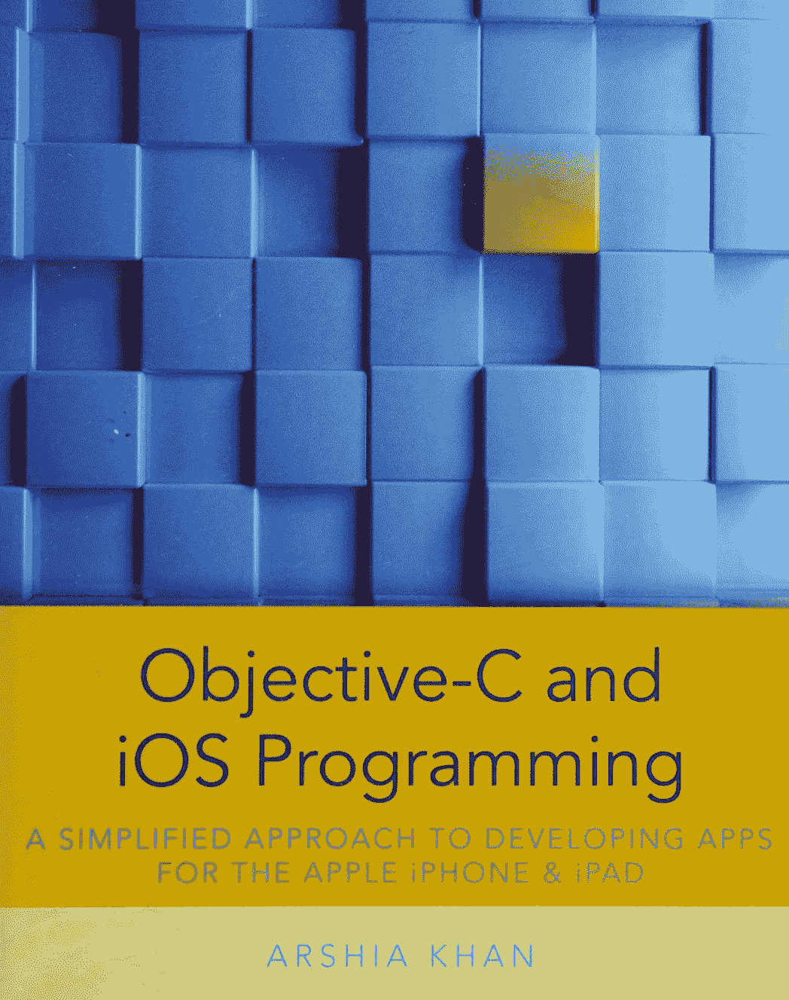


Cengage Learning 是领先的定制化学习解决方案提供商，在全球范围内设有办公室，包括新加坡、英国、澳大利亚、墨西哥、巴西和日本。在以下网址查找您的当地办公室：www.cengage.com/global

印于美国


## 第 5 章 函数

- 函数简介
- 总结
- 数组插入与添加
- 默认 init
- 使用 description 方法打印对象

## 第 8 章 在 iOS 环境下工作

- iOS 平台与架构
- 框架
- Cocoa 框架的角色
- iOS 开发工具包 (SDK)
- 编译器
- Interface Builder
- iOS 模拟器
- Instruments
- 开发支持
- iOS 应用周期
- 视图、控制器与 IB 连接
- 连接
- 使用 `IBOutlet` 和 `IBAction`
- iOS 应用创建过程
- `UIControl` 类
- `UILabel` 类
- `UIButton` 类
- `UITextField` 类
- 动手实验

## 第 9 章 理解与创建用户界面

- `UIKit` 框架
- Storyboards（故事板）
- 使用 Storyboards 实现简单过渡
- 带有导航栏的 Storyboard 示例
- 视图之间的数据传递
- 动手上机实验
- 创建项目
- 在 View Controller 中添加控件
- GUI 编程
- 编写性别选择代码
- 编写重置按钮代码
- 编写从视图 1 到视图 2 的过渡代码
- 隐藏键盘的代码
- 总结
- 练习题
- 编程练习题
- 业务案例研究

## 第 10 章 在 View Controllers、代理和协议之间传递数据

- View Controllers 的角色
- 呈现与收起 View Controllers
- 不使用 Storyboards 创建过渡
- View Controller 之间的通信
- 代理 (Delegates) 与协议 (Protocols)
- 使用协议和代理的步骤总结
- 视图 1 的代码编写
- 视图 2 的代码编写
- 使用代理在视图间传递数据
- 实现数据流
- 完善 `viewDidLoad` 方法的代码并运行 App
- 声明协议并调用协议方法
- 完整代码
- 收起键盘
- 在文本字段内部收起键盘
- 通过点击屏幕任意位置收起键盘
- 动手上机实验
- 创建项目
- 为 View Controller 设计用户界面
- 为 View Controller 设计用户界面
- 协议与代理的实现
- 编写计算代码
- 编写按钮代码
- `SecondViewController`
- 总结
- 练习题
- 编程练习题
- 业务案例研究

## 第 11 章 表视图 (Table Views)

- `UITableView`
- 代理与数据源
- 使用 Table View 创建 App
- 创建界面
- 编写 Table View 程序
- 在 Table View 中显示数据
- 添加数据源
- `ViewController.m` 文件的代码
- 运行 App
- 创建详情视图 (Detail View)
- 创建主-详情应用 (Master-Detail Application)
- 实现主-详情应用模板
- `MasterViewController.h` 文件
- `MasterViewController.m` 文件
- 运行 App
- 动手上机实验
- 创建新项目并设计界面
- 添加 View Controller 文件
- 编写界面程序
- 创建 `IBOutlet` 和 `IBAction` 连接
- 添加数据源
- 实现 `IBAction` 连接
- 编写 Master View Controller 以显示数据
- 在视图间传输数据
- 源代码
- 总结
- 练习题
- 编程练习题
- 业务案例研究

## 第 12 章 标签栏视图与选择器视图控件

- 标签栏视图 (Tab-Bar View)
- 使用 Storyboards 创建标签栏 App
- 开始标签栏 App 示例
- 为标签添加图片
- 不使用 Storyboards 创建标签栏
- 标签栏与导航视图控制器示例
- `AppDelegate.m` 文件
- 添加图片和标题
- 完整的 `ThirdViewController.m` 文件
- 运行 App
- 选择器视图 (Picker View)
- 在选择器视图中使用代理和数据源
- 使用选择器视图创建 App
- 完整文件
- 动手上机实验
- 为标签添加图片和标题
- 嵌入导航控制器
- 表格设置
- 填充 Table View
- 创建界面
- 收起键盘
- 总结
- 练习题
- 编程练习题
- 业务案例研究

## 第 13 章 使用图像和声音创建多媒体 App

- 在 App 中添加图片
- 播放音频
- 在 App 中添加音频
- 创建播放音频的 App
- 添加 `AVFoundation` 框架
- 向项目添加音乐
- 创建并编写播放按钮
- 准备编写播放按钮
- 编写播放按钮
- 为 App 添加音量控制
- 添加进度条
- `ViewController.h` 文件
- 运行 App
- 播放视频
- 在 App 中添加视频
- 创建播放视频的 App
- 添加 `MediaPlayer` 框架
- 创建并编写播放按钮
- 编写播放按钮
- 动手上机实验
- 创建项目
- 创建第三个标签
- 添加音频和媒体框架
- 自定义三个标签
- 在 `SecondViewController` 中编写第二个视图控制器
- `SecondViewController.h` 文件
- 为选择器视图添加数据
- `SecondViewController.h` 文件
- 汇总所有属性
- 设计第三个视图控制器
- 在 `ThirdViewController` 中编写第三个视图控制器
- `ThirdViewController.h` 文件
- 为选择器视图添加数据
- 在 `ThirdViewController` 中编写第三个视图控制器
- `ThirdViewController.h` 文件
- 总结
- 练习题
- 编程练习题
- 业务案例研究

## 第 14 章 数据持久化

| 数据持久化机制 | 440 |
|---|---|
| `NSUserDefaults` 类 | 440 |
| 向 `NSUserDefaults` 对象写入数据 | 441 |
| 创建 `NSDefaults` 示例应用 | 441 |
| 属性列表 (Property Lists) | 446 |
| 创建列表示例应用 | 447 |
| 向属性列表添加项目 | 448 |
| 设计界面 | 449 |
| 归档 (Archiving) | 454 |
| 创建归档示例应用 | 454 |
| SQLite | 459 |
| 创建 SQLite 示例 | 459 |
| 动手实验 (Hands-On Lab) | 468 |
| 设计用户界面 | 470 |
| 添加 SQLite 数据库库 | 474 |


| 编写 MainViewController.h 文件 . . . . . . . | 474 |
| 编写 MainViewController.m 文件 . . . . . . . . . . . | 475 |
| 编写代码 . . . . . . . . . . . . . . . . . . . . . . . . . . . | 480 |
| FLIPSIDEVIEWCONTROLLER.H 文件 . . . . . . . . . . . . . . | 480 |
| 编写代码 . . . . . . . . . . . . . . . . . . . . . . . | 481 |
| FLIPSIDEVIEWCONTROLLER.m 文件 . . . . . . . . . . . . . | 483 |
| 编写 viewDidLoad 方法 . . . . . . . . . . . . | 488 |
| 运行完成的应用 . . . . . . . . . . . . . . . | 488 |
| 总结 . . . . . . . . . . . . . . . . . . . . . . . . . . . | 488 |
| 练习题 . . . . . . . . . . . . . . . . . . . . . . . . . . . | 489 |
| 编程练习题 . . . . . . . . . . . . . . . | 490 |
| 商业案例研究 . . . . . . . . . . . . . . . . . . | 491 |

# 附录 A Xcode 调试器 493

# 索引 501

# 前言

本书为令人兴奋的 iOS 应用开发领域提供了基础知识。随着智能手机的出现，应用程序转向了移动平台，承诺了易用性和实用性，并具有巨大的增长潜力。随着 Apple 设备的普及持续增长，接受过 iOS 编程训练的专业人士将非常有用。

# 方法

要学习如何创建 iOS 应用，首先需要学习如何使用 Objective-C 语言编程，这是 iOS 的底层语言。市场上有很多关于 Objective-C 和 iOS 编程的书籍，但没有一本采用本书提供的简单方法。本书涵盖了创建 iOS 应用所需的必要主题，并包含了大量的截图、复习题、编程练习、动手实验和商业案例研究。要成功使用本书，需要具备 iOS 开发的基础知识。然而，拥有面向对象语言的知识会有帮助。新程序员也应该能够使用本书，因为这是一本入门级书籍，它没有触及受最新 iOS 版本影响的高级技术。因此，书中的截图和代码示例是使用 iOS 6 创建的，应与后续版本兼容。

# 本书是什么

本书介绍了创建可在 Apple 设备上运行的简单应用所需的概念，提供了分步骤指导和丰富的截图供你检查自己的工作。第 1 到 7 章涵盖了 Objective-C 的相关主题，引导你使用 Xcode（Apple 的集成开发环境）编写代码并创建界面。

# 本书不是

本书不是资源书籍。它不是为高级开发者设计的，因此不涵盖高级主题。在掌握了书中解释的基础知识后，你可以在网上找到关于 iOS 编程的更详细信息。

# 结构与范围

第 1 到 7 章解释了如何用 Objective-C 编写简单程序。第 8 到 14 章利用你对 Objective-C 的新熟悉来开发可在 Apple 设备上运行的 iOS 应用。第 1 章介绍了 iOS 开发者程序，提供了 Xcode 的导览，引导你完成编写、保存和运行简单程序的步骤。第 2 章涵盖了变量、常量、数据类型和算术表达式。第 3 章介绍了判断语句，决定程序的哪个部分在何时执行。第 4 章探索了循环机制，如 `for`、`while` 和 `do` 语句。它解释了如何将一个循环嵌套在另一个中。第 5 章涵盖了函数的基本编程概念，根据任务将程序模块化。第 6 章专注于 Foundation，它是 Objective-C 特有的。讨论了 Apple 提供的实用类，以便在语言的所有领域创建一致性。第 7 章探索了面向对象的编程概念，如类和对象、继承、方法和接口。第 8 章探索了 iOS 平台，探索 iOS 编程的基础和 iOS 架构。本章介绍了控件（Outlets）和动作（Actions），同时解释了如何创建一个简单的应用界面。第 9 章专注于使用 Storyboards 并创建应用，允许用户在多个视图控制器之间传递数据。第 10 章处理不使用 Storyboards 的过渡，以及通过代理（delegates）将数据从视图 1 传递到视图 2。第 11 章教授如何使用表格视图（table views）以列表形式显示数据。第 12 章介绍了带 boards 的标签栏控制器（tab bar controllers）和选择器视图控制器（picker view controllers）。

# 书的特点

第 13 章探索了向应用添加图像、声音和视频的过程。为了完成本章的示例和练习，学生需要从 Cengage 主页下载必要的数据文件。第 14 章讨论了创建可以存储和检索数据的各种方法。附录 A 解释了如何使用调试器。

《Objective-C and iOS Programming: A Simplified》中的每种章节都包含以下特点：

- **目标**——本章涵盖的主要主题列表是实用的学习辅助。
- **分步骤说明**——编号的步骤引导你完成创建应用的过程。这些步骤包含了全彩色代码示例以及解释具体如何与 Xcode 界面交互的特定说明。
- **截图**——大量的截图让你在遵循章节编号步骤的同时能够检查自己的工作。
- **概念图和表格**——图表阐明编程概念，表格为你提供有用信息的一览式总结。
- **关键术语**——重要术语采用**粗体**格式。
- **动手实验**——这个详细的、分步骤的实验引导你完成涵盖章节示例中所有主要概念的应用创建过程。动手实验包含了大量的截图来帮助你检查工作。
- **总结**——章节末的列表回顾了本章涵盖的编程概念和技术，让你有一种检查对要点理解程度的方法。
- **练习题**——多选题和判断题鼓励你复习本章涵盖的关键概念。
- **编程练习题**——这些编程问题要求学生使用章节解释的技术和概念来创建各种应用。鼓励学生解决问题，并让教师根据解决方案检查他们的工作。
- **商业案例研究**——这一持续性练习建立在之前章节工作的基础上，重点在第 1 到 7 章构建并扩展一个实用的业务相关应用，并在第 8 到 14 章构建一个医疗相关应用。

# 本书使用的软件和硬件

为了完成书中的步骤和练习，你需要：

- 一台运行 Mac OS X Snow Leopard 或更高版本的基于 Intel 芯片的 Mac
- 注册应用开发人员的用户 ID 或 iOS 开发者计划的 ID
- iOS SDK（软件开发工具包），由 iOS 设计的软件开发环境
- 从 www.cengage.com 下载的第 13 章数据文件

第 1 章介绍了下载 iOS SDK 的各种选项。正如第 1 章所解释，提供一个免费版本，但带有某些限制。书中的截图是在 Mac OS X 10.8.4 上使用 Xcode 4.6.3 版本创建的。然而，这是一本入门书籍，它并不涵盖受新 iOS 版本发布影响的话题。换句话说，本书在随后的 iOS 版本中仍能保持适用。此外，苹果公司在新版本发布时将继续支持旧版本。

请注意，你不需要 iPhone、iPad 或任何其他设备即可使用本书，因为你创建的应用可以运行在基于软件的模拟器上。

# 教师参考

本书也可以作为一个学期或两个学期的格式使用，先教授 Objective-C 编程语言，后教授 iOS 编程。理想情况下，学生在使用本书之前已经学习过面向对象的编程语言，但在教师的帮助下，新程序员也可以通过本书取得成功。

作者任教的圣肖拉斯塔学院（College of St. Scholastica, CSS）在课堂和在线中使用本书。在课堂环境中，CSS 的学生可以使用 Mac 实验室，其中已安装了开发工具。

## 教师辅助网站

这组针对书籍的特定讲义和课堂工具在线提供，可以在 ss.cengage.com 一性提供你课程所需的所有内容。访问并下载 PowerPoint 幻灯片、图片、教师手册等更多内容。

## 教师手册

电子版教师手册按照章节编写，以协助规划和组织一个高效、引人入胜的课程。手册包含了学习目标、章节大纲、讲义笔记、教学技巧、活动建议以及额外资源。还提供示例大纲。

# 致谢

题库。本书每章都配有 Word 版题库，提供判断题和多选择题。

PowerPoint 幻灯片。本书每章都有 PowerPoint 幻灯片。它们作为课堂演示的辅助工具，供学生在网络上进行章节复习，或打印后在课堂发放。教师可以添加其他主题的幻灯片，或通过添加书中的任何插图来定制幻灯片。

解决方案。为所有实操实验、练习、编程练习和业务案例研究提供了解决方案。

源代码。书中程序的源代码提供给学生。除了通过 sso.cengage.com 在线获取，学生还可以通过 www.cengagebrain.com 获取。

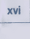

# 致谢

《Objective-C and iOS Programming: A Simplistic Approach to Developing Apps for the iPhone and iPad》在一个非常坚定的专业人士团队的努力和投入下成功交付。感谢 Cengage 的同事们——特别是产品经理 Jim Gish；高级内容开发人员 Alyssa Pratt；高级内容开发人员 Michele Ruelles Cannastrari；内容项目经理 Jennifer Feltri-Gorge；版权收购专家 Christine Myaskovsky；共同编辑 Seri Freeman；校对 Lisa Weidenfeld 以及 Susan Pedicini。MQA 测试员还感谢 Integra Software Services 项目经理 Indumathy Gunasekaran，以及 Staffer Technical 的开发编辑 Ann Shaffer。

感谢本书的评审员：Rafael Azuaje（州立大学）；Paul Noord（罗兰县社区学院）；Andy Poe（北密大学）；Michael Saelee（伊利理工学院）；Michael Shafae（加州州立大学尔丁分校）。

感谢我美丽的：Danish Imtiaz、Rama Imtiaz 和 Nabibia Imtiaz，他们忍受了我没日没夜忙于这本书。感谢他们对我妈妈坐在卧室里写作时的耐心和理解。感谢我的妈妈，特别是在做饭和照顾孩子方面，因为我忙于写作和编辑。

特别感谢我的儿子 Danish Imtiaz，他除了测试一些应用和章节练习及解决方案外，还帮助研究和探索书中涵盖的一些主题。也感谢我的学生 Eric Hiller、Joel Poualeau 和 Rishika Dhody，他们帮助完成了章节练习和解决方案。

感谢我的父亲 Abdul Hafeez Khan，他培养了我历经艰辛坚持下去的动力。

最后，感谢我亲爱的丈夫 Imtiaz Mohamed，在孤独的写作过程占据我们生活时给予了我的耐心、支持和理解。我无法想象除了他还有谁能和我一起走生活的旅程。


## 注册开发者

OS X 和 iOS 的编程框架包含了交互式多点触控（Multi-Touch）技术，允许开发者创建能够响应用户触摸设备的应用程序。与 OS X 和 iOS 一样，Cocoa Touch 是用 Objective-C 实现的。因此，学习 Objective-C 是关键的。Objective-C 是该环境下的编程语言。

Objective-C 是一种面向对象的编程语言，在部署动态运行时以快速速度运行。Objective-C 是过程化编程语言 C 的分支。本质上说，如果你在 C 中加入面向对象编程，就得到了 Objective-C。Objective-C 的另一个重要方面是，与其他编程语言不同，Objective-C 中的方法是被“发送”的，而不是被“调用”或“触发”。

大部分 C 语言语法也适用于 Objective-C。因此，编程语言中的“头文件”（headers）概念转换为 `@interface` 和 `@implementation` 文件的概念。`@interface` 文件包含实例变量、属性和方法声明，而 `@implementation` 文件包含方法的实现。所有属性也都在该文件中进行合成（synthesized）。`@interface` 文件的后缀为 `.h`，而 `@implementation` 文件的后缀为 `.m`。

Apple 为 iOS 应用提供了大量的支持，包括关于编程的文档和其他针对开发者的帮助。为了获得这些支持，你需要向 Apple 注册。注册时，你有两个选项：注册 Apple 开发者和 iOS 开发者。为了完成书中的练习，你需要注册其中一种。

### 注册成为 Apple 开发者

注册成为 Apple 开发者是最简单的选项。你只需向 Apple 注册，无需支付任何费用。你需要拥有一个 Apple ID（就像你在 iTunes Store 购买音乐或应用一样）。注册成为 Apple 开发者可以让你访问在线文档和教程等开发者资源，还允许免费下载 Xcode。然而，iOS 模拟器并非完全适用于 Apple 开发者。摄像头和视频录制等功能无法在 iOS 模拟器中测试，必须在实际设备上测试。

要注册开发者，请访问 `https://developer.apple.com/programs/register/`

### 注册成为 iOS 开发者

与 Apple 开发者相比，注册 iOS 开发者具有多个优势。其中优势之一是它允许开发者在设备上测试应用并在 App Store 中销售应用。与注册 Apple 开发者计划不同，注册 iOS 开发者计划提供了额外功能，例如传输到设备的能力以及在 App Store 中销售应用。

## 启动与入门

你可以从三个不同的 iOS 程序中选择：iOS 开发者计划、iOS 开发者企业计划和 iOS 开发者大学计划。iOS 开发者计划适用于个人，每年费用 99 美元。iOS 开发者企业计划为组织设计，每年费用 299 美元。iOS 开发者大学计划专为教育目的设计，且免费。

你可以以注册 Apple 的身份完成书中的练习。但如果你是学生，老师可能为全班设置了 iOS 开发者大学账户。请咨询老师以确保你理解应该使用哪种选项。iOS 开发者大学计划是首选方案。

要注册 iOS 开发者，请访问 `https://developer.apple.com/support/ios/`

## Xcode 和 iOS SDK 简介

如前所述，Xcode 是你创建 iOS 应用的集成开发环境。Cocoa Touch 的功能也集成在 Xcode 中，使得开发动画、网络和其他强大的触控功能变得简单。

Xcode 实际上只是被称为软件开发包（iOS SDK）的大型开发应用程序之一。除了 Xcode 之外，iOS SDK 还包括 Objective-C 语言的编译器、调试器、界面生成器和 iOS 模拟器。本章假设你已经根据书末附录 A 中提供的说明下载并安装了 Xcode。当你下载 Xcode 时，你实际上下载了整个 iOS SDK。

当你启动 Xcode 时，你会看到图 1-1 所示的界面。

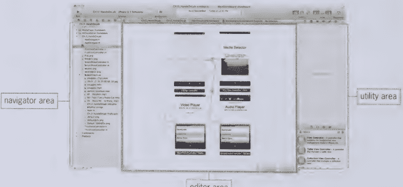

图 1-1 Xcode 工作空间

# 在 Xcode 中创建和运行项目

导航器（Navigator）区域是你可以在其中浏览项目文件的地方。正如在本章后面看到的，你实际上是在编辑器区域输入和编辑 Objective-C 代码。从第 8 章开始，你将使用工具区域的工具为 iOS 应用创建用户界面。现在，你可以忽略 Xcode 工作空间的这部分。

从第 8 章开始，你将使用 iOS 模拟器模拟应用在 iPhone 上的执行。图 1-2 显示了 iOS 模拟器中 iPhone 上运行的应用。


图 1-2 iOS 模拟器中运行的 iPhone 应用

你现在准备好在 Xcode 中创建一个新项目了。以下步骤将引导你完成该过程。

### 在 Xcode 中创建新项目

1. 点击 dock 中的 Xcode 图标或在应用程序列表中找到 Xcode。当 Xcode 启动时，你会看到欢迎窗口。
2. 点击 Create 按钮。这将打开“选择模板”窗口，提供创建 iOS 应用的选项。
3. 在左窗格中，选择 OS X。你可能会奇怪为什么选择 OS X 而不是 iOS。原因是你将使用命令行来编写 Objective-C 代码。
4. 在右上格中，选择 Command Line Tool。此时，你的屏幕应该与图 1-4 一致。

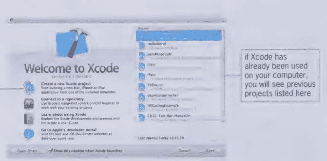

图 1-4 为新项目选择模板

5. 下一步。现在你看到了“为你的项目选择选项”窗口。在这里，你可以为项目提供名称、组织名称和公司标识符（Company Identifier）。公司标识符的典型输入是 "edu" 或 "com"。
6. 产品名称输入 `addTwoNumbers`；对于组织名称，输入你学校的缩写；对于公司标识符，输入 `edu`。
7. 对于 Type，选择 Foundation。完成后，你的屏幕应包含图 1-5 所示的选项。

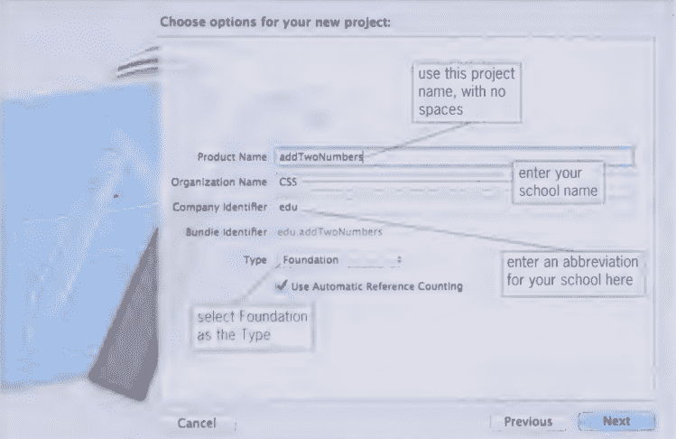

图 1-5 为你的项目选择选项

8. 下一步。打开“另存为”框，你可以导航到现有文件夹，或者点击“新建文件夹”按钮，为新文件夹命名并按回车键，然后点击 Create 按钮。保存完成后，你会看到图 1-6 所示的 Xcode 工作空间。

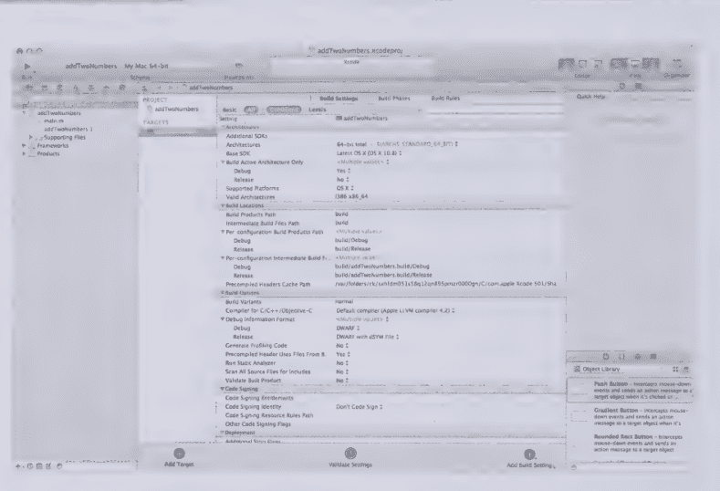

图 1-6 打开了 addTwoNumbers 项目的 Xcode 工作空间


这段自动生成的代码开头包含程序名称、版权信息和创建日期的注释，随后是一个导入基础库（`foundation library`）的导入语句。在第 1 到 7 章中你不需要此语句，但为了方便起见，我们将其保留在那里。导入语句之后是主函数，程序执行从这里开始。主函数中的第一条语句是 `@autoreleasepool`，它处理内存管理。你将在以后学习到更多相关知识。在此时，你不需要理解这条语句，我们将其保留在程序中，因为包含它并无害。你可以在 `@autoreleasepool` 语句的大括号之间编写任何代码。在任何新程序中，`NSLog` 语句 "Hello World" 总是自动生成的。

为了练习一些与 Xcode 的交互操作，你将输入并运行一些 Objective-C 代码。在此时，你不需要理解这些代码。然而，如果你是一个经验丰富的程序员，你可能就能理解它。无论如何，你的目标都是在 Xcode 环境中获得一些实践。

要在 Xcode 中输入并运行一些 Objective-C 代码：

1. 删除 `NSLog` 语句并在 `@autoreleasepool` 语句的大括号内输入以下代码。完成后，你的屏幕应该与图 1-7 一致。

```
int x, y;
x = 10;
y = 12;

NSLog("The sum of x and y is %i", x+y);
```

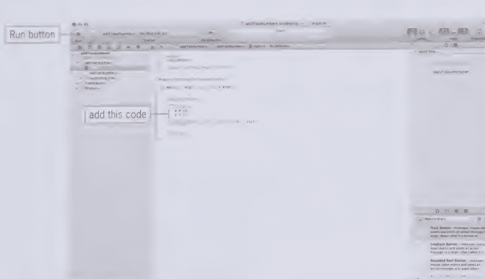

图 1-7 带有新代码的 addTwoNumbers 项目

# 第 1 章 启动与入门

2. 点击运行（Run）按钮。两个数字 10 和 12 的和将在工作区右下角的输出窗口中显示，如图 1-8 所示。

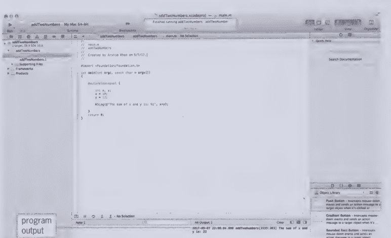

图 1-8 addTwoNumbers 程序的输出

项目完成后，你可以关闭。你不需要先保存，因为 Xcode 在你运行程序时会自动保存。

3. 点击菜单栏中的文件（File），然后点击关闭项目（Close Project）。

## 了解内置调试器

Xcode 有一个内置调试器，可以让你逐行执行程序代码。你可以通过点击任何代码行来添加断点（`break point`），从而激活调试器。当你下次运行包含断点的代码时，语句的执行将在添加调试器的地方停止。图 1-9 显示了在运行包含断点的 App 时为某些代码添加的断点。当代码执行到达断点时，你可以进入（`stepping into`）、跳过（`stepping over`）、跳出（`stepping out of`）代码或继续执行（`continuing execution`）。左下角的窗口显示变量及其数据类型和内容。随着调试器的逐步执行，可以监控变量的内容。

## 了解调试器

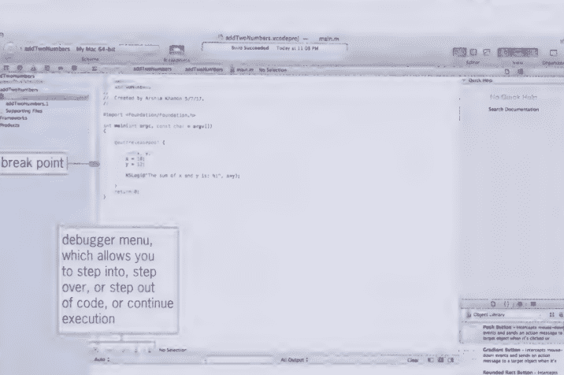

图 1-9 在代码中添加的断点

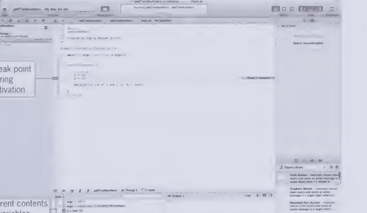

图 1-10 编写代码时激活调试器

并不是所有程序员都喜欢在编写代码时使用调试器。然而，有些程序员非常依赖它们。如果你感兴趣在完成本书中的示例和练习时使用调试器，请参考附录 B 获取更多详情。

## 总结

- 要进行 iOS 编程，你需要一台运行 OS X Snow Leopard 或更高版本的 Mac、Xcode、Objective-C 知识、iOS 知识以及 Apple 开发者计划之一的成员。
- 你可以使用注册的 Apple 开发者账户或 iOS Developer 大学账户完成书中的练习。请咨询你的老师以确保你了解应该使用哪种选项。iOS Developer Program 是首选。
- iOS 是运行在 Apple 设备上的操作系统。iOS 平台派生于 OS X（最初为 Mac 设计的操作系统）。Objective-C 是 iOS 平台的开发语言。Objective-C 主要是增加了面向对象特性的 C 语言。
- Cocoa Touch 是 OS X 和 iOS 的编程框架，它包含了交互式多点（Multi-Touch）技术，允许开发者创建响应用户触摸设备屏幕的应用程序。
- iOS SDK 是一个软件开发包，提供了创建 iOS 应用所需的工具。其中包括 Xcode、iOS 模拟器和 Cocoa Touch。
- Xcode 是一个强大的集成环境，你可以用它编写 Objective-C 代码并创建 iOS 应用。
- iOS 模拟器允许你在真实设备的模拟版本上运行 App。
- 你可以通过点击任何代码行来添加断点来激活调试器。调试器在附录 B 中有更详细的介绍。

## 练习

1. 开发 iOS 应用需要一台运行 OS X Snow Leopard 或更高版本的 Intel 芯片 Mac。如果该陈述错误，请解释原因。
   a. 正确
   b. 错误

2. iOS 应用程序的主要编程语言是 Java。如果该陈述错误，请解释原因。
   a. 正确
   b. 错误

3. Cocoa Touch 提供 iOS 应用中使用的多点技术。如果该陈述错误，请解释原因。
   a. 正确
   b. 错误

4. Xcode 是开发 iOS 应用的集成开发环境。如果该陈述错误，请解释原因。
   a. 正确
   b. 错误

5. 描述三个 iOS 开发者计划。

6. 写出一个 iOS Developer Program 优于 Apple Developer Program 的优点。

7. 什么是 iOS 模拟器？

8. 如果你是注册的 Apple 开发者，列出无法通过 Xcode 模拟器测试的 iOS 功能。

9. 简述 Xcode 的以下元素：
   a. 导航区域（Navigator area）
   b. 编辑区域（Editor area）
   c. 工具区域（Utility area）

10. 解释如何激活调试器。

# 第 2 章 数据类型与算术表达式

## 本章目标

- 处理变量和常量
- 使用 `NSLog` 输出数据
- 使用 `Scanf` 读取用户输入
- 学习基础类型和派生数据类型
- 学习如何使用枚举（`enumerations`）定义数据类型
- 使用预处理器创建自定义语句
- 创建算术表达式

## 变量与常量

编程主要是数据处理。这些数据可以采取许多形式，包括数字、单个字母字符、字母字符串以及具有特定精度的数字。你创建的程序目的决定了程序将处理的数据类型。为了存储数据，程序需要位符，这些可以是变量也可以是常量。变量具有数据类型和用于标识的名称。Objective-C 支持多种数据类型。正如你通过编程学习已经了解的那样，数据类型有助于编译器为存储分配内存。例如，一种数据类型可能使用 1 字节，而另一种数据类型可能使用 2 字节来存储相同的数据。数据类型还帮助程序员识别可以在数据上执行的可能任务。例如，数字可以相加，但字符串可以进行拼接。（拼接是将多个字符串组合以形成单个字符串的过程。）

## NSLog 和 Scanf

在讨论各种 Objective-C 数据类型之前，我们先停下来介绍一个帮助我们向控制台打印内容和获取用户输入的函数。我们将在说明各种 Objective-C 数据类型的示例中使用该函数。

`NSLog` 被 Apple 标识为用于向控制台输出数据的错误日志机制。另一种可选的输出机制是 `printf()` 函数，但 `printf()` 是基于 C 语言的函数，而 `NSLog` 不仅是一个 Objective-C 基础函数，还提供了更扩展的功能，例如使用格式占位符（`format specifiers`）对数据进行格式化。格式占位符是以 `%` 符号开头并指定数据类型的字符的标记。例如，数据类型 `int` 有 `d`、`i` 或 `x` 作为格式占位符。

`NSLog` 接收带有格式占位符的字符串形式的一个或多个参数。（字符串将在第 6 章介绍）。带有格式占位符的字符串以 `@` 符号开头。`%` 符号是变量实际值的占位符。

### 格式说明符对照表

| 数据类型 | 格式说明符 |
|---|---|
| `int` | `%d`, `%i`, `%x`（十六进制） |
| `char` | `%c` |
| `float` | `%f` |
| `double` | `%f` |
| 换行符 | `\n` |
| 字面量打印符号 `%` | `%%` |
| 指针 | `%p` |

**表 2-1** 数据语句及对应的格式说明符

在示例 2-1 中，`NSLog` 语句打印了 "Hello All! This is Chapter 2."。变量 `chapter` 的格式说明符指定了它的位置以及打印时的格式。`NSLog` 语句中的 `\n` 是换行符，它会插入新行。

请注意，带编号的示例包含行号，以便讨论代码。

### 示例 2-1

```
1 #import <Foundation/Foundation.h>
2
3 int main(int argc, const char * argv[])
4 {
   @autoreleasepool
   {
     int chapter = 2;
     NSLog("\nHello All!, This is Chapter %d", chapter);
   }
5 return 0;
}
```

示例 2-1 的输出

```
2017-07-29 23:10:27.812 Example2.1[99816:403] Hello All!, This is Chapter 2
```

`scanf` 函数使用格式说明符将参数映射到字符串中对应的格式说明符上。每个参数都是用户键入的。在示例 2-2 中，第一个 `NSLog` 语句提示用户输入一个数字。下一个语句是 `scanf` 语句，它的第一个参数是格式说明符，指示用户可以输入的参数类型。下一个参数是存储用户输入数字的变量名。参数中的变量名应该始终带有 `&` 符号。

注意，对于需要用户输入数据并存储为 `double` 的代码，你不能使用 `%f` 格式说明符。相反，你应该使用 `%lf`。这是因为 `%f` 意味着输入是 `float`，占用 4 字节存储空间，而 `double` 占用 8 字节。为了让 `scanf` 将该输入识别为 `double` 类型并接受输入，你需要添加小写的 `l`（即小写字母 L）。

### 示例 2-2

```
1 #import <Foundation/Foundation.h>
2 
3 int main(int argc, const char * argv[])
4 {
    @autoreleasepool
    {
     int num;
     NSLog("\nPlease enter a number\n");
     scanf("%d", &num);
     NSLog("The number you entered is %d", num);
    }
5 return 0;
}
```

示例 2-2 的输出

```
2017-07-29 23:25:22.573 Example2.2[9935:403] Please enter a number
2017-07-29 23:25:26.390 Example2.2[9935:403] The number you entered is 6
```

## 数据类型

现在你已经熟悉了 `NSLog` 和 `scanf` 函数，我们可以开始讨论 Objective-C 中常用的数据类型。

### int 类型

`int` 类型用于存储整数——即没有小数点的数字。在示例 2-3 中，`score` 被定义为 `int` 并赋值为 85，而 `age` 同样定义为 `int` 并初始化为 56。在示例 2-3 中，`NSLog` 函数在控制台打印了 `score` 和 `age` 的值。

### 示例 2-3

```
#import <Foundation/Foundation.h>
int main(int argc, const char * argv[])
{
    @autoreleasepool
    {
        int score = 85;
        int age = 56;
        NSLog("@nscore = %d and age = %d", score, age);
    }
    return 0;
}
```

示例 2-3 的输出

```
2017-07-27 16:55:27.284 Example2.3[92453:403] score = 85 and age = 56
```

### char 类型

`char` 类型用于存储单个字符。在示例 2-4 中，`grade` 是 `char` 类型并初始化为 'c'。`last` 也是 `char` 类型并初始化为 'Z'。`char` 类型使用 8 字节空间。在示例 2-4 中，`NSLog` 函数打印了 `grade` 和 `last` 的值。

### 示例 2-4

```
#import <Foundation/Foundation.h>
int main(int argc, const char * argv[])
{
    @autoreleasepool
    {
        char grade = 'c';
        char last = 'Z';
        NSLog("@ngrade = %c and last = %c", grade, last);
    }
    return 0;
}
```

示例 2-4 的输出

```
2017-07-27 22:07:59.451 Example2.4[92677:403] grade = c and last = Z
```

### float 类型

带有小数点的数字称为实数。`float` 类型用于存储实数。在示例 2-5 中，`percent` 的类型是 `float`，其常量值为 5.013，而 `area` 也是 `float` 类型，常量值为 65.28。`float` 利用的存储空间为 32 位。在示例 2-5 中，`NSLog` 函数打印了 `percent` 和 `area` 的值。

### 示例 2-5

```
#import <Foundation/Foundation.h>
2
int main(int argc, const char * argv[])
{
   @autoreleasepool
   {
     float percent = 5.013;
     float area = 65.28;
     NSLog("@\npercent = %f and area = %f", percent, area);
   }
   return 0;
}
```

示例 2-5 的输出

```
2017-07-27 22:18:09.748 Example2.5[92868:403] percent = 5.013000 and area = 65.280000
```

### double 类型

`double` 类似于 `float` 但提供了几乎两倍的精度，利用 64 位存储空间。在示例 2-6 中，变量类型为 `double`。变量 `rate` 初始化为 5.013，而 `speed` 初始化为 67.54。在示例 2-6 中，`NSLog` 函数在控制台打印了 `rate` 和 `speed` 的值。

### 示例 2-6

```
#import <Foundation/Foundation.h>
2
int main(int argc, const char * argv[])
{
   @autoreleasepool
   {
     double rate = 5.013;
     double speed = 67.54;
     NSLog("@\nrate = %f and speed = %f", rate, speed);
   }
   return 0;
}
```

示例 2-6 的输出

```
2017-07-27 22:29:38.793 Example2.6[92974:403] rate = 5.013000 and speed = 67.540000
```

### 派生类型

各种数据类型的组合可以创建更复杂的类型，被称为派生类型。

#### 指针类型

指针类型用于存储内存地址。在 Objective-C 中，指针指向数据所在的位置。在 Objective-C 中，指针类型通过星号 `*` 符号表示。例如，`int *ptr` 表示一个指向整数的指针。

# 2 章

Figure 2-1 Pointer to the address of an int

#### struct 类型

结构体类型（`struct type`）是多种数据类型的组合，创建一个新的自定义数据类型。它提供了一种组合各种数据类型的方法。结构体是面向对象编程引入之前 C 语言的遗留，是类的静态版本。在示例 2-8 中，`int`、`float` 和 `char` 类型被组合成 `ball` 结构体。本质上，各种数据类型就是 `ball` 的属性。

### 示例 2-8

```
#import <Foundation/Foundation.h>
int main(int argc, const char * argv[]) {
    @autoreleasepool {
        struct ball {
            int num;
            float size;
            char color;
        };
        struct ball b;
        b.num = 2;
        b.color = 'F';
        b.size = 3.0;
        NSLog("\nnum = %d, color = %c and size = %f", b.num, b.color, b.size);
    }
    return 0;
}
```

示例 2-8 的输出

```
2017-02-29 17:57:41.120 Example 2.8[98910:403]
num = 2, color = F and size = 3.000000
```


结构中的单个数据类型可以独立地访问和填充，如示例 2-8 中的述语句所示：

```c
b.num = 2;
```

## 数据类型与算术表达式

这里 `ball` 结构体中的 `num` 变量被赋值为 2。在以下语句中，`ball` 结构体的 `color` 变量被赋值为 'F'：

```c
b.color = 'F';
```

在示例 2-9 中，`course` 结构体包含了 `int` 和 `char` 数据类型的组合。

### 示例 2-9

```c
1 #import <Foundation/Foundation.h>
2 int main(int argc, const char * argv[])
3 {
4 @autoreleasepool
5 {
6 struct course
7 {
8 int score;
9 char grade;
10 };
11 struct course math;
12 math.score = 92;
13 math.grade = 'B';
14 NSLog(" \score = %d and grade = %c", math.score,
15 math.grade);
16 }
17 return 0;
18 }
```

### 示例 2-9 的输出

```
2017-07-29 18:06:19.551 Example 2.9[98986:403]
score = 92 and grade = B
```

### 枚举 (Enum)

Objective-C 中的枚举功能允许程序员通过枚举定义新的数据类型。枚举的术语意味着为变量定义一个值范围。这些值可以是特定特定的。枚举提供了一种将值列表与变量关联的方法。

例如，在示例 2-10 中，一个名为 `Month` 的枚举数据类型可以有一个月份列表作为它的值。

### 示例 2-10

```c
#import <Foundation/Foundation.h>
int main(int argc, const char * argv[])
{
    @autoreleasepool {
        typedef enum {
            Jan = 1,
            Feb = 2,
            March = 3,
            April = 4,
            May = 5,
        } Month;
        Month month = April;
        NSLog("%\n value of the Month April is %d", month);
    }
    return 0;
}
```

### 示例 2-10 的输出

```
2017-07-29 16:29:42.303 Example 2.10[98065:403]
The value of the Month April is 4
```

注意枚举是整数类型。如果没有为月份赋值，编译器将从 0 开始赋值。在示例 2-11 中，定义了枚举。因此，编译器从 0 开始分配它们。结果是 `April` 被赋值为 3，而不是示例 2-10 中的 4。

### 示例 2-11

```c
#import <Foundation/Foundation.h>
int main(int argc, const char * argv[])
{
    @autoreleasepool {
        typedef enum {
            Jan,
            Feb,
            March,
            April,
            May,
        } Month;
        Month month = April;
        NSLog("%\n value of the Month April is %d", month);
    }
    return 0;
}
```

### 示例 2-11 的输出

```
2017-07-29 16:29:42.303 Example 2.11[98065:403]
The value of the Month April is 3
```

### 预处理器：define语句

预处理器是 Objective-C 中的一种特殊工具，帮助你创建自定义语句。例如，预处理器语句 `#define` 用于定义常量并将其与唯一名称关联。换句话说，它允许你在程序中自定义常量。在示例 2-12 中，`PERC_PASSED` 被定义为 95.0，在后续使用 `PERC_PASSED` 时它的值将是 95.0。使用常量的好处是，如果需要更改常量的值，只需要在一个地方修改它，而不需要搜索整个程序。

### 示例 2-12

```c
1 #import <Foundation/Foundation.h>
2 #define PERC_PASSED 95.0
3 int main(int argc, const char * argv[])
4 {
5 @autoreleasepool
6 {
7 NSLog("\nthere are 20 students in a class,
8 number of students passed is %f", PERC_PASSED*20/100);
9 }
10 return 0;
11 }
```

### 示例 2-12 的输出

```
2017-07-29 15:10:48.555 Example 2.12[97494:403]
```

### 算术表达式

包含操作数的运算符的表达式被称为算术表达式。操作数可以是整数或实数。而运算符可以分为基础运算符和复合运算符。

### 基础

| 运算符 | 名称 | 功能 |
| :--- | :--- | :--- |
| `+` | plus | 加 |
| `-` | minus | 减 |
| `*` | mult | 乘 |
| `/` | div | 除 |
| `%` | mod | 取模；求除法后的余数 |

### 算术表达式

在示例 2-13 中，用户被提示输入数字。基础运算符通过加、减、除这两个数字来实现。第 7 行声明了存储输入数字和算术运算结果所需的变量。第 9 和 13 行提示输入数字，第 11 和 15 行分别将这些值存储在 `num1` 和 `num2` 中。第 19 到 28 行执行算术运算，第 30 到 38 行打印结果。注意，当用于整数时，只有在余数为0时 `div` 给出正确答案。如果有余数，`div` 将向下取整到最的整数。

### 示例 2-13

```c
1 #import <Foundation/Foundation.h>
2 int main(int argc, const char * argv[]) {
3 @autoreleasepool
4 // declarations for the calculations
5 int num1, num2, mult, div, sub = 0;
6 //Prompt the user for a number
7 NSLog("\nEnter number\n");
8 scanf("%d",&num1);
9 //Prompt the user for a second number
10 NSLog("\nPlease enter second number\n");
11 scanf("%d",&num2);
12 //add the user-entered numbers and store the result in
13 add = num1 + num2;
14 //subtract the user-entered numbers and store the result in
15 sub = num1 - num2;
16 //multiply the user-entered numbers and store the result in
17 mult = num1 * num2;
18 //divide the user-entered numbers and store the result in
19 div = num1 / num2;
20 //Print the sum of the user entered numbers
21 NSLog("\nt sum of the numbers entered is %d\n", add);
22 //Print the difference of the user entered numbers
23 NSLog("\nt difference between the numbers entered is %d\n", sub);
24 //Print the product of the user entered numbers
25 NSLog("\nt product of the numbers entered is %d\n", mult);
26 //Print the division of the user entered numbers
27 NSLog("\nt division of the numbers entered is %d\n", div);
28 }
29 return 0;
30 }
```

### 示例 2-13 的输出

```
2017-07-29 00:01:27.692 Example 2.13[378:403]
Please enter a number
2017-07-29 00:01:33.099 Example 2.13[378:403]
Please enter a second number
2017-07-29 00:01:36.274 Example 2.13[378:403]
The sum of the numbers entered is 39
2017-07-29 00:01:36.275 Example 2.13[378:403]
The difference between the numbers entered is 9
2017-07-29 00:01:36.276 Example 2.13[378:403]
The product of the numbers entered is 360
2017-07-29 00:01:36.277 Example 2.13 [378:403]
The division of the numbers entered is 1
```

### 取模运算符

取模运算符返回除法后的余数。在所有基础运算符中，取模运算符可能是最复杂的，因此研究它是有帮助的。在示例 2-14 中，`int b` 被赋值为 7。`b` 和 2 的取模 `b % 2` 返回 1，因为当除以 2 时，商为 3，余数为 1。

在第 2 行，`x = 10`。因此：

```c
x % 2 = 10 % 5
```

返回 0，因为当 10 除以 5 时，商为 2，余数为 0。

在第 3 行，`y = 1`。因此：

```c
y % 2 = 1 % 2
```

返回 1，因为 1 除以 2 时，商为 0，余数为 1。

在第 4 行，`z = 6`。因此：

```c
6 % 7
```

返回 6，因为 6 除以 7 时，商为 0，余数为 6。

### 算术表达式

注意，模运算符仅作用于整数。在示例 2-14 中，如果 `b`、`x`、`y`、`z` 或 `a` 是双精度浮点数（`double`），编译器将打印错误。此外注意第 13 到 17 行 `NSLog` 包含了两个百分号（`%%`）。额外的 `%` 是为了打印 `%` 符号所必需。

### 示例 2-14

```c
1 #import <Foundation/Foundation.h>
2 int main(int argc, const char * argv[])
3 {
4  @autoreleasepool
5  //variable declarations
6  int b = 7;
7  int x = 10;
8  int y = 1;
9  int z = 6;
10 int a = 105;
11
12 NSLog("\n%d %% 2 is %d", b, b % 2);
13 NSLog("\n%d %% 5 is %d", x, x % 5);
14 NSLog("\n%d %% 2 is %d", y, y % 2);
15 NSLog("\n%d %% 7 is %d", z, z % 7);
16 NSLog("\n%d %% 10 is %d", a, a % 10);
17 }
18 return 0;
19
```

### 示例 2-14 的输出

```
2017-07-29 12:49:45.810 Example 2.14[96521:403]
7 % 2 is 1
2017-07-29 21:06:25.448 Example 2.14 [99458:403]
10 % 5 is 0
2017-07-29 21:06:25.449 Example 2.14 [99458:403]
1 % 2 is 1
2017-07-29 21:06:25.450 Example 2.14 [99458:403]
6 % 7 is 6
2017-07-29 21:06:25.451 Example 2.14 [99458:403]
105 % 10 is 5
```

### 复合赋值运算符

表 2-3 描述了复合赋值运算符。

| 运算符 | 名称 | 功能 | 示例 |
|---|---|---|---|
| `=` | 赋值 | 赋值 | `a = 7.0` |
| `++` | 递增 | 增 1 | `a++; a = a + 1; a = 8.0` |
| `--` | 递减 | 减 1 | `a--; a = a - 1;` |
| `+=` | 增量赋值 | 加并赋值 | `a += 3; a = a + 3` |
| `-=` | 递减赋值 | 减并赋值 | `a -= 4; a = a - 4` |
| `*=` | 乘法赋值 | 乘并赋值 | `a *= 3; a = a * 3` |
| `/=` | 除法赋值 | 除并赋值 | `a /= 2; a = a / 2` |
| `%=` | 模运算赋值 | 取模并赋值 | `a %= 2; a = a % 2` |

### 前/后递增和前/后递减运算符

前递增运算符先增加，然后执行表达式中的其他操作。例如，如果 `x = 5`，那么

```c
++x * 2 = (5+1)*2 = 12
```

而后递增运算符会在表达式求值后执行递增。例如，如果 `x = 5`，那么

```c
x++ * 2 = (5*2) + 1 = 11
```

前/后递减的工作方式与前/后递增非常相似。在前递减示例中，如果 `x = 5`，那么

```c
--x * 2 = (5-1)*2 = 8
```

在后递减示例中，`x = 5`，

```c
x-- * 2 = (5*2)-1 = 9
```

正如示例 2-15 所示，前置和后缀操作的结果不同。用户被提示输入数字，存储在变量 `num1` 和 `num2` 中。前/后递增和前/后递减操作分别在第 18、23、28、33 行中执行，其操作结果分别显示在第 20、25、30 和 35 行中。

### 示例 2-15

```c
#import <Foundation/Foundation.h>
int main(int argc, const char * argv[])
{
    @autoreleasepool
    {
      //variable declarations
      int num1, num2, add;
      //提示用户输入一个数字。
      NSLog("\nenter a number\n");
      //将用户输入的数字存储在变量 num1 中。
      scanf("%d", &num1);
      //提示用户输入第二个数字。
      NSLog("\nenter a second number\n");
      //将用户输入的数字存储在变量 num2 中。
      scanf("%d", &num2);

      // 前递增
      add = ++num1 + 2*num2;
      //打印该值
      NSLog("\nThe sum of the numbers entered in pre increment is %d\n", add);
      //后递增
      add = num1++ + 2*num2;
      //打印值
      NSLog("\nThe sum of the numbers entered in post increment is %d\n", add);
      //后递减
      add = num1 + 2*--num2;
      //打印值
      NSLog("\nThe sum of the numbers entered in post decrement is %d\n", add);

      return 0;
    }
}
```

### 示例 2-15 的输出

```
2017-07-30 00:36:45.262 Example 2.15[656:403]
enter a number
4
2017-07-30 00:36:50.508 Example 2.15 [656:403]
enter a second number
6
2017-07-30 00:36:50.299 Example 2.15 [656:403]
The sum of the numbers entered in pre increment is 16
2017-07-30 00:36:50.301 Example 2.15 [656:403]
The sum of the numbers entered in post increment is 20
2017-07-30 00:36:50.302 Example 2.15 [656:403]
The sum of the numbers entered in post decrement is 16
```

### 复合运算符：加赋值 (+=) 和减赋值 (-=)

加赋值运算符用于向变量加上一个值并将新值赋值给变量。如果 `A=6`，`B=2`，则表达式 `A+=B` 的求值为 `A=6+2=8`。


同样，减赋值运算符用于从变量中减去一个值，然后将新值赋值给变量。例如，如果 `A=4`，`B=1`，则表达式 `A-=B` 的求值为 `A=4-1=3`。

在示例 2-16 中，当 `num1=1`，`num2=2` 时，第 9 行的 `num1+=num2` 可以写为 `num1=num1+num2`；因此，`num1=2+3=5`。第 15 行的 `-=` 操作等同于 `num1=num1-3=-1`。

### 示例 2-16

```c
1 #import <Foundation/Foundation.h>
2 int main(int argc, const char * argv[])
3 {
4     @autoreleasepool
5     {
          int num1 = 2, num2 = 3;
          //加赋值
          num1 += num2;
          printf("The result of the num1 += = %d\n", num1);
          //将原始值重新赋值给 num1 和 num2
          num1 -= 2;
          
          //减赋值
          num1 -= num2;
          printf("The result of the num1 -= = %d\n", num1);
     }
     return 0;
 }
```

示例 2-16 的输出

```
2017-07-31 00:42:57.168 Example 2.15[778:403]
The result of the num1 += = 5
2017-07-31 00:42:57.161 Example 2.15[778:403]
The result of the num1 -= = -1
```

### 复合运算符：乘法赋值 (*=) 和除法赋值 (/=)

乘法赋值运算符将两个操作数相乘，并将结果赋值给左侧的操作数。例如，如果 `A=3`，`B=2`，则表达式 `A*=B`（可以写为 `A=A*B`）的求值为

```
A = 3*2=6
```

### 算术表达式

同样，除法赋值运算符在复合语句中将第一个操作数除以第二个操作数，并将值赋值给第一个运算符。例如，如果 `A=6`，`B=3`，则表达式 `A/=B`（可以写为 `A=A/B`）的求值为 `A=6/2=3`。

在示例 2-17 中，当 `num1=6.0`，`num2=4.0` 时，第 9 行的表达式 `num1*=num2` 可以写为 `num1=num1*num2`；因此，`num1=6.0*4.0=24.0`。

在第 12 行的 `/=` 操作中，表达式 `num1 /= num2` 可以写为 `num1=num1/num2`。

### 示例 2-17

```c
#import <Foundation/Foundation.h>
int main(int argc, const char * argv[])
{
    @autoreleasepool
    {
          double num1 = 6.0, num2 = 4.0;
          //乘法赋值
          num1 *= num2;
          NSLog("\nThe result of the num1 *= = %f\n", num1);
          //除法赋值
          num1 /= num2;
          NSLog("\nThe result of the num1 /= = %f\n", num1);
    }
}
```

## 数据类型与算术表达式

### 示例 2-18

```c
#import <Foundation/Foundation.h>
int main(int argc, const char * argv[])
{
    @autoreleasepool
    {
          int num1 = 6, num2 = 4;
          //模运算赋值
          num1 %= num2;
          NSLog("\nThe result of the num1%% is %d\n", num1);
    }
}
```

## 动手实验

在动手实验中，你将编写一个程序对数字进行各种操作并将结果输出到控制台。此练习实验实现了本章的大部分概念。

## 变量声明与初始化

1. 声明并初始化两个名为 `numInt` 和 `num2Int` 的 `int` 类型变量存储用户输入：

   `numInt, num2Int;`

2. 初始化变量。程序应该提示用户输入并将输入的数字存储在 `numInt` 和 `num2Int` 中。

   ```c
   //用户提示和变量初始化
   NSLog("@Enter the first integer");
   scanf("%d", &numInt);
   NSLog("@Enter the second integer");
   scanf("%d", &num2Int);
   ```

## 基础数据类型的实现

3. 声明两个 `double` 类型的变量 `num1Double` 和 `num2Double` 以存储用户输入。

   `double num1Double, num2Double;`

   提示用户输入，并将用户输入的数字存储在 `num1Double` 和 `num2Double` 中。

   ```c
   //User prompts and variable initialization
   NSLog("@Enter the first floating point number");
   scanf("%lf", &num1Double);
   NSLog("@Enter the second floating point number ");
   scanf("%lf", &num2Double);
   ```

   注意：`double` 类型的格式说明符为 `%lf`，正如本章之前在 `NSLog` 和 `scanf` 中解释的那样。

4. 声明类型为 `int` 的变量 `addResult`、`subResult` 和 `modResult`。同时声明分别存储用户输入值进行加、减、取模、乘、除运算结果变量。

   ```c
   int addResult, subResult, modResult;
   double multResult, divResult;
   ```

## 派生数据类型的实现

5. 声明两个类型为 `int` 的指针 `ptrAddResult` 和 `ptrSubResult`，分别指向变量 `sum(addResult)` 和 `difference(subResult)`。

   ```c
   int *ptrAddResult;
   int *ptrSubResult;
   ```

6. 声明一个类型为 `struct birthdate` 的变量，其中包含类型为 `int` 的 `day`、`month` 和 `year`。

   ```c
   struct birthdate
   {
       int day;
       int month;
       int year;
   };
   ```

7. 使用一个虚拟生日初始化你创建的 `birthdate` 结构体变量。

   ```c
   struct birthdate dob;
   dob.day = 12;
   dob.month = 04;
   dob.year = 2000;
   ```

8. 声明一个名为 `operation` 的枚举，包含 `addition`、`multiplication`、`division` 和 `modulus` 变量。

   ```c
   typedef enum {
       addition = 1,
       multiplication,
       division,
       modulus
   } Operation;
   ```

9. 为你创建的枚举声明一个变量并命名为 `myOperation`。选择除法操作。

   `Operation myOperation = division;`

## 加法

10. 将变量 `numInt` 和 `num2Int` 相加，并将结果存储在 `addResult` 中并打印结果。

    ```c
    addResult = numInt + num2Int;
    NSLog("The result of the addition of %d and %d is %d",
    numInt, num2Int, addResult);
    ```

## 减法

11. 从 `numInt` 中减去 `num2Int` 并将结果存储在 `subResult` 中并打印结果。

    ```c
    subResult = numInt - num2Int;
    NSLog("The result of the subtraction of %d and %d is %d",
    num2Int, numInt1, subResult);
    ```

## 乘法

12. 将变量 `numDouble` 和 `num2Double` 相乘，并将结果存储在 `multResult` 中并打印结果。

    ```c
    multResult = numDouble * num2Double;
    NSLog("The result of the multiplication of %f and %f is %f",
    numDouble, num2Double, multResult);
    ```

## 除法

13. 将变量 `numDouble` 除以 `num2Double` 并将结果存储在 `divResult` 中并打印结果。

    ```c
    divResult = numDouble / num2Double;
    NSLog("The result of the division of %f and %f is %f",
    numDouble, num2Double, divResult);
    ```

## 取模

14. 求 `num1` 对 `num2Int` 的模，将结果存储在 `modResult` 中并打印结果。

    ```c
    modResult = numInt % num2Int;
    NSLog("The result of the modulus of %d and %d is %d",
    numInt, num2Int, modResult);
    ```

## 使用派生数据类型的实现

15. 让 `ptrAddResult` 指向 `addResult` 的内存地址，让 `ptrSubResult` 指向 `subResult`。

    ```c
    ptrAddResult = &addResult;
    ptrSubResult = &subResult;
    ```

16. 打印指针的内容和地址。

    ```c
    NSLog("@\nThe value of the pointer ptrAddResult is %d and the address is %p", *ptrAddResult, ptrAddResult);

    NSLog("@\nThe value of the pointer ptrSubResult is %d and the address is %p", *ptrSubResult, ptrSubResult);
    ```

## 复合运算符的实现

17. 将指针 `ptrAddResult` 所指向的值加 1，并打印结果值。

    ```c
    (*ptrAddResult)++;

    NSLog("@Incrementing the value of the ptrAddResult makes
    the value %i", *ptrAddResult);
    ```

18. 使用复合运算符 `+=` 将 `ptrAddResult` 的值加 8，并打印结果值。

    ```c
    (*ptrAddResult) += 8;

    NSLog("@Adding 8 using the (+=) operator to the value of
    the ptrAddResult makes the value %i", *ptrAddResult);
    ```

19. 使用复合运算符 `-=` 从 `ptrSubResult` 的值减去 5 并打印该值。

    ```c
    (*ptrSubResult) -= 5;

    NSLog("@Subtracting 5 using the (-=) operator from the value
    of the ptrSubResult makes the value %i", *ptrSubResult);
    ```

20. 使用复合运算符 `*=` 将 `multResult` 的值乘以 3，并打印结果值。

    ```c
    (*multResult) *= 3;
    NSLog("@After multiplying the value of the multResult
    using the (*=) operator the new value is %f",
    multResult);
    ```

## 数据类型与算术表达式

21. 使用复合运算符 `/=` 将 `divResult` 的值除以 2，并打印结果值。

    ```c
    divResult /= 2;
    NSLog("After dividing the value of divResult
    using the (/= operator the new value is %f", divResult);
    ```

22. 使用复合运算符 `%=` 求 `modResult` 对 2 的模，并打印结果值。

    ```c
    modResult %= 2;
    NSLog("After finding the modulus using the (%= operator
    value the modResult is %i", modResult);
    ```

23. 打印你的生日。

    ```c
    NSLog("Your date of birth is: %d/%d/%d", dob.day, dob.month, dob.year);
    ```

## 使用枚举

24. 打印操作类型。

    ```c
    NSLog("Thank you for operation %d", myOperation);
    ```

注意：`NSLog` 语句以 `\n` 开头，这样输出就会另起一行。

## 源代码

以下是实验的完整源代码。


```objectivec
#import <Foundation.h>
int main(int argc, const char *argv[]) {
    @autoreleasepool {
        int num1Int, num2Int;
        NSLog("\nenter the first integer");
        scanf("%i", &num1Int);
        NSLog("\nenter the second integer\n");
        scanf("%i", &num2Int);
        double num1Double, num2Double;
        NSLog("\nenter the first point number\n");
        scanf("%f", &num1Double);
        NSLog("\nenter the second point number \n");
        scanf("%f", &num2Double);
        int addResult, subResult, modResult;
        double multResult, divResult;
        int *ptrAddResult;
        int *ptrSubResult;
        struct birthdate {
            int day;
            int month;
            int year;
        };
        struct birthdate dob;
        dob.day = 12;
        dob.month = 04;
        dob.year = 2000;
        typedef enum {
            addition = 1,
            multiplication,
            division,
            modulus
        } Operation;
        Operation myOperation = division;
        addResult = num1Int + num2Int;
        NSLog("The result of the addition of %d and %d is %d",
        num1Int, num2Int, addResult);
        subResult = num1Int - num2Int;
        NSLog("The result of the subtraction of %d and %d is %d",
        num2Int, num1Int, subResult);
        multResult = num1Double * num2Double;
        NSLog("The result of the multiplication of %f and %f is %f",
        num1Double, num2Double, multResult);
        divResult = num1Double / num2Double;
        NSLog("The result of the division of %f and %f is %f",
        num1Double, num2Double, divResult);
        modResult = num1Int % num2Int;
        NSLog("The result of the modulus of %d and %d is %d",
        num1Int, num2Int, modResult);
        ptrAddResult = &addResult;
        ptrSubResult = &subResult;
        NSLog("@nThe value of the pointer ptrAddResult is %d and the address is %p", *ptrAddResult, ptrAddResult);
        NSLog("@\nThe value of the pointer ptrSubResult is %d and the address is %p", *ptrSubResult, ptrSubResult);
        (*ptrAddResult)++;
        NSLog("@Incrementing the value of the ptrAddResult makes
the value %i", *ptrAddResult);
        (*ptrAddResult) += 8;
        NSLog("@Adding 8 using the (+=) operator to the value of
the ptrAddResult makes the value %i", *ptrAddResult);
        (*ptrSubResult) -= 5;
        NSLog("@Subtracting 5 using the (-=) operator from the value
of the ptrSubResult makes the value %i", *ptrSubResult);
        (*multResult) *= 3;
        NSLog("@After multiplying the value of the multResult
using the (*=) operator the new value is %f",
multResult);
        divResult /= 2;
        NSLog("After dividing the value of the divResult
using the (/= operator the new value is %f", divResult);
        (modResult %= 2);
        NSLog("After finding the modulus using the (%= operator
value of the modResult is %i", modResult);
        NSLog("Your date of birth is: %d/%d/%d", dob.day, dob.month, dob.year);
        NSLog("Thank you for operation %d", myOperation);
        return 0;
    }
}
```

### RESULTS

```text
2017-08-01 01:00:17.611 the first integer 5
2017-08-01 01:00:22.512 the second integer 8
2017-08-01 01:00:23.822 the first floating point number 6.5
2017-08-01 01:00:27.308 the second floating point number 3.5
2017-08-01 01:00:30.531 the result of the addition of 5 and 8 is 13
2017-08-01 01:00:30.533 the result of the subtraction of 8 from 5 is -3
2017-08-01 01:00:30.534 the result of the multiplication of 6.500000 and 3.500000 is 22.750000
2017-08-01 01:00:30.535 the result of the division of 6.500000 and 3.500000 is 1.857143
2017-08-01 01:00:30.536 the result of the modulus of 5 and 8 is 5
2017-08-01 01:00:30.536 value of the pointer ptrAddResult is 13 and the address 0x7fffe630a88
2017-08-01 01:00:30.537 value of the pointer ptrSubResult is -3 and the address 0x7fffe630a88
2017-08-01 01:00:30.538 incrementing the value of the ptrAddResult makes the value 14
```

### 总结

值 22

```text
2017-08-01 01:00:30.539 Example[4069:403]
使用 (=) 运算符从 ptrSubResult 的值中减去 5，结果变为 -8
2017-08-01 01:00:30.540 Example[4069:403]
使用 (*=) 运算符乘以 multResult 的值后，新值为 68.250000
2017-08-01 01:00:30.543 Example[4069:403]
使用 (/=) 运算符除以 divResult 的值后，新值为 0.928571
2017-08-01 01:00:30.544 Example[4069:403]
使用 (%=) 运算符求模数后，modResult 的值为 1
2017-08-01 01:00:30.545 Example[4069:403] 你的出生日期是：12/4/2000。
2017-08-01 01:00:30.545 Example[4069:403] 感谢使用操作 3
```

### 总结

- 编程的主要目的是处理数据。
- `NSLog` 被 Apple 识别为错误日志机制，用于向控制台输出数据。`NSLog` 接收一个或多个参数，形式为带有格式化说明符的字符串，例如用于 `int` 的 `i, d, x`；用于 `char` 的 `c`；用于 `float` 的 `f`；用于指针的 `p` 等。
- `scanf` 函数使用与 `NSLog` 相同的格式化说明符来读取用户输入。每个输入参数都映射到其对应的格式化说明符。
- 数据类型有两种：基本类型和派生类型。
- 基本数据类型的示例有 `int`、`char`、`double` 和 `float`。
- 派生类型是基本类型的组合。派生类型的示例包括 `struct`、`typedef enum` 和指针。
- 预处理器 `#` 语句声明了一个在整个程序过程中不改变的常量值，并可以赋予一个唯一的名称。
- 算术表达式是操作数和运算符的组合。运算符有两种：基本运算符和复合运算符。基本运算符有 `+`, `*`, `/`, 和 `%`。复合运算符是基本运算符的组合。复合运算符的示例包括：`+=`, `-=`, `*=`, `/=` 和 `%=`。
- 模运算符求表达式中两个操作数相除后的余数。

## 数据类型与算术表达式

## 练习题

1. 下面哪个不是 Objective-C 中有效的格式化说明符？
   - a. `%c`
   - b. `%q`
   - c. `%f`
   - d. `%n`
   - e. `%i`

2. 下面哪一个不是 Objective-C 中的保留字？
   - a. `char`
   - b. `double`
   - c. `String10`
   - d. `int`
   - e. `float`

3. 检查以下代码并回答下面的问题，请参考行号：
   ```objectivec
   1 int x = 45;
   2 int * y = &x;
   3 x++;
   4 (*y)+=10;
   ```
   - a. 在第 4 行时，`y` 的值是多少？
   - b. 在任何给定点，`x` 和 `y` 的值之间有什么区别？
   - c. 写一行代码打印变量 `x` 的内存地址。

4. 识别以下代码中的错误：
   ```objectivec
   int x = 56;
   x++;
   x-=5;
   int *y = x;
   NSLog(@"The value of y is %i", y);
   ```

5. 解释以下声明之间的区别：
   - a. `double *d` 和 `double d`
   - b. `double d` 和 `float d`

6. 将以下简单语句转换为对应的复合语句：
   - a. `*c = *c + 5`
   - b. `x = x + y + 2`
   - c. `num = sum - 3 * num`

## 练习

7. 考虑以下代码：
   ```objectivec
   typedef enum {
       Sunday,
       Monday,
       Tuesday,
       Wednesday,
       Thursday,
       Friday,
       Saturday,
   } day;
   ```
   - a. `Sunday` 的值是多少？
   - b. 修改代码使得 `Wednesday` 的值为 2。
   - c. `enum` 和 `struct` 之间的区别是什么？

8. 识别并修复以下程序中的错误：
   ```objectivec
   int main(int argc, const char *[])
   {
       @autoreleasepool {
           int GMT_time=0, CST_time=0;
           int* state = &CST_time;
           CST_time += 5;
           NSLog(@"GMT time is %p, it is %i", state, CST_time);
       }
   }
   ```

9. 修改题目程序，使 `GMT time` 为 `double` 类型。根据输入的 `GMT time` 显示时间。

## 编程练习题

1. 写一个程序，产生如下输出，包含 "object" 字样（此处省略具体输出内容）：...

2. 使用以下程序执行相应步骤：
   ```objectivec
   int main (int argc, const char * argv[]) {
       @autoreleasepool {
           return 0;
       }
   }
   ```
   - a. 写一个 Objective-C 语句，声明一个类型为 `struct` 的变量 `student`，属性为 `stdId`、`courseNum`、`assignment` 和 `grade`。属性的类型分别是 `int`、`double`、`double` 和 `grade`。
   - b. 写一个 Objective-C 语句创建 `currentStudent`。
   - c. 使用上一步创建的语句，编写语句将 `stdId` 初始化为 235，`courseNum` 赋值为 2123，`assignment` 赋值为 87.9，`test` 赋值为 96.2，`grade` 赋值为 A。
   - d. 将 `stdId`、`courseNum`、`assignment`、`test` 和 `grade` 的值输出到控制台。

3. 考虑以下程序：
   ```objectivec
   #import <Foundation/Foundation.h>
   int main (int argc, const char * argv[]) {
       @autoreleasepool {
           double areaRec, perimeterRec, side, areaSquare,
           perimeterSquare;
       }
   double width = 36.67;
   double height = 25.2;
   areaRec = height * width;
   perimeterRec = (height + width) * 2;
   areaSquare = side * side;
   perimetersSquare = side * 4;
   NSLog("@Rectangle height: %f", height);
   NSLog("@Rectangle width: %f", width);
   NSLog("@Rectangle area: %f", areaRec);
   NSLog("@Rectangle perimeter: %f", perimeterRec);
   NSLog("@Square side: %f", side);
   NSLog("@Square area: %f", areaSquare);
   NSLog("@Square perimeter: %f", perimetersSquare);
   }
   return 0;
   }
   ```
   修改程序以从用户处获取 `width`、`height` 和 `side`。根据 GMT time 显示时间。

4. 写一个程序，提示输入薪率和时长，产生如下内容：
   ```text
   Pay Rate:
   Hours Worked:
   Salary:
   Income Tax:
   Social Security Tax:
   Net Pay:
   ```
   在创建程序时，使用以下信息：
   - 薪资是薪率与时长的积。
   - 所得税是薪资的 7%。
   - 社会保险是薪资的 10%。
   - 净薪是扣除所得税和社会保险后的剩余部分。

5. 写一个程序，提示用户输入金额，并输出等量的美元、四币和镍币。例如，如果用户输入 12，程序的输出如下：
   ```text
   12 dollars is 48 quarters
   48 quarters is 120 dimes
   ```


## 编程练习

### 6. 共同银行账户

你叔叔刚为你和你妹妹开了一个共同银行账户。他初始存入了 $780。他通过给你们各一张不同的借记卡让你们可以访问这笔钱。你和妹妹还可以使用不同的登录信息在线查看账单。每个账户都通过不同的指针访问账户金额。你妹妹存入了她钱的 45% 用于个人购买，你使用了剩余部分的 65% 用于支出。在这些支出之后，你向账户增加了 $100。

写一个程序输出：
a. 账户的初始金额
b. 通过妹妹的用户账户在线显示的金额
c. 通过你的用户账户在线显示的金额
d. 妹妹的第一笔支出以及你通过在线账户留下的金额
e. 你的第一笔支出以及账户中的剩余金额
f. 你存款后的账户金额

### 7. 修改程序

修改你在编程练习 6 中创建的程序。你妹妹将其每月工资的 20% 存入账户并花费工资的 10%。执行步骤 a 到 f：
a. 提示输入妹妹的每月工资，并将一个月工资存入账户。
b. 计算妹妹的存款和支出。
c. 打印妹妹的工资、每月存款金额以及每月支出金额。
d. 计算妹妹一年内的存款总额并打印结果。
e. 计算妹妹一年内的支出总额并打印结果。
f. 打印妹妹一年存款支出后的银行账户总额。

## 业务案例研究

你经营着一家名为“Happy Days”的气球业务，专门为生日、婚礼、派对和毕业典礼销售气球。

你正在创建一个帮助用户购买气球的应用程序。将应用程序保存为 `BusinesscaseStudy`。创建应用程序的第一步是识别你的程序将执行的任务，并识别完成这些任务所需的变量。

1. 创建一个你的程序将执行的任务列表。例如：
   - 选择一个气球。
   - 在购物车中查看气球。
   - 将气球加入购物车。
   - 完成订单

2. 为气球应用程序声明变量。例如：
   - 一个用于气球类型的枚举（`enum`），可以容纳四种可能场合（生日、婚礼、派对和毕业典礼）的不同类型气球，且每种价格不同。
   - 一个整数（`int`），用于记录订单的气球数量。
   - 一个用于日期的结构体（`struct`），包含日、月、年。
   - 一个双精度变量（`double`），用于记录订单总额。

# 第三章 决策与条件

在本章中，你将：
- 使用关系运算符创建比较语句
- 区分赋值语句与等性测试
- 学习使用如 `if-else` 等控制结构
- 创造性实现嵌套 `if-else` 语句
- 使用逻辑运算符组合两个或多个条件语句
- 使用 `switch` 和三元运算符创建条件语句

如果你总是能预测程序需要做什么，那就太好了，因为你就可以编写出只需按行运行代码而没有任何变化的程序。编写这样的程序将是一项相对简单的任务。然而，在现实世界中，你的程序通常需要响应各种条件，根据用户输入和涉及数据的计算在不同的方向上进行分支。

在本章中，你将学习编写**决策语句**，这种语句是决定程序在任何时候执行哪部分的语句。你可能需要使用决策语句来计算成绩，或者根据体质指数判断一个人是否体重过重。

在处理决策语句时，你经常会使用**计数器**（`counter`），这是一种用于跟踪或计算特定事件发生次数的变量。当你学习决策语句时，计数器特别有用，因为它们允许你根据用户输入监控程序的动态变化。例如，你可能会创建一个程序，当用户输入偶数时，计数器加 1；但如果用户输入奇数，程序将显示一条消息指示该数字不是偶数。该示例的算法如下：

```
提示用户输入一个数字

如果用户输入的是偶数
    增加计数器
else
    告知用户输入的数字不是偶数
```

要将此算法翻译成 Objective-C 程序，你需要使用 `if-else` 语句。正如你将在本章看到的，`if-else`、三元运算符和 `switch` 语句主要使用 Objective-C 来执行决策。所有这些都要求使用关系运算符，我们将在接下来的内容讨论它们。

## 关系运算符

任何决策语句的核心都是比较变量的需要。例如，你可能需要确定 `a` 是否大于 `b`，或者 `c` 是否等于 `d`。比较变量的过程有时被称为测试变量之间的关系。允许你比较变量的运算符被称为**关系运算符**或**比较运算符**。在书中，我们将它们称为关系运算符。你可以使用关系运算符来比较整数与整数、浮点数与浮点数、单个字符与另一个单个字符，或包含多个字符的字符串。在每种情况下，结果都是布尔值——即真或假。

Objective-C 中的关系运算符如表 3-1 所示。

### 表 3-1 关系运算符

| 运算符 | 功能 |
| --- | --- |
| `>` | 大于 |
| `<` | 小于 |
| `>=` | 大于等于 |
| `<=` | 小于等于 |
| `==` | 等于 |
| `!=` | 不等于 |

## 赋值与相等运算符

在讨论条件语句之前，我们需要理解第二章介绍的赋值运算符（`=`）与等性测试运算符（`==`）之间的区别。赋值运算符将值赋给变量且没有返回值。例如，`a = 6` 意味着 `a` 等于 6。同样，`label = 'C'` 意味着 `label` 等于字符 C。

相等运算符（`==`）用于条件中的等性测试，并用于 `if-else` 语句。它具有布尔返回类型——即它返回真或假。例如，`a == 6` 检查 `a` 是否等于 6。同样，`label == 'C'` 意味着 `label` 等于字符 C。

## if 语句

`if` 语句测试条件并允许根据测试的条件选择代码块。`if` 语句有助于控制代码执行，提供多种执行流选择。例如，`if(score > 90) { grade = 'A'; }` 检查 `score` 是否大于 90，如果是，则将 `'A'` 赋值给变量 `grade`。`'A'` 的赋值在满足条件时才会执行。

## if-else 语句

`if-else` 语句允许在条件为真时执行一个代码块，条件为假时执行另一个代码块。`if-else` 语句的语法如下：

```objc
if (condition)
{
    // 条件为真时执行的代码
}
else
{
    // 条件为假时执行的代码
}
```

图 3-1 展示了 `if-else` 语句。

### 示例 3-2

```objc
#import <Foundation/Foundation.h>

int main(int argc, const char * argv[])
{
    @autoreleasepool {
        int num1, num2;
        NSLog("\nEnter a number.");
        scanf("%d", &num1);
        NSLog("\nEnter another number.");
        scanf("%d", &num2);
        if (num1 > num2)
        {
            NSLog("\n%d is greater than %d", num1, num2);
        }
        else
        {
            NSLog("\n%d is greater than %d", num2, num1);
        }
        return 0;
    }
}
```

示例 3.2 的输出如下：

```
2017-08-04 15:16:07.184 example3.2[6927:403]
Enter a number.
5
2017-08-04 15:16:11.529 example3.2[6927:403]
Enter another number.
2
2017-08-04 15:16:13.625 example3.2[6927:403]
5 is greater than 2
```

## 嵌套 if (Nested if)

嵌套 `if` 语句在编程中非常常用，用于在一个条件满足或不满足后，测试另一个条件——即判断结果为真或假。例如，示例 3-3 比较了两个数字以找到较大的一个。第一个语句检查 `num1` 是否大于 `num2`。如果不满足该条件，则第二个语句将检查 `num2` 是否大于 `num1`，如图 3-2 所示，将第二个 `if` 嵌套在第一个 `if` 中。此示例处理了用户输入的两个数字相等的情况。

### 示例 3-3

```objc
#import <Foundation/Foundation.h>

int main(int argc, const char * argv[])
{
    @autoreleasepool {
        int num1, num2;
        NSLog("\nEnter a number.");
        scanf("%d", &num1);
        NSLog("\nEnter another number.");
        scanf("%d", &num2);
        if (num1 > num2)
        {
            NSLog("\n%d is greater than %d", num1, num2);
        }
        else if (num2 > num1)
        {
            NSLog("\n%d is greater than %d", num2, num1);
        }
        else
        {
            NSLog("\n%d is equal to %d", num2, num1);
        }
        return 0;
    }
}
```

示例 3.3 的输出如下：

```
2017-08-04 15:35:14.027 example3.3[70403]
Enter a number.
2
2017-08-04 15:35:16.219 example3.3[70403]
Enter another number.
9
2017-08-04 15:35:17.828 example3.3[70403]
2 is equal to 9
```

示例 3-4 实现了另一个嵌套 `if` 语句。该程序根据学生的分数计算其等级。在第 8 行，如果分数大于 90，学生获得 A。在第 11 行，如果分数大于 80，且如果第一个 `if` 测试分数是否大于 90，那么它也将意味着小于 90。同样地，在第 15 行测试分数是否高于 70 且小于 80，以获得 C。输出显示了以 78 为输入执行该程序的结果，打印学生获得的等级为 C。

### 示例 3-4

```objc
#import <Foundation/Foundation.h>

int main(int argc, char * argv[]) {
    @autoreleasepool {
        int score;
        NSLog("\nEnter the score student received.");
        scanf("%d", &score);
        if (score > 90) {
            NSLog("The grade student earned is A.");
        }
        else if (score > 80)
        {
            NSLog("The grade the student earned is B.");
        }
        else if (score > 70)
        {
            NSLog("The grade the student earned is C.");
        }
        else if (score > 60)
        {
            NSLog("The grade the student earned is D.");
        }
        else
        {
            NSLog("The grade the student earned is F.");
        }
        return 0;
    }
}
```

示例 3.4 的输出如下：

```
2017-08-04 23:45:48.803 example3.4[7299:403]
Enter the score the student received.
78
2017-08-04 23:46:06.657 example3.4[7299:403] The grade the student earned is C.
```

## 逻辑运算符 (Logical Operators)

本质上，在示例 3-4 中，正在测试分数是否在某个范围内。可以在 `if` 语句中同时使用两个条件来编写相同的程序。实现这需要使用复合关系运算符，它们也称为逻辑运算符。Objective-C 中的逻辑运算符如表 3-2 所示。

### 表 3-2 逻辑运算符

| 运算符 | 功能 |
|---|---|
| `&&` | 只有当两个条件都为真时，表达式才为真。 |
| `||` | 只要其中一个条件为真，表达式为真。 |
| `!` | 反转真/假条件。 |

示例 3-5 是使用逻辑运算符对示例 3-4 的实现。与示例 3-4 不同，第 11 行不是从第 8 行开始的 `if` 语句的一部分。示例 3-5 使用 `&&` 运算符：第一个条件检查分数是否大于 80，第二个检查分数是否小于 90。如果两个条件都为真，表达式将为真，这意味着如果分数高于 80 且小于 90，学生获得 B。同样，第 16 行结合了 70 到 80 的范围。也就是说，如果分数高于 70 且低于 80，学生获得 C。与示例 3-4 不同，第 20 行不是 `else` 子句。这是一个独立语句，测试分数是否低于 60。输出中可以看到分数为 89 的执行情况，学生获得了 B。

### 示例 3-5

```objc
#import <Foundation/Foundation.h>

int main(int argc, const char * argv[])
{
    @autoreleasepool {
        int score;
        NSLog("\nEnter score received.");
        scanf("%d", &score);
        if (score > 90)
        {
            NSLog("The grade student earned is A.");
        }
        else if (score > 80 && score < 90)
        {
            NSLog("The grade student earned is B.");
        }
        else if (score > 70 && score < 80)
        {
            NSLog("The grade student earned is C.");
        }
        else if (score > 60 && score < 70)
        {
            NSLog("The grade student earned is D.");
        }
        else if (score < 60)
        {
            NSLog("The grade student earned is F.");
        }
        return 0;
    }
}
```

示例 3.5 的输出如下：

```
2017-08-05 00:26:22.519 example3.5[7585:403]
Enter the score received.
89
2017-08-05 00:26:28.008 example3.5[7585:403]
The grade student earned is B.
```

## 决策与条件 (Decisions and Conditions)

考虑示例 3-6 所示逻辑运算符的另一个例子。程序判断输入的日期是工作日还是周末。在这个示例中，每周的每一天值都在 0 到 6 之间。程序提示输入整数形式的星期。第 9 行实现了 `||` 逻辑运算符，测试用户输入的是否为 5 或 6——如果是，则为周末；否则，输入的日期为工作日。在输出中，输入的日期是 4，是一个工作日。

### 示例 3-6

```objc
#import <Foundation/Foundation.h>

int main(int argc, const char * argv[])
{
    @autoreleasepool {
        int day;
        NSLog(@"enter the day of the week as an integer value- for example\nMonday would be a 0 and Tuesday would be 1 and so on.");
        scanf("%d", &day);
        if (day == 5 || day == 6) {
            NSLog(@"This is a weekend.");
        } else {
            NSLog(@"This is a weekday.");
        }
    }
    return 0;
}
```

示例 3.6 的输出如下：

```
2017-08-05 00:51:13.023 example3.6[7683:403]
Enter the day of the week as an integer value- for example Monday be a 0 and Tuesday would be 1 and so on.
4
2017-08-05 00:51:19.326 example3.6[7683:403] This is a weekday.
```

## Switch

`switch` 语句是 Objective-C 提供的另一个决策工具。它用于提供多个选项来进行决策。`switch` 语句可以用于整数、字符串或字符。

`switch` 语句的语法如下：

### 语法 (SYNTAX)

```objc
switch(expression)
{
  case value1:
    // 如果满足此条件执行的语句
    break;
  case value2:
    // 如果满足此条件执行的语句
    break;
  case value:
    // 如果满足此条件执行的语句
    break;
  default:
    // 如果没有满足上述任何条件则执行的语句
}
```


# 第 3 章 决策与条件

`switch` 语句具有 `case`，其值与 `switch` 中的表达式进行测试。“switch”一词指的是从一个值切换到另一个值的能力。如果匹配到 `case`，则执行该 `case` 内的语句。如果 `case` 包含 `break` 语句，程序执行将退出 `switch` 语句。否则，如果 `case` 不包含 `break` 语句，程序将继续执行剩余的 `case`，直到遇到 `break` 语句。如果 `switch` 中描述的任何条件都不满足，则将执行 `default`。在之前的星期示例中，每周的每一天值都在 0 到 6 之间。这可以使用 `enum` 和 `switch` 语句来实现，如示例 3-7 所示。`enum`（如第 5 行）为星期分配值，而 `switch` 语句（如第 20 行）对用户输入的值进行测试，并打印输出指示该日期是工作日还是周末。注意只有在不满足任何 `case` 时才会执行 `default`。在我们的示例 3-7 中，程序首次运行时输入为 7。由于这不是工作日值，`switch` 执行了 `default`（第 39 行），输出指示用户输入的数字不是星期。

### 示例 3-7

```objectivec
9  wednesday = 2,
   thursday = 3,
   friday = 4,
   saturday = 5,
   sunday = 6
};

14 }; enum weekday day {
    NSLog("Enter the day of the week as an integer value --
    example, Monday would be a 0 and Tuesday would be 1 and
    on.");
    scanf("%d", day);
    switch (day) {
        case 1:
            NSLog("This is a weekday.");
            break;
        case 2:
            NSLog("This is a weekday.");
            break;
        case 3:
            NSLog("This is a weekday.");
            break;
        case 4:
            NSLog("This is a weekday day.");
            break;
        case 5:
            NSLog("This is a weekday day.");
            break;
        case 6:
        default:
            NSLog("Not a correct day of the week.");
    }
    return 0;
}
```

示例 3.7 的输出如下：

```
2017-08-05 01:36:10.109 example3.7[7885:403]
Enter the day of the week as an integer value -- for example, Monday
would be a 0 and Tuesday would be 1 and so.
7
2017-08-05 01:36:13.857 example3.7[7885:403]
Not a correct day of the week.
```

注意 `switch` 语句用于减少对复杂的嵌套 `if` 语句的需求。与大多数流行语言不同，Objective-C 中的 `switch` 适用于大多数数据类型，并具有实现关系运算符的能力。

## 三元运算符

Objective-C 提供了另一种决策工具，称为条件运算符或三元运算符，这意味着它有三个操作数。三元运算符的语法如下：

### 语法

```
condition ? expression1 : expression2
```

Objective-C 允许你评估一个条件，并根据该条件选择你想要执行的操作。编译器会评估该条件。如果条件为真，编译器执行 `expression1`。否则，它将执行 `expression2`。

例如，假设在某高中，只有 GPA 高于 3.75 的学生才能上大学级别的课程。在示例 3-8 中用三元运算符实现这一点。这里 'a' 表示该高中生允许上大学课程，而 'n' 表示该学生不允许上大学课程。在第 9 行的三元表达式中，会测试 GPA 是否高于 3.75。如果是，则 `switch` 的值为 'a'，`case` 语句匹配并将打印消息，指示该学生允许上大学课程（如第 10 行所示）；如果 GPA 低于 3.75，则 `switch` 将为 'n'，3-8 下方的匹配 `case` 分支将打印该学生不允许上大学课程（如第 13 行所示）。示例 3-8 的输出显示了用户输入 GPA = 3.8 时运行程序的输出结果。在这种情况下，学生被允许上大学课程，因为 GPA 高于 3.75。

注意 `switch` 可以在其表达式处理复杂的表达式，这在示例 3-8 中可见明显的。

### 示例 3-8

```objectivec
1 #import <Foundation/Foundation.h>
2 int main(int argc, const char * argv[])
3 {
4     @autoreleasepool
5     {
6         double GPA;
7         NSLog("Enter your GPA:");
8         scanf("%lf", &GPA);
9         switch (GPA > 3.75 ? 'a' : 'n') {
10            case 'a':
11                NSLog("You are allowed to take college level-level courses.");
12                break;
13            case 'n':
14                NSLog("You are not allowed to take college-level courses.");
15                break;
16            default: NSLog("More information is required to decide if you
17 can take college-level courses.");
18            break;
19        }
20    }
}
```

示例 3.8 的输出如下：

```
2017-08-06 01:48:37.956 example3.8[10782:403] Enter your GPA.
3.8
2017-08-06 01:48:43.180 example3.8[10782:403]
You are allowed to take college-level courses.
```

## 使用 scanf 读取 char 时的缓冲区溢出

当程序读取一个 `char` 时，该字符被存储在足够存储一个字符的缓冲区中。偶尔会有缓冲区溢出的机会——这意味着缓冲区只能接收一个字符，而缓冲区中已经包含了上一次代码运行的内容。如果上一次代码运行留下了字符，那么缓冲区中没有空间容纳更多数据，这反过来可能导致程序提前终止。例如，假设你的程序读取 `scanf("%s", &operation);` 在这一行中，`%s` 会每次读取一个字符，但如果缓冲区中存在上一次运行留下的其他内容，则输入将不会被接受。避免这种情况的一种方法是使用 `%s` 代替 `%c`。正如你后面将学到的，`%s` 用于字符串。

注意下方的嵌套 `switch`。

## 动手实验

在本次练习中，你将编写一个 ATM 机来执行以下操作：

- 欢迎用户使用 ATM 机
- 提示用户输入账号，然后使用 `switch` 语句验证账号并初始化余额
- 提示用户执行的操作，使用 D 表示存款，W 表示取款（确保兼容小写输入）
- 使用三元运算符确保取款金额至少等于余额

对于此程序，有效的账号及其余额为：

- 78515, $200
- 34221, $480
- 89653, $500
- 45327, $1000

### 变量声明

1. 声明一个 `int` 类型变量 `account` 用于存储账号；一个 `char` 类型变量 `operation` 用于存储用户执行的操作；以及 `double` 类型的余额和取款金额。

```c
int account;
char operation;
double balance, withdrawal;
```

### 变量

2. 将变量 `balance` 初始化为 0.0。

```c
balance = 0.0;
```

3. 欢迎用户使用 ATM，并提示用户输入账号：

```c
NSLog("\nWelcome to your ATM \nPlease enter your Account number:");
```

4. 初始化账号 `account`：

```c
scanf("%d", &account);
```

5. 使用 `switch` 语句验证用户输入的账号。使用之前定义的账号和余额。将其他数字标记为无效。

```c
switch (account) {
  case 78515:
    balance = 200.00;
    break;
  case 34221:
    balance = 480.00;
    break;
  case 89653:
    balance = 500.00;
    break;
  case 45327:
    balance = 1000.00;
    break;
  default:
    NSLog("Invalid account number");
    break;
}
```

### 决策与条件

6. 针对第 5 步中的每种情况执行以下操作：

b. 提示用户输入操作类型（char），并将其存储在变量 `operation` 中：

```c
NSLog("\nwhat will you want to do today? Enter D for Deposit, W for Withdrawal");
scanf("%c", &operation);
```

使用 `if-else` 语句处理用户的选择。兼容大写和小写输入：

```c
if (operation == 'D' || operation == 'd') {
    // 如果用户要存款，提示用户输入存款金额并存储在变量 `deposit` 中。
    NSLog("Enter the amount to deposit:");
    scanf("%lf", &deposit);
    // 将存款金额加上余额并向用户显示。
    balance += deposit;
    NSLog("Your account balance is now %lf", balance);
}
```

c. 否则，如果用户要取款，提示用户输入取款金额并存储在变量 `withdraw` 中：

```c
else if (operation == 'W' || operation == 'w') {
    NSLog("Enter the amount to withdraw");
    scanf("%lf", &withdraw);
}
```

d. 使用三元运算符确保取款金额至少等于余额：

```c
switch (balance < withdrawal && balance >= 0.0 ? 'f' : 's') {
  case 'f':
    break;
  case 's':
    break;
  default:
    break;
}
```

e. 如果操作失败（即取款金额大于可用余额），通知用户余额不足以取款并打印结束余额：

```c
NSLog(@"You cannot withdraw %lf because you only have %lf in your account", withdraw, balance);
NSLog(@"Your account balance is %lf", balance);
```

f. 否则，如果操作成功，从余额中扣除取款金额并打印新余额：

## 源代码

整个程序的源代码如下：

```objectivec
#import <Foundation/Foundation.h>

int main(int argc, const char * argv[])
{
    @autoreleasepool {
        int account;
        char operation;
        double balance = 0.0, deposit, withdrawal;
        NSLog(@"\nWelcome to your ATM \nPlease enter your Account number:");
        scanf("%d", &account);
        switch (account) {
            case 78515:
                balance = 200.00;
                NSLog(@"My starting balance is %lf", balance);
                NSLog(@"\n\n would you like to do today? Enter D for Deposit, W for Withdrawal:");
                scanf("%c", &operation);
                if (operation == 'D' || operation == 'd') {
                    NSLog(@"Enter the amount to deposit:");
                    scanf("%lf", &deposit);
                    balance += deposit;
                    NSLog(@"You deposited %lf. Your account balance is now %lf",
                    deposit, balance);
                }
                else if(operation == 'W' || operation == 'w') {
                    NSLog(@"Enter the amount to withdraw:");
                    scanf("%lf", &withdraw);
                    switch (balance < withdrawal && balance >= 0.0 ? 'f' : 's') {
                        case 'f':
                            balance -= withdrawal;
                            NSLog(@"You withdrew %lf. Your account balance is now %lf",
                            withdraw, balance);
                            break;
                        case 's':
                            NSLog(@"You cannot withdraw %lf because you only have %lf in your account", withdraw, balance);
                            NSLog(@"Your account balance is %lf", balance);
                            break;
                    }
                }
            default:
                NSLog(@"Invalid account number");
                break;
        }
    }
    return 0;
}
```

## 第 3 章 | 决策与条件

```c
case 's':
    balance -= withdraw;
    NSLog("@You have withdrawn %lf\n Your account balance is now %lf", withdraw, balance);
default:
    break;
case 348721:
{
    balance = 480.00;
    NSLog("\nstarting balance is %lf\nwhat would you like to do today? Enter D for Deposit, W for Withdrawal");
    scanf("%s", &operation);
    NSLog("@The value of operation is %c", operation);
    if (operation == 'D' || operation == 'd') {
        NSLog("@Enter the amount to deposit");
        balance += deposit;
        NSLog("@You deposited %lf. Your account balance is now %lf", deposit, balance);
    } else if (operation == 'W' || operation == 'w') {
```


# 第 3 章 决策与条件

## 代码示例：ATM 模拟程序

```c
NSLog("@Enter the amount to withdraw");

scanf("%lf", &withdraw);

switch ((balance - withdraw && balance >= 0.0) ? 'f' : 's') {

    case 's':

        balance -= withdraw;

        NSLog("@You have withdrawn %lf\n Your account balance is now %lf because you only have %lf in your account", withdraw, balance);

        NSLog("@Your account balance is %lf", balance);

        break;

    case 896531:

        balance = 500.00;

        NSLog("\nstarting balance is %lf\nwhat would you like to do today? Enter D for Deposit, W for Withdrawal");

        scanf("%s", &operation);

        if (operation == 'D' || operation == 'd') {

            NSLog("@Enter the amount to deposit");

            scanf("%lf", &deposit);

            balance += deposit;
```

### 使用 scanf 读取字符时发生的缓冲区溢出

```c
NSLog("@You deposited %lf. Your account balance is now %lf",
      deposit, balance);
}

else if (operation == 'w' || operation == 'w') {
    NSLog("@Enter the amount to withdraw");
    scanf("%lf", &withdraw);
    switch (balance < withdraw && balance >= 0.0 ? 'f' : 's') {
        case 'f':
            balance = -withdraw;
            NSLog("@You cannot withdraw %lf because you only have %lf in your account", withdraw, balance);
            NSLog("@Your account balance is %lf", balance);
            break;
        case 's':
            balance = withdraw;
            NSLog("@You have withdrawn %lf\n Your account balance is now %lf", withdraw, balance);
            default:
                break;
    }
    break;
    case 453927:
        balance = 1000.00;
        NSLog("\nstarting balance is %lf", balance);
        NSLog("\nwhat would you like to do today? Enter For Deposit, W for Withdrawal\n")
        scanf("%c", &operation);
        if (operation == 'd' || operation == 'd') {
            NSLog("@Enter the amount to deposit");
            scanf("%lf", &deposit);
            balance += deposit;
            NSLog("@You deposited %lf. Your account balance is now %lf", deposit, balance);
        }
    else if (operation == 'w' || operation == 'w') {
    NSLog("@Enter the amount to withdraw");
    scanf("%lf", &withdraw);
    switch (balance < withdraw && balance >= 0.0 ? 'f' : 's') {
        case 'f':
            NSLog("@You cannot withdraw %lf because you only have %lf in your account", withdraw, balance);
            NSLog("@Your account balance is %lf", balance);
            break;
        case 's':
            balance = withdraw;
            NSLog("@You have withdrawn %lf\n Your account balance is now %lf", withdraw, balance);
            default:
                break;
    }
}
```

```c
144 break;
145 default:
146 NSLog("@Invalid account number");
147 break;
148 }
150 return 0;
151
```

## 结果

```text
2017-08-08 22:38:29.560 example[12777:403]
欢迎使用 ATM
请输入您的账户号码
45397
2017-08-08 22:38:37.920 example[12777:403]
您的初始余额为 1000.000000
2017-08-08 22:38:37.921 example[12777:403]
您今天想做什么？输入 D 存款，输入 W 取款
d
2017-08-08 22:38:40.113 example[12777:403] 输入要存款的金额
34
2017-08-08 22:38:42.282 example[12777:403] 您存款了 34.000000。
您的账户余额现在为 1034.000000
```

## 总结

- 关系运算符定义了两个变量或表达式之间的关系。
- 返回结果始终是真（`true`）或假（`false`）。
- 最常用的关系运算符是 `>`、`<`、`!=`、`>=` 和 `<=`。
- `=` 和 `==` 之间的区别经常被误解。
- 前者是赋值运算符，而 `==` 是相等性测试。
- `if-else` 语句是 Objective-C 中的决策工具之一。
- 在 `if-else` 语句中，如果满足条件，则执行某些行代码；否则，执行另一组代码。
- 嵌套的 `if` 语句有一系列相互嵌套的语句。
- `switch` 是多个 `if` 语句的替代方案。
- `switch` 可以与枚举（`enum`）结合使用。
- `switch` 语句将表达式与两个或多个 `case`（情况）进行比较。
- 如果没有满足任何 `case`，则执行 `default`（默认情况）。

## 练习题

- `switch` 语句中的 `break` 会终止 `switch` 语句。如果一个 `case` 没有 `break`，则其后的 `case` 将继续执行，直到执行到达 `switch` 语句的末尾或另一个 `break` 语句为止。
- 三元运算符允许程序评估条件，并根据结果选择要执行的语句。例如，考虑语句表达式 `expression1 : expression2`。

## 练习题

1. 对于下列每一项，指示结果是真还是假。
   a. `TRUE && FALSE`
   b. `FALSE || TRUE`
   c. `FALSE && FALSE`
   d. `!TRUE || FALSE`
   e. `TRUE || TRUE`
   f. `TRUE && TRUE`

2. 在给定条件的情况下，求出以下逻辑操作的结果。假设变量 `num1` 和 `num2` 已正确声明。
   a. `(num1 == 2 && num2 == 3)` 假设 `num1 = 2` 且 `num2 = 9`
   b. `(num1 < 4 && num2 >= -10)` 假设 `num1 = 0` 且 `num2 = -20`
   c. `(num1 < 12 || num2 >= 6)` 假设 `num1 = 4` 且 `num2 = 6`
   d. `(num1 < 10 || num2 >= 1)` 假设 `num1 = 0` 且 `num2 = 1`
   e. `(num1 < 5 && num2 > 4)` 假设 `num1 = 0` 且 `num2 = -20`

3. 下述语句之间有什么区别？
   `num1 = 2;`
   `num2 = 2;`

4. 对于 a 和 b，给出输出。
   a. `if(20 < 5) NSLog("@I programming");`
   b. `int num1 = 5; if(num1) NSLog("@This is easy"); else NSLog("@No");`

5. 写一个程序，提示用户输入性别，如果性别为 `'M'` 或 `'m'` 则输出 Boy，如果为 `'F'` 或 `'f'` 则输出 Girl。

6. 指明以下陈述对错
   a. `Switch` 语句可以评估整数、浮点数和布尔值。
      a. True
      b. False
   b. `break` 关键字用于停止 `switch` 语句的执行。
      a. True
      b. False
   c. `switch` 语句中的每个 `case` 后面紧跟着冒号。
      a. True
      b. False
   d. `if` 语句和 `else` 语句在条件后总是包含分号。
      a. True
      b. False
   e. `if` 语句总是与 `else` 语句配对，`switch` 语句总是有 `default`。
      a. True
      b. False

7. 识别并修正以下代码中的错误：
```c
if(s>=4)
    NSLog("@The number is greater or equal to 4");
else
    NSLog("@The number is not greater than 4");
```

8. 考虑以下代码：
```c
int input;
NSLog("@Enter a number");
scanf("%i", &input);
switch(input) {
  case 0:
    input+=2;
    case 1:
    case 2:
      NSLog("input is: %i", input);
      break;
    case 3:
      input*=15;
      NSLog("input is: %i", input);
      break;
    case 4:
      input *=2;
      NSLog("input is: %i", input);
    default:
      input--;
      NSLog("input is: %i", input);
      break;
}
```
代码运行三次，每次输入下面的值之一。每次运行时 `input` 变量的值是多少？
   a. 5
   b. 10
   c. 2
   d. 0

9. 修正以下代码中的任何错误：
```c
int main (int argc, const char * argv[]) {
 @autoreleasepool {
    int first, second;
    NSLog("Enter an integer");
    scanf("%i", &first);
    NSLog("Enter another integer");
    scanf("%i", &second);
    if (first < second)
        NSLog("%i is less than %i", first, second);
    else
        NSLog("%i is greater than %i", first, second);
 }
 return 0;
}
```

10. 下面的程序包含错误。找到并修正它们。
```c
int main (int argc, const char * argv[]) {
    @autoreleasepool {
    double t, u, v, w;
    u = 21.2;
    if (u < 21)
        break;
    else if (u = 21){
        v = 12.65;
        w = 13.78;
        t = u-v * w;
    }
    else if (u > 21) {
        v = 0.30;
        w = v-w + u;
    }
    NSLog("The value of t is %f", t);
    }
    return 0;
}
```


## 编程练习

1. 使用 `switch` 和 `if-else` 语句编写一个程序，输出月份的天数。你的程序提示用户输入年份和整数格式的月份。使用该整数输出该月份的天数。如果输入了无效月份（即不在 1 到 12 之间的月份），输出信息：`Invalid month entered`。在计算二月天数时考虑闰年。以 2000 年为基准年。

2. 编写一个像收银员一样的程序。提示用户输入商品金额和客户提供的现金，然后计算应给客户的找零。确保客户提供的金额大于等于商品价格加上 5% 的税费。该程序应输出商品价格、商品税费、客户提供的金额以及给客户的找零金额。

3. A&B 公司正在举办一项促销活动，每消费 200 美元可返还 10 美元。编写一个程序提示用户总消费，并使用三元运算符判断客户是否符合促销条件。修改程序以包含针对第二个促销活动的额外计算：符合第一个促销活动且在有机食品上花费超过 20 美元的客户可额外获得 2 美元。你的程序应提示用户输入有机食品的金额。使用 `switch` 语句或 `if-else` 语句处理用户的选择。（记住有机食品的金额不能小于总额）。输出每位客户的总花费以及每位客户在购买后获得的返还金额。

4. 约翰·库珀（John Cooper）是一位没有任何现金进入法国的美国人。他来到机场的 ATM 插入借记卡。他看到以下消息：

   ```text
   Bienvenue a votre distributeur automatique.
   To continue in English, press 1.
   Para continuar en español, press la 2.
   ```

   约翰按下 1，并被提示输入要提取的美元金额。机器计算等值的欧元金额。随后约翰被提示确认输入的欧元金额是否为他想要的。如果他接受，程序将发放货币，感谢使用 ATM，并显示再见消息。无论何种情况，程序都会终止并显示再见消息。编写一个完成上述任务的程序（不包括发放货币部分）。使用 `define` 语句声明单位转换值。

5. 玛丽正在当地超市的结账队队。在 Jonah 扫描完她所有的商品后，他询问玛丽想用现金、信用卡还是借记卡支付。他还解释说，如果总消费超过 50 美元，商店将提供 9 折优惠；如果超过 100 美元，则提供 8 折优惠。Jonah 还解释说，所有老年人至少都会使用一个 `if-else` 语句。你的程序应提示用户总金额并妥善处理销售——即，它应该确保用户获得适当折扣。程序还应确保用户有足够的资金购买商品。如果不足，程序应显示资金不足的消息。让你的程序尽可能真实。

6. 假设某大学有一套评分标准，优等生和普通课程的评分不同。表 3-3 显示了两种标准：

   | 分数 | 优等生等级 | 普通课程等级 |
   | :--- | :--- | :--- |
   | >95 | A | A |
   | >91 | B | A |
   | >85 | C | B |
   | >80 | F | B |
   | >75 | F | C |
   | >70 | F | F |

   表 3-3 优等生与普通课程等级

   编写一个使用逻辑运算符计算 GPA 的程序。它应该提示用户输入课程成绩。程序还应提示用户输入每个课程的类型（H 代表优等，T 代表普通）。如果输入无效，则假设课程类型为优等生。程序应使用每门课程的成绩计算百分比，并根据表 3-3 分配等级。

7. 新手机公司提供优惠活动。费用取决于使用的分钟数，每月费用计算如下：

   - 前 40 分钟免费。
   - 接下来的 300 分钟每分钟 0.40 美元。
   - 之后的每分钟 0.10 美元。
   - 用户每月需支付 5.00 美元的服务费。

   编写一个程序提示用户每月使用的分钟数并计算金额。程序应输出用户的输入和金额。

8. 练习 7 中讨论的手机公司有一些新方案。方案如下：

   - A 套：0–250 分钟每月 25 美元。
   - B 套：0–350 分钟每月 40 美元。
   - C 套：350 分钟以上每月 50 美元。
   - D 套：自动设置

   根据方案 D，系统根据使用的分钟数自动调整方案。例如，使用了 278 分钟，系统会将用户置于方案 B。对于方案 A 和 B，额外分钟的单价为 0.30 美元。

   编写一个执行这些任务的程序。你的程序应提示用户选择方案：'A' 代表方案 A，'B' 代表方案 B，'C' 代表方案 C，'D' 代表方案 D。将 'D' 设置为默认方案。程序还应提示用户使用的分钟数并在月底计算金额。

## 分析

回顾你在第 2 章创建的程序，使其执行以下操作：

- 提示用户任务/动作。
- 使用 `if-then-else` 语句在用户输入的任务之间进行选择。程序可以执行的任务如下：
  - 选择气球
  - 查看气球
  - 将气球加入购物车
  - 完成订单
- 使用你在第 2 章创建的枚举语句创建一个处理气球类型的 `switch` 语句。使用如下：
  - 生日
  - 婚礼
  - 派对
  - 毕业

对于每个情况，打印用户选择的气球类型和要执行的任务。

## 循环

在本章中，你将：

- 学习循环的不同形式
- 区分计数控制循环和条件控制循环
- 创建 `for`、`while` 和 `do-while` 循环
- 创建嵌套循环

## 循环类型

程序员需要重复执行代码行。循环机制使其成为可能。Objective-C 允许三种主要的循环：`for` 循环、`while` 循环和 `do-while` 循环。这些循环可以分类为计数控制或条件控制。如果迭代次数已知，则使用计数控制循环；如果不知道迭代次数，则实现条件控制循环。

你如何知道程序中需要循环？如果一组语句需要重复执行直到满足特定条件，则通常需要循环。从检查一个不包含循环的示例开始是有帮助的。我们讨论讨论通过引入循环使示例更高效。示例 4-1 计算了一个学生的平均分。

### 示例 4-1

```c
#import <Foundation/Foundation.h>

int main(int argc, const char * argv[]) {

    double subjectOne = 90;
    double subjectTwo = 70;
    double subjectThree = 65;
    double avg = (subjectOne + subjectTwo + subjectThree) / 3;

    NSLog("The average score for the student is %f", avg);

    return 0;
}
```

示例 4-1 输出
```text
2017-03-19 20:52:48.298 ch4.1[9351:303] The average score for the student is: 75
```

示例 4-1，你已知的三门课程的平均分是通过将三个分数之和除以 3 计算的。如果你确定未来只需要计算三个数的平均值，这种方法是可以的。然而，正如示例 4-2 所示，引入 `for` 循环使得平均更多或更少分数成为可能。注意，如果 `for` 循环中只有一条语句，则不需要重复大括号。

### 示例 4-2

```c
#import <Foundation/Foundation.h>

int main(int argc, const char * argv[]) {

    double sum = 0;
    int numOfScores = 0;
    double score = 0;

    // 提示用户输入分数数量。
    NSLog("\nhow many scores would you like to add?");
    scanf("%i", &numOfScores);

    // for 循环执行次数等于分数数量。
    for (int i = 0; i < numOfScores; i++) {
        NSLog("\nplease enter a score"); // 提示用户输入分数
        scanf("%f", &score); // 将分数存储在变量 score 中
        sum += score; // 将分数加总和
    }
}
```

示例 4-2 的输出
```text
2017-08-27 21:59:56.775 example[22258:403]
how many scores would you like to add?
5
2017-08-27 22:00:03.628 example[22258:403]
Please enter a score
45
2017-08-27 22:00:06.697 example[22258:403]
Please enter a score
34
2017-08-27 22:00:08.136 example[22258:403]
Please enter a score
67
2017-08-27 22:00:09.804 example[22258:403]
Please enter a score
23
2017-08-27 22:00:11.219 example[22258:403]
Please enter a score
56
2017-08-27 22:00:13.075 example[22258:403]
The average score is 45.00
```

## 计数控制 for 循环

for 循环由一个计数器控制，该计数器记录循环执行的次数，这意味着循环执行固定次数。for 循环也被称为计数控制循环，因为它的设计是为了控制循环中的迭代次数，这意味着计数器的值等于所需的迭代次数。在示例 4-2 中，重复次数为 5。

### 语法

```c
for (计数初始化; 计数测试; 计数递增/减) {
    // 此行将根据计数器执行
}
```

此类循环的初始化在循环声明中完成。例如，考虑示例 4-3，它计算 10 门课程的平均分。计数器初始化为 0，然后测试终止条件。在这种情况下，测试计数器是否小于 10。如果 `i < 10`，则 `i` 加 1，并像示例 4-3 所示执行大括号内部的语句。

### 示例 4-3

```c
#import <Foundation/Foundation.h>

int main(int argc, const char * argv[]) {
    double sum = 0;
    int counter = 0;
    double score = 0;

    for (int i = 0; i < 10; i++) {
        NSLog("Please enter a score:");
        scanf("%f", &score);
        sum += score;
        counter++;
    }

    double avg = sum / counter;
    NSLog("The average score is %.2f", avg);

    return 0;
}
```

示例 4-3 的输出
```text
2017-03-19 20:54:03.616 [9370:303] Please enter a score
34
2017-03-19 20:54:15.912 ch4.1[9370:303] Please enter a score
45
2017-03-19 20:54:20.383 ch4.1[9370:303] Please enter a score
56
2017-03-19 20:54:22.776 ch4.1[9370:303] Please enter a score
67
2017-03-19 20:54:27.016 ch4.1[9370:303] Please enter a score
78
2017-03-19 20:54:29.208 ch4.1[9370:303] Please enter a score
98
2017-03-19 20:54:32.688 ch4.1[9370:303] Please enter a score
69
2017-03-19 20:54:36.476 ch4.1[9370:303] Please enter a score
87
2017-03-19 20:54:38.768 ch4.1[9370:303] Please enter a score
65
2017-03-19 20:54:40.600 ch4.1[9370:303] Please enter a score
87
2017-03-19 20:54:42.384 ch4.1[9370:303] The average score is 68.60
```

示例 4-4 另一个 for 循环的实例。该程序计算数字的阶乘。for 循环用于在递减数字的同时找到它们的乘积。

### 示例 4-4

```c
#import <Foundation/Foundation.h>

int main(int argc, const char * argv[]) {
    int num = 0;
    int product = 1;

    NSLog("Enter the number factorial you would like to know:");
    scanf("%d", &num);

    for (int i = num; i > 0; i--) {
        product *= i;
    }

    NSLog("%d! is: %d", num, product);

    return 0;
}
```

示例 4-4 的输出
```text
2017-03-19 20:54:42.439 ch4.1[9370:303] Enter the number factorial you would like to know:
5
2017-03-19 20:56:44.194 ch4.1[9370:303] 5! is: 120
```

虽然鼓励使用大括号，但如果大括号之间只有一行代码，可以省略大括号。分号将标记 for 循环语句的结束，如下：

```c
for (int i = 0; i < 10; i++)
    // 此行将执行 10 次
```

### break 语句

`break` 语句用于从内部终止 `for` 循环。例如，在平均分示例中，如果分负数，循环应该终止。这可以通过示例 4-5 所示的 `break` 语句来实现。

### 示例 4-5

```c
#import <Foundation/Foundation.h>

int main(int argc, const char * argv[]) {
    double sum = 0;
    int counter = 0;
    double score = 0;

    for (int i = 0; i < 10; i++) {
        NSLog("Please enter a score");
        scanf("%f", &score);

        // 如果用户输入负数，我们停止读取分数
        // 并打印当前的平均分
        if (score < 0) break;
        else {
            sum += score;
            counter++;
        }
    }

    double avg = sum / counter;
    NSLog("The average score is %.2f", avg);

    return 0;
}
```

示例 4-5 的输出
```text
2017-03-19 20:57:41.861 ch4.1[9370:303] Please enter a score
89
2017-03-19 20:57:48.668 ch4.1[9370:303] Please enter a score
67
2017-03-19 20:57:51.523 ch4.1[9370:303] Please enter a score
90
2017-03-19 20:57:54.291 ch4.1[9370:303] Please enter a score
87
2017-03-19 20:57:56.588 ch4.1[9370:303] Please enter a score
98
2017-03-19 20:58:01.484 ch4.1[9370:303] Please enter a score
43
2017-03-19 20:58:06.275 ch4.1[9370:303] Please enter a score
93
2017-03-19 20:58:08.259 ch4.1[9370:303] Please enter a score
67
2017-03-19 20:58:10.555 ch4.1[9370:303] Please enter a score
29
2017-03-19 20:58:18.391 ch4.1[9370:303] Please enter a score
65
2017-03-19 20:58:18.391 ch4.1[9370:303] The average score is 72.80
```

### continue 语句

程序有时可能会停止当前迭代并跳转到下一次迭代。这可以通过 `continue` 语句来实现。例如，在平均分示例中，如果分为零，则应该跳过。这可以通过示例 4-6 所示的 `continue` 语句来实现。

### 示例 4-6

```c
#import <Foundation/Foundation.h>

int main(int argc, const char * argv[]) {
    double sum = 0;
    int counter = 0;
    double score = 0;

    for (int i = 0; i < 10; i++) {
        NSLog("Please enter a score:");
        scanf("%f", &score);

        // 如果用户输入 0，跳过本次迭代
        if (score == 0) continue;

        sum += score;
        counter++;
    }

    double avg = sum / counter;
    NSLog("The average score is %.2f", avg);

    return 0;
}
```


# 示例 4-6

```c
NSLog("@Please enter a score");

scanf("%f", &score);

// 如果用户输入 0，我们不将其加总和
// 并只打印当前的平均分
if (score == 0) continue;
else {
    sum += score;
    counter++;
}
```

```c
double avg = sum/counter;
NSLog("@The average score is %.2f", avg);
return 0;
}
```

### 示例 4-6 的输出

```
2017-03-19 20:59:45.812 ch4.1[9370:303] Please enter a score
67
2017-03-19 21:00:05.339 ch4.1[9370:303] Please enter a score
45
2017-03-19 21:00:06.780 ch4.1[9370:303] Please enter a score
89
2017-03-19 21:00:08.931 ch4.1[9370:303] Please enter a score
93
2017-03-19 21:00:11.267 ch4.1[9370:303] Please enter a score
54
2017-03-19 21:00:12.627 ch4.1[9370:303] Please enter a score
12
2017-03-19 21:00:14.155 ch4.1[9370:303] Please enter a score
94
2017-03-19 21:00:15.483 ch4.1[9370:303] Please enter a score
39
2017-03-19 21:00:17.979 ch4.1[9370:303] Please enter a score
64
2017-03-19 21:00:19.491 ch4.1[9370:303] The average score is 60.40
```

### 示例 4-7

这可以通过标志变量来实现，这是一个布尔变量，用于通过布尔值（`True` 或 `False`）来跟踪课程的结束。在示例 4-7 中，该布尔变量控制着 `while` 循环。同样，当此布尔值从 `False` 变为 `True` 时，`while` 循环就会结束。

```c
int main(int argc
```

### 示例 4-7 的输出

```
2017-08-27 22:41:55.643 example[22533:403]
输入课程分数。完成后，输入一个负分
输入课程分数: 56
输入课程分数: 38
输入课程分数: -9
2017-08-27 22:42:19.334 example[22533:403]
2 门课程的学生平均分数为: 47.000000
```

在示例 4-7 中，条件在循环开始之前进行初始化，然后循环迭代地测试该条件。只要满足条件，循环内的语句就会被执行。一旦条件不满足，执行就会跳出循环。在示例 4-7 中，这在条件 `lastCourse` 为 `true` 时发生。

### 示例 4-8

```c
1 int main (int argc, const char * argv[])
2 {
3     char letter; // 存储字符
4     int letterCount=0; // 统计用户输入的字符
5     NSLog("\nEnter一个字母，退出请输入 'Q'");// 提示用户
6     scanf("\n%c", &letter); // 将用户输入的字符读入 letter
7
8     letterCount++; // 计数器加1
9     while (letter != 'Q' && letter != 'q') { /// 哨兵值为 Q
10         NSLog("\nEnter另一个字母"); // 提示用户输入另一个
11         char
12         scanf("\n%c", &letter); // 存储字符
13         letterCount++; // 计数器加1以统计字符
14     }
15     NSLog("\n输入的字母数量为 %i", letterCount);
16     // 打印
17     return 0;
18 }
```

### 示例 4-8 的输出

```
2017-08-27 22:56:03.886 example[22783:403]
输入一个字母，退出请输入 'Q'
Q
2017-08-27 22:56:09.893 example[22783:403]
输入的字母数量为 1
```

让我们看看如何使用循环来实现示例 4-4 中的阶乘问题。使用 `while` 循环来解决相同的问题。在这个示例中，计数器变量被用于跟踪数量。这是一个计数控制的 `while` 循环的示例。

### 示例 4-9

```c
1 #import <Foundation/Foundation.h>
2 int main(int argc
```

### 示例 4-9 的输出

```
输入阶乘的数字
17
2017-05-19 20:56:16.172 Chapter4_InChapterExerc
17 的阶乘为: 35568428096000.000000
```

## do-while 循环

`do-while` 循环是 `while` 循环的变体。虽然这并不是非常流行的循环机制，但当你需要在测试条件之前至少执行一组指令时，它非常有用。

## 语法

```
条件的初始化
do
{
    // 要执行的语句
    // 条件改变以促进 while 循环终止
}
while(condition);
```

紧跟在 `while` 语句后面的分号表示 `do-while` 语法的结束。

在示例 4-10 中，首先计算一个学生的平均分，然后程序测试是否输入了最后一次分数。这种方法的优势在于，它强迫用户为为每个学生至少输入一个分数。

### 示例 4-10

```objc
#import <Foundation/Foundation.h>

int main (int argc, const char * argv[])
{
    double score = 0;
    double sum = 0; // 用于保存分数总和
    int counter = 0; // 计数器跟踪计数数量
    BOOL lastCourse = NO; // 表示是否为最后一门课程
    do {
        // 大括号内的内容在进行最后的
        // 条件测试之前执行
        NSLog("请输入分数");
        scanf("%f", &score);
        sum += score;
        counter++;
    } while (counter == 10)
    lastCourse = true;
    // 这是在条件测试前
    // 执行的最后一条语句
    double avg = sum/counter;
    NSLog("10 次分数的平均值为: %.2f", avg);
    return 0;
}
```

### 示例 4-10 的输出

```
2017-03-19 22:06:19.576 ch4.1[9444:303] 请输入分数
56
2017-03-19 22:39:00.992 ch4.1[9444:303] 请输入分数
87
2017-03-19 22:39:02.648 ch4.1[9444:303] 请输入分数
98
2017-03-19 22:39:04.912 ch4.1[9444:303] 请输入分数
23
2017-03-19 22:39:06.256 ch4.1[9444:303] 请输入分数
42
2017-03-19 22:39:08.208 ch4.1[9444:303] 请输入分数
73
2017-03-19 22:39:10.192 ch4.1[9444:303] 请输入分数
82
2017-03-19 22:39:12.288 ch4.1[9444:303] 请输入分数
71
2017-03-19 22:39:14.463 ch4.1[9444:303] 请输入分数
73
2017-03-19 22:39:16.735 ch4.1[9444:303] 请输入分数
94
2017-03-19 22:39:18.200 ch4.1[9444:303] 10 次分数的平均值为: 72.00
```

在示例 4-11 中，问题是计算阶乘。在这里，`sum` 变量跟踪总和，`product` 变量存储阶乘。使用 `while` 循环来解决相同的问题。在这个示例中，计数器变量被用于跟踪数量。这是一个计数控制的 `while` 循环的示例。

### 示例 4-11

```objc
#import <Foundation/Foundation.h>

int main (int argc, const char * argv[])
{
    double sum = 0;
    long double product = 1; 
    int counter = 0; // 计数器跟踪计数数量
    do {
        // 大括号内的内容在进行最后的
        // 条件测试之前执行
        NSLog("输入阶乘的数字");
        scanf("%lf", &sum);
        product *= sum;
        counter++;
    } while (counter < 10); // 当计数器小于10时循环
    NSLog("%d 的阶乘为: %Lf", counter, product);
    return 0;
}
```

### 示例 4-11 的输出

```
输入阶乘的数字
17
2017-05-19 20:56:16.172 Chapter4_InChapterExerc
（省略后续输入）
17 的阶乘为: 35568428096000.000000
```

### 示例 4-12

```objc
#import <Foundation/Foundation.h>

int main (int argc, const char * argv[])
{
    int num = 0;
    long double product = 1;
    do {
        product *= num; // 乘以数字
        num--; // 数字减1
    } while (num > 0); // 当数字大于0时循环
    NSLog("计算出的结果为: %Lf", product);
    return 0;
}
```

### 示例 4-12 的输出

```
2017-08-27 22:56:09.893 example[22783:403]
计算出的结果为: 0
```

> **注**：由于提供的原始文本在示例 4-12 处不完整，上述翻译基于逻辑上下文进行了补全和处理。

## 嵌套循环

```c
sum = 0;
score = 0;
average = 0; // 用于 NSLog 记录学生人数
k = i + 1; //语句。
for (int j = 0; j < noCourses; j++) { // 这个 for 循环遍历
// 每次处理一个
//学生的每一门课程。
    int i = j + 1; // 为每个学生记录课程号
// 用于 NSLog 语句。
    NSLog("@nPlease enter the score for the course number %i, for\nthe student number %i", i, k);
    scanf("%f", &score);
    sum += score;
}
average = sum/noCourses; // 计算每个学生的平均分。
NSLog("@nThe average score for student number %i is %.2f", k, average); // 打印每个学生的平均分。
return 0;
```

### 示例 4-13 的输出

```
2017-03-19 21:43:14.680 ch4.1[9512:303] 每个学生选了多少门课程？
2
2017-03-19 21:43:20.133 ch4.1[9512:303] 有多少学生？
2
2017-03-19 21:43:23.843 ch4.1[9512:303]
请输入学生 1 的 1 号课程的成绩
98
2017-03-19 21:43:42.103 ch4.1[9512:303]
请输入学生 1 的 2 号课程的成绩
79
2017-03-19 21:43:45.550 ch4.1[9512:303]
学生 1 的平均分是 88.50
2017-03-19 21:43:45.551 ch4.1[9512:303]
请输入学生 2 的 1 号课程的成绩
69
2017-03-19 21:43:48.271 ch4.1[9512:303]
请输入学生 2 的 2 号课程的成绩
79
2017-03-19 21:43:51.399 ch4.1[9512:303]
学生 2 的平均分是 74.00
```

在示例 4-14 中，使用了嵌套循环来计算五个不同数字的阶乘。在这个例子中，第一个 `for` 循环遍历五个数字中的每一个，而嵌套循环用于计算每个数字的阶乘。注意变量 `product` 被声明为 `long double` 以容纳较大的数字。

### 示例 4-14

```c
#import <Foundation/Foundation.h>

int main (int argc, const char * argv[])
{
    for (int i = 0; i < S; i++) { // 第一个 for 循环——每次遍历
// 一个数字
        int num = 0;
        double product = 1;
        NSLog("\nnPlease enter the number whose factorial you would\nlike to know"); // 提示输入数字
        scanf("%i", &num); // 保存到 num 中
        for (int j = num; j > 0; product *= j--) { // 嵌套 for 循环
            // 通过降序乘以
            // 数字计算阶乘
        }
        NSLog("\n%LF", num, product); // 打印阶乘
    return 0;
}
```

### 示例 4-14 的输出

注意看在向用户请求下一个数字之前，每个数字的阶乘是如何打印的。

```
2017-05-19 20:37:43.080 Chapter4InChapterExercises[1766:303]
请输入你想知道的数字的阶乘
55
2017-05-19 20:37:46.280 Chapter4InChapterExercises[1766:303]
55! = 129664033536852827592430184440554791061204888534052778942628275488103
82540000
2017-05-19 20:37:46.281 Chapter4InChapterExercises[1766:303]
请输入你想知道的数字的阶乘
20
2017-05-19 20:37:50.520 Chapter4InChapterExercises[1766:303]
20! = 2432902008176640000.000
2017-05-19 20:37:50.521 Chapter4InChapterExercises[1766:303]
请输入你想知道的数字的阶乘
15
2017-05-19 20:37:53.920 Chapter4InChapterExercises[1766:303]
15! = 1307674368000.000
2017-05-19 20:37:53.921 Chapter4InChapterExercises[1766:303]
请输入你想知道的数字的阶乘
12
2017-05-19 20:37:57.368 Chapter4InChapterExercises[1766:303]
12! = 479001600.000
2017-05-19 20:37:57.369 Chapter4InChapterExercises[1766:303]
请输入你想知道的数字的阶乘
5
2017-05-19 20:37:59.008 Chapter4InChapterExercises[1766:303]
5! = 120.000
```

# 收银机实验 (HANDS LAB)

创建一个模拟收银机的程序，如下：

- 欢迎来到商店。
- 询问顾客是购买还是退货。
- 如果是购买：
  - 询问商品金额。
  - 询问顾客提供的现金。
  - 显示找零。
- 如果是退货：
  - 询问退货商品金额。
  - 显示应金额。

# 变量声明 (VARIABLE DECLARATIONS)

1. 声明两个变量 `task` 和 `change`，分别为 `char` 和 `double`，用于存储顾客的选择（购买或退货）以及退货时的金额：

```c
char task;
double change;
```


## 2. 欢迎来到商店

```c
NSLog("\nwelcome to Khan's Cash");
```

## 3. 提示交易类型

使用 `NSLog` 语句提示顾客交易类型，使用 `P` 或 `p` 表示购买，`R` 或 `r` 表示退货：

```c
NSLog("\ndo you have a purchase or a return?");
```

## 4. 保存输入值

将输入的值保存到 `task` 变量中：

```c
scanf("%s", &task);
```

# 判断 (DECISIONS)

## 5. 处理购买

根据顾客的选择，处理购买或退货。如果顾客输入 `P` 或 `p`，处理购买：

```c
if(task=='P' || (task == 'p'))
{
```

## 6. 声明变量

声明两个变量来存储购买商品的金额以及顾客交给收银员的现金：

```c
double price, cash;
```

## 7. 提示购买金额

提示顾客购买金额：

```c
NSLog("\nEnter the value of goods you are purchasing");
```

## 8. 保存价格

将输入的值保存到第 6 步中创建的 `price` 变量中：

```c
scanf("%f", &price);
```

## 9. 提示现金金额

提示顾客提供的现金金额并保存到 `cash` 变量中：

```c
NSLog("\nhow cash are you providing");
scanf("%f", &cash);
```

## 10. 检查现金是否足够

检查顾客现金是否足够。如果不足，要求增加：

```c
while (cash < price) {
    NSLog("\nYou are a little short. Please enter the cash again");
}
```

## 11. 重新输入现金

将输入的值保存到 `cash` 变量中（注：原文此处逻辑可能有误，本意应是保存到 `cash`）：

```c
scanf("%f", &cash);
```

## 12. 计算找零

计算商品金额与顾客提供的现金之间的差额，并在方法中返回：

```c
change = cash - price;
NSLog("\nThe change is %f", change);
```

## 13. 处理退货

如果顾客选择 `R` 或 `r`，执行退货：

```c
if((task =='R') || (task == 'r'))
{
```

## 14. 声明退货变量

声明一个变量来存储退货商品的金额：

```c
double value;
```

## 15. 处理退货金额

提示顾客退货金额并保存到 `value` 变量中：

```c
NSLog("\nEnter the value of goods to be returned");
scanf("%f", &value);
change = value;
NSLog("\nThe change is %f", change);
```

## 16. 结束程序

执行完购买或退货方法后，通过感谢顾客结束程序：

```c
NSLog("\nThank you for shopping at Khan's Cash Register! Come again!");
```

# 嵌套循环

# 源代码

```c
#import <Foundation/Foundation.h>

int main(int argc, const char * argv[])
{
    @autoreleasepool {
        //声明变量
        char task;
        double change;
        double price, cash;

        // 欢迎用户并询问是购买还是退货
        NSLog("\nwelcome to Khan's Cash register");
        NSLog("\nDo you have a purchase or a return?");
        scanf("%s", &task);

        // 处理购买
        if((task=='P') || (task == 'p'))
        {
            NSLog("\nEnter the value of goods you are purchasing");
            scanf("%lf", &price);
            NSLog("\nhow cash are you providing");
            scanf("%lf", &cash);

            // 如果提供的现金不足够
            while (cash < price)
            {
                NSLog("\nYou are a little short. Please re-enter the cash amount");
                scanf("%lf", &cash);
            }
            change = cash - price;
        }

        // 处理退货
        if((task =='R') || (task == 'r'))
        {
            NSLog("\nPlease enter the value of goods to be returned");
            scanf("%lf", &change);
            NSLog("\nThe change is %lf", change);
        }

        // 感谢用户使用 Khan 的收银服务
        NSLog("\nThank you for shopping at Khan's Cash Register! Come again!");
        return 0;
    }
}
```

# 实验台输出

欢迎光临 Khan 收银台
您有购买或退货吗？
请输入退货物品的金额
67.94
找找金额为 67.94 感谢在 Khan 收银台购物！欢迎下次光临！

## 总结

- 循环提供了执行一组指令的高效手段。
- 循环主要有两种类型：计数器控制和条件控制。
- `for` 循环是计数器控制的一种，其迭代次数是固定的。
- `while` 和 `do-while` 是条件控制循环。
- `while` 循环测试条件并在条件满足时终止。
- `do-while` 循环是 `while` 循环的变体，在测试条件之前至少执行一次一组指令。循环的嵌套有助于解决复杂问题。
- `break` 语句用于退出循环。
- `continue` 语句允许在迭代中间终止当前迭代并进入下一次迭代。

## 练习

### 1. 以下代码会执行吗？

```c
do {
  sum += counter;
} while (counter < 20);
NSLog("The sum of the first 20 numbers is: %i", sum);
```

### 2. 以下代码的输出是什么？假设变量 `i` 和 `counter` 已经正确声明。

```c
{
  i = 5;
  NSLog("The value of i is: %i", i);
} while (counter < 10);
```

### 3. 以下代码的输出是什么？

```c
int main(int argc, const char * argv[]) {
  @autoreleasepool {
    for(int i = 10; i>0; i--) {
      NSLog("Objective-C programming is fun");
    }
  }
  return 0;
}
```

### 4. 以下代码的输出是什么？

```c
int i = 5;
while(i < 5) {
  NSLog("I love Objective-C programming");
}
```

### 5. 以下代码的输出是什么？

```c
int i = 3;
int j = 2;
while(i < 3) {
  while(j < 2) {
    NSLog("I love Objective-C programming");
    NSLog("***********");
  }
}
```

# 章节 循环

### 6. 写一个 Objective-C 语句，使用循环将 int 类型变量 `i` 的值加 5。

### 7. 编写 Objective-C 语句，提示用户输入一个数字，然后计算五个数字之和。

### 8. 编写一个循环，迭代五次并打印用户的 ID。

### 9. 在以下代码中，语句“Objective-C programming is fun”会执行多少次？

```c
for (int i = 10; i>0; i--) {
    NSLog("Objective-C programming is fun");
}
```

### 10. 指明以下陈述正确或错误。如果陈述错误，请解释原因。

a. `for` 循环计数器可以在 `for` 循环外部声明。
b. `while` 循环条件不需要初始化。
c. 当你想要至少执行一组指令时，使用 `do-while` 循环。

## 编程练习

### 1. 温度转换程序

创建一个程序，反复提示用户输入华氏度温度。程序随后应将华氏温度转换为摄氏度。当用户输入 -999 时，程序应终止。

### 2. 学生学期平均分计算程序

创建一个计算学生学期平均分的程序。该程序执行以下操作：
- 提示用户输入所修课程的数量。
- 提示用户每门所修课程的测试次数。
- 提示用户输入每门课程每次测试的分数。
- 计算并打印学生的平均分。

### 3. 奇偶数判断程序

写一个程序，提示用户输入五次数字。程序每次应判断数字是奇数还是偶数并打印相应信息。

### 4. 找最小值程序

写一个程序，每次提示用户输入两个数字并打印其中较小的一个。当用户第一个数字输入 -999 时循环终止。

### 5. 统计大于 50 的数字

提示用户输入 10 个整数。程序统计所有大于 50 的数字并打印计数。

### 6. 打印平方数

写一个程序打印 1 到 10 之间数字的平方。

### 7. 打印区间偶数

写一个程序提示用户输入两个数字，然后打印这些数字之间所有的偶数。

### 8. 数字猜谜游戏

使用 `while` 循环创建一个数字游戏。
- 程序首先生成一个 1 到 80 之间的随机数。
- 程序随后给用户十次猜数字的机会。
- 如果用户猜中了，可以选择重新玩或退出。
- 如果在十次机会结束后没有猜中正确数字，可以选择重试或退出。
- 程序每次猜完后应给用户提示数字应该更大还是更小。

### 9. 星号矩形生成器

创建一个程序生成星号矩形：
- 提示用户输入矩形的长度和宽度。告知用户这些数字代表长度和宽度。使用嵌套循环生成以下内容：

```c
*****
```

# 案例研究

基于上一章的内容，我们将使用函数来终止程序。返回值类型定义了函数返回的数据类型。函数名是唯一的并用于调用函数。参数传递给函数。

- 返回值类型指定函数返回的数据类型。如果没有返回数值，则指定为 `void`。默认情况下，假设函数返回 `int`。
- 函数名指定唯一的名称，用于调用函数。每个函数的名称都应该是唯一的。默认情况下，函数是全局的，可以在 `main` 函数或任何其他函数内部调用。
- 参数类型指定传递给函数的参数应该的数据类型。这些数据类型可以是基本类型或派生类型。

# 函数

在本章中，你将：
- 声明、创建和调用函数
- 区分函数内部和外部的变量
- 声明原型
- 向函数传递参数

## 示例 5-1

```objc
#import <Foundation/Foundation.h>

void welcome(void)
{
    NSLog("\nEvening, how are you doing tonight?");
}

int main (int argc, const char * argv[])
{
    @autoreleasepool {
        welcome();
        return 0;
    }
}
```

### 示例 5-1 的输出

```text
2017-05-18 17:05:01.604
Chapter_5_InChapterExercises[15227:303]
晚上好，今晚得怎么样？
```

第 2 行是函数声明。因为此函数不返回任何内容，声明中的第一个单词是 `void`。接下来是函数的唯一名称 `welcome`。括号内是传递给函数的参数的所有数据类型和变量。由于我们的函数不需要任何参数，括号中只包含关键字 `void`。如果你没有要传递的参数，不需要包含 `void` 词。

第 4 行是函数体。在这里，函数展示了 welcome 语句。函数体可以根据你的需要任意长。为了方便调试程序，函数的设计是为了执行一个特定的任务。第 10 行是调用函数的地方。此时，执行跳转到函数。当函数执行完毕后，执行返回到 main 函数中调用函数的地方。

## 原型声明

函数可以放在 main 函数之前，也可以放在之后。函数相对于 main 函数（即调用它的地方）的位置至关重要，因为编译器从上到下扫描程序，如果它在声明之前遇到函数调用，编译器将对函数的返回类型做出假设。编译器必须感知程序中的函数。这是通过在 main 函数之前创建函数的原型来实现的。原型是函数的声明，包含了返回类型、函数名称以及传递给它的参数。一旦编译器感知到任何函数的存在并发起了函数调用，编译器就会在 main 函数下方查找它。让编译器感知函数的另一种方法是创建函数代码并将其放置在 main 函数之前。在示例 5-2 中，程序 5-1 在第 2 行使用原型声明进行了重写。如果没有这行代码，将会出现编译错误。

## 示例 5-2

```objc
#import <Foundation/Foundation.h>

void welcome();

int main (int argc, const char * argv[]) {
    @autoreleasepool {
        welcome();
    }
    return 0;
}

void welcome() {
    NSLog("\nGood Evening, how are you doing tonight?");
}
```

### 示例 5-2 的输出

```text
2017-05-18 17:54:48.426
Chapter_5_InChapterExercises[15358:303]
晚上好，今晚得怎么样？
```

现在假设你被要求写一个加两个数字的程序。这样的程序需要三个变量——两个用于存储要加的数字，第三个存储结果。这是一个不需要太多代码的简单程序。现在，如果你被要求写一个加五个数字的程序，你需要创建六个变量。这样的程序可能仍然不长。然而，想象一下写一个加 100 个数字的程序。在这种情况下，你将创建 101 个变量，并可能因为重复这么多行代码而感到非常沮丧。当然，你会开始寻找捷径来缩短代码。

函数通过创建一组可以多次调用的代码来实现这种功能，从而执行重复的任务。考虑示例 5-3，它加了五个数字。

> **注意**：Objective C 不支持函数重载。

## 示例 5-3

```objc
#import <Foundation/Foundation.h>

int main(int argc, const char * argv[])
{
    @autoreleasepool {
        int num1, num2, num3, num4, num5, result;
        NSLog("@@Enter first number to be added");
        scanf("%d",&num1);
        NSLog("@@Enter second number to be added");
        scanf("%d",&num2);
        result = num1 + num2;
        NSLog("@@Enter third number to be added");
        scanf("%d",&num3);
        result = result + num3;
        NSLog("@@Enter fourth number to be added");
        scanf("%d",&num4);
        result = result + num4;
        NSLog("@@Enter fifth number to be added");
        scanf("%d",&num5);
        result = result + num5;
        NSLog("@@nsum of the 5 numbers is %d",result);
    }
    return 0;
}
```


# 示例 5-3 的输出

```
2017-07-10 23:09:36.165 test[22329:303] 输入第一个要加的数字
3
2017-07-10 23:09:40.310 test[22329:303] 输入第二个要加的数字
2
2017-07-10 23:09:41.845 test[22329:303] 输入第三个要加的数字
1
2017-07-10 23:09:43.412 test[22329:303] 输入第四个要加的数字
5
2017-07-10 23:09:44.668 test[22329:303] 输入第五个要加的数字
6
2017-07-10 23:09:46.156 test[22329:303] 5 个数字的和是 17
```

注意用户是如何重复提示加两个数字的，写一个加两个数字的函数更高效。在示例 5-4 中，`add` 函数位于 `main` 函数之外。

## 函数

第 2 行是函数声明。因为此函数不返回任何内容，声明中的第一个单词是 `void`。接下来是函数的唯一名称 `welcome`。括号内是传递给函数的参数的所有数据类型和变量。由于我们的函数不需要任何参数，括号中只包含关键字 `void`。如果你没有要传递的参数，不需要包含 `void` 词。

第 4 行是函数体。在这里，函数展示了 welcome 语句。函数体可以根据你的需要任意长。为了方便调试程序，函数的设计是为了执行一个特定的任务。第 10 行是调用函数的地方。此时，执行跳转到函数。当函数执行完毕后，执行返回到 `main` 函数中调用函数的地方。

### 原型声明

函数可以放在 `main` 函数之前，也可以放在之后。函数相对于 `main` 函数（即调用它的地方）的位置至关重要，因为编译器从上到下扫描程序，如果它在声明之前遇到函数调用，编译器将对函数的返回类型做出假设。编译器必须感知程序中的函数。这是通过在 `main` 函数之前创建函数的原型来实现的。原型是函数的声明，包含了返回类型、函数名称以及传递给它的参数。一旦编译器感知到任何函数的存在并发起了函数调用，编译器就会在 `main` 函数下方查找它。让编译器感知函数的另一种方法是创建函数代码并将其放置在 `main` 函数之前。在示例 5-2 中，程序 5-1 在第 2 行使用原型声明进行了重写。如果没有这行代码，将会出现编译错误。

### 示例 5-2

```objc
#import <Foundation/Foundation.h>

void welcome();

int main (int argc, const char * argv[]) {
    @autoreleasepool {
        welcome();
    }
    return 0;
}

void welcome() {
    NSLog("\nGood Evening, how are you doing tonight?");
}
```

示例 5-2 的输出
```
2017-05-18 17:54:48.426
Chapter_5_InChapterExercises[15358:303]
晚上好，今晚得怎么样？
```

现在假设你被要求写一个加两个数字的程序。这样的程序需要三个变量——两个用于存储要加的数字，第三个存储结果。这是一个不需要太多代码的简单程序。现在，如果你被要求写一个加五个数字的程序，你需要创建六个变量。这样的程序可能仍然不长。然而，想象一下写一个加 100 个数字的程序。在这种情况下，你将创建 101 个变量，并可能因为重复这么多行代码而感到非常沮丧。当然，你会开始寻找捷径来缩短代码。

函数通过创建一组可以多次调用的代码来实现这种功能，从而执行重复的任务。考虑示例 5-3，它加了五个数字。

注意：Objective C 不支持函数重载。

### 示例 5-3

```objc
1 import <Foundation/Foundation.h>
2 int main(int argc, const char * argv[])
3 {
4     autoreleasepool {
5         int num1, num2, num3, num4, num5, result;
6         NSLog("@@Enter first number to be added");
7         scanf("%d",&num1);
8         NSLog("@@Enter second number to be added");
9         scanf("%d",&num2);
10        result = num1 + num2;
11        NSLog("@@Enter third number to be added");
12        scanf("%d",&num3);
13        result = result + num3;
14        NSLog("@@Enter fourth number to be added");
15        scanf("%d",&num4);
16        result = result + num4;
17        NSLog("@@Enter fifth number to be added");
18        scanf("%d",&num5);
19        result = result + num5;
20        NSLog("@@nsum of the 5 numbers is %d",result);
21    }
22    return 0;
23}
```

### 示例 5-3 的输出

```
2017-07-10 23:09:36.165 test[22329:303] 输入第一个要加的数字
3
2017-07-10 23:09:40.310 test[22329:303] 输入第二个要加的数字
2
2017-07-10 23:09:41.845 test[22329:303] 输入第三个要加的数字
1
2017-07-10 23:09:43.412 test[22329:303] 输入第四个要加的数字
5
2017-07-10 23:09:44.668 test[22329:303] 输入第五个要加的数字
6
2017-07-10 23:09:46.156 test[22329:303] 5 个数字的和是 17
```

注意用户是如何重复提示加两个数字的，写一个加两个数字的函数更高效。在示例 5-4 中，`add` 函数位于 `main` 函数之外。

## 示例 5-5 的输出

```
2017-05-18 18:01:18.985
Chapter_5_InChapterExercises[15409:303] 输入 3 个数字
34
79
55
2017-05-18 18:01:28.729
Chapter_5_InChapterExercises[15409:303] 平均值是
34.000000 79.000000 55.000000
```

## 在现有程序中实现函数

一旦你熟练了使用函数，你就会发现有很多机会可以使用它们来提高程序的效率。例如，考虑第 3 章中讨论的 ATM 机程序，它执行了以下操作：

- 欢迎用户使用 ATM 机
- 提示用户输入账号，使用 `switch` 语句验证账号，并初始化账户余额。对于此程序，唯一有效的账号及其对应的余额如下：

| 账号 | 余额 |
| :--- | :--- |
| 785415 | $200 |
| 348721 | $480 |
| 896531 | $500 |
| 453927 | $1000 |

- 提示用户选择 `D` 存款或 `W` 取款（请确保兼容小写数据输入；这是验证数据的良好习惯，可以确保用户输入小写字母时程序不会崩溃）。
- 使用三元运算符确保取款金额至少等于可用账户余额。

第 3 章介绍的 ATM 程序需要多次重复几段代码。一个更高效的、结合了函数的版本在示例 5-6 中给出。该示例使用了三个函数：`operationDecision`、`Deposit` 和 `withdrawal`。

执行从 `main` 函数（第 6 行）开始，该函数提示用户输入账号（第 13 行）。`operationDecision` 函数在 `switch` 语句（第 17 行）中被调用（第 23 行）。`operationDecision`（第 78 行）检查用户的输入，然后根据输入调用 `Deposit` 函数（第 96 行）或 `withdrawal` 函数（第 48 行）。

`switch` 语句（第 17 行）用于 `main` 函数中，根据账户余额决定应该取哪个账户进行处理。三元运算符实现在 `withdrawal` 函数的 `switch` 条件（第 56 行）中，以确保取款金额不超过账户余额。

注意，函数可以调用另一个函数。在示例 5-6 中，`operationDecision` 调用了 `Deposit`（第 87 行）或 `withdrawal`（第 91 行）函数。

### 示例 5-6

```objc
1 #import <Foundation/Foundation.h>
2 //原型声明
3 void Deposit (double balance);
4 void withdrawal (double balance);
5 void operationDecision(double balance);
6 int main (int argc, const char * argv[]) {
7 {
8 @autoreleasepool {
9 //变量声明
10 int account;
11 double balance = 0.0;
12 //提示用户账号
13 NSLog(@"\nwelcome to your ATM Machine\nPlease enter your Account number");
14 scanf("%i", &account);
switch (account) {
    case 758415:
      balance = 200.0;
      NSLog(@"\nYour starting balance is %1f", balance);
      //调用 operationDecision 函数来决定客户偏好的什么操作
      operationDecision(balance);
      break;
    case 348721:
      balance = 480.0;
      NSLog(@"\nYour starting balance is %1f", balance);
      operationDecision(balance);
      break;
    case 896531:
      balance = 500.0;
      NSLog(@"\nYour starting balance is %1f", balance);
      operationDecision(balance);
      break;
    case 453927:
      balance = 1000.0;
      NSLog(@"\nYour starting balance is %1f", balance);
      operationDecision(balance);
      break;
    default:
      NSLog(@"Invalid account number");
      break;
    }
}
```

## 函数

```objc
44 }
45 return 0;
46 {
47 // withdrawal 函数 - 由 operationDecision 调用
48 void withdrawal (double balance)
49 {
50 double withdrawal;
51 //提示用户取款金额
52 NSLog("Enter the amount to withdraw");
53 scanf("%lf", &withdrawal);
54 //对余额与取款金额进行 switch 判断
56 switch (balance < withdrawal && balance >= 0.0 ? 'f' : 's')
57 {
58 //如果取款金额大于存款，则通知 customer:
60 case 'f':
61 NSLog("You cannot withdraw %lf because you only have %lf in your account", withdrawal, balance);
62 NSLog("Your account balance is %lf", balance);\n
63 break;
64 case 's':
65 //否则从当前余额中扣除取款金额
67 balance
68 balance -= withdrawal;
69 //取款后打印当前余额
70 NSLog("You have withdrawn %lf\nYour account balance is now "%lf", withdrawal, balance);
71 default:
72 break;
73 }
74 }
75
76 // operationDecision 函数 - 由 main 函数调用
78 void operationDecision(double balance)
79 {
80 char operation;
81 //提示用户操作类型
82 NSLog("@what would you like to do today? Enter D for deposit, W for Withdrawal");
83 scanf("%s", &operation);
84 //如果用户输入 D，则调用存款函数
86 if (operation == 'D') {
87 deposit(balance);
88 }
89 //如果用户输入 W，则调用取款函数
90 else if(operation == 'W') {
91 withdrawal(balance);
92 }
93 }
```

## 变量作用域

```objc
95 // operationDecision 用的 Deposit 函数
96 void Deposit (double balance)
97 {
98     double deposit;
99     //提示用户存款金额
100     NSLog("Enter the amount to deposit");
101     scanf("%lf", &deposit);
102     //将存款加入当前余额
103     balance += deposit;
104     //存款后打印当前余额
105     NSLog("You have deposited %lf\nYour account balance is now %lf", deposit, balance);
107 }
```

## 变量作用域

在处理变量时，你需要记住变量的作用域。全局变量定义在花括号之外，其作用域是整个程序。而局部变量仅在定义它们的花括号内部可见。局部变量的作用域限于定义它的函数。一旦函数终止，局部变量就会消失。参数在函数执行期间一直存在。参数的作用域是该函数。

### 示例 5-7

考虑示例 5-7，它计算苹果园中树的平均生长情况。

```objc
1 #import <Foundation/Foundation.h>
2 //原型声明
3 void growth(double height);
4 void calculateAverage(int count, double *sum, double *average);
6 int main (int argc, const char * argv[]) {
7 {
8 @autoreleasepool {
9 //变量声明
10 int count = 0;
11 double sum = 0.0;
12 double average = 0.0;
13 double height;
14 //循环输入 5 棵树的高度
15 for (int i = 0; i < 5; i++) {
16     NSLog(@"Enter the height of tree %d:", i);
17     scanf("%lf", &height);
18     //调用 growth 函数
19     growth(height);
20     //累加高度并计数
21     count++;
22     sum += height;
23 }
24 //调用计算平均值的函数
25 calculateAverage(count, &sum, &average);
26 //输出平均高度
27 NSLog(@"The average height of the %d trees is %1f", count, average);
28 }
29 }
30 return 0;
31 }
32 // growth 函数
33 void growth(double height)
34 {
35     // 根据高度判断生长情况
36     NSLog(@"The tree grew by %1f", height);
37 }
38 // calculateAverage 函数
39 void calculateAverage(int count, double *sum, double *average)
40 {
41     if (count > 0) {
42         *average = *sum / count;
43     }
44 }
```


## 变量作用域

在示例 5-7 中，初始高度与五年后高度之差除以 5 得到每年的平均增长（第 38 行）。变量 `totalGrowth`（第 4 行）是一个全局变量，这意味着在 `main`、`diff` 和 `avg` 函数中都是可见的；该变量在程序的执行期间一直有效。变量 `initialHeight`（第 9 行）、`finalHeight`（第 11 行）和 `avgGrowthYear`（第 13 行）是 `main` 函数的局部变量，因此只在 `main` 函数内部可见。换句话说，只要 `main` 函数正在执行，这些变量就是有效的。变量 `totalGrowth`（第 31 行）是 `diff` 函数（第 29 行）的局部变量，因此只在 `diff` 函数内部，使其仅在 `diff` 函数执行期间有效。一旦 `diff` 函数执行结束，变量 `totalGrowth` 将不再存在。

## 上上实验


考虑一种观察银行柜员工作的场景。每当客户靠近柜员时，她会询问客户的需求。有些客户需要零钱——例如用于停车表的硬币——而另一些客户可能想要取款或存款。柜员随后打开现金寄存机或输入客户账号进行存款或取款。

使用以下账号和余额金额创建一些账户：
- 23457, $5645.89
- 37678, $564.67
- 56298, $1235.35

你的程序应该欢迎客户并提示客户输入以下数字之一：

- 1: 存款
- 2: 取款
- 3: 检查账户余额
- 4: 获取停车用的硬币

## 变量声明

1. 声明三个 `int` 变量来存储账户号码，以及三个 `double` 变量来存储相应账户的余额。

```c
int account1 = 23457;
int account2 = 37678;
int account3 = 56298;
```

```c
double balance1 = 5645.89;
double balance2 = 564.67;
double balance3 = 1235.35;
```

2. 欢迎客户并询问客户想要执行的操作。为客户输入的操作创建一个 `switch` 语句。该 `switch` 语句应调用名为 `selection` 的函数，根据用户的选择执行特定任务。

```objc
@autoreleasepool {
    int operation;
    NSLog(@"Welcome to the bank!");
    NSLog(@"Enter\n1: for deposit,\n 2: for withdrawal,\n 3: to check account balance,\n 4: get quarters for parking meters");
}
```

## 硬币分配器

3. 创建一个函数提示用户要兑换的金额并打印发放的硬币数量。

```c
void change(int num) {
    double amount;
    NSLog(@"Enter the amount to convert");
    scanf("%f", &amount);
    if (num == 4) {
        NSLog(@"%i quarters dispensed", getCoins(amount));
    }
}
```

## 任务选择

4. 编写一个名为 `selection` 的函数处理选项 1 到 4。此函数应提示用户输入账户号码。编写名为 `deposit`、`withdrawal` 和 `checkBalance` 的函数，帮助用户在账户中存款、取款和检查余额。根据用户输入的操作在函数内部调用这些函数。

```c
void selection(int num) {
    int account;
    NSLog(@"Enter an account number");
    scanf("%d", &account);
    if (account == account1 || account == account2 || account == account3) {
        if (num == 1) {
            double amt;
            NSLog(@"Enter the amount to deposit");
            scanf("%f", &amt);
            deposit(account, amt);
        } else if (num == 2) {
            double amt;
            NSLog(@"Enter the amount to withdraw");
            scanf("%f", &amt);
            withdrawal(account, amt);
        } else if (num == 3) {
            NSLog(@"The account balance is $%.2f", checkBalance(account));
        }
    }
}
```

## 存款函数

5. `deposit` 函数应该有一个代表账户号码的 `int` 参数，以及一个表示在该账户存款金额的 `double` 参数。该函数应将存款金额加到账户余额。

```c
void deposit(int account, double amt) {
    if (account == account1) {
        balance1 += amt;
    } else if (account == account2) {
        balance2 += amt;
    } else if (account == account3) {
        balance3 += amt;
    }
}
```

## 取款函数

6. `withdrawal` 函数应该有一个代表账户号码的 `int` 参数，以及一个表示从该账户取款金额的 `double` 参数。该函数应从该账户中扣除取款金额。

```c
void withdrawal(int account, double amt) {
    if (account == account1) {
        balance1 -= amt;
    } else if (account == account2) {
        balance2 -= amt;
    } else if (account == account3) {
        balance3 -= amt;
    }
}
```

## 检查余额函数

7. `checkBalance` 函数应该有一个代表账户号码的 `int` 参数并返回账户余额。

```c
double checkBalance(int account) {
    if (account == account1) {
        return balance1;
    } else if (account == account2) {
        return balance2;
    } else if (account == account3) {
        return balance3;
    } else {
        return 0.0;
    }
}
```

## 获取硬币函数

8. 声明另一个名为 `getCoins` 的函数。此函数应使用一个 `double` 参数并返回硬币的数量。

```c
int getCoins(double amt) {
    if (amt > 1) {
        return amt * 100 / 25;
    } else {
        return 0;
    }
}
```

## 声明

9. 不要忘记你的函数原型。

```c
void selection(int num);
void deposit(int account, double amt);
void withdrawal(int account, double amt);
double checkBalance(int account);
int getCoins(double amt);
```

## 源代码

```objc
#import <Foundation/Foundation.h>

int account1 = 23457;
int account2 = 37678;
int account3 = 56298;

double balance1 = 5645.89;
double balance2 = 564.67;
double balance3 = 1235.35;

void selection(int num);
void deposit(int account, double amt);
void withdrawal(int account, double amt);
double checkBalance(int account);
int getCoins(double amt);

int main(int argc, const char * argv[]) {
    @autoreleasepool {
        int operation;
        NSLog(@"Welcome to the bank!");
        NSLog(@"Enter\n1: for deposit,\n 2: for withdrawal,\n 3: to check account balance,\n 4: get quarters for parking meters");
        scanf("%d", &operation);
        switch (operation) {
            case 1:
                selection(1);
                break;
            case 2:
                selection(2);
                break;
            case 3:
                selection(3);
                break;
            case 4:
                selection(4);
                break;
            default:
                NSLog(@"Invalid option");
                break;
        }
    }
    return 0;
}

void selection(int num) {
    int account;
    NSLog(@"Enter an account number");
    scanf("%d", &account);
    if (account == account1 || account == account2 || account == account3) {
        if (num == 1) {
            double amt;
            NSLog(@"Enter the amount to deposit");
            scanf("%f", &amt);
            deposit(account, amt);
        } else if (num == 2) {
            double amt;
            NSLog(@"Enter the amount to withdraw");
            scanf("%f", &amt);
            withdrawal(account, amt);
        } else if (num == 3) {
            NSLog(@"The account balance is $%.2f", checkBalance(account));
        }
    } else {
        NSLog(@"Invalid account number");
    }
}

void deposit(int account, double amt) {
    if (account == account1) {
        balance1 += amt;
    } else if (account == account2) {
        balance2 += amt;
    } else if (account == account3) {
        balance3 += amt;
    }
}

void withdrawal(int account, double amt) {
    if (account == account1) {
        balance1 -= amt;
    } else if (account == account2) {
        balance2 -= amt;
    } else if (account == account3) {
        balance3 -= amt;
    }
}

double checkBalance(int account) {
    if (account == account1) {
        return balance1;
    } else if (account == account2) {
        return balance2;
    } else if (account == account3) {
        return balance3;
    } else {
        return 0.0;
    }
}

int getCoins(double amt) {
    if (amt >= 0.25) {
        return (int)(amt / 0.25);
    } else {
        return 0;
    }
}

void change(int num) {
    double amount;
    NSLog(@"Enter the amount to convert");
    scanf("%f", &amount);
    if (num == 4) {
        NSLog(@"%i quarters dispensed", getCoins(amount));
    }
}
```

# 第 3 章 函数

输入要转换的金额
已发放 16 个硬币

## 总结

- 函数是一组针对特定任务的代码行。
- 函数增加了模块化，根据任务分离代码，并通过隔离代码块来帮助调试，从而更容易修复语法错误和语义/逻辑错误。
- 函数由一个声明和一个函数体组成。声明包含一个返回类型（定义了函数将返回的数据类型）、函数名（每个函数都是唯一的）以及括号中的参数列表（传递给函数的数据类型）。函数体从参数中获取数据，执行其需要执行的操作，并返回在声明中定义为该返回类型的数据。
- 原型（`prototype`）是函数声明的第一行。
- 变量的作用域是它在程序内部和外部的可见范围。变量的作用域可以是局部的，也可以是全局的。如果变量在函数内部（无论是主函数还是任何其他函数）中声明，则被视为局部变量。它的可见性仅限于声明所在的大括号内。如果变量在程序中所有函数之外且紧跟在 import 语句之后声明，则被视为全局变量。
- 函数只能返回一个值。

## 练习题

1. 说明以下每个函数声明是有效的还是无效的。如果无效，请解释原因。
   - a. `int operation (double d, int s)`
   - b. `double results (double num1, num2)`
   - c. `resolve(int g);`
   - d. `char greatest (char 's');`
   - e. `int operation();`
   - f. `char small(int num1, double num2, char num3);`
   - g. `multiply(num1, num2);`
   - h. `double operate;`

2. 判断以下每个语句的真（true）或假（false）。
   - a. 实际参数用于函数声明，而形式参数用于函数调用。
   - b. 函数必须有参数。如果不需要参数，则用保留字 `void` 替换参数。
   - c. 函数可以没有返回类型，也可以有多个返回类型。
   - d. 类中的全局变量可以被该类中的任何函数访问。
   - e. 全局变量只能在主函数中修改，但可以被任何函数访问。

3. 给定以下程序：

```objc
double percentage(double s, double t, char u);

void welcome(void);

void goodbye(char y);

double percentage(double s, double t, char u) {
    double result = s / t * 100;
    return result;
}

void welcome() {
    NSLog(@"Hello World");
    NSLog(@"Welcome to our gender percentage calculator");
}

void goodbye(char y) {
    NSLog(@"Thank you for using this function for the %c gender", y);
}

int main (int argc, const char * argv[]) {
    @autoreleasepool {
        char gender = 'F';
        int total = 263;
        int girlsTotal = 187;
    }
}
```


welcome();

NSLog(@"The percentage of girls is %.2f", percentage(girlsTotal, total, gender));

goodbye(gender);

}

return 0;

}

```

- a. 定义每个声明和使用的函数的形式参数和实际参数。
- b. 定义使用的每个函数的返回类型。

# 第 3 章 函数

## 4. 编写以下 Objective-C 函数：

- a. 一个打印“Welcome to Objective-C Programming”消息的函数
- b. 一个具有两个 `int` 参数并返回两者中较大者的函数
- c. 一个具有两个 `int` 参数并打印两者中较大者的函数
- d. 一个具有两个 `int` 参数并返回并打印两者中较大者的函数
- e. 一个具有两个数字作为参数和一个 `char`（`'+'`、`'*'` 或`'-'`）作为参数的函数，总共三个参数。该函数返回通过 `char` 参数定义的运算对两个数字进行计算的结果。对于所有无效操作，函数返回零。

## 5. 指出以下语句是真还是假

- a. Objective-C 支持函数重载。
- b. 函数声明只能返回一个值。
- c. 当函数声明在主函数下方时，你必须对其进行原型声明。
- d. 公共函数可以从任何地方调用。

## 6. 在以下代码段中，程序执行后 `sum` 的值是多少？

```c
#import <Foundation/Foundation.h>

int a = 20;

int add(int a, int b);

int main(int argc, const char * argv[]) {
    @autoreleasepool {
        NSLog(@"The sum is %d", add(a, 5));
    }
    return 0;
}

int add(int a, int b) {
    a = 30;
    return (a+b);
}
```

## 7. 使用一个不返回值的函数重写练习题 6 中的程序。

## 8. 调试以下代码段：

```c
#import <Foundation/Foundation.h>

void main(int argc, const char * argv[]) {
    @autoreleasepool {
        NSLog(@"The sum is %d", modulus(26, 5));
    }
    return 0;
}

int modulus(int a, int b) {
    return (a%b);
}
```

## 9. 修改第 8 题程序中的 `modulus` 函数，计算并返回 a 和 b 的平均值。

## 10. 调试以下代码：

```c
#import <Foundation/Foundation.h>

int high(int a, int b);

int main(int argc, const char * argv[]) {
    @autoreleasepool {
        int a, b, c;
        NSLog(@"Enter numbers");
        scanf("%d", &a);
        scanf("%d", &b);
        NSLog(@"The highest between %d, %d is %d", a, b, high(a, b));
    }
    return 0;
}

int high(int a, int b) {
    if (a > b)
        return a;
    else
        return b;
}
```

## 练习题

### 1. 创建一个带有加法、减法、乘法和除法的计算器程序，每个操作应由不同的函数处理。提示用户输入数字和一个运算符。如果用户选择的运算符是有效的，最后返回结果给用户。

### 2. 使用函数解决练习题 6 题。

### 3. 一个英国大学程序使用表 5-1 所示的等级：

| 分数 | 美国大学等级 | 英国大学等级 |
|---|---|---|
| 95–100 | 4.0 | First |
| 90–94 | 3.67 | Upper Second |
| 85–89 | 3.33 | Lower Second |
| 80–84 | 3.31 | Third |
| 70–79 | 2.9 | Ordinary |
| <70 | 2.49 | Fail |

**表 5-1** 美国大学等级

编写一个计算学生平均值的函数。该函数应该：

- i. 提示用户输入数量。
- ii. 根据用户输入的数量提示输入。
- iii. 提示用户课程类型（U 代表美国，B 代表英国）。如果没有输入，则假设为美国。
- iv. 计算平均值并分配相应的英国等等级。

### 4. 编写一个将温度从一个比例转换为另一个比例的程序。程序首先提示用户输入温度，然后提示比例：摄氏、华氏或开尔文。转换公式如下：

- °C = (°F - 32) * 5/9
- °F = (°C * 1.8) + 32
- °K = °C + 273.15
- °C = °K - 273.15
- °F = 9/5 (°K - 273) + 32

## 练习题

### 5. 假设为每个学生提供一个云账户。每个学生都被允许创建一个代码来访问账户。代码必须具有以下属性：

- i. 七位长
- ii. 以数字开头
- iii. 包含至少一个特殊字符：`#`、`$`、`_`

编写一个程序提示输入代码并使用函数测试该代码是否有效。你的函数应该返回布尔类型。

### 6. Lisa 需要运动来维持体重。她每天可以消耗 1800 卡路里而不会增加。如果超过了这个，她必须通过运动来消耗多余的热量。消耗的热量取决于运动类型和时长。表 5-2 列出了五种运动 30 分钟消耗的热量。

| 运动类型 | 消耗的热量 |
|---|---|
| 骑 | 200 |
| 走路 | 150 |
| 跑步 | 300 |
| 游泳 | 250 |
| 滑冰 | 250 |

**表 5-2** 30 分钟消耗的热量

编写一个帮助 Lisa 维持体重的程序。程序应该执行以下操作：

- 提示 Lisa 每天的热量摄入量和运动类型。
- 运行一周后让 Lisa 重新启动程序。
- 计算总热量，并在周末告知 Lisa 她是体重增加、减轻还是维持了体重。

### 7. 考虑以下程序：

```objc
#import <Foundation/Foundation.h>

int main(int argc, const char * argv[]) {
    @autoreleasepool {
        int num = 0; //存储输入数字的变量
        for (int i = 0; i < 5; i++) { //循环五次
            NSLog(@"Enter a number: ");
            scanf("%d", &num); //将输入的数字存储在变量中
            if (num % 2 == 0) { //如果 num mod 2 == 0，则该数字为偶数
                NSLog(@"%d is even", num);
            } else { //否则它是奇数
                NSLog(@"%d is odd", num);
            }
        }
        return 0;
    }
}
```

修改此程序，使用一个返回布尔值的函数，来评估用户输入的数字是奇数还是偶数。

### 8. Lori 经营着一家宠物店，想要广告她的销售价格。编写一个程序，首先提示 Lori 输入宠物美容、狗粮、猫猫砂和猫主食的销售价格，然后打印一个由星号框围的价格和项目列表，如图 5-1 所示。


图 5-1 编程练习 8 的输出
© 2015 Cengage Learning

### 9. 编写一个计算每月天数的函数。程序应该提示用户输入月份，并使用枚举器来跟踪每月的天数。

### 10. 兔子按照斐波纳契数列繁殖。编写一个函数，根据用户输入的数字来计算兔子数量。这个数字将提供限制斐波纳契数列生成的次数，以便其不会无限运行。

## 业务案例研究

在上一章案例研究的基础上，将任务选择组织为如下方法：

- 通过提示用户输入“Y”购买另一个气球或输入“N”退出程序，来持续性地循环运行程序。
- 跟踪已购买的气球数量和总价格，并在程序结束时打印这些内容。
- 为以下任务创建函数：

    - **选择气球**：
        - 该函数应处理用户从以下选项中选择的气球购买情况：生日、婚礼、派对和毕业。
        - 询问用户是否想将此气球加入订单，并根据用户的输入处理处理订单。
        - 打印购买的气球总数和总价格。

    - **查看气球**：
        - 该函数应显示集合中每种场合的气球价格。
        - 询问用户是否想将此气球加入订单，并根据用户的输入处理订单。
        - 打印购买的气球总数和总价格。

# 第 6 章 Foundation 框架

- 学习 Foundation 框架的方方面面
- 查看消息语法
- 学习 `@autoreleasepool` 的用途
- 创建和编辑 `NSString` 对象及方法
- 创建并操作 `NSArray`、`NSDate` 和 `NSDictionary` 对象

如图 6-1 所示，Ansi C 和 C++ 有一些重叠的概念。C 和 C++ 也是 Objective-C 的子集。

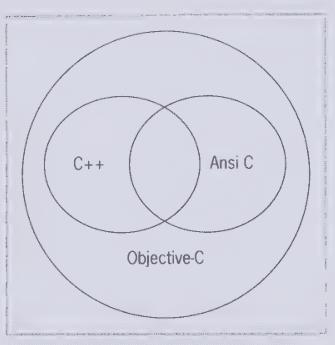

图 6-1 Ansi C、C++ 和 Objective-C 中的概念重叠
© 2015 Cengage Learning

到本书为止，我们一直关注 Objective-C 与 Ansi C 语言共享的编程概念。现在我们将关注 Objective-C 特有的概念。特别是，我们将探索构建 Objective-C 编程语言的框架或基础设施。也就是说，我们将学习 Apple 提供的实用类，以试图在语言的所有领域中创建一致性。这些实用类是对程序员有用的工具类辅助类。

Objective-C 是 Ansi C 语言的超集，后者是一种过程化语言。如第 2 章所述，Ansi C 语言包含一种名为结构的派生类型，它持有数据。对象是结构的一种扩展，它包含数据以及称为方法的函数，对这些数据进行操作。在 Objective-C 中调用这些方法与其他面向对象的方法不同。

## 消息调用

在 Objective-C 中，对象的方法不能通过调用它。相反，对象必须向其方法传递消息来调用它。例如，`calculator` 对象可能有加、减、乘、除的方法。

向方法传递消息的语法是：

```objc
[receiver method message]
```

### 消息调用

对象是接收者，正如名称所示，它接收消息。在大多数面向对象的语言中，假设对象的方法是使用点符号调用的。例如，你有一个从 `dog` 类创建的 `yorkie` 对象，你需要调用 `run` 方法。在 Objective-C 中，`yorkie` 对象的 `run` 方法如下所示调用：

```objc
[yorkie run]
```

现在假设 `run` 方法参数如下：

```objc
void run(int length) {
    NSLog(length);
}
```

传递 `length` 的语法是：

```objc
[yorkie run:length]
```

你也可以传递常量而不是变量。如果 `length` 为 12，语法将是：

```objc
[yorkie run:12]
```

图 6-2 展示了 Objective-C 中的方法组件。


图 6-2 方法组件
© 2015 Cengage Learning

在消息嵌套中，一个消息可以发送给另一个，如下：

```objc
[information getInfo:[getName]]
```

在这里，来自 `getName` 的输出作为第一个消息的参数。注意消息语法通常用于调用对象的方法。在第 5 章讨论函数时，我们没有使用这种语法来调用函数，因为第 5 章讨论的方法是独立的——它们不属于类。

## Foundation 框架简介

现在你理解了对象如何使用消息通信，我们将继续学习 Foundation 框架，它为 Objective-C 和 iOS 编程提供支持。图 6-3 展示了方法在框架中的作用。一组方法构成一个类。一组类构成一个框架。

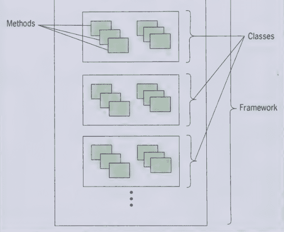

**图 6-3** 框架组成
© 2015 Cengage Learning

Foundation 框架基于实用、支持、一致性、操作系统独立性和可移植性的假设，形成了 Objective-C 语言的基础。它是一个类和方法的库，为字符串、数字、数组、字典、日期、文件系统、位置和网络服务提供语言一致性和基本功能。Foundation 框架包含一个名为 `NSObject` 的根对象类，它反过来为 `NSString`、`NSArray`、`NSMutableArray`、`NSDictionary`、`NSMutableDictionary`、`NSDate`、`NSError`、`NSNetService`、`NSNotification` 和 `NSData` 等基本实用类提供支持。类由包含方法的子类组成，可以调用这些方法来实现字符串、数组、日期和时间、URL、网络服务以及通知。如何利用这些类和方法开发程序由开发者决定。

## NSString

并不是所有的 Objective-C 编程都在 Foundation 框架中进行。因此，当你选择实现 Foundation 框架功能时，必须包含语句 `#import <Foundation/Foundation.h>`。

在 Objective-C 中，内存管理——即为对象创建和释放内存的过程——至关重要。一个重要的内存管理机制是释放池。

### autoreleasepool

当创建一个数据元素时，必须分配内存来存储该数据元素。当数据不再需要时，它会被丢弃，与其分配内存内存关联也必须被丢弃。同样，每次创建一个对象，都会为其预留内存，当对象不再需要时，相关的内存会被丢弃。在 Objective-C 中，自动引用计数（ARC）允许编译器使用 `@autoreleasepool` 控制任何对象的内存保留和释放。这让开发者从手动内存管理的负担中解放出来。它作用于放在 `@autoreleasepool` 语句大括号中的代码块，如示例 6-1 第 4 到 7 行所示。当使用 `@autoreleasepool` 时，编译器记录语句结束时语句块的状态，内存被清理，所有对象被销毁，内存恢复到 `@autoreleasepool` 之前的状态（第 3 行）。

#### 示例 6-1

```objc
int main(int argc, char *argv[]) {
    @autoreleasepool {
        ...
    }
    return 0;
}
```

使用 Foundation 框架中的类需要实现 `autoreleasepool`。Foundation 框架中常用的基本类包括 `NSString`、`NSMutableString`、`NSArray`、`NSMutableArray`、`NSDate`、`NSDictionary` 和 `NSMutableDictionary`。

`NSString` 是 Unicode 字符数组。Unicode 字符是比传统字母表更大的字符集。字符串对象封装在双引号中，并以 `@` 符号开头，如下：

```objc
@"This is my string object"
```

对字符串可以执行多种操作，例如比较字符串、在字符位置查找字符、查找一组字符、搜索某个字符或一组字符等等。Objective-C 的 Foundation 框架提供了 `NSString` 类，它有助于实现这些操作。

`NSString` 对象默认是不可变的，这意味着它在首次创建时就已经定义，之后不能更改。`NSMutableString` 是 `NSString` 的子类，提供了可变性的实现。

`NSString` 类支持几个方法；其中两个基本方法是 `length` 和 `characterAtIndex`。`length` 方法计算字符串的长度——即字符串中字符的总数。`characterAtIndex` 提供访问特定索引处的单个字符。许多字符串方法可以比较字符串、查找子字符串、格式化字符串等。为了学习这些方法如何工作，我们查看了示例 6-2 中的简单版本，该示例声明了一个字符串（第 6 行），找到它的长度（第 9 行），找到子字符串（第 12 行），将子字符串转换为小写（第 14 行），并打印小写的字符串（第 15 行）。示例 6-2 使用了 `length`、`substringFromIndex` 和 `lowercaseString` 方法。

#### 示例 6-2

```objc
#import <Foundation/Foundation.h>

int main(int argc, const char * argv[]) {
    @autoreleasepool {
        NSString *str = @"Hello All";
        NSString *substring = [str substringFromIndex:6];
        int length = [str length];
        NSLog(@"%@ your string is %@", str);
        NSLog(@"\nThe length of your string is %i", length);
        NSLog(@"%@", substring);
    }
    return 0;
}
```


# 第 6 章 Foundation 框架

```objc
NSLog("\nThe substring is %@", substring);

substring = [str lowercaseString];

NSLog("\nYour string in lower case is %@", substring);

}

return 0;

}
```

## 示例 6-2 的输出

```
2017-09-16 21:27:28.433 class[2231:403]
Your string is Hello All
2017-09-16 21:27:28.436 class[2231:403]
The length of your string is 9
2017-09-16 21:27:28.437 class[2231:403]
The substring is All
2017-09-16 21:27:28.438 class[2231:403]
Your string in lower case is all
```

在示例 6-3 中，`str1` 和 `str2` 对象被合并到 `str1` 中。注意使用的 `NSString` 方法 `stringByAppending`。在这个示例中，`str1` 和 `str2` 被声明（第 6 和 7 行），然后 `str1` 合并了一个空格（第 10 行），最后 `str1` 合并了 `str2`（第 11 行）。当你像示例 6-3 那样将一个字符串附加到另一个字符串时，你正在创建一个新的字符串。

### 示例 6-3

```objc
1 #import <Foundation/Foundation.h>

2

3 main(int argc, const char * argv[])

4 {

5   @autoreleasepool {

6     NSString *str1 = @"Programming in Objective-C";

7     NSString *str2 = @"is fun!";

8     NSLog("\nYour first string is %@", str1);

9     NSLog("\nYour second string is %@", str2);

10    str1 = [str1 stringByAppending:@" "];

11    str1 = [str1 stringByAppending:str2];

12    NSLog("\nYour new string after appending is %@", str1);

13  }

14  return 0;

15 }
```

## 示例 6-3 的输出

```
2017-09-16 22:06:45.359 class[2708:403]
Your first string is Programming in Objective-C
2017-09-16 22:06:45.362 class[2708:403]
Your second string is
is fun!
2017-09-16 22:06:45.363 class[2708:403] Your new string after appending is Programming in Objective-C is fun!
```

如所述，`NSString` 对象创建的是不可变字符串，这意味着你不能编辑它。例如，如果你有一个 `NSString` 对象 "Hello"，你无法将其改为 "Hi"。虽然你可以将一个 `NSString` 对象附加到另一个创建一个新的 `NSString`，但你无法删除或修改字符串中的任何字符。如果你想编辑字符串，可以使用 `MutableString` 对象，如示例 6-4 所示。`MutableString` 是 `NSString` 类的子类。在这个示例中，通过声明第一个字符串（第 6 行），将字符串插入另一个字符串中（第 13 行）。

### 示例 6-4

```objc
#import <Foundation/Foundation.h>

int main(int argc, const char * argv[]) {

    @autoreleasepool {

        NSMutableString *str;

        NSString *str1 = @"Programming in Objective-C";

        NSString *str2 = @"is fun!";

        NSLog("%@Your string is %@", str1);

        NSLog("%@Your string is %@", str2);

        // mutate str by replacing it with str1

        str = [NSMutableString stringWith:str1];

        [str insertString:str2 atIndex:12];

        NSLog("%@Your string after appending is %@", str);

    }

    return 0;

}
```

```
2017-09-16 22:22:59.545 class[2840:403]
Your first string is Programming in Objective-C
2017-09-16 22:22:59.548 class[2840:403]
Your second string is
is fun!
2017-09-16 22:22:59.549 class[2840:403]
Your string after appending is
is fun! in Objective-C
```

## NSArray

数组是数据的有序集合。它通过索引访问多个变量。数组的索引从 0 开始，结束于元素总数减一。Foundation 框架中的 `NSArray` 继承自 `NSObject` 并处理不可变数组；其他，通过 `NSArray` 创建的数组无法编辑。`NSMutableArray` 是 `NSArray` 的子类，处理可变或动态数组。`NSArray` 类提供了许多辅助创建、初始化、查询、查找、消息和排序数组的方法，以及更多与数组相关的方法。两个常用的方法是 `count`（它返回数组中的元素数量）和 `objectAtIndex`（它返回特定索引处的数据）。

## 数组创建

当我们处理数组时，必须使用循环来填充、访问或编辑它的任何值。示例 6-5 中的简单数组创建并填充了数组并打印了它的值。首先创建一个名为 `myArrayNames` 的数组并填充（第 9 行）。声明名为 `myArrayLength` 的变量（第 7 行），使用 `count` 方法（第 12 行）存储数组中的元素数量。然后使用循环（第 15 行）使用 `objectAtIndex` 方法（第 17 行）打印数组的值（第 16 行）。

### 示例 6-5

### 示例 6-5 的输出

```
2017-09-17 23:27:22.594 class[3910:403]
MyArrayNames has 4 elements
2017-09-17 23:27:22.597 class[3910:403]
The element at index 0 is Chocolate
2017-09-17 23:27:22.598 class[3910:403]
The element at index 1 is Vanilla
2017-09-17 23:27:22.599 class[3910:403]
The element at index 2 is Raspberry
2017-09-17 23:27:22.600 class[3910:403]
The element at index 3 is Blueberry
```

## 从不可变数组创建可变数组

示例 6-6 演示了从不可变数组创建可变数组。创建一个名为 `myArrayNames` 的 `NSArray` 并填充（第 7 行）。创建一个名为 `myMutableArray` 的 `NSMutableArray` 并使用 `myArrayNames` 填充（第 11 行）。通过向 `count` 方法发送消息（第 14 行）计算可变数组的长度。

### 示例 6-6

```objc
#import <Foundation/Foundation.h>

int main(int argc, const char * argv[])

{

@autoreleasepool {

int myArrayNamesLength;

NSArray *myArrayNames = [NSArray arrayWithObjects:@"Anita",

@"Rishika", @"Joel", nil];

// Create a mutable array from an immutable array using the

// arrayWithArray:method

NSMutableArray *myMutableArray = [NSMutableArray arrayWithArray:

myArrayNames];

// find the length of the mutable array and print it

myArrayNamesLength = [myMutableArray count];

NSLog("%nmyMutableArray has %i", myArrayNamesLength);

// print the element of the mutable array

for (int i = 0; i < myArrayNamesLength; i++) {

NSLog("%nthe element at index %i is %@", i, [myMutableArray

objectAtIndex:i]);

}

return 0;

}

}
```

接下来，评估了 `NSMutableArray` 的长度（第 15 行），将其存储在变量 `myArrayNamesLength` 中并进行打印（第 16 行）。接着，实现了 `addObject` 方法来向 `NSMutableArray` 中添加一个新对象（"Console"）（第 18 行）。再次评估了 `NSMutableArray` 的长度（第 20 行），存储在 `myArrayNamesLength` 变量中并打印（第 21 行）。接下来，实现了 `insertObject` 方法（第 24 行），将 ("Plant") 插入到 `NSMutableArray` 的索引 2 处，并计算并打印了数组的长度（第 27 行和第 28 行）。最后，使用 `for` 循环（第 31 行至 34 行）打印 `NSMutableArray` 的内容。

### 示例 6-7

```objc
1 #import <Foundation/Foundation.h>

2 

3 int main(int argc, const char * argv[]) {
```

### 示例 6-7 的输出

```
2017-09-19 18:47:32.180 class[8378:403]

myMutableArray has 4 elements

2017-09-19 18:47:32.183 class[8378:403]

myMutableArray after adding an object has 5 elements

2017-09-19 18:47:32.185 class[8378:403]

myMutableArray after insertion has 6 elements

2017-09-19 18:47:32.186 class[8378:403]

The element at index 0 is Table

2017-09-19 18:47:32.186 class[8378:403]

The element at index 1 is Chair

2017-09-19 18:47:32.187 class[8378:403]

The element at index 2 is Plant

2017-09-19 18:47:32.188 class[8378:403]

The element at index 3 is Couch

2017-09-19 18:47:32.189 class[8378:403]

The element at index 4 is Lamp

2017-09-19 18:47:32.190 class[8378:403]

The element at index 5 is Console
```

## 数组删除

一些常用的删除方法包括 `removeAtIndex`、`removeLast`、`removeObject`、`removeIdenticalTo` 和 `removeAll`。示例 6-8 展示了这些方法的实现。在该示例中，创建了一个 `NSArray` 并填充了字符串对象（第 8 行）。接下来，评估并打印了 `NSArray` 的长度（第 17 行）。创建了一个 `NSMutableArray` 并将 `NSArray` 中的对象填充其中（第 13 行）。接着，评估了 `NSMutable` 的长度（第 16 行）。随后，实现了 `removeAtIndex` 方法来移除 `NSMutableArray` 中索引为 2 的对象（第 19 行）。再次评估了 `NSMutable` 的长度（第 21 行），实现了 `removeObject` 方法来移除 `NSMutableArray` 中第一个由指定字符串（"Lynx"）标识的出现对象（第 25 行），评估了数组长度（第 29 行）并对其进行了打印（第 30 行）。紧接着，实现了 `removeIdenticalTo` 方法来移除 `NSMutableArray` 中所有由指定字符串（"Lion"）标识的出现对象（第 33 行），评估并打印了数组长度（第 36 行和第 37 行）。随后，实现了 `removeLast` 方法来移除 `NSMutableArray` 中的最后一个对象（第 40 行），评估了数组长度（第 43 行）并进行了打印（第 44 行）。接下来，实现了 `removeAllObjects` 方法，该方法会删除 `NSMutableArray` 中的所有对象（第 47 行）。最后，使用循环（第 54 行和第 57 行）打印了 `NSMutableArray` 的内容。

### 示例 6-8

```objc
1 #import <Foundation/Foundation.h>

2

3 int main(int argc, const char * argv[])

4 {

5

6 @autoreleasepool {

7 int myArrayNamesLength;

8 NSArray *myArrayNames = [NSArray arrayWithObjects:@"Lion"

9 @"Mountain Lion","Leopard","Cougar","Tiger"

10 @"Bobcat","Jaguar","Lynx", nil];

11 //从不可变数组创建一个可变数组

12 //arrayWithMethod

13 NSMutableArray *myMutableArray = [NSMutableArray arrayWithArray:myArrayNames];

15 //查找并打印数组的长度

16 myArrayNamesLength = [myMutableArray count];

17 NSLog("\nmyMutableArray has %i elements", myArrayNamesLength);

18 //删除数组的第 3 个元素

19 [myMutableArray removeObjectAtIndex:2];

20 //查找并打印删除后的数组新长度

21 myArrayNamesLength = [myMutableArray count];

22 NSLog("\nmyMutableArray after deletion has %i elements", myArrayNamesLength);

24 //删除对象的第一次出现

25 [myMutableArray removeObject:@"Lynx"];

27 //查找并打印删除后的数组新长度

29 myArrayNamesLength = [myMutableArray count];

30 NSLog("\nmyMutableArray after deletion has %i elements", myArrayNamesLength);

32 //删除对象的所有出现

33 [myMutableArray removeAllObjectsEqualTo:@"Lion"];

35 //查找并打印删除后的数组新长度

36 myArrayNamesLength = [myMutableArray count];

37 NSLog("\nmyMutableArray after deletion has %i elements", myArrayNamesLength);

39 //删除数组中的所有对象

40 [myMutableArray removeAllObjects];

42 //查找并打印删除后的数组新长度

43 myArrayNamesLength = [myMutableArray count];

44 NSLog("\nmyMutableArray after deletion has %i elements", myArrayNamesLength);

52 //打印数组内容

53 for (int i = 0; i < myArrayNamesLength; i++) {
```


## 示例 6-8 的输出

```
2017-09-19 18:47:32.166 class[8378:403]
mutableArray has 9 elements
2017-09-19 18:47:32.169 class[8378:403]
mutableArray after deletion has 8 elements
2017-09-19 18:47:32.170 class[8378:403]
mutableArray after deletion has 7 elements
2017-09-19 18:47:32.171 class[8378:403]
mutableArray after deletion has 6 elements
2017-09-19 18:47:32.172 class[8378:403]
mutableArray after deletion has 5 elements
2017-09-19 18:47:32.173 class[8378:403]
mutableArray after deletion has 4 elements
```

## 数组排序

`NSArray` 提供了多种对元素进行排序的方法。`sortUsingSelector:` 方法允许使用指定的比较方法对数组进行排序。例如，使用 `localizedAscendingComparator` 可以按字母升序排序，而使用 `caseInsensitiveCompare` 则可以忽略大小写进行排序。示例 6-9 展示了如何使用这些方法。

### 示例 6-9

```objc
1 #import <Foundation/Foundation.h>

2

3 int main(int argc, const char * argv[])
4 {
5 @autoreleasepool {
6 //创建一个可变数组
7 NSMutableArray *myMutableArray = [NSMutableArray
8 arrayWithObjects:@"Elm", "Pine", "Cedar",
9 @"Beech", "Crabapple", "Cypress",nil];
10 //获取数组的长度
11 int myArrayLength;
12 myArrayLength = [myMutableArray count];
13 NSLog(@"MutableArray has %i elements", myArrayLength);
14 //打印数组的内容
15 for (int i = 0; i < myArrayLength; i++) {
16     NSLog(@"element at index %i is %@", i, [myMutableArray objectAtIndex:i]);
17 }
18 //使用本地升序比较进行排序
19 NSArray *sortedArray = [myMutableArray sortUsingSelector:@selector(localizedAscendingComparator)];
20 //打印排序后的数组内容
21 for (int i = 0; i < myArrayLength; i++) {
22     NSLog(@"element at index %i is %@", i, [sortedArray objectAtIndex:i]);
23 }
24 //使用忽略大小写的比较进行排序
25 NSArray *caseInsensitiveSortedArray = [myMutableArray sortUsingSelector:@selector(caseInsensitiveCompare)];
26 //打印忽略大小写排序后的内容
27 for (int i = 0; i < myArrayLength; i++) {
28     NSLog(@"element at index %i is %@", i, [caseInsensitiveSortedArray objectAtIndex:i]);
29 }
30 return 0;
31 };
32 }
```

### 示例 6-9 的输出

```
2017-09-18 18:12:21.473 class[7096:403]
MutableArray has 6 elements
element at index 0 is Elm
element at index 1 is Pine
element at index 2 is Cedar
element at index 3 is Beech
element at index 4 is Crabapple
element at index 5 is Cypress
element at index 0 is Beech
element at index 1 is Crabapple
element at index 2 is Cedar
element at index 3 is Cypress
element at index 4 is Elm
element at index 5 is Pine
element at index 0 is Beech
element at index 1 is Crabapple
element at index 2 is Cedar
element at index 3 is Cypress
element at index 4 is Elm
element at index 5 is Pine
```

## NSDate

`NSDate` 类是一个抽象类，用于帮助创建、比较和计算时间间隔。这是一个非常实用的类，不仅提供了日期功能，还提供了时间功能。在示例 6-10 中，创建了一个名为 `today` 的 `NSDate` 对象（第 7 行），填充了日期（第 7 行），并对其进行了打印（第 9 行）。

### 示例 6-10

```objc
1 #import <Foundation/Foundation.h>

2

3 int main(int argc, const char * argv[])
4 {
5 @autoreleasepool {
6 //Create a date object
7 NSDate *today = [NSDate date];
8 //Print the date object
9 NSLog("%Today's date and time are %@", today);
10 return 0;
11 }
12
```

### 示例 6-10 的输出

```
2017-09-19 19:25:58.782 class[7254:403]
Today's date and time are 2017-09-19 00:25:18 +0000
```

示例 6-11 比较了两个日期。首先创建了 `today`（第 7 行）作为一个 `NSDate` 对象。另一个 `NSDate` 对象 `otherDate` 被创建（第 8 行），其内容是一个日期字符串，格式为 `YYYY-MM-DD HH:MM:SS ±HHMM`。格式中的 `±HHMM` 部分提供了 GMT 时间与你所在时区之间的时间差。使用 `NSComparisonResult` 来比较 `today` 和 `otherDate` 对象（第 13 行）。`NSComparison` 是 Foundation 框架的一个方法，用于持有比较结果的值（第 13 行）。使用 `switch`（第 15 行）来分析 `today` 和 `otherDate` 比较的结果。`switch` 中 `case` 值的各种可能情况有：`NSOrderedAscending`（第 19 行），意味着 `today` 在于 `otherDate` 之前；`NSOrderedDescending`（第 22 行），意味着 `today` 在 `otherDate` 之后；以及 `NSOrderedSame`（第 16 行），意味着 `today` 与 `otherDate` 相同。

### 示例 6-11

```objc
1 #import <Foundation/Foundation.h>

2

3 int main(int argc, const char * argv[])
4 {
5 @autoreleasepool {
6 // Create today and other dates for comparison
7 NSDate *today = [NSDate date];
8 NSString *otherDate = [NSDate dateWithString:"2021-03-24
9 10:45:32 +0600"];
10 // Print today's date and time
11 NSLog("\nToday's date and time are %@", today);
12 // create a variable to hold the result of the comparison
13 NSComparisonResult result = [today compare:otherDate];
14 //use the switch to analyze the result of the comparison
15 switch (result) {
16 case NSOrderedSame:
17 NSLog(@"The dates are same");
18 break;
19 case NSOrderedAscending:
20 NSLog(@"Today comes before otherdate");
21 break;
22 case NSOrderedDescending:
23 NSLog(@"Today is after otherdate");
24 break;
25 default:NSLog(@"Invalid dates");
26 break;
27 }
28 return 0;
29 }
30 }
```

### 示例 6-11 的输出

```
2017-09-18 22:04:02.322 class[7663:403]
Today's date and time are 2017-09-19 03:04:02 +0000
2017-09-18 22:04:02.323 class[7663:403] Today comes before otherdate
```

## NSDictionary

`NSDictionary` 支持包含键-值对的数据集，这意味着每个键将有一个对应的值。键-值对就像两个并联在一起的并行数组，相应的索引对齐，这意味着特定键的索引在相同索引处将有一个值。如果一个键的索引为 3，那么其对应的值位于索引 3。键是唯一的且不重复，而值本身并不要求是唯一的。图 6-4 说明了键-值对的概念。就像数组和字符串一样，字典可以是不可变的或可变的。不可变字典无法编辑。它的可变版本 `NSMutableDictionary` 是 `NSDictionary` 的子类。

| Key | Value |
|---|---|
| Key1 | Value1 |
| Key2 | Value2 |
| Key3 | Value3 |
| Key4 | Value4 |
| ... | ... |

示例 6-12 演示了使用 `dictionaryWithObjects` 方法（第 8 行）创建字典（第 7 行），该方法直接在字典中输入键和值。注意 `for` 语句（第 11 行）扫描了键（第 13 行和 14 行）。

```objc
1 #import <Foundation/Foundation.h>

2

3 int main(int argc, const char * argv[])
4 {
5 @autoreleasepool {
6 // create a dictionary using the dictionaryWithObjects method
7 NSDictionary *myDictionary = [NSDictionary dictionaryWithObjects:@"Apple",@"1",
8 @"Banana",@"Cherries", @"3",@"Orange", @"4", nil];
9 // Print the dictionary
10 for(id key in myDictionary)
11 {
12 NSLog(@"%@ contains: %@", key, [myDictionary objectForKey:key]);
13 }
14 return 0;
15 }
```

### 示例 6-12 的输出

```
2017-09-19 19:25:58.783 class[7254:403]
myDictionary contains 3: Cherries
2017-09-19 19:25:58.786 class[7254:403]
myDictionary contains 1: Apple
2017-09-19 19:25:58.786 class[7254:403]
myDictionary contains 4: Orange
2017-09-19 19:25:58.787 class[7254:403]
myDictionary contains 2: Banana
```

在示例 6-13 中，通过两个数组 `myKeyArray` 和 `myArray` 创建字典。`dictionaryWithObjects` 方法（第 14 行）为 `myKeyArray`（第 7 行）填充了键，而 `myArray`（第 10 行）持有对应的值。使用 `objectForKey` 方法（第 18 行）打印字典的内容。

```objc
#import <Foundation/Foundation.h>

int main(int argc, const char * argv[])
{
    @autoreleasepool {
    // Create an array to hold the key
    NSArray *myKeyArray = [NSArrayWithObjects:@"1",@"2",@"3",@"4", nil];
    // Create an array to hold the values
    NSArray *myArray = [NSArrayWithObjects:@"Violin",@"Piano",@"Bass",@"Flute", nil];
    // Create a dictionary from the above arrays
    NSDictionary *myDictionary = [NSDictionary dictionaryWithObjects:myArray keys:myKeyArray];
    for (id key in myDictionary) {
        NSLog(@"%@nmyDictionary holds Key: %@", key, [myDictionary objectForKey:key]);
    }
    return 0;
}
```

### 示例 6-13 的输出

```
2017-09-19 23:16:24.114 class[9116:403]
myDictionary holds Key: 5: Flute
2017-09-19 23:16:24.117 class[9116:403]
myDictionary holds Key: 4: Bass
2017-09-19 23:16:24.118 class[9116:403]
myDictionary holds Key: 1: Violin
2017-09-19 23:16:24.119 class[9116:403]
myDictionary holds Key: 3: Guitar
2017-09-19 23:16:24.120 class[9116:403]
myDictionary holds Key: 2: Piano
```

正如前面提到的，字典可以是不可变的或可变的。不可变字典无法编辑，不能向它们添加新的键-值对。如果你想在字典中添加或编辑键-值对，你需要创建一个可变字典。在示例 6-14 中，创建了一个可变字典并使用 `setWithObjects` 方法（第 8 行）向其添加了一个键-值对。该字典的内容在第 15 行被打印。

## 实验

你最近被聘为小型打印公司的助理经理。你的首要任务是计算公司六名员工的下一次工资。在你入职的第一天，你获得了两个数组：一个包含所有员工的姓名，另一个包含每位员工的时薪。每周，总经理都会交给你一个包含这六名员工在该结算期内工作小时数的数组。你现在需要编写一个程序，为每位员工打印以下内容：

- 员工姓名
- 员工在该薪资期间的总工资
- 计算薪资的日期和时间

使用字典计算每个员工的工资，并输出字典的键值对，以及进行此计算的日期和时间。

## 数组创建与填充

1. 定义三个名为 `employees`、`rate` 和 `hoursWorked` 的 `NSArray`。

```objc
NSArray *employees = [NSArray arrayWithObjects: @"Jones Meyers", @"Cynthia Kari", @"Dexter Hanes", @"Marcus Bright", @"Jenna Champel", @"Alex Meyers", nil];
```


# 第 6 章 Foundation 框架

## 数组初始化

```objc
NSArray *rate = [NSArray arrayWithObjects:
    [NSNumber numberWithDouble:27.89],
    [NSNumber numberWithDouble:34.89],
    [NSNumber numberWithDouble:25.78],
    [NSNumber numberWithDouble:29.67],
    [NSNumber numberWithDouble:26.8],
    [NSNumber numberWithDouble:28.99],
    nil
];
```

```objc
NSArray *hoursWorked = [NSArray arrayWithObjects:
    @"36.00", @"39.00", @"40.00",
    @"49.50", @"38.50", @"40.00",
    nil
];
```

可变字典中的值是作为对象存储的。因此，我们将 `double` 变量存储为 `NSNumber` 对象，以便稍后在可变字典中使用。

## 字典创建与填充

因为速率（rate）是固定的，我们将使用 `employees` 数组和 `rate` 数组来构建字典。字典的键是员工姓名，其值是费率。由于值在每个薪资期间会变化，因此我们使用可变数组。

```objc
NSMutableDictionary *dictionary = [NSMutableDictionary dictionaryWithObjects:rate forKeys:employees];
```

## 变量声明

创建用于访问字典组件以计算总工资的变量。

```objc
NSArray *keys = [dictionary allKeys];
id aKey;
double pay;
NSString *formatPay;
```

## 薪资计算

创建并初始化一个变量来存储计算时的日期。

```objc
// 获取当前日期
NSDate *today = [NSDate date];
// 获取日期格式
DateFormatter *dateFormat = [[DateFormatter alloc] init];
// 获取时间格式
DateFormatter *formatTime = [[DateFormatter alloc] init];
// 格式化日期和时间
[dateFormat setDateStyle:DateFormatterMediumStyle];
[formatTime setTimeStyle:DateFormatterMediumStyle];
// 将日期时间存储为字符串
NSString *date = [dateFormat stringFromDate:today];
NSString *time = [formatTime stringFromDate:today];
```

## NSDictionary

### 使用 FOR 循环打印字典内容

输出字典中每个员工姓名及其对应的工资，以及计算该薪资的日期和时间。使用格式说明符 `\t` 使用制表符格式化输出。

```objc
NSLog(@"Name\t\tPay\t\tDate, Time");
for (id key in dictionary) {
    NSLog(@"%@\t%@\t%@\t%@\t%@",
```

## 源代码

```objc
#import <Foundation/Foundation.h>

int main(int argc, const char * argv[]) {
    @autoreleasepool {
        NSArray *employees = [NSArray arrayWithObjects:
                            @"Jones Marken",
                            @"Cynthia Kari",
                            @"Dexter Hanes",
                            @"Marcus Bright",
                            @"Jenna Champel",
                            @"Alex Meyers",
                            nil];

        NSArray *rate = [NSArray arrayWithObjects:
                            [NSNumber numberWithDouble:27.89],
                            [NSNumber numberWithDouble:34.89],
                            [NSNumber numberWithDouble:25.78],
                            [NSNumber numberWithDouble:29.67],
                            [NSNumber numberWithDouble:26.8],
                            [NSNumber numberWithDouble:28.89],
                            nil];

        NSArray *hoursWorked = [NSArray arrayWithObjects:
                            @"36.00",
                            @"39.00",
                            @"40.00",
                            @"49.50",
                            @"38.50",
                            @"40.00",
                            nil];

        NSMutableDictionary *dictionaryWithObjects = [NSMutableDictionary dictionaryWithObjects:rate forKeys:employees];

        NSArray *keys = [dictionaryWithObjects allKeys];
        id key;
        double pay;
        NSString *formatPay;

        NSLog(@"\nName\t\tTime\t\tPay\t\tDate, Time");
        for (id key in dictionaryWithObjects) {
            NSLog(@"\n%@\t%@\t%@\t%@", key, [dictionaryWithObjects objectForKey:key], date, time);
        }

        return 0;
    }
}
```

## 示例输出

```text
2017-09-25 20:52:07.653 Chapter 6 Hands ON[17492:403]

Name		Date, Time

Pay 2017-09-25 20:52:07.653 Chapter 6 Hands ON[17492:403]

Alex Meyers	$1159.60 Sep 25, 2017, 8:52:07

2017-09-25 20:52:07.653 Chapter 6 Hands ON[17492:403]

Dexter Hanes	$1159.60 Sep 25, 2017, 8:52:07

2017-09-25 20:52:07.653 Chapter 6 Hands ON[17492:403]

Jones Marken	$1159.60 Sep 25, 2017, 8:52:07

2017-09-25 20:52:07.653 Chapter 6 Hands ON[17492:403]

Cynthia Kari	$1159.60 Sep 25, 2017, 8:52:07

2017-09-25 20:52:07.653 Chapter 6 Hands ON[17492:403]

Marcus Bright	$1159.60 Sep 25, 2017, 8:52:07

2017-09-25 20:52:07.653 Chapter 6 Hands ON[17492:403]

Jenna Champel	$1159.60 Sep 25, 2017, 8:52:07

2017-09-25 20:52:07.653 Chapter 6 Hands ON[17492:403]
```

## 总结

- Foundation 框架提供了一些基础类和函数。
- 在 Objective-C 中，`@autoreleasepool` 用于内存管理。
- `NSString` 是不可变的字符串。
- `NSMutableString` 处理可变字符串。
- `NSArray` 是不可变的数组。
- `NSMutableArray` 处理可变数组。
- `NSDate` 提供日期时间功能。
- `NSDictionary` 是键值对的集合。
- `NSMutableDictionary` 允许编辑字典、插入或删除元素。

## 练习

### 1. 说明以下哪些调用是有效的。如果无效，请解释原因。

   a. `this.length();`
   
   b. `[str lowercaseString];`
   
   c. `[str substring:10];`
   
   d. `[myStr stringByAppending:@"!"];`
   
   e. `NSArray *movies = [NSArray arrayWithObjects:nil, nil];`
   
   f. `NSMutableArray *myMutableArray = [NSMutableArray arrayWith:movies];`
   
   g. `[myMutableArray count];`

### 2. 判断每个陈述的对错。修正错误的陈述。

   a. Foundation 框架提供了如 `NSArray` 和 `NSDictionary` 等基础类。
   
   b. Objective-C 编程是在 Foundation 框架中进行的。
   
   c. 在 Objective-C 中，可以使用点语法调用方法。
   
   d. 两个 `NSString` 对象使用 `stringByAppending` 方法拼接。
   
   e. 使用 `NSString` 创建的字符串默认是不可变的。
   
   f. 数组的索引从 1 开始。
   
   g. `NSArray` 的 `count` 方法提供最后一个索引的值。
   
   h. `NSDictionary` 存储键值对。

### 3. 编写具有以下特征的函数：

   a. 以单词和句子作为参数，计算单词在句子中出现的次数，然后输出结果。
   
   b. 以数组作为参数，返回数组中的最大数字。
   
   c. 以字典和值作为参数，返回字典中具有该值的键的数量。
   
   d. 以字典作为参数，返回字典中没有值的第一个键。
   
   e. 以字典作为参数，将字典的所有值输出为字符串，每个值用逗号分隔。

### 4. 使用以下代码回答下面的问题：

```objc
NSString *s = @"I Like Programming in Objective C";
NSArray *stringArray = [s componentsSeparatedByString:@" "];
NSString *newString1 = [s substringFromIndex:7];
NSString *newString2 = [s substringWithRange:NSMakeRange(7, 7)];
NSString *newString3 = [s substringWithRange:NSMakeRange(22, 9)];
NSString *newString4 = [newString2 stringByAppendingFormat:@"%@ %@",
```

以下每个变量的值是什么？

   a. `newString1`
   
   b. `newString2`
   
   c. `newString3`
   
   d. `newString4`
   
   e. `newString5`
   
   f. `newString6`
   
   g. `newString7`
   
   h. `newString8`

## 练习（续）

### 5. 定义以下术语：

  a. Foundation 框架 (Foundation framework)
  
  b. 对象 (Object)
  
  c. `@autoreleasepool`

### 6. 编写描述所需的 Objective-C 方法调用：

  a. 创建一个 `NSArray` 并将其拷贝到 `NSMutableArray` 中。`NSString *str1` 存储名，`NSString *str2` 存储姓。
  
  b. 创建一个 `NSString` 对象 `str3`，它包含名和姓。`NSString` 是一个静态对象。转换此对象，以便在第三个字符处插入单词 "and"（例如，如果 `NSString` 对象的值为 "TomJerry"，转换后其值将变为 "TomandJerry"）。

### 7. 下面代码的输出结果是什么：

```objc
#import <Foundation/Foundation.h>
int main(int argc, const char * argv[]) {
    @autoreleasepool {
        NSString *string = @"We are geniuses!";
        NSString *substring;
        int strlen;

        strlen = [string length];

        NSLog(@"\nYour string is %@", string);
        NSLog(@"\nThe length of your string is %i", strlen);
        substring = [string substringFromIndex:7];
        NSLog(@"\nThe substring is %@", substring);
        substring = [string uppercaseString];
        NSLog(@"\nYour string in upper case is %@", substring);
    }
    return 0;
}
```

### 8. 在下面的代码中 `str` 的值是什么？

```objc
#import <Foundation/Foundation.h>
int main(int argc, const char * argv[]) {
    @autoreleasepool {
        NSString *str1 = @"Santa Barbara has ";
        NSString *str2 = @"beautiful houses";

        str1 = [str1 stringByAppendingString:str2];
        NSString *str = [str1 substringFromIndex:6];
    }
    return 0;
}
```

### 9. 编写语句完成以下任务：

  - 声明一个名为 `movies` 的数组并用以下字符串初始化它：`@"Twilight Safe House"`, `@"Prison Break"`, `@"Internship"`, `@"Mission Impossible"`
  
  - 打印数组的第 3 个元素（索引为 2）。
  
  - 将数组转换为名为 `mutMovies` 的可变数组。
  
  - 删除数组的第 4 个元素（索引为 3）。
  
  - 将所有数组元素转换为大写。
  
  - 重新初始化数组的第 5 个元素（索引为 4）为 `@"24"`。
  
  - 声明另一个名为 `prices` 的数组并初始化为 `@24.00`, `@13.50`, `@12.99`, `@6.70`, `@7.99`。
  
  - 声明一个字典，使用 `mutMovies` 作为键，使用数组 `prices` 作为值。
  
  - 打印字典中每个位置的键和值。

### 10. 给定以下代码：

```objc
NSString *s = @"Welcome to my world";
NSArray *arr = [NSArray arrayWithObjects:@"Java", @"Php", @"Objective-c", nil];
```

描述以下行代码的功能，并给出一个如何与上述变量使用的示例。包含操作的结果。

  - a. `[s uppercaseString];`
  
  - b. `[s lowercaseString];`
  
  - c. `[s substringFromIndex:11];`
  
  - d. `[arr count];`
  
  - e. `[arr addObject:@"2"];`

## 编程练习

### 1. 假设学生 ID 号的最后两位表示学生的专业，以下是学生 ID 号示例列表：`HGUS01`, `PHYB002`, `GFIKH98`, `RBWKG87` 和 `HGTVN77`。编写一个程序，打印每个学生的 ID 号和专业。以下是专业代码列表：

  - `01` 未定 (Undecided)
  
  - `02` 英语 (English)
  
  - `03` 生物化学 (Biochemistry)
  
  - `98` 化学 (Chemistry)
  
  - `54` 经济学 (Economics)
  
  - `87` 计算机科学 (Computer Science)
  
  - `77` 数学 (Mathematics)


- 2. 创建一个包含以下名字：John, Bella, Stephanie, Leonardo, Michelangelo, Tom, Brad 的 `NSArray`。这些学生最近都获得了博士学位。更新此数组，在名字名前加上 "Dr."——例如，Dr. John, Dr. Bella 等。

- 3. 创建对象来存储人的名和姓，以及另一个对象来存储人的中间名。将中间名（第二个对象）插入到第一个对象的名和姓之间，使得人的全名（名、中间名和姓）现在位于新对象中。打印人的三个首字母缩写——即名、中间名和姓的首字母。接下来，打印交替的首字母缩写——即名的最后一个字母、中间名的最后一个字母以及姓的最后一个字母。

- 4. Tom 是一所小学的老师，他组织了一门课后活动班。他要求你创建一个程序，允许他跟踪哪些学生参加了课程。该课程每天只接受 15 名学生。使用数组存储名字，并按字母顺序打印它们。

- 5. 修改编程练习 4 中的程序，使程序除了存储学生名字外，还存储每个学生参加的活动。假设每个学生的名字是唯一的，并在你的解决方案中使用 `NSDictionary` 对象。

  可能的活动有：

  - 篮球 (basketball)
  - 冰上曲球 (floor hockey)
  - 艺术 (arts)
  - 国际棋 (checkers)

- 6. 创建一个 `NSArray` 存储以下内容，除了存储名字还存储每个学生参加的活动。假设每个学生的名字是唯一的，并在你的解决方案中使用 `NSDictionary` 对象。（注：此处原文描述似乎与第5题重复，已按原意翻译）

  可能的活动有：

  - 篮球
  - 冰上曲球
  - 艺术
  - 国际棋

- 7. 创建一个 `NSArray` 存储以下日期：

  - 27 September 1988
  - 14 October 1996
  - 23 July 1991
  - 17 October 1995
  - 25 December 1991

  计算并打印人的年龄。

- 8. 创建一个包含以下内容的 `NSArray`：

  - Penny,
  - Sheldon,
  - awesome,

  并按字母顺序打印这些内容：

  - Sheldon,
  - awesome,
  - Penny

- 9. 编写一个程序，输出以下内容（以字母顺序排列）：

  - a. 字符串是正反读都一致的吗（The string is a palindrome）
  - b. 消息传递。
  - c. 对象的属性。

- 10. 编写一个程序，输出结果：

  - a. 字符串是大写的。
  - b. 字符串是小写的。
  - c. 字符串的子串。
  - d. 数组的长度。
  - e. 向数组添加对象。

## 实例方法与类方法

| 类/对象名称 | Dog 类 |
| --- | --- |
| 数据属性 | 品种：约瑟梗<br>高度：6 英寸<br>颜色：棕色<br>年龄：3 岁 |
| 构造函数和方法 | 成员：吠叫<br>摇尾巴<br>呜呜叫 |

**图 7-1** 通用类和特定示例（Dog 类）的 UML 图

© 2015 Cengage Learning

## 实例方法与类方法

类中的函数被称为**方法 (method)**。Objective-C 类中主要有两种类型的方法：类方法和实例方法。只有在类实例化后才能被调用的方法称为**实例方法**。无论类是否实例化，都可以执行的方法称为**类方法**。实例方法通过方法名前的减号 (`-`) 识别，而类方法通过加号 (`+`) 识别，如下代码所示：

```
-(void) bark; //------实例方法
+(void) DogBark:(NSString*) dogName; //------类方法
```

第 1 行是一个没有参数的实例方法 `bark`。第 2 行是一个名为 `DogBark` 的类方法，`dogName` 为参数。

**注意：**实例变量也称为数据成员或属性。实例方法也称为类或对象的方法成员。

## 方法声明

在 Java 中，声明看起来如下：

```
(returnType) methodNamePart1namePart2(datatype parameter1, datatype parameter2 ...)
```

在 Objective-C 中，方法使用图 7-2 所示的格式进行声明。

# 第 7 章 面向对象编程

| 方法名 | 参数名 | 第二参数 |
| :--- | :--- | :--- |
```
+(returnType) methodNamePart1:(datatype)parameter1 namePart2:(datatype)parameter2
```

图 7-2 方法声明

© 2015 Cengage Learning

在 Objective-C 中，如果方法有多个参数，可以给该方法起一个长且有意义的名字，并将名称拆分为有意义的各个部分，后面跟着一个冒号和一个参数。每个参数前面都有一个冒号。方法被拆分成更小的部分，使用有意义的名字来表示参数。这种命名技术使得开发者更容易理解声明的含义。

让我们来看一个方法的示例：

`-(double) calculateBodyMass:(double)massWeight(double):weight`

在这个示例中，方法名是 `calculateBodyMass`。这个名字被有意义地拆分为两个部分。每个部分后面都跟着冒号和一个参数。第一部分 `calculateBodyMass` 对应名为 `mass` 的参数。第二部分 `Weight` 对应名为 `weight` 的参数。

## 调用/执行方法 — 消息传递

在 Objective-C 中，调用或执行类中的方法是通过消息传递系统（messaging system）完成的。在调用类方法的传统点符号表示法中，方法名位于对象名之后，中间用点连接，如下代码所示：`yorkie.bark();`

相比之下，Objective-C 消息使用以下格式：

`[yorkie bark];`

被调用者是接收者 (receiver)，`bark` 被称为发送者 (sender)。换句话说，对象是接收者，消息是发送者。方法向对象发送和接收消息，从而提供了与对象通信的手段。

`[receiver sender];`

向方法传递参数的形式如下：

`[yorkie bark:mimi];`

`mimi`（狗的名字）是 `yorkie` 对象中 `bark` 方法的参数。如果你传递多个参数，格式如下：

```
[yorkie bark:mimi anotherbark:lukas anotherbark:jojo];
```

方法名 `bark:anotherbark:anotherbark` 已被拆分成较小的有意义的部分，以允许通过参数 `mimi`、`lukas` 和 `jojo`。

从语法上讲，你可以使用较短的方法名（如 `bark`）编写前面的方法。在这种情况下，方法调用可能像这样：

```
[yorkie bark:mimi:lukas:jojo];
```

然而，上述语句被认为是不良实践。相反，你应该为每个参数设置一个名称。

## 类创建：@interface 和 @implementation

在我们深入研究面向对象编程概念和示例之前，除了方法和消息机制外，我们还需要学习 `@interface` 和 `@implementation` 文件。

当你创建一个类时，你需要通知编译器该类的数据成员（也称为实例变量）。实例变量和方法声明位于 `@interface` 文件中，该文件也称为头文件 (header file)。通过使用此文件，Objective-C 从实例变量和方法的头声明中隐藏代码实现。实例变量的声明和方法头放在 `@interface` 文件中，而实例变量和方法的实际实现则放在 `@implementation` 文件中。

`@interface` 文件的扩展名为 `.h`，是 "header file" 的缩写。`@interface` 文件中的第一个声明是针对父类的。这是编译器学习类继承的地方。`@interface` 文件的语法如下：

## 语法

```
@interface myClass:parentClass
{
  实例变量，也称为数据成员。
}
方法声明
@end
```

注意：在 Objective-C 中，变量和实例变量的声明方式与其他任何变量相同。

紧随实例变量之后的是方法声明，它们只包含头信息。实例变量和方法的实际实现放在 `@implementation` 文件中。`@implementation` 文件的语法如下：

# 第 7 章 面向对象编程

## 语法

```
@implementation myClass:parentClass
{
  实例变量，也称为数据成员。
}
方法实现
@end
```

注意，头文件必须导入到实现文件中。这发生在第 3 行。

示例 7-3 显示了主文件中方法的实际实现。

### 示例 7-3

```
// 这是一个名为 main.m 的主文件
#import <Foundation/Foundation.h>
#import "Dog.h"
int main(int argc, const char * argv[])
{
    @autoreleasepool {
        // 为 dog 类创建一个 yorkie 对象
        Dog *yorkie = [[Dog alloc] init];

        // 运行 bark 方法
        [yorkie bark];

        // 运行 whine 方法
        [yorkie whine];

        // 运行 wagTail 方法
        [yorkie wagTail];
    }
    return 0;
}
```

在 main 函数中，通过分配和初始化从 Dog 类中创建了 yorkie 对象（第 10 行）。main 函数分别在第 13、16 和 19 行使用消息传递机制调用了这些方法。换句话说，bark、whine 和 wagTail 消息被传递给了作为对象的 yorkie。

## 访问实例变量

确保实例变量在类外无法访问的机制被称为抽象。这些变量中的数据可以使用对象的访问器/get（accessor/getter）和修改器/setter（mutator/setter）方法访问，而 setter 方法通过更改值来维护封装性。这里列出了 Dog 类的两个 getter 方法：

```
-(NSString *)getBreed
{
    return breed;
}

-(double)getHeight
{
    return height;
}
```

注意：getter 方法返回实例变量的当前值（第 5 和第 7 行）。Dog 类的 setter 方法如图 7-5 所示。


图 7-5 Dog 类的 setter 方法 © 2015

setter 方法将实例变量设置为参数的值；例如，setBreed 方法的参数是 newBreed，而实例变量 breed 被设置为传递给方法的值。

## 方法与属性

setter 和 getter 方法也称为属性（properties），用于访问实例变量。属性提供了对对象封装的数据成员的访问。从本质上说，属性是对象数据成员的方法或操作。每个实例变量都可以与一个属性关联，并使用 `@property` 指令来设置属性。你可以在代码中单独指定属性，也可以让编译器生成它们。让编译器生成属性有两个步骤：第一步是使用 `@property` 指令声明属性；第二步是使用 `@synthesize` 指令生成 setter 和 getter 方法。

`@property` 声明的语法如下：

```
@property (optional) dataType instanceVariableName
```

Dog 类前两个实例变量的属性指令如下：

```
@property NSString *breed;
@property double height;
```

接一步是使用 `@synthesize` 指令实现属性。`@synthesize` 指令的语法如下：

```
@synthesize instanceVariableName
```

Dog 类对 breed 和 height 实例变量的 synthesize 指令如下：

```
@property (getter = getBreed, setter = setBreed:) NSString *breed;
@property (getter = getHeight, setter = setColor:) double height;
```

`@property` 指令提供了为编译器将自动生成的 setter 和 getter 方法提供名称的选项。在这种情况下，我们指定了以 get 和 set 开头的名称。breed 实例变量的属性生成代码如图 7-6 所示。

```
-(NSString*)getBreed
{
    return breed;
} // Getter 方法

-(void)setBreed:(NSString*)newBreed
{
    breed = newBreed;
} // Setter 方法
```

图 7-6 实例变量的属性生成代码

## 初始化器/构造函数

在面向对象的语言中，初始化器与构造函数相似，它们被用于实例化（即创建）对象。对象的创建分两个步骤：

1. 为对象分配内存。
2. 初始化对象的实例变量。

对象创建的语法如图 7-7 所示。


图 7-7 对象创建格式 © 2015

分配消息被发送给类。结果是分配了对象的内存。接下来，初始化消息发送给对象以初始化对象的实例变量。

## 默认 init

Objective-C 类最终继承自 `NSObject`，因此具有所有对象都可以使用的方法。其中一种方法就是 `init` 方法。默认 `init` 根据变量的数据类型将类的实例变量初始化为 nil 或零。

当我们创建 yorkie dog 对象时，我们使用了默认 init 方法，如下：

```
// 为 dog 类创建一个 yorkie dog 对象
Dog *yorkie = [[Dog alloc] init];
```

在 yorkie 对象中，默认 init 方法根据数据类型将所有实例变量（breed、height、color 和 weight）初始化为 nil 或零。假设在 main 函数中使用 getBreed 方法打印 Yorkie dog 的品种，如下所示：

```
// 打印 yorkie 的品种
NSLog("%s", [yorkie getBreed]);
```

这段代码的输出将是 null，如下所示，因为 init 方法将实例 breed 初始化为 null：

> 2012-09-30 12:09:04.786 Chapter 7[3700:403] The breed of the dog is (null)

## 自定义 init

你可以创建覆盖默认 init 的自定义方法。init 的语法如下：

```
-(id)init
{
    [super init];
}
```

前述语句显示了父类的 init。“父类”一术将在章节稍后部分解释。让我们为 Dog 创建一个初始化实例变量的自定义 init：

```
-(id)initwithbreed:(NSString*)newbreed :(double)newHeight :(NSString*)newColor :(double)newWeight
{
    self = [super init];
    if (self) {
        breed = newbreed;
        height = newHeight;
        color = newColor;
        weight = newWeight;
    }
    return self;
}
```

现在我们为 Dog 类创建一个自定义 init，用以下内容初始化实例变量：

```
// 使用自定义 init 为 dog 类创建一个 yorkie dog
Dog *yorkie = [[Dog alloc] initwithbreed:@"Yorkie" 8.0 @"White" 11.0];
```

前述代码显示了用于 Dog 类初始化实例变量的自定义 init。

## 面向对象编程

为了打印狗的品种和高度，我们使用以下代码行：

```
// 打印 yorkie 的品种和高度
NSLog("The breed of the dog is %@ and the height is %.2f", [yorkie getBreed], [yorkie getHeight]);
```

前述语句向 yorkie 对象发送了 getBreed 和 getHeight 消息。输出如下：

> 2017-09-30 12:14:35.868 Chapter 7[4101:403] The breed of the dog is Yorkie

## 使用 description 方法打印对象

foundation 框架中 `NSObject` 的 `description` 方法提供了一个功能，允许你直接使用名称打印对象。这与 Java 中使用 `toString` 方法类似。你需要在 `@interface` 文件中声明 `description` 方法，并在 `@implementation` 文件中创建它。`description` 方法的主体定义了对象。当对象的名称出现在 `NSLog` 语句中，会调用 `description` 方法并打印由其返回的字符串内容。例如，Dog 的 `description` 方法如下：


```
- (NSString*)description {
    NSString *objDescription = [NSString stringWithFormat:"\nBreed: %@\nHeight: %.2f\nColor: %@\nWeight: %.2f\n", breed,height,color,weight];
    return objDescription;
}
```

`description` 方法可以返回一个带有对象实例变量的自定义字符串。在代码中，我们使用了 `\n` 换行符将每个实例变量打印在新行。此外，`double` 类型的变量被格式化为两位小数。

使用 `NSLog` 打印 `yorkie dog` 将向 `yorkie` 对象发送 `description` 方法，如下：

```
// 打印 yorkie 对象，向 yorkie 对象发送 description 方法
NSLog("The description of the yorkie object is:%@",yorkie);
```

这段代码的输出如下：

```
2017-09-30 12:49:25.079 Chapter 7[4101:403] The description of the

Yorkie object is:

Breed: Yorkie

Height: 8.00

Color: White

Weight: 11.00
```

注意：如果没有创建 `description` 方法，则通过名称直接打印对象将打印对象的内存地址。

图 7-8 包含了 `Dog` 类及其两个对象 `yorkie` 和 `shihtzu` 的 UML 类图。

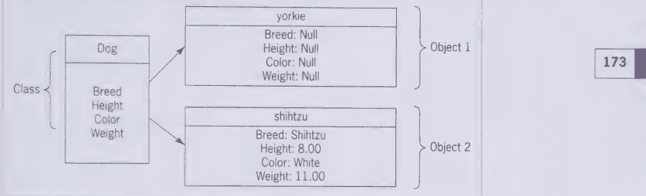

图 7-8 Dog 类及其两个对象的 UML 类图

© 2015 Cengage Learning

## Dog 类的完整代码

我们已经准备好将所有代码整合在一起。示例 7-4 显示了完整的 `@interface` 文件。

### 示例 7-4

```
1 #import <Foundation/Foundation.h>
2 @interface Dog : NSObject
3 {
4     NSString *breed;
5     double height;
6     NSString *color;
7     double weight;
8 
9 }
10 -(id)initWithBreed:(NSString *)newBreed
11     :(double)newHeight
12     :(NSString *)newColor
13     :(double)newWeight;
14
15 @property (getter = getBreed, setter = setBreed:) NSString
16 *breed;
17 @property (getter = getHeight, setter = setColor:) double
18 height;
19 @property (getter = getColor, setter = setColor:) NSString
20 *color;
21 @property (getter = getWeight, setter = setWeight:) double
22 weight;
23
24 -(NSString *) description;
25 -(void) bark;
26 -(void) wagTail;
27 -(void) whine;
28 @end
```

## 面向对象编程

示例 7-5 包含了 `Dog` 类的实现文件。

### 示例 7-5

```
1 #import "Dog.h"
2 @implementation Dog
3 @synthesize breed;
4 @synthesize height;
5 @synthesize color;
6 @synthesize weight;
7
8 -(id)initWithBreed:(NSString *)newBreed
9      :(double)newHeight
10     :(NSString *)newColor
11     :(double)newWeight
12 {
13     if (self == [super init]) {
14         [self setBreed:newBreed];
15         [self setHeight:newHeight];
16         [self setColor:color];
17         [self setWeight:newWeight];
18     }
19 }
20 return self;
21 }
22
23 -(NSString *) description
24 {
25     NSString *objDescription = [NSString
26 stringWithFormat:@"\nbreed: %@"
27 @"\nheight: %.2f\ncolor: %@"
28 @"\nweight: %.2f",breed,height,color,weight];
29 return objDescription;
30 }
31
32 -(void) bark
33 {
34     NSLog(@"\nBow Wow ... Bow Wow");
35 }
36
37 -(void) wagTail
38 {
39     NSLog(@"\nI like you");
40 }
41
42 -(void) whine
43 {
44     NSLog(@"\neeee... Eeeee");
45 }
46 @end
```

## Dog 类的完整代码

最后，示例 7-6 包含了 `Dog` 类的主文件。

### 示例 7-6

```
1 #import <Foundation/Foundation.h>
2 #import "Dog.h"
3 int main(int argc, const char * argv[])
4 {
5
6 @autoreleasepool {
7

8 // 使用默认 init 创建一个 dog 类的 yorkie 对象
10 Dog *yorkie = [[Dog alloc] init];
11

12 // 打印 Yorkie 的品种
13 NSLog("The breed of the dog is %@",
```

程序的输出显示此处。

示例 7-4、7-5 和 7-6 的输出

```
2017-09-30 15:56:33.853 Chapter 7[4503:403] The breed of the dog is (null)

2017-09-30 15:56:33.856 Chapter 7[4503:403] The breed of the dog is Shihtzu

and the height is 8.00 inches
```

## 第 7 章 面向对象编程

```
2017-09-30 15:56:33.857 Chapter 7[4503:403] The description of the

Shihtzu object is

Breed: Shihtzu

Height: 8.00

Color: white

Weight: 11.00

2017-09-30 15:56:33.858 Chapter 7[4503:403]

Bow Wow ... Bow

2017-09-30 15:56:33.859 Chapter 7[4503:403]

Eeee... Eeeeen

2017-09-30 15:56:33.860 Chapter 7[4503:403]

I like you
```

## 继承

继承是面向对象编程的一个重要特性，它定义了两个类之间的“是一个”（is-a）关系。Objective-C 中的类最终继承自 `NSObject`。换句话说，每个 Objective-C 类都是一个 `NSObject`。

编程中的继承与现实中的继承非常相似。例如，孩子可能会从父母那里继承面部特征和举止。同样，一个类可以从父类继承属性和操作。继承的类被称为子类，它继承的类被称为父类。

子类继承父类的属性和操作，但它也可以拥有自己的属性和操作。Objective-C 中的继承只允许从单个父类继承，这意味着对象不能有两个父类。图 7-9 强调了这一点。然而，父类可以继承另一个父类。换句话说，如图 7-10 所示，子类可以从另一个子类继承。

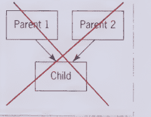

图 7-9 不允许从两个父类继承


图 7-10 子类可以从另一个子类继承

iPhone 对象可以在主函数中创建，如下代码所示：

```objc
//create device2 = [[iPhone alloc]
initWithPhone:4.0 :2.75 :@"iPhone" :@"Cell Phone"];
```

`description` 方法包含一个由开发者定义的描述，如示例 7-12所示。该描述是一个包含 iPhone 和 iDevice 实例变量的字符串（第 3 行）。

### 示例 7-12

```objc
1 -(NSString *) description
2 {
3 NSString * objectString = [NSString stringWithFormat:"\nThis
4 device is the iPhoneName of the device is %@: \nnThe
5 length is: %.2f \nwidth is: %.2f: \nThe feature
6 is: %@@",name,length,width,feature];
7

8 return objectString;
9 }
```

主函数中的 `NSLog` 语句简单输出了对象的名称。然后执行 `description` 方法，打印对象。


# 第7章 面向对象编程

## 面向对象

```objc
//print the device using the description method
NSLog(@"\nNow I am printing the device2 object %@ ", device2);
```

## 在第二层创建另一个子类

iPad 的创建方式与 iPhone 类类似。在示例 7-13 中，`iPad` 类具有实例变量 `type`（第 6 行）。`initWithiPad` 方法（第 9 行）不仅初始化了 `iPad` 类的实例变量，还初始化了 `iPhone` 类的实例变量，因为 `iPhone` 是 `iPad` 类的子类。`description` 方法头在第 14 行。

### 示例 7-13

```objc
1 #import <Foundation/Foundation.h>
2 #import "device.h"
3
4 @interface iPad : device
5 {
6   NSString * type;
7 }
8 @property NSString * type;
9 -(id)initWithiPad:(double)newLength
10   :(double)newWidth
11   :(NSString*)newName
12   :(NSString*)newType;
13
14 -(NSString *) description;
15 @end
```

`iPad` 类的实现见示例 7-14。这与 `iPhone` 类非常相似。此示例中实现了 `initWithiPad` 方法（第 7 行）和 `description` 方法（第 21 行至 28 行）。

### 示例 7-14

```objc
1 #import "iPad.h"
2
3 @implementation iPad
4 @synthesize type;
5
6
7 -(id) initWithiPad: (double) newLength
8   :(double) newWidth
9   :(NSString *) newName
10   :(NSString *) newType
11 {
12   if (self == [super
13     initWithDevice:newLength :newWidth :newName])
14   {
15     [self setType:newType];
16   }
17   return self;
18 }
19
20 //description method
21 -(NSString *) description
22 {
23   NSString * objectString = [NSString stringWithFormat:@"\nThis
24 device is the iPad \nname of the device is %@: \n\tThe
25 length is %.2f \nwidth is %.2f: \n\tType
26 is: %@\n", iName,length,width,type];
27   return objectString;
28 }
29 @end
```

## 继承的第三层

三级继承与二级继承相似。在示例 7-15 中，我们创建了 `iPad` 类的子类，名为 `iPadMini`。`iPadMini` 类继承了 `iPad` 的所有实例变量。它还继承了 `iDevice` 类的所有实例变量，因为 `iPad` 继承自 `iDevice`。这意味着 `iPadMini` 将拥有 `length`、`width`、`iName`、`type` 以及名为 `sizePercentage` 的新实例变量。该指令表示 `iPadMini` 继承自 `iPad` 类（第 4 行）。

### 示例 7-15

```objc
1 #import <Foundation/Foundation.h>
2 #import "iPad.h"
3
4 @interface iPadMini : iPad
5 {
6   double sizePercentage;
7 }
8 @property double sizePercentage;
```

在示例 7-16 中，`initWithiPadMini` 将 `init` 方法发送给父类。该类的初始化接着将 `init` 方法发送给它的父类。在我们的示例中，`iPadMini` 将 `init` 方法发送给 `iPad`。`iPad` 的 `init` 方法接着将 `init` 方法发送给它的父类，即 `iDevice`。

### 示例 7-16

```objc
1 -(id)initWithiPadMini:(double)newLength
2   :(double)newWidth
3   :(NSString *)newName
4   :(NSString *)newType
5   :(double)newSizePercentage
6 {
7   if(self == [super
8     initWithiPad:newLength :newWidth :newName :newType])
9   {
10    [self setSizePercentage:newSizePercentage];
11  }
12  return self;
13 }
```

示例 7-17 中的 `description` 方法与 `iPad` 的 `description` 方法非常相似。尽管 `iPadMini` 继承自 `iPad`，我们为 `iPadMini` 类创建了该方法，以便打印它自身的属性以及父类的属性。

### 示例 7-17

```objc
1 //description method
2 -(NSString *) description
3 {
4   NSString *objectString = [NSString stringWithFormat:@"\nThis
5 device is the iPadMini\nname of the device is %@: \n\tThe
6 length is %.2f \nwidth is %.2f: \n\tsize
7 is: %.2f",iName,length,width,sizePercentage);
8 return objectString;
9 }
```

`iPadMini` 是通过调用 `init` 方法创建的，如下代码所示：

```objc
//create aMini
iPadMini * device4 = [[iPadMini alloc] initWithiPadMini:5.0:5.0:@"iPadMini"];
```

使用 `NSLog` 语句打印 `iPadMini` 对象时，后台会自动调用 `description` 方法，如下所示：

```objc
//print the device using the description method
NSLog(@"\now we are printing device4 %@", device4);
```

我们继承关系的 UML 图见图 13。

| 类名 | 属性 | 方法 |
| --- | --- | --- |
| iDevice | length, width, iName | 所有属性的 setter 和 getter |
| iPad | iDevice 的属性加上 type | 所有属性的 setter 和 getter |
| iPadMini | iPad 的属性加上 sizePercentage | 所有属性的 setter 和 getter |

图 13 继承 UML 图

示例 7-18 包含了 `iDevice` 类的 `@interface` 文件。

### 示例 7-18

```objc
1 /**interface file for iDevice
2 #import <Foundation/Foundation.h>
3
4 @interface iDevice : NSObject
5 {
6   double length;
7   double width;
8   NSString * iName;
9 }
10
11 @property double length, width;
12 @property NSString * iName;
13
14 -(id) initWithDevice:(double) newLength
15   :(double) newWidth
16   :(NSString *) newName;
17
18 -(NSString *) description;
19
20 @end
```

示例 7-19 包含了 `iDevice` 类的 `@implementation` 文件。

### 示例 7-19

```objc
1 /**implementation file for iDevice
2 #import "iDevice.h"
3 @implementation iDevice
4 @synthesize length, width;
5 @synthesize iName;
6
7 -(id) initWithDevice:(double) newLength
8   :(double) newWidth
9   :(NSString *) newName
10 {
11   if (self == [super init]) {
12     [self setLength:newLength];
13     [self setWidth:newWidth];
14     [self setName:newName];
15   }
16   return self;
17 }
18
19 //description method
20 -(NSString *) description
21 {
22     NSString *objectString = [NSString stringWithFormat:@"\nThis
23 name of the device is %@: \n\t length is %.2f \nwidth is %.2f",iName,length,width);
24     return objectString;
25 }
```

示例 7-20 包含了 `iPhone` 类的 `@interface` 文件。

### 示例 7-20

```objc
1 /**interface file for iPhone
2 #import <Foundation/Foundation.h>
3 #import "iDevice.h"
4
5 @interface iPhone : iDevice
6 {
7     NSString * feature;
8 }
9 @property NSString * feature;
10
11 -(id)initWithPhone:(double) newLength
12   :(double) newWidth
13   :(NSString *) newName
14   :(NSString *) newFeature;
15
16 -(NSString *) description;
17 @end
```

示例 7-21 包含了 `iPhone` 类的 `@implementation` 文件。

### 示例 7-21

```objc
1 /**implementation file for iPhone
2 #import "iPhone.h"
3 #import "iDevice.h"
4 @implementation iPhone
5 @synthesize feature;
6
7 -(id)initWithPhone:(double) newLength
8   :(double) newWidth
9   :(NSString *) newName
10   :(NSString *) newFeature
11 {
12     if(self == [super initWithDevice:newLength :newWidth :newName]) {
13         [self setFeature:newFeature];
14     }
15     return self;
16 }
17
18 -(NSString *) description
19 {
20   NSString *objectString = [NSString stringWithFormat:@"\nThis
21 device is the iPhone
22 the name of the device is %@ \n\tThe
23 length is %.2f \nwidth is %.2f \n\tThe feature
24 is: %@", iName,length,width,feature];
25   return objectString;
26 }
27 @end
```

示例 7-22 包含了 `iPad` 类的 `@interface` 文件。

### 示例 7-22

```objc
//@interface file for the iPad .
#import <Foundation/Foundation.h>
#import "iDevice.h"

@interface iPad : iDevice
{
  NSString *type;
}

@property NSString *type;

-(id) initWithiPad:(double) newLength
  :(double) newWidth
  :(NSString *) newName
  :(NSString *) newType;

-(NSString *) description;

@end
```

示例 7-23 包含了 `iPad` 类的 `@implementation` 文件。

### 示例 7-23

```objc
//@implementation file for the iPad .
#import "iPad.h"

@implementation iPad
@synthesize type;

-(id) initWithiPad:(double) newLength
  :(double) newWidth
  :(NSString *) newName
  :(NSString *) newType
{
  if (self == [super initWithDevice:newLength :newWidth :newName]) {
    [self setType:newType];
  }
  return self;
}

-(NSString *) description
{
  NSString *objectString = [NSString stringWithFormat:@"\nThis
  device is the iPad \nname of the device is %@: \n\tThe
  length is %.2f \nwidth is %.2f: \n\tType
  is: %@\n", iName,length,width,type];
  return objectString;
}
@end
```

## 继承

示例 7-24 `iPadMini` 类的 `@interface` 文件

### 示例 7-24

```objc
1 //iPadMini 的 @interface 文件
#import <Foundation/Foundation.h>
#import "iPad.h"

@interface iPadMini : iPad
{
  double sizePercentage;
}

@property double sizePercentage;

-(id)initWithiPadMini:(double)newLength
  :(double)newWidth
  :(NSString *)newName
  :(NSString *)newType
  :(double)newSizePercentage;

//description method
-(NSString *) description;

@end
```

示例 7-25 `iPadMini` 类的 `@implementation` 文件

### 示例 7-25

```objc
//@implementation file for iPadMini
#import "iPadMini.h"

@implementation iPadMini
@synthesize sizePercentage;

-(id)initWithiPadMini:(double)newLength
  :(double)newWidth
  :(NSString *)newName
  :(NSString *)newType
  :(double)newSizePercentage
{
  if (self == [super initWithiPad:newLength :newWidth :newName :newType]) {
    [self setSizePercentage:newSizePercentage];
  }
  return self;
}

-(NSString *) description
{
  NSString *objectString = [NSString stringWithFormat:@"\nThis
  device is the iPadMini\nname of the device is %@: \n\tThe
  length is %.2f \nwidth is %.2f: \n\tsize
  is: %.2f", iName,length,width,sizePercentage];
  return objectString;
}
@end
```


// iPadMini 的 @implementation 文件

```objc
#import <Foundation/Foundation.h>
#import "iPad.h"

@interface iPadMini : iPad
{
    @property double sizePercentage;
}

- (id)initWithMini:(double)newWidth :(double)newWidth :(NSString *)newName :(NSString *)newType :(double)newPercentage;
// description method
- (NSString *)description
@end
```

示例 7-26 包含了创建 iPhone、iPad 和 iPadMini 对象的主函数（`main function`）。

## 示例 7-26

```objc
#import <Foundation/Foundation.h>
#import "IODevice.h"
#import "iPad.h"
#import "iPadMini.h"
#import "iPhone.h"

int main(int argc, const char * argv[])
{
    @autoreleasepool {
        // create iDevice
        iDevice *device1 = [[IODevice alloc]
            initWithDevice:11.00 :9 :0 : @"Device"];
        // print the device using the description method
        NSLog("Hello there! %@", device1);
        // create an iPhone
        iPhone *device2 = [[iPhone alloc]
            initWithPhone:4.0 :2.75 :@"iPhone" @"Cell iPhone"];

        // print the device using the description method
        NSLog("\nNow I am printing the device2 object %@", device2);
        // create an iPad
        iPad *device3 = [[iPad alloc]
            initwithiPad:11.00 :9:0 @"iPad" :@"Electronic pad"];
        // print the device using the description method
        NSLog("\nNow I am printing the device3 object %@", device3);
        // create a iPadMini
        iPadMini *device4 = [[iPadMini alloc]
            initwithiPadMini:5.50 :4.5 :@"iPadMini" :@"Mini Electronic Pad" :5.00]];
        // print the device using the description method
        NSLog("\nNow we are printing the device4 %@", device4);
        return 0;
    }
}
```

程序的输出如下。

### 示例 7-18 到 7-26 的输出

```
2017-10-01 17:48:03.082 Inheritance-Chapter7[8824:403]
Hello there!
The name of the idevice is iDevice:
The length is 11.00 and
width is 9.00:
2017-10-01 17:48:03.100 Inheritance-Chapter7[8824:403]
Now I am printing the device2 object
This device is the iPhone
The name of the idevice is iPhone:
The length is 4.00
width is 2.75:
The feature is: Cell Phone
2017-10-01 17:48:03.102 Inheritance-Chapter7[8824:403]
Now I am printing the device3 object
This device is the iPad
The name of the idevice is iPad:
The length is 11.00
width is 9.00:
The type is: Electronic pad
2017-10-01 17:48:03.103 Inheritance-Chapter7[8824:403]
Now we are printing device4
This device is the iPadMini
The name of the idevice is iPadMini:
The length is 5.50
width is 4.50:
The size percentage is: 50.00
```

## 实验课程

在本实验中，你将创建一个名为 `animalControl` 的类，该类定义了以下属性：

- `animalName`
- `population`
- `insecticidePower`
- `growthRate`

1. 为 `animalControl` 创建 `@interface`。`initControl` 方法首先检查父类（`NSObject`）是否已初始化，然后通过向自己发送消息来初始化实例变量。`description` 方法包含了我们想要打印的信息。
2. 为 `animalControl` 创建 `@implementation`。`initControl` 方法首先检查父类 `NSObject` 是否已初始化，然后通过向自己发送消息来初始化实例变量。`description` 方法包含了我们想要打印的信息。
3. `main` 文件是执行开始的地方，在此创建对象并发送消息。在 `main` 函数中，向对象发送 `initControl` 方法来创建 animal 对象。然后使用 `NSLog` 语句打印对象。`NSLog` 语句执行了父类的 `description` 方法。

# 第 7 章 面向对象编程

```c
// Main Function
#import "animalControl.h"

int main(int argc, const char * argv[]) {
    @autoreleasepool {
        // 创建 Term蚁
        animalControl *Termite = [[animalControl alloc]
            initAnimalControl:@"Termite" :40 :0.5:5];
        // 打印 Term蚁
        NSLog("\nthe first animal: %@", Termite);
        // 创建蟑螂
        animalControl *Roach = [[animalControl alloc]
            initAnimalControl:@"Roach" :200 :2.5 .8];
        // 打印蟑螂
        NSLog("\nthe second animal: %@", Roach);
    }
    return 0;
}
```

## 输出示例

```
2017-07-20 00:07:20.386 Ch7_Hands_on_lab[2222:303]
The first animal:
The animal's name is: Termite
with a population of 40.00
with insecticidePower of 0.50
with growthRate of 5.00.
Population after breeding is 240.00
and population after spraying insecticide is 38.00

2017-07-20 00:07:20.386 Ch7_Hands_on_lab[2222:303]
The second animal:
The animal's name is: Roach
with a population of 200.00
with insecticidePower of 2.50
with growthRate of 0.80.
Population after breeding is 360.00
and population after sparaying insecticide is 198.40
```

## 总结

- 封装是将数据元素以及一组可以在这些数据元素上的操作组合的过程，以创建一个健壮、安全的对象。
- 面向对象编程是一种编程概念，它从类的实例（对象）的角度来看待编程。它基于封装的概念。
- 类中有两类方法：类方法和实例方法。类方法不需要实例化即可使用。实例方法需要类的实例才能执行。实例方法前面带有一个减号（`-`）。类方法前面带有一个加号（`+`）。
- 在 Objective-C 中，类的成员头文件和实现通常定义在不同的文件中。在简单的程序中，可以将它们合并到一个文件中，但对于较大的程序，最好使用单独的文件。
- 接口文件（`@interface`）持有实例变量的声明和方法的声明。`@interface` 文件具有 `.h` 扩展名。`@implementation` 文件持有 `@interface` 文件中声明的方法的实现，具有 `.m` 扩展名。
- 属于类或对象的功能称为方法。在 Objective-C 中，方法不是被调用的，而是将方法的消息发送给对象。
- 属性是填充类实例变量的手段。`@property` 指令用于标识属性。
- `@synthesize` 指令用于编译器自动生成属性的 getter 和 setter 方法。
- Objective-C 中的初始化器类似于 Java 中的构造函数。它们有助于创建类的实例。
- 描述方法（`Description methods`）与 Java 中的 `toString` 方法非常相似。它们提供了一种手段，以字符串的形式打印开发者从对象的实例变量集中选择的内容。
- 继承促进了子类的创建，子类可以继承父类的属性，并拥有自己的一组数据成员。
- Objective-C 仅允许单继承。在单继承中，对象可以继承一个父类，但不能继承两个父类。

## 练习题

### 1. 一个名为 `brand` 的类继承自名为 `car` 的类。假设 `car` 在构造函数中声明了三个参数：`color`（字符串）、`modelNum`（字符串）和 `miles`（double）。它还有一个返回值的函数 `getModelNum`，返回汽车的型号；一个名为 `setColor` 的函数设置汽车的颜色；以及一个名为 `setMiles` 的函数设置汽车的里程。前者函数没有参数但返回汽车的型号，而后者有一个字符串参数但没有返回值。

a. 编写一条语句声明 `brand` 类，其中 `brand` 继承自 `car` 类。
b. 为 `car` 类编写一个构造函数，该构造函数没有参数，并将所有变量初始化为空字符串和 0。
c. 为 `car` 类编写另一个构造函数，该构造函数有两个参数，并将变量初始化为这些参数的值。
d. 编写一条属于 `brand` 类的语句，使用之前声明的任何构造函数声明一个 `car` 类的第一个对象 `firstcar`。
e. 编写一条与 d 步相似的语句，创建另一个对象 `secondCar`。
f. 编写一条语句打印 `secondCar` 的型号。
g. 编写一条语句将 `firstcar` 的颜色改为蓝色。
h. 为 `car` 类编写一个方法 `func`，该方法打印其所有变量的值。
i. 编写一条语句调用函数 `func` 来打印 `firstcar` 的颜色和模型号。
j. 编写一条语句比较 `firstcar` 和 `secondCar` 的颜色，如果它们匹配则返回 true，否则返回 false。

### 2. `apartment` 类有几个参数：`name`（string）、`address1`（string）、`address2`（string）、`city`（string）、`state`（string）、`zip`（string）、`manager`（string）和 `rating`（double）。该类还有以下方法：`description`（带有参数且没有返回值）和 `title`（带有参数且没有返回值）。

### 3. 在 Objective-C 中，接口文件用于声明类。修正以下代码：

```objective-c
@interface myClass {
    -int identification;
    +(void)setTitle:(NSString*)title;
}
@end
```


# 面向对象编程

## 编程练习

### 1. 创建一个包含课程类的程序
该类应该有一个名称、教师和一个数字。许多类没有实验室。拥有实验室的类也拥有类的所有属性。让用户选择课程类型。

### 2. Kabab 餐厅订单程序
每份订单包括以下一项一项：前菜、主菜、茶和甜点。每天厨师准备一种前菜和甜点，因此客户要么点当天的选项，要么拒绝菜单项。对于主菜，客户可以选择 3.50 美元的菜肴。客户可以选择不点主菜。此外，所有的茶都是 3.00 美元（免费续杯），前菜和甜点是 3.50 美元。编写一个程序提示用户选择或拒绝前菜、主菜、茶和甜点。对于主菜，客户应该有一个选择或拒绝主菜的机会。程序应该输出每个订单，显示每个商品的价格以及包括 2% 税在内的总费用。

### 3. 调查问卷程序
调查问卷的工作有点像类。你可以将问卷视为父类，将问题视为子类。Maurice 先生制造电子设备并寻求更好地满足客户。为此，他想创建一个调查问卷来调查五个客户。他想询问客户对特定设备颜色以及重量、内存和屏幕尺寸的意见。每个响应都保存在数组中。Maurice 先生随后将使用该数组定制他的新产品。新产品将具有大多数调查客户喜好的属性。创建一个完成此任务的程序。

- 使用循环创建主类的对象
- 将每个响应保存到数组中
- 输出响应供 Maurice 先生分析。

### 4. 书店 Polo 衫设计程序
一家书店刚开业，需要为员工准备 Polo 衫。每件衬衫都应该显示一位名家的引言。以下是一些引言：

- 雨后留有晴天。
- 尽可能保持善良。这总是可能的。
- 对自己的能力充满信心！

引言可以位于衬衫的前面或背面。颜色方面，员工可以在红、绿、黑、蓝之间选择。衬衫有小、中、大号。创建一个程序，让员工可以使用它设计衬衫。该程序应允许用户输入姓名和性别，选择衬衫颜色，并输入所需的引言、位置（即打印在正面还是背面）以及尺寸。系统应将订单存储在数组中。在一天结束时，系统应将当天输入的所有信息发送到打印店，以便制作衬衫。使用继承原则编写程序来完成此任务。发送给商店的信息应如下：

**订单总数**

**订单摘要**

| 订单 | 姓名 | 性别 | 颜色 | 尺寸 | 位置 |
| :--- | :--- | :--- | :--- | :--- | :--- |
| | | | | | |

### 5. 冰淇淋店模拟程序
创建一个程序，模拟一家出售冰淇淋筒和奶昔的小型冰淇淋店。客户可以选择多种口味和配料。冰淇淋筒小号 $1.29，中号 $2.29，大号 $3.29。奶昔小号 $1.59，中号 $2.59，大号 $3.59。使用继承来创建这两种独特的冰淇淋甜点。配料选项有：香草味、巧克力、草莓、薄荷和曲奇饼干。奥利、巧克力碎、布朗尼、山桃、巧克力和焦糖。打印用户的选择和总价。

### 6. 场所类程序
编写一个程序，其中包含一个描述场所的类。该场所应具有以下属性：场所名称、邮政编码、地址类型（即工业或商用）。创建一个主函数，创建一个具有以下属性的 `MyPlace` 对象：名称 Atria；邮政编码和地址类型商业用。

### 7. 修改场所类程序
创建编程练习 6 中描述的程序，但进行以下更改：

- a. 创建一个自定义初始化器，将邮政编码设置为 `00000`，场所名称设置为 `placeA`，地址类型设置为工业用。
- b. 添加一个描述方法，在打印对象时打印场所名称和地址类型。

### 8. 员工类程序
创建一个员工类，包含以下属性：位置、名、姓和员工编号。位置属性的类型是（在编程练习 7 中创建的类）。当执行主函数时，应该创建一个员工（例如，员工编号 `0975` 的 Jonathan Jones），其位置为编程练习 7 中创建的 `MyPlace` 对象。

### 9. 鞋子与靴子类程序
创建一个鞋子类来描述鞋子对象，该对象包含以下属性：颜色、长度和材料。接下来，创建一个继承自鞋子类的靴类，并有一个额外的属性高度。当执行主函数时，应该创建一个 `myBoots` 对象并将其属性打印到控制台上。假设 `myBoots` 的颜色为棕色，长度为 15 英寸，由麂皮制成，高为 2 英寸。使用类的 getter 方法打印这些值中的每一个。

### 10. 修改鞋子与靴子类程序
修改编程练习 9 中的程序，使所有属性成为属性，且每个属性的 getter 和 setter 方法都是自动生成的。在鞋子类中添加一个描述方法，将鞋子的长度连接到它的颜色上（例如，`9black`）。打印 `myBoots` 对象的描述符。

## 业务案例研究

基于第 6 章的业务案例研究，创建一个名为 `fun` 的类，具有日期 `date` 和场合 `occasion` 属性。创建一个具有 `size`、`color` 和 `type` 属性的子类。创建一个主函数来生成以下对象：

- 生日
- 派对
- 毕业

---

# iOS 开发工具包 (SDK)

正如你在第 1 章中所学的，iOS SDK（软件开发工具包）是苹果为 iOS 设计的软件开发环境。你在第 1 章中也学习了它的部分组件。更完整的组件列表包括：

- 名为 `Xcode` 的集成开发环境，你可以在其中编写、测试和开发 Objective-C 代码
- `LLVM` 编译器，它是 iOS SDK 内置的编译器
- `Interface Builder`（界面构建器），它为 App 构建交互式界面提供必要的工具
- `iOS Simulator`（iOS 模拟器），它允许你像在 iPhone 或 iPad 上运行一样来测试 App
- `Instruments`，一种分析工具，可以帮助开发者分析 App 的性能
- 一套辅助开发者工具集，包含开发者可以使用来了解更多关于 iOS SDK 的文档

这些工具每一个都很好地集成在 `Xcode` 中，提供了从代码开发到调试、界面构建，到在模拟器上测试代码以及分析 App 性能的无缝衔接。接下来的章节将详细介绍这些项目。

## LLVM 编译器

`LLVM` 编译器为开发者提供了用于编译和调试代码的工具。当开发者输入代码时，编译器还会提供建议、检测错误并纠正某些错误。当你将鼠标悬停在变量上时，它会显示 App 运行时的变量内容。

## Interface Builder

`Interface Builder` 是一种视觉化开发工具，用于创建用户交互的视图控制器（`View Controller`）。视图控制器并不直接访问数据元素；相反，它与视图通信，而视图又访问数据/模型（`Model`），从用户界面向模型发送消息，反之亦然。模型是存储所有与 App 相关数据的地方，而视图控制器是代码所在的地方。当用户界面或视图控制器中的按钮被按下时，消息会被发送视图控制器。视图控制器访问模型并以数据、图像或用户点击按钮请求的任何其他功能形式将消息返回。图 8-2 显示了 `Interface Builder`。

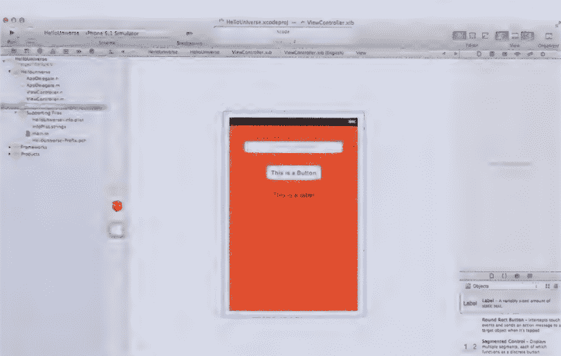

图 8-2 Interface Builder

## iOS 模拟器

正如第 1 章中所学的，`iOS Simulator` 用于测试 App。在使用 `iOS Simulator` 之前，你需要选择想要模拟的设备。在本书中，我们将使用图 8-3 所示的 iPhone。要选择 iPhone 模拟器，点击 `Xcode` 窗口顶部、停止按钮右侧的 `Scheme`（方案）框，然后选择最新版本的 iPhone。在图 8-3 中，选定的是 iPhone 6.1。当你准备好运行 App 时，`Xcode` 将在你选择的模拟器上运行该 App。`Xcode` 将继续使用该模拟器，直到你选择一个新的。由于我们在本书中将一直使用 iPhone 模拟器，因此你只需要选择一次 iPhone 模拟器。

## 在 iOS 环境中工作

在运行 App 之前，点击此处然后选择你想让 `iOS Simulator` 模拟的设备

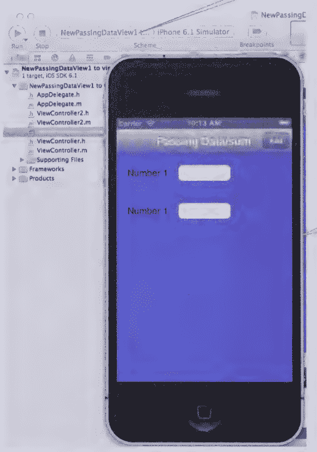

在这种情况下，`iOS Simulator` 正在模拟一台 iPhone

图 8-3 在 iOS 模拟器中运行的 App

请注意，苹果设备上的大部分功能在 `iOS Simulator` 中也可用。然而，某些功能（如位置、电话功能、加速度计和相机）在模拟器中是不可用的。

## Instruments

`Instruments` 是 iOS SDK 提供的一种开发工具，用于测试 App 的性能。移动设备的资源有限，因此需要对性能进行关键评估，以确保 App 不消耗必要的资源并导致设备变慢。

开发者可以使用 `Instruments` 确保他们的 App 不超过这些限制。`Instruments` 在检测内存泄漏方面也很有用，内存泄漏是指内存分配和释放执行不当。

## 开发支持

苹果提供了大量的辅助文档和示例，你在开发 App 时会发现它们非常有用。这些文档支持可以在此处找到：`https://developer.apple.com/support/ios/`

## iOS App 生命周期

当 iOS App 启动时，会创建一个 `UIApplication` 对象。这个 `UIApplication` 对象会创建一个 `UIWindow` 对象并在其中启动一个 `UIView` 对象。随后 `UIApplication` 开始运行，它通过处理启动、电话电话以及各种通知和警告等事件来管理 App 的生命。`UIApplication` 是 `UIKit` 框架的一部分，该框架提供了用户界面所需的对象。

如果上一段话难以完全理解，不要担心。随着你创建越来越多的 App，App 的生命将变得更容易理解。目前，你需要理解的最重要概念是涉及 App 执行的两个主要组件。第一个是由 `UIKit` 框架提供的对象集。第二个是开发者编写用于管理这些对象的代码。在下面的代码中，当用户触摸 App 图标时，`main` 方法执行。也就是说，`UIApplicationMain` 加载用户界面并通过创建管理事件的 `AppDelegate` 来启动事件循环。`AppDelegate` 和视图控制器是由 `UIApplicationMain` 创建的。

```objc
#import <UIKit/UIKit.h>
#import "AppDelegate.h"

int main(int argc, char *argv[])
{
    @autoreleasepool {
        return UIApplicationMain(argc, argv, nil, NSStringFromClass([AppDelegate class]));
    }
}
```

当 App 启动时，`Xcode` 会自动加载 `UIKit`、`Foundation` 和 `CoreGraphics` 框架。这是因为它们是最常用的框架，在 `Interface Builder` 中进行的任何操作都需要这些基础框架。图 8-4 显示了当前激活的框架列表。

## 在 iOS 环境中工作

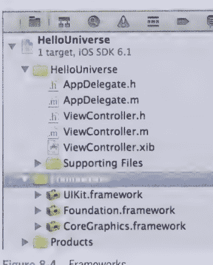

## 视图、视图控制器、IBOutlet 和 IBAction

在我们创建 App 之前，我们需要花时间澄清一些术语。视图控制器（`View Controller`）如图 8-5 所示，是 App 的一部分，负责显示数据并将用户输入（例如文本框中的单词）转换为操作（例如将该单词输入数据库）。在 `Xcode` 中，视图控制器的视觉表示是设备背景的矩形图像（例如 iPhone 或 iPad 的背景），包含了标签、按钮、文本框和其他控件。视图（`View`）一术指的是你在视图控制器中看到的内容。视图可以包含标签、文本框、按钮和信息列表，仅举例。在 storyboard 中，视图有时被称为场景（`Scene`）。

视图控制器上的视图和控件创建了用户与程序之间的交互。也就是说，它们将视图控制器连接到 Objective-C 逻辑。

图 8-5 视图控制器中的控件对象

## 创建和使用 IBOutlet 和 IBAction 连接

你可以在 `Interface Builder` 中通过 Control-拖拽（Control-drag）操作创建 `IBOutlet` 和 `IBAction` 连接——也就是说，你可以在视图控制器中点击一个控件以选中它，同时按住 `Control` 键和鼠标左键，然后使用鼠标将该控件从视图控制器拖动到界面文件中。这有时被称为 Control-拖拽操作。

某些控件（例如按钮）是基于事件的，这意味着它们可以触发创建 `IBAction` 连接的事件。非事件驱动的控件（例如标签和文本字段）则会创建 `IBOutlet` 连接。通过这种方式创建 `IBOutlet` 或 `IBAction` 连接后，应用程序中的代码就可以通过 `IBOutlet` 或 `IBAction` 连接访问这些控件。例如，如果你在视图控制器中 Control-拖拽一个标签（`label`），你的代码将以如下方式连接到该标签：

```objc
IBOutlet UILabel *newLabel;
```


Control-拖拽操作会为每个 `IOutlet` 连接生成 `@property` 指令。它还会生成 `@synthesize` 指令，该指令指示编译器为控件生成获取（getter）和设置（setter）方法。

Control-拖拽操作还会在类的 `@interface` 中生成动作方法或变量的头文件，并在视图控制器的 `@implementation` 中生成变量的实现。然后，你需要编写代码，以便程序在特定事件（如按下按钮）发生时执行你想要的任务。`IBAction` 连接的声明如下：

```objc
- (IBAction)myButton:(id)sender
```

注意 `IBAction` 前面的 `(-)` 符号，这是必要的，因为 `IBAction` 是接口的实例方法。

# iOS 应用创建流程

要创建一个应用，你需要在 Xcode 中创建一个新项目，在 Interface Builder 中将界面对象或控件（如标签或文本字段）拖到界面或视图控制器上，然后更改控件的属性或属性。例如，你可能会通过将其颜色属性改为红色创建一个文本字段。接下来，你对控件进行编程，让它们实现你想要的功能。最后，运行应用进行测试。

在接下来的步骤中，我们将创建一个带有单个视图应用的简单应用。该界面最终将只包含一个控件：一个显示“Hello Universe”文本的标签。

1. 打开 Xcode，点击 **Create a new project**（创建新项目）。如果 Xcode 已经打开，请从 Xcode 的 **File**（文件）菜单中选择 **New Project**（新建项目）。
2. 在 **Choose the template for your new project**（为新项目选择模板）对话框的左侧面板中，在“iOS”下点击 **Application**（应用）。

在本章中，我们将首先学习如何处理单视图应用（即只有一个视图控制器的应用），然后再进入与多个视图控制器相关的更复杂的任务。因此，在右侧点击 **Single View Application**（单视图应用），如图 8-7 所示。

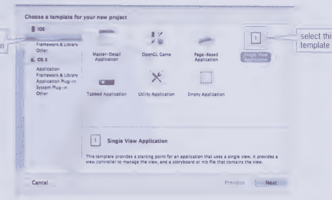

**图 8-7** 应用类型选择

3. 点击 **Next**（下一步）按钮。在 **Choose options for your new project**（为新项目选择选项）对话框中，在 **Product Name**（产品名称）处输入 **HelloUniverse**，在 **Organization Name**（组织名称）和 **Company Identifier**（公司标识符）框中输入适当的内容，确保在 **Devices**（设备）框中选中了 **iPhone**，然后取消勾选 **Use Storyboards**（使用 Storyboards）复选框。（你将在第 9 章学习此复选框的含义。）确保勾选了 **Use Automatic Reference Counting**（使用自动引用计数）选项。
4. 点击 **Next**（下一步）按钮，并在选择的位置保存项目。保存项目后，你会看到图 8-8 所示的屏幕。在左侧的导航器区域中，你会看到几个文件，包括 `ViewController.h` 和 `ViewController.xib`。`.xib` 文件是界面文件。`ViewController.h` 和 `ViewController.m` 文件将包含在 `.xib` 文件中创建的界面逻辑。此时，你不需要担心导航器区域中看到的任何其他文件。

# 在 iOS 环境中工作

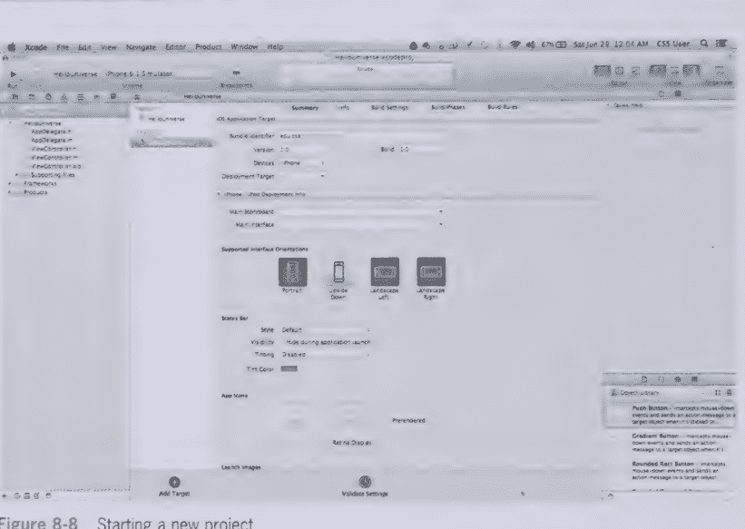

5. 在左侧的导航器区域中，点击 `ViewController.xib`，如图 8-9 所示。这将打开 Interface Builder，在编辑器面板（或画布）中显示项目的单个视图控制器，如图 8-10 所示。注意屏幕右下角的 **Object Library**（对象库）。如果你的电脑上没有打开 Object Library，请点击 **View** ► **Utilities** ► **Show Object Library** 来显示它。要查看 Object Library 中的对象，点击图 8-10 所示的图标。

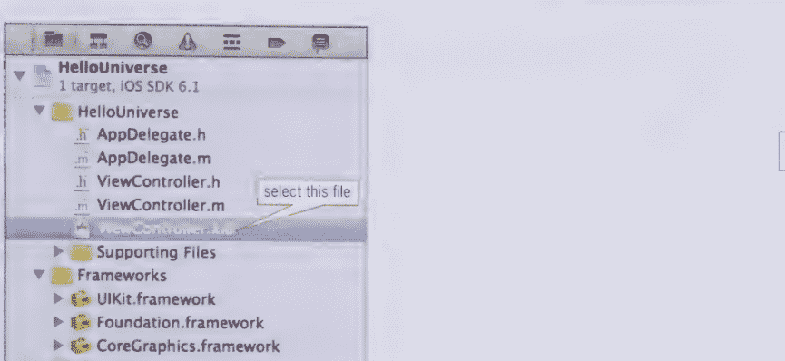

**图 8-9** 导航器区域

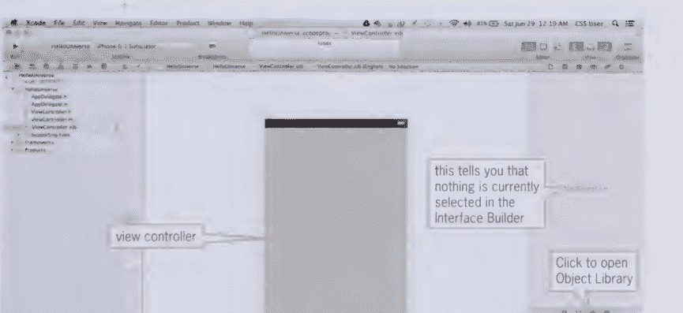

**图 8-10** 新项目的界面

每个用户界面（或视图控制器）都有三个文件：`ViewController.xib`、`ViewController.h` 和 `ViewController.m`。`ViewController.xib` 文件通常被称为 nib 文件或 xib 文件，它实际上包含了视图控制器。`ViewController.h` 类似于 `@interface`，它包含了实例变量。同样，`ViewController.m` 类似于 `@implementation`，它包含了实例变量的实现。

此时，视图控制器是空白的，如图 8-10 所示。现在我们准备好添加一些控件了。我们将从右下角的 Object Library 开始添加一个标签。

在图 8-10 中，注意工具面板（utility pane）中的“No Selection”（无选择）字样。这表示未选中视图控制器。一旦选中视图控制器（通过点击来实现），工具面板将显示所有选项。

1. 从右下角的 Object Library 拖一个标签到视图控制器中。居中标签并将现有文本替换为 Hello Universe，如图所示。

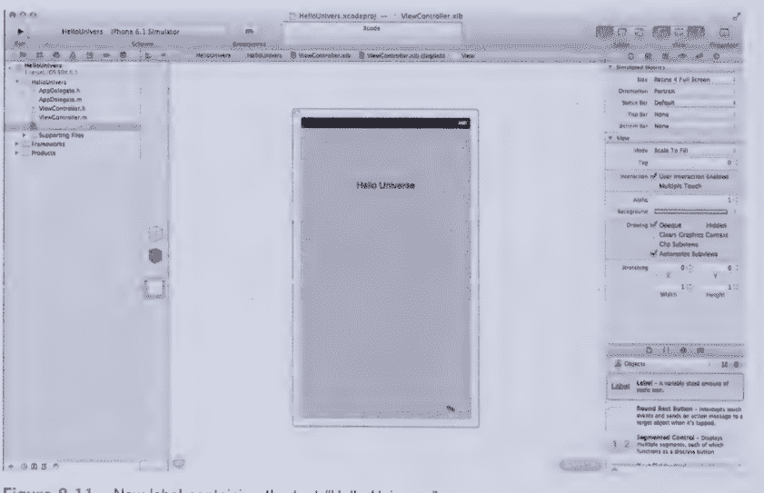

**图 8-11** 包含文本 Hello Universe 的标签

# 应用创建流程

2. 现在你准备好在模拟器中运行应用了。在此之前，如果你还没有这样做，需要选择 iPhone。在 Xcode 窗口顶部，Stop 按钮右侧点击 **Scheme**（方案），然后选择最新版本。如有必要，请查看本章之前的图 8-3 以说明。
3. 点击左上角的 **Run**（运行）按钮，如图 8-12 所示。模拟器出现，显示文本“Hello Universe”。

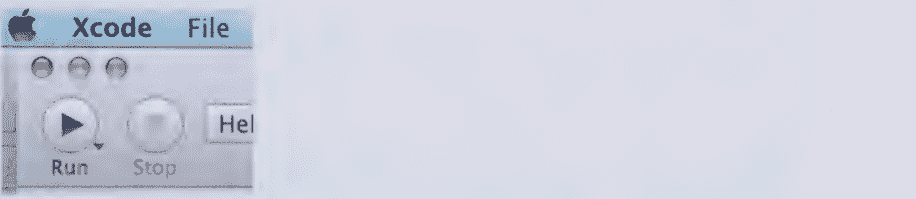

**图 8-12** Run 按钮和 Stop 按钮

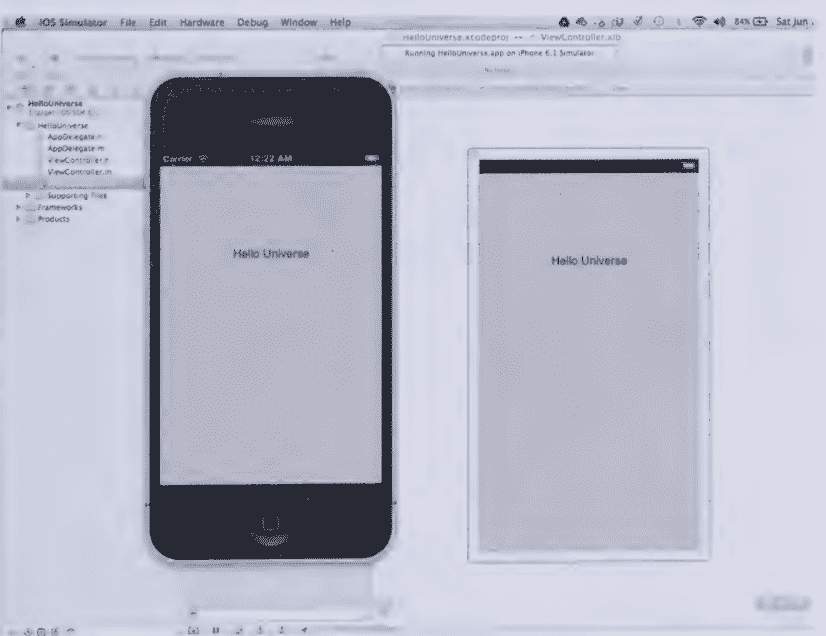

**图 8-13** 运行 Universe 应用的模拟器

4. 要停止运行应用，点击 **Stop** 按钮，如之前的图 8-12 所示。在本章的学习（Hands-On Lab）中，我们将使用标签、文本字段和按钮。为了理解这些控件，理解它们所属的 `Controls` 类至关重要。

## UIControl 类

`UIControl` 类提供了为用户提供交互的控件对象。`UIControl` 类设置并获取控件的属性、向目标发送动作消息、绘制控件并跟踪控件上的触摸操作。图 8-14 显示了常用的控件。

## UILabel 类

标签控件（如你添加到 Hello Universe 应用中的标签）是 `UILabel` 类的实例。这种控件传统上用于向用户提供信息。标签是一个只读界面，这意味着只有开发者可以访问其内容；用户可以看到它但无法编辑。因此，标签被设计为忽略任何触摸事件——事实上，如果你想让标签响应事件，你必须更改设置以启用事件。

## UIButton 类

按钮控制对象是 `UIButton` 类的一个实例。按钮能够拦截触摸事件；当它执行此操作时，会向目标发送动作方法。`UIButton` 类继承自 `UIControl` 类，因此可以访问向目标发送动作消息的方法。

## UITextField 类

文本字段控制对象（有时称为文本框）是 `UITextField` 类的一个实例。这种类型的控件可以由用户编辑，并有一个关联的操作方法，当用户在输入文本后按下回车键时会触发该方法。该动作方法可以被程序执行许多任务，例如搜索文本、在标签或其他控件中显示额外的文本等。

# 实践实验 (HANDS-ON LAB)


在本实验中，我们将创建一个包含文本字段、标签和按钮的应用程序。用户能够在文本字段中输入某些文本，点击按钮，然后在标签中看到相同的文本。我们将从对象库（Object Library）中拖入标签、文本字段和按钮。然后，我们将更改这些某些控件的属性。

1. 创建一个新的 iOS 应用程序 Xcode 项目。选择 **Single View Application**（单视图应用程序），注意不要勾选 **Storyboards** 框。在您选择的位置将项目保存为 `myFirstApp`。
2. 点击 `ViewController.xib` 文件显示空白的视图控制器。
3. 确保对象库已打开，然后从对象库中拖入一个标签到视图控制器，如图 8-15 所示。在向视图控制器添加控件后，你可以通过更改其属性来改变其外观。要做到这一点，你需要确保属性在用工具面板（Utility pane）的顶部可见。

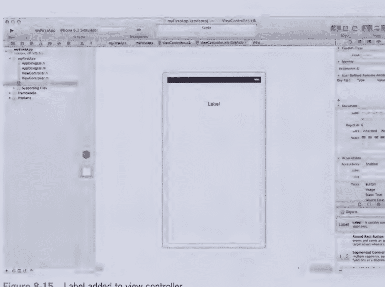

4. 点击图 8-16 所示的图标。注意，用工具面板显示视图控制器中当前选中控件的属性。

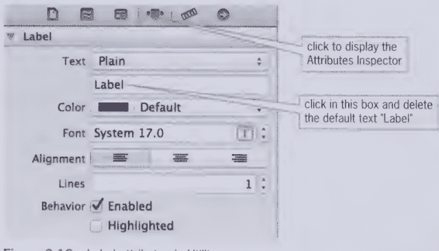

**图 8-16** 用工具面板中的标签属性

标签的一个属性是它包含的文本。现在，标签包含默认文本“Label”，但你希望它在程序运行时显示用户在文本字段中输入的内容。这意味着你需要更改属性以默认文本。在用工具面板的属性中，点击图 8-16 所示的框，然后删除其内容。

在 Interface Builder 中点击标签外部以取消标签的选中。此时，你将无法再次看到标签，因为它不包含任何文本。这并不意味着标签消失了。在完成的应用程序中，当用户点击按钮时，文本将会出现。

从对象库拖入一个文本字段到视图控制器，然后按照图 8-17 所示对其调整大小并定位。注意，你无法看到标签，因为它其中没有文本。要调整文本字段的大小，拖动角柄来增大或减小控件尺寸。要移动控件，左键点击控件，按住鼠标并拖到所需位置。

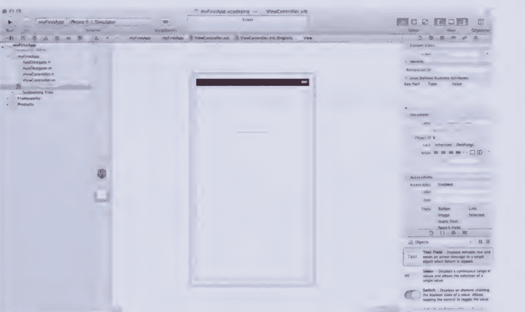

**图 8-17** 文本字段的正确尺寸

现在，你需要指定首次运行时在文本字段中显示的占位符文本（placeholder text）。你可以通过更改文本字段的 `Placeholder` 属性来实现。确保文本字段仍被选中，然后在文本字段的属性中，点击 `Placeholder` 框并输入如图 8-18 所示的 `Enter your text here`。新的占位符“Enter your text”现在出现在文本字段中。如有必要，加宽文本字段以便你可以看到所有占位符文本。

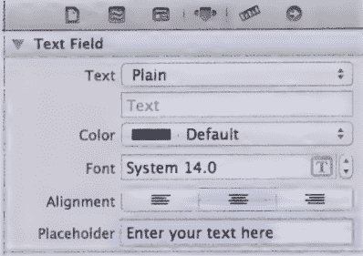

**图 8-18** 带有占位符文本的文本字段

5. 从对象库拖入一个圆矩形按钮到视图控制器，双击它并输入文本 **Click Me!**。图 8-19 显示了带有标签、按钮和文本字段的视图控制器。在这里，你能够看到标签的轮廓是因为它被选中了。

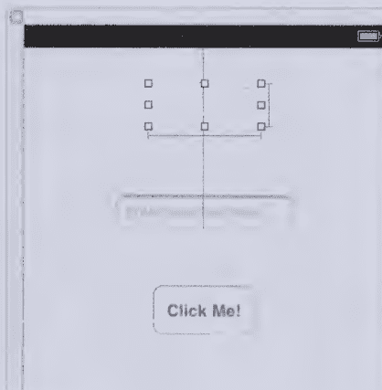

**图 8-19** 带有标签、按钮和文本字段的视图

6. 除了更改控件的属性，你还可以更改视图控制器本身的属性。要做到这一点，你首先需要确保视图控制器被选中。在任何没有可选控件的空白区域点击视图控制器，以选中它并显示其属性。现在你可以更改这些属性中的一个。
7. 点击图 8-16 所示的图标。注意，用工具面板显示视图控制器中当前选中控件的属性。

# 在 iOS 环境中工作

8. 在导航器区域，选择 `ViewController.m` 文件。这会在辅助编辑器（Assistant Editor）面板中显示 `ViewController.m` 文件。接下来，在 `ViewController.m` 文件的 `@implementation` 指令下方输入以下 `@synthesize` 指令来合成标签和文本字段。

```objc
@synthesize MyLabel;
@synthesize MyTextField;
```

9. 现在我们需要编写代码，获取文本字段的内容并显示在标签中。在 `ViewController.m` 文件中找到 `Click` 方法并输入以下代码，用户点击按钮时会将标签的内容设置为文本字段的内容。iOS 有了一系列预定义方法，可以使用它们从控件中检索数据，例如对象控件（如文本字段或标签）具有 `text` 方法。因此，我们包含了 `object.text` 代码来获取或设置控件的内容。

```objc
- (IBAction)Click:(id)sender {
    MyLabel.text = MyTextField.text;
}
```

10. 检查辅助编辑器面板中的代码，确保它与以下代码匹配。注意，编译器自动包含了一个 `viewDidLoad` 方法，你现在可以忽略它，稍后你会学习更多知识。

```objc
#import "ViewController.h"

@interface ViewController ()

@end

@implementation ViewController

@synthesize MyLabel;
@synthesize MyTextField;

- (void)viewDidLoad {
    [super viewDidLoad];
    // 在加载视图控制器后进行任何额外设置，通常来自 nib。
}

- (void)didReceiveMemoryWarning {
    [super didReceiveMemoryWarning];
    // 释放任何可以重建的资源。
}

- (IBAction)Click:(id)sender {
    MyLabel.text = MyTextField.text;
}

@end
```

11. 运行应用。iOS 模拟器出现，如图 8-27 所示。

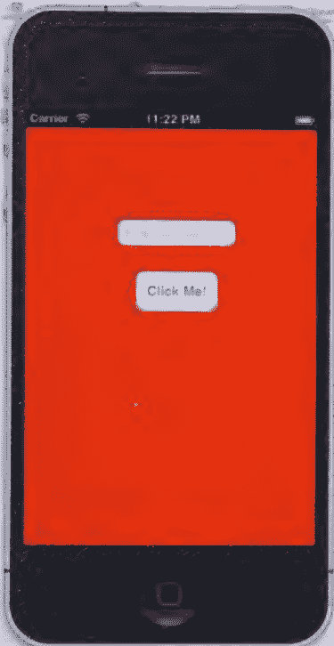

**图 8-27** 首次运行应用在 iOS 模拟器中的界面

12. 点击文本字段并输入 **Hello!**，如图 8-28 所示。

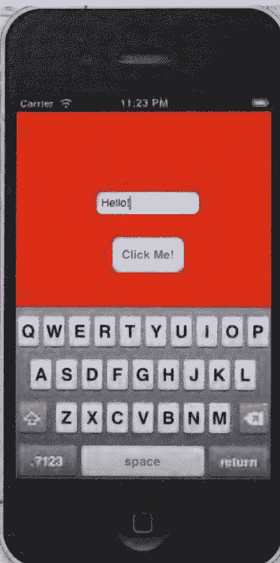

**图 8-28** 在文本字段中输入“Hello!”后的应用界面

13. 点击按钮。标签显示出“Hello!”，如图 8-29 所示。

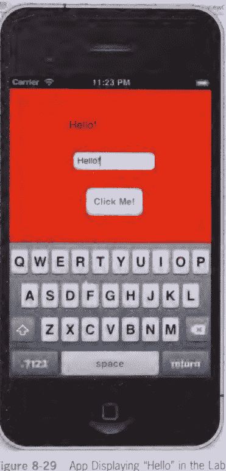

14. 点击停止（Stop）按钮停止应用。

# 源代码

`@interface` 的部分代码如下：

```objc
// ViewController.h
// myFirstApp

#import <UIKit/UIKit.h>

@interface ViewController : UIViewController

@property (weak, nonatomic) UILabel *MyLabel;
@property (weak, nonatomic) IBOutlet UITextField *MyTextField;

- (IBAction)Click:(id)sender;

@end
```

`@implementation` 文件的代码如下：

```objc
//
// ViewController.m
// myFirstApp
//

#import "ViewController.h"

@interface ViewController ()

@end

@implementation ViewController

@synthesize MyLabel;
@synthesize MyTextField;

- (void)viewDidLoad {
    [super viewDidLoad];
    // 在加载视图后进行任何额外设置，通常来自 nib。
}

- (void)didReceiveMemoryWarning {
    [super didReceiveMemoryWarning];
    // 释放任何可以重建的资源。
}

- (IBAction)Click:(id)sender {
    MyLabel.text = MyTextField.text;
}

@end
```


## 总结

iOS 架构可以分为四层：Cocoa Touch、Media、Core Services 和 Core OS。

Cocoa Touch 在 iOS 中起着非常重要的角色，它为应用编程提供了如手势识别、动画、多任务处理等复杂功能。

Media 层提供了动画、图形、视频、音频、核心图形、核心图像、核心文本、核心视频、图像 GLKit、Quartz Core 框架等。

Core Services 层支持操作系统利用的各种，如位置信息、运动、事件和基础服务。

Core OS 层支持低级功能，如安全、用于外部配件的蓝牙技术、网络、内存分配、线程等。

当 iOS 应用启动时，会创建一个 `UIApplication` 对象，该 `UIApplication` 会创建一个 `UIWindow` 对象并在 `UIWindow` 对象中启动一个 `UIView`。

主函数调用 `UIApplicationMain` 对象，它通过创建管理事件的 `UIApplicationDelegate` 对象来加载用户界面和事件循环。

Xcode 会加载 UIKit、Foundation 和图形框架，因为这些是最常用的框架。

Instruments 是 iOS SDK 需要的测试应用性能的开发工具。

iOS 用于测试应用，这样开发者无需在实际设备上测试应用。

Interface Builder 是一个可以创建视图的视觉化开发工具。

## 理解并创建用户界面

### 本章目标

- 学习 UIKit 框架及其在构建应用界面中的作用
- 使用 storyboards（故事板）创建应用
- 为应用添加导航控制器（navigation controller）
- 在视图之间传递数据

### 第 9 章 理解并创建用户界面

在第 8 章中，我们学习了如何使用单视图模板（single view template）创建应用，该模板提供了一个视图控制器和 `viewController.xib` 文件。在本章中，我们将学习如何使用 storyboards 创建一个具有多个视图控制器的应用。我们将使用界面元素创建基础应用，学习如何使用 storyboards，并探索如何在视图之间传递数据。

## UIKit 框架

图 9-1 所示的 UIKit 框架是设计和构建交互式界面最重要的框架。它由一组以 "UI" 为前缀的类组成。这些类管理应用程序对象、事件处理、窗口、视图以及所有帮助创建交互式触摸屏用户界面的控件。这些类反过来帮助创建和管理视图、视图控制器和用户界面元素。

整体而言，这些类允许开发者创建一个交互式的、触摸敏感的应用。最常用的类是 `UIApplication`、`UIWindow`、`UIView`、`UIViewController`、`UIEvent`、`UITouch`、`UIResponder`、`UIButton`、`UILabel` 和 `UITextField`。

| UIColor | UIApplication | UILabel | UIButton |
| :--- | :--- | :--- | :--- |
| | UIView | | UIPicker |
| UIResponder | UIControl | UIDatePicker |
| | UIViewController | | UIPageController |
| UIImage | | UISegmentedControl |
| UITouch | | UITextField |
| UIEvent | | UISlider |

图 9-1 UIKit 框架
© 2015 Cengage Learning.

## Storyboards

Storyboard 功能允许开发者同时处理 Xcode 面板或 Interface Builder 画布中所有的视图。你可以将视图控制器拖放到 Xcode 编辑器面板中，并通过按钮、标签和文本字段等控件将它们连接起来。

Storyboards 使得理解视图之间的过渡（segues）变得简单，让你对应用有一个全局的了解。场景（scene）是一个内容屏幕，它可以是一个视图。正如你在本章后面看到的，你可以通过从一个视图向另一个视图按住 Control 键拖拽控件来创建视图之间的 segue。

当你同时显示大量视图时，Xcode 窗口可能会变得拥挤。为了避免这个问题，在处理 storyboards 时使用大显示器是很有用的。注意，你也可以使用图 9-2 所示的图标（它位于 Xcode 编辑器面板的右下角）来放大或缩小 storyboard。书中的图片显示了不同缩放级别的屏幕，具体取决于图中强调的内容。


## 视图控制器

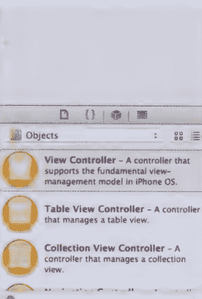

图 9-2 使用 storyboard 时可以用于放大的图标

Copyright © 2014 Apple®. All Rights Reserved.

图 9-3 显示了应用的全景图。

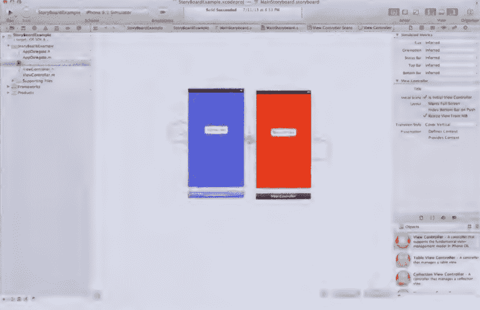

图 9-3 storyboard 中应用的全景图

Copyright © 2014 Apple®. All Rights Reserved.

在你在第 8 章创建的应用中，每个视图都有自己的 .h、.m 和 .xib 文件。使用 storyboards 后，就不需要单独的 .xib 文件；相反，有一个图 9-4 所示的 `MainStoryboard.storyboard` 文件。

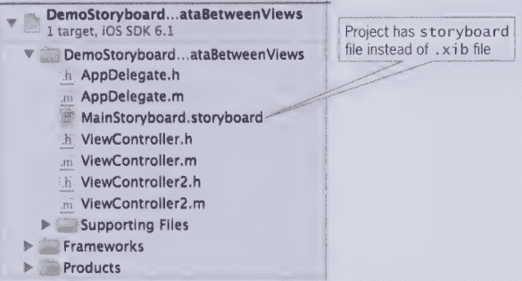

图 9-4 代替 .xib 文件的 storyboard 文件
Copyright © 2014 Apple®. All Rights Reserved.

## 使用 Storyboards 实现简单过渡

是时候练习一下 storyboards 了。我们将创建一个在视图之间有简单过渡的应用。

1. 启动 Xcode，然后点击 Create a new Xcode project（创建一个新的 Xcode 项目）。
2. 在 Choose a template for your new project（为你的新项目选择模板）窗口中，选择 Single View Application（单视图应用）图标，如图 9-5 所示。

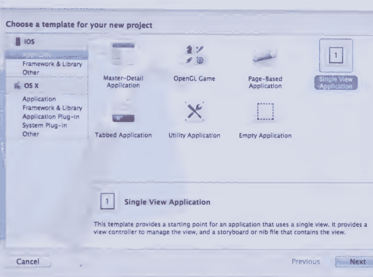

**图 9-5** 为你的新项目选择模板的窗口

Copyright © 2014 Apple®. All Rights Reserved.

3. 点击 **Next**（下一步）按钮打开 Choose options（为你的新项目选择选项）窗口，然后选择图 9-6 所示的选项。使用 **StoryBoardExample** 作为 Product Name（产品名称），在 Company Identifier（公司标识符）和 Organization Name（组织名称）框中使用适用于你学校的选项，在 Devices（设备）框中选择 **iPhone**，然后确保勾选了 **Use Storyboards**（使用 Storyboards）和 **Use Automatic Reference Counting**（使用自动引用计数）复选框，如图 9-6 所示。

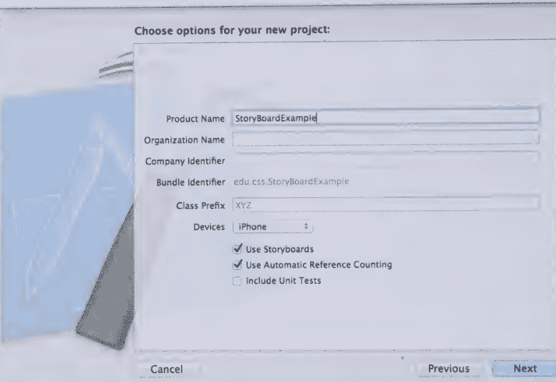

Copyright © 2014 Apple®. All Rights Reserved.

4. 点击 Next 按钮选择保存项目的位置，然后点击 Create（创建）按钮。这将完成创建并打开 Xcode。
5. 点击左侧导航区域的 MainStoryboard.storyboard 文件。编辑器打开了项目，如图 9-7 所示。这是项目的初始视图。Xcode 会自动生成这些文件：`AppDelegate.h`、`AppDelegate.m`、`MainStoryboard.storyboard`、`ViewController.h`、`ViewController.m`。

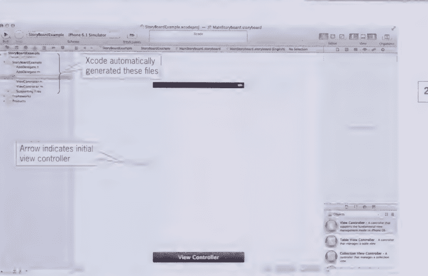

图 9-7 项目的初始视图

6. 如果 Object Library（对象库）未打开，现在使用 View ► Show Object Library 打开它。
7. 从 Object Library 的对象列表中点击 View Controller 框，按住鼠标将其拖到网格中，这将创建一个新的视图控制器，如图 9-8 所示。
8. 点击左侧的第一个视图控制器以选择它，将其背景颜色改为蓝色，然后将第二个视图的背景颜色改为红色。你在第 8 章学习过如何选择新的背景颜色。
9. 从 Object Library 拖入 Round Rect（矩形按钮）到左侧视图，双击它并输入 Go to next view。
10. 从 Object Library 拖入 Round Rect 到右侧视图控制器，双击它并输入 Back to first view。此时，你的屏幕应该符合图 9-9。你现在准备好创建一个连接，即 segue。你的目标是在“Go to next view”按钮和右视图控制器之间创建一个连接。也就是说，当用户点击“Go to next view”按钮时，你希望右侧视图控制器（红色背景的）出现。

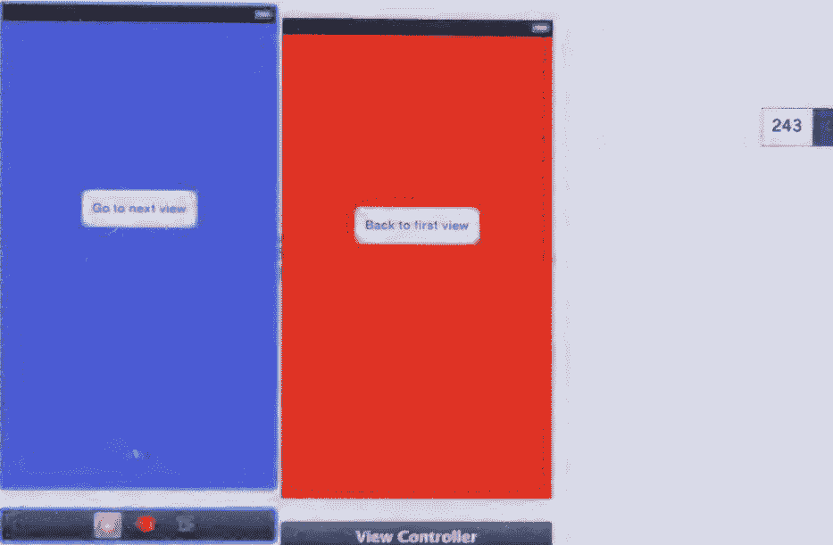

图 9-9 每个视图有一个按钮

11. 按住 Control 键，从左侧视图控制器拖动“Go to next view”按钮到右视图控制器。这将显示一个包含三个选项的窗口，如图 9-10 所示。

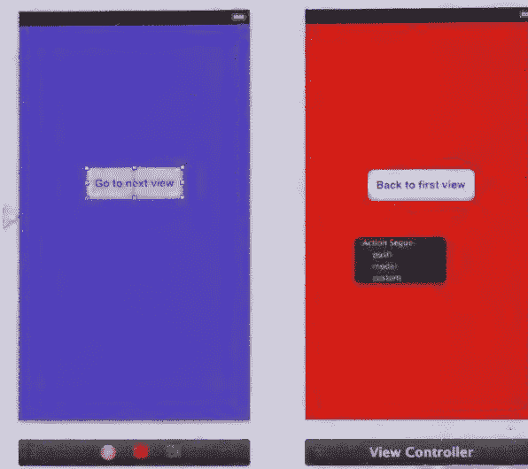

图 9-10 建立连接的三个选项
© 2014 Apple. Rights Reserved.

第一个选项 push（推送）用于导航栏；你将在本章稍后时候使用此选项。第三个选项 custom（自定义）允许开发者编写自定义连接。现在我们将使用第二个选项 modal（模态），它通常用于在没有导航控制器的情况下呈现新的视图控制器。modal segue 中的新视图控制器被呈现视图控制器的子控制器。

12. 点击 modal 创建 segue。新创建的 segue 如图 9-11 所示。

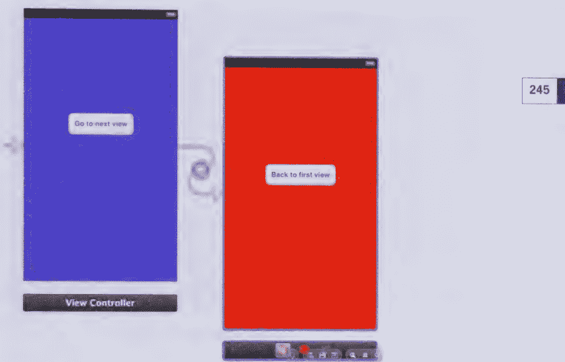

**图 9-11** 新创建的段 (segue)
Copyright © 2014 Apple®. 保留所有权利

13. 接下来，你需要在“返回第一个视图”（Back to first view）按钮和左侧视图控制器（蓝色背景的那个）之间创建一个连接，或称为“段”。按住 Control 键，然后将“返回第一个视图”按钮从右侧视图控制器拖动到左侧视图控制器的任意位置，并选择“模态”（modal）。这将创建第二个段，如图 9-12 所示。

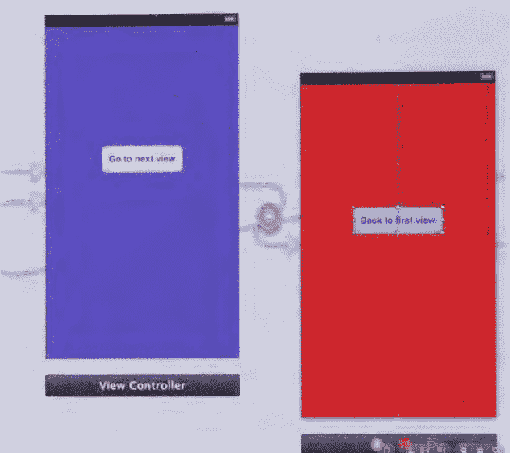

图 9-12 第二个段
Copyright © 2014 Apple®. 保留所有权利

14. 点击 Xcode 窗口左上角的运行（Run）按钮来运行应用程序。蓝色背景的视图首先出现，如图 9-13 所示。

> **注意**：如果在运行项目遇到困难，请检查所有代码是否正确。如果仍然无法运行，关闭 Xcode 并重新打开，然后再次尝试运行项目。

## 带有导航栏的 Storyboard 示例

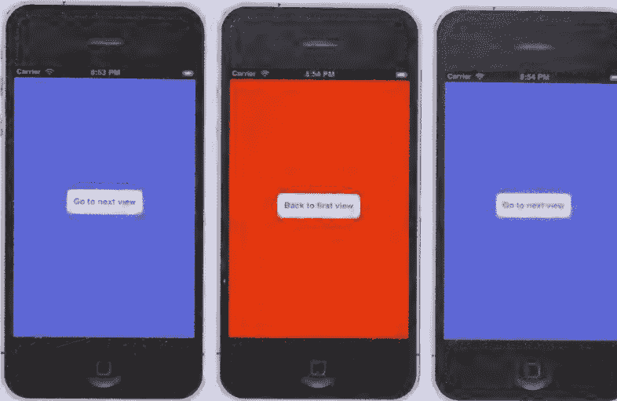

图 9-13 运行应用程序
Copyright © 2014 Apple. 保留权利

15. 点击**跳转下一个视图**（Go to next view）按钮。这将显示红色背景的视图。
16. 点击**返回第一个视图**（Back to first view）按钮。这将重新显示在图 9-13 中所示的蓝色背景视图。

在这个示例中，我们将创建一个包含两个视图控制器的 Storyboard，每个控制器都有一个导航栏。**导航栏**（navigation bar）是一个带有按钮的水平条，用户可以通过点击按钮在视图控制器之间移动。

1. 创建一个名为 navigationExample 的单视图应用程序项目。确保勾选**使用 Storyboards**（Use Storyboards）和**使用自动引用计数**（Use Automatic Reference Counting）选框。
2. 点击屏幕左侧导航区域中的 **MainStoryboard.storyboard** 文件名。项目将在编辑器面板中打开。
3. 现在我们将在视图控制器中嵌入导航控制器。选择视图控制器，然后在菜单中点击 **Editor**（编辑器）-> **Embed In**（嵌入到）-> **Navigation Controller**（导航控制器），如图 9-14 所示：嵌入导航控制器会在视图控制器的顶部添加一个导航栏以及一个导航控制器，如图 9-15 所示。新导航控制器左侧的箭头告诉你它现在是初始视图控制器。注意，如果你想将某个视图控制器设置为初始视图控制器，可以调整图 9-16 中的设置。我们不会更改此设置，但你会意识到这样做是可以的。

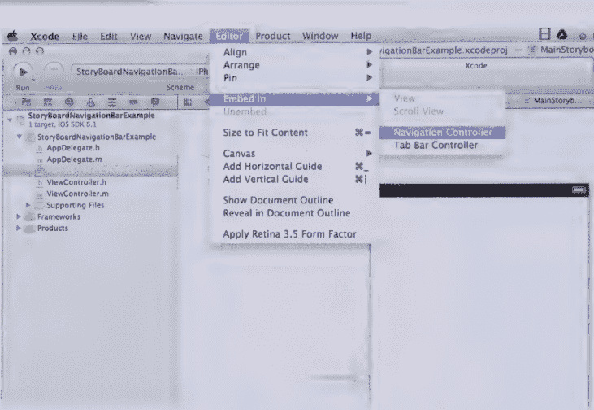

图 9-14 嵌入导航控制器

Copyright © 2014 Apple® 保留所有权利

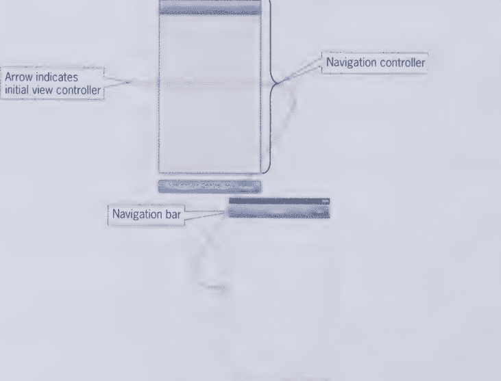

图 9-15 嵌入导航控制器后

Copyright © 2014 Apple® 保留所有权利

## 设置初始视图控制器

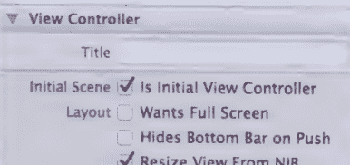

**图 9-16** 将视图控制器设置为初始视图的设置
Copyright © 2014 Apple®. 保留所有权利

4. 要为导航栏添加标题，双击中心，然后输入 View 1，如图 9-17 所示。


**图 9-17** 带有新标题的导航栏
Copyright © 2014 Apple®. 保留所有权利

5. 将视图的背景颜色更改为黑色。这将更容易看到从一个视图到下一个视图的过渡。
6. 添加第二个视图控制器，在其中嵌入导航控制器，然后在导航栏上添加标题 View 2。此时，你的屏幕应该与图 9-18 一致。注意，当我们嵌入导航控制器时，视图控制器和导航控制器之间的连接会自动生成。

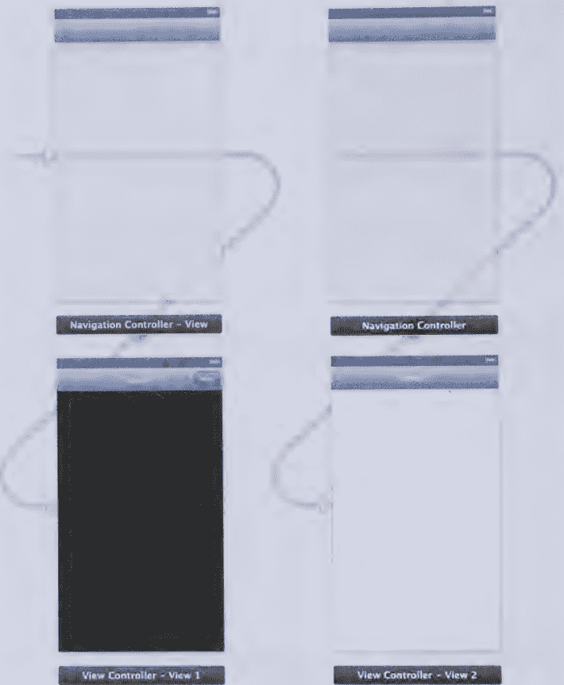

**图 9-18** 嵌入导航控制器的第二个视图控制器
Copyright © 2014 Apple®. 保留所有权利

7. 现在我们需要一个按钮来启动过渡。从工具窗口右下角的对象库（Object Library）中拖入一个栏按钮（Bar Button Item）到导航栏中带有“View 1”的视图控制器上。通过在对象库中输入来查找该按钮，如图 9-19 所示。

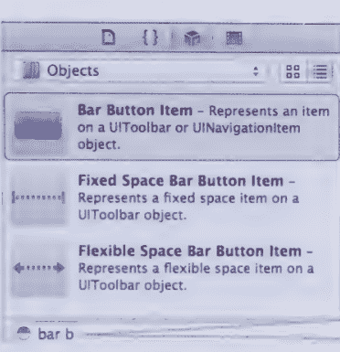

**图 9-19** 对象库中的搜索
Copyright © 2014 Apple.

8. 双击**栏按钮** Bar Item，输入 **Next**。
9. 使用 push 选项从第一个视图到第二个视图创建一个段（segue），如图 9-20 所示。

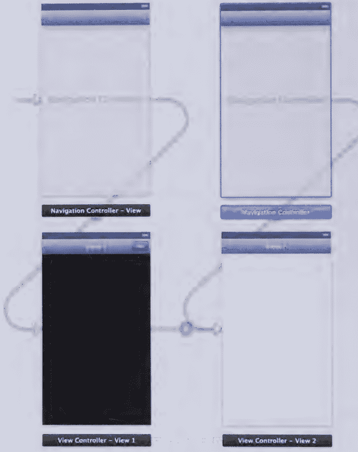

图 9-20 新创建的段

10. 点击运行按钮运行应用程序，如图 9-21 所示。黑色背景的视图首先出现。

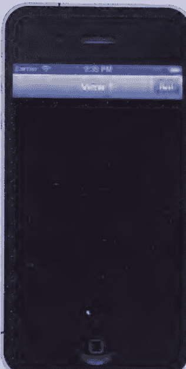

图 9-21 运行应用程序
Copyright © 2014 Apple. 保留权利

11. 点击**下一步**（Next）按钮。这将显示黑色背景的视图，如之前在图 9-22 中所示。


图 9-22 点击下一步按钮后
Copyright © 2014 Apple®. 保留所有权利

## 理解界面

到此为止，我们学习了如何从一个视图过渡到另一个视图。现在我们将学习如何在视图之间传递数据。此应用程序将允许用户输入两个数字，然后在标签中显示总和。

1. 创建一个名为 PassingDataViews 的单视图应用程序项目。确保勾选 Use Storyboards 和自动引用计数选框。
2. 在视图控制器中嵌入导航控制器，并在导航栏上添加 View 1。
3. 添加另一个视图控制器，在其中嵌入另一个导航控制器，并在导航栏上添加 View 2。每个视图都需要关联 ViewController.h 和 ViewController.m 文件，而我们只有一组，我们需要创建另一套视图控制器文件。
4. 通过从菜单选择 File > New > File 创建 ViewController.h 和 ViewController.m 文件，如图 9-23 所示。在选择新视图控制器的模板时，在左列选择 Cocoa Touch，然后选择 Objective-C Class，如图 9-24 所示。


**图 9-23** 创建新的视图控制器
Copyright © 2014 Apple®. 保留所有权利


图 9-24 选择新文件的模板
Copyright © 2014 Apple. 保留权利

5. 点击 Next 显示新文件对话框的选项。在 Class 框中输入 ViewController2，对于子类，在下拉菜单中选择 UIViewController，如图 9-25 所示。

## 在视图之间传递数据


**图 9-25** 选择类和子类
Copyright © 2014 Apple®. 保留所有权利

6. 点击 **Next** 并将文件保存到项目文件夹。这将生成 ViewController2.h 和 ViewController2.m 文件，如图 9-26 所示。同样注意与 ViewController.h 和 ViewController.m 关联的文件，因为它们是自动生成的，此时重命名它们会导致问题。

7. 在导航区域中选择 MainStoryboard 文件，然后按照第 8 章所说明的方法打开辅助编辑器（Assistant Editor）面板，这样你就可以看到控制器及其关联的 ViewController.h 文件了。

8. 现在，你需要将新添加的 ViewController2.h 和 ViewController2.m 文件与第二个视图关联。选择新添加的控制器，并在工具区域（utility area）选择身份检查器（Identity Inspector）图标（如图 9-27 所示），以显示身份检查器。


图 9-27 身份检查器图标

9. 在身份检查器中，打开类（Class）下拉菜单，向下滚动并选择 ViewController2。图 9-28 显示了 ViewController2。请确保你通过点击其顶部的蓝色栏来选中视图控制器，而不是点击电池图标。选中控制器后，控制器周围会出现一圈蓝线，如图 9-28 所示。


图 9-28 与 .h 和 .m 文件关联的 ViewController2

> **注意**：如果你无法看到此文件，可能存在两种问题。一种可能是在创建视图控制器类时，没有将 UIViewController 选择为子类。如果你认为情况确实如此，请使用正确的选项重新创建这些文件，并记得删除你选择不使用的文件。另一种可能性可能是 Xcode 尚未识别这些文件。要解决这个问题，你可能需要关闭 Xcode 并重新打开。

## 在视图之间传递数据（续）

10. 将第一个视图的颜色更改为蓝色，第二个视图更改为绿色。

11. 在蓝色视图控制器的导航栏上，将标题改为 Passing Data/Sum。在绿色视图控制器的导航栏上，将标题改为 Receiving Data/Sum。

12. 从对象库（Object Library）将两个文本字段（text fields）和两个标签（labels）拖入 Passing Data/Sum 视图控制器。在标签上添加文本“Number 1”和“Number 2”，并如图 9-29 所示在视图中布局它们。从对象库将一个标签拖入 Receiving Data/Sum 视图控制器。目前，不要更改标签的默认文本。


图 9-29 具有新颜色、标签和文本框的视图控制器

13. 现在，我们需要为视图控制器中的每个控件创建 IBOutlets。开始之前，请显示辅助编辑器面板。辅助编辑器允许我们在编写视图控制器文件代码的同时查看故事板（Storyboard）。

14. 通过将标签从绿色视图控制器拖动到 ViewController2.h 并输入图 9-30 所示的设置，为绿色视图控制器中的标签（输出）创建一个 IBOutlet。我们希望此标签显示蓝色视图控制器文本字段中输入的数字之和。为 ViewController2.h 中的标签 IBOutlet 生成的代码如下：

```
```


@property (weak, nonatomic) IBOutlet UILabel *total;


图 9-30 标签的 IBOutlet

15. 如果 IBOutlet 的 `@synthesize` 属性没有自动生成，请确保在 `ViewController2.m` 文件中如所示创建它：

```objc
@synthesize total;
```

16. 通过将文本字段从蓝色视图控制器拖动到 `ViewController2.h`，为蓝色视图控制器中的文本字段（`num1`、`num2`）创建 IBOutlets。`ViewController2.h` 中为文本字段生成的代码如下：

```objc
@property (weak, nonatomic) IBOutlet UITextField *num1;
@property (weak, nonatomic) IBOutlet UITextField *num2;
```

17. 如果 IBOutlet 的 `@synthesize` 属性没有自动生成，请确保在 `ViewController2.m` 文件中如所示创建：

```objc
@synthesize num1;
@synthesize num2;
```

18. 在蓝色视图的导航栏上添加按钮。

19. 通过拖动蓝色视图控制器到绿色视图控制器来创建连接（segue），如图 9-31 所示。


图 9-31 视图控制器

20. 在属性字段中将标识符（identifier）命名为 `sum`。

21. 在 `ViewController.m` 文件中导入 `"ViewController.h"`。

22. 在 `ViewController.m` 文件中通过编写代码检查连接是否为 `sum`：

```objc
-(void)prepareSegue:(UIStoryboardSegue*)segue sender:(id)sender
{
    if ([segue.identifier isEqualToString:@"sum"]) {
        // 计算
        int total = [num1.text intValue] + [num2.text intValue];
        // 传递给下一个视图
        ViewController2 *vc2 = [segue destinationViewController];
        vc2.receiverSum = [NSString stringWithFormat:@"The sum of the 2 numbers are %d", total];
    }
}
```

23. 现在我们需要传递总和。我们通过在 `ViewController.m` 文件中创建 `ViewController2` 的实例来实现：

```objc
ViewController2 *vc2 = [segue destinationViewController];
```

24. 在 `ViewController.h` 中创建一个名为 `receiverSum` 的 `NSString` 属性：

```objc
@property (weak, nonatomic) NSString *receiverSum;
```

25. 在 `ViewController2.m` 文件中合成我们在 `ViewController.h` 中创建的 `NSString`：

```objc
@synthesize receiverSum;
```

26. 切换到 `ViewController2.m` 文件。如果计算是整数而 `receiverSum` 是字符串，我们首先创建一个格式化器实例：

```objc
NSNumberFormatter *format = [[NSNumberFormatter alloc] init];
```

27. 接下来我们使用格式化器实例创建一个名为 `numberAsString` 的 `NSString` 以及格式化后的总和：

```objc
NSString *numberAsString = [format stringFromString:[NSNumber numberWithInt:total]];
```

28. 现在我们回到 `ViewController.m`，并将 `numberAsString` 变量传递给 `ViewController2` 文件中的 `receiverSum` 变量：

```objc
vc2.receiverSum = [NSString stringWithFormat:@"The sum of the 2 numbers are %d", numberAsString];
```

29. 切换到 `ViewController2.m` 文件。我们需要将传递给 `ViewController2` 的值赋值给标签。这需要在 `viewDidLoad` 方法中使用以下代码：

```objc
[total setText:receiverSum];
```

30. 检查 `ViewController.m` 中 `prepareSegue` 方法的完整代码，确保你的代码与上面的示例一致。

# 理解创建用户界面

`ViewController.h` 的代码所示：

```objc
#import <UIKit/UIKit.h>
#import "ViewController2.h"

@interface ViewController : UIView
@property (weak, atomic) IBOutlet UITextField *num1;
@property (weak, atomic) IBOutlet UITextField *num2;
@end
```

`ViewController.m` 的代码所示：

```objc
#import "ViewController.h"

@interface ViewController ()
@end

@implementation ViewController
@synthesize num1;
@synthesize num2;

-(void)viewDidLoad {
    [super viewDidLoad];
    // 加视图后进行任何额外设置
```

`ViewController2.h` 的代码所示：

```objc
#import <UIKit/UIKit.h>

@interface ViewController2 : UIViewController
@property (weak, nonatomic) UILabel *total;
@property (weak, nonatomic) NSString *receiverSum;
@end
```

`ViewController2.m` 的代码所示：

```objc
#import "ViewController2.h"

@interface ViewController2 ()
@end

@implementation ViewController2
@synthesize receiverSum;
@synthesize total;

-(id)initWithName:(NSString *)nibNameOrNil bundle:(NSBundle *)nibBundleOrNil {
    self = [super initWithName:nibNameOrNil bundle:nibBundleOrNil];
    if (self) {
        // 自定义初始化
    }
    return self;
}

-(void)viewDidLoad {
    [super viewDidLoad];
    // 加视图后进行任何额外设置。
    [total setText:receiverSum];
}

-(void)didReceiveMemoryWarning {
    [super didReceiveMemoryWarning];
    // 释放任何可以重建的资源。
}
@end
```

32. 如图 9-33 所示运行应用程序。为 Number 1 输入 78，Number 2 输入 45。点击 Add 按钮显示第二个视图，其中标签包含文本“The sum of the 2 numbers is 123”。


图 9-33 运行数据从一个视图传递到另一个视图的应用程序
Copyright © 2014 Apple®. All Rights Reserved.

# 上手实验

在上手实验中，我们将创建一个计算个人体质量指数（BMI）的应用程序。该应用程序的界面如图 9-34 所示。

## 在视图之间传递数据


图 9-34 BMI 计算器
Copyright © 2014 Apple. All Rights Reserved.

## 创建项目

1. 使用 Single View Application 模板创建一个新项目。记得勾选 Use Storyboards 和 Use Automatic Reference Counting 复选框。将项目命名为 `BMICalculator`。
2. 点击 `MainStoryboard.storyboard` 文件，在编辑器面板中查看界面。

## 在视图控制器中添加控件

3. 在 storyboard 给视图控制器添加一个导航控制器（navigation controller）。向导航栏添加 Home 视图。
4. 从对象库（Object Library）将一个标签对象拖到视图控制器。双击标签并在字段中输入 Fill in 以查看 BMI。你可以使用标准或公制测量。如有必要，在属性检查器中将 Lines 属性更改 2。
5. 从对象库将两个标签和两个文本字段拖到视图中。如图 9-34 所示的位置放置它们。在标签上添加 Weight 和 Height，如图 9-34 所示。
6. 从对象库向视图控制器拖入一个分段控制控件（segmented control）。点击控件的每一侧，并如图 9-34 所示输入 Standard 和 Metric。
7. 从对象库将以下内容拖入视图：两个标签、两个开关（switches）和两个按钮。如图 9-34 所示的位置放置它们。在一个标签中输入 Male，另一个中输入 Female，并使每个标签与开关对齐，如图 9-34 所示。
8. 在一个按钮上添加 Submit，在另一个按钮上添加 Reset，如图 9-34 所示。
9. 在第一个视图控制器的右侧添加第二个视图控制器。
10. 在新视图上添加一个标签，双击它并在其中输入 BMI，如图 9-34 所示。

# GUI 编程

11. 点击“Height”标签右侧的文本字段。
12. 打开辅助编辑器（Assistant Editor）面板。
13. 从视图控制器 Control-drag 文本字段到 `ViewController.h` 以创建 IBOutlet。给这个 IBOutlet 命名为 `height`。
14. 对 Weight 标签右侧的文本字段执行相同操作，但为 IBOutlet 使用名称 `weight`。
15. 接下来，使用以下名称 control-drag 剩余的每个控件：
- 分段控制控件：名为 `measure` 的 IBOutlet
- 第一个开关：名为 `male` 的 IBOutlet
- 第一个开关：名为 `maleSelected` 的 IBAction
- 第二个开关：名为 `female` 的 IBOutlet
- 第二个开关：名为 `femaleSelected` 的 IBAction
- 第二个按钮：名为 `resetBtn` 的 IBAction

确保在本次实验中修改 IBOutlet 属性，以保持它们为弱引用（weak）状态，正如第 269 页的代码所示。记住在 `ViewController.m` 文件中用以下代码合成 Outlets：

```objc
@synthesize measure;
@synthesize female;
@synthesize height;
@synthesize weight;
```

16. 在 `ViewController.m` 文件中用以下代码合成 Outlets：

```objc
@synthesize measure;
@synthesize female;
@synthesize height;
@synthesize weight;
```

17. 为第二个视图创建一个类，并将其命名为 `ResultsController`。
18. 如图 9-35 所示，将第二个视图与 Objective-C 文件关联。

## 在视图之间传递数据


## 自定义类

| 类 | Results |
| :--- | :--- |
| Identity | UIViewController |
| Storyboard | UIViewController |
| Restoration | UIImagePickerController |
| | UINavigationController |

## 用户定义属性

| 键路径 | 类型 | 值 |
| :--- | :--- | :--- |
| | | |

## 文档

**图 9-35** Objective-C 文件

Copyright © 2014 Apple. All Rights Reserved.

19. 在 Submit 按钮和第二个视图之间创建一个 segue，使用 push 选项。
20. 在属性检查器中，Identifier 字段，此 segue 将显示新添加的视图。
21. 为结果视图上的标签创建一个 IBOutlet，位于 `ViewController.h` 中：
```objc
@property (retain, nonatomic) UILabel *result;
```
22. 创建一个字符串属性来存储 BMI 结果：
```objc
@property (nonatomic, strong) NSString *calculatedResult;
```
23. 记住在 `ResultViewController.m` 中合成这些属性：
```objc
@synthesize result;
@synthesize calculatedResult;
```

# 代码性别选择

24. 打开 `ViewController.m` 文件。在这里我们将编写确保只选择一种性别的代码。编辑为开关创建的 `maleSelected` 和 `femaleSelected` 方法如下：

```objc
-(IBAction)femaleSelected:(id)sender {
    if (female.on) {
        [male set:NO];
    } else {
        [male set:YES];
    }
}

-(IBAction)maleSelected:(id)sender {
    if (male.on) {
        [female setOn:NO];
    } else {
        [female setOn:YES];
    }
}
```

# 代码重置按钮

25. 为 Reset 按钮添加以下代码。此代码清除所有控件并恢复默认值。

```objc
-(IBAction)resetBtn:(id)sender {
    [height setText:@""];
    [weight setText:@""];
    [measure setSelectedSegmentIndex:0];
    [male setOn:NO];
    [female setOn:YES];
}
```

# 从视图 1 到视图 2 的代码

26. 因为我们将向 `ResultViewController` 传递某些数据，在 `ViewController.m` 顶部导入此类，并添加以下方法来传递数据：

```objc
(void)prepareSegue:(UIStoryboardSegue*)segue sender:(id)sender {
    double result = [weight.text doubleValue]/([height.text doubleValue]);
    if(male.selectedSegmentIndex == 0) {
        if (male.isOn) {
            result = 703;
        } else {
            result = 703;
        }
    } else {
        if ([segue.identifier isEqualToString:@"sendData"]) {
            ResultsController *resultController = segue.destinationViewController.resultsController;
            calculatedResult = [NSString stringWithFormat:@"%.2f", result];
        }
    }
}
```

# 隐藏键盘的代码

27. 键盘可能会影响数据的输入。我们将在第 10 章中讨论隐藏键盘的各种机制。目前：

```objc
(IBAction)hideKeyboard:(id)sender;
```

28. 在 `ViewController.m` 文件中为 `hideKeyboard` 方法创建实现，如下所示：


- (IBAction)hideKeyboard:(id)sender {
    [sender resignFirstResponder];
}

29. 在 `ViewController.m` 的 `viewDidLoad` 方法中添加以下代码：
```objc
male.on = NO;
female.on = YES;
```

在 `ResultsViewController.m` 的 `viewDidLoad` 方法中添加以下代码：
```objc
[result setText:calculatedResult];
```

30. 运行应用，输入体重 123，身高 62，确保选中了 Standard（标准），然后点击 Submit（提交）按钮。你应该能看到图 9-36 显示的结果。


`ViewController.h` 文件的代码如下：
```objc
#import <UIKit/UIKit.h>

@interface ViewController : UIViewController

@property (retain, nonatomic) IBOutlet UISwitch *male;
@property (retain, nonatomic) IBOutlet UISwitch *female;
@property (retain, nonatomic) IBOutlet UISegmentedControl *measure;
@property (retain, nonatomic) IBOutlet UITextField *height;
@property (retain, nonatomic) IBOutlet UITextField *weight;

- (IBAction)femaleSelected:(id)sender;
- (IBAction)maleSelected:(id)sender;
- (IBAction)resetBtn:(id)sender;
- (IBAction)hideKeyboard:(id)sender;

@end
```

`ViewController.m` 文件的代码如下：
```objc
#import "ViewController.h"
#import "ResultsController.h"

@implementation ViewController

@synthesize male;
@synthesize female;
@synthesize measure;
@synthesize height;
@synthesize weight;

- (void)didReceiveMemoryWarning {
    [super didReceiveMemoryWarning];
    // 释放任何未使用的缓存数据、图像等。
}

#pragma mark - 生命周期

- (void)viewDidLoad {
    [super viewDidLoad];
    male.on = NO;
    female.on = YES;
    // 在加载视图后进行任何额外设置，通常来自 nib。
}

- (IBAction)femaleSelected:(id)sender {
    if (female.on) {
        [male setOn:NO];
    } else {
        [male setOn:YES];
    }
}

- (IBAction)maleSelected:(id)sender {
    if (male.on) {
        [female setOn:NO];
    } else {
        [female setOn:YES];
    }
}

- (IBAction)hideKeyboard:(id)sender {
    [sender resignFirstResponder];
}

- (void)prepareForSegue:(UIStoryboardSegue *)segue sender:(id)sender {
    double result = [weight.text doubleValue] / ([height.text doubleValue] * [height.text doubleValue]);
    if (measure.selectedSegmentIndex == 0) {
        if (male.isOn) {
            result *= 703;
        } else {
            result *= 703;
        }
    } else {
    }
    if ([segue.identifier isEqualToString:@"sendData"]) {
        ResultsController *resultController = segue.destinationController;
        resultController.calculatedResult = [NSString stringWithFormat:@"%.2f", result];
    }
}

- (IBAction)resetBtn:(id)sender {
    [height setText:@""];
    [weight setText:@""];
    [measure setSelectedSegmentIndex:0];
    [male setOn:NO];
    [female setOn:YES];
}

@end
```

`ResultsController.h` 文件的代码如下：
```objc
#import <UIKit/UIKit.h>

@interface ResultsController : UIViewController

@property (retain, nonatomic) IBOutlet UILabel *result;
@property (nonatomic, strong) NSString *calculatedResult;

@end
```

`ResultsController.m` 文件的代码如下：
```objc
#import "ResultsController.h"

@implementation ResultsController

@synthesize result;
@synthesize calculatedResult;

- (id)initWithNibName:(NSString *)nibName bundle:(NSBundle *)nibBundle {
    self = [super initWithNibName:nibName bundle:nibBundle];
    if (self) {
        // 自定义初始化
    }
    return self;
}

- (void)didReceiveMemoryWarning {
    [super didReceiveMemoryWarning];
    // 释放任何未使用的缓存数据、图像等。
}

#pragma mark - 生命周期

- (void)viewDidLoad {
    [super viewDidLoad];
    [result setText:calculatedResult];
}

- (void)viewDidUnload {
    [super viewDidUnload];
    // 释放主视图的任何保留子视图。
    self.result = nil;
}

- (BOOL)shouldAutorotateToInterfaceOrientation:(UIInterfaceOrientation)interfaceOrientation {
    // 对于支持的方向返回 YES
    return (interfaceOrientation == UIInterfaceOrientationPortrait);
}

@end
```

# 第 6 章 理解与创建用户界面

## 总结

- UIKit 框架支持应用中的用户界面，并提供了创建和处理用户交互所需的所有必要元素。
- Storyboarding（故事板界面）是一项允许开发者一次性查看所有视图的功能。
- 你可以将视图拖放到画布上，并通过按钮、标签和文本字段等控件将它们连接。
- `MainStoryboard.storyboard` 文件是一个类似于 `.xib` 文件的接口文件。
- 每个视图都有关联的视图控制器以及 `@interface` 和 `@implementation` 类。
- 导航栏支持从一个视图到另一个视图的过渡。
- 要从一个视图传递数据到另一个视图，可以使用 `prepareForSegue` 方法。

## 练习题

1. 判断以下陈述的对错。纠正错误的语句。
   a. 视图（view）也被称为场景（scene），特别是在使用故事板时。
   b. 控制器（controller）显示数据并将输入转换为动作。
   c. Storyboarding 是一项允许开发者处理单个视图控制器的功能。
   d. Storyboard 中的过渡被称为 segues（转场）。
   e. 使用故事板时，你仍然需要使用 `.xib` 文件。
2. 描述 UIKit 框架。
3. 描述以下对象的主要功能：
   a. `MainStoryboard.storyboard` 文件
   b. 导航栏
   c. storyboard
   d. 导航控制器
4. 使用故事板时，会自动生成哪些文件？
5. 解释以下术语：
   a. storyboard
   b. Library
6. 解释以下内容：
   a. storyboarding
   b. segue
7. 给定一个名为 `TextField` 的文本字段、名为 `mySwitch` 的开关和一个名为 `label` 的标签，编写代码完成以下任务：
   a. 设置开关为 OFF
   b. 将标签文本设置为“I love”
   c. 设置文本字段的状态
   d. 设置开关为 ON
   e. 显示标签
   f. 设置文本字段为不可编辑
8. 区分以下项：
   a. 文本字段和标签
   b. 开关
9. 给定一个名为 `TextField` 的文本字段、名为 `mySwitch` 的开关和一个名为 `label` 的标签，识别代码中的错误：
   a. "I am a student"
   b. mySwitch = ON
   c. "Full Name"
   d. if(mySwitch {
   e. TextField.Text
10. 在链接视图时，push（推送）连接和 modal（模态）连接有什么区别？

## 编程题

使用故事板解决以下问题。用户界面的设计由你决定。

1. 创建一个简单的应用，允许用户在三个视图之间移动。第一个视图包含两个按钮：“Two”和“Three”。当点击 Two 按钮时，会出现第二个视图。点击 One 按钮时，会出现第一个视图。点击 Three 按钮时，会出现第三个视图。
2. 创建一个菜谱推荐应用。初始视图包含三个按钮：
   a. Burger
   b. Pasta
   c. Orange

   当点击这些按钮时，会出现一个显示推荐菜品的视图。例如，点击 Burger 按钮应显示薯条。点击 Pasta 应显示肉丸。点击 Orange 应显示饺子。第二个视图有一个 Back 按钮，允许用户返回第一个视图。
3. 创建一个购物清单应用。初始视图包含一个文本字段、一个“添加”按钮和一个“查看”按钮。用户在文本字段中输入物品名称，点击“添加”按钮将物品添加到清单。点击“查看”按钮显示第二个视图，列出所有已添加的物品。如果用户没有输入任何内容，只需点击“查看”按钮，第二个屏幕仍应显示截至为止的购物清单。
4. 编写一个计算器应用程序，能够执行以下操作：加法、减法、乘法、除法和因子分解。你的程序应该使用文本字段、标签和按钮等控件。
5. 编写一个执行以下功能的应用程序：
   a. 显示一个用户可以点击以生成随机数的按钮。
   b. 给用户三次猜中随机数的机会。
   c. 每当用户猜错时，给用户提供更容易猜中随机数的提示。例如，如果用户输入的数字小于随机生成的数字，它应该显示“更高”（higher），提示用户应该输入一个更大的数字。
   你的程序应该使用文本字段、标签和按钮等控件。
6. 阮先生是一位艺术老师，他想向学生教授调色。使用故事板创建一个模拟混合颜料产生新颜色的应用程序。该应用程序的初始视图上应该有三个原色（红、蓝、绿）的开关。还包括一个“查看”按钮。用户可以将三种颜色中的任何一种切换为开启或关闭，然后点击“查看”按钮显示一个新视图，其背景将设置为如果他们实际上混合了“开启”的颜色将产生的新颜色。以下是颜色混合的摘要：
   - 红色开启 + 蓝色开启 + 绿色开启 = 白色
   - 红色开启 + 蓝色开启 + 绿色关闭 = 品红色
   - 红色开启 + 蓝色关闭 + 绿色开启 = 黄色
   - 红色开启 + 蓝色关闭 + 绿色关闭 = 红色
   - 红色关闭 + 蓝色开启 + 绿色开启 = 青色
   - 红色关闭 + 蓝色开启 + 绿色关闭 = 蓝色
   - 红色关闭 + 蓝色关闭 + 绿色开启 = 绿色
   - 红色关闭 + 蓝色关闭 + 绿色关闭 = 黑色

## 业务案例研究

在这一业务案例中，你将继续开发疼痛管理日志，该日志允许用户记录一天中不同时间点的疼痛水平。你在第 8 章开始编写此程序。创建一个带有单个视图的简单故事板，并在该视图中添加一个文本字段、一个标签和一个按钮。用户应该能够在文本字段中输入疼痛水平。编写按钮程序，当它被点击时，疼痛水平将显示在标签中。


# 第 10 章 在视图控制器、代理和协议之间传递数据

## 本章内容

- 在不使用故事板的情况下创建视图
- 演示和查看视图控制器
- 在不使用故事板的情况下创建视图过渡
- 探索视图控制器通信的阶段
- 使用数据成员和 `viewWillAppear` 方法在视图之间传递数据
- 使用代理和协议在使用 `.xib` 文件创建的视图之间传递数据
- 隐藏键盘

## 视图控制器的作用

视图控制器在 iOS 应用中通过管理视图起着非常重要的作用。它们提供了从一个视图过渡到另一个视图的手段。视图控制器提供了一种从一个视图过渡到另一个视图的方法，并允许传递逻辑跳转。故事板是一种便利工具，但它们可能会让逻辑跳转变得更加复杂。在本章中，我们学习在不使用故事板的情况下处理过渡。我们还将学习如何使用变量存储要传递的数据，从视图 1 传递到视图 2。接下来，你将学习如何使用代理从视图 2 传递数据到视图 1。最后，你将学习如何隐藏键盘以防干扰视图。


图 10-1 选择 Objective-C 文件的选项

Copyright © 2014 Apple®. 保留所有权利

在添加新文件后，导航面板应如图 10-2 所示。


图 10-2 导航面板

为第一个视图控制器添加一个导航栏。使用“View 1”作为导航栏的标题。

如图 10-3 所示，为第一个视图控制器添加一个标签和一个圆矩形按钮。为标签添加文本“This is the first View”，然后为按钮添加文本“Go to View 2”。


图 10-3 视图控制器 1

为第二个视图控制器添加一个标题为 View 2 的导航栏。

如图 10-4 所示，为第二个视图控制器添加一个标签和一个圆矩形按钮。为标签添加文本“This is View 2”，然后为按钮添加文本“Go back to View 1”。


图 10-4 视图控制器 2

10. 通过在 `#import <UIKit/UIKit.h>` 语句下方添加以下代码，将第二个视图控制器导入 `ViewController.h` 文件。
```objc
#import "ViewController2.h"
```

11. 在第一个视图控制器上，通过控制拖放将标签和按钮连接到视图控制器，为标签创建一个名为 `lbl1` 的 IBOutlet 连接，为按钮创建一个名为 `GoToView2` 的 IBAction，如图 10-5 所示。第一个视图控制器的 `@interface` 文件的代码如下：
```objc
#import <UIKit/UIKit.h>
#import "ViewController2.h"

@interface ViewController : UIViewController

@property (weak, nonatomic) UILabel *lbl1;
- (IBAction)GoToView2:(id)sender;

@end
```

## 不使用 Storyboard 创建过渡效果


```objc
// ViewController.h
```


# 第 10 章：在视图控制器、代理和协议之间传递数据

## 不使用 Storyboard 创建过渡效果

```objc
// CH18-ViewTransitionWithoutStoryboardExample1

#import <UIKit/UIKit.h>

#import "ViewController2.h"

@interface ViewController : UIViewController

@property (weak, nonatomic) IBOutlet *label1b12;

- (IBAction)GoToView2:(id)sender;

@end
```

图 10-5 为视图控制器 1 创建 IBOutlet 和 IBAction 连接

12. 在第二个视图控制器中，通过控制拖放将标签和按钮连接到视图控制器，为标签创建一个名为 `1b12` 的 IBOutlet，为按钮创建一个名为 `GoToView1` 的 IBAction，如图 10-6 所示。

```objc
// ViewController2.h

// Ch18-ViewTransitionWithoutStoryboardExample

#import <UIKit/UIKit.h>

@interface ViewController2 : UIViewController

@property (weak, nonatomic) UILabel *lbl2;

- (IBAction)GoToView:(id)sender;

@end
```


图 10-6 连接 IBOutlet 和 IBAction

视图控制器的 `@interface` 文件的代码如下：

```objc
#import <UIKit/UIKit.h>

@interface ViewController2 : UIViewController

@property (weak, nonatomic) UILabel *lbl2;

- (IBAction)GoToView:(id)sender;

@end
```

13. 在第二个视图控制器中，通过控制拖放将标签和按钮连接到视图控制器，为标签创建一个名为 `1b12` 的 IBOutlet，为按钮创建一个名为 `GoToView1` 的 IBAction，如图 10-6 所示。

13. 在 `ViewController.m` 文件中，对按钮进行编程使其关闭视图控制器。在 `IBAction` 中输入以下代码：创建一个视图控制器的实例，设置过渡样式，然后展示视图控制器。

```objc
- (IBAction)GoToView2:(id)sender {

  // 创建 ViewController2 的实例
  ViewController2 *vc2 = [[ViewController2 alloc] init];

  // 设置过渡样式
  vc2.modalPresentationStyle = UIModalPresentationFullScreen;

  // 展示视图控制器
  [self presentViewController:vc2 animated:YES];

}
```

在 `ViewController.m` 文件中，对按钮进行编程使其关闭视图控制器。在 `IBAction` 中输入以下代码：

```objc
- (IBAction)GoToView1:(id)sender {

  [self dismissViewControllerAnimated:YES];

}
```


图 10-7 运行应用

## 视图控制器通信

视图控制器之间的通信——即传递数据——至关重要。在第 9 章中，你学习了如何使用跳转（segues）来传递数据。为了理解控制器之间的通信，你需要理解这三个阶段：

- **实例化**（Instantiation）：在此阶段，视图控制器被创建。
- **生命周期**（Lifetime）：在此阶段，视图控制器通过向创建者传递数据来通知其任务已完成。
- **销毁**（Destruction）：在此阶段，视图控制器被移除。

让数据从第二个视图控制器流向第一个控制器并不是高效的选择。相反，你需要使用代理。这种类型数据所需的步骤如下：

1. 在第二个视图控制器中声明变量。
2. 创建视图控制器的实例。
3. 将数据作为第二个视图控制器的成员传递。
4. 在视图 2 中，使用 `viewWillAppear` 方法显示数据的内容：

```objc
(void)viewWillAppear:(BOOL)animated
{
  lbl1.text = data;
}
```

在可以使用代理进行通信之前，视图控制器必须创建一个协议（protocol）。该协议必须包含执行必要任务的方法（或多个方法）。

实现代理（delegate）的优势在于它隐藏并封装了代码细节，使其能够在应用程序的其他部分使用。实现代理及其配套的协议（protocol）以及它们如何适配视图控制器（view controller）生命周期步骤如下：

1. **声明代理**——在这里，视图控制器声明自己为正在创建的视图控制器的代理。
2. **实例化视图控制器**——在这一步中，创建第二个视图控制器。
3. **视图控制器的生命周期**——在这一步中，视图控制器能够响应事件。当按钮被点击时，视图控制器向代理发送消息，以执行协议中定义的任务。
4. **销毁**——当委托代理的视图完成其任务后，它会向代理发送消息，此时代理将将其销毁。

图 10-9 展示了这些步骤。


**图 10-9** 代理与协议的实现

版权所有 © 2015 Cengage Learning

## 使用协议和代理的步骤摘要

以下步骤总结了使用协议和代理的过程。在这些步骤中，view1 被称为“代理对象”，view2 被称为“委托对象”。

1. 创建两个视图（每个视图都有一套 `.h`、`.m` 和 `.x` 文件）。
2. 将第二个视图导入到第一个视图（在 `.h` 和 `.m` 文件中），因为可以创建它的实例并展示，并且可以实现协议。
3. 设计用户界面。
   - a. 根据应用程序需求设计第一个视图。
   - b. 根据应用程序需求设计第二个视图。

### 为视图 1 编写

4. 编写视图 1 所需的传递数据的代码。

   - a. 声明协议。在下方 `.h` 文件的 `#import` 下方 `@interface` 上方创建协议。协议由声明、体和结束组成。
     - i. 协议声明以 `@protocol` 开头，后跟协议的唯一名称和 `<NSObject>`。
     - ii. 协议体由代理用于执行委托对象任务的方法组成。
     - iii. 结束是 `@end`。例如：

```objc
// 协议声明
@protocol ViewController2 <NSObject>

// 协议体，一个方法
-(void)passData:(NSString *)data;

// 协议结束
@end
```

   - b. 创建代理属性：
   `@property (nonatomic, weak) id <ViewControllerDelegate> delegate;`

   - c. 合成代理：
   `@synthesize delegate;`

   - d. 在销毁第二个视图之前，调用来自代理的消息：

```objc
ViewController2 *vc2 = [[ViewController2 alloc] init];
[self.delegate passData:item];
```

### 为视图 2 编写

5. 编写视图 2 所需的传递数据的代码。

   - a. 通过在接口末尾直接指定协议名称，告诉 view1 遵循该协议，但首先要确保你已在 `.h` 文件中导入了第二个视图控制器。

```objc
#import "ViewController2.h"

@interface ViewController : UIView <ViewControllerDelegate>
```

   - b. 实现代理方法。在 `.m` 文件中，为协议中声明的方法创建实际实现。

```objc
-(void)setData:(NSString *)item {
    lbl1.text = item;
}
```

   - c. 告知 view2 view1 是代理。这在 view1 中完成，在 view2 实例化之后、展示之前，使用以下代码：

```objc
vc2.delegate = self;
```

## 使用代理在视图之间传递数据

现在让我们创建一个示例应用，利用代理将数据从视图控制器 1 发送到视图控制器 2，然后从视图控制器 2 发送到视图控制器 1。

1. 遵循本章之前的步骤，创建一个带有单个视图且没有 storyboard 的新 Xcode 项目。你可以选择使用你在上一个示例中创建的程序。如果你选择这样做，将需要修改标签并如图 10-10 所示添加额外的标签，然后跳转到步骤 3。
2. 添加第二个视图控制器以及配套的 `.h`、`.m` 和 `.x` 文件。
3. 创建如图 10-10 所示的用户界面。


图 10-10 视图控制器 1 和视图控制器 2 的用户界面

4. 为标签、文本字段和按钮创建适当的 Outlet 和 Action。两个视图控制器中的每个标签用于显示来自另一个视图控制器的数据，而每个视图中的文本字段将用于输入要显示在另一个视图控制器标签中的数据。完成后，请在 `ViewController.h` 文件中导入视图控制器 2。

### 视图 1
- 为标签 2 创建一个名为 `lbl0` 的 IBOutlet。
- 为文本字段创建一个名为 `txt0` 的 IBOutlet。
- 为按钮创建一个名为 `view2` 的 Action。

### 视图 2
- 为标签 2 创建一个名为 `lbl1` 的 IBOutlet。
- 为文本字段创建一个名为 `txt1` 的 IBOutlet。
- 为按钮创建一个名为 `Done` 的 Action。

视图控制器 1 的接口文件如下：

```objc
#import <UIKit/UIKit.h>

#import "ViewController2.h"

@interface ViewController : UIViewController

@property (weak, nonatomic) UITextField *txt0;
@property (weak, nonatomic) UILabel *lbl0;

- (IBAction)view2:(id)sender;

@end
```

视图控制器 2 的接口文件如下：

```objc
#import <UIKit/UIKit.h>

@interface ViewController2 : UIViewController

@property (weak, nonatomic) UILabel *lbl1;
@property (weak, nonatomic) UITextField *txt1;
@property (nonatomic, retain) NSString *data;

- (IBAction)Done:(id)sender;

@end
```

## 实现数据流

现在我们准备好实现从第一个视图控制器到第二个的数据流。

1. 为了将数据从第一个视图控制器传输到第二个，我们使用第二个视图控制器的成员。通过在 `ViewController2.h` 文件中输入所示代码创建一个 `NSString` 实例变量来实现：

```objc
@interface ViewController2 : UIViewController
@property (nonatomic, retain) NSString *data;
```

记得在 View Controller.m 中合成所有属性。

在 `ViewController.m` 文件中输入：
`@synthesize lbl0;`
`@synthesize txt0;`

在 `ViewController2.m` 文件中输入：
`@synthesize lbl1;`
`@synthesize txt1;`
`@synthesize data;`

2. 展示第二个视图控制器的代码在 `ViewController.m` 中按钮的 Action 方法的实现文件中完成。为了展示第二个视图控制器，执行以下操作：

   - a. 在 `ViewController.m` 文件的 `view2` Action 方法中创建视图控制器的实例：

```objc
ViewController2 *vc2 = [[ViewController2 alloc] init];
```

   - b. 按如下设置过渡样式：

```objc
vc2.modalTransitionStyle = UIModalPresentationStyleFullScreen;
```

   - c. 用户在文本字段 1 中输入的文本存储在我们创建的数据变量中。通过以下代码作为 view2 的成员访问数据变量：

```objc
vc2.data = txt0.text;
```

   - d. 按照所示代码展示：

```objc
[self presentViewController:vc2 animated:YES completion:Nil];
```

## 声明协议并调用协议方法

现在我们进入创建应用程序的协议声明阶段。

- 在 `ViewController2.h` 文件中声明协议，紧接 `#import` 语句之后，`@interface` 语句之前。在此情况下，方法为 `passData`，带有一个类型为 `NSString` 的参数 `data`，如下所示：

```objc
@protocol ViewController2Delegate <NSObject>
-(void)passData:(NSString *)data;
@end
```

- 为该协议创建代理并合成该属性。代理在视图控制器 2 的接口文件中作为属性创建，如下所示：

```objc
@property (nonatomic, weak) id <ViewController2Delegate> delegate;
```

3. 在视图控制器 2 的 `.m` 文件中合成该属性，如下所示：

```objc
@synthesize delegate;
```

4. 在视图控制器 2 的 `IBAction` 方法中调用代理方法。文本字段的内容存储在变量中，并作为参数传递给代理方法，如下所示：

```objc
NSString *itemToPassBack = txt1.text;
[self.delegate passData:itemToPassBack];
[self dismissViewControllerAnimated:YES completion:nil];
```

5. 在 `ViewController.h` 文件的导入语句之后，使用以下代码输入代理协议的名称：

```objc
#import "ViewController2.h"

@interface ViewController : UIViewController <ViewController2Delegate>
```

6. 实现协议中声明的代理方法。这在视图控制器 1 的 `.m` 文件中完成，如下。该方法的名称为 `passData:`，我们传递给它的参数由视图控制器 1 中文本字段的内容组成。

```objc
-(void)passData:(NSString *)data
{
    lbl0.text = data;
}
```

7. 通知作为代理对象的视图控制器 2 有关代理的存在。这在 `ViewController.m` 文件中按钮的 `IBAction` 方法中完成。在视图显示之前插入代码。

```objc
// 通知 ViewController 它是其代理
vc2.delegate = self;
```

8. 运行应用程序。图 10-12 显示了视图控制器。


图 10-12 运行应用程序

## 完整代码

`ViewController.h` 文件的代码如下。注意，`ViewController.h` 的名称是在我们首次创建项目时自动生成的。此外，尽管我们将此视图称为“控制器 1”，但标题中并没有“1”。

```objc
#import <UIKit/UIKit.h>
#import "ViewController2.h"

@interface ViewController : UIViewController <ViewController2Delegate>

@property (weak, nonatomic) UILabel *label1b0;
@property (weak, nonatomic) UITextField *txt0;

- (IBAction)view2:(id)sender;

@end
```

`ViewController.m` 文件的代码如下。注意，`ViewController.m` 的名称是在我们首次创建项目时自动生成的。此外，尽管我们将此视图称为“控制器 1”，但标题中并没有“1”。

```objc
// ViewController.m 代码内容待补充
```


#import "ViewController.h"

```objc
@interface ViewController (�
@end
```

## 使用代理在视图之间传递数据

```objc
@implementation ViewController
@synthesize txt0;
@synthesize lb10;

- (void)viewDidLoad {
    [super viewDidLoad];
    // 在加载视图后进行任何额外的设置，通常
    // 从 nib 加载。
}

- (void)didReceiveMemoryWarning {
    [super didReceiveMemoryWarning];
    // 释放任何可以重新的资源。
}

- (IBAction)view2:(id)sender {
    // 实例化视图 2
    ViewController2 *vc2 = [[ViewController2 alloc] init];
    // 设置模态过渡
    vc2.modalTransitionStyle = UIModalTransitionStyleCoverVertical;
    // 将数据推送到视图 2
    vc2.data = txt0;
    // 通知 ViewController 2 它是其代理
    vc2.delegate = self;
    // 显示视图 2
    [self presentViewController:vc2 animated:YES completion:nil];
}

- (void)passData:(NSString *)item {
    lb10.text = item;
}
@end
```

`ViewController2.h` 文件的代码如下：

```objc
#import <UIKit/UIKit.h>

@protocol ViewController2Delegate <NSObject>
- (void)passData:(NSString *)data;
@end

@interface ViewController2 : UIViewController
@property (nonatomic) IBOutlet UILabel *lbl1;
@property (weak, nonatomic) UITextField *txt1;
@property (nonatomic, weak) id <ViewController2Delegate> delegate;
@property (nonatomic) NSString *data;
@end
```

`ViewController2.m` 文件的代码如下：

```objc
#import "ViewController2.h"

@interface ViewController2 ()
@end

@implementation ViewController2
@synthesize lbl1;
@synthesize txt1;
@synthesize delegate;

- (id)initWithName:(NSString *)nibName bundle:(NSBundle *)bundle {
    self = [super initWithName:nibName bundle:bundle];
    if (self) {
        // 初始化
    }
    return self;
}

- (void)viewDidLoad {
    [super viewDidLoad];
    // 在加载视图后进行任何额外的设置
    lbl1.text = data;
}

- (void)didReceiveMemoryWarning {
    [super didReceiveMemoryWarning];
    // 释放任何可以重新的资源。
}
@end
```

# 第 10 章：在视图控制器、代理和协议之间传递数据

## 键盘

现在我们考虑如何通过调整应用程序来隐藏键盘。特别是，根据应用程序的设计，有许多方法可以实现：

- 用户按下回车键。
- 用户点击屏幕上的任意区域。

### 从文本框隐藏键盘

让我们首先查看如何通过文本框让使用户能够隐藏键盘。

1. 在控制器 2 上，选择文本框，然后将其拖到接口文件创建一个 `IBAction`。
2. 在图 10-13 所示的弹出窗口，选择 `IBAction`（默认选中），使用 `hideKeyboard` 作为名称，并选择 `Did Exit` 作为事件。


| | 连接 | 动作 |
|---|---|---|
| 输入 | 对象 | File's Owner |
| | 名称 | hideKeyboard |
| | 类型 | |
| | 事件 | Did Exit |

3. 在实现文件中通过代码编写方法：

```objc
- (IBAction)hideKeyboard:(id)sender {
    [sender resignResponder];
}
```

### 通过点击屏幕任意位置隐藏键盘

现在我们尝试另一种方法，通过将视图改为控件，使用户可以通过点击视图的任意区域来隐藏键盘。

1. 点击视图 2 的背景以选择视图控制器 2。
2. 在标识检查器中，将 Class 框中的设置从 `UIView` 更改为 `UIControl`，如图 10-14 所示。


3. 在视图控制器 2 的接口文件中创建一个方法并在实现文件中实现如下：

```objc
- (IBAction)BackgroundTouched:(id)sender {
    [self.view resignResponder];
}
```

4. 在视图控制器 2 的 `.xib` 文件中，选择视图控制器 2 并点击连接检查器。通过勾选 Touch Down 事件旁边的复选框将其连接到文件所有者。在弹出对话框中，选择 `BackgroundTouched` 方法。连接已建立，文件所有者列为 BackgroundTo...，如图 10-15 所示。实现相同效果另一种方法是：点击视图 1 上的任意空间，按住并拖动视图 1 到 `ViewController.h` 创建 `IBAction`，将 `IBAction` 命名为 `BackgroundTouched`，选择 `Touch Down`，然后在 `ViewController.m` 文件中选择以下代码：

```objc
- (IBAction)BackgroundTouched:(id)sender {
    [self.view resignResponder];
}
```

## 隐藏键盘


输出集合 (Outlet Collections)
手势识别器\发送事件
退出时结束
编辑已更改
编辑开始
编辑结束
触摸取消
触摸按下（文件所有者）
背景到...
触摸按下重复
拖拽进入
拖拽退出
拖拽内部
拖拽到外部
触摸释放（内部）
触摸释放（外部）
值改变

图 10-15 将背景连接到触摸按下事件

5. 运行应用程序。验证在视图控制器 1（view controller 1）中，触摸打开的没有任何控件的空白区域将隐藏键盘。同时验证在视图控制器 2（view controller 2）中，点击键盘上的 Return（返回）键将隐藏键盘。

## 动手实验

在本次动手实验中，我们将创建一个计算矩形面积和周长的应用程序。用户请求的操作类型（计算面积或计算周长）将从视图控制器 1 传递到视图控制器 2。然后计算面积或周长。之后，通过代理（delegate）和协议（protocol）将结果传回视图控制器 1。通过这种方式，我们将实现数据传输的两种机制。

### 创建项目

1. 创建一个新的 Xcode 项目，类型为单一应用程序（Single Application），不使用 storyboard，并开启 ARC 包含 .xib 文件。
2. 通过添加一个 `UIViewController` 子类的新 Objective-C 文件，添加第二个视图控制器及其 .h 和 .m 文件，命名为 `SecondViewController`。

### 为视图控制器 1 设计用户界面

3. 如图 10-16 所示为视图控制器 1 创建用户界面。它应该包含两个带有图中所示文本的按钮，以及两个按钮下方的一个已删除内容的标签。最终，用户将能够点击任一个按钮来显示第二个视图控制器，在其中可以输入矩形的长度和宽度，并计算面积或周长。视图控制器 1 中的标签将显示计算结果。目前我们将其留空。


图 10-16 视图控制器 1 的用户界面

4. 将标签连接到 `IBOutlet`，然后如下所示将两个按钮连接到 `IBAction`。导入视图控制器 2，以便我们可以创建它的实例并展示。

```objc
#import "SecondViewController.h"
```

```objc
@interface ViewController : UIView
- (IBAction)findArea:(id)sender;
- (IBAction)findPerimeter:(id)sender;
@property (weak, nonatomic) IBOutlet UILabel *displayResultLabel;
@end
```

5. 在视图控制器 1 的实现文件中合成（synthesize）该标签：

```objc
@synthesize displayResultLabel;
```

### 为视图控制器 2 设计用户界面

6. 如图 10-17 所示为视图控制器 2 创建界面。注意它包含两个文本字段、三个标签和一个按钮。我们将使用标签来显示在视图 1 上选择的任务的特定标题。因此，如果用户选择“矩形面积”，标签将显示“正在计算面积”；如果用户选择“矩形周长”，则标签将显示“正在计算周长”。


图 10-17 视图控制器 2 的用户界面

### 第 10 章 视图控制器之间的数据传递、代理与协议

7. 将文本字段和标签连接到 `IBOutlets`，并将按钮连接到 action。接下来，创建一个名为 `typeOfOperation` 的新属性用于表示操作类型（即计算面积或计算周长），以及名为 `myStringInt` 的属性用于存储两个 int 属性（面积和周长）的字符串值。你的代码应该看起来如下所示：

```objc
@property int area;
@property int perimeter;
@property NSString *typeOfOperation;
@property NSString *myStringInt;
@property (weak, nonatomic) IBOutlet *label;
@property (weak, nonatomic) IBOutlet UILabel *outField;
@property (weak, nonatomic) IBOutlet UITextField *lengthTxtField;
@property (weak, nonatomic) IBOutlet UITextField *widthTxtField;
- (IBAction)compute:(id)sender;
```

8. 如下所示在视图控制器 2 的实现文件中合成所有属性：

```objc
@synthesize lengthTxtField;
@synthesize widthTxtField;
@synthesize typeOfOperation;
@synthesize area;
@synthesize perimeter;
@synthesize myStringInt;
@synthesize outlabel;
```

### 协议与代理实现

9. 创建协议和代理。在本例中，视图控制器 1（即 `ViewController`）是代理，第二个视图控制器（即 `SecondViewController`）是代理视图控制器。因此，协议声明在第二个视图控制器的接口中，包含传递数据的方法。你的代码应该看起来如下所示：

```objc
#import <UIKit/UIKit.h>

// 协议声明
@protocol DataDelegate <NSObject>
// 协议体，一个方法
- (void)passData:(NSString *)data;
// 协议结束

@interface SecondViewController : UIView
```

10. 在第二个视图控制器的接口中创建代理属性，如下所示：

```objc
@property (weak, nonatomic) id <DataDelegate> delegate;
```

在第二个视图控制器的实现文件中合成该属性：

```objc
@synthesize delegate;
```

在视图控制器 1 的接口文件中进行代理赋值，如下所示：

```objc
#import <UIKit/UIKit.h>
#import "SecondViewController.h"

@interface ViewController <DataDelegate>
```

在 `ViewController` 的实现文件中实现代理方法。将以下代码添加到 `ViewController.m` 的底部：

```objc
#pragma mark - DataDelegate
- (void)passData:(NSString *)data {
    displayResultLabel.text = data;
}
```

### 计算

现在我们准备好编写计算面积的按钮。该按钮将首先创建一个视图控制器的实例，将 `typeOfOperation` 传递给它，通知视图控制器它是代理，然后显示视图控制器。注意在该方法中设置标签以反映所执行的操作。在 `viewDidLoad` 方法之后添加以下代码：

```objc
- (IBAction)findArea:(id)sender {
    // 创建视图控制器的实例
    SecondViewController *svc = [[SecondViewController alloc] initWithName:@"ViewController" bundle:nil];
    // 设置操作类型为计算面积
    svc.typeOfOperation = @"Computing Area";
    // 通知视图控制器它是代理
    svc.delegate = self;
    // 展示视图控制器
    [self presentViewController:svc animated:YES completion:nil];
}
```

15. 现在我们可以编写计算周长的按钮。该按钮将首先创建一个视图控制器的实例，将 `typeOfOperation` 传递给该实例，通知视图控制器它是代理，然后显示视图控制器。注意在该方法中设置标签以反映所执行的操作。在 `ViewController.m` 的 `findPerimeter` 方法下方添加以下代码：

```objc
- (IBAction)findPerimeter:(id)sender {
    // 创建视图控制器的实例
    SecondViewController *svc = [[SecondViewController alloc] initWithName:@"SecondViewController" bundle:nil];
    // 设置视图控制器的标签为计算周长
    svc.typeOfOperation = @"Computing Perimeter";
    // 通知视图控制器它是代理
    svc.delegate = self;
    // 展示视图控制器
    [self presentViewController:svc animated:YES completion:nil];
}
```

### SECONDVIEWCONTROLLER 中的计算按钮

16. 在 `SecondViewController` 的实现文件中，计算按钮获取文本字段的内容，并根据传递给它的 `typeOfOperation` 计算面积或周长。计算按钮的代码检查是否传递了 `typeOfOperation`。它将文本字段的内容转换为整数变量，然后转换为字符串以便传递给 `passData` 方法；这种转换是必要的，因为该方法只接受 `NSString` 对象作为参数。`SecondViewController` 将关闭，显示 `ViewController`。在 `SecondViewController.m` 的 `viewDidLoad` 方法下方添加以下代码：

```objc
- (IBAction)compute:(id)sender {
    // 如果正在计算面积
    if ([typeOfOperation isEqualToString:@"Computing Area"]) {
        // 计算面积
        area = [lengthTxtField.text intValue] * [widthTxtField.text intValue];
        // 将计算出的面积存储为字符串
        myStringInt = [NSString stringWithFormat:@"The %d", area];
    }
    // 发送代理方法
    [self.delegate passData:myStringInt];
    // 退出当前视图控制器，以便显示
    [self dismissViewControllerAnimated:YES completion:nil];
}
```

### 退出键盘


# 表格视图

## UITableView

表格视图是 iOS 编程中常用的视图类型，看起来像一个列表。表格视图是 `UITableView` 类的实例，也是 `UIScrollView` 的子类。它允许垂直滚动表格中的项目列表。表格视图中的每个项目都位于一个名为 `UITableViewCell` 的占位符中。由于移动设备的空间限制，`UITableView` 具有单列多行，以表示项目列表。每行可以包含文本或图像以及一个可选的配件图标，用户可以点击它来显示特定单元格的更详细视图。

### 表格视图样式

表格通常用于允许用户在层级数据中导航。层级结构中的顶层由分类组成，下一层包含子分类，再下一层包含子分类的子分类，以此类推，深入钻取主分类。导航栏在这些层级结构中钻取时非常有用。

表格视图有两种样式：普通样式（`UITableViewStylePlain`）和分组样式（`UITableViewGrouped`）。普通表格有一个节，而分组样式将多个行分组到不同的节中。分组提供了一种分离相似类型项目的方法。它还可以为用户显示一个整洁有序的数据输入区域，并为每个节提供一个标题。

你可以通过更改属性检查器中的样式设置，将表格视图从普通更改为分组。表格由节和行组成。一个表格可以有零个或多个节。每个节都有一组行/单元格，并配有可选的页眉和页脚。节和行都有索引号，有助于识别表格中的某个节或节中的某行。节中的任何行都可以通过节内部的 `indexPathForRowRow:Section` 方法追溯。

| 表格视图属性 | 设置 |
|---|---|
| 样式 | 分组 |
| 分隔线 | 单线刻线 |
| 选择 | 单次选择 |
| 编辑 | 编辑期间无选择 |
| 点击显示选择 | 默认 |

### 单元格

表格视图中的行是一个单元格。单元格是 `UITableViewCell` 的实例。在创建单元格时，你可以从两种表格原型中选择：静态和动态。如果你提前知道表格要包含的单元格数量，可以使用静态单元格格式。在动态原型格式中，一个单元格被用作生成其他单元格的模板。

### 数据源与代理

实现表格视图需要视图控制器、数据源和代理。为了让表格视图显示数据，我们需要使用 `UITableView` 类。在运行时，动态原型决定了动态单元格的布局。静态和动态原型之间的主要区别在于数据源。为了遵循 `UITableView` 协议，我们需要编写以下代码：

```objc
@interface ViewController : UIViewController <UITableViewDelegate, UITableViewDataSource>
```

当用户点击表格视图时，数据源会提供信息。`UITableViewDataSource` 协议包含以下两个重要方法：

- `numberOfRowsInSection:`：告诉表格视图某个节中有多少行数据。
- `cellForRowAtIndexPath:`：告诉表格视图在特定路径处显示哪个单元格。

## 创建用户界面

本示例的主要目的是演示如何向项目添加表格视图。我们将创建一个按钮并使其跳转到表格视图。

1. 使用 Single View 模板创建一个名为 Display 的视图。确保取消勾选 Use Storyboards 复选框，并勾选自动引用。
2. 打开 .xib 文件，从对象库中拖入一个按钮到视图控制器。编辑按钮文本为“Go to Table”。
3. 接下来，我们需要向项目添加表格视图。点击菜单栏上的 File，指向 New，然后点击 File。
4. 在新文件的模板对话框中，在 iOS 下选择 Cocoa Touch，并选择 Objective-C Class。
5. 点击 Next 显示新文件的选项对话框。在 Class 框中输入 `TableViewController`，并确保 With .xib for user interface 复选框被勾选。
6. 接下来，将文件保存在项目文件夹中，然后点击 Create。

## 创建带有表格视图的 App

导航栏上的条按钮将允许用户从表格视图控制器返回第一个控制器。此按钮在运行时可见。

10. 从对象库向导航栏添加一个条按钮，并将标题更改为“Done”。

## 为表格视图编程

现在让我们开始为表格视图进行编程。当创建一个表格视图控制器时，表格视图控制器的接口和实现文件中会自动创建一组方法。这些方法帮助我们实现代理和协议方法。它们还有助于数据显示、数据操作等。这组方法中最重要的两个方法是 `numberOfSectionsInTableView` 和 `numberOfRowsInSection`。默认情况下，生成的代码将在这些每个节中返回 0 个节和 0 行。在接下来的两个部分中，我们将修改这些方法，根据要显示的数据返回相应的节数和行数。注意，这些方法是在表格视图控制器的实现文件中为我们自动生成的。每个方法都包含一个以 # 号开头的警告，将其删除。

1. 切换到 `ViewController.m` 文件。`numberOfSectionsInTableView` 定义了我们想要在表格中的节数量，因此该方法将返回 1：

```objc
- (NSInteger)numberOfSectionsInTableView:(UITableView *)tableView
{
    // Return the number of sections. 返回节的数量。
    return 1;
}
```

2. 通过删除以 # 符号开头的整行来删除警告消息。

3. 第二个方法 `numberOfRowsInSection` 定义了我们创建的每个节的行数。我们希望有一行，因此我们将返回语句从 0 修改为 1：

```objc
- (NSInteger)tableView:(UITableView *)tableView numberOfRowsInSection:(NSInteger)section
{
    // Return the number of rows in the section. 返回节中的行数。
    return 1;
}
```

4. 通过删除以 # 符号开头的整行来删除警告消息。

5. 为前往我的表格按钮创建一个 IBAction，然后通过控制拖拽按钮拖到 `ViewController.h` 文件，并将 IBAction 方法命名为 `GoToTableView`。这将生成以下代码，用于显示表格视图：

```objc
- (IBAction)GoToMyTable:(id)sender;
```


# 第 11 章 表格视图

## 创建带有表格视图的 App


图 11-6 创建一个 IBAction 以打开表格视图

1. 为“前往我的表格”按钮创建一个 `IBAction`，然后通过控制拖拽将按钮拖到 `ViewController.h` 文件，并将 `IBAction` 方法命名为 `GoToTableView`，如图 11-6 所示。这将生成以下代码，用于显示表格视图：

```
- (IBAction)GoToMyTable:(id)sender;
```

2. 现在我们需要将新的表格视图控制器导入到第一个视图控制器的头文件中，以创建一个从第一个视图控制器到表格视图控制器的过渡。为了实现这一点，在 `ViewController.h` 文件中输入以下代码：

```objc
#import "TableViewController.h"
```

3. 现在我们将在 `ViewController.m` 文件中实现 `GoToTableView` `IBAction` 方法。为了实现这一点，我们必须创建一个表格视图控制器的实例，与其关联过渡样式，最后呈现表格视图控制器。这需要以下代码：

```objc
- (IBAction)GoToTableView:(id)sender {
    // create an instance of the table view controller 创建表格视图控制器的实例
    UITableViewController *tvc = [[UITableViewController alloc] init];
    // assign a transition style 分配过渡样式
    tvc.modalTransitionStyle = UIModalTransitionStyleCrossDissolve;
    // present the table view controller 呈现表格视图控制器
    [self presentViewController:tvc animated:YES completion:nil];
}
```

4. 现在我们已经有了从视图控制器到表格视图控制器的方法，我们需要创建一个从表格视图控制器返回视图控制器的过渡。我们已经为此创建了 Done 栏按钮，现在是时候编写这个 Done 按钮了。通过控制拖拽将其从表格视图控制器拖动到头文件 `ViewController.h`，为 Done 按钮创建一个 `IBAction`，并将 `IBAction` 命名为 `Done`。这将生成以下代码：

```objc
- (IBAction)Done:(id)sender;
```

5. 接下来，在表格视图控制器的实现文件 `TableViewController.m` 中实现 `Done` 方法。该方法将关闭当前打开的视图控制器。在这种情况下，当前打开的视图控制器将是表格视图控制器。代码如下：

```objc
- (IBAction)Done:(id)sender {
    [self dismissViewControllerAnimated:YES completion:nil];
}
```

6. 运行程序。你会看到图 11-7 所示的屏幕。此时，表格是空的，因为我们还没有向其添加任何内容。


到此为止，我们所做的只是向 App 中添加了一个表格视图控制器。为了显示或编辑数据，我们需要添加一个数据源。

## 在表格视图中显示数据

现在让我们继续编程表格视图。当创建一个表格视图控制器时，表格视图控制器的接口和实现文件中会自动创建一组方法。这些方法帮助我们实现代理（`delegate`）和协议（`protocol`）方法。它们还有助于数据显示、数据操作等。这组方法中最重要的两个方法是 `numberOfSectionsInTableView:` 和 `tableView:numberOfRowsInSection:`。默认情况下，生成的代码将在这每个节中返回 0 个节和 0 行。在接下来的两个部分中，我们将修改这些方法，根据要显示的数据返回相应的节数和行数。注意，这些方法是在表格视图控制器的实现文件中为我们自动生成的。每个方法都包含一个以 `#` 号开头的警告，将其删除。

1. 切换到 `TableViewController.m` 文件。`numberOfSectionsInTableView:` 定义了我们想要在表格中的节（section）数量，因此该方法将返回 1，如下代码所示：

```objc
- (NSInteger)numberOfSectionsInTableView:(UITableView *)tableView {
    // Return the number of sections. 返回节的数量。
    return 1;
}
```

2. 通过删除以 `#` 符号开头的整行来删除警告消息。

3. 第二个方法 `tableView:numberOfRowsInSection:` 定义了我们创建的每个节的行数。我们希望有一行，因此我们将返回语句从 0 修改为 1，如下代码所示：

```objc
- (NSInteger)tableView:(UITableView *)tableView numberOfRowsInSection:(NSInteger)section {
    // Return the number of rows in the section. 返回节中的行数。
    return 1;
}
```

4. 通过删除以 `#` 符号开头的整行来删除警告消息。

## 添加数据源

现在我们准备好将存储在数组中的数据添加到我的表格。

1. 在 `TableViewController.h` 文件中创建一个数组：

```objc
#import <UIKit/UIKit.h>

@interface TableViewController : UITableViewController

@property (nonatomic, strong) NSArray *tableViewData;

- (IBAction)Done:(id)sender;

@end
```

2. 在 `TableViewController.m` 文件的 `viewDidLoad` 方法中实现数组。使用 `arrayWithObjects:` 方法填充数组，如下所示：

```objc
// Implement the array 实现数组
self.tableViewData = [NSArray arrayWithObjects:@"Persian",
                      @"Maine", @"Bengal", @"Ragdoll",
                      @"Scottish Fold", @"British Shorthair", nil];
```

3. 确保你的程序代码如下语句，以便表格视图知道数据来自哪里。这是在 `tableView:cellForRowAtIndexPath:` 方法中，它是表格视图自动生成的方法之一。为了节省资源，此方法使用了重用单元格，单元格在用户向上或向下滚动时会被重用。首先，声明一个重用标识符。如果没有找到（`if (cell == nil)`），则通过以下语句创建一个单元格：

```objc
static NSString *identifier = @"Cell";
UITableViewCell *cell = [tableView dequeueReusableCellWithIdentifier:identifier];
if (cell == nil) {
    cell = [[UITableViewCell alloc] initWithStyle:UITableViewCellStyleDefault reuseIdentifier:identifier];
}
```

本质上，`TableViewController.m` 文件中的 `tableView:cellForRowAtIndexPath:` 方法检查是否有可用的重用单元格。

4. 通过在前一步代码之后输入以下代码将数组元素赋值给单元格：

```objc
// Configure the cell... 配置单元...
cell.textLabel.text = [self.tableViewData objectAtIndex:indexPath.row];
```

5. 数组中元素的数量决定了表格中的行数。修改 `tableView:numberOfRowsInSection:` 以匹配以下代码：

```objc
- (NSInteger)tableView:(UITableView *)tableView numberOfRowsInSection:(NSInteger)section {
    // 返回 section 中的行数；
    return [self.tableViewData count];
}
```

## TableViewController.m 文件的代码

`TableViewController.m` 文件的完整代码所示：

```objc
#import "TableViewController.h"

@interface TableViewController ()

@end

@implementation TableViewController

- (id)initWithStyle:(UITableViewStyle)style {
    self = [super initWithStyle:style];
    if (self) {
        // Custom initialization
    }
    return self;
}

- (void)viewDidLoad {
    [super viewDidLoad];
    
    // Implement the array 实现数组
    self.tableViewData = [NSArray arrayWithObjects:@"Persian",
                          @"Maine", @"Bengal", @"Ragdoll",
                          @"Scottish Fold", @"British Shorthair", nil];
}

- (IBAction)Done:(id)sender {
    [self dismissViewControllerAnimated:YES completion:nil];
}

#pragma mark - Table view data source

- (NSInteger)numberOfSectionsInTableView:(UITableView *)tableView {
    // Return the number of sections. 返回节的数量。
    return 1;
}

- (NSInteger)tableView:(UITableView *)tableView numberOfRowsInSection:(NSInteger)section {
    // 返回 section 中的行数；
    return [self.tableViewData count];
}

- (UITableViewCell *)tableView:(UITableView *)tableView cellForRowAtIndexPath:(NSIndexPath *)indexPath {
    static NSString *identifier = @"Cell";
    UITableViewCell *cell = [tableView dequeueReusableCellWithIdentifier:identifier];
    if (cell == nil) {
        cell = [[UITableViewCell alloc] initWithStyle:UITableViewCellStyleDefault reuseIdentifier:identifier];
    }
    
    // Configure the cell... 配置单元...
    cell.textLabel.text = [self.tableViewData objectAtIndex:indexPath.row];
    
    return cell;
}

@end
```


# 使用 Table View 创建 App

```objc
self = [super initWithStyle:style];

if (self) {
    // 自定义初始化
}

return self;
}

- (void)viewDidLoad {
    tableData = [NSArray arrayWithObjects:@"Persian", @"Maine Coon", @"Siamese", @"Bengal", @"Ragdoll", @"Scottish Fold", @"British Shorthair", nil];
}

- (void)didReceiveMemoryWarning {
    [super didReceiveMemoryWarning];
    // 释放任何可以重建的资源。
}

#pragma mark - Table view 数据源

- (NSInteger)numberOfSectionsInUITableView:(UITableView *)tableView {
    // 返回 section 的数量。
    return 1;
}
```

```objc
- (NSInteger)tableView:(UITableView *)tableView numberOfRowsInSection:(NSInteger)section {
    // 返回 section 中的行数。
    return [tableData count];
}
```

```objc
- (UITableViewCell *)tableView:(UITableView *)tableView cellForRowAtIndexPath:(NSIndexPath *)indexPath {
    static NSString *cellIdentifier = @"Cell";
    UITableViewCell *cell = [tableView dequeueReusableCellWithIdentifier:cellIdentifier];
    if (cell == nil) {
        cell = [[UITableViewCell alloc] initWithStyle:UITableViewCellStyleDefault reuseIdentifier:cellIdentifier];
    }
    // 配置单元...
    cell.textLabel.text = [tableData objectAtIndex:[indexPath row]];
    return cell;
}
```

```objc
- (IBAction)Done:(id)sender {
    [self dismissViewControllerAnimated:YES completion:nil];
}
```

# 运行 App

现在，我们已经准备好运行该 app 了。

1. 运行 app。结果如图 11-8 所示。

# 第二章 Table Views（表格视图）


图 11-8 运行 app

到目前为止，我们创建了一个以表格形式显示数据的 app。此时，点击任何单元格都不会为我们提供更多信息。现在，我们将查看如何显示表格中单个单元格的详情。

# 创建详情视图（Detail View）

提供详情的单元格通常有一个描述符（例如箭头），指示该单元格有更多详细信息。当用户点击描述符时，就会创建一个包含单元格内容更多信息的详情视图。三种主要类型的描述符，或者也称为配件（accessories），如图 11-9 所示。

| 描述符形状 | 名称 | 解释 |
|---|---|---|
| > | disclosure indicator (披露指示器) | `UITableViewCellAccessoryDisclosureIndicator` 类打开另一个表格视图 |
| > | detail disclosure (详情披露) | `UITableViewCellAccessoryDetailDisclosureButton` 类可能不会引导另一个表格视图 |
| ✓ | checkmark indicator (勾选指示器) | `UITableViewCellAccessoryCheckmark` 类允许用户选择单元格 |

图 11-9 描述符（或配件）的类型

# 创建主-详情应用程序示例

Table view 单元格有四种可选样式：

- `UITableViewCellStyleBasic` 是默认样式，包含标题。
- `UITableViewCellStyleSubtitle` 包含标题、副标题和一个可选的左对齐图像。
- `UITableViewCellStyleRightDetail` 有左对齐的标题、右对齐的副标题，且不允许图像。
- `UITableViewCellStyleLeftDetail` 有带有缩进的右对齐标题、左对齐的副标题，且不允许图像。

Xcode 提供了一个帮助开发者创建详情视图的模板。该模板称为主-详情应用程序（Master-Detail Application）模板，它提供了一个初始的 `UIViewController` 类，以及用于用户界面场景和转场（segues）的 storyboard。主-详情应用程序模板是创建和导航表格视图层级结构的理想起点。

# 创建主-详情应用程序示例

1. 在 Xcode 中创建一个新项目。在“为你的新项目选择模板”对话框中，选择如图 11-10 所示的主-详情应用程序模板。


图 11-10 使用主-详情应用程序模板

# Table Views（表格视图）

2. 点击 Next，并在“为你的新项目选择选项”对话框中，将产品名称输入 MasterDetail。同时，确保勾选 Use Storyboards 和 Use Automatic Reference Counting（自动引用计数）复选框。

3. 点击 Next 并项目保存到你选择的位置。此时，导航器区域（navigator area）应该如图 11-11 所示。`MainStoryboard.storyboard` 文件持有界面，而 `MasterViewController.h` 和 `MasterViewController.m` 文件集与主视图控制器关联。`DetailViewController.h` 和 `DetailViewController.m` 文件集与详情视图控制器关联。


图 11-11 导航器区域显示的文件

4. 点击 `MainStoryboard.storyboard` 文件显示两个控制器，如图 11-12 所示。注意主视图控制器嵌入了一个导航控制器。

# 创建主-详情应用程序示例


图 11-12 主-详情应用程序的界面

5. 在不添加任何代码的情况下运行 app。你会看到图 11-13 所示的屏幕，用户有两个选项：点击加号添加项目，或点击 Edit 按钮编辑项目。

# 第二章 Table Views


图 11-13 运行应用程序示例

6. 点击加号。由于此时 app 无法实际添加项目，点击加号会在单元格中显示项目。

7. 点击两次加号以添加更多项目，如图 11-13 所示的第二个屏幕。

8. 点击单元格上的配件查看详情视图，如图 11-13 所示的第三个屏幕。

9. 点击 Master 按钮返回主视图，如图 11-13 所示的第四个屏幕。

10. 点击 Edit 按钮。这将显示图 11-13 所示的第五个屏幕，每个项目旁边都有一个红圈减号。

11. 点击项目的红色减号。删除按钮出现，你可以删除项目，如图 11-13 所示的第六个屏幕。

12. 点击 Delete 按钮。第一个项目被删除，如图 11-13 所示的第七个屏幕。

13. 点击 Done 按钮退出编辑模式，如图的第 8 个屏幕所示。

# 实现主-详情应用程序模板

现在你已经了解主-详情应用程序模板如何允许用户在视图层添加、编辑和删除项目，让我们在项目中添加数据源吧。

1. 添加一个 `NSMutableArray` 来存储数据。在 `ViewController.h` 文件中添加 `NSMutableArray` 的属性，如下：

```objc
@property (strong, nonatomic) NSMutableArray *myArray;
```

2. 在 `ViewController.m` 的实现文件中合成该属性，如下：

```objc
@synthesize myArray;
```

3. 在 `ViewController.m` 的实现文件中，注释掉 `_objects` `NSMutableArray` 的代码如下：

```objc
// NSMutableArray *objects;
```

`NSMutableArray *objects` 代码是由主-详情应用程序模板自动生成的，我们将不会使用它。如果我们没有注释掉它，在代码中未使用 `_objects` 变量的地方将会显示错误。在我们创建了自己的 `NSMutableArray` 后，将在后续代码的所有实例中将此数组替换为 `_objects` `NSMutableArray`。

4. 接下来，在主视图控制器实现文件的 `viewDidLoad` 方法中初始化 `NSMutableArray`，如下代码所示：

```objc
myArray = [[NSMutableArray alloc] initWithObjects:@"Banana", @"Apple", @"Cherry", nil];
```

## 表格视图 (Table Views)

5. 为了我们的程序能够在表格视图中插入新项目，我们需要修改 `insertObject:` 方法来插入对象。在下面的代码中，已经删除了模板生成的代码，我们没有使用日期对象。相反，我们正在编写代码，每当用户点击“+”号时都会添加字符串“hello”。

```objc
- (void)insertObject:(id)sender {
    if (!myArray) {
        myArray = [[NSMutableArray alloc] init];
    }
    // 每当点击 + 栏按钮时，在 NSMutableArray 中插入字符串 "Hello"
    [myArray insertObject:@"Hello" atIndex:0];

    // 将 indexPath 设置为新的单元格
    NSIndexPath *indexPath = [NSIndexPath indexPathForRow:0 inSection:0];

    // 插入新行
    [self.tableView insertRowsAtIndexPaths:@[indexPath] withRowAnimation:UITableViewRowAnimationAutomatic];
}
```

6. 在下面的方法中，声明表格视图节的数量：

```objc
- (NSInteger)numberOfSectionsInTableView:(UITableView *)tableView {
    return 1;
}
```

7. 将每个节的行数设置为 `NSMutableArray` 中元素的数量，如下所示：

```objc
- (NSInteger)tableView:(UITableView *)tableView numberOfRowsInSection:(NSInteger)section {
    return myArray.count;
}
```

8. 使用 `cellForRowAtIndexPath:` 方法为特定索引的单元格提供内容。注释掉 Date 对象，并使用 `indexPath` 处的 `NSMutableArray` 中的内容填充单元格：

```objc
- (UITableViewCell *)tableView:(UITableView *)tableView cellForRowAtIndexPath:(NSIndexPath *)indexPath {
    UITableViewCell *cell = [tableView dequeueReusableCellWithIdentifier:@"Cell" forIndexPath:indexPath];
    // Date *object = _objects[indexPath.row];
    cell.textLabel.text = [myArray[indexPath.row] description];
    return cell;
}
```

# 创建主-详情型应用程序示例

9. 修改 `commitEditingStyle:forRowAtIndexPath:` 方法以移除特定 `indexPath` 处的数组内容：

```objc
- (void)tableView:(UITableView *)tableView commitEditingStyle:(UITableViewCellEditingStyle)editingStyle forRowAtIndexPath:(NSIndexPath *)indexPath {
    if (editingStyle == UITableViewCellEditingStyleDelete) {
        [myArray removeObjectAtIndex:indexPath.row];
        [tableView deleteRowsAtIndexPaths:@[indexPath] withRowAnimation:UITableViewRowAnimationFade];
    } else if (editingStyle == UITableViewCellEditingStyleInsert) {
    }
}
```

10. 我们需要修改的最后一个方法是 `prepareForSegue:sender:` 方法。此方法用于在视图之间传递数据。我们将 `NSMutableArray` 元素传递给详情视图，如下所示：

```objc
- (void)prepareForSegue:(UIStoryboardSegue *)segue sender:(id)sender {
    if ([[segue identifier] isEqualToString:@"showDetail"]) {
        NSIndexPath *indexPath = [self.tableView indexPathForSelectedRow];
        // NSDate *object = _objects[indexPath.row];
        [[segue destinationViewController] setDetailItem:myArray[indexPath.row]];
    }
}
```

注意，我们没有修改详情视图的接口或实现文件。相反，我们只修改了 `MasterViewController` 的接口和实现文件。

# MasterViewController.h 文件

`MasterViewController.h` 文件的完整代码如下：

```objc
// MasterViewController.h
// MasterDetail

#import <UIKit/UIKit.h>

@interface MasterViewController : UITableViewController

@property (strong, nonatomic) NSMutableArray *myArray;

@end
```

# MasterViewController.m 文件

`MasterViewController.m` 文件的完整代码如下：

```objc
// MasterViewController.m
// MasterDetail

#import "MasterViewController.h"
#import "DetailViewController.h"

@interface MasterViewController ()

@end

@implementation MasterViewController

@synthesize myArray;

- (void)awakeFromNib {
    [super awakeFromNib];
}

- (void)viewDidLoad {
    [super viewDidLoad];
    // 在加载视图后进行任何额外设置。
    // 通常来自 nib。
    self.navigationItem.leftBarButtonItem = self.editButtonItem;
    myArray = [[NSMutableArray alloc] initWithObjects:@"Banana", @"Apple", @"Cherry", nil];
    UIBarButtonItem *addButton = [[UIBarButtonItem alloc] initWithBarButtonSystemItem:UIBarButtonSystemItemAdd target:self action:@selector(insertNewObject:)];
    self.navigationItem.rightBarButtonItem = addButton;
}

- (void)didReceiveMemoryWarning {
    [super didReceiveMemoryWarning];
}
@end
```


// 释放任何可以重建的资源

}

```objc
- (void)insertNewObject:(id)sender
{
    if (myArray) {
        myArray = [NSMutableArray alloc] init];
    }
    [myArray setObject:@"Hello" atIndex:0];
    NSIndexPath *indexPath = [NSIndexPath indexPathForRow:0 inSection:0];
    [self.tableView insertRowsAtPaths:@[indexPath] withRowAnimation:UITableViewRowAnimationAutomatic];
}
```

#pragma mark - 表格视图 (Table View)

```objc
- (NSInteger)numberOfSectionsInTableView:(UITableView *)tableView
{
    return 1;
}
```

```objc
- (NSInteger)tableView:(UITableView *)tableView numberOfRowsInSection:(NSInteger)section
{
    return myArray.count;
}
```

```objc
- (UITableViewCell *)tableView:(UITableView *)tableView cellForRowAtIndexPath:(NSIndexPath *)indexPath
{
    UITableViewCell *cell = [tableView dequeueReusableCellWithIdentifier:@"Cell" forIndexPath:indexPath];
    // NSDate *object = _objects[indexPath.row];
    // cell.label.text = [object description];
    cell.label.text = [myArray[indexPath.row] description];
    return cell;
}
```

```objc
- (BOOL)tableView:(UITableView *)tableView canEditRowAtIndexPath:(NSIndexPath *)indexPath
{
    // 如果你不希望指定的项目是可以编辑的，则返回 NO。
    return YES;
}
```

```objc
- (void)tableView:(UITableView *)tableView commitEditingStyle:(UITableViewCellEditingStyle)editingStyle forRowAtIndexPath:(NSIndexPath *)indexPath
{
    if (editingStyle == UITableViewCellEditingStyleDelete) {
        [myArray removeObjectAtIndex:indexPath.row];
        [tableView deleteRowsAtPaths:@[indexPath] withRowAnimation:UITableViewRowAnimationFade];
    } else if (editingStyle == UITableViewCellEditingStyleInsert) {
        // 创建适当类的的新实例，
        // 将其插入数组，并向表格视图中添加新行。
    }
}
```

```objc
- (void)prepareForSegue:(UIStoryboard *)segue sender:(id)sender
{
    if ([[segue identifier] isEqualToString:@"showDetail"]) {
        NSIndexPath *indexPath = [self.tableView indexPathForSelectedRow];
        // NSDate
        NSDate *object = _objects[indexPath.row];
        [[segue destinationViewController] setDetailItem:myArray[indexPath.row]];
    }
}
```

@end

# 运行应用程序 (Running the App)

现在我们准备好运行应用程序了。

1. 运行应用程序。结果如图 11 所示。

# 主-详情型应用程序 (Master-Detail Application)

在动手实验中，你将构建一个列表。当你运行应用程序时，它最初会显示一个空白列表，右上有一个“+”按钮，左上角有一个“编辑”按钮。点击“+”按钮将弹出一个输入文本框。在文本框中输入内容并点击“添加”，列表中就会出现该项。点击列表中的任何一项将打开详情视图并显示该项的内容。点击“编辑”按钮将进入编辑模式，此时可以删除列表中的项。

# 动手实验 (HANDS-ON)

在动手实验中，你将构建一个列表。当你运行应用程序时，它最初会显示一个空白列表，右上有一个“+”按钮，左上角有一个“编辑”按钮。点击“+”按钮将弹出一个输入文本框。在文本框中输入内容并点击“添加”，列表中就会出现该项。点击列表中的任何一项将打开详情视图并显示该项的内容。点击“编辑”按钮将进入编辑模式，此时可以删除列表中的项。

## 表格视图 (Table Views)

5. 为了我们的程序能够在表格视图中插入新项目，我们需要修改 `insertObject` 方法来插入对象。在下面的代码中，已经删除了模板生成的代码，我们没有使用日期对象。相反，我们正在编写代码，每当用户点击“+”号时都会添加字符串“hello”。

# 创建主-详情应用示例

## 创建新项目并设计界面

1. 在 Xcode 中创建一个新项目。在“为新项目选择模板”对话框中，选择 Master-Detail Application（主-详情应用）模板，并确保勾选 Use Storyboards 和 Automatic Reference Counting（自动引用计数）选项。将项目保存为 `onHandCh11`。

2. 点击导航区域中的 `MainStoryboard.storyboard` 文件，并如图 11-15 所示设计界面。接下来，将一个视图控制器（view controller）拖到界面上，并将表格与你的视图控制器结合。接着，从对象库（Object Library）拖一个视图控制器到编辑器面板中，然后从对象库拖入一个标签、文本字段和一个圆角按钮到新添加的视图控制器中。确保拖入的是视图控制器而不是表格视图控制器。按照图 11-15 所示排列控件。将按钮上的文本修改为 Save，标签上的文本修改为 Enter text here。

3. 在主视图控制器的右上角添加一个栏按钮（bar button），并将此按钮命名为 "Add"。

## 添加视图控制器文件

4. 为视图控制器添加接口和实现文件，并命名为 `ViewController`。接下来，通过在 storyboard 中选择视图控制器，然后在 Identity Inspector（标识检查器）中选择 `ViewController` 文件作为类，从而将这些文件与视图控制器关联。

## 编写界面

5. 通过将主视图控制器上的 Add 栏按钮控制拖拽到新添加的视图控制器，从 Add 按钮到新添加的视图控制器创建一个转场（segue）。选择 push 选项，这样视图控制器上就可以看到导航栏，并且将自动生成返回按钮。

6. 将此转场命名为 `addItem`。随着转场的创建，新添加的视图控制器上将出现一个导航栏。双击其中心并添加标题 Add new list item。将主视图控制器的导航栏标题更改为 To List。

## 创建 Outlet 和 Action 连接

7. 将文本字段控制键拖拽到 `ViewController.h` 文件以创建一个名为 `itemTextField` 的 IBOutlet。这生成了以下代码：

```objc
@property (nonatomic, strong) IBOutlet UITextField *itemTextField;
```

8. 将 Save 按钮控制键拖拽到 `ViewController.h` 文件以创建一个 IBAction。生成的代码如下：

```objc
-(IBAction)add:(id)sender;
```

## 表格视图

9. 再次将文本字段控制键拖拽到 `ViewController.h` 文件，这次创建一个用于隐藏键盘的 InputAction。将此方法命名为 `textFieldReturn`。IBAction 的代码如下：

```objc
-(IBAction)textFieldReturn:(id)sender;
```

10. 点击视图控制器的中心，在 Identity Inspector 中将 UIColor 设置为类。

11. 像之前的章节中所做的那样，通过将视图转换为控件编写关闭键盘的方法。将视图控制键拖拽到 `ViewController.h` 文件创建一个名为 `backgroundTouched` 的 IBAction，如下：

```objc
-(IBAction)backgroundTouched:(id)sender;
```

## 添加数据源

在实现我们刚刚创建的 IBAction 连接之前，我们需要为应用添加一个数据源。我们将使用 `NSMutableArray` 来存储列表中的项目。使用可变数组的原因是它允许我们从中添加和删除项目。

12. 在 `ViewController.h` 文件中创建一个名为 `list` 的 `NSMutableArray`。代码如下：

```objc
@property (nonatomic, strong) NSMutableArray *list;
```

13. 在 `ViewController.m` 文件中将其与视图控制器上文本字段的 IBOutlet 文件 `textField` 一合成（synthesize），如下：

```objc
@synthesize textField, list;
```

14. 在 `MasterViewController.h` 文件中创建另一个 `NSMutableArray`，如下：

```objc
@property (nonatomic, strong) NSMutableArray *myArray;
```

15. 在 `MasterViewController.m` 文件中将其合成，如下：

```objc
@synthesize myArray;
```

## 实现 IBAction 连接

16. 我们准备好开始实现名为 `add` 的 IBAction 了。在这个方法中，我们首先检查用户是否输入了任何文本。如果是，我们将文本字段的内容保存到名为 `list` 的 `NSMutableArray` 中。接下来，我们关闭导航控制器，这将关闭显示主视图控制器的当前视图控制器。如果用户没有输入任何文本，则不会向列表添加任何内容，并关闭导航控制器，显示主视图控制器。

```objc
-(IBAction)add:(id)sender {
    if ([textField.text length] > 0) {
        [list addObject:textField.text];
        [self.navigationController popViewControllerAnimated:YES];
    } else {
        [self.navigationController popViewControllerAnimated:YES];
    }
}
```

17. 我们需要实现的下一个 IBAction 是 `textFieldReturn` 方法。当用户触摸键盘上的 Return 键时，该方法将隐藏键盘。

18. 视图控制器需要实现的最后一个方法是 `backgroundTouched` 方法。在这个方法中，当用户触摸背景时，键盘将会消失。必要的代码如下：

## 编写主视图控制器以显示数据

19. 由于 Master-Detail Application 模板已经设置好添加和编辑表格，我们将重点在主视图控制器中向表格添加新项目。我们首先需要如下将 `ViewController.h` 文件导入到 `MasterViewController.m` 中：

```objc
#import "ViewController.h"
```

20. 现在我们可以在 `MasterViewController.m` 中创建 `viewDidLoad` 方法。这是视图加载时执行的第一个方法。在这个方法中，我们初始化存储数据的 `NSMutableArray`。接下来我们需要处理 Master-Detail Application 模板生成的代码。我们将删除所有代码，除了显示左按钮的代码，这将对表格执行编辑功能。记得刷新表格以便查看更新后的数据。

21. 我们添加到 `MasterViewController.m` 的下一个方法是 `viewWillAppear` 方法。该方法将在每次视图打开时帮助显示表格中的数据。

## 第二章 表格视图

```objc
- (void)viewWillAppear:(BOOL)animated
{
    [self.tableView reloadData];
}
```

22. 修改 `numberOfRowsInSection` 方法，使行数匹配 `myArray` 的大小：

```objc
- (NSInteger)tableView:(UITableView *)tableView numberOfRowsInSection:(NSInteger)section
{
    return myArray.count;
}
```

23. 接下来，我们需要修改 `cellForRowAtIndexPath` 方法从 `myArray` 填充单元格。必要的代码如下：

```objc
- (UITableViewCell *)tableView:(UITableView *)tableView cellForRowAtIndexPath:(NSIndexPath *)indexPath
{
    UITableViewCell *cell = [tableView dequeueReusableCellWithIdentifier:@"Cell" forIndexPath:indexPath];
    cell.label.text = myArray[indexPath.row];
    cell.accessoryType = UITableViewCellAccessoryDisclosureIndicator;
    return cell;
}
```

24. 我们将修改的下一个方法是 `commitEditingStyle` 方法。当用户触摸主视图上的编辑按钮时调用此方法。我们需要对此进行的唯一编辑是将生成的 `MutableArray` 替换为名为 `myArray` 的数组：

```objc
- (void)tableView:(UITableView *)tableView commitEditingStyle:(UITableViewCellEditingStyle)editingStyle forRowAtIndexPath:(NSIndexPath *)indexPath
{
    if (editingStyle == UITableViewCellEditingStyleDelete) {
        [myArray removeObjectAtIndex:indexPath.row];
        [tableView deleteRowsAtPaths:@[indexPath] withRowAnimation:UITableViewRowAnimationFade];
    } else if (editingStyle == UITableViewCellEditingStyleInsert) {
    }
}
```

## 视图间的数据传输

25. 视图之间的数据传输通过 `prepareForSegue` 方法完成。在这里，使用 `indexPath` 类型变量来跟踪索引路径。我们在这里实现标识为 `addItem` 的转场，以区分从主视图到新添加控制器的转场以及从主视图到详情视图的转场。第一个 `if` 语句检查转场的名称；如果是 `showDetail`，则执行相应的步骤用于显示详情视图控制器。这部分代码不需要修改。我们还将添加另一个方法，通过检查名为 `addItem` 的 segue 名称，来判断 segue 标识符是否为字符串 `addItem`。如果满足此条件，则创建一个新添加的视图控制器的实例，并用 `myArray` 中的数据填充该控制器的数组。必要的代码如下：

```objc
- (void)prepareForSegue:(UIStoryboard *)segue sender:(id)sender
{
    if ([[segue identifier] isEqualToString:@"showDetail"]) {
        NSIndexPath *indexPath = [self.tableView indexPathForSelectedRow];
        [[segue destinationViewController] setDetailItem:myArray[indexPath.row]];
    } else if ([[segue identifier] isEqualToString:@"addItem"]) {
        ViewController *vc = (ViewController *)segue.destinationViewController;
        vc.list = myArray; //pass it to the list
    }
}
```


# 第 11 章 表视图

## 源代码

### ViewController.h

```objc
//
// ViewController.h
// handsOnLabChil

#import <UIKit/UIKit.h>

@interface ViewController : UIView
@property (nonatomic, strong) IBOutlet *itemTextField;
@property (nonatomic, strong) NSMutableArray *list;
- (IBAction)add:(id)sender;
- (IBAction)textFieldReturn:(id)sender;
- (IBAction)backgroundTouched:(id)sender;
@end
```

### ViewController.m

```objc
//
// ViewController.m
// handsOnLabChil

#import "ViewController.h"

@interface ViewController ()
@end

@implementation ViewController
@synthesize textField, list;

- (id)initWithNibName:(NSString *)nibNameOrNil bundle:(NSBundle *)nibBundleOrNil {
    self = [super initWithNibName:nibNameOrNil bundle:nibBundleOrNil];
    if (self) {
        // Custom initialization
    }
    return self;
}

- (void)viewDidLoad {
    [super viewDidLoad];
    // 在加载视图后进行任何额外的设置。
}

- (void)didReceiveMemoryWarning {
    [super didReceiveMemoryWarning];
    // 释放任何可以重建的资源。
}

- (IBAction)add:(id)sender {
    if ([textField.text length] > 0) {
        [list addObject:textField.text];
        [self.navigationController popViewControllerAnimated:YES];
    } else {
        [self.navigationController popViewControllerAnimated:YES];
    }
}

- (IBAction)textFieldReturn:(id)sender {
    [sender endEditing:YES];
}

- (IBAction)backgroundTouched:(id)sender {
    [textField resignFirstResponder];
}
@end
```

### MasterViewController.h

```objc
// MasterViewController.h
// handsOnLabCh11

#import <UIKit/UIKit.h>

@interface MasterViewController : UIViewController
@property (nonatomic, strong) NSMutableArray *myArray;
@end
```

### MasterViewController.m

```objc
// MasterViewController.m
// handsOnLabCh11

#import "MasterViewController.h"
#import "DetailViewController.h"
#import "ViewController.h"

@interface MasterViewController ()
@end

@implementation MasterViewController
@synthesize myArray;

- (void)awakeFromNib {
    [super awakeFromNib];
}

- (void)viewWillAppear:(BOOL)animated {
    [self.tableView reloadData];
}

- (void)viewDidLoad {
    myArray = [[NSMutableArray alloc] init];
    self.navigationItem.rightBarButtonItem = [[UIBarButtonItem alloc] initWithTitle:@"Add" style:UIBarButtonItemStylePlain target:self action:@selector(add:)];
    [super viewDidLoad];
    [self.tableView reloadData];
}

- (void)didReceiveMemoryWarning {
    [super didReceiveMemoryWarning];
    // 释放任何可以重建的资源。
}

#pragma mark - Table View

- (NSInteger)numberOfSectionsInTableView:(UITableView *)tableView {
    return 1;
}

- (NSInteger)tableView:(UITableView *)tableView numberOfRowsInSection:(NSInteger)section {
    return myArray.count;
}

- (UITableViewCell *)tableView:(UITableView *)tableView cellForRowAtIndexPath:(NSIndexPath *)indexPath {
    UITableViewCell *cell = [tableView dequeueReusableCellWithIdentifier:@"Cell" forIndexPath:indexPath];
    if (cell == nil) {
        cell = [[UITableViewCell alloc] initWithStyle:UITableViewCellStyleDefault reuseIdentifier:@"Cell"];
    }
    cell.textLabel.text = myArray[indexPath.row];
    return cell;
}

- (void)tableView:(UITableView *)tableView didSelectRowAtIndexPath:(NSIndexPath *)indexPath {
    [self performSegueWithIdentifier:@"showDetail" sender:indexPath];
}

- (void)prepareForSegue:(UIStoryboardSegue *)segue sender:(id)sender {
    if ([[segue identifier] isEqualToString:@"showDetail"]) {
        NSIndexPath *indexPath = (NSIndexPath *)sender;
        // 假设 DetailViewController 有 detailItem 属性
        // DetailViewController *detailVC = (DetailViewController *)segue.destinationViewController;
        // detailVC.detailItem = myArray[indexPath.row];
    } else if ([[segue identifier] isEqualToString:@"addItem"]) {
        ViewController *vc = (ViewController *)segue.destinationViewController;
        vc.list = myArray; // pass it to the list
    }
}
@end
```

## 实现说明

- 用于显示详情视图控制器。这部分代码不需要修改。我们还将添加另一个方法，通过检查名为 `addItem` 的 segue 名称，来判断 segue 标识符是否为字符串 `addItem`。如果满足此条件，则创建一个新添加的视图控制器的实例，并用 `myArray` 中的数据填充该控制器的数组。

- 26. 运行应用并确保其工作原理如之前的图 11-15 所示。

## 总结

- 表视图是一种用于显示数据列表的视图。它可以垂直滚动并包含多个单元格。
- 表视图中的每个单元格代表列表中的一个项目。
- 表视图使用数据源提供分区数量和每个单元格的内容。
- 表视图使用代理来处理事件，例如选择行。
- 表视图可以使用不同的样式和类型进行自定义。

## 练习题

1. 回答以下问题：
2. 回答以下问题：
3. 回答以下问题：
4. 回答以下问题：
5. 回答以下问题：
6. 回答以下问题：
7. 回答以下问题：
8. 回答以下问题：
9. 回答以下问题：
10. 回答以下问题：


- 表视图是一种用于显示数据列表视图。它可以垂直滚动并包含多个单元格。
- 表视图中的每个单元格代表列表中的一个项目。
- 表视图使用数据源提供分区数量和每个单元格的内容。
- 表视图使用代理来处理事件，例如选择行。

## 编程练习

- 9. 在表格中选择某行的方法是什么？
- 10. 简要解释以下方法的用途：
  - `CellForRowAtIndexPath`
  - `prepareForSegue`
  - `ViewDidLoad`
  - `Count`

## 编程练习

在下面的每个编程练习中使用视图（`table views`）和视图控制器（`view controllers`）。在每个情况下，界面设计由你决定。

- 1. 修改你在第 10 章创建的购物列表应用程序（编程练习 2），以包含视图。
- 2. 创建一个电话簿应用程序。用户应该看到两个视图。其中一个视图包含所有联系人的列表。当用户选择一个联系人时，应该显示一个包含用户信息（如姓名、电话号码和电子邮件）的屏幕。
- 3. 创建一个显示到 12 的乘法表的应用程序。在第一个屏幕上，用户应该输入想要查看的乘法表数字，随后相应的乘法表将以视图的形式出现。
- 4. 创建一个允许用户向检查清单添加项目的应用程序，存储检查清单项目的名称和描述。为每个项目包含一个勾选标记，以便用户可以查看项目的详情。
- 5. 假设大州大学有三所学院：商技术学院、科学学院和文学学院。商技术学院由以下部门组成：计算机科学、计算机工程、经济学、营销和金融。科学学院有以下部门：生物、化学、物理、生物化学和护理学。文学学院有以下部门：英语、西班牙语、舞蹈和音乐。创建一个显示各种分支部门的应用程序。你的第一个视图应该是学院的名称。每个学院应该链接到另一个包含其部门的视图。
- 6. Jamie 有几个在线账户，很难记住这些账户的密码。她希望能够在手机上的应用程序中保存她所有的用户名和密码信息。为 Jamie 构建一个有三个视图的应用程序。第一个视图应该是 Jamie 的所有账户的列表。注意显示账户名称以及用户名。当 Jamie 点击某个账户时，应用程序应该显示第二个视图，其中包含该账户的密码，以及账户名称和用户名。使用导航按钮允许向列表添加新账户。当 Jamie 点击此按钮时，她应该看到一个视图，可以在其中为要添加的新账户输入账户名称、用户名和密码。该视图还应该包含一个“完成（`Done`）”和一个“取消（`Cancel`）”按钮。在 Jamie 在文本字段中输入必要信息并点击“完成”按钮后，账户应该被添加到视图中，并将 Jamie 带回第一个视图。
- 7. Jamal 想要一个用视图列出他课程的应用程序。他想查看他所有的当前课程，以及过去的课程，但不同同时显示。第一个视图应该是一个有两个单元格的视图：当前课程（`Current Subjects`）和过去课程（`Past Subjects`）。点击“当前课程”单元格将引导 Jamal 进入一个可以看到他正在修的课程的视图。点击“过去课程”将向 Jamal 显示该科目获得的成绩，以及科目名称。
- 8. 创建一个允许用户对她正在的项目输入笔记的应用程序。应用程序在第一个屏幕上显示一个视图，导航栏中有一个“添加（`Add`）”按钮。当用户点击“添加”按钮时，视图中创建一个新的单元格。如果该单元格是第一个，则单元格标题应该是“Note 1”。如果是第二个，则标题应该是“Note 2”，以此此类推。触摸任何单元格描述符都允许用户输入一些笔记。
- 9. 创建一个物理治疗应用程序，列出在早晨、下午和晚上进行的特定运动。创建一个组织运动名称的应用程序。

## 案例研究

在本文案例研究中，我们将继续研究视图。在第 10 章中，我们添加了视图之间传递数据的功能。现在你的任务是使用视图，以限制选项。第一个视图应该是选项的视图。每个选项应该链接到另一个包含其详情的视图。视图显示选项的视图。

# 使用 Storyboards 创建标签页 App

在设计 storyboards 时，你可以通过从对象库（`object library`）中拖放标签栏视图控制器（`tab bar view controller`）来创建一个标签页 App。标签栏控制器添加到第一个视图中。任何额外的标签都通过创建一个类型为视图控制器的关系推接（`relationship segue`）来添加。这与早期的示例不同，在那些示例中我们创建了类型为 push、modal 或自定义的手动推接，因为在这种情况下我们要创建一个与视图控制器的关系。通过这种方式创建的任何视图控制器关系都会在标签栏上创建一个标签页。然后你必须将单独的标签项拖放到每个视图上，然后设置标签的标题和图像。标题和图像将出现在每个单独的标签上。如果你未能为每个标签分配标题和图像，Xcode 将为你提供默认名称“item”，且标签将没有图像。

以下列表总结了使用 storyboards 创建标签页 App 涉及的步骤。

- 1. 使用 Tapped Application 模板创建一个标签页 App。确保勾选 `Use Storyboards` 复选框。
- 2. 模板会创建一个包含两个视图控制器的标签栏控制器。它将标签标题设置为“first”和“second”，并将图像设置为圆形和正方形默认图像。
- 3. 要添加额外的标签，通过从对象库中拖入视图控制器到 storyboard 来添加一个新的视图控制器。
- 4. 通过将标签栏控制器 Control 拖动到新添加的视图控制器，创建一个类型为视图控制器的关系推接，将新视图控制器连接到标签栏控制器。默认情况下，界面生成器标签命名为“item”且不赋予图像。
- 5. 选择新添加的视图控制器。然后，在身份检查器（`Identity Inspector`）中，将默认标题更改为更具描述性的内容，并添加图像。图像必须保存为 .png 文件。
- 6. 通过添加 Objective-C 类来为视图创建相应的类文件。
- 7. 通过选择视图，并在类的身份检查器中选择类文件名，将该类连接到视图控制器。
- 8. 根据应用程序的要求对各个视图进行编程。

# 标签页 App 示例

现在让我们实际使用 storyboards 创建一个标签页 App。

- 1. 在 Xcode 中创建一个新项目。在“为新项目选择模板”对话框中，选择如图 12-2 所示的 Tabbed Application 模板。
- 2. 点击 Next，在“为新项目选择选项”对话框中，将产品名称输入为 `TabWithStoryboard`。同时，确保勾选 `Use Storyboards` 和 `Use Automatic Reference Counting` 复选框。

# 使用 Storyboards 创建标签栏 App

3. 点击 Next 并在你选择的位置保存项目。此时，导航面板（`Navigation panel`）应该看起来如图 12-3 所示。如你所见，有一个 `MainStoryboard.storyboard` 文件，它保存了应用程序的界面。还一组组名为 `FirstViewController` 和 `ViewController` 的 .h 和 .m 视图控制器。


图 12-3 标签页应用程序的导航面板

4. 点击 `MainStoryboard.storyboard` 文件以显示由 Tabbed Application 模板自动生成的界面。默认情况下，Tabbed Application 模板会创建一个带有两个标签的应用程序。图 12-4 显示了标签栏控制器和两个视图控制器，每个标签对应一个。现在我们需要添加一个额外的标签，因此我们将向项目添加一个新的视图控制器。

# 第 12 章 标签栏视图和选择器视图控件


第一个视图 (First View)

由第一个视图控制器加载 - 在 app delegate 中实例化的 `FirstViewController` 实例

第一个视图控制器 (First View Controller) - First

第二个视图 (Second View)

由第二个视图控制器加载 - 在 app delegate 中实例化的 `SecondViewController` 实例

标签栏控制器 (Tab Bar Controller)

第二个视图控制器 (Second View Controller) - Second

图 12-4 标签页 App 的界面

- 5. 从对象库中拖入一个新的视图控制器。因为每个视图控制器都应该有其界面和实现文件，我们现在添加一个 Objective-C 类文件。
- 6. 在 Xcode 文件中，选择 `File ▶ New ▶ File`，然后在“选择模板”对话框中，左侧选择 Cocoa Touch，右侧选择 Objective-C class。点击 Next，在你的新视图文件的选项中，选择 `ViewController` 的子类，并确保取消勾选 `With XIB for user interface` 复选框，因为我们正在使用 storyboards。将这组文件命名为 `ThirdViewController`。
- 7. 现在我们需要通过 .h 和 .m 文件将新添加的视图控制器与控制器关联。选择视图控制器，并在身份检查器中选择 `ThirdViewController` 作为该类。见图 12-5。

# 使用 Storyboards 创建标签栏 App


图 12-5 添加额外视图控制器后的界面

8. 接下来我们需要将第三个视图控制器连接到标签栏控制器，并使其成为第三个标签。选择标签栏控制器，在实用工具面板（`utility pane`）中，点击图 12-6 所示的图像以显示连接检查器（`Connections Inspector`）。这显示了图 12-6 所示的设置。


图 12-6 添加标签前的设置

在检查器中，选择右侧的标签栏，然后 Control 拖动到新添加的视图控制器。这将为标签栏添加图像。图 12-7 显示标签栏现在有三个标签：First View、Second View 和 Third View。（通过连接标签栏到第三个视图控制器并将其设置为第三个标签的另一种方法如图 12-8 所示。）

# 第 12 章 标签栏视图和选择器视图控件

| 触发推接 (Triggered Segues) | |
| :--- | :--- |
| 手动 | First View Cont |
| 视图控制器 | Second View C |
| | Third View Con |

图 12-7 添加标签后


图 12-8 添加标签的另一种方式

连接到标签栏的第三个视图控制器的新界面所示图 12-9。虽然图 12-9 显示它包含图像，但当你运行应用程序时会发现图像缺失，且标签当前包含标题“Item”。

# 使用 Storyboards 创建标签栏


图 12-9 三标签页视图

# 为标签添加图像

接下来我们将为标签添加图像。在我们的示例中，我们将使用 Apple 在项目 Supporting Files 文件夹提供的默认文件。然而，你需要知道如何使用自己的 .png 文件作为图像。为此，你首先需要以 .png 格式将图像添加到项目文件夹，并将其分配给第三个标签。以下步骤总结了将你自己的 .png 文件作为图像的过程。我们现在不会实际执行这些步骤，但你应该熟悉它们，以便将来可以使用你自己的 .png 文件。

- 1. 在导航区域按 Control 点击项目文件夹，并选择如图 12-10 所示的“Add Files to TabWithStoryboard”。这允许我们向项目添加图像、音频或视频文件等资源。

# 标签栏视图和选择器视图控件


图 12-10 向项目添加图像

2. 在图 12-11 所示的对话框中，浏览到要存储的 .png 文件所在的文件夹。勾选“Copy items into the destination group’s folder (if needed)”复选框以在项目中创建 .png 文件的副本，然后点击 Add。这将图像添加到项目的 Supporting Files 文件夹中。

# 使用 Storyboards 创建标签页应用


图 12-11 将 .png 文件复制到项目文件夹

现在我们将继续示例，使用来自 Supporting Files 文件夹的默认图像作为标签页的图像。

- 1. 在导航器区域选择 `MainStoryboard.storyboard` 文件，在编辑器面板中选择第三个视图控制器，然后点击第三个视图控制器底部显示为 "Item" 的标签。该标签项的属性现在显示在属性检查器（`Attributes Inspector`）中。
- 2. 在属性检查器中，将标题从 "Item" 改为 "Third"。
- 3. 在 Image 框框中，点击向下箭头，然后选择 `Default.png`，如图 12-12 所示。这告诉 Xcode 我们想使用 Supporting Files 文件夹中的默认矩形图像作为标签页的图像。

# 第 12 章 栏视图（Tab Bar View）和选择器视图（Picker View）控件


图 12-12 设置标签的图像

- 4. 将一个标签（label）拖放到第三个视图控制器上，并在标签中输入文本 "Third View Controller"。
5. 运行应用查看图 12-13 所示的结果。

# 不使用 Storyboards 创建标签栏


图 12-13 运行应用

## 不使用 Storyboards 创建标签栏

到目前为止，我们一直关注如何在使用 storyboards 时为应用添加标签栏。现在，让我们关注如何在使用 .xib 文件的情况下添加标签栏。在这种情况下，`AppDelegate.m` 文件在标签栏的工作中起着至关重要的作用。`AppDelegate.m` 是创建和初始化标签控制器的文件。`AppDelegate.m` 文件的 `didFinishLaunchingWithOptions` 方法是实例化所有视图控制器并将其分配给标签栏的地方。

实现标签页应用时一些最重要的方法包括：

- `AppDelegate.m` 文件中的 `viewDidLaunch`
- 各视图控制器的 `initWithWithName`

以下步骤总结了在不使用 storyboards 的情况下为应用添加标签栏控制器的过程：

- 1. 使用 Tabbed Application 模板创建一个新项目。
2. 添加一个 Objective-C 类型的新文件。
3. 打开 .xib 文件，从对象库（`Object Library`）拖入一个按钮到视图控制器上。
4. 将新添加的视图控制器导入 `AppDelegate.m` 文件。
- 5. 在 `AppDelegate.m` 文件的 `didLaunch` 方法中执行以下操作：
    - a. 创建应用程序所需的所有视图控制器实例。
    - b. 分配并初始化标签栏控制器。
    - c. 将标签栏的 `viewControllers` 属性设置为之前创建的所有视图控制器。如果你添加了 `viewController3`，则将其将其添加到视图控制器列表中，如下代码所示：

```objc
self.tabBarController.viewControllers = @[viewController1,viewController2, viewController3];
```

    - d. 将标签栏设置为根视图控制器（`root view controller`）。
    - e. 设计每个视图控制器以匹配应用需求。
    - f. 在每个视图控制器的 `initWithWithNibName` 方法中，设置每个标签的标题和图像。记住在设置图像之前导入必要的 .png 文件。

# 标签栏和导航控制器示例

现在我们准备好尝试使用 .xib 文件而不是 storyboard 来创建一个标签页应用。

- 1. 在 Xcode 中创建一个新项目。在“为新项目选择模板”对话框中，选择 Tabbed Application 模板。
- 2. 点击 Next，在“为新项目选择选项”对话框中，输入产品名称为 `TabWithXib`。同时，确保取消勾选 `Use Storyboards` 复选框并勾选 `Automatic Reference Counting` 复选框。
- 3. 点击 Next 并在你选择的位置保存项目。图 12-14 显示了项目创建后的导航器区域。有两个 .xib 文件，并且每个 .xib 文件对应两组实现文件和接口文件。每个 .xib 文件将有一个底部带有标签栏的视图控制器。为了添加额外的标签栏，我们需要添加另一组 .xib 文件，以及相应的实现文件和接口文件。

# 不使用 Storyboards 创建标签栏


图 12-14 项目创建后的导航器区域


- 4. 通过添加一个 Objective-C 类型的新文件并将其保存为 `ThirdViewController` 来添加另一个视图控制器。添加新文件请选择 File > New > File，然后在“选择你的视图控制器模板”中，左侧选择 Cocoa Touch，右侧选择 Objective-C class。点击 Next，在“为新项目选择选项”中，左侧选择 Cocoa Touch，右侧选择 Objective-C class。

# 第 12 章 标签栏视图与选择器控件

```objc
- (void)didReceiveMemoryWarning
{
  [super didReceiveMemoryWarning];
  // 释放任何可以重建的资源。
}
@end
```

# 运行应用程序

现在我们准备好运行新的应用程序了。

- 1. 运行应用程序。图 12-15 显示了结果。


# 选择器视图 (Picker View)

选择器视图（picker view）是一个类似于老虎机的旋转轮。用户可以旋转轮子并选择特定的值。选择器将用户限制在特定的可能性范围内，从而防止用户输入产生错误的数据。`UIPickerView` 类用于创建选择器视图实例。在选择器上选择值是一个事件。你可以对该事件进行编程以执行特定任务，例如过渡到另一个视图、执行计算或显示数据。

选择器视图可以有多个轮，每个轮被称为一个组件（component）。每个组件可以有多个行。轮的每个组件存储在一个数组中，组件中的行对应于数组的索引。通常情况下，选择器视图类似于二维数组。每一列是一个组件并有一个索引值。组件中的每一行也有一个索引，该索引等于其对应数组的索引值。选择器执行的任务需要一个数据源（data source）和一个代理（delegate）。

# 在选择器视图中使用代理和数据源

选择器视图中的代理有助于创建和管理组件，而数据源则提供并管理数据。为了让选择器视图利用代理和数据源，它必须采纳代理和数据源的协议，并实现所需的方法。

数据源实现中两个要求的方法是：

- `numberOfComponentsInPickerView`
- `numberOfRowsInComponent`

`numberOfComponentsInPickerView` 方法告诉编译器选择器视图中轮子的数量；而 `numberOfRowsInComponent` 方法告诉编译器组件中元素/行的数量。（这等同于组件中的项目数量。）

代理实现所需的所需方法是 `titleForRow` 方法。该方法提供选择器视图给定组件的每一行的内容。你必须在选择器视图所在的视图器的 `@interface` 指令中显式地实现代理和数据源。当给定组件中的特定行被选中时，实现 `didSelectRow` 方法来执行由选择行触发的任务。选择器视图的数据通常存储在数组中。这些数组的初始化位于选择器视图所在视图器的 `viewDidLoad` 方法中。

以下步骤总结了实现选择器视图的过程：

- 1. 选择你想添加选择器视图的视图器。
- 2. 从对象库（Object Library）将选择器视图对象拖到选中的视图器中。
- 3. 将选择器视图连接到视图器的 IBOutlet。
- 4. 在视图器的 `@interface` 指令中显式采纳代理和协议。
- 5. 由于我们使用数组来填充选择器视图的组件，因此在 `@interface` 文件中创建数组属性，并在 `@implementation` 文件中对其合成（synthesize）。
- 6. 在 `viewDidLoad` 方法中初始化数组。
- 7. 编写 `numberOfComponentsInPickerView` 方法，告诉编译器轮中组件的数量。
- 8. 编写 `numberOfRowsInComponent` 方法，告诉编译器轮中行的数量。
- 9. 编写 `titleForRow` 方法来填充轮子。
- 10. 编写 `didSelectRow` 方法，在轮上选择值时执行给定的任务。
- 11. 设计并创建用户界面的其余部分。

# 创建带有选择器视图的应用程序

让我们创建一个带有选择器视图的应用程序。

- 1. 在 Xcode 中创建一个新项目。在“为你的新项目选择模板”对话框中，选择“Single View Application”模板。
- 2. 点击“Next”，在“为你的新项目选择选项”对话框中，输入产品名称为 `ImageView`。同时，确保勾选了“Use Storyboards”和“Use Automatic Reference Counting”复选框。
- 3. 点击“Next”并在你选择的位置保存项目。注意有一组 ViewController 的实现和接口文件。
- 4. 现在我们需要向视图器中添加一个选择器视图。在导航器区域中选择 `MainStoryboard.storyboard` 文件。这会在编辑器面板中显示界面。从对象库中将选择器视图拖放到视图器上。
- 5. 如图 12-16 所示，为视图器添加三个标签。


图 12-16 选择器视图界面

- 6. 将标签连接到 IBOutlet 并将其命名为 `Label1` 和 `Label2`。这会在视图器的界面中生成以下代码。

```objc
@property (weak, nonatomic) IBOutlet UILabel *Label1;
@property (weak, nonatomic) IBOutlet UILabel *Label2;
```

- 7. 为选择器视图创建一个 IBOutlet 并命名为 `picker`。要实现这一点，按住 Control 拖动选择器视图到接口文件。这显示了图 12-17 所示的设置。它还会在界面中生成以下代码。

```objc
// ViewController.h
// Created by User on 8/13.
// Copyright (c) 2013 CSS. All rights reserved.
#import <UIKit/UIKit.h>

@interface ViewController : UIViewController <UIPickerViewDataSource, UIPickerViewDelegate>
@property (weak, nonatomic) IBOutlet UILabel *label2;
```


图 12-17 为选择器创建 IBOutlet

```objc
@property (weak, nonatomic) IBOutlet UIPickerView *picker;
```

- 8. 为了我们能够使用选择器视图的数据源和代理，我们需要将数据源和代理连接到选择器视图的所有者。要实现这一点，我们必须通过点击编辑器左下角的“显示大纲”按钮来确保大纲可见，如图 12-18 所示。
- 9. 将数据源和代理连接到选择器视图的所有者。要实现这一点，我们必须通过点击编辑器左下角的“显示大纲”按钮来确保大纲可见，如图 12-18 所示。


图 12-19 设置数据源和代理

# 第 12 章 标签页视图控件和选择器视图控件

17. 使用以下代码修改 `numberOfRowsInComponent` 方法，以返回数组中元素的计数。这与选择器中的行数相同。

```objc
- (NSInteger)pickerView:(UIPickerView *)pickerView numberOfRowsInComponent:(NSInteger)component
{
    return [pickerData count];
}
```

18. `titleForRow` 方法为选择器中的每一行分配标题。在 `ViewController.m` 文件中输入以下代码：

```objc
- (NSString *)pickerView:(UIPickerView *)pickerView titleForRow:(NSInteger)row forComponent:(NSInteger)component
{
    return [pickerData objectAtIndex:row];
}
```

19. 最后，我们为标签命名，以显示选择器中选中的项目。`didSelectRow` 方法用于在标签中显示选择器的内容，或响应行选择。在 `ViewController.m` 文件中输入以下代码：

```objc
- (void)pickerView:(UIPickerView *)pickerView didSelectRow:(NSInteger)row inComponent:(NSInteger)component
{
    Label1.text = [pickerData objectAtIndex:row];
    Label2.text = [pickerData objectAtIndex:row];
}
```

# 完成的文件

整个 `ViewController.h` 文件的代码如下：

```objc
#import <UIKit/UIKit.h>

@interface ViewController : UIViewController <UIPickerViewDataSource, UIPickerViewDelegate>
@property (weak, nonatomic) IBOutlet UILabel *Label1;
@property (weak, nonatomic) IBOutlet UILabel *Label2;
@property (weak, nonatomic) IBOutlet UIPickerView *picker;

@property (strong, nonatomic) NSArray *pickerData;
@property (strong, nonatomic) NSArray *pickerData2;
@end
```

整个 `ViewController.m` 文件的代码如下：

```objc
#import "ViewController.h"

@interface ViewController ()
@end

@implementation ViewController
@synthesize Label1;
@synthesize Label2;
@synthesize picker;
@synthesize pickerData;
@synthesize pickerData2;

- (void)viewDidLoad
{
    [super viewDidLoad];
    //加载视图后进行任何额外设置，通常来自 nib。
    // 用猫的品种初始化选择器数据
    pickerData = [[NSArray alloc] initWithObjects:@"Persian", @"Siamese", @"Rag Doll", @"Turkish Angora", @"Scottish fold", nil];

    // 用猫品种的详情初始化 pickerData2
    pickerData2 = [[NSArray alloc] initWithObjects:@"These cats have long hair", @"These cats have short hair", @"These cats are larger average cats", @"These cats are usually white", @"These cats have folded ears", nil];
}

- (void)didReceiveMemoryWarning
{
    [super didReceiveMemoryWarning];
    // 释放任何可以重建的资源。
}

#pragma mark Picker View methods

- (NSInteger)numberOfComponentsInPickerView:(UIPickerView *)pickerView
{
    return 1;
}

- (NSInteger)pickerView:(UIPickerView *)pickerView numberOfRowsInComponent:(NSInteger)component
{
    return [pickerData count];
}

- (NSString *)pickerView:(UIPickerView *)pickerView titleForRow:(NSInteger)row forComponent:(NSInteger)component
{
    return [pickerData objectAtIndex:row];
}

- (void)pickerView:(UIPickerView *)pickerView didSelectRow:(NSInteger)row inComponent:(NSInteger)component
{
    Label1.text = [pickerData objectAtIndex:row];
    Label2.text = [pickerData2 objectAtIndex:row];
}
@end
```

# 第 12 章 标签栏视图控件和选择器视图控件

20. 删除标签的内容，这样当程序运行时，标签中将不会显示任何内容。确保只删除标签的内容，而不是标签本身。

21. 运行程序，如图 12-20 所示。


## 动手实验

在本次动手实验中，我们将创建一个带有三个标签页的面积计算器。第一个标签页提供有关应用的信息，作为初始页面。第二个标签页将提供计算圆、圆柱或矩形面积的选择。用户使用选择器视图选择形状；用户将切换到另一个视图，该视图的标题包含所选形状的名称。此新视图还包含必要的文本字段和标签，提示用户输入必要的测量值（半径、长度、宽度等）。它还将包含一个“计算”（Compute）按钮。当点击计算按钮时，所选形状将显示在标签中，如图 12-21 所示。


图 12-21 运行程序

# 标签栏视图控件和选择器视图控件

- 1. 在 Xcode 中创建一个新项目。在新建项目对话框中选择模板，选择“Tabbed Application”（标签应用）模板。
- 2. 点击 Next，在新建项目选择选项对话框中，为产品名称输入 `Ch12-tab-bar-HandsOn`。同时确保勾选“Use Storyboards”（使用 Storyboards）和“Use Automatic Reference Counting”（使用自动引用计数）框。
- 3. 点击 Next 并在您选择的位置保存项目。此时，项目包含一个标签栏控制器和两个视图控制器（每个标签一个）。修改第一个视图控制器与图 12-21 一致。
- 4. 从 Object Library 拖入一个视图控制器到 storyboard 以添加新的视图控制器。添加一组 `UIViewController` 类的 Objective-C 文件。确保取消勾选“Nib for user interface”框，因为我们正在使用 storyboards。将这些文件命名为 `ViewController`。
- 5. 如下所示将新添加的视图控制器与 Objective-C 文件（h 和 m）关联：选择视图控制器，然后在 Identity Inspector（身份检查器）中选择 `ViewController` 作为类。
- 6. 我们接下来将视图控制器连接到标签栏控制器并分配分配第三个标签，正如我们在本章第一个示例中做的那样。当选择标签栏控制器时，在工具面板中看到标签栏控制器已连接到第一个和第二个视图控制器。选择右侧的点，并将其拖到新添加的视图。这形成了一个连接并向标签栏控制器添加了一个标签。

# 为标签添加图像和标题

- 7. 接下来，我们将使用默认图像文件为标签添加图像。在导航器区域中选择 `MainStoryboard.storyboard`，在编辑器面板中选择视图控制器，点击视图控制器底部显示为“Item”的标签。在 Attributes Inspector（属性检查器）中，现在可以看到标签项的属性。将标题从“Item”更改为“Formulae”，然后选择 `first@2x.png` 作为图像。见图 12-22。

| Tab Bar Item | Badge Custom | Bar Item | Title |
| :--- | :--- | :--- | :--- |
| Formulae | | first@2x.png | Tag 0 |
| Enabled | | | |


- 8. 接下来选择第二个视图控制器中的标签，并将标题更改为“Area”。

# 嵌入导航控制器

- 9. 在表格视图中嵌入导航控制器。
- 10. 为导航栏添加标题 Formulae。新界面以及表格视图如图 12-23 所示。

| Style | Custom |
| :--- | :--- |
| Identifier | Cell |
| Selection | Blue |
| Accessory | None |
| Editing Acc. | None |


- 11. 通过检查属性检查器下的内容是否为“Prototypes”（原型）来确保表格类型是动态的。接下来如图 12-23 所示选择单元格，然后输入 `Cell` 作为 Identifier。

# 填充 ViewController

- 12. 在 `ViewController` 类的接口文件中创建一个名为 `ShapeList` 的数组，用于存储形状的名称和相应的公式，所示：

```objc
@property (nonatomic, strong) NSArray *ShapeList;
```

- 13. 在 `ViewController` 类的实现中合成该数组，所示：

```objc
@synthesize ShapeList;
```

- 14. 在 `viewDidLoad` 方法中，所示分配并初始化这些数组：

```objc
- (void)viewDidLoad
{
  [super viewDidLoad];
  // 初始化 Shapelist 数组以存储形状
  ShapeList = [[NSArray alloc] initWithObjects:
@"Circle = 3.141*r*r", @"Cylinder = 2*3.141*r*r + h(2*3.141*r)",
@"Square = 1*1", @"Rectangle = 1*w", nil];
}
```

- 15. 在 `ViewController.m` 中编写与表格视图关联的 `numberOfSectionsInTableView` 和 `numberOfRowsInSection` 方法，所示：

```objc
- (NSInteger)numberOfSectionsInTableView:(UIView*)tableView
{
  // 返回分区数。
  return 1;
}

- (NSInteger)tableView:(UITableView*)tableView numberOfRowsInSection:(NSInteger)section
{
  // 返回该 section 中的行数。
  return [ShapeList count];
}
```

- 16. 编写 `cellForRowAtIndexPath` 方法以像如下代码所示显示公式列表：

```objc
- (UITableViewCell *)tableView:(UITableView*)tableView cellForRowAtIndexPath:(NSIndexPath*)indexPath
{
    static NSString *CellIdentifier = @"Cell";
    UITableViewCell *cell = [tableView dequeueReusableCellWithIdentifier:CellIdentifier];

    // 配置单元...
    if(cell == nil) {
        cell = [[UITableViewCell alloc] initWithStyle:UITableViewCellStyleDefault reuseIdentifier:CellIdentifier];
    }
    cell.textLabel.text = [self.ShapeList objectAtIndex:indexPath.row];
    return cell;
}
```

## 创建界面

现在我们准备好设计并编写用于计算形状面积的视图了。在第二个视图控制器中，修改现有的标题标签（目前显示为“Second View”），将其更改为“请从下面的选择器中选择一个形状”。接下来，向视图上拖入两个标签、两个文本字段、一个选择器（picker）和一个锚点（anchor）。

## 第 12 章 Tab Bar View 和 Picker View 控制


图 12-25 计算面积视图的设计

- 18. 在 `SecondViewController` 类的接口中，通过为所有标签、文本字段、按钮创建相应的 IBOutlets 和 IBActions 来添加相应的属性，并添加一个数组来存储将在选择器视图中显示的形状列表。删除标签的内容并按如图 12-25 所示进行布局。

```objc
// 用于显示标题的标签
@property (weak, nonatomic) UILabel *TitleLabel;

// 用于文本字段的标签
@property (weak, nonatomic) UILabel *subTitleLabel;
// 创建选择器 outlet
@property (strong, nonatomic) UIPickerView *picker;

// 创建一个数组来存储选择器视图中的项目
@property (nonatomic, strong) NSArray *ShapeList;

// 用于输入形状参数之一的文本字段
@property (weak, nonatomic) UITextField *AreaTxt2;

// 用于显示面积的标签。这将是从顶部起第二个显示面积的标签
@property (weak, nonatomic) UILabel *AreaLabel;

// 用于第二个文本字段的标签
@property (weak, nonatomic) IBOutlet UILabel *subTitleLabel2;

// 计算面积的方法
- (IBAction)Compute:(id)sender;

// 用于跟踪形状的整数变量
@property int trackShape;

// 用于输入形状参数之一的文本字段
@property (weak, nonatomic) IBOutlet UITextField *AreaTxt;

// 用于关闭键盘的动作
- (IBAction)AreaTxtFld:(id)sender;

// 用于关闭键盘的动作
- (IBAction)AreaTxtFld2:(id)sender;

@property (weak, nonatomic) IBOutlet UIButton *compute;
```

- 19. 所示所示合成 `SecondViewController.m` 文件中的所有属性：

```objc
@synthesize ShapeList;
@synthesize picker;
@synthesize TitleLabel;
@synthesize subTitleLabel;
@synthesize subLabel2;
@synthesize AreaLabel;
@synthesize AreaTxt;
@synthesize AreaTxt2;
@synthesize trackShape;
@synthesize compute;
```

- 20. 在 `SecondViewController.m` 文件的 `viewDidLoad` 方法中，你需要初始化将要在选择器视图中显示的形状列表的数组。初始情况下，当点击面积标签卡时，视图将不会显示标签、文本字段或计算按钮。这些项目应仅在用户选择形状后才出现。为了实现这一点，使用文本字段和按钮的 `hidden` 属性在初始时隐藏它们。要设置选择器显示形状，首先通过在 `SecondViewController.h` 文件的 `@interface` 指令中添加代理（delegate）和数据源（data source）来实现它们，如下所示：

```objc
@interface SecondViewController : ViewController <UIPickerDataSource, UIPickerViewDelegate>
```

- 21. 现在我们需要显式地将代理和数据源连接到选择器。为了实现这一点，点击 `MainStoryboard` 故事板文件，然后按住 Control 将选择器拖到文档大纲中的文件所有者（即第二个视图控制器）上。像我们在在本节早些示例中做的那样，选择代理和数据源。

## Tab Bar View 和 Picker View 控制

- 22. 如下所示实现选择器视图代理和数据源所需的方法：

```objc
#pragma mark - Picker View methods
// 识别选择器组件数量的方法
- (NSInteger)numberOfComponentsInPickerView:(UIPickerView*)picker
{
    return 1;
}

// 识别组件行数的方法
- (NSInteger)pickerView:(UIPickerView*)pickerView numberOfRowsInComponent:(NSInteger)component
{
    return [ShapeList count];
}

// 显示选择器中项目的方法
- (NSString*)pickerView:(UIPickerView*)pickerView titleForRow:(NSInteger)row forComponent:(NSInteger)component
{
    return [ShapeList objectAtIndex:row];
}
```

- 23. 当用户从选择器中选择形状时，标签应该出现并显示适当的文本。为了实现这一点，我们需要实现 `didSelectRow` 方法，使用 `switch` 语句在标签中显示适当的文本，并显示文本字段以及计算按钮。如下所示，选择器显示：

```objc
- (void)pickerView:(UIPickerView*)pickerView didSelectRow:(NSInteger)row inComponent:(NSInteger)component
{
    switch (row) {
        case 0:
            TitleLabel.text = @"You selected a Circle";
            subTitleLabel.text = @"Enter the radius";
            subTitleLabel2.hidden = YES;
            AreaLabel.text = @"";
            AreaTxt.hidden = NO;
            AreaTxt2.hidden = YES;
            compute.hidden = YES;
            break;
        case 1:
            TitleLabel.text = @"You selected a Cylinder";
            subTitleLabel.text = @"Enter the radius";
            subTitleLabel2.hidden = YES;
            AreaLabel.text = @"";
            AreaTxt.hidden = NO;
            AreaTxt2.hidden = YES;
            compute.hidden = YES;
            break;
        case 2:
            TitleLabel.text = @"You selected a Square";
            subTitleLabel.text = @"Enter the size";
            subTitleLabel2.hidden = YES;
            AreaLabel.text = @"";
            AreaTxt.hidden = NO;
            AreaTxt2.hidden = YES;
            compute.hidden = YES;
            break;
        case 3:
            TitleLabel.text = @"You selected a Rectangle";
            subTitleLabel.text = @"Enter the length";
            subTitleLabel2.text = @"Enter the width";
            subTitleLabel2.hidden = NO;
            AreaLabel.text = @"";
            AreaTxt.hidden = NO;
            AreaTxt2.hidden = NO;
            compute.hidden = NO;
            break;
        default:
            break;
    }
}
```

`Compute` 按钮计算用户选择的形状的面积。如下所示的 `IBAction` 方法：

```objc
- (IBAction)Compute:(id)sender {
    int area;
    switch (trackShape) {
        case 0:
            area = 3.141 * [AreaTxt.text intValue] * [AreaTxt.text intValue];
            break;
        case 1:
            area = (2 * 3.141 * [AreaTxt.text intValue] * [AreaTxt.text intValue]) + [AreaTxt2.text intValue] * (2 * 3.141 * [AreaTxt2.text intValue]);
            break;
        case 2:
            area = [AreaTxt.text intValue] * [AreaTxt.text intValue];
            break;
        case 3:
            area = [AreaTxt.text intValue] * [AreaTxt2.text intValue];
            break;
        default:
            break;
    }
    AreaLabel.text = [NSString stringWithFormat:@"And the area is %i", area];
    AreaTxt.text = @"";
    AreaTxt2.text = @"";
}
```

## 关闭键盘

- 25. 为了关闭键盘，我们需要编写文本字段的 `IBAction` 方法来释放第一响应者（first responder）。将 `IBAction` 连接到文本字段的 `Did End On Exit` 事件，如下所示：

```objc
- (IBAction)AreaTxtField:(id)sender {
    [self.view endEditing:YES];
}

- (IBAction)AreaTxtField2:(id)sender {
    [self.view endEditing:YES];
}
```

- 26. 最后，在 `SecondViewController.m` 文件的 `viewDidLoad` 方法中添加以下代码：

```objc
- (void)viewDidLoad
{
  [super viewDidLoad];
  // 在加载视图后进行任何额外设置，通常来自 nib。
  ShapeList = [[NSArray alloc]
    initWithObjects:@"Circle",
    @"Cylinder", @"Square", @"Rectangle", nil];
  AreaTxt2.hidden = YES;
  AreaTxt.hidden = YES;
  compute.hidden = YES;
}
```

- 27. 运行应用并验证它是否产生了早些图 12-21 所示的结果。

## 总结

- 标签栏视图（tab bar view）是 iOS 编程中另一种特殊视图，它以单选框的形式显示标签，并允许从每个单独的标签进行视图切换。
- 如果你在不使用 storyboard（故事板）的情况下创建应用，标签栏控制器（tab bar controller）是在 `appDelegate.file` 的 `didFinishLaunchingWithOptions` 方法中创建的。
- 在带有 `.xib` 文件的应用程序实现中，最重要的方法是 `appDelegate.m` 文件中的 `viewDidLoad` 方法以及各个视图控制器的 `initWithName` 方法。
- 使用 storyboard 时，你可以从对象库（Object Library）将标签栏视图控制器拖放到编辑器窗格中。将各个单独的标签栏项目（tab bar items）拖放到每个视图上，并为每个标签设置一个特定的值。
- 选择器视图（picker view）是一个类似于老虎机的旋转轮子。用户可以旋转轮子并选择一个特定值。选择器限制了用户只能在特定的范围内进行选择，从而防止用户输入产生错误的数据。
- 选择器视图的数据通常存储在数组中。选择器视图类似于二维数组。每一列都是一个组件并有一个索引值。组件中的每一行也有一个索引，该索引等于其对应数组的索引值。
- 选择器执行的任务需要数据源（data source）和代理（delegate）。选择器视图中的代理有助于创建和管理组件，而数据源则提供并管理选择器视图的数据。
- 实现数据源所需的两个方法方法是 `numberOfComponentsInPicker` 和 `numberOfRowsInComponent`。第一个方法告知编译器选择器视图中有几个轮。第二个方法告知编译器组件中的元素/行数，这等于组件中的项目数量。
- `titleForRow` 方法是实现代理的强制方法。`titleForRow` 方法提供选择器视图指定组件的每一行的内容。

## 练习

- 1. 判断以下陈述的正确（true）或错误（false）。纠正错误的陈述。

  a. 标签视图控件界面可以有多个标签（tabs）。
  b. 应用最多可以显示的标签数为三个。
  c. 实现标签栏控制器的最方法是将其安装在主视图中。
  d. 标签视图图像文件必须是 .jpg 格式。
  e. 在选择器上选择一个值是一个事件。


# 第12章 标签视图与选择器视图

## 复习题

1. 选择器可以有多个轮子，每个轮子被称为一行（row）。

2. 描述以下方法的作用：
   - `didFinishLaunchingWithOptions`
   - `numberOfSectionsInTableView`
   - `numberOfComponentsInPickerView`
   - `numberOfRowsInComponent`
   - `didSelectRowAtIndexPath`

3. 解释什么是标签栏控制器，并描述一个标签栏控制用场景。

4. 使用标签栏的优点是什么？

5. 列出使用 storyboard 创建标签应用的步骤。

6. 什么是选择器视图？

7. 使用选择器视图的优点是什么？

8. 列出实现选择器视图的步骤。

9. 编写完成以下任务的 Objective-C 语句：
   - 创建并初始化一个 `UITabBarController`。
   - 将一个标签的标题设置为 "First"。
   - 将一个标签的图像设置为 `img.png`。

10. 给出使用选择器视图的两个理由和使用选择器视图的两个局限。

## 编程练习

1. 创建一个简单的生日追踪应用。该应用应该有两个屏幕。在第一个屏幕上，用户使用选择器视图输入姓名和出生日期。一旦用户选择了日期，就会出现另一个屏幕，其中包含到目前为止输入的所有姓名和生日列表。此屏幕应该有一种返回第一个屏幕的方法。用户在没有姓名的情况下无法提交条目。

2. 创建一个日期计算器应用，包含一个有四个组件的选择器。用户应该能够使用选择器选择日期，然后点击“Choose”按钮显示距离该日期到达的天数（例如 3 天）或自该日期过去过的天数（例如 -4 天）。该应用的界面如图 12-26 所示。

   

   图 12-26 日期计算器应用界面。

3. 创建一个歌曲评分应用。该应用应包含三个屏幕。在一个屏幕上，用户应该输入歌曲名称，然后使用选择器视图按 1–5 分的标准对歌曲进行评分。在第二个屏幕上，用户可以按数字查看所有条目，按评分降序排列，评分最高的歌曲在最上方。在第三个屏幕上，用户可以按照输入的顺序查看所有条目，最近的条目在最上方。使用标签（tabs）来创建。

4. 创建一个硬件店的销售追踪应用。该应用应有两个屏幕。在第一个屏幕上，用户输入交易名称（通常使用交易 ID，但为了本应用我们将使用交易名称）、品牌、数量和总价。第二个屏幕显示所有交易，按输入顺序排列。当触摸交易名称时，应显示详情。此应用请使用 storyboard。

5. 修改编程练习 4 中的应用，添加第三个屏幕（标签），按总价降序显示交易名称。

6. 创建一个带有三个标签（tab1, tab2, tab3）的应用。tab1 有一个按钮指向标签视图下的一个新视图。tab2 有一个按钮指向一组新标签。tab3 有一个按钮指向标签视图下的一个新视图，但不是任何标签视图的主视图。

7. 创建一个带有两个标签的应用。第一个标签应包含一个汽车制造商列表。第二个视图应包含一个汽车模型列表。标签中的每个列表都是固定列表，且彼此不关联。

8. 创建一个学校技术图书馆的应用，允许管理员跟踪特殊活动的设备。假设管理员从以下设备中选择：iPhone、iPad、投影仪、相机和平板。使用选择器允许用户选择设备。选择后，用户应该能够点击按钮在新视图中显示选定的设备。创建一个额外的视图允许用户添加新设备，以便其出现在选择器中。使用标签（tabs）组织你的应用。

9. 创建一个显示至少五本书的应用。触摸书名应打开一个带有两个标签的视图。第一个标签显示作者，第二个标签显示书的第一句话。

# 第 13 章 使用图像和声音创建多媒体应用

## 本章目标

- 在视图、表格视图和标签页应用中添加图像
- 使用 AVAudio 框架播放系统声音
- 使用 MediaPlayer 框架播放视频

## 概述

在之前的章节中，我们学习了如何以列表形式（使用表格）、在标签页应用中以及在选择器视图中显示数据视图。虽然我们在标签页应用程序的标签中使用了图标，但我们主要处理的是文本数据，对图像、声音或视频没有进行较操作。在本章中，我们将学习如何向应用程序中添加图像、声音和视频。

> **注意：** 为了完成本章中的示例和练习，你需要下载本章提供的数据文件。访问 CengageBrain.com 主页，搜索此书的 ISBN（在封底上找到）。这将带你进入该书的产品页面，你可以在那里下载数据文件。

## 向应用添加图像

图像是数据的一种形式，在日常生活中传递信息方面起着非常重要的作用。它们在信息通信中起着关键作用。通过从对象库（Object Library）将图像视图（image view）拖放到视图上，即可向应用添加图像。

让我们创建一个显示猫图像的应用。要完成此应用，你需要本章数据文件中包含的 `Cat1.jpg` 和 `Cat2.jpg` 图像文件。

1. 创建一个新的 Xcode 项目。
2. 在“为新项目选择模板”对话框中，在“iOS”下选择“Application”，选择“Single View Application”，然后点击“Next”按钮。
3. 在项目选项对话框中，在 Product name（产品名称）输入 Mr. Snuggles，在 Organization Name（组织名称）和 Company identifier（公司标识符）框中输入相应内容，确保 Devices（设备）框中选择了 iPhone，勾选 Use Storyboards（使用 Storyboards）和 Use Automatic Reference Counting（使用自动引用计数）框。
4. 点击“Next”按钮，然后在你选择的位置保存项目。
5. 在左侧的导航器区域，点击 `MainStoryboard.storyboard`。这将打开 Interface Builder（界面生成器），它显示项目的单个视图控制器。
6. 在对象库中搜索 image view。当你开始在对象库的搜索框中输入“image view”时，你会看到如图 13-1 所示的 image view 出对象库中。

   

   图 13-1 Image View 对象

   Copyright © 2014 Apple®. All Rights Reserved.

7. 将 image view 拖入视图控制器，然后扩展 image view 以适应整个视图控制器，如图 13-2 所示。

   

   图 13-2 填充至视图控制器的 image view

8. 应用的任何媒体文件必须存储在 Supporting Files（支持文件）文件夹中。在向应用添加图像之前，我们需要在该文件夹中保存 `Cat1.jpg` 和 `Cat2.jpg` 文件。从存储这些文件的文件夹拖出 `Cat1.jpg` 和 `Cat2.jpg` 文件，并将它们拖入 Supporting Files 文件夹中。确保勾选 Copy items into destination group's folder（将项目拷贝到目标组文件夹）（如果需要），如图 13-3 所示。点击“Finish”。

   

   图 13-3 将图像拷贝到 Supporting Files 文件夹

9. 选择 image view，并在属性检查器（Attributes Inspector）中选择 `Cat1.jpg` 图像文件，如图 13-4 所示。猫的图像出现在视图控制器中，如图 13-5 所示。如你所见，图像被拉伸了。我们可以通过更改 Mode（模式）属性来解决这个问题。

   

   图 13-4 image view 选择

   

   图 13-5 拉伸的图像

   由 Arsha Khan 提供

10. 选择图像，如有必要，在属性检查器中将 Mode 设置从 Scale Fit 改为 `Aspect Fit`，如图 13-6 所示。图像现在看起来如图 13-7 所示。

    | Image View | |
    |---|---|
    | Cat1.jpg | Highlighted State |
    | Mode | Aspect Fit |
    | Tag | 0 |
    | Interaction | Multiple Touch |
    | Alpha | Default |

    图 13-6 image view 选择

    

    图 13-7 选中 Aspect Fit 的图像

    由 Arsha Khan 提供

11. 现在让我们尝试将一个图像叠在另一个图像上方。首先调整 image view 的大小以适应视图控制器的上半部分，然后拖入另一个 image view 并将其放置在视图控制器的下半部分。

12. 在属性检查器中选择之前拖入 Supporting Files 文件夹的 `Cat2.jpg` 图像文件。你可以查看图 13-8 中该图像的位置。

13. 接下来，我们将添加一个 label 来解释我们看到的内容。从对象库拖一个 label 到视图控制器。将文本编辑为“Mr. Snuggles”，如图 13-8 所示。

    

    图 13-8 添加到视图控制器的 label

    由 Arsha Khan 提供

14. 如图 13-9 所示运行应用。

    

    图 13-9 运行应用

    由 Arsha Khan 提供

## 播放音频

主要负责音频的框架有：

- Media Player 框架：用于播放歌曲、音频播客和音频书
- AVFoundation 框架 (`AVAudioPlayer`)：利用 Objective-C 接口播放和录制音频
- Audio Toolbox 框架：处理同步、格式转换和解析等复杂任务
- Audio Unit 框架：音频处理插件
- Audio 框架：游戏中的音频播放

到为止，我们主要处理的是 UIKit 框架，它在 Xcode 创建项目时会自动加载。如果你使用任何额外的框架，首先需要将其添加到项目并显式导入。在本章中，我们将使用 AVFoundation 框架并学习使用 `AVAudioPlayer` 类播放声音和音乐。这意味着我们需要添加 AVFoundation 框架并导入 `AVFoundation/AVFoundation.h`。

AVFoundation 框架支持的音频格式包括 IMA、AAC 和 MP3。AVFoundation 框架的 `AVAudioPlayer` 类提供了一个简单的音频播放器接口，用于从文件或内存缓冲区播放任何长度的音频。该类还提供了播放多个声音的能力。在音频播放器播放音频之前，你必须将声音文件分配给播放器、准备播放器并指定处理代理。配置音频播放器涉及创建一个持有声音文件路径的字符串对象，并使用路径对象创建并初始化指向声音文件的 URL。

### 向应用添加音频

以下步骤总结了使用 `AVAudioPlayer` 类在应用中播放音频的过程：

1. 向项目添加 AVFoundation 框架。
2. 在接口文件中导入 AVFoundation 框架。
3. 将音频文件添加到 Supporting Files 文件夹。
4. 创建 `AVAudioPlayer` 类的实例。
3. 如果你想让应用能够处理中断，可以通过实现以下方法声明代理：
   - `audioPlayerDidFinishPlaying`：返回一个指示播放是否成功完成的消息。
   - `audioPlayerDecodeErrorDidOccur`：显示指示已发生错误类型的消息。
   - `audioPlayerBeginInterruption`：处理电话等中断。
   - `audioPlayerEndInterruption`：在中断结束后继续播放。
4. 使用 `AVAudioPlayer` 类的 `play` 和 `stop` 方法编写一个按钮来播放或停止音频。
5. 设置 `AVAudioPlayer` 类的 `volume` 属性来控制音量。

### 创建播放音频的应用

现在让我们把这些步骤创建一个可以播放音频的应用中。要完成此应用，你需要本章数据文件中包含的 `violin.mp3` 音频文件。

1. 创建一个新的 Xcode 项目。
2. 在“为新项目选择模板”对话框中，在“iOS”下选择“Application”，选择“Single View Application”，然后点击“Next”按钮。
3. 在 Project（项目）选项对话框中，将 Product name 输入为 `Ch13-Audio_Example`，在 Organization Name 和 Company identifier 框中输入相应的项目，确保 Devices 框中选中了 iPhone，然后勾选 Use Storyboards 复选框和 Use Automatic Reference Counting（自动引用计数）复选框。
4. 点击 Next（下一步）按钮，并在选择的位置保存项目。

#### 添加 AVFoundation 框架

5. 在导航器（navigator）区域中，如图 13-10 所示选择项目文件夹。

   

   图 13-10 在导航器中选择项目文件夹

6. 点击 Build Phases（编译阶段），如图 13-11 所示。

   

   图 13-11 在编译阶段添加框架

   点击 Link Binary With Libraries（链接二进制文件与库）旁的小三角形。这将显示项目当前包含的框架列表，如图 13-12 所示。你可以点击加号向此列表添加额外的框架。

   | Summary（摘要） | Info（信息） | Build Settings（编译设置） | Build Phases（编译阶段） | Build Rules（编译规则） |
   |---|---|---|---|---|
   | Target Dependencies (0 items) | | | | |
   | Compile Sources (7 items) | | | | |
   | Link Binary With Libraries (3 items) | | | | |
   | UIKit.framework | | | Required | |
   | Foundation.framework | | | Required | |
   | CoreGraphics.framework | | | Required | |

   图 13-12 Link Binary With Libraries 窗口，带有框架列表

   点击如图 13-12 所示的 + 符号。这将打开 Choose frameworks and libraries to add（选择要添加的框架和库）对话框。

   在搜索框中输入 `AV`。AVFoundation 框架就会出现，如图 13-13 所示。这是我们要添加到项目的框架。

   

   图 13-13 显示 AVFoundation 框架

7. 点击 `AVFoundation.framework` 然后点击 Add（添加）按钮。AVFoundation 框架被添加到项目的框架列表中，如图 13-14 所示。

   | Summary（摘要） | Info（信息） | Build Settings（编译设置） | Build Phases（编译阶段） | Build Rules（编译规则） |
   |---|---|---|---|---|
   | Target Dependencies (0 items) | | | | |
   | Compile Sources (3 items) | | | | |
   | Link Binary With Libraries (4 items) | | | | |
   | AVFoundation.framework | | | | Required |
   | UIKit.framework | | | | Required |
   | Foundation.framework | | | | Required |
   | CoreGraphics.framework | | | | Required |

   图 13-14 AVFoundation 框架已添加到项目

#### 播放音频

8. 接下来，我们需要将 `AVAudioPlayer` 类显式地导入到视图控制器（view controller）的接口文件中。我们的项目中只有一个视图控制器，因为我们创建的是单视图应用。用于导入 AVFoundation 框架的代码如下：

```objc
#import <AVFoundation/AVFoundation.h>
```

#### 向项目添加音乐


## 接下来，我们需要将 `violin1.mp3` 音频文件添加到 Supporting Files（支持文件）文件夹

从存储文件的文件夹将 `violin1.mp3` 文件拖入 Supporting Files 文件夹中。在打开的对话框中，勾选 Copy items into destination group's folder（将项目拷贝到目标组文件夹）复选框。点击 Finish（完成）。如果不选择复制选项，音乐文件将被移动到 Supporting Files 文件夹，而不是在该文件夹中创建音乐文件的副本。

## 创建并编写播放按钮

接下来我们需要一个控制控件来播放音频。在左侧的导航区域，点击 `MainStoryboard.story`。这将打开 Interface Builder（界面生成器），它显示项目的单个视图控制器。从 Object Library（对象库）拖入一个圆形按钮到视图控制器中。将按钮上的文字更改为 Play（播放）。

在 `ViewController.h` 文件中为该按钮创建一个 IBAction，并将其命名为 `audioPlay`。这将生成以下代码：

```objc
//create an IBAction for the button
- (IBAction)audioPlay:(id)sender;
```

我们将只使用一个按钮，按钮最初显示文字 "Play"，当用户点击它时，按钮文字将显示 "Stop"（停止）。为了这一点，通过 Control-dragging（按住 Control 键拖动）将按钮拖动到 `ViewController.h` 文件，为该按钮创建一个名为 `playButton` 的 IBOutlet，这将显示以下代码：

```objc
//create an IBOutlet for the button
@property (strong, nonatomic) IBOutlet *playButton;
```

在 `ViewController.h` 文件中，使用以下代码创建一个与音频交互的 AVAudioPlayer 对象：

```objc
//create an AVAudioPlayer
@property (nonatomic, strong) AVAudioPlayer *player;
```

在 `ViewController` 文件中合成（synthesize）所有创建的属性：

```objc
@synthesize player;
@synthesize playButton;
```

## 准备编写按钮

在编写按钮之前，我们需要：

- 创建音乐的路径。
- 设置音乐的代理。
- 设置音频的 URL。
- 初始化 AVAudioPlayer。
- 在 `ViewController.m` 中实现代理。

为了完成这些步骤，在 `viewDidLoad` 方法中输入以下代码：

```objc
(void)viewDidLoad {
    [super viewDidLoad];
    // ...
```

接下来，通过检查检查属性来编写按钮。如果是 true，我们需要停止。如果是 false，我们需要开始播放。输入以下代码：

```objc
- (IBAction)audioPlay:(id)sender {
    // 如果正在播放
    if (self.player.playing) {
        [self.playButton setTitle:@"Play" forState:UIControlStateHighlighted];
        [self.playButton setTitle:@"Play" forState:UIControlStateNormal];
        [self.player stop];
    } 
    // 如果已停止
    } else {
        [self.playButton setTitle:@"Stop" forState:UIControlStateHighlighted];
        [self.playButton setTitle:@"Stop" forState:UIControlStateNormal];
        [self.player play];
    }
}
```

## 为应用添加音量控制

`AVAudioPlayer` 类中的量属性便于程序化控制音量。我们将使用滑块（slider）控件管理音频播放器的音量。从 Object Library 拖入滑块（如图 13-15 所示）到视图控制器中。图 13-16 显示了视图控制器上的滑块。


图 13-15 对象库中的滑块

我们希望在移动滑块时调整音量。滑块的位置也应该对应音量。为了这一点，我们需要为滑块创建一个 IBAction 和 IBOutlet。IBAction 将调整音量，而 IBOutlet 使滑块位置对应音量级别。通过将滑块拖动到 @interface 文件创建一个名为 `volumeControl` 的 IBOutlet 和名为 `volumeControlAction` 的 IBAction。这将生成以下代码：

```objc
//IBOutlet for the slider
@property (strong, nonatomic) IBOutlet UISlider *volumeControl;
```

```objc
//IBAction for the slider
-(IBAction)volumeControlAction:(id)sender;
```

在 `ViewController.m` 文件中使用以下代码合成 `volumeControl` 属性：

```objc
@synthesize volumeControl;
```

我们将使用 `AVAudioPlayer` 类的 `setVolume` 属性设置初始音量（应用加载时的默认音量）。添加该属性的在 `ViewController.m` 文件的 `viewDidLoad` 方法中定义了音频播放器对象，如下代码所示：

```objc
[player setVolume:self.volumeControl.value];
```

在 `ViewController.m` 文件中程序化滑块的 IBAAction，通过创建一个滑块对象并将该对象的值关联到音频播放器对象的量属性，如下代码所示：

```objc
(IBAction)volumeControlAction:(id)sender {
    UISlider *volumeSlider = sender;
    [player setVolume:volumeSlider.value];
}
```

## 添加进度条

通过实现进度条来监控音频播放器的进度是非常重要的。如图 13-17 所示，从对象库（Object Library）拖入一个进度视图到视图控制器。


图 13-17 控制器中的进度视图

接下来，通过 Control 拖拽（Control-dragging）进度视图拖到 `ViewController.h` 文件，为进度视图创建一个名为 `progressOutlet` 的 IBOutlet。创建一个方法来更新进度条的进度。这将生成以下代码：

```objc
@property (weak, nonatomic) IBOutlet UIProgressView *progressOutlet;
-(void)updateProgress:(void *);
```

## 使用图像和声音创建多媒体应用

在 `ViewController.m` 文件中使用以下代码合成该属性：

```objc
@synthesize progressOutlet;
```

程序化进度视图涉及两个步骤。第一步是使用定时器通过调用 `scheduledTimerWithTimeInterval` 的 `AVAudioPlayer` 方法来控制进度视图。第二步涉及创建一个更新进度视图的方法。

为了完成第一步，我们需要编辑 `ViewController` 中的 `viewDidLoad` 方法，在其中我们使用 `NSTimer` 和 `scheduledTimerWithTimeInterval` 方法来更新进度视图。`scheduledTimerWithTimeInterval` 方法的参数包括进度视图的更新频率、目标、更新进度的手段、用户信息以及该方法重复的次数。

```objc
//设置进度视图
[NSTimer scheduledTimerWithTimeInterval:1 target:selector:(updateProgress) userInfo:nil repeats:YES];
```

完成程序化进度视图的第二步，我们需要创建一个名为 `updateProgress` 的方法，该方法将根据当前时间与音频总时长的比例来计算进度视图中进度条的位置。接下来，使用 `AVAudioPlayer` 类的 `progress` 方法来更新进度视图中的进度条，如下代码所示：

```objc
-void updateProgress
{
    float myprogress = [player currentTime]/[player duration];
    self.progressOutlet.progress = myprogress;
}
```

## ViewController.h 文件

`ViewController.h` 文件的代码如下：

```objc
#import <UIKit/UIKit.h>
#import <Foundation/AVFoundation.h>
```

```objc
@interface ViewController : UIViewController

@property (strong, nonatomic) UIButton *playButton;
//创建一个音频播放器对象
@property (nonatomic, strong) AVAudioPlayer *player;

-(IBAction)audioPlay:(id)sender;
property (strong, nonatomic) IBOutlet *volumeControl;
-(IBAction)volumeControlAction:(id)sender;

@property (strong, nonatomic) UIProgressView *progressOutlet;
-(void) updateProgress;
@end
```

## ViewController.m 文件

`ViewController.m` 文件的代码如下：

```objc
#import "ViewController.h"
@interface ViewController ()
@end

@implementation ViewController
@synthesize player;
@synthesize volumeControl;
@synthesize progressOutlet;
@synthesize playButton;

-(void)viewDidLoad {
    [super viewDidLoad];

    // 在加载视图后进行任何额外设置，通常
    // 来自 nib。

    // 创建一个字符串路径
    NSString *stringPath = [NSBundle pathForResource:@" ofType:@""];

    // 为音频文件创建一个 URL
    NSURL *musicURL = [[NSURL alloc] initWithWithPath:stringPath];

    // 初始化播放器
    player = [[AVAudioPlayer alloc] initWithContentsOf:musicURL];

    // 设置属性
    [player setVolume:self.volumeControl.value];

    // 设置进度
    [NSTimer scheduledTimerWithTimeInterval:1 target:selector:(updateProgress) userInfo:nil repeats:YES];

-(void)updateProgress {
    float myprogress = [player currentTime]/[player duration];
    self.progressOutlet.progress = myprogress;
}
```

## 运行应用

如图 13-18 所示运行应用。


## 播放视频

到为止，我们已经学习了如何在应用程序中图像和音频。现在我们将处理多媒体应用中最兴奋的部分——视频。`AVAudioPlayer` 实例用于处理来自文件或网络流的视频播放。`MediaPlayer` 类的各种方法可以轻松编写视频播放。在将视频整合应用程序之前，我们必须先将视频文件拷贝到 Supporting。`MediaPlayer` 支持的视频格式包括 mp4、3gp、mov。

## 向应用程序添加视频

以下步骤总结了向应用程序添加视频的流程：

- 向项目添加 MediaPlayer 框架。
- 将 MediaPlayer 框架导入 interface 文件。
- 将视频文件添加到 Supporting 文件夹。
- 创建视频路径并告知编译器视频类型。
- 创建 `AVAudioPlayer` 类实例。
- 选择全屏或嵌入视图。
- 设置代理。
- 使用 `AVAudioPlayer` 的 `play` 和 `stop` 方法编写播放/停止按钮。

## 创建播放视频的应用

现在我们将创建一个播放视频的简单应用程序。为了完成此应用，你需要本章节数据文件中的 `.mov` 视频文件。

- 创建一个新的 Xcode 项目。
- 在选择新项目模板的对话框中，在“iOS”下选择 Application，选择 Single View Application，然后点击 Next。
- 在项目选项对话框中，将 Product name 输入为 `Ch13-VideoPlaying`，在 Organization Name 和 Company identifier 框中输入适当内容，确保 Devices 框选中了 iPhone，然后使用 Storyboards 和 Automatic Reference 勾框。
- 点击 Next 按钮，并将项目保存到

## 添加 MediaPlayer 框架

播放视频需要 MediaPlayer 框架，因此我们需要将其添加到项目中。像上一个示例中一样点击 Build Phases，然后点击 Link Binary With Libraries。这显示了当前项目中的三个框架列表。
- 点击 + 号，并输入 media 如图 13-19 所示。


图 13-19 添加 MediaPlayer 框架

- 选择 `MediaPlayer.framework` 然后点击 Add。`MediaPlayer` 框架被添加到项目框架列表中，如图 13-20 所示。


图 13-20 添加到项目的 MediaPlayer 框架

- 接下来，我们需要在 `ViewController.h` 文件中显式地导入 MediaPlayer 框架。我们的项目中只有一个视图控制器，因为我们创建了一个单视图应用程序。导入 MediaPlayer 框架的代码如下：

```objc
#import <MediaPlayer/MediaPlayer.h>
```

## 创建并编写播放按钮

- 接下来，我们需要添加一个按钮来播放视频。在视图控制器上拖入一个圆形按钮，并编辑按钮上的文本为“Play”（播放）。
- 通过按住拖拽（Control-dragging）按钮拖到 `ViewController.h` 文件，为该圆形按钮创建一个名为 `Video` 的 IBAction。这将生成以下代码：

```objc
- (IBAction)PlayVideo:(id)sender;
```

- 通过在 `ViewController.h` 文件中创建一个属性来创建 `MPMoviePlayerController` 对象，如下代码所示：

```objc
@property (nonatomic, strong) MPMoviePlayerController *moviePlayer;
```

- 在 `ViewController.m` 文件中合成 `MPMoviePlayerController` 对象，如下代码所示：

```objc
@synthesize moviePlayer;
```

- 将 `snuggles-Clip.mov` 文件从存储它的文件夹拖入 Supporting folders（支持文件夹）中。再次记住要勾选“Copy items into destination group folder”（将项目拷贝到目标组文件夹）复选框。注意，视频文件的类型扩展将在提供视频路径的方法输入，如下所示：

```objc
NSString *videoPath = [[NSBundle mainBundle] pathResource:@"snuggles-Clip1" ofType:@"mov"];
```


# 编写播放按钮

14. 编写播放按钮涉及几个步骤。在创建 `MPMoviePlayerController` 类的实例之前，我们需要创建一个视频文件的路径。该路径应该指向存储视频文件的 `mainBundle` 文件夹，并标识文件的名称和扩展名。`MPMoviePlayerController` 类是 MediaPlayer 框架的一部分。要完成这一步，请在 `ViewController.m` 文件中输入以下代码：

```objc
- (IBAction)Video:(id)sender {
    // 创建指向电影文件的路径
    NSString *videoPath = [[NSBundle mainBundle] pathForResource:@"snugles-Clip1" ofType:@"mov"];
}
```

创建 `MPMoviePlayerController` 类的实例并初始化视频文件路径，然后将其作为参数传递给 `MPMoviePlayerController` 对象，如下所示：

```objc
// 使用播放器路径作为参数实例化播放器对象
moviePlayer = [[MPMoviePlayerController alloc] initWithContentURL:[NSURL fileURLWithPath:videoPath]];
```

15. 为电影播放器视图添加一个子视图。该子视图将负责播放电影。

```objc
// 创建并添加 moviePlayer 子视图
[self.view addSubview:moviePlayer.view];
```

16. 将 `moviePlayer` 类的 `fullscreen` 属性设置为 `YES`（即真），这样视频就会在整个屏幕上显示。

17. 如下所示，为视频播放器添加无线访问功能：

```objc
// 允许通过无线访问电影播放器
moviePlayer.allowsAirPlay = YES;
```

18. 调用 `MPMoviePlayerController` 的 `play` 方法来播放电影，如下所示：

```objc
// 调用 moviePlayer 类的 play 方法来播放电影
[moviePlayer play];
```

`ViewController.h` 文件的完整代码为：

```objc
#import <UIKit/UIKit.h>
#import <MediaPlayer/MediaPlayer.h>

@interface ViewController : UIViewController
- (IBAction)PlayVideo:(id)sender;
@property (nonatomic, strong) MPMoviePlayerController *moviePlayer;
@end
```

`ViewController.m` 文件的完整代码为：

```objc
#import "ViewController.h"

@interface ViewController ()
@end

@implementation ViewController

@synthesize moviePlayer;

- (void)viewDidLoad {
    [super viewDidLoad];
    // 在加载视图后进行任何额外设置，通常来自 nib 文件。
}

- (void)didReceiveMemoryWarning {
    [super didReceiveMemoryWarning];
    // 释放任何可以重建的资源。
}

- (IBAction)PlayVideo:(id)sender {
    NSString *videoPath = [[NSBundle mainBundle] pathForResource:@"snuggles-clip" ofType:@"mov"];
    moviePlayer = [[MPMoviePlayerController alloc] initWithContentURL:[NSURL fileURLWithPath:videoPath]];
    [self.view addSubview:moviePlayer.view];
    moviePlayer.fullscreen = YES;
    moviePlayer.allowsAirPlay = YES;
    [moviePlayer play];
}

@end
```

如图 13-21 所示运行应用程序。


## 动手实验

在本次实验中，我们不仅将演示播放音频和显示图像的能力，还将实现标签视图（tab view）和选择器视图（picker view）。要完成此应用，您需要以下文件：`img.jpg`、`Danish.mp3`、`snugglesClip.mov`、`Danish.mov`。

- Tab1：包含主页
- Tab2：包含音频播放器
- Tab3：包含视频播放器

应用程序的运行如图 13-22 所示。


## 创建项目

- 在 Xcode 中创建一个新项目。在选择模板的对话框中，选择 **Tabbed Application**（标签页应用程序）。
- 点击下一步，在项目选项对话框中输入名称 **HandsOnLab**。此外，确保选择了 **Use Reference Counting**（引用计数）且我们使用 storyboards。模板默认创建一个两个标签的应用程序。

## 创建第三个标签

- 为项目添加一个新的视图控制器。在 Xcode 菜单中，选择 **File > New > File**，然后在选择模板时选择 **Cocoa Touch > Objective-C class**。
- 点击下一步，确保取消勾选 **With interface**，且我们使用 storyboards。将此组文件命名为 `ViewController`。
- 现在我们需要将第三个视图控制器与 Objective-C 文件（.h 和 .m）关联。选择第三个视图控制器，并在标识检查器中选择 `ViewController` 作为类。
- 现在我们需要将第三个视图控制器连接到标签栏，并创建从标签栏到该视图控制器的切换。要实现这一点，按住拖拽标签栏到第三个视图控制器，在打开的对话框中选择 **Segue**。

## 添加音频和媒体框架

- 如本章之前所述，添加 `AVAudioPlayer` 和 `MediaPlayer` 框架。

## 自定义三个标签

我们将如图 13-23 所示自定义三个标签。


图 13-23 实验 Storyboard

12. 按照以下步骤修改第一个标签：

   - a. 将标签标题更改为 **Media Main**
   - b. 将控制器标题更改为 **Media Selector**
   - c. 将第二个标题更改为 **从下方标签中选择音频或视频**
   - d. 在第一个视图控制器中添加一个图像视图，然后将 `img1.jpg` 文件拖入 **Supporting Files**（支持文件）文件夹。
   - e. 在属性检查器中选择新添加的图像作为图像视图的图像。界面现在应该类似于图 13-24。


图 13-24 Tab 1 设计

第二个视图控制器已经有一个标题和副标题。按照以下步骤，如图 13-25 所示完成第二个视图控制器的设计：


图 13-25 Tab 2 设计

- a. 将标签标题更改为 **Audio**。
- b. 将主标题更改为 **Audio Player**。
- c. 将副标题更改为 **Select the music you would like to play**。
- d. 从存储文件的文件夹将 `Danish2.mp3` 和 `violin1.mp3` 音频文件拖入 **Supporting Files** 文件夹。
- e. 添加选择器视图（picker view）。
- f. 通过将选择器视图 Control-拖拽到视图控制器，设置选择器视图的数据源（data source）和代理（delegate）。你在第 12 章中学会了如何操作。
- g. 从对象库（Object Library）中拖动工具栏（toolbar）对象到第二个视图控制器，在其顶部添加一个工具栏。
- h. 通过将两个栏按钮拖到工具栏中，为工具栏添加播放、暂停和停止按钮。工具栏已有一个栏按钮。选择此栏按钮，并在属性检查器（Attributes Inspector）中，将 `Identifier` 属性选择为 **Play**。分别选择另外两个栏按钮，并将它们的 `Identifier` 属性设置为 **Pause** 和 **Stop**。
- i. 在工具栏正下方添加一个进度条。
- j. 在工具栏上添加一个滑块（slider）用于控制音量。

## 在 SECONDVIEWCONTROLLER.H 文件中编写第二个视图控制器

14. 使用如下所示的 import 语句在 `SecondViewController.h` 文件导入 AVFramework：
```objc
#import <AVFoundation/AVFoundation.h>
```

## 为选择器视图添加数据

15. 通过右键点击选择器视图连接其数据源和代理。在打开的对话框中，如第 12 章所示，将单元格 Control-拖到文件所有者（file's owner）的数据源和代理。然后通过修改如下代码所示的 `@interface` 指令，显式地将文件所有者定义为数据源和代理：
```objc
@interface SecondViewController : UIViewController <UIPickerViewDataSource, UIPickerViewDelegate>
```

16. 创建一个名为 `musicPicker` 的 `NSArray` 属性，用于存放选择器视图的项目。

17. 为选择器视图创建一个名为 `pickerOutlet` 的 `IBOutlet`。

18. 为 `AVAudioPlayer` 类创建一个名为 `musicPlayer` 的属性，以便创建其实例来播放音频。

19. 为滑块创建一个名为 `volumeControl` 的 `IBOutlet` 以控制音量。如果你在为工具栏上的滑块创建 `IBOutlet` 时遇到困难，请将滑块放置在视图中间（而不是工具栏上），创建 `UISlider`，然后将滑块移动到工具栏。

20. 为进度视图创建一个名为 `progressOutlet` 的 `IBOutlet`，以便可以监控其实例来监控音频进度。

21. 创建一个名为 `updateProgress` 的方法，将更新视图进度。

22. 为播放栏按钮创建一个名为 `playButton` 的 `IBAction` 以播放音频。

23. 为停止栏按钮创建一个名为 `stopButton` 的 `IBAction`。

24. 为暂停栏按钮创建一个名为 `pauseButton` 的 `IBAction`。

## SECONDVIEWCONTROLLER.H 文件

步骤 15 到 24 创建的代码如下：

```objc
#import <AVFoundation/AVFoundation.h>

// 显式地定义选择器视图的数据源和代理
@interface SecondViewController : UIViewController <UIPickerViewDataSource, UIPickerViewDelegate>

// 用于存储歌曲名的数组
@property (strong, nonatomic) NSArray *musicPicker;

// 选择器视图输出
@property (strong, nonatomic) IBOutlet UIPickerView *pickerOutlet;

// 创建一个播放器对象
@property (nonatomic, retain) AVAudioPlayer *musicPlayer;

// 音量控制输出 - 需要此查找控件的值
@property (strong, nonatomic) IBOutlet UISlider *volumeControl;

// 音量控制 IBAction 方法
- (IBAction)volumeControlAction:(id)sender;

// 用于监控播放进度的进度视图输出
@property (strong, nonatomic) IBOutlet UIProgressView *progressOutlet;

// 更新方法将监控音频播放进度
- (void)updateProgress;

// 播放按钮 IBAction 方法
- (IBAction)playButton:(id)sender;

// 停止 IBAction 按钮
- (IBAction)stopButton:(id)sender;

// 暂停 IBAction 按钮
- (IBAction)pauseButton:(id)sender;

@end
```

## 合成所有属性

25. 如下所示，合成 `@interface` 文件中创建的所有属性。

```objc
@synthesize musicPicker;
@synthesize pickerOutlet;
@synthesize musicPlayer;
@synthesize volumeControl;
@synthesize progressOutlet;
```

26. 在 `viewDidLoad` 方法中执行以下操作：

- a. 初始化用于选择器视图项目的 `NSArray`。
- b. 将音量设置为滑块的值，并设置每隔 0.1 秒更新一次进度。
- c. 调用更新方法以更新进度视图，如下所示：

```objc
- (void)viewDidLoad {
    [super viewDidLoad];
    // 在加载视图后进行任何额外设置，通常来自 nib 文件。

    // 初始化用于选择器视图项目的 NSArray
    musicPicker = @[@"Danish2.mp3", @"violin1.mp3"];

    // 将音量设置为滑块的值
    musicPlayer.volume = volumeControl.value;

    // 设置进度每隔 0.1 秒更新一次
    [NSTimer scheduledTimerWithTimeInterval:0.1 target:self selector:@selector(updateProgress) userInfo:nil repeats:YES];

    // 调用更新方法以更新进度视图
    [self updateProgress];
}
```

27. 实现选择器视图的方法。代理要求的方法 `numberOfComponentsInPickerView:` 和 `pickerView:numberOfRowsInComponent:`。这些方法如下：

```objc
- (NSInteger)numberOfComponentsInPickerView:(UIPickerView *)picker {
    return 1;
}

- (NSInteger)pickerView:(UIPickerView *)picker numberOfRowsInComponent:(NSInteger)component {
    return [musicPicker count];
}
```

28. 为了在选择器中显示 `NSArray` 中的项目，使用 `pickerView:viewForRow:inComponent:reusingView:` 方法。

```objc
- (UIView *)pickerView:(UIPickerView *)picker viewForRow:(NSInteger)row forComponent:(NSInteger)component reusingView:(UIView *)view {
    UILabel *label = [[UILabel alloc] init];
    label.text = musicPicker[row];
    return label;
}
```

29. 当用户在选择器中选择某行时，`pickerView:didSelectRow:inComponent:` 方法必须执行必要的操作。为了完成此操作，完成以下步骤：

a. 在 `if` 语句中使用选择器的行数来选择歌曲。
b. 创建音频文件 `Danish2.mp3` 和 `violin1.mp3` 的路径。这实例化了 `NSURL`，进而用于实例化 `AVAudioPlayer` 对象。
c. 实现 `AVAudioPlayer` 的 `volume` 属性。步骤 30a 到 30c 代码如下：

```objc
- (void)pickerView:(UIPickerView *)picker didSelectRow:(NSInteger)row inComponent:(NSInteger)component {
    if (row == 0) {
        NSString *stringPath = [[NSBundle mainBundle] pathForResource:@"Danish2" ofType:@"mp3"];
        // 为音频文件创建 NSURL
        NSURL *musicURL = [NSURL fileURLWithPath:stringPath];
        // 初始化播放器对象
        musicPlayer = [[AVAudioPlayer alloc] initWithContentsOfURL:musicURL error:nil];
        // 将音量属性设置为滑块的值
        [musicPlayer setVolume:volumeControl.value];
        // 设置进度视图
        // ... (后续代码省略)
    }
}
```


[NSTimer scheduledTimerWithTimeInterval:0.1 target:self selector:@selector(updateProgress) userInfo:nil repeats:YES];

} else {

    NSString *stringPath = [[NSBundle mainBundle] pathForResource:@"violin1" ofType:@"mp3"];

    // 为音频文件创建 NSURL

    NSURL *musicURL = [[NSURL alloc] initWithURLWithPath:stringPath];

    // 初始化播放器对象

    musicPlayer = [[AVAudioPlayer alloc] initWithContentsOfURL:musicURL error:nil];

    // 将音量属性设置为滑块的值

    [musicPlayer setVolume:volumeControl.value];

    // 设置进度视图

    [NSTimer scheduledTimerWithTimeInterval:0.1 target:self selector:@selector(updateProgress) userInfo:nil repeats:YES];

}

}

```

30. 编写 `updateProgress` 方法，为 `musicPlayer` 对象调用 `currentTime` 和 `duration` 方法，如下代码所示：

```
-(void) updateProgress {

  float myprogress = [musicPlayer currentTime]/[musicPlayer duration];

  self.progressOutlet.progress = myprogress;

}

```

31. 编写音量控制 IBAction，使滑块作为发送者

```objective-c
- (IBAction)volumeControlAction:(id)sender
{
  UISlider *volumeSlider = sender;
  [musicPlayer setVolume:volumeSlider.value];
}
```

32. 编写播放、暂停和停止按钮以实现播放、暂停和停止属性，如下面的代码所示：

```objective-c
- (IBAction)playButton:(id)sender
{
  // 如果正在播放，则停止
  if (!self.musicPlayer.playing) {
    [self.musicPlayer play];
  }
}
```

```objective-c
- (IBAction)pauseButton:(id)sender
{
  // 如果正在播放，则停止
  if (self.musicPlayer.playing) {
    [self.musicPlayer pause];
  }
}
```

```objective-c
- (IBAction)stopButton:(id)sender
{
  // 如果正在播放，则停止
  if (self.musicPlayer.playing) {
    [self.musicPlayer stop];
  }
}
```

# 使用图像和声音创建多媒体应用

## 设计第三个视图控制器

现在我们准备好完成以下步骤，使第三个视图控制器与图 13-26 匹配。


图 13-26 第三个视图控制器设计

33. 将标签标题设置为 **Video**。
34. 为主标题和副标题添加两个标签。
35. 添加 **Video Player** 作为主标题。
36. 添加 **Select the video you would like to play** 作为副标题。
37. 从存储文件夹将 **snuggles-Clip1.mov** 和 **Danish4.MOV** 文件拖入 Supporting Files（支持文件文件夹）。
38. 添加一个圆角按钮，并添加 **Play video** 作为文本。
39. 添加一个选择器（picker view）。

## 在 THIRDVIEWCONTROLLER.H 文件中编写第三个视图控制器

40. 通过 Control 拖动将选择器到控制器，以设置选择器的数据源和代理。

41. 使用 import 语句将 MediaPlayer 框架导入到 `ThirdViewController.h` 文件。

```objective-c
#import <MediaPlayer/MediaPlayer.h>
```

## 向选择器视图添加数据

42. 创建一个名为 `moviePicker` 的 `NSArray` 属性，用于存储选择器的项目。

43. 为选择器创建一个名为 `moviePickerOutlet` 的 `IBOutlet`。

44. 为 `MPMoviePlayerController` 类创建一个名为 `moviePlayer` 的属性，这样就可以创建一个它的实例来播放视频。

45. 为播放按钮创建一个名为 `PlayVideo` 的 `IBAction`。

`ThirdViewController.h` 文件所示：

```objective-c
#import <MediaPlayer/MediaPlayer.h>

@interface ThirdViewController : UIViewController

// 用于存储歌曲名称的数组
@property (strong, nonatomic) NSArray *moviePicker;

// 为选择器创建 IBOutlet
@property (strong, nonatomic) IBOutlet UIPickerView *moviePickerView;

// 为 MPMoviePlayerController 类创建一个属性
@property (nonatomic, strong) MPMoviePlayerController *moviePlayer;

// 为播放按钮创建 IBAction
- (void)PlayVideo:(id)sender;

@end
```

## 在 THIRDVIEWCONTROLLER.M 文件中编写第三个视图控制器

46. 合成在 `@interface` 文件中创建的相应属性，在此所示：

```objective-c
@synthesize moviePlayer;
@synthesize moviePickerOutlet;
```

## 使用图像和声音创建多媒体应用

47. 在 `viewDidLoad` 方法中，初始化带有选择器元素/电影的 `NSArray`，如下代码所示：

```objective-c
-(void)viewDidLoad
{
    [super viewDidLoad];

    // 在加载视图后进行任何额外的设置。

    // 使用歌曲列表初始化选择器
    moviePicker = [[NSArray alloc] initWithObjects:@"Movie 1",
                                               @"Movie 2", nil];
}
```

48. 实现相应的选择器视图方法，告知编译器选择器视图中的组件数量和项目，如下代码所示：

```objective-c
-(NSInteger)numberOfComponentsInPickerView:(UIPickerView *)pickerView
{
    return 1;
}

-(NSInteger)pickerView:(UIPickerView *)pickerView numberOfRowsInComponent:(NSInteger)component
{
    return [moviePicker count];
}
```

49. 编写 `titleForRow` 方法，将数组元素显示为选择器视图中的项目，在此所示：

```objective-c
-(NSString*)pickerView:(UIPickerView *)pickerView titleForRow:(NSInteger)row forComponent:(NSInteger)component
{
    return [moviePicker objectAtIndex:row];
}
```

50. 在 `didSelectRow` 方法中，设置视频文件的路径和视频文件的 URL，然后实例化 `moviePlayer` 对象，如下代码所示。使用 snuggles-Clip1.mov 和 Danish4.MOV 视频文件。

```objective-c
-(void)pickerView:(UIPickerView *)pickerView didSelectRow:(NSInteger)row inComponent:(NSInteger)component
{
    if (row == 0) {
        NSString *videoPath = [[NSBundle mainBundle] pathForResource:@"snuggles-Clip1" ofType:@"mov"];
        NSURL *videoURL = [NSURL fileURLWithPath:videoPath];
        moviePlayer = [[MPMoviePlayerController alloc] initWithContentURL:videoURL];
    } else {
        NSString *videoPath = [[NSBundle mainBundle] pathForResource:@"Danish4" ofType:@"MOV"];
        NSURL *videoURL = [NSURL fileURLWithPath:videoPath];
        moviePlayer = [[MPMoviePlayerController alloc] initWithContentURL:videoURL];
    }

    [moviePlayer play];
}
```

51. 编写音量控制 IBAction，使滑块作为发送者。

```objective-c
- (IBAction)volumeControlAction:(id)sender
{
  UISlider *volumeSlider = sender;
  [moviePlayer setVolume:volumeSlider.value];
}
```

52. 编写播放、暂停和停止按钮以实现播放、暂停和停止属性，如下所示：

```objective-c
- (IBAction)playButton:(id)sender
{
  // 如果正在播放，则停止
  if (!self.moviePlayer.playing) {
    [self.moviePlayer play];
  }
}
```

```objective-c
- (IBAction)pauseButton:(id)sender
{
  // 如果正在播放，则停止
  if (self.moviePlayer.playing) {
    [self.moviePlayer pause];
  }
}
```

```objective-c
- (IBAction)stopButton:(id)sender
{
  // 如果正在播放，则停止
  if (self.moviePlayer.playing) {
    [self.moviePlayer stop];
  }
}
```


# 数据持久化

在本章中，你将：

- 使用 `NSUserDefaults` 类允许用户设置并保存默认设置
- 使用属性列表（property lists）存储配置信息
- 使用归档（archiving）在文件系统中存储数据
- 使用 SQLite 在数据库中存储数据

## 第 13 章 数据持久化

我们到为止创建的应用程序在停止运行后无法保留数据。换句话说，应用缺乏数据持久化。我们的应用程序每次启动时，都会使用相同的数据启动。对数据的任何编辑（例如，音乐应用中添加的歌曲列表）仅在应用运行时可用，在下次启动时不可用。数据没有持久化，因为它没有被存储。在本章中，我们将查看在应用中存储数据的各种方法。

## 数据持久化机制

数据持久化是在应用中保存数据的能力，以便数据在每次应用启动时不会回到初始值。有许多保存数据使其持久化的方法，大多数应用都会使用某种数据持久化手段。数据持久化的类型和大小决定了应用的适当机制。表 14-1 列出了一些常用的数据持久化机制。

| 机制 | 大小 | 数据类型 |
| --- | --- | --- |
| UserDefaults 类 | 小 | 基础 |
| 属性列表 (list) | 小 | 基础 |
| 归档文件 | 中 | 基础和复杂 |
| SQLite3 数据库 | 大 | 复杂 |

表 14-1 数据持久化机制

在本章中，我们将学习如何实现表 14-1 列出的机制。

## UserDefaults 类

用户可能想要为应用设置并保存自己的默认设置。这可以通过 `NSUserDefaults` 类来实现，该类继承自 `NSObject` 类。`NSUserDefaults` 类为应用的偏好提供了编程接口。当用户自定义应用时，偏好会被存储在 `UserDefaults` 对象中。这种实现数据持久化的非常简单的方法可以用于存储小型基础数据，如整数、浮点数和布尔值，以及 `NSDate`、`NSData`、`NSString`、`NSNumber`、`NSArray` 和 `NSDictionary` 对象。如果 `UserDefaults` 对象返回的数据在存储到该对象之前是可变的，那么它是不可变的。

`UserDefaults` 的示例出现在应用为用户提供字体选择的情况下，在这种情况下字体将作为参数保存在 `UserDefaults` 数据库中。存储在此数据库中的参数通常被称为默认值；应用会在每次启动时进行自我自定义。

`UserDefaults` 类用于存储单个数据元素。它相对容易使用，因为涉及的代码很少。由于原因，开发者经常误用它来存储比用户偏好更多的信息。使用 `UserDefaults` 类存储数据的过程也称为键值存储（key-value storage），因为数据是以键及其对应值对的形式存储的。

## NSUserDefaults 类

在 `viewDidLoad` 方法中创建 `NSUserDefaults` 类的对象如下：

```objc
// 创建一个 NSUserDefaults 实例
NSUserDefaults *ud = [NSUserDefaults standardUserDefaults];
```

通常用于设置键值对值的方法包括：

- `setBool:forKey:`
- `setFloat:forKey:`
- `setInteger:forKey:`
- `setObject:forKey:`
- `setDouble:forKey:`

随着数据变量值的变化，内置的 `synchronize` 方法会自动调用以频繁更新数据默认值。开发者也可以选择手动同步默认值，以确保更新后的值被保存。

## 将数据写入 NSUserDefaults 对象

以下步骤总结了将数据写入 `NSUserDefaults` 对象的过程。

1. 实例化 `NSUserDefaults` 对象。
2. 使用 `UserDefaults` 类的一个 set 方法来填充 `UserDefaults` 对象的键值对。
3. 同步 `UserDefaults` 实例以更新数据。
4. 为了保留数据，在 `viewDidLoad` 方法中读取保存的数据。

## 创建 NSUserDefaults 示例应用

现在，让我们创建一个使用 `UserDefaults` 类保存字符串的示例应用。

1. 使用单视图应用程序模板创建一个名为 `NSUserDefaultsExample` 的项目。确保勾选 Storyboards 和使用自动引用计数（Use Automatic Reference Counting）复选框。
2. 从对象库中拖入标签、文本字段和圆形文本按钮到视图控制器，创建如图 14-1 所示的用户界面。该应用有一个文本字段（用户在此输入将保存为字符串的文本）、一个标签（应用在此处显示保存的字符串）和一个用于保存用户输入字符串的按钮。


3. 将标签中的默认文本更改为 **My saved data**，并将按钮标题更改为 **Save data**。
4. 通过 Control 拖拽标签到 `ViewController.h` 文件，为文本字段创建一个 IBOutlet。将此 IBOutlet 命名为 `savedText`。这将生成以下代码：

```objc
@property (strong, nonatomic) IBOutlet UILabel *savedText;
```

5. 为标签创建一个命名为 `usersText` 的 IBOutlet。这将生成以下代码：

```objc
@property (strong, nonatomic) IBOutlet UITextField *usersText;
```

6. 接下来，为按钮创建一个 IBAction，并将其命名为 `saveText`。这将生成以下代码：

```objc
-(IBAction)saveText:(id)sender;
```

此时，界面文件看起来如下：

```objc
#import <UIKit/UIKit.h>

@interface ViewController : UIViewController

@property (strong, nonatomic) IBOutlet UITextField *usersText;
@property (strong, nonatomic) IBOutlet UILabel *savedText;

-(IBAction)saveText:(id)sender;

@end
```

7. 接下来，在 `ViewController.m` 文件中使用以下代码对文本字段和标签的 IOutlets 进行合成：

```objc
@synthesize usersText;
@synthesize savedText;
```

8. 因为我们希望用户输入的字符串在 App 运行后仍然存在，我们将将其保存在 `NSUserDefaults` 对象中。为了说明已实现数据持久化，我们稍后将在 `viewDidLoad` 方法中重新加载该字符串。在 `ViewController.m` 文件中调用的 `saveText` IBAction 方法通过以下代码对按钮将数据保存到 `NSUserDefaults` 对象中。注意，这段代码包含了行号，以便在后续步骤中讨论代码。请记住，你在输入代码时不应包含行号：

```objc
- (IBAction)saveText:(id)sender {
    // 将字符串保存到 NSUserDefaults
    // 创建一个 NSString 对象来保存要保存的字符串
    NSString *savingString = usersText.text;

    // 创建一个 NSUserDefaults 实例
    NSUserDefaults *ud = [NSUserDefaults standardUserDefaults];

    // 将字符串保存到 NSUserDefaults
    [ud setObject:savingString forKey:@"myString"];

    // 同步 NSUserDefaults 以确保数据已更新
    [ud synchronize];
}
```

在 `saveText` 方法中，首先创建一个 `NSString` 对象。该字符串变量将持有用户输入的文本。第 7 行实例化了 `NSUserDefaults` 对象，第 10 行将该对象设置为持有用户文本的字符串。最后，对 `NSUserDefaults` 实例调用 `synchronize` 方法以确保数据已保存，尽管 `NSUserDefaults` 数据库会自动定期更新。

9. 为了演示 App 的数据持久化，我们编写 `ViewController.m` 文件中的 `viewDidLoad` 方法来显示保存的字符串。这样做的方法是先创建一个 `NSUserDefaults` 实例，然后将标签设置为从 `NSUserDefaults` 对象检索到的文本。完整的 `viewDidLoad` 方法如下：

```objc
- (void)viewDidLoad {
    [super viewDidLoad];
    // 加载视图后的任何额外设置，通常从 nib 加载。
    // 当 App 启动时在标签中显示保存的字符串
    // 从创建 UserDefaults 实例开始
    NSUserDefaults *ud = [NSUserDefaults standardUserDefaults];
    // 将标签设置为保存的字符串
    [savedText setText:[ud objectForKey:@"myString"]];
}
```

`ViewController.m` 文件的完整代码如下：

```objc
#import "ViewController.h"

@interface ViewController ()
@end

@implementation ViewController

@synthesize usersText;
@synthesize savedText;

- (void)viewDidLoad {
    [super viewDidLoad];
    // 当 App 启动时，在标签中显示保存的字符串
    // 从创建 UserDefaults 实例开始
    NSUserDefaults *ud = [NSUserDefaults standardUserDefaults];
    // 将标签设置为保存的字符串
    [savedText setText:[ud objectForKey:@"myString"]];
}

- (void)didReceiveMemoryWarning {
    [super didReceiveMemoryWarning];
    // 释放任何可以重建的资源。
}

@end
```


```objc
- (IAction)saveText:(id)sender {
    // 将字符串保存到 UserDefaults
    // 创建一个 NSString 对象来保存要保存的字符串
    NSString *saveString = usersText.text;

    // 创建一个 UserDefaults 实例
    NSUserDefaults *ud = [NSUserDefaults standardUserDefaults];

    // 将字符串保存到 UserDefaults
    [ud setObject:saveString forKey:@"myString"];

    // 同步 UserDefaults 以确保数据已更新
    [ud synchronize];
}
```

10. 如图 14-2 所示运行 App。


图 14-2 NSUserDefaults 的首次运行

11. 在字段中输入 Test，然后触碰 Save 按钮。

12. 重新运行 App。现在视图看起来如图 14-3 所示。


图 14-3 Test

## 属性列表

实现数据持久化的另一种方法是使用列表。**属性列表**（Property lists，也称为 plists）是存储数据的文件。在 plist 中，信息以键值对的形式组织。Plist 通常用于基本类型，如 `float`、`int`、`double`、`dates`、`Boolean`，以及对象。（注意某些类型无法处理）。这些格式中的每一种都比其他格式有优势。例如，二进制格式最紧凑，而 XML 格式移植性最好。如果存储大小是一个问题，建议使用二进制格式。

以下步骤总结了使用 plist 的过程：

1. 手动创建一个 plist。
2. 创建一个名为 `plist` 的文件。
3. 使用 Single Application 模板创建一个名为 `PLISTExample` 的项目。确保选择了 Use Storyboards 和 Use Automatic Counting。
4. 在 "iOS" 下，点击 Supporting Files 文件夹，然后选择 New File。这将打开新文件的模板。
5. 在 "Resource" 下，点击 Resource，然后选择 Property List，如图 14-4 所示。
6. 点击 Next，选择一个保存文件的位置，将新文件命名为 `myList` 并点击 Create。
7. 添加 Name。在 Type 列中选择 String，在 Value 列中输入你的名字。完成后，你的 plist 看起来应该像图 14-7 所示。

## 向属性列表添加项

5. 现在我们可以向列表添加项了。要开始，在导航器中选择 plist。这会在编辑器面板中打开 plist，如图 14-5 所示。plist 由一个包含 "Key"、"Type" 和 "Value" 列的表格组成。列表中默认出现的行被称为 Root 行。它在 Key 列中包含 "Root"，在 Type 列中包含 "Dictionary"。

| Key | Type | Value |
| --- | --- | --- |
| Root | Dictionary | (0 items) |

图 14-5 在编辑器面板中显示的新 plist

6. 我们需要添加新行，其中包含一个变量来存储要保存的数据。要开始添加新行，右键点击根行以显示图 14-6 所示的菜单。


图 14-6 为 plist 添加数据条目的新行

7. 点击 Add Row。表格中会出现一个新行。在 Key 列中输入 Name，这是变量名。在 Type 列中选择 String，在 Value 列中输入你的名字。注意，要添加额外的行，可以点击图 14-7 所示的图标。

| Key | Type | Value |
|---|---|---|
| Root | Dictionary | (1 item) |
| Name | String | Arshia |

你可以点击此处添加新行

**图 14-7** 为 plist 添加了新行

## 设计界面

8. 从对象库（Object Library）中拖入标签（label）、文本字段（text field）和一个圆矩按钮（round rect button）到视图控制器，创建一个与图 14-8 所示的界面。用户将在文本框中输入名称，然后点击按钮保存名称并显示在标签中。

9. 删除标签中的默认文本并输入 **My saved data**。将按钮标题更改为 **Save Name.**


**图 14-8** plist 示例的界面

10. 通过 Control 拖拽（Control-dragging）将标签到 ViewController.h 文件，为标签创建一个 IBOutlet。将此 IBOutlet 命名为 `nameLabel`。自动生成的代码如下：

```objc
@property (strong, nonatomic) IBOutlet UILabel *nameLabel;
```

## 数据持久化

11. 为文本字段创建一个 IBOutlet，并将其命名为 `name`。自动生成的代码如下：

```objc
@property (strong, nonatomic) IBOutlet UITextField *name;
```

12. 为按钮创建一个 IBAction，并将其保存为 `saveName`。自动生成的代码如下：

```objc
- (IBAction)saveName:(id)sender;
```

13. 我们需要 `writePlist` 方法将数据写入列表，`readFromPlist` 方法从列表读取数据，以及 `filePath` 方法来跟踪列表的路径。在 ViewController.h 文件中输入以下代码来创建这些方法：

```objc
-(NSString *) filePath;
-(void) writePlist;
-(void) readFromPlist;
```

此时，界面的代码应该如下：

```objc
@interface ViewController : UIViewController
@property (weak, nonatomic) IBOutlet UILabel *nameLabel;
@property (weak, nonatomic) IBOutlet UITextField *name;
@property (weak, nonatomic) IBOutlet UIButton *saveName;

-(NSString *) filePath;
-(void) writePlist;
-(void) readFromPlist;
@end
```

14. 在 ViewController.m 文件中对标签和文本字段进行合成（Synthesize）：

```objc
@synthesize nameLabel;
@synthesize name;
```

15. 我们需要编写 Save Name 按钮以将名称保存到列表中。为了实现这一点，我们需要一个查找文件路径的方法，以及另一个将名称写入列表的方法。我们从 `filePath` 方法开始，该方法查找文件的路径：

```objc
1 -(NSString *) filePath
2 {
3     // NSArray 将包含存储目录的路径
5     NSArray *pathToPlist =
6     NSSearchPathForDirectoriesInDomains(NSDocumentDirectory, NSUser
7     inPath, YES);
8
9     // 一个 NSString 使用上面找到的目录存储 plist 文件的路径
11     NSString *documentsDirectory = [pathToPlist objectForKey:0];
12
13     // 返回 myPlist 的路径
14     return [documentsDirectory
15     stringByAppendingPathComponent:@"myPlist.plist"];
16 }
```

`filePath` 方法首先创建了一个 `NSArray`（第 5 行）来存储文档所在目录的路径。该目录是存储 plist 的地方。一个 `NSString` 变量（第 11 行）用于提取文档目录的第一个元素。最后，第 14 行返回文档目录路径与 plist 文件名拼接后的路径。

接下来，我们需要一个写入列表的方法，以便将用户输入的值写入 plist。如后续代码所示，该方法首先创建了一个 `NSMutableDictionary`（第 6 行），并用文本字段的内容填充它。一个 `NSString` 变量（第 12 行）用于存储文本字段的内容，然后用它在 `filePath` 方法（第 15 行）中设置值。第 18 行调用 `writeToFile` 方法，该方法使用 `filePath` 方法写入我们创建的 `myPlist`。最后，更新标签。

```objc
1 // 写入 plist 的方法
2 -(void) writeToFile
3 {
4     NSMutableDictionary *plistDict = [NSMutableDictionary alloc];
5     // 用文本字段的内容填充
6     NSString *value = name.text;
7     // 在 filePath 方法中设置值
8     [plistDict setValue:value forKey:@"Name"];
9     // 调用 writeToFile 方法
10     [plistDict writeToFileFile:[self filePath]];
11 }
```

（注：原文中 `writeToFile` 方法的 OCR 是碎片化的，此处根据上下文提供的标准 Swift 模式重构了逻辑流。）

接下来，我们需要为按钮创建一个 IBAction，并将其保存为 `saveName`。自动生成的代码如下：

```objc
- (IBAction)saveName:(id)sender {
    NSDictionary *plistDict = [NSDictionary dictionaryContentsOfFile:[self filePath]];
    if (plistDict) {
        nameLabel.text = [plistDict objectForKey:@"Name"];
    }
}
```

（注：`saveName` 和 `writeToFile` 方法的 OCR 文本高度碎片；重构逻辑反映了周围文字描述的意图。）

# 归档


4. 通过按 Control 拖拽标签到 ViewController.h 文件，为标签创建一个 IBOutlet。将此 IBOutlet 命名为 `nameLabel`。自动生成的代码如下：

```objc
@property (strong, nonatomic) IBOutlet UILabel *nameLabel;
```

5. 接下来，为文本字段创建一个 IBOutlet 并将其命名为 `Name`。自动生成的代码如下：

```objc
@property (strong, nonatomic) IBOutlet UITextField *Name;
```

6. 接下来，为按钮创建一个 IBAction 并将其命名为 `save`。自动生成的代码如下：

```objc
-(IBAction)save:(id)sender;
```

7. 我们希望应用能将数据保存到文档目录（documents directory）。为了实现这一点，我们首先需要在 ViewController.h 文件中创建一个方法来查找路径。必要的方法声明如下：

```objc
-(NSString *) filePath;
```

`ViewController.h` 文件中的代码应该像这样：

```objc
#import <UIKit/UIKit.h>
@interface ViewController : ViewController <NSCoding>
property (strong, nonatomic) IBOutlet UITextField *Name;
@property (strong, nonatomic) IBOutlet UILabel *nameLabel;
- (IBAction) save:(id)sender;
-(NSString *) filePath;
@end
```

8. 接下来，在 ViewController.m 文件中使用以下代码合成文本字段和标签：

```objc
@synthesize nameLabel;
@synthesize Name;
```

9. 在接下来的 `filePath` 实现中，我们找到了存储应用文档的目录路径。归档文件随后存储在该目录中。路径被存储在数组的第一个元素（第 10 行），并使用 `stringByAppendingPathComponent` 方法将归档文件名附加到该路径（第 16 行）。使用一个 `NSString` 变量（第 10 行）提取目录的第一个元素并指向归档文件。最后，第 19 行返回归档文件的路径。

```objc
-(NSString *) filePath
{
    // 将存储文档目录路径的 NSArray
    NSArray *pathToList =
    SSearchPathForDirectoriesDomains(NSDocumentDirectory, NSUserDomainMask, YES);
    // 使用找到的目录持有存储 plist 文件路径的 NSString
    NSString *documentsdir = pathToList[0];
    // 通过附加归档文件名来构建数据文件的路径
    NSString *dataFile = [[NSString alloc]
    initWithString:[documentsdir]
    stringByAppendingPathComponent:"myfile.archive"];
    // 返回 plist 的路径
    return dataFilePath;
}
```

10. 我们希望用户能够点击 Save 按钮来保存数据，我们必须实现以下代码在 Save 按钮中归档用户的数据。在 Save 按钮的 IBAction 方法中，创建一个 `NSMutableArray`（第 4 行）来持有数据，将用户输入的文本添加到此数组中（第 10 行）。接下来，调用 `NSKeyArchiver` 方法（第 13 行）对数组进行归档。

```objc
-(IBAction)save:(id)sender {
    // 创建一个 NSMutableArray 来持有数据
    MutableArray *myArray = [[NSMutableArray alloc] init];
    // 6 // 将文本字段中用户输入的文本添加到
    // 7 上述的数组中
    // 8 [myArray addObject:Name.text];
    // 10 // 归档数组
    // 11 [NSKeyedArchiver archiveObject:myArrayToFile:[self
    // 12 filePath];
    // 13 }
}
```

11. 现在，我们需要完成应用中演示持久化的部分，通过从归档文件中检索数据并显示在标签中。这通过以下 `viewDidLoad` 方法完成。首先，通过调用 `filePath` 方法（第 6 行）提取归档文件的路径。接下来，使用一个 if 语句（第 10 行）检查归档文件是否存在，然后创建一个 `NSMutableArray`（第 14 行）来存储从文件中提取的数据。数据从归档文件中反归档（或检索）并存储在数组中（第 17 行）。接下来，用检索的数据填充标签（第 21 行）。

```objc
1 - (void)viewDidLoad
2 {
3   [super viewDidLoad];
4
5 // 通过调用 filePath 方法获取文件路径
6 NSString * pathToFile = [self filePath];
7
8 // 检查归档文件是否创建
9
10 if([[NSFileManager defaultManager
11 fileExistsAtPath:pathToFile])
12 {
13 // 创建 NSMutableArray
14 NSMutableArray *myArray;
15
16 // 反归档数据并将其存储在数组中
17 myArray = [NSKeyedUnarchiver
18 unarchiveObjectWithFile:[self filePath];
19
20 // 将归档数据显示到标签
21 nameLabel.text = myArray[0];
22
23 }
24 }
```

12. 运行应用。图 14-12 显示了用户在文本字段中输入的数据。图 14-13 显示了应用第二次启动时检索到的数据。


图 14-12 首次启动显示输入的数据


图 14-13 第二次启动显示检索的数据

# SQLite

SQLite 是可以在 iOS 应用中实现关系型数据库的软件库。iOS SDK 通过 C 语言支持 SQLite。要访问存储在 SQLite 数据库中的数据，我们编写语句，即查询。SQLite 命令基于结构化查询语言（或 SQL）。一些与 SQLite 协作的常用 SQL 命令包括：

- `sqlite3_open()`: 使用文档目录路径和数据库名称作为参数打开数据库。
- `sqlite3_close()`: 关闭已打开的数据库。
- `sqlite3_prepare_v2()`: 为执行准备 SQL 语句。


- `sqlite3_step()`: 执行 SQL 语句并遍历数据库以检索元素。
- `sqlite3_exec()`: 执行 SQL 命令。

以下步骤总结了在 iOS 应用中创建 SQLite 数据库的过程：

1. 向项目添加 sqlite3。
2. 找到文档目录的路径并挂载数据库名称。
3. 使用 `sqlite3_open` 打开数据库。
4. 创建数据库的 SQL 命令。
5. 通过插入项更新数据库。
6. 通过步进从数据库读取数据。

# 创建 SQLite

我们创建一个在数据库中存储 `NSString` 并检索它的简单应用。

1. 使用 iOS 模板创建一个名为 SQLite 的项目。确保选择了 Storyboards 和 Automatic Reference。
2. 在我们实现 sqlite3 之前，我们需要向项目添加库。点击 SQLite。
3. 点击 Build Phases 选项卡添加库。

## 第 14 章 数据持久化


图 14-14 Build Phases

4. 点击 **Link Binary Libraries**。这将显示项目的默认框架，如图 14-15 所示。
5. 点击图 14-15 所示的 + 号，在搜索栏输入 **libs**，在列表中选择 **libsqlite3.dylib**，然后按照图 14-16 所示点击 **Add**。


图 14-15 默认框架


图 14-16 添加 sqlite3 库


图 14-17 Link Binary Libraries library


图 14-18 添加的库

6. 在 `ViewController.h` 文件中添加导入语句以导入 sqlite3 库：

```objc
#import "sqlite3.h"
```

7. 通过从 Object Library 拖拽标签、文本字段和两个矩形按钮到视图控制器，创建图 14-19 所示的用户界面。注意，与之前的应用不同，此应用有两个按钮。在这个应用中，用户将在文本框输入文本，然后点击一个按钮将文本保存到数据库，点击另一个按钮检索保存的文本并显示在标签中。更改标签的默认文本为“Data saved will appear here”。确保扩展标签以适应屏幕宽度，为旁边出现的时间戳留出空间。将左按钮标题更改为 Save to Database，右按钮标题更改为 Show Data。编辑文本字段中的占位符文本为“Enter text here”。


图 14-19 sqlite 项目的用户界面

10. 在 `ViewController.h` 文件中为标题为 Save to Database 的按钮创建一个 `IBAAction`，并将其命名为 `Save`。这将生成以下代码：

```objc
- (IBAction)Save:(id)sender;
```

11. 在 `ViewController.h` 文件中为标题为 Show Data 的按钮创建另一个 `IBAAction`，并将其命名为 `showData`。这将生成以下代码：

```objc
- (IBAction)showData:(id)sender;
```

12. 在 `ViewController.h` 文件中，在 `@interface` 指令之后使用大括号中的代码为数据库创建一个实例变量：

```objc
{
    sqlite3 *db;
}
```

13. 在 `ViewController.h` 文件中为提取数据库路径的方法创建以下方法声明：

```objc
- (NSString *)filePath;
```

14. 在 `ViewController.h` 文件中为打开数据库的方法创建以下方法声明：

```objc
- (void)openDB;
```

15. 在 `ViewController.h` 文件中为创建表的方法创建以下方法声明：

```objc
- (void)createTable:(NSString *)tableName
      withPrimaryKey:(NSString *)key
      withName:(NSString *)Name;
```

包含所有方法声明的 `ViewController.h` 文件代码如下：

```objc
#import <UIKit/UIKit.h>
#import "sqlite3.h"

@interface ViewController : UIViewController
{
    sqlite3 *db;
}
@property (strong, nonatomic) IBOutlet UITextField *myText;
@property (strong, nonatomic) IBOutlet UILabel *savedText;

- (IBAction)Save:(id)sender;
- (IBAction)showData:(id)sender;

// 查找数据库路径的方法
- (NSString *)filePath;

// 打开数据库的方法
- (void)openDB;

// 创建表的方法
- (void)createTable:(NSString *)tableName
      withPrimaryKey:(NSString *)key
      withName:(NSString *)Name;

@end
```

16. 使用以下代码创建一个 `NSString` 变量来用于存储用户输入的字符串：

```objc
@property (nonatomic, strong) NSString *myData;
```

17. 使用以下代码创建一个 `NSMutableArray` 来存储保存存在数据库中的数据：

```objc
@property (nonatomic, strong) NSMutableArray *dataElements;
```

18. 在 `ViewController.m` 文件中，使用以下代码对 `IBOutlets`、`NSMutableArray` 和 `NSString` 进行合成：

```objc
@synthesize myText;
@synthesize savedText;
@synthesize dataElements;
@synthesize myData;
```

19. 在 `ViewController.m` 文件中，实现查找数据库路径的方法。在此方法中，首先创建一个数组（第 6 行）来存储存储数据库的文档文件夹路径。接下来，找到文档文件夹的路径（第 11 行），最后将其追加数据库名称（第 16 行）。

20. 在 `ViewController.m` 文件中，实现打开数据库的方法。在此方法中，通过数据库路径作为参数调用 `sqlite3_open` 方法（第 7 行），同时检查负责打开数据库的方法是否已执行。如果数据库未打开，则使用第 9 行的 `NSAssert` 方法生成“数据库打开失败”的消息。否则，则使用 `NSLog` 语句来表示数据库已打开（第 13 行）。注意，在此应用中包含此 `NSLog` 是为了方便调试。

```objc
// 打开数据库的方法
- (void)openDB
{
    // 使用 sqlite3_open 方法检查数据库是否已打开，如果没
    // 则用 NSAssert 断言数据库打开失败
    if (sqlite3_open([[self filePath] UTF8String], &db)) {
        sqlite3_close(db);
        NSAssert(0, @"Database failed to open");
    }
    // 否则数据库已打开
    else
        NSLog(@"Database opened");
}
```

实现 `createTable` 方法如下：使用 `stringWithFormat` 方法（第 10 行）创建 SQL 语句，`sqlite3_exec` 在第 16 行执行。

```objc
// 创建表的方法
- (void)createTable:(NSString *)tableName
      withPrimaryKey:(NSString *)key
      withName:(NSString *)Name
{
    // 创建错误变量
    char *err;

    // 使用 stringWithFormat 创建 SQL
    NSString *sql = [NSString stringWithFormat
        @"CREATE TABLE IF NOT EXISTS %@ (%@ PRIMARY KEY);",
        tableName, key];

    // 执行
    if (sqlite3_exec(db, [sql UTF8String], NULL, &err)
        != SQLITE_OK) {
        sqlite3_close(db);
        NSAssert(0, @"Could not create");
    }
    else
        NSLog(@"Table created");
}
```

现在数据库已经打开并创建了表，我们需要在 `ViewController.m` 中实现“Save to Database”按钮。使用 `stringWithFormat` 方法（第 6 行）创建存储用户数据的字符串。`sqlite3_exec` 在第 14 行被调用。

```objc
// 保存到数据库的方法
- (void)Save:(id)sender {
    NSString *date = myText.text;

    // 创建 SQL 
    NSString *sql = [NSString stringWithFormat
        @"INSERT INTO MyTable (date, name) VALUES (%@, %@);",
        date, Name];
    // 执行
    if (sqlite3_exec(db, [sql UTF8String], NULL, &err)
        != SQLITE_OK) {
        sqlite3_close(db);
        NSAssert(0, @"Failed to save");
    }
    else
        NSLog(@"Saved successfully");
}
```

实现“Show Data”按钮时，使用 `stringWithFormat` 方法（第 5 行）创建 SQL 语句。`sqlite3_prepare_v2` 在第 9 行被调用。`sqlite3_step` 在第 11 行循环遍历数据库项。

```objc
// 显示数据的方法
- (void)showData:(id)sender {
    sqlite3_stmt *statement;
    // 创建 SQL
    NSString *sql = [NSString stringWithFormat:@"SELECT * FROM MyTable"];
    // 准备查询
    if (sqlite3_prepare_v2(db, [sql UTF8String], -1, &statement, NULL) == SQLITE_OK) {
        // 逐步遍历数据库
        while (sqlite3_step(statement) == SQLITE_ROW) {
            // 获取第一个语句中的日期字段
            char *myDate = (char *)sqlite3_column_text(statement, 0);
            // 转换为 NSString 格式
            NSString *myDateStr = [[NSString alloc] initWithUTF8String:myDate];
            // 获取第一个语句中的 Name 字段
            char *myName = (char *)sqlite3_column_text(statement, 1);
            // 转换为 NSString 格式
            NSString *myNameStr = [[NSString alloc] initWithUTF8String:myName];
            // 将行中的所有字段组合成字符串
            NSString *str = [[NSString alloc] initWithFormat:@"%@ %@", myDateStr, myNameStr];
            // 将字符串写入用户界面的标签
            [dataElements addObject:str];
            myData = str;
            savedText.text = myData;
        }
    }
}
```


# 数据持久化

## 打开数据库的方法

```objc
//method to open the database
-(void)openDB
{
    // 使用 sqlite3_open 方法打开数据库，
    // 同时检查数据库是否已打开，如果未打开
    // 则使用 NSAssert 断言数据库打开失败
    if (sqlite3_open([[self filePath] UTF8String], &db1)) {
        sqlite3_close(db1);
        NSAssert(0, @"Database failed to open");
    }
    // 否则数据库已打开
    else
        NSLog(@"Database opened");
}
```

## 创建表格的方法

```objc
//method to create a table
-(void)createTable:(NSString *)tableName
withBloodSugar:(NSString *)bSugar
withComments:(NSString *)comments
withPrimaryKey:(NSString *)key
{
    // 创建一个 char 来存储错误
    char *err = NULL;

    // 格式化 sql 命令以创建一个包含 2 个字段的数据库
    NSString *sql = [NSString stringWithFormat:@"CREATE TABLE IF NOT EXISTS %@ ('%@' TEXT, '%@' TEXT, '%@' PRIMARY KEY)", tableName, bSugar, comments, key];

    // 如果创建表格的命令没有执行，
    // 则显示错误信息
    if (sqlite3_exec(db1, [sql UTF8String], NULL, NULL, &err) != SQLITE_OK) {
        sqlite3_close(db1);
        NSAssert(0, @"Could not create table");
    }
    else
        NSLog(@"Table created");
}
```

## 保存数据到数据库的方法

> 原文第 23 步标题“创建保存数据到数据库的方法”下无具体代码内容，此处保留标题占位。

## 在 `viewDidLoad` 中调用方法

在 `viewDidLoad` 中调用打开数据库的方法。接下来，调用创建名为 `MyTable` 表的方法。新表应包含以下字段：`bloodSugar`、`Comments` 和 `theDate`。不需要修改任何 Flipside 视图代码。

```objc
- (void)viewDidLoad
{
    [super viewDidLoad];
    // 在加载视图后进行任何额外设置，通常来自 nib。
    // 调用打开数据库的方法
    [self openDB];
    // 调用创建表格的方法
    [self createTable:@"MyTable" withBloodSugar:@"bloodSugar" withComments:@"Comments" withPrimaryKey:@"theDate"];
}
```

## ViewController.m 完整代码

```objc
#import "ViewController.h"

@interface ViewController ()
@end

@implementation ViewController

@synthesize bloodSugar;
@synthesize bloodSugarComments;

- (void)viewDidLoad
{
    [super viewDidLoad];
    // 在加载视图后进行任何额外设置，通常来自 nib。
    // 调用打开数据库的方法
    [self openDB];
    // 调用创建表格的方法
    [self createTable:@"MyTable" withBloodSugar:@"bloodSugar" withComments:@"Comments" withPrimaryKey:@"theDate"];
}

- (void)didReceiveMemoryWarning
{
    [super didReceiveMemoryWarning];
    // 释放可以重新创建的资源
}

#pragma mark - Flipside View

- (void)flipsideViewControllerDidFinish:(FlipsideViewController *)controller
{
    [self dismissViewControllerAnimated:YES completion:nil];
}

- (void)prepareForSegue:(UIStoryboardSegue *)segue sender:(id)sender
{
    if ([[segue identifier] isEqualToString:@"showAlternate"]) {
        [[segue destinationViewController] setDelegate:self];
    }
}

#pragma mark - SQLite database methods

// 查找数据库路径的方法
-(NSString *)filePath
{
    // 用于存储数据库所在目录路径的
    NSArray *pathToPlist = NSSearchPathForDirectoriesInDomains(NSDocumentDirectory, NSUserDomainMask, YES);

    // 使用上面的目录存储数据库路径的 NSString
    NSString *documentsDirectory = [pathToPlist objectAtIndex:0];

    // 返回数据库路径
    return [documentsDirectory stringByAppendingPathComponent:@"db.sql"];
}

// 打开数据库的方法
-(void)openDB
{
    // 使用 sqlite3_open 方法打开数据库，
    // 同时检查数据库是否已打开，如果未打开
    // 则使用 NSAssert 断言数据库打开失败
    if (sqlite3_open([[self filePath] UTF8String], &db1)) {
        sqlite3_close(db1);
        NSAssert(0, @"Database failed to open");
    }
    // 否则数据库已打开
    else
        NSLog(@"Database opened");
}

// 创建表格的方法
-(void)createTable:(NSString *)tableName
withBloodSugar:(NSString *)bSugar
withComments:(NSString *)comments
withPrimaryKey:(NSString *)key
{
    // 创建一个处理错误的 sql 命令
    char *err = NULL;

    // 格式化 sql 命令以创建一个包含 2 个字段的数据库
    NSString *sql = [NSString stringWithFormat:@"CREATE TABLE IF NOT EXISTS %@ ('%@' TEXT, '%@' TEXT, '%@' TEXT PRIMARY KEY)", tableName, bSugar, comments, key];

    // 如果创建表格的命令没有执行，
    // 则显示错误信息
    if (sqlite3_exec(db1, [sql UTF8String], NULL, NULL, &err) != SQLITE_OK) {
        sqlite3_close(db1);
        NSAssert(0, @"Could not create table");
    }
    else
        NSLog(@"Table created");
}
```

## 表格视图相关方法

### 为表格视图分配标题的方法

```objc
// Customize the title and header for sections
-(NSString *)tableView:(UITableView *)tableView titleForHeaderInSection:(NSInteger)section
{
    NSString *theTitle = [[NSString alloc] initWithFormat:@"Blood Sugar Tracking Details"];
    return theTitle;
}
```

### 定义表格视图行数的方法

```objc
// Customize the number of rows in the table view.
-(NSInteger)tableView:(UITableView *)tableView numberOfRowsInSection:(NSInteger)section {
    return [data count];
}
```

### 在表格视图中显示数据的方法

> 原文第 35 步标题“在表格视图中显示数据的方法”下无具体代码内容，此处保留标题占位。


# 数据持久化与 SQLite 示例

## 自定义表视图单元格

```objc
// Customize the appearance of table view cells.
- (UITableViewCell *)tableView:(UIView *)tableView
cellForRowAtIndexPath:(NSIndexPath *)indexPath {
    static NSString *CellIdentifier = @"Cell";

    UITableViewCell *cell = [tableView
        dequeueReusableCellWithIdentifier:CellIdentifier
        forIndexPath:indexPath];

    // Set up the cell...
    cell.textLabel.text = [data objectAtIndex:indexPath.row];
    return cell;
}
```

## 编写 VIEWDIDLOAD 方法

### 36. 初始化 `NSMutableArray`

```objc
data = [[NSMutableArray alloc] init];
```

### 37. 打开数据库

```objc
[self openDB];
```

## 数据持久化

### 38. 创建 SQL 语句并准备查询

```objc
NSString *sql = [NSString stringWithFormat:@"SELECT * FROM MyTable"];
sqlite3_stmt *statement;
if (sqlite3_prepare_v2(db1, [sql UTF8String], -1, &statement, nil) == SQLITE_OK) {
```

### 逐行遍历数据库

```objc
// 逐行遍历数据库
while (sqlite3_step(statement) == SQLITE_ROW) {
```

### 39. 拼接字符串并存储

```objc
// store the first statement into the Name field
char *myBloodSugar = (char *)sqlite3_column_text(statement, 0);
// convert this to a NSString format
NSString *myBloodSugarStr = [[NSString alloc] initWithUTF8String:myBloodSugar];
```

```objc
// store the first statement into the date field
char *myComments = (char *)sqlite3_column_text(statement, 1);
// convert this to a NSString format
NSString *myCommentsStr = [[NSString alloc] initWithUTF8String:myComments];
```

```objc
// store the first statement into the date field
char *myDate = (char *)sqlite3_column_text(statement, 2);
// convert this to a NSString format
NSString *myDateStr = [[NSString alloc] initWithUTF8String:myDate];
```

```objc
// store all the fields in a row into a string
NSString *str = [[NSString alloc] initWithFormat:@"%@\n- %@\n %@", myBloodSugarStr, myCommentsStr, myDateStr];
```

```objc
// write the string to the label on the user interface
[data addObject:str];
}
```

## `FlipsideViewController.m` 完整实现

```objc
#import "FlipsideViewController.h"

@interface FlipsideViewController ()

@end

@implementation FlipsideViewController

@synthesize data;

- (void)viewDidLoad {
    [super viewDidLoad];
    // 在加载视图后进行任何额外设置，通常 from a nib;

    // 初始化 NSMutableArray
    data = [[NSMutableArray alloc] init];

    // 打开数据库
    [self openDB];

    // 创建一个 sql 语句
    NSString *stmt = [NSString stringWithFormat:@"SELECT * FROM MyTable"];
    sqlite3_stmt *stmt;
    // 准备要运行的 sql 查询
    if (sqlite3_prepare_v2(db, [stmt UTF8String], -1, &stmt, nil) == SQLITE_OK) {
        // 逐行遍历数据库
        while (sqlite3_step(stmt) == SQLITE_ROW) {

            // store the first statement into the Name field
            char *myBloodSugar = (char *)sqlite3_column_text(stmt, 0);
            // convert this to a NSString
            NSString *myBloodSugarStr = [[NSString alloc] initWithUTF8String:myBloodSugar];

            // store the first statement into the Comments field
            char *myComments = (char *)sqlite3_column_text(stmt, 1);
            // convert this to a NSString
            NSString *myCommentsStr = [[NSString alloc] initWithUTF8String:myComments];

            // store the first statement into the Date field
            char *myDate = (char *)sqlite3_column_text(stmt, 2);
            // convert this to a NSString
            NSString *myDateStr = [[NSString alloc] initWithUTF8String:myDate];

            // store all the fields in a row as a string
            NSString *str = [[NSString alloc] initWithFormat:@"%@ - %@ - %@", myBloodSugarStr, myCommentsStr, myDateStr];
            
            // write the string to the label on the user interface
            [data addObject:str];
        }
    }
}

- (void)didReceiveMemoryWarning {
    [super didReceiveMemoryWarning];
    // Dispose of any resources
}

#pragma mark - Actions

- (IBAction)done:(id)sender {
    // ... implementation details ...
}

#pragma mark - sqlite3 methods

// method to find the path
- (NSString *)filePath {
    // ... implementation details ...
}

// Use the database
- (void)openDB {
    // ... implementation details ...
}

// Open the database
// ... implementation details ...
}
```

## 运行完成的 APP

## 总结

- 数据持久化是保存数据的能力，以便下次可以使用。
- 数据的类型和大小通常决定了所用机制的类型。
- 最常用的数据机制有：
    - `NSUserDefaults`
    - 属性列表 (Property lists)
    - 归档 (Archiving)
    - `SQLite`

## 练习题

### 1. 判断以下陈述的对错，并纠正错误的陈述。

- a. 数据持久化确保数据在每次启动时不会恢复到原始设置。
- b. `NSUserDefaults` 对象返回的数据是可变的，即使它在存储到 `NSUserDefaults` 对象之前是不可变的。
- c. `NSDefault` 类适用于存储多条数据。
- d. `XML` 是可移植性强、使用最广泛且可编辑的格式。
- e. 大量数据无法通过属性列表处理。
- f. `NSColor` 和 `NSFont` 对象不能存储在 plist 中。

### 2. 按这些机制存储的数据类型（小型、中型或大型）进行分类：

- a. `UserDefaults`
- b. 归档 (archiving)
- c. 属性列表 (plists)
- d. `SQLite3`

### 3. 给出一个使用 `UserDefaults` 存储的数据类型示例。

### 4. 描述使用 `UserDefaults` 类保存数据的步骤。

### 5. 描述写入 plist 的步骤。

### 6. 描述进行归档处理的步骤。

### 7. 解释在归档时 `NSCoding` 协议的重要性。

### 8. 描述以下 SQLite 命令的功能：

- a. `sqlite3_open()`
- b. `sqlite3_close()`
- c. `sqlite3_prepare_v2()`
- d. `sqlite3_step()`
- e. `sqlite3_exec()`

### 9. 最常用的数据持久化机制有哪些？

### 10. 描述创建 sqlite 数据库的步骤。

## 编程练习

### 1. 创建一个能够记住用户名称的 App。

当用户第一次打开 App 时，App 应该询问用户的名称。之后，每次启动 App 时，它都应该显示最近一次用户的名称。使用 `UserDefaults` 类完成这个 App。

### 2. 使用归档功能代替 `UserDefaults` 类，创建编程练习 1 中描述的 App。

### 3. 修改编程练习 2 中的 App，允许用户更改视图的背景颜色。

用户应有三个颜色选择（红、绿、蓝）。当用户点击 Enter 按钮时，应保存颜色和名称。每次启动 App 时，它应该显示之前选择的背景颜色以及上一个用户的名称。

## 业务案例研究

### 4. 创建购物清单，每次启动 App 时都显示上一个用户输入的条目。

### 5. 修改编程练习 4 中的 App，使得用户在第一次启动 App 时，被要求输入一个购物预算。

从此以后，每次启动 App 都应该显示购物预算，以及上次启动 App 时输入的购物列表。允许用户更改预算。

### 6. 修改编程练习 5 创建的 App，允许用户输入自己的名称，并在启动时显示用户名称。

此外，当 App 首次启动时，还应允许用户像编程练习 2 那样为 App 选择背景颜色。当 App 重启时，背景颜色应与上一次运行选择的颜色一致。

### 7. 创建一个测试 App，显示五个用户需要回答的问题。

在用户退出 App 之前，它应该记录用户回答正确的问题数量。App 还应该允许用户显示统计数据，例如之前尝试中回答正确的问题数量。

### 8. 修改编程练习 7 中的 App，允许用户输入自己的名称，并在 App 重新启动时显示用户名称。

App 应该增加一个方便功能，允许用户更改其名称。当显示统计屏幕时，用户应该能够查看到上一个用户的名称和回答正确的问题数量。

## 业务案例研究：疼痛日志 App

在第 13 章中，我们为疼痛等级添加了三张图片，并在每当用户选择一个疼痛等级时都添加了声音。在本章中，我们将使用 `SQLite` 来整合一些数据持久化功能。

修改第一个视图，使用户可以输入疼痛日志项目，例如疼痛等级以及输入的日期和时间。第一个视图还应该具备显示日志中输入的疼痛项目的能力。当用户选择“疼痛等级”（Pain Level）标签页时，第二个视图应该显示一个选择器视图（picker view），用户可以在其中选择疼痛等级。当用户选择“历史”（History）标签页时，第二个视图应该显示目前为止的所有疼痛等级。将数据保存在 `SQLite` 数据库中。

# Xcode 调试器

调试器是一种通过逐步执行程序来帮助你在运行时监控程序的工具。使用 `Xcode` 调试器，你可以在程序中的某些点（称为断点）逐步执行并检查变量的内容。要使用 `Xcode` 调试器，插入一个或多个断点，然后激活调试器。激活调试器会显示调试区域，其中包含**调试栏** (debug bar) 和显示信息的**内容窗** (content pane)。你可以使用调试栏上的按钮逐行代码：

- **跳过** (Step Over)：执行一步。然而，如果它调用了函数，它将一次性执行。
- **进入** (Step Into)：执行一步。然而，如果它调用了函数，它将进入该函数内部。
- **跳出** (Step Out)：完成当前函数的执行并返回调用者。

## 调试示例代码

```c
#import <Foundation/Foundation.h>
int add(int n1, int n2);
int main(int argc, const char * argv[]) {
    @autoreleasepool {
        int num1, result;
        NSLog(@"输入要加的第一个数字:");
        scanf("%d", &num1);
        for (int i = 0; i < 4; i++) {
            NSLog(@"输入另一个要加的数字:");
            scanf("%d", &num1);
            result = add(result, num1);
        }
        NSLog(@"\n5个数字的和为 %d", result);
    }
    return 0;
}

int add(int n1, int n2) {
    int sum;
    sum = n1 + n2;
    return sum;
}
```

### 调试步骤

6. 点击代码与导航器区域之间的第 6 行左侧创建一个断点。
7. 如必要，通过选择 **Product** > **Debug** > **Activate Breakpoints** 激活调试器，或点击断点按钮。


8. 运行应用。此时，你的 Xcode 窗口应该如图 A-8 所示。


9. 现在我们将使用 **Step Over**（单步跳过）选项演示调试器。点击 **Step Over** 按钮。
10. 系统提示你输入一个数字，因此在输入数字之前再次点击一次 **Step Over**，然后输入数字。
11. 点击 **Step Over** 按钮执行下一步。
12. 系统再次提示输入另一个数字，因此在输入数字之前再次点击一次 **Step Over**，然后输入另一个数字。
13. 点击 **Step Over** 按钮跳转到下一行。此时执行位置位于第 9 行，如图 A-9 所示。注意左下角变量的内容。此时，`null = 45`，`result = 90`。


```objc
#import <Foundation/Foundation.h>
int add(int n1, int n2);
int main(int argc, const char *argv[]) {
    @autoreleasepool {
        int result = 0;
        scanf("Enter first number to be added: %d\n", &result);
        for (int i = 0; i < 4; i++) {
            scanf("Enter another number to be added: %d\n", &n1);
            result = add(result, n1);
        }
        NSLog("The sum of 5 numbers is %d\n", result);
    }
    return 0;
}
int add(int n1, int n2) {
    int sum = n1 + n2;
    return sum;
}
```


图 A-9 显示变量的变量页

- 14. 连续点击 `Step Over` 按钮，直到 `for` 循环执行完毕且变量的内容与图 A-10 所示的变量匹配。此时 `i = 1`，`num1 = 34`，`result = 124`。

图 A-10 显示新变量的变量页

- 15. 因为我们使用的是 `Step Over` 按钮，执行会将整个函数视为一个步骤。由于此函数非常简单，仅对传入的两个数字相加，因此使用 `Step Over` 是合理的。如果你正在调试一个包含复杂函数的长程序，你可能想使用 `Step Into`（单步进入）功能，这样你就可以执行函数中的每一行代码。为了进行练习，我们现在将在第三次通过 `for` 循环时尝试使用 `Step Into` 按钮。点击几次 `Step Into` 直到执行进入函数。

- 16. 继续点击 `Step Into` 按钮以完成函数。请记住，你可以通过点击 `Step Out`（单步跳出）退出函数，在这种情况下执行将跳出函数并返回主函数。见图 A-11。

```objc
// main.m
// AppendixExample
#import <Foundation/Foundation.h>
int add(int n1, int n2);
int main(int argc, const char *argv[]) {
    @autoreleasepool {
        int num1;
        printf("Enter first number to be added:\n");
        scanf("%d", &num1);
        for (int i = 0; i <= 4; i++) {
            printf("Enter next number to be added:\n");
            scanf("%d", &num1);
            int result = add(num1, num1);
            printf("The sum of the 5 numbers is %d\n", result);
        }
    }
    return 0;
}
int add(int n1, int n2) {
    return n1 + n2;
}
```

图 A-11 演示步出

# 索引

注意：**粗体**字体的页码表示关键术语已有定义。

- A
    - AAC 音频格式, 405
    - 抽象 abstraction, **167**, 203
    - 添加和移除运算符方法, 167–168
    - 附件, 26–27
    - 方法, 210
    - 实际参数, **107**
    - 加法运算符 (`+`), 26–27
    - 添加新列表导航栏, 345
    - `addObject` 方法, 138–139
    - Add Row, 448
    - 分配消息, 170
    - Ansi C, 130
    - Applegate method, i., 240
    - Applegate method, i., 369, 372
    - 开发者, 3
    - App ID, 3
    - 应用, 单视图, 211
    - 可用性, 2
    - 宽视图的, 236
    - 配置信息, 447
    - 创建过程, 210–216
    - 创建信息, 345
    - 初始视图, 240
    - 接口对象 objects, 209
    - iOS 模拟器, 215
    - 生命周期, 207
    - 播放音频, 405–406
    - 编程能力, 203
    - 关系数据库, 459–468
    - 保存数据方法, 440–445
    - 视图间的切换, 238–247
    - 停止, 216
    - 存储媒体文件, 400
    - own, 205–207
    - 视图控制器, 208
    - App Store, 2
    - Archive 项目, 454–458
    - 归档, 454–458
    - 数据编码, 454
    - 算术表达式 (`/`), 26–27
    - 多乘运算符 (`*`), 26–27
    - 30–34
    - 保存数据, 456–457
    - 文档中的数据, 455
    - 加法运算符 (`+`), 26–27
    - 取模运算符 (`*`), 28–29
    - Assistant 运算符 (`*`), 26–27
    - 运算符 operators, 26
    - 减法运算符 (`-`), 26–27
    - 数组, 136–144
    - 分布, 138–140
    - 分配, 386
    - 组件, 374–375
    - 创建, 137–139
    - 数据源, 327
    - 传递, 212
    - 动态 hydynamic, 136
    - 形状列表, 388
    - 不变的, 136
    - 索引, 375
    - 初始化, 375, 379, 389
    - 插入, 138–140
    - 可变的, 136
    - 元素数量, 136
    - 选择器视图 views, 375
    - 填充, 137–139
    - 视图组件, 375
    - 填充播放器视图, 379
    - 打印值, 137
    - `@interface` 中的属性创建, 375
    - 属性创建, 268
    - `ViewController.h`
    - 排序, 142–143
    - `@implementation` 文件中的属性合成, 375
    - 特定数据值
    - `ArrayList` 方法, 329
    - ASCII 格式, 446
    - Aspect Fit 属性, 402
    - 赋值运算符 (`*`), 30, 51
    - Assistant 编辑器, 255, 258, 269
    - 视图控制器文件, 223
    - 生成并显示代码, 224–225
    - 审查代码, 225–226
    - `ViewController`, 223–225
    - `ViewController.m`, 226
    - ATM 程序和实现函数, 108–111
    - 属性, 210, 217–218
    - 视图控制器, 221
    - Attributes Inspector, 269, 367, 384
    - 403, 425–426, 471, 473
    - 动态原型内容字段, 385
    - Lines 属性, 267/402
    - 选择图像文件, 398, 400
    - 样式设置, 319
    - 音频, 203, 406
    - 添加到应用, 405
    - 框架, 404, 424
    - 播放或停止, 405
    - 音量, 405
    - 音量控制, 411–413
    - 音频格式, 405

# audioPlayerBegin

- 缓冲区溢出, 62
- 点击方法, 226
- 中断方法, 405
- Build Phases 选项, 418
- Cocoa Touch, 2, 164, 202, 255–

# audioPlayerDecode

- 按钮控制对象, 217
- 283, 332, 362, 371, 423
- `ErrorDidOcc` 方法, 405
- `IAction` 方法, 225
- 代码
- 重复执行, 78

# audioPlayerDidFinish

- 隐藏属性, 399
- 编译调试工具,
- 播放方法, 405, 410
- `IBAction` 方法, 388
- 204
- 颜色对话框, 221

# audioPlayerDidInterruption

- 方法, 405
- `IBOutlet` 连接, 388
- 命令行工具, 4
- 音频播放器对象, 410
- 播放选项, 405
- 注释
- 属性创建, 413
- 释放数据
- 标识符, 7
- 调整值, 412
- 视图控制器, 289
- 比较选项, 520
- 感知函数, 103–104
- 委托接口处理, 405
- 编译代码, 204
- 滑块控制, 411–413
- 组件, 374
- 音频状态, 415
- 数组, 374–375
- `audioPlayer` 方法, 409
- 行内容, 375
- 标签页, 426
- 创建, 375–376
- Audio Unit 框架, 404
- 元素执行时
- Audio Unit 框架, 404
- 选的, 376
- 框, 322
- 层级结构的
- `@autoreleasepool` 语句, 933
- 多行, 374
- `audioPlayerClass`, 405
- 元素/行数量, 375
- `@interface` 中的属性创建, 375
- 379
- 409
- 填充,
- 播放方法, 410
- 380
- 进度方法, 414
- 复合参数选项
- 属性创建, 413–413
- 添加观察选项 (`+`),
- 音量属性, 413
- 选项 (`=`),
- 音量属性, 424
- 移除观察选项 (`-`), 30
- `AVAudioPlayer` 框架, 424
- `AVAudioPlayer` 对象, 409–429
- 赋值运算符 (`=`),
- `AVFoundation/Foundation.h`
- 30
- 文件, 405
- 除法赋值运算符 (`/=`),
- `AVFoundation`, 404–405
- 32–33
- 添加到 Build Phases, 406–
- 添加到项目, 406
- (`=`),
- `@interface` 中的属性创建,
- 加法运算符 (`+`),
- 405
- 30–33

# AVFramework 框架

导入到 `SecondViewController.h` 文件, 427
平均函数, 113

# B

- Bar Item 对象, 250
- 二进制名称, 446
- 蓝牙技术, 203
- 布尔值, 446
- 布尔变量标记, 85
- 两个条件唯一性 (`&&`), 56–58
- 断点,
- `break` 语句, 59–60, 81–82

# INTEL

- 选择要执行的动作，61–62
- 评估，61–62
- 至少执行一次，87–90
- 是否满足，54–55
- 否定或拒绝真/假，多种执行选择，51, 56–57
- 计数器，50
- `count` 方法，136–137
- C 编程语言，3
- 创建新的 Xcode 项目，238
- `createTable`，465, 467, 476
- `init` 方法，171–172, 178, 191
- 定制化：
    - 常量，26
    - 日期，424–426
- `int` 数据，18–19
- plists，446
- 指针数据，21–22
- `struct` 数据，23–24
- 数据变量，297
- 日期，144–145
- 日期 date 类型，446
- 日期/时间戳，336–337
- `db` 类，474
- `db` 实例，463
- `db` 对象，279
- 调试器，10–11
- 调试：
    - one true，56
    - 等值测试，51
    - 真与假，54
    - 两个同时，56–58
- 连接，209
- 创建，242

# D

- 数据，16
- 视图之间传递的代理，294–303
- 在视图中显示，327–328
- 格式化，16
- 输出到代码，16–17
- 在视图之间传递，254–266
- 指向存储位置，21–22
- 存储，16
- 表格之间的传输，345–349
- 代码工具，204
- 程序，10–11
- 决策选项，58–60
- 比较运算符，50
- `if else` 语句，51–54
- `if needed` 语句，54–55
- 关系运算符，51–55
- `switch` 语句，58–62
- 三元运算符 (`?`)，30
- 递减赋值运算符 (`--`)，30
- 递减运算符 (`--`)，33
- 默认图像，377
- 视图控制器，242–245
- 连接器（Connections Inspector），363, 472
- `const` 输出到数据，16–17
- 常量，16
- 作为方法的参数，131
- 构造函数，160
- 数据成员，161
    - 访问，168–169
- 数据变量，298
- 数据持久化，440
- 归档，454–458
- 机制，440–458
- `UserDefaults` 类，445
- `contentURL`，417
- 视图控制器管理器：
    - 视图层级，359
- `define` 语句，62
- 代理方法，294
- 代理对象，292–293
- 代理属性，293
- 代理，290, 291–292, 305–312
- 音频播放器，450
- 连接到视图：
    - 继续，83
    - 控制拖动（control-drag），210
    - 控制对象，216
    - 内容，210
    - 创建自，298
    - 隐式语句，375
    - 实现方法，390
    - 选择器视图（picker views），375–376, 427, 433
    - 必须实现的方法实现，375
    - 添加到视图，214, 217, 262–266
    - plist 文件，367
- 属性，217–218
    - 按钮控件，217
    - 改变外观，217
    - 连接，209
- 实现方法，390
- 视图数据传递，294–303
- 选择器视图（picker views），375–376, 427, 433
- 程序化接口：
    - 代理对象，291
    - 编程，293
    - 控制拖动，210
    - 基于事件的，219
    - 获取内容，226
    - `IBAction` 方法，210
    - `IBOutlet`，210, 259
    - 使用步骤，292–293
    - 表视图，320–321, 472
    - `UITextViewController` 类，321
    - 实例方法，290
    - 实例变量，209
    - 标签控件，216
    - 播放按钮，404
    - 编程，223–225
    - 属性，210
    - 获取数据，226
    - 文本字段控件，217
- CoreGraphics 框架：
    - 本地加载，207
    - Core Location 框架，203
    - Core Media 框架，203
    - OS Core，202–203
    - 计数器控制循环，77, 79–83
    - `do while` 循环，84
    - `while` 循环，84
    - 计数-while 循环，84, 86
- 数据类型，16
- `char` 数据类型，19
- 数据定义，24–25
- 派生类型，21–24
- `double` 数据类型，20–21
- `float` 数据类型，20
- 格式规范，16–17
- 函数，107
- 分组，23–24
- 代理对象，291, 292–293
- 解引用指针，21–22
- `description` 方法，172, 179–183, 191–194
- 详情访问，331
- 详情包（closure），332
- 详情视图创建，332–333
- 模板，333
- 详情视图控制器，334
- `DetailViewController.h` 文件，334
- `DetailViewController.m` 文件，334
- 注册为，3–
- 开发支持，204, 205
- 开发工具，202
- 字典，148, 145, 147
- 键值对，145–148
- 可变的，145–148
- 填充，149
- 打印，157–152
- 详情出口（outlet），332
- 屏幕上触摸，304–305
- 移除视图控制器，282
- Animated TableView，321–331
- 显示的数据源，328
- 编程表视图，324–327
- 表视图控制器，322
- `TableView.m` 文件，330
- 用户界面，222–323
- 除法和赋值运算符 (`/=`)，30–33
- 除法，释放，26, 28
- 运算符 (`/`)，26
- 详情大纲，377–378
- 详情字典，454
- `double` 类型，18, 20–21, 446
- `double` 参数，115
- `while` 循环，87–90
- 条件-计数器循环，84
- 计数器-后循环，84
- 动态数组，136
- 动态原型，320

# E

- 编辑器面板：
    - 打开项目，240
    - 封装，160, 203
    - `@end` 语句，293
- 枚举，24, 59
- 定义新数据类型，24–25
- 整数数据类型，25
- 等于 (`==`)，51
- 基于事件的，210
- Event Kit 框架，203


# INTEL

- 选择要执行的动作，61–62
- 评估，61–62
- 至少执行一次，87–90
- 是否满足，54–55
- 否定或拒绝真/假，多种执行选择，51, 56–57
- 计数器，50
- `count` 方法，136–137
- C 编程语言，3
- 创建新的 Xcode 项目，238
- `createTable`，465, 467, 476
- `init` 方法，171–172, 178, 191
- 定制化：
    - 常量，26
    - 日期，424–426
- `int` 数据，18–19
- plists，446
- 指针数据，21–22
- `struct` 数据，23–24
- 数据变量，297
- 日期，144–145
- 日期 `date` 类型，446
- 日期/时间戳，336–337
- `db` 类，474
- `db` 实例，463
- `db` 对象，279
- 调试器，10–11
- 调试：
    - one true，56
    - 等值测试，51
    - 真与假，54
    - 两个同时，56–58
- 连接，209
- 创建，242

# D

- 数据，16
- 视图之间传递的代理，294–303
- 在视图中显示，327–328
- 格式化，16
- 输出到代码，16–17
- 在视图之间传递，254–266
- 指向存储位置，21–22
- 存储，16
- 表格之间的传输，345–349
- 代码工具，204
- 程序，10–11
- 决策选项，58–60
- 比较运算符，50
- `if else` 语句，51–54
- `if needed` 语句，54–55
- 关系运算符，51–55
- `switch` 语句，58–62
- 三元运算符 (`?`)，30
- 递减赋值运算符 (`-=`)，30
- 递减运算符 (`--`)，33
- 默认图像，377
- 视图控制器，242–245
- 连接器，363, 472
- `const` 输出到数据，16–17
- 常量，16
- 作为方法的参数，131
- 构造函数，160
- 数据成员，161
    - 访问，168–169
- 数据变量，298
- 数据持久化，440
- 归档，454–458
- 机制，440–458
- `UserDefaults` 类，445
- `contentURL`，417
- 视图控制器管理器：
    - 视图层级，359
- `define` 语句，62
- 代理方法，294
- 代理对象，292–293
- 代理属性，293
- 代理，290, 291–292, 305–312
- 音频播放器，450
- 连接到视图：
    - `continue`，83
    - 控制拖动，210
    - 控制对象，216
    - 内容，210
    - 创建自，298
    - 隐式语句，375
    - 实现方法，390
    - 选择器视图，375–376, 427, 433
    - 必须实现的方法实现，375
    - 添加到视图，214, 217, 262–266
    - plist 文件，367
- 属性，217–218
    - 按钮控件，217
    - 改变外观，217
    - 连接，209
- 实现方法，390
- 视图数据传递，294–303
- 选择器视图，375–376, 427, 433
- 程序化接口：
    - 代理对象，291
    - 编程，293
    - 控制拖动，210
    - 基于事件的，219
    - 获取内容，226
    - `IBAction` 方法，210
    - `IBOutlet`，210, 259
    - 使用步骤，292–293
    - 表视图，320–321, 472
    - `UITextViewController` 类，321
    - 实例方法，290
    - 实例变量，209
    - 标签控件，216
    - 播放按钮，404
    - 编程，223–225
    - 属性，210
    - 获取数据，226
    - 文本字段控件，217
- `CoreGraphics` 框架：
    - 本地加载，207
- `CoreLocation` 框架，203
- `CoreMedia` 框架，203
- OS Core，202–203
- 计数器控制循环，77, 79–83
- `do while` 循环，84
- `while` 循环，84
- 计数-while 循环，84, 86
- 数据类型，16
- `char` 数据类型，19
- 数据定义，24–25
- 派生类型，21–24
- `double` 数据类型，20–21
- `float` 数据类型，20
- 格式规范，16–17
- 函数，107
- 分组，23–24
- 代理对象，291, 292–293
- 解引用指针，21–22
- `description` 方法，172, 179–183, 191–194
- 详情访问，331
- 详情包，332
- 详情视图创建，332–333
- 模板，333
- 详情视图控制器，334
- `DetailViewController.h` 文件，334
- `DetailViewController.m` 文件，334
- 注册为，3–
- 开发支持，204, 205
- 开发工具，202
- 字典，148, 145, 147
- 键值对，145–148
- 可变的，145–148
- 填充，149
- 打印，157–152
- 详情出口，332
- 屏幕上触摸，304–305
- 移除视图控制器，282
- Animated TableView，321–331
- 显示的数据源，328
- 编程表视图，324–327
- 表视图控制器，322
- `TableView.m` 文件，330
- 用户界面，222–323
- 除法和赋值运算符 (`/=`)，30–33
- 除法，释放，26, 28
- 运算符 (`/`)，26
- 详情大纲，377–378
- 详情字典，454
- `double` 类型，18, 20–21, 446
- `double` 参数，115
- `while` 循环，87–90
- 条件-计数器循环，84
- 计数器-后循环，84
- 动态数组，136
- 动态原型，320

# E

- 编辑器面板：
    - 打开项目，240
    - 封装，160, 203
    - `@end` 语句，293
- 枚举，24, 59
- 定义新数据类型，24–25
- 整数数据类型，25
- 等于 (`==`)，51
- 基于事件的，210
- `EventKit` 框架，203
- 事件，203
- 响应，292
- 外部访问，203

# F

- 阶乘，81
- `%f` 标识符，18
- `Close Project Command`，10
- `New Project Command`，164, 255, 282, 362, 371, 432
- `New Project Command`，213
- `filePath` 方法，450, 452–455, 463–474, 470, 480
- flag-控制循环，84–86
- `flag` 变量，85
- speed 视图控制器，469
- 导航栏，469
- 表视图，473
- UIT 扩展模板，469
- `speedViewController.h` 文件，481–487
- `speedViewController.m` 文件，481–487
- `float` 数据类型，24, 46
- `float` 变量，414
- `for` 循环，78, 137–151
- 计数器控制的，98
- 嵌套循环，92
- 迭代次数，84
- 从内部终止，81–
- 野生协议，107
- format：
    - `Foundation` 框架，132–133, 202, 203
    - 自动加载，207
    - `NSArray` 类，136–143
    - `NSString` 类，133–136
    - foundation 库，导入，9
    - foundation 服务，203
    - 框架，202
    - 添加到项目，404
    - 音频，404, 424
    - 自动加载，207
    - 显示，204
    - 导入，404
    - 项目中的列表，407
    - 媒体，424
    - 方法的角色，132
    - 全屏属性，420
    - 函数加载，104
    - 函数，102–103
    - 实际属性，107
    - 主体，102–103
    - 数据类型，107
    - 声明，102–103
    - 形式属性，107
    - 在现有程序中实现，18–21
    - 使知晓，103
    - 参数，111
    - 参数列表，102–103
    - 位置，103
    - 原型声明，103–106
    - 变量范围，111

# G

- `GameKit` 框架，202
- getter 方法，166–198
- 生成，168–190
- 生成，210
- 全局变量，113
- 图形，203
- 大于等于，51
- 大于或等于 (`>=`)，51

# H

- 头文件，163–167
- Hello Universe，210–216
- Home 导航栏，267

# I

- `iKit` 框架，202
- `IBAction` 方法，209, 296, 306, 388
- Buttons，225, 388
- Outlet 连接，209, 268, 306, 388
- buttons，225, 388
- `@property device`，178, 180
- `@synthesize property`，260, 合成，268, 文本字段，225, 368
- 使用，210
- 计数器，80
- Identity inspect，257, 258, 305, 345, 362
- `Device` 类，177, 180
- `@implementation`
- `@interface`
    - 177, 180
    - 179, 192
    - 183, 184
    - 215
    - 自动加载的，324
    - 源代码，330
    - 字典，148
    - 合成，307
    - 属性，309
    - 视图控制器，210
    - 视图，204
    - 导入
- 导入，404
- 项目列表，407
- 媒体，424
- 方法的角色，132
- 全屏属性，420
- 函数加载，104
- 函数，102–103
- 实际属性，107
- 主体，102–103
- 数据类型，107
- 声明，102–103
- 形式属性，107
- 在现有程序中实现，18–21
- 使知晓，103
- 参数，111
- 参数列表，102–103
- 位置，103
- 原型声明，103–106
- 变量范围，111

- 框架，202
- 忽略，303–305
- `main` 方法，207
- 媒体，202–203
- 键对，145–148
- 源代码，8
- 创建应用程序的选项，4
- `main.m` 文件，8, 167
- 平台与架构，202–203
- `MainStoryboard.storyboard` 文件
- iOS 应用
    - 238, 240, 247, 258, 345, 361, 376, 377, 384, 389, 398,
    - 创建过程，210–216
    - 开发，2
    - 469–473
    - 生命周期，207
    - 主视图控制器
- iOS 开发者，3–4
- 按钮，
- iOS 企业级计划，4
- 详情按钮，
- iOS 开发者计划，4
- 信息按钮，469
- OS (SDK 文档库)，
- 标签，
- 2
- 圆角按钮，471
- 开发者支持，204
- 开发支持，207
- Utility 模板，469
- Instruments，204–206
- 文本代码，
- `Interface Builder`，204
- `ViewController.h` 文件
- iOS 模拟器，204–205
- code，475
- LLVM 编译器，
- `ViewController.m` 文件
- Xcode，204
- 475–484
- iOS 模拟器，2, 4, 204–206
- 合成属性，
- Apple 开发者，3
- MasterView，333–342
- 运行在，215
- Done 按钮，337
- iOS 软件开发包
- Done 按钮，335
- 开发工具包
- Master-Detail 应用模板，
- iPad 类，177, 181–183
- 337–339


# 索引

## 符号

- `@autoreleasepool`, 133
- `@Implementation` 文件, 209, 210, 82
- `@Interface` 接口, 375
- `@IBOutlet` 文件, 209, 282
- `\n` (换行符), 17, 172
- `!` (不等于运算符), 51
- `!=` (条件运算符), 56
- `*` (乘法运算符), 26–27
- `*=` (乘赋值运算符), 32–33
- `%` (模运算符), 26, 28–52
- `+` (加法运算符), 26–27
- `-` (减法运算符), 26–27

## A

- `NSArray` 类, 132, 136–143, 328–329, 379, 428, 434, 451, 456
- `NSData` 类, 132, 202, 440
- `NSDate` 类, 132, 144–145
- `NSDate` 对象, 338
- `NSDictionary` 类, 132, 145–452
- `NSError` 类, 132
- `NSFont` 类型, 436
- `NSKeyedArchive` 方法, 456
- `NSKeyedArchive` 对象, 454
- `NSKeyedArchive` 类, 454
- `NSMutableArray` 类, 132, 130–327, 333–339, 456, 457, 464, 480
- `NSMutableArray` 对象, 140
- `NSNumber` 类, 440
- `NSNumberFormatter` 对象, 203
- `NSObject` 类, 132, 165, 170, 197, 192, 203
- `NSOrderedAscending`, 144
- `NSOrderedDescending` 类, 144
- `NSOrderedSame` 类, 144
- `NSString` 类, 132, 136–202, 440, 466, 484
- `NSString` 变量, 296, 451–452, 507
- `NSURL` 类, 132
- `NSUserDefaults` 类, 440–445
- `NSNotification` 类, 132
- `NSNumberData` 类, 454
- `NSCopy` 协议, 454
- `NSCoding` 协议, 454

## B

- `break` 语句, 59–60

## C

- `case` 语句, 59
- `cmd` 命令, 345
- C 编程语言, 3
- Cocoa Touch, 203
- `Console.log()` 等, 9
- `Console` 类, 9

## D

- `dearing` 方法, 161–262
- `NSUserDefaults` 数据库, 440–445

## E

- `else` 语句, 53

## F

- `.mov` 文件格式, 417
- `.mp4` 文件格式, 417
- `.mp3` 音频格式, 405

## G

- `get` 方法, 167–168

## I

- `ib` 文件, 214
- `if` 语句, 53–55
- `IndexPath`, 321
- `IBOutlet` 连接, 210, 242–245, 286–287, 375, 377–378, 391
- `implementationfile`, 186–189
- `interfacefile`, 186–188
- iPad 类, 177, 182–184
- iPad 对象, 189–190
- iPhone 类, 177, 181, 335
- iPhone 设备, 283
- iPhone 模拟器, 205, 215
- iPhone 名称, 181, 189–190
- `is-relationship`, 345
- `itemTextFieldOut`, 345–346

## J

- Java
  - `toString()` 方法, 161
  - 方法声明, 161

## K

- 键盘
  - 隐藏代码, 271
  - `Return` 键关闭键盘, 303–304

## M

- `MasterViewController.m` 文件, 188
- `Master-Detail` 应用模板, 333, 345
- `MediaPlayer` 框架, 400, 420, 424
- `Media` 标签页, 425
- `Media` 选择器, 224–426
- `MPMoviePlayerController` 类, 417, 420, 430
- `MPMoviePlayerController` 对象, 419
- `Model-View-Controller (MVC)` 设计模式, 203
- `NSMutableDictionary` 类, 132, 150
- `NSMutableString` 类, 134, 135–136
- `MP3` 音频文件, 408
- `MP4` 文件, 417
- `main.m` 文件, 10
- `MasterViewController.h` 文件, 188
- `MasterViewController.m` 文件, 189
- `Media` 文件夹, 409
- `Media` 文件, 400, 403–437
- `Model` 控制器, 204
- `Model` 对象, 204
- `Model` 类, 204
- `Model` 文件, 204
- `Model` 方法, 204
- `Model` 属性, 204
- `Model` 变量, 204
- `Model` 实例, 204
- `Model` 协议, 204
- `Model` 代理, 204
- `Model` 数据源, 204
- `Model` 视图, 204
- `Model` 视图控制器, 204
- `Model` 导航控制器, 204
- `Model` 标签栏控制器, 204
- `Model` 分段控制器, 204
- `Model` 滑块控制器, 204
- `Model` 进度视图, 204
- `Model` 表格视图, 204
- `Model` 文本字段, 204
- `Model` 标签, 204
- `Model` 按钮, 204
- `Model` 图像视图, 204
- `Model` 滚动视图, 204
- `Model` 选择器视图, 204
- `Model` 日期选择器, 204
- `Model` 警报控制器, 204
- `Model` 动作表, 204
- `Model` 弹出框, 204
- `Model` 模态视图, 204
- `Model` 导航栏, 204
- `Model` 工具栏, 204
- `Model` 标签栏, 204
- `Model` 分段控件, 204
- `Model` 滑块, 204
- `Model` 进度条, 204
- `Model` 表格视图, 204
- `Model` 文本视图, 204
- `Model` 图像视图, 204
- `Model` 滚动视图, 204
- `Model` 选择器视图, 204
- `Model` 日期选择器, 204
- `Model` 警报控制器, 204
- `Model` 动作表, 204
- `Model` 弹出框, 204
- `Model` 模态视图, 204

## N

- `NSLog` 语句, 9, 181, 184, 192
- `NSUserDefaults` 对象, 440–445
- `NSUserDefaults` 键值对, 446
- `NSUserDefaults` 存储数据, 440
- `NSUserDefaults` 更新, 433
- `NSUserDefaults` 写入数据, 441
- `NSUserDefaults` 用户保存条目, 443

## O

- `objectAtIndex` 方法, 136, 137
- `objectForKey` 方法, 147
- Objective-C, 2, 3
- Objective-C 类对象, 164, 255, 228, 332, 361, 372
- `OpenAL` 框架, 404
- `open` 方法, 466

## P

- `PickerView` App, 376
- `Picker views`, 374–382, 426
- `Picker views` 添加到视图控制器, 376
- `Picker views` 组件, 374
- `Picker views` 连接数据源委托到文件所有者, 377–378, 391
- `Picker views` 行组件的内容, 375
- `Picker views` 数据源, 375–426, 427
- `Picker views` 委托, 375–426–427
- `Picker views` 显式委托数据源, 379
- `Picker views` 组件层次结构, 379
- `Picker views` 方法, 429
- `Picker views` 多重视图, 374–375
- `Picker views` 轮子数量, 375
- `product` 变量, 89
- `protocol` 协议, 291
- `property` 属性, 168–169, 190
- `property` 实现, 169
- `property` 自动, 169–189, 190
- `property` 命名为, 169
- `property` setter 方法, 167–168, 190
- `property` getter 方法, 167–168
- `property` 声明, 233–298
- `property` 引用, 261–262
- `property` 类型, 308–310
- `property` 接口文件, 375
- `property` 属性列表, 445–453
- `property` 属性对话框, 168–191
- `property` 来自视图控制器的从栏, 260

## Q

- `query` 查询, 459

## R

- `return` 语句, 325
- `Roach` 对象, 161
- `relationship` 关系, 360, 363
- `Relationship View` 视图命令, 424
- `return` 方法, 94
- `return` 键关闭键盘, 303–304

## S

- `sqlite3` 命令, 474
- `sqlite3_close()` 命令, 459
- `sqlite3_exec()` 命令, 465
- `sqlite3_open()` 命令, 464
- `sqlite3_open_v2()` 命令, 466
- `sqlite3_type`, 466
- `SQL` 命令, 459
- `SQLite`, 459–468
- `Simple View Application` 模板, 217, 238, 257, 254, 267, 417, 441, 454, 458–459
- `switch` 语句, 50, 58–61, 114
- `switch` 条件, 109
- `setMethod`, 481
- `setDoubleMethod`, 461
- `setFloatMethod`, 168
- `setIntegerMethod`, 168
- `setObjectMethod`, 461
- `setter` 方法, 167–168, 190
- `sender` 参数, 131
- `self` 关键字, 162
- `super` 关键字, 171
- `sentinel` 循环, 84, 86
- `segue` 连接, 242–245, 286–287
- `segue` 标识符, 291
- `segue` 目标, 293
- `segue` 源, 293
- `segue` 类型, 291
- `segue` 执行, 292–293
- `segue` 协议, 293
- `segue` 视图符合, 294
- `segue` 步骤, 292–293
- `segue` 形式, 291
- `segue` 非正式, 291
- `segue` 结束, 293
- `segue` 主体, 293
- `segue` 控制器, 269
- `segue` 声明, 233–298
- `segue` 引用, 261–262
- `segue` 实现, 308–309
- `segue` 生成, 210
- `segue` 实数, 220
- `segue` 命名为, 169
- `segue` 接收者, 162
- `segue` 运行在, 205
- `segue` 不可靠性, 206
- `segue` 单个字符, 19
- `segue` 单视图应用程序, 211
- `segue` 注册 iOS 开发者, 2–3
- `segue` 关系数据库, 459–468
- `segue` 关系运算符, 51
- `segue` 关系视图, 360, 363
- `segue` 可变的, 135–136
- `segue` 余数, 26–28
- `segue` 样式, 319
- `segue` 节数, 324–325, 328
- `segue` 行, 319
- `segue` 最大数量, 359
- `segue` 多个视图, 358–359
- `segue` 子类实例, 180, 181–182
- `segue` 方法, 132
- `segue` 节, 319
- `segue` 标题, 328
- `segue` 垂直滚动通过, 318
- `segue` 在单选样式中, 358–359
- `segue` 标签视图, 268
- `segue` 子字符串, 134
- `segue` 减法运算符, 26–27
- `segue` 播放器的子视图到视图, 420
- `segue` 第一视图控制器, 363
- `segue` 第二视图控制器, 363
- `segue` 第三视图控制器, 363
- `segue` 支持文件, 365, 403–437
- `segue` 添加图像, 386
- `segue` 向中添加文件, 417
- `segue` 音频文件, 408
- `segue` 将文件复制到, 409
- `segue` 存储媒体文件, 400
- `segue` 测试导航控制器, 395
- `segue` 数组的性能, 206–207
- `segue` 文本字段对象, 217, 267, 462
- `segue` 普通样式, 322
- `segue` 回到控制器, 326
- `segue` `TableView` 类, 322
- `segue` 字段, 384
- `segue` `TableView.h` 文件, 322
- `segue` `TableView.m` 文件, 322
- `segue` `TableView.xib` 文件, 322
- `segue` `Action` 方法, 388
- `segue` `AppDelegate.m` 文件, 369
- `segue` 标签栏, 359
- `segue` 标签控制器, 359
- `segue` 连接到视图控制器, 424
- `segue` `numberOf` 方法, 359
- `segue` 标签视图, 318–350
- `segue` 数据源, 320–421
- `segue` 代理, 320–321
- `segue` 编辑, 322
- `segue` 进度视图, 414
- `segue` 添加到标签, 384–385
- `segue` 表, 322
- `segue` 触摸事件, 304, 282, 304
- `segue` 触摸屏幕上的另一个项目, 305
- `segue` 选择, 384
- `segue` 视图控制器, 360–369, 384–423
- `segue` 点击的 Application 模板, 355
- `segue` 用户界面代理, 361
- `segue` 表方法, 320
- `segue` 添加数据源, 328–330
- `segue` 行中的数据, 328
- `segue` 层级数据, 319
- `segue` 侧边视图控制器, 469
- `segue` 组, 349
- `segue` 插入新项目, 338
- `segue` 导航栏, 319
- `segue` 节中的行数, 321
- `segue` 打开, 332
- `segue` 单元格的解决方案, 333
- `segue` 普通, 319
- `segue` 设置样式, 297
- `segue` 无 Storyboard 的, 282–289
- `segue` 填充, 327, 386–387
- `segue` 编程, 324–325
- `segue` 行, 320
- `segue` `UI` 类, 236
- `segue` `UIApplicationMain`, 207
- `segue` `UIApplication` 对象, 207
- `segue` `UIButton`, 217
- `segue` `UIControl`, 216, 217, 304
- `segue` `UIKit` 框架, 202, 207
- `segue` `UIResponder` 类, 236
- `segue` `UIScrollView` 类, 318, 360, 370, 376, 384, 398, 423, 441, 444, 459, 490
- `segue` `UIView` 类, 236
- `segue` `UIViewController` 类, 236
- `segue` `UITableView` 类, 322
- `segue` `UITableViewController` 类, 322
- `segue` `UINavigationController` 类, 334
- `segue` `UITabBarController` 类, 359
- `segue` `UIPickerView` 类, 374
- `segue` `UIDatePicker` 类, 375
- `segue` `UIAlertController` 类, 204
- `segue` `UIActionSheet` 类, 204
- `segue` `UIPopoverController` 类, 204
- `segue` `UIModalView` 类, 204
- `segue` `UINavigationBar` 类, 204
- `segue` `UIToolbar` 类, 204
- `segue` `UITabBar` 类, 204
- `segue` `UISegmentedControl` 类, 204
- `segue` `UISlider` 类, 204
- `segue` `UIProgressView` 类, 204
- `segue` `UITableView` 类, 204
- `segue` `UITextView` 类, 204
- `segue` `UIImageView` 类, 204
- `segue` `UIScrollView` 类, 204
- `segue` `UIPickerView` 类, 204
- `segue` `UIDatePicker` 类, 204
- `segue` `UIAlertController` 类, 204
- `segue` `UIActionSheet` 类, 204
- `segue` `UIPopoverController` 类, 204
- `segue` `UIModalView` 类, 204
- `segue` `UINavigationBar` 类, 204
- `segue` `UIToolbar` 类, 204
- `segue` `UITabBar` 类, 204
- `segue` `UISegmentedControl` 类, 204
- `segue` `UISlider` 类, 204
- `segue` `UIProgressView` 类, 204
- `segue` `UITableView` 类, 204
- `segue` `UITextView` 类, 204
- `segue` `UIImageView` 类, 204
- `segue` `UIScrollView` 类, 204
- `segue` `UIPickerView` 类, 204
- `segue` `UIDatePicker` 类, 204
- `segue` `UIAlertController` 类, 204
- `segue` `UIActionSheet` 类, 204
- `segue` `UIPopoverController` 类, 204
- `segue` `UIModalView` 类, 204

## T

- `TableView` 类, 322
- `TableView.h` 文件, 322
- `TableView.m` 文件, 322
- `TableView.xib` 文件, 322
- `Tab Bar` 控制器, 359
- `Tab Bar` 视图, 318–350
- `Tab Bar` 数据源, 320–421
- `Tab Bar` 代理, 320–321
- `Tab Bar` 编辑, 322
- `Tab Bar` 进度视图, 414
- `Tab Bar` 添加到标签, 384–385
- `Tab Bar` 表, 322
- `Tab Bar` 连接到视图控制器, 424
- `Tab Bar` `numberOf` 方法, 359
- `Tab Bar` 标签栏, 359
- `Tab Bar` 标签控制器, 359
- `Tab Bar` 标签视图, 318–350
- `Tab Bar` 触摸事件, 304, 282, 304
- `Tab Bar` 触摸屏幕上的另一个项目, 305
- `Tab Bar` 选择, 384
- `Tab Bar` 视图控制器, 360–369, 384–423
- `Tab Bar` 点击的 Application 模板, 355
- `Tab Bar` 用户界面代理, 361
- `Tab Bar` 表方法, 320
- `Tab Bar` 添加数据源, 328–330
- `Tab Bar` 行中的数据, 328
- `Tab Bar` 层级数据, 319
- `Tab Bar` 侧边视图控制器, 469
- `Tab Bar` 组, 349
- `Tab Bar` 插入新项目, 338
- `Tab Bar` 导航栏, 319
- `Tab Bar` 节中的行数, 321
- `Tab Bar` 打开, 332
- `Tab Bar` 单元格的解决方案, 333
- `Tab Bar` 普通, 319
- `Tab Bar` 设置样式, 297
- `Tab Bar` 无 Storyboard 的, 282–289
- `Tab Bar` 属性类型, 308–310
- `Tab Bar` 填充, 327, 386–387
- `Tab Bar` 编程, 324–325
- `Tab Bar` 行, 320
- `Tab Bar` `UI` 类, 236
- `Tab Bar` `UIApplicationMain`, 207
- `Tab Bar` `UIApplication` 对象, 207
- `Tab Bar` `UIButton`, 217
- `Tab Bar` `UIControl`, 216, 217, 304
- `Tab Bar` `UIKit` 框架, 202, 207
- `Tab Bar` `UIResponder` 类, 236
- `Tab Bar` `UIScrollView` 类, 318, 360, 370, 376, 384, 398, 423, 441, 444, 459, 490

## U

- `UIApplicationMain`, 207
- `UIApplication` 对象, 207
- `UIButton`, 217
- `UIControl`, 216, 217, 304
- `UIKit` 框架, 202, 207
- `UIResponder` 类, 236
- `UIScrollView` 类, 318, 360, 370, 376, 384, 398, 423, 441, 444, 459, 490
- `UIView` 类, 236
- `UIViewController` 类, 236
- `UITableView` 类, 322
- `UITableViewController` 类, 322
- `UINavigationController` 类, 334
- `UITabBarController` 类, 359
- `UIPickerView` 类, 374
- `UIDatePicker` 类, 375
- `UIAlertController` 类, 204
- `UIActionSheet` 类, 204
- `UIPopoverController` 类, 204
- `UIModalView` 类, 204
- `UINavigationBar` 类, 204
- `UIToolbar` 类, 204
- `UITabBar` 类, 204
- `UISegmentedControl` 类, 204
- `UISlider` 类, 204
- `UIProgressView` 类, 204

## V

- `ViewController.m` 文件, 187, 380
- `ViewController.h` 文件, 433
- `ViewController` 文件, 380
- `ViewController.mfile`, 380–
- `ViewController` 类, 236
- `ViewController` 对象, 236
- `ViewController` 方法, 236
- `ViewController` 属性, 236
- `ViewController` 变量, 236
- `ViewController` 实例, 236
- `ViewController` 协议, 236
- `ViewController` 代理, 236
- `ViewController` 数据源, 236
- `ViewController` 视图, 236
- `ViewController` 视图控制器, 236
- `ViewController` 导航控制器, 236
- `ViewController` 标签栏控制器, 236
- `ViewController` 分段控制器, 236
- `ViewController` 滑块控制器, 236
- `ViewController` 进度视图, 236
- `ViewController` 表格视图, 236
- `ViewController` 文本字段, 236
- `ViewController` 标签, 236
- `ViewController` 按钮, 236
- `ViewController` 图像视图, 236
- `ViewController` 滚动视图, 236
- `ViewController` 选择器视图, 236
- `ViewController` 日期选择器, 236
- `ViewController` 警报控制器, 236
- `ViewController` 动作表, 236
- `ViewController` 弹出框, 236
- `ViewController` 模态视图, 236
- `ViewController` 导航栏, 236
- `ViewController` 工具栏, 236
- `ViewController` 标签栏, 236
- `ViewController` 分段控件, 236
- `ViewController` 滑块, 236
- `ViewController` 进度条, 236
- `ViewController` 表格视图, 236
- `ViewController` 文本视图, 236
- `ViewController` 图像视图, 236
- `ViewController` 滚动视图, 236
- `ViewController` 选择器视图, 236
- `ViewController` 日期选择器, 236
- `ViewController` 警报控制器, 236
- `ViewController` 动作表, 236
- `ViewController` 弹出框, 236
- `ViewController` 模态视图, 236

## W

- `while` 循环, 84, 86

## X

- Xcode, 9–10
- `xib` 文件, 214, 322

## 其他

- 实例变量, 180
- 实现, 337
- 主视图, 返回到, 337
- 主视图控制器, 334
- 导航栏, 247, 285, 345
- 导航栏示例, 247–254
- 导航栏 bar 按钮, 260, 323
- 导航栏标题, 249
- 导航面板, 284
- 导航控制器, 334
- 导航控制器嵌入视图控制器, 334
- 导航控制器测试, 395
- 内存分配, 203
- 内存管理, 9
- 内存泄漏, 检测, 207
- 内存预留与释放, 133
- 面向对象编程, 160
- 面向对象编程封装, 160
- 面向对象编程管理, 207
- 面向对象编程委托, 291–292
- 面向对象编程实例化, 170
- 面向对象编程发送并接收消息, 162–163
- 面向对象编程打印, 172
- 面向对象编程预留与释放内存, 133
- 面向对象编程跟踪到, 450
- 面向对象编程行, 448
- 面向对象编程行项目, 375
- 面向对象编程行视图, 375
- 面向对象编程文本视图, 319
- 面向对象编程 ASCII 格式, 466
- 面向对象编程二进制格式, 464
- 面向对象编程设计界面, 449
- 面向对象编程编辑器面板, 448
- 面向对象编程键, 448
- 面向对象编程类型列, 448
- 面向对象编程值列, 448
- 面向对象编程 iOS 应用, 205
- 面向对象编程 OpenAL 框架, 404
- 面向对象编程打开方法, 466
- 面向对象编程打开代码, 476, 478, 480, 482
- 面向对象编程操作数, 26
- 面向对象编程操作, 36
- 面向对象编程并行数组, 379
- 面向对象编程父类, 171–177
- 面向对象编程小写字符串, 134
- 面向对象编程 `%` 符号, 29
- 面向对象编程键值, 137
- 面向对象编程程序断点, 10
- 面向对象编程程序调试, 11
- 面向对象编程程序实现函数, 108–111
- 面向对象编程程序终止, 62
- 面向对象编程程序开始执行, 102
- 面向对象编程进度视图, 413–414, 426
- 面向对象编程返回方法, 94
- 面向对象编程滑块控制, 411–413
- 面向对象编程进度视图, 413–414
- 面向对象编程排序数组, 142–143
- 面向对象编程项目文件夹, 406
- 面向对象编程可重用单元, 329
- 面向对象编程项目选项对话框, 399, 408, 417
- 面向对象编程升序, 142
- 面向对象编程根构造函数, 359
- 面向对象编程音频文件赋值, 409
- 面向对象编程自动生成 NLS 语句, 9
- 面向对象编程根对象类, 132
- 面向对象编程播放器, 405
- 面向对象编程 AVFoundation 框架, 406–409
- 面向对象编程 SQL 命令, 459
- 面向对象编程注释, 9
- 面向对象编程转到视图 2 文本, 285
- 面向对象编程默认框架, 460
- 面向对象编程公司标识符, 7
- 面向对象编程命名, 7
- 面向对象编程示例程序, 459–468
- 面向对象编程创建, 10
- 面向对象编程行, 319
- 面向对象编程用户界面, 462
- 面向对象编程在包含中列出框架, 210
- 面向对象编程表视图, 320
- 面向对象编程 sqlite3, 474
- 面向对象编程最小, 359
- 面向对象编程命名, 7
- 面向对象编程保存底部, 345, 454, 456–457
- 面向对象编程运行, 102
- 面向对象编程编程, 451–452
- 面向对象编程模板, 333
- 面向对象编程添加到前缀, 461
- 面向对象编程格式, 178
- 面向对象编程血糖, 474
- 面向对象编程场景, 208
- 面向对象编程全局变量, 111
- 面向对象编程局部变量, 111
- 面向对象编程节, 319
- 面向对象编程表格中的数字, 321, 324, 325
- 面向对象编程安全性, 203
- 面向对象编程接口文件, 375
- 面向对象编程选择日期, 375
- 面向对象编程分段控制, 267
- 面向对象编程按钮视图, 251
- 面向对象编程项目, 291–302, 315
- 面向对象编程哨兵连接循环, 84, 86
- 面向对象编程查询, 459
- 面向对象编程自动, 169–189, 190
- 面向对象编程生成, 210
- 面向对象编程实数, 220
- 面向对象编程接收者, 162
- 面向对象编程 Receiving Data Sum 控制器, 259
- 面向对象编程单个字符, 19
- 面向对象编程单视图应用程序, 211
- 面向对象编程注册 iOS 开发者, 2–3
- 面向对象编程关系数据库, 459–468
- 面向对象编程关系运算符, 51
- 面向对象编程 if-else 语句, 53
- 面向对象编程关系视图, 360, 363
- 面向对象编程可变的, 135–136
- 面向对象编程余数, 26–28
- 面向对象编程样式, 319
- 面向对象编程节数, 324–325, 328
- 面向对象编程行, 319
- 面向对象编程最大数量, 359
- 面向对象编程多个视图, 358–359
- 面向对象编程子类实例, 180, 181–182
- 面向对象编程方法, 132
- 面向对象编程节, 319
- 面向对象编程标题, 328
- 面向对象编程垂直滚动通过, 318
- 面向对象编程在单选样式中, 358–359
- 面向对象编程标签视图, 268
- 面向对象编程子字符串, 134
- 面向对象编程减法运算符, 26–27
- 面向对象编程播放器的子视图到视图, 420
- 面向对象编程第一视图控制器, 363
- 面向对象编程第二视图控制器, 363
- 面向对象编程第三视图控制器, 363
- 面向对象编程支持文件, 365, 403–437
- 面向对象编程添加图像, 386
- 面向对象编程向中添加文件, 417
- 面向对象编程音频文件, 408
- 面向对象编程将文件复制到, 409
- 面向对象编程存储媒体文件, 400
- 面向对象编程测试导航控制器, 395
- 面向对象编程数组的性能, 206–207
- 面向对象编程文本字段对象, 217, 267, 462
- 面向对象编程普通样式, 322
- 面向对象编程回到控制器, 326
- 面向对象编程 TableView 类, 322
- 面向对象编程字段, 384
- 面向对象编程 TableView.h 文件, 322
- 面向对象编程 TableView.m 文件, 322
- 面向对象编程 TableView.xib 文件, 322
- 面向对象编程 Action 方法, 388
- 面向对象编程 AppDelegate.m 文件, 369
- 面向对象编程标签栏, 359
- 面向对象编程标签控制器, 359
- 面向对象编程连接到视图控制器, 424
- 面向对象编程 numberOf 方法, 359
- 面向对象编程标签视图, 318–350
- 面向对象编程数据源, 320–421
- 面向对象编程代理, 320–321
- 面向对象编程编辑, 322
- 面向对象编程进度视图, 414
- 面向对象编程添加到标签, 384–385
- 面向对象编程表, 322
- 面向对象编程触摸事件, 304, 282, 304
- 面向对象编程触摸屏幕上的另一个项目, 305
- 面向对象编程选择, 384
- 面向对象编程视图控制器, 360–369, 384–423
- 面向对象编程点击的 Application 模板, 355
- 面向对象编程用户界面代理, 361
- 面向对象编程表方法, 320
- 面向对象编程添加数据源, 328–330
- 面向对象编程行中的数据, 328
- 面向对象编程层级数据, 319
- 面向对象编程侧边视图控制器, 469
- 面向对象编程组, 349
- 面向对象编程插入新项目, 338
- 面向对象编程导航栏, 319
- 面向对象编程节中的行数, 321
- 面向对象编程打开, 332
- 面向对象编程单元格的解决方案, 333
- 面向对象编程普通, 319
- 面向对象编程设置样式, 297
- 面向对象编程无 Storyboard 的, 282–289
- 面向对象编程属性类型, 308–310
- 面向对象编程填充, 327, 386–387
- 面向对象编程编程, 324–325
- 面向对象编程行, 320
- 面向对象编程 UI 类, 236
- 面向对象编程 UIApplicationMain, 207
- 面向对象编程 UIApplication 对象, 207
- 面向对象编程 UIButton, 217
- 面向对象编程 UIControl, 216, 217, 304
- 面向对象编程 UIKit 框架, 202, 207
- 面向对象编程 UIResponder 类, 236
- 面向对象编程 UIScrollView 类, 318, 360, 370, 376, 384, 398, 423, 441, 444, 459, 490


# 索引

## 切换 (segue)
- 切换 (segue), 242–245
- 与按钮之间的切换, 269
- 从栏按钮开始的切换, 251, 260
- 从表格视图控制器的转换, 326
- 切换 (segues), 236
- 之间的简单转换, 238–247
- 切换, 253

## 文件
- 文件结束, 484
- Storyboard 文件, 283
- xib 文件, 282–283
- ViewController.xib 文件, 211–212, 214, 217
- View 1 文件, 249
- XML 格式, 446

## 视图
- 视图, 400
- 视图选择器, 标签显示项目
- 视图, 208
- 背景颜色, 249, 259
- 代理, 294–303
- 的层级表示, 377
- 标签, 267
- 管理, 282
- 在之间传递数据, 254–266, 339
- 标签栏视图, 358–359
- 表格视图, 318–320
- 文本字段, 267
- 在之间传输数据, 348–349

## 控制器
- 标签栏控制器, 360
- 表格视图, 320–321
- 文本字段控制器对象, 220
- 标题, 259

## 循环
- while 循环, 78
- 条件循环, 84
- 计数器控制, 84, 86
- 计数循环, 84
- 标志位内容, 81–86
- 迭代次数未知, 84–87
- 树循环, 84
- 哨兵控制, 84, 86

## 其他
- 整数, 18–19
- 宽度实例, 变量, 178, 180
- 用于用户界面的 View 备选框, 2
- 同时处理所有, 236–254

## Xcode
- Xcode, 4, 204
- 自动加载框架, 207
- 内置调试器, 10
- 新建 Xcode 项目按钮, 4
- 输入并使用 Objective-C 代码, 10
- 接口, 4
- 列出项目, 4
- 导航区域, 8
- 未识别文件, 258
- 项目创建, 4
- 在模拟器上运行应用, 205
- 视图控制器的可视化表示, 208
- 欢迎窗口, 4
- Xcode 工作, 6
- xib 文件, 214, 282–283, 322, 370
- 添加标签栏使用, 369–374
