# Objective-C 开发者参考 (Developer Reference #29)


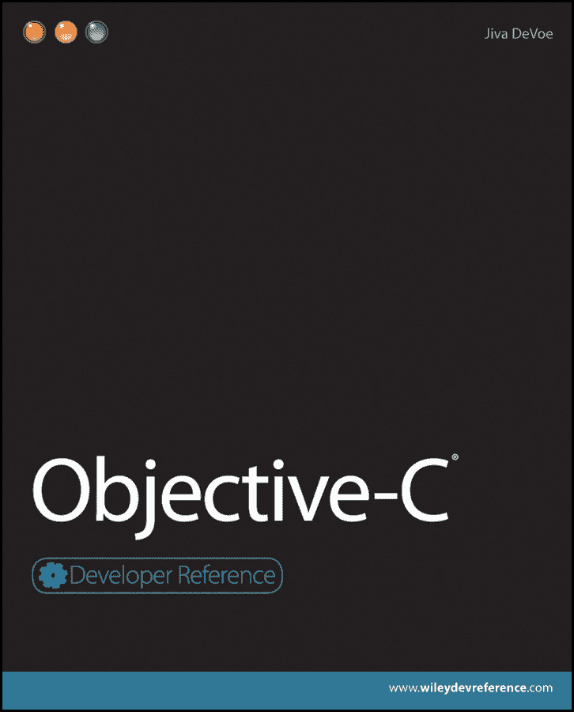


## 目录

# 第一部分：Objective-C 简介
## 第 1 章：Objective-C 简介
- 使用 Xcode 进行开发
- 启动项目
- 探索项目中的文件
- 添加源码
- Xcode 主窗口
- 理解编译过程
- 编写代码
- 将源代码转换为编译代码，并将编译代码转换为可执行文件
- 探索应用程序包（Application Bundles）
- 使用构建设置
- 使用 Xcode 静态分析器
- 理解 Objective-C 运行时（Runtime）
- 总结

## 第 2 章：理解基础语法
- 语句与表达式
- 声明变量
- 使用注释
- 探索标量类型（Scalar Types）
- 使用特殊的变量修饰
- 理解结构
- 使用 typedef
- 使用枚举（enum）
- 理解指针
- 使用运算符
- 三元运算符
- 函数操作
- 理解函数
- 定义函数
- 实现（Implementation）与接口（Interface）的区别
- 与实现文件链接
- 控制程序流
- 使用条件语句
- 循环操作
- 运用所学
- 总结

## 第 3 章：添加对象
- 理解对象
- 创建类
- 声明对象
- 对对象进行调用
- 属性（Properties）操作
- 理解状态与行为的区别
- 使用点符号
- 应用对象
- 创建员工类（Employee Class）
- 创建经理类（Manager Class）
- 在人力资源系统中将类关联起来

## 第 4 章：理解 Objective-C 内存管理
- 使用引用计数
- 学习内存管理规则
- 使用 autorelease
- 理解对象内部的内存
- 使用垃圾回收（Garbage Collection）
- 理解垃圾回收器
- 为项目配置垃圾回收
- 在垃圾回收项目中使用 Framework
- 探索关键垃圾回收模式
- 管理有限资源
- 使用垃圾回收编写基础应用程序
- 在 nib 文件中操作对象
- 强制进行垃圾回收
- 使用 void 指针与垃圾回收的操作
- 使用垃圾回收器的面向对象接口
- 理解你的项目应使用哪种内存管理模型
- 总结

# 第二部分：探索进阶特性
## 第 5 章：使用 Blocks
- 理解 Blocks
- 声明代码块
- 使用代码块
- 理解重要的 Block 作用域
- 管理代码块内存
- 使用 typedef 让代码块更易读
- 在线程中使用 Blocks
- 使用中央队列调度（GCD）
- 使用 GCD 函数在线程中分发代码块
- 常用 Block 模式操作
- 使用代码块进行映射（Maps）
- 在标准 API 中使用 Blocks
- 将 Blocks 应用于并行任务
- 创建项目
- 使用数组配合 blocks 进行过滤
- 使用中央队列调度

## 第 6 章：使用键值编码（KVC）和键值观察（KVO）
- 使用值编码（Value Coding）访问属性
- 键路径（Key Paths）操作
- 编写符合 KVC 标准的访问器
- 在数组中使用 KVC
- 在结构和标量中使用 KVC
- 搜索对象的属性
- 观察符合 KVC 标准的值的变化
- 使用 KVO
- 注册为观察者
- 为 KVO 定义回调
- 移除观察者
- 实现手动通知
- 理解 KVO 的风险
- 应用键值观察

## 第 7 章：使用协议（Protocols）
- 优先使用组合而非继承
- 理解为什么你不需要（或不想）多继承
- 理解协议如何解决该问题
- 为供他人实现的预期接口编写文档
- 在对象中实现协议
- 声明一个协议
- 声明一个类实现了某个协议
- 声明一个必须实现某个协议的对象
- 探索正式协议和非正式协议
- 一个对象是否实现了可选方法
- 避免协议循环依赖
- 探索协议使用的示例


## 总结

# 第 8 章：扩展现有类的能力

## 与第三方框架和类交互

## 与分类（Categories）交互
### 声明分类
## 实现分类方法
## 在头文件中声明分类
### 使用分类
## 使用分类拆分功能
## 扩展类方法
## 探索分类的局限性
### 使用分类实现协议
### 理解在 NSObject 上创建分类的危险性

## 使用匿名分类扩展类

## 为现有类关联变量

## 总结

# 第 9 章：编写宏

## 回顾编译过程
### 理解宏的工作原理

## 定义宏
### 定义常量
### 通过编译传递常量
### 在宏中使用变量
### 使用字符串化操作（Stringification）
### 处理条件切换
### 使用内置宏

## 总结

# 第 10 章：处理错误

## 错误分类
### 理解如何中断程序流

## 使用不同的错误处理机制
### 使用返回值
### 使用异常（Exceptions）
### 使用 `NSError`

## 总结

# 第三部分：使用 Foundation 框架

## 第 11 章：理解框架是如何协作的

## 理解 Foundation 框架
### 探索其他框架
### 在项目中使用框架
### 添加框架
### 包含头文件
### 考虑垃圾回收

## 总结

## 第 12 章：使用字符串

## 理解字符串语法
### 使用字符串
### 使用其他方法
### 使用 `NSString` 分类

## 总结

## 第 13 章：处理集合

## 数组操作
### 使用字典（Dictionaries）
### 使用集合（Sets）
### 理解可变性
### 理解集合与内存管理
### 使用特殊集合
### 遍历
### 向元素发送消息
### 排序与过滤
### 在集合中使用 Blocks

## 总结

## 第 14 章：使用 `NSValue`、`NSNumber` 和 `NSData`

## 使用 `NSValue` 和 `NSNumber`
### 使用 `NSValue` 封装任意数据类型
### 使用 `NSNumber` 封装数字
### 使用 `NSDecimalNumber` 进行算运算

## 使用 `NSData` 和 `NSMutableData`
### 创建 `NSData` 对象
### 访问 `NSData` 对象中的原始字节

## 总结

## 第 15 章：处理时间和日期

## 构建日期
### 处理时间间隔（Time Intervals）
### 比较日期
### 使用 `NSCalendar`
### 处理时区
### 使用 `NSDateFormatter`

## 总结

# 第四部分：探索高级主题

## 第 16 章：线程多进程处理

## 代码同步
### 使用锁（Locks）
### 使用 `@synchronize` 关键字
### 理解原子性（Atomicity）
### 使用 `Thread`
### 创建线程
### 操作线程
### 访问主线程
### 使用 `Operation` 和 `OperationQueue`

## 总结

## 第 17 章：Objective-C 设计

## 识别模式
### 使用单例模式描述
### 委托责任
### 通知对象变化

## 总结

## 第 18 章：使用 `NSCoder` 读写数据

## 在对象中实现 `NSCoding` 协议
### 编码对象
### 处理对象图（Object Graphs）
### 使用其他类型的数据
### 解码对象

## 使用 `NSArchiver` 和 `NSUnarchiver`
### 处理归档文件格式和遗留数据

## 总结

## 第 19 章：在其他平台上使用 Objective-C

## 使用 GNUstep
### 使用 Cocotron
### 使用其他开源库
### 展望未来

## 总结


10 9 8 7 6 5 4 3 2 1

本出版物的任何部分均不得以任何形式或通过任何手段（电子、机械、摄影、录制、扫描或其他方式）进行复制、存储在检索系统中或传输，除非根据 1976 年《美国版权法》第 107 节或 108 节的规定，未经出版者的事先书面许可，或通过向版权许可中心支付相应的每份副本费用获得授权（地址为：222 Rosewood Drive, Danvers, MA 01923, (978) 750-8400，传真 (978) 646-8600）。向出版者申请许可的请求请发送至 Permissions Department, John Wiley & Sons, Inc., 111 River Street, Hoboken, NJ 07030, 201-748-6011，传真 201-748-6008，或访问在线 [`www.wiley.com/go/permissions`](http://www.wiley.com/go/permissions)。

### 责任限制/免责声明
出版者和作者对本作品内容的准确性或完整性不作任何陈述或保证，并特别否认所有保证，包括但不限于对特定用途的适用性保证。销售或促销材料均不得创建或扩展任何保证。本书包含的建议和策略可能不适用于所有情况。本作品的销售是基于这样理解：即出版者并未从事法律、会计或其他专业服务。如果需要专业协助，应寻求胜任的专业人士的服务。出版者和作者均不对由此产生的损害承担任何责任。在本作品中引用某个机构或网站作为引文和/或进一步信息的潜在来源，并不意味着作者或出版者认可该机构或网站可能提供的信息或其可能做出的建议。此外，读者应当注意，本作品中列出的互联网网站在本书编写与阅读之间可能已经发生了变化或消失。

如需有关我们其他产品和其他服务的通用信息，或要获取技术支持，请联系我们的美国客户服务部门 (877) 762-2974，美国境外请拨打 (317) 572-3993 或传真 (317) 572-4002。

### 美国国会图书馆控制号：2010943062

### 商标
Wiley、Wiley Logo 以及相关的贸易装均是 John Wiley & Sons, Inc. 在美国及其他国家的商标或注册商标，未经书面许可不得使用。所有其他商标均为其各自所有者的财产。Objective-C 是 Apple, Inc. 的注册商标。Wiley Publishing, Inc. 与书中提到的任何产品或供应商均无关联。

Wiley 还以多种电子格式出版其书籍。纸质版中出现的某些内容可能在电子书中不可用。

### 献辞
献我的妻子 Dawn，以及我的孩子们 Robert、Alex 和 Izzy。你们是、也将永远是我最重要的人。

### 关于作者
Jiva DeVoe 从事软件开发已有 25 年，从 BASIC 开始。在 SDK 推出之前，他创立了 Random Ideas LLC。在 2001 年，他开始接触 Objective-C。自从 SDK 推出以来，他一直致力于开发 iOS 应用。由于以来，他获得了多项奖项。他与妻子和孩子们生活在一起。

###

# 致谢
收购编辑：Aaron Black
执行编辑：Jody Lee
技术编辑：Brad Miller
拷贝编辑：Beth Taylor
编辑总监：Robyn Swift
编辑经理：Rose Graham
业务经理：Sandy Smith
副总裁兼执行经理：Richard Swad
副总裁兼执行经理：Katherine Pruett
项目协调：Carrie Crocker
质量控制技术：Melissa Cossell
校对：Laura Bowman，索引编辑：Evelyn Wellborn

### 前言
关于 Objective-C，我希望这本书能带给你一些发现。在学习 Objective-C 时，我发现它是一个非常强大的语言。在编写本书时，我尝试以一种易于理解的方式处理主题，从最基础的知识开始，但你对计算机有一些基础知识。如果你已经具备某些编程语言背景，书中的部分内容对你来说可能是回顾，但对于 Objective-C，你可能会从中有所收获。

在文中引用方法时，我使用了标准的 Apple 惯例，即使用方法名但不带参数。例如，方法：
```


```objc
-(void)someMethodUsingParam1:(NSString *)param1 andParam2:(NSString *)param2;
```

在文中应写为 `-someMethodUsingParam1:andParam2\.`。如果它是类方法，则开头的连字符将替换为 `+`，就像你在类定义中编写该方法一样。

关于示例代码，在我那些要求你构建特定完整项目的章节中，我通常尝试包含代码的完整列表。在没没有包含的情况下，你始终可以从书的网站下载项目，其中包含了插图和其他支持文件。在某些章节中，为了演示某项技术而创建一个完整的项目其实并没有什么意义。在这些情况下，代码列表更多的是代码片段，你可以将它们作为编写自己代码的基础。由于这些片段不构成功能完备的项目，因此网站上不会提供这些示例项目。

我希望你读这本书的体验像我写它时一样愉快。对我来说，一本优秀技术书的标志是它不会呆在我的书架上。它在我的桌子上或附近占据着荣誉的位置，因为我会一次又一次地翻阅它。我希望这本书在你的图书馆中也有这样的地位，并成为一本被翻得卷角、封面破损、书页写满笔记的参考书，在未来的多年里对你依然有用。

Jiva DeVoe

book@random-ideas.net

# 致谢

撰写这本书既充满收获又充满挑战，但如果没有我想感谢的某些特定个人的帮助和支持，我无法完成它。

首先，我必须感谢 `Cynical Peak Software` 的 `Brad Miller`，他是业内最优秀的技术编辑之一。他对细节的细心关注，以及在帮助我纠正错误时那种不懈的坚持，令人赞叹。感谢你的付出。你太棒了。

感谢 `Aaron Black` 在 `Wiley` 提供的帮助和倡导，尽管过程中遇到小波折。非常感谢你的赞助和协助。

感谢我的父亲教会我惊叹技术的奇迹，并鼓励我追求在计算机领域的梦想，我要感谢我的父亲 `Robert A. DeVoe`。

感谢我的儿子 `Alex`，你花费了许多小时排版这本书，谢谢你。你的努力和帮助是让这本书成为现实的关键。

最后，也是重要的一点，我想感谢我的妻子，感谢她一如既往的支持，不仅是在这个项目中，在我所有的工作中都是。没有她，这本书就无法完成。在我情绪低落疲惫时你支持了我，并激励我继续追求新的成就和目标。我对你的感激无尽尽。

请注意，本电子书中使用的某些特殊符号可能在所有电子阅读器设备上无法正常显示。如果你在确定任何符号时遇到困难，请拨打 `Wiley 产品技术支持`：`800-762-2974`。在美国境外，请拨打 `317-572-3993\.`。你也可以通过 www.wiley.com/techsupport 联系 `Wiley 产品技术支持`。

# 第一部分：介绍 Objective-C

## 本部分

- 第 1 章：介绍 Objective-C
- 第 2 章：理解基础语法
- 第 3 章：添加对象
- 第 4 章：理解 Objective-C 内存管理

# 第一章：介绍 Objective-C

## 本章

- 学习 Objective-C 的历史
- 探索编写 Objective-C 代码的 Xcode
- 配置你的开发环境

那一年是 `1986\.`。`哈利彗星`距离太阳是自 75 年以来最近的一次。英国和法国宣布了建造英吉利海道的计划。`拍立得`正风靡，刚刚迫使 `柯达` 退出了即时相机业务。`C` 编程语言已经使用了大约 15 年，但 `C++` 是该领域的新手，几乎鲜为人知。`Smalltalk` 编程语言在技术行业中流行，让人们对一种被称为“面向对象编程”（简称 `OOP`）的新型编程概念感到兴奋。

两位开发者 `Tom Love` 和 `Brad Cox` 在 `ITT 公司编程技术中心` 接触了 `Smalltalk`。`Cox` 认为在 `C` 编程语言中添加面向对象的特性将很有趣，能够在 `C` 中实现面向对象编程。事实上，他将他的扩展命名为 `COOPC`，代表 C 中的面向对象编程。最终，两人成立了一家公司将这些扩展商业化，并将其作为一种语言向开发者推广。这种新语言的名字是 `Objective-C`。几年后，一家由 `Steve Jobs` 领导的名为 `NeXT` 的小型初创公司许可并标准化了 `Objective-C`，将其作为他们想要用于开发名为 `NeXTstep` 新操作系统的主要语言。`NeXT` 计算机最终被 `Apple` 购买，导致 `NeXTstep` 操作系统的吸收，并最终演变为 `Mac OS X`。

很少有人意识到 `Objective-C` 有那么老，而且它实际上影响了许多其他编程技术。例如，`Java` 编程语言与 `Objective-C` 有许多共同点。这是因为在 `Objective-C` 历史早期，`NeXT own`与 `Sun Microsystems` 合作开发了 `OpenStep` 平台。他们开发这项技术时使用的语言就是 `Objective-C`。当 `NeXT own`的表现没有他们预期那么好，公司开始失败时，`Sun` 决定开发自己的语言和跨平台开发工具包 `Java`。开发 `Java` 的工程师对 `Objective-C` 非常熟悉，因为 `Objective-C` 是他们在开发 `Java` 之前一直使用的语言。因此，他们将 `Objective-C` 的许多优秀特性复制到了他们创建的新语言中。

今天，`Objective-C` 是开发 `Mac OS X` 和 `iPhone OS` 的首选语言。它已经演变成一种优雅的解决方案，完美地处于强类型语言和动态类型语言之间。它是少数通常被编译的语言之一，因此既受益于如 `C` 和 `C++` 等语言的编译时语法检查，又受益于允许动态对象类型型的动态运行时环境。

除了 `Mac OS X` 和 `iPhone OS` 之外，`Objective-C` 在其他平台上也拥有了大量粉丝，可以用于在 `Linux`、`Windows` 以及任何移植了 `GNU compiler collection` 的地方开发应用程序。它在 `iPhone OS` 上使用提高了这种语言的普及，并吸引了许多新开发者。甚至可以说，`Objective-C` 今天正在经历一场新的复兴——成千上万的新开发者正涌向这种语言，使其成为当今技术领域最热门的新现象之一。

在书中，我希望向你们介绍 `Objective-C`，并向你们展示为什么我认为它是一种值得进入世界顶级编程语言行列的第一流语言。我常说，一个优秀的程序员需要掌握三种语言。第一种是工作流自动化语言。通常是一种脚本语言。他可以用它来自动化工作空间，并构建即时工具来帮助优化他的工作流。第二种是编辑器宏语言。作为开发者，我们花费 99% 的时间将文本制作成软件。拥有一个帮助你操作编辑器的工具非常有价值。最后一种是用于构建系统和应用程序的语言——用于部署需要高性能和高可靠性的应用程序。通常这些语言是编译的，以便你可以从所选的平台中榨出最大的性能。然而，它们最重要的特性是能够最大限地利用系统库。


我希望在本书结束时，Objective-C 将成为你首选的应用程序语言。没有任何任何任务是这种语言无法像其他任何编译语言一样完成或完成得更好的。

## 使用 Xcode 进行开发

在书中，我假设你将使用 Xcode 开发环境进行编码。Xcode 是 Apple 提供的一个优秀 IDE，只需注册 Apple 开发者计划即可免费获得。它原生支持 `C`、Objective-C、`C++`、`Java` 以及其他几种语言，但我们在这里只将它用于编写 Objective-C。

### 开始项目

当你第一次启动 Xcode 时，你可以选择打开最近的项目或创建一个新项目。为了方便本文的讨论，请此时选择创建一个新项目，这样你可以跟上进度。这将弹出“新建项目”对话框，如图 1.1 所示。

图 1.1：新建项目对话框

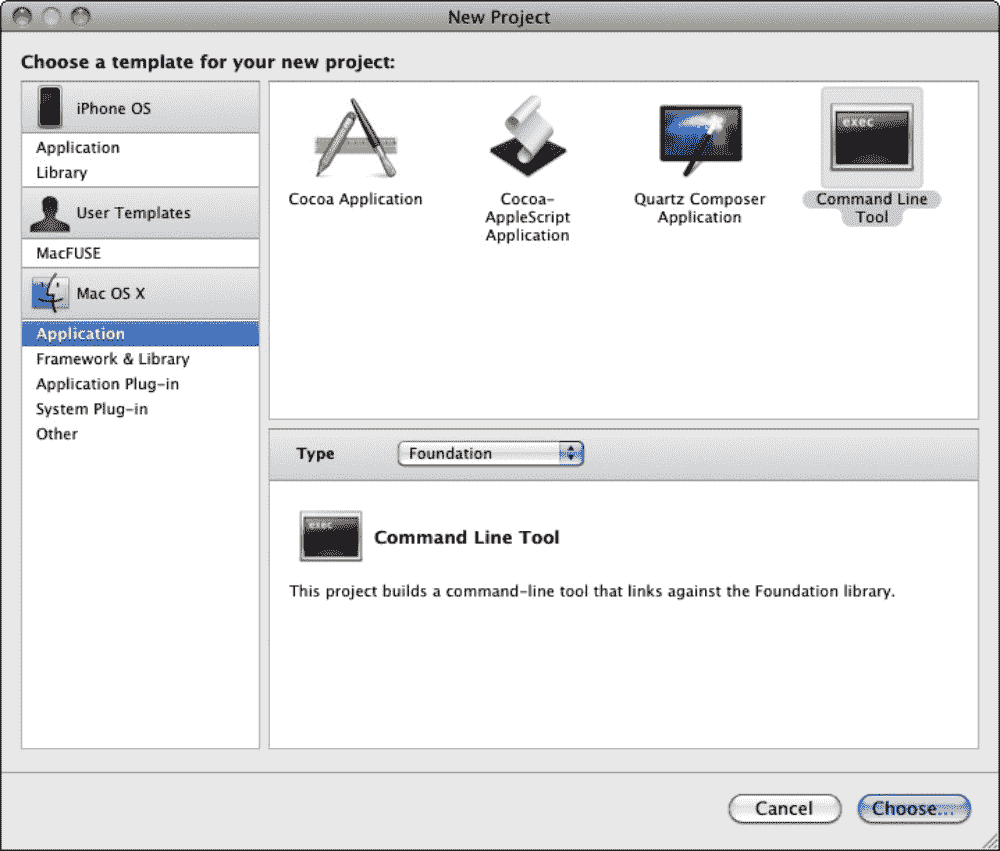

在这个对话框中，你可以选择创建各种类型的项目，从命令行应用程序到桌面图形化应用程序。你可以找到几乎任何内容的模板。此外，如果你安装了 iPhone SDK，还有针对各种 iPhone 和 iPad 应用程序的项目模板。因为你主要感兴趣的是简单地理解 Objective-C 语言，请选择这些项目中最简单的一个。

1. 从 Mac OS X 组中，选择 `Application`，然后选择 `Command Line Tool`。
2. 在 `Type` 下拉列表中，选择 `Foundation`。
3. 点击 `Choose` 按钮，选择保存新新项目的位置，并点击 `Finish`。

在接下来的几个章节中，我将向你简要介绍 Xcode 开发环境，以便你熟悉它。首先，查看 Xcode 窗口。它如图 1.2 所示。

图 1.2：Xcode 主窗口

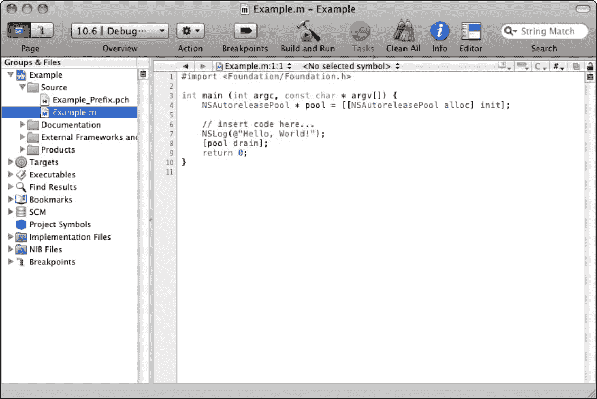

Xcode 主窗口由两个面板组成。第一个面板显示在左侧，包含你项目中的所有文件。选择其中一个文件将在窗口右侧的编辑器面板中打开该文件。项目文件可以通过将它们移动到项目中的文件夹在 Xcode 中进行分组。在大多数情况下，这些分组完全是为了你开发期间的方便，对最终完成的项目几乎或没有影响。

除了你的源文件外，你链接到项目的框架也会显示在这里。

项目文件下方是一组智能组（Smart groups）。它们封装了诸如你的项目将生成的目标（targets）、搜索结果和断点等。

`Targets` 组包含你的项目将编译的目标。通过修改该组内对象的设置，你可以覆盖整个项目的编译设置。这里你也可以为项目添加和编辑自定义编译步骤。图 1.3 显示了该组的构建设置。

图 1.3：构建设置

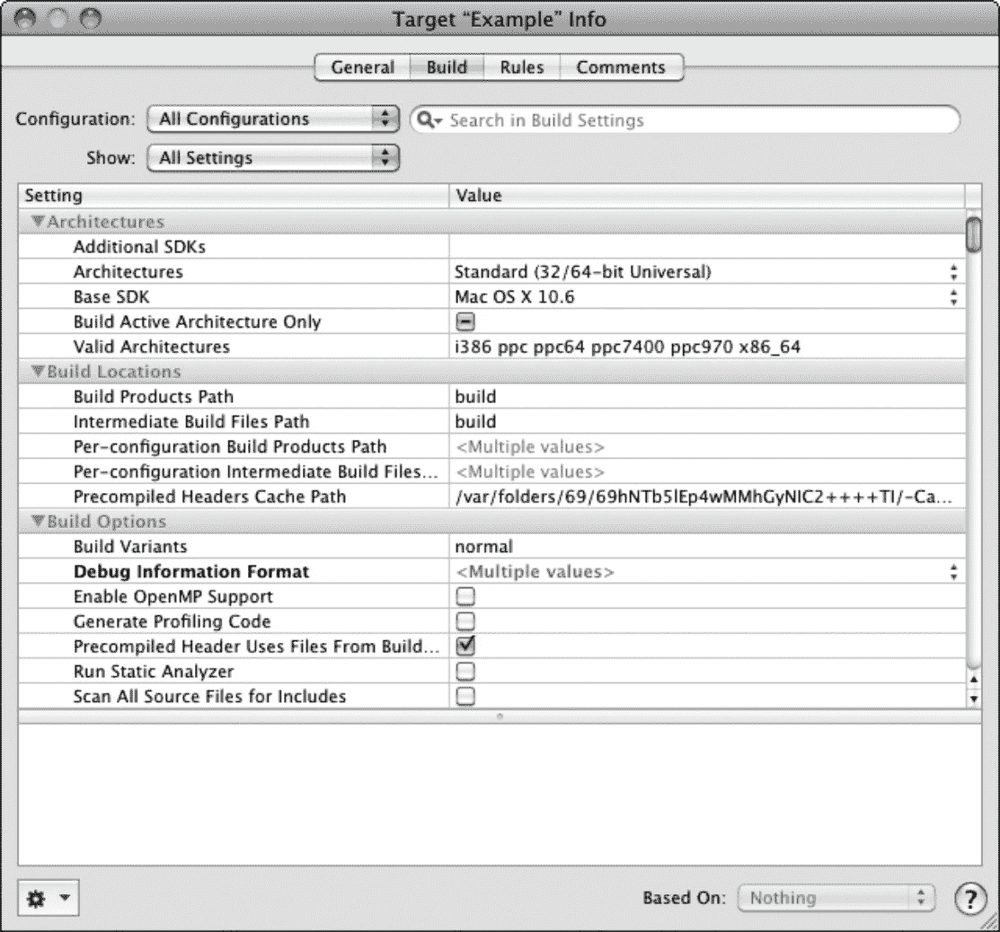

### 探索项目中的文件

Xcode 主窗口由两个面板组成。第一个面板显示在左侧，包含你项目中的所有文件。选择其中一个文件将在窗口右侧的编辑器面板中打开该文件。项目文件可以通过将它们移动到项目中的文件夹在 Xcode 中进行分组。在大多数情况下，这些分组完全是为了你开发期间的方便，对最终完成的项目几乎或没有影响。

除了你的源文件外，你链接到项目的框架也会显示在这里。

项目文件下方是一组智能组。它们封装了诸如你的项目将生成的目标、搜索结果和断点等。

`Targets` 组包含你的项目将编译的目标。通过修改该组内对象的设置，你可以覆盖整个项目的编译设置。这里你也可以为项目添加和编辑自定义编译步骤。图 1.3 显示了该组的构建设置。

Xcode 主窗口由两个面板组成。第一个面板显示在左侧，包含你项目中的所有文件。选择其中一个文件将在窗口右侧的编辑器面板中打开该文件。项目文件可以通过将它们移动到项目中的文件夹在 Xcode 中进行分组。在大多数情况下，这些分组完全是为了你开发期间的方便，对最终完成的项目几乎或没有影响。

除了你的源文件外，你链接到项目的框架也会显示在这里。

项目文件下方是一组智能组。它们封装了诸如你的项目将生成的目标、搜索结果和断点等。

`Targets` 组包含你的项目将编译的目标。通过修改该组内对象的设置，你可以覆盖整个项目的编译设置。这里你也可以为项目添加和编辑自定义编译步骤。图 1.3 显示了该组的构建设置。

Xcode 主窗口由两个面板组成。第一个面板显示在左侧，包含你项目中的所有文件。选择其中一个文件将在窗口右侧的编辑器面板中打开该文件。项目文件可以通过将它们移动到项目中的文件夹在 Xcode 中进行分组。在大多数情况下，这些分组完全是为了你开发期间的方便，对最终完成的项目几乎或没有影响。

除了你的源文件外，你链接到项目的框架也会显示在这里。

项目文件下方是一组智能组。它们封装了诸如你的项目将生成的目标、搜索结果和断点等。

`Targets` 组包含你的项目将编译的目标。通过修改该组内对象的设置，你可以覆盖整个项目的编译设置。这里你也可以为项目添加和编辑自定义编译步骤。图 1.3 显示了该组的构建设置。

Xcode 主窗口由两个面板组成。第一个面板显示在左侧，包含你项目中的所有文件。选择其中一个文件将在窗口右侧的编辑器面板中打开该文件。项目文件可以通过将它们移动到项目中的文件夹在 Xcode 中进行分组。在大多数情况下，这些分组完全是为了你开发期间的方便，对最终完成的项目几乎或没有影响。

除了你的源文件外，你链接到项目的框架也会显示在这里。

项目文件下方是一组智能组。它们封装了诸如你的项目将生成的目标、搜索结果和断点等。

`Targets` 组包含你的项目将编译的目标。通过修改该组内对象的设置，你可以覆盖整个项目的编译设置。这里你也可以为项目添加和编辑自定义编译步骤。图 1.3 显示了该组的构建设置。

Xcode 主窗口由两个面板组成。第一个面板显示在左侧，包含你项目中的所有文件。选择其中一个文件将在窗口右侧的编辑器面板中打开该文件。项目文件可以通过将它们移动到项目中的文件夹在 Xcode 中进行分组。在大多数情况下，这些分组完全是为了你开发期间的方便，对最终完成的项目几乎或没有影响。

除了你的源文件外，你链接到项目的框架也会显示在这里。

项目文件下方是一组智能组。它们封装了诸如你的项目将生成的目标、搜索结果和断点等。

`Targets` 组包含你的项目将编译的目标。通过修改该组内对象的设置，你可以覆盖整个项目的编译设置。这里你也可以为项目添加和编辑自定义编译步骤。图 1.3 显示了该组的构建设置。

Xcode 主窗口由两个面板组成。第一个面板显示在左侧，包含你项目中的所有文件。选择其中一个文件将在窗口右侧的编辑器面板中打开该文件。项目文件可以通过将它们移动到项目中的文件夹在 Xcode 中进行分组。在大多数情况下，这些分组完全是为了你开发期间的方便，对最终完成的项目几乎或没有影响。

除了你的源文件外，你链接到项目的框架也会显示在这里。

项目文件下方是一组智能组。它们封装了诸如你的项目将生成的目标、搜索结果和断点等。

`Targets` 组包含你的项目将编译的目标。通过修改该组内对象的设置，你可以覆盖整个项目的编译设置。这里你也可以为项目添加和编辑自定义编译步骤。图 1.3 显示了该组的构建设置。

Xcode 主窗口由两个面板组成。第一个面板显示在左侧，包含你项目中的所有文件。选择其中一个文件将在窗口右侧的编辑器面板中打开该文件。项目文件可以通过将它们移动到项目中的文件夹在 Xcode 中进行分组。在大多数情况下，这些分组完全是为了你开发期间的方便，对最终完成的项目几乎或没有影响。

除了你的源文件外，你链接到项目的框架也会显示在这里。

项目文件下方是一组智能组。它们封装了诸如你的项目将生成的目标、搜索结果和断点等。

`Targets` 组包含你的项目将编译的目标。通过修改该组内对象的设置，你可以覆盖整个项目的编译设置。这里你也可以为项目添加和编辑自定义编译步骤。图 1.3 显示了该组的构建设置。

### 添加源文件

要向项目添加源文件，你只需选择源组并进入 `New File` 菜单，这将显示“新建文件”对话框，如图 1.5 所示。在某些情况下，你的项目中有多个目标，结果就是你有不同的源文件。要显式地将某个文件从当前目标的编译中排除，请点击该文件，然后在源中找到详细视图。小的 `Target` 列在文件配置时会包含有一个复选框。如果取消勾选，它将不会被编译。图 1.6  own 了一个示例。

在某些情况下，你的项目中有多个目标，结果就是你有不同的源文件。要显式地将某个文件从当前目标的编译中排除，请点击该文件，然后在源中找到详细视图。小的 `Target` 列在文件配置时会包含有一个复选框。如果取消勾选，它将不会被编译。图 1.6 所示了一个示例。

在某些情况下，你的项目中有多个目标，结果就是你有不同的源文件。要显式地将某个文件从当前目标的编译中排除，请点击该文件，然后在源中找到详细视图。小的 `Target` 列在文件配置时会包含有一个复选框。如果取消勾选，它将不会被编译。图 1.6 所示了一个示例。

### Xcode 主窗口

现在你已经有些熟悉了 Xcode 中的基本文件管理，你会想要熟悉 Xcode 主窗口。这是你在 Xcode 中完成大部分工作的地方。Xcode 主窗口如图 1.7 所示。

当你查看此窗口时，你可以看到左侧是文件浏览器面板，右侧是详细显示面板，或者我在本文的其余部分中称之为编辑器面板。此外，编辑器面板有几种不同的模式。详细模式显示在文件浏览器中选中的文件的摘要。项目查找模式显示了一个查找面板，允许你对项目中的所有文件进行搜索。如果你在 Xcode 中启用了全合一布局，你对编辑器面板还有一个构建结果模式。

此时，查看文本编辑器窗口顶部的条。它向你展示了几个与你当前正在编辑的文件相关的有趣信息项。


你在顶部条带中看到的第一个项目是你当前正在编辑的文件名和行号。这实际上是一个下拉列表，你可以点击它并从最近打开的文件列表中选择。紧挨旁边，另一个下拉列表显示了你正在编辑的文件中方法的函数声明。如果你选择了其中一个方法，编辑器将自动跳转到你现有文件中对应的声明处。

图 1.7
Xcode 主窗口

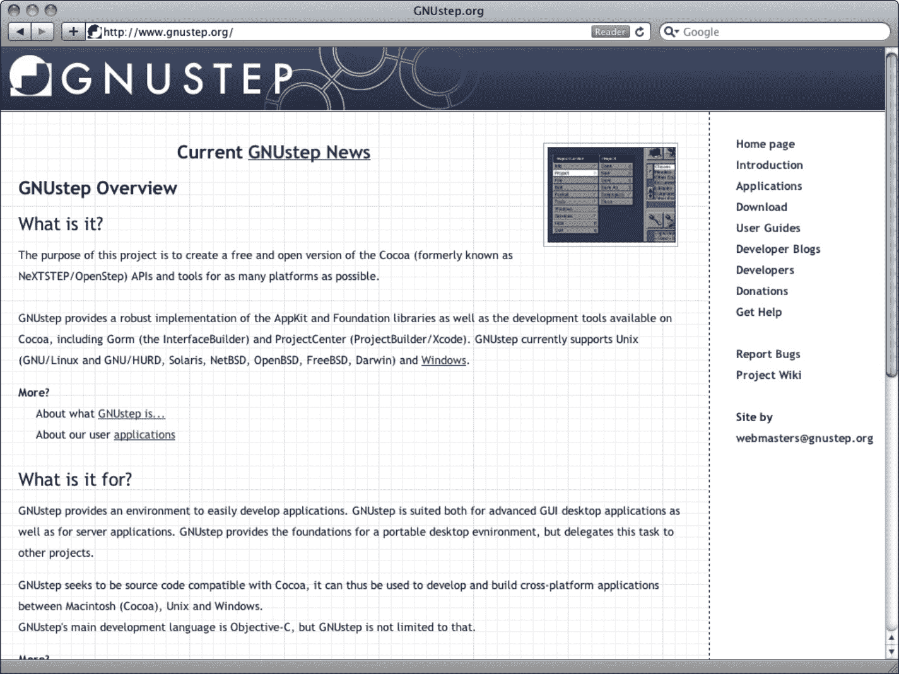

图 1.8 显示了一个在使用该下拉列表的典型文件。

 注意事项

你还可以通过在代码中使用 `pragma` 指令向此下拉列表添加任意标签。在这个文件中，你可以看到针对接口生成器（interface builder）动作方法已经有一个 `pragma` 指令。

在文本编辑器和文件浏览器（File Browser）上方是主工具栏。你可以通过各种按钮对其进行配置，但通常默认按钮就足够了。它们允许你启动构建、停止当前构建等。

最后，在 Xcode 窗口的右下角，你可以看到上次构建结果的摘要。如果成功，你会看到 Succeeded（成功）。如果未成功，你会看到上次编译期间发生的警告和错误计数，以及代表警告的黄色图标和代表错误的红色图标。如果你最近运行了静态代码分析器，你将看到它生成的任何警告的蓝色图标。

图 1.8
文件导航下拉列表

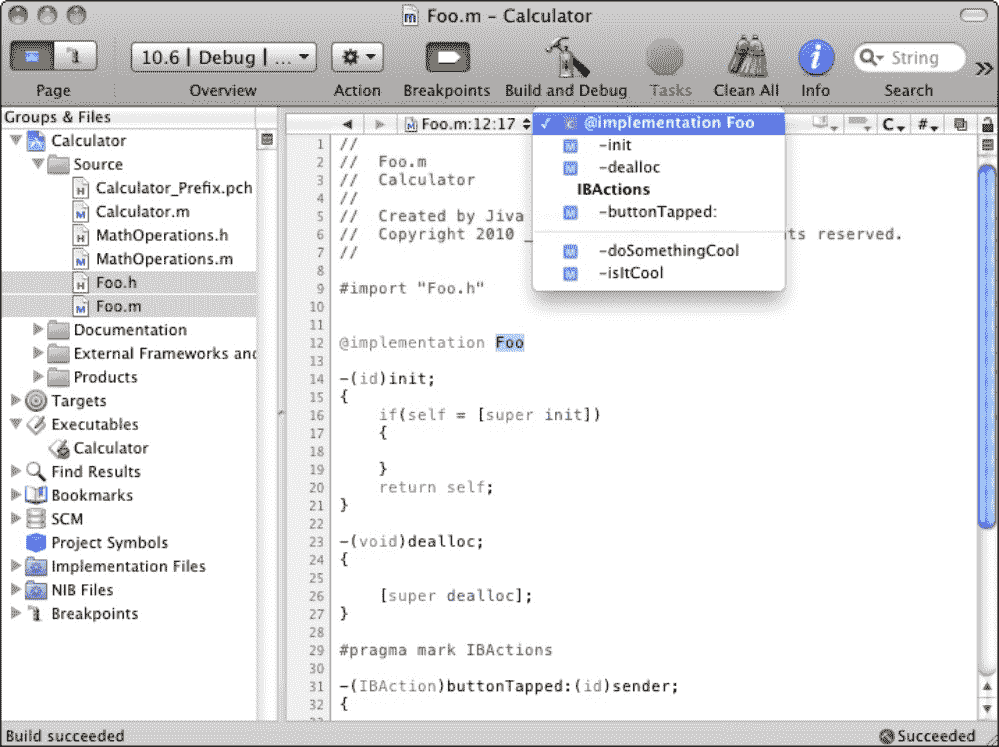

# 理解编译过程

在我们开始详细介绍 Objective-C 的语言特性之前，你必须彻底理解编译过程是如何工作的。编译过程是计算机将你输入的代码转换为计算机实际上可以执行的指令的过程。归结底，计算机实际上只能够执行其原生语言的指令。那种语言通常极其冗长，人类难以理解和操作。因此，为了让人类为计算机编写指令，我们使用高级别的语言，例如 Objective-C。我们在文本编辑器中编写程序，将文件保存到磁盘，然后对文本文件运行编译器。编译器随后获取文本并将其转换为计算机可以执行的指令。

这些大部分都是计算机科学 101 的知识。如果你已经熟悉编程（可能在使用另一种语言），那么你已经知道所有这些信息。你可能可以安全地跳过接下来的几节。然而，如果你是编程的新手，那么这些信息对你将很有用。尽管在实践中编译你代码的过程非常短，但理解这个过程是有教学意义的。

理解编译过程的第一步是编写代码。

## 编写代码

正如我之前说的，作为一名程序员，你将花费 99% 的时间将文本构建成软件。所有的软件开发都要求程序员在编译之前在文本编辑器中输入计算机的指令。这通常被称为编写代码。从本质上说，这只需要输入指令并将这些指令保存为文本文件。这些文本文件及其中的指令通常被称为源代码。

许多编程语言都包含接口（interfaces）和实现（implementation）的概念。接口通常是你的模块暴露给其他模块的方法和属性。实现是计算机必须执行的实际指令，以完成它在接口中向其他模块承诺的职责。换句话说，接口是向系统其他部分承诺特定模块可以做的事情，而实现是关于计算机如何履行该承诺的指令。

在接口和实现方面，大多数编程语言分为两类。第一类是不分离接口和实现的语言。它们使用一个文件在同一个位置声明其接口和实现。第二类是分离接口和实现的语言。这些语言使用两个不同的文本文件分别表示接口和实现。Objective-C 属于后一类。

Objective-C 是一种面向对象的编程语言。这通常意味着开发者将程序的不同组件分为对象（objects）和类（classes）。类是数据以及操作这些数据的方法的集合。对象是类的实例。因此，Objective-C 类包含接口和实现。

用于存储 Objective-C 源代码的文本文件，通常实现文件使用 `.m` 扩展，接口文件使用 `.h` 扩展。例如，假设你想创建一个名为 `MyClass` 的类。在这种情况下，你将创建两个文本文件来存放该模块的计算机指令。这两个文本文件将分别命名为接口的 `MyClass.h` 和实现的 `MyClass.m`。列表 1.1 和 1.2 显示了这两个文件可能后的样子。目前，不要担心理解其中的内容。我包含这些是为了让你对你最终将实现的内容有一个直观的感受。

### 列表 1.1：接口文件
```objc
@interface MyClass : NSObject

{

int foo;
}

@property (nonatomic) int foo;

-(void)someMethod;

@end
```

### 列表 1.2：实现文件
```objc
#import "MyClass.h"

@implementation MyClass

@synthesize foo;

-(void)someMethod
{

NSLog(@"some method called");
}

@end
```


你可以使用任何可以保存纯文本文件的文本编辑器来编写 Objective-C 代码。然而，Apple 在 Mac OS X 上提供了优秀的 `Xcode` 集成开发环境，专门用于为 Mac OS X、iPhone 和 iPad 创建应用程序。它是一个极佳的工具，也是你在书中将使用的工具。另一方面，如果你在 Mac OS X 以外的平台上进行开发，则需要为你所选的平台寻找合适的文本编辑器。

## 将源代码转换为编译代码，将编译代码转换为可执行文件

在创建源代码之后，你需要让计算机将你的源代码转换为它可以执行的指令。这一过程的这一部分被称为编译源代码。

编译源代码实际上涉及几个步骤。

### 预处理
第一步被称为 `preprocessing`（预处理）。你可以将预处理步骤理解为计算机为编译你的代码做准备。在这一步，编译器会移除任何不会产生可执行代码的代码（例如注释等）。它还会扩展代码的部分内容并重新排列某些指令，以便编译过程的第二步能够更高效运行。编译第一步的结果是源代码的中间状态。尽管你通常不会看到或处理这种中间形式的代码，但存在一些编译器开关，如果你出于某种原因想查看输出，可以让编译停在这一阶段。某些使用高级技术的开发者有时会使用这些编译器开关，以便查看中间文件并确切看到编译器正在做什么。在正常的应用程序开发中，你可能永远不需要这样做。

### 对象文件
预处理之后，第二步是编译器实际上将你的源代码转换为所谓的对象文件（object file）。对象文件的扩展名为 `.o`。编译源代码可能是一个漫长的过程，涉及许多不同的模块和许多不同的源代码文件。因此，如果在某个模块及其所有依赖项都没有更改的情况下，你可以避免重新构建该模块，那么在减少编译时间方面将是一个巨大的胜利。由于，对象文件通常存储在你的构建目录中。如果源代码文件自上次编译器运行以来没有更改，编译器就可以简单地跳过该源代码的重新编译，而是复用上次运行留下的对象文件。通常，在日常使用中你不需要查看这些文件。它们仅供编译器使用。

### 链接
编译的最后一步涉及被称为 `linking`（链接）的过程。链接意味着获取上一步产生的对象文件并将它们连接在一起形成一个可执行文件。除了对象本身，库（libraries）和框架（frameworks）也会链接到可执行文件中。链接过程的结果是你真实的应用程序可执行文件。对于命令行应用程序，这将一个可以从命令行运行的单一二进制文件。对于桌面应用程序，这通常是所谓的应用程序包（application bundle），它实际上是磁盘上的一个目录，包含可执行文件以及运行应用程序所需的所有资源，如图形、声音等。你将在下一节中学习更多应用程序包。

在 `Xcode` 中，编译应用只需点击 Build and Run（构建并运行）按钮。如果你对示例项目这样做，它将在控制台中启动应用程序并显示其输出。在此过程中，`Xcode` 会切换到调试模式并允许你调试应用程序。调试是一个高级的 IDE 主题；请参考 `Xcode` 文档获取如何使用它进行调试的信息。

编译过程的结果是你的可执行文件。如果在编译的任何一点编译器检测到你的源代码中存在错误（这确实是非常常见的事件），它将停止处理相关文件并向你显示错误以便你进行纠正。遗憾的是，编译器非常挑剔。计算机在推断单词含义方面远没有我们聪明。因此，编译器不会猜测你想要输入什么，而是直接放弃并向你显示错误。这些错误可能仅仅是缺少分号、缺少空格、大小写错误或任何细微的问题。做好准备——通过开启程序员职业生涯，你每天将处理成百甚至上千次这样的错误。即使是优秀的程序员，也很少写出第一次就能完美编译的代码。

## 探索应用程序包

在上一节中，我提到了应用程序包（application bundle）这个术语——即使你是一个经验丰富的程序员，这可能是一个完全全新的术语。你可能好奇它是什么。应用程序包实际上与其说是操作系统的构造，不如说说是 Objective-C 的构造。Objective-C 语言本身并不需要也不产生应用程序包。尽管如此，应用程序包是在几乎所有可以使用 Objective-C 的平台上进行编程时重要且不可或缺的概念，因此，作为一名 Objective-C 程序员，理解这些概念是非常重要的。

应用程序包简单来说就是磁盘上一个包含一组文件的目录。在 Mac OS X 中，应用程序包用于将应用程序运行所需的所有文件分组在一起。这包括可执行文件、图形、声音文件和用户界面资源等项目。此外，在为 Mac OS X 构建图形化应用程序时，用户界面定义通常在一个名为 `Interface Builder` 的应用程序中完成。该应用程序还会产生名为 `NIB` 的文件的包。`NIB` 文件通常扩展名为 `.nib`，并存储在应用程序包内部。

 注意

`NIB` 代表 NeXTstep Interface Builder，是 NeXT 时代的遗留。最近，格式已从二进制更改为 `XML`，文件扩展名从 `.nib` 变为 `.xib`。在编译期间，`XIB` 文件仍编译为 `NIB` 文件，因此当你查看应用程序包时，看到的是 `.nib` 而不是 `.xib`。

列表 1.3 显示了典型的包结构。在这种情况下，它是 `Xcode` 应用程序包的部分列表。

```
Listing 1.3 Contents of an Application Bundle

Xcode.app
-- Contents
| CodeResources -> _CodeSignature/CodeResources
| Info.plist
| Library
| |-- QuickLook
| | |-- SourceCode.qlgenerator
| | |-- Contents
| | | |-- CodeResources -> _CodeSignature/CodeResources
| | | |-- Info.plist
| | | |-- MacOS
| | | |-- SourceCode
| | | | |-- _CodeSignature
| | | | |-- CodeResources
| | | | |-- version.plist
| |-- Spotlight
| |-- SourceCode.mdimporter
| | |-- Contents
| | | |-- CodeResources -> _CodeSignature/CodeResources
| | | |-- Info.plist
| | | |-- MacOS
| | | |-- SourceCode
| | | | |-- _CodeSignature
| | | | |-- CodeResources
| | | | |-- version.plist
| |-- uuid.mdimporter
| |-- Contents
| |-- CodeResources -> _CodeSignature/CodeResources
| |-- Info.plist
| |-- MacOS
| | |-- uuid
| |-- Resources
| | |-- English.lproj
| | | |-- InfoPlist.strings
| | | |-- schema.strings
| | |-- Japanese.lproj
| | | |-- InfoPlist.strings
| | | |-- schema.strings
| | |-- schema.xml
| |-- _CodeSignature
| | |-- CodeResources
| |-- version.plist
| MacOS
|-- Xcode
| PkgInfo
| PlugIns
| |-- BuildSettingsPanes.xcplugin
| | |-- Contents
| | | |-- CodeResources -> _CodeSignature/CodeResources
| | | |-- Info.plist
| | | |-- MacOS
| | | |-- BuildSettingsPanes
| | | |-- Resources
| | | |-- Built-in Build Settings Panes.pbsettingspanespec
|-- Resources
| |-- AskUserForNewFileDialog
| |-- CreateDiskImage.workflow
```


## 目录结构

- `Contents`
  - `document.wflow`
    - `DevCDVersion.plist`
    - `Document-Cert.icns`
    - `_CodeSignature`
      - `CodeResources`
- `version.plist`

注意，`Contents/MacOS` 目录包含 `Xcode` 可执行文件。该可执行文件与你制作命令行应用程序时生成的那个是相同的。区别在于，它被封装在一个应用程序包（application bundle）内部，并包含了从该包中加载资源的代码。该应用程序内部其他一些有趣的目录包括 `PlugIns` 目录，它内部也包含包。`Spotlight` 目录也包含以 `SourceCode.mdimporter` 和 `uuid.mdimporter` 目录形式存在的包。我们将在本书的第二部分介绍的 `Foundation` 框架包含了允许你读取应用程序包的方法，并允许访问此类嵌入的包。

你现在需要了解的重要的一点是，当你为 Mac OS X、iPhone 或 iPad 创建图形应用程序时，`Xcode` 会为你的应用程序创建一个应用程序包。在将来，如果你需要在你的程序中包含模块化的资源分组，你可能想要自己创建一个应用程序包。`Xcode` 也提供了恰好实现此的功能。不过，现在你不需要担心这一点。

## 使用构建设置

在 `Xcode` 中，有两个地方可以配置项目的构建设置。第一个也是主要的位置是项目信息窗口，你可以通过选择 `Project⇒Edit Project Settings` 来访问它。在这一部分，我将详细介绍这些窗口，因为这些信息非常有用且具有指导意义。由于这部分在书中的位置，你可能无法理解我将要讨论的许多内容。我建议你先略读这一部分，等在完成`第 2 章`之后再回来。图 1.9 所示的 `Project Settings` 窗口第一个面板显示了项目的通用设置。这些设置中的大部分你不需要更改，除非使用 `Configure Roots` 和 `SCM` 按钮来配置你的源代码管理。

### 图 1.9 项目设置

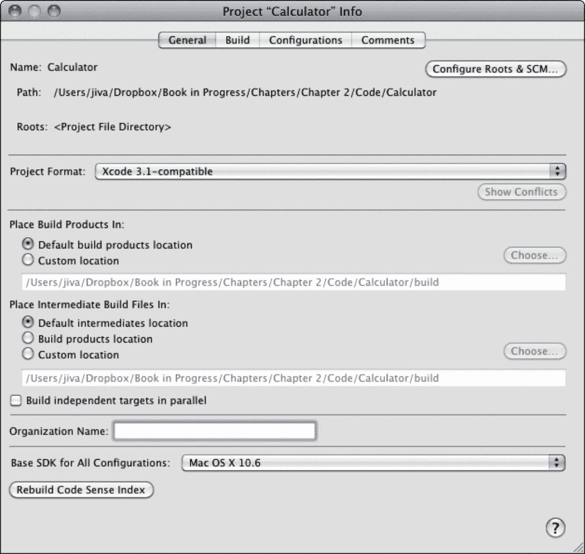

``Place Build Products In` 设置配置了你的可执行文件在编译后放置在项目的哪个位置。再次，这是另一个你可能不需要更改的设置，但现在记录一下是很有用的，以便了解你的可执行文件将被放置在何处。该目录就是你找到可执行文件的地方。

该下方的设置是 `Place Intermediate Build Files In` 设置，它配置了在应用程序构建过程中源代码的对象文件将放置在何处。

下一个设置 `Build Independent Targets in Parallel` 影响编译器如何为不同的独立平台（例如 `PPC` 和 `Intel`）构建目标。如果启用它，这些独立目标将并行构建。如果没有启用，它们将串行构建——一个接一个。

关于 `Xcode` 最常被问的问题之一是：“我如何更改版权声明后自动放置在源代码头文件中的组织名称？”下一个设置 `Organization Name` 正是为了此目的而设。通过在此处配置组织名称，当你向项目添加新文件时，版权列表将把你在此处填写的组织名称列为版权所有者。将其配置为你的公司名称或你的名字。

下一个设置 `Base SDK for All Configurations` 配置了你的应用程序默认编译并链接时使用的 `SDK`。所使用的 `SDK` 定义了项目可用的代码补全和框架。就本书以及你在阅读过程中将处理的项目而言，你可以为你当前的 Mac OS 版本配置基础 `SDK`。然而，如果你正在为其他平台（如 `iPhone OS` 等）进行开发，则应该适当地配置此设置。在你可能想要为旧版本的 Mac OS 编译应用程序时，你也应该修改此设置。

 **注意**

`SDK` 术语指的是软件开发包（Software Development Kit）。`SDK` 是库、工具、文档和源文件的集合，用于为特定平台构建应用程序。`Xcode` 带有适用于 Mac OS X 和 `iOS` 的 `SDKs`。

面板上的最后一个设置与重建 `Code Sense Index` 相关。你可能会遇到 `Code Sense Index` 损坏的少数情况。在这些情况下，你可能希望通过此按钮选择重建 `Code Sense Index`。这些情况很少见，但如果你确实需要，这就是你需要操作的地方。

项目的所有构建设置在两个主要位置配置。第一个是在项目级，第二个是在单个目标级。如果你将项目级设置设为构建应用程序的基础设置，那么目标级设置就是你想要针对特定目标更改的项目项。例如，你可能有一个针对特定应用程序的项目，它同时包含一个 `debug` 目标和一个 `release` 目标。在这种情况下，两个目标的项目级设置都是相同的，但你会根据具体目标更改一些内容，例如你是否想要剥离你的可执行文件等。`Xcode` 通过将项目级设置和目标级设置作为两个独立的窗口来实现这一点。你可以配置项目级设置，它们会级联到你的目标，除非你对特定目标的设置进行了更改。当你对特定目标的设置进行更改时，此更改将覆盖项目级的设置。图 1.10 显示了这种工作原理的示例。

### 图 1.10 目标与项目设置

在这个示例中，你正在同时查看项目级设置和目标级设置。所示示例应用程序配置了两个目标，它们共享代码但构建不同的可执行文件。如你所示，项目与目标之间不同的项在目标级设置中以**粗体**显示。如果你选择删除该设置，粗体就会消失，从项目级设置获取的默认值将取而代之。

屏幕顶部的下拉列表允许你选择你正在编辑的配置，例如，你是在处理 `debug` 构建还是 `release` 构建，以及针对特定设置过滤列表。显示的配置选项是通过使用项目级的 `Configurations` 选项页设置的。图 1.11 显示了一个配置了 `debug` 和 `release` 构建的典型项目。

### 图 1.11 构建配置

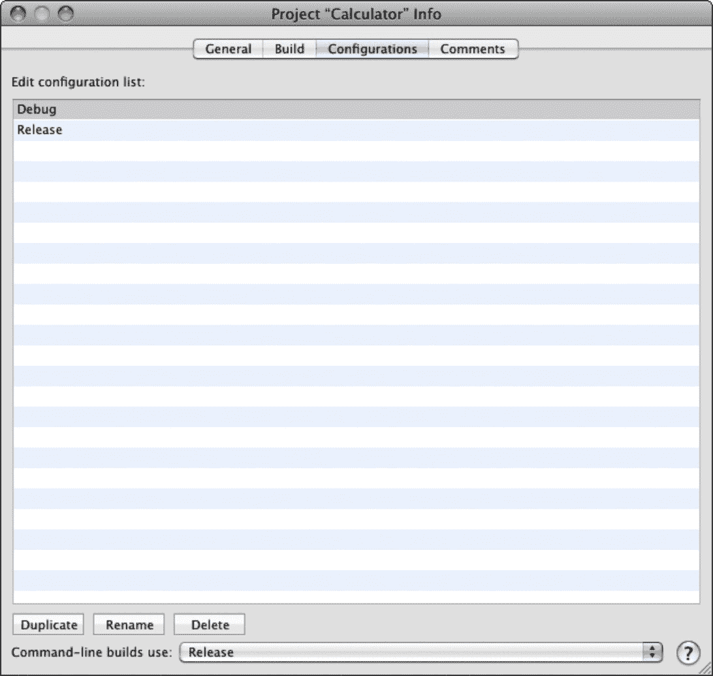

你可以将配置视为同一目标的不同构建。除了 `debug` 和 `release` 之外，另一个典型的例子可能是你想要为不同的架构进行构建，例如 `PowerPC` 相比于 `Intel`。

可以使用命令行工具 `xcodebuild` 来构建你的项目。这在自动化构建时可能非常有用。如果你这样做，此屏幕底部的选项“Command-line builds use”将控制在未指定配置时使用哪种配置。


大部分设置在你在阅读本书的大部分时间内通常是不需要更改的。尽管如此，如果你对这些设置的作用感兴趣，可以滚动查看、点击每一项，并查看屏幕底部显示的信息，这些信息会描述每个选项。目标构建设置（target build settings）下的第三个标签页是 `Rules`（规则）标签，它允许你配置项目中不同类型文件的默认编译行为。例如，如果你有某种特殊文件在构建过程中需要特殊处理，你可以通过加号按钮在此处添加该文件，然后配置你所需的任何类型自定义行为。此外，如果你想更改任何内置文件的默认行为，也可以通过简单更改下拉列表选项来实现。

在大多数情况下，你不需要对设置进行任何更改。在构建图形化 Cocoa 应用程序时，目标构建设置下还有一个 `Properties`（属性）标签页。该标签页允许你配置选项，如可执行文件名称和项目的主包标识符（main bundle identifier）。通常情况下，你希望配置标识符与你的公司名称匹配，而不是使用默认值。此外，如果你有应用程序保存的并希望通过双击启动的文件，你可以在此处注册并配置这些文件的文档类型。当你的应用程序被构建时，Mac OS X 会检测你指定的与你的应用程序关联的文件类型，并将你的应用程序列为可以打开该类型文件的程序之一。这种行为如图 1.12 所示。

 注意

对于命令行应用程序，你不会看到 `Properties` 标签页。`Properties` 标签页实际上是在配置 `App` 包中的信息，而命令行应用程序中并不存在包。

如果是图形化应用程序，你还可以为应用程序配置图标。做法是将图标文件作为应用程序包的一部分包含并在 `Icon File` 设置中指定其名称。

再次，对于你在书中进行的大部分开发，你不需要更改这些选项中的任何一个，但了解它们在哪里以备后参考是有用的。

 注意

在本书印刷时仍在开发中的 Xcode 4 对构建设置的布局进行了一些微调，但设置本身大部分保持不变。有关此功能的最新信息，请参 Xcode 4 文档。

图 1.12

应用程序包属性

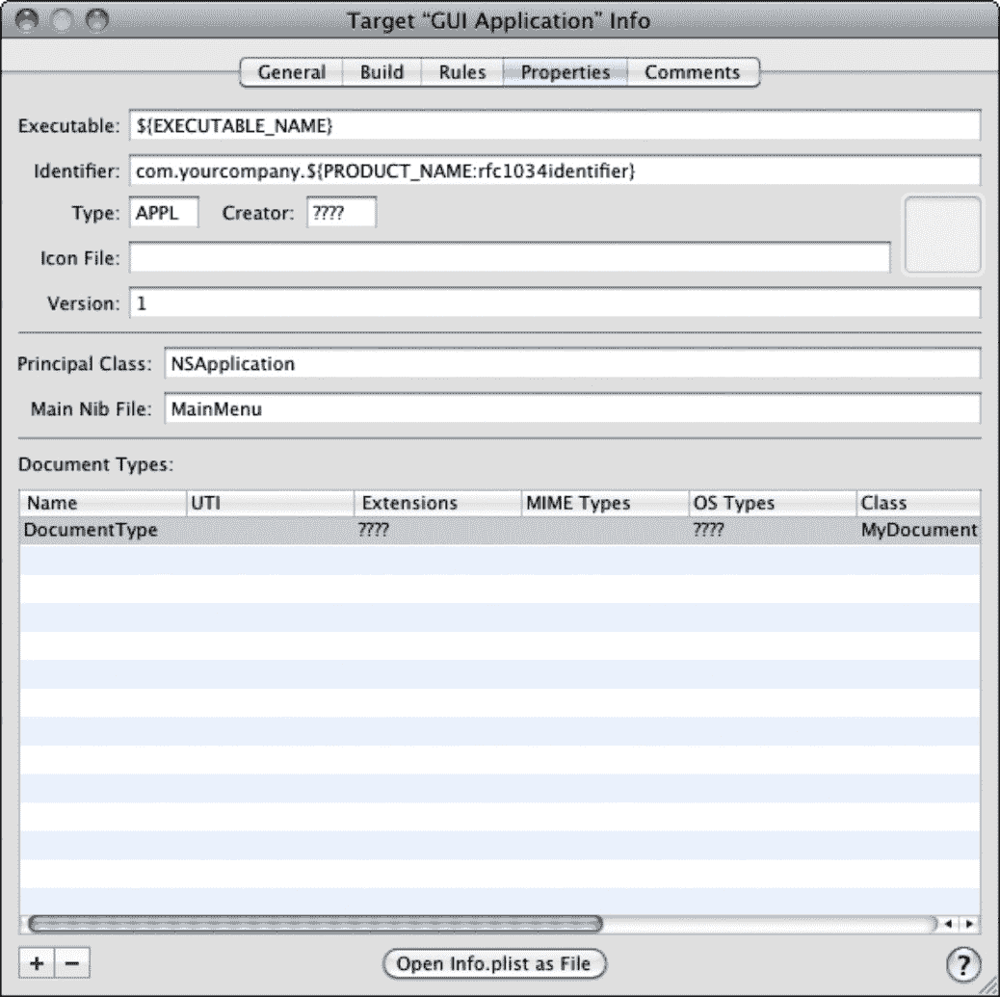

# 使用 Xcode 静态分析器

过去几年中，Xcode 开发环境中包含的编译器技术最大的改进之一是包含了 `Clang Static Analyzer`（Clang 静态分析器）。`Clang Static Analyzer` 是一种用于分析源代码以检测常见错误的工具。虽然编译器擅长检测某些错误，但它们通常倾向于追求速度，而放弃对某些更难发现的情况进行检测。结果，某些本可以检测到的错误（即人们可以通过代码审查发现的错误）往往无法被检测到，并导致你的应用程序出现 bug。这类错误的示例包括未能释放分配的内存、无限循环和使用未初始化的变量等。典型的编译器无法检测大多数此类错误。`Clang Static Analyzer` 的创建正是为了填补这一空白。

要在你的源代码上运行 `Clang Static Analyzer`，你只需选择 `Build⇒Build and Analyze`（构建⇒构建并分析）。这将导致首先使用编译器构建源代码，然后运行静态分析器。

分析器检测到的错误像普通的编译警告一样显示。然而，当你点击源代码中的某个错误时，你将以图形化代码流箭头的形式获得额外的上下文信息。这些箭头显示了分析器预计在你的代码运行时将使用的预测代码路径。这些信息可以帮助你更详细地理解分析器在检测你的错误时所考虑的准确情况。

看看分析器如何处理一些常见的编码错误。再次，我在这里讨论的大部分内容都是你将在后续章节中学习更多知识的高级议题。现在，请先略过这一部分，等在你自己的代码中看到这类错误后，回来查看。

列表 1.4 显示了一个带有常见错误的示例程序。在这种情况下，分配的内存没有被释放。

列表 1.4

带有内存泄漏的程序

```
#import <Foundation/Foundation.h>

int main (int argc, const char * argv[])

{

NSAutoreleasePool * pool = [[NSAutoreleasePool alloc] init];

NSDate *date = [[NSDate alloc] init];

NSLog(@”The time is: %@”, date);

[pool drain];

return 0;

}
```

在这种情况下，分配的 `NSDate` 对象没有被释放。此代码的静态分析器输出如图 1.13 所示。

注意，错误既显示在屏幕顶部的构建结果面板中，也内联在代码中。`Clang Static Analyzer` 不仅能捕捉大多数编译器无法捕捉的错误，其输出也比大多数编译器错误清晰得多。如果你展开构建结果中错误消息上的三角形，它将向你显示与此特定错误相关的两个独立消息。点击这些消息中的任何一个都会显示内存分配的精确位置，并显示程序的流程。图 1.12 显示了展开错误后的代码。

图 1.13

分析器的输出

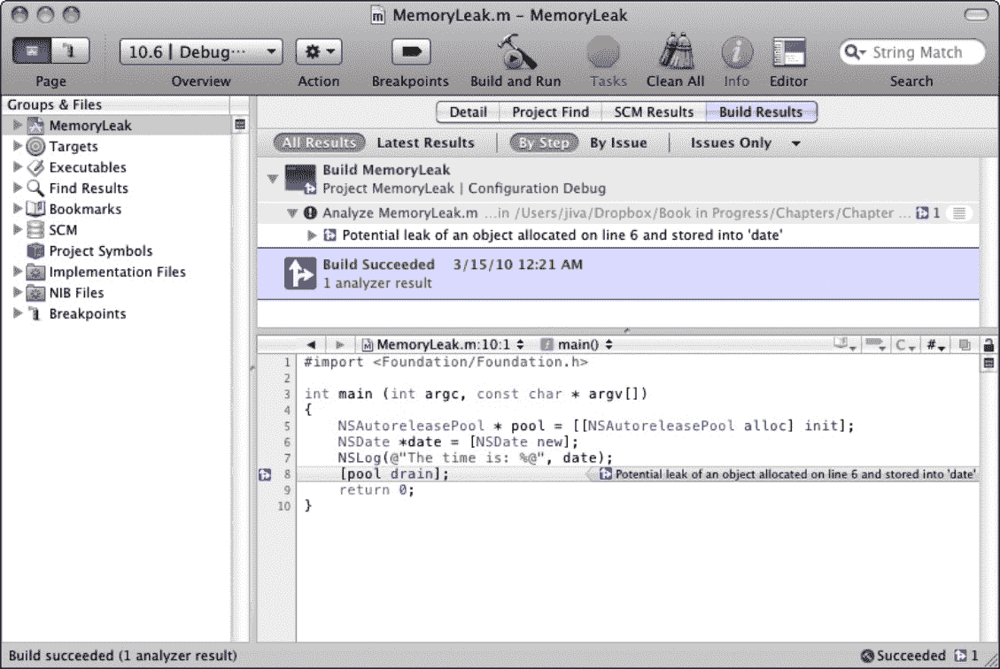

如果你通过将代码修改为列表 1.5 来修正代码，你会发现错误消失了，并获得干净的编译。

图 1.14

详细的分析器输出

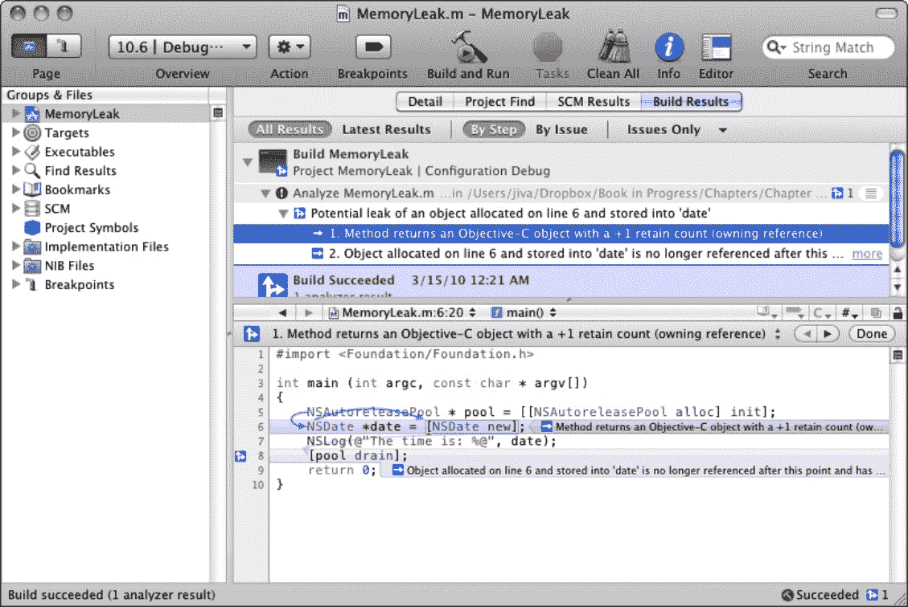

列表 1.5

正确的代码

```
#import <Foundation/Foundation.h>

int main (int argc, const char * argv[])

{

NSAutoreleasePool * pool = [[NSAutoreleasePool alloc] init];

NSDate *date = [[NSDate alloc] init];

NSLog(@”The time is: %@”, date);

[date release];

[pool drain];

return 0;

}
```

 注意

如果你重新编译应用程序，你会发现 Clang Static Analyzer 不再标记错误。

# 理解 Objective-C 运行时

理解 Objective-C 的第一个最基本的概念是 Objective-C 是一种具有动态运行时的编译语言。这意味着语言使用编译器编译，实现了静态的编译时类型检查，但它也与运行时链接，实现了方法的动态分发。这种动态运行时让你能够执行许多只在脚本语言中才有的，例如“鸭类型”和对象的内省。

鸭类型指的是语言类型安全的一种类型，其中假设一个对象“看起来像鸭子，叫起来像鸭子，那么它一定就是鸭子”。这与静态类型相反，在静态类型中，对象必须是它声明的类型，语言才能解析其上的方法。这两种技术都有其优缺点，但在 Objective-C 的情况下，鸭类型实现了该语言中许多酷炫的功能。


实际上有两个主要的 Objective-C 运行时（runtime）。“现代运行时”（modern runtime）用于 64 位机器和 iPhone，而“旧版运行时”（legacy runtime）则用于 32 位的 Mac OS X 以及其他所有地方。“现代运行时”具有几项对开发非常有益的特性，但由于其尚未被广泛使用，本书中展示的代码示例将为旧版运行时编写。现代运行时与旧版运行时完全向后兼容，因此在编写代码时，这不会给你你带来任何问题。在现代运行时具有显著优势的情况下，我会尝试在文中进行说明以供你参考。

当你编译应用程序时，Objective-C 运行时会自动添加到你的程序中。使用它是完全透明的，除非你需要使用它的一些高级功能。然而，目前最重要的是简单理解运行时在动态类型和静态类型方面能为你提供的哪些能力。这与其他编程语言相比，是 Objective-C 拥有的的一种独特能力。

这种能力的副作用之一是引入了 `id` 数据类型。`id` 数据类型是 Objective-C 中的一种特殊对象类型，它实际上可以是任何类型的对象。我将在第 3 章中讨论更多细节。

## 总结

在本章中，我向你介绍了 Xcode 集成开发环境，你在整个书中都会它来开发应用程序。我向你展示了如何根据你的喜好配置它，如何在其中组织文件，如何构建你的应用程序，以及如何读取它的输出以找到你代码中的错误。我还解释了编译过程和应用程序包的格式，并简要解释了 Objective-C 运行时。

## 第 2 章：理解基础语法

## 本章内容
- 编写你的第一个程序
- 声明变量
- 使用函数
- 使用流程控制语句
- 使用循环

在本章中，我将向你展示如何编写一个基础的 Objective-C 程序。这个非常简单的命令行应用程序将在控制台上打印一条简短信息。通过这个基础程序，你将探索 Objective-C 的一些核心内容，首先从如何实际编写代码开始，进入处理变量和函数，最后通过使用条件语句和循环来控制程序的执行流。这些概念是学习该语言的基础，你应该在进入下一节之前彻底学习本章。

请继续将列表 2.1 中的代码输入到你在第 1 章中创建的 Xcode 项目中。代码应该输入到与你的项目名称命名的源文件中，该文件位于 Source 组。

### 列表 2.1：你的第一个程序
```objc
#import <Foundation/Foundation.h>

int main(int argc, const char *argv[])
{
    NSLog(@”Hello from Objective-C”);
    return 0;
}
```

我在这段代码中会跳着讲解，因为这样解释起来更容易。

从第 3 行开始，这是 `main` 函数的声明。所有的 Objective-C 应用程序都有一个 `main` 函数。通常你看不到它，因为它通常是在你在创建项目时由模板创建的；在处理图形化应用程序时，你很少需要编辑这段代码。我还想教你如何编写命令行应用程序，这就是为什么我在这里向你展示了这段代码。

 注意

#### 什么是函数？
函数从本质上说是你程序中的一个子程序。它是指向另一段代码的分支，该段代码执行某些任务然后返回。你在调用函数时，通过包含参数（括号中的内容）向函数发送数据。你通过几种方式从函数获取数据，但主要方法是接收返回值，即从函数返回给你的调用代码的值。

所有的 Objective-C 应用程序都有一个 `main` 函数。`main` 函数也是你的程序开始和结束的地方。你的程序通过操作系统调用 `main` 函数开始执行。所示的两个参数 `argc` 和 `argv` 包含了命令行传递给你应用程序的参数。你的应用程序将一个接一个执行 `main` 函数内部的每一行，直到遇到 `return` 语句。在这种情况下，我们的 `return` 语句简单地返回零。这表示我们的程序已成功退出。

第 5 行包含对名为 `NSLog` 的函数的调用。当应用程序运行时，该函数会将传递给它的任何字符串打印到控制台上。

第 4 行和第 7 行的大括号表示 `main` 函数的作用范围。你会经常看到这些用法。第 5 行和第 6 行末尾的分号表示这些语句的结束，编译器用分号将一条语句与另一条语句隔开。Objective-C 中的语句可以跨越多行。因此，编译器需要某些指示来判断语句何时结束，以便它可以解析该语句。对于许多初学者来说，知道在行尾何时放置分号可能会令人困惑。记住，函数块内部的任何语句（流程控制语句除外）在行尾都需要分号。此外，声明也需要分号。第 1 行是一个导入语句（import statement）。导入语句允许你从当前文件的其他文件中加载代码。在本情况下，我们包含了 `Foundation` 框架的接口声明。（你可以在书的第二部分阅读更多关于 foundation 框架的信息。）这行代码是必须的，以便加载允许我们在第 5 行中使用 `NSLog` 语句的代码。特殊的 `@”Hello from Objective-C”` 被称为字符串。字符串是代码中的字面量；它们存储在变量中并在稍后访问。

继续编译并运行此应用程序，查看输出。你应该看到类似图 2.1 的内容。

图 2.1：我们应用程序的输出


#### 使用语句和表达式
所有的 Objective-C 程序由语句和表达式组成。语句是纯粹为了执行操作而存在的代码行。通常来说，语句没有返回值，因此不会通过调用语句的副作用改变当前执行行的状态。换句话说，语句可以跳转到另一段代码，在另一段代码中它可以产生产生副作用的情况（例如向控制台打印内容或显示对话框），但它不会向语句所在的当前代码行返回值。

相反，表达式会向调用代码返回值，因此可以用于改变程序流。

在大多数情况下，这两者之间的区别微不足道，不需要担心。我交替使用这两个术语。

#### 声明变量
现在你已经了解了编写一个简单 Objective-C 程序的知识。现在你可以更进一步。将你编写的代码更改为类似于列表 2.2。

### 列表 2.2：带有变量的程序
```objc
#import <Foundation/Foundation.h>

int main(int argc, const char *argv[])
{
    int aVariable = 5555;
    NSLog(@%ld”, aVariable);
    return 0;
}
```

这个新变化说明了下一个概念——变量。


正如你所见，我添加了一个变量并为其赋值了一个值；然后我使用 `NSLog` 语句输出该变量。变量是存储数据的地方。变量与其相关的内存，这些内存被用于存储你想要存储的内容。在这个例中，我将值 5555 存储在变量 `aVariable` 中，然后将该变量传递给 `NSLog` 函数。有趣的是，程序从一开始就有几个其他变量存在了。这些是 `argc` 和 `argv` 变量。就像 `aVariable` 变量一样，它们存储了可以在程序其他地方引用的值。例如，你也可以将代码修改为如列表 2.3 所示。

### 列表 2.3：将 `argc` 作为变量

```objc
#import <Foundation/Foundation.h>

int main(int argc, const char *argv[])

{
    NSLog(@"The argument count is: %ld”, argc);
    return 0;
}
```

在这种情况下，你修改了程序打印传递给它的参数个数。`argc` 变量存储了传递给应用程序的参数数量。通过将变量传递给 `NSLog` 函数，我们能够将其打印出来。

变量可以声明在特定的作用域内，也称为栈帧（stack frame），也可以在所有栈帧之外声明，在这种情况下它是全局变量。栈帧是由代码中的大括号定义的。例如，查看列表 2.4。

 **注意**

全局变量通常被认为是不好的编程习惯，应该避免。

### 列表 2.4：不同的栈

```objc
#import <Foundation/Foundation.h>

int main(int argc, const char *argv[])

{
    // 这是第一个栈帧
    int aVariable1 = 5;
    if(aVariable1 > 4)
    {
        // 这是第二个栈帧
        int aVariable2 = 10;
        NSLog(@"aVariable1: %ld”, aVariable1); // 这是可以的
        NSLog(@"aVariable2: %ld”, aVariable2); // 这是可以的
    }
    NSLog(@"aVariable1: %ld”, aVariable1); // 这是可以的
    NSLog(@"aVariable2: %ld”, aVariable2); // 错误，aVariable2 在此处不存在。
    return 0;
}
```

在上面的代码中，变量 `aVariable1` 在第一个栈帧中声明。该帧一直存在到第二个大括号结束。我们说，“aVariable1 在第一个栈帧内具有作用域”。变量 `aVariable2` 只在第二个栈帧内具有作用域，该帧从第 7 行到第 12 行。因此，当我们到达第 15 行时，`aVariable2` 不再存在，并将会导致错误。我们说，“aVariable2 在第二个栈帧结束时（即第 12 行）离开了作用域”。在本章前面的部分，我提到变量在内存中存储数据。它们使用的内存可以分配在栈上，正如你在示例中看到的。与这些变量相关的内会在变量离开作用域时释放。也就是说，当变量不再存在时。然而，变量的内存也可以分配在所谓的“堆”（the heap）上，堆是一个应用程序可以自行分配数据的内存池，你的应用程序对其拥有更大的控制权。然而，正如《蜘蛛侠》中所说：“能力越大，责任越大。”你还必须确保释放你在堆上分配的任何内存。列表 2.5 展示了在堆上分配对象然后释放它的示例。

### 列表 2.5：在堆上分配内存

```objc
// 这分配了内存
SomeClass *aVariable = [[SomeClass alloc] init];
// 对 aVariable 进行某些操作
[aVariable release]; // 这释放了内存。
```

列表中的代码演示了一个概念，我在以后查看对象时会花费大量时间研究它。现在，只需理解变量 `aVariable` 的内存分配在堆上即可。这意味着如果如果不在此列表底部释放那部分内存，那部分内存就会一直存在，这就是通常所说的内存泄漏。判断变量的内存是分配在堆上还是栈上的关键方法之一，是看它是否是一个指针。在之前的一个示例中，`aVariable` 变量声明中的 `*` 运算符表示这是一个指针。指针是一个指向另一个内存位置的变量。

注意，到目前为止我们处理过的所有变量在名称之前都没有 `*` 运算符。这意味着它们的内存是分配在栈上的。虽然你可以使用严格分配在栈上的指针，但大多数情况下你在 Objective-C 中看到指针时，它是用于分配在堆上的变量。关键是寻找像这里所示的某种分配函数。

指针是一个很难理解的主题，但我接下来的章节将详细深入探讨它们。

在本章的早些部分，我描述了全局变量。同样，分配在栈上的变量的另一个词是局部变量。局部变量是仅存在于局部作用域内的变量。局部作用域是另一个短语，意思是“当前栈帧”。你遇到的其他类型的变量还包括成员变量（member variables），即类成员的变量，以及实例变量（instance variables），即对象实例的变量。我将在第 3 章讨论这两种变量。

在 Objective-C 中处理变量时，它们必须先声明。


| `NSLength` | 当为 32 位架构编译时，与 `unsigned int` 相同；当为 64 位架构编译时，值介于 0 和 2⁶⁴ 之间。 |

这些标量类型大部分也与 C 和 C++ 共享，但这里有几个是 Objective-C 特有的。

Apple 在其操作系统和库方面对 32 位和 64 位架构的支持做得非常出色。然而，从编程的角度来看，这并非易事。例如，某些值（如数组索引）可能会从 64 位整数更高上限的提升中获益。因此，在理想的世界中，我们希望代码能够在 32 位和 64 位平台之间无缝切换。为此此，Apple 为我们提供了 `NSInteger` 和 `NSUInteger` 类型，它们会根据编译时的架构自动变为 32 位或 64 位。

使用标量类型非常简单。要声明一个标量变量，你只需要告诉编译器类型和变量名即可。你还可以给它赋一个初始值。例如，列表 2.6 显示了如何声明一些典型的标量变量。

### 列表 2.6：声明标量变量

```c
int foo = 10;
double bar = 500.0;
float baz;
unsigned long n;
NSInteger x;
char a = 'a';
```

 **注意**

注意变量 `a` 已用值 `'a'` 进行初始化。在字符周围使用单引号告诉编译器将该字符的值作为 `char` 处理。这不应与字符串混淆（我将在稍后讨论字符串），字符串是使用 `@“”` 结构来标识的。

### 使用特殊的变量修饰符

除了变量类型和变量名外，还有许多关键字用于修改你正在声明的变量类型。在这些修饰关键字中，最重要的（以及你将在书中看到的）是 `static` 和 `const` 关键字。

正如我之前提到的，在声明局部变量时，程序通常会在每次进入局部变量作用域时为变量分配内存，并在离开局部作用域时释放内存。这类存储被称为自动存储（automatic），或者使用默认修饰关键字 `auto`。

`static` 关键字会修改所声明变量的内存分配方式，使其在程序运行期间仅分配一次。应用程序后续对同一变量的访问实际上是访问原始分配的内存。这非常重要，因为它让你能够指定一个可以无限保持其内容的局部变量。这对于存储那些创建耗费资源但内容不经常变化的局部变量来说是理想的。列表 2.7 显示了你如何将 `static` 关键字与函数结合以优化像初始化变量这样昂贵的操作。

### 列表 2.7：使用 static

```objc
void someFunction()
{
    // x 只会被创建和初始化一次，
    // 无论你调用多少次
    static Expensive *x = [[Expensive alloc] initWithData:...];

    // 在这里对 x 进行一些操作...
    [x doSomeOperation];
}

int main(int argc, char *argv[])
{
    someFunction(); // x 在 someFunction 中创建
    someFunction(); // x 已经存在，不会再次创建。
    return 0;
}
```

全局变量因为其作用域是全局的，默认行为与静态变量类似。也就是说，它们只被分配一次，并在整个应用程序运行期间保持其内容。然而，当你对全局变量应用 `static` 关键字时，它会修改全局变量的作用域，使其只能在声明它的文件中被访问。这与全局变量的标准行为相反。普通的全局变量在程序的任何地方都是可见的。

`static` 关键字被称为存储修饰符。Objective-C 中有几种这类类型的修饰符。有 `register` 修饰符，它可以用来给编译器提供提示，说明所存储的数据将被频繁访问，因此可能从存储在 CPU 寄存器中中获益。这个关键字很少使用。另一个更常用的关键字是 `extern` 关键字。该修饰符表示变量或函数的声明引用了应用程序中另一个编译单元内定义或分配的实际变量或函数。在本章稍后我谈到函数时，你会看到 `extern` 关键字的使用。

`const` 关键字同样会修改所声明变量的内存行为，但在 `const` 的情况下，变量被设为只读。这意味着一旦变量被初始化，其内容就不能被更改。这在你声明那些永远不被修改的变量（例如常量）时非常有用。通过将此类变量声明为 `const`，编译器将强制强制执行这种行为。如果你稍后不小心尝试修改这些变量之一，这将是一个错误，编译器会生成一个错误。列表 2.8 显示了如何使用 `const` 关键字避免覆盖常量。

### 列表 2.8：使用 const 关键字

```objc
int main(int argc, char *argv)
{
    const NSString *foo = @"MY_CONSTANT";
    // 在这里做一些事情....
    foo = @"SOME_OTHER_VALUE"; // 这将产生编译器错误。

    if([foo isEqualToString:@"MY_CONSTANT"])
    {
        // 在这里采取行动...
    }
}
```

### 理解结构体

结构体（Structures），简称为 `struct` 是自己定义的类型，内部可以包含多个子变量。例如，如果你想声明一个将 `x` 和 `y` 坐标组合在一起以表示点的变量，你可能可以使用 `struct` 来声明该变量。

声明结构体是一个两个阶段的过程。首先，你必须告诉编译器结构体本身，然后你就可以该结构体来声明你定义的结构体类型的变量。继续我们声明点变量的示例，列表 2.9 显示了如何初始定义这种结构体。再次，这是该过程的第一步——定义结构体。

### 列表 2.9：声明结构体

```c
struct Point
{
    float x;
    float y;
};
```

在这种情况下，我定义了一个 `Point` 结构体，包含两个成员变量 `x` 和 `y`，它们都是 `float` 类型。现在，在你定义了点结构体之后，就可以声明你的变量，该变量最终将实际持有你引用的单个点。列表 2.10 显示了如何这样做。

### 列表 2.10：声明结构体实例

```c
struct Point p;
```

结构体甚至由其他结构体的复合组成。例如，列表 2.11 显示了一个通过组合两个点定义的线结构体。

### 列表 2.11：复合结构体

```c
struct Line
{
    struct Point start;
    struct Point end;
};
```


Objective-C 和 Cocoa 使用结构体（structures）来存储点、矩形等内容。使用结构体的好处在于它们是存储相关变量组的一种非常轻量的方式。在第 3 章中，你将看到如何使用对象将相关变量以及作用于这些变量的方法分组。然而，对象可能会带有大量的开销。相比之下，结构体的开销并不比组成成员的变量本身大。因此，它们有时可以用于对性能敏感的区域，而在这些区域对象会太沉重。

## 使用 typedef

自然地，每次想声明一个点时都输入 `struct Point` 会很快变得繁琐。幸运的是，Objective-C 提供了另一种可以帮助此问题的构造。这种构造被称为 `typedef`。

`typedef` 一词源于 type definition（类型定义），本质上允许你定义自己的类型。将其与结构体结合使用，可以让你定义一个表示该结构体的自定义类型。然后，你可以在任何通常使用结构定义的地方使用这个自定义类型。列表 2.13 显示了 `typedef` 版本的 `Point` 结构体示例。

### 列表 2.13：使用点结构体和 typedef

```objc
#import <Foundation/Foundation.h>

// 声明点结构体。
typedef struct
{
    float x;
    float y;
} Point;

int main(int argc, const char *argv[])
{
    // 声明点变量...
    Point p;
    // 为结构体成员赋值...
    p.x = 20.0;
    p.y = 50.0;
    // ... 然后使用该点...
    moveCursorToPoint(p);
    return 0;
}
```

如你所见，通过简单在 `struct` 关键字之前添加 `typedef` 关键字，并将结构体名称移动到结构的末尾，它实现了一个神奇的功能：它允许你通过简单的 `Point p` 来声明你的变量 `p`。本质上，`Point` 变成了一个一等类型，你可以在任何使用其他类型的地方使用它。

使用 `typedef` 关键字的语法由 `typedef variable-definition new-type-name` 组成。其中 `variable-definition` 是当你使用新类型时想要插入的实际类型，而 `new-type-name` 是你在程序中使用的新类型名称。

由于 `typedef` 允许你使用更清晰描述存储在变量中的数据类型的类型名，`typedef` 是一个很好的补充，使得你的代码比不使用它的代码更具自文档性。我在第 5 章讨论使用 blocks 的时候，会再次提到使用 `typedef`。

## 使用 enum

定义自定义数据类型的另一种方法是使用 `enum` 关键字。`Enum` 是枚举类型（enumerated type）的缩写，它允许你创建一个数据类型，该类型具有一个受限的可能存储值列表。在 Cocoa 和 Cocoa Touch 中，枚举常用于参数和返回值，当可能值的列表落在一个特定的限制范围内时。

要定义一个枚举，你使用 `enum` 关键字，后面跟上你正在声明的枚举的标签（tag），然后是 `{}}`，其中包含用逗号分隔的枚举的可能值列表。列表 2.14 显示了一个枚举定义。

### 列表 2.14：创建一个枚举

```objc
enum MyEnum
{
    Value1,
    Value2,
    Value2
};
```

在代码中使用枚举，你必须声明一个类型为 `enum` 的变量，后面跟上你在定义枚举时指定的标签。然后，要给它赋值，只需使用你枚举定义中允许的值之一即可。列表 2.15 显示了如何操作。

### 列表 2.15：使用枚举

```objc
enum MyEnum foo;
foo = Value1;

// 或者用于函数
enum MyEnum myFunction();

// 作为函数的参数
void myFunction(enum MyEnum foo);
```

枚举本身的实际值由编译器确定，但它们默认为整数，从第一个值的 0 开始，第二个值为 1，依此类推。你可以通过通过在枚举定义中直接提供该值，来强制枚举为其中一个值分配特定值，如列表 2.16 所示。

### 列表 2.16：为枚举选项赋值

```objc
enum MyEnum
{
    Value1 = 20,
    Value2 = 13,
    Value3 = 155
};
```

这在处理期望特定值的遗留代码时非常有用。

每次使用枚举时都输入枚举可能会不方便。因此，枚举可以像结构体一样被 `typedef`。列表 2.17 显示了它是如何工作的。

### 列表 2.17：在枚举上使用 typedef

```objc
enum MyEnumType
{
    Value1,
    Value2,
    Value3
};

typedef enum MyEnumType MyEnum;

// 现在这允许你输入...
MyEnum foo;
foo = Value1;
```

Cocoa 和 Cocoa Touch 频繁使用枚举。枚举的好处是它们允许你进行编译时检查，以验证传递给函数的参数是否是限制值集之一。如果你不小心传递了错误的值，编译器将生成错误。

## 理解指针

我要讨论的第三种变量类型是针。指针指针可能是一个很难理解的概念，但幸运的是，在 Objective-C 中很少使用指针复杂的方面。然而，理解它们是很重要的。

回想一下变量在 RAM 中存储数据。计算机通过使用地址来查找变量。比喻地，如果你把变量想象成一个人们（数据）居住的地方，指针就是存储该地址的变量。

声明指针与声明变量相似，只是你包含了指针运算符 `*`。你可以使用地址运算符 `&` 获取变量的地址。列表 2.18 显示了声明指针的示例。

```objc
#import <Foundation/Foundation.h>

int main(int argc, const char *argv[])
{
    int x = 5;
    int *y = &x;
    NSLog(@“X:%ld - Y:%ld”, x, y);
    return 0;
}
```

在代码中，你声明了一个变量 `x`，它的类型是 `int`。在这个变量中，你存储了值 5。我们声明了另一个变量 `y`，它的类型是指向 `int` 的指针，其中我们存储了 `x` 的地址。

指针可以像普通变量一样使用，但当你直接访问它们时（例如我们在程序第 8 行所做的），你得到的值是一个内存地址。星号运算符 `*` 也是指针解引用运算符。解引用指针允许你访问指针所指向变量的值。所以换句话说，在你的程序示例中，你想打印指针所指向的值（即 `x` 的值），那么你可以重写程序如列表 2.19 所示。

### 列表 2.19：解引用指针

```objc
#import <Foundation/Foundation.h>

int main(int argc, const char *argv[])
{
    int x = 5;
    int *y = &x;
    NSLog(@“X:%ld - Y:%ld”, x, *y);
    return 0;
}
```

注意我们现在正在解引用 `y`，这意味着当你运行此应用程序时，你应该看到类似图 2.3 的内容。


指针有趣的地方在于，它们可以像普通变量一样被操作。这意味着你可以对它们进行递增、递减、加法和减法操作。你可以执行所有这些操作，但你实际上是在改变指针在 RAM 中所指向的位置。因此，你随后可以对新位置的指针进行解引用，并访问与其原始指向位置不同的值。

关于指针的这些讨论大多属于高级主题内容。在日常的 Objective-C 开发中，你通常不需要对许多指针进行解引用。（这个规则有几个例外，我会在本书的过程中指出它们。）为了更深入地理解底层指针，我建议读一本关于 C 语言编程的好书。

Objective-C 中指针的典型用法主要局限于对象的声明。Objective-C 中的对象实际上就是指针。幸运的是，大多数时候，尽管它们是指针，但你很少需要那样考虑它们。你唯一需要记住这一点是：每当你声明一个对象时，都需要将其声明为指针。例如，查看列表 2.20。

### 列表 2.20：对象的指针

```objc
#import <Foundation/Foundation.h>

int main (int argc, const char * argv[])
{
  NSAutoreleasePool *pool = [[NSAutoreleasePool alloc] init];
  NSString *foo = [NSString stringWithString:@”Foobar”];
  NSLog(@”foo: %@”, foo);
  [pool drain];
  return 0;
}
```

再次，如果你编译并运行此程序，你应该看到类似于图 2.4 所示的输出。

### 图 2.4：对象指针示例的输出

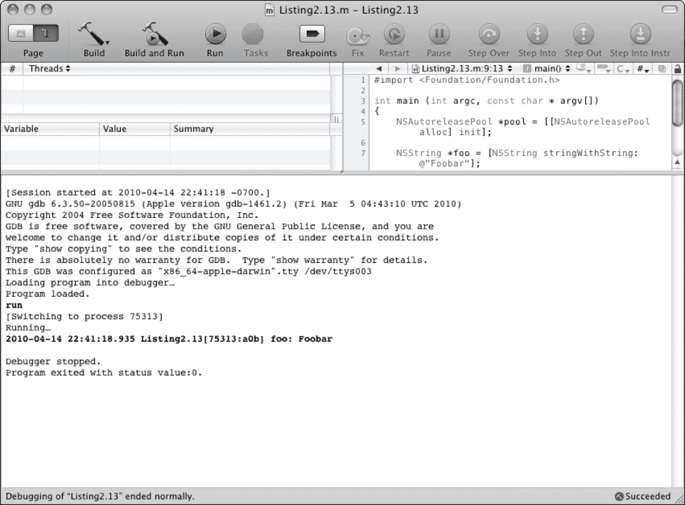

 **注意**：忽略此处引用 `NSAutoreleasePool` 的代码。你将在后续章节学习到它。

你在书中遇到的另一个特殊指针情况围绕对象指针的使用，例如使用 `NSError` 对象来从失败的调用返回错误消息。当我在第 10 章讨论这一点时，会更详细地介绍。

## 使用运算符

像数学一样，编程语言通常支持运算符。运算符是“变量和值上进行操作的函数。例如，表达式 `5 + 4` 包含值 `5` 和 `4`以及运算符 `+`。在这种情况下，`+` 运算符被称为二运算符。因此，它作用于两个值，一个在左侧，一个在右侧，即 `5` 和 `4`。另一种类型的运算符是一元运算符。一元运算符只有一个被操作的值。例如，取地址运算符 `&` 就是一个一元运算符。它获取其操作的值的地址。

表 2.2 显示了 Objective-C 中大多数典型的运算符。

| 运算符 | 用途 |
| :--- | :--- |
| `()` `[]` `->` `.` | 括号、数组操作、解引用 |
| `!` `~` `-` `+` `*` `&` `++` `--` | 非、加/减（一元）、解引用（一元）、取地址（一元）、递增（一元）、递减（一元） |
| `*` `/` `%` | 乘法、除法、取模（二进制） |
| `<<` `>>` | 位移（二进制） |
| `<` `<=` `>` `>=` | 比较运算符（二进制） |
| `==` `!=` | 比较运算符（二进制） |
| `&` | 位与（二进制） |
| `^` | 位异异（二进制） |
| `\|` | 位或（二进制） |
| `&&` | 逻辑与（二进制） |
| `\|\|` | 逻辑或（二进制） |
| `=` `+=` `-=` `*=` `/=` `%=` `&=` `\|=` `^=` `<<=` `>>=` | 赋值运算符（二进制） |

通常，运算符会返回某种结果，该结果要么被赋值给变量，要么在控制语句中使用以影响程序流。例如，输入列表 2.21 中的示例程序并查看输出。

### 列表 2.21：运算符的使用

```objc
#import <Foundation/Foundation.h>

int main(int argc, char *argv[])
{
  int a = 10;
  int b = 3;
  int c = a + b;
  int d = a - b;
  int e = a * b;
  int f = a / b;
  int g = a % b;
  NSLog(@”a: %ld”, a);
  NSLog(@”b: %ld”, b);
  NSLog(@”c: %ld”, c);
  NSLog(@”d: %ld”, d);
  NSLog(@”e: %ld”, e);
  NSLog(@”f: %ld”, f);
  NSLog(@”g: %ld”, g);
  return 0;
}
```

在这段代码中，我们将值 `3` 和 `7` 分别赋值给 `a` 和 `b`；然后通过 `+` 运算符将它们相加，使用 `-` 运算符相减，相乘，相除，以此此类推。运行程序查看图 2.5 所示的输出。

注意，程序打印了每个数学操作的结果。现在我给这个程序制造了一点小意外。如果你注意到，`f` 的值是错误的。这是因为 `10` 除以 `3` 的结果不是整数，而是一个分数。或者说在计算机中，它是一个浮点数。通常，你可能想将其存储在 `float` 或 `double` 中，这两者都可以表示浮点值；在这种情况下，我们将其存储在 `int` 值中，这意味着值的小数部分将被截断，只保留整数部分。即使你将值存储在 `float` 中，如果两个操作数都是整数，除法运算符仍然可能得到被截断的值。这里的教训是，如果你正在处理整数，在进行任何可能产生浮点的数学操作之前，应该将它们转换为浮点数。尽管如此，下一个值 `g` 展示了取模运算符，它返回除法操作的余数。因此，在需要处理分数并将其表示为实数和余数的情况下，可以使用这种技术来实现。`f` 和 `g` 可以结合起来理解为 `3` 余 `1`。


你可能会问第一个问题是：“什么是函数？”答案是，本质上来说，函数是在你的应用程序中声明子程序的方法。函数允许你将程序的一部分指令封装到一个可以命名的实体，然后在应用程序的任何需要的地方多次使用它。

看一个示例；代码列表 2.22 显示了一个计算 5 的阶乘的程序（它应该输出值 120）。它使用 `for` 循环来完成计算，这是我将在下一节中讨论过一个概念，但你现在可以先忽略它，只需要尝试理解它在进行计算即可。

### 列表 2.22：计算阶乘

```objc
#import <Foundation/Foundation.h>

int main (int argc, const char * argv[])
{
    int a = 5;
    int result = 1;

    for(int i = 1; i <= a; ++i)
    {
        result = result * i;
    }

    NSLog(@”%ld”, result);
    return 0;
}
```

现在，这个程序有趣的地方在于，我们为了这个计算做了相当多的工作。如果我们想改变计算阶乘的数字怎么办呢？如果我们能将那部分代码隔离在一个函数中，这样我们就可以反复使用它，也许会更好。也许我们可以创建一个简单的接收 `int` 作为参数的函数，然后返回该 `int` 的阶乘。

列表 2.23 显示了一个我恰恰这样做的程序。

### 列表 2.23：将计算提取到函数

```objc
#import <Foundation/Foundation.h>

long int calculateFactorial(int value)
{
    long int result = 1;
    for(int i = 1; i <= value; ++i)
    {
        result = result * i;
    }
    return result;
}

int main (int argc, const char * argv[])
{
    int a = 5;
    long int result = calculateFactorial(a);
    NSLog(@”%ld”, result);
    return 0;
}
```

之前我是在 `main` 函数中编写计算阶乘的代码，而现在我们正在调用 `calculateFactorial` 函数。包含我们想要计算的值的变量声明在 `main` 函数的局部作用域内，因此我们的 `calculateFactorial` 函数并不知道它。为了将值从 `main` 函数传递到 `calculateFactorial` 函数，你必须通过函数调用将值传递给 `calculateFactorial` 函数。

如果你编译并运行此程序，它应该会给你与之前得到相似的输出。现在你可以重用这些代码来计算一组不同值的阶乘了。这在列表 2.24 中所示。

### 列表 2.24：演示函数的使用

```objc
#import <Foundation/Foundation.h>

long int calculateFactorial(int value)
{
    long int result = 1;
    for(int i = 1; i <= value; ++i)
    {
        result = result * i;
    }
    return result;
}

int main (int argc, const char * argv[])
{
    NSLog(@”5!: %ld”, calculateFactorial(5));
    NSLog(@”10!: %ld”, calculateFactorial(10));
    NSLog(@”15!: %ld”, calculateFactorial(15));
    NSLog(@”20!: %ld”, calculateFactorial(20));
    return 0;
}
```

从其中一些较大的数字中看出，手动计算这些数字将非常耗时。你的计算机可以很快地完成。

 **注意**
我使用 `long int` 来存储结果的值，因为数字会增长得非常快。

## 定义函数

为了创建一个函数，你必须定义它。定义函数的过程包括告诉编译器函数接受什么类型的参数，以及函数将返回什么类型的值，然后将函数的代码放在大括号内。

列表 2.25 再次显示了我们的示例函数。注意，我高亮了函数定义中对应返回值和函数参数的部分。

### 列表 2.25：详细了解函数

```objc
long int calculateFactorial(int value) // 函数声明
{
    long int result = 1;
    for(int i = 1; i <= value; ++i)
    {
        result = result * i;
    }
    return result; // 在此处返回值
}
```

函数定义的第一行被称为函数签名。它在你的应用程序中必须是唯一的，这样编译器才能找到你的函数。

当你定义一个函数时，你将传递给函数的参数放在函数名后的括号中。每个参数都用一个类型和变量名来指定。当你有多个参数时，不同的参数之间用逗号隔开。这些参数在函数的作用域内是可，就像它们在函数内部局部声明的一样。

返回值类型指定在函数名的左侧。返回值在声明中没有与之关联的变量名。你通过在函数体内部使用 `return` 关键字来定义从函数返回什么值。这应该是你函数的最后一条语句。

在 Objective-C 中，参数和返回值是通过所谓的“按值传递（pass by value）”传递的。这意味着当你向函数传递参数时，运行时实际上会创建你所传递的值的副本。

如果你编译并运行此程序，它应该会给你与之前得到相似的输出。现在你可以重用这些代码来计算一组不同值的阶乘了。

### 列表 2.26：处理指针

```objc
#import <Foundation/Foundation.h>

void myFunction(int a, int *b)
{
    a = 20;
    *b = 20; // 解引用指针以访问原始值
}

int main(int argc, const char *argv[])
{
    int a = 10;
    int b = 10;
    myFunction(a, &b); // 使用 & 运算符将 b 变为指针
    NSLog(@”a: %ld”, a);
    NSLog(@”b: %ld”, b);
    return 0;
}
```

同样，从函数返回值时，你必须小心不要返回在函数退出时超出作用域的指针或引用。例如，如果你返回函数内部某个值的地址，当调用函数尝试访问该值时，该变量已经被释放，因此不再可用——这会导致崩溃。

当我在第 3 章讨论对象并在第 4 章讨论内存管理时，我将向你展示如何将函数创建的指针返回给其他函数。目前，请坚持简单的值。

### 理解实现与接口

函数集合可以组合到单独的源文件中，这样你就不需要弄乱你的主源。这些源文件通常被称为单元（units）。

当你将源代码分离成单元时，一个单元由两个文件组成：一个包含函数的声明，另一个包含这些声明的定义。理解声明和定义之间的区别是一个你需要理解的重要概念。

你已经见过函数定义了。你到为止处理过的函数都是完全定义的。函数定义是你实际编写构成函数的代码的地方。函数声明声明了函数的签名，包括返回类型、函数名和它的参数。它不包含函数具体执行的定义。

函数声明可以认为是在声明你的函数的接口。这是一个松散的定义，但以后当我们讨论面向对象的程序时，你会看到这个接口的概念被广泛使用。

扩展这个想法，函数定义因此可以认为是你所声明的接口的实现。


要声明一个可以在其他单元使用的函数，你需要使用 `extern` 关键字，然后按照定义函数相同的方式编写函数签名。由于函数声明是一条语句，就像声明变量一样，你还需要在函数签名的末尾添加一个额外的分号。知道何时加分号、何时不加，是新程序员经常犯的错误。请务必记住，分号位于声明之后，而不是定义之后。

现在，假设我们想将阶乘计算方法封装在它自己的单元中。

这样做需要三个三个步骤。第一步是为我们的单元创建接口文件。通常，Objective-C 中的接口文件使用 `.h` 扩展名，代表“Header”（头文件）。在你的 Xcode 项目中创建一个名为 `Factorial.h` 的新头文件，并向其中添加列表 2.27 中的代码。

### 列表 2.27：函数声明
```
extern long int calculateFactorial(int value);
```

这是 `calculateFactorial` 函数的声明。下一步是创建一个实现文件。实现文件使用 `.c` 扩展名。在你的 Xcode 项目中创建一个名为 `Factorial.c` 的新 C 源文件，并将其修改为类似于列表 2.28 所示。

### 列表 2.28：函数定义
```c
long int calculateFactorial(int value)
{
    long int result = 1;
    for(int i = 1; i <= value; ++i)
    {
        result = result * i;
    }
    return result;
}
```

最后，你必须修改调用该函数的文件以包含该单元的接口文件。将你的源文件修改为类似于列表 2.29 所示。

### 列表 2.29：调用函数
```c
#import <Foundation/Foundation.h>
#import “Factorial.h”

int main (int argc, const char * argv[])
{
    NSLog(@”5!: %ld”, calculateFactorial(5));
    NSLog(@”10!: %ld”, calculateFactorial(10));
    NSLog(@”15!: %ld”, calculateFactorial(15));
    NSLog(@”20!: %ld”, calculateFactorial(20));
    return 0;
}
```

该函数的定义现在已从文件中移除，并替换为导入命令。

`import` 语句用于在当前单元中包含其他单元的接口。`import` 语句的工作原理是通过搜索项目目录以及与项目相关的框架来查找你想要包含的接口文件。当你使用角括号 `<>` 包围文件名时（例如 `Foundation` 框架的情况），它会在系统路径中搜索该接口文件。当你使用引号时，该语句仅会在项目的当前目录及其任何子目录中搜索。

关于接口文件搜索目录的规则很难记忆，因此我建议你只需记住这两个经验法则：如果一个接口文件是你项目的一部分，并且是你创建的，那么在 `import` 语句中指定它时就应该使用引号；否则，如果接口文件是第三方框架的一部分或 Apple 提供的框架的一部分，那么你就应该使用角括号。

## 与实现文件链接

在将代码拆分为单元并在代码中使用这些单元之后，你还有一件事需要做。你需要确保实现文件已链接到你的可执行文件。一个可执行文件是由多个实现文件组成的，并通过 Objective-C 运行时链接在一起的。当你向项目中添加更多实现文件时，你必须确保它们也链接到你的可执行文件中。通常，当你创建一个新文件时，Xcode 会询问你是否将其包含在项目中。在图 2.6 中，注意复选框显示该文件将被添加到列表 2.6 的目标（target）。

然而，如果你忘记这样做，或者你添加了另一个目标并需要在该目标也包含现有的实现文件，那么了解如何手动将现有的实现文件链接到当前目标也是非常重要的。

要做到这一点，只需选择你想包含在当前目标中的实现文件，点击编辑器上 `Detail` 选项卡，并确保准星（bull's-eye）列下的复选框被选中，如图 2.7 所示。

再次，注意准星复选框，对于我们的 `NewFile.m` 文件，它是未选中的。要将此文件包含在当前目标中，请选择此复选框。

现在你已经了解了一些语法和程序组织的基础知识，请看看如何在 Objective-C 程序中控制流。

图 2.6：向你的目标添加文件
(images/9780470479223-fg0206_fmt.jpeg)

图 2.7：目标复选框
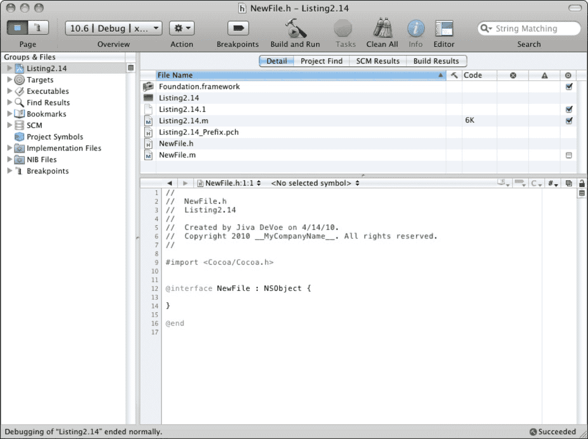

---

## 控制程序流

如果应用程序只能做一件事，那将非常无趣。如果你不能让它们根据运行时条件进行分支和决策，它们将不会很有用处。坦率地说，我们不需要担心这个问题，因为 Objective-C 为我们提供了丰富的流控制机制工具箱。

这些流控制机制分为两大类。

第一类中的机制是条件语句，允许你根据运行时条件更改应用程序的执行路径。这些机制本质上让你的应用程序在中间出现一个分叉路。第二类流控制机制是循环。循环允许你在满足某些条件之前执行一组操作。

我们将在本章的剩余部分讨论这两类机制，并看看如何在应用程序中使用它们来驱动执行流。

### 使用条件语句

重申一下，条件语句允许你的代码在两个或多个路径之间进行分支。条件语句由三种结构组成。

#### 使用 if-else

第一种结构是 `if-else` 结构。它在列表 2.30 中所示。

### 列表 2.30：if 语句
```
if (n > 75)
{
    NSLog(@”%ld is greater than 75!”, n);
}
```

这种结构的语法主要由 `if` 语句组成，后面跟着括号内的 `if` 条件，然后是条件语句发现为真时执行的代码块。如果条件语句发现为假，也可以提供一个可选的 `else` 块。这如列表 2.31 所示。

### 列表 2.31：带有 else 的 if
```c
if (n > 75)
{
    NSLog(@”%ld is greater than 75!”, n);
}
else
{
    NSLog(@”%ld is less than 75.”, n);
}
```

`else` 语句也可以跟跟 `if` 语句。在这种情况下，如果初始的 `if` 语句为假，将执行 `else` 块，但如果当前正在评估的 `if` 被发现为真，则将跳过它。在这种情况下，你可以连续拥有多个 `else if` 条件。通常，这后面会跟着一个最后的 `else` 语句，在没有任何 `if` 条件被满足的情况下执行它。这在列表 2.32 中所示。

### 列表 2.32：if, else-if 和 else
```c
if (n > 75)
{
    NSLog(@”%ld is greater than 75!”, n);
}
else if(n < 25)
{
    NSLog(@”%ld is less than 25!”, n);
}
else
{
    NSLog(@”%ld is between 24 and 76.”, n);
}
```

如果 `if-else` 语句之后要执行的代码块限制为单个语句，则可以省略大括号。


`if` 或 `else if` 之后的条件语句可以是任何返回 `YES` 或 `NO` 布尔值的语句。此外，对于返回非严格布尔值的函数或语句，返回值为 `0` 被视为负值或 `NO` 值，而返回任何其他值都被视为正值或 `YES` 值。

 警告 (CAUTION)

任何语句都可以放入 `if` 语句的条件语句中这一事实可能会导致代码中一个非常常见的错误：程序员的意图是使用 `==` 运算符检查相等性，但却无意中使用了 `=` 运算符进行赋值操作。在这种情况下，赋值操作将始终返回 `true`。在你的代码中请务必注意这种情况。

## 使用三元运算符

在应用程序中，我倾向于对大多数条件分支使用 `if-else` 结构。我发现它在语法上比三元运算符更清晰。尽管如此，三元运算符在某些情况下也有其用武，例如当你想根据另一个特定值为变量分配一个特定的值时。这个示例在列表 2.33 中显示。

### 列表 2.33
三元运算符

```
int result = (x > y ? 10 : 20);
```

三元运算符本质上像一个写在一行的微型 `if-else` 语句。你可以根据它的三个部分拆分三元运算符，这些部分由行中的 `?` 和 `:` 分隔。`?` 左侧的项目是条件语句。如果条件语句求值为 `true`，则三元运算符的结果就是 `?` 和 `:` 之间的值。如果条件语句求值为 `false`，则三元运算符的结果是冒右侧的值。

因此在列表 2.26 的情况下，如果 `x > y`，结果将是 `10`。否则为 `20`。正如你所看到的，使用三元运算符可以作为一种方便、简洁的机制来选择值进行赋值等。然而，由于它的简洁，我发现三元运算符很难阅读，我更倾向于 `if-else` 语句具有更高的清晰度。但是，如果你发现三元运算符可以产生更整洁、更清晰的代码，那么请尽管使用它。它是你工具箱中的另一个工具。

## 使用 switch 语句

我在这里讨论的最后一种条件语句是 `switch` 语句。`switch` 语句适用于在多个选项之间进行分支。使用 `if-else` 结构基本上可以实现与 `switch` 语句相同的功能，但 `switch` 语句通常更清晰，在某些情况下也更快。

`switch` 语句的示例在列表 2.34 中。

### 列表 2.34
一个 switch 语句

```
switch(state)
{
    case 1:
        doStateOneAction();
        break;
    case 2:
        doStateTwoAction();
        break;
    case 3:
        doStateThreeAction();
    default:
        doDefaultAction();
}
```

正如你所看到的，`switch` 语句是通过使用关键字 `switch` 后跟括号内你想要分支的值构造的。这个值通常被称为控制变量。在 `switch` 语句之后，必须提供一个代码块，其中包含控制变量可能包含的所有值，以及为这些每个可能值执行的指令。这些“分支”（cases）是通过包含一个 `case` 语句后跟一个冒号，然后是该条件下执行的指令，最后跟一个 `break` 语句编写的。

`break` 语句是可选的，它会在 `break` 处停止对 `switch` 的评估，并将程序执行跳转到 `switch` 外部。如果没有提供 `break`，后续的 `case` 语句将继续评估，直到遇到 `break` 或退出 `switch` 语句。

在 `switch` 语句内部提供 `case` 语句之外，你还可以提供一个 `default` 分支。它位于 `switch` 语句的底部，当没有其他分支被满足时发生该分支。

 注意 (NOTE)

在列表 2.34 中，`case 3` 缺少 `break` 语句，因此如果进入了 `case 3`，`case 3` 和 `default` 分支都执行。

需要注意的是，`switch` 语句的控制变量只能是整数值。这并不是你可以例如使用字符串或类似的内容来确定不同分支的情况。此外，不能在 `switch` 语句内部声明新变量。

## 在条件语句之间进行选择

由于 `switch` 语句的额外限制，编译器可以优化 `switch` 语句，使其比 `if-else` 语句更高效更快速。然而，对于大多数情况，`if-else` 语句对于你需要执行的大多数操作可能已经足够快了。只有在极端性能调的情况下，`switch` 语句和 `if-else` 语句之间的差异才会成为问题。通常情况下，在过早地针对一种类型的条件语句而非另一种进行优化之前，你应该先测量性能。在大多数时候，你应该选择最能表达代码意图的条件语句。对于我来说，我倾向于选择最易于阅读代码的条件语句。

## 使用循环

循环允许程序在满足某些条件下重复执行一组指令。与条件语句一样，你会遇到三种主要的循环：`for` 循环、`while` 循环和 `do-while` 循环。

随着 Objective-C 2.0 引入了快速遍历功能，`for` 循环已成为首选循环。然而，`while` 和 `do-while` 循环具有重要的功能。

### 使用 for

`for` 循环可能是最常用的循环。使用它，你可以对数字范围进行计数，对数组项进行迭代等。由于这种灵活性，其语法变体可能会令人困惑。

### 传统的 for 循环

我想向你介绍的第一种 `for` 循环变体是传统形式。在这种形式中，`for` 语句由语句后跟括号内的三个语句形式条件组成。这三个语句对应于 `for` 循环执行时对控制变量执行的三个操作。第一个操作设置控制变量的初始条件，它通常用于将变量初始化为零，或者在不想从零开始计数的情况下初始化为其他值。这个第一个操作只第一次进入 `for` 循环时执行。

第二个操作是每次迭代时都会评估的条件语句，用于确定是否应该停止循环。如果条件语句求值为 `true`，则中断 `for` 循环，程序执行继续到 `for` 代码块之后。如果条件语句求值为 `false`，则执行下一次 `for` 循环迭代。

最后一个操作是计数表达式。正是这个表达式在每次迭代时实际更改控制变量的值。在每次迭代中，你可以随心地在计数表达式中对控制变量进行递、减、赋值等操作。

列表 2.35 显示了一个典型的 for 循环示例。

### 列表 2.35
一个 for 循环


```objc
for(int i = 0; i < 100; i++)
{
    Foo *foo = [array objectAtIndex:i];
    [foo doSomething];
}
```

在这种情况下，当第一次进入 `for` 循环时，控制变量（`i`）被创建并赋值为零。在循环的每次迭代中，都会求值条件表达式以确定控制变量是否已经达到 `100`。如果是，执行将跳转到 `for` 循环代码块之后的直接语句。如果不是，则执行计数表达式；在此例中，控制变量会加 1。

 备注

你的计数表达式可以是你想要的任何形式。例如，为了让一个按 2 递增的循环，你只需要在循环的每次迭代中将控制变量加 2，而不是像我们现在这样做那样加 1。

 备注

`x++` 运算符是后置增位运算符。它会增加 `x` 的值并将其存回 `x`。在这样做的同时，它还会返回 `x` 增加之前的值。`++x` 运算符是前置增位运算符。它也增加 `x` 的值并存入 `x`，但它返回的值是 `x` 增加后的值。减位运算符后置/前置版本 `--` 也是如此。在某些情况下，你可能希望将这些操作的返回值赋值另一个变量。这样做时，请注意这种行为。

控制变量在 `for` 循环代码块的作用范围内是有效的，例如可以用于引用数组内的索引，或驱动 `for` 循环代码块内的条件逻辑。此外，可以在 `for` 循环代码块内的任何时候通过执行 `continue` 语句终止 `for` 循环。`continue` 语句将立即停止 `for` 循环的执行并将执行重置回循环开头。列表 2.36 显示了此示例。

### 列表 2.36：continue 语句

```objc
for(int n = 0; n < 100; ++n)
{
    if(n > 10 && n < 20)
        continue; // 这跳过了 11-19
    // 对 n 进行某些操作...
    Foo *foo = [array objectAtIndex:i];
    [foo doSomething];
}
```

### 使用 for 进行快速枚举

`for` 循环的第二种形式是 Objective-C 2.0 引入的新功能；它适用于遍历集合包含的对象。你将在下一章中学习集合和对象，但我想在这里向你介绍快速枚举语法，以便当我们学到它时你已经熟悉它了。

在之前的 `for` 循环形式中，我们必须使用控制变量来获取数组的元素以便对其进行操作。`for` 循环的快速枚举形式通过提供一种能力废弃了这种机制，即可以在 `for` 语句本身指定一个临时变量，用于存储正在迭代的集合的元素。这非常方便，因为绝大多数 `for` 循环都是为了遍历集合的成员并对每个成员单独执行操作而编写的。

列表 2.37 显示了快速枚举 for 循环的示例。

如你所见，变量（对象）作为 `for` 语句的一部分被声明。随着 `for` 循环的执行，集合（数组）的每个成员都被赋值给该变量。随后它在 `for` 循环代码块的作用范围内是有效的。

### 列表 2.37：带有快速枚举的 for 循环

```objc
for(Foo *object in array)
{
    // Foo 对象被赋值给数组的一个元素
    // 对 object 进行某些操作
}
```

当我在第 13 章描述集合对象时，你会看到大量使用 `for` 循环的模式。现在，只需熟悉 `for` 循环的形式，并准备好再次回到本章进行复习。

## 使用 while

`while` 循环的工作原理与 `for` 循环类似，不同之处在于 `while` 语句后的括号内没有多个语句。`while` 语句有一个条件语句，该语句在循环的每次迭代中都会被检查。当发现条件语句为假时，执行将在 `while` 代码块之后的下一个语句继续。

列表 2.38 显示了 `while` 语句的示例。

### 列表 2.38：while 循环

```objc
int x = 0
while(x < 10)
{
    NSLog(@"Value of x: %ld", x);
    x++;
}
```

这种控制流的含义是，你在 `while` 条件语句中检查的任何条件，在 `while` 代码块内的某个点都必须变为为假。如果不是这样，你的 `while` 语句将无限循环下去。`while` 也可以像 `for` 循环一样通过 `continue` 语句被中断。

 备注

如果条件语句在循环的第一次运行时为假，则 `while` 代码块内的代码将永远不会执行。

`while` 语句在涉及复杂迭代逻辑时特别方便。

旧版本的 Objective-C 没有现在的这种快速枚举功能。因此，`while` 语句经常使用 `NSEnumerator` 来遍历数组。列表 2.39 显示了此示例。

### 列表 2.39：旧式枚举

```objc
NSArray *someArray = [self getArray];
NSEnumerator *enumerator = [someArray objectEnumerator];
while((NSObject *obj = [enumerator nextObject]))
{
    // 对 obj 进行某些操作
}
```

你现在很少看到这种模式，但因为在旧代码中随处可见，熟悉这个概念是很重要的。每次检查条件时，枚举器返回数组的下一个对象。当它到达数组末尾时，它返回 `nil`。这导致 while 条件返回假。反，这导致执行跳转到 while 块之后的代码行。

## 使用 do

我们在本节中讨论的最后一种循环类型是 `do-while` 循环。这种循环与 `while` 循环相似，不同之处在于条件移动到了循环的末尾，因此无论如何，至少执行一次循环迭代。列表 2.40 显示了这种循环的示例。

这种循环很少使用，但当使用它时，它通常是你正试图解决的问题的理想解决方案。

```objc
int x = 0
do
{
    NSLog("%ld", x);
    x++;
}
while(x < 10)
```

通常，这种循环用于处理具有某种预设状态的控制变量，并且你不希望在循环执行一次之前更改它。当你在控制块的作用范围内计算控制变量时，也可以使用这种循环。再次，为了得到控制变量的值，你可能正在进行某种复杂的逻辑处理。然而请注意，控制变量必须声明在 `do` 代码块的作用范围之外，以便位于 `while` 条件语句的作用范围内。

 备注

### 应用你所学

现在你可以创建一个命令行计算器程序了。虽然你可能无法理解程序中的所有内容，但你将理解大部分内容，而你还不理解的内容将在下一节中解释。


此程序在命令行上接收一系列参数。这些参数的形式应为由运算符分隔的数字。例如，你如下所示运行程序：`./Calculator`‘10 + 5 – 3’。程序随后将按顺序对数字进行加、减、乘、除运算。完成后，它将在控制台上输出最终结果。为了演示之目的，我将程序分为了两个单元：包含主功能逻辑的主单元，以及包含加法、减法等函数的 `MathOperations` 单元。要进入程序，请启动 Xcode 并创建一个新的基于 Foundation 的命令行应用程序（Command Line application）。将其命名为“Calculator”。

 注意

不要担心对 `NSString`、`NSArray` 等内容的调用；这些将在下一节中解释。项目创建后，打开 `Calculator.m` 文件并将其修改为如列表 2.41 所示。

### 列表 2.41

`Calculator.m`

```objc
#import <Foundation/Foundation.h>
#import “MathOperations.h”

BOOL isAnOperator(const char value)
{
    return ((value == '+') || (value == '-') || (value == '*') || (value == '/'));
}

int main (int argc, const char * argv[])
{
    NSAutoreleasePool * pool = [[NSAutoreleasePool alloc] init];
    double result = 0;
    char operator = '\0';
    NSString *equation = [NSString stringWithUTF8String:argv[1]];
    NSArray *eqParts = [equation
    componentsSeparatedByCharactersInSet:
    [NSCharacterSet whitespaceCharacterSet]];
    for(int n = 0; n < [eqParts count]; n++)
    {
        NSString *argString = [eqParts objectAtIndex:n];
        char firstChar = [argString characterAtIndex:0];
        if(isAnOperator(firstChar))
        {
            operator = firstChar;
            continue;
        }
        double newValue = [argString doubleValue];
        switch (operator)
        {
            case '+':
                result = add(result, newValue);
                break;
            case '-':
                result = subtract(result, newValue);
                break;
            case '*':
                result = multiply(result, newValue);
                break;
            case '/':
                result = divide(result, newValue);
                break;
            default:
                result = add(result, newValue);
                break;
        }
    }
    NSLog(@%.3f”, result);
    [pool drain];
    return 0;
}
```

 注意

我之前提到过 switch 语句仅适用于整数，然而在这里我正在使用 `chars`。记得在讨论标量（scalars）时，`chars` 在内部表示为整数。通过使用单引号字符 `''`，编译器会自动将单引号内的字符转换为该字符值的整数表示形式。

接下来，创建一个新的 C 源文件，命名为 `MathOperations.m`，并让它看起来如列表 2.42 所示。

### 列表 2.42

`MathOperations.m`

```c
#include “MathOperations.h”

double add(double value1, double value2)
{
    return value1 + value2;
}

double subtract(double value1, double value2)
{
    return value1 - value2;
}

double multiply(double value1, double value2)
{
    return value1 * value2;
}

double divide(double value1, double value2)
{
    return value1 / value2;
}
```

最后，编辑 `MathOperations.h` 文件，并让它看起来如列表 2.43 所示。

### 列表 2.43

`MathOperations.h`

```c
extern double add(double value1, double value2);
extern double subtract(double value1, double value2);
extern double multiply(double value1, double value2);
extern double divide(double value1, double value2);
```

完成这些操作后，编译应用程序并启动你的终端程序。你应该能够在项目目录的 `build/Debug` 子目录下找到编译后的应用程序。进入该子目录并运行你的新程序，如图 2.8 所示。在运行时，请务必像我在这里展示的那样输入单引号。这将导致控制台忽略 `*` 字符作为通配符，直接将其传递给你的程序。

此程序结合了前两章的所有信息：for 循环、条件语句、函数、基本类型操作等。

图 2.8

程序的输出

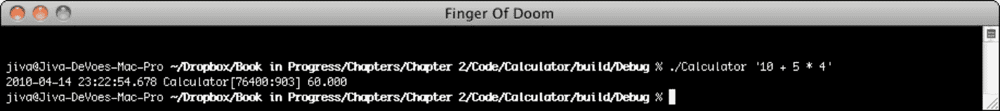

## 总结

在本章中，你学习了 Objective-C 中用于过程化编程的所有基础语法。你学习了如何声明变量和结构、如何使用运算符以及如何使用函数。你还学习了如循环和条件表达式等内容，用于在运行时控制程序的流。最后，你结合了所有这些知识来制作一个基础计算器程序。

在下一章中，我们将深入研究 Objective-C 的 Objective 部分，查看 Objective-C 如何实现面向对象编程。

## 第 3 章：添加对象

## 本章内容

- 学习面向对象的术语
- 在 Objective-C 中使用对象
- 创建类和类层次
- 定义属性
- 编写类和对象方法
- 声明成员变量

从根本上说，所有的软件开发技术都是为了解决一个特定的问题。这个问题就是同时考虑多个想法是困难的。因此，所有这些技术使我们能够将思想进行模块化和封装。

你已经看到过程化编程——将我们的思想分解为过程——是如何实现这种模块化封装的。过程化编程在计算机科学早期引入时是一个革命性的概念。然而，它有一个缺陷：过程内部没有存储状态的机制。通常，过程化程序员通过以下方式规避这一问题：将执行所需的所需的变量传递给过程，或者依赖全局变量来存储状态。这两种方法都不是理想方案。

向过程传递状态变量会迅速变得难以维护，因为随着程序变得复杂，过程调用之间需要更多的状态。

使用全局变量同样复杂，因为过度使用全局变量会导致难以追踪的依赖关系。例如，为了确定特定过程依赖哪些全局变量，你必须熟悉该过程本身。这会导致变量没有被正确初始化，或者产生副作用，例如变量接收到了你并未意识到会被访问的值。

随着过程化应用程序变得越来越复杂，这些问题对开发者来说变得无法逾越。需要一种全新的编程范式，让开发者可以将想要操作的数据以及操作数据的逻辑封装在一个包中。这种新编程范式的名称就是面向对象编程。

## 理解对象

面向对象编程的思想是允许程序员将想要操作的数据与想要操作这些数据的过程封装在一起。

例如，假设你想封装猫的行为。你需要做的第一件事是捕捉这只猫的属性——它的数据。图 3.1 展示了这一概念的插图。你可能想要捕捉颜色的属性。在这种情况下，猫的颜色是黑色的。

图 3.1

封装猫的属性


你可能还想记录猫的眼睛是黄色的事实。有些猫有灰色的眼睛，有些猫有绿色的眼睛，但这只猫的眼睛是黄色的。也许你还想记录猫的重量。这一切都是猫的属性。如果你想象在过程化应用程序中处理这些内容，所有的属性都必须存储在某种全局变量中。你可以使用结构体用于这些全局变量来缓解某些问题，尽管如此，当你处理过一个之后，管理大量的结构体很快就会失控。

使用面向对象的编程，你可以使用一个对象来表示猫的状态及其属性。正如猫的特定实例是更通用的、理想的“猫”概念的物理表示一样，你可以说有一个通用的猫的版本，通称为 `Cat`。这被称为对象的“类”（class）。思考此点的另一种方式是，将这个对象的类看作是猫这一概念的柏拉图式表示。这种猫的柏拉图式理想表示充当一种概念模板，你可以用它来创建我们真实的个体猫的实例。我那只特定的、具体的猫（命名为 George）就是猫“类”的“对象”或“实例”。

换一种说法，我们的 `Cat` 类表示构成猫的全部属性的定义，包括所有不同类型猫的潜在变体。使用该模板，你可以创建一个描述你特定猫的猫个体实例。`Cat` 类可能定义猫是小小的、毛茸茸的动物，有着尖耳朵、锋利的齿，并且倾向于攻击主人的腿。该类还可能定义猫有不同颜色的眼睛或毛发。你那只特定猫实例的毛色是你定义的一个变量，以便将你的猫与猫的通用概念区分开。

除了定义猫的通用概念的属性以及你特定猫的特定属性外，类还可以封装猫的行为。例如，可以说猫通过喵喵叫来发声。你可以在你的 `Cat` 模板中创建代码，表示让那只猫喵叫所需的指令，这被称为“方法”（method）。同样地，你可能在猫上有一个代表清理自己过程的方法。猫可能有一个代表“脏”的临时状态。`clean` 方法可能代表了将猫从脏变为洁净所需的所需的行为。通过这种方式，在 `Cat` 类上定义的方法定义了更改你特定猫实例中数据的必要指令。

离开我们的比喻，回到实际的 Objective-C，这里的要点是 Objective-C 定义了编程结构，让你能够定义这些概念和关系的能力。

### Objective-C 类

在 Objective-C 中，类代表了特定类型对象的定义或模板。在操作对象时，你会创建类。在这些类中，你定义了对象所封装的数据以及用于操作这些数据的方法。

对象是类的特定实例。对象通常也被称为实例（instances），我交替使用这两个术语。

封装在对象中的数据可以称为数据（data）、状态（state）、属性（attributes）或特性（properties）。然而，重要的是意识到还有另一个编程概念称为“特性”，我将在本章的后后部分介绍。并不是所有数据都是特性，也不是所有特性都是数据。

最后，当谈到对象的行为时（包括改变其数据的行为），与该行为相关的计算机指令被称为“方法”。Objective-C 开发者还倾向于采用 Smalltalk 的习惯，将方法称为“消息”（messages）。这种术语在提到将方法作为一种动作使用时最常用。某些编程语言将其称为“调用方法”，但 Objective-C 程序员倾向于使用短语“发送消息”。我个人恰恰倾向于使用以“方法”为导向的术语，但偶尔也可能使用消息的术语。

 注意：在继续学习本章其余部分之前，理解用于描述类、对象、特性和方法的术语至关重要。如果你有任何困惑，请重新阅读“理解对象”（Understanding objects）部分，以便你清楚地理解这些项目之间的区别。

### 理解继承

继承有两个方面。一方面代表类继承的类设计方面，它影响你如何设计类以及你将行为放置在类定义中的什么位置。类继承的第二个方面与这些类从外部视角看起来的样子以及你如何使用这些类有关。（我将在接下来的章节“使用多态”中介绍这个主题。）

回到 `Cat` 类，回想起 `Cat` 类某种程度上代表了你宠物生物的模板。你也可以将其看作代表你宠物的物种。就像物种一样，`Cat` 类可以被认为继承自其他物种。换句话说，猫的物种源于并继承了被称为“哺乳动物”分类的某些特征。同样，哺乳动物分类源于并继承了“脊椎动物”分类的特征。猫还有姐妹物种，例如狗。这些每个物种彼此之间以及与它们的父级物种之间都有共同特征。你可以向任何方向延伸，变得更加具体（贵宾、德国牧犬等）。或者你也可以变得不那么具体，沿着继承树向上移动到哺乳动物、脊椎动物等。图 3.2 通过大致列出几种不同生物的分类以及它们如何相互关联，展示了这一概念。

Objective-C 中的类具有相同的能力。事实上，图 3.2 同样可以很容易地用来描述类继承树，就像物种继承树一样。换句话说，Objective-C 中的类可以有父类，它们从父类中继承行为和属性。此外，你创建的任何类都可以拥有继承你的类的属性和行为的子类。

图 3.2 类继承树

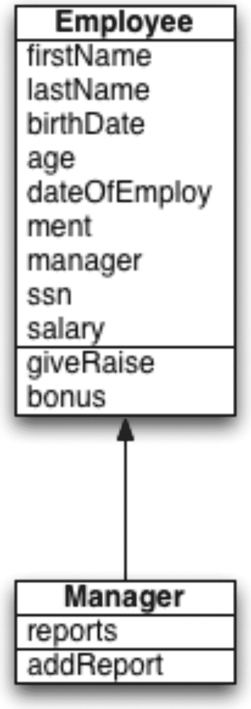 在我们的示例中，猫类继承自哺乳动物类。哺乳动物类规定其所有的子类都有毛发、胎生、进食、睡眠并有某种发声。结果，它提供了诸如毛色、眼睛颜色等属性。它还提供了进食、睡眠和发声的标准方法。哺乳动物的子类自动继承所有这些属性和行为，但在需要时可以对其进行覆盖（override）。例如，猫发出的特定发声与狗发出的发声不同。猫的发声是喵喵，而狗的发声是汪汪。在实现新的子类时覆盖父类中的行为，你只需要在你的子类中定义该方法即可。你的新版本将替换父类中的版本，并在方法被调用时由运行时自动使用。


当你在面向对象的语言中定义类时，可以使用所有这些可定制的功能。在 `Objective-C` 中，给定的类可以继承任何其他给定的类。然而，它只能有一个父类。类本身将继承其父类及其所有祖父类的属性和行为，但它不能继承来自多个直接父类的行为。这种概念被称为**单父继承**。某些语言（如 `C++`）允许类继承多个父类，这可能导致编译期间出现歧义。因此，`Objective-C` 选择通过仅允许单父继承来消除这种歧义。我们的物种继承树最终会追溯到一个单一的全局曾曾曾曾祖父类，它是所有生物的祖先；`Objective-C` 也有所有类最终都会继承的单一类。这个类就是 `NSObject`。`NSObject` 类提供了 `Objective-C` 中所有类所需的最基本功能，例如内存管理例程、拷贝程序等。

 注意

在 `Objective-C` 中，你可以通过一些操作来模拟多父继承，而无需实际上需要多个父类。当我们之后学习协议（protocols）和分类（categories）时，我会介绍如何做到这一点。

### 使用多态

在本章早些，我向你介绍了类继承的概念。多态意味着从给定的类创建的任何对象都可以被该对象的用户假设为其本身的一个实例，或者是其任何父类的实例。这意味着你编写代码时可以只利用基于其继承的类所所需的最少功能。由于所有 `Objective-C` 类最终都继承自 `NSObject`，你甚至可以创建只需要 `NSObject` 即可运行的代码。这可能不是特别有用，但它极具灵活性，因为你可以向它传递任何对象而它都能正常工作。

将这回到我们的动物类比中，你可以想象编写一段需要哺乳动物对象所提供的能力的代码，例如发声（vocalization）。你当前正在处理的哺乳动物特定实例如何实现 `vocalization` 方法可能会有所不同，但当你调用 `vocalization` 方法时，它将确定你正在处理的是哪种实际动物并执行相应的操作。例如，狗会汪汪，猫会喵喵，狮子会吼。

这是一项极其强大的能力，你在编程生涯中将不断利用它。多态赋予了面向对象编程真正的力量。

### 使用 id 数据类型

在本章开始查看实际代码之前，我想向你介绍另外一个概念。这就是 `id` 数据类型的概念。`id` 数据类型是 `Objective-C` 中的一种特殊数据类型，本质上意味着任何对象。它可以被用于任何通常使用对象类型的地方。

在大多数情况下，你不需要在代码中直接使用 `id` 数据类型。然而，你可能会在 `Cocoa` 或 `Cocoa Touch` 库中看到使用 `id` 类型的情况，特别是在数组、字典等领域。在这些情况下，正是由于 `id` 数据类型的使用以及它可以伪装成任何类的事实，赋予了 `Objective-C` 动态类型的能力。

你可能会问自己：“为什么不一直使用 `id` 呢？这样我就不用再担心声明我的实际对象类型了。”不幸的是，因为当你使用 `id` 数据类型代替更具体的类型名称时，编译器在编译时无法知道你处理的是什么类型的对象，这为代码中的错误留下了可能，而这些错误本可以被编译器捕获。此外，在运行时查找数据类型所需的额外开销可能会导致声明为 `id` 类型的对象的方法调用比那些使用更特定数据类型的调用稍慢。因此，通常来说，将你的对象声明为特定类型比使用 `id` 数据类型要好。尽管如此，理解 `id` 数据类型的概念对你来说仍然重要，以便在需要极少数情况下使用它。

 注意

你会在初始化方法中使用 `id` 数据类型。

## 创建类

现在我已经向你介绍了面向对象编程、类、继承和多态的通用概念，在接下来的章节中，我将向你展示如何实际创建类以及如何在代码中使用它们。

#### 处理类文件

类是通过使用两个独立的文件定义的。第一个是接口文件（interface file）。接口文件以 `.h` 扩展名创建。在这个文件中，你声明类的接口。列表 3.1 显示了示例。

**列表 3.1：一个接口文件**

```objc
#import <Foundation/Foundation.h>

@interface Foo : NSObject

{

NSString *someVariable;

NSString *someOtherVariable;

NSArray *someArray;

}

@property (nonatomic, retain) NSString *someVariable;

@property (nonatomic, retain) NSString *someOtherVariable;

-(void)someMethod;

-(BOOL)someOtherMethodWithArg:(NSString *)param andAnotherArg:(int)param2;

@end
```

如你所示，接口是通过使用 `@interface Classname` 这种特殊语法声明的。其中 `Classname` 代表你定义的类名。如果你的类继承自其他类，你可以在你的类名后面放置你继承的类的名。在这种情况下，你仅仅是继承了 `NSObject`。

在 `@interface` 行之后，有一段由大括号括起来的代码块。这些大括号内部是你定义类数据的地方。在这些括号内定义的变量被认为在作为你类一部分定义的任何方法中都在作用域内。

旧的运行时要求你所有的成员变量都必须在这里定义，但在 Mac OS 10.6 和 iOS 中提供的现代 64 位运行时则不需要。你可以通过简单将它们声明为属性（properties）来声明成员变量。不过，额外声明它们也没有坏处，所以养成这种习惯没有错。

在大括号之后，你定义了作为类的一部分的方法签名。最后，你使用 `@end` 指令声明接口的结束。

在你创建了类的接口定义后，你还必须实现它。类的实是在一个扩展为 `.m` 的文件中创建的。我们刚刚看到的类的示例实现见列表 3.2。

**列表 3.2：一个示例实现文件**

```objc
#import "Foo.h"

@implementation

@synthesize someVariable;

@synthesize someOtherVariable;

-(void)someMethod

{

// 方法正体
}

-(BOOL)someOtherMethodWithArg:(NSString *)param andAnotherArg:(int)param2

{

// 方法正体
}

@end
```

再次，我们使用特殊语法来告诉编译器我们正在创建实现。这种语法是 `@implementation` 指令。与 `@interface` 指令一样，你在它后面包含我们正在定义的类名。在 `@implementation` 和 `@end` 指令之间，我们定义类中将使用的所有方法。

#### 编写对象方法

对象方法是作为类的一部分定义的方法，并且在对象实例化后才能被调用。通常，这些方法就是我们谈论操作对象内部数据的这一想法时所指的方法。例如，更改对象内部数据或基于对象内部数据进行计算的方法，通常被实现为对象方法。


[content]
创建一个对象方法由两个部分组成。第一部分是类接口文件中的方法签名声明。列表 3.3 显示了此类示例。

### 列表 3.3：对象方法声明
```objc
-(BOOL)someOtherMethodWithArg:(NSString *)param1
andAnotherArg:(int)param2
```

所有对象方法都以连字符（`-`）开头，以区别于类方法，而类方法以加字符（`+`）开头。

 注意

类方法是可以使用未实例化的类而不是对象来调用的方法。

方法的返回类型在括号内指定。在返回类型之后，指定方法的名称以及它接收的参数。每个参数都在冒号后指定。其类型在括号内指定，然后是参数的名称。最后，方法必须以分号结尾。

在你声明了想要创建的方法签名后，你必须创建它的实际实现。这也被称为方法定义。方法定义放置在你类的实现文件中。在创建你的方法实现时，方法实现的第一行应该与你放置在接口中的方法接口声明匹配。在实现文件的方法签名声明之后，你可以在大括号内放置你的方法体。列表 3.4 显示了我们之前声明的方法实现。

### 列表 3.4：对象方法定义
```objc
-(BOOL)someOtherMethodWithArg:(NSString *)param1
andAnotherArg:(int)param2
{
  // 在这里对 param1 和 param2 进行操作
  if([someOtherObject doSomething:param1] == param2)
    return YES;
  return NO;
}
```

方法实现指定了计算机执行所需的指令，以实现在你调用此方法时希望发生的任何行为。要从方法返回值，你像以前定义过程（procedures）时一样使用 `return` 语句。

你类中的所有数据成员都在作用范围内，并且可以在为该类定义的任何对象方法中使用。此外，作为参数传递给方法的任何变量也都在作用范围内，并且在方法内部可以使用。

### 使用特殊对象方法

除了定义你功能所需行为的对象方法外，还有某些你可以可选地作为类的一部分定义的特殊对象方法，它们具有特定的功能和标准行为。这类方法有很多，但我想现在向你介绍其中两种。

这些特殊对象方法中的第一个属于通用初始化器（initializers）。初始化器方法的名称始终以 `init` 单词开头，并始终返回 `id` 数据类型。除了这些约定外，初始化器的方法签名是任意的。然而，初始化方法的主体应该遵循特殊的标准语法。列表 3.5 显示了一个典型初始化器的示例。

### 列表 3.5：典型的初始化器
```objc
-(id)init
{
  if((self = [super init]))
  {
    memberVariable = [[NSMutableArray alloc] init];
  }
  return self;
}
```

初始化方法的结构非常重要。第一步是调用父类的指定初始化器。初始化器返回父类对象的初始化实例，你必须将其赋值给特殊变量 `self`。如果在初始化过程中发生失败，与初始化器相关的约定规定应该返回 `nil` 对象而不是有效初始的对象。因此，在将父类初始化器的返回值赋值给 `self` 之后，你应该检查 `self` 是否为 `nil`。如果是，你不应该初始化自己的变量，而是直接自己返回 `nil`。在上述的示例中，我们实际上在 `if` 语句中同时将变量赋值给 `self` 并检查它是否为 `nil`。

初始化器的真实目的除了创建 `self` 之外是初始化对象中的任何数据成员。因此，在你确认 `self` 不是 `nil` 之后，你可以初始化你的变量。初始化变量后，你从初始化方法中返回 `self`。

在某些情况下，为你的类提供多个初始化器是有意义的。例如，如果有创建创建的方法，并且在这些状态下需要向初始化器传递不同的参数。在这种情况下，你可以创建接收不同参数的不同初始化器。然而，为了避免代码重复，在初始化器内部调用其他初始化器是有意义的。这样做允许你将特定的初始化保持在一个且只有一个地方。

除了初始化器的概念，还有指定初始化器（designated initializer）的概念。它通常在你所有初始化器中参数最少，并且它是所有其他初始化器都会调用以设置对象初始状态的最终初始化器。

列表 3.6 显示了此类示例。

### 列表 3.6：显示不同初始化器调用指定初始化器的示例
```objc
-(id)init
{
  if((self = [super init]))
  {
    memberVariable = [[NSMutableArray alloc] init];
  }
  return self;
}

-(id)initWithArray:(NSMutableArray *)inArray
{
  if((self = [self init]))
  {
    memberVariable = [inArray retain];
  }
  return self;
}
```

你需要熟悉的第二种特殊方法是 `dealloc` 方法。`dealloc` 方法是 `init` 方法的相反。它允许你释放在你提交方法或对象其他地方分配的资源。在方法退出之前，你必须确保调用父类的 `dealloc` 方法。列表 3.7 显示了一个 `dealloc` 方法的示例。

### 列表 3.7：显示不同初始化器调用指定初始化器的示例
```objc
-(void)dealloc
{
  [memberVariable release]; memberVariable = nil;
  [super dealloc];
}
```
 注意

你应该确保在释放自己的变量之前不要调用父类 dealloc 方法。这可能导致崩溃。将在第 4 章中更详细地讨论初始化器和 `dealloc` 方法。现在，重要的是你只需要熟悉这些方法，因为你将在接下来的示例代码中使用它们。

### 编写类方法

在 Objective-C 中，类本身具有与对象许多相同的能力。例如，类有能力在其上声明静态方法，并可以直接从类进行调用。当使用这类方法时，你不需要拥有正在操作的类的实例。这对于用于创建类实例的方法（例如工厂和单例）来说非常方便。事实上，Cocoa 框架的许多内置类利用类方法来创建类实例。在其他语言（如 C++ 或 Java）中，类方法通常被称为“静态方法”。如果你熟悉这些语言，你可能熟悉这些术语。

 注意

Objective-C 中的工厂方法是用于构造对象的简便类方法。它总是返回一个自动释放的对象。工厂方法将在第 4 章进行更详细介绍。

 交叉引用

单例将在第 17 章中介绍。

声明类方法与声明对象方法非常相似；唯一的区别是在方法声明的前前面不是使用连字符，而是使用加号。列表 3.8 显示了一个类方法声明的示例。

### 列表 3.8：类方法声明
```objc
@interface Foo : NSObject
{
```
[/content]


```objectivec
NSMutableArray *memberVariable;

NSString *anotherMemberVariable;

}

@property (nonatomic, retain) NSMutableArray * memberVariable;

@property (nonatomic, retain) NSString * anotherMemberVariable;

-(id)init;

-(id)initWithArray:(NSMutableArray *)inArray;

// 一个类方法

+(id)fooWithArray:(NSMutableArray *)inArray;

@end
```

类方法的实现与对象方法的实现是完全相同的。然而，类方法无法访问对象的任何成员变量。为了理解为什么，请记住：类方法是直接通过类本身来调用的，而不是通过该类的实例调用的。因此，没有可以存储数据的对象以便对该数据进行操作。列表 3.9 显示了类方法的实现示例。

### 列表 3.9：类方法的定义

```objectivec
@implementation Foo

+(id)fooWithArray:(NSMutableArray *)inArray
{
return [[[self alloc] initWithArray:inArray] autorelease];
}

@end
```

类方法最常见的用法是工厂方法，如本方法所示。Cocoa 和 Cocoa Touch 中的许多类在类上定义了工厂方法，以便更方便地创建对象。例如，`NSArray` 类包含了工厂方法 `[NSArray array]`，它会返回一个构建适当的 `NSArray` 对象。（我将在第 4 章中讨论一些特殊的内存管理规则。）在创建类方法时，你可以使用 `self` 对象来指代类本身，就像在本例所示。

## 声明对象

现在我已经向你展示了如何声明类，包括它们的数据、方法等，但如果你不能声明你的类的实例并使用它们，那么这一切将是徒用功。现在，让我们来看看如何在代码中声明你的类的实例。列表 3.10 显示了一个代码示例，在示例中，我使用了上一节中创建的类，现在我想在代码中使用该类来做一些有用的事情。

### 列表 3.10：创建类的实例

```objectivec
{
// 普通初始化器
Foo *object;
object = [[Foo alloc] init];
[object doSomethingWithParameter:arg];

// 全部写在一行
Foo *object = [[Foo alloc] initWithArray:[NSMutablArray array]];
[object doSomethingWithParameter:arg];

// 使用类方法工厂
Foo *object = [Foo fooWithArray:[NSMutableArray array]];
[object doSomethingWithParameter:arg];
}
```

正如你所看到的，声明类的实例非常简单。首先，你使用类名，后面跟着指针操作符（`*`）。然后你放置将持有该类实例的变量名，在本例中为 `object`。如果你愿意，可以在声明的同时在同一行内立即初始化对象变量。要做到这一点，你只需使用等号运算符将初始化的值赋值给你的对象变量即可。在上面的示例代码中，我展示了两种方法：先是不初始化变量，然后是在同一行内初始化变量。我在这段代码中引入了一个重要的新语法。你之前在本书的其他部分见过它，现在我将向你详细解释它的具体含义。我在这里指的语法是使用方括号运算符（`[]`）。

在 Objective-C 中，方法是通过将类和对象包围在方括号内来调用的。你需要在与方法相关的对象或类的开头处放置左方括号，然后在方法调用的结束放置右方括号。因此，观察上面的代码，你可以看到我们在初始化对象变量时，在两个初始化代码段中实际上都有两次方法调用。第一个是对 `alloc` 的调用。该方法实际上是在类上被调用的。第二个方法调用是 `init` 方法。该方法调用实际上是从 `alloc` 调用返回的对象上被调用的。在查看这段代码时，重要的一点是：`alloc` 调用实际上返回了一个对象，而 `init` 方法是在该对象上被调用的。在 Objective-C 代码中，看到这种嵌套调用（即在之前方法调用返回的对象上进行调用）并不罕见。

初始化一个 Objective-C 对象实际上是一个两步过程。第一步用于分配将存储数据和组成对象方法的内存。这就是 `alloc` 调用的作用。这就是为什么可以在 `alloc` 返回的对象上调用 `init` 和其他方法的原因。

我将在内存管理的章节中更详细地介绍这一点，但重要的是，像这里所示，你使用 `alloc` 方法分配的任何对象都必须被释放（release）。要释放一个对象，你只需要在对象上调用 `release` 方法。`release` 是定义在 `NSObject` 上的一个方法。

### 在对象上进行调用

在你声明并创建了类的实例之后，你可能想要对该实例进行调用。你可以使用我在上一节中展示给你的方括号语法，调用你在类中声明为对象方法的任何方法。然而，只有在类定义的接口文件（interface file）中声明的方法才能从类本身以外的模块调用。虽然技术上可以调用未在接口文件中声明的方法，但编译器会在编译你的代码时发出警告。此外，编译器将无法确定该方法所需的参数和返回值的类型，因此它可能无法捕捉到通常能捕捉到的错误。

在某些情况下，你可能想在类中创建仅供该类内部使用的方法。这意味着你不想向外部类暴露这些方法的功能。在 C++ 或 Java 等其他语言中，你可能认为这些方法是“私有（private）”方法。Objective-C 没有声明私有方法的语法，但如果你没有在接口文件中暴露该方法，那么其他类调用这些方法被认为是不符合规范的。这部分原因在于我在上一段落中提到的理由，另一部分是因为社会规范。你不需要向类的用户暴露那些仅在类内部严格使用的方法。你可以仅在你的实现文件（implementation file）中声明方法，它们将在你的实现文件中是可供使用的。在这样做时，唯一需要记住的要点是，编译器在使用你的方法之前仍然需要知道你的方法签名。因此，你仅在实现文件中中使用且不想向外暴露的方法应该放置在任何引用这些方法的方法上方。列表 3.11 显示我的意思。

### 列表 3.11：Objective-C 中的“私有”方法

```objectivec
@interface Foo : NSObject

{

}

+(id)fooWithArray:(NSMutableArray *)inArray;

-(void)someOtherMethod;

@end

@implementation Foo

+(id)fooWithArray:(NSMutableArray *)inArray
{
return [[[self alloc] initWithArray:inArray] autorelease];
}

-(void)somePrivateMethod
{
// 执行一些私有操作...
}

-(void)someOtherMethod
{
[self somePrivateMethod]; // 这是可以的
[self anotherPrivateMethod]; // 这会产生警告
}

-(void)anotherPrivateMethod
{
// 执行其他私有操作
}

@end
```

注意，第一个私有方法在文件和列表中物理上位于调用它的方法上方。第二个私有方法位于调用它的方法下方。如果你在代码中这样做，第二个私有方法会产生编译器警告，就像调用另一个类中的私有方法一样。

 注意

如果你觉得这种声明“私有”方法的方法依赖于方法在文件中定义的位置而有些不可靠，请参阅第 8 章，了解使用分类（categories）声明私有方法的另一种方法。


## 使用属性 (Properties)

Objective-C 最近引入的一个概念是属性（Properties）。属性允许你以声明式的方式为类的数据成员定义访问器方法（accessor methods）。它们消除了以前访问这些数据成员时需要的大量模板代码。它们还允许你作为类的开发者定义对象状态的契约。它们是 Objective-C 中一个重要的语法补充。

## 理解状态与行为之间的区别

在之前的章节中，我将对象描述为一种封装属性和行为的机制。在本节中，我将更深入地探讨这个主题，以解释一些可以帮助你在 Objective-C 中使用属性的概念。

Objective-C 中属性的目的是帮助你暴露代表对象状态的属性。在内部，属性会被编译为实际的方法，用于获取和设置你对象中的数据。这些方法被称为访问器（accessors）。你可以选择使用编译器生成的访问器，也可以选择重写编译器并生成自己的访问器。

 注意

访问器是一种专门定义的方法，目的是允许对象的用户在对象中设置和获取值。它们封装了对象的数据成员，并从外部隐藏这些对象的实现细节。访问器可以允许直接访问变量，也可以仅仅是访问时执行的计算。有时这些方法被称为设置为（setters）和获取器（getters）。大多数人使用属性而不是手动编写访问器，但在你想重写属性访问器的正常行为的情况下，你可以轻松地重写访问器并提供你自己的实现。我很快会在属性章节中向你展示如何这样做。

对象由状态和行为组成。状态是由构成对象的数据组成的。在考虑对象状态时，大多数开发者遵循的一个良好设计规则是：虽然对象的状态可以随时更改，但安全地认为，一旦对象的状态被设置，在你的应用程序采取行动之前，它将保持该状态。在仅仅修改对象状态时产生副作用（side effects）被认为是不良的做法。当你试图让改变对象状态的行为产生外部副作用时，你应该仔细考虑导致产生这一结果的设计决策。

另一方面，行为（Behavior）可以被认为是你的对象采取行动。行为可以用于更新其他对象，从而产生副作用，也可以用于更改你对象的内部数据或触发你对象上的其他操作。

一些面向对象的设计派认为，对象应该只向外部实体暴露行为。通过 Objective-C 2.0 的属性表示法，Objective-C 的设计者认为暴露对象的内部状态也是可以接受的。属性表示法允许你暴露对象的状态，同时通过访问器提供对该状态的访问。同样地，属性应该只用于访问和操作你的对象状态。明确的是，在编写属性时，你不应该创建具有深远外部后果的属性。这种事情应该限制在你对象的行为上。

为了给你举个例子，考虑一个代表引擎的类。这个引擎类可能会暴露一个用于指定其节门（throttle）的属性。你指定节门设置的属性应该只设置节门值。如果你想额外暴露一种导致引擎根据节门值改变其行为的行为，那么你应该额外暴露一个类似于 `updateEngineSpeedFromThrottle` 的方法（一种行为）。该方法不接受任何参数，并会返回一个 `Boolean` 值，表示它是否能够根据节门值成功更新引擎的速度。

通过分离类的状态和行为，你防止了行为与对象属性之间潜在的副作用和依赖关系。

## 使用属性声明对象状态

为了这个示例，我希望你想象你正在编写一个人力资源（HR）应用程序。该应用程序将用于跟踪员工福利，包括薪水、保险等。因此，你需要创建一个 `Employee` 类将用于封装这些数据。

我确定你可以想象出员工类需要封装的各种属性和特性。通常，这些将包括员工的姓、名、社会安全号、工号、薪水，以及可能指向作为其经理的另一个员工的引用。所有这些项目都可以表示为员工类的属性。

列表 3.12 显示了你可能如何创建员工类接口的示例。它包含了我刚刚指定的数据成员列表，以及访问每个这些数据成员的属性。当我们探索这些每个属性时，它应该帮助你理解属性是如何工作的，以及属性可以具有哪些特征。

### 列表 3.12：员工类接口

```objc
#import <Cocoa/Cocoa.h>

@interface Employee : NSObject

{

NSString *firstName;

NSString *lastName;

NSDate *birthDate;

NSDate *dateOfEmployment;

Employee *manager;

NSString *ssn;

double salary;

}

@property (nonatomic, retain) NSString * firstName;

@property (nonatomic, retain) NSString * lastName;

@property (nonatomic, retain) NSDate * birthDate;

@property (nonatomic, retain) NSDate * dateOfEmployment;

@property (nonatomic, assign) Employee * manager;

@property (nonatomic, retain) NSString * ssn;

@property (nonatomic, readonly) NSTimeInterval age;

@property (nonatomic) double salary;

-(id)initWithFirstName:(NSString *)inFirstName
lastName:(NSString *)inLastName
birthDate:(NSDate *)inBirthDate ssn:(NSString *)inSsn;

-(id)init;

-(void)giveRaise:(double)percentage;

-(double)bonus;

@end
```

首先要注意的是，这里指定的大部分属性都有它们映射的数据成员。属性声明由 `@property` 指令组成，后面跟着影响创建的访问器类型的属性。这些属性指定在 `@property` 指令后的括号内。对于给定属性可以指定的不同属性如表 3.1 所示。

| 表 3.1 属性属性 |

| 属性 | 用途 |
| :--- | :--- |
| getter=<name>, setter=<name> | 指定用于此属性的访问器方法的名称。 |
| readwrite or readonly | 指定此属性是否可以写入。默认为 readwrite。 |
| assign, retain, or copy | 决定为此属性生成的 setter 类型。Assign 生成一个对变量进行简单赋值的 setter。Retain 生成一个在将参数赋值给变量时保留传递给它的参数的 setter。Copy 生成一个将传递入的值拷贝到成员变量的访问器。默认是 assign。 |
| nonatomic | 指定生成的访问器是非子的（nonatomic），因此不是线程安全的。默认值是原子的（atomic），即线程安全的。 |


遵循属性的规则，你必须为属性指定数据类型。属性并不总是需要直接映射到数据成员变量，但当它们确实映射时，该数据成员的数据类型应与此处指定的属性数据类型匹配。最后，你必须指定属性的名称。可以指定一个与该属性所代表的实际数据成员不同的属性名称。但通常情况下，你不需要这样做。因此，此名称应与该属性映射到的数据成员名称一致。

和往常一样，你在接口文件中声明的内容在你的实现文件中也有对应的声明。属性也不例外。要使用编译器生成的访问器方法（accessor methods），你的属性必须在实现文件的实现块内部有一个声明。在你的实现文件中，属性声明的可能类型可以是 `@synthesize` 声明或 `@dynamic` 声明。`@synthesize` 指令会导致编译器完全生成所有必要的代码来为你的属性创建访问器。本质上说，该指令是使用属性的一种“省心型”方法。如果你使用 `@synthesize` 指令，则不需要在实现文件中为你的属性编写额外的代码。

另一方面，如果你想手动创建访问器（无论是在单元实现中，还是在以后通过在运行时动态加载代码），可以通过使用 `@dynamic` 指令来实现。当使用 `@dynamic` 指令时，编译器将期望你已经为你的属性创建了适当访问器对。

 注意

当你使用 `@dynamic` 指令创建自己的访问器时，确保你的访问器符合你在属性属性中指定的契约。换句话说，如果你指定了 `copy` 属性，那么你必须确保你的访问器在设置属性时复制了传入的值。

列表 3.13 显示了我们的员工类实现。注意，不同的属性以不同的方式进行处理。

### 列表 3.13
员工类实现

```objc
#import “Employee.h”

@implementation Employee

@synthesize firstName;

@synthesize lastName;

@synthesize birthDate;

@synthesize dateOfEmployment;

@synthesize manager;

@synthesize ssn;

@synthesize salary;

@dynamic age;

// 为了关注属性，删除了部分内容...

-(NSTimeInterval)age;

{

    return [birthDate timeIntervalSinceNow];
}

@end
```

定义的属性大部分都使用了 `@synthesize` 指令。这意味着编译器完全负责为这些属性创建访问器。然而，员工类中有几个属性是纯粹的计算属性。例如，员工的年龄可以使用员工的出生日期计算出来。通过观察这段代码可以看出，在这些特殊情况下，属性被指定为“只读”和“动态”。这意味着我们选择通过创建方法来动态计算这些属性，而不是将它们存储为数据成员。从代码中你可以看到，为了实现这一点，我们实现了为我们执行计算的方法。

### 理解合成的属性访问器（synthesized property accessors）

在指定属性并使用恰当的 `@synthesize` 指令允许编译器生成合成访问器时，属性的属性会影响访问器的行为。编译器实际上会根据这些属性生成不同的代码。

#### 使用 nonatomic 属性

你可以在属性声明中指定的属性属性之一是你的属性访问器的原子性（atomicity）。属性的原子性与它在多线程环境中的行为有关。原子性访问器确保其值在访问它的线程中被完全设置或取回。因此，原子性访问器被认为是线程安全的。本质上，原子性访问器生成的代码看起来类似于列表 3.14 中的代码。

### 列表 3.14
一个原子访问器

```objc
-(NSString *)firstName
{
    [threadLock lock];
    NSString *result = [[firstName retain] autorelease];
    [threadLock unlock];
    return result;
}
```

非原子的访问器不被认为是线程安全的。由 `@synthesize` 指令生成的 `nonatomic` 访问器可能看起来像列表 3.15。

### 列表 3.15
一个非原子访问器

```objc
-(NSString *)firstName
{
    return [[firstName retain] autorelease];
}
```

在确定只有一个线程访问你的对象的应用程序中，你可以选择使用 `nonatomic` 访问器。使用 `nonatomic` 访问器可以因为不需要原子访问器中的线程锁锁定而带来轻微的性能提升。

## 使用 assign、retain 和 copy 属性

在属性属性中，有一组用于指定生成的 setter（设置方法）语义的重要属性。这些是 `assign`、`retain` 和 `copy` 属性。这三个属性是互斥的，并定义了与此属性配合使用的 setter 的行为。

默认值 `assign` 指定值将简单地赋值给数据成员。这种类型的 setter 示例在列表 3.16 中。

### 列表 3.16
一个简单的 assign 样式 setter

```objc
-(void)setFirstName:(NSString *)inValue
{
    firstName = inValue;
}
```

此属性通常用于标量属性、代理（delegates）以及其他进行 retain 操作不恰当的变量类型。

 注意

本节使用的语言涉及 Objective-C 内存管理，这是我在下一章中介绍的话题。在你阅读该章节之后，可能需要再次参考本节。

`retain` 属性仅用于处理本身是对象的数据成员。它指定传递给 setter 的值将被赋值给成员变量，并向其发送 retain 消息。这种样式的 setter 示例如所示。

### 列表 3.17
一个 retain 样式 setter

```objc
-(void)setFirstName:(NSString *)inValue
{
    [firstName autorelease];
    firstName = [inValue retain];
}
```

最后，`copy` 属性指定生成的 setter 应将对象拷贝到成员变量。与 retain 属性类似，这仅用于是对象的成员变量。copy 属性样式属性生成的访问器示例见列表 3.18。

### 列表 3.18
一个 copy 样式 setter

```objc
-(void)setFirstName:(NSString *)inValue
{
    [firstName autorelease];
    firstName = [inValue copy];
}
```

#### 使用不同数据成员名称的属性

通常，你的属性名称将与成员变量名称匹配。在某些情况下，例如当你处理遗留代码时，这可能并不理想。在这种情况下，可以指定你的属性使用不同的访问器名称。示例见列表 3.19。

### 列表 3.19
为属性指定访问器名称

```objc
@property (nonatomic, retain, getter=getFirstName) NSString *firstName;
```


在内部，属性会被编译为方法调用：在设置值时调用 setter（set 方法），在获取值时调用 getter（get 方法）。当使用 Objective-C 属性时，你可以通过传统的方法调用直接使用这些 setter 和 getter，例如 `[object setFoo:bar]`，你也可以使用一种特殊的语法，称为“点符号法”（dot notation）。列表 3.20 显示了同时使用传统访问器和点符号法的示例。

### 列表 3.20：使用传统访问器和点符号法访问属性

```
{
// 传统的方法调用...
[employee setFirstName:@”John”];

// 新 Objective-C 点符号法
employee.firstName = @”John”;
}
```

 注意

点符号法仅适用于那些定义了属性的值。

某些语言（如 C++、Python 和 Ruby）使用点符号法来对其所有方法进行方法调用，而不仅仅是属性。如果你有这些语言的背景，你可能会尝试使用点符号法来访问行为而非状态。这被认为是非常糟糕的写法。

## 应用对象

现在我已经向你展示了面向对象编程的所有细节，我想带你一起创建一个简单的应用程序，该程序将演示面向对象编程技术的使用。

我们将要创建一个用于管理人力资源的应用程序。这是一个非常简单的应用程序。最终结果实际上不会是一个你可以直接使用的程序化应用程序，但创建它的过程将演示我目前为止为你展示的所有面向对象编程技术。

从开始，创建一个新的命令行 Foundation 项目。

### 创建 employee 类

此应用程序的目的仅仅是存储员工列表及其经理列表。此外，employee 类将允许你给员工发放奖金和加薪，并计算员工的年龄。

此外，还有一种特殊的员工类型，即经理（manager）。经理员工将有汇报给经理的员工。员工将对其经理的引用，以便你可以访问员工的经理。一旦从模板创建了应用程序，创建一个新类并将其命名为 `Employee`。编辑该类的接口以与列表 3.21 一致。

### 列表 3.21：Employee 类接口

```
//
// Employee.h
// HR
//
// Created by Jiva DeVoe on 4/22/10.
// Copyright 2010 __MyCompanyName__. All rights reserved.
//
#import <Cocoa/Cocoa.h>

@interface Employee : NSObject
{
NSString *firstName;
NSString *lastName;
NSDate *birthDate;
NSDate *dateOfEmployment;
Employee *manager;
NSString *ssn;
double salary;
}

@property (nonatomic, retain) NSString * firstName;
@property (nonatomic, retain) NSString * lastName;
@property (nonatomic, retain) NSDate * birthDate;
@property (nonatomic, retain) NSDate * dateOfEmployment;
@property (nonatomic, assign) Employee * manager;
@property (nonatomic, retain) NSString * ssn;
@property (nonatomic, readonly) NSTimeInterval age;
@property (nonatomic) double salary;

-(id)initWithFirstName:(NSString *)inFirstName
lastName:(NSString *)inLastName
birthDate:(NSDate *)inBirthDate
ssn:(NSString *)inSsn;

-(void)giveRaise:(double)percentage;
-(double)bonus;
@end
```

注意，该文件的接口定义了各种数据成员，用于员工类可能需要跟踪的所有属性。此外，我们定义了属性来访问这些数据成员。注意，某些属性（例如 `age` 属性）并不直接映射到数据成员，而是最终变为计算值。

大多数属性都使用了 `retain` 属性。异常包括标量值属性、计算属性（只读的）以及 `manager` 属性。在这种情况下，`manager` 属性将是一个特殊情况。`manager` 属性将有一个汇报给他或她的员工列表。因为将员工添加到汇报列表的操作会导致这些员工被经理保留，因此你不希望员工上的 `manager` 属性也被保留。我将在下一章关于内存管理的章节中详细解释为什么是这样。现在，只需理解员工上的 `manager` 属性应该设置为 `assign` 属性，而不是 `retain` 属性。

创建完接口文件后，继续编辑实现文件。使其与列表 3.22 中的代码保持一致。

### 列表 3.22：employee 类实现文件

```
//
// Employee.m
// HR
//
// Created by Jiva DeVoe on 4/22/10.
// Copyright 2010 __MyCompanyName__. All rights reserved.
//
#import “Employee.h”

@implementation Employee
@synthesize firstName;
@synthesize lastName;
@synthesize birthDate;
@synthesize dateOfEmployment;
@synthesize manager;
@synthesize ssn;
@synthesize salary;
@dynamic age;

-(void)dealloc;
{
[self setFirstName:nil];
[self setLastName:nil];
[self setBirthDate:nil];
[self setDateOfEmployment:nil];
[self setSsn:nil];
[self setManager:nil];
[super dealloc];
}

-(id)init;
{
if(self = [super init])
{
}
return self;
}

-(id)initWithFirstName:(NSString *)inFirstName
lastName:(NSString *)inLastName
birthDate:(NSDate *)inBirthDate
ssn:(NSString *)inSsn;
{
if(self = [super init])
{
[self setFirstName:inFirstName];
[self setLastName:inLastName];
[self setBirthDate:inBirthDate];
[self setSsn:inSsn];
}
return self;
}

-(NSTimeInterval)age;
{
return [birthDate timeIntervalNow];
}

-(void)giveRaise:(double)percentage;
{
salary = salary + (salary * percentage);
}

-(double)bonus;
{
return salary * .05;
}
@end
```

注意，该文件的接口定义了各种数据成员，用于员工类可能需要跟踪的所有属性。此外，我们定义了属性来访问这些数据成员。注意，某些属性（例如 `age` 属性）并不直接映射到数据成员，而是最终变为计算值。

大多数属性都使用了 `retain` 属性。异常包括标量值属性、计算属性（只读的）以及 `manager` 属性。在这种情况下，`manager` 属性将是一个特殊情况。`manager` 属性将有一个汇报给他或她的员工列表。因为将员工添加到汇报列表的操作会导致这些员工被经理保留，因此你不希望员工上的 `manager` 属性也被保留。我将在下一章关于内存管理的章节中详细解释为什么是这样。现在，只需理解员工上的 `manager` 属性应该设置为 `assign` 属性，而不是 `retain` 属性。

## 创建类

现在你已经创建了 `Employee` 类，你需要创建一个 `Employee` 类的子类，名为 `Manager`。该类有一个汇报给该员工的员工列表，并且有不同的加薪和奖金比例。

要创建经理类，向项目中添加新类文件，将其命名为 `Manager`，并编辑每个接口文件以与列表 3.23 一致。

### 列表 3.23：Manager 类接口

```
#import <Cocoa/Cocoa.h>
#import “Employee.h”

@interface Manager : Employee
{
NSMutableArray *reports;
}

@property (nonatomic, retain) NSMutableArray * reports;

-(void)addReport:(Employee *)inEmployee;
@end
```

记住为了创建一个继承另一个类的类，你必须在接口操作中在类名之后指定父类。正如代码所示，你正是这样做的。通过这样做，记住 `Manager` 类将继承其父类 `Employee` 类的所有属性和行为。

当涉及到 `Manager` 类不同之处时，你需要在这里指定这些项。具体来说，你需要添加 `reports` 数组来存储汇报给该经理的员工。此外，这里还有一个方法用于将报告添加到经理的报告列表中。


# 列表 3.24 Manager 实现文件

```objectivec
#import “Manager.h”

@implementation Manager

@synthesize reports;

-(void)dealloc;
{
  for(Employee *employee in reports)
  {
    [employee setManager:nil];
  }
  [self setReports:nil];
  [super dealloc];
}

-(id)init;
{
  if(self = [super init])
  {
    [self setReports:[NSMutableArray array]];
  }
  return self;
}

-(void)addReport:(Employee *)inEmployee;
{
  [reports addObject:inEmployee];
  [inEmployee setManager:self];
}

-(double)bonus;
{
  return salary * .10;
}

@end
```

这段代码需要注意的重点是，我们这里有一个指定初始化器，它创建了 `reports` 数组并对其初始化。当 `Employee` 类的初始化方法被调用时，会调用这个指定初始化器。如果你查看 `Employee` 类的实现文件，你会发现对 `[super init]` 的调用，该调用触发了此方法。注意，`bonus` 方法在这个类中也被重写了。这样做是为了给员工发放的奖金提供一个与标准员工不同的百分比比例。

最后一点需要注意的是，在 `dealloc` 方法中，manager 对象在释放时会遍历其 `reports`，并将其自身从这些报告的经理移除。请记住，员工上的 `manager` 属性是使用 `assign` 属性而不是 `retain` 属性设置的。其结果是，如果 manager 对象被分配了但汇报给该 manager 的员工没有分配，那么员工中引用 manager 的指针将失效。因此，当 manager 销毁自己时，将其报告对象的 manager 属性设置为 `nil` 是非常重要的。这是在未来与代理模式（delegates）打交道时需要记住的一个重要模式。

## 在 HR 主程序将类连接在一起

现在你已经查看了 `employee` 和 `manager` 类的定义，我想向你展示如何创建这些类的实例并将它们连接起来。

如果你将示例应用程序的主程序修改为如列表 3.25 所示的内容，那么它将展示我们在拥有这些类后现在可以执行的一些基础操作。

### 列表 3.25

```objectivec
#import <Foundation/Foundation.h>
#import “Employee.h”
#import “Manager.h”

int main (int argc, const char * argv[])
{
  NSAutoreleasePool * pool = [[NSAutoreleasePool alloc] init];
  Employee *joeBlow = [[Employee alloc]
    initWithFirstName:@”Joe”
    lastName:@”Blow”
    birthDate:
    [NSDate dateWithNaturalLanguageString:@”12/01/1990”]
    ssn:@”555-12-1212”];
  Employee *janeDoe = [[Employee alloc]
    initWithFirstName:@”Jane”
    lastName:@”Doe”
    birthDate:
    [NSDate dateWithNaturalLanguageString:@”11/01/1985”]
    ssn:@”555-12-1212”];
  Manager *johnAppleseed = [[Manager alloc]
    initWithFirstName:@”John”
    lastName:@”Appleseed”
    birthDate:
    [NSDate dateWithNaturalLanguageString:@”11/01/1970”]
    ssn:@”555-12-1212”];
  [johnAppleseed addReport:joeBlow];
  [johnAppleseed addReport:janeDoe];
  joeBlow.salary = 50000;
  janeDoe.salary = 75000;
  johnAppleseed.salary = 100000;
  NSMutableArray *allEmployees = [NSMutableArray array];
  [allEmployees addObject:joeBlow];
  [allEmployees addObject:janeDoe];
  [allEmployees addObject:johnAppleseed];
  for(Employee *employee in allEmployees)
  {
    [employee giveRaise:.10];
    NSLog(@”Employee %@ %@'s salary is: %.2f with a bonus of: %.2f”,
      employee.firstName, employee.lastName, employee.salary,
      employee.bonus);
  }
  [johnAppleseed release];
  [janeDoe release];
  [joeBlow release];
  [pool drain];
  return 0;
}
```

本质上，这段代码创建了三个员工：Joe Blow、Jane Doe 和 John Appleseed。John Appleseed 是 Joe Blow 和 Jane Doe 的经理。这些员工每一个都被创建并添加到一个包含所有员工的数组中。最后，应用程序遍历员工数组，并给他们都发放了奖金和加薪。

## 总结

在本章中，我向你介绍了面向对象编程的最基础知识，以及如何在 Objective-C 中声明类和使用类。我向你展示了如何创建类、如何处理继承、如何处理多态，以及如何使用属性（properties）在类中封装数据。在本书的其余部分，你将大量与对象进行交互。

## 第 4 章：理解 Objective-C 内存管理

## 本章内容

- 介绍内存管理
- 使用引用计数
- 构建管理内存的对象
- 使用垃圾回收
- 将现有代码转换为垃圾回收
- 知晓使用哪种内存模型

在我开始回顾用于管理内存的实际工具之前，我想先向你介绍 Objective-C 底层使用的机制。从 Java、Ruby 或 Python 等语言过来的 Objective-C 开发者面临的最大挑战之一，是 Objective-C 要求你考虑内存管理。许多其他现代语言内置了内存管理系统（例如垃圾回收），让程序员可以忽略内存问题。Objective-C 有垃圾回收版本，但在 iPhone 和 iPad 等平台上不可用。幸运的是，如果你熟悉 Objective-C 的内存规则，它可以变得相当简单。

## 使用引用计数

在回顾管理内存的实际工具之前，我想先向你介绍底层机制。每个继承自 `NSObject` 的对象都继承了某些内存管理行为。这些对象内部有一个称为引用计数。通过某些调用，该计数可以增加或减少。Objective-C 语言运行时知道当计数变为零时，对象就可以释放。当对象被释放时，它的资源都会归还系统。

引用计数可以通过标准方式增加。首先，每当你使用 `alloc` 或 `create` 方法创建一个新对象时，返回对象的引用计数为一。此外，每当你使用名称包含 `copy` 的方法获取对象时，该对象的引用计数也为一。你可以通过调用 `retain` 方法手动增加引用计数。最后，你可以通过调用 `release` 方法减少引用计数。

在下面的列表中，我通过几个场景来演示它是如何运行的。首先，在列表 4.1 中，我使用标准的 `alloc` 和 `init` 分配对象。

```objectivec
// 列表 4.1：对象的标准分配
Bar *foo = [[Bar alloc] init];
```

在这种情况下，方法结束时，对象 `foo` 的引用计数为一。

现在看列表 4.2。

```objectivec
// 列表 4.2：留留对象
Bar *foo = [[Bar alloc] init];
[foo retain];
```

在这种情况下，除了使用 `alloc` 调用分配对象外，我还通过使用 `retain` 方法增加了引用计数。在代码结束时，该对象的引用计数为二。


## 分配和释放对象。

```objc
Bar *foo = [[Bar alloc] init];
[foo release];
[foo doSomething];
```

在这种情况下，在调用 `release` 方法后，对象的引用计数（retain count）为 0，因此会被释放。接下来的这一行由于尝试访问一个已经释放的对象，将导致程序崩溃。

显然，那段代码是错误的。列表 4.4 显示了另一个错误示例，在这种情况下是内存泄漏。

### 列表 4.4：内存泄漏

```objc
Bar *foo = [[Bar alloc] init];
[foo retain];
[foo release];
```

在这段代码中，我分配了一个对象，然后留存了该对象，紧又释放了它，但只释放了一次。如果这是一个成员变量，并且我最终向它发送了第二次 `release` 来彻底释放该对象，那是没问题的。然而，在这种情况下，我们只处理这个特定栈帧中的代码，这实际上会导致内存泄漏。

列表 4.5 显示了另一个可能发生的错误示例，你能猜出它是什么吗？

### 列表 4.5：未留存对象

```objc
@interface Foo : NSObject
{
    memberVariable
}
@end

@implementation Foo
-(void)someMethod;
{
    memberVariable = [someOtherObject getFoo];
}
@end
```

在这种情况下，相关的代码应该留存它通过方法名中不包含 `alloc`、`copy` 或 `create` 的调用所收到的对象。当程序退出该方法时，该对象将由程序运行时（runtime）释放它而被销毁。这将导致下次访问该对象时发生崩溃。因为这里使用的变量是成员变量，它应该被留存（retained）。

 **注意**

从技术上说，假设在此之前没有其他地方留存过它，该对象将在下一次运行循环迭代结束时被释放，但为了遵循内存管理规则，你可以假设如果它离开了作用域而你没有留存它，那么它已经被释放了。

## 学习内存管理规则

跟踪引用计数似乎很复杂，但记住这些规则可以让 Objective-C 的工作变得简单得多。

 你任何使用包含单词 `alloc`、`copy` 或 `create` 的方法调用所创建的对象，都是你拥有的对象，也就是内存。你负责在未来的某个时刻向该同一对象发送 `release`，以释放该资源。任何看起来像 `[[Foo alloc] init...]` 的内容都是你需要释放的。任何看起来像 `[foo copy]` 的内容你都需要释放的。任何看起来像 `CreateFoo()` 返回的内容都是你需要释放的。

 你获取的对象如果不是通过调用包含上述单词之一的方法收到的，那么你并不拥有它。这些对象在当前执行栈帧内可以随你怎么意使用，但在你离开当前栈帧后，你不能指望它们仍然可用供你使用。

当你从其他方法调用中接收到一个对象时，你将得到一个被“自动释放（autoreleased）”的对象。我将在本章稍后的部分讨论自动释放，但重要的点是，一个自动释放的对象将在你的应用程序下次退出运行循环时被释放。这种释放很可能会在你离开当前方法时立即发生。不要期望该对象能活过当前方法，例如，如果你将其赋值给成员变量，那么你就需要留存（retain）它。

当你增加对象的引用计数时（无论是通过分配、复制还是留存），你就是获取了该对象的所有权，并对其提出了主张。你表示你需要在无限无限内访问此对象，并且当你完成工作后，将放弃对该对象的所有权，并允许它被销毁。

 **警告**

虽然你通过留存对象成为了该对象的所有者，但所有权并不意味着排他性。其他人可能拥有该对象。你不是唯一可以访问对象并更改其值的人。

## 使用自动释放 (autorelease)

我已经提到过自动释放。自动释放概念是 Objective-C 内存管理的核心。它让 Objective-C 能够解决其他语言（如 C++ 和 C）面临的一个关键问题：为从其他方法返回的对象定义标准的“交接”机制，以及如何管理与其相关的内存。

例如，如果你考虑一个返回对象的 C++ 方法或函数，该对象的所有者是谁？是被调用的方法吗？还是调用它的方法？你如何处理内存从一个所有者转移到另一个所有者，而不会在中间某个地方全部泄露到地上？C++ 和 C 通过各种手段处理了这个问题。在大多数情况下，这取决于开发者自己去创建和记录他们想要遵循的任何标准。最终结果是，在学习新库时，你也需要学习它所使用的任何内存管理系统。某些库可能偏于智能指针，而另一些可能偏于已知的约定，例如。

当 Objective-C 面临这个问题时，Objective-C 的开发者创建了“自动释放（autorelease）”的概念。自动释放是你在对象上调的方法，就像 `release` 一样。然而，它并不是立即减少对象的引用计数，你可以将自动释放理解为运行时的一种承诺，将在你的应用程序下次退出运行循环时减少引用计数。这种释放很可能在你离开当前方法时就发生。

每当你从一个方法名不包含 `alloc`、`copy` 或 `create` 的调用返回一个对象时，该对象应该是自动释放的。因此，一种方便且标准的做法是使用类似于列表 4.6 所示的模式

### 列表 4.6：返回自动释放的对象

```objc
-(Foo *)getFoo
{
    Foo *foo = [[Foo alloc] init];
    // 在此处对 foo 进行操作
    return [foo autorelease];
}
```

另一种有效使用自动释放的常见模式是对创建的对象进行自动释放，而不是手动释放。通过这样做，你本质上放弃了对所创建内存的担忧，而是让“自动释放池（autorelease pool）”在你方法退出时自动清理留下的任何内容。列表 4.7 显示了这种示例。

### 列表 4.7：alloc/autorelease 模式

```objc
-(void)someMethod
{
    Foo *foo = [[[Foo alloc] init] autorelease];
    // foo 在此处仍然有效
    // 它在方法退出时才会被释放
    [foo doSomething];
}
```


列表 4.8 展示了使用此类工厂方法的一个示例，并将其与传统模式进行了比较。

### 列表 4.8：使用工厂方法对比传统的分配模式

```objc
-(void)usingFactories;
{
  NSMutableArray *array = [NSMutableArray array]; // 好，简单，自动释放。
  NSMutableArray *array2 = [[NSMutableArray alloc] init];
  // 对 array 和 array2 进行一些操作...
  // 需要释放这一个。
  [array2 release];
  // [array release]; 不需要释放这个，
  // 它已经自动释放了
  // 如果你在这里释放它，会导致程序崩溃
}
```

因为你本质上是将这些交交给运行时来删除你创建的对象，所以你放弃了对这些对象何时被删除的某种控制权。在理想情况下，它们将在运行时下次退出其运行循环（run loop）时被删除。在实践中，这并不总是那么简单。正如此，你希望避免使用自动释放池（autorelease pool）创建大量对象。在内存限制特别严格的平台上，甚至可能在没有任何内存泄漏的情况下耗尽内存。例如，列表 4.9 所示的代码。

### 列表 4.9：在自动释放池中留下大量对象

```objc
-(void)inflateMemoryUsage
{
  for(NSUInteger n = 0; n < 100000; ++n)
  {
    // 这个对象是自动释放的
    NSData *data = [self getBigBlobOfData];
    // 对 data 进行一些操作...
    [self doStuff:data];
  }
  // 所有 100,000 个 data 对象在这里仍然存活。
}
```

在这种情况下，代码看起来足够简单。然而请注意，我正在执行一个紧凑循环，其中对象被分配并遗留在自动释放池中以便稍后释放。由于这段代码正在循环，执行流没有离开当前的堆栈。自动释放池从未被清空。因此，内存使用会持续攀升。

你可以通过几种不同的方法解决这个问题。第一种方法当然是直接释放对象，而不是使用自动释放的对象。例如，如果你将列表 4.9 中的代码重写得像列表 4.10 那样，问题就会消失。

### 列表 4.10：在循环内部释放对象

```objc
-(void)inflateMemoryUsage
{
  for(NSUInteger n = 0; n < 100000; ++n)
  {
    // 基础的引用计数为 1
    NSData *data = [[NSData alloc] init];
    [self putBlobOfDataIntoData:data];
    // 使用你创建的现有对象
    // 对 data 进行一些操作...
    [self doStuff:data];
    [data release]; // 对象在这里被释放。
  }
  // 什么都没有留下。
}
```

然而，在某些情况下，你无法控制循环内部的所有对象是否都能以这种方式被释放。有时，由于库的原因，你可能会在像列表 4.10 那样的循环中遇到自动释放的对象。在这些情况下，适当的是在循环内部创建你自己的自动释放池，当你完成对该代码内部对象的操作后，清空你的自动释放池并将其销毁。

具体如何执行这些操作将是下一节的主题。

## 理解自动释放池

你已经从在创建新项目时自动为你提供的模板代码中见过自动释放池了。如果你错过了，这里有一个来自列表 4.11 中典型的 Foundation 命令行应用程序的示例。

### 列表 4.11：典型的 main 函数

```objc
#import <Foundation/Foundation.h>

int main (int argc, const char * argv[])
{
  NSAutoreleasePool * pool = [[NSAutoreleasePool alloc] init];
  // 在此处插入代码...
  NSLog(@”Hello, World!”);
  [pool drain];
  return 0;
}
```

正如你所看到的，应用程序的第一件事是创建一个 `NSAutoreleasePool`，以捕捉应用程序创建的所有并接收了自动释放消息的对象。在主函数结束时，自动释放池在被销毁之前会被清空。清空自动释放池的行为实际上导致向所有已自动释放的对象发送实际的释放消息。

所有应用程序至少有一个 `NSAutoreleasePool`。如果一个应用程序有多个线程，每个线程也必须有自己的自动释放池。通常，大多数 GUI 应用程序在每次运行循环执行时都会清空自动释放池。这导致你的自动释放对象在应用程序运行时不断被释放，这与列表 4.11 中的代码不同，后者仅在应用程序退出前释放对象。

要创建你自己的自动释放池，你需要分配一个新的 `NSAutoreleasePool` 对象，然后执行你需要的必要操作，包括自动释放你需要自动释放的任何对象。当你准备好实际释放你已自动释放的对象时，只需使用 `drain` 方法清空池，或使用 `release` 将其销毁。一个示例在列表 4.12 中所示。

### 列表 4.12：创建你自己的自动释放池

```objc
-(void)inflateMemoryUsage
{
  for(NSUInteger n = 0; n < 100000; ++n)
  {
    NSAutoreleasePool *pool = [[NSAutoreleasePool alloc] init];
    // 这个对象是自动释放的
    NSData *data = [self getBigBlobOfData];
    // 对 data 进行一些操作...
    [self doStuff:data];
    [pool release]; // 自动释放的对象在这里被释放。
  }
  // 什么都没有留下。
}
```

自动释放池的工作方式类似于嵌套的堆栈，因为自动释放的对象会被推入可用的最高层自动释放池。因此，如果你在内部创建多个自动释放池，在最内层自动释放池内释放的对象将在池清空时被释放。再次，自动释放池是辅助手动内存管理的有用工具。它们不要与自动内存管理混淆。

在下一节中，我将解释对象内部的内存管理情况。

“你可能好奇，当你分配和释放对象时，对象内部发生了什么。”当有人实例化你的对象时，他们调用你的 `init` 方法。当他们释放你的对象时，你的 `dealloc` 方法由运行时自动调用。在分配和初始化新对象时，你的初始化器应该分配并初始化对象的所有成员变量。同样，在释放对象时，你的 `dealloc` 方法应该释放从对象初始化器分配的所有内存，以及在对象任何方法执行期间可能分配的动态内存。从本质上，在初始化新对象时，你分配对象所需的任何资源，而在释放对象时，你应该销毁这些资源。

 注意：你不应该自己调用 `dealloc`。

你已经看到，当你创建一个新对象并将其赋值给变量时，你对类调用 `alloc`，该类反过来返回一个没有数据成员的分配对象。然后你使用该对象调用 `init` 或另一个适用于你类的初始化器。初始化器是你为你对象中的成员变量分配内存的地方。

在这些方法内部如何分配和释放内存非常重要。我将在下一节详细介绍。

## 编写初始化器

在编写初始化器时，记住调用你类的指定初始化器，或者调用父类的指定初始化器。


要调用当前类的指定初始化器，你通过使用特殊变量 `self` 来调用，例如：`[self init]`。要调用父类的指定初始化器，你使用特殊变量 `super`，并通过调用 `[super init]` 来执行父类的指定初始化器。这两种方法都会返回一个已初始化的对象 `self`，它代表你正在初始化的对象，并且必须从你的初始化器中返回。如果在父类或指定初始化过程中发生错误，它们将返回 `nil`。

在编写正确的初始化器时，一个重要但不寻常的步骤是将从父类或指定初始化器返回的 `self` 赋值给初始化器内部的 `self` 变量。这看起来像是一个错误，但它是 Objective-C 的一个重要方面，你不应该跳过它。父类初始化器实际上可能会创建一个新对象并将其作为 `self` 返回，而不是重用你在初始化器中分配的对象。这通常发生在存在类簇（class clusters）的情况下。类簇是子类的实现。初始化器决定了要实例化的正确子类并返回它。

在调用指定初始化器并将其结果赋值给 `self` 之后，你应该验证 `self` 是否为 `nil`。如果在初始化过程中发生错误，你会从父初始化器收到 `nil`。如果发生这种情况，你不应该尝试初始化你的成员变量，而是简单地返回 `nil`。赋值和验证可以在单行中完成，如列表 4.13 所示。

### 列表 4.13：典型的初始化器
```
-(id)init
{if(self = [super init]) {someMemberVariable = [[Foo alloc] init];}return self;}
```

当父类初始化成功完成后，你就可以分配并初始化你的成员变量了。这只需为你需要的每个成员变量调用标准的 Objective-C 初始化器。在某些情况下，你可能希望延迟分配成员变量，直到实际需要它们时。如果发生这种情况，请相应地调整你的代码。在分配并初始化了成员变量和其他资源之后，你再从你的初始化器中返回 `self`。这样做完成了初始化器的合约，将已初始化的对象返回给调用者。

在某些情况下，`Cocoa` 或 `Cocoa Touch` 框架会在特定条件下调用特殊的初始化器。例如，当从 `nib` 文件反序列化一个对象时，会调用特殊初始化器 `initWithCoder:` 来从文件中解码序列化的类信息。Objective-C 社区目前正在讨论在初始化器和析构函数中使用访问器（accessors）来初始化成员变量是否恰当，因为使用这些访问器会触发键值观测（Key Value Observing，我将在后面的章节中讨论键值观测及其工作原理）。目前，我建议直接初始化你的成员变量，而不是在初始化器和析构函数中使用访问器。尽管如此，即使你选择忽略这条建议，可能也不会遇到任何问题。我在初始化器和析构函数中频繁使用访问器，并且从未遇到过问题。尽管如此，这种做法仍然存在引入晦晦 bug 的可能性。

这个问题变得稍微复杂了一些，因为当使用 64 位运行时时，你可以声明没有关联成员变量的属性。在这种情况下，只有通过使用访问器才能初始化或释放你的成员变量。因此，Apple 建议，当使用 64 位运行时并使用没有关联成员变量的属性时，你实际上应该在对象的初始化器和析构函数中使用访问器；而在使用旧的 32 位运行时时，你不应该在构造函数或析构函数中使用访问器。

### 编写 dealloc 方法

为了释放你在初始化器中分配的内存，你还需要编写一个析构函数。Objective-C 析构函数的方法名称为 `dealloc`。正如我之前提到的，当你对对象调用 `release` 方法时，`dealloc` 会被间接调用。当对象被自动释放（autoreleased）且自动释放池清空时，它也会被自动调用。列表 4.14 显示了一个 `dealloc` 方法示例。

### 列表 4.14：典型的 dealloc 方法
（此处代码块）

在 `dealloc` 方法内部，你应该释放由你的对象分配的任何资源，包括与任何成员变量相关的任何内存。你通过对任何成员变量调用 `release` 来实现这一点。在释放成员变量后，你应该始终将之前持有该成员变量数据的指针赋值为 `nil`。

Objective-C 与 `Java` 或 `C++` 等语言不同，它规定在 `nil` 对象上调用的方法不会产生任何操作（计算机科学中称为“无操作”）。因此，在释放指针后将它们设置为 `nil` 始终是一个好主意。然而，当你释放一个成员变量时，虽然它的内存可能被释放，但它的指针仍然指向内存中该对象曾经存在的位置。其他数据可能会立即写入内存中的该位置。当这种情况发生时，再次访问该变量可能会导致崩溃或意外的未定义行为。如果你未能将成员变量设置为 `nil`，对该成员变量的访问将访问内存中的未知值。这被称为“悬挂指针”（dangling pointer）。

在使用将你的对象作为代理（delegate）的对象时，也必须格外小心。当你将你的对象赋值为另一个对象的代理时，根据 `Cocoa` 标准，委托对象不应持有（retain）被赋值的对象（即代理）。

其原因是，如果你的对象为它作为代理的的对象分配了一个对象，结果可能会导致循环引用周期，即你的对象持有子对象，而子对象反过来持有你的对象作为代理。在这种情况下，释放任何一个对象都会导致两个对象都保持分配状态，因为它们相互持有引用。正如此，拥有代理的对象总是将代理变量指定为赋值（assign）而非保留（retain）。因此，在释放作为另一个对象代理的对象时，务必在你的 `dealloc` 方法中将子对象的代理属性设置为 `nil`，以防止子对象尝试对已释放的代理进行调用。


在你释放了资源，并将你的对象从任何可能拥有的观察或委托职责中移除后，你应该始终确保做的最后一件事就是调用父类的 `dealloc` 方法。这为你的父类提供了释放其资源的机会。如果你未能调用父类的 `dealloc` 方法，你的应用程序将会发生内存泄漏。对 `super dealloc` 的调用应该应该是你的 `dealloc` 方法的最后一行，以便确保它在你清理完自己的内存分配工作之后执行。

## 使用垃圾回收

如果你觉得在应用程序中手动管理内存听起来像是一项苦差，那么你将会很高兴地听到，Apple 最近在 Objective-C 中添加了垃圾回收。如果你不熟悉垃圾回收的概念，垃圾回收是应用程序运行时动态确定应用程序内部不再被使用或引用的对象，并自动释放这些对象的方法。使用垃圾回收的应用程序不需要担心释放对象、循环引用，或者在大多数情况下不需要担心内存泄漏。使用得当，垃圾回收可以帮助你避免初级程序员会遇到的一些最常见的陷阱。

遗憾的是，垃圾回收也有缺点。垃圾回收仅在 `MacOS X Version 10.5` 或更高版本上可用。目前在 iPhone、iPad 或任何不常用的平台（如 Linux 或 Windows）上均不可用。由于这种限制，学习如何为手动内存管理环境编写正确的 Objective-C 代码是非常重要的。此外，尽管垃圾回收解决了内存管理方面的许多问题，但它也带来了额外的挑战，你必须理解这些挑战才能有效地使用垃圾回收。

## 理解垃圾回收器

如果你是从其他语言（如 Java、Python 或 Ruby）学习 Objective-C，你可能已经熟悉垃圾回收的概念。然而，理解 Objective-C 垃圾回收器如何工作，有助于你针对 Objective-C 环境的特性编写正确的代码。

理解 Objective-C 垃圾回收器运作的基本原理非常重要。对于任何内置运行循环（run loop）的应用程序（例如 Cocoa 或 Cocoa Touch 应用程序），当主运行循环执行时，垃圾回收器启动并搜索没有活动引用的对象。当垃圾回收器发现这些对象时，就会释放它们。

原理是垃圾回收器查看应用程序内部的一组根对象，并所有包含这些根对象的引用。无法从这些根对象到达的任何对象都被视为“垃圾”并被收集。根对象定义为全局变量、栈变量和外部引用。

例如，来自主应用程序全局实例的任何对象引用，或者由主应用程序全局实例引用的任何对象的引用，都不会被视为垃圾引用。然而，如果一个对象在一个方法中分配并赋值给该方法内的变量，然后在该方法退出后再未被引用，那么持有它的原始变量已经离开了作用域。该对象引用现在处于内存中，且没有来自根对象的可达引用。该对象就可以被收集。

当一个对象被收集时，它的内存会被释放，但它的 `dealloc` 方法不会被调用。在垃圾回收的环境中，`dealloc` 方法被认为是过时的，不再被使用。相反，引入了一种新的对象方法称为 `finalize`。`finalize` 方法与 `dealloc` 方法有许多相似之处，因为它是你的对象被删除之前调用的最后一个方法，而且在大多数情况下，它被认为是对对象执行任何必要清理工作的正确位置。然而，由于垃圾回收的工作方式，`finalize` 方法具有 `dealloc` 方法不具备的某些局限性。为对象拥有 `finalize` 方法完全是可选的。事实上，可以说，你实际上应该努力不要 `finalize` 方法。

回想起 `dealloc` 方法的主要目的是手动释放为你的成员变量分配的内存。因为在垃圾回收环境中你不需要这样做，所以这在你的 `finalize` 方法中没有必要。因此，拥有 `finalize` 方法的唯一理由是释放其他有限资源。（遗憾的是，由于我稍后解释的原因，`finalize` 实际上是一个释放有限资源非常糟糕的地方。）

由于垃圾回收器在何时实际调用你的 `finalize` 方法方面是是非确定性的，你无法确定它何时会被调用。因此，如果你需要释放的资源很重要，你可能希望将释放这些资源的代码放在另一个可以由你的代码确定地调用的方法中，而不是依赖垃圾回收器以及它何时可能去释放你的对象。

垃圾对象被收集的顺序也是非确定性的。因此，在你的 `finalize` 方法中调用其他对象的任何情况下，都存在失败的可能，取决于你的对象或你所调用的对象哪个先被释放。

由于这些原因，请避免使用 `finalize` 方法。如果你没有其他选择，我将在本章后半部分讨论编写 `finalize` 方法的正确方法以及在该方法中管理你的有限资源。

再次回，任何包含运行循环的应用程序（再次是 Cocoa 或 Cocoa Touch 应用程序）自动具有垃圾回收器（假设你已经为项目启用了垃圾回收）。但是，如果你正在编写一个仅限 Foundation 的应用程序（例如你到目前在书中编写的应用程序），你必须作为应用程序主函数的一部分手动实例化并启动垃圾回收器。

在本书的剩余部分，我打算使用 Cocoa GUI 应用程序作为示例项目。但是，我想向你展示如何在 Foundation 应用程序中启动垃圾回收器。为了做到这一点，如列表 4.15 所示，调用函数 `objc_startCollectorThread()`。

### 列表 4.15
在 foundation 应用程序中使用垃圾回收
```c
int main (int argc, const char * argv[])
{
    objc_startCollectorThread();
    // ...

    return 0;
}
```

## 理解引用类型

为了有效理解如何在你的应用程序中使用垃圾回收，你需要理解影响垃圾回收在应用程序中工作的两个基本概念。这两个概念是强引用和弱引用。

Objective-C 中的所有对象指针都是引用，这意味着它们指向为对象分配的内存。引用可以是强引用也可以是弱引用。默认情况下，Objective-C 中的所有引用都是强引用。强引用是垃圾回收器将追踪以确定对象存活状态且不应被收集的引用类型。另一方面，弱引用是可以赋值的且指向对象的有效引用，但如果它们所引用的对象在其他地方没有强引用，则允许该对象被垃圾收集。


当你需要引用一个对象的引用，但如果该对象被标记为要释放，你不想继续持有它时，这个概念非常有用。例如，`NSNotificationCenter` 对其注册的观察者使用弱引用（weak references）。请记住，在引用计数的环境中，注册为 `NSNotificationCenter` 观察者的对象必须在它们的 `dealloc` 方法中将自己从观察者移除。在垃圾回收的环境中，这种要求是不必要的，因为当对象被释放时，`NSNotificationCenter` 中指向该对象的弱引用将失效并被设置为 `nil`。因此，`NSNotificationCenter` 不再尝试向该对象发送通知。

现在，你可能正在读到这里，并认为这在创建代理（delegate）时是一个合适的模式。请记住，在引用计数的环境中，当一个对象拥有代理时，它使用 `assign` 属性来有效地创建对代理的“弱”引用。在那种环境下这样做是为了防止循环引用（retain cycles）。然而，在垃圾回收的环境中，垃圾回收器能够检测并防止循环引用，因此，对代理使用弱引用是没有必要的。

正如我之前所说，Objective-C 中所有引用的默认值都是强引用（strong）。要定义一个引用为弱引用，你使用 `__weak` 关键字。列表 4.16 显示了示例。

### 列表 4.16: 定义弱引用

```objc
@interface Foo : NSObject

{
    __weak NSString *memberVariable;
}
@end
```

除了能够手动指定给引用为弱引用外，还有专门的容器类可以用于存储弱引用的列表。在想要存储弱引用而不是强引用的情况下，你可能使用这些类来替代 `NSArray` 或 `NSDictionary` 等类。

这些类是 `NSMapTable`、`NSHashTable` 和 `NSPointerArray`。当你使用这些类时，如果这些数组中的某个元素被释放，指向该元素的引用将直接从数组中移除。通常，如果你使用 `NSArray` 或类似的类，数组内部强引用会保持对象存活。

## 为你的项目配置垃圾回收

为项目配置垃圾回收相对简单。实际上只需要配置你的构建设置（build settings），并更改 Objective-C 垃圾回收的设置。如图 4.1 所示，如果你在构建设置中搜索此设置，可以弹出一个可能值的下拉列表。这些包括以下内容：


• Unsupported（不支持）：使用引用计数（retain-count）内存管理系统。

• Supported（支持）：指定你的项目支持垃圾回收但不要求。

• Required（强制）：此应用程序及其使用的所有框架都需要垃圾回收。

图 4.1: 垃圾回收构建设置

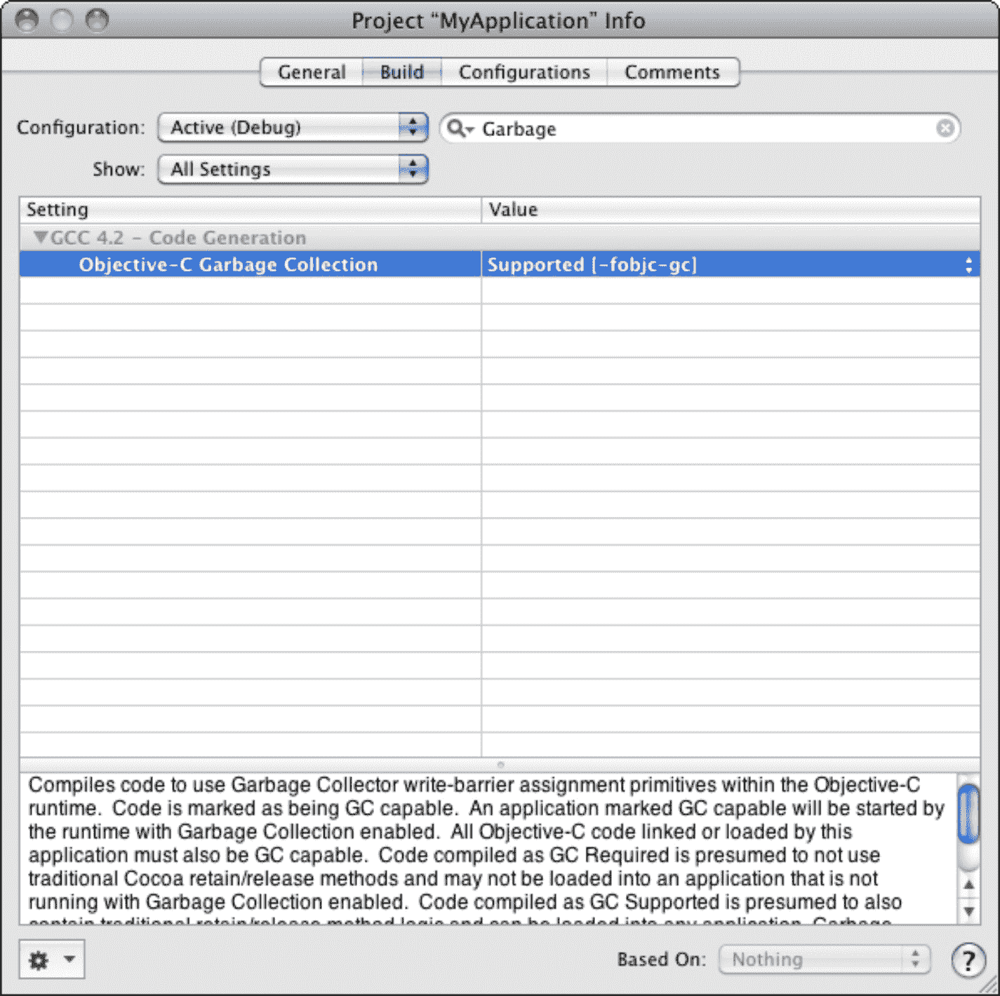

第一个设置是完全没有垃圾回收。你可以通过选择 `Unsupported` 选项启用它。第二个选项是 `Supported` 选项。该选项增加了标记 `-fobjc-gc`，它指定你的项目支持垃圾回收但不要求。使用此设置时，可以将你的项目与未针对垃圾回收编译的应用程序进行链接。此设置通常只用于库。使用此设置时，你的代码需要同时实现 `dealloc` 方法和 `finalize` 方法，以便无论与之链接的应用程序是否针对垃圾回收编译，都可以使用。

最后一个设置 `Required` 在你的编译设置中添加了编译器标记 `-fobjc-gc-only`，并指定你的代码不使用 retain/release 方法，因此无法加载到不支持垃圾回收的应用程序中。

如果你正在将一个现有应用程序从非垃圾回收环境转换为垃圾回收环境，你应该知道所有特定于非垃圾回收内存管理模型的方法将不再适用。你的初始化器仍会被调用，但你的 `dealloc` 方法不会。因此，你应该重构你的 `dealloc` 方法，移除之前的任何资源释放操作或者将其移动到 `finalize` 方法中。

### 在垃圾回收项目中使用框架

在应用程序中使用垃圾回收时，你必须确保你链接的任何库或框架都是为了支持垃圾回收而编译的。正如我之前向你展示的，在为垃圾回收编译框架或库时，你可以选择启用、包含启用（允许你的框架既用于垃圾回收应用程序也用于非垃圾回收应用程序）或完全禁用垃圾回收。在后一种情况下，库或框架将无法与你的应用程序链接。

幸运的是，所有的 `Cocoa` 框架都完全支持垃圾回收。你可能遇到库或框架不支持垃圾回收的情况只有在第三方库的情况下。垃圾回收在 MacOS X 的 Objective-C 中已经存在很长时间了，因此不支持它的库寥寥无几。

### 探索关键垃圾回收模式

在开发垃圾回收的应用程序时，你不可避免会遇到一些设计模式。识别这些模式并理解处理它们所解决问题的方法会有帮助。

### 管理有限资源

面向对象编程语言中一种常用的设计模式是为有限资源编写一个对象包装器（object wrapper）。在处理文件、套接字等时，使用对象包装是一种常见做法。这种模式的优点是，资源可以在对象的初始化器中分配，并在对象的 `dealloc` 方法中释放。这为确保分配的资源被释放提供了一个很好的心理模型。

在垃圾回收环境中，这种设计模式存在几个问题。首先，当然是 `dealloc` 方法不再被调用。因此，如果你除了启用垃圾回收外不对应用程序做任何更改，你正尝试包装并确保释放的有限资源将永远不会被释放。如果涉及的问题是操作系统资源（例如套接字），这可能会变得特别棘手。仅仅将释放操作从 `dealloc` 方法移动到 `finalize` 方法似乎很有诱惑力。（我已经讨论过你的目标应该是完全没有 `finalize` 方法。）请记住，在垃圾回收环境中，你的对象可能在未来的任意点被释放。换句话说，你不能指望 `finalize` 方法会在应用程序执行的某个特定点被调用。因此，你预计在 `finalize` 方法中释放的资源可能在比你之前预期的程序执行晚得多的时候才被释放。

这两个问题结合在一起，导致了一种局面，需要你重新思考这种设计模式，并在对象本身以及使用该对象的对象中做一些额外工作，以确保在允许对象被回收之前，由对象分配的资源已得到正确关闭。


演示这一概念的最简单方法可能是向你展示一些代码。列表 4.17 显示了一个典型的文件包装类，它分配了一个资源（一个文件句柄）、初始化它，然后在 `dealloc` 方法中释放该资源。

### 列表 4.17: 典型的文件包装类

```objective-c
@interface Foo : NSObject
{
    int fileHandle;
}
@end

@implementation Foo

-(id)init
{
    if(self = [super init])
    {
        fileHandle = open(...);
    }
    return self;
}

// 此处有方法...

-(void)dealloc
{
    close(fileHandle);
    [super dealloc];
}

@end
```

要将此类类转换为适当的垃圾回收类，你需要将文件句柄的释放操作从 `dealloc` 方法中取出，并将其放入另一个可以由用户手动调用的方法中。例如，`close` 方法。列表 4.18 显示了更新后的同一个类，它可以在垃圾回收环境中使用。

### 列表 4.18: 垃圾回收的文件包装类

```objective-c
@interface Foo : NSObject
{
    int fileHandle;
}
@end

@implementation Foo

-(id)init
{
    if(self = [super init])
    {
        fileHandle = open(...);
    }
    return self;
}

-(void)close;
{
    if(fileHandle != -1)
        close(fileHandle);
    fileHandle = -1;
}

-(void)finalize;
{
    [self close];
    [super finalize];
}

@end
```

### 使用垃圾回收编写 Foundation 应用

我之前简要地提到过使用垃圾回收编写 Foundation 命令行应用程序的话。你已经知道，要创建一个使用垃圾回收的 Foundation 命令行应用程序，你必须在 `main` 函数开始时、分配任何对象之前手动启动垃圾回收器。然而，还有一个重要的细节你需要理解。

Objective-C 垃圾回收器的工作原理是：它会在全局作用域和当前局部栈中搜索引用对象的指针。当执行此操作时，它会查看局部栈中所有当前活跃的变量。这样做时，它不会考虑局部栈变量是否已经初始化。记住，一个变量在初始化之前，指向的内存位置之前可能包含已删除的对象或变量的已初始化数据。换句话说，你当前栈中的一个未初始化的变量可能指向一个你在之前的函数调用中分配但随后不再被引用的对象。因此，垃圾回收器可能会误认为你的局部变量可能引用一个应该被垃圾回收的对象。

为了防止这个问题发生，你需要定期清理局部栈。用于执行此操作的低级 Objective-C 运行时方法是 `objc_clear_stack(OBJC_CLEAR_RESIDENT_STACK)`。通常，在 Foundation 命令行应用程序中（没有框架提供 run loop 的情况下），你会为自己的应用程序事件提供自己的 run loop 以进行处理。该 run loop 的顶部被认为是清理局部栈的理想位置，可以防止此类问题的发生。

考虑到这两点，一个典型的 Foundation 命令行应用程序 `main` 函数可能像列表 4.19 所示。

### 列表 4.19: 命令行 Foundation 应用 main 函数

```objective-c
int main (int argc, const char * argv[])
{
    objc_startCollectorThread();
    // ...
    while(running)
    {
        objc_clear_stack(OBJC_CLEAR_RESIDENT_STACK);
        for(RunnableItem *item in runnableItems)
        {
            [item run]; // ..
        }
    }
    return 0;
}
```

### 在 nib 文件中处理对象

在处理 nib 文件中的对象时，如果这些对象没有来自应用程序中实例化对象的引用，可能会出现一种不常见但难以调试的问题。同样，垃圾回收器会搜索任何没有来自全局对象或当前栈上对象引用的对象。在某些少数情况下，你可能会创建一个 nib 文件，其中包含的对象没有被引用的引用，例如没有外部引用的视图控制器。在正常情况下，这些对象会被垃圾回收。解决此办法是在拥有该 nib 的对象中创建一个 `IBOutlet`，并将此插口连接到目标对象上。这为该对象提供了强引用，并防止它被垃圾回收。

 **注意**
Nib 文件（或“NeXT Interface Builder”文件）被用于在 iOS 和 Mac OS 上定义界面。除了此处外，我没有在书中讨论它们，因为它们特定于 Cocoa 和 Cocoa Touch。更多信息请参阅 Wiley 出版的《Cocoa Developer Reference》或《Cocoa Touch for iPhone OS 3 Developer Reference》。

### 强制垃圾回收

在某些情况下，你可能想要强制垃圾回收器进行收集。例如，如果你刚刚分配并释放了一个大型集合，那么告诉垃圾回收器尽快开始工作是合适的。要做到这一点，你可以使用低级方法 `objc_collect()`。

 **注意**
在处理从非垃圾回收到垃圾回收的转换时，自动释放池（autorelease pool）的存在将作为回收器的提示，指示它应该尝试进行收集。这是垃圾回收器一个未文档但广为人知的特性。

### 处理 void 指针与垃圾回收

另一种在垃圾回收应用中引起困难的常见 Objective-C 模式是使用 `void*` 数据类型在回调之间传递特定的应用程序数据。这种方法的优点是，在方法之间传递的数据可以是开发者期望的任何类型。它可以是一个对象，也可以是一块字节。接收方法将 `void*` 参数强制转换为期望接收的任何数据类型。

在垃圾回收环境中出现的问题是，void 指针是不透明的，因此可能被误认为是没有引用的对象，从而被垃圾回收。这可能发生在发起方法和回调方法之间，导致回调方法收到的指针指向一个已释放的对象。

解决此问题的办法是使用 Core Foundation 方法 `CFRetain` 和 `CFRelease` 来强制在全局框架中维持强引用。这种工作方式的示例见列表 4.20。

### 列表 4.20: 为回调保留不透明指针

```objective-c
@implementation Baz

-(void)callbackMethodForObject:(id)object withUserInfo:(void *)inData
{
    Bar *bar = (Bar *)inData;
    // 对 bar 进行操作...
    CFRelease(bar);
}

-(void)startLongOperation
{
    Bar *bar = [[Bar alloc] init];
    CFRetain(bar);
    foo = [[Foo alloc] init];
    [foo startLongOperationWithDelegate:self callbackMethod:
    @selector(callbackMethodForObject:withUserInfo:)
    userInfo:bar];
}

@end
```

### 使用垃圾回收器的面向对象接口


除了适用于低级代码的垃圾回收器功能接口外，Apple 还提供了一个更高层次的抽象，用于与垃圾回收器进行交互，即 `NSGarbageCollector` 类。

`NSGarbageCollector` 类是一个单例，允许你通过 Objective-C 接口与垃圾回收器进行交互。你可以通过调用 `defaultCollector` 方法访问当前线程的垃圾回收器。在获取了垃圾回收器的单例实例后，你可以使用它来禁用或启用特定指针（甚至是整个线程）的回收。此外，你还可以使用 `collectExhaustively` 或 `collectIfNeeded` 方法来强制进行回收。

表 4.1 显示了 `NSGarbageCollector` 类可用的方法列表。

| 表 4.1 用的 NSGarbageCollector 方法 |

| 方法 | 目的 |
| :--- | :--- |
| `+defaultCollector` | 返回当前线程的 `NSGarbageCollector` 单例。 |
| `-disable/-enable` | 临时禁用或启用垃圾回收。 |
| `-isEnabled` | 如果当前已启用垃圾回收，则返回 YES，否则返回 NO。 |
| `-collectExhaustively` | 触发对垃圾对象的详尽回收。 |
| `-collectIfNeeded` | 触发回收，但仅当自上次回收以来内存消耗已超过阈值时才执行。 |
| `-disableCollectionForPointer:` | 使给定的指针成为根对象，从而不再符合回收条件。 |
| `-enableCollectionForPointer:` | 将给定的指针从根对象列表中移除，使其符合回收条件。 |

### 理解你的项目应该使用何种内存管理模型

关于垃圾回收，最重要的一点可能是理解它何时适用，以及何时不适用。事实上，在很多情况下，垃圾回收对你的应用程序来说并不是一个好的选择。正如我之前提到的，它只在 MacOS X 10.5 及更高版本上可用。如果你的代码需要在任何任何平台上运行（包括 iPhone 或 iPad），那么垃圾回收对你来说甚至不是一个选项。此外，如果你有一个没有使用垃圾回收的应用程序，并且拥有大量使用引用计数内存管理的现有代码库，那么将其转换为垃圾回收可能没有意义。完成这一转换所需的精力可能是难以负担的。

最后，由于垃圾回收器在处理应用程序中任何时刻活跃对象数量方面的效率略低，被释放的对象在回收器找到它们之前并不会真正释放。此外，垃圾回收器本身必须利用 CPU 周期来执行工作。如果其中任何一一点是你的考虑因素，那么在应用程序中使用垃圾回收可能不是一个合适的选择。

然而，在应用程序中使用垃圾回收也有显著的优势。例如，通常来说，使用垃圾回收的应用程序更容易实现线程安全。这是因为访问器可以变成简单的赋值操作，而不再需要为了线程安全而使用线程锁。

使用垃圾回收的应用程序通常也更容易编写。不需要维护对代理（delegates）的弱引用等，使得代码更简单且易于维护。

最后，也是最显见的，能够实际上忽略引用计数内存管理所需的典型样板代码是一个巨大的胜利。人们说，最好的代码、无 Bug 代码是你完全不需要编写的代码。无疑，垃圾回收通过减少你需要编写的代码量，帮助减少代码中出现 Bug 的机会。

记住，在满足所需的性能参数的同时，你应该使用实现你目标的最高级抽象。这意味着，如果你可以使用垃圾回收，并且它能够满足你的问题领域的需求，你就应该使用它。如果垃圾回收导致你的特定问题领域性能不佳，那么就不要使用。Objective-C 为开发者提供的最大优势之一，就是能够轻松地在框架栈中上下移动，并使用最容易解决需要解决问题的抽象级。

## 总结

这一章可能是书中最重要的章节之一。理解内存管理技术并妥善使用引用计数和垃圾回收，是所有 Objective-C 程序员的一项至关重要的技能。在本章中，我首先向你介绍了 Objective-C 传统的内存管理模型——引用计数。我向你展示了如何在对象中分配内存，以及在不再使用内存时如何释放它。我还向你展示了如何使用 MacOS X 新技术——垃圾回收。垃圾回收可以让你的代码比传统的引用计数内存管理更简单、更不容易出现 Bug。你必须自己决定哪内存管理技术适用于你的项目。然而，我希望我已经为你提供了足够的工具，让你有效地做出该决定。

# 第二部分：探索深度特性

## 本部分

-   **第 5 章**：使用块（Blocks）
-   **第 6 章**：使用键值编码（KVC）和键值观察（KVO）
-   **第 7 章**：使用协议（Protocols）
-   **第 8 章**：扩展现有类功能
-   **第 9 章**：编写宏
-   **第 10 章**：处理错误

## 第 5 章：使用块

## 本章内容

-   使用块封装算法
-   使用 block 指令
-   使用块创建映射（map）和过滤（filter）函数
-   使用线程和中央调度队列（Grand Central Dispatch）并行运行块

Objective-C 最新且最强大的特性之一是包含了名为块（blocks）的能力。使用它们，你可以指定任意的代码段，并像对象一样将其传递给方法和函数。在本章中，我将向你如何使用它们。

### 理解块

如果你是从 Ruby 或 Lisp 等其他语言转向 Objective-C 的，你可能已经熟悉块的概念，也称为闭包（closures）。列表 5.1 展示了 Ruby 中的块示例。

列表 5.1
Ruby 中的块示例
```ruby
items.each { |item| puts item }
```

本质上，块允许你在代码中内联定义函数对象。这些函数对象可以通过传统的变量进行引用，包括传递给其他函数。这意味着，你可以定义可复用的代码块，并像对象一样传递它们，从而在其他对象内部动态地执行这些代码。这听起来可能很复杂，但我想随着我们处理示例，这个概念会变得清晰。

在上述块的案例中，代码实际上是在遍历 items 数组中的每个项目，并执行大括号内部的代码，并将当前项目传递给块。

### 声明代码块

在本节中，我向你介绍 Objective-C 中块的样子。列表 5.2 展示了一个简单的块示例。

列表 5.2
Objective-C 中的简单块
```objectivec
int main (int argc, const char * argv[])
{
    NSAutoreleasePool * pool = [[NSAutoreleasePool alloc] init];
    void (^myBlock)(NSString *x);
    myBlock = ^(NSString *x)
    {
        NSLog(@%@”, x);
    };
    [pool drain];
    return 0;
}
```

在核心，块就像任何其他变量一样。块的区别在于，存储在块内部的数据是函数体。


在此段代码中，持有块的变量被称为 `myBlock`。首先，你通过行 `void (^myBlock)(NSString *)` 声明该变量。普通变量在声明时相对简单。普通变量不需要向它们传递参数，也没有返回值。相比之下，块（block）被存储在变量中，并且必须声明它的参数和返回类型。因此，它的声明比传统变量要复杂得多。

块的声明包含它的返回类型（在本例中为 `void`）。块的返回类型被放置在你通常预期看到要声明的变量类型定义的位置。然而，在块的声明中，你声明的是块在执行时将返回的值类型。

在返回类型定义之后，有一个特殊的运算符，用于告诉编译器你正在定义一个块，而不是其他类型的变量。这个运算符就是 `^` 字符。

你可能会发现将此此类比为声明指针变量会更容易理解。就像在声明指针变量时使用 `*` 字符来表示所涉及的变量是一个指针一样。但在在块的情况下，使用的是 `^` 字符。

在 `^` 字符之后，给出了存储块的变量名（`myBlock`）。该变量名被括在括号内，以便将其与随后的参数隔离开。

变量名遵循语言其他部分变量名的相同约定；它必须只包含字母和数字，且不能以数字开头。

在块变量名的右括号之后，列出了在使用该块时需要传递给块的参数，这些参数用逗号隔开并括在额外的一组括号内（这里是 `(NSString *x)`）。在列出这些参数时，你不需要为参数本身提供变量名。这样做取决于你，但不是强制要求的。考虑此问题的一个良好方法是：你此时并没有在实际声明函数体。因此，为参数提供变量名没有意义，因为它们在此时不会被使用。相反，你只需要告诉编译器期望什么种类型的参数。你只需要提供用逗号隔开的参数类型。很多关于块的文档在声明中省略了这些参数名。我选择保留，因为我认为这会让代码变得令人困惑，特别是对于新开发者来说。

一如既往，你用分号结束语句。此时，你已经声明了一个变量，它可以存储返回你指定的值类型的块，并接收你指定的参数。在上面的示例中，该变量的名称是 `myBlock`。

正如我们所知，仅仅声明变量是不够的。你还必须存储块才能使用它。使用块初始化你的新变量只需简单地使用赋值运算符，然后再次使用一种特殊的语法来表示你正在创建要存储到变量中的实际块。

块的定义再次使用 `^` 字符来告诉编译器后面的是一个块定义。你可以在定义中省略返回类型，因为编译器可以通过查看块所存储的变量来确定返回类型。然而，你必须为块提供参数规范，同样是在括号内。在这种情况下，你还必须为正在传递的参数提供变量名。这是合理的，因为你正在为参数声明变量名，以便它们在你的块体内部被使用。

在参数列表的右括号之后，你随后提供了块的实际体。这部分代码的形式与声明普通函数几乎相同。你将块代码封装在花括号中，执行你选择的任何操作，根据需要利用参数，并在完成后返回任何合适的值。就像定义标准函数一样，块内部的代码可以跨越多行，尽管普通的空白规则仍然适用。

列表 5.3 列出了块的示例。

### 列表 5.3：块的各种示例

```objc
- (void)executeBlock:(void (^)(NSString *))block {
    if (block) {
        block(@"Hello World");
    }
}

- (NSString *)processString:(NSString *)string transform:(NSString *)(NSString *))transform {
    if (transform) {
        return transform(string);
    }
    return string;
}

- (void)repeatAction:(void (^)())action {
    for (int i = 0; i < 3; i++) {
        action();
    }
}
```


## 理解重要的块作用域（Block Scoping）

如果块仅局限于利用传递给它们的参数，并且只返回它们定义的数值，那么它本身就会是一项强大的特性。然而，块在表面之下还有更多工具，使得它们变得更加强大。

当你在另一段代码内部定义一个块时，你所定义的这个块（即块内部的指令）不仅可以访问代码中其他部分可以访问的所有普通全局变量，还能自动接收块定义所在栈帧（stack）作用域内所有栈变量的只读副本。这意味着，你的块可以（只读地）访问程序在块定义时运行的整个状态。

为了让你直观地理解我的意思，请看列表 5.7。

### 列表 5.7
一个访问其定义处所的栈帧中变量的块

```c
int main (int argc, const char * argv[])

{
NSAutoreleasePool * pool = [[NSAutoreleasePool alloc] init];
NSString *formatStr = @”%s”;
void (^myBlock)(char *x) = ^(char *x){ NSLog(formatStr, x); };
doIt(myBlock);
[pool drain];
return 0;
}
```

如你所示，块访问了一个没有传递给它的变量（`formatStr`），但该变量来自于块创建时的环境。

再次强调，这些变量在块内部是只读的。然而，你可以在声明变量时使用特殊的语言指令 `__block`，显式地在任何引用它的块内部将变量设为可读写。

由于块能够“快照”你的应用程序状态并以这种方式将其提供给应用程序的其他部分，因此这为封装和操作你的数据提供了一种极其强大的机制。

我稍后会为你展示块的一些其他酷用法，但在那之前，有一些琐碎的工作需要处理。

## 管理代码块的内存

在 Objective-C 中，块是对象，就像其他任何一样。构成块的数据像普通变量一样分配在栈上。因此，如果你将一个块传递给另一个函数或对象，而该对象需要存储该块以备后用，接收对象必须保留（retain）该块，就像接收一个传递给它的对象一样。

列表 5.8 显示了这种工作方式的示例。

### 列表 5.8
一个在成员变量中存储块的对象

```objc
@interface Foo : NSObject
{
void (^myBlock)(NSString *);
}
-(void)doSomethingWithBlock;
-(void)setMyBlock:(void (^)(NSString *))inBlock;
@end;

@implementation Foo

-(void)dealloc;
{
[myBlock release];
[super dealloc];
}

-(void)setMyBlock:(void (^)(NSString *))inBlock
{
myBlock = [inBlock copy];
}

-(void)doSomethingWithBlock
{
myBlock(@”foo”);
// ....
}
@end
```

如你所示，所有标准的 Objective-C 引用计数内存管理方法都可以像处理其他 Objective-C 对象一样处理块。尽管对于传递进去的块对象，你应该使用 `–copy` 而不是 `–retain`，因为它被分配在栈上，如果你想保留它，就必须确保在堆上获得一个副本。

这种工作方式原理是：运行时会将块使用的任何外部变量和 `self` 对象制作一份 `const` 副本并到堆上。这样，你就可以访问这些变量以及块创建时对象的所有成员变量。任何标记有 `__block` 指令的变量都会被位拷贝到堆上，并且块负责处理这些变量时涉及的任何额外内存管理。

话虽如此，如果你的应用程序使用的是垃圾回收而不是引用计数内存管理，那么拷贝、保留和释放都由系统为你完成。

## 使用 typedef 让块更易读

有时，如果你对你的块定义进行 `typedef`，可以使你的代码更易读。这允许你重用该定义，而不需要重新输入块的所有参数和返回类型。列表 5.9 显示了上一节中的类，但这次它对它的块参数使用了 `typedef`。如你所示，这使得代码变得更加清晰且易于读。

### 列表 5.9
使用 typedef 的相同代码

```objc
typedef void (^BlockWithCharArg)(char *);

@interface Foo : NSObject
{
BlockWithCharArg myBlock;
}
-(void)doSomethingWithBlock;
-(void)setMyBlock:(BlockWithCharArg)inBlock;
@end;

@implementation Foo

-(void)dealloc;
{
[myBlock release];
[super dealloc];
}

-(void)setMyBlock:(BlockWithCharArg)inBlock
{
myBlock = [inBlock copy];
}

-(void)doSomethingWithBlock
{
myBlock(“foo”);
// ....
}
@end
```

## 在线程中使用块

我确信你可以想象出代码中块的许多不同用途。我将在接下来的几节中简述其中几种。

如果你考虑块如何让你能够将应用程序中的功能封装成一个整洁的包，并且这种功能可以被轻松地复用，那么 Objective-C 中块最常用的设计模式之一是提供可以并行运行的代码，这也就是合理的。换句话说，就是线程。

事实上，Apple 在引入块时展示的首要用例之一就是将它们用于（当时）全新的并行框架——Grand Central Dispatch（GCD）。

### 与 Grand Central Dispatch 协作

GCD 是一个随 Mac OS 版本 10.6 发布的框架。它提供了一个易于使用的抽象层，使开发者能够利用多处理器和多核架构，而无需处理底层的线程管理。

使用 GCD，开发者只需要提供代码块，并将这些块交给 GCD 队列，然后由队列来处理诸如线程创建、线程管理以及在给定系统上应该创建多少线程等所有底层细节。GCD 知道机器有多少个核心，只会分配足够的线程来最大化性能。


将块分发到队列是非常简单的。列表 5.10 显示了一个示例，使用了一个执行某些耗时操作的块。在这种情况下，我们将此块分发到全局并发队列。如你所见，我们可以多次此类进程分发到队列。Grand Central Dispatch（中央调度）可以自动为我们处理这些任务的调度和管理，完全不需要我们干预。

### 列表 5.10：将块分发到全局并发队列

```objc
dispatch_async(dispatch_get_global_queue(0, 0), ^{ doSomethingSlow(); });
```

通过 `dispatch_get_global_queue` 方法获取全局队列，然后将你的块 `^{ doSomethingSlow(); }` 分发到该队列。在这里，如果你愿意，可以使用我之前向你展示的任何块模式。当然，仍然适用于标准的线程安全要求。

## 使用常用的块设计模式

我向你展示了如何使用块并配合 GCD 将工作单元分发到线程。现在来看一些其他的常用块模式。在这些情况下，有一些示例展示了你如何可以在标准框架 API 中使用块，以比不使用块更高效或更简洁的方式完成任务。

### 使用代码块进行映射 (map)

在其他语言中，用于演示块的强大常用操作是实现 map 算法。

如果你不熟悉，map 是一个函数，它将一个给定的函数应用到数组的每个元素，并返回一个结果列表。在 Objective-C 中使用块实现 map 是轻而易举的。首先，你需要创建你的 map 函数。map 函数接收一个块和你的项目数组作为参数。如列表 5.11 所示。

### 列表 5.11：使用块的 map 函数

```objc
NSArray *map(NSArray *items, id (^block)(id item))
{
    NSMutableArray *result = [NSMutableArray array];
    for(id item in items)
    {
        [result addObject:block(item)];
    }
    return result;
}
```

要使用这个 map 函数，你只需要构建你的块对象和数组，并将它们传递给 map 函数。这在列表 5.12 中所示。

### 列表 5.12：调用 map 函数

```objc
NSArray *mappedResults = map(items, ^(id item){ return transformItem(item); });
```

### 在标准 API 中使用块

构建你自己的 map 函数是很棒，但块的真正威力来自于将其与某些标准 Cocoa 框架 API 结合，这些 API 现在接受块作为参数。

Cocoa 中的某些类接受块作为参数来执行操作，通常是对它们所管理的集合元素进行操作。此类此显著类包括 `NSArray`、`NSDictionary`、`NSIndexSet` 和 `NSSet`。此外，`NSString` 和 `NSAttributedString` 也提供了使用块遍历行和属性的方法。

Cocoa 中使用块的最常用方法集合如表 5.1 所示。

### 表格 5.1

| 类 | 方法 | 目的 |
| :--- | :--- | :--- |
| `NSNotificationCenter` | `addObserverForName:object:queue:usingBlock:` | 在发送通知时执行给定的块。 |
| `NSIndexSet` | `enumerateIndexesInRange:options:usingBlock:`, `enumerateIndexesUsingBlock:`, `enumerateIndexesWithOptions:usingBlock:` | 遍历集合的索引，执行给定的块，并将索引传递给块。 |
| `NSDictionary` | `enumerateKeysAndObjectsUsingBlock:`, `enumerateKeysAndObjectsWithOptions:usingBlock:` | 遍历字典的键和对象，执行给定的块，并将键和对象作为参数传递给它。 |
| `NSString` | `enumerateLinesUsingBlock:`, `enumerateSubstringsInRange:options:usingBlock:` | 遍历字符串的行，将行作为参数调用给定的块。 |
| `NSArray` | `enumerateObjectsAtIndexes:options:usingBlock:`, `enumerateObjectsUsingBlock:`, `enumerateObjectsWithOptions:usingBlock:` | 遍历数组元素，将每个项目传递给给定的块。 |
| `NSSet` | `enumerateObjectsUsingBlock:`, `enumerateWithObjectsWithOptions:usingBlock:` | 遍历集合元素，将每个项目传递给给定的块。 |
| `NSOperationQueue` | `addOperationWithBlock:` | 将给定的块添加到队列中。 |
| `NSBlockOperation` | `+blockOperationWithBlock:` | 使用给定的块创建一个新的 `NSOperation`。 |

特别感兴趣的是 `NSOperationQueue` 和 `NSBlockOperation` 上的方法，它们允许你利用块使用 `NSOperation` 对象。这比我之前在“使用 GCD 在线程中分发块”节中展示的 GCD 函数更高级。我将在第 16 章向你展示如何使用这些 API。

### 将块应用于极易并行任务

现在我已经向你展示了关于如何在代码中使用块的所有知识，你可以应用这些知识了。虽然块的使用无疑不仅限于并行化和多线程，但它们在处理这些任务时表现特别出色。

在编程领域，这类问题被称为“尴尬并行”问题 (embarrassingly parallel problems)——即特别适合并行化的问题。

这类问题的一个例子是计算质数。虽然你可以使用比暴力破解更快的方法来计算质数，但为了接下来的示例，我将展示你如何改进暴力破解方案的性能。因此，我将让你写一个简单的程序来计算 2 到 150 之间所有的质数。


```objc
@interface PrimeFinder : NSObject

{
NSInteger maxNumber;
NSDate *startedDate;
NSDate *endedDate;
NSMutableArray *primes;
}

@property (retain, nonatomic) NSMutableArray * primes;
@property (retain, nonatomic) NSDate * startedDate;
@property (retain, nonatomic) NSDate * endedDate;
@property (readonly) NSTimeInterval elapsedTime;

-(id)initWithMaxNumber:(NSInteger)inMaxNumber;
-(void)start;

@end
```

###  5.15: `PrimeFinder` 的实现文件

```objc
#import “PrimeFinder.h”

@implementation PrimeFinder

@synthesize startedDate;
@synthesize endedDate;
@synthesize primes;
@dynamic elapsedTime;

-(void)dealloc;
{
[primes release];
[startedDate release];
[endedDate release];
[super dealloc];
}

-(id)initWithMaxNumber:(NSInteger)inMaxNumber
{
if(self = [super init])
{
maxNumber = inMaxNumber;
primes = [[NSMutableArray alloc] init];
}
return self;
}

-(BOOL)isPrime:(NSInteger)number
{
for(NSInteger n = 2; n < number; ++n)
if((number % n) == 0)
return NO;
return YES;
}

-(void)start
{
[self setStartedDate:[NSDate date]];
for(NSInteger n = 2; n <= maxNumber; ++n)
{
if([self isPrime:n])
[primes addObject:[NSNumber numberWithInteger:n]];
}
[self setEndedDate:[NSDate date]];
}

-(NSTimeInterval)elapsedTime
{
return [endedDate timeIntervalSinceDate:startedDate];
}

@end
```

在列表 5.15 中，代码非常直观。本质上，我们有一个紧凑的 `for` 循环，从 2 一计数到 150,000（这是我们传递的最大数字）。然后它依次获取这些数字中的每一个并调用 `isPrime:` 方法。如果该方法返回为真，它就会将该数字添加到结果集的质数列表中。`isPrime:` 函数接收接收到的任何数字，并尝试用该数字之下的每一个数字来除它。如果能被整除——即没有余数——那么该数字就质数。然而，如果它运行到了所有小于该数字的数字末尾，那么它就是一个质数，并返回真。

如果你编译并运行此程序，它应该打印出你的计算机计算所有质数所花费的时间。在我的电脑上，这大约需要 15 秒。如果你的电脑比我的快得多，而且你的完成得比这快得多，你可能想通过将 150,000 增加到更高的数字来增加候选质数的数量。对于这个例子来说，重要的是你的计算机在这个问题上至少花费一些时间进行计算。不过不要设置得太高。计算质数对你的 CPU 来说是一项相当密集的任务，如果你设置得太高，可能需要很长时间才能完成。

### 使用数组配合块过滤质数

第一个显示块用法的示例实际上不会给我们带来任何性能提升。我向你展示这个是因为这是一个实用的设计模式，你可以用它解决其他类型的问题。

本质上，你要做的是修改 `PrimeFinder` 类，使其获取我们候选质数序列中所有可能的质数并将它们放入数组中。然后你将编写一个方法，通过传递给过滤方法的块来过滤该数组。过滤方法随后返回一个新数组，其中只包含候选数组中是质数的数字。这种模式可能用于你想要过滤数组以匹配符合某些标准的数组元素的情况。在这种情况下使用块的妙处在于，你可以通过简单向过滤函数传递不同的块来随时动态地更改标准。

 注意事项

实现此点的另一种方法可能是使用 `NSPredicate` 类方法 `+predicateWithBlock:` 创建一个 `NSPredicate`，然后使用 `NSArray` 的方法 `filteredArrayUsingPredicate:` 来使用它。再次，我在这里的目的是解释底层概念，所以我们采用了这种“费力”的方法。

列表 5.16 显示了该版本程序接口文件所需的更改。重要的项是添加了 `candidates` 数组。

###  5.16: 过滤版本 `PrimeFinder` 的接口文件

```objc
#import <Cocoa/Cocoa.h>

@interface PrimeFinder : NSObject

{
NSInteger maxNumber;
NSDate *startedDate;
NSDate *endedDate;
NSMutableArray *primes;
NSMutableArray *candidates;
}

@property (retain, nonatomic) NSMutableArray * candidates;
@property (retain, nonatomic) NSMutableArray * primes;
@property (retain, nonatomic) NSDate * startedDate;
@property (retain, nonatomic) NSDate * endedDate;
@property (readonly) NSTimeInterval elapsedTime;

-(id)initWithMaxNumber:(NSInteger)inMaxNumber;
-(void)start;

@end
```

重要的更改在实现文件中，如列表 5.17 所示。

###  5.17: `PrimeFinder` 过滤版本的实现文件

```objc
#import “PrimeFinder.h”

@implementation PrimeFinder

@synthesize startedDate;
@synthesize endedDate;
@synthesize primes;
@synthesize candidates;

@dynamic elapsedTime;

-(void)dealloc;
{
[primes release];
[startedDate release];
[endedDate release];
[super dealloc];
}

-(id)initWithMaxNumber:(NSInteger)inMaxNumber
{
if(self = [super init])
{
maxNumber = inMaxNumber;
candidates = [[NSMutableArray alloc] init];
for(NSInteger n = 2; n <= maxNumber; ++n)
{
[candidates addObject:[NSNumber numberWithInteger:n]];
}
}
return self;
}

-(NSMutableArray *)filterArray:(NSArray *)inArray
withBlock:(BOOL (^)(id))block
{
NSMutableArray *result = [NSMutableArray array];
for(id item in inArray)
{
if(block(item))
[result addObject:item];
}
return result;
}

-(void)start
{
[self setStartedDate:[NSDate date]];
BOOL (^isPrime)(id) = ^(id number)
{
NSInteger value = [number integerValue];
for(NSInteger n = 2; n < value; n++)
{
if((value % n) == 0)
return NO;
}
return YES;
};
[self setPrimes:[self filterArray:candidates withBlock:isPrime]];
[self setEndedDate:[NSDate date]];
}

-(NSTimeInterval)elapsedTime
{
return [endedDate timeIntervalSinceDate:startedDate];
}

@end
```

### 使用 Grand 中央 Dispatch

我们最终版本的 `PrimeFinder` 类利用 GCD 实际上并行运行质数计算。再次，我稍后会深入详细讨论 GCD。现在，你只需要理解我们对于每个想要测试质性的数字，将我们块的实例分发到 GCD 全局队列中即可。


为了实现这一点，我们必须进行一些周旋，以确保我们对不同线程之间共享的任何变量的访问是安全的。这涉及到几个方面。首先，你将把所有的结果（即质数）存储在一个名为 `result` 的数组中。因为该数组将在你所有的块（blocks）之间共享，所以你将在 `start` 方法本身的作用域内声明它。请记住，当块被声明时，它会接收创建它的堆栈中的所有作用域变量和状态。然而，也请记住这些变量都是只读的，这包括我们的 `result` 数组。不过，我们不需要使用 `__block` 指令，因为 `result` 变量本身是只读的，但通过它的指针引用，`result` 的内容并不是只读的。这是一个细微但重要的细节需要注意。

除了使 `result` 数组变为可写外，我们还要确保没有两个块同时尝试写入该数组。我们通过使用 Objective-C 内置的简单线程安全机制——`@synchronized`关键字来实现这一点。

最后，为了实际上将你的块分发到 GCD，你需要创建一个分发组（dispatch group），它允许你将块放入一个全局队列，该队列将由 Grand Central Dispatch（中央调度调度）完全管理。它将根据运行它的机器的核心数和处理器自动产生相应数量的线程，然后逐个从队列中移除块，并将它们发送到这些线程上执行工作。

列表 5.18 显示了你需要如何修改你的 `PrimeFinder` 实现来完成这一切。请继续修改你的类以匹配它。

 注意

如果你正在基于上一个示例的项目工作，请确保从接口中移除 `candidates` 数组。

### 列表 5.18
`PrimeFinder` GCD 实现文件

```objectivec
#import “PrimeFinder.h”

@implementation PrimeFinder

@synthesize startedDate;

@synthesize endedDate;

@synthesize primes;

@dynamic elapsedTime;

-(void)dealloc;
{
[self setPrimes:nil];
[self setStartedDate:nil];
[self setEndedDate:nil];
[super dealloc];
}

-(id)initWithMaxNumber:(NSInteger)inMaxNumber
{
if(self = [super init])
{
maxNumber = inMaxNumber;
}
return self;
}

-(void)start
{
[self setStartedDate:[NSDate date]];
NSMutableArray *result = [NSMutableArray array];
dispatch_queue_t globalQueue = dispatch_get_global_queue(0, 0);
dispatch_group_t group = dispatch_group_create();
for(NSInteger number = 2; number <= maxNumber; ++number)
{
dispatch_block_t isPrime = ^
{
for(NSInteger n = 2; n < number; ++n)
if((number % n) == 0)
return;
@synchronized(result)
{
[result addObject:[NSNumber numberWithInteger:number]];
}
};
dispatch_group_async(group, globalQueue, isPrime);
}
dispatch_group_wait(group, DISPATCH_TIME_FOREVER);
[self setEndedDate:[NSDate date]];
[self setPrimes:result];
}

-(NSTimeInterval)elapsedTime
{
return [endedDate timeIntervalSinceDate:startedDate];
}

@end
```

在这段代码中，相关的块被指定为类型 `dispatch_block_t`，这是 Grand Central Dispatch 函数提供的特殊类型定义（typedef），用于定义传递给 GCD 队列的块。要理解的关键点是，这些是普通的块，就像你之前处理的块一样。`dispatch_block_t` 的实际定义在列表 5.19 中，供你参考。

### 列表 5.19
`dispatch_block_t` 的定义

```objectivec
typedef void (^dispatch_block_t)(void);
```

如果你运行这个版本的程序，你应该能看到性能的显著提升。在我的电脑上，它将计算质数的运行时间缩短了大约 45 到 50%。当然，你的实际情况会有所不同。

## 总结
在本章中，我向你介绍了 Objective-C 工具箱中一个强大的新工具。代码块（Code blocks）非常有用，因为它们赋予了你封装小型匿名代码段，并像处理对象一样传递这些代码段的能力。这使你能够创建泛型方法，通过简单向它们传递新类型的块作为参数，就可以对其进行功能重构。此外，块使得配合 Grand Central Dispatch 的工作变得异常简单，因为它们提供了表达功能段的能力，然后将该功能发送到队列执行。

## 第 6 章：使用键值编码和键值观测

## 本章内容
- 学习键值编码（Key Value Coding）
- 编写符合 KVC 标准的访问器
- 使用 KVC 简化复杂任务
- 使用键值观测（Key Value Observing）观察其他对象的更改
- 实现手动和自动的 KVO 通知

Objective-C 运行时（runtime）为你提供了多种高级工具，不仅可以与操作系统框架交互，还能够与你代码的属性进行交互。你可用的工具之一是我在本章中介绍的概念，称为键值编码（Key Value Coding）。在 Objective-C 圈中，它通常被称为 `KVC`。

### 使用键值编码访问对象属性
键值编码允许你除了普通的设置器（setter）和 get 器（getter）之外，使用一组标准化的访问方法来访问类的属性。你可以使用这些访问方法，通过指定表示要访问的属性名称的字符串标识符来获取和设置类的属性。除了允许你使用这些字符串标识符访问这些属性外，你还可以使用标准语法访问对象关系和子对象。

为了给你举一个我所说内容的例子，请看列表 6.1

### 列表 6.1
一些示例类。

```objectivec
@interface Bar : NSObject
{
NSArray *array;
NSString *stringOnBar;
}
@property (retain, nonatomic) NSArray * array;
@property (retain, nonatomic) NSString * stringOnBar;
@end

@interface Foo : NSObject
{
Bar *bar;
NSString *stringOnFoo;
}
@property (retain, nonatomic) Bar * bar;
@property (retain, nonatomic) NSString * stringOnFoo;
@end
```

给定这两个类，如你所示，我们有一个名为 `Foo` 的类。这个类有一个字符串属性，还有另一个定义了 `Foo` 与 `Bar` 类之间关系的属性。这种关系是通过 `Foo` 上的 `bar` 属性定义的。

我已经向你展示过，通过为给定类的属性定义属性，Objective-C 会为每个属性提供设置器和 get 器。除了这些标准的设置器和 get 器之外，它还提供了一组键值编码访问器。

在这些键值编码访问器中，最常用的是允许你直接访问给定类属性的那些。这些是 `-valueForKey`，它允许你通过指定一个表示要访问的属性名称的字符串参数来读取属性；以及 `-setValue:`，它允许你同样通过指定属性名称的字符串来设置给定属性的值。

在处理更复杂的关系时（即你想访问属性的属性），你可以使用点符号法（dot notation）指定一个更复杂的键路径（key path）。例如，如果你有一个类型为 `Bar` 且名为 `bar` 的属性的对象，该属性额外还有一个名为 `stringOnBar` 的属性，你可以使用方法 `-valueForKeyPath:`，指定指向该属性的点符号路径 `"bar.stringOnBar"`。此外，还有 `-setValue:forKeyPath:` 方法。

再次，查看代码可能是描述我所说内容的最简单的方法。Objective-C 运行时会自动为你生成代码，允许你通过我刚刚提到的这些调用来读取和写入这些类的属性，如列表 6.2 所示。

列表 6.2


# 使用 KVC 访问器访问类属性

```objectivec
Foo *foo = [[Foo alloc] init];
[foo setValue:@”blah blah” forKey:@”stringOnFoo”];
NSString *string = [foo valueForKey:@”stringOnFoo”];
[foo setValue:@”The quick brown fox.” forKeyPath:@”bar.stringOnBar”];
NSString *string2 = [foo valueForKeyPath:@”bar.stringOnBar”];
```

所以，正如你所看到的，从字面上说，你可以使用字符串指定你想要访问的属性名称，并读取其值或写入其值。甚至，如访问 `Bar` 类属性的示例所示，你还可以遍历两个对象之间的关系，并访问你正在访问的主对象的子对象的属性。

这在起初可能看起来有些困惑，你可能会疑惑为什么需要知道这些。对于你大多数的日常编码来说，使用键值编码（Key Value Coding）方法来设置和访问属性，可能比直接访问类中的 setter 和 getter 方法需要更多的字符输入，且更容易出错。然而，在少数的边缘情况下，能够可以使用运行时变化而非编译时变化的值来动态访问这些属性，将是极其强大的。

列表 6.3 显示了一个需要将笔对象序列化到数据库表的类示例。在所示的示例中，序列化程序遍历了表的每个字段。在迭代过程中，它需要一个复杂的 `if` 语句来确定在尝试序列化的对象上调用哪个访问器，以便获取序列化到给定字段的值。

### 列表 6.3：不使用 KVC 序列化表

```objectivec
-(BOOL)serializeToTable:(Table *)inTable
{
  Row *row = [inTable addRow];
  for(Column *column in row)
  {
    if([[column name] isEqualToString:@”firstName”])
      [column setValue:[self firstName]];
    else if([[column name] isEqualToString:@”lastName”])
      [column setValue:[self lastName]];
    else if([[column name] isEqualToString:@”age”])
      [column setValue:[self lastName]];
    else if([[column name] isEqualToString:@”birthDate”])
      [column setValue:[self lastName]];
    ...
  }
  [row save];
}
```

这段代码很快就会变得复杂。现在来看看使用键值编码方法的相同代码。列表 6.4 显示了更新后的代码。

### 列表 6.4：使用 KVC 的序列化方法

```objectivec
-(BOOL)serializeToTable:(Table *)inTable
{
  Row *row = [inTable addRow];
  for(Column *column in row)
  {
    [column setValue:[self valueForKey:[column name]]];
  }
  [row save];
}
```

如你所见，新版本不仅代码行数更少，而且更具韧性和灵活性。当你向表中添加新列时，你只需要向此对象额外添加属性来存储这些字段的值。此 `serialize` 方法会自动从属性中提取这些值并为我们存储，而无需对该方法进行任何更改。再次强调，`serialize` 方法并不是你在代码中随处处都会使用的。我想强调这一点。使用 KVC 访问器而不是普通的访问器通常需要的代码比你需要的多。但在这些情况下，它能让你写出更具动态的代码，并使你减少代码中必须表示对象属性信息的地方的数量。当你可以查询对象的属性信息时，你就不需要将这些信息提交到代码的许多地方。这总是一件好事——最没有 bug 的代码是没有没有的代码。

## 使用键路径（key paths）

为了使用键值编码，你必须先确定构造哪些键路径以及通过这些路径可以访问什么。

你可以将使用 KVC 访问器比比使用字典。字典的键是字符串。字符串本身就是你正在操作的对象上的属性名称。由于这一要求，在键以及属性的命名方面必须遵循某些规则。首先，你的键必须使用 ASCII 编码。这意味着你不能使用在属性名称中通常无法使用的非常规字符作为键。其次，你的键必须以小写字母开头。第一个字母允许使用下划线，但不能有数字或大写字母。最后，你的键不能包含任何空格。

幸运的是，因为你访问的属性本身必须是一个有效的符号名称，所以这些规则中的大部分你可能已经在遵循了。

列表 6.5 显示了一些有效的键路径和无效的键路径示例。

### 列表 6.5：有效和无效的键路径

```objectivec
// valid
[foo valueForKeyPath:@”someMember”];
[foo valueForKeyPath:@”someMember.someAttributeOnMember”];
[foo valueForKeyPath:@”someOtherMember”];

// invalid
[foo valueForKeyPath:@”4fun”];
[foo valueForKeyPath:@”kermit the frog”];
[foo valueForKeyPath:@”SomethingWickedThisWayComes”];
[foo valueForKeyPath:@”THISWONTWORK”];
[foo valueForKeyPath:@”thisAlsoWon'tWork”];
```

使用键路径遍历对象之间的关系并访问子对象上的属性。键路径是一个键，不同对象之间的关系通过点来跨越，例如上面的 `@someMember.someAttributeOnMember`。该路径访问了 `foo` 对象上的 `someMember` 属性。

### 列表 6.6：在键路径中使用函数

```objectivec
[anArrayOfProducts valueForKeyPath:@”avg.price”];
[anArrayOfProducts valueForKeyPath:@”sum.cost”];
[store valueForKeyPath:@”count”];
```

函数仅适用于数组和集合。示例中，前两行访问产品对象。这些产品具有 `price` 和 `cost` 等属性。函数获取每个对象指定的值，然后对这些值执行指定的函数。换句话说，第一个项目遍历了产品数组中的每个项目，收集每个价格，然后对其取平均值。

使用这些函数的语法由在函数名称前加上 `@` 符号、函数名称、一个点 `.` 以及要操作的属性组成。对要操作属性要求的唯一例外是 `@count` 函数，它只需返回集合中项的数量。

表格 6.1 显示了这些函数的列表。

| 表 6.1 | 函数 | 目的 |
| :--- | :--- | :--- |
| @avg | 返回数组或集合所有元素的平均值 |
| @count | 返回数组或集合元素的数量 |
| @max | 返回数组或集合中所有元素的最大值 |
| @min | 返回数组或集合中所有元素的最小值 |
| @sum | 返回数组或集合中所有元素值的和 |
| @unionOfArrays/@distinctUnionOfArrays | 给一组数组并返回包含集合中所有数组的数组。在去重版本中，它只返回唯一的数组 |
| @unionOfSets/@distinctUnionOfSets | 给一组集合并返回包含所有集合在一起的集合。在去重版本中，它只返回唯一的集合 |


| @unionOfObjects/@distinctUnionOfObjects | 给定一组集合或数组，返回所有集合中的所有元素并合并为一个单一数组。去重访问（distinct aversion）仅返回唯一元素。 |

## 编写符合 KVC 标准的访问器

Objective-C 运行时部分通过底层框架的能力，部分归功于编码风格规范实现了所有这些魔术。尽管在 KVC 功能方面，Objective-C 运行时承担了大部分工作，但它仍然依赖于你（开发者）为你的属性编写遵循特定规范的访问器，以便它能够通过 KVC 获取和设置值。

setter（设置）和 getter（获取）的 KVC 标准是使用遵循 `set<Value>:` 模式的 setter 以及遵循简单 `<value>` 模式的 getter。在这两种情况下，模式中的 `<value>` 部分都应该替换为你正在访问的属性名称。该属性应该是一个使用驼峰命名法（camel case）命名的成员变量。

 **注意**

驼峰命名法（camel case）是指变量命名的一种标准，它将变量中的单词组合成一个长字符串。在这个字符串中，除了第一个单词外，每个单词的首字母都大写。例如，要写一个名为“some variable name”的变量名，你会写成 `someVariableName`。注意，在观察变量名时，变量名内部的大写字母像驼背上的峰。这就是它名字的由来。

因此，给定列表 6.7 所示的类定义，你可能会像列表 6.7 所示编写访问器。

### 列表 6.7
带有成员变量的类定义。

```objectivec
@interface MyClass : NSObject

{
float x;
float y;
NSString *something;
}

-(void)setX:(float)inX;
-(void)setY:(float)inY;
-(void)setSomething:(NSString *)inSomething;
-(float)x;
-(float)y;
-(NSString *)something;
@end
```

### 列表（某某）
符合 KVC 标准的访问器。

```objectivec
@implementation MyClass

-(void)setX:(float)inX
{
    x = inX;
}

-(void)setY:(float)inY
{
    y = inY;
}

-(void)setSomething:(NSString *)inSomething
{
    NSString *oldValue = something;
    something = [inSomething retain];
    [oldValue release];
}

-(float)x
{
    return x;
}

-(float)y
{
    return y;
}

-(NSString *)something
{
    return something;
}

@end
```

如果你使用属性（properties）来封装对象的属性，那么它会自动生成符合 KVC 标准的访问器。换句话说，如果你在使用属性，你就不需要做其他事情了。你已经完成了。尽管如此，标准的警告仍然适用。如果你使用属性并选择覆盖标准的属性访问器命名规范，那么你的访问器将不符合 KVC 标准，并且将无法与 KVC 工作。

## 在数组中使用 KVC

在谈论面向对象的设计时，思考对象之间的关系是有帮助的。当一个类拥有类型为另一个类类型的成员变量时，这种关系可以被称为一对一关系。列表 6.8 显示了此类类型类接口的示例。

### 列表 6.8
`Foo` 类与 `Bar` 类具有一对一关系。

```objectivec
@interface Foo : NSObject
{
Bar *bar;
}
@property (retain) Bar * bar;
@end
```

例如，如果给定的类包含一个实际上是其他对象集合的成员变量，这种关系被称为一对多关系。一对多关系通常通过使用 `NSArray` 或 `NSSet` 成员变量来实现，该变量包含任何其他类实例的元素。

列表 6.9 显示了这种类型关系的示例。但注意，该数组包含了 `Bar` 类的实例，但这里并没有明确指定。

### 列表 6.9
从 `Foo` 类到多个 `Bar` 类实例的一对多关系。

```objectivec
@interface Foo : NSObject
{
NSArray *bars;
}
@property (retain) NSArray * bars;
@end
```

在这些情况下，当通过 KVC 访问这些值时，你可能并不只想简单地访问数组成员变量，而是直接访问数组的元素。在某些情况下，这样效率更高，但至少它更直接地表示了这两个对象之间存在的实际关系。

KVC 专门为这些类型的操作提供了一组特殊的访问器。它们被专门用于访问一对多关系的属性，以及涉及这些关系的各个单独元素。

这些访问器分为两大类。第一类是索引访问器（indexed accessors）。当你想要访问表示为数组的一对多关系中的单个元素时，使用这些访问器。`NSArray` 是一个有序集合，通常情况下，这种情况下使用的是这种容器类。一对多关系的第二种访问类型是用于当你的关系成员变量位于无序集合（如 `NSSet`）中的。在这种情况下，用于访问这种类型一对多关系元素的访问器被称为无序访问器（unordered accessors）。这两种类型的访问器都有可变和不可变版本。

 **注意**

虽然通常这些关系使用 `NSArray` 和 `NSSet` 建模，但技术上，可以使用任何你选择的集合进行建模。关键问题是你创建的访问器必须遵守为每种类型指定的约定。

## 使用索引访问器

在处理一对多关系的索引访问器时，有一个你必须实现以获取元素计数的方法 `-countOf<VariableName>`，然后是若干个你从中选择的方法来获取关系的元素。在索引集合中检索元素的方法是 `-object<VariableName>AtIndex:` 或 `-<variableName>AtIndexes:`。这些方法的设计旨在允许类的用户访问位于给定索引或索引集合的元素，并相应返回对象。这些访问器的实现示例包括列表 6.10 中 `Foo` 到 `Bar` 的一对多关系。

### 列表 6.10
不可变一对多索引访问器的实现

```objectivec
@implementation Foo

-(NSUInteger)countOfBars
{
    return [bars count];
}

-(id)objectInBarsAtIndex:(NSUInteger)inIndex
{
    return [bars objectAtIndex:inIndex];
}

// 或者...

-(NSArray *)barsAtIndexes:(NSIndexSet *)inIndexes
{
    return [bars objectsAtIndexes:inIndexes];
}

// 或者 ...

-(void)getBars:(Bar **)outBuffer range:(NSRange)inRange
{
    [bars getObjects:outBuffer range:inRange];
}

@end
```

除了这些访问器之外，你还可以实现可选方法 `-get<VariableName>:range:`，如上一个列表所示，通过将搜索限制在数组的指定范围内，这可以提供一些性能提升。结果存储在 `outBuffer` 变量中。


如果你能想象我们之前实现的 `Foo` 和 `Bar` 关系，如果改用 `NSMutableArray` 实现，那么这种关系就变成了一个可变的一多关系。当你需要实现一个可变的一多关系（即你可以在索引集合中添加、删除或更改元素）时，你还必须实现 `-insertObject:in<VariableName>AtIndex:` 或 `-insert<VariableName>:atIndexes:` 来插入项，实现 `-removeObjectFrom<VariableName>AtIndex:` 或 `-remove<VariableName>AtIndexes:` 来移除项，或者为了高性能地替换对象，实现 `-replaceObjectIn<VariableName>AtIndex:withObject:` 或 `-replace<VariableName>AtIndexes:with<VariableName>:`。替换对象被认为是一种可选操作，只有在性能测量表明需要时你才真正需要实现它。通常，直接在给定索引处替换对象，而不是先删除原始对象再插入新对象，会比替代方案更快。请根据需要自行实现这些方法。

实现 `Foo` 和 `Bar` 并对关系中的对象进行可变访问所需的额外代码如列表 6.11 所示。

### 列表 6.11：使用索引集合实现可变的一多关系

```objc
-(void)insertObject:(Bar *)inBar inBarsAtIndex:(NSUInteger)inIndex;
{
    [bars insertObject:inBar atIndex:inIndexes];
}

-(void)insertBars:(NSArray *)inBars atIndexes:(NSIndexSet *)inIndexSet;
{
    [bars insertObjects:inBars atIndexes:inIndexSet];
}

-(void)removeObjectFromBarsAtIndex:(NSUInteger)inIndex;
{
    [bars removeObject:inIndex];
}

-(void)removeBarsAtIndexes:(NSIndexSet *)inIndexSet;
{
    [bars removeObjectsAtIndexes:inIndexSet];
}

-(void)replaceObjectInBarsAtIndex:(NSUInteger)inIndex
withObject:(id)inBar;
{
    [bars replaceObjectAtIndex:inIndex withObject:inBar];
}

-(void)replaceBarsAtIndexes:(NSIndexSet *)inIndexSet
withBars:(NSArray *)inBars;
{
    [bars replaceObjectsAtIndexes:inIndexSet withObjects:inBars];
}
```

### 使用无序访问器

在处理对象集合为无序集合的一多关系时，有一组不同的、符合 KVC 标准的访问器供你实现。

与处理索引访问器时一样，也存在不可变访问器（允许你直接从集合中读取值）和可变访问器（允许你更改集合中的值）。

对于不可变访问器，就像索引集合一样，你必须实现 `-countOf<VariableName>` 方法来返回集合中的元素数量。此外，你还必须实现 `-enumeratorOf<VariableName>` 和 `-memberOf<VariableName>:` 方法。在 `-enumeratorOf<VariableName>` 方法中，它应该返回一个初始化的 `NSEnumerator`，用于遍历集合。在 `-memberOf<VariableName>:` 方法中，该方法接受一个对象实例作为参数，并应该返回集合中任何与该对象 `isEqual:` 为 `true` 的对象。如果在集合中找不到 Find `isEqual:` 返回 `true` 的对象，则应返回 `nil`。

列表 6.12 显示了使用 `NSSet` 实现一多关系的这些方法的实现示例。

### 列表 6.12：不可变无序集合的访问器。

```objc
@implementation Foo

-(NSUInteger)countOfBars
{
    return [bars count];
}

-(NSEnumerator *)enumeratorOfBars
{
    return [bars objectEnumerator];
}

-(Bar *)memberOfBars:(Bar *)inBar;
{
    return [bars member:inBar];
}

@end
```

当涉及变动无序的一多关系时，你必须实现 `-add<VariableName>Object:` 或 `-add<VariableName>:` 来插入新对象，实现 `-remove<VariableName>Object:` 或 `-remove<VariableName>:` 来移除对象，以及实现 `-intersect<VariableName>:` 从集合中移除一组对象。

列表 6.13 显示了使用 `NSSet` 实际实现关系的这些方法的实现示例。

### 列表 6.13：为无序的一多关系实现可变访问器

```objc
// 添加...
-(void)addBarsObject:(Bar *)inBar;
{
    [bars addObject:inBar];
}

// 或者...
-(void)addBars:(NSSet *)inBars;
{
    [bars unionSet:inBars];
}

// 移除
-(void)removeBarsObject:(Bar *)inBar;
{
    [bars removeObject:inBar];
}

// 或者...
-(void)removeBars:(NSSet *)inBars;
{
    [bars minusSet:inBars];
}

// 取交
-(void)intersectBars:(NSSet *)inBars;
{
    return [bars intersectSet:inBars];
}
```

### 在结构体和标量上使用 KVC

在使用 KVC 时，一个重要的限制是，所有方法（如 `-valueForKey:`、`-setValueForKey:` 等）的参数和返回值都使用 `id` 作为类型。对于大多数属性来说，这并不是一个问题，因为在定义这些属性时，在大多数情况下你操作的是对象，并且可以使用 `id` 数据类型进行操作。然而，当你拥有是结构体或标量类型的属性（例如 `int`、`float` 等变量）时，这出现了一些问题。具体来说，Objective-C 运行时在在使用 KVC 时无法直接使用这些类型。它实际上必须将这些值从原生类型转换为对象类型。

幸运的是，Objective-C 在大多数情况下都为你处理了这一点。当你访问不是对象的 KVC 属性时，Objective-C 运行时会自动查看所访问变量的类型，并创建 `NSNumber` 或 `NSValue` 来封装它。

我在本书的第三部分讨论 `NSNumber` 和 `NSValue`，但目前你只需要理解它们是特殊的类，允许你将标量和结构体封装其中并将其视为对象。这使得你能够将它们存储在数组、字典并在 KVC 中中使用。

再次，Objective-C 会处理这些，但你需要注意一个边界情况。当你使用 KVC 访问器设置标量值但传递 `nil` 作为值时，没有通用的方法可以自动处理这种情况。结果在这种特定情况下，Objective-C 运行时将调用 `-setNilValueForKey:` 方法。该方法默认会抛出异常。然而，如果需要，你可以在类中重写此方法以执行任何操作。例如，你可能会定义为类中的特定变量传递 `nil` 值意味着该值应为 -1.0。在这种情况下，你只需重写 `-setNilValueForKey:` 方法，检查传入的键，如果它匹配你定义的在 nil 时应为 -1.0 的变量，你就可以简单地创建自己的 `NSNumber` 实例，并使用 `-setValue:forKey:` 方法手动设置值。

### 在对象中搜索属性

当你访问符合 KVC 标准的属性时，运行时会遵循一组规则来尝试为给键路径找到正确的访问器。这些规则如下。


在为特定键设置值时，运行时首先会在类中搜索任何符合我之前提到的标准访问器模式的访问器，即 `-set<ValueName>:`。如果没有找到相应的访问器，你的类也可以实现可选方法 `-accessInstanceVariablesDirectly` 并返回 `YES`。在例例中，运行时随后会在类中搜索任何按照以下命名模式的实例变量：`_<valueName>`、`_is <valueName>`、`<valueName>` 或 `is <valueName>`（按顺序）。如果这些都不适用，则将调用 `-setValue:forUndefinedKey:` 方法。该方法的默认行为是抛出异常。

当使用键值编码（Key Value Coding）获取值时，运行时会遵循类似的程序来查找给定键所代表的变量。具体来说，它首先在你的类中搜索名称符合 `-get<ValueName>`、`-<valueName>` 或 `-is<ValueName>`（按顺序）的访问器。如果找到了这样的访问器，它将使用它来检索值。如果找不到符合这些规范的访问器，它接下来会尝试确定你尝试访问的值是否是一个数组。为了做到这一点，它会检查匹配模式 `-countOf<ValueName>`、`-objectIn<ValueName>AtIndex:` 以及 `-<valueName>AtIndexes:.` 的方法。这些数组 KVC 访问器的存在表明正在访问的值是存储在成员变量中的数组。如果找到了这些访问器，运行时将返回一个代理 `NSArray` 对象，该对象包含与它找到的所有上述访问器相关的代理方法。在 `NSArray` 对象上访问这些任何方法，都会导致原始对象上相应的访问器被调用。

接下来，运行时会尝试确定你尝试访问的值是否可以作为集合（set）被访问。为了做到这一点，它会检查方法 `-countOf<ValueName>`、`-enumeratorOf<ValueName>` 和 `-memberOf<ValueName>:`。如果这三个方法都存在了，则会返回一个代理 `NSSet` 对象。在访问此代理对象时，如果在代理对象上调用了上述任何方法，它们将自动转发到原始对象上的对应方法。

同样，就像设置值一样，如果实现了类方法 `-accessInstanceVariablesDirectly` 并返回 `YES`，运行时将搜索遵循标准命名规范的 `-_<valueName>`、`-_is<ValueName>`、`-<valueName>` 或 `-is<ValueName>` 的成员变量。此外，就像设置器一样，如果发现了这些成员变量的任何一个，它将直接访问它们。

最后，如果这些等起，运行时将调用 `-valueForUndefinedKey:` 方法，就像设置值时一样。

# 观察符合 KVC 的值的变化

基于键值编码构建的一个非常巧妙的 Objective-C 技术是键值观察（Key Value Observing）。键值观察允许你注册为给定对象的观察者，并在该对象上的特定属性发生变化时接收通知。这是一项极其强大的功能，并且内置在 Objective-C 的核心之中。

## 使用 KVO

键值观测允许你自动观察其他对象的变化。例如，可以使用它并在对象状态改变时接收通知，比如当用户通过应用程序中的设置面板更改设置时。使用键值观测，用户刚刚更改设置的窗口和使用该设置的对象可以自动通知用户已更改了该值。你不需要手动告诉其他对象更新自己。它们会自动接收新值并可以采取任何适当的操作。这非常强大。设置是这项技术最强大的用途之一，此外，像核心数据和 Cocoa 框架中的其他技术也利用键值观测来实现它们许多神奇的操作。

要使用键值观测，首先，被观察对象必须对你想要观察的属性使用符合 KVC 的访问器。其次，想要观察变化的对象（即观察者 Observer）必须实现一个特殊方法来接收变化的通知。该方法是 `-observeValue:forKeyPath:ofObject:change:context:.`。该方法在值变化时被调用，并配置为接收旧值、新值以及你定义的其他信息。

最后，观察者通过调用方法 `-addObserver:forKeyPath:options:context:.`向被观察对象请求注册。调用此方法告诉对象它希望观察哪些 KVC 键路径（keypath），它想要看到哪些变化，并提供一个上下文对象，它在接收到该对象的变化通知时将收到该对象。

在观察者完成此操作后，对键路径指定的属性的任何更改都会自动调用观察者的回调方法。当观察者完成对被观察对象的观察时，它也必须将自己从该对象的观察者列表中移除。如果你没有这样做并允许观察者被释放内存，那么未来对观察者的通知可能会导致你的应用程序崩溃。

## 注册观察者

注册为观察者非常简单。只需在你想要观察的对象上调用 `addObserver:forKeyPath:options:context:` 方法即可。这在列表 6.14 中所示。

### 列表 6.14：添加观察者

```objc
[obj addObserver:self
         forKeyPath:@"memberVariable"
         options:(NSKeyValueObservingOptionNew | NSKeyValueObservingOptionOld)
         context:NULL];
```

`Observer` 参数通常是 `self`，它是接收变化通知的对象。`keyPath` 参数指定要观察的属性键路径。`options` 参数指定一组标记，告诉 KVO 如何发送变化。这些值使用 `|` 运算符进行或操作。此处传递的可能值见表 6.2。

| 表格 6.2 | 值 | 目的 |
| :--- | :--- | :--- |
| `NSKeyValueObservingOptionNew` | 将新值作为更改的一部分发送。 |
| `NSKeyValueObservingOptionOld` | 将旧值作为更改的一部分发送。 |
| `NSKeyValueObservingOptionInitial` | 在注册后立即发送初始更新。 |
| `NSKeyValueObservingOptionPrior` | 在变化前后发送分开的更新，而不是仅在值变化后发送一次更新。 |

`context` 参数是一个 `void *` 参数，它会被原封地通过 KVO 系统传递并在发生变化通知时传回你的对象。本质上，对于 KVO 而言，此参数是一个完全取决于实现的不透明数据块。你想传递这里的任何内容都会被原样传递。

> **注意**：在处理 `void *` 上文参数时，对于垃圾回收的特殊规则，由你确保在以后需要访问它时，`void *` 指向的任何数据仍然分配且有效。换句话说，不要将存储在栈上的内容传递给此参数。这会导致崩溃。

观察者注册后，如果你传递了 `NSKeyValueObservingOptionInitial` 标记，你可以获得所观察属性的初始值的通知。此外，随着值时间推移而变化，你会接收这些变化的通知。

为了接收这些通知，你必须实现下一节所示的回调方法。

# 定义 KVO 回调


使用 KVO 的下一步是为观察者（Observer）编写回调方法。列表 6.15 展示了方法 `-observeValue:forKeyPath:ofObject:change:context:` 的一个示例实现。

### 列表 6.15
KVO 回调方法的示例实现。

```objc
-(void)observeValueForKeyPath:(NSString *)inKeyPath
ofObject:(id)inObject
change:(NSDictionary *)inChange
context:(void *)inCtx;
{
    if([inKeyPath isEqualToString:@”memberVariable”])
    {
        NSString *newValue = [inChange objectForKey:NSKeyValueChangeNewKey];
        // 对新值进行一些操作...
    }
    else if([inKeyPath isEqualToString:@”...”]) // 等等
    {
    }
    [super observeValueForKeyPath:inKeyPath
             ofObject:inObject
             change:inChange
             context:inCtx];
}
```

正如你在这个方法中看到的，你必须做的第一件事是找出被观察对象的哪个属性发生了变化。该方法会自动传递一个对象参数，告诉你是哪个对象在发送通知。通过对传入的键路径值使用 `-isEquals` 方法，你可以精确地确定它是对象上的哪个属性发生了变化。`key` 参数仅仅是一个字符串，就像你配合 KVC 时使用它一样。因此，你可以使用 `NSString` 方法 `-isEqualToString:` 来确定此通知对应哪个键路径。

当你确定了对象上的哪个属性发生了变化后，你就可以采取任何必要的行动。实际的变化是通过 `change` 参数传递给你的。该参数是一个 `NSDictionary`，包含了与你注册为观察者时请求的任何变化信息相关的键和值。这些键和值如表 6.3 所示。

| 表 6.3 |
| Key (键) | Value (值) |
| :--- | :--- |
| `NSKeyValueChangeKindKey` | 指定更改类型的 `NSNumber`。 |
| `NSKeyValueChangeNewKey` | 新值。 |
| `NSKeyValueChangeOldKey` | 旧值。 |
| `NSKeyValueChangeIndexesKey` | 当 `NSKeyValueChangeKindKey` 为 `NSKeyValueChangeInsertion`、`NSKeyValueChangeRemoval` 或 `NSKeyValueChangeReplacement` 之一时，该值包含发生变化的值的索引。 |
| `NSKeyValueChangeNotificationIsPriorKey` | 与 `NSKeyValueChangeOptionPrior` 配合使用，指示“之前的”通知。 |

正如你看到的，如果你选择同时接收旧值和新值，它们都会在 `change` 参数中提供给你，并可以使用相应的键进行访问。从变化字典中检索到值后，你可以在你的对象中使用它来执行任何必要的操作。

记住，KVC 必须使用对象来发送值——它不能直接使用标量和结构体。因此，如果你观察的值是标量或结构体，你在这里收到的值将分别是 `NSNumber` 或 `NSValue`。因此，你必须使用该值并根据需要提取你所需的实际标量、值或结构体值。上面的示例代码演示了这一点。

`NSKeyValueChangeKindKey` 指定了你正在收到的更改类型。可能的值如表 6.4 所示。

| 表 6.4 |
| Value (值) | Purpose (目的) |
| :--- | :--- |
| `NSKeyValueChangeSetting` | 指定值正在被设置。 |
| `NSKeyValueChangeInsertion` | 指定正在插入值，例如在集合或一对多关系中。 |
| `NSKeyValueChangeRemoval` | 指定正在从一对多关系中移除值。 |
| `NSKeyValueChangeReplacement` | 指定正在的一一对多关系中替换值。 |

### 移除观察者

记住，在完成对对象更改的观察后，你必须记得将自己从观察者移除。如果不这样做，你的应用程序可能会崩溃。

 **注意**

在具有垃圾回收的环境中，如果你忘记将自己从观察者移除，崩溃将不是问题。然而，这样做仍然是一个良好的习惯，这样当你不在具有垃圾回收的环境中工作时，也能养成这种习惯。

要将自己从观察者中移除，你只需调用 `-removeObserver:forKeyPath:` 方法，将 `Observer` 作为第一个参数传递，并将正在观察的键路径作为第二个参数传递。列表 6.16 展示了在观察者的 `dealloc` 方法中执行此操作的示例。

### 列表 6.16
移除观察者。

```objc
-(void)dealloc;
{
    [obj removeObserver:self forKeyPath:@”memberVariable”];
    [super dealloc];
}
```

### 实现手动通知

所有这些通知都会自动发生。你只需要为你的属性使用符合 KVC 标准的访问器（accessors），一切就能正常工作。有时，你并不一定要利用自动通知。在某些情况下，你希望手动发送通知，说明你刚刚更改了一个值或一组值。例如，如果你准备一次性进行许多更改，你可能希望合并通知并只发送一次。在这些情况下，你想使用手动通知。

要使用手动通知，你必须首先重写类方法 `+automaticallyNotifiesObserversForKey:`，告诉 Objective-C 你不希望它自动通知观察者更改。你通过对想要实现手动通知的键返回 `NO` 来实现这一点。关于此操作的其中一个示例如列表 6.17 所示。

### 列表 6.17
重写 `automaticallyNotifiesObserversForKey:`

```objc
+(BOOL)automaticallyNotifiesObserversForKey:(NSString *)inKey
{
    if([inKey isEqualToString:@”memberVariable”])
        return NO;
    return YES;
}
```

当你实际上执行手动通知时，在更改之前必须调用方法 `-willChangeForKey:`，在之后调用 `-didChangeForKey:`。关于此操作的示例如列表 6.18 所示。

### 列表 6.18
实现手动通知

```objc
-(void)setMemberVariable:(CGFloat)inValue
{
    [self willChangeForKey:@”memberVariable”];
    memberVariable = inValue;
    [self didChangeForKey:@”memberVariable”];
}
```

在需要修改多个变量的情况下，这些调用可以嵌套。对于一对多关系，有相应的调用。这些是 `-willChange:valuesAtIndexes:forKey:` 和 `-didChange:valuesForIndexes:forKey:`。

### 理解 KVO 的风险


Apple 目前建议你不要在初始化器或 `dealloc` 方法中使用访问器（accessors）来初始化或释放成员变量。由于在 64 位运行时，可以声明那些没有关联成员变量的属性，这使得情况变得更加复杂。在这些情况下，将属性作为成员变量进行初始化和释放的唯一方法就是使用它们的访问器。

在我的代码中，除非我知道在特定情况下这样做会导致问题，否则我会使用访问器来初始化和释放成员变量。此外，当我实现键值观察者（key value observer）时，我会确保观察者能够正确处理 `nil` 值，并尽量减少任何副作用。

如果你觉得这是一个值得冒的风险，那么可以放地使用你的访问器来编写初始化器和 `dealloc` 方法。只需请注意其中涉及的潜在危险，这样当你以后遇到问题时，就能立即知道该去哪里寻找。

另一方面，如果你认为你无法通过观察者来确保这一点，请遵循 Apple 的建议，除非万必要，否则不要在初始化器和析构函数中使用访问器。

## 应用键值观察

现在你已经了解了键值编码（Key Value Coding）和键值观察（Key Value Observing）的所有细节，请看一个包含几个类的小型示例应用程序。其中一个类将观察其他类，当它接收到被观察类属性更改的通知时，它会将这些更改打印到控制台。

列表 6.20 显示了该应用程序中的第一个类。这个简单的点类有两个属性 `x` 和 `y`。只需将接口放在接口文件中，将实现放在实现文件中即可。

### 列表 6.20
`MyPoint` 类的接口和实现。

```objc
// Interface - goes in MyPoint.h

#import <Cocoa/Cocoa.h>

@interface MyPoint : NSObject

{

CGFloat x;

CGFloat y;

}

@property CGFloat x;

@property CGFloat y;

@end

// implementation - goes in MyPoint.m

#import “MyPoint.h”

@implementation MyPoint

@synthesize x;

@synthesize y;

@end
```

列表 6.21 显示了 `Observer` 类。该类简单地接收一个 `MyPoint` 并自己添加为观察者。没有特别复杂的。

```objc
// Interface - goes in Observer.h

#import <Cocoa/Cocoa.h>

#import “MyPoint.h”

@interface Observer : NSObject

{

MyPoint *point;

}

@property (retain) MyPoint *point;

-(id)initWithPoint:(MyPoint *)inPoint;

@end

// Implementation - goes in Observer.m

#import “Observer.h”

@implementation Observer

@synthesize point;

-(void)dealloc;

{

[point removeObserver:self forKeyPath:@”x”];
[point removeObserver:self forKeyPath:@”y”];
[point release];

point = nil;

[super dealloc];
}

-(id)initWithPoint:(MyPoint *)inPoint;

{

if(self = [super init])
{

point = [inPoint retain];
[point addObserver:self forKeyPath:@”x”
options:(NSKeyValueObservingOptionNew|
NSKeyValueObservingOptionOld)
context:nil];
[point addObserver:self forKeyPath:@”y”
options:(NSKeyValueObservingOptionNew|
NSKeyValueObservingOptionOld)
context:nil];
}

return self;
}

-(void)observeValueForKeyPath:(NSString *)keyPath
ofObject:(id)object
change:(NSDictionary *)change
context:(void *)context;

{

NSNumber *oldValue = [change objectForKey:NSKeyValueChangeOldKey];
NSNumber *newValue = [change objectForKey:NSKeyValueChangeNewKey];
if(keyPath == @”x”)
NSLog(@”Value for X changed from: %f to %f”,
[oldValue floatValue],
[newValue floatValue]);
if(keyPath == @”y”)
NSLog(@”Value for Y changed from: %f to %f”,
[oldValue floatValue],
[newValue floatValue]);
}

@end
```

最后是主函数。列表 6.22 显示了这段代码。

### 列表 6.22
主函数。

```objc
#import <Foundation/Foundation.h>

#import “Observer.h”

#import “MyPoint.h”

int main (int argc, const char * argv[])

{

NSAutoreleasePool * pool = [[NSAutoreleasePool alloc] init];
MyPoint *point = [[MyPoint alloc] init];
Observer *observer = [[Observer alloc] initWithPoint:point];
point.x = 42.0;
point.y = 55.1;
point.x = 4200.0;
point.y = 5500.1;
[observer release];
[point release];
[pool drain];

return 0;
}
```

它所做的就是创建点，然后创建观察者并将点传递给它。然后改变这些值。所有的输出都发生在 `Observer` 类内部，而且都是自动完成的。

去编译并运行这个应用程序，看看我的意思。

## 总结

在本章中，我向你介绍了键值编码和键值观察，这是 Objective-C 以及 Cocoa 和 Cocoa Touch 框架提供的两项核心技术。通过使用这些功能，你可以通过不紧紧耦合应用程序的各个部分来构建出更灵活的应用程序设计。松散耦合意味着更灵活的设计，而 KVO 和 KVC 为你提供了保持应用程序松散耦合的工具。

## 第 7 章：使用协议

本章内容

-   使用协议解决面向对象的设计问题
-   为你的类实现协议
-   采用协议
-   理解正式协议与非正式协议


当你必须从 `NetworkConnector` 类通信回 `BusinessLogic` 类时，问题就出现了，例如在接收数据时。网络连接性是一个极其通用的概念。你完全可以在其他应用程序中重用它，甚至在同一个应用程序的不同位置使用。如果你想以完全通用的方式设计网络类，以便该网络类可以被反复使用，你就必须设计得使其与它的客户端类（换句话说，即 `BusinessLogic` 类）没有任何紧密耦合。

你不能让 `NetworkConnector` 要求 `BusinessLogic` 类作为依赖项，因为你无法总是保证 `BusinessLogic` 类一定是使用你的 `NetworkConnector` 的那个类。

使用继承解决此问题的一种方法是强制 `BusinessLogic` 类继承自某个父类，`NetworkConnector` 类可以依赖于该父类。如图 7.2 所示。

图 7.2

`BusinessLogic` 类继承自通用的 `NetworkClient` 类。

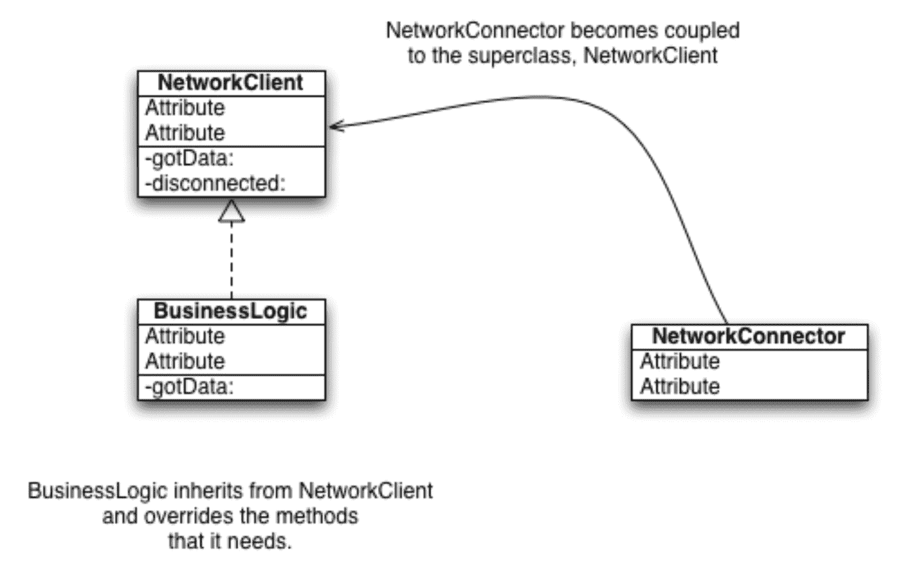

在这种情况下，你通过强制开发者继承特定的父类来限制了客户端类的开发者。如果该父类不能平滑地融入该开发者的对象层次结构，那么可能会导致重大的设计问题。例如，假设 `BusinessLogic` 类既需要与网络通信，又需要与具有类似回调机制的磁盘 I/O 系统通信。在这种情况下，仅仅使用这种直接继承是行不通的。

### 理解为什么你不需要（也不想要）多重继承

某些语言（如 `C++`）通过多重继承来解决这类问题。图 7.3 显示了你可能如何在 `C++` 中解决网络通信问题的示例。

多重继承的问题通常被称为“菱形问题”，并在图 7.4 中所示。

图 7.3

使用多重继承。


正如你在类图中看到的，多重继承的主要问题在于可能继承自两个不同的类（上方，类 `D` 继承自类 `B` 和 `C`），而这两个类都继承自一个共同超类（类 `A`）。在这种情况下，可能会发生歧义，即在类 `D` 的实例上调用了类 `A` 的方法。在这种情况下，如果类 `D` 没有覆盖该方法并提供自己的实现，那么应该调用哪个父类的方法，是 `B` 还是 `C`呢？

由于这个问题，`Objective-C` 并不提供多重继承。如果你只有单继承，你就不需要担心菱形问题了。

### 理解协议（Protocols）是如何解决问题的

协议通过允许你声明一个接口来解决问题，类可以实现该接口而无需提供该接口的任何默认实现。协议不提供指定其内部方法实现的机制。它们只提供了一种为这些方法声明接口的机制。与其让一个可重组件依赖于特定的类实现，你不如让该组件依赖于协议形式的接口的存在。实现给定协议的类被预期为协议声明中指定的方法提供自己的实现。通过这种方式实现协议，你使得类的编写能够使它们仅依赖于接口的存在，同时消除了歧义问题，因为任何声明实现了某个给定接口的类都必须实现相关的方法。不存在“菱形问题”，因为你声明并支持的任何协议都必须在你的类中有一个实现。

图 7.4

菱形问题。

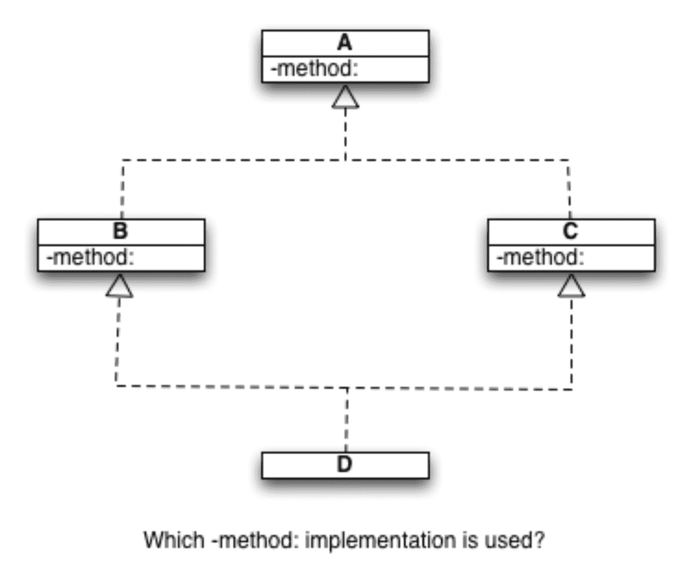

从面向对象设计的角度来看，这种解决方案的类图与多重继承的几乎相同，但它允许允许多重继承不可避免带来的问题。

这种解决方案并不是 `Objective-C` 独有的。`Java` 在许多方面基于 `Objective-C`，它也使用其版本的协议（称为接口 `interfaces`）来实现类似的概念。如果你是从 `Java` 背景转到 `Objective-C`，那么协议（Protocols）和接口（Interfaces）的概念非常相似，你会感到非常自如。

### 为他人实现预期的接口编写文档

思考协议的另一种方式是，想象你正在为他人的实现编写一个预期的接口的文档。在 `NetworkConnector` 示例中，我们正在记录网络类可能需要开发者协助确定在这些情况下该做什么的所有不同条件。

例如，如果 `NetworkConnector` 从网络接收数据，可以合理地假设应用程序本身包含了确定如何处理这些数据所需的任何知识（业务逻辑）。换句话说，没有一种通用的方法可以说“当我接收到数据时，我将如何处理它”。你真的必须询问程序的其他部分：“我刚刚收到了一些数据，你想让我对它做什么？”正是这些情况协议完美且独特适用的地方。你可以为所有不同的未决问题（“我收到了数据，我该如何处理？”“我断开了连接，我应该重连吗？”）声明一个协议，你的通用组件需要委托给更高的权威。

通过声明这些不同的“问题”，你建立了一个清晰且精确的合同，该类的用户可以此履行这个合同。当他们通过实现协议来履行合同时，他们将知道需要准备处理的所有不同情况。这种系统比涉及返回码、异常等系统要灵活得多。它比简单的回调要强大得多，因为 `Objective-C` 方法声明独特的冗冗性，以及声明清晰明显的协议如何成为你可重用组件的自文档 API。如果你这样想，“协议（Protocol）”这个词比“接口（Interface）”更有意义，因为“协议”可以被认为是一种约定的程序或行为规范，正如外交和礼仪一样。

所以，理论够了，现在你可以动手写代码了。

#### 在对象中实现协议

使用协议非常直观，并遵循许多你在处理类时看到的相同语法约定。

基本上，你首先必须创建协议声明。你可以在现有的接口文件中这样做，即在你为与已存在的对象使用声明协议时（正如我们之前讨论 `NetworkClient` 时那样），或者在一个独立的接口文件中这样做，适用于你可能为了许多目的使用该协议的情况。协议本身只声明接口，不提供任何实现。由于此，如果你为协议声明创建了单独的 .h 文件，你不需要提供任何 .m 文件。.h 文件中的接口就足够了。

在你声明协议后，对于任何实现该协议的类，它们也应该声明它们实现了它。这样编译器就可以验证相关类是否实现了程序所需的所有方法。

 注意


实际上，并没有绝对必要声明你的类实现了它所支持的协议。正如我们稍后讨论的，某些类型的协议根本不需要声明。此外，你的类也可以选择仅实现协议方法，而不是声明其支持该协议。在这些情况下，编译器无法在编译时确定你的类是否支持该协议，因此你可能需要在运行时做额外的工作，以确保你调用协议方法的任何对象实际上都实现了这些方法。然而，如果另一个类声明它期望你的类实现该协议，这可能会导致编译器警告。

当你在代码中引用预期实现给定协议的对象时，你可以在该对象的类型声明中使用一种特殊的语法，用来说尽管你可能不知道该对象的实际类是什么，但你期望它实现某个特定的协议。如果该协议是正式协议（formal protocol），则存储在该变量中的任何对象都将在编译时进行检查，以确定它是否实现了该协议要求的所有方法。如果没有实现，则会抛出警告。

协议可以同时包含强制方法和可选方法。在存在可选方法的情况下，实现协议的对象并不一定需要实现其中某一个可选方法。在这种情况下，你需要在尝试调用该方法之前，进行检查以验证该对象是否正在实现该可选方法。如果你尝试调用一个可选方法而该对象没有实现该方法，你将得到一个异常。

## 声明协议

声明协议遵循了许多你已经熟悉的相同语法标准。从表面上看，它最像声明一个类。你通过关键字 `@protocol` 开始协议声明，后面跟上你正在声明的协议名称。协议默认不会继承自彼此，也不会继承自类，但如果你想继承另一个协议，你可以可选地通过在要声明的协议名称后用角括号 `<>` 提供你所继承的协议名称来实现。当你这样做时，实现你协议的类不仅必须实现你声明的协议方法，还必须实现你所继承的任何协议的方法。在 `@protocol` 声明之后，你再声明你的协议所需的任何方法。就像在类中声明方法一样声明这些方法。

在协议定义内部（即你声明协议方法的地方），可以使用两个关键字。第一个是 `@required` 关键字。该关键字规定接后的所有方法都是该协议实现所需的强制方法。这是正式协议的默认行为，因此如果你不指定 `@required` 关键字，则协议中声明的所有方法默认为强制状态。

在 `@protocol` 声明内部可使用的第二个关键字是 `@optional` 关键字。它用于指示对于实现类来说是可选的方法。实现此协议的类可以选择不实现 `@optional` 关键字之后声明的任何方法。

在协议声明的末尾，与类一样，你用 `@end` 关键字结束协议声明。我们之前讨论的 `NetworkClient`类的示例协议声明如列表 7.1 所示。

###  7.1：协议声明示例

```objectivec
@protocol NetworkClient

-(void)networkConnector:(NetworkConnector *)inNetConnector
gotData:(NSData *)inData;

@optional

-(void)networkConnectorDisconnected:(NetworkConnector *)inNetConnector;

@end
```

 注意

此协议展示了代理模式的工作，这就是为什么第一个参数是发送消息的对象。我将在第 17 章中详细介绍这一点。

再次，如果你想让你的协议派自另一个已存在的协议（例如扩展该已存在的协议），你可以通过让你的协议扩展或继承该已存在的协议来实现，如列表 7.2 所示。

###  7.2：NetworkClient 扩展 IOClient 协议

```objectivec
@protocol NetworkClient <IOClient>

-(void)networkConnector:(NetworkConnector *)inNetConnector
gotData:(NSData *)inData;

@optional

-(void)networkConnectorDisconnected:(NetworkConnector *)inNetConnector;

@end
```

协议无法拥有成员变量。因此，在协议声明中没有地方声明成员变量。不要将其与“协议无法访问成员变量”的想法混淆，它确实可以访问，但那是特定于协议实现的细节，而不是声明协议本身的一部分。当你采纳该协议的任何类上实现协议方法时，你完全可以使用该类头文件中声明的任何成员变量。

## 声明类实现了协议

要声明一个类实现了特定协议，你只需要在类声明中父类名称之后的角括号内放置协议名称即可。例如，列表 7.3 显示了实现上一节协议的类示例。

###  7.3：实现 NetworkClient 协议的类

```objectivec
@class BusinessLogic : NSObject <NetworkClient>
{
    // 成员变量
NSString *someMemberVariable;
}

-(id)init;

@end
```

类可以同时实现多个协议。这样做时，你只需要在角括号内列出不同的协议并用逗号分隔，如列表 7.4 所示。

###  7.4：实现多个协议的类

```objectivec
@class BusinessLogic : NSObject <NetworkClient, DiskClient>
{
    // 成员变量
NSString *someMemberVariable;
}

-(id)init;

@end
```

在这种情况下，`BusinessLogic` 被表示同时实现了 `NetworkClient` 和 `DiskClient` 协议。

虽然你必须导入协议声明的头文件，但你不需要在接口中也声明协议方法。只需声明你实现了该协议就足够告诉编译器预期找到哪些方法。

 注意

在第 8 章描述的分类也可以像类一样声明它们实现了协议。

## 声明必须实现协议的对象

在声明预期实现给定协议的实例变量时，通常使用 `id` 数据类型，以便任何对象都能存储在变量中。如果你想让编译器验证实际存储在变量中的任何对象确实实现了所需的协议方法，那么你必须通过指定数据类型的同时指定协议类型来告诉这一点。要这样做，除了 `id` 数据类型外，你还在 `id` 关键字之后用角括号指定你期望对象遵循的协议，如列表 7.5 所示。

###  7.5：实现特定协议的变量

```objectivec
id<NetworkClient> *delegate;
```

在这种情况下，`delegate` 对象被定义为采用 `NetworkClient` 协议，因此编译器期望它实现该协议中相应的强制方法。

在任何预期声明变量数据类型的地方，都可以使用这种语法。这包括方法声明、变量声明、返回类型等。


` block ended abruptly with "Exploring examples of protocol use". 然而，根据你指令的上下文，我已按照你的高级文档工程标准，对提示词源部分中提供的文本进行了格式化处理。

[content]
在那些极少数的情况下，你没有声明某个变量必须实现特定协议，但你确实需要它实现，此时你可以通过类型转换强制编译器假设某个给定对象确实实现了某个协议。要将一个给定变量转换为给定的协议类型，你实际上是将其强制转为 `(id<SomeProtocol>)`。如果你在变量声明中指定了协议（这通常是推荐的做法），则不需要此操作。

## 探索正式协议与非正式协议

我之前简要提到过这一点，但在处理你如何处理可选方法（optional methods）之前，这里值得进一步讨论。

事实上，存在两种不同的协议：正式协议和非正式协议。非正式协议是旧式的协议类型，目前仍部分用于 Cocoa 和 Objective-C。非正式协议不需要像我目前在本章中向你展示的那样，进行正式的协议声明。非正式协议通常被声明为 `NSObject` 类的分类（categories）。我将在下一章节讨论分类，因此这里我不会展开过多的细节。

由于正式协议提供了更高的类型安全性，而且由于正式协议具有 `@optional` 关键字（允许你有选择性地将单个方法标记为可选），总的来说，正式协议是你在代码中创建新协议的首选方式。

通常，你现在唯一可能遇到非正式协议的地方是在当你与较旧的框架工作时，例如 Cocoa 框架本身的部分。

你可以识别出这些情况，因为文档并没有引导你去一个声明并记录你预期实现的接口的正式文档，你通常会看到这些协议方法作为你实际正在使用的类的一部分被记录下来。例如，Cocoa 类 `NSURLConnection` 它的代理方法（delegate methods）使用了非正式协议。如果你查看该类的文档，你会发现代理方法本身实际上是记录在 `NSURLConnection` 类本身的文档中。它们被标记为“delegate”。相比之下，Cocoa Touch 类 `SKPaymentQueue` 是最近为了支持 iPhone 内内购买而添加的，它通过使用 `SKPaymentTransactionObserver` 协议将它的代理方法分离到了正式协议中。

当需要在你的某个类中实现非正式协议时，你不需要像通常实现正式协议那样，在类的声明中声明该类实现了该协议。相反，你只需要实现你选择实现的方法，如果这些方法可用，需要使用你的对象的类就会调用它们。

在处理非正式协议时，协议中的所有方法都是可选的，因此在调用它们之前，你需要验证相关对象是否实现了这些方法。我将在下一节解释如何这样做。

## 确定对象是否实现了可选方法

在你的代码中，你可以使用对象方法 `-conformsToProtocol:` 来确定一个给定类是否实现了特定协议。该方法通过相关对象调用，它接收一个参数，该参数预期是一个协议对象。要获取特定协议的协议对象，你使用内置的 Objective-C 指令 `@protocol()`。这与你在声明协议时使用的 `@protocol` 指令不同，区别在于它在括号内接收一个参数，该参数是你想要获取其对象的协议名称。

例如，为了确定一个给定对象是否遵循我们的 `NetworkClient` 协议，你可以像列表 7.6 所示进行操作。

### 列表 7.6
在运行时确定对象是否遵循 `NetworkClient` 协议。

```objc
-(void)receivedData:(NSData *)inData;
{
    if([delegate conformsToProtocol:@protocol(NetworkClient)])
        [delegate networkConnector:self gotData:inData];
    // else 执行其他操作...
}
```

通常情况下，只有在你没有在问题变量的数据类型中指定协议类型时，你才需要这样做。如果你已经指定了协议是变量数据类型的一部分，那么当它没有实现所需的协议时，编译器会为你标记该变量。

 **注意**：列表 7.6 所示的 `-conformsToProtocol:` 方法仅适用于正式协议。如果你正在使用非正式协议，请改用列表 7.7 所示的 `NSObject` 方法 `-respondsToSelector:`。

即使你确定某个给定对象实现了某个给定的协议，该对象仍可能没有实现该协议的任何可选方法。请记住，如果一个对象没有实现可选方法，而你在该对象上调用了该方法，你的应用程序将会崩溃。因此，在尝试调用之前，你需要一种方法判断该对象是否真的实现了可选方法。

幸运的是，所有对象都继承自 `NSObject`，它拥有一个恰好实现此的方法。该方法是 `-respondsToSelector:`，它接受一个选择器对象（selector object）作为参数。

就像协议对象一样，可以使用特殊的指令将方法签名转换为选择器对象。该指令是 `@selector()` 指令。它的用法以及 `-respondsToSelector:` 方法在列表 7.7 中所示。

### 列表 7.7
通过测试以确定对象是否实现了可选方法。

```objc
-(void)disconnected;
{
    if([delegate respondsToSelector:@selector(networkConnectorDisconnected:)])
        [delegate networkConnectorDisconnected:self];
    // else 实现某些默认行为...
}
```

在这个示例中，你首先通过调用 `-respondsToSelector:` 来检查实现协议的对象是否真的实现了了其中一个可选方法。如果是的话，它就会继续调用该方法。如果不是，你可以选择什么都不做，或者转而实现某种默认行为。

## 避免循环协议依赖

协议可以在自己的声明中引用其他协议。例如，想象一个协议需要另一个协议作为其一个方法的参数使用，如列表 7.8 所示。

### 列表 7.8
需要另一个协议的协议

```objc
@protocol Foo
-(void)someMethodRequiringBar:(id<Bar>)inBar;
@end
```

如果所需的协议（`Bar`）也需要原始协议（`Foo`），如列表 7.9 所示，那么两个协议之间就会产生循环依赖。这将产生编译器错误。

### 列表 7.9
需要 Foo 协议的 Bar 协议

```objc
@protocol Bar
-(void)someMethodRequiringFoo:(id<Foo>)inFoo;
@end
```

要解决这个问题，你可以对所需的协议进行向前声明，从而无需包含所需协议的文件。例如，为了防止这种循环依赖，你可以在 `Bar.h` 接口文件中添加指令 `@protocol Foo;`，而不是导入 `Foo.h` 文件。如列表 7.10 所示。

### 列表 7.10
修正后的 Bar 协议。

```objc
@protocol Foo;

@protocol Bar
-(void)someMethodRequiringFoo:(id<Foo>)inFoo;
@end
```


在 Objective-C 中，处理应用框架（如 `Cocoa` 和 `Cocoa Touch`）时处处都会用到协议（Protocols）。最大的使用场景是委托（delegation）和数据源（datasource）对象。通常情况下，这些情况是指委托对象在运行时需要无法以通用方式确定的信息，例如在特定的表格视图（table view）中显示哪些列。或者，它们也用于需要在后台执行某些过程的场景。你可能会调用一个像 `-start` 这样的方法，它会立即返回，然后通过代理协议方法接收一个回调，通知你该过程已经完成。

为了给你举一个实际运行的示例，请看代码列表 7.11。在这段代码中，应用程序正在创建一个 `NSURLConnection` 并启动它。稍后，当数据从 URL 请求返回时，它通过协议方法 `-connection:didReceiveData:` 接收有关这些数据的通知。

### 列表 7.11
一个使用 `NSURLConnection` 并实现 `NSURLConnection` 代理协议方法的类

```objective-c
@implementation NetworkConnector

-(id)init
{
    if(self = [super init])
    {
        NSURL *url = [NSURL URLWithString:@http://www.google.com”];
        NSURLRequest *req = [NSURLRequest requestWithURL:url];
        connection = [[NSURLConnection alloc] initWithRequest:req
                        delegate:self startImmediately:YES];
    }
    return self;
}

// 协议方法
(void)connection:(NSURLConnection *)connection
didReceiveData:(NSData *)inData
{
    [data appendData:inData];
}

- (void)connectionDidFinishLoading:(NSURLConnection *)connection
{
    // 对所有数据进行某些操作！
}

@end
```

## 总结
在本章中，你学习了 Objective-C 中一种强大的解耦机制：协议。协议允许你通过保持组件与特定实现解耦，从而编写更具复用性的代码。使用协议，你可以简单地说：“我不在乎你是什么类型的对象，只要你实现了这个接口，我就会与你通信。”协议真的是 Objective-C 的关键技术之一，它使其与大多数其他语言相比与众不同且更好。

## 第 8 章：扩展现有类的功能

## 本章内容
- 使用分类（categories）扩展现有类
- 使用匿名分类暴露私有 API
- 使用关联引用（associative references）为类添加变量

无论一个类或框架设计得有多完美，不可避免的是，你总会遇到框架设计者没有预料到的情况。有些开发者甚至说，你不应该在代码中为复用性做计划，因为归结底，要实现真正的通用复用实在太困难了。我不赞同这种观点，我认为 Objective-C 为当今可用的任何语言在促进复用性方面提供了一些最出色的工具。

在本章中，我将深入探讨这些工具中最强大的几个。虽然它们并非 Objective-C 所独有，但它们无疑是 Objective-C 的动态性如何比几乎任何其他编译语言都提供更多灵活性和复用性的范例。

我在本章中解释的技术集中在扩展现有类的功能上。

## 与第三方框架和类一起工作
如果你过去接触过任何类型的编程框架，你可能遇到过这样的情况：语言标准库提供的现有类提供了你所需要的约 90% 的功能，但缺少你真正需要的最后 10% 功能。例如，你可能有一个字符串类，它没有提供正则表达式搜索。

因为这些框架是由第三方构建的，通常你无法访问这些框架的源代码。因此，修改现有框架本身来添加那额外的 10% 功能并不是一个选项。即使在你有源代码的情况下，修改现有框架来添加那额外的 10% 功能也是不可行的。


分类（Categories）的声明方式与声明类接口类似。这意味着，你通过输入 `@interface` 然后输入你想要修改的类名来声明分类。在类名之后，不像声明类时那样使用父类，而是在括号内放入你正在声明的分类名称。列表 8.1 显示了在 `NSMutableString` 类上定义的分类示例。

### 列表 8.1
`NSMutableString` 的一个分类示例，添加了向字符串插入 GUID 的功能

```objectiveobjectivec
#import <Foundation/Foundation.h>

@interface NSMutableString (GUID)

-(void)appendGuid;

@end
```

在这段特定的代码中，我正在为 `NSMutableString` 类添加一个分类，用于生成全局唯一标识符（GUID）。目前，该分类仅地将 GUID 附加到现有字符串的末尾。

## 实现分类方法

与协议（protocols）不同，仅仅声明分类的接口是不够的，因为你实际上是在向正在修改的类添加方法的实现。这意味着，除了声明分类的接口外，你还必须为相关方法添加实现。列表 8.2 显示了我在上一节中为 `NSMutableString` 类声明的方法的实现。注意，`@implementation` 行与声明类时一样，它告诉你正在为创建实现的类名（在本例中为 `NSMutableString`），后面再次紧跟括号中的分类名称。

### 列表 8.2
`NSMutableString` 上 GUID 分类的实现

```objectiveobjectivec
#import “NSMutableString+GUID.h”

@implementation NSMutableString (GUID)

-(void)appendGuid

{

CFUUIDRef uuid = CFUUIDCreate(kCFAllocatorDefault);

NSString *str =

(NSString *)CFUUIDCreateString(kCFAllocatorDefault, uuid);

[self appendString:str];

CFRelease(uuid);

}

@end
```

就像在类实现中定义方法一样，你在实现块（implementation block）中定义分类的方法。这些方法可以访问类中的所有成员变量，可以使用 `self` 调用类中的其他方法，甚至可以使用 `super` 关键字调用父类的方法。

唯一的局限性是，你不能作为分类的一部分声明新的成员变量。有一种向现有类添加变量的方法，我将在本章的稍后的部分向你展示，但分类无法做到这一点。

## 在头文件中声明分类

分类通常像类一样声明在 `.h` 和 `.m` 文件中。在某些情况下，在一个文件中对不同扩展类的相似功能进行分组会非常方便。例如，如果你有多个类需要用相似的功能进行扩展。通过将它们组合在单个 `.h/.m` 单元中，你从概念上将该功能隔离在了一起。如果未来需要更改该功能，所有相似的方法（尽管它们属于不同的类）都位于同一个文件中。

### 使用分类

仅仅声明并定义分类，就可以让分类的方法在任何使用该扩展类的地方变得可用。然而，仍然需要告诉编译器分类方法存在存在，以避免其在编译时生成警告。

要做到这一点，你只需要在任何使用分类方法的 `.m` 文件中包含包含分类声明的 `.h` 文件即可。

换句话说，为了使用 GUID 分类，我必须在任何使用它的编译单元中包含它的 `.h` 文件，例如列表 8.3 所示的 `main.m` 文件。

### 列表 8.3
使用 GUID 分类

```objectiveobjectivec
#import <Foundation/Foundation.h>

#import “NSMutableString+GUID.h”

int main (int argc, const char * argv[])

{

NSAutoreleasePool * pool = [[NSAutoreleasePool alloc] init];

NSMutableString *aString = [NSMutableString string];

[aString appendGuid];

NSLog(@”The guid: %@”, aString);

[pool drain];

return 0;

}
```

一旦我包含了头文件，我就可以直接使用这些方法，就像它们实际上声明在原始类上一样了。

## 使用分类拆分功能

分类提供的另一个便利是能够从已经变得过大的类中提取功能组件。在这些情况下，你可能会有一个包含大量代码的类。当你需要修改它们时，大型类文件会很快变得难以处理。通过将类功能的离散部分提取到分类中，可以在大量源代码中搜索你需要更改的方法时变得更容易。这样，当你对一个仅影响其部分功能的给定类进行更改时，你可以将与该功能相关的所有方法放在一个分类文件中，从而更容易地进行更改。

显然，你应该尽量保持类尽可能简单。你不应该将使用分类作为给特定类添加过多的额外功能的借口。然而，类确实有正交增长的趋势，在需要重构时，知道你有这个工具可用是一件好事。

## 扩展类方法

分类不仅限于对象方法。你还可以使用它们来添加类方法。例如，如果你想为 `NSMutableString` 的 GUID 分类添加一个工厂方法，你只需要像列表 8.4 所示添加该工厂方法即可。

### 列表 8.4
为 `NSMutableString` 添加工厂方法

```objectiveobjectivec
#import <Foundation/Foundation.h>

@interface NSMutableString (GUID)

-(void)appendGuid;

+(id)stringWithGuid;

@end

@implementation NSMutableString (GUID)

-(void)appendGuid

{

CFUUIDRef uuid = CFUUIDCreate(kCFAllocatorDefault);

NSString *str = (NSString *)CFUUIDCreateString(kCFAllocatorDefault, uuid);

[self appendString:str];

CFRelease(uuid);

}

+(id)stringWithGuid

{

NSMutableString *ret = [self string];

[ret appendGuid];

return ret;

}

@end
```

再次，在引用类与对象方面，这里适用于所有相同的规则：类方法中的关键字 `self` 指向类对象，而对象方法中的 `self` 指向实例对象。与之前一样，你可以像它声明在原始类上一样使用类方法，如列表 8.5 中更新后的 main 文件所示。

### 列表 8.5
更新后的 main 函数

```objectiveobjectivec
#import <Foundation/Foundation.h>

#import “NSMutableString+GUID.h”

int main (int argc, const char * argv[])

{

NSAutoreleasePool * pool = [[NSAutoreleasePool alloc] init];

NSMutableString *aString = [NSMutableString stringWithGuid];

NSLog(@”The guid: %@”, aString);

[pool drain];

return 0;

}
```

## 探索分类的局限性

分类确实存在某些相关的局限性。分类不能为扩展类添加任何成员变量。分类完全可以在分类方法的作用域内声明和使用局部变量，它们当然可以使用全局变量，或任何作为参数传递给它们的变量，但它们不能向类添加任何成员变量。


回想一下当我在描述如何创建协议（protocols）时提到多继承的危险性，问题在于：如果两个父类定义了相同方法的实现，编译器在特定情况下将难以确定要调用哪一个实现。这个问题并不会影响协议，因为协议仅仅是接口的声明，而不是实现。相比之下，分类（Categories）就没那么幸运了。

与多继承的情况一样，如果两个分类在同一个类上定义了相同的方法，那么在运行时实际调用的是哪个方法是未定义的。因此，你应该始终避免这样做。你甚至可能考虑采用一套独特的方法命名前缀系统，以避免与其他分类冲突，例如在你的方法名前加上你的首字母缩写。例如，我可能会使用 `-jdAppendGuid:` 而不是简单的 `-appendGuid:`。

在扩展系统框架时，你对方法的命名也需要格外小心。记住，Apple 正在不断增强自己的框架，他们可能会添加一个与你同名的方法。框架中的其他方法可能依赖 Apple 提供的实现，因此你的方法可能会导致 Apple 的代码崩溃。所以，在可能的情况下，你也应该为你的分类方法使用前缀，以避免此类问题。

### 使用分类实现协议

我在第 7 章中介绍了协议。在那个章节中，我提到了非正式协议（informal protocols）的概念。非正式协议实际上是作为定义在 `NSObject` 上的分类来实现的。这样做时，给定的协议声明实际上并不需要相应的实现。换句话说，你只需将协议接口声明为 `NSObject` 上的一个分类，但你不需要实际上为该分类提供方法的实现。非正式协议的使用者必须提供给定方法的实际实现。

由于 `NSObject` 在对象层次结构中的独特地位，它通常是定义这些协议的类。你的实现类总是继承自 `NSObject`，因此在其上面声明的任何分类都是可用的。

### 了解创建分类的危险性

遗憾的是，声明分类存在着风险。当你对一个类声明分类时，你本质上是在向该类添加方法。如果两个分类为同一个类定义了同名的方法，则在运行时调用的方法是未定义的。这可能导致意外之外的行为和崩溃。

因此，虽然分类非常强大，但使用它们时必须谨慎。避免添加可能与其他分类冲突的方法总是好的。如果你必须使用分类，请考虑使用独特的前缀以避免命名冲突。

## 使用匿名分类扩展类

如果你想向一个类添加方法而不将其暴露在它的公共接口中，你可以使用匿名分类（anonymous category）。匿名分类是在未指定名称的情况下声明的，并且在定义它的文件中可用。这是一种实现仅在类内部使用的私有方法的有用方法。

你用于执行此操作的工具就是匿名分类。本质上，匿名分类是一个未指定名称的分类，它仅在定义它的文件中可用。

代码列表 8.6 显示了匿名分类声明的示例。

```objectivec
// 匿名分类声明，这应该放在 Foo+PrivateMethods.h
#import <Foundation/Foundation.h>

@interface Foo ()

-(void)somePrivateMethod;

@end
```

代码列表 8.7 显示了 Foo 类的实现。注意接口并没有声明该私有方法，但实现确实提供了它的定义。

```objectivec
// Foo 类的实现
@interface Foo : NSObject

{

}

@end

@implementation Foo

-(void)somePrivateMethod
{
    // 秘密内容放在这里。;)
}

@end
```

通过使用匿名分类，你可以实现仅在类内部使用的私有方法。这是保持代码整洁和公共 API 洁净的极佳方法。


分类（Categories）无法为它们扩展的类添加新的成员变量。虽然这看起来是分类的一个一个局限性，但在实践中这并没有那么糟糕。当你确实需要为所扩展的类添加成员变量时，你可以轻松地子类 `class` 并通过这种方式来实现。然而，在某些情况下，你并不想创建子类，但确实需要为所扩展的类添加一些额外的变量。幸运的是，从 MacOS X 10.6 和 iOS 3.2 版本开始，Objective-C 运行时内置了一项用于执行此操作的底层能力。这项能力是由运行时本身利用的，在极端情况下，当你需要在不创建子类且不更改对象类声明的情况下，将一个变量与现有对象关联时，你可以使用它。这种技术被称为**关联引用（associative references）**。无论是否通过分类来实现，它都可用。我将向你展示如何使用它，然后向你展示如何使用它为 `NSMutableDictionary` 类实现一个用于缓存排序键的分类。

在我深入研究这个话题之前，我想先消除可能出现的任何困惑。在处理关联引用时，你实际上并没有为类本身添加成员变量。类本身不会与之关联的属性，也不会有与之关联的访问器。关联引用的本质仅仅是与你的类的特定实例关联的存储。注意，我并没有说它的存储是与类关联的。如果你没有显式地为你类的给定实例关联引用，它就不会拥有它。

要为你的类实例添加关联引用，你只需使用 Objective-C 运行时函数 `objc_setAssociatedObject`。该函数接受四个参数：你希望与数据关联的对象、一个以便稍后检索数据的键（key）、你想要存储引用的值，最后是关联策略（association policy），它定义了如何管理所存储值的内存。

在创建关联后，你可以使用 Objective-C 运行时函数 `objc_getAssociatedObject` 访问存储在关联中的值。该函数接受两个参数：第一个是与数据关联的对象，第二个是你最初关联数据时指定的键。

最后，当你不再使用某个关联对象时，可以通过再次调用 Objective-C 函数 `objc_setAssociatedObject` 来移除关联，但这次请将 `nil` 传递给要关联的值。

在所有情况下，与值关联的键对于该值必须是唯一的。键的实际数据类型是 `void *`。通常，你希望使用一个声明为 `static` 的变量作为此键。通过这样做，可以确保与键关联的指针始终指向该指针的单一实例并且是唯一的。

关联策略可以是以下值之一，如表 8.1 所示：

### 表 8.1

| 值 | 目的 |
| :--- | :--- |
| `OBJC_ASSOCIATION_ASSIGN` | 指定值将被简单赋值。不会使用 retain 或 release。 |
| `OBJC_ASSOCIATION_RETAIN_NONATOMIC` | 指定值将以非线程安全的方式赋值并保留。 |
| `OBJC_ASSOCIATION_COPY_NONATOMIC` | 指定值将以非线程安全的方式拷贝。 |
| `OBJC_ASSOCIATION_RETAIN` | 指定值将以线程安全的方式赋值并保留。 |
| `OBJC_ASSOCIATION_COPY` | 指定值将以线程安全的方式拷贝。 |

正如你所看到的，这些值与在声明对象属性时可以指定的属性属性非常相似。关联引用使用了非常类似的机制。

作为关联引用在代码中实际运作的一个示例，列表 8.8 显示了在 `NSMutableDictionary` 上声明的分类，该分类将维护一个字典键的缓存排序列表。这里为了内部管理目的定义了几个方法。如果你真的在实现这个分类，可能会有更好的实现方法。这里的目的仅仅是为了说明用于存储排序键的关联用的生命周期。

### 列表 8.8: 一个排序键分类

```objectivec
@interface NSMutableDictionary (SortedKeys)

-(void)generateSortedKeys;
-(NSArray *)sortedKeys;
-(void)dropSortedKeys;

@end

@implementation NSMutableDictionary (SortedKeys)

-(void)generateSortedKeys;
{
    NSMutableArray *keys = [NSMutableArray arrayWithArray:[self allKeys]];
    [keys sortUsingSelector:@selector(compare:)];
    objc_setAssociatedObject(self, @"KEYS", keys, OBJC_ASSOCIATION_RETAIN);
}

-(NSArray *)sortedKeys;
{
    return objc_getAssociatedObject(self, @"KEYS");
}

-(void)dropSortedKeys;
{
    objc_setAssociatedObject(self, @"KEYS", nil, OBJC_ASSOCIATION_RETAIN);
}

@end
```

正如你所看到的，当排序键数组被创建时，它作为关联引用存储在 `self` 上，也就是说存储在我们正在操作的字典上，这在 `-generateSortedKeys` 中显示。当完成排序键的使用后，可以使用 `-dropSortedKeys` 方法移除关联引用。

由于你没有使用子类，你确实需要确保显式地调用 `-dropSortedKeys`（或你的任何清理方法），以便在释放对象之前释放与对象关联的内存。

 **注意**

如果你使用较新的 LLVM 1.5 编译器和现代运行时，它们包含了在类扩展中声明实例变量的能力，因此你可以避免这些麻烦。要这样做，你只需像在类中一样在扩展中声明它们。请查看 LLVM 文档以获取此功能所需的标志。

你可以使用 `NSString` 常量（如我在这里使用的）作为键，因为当像我这样内联定义时，它们被定义为彼此的静态引用。


为了做到这一点，它首先会剔除源代码中的任何注释，并将其替换为空格；然后执行任何必要的行转换。最后，它会展开任何预处理器指令，也称为宏。

预处理器指令是指任何以 `#` 符号开头，其后紧跟指令本身以及该指令的任何参数的行。换句话说，列表 9.1 中的所有项都是预处理器指令。

### 列表 9.1: 某些预处理器指令或宏

```objc
#define FOO 1

#ifdef BAR

#endif

#define BAZ(X, Y) NSLog(@”%s - %s”, (X), (Y));

#import <Foundation/Foundation.h>
```

这些项中的每一个都是预处理器指令。`#define` 正在定义一个名为 `FOO` 的常量，其值为 `1`。`#ifdef` 和 `#endif` 定义了一个条件代码块，该块只有在 `BAR` 被定义时才会被编译。`#define BAZ(X, Y) NSLog(@”%s - %s”, (X), (Y));` 是一个预处理器函数，它接收参数并将其记录。最后，是你之前见过的 `#import` 指令，它加载给定的头文件并将其源代码内联到此源文件中。

这些指令在编译过程中被展开，而不是在运行时被展开。因此，它们所执行的操作在源代码实际编译之前就已经影响了它。在某些方面，你可以将预处理器宏视为一种编写程序的手段，用于在编译时操纵你的源代码。

### 了解宏的工作原理

这种在编译时操纵你源代码的观点是一个有趣的概念。看看列表 9.2。在这段代码中，有一个特定的字符串常量 `@”MY_IMPORTANT_DATA”`，它被反复用于从 `NSUserDefaults` 中访问条项。

### 列表 9.2: 使用字符串访问 NSUserDefaults 项的代码

```objc
#import <Foundation/Foundation.h>

int main (int argc, const char * argv[])
{

NSAutoreleasePool * pool = [[NSAutoreleasePool alloc] init];

NSString *someValue = @”foobar”;

[[NSUserDefaults standardUserDefaults] setObject:someValue
forKey:@”MY_IMPORTANT_DATA”];

// do stuff...

NSString *theValue = [[NSUserDefaults standardUserDefaults]
stringForKey:@”MY_IMPORTANT_DATA”];

[pool drain];

return 0;

}
```

这段代码最大的问题是，我在代码中使用了一个常量字符串作为键，这会让你面临编译器无法捕获的语法错误。如果你在输入字符串时拼写错误，编译器无法识别出这是一个错误，而是会允许它一直持续到你的应用程序运行。这导致了难以追踪的错误。

如果能创建某种宏，编译器在编译时将其展开为你的字符串，但在编译时可以检查它的语法错误，那就太好了。这正是宏的用处。列表 9.3 显示了相同的代码，但它是使用宏而不是字符串编写的。

### 列表 9.3: 使用宏

```objc
#import <Foundation/Foundation.h>

#define THE_KEY @”MY_IMPORTANT_DATA”

int main (int argc, const char * argv[])
{

NSAutoreleasePool * pool = [[NSAutoreleasePool alloc] init];

NSString *someValue = @”foobar”;

[[NSUserDefaults standardUserDefaults] setObject:someValue
forKey:THE_KEY];

// do stuff...

NSString *theValue = [[NSUserDefaults standardUserDefaults]
stringForKey:THE_KEY];

[pool drain];

return 0;

}
```

如你所示，在这个新的源列表顶部，我们定义了一个名为 `THE_KEY` 的宏。该宏被定义为 `@”MY_IMPORTANT_DATA”`。在后续代码中所有出现 `THE_KEY` 单词的地方，在程序编译时都会替换为字符串 `@”MY_IMPORTANT_DATA”`。这会在编译过程中的一部分透明地发生，但最终结果是这段代码在编译后，实际上与我们之前看到的列表完全相同。唯一的区别是，当你编写源代码时，可以利用 Xcode 内置的代码补全功能，编译器会检测你是否有任何拼写错误的 `THE_KEY` 实例。例如，如果你不小心写成了 `THE_KEY` 而不是 `THE_KEY`（假设），编译器可以检查该条件并发布错误。

列表 9.4 显示了另一个示例，程序将根据给定的宏值（`DEBUGGING`）是否定义来采取不同的操作。

### 列表 9.4: 基于宏的可选编译

```objc
#import <Foundation/Foundation.h>

#define DEBUGGING 1

int main (int argc, const char * argv[])
{

NSAutoreleasePool * pool = [[NSAutoreleasePool alloc] init];

#ifdef DEBUGGING

NSLog(@”Debugging stuff...”);

#else

NSLog(@”Not debugging”);

#endif

[pool drain];

return 0;

}
```

在这种情况下，`main` 块内部的代码正在检查是否设置了值或是否存在 `DEBUGGING` 宏。如果这个宏被定义（换句话说，如果它有任何值），它就会打印“Debugging stuff...”消息。如果 `DEBUGGING` 宏没有被定义，则会打印“Not debugging.”。

这种使用宏的酷之处之一在于，你可以让某些代码只在调试环境中编译。此外，请记住宏的展开是在编译时发生的。这解释起来很困难，但通过例子会更容易。请看列表 9.5。

### 列表 9.5: 宏会产生与预期不同值的示例

```objc

#import <Foundation/Foundation.h>

#define LOG_LINE NSLog(@”%s:%ld”, __FILE__, __LINE__);

int main (int argc, const char * argv[])
{

NSAutoreleasePool * pool = [[NSAutoreleasePool alloc] init];

LOG_LINE

NSLog(@”%s %s”, __DATE__, __TIME__);

LOG_LINE

[pool drain];

return 0;

}
```

在代码中，我首先定义了一个名为 `LOG_LINE` 的函数。这个函数在你的代码中展开时，会变成 `NSLog(@”%s:%ld”, __FILE__, __LINE__);`。这导致你的程序在运行时记录 `LOG_LINE` 函数所在的文件名和行号。内置宏 `__FILE__` 和 `__LINE__` 由编译器提供，并展开为当前源文件名和当前行号。当你运行此程序时，注意两次不同的 `LOG_LINE` 调用之间的行号发生了变化。这只有由于宏具有这种内联展开能力才可能。另一个说明可以通过观察两个 `LOG_LINE` 调用之间的行输出来得到。内置宏 `__DATE__` 和 `__TIME__` 展开为运行预处理器编译此程序的日期和时间。换句话说，这是你程序编译时的日期和时间。如果你编译一次程序并运行多次，你会发现后续启动时显示的日期和时间不会改变。这是因为在你的源代码中展开的日期和时间实际上是通过这些宏的展开被硬编码的。

列表 9.6 显示了在预处理器展开之后，这段代码可能的样子。

### 列表 9.6: 宏展开后的程序

```objc
#import <Foundation/Foundation.h>

int main (int argc, const char * argv[])
{

NSAutoreleasePool * pool = [[NSAutoreleasePool alloc] init];

NSLog(@”Code/Macros/Macros.m:9”);

}
```


```objc
NSLog(@”%s %s”, “May 18 2010”, “16:00:03”);
NSLog(@”Code/Macros/Macros.m:11”);
[pool drain];
return 0;
}
```

从字面上来说，这正是预处理器所的工作。它获取你的宏，并将它们展开到你代码中定义的它们所代表的任何内容。

你可能会注意到，这些特定的宏在名称的开头和结尾使用了双下划线。这是一个专门为编译器提供的宏预留的标准，而不是你在代码中应该な做法。你可以使用这些宏——但不要在你自己的宏名称中使用双下划线。

## 定义宏

你通过 `#` 符号开始一个宏定义，后面跟着预处理器指令，然后是该指令的任何参数（例如宏的名称等）。表 9.1 列出了最常用的预处理器指令的列表。

| 表 9.1 | 指令 | 目的 |
| :--- | :--- | :--- |
| `#define` | 用于定义新宏，例如常量和函数。 |
| `#ifdef` | 开始一个可选的编译块。如果预处理器指令的参数定义为任何内容（即使是零），则从 `#ifdef` 直到终止的 `#endif`、`#else` 或 `#elif` 代码将被编译并包含在应用程序中。如果参数未定义且提供了 `#else` 或 `#elsif` 块，则将评估 `#else` 或 `#elsif` 块，并在适当的情况下编译并包含应用程序。 |
| `#undef` | 移除之前定义的宏。 |
| `#import` | 在此文件中读取并包含另一个源文件。自动防止多次包含该文件。 |
| `#include` | 在此文件中读取并包含另一个源文件。防止多次包含文件。 |
| `#pragma` | 用于配置编译器和在 IDE 中注释的特殊宏。 |
| `#warning` | 生成编译器警告。用于向开发者标记问题。 |
| `#error` | 生成编译器错误。 |
| `#if` | 开始一个与 `#ifdef` 类似的条件编译块，但它依赖于一个表达式（如 `X > 10`），该表达式必须求值为真才能被视为真。 |
| `#else` | 用于 `#if` 或 `#ifdef` 之后，当语句为假时提供一个要编译的条件块。 |
| `#elif` | 用于 `#if` 或 `#ifdef` 之后，提供一个带有额外控制语句的条件块，以确定是否应该编译。 |
| `#endif` | 终止 `#if`、`#ifdef`、`#else` 或 `#elif` 块。 |

为了本书，我将主要关注 `#define`、`#ifdef` 以及其他常用的预处理器指令。`#pragma`、`#warning`、`#include` 和 `#error` 指令通过查看 GCC 文档效果更好。

 注意

` 指令的一个非常常用的用法是在代码中添加 IDE 指令，供 IDE 在标签中使用。Apple 在其自己的模板中广泛地使用这一点。在他们的许多模板中，你会看到此指令：`#pragma mark Something`。这将导致 IDE 在方法名列表的下拉菜单中显示“Something”。此外，特殊指令 `#pragma mark –` 会在列表中放置一条水平线。

### 定义常量

在本章中我向你展示的第一类宏用于定义常量，该常量稍会在应用程序的多个地方被重用。事实上，这可能是宏最常见的用途之一。我自己使用这种形式的宏来定义访问 `NSUserDefaults` 的键，就像上一个示例所示的那样。

要定义常量，你使用预处理器指令 `#define`，后面跟着你正在为定义定义值的常量名称。在名称之后（用空格分隔），你提供你希望预处理器在源代码中展开宏的值。预处理器通过使用行中剩余的所有文本（直到遇到行尾）来展开宏。

在你想创建一个像这样的宏并将其定义跨越多行的情况下，你可以通过输入反斜杠 `\` 然后按回车来实现。这会导致编译器在评估此宏时，将下一行视为当前行的一部分。

列表 9.7 显示了使用 `#define` 预处理器指令定义几个不同常量的示例。

### 列表 9.7：使用 #define 定义常量

```objc
#define FOO 1
#define BAR @”this is bar”
#define BAZ @”THIS IS A VERY LONG STRING \
AND IT CONTINUES DOWN HERE \
AND HERE.”

#define BOZ BAR
```

一个不成文的规则是始终使用全大写字母命名你的宏。这样做有助于将源代码中的宏与普通语句区分开，并使你的代码更易读。在上一节中，我提到你不应该在自己的宏名称中使用双下划线。此外，你不应该在宏名称的开头或结尾使用下划线，因为这是预留给编译器的。在宏名称内部使用下划线是完全安全的，事实上，这是另一个不成文的标准：使用下划线而不是空格来分隔宏名称中的多个单词，因为空格在宏名称的任何地方都是非法的。宏名称必须以字母开头。不允许使用数字。你可以在宏名称的第一个字母后使用数字，但它们不能作为第一个字母。

### 通过编译传递常量

我在本章早期提到了如何作为构建设置的一部分来定义宏。列表 9.8 显示了一个示例，该应用程序在调试时编译连接到测试服务器，在未调试时连接到生产服务器。

### 列表 9.8：基于构建设置的条件编译

```objc
#import <Foundation/Foundation.h>

int main (int argc, const char * argv[]) {
    NSAutleasePool * pool = [[NSAutleasePool alloc] init];
    NetworkConnection *conn = [[NetworkConnection alloc] init];

    #ifdef DEBUGGING
        [conn connectToServer:@develop.nowhere.com”];
    #else
        [conn connectToServer:@production.nowhere.com”];
    #endif

    [pool drain];
    return 0;
}
```

注意，`DEBUGGING` 宏并没有在此源文件中实际定义。在这种特定情况下，我依靠构建设置来传递该值。如果该值已定义，则应用程序将连接到开发服务器。如果没有，它将连接到生产服务器。

图 9.1 显示了构建设置窗口以及你为了定义构建设置的一部分的值而设置的参数。

你用于定义这些预处理器宏的构建设置是 `Preprocessor Macros` 设置。这个特定的设置接受一组用 `=` 分隔的宏名称和值列表。因此，换句话说，为了定义预处理器宏 `DEBUGGING`，你会将此构建设置设置为 `DEBUGGING=1`。这里给定的值 1 基本上只是将其设置为任何值（即使是 0 也可以），以便使 `#ifdef` 语句返回真。如果我们使用带有表达式的 `#if`，例如 `#if DEBUGGING > 10`，那么我们就可以根据编译标志拥有不同级别的调试内容。


通过在调试构建（debug build）中设置此构建设置，编译源代码时将设置 `DEBUGGING` 宏。当你切换到没有此设置的 `Release` 构建时，系统将编译并包含正常的生产环境代码。

### 在宏中使用变量

虽然宏的语法能力要原始得多，但宏能够接收参数，就像处理函数或方法时接收参数一样。这允许你创建复杂的宏，并根据宏展开时可用的上下文信息实际执行一些创造性的操作。

例如，如果你想创建一个 `MAX` 宏来返回两个参数中的较大值，你可以像列表 9.9 所示创建一个宏。

#### 列表 9.9
用于打印变量值的宏
```
#define MAX(X, Y) ((X) > (Y) ? (X) : (Y))
```

#### 图 9.1
构建设置窗口。
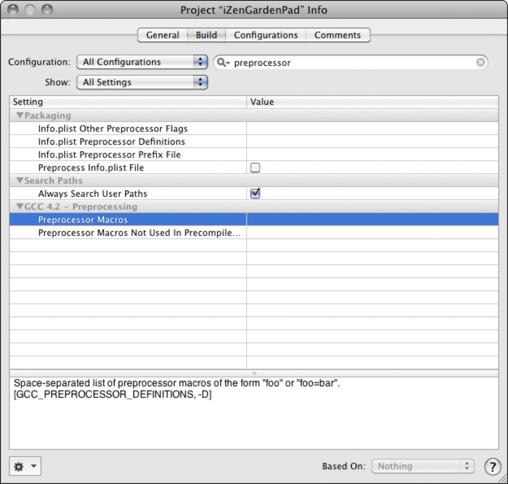

在这个示例中，`MAX` 宏接受两个参数，`X` 和 `Y`。它通过使用三元运算符比较这两个参数。如果 `X` 大于 `Y`，它返回 `X`；相反，如果 `Y` 大于 `X`，它返回 `Y`。

在宏中使用参数时，参数是在括号内指定的，就像你为过程定义参数一样。然而，存在一些细微的差别。

首先，你不需要为参数提供数据类型。这段代码将不会编译。相反，宏会在使用的地方被展开，参数将直接插入到展开后的宏代码中。因此，这里不需要变量类型。

其次，参数列表的左括号必须紧跟在宏名之后。注意，当我们定义其他宏时，我们为宏定义的值与宏名之间是有一个空格隔开的的。因此，如果你在宏名和参数列表的左括号之间放置一个空格，预处理器将认为参数列表是宏值的开始，而不是宏名的一部分。

带参数的过程和宏之间的另一个细微差别在于对宏值体内部内部值的处理。注意上面的示例，在宏值体中使用了许多额外的括号。再次，这与宏会在代码中展开，且值会在代码的宏内部被展开有关。为了说明这一点，考虑代码 `NSLog(@”Max Value: %ld”, MAX( x & 20, 10));` 的展开。如果没有额外的括号，它可能会展开为 `NSLog(@”Max Value: %ld”, (x & 20 > 10 ? x & 20 : 10));`。在这种情况下，操作顺序决定大于比较的优先级高于位与（AND）操作，因此将作用于 20 和 10，而不是作用于 `x & 20` 和 10。通过在宏值体内部包含额外的括号，你可以确保操作顺序完全按照你预期的方式执行。换句话说，这段代码实际上会展开为 `NSLog(@”Max Value: %ld”, ((x & 20) > (10) ? (x & 20) : (10)));`。

### 使用字符串化（stringification）

我在自己的代码中喜欢使用的宏技巧之一是在应用程序运行时记录特定变量的值。这样做非常有用，因为我可以查看应用程序的状态，而不必在调试器中停止它并逐个查看特定的值。

为了做到这一点，我必须创建一个接受变量作为参数的宏。由于我可能在不同位置对不同的变量使用此宏，我还需要获取变量名并与该变量的值一起打印。为了实现这一点，我使用了一种名为“字符串化”的特殊宏能力。

字符串化会将传递给它的任何代码通过将其括在引号中来转换为 C 字符串。例如，如果给定 `x + 10` 作为参数，它将将其转换为 `"x + 10"`。这使得它非常适合解决此类问题。

列表 9.10 展示了我定义的该宏。

#### 列表 9.10
用于打印变量值的宏
```
#define LOGVAR(var) NSLog(@”%s: %@”, #var, var);
```

这里的关键是在变量名本身前面加上一个 `#` 符号。这会调用字符串化。

如果你像列表 9.11 所示在应用程序中使用此宏，你可以看到它会首先打印变量名，然后打印该变量的值。

#### 列表 9.11
使用宏打印变量值
```
#import <Foundation/Foundation.h>

#define LOGVAR(var) NSLog(@”%s: %@”, #var, var);

int main (int argc, const char * argv[])
{
    NSAutoreleasePool * pool = [[NSAutoreleasePool alloc] init];
    NSString *someVar = @”This is the value.”;
    LOGVAR(someVar);
    [pool drain];
    return 0;
}
```

`LOGVAR(someVar)` 行会被展开为类似于列表 9.12 的内容。

#### 列表 9.12
展开后的代码
```
#import <Foundation/Foundation.h>

int main (int argc, const char * argv[])
{
    NSAutoreleasePool * pool = [[NSAutoreleasePool alloc] init];
    NSString *someVar = @”This is the value.”;
    NSLog(@”%s: %@”, someVar, someVar);
    [pool drain];
    return 0;
}
```
 注意：此代码为了示例是简化的。

### 条件编译

你可以通过预处理器指令 `#if`、`#ifdef`、`#ifndef` 以及对应的 `#else`、`#elif`、`#endif` 来选择性编译代码。

这些指令中的第一个是 `#if` 指令。`#if` 指令根据表达式的结果允许或阻止部分代码的编译。该表达式可以是任何有效表达式，使用宏、常量、变量等等。关键是它必须为真，`#if` 指令后的部分才会编译。你用 `#endif` 语句结束 `#if` 语句。如果你想在表达式为假时提供额外的编译代码块，可以在 `#if` 块内部、`#endif` 之前放置 `#else` 指令。或者，你可以在 `#if` 块内部放置 `#elif` 指令。`#elif` 指令同样接受表达式，并在该表达式为真时编译它与下一个指令之间的代码，就像 `#if` 指令一样。基本上，整个 `#if`、`#else`、`#elif`、`#endif` 结构与 `if`、`else` 结构非常相似，不同之处在于不是影响程序的执行流，而是影响哪些会被编译。`#ifdef` 和 `#ifndef` 指令的作用与 `#if` ，只是它们不使用表达式，而是简单地测试某个值是否已定义。

使用 `#ifdef` 时，如果值已定义，则编译代码；使用 `#ifndef` 时，如果值未定义，则编译代码。

### 使用内置宏

Xcode 用来编译你代码的底层编译器 GCC 已经提供了许多内置宏供你使用。你已经在本章的示例中见过其中一些宏的用法。要了解更多信息，请访问 GCC 文档：[`gcc.gnu.org/onlinedocs/cpp/`](http://gcc.gnu.org/onlinedocs/cpp/)

总结


在本章中，我向你介绍了 Objective-C 预处理器，这是一个功能强大的工具，允许你编写在编译时会修改自身代码的代码。使用它，你可以完成各种事情，从使用常量防止语法错误到打印你的变量，甚至根据条件编译代码的某些部分而非其他部分。这是一个你可能不会经常使用的工具，但当你需要它时，它会非常好用。

# 第 10 章：处理错误

## 本章内容
- 学习不同类型的错误以及你应该如何处理它们
- 使用返回码返回状态
- 使用异常（Exceptions）处理特殊错误
- 学习使用 `NSError` 的正确方法

你希望运行时错误不会发生，但你知道它们会发生。你尝试进行防御性编程，确保你正在使用的变量具有你预期的值。你编写单元测试以确保任何可能发生的状况都已经被预见，并将该问题的解决方案构建在你的应用程序中。然而，你知道你无法预见到所有问题。你清楚，无论你如何努力保护你的应用程序抵御现实世界的危险，只要你的应用程序发布到具有真实问题的现实环境中（例如内存限制、磁盘空间有限以及在糟糕时间中断你应用程序的用户），你就会遇到问题。你将经历错误。

幸运的是，Objective-C 内置了多种错误处理能力，你可以利用这些能力来编写健壮、有弹性且稳定的代码。你可以编写出应用程序，当错误发生时，它们会发生弯曲而不是断裂。

在本章中，我将向你介绍 Objective-C 和 Foundation 框架内置的三种主要机制，这些机制将帮助你编写在面对这些危险时足够勇敢的代码，并在遇到不可预见的问题时“做正确的事”。在我开始之前，请先看看你在典型应用程序中可能会遇到什么种错误。

## 错误分类
在典型的运行程序中可能发生的错误分为三大类。

第一类错误仅仅由成功或失败条件组成。无法获取关于发生了什么的额外信息，操作要么是成功了，要么是没有成功。通常情况下，这是最轻微的错误，不是那种会剧烈中断程序流的错误。例如，如果你正尝试通过互斥锁（mutual exclusive lock）访问共享资源，你的程序可能会尝试访问资源但失败，因为另一个程序或程序的程序的部分已经在访问该资源。在这种情况下，你想知道访问资源失败了，并且你只想简单地再次尝试访问资源。这种类别属于轻微的错误条件。当调用失败时，你完全清楚该做什么，也完全清楚可能导致失败的原因。

返回码（Return codes）非常适合这种错误。理想情况下，返回码可以简单如布尔值。如果调用成功，返回码返回 `YES`；如果调用失败，返回 `NO`。在某些缺乏我即将向你介绍的复杂错误处理机制的语言中，错误代码是你返回无效条件的唯一选择。在这些语言中，错误代码往往承载了多种含义。通常这些语言要求将错误代码设置为特定的值以表示特定的错误条件。通常，Objective-C 不会这样做，因为有其他机制让你提供比普通的旧错误代码更好、更具描述性的错误信息。

第二类错误与第一类处于对立的极端。这种错误如果不处理，会导致数据丢失或应用程序故障。这些错误显然比第一类严重得多，包含诸如无法打开应用程序继续运行所绝对需要的资源、数据存储中的一致性错误等。想象一下，这些错误如此重要，以至于如果你不对它们采取行动措施，你宁愿应用程序崩溃也不继续运行，以避免造成比已经造成的更大的伤害。这些错误，直白地说，是异常状况（exceptional conditions），因此最适合处理它们的错误处理机制被称为“异常”（Exceptions）是有意义的。幸运的是这类错误在 Objective-C 中非常罕见。尽管如此，在本章后面，我将向你展示如何处理它们，以及以后如何从中恢复。

最后，第三类错误在严重性上介于前两者之间。这种错误足够严重，你确实需要向调用你函数的人向上堆栈传递更多的上下文信息，但又没有严重到无法从中恢复。

这目前是 Objective-C 程序中最常见的运行时错误类型。它是如此常见，以至于 Apple 提供了一了一种标准的错误机制来处理这类错误。它结合了用于指示成功的返回码以及一个专门的 `NSError` 对象，用于在失败时提供上下文信息。处理 `NSError` 可能会复杂，但到本章结束时，你将能够像专业人士一样处理此类错误。

### 理解如何中断程序流
知道何时中断程序流是很重要的。

我之前提到的三类错误中的每种在错误发生时如何处理中断程序流方面，都要求不同的设计模式。在设计一个可能返回错误的 API 时，请考虑 API 的用户，以及处理可能发生的潜在错误将如何影响调用你 API 所需代码的设计。理想情况下，你希望设计你的 API，使得开发者在使用它时，能够在提供尽可能少的基础设施的同时，能够捕获并处理可能发生的任何潜在错误条件。

如果你的错误是轻微且明显的，并且只需要很少外部（开发者侧）支持或干预，那么你可能考虑使用返回码来指示调用失败。另一方面，如果发生的错误条件极其极端，以至于你必须完全停止应用程序以避免对系统造成更大的伤害，那么使用异常可能是出路。你必须假设，如果 API 的用户没有处理该异常，应用程序将会崩溃，因为这正是异常所做的的。从这个角度来看异常（即把未处理的异常视为崩溃），这确实让你对这种错误状况有了清晰的认识，并可能帮助你思考何时使用异常才是合理的（线索：非常罕见）。

最后，对于大多数其他错误条件——介于极端轻微和极端严重之间的——`NSError` 机制可能是正确的选择。它可以轻松地将调用失败的事实向上堆栈传递给调用者，但同时又将判断错误严重性的责任放在它应该所在的位置，即该调用者的手中。

# 使用不同的机制处理错误
那么，让我们深入研究如何使用这三种不同的错误处理技术。在接下来的章节中，我将介绍如何使用 Objective-C 内置的三种不同的错误处理能力、它们在你的代码中如何工作，以及处理他人代码中发生的错误时需要做什么。

### 使用返回码


你已经看到方法和过程在退出时都具有返回值的能力。你通过使用 `return` 关键字来实现这一点。你在方法签名中声明你所返回的数值类型，这决定了你的方法返回什么种类型的返回值。

使用此返回值来指示失败或成功是编程语言中最古老的错误处理机制之一。在 Objective-C 派生的 C 编程语言中，看到返回 `int` 错误码以指示不同类型错误的过程是非常常见的。通常，这些返回码会被映射到错误消息上，以便你能够通过查看返回的值来判断发生的实际错误是什么。尽管有查询错误代码的能力，但错误代码本身通常仍然只是数字。这往往是非常不方便的，因为不同的函数使用不同的值来表示不同类型的错误，而查找它们意味着要根据你正在使用的过程，查看不同的代码到错误消息的映射表。

结果，其他的错误处理机制被开发出来，这种方式的返回码使用便被遗弃了。尽管如此，对于简单的错误，使用返回码仍然是一项值得理解和利用的技术。然而，在这样做时，最好的做法是避免返回码最大的问题——代码到错误消息的查询，而是坚持使用简单的布尔值，在成功时返回 `YES`，失败时返回 `NO`。这通常是你在 Objective-C 中看到返回码用于错误处理的方式。

当然，这条规则也有例外，例如，在方法在调用成功时可能返回某些值的情况下，有时调用会返回 `nil` 而不是预期的值。幸运的是，Objective-C 中的 `nil` 和 `NO` 在作为 `if` 语句的控制变量使用且结果相同时，它们会被求值为假。因此，你在处理这些返回值时可以以类似的方式对待它们。

列表 10.1 显示了一个作为磁盘文件包装器的类示例。在这个特定的示例中，预期磁盘上的数据文件存在且可读。但如果它不存在呢？如果文件不存在，它就无法打开。在这种情况下，对象方法 `-openFileAtPath:` 将返回 `nil`。

### 列表 10.1：文件包装类的类定义

```objc
@interface FileWrapper : NSObject

{
    NSDictionary *contents;
}

-(BOOL)openFileAtPath:(NSString *)inPath;

@end;

@implementation FileWrapper

// dealloc 和其他内容应该放在这里...

-(BOOL)openFileAtPath:(NSString *)inPath
{
    contents = [[NSDictionary dictionaryWithContentsOfFile:inPath]
    retain];

    if(!contents)
        return NO;

    return YES;
}

@end
```

`-openFileAtPath:` 方法实际上使用了 `NSDictionary` 上的一个方法，该方法利用与我在这里说明的完全相同的错误处理方式。换句话说，`NSDictionary` 类方法 `+dictionaryWithContentsOfFile:` 的返回值通常是一个 `NSDictionary` 实例。然而，如果文件不存在，或者无法作为属性列表文件加载，则该方法将返回 `nil`。列表 10.1 显示的方法检查从 `NSDictionary` 方法返回的值是否为 `nil`。如果是，它本身就会返回 `NO`。否则，它返回 `YES`。

列表 10.2 显示了可能使用该类的的主函数。

### 列表 10.2：使用文件包装类

```objc
int main (int argc, const char * argv[])
{
    NSAutoreleasePool * pool = [[NSAutoreleasePool alloc] init];
    FileWrapper *wrapper = [[FileWrapper alloc] init];

    if([wrapper openFileAtPath:@”...”])
    {
        // 在此处处理文件操作...
    }
    else
    {
        // 告诉用户文件无法打开。
    }

    [pool drain];
    return 0;
}
```

如你所见，我将 `-openFileAtPath:` 的调用封装在一个 `if` 语句中。如果调用返回 `YES`，说明成功了，我可以对文件进行操作。否则，我必须告诉用户文件无法 [sic: not] 打开。

这个示例说明了返回码的问题之一，即你无法知道为什么文件无法打开。你只知道它无法打开。理想情况下，你希望能够告诉用户具体发生了什么，以及文件为什么无法打开。也许是文件丢失了，也许用户没有权限打开该文件。在这种特定情况下，用户没有办法知道。

尽管如此，这仍然发生错误时指示错误的最简单的方法之一。

## 使用异常

现在转向错误处理的另一个极端，即真正严重的情况，Objective-C 提供了一种极佳的机制来抛出和处理异常。

Objective-C 语言提供了几个专门用于异常处理的内置指令。信号发生异常情况的行为被称为抛出（throwing）或引发（raising）异常。本质上，这包括创建一个 `NSException` 实例，然后使用内置的 Objective-C 指令 `@throw`。

一旦抛出异常，它将继续向上调用栈传递，直到被捕获。要捕获异常，你使用 Objective-C 指令 `@catch`。`@catch` 指令可以用于捕获 `NSException` 的特定子类（在你可能对特定类型的异常进行特殊处理时），也可以写成捕获所有异常。列表 10.3 再次显示了文件包装示例，但在这种情况下，如果文件无法打开，`-openFileAtPath:` 方法抛出一个异常。

### 列表 10.3：使用异常的 -openFileAtPath: 方法

```objc
-(void)openFileAtPath:(NSString *)inPath
{
    contents = [[NSDictionary dictionaryWithContentsOfFile:inPath]
    retain];

    if(!contents)
    {
        if(![self fileExistsAtPath:inPath])
        {
            NSException *ex =
            [NSException exceptionWithName:@”Error opening file”
            reason:@”File doesn't exist.”
            userInfo:nil];
        }
        else if(![self hasPermissionForFileAtPath:inPath])
        {
            NSException *ex =
            [NSException exceptionWithName:@”Error opening file”
            reason:@”Permission error.”
            userInfo:nil];
        }
        else
        {
            NSException *ex =
            [NSException exceptionWithName:@”Error opening file”
            reason:@”Unknown error.”
            userInfo:nil];
        }
        @throw ex;
    }
}
```

在这个 `-openFileAtPath:` 方法的版本中，在我确定文件无法打开后，我列出了它可能失败的一些典型原因，并针对每种情况构建了特定的异常。一旦构建好异常，我就会使用 `@throw` 指令抛出异常。

在这种特定情况下，我正在使用默认的 `NSException` 类来抛出异常。但如果我想表现得更华丽一点，可以使用不同异常情况的自定义异常类来重写此方法。

这种示例在列表 10.4 中所示。

### 列表 10.4：针对不同错误抛出自定义异常

```objc
-(void)openFileAtPath:(NSString *)inPath
{
    contents = [[NSDictionary dictionaryWithContentsOfFile:inPath]
    retain];

    if(!contents)
    {
        NSException *ex;
        if(![self fileExistsAtPath:inPath])
        {
            ex = [FileMissingException
            exceptionWithName:@”Error opening file”
            reason:@”File doesn't exist.”
            userInfo:nil];
        }
        else if(![self hasPermissionForFileAtPath:inPath])
        {
            ex = [FilePermissionException
            exceptionWithName:@”Error opening file”
            reason:@”Permission error.”
            userInfo:nil];
        }
        else
        {
            ex = [NSException
            exceptionWithName:@”Error opening file”
            reason:@”Unknown error.”
            userInfo:nil];
        }
        @throw ex;
    }
}
```


请注意，该方法已经完全删除了返回值。这是一个要么成功返回、要么完全不返回的代码示例。换句话说，如果文件能够成功打开，则该方法将执行成功且一切运行正常。如果在打开文件时发生错误，则会抛出一个异常，该异常需要由调用者捕获。

 警告

我如何强调这一点都不为过，所以我在这里再次强调：在这段代码中，如果抛出了异常且没有被该方法调用栈上方的某处捕获，应用程序将会崩溃。因此显然，只有当你知道失败对于该应用程序来说是一个关键问题时，你才想以这种方式使用异常。

由于捕获这些异常如此重要，请看你是如何做的。列表 10.5 显示了该应用程序更新后的 main 函数，其中包含了正确的异常处理代码。

### 列表 10.5：在 main 函数中处理异常

```objc
int main (int argc, const char * argv[])
{
    int retCode = 0;
    @try
    {
        NSAutoreleasePool * pool = [[NSAutoreleasePool alloc] init];
        FileWrapper *wrapper = [[FileWrapper alloc] init];
        [wrapper openFileAtPath:@”...”];
        // do stuff with the file here...
    }
    @catch (NSException *e)
    {
        NSString *errorName = [e name];
        NSString *errorMsg = [e reason];
        NSLog(@”An error occurred: %@ - %@” , errorName, errorMsg);
        retCode = -255;
    }
    @finally
    {
        [wrapper release];
        [pool drain];
    }
    return retCode;
}
```

异常的工作机制使得它们实际上可以中断位于应用程序中任何位置的程序流，然后向上堆栈跳转，直到异常被捕获为止。

因此，当你调用的方法中有可能发生异常时，你必须将可能抛出异常的代码封装在所谓的 `try/catch` 块中。在上面的代码中，你可以看到该程序执行的初始操作之一就是使用 `@try` 指令。这开始了一个 `try/catch` 块。一旦你使用了 `@try` 指令，后续代码块（由 `{}` 分隔）中的代码将像正常情况下一样执行，直到到达代码块末尾或抛出异常。

如果抛出了异常，程序流将立即被中断，并跳转到由 `@catch` 指令指定的异常处理器。

`@catch` 指令允许你捕获特定类型的异常。当异常发生时，代码会跳转到 `@catch` 指令，并寻找与抛出的异常最匹配的项。然后它将重新执行 catch 块内部的代码。

在特定情况下，catch 块仅仅是打印错误信息，然后将应用程序的返回代码设置为错误状态。如列表 10.5 所示，通过捕获通用的 `NSException`，你实际上捕获了所有异常。

你甚至可以捕获 `id` 数据类型而不是 `NSException`。这将让你能够捕获任何抛出的对象。

在像前面的示例那样的情况下，针对不同的错误条件会抛出不同类型的异常，你需要为需要处理的每种异常列出单独的 catch 块。列表 10.6 显示了这样一个示例。

### 列表 10.6：捕获不同类型的异常

```objc
int main (int argc, const char * argv[])
{
    int retCode = 0;
    @try
    {
        NSAutoreleasePool * pool = [[NSAutoreleasePool alloc] init];
        FileWrapper *wrapper = [[FileWrapper alloc] init];
        [wrapper openFileAtPath:@”...”];
        // do stuff with the file here...
    }
    @catch (FilePermissionException *e)
    {
        // ...
    }
    @catch (FileMissingException *e)
    {
        // ...
    }
    @catch (NSException *e)
    {
        // ...
    }
    @finally
    {
        [wrapper release];
        [pool drain];
    }
    return retCode;
}
```

以这种方式捕获异常时，你应该按照从最具体到最具体的顺序列出异常，因为运行时将执行它找到的第一个 catch 块匹配项。

由于异常可以随时中断程序流，当异常发生时，你的应用程序很难对分配的内存和资源进行适当的清理。幸运的是，在 `try/catch` 结构之外，Objective-C 异常处理中还有一个内置功能，`@finally` 指令。

`@finally` 块的工作方式与 `@catch` 块相同，不同之处在于无论发生异常，它总是会被执行。这使其成为清理内存或释放作为 `@try` 块部分分配的其他资源的理想位置。无论 try 或 catch 块内部发生了什么，你始终可以依靠 `@finally` 块的执行。

这种错误处理方法的优势在于，你可以将代码分组并让它一直运行，直到发生坏事，然后处理该错误条件。此外，错误可以具有很强的描述性。你可以将各种放入 `NSException` 对象中，并根据需要尽可能详尽。

在具有复杂处理需求的复杂错误条件的情况下，`try/catch/finally` 块甚至可以相互嵌套。这允许你在需要时进行多级异常处理。

 警告

Objective-C 中使用异常处理错误与某些广泛使用异常的语言相比相对较少。如果你来自 Java 等语言并想大量使用异常，我敦促你重考虑，转而查看我将访问的下一个错误处理机制：`NSError`。

 警告

要在抛出异常时让调试器中断，可以在 Objective-C 运行时方法 `objc_exception_throw` 中设置断点。如果你这样做，当抛出异常时，它将触发断点并停止你的应用程序。但你必须小心，因为某些方法会抛出并捕获异常而不让传递。这是正常的，没有害。

### 使用 NSError

在设计 Foundation 框架时，Apple 意识到他们需要一种返回简单返回代码又能提供错误类型信息的机制。因此，它引入了一种名为 `NSError` 的新错误处理系统。列表 10.7 显示了使用它的文件包装类。

### 列表 10.7：使用 NSError 的文件包装类

```objc
-(BOOL)openFileAtPath:(NSString *)inPath withError:(NSError **)outError
{
    contents = [[dictionaryContentsOfFile:inPath] retain];
    if(!contents)
    {
        if(!self fileExistsAtPath:inPath])
        {
            NSDictionary *errorInfo =
            [NSDictionary dictionaryWithObject:@”File doesn't exist.”
            forKey:NSLocalizedDescriptionKey];
            *outError = [NSError errorWithDomain:@”FileWrapper”
            code:404
            userInfo:errorInfo];
        }
        else if(!self hasPermissionForFileAtPath:inPath])
        {
            NSDictionary *errorInfo =
            [NSDictionary dictionaryWithObject:@”Permission Error.”
            forKey:NSLocalizedDescriptionKey];
            *outError = [NSError errorWithDomain:@”FileWrapper”
            code:500
            userInfo:errorInfo];
        }
        else
        {
            NSDictionary *errorInfo =
            [NSDictionary dictionaryWithObject:@”Unknown error.”
            forKey:NSLocalizedDescriptionKey];
            *outError = [NSError errorWithDomain:@”FileWrapper”
            code:501
            userInfo:errorInfo];
        }
        return NO;
    }
    return YES;
}
```

`NSError` 是一种在 Cocoa 和 Cocoa Touch 框架中实现的规范化设计模式。


要使用它，你需要扩展你的方法签名，以接收指向 `NSError` 对象的间接引用（indirect reference）。该对象由调用者提供。间接引用本质上是一个指向指针的指针。换句话说，它是一个指向另一个指针的指针；在这种情况下，它是指向调用者栈内存内分配的变量的指针。当你向该变量赋值时，你会对间接引用进行解引用，从而实际上是将值赋值给它所指向的变量。

 注意

有些程序员会将间接引用称为“指针的指针”（pointer to a pointer）、“按引用传递”（pass by reference）或“引用”（reference）。我更倾向于使用“间接引用”这一术语，以区分于你在使用 Objective-C++ 时可能会遇到的普通引用。“指针的指针”可能是最准确的描述，但我觉得这个短语对新程序员来说可能很困惑。

这个间接引用的概念听起来可能非常困惑。如果是的话，那很好，你完全正常。幸运的是，只要你理解了创建和返回 `NSError` 对象时必须使用的语法，底层的细节大多并不重要。

在你的方法的参数列表中声明 `NSError` 间接引用时，你使用语法 `(NSError **)` 来声明它。双 `*` 号标记其为间接引用。

## 创建 NSError 对象

一旦进入方法内部，如果发生错误，在从方法返回 `NO` 之前，你必须先创建 `NSError` 对象并将其赋值给解引用后的 `NSError` 间接引用。要做到这一点，像往常一样创建 `NSError` 对象，但在将其赋值给传入的变量时，使用解引用运算符（`*`）对变量进行解引用。换句话说，要创建一个新的 `NSError` 对象并赋值给传入的 `NSError` 间接引用，你可以如列表 10.8 所示。

### 列表 10.8：将 NSError 对象赋值给传入的 NSError 间接引用

```objc
*outError = [NSError errorWithDomain:@”FileWrapper”
code:404
userInfo:errorInfo];
```

`NSError` 工方法接受三个参数。第一个是错误域（error domain）。这是一个字符串值，用于指示错误源自子系统。Cocoa 本身提供了几个错误域，例如 `NSCocoaErrorDomain`、`NSPOSIXErrorDomain` 等。这些在 `NSError.h` 头文件中声明。在创建自己的 `NSError` 实例时，你可以（可能应该）指定自己的错误域。如果你选择这样做，错误域字符串应该用反向 DNS 符号指定，例如 `com.yourcompanyname.productname.classname`。

第二个参数是错误代码参数（error code）。错误代码完全取决于应用程序，它提供了一种将传统的错误代码作为错误对象的一部分的方法。你如何选择使用错误代码取决于你，但它必须是一个无符号整数。

## 理解 NSError userInfo 字典

在大多数情况下，错误代码和错误域是今天大多不再使用的遗留参数。`NSError` 对象真正的精髓在于 `userInfo` 字典。在为此参数创建字典时，你可以使用多个键来存储不同的错误信息。这些键见表 10.1。

并不是所有这些键都总是存在，而且，`NSError` 类的用户可能还会向字典添加特殊的特定域键，用于编码与已发生的错误相关的特定数据。

由于能够编码向用户显示错误消息所需的所有信息（描述、错误原因、恢复建议，甚至是对话框的按钮），使得你可以使用 `NSAlert` 类方法 `+alertWithError:` 来显示合适的警报框，并带有 `NSError` 对象中的数据以及相应的按钮和文本字段。

### 表 10.1

| 键 | 用途 |
| :--- | :--- |
| `NSLocalizedDescriptionKey` | 错误状况的本地化描述，例如“无法打开文件，因为其不存在。”也可以通过 `NSError` 对象方法 `-localizedDescription` 访问。 |
| `NSLocalizedFailureReasonKey` | 错误的本地化原因，例如“文件不存在。”也可以通过 `NSError` 对象方法 `-localizedFailureReason` 访问。 |
| `NSLocalizedRecoverySuggestionErrorKey` | 关于用户可以采取什么操作尝试解决问题的本地化描述。也可以通过 `NSError` 方法 `-localizedRecoverySuggestion` 访问。 |
| `NSLocalizedRecoveryOptionsErrorKey` | 字符串数组，用于向用户展示错误时对话框中的按钮。第一个字符串将用作最右侧按钮，然后从那里向左顺序排列。 |
| `NSRecoveryAttempterErrorKey` | 遵循 `NSErrorRecoveryAttempting` 协议的对象，可用于尝试从错误中恢复。（仅限 Mac OS X） |
| `NSUnderlyingErrorKey` | 另一个代表实际底层错误的 `NSError` 对象。 |

## 与恢复尝试者（recovery attempter）工作

恢复尝试者是 `NSError` 中一个鲜为人知且很少使用的组件。它仅在 Mac OS X 上可用，提供了一个可以自动尝试从发生错误中恢复的对象。

提供的对象必须遵循 `NSErrorRecoveryAttempting` 协议，该协议了两个方法：`-attemptRecoveryFromError:optionIndex:`（专门在使用模态、非以文档为中心的用户界面的应用程序中调用）以及 `-attemptRecoveryFromError:optionIndex:delegate:didRecoverSelector:contextInfo:`（由以文档为中心的用户界面的应用程序调用）。

恢复尝试者与 OS X 响应链协同工作。要使恢复尝试者生效，你可以在响应链中的任何对象上调用 `-presentError:` 或 `-presentError:modalForWindow:delegate:didPresentSelector:contextInfo:`。这两个方法在一种情况下对应为模态应用程序展示错误，另一种情况下对应为基于文档的应用程序展示错误。当你调用它们时，它们会向用户显示一个警报，显示来自 `NSError` 的信息。当用户点击按钮时，将在恢复尝试者上调用相应的恢复方法，并将被点击按钮的索引作为 `optionIndex` 参数传递。

如果错误可以恢复，`-attemptRecoveryFromError:optionIndex:` 方法将返回一个 `BOOL` 值。`-presentError:modalForWindow:delegate:didPresentSelector:contextInfo:` 方法预期会调用代理对象上提供的选择器。该选择器的形式应类似于列表 10.9。

### 列表 10.9：恢复尝试者回调函数

```objc
- (void)didPresentErrorWithRecovery:(BOOL)didRecover
contextInfo:(void *)contextInfo;
```

再次，恢复尝试者很少使用，可能不是你在代码中通常会遇到的。尽管如此，它是 `NSError` 的一个有趣特性。

## 在方法中使用 NSError

回到文件包装器示例，为了利用这段新的 `NSError` 代码，你需要将 main 块修改为像列表 10.10 所示的样子。

### 列表 10.10：使用 NSError 的方法

```objc
int main (int argc, const char * argv[])

{

NSAutleasePool * pool = [[NSAutleasePool alloc] init];

FileWrapper *wrapper = [[FileWrapper alloc] init];
NSError *error = nil;

if([wrapper openFileAtPath:@”...” withError:&error])

{

// 在此处对文件进行操作...

}

else

{

// 告诉用户无法打开文件。
// 在这里你填充了错误对象。
showErrorToUser(error);

}

[pool drain];

return 0;

}
```


此处的关键变化在于你现在可以检查 `-openFileAtPath:withError:` 方法的返回码。如果返回 `NO`，那么错误对象现在应该包含一个已初始化的 `NSError` 对象，其中包含了向用户显示错误所需的所有内容。

 警告

某些关于 `NSError` 的代码示例要求你将 `NSError` 设置为 `nil`，然后检查 `NSError` 是否已初始化以判断是否发生了错误。这绝对是错误的。Cocoa 的某些部分即使在执行成功时也会操作 `NSError` 对象。使用 `NSError` 的正确模式如所示：检查方法的返回码，如果返回为 `NO` 或 `nil`，则检查错误对象以获取更多信息。

这种错误处理方法兼顾了者之长。它既简单又提供了丰富的信息，而且不会强制用户去处理错误。它为 API 使用者提供了足够的灵活性来做正确的事，同时又不会假装自己比用户更懂。

## 总结

错误处理是成为一名高效程序员至关重要的一部分，因此 Objective-C 为你提供了足够的工具来优雅且正确地处理错误情况，这非常好。你已经拥有了这些工具。请使用它们。

# 第三部分：使用 Foundation 框架

### 本部分内容

- 第 11 章：理解框架是如何协同工作的
- 第 12 章：使用字符串
- 第 13 章：处理集合
- 第 14 章：使用 NSValue、NSNumber 和 NSData
- 第 15 章：处理时间与日期

## 第 11 章：理解框架是如何协同工作的

## 本章内容

- 解释框架
- 学习 Foundation 如何融入其他框架中
- 学习如何将框架添加到你的项目中

在 MacOS X、iPhone 和 iPad 上使用 Objective-C 开发时，操作系统提供的重用库通常被封装成框架（frameworks）。这些框架将头文件、文档和动态库打包在一起，提供一个包含使用其内部代码所需的全部信息和数据的包。

框架的具体实现方式很大取决于平台。框架可以被封装成像我刚才描述的那种动态库（如在 MacOS X 中所示），也可以封装成静态库（如在 Linux 或 BSD 上偶尔所示）。由于框架包本身具有以平台为中心的特性，详细解释如何构建框架超出了这类以语言为中心书籍的范畴。尽管如此，理解通常与 Objective-C 一起使用的关键框架及其提供的功能是非常重要的。因此，本章侧重于向你介绍在你构建 Objective-C 程序的某些平台上可用的框架。由于后文将显而易见的原因，写一本不包含 Foundation 框架的严格以语言为中心的 Objective-C 书几乎是不可能的。因此，本书的其余部分将重点讨论这一关键组件的一些细节。

## 理解 Foundation 框架

你可能不知道，但如果你一直跟着书中的代码，你已经在应用程序中使用框架了。到目前为止的所有示例程序都是 Foundation 应用程序，这意味着它们链接了 Foundation 框架。

大多数语言都有标准库。例如，C 语言有 `标准库`。C++ 扩展了标准库，包含了标准模板库。Java 也有标准库，以此此类推。在大多数情况下，这些标准库被规定提供某些功能，但实现由平台厂商决定。

Objective-C 作为一种语言本身并没有定义所谓的标准库，但随着时间的推移，Foundation 框架已经演变成 Objective-C 最接近标准库的东西。它提供了许多与其他语言标准库相同的设施——字符串、集合、I/O 等。

尽管 Foundation 最初由 NeXT/Apple 为 NeXTstep 和 Mac OS X 开发并支持，但它已成为其他平台若想被真实认为是可行的 Objective-C 平台必须遵循的黄金标准。Foundation 本身是一个巨大的库，列出 Foundation 提供的每个类和方法的完整列表远远超过了此处实际讨论的范畴。然而，为了让你略略了解该库提供的可用内容，我在表 11.1 中列出了许多更常用的类。

| 表 11.1 | | |
| :--- | :--- |
| 类 | 用途 |
| `NSArchiver/NSUnarchiver` | 用于符合 `NSCoder` 协议的对象的序列化和反序列化。 |
| `NSArray/NSMutableArray` | 有序集合。 |
| `NSAutoreleasePool` | 实现用于计数和内存管理的自动释放池。 |
| `NSBundle` | 为应用程序包（application bundles）提供强大的接口。 |
| `NSCalendar` | 提供处理日历的类。 |
| `NSData` | 用于存储通用数据的类。 |
| `NSDate` | 用于创建和操作日期的类。 |
| `NSDateFormatter` | 为日期提供本地化和格式化。 |
| `NSDictionary/NSMutableDictionary` | 关联集合。 |
| `NSLock` | 线程锁。 |
| `NSError` | 用于存储错误信息。 |
| `NSException` | 异常的基类。 |
| `NSEnumerator` | 用于遍历集合。 |
| `NSFileHandle` | 处理文件 I/O 的封装类。 |
| `NSFileManager` | 封装文件系统相关操作（如创建目录）的类。 |
| `NSGarbageCollector` | 以面向对象的方式与垃圾回收交互的类。 |
| `NSSet/NSMutableSet` | 无序集合。 |
| `NSNotification/NSNotificationCenter` | 提供通过运行时发送和接收任意通知机制。 |
| `NSObject` | 所有类的基类。 |
| `NSTask` | 与操作系统进程交互的类。 |
| `NSThread` | 用于创建和交互线程的类。 |
| `NSURL` | 封装统一资源定位的类。 |
| `NSURLConnection` | 使用支持的协议连接到互联网资源的网络类。 |
| `NSString/NSMutableString` | Objective-C 的字符串类。 |

也许 Foundation 提供的最重要的类是 `NSObject`，几乎所有其他 Objective-C 类都继承自它。事实上，正是 `NSObject` 提供了许多我们认为 Objective-C 原生具备的功能，例如键值编码（KVC）、反射以及动态分发的某些方面。没有 Foundation，Objective-C 将成为一种极度残缺的语言。两者是密不可分的。

Foundation 极其详尽。在大多数情况下，在你考虑自己发明某些低层类之前，先检查它在 Foundation 中是否已经存在。很有可能它是存在的。

即使现在，我仍然不断在 Foundation 和其他框架中发现新事物，并对 Apple 预见到的所有异常边缘情况感到惊讶。要获取 Foundation 或任何其他 Apple 框架的完整列表，请访问 Apple 开发者网站：http://developer.apple.com。


`Foundation` 框架在 `MacOS X` 上并不是孤立存在的。Apple 作为标准平台的一部分提供了许多额外的框架，同时你也可以从第三方下载数百个框架。在 Apple 提供的框架中，包括诸如 `AppKit`（它提供了在 `MacOS X` 上构建 GUI 应用程序所需的类）、`UIKit`（它提供了在 iPhone 和 iPad 上构建 GUI 应用程序所需的类）以及一系列提供网络服务、图形等特定功能的其他框架。为了本书的目的，我们将专注于 `Foundation`。在 `MacOS X` 上的所有框架中，该框架无疑拥有着最强大的跨平台支持。它不仅在 `MacOS X`、iPhone 和 iPad 的官方 Apple 版本中可用，还以开源第三方实现的形式存在于 `Linux`、`BSD UNIX` 甚至 `Windows` 上。在许多实现方式中，其中一种实现方式允许你在 `MacOS X` 上使用 `Xcode` 开发应用程序，并进行交叉编译以构建用于 `Windows` 的可执行文件。在许多方面，`Foundation` 框架比某些专门为该目的而构建的标准库提供了更好的移植性和功能性。

然而，由于 Apple 平台目前是 Objective-C 开发者最受欢迎的平台，我将主要关注这些平台上可用的特性。

## 在你的项目中使用框架

尽管它是专门针对 `MacOS X` 的，但我将简要介绍一下在自己的项目中使用框架的议题，以便你在需要时知道如何处理它们。

Apple 提供的框架通常安装在安装 `Xcode` 的目录中，默认路径 `/Developer`。在该目录下，你将找到一个名为 `Platforms` 的目录。在 `Platforms` 目录内部，你会为每个已安装了 `SDK` 的不同开发平台找到一个目录。例如，如果你安装了 iPhone `SDK`，你将看到与 iPhone OS 对应的目录。如果你没有安装，则只会看到与 `MacOS X` 对应的目录。

在 `SDK` 目录内部，你将找到一个指向 `System/Library/Frameworks` 的路径。该特定 `SDK` 中该特定平台的所有框架都位于此目录内。

### 添加框架

向项目中添加框架非常简单。你只需要对打算要添加框架的目标（target）点击右键或按住 Option 键并点击，然后选择 `Add ⇒Existing Frameworks`。这样做会弹出框架选择对话框，如图 11.1 所示。

此对话框允许你从已安装的框架列表中选择任何你想要链接到当前所选目标的框架。

图 11.1
框架选择对话框。

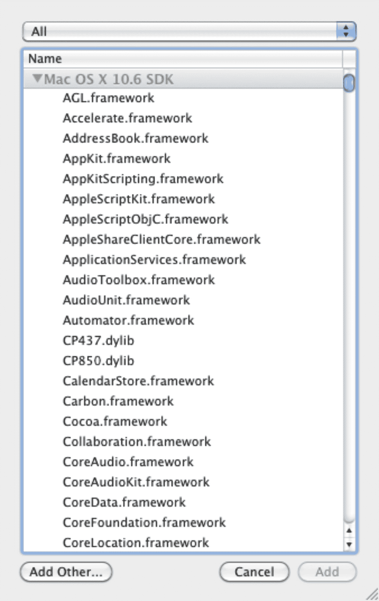

### 包含头文件

记住，仅仅链接框架还不足以让你实际使用其中包含的类和代码。你还需要确保将适当头文件包含到源文件中。回想一下你学习导入头文件的时候。

### 垃圾回收

在使用字符串时，一个重要的考虑因素是，当你链接框架时，要确保你使用的字符串是支持垃圾回收的。因此，在选择字符串时，要确保你所引用的字符串是符合垃圾回收机制的实例。

## 总结

在本章中，我们向你介绍了了 `Foundation` 的概念，并讨论了 `NSString`。

## 第 12 章：使用字符串

## 本章内容

- `NSString` 和 `NSMutableString` 类
- 格式化字符串
- Objective-C 字符串语法

## `NSString` 和 `NSMutableString` 类

尽管 `NSString` 和 `NSMutableString` 有许多初始化方法和工厂方法，但最常用的字符串构造如列表 12.1 所示。

列表 12.1
Objective-C `NSString` 快捷语法

```objc
NSString *someString = @”this is a */;
```

本质上，编译器知道每当它遇到 `@` 以及双引号字符串时，应该创建一个静态 `NSString`。为了说明这一点，请看列表 12.2。

列表 12.2
检查字符串等值性

```objc
NSString *string1 = @”this is a */;
NSString *string2 = @”this is a */; // 与 string1 相同的对象
NSString *string3 = [NSString stringWith:string1]; // 创建新的

assert(string1 == string2); // 真
assert([string1 isEqual:string2]); // 也是真

assert([string1 isEqual:string3]); // 真

assert(string1 == string3); // 假
```

通常，你使用 Objective-C 字符串构造来声明字符串，但 `NSString` 和 `NSMutableString` 类提供了许多初始化方法和工厂方法。其中一些常用的如表 12.1 所示。

| 表 12.1 `NSString` 和 `NSMutableString` 工厂方法。 |

| 方法 | 用途 |
| :--- | :--- |
| `+string` | 创建一个新的空字符串。 |
| `+stringWithFormat:` | 使用给定的 printf 风格格式说明符和格式说明符所需的任何参数创建一个字符串。 |
| `+stringWithCharacters:length:` | 从提供的 C 风格数组检索长度的字符创建一个新字符串。 |
| `+stringWithString:` | 使用给定字符串的值创建一个新字符串。 |
| `+stringWithCString:encoding:` | 使用指定的编码转换 C 风格字符串创建一个新字符串。 |
| `+stringWithUTF8String:` | 使用 UTF-8 字符串编码的 C 风格字符串创建一个新字符串。这等同于调用 `+stringWithCString:encoding:` 并使用 `UTF8Encoding` 作为编码参数。 |
| `+stringWithContentsOfFile:encoding:error:` | 使用提供的编码创建一个包含指定文件内容的新字符串。 |


| `+stringWithContentsOfURL:encoding:error:` | 构建一个包含由 URL 指定资源内容的新字符串。将使用指定的协议下载资源，并使用提供的编码进行解码。在资源下载期间，此调用将处于阻塞状态。 |
| `+stringWithContentsOfFile:usedEncoding:error:` | 构建一个包含指定文件内容的新字符串。将尝试自动检测所使用的文件编码类型，并通过输出参数 `usedEncoding` 告知调用者检测到的编码类型。 |
| `+stringWithContentsOfURL:usedEncoding:error:` | 构建一个包含由提供的 URL 指定的资源内容的新字符串。将下载该资源，并尝试检测所使用的文件编码类型，通过输出参数 `usedEncoding` 告知调用者编码类型。 |

这些方法每一个都有一个初始化器版本，如果你倾向于以那种方式创建字符串，可以使用它们。

 **注意**

## 工厂方法概述

“工厂方法”一术是指可以使用特定参数来构造对象的类方法。

## 使用格式化字符串

最常用的工厂方法之一是 `+stringWithFormat:` 工厂方法，它利用 printf 风格的格式化字符串和参数列表来构造字符串。（我在本书的许多示例中使用了格式化字符串。每当你看到对 `NSLog` 的调用时，就能看到格式化字符串的实例。）列表 12.3 显示了用于 `NSLog` 用的格式化字符串示例。

### 列表 12.3：NSLog 中的格式化字符串

```objc
NSLog(@”The age of the employee named %@ is %ld”, [employee name], [employee age]);
```

使用 `@""` 表示格式化字符串是 `NSString` 的实例。在创建格式化字符串时，你使用百分号和字符的特殊组合来指示特定的参数，这些参数在传递给使用该字符串的对象时会被替换。

格式化字符串包含三种组件：

1. **格式说明符 (Format Specifiers)**：格式说明符是一种特殊的字符组合，以 `%` 开头，后面跟着一个或多个数字和字母，指定运行时替换到格式化字符串中的参数的格式。你可以使用格式说明符插入从对象、整数或浮点数中的任何内容。格式说明符还可以指定参数在放入字符串时的格式化方式。例如，为了构造一个格式说明符来插入带有两位小数的浮点值，你使用一个格式说明符，例如 `%.2f`。用于格式说明符的字符非常详尽且全面，其复杂性和奇特性可能足以填满一本同样大小的书。因此，我不会对所有它们进行详细介绍。我鼓励你阅读关于格式化字符串的 Apple 文档。

如此，我想专门提到一个格式说明符：`%@`。这个说明符在 Objective-C 中是特殊的。它旨在与对象参数配合使用。它的作用是让格式化字符串获取作为该说明符参数的对象，并在该对象上调用 `-description` 方法以获取该对象的字符串表示。大多数基础类都有一个 `-description` 方法，可以为该类返回一个合理的结果。`NSString` 的 `-description` 方法实际上返回字符串本身。`NSArray` 的 `-description` 方法返回一个显示数组内容字符串表示的字符串。`NSObject` 对 `-description` 默认实现返回一个显示对象指针地址的字符串。如果你创建一个自定义类，并想在该类中使用格式化字符串的这一功能，请确保相应地覆盖 `-description` 方法。

2. **转义序列 (Escape Sequences)**：格式化字符串中使用的第二种组件称为转义序列。你使用转义序列向字符串中插入特殊的、非标准的字符。转义序列的首字母始终是一个斜杠字符，后面跟着一个告诉编译器想要插入什么种类型特殊字符的字符。例如，要在字符串中插入一个回车字符，你使用转义序列 `\r`。

最常用的转义序列是：
- `\n` 用于插入换行
- `\r` 用于回车
- `\"` 用于双引号
- `\t` 用于制表符
由于使用 `\` 字符开始转义序列，转义序列 `\\` 也仅插入一个 `\` 字符。

3. **字面量字符 (Literal Characters)**：最后，可以在格式化字符串中使用的第三种组件本质上是不属于前两种组件类的任何内容。这些字符直接传递到最终结果。

当格式化字符串被解析时，对于它遇到的每个格式说明符，它都会在该格式化字符串本身作为参数的函数查找后续参数。然后它将该参数的值替换到结果字符串中，并执行格式说明符指示的任何转换。为了让你确切了解这是如何工作的，请看列表 12.4。

### 列表 12.4：使用格式化字符串

```objc
NSString *str;

NSString *cardName = @”Ace”;
NSString *cardSuit = @”Spades”;

str = [NSString stringWithFormat:@”The winning card is %@ of %@.”,
cardName, cardSuit];
// str 是 “The winning card is Ace of Spades.”

str = [NSString stringWithFormat:@”You have %ld gold!”,
[player goldAmount]];
// str 是 “You have 1000 gold!”

str = [NSString stringWithFormat:@”Your change is: %.2f.”, change];
// str 是 “Your change is $2.43”
```

注意在使用格式化字符串时传递的参数使用了不寻的语法。格式化字符串允许向 `+stringWithFormat` 方法传递变长参数列表。参数的数量由提供的格式说明符数量决定。

 **注意**

为了确保代码是 64 位安全的，在处理整数时，通常认为最佳实践是使用 `%ld` 说明符。当使用 `NSInteger` 作为整数的类型时，它会随架构从 32 位变为 64 位。使用 `%ld` 作为你的格式说明符可以确保格式化字符串兼容 32 位或 64 位的 `NSInteger`。

## 其他 NSString 方法

使用格式化字符串允许你以比简单拼接更灵活的方式创建字符串。除了简单构造新字符串外，格式化字符串还有各种应用。例如，你还可以附加格式化字符串，如列表 12.5 所示。

### 列表 12.5：附加格式化字符串

```objc
NSMutableString *str = [...];

[str appendFormat:@”Your change is: %.2f.”, change];
```

你还可以通过 `-componentsSeperatedByString:` 方法将字符串拆分为组件。该方法将在接收者内搜索给定字符串的实例，然后返回一个包含由该字符串分隔的部分的 `NSArray`。列表 12.6 显示了此示例。

### 列表 12.6：将字符串拆分为组件

```objc
NSString *str = @”This is a string of words.”;
NSArray *words = [str componentsSeperatedByString:@” “];
// words 现在是 [@”This”, @”is”, ... ]
```

同样，此方法的对应方法是 `NSArray` 方法 `-componentsJoinedByString:`，它将执行相反的操作。它将一个字符串数组并将它们合并为一个字符串，每个组件之间由给定字符串分隔。


你可以使用类似 `-rangeOfString:` 的方法进行字符串搜索和替换，在接收者中找到给定字符串的范围；或者使用 `-stringByReplacingOccurrencesOfString:withString:` 进行字符串替换。`NSString` 甚至还有一些有限的正则表达式匹配支持。

总的来说，`NSString` 是一个异常强大且功能全面的类，其功能远超这里涵盖的范围。我的建议是访问 `NSString` 文档，并回顾它为你提供的所有方法。

### 使用 NSString 分类（categories）

由于 `NSString` 已经是一个非常全面的类了，Apple 选择将其提取到单独的分类文件中，这些文件与 `NSString` 配合使用。这些分类是 `NSString(AppKitAdditions)` 和 `NSString(UIStringDrawing)` 分类。它们并不严格属于 `Foundation` 框架；但是，它们是 GUI 工具包框架 `Cocoa` 和 `Cocoa Touch` 的。它们提供了用于在窗口和视图上绘制字符串的方法。由于它们不属于 `Foundation`，我将不会在此处介绍它们。关于它们的更多信息，请访问 Apple 文档，或者阅读本系列中关于这些主题的其他书籍。

## 总结

`NSString` 和 `NSMutableString` 类是 Objective-C 的核心组件。我可以写好几个章节来介绍所有不同的方法以及你如何在代码中使用它们。然而，你能做的最好的事情就是简单熟悉 `NSString` 和 `NSMutableString` 类文档。通常情况下，如果你在 `NSString` 上需要某些功能，该功能就在那里。你只需要找到它即可。

# 第 13 章：处理集合（Collections）

## 本章内容

- 学习使用集合
- 理解可变性与不可变性
- 使用专门的集合
- 遍历集合的成员
- 对集合进行排序和过滤
- 在集合中使用 blocks

虽然 `Foundation` 为你提供了许多各种用途的类，但考虑到你可能在应用程序中频繁使用它们，深入研究其中几个最基础的类是值得的。

在这些基础类中，有一组被称为“集合”的类。集合是一个管理一组对象的类。每种优秀的语言都有良好的集合 API，Objective-C 例外。`Foundation` 框架包含了处理数组、字典、哈希表、集合（sets）等的类。这些类提供了一个全面的工具集，用于在几乎任何情况下管理和操作对象组。此外，得益于语言中少量的语法糖，使用这些集合类进行枚举、过滤和排序是既简单又直观的。

#### 处理数组（Arrays）

我想向你介绍的第一个集合类是 `NSArray`。`NSArray` 类用于管理一个有序的对象集合。有序对象组是一组对象，这些对象预期按照它们被存储的顺序进行维护。通常，一个有序对象组可以通过枚举或索引来访问。

要创建一个 `NSArray`，你可以使用初始化器，也可以使用它众多的类工厂方法之一。列表 13.1 显示了创建一个新 `NSArray` 的示例。

#### 列表 13.1：创建一个新的 NSArray

```objectivec
NSArray *array = [NSArray arrayWithObjects:@”foo”, @”bar”, @”baz”, nil];
```

`NSArray` 类是不可变的——一旦创建，你就无法修改其内容。然而，由于 Objective-C 没有提供确保数组内部对象不可变性的机制，如果你访问数组的某个元素，这些对象是可以被修改的。

 **注意**

集合类中的元素不需要是相同的类型。你可以随心所欲地混合它们。

你可以使用 `-count` 方法访问数组内部元素的数量，该方法返回一个 `NSInteger`。

你可以通过快速枚举、索引访问或使用 `NSEnumerator` 对象来顺序访问 `NSArray` 的元素。这三种方法的示例都显示在列表 13.2 中。

#### 列表 13.2：顺序访问数组元素

```objectivec
NSArray *array = [NSArray arrayWithObjects:@”foo”, @”bar”, @”baz”, nil];

// 快速枚举
for(NSString *item in array)
{
    NSLog(@”%@”, item);
}

// 索引访问
for(NSInteger n = 0; n < [array count]; n++)
{
    NSLog(@”%@", [array objectAtIndex:n]);
}

// 使用 NSEnumerator
NSEnumerator *enumerator = [array objectEnumerator];
NSString *item = nil;
while((item = [enumerator nextObject]))
{
    NSLog(@”%@", item);
}
```

访问 `NSArray` 的单个元素是通过使用 `-objectAtIndex:` 方法完成的，该方法返回指定索引处的单个元素。`NSArray` 还提供了便利方法 `-lastObject:`，返回数组的最后一个元素。要找到特定元素的索引，你还可以使用 `-indexOfObject:` 方法，它向数组的每个元素发送 `-isEqual:` 消息，并返回第一个返回 YES 的元素。这两个方法都显示在列表 13.3 中。

#### 列表 13.3：访问单个元素。

```objectivec
NSArray *array = [NSArray arrayWithObjects:@”foo”, @”bar”, @”baz”, nil];

NSString *item = nil;
item = [array objectAtIndex:1]; // item 现在是 ‘bar'
item = [array lastObject]; // item 现在是 ‘baz'
NSLog(@”%ld”, [array indexOfObject:@”foo”]); // 返回 0
```

 **注意**

`NSArray` 以及 Objective-C 中的所有集合都是基于 0 的。这意味着第一个元素从索引 0 开始，最后一个元素的索引是数组长度减 1。如果你尝试访问边界之外的元素，将得到一个异常。

除了返回单个项目的方法外，你还可以使用其他基于范围返回对象组的方法。这些方法（例如 `-objectsAtIndex:` 和 `-indexesOfObjects:`）与访问单个元素的方法类似，不同在于它们接受一个 `NSIndexSet` 来指定你想要的项目。这些调用返回一个新的包含匹配索引子集的 `NSArray`。

```objectivec
NSArray *array = [NSArray arrayWithObjects:@”foo”, @”bar”, @”baz”, nil];

NSRange range;
range.location = 1;
range.length = 2;

NSIndexSet *indexSet = [NSIndexSet indexSetWithIndexesInRange:range];

// 这应该获取 [@bar”, @baz”] 的索引
NSArray *subItems = [array objectsAtIndex:indexSet];
```

`NSArray` 元素的访问时间没有严格规定，但可以假设最坏情况下为 O(lg N)，对于大多数操作来说通常是 O(1)。线性搜索操作的最坏情况复杂度为 O(N*lg N)。

### 使用字典（Dictionaries）

我想讨论的下一个集合类是 `NSDictionary`。`NSDictionary` 类为关联对象集合提供了一个容器。关联集合指的是包含键（keys）和对象（objects）的集合，它们之间必须相互关联。要访问集合中的给定元素，你通过请求与给定键关联的对象来获取该元素。


# NSDictionary

通常，`NSString` 实例被用作字典的键（keys）。这并不是强制要求的。作为键的对象可以是任何类型，只要它们实现了 `NSCopying` 协议并且是唯一的。字典通过 `NSObject` 方法 `-isEqual:` 将键与字典中的其他键进行比较来确定唯一性，如果你尝试创建一个包含两个相同键的字典，它将抛出异常。

与 `NSArray` 一样，`NSDictionary` 既可以使用初始化器（initializer）进行初始化，也可以使用许多 `NSDictionary` 类工厂方法中的一种进行初始化。列表 13.5 显示了如何创建 `NSDictionary` 实例的几个示例。

### 列表 13.5：创建 `NSDictionary` 实例

```objectivec
NSDictionary *dict;

// 普通初始化器...
dict = [[NSDictionary alloc] initWithObjects:@”foo”, @”bar”, @”baz”
forKeys:@”one”, @”two”, @”three”
count:3];

// 工厂方法
dict = [NSDictionary dictionaryWithObjects:@”foo”, @”bar”, @”baz”
forKeys:@”one”, @”two”, @”three”
count:3];

// 这种方法读取 plist 文件并使用它创建字典...
dict = [NSDictionary dictionaryWithContentsFile:@”something.plist”];

// 就像 NSArray 一样...
dict = [NSDictionary dictionaryWithObjectsAndKeys:
@”foo”, @”one”,
@”bar”, @”two”,
@”baz”, @”three”,
nil];
```

你可以通过对象方法 `-objectForKey:` 访问 `NSDictionary` 的单个元素，该方法检索与给定键关联的对象。列表 13.6 显示了此操作的示例。

### 列表 13.6：访问 `NSDictionary` 的单个元素

```objectivec
NSLog(@”%@”, [dict objectForKey:@”one”]); // 打印 ‘foo'
NSLog(@”%@”, [dict objectForKey:@”two”]); // 打印 ‘bar'
```

在使用 `NSArray` 类时，该方法也有变体，接受多个键作为参数，以便同时访问多个对象。这些调用中的一个变体是 `-objectsForKeys:notFoundMarker:`，它在未找到给定键时返回一个指定的对象。列表 13.7 显示了该方法的用法示例。

### 列表 13.7：使用方法 `-objectsForKeys:notFoundMarker:`

```objectivec
NSArray *keys = [NSArray arrayWithObjects:@”one”, @”ten”, @”two”];
NSArray *items = [dict objectsForKeys:keys notFoundMarker:[NSNull null]];
// items 现在包含 [@”foo”, NSNull, @”bar”]
```

与 `NSArray` 类似，nil 值、结构（structures）和标量（scalars）不能作为对象存储在 `NSDictionary` 中。你需要分别使用 `NSNull`、`NSValue` 或 `NSNumber` 对它们进行封装。

除了可以通过键访问 `NSDictionary` 的单个元素外，你还可以通过使用方法 `-allKeys` 或 `-allObjects` 分别检索字典中的键键或对象。这两个方法都返回一个 `NSArray` 实例，随后可以按照 `NSArray` 相同的模式用于枚举。也就是说，你可以通过使用 `for` 循环、`while` 循环等对这些数组进行枚举，从而对 `NSDictionary` 中的所有键或对象进行枚举。列表 13.8 显示了此类操作的示例。

### 列表 13.8：枚举 `NSDictionary` 中的键和对象

```objectivec
// 这两个的输出相同
// 迭代对象...
NSArray *objects = [dict allObjects];
for(NSString *obj in objects)
{
    NSLog(@”%@”, obj);
}

// 默认迭代键
for(NSString *key in dict)
{
    NSLog(@”%@”, [dict objectForKey:key]);
}
```

除了使用 `-allKeys` 方法获取数组外，你还可以使用 `-allObjects` 方法通过迭代来循环遍历字典的值。如这里所示，直接使用字典本身作为迭代对象进行迭代也可以允许你循环遍历键。

最后，你还可以使用方法 `-sortedKeysUsingSelector:` 获取 `NSDictionary` 中经过排序的键的数组。我很快会介绍更多关于集合排序的内容，所以在这里我只是简单地告知你它的存在，将不再讨论该方法。

与 `NSArray` 一样，`NSDictionary` 不能包含 nil 键或对象，且不能包含标量或结构体。

`NSDictionary` 在内部通常实现为哈希表（hash table）。因此，通过键访问给定对象的复杂度通常是 O(1)。同样，这并没有被显式指定，所以具体性能视情况而异。

# 使用集合（sets）

`NSArray` 类提供了用于有序对象集合的集合，而 `NSSet` 提供了一个用于处理无序对象集合的类。使用 `NSSet`，你可以存储不需要按特定顺序存储的对象。`NSSet` 是无序的这一事实使得它在访问单个元素时速度更快，尽管不能通过索引或键访问它们。

同样，创建 `NSSet` 是通过使用初始化器或许多 `NSSet` 类工厂方法之一完成的。列表 13.9 显示了如何使用工厂方法创建 `NSSet` 以及如何操作集合的成员。

### 列表 13.9：创建 `NSSet`

```objectivec
NSSet *set = [NSSet setWithObjects:@”foo”, @”bar”, @”baz”];
NSLog(@”%@”, [set member:@”foo”]); // 输出 foo
NSLog(@”%@”, [set anyObject]); // 打印其中一个
NSLog(@”%@”, [set allObjects]); // [@”foo”, @”bar”, @”baz”]
NSLog(@”%ld”, [set containsObject:@”baz”]); // 输出 1
```
*(注：原文示例代码中存在书写错误，如分号缺失，翻译时保持了原始代码逻辑结构)*

你可以使用快速枚举（fast enumeration）或 `NSEnumerator` 来遍历 `NSSet` 的对象。

### 列表 13.10：`NSSet` 操作

```objectivec
NSSet *set = [NSSet setWithObjects:@”foo”, @”bar”, @”baz”];
NSLog(@”%@”, [set member:@foofoo]); // 输出 foo
NSLog(@”%@”, [set anyObject]); // 打印其中一个
NSLog(@”%@”, [set allObjects]); // [@”foo”, @”bar”, @”baz”]
NSLog(@”%ld”, [set containsObject:@”baz”]); // 输出 1

for(NSString *item in set)
{
    NSLog(@”%@”, item);
}

NSEnumerator *enumerator = [set objectEnumerator];
NSString *item = nil;
while((item = [enumerator nextObject]))
{
    NSLog(@”%@”, item);
}
```

Foundation 还提供了 `NSSet` 的一个子类 `NSCountedSet`。这个巧妙的类允许你向集合多次添加同一个对象。`NSCountedSet` 会跟踪你添加给定对象的次数，但它实际上只存储该对象一次。它维护一个给定对象添加到集合次数的运行计数，并要求等等次数的 `-removeObject:` 调用才能真正移除该对象。

`NSCountedSet` 对 `-count` 方法的实现返回的是不同对象的数量，而不是所有对象被添加到集合的次数次数。为了访问给定对象的计数，你可以使用方法 `-countForObject:`。

### 理解可变性

到目前为止，我向你介绍的每个集合类都是不可变的（immutable）。在创建集合后，你不能向集合中添加对象或移除对象。如果受限于无法添加或移除对象，那么集合将不会特别有用。


因此，Foundation 还提供了所有这些类的可变版本。这些类的可变版本名称分别为 `NSMutableArray`（对应 `NSArray`）、`NSMutableDictionary`（对应 `NSDictionary`）以及 `NSMutableSet`（对应 `NSSet`）。这些每个类除了与其对应的不可变类的只读方法外，还提供了额外的方法，用于在集合中添加、删除和替换对象。

`NSMutableArray` 提供了 `-addObject:` 方法将对象置于数组末尾，`-insertObject:atIndex:` 方法在特定索引处插入对象，`-removeLastObject` 用于移除数组中的最后一个对象，`-removeObjectAtIndex:` 用于移除指定索引处的对象，以及 `-replaceObjectAtIndex:withObject:` 用于将指定索引处的给定对象替换为另一个对象。列表 13.11 显示了在 `NSMutableArray` 上使用这些方法的一些示例。

### Listing 13.11
操作 `NSMutableArray` 的元素

```objectivec
NSMutableArray *array = [NSMutableArray array];

[array addObject:@”foo”];
[array addObject:@”baz”];
[array insertObject:@”bar” atIndex:1];
// 现在为 [@”foo”, @”bar”, @”baz]

[array removeLastObject];
// 现在为 [@”foo”, @”bar”]

[array removeObjectAtIndex:0];
// 现在为 [@”bar”]

[array replaceObjectAtIndex:0 withObject:@”boz”];
// 现在为 [@”boz”]
```

自然地，这些每个方法都有复数形式，它们可以对对象数组或索引范围执行相同的操作。

同样，`NSMutableDictionary` 也提供了操作其内容的方法。例如，要向字典添加一个对象，你使用 `-setObject:forKey:` 方法。要移除一个对象，你使用 `-removeObjectForKey:` 方法。列表 13.12 显示了操作 `NSMutableDictionary` 的示例。

 注意

使用字典中已存在的键调用 `-setObject:forKey:` 将用新对象替换旧对象。

### Listing 13.12
操作 `NSMutableDictionary` 的元素

```objectivec
NSMutableDictionary *dict [NSMutableDictionary dictionary];

[dict setObject:@”foo” forKey:@”one”];
[dict setObject:@”bar” forKey:@”two”];
[dict setObject:@”baz” forKey:@”three”];
// dict 现在包含所有三个对象和键

[dict removeObjectForKey:@”two”];
// dict 现在只包含 foo 和 baz
```

最后，`NSMutableSet` 通过 `-addObject:` 和 `-removeObject:` 方法提供了类似的功能。此外，它还提供了用于添加和移除一组对象的专门方法。例如，`-unionSet:` 将另一个集合中的所有对象添加到接收者中。同样，`-minusSet:` 从接收者中移除一组对象。

### 理解集合与内存管理

在非垃圾回收的内存环境中处理集合时，你必须小心。当对象从集合中移除时，它会被释放（released）。这对你作为开发者有几点影响。

首先，因为集合将保留（retain）添加到它的对象，所以除非你有其他正当理由这样做，否则你不需要在集合外部保留这些对象。你可以假设，通过将对象放入集合，该集合就拥有了它。当集合被释放时，它会向集合中的每个对象发送一个释放信号，因此你不需要担心潜在的内存泄漏，因为集合履行了内存管理合约的那部分职责。

其次，因为对象从集合中移除时会被释放，可能会出现这种情况：你打算继续使用但正从集合中移除的给定对象可能会在你未察觉的情况下被释放。列表 13.13 显示了在使用 `NSMutableArray` 时出现此问题的示例。

### Listing 13.13
从 `NSMutableArray` 移除对象时的错误

```objectivec
NSMutableArray *array = [NSMutableArray arrayWithObjects:@”foo”,
@”bar”, @”baz”, nil];

NSString *item = [array objectAtIndex:1];
[array removeObjectAtIndex:1]; // item 在此处释放。

NSLog(@”%@”, item); // 错误！！
```

代码中的错误发生是因为，尽管你从数组中获取了该对象，但你没有对其进行保留。只要你不从数组中移除该对象，它仍然被数组保留，因此可以随意操作。然而，如果你从数组中移除该对象，它会立即被释放。因此，像这里这样访问对象的方法会导致错误。

编写此代码的正确方法是在从数组中移除对象之前，保留你从数组中获取的对象。列表 13.14 显示了修正后的相同代码。

### Listing 13.14
继续使用你想要移除对象的正确方法

```objectivec
NSMutableArray *array = [NSMutableArray arrayWithObjects:@”foo”,
@”bar”, @”baz”, nil];

NSString *item = [array objectAtIndex:1];
[item retain]; // 保留它！

[array removeObjectAtIndex:1]; // item 在此处释放。

NSLog(@”%@”, item); // OK

[item release]; // 因为你保留了它，记得要释放它！
```

显然，在垃圾回收环境中工作时，不会发生这类问题。

## 使用专门的集合

有几个集合类具有特定的狭窄用途。虽然它们很少被使用，但如果你需要，知道它们的存在是件好事；这些是 `NSPointerArray`、`NSHashTable` 和 `NSMapTable`。它们主要用于需要弱引用（weak relationships）的垃圾回收环境。

它们每一个都提供了一个与集合类型类似的接口，但并不继承。`NSPointerArray` 用于 `NSArray`，`NSHashTable` 用于 `NSSet`，`NSMapTable` 用于 `NSDictionary`。

由于它们的用途相似且使用频率低，我不会通过详尽的细节来赘述这个主题，然而，为了示例目的，查看其中一个 `NSPointerArray` 是很有用的，因为它的构造设计与其他足够相似。

该类可能是这些专门集合类中最强大的之一。它指定了类似 NSArray 的接口，但允许插入空值和指针。此外，通过在创建 `NSPointerArray` 实例时指定某些选项，你可以配置数组对其存储对象的特定内存管理策略。例如，你可以指定将被垃圾回收的对象替换为 NULL 值。要实现这一点，通过使用 `NSPointerFunctionsZeroingWeakMemory` 选项创建一个零引用内存配置。

在使用 `-initOptions:` 或 `-initWithPointerFunctions:` 创建 `NSPointerArray` 实例时指定选项。使用 `-initOptions:` 方法时，你指定正在创建的数组将遵守你作为参数传递的选项所规定的策略。这些选项通过位或指定，为数组设置了特定的策略或“个性”。例如，为了创建一个存储需要 `strcmp` 比较并使用 `malloc/free` 进行内存管理的标准 C 字符串的数组，你可以像列表 13.15 所示的操作。

### Listing 13.15
用于存储 C 字符串的 NSPointerArray

```objectivec
NSPointerArray *array = [[NSPointerArray alloc] initWithOptions:
(NSPointerFunctionsCStringPersonality|
NSPointerFunctionsMallocMemory)];
```

对于给定的实例，你只能指定一个这样的个性化选项和一个内存选项。


另一种，为了获得最大的灵活性，可以使用初始化器 `-initWithPointerFunctions:`，它允许你指定一个 `NSPointerFunctions` 实例作为参数。该类封装了数组用于操作的函数，例如哈希、等性查找、存储和删除。这些不同操作中的每一个都有一个对应的函数，你可以通过使用该类的实例来配置它们。当你将此实例传递给 `NSPointerArray` 时，它将在插入、删除对象等操作时使用你定义的函数，用以替代在普通 `NSArray` 中使用的常规 `retain`、`release` 以及其他方法。

你实际上需要使用 `NSPointerArray` 的情况可能很少。然而，如果你需要，它可以作为一种工具可用。

### 枚举（Enumerating）

集合的元素可以通过使用快速枚举（fast enumeration）或使用 `NSEnumerator` 来迭代。通过使用快速枚举，你只需使用标准的 `for` 循环即可。对 `NSArray` 或 `NSSet` 这样进行枚举会遍历集合中的每个元素。在 `NSDictionary` 上使用快速枚举则会遍历它的键（keys）。

列表 13.16 显示了这三种集合类型的每种枚举方式。

#### 列表 13.16
使用快速枚举枚举集合

```objc
NSMutableArray *array = [NSMutableArray arrayWithObjects:@”foo”, @”bar”, @”baz”, nil];

for(NSString *item in array)
{
NSLog(@”%@”, item);
}
```

另一种，你可以使用“旧式”枚举，使用 `NSEnumerator`。在这种方法中，你为你的集合获取一个 `NSEnumerator`，然后反复调用 `NSEnumerator` 对象方法 `-nextObject` 直到接收到 `nil`，这表示集合的结束。这在列表 13.17 中所示。

#### 列表 13.17
使用 `NSEnumerator` 枚举集合

```objc
NSEnumerator *enumerator = [array objectEnumerator];
NSString *item = nil;
while((item = [enumerator nextObject]))
{
NSLog(@”%@”, item);
}
```

你还可以访问一个反向枚举器（reverse enumerator），它允许你反序遍历容器的元素。这实际上可以用于传统的 `while` 循环，也可以用于快速枚举，如列表 13.18 所示。

#### 列表 13.18
枚举器技巧

```objc
NSEnumerator *enumerator = [array reverseObjectEnumerator];
NSString *item = nil;
while((item = [enumerator nextObject]))
{
NSLog(@”%@”, item);
}

for(item in enumerator)
{
NSLog(@”%@”, item);
}
```

这对于正向枚举器同样有效，但因为这是快速枚举的标准行为，所以很少被使用。

在枚举过程中更改集合的内容是危险的，会导致枚举失效并引发错误。因此——不要这样做。

#### 向元素发送消息（Sending Messages to Elements）

另一个常见需求是遍历集合的元素，并在每个元素上调用某个方法。这通过对象方法 `-makeObjectsPerformSelector:` 和 `-makeObjectsPerformSelector:withObject:` 实现。这些方法接收一个选择器对象（selector object），它指定了在集合中每个对象上调用的方法。在后一种方法的情况下，作为对象参数的参数也会传递给每次方法调用。

#### 列表 13.19
让对象执行选择器

```objc
NSArray *gameObjects = [...];
[gameObjects makeObjectsPerformSelector:@selector(updatePosition:) withObject:gameState];
```

### 排序与过滤（Sorting and Filtering）

另一个常见需求是遍历集合的元素，并在每个元素上调用某个方法。这通过对象方法 `-makeObjectsPerformSelector:` 和 `-makeObjectsPerformSelector:withObject:` 实现。这些方法接收一个选择器对象，它指定了在集合中每个对象上调用的方法。在后一种方法的情况下，作为对象参数的参数也会传递给每次方法调用。

`NSArray` 和 `NSMutableArray` 受益于大量的排序功能。`NSArray` 因为其不可变性，而 `NSMutableArray` 则允许你原地排序。其中第一个方法 `-sortUsingDescriptors:`、`-sortUsingFunction:context:` 或 `-sortUsingSelector:` 接收一个 `NSSortDescriptor` 实例作为参数。第二个方法 `-sortUsingDescriptors:` 接收一个 `NSSortDescriptor` 对象数组。第三个方法 `-sortUsingFunction:context:` 接收一个函数指针。第四个方法 `-sortUsingSelector:` 接收一个选择器对象。

#### 列表 13.20
使用 `-sortUsingDescriptors:` 排序数组

```objc
NSMutableArray *employees = [...];
NSSortDescriptor *descr = [NSSortDescriptor sortDescriptorWithKey:@employmentDate” ascending:YES];
NSArray *descriptors = [NSArray arrayObject:descr];
[employees sortUsingDescriptors:descriptors];
```

#### 列表 13.21
使用函数排序数组

```objc
NSInteger sortByEmploymentDate(id employee1, id employee2, void *ctx)
{
    return [[employee1 employmentDate] compare:[employee2 employmentDate]];
}

NSMutableArray *employees = [...];
[employees sortUsingFunction:sortByEmploymentdate context:nil];
```


```objective
return [[self employmentDate] compare:[other employmentDate]];

}

@end
```

`[employees sortUsingSelector:@selector(compareEmploymentDate:)];`

再次，这些方法中的每一个都会原地对可变数组进行排序。`NSArray` 类为这些方法中的每一个都提供了对应的非变异方法，分别通过 `-sortedArrayUsingSortDescriptors:`、`-sortedArrayUsingFunction:context:` 和 `-sortedArrayUsingSelector:` 方法实现。

 注意：你也可以使用块（blocks）对数组进行排序，我将在下一节中详细介绍。

若要过滤数组，你可以使用 `-filterUsingPredicate:` 方法，该方法接受一个 `NSPredicate` 对象作为参数。`NSPredicate` 对象允许你通过一种简单的查询语言，指定过滤数组时需要满足的条件。你通过使用查询字符串来指定查询条件。用于 `NSPredicate` 的查询语言与 SQL 相似，但并非其直接派生。它允许你指定诸如 `"firstName == ‘John'"` 或 `"birthDate >= ‘01/01/2001'"` 之类的内容。在这些情况下，命名的属性会根据指定的运算符与给值进行比较，如果逻辑上返回真，则该对象被包含在结果集中；如果逻辑上返回假，则该对象被过滤掉。

因此，为了过滤之前示例中的数组，找出所有在公司工作超过 5 年的员工，你可能会像列表 13.23 所示的操作。

### 列表 13.23：过滤数组

```objective
NSPredicate *predicate = [NSPredicate predicateWithFormat:@”employedForYears >= 5”];
NSArray *seniorEmployees = [employees filterUsingPredicate:predicate];
```

这里的假设是你已经在 `Employee` 类上创建了一个对象方法，用于计算工作年限，并且它正在寻找所有该方法返回值为 5 或更大的员工。

### 在集合中使用块

`NSArray` 也具有使用块进行转换的能力。我在关于块的章节中曾向你简要介绍过这一点，但为了彻底起见，我在这里再次讨论它。使用 `-enunerateObjectsUsingBlock:` 方法，它接受一个块作为参数并执行该块，在迭代过程中，将数组的每个元素传递给它。该方法的另一种形式 `-enumerateObjectsWithOptions:usingBlock:` 接受一个选项参数，允许你指定如何进行枚举。该参数是一个按位或（bitwise or）值，可以是 `NSEnumerateConcurrently` 或 `NSEnumerateReverse` 标志之一或两者，这些标志分别指定枚举以并行或反序进行。在第 5 章中，我向你展示了如何通过执行块来遍历数组中的项。在这里，在列表 13.24 中，我们直奔主题，使用 `-enumerateObjectsUsingBlock:` 方法来执行相同的操作。

### 列表 13.24：对 NSArray 的元素执行映射（map）操作

```objective
__block NSMutableArray *result = [NSMutableArray array];
void (^theBlock)(id obj, NSUInteger idx, BOOL *stop) = ^{
    [result addObject:transformObj(obj)];
};
[array enumerateObjectsUsingBlock:theBlock];
```

当该操作完成后，结果数组应该包含原始数组的所有元素，但应用了 `transformObj` 函数所做的任何转换。

若要执行相同的操作，但仅针对数组的子集，你可以使用 `-enumerateObjectsAtIndexes:withBlock:` 方法。你也可以通过 `-indexesOfObjectsPassingTest:` 方法访问数组的子集。这个方便的方法允许你传递一个块，每个对象都将接收到该块。如果块返回 YES，则对象的索引将包含在返回的数组中，否则不会。这使得使用块进行过滤变得轻而易举。

执行类似过程的另一种方法可能是使用对象方法 `-makeObjectsPerformSelector:` 或 `-makeObjectsPerformSelector:withObject:`，它们会对数组元素进行枚举，并在每个对象上调用给定的选择器（selector）。与接受块的方法相比，这种方法的缺点是，选择器必须在数组中对象的类上定义。在某些情况下，这可能是困难的，甚至可能迫使你为此目的创建一个分类（category）来扩展第三方类。

## 总结

集合类是任何标准库中都至关重要的部分。幸运的是，Objective-C 有一组优秀的集合类，使得处理对象组变得简单。通过用于有序集合的 `NSArray`、用于关联集合的 `NSDictionary` 以及用于无序集合的 `NSSet`，你拥有了所需的所有工具。

## 第 14 章：使用 NSValue、NSNumber 和 NSData

## 本章内容
- 用于集合的数据类型包装
- 使用 NSNumber 和 NSValue
- 使用 NSData 和 NSMutableData

正如我在第 13 章中强调的，在处理集合时，集合只能存储有效的 Objective-C 对象。集合无法存储标量、结构或其他任意底层数据。这是一种不便，但 Foundation 框架的设计者预见并解决了这个问题。

为了在集合存储标量和结构，你需要为这些值使用类包装，即一个允许你将值存储在对象中的类。Foundation 框架为此提供了三个主要的类：`NSValue`、`NSNumber` 和 `NSData`。


我之前提到过 `NSValue` 用于存储任意数据类型。要创建一个 `NSValue`，你需要为它提供一个指向要存储的值的指针，以及一个指示数据类型的 C 字符串。告诉 `NSValue` 实例数据的类型是非常重要的，因为这告诉了它需要读取多少字节来获取所有数据。幸运的是，Objective-C 提供了一个特殊的指令 `@encode()`，它可以根据你所在的平台为给定类型返回适当的编码。列表 14.1 演示了如何使用任意结构创建 `NSValue`，通过传递结构实例的地址作为指向值的指针，并使用 `@encode()` 指令找到合适的数据类型。

### 列表 14.1：为任意结构创建 NSValue

```c
typedef struct
{
    int someMember;
    float someOtherMember;
} MyDataType;

MyDataType item;

item.someMember = 10;
item.someOtherMember = 500.3;

NSValue *boxedStruct = [NSValue value:&item withObjCType:@encode(MyDataType)];
```

这种技术可以用于你创建的任何结构或框架提供的任何结构。例如，你也可以同样地使用上述相同的代码来编码 `NSRect` 或 `NSSize`，这两者都是基础结构体。

`NSValue` 也可以存储整数、浮点数等，尽管在处理这些特定类型的值时，`NSNumber` 可能是更好的选择。

你还可以在 `NSValue` 内部存储指向动态数据的指针。要做到这一点，你需要存储指针的地址，如列表 14.2 所示。

### 列表 14.2：在 NSValue 中存储动态数据的指针

```c
char *foo = malloc(1024);
NSValue *boxedPointer = [NSValue value:&foo withObjCType:@encode(char **)];
```

这里需要理解的一个重要点是，你实际存储的是指针本身而不是数据。因此，你需要确保在将数据存储在 `NSValue` 中，动态分配的数据不会被释放。

### 使用 NSNumber 包装数字

在对整数、浮点数等数字进行更高层次的抽象时，`NSNumber` 类提供了一些额外的工厂方法和访问器，它们可以自动为你完成类型转换和判断。使用 `NSNumber` 只需使用你的值调用相应的工厂方法即可。列表 14.3 显示了一些示例。

### 列表 14.3：创建 NSNumber

```c
int someNumber = 110;
float someFloat = 500.3;

NSNumber *theNumber = [NSNumber numberWithInt:someNumber];
NSNumber *theFloat = [NSNumber numberWithFloat:someFloat];
```

### 使用 NSDecimalNumber 进行算术运算

虽然你可以轻松地获取 `NSNumber` 内部存储的基础数值用于数学运算，但有时你可能只想通过使用 `NSNumber` 对象执行简单操作。为了为此，Foundation 提供了 `NSDecimalNumber` 类。

`NSDecimalNumber` 类是 `NSNumber` 的子类，提供了执行简单的、十进制算术运算的方法。它有多种方法，例如 `-decimalNumberByAdding:`、`-decimalNumberBySubtracting:`、`-decimalNumberByRaisingToPower:` 等。这些方法使得易于使用 `NSArray` 方法（如 `-makeObjectsPerformSelector:withObject:`）对集合中的所有成员进行数学运算。

 **注意**

`NSDecimalNumber` 是不可变的，因此这里回顾的所有数学运算都将返回其结果作为一个新的 `NSDecimalNumber`。

要查看如何使用这些方法为员工数据集中的所有员工发放奖金的示例，请查看列表 14.4。

### 列表 14.4：为所有员工发放 5000 美元的固定奖金

```objc
NSArray *employees = ...;

[employees makeObjectsPerformSelector:@selector(addToSalary:)
      withObject:[NSDecimalNumber numberWithFloat:5000.0]];

// addToSalary: 的实现可能是这样的...
-(void)addToSalary:(NSDecimalNumber *)inRaise
{
    self.salary = [self.salary decimalNumberByAdding:inRaise];
}
```

由于 `NSDecimalNumber` 能够存储非常大的值（高达 38 位数字 x $10^+/-128$），它对于某些非常大的数字计算也非常方便，然而，与其通过 `NSDecimalNumber`，直接使用 C 级别的标量值几乎总是更快的，因此请谨慎选择这种方法。通常来说，这专门用于集合。

### 使用 NSData 和 NSMutableData

在处理二进制数据块时，foundation 提供了 `NSData` 和 `NSMutableData` 类，用于通过面向对象的接口来操作这些数据。这些类可以管理缓冲区的分配和释放，并提供用于操作数据的对象的接口。它们还提供了用于写入文件和传输数据的接口。

### 创建 NSData 对象

你可以通过使用已分配的数据结构或从任何支持 `NSCopying` 协议的类型拷贝来创建 `NSData` 对象。

要使用原始字节创建 `NSData` 对象，可以使用 `+dataWithBytes:length:` 方法，它接收一个指向数据缓冲区的指针并将字节复制到 `NSData` 对象中。如果你希望直接访问缓冲区内的字节而不拷贝，可以使用 `+dataWithBytesNoCopy:length:` 方法构造 `NSData` 对象。在这种情况下，提供的字节必须由 `malloc` 分配，因为 `NSData` 对象释放时会释放这些字节。由于 `NSMutableData` 允许对其数据进行修改，指向外部分配的缓冲区会导致问题，因此无论你是否指定不拷贝，`NSMutableData` 都会拷贝。列表 14.5 显示了使用预分配缓冲区创建 `NSData` 的示例。

### 列表 14.5：创建 NSData

```c
char *buf = malloc(1024);
NSData *data = [NSData dataWithBytes:buf length:1024];
```

`NSData` 对象常用的用途之一是访问存储在文件或网络资源中的字节。你可以使用 `+dataContentsOfFile:` 方法轻松创建文件内容的 `NSData` 对象，该方法接收要读取的文件路径作为参数。要对互联网上的资源执行相同的操作，你可以使用 `+dataContentsOfURL:` 方法。该方法将使用提供的协议访问互联网并下载资源，并将资源的原始数据作为 `NSData` 对象的原始数据可用。惯常，正如大多数这类便利方法一样，下载过程会阻塞当前线程直到完成，因此请谨慎使用此方法。`NSData` 还提供了将数据写入磁盘的方法，使用 `-writeToFile:atomically:` 和 `-writeToURL:atomically:` 方法。后者仅支持写入本地文件 URL。这些方法都接收一个次要参数，用于指定是否以原子方式写入文件。在写入的数据特别大的情况下，应用程序可能会在写入数据的途中终止，这可能导致磁盘上的文件损坏。原子性参数指定文件将首先写入一个临时文件，当文件操作完成后，临时文件将复制到最终位置。通过使用此标志，你就可以确保只有在替换文件能够完全成功成功后，原始文件才会被覆盖。


`NSMutableSet` 类为 `NSData` 对象提供了一个面向对象的接口，该对象包含了你想要操作的字节流。你可以通过使用 `-appendBytes:length:` 和 `-apendData:` 方法向其添加字节；可以使用 `-replaceBytesInRange:withBytes:` 方法替换字节；还可以使用 `-setLength:.` 方法来截断或扩展 `NSMutableData` 缓冲区。如果你想简单地将缓冲区的特定部分清零（将其字节设为 0），可以使用 `-resetBytesInRange:.` 方法。这为你提供了所有需要的工具，可以随心所欲地处理来自文件和结构的原始数据。列表 14.6 显示了你如何使用这一功能从磁盘读取文件、修改特定字节，然后将其写回磁盘。在这种情况下，涉及的文件是一个旧版游戏数据存档文件，它使用硬编码的文件格式，特定的值存储在数据的特定位置。

### 列表 14.6：修改游戏存档文件的原始字节

```objc
int goldOffset = 617; // 位于文件的第 617 位置
int goldLength = 4; // 使用 4 字节存储金币
NSRange goldRange = NSMakeRange(goldOffset, goldLength);
NSMutableData *gameData = [NSMutableData dataWithContentsOfFile:@”...”];
[gameData replaceBytesInRange:goldRange withBytes:newGoldValue]; 
[gameData writeToFile:@”...” atomically:YES];
```

如你所见，`NSData` 为访问原始数据提供了非常方便的底层接口。它还为将这些数据存储在集合类中提供了方便的包装器，就像 `NSNumber` 和 `NSValue` 一样。

## 总结

本章的目的是向你介绍几个能让处理非标准 Objective-C 数据变得更简单的类。在处理集合时，这些类尤为方便，正如你在第 13 章中看到的，集合只与 Objective-C 对象一起工作。这些类为底层数据提供了一个非常简单的包装器，使你随后可以在集合类中使用它们，并利用 Objective-C 的面向对象特性。我们生活在一个充满边缘情况和遗留数据的世界上。Objective-C 是所有语言中为这些遗留数据提供最简洁、集成最好的接口之一。它的 C 语言根源使其特别适合这项任务。

## 第 15 章：处理时间和日期

## 本章内容
- 使用 `NSDate` 和 `NSCalendar` 操作日期
- 处理时间间隔
- 日期本地化

在计算机上处理日期在传统上是一项复杂的任务。日期尽管表面上看起来简单，但远没有看起来那么容易。它们充满了异常情况和边缘情况，例如闰年、日历变更等。对该主题进行全面考虑后发现，即使考虑了这些异常，在某些问题上仍然存在争议，例如你的日历应该追溯到多远，以及对于落在该边界之前的日期该如何处理等等问题。我们所习惯的 CE/BCE（公元前/公元后）标准实际上是一个相当低效的补救方案。

如果你需要更多证据来证明处理日期有多困难，可以回想计算机行业在本世纪初经历的 Y2K 问题（千年虫问题）。天真的程序员以前认为，他们可以使用两个数字来表示日期中的年份。当世纪标记发生翻转时，数百万行代码必须重写。

即使是现在，我们也面临着与日期相关的未来问题，因为大多数计算机使用 32 位整数来存储自 1970 年 1 月 1 日以来的秒数。遗憾的是，这个计数器将在 2032 年某时候翻转。尽管这看起来很遥远，但我提醒你，程序员在编写处理两位数年份的代码时，对 2000 年也说过同样的话。

即使你忽略了其中一些大问题，仍然存在一个非常实际的问题：如何在你的应用程序中正确处理日期和时间。例如，你如何处理确定一周的小时数。你的第一个反应可能是简单地将一天的小时数乘以 7。这是一个典型的、虽然天真的回答。但如果其中某一天是我们从夏令时间切换到标准时间（或反之）的那一天呢？现在，你的计算突然变得不正确了。

这类问题在软件开发中非常常见，并导致了一些引起关注的 Bug，造成了数百万美元的公关损害和给客户带来的麻烦。不要成为那种程序员。

在本章中，我将向你介绍 `NSDate` 类，它用于在应用程序中构造和操作数据对象。我还向你介绍了 `NSCalendar` 类，它允许你指定计算日期时使用的规则。最后，我将向你介绍 `NSDateFormatter` 类，它允许你将日期值转换为可以显示给用户的内容。这三个类结合使用时，为你所有的日期处理需求构成了一个高效的工具箱。使用它们是 Objective-C 应用程序中处理日期的首方法。

## 构造日期

`NSDate` 是封装特定时间时刻的类。它包含了日期和时间。你可以通过使用类方法 `+date` 构建一个新的 `NSDate` 对象来表示当前时间，也可以通过使用 `NSTimeInterval` 构造一个表示过去或未来任何时间的 `NSDate` 对象。列表 15.1 显示了如何创建一个表示当前时间的 `NSDate` 对象。它实际上展示了两种不同的方法，第一种使用 `+date` 工厂方法，第二种使用标准初始化器。

### 列表 15.1：构造 NSDate 对象

```objc
NSDate *now = [NSDate date];
NSDate *alsoNow = [[NSDate alloc] init];
```

## 时间间隔

`NSTimeInterval` 代表一段时间。通过它，你可以相对于其他日期构造日期。例如，你可以通过使用初始化器 `-initWithIntervalSince:` 并传入 30 分钟的秒数，构造一个表示“30 分钟后”的 `NSDate` 对象。

当表示未来的时间测量时，从现在到未来的 `NSTimeInterval` 是正整数。也就是说，未来的 5 秒表示为 `NSTimeInterval` 5。同样，为了表示过去的时间，你需要使用负整数作为 `NSTimeInterval`。所以，为了表示 5 秒前，你会创建一个值为 -5 的 `NSTimeInterval`。你可以通过向日期添加正负的 `NSTimeInterval` 来操作并创建新日期。这在列表 15.2 所示。

### 列表 15.2：使用时间间隔创建日期

```objc
NSDate *now = [NSDate date];
NSDate *anHourAgo = [now dateByAddingInterval:-3600];
NSDate *anHourFromNow = [now dateByAddingInterval:3600];
```

### 比较日期

你可以比较日期以判断一个较早、之后还是相等，或者确定它们之间有多长的时间间隔。

要找到两个日期之间的时间间隔，你使用方法 `-timeIntervalSinceDate:`。你在其中一个日期上调用该方法并将另一个日期作为参数。该方法返回两个日期之间的时间间隔。就像构造新的 `NSDate` 对象一样，如果调用接收者在参数之后，返回的 `NSTimeInterval` 将是正数；如果在参数之前，则为负数。还有一个快捷方法 `-timeIntervalSinceNow`，它只需简单地提供接收者与当前时间之间的时间间隔。列表 15.3 显示了这些方法的用法示例。

### 列表 15.3：计算不同日期之间的时间间隔

```objc
NSDate *now = [NSDate date];
```


```objective
NSDate *anHourAgo = [now dateByAddingTimeInterval:-3600];

NSTimeInterval timeBetween = [now timeIntervalSinceDate:anHourAgo]; // 3600
```

此外，`NSDate` 类还提供了 `-laterDate:`、`-earlierDate:` 和 `compare:` 方法，用于比较日期。在 `-laterDate:` 和 `-earlierDate:` 方法中，这些方法分别返回所比较两个日期中较晚或较早的日期。同时，`-compare:` 方法返回一个标准的 `NSComparisonResult`，在排序日期时非常有用。列表 15.4 显示了这些方法的用法。

### 列表 15.4：比较日期

```objective
NSDate *now = [NSDate date];

NSDate *anHourAgo = [now dateByAddingTimeInterval:-3600];

assert([now laterDate:anHourAgo] == now); // true

assert([now earlierDate:anHourAgo] == anHourAgo); // true

assert([now compare:anHourAgo] == NSOrderedDescending); // true
```

### 使用 NSCalendar

虽然使用 `NSTimeInterval` 为特定的时间点构造 `NSDate` 可能很有用，但更多时候，你可能希望根据时间的日历表示法（而不是秒数）来为特定的某一天或某个相对时间构造 `NSDate`。这不仅在概念上更容易理解，而且通常更准确且更不容易出错。在日历操作中，边缘情况最容易让你遇到麻烦的地方。

Foundation 框架提供了 `NSCalendar` 类专门用于此目的。它提供了一种机制，可以使用更自然的日期组件（如日、月、周等）来指定日期。这不仅适用于我们今天使用的格里哥利亚历，还适用于各种专门的日历，例如希伯来历、伊斯兰历、佛教历等。通过这种方式，它还为你提供了一个强有本地化工具，以为你的用户提供丰富的本地化体验。

要为给定月份的某一天构造一个新的 `NSDate` 对象，你首先要构造一个 `NSDateComponents` 对象，并使用它来设置你想要包含的任何参数。然后，为你尝试构造日期的目标日历构造一个 `NSCalendar`。将两者结合使用，你就可以创建代表你所寻找日期的 `NSDate` 对象。列表 15.5 显示了如何进行操作。

### 列表 15.5：使用 NSDateComponents 和 NSCalendar 构造 NSDate

```objective
NSDateComponents *components = [[NSDateComponents alloc] init];

[components setMonth:4];

[components setDay:13];

[components setYear:2010];

NSCalendar *currentCalendar = [NSCalendar currentCalendar];

NSDate *date = [currentCalendar dateFromComponents]; // 04/13/2010
```

同样，如果你想构造一个代表“上周前”的日期，可以使用类似列表 15.6 的方法。

### 列表 15.6：处理相对日期

```objective
NSCalendar *calendar = [NSCalendar currentCalendar];

NSDateComponents *components = [calendar components:(NSYearCalendarUnit |
NSMonthCalendarUnit |
NSDayCalendarUnit)
fromDate:today];

[components setWeek:([components week] - 1)];

NSDate *oneWeekAgo = [calendar dateFromComponents:components];
```

你甚至可以通过将一个在一个 `NSCalendar` 中创建的 `NSDate` 对象传递给另一个 `NSCalendar`，将给定日期从一个日历转换为另一个。列表 15.7 显示了如何实现。

### 列表 15.7：在日历之间转换日期

```objective
NSDate *today = [NSDate date];

NSCalendar *calendar = [NSCalendar currentCalendar];

NSDateComponents *components = [calendar components:(NSYearCalendarUnit |
NSMonthCalendarUnit |
NSDayCalendarUnit)
fromDate:today];

NSCalendar *japaneseCalendar = [[NSCalendar alloc] initWithCalendarIdentifier:NSJapaneseCalendar];

NSDate *inJapan = [calendar dateFromComponents:components];
```

使用这些技术，你构造的日期将考虑到日历的所有特殊性。例如，它会自动为你处理闰年和夏令时等问题。

### 处理时区

在处理日期和时间时的另一个常见问题是时区问题。Foundation 提供了 `NSTimeZone`，允许你在指定的地址日历对象中指定时区。与指定不同的日历类型一样，给定的 `NSCalendar` 的时区会影响给定时刻与另一个地区相同时间相比的计算时间。换句话之，一个周前在不同时区的这一时刻，在小时维度上实际上与你当前时区的同一时间是不同的。

`NSTimeZone` 还通过类方法 `+knownTimeZoneNames` 提供它所知道的所有时区的列表。你可以使用此类方法向用户展示时区列表。

你可以通过将时区名称作为工厂方法 `+timeZoneWithName:` 的参数，或者通过使用工厂方法 `+timeZoneWithAbbreviation:` 指定该时区的缩写来创建 `NSTimeZone` 对象。这些在列表 15.8 中。

### 列表 15.8：创建 NSTimeZone 对象

```objective
NSTimeZone *est = [NSTimeZone timeZoneWithAbbreviation:@”PST”];

NSTimeZone *azZone = [NSTimeZone timeZoneWithName:@”America/Arizona/Phoenix”];
```

构造出这些对象后，你可以结合你的 `NSCalendar` 对象使用它们。如果你没有在日历上显式设置时区，它将使用系统的默认时区。但如果你希望时间位于特定的时区，你可以在日历上设置时区。

### 使用 NSDateFormatter

在大多数情况下，当处理日期时，你最终会将这些日期以字符串的形式呈现给用户。与处理日期本身一样，在进行日期到字符串的转换时，需要考虑许多边缘情况。除了简单的本地化问题（例如为用户所在的地区获取正确的月份和日期名称）之外，还要考虑日期可以使用不同的格式表示。例如，星期几可以表示为它的全称 Tuesday、缩写版 Tue，或只是字母 T。月份甚至更加复杂。它们可以表示为全称 September、缩写 Sept. 或数字 9。在美国，日期通常被表示为 MM/DD/YYYY，而在欧洲，它们被表示为 DD/MM/YYYY。正如你所见，这种变体是无限的。

为了处理格式化日期中的所有复杂问题，Foundation 为你提供了 `NSDateFormatter` 类。该类允许你指定所需的行为，然后将给定的 `NSDate` 对象转换为你请求的行为的字符串表示。例如，要使用短数字格式（如 09/20/10）显示日期，你可以使用 `NSDateFormatterShortStyle`，如列表 15.9 所示。

### 列表 15.9：将日期格式化为短数字格式

```objective
NSDate *date = [NSDate date];

NSDateFormatter *f = [[NSDateFormatter alloc] init];

[f setDateStyle:NSDateFormatterShortStyle];

NSString *dateStr = [f stringFromDate:date]; // 生成 MM/DD/YY
```

这种转换是双向的，你也可以使用 `NSDateFormatter` 将代表给定日期的自然语言字符串转换为实际的 `NSDate` 对象。此示例见列表 15.10。

### 列表 15.10：将自然语言字符串转换为 NSDate 对象

```objective
NSDateFormatter *f = [[NSDateFormatter alloc] init];

[f setDateStyle:NSDateFormatterShortStyle];

NSDate *date = [f dateFromString:@”02/25/10”];
```

要为你你需要的任何日期格式构造一个 `NSDateFormatter` 是可能的，但通常你会使用系统提供的标准格式化集。

## 总结


处理日期是一个复杂的课题，充满了可能让疏忽的开发者陷入的细节。多年来，Apple 及其他公司在 `NSDate` 和 `NSCalendar` 类上投入了大量心精力，以使日期对开发者来说不再是一个问题。你应该避免手动操作日期，而是使用这些类。这样做可以节省时间。

# 第四部分：探索高级主题

## 本部分内容

- **第 16 章**: `线程多处理`
- **第 17 章**: `Objective-C 设计模式`
- **第 18 章**: `使用 NSCoder 读写数据`
- **第 19 章**: `在其他平台上使用 Objective-C`

# 第 16 章：线程多处理

## 本章内容
- 理解线程错误的原因
- 学习锁防止线程错误
- 使用 `@synchronize`
- 使用 `NSThread` 创建线程
- 使用 `NSOperation` 和 `NSOperationQueue`

线程。可能没有其他任何计算主题能让经验丰富的程序员感到更加恐惧和畏惧了。它本该如此。线程会导致难以追踪、难以复现且修复起来令人抓狂的错误。然而与此同时，它们承诺比任何其他现代软件技术都能释放更多多核计算的潜力。这种双重性质使其成为一个复杂的课题，值得用一整章来专门妥善处理。

每个程序至少有一个线程，通常称为主线程。主线程在你的 `main` 函数中开始执行，然后负责执行应用程序的其他代码，除非你显式地创建另一个线程。

从概念上讲，你可以将线程认为通过你应用程序的单条执行线，通过该线顺序执行指令。当你创建另一个线程时，你实际上拥有两个独立的执行线程，它们在你的应用程序中并行运行。如果你的应用程序运行在单核单 CPU 机器上，你的线程可能看起来是在同时运行，但实际上它们在 CPU 上被分配了不同的时间片。另一方面，如果你的应用程序运行在多核或多 CPU 机器上，那么你的应用程序中的两个线程完全可能实际上同时执行。

当两个线程以这种方式同时执行时，这两个线程可能都会尝试同时访问同一块内存。当这种情况发生时，确切的行为是未定义的，因此这可能会导致你的程序出现错误。这种情况被称为“不安全的线程条件”。这些情况只会在编写执行代码时没有考虑线程安全的情况下才会发生。

为了防止此类情况，你必须防止一个线程同时访问另一个线程正在访问的相同内存或数据。这被称为使你的代码线程安全。至关重要的是，每当你使用线程时，都要确保你编写的所有代码都是线程安全的。调试线程中的问题极其困难，因为 bug 通常只发生在非常特定、非常窄的竞态条件中。这意味着 bug 可能会因为特定用户的计算机的速度和配置而在该特定用户的计算机上出现，而在你的计算机上永远不会显示。此外，由于调试器可以特意地在特定点停止你的应用程序，并且因为它将你应用程序的执行缩小到特定的线程，线程 bug 通常根本不会在调试器中出现。正因为这些问题，线程 bug 有时被称为“海森虫（heisenbugs）”。它们获得这个绰号是因为你知道它们发生了，但当你试图观察它们时，它们就消失了。

许多开发者看到 Objective-C 中提供的所有棒的线程相关工具，他们的第一反应是认为线程将以某种方式解决他们所有的设计问题。将线程派到后台去执行各种任务可能是非常诱惑力的，这可以让你的主线程空出来处理用户界面交互；但这样做是一个坏主意。即使在像网络代码这样的案例中，其他语言可能会鼓励你使用线程来防止阻塞 I/O，但在 99% 的情况下，对于 Objective-C 来说，使用线程将是完成任务的错误工具。使用线程应该保留给狭窄的需求，例如当你有 CPU 密集型计算时。即使在这些情况下，编写良好的、线程安全的代码也面临被 GUI 交互等共享资源阻塞的危险。这些问题可能会导致多线程代码在某些情况下实际上比单线程替代方案慢。

Objective-C 提供了各种工具用于创建和操作线程，以及用于编写线程安全的代码。在本章中，我回顾了编写线程安全代码所需的一些关键技术，然后向你介绍一些让在 Objective-C 中创建和使用线程变得简单的类。

 注意

一点警告是，Cocoa UI 框架（`UIKit` 和 `AppKit`）实际上并不是线程安全的。在应用程序中任何时间与任何 GUI 元素的任何交互都必须在主线程上进行。如果你必须从后台线程更新 GUI 元素，可以使用 `NSObject` 方法 `-performSelectorOnMainThread:withObject:...` 来将一个方法派发到主线程进行调用。

 注意

一些程序员遇到的一个常见 bug 是在使用 `NSNotificationCenter` 使用通知。通知是在发布通知的线程上发送的。这意味着如果你从后台线程发布通知，然后该通知更新了 GUI 组件，你就面临着线程安全问题的风险。因此，在多线程应用程序中处理通知时要小心。

## 代码同步

编写线程安全代码的关键是记住，没有任何线程可以安全地读取或写入特定的内存块，因为该块内存可能会被另一个线程同时写入。如果正在读取或写入的内存同时从底层发生变化，应用程序的行为将未定义。任何事情都可能发生。因此，关键在于确保当你写入特定的内存块或变量时，在你完成之前，其他线程都无法从中读取。

防止另一个线程在你写入内存时访问你正在写入内存的最常见方法是使用互斥锁（或锁）。

### 使用锁

互斥锁（或锁）是一种防止同时访问公共资源（通常是内存）的对象。它之所以被称为互斥锁，因为它锁定了对资源的访问，并且一次允许一个线程进行排他访问。

Objective-C 基础框架提供了两种主要的互斥锁。第一种也是最简单的是 `NSLock` 类。`NSLock` 类表示一个简单的互斥锁，你可以实例化并在写入特定变量或内存位置之前对其锁定。想要写入或读取相同变量的其他线程，应该在启动数据访问之前尝试锁定同一个 `NSLock` 对象。尝试锁定 `NSLock` 会阻塞线程，直到锁被释放并可以再次被锁定。通过这种方式，尝试锁定 `NSLock` 将在第一个线程完成访问之前阻止对数据的访问。


要创建一个 `NSLock` 实例，你只需要使用标准的 `alloc/init` 模式进行实例化即可。列表 16.1 展示了如何操作的示例。通常情况下，你会将 `NSLock` 实例作为访问数据的类的成员变量。重要的一点是，锁必须被维护并作为一个可以让两个线程都可以访问的变量存在，以便它们可以相应地获取锁。

### 列表 16.1：创建一个 `NSLock` 实例

```objc
-(id)init
{
    if((self = [super init]))
    {
        lock = [[NSLock alloc] init];
    }
    return self;
}
```

通常情况下，你会像我在这里展示的那样，在类的初始化器中创建 `NSLock` 实例。然后，在你想要保护的数据访问器中，在尝试访问数据之前，只需对 `NSLock` 实例加锁即可。列表 16.2 显示了使用这种技术编写的某些访问器的示例。

```objc
-(void)setSomeVar:(id)inValue
{
    [inValue retain];
    [lock lock];
    id originalValue = someVar;
    someVar = inValue;
    [lock unlock];
    [originalValue release];
}

-(id)someVar
{
    id ret = nil;
    [lock lock];
    ret = [someVar retain];
    [lock unlock];
    return [ret autorelease];
}
```

记住，尝试对一个已经锁定的 `NSLock` 实例加锁会导致你的线程阻塞，直到该锁被获取。如果这带来了问题，`NSLock` 提供了两个便利方法帮助你。第一个是 `-tryLock` 方法。该方法尝试获取锁，但如果无法获取，它会立即返回结果 `NO`。如果能够获取锁，它返回结果 `YES`。这在某些情况下非常方便，即你可能想在执行某些操作之前尝试获取锁，但如果无法获取，你可以在等待再次尝试时执行其他操作。

`NSLock` 提供的第二个便利方法是 `-lockBeforeDate:` 方法。与 `-tryLock` 方法一样，它也返回一个布尔值（是或否），取决于它是否能够锁定 `NSLock` 实例。然而，在这种情况下，该方法将阻塞一段时间，直到指定的日期。当该方法过期时，如果未能实现锁定，它将返回 `NO`。

`NSLock` 最大的问题是，如果你错误地尝试对一个已经由尝试加锁的线程锁定的锁再次锁定，会导致所谓的“死锁”。因为尝试加锁的行为会阻塞当前线程，你可能会陷入一种局面：你正在等待某个锁被解锁，但它永远不会被解锁，因为负责解锁的线程正是那个正在等待它被解锁的线程。这听起来可能极其扭曲和复杂，但这在复杂的应用程序中确实会发生。

为了解决这个问题，还有一种锁被称为 `NSRecursiveLock`。这种锁会跟踪锁定它的线程，如果该线程再次尝试对其加锁，它会直接返回。你不需要担心从你现有的线程访问你自己正在加锁的数据。因此，尝试对一个你已经拥有锁的锁再次加锁是没有任何意义的。在这些情况下，使用 `NSRecursiveLock` 可以解决这个问题。

### 使用 `@synchronize` 关键字

使用锁是确保代码线程安全的一种简单且高效的方法。然而，你可能会发现，在写了一定基于 `NSLock` 的代码后，某些模式开始显现。

第一个模式是，你经常想要锁定对特定变量或特定对象的所有成员变量的访问，因此你拥有与这些特定变量关联的锁实例。通常，你有一个锁使用给定类的某个成员作为它的锁对象。每当你需要访问该类中的任何数据时，你都可以锁定这个锁。或者，你可能与特定的变量关联了特定的锁，并且你想确保在每次访问这些特定变量时都锁定这些锁。换句话说，你正在试图保护数据之间的耦合。理想情况下，你希望有某种语言结构能让你在代码中表达这种关系。

在处理线程锁时，倾向于出现的第二个模式是：很容易忘记释放锁。当这种情况发生时，你就会陷入可能会毁掉你一整天的死锁状态。在引入异常时，这可能尤为严重，因为异常会导致调用栈的正常执行可能被中断。由于这些问题，Objective-C 引入了一种名为 `@synchronized` 的内置语言指令。该指令提供了一个内置的底层互斥锁机制，该机制还包含特定的作用域和变量参数。这意味着 `@synchronized` 指令让你能够为特定变量指定锁，并指定该锁存在于代码特定作用域内。列表 16.3 显示了 `@synchronized` 指令使用的示例。

### 列表 16.3：使用 `@synchronized`

```objc
-(void)setSomeVar:(id)inValue
{
    [inValue retain];
    @synchronized(someVar)
    {
        id originalValue = someVar;
        someVar = inValue;
        [originalValue release];
    }
}
```

正如你所看到的，`@synchronized` 指令接受一个参数，指定要锁定的变量。此外，它还接受一个代码块（在大括号内指定），指定了锁将被锁定的作用域。基本上，你可以将其认为一种作用域锁。锁只存在于大括号的作用域内。

通常，`@synchronized` 指令与 `self` 变量配合使用，以指定整个对象在块范围内锁定。列表 16.4 是这种用法的示例。

### 列表 16.4：使用 `self` 作为同步同步变量

```objc
-(void)setSomeVar:(id)inValue
{
    [inValue retain];
    @synchronized(self)
    {
        id originalValue = someVar;
        someVar = inValue;
        [originalValue release];
    }
}
```

`@synchronized` 的一个很棒的特性是，因为它指定了锁的作用域，如果发生任何情况（包括异常）导致退出该作用域，锁就会释放。

使用 `@synchronized` 而不是 `NSLock` 或 `NSRecursiveLock` 被认为是确保线程安全的更现代、更正确的方法。在可能的情况下，你应该在应用程序中使用这种技术。

> **注意**：不可变的 Foundation 类（如 `NSString`、`NSArray`、`NSDictionary` 和 `NSSet`）是线程安全的，因为它们在创建后无法修改。然而，存储它们的变量不是安全的，因此如果你将对其进行修改，则应该用锁进行保护。

### 理解原子性

你可用于确保代码线程安全的另一个工具与属性的使用有关。`atomic` 属性标志指定了无论有多少个线程访问给定的属性（设置或获取其值），你始终会得到一个“完整”的值，而不是部分值。基本上，它确保了 `@synthesize` 指令为你的属性创建的访问器在生成的访问器中赋值或检索值之前，使用了 `@synchronized(self)` 块。当你指定 `nonatomic` 标志时，则不会使用此类 `@synchronized` 块。


通过指定原子标记（默认值），你实际上是指定了属性访问器本身是线程安全的。这意味着，如果两个线程同时通过其属性访问器访问特定的成员变量，这些操作将是线程安全的。然而，它并不能确保整个对象的跨线程安全性，也无法确保对同一个对象上的多个不同访问器进行后续调用时的线程安全。要实现这一点，你需要实现某种形式的对象级锁。

# 使用 NSThread

在 Objective-C 中创建新线程有几种不同的方法。其中第一种是使用 `NSThread` 对象。

### 创建线程

要使用 `NSThread` 类创建线程，你可以使用工厂方法 `+detachNewThreadSelector:toTarget:withObject:`，也可以使用标准初始化方法 `-initWithTarget:selector:object:`。在前一种方法的情况下，线程将被创建并启动，运行 selector 和 target 提供的代码。在后一种方法的情况下，线程会被初始化但在你调用 `-start` 方法之前，它不会实际启动。列表 16.5 显示了使用工厂方法创建线程的示例。

### 列表 16.5：创建一个新线程

```objc
[NSThread detachNewThreadSelector:@selector(work:) toTarget:self withObject:someData];
```

在这种情况下，我们调用的 selector 是 `-work:` 方法，它定义在调用该方法的当前对象上（即 `self`）。`-work:` 方法接收一个参数。我们通过 `someData` 参数提供该参数。这段代码的实际作用是创建一个新线程，在该线程中调用 `self` 的 `-work:` 方法，并将 `someData` 参数传递给它。一旦线程启动，该方法就会返回。

## 操作运行中的线程

线程被创建并分离后，它将继续运行，直到启动线程的 selector 退出。如果你需要控制线程的停止，通常应该在 selector 的运行循环（run loop）内部包含一个检查，检查你在主线程中设置的某个变量。换句话说，例如你想让某个任务在后台持续运行，直到用户点击停止按钮，你需要一个可以在前台线程上设置并在后台线程中检查的变量。列表 16.6 显示了这样的一个示例。

### 列表 16.6：一个典型的后台线程运行循环

```objc
-(void)work:(NSDictionary *)somData
{
    while([self continueRunning])
    {
        // do 一些工作...
        [self doSomethingWith:someData];
    }
}
```

在这种特定情况下，这是一种相对粗暴的技术。在这个方法之外没有发生任何事情，运行循环也没有复杂的逻辑。

在某些少数情况下，你可能希望当前线程的运行循环在你的线程内部获得一些处理时间。例如，某些类如 `NSURLConnection` 可以调度在当前运行循环上运行，而不是启动它们自己的线程。

为了确保这些类和方法在运行循环上获得适当的时间，你需要确保给线程运行循环运行的机会。列表 16.7 显示了另一个后台线程运行循环的示例，它实际上在需要执行任务时也给了当前线程运行循环运行的机会。

### 列表 16.7：一个允许当前线程运行循环运行的运行循环

```objc
-(void)work:(NSDictionary *)somData
{
    while([self continueRunning])
    {
        // do 一些工作...
        [self doSomethingWith:someData];
        [[NSRunLoop currentRunLoop] runUntilDate:[NSDate date]];
    }
}
```

你不需要给它很多运行时间，只需调用 `runUntilDate` 并传递当前日期即可。如果有任何需要处理的内容，它将提供处理的机会。指定一个较晚的日期会导致当前线程在该位置阻塞直到该日期，而运行循环会在后台运行。如果当前运行循环上不需要执行任何操作，它将什么都不做只是睡眠。

 **注意** 我在列表 16.6 和 16.7 中的假设是 `continueRunning` 属性已声明为原子的（atomic）。这确保了在该线程和主线程中设置和检索该值的线程安全。

### 访问主线程

我之前提到过 Cocoa GUI 框架不是线程安全的。如果你需要从后台线程访问任何 GUI 元素，必须通过主线程来完成。这不能在你的后台线程中完成。显然，如果你无法从后台线程访问主线程，这将是一个巨大的限制。幸运的是，Objective-C 提供了方法允许你非常轻松地从后台线程访问主线程。

想象一下，我们在后台线程执行的工作需要计算某种值，并在计算过程中更新 GUI 组件以显示该值。要实现这一点，从你的后台线程只需使用 `NSObject` 方法 `-performSelectorOnMainThread:withObject:waitUntilDone:`。该方法接受三个参数。第一个是待调用的 selector 名称。该 selector 将在调用 `-performSelector` 方法的任何对象上被调用。第二个参数是一个可选对象，将传递给被调用的方法。最后，第三个参数指定你是否希望当前线程阻塞，直到你在主线程上调用的方法完成。列表 16.8 显示了该方法的用法示例。

### 列表 16.8：从后台线程更新 GUI 元素

```objc
-(void)doSomethingWith:(NSDictionary *)someData
{
    NSValue *calculatedValue = [someObject calculateValueFromData:someData];
    [self performSelectorOnMainThread:@selector(updateGui:)
                            withObject:calculatedValue
                            waitUntilDone:NO];
}
```

 使用 selector 跨线程

除了让主线程在其上下文中执行某些操作外，有时也需要从主线程到后台线程。就像更新 GUI 组件或与主线程通信一样，`NSObject` 也提供了在特定后台线程上执行 selector 方法。你使用的方法是 `-performSelector:onThread:waitUntilDone:`。它的工作方式与之前的方法相同，只是它不是在主线程上执行 selector，而是在指定的线程上执行。

# 使用 NSOperation 和 NSOperationQueue

`NSThread` 是一个强大的类，它为在底层创建和管理线程提供了极佳的方法。然而，在创新方面，`NSThread` 基本上使用的是过去 40 年用于创建线程的技术。


这一系列类的核心类是 `NSOperation`。`NSOperation` 类为你提供了一个基类，你可以通过继承它来定义一个要在后台线程上执行的任务。你可以将一个 `NSOperation` 对象认为是你想要执行的任务的实例。你通过继承 `NSOperation` 类来创建你自己的自定义操作类。然后，你实例化这个自定义操作类，并将其交给 `NSOperationQueue`，由该队列负责管理该操作。`NSOperationQueue` 甚至会产生必要的合适线程，以便该任务在后台运行。在底层，`NSOperationQueue` 利用 Grand Central dispatch（中央分发系统）并启动相应数量的后台线程来处理你提供给它的任意数量的操作。操作可以配置依赖关系，使得给定的操作在所有依赖项都完成之前不会启动。此外，队列可以配置为并行运行或按串行顺序执行其操作。

 交叉引用

在第 5 章还讨论了你可以用于与 Grand Central dispatch 交互的某些低级 Objective-C 函数。

 注意

一些刚接触 Objective-C 的开发者误认为 `NSOperationQueue` 是一个简单地在当前线程上一个接一个串行化任务的有用工具。这是错误的。`NSOperationQueue` 实际上配合后台线程使用效果更好。这是它的默认操作方式。

### 创建操作

`NSOperation` 和 `NSOperationQueue` 非常适合“极易并行”（embarrassingly parallel）的任务。这些任务没有真正的依赖关系，但由 CPU 密集型计算组成。这类任务可以在多核心 CPU 上非常有效地运行。例如，想象一个应用程序对系列照片执行某种图形效果。为了创建此操作的 `NSOperation`，你首先需要对 `NSOperation` 子类并创建你自己的自定义操作类，如列表 16.9 所示。

#### 列表 16.9: 自定义 NSOperation 子类

```objective-c
@interface PhotoBlurOperation : NSOperation

{
    NSImage *photo;
    NSString *photoPath;
}

-(id)initWithImageAtPath:(NSString *)pathToImage;

-(void)blur;

@end

@implementation PhotoBlurOperation

...

-(void)main
{
    if(![self cancelled])
        photo = [NSImage imageAtPath:photoPath];
    if(![self cancelled] && [self photo])
        [self blur];
    if(![self cancelled])
        [photo writeToOutputPath:...];
}

@end
```

这是一个极其简单的示例，显然我在这里没有给你提供模糊的细节，但无论你的操作有多复杂，基本原理都是相同的。这里需要理解的要点是，你操作的主入口和出口点是你在 `NSOperation` 子类中实现的 `main` 方法。这是为了处理你的操作而产生的线程开始执行的地方，而且当你的 `main` 方法退出时，该线程也会退出。线程无法被强制终止；相反，如果一个 `NSOperation` 需要取消，`cancelled` 属性将被设置为 YES。你需要在 `main` 方法的实现以及你操作中的任何其他耗时方法中，定期检查 `cancelled` 属性，以确定你的 `NSOperation` 是否已取消。如果已取消，你应当清理任何已开始的工作，并尝试尽快退出你的 `main` 方法。在列表 16.9 中，例如，你需要在 `blur` 方法中定期检查 `canceled` 属性，也许是在循环遍历图像部分时。

### 将操作添加到队列

在你创建了操作实例后，接着将这些操作提交给 `NSOperationQueue`。`NSOperationQueue` 将管理所产生的线程，这些线程负责运行你提供给它的操作。

延续我们的图像模糊示例，假设你有一个想要模糊的图像目录。你可能会从该目录加载所有文件，为其中每个文件创建模糊操作，然后将它们交给 `NSOperationQueue` 来执行实际的模糊。列表 16.10 是向队列添加操作的示例。

#### 列表 16.10: 向队列添加操作

```objective-c
-(void)processDirectoryOfFiles:(NSString *)inDirectoryPath
{
    NSArray *filesInDirectory = [...]; // 获取文件列表。
    queue = [[NSOperationQueue alloc] init];
    for(NSString *imagePath in filesInDirectory)
    {
        PhotoBlurOperation *op = [[PhotoBlurOperation alloc]
            initWithImageAtPath:imagePath];
        [queue addOperation:op];
    }
}
```

操作被添加到队列后，它将一直留在队列中，直到执行完毕或被取消。

### 操控队列参数

当每个操作被添加到队列时，队列就会开始取出操作进行处理。`NSOperationQueue` 与 GCD 结合，根据当前系统状态自动配置相应数量的线程来处理你的操作。如果你想手动配置它使用的线程数，可以使用 `maxConcurrentOperationCount` 属性。设置此属性会限制队列将使用的线程数。如果你将其配置为 1，你实际上是创建了一个串行队列。

`NSOperationQueue` 还有其他方法允许你确定队列的状态。你可以通过调用方法查看队列中有多少操作正在等待执行。你也可以通过 `-operationCount` 获取操作本身。如果你想阻塞当前线程直到队列完成所有操作，可以使用 `-waitUntilAllOperationsFinished`。

### 使用其他类型的操作

除了可以继承 `NSOperation` 并创建你自己的操作外，Foundation 还为你提供了另外两个内置的 `NSOperation` 子类：`NSInvocationOperation` 用于创建一个调用现有对象的方法的操作，`NSBlockOperation` 用于接收一个将作为操作 `main` 方法一部分执行的代码块。

`NSInvocationOperation` 适用于你已经有了执行任务的代码但它属于现有类的情况。重构这些代码并放入 `NSOperation` 中可能并不方便。`NSInvocationOperation` 允许你简单地现场调用给定方法。例如，假设你在 `NSImage` 上有一个分类可以为你执行模糊操作。你可以通过类似于列表 16.11 的方式创建操作来模糊图像。

#### 列表 16.11: 使用 NSInvocationOperation

```objective-c
-(void)processDirectoryOfFiles:(NSString *)inDirectoryPath
{
    NSArray *filesInDirectory = [...]; // 获取文件列表。
    queue = [[NSOperationQueue alloc] init];
    for(NSString *imagePath in filesInDirectory)
    {
        NSImage *image = [NSImage imageAtPath:...];
        NSOperation *op = [[NSInvocationOperation alloc]
            initWithTarget:image
            selector:@selector(blur)
            [object:nil];
        [queue addOperation:op];
    }
}
```

 注意

在这个示例中，这将消耗更多的内存，因为你提前加载了所有图像。由于这个原因，这个示例并不是一个好的遵循范。。目的仅仅是展示如何使用 `NSInvocationOperation`。正如你所见，你可以创建一个 `NSInvocationOperation` 并让它调用图像对象的 `blur` 方法，并将其添加到操作队列，就像 `NSOperation` 子类一样。

`NSBlockOperation` 适用于你想执行的操作可以很容易地转换为代码块的情况。列表 16.12 显示了使用 `NSBlockOperation` 执行相同的模糊操作。

#### 列表 16.12: 使用 NSBlockOperation

```objective-c
-(void)processDirectoryOfFiles:(NSString *)inDirectoryPath
{
    NSArray *filesInDirectory = [...]; // 获取文件列表。
    queue = [[NSOperationQueue alloc] init];
}
```


```objc
for(NSString *imagePath in filesInDirectory)
{
    NSOperation *op = [NSBlockOperation blockOperationWithBlock:^
    {
        NSImage *image = [NSImage imageAtPath:imagePath];
        [image blur];
    }];
    [queue addOperation:op];
}
```

如有必要，你可以通过 `-addExecutionBlock:` 方法为单个 `NSBlockOperation` 添加多个执行块。该操作将按顺序执行每个块，在所有块执行完毕之前，不会被认为已完成。

 注意

某些将块作为参数的调用会在后台线程中自动执行该块。这并不总会在文档中写明。因此，你应该始终假设任何传递给你未编写的 API 的块都都会在另一个线程中执行，并在编写时应考虑线程安全。这包括要小心不要在块外部修改你可能访问到的对象。

## 总结

在本章中，我向你展示的所有线程工具在构建利用多处理器和多核机器的应用时，都能为你提供巨大的力量。如既往一样，能力越大，责任越大，在使用这些工具时，你必须确保恰当地设计你的应用程序。

如果可能，只要你有选择权，我鼓励你在代码中使用单线程设计，而不是引入线程。只有当线程对你的问题领域绝对合适时才使用。

当你确实使用线程时，请使用能够实现目标的最高层次抽象，并且如既往一样，务确保使用适当的线程锁和同步，以防止多个线程在内存中相互干扰。本章已经为你提供了在 Objective-C 中编写高性能多线程应用所需的所有工具。

## 第 17 章：Objective-C 设计模式

## 本章内容

- 理解 Objective-C 中设计模式的使用
- 学习如何在 Objective-C 中创建单例
- 使用委托（delegates）委派责任
- 使用通知（notifications）观察变化

使用 Objective-C 和 Foundation 框架进行开发的乐趣之一在于，其设计者在考虑工程化 API 和语言时，完全拥抱了最现代的软件开发方法。事实上，一些专家认为，这些方法甚至源自 Objective-C。

在 Objective-C 和 Foundation 中得到充分代表的方法中，设计模式的概念是一个核心。事实上，证据表明，我们今天编程中使用的许多常用设计模式的首次实现实际上确实源自 Objective-C 社区。尽管它们不一定以现代名称（如“责任链”、“观察者模式”等）来命名，但毫无疑问，这些常用（现今）设计模式的 Objective-C 版本在 Objective-C 语言中有非常好的体现。

在本章中，我将向你展示如何在 Objective-C 中实现一些更常见的设计模式。Objective-C、Foundation 和 Cocoa 在各自的 API 中大量利用了设计模式；因此，你会在 Objective-C 中经常遇到设计模式。理解这些设计模式是如何实现的（特别是在 Objective-C 中）是很有用的，因为在像 Objective-C 这样的动态编译语言中的实现，有时与它在像 C++ 或 Java 这样类型严格的语言中的实现略有不同。

## 在解决方案中识别模式

你是否注意到，随着时间的推移，相同类型的问题往往会在你的应用程序开发中，在不同的项目中反复出现？你可能正忙于工作，发现自己面临一个特定的编程情境，该情境与你之前在其他地方处理过的场景非常相似，但不完全相同。也许这个问题接近于另一个问题，但还没有接近到让你可以完全复用上一个解决方案中的代码的程度。设计模式是对特定编程问题的通用、可重用的解决方案，可以在广泛变化的应用程序架构范围内被重复使用和重新应用。通常，经验丰富的开发者会发现自己在不同的应用程序背景下面临相同的大类问题问题。通常，这些通用问题的解决方案可以应用在这些不同的背景中，利用已有的知识和代码。通常情况下，这并不是完全复用上一个解决方案的代码，而是你使用了之前解决该问题时所使用的相同思想。

作为一个典型设计模式的例子，想象一种情况：你可能有两个对象，`object Foo` 和 `object Bar`。`Bar` 希望在 `object Foo` 内部发生任何特定事件时收到通知。你会如何处理这个问题？

在这种情况下，你可能会给 `Foo` 传递一个指向 `Bar` 对象的引用，这样每当相关事件发生时，它就知道调用 `Bar` 的一个方法来告诉 `Bar`。这是一个非常常见的问题和一个非常常见的解决方案。这两者结合在一起构成了一个设计模式。事实上，这种特定的设计模式被称为 `Delegate`（委托）设计模式。`Bar` 成为对象 `Foo` 的委托。

开发者通常会在两种不同的状态下意识到使用特定设计模式是恰当的。第一是在应用程序的设计阶段。学习设计模式是有用的，因为它能让开发者在讨论关于应用程序设计的抽象思想时，拥有一种所谓的“通用语”（lingua franca），用来讨论特定的解决方案。换句话说，开发者不需要费力去描述给定的解决方案的细节，你只需要简单地说：“这里我们将使用一个 `Delegate` 来解决这个特定问题。”另一位开发者会立即知道你在说什么，并且可能在没有额外信息的情况下就实现该解决方案。这使得设计模式成为专家级开发者工具箱中至关重要的工具。

设计模式通常出现的第二个地方是开发者忙于处理某个特定问题时。开发者经常发现自己面临复杂的问题，这些问题在表面上需要复杂的解决方案。

设计模式训练你的头脑，对于手头的任何编程问题立即给出正确的解决方案。

由于这些原因，详细学习设计模式几乎总是时间的有效利用。如果可能，你应该努力通过你所用语言的特定资源来学习设计模式。换句话说，在 Objective-C 和 Cocoa 中学习设计模式。然而，使用伪代码进行通用设计模式研究的资源可能比特定于 Objective-C 的资源要多。不要让这让你灰馁。大多数这些资源在 Objective-C 中同样适用。

在接下来的几节中，我将回顾如何在 Objective-C 中专门实现一些特定的设计模式。这些讨论并不是 Objective-C 中所有设计模式的完整列表，但它足以让你开始，并帮助你理解 Objective-C 在实现这些特定模式时与其他语言的区别。我的目标不是提供完整的模式目录，而是提供一些说明性的模式示例，这些模式将帮助 Objective-C 程序员更轻松地接触其他设计模式书籍。

在 Objective-C 中描述设计模式


大多数设计模式书籍在描述模式时都遵循特定的格式。通常，这些书籍首先说明一个特定类型的问题。接着，在问题描述之后是解决方案的描述，包括该解决方案的代码，最后是关于解决方案的讨论。对于我在这里将讨论的设计模式，我打算遵循这种模式。

# 使用单例 (Using Singletons)

## 问题
你需要确保应用程序中某个特定类有且只有一个实例，并为该实例提供一个全局访问点。这可能是由于设计限制，也可能是为了控制对有限资源的访问。

## 解决方案
解决该问题的方案被称为单例（singleton）。单例是一个确保你无法创建多于一个实例的类。通常，这是通过在第一次调用类的构造函数时创建该类的唯一一个实例来实现的。随后的对构造函数的调用将检查全局实例是否存在，如果它已存在，则返回该全局实例的引用，而不是创建一个新实例。

在 Objective-C 中实现单例包含几个步骤。首先，你必须创建一个全局实例。全局实例通常存储在一个全局变量中。这个全局实例的一个重要方面是，你应该确保将实例设置为 `nil`。稍后，当你的初始化方法被调用时，将检查此变量是否已设置为 `nil`。列表 17.1 显示了一个典型的全局单例实例的声明。通常，此声明被放在你正转换为单例的类的实现文件中。

### 列表 17.1: 全局实例定义
```objc
static MyClass *instance = nil;
```

在你创建了存储全局实例的地方后，你需要通过一个工厂方法为该实例提供全局访问，该方法会检查实例是否存在，如果不存在则创建它。这在列表 17.2 中所示。

### 列表 17.2: 单例工厂方法
```objc
+(MyClass *)sharedInstance;
{
  @synchronized(self)
  {
    if(!instance)
      [[self alloc] init];
  }
  return instance;
}
```

该方法被声明为类方法，以便可以从类本身进行访问。当它被调用时，它首先检查实例变量是否已经初始化。如果还没有，它将初始化该实例变量。最后，它返回全局实例。

全局实例变量实际初始化的地方发生在 `+allocWithZone:` 方法中，这最终是在调用最后一个方法 `+alloc` 时被调用的。该方法在列表 17.3 中所示。

### 列表 17.3: 初始化全局实例
```objc
+(id)allocWithZone:(NSZone *)inZone;
{
  @synchronized(self)
  {
    if(!instance)
    {
      instance = [super allocWithZone:inZone];
      return instance;
    }
  }
  return nil;
}
```

使用此方法而非工厂方法来验证和初始化全局实例，可以确保即使有人尝试使用标准的 `+alloc` 和 `-init` 方法创建你单例的实例，他们仍然将获得全局实例而不是一个新副本。

你应该实现一些方法以确保全局实例的安全性。例如，你还应该实现 `-copyWithZone:` 方法。当你的对象接收到 `-copy` 方法调用时，会调用此方法。通常，这预期为你的对象及其所有属性创建一个副本。通过重写此方法，你可以简单地返回自己，换句话说，由于该方法只会在全局实例上被调用，所以你实际上只是返回了指向全局实例的指针。列表 17.4 显示了你如何实现此方法。

### 列表 17.4: 实现 -copyWithZone:
```objc
-(id)copyWithZone:(NSZone *)inZone;
{
  return self;
}
```

为了确保全局实例的安全性，你应该实现一些方法。例如，你还应该实现 `-copyWithZone:` 方法。为了防止对象被释放，你应该重写 `retain`、`retainCount`、`release` 和 `autorelease` 方法。列表 17.5 显示了单例应该如何实现这些方法。

### 列表 17.5: 实现内存方法
```objc
-(id)retain
{
  return self;
}

-(unsigned)retainCount
{
  return 1;
}

-(void)release
{
}

-(id)autorelease
{
  return self;
}
```

本质上，这些方法中的每一个都被重写为什么都不做。一旦你实现了单例，要使用它时，只需使用全局工厂方法。当你第一次访问它时，全局实例将初始化。随后的对工厂方法的调用将返回该实例。

## 讨论
Foundation、Cocoa、Cocoa Touch 以及许多与 Objective-C 结合使用的框架都广泛使用单例。通常，这些单例用于封装对某个只有一个实例的资源的访问。例如，`NSNotificationCenter` 核心就是一个单例。同样，在 Cocoa Touch 中，你可能运行的唯一应用程序 `UIApplication` 也是单例。

单例是最强大且最常用的设计模式之一。它们通常用在开发者可能尝试使用全局变量的地方。单例相对于全局变量的优势在于，单例允许你更好地控制全局实例何时被创建，并确保只有一个全局实例。如果没有单例，应用程序的某些部分可能会重新初始化实例。单例防止了这种情况。

我之前向你展示的创建单例的技术被认为是“安全”技术。如果你是面向第三方库的开发者，或者你在一个团队中工作，无法确定你的 API 用户会理解你的对象是单例并且不需要被释放或保留等，我建议在你的单例中使用这种技术。

然而，如果你是一个为自己开发代码的独立开发者，并且你对自己知道不要过早释放单例这一点有信心，那么列表 17.6 所示了一个更简单的单例模式版本。

### 列表 17.6: 作弊者的单例版本
```objc
static MyClass *instance = nil;

+(id)sharedInstance;
{
  if(!instance)
  {
    instance = [MyClass new];
  }
  return instance;
}
```


实现一个不安全的单例（unsafe singleton）真的只需要做这些。我所描述的所有其他方法实际上都是为了防止你被自己的代码所误。。这里明显缺失了一些内容，例如重写内存管理方法、线程安全等。这里的关键在于，作为该单例的用户，你必须知道它实际上是一个单例，并且不能被释放或保留（retained）。此外，你需要确保在初始化全局实例时，是在启动任何外部线程之前完成此操作的。虽然从多个线程同时读取实例变量的内容是安全的，但对其进行写入操作是不安全的。因此，你需要确保在第一次访问共享实例方法之前，先创建任何可能需要访问全局实例的线程。

如果你确定自己可以满足所有这些要求，那么这个单例实现的版本就会要简单得多。通常情况下，这就是我在代码中使用的实现方式。

在 Objective-C 中研究这种特定的设计模式很有用，因为它在实现上使用了工厂方法（factory method）。Objective-C 使用工厂方法的方法频率比我所知的几乎任何其他语言都要高得多。因此，使用工厂方法来访问单例对于大多数 Objective-C 开发者来说几乎是本能。有时，在与其他语言一起工作时，你不得不费尽心思防止开发者简单地使用标准构造函数创建你的对象的实例。你必须记录工厂方法，并在你的所有代码中发布警告，以确保开发者使用工厂方法。大多数经验丰富的 Objective-C 开发者首先寻找构建新对象的方法是工厂方法，因为通常工厂方法比使用标准的初始化方法更方便。此外，如果你遵循“安全”单例实现，Objective-C 为你提供了足够的工具，防止疏忽的开发者意外释放单例并导致错误。

## 委托责任 (Delegating responsibility)

### 问题
你有两个对象，其中一个对象需要接收另一个对象状态变化的通知。或者，一个对象希望将责任交给另一个对象，以便在运行时确定行为的变化。

### 解决方案
该问题的解决方案是代理模式（delegate pattern）。代理模式定义了一种解决方案，其中一个对象持有另一个对象的引用。被引用对象实现一个预先定义的接口，该接口用于通知引用对象内部的变化。这种模式不仅可以用于通知被引用对象引用对象的状态变化，还可以将责任委托给被引用对象，或在运行时代表引用对象做出决策。

例如，给定两个对象 `Foo` 和 `Bar`，`Foo` 可能会选择将责任委托给 `Bar`，用于确定在发生错误时的行为。当发生错误条件时，`Foo` 对象会告诉它的代理 `Bar` 错误已经发生，`Bar` 将获得干预的机会。

在 Objective-C 中实现代理模式包括：创建一个定义代理接口的协议（protocol），创建一个实现该协议的代理对象，并在委托对象中包含代理对象的引用。列表 17.7 显示协议和委托对象实现的示例。在这种情况下，`MyClass` 是将责任委托给代理的对象。代理协议被称为 `MyClassDelegate`。

#### Listing 17.7
代理协议和委托类的接口。

```objectivec
@protocol MyClassDelegate

-(void)requiredMethod;

@optional

-(void)somethingOptional;

@end

@interface MyClass

{

    id<MyClassDelegate> delegate;
}

@property (assign) delegate;

@end
```

如你所示，`MyClass` 实例持有代理的引用，该代理被定义为实现 `MyClassDelegate` 协议。

为了使之生效，你必须之前将 `MyClass` 上的代理设置为一个实现代理协议的对象实例。在处理 Objective-C 和代理时一个非常重要的注意事项是：在 Objective-C 中，你的代理必须指定为赋值属性（assigned property），这样它才不会被保留。这样做有助于在代理对象可能创建了委托对象的情况下避免循环引用。如果委托对象保留了代理，那么这种循环引用将导致两个对象都无法被释放。

作为推论，当代理对象被释放时，它应该确保将自己从代理列表中移除，以便委托对象不再对其拥有悬挂引用（dangling reference）。如果你没有这样做，当委托对象尝试调用代理时将会会导致错误，因为代理已经不存在了。

当发生代理感兴趣的事件时，`MyClass` 实例必须调用相应的代理方法。列表 17.8 显示了示例。

#### Listing 17.8
调用代理方法。

```objectivec
@implementation MyClass

-(void)doSomethingUseful
{
    // ... 有用的事情 ...
    // 现在我们想通知代理

    [delegate requiredMethod];
}

-(void)doSomethingElse
{
    if([delegate respondsToSelector:@selector(somethingOptional)])
    [delegate somethingOptional];
}

@end
```

在你想要使用可选协议方法之一时，你必须先确定代理是否实现了该方法。你通过使用 `NSObject` 方法——`respondsToSelector:` 来实现，它会告诉你对象是否响应给定的方法名。这很重要。如果你在调用可选方法之前没有检查代理是否实现了该方法，而代理选择不实现该方法，你将得到错误。

### 讨论
代理模式是 Objective-C、Foundation 和 Cocoa 中另一种极其常见且实用的模式。在整个框架中，它被用于复用组件需要从你的应用程序代码获取信息以处理运行时细节的情况。此外，开发者经常在可能将控制权交给另一个组件的情况下使用这种模式，并且他们希望在子组件完成所有必要的处理后被“调回”。

正如我在协议章节中提到的，协议可以用于为定义约定的接口提供方便的机制。这使得它们成为代理模式的理想工具。在创建可重用组件时，你可以为该组件定义一个代理协议。该组件的用户就可以根据他们需要的信息或需要提供的信息，选择他们需要实现的方法。记住，协议可以同时指定强制方法和可选方法。如果你的类需要特定的代理行为，请务必在代理协议上使用强制方法。或者，如果某个行为是可选的，请使用可选方法。


你需要通知多个对象状态的变化。

## 解决方案

在派发对象与代理对象之间存在一一关系的情况下，委托模式（Delegate pattern）是一个极佳的选择。但当你需要通知多个观察者你的状态变化时该怎么办？在这种情况下，与其实现像委托模式这样的一一关系，你可能想要实现类似于观察者模式（Observer pattern）的东西。

观察者模式定义了一种模式，其中对象可以注册另一个对象作为该对象的观察者。一旦对象注册为观察者，那么当 `Observer` 感感兴趣的事件发生时，都会发送给该 `Observer`。

Objective-C 中观察者模式的实现是使用 `NSNotificationCenter` 类。该类为观察者和事件提供了一个全局分发系统。观察者可以向 `NSNotificationCenter` 注册，以观察系统中的特定事件。可观察对象在这些事件发生时，可以向 `NSNotificationCenter` 发布通知。当它们这样做时，这些通知的任何观察者将收到通知，并采取它们认为合适的任何操作。

使用 `NSNotificationCenter` 实现观察者模式包含两个部分。

### 第一

你的可观察对象必须准备在发生任何可观察事件时向 `NSNotificationCenter` 发布通知。为了做到这一点，对象访问全局的 `NSNotificationCenter` 单例，并使用方法 `-postNotificationName:object:userInfo:`。该方法接受一个 `NSString` 参数来指定要发送的通知名称，随后是发送通知的对象以及一个可选的 `userInfo` 对象。列表 17.9 显示了发布通知和通知的实现。

#### 列表 17.9：发布通知

```objc
#define MY_FANCY_NOTIFICATION @”MY_FANCY_NOTIFICATION”

@implementation Bar

-(void)someMethod;
{

...

[[NSNotificationCenter defaultCenter]
postNotificationName:MY_FANCY_NOTIFICATION
object:self
userInfo:nil];
}

@end
```

通常，通知名称被定义为 `const NSString`，这样就可以像此处所示使用它，并利用 Xcode 的代码补全。

在观察者端，观察者只需要向 `NSNotificationCenter` 注册成为观察者。当这样做时，它指定了它想要观察的通知名称，以及可选的、它想要观察的对象。当给的对象发布该特定通知时，Observer 将收到该通知。如果观察者为对象参数指定 `nil`，它将收到来自所有发布给定通知对象的通知。列表 17.10 显示了一个观察者注册某个特定通知。

#### 列表 17.10：注册成为观察者

```objc
-(void)viewDidLoad;
{

[[NSNotificationCenter defaultCenter]
addObserver:self
selector:@selector(stuffChanged:)
name:MY_FANCY_NOTIFICATION
object:nil];
}
```

在将你的对象作为观察者添加时，你必须提供一个在接收通知时会被调用的选择器（selector）。在这种情况下，指定的选择器是 `-stuffChanged:` 方法。该方法必须指定为接受单个参数。当它被调用时，传递的参数将是 `NSNotification` 的实例。该对象包含了有关通知的信息、哪个对象发布了通知，以及该对象在发布通知时指定的 `userInfo` 对象。列表 17.11 显示了 `-stuffChanged:` 方法的实现。

#### 列表 17.11：-stuffChanged: 方法的实现

```objc
-(void)stuffChanged:(NSNotification *)inNotification;
{

Bar *bar = (Bar *)[inNotification object];
[bar askSomeQuestion];
NSString *someData = [[inNotification userInfo] objectForKey:@”somedata”];
[self doSomething];
}
```

最后，作为观察者的一个重要部分是确保在你被销毁（deallocated）时记得移除自己作为观察者。未这样做可能会导致错误，因为你的对象不再有效，但它仍然在 `NSNotificationCenter` 中被引用。要从 `NSNotificationCenter` 移除自己作为观察者，你调用对象方法 `-removeObserver:.`。

列表 17.12 显示了 `dealloc` 方法的实现，其中对象从 `NSNotificationCenter` 移除自己作为观察者。

 **注意**

对于任何给定的观察者只需要调用一次此方法。即使你正在观察可能从多个不同可观察对象接收多个通知，使用此调用移除自己作为观察者也将你从所有通知的观察者列表中完全移除。

#### 列表 17.12：移除自己作为观察者。

```objc
@implementation Foo

-(void)dealloc;
{

[[NSNotificationCenter defaultCenter] removeObserver:self];
[super dealloc];
}

@end
```

## 讨论

`NSNotificationCenter` 提供了 Objective-C 观察者模式的实现。它允许对象发布关于其状态变化的通知，然后允许任何想要被通知这些变化的对象观察这些通知。`NSNotificationCenter` 允许多个对象观察通知，同时也允许多个对象发布给定通知。通过这种方式，它在观察者和通知者之间提供了多对多的关系。

你可能会问的问题是何时使用 `NSNotificationCenter` 而不是委托模式。首先，每当可能有多个方对你发送通知关于的信息感兴趣时，你就应该使用 `NSNotificationCenter`。委托模式实际上只在一一关系中起作用。在处理委托模式时，你可能需要连接一个代理数组来克服这一局限性。与其这样做，你应该考虑使用 `NSNotificationCenter`。

另一种 `NSNotificationCenter` 比使用委托更有意义的情况是当观察者和被观察对象之间距离较远时。换句话说，如果观察者和你想要观察的对象位于完全不同的子系统中，并且从应用程序的一侧到另一侧获取引用面临挑战，那么作为全局单例的 `NSNotificationCenter` 为这两个对象提供了一个方便的接口。在处理 `NSNotificationCenter` 时存在一些局限性，具体来说，它真的只设计用于传递简单数据。它不允许对委托协议进行复杂的定义等，而这些定义使得处理委托变得如此方便。你被限制在在通知过程中传递给对象和 `userInfo` 字典的数据上。这并不意味着发送复杂数据是不可能的，只是它不像委托协议那么方便。

**注意**：与委托相比，通知的另一个大局限性是委托方法可以有返回值，而通知不能。


观察者模式及其在 Objective-C 中的实现 `NSNotificationCenter` 是一个在 Objective-C 中非常值得研究的设计模式，因为它几乎完全是通过框架类实现的，而不是通过 Objective-C 语言本身的实现细节。换句话说，这种设计模式仅通过使用一个标准类 `NSNotificationCenter` 以及被观察对象与观察者之间的一些标准约定来实现，这使其成为一个有趣的研究模式。请考虑这样一点：当你自己在自己的代码中发现设计模式时，你可能利用对这种模式及其实现方式的知识来自己创建更具复用性的组件，这些组件可以轻松地集成到自己的代码中。

## 总结

在本章中，我向你展示了如何在 Objective-C 中实现三种不同的设计模式。这绝不是对可用潜在设计模式目录的全面列举。我的意图仅仅是为你介绍几个具有代表性的设计模式，以便让你感受到 Objective-C 作为一种语言与 C++ 或 Java 相比，是如何影响这些设计模式的实现的。对于该主题的进一步研究，我建议买一本关于设计模式的书。市上有许多相关的书籍，其中至少一本专门针对 Cocoa 中的设计模式。无论你以什么方式研究设计模式，我都建议你努力学习它们。

# 第 18 章：使用 NSCoder 读写数据

## 本章内容

- 学习序列化
- 实现 `NSCoding` 协议
- 使用 `NSArchiver` 和 `NSUnarchiver` 将对象存档到磁盘

许多现代语言都包含了将对象编码为数据的能力，数据可以被存档到磁盘或通过网络连接发送。这个过程被称为序列化。其思想是，当你需要通过磁盘或网络将对象从一个进程发送到另一个进程时，你需要一种机制将对象“冻结”，以平台无关的形式包含其所有数据，以便对象的接收者可以将其“解冻”并重新构造，同时保持所有数据的完整性。

Objective-C 使用了一系列类和协议来实现序列化。Objective-C 序列化系统的核心是 `NSArchiver` 和 `NSUnarchiver` 类。使用这些类，你将符合 `NSCoding` 协议的对象传递给它们，它们获取这些对象并序列化为可以传输到磁盘或网络的数据格式。

因此，要使用 Objective-C 序列化，你需要做的第一件事是在对象上实现 `NSCoding` 协议。

## 在对象中实现 NSCoding 协议

`NSCoding` 协议定义了两个必须在你的对象上实现的方法以符合 `NSCoding` 标准。第一个是 `-encodeWithCoder:` 方法。该方法由存档器在需要序列化你的对象时调用。它接受一个 `NSCoder` 作为参数。`NSCoder` 是一个抽象基类。通常，传递给你的实际对象是 `NSArchiver` 或 `NSKeyedArchiver` 的实例。使用 `NSCoder`，你可以将对象的成员变量存档到其中。

### 编码对象

要将成员变量编码到 `NSCoder` 中，你使用传递给 `-encodeWithCoder:` 方法的 `NSCoder` 实例上的方法。`NSCoder` 提供了多种用于编码基本类型以及对象的方法。要将对象编码到 `NSCoder`，你使用 `NSCoder` 的方法 `-encodeObject:` 或 `-encodeObject:forKey:`。并不是所有的 `NSCoder` 实例工作方式都相同。有些支持键值存档（keyed archiving），而有些不支持。要确定你的 `NSCoder` 实例是否支持键值存档，请使用 `-allowsKeyedCoding` 方法。如果 `NSCoder` 实例支持键值存档，该方法返回 `YES`。任何支持 `NSCoding` 协议的对象都可以使用 `-encodeObject...` 方法进行编码。大多数底层的 Foundation 类如 `NSString`、`NSArray` 和 `NSDictionary` 都支持。列表 18.1 显示了一个编码对象的 `-encodeWithCoder:` 方法示例实现。

#### 列表 18.1：简单的 -encodeWithCoder: 实现

```objc
@interface MyClass : NSObject <NSCoding>

{
  Foo *memberVariable;
  Bar *anotherVariable;
  NSArray *someMemberArray;
}
@end

@implementation MyClass

...

-(void)encodeWithCoder:(NSCoder *)inCoder
{
  if([inCoder allowsKeyedCoding])
  {
    [inCoder encodeObject:memberVariable forKey:@”memberVariable”];
    [inCoder encodeObject:anotherVariable forKey:@”anotherVariable”];
    [inCoder encodeObject:someMemberArray forKey:@”someMemberArray”];
  }
  else
  {
    [inCoder encodeObject:memberVariable];
    [inCoder encodeObject:anotherVariable];
    [inCoder encodeObject:someMemberArray];
  }
}

@end
```

如果 coder 不允许键值编码，变量将按照你传递给 `NSCoder` 的顺序进行编码。因此，让它们以相同的顺序进行反编码是非常重要的，这样你的反存档代码也需要知道那个顺序。由于这个原因，使用键值存档器通常比非键值存档器更好。

键值存档被认为是更“现代”的存档形式。因此，如果你不需要与非键值存档器兼容，你可以安全地实现此代码仅使用键进行编码。

**注意**：确保在接口声明中说明你正在实现 `NSCoding` 协议。

### 编码基本类型

基本标量（如 int、float 和结构体）也可以使用 `NSCoder` 进行编码，使用其上定义的方法如 `-encodeDouble:forKey:`、`-encodeInt:forKey:` 等。如果你扩展类类包含了一些标量，你可能需要让 `-encodeWithCoder:` 方法如列表 18.2 所示。

#### 列表 18.2

```objc
@interface MyClass : NSObject <NSCoding>

{
  Foo *memberVariable;
  Bar *anotherVariable;
  NSArray *someMemberArray;
  NSRect aRect;
  int aNumber;
}
@end

@implementation MyClass

...

-(void)encodeWithCoder:(NSCoder *)inCoder
{
  if([inCoder allowsKeyedCoding])
  {
    [inCoder encodeObject:memberVariable forKey:@”memberVariable”];
    [inCoder encodeObject:anotherVariable forKey:@”anotherVariable”];
    [inCoder encodeObject:someMemberArray forKey:@”someMemberArray”];
    [inCoder encodeRect:aRect forKey:@”aRect”];
    [inCoder encodeInt:aNumber forKey:@”aNumber”];
  }
  else
  {
    [inCoder encodeObject:memberVariable];
    [inCoder encodeObject:anotherVariable];
    [inCoder encodeObject:someMemberArray];
    [inCoder encodeRect:aRect];
    [inCoder encodeInt:aNumber];
  }
}

@end
```

`NSCoder` 提供了此类方法。请参阅 `NSCoder` 文档以获取更多信息。

### 处理对象图


当你的数据无法整齐地放入其中一种标量类型或对象中时，你可能需要使用 `NSData` 装箱（boxing）对该数据进行编码。要做到这一点，只需将你的数据封装进 `NSData` 对象，然后使用 `NSCoder` 方法 `-encodeDataObject:` 对该 `NSData` 对象进行编码。列表 18.3 显示了一个示例。

### 列表 18.3
在你的 `NSCoder` 中编码一个使用 malloc 分配的内存块

```objc
@interface MyClass : NSObject <NSCoding>

{
Foo *memberVariable;
Bar *anotherVariable;
NSArray *someMemberArray;
NSRect aRect;
int aNumber;
char *buf;
}
@end

@implementation MyClass

// buf 可能是使用 malloc(1024) 等分配的...
...

-(void)encodeWithCoder:(NSCoder *)inCoder
{
  if([inCoder allowsKeyedCoding])
  {
    [inCoder encodeObject:memberVariable forKey:@”memberVariable”];
    [inCoder encodeObject:anotherVariable forKey:@”anotherVariable”];
    [inCoder encodeObject:someMemberArray forKey:@”someMemberArray”];
    [inCoder encodeRect:aRect forKey:@”aRect”];
    [inCoder encodeInt:aNumber forKey:@”aNumber”]
    NSData *bufData = [NSData dataWithBytes:buf length:1024];
    [inCoder encodeObject:bufData forKey:@”someData”];
  }
  else
  {
    [inCoder encodeObject:memberVariable];
    [inCoder encodeObject:anotherVariable];
    [inCoder encodeObject:someMemberArray];
    [inCoder encodeRect:aRect];
    [inCoder encodeInt:aNumber];
    NSData *bufData = [NSData dataWithBytes:buf length:1024];
    [inCoder encodeDataObject:bufData];
  }
}
@end
```

### 解码对象

`NSCoding` 协议的另一侧用于解码已编码的对象。它提供了一个专门为此目的的特殊初始化方法，称为 `-initWithCoder:`，它是唯一要求在你在使用它时不要调用指定初始化方法的初始化器。该方法解码我们示例的实现显示在列表 18.4 中。

### 列表 18.4
`-initWithCoder:` 的示例

```objc
-(id)initWithCoder:(NSCoder *)inCoder
{
  if((self = [super init]))
  {
    if([inCoder allowsKeyedCoding])
    {
      memberVariable =
        [[inCoder decodeObjectForKey:@”memberVariable”]
        retain];
      anotherVariable =
        [[inCoder decodeObjectForKey:@”anotherVariable”]
        retain];
      someMemberArray =
        [[inCoder decodeObjectForKey:@”someMemberArray”]
        retain];
      memberVariable =
        [[inCoder decodeObjectForKey:@”memberVariable”]
        retain];
      aRect = [inCoder decodeRectForKey:@”aRect”];
      aNumber = [inCoder decodeIntForKey:@”aNumber”];
      NSData *bufData = [inCoder decodeObjectForKey:@”someData”];
      buf = malloc(1024);
      [bufData getBytes:buf length:1024];
    }
    else
    {
      memberVariable = [[inCoder decodeObject] retain];
      anotherVariable = [[inCoder decodeObject] retain];
      someMemberArray = [[inCoder decodeObject] retain];
      memberVariable = [[inCoder decodeObject] retain];
      aRect = [inCoder decodeRectForKey:@”aRect”];
      aNumber = [inCoder decodeIntForKey:@”aNumber”];
      NSData *bufData = [inCoder decodeDataObject];
      buf = malloc(1024);
      [bufData getBytes:buf length:1024];
    }
  }
  return self;
}
```

 注意

`-initWithCoder:` 方法被规定为 `NSCoding` 协议的一部分。如果你所继承的对象实现了 `NSCoding` 协议，你应该在此处调用 `[super initWithCoder:...]` 而不是 `[super init]`。在一种情况下，该类继承自 `NSObject`，而 `NSObject` 并没有实现该协议。`-encodeWithCoder` 方法也是如此。如果父类实现了 `NSCoding` 协议，它也应该在父类上调用 `-encodeWithCoder`。

特别注意，请确保你保留（retain）从 `NSCoder` 获取返回的对象。它们遵循与你在其他地方使用的相同的 retain/release 规则。然而，你的标量和结构体不需要保留，因为它们不是对象。

### 使用 NSArchiver 和 NSUnarchiver

在你的对象支持 `NSCoding` 协议之后，你就可以使用 `NSCoders` 对它们进行归档和解档。最常用的 `NSCoders` 是 `NSArchiver` 和 `NSKeyedArchiver`，以及相应的解码类 `NSUnarchiver` 和 `NSKeyedUnarchiver`。同样，`NSArchiver` 被认为是一个遗留类，因此我在这里重点关注 `NSKeyedArchiver`。

要使用 `NSKeyedArchiver` 归档对象图，请使用类方法 `+archivedDataWithRootObject:`，它将返回一个 `NSData`，其中包含了从根对象到所有归档对象的所有数据。或者，你也可以使用它。

### 列表 18.5
将数据写入磁盘

```objc
-(void)writeDataToPath:(NSString *)inPath
{
  [NSKeyedArchiver archivedDataWithRootObject:objects toFile:inPath];
}
```

### 解码对象

当 `NSKeyedArchiver` 被调用时，它将从你提供的根对象开始，调用 `-encodeWithCoder:` 并将其写入磁盘。解码归档同样简单。为此，你使用 `NSUnarchiver` `+unarchiveObjectWithData:` 来自数据，或者 `+unarchiveObjectWithFile:` 来自文件。这在列表 18.6 中所示。

### 列表 18.6
从磁盘读取

```objc
-(void)readFromPath:(NSString *)inPath
{
  objects = [[NSUnarchiver unarchiveObjectWithFile:inPath] retain];
}
```

### 使用归档格式

`NSKeyedArchiver` 写入的归档可以是 XML 或二进制。在写入磁盘之前，在你创建的 `NSKeyedArchiver` 对象上使用 `-setOutputFormat:` 进行配置。你可以将此值设置为 `PropertyListXMLFormat_v1_0` 用于 XML，或设置为 `PropertyListBinaryFormat_v1_0` 用于二进制。二进制格式通常比 XML 更快且更小，但当然，它们的移植性较差。

`Coder` 系统是为主要由 Objective-C 对象组成的现代对象图设计的。如果你有旧的文件格式，你可以始终回到使用 C 文件/O 程序来读取和写入它们。

## 总结

Objective-C 的序列化既简单又强大。你可以使用它将应用程序状态保存到磁盘，也可以通过网络将数据发送到另一个进程。在本章中，我向你展示了如何让你的对象兼容 `NSCoding` 协议，以及如何使用 `NSKeyedArchiver` 和 `NSKeyedUnarchiver` 类将对象图读写磁盘。这些将为你提供利用 Objective-C 序列化的工具。

## 第 19 章：在其他平台上使用 Objective-C

## 本章

在 Windows、Linux 和其他平台上使用 Objective-C

理解 Objective-C 框架的成熟度

## 使用其他库

尽管编写 Objective-C 的最佳平台是来自 Apple 的，但它们绝不是独有的。Objective-C 在 Linux、BSD 甚至 Windows 上都有悠久的历史。根据你的具体需求，你会发现有一些开源社区很好地支持这些替代平台。在本章中，我想向你简要介绍其中的一些其他平台，并告诉你在哪里可以找到更多信息。

当在其他平台上查看 Objective-C 时，最大的挑战在于使 Objective-C 强大的框架获得支持。移植 Objective-C 语言本身是一项相当简单的任务。自从 GNU 编译器集合 (`gcc`) 开始对 Objective-C 提供支持以来，它已在 `gcc` 支持几乎所有平台上可用。然而，移植核心框架是一项更艰巨的任务。


可以确定，`Foundation` 框架具有最强大的跨平台支持。由于我在书中几乎完全专注于 `foundation` 框架，这意味着书中的任何示例（在少数例外情况下）都可以在任何一个这些其他平台上编译并运行。

提到 `Cocoa` 以及其他一些更高级的框架时，它们通常在其他平台上是不可用的。这一规则并非没有例外，但坦率地说，如果你的代码需要在 `OS X` 以外的平台上运行，那么在考虑使用 GUI 框架进行开发时需要非常小心。

尽管如此，对于通常与 `Objective-C` 一起使用的所有框架，最好的支持来自两个主要项目。它们是 `GNUstep` 和 `Cocotron`。这两个开源项目在可移植性技术上采取了截然不同的方法，但最终结果是相同的：都可以在 Linux、Windows、BSD 和其他平台上编写并编译了具有 `Cocoa` 和 `Foundation` 支持的 `Objective-C` 代码。

## 使用 GNUstep

这些项目中的第一个也是最古老的是 `GNUstep` 项目，它的历史可以一直追溯到最初的 `NeXTstep` 时代。事实上，这个项目最初是为了为闭源的 `NeXTstep` 平台提供一个开源替代方案。在这方面，它在重建 `NeXTstep` 桌面环境方面做得不错，包括图标、文件浏览器、邮件客户端等。见图 19.1。

图 19.1
运行在 Unix 上的 `GNUstep` 环境。

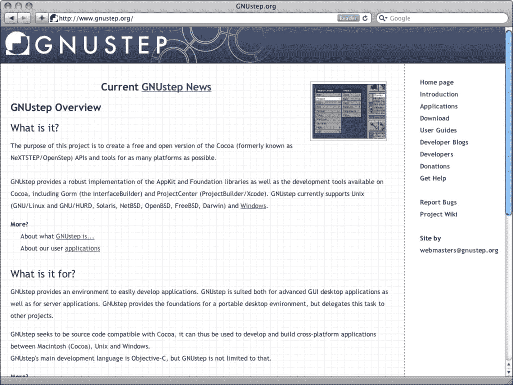

由于其悠久的历史，`GNUstep` 项目对 `Foundation` 和 `Cocoa` 拥有最好的支持。然而，由于他们的目标实际上是复制 `NeXTstep` 环境，而不是模拟 `MacOS X` 或应用程序运行平台的原生小控件集，他们实际上包含了一整套 `NeXTstep` 小控件集。这意味着如果你选择使用此项目将你的 GUI 应用程序移植到 Windows，那么你的应用程序在 Windows 上运行时实际上看起来会像一个 `NeXTstep` 应用程序。这包含了从使用的菜单类型在内的一切内容。此外，还有与运行 `GNUstep` 应用程序所需的文件系统相关的问题。在上次检查时，为了在 Windows 上运行 `GNUstep` 应用程序，你必须安装完整的 `GNUstep` 文件系统以及许多支持库。

所有这一切对于普通用户来说可能会令人困惑。为了完整起见，我在这里提到，过去几年里一直努力为 `GNUstep` 项目添加换肤（skinning）支持。这将让你能够为 Windows 创建应用程序，然后使用 Windows 小控件集对该应用程序进行换肤。换句话说，`GNUstep` 项目正在致力于图形化应用程序的可移植性，并随着时间的推移不断改进，但它还不完美。尽管如此，涉及到 `Foundation` 框架时，`GNUstep` 项目拥有在任何范围内最好、最广泛的支持。我认为，如果你的应用程序是命令行程序（例如服务器），并且你的意图是将应用程序移植到 Windows 或 Linux，那么 `GNUstep` 项目很可能让你完全实现这一点。可以认为，利用在 `MacOS X` 上编写的且你想移植到 Windows 的现有 `Objective-C` 代码的一种好方法，可能是使用 `Objective-C` 和 `GNUstep` 移植后端的底层非 GUI 代码。然后你可以编写一个运行在该后端代码之上的原生 GUI，通过进程间通信或将其作为库链接与其通信。通过这种方式，你兼得了两者之长。你能够移植你的业务逻辑代码，同时仍为用户提供一个熟悉的原生用户界面。

有关 `GNUstep` 项目的更多信息，请访问他们的网站：http://www.gnustep.org。

### 使用 Cocotron

另一种较新的跨平台 `Objective-C` 是创建 `Cocotron` 项目。`Cocotron` 项目在移植应用程序到 `MacOS X` 以外平台方面采取了不同的方法。`Cocotron` 为 `Xcode` 提供了一个交叉编译环境，以便你可以在 `MacOS X` 桌面上的 `Xcode` 内部交叉编译你的应用程序。使用这个交叉编译器，你可以为 Windows、Linux 或其他桌面 UNIX 构建程序。以这种方式交叉编译的应用程序看起来、感觉起来和行为与原生应用程序完全一样。

`Cocotron` 项目的工作原理是利用 `Xcode` 安装并使用多个工具链和 SDK 来编译你的代码的能力。那种让你点击一个按钮就能为 `iPhone OS` 或 `Mac OS X` 编译代码的技术，也让 `Cocotron` 施了魔法。

如果你觉得将 `MacOS X` 和 `Xcode` 作为你的开发环境最舒服，那么 `Cocotron` 是一个理想的解决方案。它允许你在 `MacOS X` 上进行所有的开发，然后只需更改 SDK 并为你的目标平台重新编译应用程序即可。

似乎这种能力还不够，`Cocotron` 还对 `Cocoa` 和 `Foundation` 框架拥有一些最好的第三方支持。它的实现足够出色，以至于现在有商业级别的应用程序使用 `Cocotron` 同时部署在 `MacOS X` 和 Windows 上。

`Cocotron` 往往落后最大的领域是网络、多线程和一些高级框架的支持。然而，这些正在被积极开发中，如果你有足够的预算，甚至可以委托 `Cocotron` 维护者改进你应用程序所需的特定库。

图 19.2 显示了一个使用 `Cocotron` 编写并运行在 Windows 和 `MacOS X` 示例应用程序。

图 19.2
使用 `Cocotron` 编写的应用程序。

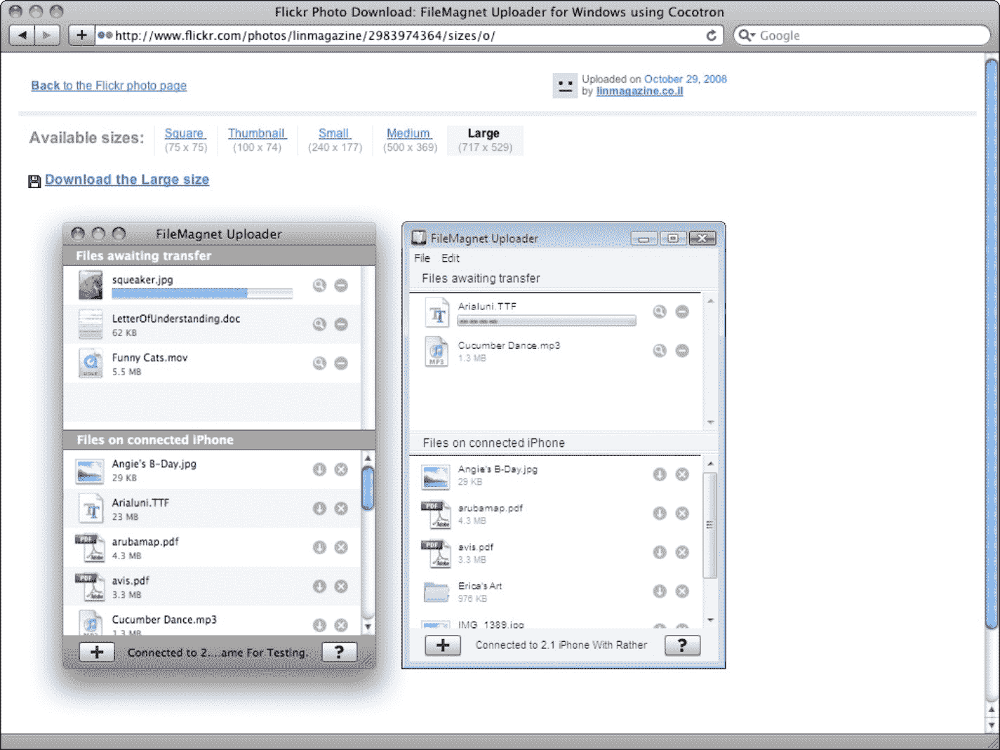

如果你对将 `MacOS X` 作为主要开发环境感到反感，那么 `Cocotron` 可能不适合你。然而，如果你的目标仅仅是以尽可能少的努力将现有的应用程序从 `MacOS X` 移植到 Windows，`Cocotron` 可能是一个不错的选择。至少，我建议下载该项目并尝试用它编译你的应用程序。这可能只需要你不到一天的时间，并且能让你快速判断你的应用程序是否属于可以使用该项目轻松移植的范畴。

有关 `Cocotron` 项目的更多信息，你可以访问网站 [www.cocotron.org](http://www.cocotron.org)

### 使用其他开源库

`Cocotron` 和 `GNUstep` 并不是 Apple `Objective-C` 框架的唯一开源替代方案。还有其他实现，但大多数范围有限或不再维护。我的建议是在考虑在 `Mac OS X` 或 `iPhone` 以外平台上编写 `Objective-C` 时，评估我提到的这两个项目并看看它们是否符合你的需求。如果是的话，那你就走运了！

### 展望未来

我想写这本书的原因之一是因为我觉得 `Objective-C` 是一种被低估的语言。它的兄弟姐妹语言如 `C++`、`Java` 等往往会获得更多的关注。我认为导致这种情况的原因之一是，传统上 `Objective-C` 仅能用于在 `MacOS X` 上开发。

随着 `iPhone` 的出现，以及现在的 `iPad`，`Objective-C` 获得了大量的新关注，并且在学习该语言的用户方面经历了前所未有的增长。这既是祝福也是诅咒。

它是祝福是因为确保了该平台在未来许多年内能够生存，但它也是诅咒，因为它反映了这种优秀语言缺乏充分的标准和文档支持。


与 C 和 C++ 不同，Objective-C 没有 ISO 标准机构来推动其规范的制定。有些人认为，这实际上是一件好事事。事实上，这可能是 Objective-C 能够如此优雅并完美胜任任务的原因之一。然而，问题在于，由于缺乏标准化的，Objective-C 在其核心平台之外的采用率非常低。这意味着未来进入该平台的新开发者将局限于只能在 `MacOS X` 或 `iPhone OS` 上进行开发。

没有人知道未来的新硬件和新平台会带来什么。学习一门语言时，你是在对该语言以及该语言运行的平台进行一种智力投资。为了确保对 Objective-C 的投资是一项在未来长期都能获得回报的投资，我们需要将 Objective-C 作为一种语言推向其核心平台之外。它需要在 `UNIX` 和 `Windows` 等其他平台上获得更多的支持和广泛的采用。我不能说我主张 Objective-C 的 ISO 标准化，但我确实希望看到这些平台上对第三方项目支持的改进。

可以确定，我在本章中向你们介绍的一些项目正以这些理想为目标。这太棒了，即使这些项目不在我们自己可能青睐的平台上运行，我们也应该帮助支持并推广这些项目。保持 Objective-C 的活力并使其成为不同平台上行的编程环境，有助于让你在这里的投资在未来更有价值。

## 总结

在本章中，我向你们介绍了几个开源项目，它们让你能够在 `MacOS X` 或 `iPhone OS` 之外的平台上编译并运行 Objective-C 应用程序。尽管它们并不完美，但它们很好且不断改进，未来它们可能会提供可行的开发平台。即使在今天，仍有一些开发者在使用这些第三方项目来移植商业应用程序。当开发者在使用这些第三方项目进行移植时遇到困难时，他们也可以与项目的维护者合作，帮助改进这些项目。如果可能，我鼓励你也这样做。这不仅有助于提高这些替代平台对该语言的支持，还能加深你对该语言的理解。最好的学习环境之一就是与现有代码一起工作并尝试改进它。

通过鼓励 Objective-C 一个繁荣的替代平台生态系统，我们有助于确保我们的智力投资在未来长期内持续获得回报。
