# Objective-C 入门指南


# 引言

在过去的三年里，我们听过无数次以下的话：

- “我以前从未编程过，但我有一个很棒的 iPhone/iPad 应用创意。”
- “我真的能学会编程 iPhone 或 iPad 吗？”

很多人回答说：“可以，但你必须相信自己可以。”只有你会告诉自己你做不到。

# 针对新手

本书假设你可能从未使用过面向对象编程（OOP）语言。市面上有很多关于 Objective-C 的书，但这些书都假设你已经学过 Objective-C 并了解 OOP 和逻辑。我们我们想写一本书，让读者从计算机编程和逻辑一无所知，到能够使用 Objective-C 进行编程。Objective-C 是 iPhone、iPad 和 Mac 的原生语言。

在过去的三年里，我们在 xcelMe.com 教授了一千多名学生成为 iPhone/iPad (iOS) 开发者。我们的许多学生已经开发了 iTunes App Store 中同类中最成功的 iOS 应用。我们将前两门课程中学到的内容——面向对象编程与逻辑入门》以及《面向 iPhone/iPad 开发者的 Objective-C》融入了书中。

# 针对更有经验的开发者

许多多年前编程或使用非 OOP 语言编程的开发者，在深入 Objective-C 之前需要 OOP 和逻辑背景知识。这本书就是为你准备的。我们将逐步引导你了解 OOP 以及它在 iOS 开发中的应用，帮助你成为一名成功的 iOS 开发者。

# 为什么选择 Alice：创新的 3D 编程环境

多年来，大学的计算机科学系一直面临几个问题：

- 性比例严重失衡
- 辍学率高

# 引言

毕业时间长于平均水平
学习 Java、C++ 或 Objective-C 等 OOP 语言最大的挑战之一是从刚开始就非常陡峭的学习曲线。在过去，学生必须一次性学习以下主题：

- 面向对象原则
- 复杂的集成开发环境 (IDE)，即 Xcode、Eclipse、Visual Studio
- 编程语言的语法和原理
- 编程逻辑和原理

因此，卡内基梅隆大学获得了美国政府的资助并开发了 Alice。Alice 是一种创新的 3D 编程环境，让开发者能够轻松创建丰富的应用程序。Alice 是学生在 OOP 环境中学习的教学工具。该软件使用 3D 图形和拖放界面来提供更具参与感的首次编程体验。
Alice 帮助学生专注于学习 OOP 原则，而无需同时专注于学习复杂的 IDE 和 Objective-C 原理。你可以单独关注每个主题。拖放式编程消除了学习 IDE 和编程语言语法的所有复杂性。你会发现学习其实很有趣，而且你可以开发出自己的复杂应用程序。
在我们介绍 Alice 并让读者对材料感到熟悉后，我们将进入 Xcode，在其中你可以使用新的 OOP 知识来编写 Objective-C 应用。这样，你就可以专注于 Objective-C 的语法和语言，而无需同时学习 OOP。

# 不使用 Alice 学习 Objective-C

超过一千名学生通过这本书成为了 iOS 开发者。在每门课程结束时，我们都会询问学生前四章中的 Alice 部分是否有用。在第一章开始使用 Alice 的学生中，超过一半的人认为他们对他们的成功至关重要。然而，有些学生觉得他们不需要前四章的 Alice 示例。

我们安排了本书的前四章，每章的第一部分用 Alice 引入 OOP；其余部分使用 Objective-C 介绍该主题。因此，如果你对某个主题已经熟悉，可以跳过 Alice。

# 本书的组织结构

你会发现我们在书中完全关注成功。我们在 Alice 中引入 OOP 和逻辑概念，然后将这些概念转移到 Xcode 和 Objective-C 中。许多学生是视觉型者或通过实践学习。我们同时使用这两种技术。我们通过视觉示例引导你了解主题和概念，然后通过逐步示例带你强化这些概念。
我们在不同的章节中重复主题，以巩固你所学的内容并以新的方式应用这些技能。这让新程序员能够重演开发技能，并在进步过程中获得成就感。如果你还没有掌握某个主题，不要担心，继续前进吧！

# 成功的公式

学习编程是程序与你之间的交互过程。就像学习乐器一样，你必须练习。你必须完成书中的示例。理解概念并不意味着你知道如何应用它。

你将从书中中学很多。通过完成书中的练习，你会学很多。然而，只有当你调试程序时，才真正学习——这是一个无与伦比的学习过程。调试的缺点是，新开发者可能会感到特别沮丧。如果你从未把代码扔出窗外，你就会质疑自己为什么无法调试，以及自己是否足够聪明解决问题。编程是非常谦卑的，即使对于经验丰富的开发者也是如此。

像音乐家一样，练习越多，进步越快。通过练习，你作为程序员可以完成一些惊人的事情。世界是你的舞台。在 iTunes App Store 中看到你的应用是最有成就感的事情之一。然而，要有代价，代价就是花费在编码和学习上的时间。

在教了一千多名学生 iOS 开发后，我们总结了一个让学生成功的公式。以下是我们的成功公式：

- 相信你可以。你将是唯一说自己做不到的人。所以不要这样告诉自己。
- 完成书中所有的示例和练习。
- 编写代码并保持写代码。写得越多，表现得越好。
- 对自己耐心一点。如果你足够幸运是一个通过阅读就能记忆材料的 4.0 分学生，这在 Objective-C 编码中不会发生。
- 通过阅读本书学习。通过调试代码真正学习。
- 使用本章末尾的免费 xcelMe com 网络研讨会和 YouTube 视频。
- 不要放弃！

# 开发技术栈

我们将引导你了解 iOS 应用开发的流程以及你需要的技术。然而，简要将所有部分结合在一起是有帮助的。对于表格视图中的 iPhone 应用示例，请参见图 1。


# 引言


# 必需软件、材料和设备

Alice 的一大优点之一是它可以在当今使用的三个主要操作系统运行：

- Windows
- Mac
- Linux

Alice 的另一个大优点是它是免费的！你可以在 www.Alice.org 下载 Alice。

# 操作系统和 IDE

虽然你可以在许多平台上使用 Alice，但开发者用于开发 iOS 应用程序的集成开发环境（IDE）是 Xcode。你必须使用基于 Intel 芯片的 Mac 来使用 Xcode 并提交应用！Xcode 是免费的，并可以在 Mac App Store 中下载。

# 软件开发工具包 (SDK)

你需要注册成为 iOS 开发者。你可以在这里 http://developer.apple.com/iphone 进行注册。
当你准备好将应用程序上传到 iTunes App Store 时，你需要支付每年 99 美元的费用。

# 双显示器

我们建议开发者为电脑连接第二个显示器。这可以让你能够同时在不同的显示器上单步执行代码并观察输出窗口和 iPad 模拟器。Apple 的硬件让这一切变得简单。只需将第二个显示器插入任何基于 Intel 的 Mac 的显示端口（当然需要使用正确的 Mini DisplayPort 适配器），你就有两个独立运行的显示器了。见图 2。注意，并不是强制要求双显示器。如果没有，你只需要整理已打开的窗口以适应屏幕即可。


图 2. 双显示器

# 免费直播研讨会、问答和 YouTube 视频

几乎每个周三太平洋夏令时间晚上 7:30，我们都会举办直播研讨会，讨论书中的主题或感兴趣的热性话题。这些研讨会是免费的，你可以在 http://www.xcelme.com/free-webinars.php 注册。

在研讨会结束，我们会进行问答。你可以针对讨论的主题或书中的任何主题提问。

此外，所有这些研讨会都有录制并可在 YouTube 上观看。确保你订阅了该 YouTube 频道，这样当上传新视频时你就会收到通知。


免费手机、IPAD 和 MAC 开发研讨会
每周周三太平洋时间下午 6:30，xcelme.com 提供免费研讨会。
每晚 Gary Bernoulli 都会讨论 Objective-C、Interface Builder、iPhone 和 iPad SDK (iOS) 以及 Mac OS X 编程工具，回答你的问题，提供实时反馈，并在他的 YouTube 频道上直播。确保你订阅了他的频道，以便在上传新视频时收到通知。
要注册免费研讨会，请点击此处。注册后，你将收到一封确认邮件，其中包含加入研讨会所需的注册信息。

- 往期研讨会：
- 使用 Objective-C 理解 NSMutableArray
- 使用 Objective-C 理解 NSMutableDictionary
- 使用 Objective-C 理解 NSMutableString
- 在 Objective-C 和 Xcode 中创建类
- Objective-C 核心：类、方法和属性
- iOS 游戏与物理引擎
- 使用 Xcode Analyzer 追踪内存泄漏
- 使用 NSZombie 寻找 iOS 崩溃
- Objective-C 内存
- Xcode 4.2 的新功能 - 部分 1
- Xcode 4.2 的新功能 - 部分 2
- Xcode 4.1 的新功能 - 部分 1
- Xcode 4.1 的新功能 - 部分 2
- iPhone 和 Mac
- Interface Builder - 入门
- 代理模式 (Delegate Pattern)
- 使用 Xcode Instruments 查找 Objective-C 内存泄漏
- Objective-C Delegates
- Remote-Action Generator
- Objective-C 循环
- Runtime 类
- Objective-C 编程
- Objective-C 初学者教程
- 面向初学者的 Objective-C


# 论坛

我们在 http://forum.xcelme.com 为这本书开发了一个在线论坛，你可以在学习 Objective-C 时提问并获得作者的解答。你还可以在那里找到练习答案和额外的练习。见图 3。你还可以访问练习答案，并发现帮助你成为 iPhone/iPad 开发者并创建优秀应用的链接。见图 4。让我们开始吧！

# 引言

| 主题 | 回复 | 浏览 |
|---|---|---|
| 发帖需要注册<br>by ganynett = 2010年9月21日 12:23 pm | 1 | 179 |
| A: 书籍信息<br>by ganynett = 2010年8月16日 9:49 am | 3 | 497 |
| B: 要求<br>by ganynett = 2010年8月14日 3:14 pm | 4 | 361 |
| 第 1 章：成为优秀的 (iPhone/iPad 或 Mac) 程序员<br>by ganynett = 2010年8月14日 12:17 pm | 8 | 1073 |
| 第 2 章：编程<br>by ganynett = 2010年8月14日 3:21 pm | 4 | 499 |
| 第 3 章：一切都关乎数据<br>by ganynett = 2010年8月14日 2:29 pm | 21 | 741 |
| 第 4 章：决策与流程<br>by ganynett = 2010年8月14日 3:31 pm | 7 | 538 |
| 第 5 章：面向对象编程<br>by ganynett = 2010年8月14日 3:32 pm | 8 | 622 |
| 第 6 章：介绍 Objective-C<br>by ganynett = 2010年8月14日 3:33 pm | 19 | 206 |
| 第 7 章：类、方法与方法<br>by ganynett = 2010年8月14日 3:35 pm | 32 | 817 |
| 第 8 章：编程基础<br>by ganynett = 2010年8月14日 3:38 pm | 36 | 1050 |
| 第 9 章：Interface Builder<br>by ganynett = 2010年8月14日 3:38 pm | 4 | 234 |
| 第 10 章：内存与地址<br>by ganynett = 2010年8月14日 3:40 pm | 9 | 306 |
| 第 11 章：使用 Xcode 调试<br>by ganynett = 2010年8月14日 3:45 pm | 5 | 152 |
| 第 12 章：代理 (Delegation)<br>by ganynett = 2010年8月14日 3:47 pm | 1 | 148 |
| 第 13 章：框架 (Framework)<br>by ganynett = 2010年8月14日 3:48 pm | 2 | 132 |


现在你已经准备好成为一名开发者了，你需要阅读这本书的引言。随着你经验和信心的增加，你会理解的。根据你的背景，处理黑即白的东西可能会让人感到沮丧。

## 像开发者一样思考

软件开发涉及编写计算机程序并让计算机执行该程序。**计算机程序**是我们想要让计算机执行的指令集。在编写计算机程序之前，按照我们想要的顺序列出程序要执行的步骤是有帮助的。这种分步执行的过程被称为**算法**。

如果我们想写一个计算机程序来烤面包，我们首先会写一个算法。这个算法可能像这样：

- 1. 从袋中取出面包。
- 2. 将面包放入烤面包机中。
- 3. 按下烤按钮。
- 4. 等待面包弹出。
- 5. 从烤面包机中取出面包。

乍一看，这个算法似乎解决了我们的问题。然而，我们的算法留下了许多细节并做了许多假设。例如：

- 1. 用户想要什么种吐司？用户想要白面包、全麦面包还是其他种面包？
- 2. 用户希望如何烤面包？浅色还是深色？
- 3. 面包烤好后用户想在上面涂什么：黄油、人造奶油、蜂蜜还是草莓酱？
- 4. 这个算法适用于所有文化和语言的用户吗？某些文化可能对吐司有另一个称呼，或者不知道什么是吐司。


# 第 1 章：成为一名优秀的 iOS 或 Mac 程序员

> 注意：如果你从这一章中学到了什么，请务必记住：在开始软件开发之前考虑设计需求和用户界面设计的重要性。这是软件开发周期中最高效（且成本最低）的时间利用方式。在开始编程之前没有查看设计稿，使用铅笔和橡皮进行修改要比修改代码容易得多，也快得多。

你 App 成功的另一个关键要素是用户界面（UI）设计。苹果公司建议你将整个开发过程中 50% 以上的时间花在 UI 设计上。这种设计可以是使用 Dean Kaplan (Appress, 2009) 创建的 iPhone Sketch Book 或 iPad Sketch Book 创建的铅笔纸笔布局，也可以使用 Omni Group 的 OmniGraffle (www.omnigroup.com) 软件应用程序配合 Ultimate iPhone Stencil 插件 (www.graffletopia.com) 创建的屏幕布局。许多软件开发者从 UI 设计着手，在布局了所有设计元素并让许多用户查看纸质模型后，根据他们的屏幕布局写出设计需求。

在你理清所有设计需求、布局了所有用户界面，并让客户或潜在客户查看了你的设计并给出反馈后，就可以开始编码了。一旦开始编码，设计需求和用户界面可能会发生变化，但这些变化通常是微小的，可以很容易被开发过程所吸收。见图 1–1 和 1–2。

图 1–1 显示了在开发前使用 OmniGraffle 模型屏幕的移动银行 App 原型，设计需求迫使开发者在编码开始之前思考许多应用程序的可用性问题。这可以缩短应用程序开发时间，并带来更好的用户体验以及在 iTunes App Store 上获得更好的评价。图 1–2 显示了移动银行 App 完成后的实际显示界面。

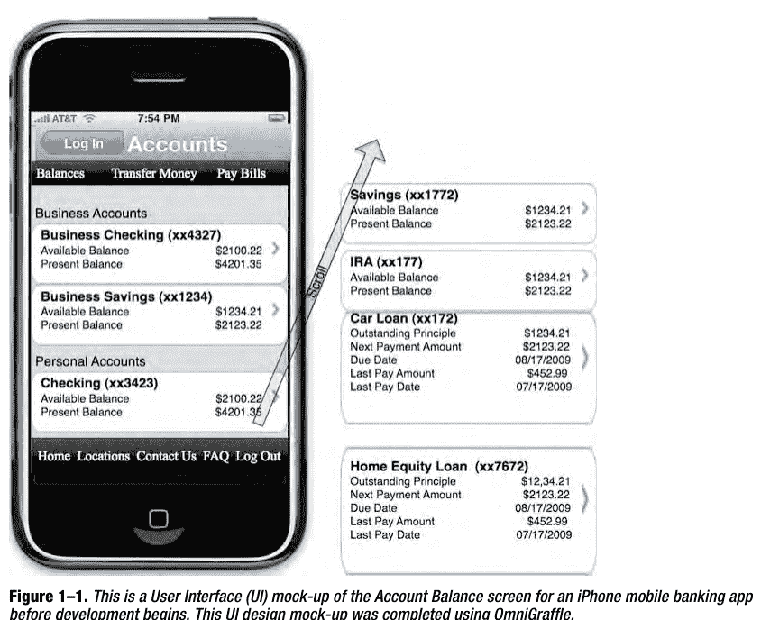


**图 1-2.** 这张截图显示了在 iTunes App Store 上完整的 iPhone 移动银行应用程序。该 App 应用 Woodforest Mobile Banking。

## 完成开发周期

现在我们已经有了设计需求和用户界面设计，并写好了程序，下一步是什么？编程之后，我们需要确保我们的程序符合设计需求和用户界面设计，并确保没有错误。在编程术语中，错误被称为 bug。bug 是我们编程中不希望出现的结果，必须在 App 发布到 App Store 之前进行修复。在程序中寻找 bug 并确保其符合设计需求的过程被称为测试。任何具有软件测试方法经验且没有编写该 App 的人都会执行此测试。软件测试通常被称为**质量保证 (QA)**。

> 注意：当应用程序准备好提交到 iTunes App Store 时，Xcode 会给出 .app 扩展名的文件，例如 appName.app。这就是为什么 iPhone、iPad 和 Mac 应用程序被称为 apps。在本书书中我们将“程序”、“应用程序”和“app”来表示相同的意思。

在测试阶段，开发者需要与 QA 人员合作，确定为什么应用程序没有按照设计运行。这个过程被称为**调试 (debugging)**。它要求开发者逐步执行程序，找出为什么应用程序没有按照设计运行。图 1–3 显示了完整的软件开发周期。


**图 1-3.** 典型的软件开发周期

在测试和调试期间，经常必须对需求（设计）进行更改，使应用程序对客户更加可用。在完成设计需求和用户界面更改后，过程将重新开始。

在某个时刻，大家努力制作的应用程序必须提交到 iTunes App Store。发生这种情况时需要考虑许多因素：

- 开发成本
- 预算
- 应用程序的稳定性
- 投资回报率

开发者和管理层之间存在权衡。开发者希望 App 是完美的，而管理层希望尽早从投资中实现收益。如果发布日期由开发者决定，App 可能永远不会继续调整以使其更快、更高效、更易用。然而，在某个时刻，代码需要从开发者手中释放并上传到 App Store，以便它发挥应有的作用。

## 介绍面向对象编程

正如引言中详细讨论的那样，Alice 让我们能够专注于面向对象编程 (OOP)，而不需要在大一步中涵盖所有的 Objective-C 编程语法和复杂的 Xcode 开发环境。相反，我们可以专注于学习 OOP 的基本原则，并快速利用这些原则编写出我们的第一个程序。

几十年来，开发者一直在寻找更好的方法来开发代码，使其在项目生命周期内可重用、易管理且易维护。OOP 的设计旨在帮助实现代码重用和维护性，同时降低软件开发的成本。

OOP 可以被看作程序中对象的集合。在这些对象上执行操作以完成设计需求。

对象可以是任何可以被操作的东西。例如，飞机、人或 iPad 上的屏幕/视图都可以是对象。我们可能想通过让飞机倾斜来对飞机进行操作。我们可能想让人行走或改变 iPad 上 App 屏幕的颜色。所有操作都应用于这些对象上；见图 1–4。


图 1–4。这些是 Alice 应用程序中的两个对象：货运机 (Dropship) 和战斗机 (Fighter)。两个对象都可以应用操作——起飞和着陆、右转和左转。

如果你点击播放按钮，Alice 将为你运行一个如图 1–4 所示的程序。当我们运行 Alice 应用程序时，用户可以对我们应用程序中的对象应用操作。同样，Xcode 是集成开发环境 (IDE)，使我们能够从编程环境中运行应用程序。在在 iOS 设备上运行应用程序之前，我们可以先在 Xcode 的模拟器中运行 App 来测试我们的应用程序，如图 1–5 所示。


**图 1-5.** 这个示例 iPhone App 包含一个表格对象来组织课程列表。如“向左旋转”或“用户选择了第 3 行”等操作可以应用于此对象。

在对象上执行的操作被称为**方法 (methods)**。方法通过操纵对象来实现我们让 App 执行的事情。例如，对于图 1–4 中的喷气机对象，我们可能会有以下方法：

```
goUp
goDown
bankLeft
turnOnAfterBurns
lowerLandingGear
```

我们在程序中使用图 1–5 中的表格对象时，它实际上被称为 UITableView，它可以拥有以下方法：

```
loadView
shouldAutorateToOrientation
numberOfSectionsInTableView
cellForRowAtIndexPath
diselectRowAtIndexPath
```

所有的对象都有描述它们的数据。这些数据被定义为属性 (properties)。每个属性都以特定的方式描述关联的对象。例如，喷气机的属性可能是：

- altitude = 10000 feet
- heading = North
- speed = 500 knots
- pitch = 10 degrees
- yaw = 20 degrees
- latitude = 33.57576
- longitude = -111.8576

对于图 1–5 中的 UITableView 对象，以下可能是：

- backgroundColor = Red
- selectedRow = 3
- animateView = No

对象的属性可以在程序运行时、用户交互时或程序员设计需求时随时更改。特定时间存储在属性中的值被称为对象的状态。

状态是编程中的一个重要概念。在教学生学习状态时，我们让他们查看窗口寻找一架飞机。我们让他们拍手并虚构飞机属性在特定时间可能拥有的值。这些值可能是：

- altitude = 10000 feet
- latitude = 33.57566
- longitude = -111.85777

这些值代表了他们拍手那个特定时刻对象的状态。等几分钟后，我们让他们再次寻找同一架飞机，再次拍手并记录飞机在那个时间点的可能状态。

属性的值可能是：

- altitude = 10500 feet
- latitude = 33.57565
- longitude = -111.8577

注意对象的状态是如何随时间变化的。

## 使用 Alice 界面

Alice 提供了一种很棒的方法，使用我们刚刚讨论的概念，而无需同时学习 Xcode 和 Objective-C 语言的复杂性。只需要几分钟就能熟悉 Alice 界面并开始编写程序。本书的引言介绍了如何下载 Alice。下载并安装后，你需要打开 Alice。它看起来像图 1–6。


从技术上来说，Alice 并不是像 Xcode 那样真正的 IDE（集成开发环境），但它非常接近而且比 Xcode 容易得多。一个真正的 IDE 将单个应用程序的代码开发、用户界面布局、调试工具、文档以及模拟器/控制台启动整合在一起；请参见图 1–7。然而，Alice 提供了与 Xcode 相似的外观、感受和功能。当我们以后开始编写 Objective-C 代码时，这会对你非常有帮助。

# 第一章：成为一名出色的 iOS 或 Mac 程序员


在下一章中，你将熟悉 Alice 界面并编写你的第一个程序。

## 总结

恭喜你，你已经完成了本书的第一章。理解以下术语非常重要，因为它们将在贯书中得到不断强化：

- 计算机程序
- 算法
- 设计需求
- 用户界面
- 漏洞 (Bug)
- 质量保证 (QA)
- 调试
- 对象面向编程 (OOP)
- 对象
- 属性
- 方法
- 对象的状态
- 集成开发环境 (IDE)

## 练习题

- 回答以下问题：
  - 为什么花时间研究用户需求如此重要？
  - 设计需求和算法之间有什么区别？
  - 方法和属性之间有什么区别？
  - 什么是漏洞？
  - 什么是状态？
- 编写一个自动售卖机工作原理的算法，从投入硬币到排出饮料的过程。假设饮料的价格为 80 分。
- 为一个运行该自动售卖机的 App 编写设计需求。

# 第二章

## 编程基础

本章将关注成为一名出色的 Objective-C 程序员所必需的模块。本章将介绍如何使用 Alice 用户界面、如何编写我们的第一个 Alice 程序、如何编写第一个 Objective-C 程序，并探索一些新的 OOP 术语。

> 注意：我们希望在 Alice 中引入新概念，并在本章后续内容中让你能够在 Objective-C 中使用这些概念。在过去的三年里，我们一直采用这种方法，并从个人经验知道，这种方法有助于你快速学习概念而不会产生挫败感，并为你打下坚实的基础。

## 游览 Alice

Alice 的 3D 编程环境使得编写第一个程序变得简单，因为它应用了你在第一章中学到的某些原理。首先，你需要更多地了解 Alice 的界面。当我们启动 Alice 时，会看到一个类似于图 2–1 的屏幕。

你可以从默认的蓝天绿草模板开始，也可以选择另一个具有不同背景的模板。随意探索并尽情享受。我们将花费大部分时间在这里编写第一个 Alice 应用。

Alice 用户界面的设置有助于我们高效地编写应用程序。该界面在形式和功能上与 Xcode IDE 非常相似。现在我们将探索 Alice 的主要部分。

# 第二章：编程基础

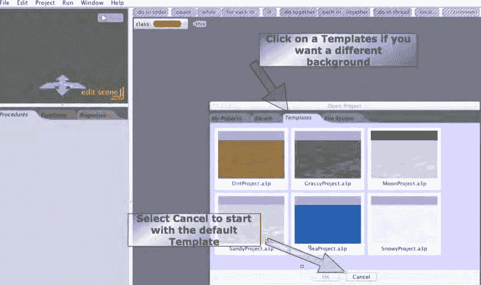

图 2–1。Alice 的启动界面

## 导航菜单

如图 2–2 所示的导航菜单允许我们打开和关闭文件、设置应用程序偏好，并查看世界统计数据、文本输出和错误控制台。我们还可以从导航菜单访问示例世界和 Alice 帮助。

> 注意：在使用 Alice 时，频繁保存程序非常重要。如果 Alice 崩溃而你没有保存工作，你将丢失自上次保存以来进行的所有代码或更改。此外，我们建议在打开新的 Alice 程序时，完全关闭 Alice 并重新打开它。


图 2-2。这显示了 Alice 用户界的主要部分。花时间探索用户界面。你将在本章中看到它如何与 Xcode 进行对比，它将如何帮助我们学习 Objective-C。

## 世界窗口 (World Window)

世界窗口显示了我们的虚拟世界在运行时的样子。这个窗口与我们之后运行应用时使用的 iPhone/iPad 模拟器类似。世界窗口允许我们利用 Alice 的 3D 用户界面来为我们的应用程序建模。

在世界窗口中，我们可以移动相机以获得我们所需的视觉视角。移动图 2–3 中的三个箭头工具可以为我们的应用程序赋予生命提供极大的灵活性。

学习如何在你的世界中移动相机以获得你想要看到的视图非常重要。

# 第二章：编程基础

```
Alice 3 BETA /Volumes/gwbennett/gwcelMe/AAA-Courses/Intro to DOP and Alice Logic/Alice Files/AliceGuessingCar
File Edit Project Run Window Help
this (a.k.a scene)
this.sunLight
this.moonSurface
this.camera
they.garyAsAstronaut
```


图 2-3。在世界窗口中控制相机的操控箭头。

Alice 最重要的控制控件之一是“编辑场景”(Edit Scene)。请看图 2–4。当我们点击世界窗口右角的编辑场景按钮时，会启动 Alice 的场景编辑器。

```
File Edit Project Run Window Help
Run
```


图 2-4。世界窗口中的编辑场景按钮（用框框出）是最重要的控件之一。这将启动场景编辑器并允许我们添加对象。

花时间熟悉图 2–5 所示的场景编辑器。场景编辑器允许：

- 从库添加对象。
- 从互联网添加对象。
- 在世界中定位对象。
- 调整观察相机。

我们将花费大量时间使用场景编辑器添加对象并设置相机。


图 2–5。Alice 的场景编辑器

## Alice 中的类、对象和实例

具有相同属性和相同方法（动作）的对象组称为类（Class）。例如，我们可以有一个名为“飞机”的类。在这个类中，我们可以有五个对象：

- 波音747
- 洛希德D57
- 波音737
- 10
- f18战斗机

这些对象几乎完全相同。它们属于同一个飞机类。它们都具有以下方法：

- 陆陆()
- 起飞()
- 收起起落架()
- 放下起落架()
- 右倾()
- 左倾()

区分这些对象的唯一区别是它们的属性值。某些属性值可能是：

```
翼力 = 20ft
最大推力 = 200000lbs
引擎数量 = 2
```

在你的世界中，你可能有两个完全相同的对象。你可能在视图中有波音737。类的每个副本都称为实例（Instance）。在程序中添加类的实例称为实例化。

## 对象树 (Object Tree)

对象树（见图 2–6）允许我们查看 Alice 世界中的所有对象。此外，如果对象有子部分（parts），你可以点击加号查看这些子部分，或点击减号折叠子部分。


图 2–6。对象树

许多 Alice 世界都带有我们运行应用所需的几种内置对象。图 2–6 中的世界带有相机、光照和地面对象。

## 编辑区域 (Editor Area)

编辑器区域是 Alice 界面中最大的区域，是我们编写代码的地方。在 Alice 中，我们不需要实际输入代码；我们可以通过拖放代码来操纵我们的对象和属性。

> 注意：不要忘记编辑器区域的顶部。顶部包含了一行用于循环、分支和其他逻辑结构的控制和逻辑块，我们可以使用它们来控制对象的行为。


## 详情区域 (Details Area)

Alice 界面的**详情区域**包含了属性、过程和函数的标签页，这些内容构成了在对象树（Object Tree）中选中的对象。

- **属性（Properties）**包含所选对象的特定信息（例如：重量、长度和高度）。
- **过程（Procedures / Methods）**对对象执行操作（例如：起飞和着陆）。
- **函数（Functions）**与方法相似。在 Alice 中，两者的区别在于方法不返回值，而函数会返回一个值。

## 事件区域 (Events Area)

Alice 界面的事件区域包含了我们应用程序使用的所有现有事件的列表，并为我们提供了创建新事件的机会。**事件（Events）**触发我们方法的条件。响应这些事件的方法（或过程）被称为**事件处理器（event handlers）**。当特定事件发生时，它会**触发（triggers）**一个事件处理器接收并处理的信号。

一些例子如，用户触摸 iPhone 上的按钮。触摸或滑动会触发事件，而处理这些事件的方法会作用于我们应用程序中的对象。见图 2–7。

## 创建一个 Alice 应用——奔向月球 (To the Moon Alice)

我们已经涵盖了一些新术语和概念，现在是时候像程序员一样——编写代码了。新开发者通常编写一个“Hello World”程序作为他们的第一个程序。我们将做类似，但 Alice 让它变得更有趣。随后我们将在 Alice 应用之后编写我们的第一个 Objective-C 应用。

这个 Alice 应用在屏幕上有三个对象：月球对象和两个宇航员。其中一个宇航员会说：“鹰号已经着陆了。”另一个宇航员会说：“这是人类的一小步，人类的一大飞跃。”

Alice 真的让制作这类应用变得简单有趣。请确保你遵循以下步骤：

1. 点击 File（文件），然后点击 New（新建）。
2. 点击 Template（模板）标签页。
3. 选择 MoonProject.a3p 模板，并点击 Open（打开）按钮。见图 2–8。


# 第 2 章：编程基础

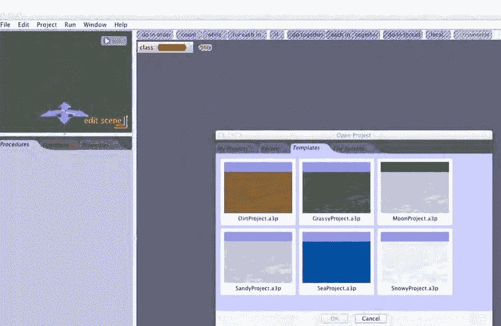

图 2–8。选择太空模板。

4. 现在，我们需要添加对象。点击 **Edit Scene（编辑场景）**。这是图 2–4 所示 World 窗口中的重要按钮。
5. 在 Object Gallery（对象库）中，选择 **Space Class from the Generic Alice Models（通用 Alice 模型中的太空类）**。
6. 右键点击 **Lunar Lander（月球陆器）**查看关于对象的的一些信息。见图 2–9。我们可以点击“**OK**”将对象添加到世界中，也可以将它们从库中拖到世界中。

> 注意：你可以从这个示例看到为什么实例（instance）是对象的副本。我们正在创建对象的副本并将其放入世界中。实例化（Instantiation）是一个描述复制并初始化对象过程的专业术语。

# 第 2 章：编程基础

# 23

File Edit Project Run Window Help

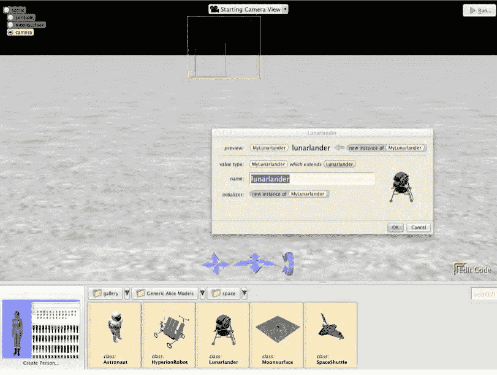

图 2–9。从第 6 步开始查看并向世界添加对象。

7. 点击 Astronauton 类将我们的两个宇航员添加到世界中。
8. 使用图 2–10 中方框圈出的 Camera Adjustment（相机调整）和 Objects Adjustment（对象调整）工具，来实现你所希望的外观和视角。

> 提示：有时当你添加两个对象时，Alice 会将一个对象放在另一个对象上面。如果发生这种情况，请将上面的宇航员拖到另一个宇航员的侧边。你的世界看起来应该像图 2–10。

# 第 2 章：编程基础


**图 2-10。** 使用相机调整工具来控制用户对世界的视角。使用对象调整工具塑造并调整世界中宇航员的方向。

9. 右角是 **Object Adjustment（对象调整）**工具。将鼠标悬停在每个瓦片上，发现每个瓦片工具将对对象执行什么操作。注意图 2-10 中的对象树。地面、*lunarLander, astronaut, and astronaut2* 在对象树中。
10. 点击屏幕右角的 **Edit Code（编辑代码）**按钮。这将返回编辑器视图。
11. 点击 World 窗口中左侧的宇航员。确保详情区域中的 **Procedures tab（过程标签页）**已选中。
12. 我们现在要让我们的宇航员说些话。记得对对象执行操作需要方法。从详情区域将 **Astronaut2|turn** 瓦片拖到编辑器中。从参数列表中选择 **turn left, 0.25 rotation（向左转，0.25 旋转）**。见图 2-11。当我们运行应用时，左侧的宇航员将向左左旋转四分之一并面向另一个宇航员。

# 第 2 章：编程基础

25


**图 2–11。** 左侧宇航员的方法和参数。

13. 为另一个宇航员做同样的事情。点击右侧的宇航员。从详情区域将 **Astronaut|turn** 瓦片拖到编辑器。从参数列表中选择 **turn right, 0.25 rotation（向右转，0.25 旋转）**。
14. 参数是方法作用于对象所需的信息。方法可能需要一个或多个参数。点击右侧宇航员，将 **Astronaut2|say** 瓦片拖到编辑器，**select other（选择另一个）**，然后输入 **The Eagle has landed（鹰号已着陆）**。见图 2–12。

# 第 2 章：编程基础


图 2-12。你的编辑器应该包含这些参数内的方法。

15. 点击右侧宇航员。将宇航员的瓦片拖到编辑器，选择另一个，并输入 That's one small step for man.. One giant leap for mankind（这是人类的一小步，人类的一大飞跃）。你的应用看起来应该像图 2–12。
16. 点击 Play（播放）运行我们的第一个程序。如果你正确完成了一切，你的应用在运行时应该像图 2–13。如果没有，你还有一些调试工作要做。
17. 将应用保存为 MoonAlice.a3p。我们稍后会使用这个应用。点击 File > Save World（保存世界），或 File > Save World As（另存为世界）。

# 第 2 章：编程基础

# 27

resume speed: 0x restart

> That's one small step for man...One giant leap for mankind.


**图 2–13。** 从 World Running 窗口顶部，我们可以重新运行程序、暂停、恢复、重启、停止并为应用程序拍摄截图。我们还可以根据运行快慢来加速或减慢应用。


## 欢迎使用 Xcode


- **创建一个新的 Xcode 项目**
从包含的模板之一开始构建新的 Mac、iPhone 或 iPad 应用程序

- **连接到仓库**
使用 Xcode 集成的源码控制功能来处理您的现有项目进行工作

- **学习如何使用 Xcode**
通过《Xcode 4 用户指南》探索 Xcode 开发环境

- **访问 Apple 开发者门户**
访问 apple.com 上的 Mac 和 iOS 开发者中心网站。

**图 2–16。** *创建我们的第一个 Objective-C 项目。*

**重要提示：** 这是许多初学者在这里卡住的地方，取决于你使用的 Xcode 版本以及你是否安装了 iPhone SDK。在图 2–17 中，你可以看到我们安装了 iOS SDK。我们还安装了 Lion 版本的 Xcode。如果你没有安装这些，也没关系。只需在模板选项的左侧窗格中导航，点击 **Applications**（应用程序），并寻找 **Command Line Tool**（命令行工具）。

- 2. 在左侧窗格上选择 **Applications**，选择 **Command Line Tool** 模板，然后按 **Next**（下一步）。参见图 2–17。


**图 2-17。** 选择 Command Line Tool。在不同版本的 Xcode 中，你可能需要导航到相应的屏幕。核心是导航到 Command Line Tool。

- 3. 让我们将应用重命名为 **HelloWorld** 并选择 **Foundation** 作为应用程序类型，如图 2–18 所示。然后按 **Next**，并将你的应用保存在你选择的目录中。

## 为你的新项目选择选项：


**图 2–18。你的应用重命名为 HelloWorld，并选择 Foundation 作为 App 类型。**

- 4. 在 **Project Navigator**（项目导航器）中，点击 **main.m** 文件。参见图 2–19

Xcode 为我们做了大量工作，并创建了一个包含文件和代码的目录供你使用。这就是 Xcode 模板的作用——它们为我们节省大量时间。

我们需要熟悉 Xcode IDE。让我们来看两个常用的功能（参见图 2–19）：

- Navigator 区域（导航器区域）。
- Editor 区域（编辑器区域）。

这些部分看起来与我们在 Alice 中使用的相似。**Navigator** 区域包含了构建应用所需的文件。它将包含我们的类、方法和资源。

**Editor** 区域是 Xcode IDE 的业务核心；是我们的梦想变为现实的地方。编辑器部分是我们编写代码的地方。你会发现，当你编写代码时，颜色会改变。有时，Xcode 甚至会尝试为你自动补全单词。颜色具有含义，随着我们使用 IDE，这些含义将变得明显。Editor 区域也是我们调试应用程序的地方。

> 注意：即使我们已经提到过，但值得再次强调：你将通过阅读这本书学习 Objective-C 编程，但你将通过调试你的应用程序来*真正*学会 Objective-C。调试是开发者学习并成为伟大开发者的地方。

# 第 2 章：编程基础

Run（运行）按钮将我们的代码从纯文本转换为我们的 Mac、iPhone 或 iPad 知道如何执行的 .app。在我们的 Alice 界面中，我们使用播放按钮来运行 Alice 应用。

工具栏

导航选择器栏

跳转栏


**图 2–19。** 创建项目后，通过点击 Run 按钮并看到控制台中打印出 **Hello World**，你就可以运行该应用。

要运行我们的第一个项目，只需点击 **Run** 按钮。Xcode 会检查我们的代码语法，编译我们的应用，如果没有发现错误，就会创建一个 .app 文件并运行它。该应用程序运行在控制台（也称为终端）中。

当应用运行时，它会在控制台中打印出 **Hello World**。在控制台窗口中，我们可以看到应用程序是否终止以及为什么终止。在这种情况下，它正常终止了。我们可以通过消息 `Program ended with exit code: 0` 看到这一点，这意味着我们的应用没有崩溃。参见图 2–20。

# 第 2 章：编程基础


**图 2-20。** 我们的应用在调试器控制台中执行。

让我们修改应用程序，完成我们之前对宇航员所做的事情：

- 1. 导航到 main.m 文件。

- 2. 将第 17 行和 18 行改为如图 2–21 所示。

- 3. 我们将故意在第 8 行末尾错放分号。
这将导致编译器错误。

- 4. 点击 Run 按钮。

你可以看到，当我们尝试编译和运行应用时，会发生一些错误。我们有一个编译器错误、一个红色的指针，Xcode IDE 中的通知指明了这一点。图 2–21。

当我们编写 Objective-C 代码时，一切都至关重要——即使是分号、大小写。Xcode IDE 中的通知指明了这一点。编写 Objective-C 代码时，一切都至关重要。XcodeXcode


**图 2-21。** 我们的应用在调试器控制台中执行。

现在，通过在第 18 行末添加如我们 所示的分号来修复我们的应用。参见图 2–22。

 在2222222。


第 2 章 编程基础


**图 2-22。** 我们的应用在调试。控制控制执行输出。

## 总结

在本章中，我们构建了第一个应用。我们还安装了 Xcode 并编译、调试并运行了我们的 Objective-C 应用。

> 成功的关键：正如我们在引言提到的提到的，你将通过阅读阅读阅读-C   ，你你通过通过调试调试应用程序来学会 Objective-C。

你应该理解的术语如下：

- 类
- 对象
- 方法
- 参数
- 实例化

## 练习

- 扩展你的 `TheMoon.a` 应用。在世界中放置另一个你选择的对象，让它宇航员说完后说话。

- 扩展你的 Objective-C `HelloWorld.app`，添加一行代码来打印任何文本。

# 第 3 章

## 数据至关重要

正如你可能知道的，数据以零和一的形式存储在计算机内存中。然而，零和一对开发者或应用用户并不有用，因此我们需要了解程序如何使用数据以及数据如何存储。

在本章中，我们将查看数据如何在计算机上存储以及我们如何处理数据。然后我们将编写一个有趣的 Alice 并用 Objective-C 编写相同的应用。让我们开始吧！

## 编程中使用的计数系统

计算机处理信息的方式与人类不同。本节介绍了在 Mac、iPhone 和 iPad 等设备上存储、计算和处理信息的各种方式。

## 位

位被定义为计算机存储和处理数据的基本单位。位的值为 0 或 1。当计算机推出时，晶体管和微处理器还没有。数据是通过真空管的开启或关闭的。如果真空管开启，位为 1；如果真空管关闭，则值为 0。计算机能够存储和处理的数据量直接取决于它有多少真空管。

第一个被认可的计算机是电子数值积分计算机（ENIAC）。它占据了超过 136 平方米，拥有 1.8 万个真空管。就像你的手持计算器。

今天，计算机使用晶体管来存储和处理数据。计算机处理器的功率取决于芯片或 CPU 上放置了多少晶体管。就像真空管一样，晶体管有开启或关闭的状态。当晶体管关闭时，其值为 0。如果晶体管开启，值为 1。在本文写作时，用于 iPhone 5 和 iPad 2 的 A5 处理器具有双核 ARM 处理器


超过 2 亿个晶体管，高于 iPhone 4 和第一代 iPad 中使用的 A4 处理器的 1.49 亿个晶体管。见图 3–1。


## 摩尔定律

iPhone 或 iPad 处理器上的晶体管数量与设备的处理速度、内存容量以及传感器（加速度计、陀螺仪）直接相关。晶体管越多，你的设备越强大。

1965 年，英特尔联合创始人戈登·E·摩尔（Gordon E. Moore）描述了处理器中晶体管的趋势。他观察到从 1958 年到 1965 年，处理器中的晶体管数量每 18 个月增加倍，并且可能会持续“至少 18 个月”。这一观察被著名地称为“摩尔定律”，并在过去的 55 多年里被证明是正确的。见图 3–2。

## 1971-2008 年 CPU 晶体管数量与摩尔定律


图 3–2. 摩尔定律

注意：摩尔定律有一个负面影响，你可能已经在你的钱包里感受到了。处理能力快速提升带来的问题是它会让技术迅速过时。当你 iPhone 的两年手机合约到期时，市场上的新 iPhone 性能将比你签约时使用的 iPhone 强一倍。这对大家来说太方便了！

## 字节（Bytes）

字节是另一种描述计算机信息存储的单位。一个字节由 8 个位（bit）组成，并且是一个方便的 2 的幂。位可以表示两个不同的值，而一个字节可以表示高达 $2^8$ 或 256 个不同的值。一个字节可以包含 0–255 之间的值。

注意：在第 13 章中，我们将更详细地讨论二进制、十进制和十六进制系统。然而，本章有必要对这些系统进行介绍，以便理解数据类型。

二进制系统表示数字符号 0 和 1。为了说明数字 71 如何在二进制中表示，我们将使用一个简单的 8 位（1 字节）表格，每个位都表示为 2 的幂。要将字节值 01000111 转换为十进制，只需将这些位相加。见表 3–1。

## 表格 3-1. 以字节表示的数字 71

| 2 的幂 | $2^7$ | $2^6$ | $2^5$ | $2^4$ | $2^3$ | $2^2$ | $2^1$ | $2^0$ |
|---|---|---|---|---|---|---|---|---|
| “开启”位的值 | 128 | 64 | 32 | 16 | 8 | 4 | 2 | 1 |
| 实际位 | 0 | 0 | 0 | 1 | 0 | 1 | 1 | 1 |

要用二进制表示数字 22，请开启加和为 22 的位，即 00100110。见表 3–2。

## 表格 3-2. 以字节表示的数字 22

| 2 的幂 | $2^7$ | $2^6$ | $2^5$ | $2^4$ | $2^3$ | $2^2$ | $2^1$ | $2^0$ |
|---|---|---|---|---|---|---|---|---|
| “开启”位的值 | 128 | 64 | 32 | 16 | 8 | 4 | 2 | 1 |
| 实际位 | 0 | 0 | 1 | 0 | 0 | 1 | 1 | 0 |

要用二进制表示数字 255，请开启加和为 255 的位，即 11111111。见表 3–3。

## 表格 3-3. 以字节表示的数字 255

| 2 的幂 | $2^7$ | $2^6$ | $2^5$ | $2^4$ | $2^3$ | $2^2$ | $2^1$ | $2^0$ |
|---|---|---|---|---|---|---|---|---|
| “开启”位的值 | 128 | 64 | 32 | 16 | 8 | 4 | 2 | 1 |
| 实际位 | 1 | 1 | 1 | 1 | 1 | 1 | 1 | 1 |

要用二进制表示数字 0，请开启加和为 0 的位，即 00000000。见表 3–4。

## 表格 3-4. 以字节表示的数字 0

| 2 的幂 | $2^7$ | $2^6$ | $2^5$ | $2^4$ | $2^3$ | $2^2$ | $2^1$ | $2^0$ |
|---|---|---|---|---|---|---|---|---|
| “开启”位的值 | 128 | 64 | 32 | 16 | 8 | 4 | 2 | 1 |
| 实际位 | 0 | 0 | 0 | 0 | 0 | 0 | 0 | 0 |

通常，我们使用计算机识别的另一种格式，即十六进制。十六进制系统（base-16）使用 16 个不同的符号，0-9 表示零到九，A、B、C、D、E、F 表示十到十五。例如，十六进制 2AF 是 $2 \times 16^2 + 10 \times 16^1 + 15 \times 16^0$，即 687。十六进制 20 代表空格。

| 十进制 (Dec) | 八进制 (Oct) | 二进制 (Bin) | 十六进制 (Hex) |
|---|---|---|---|
| 0 | 0 | 0000000 | 0 |
| 1 | 1 | 0000001 | 1 |
| 2 | 2 | 0000010 | 2 |
| 3 | 3 | 0000011 | 3 |
| 4 | 4 | 0000100 | 4 |
| 5 | 5 | 0000101 | 5 |
| 6 | 6 | 0000110 | 6 |
| 7 | 7 | 0000111 | 7 |
| 8 | 10 | 0001000 | 8 |
| 9 | 11 | 0001001 | 9 |
| 10 | 12 | 0001010 | A |
| 11 | 13 | 0001011 | B |
| 12 | 14 | 0001100 | C |
| 13 | 15 | 0001101 | D |
| 14 | 16 | 0001110 | E |
| 15 | 17 | 0001111 | F |
| 16 | 20 | 0010000 | 10 |
| 17 | 21 | 0010001 | 11 |
| 18 | 22 | 0010010 | 12 |
| 19 | 23 | 0010011 | 13 |
| 20 | 24 | 0010100 | 14 |
| 21 | 25 | 0010101 | 15 |
| 22 | 26 | 0010110 | 16 |
| 23 | 27 | 0010111 | 17 |
| 24 | 30 | 0011000 | 18 |
| 25 | 31 | 0011001 | 19 |
| 26 | 32 | 0011010 | 1A |
| 27 | 33 | 0011011 | 1B |
| 28 | 34 | 0011100 | 1C |
| 29 | 35 | 0011101 | 1D |
| 30 | 36 | 0011110 | 1E |
| 31 | 37 | 0011111 | 1F |
| 32 | 40 | 0100000 | 20 |
| 33 | 41 | 0100001 | 21 |
| 34 | 42 | 0100010 | 22 |
| 35 | 43 | 0100011 | 23 |
| 36 | 44 | 0100100 | 24 |
| 37 | 45 | 0100101 | 25 |
| 38 | 46 | 0100110 | 26 |
| 39 | 47 | 0100111 | 27 |
| 40 | 50 | 0101000 | 28 |
| 41 | 51 | 0101001 | 29 |
| 42 | 52 | 0101010 | 2A |
| 43 | 53 | 0101011 | 2B |
| 44 | 54 | 0101100 | 2C |
| 45 | 55 | 0101101 | 2D |
| 46 | 56 | 0101110 | 2E |
| 47 | 57 | 0101111 | 2F |
| 48 | 60 | 0110000 | 30 |
| 49 | 61 | 0110001 | 31 |
| 50 | 62 | 0110010 | 32 |
| 51 | 63 | 0110011 | 33 |
| 52 | 64 | 0110100 | 34 |
| 53 | 65 | 0110101 | 35 |
| 54 | 66 | 0110110 | 36 |
| 55 | 67 | 0110111 | 37 |
| 56 | 70 | 0111000 | 38 |
| 57 | 71 | 0111001 | 39 |
| 58 | 72 | 0111010 | 3A |
| 59 | 73 | 0111011 | 3B |
| 60 | 74 | 0111100 | 3C |
| 61 | 75 | 0111101 | 3D |
| 62 | 76 | 0111110 | 3E |
| 63 | 77 | 0111111 | 3F |
| 64 | 80 | 1000000 | 40 |
| 65 | 81 | 1000001 | 41 |
| 66 | 82 | 1000010 | 42 |
| 67 | 83 | 1000011 | 43 |
| 68 | 84 | 1000100 | 44 |
| 69 | 85 | 1000101 | 45 |
| 70 | 86 | 1000110 | 46 |
| 71 | 87 | 1000111 | 47 |
| 72 | 88 | 1001000 | 48 |
| 73 | 89 | 1001001 | 49 |
| 74 | 90 | 1001010 | 4A |
| 75 | 91 | 1001011 | 4B |
| 76 | 92 | 1001100 | 4C |
| 77 | 93 | 1001101 | 4D |
| 78 | 94 | 1001110 | 4E |
| 79 | 95 | 1001111 | 4F |
| 80 | 96 | 1010000 | 50 |
| 81 | 97 | 1010001 | 51 |
| 82 | 98 | 1010010 | 52 |
| 83 | 99 | 1010011 | 53 |
| 84 | 100 | 1010100 | 54 |
| 85 | 101 | 1010101 | 55 |
| 86 | 102 | 1010110 | 56 |
| 87 | 103 | 1010111 | 57 |
| 88 | 104 | 1011000 | 58 |
| 89 | 105 | 1011001 | 59 |
| 90 | 106 | 1011010 | 5A |
| 91 | 107 | 1011011 | 5B |
| 92 | 108 | 1100000 | 5C |
| 93 | 109 | 1100001 | 5D |
| 94 | 110 | 1100010 | 5E |
| 95 | 111 | 1100011 | 5F |
| 96 | 112 | 1110000 | 60 |
| 97 | 113 | 1110001 | 61 |
| 98 | 114 | 1110010 | 62 |
| 99 | 115 | 1110011 | 63 |
| 100 | 116 | 1110100 | 64 |
| 101 | 117 | 1110101 | 65 |
| 102 | 118 | 1110110 | 66 |
| 103 | 119 | 1110111 | 67 |
| 104 | 120 | 1111000 | 68 |
| 105 | 121 | 1111001 | 69 |
| 106 | 122 | 1111010 | 6A |
| 107 | 123 | 1111011 | 6B |
| 108 | 124 | 1111000 | 6C |
| 109 | 125 | 1111111 | 6D |
| 110 | 126 | 1111110 | 6E |
| 111 | 127 | 1111111 | 6F |
| 112 | 128 | 11110000 | 80 |
| 113 | 129 | 10000001 | 11 |
| 114 | 130 | 10000010 | 12 |
| 115 | 131 | 10000011 | 13 |
| 116 | 132 | 10000100 | 14 |
| 117 | 133 | 10000101 | 15 |
| 118 | 134 | 10000110 | 16 |
| 119 | 135 | 10000111 | 17 |
| 120 | 136 | 10001000 | 18 |
| 121 | 137 | 10001001 | 19 |
| 122 | 138 | 10001010 | 1A |
| 123 | 139 | 10001011 | 1B |
| 124 | 140 | 10001100 | 1C |
| 125 | 141 | 10001101 | 1D |
| 126 | 142 | 10001110 | 1E |
| 127 | 143 | 10001111 | 1F |
| 128 | 144 | 10010000 | 20 |
| 129 | 145 | 10010001 | 21 |
| 130 | 146 | 10010010 | 22 |
| 131 | 147 | 10010011 | 23 |
| 132 | 148 | 10011100 | 24 |
| 133 | 149 | 10010101 | 25 |
| 134 | 150 | 10110110 | 26 |
| 135 | 151 | 10110111 | 27 |
| 136 | 152 | 10110000 | 28 |
| 137 | 153 | 10110001 | 29 |
| 138 | 154 | 10110010 | 2A |
| 139 | 155 | 10110111 | 21 |
| 140 | 156 | 10011100 | 21 |
| 141 | 157 | 10011101 | 21 |
| 142 | 158 | 10111110 | 11 |
| 143 | 159 | 10111111 | 11 |
| 144 | 160 | 10100000 | 11 |
| 145 | 161 | 10100001 | 11 |
| 146 | 162 | 10100010 | 11 |
| 147 | 163 | 10100011 | 11 |
| 148 | 164 | 10100100 | 11 |
| 149 | 165 | 10100101 | 11 |
| 150 | 166 | 10100110 | 11 |
| 151 | 167 | 10100111 | 11 |
| 152 | 168 | 10101000 | 11 |
| 153 | 169 | 10101001 | 11 |
| 154 | 170 | 10101010 | 11 |
| 155 | 171 | 10101011 | 11 |
| 156 | 172 | 10101100 | 11 |
| 157 | 173 | 10101101 | 11 |
| 158 | 174 | 10101110 | 11 |
| 159 | 175 | 10101111 | 11 |
| 160 | 176 | 10110000 | 11 |
| 161 | 177 | 10110001 | 11 |
| 162 | 178 | 10110010 | 11 |
| 163 | 179 | 10110011 | 11 |
| 164 | 180 | 10110100 | 11 |
| 165 | 181 | 10110101 | 11 |
| 166 | 182 | 10110110 | 11 |
| 167 | 183 | 10110111 | 11 |
| 168 | 184 | 10111000 | 11 |
| 169 | 185 | 10111001 | 11 |
| 170 | 186 | 10111010 | 11 |
| 171 | 187 | 10111011 | 11 |
| 172 | 188 | 10111100 | 11 |
| 173 | 189 | 10111101 | 11 |
| 174 | 190 | 10111110 | 11 |
| 175 | 191 | 10111111 | 11 |
| 176 | 192 | 11000000 | 11 |
| 177 | 193 | 11000001 | 11 |
| 178 | 194 | 11000010 | 11 |
| 179 | 195 | 11000011 | 11 |
| 180 | 196 | 11000100 | 11 |
| 181 | 197 | 11000101 | 11 |
| 182 | 198 | 11000110 | 11 |
| 183 | 199 | 11000111 | 11 |
| 184 | 200 | 11001000 | 11 |
| 185 | 201 | 11001001 | 11 |
| 186 | 202 | 11001010 | 11 |
| 187 | 203 | 11001011 | 11 |
| 188 | 204 | 11001100 | 11 |
| 189 | 205 | 11001101 | 11 |
| 190 | 206 | 11001110 | 11 |
| 191 | 207 | 11001111 | 11 |
| 192 | 208 | 11011000 | 11 |
| 193 | 209 | 11010001 | 11 |
| 194 | 210 | 11010010 | 11 |
| 195 | 211 | 11010011 | 11 |
| 196 | 212 | 11010100 | 11 |
| 197 | 213 | 11010101 | 11 |
| 198 | 214 | 11010110 | 11 |
| 199 | 215 | 11010111 | 11 |
| 200 | 216 | 11011000 | 11 |
| 201 | 217 | 11011001 | 11 |
| 202 | 218 | 11011010 | 11 |
| 203 | 219 | 11011011 | 11 |
| 204 | 220 | 11011100 | 11 |
| 205 | 221 | 11011101 | 11 |
| 206 | 222 | 11011110 | 11 |
| 207 | 223 | 11011111 | 11 |
| 208 | 224 | 11100000 | 11 |
| 209 | 225 | 11100001 | 11 |
| 210 | 226 | 11100010 | 11 |
| 211 | 227 | 11100011 | 11 |
| 212 | 228 | 11100100 | 11 |
| 213 | 229 | 11100101 | 11 |
| 214 | 230 | 11100110 | 11 |
| 215 | 231 | 11100111 | 11 |
| 216 | 232 | 11101000 | 11 |
| 217 | 233 | 11101001 | 11 |
| 218 | 234 | 11101010 | 11 |
| 219 | 235 | 11101011 | 11 |
| 220 | 236 | 11101100 | 11 |
| 221 | 237 | 11101101 | 11 |
| 222 | 238 | 11101110 | 11 |
| 223 | 239 | 11101111 | 11 |
| 224 | 240 | 11110000 | 11 |
| 225 | 241 | 11110001 | 11 |
| 226 | 242 | 11110010 | 11 |
| 227 | 243 | 11110011 | 11 |
| 228 | 244 | 11110100 | 11 |
| 229 | 245 | 11110101 | 11 |
| 230 | 246 | 11110110 | 11 |
| 231 | 247 | 11110111 | 11 |
| 232 | 248 | 11111000 | 11 |
| 233 | 249 | 11111001 | 11 |
| 234 | 250 | 11111010 | 11 |
| 235 | 251 | 11111011 | 11 |
| 236 | 252 | 11111100 | 11 |
| 237 | 253 | 11111101 | 11 |
| 238 | 254 | 11111110 | 11 |
| 239 | 255 | 11111111 | 11 |

要用二进制表示数字 0，请开启加和为 0 的位，即 00000000。见表 3–4。

## 表格 3-4. 以字节表示的数字 0

| 2 的幂 | $2^7$ | $2^6$ | $2^5$ | $2^4$ | $2^3$ | $2^2$ | $2^1$ | $2^0$ |
|---|---|---|---|---|---|---|---|---|
| “开启”位的值 | 128 | 64 | 32 | 16 | 8 | 4 | 2 | 1 |
| 实际位 | 0 | 0 | 0 | 0 | 0 | 0 | 0 | 0 |

通常，我们使用计算机识别的另一种格式，即十六进制。十六进制系统（base-16）使用 16 个不同的符号，0-9 表示零到九，A、B、C、D、E、F 表示十到十五。例如，十六进制 2AF 是 $2 \times 16^2 + 10 \times 16^1 + 15 \times 16^0$，即 687。十六进制 20 代表空格。

| 十进制 (Dec) | 八进制 (Oct) | 二进制 (Bin) | 十六进制 (Hex) |
|---|---|---|---|
| 0 | 0 | 0000000 | 0 |
| 1 | 1 | 0000001 | 1 |
| 2 | 2 | 0000010 | 2 |
| 3 | 3 | 0000011 | 3 |
| 4 | 4 | 0000100 | 4 |
| 5 | 5 | 0000101 | 5 |
| 6 | 6 | 0000110 | 6 |
| 7 | 7 | 0000111 | 7 |
| 8 | 10 | 0001000 | 8 |
| 9 | 11 | 0001001 | 9 |
| 10 | 12 | 0001010 | A |
| 11 | 13 | 0001011 | B |
| 12 | 14 | 0001100 | C |
| 13 | 15 | 0001101 | D |
| 14 | 16 | 0001110 | E |
| 15 | 17 | 0001111 | F |
| 16 | 20 | 0010000 | 10 |
| 17 | 21 | 0010001 | 11 |
| 18 | 22 | 0010010 | 12 |
| 19 | 23 | 0010011 | 13 |
| 20 | 24 | 0010100 | 14 |
| 21 | 25 | 0010101 | 15 |
| 22 | 26 | 0010110 | 16 |
| 23 | 27 | 0010111 | 17 |
| 24 | 30 | 0011000 | 18 |
| 25 | 31 | 0011001 | 19 |
| 26 | 32 | 0011010 | 1A |
| 27 | 33 | 0011011 | 1B |
| 28 | 34 | 0011100 | 1C |
| 29 | 35 | 0011101 | 1D |
| 30 | 36 | 0011110 | 1E |
| 31 | 37 | 0011111 | 1F |
| 32 | 40 | 0100000 | 20 |
| 33 | 41 | 0100001 | 21 |
| 34 | 42 | 0100010 | 22 |
| 35 | 43 | 0100011 | 23 |
| 36 | 44 | 0100100 | 24 |
| 37 | 45 | 0100101 | 25 |
| 38 | 46 | 0100110 | 26 |
| 39 | 47 | 0100111 | 27 |
| 40 | 50 | 0101000 | 28 |
| 41 | 51 | 0101001 | 29 |
| 42 | 52 | 0101010 | 2A |
| 43 | 53 | 0101011 | 2B |
| 44 | 54 | 0101100 | 2C |
| 45 | 55 | 0101101 | 2D |
| 46 | 56 | 0101110 | 2E |
| 47 | 57 | 0101111 | 2F |
| 48 | 60 | 0110000 | 30 |
| 49 | 61 | 0110001 | 31 |
| 50 | 62 | 0110010 | 32 |
| 51 | 63 | 0110011 | 33 |
| 52 | 64 | 0110100 | 34 |
| 53 | 65 | 0110101 | 35 |
| 54 | 66 | 0110110 | 36 |
| 55 | 67 | 0110111 | 37 |
| 56 | 70 | 0111000 | 38 |
| 57 | 71 | 0111001 | 39 |
| 58 | 72 | 0111010 | 3A |
| 59 | 73 | 0111011 | 3B |
| 60 | 74 | 0111100 | 3C |
| 61 | 75 | 0111101 | 3D |
| 62 | 76 | 0111110 | 3E |
| 63 | 77 | 0111111 | 3F |
| 64 | 80 | 1000000 | 40 |
| 65 | 81 | 1000001 | 41 |
| 66 | 82 | 1000010 | 42 |
| 67 | 83 | 1000011 | 43 |
| 68 | 84 | 1000100 | 44 |
| 69 | 85 | 1000101 | 45 |
| 70 | 86 | 1000110 | 46 |
| 71 | 87 | 1000111 | 47 |
| 72 | 88 | 1001000 | 48 |
| 73 | 89 | 1001001 | 49 |
| 74 | 90 | 1001010 | 4A |
| 75 | 91 | 1001011 | 4B |
| 76 | 92 | 1001100 | 4C |
| 77 | 93 | 1001101 | 4D |
| 78 | 94 | 1001110 | 4E |
| 79 | 95 | 1001111 | 4F |
| 80 | 96 | 1010000 | 50 |
| 81 | 97 | 1010001 | 51 |
| 82 | 98 | 1010010 | 52 |
| 83 | 99 | 1010011 | 53 |
| 84 | 100 | 1010100 | 54 |
| 85 | 101 | 1010101 | 55 |
| 86 | 102 | 1010110 | 56 |
| 87 | 103 | 1010111 | 57 |
| 88 | 104 | 1011000 | 58 |
| 89 | 105 | 1011001 | 59 |
| 90 | 106 | 1011010 | 5A |
| 91 | 107 | 1011011 | 5B |
| 92 | 108 | 1100000 | 5C |
| 93 | 109 | 1100001 | 5D |
| 94 | 110 | 1100010 | 5E |
| 95 | 111 | 1100011 | 5F |
| 96 | 112 | 1110000 | 60 |
| 97 | 113 | 1110001 | 61 |
| 98 | 114 | 1110010 | 62 |
| 99 | 115 | 1110011 | 63 |
| 100 | 116 | 1110100 | 64 |
| 101 | 117 | 1110101 | 65 |
| 102 | 118 | 1110110 | 66 |
| 103 | 119 | 1110111 | 67 |
| 104 | 120 | 1111000 | 68 |
| 105 | 121 | 1111001 | 69 |
| 106 | 122 | 1111010 | 6A |
| 107 | 123 | 1111011 | 6B |
| 108 | 124 | 1111000 | 6C |
| 109 | 125 | 1111111 | 6D |
| 110 | 126 | 1111110 | 6E |
| 111 | 127 | 1111111 | 6F |
| 112 | 128 | 11110000 | 80 |
| 113 | 129 | 10000001 | 81 |
| 114 | 130 | 10000010 | 82 |
| 115 | 131 | 10000011 | 83 |
| 116 | 132 | 10000100 | 84 |
| 117 | 133 | 10000101 | 85 |
| 118 | 134 | 10000110 | 86 |
| 119 | 135 | 10000111 | 87 |
| 120 | 136 | 10001000 | 88 |
| 121 | 137 | 10001001 | 89 |
| 122 | 138 | 10001010 | 8A |
| 123 | 139 | 10001011 | 8B |
| 124 | 140 | 10001100 | 8C |
| 125 | 141 | 10001101 | 8D |
| 126 | 142 | 10001110 | 8E |
| 127 | 143 | 10001111 | 8F |
| 128 | 144 | 10010000 | 90 |
| 129 | 145 | 10010001 | 91 |
| 130 | 146 | 10010010 | 92 |
| 131 | 147 | 10010011 | 93 |
| 132 | 148 | 10011100 | 94 |
| 133 | 149 | 10010101 | 95 |
| 134 | 150 | 10010110 | 96 |
| 135 | 151 | 10010111 | 97 |
| 136 | 152 | 10011000 | 98 |
| 137 | 153 | 10011001 | 99 |
| 138 | 154 | 10011010 | 9A |
| 139 | 155 | 10011011 | 9B |
| 140 | 156 | 10011100 | 9C |
| 141 | 157 | 10011101 | 9D |
| 142 | 158 | 10011110 | 9E |
| 143 | 159 | 10011111 | 9F |
| 144 | 160 | 10100000 | A0 |
| 145 | 161 | 10100001 | A1 |
| 146 | 162 | 10100010 | A2 |
| 147 | 163 | 10100011 | A3 |
| 148 | 164 | 10100100 | A4 |
| 149 | 165 | 10100101 | A5 |
| 150 | 166 | 10100110 | A6 |
| 151 | 167 | 10100111 | A7 |
| 152 | 168 | 10101000 | A8 |
| 153 | 169 | 10101001 | A9 |
| 154 | 170 | 10101010 | AA |
| 155 | 171 | 10101011 | AB |
| 156 | 172 | 10101100 | AC |
| 157 | 173 | 10101101 | AD |
| 158 | 174 | 10101110 | AE |
| 159 | 175 | 10101111 | AF |
| 160 | 176 | 10110000 | B0 |
| 161 | 177 | 10110001 | B1 |
| 162 | 178 | 10110010 | B2 |
| 163 | 179 | 10110011 | B3 |
| 164 | 180 | 10110100 | B4 |
| 165 | 181 | 10110101 | B5 |
| 166 | 182 | 10110110 | B6 |
| 167 | 183 | 10110111 | B7 |
| 168 | 184 | 10111000 | B8 |
| 169 | 185 | 10111001 | B9 |
| 170 | 186 | 10111010 | BA |
| 171 | 187 | 10111011 | BB |
| 172 | 188 | 10111100 | BC |
| 173 | 189 | 10111101 | BD |
| 174 | 190 | 10111110 | BE |
| 175 | 191 | 10111111 | BF |
| 176 | 192 | 11000000 | C0 |
| 177 | 193 | 11000001 | C1 |
| 178 | 194 | 11000010 | C2 |
| 179 | 195 | 11000011 | C3 |
| 180 | 196 | 11000100 | C4 |
| 181 | 197 | 11000101 | C5 |
| 182 | 198 | 11000110 | C6 |
| 183 | 199 | 11000111 | C7 |
| 184 | 200 | 11001000 | C8 |
| 185 | 201 | 11001001 | C9 |
| 186 | 202 | 11001010 | CA |
| 187 | 203 | 11001011 | CB |
| 188 | 204 | 11001100 | CC |
| 189 | 205 | 11001101 | CD |
| 190 | 206 | 11001110 | CE |
| 191 | 207 | 11001111 | CF |
| 192 | 208 | 11011000 | D0 |
| 193 | 209 | 11010001 | D1 |
| 194 | 210 | 11010010 | D2 |
| 195 | 211 | 11010011 | D3 |
| 196 | 212 | 11010100 | D4 |
| 197 | 213 | 11010101 | D5 |
| 198 | 214 | 11010110 | D6 |
| 199 | 215 | 11010111 | D7 |
| 200 | 216 | 11011000 | D8 |
| 201 | 217 | 11011001 | D9 |
| 202 | 218 | 11011010 | DA |
| 203 | 219 | 11011011 | DB |
| 204 | 220 | 11011100 | DC |
| 205 | 221 | 11011101 | DD |
| 206 | 222 | 11011110 | DE |
| 207 | 223 | 11011111 | DF |
| 208 | 224 | 11100000 | E0 |
| 209 | 225 | 11100001 | E1 |
| 210 | 226 | 11100010 | E2 |
| 211 | 227 | 11100011 | E3 |
| 212 | 228 | 11100100 | E4 |
| 213 | 229 | 11100101 | E5 |
| 214 | 230 | 11100110 | E6 |
| 215 | 231 | 11100111 | E7 |
| 216 | 232 | 11101000 | E8 |
| 217 | 233 | 11101001 | E9 |
| 218 | 234 | 11101010 | EA |
| 219 | 235 | 11101011 | EB |
| 220 | 236 | 11101100 | EC |
| 221 | 237 | 11101101 | ED |
| 222 | 238 | 11101110 | EE |
| 223 | 239 | 11101111 | EF |
| 224 | 240 | 11110000 | F0 |
| 225 | 241 | 11110001 | F1 |
| 226 | 242 | 11110010 | F2 |
| 227 | 243 | 11110011 | F3 |
| 228 | 244 | 11110100 | F4 |
| 229 | 245 | 11110101 | F5 |
| 230 | 246 | 11110110 | F6 |
| 231 | 247 | 11110111 | F7 |
| 232 | 248 | 11111000 | F8 |
| 233 | 249 | 11111001 | F9 |
| 234 | 250 | 11111010 | FA |
| 235 | 251 | 11111011 | FB |
| 236 | 252 | 11111100 | FC |
| 237 | 253 | 11111101 | FD |
| 238 | 254 | 11111110 | FE |
| 239 | 255 | 11111111 | FF |

要用二进制表示数字 0，请开启加和为 0 的位，即 00000000。见表 3–4。

## 表格 3-4. 以字节表示的数字 0

| 2 的幂 | $2^7$ | $2^6$ | $2^5$ | $2^4$ | $2^3$ | $2^2$ | $2^1$ | $2^0$ |
|---|---|---|---|---|---|---|---|---|
| “开启”位的值 | 128 | 64 | 32 | 16 | 8 | 4 | 2 | 1 |
| 实际位 | 0 | 0 | 0 | 0 | 0 | 0 | 0 | 0 |

通常，我们使用计算机识别的另一种格式，即十六进制。十六进制系统（base-16）使用 16 个不同的符号，0-9 表示零到九，A、B、C、D、E、F 表示十到十五。例如，十六进制 2AF 是 $2 \times 16^2 + 10 \times 16^1 + 15 \times 16^0$，即 687。十六进制 20 代表空格。

现在，我们翻译翻译文本：

超过 2 亿个晶体管，高于 iPhone 4 和第一代 iPad 中使用的 A4 处理器的 1.49 亿个晶体管。见图 3–1。

## 摩尔定律

iPhone 或 iPad 处理器上的晶体管数量与设备的处理速度、内存容量以及传感器（加速度计、陀螺仪）直接相关。晶体管越多，你的设备越强大。

1965 年，英特尔联合创始人戈登·E·摩尔（Gordon E. Moore）描述了处理器中晶体管的趋势。他观察到从 1958 年到 1965 年，处理器中的晶体管数量每 18 个月增加倍，并且可能会持续“至少 18 个月”。这一观察被著名地称为“摩尔定律”，并在过去的 55 多年里被证明是正确的。见图 3–2。

## 1971-2008 年 CPU 晶体管数量与摩尔定律

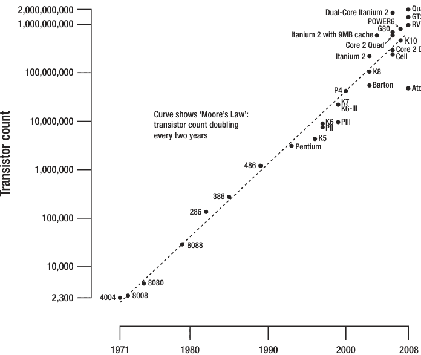

图 3–2. 摩尔定律

注意：摩尔定律有一个负面影响，你可能已经在你的钱包里感受到了。处理能力快速提升带来的问题是它会让技术迅速过时。当你 iPhone 的两年手机合约到期时，市场上的新 iPhone 性能将比你签约时使用的 iPhone 强一倍。这对大家来说太方便了！

## 字节（Bytes）

字节是另一种描述计算机信息存储的单位。一个字节由 8 个位（bit）组成，并且是一个方便的 2 的幂。位可以表示两个不同的值，而一个字节可以表示高达 2^8 或 256 个不同的值。一个字节可以包含 0–255 之间的值。

注意：在第 13 章中，我们将更详细地讨论二进制、十进制和十六进制系统。然而，本章有必要对这些系统进行介绍，以便理解数据类型。

二进制系统表示数字符号 0 和 1。为了说明数字 71 如何在二进制中表示，我们将使用一个简单的 8 位（1 字节）表格，每个位都表示为 2 的幂。要将字节值 01000111 转换为十进制，只需将这些位相加。见表 3–1。

## 表格 3-1. 以字节表示的数字 71

| 2 的幂 | $2^7$ | $2^6$ | $2^5$ | $2^4$ | $2^3$ | $2^2$ | $2^1$ | $2^0$ |
|---|---|---|---|---|---|---|---|---|
| “开启”位的值 | 128 | 64 | 32 | 16 | 8 | 4 | 2 | 1 |
| 实际位 | 0 | 0 | 0 | 1 | 0 | 1 | 1 | 1 |

要用二进制表示数字 22，请开启加和为 22 的位，即 00100110。见表 3–2。

## 表格 3-2. 以字节表示的数字 22

| 2 的幂 | $2^7$ | $2^6$ | $2^5$ | $2^4$ | $2^3$ | $2^2$ | $2^1$ | $2^0$ |
|---|---|---|---|---|---|---|---|---|
| “开启”位的值 | 128 | 64 | 32 | 16 | 8 | 4 | 2 | 1 |
| 实际位 | 0 | 0 | 1 | 0 | 0 | 1 | 1 | 0 |

要用二进制表示数字 255，请开启加和为 255 的位，即 11111111。见表 3–3。

## 表格 3-3. 以字节表示的数字 255

| 2 的幂 | $2^7$ | $2^6$ | $2^5$ | $2^4$ | $2^3$ | $2^2$ | $2^1$ | $2^0$ |
|---|---|---|---|---|---|---|---|---|
| “开启”位的值 | 128 | 64 | 32 | 16 | 8 | 4 | 2 | 1 |
| 实际位 | 1 | 1 | 1 | 1 | 1 | 1 | 1 | 1 |

要用二进制表示数字 0，请开启加和为 0 的位，即 00000000。见表 3–4。

## 表格 3-4. 以字节表示的数字 0

| 2 的幂 | $2^7$ | $2^6$ | $2^5$ | $2^4$ | $2^3$ | $2^2$ | $2^1$ | $2^0$ |
|---|---|---|---|---|---|---|---|---|
| “开启”位的值 | 128 | 64 | 32 | 16 | 8 | 4 | 2 | 1 |
| 实际位 | 0 | 0 | 0 | 0 | 0 | 0 | 0 | 0 |

通常，我们使用计算机识别的另一种格式，即十六进制。十六进制系统（base-16）使用 16 个不同的符号，0-9 表示零到九，A、B、C、D、E、F 表示十到十五。例如，十六进制 2AF 是 $2 \times 16^2 + 10 \times 16^1 + 15 \times 16^0$，即 687。十六进制 20 代表空格。


本章的剩余部分将介绍数据类型。在第 4 章中，当我们编写带有决策逻辑的应用时，我们将更多地讨论布尔数据类型。

> 注意：本地化你的应用程序是编写程序的过程，使用户可以使用他们的母语言购买并使用它。对于本书来说，这个过程非常高级，但如果你从一开始就开始计划，完成它非常简单。本地化你的应用程序可以极大地扩大潜在客户总数和应用收入，而无需为每种语言重新编写。请务必本地化你的应用程序。这并不难，并且轻松让购买人数翻倍或三倍。

## 在 Alice 中使用变量和数据类型

现在我们已经学习了数据类型，让我们来编写一个 Alice 应用，使用对象和方法相两个数字并显示和。

- 1. 打开 Alice 并选择 File（文件） ➤ New World（新建世界）。

- 2. 选择 Grass（草地）模板并点击 Open（打开）。见图 3–4。

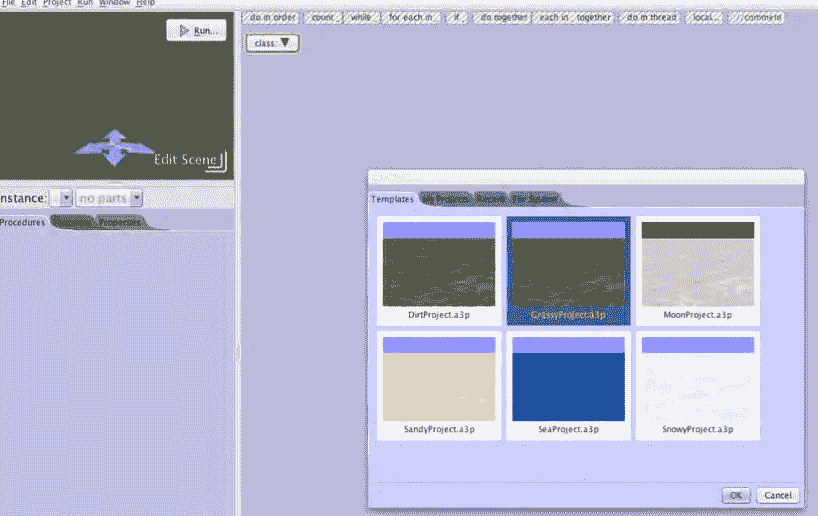

图 3–4. 选择 Grass 模板

接下来，我们需要创建变量并选择数据类型。

- 3. 点击并拖动编辑器右上角的 local（本地）瓦片

- 4. 将你的第一个变量命名为 "firstNumber" 并定义该变量，如图 3–5 所示。

- 5. 变量的数据类型是整数（integer）。它被初始化值为 2。

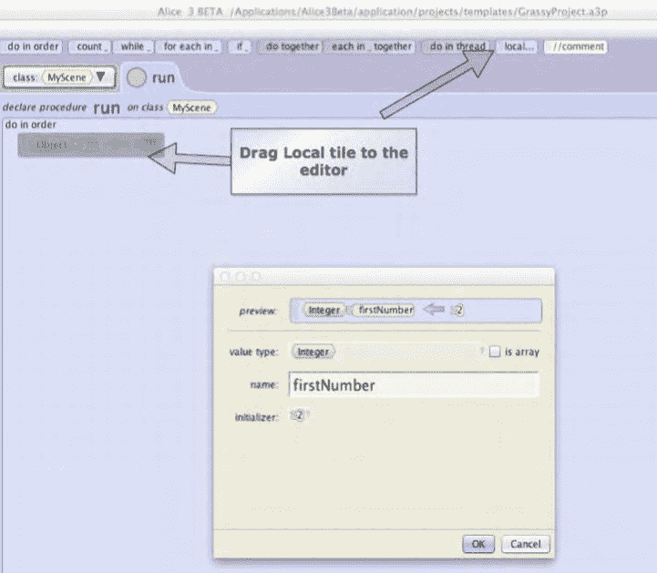

图 3–5. 创建一个新的局部变量

在声明变量时初始化它们是一个良好的编程习惯。

- 6. 创建另一个名为 "secondNumber" 的局部变量，如图 3–6 所示，并按照第 5 步的操作。该变量的数据类型是整数，初始化值为 3。

# 第 3 章：一切关于数据

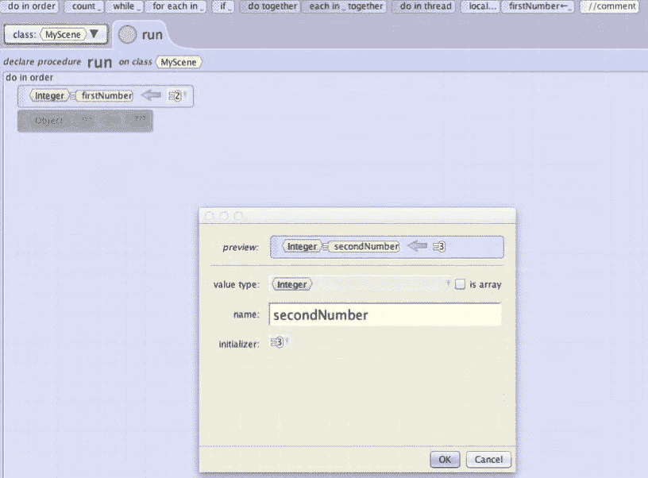

**图 3–6.** 创建第二个局部变量

- 7. 创建另一个名为 "totalSum" 的局部变量，如图 3–7 所示，并按照第 5 步的操作。该变量的数据类型是整数，初始化值为 0。这个局部变量最终将持有 firstName 和 secondNumber 的和。

# 第 3 章：一切关于数据

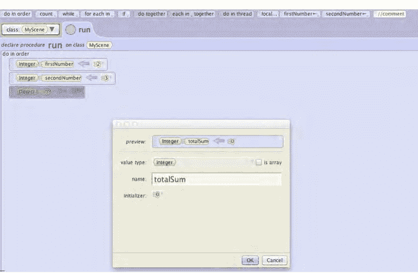

- 8. 将你的两个变量相加。将 totalSum 瓦片拖到最后一行。现在，0 被赋值给局部变量 totalSum。点击 0 并 firstName 赋值给 totalSum。见图 3-8。

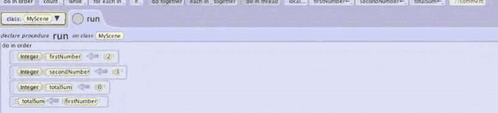

- 9. 现在 firstName 已经赋值给 totalSum，点击 firstName 瓦片。

- 10. 选择 secondNumber 加到 firstName 上。见图 3-9。

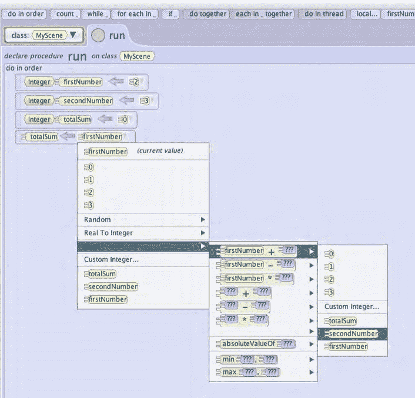

- 11. **totalNumber** 现在被赋值为 firstName 和 secondNumber 的总和。见图 3–10。


现在我们需要向世界中添加一个角色来显示我们的总和。

- 12. 点击 Edit Scene（编辑场景），从底部的 Object Gallery（对象库）中添加你喜欢的任何对象。我们选择了一只兔子（bunny）。见图 3–11。

# 第 3 章：一切关于数据

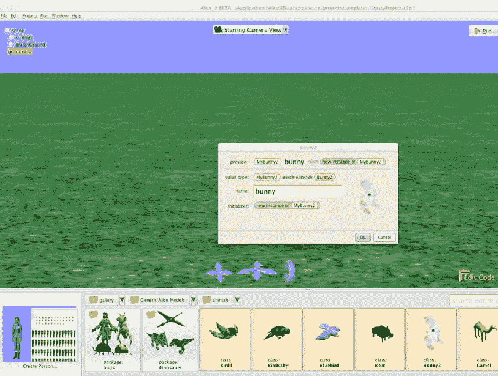

图 3-11. 向世界添加一只兔子

我们需要声明一个 String（字符串）类型的变量。该变量将持有字符串“The sum of 2 + 3 is:5”。

- 13. 点击场景右下角的 Edit Code（编辑代码）回到我们的编辑器。

- 14. 选择 Bunny 实例。从 Procedures（过程）选项卡中，将 this.bunny text:??? 过程瓦片拖到编辑器。见图 3–12。

# 第 3 章：一切关于数据

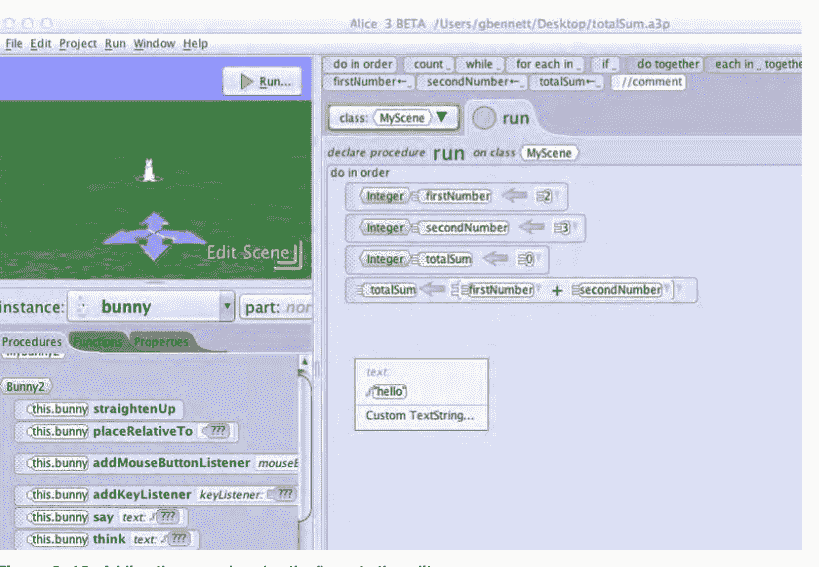

图 3-12. 向编辑器添加过程（方法）say

- 15. 点击 Custom TextString（自定义字符串），并输入参数值字符串“The sum of 2 + 3 is:”见图 3–13。

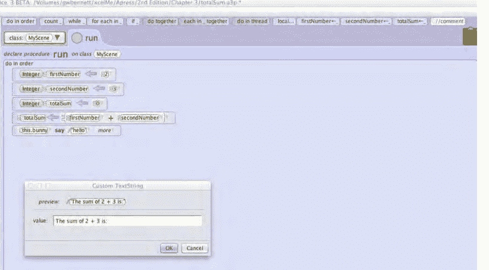

图 3–13. 输入参数

- 16. 点击 OK，然后点击 say 方法的参数。将 totalSum 附加到我们的第一个参数。见图 3–14。

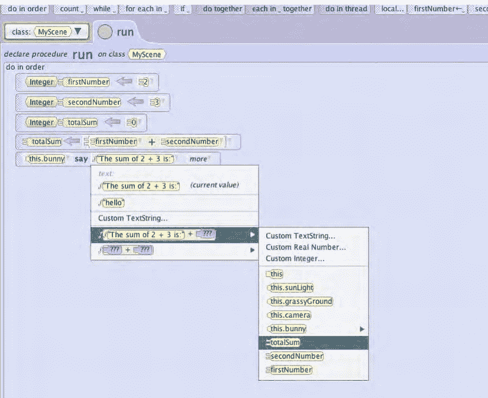

图 3–14. 将 totalNumber 附加到我们的自定义字符串以显示给用户

Alice 在最后一步为我们做了一件很棒的事。它将 totalSum 数据类型从整数转换为字符串“The sum of 2 + 3 is”。我们将学习使用 Objective-C 实现。你现在可以运行程序并注意自定义字符串没有显示很久。要增加自定义字符串的显示时间，点击 say 方法的第二个参数，并将时长改为 2 秒或任何其他值。见图 3–15。

# 第 3 章：一切关于数据

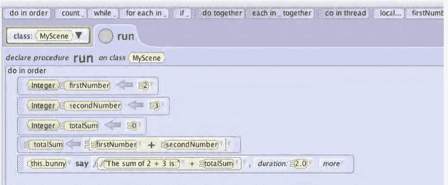

图 3–15. 编辑器部分

- 17. 点击播放按钮，如果你都做得正确，你的应用在运行时应该像图 3-16。

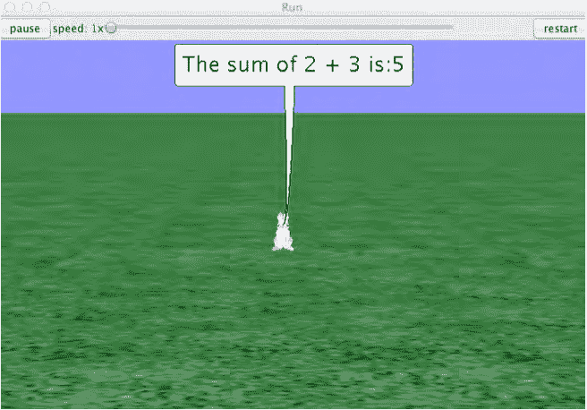

图 3–16. 应用运行成功！

## 数据类型和 Objective-C

现在我们已经涵盖了数据类型的原理并编写了一个 Alice 应用来帮助展示这些原理，让我们编写一个 Objective-C 应用来完成我们在 Alice 中的操作。在 Objective-C 中，我们拥有与 Alice 相似的数据类型。一些最常用的数据类型是整数、double 和 long。

图 3–5. Objective-C 基础类型

| 类型 | 示例 | 格式化符 |
| :--- | :--- | :--- |
| char | 'a' | %c |
| int | 42 | %d |
| unsigned int | 42 | %u |
| long | 42 | %ld |
| unsigned long | 42 | %lu |
| long long | 42 | %llu |
| float | 3.1 | %f |
| double | 3.1 | %f |
| long double | 3.1 | %Lf |
| id | Nil | %@ |

- 1. 打开 Alice 并选择 File（文件）➤ New World（新建世界）。

- 2. 选择 Grass 模板并点击 Open（打开）。见图 3–4。


图 3–4. 选择 Grass 模板

- 3. 点击并拖动编辑器右上角的 local（本地）瓦片

- 4. 将你的第一个变量命名为 "firstNumber" 并定义该变量，如图 3–5 所示。

- 5. 变量的数据类型是整数。它被初始化值为 2。


图 3–5. 创建一个新的局部变量

- 6. 创建另一个名为 "secondNumber" 的局部变量，如图 3–6 所示，并按照第 5 步的操作。该变量的数据类型是整数，初始化值为 3。


**图 3–6.** 创建第二个局部变量

- 7. 创建另一个名为 "totalSum" 的局部变量，如图 3–7 所示，并按照第 5 步的操作。该变量的数据类型是整数，初始化值为 0。这个局部变量最终将持有 firstName 和 secondNumber 的和。

- 8. 将你的两个变量相加。将 totalSum 瓦片拖到最后一行。现在，0 被赋值给局部变量 totalSum。点击 0 并 firstName 赋值给 totalSum。见图 3-8。


- 9. 现在 firstName 已经赋值给 totalSum，点击 firstName 瓦片。

- 10. 选择 secondNumber 加到 firstName 上。见图 3-9。


- 11. **totalNumber** 现在被赋值为 firstName 和 secondNumber 的总和。见图 3–10。


- 12. 点击 Edit Scene（编辑场景），从底部的 Object Gallery（对象库）中添加你喜欢的任何对象。我们选择了一只兔子（bunny）。见图 3–11。


图 3-11. 向世界添加一只兔子

- 13. 点击场景右下角的 Edit Code（编辑代码）回到我们的编辑器。

- 14. 选择 Bunny 实例。从 Procedures（过程）选项卡中，将 this.bunny text:??? 过程瓦片拖到编辑器。见图 3–12。


图 3-12. 向编辑器添加过程（方法）say

- 15. 点击 Custom TextString（自定义字符串），并输入参数值字符串“The sum of 2 + 3 is:”见图 3–13。


图 3–13. 输入参数

- 16. 点击 OK，然后点击 say 方法的参数。将 totalSum 附加到我们的第一个参数。见图 3–14。


图 3–14. 将 totalNumber 附加到我们的自定义字符串以显示给用户

- 17. 点击播放按钮，如果你都做得正确，你的应用在运行时应该像图 3-16。


图 3–16. 应用运行成功！


[content]
# 第 3 章：一切关于数据

59

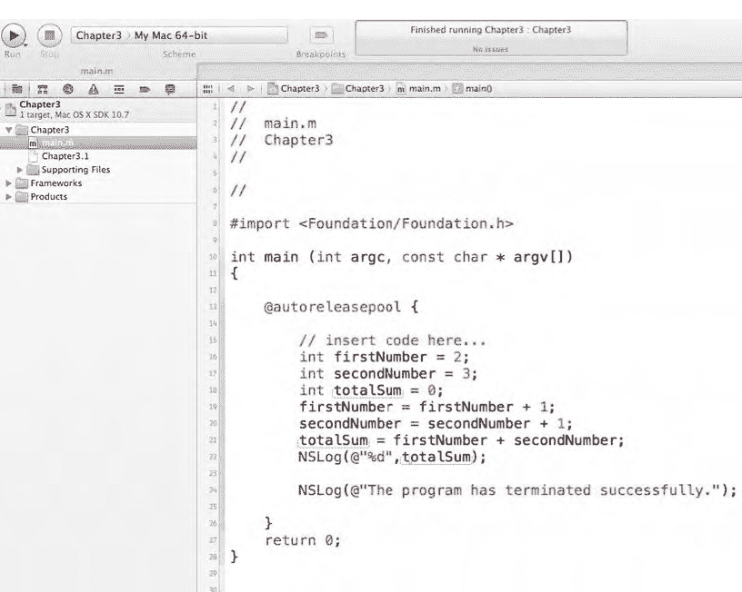

NSLog 是一个接受一个或多个参数的函数。第一个参数通常是要打印到控制台的字符串。字符串前面的 @ 符号告诉编译器这是一个 Objective-C 类型字符串，而不是 C++ 字符串。在开发 iPhone 应用时，你通常会在所有的字符串前使用 @ 符号。如果你不使用 @ 符号，可能会得到编译器错误。NSLog 是开发者用来测试代码执行情况的一个非常有用的函数。

%d 告诉编译器将打印一个整数，并用整数的值替换 %d。其他 NSLog 格式化规范请参阅表 3-5。最后，我们的第二个参数应该是整数类型。

图 3-21 显示了我们的应用程序完成执行后的输出结果。

若要编译并运行你的应用程序，请点击工具栏上的“运行（Run）”按钮。我们可以通过调试器看到应用执行成功，从而看到打印出的 NSLog 字符串以及结尾的提示信息。

> 注意：如果你的编辑器没有在你之前的截图中看到的相同菜单或行隙（包含程序行号的左侧列），你可以在 Xcode 偏好中更改这些设置。你可以通过点击栏中的 Xcode 菜单并选择偏好（Preferences）来打开 Xcode 偏好。

```objc
// main.m
// Chapter3

#import <Foundation/Foundation.h>

int main (int argc, const char * argv[]) {
    @autoreleasepool {
        // 在此处插入代码..
        int firstNumber = 1;
        int totalSum = 0;
        int firstNumber = firstNumber + 1;
        secondNumber = secondNumber + 1;
        totalSum = firstNumber + secondNumber;
        NSLog("The program has terminated successfully.");
    }
    return 0;
}
```

欢迎在特定条件下更改或副本。
种类不受限制。输入 "show copying" 查看条件。
GDB 配置为 "x86_64-apple-darwin.tty" /dev/tty000
[正常退出，处理结果为 0]
2021-09-08 23:57:02.162 Chapter3][7234:707] 7
2021-09-08 23:57:02.163 Chapter3][7234:707] 7 The program has terminated successfully.

图-31. 显示我们 Objective-C 应用结果的控制台日志

## 识别问题

信不信，你的程序运行方式可能不像你认为的那样。在你的应用中寻找问题的过程被称为调试（debugging）。为了追踪应用中的错误（bugs），我们可以设置断点并检查变量以查看其内容。要做到这一点，只需在想要设置断点的行隙处点击即可（见图 3-22）。断点将停止应用程序在某行的执行，并允许我们检查我们的变量。

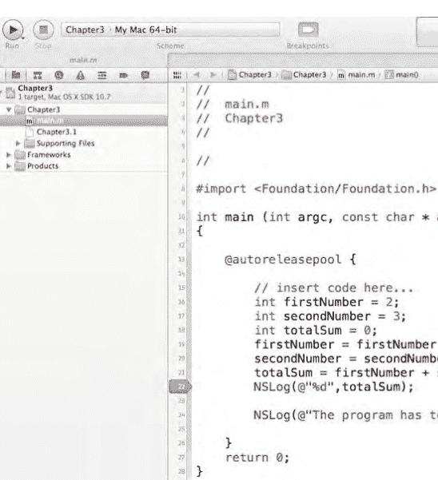

**图 3–22. 设置调试“断点”**

编辑器行隙中的蓝色指针表示断点。当你运行应用程序且应用运行到包含断点的代码行时，你的应用将停止，并在包含断点的代码行上显示一条蓝线（见图 3–23）。此外，你可以通过鼠标悬停在每个变量上来检查它。

# 第 3 章：一切关于数据

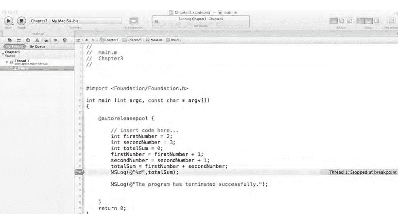

我们将在第 14 章中详细讨论如何调试你的应用。

## 总结

在本章中，你学习了应用如何使用数据。你学习了如何初始化变量以及如何为它们赋值数据。我们解释了当声明变量时，它们带有一个数据类型，并且只有相同类型的数据才能赋值给变量。

最后，我们向你展示了如何在第一个 Alice 应用中使用变量，并以在 Objective-C 应用中使用变量结束。

## 练习题

- 编写一个 Objective-C 控制台应用（命令行工具），将两个整数相乘并将结果显示在控制台。
- 编写一个 Objective-C 控制台应用，计算浮点数的平方。在控制台中显示结果的浮点数。
- 编写一个 Objective-C 控制台应用，将两个浮点数相减，结果存储为整数。注意，不会发生舍入。

# 第 4 章

# 关于……的决策与规划程序流程

成为 iPhone/iPad/Mac 开发者的酷点之一是，我们可以精确地告诉它们我们想要它们做什么，它们就会执行——我们的设备会一遍一遍地执行任务而不会疲倦。这是因为 iPhones/IPads/Macs 不在乎它们昨天工作有多辛苦，也不会以这种方式产生情感。这些设备不需要拥抱。

成为开发者的缺点是：我们必须精确地告诉它们我们想要它们做什么，它们就会执行——我们的设备会一遍一遍地执行任务而不会疲倦。这是因为 iPhones/IPads/Macs 不在乎它们昨天工作有多辛苦，也不会以这种方式产生情感。这些设备不需要拥抱。

成为开发者的缺点是：我们必须精确地告诉它们我们想要它们做什么，它们就会执行——我们的设备会一遍一遍地执行任务而不会疲倦。这是因为 iPhones/IPads/Macs 不在乎它们昨天工作有多辛苦，也不会以这种方式产生情感。这些设备不需要拥抱。

成为开发者的缺点是：我们必须精确地告诉它们我们想要它们做什么，它们就会执行——我们的设备会一遍一遍地执行任务而不会疲倦。这是因为 iPhones/IPads/Macs 不在乎它们昨天工作有多辛苦，也不会以这种方式产生情感。这些设备不需要拥抱。

成为开发者的缺点是：我们必须精确地告诉它们我们想要它们做什么，它们就会执行——我们的设备会一遍一遍地执行任务而不会疲倦。这是因为 iPhones/IPads/Macs 不在乎它们昨天工作有多辛苦，也不会以这种方式产生情感。这些设备不需要拥抱。

成为开发者的缺点是：我们必须精确地告诉它们我们想要它们做什么，它们就会执行——我们的设备会一遍一遍地执行任务而不会疲倦。这是因为 iPhones/IPads/Macs 不在乎它们昨天工作有多辛苦，也不会以这种方式产生情感。这些设备不需要拥抱。

成为开发者的缺点是：我们必须精确地告诉它们我们想要它们做什么，它们就会执行——我们的设备会一遍一遍地执行任务而不会疲倦。这是因为 iPhones/IPads/Macs 不在乎它们昨天工作有多辛苦，也不会以这种方式产生情感。这些设备不需要拥抱。

成为开发者的缺点是：我们必须精确地告诉它们我们想要它们做什么，它们就会执行——我们的设备会一遍一遍地执行任务而不会疲倦。这是因为 iPhones/IPads/Macs 不在乎它们昨天工作有多辛苦，也不会以这种方式产生情感。这些设备不需要拥抱。

成为开发者的缺点是：我们必须精确地告诉它们我们想要它们做什么，它们就会执行——我们的设备会一遍一遍地执行任务而不会疲倦。这是因为 iPhones/IPads/Macs 不在乎它们昨天工作有多辛苦，也不会以这种方式产生情感。这些设备不需要拥抱。

成为开发者的缺点是：我们必须精确地告诉它们我们想要它们做什么，它们就会执行——我们的设备会一遍一遍地执行任务而不会疲倦。这是因为 iPhones/IPads/Macs 不在乎它们昨天工作有多辛苦，也不会以这种方式产生情感。这些设备不需要拥抱。

成为开发者的缺点是：我们必须精确地告诉它们我们想要它们做什么，它们就会执行——我们的设备会一遍一遍地执行任务而不会疲倦。这是因为 iPhones/IPads/Macs 不在乎它们昨天工作有多辛苦，也不会以这种方式产生情感。这些设备不需要拥抱。

成为开发者的缺点是：我们必须精确地告诉它们我们想要它们做什么，它们就会执行——我们的设备会一遍一遍地执行任务而不会疲倦。这是因为 iPhones/IPads/Macs 不在乎它们昨天工作有多辛苦，也不会以这种方式产生情感。这些设备不需要拥抱。

成为开发者的缺点是：我们必须精确地告诉它们我们想要它们做什么，它们就会执行——我们的设备会一遍一遍地执行任务而不会疲倦。这是因为 iPhones/IPads/Macs 不在乎它们昨天工作有多辛苦，也不会以这种方式产生情感。这些设备不需要拥抱。

成为开发者的缺点是：我们必须精确地告诉它们我们想要它们做什么，它们就会执行——我们的设备会一遍一遍地执行任务而不会疲倦。这是因为 iPhones/IPads/Macs 不在乎它们昨天工作有多辛苦，也不会以这种方式产生情感。这些设备不需要拥抱。

成为开发者的缺点是：我们必须精确地告诉它们我们想要它们做什么，它们就会执行——我们的设备会一遍一遍地执行任务而不会疲倦。这是因为 iPhones/IPads/Macs 不在乎它们昨天工作有多辛苦，也不会以这种方式产生情感。这些设备不需要拥抱。

成为开发者的缺点是：我们必须精确地告诉它们我们想要它们做什么，它们就会执行——我们的设备会一遍一遍地执行任务而不会疲倦。这是因为 iPhones/IPads/Macs 不在乎它们昨天工作有多辛苦，也不会以这种方式产生情感。这些设备不需要拥抱。

成为开发者的缺点是：我们必须精确地告诉它们我们想要它们做什么，它们就会执行——我们的设备会一遍一遍地执行任务而不会疲倦。这是因为 iPhones/IPads/Macs 不在乎它们昨天工作有多辛苦，也不会以这种方式产生情感。这些设备不需要拥抱。

成为 iPhone/iPad/Mac 开发者的酷点之一是，我们可以精确地告诉它们我们想要它们做什么，它们就会执行——我们的设备会一遍一遍地执行任务而不会疲倦。这是因为 iPhones/IPads/Macs 不在乎它们昨天工作有多辛苦，也不会以这种方式产生情感。这些设备不需要拥抱。

逻辑逻辑：我们必须精确地告诉它们我们想要它们做什么，它们就会执行——我们的设备会一遍一遍地执行任务而不会疲倦。这是因为 iPhones/IPads/Macs 不在乎它们昨天工作有多辛苦，也不会以这种方式产生情感。这些设备不需要拥抱。

成为开发者的缺点是：我们必须精确地告诉它们我们想要它们做什么，它们就会执行——我们的设备会一遍一遍地执行任务而不会疲倦。这是因为 iPhones/IPads/Macs 不在乎它们昨天工作有多辛苦，也不会以这种方式产生情感。这些设备不需要拥抱。

成为开发者的缺点是：我们必须精确地告诉它们我们想要它们做什么，它们就会执行——我们的设备会一遍一遍地执行任务而不会疲倦。这是因为 iPhones/IPads/Macs 不在乎它们昨天工作有多辛苦，也不会以这种方式产生情感。这些设备不需要拥抱。

成为 iPhone/iPad/Mac 开发者的酷点之一是，我们可以精确地告诉它们我们想要它们做什么，它们就会执行——我们的设备会一遍一遍地执行任务而不会疲倦。这是因为 iPhones/IPads/Macs 不在乎它们昨天工作有多辛苦，也不会以这种方式产生情感。这些设备不需要拥抱。

布尔逻辑是一个通过 AND、OR 和 NOT 等二元运算符确定条件是否满足的系统。

# 第 4 章：关于……的决策与程序流程

成为 iPhone/iPad/Mac 开发者的酷点之一是，我们可以精确地告诉它们我们想要它们做什么，它们就会执行——我们的设备会一遍一遍地执行任务而不会疲倦。这是因为 iPhones/IPads/Macs 不在乎它们昨天工作有多辛苦，也不会以这种方式产生情感。这些设备不需要拥抱。

成为开发者的缺点是：我们必须精确地告诉它们我们想要它们做什么，它们就会执行——我们的设备会一遍一遍地执行任务而不会疲倦。这是因为 iPhones/IPads/Macs 不在乎它们昨天工作有多辛苦，也不会以这种方式产生情感。这些设备不需要拥抱。

二元运算符接受两个操作数。一元运算符接受一个操作数。


布尔运算符 XOR 表示“异或”（exclusive-or）。简单的记忆方法是：只有当只有一个参数为 TRUE 时，XOR 才会返回 TRUE，而不是两个。

Objective-C 没有内置这些运算符，但考虑到 NAND 和 NOR 分别代表“非与”和“非或”。在评估完 AND 和 OR 的参数和结果后，简单地对结果取反反即可。

## 真表

让我们使用一个工具来帮助你评估所有的布尔运算符。真表是逻辑中用于评估布尔运算符的数学表格。在尝试确定布尔运算符的所有可能情况时，真表非常有帮助。让我们来看 AND、OR、XOR、NAND 和 NOR 的一些常用真表。

在 AND 真表中，TRUE 和 FALSE 有四种可能的组合。

- TRUE AND TRUE = TRUE
- TRUE AND FALSE = FALSE
- FALSE AND TRUE = FALSE
- FALSE AND FALSE = FALSE

将这些组合放入真表中，就得到了表 4–1。

表 4–1. AND 真表

| A | B | A AND B |
|---|---|---|
| TRUE | TRUE | TRUE |
| TRUE | FALSE | FALSE |
| FALSE | TRUE | FALSE |
| FALSE | FALSE | FALSE |

只有当两个操作数都为 TRUE 时，AND 真表才会产生 TRUE 结果。

表 4–2 展示了一个 OR 真表和所有可能的操作数。

## 4 章：关于……的决策与程序流程规划

表 4–2. OR 真表

| A | B | A OR B |
|---|---|---|
| TRUE | TRUE | TRUE |
| TRUE | FALSE | TRUE |
| FALSE | TRUE | TRUE |
| FALSE | FALSE | FALSE |

当一个或两个操作数为 TRUE 时，OR 真表就会产生 TRUE 结果。

表 4–3 展示了 NOT 真表和所有可能的操作数。

表 4–3. NOT 真表

| NOT | RESULT |
|---|---|
| TRUE | FALSE |
| FALSE | TRUE |

NOT 会翻转位或对原始操作数的布尔值取反。

表 4–4 展示了 XOR（或异或）真表和所有可能的操作数。

表 4–4. XOR 真表

| A | B | A XOR B |
|---|---|---|
| TRUE | TRUE | FALSE |
| TRUE | FALSE | TRUE |
| FALSE | TRUE | TRUE |
| FALSE | FALSE | FALSE |

当操作数中只有一个为 TRUE 时，XOR 运算符产生 TRUE 结果。

表 4–5 展示了 NAND 真表和所有可能的操作数。

## 表 4–5. NAND 真表

| A | B | A NAND B |
|---|---|---|
| TRUE | TRUE | FALSE |
| TRUE | FALSE | TRUE |
| FALSE | TRUE | TRUE |
| FALSE | FALSE | TRUE |

表 4–6 展示了 NOR 真表和所有可能的操作数。

## 表 4–6. NOR 真表

| A | B | A NOR |
|---|---|--|
| TRUE | TRUE | FALSE |
| TRUE | FALSE | FALSE |
| FALSE | TRUE | FALSE |
| FALSE | FALSE | TRUE |

查看 NAND 和 NOR 运算符简单的方法就是分别对 AND 和 OR 真表的结果取反。

## 比较运算符

在软件开发中，不同数据项之间的比较是通过比较运算符完成的。这些运算符产生逻辑 TRUE 或 FALSE 结果。表 4–7 显示了比较运算符列表。

## 表 4–7. 比较运算符

- > 大于
- < 小于
- >= 大于等于
- < 小于等于
- == 完全等于
- != 不等于

## 设计应用

现在我们已经引入了布尔逻辑和比较运算符，你可以开始设计你的应用了。有时，在不需要编写实际代码的情况下向他人表达应用的所有或部分是非常重要的。

编写代码可以帮助开发者大声思考，并与其他开发者就他们关注的代码段进行头脑风暴——这有助于在编码开始之前分析问题可能的解决方案。

## 伪代码

**伪代码**指的是写出对你试图解决的算法的高级描述代码。伪代码不包含编码所需的编程语法；但是，它表达了解决当前问题所需的算法。

伪代码可以用手写在纸上（或白板上），也可以在计算机上打字。

通过使用伪代码，你可以应用你所学的布尔数据类型、真表和比较运算符的知识。请参考列表 4–1 get伪代码示例。

**列表 4–1.** *在 If-Then-Else 代码中使用条件运算符的伪代码示例*

```
int x = 5;
int y = 6;
isComplete = TRUE;
if (x < y)
{
    // 在此示例中，x 小于6
    do stuff;
}
else
{
    do other stuff;
}
if (isComplete == TRUE)
{
    // 在此示例中，isComplete 等于 TRUE
    do stuff;
}
else{}
```

```
do other stuff;
//检查 isComplete == TRUE 的另一种方法
if (isComplete)
{
    //在此示例中，isComplete 为 TRUE
    do stuff;
}
//检查值是否为 false 的两种方法
if (isComplete == FALSE)
{
    do stuff;
}
else
{
    // 在此示例中，isComplete 为 TRUE，所以执行 else 块
}
//检查 isComplete == FALSE 的另一种方法
if (isComplete)
{
    do stuff;
}
else
{
    // 在此示例中，isComplete 为 TRUE，所以执行 else 块
```

注意，! 会切换它所作用的布尔值；因此，使用 ! 会将 TRUE 值变为 FALSE，将 FALSE 值变为 TRUE。

通常有必要组合你的比较测试。复合关系是指通过 `&&` 或 `||`（两个管道符号）连接的一个或多个简单关系测试。

&& 和 || 分别读作逻辑与和逻辑或。列表 4–2 中的伪代码说明了逻辑与和逻辑或运算符。

## 列表 4-2. 使用 && 和 || 逻辑运算符

```
int x = 5;
int y = 6;
isComplete = TRUE;
//使用逻辑与
if (x < y && isComplete == TRUE)
{
    // 在此示例中，x 小于6 且 isComplete == TRUE
    do stuff;
}
if (x < y || isComplete == FALSE)
{
    // 在此示例中，x 小于6。
// 只要有一个操作数为 TRUE，OR 结果就为 TRUE。
// 查看表 4-2 A OR 真表
    do stuff;
}
//检查为 TRUE 的另一种方法
if (x < y && isComplete)
```

```
{
    // 在此示例中，is 小于6 且 isComplete 为 TRUE
    do stuff;
}
// 检查为 FALSE 的另一种方法
if (x < y || !isComplete)
{
    do stuff;
}
else
{
    // 在此示例中，isComplete 为 TRUE，所以执行 else 块
}
```


# 第4章：关于……的决策与规划

## Woodforest 移动银行

### 描述
Woodforest 移动银行应用程序让您能够通过 iPhone 和 iPad 方便地访问 Woodforest 国家银行和 Woodforest 银行的资讯！它简单易用！而且完全免费。

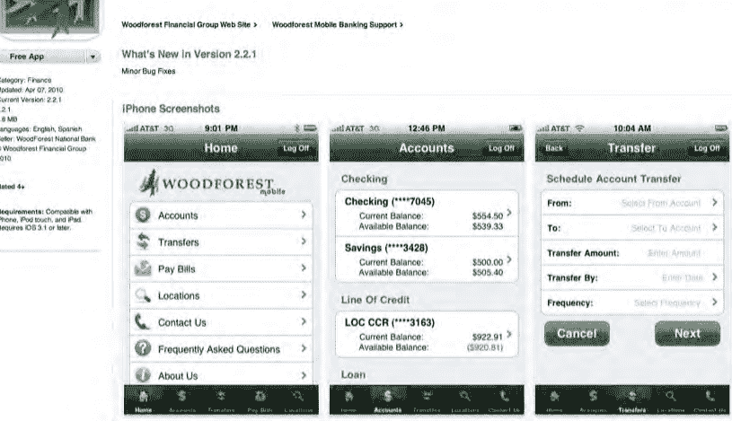

Woodforest 金融集团网站 | Woodforest 移动银行支持

### 版本 2.2.1 更新内容
类别：金融
更新日期：2017年4月5日
当前版本：2.2.1
1.8 MB
语言：英语、西班牙语
开发者：Woodforest National Bank
Woodforest Financial Group

iPhone 手机
免费应用

需要+
兼容 iPhone、带触控的 Mac 以及 iPad
需要 iOS 3.1 或更高版本。

AT&T30 9:01 PM | AT&T35 12:46 PM | AT&T30 10:04 AM

首页 登销 | 账户 登销 | 转账 登销

支票
查询 (**7945)
来自：储蓄账户
当前余额：$554.50
可用余额：$539.33

- 账户
- 转账
- 支付账单
- 地点
- 联系我们
- 常见问题解答

储蓄 (**3428)
转账金额：
当前余额：$500.00
可用余额：$505.45
至：选择账户

信贷额度
转账方式：
LOC 信贷额度 (**3163)
来自账户
当前余额：$922.91
可用余额：($981.81)
频率：

- 关于我们
取消
下一步

用户评分
当前版本的平均评分：★★★★☆ 4.0 (98 份评分) 为此应用评分：星★★

图 4-2。在 iTunes Connect 应用商店中显示的 Woodforest 移动银行应用程序；与图 4-1 中的应用程序账户界面进行对比。

此外，Apple 建议开发者将至少 50% 的开发时间用于用户界面的设计和开发。

Apress 的 iPhone 和 iPad 设计草图本是在纸上规划您的 iOS 应用视觉效果和感受的极佳工具。参见图 4-3。

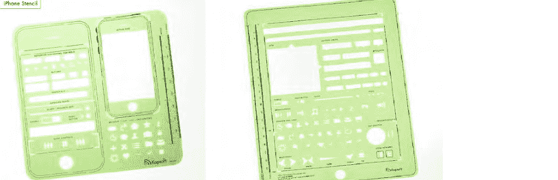

图 4-3。Apress 的 iPhone 草图本模板和 Apress 的 iPad 草图本模板

## 流程图

在设计需求确定后，您可以使用应用程序的伪代码部分来解决复杂的开发问题。流程图是算法的一种常用图形方法。算法表示为由线条和箭头连接的不同类型的方框。开发者经常使用流程图来视觉化表达代码。参见图 4–4。

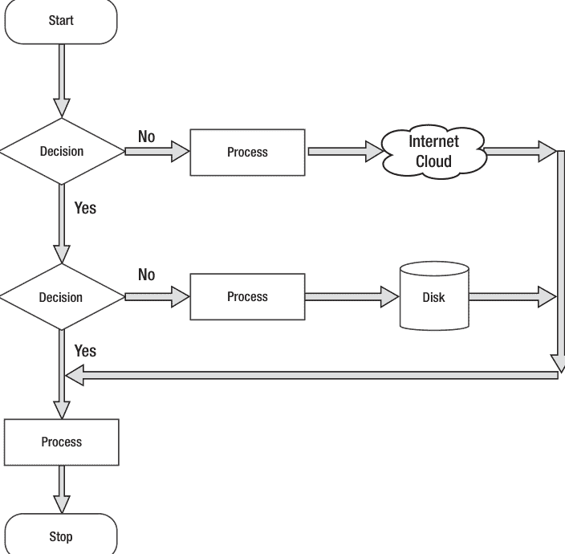

图 4-4。显示常见图形及其相关名称的示例流程图

流程图应该始终有一个开始和一个结束。分支永远不应该在没有停止的情况下结束。这有助于开发者确保代码中的所有分支都已考虑在内，并且它们能够干净停止执行。

## 示例应用的设计与流程图

我们已经涵盖了许多关于决策和程序流的信息。现在是时候要做程序员最擅长的事情：编写应用！

您被分配编写的应用程序生成一个 0 到 100 之间（包含边界）的随机数，并要求用户猜数字。用户必须一直这样做，直到猜中数字为止。您可以使用 Alice 库中的任何对象来询问用户的猜测，也可以为您的对象选择任何世界（world）。该对象将为每次高了、低了正确的猜测提供视觉提示。当用户猜中正确答案时，他们将被询问是否想再玩一次。参见图 4–5。

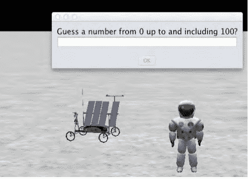

**图 4–5。** 一个宇航员对象要求用户猜 0 到 100 之间的数字

## 应用程序的设计

使用您的设计需求，可以为您的应用程序制作流程图。参见图 4–6。

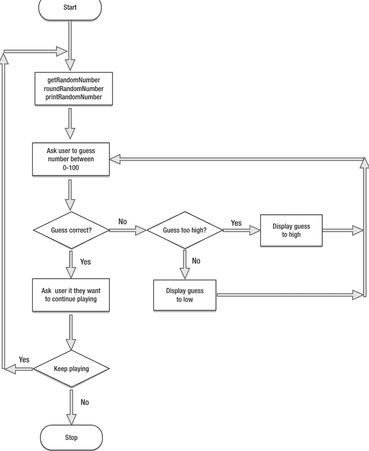

图 4-6。猜随机数应用的流程图

查看图 4–6，您会发现当您接近流程图中逻辑块的结尾时，有箭头指向之前的部分并重复该部分，直到满足某些条件。这被称为**循环**。它允许您重复某些编程逻辑部分——无需重写这些代码段——直到满足某个条件。

## 使用循环重复程序语句

**循环**是一系列程序语句，这些语句只被指定一次，但可以连续重复多次。循环可以重复指定的次数（计数控制），或者直到某个条件（条件控制）发生为止。

在本节中，您将学习计数控制循环和条件控制循环。您还将学习如何使用布尔逻辑来控制您的循环。

## 计数控制循环

计数控制循环是重复指定次数的循环。在 Objective-C 和 Alice 中，这被称为 **for 循环 (for loop)**。循环有一个计数器变量。该变量允许开发者指定循环执行的次数。参见代码列表 4–3。

**代码列表 4–3。** 计数控制循环

```
int i;
for ( i = 0; i < 10; i++)
{
    // 重复括号内的所有代码10次
}
continue
```

代码列表 4-3 中的循环将循环 10 次。变量 i 从零开始，并在 } 结束处增加 1。递增是通过 **for** 语句中的 i++ 完成的；i++ 等同于 i = i +1，然后它被递增 1 直到 10，然后检查它是否小于 10。因此，此循环将在 i = 9 且到达 } 时结束。

> 注意：开发者经常会混淆他们认为的循环重复的次数。如果代码列表 4–3 中的循环从 1 开始，那么循环将重复 9 次而不是 10 次。

在 Objective-C 中，for 循环的计数器变量在循环声明本身中声明。

**代码列表 4–4。** 初始化 for 循环声明的计数器变量

```
for (int i = 0; i < 10; i++)
{
    // 重复括号内的所有代码10次
}
continue
```

偶尔，您可能需要在循环中只重复某一行代码。可以通过不使用任何 {} 来实现。在声明后遇到的第一行代码将按照循环声明中指定的进行重复。参见代码列表 4-5。

代码列表 4-5。在 for 循环声明中初始化计数器变量

```
for (int i = 0; i < 10; i++))
执行这行代码 10 次;
....continue
```

## 条件耦合循环

Objective-C 和 Alice 具有重复循环直到某些条件改变的能力。您可能希望重复一段代码，直到您的某个变量达到虚假条件。这种类型的循环被称为 **while 循环 (while loop)**。while 循环是一种根据给定条件重复的控制流语句。while 循环可以被视为一个重复的语句。参见代码列表 4–6。

代码列表 4-6。一个 Objective-C while 循环

```
BOOL isTrue = TRUE;
while (isTrue)
{
执行某些操作
isTrue = FALSE; // 有时将 isTrue 设置为 FALSE 的条件
}
....continue
```

代码列表 4-6 中的循环首先检查变量 isTrue 是否为 TRUE——它确实是——因此在执行代码时进入（循环体）。最终，达到了某个条件导致 isTrue 变为 FALSE。在完成循环体中的所有代码后，再次检查条件 (isTrue)，并再次循环。重复过程直到变量设置为 FALSE。

## 死循环

死循环无限重复，可能是由于循环没有导致终止的条件，或者有一个无法满足的终止条件。

通常，死循环会导致应用程序无响应。它们是代码或逻辑中 bug 的副作用。

代码列表 4-7。死循环示例

```
x = 0;
while (x != 5)
{
执行某些操作
x = x + 2;
}
....continue
```

代码列表 4-7 是无法满足的终止条件导致的死循环示例。变量 x 在每次循环迭代时都会被检查，但永远不会等于 5。由于变量 x 初始化为零 并在循环中增加 2，因此变量 x 永远是偶数。这会导致循环无限重复。参见代码列表 4–8。


## 第4章：关于……的决策与流程规划

列表4–8。一个由无法满足的终止条件导致的无限循环示例

```
while (TRUE)
{
    do something;
}
....continue
```

## 在 Alice 中编写示例应用

现在你已经完成了设计需求和流程图，并理解了循环，你已经准备好编写你的 Alice 应用程序了。参见图 4–7。

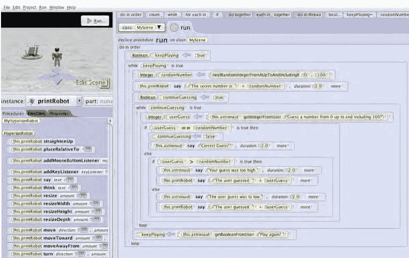

图 4–7。随机数生成器应用程序

无法在截图中列此 Alice 程序的源代码。但是，如果你以 HTML 格式打印源代码，就可以查看所有代码。参见图 4–8。

```
declare procedure run on class MyScene
do order
  Boolean keepPlaying = true
  while keepPlaying is true
    Integer randomNumber = nextRandomIntegerFromUpToIncluding(0, 100)
    this.primRobot say "The secret number is " + randomNumber; duration:2.0; more
    Boolean continueGuessing = true
    while continueGuessing is true
      Integer userGuess = this.astronaut getIntegerFromUser("Guess a number from 0 up to including 100?")
      if userGuess == randomNumber
        continueGuessing = false
        this.astronaut say "Correct Guess!"; duration:2.0; more
      else
        if userGuess > randomNumber
          this.astronaut say "Your guess was too high."; duration:2.0; more
          this.primRobot say "The user guessed: " + userGuess; more
        else
          this.astronaut say "The guess was low."; duration:2.0; more
          this.primRobot say "The user guessed: " + userGuess; more
    endwhile
    keepPlaying = this.astronaut getBooleanFromUser("Play again?")
end
```

**图 4-8.** 随机数生成器；完整程序列表

图 4-8 显示了你在 forum.xcelme.com 上的随机数生成器代码完整程序列表。

> 注意：你可以在随机数生成代码下载完整的随机数生成器应用程序。代码位于第 4 章的主题下。还有一个视频演示了如何在 Alice 中拖放 While 和 If 代码块中的所有瓷砖块。

## 使用 Objective-C 编写示例应用

利用你的需求以及在 Alice 应用中学到的知识，尝试用 Objective-C 编写你的随机数生成器。

你的 Objective-C 应用将从命令行运行，因为它要求用户猜一个随机数。

- 1. 打开 Xcode 并新建一个项目。选择 Command Line Tool（命令行工具）。参见图 4–9。

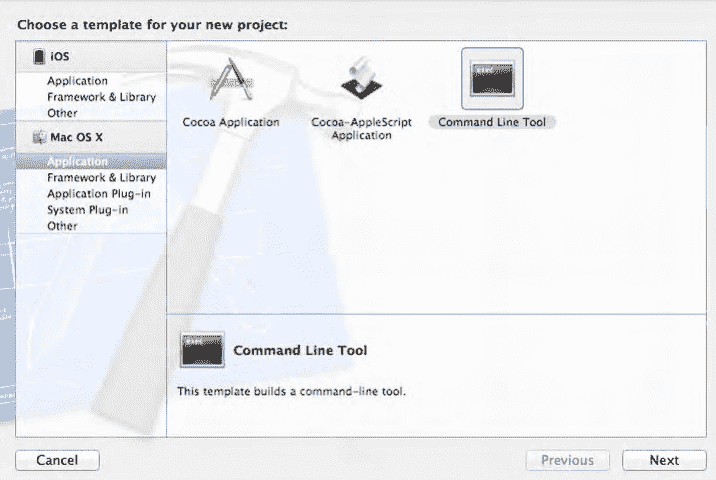

**图 4–9.** 开始一个新的命令行工具项目。

- 2. 将你的项目命名为 RandomNumber（参见图 4–10）。选择 **Foundation** 并确保勾选了 **Use Automatic Reference Counting**（使用自动引用计数）。将项目**保存**到硬盘上的任意位置。

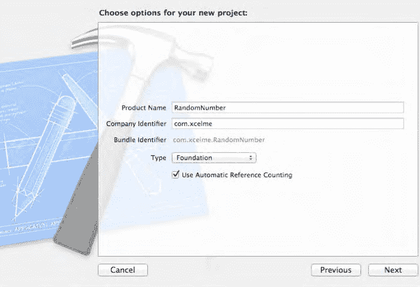

**图 4-10.** RandomNumber 的项目选项

现在，你需要打开 Source 组中的实现文件。这里就是你编写 Objective-C 代码的地方。

- 3. 打开 main.m 文件。删除以下行代码：
- 4. 你已经准备好编写你的应用了。在以下下方开始编写代码：

```c
NSLog("Hello, World!");
// insert code here..
```

参见图 4-11。

```
#import <Foundation/Foundation.h>
int main (int argc, const char * argv[])
{
    autoreleasepool {
        // insert code here...
        NSLog("Hello, World!");
    }
    return 0;
}
```

**图 4-11.** 编辑器现在准备好让你编写代码了。

按照你的 Alice 代码编写，你会发现大部分代码与你的 Alice 应用非常相似。参见列表 4–9。

列表 4–9 你的随机数生成器源码

```c
11 int main (int argc, const char *argv[])
12 {
13
14 @autoreleasepool
15 // insert code here...
16 int randomNumber = 1;
17 int userGuess = 1;
18 bool continueGuessing = TRUE;
19 bool keepPlaying = TRUE;
20 char yesNo = 'Y';
21
22 while (keepPlaying)
23 {
24
25 randomNumber = (arc4random() % 10);
26 NSLog("The number to guess is: %d",randomNumber);
27 while (continueGuessing)
28 {
29 NSLog("@@Pick a number between 0 and 100. ");
30 scanf("%d",&userGuess);
31 fgetc(stdin);//remove CR/LF extra character
32 if (userGuess == randomNumber)
33 {
34 continueGuessing = FALSE;
35 NSLog("@@Correct number!

列表 4-9 中有一个我们之前没有讨论的新代码：

```c
randomNumber = (arc4random() % 101);
```

这一行将产生 0 到 100 之间的随机数；arc4random() 是一个返回随机数的函数。虽然这不会生成真正的随机数，但在示例中是有效的。

模运算符被称为 %。在这种情况下，它是两个操作数之间的余数；在此例中 arc4random() 除以 101。

下一行代码是 scanf("%i", &userGuess);

scanf 函数从键盘读取值并将其存储在 userGuess 中。

> 注意：该 Objective-C 项目的源码可以在 forum.excel.com 下载。此外，还有一个短视频解释了源码和项目。

## 嵌套 If 语句和 Else-If 语句

有时，我们需要嵌套语句。这意味着你需要将语句放在现有语句内部。此外，有时需要在 if 语句部分包含比较。这被称为 else-if 语句（回想 4–9 第 38 行）。

```c
else if (userGuess > randomNumber)
```

## 移除额外字符

第 31 行是另一行新代码。fgetc(stdin);//移除 CR/LF额外字符

scanf 函数可能很难处理。在这种情况下，scanf 在你的输入缓冲区中留下了需要刷新的残留，以便你可以从键盘读取 Y 或 N 来确定用户是否想再次运行。

## 通过重构改进代码

通常在让代码运行后，你会检查代码并找到更高效的编写方式。为了使代码更高效、可维护且易读而重写代码的过程被称为重构。

当你查看 Objective-C 代码时，你发现可以消除必要的代码。你的代码在 if-else 语句中重复了以下行：

```c
//从我们的 Alice 应用重构而来。这样我们只需要编写一次。
NSLog("@The user guessed %d", userGuess);
```

> 注意：作为开发者，我们发现你能写出的最好的代码就是你没写出的那行——代码越少，调试和维护就越容易。

## 运行应用

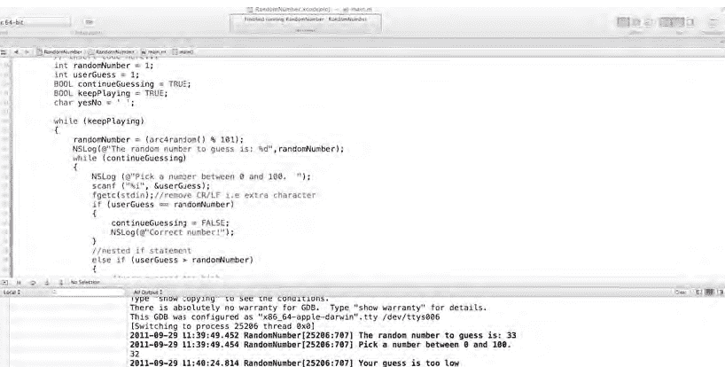

**图 4–12.** Objective-C 随机数生成器的控制台

> 注意：如果你不确定运行应用时的输出控制台，请确保你已经在编辑器右上角和右下选择了相同的选项（灰色显示）(参见图 4–12)。

## 离开 Alice 继续前进

你已经使用 Alice 学习了面向对象编程。它让你能够关注 OOP 概念，而无需处理语法和编译器；然而，有必要更加熟悉 Objective-C 语言的细节。Alice 很好地帮助了你，你现在可以在剩余部分关注使用 Objective-C 和 Xcode。

## 总结

在本章中，你涵盖了关于如何控制应用程序的重要信息；程序流程和决策对于每个 iPhone/iPad/Mac 应用都至关重要。确保你已经完成了本章中的 Objective-C 示例。你可能会回顾这些示例并在无需编写该应用的情况下理解一切。这将是一个阻止你成为成功的 iPhone/iPad/Mac 开发者的致命错误。你必须花时间编写这个示例。

本章中的术语非常重要。你应该能够描述以下内容：

- AND
- OR
- XOR
- NAND
- NOR
- NOT
- 真值表
- 否定
- 所有比较运算符
- 需求
- 逻辑与 (&&)
- 逻辑或 (||)
- 流程图
- 循环
- 受控制的循环
- For 循环
- 条件控制循环
- 无限循环
- While 循环
- 嵌套 if 语句
- 代码重构


## 练习

- 扩展随机数生成器程序，在控制台中打印用户在猜中正确随机数之前尝试了多少次。请在 Alice 和 Objective-C 中实现这一功能。
- 扩展随机数生成器程序，在控制台中打印用户运行该程序的次数。在用户退出程序时打印此值。请在 Alice 和 Objective-C 中实现这一功能。

# 第 5 章

# 使用 Objective-C 进行面向对象编程编程

在过去的 15 年里，编程世界一直专注于面向对象编程（OOP）的开发范式。绝大多数现代开发环境和语言都实现了 OOP。简单来说，OOP 是你今天开发的所有内容的基础。

你可能会问自己，既然 OOP 是如今主要的开发风格，为什么我们一直等到第 5 章才介绍 Objective-C 中的 OOP呢？简单的答案是，对于新开发者来说，这并不是一个容易理解的概念。我们将在本章中详细介绍 OOP 的不同方面以及它将如何影响你的开发。

在应用程序中正确实现 OOP 需要进行一些前端规划，但你将在项目的整个生命周期内节省大量时间。OOP 改变了开发的方式。在本章中，我们将看看 OOP 是什么。OOP 在本书的第一章中已经讨论过，但我们在这里进行更详细的探讨。我们将重新回顾什么是对象以及它们如何与我们世界上物理的对象相关。我们还将研究什么是类以及它们如何与对象相关。我们将讨论在规划类时需要采取的步骤，以及你可以用来完成此任务的一些视觉工具。当你阅读本章并完成练习后，你将更好地理解 OOP 是什么，以及为什么它对开发者来说是必要的。

起初，对象和面向对象编程可能看起来很难理解，但希望随着本章的深入，它们会开始变得有意义。

## 对象

正如第 1 章所讨论的，OOP 是基于对象的。我们关于对象的讨论中将会有回顾，我们也将进入更深层次的内容。对象是任何可以被操作的东西。为了更好地解释什么是编程对象，我们首先来看我们周围物理世界中的一些物品。物理对象可以是你周围任何你可以触摸或感受到的东西。以电视机为例。电视机的一些特征包括类型（等离子屏、LCD 或 CRT）、尺寸（40 英寸）、品牌（索尼、Vizio）、重量和成本。电视还有功能。它们可以开启或关闭。你可以切换频道、调节音量并改变亮度。

这些特征和功能有些是电视机独有的，有些则不是。例如，你家里的沙发可能与电视机具有相同的特征。你可能需要关于沙发的不同信息，例如材质、座位容量和颜色。沙发可能只有几个功能，例如变成床。

现在让我们专门谈谈与编程相关的对象。对象是一个特定的项目。它可以描述某些物理实体，如书，也可以是像你应用程序的窗口之类的东西。应用程序具有属性（properties）和方法（methods）。属性描述有关对象的信息，如位置、颜色或名称。相反，一个示例电视机会有类型、尺寸等属性，而沙发将会有材质和舒适度等属性。在编程术语中，属性是对象的一部分变量。例如，电视机会有一个字符串变量来存储品牌，有一个整数来存储高度。

对象还拥有程序员可以使用来控制它们的命令。这些命令被称为方法。方法是其他对象与特定对象交互的方式。例如，对于电视机来说，遥控器上的任何按钮都是一个方法。这些按钮中的每一个都代表了你与电视交互的一种方式。方法可以并且被用于更改属性的值，但方法本身不存储任何值。

正如我们在第 1 章中描述的那样，对象具有状态（state），这基本上是对象在任何给定时间点的快照。状态就是对象在某一时刻的快照……（注：此处原文似乎在此处中断，翻译已至原文结束）。

## 什么是类？

（此处由于原文提供的文本结束，未提供后续内容）


| 客户 | 名字 | 姓氏 | 地址行 1 | 地址行 2 | 城市 | 州 | 邮编 | 电话号码 | 电子邮件地址 | 最喜欢的书籍类型 |
| :--- | :--- | :--- | :--- | :--- | :--- | :--- | :--- | :--- | :--- | :--- |

**图 5–3.** 客户类

你还会注意到我们是如何将地址拆分为不同的部分，而不是将它们分在一起。我们将地址行 1、地址行 2、城市、州和邮编分开了来。这非常重要，并将用于你的应用程序中。让我们回到你想要给客户发送的一封关于商店促销的信上。你可能不想把信发给住在不同州的所有客户。通过分离地址，你可以轻松过滤掉那些你不想包含在邮件中的客户。

我们还向 `Customer` 类添加了“最喜欢的书籍类型”属性。我们添加此属性是为了展示你如何在每个类中保留许多不同类型的信息。如果你有新书出版，并想发送电子邮件提醒那些对小说特别感兴趣的客户，这个字段可能会派上用场。通过存储这类信息，你将能够针对客户类的不同部分进行特定定位。

为了创建我们的书店，`Book` 类也是必要的（见图 5–3）。我们将存储有关书籍的信息，如作者、出版者、类型、页数和版本号（以防有多个版本）。`Book` 类还会有书籍的价格。

| 作者 | 出版者 | 体 类型 | 出版年份 | 页数 | 版本 | 价格 |
| :--- | :--- | :--- | :--- | :--- | :--- | :--- |

**图 5–4.** 书籍类

我们还添加了另一个名为 `Sale` 的类（见图 5–5）。这个类比我们讨论过的其他类更抽象，因为它不描述一个实体对象。你会注意到我们是如何在 `Sale` 类中添加对客户和书籍的引用的。因为 `Sale` 类将跟踪书籍的销售情况，我们需要知道卖的是哪本书，以及卖给了哪个客户。

| 客户 | 书籍 | 日期 | 时间 | 金额 | 支付类型 |
| :--- | :--- | :--- | :--- | :--- | :--- |

**图 5–5.** 销售类

现在我们已经规划了类的属性，我们需要查看每个类将拥的一些方法。

## 方法规划

我们不会添加所有的方法，但你在开始时做的规划越详细，后续的操作就越容易。并不是你所有的类都有很多方法。有些类可能一个方法也没有。

> 注意：在规划方法时，记住让它们专注于某个特定的任务。方法越具体，它就越可能被重用。

目前，我们不会向 `Book` 类或 `Bookstore` 类添加任何方法。我们将关注另外两个类。

对于 `Customer` 类，我们将添加方法来列出你客户的购买历史。未来你可能还需要添加其他方法，但我们现在只添加一个。你完成的 `Customer` 类图应该看起来像图 5–6。你会注意到底部的线条，将属性与方法隔离开来。

| 客户 | 名字 | 姓氏 | 地址行 1 | 地址行 2 | 城市 | 邮编 | 电话号码 | 电子邮件地址 | 最喜欢的书籍类型 | 列出购买历史 |
| :--- | :--- | :--- | :--- | :--- | :--- | :--- | :--- | :--- | :--- | :--- |

**图 5–6.** 完成的客户类

对于 `Sale` 类，我们添加了三个方法。我们添加了“信用卡扣”、“打印发票”和“结账”（见图 5–7）。目前，你不需要知道如何实现这些方法，但你需要知道你正计划将它们添加到你的类中。

# 第 5 章：使用 Objective-C 进行面向对象编程

| 销售 | 客户 | 书籍 | 日期 | 时间 | 金额 | 支付类型 | 信用卡扣 | 打印发票 | 结账 |
| :--- | :--- | :--- | :--- | :--- | :--- | :--- | :--- | :--- | :--- |

图 5–7. 你将要规划的类和方法的完整映射

现在你已经向它们添加了，你拥有了统一建模语言 (UML) 图的雏形。
基本上，这是开发者用于规划他们的类、属性和方法的图表。通过创建这样的图表开始你的开发过程，从长远来看对你将很大帮助。对 UML 图的深入讨论超出了本书的范围。如果你对这个主题有更多信息，smartdraw.com 有了关于它们的很好的深度概述。

```
http://www.smartdraw.com/resources/tutorials/uml-diagrams/
```

图 5–8 显示了完整的图表。

| 书店 | 客户 | 名字 | 书籍 | 地址1 | 日期 | 地址2 | 时间 | 城市 | 金额 | 州 | 支付类型 | 邮编 | 信用卡扣 | 电话号码 | 打印发票 | 标志 | 结账 |
| :--- | :--- | :--- | :--- | :--- | :--- | :--- | :--- | :--- | :--- | :--- | :--- | :--- | :--- | :--- | :--- | :--- |

| 书籍 | 客户 | 作者 | 名字 | 出版者 | 姓氏 | 类型 | 地址行 1 | 出版年份 | 地址行 2 | 页数 | 城市 | 版本 | 州 | 价格 | 邮编 | 电子邮件地址 | 最喜欢的书籍类型 | 列出购买历史 |
| :--- | :--- | :--- | :--- | :--- | :--- | :--- | :--- | :--- | :--- | :--- | :--- | :--- | :--- | :--- | :--- | :--- | :--- | :--- |

图 5–8. 完成的类和方法规划

现在你已经向它们添加了，你拥有了统一建模语言 (UML) 图的雏形。
基本上，这是开发者用于规划他们的类、属性和方法的图表。通过创建这样的图表开始你的开发过程，从长远来看对你将很大帮助。对 UML 图的深入讨论超出了本书的范围。如果你对这个主题有更多信息，smartdraw.com 有了关于它们的很好的深度概述。


# 第 5 章：使用 Objective-C 进行面向对象编程

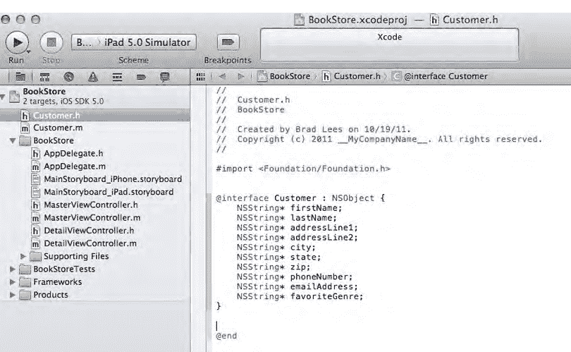

图 5-14 带有属性的 customer 类接口

现在 @interface 部分完成后，我们需要添加方法。方法需要放在 @interface 部分之外，但仍需保留在头文件的 @interface 内部。我们将添加一个返回 `NSArray` 的新方法。代码如下所示：

`-(NSArray*) listPurchaseHistory;``

> 注意：NSString 是一个持有字符串并对字符串执行操作的类。字符串是字符的集合。NSString 可以包含字母、数字和标点符号。

创建我们的类，在头文件中需要做的只有这些。图 5–15 显示了最终的头文件。在下一章中，我们将详细介绍实现文件。

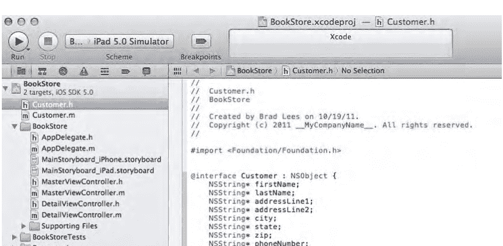

图 5-15 完成的 customer 类头文件

## 继承

面向对象编程（OOP）的另一个主要特性是继承。编程中的继承类似于遗传。你可能从母亲那里继承了眼睛颜色，从父亲那里继承了头发颜色，反之亦然。类也可以以类似的方式从父类继承属性和方法。在 OOP 中，父类被称为超类（superclass），子类被称为（subclass）。

在 Objective-C 中，程序员创建的所有类都有一个类似于父类的超类。该类将从该父类继承特征。因此，就像所有其他 OOP 语言一样，类都是父类的子类。在 Objective-C 中，大多数情况下，你的类都是 NSObject 的子类。在我们之前的示例中，Customer 类就是 NSObject 的子类。

例如，我们可以创建一个印刷材料类，并使用书籍、杂志和报纸作为其子类。印刷材料有许多共同点，因此我们可以将变量分配给印刷材料的超类，而无需在每个类中重复地添加它们。通过这样做，我们进一步减少了你编写和调试所需的代码量。

在图 5-16 中，我们将看到 Printed Material 超类的属性布局，以及这将如何影响 Book、Magazine 和 Newspaper 的子类。Printed Material 类的属性将被子类继承，因此没有必要显式定义它们。

| Printed Material | 属性 |
| :--- | :--- |
| Book | 作者 |
| Magazine | 版次 |
| Newspaper | 标题 |
| | 页数 |
| | 价格 |
| | 出版社 |
| | 期数 |

图 5-16

## 为什么要使用 OOP？

在本章中，我们讨论了什么是 OOP，并讨论了如何创建类和对象。然而，讨论你为什么要使用 OOP 是重要的。如果你看看 Objective-C、C++、Swift 和 Java 等流行编程语言，它们都要求你成功理解类和对象。你今天进行的任何开发都要求你理解面向对象的原则。

## 消除冗余代码

通过使用对象，你可以减少需要编写的代码量。如果你在一个类中编写了打印收据的代码，你就不需要再次编写这段代码。这不仅节省了时间，而且通常帮助你消除错误。如果不使用 OOP，你面临接口行为不一致的风险，即使是一个微小的变化也是如此。

## 便于调试

通过将所有与书籍相关的代码放在一个类中，当出现问题时，你知道去哪里查找。对于小型应用程序，这听起来可能没什么什么，但当你的应用程序达到数十万甚至数百万行代码时，它将为你大量时间。

## 便于替换

如果你将所有代码都放在一个类中，那么随着应用程序的变化，你可以为新类提供完全不同的功能，同时它与应用程序的其他部分以相同的方式进行交互。这类似于零件；如果你想更换一个项目，不需要从头开始。如果你的代码散落在各地，更改项目将变得困难得多。

## 高级主题

在本章中我们讨论了 OOP 的基础知识，但还有其他对你的理解非常重要的话题。

## 接口

正如我们在本中所讨论的，其他对象相互交互的方式是通过方法。我们讨论了创建类时生成的头文件。这通常被称为接口（interface），因为它告诉其他对象如何与你的对象交互。在整个应用程序中实现标准接口允许你的代码以类似的方式与不同的对象交互。这将显著减少需要编写的特定对象代码。

## 多态

多态是一个类的对象能够表现为另一个类的对象的能力。这通常通过创建与另一个类相似的方法和属性来实现。我们一直使用的多态的一个绝佳例子是书店。在书店中，我们有三个类：Book、Magazine 和 Newspaper。如果我们想对整个库存进行大促销，我们可以遍历所有的书籍并对其打折，然后遍历所有的杂志并打折。那样工作量比我们需要的要多。更好的方法是确保所有类都有一个折扣方法（markdown method）。我们可以在所有需要的对象上调用该方法，无论它们是哪个类，只要它们是包含所需方法的类的子类即可。这将节省大量的时间和编码。

在你规划类时，寻找可能适用于多种类型类的相似之处和方法。从长远来看，这将节省你的时间并加快程序的运行。

## 总结

我们终于到达本章的末尾！以下是所涵盖内容的总结。

- 面向对象编程 (OOP)
  - 我们讨论了 OOP 的重要性以及所有现代代码都应该使用这种方法论的原因。
- 对象
  - 你学习了对象以及它们如何与现实世界对象对应。我们了解到许多编程对象直接对应现实世界对象。你还学习了不对应现实世界的抽象对象。
- 类
  - 你学习了类决定了每个对象将拥的数据类型（属性）和方法。每个对象都需要一个类。它是对象的蓝图。
- 创建类
  - 你学习了如何规划我们类的属性和方法。
  - 我们使用 Xcode 创建了一个类文件。
  - 我们编辑了头文件以添加我们的属性和方法。


# 第 6 章

## Learning Objective-C 和 Xcode

大多数情况下，所有的计算机语言都执行任何计算机所需的典型任务——存储信息、比较信息、对这些信息做出决策并根据这些决策执行某些操作。Objective-C 是一种让这些任务更易理解和完成的语言。Objective-C 的真正诀窍（实际上，任何 C 语言的诀窍）在于理解用于完成这些任务的符号和关键字。本章将继续对 Objective-C 和 Xcode 进行介绍，以便你更加熟悉它们。

## Objective-C 的简史

Objective-C 是两种语言的真实结合：C 语言和一种较为人知的语言 Smalltalk。在 20 世纪 70 年代，贝尔实验室非常优秀的工程师创建了一种名为 C 的语言，这使得他们的心仪项目 Unix 操作系统很容易从一台机器移植到另一台。在 C 语言之前，人们必须用汇编编写程序。汇编语言的问题是每种语言都针对特定机器，将软件从一台机器移动到另一台几乎是不可能的。由 Brian Kernighan 和 Dennis Ritchie 创建的 C 语言解决了这一问题，它提供了一种语言，可以为其支持的任何环境写出汇编，是早期计算机语言的“罗塞塔石”。由于其可移植性，C 迅速成为许多类型计算机（尤其是早期 PC）的*事实上的*语言。

回到 20 世纪 80 年代初，C 语言正在成为该年代最流行的语言之一。大约这段时间，一位来自 Stephenson 公司的工程师将 C 语言与另一种名为 Smalltalk 的语言混合在一起。C 语言通常被称为*过程化语言*，即使用过程来划分处理步骤的语言。而 Smalltalk 则是完全不同的东西。它是一种*面向对象的编程语言*。它不是按过程处理事务，而是使用编程对象来完成工作。这种 C 语言的新超集被称为“带对象的 C”，或者更常见地称为 Objective-C。

1985 年，Brad Cox 将 Objective-C 语言和商标卖给了 NeXT Computer 公司。NeXT 是 Steve Jobs 的心血，而他在那一年刚刚从自己创立的 Apple Computer 公司被开除。NeXT 使用 Objective-C 语言构建了 NEXTSTEP 操作系统及其开发工具包。事实上，Objective-C 语言让 NeXT 的所有软件都具有竞争优势。使用 NEXTSTEP 和 Objective-C 的程序员编写程序的速度比使用传统的 C 语言更快。虽然 Next 电脑的硬件部分从未流行，但操作系统和工具成功了。有趣的是，NeXT 在 1996 年底被 Apple Computer 收购，旨在取代其老旧的操作系统（该系统自 1984 年第一台 Macintosh 诞生以来一直存在）。收购四年后，曾经的 NEXTSTEP 以 Mac OS X 的身份重新出现——Objective-C 是该系统的核心。

## 理解语言符号

尽管 Objective-C 整合了大量的面向对象语言特性，但 Objective-C 的核心是 C。以下是 Objective-C 中用到的一些符号和语言结构，其中一些是 C 语言的一部分，而大多数我们已经以某种方式遇到过。不需要知道哪些是纯 C 语言，哪些不是；只需要知道旧新新符号/结构共同构成了 Objective-C 语言即可。

- { 这是起始大括号。它用于开始通常被称为代码块（block）的内容。块用于定义和包围一段代码，并定义其作用域。
- } 这是结束大括号。它用于结束代码块。凡是有起始 { } 的地方，都必须有一个相应的结束 { }。
- - (void)methodName 这是 Objective-C 方法的定义方式。methodName 这个词当然可以代表任何名称。(void) 这个词也可以改变。它代表方法所代表的信息类型。在这个示例中，(void) 表示此方法没有关联任何数据类型（数据类型在第 3 章介绍，将在后面的章节中更深入地介绍）。(void) 可以替换为类似 (NSString*) 的内容。这将在稍后进行进一步讨论。
- * 星号（被称为 'star' 或 'splat'）用于表示所谓的指针（pointer）（见第 13 章）。现在真正需要知道的是，当你看到像 NSString* 这样的内容时，请将其视为名称的一部分。NSString 和 NSString* 是完全不同的。
- ; 分号字符用于结束一行代码。关于分号需要记住的是，它们不用于控制程序流的语句末尾，即 `if`、`for`、`while` 等。你最终会理解它们该出现以及不该出现的规则。
- [ 这些被称为中括号，用于向 Objective-C 对象发送消息。第 7 章将涵盖此主题的更多内容。
- @ 尽管许多人将其与电子邮件地址联系起来，@ 符号在 Objective-C 中用于识别 Objective-C 指令（directive）。指令是一种特殊的 Objective-C 命令，例如 @interface、@implementation 或 @property。
- # 井号（如果你喜欢听冷知识，可以叫它 octothorpe）与 @ 符号类似，用于识别 C 语言指令，例如 #import 或 #define。虽然 # 起初是 C 语言的一部分，但在几乎所有的 Objective-C 程序中仍能找到它的身影。

所以，让我们来看一个 Objective-C 代码示例：

第 #1 行表示一个 Objective-C 方法。(void) 表示此方法没有关联数据类型，如果被调用，将不会返回值。

第 #2 和 #5 行是定义代码块的大括号。

第 #3 行定义了一个 NSString* 对象并将其赋值为 @"Hello World"。记住，@ 是 Objective-C 指令，是一个常量字符串（我们在第 3 章看过字符串）。

第 #4 行是调用 NSLog 方法；打印 NSString* 对象。

对于学习 Objective-C 的人来说，这看起来有些晦涩，但这种简洁的语法不需要花费太多时间。

## 在 Objective-C 中体现“面向对象”

Objective-C 大部分特性之所以是面向对象的，是因为它基于 Smalltalk。Smalltalk 是一种完全面向对象的语言，Objective-C 大量借鉴了 Smalltalk 的概念。以下是一些来自 Smalltalk 的高级概念。如果你对这些术语感到陌生，不要担心，它们将在章节（第 7 和 8 章）中讨论。

- 几乎一切都是对象。
- 对象接收消息。在这种情况下，对象有时被称为接收者（receiver），因为它正在接收消息。
- 对象包含实例变量。
- 对象和实例变量有定义的作用域。
- 类隐藏了对象的实现。


## <Foundation/Foundation.h>

```
1 #import <Foundation/Foundation.h>
2 @interface HelloWorld : NSObject
3 {
4 }
5 
6 - (void)printGreeting;
7 
8 @end
```

这是实现部分（HelloWorld.m）：

```
10 #import "HelloWorld.h"
11 @implementation HelloWorld
12 
13 - (void)printGreeting
14 {
15 NSLog("Hello World!");
16 }
17 
18 @end
```

在前面的示例中，定义了一个名为 HelloWorld 的对象。这个对象只定义了一个消息——printGreeting。这些奇怪的符号是什么意思？以行号为参考，我们可以逐行审查这段代码。

第 1 行包含一个编译器指令 `#import <Foundation/Foundation.h>`。为了让这个小程序知道其他对象（例如第 3 行的 `NSObject`），我们需要编译器读取其他接口文件。在这种情况下，`Foundation.h` 文件定义了 Foundation 框架的对象和接口。该框架包含了 iOS 和 Mac OS 系统中非用户界面基类的定义。这里重要的是，我们得到了一个 `NSObject` 对象的定义。我们对象的实际开始于第 3 行，如下：

@interface HelloWorld : NSObject

HelloWorld 是对象，但 `: NSObject` 是什么意思？嗯，对象名称后面的冒号（`:`）表示我们计划从另一个类派生额外的功能。在这种情况下，HelloWorld 现在是 `NSObject` 的子类。

> 注意：为什么名字是 NSObject 而不是直接 Object？嗯，你还记得 Mac OS X 实际上是从 NeXTSTEP 移植而来的吗？“NS” 是 NeXTSTEP 的缩写，用于 Mac OS X 和 iOS 的许多基对象中——`NSObject`、`NSString`、`NSDictionary` 等。

第 4 行和第 5 行仅包含 `{ }` 字符。这个块用于由对象定义实例变量，但 `HelloWorld` 类足够简单，不需要实例变量。在稍后的第 9 章中，会有定义和使用实例变量的示例。

第 7 行包含了该对象的消息定义，如下：

+   - (void)printGreeting;

当你定义一个消息时，行必须以 `+` 或 `-` 字符开头。在 `HelloWorld` 对象的情况下，我们使用 `-` 表示此消息可以在对象创建后调用。`+` 字符用于可以在对象创建之前调用的消息。消息的剩余部分 `(void) printGreeting` 代表消息的返回值。在这种情况下，值 `(void)` 后面紧跟着实际的消息名 `printGreeting`。

第 9 行，`@` 表示 `HelloWorld` 接口定义完成。

这是对 `HelloWorld` 对象接口的完整描述；这里内容不多。更复杂的对象只会有更多的消息和实例变量。

第 12 行是对象实现的开始，如下：

```
@implementation HelloWorld
```

第 14 行是对象消息 `printGreeting` 的定义。它看起来与接口文件中的消息定义完全相同。这里的唯一区别是正在定义实现 `printGreeting` 消息的代码。

第 15-17 行形成了实现 `printGreeting` 消息的代码。对于这个简单的消息，调用了 `NSLog` 函数。这个底层函数接收一个格式化的 `NSString` 对象并将结果输出到控制台。`NSString` 类是一个 Objective-C 类，实现了字符字符串的行为。为什么要这个类呢？其一，它为框架提供了一个表示字符串的统一对象。此外，`NSString` 中有很多功能可以用于操纵、比较和转换实际数据。

这里使用简写方法指定了 `NSString` 对象。`@"Hello World!"` 是声明 `NSString` 对象的一种方法。符号 `@` 是用于指示所指定的字符串是一个 `NSString` 对象的符号。

第 19 行指示编译器实现部分的定义结束。

但等一下，还有更多。现在我们定义了一个新的 Objective-C 类，它是如何使用的呢？下面是另一段使用新创建的类的代码，主程序（myprogram.m）。

```
#import "HelloWorld.h"
int main(void)
{
    HelloWorld* myObject = [[HelloWorld alloc] init];
    [myObject printGreeting];

    [myObject release];
    return 0;
}
```

在新文件中，程序通过包含 `HelloWorld.h` 文件开始，这允许应用程序的这部分访问 `HelloWorld` 对象。

第 22 行，我们有主函数。记住，每个 Objective-C 程序都必须有一个 `main` 函数。

第 24 行比较复杂。它定义并实例化了 `HelloWorld` 类。你首先看到文本 `HelloWorld* myObject`。这定义了一个类型为 `HelloWorld` 的名为 `myObject` 的变量，这是我们的新类。星号 (`*`) 用于表示对象的指针。这种表示基本上意味着我们不需要对象本身；我们只需要获取它或指向它所在位置的指针。把它想象成一个给你名片的人。你有卡片，而不是本人。但名片是与某人联系的方式。

> 注意：实例化（Instantiation）创建一个真实的对象。分配（Allocation）意味着我们使用计算机内存的一部分来存储东西。在出现实例之前，类本身并不是 true可用。

行的下一部分是 `[[HelloWorld alloc] init]`。这是一个嵌套调用。`init` 消息被发送到由 `[HelloWorld alloc]` 创建的新对象。`init` 仅仅对对象进行基础初始化。这一切的最终返回是一个指向新对象的指针。

> 注意：在 Objective-C 中，每当向对象发送消息时，代码必须位于方括号 `[ ]` 内。

现在我们创建了一个新对象，就可以使用了。第 25 行 `[myObject printGreeting]` 将我们的对象投入使用。在这段代码中，我们通过发送消息 `printGreeting` 来使用我们新实例化的对象。程序将输出文本 `HelloWorld!`。

第 27 行向我们的对象发送另一个消息，`release` 消息。此消息告诉系统已完成对对象的使用，并释放与其相关的任何资源。

第 28 行向 `main` 函数的调用者返回值 0。这表示执行成功。

第 29 行结束代码块和程序。

> 注意：消息也可以接受多个参数。例如考虑 `[myCarObject switchRadioBandTo:FMAndTuneTo:104.7]`。这里的消息将是 `switchRadioBandTo:TuneTo:`。在每个冒号之后，实际发送消息时会放置参数值。你可能还会注意到这些消息的命名便于理解它们实际的作用。在开发类时，使用有帮助的消息名称是一个遵循的理想约定，因为它使得类类变得更加直观。保持消息命名的一致性也至关重要。


## 在 Xcode 中编写另一个程序

当你第一次打开 Xcode 时，你会看到图 6–1 所示的屏幕。

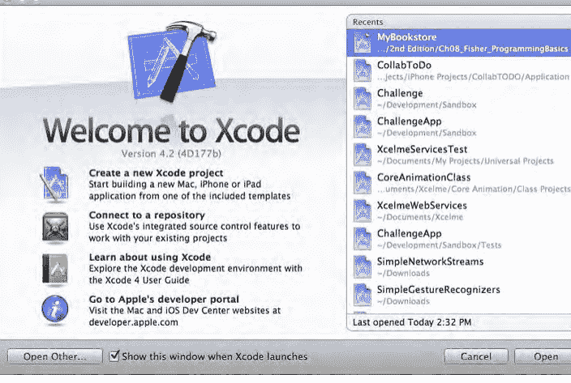

图 6–1. Xcode 启动界面

图 6–1 显示了一个在 Xcode 启动时保持显示的优秀界面。在你更熟悉 Xcode 之前，请勾选“Xcode 启动时显示此窗口”（Show this window when Xcode launches）复选框。此窗口允许你选择最近创建的项目、访问开发者文档（即“Xcode 入门”图标），并快速链接到 Apple 开发者网站。无论选择哪个文档集，它们都为初学者和高级用户提供了丰富的信息。

## 创建项目

我们将开始创建一个新项目，因此点击“创建一个新的 Xcode 项目”图标。每你想启动一个新的 iOS 或 Mac OS 应用程序、库或其他任何内容时，请使用此图标。一旦项目启动并保存，项目将出现在显示器右侧的“最近”（Recents）列表中。

对于这个 Xcode，我们将创建一个非常简单的东西。确保选择了 **iOS Application**。然后选择 **Single View Application**，如图 6–2 所示。然后只需点击“下一步”（Next）按钮即可。

# 第 6 章：学习 Objective-C 和 Xcode

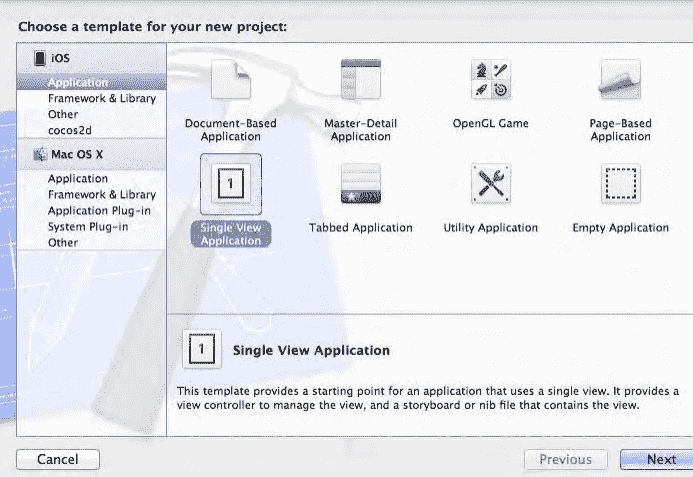

图 6-2. 从模板列表中选择新项目

有几种不同类型的模板。这些模板通过自动创建简单文件来提供起点，从而使得从头开始启动项目变得更容易。

一旦选择了模板并按下“下一步”（Next）按钮，Xcode 会向我们展示一个对话框，请求项目名称及其他信息，如图 6–3 所示。输入产品名称（Product Name）为 `MyFirstApp`。公司标识符（Company Identifier）需要有一个值，只需输入 `MyCompany` 即可。同时确保设备族（Device Family）选择设置为 iPhone。


**图 6–3.** 设置产品名称、公司和类型

**包含单元测试**Include Unit Tests）复选框可以保持默认设置。在我们的示例中，没有勾选它。对于这个示例，是否勾选并不重要。提供所有信息后，点击“下一步”（Next）按钮。Xcode 将询问你将项目保存在哪里。你可以将其保存在任何地方，但桌面是一个不错的选择，因为它始终可见。此外，默认勾选了**使用自动引用计数**Use Automated Reference Counting），这是更优的¹

¹ 第 13 章涵盖了更多关于自动引用计数（ARC）的内容。

# 第 6 章：学习 Objective-C 和 Xcode

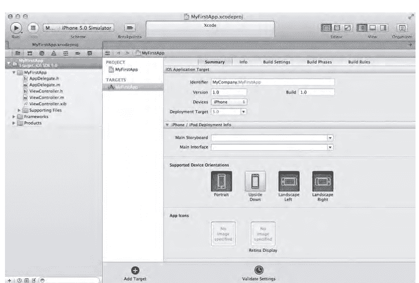

图 6–4. Xcode 4 主界面

一旦选择了项目保存位置，将显示 Xcode 主界面。最左侧窗格是源文件列表。屏幕右侧的三之二区域用于上下文敏感型编辑器。点击源文件，编辑器将显示源代码。点击 .xib（读作 zib）将显示屏幕界面编辑器。

> 注意：Xcode 4 在单个屏幕中引入了一个全新的环境，称为工作空间窗口（Workspace Window）。例如，在 Xcode 3 及更早版本中，Interface Builder——构建界面的系统——是一个独立的程序。现在，通过 Xcode 4，只需点击界面文件即可在 Xcode 4 内显示该界面。

我们的第一个应用将非常简单。这个 iPhone 应用将仅包含一个按钮。当按下该按钮时，你的名字将出现在屏幕上。因此，让我们先仔细观察 Xcode 为我们构建的一些存根代码。Xcode 的棒之处在于它会创建一个无需修改即可执行的存根应用程序。在添加一些代码之前，让我们看看 Xcode 的工具栏，如图 6–5 所示。

# 第 6 章：学习 Objective-C 和 Xcode

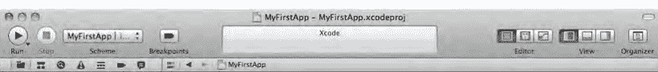

**图 6–5.** 工具栏

一眼看上去，工具栏有三个区域。左侧区域用于运行/调试应用程序。中间窗口显示编译错误/警告的状态。最右侧区域包含一组用于自定义视图的按钮。


**图 6–6.** 工具栏左侧

如图 6–6 所示，工具栏左侧部分包含一个播放（Play）按钮（类似于 iTunes），用于编译和运行应用程序。如果应用程序正在运行，停止（Stop）按钮将变为。由于它是灰色的，我们知道应用程序没有运行。方案（Scheme）和断点（Breakpoints）可以先不管。它们将在第 14 章详细讨论。

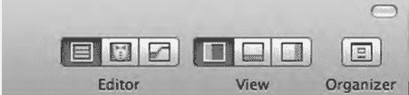

**图 6–7.** 工具栏右侧

Xcode 工具栏的右侧包含更改编辑器的按钮。三个按钮代表**标准编辑器**Standard Editor（已选择）、**助手编辑器**Assistant Editor 和**版本编辑器**Version Editor。现在，只需选择标准编辑器，如图 6–7 所示。

编辑器的右侧是一组视图选择。这些按钮可以开启或关闭。例如，图 6–7 中选中的代表当前视图，如图 6–4 所示——屏幕左侧是程序文件，剩余的三之二是主编辑器。可以选择任何组合或都不选来帮助自定义主工作区。最后一个按钮用于打开组织窗口。我们将在第 14 章更多讨论这个按钮。现在，让我们回到第一个 iPhone 应用。

# 第 6 章：学习 Objective-C 和 Xcode

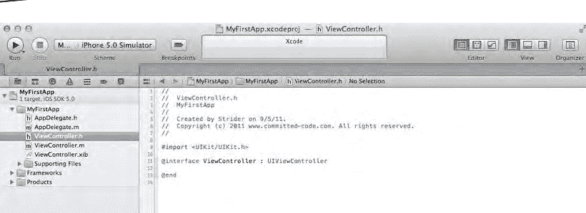

图 6–8. Xcode 编辑器中的源代码

如图 6–8 所示。编辑器显示了一些称为接口文件的 Objective-C 代码。你可以根据第 11 own @interface 指令判断它是接口文件。我们将在下一章讨论接口文件的重要性。

> 注意：现在，我们只需添加几行代码并看看它们的作用。并不要求你现在理解这些代码的意思。这只是通过操作过程来熟悉 Xcode。第 7 章将深入探讨 Objective-C 程序的组成，第 10 章将深入探讨构建 iPhone 界面。

接下来，我们将在此文件中添加两行代码，如图 6–9 所示。第 12 行定义了屏幕上的 iPhone label，可以在其中放置某些文本。第 15 行告诉编译器这是一个名为 `showName:` 的消息。我们将调用此方法来填充 iPhone label。label 只是屏幕上我们可以放置某些信息的区域。

> 警告：严格按照示例所示输入代码。例如，`UILabel` 不能写成 `uilabel` 或 `Uilab`。Objective-C 是一种大小敏感的语言，因此 `UILabel` 与 `ilab` 完全不同。

```
// ViewController.h
// MyFirstApp
//
//
// Created by Strider on 9/5/11.
// Copyright (c) 2011 www.committed-code.com. All rights reserved.
//
//
#import <UIKit/UIKit.h>
@interface ViewController : UIViewController
    IBOutlet UILabel *nameLabel;

@end
-- (IBAction)showName:(id)sender;
@end
```

图 6–9. 添加到 ViewController.h 接口文件的代码

接下来我们将添加代码让消息 showName: 执行些什么。首先，点击一次左侧的 ViewController.m 文件。该文件是一个实现文件。你可以根据第 11 行的 @implementation Objective-C 指令判断它是实现文件，如图 6-10 所示。

```
// ViewController.m
// MyFirstApp
//
//
// Created by Strider on 9/5/11.
// Copyright (c) 2011 www.committed-code.com. All rights reserved.
//
//
#import "ViewController.h"
@implementation ViewController
-(void)didReceiveMemoryWarning
{
    [super didReceiveMemoryWarning];
    // 释放任何未使用的缓存数据、图像等。
}
@end
```


图 6-10. ViewController.m 实现文件

注意第 11 行有一个警告符号。点击该警告将显示警告信息：“不完整的实现”（Incomplete Implementation），这基本上意味着我们在接口文件中提到了一个新消息，但尚未添加到实现文件中。

图 6–11 是更新后的实现文件。


```
// ViewController.m
// MyApp
// Created by Strider on 9/5/11.
// Copyright (c) 2011 www.committed-code.com. All rights reserved.
//

#import "ViewController.h"

@implementation ViewController

-(void)didReceiveMemoryWarning {
    [super didReceiveMemoryWarning];
    // Release any changed data, images, that aren't in use.
}
- (IBAction)showName:(id)sender {
    [nameLabel setText:@"My name is Itch!"];
}
```

**图 6-11.** 添加到 ViewController.m 实现文件中的代码

一旦添加了如图 6-11 所示的第 #19-22 行，警告消息就会消失。Xcode 4 的好之处在于，它可以在不需要先编译和运行程序的情况下，报告输入代码中出现的任何警告或错误。这种即时反馈有时会让人很恼，但它确实节省了时间。

我们现在已经准备好了必要的代码，但在 iPhone 上还没有界面。接下来，我们将编辑界面并向我们的应用程序添加两个接口对象。

为了编辑 iPhone 的界面，我们需要点击一次 ViewController.x 文件。.nib 文件包含了关于单个窗口或视图的所有信息。具有多个视图的应用程序将拥有多个 .nib 文件。我们将使用 Xcode 的界面编辑器将 UI 对象（例如标签）连接到我们刚刚创建的代码上。连接只需点击和拖拽那么简单。

我们不会修改 MainWindow.x 文件。在示例中，MainWindow.x 文件仅持有我们的视图，即 ViewController.x 文件。

# 第 6 章：学习 Objective-C 和 Xcode

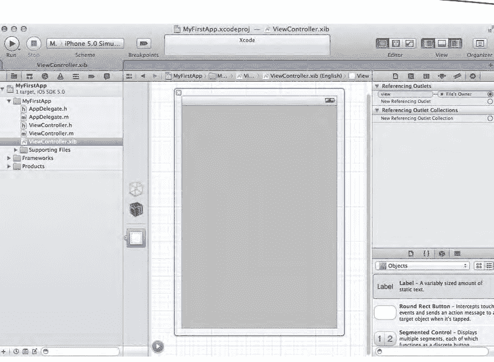

**图 6–12.** 我们将修改的 iPhone 界面

注意，我们点击了屏幕右上部分的最后一个按钮，如图 6–12 所示。这打开了界面的工具箱视图。除了其他内容，此工具箱视图向我们展示了可以在 App 中使用的各种界面对象。我们只关注前两个：**圆矩按钮（Round Rect Button）**和标签（Label）。

第一步是从工具窗口中点击一次**圆矩按钮**。接下来，将对象拖动并释放到 iPhone 视图上，如图 6-13 所示。别担心；拖动对象不会将其从工具箱视图的对象列表中移除。将其拖出会在我们的 iPhone 界面上创建该对象的新副本。

# 第 6 章：学习 Objective-C 和 Xcode

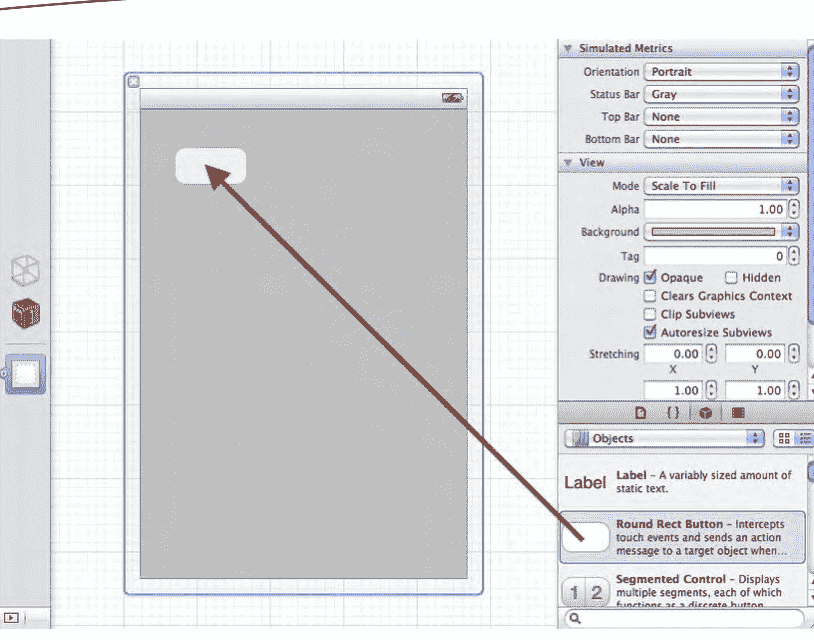 （等待，检查图像链接流）

接下来，双击刚刚添加到 iPhone 界面上的圆矩按钮。这允许将按钮标题从无更改为“Name（名称）”，如图 6–14 所示。许多不同的界面对象都是这样运行的。只需双击即可更改对象的标题。这也可以实际代码中完成，但在界面编辑器中操作要简单得多。

一旦更改了标题，拖放标签（Label）对象并将其放置在按钮正下方，如图 6–15 所示。

图 6-13. 将按钮对象移动到 iPhone 视图

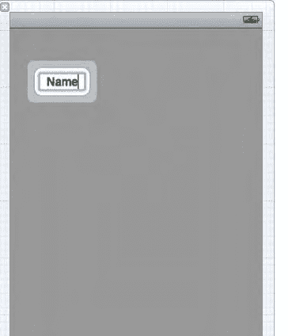

图 6-14. 修改按钮的标题

# 第 6 章：学习 Objective-C 和 Xcode

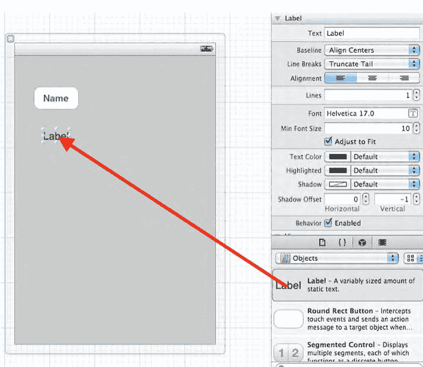

**图 6–15.** 为我们的 iPhone 界面添加标签（Label）

目前，我们可以将标签文本保留为“Label”，因为这使得在界面上很容易找到它。如果我们清除标签文本，对象仍然在那里，但标签上没有可见内容可以点击。通过向右拖动中心蓝色圆点来扩大标签的大小，如图 6–16 所示。


**图 6–16.** 扩大标签的大小

现在我们既有了按钮也有标签，我们可以将这两个视觉对象连接到我们的程序中。我们从右键点击按钮开始。这会弹出一个连接菜单，如图 6–17 所示。

# 第 6 章：学习 Objective-C 和 Xcode

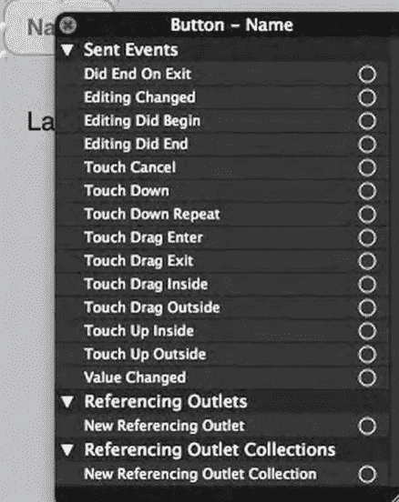

图 6–17. 按钮的连接菜单

接下来，我们从 Touch Up（触摸释放）连接拖动到 File’s Owner（文件所有者），如图 6–18 所示。Touch Up Inside 用户点击了按钮*内部*。将连接拖到文件所有者（即 ViewController 对象）会将 Touch Up 事件连接到 ViewController 对象，这样每当按下按钮时，我们的对象就会收到通知。


**图 6–18.** 将 Touch Up 事件连接到我们的对象

一旦释放连接，就会显示可以在连接中使用的方法列表，如图 6–19 所示。在我们的示例中，只有一个方法，那就是 showName:。选择 showName: 将 Touch Up Inside 事件连接到我们的对象。

# 第 6 章：学习 Objective-C 和 Xcode

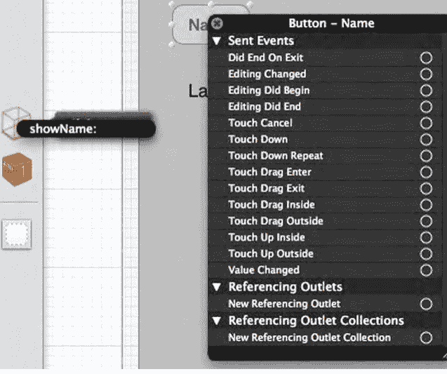

一旦建立连接，详情将显示在按钮的菜单上，如图 6–20 所示。

# 第 6 章：学习 Objective-C 和 Xcode

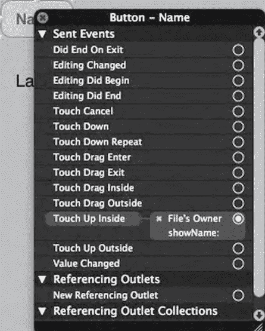

**图 6–20.** 连接现在已完成

接下来，我们为标签对象创建一个连接。在这种情况下，我们不关心标签事件；相反，我们想要将 ViewController 的 nameLabel 输出属性（outlet）连接到 iPhone 界面上的对象。这种连接基本上告诉我们的对象，我们想要设置文本的标签是 iPhone 界面上的那个。

从右键点击 iPhone 界面上的标签对象开始。这会弹出标签的连接菜单，如图 6–21 所示。标签对象的输出（outlets）没有像按钮对象那么多。

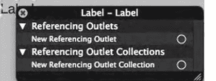

**图 6–21.** 标签对象的连接菜单

如上述，我们在这里不是为了连接事件。相反，我们连接的是被称为*引用输出（Referencing Outlet）*。这种连接将屏幕对象连接到我们 ViewController 对象中的变量。就像按钮一样，将连接拖放到 *File's Owner* 图标，如图 6–22 所示。

图 6–22. 将引用输出连接到我们的对象

一旦将连接释放到文件所有者，就会显示 ViewController 中的输出列表，如图 6–23 所示。在两个选项中，我们要选择 nameLabel。这是我们 ViewController 对象中的变量。

图 6–23. 选择我们的对象以完成连接

一旦选择了 nameLabel，我们就准备好运行程序了。点击 Xcode 窗口左角的运行按钮（见图 6–6）。这将自动保存您的文件并在 iPhone 模拟器中启动应用程序，如图 6–24 所示。通过。

# 第 6 章：学习 Objective-C 和 Xcode

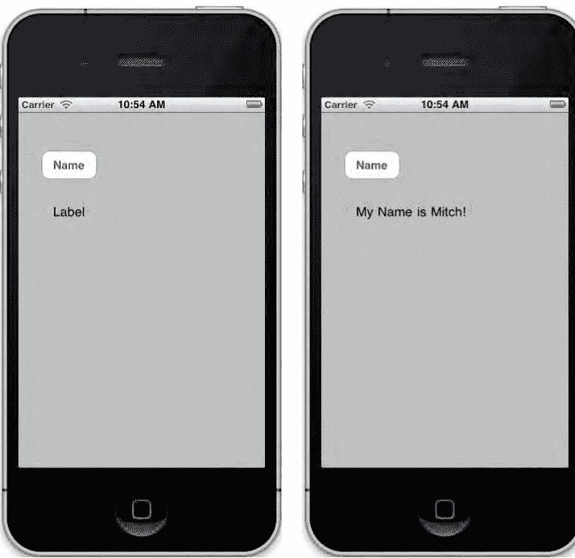

图 6–24. 我们的应用程序运行，按下按钮前后

点击 Name 按钮，标签文本将从默认值“Label”更改为“My is Mitch!”或你输入的任何值。如果你愿意，回到界面清除标签文本。

## 总结

本章中的示例非常简单，但希望它们激发了你对使用 Objective-C 和 Xcode 开发复杂应用程序的兴趣。在后面的章节中，你可以学习更多关于面向对象编程以及 Objective-C 能做什么的内容。拍拍自己，因为你已经学了很多。以下是本章讨论的主题总结：

- Objective-C 语言的起源和简单历史，
- Objective-C 中的一些常用语言符号，
- Objective-C 类示例。
- 程序的 @interface @implementation 部分，
- 进一步使用 Xcode，包括输入和编译 HelloWorld.m 源文件，以及
- 将视觉界面对象与应用程序对象的方法和变量连接。

## 练习

- 清除程序中的默认标签文本并重新运行示例。

- 修改界面上标签对象的大小，使其宽度缩小。这如何影响你的文本消息？

- 删除标签的引用输出连接并重新运行项目。会发生什么？

- 如果你觉得已经掌握了，向 ViewController 对象和界面都添加一个新的按钮和标签。将其从显示你的名字更改为显示其他内容。


# 第 7 章

## Objective-C 类、对象与方法

如果你还没有读过第 6 章，请在阅读本章之前先阅读，因为它对 Objective-C 的一些基础知识提供了很好的介绍。本章在此基础上进行了进一步扩展。在本章结束时，你可以预计自己将对 Objective-C 语言以及如何使用基础知识编写简单程序有更深入的理解。对于 Mitch 来说，学习最好的方法是通过小型程序并用 Objective-C 编写（或重写）它们，以观察这种语言是如何工作的。

本章将涵盖什么是 Objective-C 类，以及如何通过方法与 Objective-C 对象交互。我们将使用一个简单的广播电站类作为示例，展示如何编写 Objective-C 类。这希望有助于你理解如何使用 Objective-C 类。本章将教你如何为解决问题所需的对象制定设计。我们将涉及如何创建自定义对象，以及如何使用 Foundation 类提供的现有对象。

如果你来自类 C 语言背景，你会发现 Objective-C 与它们有许多相似之处。正如第 6 章所述，Objective-C 的根源深植于 C 语言。本章将扩展第 6 章的主题，并结合第 8 章描述的一些概念。

## 创建 Objective-C 类

第 6 章引入了 Objective-C 语言的一些常用元素，让我们快速回顾一下。

- Objective-C 类分为两部分：类接口（class interface）和类实现（class implementation）。
- @interface: 此关键字用于定义一个新 Objective-C 类的接口。它被写在 .h 或头文件中。

**方法（Methods）：** 这些是在类的 @interface 部分中定义的代码块，并在 .m 文件的 @implementation 部分中实现。

@implementation: 此关键字用于定义实现接口中所定义方法的实际代码。它被写在 .m 或 Objective-C 类文件中。

正如第 6 章所解释的，一个 Objective-C 对象由一个接口和一个相应的实现组成。现在，让我们集中在接口上。在最基础的层，类的接口告诉你是类的名称、它派自哪个类，以及该类能理解哪些消息（messages）。注意这里使用了“消息”一词。为了与 Objective-C 对象通信，程序将向该对象发送消息。这些消息会直接翻译为实现文件中的代码——这些实现代码被称为方法。

以下是类接口第一行的示例：

```
@interface RadioStation : NSObject
```

在这里，类名是 RadioStation。类名后的冒号 (:) 表示该类派生自另一个类；也就是说，RadioStation 对象继承了 NSObject 类的功能。换句话说，在我们列表 7–1 所示的示例中，RadioStation 类派自 NSObject 类。

> 提示：如果你的对象没有继承自任何其他基础类，请务必继承自 NSObject：没有它，你的类将毫无用处。NSObject 提供了让新对象能够正常运行的基础函数。NSObject 是所有基础类的基类。因此，继承任何基础类也是可以的。

一旦定义了类名，接口文件的其余部分包含了类的主要组件（见列表 7–1）。

# 列表 7–1. 一个接口文件：RadioStation.h

```
1  #import <Foundation/Foundation.h>
2  @interface RadioStation : NSObject
3  {
4      NSString *name;
5      double frequency;
6      NSInteger band;
7  }
8  
9  + (double)minAMFrequency;
10 + (double)maxAMFrequency;
11 + (double)minMFrequency;
12 + (double)maxMFrequency;
13  
14 - (id)initWithName:(NSString *)newName
15     frequency:(double)newFrequency;
16 - (NSString *)name;
17 - (void)setName:(NSString *)newName;
18 - (double)frequency;
19 - (void)setFrequency:(double)newFrequency;
22 @end
```

## 接口与实例变量

Objective-C 类是由其**接口（interface）**定义的。由于对象大部分是通过消息进行通信的，因此对象的接口定义了对象将响应哪些消息。第 #1 行导入了 Foundation 类定义（关于这部分后文详述）。第 2–7 行通过定义类的名称（有时称为**类型/type**）和继承的类开始定义类的接口。接下来，是一个在大括号 ({ }) 内部定义的块。该块用于定义由该类的**实例（instance）**使用的变量。这些被称为**实例变量（instance variables）**。

每当实例化 RadioStation 类时，生成的 RadioStation 对象就可以访问这些变量，而这些变量仅属于特定的实例。如果有十个 RadioStation 对象，每个对象都有自己的变量，且与其他对象相互独立。这也被称为*作用域 (scope)*，因为对象的变量位于每个对象的作用域内。

## 发送消息（方法）

每个对象都有方法。在 Objective-C 中，与对象交互常用的概念是向对象发送消息：

```
[myStation frequency];
```

上一行将向名为 myStation 的 RadioStation 类实例发送消息。在我们的示例中，myStation 被称为接收者（receiver），因为它接收了消息。消息（在我们前一个示例中的 frequency）用于选择方法。这些方法名称被称为**选择器（selectors）**。

如果一个类不理解某条消息，它就会被传递给它的父类；在这种情况下是 NSObject。这种行为被称为动态绑定（dynamic binding），意味着方法是在运行时而不是编译时找到的。动态绑定允许 Objective-C 程序在运行时对变化做出反应——这是 Objective-C 优于其他语言的巨大优势之一。

消息还可以带有参数。为什么要传递参数？传递参数有几个原因。首先（也是最常见的），可能范围太大，无法拆分成不同的方法。你需要存储在对象中的数据是多变的——例如广播电站。在这个示例中，你会发现，为每个可能的广播频率编写一个方法是不现实的；相反，频率作为参数传递的。电站名称也是如此。

```
[myStation frequency:104.7];
```

消息是 frequency::。冒号表示消息需要一个参数。消息可以有多个参数，如下例所示：

```
myStation = [[RadioStation alloc] initWithName:"KZZP" atFrequency:104.7];
```

我们感兴趣的消息是

```
initWithName:atFrequency;
```

理解消息以及它的结构方式非常重要，特别是当你实际实现代码时。在你的代码中，你需要确保实现了 `initWithName:atFrequency:` 方法；否则程序将无法工作。

## 使用类方法

类并不一定实例化就可以使用。在某些情况下，类方法实际上可以执行某些操作并返回值。


# 第 7 章：Objective-C 类、对象与方法

这些方法被称为类方法。在列表 7–1 中，以加号 (+) 开头的方法是类方法——所有类方法必须以 + 号开头。

类方法具有局限性。它们最大的局限性之一是无法使用任何实例变量。嗯，从技术上讲，Xcode 允许在类方法中编写实例变量。代码可以编译但会带有警告，不过访问或使用实例变量将不起任何作用——只要不要这样做即可。无法使用实例变量是合逻辑的，因为我们还没有实例化。类方法可以在方法内部拥有它自己的局部变量，但不能使用任何定义为实例变量的变量。

类方法的调用看起来如下所示：

```
[RadioStation minFrequency];
```

请注意，这种调用与向已实例对象传递消息非常相似。主要的区别在于，使用的是类名而不是实例变量。类方法在 Mac OS 和 iOS 框架中被广泛使用。它们主要用于返回某些固定的或已知类型的值，或者返回对象的新实例。这些类型的类有时被称为工厂方法，就像工厂一样，它们创建新东西；在这种情况下，是类的一个新实例。这里有一个工厂方法的示例：

1. [NSDate intervalSinceDate]; // 返回一个数字
2. [NSString stringWithFormat:@"%d", 1000]; // 返回一个新的 NSString 对象
3. [NSDictionary alloc]; // 返回一个新的未初始化的 NSDictionaryObject。

上述所有值都是类方法调用的。

第 1 行返回一个表示自 2001 年 1 月 1 日以来秒数的值，该日期是参考日期。

第 2 行返回一个新的 NSString 对象，该对象经过了格式化且值为 1000。

第 3 行是一种常用的形式，因为它分配了一个新对象。通常，该行代码不会单独使用，而是在一行中，例如：

```
myDict = [NSDictionary alloc init];
```

前面的调用是一个复合方法。[NSDictionary alloc] 类方法返回一个新的 NSDictionary 对象。init 消息被发送给 NSDictionary，它在类内部用于初始化它（例如，设置实例变量）。该函数将新对象返回给调用者。

那么，什么时候该使用类方法呢？作为一个一般规则，如果方法返回的信息**不属于**该类的任何特定实例，就把它设为类方法。例如，在前面的示例中，minFrequency 对于 RadioStation 对象的**所有**实例都是相同的——这是类方法的极佳候选者。然而，电台的名称或其分配的频率对于类的每个实例来说都是不同的。这些不应该（实际上也无法）作为方法。其原因为，类方法无法使用由类定义的任何实例变量。

# 使用实例方法

实例方法（列表 7–1 中的第 15–20 行）是只有在类被实例化后才可用的方法；例如：

```
1 RadioStation *myStation // 这声明了一个变量来持有 RadioStation 对象。
2 myStation = [[RadioStation alloc] init]; // 这创建一个新对象并将其放入我的变量中。
3 [myStation setStationFrequency:104.7]; // 这设置 myStation 对象的频率。
4 double f = [myStation frequency] // 这个实例方法返回当前频率。
```

第 3 行和第 4 行向 RadioStation 对象发送消息；第 3 行调用设置频率的方法，第 4 行则获取它。频率存储在对象的 frequency 实例变量中。此外，实例方法可以访问在类接口声明部分定义的实例变量。所有实例方法必须以连字符 (-) 开头；这很容易将它们与使用加号 (+) 的类方法区分开。

# 处理实现文件

现在你已经看过了接口文件的样子，让我们来看实现文件。首先，接口文件具有 .h 扩展名；RadioStation.h——如列表 7–2 所示的 RadioStation.m。另一个需要注意的重要点是，接口文件和实现文件的文件名相同（不包括扩展名）。这种约定是通用的；虽然没有什么阻止接口文件和实现文件拥有不同的名称，但不同的名称会导致很多困惑，而且像 Xcode 这样的工具无法正常工作。例如，Xcode 快捷键 Control + Command + 上箭头 (^↑) 可以在实现文件和接口文件之间移动，如果文件名不相同，它将无法工作。

# 列表 7–2 你的实现文件部分

| | | |
|---|---|---|
| 1 | #import "RadioStation.h" | 导入接口文件 |
| 2 | | 和头文件 |
| 3 | | |
| 4 | @implementation | |
| 5 | 实现的开始 | |
| 6 | + (double)minAMFrequency { | | |
| 7 | return 520.0; | | |
| 8 | } | | |
| 9 | + (double)maxAMFrequency { | | |
| 10 | return 10.0; | | |
| 11 | } | | |
| 12 | | 方法 |
| 13 | + (double)minFFrequency { | | |
| 14 | return 88.3; | | |
| 15 | } | | |
| 16 | + (double)maxFFrequency { | | |
| 17 | return 10.9; | | |
| 18 | } | | |
| 19 | @end | | |

既然你已经看过了接口文件的样子，让我们看一下实现文件。首先，接口文件具有 .h 扩展名；RadioStation.h——如列表 7–2 所示的 RadioStation.m。另一个需要注意的重要点是，接口文件和实现文件的文件名相同（不包括扩展名）。这种约定是通用的；虽然没有什么阻止接口文件和实现文件拥有不同的名称，但不同的名称会导致很多困惑，而且 Xcode 这样的工具无法正常工作。例如，Xcode 快捷键 Control + Command + 上箭头 (^↑) 可以在实现文件和接口文件之间移动，如果文件名不相同，它将无法工作。

（注：此处由于原文文本内容重复，翻译内容已整合，表格部分已按要求处理翻译）


# 列表 7-3 实例方法的实现

```objc
1 - (id)initWithName:(NSString*)newName atFrequency:(double)newFrequency {
2 self = [super init];
3 if (self != nil) {
4 _name = newName;
5 _frequency = newFrequency;
6 }
7 return self;}
```

列表 7–3 展示了你的广播电台类中一个实例方法的实现。一个初始化方法接受一个新的名称和频率。许多 OS X 和 iOS 类都有类似的初始化实例方法。与其先初始化类然后单独设置各种值，许多许多类初始化方法允许使用特殊的初始化方法，或者在本例中，在初始化时传递多个值。

在前面的示例中，第 1 行是你方法的接口，它包含两个参数：`newName` 和 `newFrequency`。要使用此方法，调用者只需执行以下操作：

```objc
RadioStation my = [[RadioStation alloc] initWithName:@"WOW FM" atFrequency:102.5];
```

该方法还定义为返回一个 `id`。`id` 是一个通用对象，所有的 Objective-C 对象都是 `id` 类型，就像 `RadioStation` 是一个对象一样。现在，让我们来看剩余的实现。

第 2 行引用了你不需要在任何地方定义的特殊变量。关键字 `self` 用于表示“该类的此实例”，因此第 2 行正在分配“该类的此实例”——即使用特殊变量 `super init` 返回的值。关键字 `super` 是“超类”的缩写，它可以被认为是“类的父类”。任何初始化方法通常都会被认为类似于第 2 行的结构。

为什么第 2 行是必要的？嗯，如果你有一个派自另一个对象的对象（记住，类是 `RadioStation : NSObject`），你必须告诉父对象初始化它自己。父对象通过告诉它的父对象初始化它自己来执行相同的操作，直到到达顶层对象。如果另一个类使用你的类作为父类，你的代码也必须获取一个 `init` 调用，以便 `RadioStation` 可以被初始化。这是 Objective-C 现实世界中的标准问题。类在创建时需要告诉它的父类初始化它自己，每当类消失时，需要告诉父类释放它自己。

第 3 行检查 `[super init]` 调用是否成功。如果成功，`self` 的值将是 `nil` 以外的值，这个值实际上意味着“未初始化”。

第 4 行和第 5 行将该类的实例变量设置为传入此方法的值。

第 8 行将 `self` 返回给调用者。就像调用 `[super init]` 一样，你的初始化函数需要将新对象返回给调用者。

# 使用新类

你创建了一个简单的 `RadioStation` 类，但单靠它并不能做什么。在这一节中，你将创建一个类并维护一个 `RadioStation` 类列表。

# 创建你的项目

启动 Xcode（见图 7–1）并创建一个名为 RadioStations 的新项目。

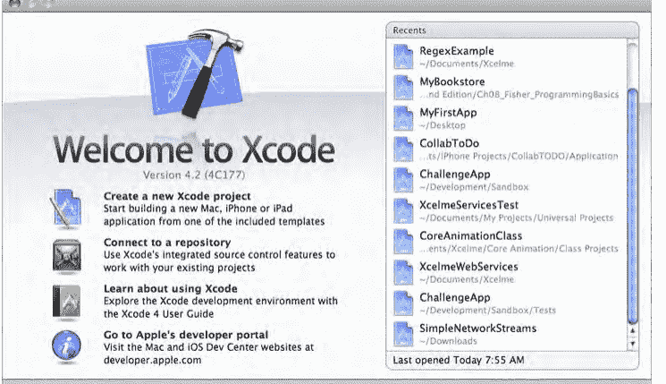

图 7–1. 打开 Xcode 以便创建新项目。

- 1. 确保你选择了 iOS application 并选中了 Single Application 模板，如图 7–2 所示。
- 2. 选中模板后，点击 Next 按钮。

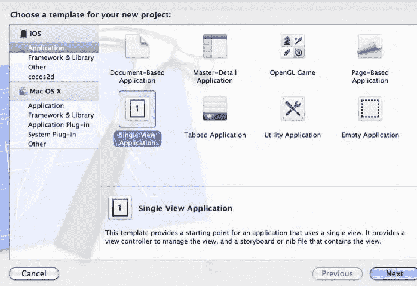

**图 7–2. 在新项目窗口中选择模板**

- 3. 接下来，将 Product Name（应用程序名称）设置为 RadioStations。
- 4. 设置 Company Identifier（用一个虚拟公司即可）并将 Device Family 设置为 iPhone（如图 7–3 所示）。同时，确保勾选了“Use Automatic Reference Counting”。

# 第 7 章：Objective-C 类、对象和方法

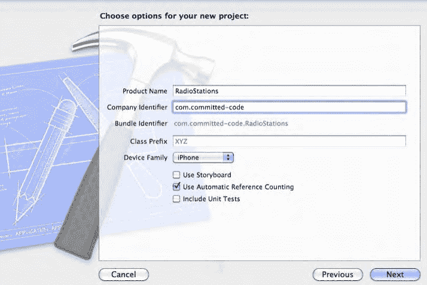

图 7-3. 为新的 iPhone 应用程序命名

- 5. 点击 Next 按钮，Xcode 会问你想将新项目保存在什么位置。你可以将项目保存在桌面上或 Home 文件夹的任何地方。我喜欢桌面，因为它容易找到。一旦你做出选择，只需点击 Create 按钮。
- 6. 一旦点击 Create 按钮，Xcode Workspace 窗口应该是可见的，如图 7–4 所示。

# 第 7 章：Objective-C 类、对象和方法

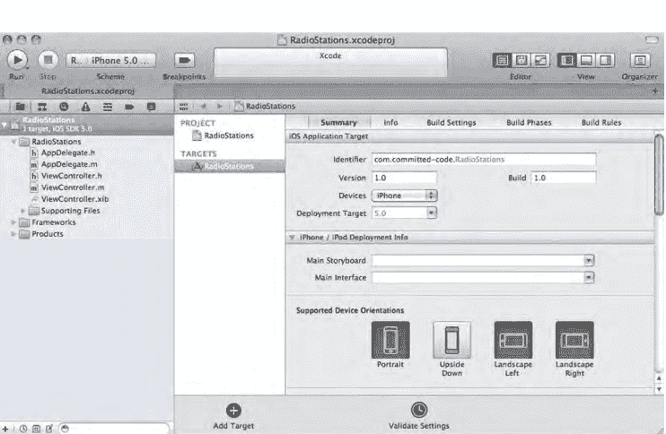

# 添加对象

现在，你可以添加新对象了。

- 1. 首先，创建你的 `RadioStation` 对象。右键点击 RadioStations 组文件夹并选择 New File...（如图 7–5 所示）。


- 2. 下一个屏幕（如图 7–6 所示）询问新的文件类型。只需从 Cocoa Touch 组选择 Objective-C class，然后点击 Next。


**图 7–6.** 选择新的文件类型

- 3. 在下一个屏幕上，输入“RadioStation”作为类名，并选择 NSObject 作为“Subclass Of”。这意味着你的新类将是 NSObject 的子类，如图 7–7 所示。

# 第 7 章：Objective-C 类、对象和方法


图 7–7. 选择你新对象的子类

- 4. 下一个屏幕询问你要在哪里创建文件。只需点击 Create 按钮即可，因为 Xcode 选择保存文件的位置在当前项目内部，如图 7–8 所示。


图 7–8. 选择创建文件的位置

- 5. 你的项目窗口现在应该像图 7–9 所示。


图 7–9. 你的项目窗口

# 编写实现

RadioStation.h 现在定义了实例变量、类方法和实例方法。让我们进入实现文件。

- 1. 你在此使用的实现文件相对于我们的示例进行了简化，但它可以完美运行我们的电台模拟。
- 2. 你的项目窗口现在应该像图 7–10 所示。


图 7–10. 实现

- (id)initWithName:(NSString*)newName atFrequency:(double)newFrequency {
    self = [super init];
    if (self != nil) {
        _name = newName;
        _frequency = newFrequency;
    }
    return self;
}
- (NSString *)name {
    return _name;
}
- (void)setName:(NSString *)newName {
    _name = newName;
}
- (double)frequency {
    return _frequency;
}
- (void)setFrequency:(double)newFrequency {
    _frequency = newFrequency;
}

```

# 列表 7–4 TheStation 实现文件

```objc
#import "RadioStation.h"

@implementation RadioStation

- (id)initWithName:(NSString*)newName atFrequency:(double)newFrequency {
    self = [super init];
    if (self != nil) {
        _name = newName;
        _frequency = newFrequency;
    }
    return self;
}

- (NSString *)name {
    return _name;
}

- (void)setName:(NSString *)newName {
    _name = newName;
}

- (double)frequency {
    return _frequency;
}

- (void)setFrequency:(double)newFrequency {
    _frequency = newFrequency;
}

@end
```

# 列表 7–5 更新后的 ViewController.h 接口文件

```objc
#import <UIKit/UIKit.h>

@class RadioStation;

@interface ViewController : UIViewController {
    RadioStation *myStation;
    IBOutlet UILabel* stationName;
    IBOutlet UILabel* stationFrequency;
    IBOutlet UILabel* stationBand;
}
@end
```

# 列表 7–6 ViewController.m 文件

```objc
#import "ViewController.h"

@implementation ViewController

- (void)viewDidLoad {
    [super viewDidLoad];
    // 初始化代码将放在这里
}

@end
```


## 列表 7–5. 分配你的 RadioStationObject

```objc
1 #import "ViewController.h"
2 #import "RadioStation.h"
3 
4 @implementation ViewController
5 -
6 - (void)didReceiveMemoryWarning
7 {
8     [super didReceiveMemoryWarning];
9     // 释放任何未使用的缓存数据、图像等。
10 }
11 
12 #pragma mark - View lifecycle
13 
14 - (void)viewDidLoad
15 {
16     [super viewDidChange];
17     // 在加载视图（通常来自 nib）后不要进行额外设置。
18     myStation = [[RadioStation alloc] initWithName:@"STAR 94" atFrequency:94.1];
19 }
```

第 #2 行是导入 RadioStation 对象的语句。

第 #18 行和 #19 行分配了一个新的 RadioStation 对象并将其存储在你的新实例变量 `myStation` 中。

## 创建用户界面

接下来，必须设置主窗口以显示你的电台信息。

- 1. 首先，点击图 7–10 所示的 ViewController.xib 文件。此文件是 iPhone 的主屏幕。

# 第 7 章：Objective-C 类、对象与方法


图 7–10. 在 iPhone 屏幕上添加 Label 对象

- 2. 如图 7–11 所示，将三个 Label 对象拖放到屏幕上。标签可以以任何方式对齐，或者如图 7–11 所示进行排列。
- 3. 然而，你需要空间。一旦 Label 对象位于 iPhone 屏幕上，双击 Label 对象以更改其文本，使 iPhone 屏幕看起来像像图 7–11 所示。


- 4. 接下来，在屏幕上添加一个 Round Rect Button 对象，如图 7–12 所示。此按钮在按下时，将导致屏幕更新你的电台信息。

# 第 7 章：Objective-C 类、对象与方法


图 7–12. 在屏幕上添加按钮

- 5. 就像 Label 对象一样，只需双击 Rect Button 对象即可将其 Title（标题）更改为 My Station。
- 6. 接下来，你需要添加用于存储电台信息的 Label 字段。这些字段位于现有标签之后，如图 7–13 所示。一旦放置好标签，就需要重新调整大小，使其延伸到 iPhone 屏幕的边缘。

# 第 7 章：Objective-C 类、对象与方法

151


图 7-13. 添加另一个 Label 对象

图 7-14. 拉伸 Label 对象

> 注意：拉伸 Label 对象允许 Label 的文本包含相当较的字符串。如果你没有设置好大小的标签，文本要么被截断（因为放不下），要么字体号会变小。

- 7. 如图 7–15 所示，在现有的 Frequency（频率）和 Band（波段）标签旁边重复添加并调整 Label 对象的大小。目前将 Label 的默认文本设置为“Label”是可以接受的。

¹ 通过使用代码或 Interface Builder，你可以自定义 Label 对象如何响应过大而无法容纳的文本。所描述的行为基于 Label 对象的典型默认值。

152

第 7 章：Objective-C 类、对象与方法


**图 7–15. 添加另一个 Label 对象**

## 连接代码

现在所有用户界面对象都就绪了，你可以开始将这些界面元素连接到程序中的变量上。正如你在第 6 章中看到的，你通过*连接*用户界面对象与程序中的对象来完成操作。

- 1. 首先，将 Station Name 标签连接到你的变量，如图 7–16 所示。右键点击“Station Name:”标签**右侧**的 Label 对象以弹出连接窗口（Connection Window）。


- 2. 当连接释放到“File's Owner”图标上，将显示另一个小菜单。点击你想在该标签中显示的实例变量名称——在这种情况下，你想显示 `stationName` 实例变量，如图 7–17 所示。

# 第 7 章：Objective-C 类、对象与方法


图 17-7. 将界面 Label 连接到你的 stationName 实例变量

- 3. 现在，界面 Label 对象已连接到 `stationName` 实例变量。每当你设置该实例变量的值，屏幕也会更新。对 Frequency 和 Band 标签重复上述连接步骤。

接下来，你需要将按钮连接到你的代码；在此之前，你需要添加按钮...（注：此处原文存在部分缺失/重复/乱码，已按逻辑处理翻译）


## 访问 Xcode 文档

我们无法强调 Xcode 开发者文档对话框中提供的信息有多丰富。当打开 Xcode 时，主菜单中会出现“帮助”（Help）菜单（参见图 7–10）。这就是打开“开发者文档”（Developer Documentation）窗口的地方。


图 7-22. Xcode 帮助菜单

打开后，可以使用搜索窗口查找在本章中使用过的任何类，包括 `NSString` 类文档，如图 7–23 所示。


图 7-23. 开发者文档窗口

对于图 7–23 所示的 `NSString` 类，有许多不同的内容可以发现。阅读文档以及 Apple提供的各种辅助指南。这将让你对各种类以及它们支持的各种方法有更深入的理解。

## 总结

我们已经到了另一个章节的末尾。再次祝贺自己能够单手地向大脑中灌入大量信息！以下是本章涵盖内容的总结：

- Objective-C 类回顾
- 接口文件 (Interface files)
  - 实例变量
  - 类方法
  - 实例方法
- 实现文件 (Implementation files)
  - 在接口文件中定义方法接口，并在实现文件中为接口编写代码
  - 使用类方法与实例方法的局限性
  - 初始化类并使用实例变量
- 使用你新定义的 `RadioStation` 对象
  - 构建一个使用你新对象的 iPhone App
- 将接口类连接到实例变量
- 将用户界面事件连接到类中的方法

## 练习题

- 修改创建 `RadioStation` 类的代码，使电台名称比屏幕上显示的长得多。发生了什么？
- 使用实例变量修改 `RadioStation` 类，该变量将指示电台是 AM 还是 FM（提示：你可能需要修改 `initWith:Frequency:` 方法以接受用于无线频段的新参数）。
- 修改当前按钮并添加一个新标签。按钮分别为 FM 和 AM。如果用户点击 FM 按钮，显示 FM 电台；如果用户点击 AM 按钮，显示 AM 电台（提示：你需要向 `RadioStationsAppDelegate.h` 接口文件添加第二个 `RadioStation` 对象）。
- 清理界面，确保用户在 iPhone 应用程序启动时看不到“Label”文本。
- 使用接口工具修复该问题。
- 你如何通过向应用程序添加代码来修复此问题？
- 为 `(IBAction)button:(id)sender` 方法添加更多验证。目前，它只验证 FM 范围，而不验证 AM 范围。修复代码使其也能验证 AM 范围。
- 如果电台频率超出范围，使用现有的标签显示某种类型的错误消息。

## 第 8 章

## Objective-C 编程基础

Objective-C 是一种非常优雅的语言。它将 C 语言的效率与 Smalltalk 面向对象的优之处结合在一起。这种组合出现于 20 世纪 80 年代中期，至今仍在为 iPhone、iPad 和 Mac OS X 后方优秀的应用程序提供动力。那么，一种超过 20 年历史的语言是如何在时间的流逝后依然保持活力和实用的？嗯，它的成功部分归功于构成 Objective-C 的两种语言经过了非常充分的测试和非常优秀的设计。另一个显而易见的原因是：iPhone 和 Mac OS X 各种框架使得开发全功能应用程序变得简单得多。这些框架受益于它们已经存在了很长时间，这等同于稳定性和高功能。最后，Objective-C 是高度动态的。虽然我们在本章中没有关注这一特定特性，但 Objective-C 的动态性质提供了许多编译语言所不具备的灵活性。凭借所有这些出色的特性，Objective-C 相应的框架为创作杰作提供了极佳的调色！

本章将介绍 Objective-C 的一些常用概念，例如属性（properties）和集合类。本章还将展示在处理用户界面元素时，Xcode 中是如何使用属性和实例变量的。这听起来有很多工作要做，但 Objective-C、Foundation 框架和 Xcode 工具提供了丰富的对象和方法，以及一种构建构建应用程序。

## 集合 (Collections)

理解集合是学习 Objective-C 的基础部分。事实上，集合对象是几乎每个现代面向对象语言库的基础结构——有时它们被称为**容器**（containers）。简单来说，集合是一种可以持有和管理其他对象的类。集合的全部目的是提供一种通用的高效存储和检索对象的方法。

## 第 8 章：Objective-C 编程基础

有不同类型的集合。虽然它们都实现了持有其他对象的相同目的，但它们的主要区别在于检索对象的方式。以下是 Objective-C 中常用的集合列表：

- NSSet
- NSArray
- NSDictionary
- NSMutableSet
- NSMutableArray
- NSMutableDictionary

注意，在列出的集合类中，有一个包含“Mutable”（可变）字样。可变类（相对于不可变类）可以在集合创建后对其添加或删除项。

### 使用 NSSet

NSSet 是无序的。NSSet 的优势在于性能。为了获取 NSSet 内部的数据，使用了几种方法。注意，下面的快速枚举适用于所有集合类。

#### 列表 8-1。遍历 NSSet。

```objc
NSSet *mySet = [NSSet initWithObjects:@"One", "Two", "Three"];
for (id value in mySet) {
  NSLog("%@", value);
}
```

注意：在第 3 行，`value` 的类型是 `id`。记住 `id` 是代表任何 Objective-C 类的泛型类型。例如，如果 NSSet 包含一个名为 `Animal` 的类和另一个名为 `Zoo` 的类，代码将失败。另一方面，如果 NSSet 始终具有相同的类，我们可以替换第 3 行的 `id`。

#### 列表 8-2。从 NSSet 中选择任意对象。

```objc
NSSet *mySet = [NSSet initWithObjects:@"One", "Two", "Three"];
NSString *value = [mySet AnyObject];
```

第 3 行调用了该方法。它正如其名：从集合中返回任何对象。返回的对象由集合的便利性决定，因此无法保证返回第一个项目。当然，使用 `anyObject` 是假设任何对象都可以。

## NSArray

`NSArray` 类与其他任何类一样，允许程序员管理一组对象。`NSArray` 与 NSSet 的区别在于，`NSArray` 允许通过索引检索任何对象。索引是对象在数组中占据的数字位置。例如，如果有三个元素……


## 第 8 章：Objective-C 编程基础

NSArray 可以通过从 0 到 2 的索引进行引用。和 C 语言及 Objective-C 语言大多数情况一样，索引从 0 开始。

### 列表 8-3. 访问 NSArray 中的对象。

可见，数组内的对象可以通过索引进行检索。索引从 0 开始，且不能超过数组的大小减 1。可以通过向 NSArray 对象发送 `count` 消息来轻松计算数组的大小：

```
int entries = NSArray.count;
```

事实上，每种集合类型，NSSet、NSArray、NSDictionary（以及它们的可变版本）都响应 `count` 消息。

> 注意：你可能已经注意到 `NSLog` 命令使用了 "%@@"。`%@` 是一个可以用于任何 Objective-C 对象的格式化字符串。它只是告诉对象描述其自己。对于 NSSet 来说，描述就是字符串本身。不同类型的对象有不同的描述。在列表 8-3 中（`[myArray objectAtIndex:0]`）返回的是一个 `NSString` 对象。如果参数**不是** Objective-C 类，你的程序将会崩溃！

如前所述，有一种方法可以使用 NSArray 创建 NSSet。

### 列表 8-4. 从现有的 NSSet 创建 NSArray。

除了枚举外，使用 `allObjects` 方法将从 NSSet 创建一个 NSArray。通常，人们不会创建一个集合并将其复制到数组中——为什么不一开始就创建数组呢？嗯，有时对象列表以 NSSet 的形式给出（在处理 iOS 设备上的触摸时的 `touchesBegan:with:` 方法就是一个完美的例子）。

## NSDictionary

NSDictionary 类也是一种非常有用的集合类类型。它像 NSSet 和 NSArray 一样允许存储对象，但 NSDictionary 的不同之处在于，它允许将键（key）与条目关联。例如，可以创建一个存储 Animal 对象列表的 NSDictionary。NSDictionary 不需要像 NSArray 那样通过索引访问 Animal 对象，而是可以使用像 "monkey" 这样的 `NSString`（作为键）。

然而，所有的键必须是唯一的——也就是说，“monkey" 不可以出现超过一次。取决于你的程序，寻找唯一的名称通常不是问题。

使用 "monkey" 例子——如果有 5 只猴子，NSDictionary 将包含一个 "monkey" 的条目。但是，该条目可能在另一个包含 5 个唯一猴子名字的 NSDictionary 中：

"monkey" -> NSDictionary 对象

NSDictionary 对象包含：

- "Spider" -> Animal 对象
- "Capuchin" -> Animal 对象
- "Tamarin" -> Animal 对象
- "Mandril" -> Animal 对象
- "Orangutan" -> Animal 对象

当然，NSDictionary 可以以许多不同的方式组织，取决于键如何定义。在大多数情况下，不存在作为字典的字典的 NSDictionary 条目——提供这个示例只是为了展示 NSDictionary（或一般的集合）可以有多灵活。

让我们看看这个例子在代码中长什么样。例如，假设 Animal 对象列表已经在另一个 NSDictionary 中，我们正正将其赋值给该字典：

### 列表 8-5. 使用另一个 NSDictionary 创建 NSDictionary。

```
1 NSDictionary *zoo = [NSDictionary dictionaryWithObjectsAndKeys:
2 @"elephant", myElephantObject,
3 @"giraffe", myGiraffeObject,
4 @"monkey", myDictionaryWithObjectsAndKeys:
5 @"Spider", mySpiderMonkey,
6 @"Capuchin", myCapuchinMonkey,
7 @"Tamarin", myTamarinMonkey,
8 @"Mandril", myMandrilMonkey,
9 @"Orangutan", myOrangutanMonkey, nil;
10 @"zebra", myZebraObject, nil];
```

## 在集合中确定类类型

在遍历集合时，我们通常使用 `id` 类类型来表示我们不知道集合中是什么类。每个 Objective-C 对象都有两个非常巧妙的方法可以帮助我们使用。让我们现在来看看它们。

以列表 8–3 中的代码作为示例，考虑以下代码段：

### 列表 8-6. 处理集合中的不同类。

```
11 for (id element in [zoo allValues]) {
12 if ([element isKindOfClass:[Animal class]]) {
13 NSLog("@%@", element); }
14 }
15 if ([element isKindOfClass:[NSDictionary class]]) {
16   ... // 处理猴子版本（字典）。
17 }
```

在列表 8-6 中，我们使用枚举来遍历你的 NSDictionary。由于只有两种可能性：Animal 类或包含动物的 NSDictionary，代码需要检查两种不同的类类型。正如之前提到的，Objective-C 对象有两个实用的方法。

- 第一个是 `kindOfClass:` 方法。如果当前类（我们的 `element` 变量）是某种类类型，该方法将返回一个布尔值。
- 第二个实用的方法是 `class` 方法。该方法只需返回对象的类；第 12 行是 `Animal` 类。第 15 行是 `NSDictionary` 类。

使用 `kindOfClass:` 和 `class` 方法组合使得处理集合中的不同类型类变得相当简单。

## 使用可变类

到为止，我们只讨论了初始化一次且永远无法改变集合对象。虽然在某些地方这很有用，但更有用的是可以修改的集合类。每个集合类都有一个可变版本——我们只讨论过不可变类。这些类在根本上是相同的，区别在于可变版本可以添加和删除元素。

## NSMutableSet

它可以被初始化为 NSSet，也可以在不带任何值的情况下初始化然后添加值。考虑列表 8-7 中的代码：

列表 8-7. 向 NSMutableSet 添加对象。

```
1 NSMutableSet *mySet = [NSMutableSet alloc init];
2
3 [mySet addObject:@"One"];
4 [mySet addObject:@"Two"];
5 [mySet addObject:@"Three"];
6
7   for (id val in mySet) {
8     NSLog("%@", val);
9   }
```

可变集合的一个好处是元素可以在可变版本中添加和删除。对于任何可变集合，通过以下行代码可以一次性移除所有对象：

```
[mySet removeAllObjects];
```

特定的对象也可以被移除，只要我们有该对象的引用：

列表 8-8. 在 NSMutableSet 中移除特定对象。

```
1 NSString *testString = "Zero";
2 [mySet removeObject:testString];
3
4 for (id val in mySet) {
5   NSLog("%@", val);
6 }
```

在列表 8–8 中，第 2 行将移除 "Zero。（注：原文行号有误，已根据上下文修正）。

## NSMutableArray

与 NSMutableSet 一，NSMutableArray 与其父类 NSArray 相似。但 NSMutableArray 可以添加元素。看看列表 8–9。

列表 8–9. 向 NSMutableArray 添加和插入值。

```
1 NSMutableArray *myArray = [[NSMutableArray alloc] init];
2 [myArray addObject:@"One"];
3 [myArray addObject:@"Two"];
4 [myArray addObject:@"Three"];
5
6 for (id val in myArray) {
7   NSLog("%@", val);
8 }
9
10 [myArray insertObject:@"One and Half" atIndex:1];
11
12 for (id val in myArray) {
13   NSLog("%@", val);
14 }
```

在列表 8–9 中，以类似于 NSMutableSet 的方式创建一个数组。然而，在第 11 行，新元素被插入到位置 1。记住，位置 0 是第一个元素。数组的内容如下：

| 索引 | 值 |
|---|---|
| 0 | One |
| 1 | One and Half |
| 2 | Two |
| 3 | Three |

第 11 行插入了一个新元素——其余元素向上移动了。

对于 NSMutableArray，有多种方法移除对象。以下是一些常用的方法：

- `removeAllObjects` —— 该方法正如其名，从指定的 NSMutableArray 中移除所有对象。
- `removeLastObject` —— 该方法移除末尾的最后一个对象。数组大小减一。
- `removeObjectAtIndex:` —— 该方法移除指定索引处的对象。索引值从 0 到数组长度减 1。

## NSMutableDictionary

到这里，你可能已经很清楚集合类的可变版本——NSMutableDictionary 也不例外。NSMutableDictionary 提供了 NSDictionary 的所有功能，但当然，可以添加和删除元素，如列表 8-10 所示。

列表 8-10. 向 NSMutableDictionary 添加对象。

```
NSMutableDictionary *myDict = [NSMutableDictionary alloc];
[myDict setObject:@"One" forKey:@"1"];
[myDict setObject:@"Two" forKey:@"2"];
[myDict setObject:@"Number Three" forKey:@"3"];
```


```objc
10 }
11 [myDict setObject:@"One and a Half" key:@"1.5"];
12
13 for (id val in myArray) {
14 NSLog("%@", val);
15 }
```

在上面的示例中，对象 `@One and a Half` 被添加到字典中。这与数组不同，因为数组不能在特定位置插入对象到字典中，而这在 `NSMutableArray` 中是可以做到的。

# 创建书店应用程序

首先是基础工作。让我们从创建基础应用程序项目开始。我们首先打开 Xcode 并创建一个新的主从详情应用程序（Master-Detail Application）项目。在这个项目中，我们将为即将成为书店应用程序的内容创建几个简单对象：`Book`（书籍）对象和 `Bookstore`（书店）对象。我们将在本项目中使用实例变量，并学习如何获取和设置它们的值。最后，我们将把书店对象投入实际使用，你将学习在创建对象后如何使用它们。

启动 Xcode，从创建一个新项目开始，如图 8–1 所示。


图 8–1. 创建主从详情应用的初始项目。

1. 点击 **Next**（下一步）按钮，并将项目命名为 `MyBookstore`，如图 8–2 所示。公司名称是必填的——可以使用任何公司名称，真实的或虚拟的都可以。使用“com.mycompany”这样的示例是完全没问题的。确保设备族为 `iPhone`，并且勾选了“Use Automatic Reference Counting”（使用自动引用计数）选项。


图 8–2. 选择产品（应用程序）名称和选项。

2. 填写所有内容后，按下 **Next** 按钮。Xcode 将提示你指定保存项目的地方。任何你记得的地方都可以——桌面也是个好地方。

3. 一旦决定了位置，点击 **Create**（创建）按钮来创建新项目。这将创建一个模板化的 Bookstore 项目，如图 8–3 所示。


4. 点击屏幕左下方导航区域的加号 (+) 号向项目中添加新对象。在左侧的 iOS 部门下选择 **Cocoa Touch**，然后在右侧选择 **Objective-C Class**，如图 8–4 所示。也可以在导航区域上点击右键并选择“New File...”（新建文件）菜单选项。这种方法与点击加号没有区别——随你的直觉操作即可。

# 第 8 章：Objective-C 编程基础


图 8–4. 创建一个新的 Objective-C 类。

- 5. 我们选择一个基础的 Objective-C 类，这将创建一个新的空 Objective-C 对象，我们将将其用于 `Book` 类。选择此项后，点击 **Next** 按钮。


图 8–5. 为我们的新类命名并指定父类。

- 6. Xcode 将提示对象名称以及我们要成为哪个主对象的子类。选择名称“Book”，并让 book 成为 `NSObject` 的子类，如图 8–5 所示，然后点击 **Next** 按钮。

- 7. 最后，Xcode 会询问应该将新类文件保存在哪个文件夹中。为了简单起见，请选择项目中的“MyBookstore”文件夹，如图 8–6 所示。这是存储项目中所有其他类文件的地方。


图 8–6. 选择保存新类文件的位置。

双击“MyBookstore”文件夹，然后点击 **Create** 按钮。你将看到 Xcode 的主编辑窗口以及我们在导航窗口中的新类文件 `Book.m` 和 `Book.h`，如图 8–7 所示。

- 8. 重复上述步骤并创建一个名为 `Bookstore` 的第二个对象。这将创建一个 `Bookstore.m` 和 `Bookstore.h` 文件。我们将在本章后面的部分使用这个类。现在，我们专注于 `Book` 对象。


图 8-7. 查看我们的新类。

- 9. 点击 `Book.h` 文件，让我们开始定义新类吧！

# 引入实例变量

我们的对象简单称为 `Book`，它是 `NSObject` 的子类。诚然，我们有了一个对象，但此时它还没有存储任何内容。为了让这个类有用，它需要能够持有信息，这通过实例变量来实现。当使用对象时，必须对其进行实例化。一旦对象实例化，它就可以访问其实例变量。只要对象处于作用域内，这些变量对对象就可用。我们从第 7 章知道，作用域定义了对象存在的上下文。在某些情况下，对象的作用域可能是整个程序的生命周期。在其他情况下，作用域可能只是一个函数或方法。这取决于对象在哪里声明以及将如何被使用。更多内容见后文，让我们为我们的 Book 类添加一些实例变量使其更有用。

列表 8-11. 在 `Book.h` 文件中添加实例变量。

```objc
//
// Book.h
// MyBookstore

// Created by Mitch Fisher on 8/11.
// Copyright 2011 bookstore.com. All rights reserved.
//
#import <Foundation.h>
8 @interface Book : NSObject {
9     NSString *title;
10    NSString *author;
11    NSString *description;
12 }
13 (NSString)*title;
14 (void)setTitle:(NSString *)newString;
15 @end
```

我们的对象简单称为 Book，它是 `NSObject` 的子类。确实，我们有一个对象，但它现在还没有存储任何东西。为了让这个类有用，它需要能够持有一些信息，这通过实例变量完成。当使用对象时，它必须被实例化。一旦对象实例化，它就可以访问其实例变量。只要对象留在作用域内，这些变量对对象就可用。我们从第 7 章知道，作用域定义了对象存在的上下文。在某些情况下，对象的作用域可能是程序的生命周期。在其他情况下，作用域可能只是一个函数或方法。这一切取决于对象在哪里声明以及它将如何被使用。更多内容见后文，让我们为我们的 Book 类添加一些实例变量让它更有用。

列表 8-11. 在 `Book.h` 文件中添加实例变量。

```objc
//
// Book.h
// MyBookstore

// Created by Mitch Fisher on 8/11.
// Copyright 2011 bookstore.com. All rights reserved.
//
#import <Foundation.h>
8 @interface Book : NSObject {
9     NSString *title;
10    NSString *author;
11    NSString *description;
12 }
13 (NSString)*title;
14 (void)setTitle:(NSString *)newString;
15 @end
```

# 实例变量

我们的对象简单称为 Book，它是 NSObject 的子类。确实，我们有了一个对象，但此时它还没有存储任何内容。为了让这个类有用，它需要能够持有一些信息，这通过实例变量来实现。当使用对象时，必须对其进行实例化。一旦对象实例化，它就可以访问其实例变量。只要对象处于作用域内，这些变量对对象就可用。我们从第 7 章知道，作用域定义了对象存在的上下文。在某些情况下，对象的作用域可能是整个程序的生命周期。在其他情况下，作用域可能只是一个函数或方法。这取决于对象在哪里声明以及它将如何被使用。更多内容见后文，让我们为我们的 Book 类添加一些实例变量使其更有用。

列表 8-11. 在 `Book.h` 文件中添加实例变量。

```objc
//
// Book.h
// MyBookstore

// Created by Mitch Fisher on 8/11.
// Copyright 2011 bookstore.com. All rights reserved.
//
#import <Foundation.h>
8 @interface Book : NSObject {
9     NSString *title;
10    NSString *author;
11    NSString *description;
12 }
13 (NSString)*title;
14 (void)setTitle:(NSString *)newString;
15 @end
```

# 访问实例变量

我们的对象简单称为 Book，它是 NSObject 的子类。现在我们有了一些实例变量，如何使用它们？正如我们在之前的章节中所学的，Objective-C 通过响应消息来访问它们。

- 第一种方法是在 Book 对象内部访问。
- 第二种方法是在外部访问。

为了实现这一点，你需要创建两种类型：getter 和 setter。例如，你可以简单地在 Book 对象内部写道：
title = @"Test";

上面的代码是在 Book 对象内部的。访问实例变量的常见方法是 getter 和 setter。为了完成这个任务，你需要创建两种方法：getter 和 setter。

- Getter 是一个返回对象值的方法。
- Setter 是一个更新实例变量的方法。

# 使用 Getter 和 Setter 方法

这里是 Book 对象头文件 (.h)，它包含了 Book 的接口。

**列表 8–12. 为 Book 对象定义 getter 和 setter。**

```objc
#import <Foundation.h>

@interface Book : NSObject {
    NSString *title;
    NSString *author;
    NSString *description;
}

(NSString)*title;
(void)setTitle:(NSString *)newString;

@end
```

第 9 和 10 行定义的两个方法方法是 getter 和 setter 方法。按照惯例，getter 方法的命名与实例变量相同。在这里我们要获取书对象的 title，所以我们的 getter 方法简单就是 title。

setter 方法按照惯例命名为 setTitle。注意实例变量的第一个字符使用了大写字母；这也是标准规范的一部分。

> 注意：实例变量有时被称为 ivars。Ivar 只是 instance variable 的缩写。


实例变量和方法名似乎会在某种程度上产生混淆。由于实例变量的访问方式与方法名完全不同，Objective-C 运行时环境对实例变量和方法名相同的情况不会产生问题。

现在，这是 setter（设置方法）：

```
- (void)setTitle:(NSString *)newTitle
{
  if ([newTitle length] > 0) {
    title = newTitle;
  }
}
```

这个例子比我们的 getter 方法稍微复杂一点，尽管并不一定如此。在我们的 setter 示例中，有一个检查来判断 `newTitle` 的长度是否大于零（`NSString` 类的 `length` 方法返回字符串中的字符数）。显然，我们的 setter 代码不希望当前的标题为空。

使用 getter/setter 方法时，它们的使用方式如下代码段所示：

```
1 Book *myBook = [Book alloc init];
3 [myBook setTitle:@"My Great Book"]; // 调用 setter
5 NSString *title = [myBook title]; // 调用 getter 并将其放入 'title' 对象中。
```

setter 方法的用处是对象在接受值之前可以对参数执行一些验证逻辑。如果对象允许直接访问实例变量，那么任何类型的验证都必须无处不在，或者根本没有任何验证，导致对象的标题可能被设置为某些无效值（例如空标题）。

现在，没有必要为每个实例变量创建一个 getter 和/或 setter。一个很好的例子可能是一个代表今天日期的对象。它不需要被设置，只需要被检索，因此会有一个 getter 方法。

对象和变量的需求将决定 getter 和 setter 方法的构建方式。如果一个 getter 获取值而一个 setter 设置值，那么在对象中编写所有所有的 getter 和 setter 将需要大量代码，特别是当有许多实例变量时。坦率地说，Objective-C 2.0 引入了一种通过让程序员付出极少精力来减轻这种负担的方法。Objective-C 2.0 中的这些特性被称为属性（properties）。

> 注意：Objective-C 2.0 于 2006 年随 Xcode 3.4 引入，并包含在 Xcode 4 及更高版本中。

## 属性简介

当我们为 Book 对象创建实例变量时，我们手动创建了可以用于访问这些变量的方法。现在你已经知道如何手动这样做了，让我们来看看如何利用所谓的“属性”。属性是一种简便的方法，让编译器函数来获取和/或设置实例变量的值。正如你之前学到的，实例变量通常可以从对象本身的外部访问，因此拥有获取和设置这些变量的方法变得至关重要。

以下是我们之前创建的 Book 对象的接口（头文件）。让我们来看看，让 Objective-C 编译器为我们创建它的 getter 和 setter 需要什么。

列表 8-13. 为 Book 对象添加属性。
```objc
// Book.h
// Mybookstore
// Created于 M.R. Fisher 于 8/28/11. 保留所有。
// 版权所有 (c) 2011 www.committed-code.com.
//
#import <Foundation/Foundation.h>
@interface Book : NSObject {
}
// @property(nonatomic,strong) NSString *title;
// @property(nonatomic,strong) NSString *author;
// @property(nonatomic,strong) NSString *description;
//
@end
```

第 14–16 行显示了实例变量的属性声明。并不是所有的实例变量都需要属性，我们想要暴露给世界的那些除外。但在示例中，我们为所有的实例变量都创建了属性。注意，原本位于 `{ }` 括号之间的实际实例变量声明现在消失了。在 Xcode 4 中使用属性时，不再需要声明实例变量和属性。编译器现在足够智能可以为你完成这一切。

属性以 `@property` 指令开始。这告诉 Objective-C 编译器为我们构建自动的 getter 和/或 setter。是 getter 还是 setter 包含在声明中。让我们讨论一下这段代码：

```objc
@property (nonatomic,strong) NSString* title;
```

### 1. 这是属性指令。

2. 括号以及其中逗号分隔的关键字有时是可选的。在我们的特殊情况下，我们指定了 `nonatomic` 和 `strong`。`nonatomic` 关键字告诉编译器不要为线程安全生成特殊代码——我们没有使用线程，所以使用 `nonatomic` 是没问题的。第二个关键字 `strong` 用于指示这是一个强类型变量——这将在第 13 章讨论内存管理时进行进一步讨论。这里还可以包含许多其他选项；其中之一是 `readonly`，它告诉编译器只创建 getter 而不创建 setter，从而防止实例变量从对象外部被修改。

3. 最后，`NSString* title` 是实例变量声明。它必须包含类型和实例变量名。

这定义了属性的一半。你会说：“只有一半？还需要什么？”嗯，属性的另一半是在实现（.m）文件中定义的。列表 8-14. 为 Book 对象定义 getter 和 setter。

```objc
//
// Book.m
// MyBookstore
//
// Created于 M.R. Fisher 于 8/28/11.
//
#import "Book.h"

@implementation Book
@synthesize title, author, description;
@end
```

这是 Book 对象的实现文件。这里的意义是需要 `@synthesize` 来完成属性。这是属性。

## 使用属性

一旦在接口和实现文件中指定了属性，使用属性就会变得直观简单。首先，语法发生了变化。让我们看看传统的 setter：

```
[myBook setTitle:@"My Great Book"]; // 传统的 setter
```

这是一个使用消息设置标题的示例——使用属性时，情况发生了变化：

```objc
myBook.title = @"My Great Book"; // setter 示例
```

有些点非常重要。首先，对象的访问不在括号 `[ ]` 中。其次，使用属性名，而不是 `setTitle` 方法。内部仍然有一个 `setTitle` 方法。为什么这很重要？因为如果我们创建了自己的显式 setter，将调用我们的方法而不是编译器生成的方法。

对于 getter，看起来非常熟悉：

```
NSString *title = myBook.title; // getter 示例
```

获取信息的属性也叫 `title`。这里的意义在于访问属性的方式决定了调用 getter 还是 setter。如果我们尝试设置变量，就会调用 setter。如果我们尝试获取变量的值，就会调用 getter。

一个很大的区别是访问属性的语法现在在对象和方法之间使用点号 `.`。这是必要的，因为括号消失了，点号区分了使用属性和向对象发送消息。


前面的代码将调用我们自定义的 setter（设置），而不是标准的 setter。如果我们写了自己的 getter（get），情况也是一样。现在，让我们继续开发商店（Bookstore）应用程序。

## 完成 MyBookstore 程序

在理解了实例变量和属性后，我们现在将开始创建真正的书店程序。想法非常简单：创建一个名为 `Bookstore` 的类，并在其中存放一些 `Book` 对象。

## 创建视图

让我们从准备好视图开始。如果你需要复习如何在 Xcode 中构建界面，请参考第 6 章。

- 1. 在导航窗口中点击 `DetailViewController.xib` 文件。这将显示 Xcode 的界面编辑器（interface builder），如图 8–8 所示。


图 8–8. 准备 MyBookstore 详情视图。

- 2. 直接删除现有的仅作为详情视图占位符的控件。我们将添加一些新字段来显示所选书籍的详情。由于我们删除了它，也需要删除引用它的代码。

- a. 在 `DetailViewController.h` 文件中，删除以下行：
  `@property (strong, nonatomic) UILabel *detailDescriptionLabel;`

- b. 在 `DetailViewController.m` 文件中，删除 cell 顶部附近的行：
  `@synthesize detailDescriptionLabel = _detailDescriptionLabel;`

- c. 在 `DetailViewController.m` 文件的 `configureView` 方法中，
  `self.detailDescriptionLabel.text = [self.detailitem description];`

- 3. 接下来，点击视图的实用工具（Utilities）图标，如图 8-9 所示。这将弹出可以放置在视图上的控件视图。


图 8-9. 选择工具窗口并添加一些 Label。

- 4. 从对象库（Object Library）将一些 `Label` 对象拖放到详情视图上，如图 8–9 所示。确保底部的 `Label` 控件设置为视图的宽度。这样它们就可以容纳较长的文本。两个显示为“Label”的 `Label` 对象将用于连接到 `Book` 对象的两个值：标题（Title）和作者（Author(s)）。## 添加实例变量

接下来，我们将为 `DetailViewController` 类添加一些实例变量。这些实例变量将对应详情视图的标签。

- 1. 首先，打开 `DetailViewController.h` 文件并删除 `detailDescriptionLabel` 属性——我们已经从接口中删除了它，不再需要它了。

- 2. 接下来，我们将添加两个代表详情视图上标签的字段，并将书籍数据存储在其中，如代码列表 8–14 所示。

**列表 8-14。** 修改 `DetailViewController.h` 文件以包含新的 Label。

```objc
#import <UIKit/UIKit.h>

@interface DetailViewController : UIView

@property (strong, atomic) id detailItem;

@property (strong, atomic) IBOutlet UILabel *titleLabel;
@property (strong, atomic) IBOutlet UILabel *authorLabel;

@end
```

- 3. 如果你还记得第 7 章的内容，属性中包含的 `IBOutlet` 标识符让这些实例变量（`titleLabel` 和 `authorLabel`）成为视图中的控件。接下来，右键点击“Title”下方的标签，并将一个“新引用输出”（New Referencing Outlet）拖到名为“File’s Owner”（文件所有者）的最顶部对象，如图 8–10 所示。


图 8–10. 为 Label 对象定义一个新的引用输出。

- 4. 拖动到 File's Owner 时，会弹出一个二级菜单，询问新输出应该连接到哪个变量。我们将把此 Label 连接到 `titleLabel` 输出，如图 8–11 和图 8–12 所示。


图 8-11. 选择 `titleLabel` 输出。


图 8-12. 连接完成。

- 5. 对“Author:”标签下方的 `Label` 对象重复此步骤，但将 Label 连接到 `authorLabel` 输出。## 添加描述

现在，我们需要向视图添加描述。描述与之前的略有不同，在于它可以跨多行显示。为了这一点，我们将使用 `Text View` 对象。

- 1. 开始在视图上添加一个“Description:”标签，如图 8–13 所示。


- 2. 接下来，在详情视图中添加 `Text View` 对象，如图 8–14 所示。文本视图的优势是易于显示多行文本。虽然 `Label` 也可以显示多行，但没有 `Text View` 对象那么整洁。

> 注意：默认情况下，Text View 控件填充了各种随机文本。这种文本被称为 Lorem Ipsum（填充文本）。如果你需要填充页面文本，可以在网上找到许多 Lorem Ipsum 生成器。至于我们的 Text View，文本可以保持原样，因为我们会在运行时将其移除。此外，如果清空了它，将很难发现 Text View 在屏幕上的具体位置——它是白底白字的！


图 8-14. 为详情添加 Text View。

- 3. 为了让程序利用 Text View，我们需要为它创建一个输出，就像我们为标题和描述创建的那样只需在 `DetailViewController.h` 文件中添加一个新属性，如列表 8–15 中的第 9 行所示。

列表 8-15。为 Text View 添加输出以持有描述。

```objc
1 #import <UIKit/UIKit.h>
2
3 @interface DetailViewController : UI
4
5 @property (strong, atomic) id detailItem;
6
7 @property (strong, atomic) IBOutlet UILabel *titleLabel;
8 @property (strong, atomic) IBOutlet UILabel *authorLabel;
9 @property (strong, atomic) IBOutlet UITextView *descriptionTextView;
10
11 @end
```

- 4. 注意类型是 `UITextView` 而不是 `UILabel`——这非常重要。此外，不要忘记在 `DetailViewController.m` 的 `@synthesize` 中添加 `descriptionTextView`。

```objc
@synthesize titleLabel, authorLabel, descriptionTextView;
```


## 第8 章：Objective-C 编程基础

```
44 return [bookStore objectAtIndex:index];
45 }
46 @end
```

在列表 8–7 中，这些行定义了对象的 `init` 方法，该方法在对象首次初始化时就会被调用。在这个方法中，我们初始化了计划添加到商店的两本书。第 #17 行初始化了 `bookServiceArray`——这是存储书籍的 `NSMutableArray` 对象。第 #18 行分配并初始化第一本书（First Book）。第 #19–21 行为我们的第一本书添加了标题、作者和描述。需要对应注意的是，一旦对象被添加到数组，我们的代码就可以忘记它了；数组拥有该对象。正因如此，第 #24 行没有问题。

第 #24 行分配了一个新的 `Book` 对象并覆盖了旧值。这告诉编译器我们不再感兴趣于使用旧值——而且，如上面提到的，`NSMutableArray` 对象现在无论如何都拥有旧的 `Book` 对象。

第 #25–31 行简单地将第二本书添加到数组中。

第 #37–40 行定义了一个名为 `count` 的方法。该方法返回我们商店数组中的元素数量。我们也调用了获取数组元素数量的方法。

第 #42–45 行定义了一个名为 `bookAtIndex:` 的方法。注意，它返回一个 `Book` 对象并接收一个 `NSInteger` 值。该方法调用了 `NSMutableArray` 的方法 ` objectAtIndex:`，并返回该特定索引处的对象。我们将使用该方法来获取商店中的 `Book` 对象。

就这些！这就是我们定义一个简单数据模型类所需的所有内容。接下来，我们需要允许主程序访问此类，以便它能够开始显示一些数据。

## 修改 MasterViewController

我们简单的应用程序有两个控制器：主视图控制器（称为 `MasterViewController`）以及一个名为 `DetailViewController` 的二级控制器。视图控制器（View controllers）是控制视图行为的对象。为了让我们的应用程序开始从数据模型中显示数据，我们需要修改 `MasterViewController`——这是应用程序导航开始的地方。以下代码已经位于 Xcode 提供的模板中。我们只需要对其进行修改以加入我们的数据模型。

首先，我们需要修改 `MasterViewController.h`。我们需要添加一个实例变量来持有 `Bookstore` 对象。列表 8–18 显示该实例变量在第 #17 行作为属性（property）添加。同时请注意，第 #12 行有一个所谓的前向引用（forward reference）。这并没有定义 `Bookstore` 类，它只是告诉编译器在某个点会定义一个 `Bookstore` 对象。这防止了第 #17 行产生错误，因为编译器之前不知道 `Bookstore` 对象。

### 列表 8-18。添加我们的 Bookstore 对象。

```
1 //
2 // MasterViewController.h
3 // MyBookstore
4 //
5 // Created by M.R. Fisher on 8/28/11.
6 // Copyright (c) 2011 www.committed-code.com. All rights reserved.
7 //
8
9 #import <UIKit/UIKit.h>
10
11 @class DetailViewController;
12 @class Bookstore;
13
14 @interface MasterViewController : UITableViewController
15 @property (strong, nonatomic) DetailViewController *detailViewController;
16 @property (strong, nonatomic) Bookstore *myBookstore;
17
18 @end
```

接下来，我们需要修改 `MasterViewController.m` 的实现，以实际使用我们的对象。首先，我们需要让 `MasterViewController` 知道我们的 `Bookstore` 类。我们通过在第 #13 行导入头文件来实现，如列表 8–19 所示。

第 #18 行是我们之前声明的 `myBookstore` 属性的 `@synthesize`。第 #25 行分配了一个新的 `Bookstore` 对象并将其赋值给我们的属性。像我们商店这样的一次性初始化的最佳位置是在 `initWithName:bundle:` 方法中。该方法只在类被加载时被调用。

### 列表 8-19。分配我们的 Bookstore 对象。

```
1 //
2 // MasterViewController.m
3 // MyBookstore
4 //
5 // Created by M.R. Fisher on 8/28/11.
6 // Copyright (c) 2011 www.committed-code.com. All rights reserved.
7 //
8
9 #import "MasterViewController.h"
10
11 #import "DetailViewController.h"
12 #import "Book.h"
13 #import "Bookstore.h"
14
15 @implementation MasterViewController
16
17 @synthesize detailViewController = _detailViewController;
18 @synthesize myBookstore;
19
20 - (id)initWithName:(NSString *)nameOrNil bundle:(NSBundle *)nibBundleOrNil
21 {
22     self = [super initWithName:nameOrNil bundle:nibBundleOrNil];
if (self) {
    self.title = NSLocalizedString("Master", "Master");
    self.myBookStore = [[Bookstore alloc] init];
    return self;
}
```

好了，现在我们的 `Bookstore` 已经初始化，我们需要告诉 ViewController 如何显示我们的书籍列表——不是细节，只需书籍标题。为了做到这一点，我们需要修改几个方法。坦率说，Xcode 提供了一个很棒的模板使得我们的修改非常简单。

我们的 `ViewController` 是一个称为 `UITableViewController` 的子类。该类控制在屏幕上显示数据行。在我们的情况下，这些方法是我们的商店中的书籍数量。

**8-20。设置我们的 Bookstore 对象。**

```objc
(NSInteger)tableView:(UITableView *)tableView
numberOfInSection:(NSInteger)section
{
    return self.myBookStore.count;
}
```

```objc
// 自定义 cell 的外观。
(UITableViewCell *)tableView:(UITableView *)tableView
cellAtIndexPath:(NSIndexPath *)indexPath
{
    static NSString *cellIdentifier = @"Cell";
    UITableViewCell *cell = [tableView dequeueReusableCellWithIdentifier:cellIdentifier];
    if (cell == nil) {
        cell = [[UITableViewCell alloc] initWithStyle:UITableViewCellStyleDefault
               reuseIdentifier:cellIdentifier];
        cell.accessoryType = UITableViewCellAccessoryIndicator;
    }
}
```

### 配置 cell。

```objc
103 // 配置 cell。
104 cell.textLabel.text = [self.myBookStore bookAtIndex:indexPath.row].title;
105 return cell;
106 }
```


## 第 8 章：Objective-C 编程基础

# 195


列表 8–21。点击时选择书籍。

```
146      (void)tableView:(UITableView *)tableView didSelectRowAtIndexPath:(NSIndexPath *)indexPath { * (NSIndexPath **)indexPath
147      {
148          Book *selectedBook = [self.myBookStore bookAtIndex:indexPath.row];

150          if (!self.detailViewController) {
151              self.detailViewController = [[DetailViewController alloc]
152                                            initWithNibName:"DetailViewController"
153                                            bundle:nil];
154                                         }
155          self.detailViewController.detailItem = selectedBook;
156          [self.navigationController pushViewController:self.detailViewController
157                                            animated:YES];
158}
```

如果第 #148 行看起来与列表 8–20中的第 #104 行非常相似，那它们基本上是同一个东西。根据 `indexPath.row`，我们从 `Bookstore` 对象中选择了特定的书籍，并将其保存到名为 `selectedBook` 的变量中。

在第 #155 行，我们将 `selectedBook` 存储到属性 `detailItem` 中，该属性已经是 `DetailViewController` 类的一部分。这就是我们在 `MasterViewController` 中需要做的所有工作。我们基本上将书籍传递给了 `DetailViewController`。我们快完成了。现在，我们需要对 `DetailViewController` 进行一些小修改，使其能够正确显示 `Book`。

### 修改 DetailViewController

在本章的开头，我们修改了 `DetailViewController` 以显示有关书籍的某些详细信息。在刚刚完成的代码中，我们修改了 `MasterViewController`，将选定的书籍传递给 `DetailViewController`。现在剩下的是将信息从 `DetailViewController` 中的 `Book` 对象移动到屏幕上相应的字段上。这一切都在一个方法中完成——`configureView`。

列表 8-22。将 `Book` 对象数据移动到你的详情视图。

```
33  (void)configureView
34  {
35      // 更新详细项的用户界面。
36 
37      if (self.detailItem) {
38          Book *theBook = (Book *)self.detailItem;
39          self.titleLabel.text = theBook.title;
40          self.authorLabel.text = theBook.author;
41          self.descriptionTextView.text = theBook.description;
42      }
43 }
```

`configureView` 方法是 Xcode 模板包含的许多便利方法之一，每当 `DetailViewController` 初始化时就会调用。这就是我们将选定的 `Book` 对象的信息移动到视图字段的地方。

DetailViewController.m 文件中的第 #38–41 行是将信息从对象移动到对象的地方。如果你还记得，列表 8–21 中的第 #155 行将选定的书籍设置为 `DetailViewController` 中名为 `detailItem` 的属性。第 #38 行将该项提取出来一个名为 `theBook` 的 `Book` 对象。

第 #39–41 行只需将 `Book` 对象的每个属性移动到我们在章节早些时候构建的视图控件中。这就是我们在这个类中需要做的所有。如果你构建并运行项目并点击其中一本书，你应该能看到类似图 8–16 的内容。

不要忘记如列表 8–23 的第 #10 行所示导入 "Book.h" 文件。

列表 8-23。导入 Book.h 头文件。

```
1  //
2  // DetailViewController.m
3  // MyBookstore
4  //
5  // Created by M.R. Fisher on 8/28/11.
6  // Copyright (c) 2011 www.committed-code.com. All rights reserved.
7  //
```

8

9 #import "DetailViewController.h"

10 #import "Book.h"


图 8–16。查看详情。

## 总结

我们终于到达这一章的结尾！以下是我们涵盖内容的总结：

- 理解集合（Collection）：集合类非常强大。
 使用 使用实例变量（instance variables）：实例变量用于存储信息。
- 使用属性（properties）：属性允许获取器（getter）和设置器（setter）。
- 使用 for... 循环：这允许我们遍历列表。
- 构建主-详情界面（Master-Detail）：我们使用了主-详情界面。
- 使用简单数据：我们使用了事实上的显示信息。

## 练习题

- 修改 `DetailViewController` 以显示（...）。
- 在 `Bookstore` 中添加一个属性。
- 修改 `DetailViewController` 以便（...）。
- 使用接口的属性。
- 排序视图中的数据。
- 比较变量的类型。

## 第 9 章：数字比较

### 回顾布尔逻辑（Boolean Logic）

在之前的之前的章节中，我们引入了布尔逻辑。由于其普及性，我们将详细复习这个主题。布尔逻辑通常以 `if` 语句的形式出现。这里有一些布尔问题的很好的例子：

- 5 比 3 大吗？
- "now" 的字母更多吗？
- 6 比今天晚吗？

注意，只有 2 种可能的答案：是（yes）和否（no）。如果你问的问题可能有超过 2 个答案，它的表述方式会有不同。每个 `if` 语句都需要一个关系运算符。例如，如果 5 大于 3，则打印一条消息。

为了在程序中使用这类问题，你首先需要熟悉 Objective-C 中可用的关系运算符。之后，我们将查看不同变量如何表现。

### 使用关系运算符

Objective-C 使用 6 个关系运算符。这些是标准的代数运算符，只有一个变化：在 Objective-C 语言中，与大多数其他编程语言一样，相等运算符由两个等号 (=）组成。在第 4 章表 4-7 中，我们描述了不同的运算符。

> 注意：单个等号 (=) 用于给变量赋值。双等号 (==) 用于比较两个值。例如 `if(x=9)` 将 9 赋值给变量，如果 9 成功赋值给 x，则返回“是”，这在大多数甚至所有情况下都是如此。`if(x==9)` 则将实际比较检查 x 是否等于 9。

### 比较数字

开发者过去面临的困难之一是在比较中处理不同的数据类型。在本书的早些时候，我们讨论了不同变量的类型。你可能记得 1 是一个整数。如果你想将整数与浮点数如 1.2 进行比较，这可能会产生问题。坦率地说，Objective-C 帮助我们解决了这个问题。


# 第一章：App Cubby

> 注意：类型转换（Typecasting）是将数字从一种类型转换为另一种类型的过程。

在我们的应用程序中，我们需要以多种方式比较数字。例如，假设我们的书店对单笔消费金额超过 30 美元的客户提供折扣。我们需要加上该用户花费的总金额，然后将其与 30 元进行比较。如果花费金额大于 30 元，我们需要计算折扣。请看下面的示例。

```
float totalSpent;
int discountThreshold;
int discountPercent;

discountThreshold=30;
discountPercent=0;
totalSpent=calculateTotalSpent();

if(totalSpent>discountThreshold) {
    discountPercent=10;
}
```

让我们过一遍代码。首先，我们声明了变量（`totalSpent`、`discountThreshold` 和 `discountPercent`）。正如第 3 章所讨论，如果数字可能包含小数，我们就将其声明为 `float` 而不是 `int`。我们知道我们将这些变量声明为 `int`。在这个例子中，我们假设有一个名为 `calculateTotalSpent` 的函数，它将计算当前订单的总花费。我们只需检查总花费是否大于折扣阈值；如果是，我们就设置折扣百分比。还要注意，在比较不同的数值数据类型时，并没有要求代码去转换数据。正如我们之前提到的，这些都由 Objective-C 处理了。

另一个需要比较数字的动作是循环。正如第 4 章所讨论的，循环是开发中的核心动作，许多类型的循环都需要通过某种比较来决定何时停止。让我们来看一个 `for` 循环。

```c
int numberOfBooks;
numberOfBooks=50;

for (int y = 1; y <= numberOfBooks; y++) {
    doSomething();
}
```

在这个例子中，我们遍历（或循环）书店中拥有的书籍总数。语句部分是有趣事情开始的地方。我们将其拆解开。

```c
int y=1;
```

这部分代码将 `y` 声明为 `int` 类型，并为它分配了初始值 1。

```c
y <= numberOfBooks;
```

这部分告诉计算机检查我们的计数变量 `y` 是否小于或等于商店拥有的书籍总数。如果 `y` 大于书籍数量，循环将不再运行。

```c
y++
```

这部分代码在每次循环运行时都会将 `y` 增加 1。

# 创建一个 Xcode 应用程序

现在让我们创建一个 Xcode 应用程序，以便我们可以开始比较数值数据。

- 1. 启动 Xcode。从你的硬盘进入“Applications”（应用程序）文件夹。将其拖到 Dock 栏，因为我们将在本书的其余部分一直使用它。参见图 9-1。
img/322e107ddf5cd963a6efafd38_0.png
图 9-1 启动 Xcode

- 2. 点击“Create a New Project”（新建项目）打开一个新窗口。在窗口的左侧，在 iOS 下选择“Application”（应用程序）。然后在右侧选择“View Application”。点击“Next”（下一步）。

> 注意：Application 是 iOS 类型中最通用、最基础的一种。

- 3. 在下一页，输入你的应用程序名称。我们使用了 `Comparison` 作为名称，但你可以选择任何名称。这也是你选择所需设备的窗口。我们将它预留为“Universal”（通用）。参见图 9-2。
img/322e107ddf5cd963a6efafd38_0.png
图 9-2 创建新项目

- 4. 一旦创建了新项目，你会看到标准的 Xcode 窗口。选择文件夹旁边的箭头展开它。你会看到两个文件：`AppDelegate.m` 和 `AppDelegate.h`。`.h` 文件是头文件，我们不会更改文件中的任何内容。实际名称取决于创建项目时使用的名称。出于这些示例的考虑，我们只关注 `AppDelegate.m`。

- 5. 双击 `AppDelegate.m` 文件，你将看到以下代码：

```objc
#import "AppDelegate.h"
@implementation AppDelegate
@synthesize window=window;

- (BOOL)application:(UIApplication *)application
didFinishLaunching:(NSDictionary *)launchOptions
{
    // 启动后自定义的窗口。
    [self.window makeKeyVisible];
}
```

此时，我们的应用程序将仅仅启动并显示一个窗口。我们准备给我们的应用程序添加一个简单的“Hello World”。在 `[self.window makeKeyVisible]` 这一行之后，我们需要添加以下代码：`NSLog(@"Hello World");`

这一行代码创建了一个内容为 "Hello World" 的新 `NSString`，并将其传递给 `NSLog` 函数。

此时，我们的应用程序将仅仅启动并显示一个窗口。我们准备给我们的应用程序添加一个简单的“Hello World”。在 `[self.window makeKeyVisible]` 这一行之后，我们需要添加以下代码：`NSLog(@"Hello World");`

这一行代码创建了一个内容为 "Hello World" 的新 `NSString`，并将其传递给 `NSLog` 函数。


# 第1章：App Cubby

If 语句将始终求值为真，因为我们的变量 `j` 不等于 0 或 null。因此，我们的程序将运行 `some_code()` 方法。

```
int j;
j=0;
if(j) {
  some_code();
}
```

如果我们更改了 `j` 的值，该语句将求值为假，因为 `j` 现在是 0。这可以用于 BOOL 和数字变量。

```
int j;
j=0;
if(!j) {
  some_code();
}
```

在布尔表达式前面加一个感叹号会将其更改为相反的值（false 变为 true，true 变为 false）。这一行代码现在问的是“如果不是 j”，在这种情况下它是真的，因为 `j` 等于 0。这是一个使用整数充当布尔变量的例子。正如我们之前讨论的，Objective-C 也有只有两种可能取值的变量：YES 或 NO。

> 注意：许多编程语言使用 TRUE 和 FALSE 术语，而不是 Objective C 使用的 YES 和 NO。在开发 Objective C 时，C 语言还没有 true 变量。

让我们来看一个与书店相关的例子。我们有一个常客俱乐部，它让所有成员在购买所有书籍时可享受 15% 的折扣。这很容易检查。如果我们是成员，我们将变量 `clubMember` 简化为 YES；如果不是，则为 NO。以下代码将仅对俱乐部成员应用折扣：

```
int discountPercent;
BOOL clubMember;

clubMember=FALSE;
discountPercent=0;
if(clubMember) {
  discountPercent=15;
}
```

## 比较字符串

字符串对于大多数 C 语言来说是一种非常困难的数据类型。在 ANSI C（或标准 C）中，字符串仅仅是字符数组。Objective-C 进一步推进了字符串的发展，将其变为一个名为 `NSString` 的对象。当我们处理对象时，可以使用许多属性和方法。对我们幸运的是，`NSString` 许多许多比较数据的方法，这使得我们的工作变得简单得多。

在为 Mac 和 iPhone 开发时，你将能够使用 `NSString` 和标准 C 字符串。为了本书的目的，我们将专注于比较 `NSString` 对象。如果你的应用程序中有 C 类型字符串，它们需要转换为 `NSString` 才能使用本书中包含的代码。对我们幸运的是，这种转换非常简单。

```
char *myCString;
NSString *myCString;
```

```
myCString = "testing a string";
myNSString = [NSString stringWith:myCString];
```

前两行是你见过的代码。它们是你的变量声明。你声明了一个名为 `myCString` 的标准 C 字符串和一个名为 `myNSString` 的 `NSString`。第三行是对你的 C 字符串的简单初始化。我们对其赋值了一个值。最后一行是事情发生的地方。你将 `NSString` 对象赋值为来自 UTF8string 的、你创建的 C 字符串。一旦你将所有的 C 字符串变为 `NSString`，就可以利用该类提供的强大比较功能。

让我们来看另一个例子。在这里，我们比较密码以查看是否允许用户登录。

```
NSString *enteredPassword, *myPassword;
myPassword="@";
bool continueLogin=NO;
```

```
if([enteredPassword isEqualToString:myPassword]) {
    continueLogin=YES;
}
```

第一行声明了两个 `NSString`。接下来的两行初始化了字符串。记住，在使用任何对象之前，它们需要被初始化。在实际代码中，你需要从用户处获取 `enteredPassword` 字符串。这些行使用了快捷方式 `@` 符号。`@` 符号从后面的 C 字符串创建一个新的 `NSString`。下一行是实际执行工作的部分。我们向 `enteredPassword` 发送消息询问它是否等于 `myPassword`。该方法总是需要一个 `NSString`。由于 `enteredPassword` 与 `myPassword`，示例代码将始终为 false。

注意：如果你需要比较两个不区分大小写的 `NSString`，只需使用 `caseInsensitiveCompare` 而不是 `isEqual`。

你可能需要对字符串执行许多不同的比较。例如，你可能想检查某个字符串的长度。这可以很容易完成。

```
NSString *enteredPassword;
NSString *myPassword;
myPassword="@";
enteredPassword="@";
bool continueLogin=NO;
```

```
if([enteredPassword length] > 5) {
    continueLogin=YES;
}
```

这段代码检查密码是否大于 5 个字符。在其他时候，你需要在字符串内搜索某些数据。坦率地说，Objective-C 让这一切变得非常容易。`NSString` 为我们提供了一个名为 `rangeOfString` 的函数，它允许你在字符串内搜索另一个。`rangeOfString` 函数只接受一个参数，即你要搜索的字符串。

```
NSString *searchTitle, *bookTitle;
searchTitle="@Sea";
bookTitle="@2000 Leagues Under the Sea";
```

```
if([bookTitle rangeOfString:searchTitle].location!=NSNotFound) {
    addToResults();
}
```

这段代码与我们检查过的示例非常相似。这个示例获取搜索术语并检查书籍是否包含该术语。如果是，则将其添加到结果中。这可以允许用户搜索书籍标题、作者或描述。

> 注意：所有搜索区分大小写。如果你想在不区分大小写的情况下搜索字符串，可以将前面的调用：

[bookTitle rangeOfString:searchTitle]
改为：

[bookTitle rangeOfString:searchTitle options:NSCaseInsensitiveSearch]

有关 `NSString` 支持的方法完整列表，请参 Apple 文档：http://developer.apple.com/mac/library/documentation/cocoa/Foundation/Classes/NSString_Class/Reference/NSString.html

## 比较日期

在任何语言中，日期都是相当复杂的变量类型，不幸的是，取决于你编写的应用类型，它们非常常见。Objective-C 之前使用 `NSDate` 类，但最近它被替换为更新后的 `NSDate`。新的 `NSDate` 有许多很好的方法让比较日期变得简单。我们将关注 `compare` 函数。该函数返回一个 `NSComparisonResult`，它有三个可能的值：`NSOrderedSame`、`NSOrderedDescending` 和 `NSOrderedAscending`。

NSDate *today = [NSDate date];

//2011年12月4日的销售日期
NSDate *saleDate = [NSDate dateWithString:@"2011-12-04 04:00:00 -0700"];

NSComparisonResult result;
bool saleStarted;

```
result=[today compare:saleDate];

if(result==NSOrderedAscending) {
    // 销售日期在未来
    saleStarted=NO;
} else if(result==NSOrderedDescending) {
    // 销售日期在过去
    saleStarted=YES;
} else {
    // 销售日期和今天相同
    saleStarted=YES;
}
```

比较某些日期似乎需要大量工作。让我们过一遍代码，看看是否能理解它。

NSDate *today = [NSDate date];
NSDate *saleDate = [NSDate dateWithString:@"2011-09-04 04:00:00 -0700"];

在这里，我们声明了两个 `NSDate` 对象。第一个名为 `today`，用系统日期或你的电脑或 iPad 日期初始化。第二个名为 `saleDate`，用未来的日期时间初始化。我们将用它来查看是否已经开始。我们不会详细介绍 `NSDate` 的初始化，但可以使用 `dateWithString` 函数进行初始化，类似于我们之前展示的。

> 注意：在大多数编程语言中，日期的处理遵循非常特定的模式。它们通常以 4 位数字开始，后面跟着连字符，然后是两位月份，后面是连字符，最后是两位日期。如果你使用这种数据格式，这些数据通常以类似的方式呈现。时间通常以小时、分、秒表示，每个部分用冒号分隔。Objective-C 还有时区支持。“-0700”告诉 Objective-C 该时间比格林威治或山地标准时间少 7 小时。


## 第一章：App 小柜

result=[today compare:saleDate];
这一简单的行执行了两个日期的比较。它将生成的 `NSComparisonResult` 放入名为 `result` 的变量中。

```
if(result==NSOrderedAscending) {
  // 销售日期在未来
  saleStarted=NO;
} else if(result==NSOrderedDescending) {
  // 销售日期在过去
  saleStarted=YES;
} else {
  // 销售日期与今天相同
  saleStarted=YES;
}
```

现在我们需要找出变量中的值是什么。为了实现这一点，我们执行一个 `if` 语句，将结果与 `NSComparisonResult` 的三个不同可能值进行比较。第一行检查销售日期是否大于今天的日期，如果是，则变量 `saleStarted` 被设置为 `No`。下一行检查销售日期是否小于今天。如果是，说明销售已经开始，我们将 `saleStarted` 变量设为 `Yes`。下一行仅仅表示“否则”。这捕获了所有其他选项。不过，我们知道唯一可能的选项是 `NSOrderedSame`。这意味着两个日期完全相同，因此销售刚刚开始。

你可以使用其他方法来比较 `NSDate` 对象。这些方法中的每一种在处理某些任务时都会更高效。我们选择 `compare` 方法是因为它可以处理你大多数基础的日期需求。

> 注意：记住 `NSDate` 同时包含日期和时间。这会影响你对日期的比较，因为它不仅比较日期，还比较时间。

## 组合比较

正如我们在第 4 章中讨论的，有时需要比单一比较更复杂的逻辑。这时，逻辑运算符允许你检查多个不同的需求。例如，如果我们对书店俱乐部会员且消费超过 30 美元的人提供特殊折扣，我们可以写一个语句来检查这一点。

```
float totalSpent;
int discountThreshold;
int discountPercent;
BOOL clubMember = TRUE;

discountThreshold=30;
discountPercent=0;
totalSpent=calculateTotalSpent();

if (totalSpent > discountThreshold && clubMember) {
  discountPercent=15;
}
```

我们结合了上面的两个示例。新的比较行读取如下：如果 `totalSpent` 大于 `discountThreshold` 且 `clubMember` 为 `true`，则我们将 `discountPercent` 设置为 15。在这种顺序下，要返回 `True`，两个项目都必须为 `true`。可以使用 `||` 代替 `&& discountThreshold` 来表示“或”。我们可以将上面的行改为：

```
if(totalSpent || clubMember) {
    discountPercent=15;
}
```

现在它的含义是：如果 `totalSpent` 大于 `discountThreshold` 或者 `clubMember` 为 `true`，则设置折扣百分比。如果其中任一选项为 `true`，它将返回 `True`。

你可以继续使用逻辑操作将你需要的多个比较连接在一起。在某些情况下，你可能需要使用括号对比较进行分组。这可能会更加复杂，并且超出了本书的范围。

## 使用 switch 语句

到为止，我们已经几个通过简单使用 `if` 语句和/或 `if/else` 语句比较数据的示例。

```
if (some_value == SOME_CONSTANT) {
  ...
} else if (some_value == SOME_OTHER_CONSTANT) {
  ...
} else if (some_value == YET_SOME_OTHER_CONSTANT) {
  ...
}
```

如果你需要将一个特定的序数类型（ordinal type）与多个常量值进行比较，可以使用另一种方法来简化比较代码：`switch` 语句。

> 注意：序数类型是一种可以排序的内置 C 数据类型。示例有 `int`、`long`、`char`、`BOOL`。

`switch` 语句允许将一个或多个常量值与序数数据类型进行比较。理解这一点很重要。`switch` 语句不允许将序数类型与变量进行比较。这里有一个正确的 `switch` 语句示例：

```
char value;
value = 'd';

switch (value) { // switch 语句开始
  case 'a':      // 相当于 (value == 'a')
    ...;        // 某些操作
  case 'b':      // 相当于 (value == 'b')
    break;       // 跳出 switch
  case 'c':      
  case 'd':      // 如果 value 是 'c' 或 'd'
    break;       // 跳出 switch
  default:       // 如果没有匹配到任何 case
    break;
} // switch 语句结束
```

`switch` 语句允许将序数类型与多个可能的常量值进行比较。

## 总结

我们已经到达本章的末尾！以下是我们涵盖的内容总结：

- 比较：比较数据是任何应用程序不可或的一部分。
- 关系运算符：你学习了六种标准关系运算符以及它们的用法。
- 整数：你学习了整数是最容易比较的信息。
- 布尔：你学习了如何检查布尔值。
- 字符串：你学习了字符串与其他信息的不同之处，以及比较它们时的一些陷阱。
- 对象：你学习了比较对象可能有多困难，并且必须小心。

## 练习

- 修改示例应用程序以比较字符串信息。这可以是变量形式或字面量形式。
- 在你的应用程序中使用循环通过你在布尔部分学会的方法显示数字。
- 编写一个 Objective-C 程序，判断以下年份是否为闰年：1800, 1801, 1801, 1899, 1900, 2000, 2001, 2003, 和 2010。输出应写入到控制台，格式如下：“The year 2000 is a leap year，”或“The year 2001 is not a leap year.”


## 第 10 章：创建用户界面


图 10–1. Interface Builder（界面构建）

### 理解 Interface Builder

操作系统负责管理为 iPhone 和 iPad 应用创建的对象的内存。这意味着如果开发者使用 Interface Builder 创建对象，就不需要手动分配内存。

Interface Builder 将用户界面文件保存为一个包（bundle），其中包含了应用程序中使用的界面对象和关系。这些文件的扩展名为“.NIB”。在 Interface Builder 3.0 版本中，使用了新的 XML 文件格式，扩展名也改为“.XIB”。然而，开发者在口头或引用文件名时，仍然称这些文件为“NIB”文件。

与大多数其他图形用户界面应用程序不同，NIB 通常被称为“冷冻干燥”，因为它们包含了归档对象本身，并且可以直接运行。

XML 文件格式的使用用于便于与 Subversion 和 Git 等源码控制系统进行存储。

在下一节中，我们将讨论一种名为模型-视图-控制器（Model-View-Controller）的应用程序设计模式。这种设计模式允许开发者更轻松地维护代码，并在应用的生命周期内重用对象。

### 模型-视图-控制器

模型-视图-控制器（MVC）是 iPhone/iPad 开发中最常用的设计模式，学习它会让你的开发者工作变得简单得多。MVC 用于软件开发，并被视为一种架构模式。

架构模式描述了开发者可以在代码中使用的软件设计问题的解决方案。MVC 模式并不是 Apple 开发者的专利；许多 IDE 制造商都在采用它，包括运行在 Windows 和 Linux 平台上的。

软件开发被企业认为是一项昂贵且高风险的投资。通常，应用程序的编写时间比预期长、超出预算且无法按承诺运行。OOP（面向对象编程）引发了大量的炒作，并给人公司只要采用这种方法就能节省成本的印象，主要是因为对象的可重用性和代码更易维护。起初，情况并没有发生。

当工程师们发现为什么 OOP 没有达到这些预期时，他们发现了开发者在设计对象时的一个关键缺陷：开发者经常将对象混合在一起，导致随着应用程序的成熟、迁移到不同平台或硬件显示的变化，代码变得难以维护。

对象的设计方式往往导致如果发生以下任何一种变化，很难隔离受影响的对象：

- 业务规则
- 用户界面
- 客户端-服务器或基于互联网

对象可以分为三类任务相关的类别。开发者有责任确保这些类别中的每个对象都不会跨越到其他类别。它们是：

1. 模型（Models）：业务对象
2. 视图（Views）：用户界面对象
3. 控制器（Controllers）：与模型和视图通信的对象

通过将对象归入这些组，随着时间的推移，可以更容易开发和维护应用程序。以下是 iPhone 银行应用程序中对象及其相关 MVC 类别的示例：

### 模型

- 账户余额
- 用户加密
- 账户转账
- 账户登录

### 视图

- 账户余额列表单元格
- 账户登录旋转控件

### 控制器

- 账户余额视图控制器
- 转账视图控制器
- 登录视图控制器

在 MVC 范式中记忆和分类对象最简单的方法是：

**模型：** 代表真实世界的唯一业务或应用规则或代码

**视图：** 唯一的用户界面代码

**控制器：** 任何控制或与模型或视图对象通信的内容

图 10–2 展示了 MVC 范式。


**图 10–2. MVC 范式**

Xcode 和 Interface Builder 都不强制开发者使用 MVC 设计模式。如何组织他们的对象以使用这种设计模式取决于开发者自己。

值得注意的是，Apple 强烈拥抱 MVC 设计模式，所有的框架都是设计在 MVC 世界中运行的。这意味着如果你也拥抱 MVC 设计模式，使用 Apple 的类工作将会简单得多。如果你不这样做，你将是在逆流而上。

### 人机交互指南 (HIGs)

在你感到兴奋并开始为你的应用程序设计动态用户界面之前，你需要学习一些基本规则。Apple 通过 iOS 5 开发了世界上最先进的操作系统之一。此外，Apple 产品以直观和用户友好著称。Apple 希望用户从一个应用到另一个应用都能获得相同的体验。

为了确保一致的用户体验，Apple 为开发者提供了关于应用程序外观和感觉应该是那样的指南。这些指南被称为人机交互指南（HIGs），适用于 Mac、iPhone 和 iPad。你可以在 http://developer.apple.com 下载这些文档。参见图 10-3。


图 10-3. Apple 针对 iOS 设备和 Mac 的机交互指南 (HIGs)

> 注意：Apple 的 HIG 不仅仅是建议或提示。Apple 非常重视它们。虽然 HIG 并没有描述如何在代码中实现你的用户界面设计，但它们对于理解实现视图的正确方法非常有帮助。

以下是应用程序被 Apple 拒绝的主要原因：

1. 应用程序崩溃
2. 违反 HIG
3. 使用私有 API
4. 功能与广告不符

你可以在开发应用程序之前阅读、学习并遵循 HIG，也可以在应用程序被拒绝后阅读、学习并遵循 HIG。

### 使用 Interface Builder 创建示例应用程序

让我们从构建一个生成并显示随机数的 iPhone 应用程序开始。参见图 10–4。这个应用程序将与我们在第 4 章创建的应用程序类似，但我们将看到有了 iOS 用户界面（UI）后，应用程序会变得有趣多少。


图 10–4. 完成的 iOS 随机数器应用程序

1. 打开 Xcode 并选择 **Create a New Project**（新建项目）。确保你为 iPhone 选择 **Single View Application**（单视图应用程序）。参见图 10–5。


图 10–5. 创建一个 iPhone 单视图应用程序

2. 将你的项目命名为“RandomNumber”并保存项目。参见图 10–6。

为新项目选择选项：


图 10–6. 命名你的 iPhone 项目

3. 你的项目文件和设置被创建并显示。参见图 10–7。


**图 10–7. 源文件**

虽然我们的这个项目中只有一个控制器，但在开发初期创建 MVC 分组是良好的编程习惯。这有助于提醒开发者遵循 MVC 范式，而不是将所有代码都放在控制器中。

4. 右点击 RandomNumber 项目，然后选择 **New Group**（新建分组）。参见图 10–8。


5. 创建 Models 组、Views 组和 Controllers 组。

6. 将 ViewController.m 和 .h 文件拖入 Controllers 组。这些分组提醒你遵循 MVC 模式，并防止你将所有代码放在控制器中。参见图 10–9。

随着项目的增长，开发者发现将 XIB 文件与其控制器放在一起很有帮助。在项目中拥有几十个控制器和 XIB 文件并不少见常。将它们放在一起有助于保持一切井井有序。


图 10–9.组织好的 Controller 和 XIB 文件的 MVC 组

7. 点击 `ViewController.xib` 打开 Interface Builder。

## 使用 Interface Builder

启动 Interface Builder 并开始构建视图的最常见方法是点击与视图相关的 XIB 文件。见图 10-10。


图 10-10. Interface Builder 在工作区窗口中打开

当 Interface Builder 打开时，我们可以在画布上看到我们的视图。现在我们可以设计用户界面了。首先，我们需要理解 Interface Builder 内部的一些子窗口。

## Dock（调度栏）

文档窗口（Document window）显示我们的视图包含的所有对象。这些对象的示例包括：

- 按钮 (Buttons)
- 标签 (Labels)
- 文本字段 (Text fields)
- Web 视图 (Web views)
- 地图视图 (Map views)
- iAd
- 选择器视图 (Picker views)
- 表格视图 (Table views)

## 第 10 章：创建用户界面

注意：你可以扩展 dock 的宽度以查看所有对象的详细列表。见图 10–11。为了给画布留出更多空间，你可以缩小或移除文件列表窗口。


## Library（库）

Library 是你可以发挥创造力的地方。它是一个各种可以拖放到视图窗口中的对象大盛宴。

- 可以通过移动窗口分割器来增大或减小库窗口。见图 10–12。


图 10–12. 展开 Library 窗以查看更多控件。使用鼠标滑动分割器来调整窗口大小。

对于 Cocoa Touch 对象，Library 窗分为以下五个部分：

- 控件 (Controls)
- 数据视图 (Data Views)
- 手势识别器 (Gesture Recognizers)
- 对象与控制器 (Objects & Controllers)
- 窗口与条形控件 (Window & Bars)


图 10–13. Library 窗中的各种 Cocoa Touch 对象

## Inspector Pane（检查器面板）和 Selector Bar（选择器栏）

检查器面板允许你更改控件的属性，使你的对象遵循你的指令。检查器面板顶部有六个标签。见图 10–14。

- 文件检查器 (File Inspector)
- 快速帮助检查器 (Quick Help Inspector)
- 身份检查器 (Identity Inspector)
- 属性检查器 (Attributes Inspector)
- 尺寸检查器 (Size Inspector)
- 连接检查器 (Connections Inspector)


图 10–14. 身份检查器和选择器栏

## 创建视图

我们的随机数生成器在视图中有三个对象：一个标签和两个按钮。其中一个按钮生成种子，另一个按钮生成随机数，标签显示 App 生成的随机数。

1. 从 Library 窗的 Controls 部分将一个 Label（标签）拖到 View 窗口。
2. 从 Library 窗将两个圆角按钮拖到 View。
3. 点击顶部的按钮并将其标记为 Seed Number Generator（种子数生成器）。
4. 点击底部的按钮并将其标记为 Random Number（随机数）。见图 10–15。


图 10–15. 在视图中放置对象

现在我们可以使用 Xcode 4.2 和 iOS 5 的一个新功能了。我们现在能够快速轻松地将我们的 Outlets（输出口）和 Actions（动作）连接到代码中。Xcode 4.2 又更进了一步；它会为我们创建一些代码。我们所做的就是拖放。

5. 点击屏幕右上角的 Assistant Editor（辅助编辑器）图标。这将显示我们正在工作的 XIB 文件的 .h 文件。见图 10–16。


图 10–16. 使用 Assistant Editor 同时显示 .h 和 XIB 文件

## 使用 Outlets

现在我们可以通过创建 outlet 将标签连接到代码中。

1. 为你的实例变量插入大括号。从视图中的标签按住 Control 键并拖动到 .h 文件的大括号内部并松开。见图 10–17。

```objc
// ViewController.h
// RandomNumber
// Created by Gary Bennett on 10/6/11.
// Copyright (c) 2011. All rights reserved.
#import <UIKit/UIKit.h>
@interface ViewController : UIView
@IBOutlet Outlet Outlet
@end
```


将弹出一个窗口。这允许我们命名并指定 Outlet 的类型。

2. 按图 10–18 所示完成设置并点击 Connect（连接）按钮。

```objc
#import <UIKit/UIKit.h>
@interface ViewController
{
@end
```

| Connection | Outlet |
| :--- | :--- |
| Object | File's Owner |
| Name | randomNumber |
| Type | UILabel |
| Storage | Strong |


已为 outlet 创建代码，现在该 outlet 已连接到我们 XIB 文件中的 Label 对象。第 14 行旁边的阴影圆圈表示 outlet 已连接到 XIB 文件中的对象。见图 10–19。

```objc
// ViewController.h
// RandomNumber
// Created by Gary Bennett on 10/6/11.
// Copyright (c) 2011. All rights reserved.
#import <UIKit/UIKit.h>
@interface ViewController : ViewController
{
    @IBOutlet UILabel *randomNumber;
}
@end
```


图 10–19. 连接到 Label 的 outlet 实例变量。作为提醒，outlets（指针）在对象的接口文件中声明：通常被称为 outlet。这些 outlets 是连接到对象的 interface 文件。

## 连接 Actions（动作）和对象

用户界面事件也称为 Actions（动作），会触发方法。现在我们需要将对象动作连接到按钮上。

1. 按住 Control 键从 "Seed Number Generator" 按钮拖到最后一个大括号下方并松开。按图 10–20 所示完成弹出窗设置并点击连接按钮。确保你连接的是 Action 而不是 Outlet。

| Connection | Action |
| :--- | :--- |
| Object | File's Owner |
| Name | seed |
| Type | id |
| Event | Touch Inside |
| Arguments | Sender |
| Cancel | Connect |

```objc
#import <UIKit/UIKit.h>
@interface ViewController : UIViewController
@IBOutlet UILabel *randomNumber;

@end
```

图 10-20. 完成 Random Number 按钮的设置。

2. 对 seed 方法重复第 8 步。


```objc
// ViewController.h
// RandomNumber
// Created by Gary Bennett on 10/6/11.
// Copyright (c) 2011. All rights reserved.

#import <UIKit/UIKit.h>
@interface ViewController : UIViewController
@IBOutlet UILabel *randomNumber;
-(IBAction)seed:(id)sender;
-(IBAction)generate:(id)sender;
@end
```

图 10-21. 连接到按钮的 Generate 和 Seed 

## 实现文件 (Implementation File)

剩下的就是在控制器的实现文件中完成我们 outlet 和动作的代码。打开 ViewController.m 文件并完成 seed: 和 generate: 方法。见图 10–22。

```objc
(IBAction)seed:(id)sender {
  random(time(NULL));
  [randomNumber setText:@"Generator seeded"];
}

-(IBAction)generate:(id)sender {
// 生成一个 0 到 100 之间的随机数
  int generated = (random() % 101);
  [randomNumber setText:[NSString stringWithFormat:@"%i",generated]];
}
```


要种子随机函数，点击“种子随机数生成器”。要生成随机数，点击“生成随机数生成器”。

## 总结

做得好！在创建用户界面时，Interface Builder 为你节省了大量时间。你的应用程序中有一组强大的对象可以使用，并且只需要编写极少量的代码。Interface Builder 处理了许多你通常需要处理的细节。

你应该熟悉以下术语：

- XIB 文件
- 模型-视图-控制器 (MVC)
- 架构模式
- 人机交互指南 (HIGs)
- 属性 (Outlets)
- 动作 (Actions)

## 练习

- 扩展随机数生成器应用，在应用启动时在标签（Label）中显示日期和时间。
- 调整“已种子”（Generator Seeded）的消息，使其美观地显示在标签中。
- 显示日期时间标签后，添加一个按钮用新时间更新日期时间标签。

# 第 11 章

# 存储信息

作为开发者，你会在很多不同的情况下需要存储数据。用户期望你的应用程序（app）在每次启动时都能记住偏好和其他信息。在之前的章节中，我们讨论了书店应用（Book Store app）。通过这个应用，用户期望你的应用程序记住书店中所有的书，并默认指向数据库位置。你的应用程序需要一种方法来存储这些信息、检索它们并可能对这些数据进行排序。处理数据有时可能会困难。幸运的是，Apple 提供了方法和框架让这个过程变得简单。

在本章中，我们将讨论需要存储数据的两种不同格式。我们将从讨论保存 Mac 和 iPhone 的偏好开始，然后转向在应用程序中使用 SQLite 数据库来存储和检索数据。

# 存储考虑

Mac 和 iPhone 之间存在一些存储差异，这些差异将影响你处理数据的方式。让我们先讨论 Mac 以及你需要如何对其进行开发。

在 Mac 上，应用程序默认存储在 Applications 文件夹中。每个用户都有自己的文件夹，存储与该用户相关的偏好信息。并不是所有用户都有权限写入 Applications 文件夹或应用程序本身。

在 iPhone 和 iPad 上，开发者不需要处理不同的用户。每个使用 iPhone 的人都有相同的权限和文件夹。不过，iPhone 还有其他需要考虑的因素。iPhone 上的每个应用程序都在自己的“沙箱”中。这意味着应用程序写入的文件只能由该特定应用程序查看和使用。这为 iPhone 提供了更安全的环境，但也改变了我们处理数据存储的方式。

# 偏好

在决定存储何种类型的信息时，有一些需要考虑的事。存储信息最简单的方法是在偏好文件中存储，但这种方法也有缺点。

- 所有数据都是同时读取和写入的。如果你要写入大量大量数据，这可能会花费时间并减慢你的应用程序。根据一般原则，你的偏好文件永远不应大于 100K。如果你的偏好文件开始大于 100k，请考虑使用 Core Data 作为存储信息的方法。
- 在搜索和排序信息方面，偏好文件没有提供很多选项。

偏好文件实际上只是一个带有用于存储应用程序信息的伴随类和方法的标准文件。例如，一个偏好可以是列表的排序列和方向（升序/降序）。任何在应用中可以自定义的内容都应该放在偏好文件中。

# 写入偏好

Apple 为开发者提供了 `NSDefaults` 类；此类使得读取和写入 iPhone 和 Mac OS X 的偏好变得非常简单。棒的一点是，在这种情况下，你可以为 iPhone 和 Mac OS X 使用相同的代码。两种实现之间的唯一区别是偏好文件的位置。

> 注意：对于 Mac OS X，偏好文件命名为 `com.yourcompany.applicationname.plist`，位于 `/Users/username/Library/Preferences` 文件夹。在 iPhone 上，偏好文件位于应用程序包的 `Library/Preferences` 文件夹中。

写入偏好只需要创建一个 `NSDefaults` 对象。通过以下行代码实现：
`UserDefaults *prefs = [NSUserDefaults standardUserDefaults];`
这实例化了对象的 `prefs`，你现在可以使用它来设置偏好值。接下来，你需要为你你想要保存的值设置偏好键（keys）。之前的书店应用示例将在在本章的剩余部分被用于演示具体的指令。作为一家书店，你可能想在偏好中保存用户名或密码。你可能还会保存诸如默认书籍分类或最近搜索的内容。偏好文件是存储此类信息的好地方，因为这类信息只有在应用程序启动时才需要读取。

此外，在 iPhone 上，保存当前状态通常是必要的。如果某人正在使用你的应用程序然后接了电话，你希望在他们打完电话后将他们回到之前所在的地方。随着 iOS 4 和 5 以及多任务处理的实现，这现在不那么必要了，但如果你的应用程序在下次启动时能记住他们正在做什么，你的用户仍然会非常感谢。

一旦你实例化了对象，只需调用 `setObjectForKey` 一个对象。如果我们想保存 `sherlock.holmes` 的用户名，我们只需调用以下行代码：

```
[prefs setObject:@"sherlock.holmes forKey:@"username"]
```

你可以根据在偏好文件中存储的信息类型，使用 `setInteger`、`setDouble`、`setBool`、`setFloat` 和 `setObject`。假设你有书籍的数量，在偏好文件中存储它可以使用：

```
[prefs setInteger:10 forKey:@"booksList"]
```

在偏好文件中写入数据时，通常不需要 `synchronize`。为了写入，我们需要调用 `synchronize` 方法：

```
[synchronize]
```

只需三行代码，我们就可以使用 `UserDefaults`。这里是使用该对象的示例：

```
NSDefaults *prefs = [NSUserDefaults standardUserDefaults];
[prefs setObject:@"sherlock.holmes forKey:@"username"];
[prefs setInteger:10 forKey:@"booksList"]
```

# 读取偏好

读取偏好与写入偏好类似，同样简单。就像写入一样，第一步是获取 `UserDefaults` 对象：

```
NSDefaults *prefs = [NSUserDefaults standardUserDefaults];
```

现在我们有了该对象，就可以访问偏好值。对于读取，我们使用 `stringForKey`。这里是使用示例：

```
NSString *username = [prefs stringForKey:@"username"];
NSInteger booksList = [prefs integerForKey:@"booksList"];
```

在执行这些行代码时，请注意 `username` 是 `NSString`，而 `booksList` 是 `NSInteger`。在读取示例中，我们不需要 `synchronize`。


在商业世界，数据库可能会变得非常大。对于数据库管理员来说，处理 500GB 大的数据库并不意外，在某些情况下数据库可能会比这大得多。SQLite 能够毫无问题地处理较小的数据库，但如果你的数据库变得过大，就会开始遇到性能问题。

SQLite 缺乏企业级数据库解决方案的一些备份和数据恢复功能。

在本章中，我们将专注于使用 SQLite 作为我们的数据库引擎。如果你正在开发的应用程序中存在任何上述功能，你可能需要研究企业级数据库解决方案，这超出了本书的范围。

> 注意：SQLite 的名称来源于结构化查询语言或 SQL。SQL 是用于从数据库中输入、搜索和检索数据的语言。

Apple 努力解决了数据库开发中的许多挑战。作为开发者，你不需要熟悉 SQL，因为 Apple 已经为你处理了直接的数据库交互。Apple 有名为 Core Data 的框架，它让与数据库的交互变得简单得多。Core Data 是 Apple 从一个名为 Enterprise Object Framework 的 NeXT 产品改编的，它将为你处理所有的数据库交互。使用 Core Data 比通过 SQL 直接与 SQLite 数据库交互要容易得多，而后者超出了本书的范围。

# 开始使用 Core Data

让我们从创建一个新的 Core Data 项目开始。

- 1. 打开 Xcode 并选择 File > New Project。创建一个 Mac OS X Core Data 项目，从左侧菜单中选择 Application。它位于 Mac OS X 标题下方。见图 11–1。

# 第 11 章：存储信息


图 11–1。创建一个新项目。

- 2. 完成后点击 Next 按钮。下一个屏幕将允许你决定保存项目的位置以及你想使用的名称。在本章中，我们将使用名称 BookStoreCoreData。

- 3. 在底部附近你会看到三个复选框。第一个复选框标记为 Use Core Data。确保已勾选了此项，然后点击 Next。


图 11–2。使用 Core Data。

一旦完成这些操作，你的新项目就会打开。它看起来与标准应用程序相似，不同之处在于你现在有一个 BookstoreCoreData.xcdatamodel。这个文件被称为数据模型，将包含你将存储在 Core Data 中的数据信息。

# 模型

如果你点击文件夹旁边的三角形，你会看到一个名为 BookStoreCoreData.xcdatamodel 的文件。该文件将包含你想存储在数据库中的数据信息。点击模型文件，它就会打开。你将看到一个与图 11–3 显示的窗口。


图 11–3。空白模型。

窗口分为四个部分。在左侧你有你的实体（entities）。在更常见的术语中，这些是你想要存储在数据库中的对象或项目。

右右上窗口包含属性（attributes）。属性是关于实体的信息片段。例如，书可以是一个实体，而书名将是该实体的一个属性。

# 第 11 章：存储信息

> 注意：在数据库术语中，实体是你的表，实体的属性被称为列。从这些实体创建的对象被称为行。

右中间窗口将向你显示实体的所有关系。关系将一个实体连接到另一个实体。例如，我们将创建一个 Book（书）和一个 Author（作者）实体。然后我们将它们关联起来，使得每本书都有一个作者。右下部分处理抓取属性（fetched properties）。抓取属性超出了本书的范围，但它们允许你为数据创建过滤器。

让我们创建一个实体。

- 1. 点击窗口左下角的加号，或从菜单中选择 **Editor > Add Entity**。见图 11–4


图 11–4。添加新实体。

- 2. 在左侧，你现在有了命名实体的选项。我们将为此实体使用名称 Book。

# 第 11 章：存储信息

> 注意：通常认为将实体的名称首字母大写是一项良好的做法。

- 3. 现在让我们添加一些属性。属性被视为书的细节，因此我们将存储标题、作者、价格和书出版的年份。显然，在你自己的应用程序中，你可能想要存储更多信息，如出版者、页数和类型，但我们想从简单的开始。点击窗口右下角的加号，或选择添加属性选项，确保你已选择了左侧的实体。


图 11-5。添加新属性。

- 4. 你的属性只有两个选项：名称和数据类型。让我们把此属性称为 title。与实体不同，属性名称应该全小写。

- 5. 现在，我们需要选择一个数据类型。选择正确的数据类型非常重要。它将影响数据如何从数据库中存储和检索。列表中有 12 个项目，看起来可能非常令人生畏。我们将讨论最常用的选项，随着你熟悉 Core Data，你可以尝试其他选项。最常用的选项是 String、Integer 32、Float 和 Date。对于书名，选择 String。

**String：** 这是用于存储文本的属性类型。这应该用于存储任何非数字或日期的信息。在这个示例中，书名和作者将是字符串。

**Integer 32：** 属性实际上有三种不同的整数值。每种类型仅在于可能的最小值和最大值。在存储整数时，Integer 32 应该涵盖你的大部分需求。整数是不带小数的数字。如果你在整数属性中保存小数，小数部分将被截断。在这个示例中，出版年份将是一个整数。

**Float：** float 是一种可以存储小数数字的属性类型。float 与 double 属性相似，但它们在最小最大值上不同。float 能够处理任何值。在这个示例中，我们将使用 float 来存储书的价格。

**Date：** 日期属性顾如其名。它允许你存储日期和时间，然后根据这些值进行搜索和查找。我们将在本示例中使用这种类型。

- 6. 让我们为书创建剩余的属性。现在，添加 price。它应该是 float。添加书出版的年份。对于双单词的属性，标准做法是将第一个单词小写，第二个单词的首字母大写。例如，出版年份的理想名称可能是 yearPublished。选择 integer 32 作为属性类型。当你添加了所有属性后，你的屏幕看起来应该像图 11–6。

注意：属性名称不能包含空格。

# 第 11 章：存储信息


注意：如果你在处理数据库，你会注意到我们没有添加主键。主键是一个字段（通常是数字），用于唯一标识数据库中的每条记录。在 Core Data 数据库中，没有必要创建主键。框架将为你处理这一切。

现在我们已经完成了 Book 实体，让我们添加 Author 实体。

- 1. 添加一个新实体并命名为 Author。
- 2. 为此实体添加 lastName 和 firstName，它们都被视为字符串。

一旦完成这些操作，你的关系窗口中应该有两个实体。现在我们需要添加关系。


1. 点击“书籍”（Book）实体，然后点击并按住屏幕右下角的加号。选择“添加关系”（Add Relationship），如图 11–7 所示。


图 11–7。添加新关系。

2. 现在你将获得机会为你的关系命名。你通常会将关系命名为与其派生自实体相同的名称。在名称框中输入“author”，或从下拉菜单中选择 Author。

3. 现在，我们已经创建了关系的一半。要创建另一半，点击“作者”（Author）实体。现在，点击屏幕底部的加号并选择“添加关系”（Add Relationship）。我们将使用我们正在连接的实体名称作为此关系的名称，因此将其命名为 books。我们会在实体名称后添加一个“s”，因为一个作者可以有很多本书。在“目标”（Destination）下，选择 Book；在“反向”（Inverse）下，选择你上一步步骤中创建的关系。你的模型现在看起来应该像这样

## 第 11 章：存储信息

> 注意：有时在 Xcode 中，在处理模型时，需要按下 tab 键来更新实体、属性和关系的名称。这个小特性可以一直追溯到早期的 WebObjects 工具。


图 11–8。最终的关系。

现在我们需要告诉代码关于我们的新实体。要做到这一点，选择 Book 实体和 Author 实体，然后选择 “编辑”（Editor） ➤ “创建 NSManagedObject 子类”（Create NSManagedObject Subclass）。你的屏幕看起来应该如图 11–9 所示。

## 第 11 章：存储信息


**图 11–9。** 将托管对象添加到你的项目中。

选择存储位置并将其添加到你的项目中。你不必更改此页面上的任何默认设置。然后点击“创建”（Create）。你会发现项目已添加四个文件。Book.h 和 Author.h 包含了关于书籍的头文件信息，Book.m 和 Author.m 包含了实际实现。这些文件非常简单，因为 Core Data 会为它们完成工作。你还会注意到，如果你回到模型并点击 Book，它将拥有一个新的类。它将不再是一个 NSManagedObject，而将是一个 Book 类。

让我们看看 Author.h 的部分内容：

```
#import <Foundation/Foundation.h>
#import <CoreData/CoreData.h>
```

```
@class Book;

@interface Author : NSManagedObject {
@private
}
@property (nonatomic, retain) NSString * lastName;
@property (nonatomic, retain) NSString * firstName;
@property (nonatomic, retain) Book * book;
}

end
```

```
@end
```

你会发现该文件开头包含了 Core Data 框架。这允许 Core Data 管理你的信息。在下下方，你将看到你创建的三个属性。

## 托管对象上下文（Managed Object Context）

我们创建了一个名为 Book 的托管对象。Xcode 的巧妙之处在于，它会生成必要的代码来管理这些新的数据对象。在 Core Data 中，每个托管对象都应该存在于托管对象上下文中。上下文负责跟踪对象的更改、执行撤销操作以及将数据写入数据库。在这个示例中，我们不需要编写代码来创建或管理对象上下文，但当你探索在项目中使用 Core Data 时，你需要意识到它的存在。目前，生成类所提供的基础功能可以正常工作。

## 设置界面

以下步骤将帮助你设置界面：

- 1. 在项目中的 Resources（资源）文件夹中，你应该有一个 MainMenu.xib。双击此文件，接口生成器（Interface Builder）应该会在新窗口中打开。在该窗口的左侧，你应该能看到当前对象的列表。如果没有看到这个窗口，点击窗口左下角的小箭头。点击“窗口”（Window）对象。你的窗口将显示在屏幕的右侧。见图 11–10。


图 11–10。创建界面。

- 2. 应该有一个空白窗口。为了给我们的窗口添加一些功能，我们需要从对象库（Object Library）中添加一些对象。要查看对象库，选择 View（视图） > Utilities（工具） > Object Library（对象库）。此对象库将向你展示添加到窗口的所有对象。我们将从添加一个数组控制器（Array Controller）开始。在对象库中，向下滚动直到找到 Array Controller。将其拖到窗口左侧的对象面板（Objects pane）中。见图 11–11。


图 11–11。新的数组控制器。

- 3. 双击 Array Controller 并输入名称 BookArray。现在选择 Array Controller 并查看对象的绑定（bindings）。

> 注意：要查看任何对象的绑定，请选择 View（视图） > Utilities（工具） > Show Bindings Inspector（显示绑定检查器），或者如果你已经打开了工具窗口，请点击圆形符号。

- 4. 在 Parameters（参数）下，如果托管对象上下文部分未展开，点击其旁边的箭头。现在勾选 Bind（绑定）旁边的复选框，并从下拉菜单中选择 Book Store Data App Delegate。

- 5. 在 Model Key Path（模型键路径）中输入 managedObjectContext。这将我们的 Array Controller 绑定到应用程序的默认 managedObjectContext。这将允许我们添加并保存书籍。见图 11–12。


图 11–12。绑定。

- 6. 在 Object Controller（对象控制器）下，将模式从 Class（类）改为 Entity Name（实体名称）。在 Entity Name 处输入 Book。


图 11–13。分配实体名称。

- 7. 我们需要设置界面。在对象库中找到 Table View（表格）对象并拖到窗口中。你可以移动它并调整大小以适应视觉需求。

- 8. 我们找到两个推按钮并将它们拖到窗口中。将其中一个按钮的文本更改为 Add，另一个改为 Delete。

> 注意：要更改按钮或其他许多图形对象的文本，只需双击对象并输入替换文本。

## 第 11 章：存储信息


图 11–14。窗口

我们现在有一个外观良好的窗口，但没有任何控件可以发挥作用。为了让这些对象具有意义，我们需要对它们进行绑定。

> 注意：Cocoa Bindings 是一种保持视图与控制器同步的方法。它们有助于减少你所需的代码量。

要将对象连接到控制器，你只需要 control 点击一个项目并将其拖到要连接的项上。

- 1. 首先，control 点击你的 Array Controller 并将其拖到 table view。会弹出一个小窗口，并选中一个输出（outlet）。选择 content（内容）。你正在告诉 table view 它将显示数组控制器的内容。见图 11–15。


图 11–15。设置绑定。

- 2. 现在 control-drag 从 Add 按钮到数组控制器并选择 Add。control-drag 从 Delete 按钮拖到数组控制器并选择 remove（删除）。

> 注意：当对象成功连接时，它会闪烁两次以提醒程序员。

- 3. 我们的大部分界面现在应该没问题了。我们只需要告诉 Table View 中的每一列显示什么。双击第一个标有 Text Cell 字样的单元格。这应该选中该列。

- 4. 在 Bindings（绑定）窗口中，在 Parameters 下展开 Value 标题。勾选 Bind 旁边的复选框，Book Array 应该已经被选中。在 Model Key Path 中输入 title。选择第二列，并勾选 Bind to，但在 Model Key Path 中输入 price。


# 第 11 章：存储信息


图 11–16。绑定列。

你应该已经完成了。点击“Run”（运行），你就能看到新的应用程序窗口。点击“Add”（添加），它应该向表格视图（Table View）添加一行。点击列单元格，你可以编辑标题（Title）和价格（Price）。你会发现，当你退出并重新启动应用程序时，它会记住你之前存储在那的值。

这是对 Mac OS X 和 iOS 上 Core Data 非常简要的介绍。Core Data 是一个非常强大的 API，需要花费大量时间掌握。

## 总结

我们终于到达了章的结尾。以下是我们涵盖内容的总结。

- 偏好
  - 你学习了如何使用 `NSUserDefaults` 在 iPhone 和 Mac OS X 计算机上从文件中保存和读取偏好。
- 数据库
  - 你学习了什么是数据库，以及为什么使用数据库比在偏好文件中存储信息更好。
  - 你学习了 Apple 集成到 Mac 和 iPhone 中的数据库引擎，以及该数据库引擎的优点和限制。
- Core Data
  - Apple 提供了一个用于与 SQLite 数据库交互的框架。该框架使得界面变得更易用。
- 书店应用程序
  - 你创建了一个简单的 Core Data 应用程序。
  - 你使用 Xcode 为你的书店应用程序创建数据模型。你学习了如何在两个不同的实体（Entity）之间建立关系。
  - 你使用 Xcode 为你的 Core Data 模型创建了一个简单的界面。

## 练习

- 为 Book 实体添加更多字段。尝试添加出版社（publisher）、页数（pages）和 ISBN 号。
- 更改 Book 标签的布局。重新排列列的顺序。
- 为作者的首姓添加默认值。

# 协议与代理（Protocols and Delegates）

恭喜你！你正在掌握成为 iOS 开发者的技能！然而，iOS 开发者要取得成功还需要理解两个额外主题：协议（protocols）和代理（delegates）。新开发者对这些主题感到困惑并不罕见，因此我们认为最好先介绍 Objective-C 语言的基础主题。

## 多重继承

我们在第 1 章中讨论了对象继承。简而言之，对象继承意味着子类可以继承父类的所有特征。见图 12–1。


图 12–1。典型的 Objective-C 继承

C++、Perl 和 Python 都有一种称为“多重继承”的特性。**多重继承允许类从多个父类继承行为和特性。**见图 12–2。

然而，多重继承可能会产生问题，因为它允许歧义发生。由于由于原因，Objective-C 没有实现多重继承。相反，它实现了一种被称为**协议**（protocol）的东西。


图 12–2。多重继承

# 理解协议

Apple 将协议简单地定义为方法声明列表，不附属于类定义，但它不是定义某个特定的类。协议与类接口非常相似，但你必须实现协议中列出的方法。例如，报告鼠标用户动作的方法可以放在一个协议中。见以下示例：

```
- (void)mouseDown:(NSEvent *)event;
- (void)mouseDragged:(NSEvent *)event;
- (void)mouseUp:(NSEvent *)event;
```

任何想要响应鼠标事件的类都可以采用该协议并实现其方法。协议非常容易使用，因为它们与类层次结构无关，任何类都可以实现它们。

在整本书中，我们使用了书店的例子。之前，我们讨论过我们的书店可能销售不同类型的媒体，并讨论了继承在那种情况下会有什么帮助。为了解释协议，假设我们的书店还卖口香糖和糖果。我们想为这些物品创建一个类，并称其为 `EdibleItem`（食用物品）。让口香糖继承与书籍或杂志相同的方法是不合意义的，但所有物品都需要出售，并且需要跟踪库存。在这种情况下，将方法添加到一个可以由每个物品共享的协议中是有意义的。

> 注意：协议与继承大不相同。当一个类继承另一个类时，它不仅接收了方法声明，还接收了方法本身。使用协议时，声明被迁移了，但方法本身需要自己编写。

# 协议语法

协议的接口示例为：

```
@protocol InventoryItem;
- (void)removeFromInventory;
- (void)addToInventory;
@end
```

该协议示例的实现文件将是：

```
@interface MyClass : SomeSuperClass <InventoryItem>
```

实现 `InventoryItem` 协议的类在对象定义后包含 `<InventoryItem>`。

例如，我们可以为销售的食用物品创建接口：

```
@interface Edible : NSObject <InventoryItem>
{
}
```

iOS 开发者为对象拥有多个协议并不罕见。额外的协议放在第一个后面，并用逗号分隔：

```
@interface EditTextItem : UITableView <InventoryItem,SaleItem>
{
}
```

这个示例说明了代理的力量。`EditableItem` 现在拥有 `InventoryItem` 和 `SaleItem` 的所有方法声明。

为代理定义的方法被称为代理方法。

# 理解代理

代理是助手对象。它们使能够控制对象的行为。协议中列出的方法成为 `MyClass` 的**助手**（helpers）。

> 注意：理解代理的关键是知道代理是一个用来增强主机对象行为的独立对象。然后，可以创建一个应用程序代理，在不子类或修改 UIApplication 类的情况下影响 UIApplication 的行为。你创建的对象就是代理对象，UIApplication 发送给对象的消息被称为代理方法。这些方法通常定义在 `<UIApplicationDelegate>` 协议中，你的类必须采用该协议。要工作，代理对象必须被设置为主对象的代理属性。

我们现在对象中使用这些方法。例如，在我们的类中包含 `<CLLocationDelegate>` 协议。以下示例显示了我们在对象中使用并包含的方法：

**列表 12-1.** *代理示例*

```objective-c
@implementation MyLocationController
@synthesize locationManager;

- (id)init {
    self = [super init];
    if (self != nil) {
        self.locationManager = [[CLLocationManager alloc] init];
        self.locationManager.delegate = self;
    }
    return self;
}

-(void)locationManager:(CLLocationManager *)manager
    didUpdateLocation:(CLLocation *)newLocation
    fromLocation:(CLLocation *)oldLocation
{
    NSLog("Location: %@", [newLocation description]);
}

(void)locationManager:(CLLocationManager *)manager didFailWithError:(NSError *)error
{
    NSLog("Error: %@", [error description]);
}

(void)dealloc {
    self.locationManager release;
    [super dealloc]
}
@end
```


# 内存、地址与指针

计算机就像你和我一样，需要一个工作和存储东西的地方。例如，将计算机内存想象成桌面的空间。一个需要同时处理多个项目的人需要有足够的桌面空间来放置所有的纸张和文档，以便快速、方便地访问。如果桌面空间对于正在处理的项目数量来说太小，某些项目可能必须先存回抽屉，等桌面上有了更多空间后再将它们取出来。确保桌面空间被高效利用也非常重要。

处理计算机内存是编程较为复杂的领域之一。这些问题现在肯定已经解决了，对吧？既是，也不是。有些语言采取了完全不需要程序员管理内存的方法。某些内部的“魔术”（以及一种被称为“垃圾回收”的机制）处理了内存如何使用以及在不再被使用时如何释放的所有管理。这种方法的负面影响是，垃圾回收并没有让程序员在所有情况下对内存如何使用拥有最终决定权。为什么这很重要？通常情况下，问题在于性能。通过对内存管理的完全控制，程序员也对程序的（或缺乏的）控制拥有完全的控制权。

本章将介绍在 Mac、iPhone 或 iPad 上操作内存的理念。在任何设备上操作内存都有其挑战。例如，iPhone 和 iPad 这种较小的设备，可用的内存较少，这意味着高效利用它们的内存至关重要。幸运的是，Objective-C 的机制让内存管理不再成为一项苦差事。你将学习如何分配内存，以及 Xcode 4 中新的自动引用计数（ARC）功能，它使得管理分配的内存比早期的 Xcode 版本简单得多。

# 理解内存

虽然许多人将计算机内存与人类大脑联系在一起，但我更倾向于将计算机内存比作你作为一个人必须其中工作的物理空间。你就像计算机的 CPU，即实际处理信息并对其进行操作的部分。工作空间越大，就越容易组织，完成任务的速度也越快。当然，我们都会达到这样一个阶段，无论获得多少空间，我们都无法进一步工作了。

对于计算机来说，内存是存储某些程序（或程序的一部分）和数据的工作空间。在 Mac、iPhone 和 iPad 上，内存最基本的单位是字节（byte）。如果你把内存看成一个网格框，那么一个字节仅仅就是一个单单元框，如图 13–1 所示。


图 13-1。字节就像一排框。

当然，在一台典型的现代计算机中，有数以亿计这样的框，即字节内存。虽然这看起来是一个巨大的、几乎无止尽的数量，但内存是计算机可用的最重要资源。只有驻留在内存中的程序才能被执行，只有从磁盘加载的数据才能被检查或处理。在 iPhone 或 iPad 上，内存比典型的 PC 或 Mac 计算机少得多。在某种程度上，节约内存始终是一个良好的做法。

好了，所以内存就像每个装有一个字节信息的网格框。到目前为止它有什么用呢？计算机如何将每个字节放在它的位置上，又是如何将其取出来的？当然，如果我的车库里满了没有标签的盒子，我将很难找出，例如我所有的旧视频游戏存储在哪里。计算机面临着同样的问题，因此它以一种非常有组织的方式来解决这个问题。在我们深入探讨计算机如何解决这个问题之前，你需要理解内存单位和地址的基础知识。

# 位、字节与基数

在图 13-1 中，每个框代表一个字节，或内存空间。每个字节可以容纳总共 8 位（bits）。位可以是 0 或 1 的数字——这种 0 和 1 的序列赋予了字节数值。这些 0 和 1 代表了一种数字系统，即每个数字最多有两个值：0 或 1。这有时被称为二进制系统（与我们日常生活中使用的十进制系统相比）。在我们进入内存的更多细节之前，你理解现代计算机硬件上使用的计数系统非常重要。

注意：现代计算机每个字节使用 8 位。在计算早期，不同的制造商有不同的字节大小。例如，控制数据公司（CDC）的 CDC-6000 经常使用 12 位代码，而 DEC-10 使用位字段，因此“字节”可以是 1 到 36 位之间的任何长度。IBM 凭借其流行的 System/360 为 8 位字节设定了标准，1970 年代的微处理器也是如此。

总的来说，人们对一切事物都使用十进制计数；从金钱到测量值，十进制是标准。然而，在计算机领域，十进制系统很少使用。相反，计算机通常使用二进制或十六进制。

注意：八进制（通常称为 octal）也被使用，但没有十六进制那么常见。

# 使用十六进制计数

| 十六进制 (Hex) | 十进制 (Dec) |
| :--- | :--- |
| 0 | 0 |
| 1 | 1 |
| 2 | 2 |
| 3 | 3 |
| 4 | 4 |
| 5 | 5 |
| 6 | 6 |
| 7 | 7 |
| 8 | 8 |
| 9 | 9 |
| A | 10 |
| B | 11 |
| C | 12 |
| D | 13 |
| E | 14 |
| F | 15 |

| 高位字节 (Upper Nibble) | | | | | | | 低位字节 (Lower Nibble) | | | | | |
| :--- | :--- | :--- | :--- | :--- | :--- | :--- | :--- | :--- | :--- | :--- | :--- |
| 位 (Bit) | | | | | | | 位 (Bit) | | | | | |
| 128 | 64 | 32 | 16 | 8 | 4 | 2 | 1 | 1 | 0 | 0 | 1 | 1 | 1 | 0 | 1 |


十六进制需要一些时间来适应，但学习它是非常值得的。在处理内存时，几乎所有内容都用十六进制表示。就像在十进制中，每个数值列都比前一列呈指数级增长，如图 13–6 所示。

| 0010 | 0001 | 1010 | 0010 |
|---|---|---|---|
| 16³ | 16² | 16¹ | 16⁰ |
| 2 | 1 | A | 2 |

图 13–6。一个 16 位的十六进制数。

在十进制中，每一列的值是 1、10、100、1000 等。在十六进制中，列的基数是 16，因此你得到的是 1、16、256、1024 等等——每一列都是 16 的倍数。然而，一旦你理解了十六进制，你可能也想将该数字用十进制表示。图 13–7 是一个 16 位十六进制数转换为十进制的示例。

| 2 | 1 | A | 2 |
|---|---|---|---|
| 2 x 16³ | 1 x 16² | 10 x 16² | 2 |
| 2 x 4096 | 1 x 256 | 10 x 16 | 2 |
| 8,192 | 256 | 160 | 2 |

图 13–7。将 16 位十六进制转换为十进制。

如果我们将所有列相加，就能得到答案：

8,192 + 256 + 160 + 2 = 8,610
所以 0x21A2 等于 8,610。

图 13–7 代表一个 16 位数。计算 32 位和 64 位数的意味着只需向左侧增加列即可。

> 提示：如果你发现自己经常计算 32 位和 64 位的值，只需使用 Mac 上的计算器（在程序员视图），或者花一小笔钱买一台可以处理十六进制的科学计算器。

我们希望你没有被吓跑。从底层理解计算机内存其实并不糟糕，但它并不是所有时候都需要。重要的记忆点是，在处理内存时，可能需要理解二进制（2进制）、十进制（10进制）和十六进制（16进制）值。在调试应用程序时，这一点将在第 14 章中讨论并将会变得更加清晰。

# 理解内存地址基础

就像街道上的建筑一样，内存也有地址，只是在某些方面，内存寻址要简单得多。在本章前面的部分，我们提到计算机可以解决在车库中跟踪旧视频游戏的问题——实质上，这个过程的第一部分是能够跟踪内存中的某些位置，这些位置被称为地址。从程序的角度来看，这些地址存储在变量中以便稍后引用。

计算机中的内存是一组用于存储信息的线性字节（或“盒子”）。如果我们简单地将这些盒子标记为 1, 2, 3, 4 等，你将有一组从 1 开始到非常大数字的盒子。这些数字被称为内存地址。

图 13–8 提供了一个内存寻址的简单示例。

| | 0 1 2 3 4 5 6 7 |
|---|---|---|---|---|---|---|---|
| 0x1000 | A | | | | | | | |
| 0x1008 | | | | | | | | | |
| 0x1010 | | | | | | | | | |
| 0x1018 | Z | | | | | | | | |
| 0x1020 | | | | | | | | | |
| 0x1028 | | | | | | | | | |
| 0x1030 | | | | | | | | | |

图 13–8。寻址的简单示例。

如果每个块是一个字节，第一个字节从地址 0x1000 开始，到 0x1037 结束。记住，数字前的“0x”表示该数字（在本例中为地址）是用十六进制表示的。因此，例如 0x1000 实际上是 4096 而不是 1000。数字 0x1000 代表我们示例的起始。在该位置是字母“A”。示例中还有字母“Z”。“Z”的值位于内存地址 0x1019。地址 0x1000 是 16 位地址的示例。一个 32 位的 iPhone 地址看起来像 0x03C06D80。64 位地址将是 32 位大小的两倍。

# 第 13 章：内存、地址和指针

> 注意：如果我们的程序被赋予访问图 13–8 中内存的权限，它会将内存的起始点 0x1000 存储在变量中。


希望你已经习惯了从零索引数组。第 9 行也使用了解引用运算符，即星号（*）；关于这一点在下一节会有更多介绍。

第 10 行等同于第 8 行。`myArray` 和 `aPointer` 实际上都指向内存，因此数组运算符可以工作。

## 使用解引用运算符

第 9 行看起来与其他行略有不同，让我们仔细观察一下：

```
letter = *(aPointer + 2);
```

首先，让我们考虑一下括号内的内容：

```
aPointer + 2
```

这应该非常直观：我们正在给指针 `aPointer` 加上 2。如果 `aPointer` 是 `0x1000`，得到的结果值将是 `0x1002`。新指针指向字母 "C"。使用这个指针与使用第 8 行或第 10 行中的方括号非常不同。我们手动调整指针以得到一个值。接下来，我们需要询问计算机：“这个指针指向什么？”在列表 13-1 的第 8 行和第 10 行中，使用了数组运算符，问题是隐含的，程序给出了响应。当我们仅仅通过加、减等操作更改地址时，程序需要显式地提问这个问题。这就是星号（*）发挥用场的地方。

在指针前使用星号会解引用地址，并返回指针所指向的值。因此，如果我们的指针是 `0x1000`，我们可以通过解引用指针来获取字母 "A"。如果我们的示例指向真实的内存，`*(0x1000)` 将返回字母 "A"（不要真的执行这样做，因为 `0x1000` 不是一个真实的地址，仅用作示例以简化问题）。记住，指针是一个地址，而地址只是一个数字。星号要求计算机返回地址处存储的内容，而不是返回地址本身。

> 注意：在大多数常用的编程中，程序很少告诉系统，例如在位置 0x1000 处是我们的数据。之所以这样做是因为该内存是虚拟化的。虚拟内存允许使用比机器上物理存在的存更多的内存（虚拟内存不是本书的讨论范围）。由于这一点，操作系统管理数据的存储位置。结果是，计算机告诉程序它的内存在哪里，而不是由程序告诉计算机。无论如何，概念是相同的。

在硬件或设备驱动程序级别开发软件时，使用硬编码地址要常见。Mac OS 或 iOS 中的典型程序永远不会使用硬编码地址。

## 分配内存

现代操作系统通过返回指向请求内存的指针来分配内存。在 C 和 Objective-C 中，通过在变量名前前加一个星号（*）来声明指针，如下例所示：

```
char *theData;
NSString *theString;
```

不要将这里的星号与**解引用运算符**混淆。只有在声明变量时，星号才会将该变量标识为指针。

这里是请求内存的更多示例：

- 1. `char data1[100];`
- 2. `char *data2 = malloc(100);`
- 3. `NSString *myString = [[NSString alloc] init];`

在示例 1 中，内存以数组声明的形式分配。程序现在有了一个数组（`data1`），它**指向** 100 字节内存。在 C 中，更容易记住，任何声明为数组的变量都会被**引用**为数组，即使它不是那样声明的。

示例 2 稍微复杂一点。`data2` 被声明为指向 `char` 类型数据的指针。指针使用该行之前的星号来声明，该行的后续部分是 `malloc(100)`，这是一个标准的 C 库函数调用。该函数分配请求的内存并返回指向它的指针。在我们的示例中，向 `malloc` 传递了值 100。这请求分配 100 字节。当函数返回时，`data2` 包含指向这 100 字节内存的**指针**。

示例 3 是更传统的 Objective-C 类型内存分配。首先，程序声明了一个指向名为 `myString` 的 `NSString` 类的指针。接下来执行以下代码：`[[NSString alloc] init];`。这将为对象分配必要的内存并返回指向它的指针。

在所有这些示例中，内存都是从操作系统请求的并通过指针返回给程序的，即使是示例 1——该示例只是与其他示例略有不同。

## 处理自动变量和指针

在函数或块内部创建的任何变量都被视为**自动变量**（或 **auto 变量**）。在我们之前的示例中，示例 1 分配了 100 个字符作为数组。它是自动完成的，正如你所学到的，所有变量默认都是自动变量。由于我们通过数组声明预先定义了空间，所有这些内存都由我们自动管理。示例 2 和 3 也是自动变量，但它们只分配了足够的空间来存放内存指针——仅此而已。记住，指针只是持有内存地址的变量；它不是内存本身。所以，

`char* data2` 和 `NSString *myString` 实际上只是存储一个数字的变量，该数字代表内存的地址。

> 提示：这样考虑指针：指针就像一张音乐会的门票，而分配的内存就像座位。门票上有如何到达该座位的信息。如果门票被丢弃（或丢失），找到座位的能力也会之丢失。然而，座位（分配的内存）仍然存在。

示例 2 和 3 是持有内存“门票”的自动变量，而不是内存本身（见图 13–9）。这意味着，当函数退出且变量超出作用范围时，指向内存的指针将丢失；“门票”丢失了。这样做的问题在于，程序还需要释放（取消分配）指针所指向的内存。手动分配的内存不会随着指针超出作用范围而消失；分配的内存对于程序是全局的，直到程序退出才会被释放。图 13–9. 指针不是内存本身。

## 释放内存

当程序分配内存时，需要确保在完成使用后将其释放。这是为了防止内存泄漏（这最终会导致程序崩溃），必须小心管理内存。ARC 使用了方法。

### 列表 13-2. 内存分配与释放

```
int main(void) {
    char *data2 = malloc(100);
    NSString *myString = [[NSString alloc] init];
    // 标准操作
    free(data2); // 释放 100 字节
    data2 = NULL;
    [myString release];
    myString = nil;
}
```

在列表 13-2 中，`data2` 在第 3 行分配。这种 Objective-C 的分配方式在 C 中并不典型，但了解它非常重要。

第 4 行声明并分配了一个 Objective-C 对象。

第 7 行释放了第 3 行的内存块。

第 8 行将指针设置为 `NULL`。这是一个良好的习惯，将在下一节中解释。

第 9 行释放了第 4 行分配的对象。`release` 消息是释放对象的请求。释放释放内存的原因与 Objective-C 对象内存管理机制有关。这种机制被称为**引用/释放模型**，有时也称为**计数**。

> 在 Xcode 4 之前，引用/释放模型是 iOS 开发的唯一模型。Xcode 4.2 引入了自动引用计数（ARC）。ARC 让编译器替你自动包含 `retain` 和 `release` 方法。虽然 ARC 是可选的，但在 Xcode 4.2 中的任何新项目中，它是默认开启的。打开 4.2 之前创建的旧项目仍可以编译，且 ARC 将禁用。

引用计数意味着让内存更高效，因为它允许对象知道何时应该释放内存。这比完全手动管理内存要稍微好一点。

第 10 行等同于第 8 行。Objective-C 指针可以设置为 `NULL`，但将指针设置为 `nil` 要好得多。*nil* 对象在 Objective-C 中有一个特殊含义，并且实际上可以响应消息。`NULL` 不具有这个属性。

让我们看看如果我们使用 ARC，这个列表将会发生什么变化：


# 列表 13–3. 使用 ARC 进行内存分配。

```
1 int main(void)
2 {
3 char *data2 = malloc(100);
4 NSString *myString = [[NSString alloc init];
5 // 标准的“执行操作”省略
7 free(data2); // 释放 100 字节
8 data2 = NULL;
9 myString = nil;
10 }
```

列表 13–2 和列表 13–3 之间的主要区别在于省略了 [myString release]。由于使用了 ARC，它会自动处理内存的释放。

# 使用特殊指针

正如你所学的，指针只是代表内存地址的数字。有两个特殊的指针值得提及。它们本身并不是真正意义上的指针，但代表一个空指针——即不指向任何内容的指针。这两个指针是 `NULL` 和 `nil`。`NULL` 仅仅是零、无、什么都没有。由于指针只是代表地址的数字，地址 0 代表逻辑上不指向任何地方的指针。

使用零地址是现代计算机计算机使用的一种惯例；计算机不允许任何指针在地址 0 处存储内容，这使得 `NULL` 代表空或未使用的内存块变得更有意义。了解这一点很重要，因为如果内存分配失败，返回的指针将是 `NULL`。`NULL` 也用于指示指针不再有效或简单为空。这在所有标准 C 中都是如此的。以下是使用 `NULL` 初始化指针的方法：

```
char *data = NULL;
```

它也应该用于像列表 13–4 中的代码片段那比较。

# 列表 13–4. NULL 检查 malloc(100)。

```
1 char *data = malloc(100);
2 if (data != NULL) {
3 // 对内存进行操作。它是有效的。
4 free(data); // 释放内存，我们已完成。
5 data = NULL; // 将指针置为 NULL，表示它是空的。
6 }
```

在列表 13–4 中，第 2 行通过检查指针是否为 `NULL` 来确保 `malloc` 函数正常工作。如果指针不是 `NULL`，则分配成功，程序可以使用返回的值。内存在第 4 行和第 5 行被释放，以指示指针不再指向任何内容。

当我们处理 Objective-C 对象时，Objective-C 中 `NULL` 的等价物是 `nil`。与 `NULL` 类似，`nil` 是一个指向空的特殊指针。然而，在 Objective-C 中，`nil` 实际上是一个空对象。Objective-C 频繁向对象发送消息，即使指针是空的也应该做出响应——`nil` 空对象实现了这一目的。列表 13–5 是一个与标准 C 版本类似的代码片段。

**列表 13–5. 在可能的 nil 对象上使用属性。**

```
1 NSAArray *booklist = [books booksOnSale];
2 for (NSInteger i=0; i<booklist.count; i++) {
// 如果 booklist 非 nil，循环的这部分将运行。
// 如果 booklist 为 nil，则将跳过循环的这部分。
5}
```

> 提示：在使用门票比喻释放内存时，有一点需要注意：
> 如果门票是剧院的座位，演出结束后会发生什么？嗯，门票仍然指向同一个座位，但它不再有效了；演出结束了。内存也是如此。如果指针指向的内存被释放，该内存现在可以被另一个内存分配使用。然而，指针仍然指向那块旧内存。清除指针很重要，以防止被误用。这被称为“悬空指针”。在使用指针之前检查其是否为 `NULL` 的做法，结合在对象释放时将指针置为 `NULL` 或 `nil` 的做法，是一种应该严格遵守的“最佳实践”。

# 使用 ARC 在 Objective-C 中管理内存

正如前面提到的，ARC 是 Xcode 4.2 引入的新功能，它隐藏了对 retain/release 模型的需求。默认情况下，在 Xcode 4.2 中启动的任何**新**项目都启用了 ARC。旧项目禁用了 ARC。要启用或禁用 ARC，只需在 Xcode 4.2 项目的构建设置中查找**自动引用计数**（automatic reference counting），所示如图 13–10 所示。

# 第 13 章：内存、地址和指针

| Basic | All | Info | Build Settings | Build Phases | Build Rules |
|---|---|---|---|---|---|
| Setting | Combined | Levels | automatic | | |
| | Resolved | MyBookstore MyBookstore IOS Default | | | |
| Linking | | | | | | |
| Link With Standard Libraries | Yes | | | | | |
| Mach-O Type | Executable | | | Yes | |
| Apple LLVM compiler 3.0 - Language | | | | | |
| Compile Sources As | According to File... | | | According to Fil... |
| Objective-C Automatic Reference Counting | Yes | | | No | |
| Apple LLVM compiler 3.0 - Warnings | | | | | |
| Objective-C + Automatic Reference Counting | No | | | | No |
| Uninitialized Automatic Variables | No | | | | No |


我们将检查如何利用新的 ARC 特现在 Objective-C 中管理内存。

首先，retain/release 和 autorelease（稍后讨论）不再是有效的方法。在 ARC 下，这些方法已被废弃。这也包括属性中的 `release` 关键字。在 Xcode 4.2 中，通常这样写属性：

@property (nonatomic, retain) NSString *name;

在 Xcode 4.2 中这发生了一点变化。属性写变为：

@property (nonatomic, strong) NSString *name;

`strong` 关键字替换了 `retain`；`strong` 用于告诉编译器该对象需要保留。相反，当对象不再被使用或重新赋值时，编译器将知道释放该对象。

这是另一个使用隐式强变量的代码示例：

**列表 13-6. 使用自动引用计数。**

```
1 - (id)init {
  self = [super init];
  if (self) {
    self.theStore = [[NSMutableArray init];
    Book *newBook = [[Book init];
    newBook.title = @"Objective-C for Beginners";
    newBook.author = @"Bennett, Fisher and Lees";
    newBook.description = @"iOS Programming made easy.";
    [self.theStore addObject:newBook];
  }
}
```

# 第 13 章：内存、地址和指针

```
1 newBook = [[Book init];
2 newBook.title = @"A Farewell To Arms";
3 newBook.author = @"Ernest Hemingway";
4 newBook.description = @"The story of an affair between an English
nurse and an American soldier
on the Italian front
during War I.";
5 [self.theStore addObject:newBook];
6 newBook = nil;
```

在列表 13–4 中，第 2 行通过检查指针是否为 `NULL` 来确保 `malloc`set。如果指针不是 `NULL`，则分配成功，程序可以使用返回的值。内存在第 4 行和第 5 行被释放，以指示指针不再指向任何内容。

当我们处理 Objective-C 对象时，Objective-C 中 `NULL` 的等价物是 `nil`。与 `NULL` 类似，`nil` 是一个指向空的特殊指针。然而，在 Objective-C 中，`nil` 实际上是一个空对象。Objective-C 频繁向对象发送消息，即使指针是空的也应该做出响应——`nil` 空对象实现了这一目的。列表 13–5 是一个与标准 C 版本类似的代码片段。

> 提示：在使用门票比喻释放内存时，有一点需要注意：
> 如果门票是剧院的座位，演出结束后会发生什么？嗯，门票仍然指向同一个座位，但它不再有效了；演出结束了。内存也是如此。如果指针指向的内存被释放，该内存现在可以被另一个内存分配使用。然而，指针仍然指向那块旧内存。清除指针很重要，以防止被误用。这被称为“悬空指针”。在使用指针之前检查其是否为 `NULL` 的做法，结合在对象释放时将指针置为 `NULL` 或 `nil` 的做法，是一种应该严格遵守的“最佳实践”。

# 使用 ARC 在 Objective-C 中管理内存

正如前面提到的，ARC 是 Xcode 4.2 引入的新功能，它隐藏了对 retain/release 模型的需求。默认情况下，在 Xcode 4.2 中启动的任何**新**项目都启用了 ARC。旧项目禁用了 ARC。要启用或禁用 ARC，只需在 Xcode 4.2 项目的构建设置中查找**自动引用计数**（automatic reference counting），所示如图 13–10 所示。

# 在没有 ARC 的情况下在 Objective-C 中管理内存

虽然启动新项目时建议使用 ARC，但有时需要管理一个早于 iOS 4 或使用 retain/release 模型构建的旧项目。对于这些项目，Xcode 4 不会自动将它们转换为 ARC。本节描述了如何处理没有 ARC 的程序。

正如前面提到的，Objective-C 分配内存的方式与大多数用标准 C 编写的应用程序不同。记得 Objective-C 系统使用称为 retain/release 模型。在这种模型中，当应用程序对内存感兴趣并向对象发送 retain 消息时，分配的内存就会收到一次。在应用程序的不同阶段，程序指示它已完成内存使用并发送 release 消息。当 release 的数量等于 retain 的数量时，与对象相关的内存最终被释放。让我们看看这种模型在实践中是什么样的。列表 13–7 是一个非常基础的示例。

我们将检查如何利用新的 ARC 特性现在 Objective-C 中管理内存。

首先，retain/release 和 autorelease（稍后讨论）不再是有效的方法。在 ARC 下，这些方法已被废弃。这也包括属性中的 `release` 关键字。在 Xcode 4.2 中，通常这样写属性：

@property (nonatomic, retain) NSString *name;

在 Xcode 4.2 中，这发生了一点变化。属性写变为：

@property (nonatomic, strong) NSString *name;

`strong` 关键字替换了 `retain`；`strong` 用于告诉编译器该对象需要保留。相反，当对象不再被使用或重新赋值时，编译器将知道释放该对象。

这是另一个使用隐式强变量的代码示例：

**列表 13-6.** 使用自动引用计数。**

```
1 - (id)init {
  self = [super init];
  if (self) {
    self.theStore = [[NSMutableArray init];
    Book *newBook = [[Book init];
    newBook.title = @"Objective-C for Beginners";
    newBook.author = @"Bennett, Fisher and Lees";
    newBook.description = @"iOS Programming made easy.";
    [self.theStore addObject:newBook];
  }
}
```


# 列表 13–7. 分配 Objective-C 对象。

```
1 int main(void)
2 {
3 NSString* myString = [[NSString alloc] initWithUTF8String:"Hello World!"];
4 // 使用字符串进行修改的代码...
5 [myString release];
6 myString = nil;
}
```

在这个示例中，第 3 行通过 `alloc` 分配了一个新对象。这一行在当前情况下非常重要；稍后将解释原因。因此，第 3 行创建了新字符串。在创建时，Objective-C 系统会自动向该对象发送 `retain` 消息。此时，`myString` 变量指向一个目前有一个保留计数计数的对象。

第 5 行向 `myString` 对象发送了 `release` 消息。`release` 将当前的保留计数（当前为 1）减 1。如前所述，当保留计数达到 0 时，对象会被释放内存。因此，一旦第 5 行完成，`myString` 变量将指向已释放的内存。

第 6 行将我们的原始变量设置为 `nil`，以指示指针为空。

# 使用 Retain/Release 模型

保留和释放内存的过程是 Objective-C 广泛用于内存管理的机制。这一过程的另一个名称“引用计数”（reference counting）更具描述性，因为保留和释放内存的过程本质上是计算内存被保留和释放的次数。注意，这里使用的“内存”一词是泛指。Objective-C 中的内存管理是为对象分配内存，而不是为内存块。大多数 Objective-C 对象继承自基类 `NSObject`，它负责跟踪保留计数。

> 注意：如果你在寻找精确的定义，`NSObject` 协议实际上定义了引用计数消息。`NSObject` 实现了该协议。

到目前为止，事情听起来相当简单：对于每一个 `retain`，最终都需要一个 `release`。这听起来并不复杂，对吧？然而，要确定一个对象何时被保留并不总是那么简单。请考虑列表 13–8 中的示例。

# 列表 13–8. 保留计数。

```
1 NSMutableDictionary *dict = [[NSMutableDictionary alloc] init]; dict retainCount = 1
2 NSObject *today = [[NSDate alloc] init];      today retainCount = 1
3 [dict setObject:today forKey:@"TODAY"];
4                                              retainCount = 2
5 [dict release];                                 retainCount = 1
6 today = nil;
7 [dict removeObjectForKey:@"TODAY"];      today deallocated
8 [dict release];                             dict deallocated
```

查看列表 13-8，显示了 `dict` 和 `today` 对象的保留计数。当 `dict` 对象每次被创建时，其保留计数均为 1。第 2 行的 `today` 对象也是如此。

在第 4 行，情况看起来有点奇怪。由于某种原因，保留计数变成了 2。发生了什么呢？如果我们仔细查看 `NSMutableDictionary` 关于 `setObject:forKey:` 方法的文档，我们会在 `setObject:` 部分的文档中看到：“该对象在被添加到接收者之前，会接收一个 `retain` 消息。”

根据文档，在对象被添加到字典之前，会向该对象发送一个 `retain` 消息。这就是为什么字典的保留计数为 2。

为什么字典要这样做？答案非常简单。如果我们向字典添加一个对象，字典就应该对它负责；我们基本上是把它交给了该类。我们可以对添加到字典的任何局部变量对象进行 `release`。为了确保这一点，字典成为了对象的所有者。`NSMutableDictionary` 类向它存储的所有数据发送 `retain` 消息，以便系统知道有人在使用该对象。

由于 `dict` 正在管理该对象，因此第 5 行被用于释放我们的对象。字典仍然拥有与 `today` 对象相同的指令：我们只是告诉系统我们已经处理完它了。如果字典没有发送 `retain` 消息，第 5 行实际上会通过 `release` 释放掉内存。规则非常简单：一旦一个对象的保留计数达到 0，对象就会接收一个 `dealloc` 消息，该对象的内存实际上会被释放。

第 7 行通过键值 `TODAY` 移除了该对象。当对象从字典中移除时，该对象会自动接收一个 `release` 消息。此时，曾经指向该对象的 `today` 变量也会接收一个 `release` 消息。由于这使得该对象的保留计数变为 0，该对象也会接收一个 `dealloc` 消息来释放其内存。

第 8 行向 `dict` 对象发送一个 `release` 消息。这将释放对象的内存，因为该没有没有其他地方被保留。

# 处理隐式 Retain 消息和 Autorelease

我们如何知道哪些对象需要释放哪些不需要？答案基本上属于对象所有权规则。如果通过 `alloc`、`copy` 或 `new` 创建了对象，那么你就拥有该对象，因此在程序结束时，它需要被 `release`。还有其他例子，但遗憾的是没有硬性规定。释放内存需要对对象以及哪些消息会导致显式释放有理解。

虽然对对象有理解并不总是直接的，但保留和释放内存的过程是计算内存被保留多于释放的次数。正如在示例中内存是自动释放的：

> 注意：在 Xcode 4.2 之前的 iOS 应用中，.m 文件有一行代码如下：

```

AutoreleasePool * pool = [[AutleasePool alloc] init];
```

这是程序用于释放已发送 `autorelease` 消息内存的机制，正如我们的示例。`[NSDate date]` 返回的内存会被自动添加到这个自动释放池中，并在下次运行循环时自动释放。


# 第 13 章：内存、地址与指针

```
9 // explicitly.
10 }
```

列表 13–10 仅仅是一个示例，其中的实例变量名完全是虚构的。

第 3 行将实例变量设置为 `nil`。这不仅是一种常见做法，而且在我们的示例中，该实例变量是一个属性。如果该属性是像下面的代码那样使用 `retain` 关键字创建的，将属性设置为 `nil` 会自动向 `iv*` 指向的对象发送 `release` 消息。

```objc
@property(retain) iVar1
```

这是一种释放对象非常干净的方法。

第 5 行展示了非属性实例变量是如何释放的。在之前的很多示例中，我们都使用过这种方法。

第 7 行是唯一你需要向对象发送 `dealloc` 消息的情况。在这种情况下，调用它的程序（子类）会释放它自己。父对象最终也会执行相同的操作，向其父对象发送 `dealloc` 消息，依此类推，直到该对象最终被释放。注意，`[super dealloc]` 是最后一个执行的方法——释放父类并继续执行更多事情并不是一个好主意。

处理 `retain/release` 模型需要一些时间来适应，但总来说，这是一个非常直观的内存管理系统。不过这里有一个警告：尽管我们的示例提到了对象的 `retainCount` 方法，但不要依赖于这个值。由于你不知道框架的哪些部分对你的对象感兴趣，引用计数可能比你预期的要高。然而，了解 `retainCount` 对于排查潜在的内存泄漏有益。继续练习使用 `retain/release` 模型，并确保在发送或接收对象时阅读开发者文档，以便了解相关对象是如何被处理的。

## 如果出现差错

通过标准的 C 机制或 Objective-C 分配方法分配内存在大多数情况下都是有效的。然而，程序员不能假设分配对象或分配内存总是能成功的。当内存分配失败时，通常意味着出现了更严重的问题，程序可能运行运行不了多久了（它会因为内存问题而崩溃）。但是，尽管程序可能因为无法分配内存而进入错误状态，但程序不应该忽略内存分配的信号。以下是一些用于测试内存分配是否失败的惯例：

```c
int main(void)
{
    char *data2 = malloc(100);
    if (data2 == NULL) // Malloc returns NULL (0x00000000) if allocation fails.
        // Application detected a major failure;
}
```

在这个标准的 C 示例中，如果 `malloc` 函数失败，将返回一个 `NULL` 指针。记住，`NULL` 不仅仅是一个指向 `0x00000000` 位置的指针。`NULL` 用于表示分配失败。在 Objective-C 中，我们需要在两个区域进行有效性检查。这是第一个：

```objc
int main(void)
{
    MyObject* obj = [[MyObject alloc] init];
    if (obj == nil) // 如果对象是有效的...
        // Application detected a major failure;
}
```

在这个示例中，我们尝试创建一个对象，但检查返回的指针是否为 `nil`。记住 `nil` 基本上是一个作为占位符的默认对象，表示“空”或“无物”。不要将其与一个空的 `MyObject` 混淆。第二次有效检查仅适用于我们创建的对象。此检查在类的 `init` 方法中完成：

```objc
- init
{
    self = [super init];
    if (self != nil)
        // 在有效对象上进行初始化。
    return self;
}
```

在这个示例中，对象的 `init` 方法测试 `self` 返回的是否非 `nil` 的值。如果 `self` 不是 `nil`，则一切正常，该方法可以继续初始化对象。然后该方法返回 `self`，它可以是 `nil` 也可以不是。这里需要注意的重要的一点是，我们在继续处理 `self` 之前，正在确保对 `[super init]` 的调用是有效的。

## 关于 ARC 的说明

虽然我们涵盖了许多手动处理内存的方法，但建议在你创建的任何新项目中使用 ARC（自动引用计数）。你在这里学的是，虽然 ARC 隐藏了内存如何被保留和释放，但理解底层到底发生了什么是非常重要的。

## 总结

我们在这一章中涵盖了很多内容。希望你现在对内存、地址和指针的工作原理有了更清晰的理解。在本章中，我们涵盖了以下内容：

- 使用 2 进制、10 进制和 16 进制定义内存
- 定义和使用内存地址
- 定义和使用指针
- 分配内存
- 使用变量并注意陷阱以防导致内存泄漏
- 释放内存并防止内存泄漏，包括 `dealloc` 方法
- 使用特殊指针 `NULL` 和 `nil`
- 理解使用 ARC 进行内存管理
- 使用 Objective-C 及其 `retain/release` 管理内存
- 检测内存分配何时出现问题

这一章确实涵盖了大量内容，所以恭喜你完成了它。理解内如何在 Mac、iPhone 或任何计算设备上工作原理是非常重要的。

## 练习题

- 在下面的内存空间中，内存块有多大？该块内存中最后一个字节的地址是什么？


- 使用列表 12-1 中的代码，尝试确定这些语句将执行什么以及为什么：
  - `*(aPointer + 2) = '1';`
  - `(aPointer + 2) = '1';`
  - 查看 Apple 开发者文档中 `NSMutableArray` 类中的 `addObject` 方法。
  - `NSMutableArray` 类的 `addObject` 方法与 `NSMutableDictionary` 类的 `setObject:forKey:` 方法之间有什么区别？
  - 使用 `NSMutableArray` 会在何种程度上改变列表 13–1 中的代码？

# 第 14 章

## 介绍 Xcode 调试器

Xcode 太棒了！这个工具不仅在 Apple 开发者网站上免费提供，而且实际上真的非常、非常好！除了能够创建下一个伟大的 Mac OS X、iPhone 或 iPad 之外，Xcode 内部还集成了一个极其强大的调试器。

那么，调试器到底是什么？首先，让我们明确一点——程序完全是按照它们被编写的方式运行的。有时，编写的内容并不是程序真正想要执行的操作。有时，这意味着程序崩溃或没有执行预期的操作。无论何种情况，当程序没有按计划运行时，就被认为存在漏洞（bugs）。通过检查代码并修复这些问题的过程被称为**调试（debugging）**。

关于“bug”一词的真实起源仍存在争议，但一个记录在案的 1947 年案例涉及已故格蕾丝·霍珀（Grace Hopper）将将，她当时是一名海军预役军员和程序员。霍珀和她的团队试图解决 Harvard Mark II 计算机的一个问题。其中一名成员在电路中发现了一只蛾子，它导致了一个继电器出现故障。霍珀后来被引用说：“从那时起，每当计算机出现任何问题时，我们就说它里面有虫。”¹

无论起源如何，这个术语以及全世界的程序员都使用像 Xcode 这样的调试器来寻找程序中的 bug。人才是调试器；调试工具仅仅帮助程序员定位问题。没有任何调试器（无论其名称暗示什么）能自动修复问题。

本章将重点介绍 Xcode 调试器的一些重要功能，并解释如何使用它们。在读完本章后，你应该对 Xcode 调试器以及通用的调试过程有足够的理解，以便你搜索并修复大多数编程问题。

¹Michael Moritz, Alexander L. Taylor III, and Peter Stoler, "The Wizard Inside the Machine," Time, Vol. 123, no. 16: pp. 56–63


## 调试入门

如果你曾经为了慢动作看电影，以便捕捉那些在全速播放时无法看到的细节，那么你已经使用过某种工具来完成类似于调试的操作。这种“逐帧播放电影将揭示你正在寻找的细节”的想法，与我们调试程序时采用的想法是一样的。对于程序来说，有时需要减慢速度以观察发生了什么。调试器允许我们通过两个主要功能来实现：设置断点和逐行停止程序——稍后会详细介绍这两个功能。让我们先看看如何进入调试器以及它的样子。

首先，我们需要加载一个现有程序。本章中的示例使用了第 8 章的 Mystore 项目，因此打开 Xcode 并加载 Bookstore 项目。

其次，确保在 Run Scheme（运行方案）中选择了 Debug 配置，如图 14-1 所示。要编辑当前方案，从主菜单选择 Product>Edit Scheme。Debug 是默认选项，所以你可能不需要更改它。这一步非常重要，因为如果配置是 Release，调试将无法进行！


图 14-1. 选择 Debug 配置。

虽然我们在这书中不会讨论 Xcode Schemes，但请记住，默认情况下，Xcode为你创建的任何 Mac OS 或 iOS 项目都提供 Release 和 Debug 配置选项。与本章相关的区别在于，Release 配置不会添加调试应用程序所需的任何程序信息，而 Debug 配置则会。

## 设置断点

为了查看程序中发生了什么，我们需要让程序在程序程序员感兴趣的某些点上暂停。断点允许我们做到这一点。在图 14-2 中，我们在程序的第 25 行设置了一个断点。要执行此操作，只需将光标悬停在行号上（不是程序文本，而是程序文本左侧的数字 25）并点击一下。

如果没有显示行号，请直接从主菜单进入 Xcode > Preference，然后点击“Text Editing”（文本编辑）标签页并勾选“Line Numbers”（行号）复选框。


图 14-2. 我们的第一个断点

我们也可以通过简单将断点拖到行号列的左侧或右侧然后释放来移除断点。在图 14-3 中，断点被拖到了列的左侧。使用拖放过程，断点将变成一缕烟。

## 第 14 章：介绍 Xcode 调试


图 14–3. 断点在烟雾中消失。

设置和删除断点是非常简单的任务。还有其他删除断点的方法，但这种是最有趣的！

## 使用断点导航器

对于小型项目，知道所有断点在哪里并不困难。然而，一旦项目变大，例如我们的 Mybook 应用，管理所有断点可能会有点困难幸运的是，Xcode 4 提供了一种简单的方法来列出应用程序中的所有断点，称为 Breakpoint Navigator（断点导航器）。点击导航栏上的断点导航器图标可以找到它，如图 14–4 所示。


图 14–4. 在 Xcode 4 中访问断点导航器

点击后，它将列出应用程序当前定义的断点。从这里点击断点将带你进入带有断点的源文件。你也可以在这里轻松地删除和禁用断点。

要禁用/启用断点，只需点击列表中的蓝色断点图标（或任何位置）。不要点击该行；它必须是蓝色图标，如图 14–5 所示。


图 14-5. 使用断点导航器启用/禁用断点

有时禁用断点而不是删除它是很方便的，特别是当你计划再次将断点放回原处时。禁用断点非常简单。只需点击现有的断点，它将从深蓝色变为非常浅的蓝色。调试器不会在这些浅色断点上停止，但它们保留在原处，以便方便地启用，并作为代码中重要区域的标记。

也可以从断点导航器中删除断点。只需选择一个或多个断点并按 delete 键。确保你选择了要删除的断点，因为没有撤销功能。

还可以选择与断点相关的文件。在这种情况下，如果你删除了断点导航器中列出的文件并按 delete，该文件中的所有断点将被删除。

## 第 14 章：介绍 Xcode 调试


img/322e107ddf8f5cd963a6efafdcd86f38_301_0.png


图 14-5. 使用断点导航器启用/禁用断点

有时禁用断点而不是删除它是很方便的，特别是当你计划再次将断点放回原处时。禁用断点非常简单。只需点击现有的断点，它将从深蓝色变为非常浅的蓝色。调试器不会在这些浅色断点上停止，但它们保留在原处，以便方便地启用，并作为代码中重要区域的标记。

也可以从断点导航器中删除断点。只需选择一个或多个断点并按 delete 键。确保你选择了要删除的断点，因为没有撤销功能。

还可以选择与断点相关的文件。在这种情况下，如果你删除了断点导航器中列出的文件并按 delete，该文件中的所有断点将被删除。

## 调试基础


图 14-5. 使用断点导航器启用/禁用断点

有时禁用断点而不是删除它是很方便的，特别是当你计划再次将断点放回原处时。禁用断点非常简单。只需点击现有的断点，它将从深蓝色变为非常浅的蓝色。调试器不会在这些浅色断点上停止，但它们保留在原处，以便方便地启用，并作为代码中重要区域的标记。

## 使用控制按钮


表 14-1. Xcode 控制

- **Run/Stop（运行/停止）**: 点击 Stop 停止程序执行。点击 Run 启动调试。如果应用程序当前处于调试模式，再次点击 Run 将从头重新调试应用程序；就像停止然后启动一样。
- **Pause（暂停）**: 点击此按钮暂停程序或继续执行。程序将继续运行直到结束、点击 Stop 按钮或遇到另一个断点。
- **Step Over（逐行执行）**: 当调试器停在断点上时，点击 Step Over按钮将导致调试器执行当前行并停在下一行。如果调试器在跳过代码时遇到断点，调试器将转到断点而不是跳过它。
- **Step Into（单步进入）**: 点击 Step Into按钮将导致调试器进入指定的函数或方法。如果需要跟踪代码进入特定的方法或函数，这很重要。只有项目拥有源代码的方法才能进入。
- **Step Out（跳出）**: Step Out 按钮将导致当前方法执行完毕，调试器将返回调用者。

## 使用步步控制按钮

为了练习使用这些按钮，让我们进入一个函数。正如名称所示，Step Into 按钮会跟踪程序执行进入高亮的方法。确保在 MasterViewController.m 文件中如图 14–8 所示的语句行（示例中的第 25 行；你的可能不同）上设置了断点，并点击 Run 按钮。你的屏幕应该类似于图 14–9。


## 第 14 章：介绍 Xcode 调试


点击“步入”（Step Into）按钮；这将导致调试器进入 Bookstore 对象的方法内部。


图 14-10。步入 Bookstore 对象的 init 方法

需要注意的是，调试器不仅进入了 Bookstore 对象内部，而且调试器还移动到了 Bookstore.m 文件（它以前在 MasterViewController.m 文件中）。

“跳过”（Step Over）控制按钮会继续执行程序运行，但不会进入某个方法内部。它只是简单地执行该方法并继续到下一行。“跳出”（Step Out）控制有点像“步入”的相反。如果点击了“跳出”按钮，当前方法将继续执行直到完成。然后调试器将返回到点击“步入”之前的代码行。例如，如果在图 14–9 显示的行上点击了“步入”，然后点击了“跳出”按钮，调试器将返回到 ViewController.m 文件中 14–9 所示的语句（示例中的第 25 行），即执行“步入”的行。

### 查看线程窗口和调用栈

如所述，线程窗口显示当前线程（我们的程序中只有一个线程）。然而，它也显示调用栈（Call Stack）。如果我们观察图 14–9 和图 14–10 在线程窗口方面的区别，我们可以看到图 14–10 现在列出了 [Bookstore init] 方法，因为 [MasterViewController initWithNibName:bundle:] 调用了 [Bookstore init] 方法。

现在，调用栈不仅仅是已调用函数的列表；相反，它是当前正在被调用的函数列表。这是一个非常重要的区别。一旦 `init` 方法完成并返回，它就不会再出现在调用栈中。你可以把调用栈想象成像面包屑一样的路径。这条路径告诉我们如何回到起点。

### 调试变量

通过悬停在变量上，可以查看有关变量的信息（其内存地址以外的信息）。在我们当前的 Bookstore 示例中，所有变量都是合成属性（synthesized properties）。问题是它们在调试器中不可见。因此，为了让调试器能够显示这些变量，我们必须显式地声明它们。要做到这一点，只需导航到 Book.h 头文件并添加一个标题为实例变量，如图 14–11 所示。


图 14-11。添加实例变量

如果你正在运行 Book.file，在修改 Book.file 之前点击左上角的 STOP 图标。接下来，运行应用程序。调试器应该停在我们在图 14–9 中设置的断点处。步入语句；这将带你进入调试器中的 Bookstore.m 文件。接下来，使用“跳过”命令执行代码，直到调试器指向 "newBook.author = " 这一行。）

将光标悬停在出现 newBook 的任何地方，并打开 Book 对象。你应该看到图 14–12 中显示的内容。


图 14-12。悬停在 newBook 变量上显示某些信息

悬停在 newBook 变量上会显示它的信息。这是在该方法中声明的局部变量。在左下角的变量窗口也可以看到它。在图 14–12 中，你可以看到 Bookstore 变量已展开；它显示了与悬停相同的信息。Bookstore 变量中的相关信息是 NSString 变量。为了简化起，只需知道 NSString (Core Foundation) 仍然是我们在构建 Book 类时使用的类。“Core Foundation”仅仅是 Apple 提供的类库。最右侧的信息（调试器中为灰色）是字符串的实际值。当变量的内容发生时，调试器会用蓝色*斜体*高亮变量的内容，正如你在图 14–13 的变量窗口中所示。由于这些是新值，所以这些值是蓝色且斜体的。对于已变化过的值，调试器将它们保持为灰色且不斜体。


图 14-13。变量窗口中的值变化用蓝色高亮显示。

### 处理代码错误和警告

虽然代码错误和警告并不是 Xcode 调试器的一部分，但修复它们是整个调试过程的一部分。在程序运行（无论是否使用调试器）之前，必须修复所有错误。警告不会阻止程序构建，但可能会在程序执行期间引起问题。最好完全没有警告。

让我们来看两种不同类型的错误。首先，我们在 MasterViewController.m 文件的第 25 行添加一个错误，将

```
[[BookStore alloc] initialize]
```

改为

```
[[BookStore alloc] init]
```

保存更改，然后按 Cmd+B 构建项目生成程序。这将导致错误，如图 14–14 所示，错误可能会立即出现或在构建后出现。


图 14-14。在 Xcode 中查看错误

接下来，让我们移动到问题导航器（Issue Navigator）窗口，如图 14–15 所示，点击带有感叹号的三角形。此视图显示了程序中当前所有的错误和警告——不仅仅是当前文件 ViewController.m，而是所有文件。错误显示为红色八边形内部的白色感叹号。在这种情况下，我们只有一个错误。另外，如果错误无法显示在屏幕上或难以阅读，只需将鼠标悬停在问题导航器窗口的错误上，即可显示完整的错误信息。


通常，错误指向真实问题。在上面的案例中，Bookstore 对象不认识名为‘initialize’ 的方法。

> 提示：在构建项目时遇到此错误通常意味着方法名拼写错误，或者可能没有包含正确的头文件以让编译器知道此方法。如果你知道它存在，请检查是否包含了该头文件。否则，它可能只是拼写错误。

好了，让我们通过将单词‘initialize’改为‘init’来修复错误。

### 警告

警告表示程序可能存在潜在问题。如上所述，警告不会阻止程序构建，但可能会在程序执行期间引起问题。最好完全没有警告。

让我们看看几种不同类型的错误。首先，我们在 MasterViewController.m 文件的第 14 行添加一个错误，注释掉 @synthesize BookStore（如图 14–16 所示，在 MasterViewController.m 文件中前面加上双斜杠）。然后按 Cmd+B 构建项目生成程序。


不幸的是，警告没有显示在 ViewController.m 文件中。点击问题导航器中的第一个警告将带你来到所在处，如图 14–17 所示。


图 14-17。查看我们的警告

在窗口中，我们可以看到警告。事实上，这个警告给了我们关于代码问题的线索。警告指出：

>>属性 'myBookStore' 要求定义 myBookStore 使用使用 @hesize、、dynamic 或提供方法实现。

我们的代码有一个 @property，但因为我们注释掉了，所以它没有 @synthesize。编译器认为这个警告是因为该方法可以在运行时动态提供。在我们的情况下，我们并没有这样做；我们没有在实现文件中包含synthesize 关键字。

要解决这个问题，只需导航回 ViewController.m 并移除我们刚刚在第 14 行添加的注释。要返回列表视图，点击文件夹图标（或直接点击窗口顶部的返回按钮）。


图 14–18。返回列表文件并修复我们的问题

## 总结

在本章中，我们介绍了免费 Apple Xcode 调试器的高级功能。无论价格如何，Xcode 都是一个优秀的调试器。具体来说，在本章中你学习了：

- “bug”一词的起源以及什么是调试器；

- Xcode 调试器的高级功能：

- 断点
- 逐步执行程序；


- 如何使用调试控制控件：
  - 任务（停止符号），
  - 重启和继续（暂停），
  - 逐跳（Step over），
  - 步入（Step into），
  - 步出（Step out），
  - 使用各种调试视图：
    - 线程（调用栈），
    - 变量，
    - 文本编辑器，以及
    - 输出；
  - 查看程序变量；以及
  - 处理错误和警告。

## 索引

## 特殊字符与数字
3D 用户界面，15

## A
- 动作，与对象的连接，232–233
- 地址，内存，272–275
- addToResults() 方法，209
- 飞机类 (Airplane class)，18
- 算法 alg，1–12
- Alice 应用，To the Moon Alice，21–26
- Alice 接口，9–11, 13–20
- Alice 应用，To the Moon Alice，21–26
- 类、对象和实例中的，18
- 详情区域 (Details Area)，20
- 编辑区域 (Editor Area)，19
- 事件区域 (Events Area)，20
- 示例应用在其中，78–79
- 导航菜单，14
- 对象树 (Object Tree)，18–19
- 世界窗口 (World window)，15–17
- 分配内存
- 自动变量和指针，276–277
- 失败，278–288
- AND 运算符，63–65, 67, 85
- 动物类 (Animal class)，167–168
- 动物类型，165
- AppDelegate 类，297
- 代理 (application delegate)，264
- 应用程序
- Interface Builder，220–235
- 连接动作与对象，232–233
- Dock，225
- 实现文件，233–235
- 检查器面板和选择器栏，228
- 库面板 (Library pane)，226–227
- 输出 (outlets)，230–232
- 视图 (view)，229–230
- To the Moon Alice，21–26
- 概述，216–217
- Xcode，202–206
- ARC（自动引用计数）功能
- 使用其管理内存，280–282
- 管理内存，隐含消息和自动释放，285–286
- retain/release 模型，238–284
- 发送 dealloc 消息，286–288
- ASCII 字符，43
- ASCII 表，43
- 宇航员类 (Astronaut class)，23
- 作者类 (Author class)，102
- authorLabel 变量，185–186, 188–189, 196
- 自动引用计数功能。
- 另见 ARC
- 自动变量和指针，276–277
- 自动释放 (autoreleases) 和隐含 retain 消息，285–286

## 索引
按钮对象 (Button object)，150
字节 (bytes)，41–42, 268–269

## B
- bankLeft() 方法，18
- bankRight() 方法，18
- 十进制计数，269–270
- 十六进制计数，269–270
- 二进制计数，269–270
- 基 (bases)、位 (bits)、字节 (bytes)，268–269
- OOP 的位 (bits)，100–101
- 调试更容易，101
- 消除冗余代码，100
- 替换更容易，101
- 广泛使用，101
- 二进制系统，42
- 二进制计数，将十进制
- 转换为二进制，269–270
- 位 (bits)，39–40
- 字节的基数和，
- 摩尔定律，40
- 书籍类 (Book class)，91–92, 96, 99, 174, 176–177, 198, 251, 302
- 书籍对象 (Book object)，171, 175, 177–178, 181, 183, 190, 194, 198
- bookAtIndex 方法，189–191, 193–195
- Book.h 文件，176, 301
- 图书店类 (Bookstore class)，90, 92, 191–192, 194, 282
- Bookstore init 方法，300
- 图书店对象 (Bookstore object)，90, 171, 189, 191, 193–194, 198, 299–304
- Bookstore.h 类，189
- Bookstore.h 文件，175, 189
- Bookstore.m 文件，300–301
- 布尔数据类型 (Boolean data type)，45, 64, 8
- 布尔表达式，与比较，206–212
- 合并，211–212
- 日期的，209–211
- 字符串的，207–209
- 布尔逻辑，63–67, 199–200
- 相应的比较运算符，67
- 真值表，65–67
- 布尔变量，207
- 断点导航器方法 (Breakpoint Navigator method)，294–296
- 断点 (breakpoints)，293–294
- 错误 (bugs)，5

## C
- 调用栈 (call stack)，线程窗口和，300
- 驼峰命名法 (CamelCase)，178
- 相机调整工具 (Camera Adjustment tool)，23
- cellSensitiveCompare 方法，208
- cellForRowRowAtIndexPath，193
- 类方法 (class methods)，132–133, 158
- 在集合中确定类类型，167–168
- 类 (classes)，90–98, 129–161
- 在 Alice Interface 中，18
- 声明接口和实例变量，131
- 定义 (defined)，89
- 实现文件，134–135
- 实现 (implementation)，94–98
- 方法 (methods)，131–134
- 类 (class)，132–133, 158
- 编码 (coding)，138
- 实例 (instance)，134
- 实例方法，92–93
- 属性方法，90–92
- 接代码 (hooking up code)，152–156
- 实现文件，144–146
- 对象 (objects)，141–144
- 运行程序，157–158
- Xcode 4.2 工具，访问文档，159 代理 (delegate)，264
- Cocoa.h 文件，136
- 代码错误和警告，302–306
- 代码重构 (code refactoring)，83
- 集合 (collections)，163–168
- 确定类类型，167–168
- NSArray，165–166
- NSDictionary 类，166–178
- NSSet 类，164–165
- 命令行模板 (Command Line template)，30
- 比较数据，199–214
- 布尔表达式，206–212
- 合并，211–212
- 日期的，209–211
- 字符串的，207–209
- 布尔逻辑，199–200
- 关系运算符 (relational operators)，200–206
- 比较数字，200–202
- 示例 Xcode 应用，202–206
- switch 语句，212
- 用于布尔逻辑的比较运算符，67
- AppDelegate.m 文件，204–205
- 复合调用，133
- 程序，1–2
- 条件控制循环，77
- 约定 (conventions)，182–183
- 数据框架 (Core data framework)，241–243
- Couch 对象 (Couch object)，88
- 计数控制循环，76
- 计数变量 (counter variable)，76–77
- 创建新项目，29
- 创建按钮，140, 143
- CustomString，52
- Customer 类，90–92, 96–99
- Customer.h，97
- 示例 Xcode 应用，202–206
- switch 语句，212
- Objective-C 的类型，54–59
- 概述，44
- 使用 Alice，45–54
- 数据模型 (data model)，244–259
- Mystore 程序中的类，189–191
- Interface Builder 的接口，252–259
- 管理对象上下文 (managed object context)，252
- Core Data 框架，241–243
- 概述，240–241
- 日期的，比较，209–211
- dateWithString 函数，210
- 发送 dealloc 消息，286–287
- 释放内存 (deallocating memory)，277–280
- 调试配置，292
- 调试控制控件，297
- 调试，5–6, 10, 60–62
- OOP 的位，101
- 使用 Xcode，292–302
- 断点导航器方法，294–296
- 断点 (breakpoints)，293–294
- 控制控件 (controls for)，297
- 线程窗口和调用栈，300

## D
- Dalrympe, Mark，265
- 数据，39–62, 199–214
- 布尔表达式，206–212
- 合并比较，211–212
- 日期的，209–211
- 字符串的，207–209
- 布尔逻辑，199–200
- 计数系统，39–40
- 位 (bits)，39–45
- 字节 (bytes)，41–42
- 十六进制，43
- Unicode，44
- 关系运算符，200–206
- 比较数字，200–202
- 十进制转换为二进制计数，269–270
- 代理方法 (delegate methods)，264
- 代理 (delegates)，264
- 关键代理 (key delegate)，295
- 解引用运算符 (dereference operator)，275
- Mystore 程序中的描述，186–189
- TextView，188–189
- 设计要求，2–3, 5–7, 9, 12
- 详情区域 (Details Area)，20
- ViewController 类，185, 196
- Mystore 程序中的控制器 (controller for)，196
- DetailViewController.h 文件，184–185, 188
- DetailViewController.m 文件，184, 196, 296
- DetailViewController.xb 文件，183, 198
- 开发周期，5–6
- didFailAtIndexPath，264–265
- didSelectRowAtIndex，264
- didUpdateToLocation，264
- Interface Builder 应用的 Dock，225
- Interface Builder 应用的窗口，225
- Dog 类 (Dog class)，89
- doSomething() 方法，201
- 动态绑定 (dynamic binding)，132
- Interface Builder 应用，233–235
- RadioStations 项目，144–146
- 偏好，238–240
- 读取，239–240
- 写入，238–239
- 第一个变量 (first variable)，46–49, 58
- 翻转位 (flips-the-bit)，66
- 流程图 (flowchart)，73
- 循环，76

## E
- 可食物品 (EdibleItem)，262
- Edit Code 按钮，24
- Edit Scene 按钮，14
- 可编辑 (Editable)，263
- 编辑区域 (Editor Area)，19
- 电子数字计算机 (IDE)，39
- 嵌套的 Else-if 语句，83
- 错误和警告，302–306
- 事件处理器 (event handlers)，20
- 布尔表达式，206–212
- 合并比较，211–212
- 日期的，209–211
- 字符串的，207–209
- 额外字符，83

## G
- getter 方法，177–189
- 草地模板 (Grass template)，45

## H
- Hello World 应用，21
- HelloWorld 类，107
- HelloWorld 对象，108–109
- HelloWorld.h 文件，109
- 辅助函数 (helpers)，264
- 十六进制，43, 270
- 人机界面指南 (HIGs)，219–220
- Objective-C 历史，103–104

## I
- 工厂方法 (factory methods)，134
- 快速方法，135
- 实例方法，132
- 实例方法，134
- 实例变量，176–179
- 访问，77
- getter 和 setter 方法，177–189
- 接口和，声明，131
- Alice Interface 中的实例，18
- 实例化 (instantiation)，22
- 集成开发环境 (IDE)，77
- 数据模型接口，252–259
- Interface Builder 应用，220–235
- 连接动作与对象，232–233
- Dock，225
- 实现文件，233–235
- 检查器面板和选择器栏，228
- 库面板 (Library pane)，226–227
- 输出 (outlets)，230–232
- 视图 (view)，229–230
- 概述，216–217
- 接口声明，134
- 物品项协议 (InventoryItem protocol)，263
- iPad 模拟器，21
- iPhone 示例应用，220–235
- isEqualToToString，208
- isKindOfClass 方法，167–168

## K
- Kaplan, Dean，3
- Knaster, Scott，265

## L
- Label 对象 (Label object)，120–121, 150–151, 154–155, 185–286, 231, 234
- LaMarche, Jeff，265
- land) 方法，18
- Objective-C 语言方法，104–105
- 库对象 (Library object)，106
- Interface Builder 应用的库面板，226–227
- 位置方法 (locationManager method)，264–265
- 循环，76, 78
- 循环，77
- 条件控制循环，77
- 计数控制循环，76
- 无限循环，77
- lowerLandingGear() 方法，18
- 月球着陆器 (Lunar Lander)，22

## M
- main.c 文件，204
- main.m 文件，81
- MainWindow.xib 文件，118


# 索引

托管对象上下文 (managed object context), 数据模型, 251–252

Mark, Dave, 265

MasterViewController 控制器，用于 Mybookstore 程序, 191–196

MasterViewController.h 文件, 191
MasterViewController.m, 296, 300, 302, 305

Material 类, 99
maxMFrequency, 144, 154–155
内存, 267–290
地址, 272–275
分配, 276–277
自动变量和指针, 276–277
失败, 287–288

ARC 特性
内存管理, 280–282
不使用 ARC 的内存管理, 282–287

位、字节和基数, 268–269
释放内存, 277–280
编号
16 进制, 270–272
将 10 进制转换为 2 进制, 269–270

消息
发送 deallocs, 286–287
隐式 retain 和 autorelease, 285–286

方法, 8, 131–134
类, 92–93, 132–133, 158
编码, 136
实例, 134

minMFrequency, 144, 154–155
移动银行 App (Mobile Banking App), 72
模型-视图-控制器 (MVC) 模式, 217–218

猴子示例, 166–167
MoonProject.ap 模板, 21
Moore, Gordon E., 40
摩尔定律, 40
多重继承, 261–262
可变类, 168–171
NSTableArray, 169–170

NSMutableDictionary, 170–171
MutableSet, 168–169
MVC (Model-View-Controller) 模式, 217–218
Mybookstore 程序, 171–176, 183–196

数据模型类, 189–191
description, 186–189
DetailViewController 控制器, 196
实例变量, 185–186
MasterViewController 控制器, 191–196
视图, 183–185
MyClass 接口, 264
MyCoreLocation, 264

# N

NAND 真值表, 66
导航菜单, 14
导航区域, 32

嵌套语句和 if-else 语句, 83
新建 Xcode 项目, 202
newBook 变量, 301–302
newTitle, 179, 182
非可变类, 168
anatomic 关键字, 181

NOR 真值表, 67
NSApplication 类, 264
NSArray 集合, 165–166
NSArray 对象, 166
NSCalendarDate 类, 210
NSConstantString 变量, 302
NSComparisonResult, 210–211
NSDate 对象, 210–211
NDictionary 类, 166–168
NSDictionary 对象, 133, 167

NSLog 函数, 34, 205–206
NSMutable 类, 169–170, 290
NSMutableArray 方法, 191
NSMutableArrayArray 对象, 169, 191
NSMutableDictionary 类, 170–171, 284, 290

Objective-C 对象, 105–106, 130, 137, 166, 168, 177, 278, 287

NSSet 类, 168–169

Objective-C 程序, Xcode 4.2 工具集, 27–35

NSObject 类, 109, 130, 132, 135, 137, 142

Objective-C 类型, 59, 276
对象

NSObject, 107

在 Alice 接口中, 18
连接动作, 223–233
88–89

NSOrderedDescending, 210–211

用于 RadioStations 项目, 141–144
Objects Adjustment 工具, 23
OmniGraph, 3–4–70

NSOrderedSame, 210–211

OOP (面向对象编程), 6–9–82
更简单的用处, 100–101
调试更简单, 101
消除冗余代码, 100
更简单的替换, 101
广泛使用, 101
类, 90–98

NSString 类, 108, 159, 179, 205, 207–209, 213, 276, 302
NSString 对象, 108, 133, 166, 177–179, 208
定义, 89
实现, 94–98
用于方法, 92–93
用于属性, 90–92
继承, 99–100
接口, 101
以及多态, 101–102

NSUserDefaults 类, 238
NSUserDefaults 对象, 238–239
16 进制编号, 270–272
将 10 进制转换为 2 进制, 269–270, 比较, 67
用于应用程序的 outlet, 230–232
位, 39–40
字节, 41–42
十六进制, 43
unicode, 44

# P

面向对象编程. 查看 OOP
数据类型, 54–59
历史, 103–104
移除额外的字符, 83
Smalltalk 对象, 105–110
参数, 25
规划流程, 63–86
逻辑逻辑, 63–67
设计需求, 70–72
示例, 74
流程图, 73
在 Objective-C 中, 79–84
Objective-C 类, 95, 108–109, 127, 129–130, 160, 174
Objective-C 命令, 105
Objective-C 方法, 104–105
重构, 83
移除额外的字符, 83
伪代码, 68–69
使用循环, 76–77
条件控制, 77
计数控制, 76
无限循环, 77
指针, 自动变量, 276–277
多态, 101–102
引用文件, 238–240
读取, 239–240
写入, 238–239
过程 (方法), 20
程序流程, 规划, 63–86
逻辑逻辑, 63–67
用于的运算符, 67
真值表, 65–67
设计需求, 70–72
示例, 74
流程图, 73
在 Objective-C 中, 79–84
嵌套 if 和 if-else 语句, 83
重构, 83
移除额外的字符, 83
伪代码, 68–69
使用循环, 76–77
条件控制, 77
计数控制, 76
无限循环, 77
编程
Alice 接口, 9–20
Alice App, 21–26
类、对象以及在实例中, 18
Details Area, 20
Editor Area, 19
Events Area, 20
导航菜单, 14
Object Tree, 18–19
World window, 15–17
集合, 163–168
在 NSArray 中确定类型, 167–168
NSArray 类, 165–166
NSDictionary 对象, 166–167
NSSet 类, 164
开发周期, 5–6
实例变量, 176–179
getter 和 setter 方法, 178–179
可变类, 168–171
MutableArray, 169–170
MutableDictionary, 170–171
MutableSet, 168–169
Mybook 程序, 171–176, 183–196
数据模型类, 189–191
description, 188
DetailViewController 控制器, 196
实例变量, 185–186
MasterViewController 控制器, 191–196
视图, 183
Objective-C 程序, Xcode 4.2 工具集, 27–35
OOP, 6–9
过程, 1–3
属性, 180–183
在 Xcode 中的项目, 111–127
属性, 9, 20–183
用于类, 90–92
约定, 182–183
协议, 261–265
代理, 264
多重继承, 261–262
用于语法, 263
伪代码, 68–69

# Q

QA (质量保证), 25

R

Radio 类, 138
RadioStation 类, 130, 132, 134, 138, 142, 147, 155, 160
RadioStation 接口, 144
RadioStation 对象, 130–134, 141, 146–147, 155, 160
RadioStation.h 文件, 144
RadioStation.h 接口, 136
RadioStation.m 文件, 144
RadioStation 项目, 138–140
连接代码, 152–156
实现文件, 144–146
对象, 141–144
RadioStations 接口, 160
raise() 方法, 18
raiseRange 函数, 209
从偏好文件读取, 239–240
关系运算符, 200–206
冗余代码，消除, 100
重构, 283
比较数字, 200–202
示例应用程序, 202–206
Release 配置, 292
autorelease 和 retain 消息, 285–286
retain/release 模型, 283–284
removeAllObjects, 168, 170
removeAtIndex 方法, 170
隐式 retain 消息, 285–286
retain/release 模型, 283–284
Round Button 对象, 149
运行按钮, 33
运行 App, 84

# S

Sale 类, 91
Saleitem, 263
Sales 类, 92, 100
sale 变量, 210
Array 类, 165
scanf 函数, 82–83
Scene Editor, 19
用于 tableView:cellForRowAtIndexPath, 193–194
用于 tableView:numberOfRows, 193
take() 方法, 18
模板, 21
test 变量, 169
the 窗口, 189–191
线程和调用栈, 300
title 变量, 177–178, 180–181, 184–185, 186–188, 190–192, 196
To 的 App, 25–26
total 变量, 47–50
calculateSum() 方法, 201
total 变量, 49–53
TRUE 运算符, 64–66, 85
真值表, 65–67
类型数据, 54–59
用户 ,, 6, 217–218
UI (用户界面), 3, 6, 118, 215–235
用户界面应用程序, 219–220
MVC 模式, 217–218
用于 RadioStations 项目, 147–151
UILabel 对象, 184–185
UITableView 对象, 8–9
UITextView, 188–189
unicode, 44
唯一对象, 164
使用自动计数, 80
用户界面. 查看 UI
用户猜测, 82–84
UTF8string, 208

View 控制, 187, 191
View 对象, 186–187, 218
ViewController 对象, 122, 125–126, 128
ViewController h 文件, 116, 145, 155
ViewController h 接口, 117
ViewController m 文件, 117, 146, 154
ViewController x 文件, 118, 147
视图

用于应用程序的, 229–230
用于 Mybookstore 程序, 183–185

# W

警告，代码错误和, 302–306
while 循环, 77
窗口应用程序, 202
窗口对象, 252
手机银行 App, 72
世界窗口, 15–17
写入到偏好文件, 238–239

# X, Y, Z

Xcode
在 中创建项目, 111–127
比较数字的示例, 202–206
Xcode 4.2 工具集, 27–35
Xcode 调试器
代码错误和警告, 302–306
使用调试, 292–302
断点导航器方法, 294–296
断点, 293–294
控制, 297–300
线程窗口和调用栈, 300
变量, 300–302
概述, 291
XIB 文件, 223–225, 230–231, 235
XML 文件, 216–217
XOR 运算符, 64–66, 85

# V

变量, 44, 276–277, 357


# 零基础入门 Objective-C

轻松上手的 iPhone、iPad 和 Mac 编程
第二版


Gary Bennett
Mitch Fisher
Brad Lees

Apress®

# 零基础入门 Objective-C：iPhone、iPad 和 Mac 编程，第二版

版权所有 © 2011 Gary Bennett, Mitch Fisher, Brad Lees

保留所有权利。未经版权所有者和出版社事先书面许可，不得以任何形式或任何手段（电子或机械方式，包括复印、录制或任何信息存储或检索系统）复制或传输本书的任何部分。

ISBN-13 (纸本): 978-1-4302-3653-5

ISBN-13 (电子版): 978-1-4302-3654-2

书中可能出现注册商标名称、标志和图像。我们并非在每次出现商标名称或图像时都使用商标符号，而是以编辑的方式使用这些名称、标志和图像，旨在维护商标所有者的利益，并无侵犯商标的意图。

本书使用的贸易名称、商标、服务标记和类似术语，即使它们未被标识为此类，也不应被视为对其是否受所有权保护的。

出版社：Paul Manning

主编：Michelle Lowman 和 Matthew Moodie

技术审核员：Steve Anglin, Mark Becker, Evan Buckingham, Morgan Engel, Jonathan Gannick, Robert Hutchinson, Michelle Lowman, James Markham, Jeffrey Pepper, Douglas Pound, Gwen Clarke, Dominic Shake, Matt Welsh

协调编辑：Kelly Moritz

文字编辑：Scribendi, Inc.

排版：MacIPS

索引与校对服务：X Global

封面设计：Anna Ishchenko

由 Springer Science + Business Media, LLC 全球发行，233 Spring Street, 6th Floor, New York, NY 10013。电话 1-800-SPRINGER-4505，邮箱：ny@springer.com。

有关翻译信息，请发送邮件至 rights@apress.com 或访问 www.apress.com。

促销用途，可以根据学术、企业或个人需求批量购买电子书。大多数书籍也提供电子版版本。更多信息请参阅我们在 www.apress.com/sales 的销售页面。

书中的信息按“现状”提供，不作任何保证。尽管在准备本书时已采取预防措施，但作者对书中包含的信息直接或间接造成的损失或损害不负责。作者在文中引用的任何源代码或补充材料读者均可在此处获取：http://www.apress.com/source-code/。

我想将本书献给对我职业产生影响最大的两个人：我的父亲和 Steve Jobs。他们都在今年去世了，激励我投身于可以让我快乐、创造影响、发挥创意并实现美国梦的领域。我要感谢一直支持我努力的家人和朋友。我特别感谢 Heather、Matthew 和我的两个孩子，感谢他们许多夜晚和永远忙碌的周末。我也感谢 Gary 和 Brad 提供的所有帮助。再次与他们合作非常棒。我要感谢我的妻子和孩子们为我写这本书所提供的支持和时间。也很感谢那些说服我承担这本书的好朋友们。

Gary Bennett
Mitch Fisher
Brad Lees

# 目录

目录概览............................................................................................... iv
作者简介.................................................................................... x
技术审核员简介........................................................................................... xi
致谢...................................................................................... xii
引言.............................................................................. xiii

第 1 章：成为一名优秀的 iOS 或 Mac 程序员............................................... 1
像开发者一样思考.................................................................................. 5
完成开发周期........................................................................... 6
对象对象编程简介.................................................................. 9
使用 Alice 接口............................................................................... 11
本章总结......................................................................................................... 12
练习....................................................................................................... 12

第 2 章：编程基础........................................................... 13
Alice 游之旅........................................................................................... 13
导航菜单...................................................................................... 14
世界窗口........................................................................................... 15
Alice 中的类、对象和实例............................................................................... 18
对象树............................................................................................... 19
编辑器区域............................................................................................... 20
详情区域........................................................................................... 20
事件区域............................................................................................... 20
创建一个 Alice 应用——飞月球 Alice........................................................... 21
你的第一个 Objective-C 程序.................................................................................. 27
启动并使用 Xcode 4.2.................................................................................. 27
本章总结......................................................................................................... 36
练习....................................................................................................... 37

第 3 章：数据一切............................................................... 39
在 Alice 中导览........................................................................................... 39
编程中的计数制............................................................................................... 39
位............................................................................................... 39
字节............................................................................................... 41
十六进制............................................................................................... 43
Unicode............................................................................................... 44
数据类型................................................................................................ 44
在 Alice 中使用变量和数据类型............................................................................... 45
Objective-C 中的数据类型......................................................................... 54
识别问题............................................................................................... 60
本章总结...................................................................................... 62
练习..................................................................................... 62

# 第 4 章：做出决策……与规划流程........................... 63

布尔逻辑......................................................................................... 63
真值表......................................................................................... 65
比较运算符............................................................................................... 67
应用设计......................................................................................... 68
伪代码......................................................................................... 68
设计需求............................................................................................... 70
流程图....................................................................................... 73
设计并绘制示例应用的流程图............................................................................... 74
应用程序的设计............................................................................................... 75
使用循环重复语句...................................................................................... 76
在 Alice 中编写示例应用............................................................................... 78
在 Objective-C 中编写示例应用............................................................................... 79
嵌套 if 语句和 else if 语句.................................................... 83
移除多余字符.................................................................................. 83
通过重构改进代码................................................................................ 83
运行应用程序............................................................................................... 84
离开 Alice 继续进.................................................................... 84
本章总结...................................................................................... 85
练习..................................................................................... 86

# 第 5 章：使用 Objective-C 进行面向对象编程............... 87

对象..................................................................................... 88
什么是类？......................................................................................... 89
规划类......................................................................................... 90
规划属性.................................................................................. 90
规划方法......................................................................................... 92
实现类.................................................................. 94
继承..................................................................................... 100
为什么用 OOP？............................................................................................... 100
无处不在........................................................................... 100
消除冗余代码.................................................................. 100
易于调试.................................................................. 101
易于替换........................................................................ 101
高级主题......................................................................................... 101
接口..................................................................................... 101
多态性............................................................................................... 102
本章总结...................................................................................... 102
练习..................................................................................... 102

# 第 6 章：学习 Objective-C 和 Xcode............... 103

Objective-C 简史......................................................................... 103


理解语言符号...........................................................................................104
在 Objective-C 中实现“目标(Objective)”................................................................................105
在 Xcode 中编写另一个程序...............................................................................................111
创建项目 ...........................................................................................................111
总结 ..............................................................................................................127
练习 ..........................................................................................................128

# 第 7 章：Objective-C 类、对象与方法 ................................................129
创建一个 Objective-C 类 ..........................................................................................129
声明接口和实例变量 .......................................................131
发送消息（方法） ...................................................................................131
使用实现文件 ................................................................134
编写你的方法 .............................................................................................136
使用你的新类 ................................................................................................138
创建你的项目 ........................................................................................138
添加对象 ...................................................................................................141
编写实现文件 ......................................................................144
创建用户界面 ..........................................................................147
连接代码 ..............................................................................152
运行程序 ...................................................................................157
将方法提升到新水平 .......................................................158
访问 Xcode 文档 ...................................................159
总结 ..........................................................................................160
练习 ..........................................................................................................160

# 第 8 章：Objective-C 编程基础 ................................163
集合 ...................................................................................................163
使用 NSSet ..........................................................................164
使用 NSArray ...................................................................165
NSDictionary ................................................................................166
在集合中确定类类型 ..........................................167
使用可变集合 ............................................................168
NSMutableSet ...............................................................168
NSMutableArray .......................................................169
NSMutableDictionary ................................................170
创建书应用程序 ................................171
引入实例变量 .......................................................176
访问实例变量 .......................................177
使用 Getter 和 Setter 方法 ...............................178
引入属性 ..................................................180
使用属性 ..........................................................182
理解规范的重要性 ...............182
完成 MyBookstore 程序 ...................................183
创建视图 ..........................................................183
添加实例变量 .......................................185
添加描述 ..................................................186
创建一个简单的数据模型类 ..........................189
修改 MasterViewController ........................191
修改 DetailViewController ...................196
总结 ................................................................................................................197
练习................................................................................................................198

# 第 9 章：数据比较 ................................................................199
复习布尔运算符 ...........................................................199
使用关系运算符...........................................................................200
比较数字..........................................................................................200
创建一个示例 Xcode App.......................................................................202
使用布尔表达式..................................................................................206
比较字符串.............................................................................................207
比较日期.............................................................................................209
组合比较..................................................................................211
使用 Switch 语句..................................................................................212
总结.....................................................................................................213
练习..................................................................................................214

# 第 10 章：创建用户界面 ................................................215
理解 Interface Builder.......................................................................216
模型-视图-控制器 (MVC).................................................................217
结合 Interface Builder 使用的人机交互指南 (HIGs)...............219
使用 Interface Builder 创建示例 iPhone App................................................220
使用 Interface Builder.....................................................................225
停靠栏 (Dock)..........................................................................225
库 (Library)..........................................................................................226
检查器面板和选择器栏...............................................................................228
创建视图..........................................................................229
使用连接点 (Outlets)......................................................................230
连接动作和对象...............................................................232
实现文件...........................................................................................233
总结.....................................................................................................235
练习..................................................................................................235

# 第 11 章：存储信息 ................................................237
存储整合.......................................................................237
偏好设置.....................................................................................238
写入偏好设置...........................................................................238
读取偏好设置...........................................................................239
数据库.....................................................................................240
在数据库中存储信息.....................................................240
入门 Core Data...............................................................241
模型 (Model)......................................................................244
托管对象上下文 (Managed Object Context).................................................................252
设置界面.....................................................................252
总结.....................................................................................259
练习..................................................................................260

# 第 12 章：协议与代理 ................................261
多继承.....................................................................261
理解协议 (Protocols).................................................................262
协议语法.....................................................................263
理解代理 (Delegates).......................................................264


后续步骤....................................................................................................................................................265

总结.................................................................................................................................................................265

# 第 13 章：内存、地址与指针 ................................................................267

理解内存...............................................................................................................................268

位、字节与进制..................................................................................................................268

将十进制（Base-10）转换为二进制（Base-2）.......................................................269

使用十六进制（Base-16）计数.........................................................................270

了解内存地址基础...............................................................................272

分配内存........................................................................................................................276

使用自动变量和指针......................................................................................276

释放内存..................................................................................................................................277

使用特殊指针...............................................................................................................279

在 Objective-C 中使用 ARC 管理内存...............................................................280

在不使用 ARC 的 Objective-C 中管理内存.......................................................282

使用 Retain/Release 模型....................................................................................283

处理隐式 Retain 消息和 Autorelease（自动释放）..............................................285

发送 dealloc 消息.........................................................................286

如果出现问题........................................................................................................................287

关于 ARC 的注意事项.................................................................................................................289

总结.................................................................................................................................................289

练习.........................................................................................................................................................289

# 第 14 章：引入 Xcode 调试器 ................................................................291

开始调试.....................................................................................................292

设置断点..............................................................................................................293

使用断点导航器..............................................................................294

调试基础.......................................................................................................296

使用调试器控制......................................................................297

使用步进控制.........................................................................298

查看线程窗口和调用栈.....................................................................300

调试变量........................................................................300

处理代码错误和警告...............................................................302

警告.........................................................................................................................................304

总结.................................................................................................................................................306

# 索引 ................................................................................................................309

# 关于作者


Mitch Fisher 是亚利桑那州凤凰尼地区的软件开发人员。他从 20 世纪 80 年代就开始接触 PC，当时 640 KB 被认为是任何人都不可能用到的内存。在过去的 25 年里，Mitch 曾在几家中大型企业担任过软件工程师、软件架构师和软件经理，并领导过数百万美元项目的开发团队工作。Mitch 现在将时间分配在编写 iOS 应用、创建服务器端 UNIX 技术以及在 xcelMe.com 教授 iOS 开发。

Brad Lees 拥有超过 14 年的应用开发和服务器管理经验。他专长在房地产开发系统和金融机构中创建和启动软件程序。他的职业生涯亮点包括担任 The Lyle Anderson Company 的系统经理、Smash 的产品开发经理、iNation 的应用开发副总裁，以及亚利桑那州最大的建筑事务所 The Orcutt/Winslow Partnership 的信息技术经理。Brad 毕业于亚利桑那州立大学，与他的妻子 Natalie 和他们的五个孩子住在凤凰城。


# 关于技术审核员


**James Bucanek** 在过去的 30 年里一直致力于微型系统的编程和开发。他拥有广泛技术的经验，涵盖从嵌入式消费产品到工业机器人的领域。James 目前专注于 Macintosh 和 iPhone 软件开发。在不编程时，James 会沉浸于他对艺术的热爱。他在皇家舞蹈学院获得了古典芭蕾舞副学位，并偶尔在 Adams 芭蕾学院教学。

# 致谢

我们要感谢 Apress 为本书的出版所提供的所有帮助。特别地，感谢我们的协调编辑 Kelly Moritz，她帮助我们保持专注并克服了许多障碍。没有 Kelly，这本书是不可能实现的。

特别感谢我们的开发编辑 Matthew Moodie，他在编辑审核过程中提供的所有建议，帮助使这本书成为一本很棒的著作。感谢 Chandra Clarke 和 Scribendi, Inc. —— 他们的润色编辑员让这本书看起来非常精美。

我们还要感谢 Alice 社区和卡内基·梅隆大学，他们开发了 Alice，让学习面向对象的编程变得有趣而简单！

