# Objective-C 编程：Big Nerd Ranch 指南

## 致谢

能够与如此出色的人共事，是一种莫大的荣幸。其中一些人投入了大量的时间和精力来使这本书变得更好。我想借此机会感谢他们。

- Mikey Ward 撰写了本书的几个章节，包括*你的第一个 iOS 应用程序*、*你的第一个 Cocoa 程序*和*块*。如果我是个更不错的老板，我会把他的名字放在封面上。

- 其他教授 Objective-C 材料的讲师为我们提供了源源不断的建议和更正。他们是 Scott Ritchie、Mark Fenoglio、Brian Hardy、Christian Keur 和 Alex Silverman。

- 我不知疲倦的编辑 Susan Loper 将我那种跨行所有程序员需要知道的内容的潜意识独白，打磨成了一本易于入门的指南。

- 几位技术审稿人帮助我发现并修复了缺陷。他们是 James Majors、Mark Dalrymple、Scott Steinman、Bolot Kerimbaev 和 Nate Chandler。

- Ellie Volekhausen 设计了封面。

- IntelligentEnglish.com 的 Chris Loper 设计并制作了 EPUB 和 Kindle 版本。

- Pearson Technology Group 的出色团队耐心地引导我们完成了图书出版的商业环节。

*此页有意留白*

# 第一部分

起步

此页有意留白

## 1 你与本书

让我们先花点时间聊聊你。你想为 iOS 或 Mac OS X 编写应用程序，但你过去并没有做过多少（或从未做过）编程。你的朋友们曾极力推崇我的其他书籍（*《iOS 编程指南》（iOS Programming: The Big Nerd Ranch Guide）* 和 *《Mac OS X Cocoa 编程指南》（Cocoa Programming for Mac OS X）*），但那些书是为有经验的程序员编写的。你该怎么办？读这本书。

市面上有类似的书籍，但这一本是适合你读的。为什么？我教人编写 iOS 和 Mac 应用程序已经有很长时间了，我清楚在这个阶段你需要知道什么。我费尽心思提炼了这些知识，去掉了其他所有无关内容。这本书充满了智慧，废话极少。

我的方法有点不寻常。我不会仅仅试图让你理解 Objective-C 的语法，而是会向你展示编程是如何运作的，以及有经验的程序员是如何思考的。

正因为这种方法，我会在书的早期涉及一些较为艰深的概念。你不应该期待这是一本轻松易读的书。此外，几乎每个概念都配有一个编程实验。这种将学习概念与立即付诸行动相结合的方式，是学习编程的最佳途径。

### C 语言和 Objective-C

当你运行一个程序时，文件会从文件系统复制到内存（RAM）中，该文件中的指令由你的计算机执行。这些指令对人类来说是难以理解的。因此，人类使用编程语言来编写计算机程序。最低级的编程语言被称为 *汇编代码*（assembly code）。在汇编代码中，你需要描述 CPU（计算机的大脑）必须采取的每一个步骤。然后，由 *汇编器*（assembler）将这些代码转换为 *机器代码*（machine code，计算机的母语）。

汇编语言冗长乏味且依赖于特定的 CPU（因为你最新款的 iMac 的“大脑”可能与你那台心爱的、磨损严重的 PowerBook 的“大脑”大相径庭）。换句话说，如果你想在另一种类型的计算机上运行程序，你就需要重写汇编代码。

为了开发一种可以轻松地从一种计算机移植到另一种计算机的代码，我们发展出了“高级语言”。使用高级语言时，你无需考虑特定的 CPU，可以用通用的方式表达指令，然后由一个程序（称为 *编译器*，compiler）将这些代码转换为高度优化的、针对特定 CPU 的机器代码。其中一种这样的语言就是 C。C 程序员用 C 语言编写代码，然后 C 编译器将 C 代码转换为机器代码。

C 语言于 20 世纪 70 年代初在 AT&T 创建。Unix 操作系统（Mac OS X 和 Linux 的基础）是用 C 语言编写的，并包含少量用于非常底层操作的汇编代码。Windows 操作系统也主要用 C 语言编写。

Objective-C 编程语言基于 C，但它增加了面向对象的编程支持。Objective-C 是用于编写 Apple 的 iOS 和 Mac OS X 操作系统应用程序的编程语言。

### 本书是如何运作的

在本书中，你将学习足够的 C 和 Objective-C 编程语言知识，以便学会为 Mac 或 iOS 设备开发应用程序。

我为什么要先教你 C 语言？每个出色的 Objective-C 程序员都需要对 C 语言有相当深入的理解。此外，Objective-C 中许多看似复杂的概念，在 C 语言中都有非常简单的根源。我经常使用 C 语言引入一个概念，然后引导你在 Objective-C 中精通同一个概念。

本书的设计初衷是让你在 Mac 前阅读。你将阅读概念的解释，并进行说明这些概念的实际动手实验。这些实验不是可选的。除非你动手做，否则你无法真正理解这本书。学习编程的最佳方式是输入代码、犯拼写错误、修正你的拼写错误，并在物理层面上熟悉该语言的代码模式。仅仅阅读代码并在理论上理解概念，对你的技能和进步帮助不大。

为了获得更多练习，每章末尾都有名为 *挑战*（Challenges）的练习。这些练习提供额外的实践机会，会让你对刚学到的内容更加自信。我强烈建议你尽可能多地完成 *挑战* 中的练习。

你还可以在某些章节末尾看到名为 *给好奇者*（For the More Curious）的章节。这些章节对本章涉及的主题提供了更深入的解释。它们对于你达成目标并非绝对必要，但我希望你会发现它们既有趣又有用。

Big Nerd Ranch 主持了一个论坛，读者可以在那里讨论这本书及其练习。你可以在 `http://forums.bignerd.com/` 找到它。

如果你知道如何盲打（touch-type），你会发现这本书和编程整体上要愉快得多。盲打不仅速度更快，还让你能够看着屏幕和书本，而不是看着键盘。这使得你在错误发生时就更容易捕捉到它们。这是一项将为你整个职业生涯带来益处的技能。

### 程序员的生涯是如何运作的

通过开始阅读这本书，你已决定成为一名程序员。你应该知道自己已投身于什么。

程序员的生涯主要是一场永无止境的斗争。在一个不断变化的技术环境中解决问题，意味着程序员必须始终学习新事物。在这种情况下，“学习新事物”是“与我们的无知搏斗”的委婉说法。即使程序员使用的是熟悉的技术，有时我们创建的软件是如此复杂，以至于仅仅理解哪里出错了往往就需要一整天。

如果你写代码，你就会感到挣扎。大多数职业程序员学会了如何小时接小时、天接着天地挣扎，而不感到（过分）沮丧。这是另一项将为你带来益处的技能。如果你

如果你好奇程序员的生活以及现代软件项目的运作方式，我强烈推荐斯科特·罗森伯格（Scott Rosenberg）所著的《*梦游代码*》（*Dreaming in Code*）。

现在，是时候跳进代码世界，写下你的第一个程序了。

*此页故意留白*

## 第 2 章：你的第一个程序

既然我们已经了解了本书的结构，现在来看看 Mac、iPhone 和 iPad 的编程是如何运作的。为此，你需要：

- 安装苹果（Apple）的开发者工具

- 使用这些工具创建一个简单的项目

- 探索如何使用这些工具来确保项目正常运行

完成本章后，你将成功为 Mac 编写出你的第一个程序。

### 安装 Apple 开发者工具

要编写适用于 Mac OS X（Macintosh）或 iOS（iPhone 和 iPad）的应用程序，你将使用 Apple 的开发者工具。你可以从 `http://developer.apple.com/` 下载这些工具，或者从 Mac App Store 购买。

安装工具后，在硬盘根目录下找到 `/Developer` 文件夹。这个文件夹包含了你开发 Mac OS X 桌面应用和 iOS 移动设备应用所需的一切。

在本书中，我们的工作几乎完全在一个应用程序中进行——**Xcode**，它位于 `/Developer/Applications` 文件夹中。（建议将 **Xcode** 图标拖到程序坞（dock）中；你会频繁使用它。）

### 开始使用 Xcode

**Xcode** 是 Apple 的*集成开发环境*（Integrated Development Environment）。这意味着编写、构建和运行新应用程序所需的一切都在 **Xcode** 中。

关于术语的说明：我们在计算机上可以运行的任何东西都称为*程序*。有些程序具有图形用户界面；我们将这些称为*应用程序*。

有些程序没有图形用户界面，并在后台运行数天；我们称之为*守护进程*（daemons）。守护进程听起来很可怕，但其实并不。你的 Mac 上此刻可能正运行着大约 60 个守护进程。它们在那里等待，希望能发挥作用。例如，你的系统上运行的一个守护进程叫做 *pboard*。当你执行复制和粘贴操作时，*pboard* 守护进程会保留你正在复制的数据。

有些程序没有图形用户界面，并在终端中短时间运行；我们称之为*命令行工具*。在本书中，你将主要编写命令行工具，以便专注于编程的基础知识，避免被创建和管理用户界面所分散注意力。

现在，我们将使用 **Xcode** 创建一个简单的命令行工具，以便你可以了解其工作原理。

当你编写程序时，你会创建和编辑一组文件。**Xcode** 在一个*项目*中跟踪这些文件。启动 **Xcode**。从 **File**（文件）菜单中选择 **New**（新建），然后选择 **New Project**...（新建项目...）。

为了帮助你开始，**Xcode** 提供了多种可能的项目模板。你需要根据想要编写的程序类型选择模板。在左列中，从 **Mac OS X** 部分选择 **Application**（应用程序）。然后，从右侧出现的选项中选择 **Command Line Tool**（命令行工具）。

**图 2.1** 选择模板

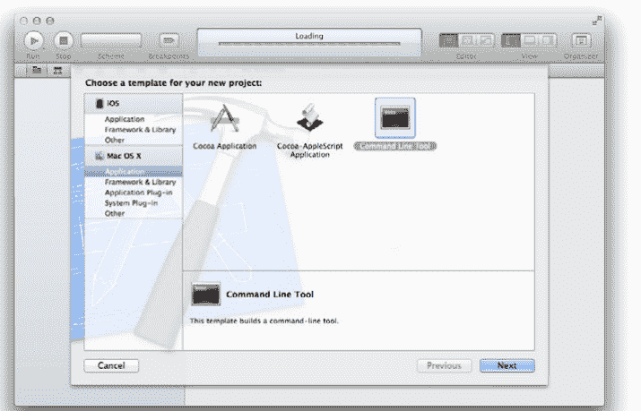

点击 **Next**（下一步）按钮。

将你的新项目命名为 **AGoodStart**。公司标识符在本书的练习中并不重要，但你必须在此输入一个才能继续。你可以使用 **BigNerdRanch** 或其他名称。从 **Type**（类型）弹出菜单中选择 **C**，因为你将用 **C** 语言编写此程序。最后，确保标记为 **Use Automatic Reference Counting**（使用自动引用计数）的复选框已被勾选。

**图 2.2** 选择选项

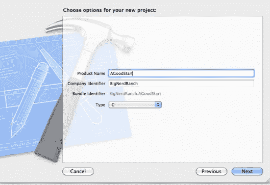

点击 **Next**（下一步）按钮。

现在选择创建项目目录的文件夹。你不需要用于版本控制的仓库，所以可以取消勾选该框。最后，点击 **Create**（创建）按钮。

在接下来的几章中，你将创建相同类型的项目。以后，我只会说“创建一个名为 *program-name-here* 的新 C 命令行工具”，以让你遵循此相同的步骤。

（为什么是 *C*？记住，Objective-C 是建立在 C 编程语言之上的。在我们深入 Objective-C 的细节之前，你需要先理解 C 的部分内容。）

### 从哪里开始编写代码？

创建项目后，你会看到一个显示 AGoodStart 如何生成的窗口。

**图 2.3** AGoodStart 项目的第一视图

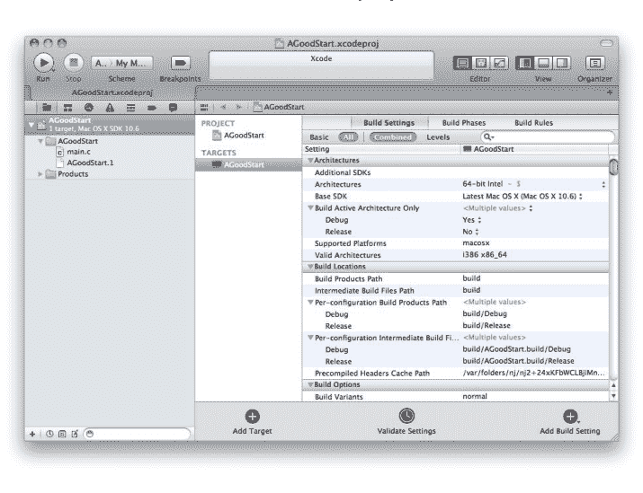

此窗口包含详细信息，例如哪些版本的 Mac OS X 可以运行你的应用程序，编译你编写的代码时使用的配置，以及应用于项目中的本地化设置。但让我们暂时忽略这些细节，找到一个简单的起点开始工作。

在左侧面板的顶部附近，找到一个名为 `main.c` 的文件并点击它。（如果你看不到 `main.c`，点击标记为 **AGoodStart** 的文件夹旁边的三角形以显示其内容。）

**图 2.4** 在 AGoodStart 组中找到 main.c

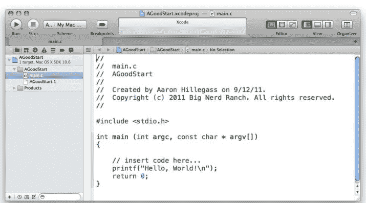

请注意，我们最初显示生产详情的视图现在更改为显示 `main.c` 的内容。`main.c` 文件包含一个名为 `main` 的函数。

函数是计算机执行的一组指令，每个函数都有一个名称。在 C 或 Objective-C 程序中，`main` 是程序首次启动时调用的函数。

```c
#include <stdio.h>
int main (int argc, const char * argv[]) {
// insert code here...
printf("Hello, World!\n");
return 0;
}
```

在这个函数中，你会发现程序中编写的两种信息：代码和注释。

- 代码是告诉计算机执行某些操作的一组指令。

- 注释会被计算机忽略，但我们程序员使用它们来记录我们编写的代码。你试图解决的编程问题越困难，注释在记录问题解决过程中就越有帮助。当你几个月后回到工作中，看到忘记添加注释的代码，并心想：“我确信这个解决方案很出色，但我完全记不起它是如何工作的。”时，这一点尤为重要。

在 C 和 Objective-C 中，区分注释和代码有两种方式：

- 如果你在代码行的开头加上 `//`，从这些斜杠到该行末尾的所有内容都被视为注释。你可以在 Apple 的“insert code here...”注释中看到这种用法。

- 如果你有更广泛的备注要说明，可以使用 `/*` 和 `*/` 来标记跨越多行的注释的开始和结束。

标记注释的这些规则是 C 语法的一部分。语法是规定在给定编程语言中如何编写代码的一组规则。这些规则非常具体，如果你不遵守它们，你的程序将无法工作。

虽然关于注释的语法相当简单，但代码的语法可能因代码做什么以及如何做而差异巨大。但有一个功能始终一致：每条语句都以分号结束。（我们很快就会看到代码语句的例子。）如果你忘记分号，你就犯了一个语法错误，你的程序将不会工作。

幸运的是，Xcode 有方法警告你这些类型的错误。事实上，作为程序员，你面临的挑战之一是解释当出现问题时 Xcode 告诉你的内容，然后修复错误。在本书中，你将看到 Xcode 对常见语法错误的一些响应。

让我们对 *main.c* 做一些更改。首先，我们需要腾出一些空间。找到标记 **main** 函数开始和结尾的大括号（{ 和 }）。然后删除它们之间的所有内容。

现在更新 *main.c*，使其看起来像下面的代码。你将在 **main** 函数中添加一个注释、两行代码和另一个注释。现在，如果你不理解你在输入什么，请不要担心。目的是开始动手。你有一整本书来学习这一切的含义。

```c
#include <stdio.h>
int main (int argc, const char * argv[]) {
// Print the beginning of the novel
printf("It was the best of times.\n");
printf("It was the worst of times.\n");
/* Is that actually any good?
Maybe it needs a rewrite. */
return 0;
}
```

（请注意，你需要输入的新代码以粗体显示。非粗体代码是已经存在的代码。这是我们将沿用至全书其余部分的约定。）

当你输入时，可能会注意到 Xcode 试图提供有用的建议。此功能称为*代码补全*，非常实用。你可能希望现在忽略它，专注于自己输入所有内容。但随着你继续阅读本书，开始尝试代码补全，看看它如何帮助你更方便、更准确地编写代码。你可以在 Xcode 首选项中查看和设置代码补全的不同选项，这些选项可以从 Xcode 菜单访问。

此外，留意字体颜色。Xcode 使用不同的字体颜色，以便轻松识别注释和代码的不同部分。（例如，注释是绿色的。）这也很有用：使用 Xcode 一段时间后，你会直觉地注意到颜色看起来不对劲的时候。通常，这是一个线索，表明你编写的内容中存在语法错误（如忘记分号）。越早知道犯了语法错误，就越容易找到并修复它。

### 如何运行我的程序？

这些颜色差异只是 Xcode 让你知道你可能做错了某些事情的方式之一。

当 `main.c` 文件的内容与你上面看到的一致时，该运行你的程序并查看它的行为。这是一个两步过程。Xcode 会先构建你的程序，然后运行它。在构建程序时，Xcode 会为运行代码做准备。这包括检查语法和其他类型的错误。

再次查看 Xcode 窗口的左侧区域。该区域称为导航器区域。在导航器区域的顶部有一系列按钮。你当前正在查看项目导航器，它显示了你项目中的文件。项目导航器的图标是 📋。

现在找到并点击 📖 按钮以显示日志导航器。日志是 Xcode 在构建和运行你的程序时与你沟通的方式。

你也可以将日志用于自己的目的。例如，你的代码中有一行写着

```c
printf("It was the best of times.\n");
```

这是一条指令，用于在日志中显示“It was the best of times.”这些单词。

由于你还没有构建和运行你的程序，日志导航器中没有任何内容。让我们解决这个问题。在项目窗口的左上角，找到一个看起来很像 iTunes 或 DVD 播放器中“播放”按钮的按钮。如果你将光标悬停在上面，你会看到一个提示，写着“构建并运行当前方案（Build and then run the current scheme）”。这是 Xcode 特有的说法，意思是“按下这个按钮，我会构建并运行你的程序。”

如果一切顺利，你将得到以下结果：


如果不顺利，你将看到：


然后你要做什么？仔细将你的代码与书中的代码进行对比。查找拼写错误和缺失的分号。Xcode 会突出显示它认为有问题的行。找到问题后，再次点击“运行（Run）”按钮。重复此过程，直到构建成功。


（当这段代码或你未来编写的任何代码构建失败时，请不要气馁。制造并修复错误有助于你理解自己在做什么。事实上，这比第一次就碰巧做对更好。）

一旦你的构建成功，找到日志导航器顶部标记为 **Debug AGoodStart** 的条目。点击此条目以显示最近一次程序运行的日志。

日志可能相当冗长。重要部分是末尾的狄更斯引语。这就是你的代码正在执行！

```
GNU gdb 6.3.50-20050815 (Apple version gdb-1705) (Tue Jul 5 07:36:45 UTC 2011)
Copyright 2004 Free Software Foundation, Inc.
GDB is free software, covered by the GNU General Public License, and you are
welcome to change it and/or distribute copies of it under certain conditions.
Type "show copying" to see the conditions.
There is absolutely no warranty for GDB. Type "show warranty" for details.
This GDB was configured as "x86_64-apple-darwin".tty /dev/ttys001
[Switching to process 2723 thread 0x0]
It was the best of times.
It was the worst of times.
```

（在我写这本书的时候，Apple 正在开发一个名为 LLDB 的新调试器。最终它将取代当前的调试器 GDB。如果你没有看到所有的 GDB 信息，这意味着 LLDB 现在是 *Xcode* 的标准调试器。未来一定是个很棒的场所；我很羡慕你们。）

### 那么程序是什么？

既然你已经构建并运行了程序，让我们深入看看内部。程序是一组函数的集合。函数是供处理器执行的操作列表。每个函数都有一个名称，你刚刚编写的函数名为 **main**。还有另一个函数 – **printf**。你没有编写这个函数，但你使用了它。（我们将在第 5 章中找出 **printf** 来自哪里。）

对于程序员来说，编写函数很像写食谱：“慢慢搅拌一夸脱水直到沸腾。然后倒入一杯面粉。趁热食用。”

在 20 世纪 70 年代中期，Betty Crocker 开始销售包含一套食谱卡的盒子。食谱卡是函数的一个很好的隐喻。就像函数一样，每张卡片都有一个名称和一组指令。区别在于，你执行食谱，而计算机执行函数。

图 2.5 名为“烤鸡（Baked Chicken）”的食谱卡


### 不要停止

Betty Crocker 的烹饪指令是用英语写的。在这本书的第一部分中，你的函数将用 C 编程语言编写。然而，计算机处理器期望其指令为机器代码。我们如何到达那里？

当你在 C 语言中编写程序时（这对你来说相对舒适），*编译器*会将你程序的函数转换为机器代码（这对处理器来说是舒适且高效的）。编译器本身也是一个程序，当你按下 *运行（Run）* 按钮时由 *Xcode* 运行。编译程序与构建程序是相同的，我们将互换使用这些术语。

当你运行程序时，已编译的函数从硬盘复制到内存，名为 **main** 的函数由处理器执行。**main** 函数通常调用其他函数。例如，你的 **main** 函数调用了 **printf** 函数。（我们将在第 5 章中更多地了解函数如何交互。）

此时，你可能已经处理了一些令人沮丧的事情：安装问题、拼写错误以及大量的新词汇。也许你到目前为止所做的一切都没有什么意义。这是完全正常的。当我写这段话时，我的儿子 Otto 六岁。Otto 每天会困惑好几次。他不断试图吸收那些不符合他现有心理框架的知识。困惑发生得如此频繁，以至于它真的没有困扰他。他从未停下来想，“为什么这如此令人困惑？我应该扔掉这本书吗？”

随着我们年龄的增长，我们困惑的次数少了很多——不是因为我们知道一切，而是因为我们倾向于避开那些让我们感到迷惑的事情。例如，阅读历史书非常愉快，因为我们获得的知识点可以挂在我们现有的心理框架上。这是一种轻松的学习。

学习一门新语言是一个困难学习的例子。你知道有数百万人毫不费力地以这门语言工作，但它在你的嘴里似乎非常奇怪和笨拙。当人们对你说这门语言时，你常常感到迷惑。

学习编程也是一项困难的学习任务。你时不时会感到困惑——尤其在这里的开头部分。这没关系。事实上，这有点酷。这有点像再次回到六岁。坚持读这本书；我保证在你到达最后一页之前，迷惑感会消失。

# 第二部分

## 编程如何工作

在接下来的几章中，你将创建许多展示有用概念的程序。这些命令行程序没有什么可以向你朋友炫耀的，但当你运行它们时，应该会有少许掌握新技能的兴奋感。你正在从计算机用户转变为计算机程序员。

你在这些章节中的程序将用 C 语言编写。请注意，这些章节并不旨在详细涵盖 C 语言。恰恰相反：经过多年教学经验的磨练，这是编程初学者在学习 Objective-C 编程之前需要了解的编程和 C 语言编程的基本子集。

## 变量和类型

继续上一章的食谱隐喻，有时厨师会在厨房里保留一块小黑板来存储数据。例如，当拆火鸡包装时，他注意到标签上写着“14.2 磅”。在扔掉包装之前，他会潦草地在黑板上写下“weight = 14.2”。然后，就在他把火鸡放入烤箱之前，他会参考黑板上的重量来计算烹饪时间（15 分钟 + 每磅 15 分钟）。

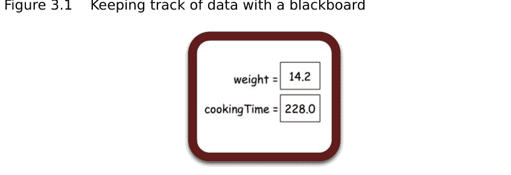

在执行过程中，程序经常需要地方来存储稍后将使用的数据。可以存放单一数据的地方被称为*变量*。每个变量都有一个名称（如 *cookingTime*）和一个*类型*（如数字）。此外，当程序执行时，变量将有一个值（如 228.0）。

## 类型

在程序中，你通过*声明*变量的类型和名称来创建新变量。以下是一个变量声明的示例：

```
float  weight;
```

这个变量的类型是 *float*，名称是 *weight*。此时，变量还没有值。

在 C 语言中，你必须声明每个变量的类型，原因有两个：

### 类型系统

- 类型让编译器为你进行语法检查，并提醒你潜在的错误或问题。例如，假设你有一个存储文本的变量。如果你请求它的对数，编译器会告诉你类似“请求这个变量的对数没有意义”的信息。
- 类型告诉编译器为该变量在内存中预留多少空间（多少字节）。

以下是常用类型的概览。我们将在后续章节中详细回顾每一种类型。

| 类型 | 描述 |
| :--- | :--- |
| `short`, `int`, `long` | 这三种类型是整数；它们不需要小数点。`short` 通常比 `long` 占用的存储字节少，而 `int` 介于两者之间。因此，你可以在 `long` 中存储比在 `short` 中更大的数字。 |
| `float`, `double` | `float` 是浮点数——可以有**小数点**的数字。在内存中，`float` 存储为尾数和指数。例如，346.2 表示为 $3.462 \times 10^{2}$。`double` 是双精度数，通常有更多的位来存储更长的尾数和更大的指数。 |
| `char` | `char` 是一个单字节整数，我们通常将其视为字符，如字母 `'a'`。 |
| 指针 `pointers` | 指针存储内存地址。它使用星号字符声明。例如，声明为 `int *` 的变量可以存储 `int` 类型变量的内存地址。它不直接持有实际数字的值，但如果你知道 `int` 变量的地址，那么你可以很容易地获取其值。指针非常有用，后面还会更多关于指针的内容。多得多了。 |
| `struct` | `struct`（或*结构体*）是由其他类型组成的类型。你还可以创建新的 `struct` 定义。例如，想象一下你想要一个包含两个 `float` 成员的 `GeoLocation` 类型：`latitude` 和 `longitude`。在这种情况下，你需要定义一个 `struct` 类型。 |

这些是 C 程序员每天使用的类型。令人惊讶的是，这些简单的五个概念可以表达多么复杂的概念。

## 带有变量的程序

回到 Xcode，你将创建另一个项目。首先，关闭 AGoodStart 项目，以免不小心在旧项目中输入新代码。

现在创建新项目（文件 → 新建 → 新建项目...）。该项目将是一个名为 Turkey 的 C 命令行工具。

在项目导航器中，找到此项目的 `main.c` 文件并打开它。编辑 `main.c`，使其匹配以下代码。

```c
#include <stdio.h>

int main (int argc, const char * argv[])
{
    // 声明名为 'weight' 的 float 类型变量
    float weight;

    // 将数字放入该变量
    weight = 14.2;

    // 记录给用户看
    printf("The turkey weighs %f.\n", weight);

    // 声明另一个 float 类型的变量
    float cookingTime;

    // 计算烹饪时间并存储在该变量中
    // 在这种情况下，'*' 表示 '乘以'
    cookingTime = 15.0 + 15.0 * weight;

    // 将结果记录给用户看
    printf("Cook it for %f minutes.\n", cookingTime);

    // 结束此函数并指示成功
    return 0;
}
```

构建并运行程序。你可以点击 Xcode 窗口左上角的 Run 按钮，或使用键盘快捷键 Command-R。然后点击按钮进入日志导航器。选择顶部标记为 Debug Turkey 的项目以显示你的输出。它应该看起来像这样：

```
The turkey weighs 14.200000.
Cook it for 228.000000 minutes.
```

现在点击按钮返回项目导航器。然后选择 `main.c`，以便再次看到你的代码。让我们回顾一下你在这里做了什么。

在你的代码中有一行看起来像这样：

```c
float weight;
```

我们说，你正在“声明变量 weight 为 float 类型”。

在下一行，你的变量获得一个值：

```c
weight = 14.2;
```

你正在将数据复制到该变量中。我们说，你正在“将该变量的值分配为 14.2”。

在现代 C 中，你可以在一行中声明变量并为其分配初始值，如下所示：

```c
float weight = 14.2;
```

这是另一个赋值：

```c
cookingTime = 15.0 + 15.0 * weight;
```

等号右侧的内容是一个表达式。表达式是某个被评估并产生某个值的东西。实际上，每个赋值的右侧都有一个表达式。

例如，在这一行中：

```c
weight = 14.2;
```

表达式只是 `14.2`。

变量是任何程序的构建模块。这仅仅是关于变量世界的介绍。随着我们继续，你将更多地了解变量如何工作以及如何使用它们。

### 挑战

创建一个名为 **TwoFloats** 的新 C **命令行工具**。在其 `main()` 函数中，声明两个 `float` 类型的变量，并分别为它们分配带有小数点的数字，如 `3.14` 或 `42.0`。声明另一个 `double` 类型的变量，并为其分配两个 `float` 变量的和。使用 `printf()` 打印结果。如果需要检查你的语法，请参考本章的代码。

## 第 4 章 if/else

编程中的一个重要思想是根据环境采取不同的行动。订单表单中的所有计费字段是否已填写？如果是，启用提交按钮。玩家是否还有生命？如果是，恢复游戏。如果不是，显示坟墓的图片并播放悲伤的音乐。这种行为是使用 *if* 和 *else* 实现的，其语法为：

```c
if (conditional) {
    // 如果条件评估为 true，则执行此代码
} else {
    // 如果条件评估为 false，则执行此代码
}
```

你不会在本章创建项目。相反，基于你在前两章中学到的内容，仔细考虑代码示例。这是一个使用 *if* 和 *else* 的代码示例：

```c
float truckWeight = 34563.8;
// 是否在限制以下？
if (truckWeight < 40000.0) {
    printf("It is a light truck\n");
} else {
    printf("It is a heavy truck\n");
}
```

如果你没有 *else* 子句，你可以只省略那部分：

```c
float truckWeight = 34563.8;
// 是否在限制以下？
if (truckWeight < 40000.0) {
    printf("It is a light truck\n");
}
```

条件表达式总是要么为真要么为假。在 C 中，0 代表假，任何非零值都将被视为真。

在上述示例的条件中，< 运算符两边各取一个数字。如果左边的数字小于右边的数字，表达式评估为 1（表达真实性的常见方式）。如果左边的数字大于或等于右边的数字，表达式评估为 0（表达假性的唯一方式）。

运算符通常出现在条件表达式中。表 4.1 显示了在比较数字（以及计算机评估为数字的其他类型）时常用的运算符：

表 4.1 比较运算符

| 运算符 | 描述 |
| :--- | :--- |
| `<` | 左边的数字是否小于右边的数字？ |
| `>` | 左边的数字是否大于右边的数字？ |
| `<=` | 左边的数字是否小于或等于右边的数字？ |
| `>=` | 左边的数字是否大于或等于右边的数字？ |
| `==` | 它们是否相等？ |
| `!=` | 它们是否*不*相等？ |

`==` 运算符值得额外注意：在编程中，`==` 运算符用于检查相等性。我们使用单个 `=` 来*分配*值。许多、许多 bug 都源于程序员在应该使用 `==` 时使用了 `=`。所以停止将 `=` 视为“等号”。从现在开始，它是“赋值运算符”。

一些条件表达式需要逻辑运算符。如果你想知道一个数字是否在某个范围内，比如大于零且小于 40,000 怎么办？要指定范围，你可以使用逻辑 AND 运算符 `&&`：

```c
if ((truckWeight > 0.0) && (truckWeight < 40000.0)) {
    printf("Truck weight is within legal range.\n");
}
```

表 4.2 显示了三个逻辑运算符：

表 4.2 逻辑运算符

| 运算符 | 描述 |
| :--- | :--- |
| `&&` | 逻辑 AND -- 仅当两者都为真时结果为真 |
| `||` | 逻辑 OR -- 仅当两者都为假时结果为假 |
| `!` | 逻辑 NOT -- 真变假，假变真 |

（如果你来自其他语言，请注意 Objective-C 没有逻辑异或，所以我们不会在这里讨论它。）

逻辑 NOT 运算符 `!` 否定其右侧括号内表达式的值。

```c
// 是否不在合法范围内？
if (!((truckWeight > 0.0) && (truckWeight < 40000.0))) {
    printf("Truck weight is not within legal range.\n");
}
```

## 布尔变量

正如你所见，表达式可以变得相当长和复杂。有时，将表达式的值放入一个方便的、命名良好的变量中会很有用。

```c
BOOL isNotLegal = !((truckWeight > 0.0) && (truckWeight < 40000.0));
if (isNotLegal) {
    printf("Truck weight is not within legal range.\n");
}
```

可以为真或假的变量是*布尔*变量。从历史上看，C 程序员一直使用 `int` 来保存布尔值。Objective-C 程序员通常使用 `BOOL` 类型来表示布尔变量，所以我们在前面也这样使用。（`BOOL` 只是整数类型的别名。）

*布尔*（boolean）变量可以取真或假。从历史上看，C 程序员一直使用 `int` 来存储布尔值。Objective-C 程序员通常使用类型 `BOOL` 来表示布尔变量，因此我们在这里也使用它。（`BOOL` 只是整数类型的别名。）要在 C 函数中使用 `BOOL`，你需要包含相应的头文件：

```
#include <objc/objc.h>
```

关于语法的说明：如果跟随条件表达式的代码只包含一条语句，那么大括号是可选的。因此，以下代码与前面的示例等效。

```
BOOL isNotLegal = !((truckWeight > 0.0) && (truckWeight < 40000.0));
if (isNotLegal)
    printf("Truck weight is not within legal range.\n");
```

然而，如果代码包含不止一条语句，大括号是必需的。

```
BOOL isNotLegal = !((truckWeight > 0.0) && (truckWeight < 40000.0));
if (isNotLegal) {
    printf("Truck weight is not within legal range.\n");
    printf("Impound truck.\n");
}
```

为什么？想象一下如果你去掉了大括号会怎样。


```
BOOL isNotLegal = !((truckWeight > 0.0) && (truckWeight < 40000.0));
if (isNotLegal)
    printf("Truck weight is not within legal range.\n");
    printf("Impound truck.\n");
```

这段代码会让你非常不讨卡车司机的喜欢。在这种情况下，无论卡车重量多少，所有卡车都会被扣押。当编译器在条件表达式后找不到大括号时，只有下一条语句被视为 `if` 结构的一部分。因此，第二条语句总是会被执行。（那第二条语句的缩进呢？虽然缩进对于人类阅读代码非常有帮助，但对编译器来说毫无意义。）

## else if

如果有两种以上的可能性怎么办？你可以使用 `else if` 逐一进行测试。例如，想象一辆卡车属于以下三种重量类别之一：漂浮、轻量级和重量级。

```
if (truckWeight <= 0) {
    printf("A floating truck\n");
} else if (truckWeight < 40000.0) {
    printf("A light truck\n");
} else {
    printf("A heavy truck\n");
}
```

你可以拥有任意数量的 `else if` 子句。它们将按照出现的顺序逐一测试，直到其中某一个评估为真。这部分“按出现的顺序测试”非常重要。请务必按照正确的顺序排列你的条件，以避免出现假阳性。例如，如果你交换了上述示例中的前两个测试，你永远不会找到漂浮的卡车，因为漂浮的卡车也是轻量级卡车。最后的 `else` 子句是可选的，但当你想要捕获所有不符合之前条件的情况时，它很有用。

## 供好奇者参考：条件（三目）运算符

使用 if 和 else 来设置实例变量的值并不罕见。例如，你可能会有如下代码：

```
int minutesPerPound;
if (isBoneless)
    minutesPerPound = 15;
else
    minutesPerPound = 20;
```

只要你有一种场景，根据条件将值分配给变量，这就是*条件运算符*（即 `?`）的一个候选场景。（你有时也会看到它被称为*三目运算符*。）

```
int minutesPerPound = isBoneless ? 15 : 20;
```

这一行代码与前面的示例等效。你不再编写 if 和 else，而是编写一个赋值语句。`?` 之前的部分是条件表达式。`?` 之后的值是条件表达式评估为真或假时的备选值。

如果这种写法让你觉得奇怪，继续直接使用 if 和 else 也是完全没问题的。我猜想，随着时间推移，你会接受三目运算符作为进行条件值分配的一种简洁方式。更重要的是，你会看到其他程序员使用它，理解它出现的含义会很有用！

### 挑战

考虑以下代码片段：

```
int i = 20;
int j = 25;

int k = ( i > j ) ? 10 : 5;

if ( 5 < j - k ) { // first expression
    printf("The first expression is true.");
} else if ( j > i ) { // second expression
    printf("The second expression is true.");
} else {
    printf("Neither expression is true.");
}
```

控制台将输出什么？

## 5 函数

在第 3 章中，我引入了变量的概念：与一块数据相关联的名称。函数则是与一段代码相关联的名称。你可以向函数传递信息。你可以让函数执行代码。你可以让函数向返回信息。

函数是编程的基础，所以本章内容很多——三个新项目、一个新工具以及许多新思想。让我们从一个演示函数用途的练习开始。

### 我什么时候应该使用函数？

假设你正在编写一个程序，向完成 Big Nerd Ranch 课程的学生表示祝贺。在担心如何从数据库获取学生名单或如何在华丽的 Big Nerd Ranch 纸张上打印证书之前，你想先实验一下将印在证书上的消息。

为了进行这个实验，创建一个新的项目：一个名为 ClassCertificates 的 C Command Line Tool。你在编写这个程序时的第一想法可能是：

```
int main (int argc, const char * argv[]) 
{
    printf("Mark has done as much Cocoa Programming as I could fit into 5 days\n");
    printf("Bo has done as much Objective-C Programming as I could fit into 2 days\n");
    printf("Mike has done as much Python Programming as I could fit into 5 days\n");
    printf("Ted has done as much 105 Programming as I could fit into 5 days\n");

    return 0;
}
```

输入所有这些内容这件事让你感到烦恼吗？它是否显得令人恼火地重复？如果是这样，你就具备了优秀程序员的潜质。当你发现自己正在重复性质非常相似的工作（在这种情况下，是 `printf` 语句中的文字）时，你就应该开始思考将函数作为完成相同任务的更好方式。

### 我如何编写和使用函数？

既然你已经意识到你需要一个函数，那么你需要编写一个。在你的 ClassCertificates 项目中打开 `main.c`，并在 `main` 函数之前添加一个新函数。将这个函数命名为 `congratulateStudent`。

### 第 5 章 函数

```
#include <stdio.h>

void congratulateStudent(char *student, char *course, int numDays)
{
    printf("%s has done as much %s Programming as I could fit into %d days.\n",
           student, course, numDays);
}
```

（想知道 `%s` 和 `%d` 是什么意思吗？先别急，我们将在下一章讨论它们。）

现在编辑 main 函数以使用你的新函数：

```
int main(int argc, const char *argv[])
{
    congratulateStudent("Mark", "Cocoa", 5);
    congratulateStudent("Bo", "Objective-C", 2);
    congratulateStudent("Mike", "Python", 5);
    congratulateStudent("Ted", "iOS", 5);

    return 0;
}
```

构建并运行程序。你很可能得到一个标有黄色小三角形内带感叹号的*警告*。Xcode 中的警告不会阻止你的程序运行；它只是引起你对可能问题的注意。警告文本位于代码的右侧。这个警告类似于 `No previous prototype for function 'congratulateStudent'`。暂时忽略这个警告，我们将在本节末尾回头讨论它。

在日志导航器中找到你的输出。它应该与你手动输入所有内容所看到的结果完全相同。

```
Mark has done as much Cocoa Programming as I could fit into 5 days.
Bo has done as much Objective-C Programming as I could fit into 2 days.
Mike has done as much Python Programming as I could fit into 5 days.
Ted has done as much iOS Programming as I could fit into 5 days.
```

想想你在这里做了什么。你注意到了一种重复的模式。你将问题的所有共同特征（重复的文本）移入了一个单独的函数。这留下了差异（学生姓名、课程名称、天数数量）。你通过向函数添加三个*参数*来处理这些差异。让我们再看一下命名函数的这一行。

```
void congratulateStudent(char *student, char *course, int numDays)
```

每个参数都有两部分：参数所代表的数据类型和参数的名称。参数用逗号分隔，放在函数名称右侧的括号内。

那函数名称左侧的 `void` 是什么？它是从函数返回的信息类型。当你没有要返回的信息时，使用关键字 `void`。我们将在本章后面详细讨论返回。

你也在 **main** 中使用了，或者说*调用*了，你的新函数。当你调用 `congratulateStudent` 时，你传递了值。传递给函数的值被称为*实参*。实参的值随后被分配给对应的参数名称。该参数名称可以在函数内部作为包含传入值的变量使用。

让我们具体一点。在第一次调用 `congratulateStudent` 时，你传递了三个参数："Mark"、"Cocoa" 和 5。

```
congratulateStudent("Mark", "Cocoa", 5);
```

目前，我们将关注第三个参数。当 5 被传递给 `congratulateStudent` 时，它会被赋值给第三个形参 `numDays`。实参和形参按照它们出现的顺序进行匹配。此外，它们的类型必须相同（或非常接近）。在这里，5 是一个整数值，而 `numDays` 的类型是 `int`。很好。

现在，当 `congratulateStudent` 使用或*引用*函数内部的 `numDays` 变量时，其值将为 5。你可以看到，在分号之前刚刚引用了 `numDays`。最后，通过查看输出的第一行，你可以证明这一切都正常工作了，该行正确地显示了天数。

回过头来看我们最初提出的 `ClassCertificates` 版本，其中包含大量重复的输入。使用函数有什么意义呢？是为了节省输入吗？嗯，是的，但这绝对不是全部。这也与错误检查有关。你输入得越少，计算机计算得越多，出现拼写错误的机会就越少。而且，如果你确实拼写错误了函数名，Xcode 会提醒你，但 Xcode 无从知晓你是否拼写错误了文本。

编写函数的另一个好处是**可重用性**。既然你编写了这个方便的函数，就可以在另一个程序中使用它。进行修改也变得更简单。你只需要在一个地方调整祝贺语句的措辞，它就会在所有地方生效。

函数的最后一个好处是，如果存在“bug”，你可以修复那个函数，突然之间所有调用它的部分都会开始正常工作。将你的代码划分为函数使其更容易理解和维护。

现在回到代码中的那个警告。在代码的一个位置*声明*一个函数，而在另一个位置*定义*它是相当常见的。声明一个函数只是警告编译器一个具有特定名称的函数即将出现。定义函数则是描述应执行的步骤。在这个练习中，你实际上是在同一位置声明并定义了你的函数。因为这种情况不常见，如果你的函数没有预先声明，Xcode 会发出警告。

在本书中你构建的任何项目中，忽略这个警告都没关系。或者你也可以花点时间去禁用它。要这样做，请选择 `ClassCertificates` 目标，它是项目导航器顶部的项。在编辑器窗格中，选择 **Build Settings** 选项卡下的 **All**。滚动浏览不同的构建设置，找到 **Missing Function Prototypes** 设置。将此设置更改为 **No**。

### 图 5.1 禁用 Missing Function Prototypes 警告

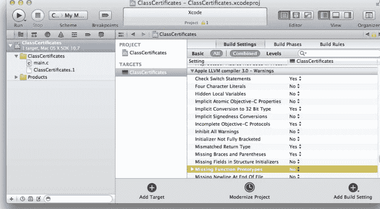

## 函数如何协同工作

一个*程序*是函数的集合。当你运行一个程序时，这些函数从硬盘复制到内存，处理器找到名为 “main” 的函数并执行它。

记住，函数就像食谱卡。如果我开始执行“烤鸡”卡片，我会发现第二条指令是“制作调味面包屑”，这在另一张卡片上有说明。程序员会说“烤鸡函数*调用*了调味面包屑函数。”

### 图 5.2 食谱卡

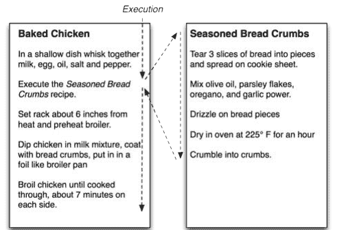

同样，`main` 函数可以调用其他函数。例如，你在 ClassCertificates 中的 `main` 函数调用了 `congratulateStudent` 函数，后者又调用了 `printf`。

当你在准备调味面包屑时，你暂停执行“烤鸡”卡片。当面包屑准备好后，你继续执行“烤鸡”卡片。

同样，`main` 函数停止执行并“阻塞”，直到它调用的函数执行完毕。为了看到这种现象，我们将调用一个 `sleep` 函数，该函数除了等待几秒钟外什么都不做。在你的 `main` 函数中，添加对 `sleep` 的调用。

```
int main (int argc, const char * argv[]) 
{ 
    congratulateStudent("Mark", "Cocoa", 5); 
    sleep(2); 
    congratulateStudent("Bo", "Objective-C", 2); 
    sleep(2); 
    congratulateStudent("Mike", "PHP and PostgreSQL", 5); 
    sleep(2); 
    congratulateStudent("Ted", "iOS", 5); 
 
    return 0; 
}
```

构建并运行程序。（暂时忽略关于隐式声明的警告。）你应该会在每条祝贺信息之间看到 2 秒的暂停。这是因为 `main` 函数停止运行，直到 `sleep` 函数结束休眠。

注意，当你调用一个函数时，你使用它的名称和一对括号来放置其参数。因此，当我们谈论函数时，我们通常包含一对空括号。从现在开始，当我们谈论 `main` 函数时，我们将说 `main()`。

你的电脑附带了许多内置函数。实际上，这有点误导性——事实是：在 Mac OS X 安装到你的电脑之前，它只不过是一台昂贵的取暖器。作为 Mac OS X 安装的一部分，安装了包含预编译函数集合的文件。这些集合称为标准库。`sleep()` 和 `printf()` 包含在这些标准库中。

在 `main.c` 的顶部，你包含了 `stdio.h` 文件。该文件包含函数 `printf()` 的声明，让编译器检查你是否正确使用了它。函数 `sleep()` 在 `stdlib.h` 中声明。也包含那个文件，以便编译器停止抱怨 `sleep()` 是隐式声明的：

```
#include <stdio.h>
#include <stdlib.h>

void congratulateStudent(char *student, char *course, int numDays)
{
    ...
}
```

标准库有两个作用：

- 它们代表了一大块你不需要编写和维护的代码。因此，它们使你能够构建比否则情况下更大、更好的程序。

- 它们确保大多数程序看起来和感觉相似。

程序员花大量时间研究他们操作系统的标准库。每个创建操作系统的公司都有随附标准库的文档。你将在第 16 章学习如何浏览 iOS 和 Mac OS X 的文档。

## 局部变量、帧和堆栈

每个函数都可以有局部变量。局部变量是在函数内部声明的变量。它们仅在该函数执行期间存在，并且只能从该函数内部访问。例如，想象你正在编写一个计算烤火鸡所需时间的函数。它可能看起来像这样：

```
void showCookTimeForTurkey(int pounds)
{
    int necessaryMinutes = 15 + 15 * pounds;
    printf("Cook for %d minutes.\n", necessaryMinutes);
}
```

`necessaryMinutes` 是一个局部变量。它在 `showCookTimeForTurkey()` 开始执行时存在，并将在该函数完成执行后停止存在。函数的形参 `pounds` 也是一个局部变量。形参是初始化为其对应实参值的局部变量。

一个函数可以有许多局部变量，它们都存储在该函数的帧中。将帧想象成一块黑板，你可以在函数运行时在上面涂鸦。当函数执行完毕时，这块黑板就被丢弃了。

想象一下，你正在做烤鸡食谱。在你的厨房里，所有食谱都有自己的一块黑板，所以你已经准备好了烤鸡食谱的黑板。现在，当你调用 `Seasoned Bread Crumbs` 食谱时，你需要一块新黑板。你要把它放在哪里？就放在烤鸡黑板的上面。毕竟，你暂停了烤鸡的执行来制作调味面包屑。在调味面包屑食谱完成及其帧被丢弃之前，你不需要烤鸡的帧。你现在拥有的就是一摞帧。

### 图 5.3 堆栈中的两块黑板

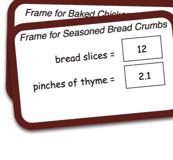

程序员说：“当一个函数被调用时，它的帧在*堆栈*上创建。当函数完成执行时，它的帧从堆栈中弹出并销毁。”

让我们通过在一个假设的程序中放入 `showCookTimeForTurkey()` 来更仔细地看看堆栈是如何工作的：


```c
void showCookTimeForTurkey(int pounds)
{
 int necessaryMinutes = 15 + 15 * pounds;
 printf("Cook for %d minutes.\n", necessaryMinutes);
}

int main(int argc, const char * argv[])
{
 int totalWeight = 10;
 int gibletsWeight = 1;
 int turkeyWeight = totalWeight - gibletsWeight;
 showCookTimeForTurkey(turkeyWeight);
 return 0;
}
```

回想一下，`main()` 总是首先执行。`main()` 调用 `showCookTimeForTurkey()`，它开始执行。那么，当 `pounds` 被乘以 15 之后，该程序的堆栈是什么样子？

### 图 5.4 栈上的两个帧

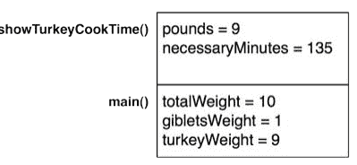

栈始终遵循后进先出的原则。也就是说，`showCookTimeForTurkey()` 会在 `main()` 将其帧从栈中弹出之前，先将其自身的帧从栈中弹出。

请注意，作为 `showCookTimeForTurkey()` 的单一参数，`pounds` 是帧的一部分。回想一下，参数是一个局部变量，它被分配了对应实参的值。在这个例子中，值为 9 的变量 `turkeyWeight` 作为实参传递给 `showCookTimeForTurkey()`。然后，该值被赋值给形参 `pounds` 并复制到函数的帧中。

### 递归

函数可以调用自身吗？当然可以！我们称之为`递归`。有一首众所周知的无聊歌曲叫“99瓶啤酒”。创建一个新的 C 命令行工具，命名为 `BeerSong`。打开 `main.c`，添加一个函数来输出这首歌曲的歌词，然后在 `main()` 中启动它：

```c
#include <stdio.h>

void singTheSong(int numberOfBottles)
{
    if (numberOfBottles == 0) {
        printf("There are simply no more bottles of beer on the wall.\n");
    } else {
        printf("%d bottles of beer on the wall. %d bottles of beer.\n",
               numberOfBottles);
        int oneFewer = numberOfBottles - 1;
        printf("Take one down, pass it around, %d bottles of beer on the wall.\n",
               oneFewer);
        singTheSong(oneFewer); // This function calls itself!
        printf("Put a bottle in the recycling, %d empty bottles in the bin.\n",
               numberOfBottles);
    }
}

int main(int argc, const char * argv[])
{
    singTheSong(99);
    return 0;
}
```

编译并运行该程序。输出如下：

99 bottles of beer on the wall. 99 bottles of beer.

Take one down, pass it around, 98 bottles of beer on the wall.

98 bottles of beer on the wall. 98 bottles of beer.

Take one down, pass it around, 97 bottles of beer on the wall.

97 bottles of beer on the wall. 97 bottles of beer.

...

1 bottles of beer on the wall. 1 bottles of beer.

Take one down, pass it around, 0 bottles of beer on the wall.

There are simply no more bottles of beer on the wall.

Put a bottle in the recycling, 1 empty bottles in the bin.

Put a bottle in the recycling, 2 empty bottles in the bin.

...

Put a bottle in the recycling, 98 empty bottles in the bin.

Put a bottle in the recycling, 99 empty bottles in the bin.

当最后一瓶酒从墙上取下时，栈是什么样子的？

### 图 5.5 递归函数在栈上的帧

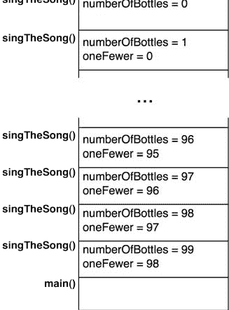

讨论帧和栈通常不属于入门编程课程的内容，但我发现这些概念对新手程序员非常有用。首先，它让你更具体地理解诸如“当函数执行结束时，我的局部变量发生了什么？”之类问题答案。其次，它有助于你理解`调试器`的作用。调试器是一个帮助你了解程序实际在做什么的程序，进而帮助你查找和修复“bug”（代码中的问题）。当你在 `Xcode` 中编译并运行程序时，调试器会`附加`到程序上，以便你使用它。

### 在调试器中查看帧

你可以使用调试器来浏览栈上的帧。但是，要做到这一点，你必须在程序执行过程中停下来。否则，`main()` 会执行完毕，就不会留下任何帧供你查看。为了在我们 `BeerSong` 程序中看到尽可能多的帧，我们希望程序停在打印“There are simply no more bottles of beer on the wall.”的那一行。

我们该怎么做？在 `main.c` 中，找到这一行：

```c
printf("There are simply no more bottles of beer on the wall.\n");
```

代码左侧有两个灰色列。点击较宽的左侧列中靠近这行代码的地方。

### 图 5.6 设置断点

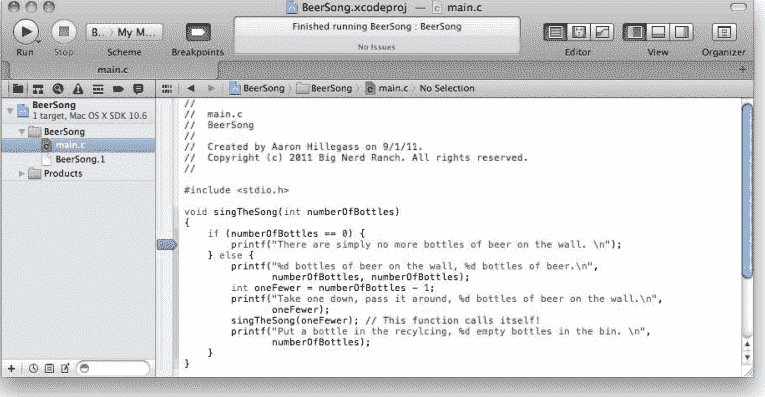

蓝色指示器表示你已设置了一个`断点`。断点是代码中的一个位置，你希望调试器在此暂停程序的执行。再次运行程序。它启动后会立即停止在执行设置断点的那一行之前。

现在，你的程序在时间上被暂时冻结了，你可以更仔细地检查它。在导航器区域，点击 ≡ 图标以打开`调试导航器`。该导航器显示了当前栈上的所有帧，也称为`堆栈跟踪`。

在堆栈跟踪中，帧通过其函数名进行标识。由于你的程序几乎完全由一个递归函数组成，这些帧具有相同的名称，你必须通过传递给它们的 `oneFewer` 的值来区分它们。在栈的底部，你当然会发现 `main()` 的帧。

你可以选择一个帧来查看该帧中的变量以及当前正在执行的代码行的源代码。选择 `singTheSong` 第一次被调用时的帧。

### 图 5.7 调试器显示 singTheSong 的帧

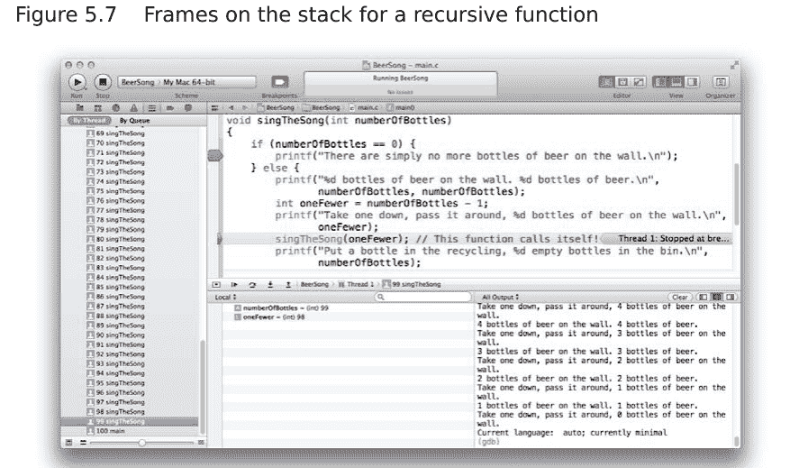

你可以在窗口左下角看到此帧的变量及其值。在右侧，你`控制台`区域也可以看到输出。（如果你看不到控制台，请在屏幕下半部分右侧找到 `⊡ ⊡ ⊡ ⊡` 按钮。点击中间的按钮以显示控制台。）在控制台中，你可以看到断点的作用：程序在到达结束歌曲的行之前停止了。

现在，我们需要移除断点，以便程序正常运行。你可以直接将蓝色指示器从边距处拖走。或者，点击导航器区域顶部的 `■` 图标以显示`断点导航器`，并查看项目中的所有断点。从那里，你可以选择你的断点并将其删除。

要恢复程序的执行，请点击编辑器和变量视图之间的调试器栏上的 `▶` 按钮。

我们刚刚快速看了一下调试器，以演示帧是如何工作的。然而，当你的程序没有按预期运行，且你需要查看实际发生了什么情况时，使用调试器来设置断点并浏览程序栈中的帧将非常有用。

## return

许多函数在完成执行时会返回一个值。通过函数名称前面的类型，你知道函数将返回什么类型的数据。（如果函数没有返回任何东西，其返回类型是 `void`。）

创建一个新的 C 命令行工具，命名为 `Degrees`。在 `main.c` 中，在 `main()` 之前添加一个函数，将温度从摄氏度转换为华氏度。然后更新 `main()` 以调用新函数。

```c
#include <stdio.h>

float fahrenheitFromCelsius(float cel)
{
    float fahr = cel * 1.8 + 32.0;
    printf("%f Celsius is %f Fahrenheit\n", cel, fahr);
    return fahr;
}

int main(int argc, const char * argv[])
{
    float freezeInC = 0;
    float freezeInF = fahrenheitFromCelsius(freezeInC);
    printf("Water freezes at %f degrees Fahrenheit\n", freezeInF);
    return 0;
}
```

看看我们如何获取了 `fahrenheitFromCelsius()` 的返回值，并将其赋值给类型为 `float` 的变量 `freezeInF`？相当酷，不是吗？

函数的执行在返回时停止。例如，假设你有这个函数：

```c
float average(float a, float b)
{
    return (a + b)/2.0;
    printf("The mean justifies the end\n");
}
```

如果你调用这个函数，`printf()` 调用永远不会被执行。

因此，一个自然的问题是“为什么我们总是从 `main()` 返回 0？”当你向系统返回 0 时，你是在说“一切正常”。如果程序因为某些问题而终止，你将返回 1。

这可能看起来与 `if` 语句中 0 和 1 的工作方式相矛盾；因为 1 是真，0 是假，人们很自然地认为 1 是成功，0 是失败。因此，将 `main()` 视为返回一个错误报告。在这种情况下，0 是好消息！成功意味着没有错误。

为了更清晰，一些程序员使用常量 `EXIT_SUCCESS` 和 `EXIT_FAILURE`，它们分别是 0 和 1 的别名。这些常量在头文件 `stdlib.h` 中定义：

```c
#include <stdio.h>
#include <stdlib.h>

float fahrenheitFromCelsius(float cel)
{
    float fahr = cel * 1.8 + 32.0;
    printf("%f Celsius is %f Fahrenheit\n", cel, fahr);
    return fahr;
}

int main(int argc, const char * argv[])
{
    float freezeInC = 0;
    float freezeInF = fahrenheitFromCelsius(freezeInC);
    printf("Water freezes at %f degrees Fahrenheit\n", freezeInF);
    return EXIT_SUCCESS;
}
```

在这本书中，我们通常使用 0 代替 `EXIT_SUCCESS`。

## 全局变量和静态变量

在本章中，我们讨论了仅在函数执行期间存在的局部变量。还有可以在任何时间从任何函数访问的变量。我们称这些为`全局变量`。要使一个变量成为全局变量，你需要在某个特定函数之外声明它。例如，你可以添加一个名为 `lastTemperature` 的变量，用于保存从摄氏度转换而来的温度值。向程序中添加一个全局变量：

```c
#include <stdio.h>
#include <stdlib.h>
// Declare a global variable
float lastTemperature;
float fahrenheitFromCelsius(float cel)
{
    lastTemperature = cel;
    float fahr = cel * 1.8 + 32.0;
    printf("%f Celsius is %f Fahrenheit\n", cel, fahr);
    return fahr;
}
int main(int argc, const char * argv[])
{
    float freezeInC = 0;
    float freezeInF = fahrenheitFromCelsius(freezeInC);
    printf("Water freezes at %f degrees Fahrenheit\n", freezeInF);
    printf("The last temperature converted was %f\n", lastTemperature);
    return EXIT_SUCCESS;
}
```

任何复杂的程序都会涉及包含不同函数的几十个文件。全局变量可供所有这些文件中的代码使用。有时，在不同文件之间共享变量正是你所需要的。但是，如你所想，一个可以被多个函数访问的变量也可能导致极大的混乱。为了解决这个问题，我们有`静态变量`。静态变量类似于全局变量，因为它在任何函数之外声明。然而，静态变量只能从声明它的文件中的代码访问。因此，你获得了非局部的、“存在于任何函数之外”的好处，同时避免了“你动了我的变量！”的问题。

你可以将你的全局变量更改为静态变量，但由于你只有一个文件，`main.c`，这将不会产生任何影响。

```c
// Declare a static variable
static float lastTemperature;
```

静态变量和全局变量都可以在创建时赋予初始值：

```c
// Initialize lastTemperature to 50 degrees
static float lastTemperature = 50.0;
```

如果你不赋予它们初始值，它们会自动初始化为零。

在本章中，你学习了函数。当我们进入第三部分的 Objective-C 时，你会听到`方法`（method）这个词——方法与函数非常、非常相似。

### 挑战

三角形的内角之和必须等于 180 度。创建一个名为 `Triangle` 的新 C 命令行工具。在 `main.c` 中，编写一个函数，接受前两个角度并返回第三个角度。调用它时的样子如下：

```c
#include <stdio.h>
// Add your new function here
int main(int argc, const char * argv[])
{
    float angleA = 30.0;
    float angleB = 60.0;
    float angleC = remainingAngle(angleA, angleB);
    printf("The third angle is %.2f\n", angleC);
    return 0;
}
```

输出应为：

The third angle is 90.00

## 6 数字

我们使用数字来测量和显示温度、重量以及烤火鸡的时间。现在让我们更仔细地看看数字在 C 编程中是如何工作的。在计算机上，数字有两种形式：整数和浮点数。你已经使用过两者。本章试图整理 C 程序员需要了解的有关这些数字的知识。

## printf()

但在进入数字之前，让我们更仔细地看看你一直在使用的 `printf()` 函数。`printf()` 将一个`字符串`打印到日志中。字符串是字符序列。基本上，它是文本。

重新打开你的 `ClassCertificates` 项目。在 `main.c` 中找到 `congratulateStudent()`。

```c
void congratulateStudent(char *student, char *course, int numDays)
{
    printf("%s has done as much %s Programming as I could fit into %d days.\n", student, course, numDays);
}
```


这个 `printf()` 调用做了什么？嗯，你看到了输出，你知道它的作用。现在让我们弄清楚它是如何工作的。

`printf()` 是一个接受字符串作为参数的函数。你可以通过在文本周围加上双引号来创建一个*字面字符串*（与存储在变量中的字符串相对）。

`printf()` 接受的字符串被称为*格式字符串*，并且格式字符串可以包含*标记*（tokens）。此字符串中的三个标记是 `%s`、`%s` 和 `%d`。当程序运行时，标记将被替换为跟随在字符串后面的变量的值。在这种情况下，这些变量是 `student`、`course` 和 `numDays`。请注意，它们在输出中是按顺序替换的。如果你在变量列表中交换了 `student` 和 `course`，你会看到：

Cocoa has done as much Mark Programming as I could fit into 5 days.

然而，标记和变量并不完全可互换。`%s` 标记期望一个字符串。`%d` 期望一个整数。（试着交换它们，看看会发生什么。）

请注意，`student` 和 `course` 被声明为类型 `char *`。目前，只需将 `char *` 视为一种字符串类型即可。我们将在第 14 章回到 Objective-C 中的字符串，并在第 34 章回到 `char *`。

最后，那个 `\n` 是什么意思？在 `printf()` 语句中，你必须包含一个显式的换行符，否则所有日志输出都将在同一行中连接在一起。`\n` 代表换行符。

现在让我们回到数字。

## 整数

整数是没有小数点的数字——即整数。整数适用于计数之类的问题。有些问题，例如统计地球上每一个人的数量，需要非常大的数字。其他问题，例如统计一个教室里孩子的数量，所需的数字没有那么大。

为了解决这些不同的问题，整型变量有不同的尺寸。整型变量拥有一定数量的位（bits），用于编码数字，变量拥有的位越多，它能持有的数字就越大。典型的尺寸有：8 位、16 位、32 位和 64 位。

类似地，有些问题需要负数，而有些则不需要。因此，整型分为带符号和无符号两种类型。

无符号 8 位数字可以保存 0 到 255 之间的任何整数。我是怎么得到这个数的？$2^8 = 256$ 个可能的数字。我们选择从 0 开始。

带符号 64 位数字可以保存 -9,223,372,036,854,775,808 到 9,223,372,036,854,775,807 之间的任何整数。一位用于符号，剩下 $2^{63} = 9,223,372,036,854,775,808$。只有一个零。

当你声明一个整数时，你可以非常具体：

```c
UInt32 x; // An unsigned 32-bit integer
SInt16 y; // A signed 16-bit integer
```

然而，程序员更常使用你在第 3 章学到的描述性类型。

```c
char a;        // 8 bits
short b;       // Usually 16 bits (depending on the platform)
int c;         // Usually 32 bits (depending on the platform)
long d;        // 32 or 64 bits (depending on the platform)
long long e;   // 64 bits
```

为什么 `char` 是数字？任何字符都可以描述为一个 8 位数字，而计算机倾向于用数字来思考。关于符号呢？`char`、`short`、`int`、`long` 和 `long long` 默认都是带符号的，但你可以在前面加上 `unsigned` 来创建无符号的等价类型。

此外，整数的尺寸取决于平台。（平台是操作系统和特定的计算机或移动设备的组合。）有些平台是 32 位的，有些是 64 位的。区别在于内存地址的大小，我们将在第 8 章更多地讨论这一点。

苹果创建了两种类型，它们在 32 位平台上是 32 位的，在 64 位平台上是 64 位的：

```c
NSInteger g;
NSUInteger h;
```

在苹果的大量代码中，你会看到这些类型被使用。从所有目的和意图来看，它们与 `long` 和 `unsigned long` 相同。

## 显示整数的标记

创建一个新的项目：一个名为 Numbers 的 C 命令行工具。在 `main.c` 中，创建一个整数，并使用 `printf()` 以十进制（作为十进制数）打印出来：

### 用于显示整数的令牌

```c
#include <stdio.h>
int main (int argc, const char * argv[])
{
    int x = 255;
    printf("x is %d.\n", x);
    return 0;
}
```

你应该看到类似这样的输出：

x is 255.

如前所述，`%d` 将整数打印为十进制数。还有哪些其他令牌可用？你可以以八进制或十六进制打印整数。向程序添加几行代码：

```c
#include <stdio.h>
int main (int argc, const char * argv[])
{
    int x = 255;
    printf("x is %d.\n", x);
    printf("In octal, x is %o.\n", x);
    printf("In hexadecimal, x is %x.\n", x);
    return 0;
}
```

运行它时，你应该看到类似这样的输出：

- x is 255.
- In octal, x is 377.
- In hexadecimal, x is ff.

（我们将在第 33 章中重新讨论十六进制数。）

如果整数有很多位呢？你可以在 `%` 和格式字符之间插入一个 `l`（代表 `long`）或 `ll`（代表 `long long`）。将你的程序修改为使用 `long` 而不是 `int`：

```c
#include <stdio.h>
int main (int argc, const char * argv[])
{
    long x = 255;
    printf("x is %ld.\n", x);
    printf("In octal, x is %lo.\n", x);
    printf("In hexadecimal, x is %lx.\n", x);
    return 0;
}
```

如果你要打印的是无符号十进制数，你应该使用 `%u`：

```c
#include <stdio.h>
int main(int argc, const char * argv[])
{
	unsigned long x = 255;
	printf("x is %lu.\n", x);
	// Octal and hex already assumed the number was unsigned
	printf("In octal, x is %lo.\n", x);
	printf("In hexadecimal, x is %lx.\n", x);
	return 0;
}
```

## 整数运算

算术运算符 `+`、`-` 和 `*` 的行为符合预期。它们也具有你预期的优先级规则：`*` 在 `+` 或 `-` 之前求值。在 `main.c` 中，将之前的代码替换为以下计算：

```c
#include <stdio.h>
int main(int argc, const char * argv[])
{
	printf("3 * 3 + 5 * 2 = %d\n", 3 * 3 + 5 * 2);
	return 0;
}
```

你应该看到：

3 * 3 + 5 * 2 = 19

## 整数除法

大多数初级 C 语言程序员都会惊讶于整数除法的工作方式。试试看：

```c
#include <stdio.h>
int main(int argc, const char * argv[])
{
	printf("3 * 3 + 5 * 2 = %d\n", 3 * 3 + 5 * 2);
	printf("11 / 3 = %d\n", 11 / 3);
	return 0;
}
```

你会得到 11 / 3 = 3.66667，对吧？不。你得到的是 11 / 3 is 3。当你用一个整数除以另一个整数时，你总是得到第三个整数。系统会向零方向舍入。（因此，-11 / 3 是 -3）

如果你思考“11 除以 3 是 3，余数为 2”，这其实很有道理。而且事实证明，余数往往非常有价值。取模运算符 `%` 类似于 `/`，但它返回的是余数而不是商：

```c
#include <stdio.h>
int main (int argc, const char * argv [])
{
    printf("3 * 3 + 5 * 2 = %d\n", 3 * 3 + 5 * 2);
    printf("11 / 3 = %d remainder of %d \n", 11 / 3, 11 % 3);
    return 0;
}
```

如果你想得到 3.666667 怎么办？你使用*强制类型转换运算符*将 `int` 转换为 `float`。强制类型转换运算符是将你想要的类型放在括号中，置于要转换的变量左侧。在进行除法之前，将分母强制转换为 `float`：

```c
int main (int argc, const char * argv [])
{
    printf("3 * 3 + 5 * 2 = %d\n", 3 * 3 + 5 * 2);
    printf("11 / 3 = %d remainder of %d \n", 11 / 3, 11 % 3);
    printf("11 / 3.0 = %f\n", 11 / (float)3);
    return 0;
}
```

现在，将执行浮点数除法而不是整数除法，你会得到 3.666667。这里是关于整数与浮点数除法的规则：只有当分子和分母都是整数类型时，`/` 才是整数除法。如果其中任何一个是浮点数，则执行浮点数除法。

## 运算符简写

到目前为止你看到的所有运算符都会产生一个新的结果。因此，例如，要将 `x` 增加 1，你会使用 `+` 运算符，然后将结果重新赋值给 `x`：

```c
int x = 5;
x = x + 1; // x is now 6
```

C 程序员如此频繁地执行这类操作，以至于创建了一些不通过赋值就能改变变量值的运算符。例如，你可以使用*自增运算符* (`++`) 将 `x` 中存储的值增加 1：

```c
int x = 5;
x++; // x is now 6
```

还有一个*自减运算符* (`--`)，它使值减少 1：

```c
int x = 5;
x--; // x is now 4
```

如果你想让 `x` 增加 5 而不仅仅是 1 怎么办？你可以使用加法和赋值：

```c
int x = 5;
x = x + 5; // x is 10
```

但这也有一种简写方式：

```c
int x = 5;
x += 5; // x is 10
```

你可以将第二行理解为“将 `x + 5` 的值赋给 `x`”。除了 `+=`，还有 `-=`、`*=`、`/=` 和 `%=`。

要获取 `int` 的绝对值，你需要使用函数而不是运算符。该函数是 `abs()`。如果你想要 `long` 的绝对值，请使用 `labs()`。这两个函数都在 `stdlib.h` 中声明：

```c
#include <stdio.h>
#include <stdlib.h>
int main(int argc, const char * argv[])
{
    printf("3 * 3 + 5 * 2 = %d\n", 3 * 3 + 5 * 2);
    printf("11 / 3 = %d remainder of %d \n", 11 / 3, 11 % 3);
    printf("11 / 3.0 = %f\n", 11 / (float)3);
    printf("The absolute value of -5 is %d\n", abs(-5));
    return 0;
}
```

## 浮点数

如果你需要一个带小数点的数，比如 3.2，你就使用浮点数。大多数程序员认为浮点数是一个尾数乘以 10 的整数次幂。例如，345.32 被看作 3.4532 x 10²。这基本上就是它们的存储方式：32 位浮点数有 8 位专门用于存储指数（一个带符号整数），23 位专门用于存储尾数，剩下的 1 位用于存储符号。

与整数一样，浮点数也有多种大小。与整数不同，浮点数*总是*带符号的：

```c
float g;      // 32-bits
double h;    // 64-bits
long double i; // 128-bits
```

## 用于显示浮点数的令牌

`printf()` 也可以显示浮点数，最常用的是令牌 `%f` 和 `%e`。在 `main.c` 中，替换与整数相关的代码：

```c
int main(int argc, const char * argv[])
{
    double y = 12345.6789;
    printf("y is %f\n", y);
    printf("y is %e\n", y);
    return 0;
}
```

当你编译并运行它时，你应该看到：

```
y is 12345.678900
y is 1.234568e+04
```

所以 `%f` 使用常规十进制表示法，而 `%e` 使用科学计数法。

注意 `%f` 目前在小数点后显示 6 位数字。这通常有点多了。通过修改令牌将其限制为两位数字：

```c
int main (int argc, const char * argv[])
{
  double y = 12345.6789;
  printf("y is %.2f\n", y);
  printf("y is %.2e\n", y);
  return 0;
}
```

运行它时，你应该看到：

```
y is 12345.68
y is 1.23e+04
```

## 浮点数的函数

运算符 `+`、`-`、`*` 和 `/` 的行为完全符合预期。如果你要做大量的数学计算，你就需要数学库。要查看数学库的内容，请在 Mac 上打开 `终端` 应用程序并输入 `man math`。你会得到数学库中所有内容的绝佳总结：三角函数、取整、指数运算、平方根和立方根等。

如果你在代码中使用了这些数学函数中的任何一个，请确保在该文件顶部包含数学库头文件：

```c
#include <math.h>
```

一个警告：所有与三角相关的函数都是基于弧度，而不是角度！

### 挑战

使用数学库！向 `main.c` 添加代码，显示 1 弧度的正弦值。显示该数保留三位小数。它应该是 `0.841`。

在 Xcode 中，再创建一个新的项目：一个名为 Coolness 的 C 命令行工具。

我写过的第一个程序打印了这句话：“Aaron is Cool”。（我当时 10 岁。）现在写这个程序：

```c
#include <stdio.h>
int main(int argc, const char * argv[])
{
    printf("Aaron is Cool\n");
    return 0;
}
```

编译并运行该程序。

假设一下，如果该程序打印一打次肯定语，能让你 10 岁时的自己感到更自信，你会怎么做？

这是愚蠢的方法：

```c
#include <stdio.h>
int main(int argc, const char * argv[])
{
    printf("Aaron is Cool\n");
    printf("Aaron is Cool\n");
    printf("Aaron is Cool\n");
    printf("Aaron is Cool\n");
    printf("Aaron is Cool\n");
    printf("Aaron is Cool\n");
    printf("Aaron is Cool\n");
    printf("Aaron is Cool\n");
    printf("Aaron is Cool\n");
    printf("Aaron is Cool\n");
    printf("Aaron is Cool\n");
    printf("Aaron is Cool\n");
    printf("Aaron is Cool\n");
    return 0;
}
```

聪明的方法是创建一个循环。

## while 循环

我们要使用的第一个循环是*while* 循环。*while* 结构的作用有点类似于我们在第 4 章中讨论的 *if* 结构。你给它一个表达式和一个由花括号包围的代码块。在

## 第七章 循环

**while** 结构与 **if** 结构类似，但有一个主要区别：在 **if** 结构中，如果表达式为真，代码块只运行一次。而在 **while** 结构中，代码块会反复运行，直到表达式变为假。

将 `main()` 函数重写为以下形式：

```c
#include <stdio.h>
int main(int argc, const char * argv[])
{
    int i = 0;
    while (i < 12) {
        printf("%d. Aaron is Cool\n", i);
        i++;
    }
    return 0;
}
```


构建并运行程序。

条件（`i < 12`）在代码块每次执行之前都会进行检查。第一次当它评估为假时，执行将跳转到代码块之后的代码。

请注意，代码块的第二行增加了 `i` 的值。这很重要。如果没有增加 `i`，那么按照当前写法，这个循环将永远持续下去，因为表达式将始终为真。下面是这个 while 循环的流程图：

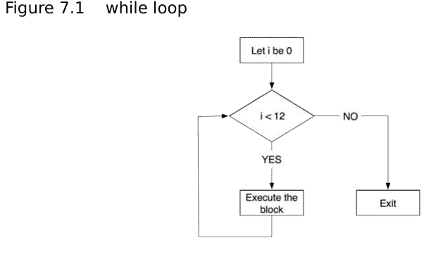

### for 循环

`while` 循环是一种通用的循环结构，但 C 程序员经常使用相同的基本模式：`一些初始化 while (一些检查) { 一些代码 一些最后一步 }`

因此，C 语言提供了一种快捷方式：`for` 循环。在 `for` 循环中，上述模式变为：

```c
for (一些初始化; 一些检查; 一些最后一步) {
    一些代码;
}
```

将程序修改为使用 `for` 循环：

```c
#include <stdio.h>
int main(int argc, const char * argv[])
{
    for (int i = 0; i < 12; i++) {
        printf("%d. Aaron is Cool\n", i);
    }
    return 0;
}
```

**图 7.2 for 循环**

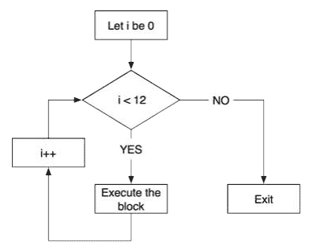

注意，在这个简单的循环示例中，你使用循环来规定某事发生的次数。然而，更常见的情况是，循环被用来*遍历*一组项目，例如一个姓名列表。例如，我可以修改此程序，使其结合朋友姓名列表使用循环。每次循环时，不同的朋友都会变得“酷”。从第 15 章开始，我们将看到更多关于集合和循环的内容。

### break

有时需要从循环内部停止循环的执行。例如，假设你想遍历正整数以寻找数字 *x*，其中 *x + 90 = x²*。你的计划是遍历 0 到 11 的整数，并在找到解决方案时跳出循环。修改代码：

```c
#include <stdio.h>
int main(int argc, const char * argv[])
{
    int i;
    for (i = 0; i < 12; i++) {
        printf("Checking i = %d\n", i);
        if (i + 90 == i * i) {
            break;
        }
    }
    printf("The answer is %d.\n", i);
    return 0;
}
```

构建并运行程序。你应该看到：

```text
Checking i = 0
Checking i = 1
Checking i = 2
Checking i = 3
Checking i = 4
Checking i = 5
Checking i = 6
Checking i = 7
Checking i = 8
Checking i = 9
Checking i = 10
The answer is 10.
```

请注意，当调用 `break` 时，执行直接跳过代码块的剩余部分。

**图 7.3 跳出循环**

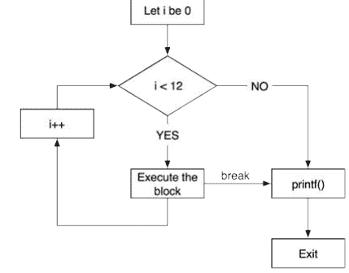

### continue

有时你会发现自己处于代码块的中间，需要说：“忘记这次代码块执行的其余部分，开始下一次代码块执行。” 这是通过 `continue` 命令完成的。例如，如果你相当确定 3 的倍数不满足方程怎么办？你如何避免浪费宝贵的时间去检查它们？

```c
#include <stdio.h>
int main(int argc, const char * argv[])
{
    int i;
    for (i = 0; i < 12; i++) {
        if (i % 3 == 0) {
            continue;
        }
        printf("Checking i = %d\n", i);
        if (i + 90 == i * i) {
            break;
        }
    }
    printf("The answer is %d.\n", i);
    return 0;
}
```

构建并运行它：

```text
Checking i = 1
Checking i = 2
Checking i = 4
Checking i = 5
Checking i = 7
Checking i = 8
Checking i = 10
The answer is 10.
```

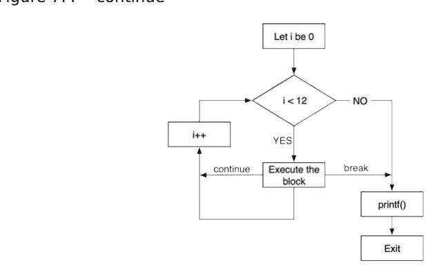

### do-while 循环

没有酷孩子使用 `do-while` 循环，但为了完整性，这里介绍它。`do-while` 循环在执行为代码块之前不检查表达式。因此，它确保代码块至少执行一次。如果你重写最初的练习以使用 `do-while` 循环，它看起来像这样：

```c
int main(int argc, const char * argv[]) 
{
    int i = 0;
    do {
        printf("%d. Aaron is Cool\n", i);
        i++;
    } while (i < 13);
    return 0;
}
```

注意末尾的分号。这是因为与其他循环不同，`do-while` 循环实际上是一个长的语句：

```text
do { something } while ( something else stays true );
```

下面是这个 do-while 循环的流程图：

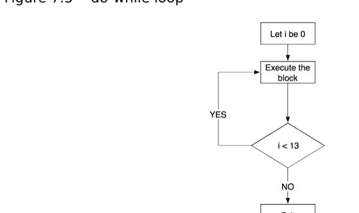

### 挑战

编写一个程序，从 99 倒数到 0，步长为 3，打印每个数字。但是，如果该数字能被 5 整除，还应该打印单词“Found one!”。因此，输出应该看起来像这样：

```text
99
96
93
90
Found one!
87
...
0
Found one!
```

## 地址和指针

你的电脑核心是一个处理器（中央处理器或 CPU）和一片巨大的开关草地（随机访问内存或 RAM），这些开关可以被处理器打开或关闭。我们说一个开关保存一个*比特*的信息。你经常会看到 1 用来表示“开”，0 用来表示“关。”

八个这样的开关构成一个*字节*的信息。处理器可以获取这些开关的状态，对比特位进行操作，并将结果存储在另一组开关中。例如，处理器可能从某处获取一个字节，从另一处获取另一个字节，将它们相加，并将结果存储在遥远的某个地方的一个字节中。

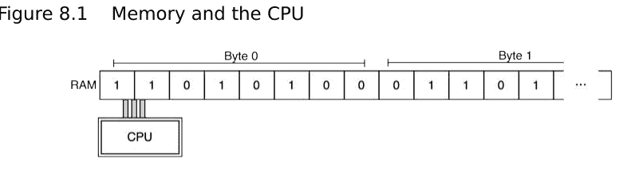

内存是经过编号的，我们通常谈论特定数据字节的*地址*。当人们谈论 32 位 CPU 或 64 位 CPU 时，他们通常指的是地址的大小。64 位 CPU 可以处理的内存远比 32 位 CPU 多。

### 获取地址

在 Xcode 中创建一个新的项目：一个名为 `Addresses` 的 C 命令行工具。

变量的地址是存储该变量值的内存位置。要获取变量的地址，你需要使用 `&` 运算符：

```c
#include <stdio.h>
int main(int argc, const char * argv[])
{
    int i = 17;
    printf("i stores its value at %p\n", &i);
    return 0;
}
```

注意 `%p` 标记。这是你可以用内存地址替换的标记。构建并运行程序。你将看到类似以下内容：

```text
i stores its value at 0xbffff738
```

虽然你的电脑可能会将 `i` 放在完全不同的地址。内存地址几乎总是以十六进制格式打印。

在计算机中，一切都存储在内存中，因此一切都具有地址。例如，一个函数从某个特定地址开始。要获取该地址，你只需使用函数名：

```c
int main(int argc, const char * argv[])
{
    int i = 17;
    printf("i stores its value at %p\n", &i);
    printf("this function starts at %p\n", main);
    return 0;
}
```

构建并运行程序。

### 在指针中存储地址

如果你想在一个变量中存储一个地址怎么办？你可以把它塞进一个大小合适的无符号整数中，但如果你在指定该变量类型时更具体，编译器可以帮助你捕捉错误。例如，如果你想要一个名为 `ptr` 的变量，它保存可以找到浮点数的地址，你会这样声明它：

```c
float *ptr;
```

我们说 `ptr` 是一个指向浮点数的*指针*变量。它不存储浮点数的值；它指向可能存储浮点数的地址。

声明一个名为 `addressOfI` 的新变量，它是指向 `int` 的指针。将 `i` 的地址赋值给它。

```c
int main(int argc, const char * argv[])
{
    int i = 17;
    int *addressOfI = &i;
    printf("i stores its value at %p\n", addressOfI);
    printf("this function starts at %p\n", main);
    return 0;
}
```

构建并运行程序。你应该看不到其行为有任何变化。

我们现在使用整数只是为了简单起见。但如果你想知道指针的意义何在，我理解你。传递分配给此变量的整数值与传递其地址一样容易。然而，很快，你的数据将比单个整数大得多，复杂得多。这就是为什么我们传递地址。并不总是可以传递你要操作的数据的副本，但你总是可以传递该数据起始位置的*地址*。一旦你有了它的地址，访问数据就很容易了。

## 获取地址处的数据

如果你有某个地址，可以使用 `*` 运算符来获取存储在该处的数据。请让日志显示存储在 `addressOfI` 中的整数值。

```c
int main(int argc, const char * argv[])
{
    int i = 17;
    int *addressOfI = &i;
    printf("i stores its value at @%p\n", addressOfI);
    printf("this function starts at @%p\n", main);
    printf("the int stored at addressOfI is %d\n", *addressOfI);
    return 0;
}
```

请注意，星号在两个不同的地方被使用。第一处是在声明中，你声明变量 `addressOfI` 为一个 int *。也就是说，它是一个指向可以存储 int 值的地方的指针。

第二处是你读取存储在 `addressOfI` 中地址处的 int 值的位置。（指针也被称为引用。因此，使用指针读取地址处的数据有时被称为对指针进行*解引用*。）

你还可以在赋值语句的左侧使用 `*` 运算符，以便将数据存储到特定地址：

```c
int main(int argc, const char * argv[])
{
    int i = 17;
    int *addressOfI = &i;
    printf("i stores its value at @%p\n", addressOfI);
    *addressOfI = 89;
    printf("Now i is %d\n", i);
    return 0;
}
```

编译并运行你的程序。

如果你脑海中还没有完全理清指针的概念，请不要担心。我们将在这本书中花大量时间处理指针，所以你会得到充分的练习。

现在让我们制造一个常见的编程错误。移除 `main()` 第四行中的 `*`，使其变为：

```c
addressOfI = 89;
```

注意 Xcode 会弹出一个警告，说“在不兼容的整型到指针转换中，将 ‘int’ 赋值给 ‘int *’。” 修复这个问题。

## 多少字节？

既然所有内容都存储在内存中，而且你现在知道如何找到数据起始的地址，下一个问题就是“这种数据类型占用多少字节？”

使用 `sizeof()` 你可以查找数据类型的大小。例如，

```c
int main(int argc, const char * argv[])
{
    int i = 17;
    int *addressOfI = &i;
    printf("i stores its value at %p\n", addressOfI);
    *addressOfI = 89;
    printf("Now i is %d\n", i);
    printf("An int is %zu bytes\n", sizeof(int));
    printf("A pointer is %zu bytes\n", sizeof(int *));
    return 0;
}
```

我们在对 `printf()` 的调用中看到了另一个新的标记：`%zu`。`sizeof()` 函数返回类型为 size_t 的值，而 `%zu` 是正确的占位符标记。这个标记在实际中不太常见。编译并运行该程序。如果你的指针长度为 4 字节，你的程序正在 32 位模式下运行。如果你的指针长度为 8 字节，你的程序正在 64 位模式下运行。

`sizeof()` 也可以接受变量作为参数，因此你可以像这样编写上一个程序：

```c
int main(int argc, const char * argv[])
{
    int i = 17;
    int *addressOfI = &i;
    printf("i stores its value at %p\n", addressOfI);
    *addressOfI = 89;
    printf("Now i is %d\n", i);
    printf("An int is %zu bytes\n", sizeof(i));
    printf("A pointer is %zu bytes\n", sizeof(addressOfI));
    return 0;
}
```

## NULL

有时你需要一个指向无内容的指针。也就是说，你有一个可以保存地址的变量，并且希望在其中存储某些内容，以明确表示该变量没有指向任何东西。我们对此使用 `NULL`：

```c
float *myPointer;
// 暂时将 myPointer 设置为 NULL，我稍后会在程序中
// 在那里存储一个指针
myPointer = NULL;
```

什么是 `NULL`？记住，地址只是一个数字。`NULL` 是零。这在 if 语句中非常有用：

```c
float *myPointer;
...
// myPointer 是否已设置？
if (myPointer) {
    // myPointer 不为 NULL
    ...对 myPointer 处的数据执行某些操作...
} else {
    // myPointer 为 NULL
}
```

稍后，当我们讨论指向对象的指针时，我们将使用 nil 代替 `NULL`。它们是等价的，但 Objective-C 程序员使用 nil 来表示没有对象驻留的地址。

## 时尚的指针声明

当你声明一个指向 float 的指针时，它看起来像这样：

```c
float *powerPtr;
```

因为类型是指向 float 的指针，你可能会想这样写：

```c
float* powerPtr;
```

这样也可以，编译器会允许你这样做。但是，时尚的程序员不会这样做。

为什么？你可以在一行中声明多个变量。例如，如果我想要声明变量 x、y 和 z，我可以这样做：

```c
float x, y, z;
```

每一个都是 float。

你认为这些是什么？

```c
float* b, c;
```

惊讶！`b` 是指向 float 的指针，但 `c` 只是一个 float。如果你希望它们都是指针，你必须在每一个前面加上 `*`：

```c
float *b, *c;
```

将 `*` 直接放在变量名旁边会使这一点更清楚。

### 挑战

- 编写一个程序，显示 float 占用了多少内存。
- 在你的 Mac 上，short 是一个 2 字节的整数，并且使用一位来存储符号（正或负）。它能存储的最小数字是多少？最大是多少？unsigned short 只存储非负数。它能存储的最大数字是多少？

## 按引用传递

有一个标准的 C 函数叫做 `modf()`。你给 `modf()` 一个 double，它会计算该数字的整数部分和小数部分。例如，如果你给它 3.14，3 是整数部分，0.14 是小数部分。

作为 `modf()` 的调用者，你想要两部分。然而，C 函数只能返回一个值。`modf()` 如何给你这两个信息片段？

当你调用 `modf()` 时，你需要提供一个地址，它可以将其中一个数字暂存其中。具体来说，它将返回小数部分，并将整数部分复制到你提供的地址。创建一个新项目：一个名为 `PBR` 的 C 命令行工具。

编辑 `main.c`：

```c
#include <stdio.h>
#include <math.h>
```


```c
int main(int argc, const char * argv[])
{
    double pi = 3.14;
    double integerPart;
    double fractionPart;
    // 将 integerPart 的地址作为参数传递
    fractionPart = modf(pi, &integerPart);
    // 查找存储在 integerPart 中的值
    printf("integerPart = %.0f, fractionPart = %.2f\n", integerPart, fractionPart);
    return 0;
}
```

这被称为*按引用传递*。也就是说，你提供一个地址（也称为“引用”），函数将数据放在那里。

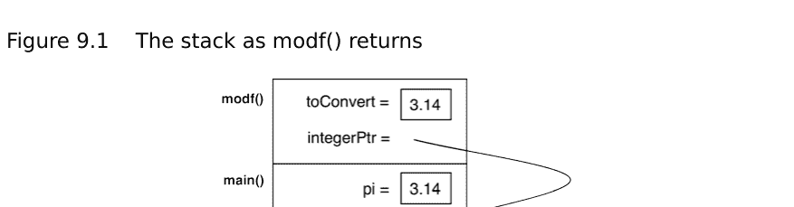

以下是思考按引用传递的另一种方式。想象你向间谍分发任务。你可能会告诉其中一个，“我需要财政部长与他女朋友的照片。我在公园天使雕像脚下留了一小段钢管。当你拿到照片后，将它们卷起来并留在管子里。我会在周二午餐后去取。” 在间谍行业中，这被称为*死信箱*。

`modf()` 就像死信箱一样工作。你请求它执行并告知它结果可以放置的位置，以便稍后你可以找到它。唯一的区别是，你给它的是内存中结果可以放置的位置，而不是钢管。

### 编写按引用传递函数

有两种流行的描述二维空间中点位置的方法：笛卡尔坐标和极坐标。在笛卡尔坐标中，`(x, y)` 表示你应该向右移动 *x*，然后向上移动 *y*。在极坐标中，`(theta, radius)` 表示你应该向左旋转 *theta* 弧度并向前移动 *radius*。

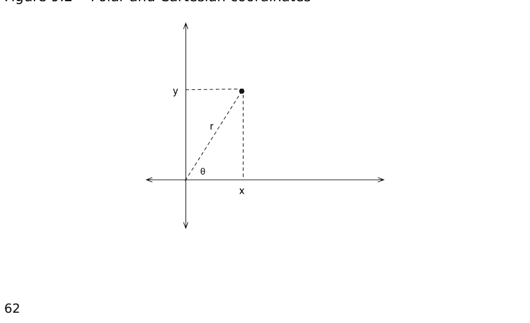

如果你想要编写一个将笛卡尔坐标中的点转换为极坐标的函数怎么办？它需要读取两个浮点数并返回两个浮点数。函数的声明将如下所示：

```c
void cartesianToPolar(float x, float y, float *rPtr, float *thetaPtr)
```

也就是说，当函数被调用时，它将传入 `x` 和 `y` 的值。它还将提供存储 `radius` 和 `theta` 值的位置。

现在在 `main.c` 文件顶部附近编写该函数并从 `main()` 中调用它：

```c
#include <stdio.h>
#include <math.h>
void cartesianToPolar(float x, float y, double *rPtr, double *thetaPtr)
{
    // 将半径存储在你提供的地址中
    *rPtr = sqrt(x * x + y * y);
    // 计算 theta
    float theta;
    if (x == 0.0) {
        if (y == 0.0) {
            theta = 0.0; // 技术上被认为是未定义的
        } else if (y > 0) {
            theta = M_PI_2;
        } else {
            theta = - M_PI_2;
        }
    } else {
        theta = atan(y/x);
    }
    // 将 theta 存储在你提供的地址中
    *thetaPtr = theta;
}
int main(int argc, const char * argv[])
{
    double pi = 3.14;
    double integerPart;
    double fractionPart;
    // 将 integerPart 的地址作为参数传递
    fractionPart = modf(pi, &integerPart);
    // 查找存储在 integerPart 中的值
    printf("integerPart = %.0f, fractionPart = %.2f\n", integerPart, fractionPart);
    double x = 3.0;
    double y = 4.0;
    double radius;
    double angle;
    cartesianToPolar(x, y, &radius, &angle);
    printf("(%.2f, %.2f) becomes (%.2f radians, %.2f)\n", x, y, radius, angle);
    return 0;
}
```

编译并运行该程序。

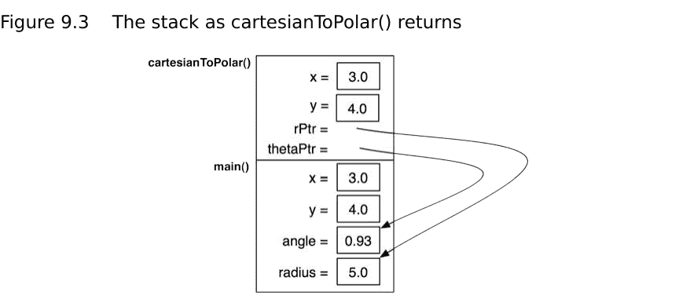

## 避免解引用 NULL

有时函数可以通过引用提供许多值，但你可能只关心其中的一部分。当你根本不打算使用这些值时，如何避免声明这些变量并传递它们的地址？通常，你传递 `NULL` 作为地址，以告知函数“我不需要这个特定的值。”

这意味着在解引用指针之前，你应始终检查以确保指针非 `NULL`。在 `cartesianToPolar()` 中添加这些检查：

```c
void cartesianToPolar(float x, float y, double *rPtr, double *thetaPtr)
{
    // rPtr 是否非 NULL？
    if (rPtr) {
        // 将半径存储到提供的地址中
        *rPtr = sqrt(x * x + y * y);
    }
    // thetaPtr 是否为 NULL？
    if (!thetaPtr) {
        // 跳过函数其余部分
        return;
    }
    // 计算 theta
    float theta;
    if (x == 0.0) {
        if (y == 0.0) {
            theta = 0.0;     // 技术上被视为未定义
        } else if (y > 0) {
            theta = M_PI_2;
        } else {
            theta = - M_PI_2;
        }
    } else {
        ...
    }
}
```

## 10 结构体

有时你需要一个变量来持有几个相关的数据块。例如，假设你正在编写一个计算人体质量指数（BMI）的程序。（你的 BMI 是多少？它是你的体重（公斤）除以身高（米）的平方。BMI 低于 20 表明你体重可能偏轻。BMI 高于 30 表明你可能是肥胖。这是一个测量人体健康程度非常不精确的工具，但它是编程的一个绝佳例子。）就你而言，一个人由一个代表身高（米）的 `float` 和一个代表体重（公斤）的 `int` 组成。

现在你要创建自己的 `Person` 类型。类型为 `Person` 的变量将是一个结构体，并拥有两个成员：一个名为 `heightInMeters` 的 `float` 和一个名为 `weightInKilos` 的 `int`。

创建一个新项目：一个名为 `BMICalc` 的 C 命令行工具。编辑 `main.c` 以创建一个包含某人所需数据的结构体：

```c
#include <stdio.h>
// 这是 struct Person 的声明
struct Person {
  float heightInMeters;
  int weightInKilos;
};
int main(int argc, const char * argv[]) {
  struct Person person;
  person.weightInKilos = 96;
  person.heightInMeters = 1.8;
  printf("person weighs %i kilograms\n", person.weightInKilos);
  printf("person is %.2f meters tall\n", person.heightInMeters);
  return 0;
}
```

注意，你使用点号（`.`）来访问结构体的成员。

以下是 `main()` 的帧，此时结构体的成员已被赋值。

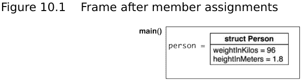

大多数时候，你会反复使用同一个结构体声明。因此，为结构体类型创建一个 `typedef` 很常见。`typedef` 为类型声明定义了一个别名，使我们能够更像使用常规数据类型那样使用它。修改 `main.c` 以创建并使用 `struct` 的 *Person* 的 `typedef`：

```c
#include <stdio.h>
// 这是 type Person 的声明
typedef struct {
  float heightInMeters;
  int weightInKilos;
} Person;
int main(int argc, const char * argv[])
{
  Person person;
  person.weightInKilos = 96;
  person.heightInMeters = 1.8;
  printf("person weighs %i kilograms\n", person.weightInKilos);
  printf("person is %.2f meters tall\n", person.heightInMeters);
  return 0;
}
```

现在你已经创建了一个 `typedef`，你可以将 *Person* 结构体传递给另一个函数。添加一个名为 *bodyMassIndex()* 的函数，该函数接受 *Person* 作为参数并计算 BMI。然后更新 `main()` 以调用它：

```c
#include <stdio.h>
// 这是 type Person 的声明
typedef struct {
  float heightInMeters;
  int weightInKilos;
} Person;
float bodyMassIndex(Person p)
{
  return p.weightInKilos / (p.heightInMeters * p.heightInMeters);
}
int main(int argc, const char * argv[])
{
  Person person;
  person.weightInKilos = 96;
  person.heightInMeters = 1.8;
  float bmi = bodyMassIndex(person);
  printf("person has a BMI of %.2f\n", bmi);
  return 0;
}
```

### 挑战

我作为程序员处理的第一个结构体是 `struct` *tm*，标准 C 库使用它来存储分解到各个组成部分的时间。该结构体定义如下：

```c
struct tm {
  int tm_sec;  /* 分钟后的秒数 [0-60] */
  int tm_min;  /* 小时后的分钟数 [0-59] */
  int tm_hour; /* 午夜后的小时数 [0-23] */
  int tm_mday; /* 月份中的天数 [1-31] */
  int tm_mon;  /* 一月以来的月份数 [0-11] */
  int tm_year; /* 1900 年以来的年数 */
  int tm_wday; /* 周日以来的天数 [0-6] */
  int tm_yday; /* 1 月 1 日以来的天数 [0-365] */
  int tm_isdst;      /* 夏令时标志 */
  long      tm_gmtoff;     /* 相对于 UTC 的偏移量（秒） */
  char      *tm_zone;      /* 时区缩写 */
};
```

函数 `time()` 返回自 1970 年格林威治时间第一刻以来的秒数。`localtime_r()` 可以读取该时长并将合适的值打包到一个 `struct tm` 中。（它实际上接收自 1970 年以来秒数的 *地址* 和一个 `struct tm` 的 *地址*。）因此，将当前时间获取为 `struct tm` 看起来像这样：

```c
long secondsSince1970 = time(NULL);
printf("It has been %ld seconds since 1970\n", secondsSince1970);
struct tm now;
localtime_r(&secondsSince1970, &now);
printf("The time is %d:%d:%d\n", now.tm_hour, now.tm_min, now.tm_sec);
```

挑战是编写一个程序，告诉你在 400 万秒后日期会是多少（4-30-2015 格式即可）。

（一个提示：`tm_mon = 0` 表示一月，所以记得加 1。另外，在程序开头包含 `<time.h>` 头文件。）

## 11 堆

到目前为止，你的程序只使用了堆栈帧中的内存。这些内存会在函数开始时自动分配，并在函数结束时自动销毁。（事实上，局部变量通常被称为 *自动变量*，正因为这种便利的行为。）

然而，有时你需要明确声明一长串字节内存并在许多函数中使用它。例如，你可能会将文本文件读入内存，然后调用一个函数来统计该内存中的所有元音字母。通常，当你用完文本后，你会让程序知道你已经完成，以便程序可以将该内存用于其他用途。

程序员通常使用 *buffer*（缓冲区）一词来指代一长串字节内存。（这就解释了“缓冲”这个术语，用于描述等待 YouTube 发送足够字节以便那段猫视频开始播放的等待时间。）

你使用函数 `malloc()` 来申请一块内存缓冲区。该缓冲区来自内存中被称为 *堆*（heap）的区域，它与堆栈是分开的。当你使用完缓冲区后，你调用函数 `free()` 释放对该内存的声明并将其返回给堆。假设，例如，我需要一块足以容纳 1,000 个 `float` 的内存块。

```c
#include <stdio.h>
#include <stdlib.h> // malloc 和 free 在 stdlib 中
int main(int argc, const char * argv[]) {
    // 声明一个指针
    float *startOfBuffer;
    // 请求使用堆中的一些字节
    startOfBuffer = malloc(1000 * sizeof(float));
    // ...在这里使用缓冲区...
    // 放弃你对内存的声明，以便它可以被重用
    free(startOfBuffer);
    // 忘记该内存的位置
    startOfBuffer = NULL;
    return 0;
}
```

`startOfBuffer` 将是指向缓冲区中第一个浮点数的指针。

图 11.1 指向堆上缓冲区的堆栈指针

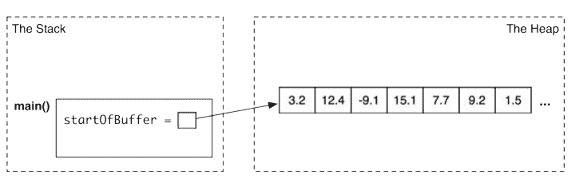

在此处，大多数 C 语言书籍会花大量时间讨论如何在该浮点数缓冲区的各个位置读取和写入数据。然而，这本书正试图尽快让你进入面向对象的世界。因此，我们将把 C 数组和指针算术留到后面再讲。

你也可以使用 `malloc()` 在堆上申请结构体的空间。例如，如果你想在堆上分配一个 `Person` 结构体，你可能会有一个像这样的程序：

```c
#include <stdio.h>
#include <stdlib.h>
typedef struct {
    float heightInMeters;
    int weightInKilos;
} Person;
float bodyMassIndex(Person *p)
{
    return p->weightInKilos / (p->heightInMeters * p->heightInMeters);
}
int main(int argc, const char * argv[])
{
    // 为一个人结构体分配内存
    Person *x = (Person *)malloc(sizeof(Person));
    // 填写结构体的两个成员
    x->weightInKilos = 81;
    x->heightInMeters = 2.0;
    // 打印原始 Person 的 BMI
    float xBMI = bodyMassIndex(x);
    printf("x has a BMI of %f\n", xBMI);
    // 让内存被回收
    free(x);
    // 忘记它在哪里
    x = NULL;
    return 0;
}
```


# 第三部分
## Objective-C 与 Foundation

既然你已经对程序、函数、变量和数据类型的基础知识有了了解，那么你就准备好学习 Objective-C 了。为了将重点放在编程本质上，我们暂时还是会使用命令行程序。

所有的 Objective-C 编程都是使用 Foundation 框架完成的。*框架* 是你用来编写程序的类库。什么是类？这就是我们要首先讨论的内容……

### 12 对象

许多计算机语言都有*对象*的概念。对象类似于结构体，因为它们都存储数据。然而，与结构体不同，对象还包含一组对该数据执行操作的功能。要触发这些功能中的一个，你需要向对象发送一条*消息*。为了使用准确的术语，由消息触发的函数被称为*方法*。

在 20 世纪 80 年代初，Brad Cox 和 Tom Love 决定将面向对象的思想添加到 C 语言中。对于对象，他们基于在堆上分配的结构体概念进行构建，并添加了消息发送语法。结果就是 Objective-C 语言。

对象天生就非常“健谈”。它们执行工作并发送和接收关于其所做工作的消息。一个复杂的 Objective-C 程序可能同时在内存中有数百个对象，它们执行工作并相互发送消息。

*类*描述了一种特定类型的对象。这种描述包括方法以及*实例变量*，该类型的对象在其中存储其数据。你可以请求该类在堆上为你创建其类型的一个对象。我们说生成的对象是该类的一个*实例*。

例如，iPhone 自带许多类，其中之一是 `CLLocation`。你可以请求 `CLLocation` 类创建 `CLLocation` 的一个*实例*。在这个 `CLLocation` 对象内部有几个存储位置数据（如经度、纬度和海拔）的实例变量。该对象还有几个方法。例如，你可以询问一个 `CLLocation` 实例距离另一个 `CLLocation` 对象有多远。

#### 创建和使用你的第一个对象

现在你要创建你的第一个 Objective-C 程序。创建一个新的项目：一个命令行工具，但不要选择 C，而是将其类型设置为 Foundation。将其命名为 TimeAfterTime。

**图 12.1 创建 Foundation 命令行工具**

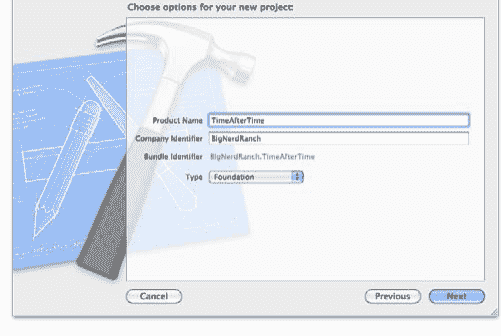

包含 Objective-C 代码的文件通常以后缀 `.m` 命名。找到并打开 `main.m`，输入以下两行代码：

```objectivec

#import <Foundation/Foundation.h>

int main (int argc, const char * argv[]) {

@autoreleasepool {

NSDate *now = [NSDate date];

NSLog(@"The new date lives at %p", now);

}

return 0;

}

```

瞧！你发送了第一条消息。你向 `NSDate` 类发送了 `date` 消息。`date` 方法要求 `NSDate` 类创建 `NSDate` 的一个实例，将其初始化为当前日期/时间，并返回新对象开始的地址。然后你将返回的地址存储在变量 `now` 中。这个变量是一个指向 `NSDate` 对象的指针。

`NSLog()` 是一个 Objective-C 函数，类似于 `printf()`；它接收一个格式字符串，将 `%` 令牌替换为实际值，并将结果写入控制台。然而，其格式字符串始终以 `@` 开头，并且末尾不需要 `\n`。

构建并运行该程序。你应该看到类似这样的输出：

2011-08-05 11:53:54.366 TimeAfterTime[4862:707] The new date lives at 0x001114dc0

与 `printf()` 不同，`NSLog()` 会在其输出前加上日期、时间、程序名称和进程 ID。从现在开始，当我展示 `NSLog()` 的输出时，我会省略这些数据显示 – 页面太窄了。

在 `NSLog()` 中，`%p` 打印出了对象的位置。要打印出更像日期的内容，你可以使用 `%@`，它要求对象将自身描述为一个字符串：

```objectivec

#import <Foundation/Foundation.h>

int main (int argc, const char * argv[])

{

    @autoreleasepool {

        NSDate *now = [NSDate date];

        NSLog(@"The date is %@", now);

    }

    return 0;

}

```

现在你应该看到类似这样的输出：

The date is 2011-08-05 16:09:14 +0000

#### 消息的结构

消息发送总是用方括号包围，并且它始终至少包含两个部分：

- 接收消息的对象的指针
- 要触发的方法的名称

消息发送（就像函数调用一样）也可以包含参数。让我们看一个例子。

`NSDate` 对象代表特定的日期和时间。一个 `NSDate` 实例可以告诉你它所代表的日期/时间与 1970 年 1 月 1 日 12:00 AM（GMT）之间的差值（以秒为单位）。通过向 `now` 指针指向的 `NSDate` 对象发送消息 `timeIntervalSince1970` 来询问你的对象这个问题。

```objectivec

#import <Foundation/Foundation.h>

int main (int argc, const char * argv[])

{

    @autoreleasepool {

        NSDate *now = [NSDate date];

        NSLog(@"The date is %@", now);

        double seconds = [now timeIntervalSince1970];

        NSLog(@"It has been %f seconds since the start of 1970.", seconds);

    }

    return 0;

}

```

现在假设你希望有一个新的日期对象 – 一个比现有对象晚 100,000 秒的对象。`NSDate` 类有一个名为 `dateByAddingTimeInterval:` 的方法。你可以向原始日期对象发送此消息以获得新的日期对象。此方法接受一个参数：要添加的秒数。在 `main()` 函数中使用它来创建一个新日期对象：

```objectivec

#import <Foundation/Foundation.h>

int main (int argc, const char * argv[])

{

    @autoreleasepool {

        NSDate *now = [NSDate date];

        NSLog(@"The date is %@", now);

        double seconds = [now timeIntervalSince1970];

        NSLog(@"It has been %f seconds since the start of 1970.", seconds);

        NSDate *later = [now dateByAddingTimeInterval:100000];

        NSLog(@"In 100,000 seconds it will be %@", later);

    }

    return 0;

}

```

在消息发送 `[now dateByAddingTimeInterval:100000]` 中：

- `now` 是接收消息的对象的指针（也称为“接收者”）
- `dateByAddingTimeInterval:` 是方法名称（也称为“选择器”）
- `100000` 是唯一的参数

**图 12.2 消息发送**

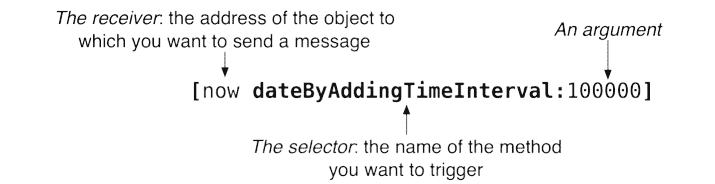

#### 内存中的对象

图 12.3 是一个*对象图*。该图显示了堆上的两个 `NSDate` 实例。两个变量 `now` 和 `later` 是函数 `main()` 栈帧的一部分。它们指向 `NSDate` 对象，如箭头所示。

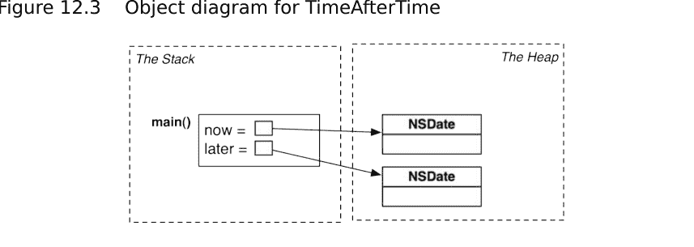

到目前为止，你只看到一个类：`NSDate`。实际上，iOS 和 Mac OS X 附带了数百个类。我们将在接下来的章节中处理其中一些更常见的类。

#### id

在声明一个用来持有对象的指针时，大多数时候你都会指定指针所引用的对象的类：

```objectivec

NSDate *expiration;

```

然而，经常需要一种方式来创建指针，而不知道指针确切引用的是什么类型的对象。对于这种情况，我们使用类型 `id` 来表示“指向某种 Objective-C 对象的指针”。使用时它是这样的：

```objectivec

id delegate;

```

注意此声明中没有星号。`id` 暗示了星号。

类、对象、消息和方法的概念一开始可能很难理解。如果你对象象感到有点不确定，请不要担心。这仅仅是个开始。你会反复使用这些模式，并且每次使用它们都会更有意义。

### 挑战

使用两个 `NSDate` 实例来计算你已经活了多久（以秒为单位）。提示：以下是如何使用年、月等信息创建一个新的日期对象的方法：

```objectivec

NSDateComponents *comps = [[NSDateComponents alloc] init];

[comps setYear:1969];

[comps setMonth:4];

[comps setDay:30];

[comps setHour:13];

[comps setMinute:10];

[comps setSecond:0];

NSCalendar *g = [[NSCalendar alloc] initWithCalendarIdentifier:NSGregorianCalendar];

NSDate *dateOfBirth = [g dateFromComponents:comps];

```

要获取两个 `NSDate` 实例之间的秒数，请使用 `timeIntervalSinceDate:` 方法。

```objectivec

double d = [laterDate timeIntervalSinceDate:earlierDate];

```

## 13

### 更多消息

在上一章中，你发送了一些消息。让我们再次查看那些发送消息并触发相应方法的代码行：

```objectivec

NSDate *now = [NSDate date];

```

我们说 `date` 方法是一个 *类方法*。也就是说，你通过向 `NSDate` *类* 发送消息来执行该方法。`date` 方法返回指向 `NSDate` 实例的指针。

```objectivec

double seconds = [now timeIntervalSince1970];

```

我们说 `timeIntervalSince1970` 是一个 *实例方法*。你通过向类的*实例* 发送消息来执行该方法。`timeIntervalSince1970` 方法返回一个 `double`。

```objectivec

NSDate *later = [now dateByAddingTimeInterval:100000];

```

`dateByAddingTimeInterval:` 是另一个实例方法。该方法接受一个参数。你可以通过方法名中的冒号来确定这一点。该方法也返回指向 `NSDate` 实例的指针。

### 嵌套消息发送

有一个类方法 `alloc`，它返回一个指向需要初始化的新对象的指针。然后使用这个指针向新对象发送 `init` 消息。使用 `alloc` 和 `init` 是 Objective-C 中创建对象最常见的方式。在代码的一行中通过*嵌套*消息发送来同时发送这两条消息是一种良好的编程习惯（也是苹果认可的唯一方式）：

```objectivec

[[NSDate alloc] init];

```

系统会先执行内部的消息，然后执行包含它们的消息。因此，`alloc` 被发送给 `NSDate` *类*，其结果（指向新创建实例的指针）随后被发送 `init`。

`init` 返回新对象的指针（几乎总是来自 `alloc` 方法的指针），因此我们可以使用 `init` 返回的值进行赋值。通过修改下面这行代码，在你的代码中尝试这些嵌套消息：

```objectivec

NSDate *now = [NSDate date];

```

改为

```objectivec

NSDate *now = [[NSDate alloc] init];

```

### 多个参数

一些方法接受多个参数。例如，`NSDate` 对象不知道它是当月的第几天。如果你需要这些信息，你会使用 `NSCalendar` 对象。能够告诉你当月日期的 `NSCalendar` 方法接受三个参数。创建一个 `NSCalendar` 对象并在 `main.m` 中使用它：

```objectivec

#import <Foundation/Foundation.h>

int main (int argc, const char * argv[])

{

    @autoreleasepool {

        NSDate *now = [[NSDate alloc] init];

        NSLog(@"The date is %@", now);

        double seconds = [now timeIntervalSince1970];

        NSLog(@"It has been %f seconds since the start of 1970.", seconds);

        NSDate *later = [now dateByAddingTimeInterval:100000];

        NSLog(@"In 100,000 seconds it will be %@", later);

        NSCalendar *cal = [NSCalendar currentCalendar];

        NSUInteger day = [cal ordinalityOfUnit:NSDayCalendarUnit

                                 inUnit:NSMonthCalendarUnit

                               forDate:now];

        NSLog(@"This is day %lu of the month", day);

    }

    return 0;

}

```

该方法的名称是 `ordinalityOfUnit:inUnit:forDate:`，它接受三个参数。你可以看出，因为方法名中包含三个冒号。请注意，我将该消息发送分成了三行。这是可以的；编译器不介意额外的空白。Objective-C 程序员通常会将冒号对齐，以便轻松区分方法名的部分和参数。（Xcode 应该为你做到这一点：每次你开始新的一行时，上一行应该正确缩进。如果情况并非如此，请检查你的 Xcode 偏好设置中的缩进。）

该方法的第一个和第二个参数是常量 `NSDayCalendarUnit` 和 `NSMonthCalendarUnit`。这些常量在 `NSCalendar` 类中定义。它们告诉方法你想了解它在一个月份中的第几天。第三个参数是你想要了解其信息的日期。

如果你想要知道一年中的小时数，而不是当月的天数，你可以使用这些常量：

```objectivec

NSUInteger hour = [cal ordinalityOfUnit:NSHourCalendarUnit

                            inUnit:NSYearCalendarUnit

                          forDate:now];

```

### 向 nil 发送消息

几乎所有面向对象的语言都有 *nil* 的概念，即指向无对象的指针。在 Objective-C 中，`nil` 是零指针（与 `NULL` 相同，这在第 8 章中讨论过）。

在大多数面向对象的语言中，不允许向 `nil` 发送消息。结果是，在访问对象之前，你必须检查其非 nil 性。因此，你经常会看到这样的代码：

```objectivec

if (fido != nil) {

	[fido goGetTheNewspaper];

}

```

在设计 Objective-C 时，决定向 nil 发送消息是允许的；它只是根本不会做任何事情。因此，这段代码是完全合法的：

```objectivec

Dog *fido = nil;

[fido goGetTheNewspaper];

```

- 重要事项 #1：如果你正在发送消息但没有发生任何事情，请确保你没有向一个被设置为 nil 的指针发送消息。
- 重要事项 #2：如果你向 nil 发送消息，返回值没有意义。

```objectivec

Dog *fido = nil;

Newspaper *daily = [fido goGetTheNewspaper];
```


在这种情况下，`daily`将为零。（一般来说，如果你期望结果是一个数字或指针，向`nil`发送消息将返回零。但是，对于其他类型，如结构体，你会得到奇怪且意想不到的返回值。）

### 挑战

在你的 Mac 上，有一个名为`NSTimeZone`的类。在其许多方法中，有类方法`systemTimeZone`，它返回计算机的时区（作为`NSTimeZone`的实例），以及实例方法`isDaylightSavingTime`，如果当前时区处于夏令时则返回`YES`。

编写一个`Foundation`命令行工具，告诉你当前是否处于夏令时。

## 14

## `NSSString`

`NSSString`是另一个类似`NSDate`的类。`NSSString`的实例保存字符串。在代码中，你可以像这样创建`NSSString`的字面实例；

```objectivec
NSSString *lament = @"Why me!?";
```

在你的`TimeAfterTime`项目中，你输入了这段代码：

```objectivec
NSLog(@"The date is %@", now);
```

`NSLog()`是一个 Objective-C 函数（不是方法！），其行为与`printf()`非常相似。然而，在`NSLog()`中，格式字符串实际上是`NSSString`的一个实例。

还可以使用`stringWithFormat:`类方法以编程方式创建`NSSString`实例：

```objectivec
NSSString *x = [NSSString stringWithFormat:@"The best number is %d", 5];
```

要获取字符串中的字符数，你可以使用`length`方法：

```objectivec
NSUInteger charCount = [x length];
```

并且你可以使用`isEqual:`方法来检查两个字符串是否相等：

```objectivec
if ([lament isEqual:x])
    NSLog(@"%@ and %@ are equal", lament, x);
```

C 语言也有一个字符串构造体。前面字符串示例在 C 中看起来是这样的：

```c
char *lament = "Why me!?";
char *x;
asprintf(&x, "The best number is %d", 5);
size_t charCount = strlen(x);
if (strcmp(lament, x) == 0)
    printf("%s and %s are equal\n", lament, x);
free(x);
```

我们将在第 34 章讨论 C 字符串。但无论你何时拥有选择权，请使用`NSSString`对象而不是 C 字符串。`NSSString`类有许多旨在让你生活更轻松的方法。此外，`NSSString`（基于 UNICODE 标准）在保存世界上任何语言的文本方面表现出色。奇怪的字符？没问题。从右向左阅读的文字？不用担心。

### 挑战

有一个名为`NSHost`的类，其中包含有关你计算机的信息。要获取`NSHost`的实例，你可以使用`NSHost`类方法`currentHost`。该方法返回一个指向`NSHost`对象的指针：

```objc
+ (NSHost *)currentHost
```

要获取你计算机的本地化名称，你可以使用`NSHost`实例方法`localizedName`，该方法返回一个指向`NSString`对象的指针：

```objc
- (NSString *)localizedName
```

编写一个`Foundation`命令行工具，打印出你计算机的名称。（运行此工具有时会花费令人惊讶的较长时间。）

## 15 `NSArray`

与`NSString`类似，`NSArray`是 Objective-C 程序员经常使用的另一个类。`NSArray`的实例持有一系列指向其他对象的指针。例如，假设你想创建三个`NSDate`对象的列表，然后遍历该列表并打印每个日期。

创建一个新项目：一个名为`DateList`的`Foundation`命令行工具。打开`main.m`并修改`main()`函数：

```objc
#import <Foundation/Foundation.h>
int main(int argc, const char * argv[])
{
    @autoreleasepool {
        // Create three NSDate objects
        NSDate *now = [NSDate date];
        NSDate *tomorrow = [now dateByAddingTimeInterval:24.0 * 60.0 * 60.0];
        NSDate *yesterday = [now dateByAddingTimeInterval:-24.0 * 60.0 * 60.0];
        // Create an array containing all three (nil terminates the list)
        NSArray *dateList = [NSArray arrayWithObjects:now, tomorrow, yesterday, nil];
        // How many dates are there?
        NSLog(@"There are %lu dates", [dateList count]);
        // Print a couple
        NSLog(@"The first date is %@", [dateList objectAtIndex:0]);
        NSLog(@"The third date is %@", [dateList objectAtIndex:2]);
    }
    return 0;
}
```

`NSArray`有两个在此示例中展示的方法，你将频繁使用它们：

- `count`返回数组中项目的数量
- `objectAtIndex:`返回数组在由参数指定的索引处存储的指针。

数组是有序的，你通过其*索引*访问数组中的项目。数组是从零开始的：第一个项目存储在索引 0，第二个项目存储在索引 1，等等。因此，如果`count`方法说数组中有 100 个项目，你可以使用`objectAtIndex:`请求索引 0 到 99 处的对象。

图 15.1 是你程序的对象图。注意，`NSArray`的实例拥有指向`NSDate`对象的指针。

### 图 15.1 `DateList`的对象图

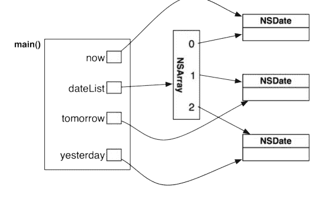

因此，如果你想循环并处理数组中的每个项目（或者“遍历数组”），你可以创建一个`for`循环。编辑`main.m`：

```objc
#import <Foundation/Foundation.h>
int main(int argc, const char * argv[])
{
    @autoreleasepool {
        // Create three NSDate objects
        NSDate *now = [NSDate date];
        NSDate *tomorrow = [now dateByAddingTimeInterval:24.0 * 60.0 * 60.0];
        NSDate *yesterday = [now dateByAddingTimeInterval:-24.0 * 60.0 * 60.0];
        // Create an array containing all three (nil terminates the list)
        NSArray *dateList = [NSArray arrayWithObjects:now, tomorrow, yesterday, nil];
        NSUInteger dateCount = [dateList count];
        for (int i = 0; i < dateCount; i++) {
            NSDate *d = [dateList objectAtIndex:i];
            NSLog(@"Here is a date: %@", d);
        }
    }
    return 0;
}
```

程序员经常这样做，以至于他们为遍历数组专门在`for`循环中做了一项特殊添加。编辑代码以使用此机制：

```objc
#import <Foundation/Foundation.h>
int main(int argc, const char * argv[])
{
    @autoreleasepool {
        // Create three NSDate objects
        NSDate *now = [NSDate date];
        NSDate *tomorrow = [now dateByAddingTimeInterval:24.0 * 60.0 * 60.0];
        NSDate *yesterday = [now dateByAddingTimeInterval:-24.0 * 60.0 * 60.0];
        // Create an array containing all three (nil terminates the list)
        NSArray *dateList = [NSArray arrayWithObjects:now, tomorrow, yesterday, nil];
        for (NSDate *d in dateList) {
            NSLog(@"Here is a date: %@", d);
        }
    }
    return 0;
}
```

这种类型的循环被称为*快速枚举*，它是遍历数组中项目的一种极其高效的方式。有一个限制：在枚举过程中，你不得向数组中添加或删除项目。

## `NSMutableArray`

数组有两种形式：

- `NSArray`的实例是通过一个指针列表创建的。你永远不能从该数组中添加或移除指针。
- `NSMutableArray`的实例类似于`NSArray`的实例，但你可以添加和移除指针。(`NSMutableArray`是`NSArray`的*子类*。有关子类的更多信息见第 18 章。)

将你的示例更改为使用`NSMutableArray`实例和`NSMutableArray`类的方法：

```objc
#import <Foundation/Foundation.h>
int main(int argc, const char * argv[])
{
    @autoreleasepool {
        // Create three NSDate objects
        NSDate *now = [NSDate date];
        NSDate *tomorrow = [now dateByAddingTimeInterval:24.0 * 60.0 * 60.0];
        NSDate *yesterday = [now dateByAddingTimeInterval:-24.0 * 60.0 * 60.0];
        // Create an empty array
        NSMutableArray *dateList = [NSMutableArray array];
        // Add the dates to the array
        [dateList addObject:now];
        [dateList addObject:tomorrow];
        // Put yesterday at the beginning of the list
        [dateList insertObject:yesterday atIndex:0];
        for (NSDate *d in dateList) {
            NSLog(@"Here is a date: %@", d);
        }
        // Remove yesterday
        [dateList removeObjectAtIndex:0];
        NSLog(@"Now the first date is %@", [dateList objectAtIndex:0]);
    }
    return 0;
}
```

### 挑战

创建一个新的名为`Groceries`的`Foundation`命令行工具。首先创建一个空的`NSMutableArray`对象。然后向数组中添加几个类似杂货的项目。（你也必须创建这些项目。）最后，使用快速枚举打印出你的杂货清单。

下一个挑战更有挑战性。阅读以下程序，它查找包含两个相邻 A 的常见专有名词。

```objc
#import <Foundation/Foundation.h>
int main (int argc, const char * argv[])
{
    @autoreleasepool {
        // Read in a file as a huge string (ignoring the possibility of an error)
        NSString *nameString
                = [NSString stringWithContentsOfFile:@"/usr/share/dict/propernames"
                            encoding:NSUTF8StringEncoding
                                     error:NULL];
        // Break it into an array of strings
        NSArray *names = [nameString componentsSeparatedByString:@"\n"];
        // Go through the array one string at a time
        for (NSString *n in names)
        {
            // Look for the string "aa" in a case-insensitive manner
            NSRange r = [n rangeOfString:@"AA" options:NSCaseInsensitiveSearch];
            // Was it found?
            if (r.location != NSNotFound) {
                NSLog(@"%@", n);
            }
        }
    }
    return 0;
}
```

文件`/usr/share/dict/propernames`包含常见的专有名词。文件`/usr/share/dict/words`包含普通单词*和*专有名词。编写一个基于上述程序的新程序，以查找同时也是普通单词的常见专有名词。例如，“Glen”是一个男名，而“glen”是一个狭窄的山谷。在单词文件中，专有名词是大写的。

当计算机对字符串进行排序时，通常认为大写字母排在`lowercase letters`（小写字母）之前。要进行忽略大小写的比较，请使用方法`caseInsensitiveCompare:`。

```objc
NSString *a = @"ABC";
NSString *b = @"abc";
if ([a caseInsensitiveCompare:b] == NSOrderedSame) {
    NSLog(@"a and b are equal");
}
if ([a caseInsensitiveCompare:b] == NSOrderedAscending) {
    NSLog(@"a comes before b");
}
if ([a caseInsensitiveCompare:b] == NSOrderedDescending) {
    NSLog(@"b comes before a");
}
```


*此页故意留白*

## 16 开发者文档

在上一章中，我给你分享了一些关于类 `NSArray` 的实用信息。当你开始在没有我指导的情况下编程时（包括完成本书中的挑战），你需要自己寻找这些实用信息。这正是苹果文档发挥作用的地方。

要在 Xcode 中查看文档，请打开 Organizer（点击 Xcode 窗口右上角的 [图标] 按钮）并选择“文档”选项卡。

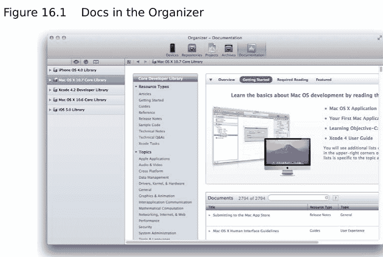

苹果提供的文档主要有五种类型：

- *参考手册：* 每个 Objective-C 类和每个 C 函数都在这些页面中有简要的文档说明。
- *指南与入门教程：* 指南写得不太简略，并以概念方式对想法进行分组。例如，有一份*错误处理编程指南*描述了 Mac 和 iOS 开发者可以得知出错的众多方式。
- *示例代码：* 这些是小型的完整项目，演示了苹果希望其技术被使用的方式。例如，有一个 WeatherMap 项目展示了如何在 iOS 地图视图中制作自定义注释。
- *发行说明：* 每当新版本的 Mac OS 或 iOS 发布时，都会附带一套发行说明。发行说明告诉开发者自上一版本以来有哪些变化。
- *技术说明、文章、编码方法以及技术问答：* 这些是针对特定问题的小篇幅文档。

你可以浏览文档，但内容非常多。更常见的做法是通过搜索来访问文档。

### 参考页面

在 Organizer 左侧窗格顶部，点击 🚀 按钮调出搜索面板。在搜索栏中输入 `NSArray`，搜索结果将显示在搜索栏下方。在参考部分，点击 `NSArray` 即可查看 *NSArray* 的*参考页面*。

#### 图 16.2 NSArray 参考页面

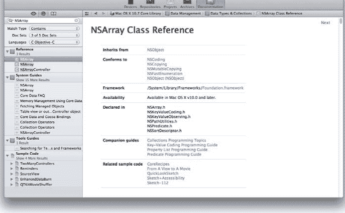

这些参考页面对你来说多么重要怎么强调都不为过，它们对各层级的程序员都极其重要。苹果非常努力地创建了巨大的代码库以方便你使用。你将主要通过参考页面来了解这些库。在阅读本书的过程中，当你使用新类时，花点时间查阅其参考页面，看看它们还能做什么。你还可以通过名称搜索方法、函数、常数和属性。（你将在第 17 章了解属性。）你越熟练地使用这些页面，开发速度就会越快。

在 **`NSArray`** 类参考的顶部，你可以了解关于该类的几件事。它继承自 **`NSObject`**。（稍后在第 18 章中会详细介绍。）它符合几个协议（我们将在第 25 章中讨论）。它是 Foundation 框架的一部分，并随每个版本的 Mac OS X 和 iOS 一起发布。

在头部末尾，有一个讨论 **`NSArray`** 的指南列表以及展示 **`NSArray`** 功能的示例代码。点击 *集合编程主题* 打开该指南。

#### 图 16.3 集合编程主题

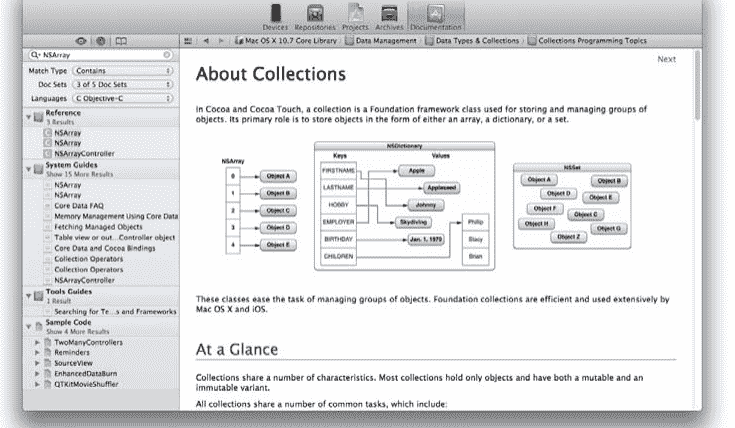

这份特定的指南讨论了集合类（包括 **`NSArray`** 和 **`NSMutableArray`**）。与类参考不同，指南阅读起来很愉快，想法以合理的顺序引入。

现在使用文档窗格顶部的返回按钮回到 **`NSArray`** 参考页面。好奇还可以向 **`NSArray`** 发送哪些其他消息？向下滚动参考页面，找到 **`NSArray`** 实现的方法列表。假设你正在寻找一种方法来检查数组是否包含特定项目。在这种情况下，你会遇到 **`containsObject:`** 方法并阅读其描述：

#### 图 16.4 containsObject: 参考

```objectivec

containsObject:

返回一个布尔值，指示给定对象是否存在于数组中。

   - (BOOL)containsObject:(id)anObject

参数

anObject

一个对象。

返回值

如果 anObject 存在于数组中，则返回 YES，否则返回 NO。

讨论

此方法通过向数组的每个对象发送 isEqual: 消息（并将 anObject 作为每个 isEqual: 消息的参数）来确定 anObject 是否存在于数组中。

可用性

适用于 Mac OS X v10.0 及更高版本。

另请参阅

   - indexOfObject:

   - indexOfObjectIdenticalTo:

相关示例代码

Sketch+Accessibility

TimelineToTC

声明于

NSArray.h

```

现在你知道在代码中发送此消息所需的一切了。

### 快速帮助

但是，从编写代码的编辑器到文档知识宝库，有一种更简单的方法。关闭 Organizer 并返回你的 DateList 项目。

在 `main.m` 中，找到包含 `[dateList addObject:now]` 的行。按住 Option 键并点击 `addObject:`。Quick Help 窗口将出现，显示关于该方法的信息：

#### 图 16.5 Quick Help 窗口

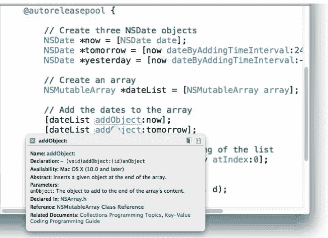

注意 Quick Help 窗口中有链接。如果你点击一个链接，它会在 Organizer 中打开相应的文档。很方便，对吧？

如果你想一直看到 Quick Help，你可以将其作为 Xcode 中的窗格打开。

在 Xcode 窗口右上角，找到一个名为 View 的分段控件，看起来像 **1 2 3**，指示 Xcode 的左侧、底部和右侧窗格。选择和取消选择这些按钮将隐藏和显示相应的窗格。

左侧窗格，你现在已经用了很多次，称为导航器。底部窗格，你也见过，包括控制台，称为调试区域。右侧窗格称为 Utilities（实用工具）。点击右侧的 View 按钮以显示 Utilities。在 Utilities 顶部，点击 **?** 按钮以显示 Quick Help 窗格。

此窗格将显示编辑器中选中文本的帮助。试试看：只需在编辑器中选中单词“`NSMutableArray`”：

#### 图 16.6 Quick Help 窗格

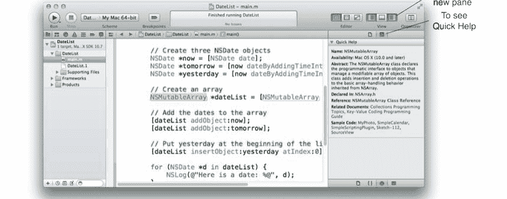

注意，当你选中其他内容时，Quick Help 窗格会立即更新以显示新选中文档的内容。

### 其他选项和资源

如果你对任何文本进行 Option-双击，Organizer 将搜索该字符串。

如果你对任何类、函数或方法进行 Command-点击，Xcode 将显示其声明所在的文件。（试试 Command-点击单词“`NSMutableArray`”。）

#### 图 16.7 NSMutableArray 的声明

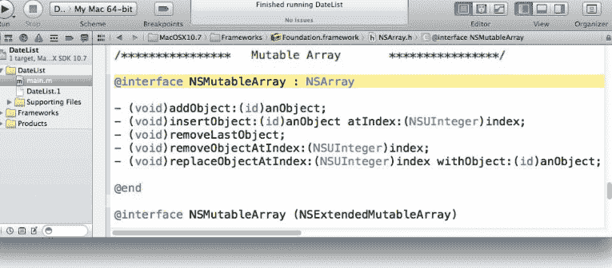

如果有多个匹配的声明，当你 Command-点击时会出现一个弹出菜单。试试 Command-点击 **`addObject:`**。

时不时地，Xcode 会呼叫母船查看是否有更新的文档。它将下载更新并重新建立索引以便轻松搜索。你可以在 Xcode 的首选项面板中触发立即检查更新。

苹果在 `http://lists.apple.com/` 上托管了一组讨论邮件列表，其中一些专门针对开发者主题。如果无法在文档中找到答案，请尝试搜索这些列表的归档。（作为对每个列表上数千人的礼貌，请在发布问题前仔细搜索归档。）

还有一个你应该了解的资源：`stackoverflow.com`。这个网站是一个非常受欢迎的程序员提问和回答问题的地方。如果你能想出几个描述你所遇到问题的类型的关键词，你很可能在那里找到答案。

## 17 你的第一个类

到目前为止，你只使用了由苹果创建的类。现在你要编写自己的类。记住，类以两种方式描述对象：

- 由类实现的方法（包括实例方法和类方法）
- 类的每个实例内的实例变量

你将编写一个 **`Person`** 类，类似于你在第 10 章编写的 `struct Person`。你的类将定义在两个文件中：`Person.h` 和 `Person.m`。`Person.h`，被称为*头文件*或*接口文件*，将包含实例变量和方法的声明。`Person.m` 被称为*实现文件*。这是你编写或*实现*每个方法步骤的地方。

创建一个新项目：一个名为 **`BMITime`** 的 Foundation 命令行工具。

要创建一个新类，选择 **`File → New → New File....`**。在左侧的 Mac OS X 部分中，选择 **`Cocoa`** 并选择 **`Objective-C 类模板`**。将你的类命名为 **`Person`**，并将其设为 **`NSObject`** 的子类。最后，确保勾选了 **`BMITime`** 目标并点击 **`Save`**。

注意，新的类文件 `Person.h` 和 `Person.m` 现在出现在项目导航器中。打开 `Person.h`。声明两个实例变量和三个实例方法：

```objectivec

#import <Foundation/Foundation.h>

// 类 Person 继承类 NSObject 定义的所有实例变量

// 和方法

@interface Person : NSObject

{

    // 它有两个实例变量

    float heightInMeters;

    int weightInKilos;

}

// 你将能够使用这些方法来设置这些实例变量

- (void)setHeightInMeters:(float)h;

- (void)setWeightInKilos:(int)w;

// 此方法计算身体质量指数

- (float)bodyMassIndex;

@end

```

注意，你在花括号内声明了实例变量，在花括号外、变量之后声明了方法。

对于编译器来说，这段代码表示：“我正在定义一个名为**`Person`**的新类，它拥有**`NSObject`**类的所有方法和实例变量。此外，我要添加两个新的实例变量：一个名为 `heightInMeters` 的 `float` 和一个名为 `weightInKilos` 的 `int`。同时，我还会添加三个实例方法，它们将在 `Person.m` 中实现。”

**注意** `setHeightInMeters:` 方法期望一个 `float` 类型的参数且不返回任何值，`setWeightInKilos:` 方法期望一个 `int` 类型的参数且不返回任何值，而 `bodyMassIndex` 方法不接收参数并返回一个 `float` 值。

现在打开 `Person.m`。删除现有方法，并实现你已声明的方法：

```objective-c

#import "Person.h"

@implementation Person

- (void)setHeightInMeters:(float)h

{

    heightInMeters = h;

}

- (void)setWeightInKilos:(int)w

{

    weightInKilos = w;

}

- (float)bodyMassIndex

{

    return weightInKilos / (heightInMeters * heightInMeters);

}

@end

```

注意 **`Xcode`** 已为你导入了 `Person.h`。同时请注意，你实现的方法名称必须与你在头文件中声明的名称完全一致。在 **`Xcode`** 中，这很简单：当你在实现文件中开始输入方法时，**`Xcode`** 会建议你已经声明过的名称。

既然你已经在 `Person.h` 中实现了所有声明的方法，你的类就完成了。编辑 `main.m` 来稍微测试一下：

```objective-c

#import <Foundation/Foundation.h>

#import "Person.h"

int main(int argc, const char * argv[])

{

    @autoreleasepool {

        // 创建 Person 的一个实例

        Person *person = [[Person alloc] init];

        // 给实例变量赋予有意义的值

        [person setWeightInKilos:96];

        [person setHeightInMeters:1.8];

        // 调用 bodyMassIndex 方法

        float bmi = [person bodyMassIndex];

        NSLog(@"person has a BMI of %f", bmi);

    }

    return 0;

}

```

构建并运行程序。注意你导入了 `Person.h`，以便编译器在 `main()` 中使用它们之前知道你的方法是如何声明的。

### 图 17.1 BMITime 的对象图

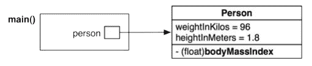

### 访问器方法

注意，当我们对结构体而不是对象执行相同练习时，我们在 `main()` 中直接访问了结构体的数据成员：

```
person.weightInKilos = 96;
person.heightInMeters = 1.8;
```

在面向对象的思维中，我们尽力将对象的实例变量保持为私有；也就是说，它们只由对象自身知道和访问。然而，因为我们希望让 `Person` 之外的方法和函数能够设置一个人的体重和身高，所以我们创建了方法 `setWeightInKilos:` 和 `setHeightInMeters:`。我们将这些方法称为 setter 方法。

setter 方法允许其他方法设置实例变量的值。getter 方法允许其他方法读取实例变量的值。setter 和 getter 方法也被称为访问器方法，或者简称访问器（accessors）。

在 `Person.h` 中添加 getter 方法的声明：

```objective-c

#import <Foundation/Foundation.h>

@interface Person : NSObject

{

    float heightInMeters;

    int weightInKilos;

}

// 你将能够设置这些实例变量

- (float)heightInMeters;

- (void)setHeightInMeters:(float)h;

- (int)weightInKilos;

- (void)setWeightInKilos:(int)w;

- (float)bodyMassIndex;

@end

```

你可能会疑惑，为什么 getter 方法的名称不包含 get 以匹配 setter 方法的名称。这是 Objective-C 的命名约定。读取实例变量的方法名称就是该实例变量的名称。

现在返回 `Person.m` 并实现你的 getter 方法：

```objective-c

@implementation Person

- (float)heightInMeters

{

    return heightInMeters;

}

- (void)setHeightInMeters:(float)h

{

    heightInMeters = h;

}

- (int)weightInKilos

{

    return weightInKilos;

}

- (void)setWeightInKilos:(int)w

{

    weightInKilos = w;

}

- (float)bodyMassIndex

{

    return weightInKilos / (heightInMeters * heightInMeters);

}

@end

```

最后，在 `main.m` 中使用这些方法：

```objective-c

#import "Person.h"

int main(int argc, const char * argv[])

{

    @autoreleasepool {

        // 创建 Person 的一个实例

        Person *person = [[Person alloc] init];

        // 给实例变量赋予有意义的值

        [person setWeightInKilos:96];

        [person setHeightInMeters:1.8];

        // 调用 bodyMassIndex 方法

        float bmi = [person bodyMassIndex];

        NSLog(@"person (%d, %f) has a BMI of %f",

              [person weightInKilos], [person heightInMeters], bmi);

    }

    return 0;

}

```

构建并运行程序。

### 点语法

Objective-C 程序员经常调用访问器方法。Apple 决定创建一种调用访问器的快捷方式。这个快捷方式使得以下两行代码完全相同：

```
p = [x fido];
p = x.fido;
```

它也使得以下两行代码完全相同：

```
[x setFido:3];
x.fido = 3;
```

使用点（`.`）代替方括号的形式被称为点语法（dot notation）。

我避免使用点语法。我觉得它掩盖了正在发送消息的事实，并且与我们在系统中执行其他消息发送的方式不一致。你可以使用点语法，但它不会出现在本书的其他任何地方。

### 属性

注意，我们在 **`Person`** 类中的大部分代码都致力于访问器方法。Apple 创建了一种称为 *properties*（属性）的便捷方式来简化编写访问器方法。使用属性，你可以在一行代码中声明 setter 和 getter 方法。

在 `Person.h` 中，用 `@property` 结构替换 setter 和 getter 方法的声明：


#import <Foundation/Foundation.h>

@interface Person : NSObject

{

    float heightInMeters;

    int weightInKilos;

}

@property float heightInMeters;

@property int weightInKilos;

- (float)bodyMassIndex;

@end

```

通过此编辑，你完全没有改变这个类。你只是使用了一种更简洁的语法。

现在，看看 `Person.m` 文件。它充满了简单且可预测的访问器方法。如果你的访问器没有做特殊的事情，你可以告诉编译器根据每个 `@property` 声明来*合成*（synthesize）默认的访问器方法。删除访问器并用 `@synthesize` 调用替换它们：

```objective-c

#import "Person.h"

@implementation Person

@synthesize heightInMeters, weightInKilos;

- (float)bodyMassIndex

{

    return weightInKilos / (heightInMeters * heightInMeters);

}

@end

```

构建并运行程序。一切都应该像之前一样工作，而且代码更加简单且易于维护。

## self

在任何方法内部，你都可以访问隐式局部变量 `self`。`self` 是一个指向正在运行该方法的对象的指针。当对象想要向自身发送消息时使用它。例如，许多 Objective-C 程序员对访问器方法非常讲究；他们从不使用其访问器方法以外的方式来读取或写入实例变量。更新你的 `bodyMassIndex` 方法以取悦原教旨主义者：

```objective-c

- (float)bodyMassIndex

{

    float h = [self heightInMeters];

    return [self weightInKilos] / (h * h);

}

```

这里 `Person` 的一个实例向自身发送了两个消息，`heightInMeters` 和 `weightInKilos`，以获取其实例变量的值。

你还可以将 `self` 作为参数传递，让其他对象知道当前对象在哪里。例如，你的 `Person` 类可能有一个方法 `addYourselfToArray:`，它看起来像这样：

```objective-c

- (void)addYourselfToArray:(NSMutableArray *)theArray

{

    [theArray addObject:self];

}

```

这里你使用 `self` 来告诉数组 `Person` 的实例在哪里。字面上来说，这就是它的地址。

## 多个文件

注意，你的项目现在有两个文件包含可执行代码：`main.m` 和 `Person.m`。(`Person.h` 是一个类的声明，但它没有可执行代码。) 当你构建项目时，这些文件会单独编译，然后链接在一起。现实世界中的项目通常由数百个 C 和 Objective-C 代码文件组成，这并不罕见。

你还可以链接代码库。例如，你可能会在互联网上找到一个用于解析数字望远镜数据的好库。如果你的程序需要这种功能，你会编译该库并将其添加到你的项目中。当 Xcode 构建你的程序时，它会链接该库中定义的所有函数和类。

### 挑战

创建一个名为 `Stocks` 的新 Foundation 命令行工具。然后创建一个名为 `StockHolding` 的类来表示你购买的一支股票。它将是 `NSObject` 的子类。对于实例变量，它将有名为 `purchaseSharePrice` 和 `currentSharePrice` 的两个 `float` 以及名为 `numberOfShares` 的一个 `int`。为实例变量创建访问器方法。创建另外两个实例方法：

- `(float)costInDollars; // purchaseSharePrice * numberOfShares`
- `(float)valueInDollars; // currentSharePrice * numberOfShares`

在 `main()` 中，用一个包含三个 `StockHolding` 实例的数组填满它。然后遍历该数组并打印出每个实例的价值。

## 图 17.2 一个 StockHolding 对象数组

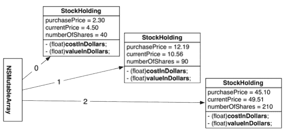

*此页有意留空*

当你创建 **Person** 类时，你将其声明为 **NSObject** 的子类。这意味着 **Person** 的每个实例都将拥有在 **NSObject** 中定义的实例变量和方法，同时也拥有在 **Person** 中定义的实例变量和方法。我们说 **Person** 从 **NSObject** *继承* 了实例变量和方法。在本节中，我们将深入探讨继承。

打开 BMITime 项目并创建一个新文件：一个 Objective-C 类。将其命名为 `Employee`，并创建为 **NSObject** 的子类。很快，我们将把 **Employee** 类更改为 **Person** 的子类。这说得通，对吧？员工都是人。他们也有身高和体重。然而，并非所有人都是员工。我们还将为一个类添加一个员工特有的实例变量——员工 ID。

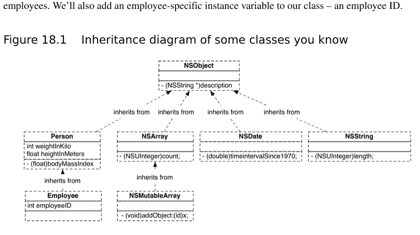

打开 `Employee.h`。导入 `Person.h`，将父类更改为 **Person**，并添加一个实例变量来保存员工的 ID 号：

```objectivec

#import "Person.h"

@interface Employee : Person

{

    int employeeID;

}

@property int employeeID;

@end

```

打开 `Employee.m` 并综合访问器：

```objectivec

#import "Employee.h"

@implementation Employee

@synthesize employeeID;

@end

```

现在，你拥有了一个包含 **Person** 所有实例变量和一个名为 `employeeID` 的新实例变量的新 **Employee** 类。**Employee** 的实例将响应与 **Person** 的实例相同的消息。**Employee** 的实例还将响应 `setEmployeeID:` 和 `employeeID` 消息。

而且，由于 **Person** 继承自 **NSObject**，**Employee** 也继承了 **NSObject** 中的所有实例变量和方法。所有对象都（直接或间接地）继承自 **NSObject**。

**NSObject** 有很多方法，但只有一个实例变量：`isa` 指针。每个对象的 `isa` 指针都指向创建它的类。

## 图 18.2 BMITime 的对象图

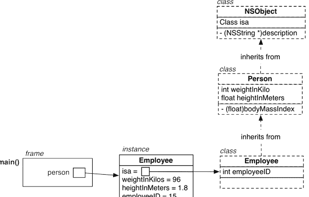

假设你向某个对象发送了名为 `fido` 的消息。为了响应这个消息，对象使用 `isa` 指针找到其类，并询问：“你有一个名为 `fido` 的实例方法吗？”如果该类有一个名为 `fido` 的方法，它就会执行。如果该类没有 `fido` 方法，它会向父类询问：“你有一个名为 `fido` 的实例方法吗？”它沿着链条一路向上寻找名为 `fido` 的方法。当找到该方法或到达链条顶端时，搜索停止。在链条顶端，**NSObject** 说：“不，没有 `fido` 方法。”然后你会收到一条错误消息，内容大致为“此 **Employee** 实例不响应 `fido` 选择器。”

试一试。打开 `main.m`，向 **Person** 的实例发送一条它无法理解的消息：

```objectivec

int main(int argc, const char * argv[])

{

    @autoreleasepool {

        // 创建一个 Person 的实例

        id person = [[Person alloc] init];

        // 给实例变量赋予有趣的值

        [person setWeightInKilos:96];

        [person setHeightInMeters:1.8];

        // 调用 bodyMassIndex 方法

        float bmi = [person bodyMassIndex];

        NSLog(@"person (%d, %f) has a BMI of %f",

              [person weightInKilos], [person heightInMeters], bmi);

        [person count];

    }

    return 0;

}

```

构建并运行程序。（忽略编译器的警告，因为你这是故意这样做的。在大多数情况下，如果你看到这个警告，你应该注意它！）你应该会在控制台中看到记录的运行时异常：

```text

*** Terminating app due to uncaught exception 'NSInvalidArgumentException',

reason: '-[Person count]: unrecognized selector sent to instance 0x00108de0'

```

检查完异常后，在继续之前删除有问题的行。

你创建了这个新的 **Employee** 类，但还没有使用它。更改 `main.m` 以使用 **Employee**：

```objectivec

#import <Foundation/Foundation.h>

#import "Employee.h"

int main(int argc, const char * argv[])

{

    @autoreleasepool {

        // 创建一个 Person 的实例

        Person * person = [[Employee alloc] init];

        // 给实例变量赋予有趣的值

        [person setWeightInKilos:96];

        [person setHeightInMeters:1.8];

        // 调用 bodyMassIndex 方法

        float bmi = [person bodyMassIndex];

        NSLog(@"person (%d, %f) has a BMI of %f",

              [person weightInKilos], [person heightInMeters], bmi);

    }

    return 0;

}

```

请注意，你的 `person` 变量仍然被声明为指向 **Person** 的指针。你认为这会造成问题吗？构建并运行程序，你会发现程序仍然运行良好。这是因为员工是一种人——它可以做一个人能做的任何事。也就是说，我们可以在程序期望使用 **Person** 实例的任何地方使用 **Employee** 的实例。

然而，现在你要使用 **Employee** 独有的方法，因此必须更改指针变量的类型：

```objectivec

#import <Foundation/Foundation.h>

#import "Employee.h"

int main(int argc, const char * argv[])

{

    @autoreleasepool {

        // 创建一个 Person 的实例

        Employee *person = [[Employee alloc] init];

        // 给实例变量赋予有趣的值

        [person setWeightInKilos:96];

        [person setHeightInMeters:1.8];

        [person setEmployeeID:15];

        // 调用 bodyMassIndex 方法

        float bmi = [person bodyMassIndex];

        NSLog(@"Employee %d has a BMI of %f", [person employeeID], bmi);

    }

    return 0;

}

```

## 第 18 章 继承

## 重写方法

回顾一下，当发送消息时，对该名称方法的搜索从对象的类开始，并沿着继承层次结构向上移动。找到的第一个实现将被执行。因此，你可以用自定义实现来*重写*继承的方法。例如，假设你决定员工的身体质量指数（BMI）始终为 19。在这种情况下，你可能会在 **Employee** 中重写 **bodyMassIndex** 方法。打开 *Employee.m* 并这样做：

```objectivec

#import "Employee.h"

@implementation Employee

@synthesize employeeID;

- (float)bodyMassIndex

{

    return 19.0;

}

@end

```

构建并运行程序，注意你的新 **bodyMassIndex** 实现被执行了——而不是来自 *Person* 的实现。

请注意，你在 *Employee.m* 中实现了 **bodyMassIndex**，但没有在 *Employee.h* 中声明它。在头文件中声明方法是为了宣传该方法，以便其他类的实例可以调用它。但是，由于 **Employee** 继承自 *Person*，每个人都知道 **Employee** 的实例都有 **bodyMassIndex** 方法。没有必要再次宣传它。

## super

如果你决定所有员工的 BMI 都能自动比 Person 实现中计算出的结果减少 10% 呢？当然，你可以在 Employee 实现中重新输入代码，但调用 Person 版本的 bodyMassIndex 并在返回前将结果乘以 0.9 会方便得多。为此，你使用 `super` 指令。在 `Employee.m` 中试一试：

```objectivec

#import "Employee.h"

@implementation Employee

@synthesize employeeID;

- (float)bodyMassIndex

{

    float normalBMI = [super bodyMassIndex];

    return normalBMI * 0.9;

}

@end

```

构建并运行程序。

精确地说，`super` 指令表示“运行这个方法，但从我的父类开始搜索其实现。”

### 挑战

此挑战基于上一章的挑战。

- 创建一个名为 `ForeignStockHolding` 的 `StockHolding` 子类。给 `ForeignStockHolding` 添加一个额外的实例变量：`conversionRate`，它将是一个 `float`。（汇率是你需要将当地价格乘以它才能得到美元价格。假设 `purchasePrice` 和 `currentPrice` 是当地货币。）重写 `costInDollars` 和 `valueInDollars` 以做正确的事。
- 在 `main()` 中，向数组中添加几个 `ForeignStockHolding` 的实例。

## 第 18 章 继承

图 18.3 StockHolding 和 ForeignStockHolding 对象

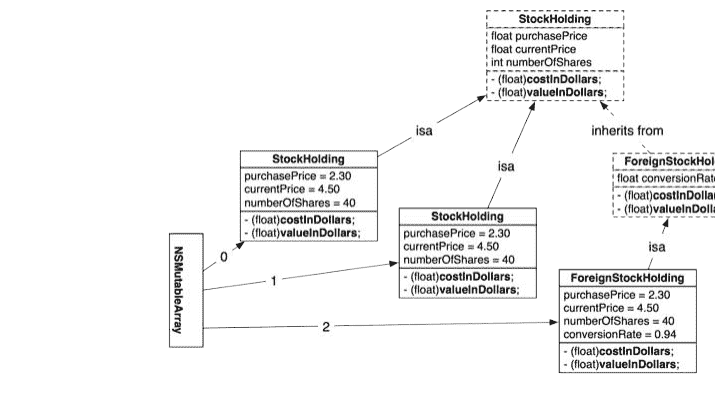

## 第 19 章 对象实例变量

到目前为止，你在类中声明的实例变量都是简单的 C 类型，例如 `int` 或 `float`。更常见的情况是，实例变量是指向其他对象的指针。对象实例变量指向另一个对象，并描述了这两个对象之间的关系。通常，对象实例变量分为以下三类：

- **对象类型属性**：指向像 **NSString** 或 **NSNumber** 这样简单的、类值对象的指针。例如，员工的姓氏会存储在一个 **NSString** 中。因此，**Employee** 的一个实例会有一个实例变量，该变量是指向 **NSString** 实例的指针。
- **一对一关系**：指向单个复杂对象的指针。例如，员工可能有配偶。因此，**Employee** 的一个实例会有一个实例变量，该变量是指向 **Person** 实例的指针。
- **一对多关系**：指向集合类实例的指针，例如 **NSMutableArray**。（我们将在第 21 章中看到其他集合示例。）例如，员工可能有孩子。在这种情况下，**Employee** 的实例会有一个实例变量，该变量是指向 **NSMutableArray** 实例的指针。**NSMutableArray** 将包含一个指向一个或多个 **Person** 对象的指针列表。

（请注意，在上面的列表中，我提到了“一个 **NSString**”。**NSString** 是类，但“一个 **NSString**”是 **NSString 实例** 的简写。这种用法有点令人困惑，但非常常见，所以最好习惯它。）

图 19.1 具有对象实例变量的员工

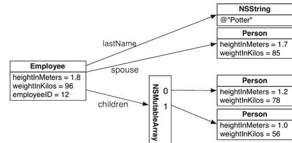

请注意，正如其他图表中所示，指针由箭头表示。此外，这些指针是有名称的。因此，`Employee` 将有三个新的实例变量：`lastName`、`spouse` 和 `children`。`Employee` 实例变量的声明将如下所示：

```objective-c


`@interface Employee : Person`

{

    `int employeeID`;

    `NSString *lastName`;

    `Person *spouse`;

    `NSMutableArray *children`;

}

`@end`

除了 `employeeID` 之外，这些变量都是指针。对象实例变量始终是指针。例如，变量 `spouse` 是指向堆上另一个对象的指针。`spouse` 指针位于 `Employee` 对象内部，但它所指向的 `Person` `object` 并不在其中。对象并不居住在其他对象内部。员工对象包含其员工 ID（变量及其值本身），但它只知道其配偶在内存中的位置。

对象指向而不是包含其他对象有两个重要的副作用：

- 一个对象可以扮演多个角色。例如，员工的配偶很可能也被列为孩子的紧急联系人：


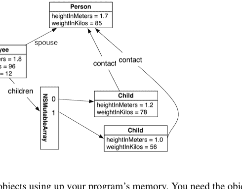

- 最终你会发现很多不同的对象占用了程序的内存。你需要保留正在使用的对象，但希望那些不必要的对象被释放（将其内存归还给堆），以便内存可以被重用。重用内存可以将程序的内存占用保持在尽可能小的水平，这会让你的整个电脑感觉更响应迅速。在移动设备（如 iPhone）上，如果程序的内存占用过大，操作系统会终止你的程序。

## 对象所有权与 ARC

为了管理这些问题，我们有*对象所有权*的概念。当一个对象拥有一个对象实例变量时，拥有该指针的对象被认为*拥有*被指向的对象。

从另一端来看，一个对象知道它当前有多少个*所有者*。例如，在上面的图中，**Person** 的实例有三个所有者：**Employee** 对象和两个 **Child** 对象。当一个对象的所有者数量为零时，它认为不再需要它，并自行释放。

每个对象的所有者数量由自动引用计数（Automatic Reference Counting）处理。ARC 是 Objective-C 中的一项近期发展。在 Xcode 4.2 之前，我们手动管理所有权，并花费大量时间和精力来做这件事。（关于手动引用计数及其工作原理的更多内容，请参阅第 20 章的最后一节。然而，本书中的所有代码都假设你正在使用 ARC。）

让我们扩展 **BMITime** 项目，以查看所有权在实际中是如何运作的。公司记录哪些资产发放给了哪位员工是很常见的。我们将创建一个 **Asset** 类，每个 **Employee** 将有一个包含其资产的数组。

图 19.3 员工和资产

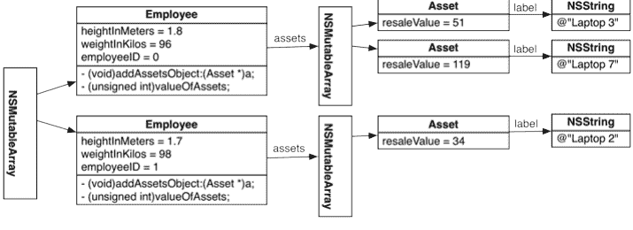

这通常被称为“父子”关系：父级（**Employee** 的实例）拥有一组子级（**Asset** 对象的 `NSMutableArray`）。

### 创建 Asset 类

创建一个新文件：`NSObject` 的 Objective-C 子类。命名为 **Asset**。打开 **Asset.h** 并声明两个实例变量和两个属性：

```objective-c
#import <Foundation/Foundation.h>

@interface Asset : NSObject
{
    NSString *label;
    unsigned int resaleValue;
}
@property (strong) NSString *label;
@property unsigned int resaleValue;
@end
```

请注意 `@property` 声明中 **label** 的 **strong** 修饰符。这意味着“这是一个我声明拥有所有权的对象指针。（我们将在第 20 章讨论此属性属性的其他选项。）

请记住，当一个对象没有任何所有者时，它会被释放。当对象正在被释放时，它会收到 **dealloc** 消息。（每个对象都从 `NSObject` 继承了 **dealloc** 方法。）你将重写 **dealloc**，以便可以看到 **Asset** 的实例何时被释放。

为了清楚地表明哪个特定的 **Asset** 实例正在被释放，你还将实现另一个 `NSObject` 方法，**description**。此方法返回一个字符串，该字符串是对类实例的有用描述。对于 **Asset**，你将让 **description** 返回一个包含实例的 **label** 和 **resaleValue** 的字符串。

打开 **Asset.m**。合成你的实例变量的访问器，然后重写 **description** 和 **dealloc**。

```objective-c
#import "Asset.h"

@implementation Asset
@synthesize label, resaleValue;

- (NSString *)description
{
  return [NSString stringWithFormat:@"%@<: $%d >",
        [self label], [self resaleValue]];
}

- (void) dealloc
{
  NSLog(@"deallocating %@", self);
}
@end
```

注意上述代码格式字符串中的 `%@` 令牌。此令牌将被替换为向对应变量发送 **description** 消息的结果（该变量必须是指向对象的指针，以便它接收此消息）。

尝试构建你目前所做的内容，看看你在输入时是否犯了任何错误。你可以使用键盘快捷键 `Command-B` 来构建你的程序而不运行它。这对于在不花时间去运行程序的情况下测试代码很有用，或者当你知道程序还没有准备好运行时。此外，在进行更改后总是构建是一个好主意，这样如果你引入了语法错误，你可以立即发现并修复它。如果你等待，你就不太确定哪些更改导致你的“新” bug。

### 向 Employee 添加一对多关系

现在你将向 **Employee** 类添加一个一对多关系。回想一下，一对多关系包括一个集合对象（如数组）和集合中包含的对象。关于集合和所有权，还有两件重要的事情需要了解：

- 当对象被添加到集合时，集合建立到该对象的指针，该对象获得一个所有者。
- 当对象从集合中移除时，集合删除到该对象的指针，该对象失去一个所有者。

要在 **Employee** 中设置一对多关系，你需要一个新的实例变量来持有指向可变资产数组的指针。你还需要几个方法。打开 Employee.h 并添加它们：

```objective-c
#import "Person.h"
@class Asset;

@interface Employee : Person
{
    int employeeID;
    NSMutableArray *assets;
}
@property int employeeID;
- (void)addAssetsObject:(Asset *)a;
- (unsigned int)valueOfAssets;
@end
```

请注意 `@class Asset;` 这一行。当编译器读取此文件时，它会遇到类名 `Asset`。如果它不了解这个类，就会抛出错误。`@class Asset;` 这行代码告诉编译器：“有一个名为 `Asset` 的类。当你在该文件中看到它时不要惊慌。目前你只需要知道这些。”

使用 `@class` 代替 `#import` 会使编译器获得较少的信息，但会加快处理该特定文件的速度。你可以在 `Employee.h` 和其他头文件中使用 `@class`，因为编译器在处理声明文件时不需要知道很多信息。

现在请关注 `Employee.m`。对于“多对一”关系，你需要在将任何内容放入其中之前创建集合对象（在我们的情况下是数组）。你可以在原始对象（员工）最初创建时这样做，或者你可以懒一点，等到需要集合时再创建。让我们懒一点。

```objc
#import "Employee.h"
#import "Asset.h"

@implementation Employee
@synthesize employeeID;

- (void)addAssetsObject:(Asset *)a
{
    // assets 是否为 nil？
    if (!assets) {
        // 创建数组
        assets = [NSMutableArray alloc] init];
    }
    [assets addObject:a];
}

- (unsigned int)valueOfAssets
{
    // 累加资产的转售价值
    unsigned int sum = 0;
    for (Asset *a in assets) {
        sum += [a resaleValue];
    }
    return sum;
}

- (float)bodyMassIndex
{
    float normalBMI = [super bodyMassIndex];
    return normalBMI * 0.9;
}

- (NSString *)description
{
    return [NSString stringWithFormat:@"<Employee %d: $%d in assets>",
           [self employeeID], [self valueOfAssets]];
}

- (void)dealloc
{
    NSLog(@"deallocating %@", self);
}
@end
```

为了处理 `Employee.m` 文件，编译器需要了解关于 **Asset** 类的许多信息。因此，你导入了 `Asset.h` 而不是使用 `@class`。

还要注意，你重写了 **description** 和 **dealloc** 方法来跟踪 **Employee** 实例的释放。

构建项目以检查你是否有错误。

现在你需要创建一些资产并将它们分配给员工。编辑 `main.m`：

```objc
#import <Foundation/Foundation.h>
#import "Employee.h"
#import "Asset.h"

int main(int argc, const char * argv[])
{
    @autoreleasepool {
        // 创建 Employee 对象的数组
        NSMutableArray *employees = [[NSMutableArray alloc] init];
        for (int i = 0; i < 10; i++) {
            // 创建 Employee 实例
            Employee *person = [[Employee alloc] init];
            // 给实例变量赋予有趣的值
            [person setWeightInKilos:90 + i];
            [person setHeightInMeters:1.8 - i/10.0];
            [person setEmployeeID:i];
            // 将员工放入 employees 数组
            [employees addObject:person];
        }
        // 创建 10 个资产
        for (int i = 0; i < 10; i++) {
            // 创建一个资产
            Asset *asset = [[Asset alloc] init];
            // 给它一个有趣的标签
            NSString *currentLabel = [NSString stringWithFormat:@"Laptop %d", i];
            [asset setLabel:currentLabel];
            [asset setResaleValue: i * 17];
            // 获取 0 到 9 之间的随机数（包含 9）
            NSUInteger randomIndex = random() % [employees count];
            // 找到该员工
            Employee *randomEmployee = [employees objectAtIndex:randomIndex];
            // 将资产分配给员工
            [randomEmployee addAssetsObject:asset];
        }
        NSLog(@"Employees: %@", employees);
        NSLog(@"放弃对一名员工的所有权");
        [employees removeObjectAtIndex:5];
        NSLog(@"放弃对数组的所有权");
        employees = nil;
    }
    return 0;
}
```

构建并运行程序。你应该看到类似以下内容：

```text
Employees: (
"<Employee 0: $0 in assets>",
"<Employee 1: $153 in assets>",
"<Employee 2: $119 in assets>",
"<Employee 3: $68 in assets>",
"<Employee 4: $0 in assets>",
"<Employee 5: $136 in assets>",
"<Employee 6: $119 in assets>",
"<Employee 7: $34 in assets>",
"<Employee 8: $0 in assets>",
"<Employee 9: $136 in assets>"
)
放弃对一名员工的所有权
deallocating <Employee 5: $136 in assets>
deallocating <Laptop 3: $51 >
deallocating <Laptop 5: $85 >
放弃对数组的所有权
deallocating <Employee 0: $0 in assets>
deallocating <Employee 1: $153 in assets>
deallocating <Laptop 9: $153 >
deallocating <Employee 9: $136 in assets>
deallocating <Laptop 8: $136 >
```

当员工 #5 从数组中移除时，由于它没有所有者，因此被释放。然后，由于它们的资产没有所有者，这些资产也被释放。（你必须相信我这一点：被释放资产的标签（`NSString` 的实例）在失去所有者后也会被释放。）

当 **employees** 被设置为 **nil** 时，数组不再拥有所有者。因此，数组被释放，这引发了一连串更大规模的内存清理和释放连锁反应，因为突然间，没有 **employees** 拥有所有者了。

很整洁，对吧？当对象变得不再需要时，它们被释放。这是好的。当不必要的对象没有被释放时，我们就说你存在*内存泄漏*。通常，内存泄漏会导致越来越多的对象不必要地长时间存在。你的应用的内存占用只会越来越大。在 iOS 上，操作系统最终会强制结束你的应用。在 Mac OS X 上，由于机器花费越来越多的时间将数据从内存交换到磁盘上，整个系统的性能都会受到影响。

### 挑战

使用之前挑战中的 **StockHolding** 类，创建一个工具，该工具创建 **Portfolio** 类的实例，并用股票持有填充它。投资组合可以告诉你它的当前价值。

*此页故意留白*

具有双向关系是很常见的。例如，也许资产应该知道当前持有它的是哪位员工。让我们添加这种关系。新的对象图看起来像这样：

### 图 20.1 添加 holder 关系

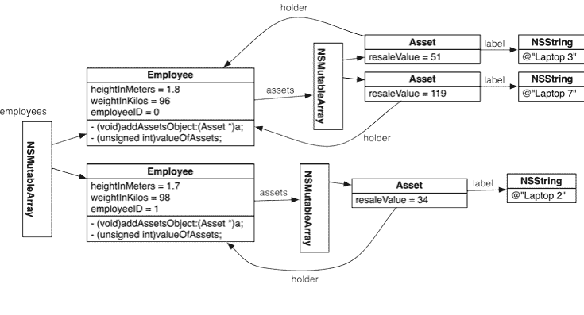

从设计角度来看，你会说我们是从子对象（**Asset** 的实例）添加了一个指向其父对象（持有它的 **Employee** 实例）的指针。

在 *Asset.h* 中，添加一个指针实例变量来持有持有该资产的员工：

```objc
#import <Foundation/Foundation.h>
@class Employee;

@interface Asset : NSObject
{
    NSString *label;
    Employee *holder;
    unsigned int resaleValue;
}
@property (strong) NSString *label;
@property (strong) Employee *holder;
@property unsigned int resaleValue;
@end
```

在 *Asset.m* 中，综合访问器并扩展 description 方法以显示持有者：

```objc
#import "Asset.h"
#import "Employee.h"

@implementation Asset
@synthesize label, resaleValue, holder;

- (NSString *)description
{
    // holder 是否非 nil？
    if ([self holder]) {


```objc
return [NSString stringWithFormat:@"<%@: $%d, assigned to %@>",

       [self label], [self resaleValue], [self holder]];

} else {

    return [NSString stringWithFormat:@"<%@: $%d, unassigned>",

           [self label], [self resaleValue]];

}

}

- (void)dealloc

{

    NSLog(@"deallocating %@", self);

}

@end
```

这带来了一个风格问题：当人们一起使用 `Asset` 类和 `Employee` 类时，我们如何确保这两种关系是一致的？也就是说，当且仅当员工是资产的持有者时，资产才应该出现在员工的资产数组中。有三种选择：

- 显式设置两种关系：
  ```objc
  [vicePresident addAssetsObject:townCar];
  [townCar setHolder:vicePresident];
  ```
- 在设置子对象指针的方法中，将子对象添加到父对象的集合中。
  ```objc
  - (void)setHolder:(Employee *)e
  {
      holder = e;
      [e addAssetsObject:self];
  }
  ```
  这种方法并不常见。
- 在将子对象添加到父对象集合的方法中，设置子对象的指针。

在这个练习中，你将采用最后一种选择。在 *Employee.m* 中，扩展 `addAssetsObject:` 方法，同时也设置 `holder`。

## 循环引用

```objc
- (void)addAssetsObject:(Asset *)a
{
    // Is assets nil?
    if (!assets) {
        // Create the array
        assets = [NSMutableArray alloc] init];
    }
    [assets addObject:a];
    [a setHolder:self];
}
```

（我最喜欢的一个 Bug 之一：让两个访问器互相自动调用。这会创建一个无限循环：**addAssetsObject**: 调用 **setHolder**:，而 **setHolder**: 又调用 **addAssetsObject**:，如此往复...）

构建并运行程序。你应该会看到类似这样的输出：

Employees: (
"<Employee 0: $0 in assets>",
"<Employee 1: $153 in assets>",
"<Employee 2: $119 in assets>",
"<Employee 3: $68 in assets>",
"<Employee 4: $0 in assets>",
"<Employee 5: $136 in assets>",
"<Employee 6: $119 in assets>",
"<Employee 7: $34 in assets>",
"<Employee 8: $0 in assets>",
"<Employee 9: $136 in assets>"
)
Giving up ownership of one employee
Giving up ownership of array
deallocating <Employee 0: $0 in assets>
deallocating <Employee 4: $0 in assets>
deallocating <Employee 8: $0 in assets>

注意，现在那些拥有资产的员工都没有被正确释放。同样，资产对象也没有被释放。为什么？

资产拥有员工，员工拥有资产数组，而资产数组又拥有资产。这就是由这种所有权循环创建的一个垃圾孤岛。这些对象本应被释放以释放内存，但实际上并没有。这就被称为*循环引用*（retain cycle）。循环引用是内存泄漏的一个非常常见的来源。

要在程序中查找循环引用，可以使用 Apple 的性能分析工具 Instruments。在对程序进行性能分析时，你会在程序运行期间监控它，以查看代码和系统幕后发生的情况。但是，你的程序运行并退出得非常、非常快。为了给你留出进行性能分析的时间，请在 `main()` 函数末尾添加 100 秒的 `sleep()`：

... }
sleep(100);
return 0;
}

在 Xcode 中，在菜单中选择 **Product → Profile**。Instruments 将启动。当出现可能的性能分析工具列表时，选择 *Leaks*（内存泄漏检测）：

### 图 20.2 选择性能分析器

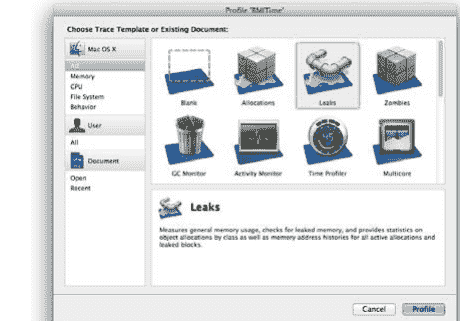

随着程序运行，你可以查看当前状态。在窗口的左侧有两个可供选择的工具（图 20.3）。点击 Allocations 工具，你可以看到一个柱状图，显示堆中已分配的所有内容：

### 图 20.3 Allocations 工具

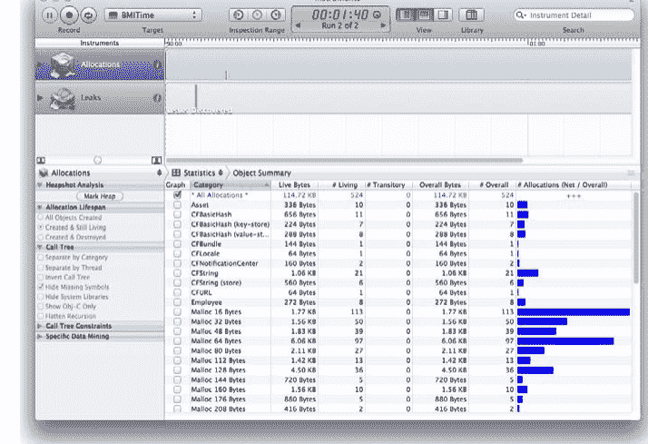

例如，你可以看到，堆中仍有 10 个 *Asset* 实例存活。

为了查找循环引用，切换到 Leaks 工具，并从表格上方的菜单栏中选择 Cycles 视图。选择一个特定的循环以查看其对象图：

### 图 20.4 Leaks 工具

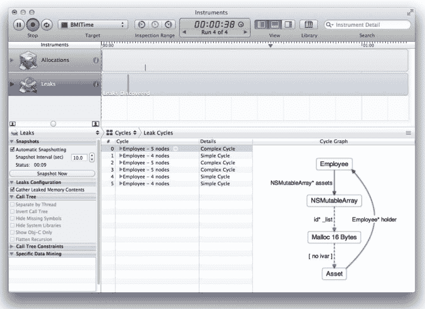

## 弱引用

你如何修复循环引用？使用弱引用。*弱引用*是一个*不*表示所有权的指针。为了修复我们的循环引用，资产不应拥有其持有者：编辑 `Asset.h` 以将 holder 改为弱引用：

```c
#import <Foundation/Foundation.h>
@class Employee;
@interface Asset : NSObject
{
    NSString *label;
    __weak Employee *holder;
    unsigned int resaleValue;
}
@property (strong) NSString *label;
@property (weak) Employee *holder;
@property unsigned int resaleValue;
@end
```

构建并运行程序。注意，现在所有对象都被正确释放了。

在父子关系中，防止此类循环引用的一般规则是：父对象拥有子对象，但子对象不应拥有父对象。

## 弱引用的置零

为了查看弱引用的实际效果，让我们向混合添加另一个数组。如果我们想要一个包含所有资产（甚至包括那些未分配给特定员工的资产）的数组会怎样？我们可以随资产创建时将其添加到数组中。在 `main.m` 中添加几行代码：

```objectivec
#import <Foundation/Foundation.h>
#import "Employee.h"
#import "Asset.h"
int main(int argc, const char * argv[])
{
    @autoreleasepool {
        // Create an array of Employee objects
        NSMutableArray *employees = [[NSMutableArray alloc] init];
        for (int i = 0; i < 10; i++) {
            // Create an instance of Employee
            Employee *person = [[Employee alloc] init];
            // Give the instance variables interesting values
            [person setWeightInKilos:90 + i];
            [person setHeightInMeters:1.8 - i/10.0];
            [person setEmployeeID:i];
            // Put the employee in the employees array
            [employees addObject:person];
        }
        NSMutableArray *allAssets = [[NSMutableArray alloc] init];
        // Create 10 assets
        for (int i = 0; i < 10; i++) {
            // Create an asset
            Asset *asset = [[Asset alloc] init];
            // Give it an interesting label
            NSString *currentLabel= [NSString stringWithFormat:@"Laptop %d", i];
            [asset setLabel:currentLabel];
            [asset setResaleValue:1 * 17];
            // Get a random number between 0 and 9 inclusive
            NSUInteger randomIndex = random() % [employees count];
            // Find that employee
            Employee *randomEmployee = [employees objectAtIndex:randomIndex];
            // Assign the asset to the employee
            [randomEmployee addAssetsObject:asset];
            [allAssets addObject:asset];
        }
        NSLog(@"Employees: %@", employees);
        NSLog(@"Giving up ownership of one employee");
[employees removeObjectAtIndex:5];
NSLog(@"allAssets: %@", allAssets);
NSLog(@"Giving up ownership of arrays");
allAssets = nil;
employees = nil;
}
select(100);
return 0;
}
```

在构建并运行程序之前，想想你期望输出是什么样的。你会看到 `allAssets` 数组的内容——在 Employee #5 被释放之后。此时 Employee #5 的资产状态会怎样？这些资产失去了一个所有者（Employee #5），但它们仍由 `allAssets` 拥有，所以它们不会被释放。

那么之前由 Employee #5 拥有的资产的 `holder` 呢？当弱引用指向的对象被释放时，指针变量会被置零，即设置为 `nil`。因此，Employee #5 的资产不会被释放，而它们的 `holder` 变量将自动设置为 `nil`。

现在构建并运行程序并检查你的输出：

Employees: (
    "<Employee 0: $0 in assets>",
    ...
    "<Employee 9: $136 in assets>"
)
Giving up ownership of one employee
deallocating <Employee 5: $136 in assets>
allAssets: {
    "<Laptop 0: $0, assigned to <Employee 3: $68 in assets>>",
    "<Laptop 1: $17, assigned to <Employee 6: $119 in assets>>",
    "<Laptop 2: $34, assigned to <Employee 7: $34 in assets>>",
    "<Laptop 3: $51 unassigned>",
    "<Laptop 4: $68, assigned to <Employee 3: $68 in assets>>",
    "<Laptop 5: $85 unassigned>",
    "<Laptop 6: $102, assigned to <Employee 6: $119 in assets>>",
    "<Laptop 7: $119, assigned to <Employee 2: $119 in assets>>",
    "<Laptop 8: $136, assigned to <Employee 9: $136 in assets>>",
    "<Laptop 9: $153, assigned to <Employee 1: $153 in assets>>"
}
Giving up ownership of arrays
deallocating <Laptop 3: $51 unassigned>
...
deallocating <Laptop 8: $136 unassigned>

## 供好奇者参考：手动引用计数与 ARC 历史

如第 19 章开头所述，在 Objective-C 中加入自动引用计数（ARC）之前，我们使用*手动引用计数*，它使用*引用计数*。在使用手动引用计数时，所有权的变更仅当你向对象发送显式消息来递减或递增引用计数时才会发生。

```objectivec
[anObject release]; // anObject 失去一个所有者
[anObject retain]; // anObject 获得一个所有者
```

你会主要在这些调用中看到访问器方法（其中新值被保留，旧值被释放）以及 `dealloc` 方法（其中之前保留的所有对象都被释放）。`Asset` 的 `setHolder:` 方法看起来会像这样：

```objectivec
- (void)setHolder:(Employee *)newEmp
{
    [newEmp retain];
    [holder release];
    holder = newEmp;
}
```

`dealloc` 方法看起来会像这样：

```objectivec
- (void) dealloc
{
    [label release];
    [holder release];
    [super dealloc];
}
```

那么 `description` 方法呢？它创建并返回一个字符串。`Asset` 应该声称拥有它吗？那没有意义；资产正在赠送它创建的字符串。当你自动释放（autorelease）一个对象时，你正在标记它以便在未来发送 `release` 消息。在 ARC 出现之前，`Asset` 的 `description` 方法看起来像这样：

```objectivec
- (NSString *)description
{
    NSString *result = [[NSString alloc] initWithFormat:@"<%@: $%d >",
                     [self label], [self resaleValue]];
    [result autorelease];
    return result;
}
```

何时会发送 `release`？当当前的自动释放池被排空时：

```objectivec
// Create the autorelease pool
NSAutoreleasePool *arp = [[NSAutoreleasePool alloc] init];
Asset *asset = [[Asset alloc] init];
NSString *d = [asset description];
// The string that d points to is in the autorelease pool
[arp drain]; // The string is sent the message release
```

ARC 自动使用自动释放池，但你必须创建和排空池。当 ARC 被创建时，我们也获得了一种创建自动释放池的新语法。上面的代码现在看起来像这样：

```objectivec
// Create the autorelease pool
@autoreleasepool {
    Asset *asset = [[Asset alloc] init];
    NSString *d = [asset description];
    // The string that d points to is in the autorelease pool
}
// The pool is drained
```


## 保留计数规则

有一套内存管理惯例，所有 `Objective-C` 程序员都遵循这些惯例。如果你在使用 ARC（自动引用计数），它在幕后会自动为你遵循这些惯例。

在这些规则中，我使用“你”这个词来指代“你当前正在处理的某个类的实例”。这是一种很有用的共情方式：你想象自己就是那个正在编写的对象。因此，例如，“如果你保留（retain）了这个字符串，它就不会被释放。” 实际上是指“如果你当前正在工作的类的实例保留了这个字符串，它就不会被释放。”

以下是这些规则。（实现细节在括号中说明。）

- 如果你使用以 `alloc` 或 `new` 开头，或者包含 `copy` 的方法创建一个对象，那么你就拥有了它的所有权。（也就是说，假设新对象的保留计数为 1，并且 *不* 在自动释放池中。）你有责任在不再需要该对象时释放它。以下是一些常见的传递所有权的方法：`alloc`（后面总是跟随一个 `init` 方法）、`copy` 和 `mutableCopy`。
- 通过 *任何* 其他方式创建的对象都 *不* 属于你所有。（也就是说，假设它的保留计数为 1，并且已经在自动释放池中，因此，如果在自动释放池排空之前没有保留它，它注定会被释放。）
- 如果你不拥有一个对象，但希望确保其持续存在，请通过发送 `retain` 消息来获取所有权。（这会增加对象的保留计数。）
- 当你拥有一个对象且不再需要它时，请发送 `release` 或 `autorelease` 消息。（`release` 会立即减少保留计数。`autorelease` 会在自动释放池排空时发送 `release` 消息。）
- 只要一个对象至少有一个所有者，它就会继续存在。（当它的保留计数变为零时，它会收到 `dealloc` 消息。）

理解内存管理的一个技巧是局部思考。`Asset` 类不需要知道其他同样关心其 `label` 的对象。只要 `Asset` 实例保留（retain）了它想要保留的对象，你就不会遇到任何问题。刚接触这门语言的程序员有时会犯试图跟踪整个应用程序中所有对象的状态的错误。不要这样做。如果你遵循这些规则，并始终对类进行局部思考，你就不必担心应用程序的其他部分正在如何使用某个对象。

根据所有权这一概念，现在你明白了为什么需要在你的 `description` 方法中自动释放（autorelease）字符串：员工对象创建了该字符串，但它并不想拥有它。它想把它送出去。

## 21 集合类

你 already 使用过两个集合类：`NSArray` 及其子类 `NSMutableArray`。你知道，数组保存的是指向其他对象的指针的集合。这些指针是有序的，因此你使用索引（整数）来访问集合中的对象。在本章中，我们将更深入地探讨数组，并查看一些其他的集合类：`NSSet`/`NSMutableSet` 和 `NSDictionary`/`NSMutableDictionary`。

### NSArray/NSMutableArray

当你向数组中添加一个对象时，数组会声称拥有它。当你从数组中移除该对象时，数组会放弃对其的所有权。打开 `BMITime`，看看你是如何使用员工数组的。如果我们忽略其他所有内容，你会看到类似这样的代码：

```objectivec

// Create an array of Employee objects

NSMutableArray *employees = [[NSMutableArray alloc] init];

for (int i = 0; i < 10; i++) {

    // Create an instance of Employee

    Employee *person = [[Employee alloc] init];

    // Put the employee in the employees array

    [employees addObject:person];

}

[employees removeObjectAtIndex:5];

employees = nil;

```

你通常使用 `alloc/init` 或类方法 `array` 创建一个空的可变数组。例如，你可以这样创建可变数组：

```objectivec

NSMutableArray *employees = [NSMutableArray array];

```

请注意，`addObject:` 方法将对象添加到列表的末尾。随着对象被添加，数组会增长到足以容纳它们的大小。

### 不可变对象

当你创建 `NSArray` 的实例时，你必须在创建时为其分配所有对象。这通常看起来像这样：

```objectivec

NSArray *colors = [NSArray arrayWithObjects:@"Orange", @"Yellow", @"Green", nil];

```

末尾的 nil 是你告诉方法停止的方式。因此，这个 colors 数组将只包含三个字符串。（如果你忘记了 nil，你的程序很可能会崩溃。）

大多数初学程序员会对 *NSArray* 的存在感到惊讶。为什么有人想要一个不能被修改的列表呢？有两个原因：

- 你不信任与你共事的人。也就是说，你希望让他们查看数组，但不希望他们能够修改它。一种更温和的方法是给他们一个 *NSMutableArray*，但*告诉*他们这是一个 *NSArray*。例如，想象一下以下方法：

```objectivec

// Returns an array of 30 odd numbers

- (NSArray *)odds

{

    static NSMutableArray *odds = [[NSMutableArray alloc] init];

    int i = 1;

    while ([odds count] < 30) {

        [odds addObject:[NSNumber numberWithInt:i]];

        i += 2;

    }

    return odds;

}

```

调用此方法的任何人都会假设它返回的是一个不可变的 *NSArray*。如果调用者试图添加或移除返回对象中的项目，编译器将发出严厉警告——尽管，事实上，它是 *NSMutableArray* 的一个实例。

- 另一个原因是性能：不可变对象永远不需要被复制。对于可变对象，你可能会创建一个私有副本，以确保系统中没有其他代码能在你不知情的情况下修改它。对于不可变对象，这是不必要的。实际上，*NSMutableArray* 的 *copy* 方法会制作一个新的副本并返回指向新数组的指针，而 *NSArray* 的 *copy* 方法什么也不做——它只是返回指向自身的指针。

因此，不可变对象在 Objective-C 编程中相当常见。在 Foundation 框架中，有许多类创建不可变实例：*NSArray*、*NSString*、*NSAttributedString*、*NSData*、*NSCharacterSet*、*NSDictionary*、*NSSet*、*NSIndexSet* 和 *NSURLRequest*。所有这些类都有可变子类：*NSMutableArray*、*NSMutableString*、*NSMutableAttributedString* 等。*NSDate* 和 *NSNumber* 则是不可变的，但没有可变子类。

### 排序

排序数组有几种方法，但最常见的方式是使用 *排序描述符* 数组。*NSMutableArray* 具有如下方法：

```objectivec

- (void)sortUsingDescriptors: (NSArray *)sortDescriptors;

```

参数是一个 *NSSortDescriptor* 对象的数组。排序描述符包含数组中对象属性的名称，以及该属性应按升序还是降序排序。为什么我们要传递一个排序描述符数组呢？想象一下，你说：“按姓氏升序对这个医生列表进行排序。” 如果两位医生姓氏相同怎么办？你可以指定“按姓氏升序排序，如果姓氏相同，则按名字升序排序，如果名字和姓氏都相同，则按邮政编码排序。”

#### 图 21.1 按 lastName 排序，然后按 firstName，最后按 zipCode

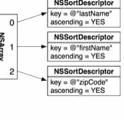

用于排序的属性可以是对象中的任意实例变量或任意方法的结果。

让我们回到 BMITime 项目，看看排序在实际中的应用。在 **main()** 中，在记录员工数组之前，按 **valueOfAssets** 对其进行排序。如果两名员工持有的资产价值相同，则按 employeeID 排序。编辑 main.m：

```objectivec

    }

    NSSortDescriptor *vao = [NSSortDescriptor sortDescriptorWithKey:@"valueOfAssets"

                                                        ascending:YES];

    NSSortDescriptor *ei = [NSSortDescriptor sortDescriptorWithKey:@"employeeID"

                                                        ascending:YES];

    [employees sortUsingDescriptors:[NSArray arrayWithObjects:vao, ei, nil]];

    NSLog(@"Employees: %@", employees);

```

编译并运行程序。你应该看到员工列表正确排序：

```text

Employees: (

    "<Employee 0: $0 in assets>",

    "<Employee 4: $0 in assets>",

    "<Employee 8: $0 in assets>",

    "<Employee 7: $34 in assets>",

    "<Employee 3: $68 in assets>",

    "<Employee 2: $119 in assets>",

    "<Employee 6: $119 in assets>",

    "<Employee 5: $136 in assets>",

    "<Employee 9: $136 in assets>",

    "<Employee 1: $153 in assets>"

)

```

### 过滤

有一个名为 **NSPredicate** 的类。*谓词*（predicate）包含一个可能为真的语句，例如“employeeID 大于 75”。**NSMutableArray** 有一个方便的方法，用于丢弃所有不满足谓词的对象：

```objectivec

- (void)filterUsingPredicate: (NSPredicate *)predicate;

```

**NSArray** 有一个方法，用于创建一个包含所有满足谓词的对象的**新**数组：

```objectivec

- (NSArray *)filteredArrayUsingPredicate: (NSPredicate *)predicate;

```

假设你打算收回目前持有资产总值超过 $70 的员工的所有资产。在 **main.m** 的末尾附近添加代码：

#### 第 21 章 集合类

```objectivec

[employees removeObjectAtIndex:5];

NSLog(@"allAssets: %@", allAssets);

NSPredicate *predicate = [NSPredicate predicateWithFormat:

                         @"holder.valueOfAssets > 70"];

NSArray *toBeReclaimed = [allAssets filteredArrayUsingPredicate:predicate];

NSLog(@"toBeReclaimed: %@", toBeReclaimed);

toBeReclaimed = nil;

NSLog(@"Giving up ownership of arrays");

allAssets = nil;

employees = nil;

}

return 0;

}

```

构建并运行该程序。你应该能看到一个资产列表：

```text

toBeReclaimed: (

  "<Laptop 1: $17, assigned to <Employee 6: $119 in assets>>",

  "<Laptop 3: $51, assigned to <Employee 5: $136 in assets>>",

  "<Laptop 5: $85, assigned to <Employee 5: $136 in assets>>",

  "<Laptop 6: $102, assigned to <Employee 6: $119 in assets>>",

  "<Laptop 8: $136, assigned to <Employee 9: $136 in assets>>",

  "<Laptop 9: $153, assigned to <Employee 1: $153 in assets>>"

)

```

用于创建谓词的格式字符串可以非常复杂。如果你经常对集合进行过滤，务必阅读 *Apple 的谓词编程指南*。

### NSSet/NSMutableSet

集合是一种没有顺序概念的收集，且特定对象在集合中只能出现一次。集合主要用于回答“它在那里吗？”这类问题。例如，你可能拥有一个包含不适合儿童内容的 URL 集合。在将任何网页展示给孩子之前，你可能想快速检查一下该 URL 是否在集合中。集合可以极其快速地做到这一点。

员工的资产没有固有的顺序，且同一员工的资产集合中，某项资产绝不应出现两次。请修改你的程序，在资产关系中使用 `NSMutableSet` 而不是 `NSMutableArray`。

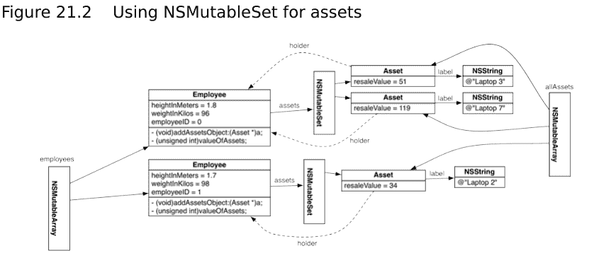

在 Employee.h 中，修改变量的声明：

```objectivec

#import "Person.h"

@class Asset;

@interface Employee : Person

{

    int employeeID;

    NSMutableSet *assets;

}

@property int employeeID;

- (void)addAssetsObject:(Asset *)a;

- (unsigned int)valueOfAssets;

@end

```

在 Employee.m 中，创建正确类的实例：

```objectivec

- (void)addAssetsObject:(Asset *)a

{

    if (!assets) {

        assets = [NSMutableSet alloc] init];

    }

    [assets addObject:a];

    [a setHolder:self];

}

```

构建并运行该程序。它应该像之前一样工作。

你无法通过索引访问集合中的对象，因为集合没有顺序概念。相反，你只能询问“里面有这种对象吗？” **NSMutableSet** 拥有一个方法：

```objectivec

- (BOOL)containsObject:(id)x;

```

当你向集合发送此消息时，它会遍历其对象集合，寻找一个与 x 相等的对象。如果找到了，它返回 **YES**；否则返回 **NO**。

这就引出了一个相当深入的问题：*相等* 意味着什么？`NSObject` 类定义了一个名为 `isEqual:` 的方法。要检查两个对象是否相等，请使用 `isEqual:` 方法：

```objectivec

if ([myDoctor isEqual:yourTennisPartner]) {

    NSLog(@"my doctor is equal to your tennis partner");

}

```

`NSObject` 对 `isEqual:` 有一个简单的实现。它看起来像这样：

```objectivec

- (BOOL)isEqual: (id)other

{

    return (self == other);

}

```

因此，如果你没有重写 `isEqual:`，上面的代码片段等同于：

```objectivec

if (myDoctor == yourTennisPartner) {

    NSLog(@"my doctor is equal to your tennis partner");

}

```

某些类重写了 `isEqual:`。例如，在 `NSString` 中，`isEqual:` 被重写为比较字符串中的字符。对于这些类，*相等* 和 *同一* 之间是有区别的。假设我有两个指向字符串的指针：

```objectivec

NSString *x = ...;

NSString *y = ...;

```

如果 x 和 y 包含完全相同的地址，那么它们是 *同一* 的。如果 x 和 y 指向的字符串包含相同字母且顺序相同，那么它们是 *相等* 的。

因此，同一的对象总是相等的。相等的对象并不总是同一的。

这个区别重要吗？是的。例如，`NSMutableArray` 有两个方法：

```objectivec

- (NSUInteger)indexOfObject: (id)anObject;
```


- `(NSUInteger)indexOfObjectIdenticalTo: (id)anObject`;

第一个方法遍历集合，询问每个对象 `isEqual:anObject?`。第二个方法遍历集合，询问每个对象 `== anObject?`。

## NSDictionary/NSMutableDictionary

如你所知，数组由数字索引；很容易询问“给我对象 10”。字典由字符串索引；很容易询问“给我存储在键 *favoriteColor* 下的对象”。更准确地说，字典是一组键值对。键通常是字符串，而值可以是任何类型的对象。这些键值对没有保持任何特定的顺序。

让我们创建一个高管字典。键将是一个高管头衔，而值将是 `Employee` 的一个实例。第一个员工将被放入字典中，键为 `@"CEO"`；第二个员工键为 `@"CTO"`。修改你的 `main.m` 以创建并填充 `NSMutableDictionary`。然后，打印出高管字典。最后，将指向字典的指针设置为 `nil`，以便你可以看到字典被释放。

```objectivec

// Create an array of Employee objects

NSMutableArray *employees = [[NSMutableArray alloc] init];

// Create a dictionary of executives

NSMutableDictionary *executives = [[NSMutableDictionary alloc] init];

for (int i = 0; i < 10; i++) {

    // Create an instance of Employee

    Employee *person = [[Employee alloc] init];

    // Give the instance variables interesting values

    [person setWeightInKilos:90 + i];

    [person setHeightInMeters:1.8 - i/10.0];

    [person setEmployeeID:i];

    // Put the employee in the employees array

    [employees addObject:person];

    // Is this the first employee?

    if (i == 0) {

        [executives setObject:person forKey:@"CEO"];

    }

    // Is this the second employee?

    if (i == 1) {

        [executives setObject:person forKey:@"CTO"];

    }

}

... 

NSLog(@"allAssets: %@", allAssets);

NSLog(@"executives: %@", executives);

executives = nil;

NSPredicate *predicate = [NSPredicate predicateWithFormat:

                         @"holder.valueOfAssets > 70"];

NSArray *toBeReclaimed = [allAssets filteredArrayUsingPredicate:predicate];

NSLog(@"toBeReclaimed: %@", toBeReclaimed);

toBeReclaimed = nil;

NSLog(@"Giving up ownership of arrays");

allAssets = nil;

employees = nil;

}

return 0;

```

构建并运行该程序。高管字典应该记录输出自己：

```text

executives = {

    CEO = "<Employee 0: $0 in assets>";

    CTO = "<Employee 1: $153 in assets>";

}

```

### 图 21.3 NSMutableDictionary 中的两个 Employee 实例

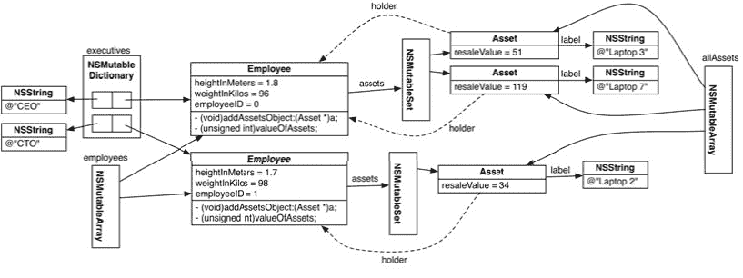

字典中的键是唯一的。如果你尝试在同一个字符串下添加第二个对象，第一个键值对被替换。

```objectivec

// Create a dictionary

NSMutableDictionary *friends = [NSMutableDictionary dictionary];

// Put an object under key "bestFriend"

[friends setObject:betty forKey:@"bestFriend"];

// Replace that object with a new best friend

[friends setObject:jane forKey:@"bestFriend"];

// friends has only one key-value pair (bestFriend => jane)

```

## C 基本类型

本章介绍的集合只保存对象。如果你想要一个 float、int 或指向结构的指针的集合怎么办？你可以将常见的 C 基本类型包装在一个对象中。有两个类是专门为此目的设计的。`NSNumber` 保存 C 数字类型。`NSValue` 可以保存指针和某些类型的结构体。

例如，如果你想要将数字 4 和 5.6 放入数组中，你可以使用 `NSNumber`：

```objectivec

NSMutableArray *numList = [[NSMutableArray alloc] init];

[numList addObject:[NSNumber numberWithInt:4]];

[numList addObject:[NSNumber numberWithFloat:5.6]];

```

## 集合与 nil

你不允许将 `nil` 添加到我们介绍的任何集合类中。如果你需要将那种“无”的概念，即一个“洞”，放入集合中怎么办？有一个类叫做 `NSNull`。`NSNull` 恰好有一个实例，它是一个代表无的对象。这是一个例子：

```objectivec

NSMutableArray *hotel = [[NSMutableArray alloc] init];

// Lobby on the ground floor

[hotel addObject:lobby];

// Pool on the second

[hotel addObject:pool];

// The third floor has not been built out

[hotel addObject:[NSNull null]];

// Bedrooms on fourth floor

[hotel addObject:bedrooms];

```

### 挑战

浏览 `NSArray`、`NSMutableArray`、`NSDictionary` 和 `NSMutableDictionary` 的参考页面。你将每天都会使用这些类。

## 第 22 章 常量

我们花了很多时间讨论变量，顾名思义，变量的值会随着程序的运行而变化。然而，有一些信息是*不*会改变值的。例如，数学常数 $\pi$ 永远不会改变。我们把这些称为*常量*，Objective-C 程序员定义常量有两种常见方式：`#define` 和全局变量。

在 Xcode 中，创建一个名为 Constants 的新 Foundation 命令行工具。

在标准 C 库中，常量是使用 `#define` 预处理器指令定义的。标准 C 库的数学部分在文件 `math.h` 中声明。在那里定义的常量之一是 `M_PI`。在 `main.m` 中使用它：

```objectivec

#import <Foundation/Foundation.h>

int main (int argc, const char * argv[])

{

    @autoreleasepool {

        // In literal NSString, use \u for arbitrary unicode chars

        NSLog(@"\u03c0 is %f", M_PI);

    }

    return 0;

}

```

当你构建并运行它时，你应该看到：

$\pi$ is 3.141593

要查看定义，在编辑器中按住 Command 键点击 `M_PI`。它将带你到 `math.h` 中的以下一行：

```c

#define M_PI         3.14159265358979323846264338327950288

```

### 预处理器指令

编译 C、C++ 或 Objective-C 代码的文件分为两个阶段。首先，*预处理器*运行该文件。预处理器的输出然后进入真正的编译器。预处理器指令以 `#` 开头，三个最流行的是 `#include`、`#import` 和 `#define`。

### #include 和 #import

`#include` 和 `#import` 基本上做同样的事情：请求预处理器读取一个文件并将其添加到其输出中。通常，你正在包含一个声明文件（.h 文件），并且这些声明被编译器用来理解正在编译的代码。

`#include` 和 `#import` 有什么区别？`#import` 确保预处理器只包含一个文件一次。`#include` 允许你多次包含相同的文件。C 程序员倾向于使用 `#include`。Objective-C 程序员倾向于使用 `#import`。

在指定要导入的文件名时，你可以用引号或尖括号将文件名括起来。引号表示头文件在你的项目目录中。尖括号表示头文件在预处理器知道的某个标准位置中。（例如，`<math.h>` 是 `/Developer/SDKs/MacOSX10.7.sdk/usr/include/math.h`）以下是 `#import` 指令的两个示例：

```objectivec

// Include the headers I wrote for Pet Store operations

#import "PetStore.h"

// Include the headers for the OpenLDAP libraries

#import <ldap.h>

```

在一个项目中，过去很常见的做法是在每个代码文件中包含一组头文件。这导致了文件开头的杂乱，并使编译时间更长。为了简化生活并使编译更快，大多数 Xcode 项目都有一个文件，列出了要预编译并包含在每个文件中的头文件。在你的 Constants 项目中，这个文件叫做 `Constants-Prefix.pch`。

那么，当 `main.m` 被编译时，`math.h` 中的常量是如何被包含进去的呢？你的 `main.m` 文件有以下行：

```objectivec

#import <Foundation/Foundation.h>

```

文件 `Foundation.h` 有以下行：

```c

#include <CoreFoundation/CoreFoundation.h>

```

文件 `CoreFoundation.h` 有以下行：

```c

#include <math.h>

```

### #define

`#define` 告诉预处理器：“每当遇到 A，在编译器看到它之前，将其替换为 B。” 再次查看 `math.h` 中的那一行：

```c

#define M_PI 3.14159265358979323846264338327950288

```

在 `#define` 指令中，你只用空格将两部分（令牌及其替换值）分开。

`#define` 实际上可以用来创建类似函数的东西。在 `main.m` 中，打印两个数字中较大的那个：

```objectivec

#import <Foundation/Foundation.h>

int main (int argc, const char * argv[])

{

    @autoreleasepool {

        NSLog(@"\u03c0 is %f", M_PI);

        NSLog(@"%d is larger", MAX(10, 12));

    }

    return 0;

}

```

`MAX` 不是一个函数；它是一个 `#define`。最基础的 C 版本 `MAX` 是：

```c

#define MAX(A, B)    ((A) > (B) ? (A) : (B))

```

因此，当编译器看到你刚才添加的那一行时，它看起来是这样的：

```objectivec

NSLog(@"%d is larger", ((10) > (12) ? (10) : (12)));

```

当你使用 `#define` 做类似函数的事情，而不仅仅是替换一个值时，你就创建了一个宏。

## 全局变量

Objective-C 程序员通常不使用 `#define`，而是使用全局变量来存储常量值。

让我们在你的程序中添加一些内容来解释。首先，有一个名为 `NSLocale` 的类，它存储关于不同地理位置的信息。你可以获取用户当前区域设置的实例，然后向它提出问题。例如，如果你想知道用户区域设置的货币是什么，你可以这样询问：

```objectivec

#import <Foundation/Foundation.h>

int main (int argc, const char * argv[])

{

    @autoreleasepool {

        NSLog(@"\u03c0 is %f", M_PI);

        NSLog(@"%d is larger", MAX(10, 12));

        NSLocale *here = [NSLocale currentLocale];

        NSString *currency = [here objectForKey:@"currency"];

        NSLog(@"Money is %@", currency);

    }

    return 0;

}

```

构建并运行它。根据你的位置，你应该会看到类似以下内容：

Money is USD

然而，如果你将键拼写错误为 `@"Kuruncy"`，你什么也得不到。为了防止这个问题，Foundation 框架定义了一个名为 `NSLocaleCurrencyCode` 的全局变量。输入它并不更方便，但如果你拼写错误，编译器会抱怨。此外，Xcode 中的代码补全对全局变量有效，但对字符串 `@"currency"` 无效。更改你的代码以使用该常量：

```objectivec

#import <Foundation/Foundation.h>

int main (int argc, const char * argv[])

{

    @autoreleasepool {

        NSLog(@"\u03c0 is %f", M_PI);

        NSLog(@"%d is larger", MAX(10, 12));

        NSLocale *here = [NSLocale currentLocale];

        NSString *currency = [here objectForKey:NSLocaleCurrencyCode];

        NSLog(@"Money is %@", currency);

    }

    return 0;

}

```

当编写类 `NSLocale` 时，这个全局变量出现在两个地方。在 `NSLocale.h` 中，该变量的声明类似于这样：

```objectivec

extern NSString const *NSLocaleCurrencyCode;

```

`const` 表示该指针在整个程序生命周期内不会改变。`extern` 表示“我承诺这个变量存在，但它将在其他文件中定义。” 确实，在文件 `NSLocale.m` 中，有一行是这样的：

```objectivec

NSString const *NSLocaleCurrencyCode = @"currency";

```

## enum（枚举）

你经常需要定义一组常量。例如，想象你正在开发一种有五种速度的搅拌机：Stir（搅拌）、Chop（切碎）、Liquify（液化）、Pulse（脉冲）和 Ice Crush（碎冰）。你的类 `Blender` 将有一个名为 `setSpeed:` 的方法。最好让类型表明只允许五种速度之一。为此，你需要定义一个枚举：

```objectivec

enum BlenderSpeed {

    BlenderSpeedStir = 1,

    BlenderSpeedChop = 2,

    BlenderSpeedLiquify = 5,

    BlenderSpeedPulse = 9,

    BlenderSpeedIceCrush = 15

};

@interface Blender : NSObject

{

    // speed must be one of the five speeds

    enum BlenderSpeed speed;

}

// setSpeed: expects one of the five speeds

- (void)setSpeed:(enum BlenderSpeed)x;

@end
```


开发者厌倦了键入 `enum BlenderSpeed`，所以他们经常使用 `typedef` 为其创建一个简写形式：

```objective-c
typedef enum {
    BlenderSpeedStir = 1,
    BlenderSpeedChop = 2,
    BlenderSpeedLiquify = 5,
    BlenderSpeedPulse = 9,
    BlenderSpeedIceCrush = 15
} BlenderSpeed;
```

```objective-c
@interface Blender : NSObject
{
    // speed must be one of the five speeds
    BlenderSpeed speed;
}

// setSpeed: expects one of the five speeds
- (void)setSpeed:(BlenderSpeed)x;
@end
```

你通常并不关心这五种速度代表的具体数值——你只关心它们彼此不同。你可以省略数值，编译器会为你生成这些值：

```objective-c
typedef enum {
    BlenderSpeedStir,
    BlenderSpeedChop,
    BlenderSpeedLiquify,
    BlenderSpeedPulse,
    BlenderSpeedIceCrush
} BlenderSpeed;
```

## `#define` 与全局变量

既然你可以使用 `#define` 或全局变量（包括使用 `enum`）来定义常量，那么为什么 Objective-C 程序员更倾向于使用全局变量呢？在某些情况下，使用全局变量具有性能优势。例如，如果你始终使用全局变量，你可以在比较字符串时使用 `==` 代替 `isEqual:`（因为算术运算比发送消息更快）。此外，在调试器中，全局变量也更容易处理。

你应该使用全局变量和 `enum` 作为常量，而不是使用 `#define`。

## 使用 NSString 和 NSData 写入文件

Foundation 框架为开发者提供了几种读写文件的简便方法。在本章中，你将尝试其中的一些方法。

### 将 NSString 写入文件

首先，让我们看看如何将 `NSString` 的内容写入文件。当你将字符串写入文件时，需要指定你正在使用的*字符串编码*。字符串编码描述了每个字符如何作为字节数组存储。ASCII 是一种字符串编码，它将字母 'A' 定义为存储为 `01000001`。在 UTF-16 中，字母 'A' 存储为 `0000000001000001`。

Foundation 框架支持大约 20 种不同的字符串编码。UTF 可以处理极其众多的书写系统。它有两种形式：UTF-16，它为每个字符使用两个或更多字节；以及 UTF-8，它为前 128 个 ASCII 字符使用一个字节，为其他字符使用两个或更多字节。对于大多数用途，UTF-8 是一个很好的选择。

创建一个新的项目：一个名为 Stringz 的 Foundation 命令行工具。在 `main()` 中，使用 `NSString` 类的方法来创建一个字符串并将其写入文件系统：

```objective-c
#import <Foundation/Foundation.h>

int main (int argc, const char * argv[])     {

    @autoreleasepool {

        NSMutableString *str = [[NSMutableString alloc] init];

        for (int i = 0; i < 10; i++) {

            [str appendString:@"Aaron is cool!\n"];

        }

        [str writeToFile:@"/tmp/cool.txt"

              atomically:YES

               encoding:NSUTF8StringEncoding

                  error:NULL];

        NSLog(@"done writing /tmp/cool.txt");

    }

    return 0;

}
```

这个程序将创建一个文本文件，你可以使用任何文本编辑器读取和编辑它。字符串 `/tmp/cool.txt` 被称为文件路径。文件路径可以是绝对路径或相对路径：绝对路径以 `/` 开头，代表文件系统的顶层；而相对路径则从程序的工作目录开始。相对路径不以 `/` 开头。在 Objective-C 编程中，你会发现我们几乎总是使用绝对路径，因为我们通常不知道程序的工作目录在哪里。（要在 Finder 中找到 `/tmp` 目录，请使用 `Go` > `Go to Folder` 菜单项。）

### NSError

你可以想象，当你尝试将字符串写入文件时，可能会出现各种各样的问题。例如，用户可能没有写入文件所在目录的权限。或者目录根本不存在。或者文件系统可能已满。对于这些情况，当操作可能无法完成时，方法需要一种方式来返回关于出了什么问题的描述，而不仅仅是成功或失败的布尔值。

回忆第 9 章中提到的内容，当你需要一个函数在返回值之外返回其他内容时，你可以传递**引用**。你向函数（或方法）传递一个变量的引用，它可以直接存储或操作该变量。该引用就是该变量的内存地址。

对于错误处理，许多方法按引用接收一个 `NSError` 指针。为上述示例添加错误处理：

```objective-c
#import <Foundation/Foundation.h>

int main (int argc, const char * argv[])    {

    @autoreleasepool {

        NSMutableString *str = [[NSMutableString alloc] init];

        for (int i = 0; i < 10; i++) {

            [str appendString:@"Aaron is cool!\n"];

        }

        // Declare a pointer to an NSError object, but don't instantiate it.
        // The NSError instance will only be created if there is, in fact, an error.
        NSError *error = nil;

        // Pass the NSError pointer by reference to the NSString method
        BOOL success = [str  writeToFile:@"/tmp/cool.txt"

                              atomically:YES

                                 encoding:NSUTF8StringEncoding

                                    error:&error];

        // Test the returned BOOL, and query the NSError if the write failed
        if (success) {

            NSLog(@"done writing /tmp/cool.txt");

        } else {

            NSLog(@"writing /tmp/cool.txt failed: %@", [error localizedDescription]);

        }

    }

    return 0;

}
```

编译并运行它。现在将代码修改为向写入方法传递一个不存在的文件路径，例如 `@"/too/darned/bad.txt"`。你应该会得到一个友好的错误消息。

注意，在这段代码中你声明了一个指向 `NSError` 实例的指针，但你并没有创建或*实例化*一个 `NSError` 对象来分配给该指针。

为什么这样做？你希望避免在没有错误时创建不必要的错误对象。如果有错误，`writeToFile:atomically:encoding:error:` 将负责创建一个新的 `NSError` 实例，然后修改你声明的错误指针，使其指向新的错误对象。这样，你就可以通过你的错误指针询问该对象出了什么问题。

这种有条件的 `NSError` 创建要求你传递错误引用（`&error`），因为此时还没有对象可供传递。然而，与你在第 9 章中传递原始 C 变量引用的按引用传递不同，这里你传递的是指针变量的地址。本质上，你正在传递另一个地址的地址（这可能成为 `NSError` 对象的地址）。

回顾我们第 9 章中的国际间谍类比，你可以告诉你的间谍：“如果有任何问题，编写一份完整的报告（太大而无法放入钢管中），并把它藏在图书馆的一本书里。我需要知道你把报告藏在哪里，所以把书的索书号放入钢管中。”也就是说，你正在给间谍一个位置，让她可以在那里放入她创建的错误报告的地址。

这是 `NSString` 类内部 `writeToFile:atomically:encoding:error:` 的声明：

```objective-c
- (BOOL)writeToFile:(NSString *)path
              atomically:(BOOL)useAuxiliaryFile
              encoding:(NSStringEncoding)enc
                 error:(NSError **)error;
```

注意双星号。当你调用这个方法时，你正在提供一个指向 `NSError` 实例的指针的指针。

按引用传递 `NSError` 的方法总是返回一个值，指示是否发生了错误。例如，如果发生错误，该方法返回 `NO`。除非返回值指示发生了错误，否则不要尝试访问 `NSError`；如果 `NSError` 对象实际上不存在，尝试访问它会导致程序崩溃。

### 使用 NSString 读取文件

将文件读取到字符串中非常相似：

```objective-c
#import <Foundation/Foundation.h>

int main(int argc, const char * argv[])    {

    @autoreleasepool {

        NSError *error = nil;

        NSString *str = [[NSString alloc] initWithContentsOfFile:@"/etc/resolv.conf"

                encoding:NSASCIIStringEncoding

                error:&error];

        if (!str) {

            NSLog(@"read failed: %@", [error localizedDescription]);

        } else {

            NSLog(@"resolv.conf looks like this: %@", str);

        }

    }

    return 0;

}
```

### 将 NSData 对象写入文件

`NSData` 对象表示一个字节缓冲区。例如，如果你从 URL 获取一些数据，你会得到一个 `NSData` 实例。你可以让一个 `NSData` 将自己写入文件。创建一个名为 ImageFetch 的新 Foundation 命令行工具，它从 Google 网站获取一个图像并将其放入 `NSData` 的实例中。然后让该 `NSData` 将其字节缓冲区写入文件：

```objc
#import <Foundation/Foundation.h>

int main (int argc, const char * argv[])

{

    @autoreleasepool {

        NSURL *url = [NSURL URLWithString:
                     @"http://www.google.com/images/logos/ps_logo2.png"];

        NSURLRequest *request = [NSURLRequest requestWithURL:url];

        NSError *error = nil;

        NSData *data = [NSURLConnection sendSynchronousRequest:request
                returningResponse:NULL
                    error:&error];

        if (!data) {

            NSLog(@"获取失败: %@", [error localizedDescription]);

            return 1;

        }

        NSLog(@"该文件为 %lu 字节", [data length]);

        BOOL written = [data writeToFile:@"/tmp/google.png"
                                  options:0
                                    error:&error];

        if (!written) {

            NSLog(@"写入失败: %@", [error localizedDescription]);

            return 1;

        }

        NSLog(@"成功！");

    }

    return 0;

}
```

编译并运行该程序。在预览（Preview）中打开生成的图像文件。

请注意，`writeToFile:options:error:` 方法接受一个指示在保存过程中使用的选项的数字。最常见的选项是 `NSDataWritingAtomic`。假设你之前已经获取了一个图像，现在你只是想重新获取并用新版本替换它。当新图像正在写入时，断电了。半个写坏的文件毫无价值。在某些情况下，半个写坏的文件比没有文件更糟糕，你可以使写入操作原子化。添加此选项：

```objc
NSLog(@"该文件为 %lu 字节", [data length]);

BOOL written = [data writeToFile:@"/tmp/google.png"
                options:NSDataWritingAtomic
                    error:&error];

if (!written) {

    NSLog(@"写入失败: %@", [error localizedDescription]);

    return 1;

}
```

现在，数据将被写入到一个临时文件中，当写入完成后，该文件会被重命名为正确的名称。这样，你要么获得完整的文件，要么什么也得不到。

### 从文件读取 NSData

你还可以根据文件内容创建一个 `NSData` 实例。在你的程序中添加两行代码：

```objc
#import <Foundation/Foundation.h>

int main (int argc, const char * argv[]) {

    @autoreleasepool {

        NSURL *url = [NSURL URLWithString:
                     @"http://www.google.com/images/logos/ps_logo2.png"];

        NSURLRequest *request = [NSURLRequest requestWithURL:url];

        NSError *error;

        // 此方法会阻塞直到所有数据获取完毕
        NSData *data = [NSURLConnection sendSynchronousRequest:request
                                              returningResponse:NULL
                                                          error:&error];

        if (!data) {

            NSLog(@"获取失败: %@", [error localizedDescription]);

            return 1;

        }

        NSLog(@"该文件为 %lu 字节", [data length]);

        BOOL written = [data writeToFile:@"/tmp/google.png"
                           options:NSDataWritingAtomic
                             error:&error];

        if (!written) {

            NSLog(@"写入失败: %@", [error localizedDescription]);

            return 1;

        }

        NSLog(@"成功！");
```


```objc
NSData *readData = [NSData dataWithContentsOfFile:@"/tmp/google.png"];

NSLog(@"从磁盘读取的文件有 %lu 字节", [readData length]);

}

return 0;

}
```

编译并运行该程序。

*此页故意留白*

## 24 回调

迄今为止，你的代码一直是老板。它一直在向标准 Foundation 对象（如 `NSString` 和 `NSArray` 的实例）发送消息，并告诉它们该做什么。迄今为止，你的程序在毫秒级内运行并退出。

你一直过着甜蜜而简单的生活。在现实世界中，应用程序运行数小时，你的对象作为奴隶服务于从用户、时钟、网络等涌入的事件流。

在现实世界的应用程序中，需要一个对象来等待诸如鼠标移动、触摸事件、定时器和网络活动之类的事件。在 Mac OS X 和 iOS 中，这个对象是 `NSRunLoop` 的实例。运行循环坐在那里等待，当某事发生时，它向另一个对象发送消息。

我们说当某事发生时，运行循环会导致发生*回调*。对于 Objective-C 程序员来说，回调有三种形式。（因为这些是非常通用的概念，我将使用*x*来表示发生的“某个具体事物”。我将在随后的章节中填充细节。）

- ***目标-动作***：在等待开始之前，你声明“当*x*发生时，将这条特定消息发送给那个特定对象。”接收消息的对象是*目标*。消息的选择器是*动作*。
- ***辅助对象***：在等待开始之前，你声明“这是一个符合你协议的辅助对象。当事件发生时，向其发送消息。”（关于协议的更多信息见第 25 章。）辅助对象通常被称为*委托*或*数据源*。
- ***通知***：有一个称为通知中心的对象。在等待开始之前，你告诉通知中心“这个对象正在等待这类通知。当其中一条通知到达时，将该消息发送给该对象。”当*x*发生时，一个对象向通知中心发布通知，中心将其转发给您的对象。

在本章中，你将实现所有三种类型的回调，并学习在哪些情况下使用哪一种。

### 目标-动作

定时器使用目标-动作机制。你创建一个具有延迟、目标和动作的定时器。在延迟之后，定时器将其动作消息发送给其目标。

你要创建一个带有运行循环和定时器的程序。每隔两秒，定时器就会将其动作消息发送给其目标。你将创建一个类，并且该类的一个实例将是目标。

**图 24.1 Logger 是 NSTimer 的目标**

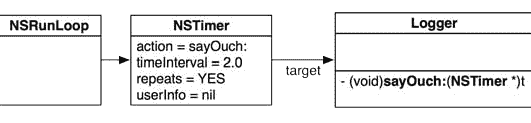

在 Xcode 中创建一个新项目：一个名为 Callbacks 的 Foundation 命令行工具。作为恶作剧，你首先只是获取一个运行循环并让它运行起来。编辑 `main.m`：

```objc
#import <Foundation/Foundation.h>

int main (int argc, const char * argv[])

{

    @autoreleasepool {

        [[NSRunLoop currentRunLoop] run];

    }

    return 0;

}
```

编译并运行该程序。注意 `run` 方法永远不会返回。运行循环处于无限循环中，等待某事发生。你需要终止该程序。（选择 产品 → 停止。）

现在你要创建一个自定义类来作为定时器的目标。创建一个新文件：一个名为 **Logger** 的 Objective-C 类，它是 **NSObject** 的子类。（记住，要获取类模板，选择 文件 → 新建 → 新建文件....）在 `Logger.h` 中，声明动作方法：

```objc
#import <Foundation/Foundation.h>

@interface Logger : NSObject

- (void)sayOuch: (NSTimer *)t;

@end
```

注意动作方法接受一个参数 – 正在发送动作消息的对象。在这种情况下，它是定时器对象。

在 `Logger.m` 中实现一个简单的 **sayOuch:** 方法：

```objc
#import "Logger.h"

@implementation Logger

- (void)sayOuch: (NSTimer *)t

{

    NSLog(@"哎呀！");

}

@end
```

此时，我们需要稍作停顿，讨论一下*选择器*。请记住，当你向一个对象发送消息时，该对象的类会被询问是否有该方法名称。搜索沿着继承层次结构向上进行，直到某个类响应道：“是的，我有一个该方法名称的方法。”

## 图 24.2 寻找名称正确的方法

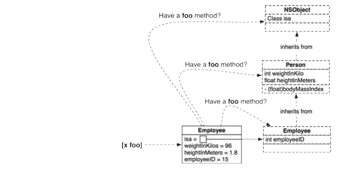

正如你能想象的那样，这种查找过程必须非常快、非常快。如果我们使用方法的实际名称（这可能非常长），方法查找就会非常缓慢。为了加快速度，编译器为它遇到的每个方法名称分配一个唯一的数字。在运行时，我们使用该数字而不是方法名称。

## 图 24.3 它是如何工作的


代表特定方法名称的那个唯一数字被称为 *selector*（选择器）。要创建一个向我们的 **Logger** 发送 **sayOuch:** 消息的定时器，你必须要求编译器查找其选择器。这是通过 `@selector` 编译器指令完成的。

在 **main.m** 中，创建一个 **Logger** 实例并将其设为 **NSTimer** 实例的目标。将动作设置为 **sayOuch:** 的选择器。

```objc
#import <Foundation/Foundation.h>

#import "Logger.h"

int main(int argc, const char * argv[]) {

    @autoreleasepool {

        Logger *logger = [[Logger alloc] init];

        NSTimer *timer = [NSTimer scheduledTimerWithTimeInterval:2.0

                                                        target:logger

                                                      selector:@selector(sayOuch:)

                                                      userInfo:nil

                                                      repeats:YES];

        [[NSRunLoop currentRunLoop] run];

    }

    return 0;

}
```

构建并运行程序。（你会得到一个未使用变量的警告。现在先忽略它。）你应该每 2 秒在控制台中看到 Ouch! 出现。

请注意，冒号是选择器的一部分。`@selector(sayOuch)` 不等于 `@selector(sayOuch:)`。

再仔细看一下编译器发出的警告。它说：“嘿，你创建了变量 timer，但没有使用它。” 在某些设置中，如这里的设置，你需要将一个变量标记为故意未使用以消除警告。这是通过 `__unused` 修饰符完成的。现在加上它。

```objc
__unused NSTimer *timer = [NSTimer scheduledTimerWithTimeInterval:2.0

                                                          target:logger

                                                        selector:@selector(sayOuch:)

                                                        userInfo:nil

                                                        repeats:YES];
```

再次构建，警告应该会消失。

## 辅助对象

定时器很简单。它们只做一件事：触发。因此，目标-动作机制非常合适。许多简单的用户界面控件，如按钮和滑块，也使用目标-动作机制。那么更复杂的情况呢？

在第 23 章中，你使用 `NSURLConnection` 方法从 Web 服务器获取数据。它工作得很好，但该方法有两个问题：

- 它在等待所有数据到达时阻塞主线程。如果在实际应用程序中使用此方法，在数据获取期间用户界面将变得无响应。
- 它没有回调方式，例如，如果 Web 服务器要求用户名和密码。

出于这些原因，我们通常异步使用 `NSURLConnection`。也就是说，我们启动获取，然后等待回调，随着数据到达或 Web 服务器要求凭证或获取失败。你如何获得这些回调？你为 `NSURLConnection` 提供一个辅助对象。当事情发生时，连接向辅助对象发送消息。什么消息？编写 **NSURLConnection** 的人制定了一个 *protocol*（协议）——一个方法声明列表——辅助对象可以实现它。以下是该协议中的一些方法：

```objc
- (NSURLRequest *)connection:(NSURLConnection *)c
       willSendRequest:(NSURLRequest *)req
        redirectResponse:(NSURLResponse *)res;

- (void)connection:(NSURLConnection *)sender
 didReceiveAuthenticationChallenge:(NSURLAuthenticationChallenge *)ch;

- (void)connection:(NSURLConnection *)sender
       didReceiveData:(NSData *)data;

- (void)connectionDidFinishLoading:(NSURLConnection *)sender;

- (void)connection:(NSURLConnection *)sender
      didFailWithError:(NSError *)error;

- (NSCachedURLResponse *)connection:(NSURLConnection *)sender
        willCacheResponse:(NSCachedURLResponse *)cachedResponse;
```

如图所示，**NSURLConnection** 的生活比 **NSTimer** 丰富得多。现在你要创建一个实现这些方法中一个或多个的对象，然后将该对象作为辅助对象介绍给 **NSURLConnection**。具体来说，**NSURLConnection** 有一个称为 *delegate*（代理）的指针。

**图 24.4** **Logger** 是 **NSURLConnection** 的代理


在 **main()** 中，创建一个 **NSURLConnection** 并将 **Logger** 实例设置为其 *delegate*（代理）：

```objc
#import <Foundation/Foundation.h>

#import "Logger.h"

int main (int argc, const char * argv[]) 

{

    @autoreleasepool {

        Logger *logger = [[Logger alloc] init];

        NSURL *url = [NSURL URLWithString:

                       @"http://www.gutenberg.org/cache/epub/205/pg205.txt"];

        NSURLRequest *request = [NSURLRequest requestWithURL:url];

        __unused NSURLConnection *fetchConn = [[NSURLConnection alloc] initWithRequest:request

                                                        delegate:logger

                                                   startImmediately:YES];

        __unused NSTimer *timer = [NSTimer scheduledTimerWithTimeInterval:2.0

                                                               target:logger

                                                             selector:@selector(sayOuch:)

                                                             userInfo:nil

                                                             repeats:YES];

        [[NSRunLoop currentRunLoop] run];

    }

    return 0;

}
```

**Logger** 的实例将需要一个 **NSMutableData** 实例来保存到达的字节。在 `Logger.h` 中添加一个实例变量：

```objc
#import <Foundation/Foundation.h>

@interface Logger : NSObject {

    NSMutableData *incomingData;

}

- (void) sayOuch:(NSTimer *)t;

@end
```

现在在 `Logger.m` 中实现一些代理方法：

```objc
#import "Logger.h"

@implementation Logger

- (void) sayOuch:(NSTimer *)t {

    NSLog(@"Ouch!");

}

// 每当数据块到达时调用

- (void) connection:(NSURLConnection *)connection
    didReceiveData:(NSData *)data
{

    NSLog(@"received %lu bytes", [data length]);

    // 如果不存在，则创建可变数据

    if (!incomingData) {

        incomingData = [[NSMutableData alloc] init];

    }

    [incomingData appendData:data];

}

// 当最后一个块被处理时调用

- (void) connectionDidFinishLoading:(NSURLConnection *)connection
{

    NSLog(@"Got it all!");

    NSString *string = [[NSString alloc] initWithData:incomingData
        encoding:NSUTF8StringEncoding];

    incomingData = nil;

    NSLog(@"string has %lu characters", [string length]);

    // 取消下一行的注释以查看整个获取的文件

    // NSLog(@"The whole string is %@", string);

}

// 如果获取失败则调用

- (void)connection:(NSURLConnection *)connection
    didFailWithError:(NSError *)error
{

    NSLog(@"connection failed: %@", [error localizedDescription]);

    incomingData = nil;

}

@end
```

注意，你没有实现协议中的所有方法——只实现了你关心的那些。构建并运行程序。你应该看到数据以合理大小的块从 Web 服务器传入。最终，代理会被告知获取已完成。

到目前为止，回调的规则是：当向一个对象发送一个回调时，Apple 使用目标-动作。当向一个对象发送各种回调时，Apple 使用带有协议的辅助对象。（我们将在下一章中更多地讨论协议。）这些辅助对象通常被称为代理（delegate）或数据源（data source）。

如果回调需要发送到多个对象怎么办？

## 通知

当用户在 Mac 上更改时区时，程序中的许多对象可能都想知道该变化已经发生。它们中的每一个都可以注册为通知中心的通知者。当时区更改时，通知 `NSSystemTimeZoneDidChangeNotification` 将被发布到中心，中心将把它转发给所有相关的通知者。

在 `main.m` 中，注册 `Logger` 实例以在时区更改时接收通知：

```objc
#import <Foundation/Foundation.h>
```


#import "Logger.h"

int main (int argc, const char * argv[])

{

    @autoreleasepool {

        Logger *logger = [[Logger alloc] init];

        [[NSNotificationCenter defaultCenter]

            addObserver:logger

            selector:@selector(zoneChange:)

            name:NSSystemTimeZoneDidChangeNotification

            object:nil];

    }

}

```

## 25 协议

`NSURL *url = [NSURL URLWithString:
 @"http://www.gutenberg.org/cache/epub/205/pg205.txt"];`
`NSURLRequest *request = [NSURLRequest requestWithURL:url];`

`__unused NSURLConnection *fetchConn = [[NSURLConnection alloc] initWithRequest:request
 delegate:logger
 startImmediately:YES];`

`__unused NSTimer *timer
 = [NSTimer scheduledTimerWithTimeInterval:2.0
 target:logger
 selector:@selector(sayOuch:)
 userInfo:nil
 repeats:YES];`

`[[NSRunLoop currentRunLoop] run];`
}
return 0;
}

现在，请在 `Logger.m` 中实现将在其中被调用的方法：

```objective-c
- (void)zoneChange:(NSNotification *)note
{
 NSLog(@"The system time zone has changed!");
}
```

构建并运行该程序。在程序运行期间，打开**系统偏好设置**并更改系统的时区。你应该会看到你的 `zoneChange:` 方法被调用了。（在某些系统上，它似乎会被调用两次。这无需担心。）

## 该使用哪种？

在本章中，你看到了三种类型的回调。Apple 是如何决定在特定情况下使用哪一种的？

- 只做一件事的对象（如 `NSTimer`）使用目标-动作（target-action）。
- 生命周期更复杂的对象（如 `NSURLConnection`）使用辅助对象，而最常见的辅助对象类型是委托（delegate）。
- 可能需要触发其他几个对象中回调的对象（如 `NSTimeZone`）使用通知（notifications）。

## 回调与对象所有权

在这些回调中，都存在一种危险，即等待回调的对象可能无法被正确释放。因此，做出了如下决定：

- `通知中心不拥有其观察者。` 如果一个对象是观察者，它通常会在其 `dealloc` 方法中将自己从通知中心移除：

```objective-c
- (void) dealloc
{
    [[NSNotificationCenter defaultCenter] removeObserver:self];
}
```

- `对象不拥有其委托或数据源。` 如果你创建了一个作为委托或数据源的对象，你的对象应该在其 `dealloc` 方法中“辞任”（excuse）自己：

```objective-c
- (void) dealloc
{
    [windowThatBossesMeAround setDelegate:nil];
    [tableViewThatBegsForData setDataSource:nil];
}
```

- `对象不拥有其目标。` 如果你创建了一个作为目标的对象，你的对象应该在其 `dealloc` 方法中将目标指针置零：

```objective-c
- (void) dealloc
{
    [buttonThatKeepsSendingMeMessages setTarget:nil];
}
```

在这个程序中不存在上述任何问题，因为你的 `Logger` 对象在程序终止之前不会被释放。（此外，有点巧合的是，在这个练习中，我使用了两个有良好文档记录的例外：一个 `NSURLConnection` 拥有其委托，而一个 `NSTimer` 拥有其目标。）

在此处，我需要讨论一个稍微抽象一点的概念。有人曾说：“重要的是要记住，你是谁与你做什么是不同的。” 对象也是如此：对象的类与其在正在运行的系统中的*角色*是不同的。例如，一个对象可能是 `NSMutableArray` 的实例，但它在应用程序中的角色可能是作为一个待执行的打印作业队列。

就像数组作为打印队列的例子一样，真正优秀的类比它们在特定应用程序中可能扮演的角色更为通用。因此，该类的实例可以以多种不同的方式使用。

我们讨论了如何指定一个类。是否可能指定一个角色？在一定程度上，我们可以使用 `@protocol` 结构来指定角色。

例如，在 iOS 应用程序中，你经常会在 `UITableView` 类的实例中显示数据。然而，`UITableView` 对象并不包含它显示的数据；它必须从其他来源获取数据。你必须告诉它：“这是将履行你的数据源角色的对象。”

图 25.1 UITableView 数据源


创建 `UITableView` 类的开发者是如何指定 `UITableView` 数据源角色的？他创建了一个*协议*（protocol）。协议是一个方法声明的列表。有些方法是必需的，有些是可选的。如果你的对象要履行该角色，它必须实现必需的方法，并可以选择实现可选的方法。

`UITableView` 的数据源协议名为 `UITableViewDataSource`，如下所示（注释是我加的）：

```objective-c
// 就像类一样，协议也可以继承自其他协议。
// 此协议继承自 NSObject 协议
@protocol UITableViewDataSource <NSObject>
// 任何表格视图数据源都必须实现以下方法
@required
// 表格视图有节（sections），每个节可以有几行
- (NSInteger)tableView:(UITableView *)tv numberOfRowsInSection:(NSInteger)section;
// 此索引路径是两个整数（一个节和一行）
// 表格视图单元格是用户在该节/行中看到的内容
- (UITableViewCell *)tableView:(UITableView *)tv
    cellForRowAtIndexPath:(NSIndexPath *)ip;
// 以下方法可能（也可能不会）被表格视图数据源实现
@optional
// 如果数据源未实现此方法，表格视图只有一个节
- (NSInteger)numberOfSectionsInTableView:(UITableView *)tv;
// 行可以被删除和移动
- (BOOL)tableView:(UITableView *)tv canEditRowAtIndexPath:(NSIndexPath *)ip;
- (BOOL)tableView:(UITableView *)tv canMoveRowAtIndexPath:(NSIndexPath *)ip;
- (void)tableView:(UITableView *)tv
    commitEditingStyle:(UITableViewCellEditingStyle)editingStyle
    forRowAtIndexPath:(NSIndexPath *)ip;
- (void)tableView:(UITableView *)tv
    moveRowAtIndexPath:(NSIndexPath *)sourceIndexPath
    toIndexPath:(NSIndexPath *)destinationIndexPath;
// 为了节省油墨和纸张，我省略了几个可选方法声明。
@end
```

（与类一样，协议在 Apple 的开发者文档中有参考页面，你可以搜索并浏览以查看协议包含的方法。）

当你创建一个类来履行 UITableView 数据源的角色时，你需要在头文件中明确说明“这个类遵循 UITableViewDataSource 协议”。它看起来像这样：

```objective-c
@interface TerrificViewController : UIViewController <UITableViewDataSource>
...
@end
```

也就是说，“TerrificViewController 是 UIViewController 的子类，并遵循 UITableViewDataSource 协议。”

如果你的类遵循多个协议，请在尖括号内列出它们：

```objective-c
@interface TerrificViewController : UIViewController <UITableViewDataSource, UITableViewDelegate, UITextFieldDelegate>
```

然后，在 `TerrificController.m` 文件中，你需要实现每个协议中的必需方法。如果你忘记实现其中一个必需方法，你会收到编译器严厉的警告。

你也会浏览可选方法并挑选你希望实现的那些。如果你实现了它们，它们会在合适的时间自动被调用。

最后一点：在第 24 章的 `Callbacks` 程序中，你创建了一个 `Logger` 实例作为 `NSURLConnection` 对象的委托。但你没有在 `Logger.h` 中声明 `Logger` 遵循某个协议。在我撰写此文时，`NSURLConnection` 的委托没有正式的协议。如果这种情况发生变化，我并不会感到惊讶。（如果你在构建 `Callbacks` 时收到了类似“此对象不遵循 `NSURLConnectionDelegate` 协议”的警告，那么这种变化已经发生。）

## 属性列表

有时，你需要一种既可以被计算机读取，也可以被人读取的文件格式。例如，假设你想在一个文件中保存你股票组合的描述。随着你添加新股票，能够手动轻松编辑该文件将是很好的。但是，其中一个程序能够读取它也会很有用。面对这个问题，大多数 Objective-C 程序员使用*属性列表*（property list）。

属性列表是以下任意组合：

- `NSArray`
- `NSMutableDictionary`
- `NSString`
- `NSData`
- `NSDate`
- `NSNumber`（整数、浮点数或布尔值）

例如，一个具有字符串键和日期对象字典的数组就是一个属性列表（或简称“P-list”）。

读写属性列表到文件非常容易。在 Xcode 中，创建一个新项目：一个名为 `stockz` 的 Foundation 命令行工具，并添加以下代码：

```objective-c
#import <Foundation/Foundation.h>
int main(int argc, const char * argv[])
{
    @autoreleasepool {
        NSMutableArray *stocks = [[NSMutableArray alloc] init];
        NSMutableDictionary *stock;
        stock = [NSMutableDictionary dictionary];
        [stock setObject:@"AAPL"
                 forKey:@"symbol"];
        [stock setObject:[NSNumber numberWithInt:200]
                 forKey:@"shares"];
        [stocks addObject:stock];
```

`stock = [NSMutableDictionary dictionary];`
`[stock setObject:@"GOOG" forKey:@"symbol"];`
`[stock setObject:[NSNumber numberWithInt:160] forKey:@"shares"];`
`[stocks addObject:stock];`

`[stocks writeToFile:@"/tmp/stocks.plist" atomically:YES];`
}
return 0;
}

（请注意，我重用了指针 `stock`。我首先用它指向第一个字典，然后指向第二个。）

### 图 26.1 字典数组


当你运行该程序时，你会得到一个文件 `stocks.plist`。如果你用文本编辑器打开它，它看起来像这样：

```xml
<?xml version="1.0" encoding="UTF-8"?>
<!DOCTYPE plist PUBLIC
"-//Apple//DTD PLIST 1.0//EN" "http://www.apple.com/DTDs/PropertyList-1.0.dtd">
<plist version="1.0">
<array>
<dict>
<key>shares</key>
<integer>200</integer>
<key>symbol</key>
<string>AAPL</string>
</dict>
<dict>
<key>shares</key>
<integer>160</integer>
<key>symbol</key>
<string>GOOG</string>
</dict>
</array>
</plist>
```

不错，对吧？人类可读。XML。只需一行代码。

如果你发现自己正在手动创建属性列表，你应该知道 Xcode 有一个专门为属性列表设计的内置编辑器。

现在添加读取该文件的代码：

```objective-c
int main(int argc, const char * argv[]) {
    @autoreleasepool {
        NSMutableArray *stocks = [[NSMutableArray alloc] init];
        NSMutableDictionary *stock;
        stock = [NSMutableDictionary dictionary];
        [stock setObject:@"AAPL"
                forKey:@"symbol"];
        [stock setObject:[NSNumber numberWithInt:200]
                forKey:@"shares"];
        [stocks addObject:stock];
        stock = [NSMutableDictionary dictionary];
        [stock setObject:@"GOOG"
                forKey:@"symbol"];
        [stock setObject:[NSNumber numberWithInt:160]
                forKey:@"shares"];
        [stocks addObject:stock];
        [stocks writeToFile:@"/tmp/stocks.plist"
             atomically:YES];
        NSArray *stockList = [NSArray arrayWithContentsOfFile:@"/tmp/stocks.plist"];
        for (NSDictionary *d in stockList) {
            NSLog(@"I have %@ shares of %@",
                  [d objectForKey:@"shares"], [d objectForKey:@"symbol"]);
        }
    }
    return 0;
}
```


构建并运行该程序。

### 挑战

编写一个工具，创建一个包含所有 8 种类型的属性列表：数组、字典、字符串、数据、日期、整数、浮点数、布尔值。

## 第四部分

## 事件驱动应用程序

这就是我们一直在朝着的目标，也是你阅读这本书的原因——编写 iOS 和 Cocoa 应用程序。在接下来的两章中，你将领略应用程序开发的魅力。你的应用程序将具有 GUI（图形用户界面），并且将是事件驱动的。

在命令行程序中，你运行程序，然后它按自己的方式执行直到完成。事件驱动应用程序则不同。它启动后开始一个运行循环，等待事件。当事件发生时，应用程序立即采取行动，执行方法、发送消息等。

首先，你将编写一个 iOS 应用程序，然后编写一个类似的 Cocoa 应用程序。Cocoa 是 Apple 编写的一组框架，用于在 Mac 上编写应用程序。你已经熟悉了其中一个框架——Foundation。

为了编写 iOS 应用程序，你使用另一组称为 Cocoa Touch 的框架。Cocoa 和 Cocoa Touch 共享一些框架，例如 Foundation。其他框架则特定于某一个平台。

### 27

### 你的第一个 iOS 应用程序

在本章中，你将创建一个 iOS 应用程序：一个名为 iTahDoodle 的简单待办事项应用程序，它将数据存储为属性列表。完成后，i TahDoodle 看起来会是这样。


所有 iOS 应用程序都是事件驱动应用程序。运行循环等待事件。等待中的应用随后响应用户（如点击按钮）或系统（如内存不足警告）生成的事件。

### 开始使用 iTahDoodle

在 Xcode 中，选择 `File → New → New Project…`。在 iOS 部分（不是 Mac OS X 部分），单击 `Application`。从出现的模板选项中选择 `Empty Application`。

### 图 27.2 创建新的 iOS 应用程序


Xcode 的项目模板存在是为了让你的工作更轻松。它们包含样板代码，可以加快开发速度。然而，在这里我们故意选择 `Empty Application` 模板，它是你能找到的最接近空白模板的选项。在此时让 Xcode 生成太多样板代码会妨碍你了解事物是如何工作的。

此外，这些模板的名称在新版 Xcode 发布时经常更改，所以不要担心你看到的模板与图 27.2 不完全匹配。寻找听起来最简单的模板，然后进行修改以使你的代码与书中的代码保持一致。如果你在协调你的代码或项目模板时遇到困难，请访问 Big Nerd Ranch 的论坛 `forums.bignerdranch.com` 寻求帮助。

选择 `Empty Application` 模板后，单击 `Next` 并将此项目命名为 `iTahDoodle`。`Company Identifier` 和 `Bundle Identifier` 与确保 App Store 中每个应用程序的唯一性有关。两者都是反转域表示法的字符串。Big Nerd Ranch 使用 `com.bignerdranch` 作为其 `Company Identifier`。


你输入作为 `Class Prefix` 的任何内容都将被添加到模板为你创建的初始类名称之前。这个两到三个字母的前缀将使你的类名称与 Apple 或任何人的类名称区分开来。（为了保持代码同步，暂时使用 `BNR`。）

请注意 Apple 的代码包含前缀。你到目前为止看到的 Apple 的所有类都以前缀 `NS` 开头，它代表 NeXTSTEP，即最初设计 Foundation 框架的平台。在本章中，你还将使用来自 UIKit 框架的类，它们将以 `UI` 开头。

最后，将 `iTahDoodle` 设为 iPhone（而不是 iPad 或通用）应用程序。i TahDoodle 将使用自动引用计数，但不使用 Core Data 或单元测试。

### BNRAppDelegate

当 Xcode 通过 `Empty Application` 模板创建你的项目时，它为你创建了一个类：`BNRAppDelegate`。你的“应用程序代理”是你的应用程序的起点，每个 iOS 应用程序都有一个。`BNRAppDelegate` 的单个实例负责处理事件并协调应用程序中其他对象的工作。

打开 `BNRAppDelegate.h`。添加四个实例变量和一个实例方法。前三个实例变量是指向用户可以看到并交互的对象的指针——一个将显示所有待办任务的表格视图，一个可以输入新任务的文本框，以及一个将新任务添加到表格中的按钮。第四个对象是一个可变数组。这是你将作为字符串存储任务的地方。

```objective-c
#import <UIKit/UIKit.h>

@interface BNRAppDelegate : UIResponder

<UIApplicationDelegate>

{

UITableView *taskTable;

UITextField *taskField;

UIButton *insertButton;

NSMutableArray *tasks;

}

- (void)addTask: (id)sender;

@property (strong, nonatomic) UIWindow *window;

@end
```

请注意，文件 `UIKit.h` 已被模板导入。`UIKit` 是包含大多数 iOS 特定类的框架，如 `UITableView`、`UITextField` 和 `UIButton`。此外，`BNRAppDelegate` 遵循 `UIApplicationDelegate` 协议。

注意我们没有导入 `Foundation.h`。那我们如何使用 `NSMutableArray`？在这个模板中，Foundation 框架头文件是该项目的预编译头文件的一部分，因此 Foundation 类可用。（不相信我？在项目导航器中 `Supporting Files` 下点击 `iTahDoodle-Prefix.pch` 自行查看。）

### 添加 C 辅助函数

我们可以从实例变量声明中看出，`iTahDoodle` 应用程序将包含至少四个其他对象。但是，在到达这些对象之前，你将编写一个 C 函数。在 Objective-C 中，我们通常通过方法而不是函数来完成任务。因此，当我们在 Objective-C 应用程序中使用 C 函数时，我们通常称它们为“辅助”函数。

`iTahDoodle` 将用户的任务存储为属性列表——一个 XML 文件。因此，你需要一种方法来获取该文件的位置，同时应用程序正在运行。你将编写一个 C 函数，返回该文件路径作为一个 `NSString`。

要将辅助函数添加到你的应用程序，你首先需要声明它 `BNRAppDelegate.h`。

# iTahDoodle 中的对象

现在我们可以回到对象的话题了。你已经知道了组成 iTahDoodle 应用程序的五个对象。其中有一个 `BNRAppDelegate` 的实例，该对象拥有指向其他四个对象的指针：`UITableView`、`UITextField`、`UIButton` 和 `NSMutableArray` 的实例。

注意，你在类声明上方声明了 `docPath()`。这是因为尽管 `docPath()` 是在文件 `BNRAppDelegate.h` 中声明的，但它并不属于 `BNRAppDelegate` 类。事实上，在 iTahDoodle 项目中，这个函数可以拥有自己单独的文件对。然而，由于 iTahDoodle 中只有一个这样的辅助函数，为了保持简单，我们将其放在应用程序委托的类文件中。

现在打开 `BNRAppDelegate.m` 并实现你的辅助函数。再次强调，因为 `docPath()` 不是类的一部分，所以要在 `#import` 之后但在 `@implementation` 行（即类的实现开始处）之前实现它。

```objective-c
#import "BNRAppDelegate.h"

// Helper function to fetch the path to our to-do data stored on disk

NSString *docPath()

{

    NSArray *pathList = NSSearchPathForDirectoriesInDomains(NSDocumentDirectory,

NSUserDomainMask, YES);

    return [pathList objectAtIndex:0] stringByAppendingPathComponent:@"data.td"];

}

@implementation
```

`docPath()` 函数调用了另一个 C 函数 `NSSearchPathForDirectoriesInDomains()`。该函数搜索符合特定条件的目录并返回它们的数组。不用担心参数是什么；在几乎所有你编写的 iOS 应用程序中，你都会传入完全相同的三个参数，并返回一个恰好包含一个项目的数组。（如果你好奇它是如何工作的，你可以在开发者文档的 *Foundation Functions Reference* 中找到 `NSSearchPathForDirectoriesInDomains()`。）

### 模型-视图-控制器

模型-视图-控制器（Model-View-Controller，简称 MVC）是一种设计模式，其核心思想是你创建的每个类都应该属于三个职责类别之一：模型（Model）、视图（View）或控制器（Controller）。以下是职责划分的详细说明：

- *模型*负责存储数据并使其可供其他对象使用。模型不了解用户界面或如何在屏幕上绘制自己；它们的唯一目的是持有和管理数据。`NSString`、`NSDate` 和 `NSArray` 是传统的模型对象。在 iTahDoodle 中，目前的模型对象是存储任务的 `NSMutableArray`。然而，每个单独的任务都将是 `NSString` 的实例，这些也将是模型对象。
- *视图*是应用程序的视觉元素。视图知道如何在屏幕上绘制自己以及如何响应用户输入。视图不了解它们显示的实际数据或其结构和存储方式。`UIView` 及其各种子类（包括 `UIWindow`）是常见的视图对象示例。在 iTahDoodle 中，你的视图对象是 `UITableView`、`UITextField` 和 `UIButton` 的实例。一个简单的经验法则是，如果你能看见它，它就是视图。
- *控制器*执行连接和驱动应用程序不同部分所需的逻辑。它们处理事件并协调应用程序中的其他对象。控制器是任何应用程序真正的骨干。虽然 `BNRAppDelegate` 是 iTahDoodle 中唯一的控制器，但复杂的应用程序将拥有许多不同的控制器，用于协调模型和视图对象以及其他控制器。


图 27.5 展示了响应用户事件（如按钮点击）时对象之间的控制流。请注意，模型和视图不直接相互通信；控制器处于所有事物的核心位置，从某些对象接收消息，并向其他对象分发指令。


切勿低估由 MVC 模式所规定的职责划分。大多数 Cocoa 和 Cocoa Touch API 都是基于 MVC 理念编写的，你自己的代码也应该是如此。现在让我们回到我们的控制器，即 BNRAppDelegate 的实例。

### 应用程序委托

当 iOS 应用程序首次启动时，幕后会有大量的初始化设置。在此阶段，会创建一个 `UIApplication` 的实例来控制应用程序的状态并作为与操作系统的联络员。还会创建一个 `BNRAppDelegate` 的实例并将其设置为 `UIApplication` 实例的委托（这解释了“app delegate”即应用程序委托的名称由来）。

在应用程序启动期间，它尚未准备好工作或接受输入。当这种情况发生变化时，`UIApplication` 实例会向其委托发送 `application:didFinishLaunchingWithOptions:` 消息。该方法非常重要。它是放置所有需要在用户与应用程序交互之前发生或就位的事务的地方。

在 iTahDoodle 中，我们需要在该方法中执行的一项任务是找到属性列表并将其加载到数组中。在 `BNRAppDelegate.m` 中，请注意 `application:didFinishLaunchingWithOptions:` 方法已经有一个存根。找到它并用以下代码替换大括号之间的代码：

```objective-c
#pragma mark - Application delegate callbacks

- (BOOL)application:(UIApplication *)application
  didFinishLaunchingWithOptions:(NSDictionary *)launchOptions
{

    // Attempt to load an existing to-do dataset from an array stored to disk.
    NSArray *plist = [NSArray arrayWithContentsOfFile:docPath()];

    if (plist) {
      // If there was a dataset available, copy it into our instance variable.
      tasks = [plist mutableCopy];
    } else {
        // Otherwise, just create an empty one to get us started.
        tasks = [[NSMutableArray alloc] init];
    }

}
```

对代码开头的 `#pragma` 标记感到好奇吗？Objective-C 程序员经常使用此结构来对类中的方法进行分组。Xcode 也了解这一点。在编辑器顶部的导航栏中，找到 `BNRAppDelegate.m` 右侧的项。（目前，该项可能显示为 `@implementation AppDelegate`，但这取决于你的光标在代码中的位置。）点击此项，Xcode 将显示此文件中位置的列表。你可以点击其中任何一项，以跳转到代码中的该位置。请注意，你新的 pragma 标记出现在此列表中。当你类中有很多方法时，这非常有用。

### 设置视图

在应用程序准备就绪之前需要做的另一件事是设置我们的视图对象。这包括创建它们、配置它们并将它们放到屏幕上。这合情合理，对吧？用户无法点击一个不存在或不在屏幕上的按钮。

在 iTahDoodle 中，你将通过编程方式在 `application:didFinishLaunchingWithOptions:` 中设置你的视图。此外，还有一个用于设置视图的可视化“拖放”工具，我们将在下一章中使用它。

我应当提醒你，这里是代码开始变得密集的地方。创建和显示视图的详细语法是专门关于 iOS 应用程序编程的书籍的主题。尝试在输入代码时理解其大致思路。你创建每个对象，然后设置其某些属性进行配置。接下来，配置好的视图对象作为窗口的 *子视图*（subviews）添加，最后，窗口被放置到屏幕上。

```objective-c
#pragma mark - Application delegate callbacks

- (BOOL)application:(UIApplication *)application
  didFinishLaunchingWithOptions:(NSDictionary *)launchOptions
{

    // Attempt to load an existing to-do dataset from an array stored to disk.
    NSArray *plist = [NSArray arrayWithContentsOfFile:docPath()];

    if (plist) {
        // If there was a dataset available, copy it into our instance variable.
        tasks = [plist mutableCopy];
    } else {
        // Otherwise, just create an empty one to get us started.
        tasks = [[NSMutableArray alloc] init];
    }

    // Create and configure the UIWindow instance
    // A CGRect is a struct with an origin (x,y) and size (width,height)
    CGRect windowFrame = [[UIScreen mainScreen] bounds];
    UIWindow *theWindow = [[UIWindow alloc] initWithFrame:windowFrame];
    [self setWindow:theWindow];

    // Define the frame rectangles of the three UI elements
    // CGRectMake(x, y, width, height)
```


```objc
CGRect tableFrame = CGRectMake(0, 80, 320, 380);

CGRect fieldFrame = CGRectMake(20, 40, 200, 31);

CGRect buttonFrame = CGRectMake(228, 40, 72, 31);
```

```objc
// 创建并配置表格视图
taskTable = [[UITableView alloc] initWithFrame:tableFrame
                                       style:UITableViewStylePlain];
[taskTable setSeparatorStyle:UITableViewCellSeparatorStyleNone];

// 创建并配置用于输入新任务文本框
taskField = [[UITextField alloc] initWithFrame:fieldFrame];
[taskField setBorderStyle:UITextBorderStyleRoundedRect];
[taskField setPlaceholder:@"Type a task, tap Insert"];

// 创建一个圆角矩形“插入”按钮
insertButton = [UIButton buttonWithType:UIButtonButtonTypeRoundedRect];
[insertButton setFrame:buttonFrame];

// 按钮通过目标/动作回调起作用
// 配置“插入”按钮的动作以调用此对象的 -addTask: 方法
[insertButton addTarget:self
                action:@selector(addTask:)
     forControlEvents:UIControlEventTouchUpInside];

// 为按钮设置标题
[insertButton setTitle:@"Insert"
             forState:UIControlStateNormal];

// 将我们的三个 UI 元素添加到窗口中
[[self window] addSubview:taskTable];
[[self window] addSubview:taskField];
[[self window] addSubview:insertButton];

// 完成窗口的设置并将其显示在屏幕上
[[self window] setBackgroundColor:[UIColor whiteColor]];
[[self window] makeKeyAndVisible];

return YES;
}
```

### 在 iOS 模拟器上运行

现在你已经设置好视图，我们可以构建应用程序以查看它们的外观。在 Xcode 中，找到位于“运行”按钮附近的 Scheme 下拉菜单。选择 iPhone 5.X 模拟器作为最新版本的 iOS 模拟器：

图 27.6 Scheme 选择器


构建并运行应用程序。编译器会发出警告，指出你尚未实现 `addTask`。暂时忽略它；你稍后会实现 `addTask`。

模拟器让你可以在桌面上运行 Cocoa Touch 应用程序。这是一种快速简便的方式，可以让你了解程序在 iOS 设备上运行时应有的外观和表现。

你可以看到在 `application:didFinishLaunchingWithOptions:` 中设置和布局的视图，但它们目前还什么也做不了。事实上，点击“插入”按钮会导致应用程序崩溃，因为按钮的动作方法 `addTask:` 尚未实现。（这也是编译器警告你的原因之一。）

## 图 27.7 iTahDoodle 对象图


## 连接表格视图

你屏幕上已经有一个表格视图，但它对应该显示什么毫无头绪。作为一个视图对象，表格视图本身并不包含任何关于实际数据的信息。它需要一个对象来充当其数据源。在 iTahDoodle 中，你的表格视图的数据源将是 `BNRAppDelegate` 的实例。

在 `BNRAppDelegate.m` 中，更新 `application:didFinishLaunchingWithOptions:` 以向表格视图发送一条消息，使 `BNRAppDelegate` 实例成为其数据源：

```objc
// 创建并配置表格视图
taskTable = [[UITableView alloc] initWithFrame:tableFrame
             style:UITableViewStylePlain];
[taskTable setSeparatorStyle:UITableViewCellSeparatorStyleNone];

// 将此对象设置为表格视图的 dataSource
[taskTable setDataSource:self];

// 创建并配置用于输入新任务文本框
taskField = [[UITextField alloc] initWithFrame:fieldFrame];
...
```

为了让表格视图的数据源履行职责，它必须实现 `UITableViewDataSource` 协议中的方法。首先，更新 `BNRAppDelegate.h` 以声明 `BNRAppDelegate` 遵循此协议：

```objc
@interface BNRAppDelegate : UIResponder
<UIApplicationDelegate, UITableViewDataSource>
{
    UIView *taskTable;
    UITextField *taskField;
    UIButton *insertButton;
    NSMutableArray *tasks;
}
- (void)addTask:(id)sender;
```

`UITableViewDataSource` 协议有两个必须由 `BNRAppDelegate` 实现的方法。至少，表格视图的数据源必须准备好告知表格视图表格中给定部分有多少行，以及给定行中的单元格应该是什么样的。

相应地实现回调：

```objc
#pragma mark - 表格视图管理
- (NSInteger)tableView:(UITableView *)tableView
numberOfRowsInSection:(NSInteger)section
{
    // 由于此表格视图只有一个部分，
    // 其中的行数等于 tasks 数组中项目的数量
    return [tasks count];
}

- (UITableViewCell *)tableView:(UITableView *)tableView
    cellForRowAtIndexPath:(NSIndexPath *)indexPath
{
    // 为了提高性能，我们重新配置内存中已滚动出屏幕的单元格，
    // 并将它们以新内容返回，而不是始终创建新单元格。
    // 首先，我们检查是否有可重用的单元格。
    UITableViewCell *c = [taskTable dequeueReusableCellWithIdentifier:@"Cell"];
    if (!c) {
        // ...只有在没有可用单元格时才分配新单元格
        c = [[UITableViewCell alloc] initWithStyle:UITableViewCellStyleDefault
            reuseIdentifier:@"Cell"];
    }
    // 然后我们（重新）配置单元格，基于模型对象，
    // 在本例中是我们的 todoItems 数组
    NSString *item = [tasks objectAtIndex:[indexPath row]];
    [[c textLabel] setText:item];
    // 并将配置好单元格返回给表格视图
    return c;
}
```

要测试应用程序，在 `application: didFinishLaunchingWithOptions:` 的顶部直接向数组添加一些数据。

```objc
- (BOOL)application:(UIApplication *)application
   didFinishLaunchingWithOptions:(NSDictionary *)launchOptions
{
    // 尝试从磁盘存储的数组加载现有的待办数据集。
    NSArray *plist = [NSArray arrayWithContentsOfFile:docPath()];
    if (plist) {
        // 如果有可用的数据集，将其复制到我们的实例变量中。
        tasks = [plist mutableCopy];
    } else {
        // 否则，只需创建一个空数据集作为开始。
        tasks = [[NSMutableArray alloc] init];
    }
    // tasks 是否为空？
    if ([tasks count] == 0) {
        // 放入一些字符串
        [tasks addObject:@"Walk the dogs"];
        [tasks addObject:@"Feed the hogs"];
        [tasks addObject:@"Chop the logs"];
    }
    // 创建并配置 UIWindow 实例
    CGRect windowFrame = [[UIScreen mainScreen] bounds];
    UIWindow *theWindow = [[UIWindow alloc] initWithFrame:windowFrame];
    [self setWindow:theWindow];
}
...
}
```


构建并运行应用程序。表格视图应该显示你的测试数据。不过，你仍然无法添加新任务。再次向缺口发起冲锋！

## 添加新任务

当你在 `application:didFinishLaunchingWithOptions:` 中创建 `UIButton` 实例时，你为其指定了一个目标/动作对：

```objc
[insertButton addTarget:self
               action:@selector(addTask:)
     forControlEvents:UIControlEventTouchUpInside];
```

目标是 `self`，动作是 `addTask:`。因此，“插入”按钮向 `BNRAppDelegate` 发送 `addTask:` 消息。因此，我们需要在 `BNRAppDelegate.m` 中实现 `addTask:` 方法。

```objc
- (void)addTask:(id)sender
{
    // 获取待办事项
    NSString *t = [taskField text];
    // 如果 taskField 为空则退出
    if ([t isEqualToString:@""]) {
        return;
    }
    // 将其添加到我们的工作数组中
    [tasks addObject:t];
    // 刷新表格，使新项目显示出来
    [taskTable reloadData];
    // 并清空文本框
    [taskField setText:@""];
    // 收起键盘
    [taskField resignFirstResponder];
}
```

这是怎么回事，这个 `resignFirstResponder` 又是什么？下面是简短说明：

某些视图对象也是*控件* – 用户可以与其交互的视图。按钮、滑块和文本框都是控件的例子。当屏幕上有控件时，其中一个可以是*第一响应者*。拥有第一响应者状态意味着该控件有权处理来自键盘的任何文本输入或任何摇动事件（如“摇动以撤销”）。

当用户点击一个可以接受第一响应者状态的控件时，该控件会被发送 `becomeFirstResponder` 消息。直到另一个控件成为第一响应者或当前控件被发送 `resignFirstResponder` 消息之前，该控件将保持此状态并接收键盘和摇动输入。

当文本输入控件（如文本框）成为第一响应者时，键盘会在屏幕上出现。只要当前的第一响应者是接受文本输入的控件，键盘就会保留在屏幕上。在 `addTask:` 的末尾，我们告诉文本框放弃其状态，这会导致键盘消失。

构建并运行应用程序。现在你可以添加任务了！

## 保存任务数据

这是你要添加到 iTahDoodle 的最后一个功能。自然，当用户退出应用程序时，他们希望他们的待办列表在之后还能保留下来。

当 Cocoa Touch 应用程序退出或被发送到后台时，它会通过 `UIApplicationDelegate` 协议向其委托对象发送一条消息，以便委托对象能够妥善处理业务并优雅地响应这些事件。在 `BNRAppDelegate.m` 中，请填写这两个应用程序委托回调函数的存根，以保存待办事项列表：

```objc
- (void)applicationDidEnterBackground:(UIApplication *)application
{
    // This method is only called in iOS 4.0+
    // Save our tasks array to disk
    [tasks writeToFile:docPath() atomically:YES];
}

- (void)applicationWillTerminate:(UIApplication *)application
{
    // This method is only called in iOS versions prior to 4.0
    // Save our tasks array to disk
    [tasks writeToFile:docPath() atomically:YES];
}
```

现在构建并运行你已完成的应用程序。本次练习旨在让你初步体验 iOS 开发。在那里，还有更多更多内容等待你去探索和 learning。

## 对于更好奇的人：那 `main()` 呢？

当你开始学习 C 语言和 Objective-C 时，你了解到程序代码的入口点是 `main()` 函数。在 Cocoa / Cocoa Touch 开发中，这一点绝对也成立，尽管在 Cocoa 和 Cocoa Touch 应用程序中极少编辑这个函数。打开 `main.m`，你就会明白原因：

```objc
return UIApplicationMain(argc, argv, nil,
                         NSStringFromClass([BNRAppDelegate class]));
```


嗯，这真是有点令人扫兴。只有一行实际代码。

`UIApplicationMain()` 函数创建应用程序运行所需的各种对象。首先，它创建 `UIApplication` 类的一个实例。然后，它创建由第四个也是最后一个参数所指定的类的实例，并将其设置为应用程序的委托，以便在内存不足、应用程序退出或进入后台、或应用程序启动完成时，它可以向其委托发送消息。

这就是从 `main()` 到 `application:didFinishLaunchingWithOptions:` 以及你的自定义代码的路径。

## 28

### 你的第一个 Cocoa 应用程序

在本章中，你将创建 **TahDoodle**，一个桌面 Cocoa 应用程序。与 iTahDoodle 一样，**TahDoodle** 是一个简单的待办事项列表应用程序，它将数据以属性列表的形式存储；然而，两者之间有一些不同之处。在 iOS 应用程序中，你使用了 **UITableView**、**UITextField** 和 **UIButton** 的实例。在这个桌面应用程序中，你将任务列表放置在一个可以直接编辑的 **NSTableView** 中。此外，你还将拥有一个 **NSButton**，它可以插入表格视图中的新行，让你在那里添加新任务。


另外，在上一章中，你是通过编程方式构建用户界面的。在本章中，你将使用 *Xcode* 中包含的一个名为 **Interface Builder** 的工具来创建、配置和连接用户界面的各个元素。

在 *Xcode* 中，选择 **File → New → New Project...**。在 Mac OS X 部分下，点击 **Application**。从出现的模板选项中选择 **Cocoa Application**，并将项目命名为 **TahDoodle**。**TahDoodle** 是*基于文档的*，这意味着用户可以同时打开多个待办事项列表。

**Document Extension** 指的是保存文档（待办事项列表）到磁盘时使用的文件扩展名。将你的数据文件的扩展名设置为 tdl。TahDoodle 不会使用 Core Data，也不需要单元测试。

### 图 28.2 创建新的 Cocoa 应用程序


### 编辑 BNRDocument.h

打开 `BNRDocument.h`，添加一个方法和两个实例变量：`todoItems` 将是一个可变字符串数组，`itemTableView` 将是一个指向 `NSTableView` 对象的指针，该对象将显示 `todoItems` 中的字符串。同时，声明 `BNRDocument` 遵循 `NSTableViewDataSource` 协议。

```objc

#import <Cocoa/Cocoa.h>

@interface BNRDocument : NSDocument <NSTableViewDataSource>

{

    NSMutableArray *todoItems;

    IBOutlet NSTableView *itemTableView;

}

- (IBAction)createNewItem:(id)sender;

@end

```

请注意，插入按钮没有对应的实例变量。（稍后你将会明白原因。）不过，该按钮确实有一个动作 —— `createNewItem:` 方法。

在上一章中，按钮动作的目标是应用程序委托类 `BNRAppDelegate` 的实例。基于文档的应用程序没有应用程序委托对象，而是围绕 `NSDocument` 的子类构建的。对于 TahDoodle 来说，该类是 `BNRDocument`。

在基于文档的应用程序中，用户可以同时打开多个文档对象实例。因此，当 TahDoodle 正在运行时，你可以拥有多个 `BNRDocument` 实例（多个待办事项列表）。每个实例都将拥有自己的表格视图、按钮、任务数组和窗口。每个实例将独立于其他实例响应消息，并且每个实例都将是其自身按钮的目标。

在你输入的这些声明中，还有两个新术语：**IBOutlet** 和 **IBAction**。它们告诉 Xcode：“这是一个指针（**IBOutlet**）或动作方法（**IBAction**），开发者将使用 Interface Builder 进行连接，而不是通过编程方式连接。”

## 查看 Interface Builder

在项目导航器中，找到并选择一个名为 `BNRDocument.xib` 的文件。当你在项目导航器中选择以 `.xib`（XML Interface Builder 文档）结尾的文件时，编辑器窗格中会出现 Interface Builder，并显示一个布局网格。

目前，布局网格上只有一个视图对象——一个窗口对象。这是一个 `NSWindow` 的实例，你很快就会向其添加其他视图对象。

现在，在 Xcode 窗口右上角，点击右侧的 **View** 按钮以显示实用工具。在实用工具顶部，点击 `i` 按钮以显示*检查器*。

检查器被划分为不同的检查器。在本章中，你将使用属性、大小和连接检查器。

### 图 28.3 属性、大小和连接检查器


在实用工具窗格的底部，检查器下方，是*库*，它也被划分为选项卡。选择 `box` 按钮以显示*对象库*。这个库列出了 Interface Builder 所知道的所有不同对象类型的列表，也就是你获取界面元素并拖放到窗口对象上的地方。

在库的底部是一个搜索字段。输入 table 来过滤对象列表。第一项，Table View，代表 `NSTableView` 类的一个实例。你可以点击它以查看其详细信息。

### 编辑 BNRDocument.xib

将 **NSTableView** 的一个实例从对象库拖放到窗口对象上。调整表格大小以填充窗口的大部分区域，但在底部为按钮留出空间。

#### 图 28.4 添加 NSTableView


请注意，当对象的边缘接近窗口或其他对象的边缘时，它们会吸附到指导线。这些指导线根据 Apple 的*人机界面准则*（即 *HIG*）对齐视图对象。这些是任何开发者在为 Mac 设计用户界面时都应遵循的规则。iPhone 和 iPad 也有相应的 HIG。你可以在开发者文档中找到所有 HIG。

现在你将在*属性检查器*中设置表格视图的一些属性。通常，你点击布局网格上的一个对象，检查器的上下文会改变，以显示该对象的属性。但获取 **NSTableView** 实例的属性稍微复杂一些。你拖放到窗口上的表格视图对象实际上是一个嵌套对象的集合：**NSScrollView**、**NSTableView** 以及一个或多个 **NSTableColumn** 实例。要访问此集合中的特定对象，请在点击表格视图时按住 Control 和 Shift 键。你将在光标下方看到一个对象列表，从中可以选择你真正感兴趣的對象。选择 `NSTableView`。

### 图 28.5 从堆栈中选择视图


在属性检查器中，将表格视图设置为一列。然后，回到编辑器中，选择表格视图的标题，并将这一列调整大小，使其占据表格视图的整个宽度。

### 图 28.6 调整列大小


你的视图尺寸设置得很好，但当用户调整应用程序中的窗口大小时会发生什么？你可以让表格视图随窗口一起调整大小。实际上，你将要让包含表格视图的*滚动*视图随窗口一起调整大小。在表格视图上执行控制键+Shift+单击，并从列表中选择**NSScrollView**。在检查器窗格的顶部，点击 📁 按钮以显示*大小检查器*。然后找到名为**自动调整大小**的部分。

自动调整大小部分包含自动调整大小掩码——一个控件，允许你配置选定的视图对象在其父视图调整大小时如何反应。视图具有类似类的层次结构。因此，视图可以有父视图和子视图。**NSScrollView** 的父视图是 **NSWindow** 的实例。

自动调整大小掩码包含四个看起来像工字梁的*支柱*和两个显示为双向箭头的*弹簧*。启用其中一个弹簧允许选定的视图对象在其父视图扩展时沿指示方向扩展。启用支柱会将选定的视图对象锚定在其父视图的指示边缘。幸运的是，自动调整大小掩码旁边有一个方便的动画，可以让你预览弹簧和支柱组合对选定视图对象的影响。

在自动调整大小掩码中设置全部四个支柱和两个弹簧。这将把滚动视图的四个边分别锚定到窗口的相应边缘，并允许滚动视图（及其内部的表格视图）在窗口调整大小时水平和垂直扩展。

## 图 28.7 设置自动调整大小掩码


现在让我们从表格视图转向按钮。回到对象库。找到一个 **NSButton** 实例并将其拖到窗口对象上。你可以选择库中列出的任何按钮样式；圆角矩形按钮是一款经典样式。一旦将按钮拖到窗口上，你可以通过双击按钮上的文本并输入来更改其标签。将其设置为**插入**按钮。

最后，在大小检查器中，使用自动调整大小掩码使按钮紧贴窗口的左下角，并保持其当前大小。

## 图 28.8 插入按钮的自动调整大小掩码


所以，你创建了两个 TahDoodle 所需的视图对象：一个 `NSTableView` 和一个 `NSButton`。你还配置了这些对象。你设置了表格视图中的列数并设置了按钮的标题。你还确保它们在窗口调整大小时会适当调整大小和定位。

## 图 28.9 配置好视图的 BNRDocument.xib


当你双击 NSButton 并输入标题时，你所做的与上一章中添加这行代码是一样的：

```objective-c

[insertButton setTitle:@"Insert" forState:UIControlStateNormal];

```

那么，你何时使用 Interface Builder，何时以编程方式设置视图？在简单情况下，两者都可以。我们可以用 XIB 构建 iTahDoodle 的界面。然而，通常来说，用户界面越复杂，使用 Interface Builder 就越合理。

（既然你已经看到了 Xcode 的更多内容，请查看本书背面的折页卡片。这张卡片包含导航 Xcode 的键盘快捷键。有很多！随着你继续使用 Xcode，使用这张卡片来寻找为你节省时间和点击的快捷键。）

### 建立连接

创建和配置视图并不是你在 Interface Builder 中能做的所有事情。你还可以将这些视图对象连接到你的应用程序代码，或者说是“连线”。特别是，你可以设置目标-操作对并分配指针。

在布局网格的左侧是一个“占位符”和对象列表。这被称为文档大纲。（如果你只看到没有标签的图标堆叠，请点击按钮显示展开的列表。）

图 28.10 最小化和展开的文档大纲


在文档大纲的占位符部分找到 File's Owner。占位符代表一个在运行时才能指定的特定对象。File's Owner 代表将加载此 XIB 作为其用户界面的对象。在你的情况下，File's Owner 代表 `BNRDocument` 的一个实例。

现在选择编辑器中的插入按钮，并控制键拖拽到 File's Owner。

### 图 28.11 建立连接


当你释放鼠标按钮时，将出现一个显示你可以建立的可连接选项的小弹出窗口。选择 `createNewItem:` 作为由按钮触发的操作。

### 图 28.12 选择操作


你现在已经配置好了目标-操作对。这与 iTahDoodle 中以下代码等效。

```objective-c

[insertButton addTarget:self

             action:@selector(addTask:)

    forControlEvents:UIControlEventTouchUpInside];

```

接下来，连接 **BNRDocument** 的 `itemTableView` 出口。从 File’s Owner（代表 **BNRDocument**）控制键拖拽到 **NSTableView** 并释放。选择为此出口出现的唯一选项：*itemTableView*。

### 图 28.13 建立更多连接


最后，在表格视图上执行控制键+Shift+单击，并从列表中选择 **NSTableView**。然后从表格视图控制键拖拽到 File’s Owner，并从连接弹出窗口中选择 *dataSource*。

### 图 28.14 连接表格视图的数据源


那么，你到底刚才做了什么？你分配了指针。你的 **BNRDocument** 类声明了一个指向 `NSTableView` 的指针。你指示*Interface Builder* 你希望这个指针指向你拖到窗口上的那个特定的 `NSTableView` 实例。类似地，表格视图有它自己的几个指针，比如 `dataSource`。你指示 *Interface Builder* 将表格视图的 `dataSource` 指针指向你的 **BNRDocument**。这与你在 iTahDoodle 中以编程方式设置表格视图的数据源是等效的。

```objective-c

[taskTable setDataSource:self];

```

当你输入 `IBOutlet` 和 `IBAction` 关键字时，你是在为*Interface Builder* 标记这些出口和操作，意思是：“嘿！当我试图在 IB 中连接指针时，请确保把这个项目放入可用连接列表中！” 当你编写代码时，*Interface Builder* 会扫描 `IBOutlet` 和 `IBAction` 关键字，以便知道你可能想要建立哪些连接。

以下是实际的定义：

```objective-c

#define IBAction void

#define IBOutlet

```

根据我们对 #define 的了解，我们知道 *IBAction* 会在编译器看到之前被替换为 *void*，而 *IBOutlet* 会完全消失。因此，在编译时，所有 *IBOutlet* 关键字都会被完全移除（留下出口本身）。*IBAction* 关键字被替换为 *void*，因为由用户界面控件触发的操作不期望有返回值。

请注意，你不需要像以编程方式创建界面那样分配基于 XIB 的用户界面元素。它们在运行时加载 XIB 时会自动分配。

最后，请记住没有指向按钮的指针。这是因为对象只需要为其需要向其发送消息的对象保留实例变量。按钮需要向 **BNRDocument** 实例发送消息，这就是为什么我们要连线其操作。然而，**BNRDocument** 不需要向按钮发送消息，因此它不需要指向按钮的指针。

### 回顾 MVC

既然你已经布局好了用户界面，让我们看看这个项目的对象图：

图 28.15 TahDoodle 的对象图


**NSDocument**，你的 **BNRDocument** 类继承的父类，是一个有趣的生物。乍一看，它似乎是一个模型对象。然而，如果你查阅 **NSDocument** 的类参考，你会发现它更像是一个控制器。**NSDocument** 协调各种与磁盘相关的活动，并直接连接到负责发出用户输入的视图。当你创建 **NSDocument** 子类 **BNRDocument** 时，你添加了指向真实模型对象（一个包含 **NSString** 对象的 **NSMutableArray**）的指针。

### 编辑 BNRDocument.m

既然你已经创建、配置并连接了应用程序的用户界面，是时候回到编写代码了。点击项目导航器中的 `BNRDocument.m` 以在编辑器中重新打开它，并实现 **createNewItem**：

```objective-c

#import "BNRDocument.h"

@implementation BNRDocument

#pragma mark - NSDocument Overrides

- (NSString *)windowNibName

{

    return @"BNRDocument";

}

```

## 29. init

在 *NSObject* 类中，有一个名为 **init** 的方法。在对象被分配（allocated）之后，你需要向新实例发送 **init** 消息，以便它将实例变量初始化为可用的值。因此，**alloc** 负责为对象创建空间，而 **init** 则使对象准备好工作。使用 **init** 的样子如下：

```objective-c

NSMutableArray *things = [[NSMutableArray alloc] init];
```


请注意，`init` 是一个实例方法，它返回已初始化对象的地址。它是 `NSObject` 的 *初始化器*。本章将介绍如何编写初始化器。

### 编写 init 方法

创建一个新的项目：一个名为 Appliance 的 Foundation 命令行工具。在这个程序中，你将创建两个类：`Appliance` 和 `OwnedAppliance`（`Appliance` 的子类）。`Appliance` 的一个实例将具有 `productName` 和 `voltage`。`OwnedAppliance` 的一个实例还将包含一个集合，其中包含其所有者的姓名。

**图 29.1 Appliance 及其子类 OwnedAppliance**


创建一个新文件：一个名为 `Appliance` 的 `NSObject` 子类。在 `Appliance.h` 中，为 `productName` 和 `voltage` 创建实例变量和属性声明：

```objective-c

#import <Foundation/Foundation.h>

@interface Appliance : NSObject {

NSString *productName;

int voltage;

}

@property (copy) NSString *productName;

@property int voltage;

@end

```
（我们将在第 30 章讨论 copy 属性特性。）

在 `Appliance.m` 中，合成这些属性以创建实例变量的访问器方法：

```objective-c

#import "Appliance.h"

@implementation Appliance

@synthesize productName, voltage;

...

```
你可以这样创建 `Appliance` 的实例：

```objective-c

Appliance *a = [[Appliance alloc] init];

```
请注意，由于 `Appliance` 没有实现 `init` 方法，它将执行 `NSObject` 中定义的 `init` 方法。当这种情况发生时，`Appliance` 特有的所有实例变量都会被清零。因此，`Appliance` 新实例的 `productName` 将是 `nil`，而 `voltage` 将为零。

### 基本的 init 方法

在某些情况下，实例变量的初始值为零可能完全没问题。然而在其他情况下，你需要你的类的实例在“出生”时就将其实例变量初始化为非零值。

假设每个 `Appliance` 实例在开始其“生命”时，电压都应为 120。在 `Appliance.m` 中，通过添加 `init` 的新实现来覆盖 `NSObject` 的 `init` 方法。

```objective-c

- (id)init

{

    // 调用 NSObject 的 init 方法

    self = [super init];

    // 给 voltage 一个起始值

    voltage = 120;

    // 返回指向新对象的指针

    return self;

}

```
现在，当你创建一个 `Appliance` 的新实例时，它默认将具有 120 的电压。（注意，这不会改变关于访问器方法的任何内容。在实例初始化之后，可以像以前一样使用 `setVoltage:` 进行修改。）

请注意，你调用了超类的 `init` 方法，该方法初始化在超类中声明的实例变量，并返回指向已初始化对象的指针。大多数时候，这都能完美运行。然而，少数类的 `init` 方法行为异常。以下是两种可能的异常形式：

- `init` 方法可能会找到一个巧妙的优化方案，它可以执行该优化，释放原始对象，分配一个新对象，并返回该新对象。
- `init` 方法可能会失败，释放对象，并返回 `nil`。

为了处理第一种情况，Apple 要求你将 `self` 设置为指向超类 `init` 方法返回的对象。你在 `init` 方法的第一行做了这件事。

为了处理第二种情况，Apple 建议你检查超类的初始化器是否返回了一个有效对象，而不是 `nil`。毕竟，在一个不存在的对象上执行自定义设置是没有意义的。按照 Apple 的建议修改你的 `init` 方法：

```objective-c

- (id)init

{

    // 调用 NSObject 的 init 方法

    self = [super init];

    // 它是否返回了非 nil 的值？

    if (self) {

        // 给 voltage 一个起始值

        voltage = 120;

    }

    return self;

}

```
说实话，这种检查只在少数几个非常具体的情况下是必要的。因此，在实践中，许多 Objective-C 程序员通常会跳过这些额外的检查。然而，在这本书中，我们将始终执行这些检查，因为这是 Apple 认可的实现 `init` 方法的方式。

### 使用访问器

到目前为止，你有一个非常不错的 `Appliance` 的 `init` 方法，但我想向你展示一种在其他人的代码中常见的变体。我通常在 `init` 方法中执行简单的赋值，但许多程序员会使用访问器方法。修改你的 `init` 方法以执行此操作：

```objective-c

- (id)init

{

    // 调用 NSObject 的 init 方法

    self = [super init];

    // 它是否返回了非 nil 的值？

    if (self) {

        // 给 voltage 一个起始值

        [self setVoltage:120];

    }

    return self;

}

```
在大多数情况下，选择其中一种而不是另一种的理由很少，但这往往是一个很大的争论点。争论是这样的：使用赋值的人会说：“你不能在 `init` 方法中使用访问器方法！访问器假设对象已准备好工作，而在 `init` 方法完成*之后*对象才准备好工作。”然后使用访问器方法的人会说：“哦，拜托。在现实世界中，那几乎从来不会成为问题。我的访问器方法可能会为我处理其他事务。只要我设置该变量，我就使用我的访问器。” 实际上，在绝大多数情况下，这两种方法都能正常工作。

## 接受参数的 init 方法

有时，如果没有调用该方法所提供的一些信息，对象就无法正确初始化。例如，假设某家电如果没有名称就无法工作。（`nil` 不算。）在这种情况下，你需要能够将名称传递给初始化程序以供使用。

你无法通过 `init` 来做到这一点，因为就现在和将来而言，`init` 都没有参数。因此，你必须改为创建一个新的初始化程序。然后，当其他方法创建 `Appliance` 的实例时，它将看起来像这样：

```objective-c

Appliance *a = [[Appliance alloc] initWithProductName:@"Toaster"];

```
`Appliance` 的新初始化程序是 `initWithProductName`，它接受一个 `NSString` 作为参数。在 `Appliance.h` 中声明这个新方法：

```objective-c

#import <Foundation/Foundation.h>

@interface Appliance : NSObject {

    NSString *productName;

    int voltage;

}

@property (copy) NSString *productName;

@property int voltage;

- (id)initWithProductName:(NSString *)pn;

@end

```
在 `Appliance.m` 中，找到 `init` 的实现。将方法名称更改为 `initWithProductName`，并使用传入的值设置 `productName`。

```objective-c

- (id)initWithProductName:(NSString *)pn

{

    // Call NSObject's init method

    self = [super init];

    // Did it return something non-nil?

    if (self) {

        // Set the product name

        [self setProductName:pn];

        // Give voltage a starting value

        [self setVoltage:120];

    }

    return self;

}

```
在继续之前，请构建项目以确保语法正确。

现在，你可以创建一个带有指定名称的 `Appliance` 实例。然而，如果你将 `Appliance.h` 和 `Appliance.m` 交给另一位程序员，她可能意识不到她需要调用 `initWithProductName`。如果她以最常见的方式创建 `Appliance` 实例会怎样？

```objective-c

Appliance *a = [[Appliance alloc] init];

```
这并不是一个不合理的操作。作为 `NSObject` 的子类，`Appliance` 实例被期望能做任何 `NSObject` 实例能做的事。并且 `NSObject` 的实例响应 `init` 消息。但在这里会引起一个问题，因为上述代码行创建了一个 `Appliance` 实例，其产品名称为 `nil`，电压为零。而我们之前决定每个 `Appliance` 实例都需要 120 的电压和实际的名称才能正常工作。你如何防止这种情况发生？

解决方案很简单。在 `Appliance.m` 中，添加一个 `init` 方法来调用 `initWithProductName:`，并为名称提供默认值。

```objective-c

- (id)init

{

    return [self initWithProductName:@"Unknown"];

}

```
请注意，这个新的重写 `init` 并没有做太多工作——它只是调用 `initWithProductName:` 方法，而该方法承担了繁重的工作。

为了测试你的两个初始化程序，你需要一个 `description` 方法。在 `Appliance.m` 中实现 `description`。

```objective-c

- (NSString *)description

{

    return [NSString stringWithFormat:@"<%d volts>", productName, voltage];

}

```
现在，在 `main.m` 中，稍加练习该类：

```objective-c

#import <Foundation/Foundation.h>

#import "Appliance.h"

int main (int argc, const char * argv[])

{

    @autoreleasepool {

        Appliance *a = [[Appliance alloc] init];

        NSLog(@"a is %@", a);

        [a setProductName:@"Washing Machine"];

        [a setVoltage:240];

        NSLog(@"a is %@", a);

    }

    return 0;

}

```
构建并运行程序。

让我们进一步探索初始化程序。创建一个新文件：`Appliance` 的一个子类，名为 `OwnedAppliance`。

### 图 29.2 创建 Appliance 的子类


在 `OwnedAppliance.h` 中，添加一个所有者名称的可变集合和三个方法。

```objective-c

#import "Appliance.h"

@interface OwnedAppliance : Appliance {

    NSMutableSet *ownerNames;

}

- (id)initWithProductName:(NSString *)pn

          firstOwnerName:(NSString *)n;

- (void)addOwnerNamesObject:(NSString *)n;

- (void)removeOwnerNamesObject:(NSString *)n;

@end

```
请注意，你声明的方法之一是接受两个参数的初始化程序。

在 `OwnedAppliance.m` 中实现这些方法：

```objective-c

#import "OwnedAppliance.h"

@implementation OwnedAppliance

- (id)initWithProductName:(NSString *)pn

          firstOwnerName:(NSString *)n

{

    // Call the superclass's initializer

    self = [super initWithProductName:pn];

    if (self) {

        // Make a set to hold owner names

        ownerNames = [[NSMutableSet alloc] init];

        // Is the first owner name non-nil?

        if (n) {

            [ownerNames addObject:n];

        }

    }

    // Return a pointer to the new object

    return self;

}

- (void)addOwnerNamesObject:(NSString *)n

{

    [ownerNames addObject:n];

}

- (void)removeOwnerNamesObject:(NSString *)n

{

    [ownerNames removeObject:n];

}

@end

```
请注意，该类不初始化 `voltage` 或 `productName`。`Appliance` 中的 `initWithProductName:` 会处理这些。当你创建子类时，通常只需要初始化*你*引入的实例变量；让超类去处理它引入的实例变量。

然而，现在你面临的情况与 `Appliance` 及其超类的初始化程序 `init` 相同。目前，你的同事之一可能会用以下代码行制造一个可怕的 bug：

```objective-c

OwnedAppliance *a = [[OwnedAppliance alloc] initWithProductName:@"Toaster"];

```
此代码将导致 `Appliance` 中的 `initWithProductName:` 方法运行。该方法不了解 `ownerNames` 集合，这意味着此 `OwnedAppliance` 实例的 `ownerNames` 将无法得到正确初始化。

这里的修复方法与之前相同。在 `OwnedAppliance.m` 中，添加超类初始化程序 `initWithProductName:` 的一个实现，该实现调用 `initWithProductName:firstOwnerName:`，并为 `firstOwnerName` 传递默认值。

```objective-c

- (id)initWithProductName:(NSString *)pn

{

    return [self initWithProductName:pn firstOwnerName:nil];

}

```
测验时间：你是否还需要在 `OwnedAppliance` 中实现 `init`？不。此时，以下代码将正常工作：

```objective-c

OwnedAppliance *a = [[OwnedAppliance alloc] init];
```


为什么？因为 `OwnedAppliance` 中没有 `init` 的实现，这行代码将触发 `Appliance` 中实现的 `init` 方法，该方法调用 `[self initWithProductName:@"Unknown"]`。`self` 是 `OwnedAppliance` 的实例，因此它调用 `OwnedAppliance` 中的 `initWithProductName:`，该方法调用 `[self initWithProductName:pn firstOwnerName:nil]`。

最终你得到的是一个调用其他初始化程序的初始化程序链。

### 图 29.3 初始化程序链


请注意，图 29.3 显示每个类只有一个带阴影的初始化程序。该初始化程序是该类的指定*初始化程序*。`init` 是 `NSObject` 的指定初始化程序。`initWithProductName:` 是 `Appliance` 的指定初始化程序，而 `initWithProductName: firstOwnerName:` 是 `OwnedAppliance` 的指定初始化程序。一个类只有一个指定初始化程序方法。如果类有其他初始化程序，则那些初始化程序的实现必须（直接或间接地）调用指定初始化程序。因此，指定初始化程序充当了一个漏斗点。

当你创建一个其指定初始化程序名称与其超类的指定初始化程序不同的类时（如你在 `Appliance` 和 `OwnedAppliance` 中那样做），你有责任在头文件中记录这一点。在 `Appliance.h` 中添加适当的注释：

```objective-c

#import <Foundation/Foundation.h>

@interface Appliance : NSObject {

    NSString *productName;

    int voltage;

}

@property (copy) NSString *productName;

@property int voltage;

// The designated initializer

- (id)initWithProductName:(NSString *)pn;

@end

```

以及在 `OwnedAppliance.h` 中：

```objective-c

#import "Appliance.h"

@interface OwnedAppliance : Appliance {

    NSMutableSet *ownerNames;

}

// The designated initializer

- (id)initWithProductName:(NSString *)pn

              firstOwnerName:(NSString *)n;

- (void)addOwnerNamesObject:(NSString *)n;

- (void)removeOwnerNamesObject:(NSString *)n;

@end

```

因此，我们得出了所有注重代码风格的 Objective-C 程序员在编写初始化器（initializer）时都遵循的规则：

- 如果一个类有多个初始化器，只有一个应该做实际工作。这个方法被称为指定初始化器（designated initializer）。其他所有初始化器都应该直接或间接地调用指定初始化器。
- 指定初始化器在初始化其实例变量之前，会调用其超类的指定初始化器。
- 如果你的类的指定初始化器与其超类的指定初始化器名称不同，你必须覆盖超类的指定初始化器，使其调用新的指定初始化器。
- 如果你有多个初始化器，请在头文件中清晰记录哪个是指定初始化器。

### 致命的 init 方法

然而，时不时地，你无法安全地覆盖超类的指定初始化器。假设你要创建一个名为 `WallSafe` 的 `NSObject` 子类，其指定初始化器是 `initWithSecretCode:`。但是，为 `secretCode` 设置默认值对于你的应用程序来说安全性不足。这意味着我们一直在使用的模式——覆盖 `init` 以调用新类带默认值的指定初始化器——是不可接受的。

那你怎么做呢？`WallSafe` 的实例仍然会对 `init` 消息做出响应。某人可以轻易地这样做：

```objective-c

WallSafe *ws = [[WallSafe alloc] init];

```

最好的做法是以一种能让开发者知道他们犯了错误并告知他们如何修复的方式来覆盖超类的指定初始化器：

```objective-c

- (id)init

{

    @throw [NSException exceptionWithName:@"WallSafeInitialization"

                                   reason:@"Use initWithSecretCode:, not init"

                                 userInfo:nil];

}

```

## 30

### 属性

在上一章中，你创建了一个名为 `Appliance` 的类，它有两个属性：*productName* 和 *voltage*。让我们回顾一下这些属性是如何工作的。

在 `Appliance.h` 中，你声明了两个实例变量来保存数据：

```objective-c

{

    NSString *productName;

    int voltage;

}

```

你还为它们声明了访问器方法。你 *可以* 像这样声明访问器：

```objective-c

- (void)setProductName:(NSString *)s;

- (NSString *)productName;

- (void)setVoltage:(int)x;

- (int)voltage;

```

然而，你使用的是 `@property` 构造：

```objective-c

@property (copy) NSString *productName;

@property int voltage;

```

在 `Appliance.m` 中，你 *可以* 像这样显式实现访问器方法：

```objective-c

- (void)setProductName:(NSString *)s

{

    productName = [s copy];

}

- (NSString *)productName

{

    return productName;

}

- (void)setVoltage:(int)x

{

    voltage = x;

}

- (int)voltage

{

    return voltage;

}

```

然而，你使用 `@synthesize` 构造来实现它们：

```objective-c

@synthesize productName, voltage;

```

**Objective-C 编译器小知识：** 当为 iOS 或 64 位 Mac OS X 程序编译时，你不需要声明实例变量。`@property`/`@synthesize` 调用足以分配数据空间。

打开 `Appliance` 并注释掉 `Appliance.h` 中的实例变量：

```objective-c

{

    // NSString *productName;

    // int voltage;

}

```

重新构建并运行程序。

在这本书中，我们总是声明实例变量。这是一种很好的文档形式，并使你的代码可用于 32 位 Mac OS X 程序。取消注释实例变量。

### 属性属性（Property attributes）

现在让我们仔细看看你可以用来控制属性访问器如何创建的不同属性。

#### 可变性

属性可以声明为 *readwrite* 或 *readonly*。默认是 *readwrite*，这意味着会创建一个 setter 和一个 getter 方法。如果你不想创建 setter 方法，请将属性标记为 *readonly*：

```objective-c

@property (readonly) int voltage;

```

#### 生命周期说明符

属性也可以声明为 *unsafe_unretained*、*strong*、*weak* 或 *copy*。此选项决定 setter 如何处理其内存管理。

*unsafe_unretained* 是默认值也是最简单的：它只是将传入的值分配给属性。想象一下这样的声明和定义：

```objective-c

@property (unsafe_unretained) int averageScore;

// "@property int averageScore" 在这里也可以工作

...

@synthesize averageScore;

```

这将生成一个 setter 方法，基本上等同于：

```objective-c

- (void)setAverageScore:(int)d

{

    averageScore = d;

}

```

在 `Appliance` 中，*voltage* 是一个 *unsafe*、*unretained* 属性。对于持有非对象的属性，你始终会使用 *unsafe_unretained*。

如你在第 20 章所学，*strong* 会确保对传入的对象保持强引用。它还会释放对旧对象的所有权（如果没有其他所有者，旧对象将会自行释放）。对于持有对象的属性，通常使用 *strong*。

*weak* 不暗示对所指向对象的所有权。它会合成一个 setter，将属性设置为传入的对象。如果该对象被释放，属性将设置为 *nil*。（请注意，如果指针是 *unsafe_unretained* 且其指向的对象被释放，你将得到一个“悬空指针”。向悬空指针发送消息通常会导致程序崩溃。）

*copy* 形成对传入对象副本的强引用。但这里有一个细节，大多数人都会误解...

#### copy

*copy* 选项会创建对象的副本，然后更改指针以引用该副本。想象一下你有一个属性声明和定义如下：

```objective-c

@property (copy) NSString *lastName;

@synthesize lastName;

```

生成的 setter 方法看起来可能像这样：

```objective-c

- (void)setLastName:(NSString *)d

{

    lastName = [d copy];

}

```

使用 *copy* 属性最常见于具有可变子类的对象类型。例如，`NSString` 有一个名为 `NSMutableString` 的子类。你可以想象，你的 `setLastName:` 方法可能传递了一个可变字符串：

```objective-c

// 创建一个可变字符串

NSMutableString *x = [[NSMutableString alloc] initWithString:@"Ono"];

// 将其传递给 setLastName:

[myObj setLastName:x];

// 'copy' 防止这改变 lastName

[x appendString:@" Lennon"];

```

如果传入的对象 *不是* 可变的怎么办？复制一个不可变对象似乎浪费。 `copy` 方法只是调用 `copyWithZone:` 并传递 `nil` 作为参数。例如，在 `NSString` 中，`copyWithZone:` 方法被覆盖为如下样子：

```objective-c

- (id)copyWithZone: (NSZone *)z

{

    return self;

}

```

也就是说，它根本没有创建副本。（请注意，`NSZone` 和内存分区通常是 Cocoa 编程中几乎被弃用的残留特性，因此我们不再深入讨论。`copyWithZone:` 仍有一些用途，但尚未完全淘汰。）

对于既有可变版本又有不可变版本的对象，`copy` 方法返回一个不可变副本。例如，`NSMutableString` 有一个返回 `NSString` 实例的 `copy` 方法。如果你希望副本是一个可变对象，请使用 `mutableCopy` 方法。

没有名为 *mutableCopy* 的属性生命周期说明符。如果你希望 setter 将属性设置为对象的可变副本，你必须自己实现 setter，以便它对传入对象调用 *mutableCopy* 方法。例如，在 `OwnedAppliance` 中，你可以创建一个 `setOwnerNames:` 方法：

```objective-c

- (void)setOwnerNames:(NSSet *)newNames

{

	ownerNames = [newNames mutableCopy];

}

```

#### 关于复制的更多信息

大多数 Objective-C 类根本没有 *copyWithZone:* 方法。Objective-C 程序员做的复制比你想象的少。

奇怪的是，*copy* 和 *mutableCopy* 方法在 *NSObject* 中是这样定义的：

```objective-c

- (id)copy

{

	return [self copyWithZone:NULL];

}

- (id)mutableCopy

{

	return [self mutableCopyWithZone:NULL];

}

```

因此，如果你有这样的一些代码：

```objective-c

Appliance *b = [[Appliance alloc] init];

Appliance *c = [b copy];

```

你会得到这样的错误：

```
-[Appliance copyWithZone:]: unrecognized selector sent to instance 0x100110130
```

#### 关于 atomic 与 nonatomic 的建议

这是一本编程入门书，而 *atomic*/*nonatomic* 选项与一个相对高级的主题——多线程有关。你需要知道的是：*nonatomic* 选项会使你的 setter 方法运行稍快一点。如果你查看 Apple 的 UIKit 头文件，每个属性都标记为 *nonatomic*。你也应该让你的属性是 *nonatomic*。

（我对每个人都给出这个建议。然而，在每个团队中，总有那么一个人，知道得恰到好处却让人厌烦。那个人会说：“但当我把我的应用变成多线程时，我需要原子 setter 方法提供的那种保护。”而我 *应该* 说：“我不认为你很快就会写多线程代码。即使你写了，我也不认为原子 setter 方法会有帮助。”但我真正说的是“好吧，那你应该让 setter 保持 *atomic*。”因为你不能告诉某人他们还没准备好听的东西。）

在 `Appliance.h` 中，让你的访问器变为非原子：

```objective-c

@property (copy, nonatomic) NSString *productName;

@property (nonatomic) int voltage;

```

遗憾的是，目前属性的默认值是 *atomic*，所以你必须进行此更改。

### 键值编码

键值编码是一种通过属性名称来读取和设置属性的能力。键值编码方法定义在 `NSObject` 中，因此每个对象都具备这种能力。

打开 `main.m` 并找到以下行：

```objectivec

[a setProductName:@"Washing Machine"];

```

将同一行改写为使用键值编码：

```objectivec

[a setValue:@"Washing Machine" forKey:@"productName"];

```

在这种情况下，定义在 `NSObject` 中的 `setValue:forKey:` 方法将去寻找一个名为 `setProductName:` 的 setter 方法。如果对象没有 `setProductName:` 方法，它将直接访问实例变量。

你也可以使用键值编码读取变量的值。在 `main.m` 中添加一行代码来打印产品名称：

```objectivec

int main (int argc, const char * argv[])

{

    @autoreleasepool {

        Appliance *a = [[Appliance alloc] init];

        NSLog(@"a is %@", a);

        [a setValue:@"Washing Machine" forKey:@"productName"];

        [a setVoltage:240];

        NSLog(@"a is %@", a);

        NSLog(@"the product name is %@", [a valueForKey:@"productName"]);

    }

    return 0;

}

```

在这种情况下，定义在 `NSObject` 中的 `valueForKey:` 方法将去寻找一个名为 `productName` 的访问器。如果没有 `productName` 方法，实例变量将被直接访问。

如果你输入的属性名称错误，编译器不会给出警告，但会出现运行时错误。请在 `main.m` 中犯这个错误：

```objectivec

NSLog(@"the product name is %@", [a valueForKey:@"productNammme"]);

```

构建并运行程序时，你会看到一个错误：


*** Terminating app due to uncaught exception 'NSUnknownKeyException',

reason: '<Appliance 0x100108ddd0> valueForKeyForUndefinedKey:]' this class is not key value coding-compliant for the key productNammme.'

```
在继续之前请修复此错误。
```

键值编码为什么有趣？每当标准框架希望将数据推入你的对象时，它都会使用 `setValue:forKey:`。每当标准框架希望从你的对象读取数据时，它都会使用 `valueForKey:`。例如，`Core Data` 是一个让你轻松将对象保存到 `SQLite` 数据库并随后恢复它们的框架。它通过键值编码来操作你自定义的数据承载对象。

### 第 30 章 属性

为了证明即使你没有访问器，键值编码也能操作你的变量，请注释掉 `Appliance.h` 中 `productName` 的 `@property` 声明：

```objectivec
#import <Foundation/Foundation.h>
@interface Appliance : NSObject {
    NSString *productName;
    int voltage;
}
// @property (copy) NSString *productName;
@property (nonatomic) int voltage;
// 指定的初始化器
- (id)initWithProductName:(NSString *)pn;
@end
```

此外，从 `Appliance.m` 中移除对 `setProductName:` 和 `productName` 方法的所有使用：

```objectivec
@implementation Appliance
@synthesize voltage;
- (id)initWithProductName:(NSString *)pn
{
    self = [super init];
    if (self) {
        productName = [pn copy];
        [self setVoltage:120];
    }
    return self;
}
- (id)init
{
    return [self initWithProductName:@"Unknown"];
}
- (NSString *)description
{
    return [NSString stringWithFormat:@"<%d volts>", productName, voltage];
}
@end
```

构建并运行程序。请注意，即使你为 `productName` 没有访问器方法，该变量仍然可以从其他方法中被设置和读取。这显然违反了对象封装的概念——对象的方法是公开的，但实例变量是敏感的，应保持私有。如果键值编码不那么惊人地有用，没有人会容忍它。

### 非对象类型

键值编码方法设计用于与对象配合工作，但有些属性持有的是非对象类型，如 `int` 或 `float`。例如，`voltage` 是一个 `int`。你如何使用键值编码设置 `voltage`？你使用一个 `NSNumber`。

在 `main.m` 中，将设置电压的行从以下代码：

```objectivec
[a setVoltage:240];
```

改为：

```objectivec
[a setValue:[NSNumber numberWithInt:240] forKey:@"voltage"];
```

在 `Appliance.m` 中添加一个显式的访问器，以便你看到它被调用：

```objectivec
- (void)setVoltage:(int)x
{
    NSLog(@"setting voltage to %d", x);
    voltage = x;
}
```

构建并运行程序。

类似地，如果你请求 `valueForKey:@"voltage"`，你将获得一个包含 `voltage` 值的 **NSNumber**。

*此页故意留白*

## 第 31 章 分类

分类允许程序员向任何现有类添加方法。例如，Apple 给了我们 *NSString* 类。我们拿不到那个类的源代码，但分类让我们能够向 *NSString* 添加新方法。

创建一个名为 `VowelCounter` 的新 `Foundation` 命令行工具。然后创建一个 `Objective-C` 分类的新文件。将该分类命名为 `VowelCounting`，并使其成为 `NSString` 上的一个分类。

现在打开 `NSString+VowelCounting.h` 并声明你想添加到 **NSString** 类中的方法：

```objectivec
#import <Foundation/Foundation.h>
@interface NSString (VowelCounting)
- (int)vowelCount;
@end
```

现在在 `NSString+VowelCounting.m` 中实现该方法：

```objectivec
#import "NSString+VowelCounting.h"
@implementation NSString (VowelCounting)
- (int)vowelCount
{
    NSCharacterSet *charSet = [NSCharacterSet characterSetWithCharactersInString:@"aeiouyAEIOUY"];
    NSUInteger count = [self length];
    int sum = 0;
    for (int i = 0; i < count; i++) {
        unichar c = [self characterAtIndex:i];
        if ([charSet characterIsMember:c]) {
            sum++;
        }
    }
    return sum;
}
@end
```

现在在 `main.m` 中使用新的方法：

```objectivec
#import <Foundation/Foundation.h>
#import "NSString+VowelCounting.h"
int main (int argc, const char * argv[])
{
    @autoreleasepool {
        NSString *string = @"Hello, World!";
        NSLog(@"%@ has %d vowels", string, [string vowelCount]);
    }
    return 0;
}
```

构建并运行程序。很巧妙，不是吗？结果发现分类非常有用。

需要注意的是，只有这个程序拥有该分类。如果你希望该方法在另一个程序中可用，你必须将该文件添加到你的项目中，并在构建该程序时编译该分类。

### 第 32 章 块

在第 24 章中，你学习了关于委托和通知的回调机制。回调允许其他对象在响应事件时调用你对象中的方法。虽然这些方法功能完备，但它们会打乱你的代码结构。那些为了清晰度希望靠得较近的程序部分通常做不到。

例如，在第 24 章的 `Callbacks` 程序中，你添加了代码，在用户时区更改时注册对象以接收通知，并设置 `zoneChange:` 在该通知接收时触发。但现在我正在阅读你的代码，好奇这个 `zoneChange:` 方法在触发时做什么，所以我去寻找该方法的实现。在 `Callbacks` 示例中，注册对象以接收通知的代码和触发方法实现的代码紧挨着，但你可以想象，在一个更大、更复杂的应用程序中，这两部分代码可能相距数百行。

`Mac OS X 10.6` 和 `iOS 4` 引入了一项名为块的新特性。`Objective-C` 块就像 `C` 函数一样只是一块代码，但它可以作为数据传递。我们将很快看到这是如何保持相关代码在一起的。

块和块语法绝对是高级 `Objective-C` 主题，一开始可能会让人困惑。然而，Apple 的 API 正在越来越多地使用块。在本章中，我们将逐步讲解几个简单的示例，以便当你遇到野外（实际应用中）的块时做好准备。

如果你在另一种编程语言方面有背景知识，你可能知道块被称为匿名函数、闭包或 lambda。如果你熟悉函数指针，块可能看起来与之相似，但你很快就会看到，块的恰当使用允许编写比使用函数指针更优雅的代码。

### 定义块

这是一个块：

```objectivec
^{
    NSLog(@"I’m a log statement within a block!");
}
```

这看起来像一个函数，但它有一个插入符号（`^`）代替函数名称。插入符号标识这部分代码为一个块。此外，像函数一样，块可以接受参数：

```objectivec
^(double dividend, double divisor) {
    double quotient = dividend / divisor;
    return quotient;
}
```

该代码块接收两个双精度浮点数作为参数。代码块也可以拥有返回值，但我们会稍后再讨论这一点。

这些代码块有名字吗？目前还没有。这些代码块是值，就像数字 `5` 是值一样。要通过名称访问代码块，我们必须将其分配给一个*块变量*。

### 使用代码块

为了了解其工作原理，我们将直接进入代码实战。在这个练习中，你将使用一个代码块来移除数组中每个字符串的所有元音字母。

创建一个新的 `Foundation` 命令行工具并将其命名为 `VowelMovement`。在这个程序中，你将使用一个代码块遍历字符串数组，并对每个字符串进行转换。首先，你将创建三个数组：一个用于存储原始字符串，一个用于存储“去元音”后的字符串，第三个用于存储要从字符串中移除的字符。在 `main.m` 中，替换 `@autoreleasepool` 花括号内的代码：

```objective-c
int main (int argc, const char * argv[]) 
{
    @autoreleasepool {
        // Create the array of strings to devowelize and a container for new ones
        NSArray *oldStrings = [NSArray arrayWithObjects:
                               @"Sauerkraut", @"Raygun", @"Big Nerd Ranch", @"Mississippi", nil];
        NSLog(@"Old strings: %@", oldStrings);
        NSMutableArray *newStrings = [NSMutableArray array];
        // Create a list of characters that we'll remove from the string
        NSArray *vowels = [NSArray arrayWithObjects:
                           @"a", @"e", @"i", @"o", @"u", nil];
    }
    return 0;
}
```

这里没有新内容；你只是在设置数组。编译并运行你的程序。目前你可以忽略关于未使用变量的警告。

## 声明块变量

现在是编写代码块代码的时候了。虽然代码块看起来像函数，但它们可以存储在变量中。与其他变量一样，块变量需要先声明，然后赋值。在 `main.m` 中添加以下代码来声明你的块变量。

```objective-c
int main (int argc, const char * argv[]) 
{
    @autoreleasepool {
        // Create the array of strings to devowelize and a container for new ones
        NSArray *oldStrings = [NSArray arrayWithObjects:
                               @"Sauerkraut", @"Raygun", @"Big Nerd Ranch", @"Mississippi", nil];
        NSLog(@"Old strings: %@", oldStrings);
        NSMutableArray *newStrings = [NSMutableArray array];
        // Create a list of characters that we'll remove from the string
        NSArray *vowels = [NSArray arrayWithObjects:
                           @"a", @"e", @"i", @"o", @"u", nil];
        // Declare the block variable
        void (^devowelizer)(id, NSUInteger, BOOL *);
    }
    return 0;
}
```

让我们分解这个声明，看看发生了什么。

### 图 32.1 块变量声明


在声明基本变量时，你给出其类型，然后给出其名称，例如 `int i`。然而，对于块变量，名称位于声明的中间，紧跟在大括号符号（caret，^）之后。块变量的类型取决于该代码块是如何构造的。在这种情况下，`devowelizer` 的类型是“一个接收一个对象、一个整型和一个 `BOOL` 指针，并且不返回任何值的代码块”。

## 赋值给块变量

现在让我们为我们的新变量赋值。对于块变量，其值始终是一组位于花括号内的指令。在 `main.m` 中，添加以下赋值语句：

```objective-c
int main (int argc, const char * argv[])
{
    @autoreleasepool {
        // Create the array of strings to devowelize and a container for new ones
        NSArray *oldStrings = [NSArray arrayWithObjects:
        @"Sauerkraut", @"Raygun", @"Big Nerd Ranch", @"Mississippi", nil];
        NSLog(@"old strings: %@", oldStrings);
        NSMutableArray *newStrings = [NSMutableArray array];
        // Create a list of characters that we'll remove from the string
        NSArray *vowels = [NSArray arrayWithObjects:
        @"a", @"e", @"i", @"o", @"u", nil];
        // Declare the block variable
        void (^devowelizer)(id, NSUInteger, BOOL *);
        // Assign a block to the variable
        devowelizer = ^(id string, NSUInteger i, BOOL *stop) {
            NSMutableString *newString = [NSMutableString stringWithString:string];
            // Iterate over the array of vowels, replacing occurrences of each
            // with an empty string.
            for (NSString *s in vowels) {
                NSRange fullRange = NSMakeRange(0, [newString length]);
                [newString replaceOccurrencesOfString:s
                                       withString:@""
                                         options:NSCaseInsensitiveSearch
                                           range:fullRange];
            }
            [newStrings addObject:newString];
        }; // End of block assignment
    }
    return 0;
}
```


再次编译你的程序以检查你的输入。关于未使用变量的警告应该会消失。现在你已经组合了一个代码块——一组指令——并将该代码块赋值给了块变量 `devowelizer`。请注意，代码块的赋值以分号结尾，这与任何变量赋值一样。

与任何变量一样，你可以将 `devowelizer` 的声明和赋值合二为一：

```objective-c
void (^devowelizer)(id, NSUInteger, BOOL *) = ^(id string, NSUInteger i, BOOL *stop) {
    NSMutableString *newString = [NSMutableString stringWithString:string];
    // Iterate over the array of vowels, replacing occurrences of each
    // with an empty string.
    for (NSString *s in vowels) {
        NSRange fullRange = NSMakeRange(0, [newString length]);
        [newString replaceOccurrencesOfString:s
                                   withString:@""
                                     options:NSCaseInsensitiveSearch
                                       range:fullRange];
    }
    [newStrings addObject:newString];
};
```

与之前一样，在这里我们声明一个块变量，它接收三个参数，不返回值，并且名为 `devowelizer`。然后我们组合出一个实际的代码块，并将其存储在 `devowelizer` 中。

## 传入代码块

因为 `devowelizer` 是一个变量，你可以将其作为参数传递。`NSArray` 有一个名为 `enumerateObjectsUsingBlock:` 的方法。该方法期望接收一个代码块作为其唯一参数。它将针对数组中的每个对象执行一次该代码块。

在 `main.m` 中，添加以下代码，使用 `devowelizer` 调用 `enumerateObjectsUsingBlock:`，然后打印出去元音后的字符串。

```objective-c
int main (int argc, const char * argv[]) {
    @autoreleasepool {
        // Create the array of strings to devowelize and a container for new ones
        NSArray *oldStrings = [NSArray arrayWithObjects:
                             @"Sauerkraut", @"Raygun", @"Big Nerd Ranch", @"Mississippi", nil];
        NSLog(@"old strings: %@", oldStrings);
        NSMutableArray *newStrings = [NSMutableArray array];
        // Create a list of characters that we'll remove from the string
        NSArray *vowels = [NSArray arrayWithObjects:
                          @"a", @"e", @"i", @"o", @"u", nil];
        // Declare the block variable
        void (^devowelizer)(id, NSUInteger, BOOL *);
        // Assign a block to the variable
        devowelizer = ^(id string, NSUInteger i, BOOL *stop) {
            NSMutableString *newString = [NSMutableString stringWithString:string];
            // Iterate over the array of vowels, replacing occurrences of each
            // with an empty string.
            for (NSString *s in vowels) {
                NSRange fullRange = NSMakeRange(0, [newString length]);
                [newString replaceOccurrencesOfString:s
                                           withString:@""
                                             options:NSCaseInsensitiveSearch
                                               range:fullRange];
            }
            [newStrings addObject:newString];
        } ; // End of block assignment
        // Iterate over the array with our block
        [oldStrings enumerateObjectsUsingBlock:devowelizer];
        NSLog(@"new strings: %@", newStrings);
    }
    return 0;
}
```

编译并运行你的程序。你将在控制台中看到两个数组的日志输出。第二个数组应与第一个数组匹配——只是去掉了所有讨厌的元音字母。

```
2011-09-03 10:27:02.617 VowelMovement[787:707] old strings: (
    Sauerkraut,
    Raygun,
    "Big Nerd Ranch",
    Mississippi
)
```

### 第 32 章 块

```
2011-09-03 10:27:02.618 VowelMovement[787:707] new strings: (
    Srkrt,
    Rygn,
    "Bg Nrd Rnch",
    Msssspp
)
```

需要注意的是，`enumerateObjectsUsingBlock:` 并不接受任意块作为其参数。此方法要求“一个接受对象、整数和 BOOL 指针作为参数且不返回任何内容的块”。这就是为什么我们如此构建分配给 `devowelizer` 的块。它的三个参数是专门为遍历数组而设计的。

第一个参数是指向当前对象的指针。请注意，该指针的类型为 `id`，因此无论数组包含什么类型的对象，它都能正常工作。第二个参数是一个 `NSUInteger`，即当前对象的索引。第三个参数是指向 `BOOL` 的指针，默认为 `NO`。如果我们希望数组在当前迭代后停止，可以将其更改为 `YES`。

在块赋值的开头添加一个检查：

```objectivec
devowelizer = ^(id string, NSUInteger i, BOOL *stop){
    NSRange yRange = [string rangeOfString:@"y"
                    options:NSCaseInsensitiveSearch];
    // 是否找到了 y？
    if (yRange.location != NSNotFound) {
        *stop = YES; // 防止进一步迭代
        return;     // 停止当前迭代
    }
    NSMutableString *newString = [NSMutableString stringWithString:string];
    // 遍历元音数组，将每个出现的位置替换为空字符串。
    for (NSString *s in vowels) {
        NSRange fullRange = NSMakeRange(0, [newString length]);
        [newString replaceOccurrencesOfString:s
                                   withString:@""
                                      options:NSCaseInsensitiveSearch
                                        range:fullRange];
    }
    [newStrings addObject:newString];
}; // 块赋值结束
```

这将检查当前迭代的字符串是否包含大写或小写的 'y' 字符。如果是，指针将被设置为 `YES`，这将阻止块执行更多迭代，然后当前迭代将被停止。

构建并运行该程序。同样，两个数组会被记录到调试器输出中，但这一次，当块遇到包含字母 'y' 的单词时，在第二次迭代期间，数组枚举被取消了。你只能得到 `Srkrt`。

现在，既然你已经对块进行了一些练习，让我们回到块如何帮助解决程序中代码片段分散的问题。当你使用回调时，例如在第 24 章中，你有这样一行代码：

```objectivec
[[NSNotificationCenter defaultCenter]
 addObserver:logger
 selector:@selector(zoneChange:)
 name:NSSystemTimeZoneDidChangeNotification
 object:nil];
```

你识别一个方法，通常使用 `@selector()`，然后在文件的其他地方实现该方法：

```objectivec
- (void)zoneChange:(NSNotification *)note
{
    NSLog(@"The system time zone has changed!");
}
```

你可以使用 `NSNotificationCenter` 的 `addObserverForName:object:queue:usingBlock:` 方法，并传入一个块而不是选择器。使用此方法，你立即将指令交给 `NSNotificationCenter`，因此你不需要将回调的代码放在其他地方。阅读你代码的人将在同一块代码中看到指令和发送给 `NSNotificationCenter` 的消息。

### 类型定义

块语法可能令人困惑，但你可以通过使用在第 10 章中学到的 `typedef` 关键字使其更友好。请记住，`typedef` 应位于文件的顶部或头文件中，在任何方法实现之外。在 `main.m` 中，添加以下代码行：

```objectivec
#import <Foundation/Foundation.h>
```

```objectivec
typedef void (^ArrayEnumerationBlock)(id, NSUInteger, BOOL *);
int main (int argc, const char * argv[])
{
```

注意，这看起来与块变量声明完全相同。然而，在这里我们定义的是一个类型而不是变量，因此我们在尖头符号旁边放置一个适当的类型名称。这允许我们简化类似块的声明。而不是像这样声明 `devowelizer`：

```objectivec
void (^devowelizer)(id, NSUInteger, BOOL *);
```

你可以用以下声明替换该行：

```objectivec
ArrayEnumerationBlock devowelizer;
```

这使得你的块变量声明变得更加熟悉。请注意，块类型本身仅定义块的参数和返回类型；它不影响该类型块内的指令集。

### 返回值

最后，当块返回值时，你可以像调用函数一样调用其块变量。

```objectivec
double (^divBlock)(double,double) = ^(double k, double j) {
    return k/j;
};
```

在此代码中，你将 `divBlock` 声明为一个返回 `double` 并期望两个 `double` 作为参数的块变量。然后，你为其分配了一个值，该值包含将两个参数相除的结果作为返回值的指令。

你可以像这样使用该块：

```objectivec
double quotient = divBlock(42.0, 12.5);
```

### 内存管理

与原始变量一样，块是在栈上创建和存储的。也就是说，当创建块的函数或方法返回时，块将随着栈帧一起被销毁。然而，有时你的块需要存在更长时间。例如，它可能成为对象的实例变量。在这种情况下，你必须将你的块从栈复制到堆。

要将块从栈复制到堆，请向其发送 `copy` 消息：

```objectivec
ArrayEnumerationBlock iVarDevowelizer = [devowelizer copy];
```

现在，你的块的副本存在于堆上。它现在是一个*基于堆的块*，而不是*基于栈的块*，并且新的块变量是指向该块的指针。

接受块作为参数的方法，例如 `NSArray` 的 `enumerateObjectsUsingBlock:` 或 `NSNotificationCenter` 的 `addObserverForName:object:queue:usingBlock:`，预期会复制传递给它们的块以使其保持存在。在此过程中，它们创建了指向这些块的指针——以及强引用。

因此，我们看到块被声明、赋值，并像变量一样传递。我们也看到它们看起来像函数。现在，我们像发送对象消息一样向块发送消息。

表现为对象的基于堆的块带来了一些内存管理问题：

- 与块一起使用的变量会怎样？

块通常在其代码中使用在外部创建的其他变量，包括原始变量和指向对象的指针。为了确保这些*外部变量*在块需要它们的时间内可用，这些变量在创建副本时会被块*捕获*。

对于原始变量，这意味着值被复制并作为块内的局部变量存储。对于指针，块本身将保持其引用的任何对象的强引用。这意味着块引用的任何对象都保证至少与块本身一样长寿。

作为一个例子，看看我们的 VowelMovement 程序。`devowelizer` 块提到了在块外部创建的两个对象：`newStrings` 和 `string`。`devowelizer` 将对这两个对象保持强引用，只要块本身存在，就会保持它们存活。*这些强引用会导致保留循环/循环引用吗？*

肯定会。修复方法是相同的：其中一个引用需要变成弱引用。为此，在块外部声明一个 `__weak` 指针，然后在块内引用此指针。

- 我可以更改块已复制的变量吗？

默认情况下，块捕获的变量在块内是常数，你无法更改它们的值。例如，对象指针变量在块的作用域内是常数。

然而，有时你希望能够在块内修改外部变量。为此，你必须使用 `__block` 关键字声明外部变量。例如，在下面的代码中，你增加外部变量 `counter`。

```objectivec
__block int counter = 0;
void (^counterBlock)() = ^{ counter++; };
counterBlock(); // 将 counter 增加到 1
counterBlock(); // 将 counter 增加到 2
```

如果没有 `__block` 关键字，你会在块定义中遇到编译错误，指出 `counter` 的值无法更改。

### 基于块的未来

块可能难以理解和使用。然而，在 Mac 和 iOS 编程中常见的重事件驱动应用程序中，它们极其有用且功能强大。Apple 的 API 越来越多地使用块。例如，`ALAssetLibrary` 和 `GameKit` 框架使用许多基于块的方法。只要有可能使用 Apple 的基于块的方法，就是一个好主意，以便更熟悉块。

### 挑战

## 匿名块

本章中的示例为了可读性，将块声明、赋值和使用放在三个单独的代码行上。

当你需要将整数传递给方法，例如 `NSNumber` 的 `numberWithInt:` 时，你可以匿名传递该 int：

```objectivec
// 选项 1：完全拆解
int i;
i = 5;
NSNumber *num = [NSNumber numberWithInt:i];
// 选项 2：跳过变量声明
NSNumber *num = [NSNumber numberWithInt:5];
```


因为块是变量，你也可以对块这样做。实际上，这是使用块的最常见方式。你很少会声明块变量以便将块传入方法；你通常匿名使用它们。

修改本章中的练习，将块作为 `enumerateObjectsUsingBlock:` 的参数匿名传递。也就是说，保留块，但去掉块变量。

## NSNotificationCenter

在第 24 章中，你使用 `NSNotificationCenter` 的 `addObserver:selector:name:object:` 方法注册以通过你的 `zoneChange:` 方法接收回调。更新该练习，改为使用 `addObserverForName:object:queue:usingBlock:` 方法。请在开发者文档中查阅其详细信息。

该方法接收一个块（block）作为参数，并在指定通知发布时执行该块，而不是回调你的对象。这意味着你的 `zoneChange:` 方法永远不会被调用。该方法内部的代码将放置在块中。

传入的块应接受单个参数（一个 `NSNotification *`）并且不返回任何内容，这与 `zoneChange:` 方法的行为一致。

你可以将 `nil` 作为 `queue:` 参数的值；该参数用于并发处理，这是本书不会涵盖的主题。

# 第六部分

## 高级 C 语言

要成为一名合格的 Objective-C 程序员，你也必须是一名合格的 C 语言程序员。还有几件关于 C 语言的事情你真的应该知道。这些主题并不是你每天都会用到的概念，但你偶尔会遇到它们，所以我想在这里向你介绍它们。

*此页故意留白*

### 33

## 按位操作

在本书的第一部分，我将计算机的内存描述为一座由开关组成的大草原（数十亿个开关），这些开关可以打开或关闭。每个开关代表一个位（bit），我们通常用 1 表示“开”，用 0 表示“关”。

然而，你永远不会直接寻址单个位。相反，你处理的是字节大小的位块。如果你将一个字节视为无符号 8 位整数，每一位代表另一个 2 的幂次：

### 图 33.1 表示十进制数 60 的一个字节

| 位 | 128 | 64 | 32 | 16 | 8 | 4 | 2 | 1 |
| :--- | :--- | :--- | :--- | :--- | :--- | :--- | :--- | :--- |
| 值 | 0 | 0 | 1 | 1 | 1 | 1 | 0 | 0 |

32 + 16 + 8 + 4 = 60

作为拥有 10 根手指的生物的副作用，人们喜欢使用十进制数字（基数 10）。然而，计算机喜欢 2 的幂次。程序员经常使用以 16 为基数的数字系统（$16 = 2^4$），称为*十六进制*或简称“hex”。当我们处理整数的单个位时，这一点尤为明显。

我们使用字母 a, b, c, d, e 和 f 作为额外的数字。因此，十六进制计数是这样的：0, 1, 2, 3, 4, 5, 6, 7, 8, 9, a, b, c, d, e, f, 10, 11, ...

为了明确我们在何时写十六进制数，我们在数字前加上 0x。以下是使用十六进制表示的相同数字和字节：

### 图 33.2 表示十六进制数 0x3c 的一个字节

| 位 | 0x80 | 0x40 | 0x20 | 0x10 | 0x8 | 0x4 | 0x2 | 0x1 |
| :--- | :--- | :--- | :--- | :--- | :--- | :--- | :--- | :--- |
| 值 | 0 | 0 | 1 | 1 | 1 | 1 | 0 | 0 |

0x20 + 0x10 + 0x8 + 0x4 = 0x3c

注意，一个字节总可以描述为两位十六进制数（如 3c）。这使得十六进制成为查看二进制数据的一种合理方式。一句显得硬核程序员风格的话是：“我通过研究十六进制编辑器中的文档文件逆向工程出了文件格式。”想要将文件视为十六进制编码的字节列表吗？在终端中，对该文件运行 `hexdump`：

```bash
$ hexdump myfile.txt

0000000 3c 3f 78 6d 6c 20 76 65 72 73 69 66 6e 3d 22 31

0000010 2e 30 22 3f 3e 0a 3c 62 6f 6f 6b 20 78 6d 6c 6e

0000020 73 3d 22 68 74 74 70 3a 2f 2f 64 6f 63 6d 6b 2e 6f 72 67 2f 6e 73 2f 64 6f 63 6f 6f

0000040 22

0000041
```

第一列是列表中第二列字节相对于文件开头的偏移量（以十六进制表示）。每个两位数代表一个字节。

## 按位或

如果你有两个字节，你可以将它们按位或起来以创建第三个字节。如果前两个字节中至少有一个对应的位是 1，则第三个字节上的该位为 1。

### 图 33.3 两个字节按位或在一起


这是使用 `|` 运算符完成的。为了练习操作位，创建一个新的项目：一个名为 `bitwise` 的 C 命令行工具（不是 Foundation）。
编辑 `main.c`：

```c
#include <stdio.h>

int main (int argc, const char * argv[])
{
    unsigned char a = 0x3c;
    unsigned char b = 0xa9;
    unsigned char c = a | b;
    printf("Hex: %x | %x = %x\n", a, b, c);
    printf("Decimal: %d | %d = %d\n", a, b, c);
    return 0;
}
```

当你运行这个程序时，你会看到两个字节按位或在一起：
Hex: 3c | a9 = bd
Decimal: 60 | 169 = 189

这有什么用？在 Objective-C 中，我们经常使用整数来指定某种设置。整数始终是位的序列，每个位用于表示设置中可开或可关的一个方面。我们通过从一组常量中进行挑选和组合来创建这个整数（也称为*位掩码*）。这些常量也是整数，每个常量通过仅打开其位中的一项来指定设置的单个方面。你可以将与你想表示的特定方面对应的常量按位或在一起。结果就是你所寻找的准确设置。

让我们看一个例子。iOS 自带一个名为 **NSDataDetector** 的类。**NSDataDetector** 的实例会遍历文本，寻找常见的模式，如日期或 URL。实例将寻找的模式由一组整数常量的按位或结果决定。

`NSDataDetector.h` 定义了这些常量：`NSTextCheckingTypeDate`、`NSTextCheckingTypeAddress`、`NSTextCheckingTypeLink`、`NSTextCheckingTypePhoneNumber` 和 `NSTextCheckingTypeTransitInformation`。当你创建 **NSDataDetector** 的实例时，你告诉它要搜索什么。例如，如果你希望它搜索电话号码和日期，你可以这样做：

```objective-c
NSError *e;
NSDataDetector *d = [NSDataDetector dataDetectorWithTypes:
NSTextCheckingTypePhoneNumber|NSTextCheckingTypeDate error:&e];
```

注意按位或运算符。你会在 Cocoa 和 iOS 编程中经常看到这种模式，现在你将明白幕后发生了什么。

## 按位与

你也可以将两个字节按位与在一起以创建第三个。在这种情况下，如果前两个字节中对应的位*都*是 1，则第三个字节上的该位为 1。


这是使用 `&` 运算符完成的。在 *main.c* 中添加以下行：

```c
#include <stdio.h>
int main (int argc, const char * argv[]) {
    unsigned char a = 0x3c;
    unsigned char b = 0xa9;
    unsigned char c = a & b;
    printf ("Hex: %x | %x = %x\n", a, b, c);
    printf ("Decimal: %d | %d = %d\n", a, b, c);
    unsigned char d = a & b;
    printf("Hex: %x & %x = %x\n", a, b, d);
    printf("Decimal: %d & %d = %d\n", a, b, d);
    return 0;
}
```

运行后，你会看到两个字节按位与在一起：

Hex: 3c & a9 = 28
Decimal: 60 & 169 = 40

在 Objective-C 中，我们使用按位与来检查某个位或*标志*是否开启。例如，如果你收到一个 `NSDataDetector` 的实例，你可以像这样检查它是否被设置为查找电话号码：

```objective-c
if ([currentDetector checkingTypes] & NSTextCheckingTypePhoneNumber) {
  NSLog(@"This one is looking for phone numbers");
}
```

`checkingTypes` 方法返回一个整数，该整数是这个 `NSDataDetector` 实例所有开启的标志的按位或结果。你将这个整数与特定的 `NSTextCheckingType` 常量进行按位与，并检查结果。如果 `NSTextCheckingTypePhoneNumber` 中开启的位在数据检测器的设置中未开启，则按位与的结果将全为零。否则，你会得到一个非零结果，从而知道该数据检测器确实会查找电话号码。

请注意，当我们以这种方式使用位时，我们不在乎这些情况下的整数值在数值上等于多少。我们使用整数内的位位置来表示除某个 2 的幂次以外的其他含义。

## 其他按位运算符

为了完整性，以下是其他按位运算符。这些在 Objective-C 中不太常用，但值得了解。

### 异或

你可以将两个字节进行异或（XOR）以创建第三个。如果输入字节中对应的位中恰好有一个为 1，则第三个字节中的该位为 1。

### 图 33.5 两个字节按位异或在一起

| 位 | 0 | 0 | 1 | 1 | 1 | 1 | 0 | 0 |
| :--- | :--- | :--- | :--- | :--- | :--- | :--- | :--- | :--- |
| 值 | 0 | 0 | 1 | 1 | 1 | 1 | 0 | 0 |
| 十六进制 | \multicolumn{8}{l}{0x3c} |

| 位 | 1 | 0 | 1 | 0 | 1 | 0 | 0 | 1 |
| :--- | :--- | :--- | :--- | :--- | :--- | :--- | :--- | :--- |
| 值 | 1 | 0 | 1 | 0 | 1 | 0 | 0 | 1 |
| 十六进制 | \multicolumn{8}{l}{0xa9} |

| 位 | 1 | 0 | 0 | 1 | 0 | 1 | 0 | 1 |
| :--- | :--- | :--- | :--- | :--- | :--- | :--- | :--- | :--- |
| 值 | 1 | 0 | 0 | 1 | 0 | 1 | 0 | 1 |
| 十六进制 | \multicolumn{8}{l}{0x95} |

## 补集

这是通过 `^` 运算符完成的。在 `main.c` 中添加：

```c
    unsigned char e = a ^ b;
    printf("Hex: %x ^ %x = %x\n", a, b, e);
    printf("Decimal: %d ^ %d = %d\n", a, b, e);
    return 0;
}
```

运行时你将看到：

十六进制：3c ^ a9 = 95
十进制：60 ^ 169 = 149

该运算符有时会让初学者感到困惑。在大多数电子表格程序中，`^` 运算符表示指数运算：2^3 意味着 2³。在 C 语言中，我们使用 `pow()` 函数进行指数运算：

```c
double r = pow(2.0, 3.0); // 计算 2 的三次方
```

## 补码

如果你有一个字节，其补码就是那个完全相反的字节的：每个 0 变成 1，每个 1 变成 0。


这是通过 `~` 运算符完成的。在 main.c 中添加几行代码：

```c
    unsigned char f = ~b;
    printf("Hex: The complement of %x is %x\n", b, f);
    printf("Decimal: The complement of %d is %d\n", b, f);
    return 0;
}
```

你应该看到：

十六进制：a9 的补码是 56
十进制：169 的补码是 86

## 左移

如果你将位向左移动，你会将每一位向最高有效位移动。位于数字左侧的位会被丢弃，而右侧产生的空位则填充零。

### 图 33.7 左移 2 位


左移是通过 `<<` 运算符完成的。在 `main.c` 中添加左移两位的操作：

```c
unsigned char g = a << 2;
printf("Hex: %x shifted left two places is %x\n", a, g);
printf("Decimal: %d shifted left two places is %d\n", a, g);
    return 0;
}
```

当这段代码运行时，你将看到：

```
Hex: 3c shifted left two places is f0
Decimal: 60 shifted left two places is 240
```

每次将一个数字左移一位，其值就会翻倍。

## 右移

右移运算符应该不会让你感到惊讶。在 `main.c` 中添加代码：

```c
unsigned char h = a >> 1;
printf("Hex: %x shifted right one place is %x\n", a, h);
printf("Decimal: %d shifted right one place is %d\n", a, h);
    return 0;
}
```

运行时：

```
Hex: 3c shifted right one places is 1e
Decimal: 60 shifted right two places is 30
```

### 图 33.8 右移 1 位


每次将一个数字右移一位，其值就会减半。（如果是奇数，则向下取整。）

## 使用 enum 定义位掩码

通常你会想要定义一个常量列表，每个常量都代表一个只有一位被置为 1 的整数。然后，这些整数可以通过按位或运算组合在一起，并通过按位与运算进行测试，如上文所述。

优雅的做法是定义一个使用左移运算符来定义值的枚举。以下是 **UIDataDetector** 常量定义的方式：

```objc
enum { 
    UIDataDetectorTypePhoneNumber   = 1 << 0,
    UIDataDetectorTypeLink          = 1 << 1,
    UIDataDetectorTypeAddress       = 1 << 2,
    UIDataDetectorTypeCalendarEvent = 1 << 3,
    UIDataDetectorTypeNone          = 0,
    UIDataDetectorTypeAll           = NSUIntegerMax 
};
```

## 更多字节

在本章中，我们使用了无符号字符（unsigned char），它是一个 8 位字节。任何无符号整数类型的工作方式都相同。例如，`NSTextCheckingTypePhoneNumber` 实际上被声明为 `uint64_t`，即一个 64 位无符号数。

### 挑战

编写一个程序，创建一个 64 位无符号整数，使其每隔一位被置为 1。（实际上有两个可能的结果数字：一个是偶数，另一个是奇数。请创建奇数那个。）显示该数字。

*此页有意留白*

## 34 C 字符串

如果有选择，Objective-C 程序员总是倾向于使用 **NSString** 对象而不是 C 字符串。然而，有时我们没有选择。我们最终使用 C 字符串的最常见原因是什么？当我们从 Objective-C 代码中访问 C 库时。例如，有一个 C 函数库可以让你的程序与 PostgreSQL 数据库服务器通信。该库中的函数使用的是 C 字符串，而不是 **NSString** 实例。

## char

在上一节中，我们谈到了字节如何被当作数字处理。我们也可以将字节当作字符处理。如前所述，有许多不同的字符串编码。最古老且最著名的是 ASCII。ASCII（美国信息交换标准代码）为每个字节定义了不同的字符。例如，0x4b 是字符 ‘K’。

创建一个新的 C 命令行工具并命名为 yostirng。在这个程序中，你将列出 ASCII 标准中的一些字符。编辑 *main.c*：

```c
#include <stdio.h>
```


```c
int main (int argc, const char * argv[])
{
    char x = 0x21; // 字符 '!'
    while (x <= 0x7e) { // 字符 '~'
        printf("%x is %c\n", x, x);
        x++;
    }
    return 0;
}
```

你可能会好奇：“嘿，一个字节可以容纳 256 个数字中的任意一个。你刚才只打印出了 94 个字符。剩下的去哪了？”重要的是要意识到，ASCII 是为了驱动老式的电传风格终端而编写的，这些终端将内容打印在纸上，而不是屏幕上。例如，ASCII 中的数字 7 会使终端铃响。事实上，ASCII 中的字符 0 – 31 是不可打印的控制码。数字 32 是空格字符。数字 127 是删除键 – 它会导致上一个字符消失。那么字符 128 – 255 呢？ASCII 只使用 7 位。数字 128 没有对应的 ASCII 字符。

你可以在代码中使用 ASCII 字符作为字面量。只需将它们放在单引号内。修改你的代码以使用这些：

```c
int main (int argc, const char * argv[])
```

构建并运行它。

不可打印的字符可以使用以 `\` 开头的转义序列来表示。你已经使用过 `\n` 来表示换行符。以下是一些常见的：

表 34.1 常见转义序列

| 转义序列 | 描述 |
| :--- | :--- |
| `\n` | 换行 |
| `\t` | 制表符 |
| `\'` | 单引号 |
| `\"` | 双引号 |
| `\0` | 空字节 (0x00) |
| `\\` | 反斜杠 |

## `char *`

C 字符串只是一组在内存中紧挨着排列的字符。当遇到字符 `0x00` 时，字符串结束。


接收 C 字符串的函数期望获得字符串第一个字符的地址。例如，`strlen()` 将计算字符串中的字符数量。尝试构建一个字符串并使用 `strlen()` 来计数：

```c
#include <stdio.h> // 用于 printf
#include <stdlib.h> // 用于 malloc/free
#include <string.h> // 用于 strlen
int main( int argc, const char * argv[]) {
    char x = '!'; // 字符 '!'
    while (x <= '~') { // 字符 '~'
       printf("%x is %c\n", x, x);
       x++;
    }
    // 获取堆上 5 字节内存的指针
    char *start = malloc(5);
    // 在第一个字节放入 'L'
    *start = 'L';
    // 在第二个字节放入 'o'
    *(start + 1) = 'o';
    // 在第三个字节放入 'v'
    *(start + 2) = 'v';
    // 在第四个字节放入 'e'
    *(start + 3) = 'e';
    // 在第五个字节放入零
    *(start + 4) = '\0';
    // 打印字符串及其长度
    printf("%s has %zu characters\n", start, strlen(start));
    // 打印第三个字母
    printf("The third letter is %c\n", *(start + 2));
    // 释放内存以便重用
    free(start);
    start = NULL;
    return 0;
}
```

构建并运行它。

注意你添加指针和数字的地方。`start` 被声明为 `char *`。一个 `char` 是一个字节。因此 `start + 1` 是指向内存中比 `start` 多一个字节的指针。`start + 2` 是指向内存中比 `start` 多两个字节的指针。

### 图 34.2 每个字符的地址

| start | start+1 | start+2 | start+3 | start+4 |
| :---: | :---: | :---: | :---: | :---: |
| L | o | v | e | \0 |

这种对指针相加并解引用结果的操作非常常见，因此有一个简写形式：`start[2]` 等价于 `* (start + 2)`。修改你的代码以使用它：

```c
char *start = malloc(5);
start[0] = 'L';
start[1] = 'o';
start[2] = 'v';
start[3] = 'e';
start[4] = '\0';
printf("%s has %zu characters\n", start, strlen(start));
printf("The third letter is %c\n", start[2]);
free(start);
start = NULL;
return 0;
}
```

构建并运行它。

应该提到的是，这适用于任何数据类型。例如，在这里，我可以制作一个我最喜欢的 3 个浮点数的列表并打印它们：

```c
int main ( int argc, const char * argv[ ])
{
    // 声明一块足以容纳三个 float 的内存
    float *favorites = malloc(3 * sizeof(float));
    // 将值推送到该缓冲区的位置中
    favorites[0] = 3.14158;
    favorites[1] = 2.71828;
    favorites[2] = 1.41421;
    // 打印列表中的每个数字
    for (int i = 0; i < 3; i++) {
        printf("%.4f is favorite %d\n", favorites[i], i);
    }
    // 释放内存以便重用
    free(favorites);
    favorites = NULL;
    return 0;
}
```


这里唯一有趣的区别是 `favorites` 的类型是 `float *`。一个 `float` 是 4 字节。因此 `favorites + 1` 是指向内存中比 `favorites` 多 4 字节的指针。

## 字符串字面量

如果你经常处理 C 字符串，使用 `malloc` 分配内存并逐个填充字符会非常麻烦。相反，你可以通过将字符串放在引号中来创建一个指向字符字符串（以零字符终止）的指针。修改你的代码以使用字符串字面量：

```c
int main (int argc, const char * argv[]) 
{
    char x = 'A'; // 字符 'A'
    while (x <= 'Z') { // 字符 'Z'
        printf("%x is %c\n", x, x);
        x++;
    }
    
    char *start = "Love";
    printf("%s has %zu characters\n", start, strlen(start));
    printf("The third letter is %c\n", start[2]);
    
    return 0;
}
```

编译并运行它。

请注意，你不需要为字符串字面量分配（`malloc`）和释放（`free`）内存。它是常量，在内存中只出现一次，因此编译器会处理其内存使用。由于其常量特性的副作用，如果你尝试修改字符串中的字符，会导致程序崩溃。添加一行本应使你的程序崩溃的代码：

```c
char *start = "Love";
start[2] = 'z';
printf("%s has %zu characters\n", start, strlen(start));
```

当你编译并运行它时，你应该会收到一个 `EXC_BAD_ACCESS` 信号。你试图写入你被禁止写入的内存区域。

为了让编译器警告你正在写入内存中的常量部分，你可以使用 `const` 修饰符来指定指针引用的是必须不可更改的数据。试一试：

```c
const char *start = "Love";
start[2] = 'z';
printf("%s has %zu characters\n", start, strlen(start));
```

现在，当你编译时，你应该会得到来自编译器的错误。

在继续之前，删除有问题的行（`start[2] = 'z';`）。

你可以在字符串字面量中使用上面提到的转义序列。使用几个示例：

```c
const char *start = "A backslash after two newlines and a tab:\n\n\t\\";
printf("%s has %zu characters\n", start, strlen(start));
printf("The third letter is '\\\\%c\\'\n", start[2]);

return 0;
}
```

编译并运行它。

## 转换为 NSSString 和从 NSSString 转换

如果你在 Objective-C 程序中使用 C 字符串，你需要知道如何从 C 字符串创建 `NSString`。 `NSString` 类为此提供了一个方法：

```c
char *greeting = "Hello!";
NSString *x = [NSString stringWithCString:greeting encoding:NSUTF8StringEncoding];
```

你也可以从 `NSString` 获取 C 字符串。这稍微棘手一些，因为 `NSString` 可以处理某些编码无法表示的字符。检查转换是否可行是个好主意：

```c
NSString *greeting = "Hello!";
const char *x = NULL;
if ([greeting canBeConvertedToEncoding:NSUTF8StringEncoding]) {
x = [greeting cStringUsingEncoding:NSUTF8StringEncoding];
}
```

你并不拥有生成的 C 字符串；系统最终会为你释放它。保证它会至少在当前自动释放池（`autorelease pool`）存活期间保持有效，但如果你需要 C 字符串在很长一段时间内保持有效，你应该使用 `malloc()` 创建缓冲区并复制它到该缓冲区中。

### 挑战

编写一个名为 `spaceCount()` 的函数，统计 C 字符串中的空格字符（ASCII 0x20）数量。像这样测试它：

```c
#include <stdio.h>

int main (int argc, const char * argv[])
{

const char *sentence = "He was not in the cab at the time.";
printf("\"%s\" has %d spaces\n", sentence, spaceCount(sentence));

return 0;
}
```

记住：当你遇到 `\'0\'` 时，你就到达了字符串的末尾！

## 35 C 数组

在上一章中，我们处理了 C 字符串，结果发现 C 字符串就是一组紧挨着存放在内存中的字符列表。C 数组是其他数据类型的列表，也是紧挨着存放在内存中。与字符串一样，你通过保存第一个元素的地址来处理这个列表。

想象一下，你想编写一个程序来计算 3 个成绩的平均值。创建一个新的 C 命令行工具项目，并将其命名为 `gradeInTheShade`。

编辑 `main.c`：

```c
#include <stdio.h>
#include <stdlib.h> // malloc(), free()

float averageFloats(float *data, int dataCount)
{
    float sum = 0.0;
    for (int i = 0; i < dataCount; i++) {
        sum = sum + data[i];
    }
    return sum / dataCount;
}

int main( int argc, const char * argv[]) 
{
    // 创建一个浮点数数组
    float *gradeBook = malloc(3 * sizeof(float));
    gradeBook[0] = 60.2;
    gradeBook[1] = 94.5;
    gradeBook[2] = 81.1;
    
    // 计算平均值
    float average = averageFloats(gradeBook, 3);
    
    // 释放数组
    free(gradeBook);
    gradeBook = NULL;
    
    printf("Average = %.2f\n", average);
    
    return 0;
}
```

编译并运行它。

### 图 35.1 指向浮点数缓冲区指针在栈上的位置


`malloc()` 在堆上分配缓冲区，因此你需要确保在使用完毕后释放它。如果能声明该缓冲区作为帧（在栈上）的一部分，这样当函数执行结束时自动解除分配，那不是很棒吗？你可以的。修改 `main.c`：

```c
import <stdio.h>

float averageFloats(float *data, int dataCount)
{
    float sum = 0.0;
    for (int i = 0; i < dataCount; i++) {
        sum = sum + data[i];
    }
    return sum / dataCount;
}

int main (int argc, const char * argv[]) {
    
    // 将数组声明为帧的一部分
    float gradeBook[3];
    
    gradeBook[0] = 60.2;
    gradeBook[1] = 94.5;
    gradeBook[2] = 81.1;
    
    // 计算平均值
    float average = averageFloats(gradeBook, 3);
    
    // 无需释放数组！
    // 清理会在函数返回时自动发生
    
    printf("Average = %.2f\n", average);
    
    return 0;
}
```

编译并运行它。

字符串字面量使得将数组填充字符变得容易。数组字面量也一样。使用一个来初始化 `gradeBook`：

```c
int main (int argc, const char *argv[])
{
    float gradeBook[] = {60.2, 94.5, 81.1};
    float average = averageFloats(gradeBook, 3);
    printf("Average = %.2f", average);
    return 0;
}
```

编译并运行程序。

注意你不需要指定 `gradeBook` 的长度为 3；编译器会从数组字面量中推断出来。你可以在许多地方使用这种类型，你可能会用到 `float` 的地方。例如，修改 `averageFloats()` 的声明如下：

```c
float averageFloats(float data[], int dataCount)
{
    float sum = 0.0;
    for (int i = 0; i < dataCount; i++) {
        sum = sum + data[i];
    }
    return sum / dataCount;
}
```

编译并运行程序。

*此页故意留空*

### 命令行参数

你知道 `main()` 的那些参数，我一直小心翼翼地避免讨论？

```c
int main (int argc, const char * argv[])
{
…
```

现在你准备好了解它们了。 `argv` 是一个 C 字符串数组。 `argc` 告诉你数组中有多少个字符串。这些字符串代表什么？命令行参数。

你一直在创建的命令行工具可以从 Terminal（终端）运行。 Terminal 应用只是一个漂亮的 `shell` 界面。有一些不同的 shell，有着吸引人的名字，如 `csh`、`sh`、`zsh` 和 `ksh`，但几乎所有的 Mac 用户都使用 `bash`。当你从 `bash` 运行程序时，在输入程序名称之后，你可以提供任意数量的参数，参数之间用空白字符分隔。这些参数在调用 `main()` 之前被打包到 `argv` 中。

说实话，Cocoa 和 iOS 程序员很少使用 `argv` 和 `argc`。但是，如果你编写了一个方便的命令行工具，你几乎肯定需要知道如何利用它们。

在 Xcode 中，创建一个名为 Affirmation 的新 C 命令行工具项目。 Affirmation 将接收两个参数：一个人的名字和一个数字 `n`。当你运行时，那个人会被宣告很酷 `n` 次。

```
$ Affirmation Mikey 3
Mikey is cool.
Mikey is cool.
Mikey is cool.
```

在我们做这个之前，将 `main()` 修改为仅打印出 `argv` 中的每个参数：

```c
#include <stdio.h>
int main (int argc, const char * argv[])
{
    for (int i = 0; i < argc; i++) {
        printf("arg %d = %s\n", i, argv[i]);
    }
    return 0;
}
```

如果你是从 `bash` 运行这个，你可以直接在命令行输入参数。

```
$ Affirmation Aaron 4
```

但是，要在 Xcode 中运行带有参数的程序，你必须先编辑方案（scheme）。在 `Product` 菜单中，选择 `Edit Scheme...`。当面板出现时，在左侧的表格视图中选择 `Run Affirmation`。然后从面板顶部的选项中选择 `Arguments` 选项卡。找到标题为 `Arguments Passed On Launch` 的列表，并使用 `+` 按钮添加两个项：一个名称和一个数字。

### 图 36.1 添加参数


点击 `OK` 以关闭面板。

当你运行该程序时，你将获得 `argv` 中字符串的列表。最令人惊讶的是 `argv[0]`：

```
arg 0 = /Users/aaron/Library/Developer/Xcode/DerivedData/Affirmation-enkfqsagavfsproeggxwvbrmcewn/Build/Products/Debug/Affirmation

arg 1 = Aarón

arg 2 = 4
```

`argv[0]` 是可执行文件的路径。

### 图 36.2 Affirmation 中的 argv 和 argc


如果你的程序接受参数，你应该做的第一件事就是确保参数数量正确。编辑 `main.m`：

```objective-c
#include <stdio.h>

#include <stdlib.h>  // atoi()

int main (int argc, const char * argv[])

{

    if (argc != 3) {

        fprintf(stderr, "Usage: Affirmation <name> <number>\n");

        return 1;

    }

    int count = atoi(argv[2]);

    for (int j = 0; j < count; j++) {

        printf("%s is cool.\n", argv[1]);

    }

    return 0;

}
```

`atoi()` 是一个标准的 C 函数，它读取一个 C 字符串并尝试将其转换为 `int`。构建并运行该程序。

*此页故意留白*

## 37 Switch 语句

检查变量是否属于一组值的情况并不罕见。如果使用 `if`-`else` 语句，代码将如下所示：

```c
int yeastType = . . . ;

if (yeastType == 1) {
    makeBread();
} else if (yeastType == 2) {
    makeBeer();
} else if (yeastType == 3) {
    makeWine();
} else {
    makeFuel();
}
```

为了让这类事情更容易，C 语言有 `switch` 语句。上面的代码可以改为：

```c
int yeastType = . . . ;
switch (yeastType) {
    case 1:
        makeBread();
        break;
    case 2:
        makeBeer();
        break;
    case 3:
        makeWine();
        break;
    default:
        makeFuel();
        break;
}
```

注意 `break` 语句。如果没有 `break`，在执行完相应的 case 子句后，系统将执行所有后续的 case 子句。例如，如果我写了这段代码：

```c
int yeastType = 2;
switch (yeastType) {
    case 1:
    case 2:
        makeBeer();
    case 3:
        makeWine();
    default:
        makeFuel();
}
```

程序将运行 `makeBeer()`、`makeWine()` 和 `makeFuel()`。这主要是为了让你可以有多个可能的值触发相同的代码：

```c
int yeastType = ...;
switch (yeastType) {
    case 1:
    case 4:
        makeBread();
        break;
    case 2:
    case 5:
        makeBeer();
        break;
    case 3:
        makeWine();
        break;
    default:
        makeFuel();
        break;
}
```


正如你可以想象的那样，忘记在 `case` 子句末尾添加 `break` 是程序员常见的错误，而且只有在你的程序开始表现异常时才会被发现。

在 C 语言中，`switch` 语句用于非常具体的情况：`case` 只能是常量整数。因此，你在大多的 Objective-C 程序中看不到很多 `switch` 语句。这就是为什么我把它悄悄放在这本书结束之前。

# 下一步

好吧，这就是你编写适用于 iOS 和 Mac OS X 的精彩应用程序所需知道的所有内容。

我本希望能这样告诉你。我知道你为了达到这一步付出了巨大的努力。

事实是，你完成了一段有趣且有益旅程的第一段。然而，这是一段非常漫长的旅程。现在是你花时间研究 Apple 为像您这样的 Objective-C 开发人员提供的标准框架的时候了。

让我重复最后一句话，以便你细细品味：“像您这样的 Objective-C 开发人员”。恭喜你。

如果你正在学习开发 iOS 应用程序，我建议你在 *iOS Programming: The Big Nerd Ranch Guide* 中深入练习，但还有其他几本关于 iOS 的书，你已经准备好阅读其中任何一本了。

如果你正在学习开发 Mac OS X 应用程序，我建议你在 *Cocoa Programming for Mac OS X* 中深入练习，但同样，还有其他几本关于 Cocoa 的书，你已经准备好阅读其中任何一本了。

有一些开发者群体每月聚会讨论手艺。在大多数主要城市，都有 iOS 开发者聚会（iOS Developers Meetups）和 CocoaHeads 分会。演讲往往出奇地好。线上也有讨论组。花一些时间去寻找并利用这些资源。

# 毫不掩饰的推荐

你可以在 Twitter 上找到我，我会在那里发布关于 Big Nerd Ranch 的新闻：`@AaronHillegass`

留意 Big Nerd Ranch 未来的指南。我们还为开发者提供为期一周的课程。如果你只是需要有人写代码，我们提供合同编程服务。欲了解更多信息，请访问我们的网站 `www.bignerdranch.com`。

亲爱的读者，正是你让我的写作、编码和教学生涯成为可能。所以，感谢购买我的书。

*此页故意留白*

## 索引

`!` (逻辑 NOT) 运算符, 24  
`!=` (不等于) 运算符, 23  
`\` 转义序列, 248  
`#define`, 145-147  
`#import`, 146  
`#include`, 146  
`%` (取模运算符), 44  
(参见 标记)  
`%=` 运算符, 46  
`%@`, 119  
`%d`, 41  
`%E`, 46  
`%p`, 56  
`%s`, 41  
`%u`, 43  
`%zu`, 58  
`&` 运算符, 获取地址, 55  
`&&` (逻辑 AND) 运算符, 24  
`() ` (括号)  
- 类型转换运算符, 使用, 45  
- 函数和, 28, 31  
`*` (星号)  
- 算术运算符, 44  
- 指针运算符, 57  
`*=` 运算符, 46  
`+` (加号), 44  
`++` (自增运算符), 45  
`+=` 运算符, 46  
`-` (减号), 44  
`--` (自减运算符), 45  
`-=` 运算符, 46  
`->` (解引用) 运算符, 71  
`.pch` (预编译头), 146  
`/` (除法运算符), 44  
`/* … */` (注释), 12  
`//` (注释), 12  
`/`= 运算符, 46  
8位无符号数, 42  
`;` (分号), 12  
块（blocks）和, 230  
do-while 循环和, 54  
`<` (小于) 运算符, 23  

A  
`abs()`, 46  
- 访问器方法, 103-105  
- 属性和, 217  
动作 (目标), 157  
`addObject::`, 135  
地址, 55-59  
- 指针和, 20  
`alloc`, 81, 207  
`&` (ampersand), 获取地址, 55  
AND (`&&`) 逻辑运算符, 24  
AND (位运算), 241  
尖括号 (`< >`), 导入头文件, 146  
匿名  
- 块, 235  
- 函数, 227  
Apple 开发工具, 安装, 7  
`application:didFinishLaunchingWithOptions:`, 183-190  
应用程序  
- (参见 程序, Xcode)  
- Cocoa, 191-204  
- Cocoa Touch, 177-190  
- 桌面, 191-204  
- 基于文档, 192  
`< >` (尖括号), 导入头文件, 146  
`<<` 运算符, 244  
`<=` 运算符, 23  
`=` 运算符, 22, 24  
`==` 运算符, 23, 24  
`>` (大于) 运算符, 23  
`>=` 运算符, 23  
`>>` 运算符, 244  
`?` (三元运算符), 26  
`@property`, 105  
`@selector()`, 159  
`@synthesize`, 105  
`\\` (反斜杠), 248  
`\n`, 41  
`\\` 转义序列, 248  
`^` (脱字符)  
- 异或运算符, 243  
- 识别块, 227  
`{}` (花括号), 12  
`||` (逻辑 OR) 运算符, 24  
`~` (波浪号), 243

+ 事件驱动, 175  
- iOS, 177-190  
- 与程序对比, 7  
- ARC (自动引用计数), 117-123  
- 参数  
  - 命令行, 257-259  
  - 函数, 28  
  - init, 210  
  - 方法, 82  
- 数组, 87-89  
  - 在 C 中, 253-255  
  - 过滤, 137  
  - 排序, 136  
- ASCII 字符, 151, 247  
- 汇编代码, 3  
- 星号 (`*`)  
  - 算术运算符, 44  
  - 指针运算符, 57  
- AT&T, 4  
- `atoi()`, 259  
- 原子选项, 220  
- 属性检查器, 194  
- 自动引用计数 (ARC), 117-123  
- 自动变量, 69  
- 自动大小调整蒙版, 196  

**B**  
- 反斜杠 (`\\`), 248  
- 十六进制  
  - 整数, 43  
  - 数制, 239  
- 八进制整数, 43  
- 位, 55  
- 按位 AND, 241  
- 按位运算, 239-245  
- 按位 OR, 240  
- `__block` 关键字, 235  
- 阻塞 (函数), 31  
- 块, 227-236  
  - 匿名, 235  
  - 定义, 227  
  - 返回值, 233  
  - 变量, 228  
- `BOOL` (类型), 25  
- 布尔变量, 24  
- `break` 语句, 51  
- 断点导航器, 37  
- 断点, 36  
- 缓冲区, 69  
- bug, 35  
- 构建程序, 13  
- 字节, 55, 239  

**C**  
- C 编程语言, 3, 4  
  - 数组, 253-255  
  - 基本类型, 142  
  - 字符串, 247-252  
- 回调, 157-164, 227  
  - 内存管理和, 164, 165  
- 调用函数, 28  
- 捕获变量, 234  
- 脱字符 (`^`)  
  - 异或运算符, 243  
  - 识别块, 227  
- 类型转换运算符, 45  
- 中央处理单元 (CPU), 55  
- `char` (类型), 20, 247  
  - 作为 8 位数字, 42  
- `char *` (类型), 41  
- 类方法, 81  
- 类前缀, 179  
- 类, 75, 101-106  
  - (参见 对象, *单个类名*)  
- 闭包, 227  
- Cocoa, 175, 191-204  
- Cocoa Touch, 175  
- 代码补全, 12  
- 集合类, 135-143  
  - (参见 数组)  
- 命令行参数, 257-259  
- 命令行工具  
  - 在 C 中, 8  
  - 定义, 8  
  - Foundation, 75  
- 编译器, 3, 15  
- 补码, 243  
- 条件表达式, 23-26  
- 常量, 145-149  
- `continue` 语句, 52  
- 控制器对象 (MVC), 182  
- 控件, 189  
- 便捷方法, 134  
- `copy` (方法), 219, 220

`copy`（属性属性），219, 220  
`copyWithZone:`, 219  
`count`（NSMutableArray），87  
Cox, Brad，75  
CPU（中央处理器），55  
花括号（{ }），12

### D

- 守护进程（daemons），7  
- 数据源，157  
- 数据类型，19  
- `dateByAddingTimeInterval:`, 77  
- `dealloc`, 118  
- 调试导航器，36  
- 调试器，35  
- 栈帧，35-37  
- GDB/LLDB，14  
- 声明  
  - 实例变量，101  
  - 方法，101  
  - 变量，19  
- 自减运算符（--），45  
- `#define`, 145-147  
  - 与全局变量的比较，149  
- 委托，157  
- 解引用（->）运算符，71  
- 指针解引用，57  
- `description` 方法，119  
- 指定初始化器，214  
- 开发者文档，93-99  
- 字典，140  
- 目录，向其中写入文件，152  
- 除法（整数），44  
- do-while 循环，53  
- 文档大纲，198  
- 基于文档的应用程序，192  
- 文档，93-99  
- 点记法，104  
- `double`（类型），20  
- 双引号转义序列（\"），248  
- 《Dreaming in Code》（Rosenberg 著），5

### E

- `else`, 23  
- `else if`, 25  
- 编码（字符串），151  
- `enum`, 148  
  - 位掩码，定义，245  
- `enumerateObjectsUsingBlock:`, 230  
- 相等对象，140  
- 错误对象，153  
- 错误，语法，12  
- 转义序列，248  
- 事件驱动应用程序，175  
- 事件，157, 177  
- 异或（XOR），242  
- EXC_BAD_ACCESS 信号，251  
- EXIT_FAILURE，38  
- EXIT_SUCCESS，38  
- 指数，46  
- 表达式，22  
  - 条件表达式，23-26  
- 外部变量，234

### F

- `%f`, 46  
- 快速枚举，89  
- 文件  
  - 与 NSData 的关系，154  
  - 与 NSError 的关系，152  
  - 读取，153  
  - 写入，151-155  
- 过滤，137  
- 第一响应者，189  
- 标志位（位运算符），242  
- `float`（类型），20  
- for  
  - 强制转换与 for，45  
  - 浮点数与 for，46, 47  
  - for 循环，50  
  - 与 NSArray 的关系，88  
- 格式化字符串，41, 43, 46, 119  
- Foundation（框架），73, 95, 175  
- Foundation.h 头文件，180  
- 栈帧，32, 35-37  
- 框架，73, 175  
- `free()`, 69  
- 函数，27-40  
  - （另见 方法）  
  - 与参数，28  
  - 使用的好处，27, 29  
  - 阻塞，31  
  - 调用，28, 30  
  - 声明，29  
  - 定义，11  
  - 编写定义，29  
  - 解释，14, 15  
  - 函数的栈帧，32  
  - 局部变量，32-34  
  - 在 math.h 中，47  
  - 命名，11, 31  
  - 参数，28, 32  
  - 引用传递，62  
  - 在程序中的使用，30  
  - 食谱比喻，14, 15  
  - 递归，34  
  - 返回值，37  
  - 编写，27-29

### G

- GDB 调试器，14  
- `getter` 方法，103  
  - 与属性属性，218  
- 全局变量，39, 147-149  
  - 与 `#define` 的比较，149  
- 图形用户界面（另见 用户界面）  
- GUI（另见 用户界面）  
- 指南，在开发者文档中，95

### H

- `.h`（头文件），101  
- 头文件，146  
- 头文件（.h），101  
- 堆，69-71  
- 基于堆的 block，234  
- 辅助函数，180  
- 辅助对象，157, 160-163  
- 十六进制（基数为16）  
  - 整数，43  
  - 数制，239  
- 高级语言，3  
- 人机交互指南（HIG），194

### I

- `id`（类型），79  
- 同一对象，140  
- `if` 结构，23-26  
- 不可变对象，135  
- 实现文件（.m），101  
- `#import`, 146  
- `#include`, 146  
- 自增运算符（++），45  
- 继承，109-113  
- `init`, 81, 207-215  
- 初始化器，207-215  
- 实例方法，81  
- 实例变量，75, 101  
  - 与继承，109  
- 对象，115-123  
- 实例，75  
- 实例化（对象），153  
- `int`（类型），20, 25, 42  
  - 与强制转换，45  
- 整数，42-46  
- 集成开发环境，7  
- Interface Builder，193-202  
- 接口文件（.h），101  
- 界面，设置  
  - 在 Interface Builder 中，193-202  
  - 以编程方式，184-187  
- iOS  
  - 应用程序，177-190  
  - 与 Cocoa Touch，175  
  - 内存管理，123  
  - 与 Objective-C，4  
  - 模拟器，185  
- `isEqual:`, 85, 140  
- 迭代（数组），88

### K

- 键值对（对象），140, 221  
- 键盘快捷键，21, 119, 198

### L

- `labs()`, 46  
- lambda，227  
- 位左移，243  
- 库，32  
- LLDB 调试器，14  
- 局部变量，32-34, 69  
- 日志导航器，13  
- 逻辑运算符，24  
- `long`（类型），20, 42  
- `long long`（类型），42  
- 循环，49-54  
  - for，50  
  - while，49  
- Love, Tom，75

### M

- `.m` 文件，76, 101  
- 机器码，3  
- 宏，147  
- Mac OS X，4  
  - （另见 Cocoa）  
- `main()`, 11, 12, 27, 35, 190  
- `malloc()`, 69, 251, 254  
- 手动引用计数，132  
- math.h 头文件，47  
- 内存  
  - 堆，69-71  
  - 其中的对象，79  
  - 栈，33, 34  
- 内存地址，55-58  
- 内存泄漏，123, 125-132  
- 内存管理  
  - 自动引用计数（ARC），117-123  
  - 与 block，234  
  - 在 C 中，69  
  - 与回调，164, 165  
  - 与对象释放，117  
  - 与局部变量，69  
  - 手动引用计数，132  
  - 与属性属性，218-220  
  - 循环引用，127  
  - 与弱引用，130-132  
- 消息，81-83  
  - 结构，77  
  - 嵌套，81  
  - 与对象，75  
  - 发送给 nil，82  
- 方法，75  
  - （另见 函数）  
  - 访问器，103-105  
  - 便捷方法，134  
  - 声明，101  
  - 重写，112  
- 减号（-），44  
- 模型对象（MVC），182  
- 模型-视图-控制器（MVC），182, 202  
- `modf()`, 61  
- 取模（%）运算符，44  
- `mutableCopy`, 219, 220  
- MVC（模型-视图-控制器），182, 202  
- M_PI 常量，145

### N

- 嵌套消息，81  
- 换行符（\n），41, 248  
- NeXTSTEP（NS），179  
- `nil`, 82, 136, 142  
- `nonatomic` 选项，220  
- 非（!）逻辑运算符，24  
- 通知（回调），157, 163  
- NS（NeXTSTEP），179  
- `NSArray`, 87-89, 135  
  - 过滤，137  
  - 与不可变对象，135  
  - 与属性列表，171  
  - 排序，136  
- `NSAttributedString`, 136  
- `NSCharacterSet`, 136  
- `NSData`, 136  
  - 属性列表，171  
  - 从文件读取，155  
  - 写入文件，154  
- `NSDataWritingAtomic` 选项（NSData），154  
- `NSDate`, 77  
  - 与属性列表，171  
- `NSDictionary`, 136, 140  
  - 与属性列表，171  
- `NSError`, 152  
- `NSIndexSet`, 136  
- `NSInteger`（类型），42  
- `NSLocale`, 147  
- `NSLog()`, 76  
  - 与 `printf()` 的比较，85  
- `NSMutableArray`, 89, 118, 135, 136  
  - 排序，136  
  - 与 UIKit.h，180  
- `NSMutableAttributedString`, 136  
- `NSMutableDictionary`, 140  
- `NSMutableSet`, 138-140  
- `NSMutableString`, 136  
- `NSNull`, 142  
- `NSNumber`, 136, 142  
  - 与属性列表，171  
- `NSObject`, 109, 118  
  - 与 init，207  
  - 与键值编码，221  
- `NSPredicate`, 137  
- `NSRunLoop`, 157  
- `NSScrollView`, 196

### N

- `NSSearchPathForDirectoriesInDomains()`, 181  
- `NSSet`, 136, 138-140  
- `NSString`, 85, 136  
  - （另见 字符串）  
  - 属性，171  
  - 用于读取文件，153  
  - 写入文件，151  
- `NSTableView`, 191, 194  
- `NSUInteger`（类型），42  
- `NSURLConnection`, 160  
- `NSURLRequest`, 136  
- `NSValue`, 142  
- `NULL`, 58, 64  
- 数字  
  - （另见 浮点数、整数）  
  - 十六进制，43, 239  
  - 八进制，43

### O

- 对象封装，222  
- 对象库，194  
- 对象所有权，117-123  
- 对象类型属性，115  
- `objectAtIndex:`（NSArray），87  
- Objective-C，4  
- 对象，75-80  
  - 释放，117  
  - 不可变对象，135  
  - 与继承，109-113  
  - 作为实例变量，115-123  
  - 对象间的关系，115  
- 八进制（基数为8）整数，43  
- 运算符（比较/逻辑），23  
- 或（位运算），240  
- 或（||）逻辑运算符，24  
- 重写方法，112

### P

- 参数，28, 32  
- 父子关系（对象），118  
  - 与内存泄漏，126  
- 括号（）  
  - 强制转换运算符，45  
  - 与函数，28, 31  
- 引用传递，61-64, 152, 153  
- 加号（+），44  
- 指针，20, 55-59  
  - 函数指针，227  
  - 与 NSMutableArray，89  
  - 与对象，78  
  - 存储地址，56  
- PostgreSQL 数据库，247  
- 预编译头文件，146  
- 算术运算符优先级，44  
- 谓词，137  
- 预处理器，145  
- 预处理指令，145-147  
- 基本类型（C），142  
- `printf()`, 14, 32, 41, 46  
  - 与 `NSLog()` 的比较，85  
- 程序性能分析，127  
- 编程语言，3, 4  
- 程序  
  - 构建，13  
  - 编译，15  
  - 定义，14  
  - 性能分析，127  
  - 运行，13, 21  
  - 与应用程序的比较，7  
- 项目导航器，13  
- 项目，创建，8  
- 属性，105, 217-223  
  - 属性属性，218-221  
  - `@property`, 105  
  - 属性列表，171-173  
- 协议，161, 167-169

### Q

- 快速帮助，96-98

### R

- RAM（随机存取存储器），55  
- `readonly`（属性属性），218  
- `readwrite`（属性属性），218  
- 接收者（对象），78  
- 食谱比喻（函数），14, 15  
- 递归，34  
- 引用  
  - 与 NSError，153  
  - 引用传递，61-64  
- `resignFirstResponder`, 189  
- 引用计数，132, 134  
- 循环引用，127-130  
- `return`

- 在代码块中，233  
- 右移位，244

### S

- `@selector()`, 159  
- 选择器，158, 159  
- `self`, 106, 189  
- 分号 (;), 12  
    - 与代码块，230  
    - 与 do-while 循环，54  
- 设置器方法，103  
    - 与属性特征，218  
- `setValue:forKey:`, 221  
- 终端，257  
- `short`（类型），20  
- 快捷键，键盘，21, 119, 198  
- 模拟器 (iOS)，185  
- `sizeof()`, 57  
- `sleep()`, 31, 32, 127  
- 排序，136  
- 字符串（自适应大小掩模），196  
- 栈，33, 34  
- 基于栈的代码块，234  
- 标准库，32  
- 静态变量，39  
- `stdio.h` 头文件，32  
- `stdlib.h` 头文件，32  
- 字符串编码，151  
- 字符串，85  
    - 在 C 语言中，247–252  
        - 定义，41  
        - 字面量，250  
        - `printf()` 与，41  
- `stringWithFormat:`, 85  
- `strlen()`, 248  
- `strong`（属性特征），218  
- `struct`（类型），20, 65–67  
- 结构体，20, 65–67  
- 梁柱（自适应大小掩模），196  
- 子类，89  
- 子视图，184  
- super 指令，113  
- 语法错误，12  
- 语法，代码，12  
- `@synthesize`, 105  
- 合成访问器方法，105

### T

- `\t` 转义序列，248  
- 表格视图，186–189, 194  
- 目标-动作回调，157–160  
- 模板，选择，8, 178  
- 终端，257  
- 三元运算符 (?)，26  
- 波浪号 (~)，243  
- 计时器，使用目标-动作机制，157  
- 多对多关系，115  
- 一对一关系，115, 125  
- 标记  
    - 描述，119  
    - 解释，41  
    - 浮点数，46  
    - 整数，42, 43  
    - 指针，56  
    - 字符串，41  
- `typedef` 关键字，66, 233  
- 类型，19–22

### U

- `UIButton`, 189  
- `UIKit.h` 头文件，180  
- `UITabBarView`, 167  
- `UITabBarViewDataSource`, 187  
- Unicode 标准，85  
- Unix，4  
- `unsafe_unretained`（属性特征），218  
- 无符号 8 位数字，42  
- 无符号关键字，42  
- `__unused` 修饰符，160  
- 用户界面，设置  
    - 在 Interface Builder 中，193–202  
    - 以编程方式，184–187  
- UTF8 字符串，151

### V

- `valueOfKey:`, 221  
- 变量，19–22  
    - 赋值，21  
    - 自动变量，69  
    - 块变量，228  
    - 布尔变量，24  
    - 捕获变量，234  
    - 声明，19, 21, 101  
    - 外部变量，234  
    - 全局变量，39, 147–149  
    - 实例变量，75, 115–123  
    - 局部变量，32–34  
    - self，106  
    - 静态变量，39  
- 视图对象 (MVC)，182  
- 视图，设置  
    - 在 Interface Builder 中，193–202  
    - 以编程方式，184–187  
- void，28, 37

### W

- 警告 (Xcode)，28, 29  
- 弱（属性特征），218  
- 弱引用，130–132  
    - 与代码块，234  
- while 循环，49  
- `writeToFile:atomically:encoding:error:`, 153

### X

- Xcode  
    - 属性检查器，194  
    - 断点导航器，37  
    - 在其中构建程序，13  
    - 代码补全，12  
    - 其中的颜色编码，12  
    - 在其中创建类，101  
    - 调试导航器，36  
    - 其中的开发者文档，93–99  
    - 安装，7  
    - 键盘快捷键，21, 119, 198  
    - 日志导航器，13  
    - 首选项，12  
    - 项目导航器，13  
    - 快速帮助，96–98  
    - 运行程序，21  
    - 在其中运行程序，13  
    - 模板，8  
    - 其中的警告，28, 29  
- .xib (XML Interface Builder) 文件，193  
- XOR (异或)，242

### Z

- 零（假值）  
    - nil，82  
    - 与 NULL，58

## 大极客的故事

大极客牧场（Big Nerd Ranch）旨在拓展我们学生以及客户企业的思维视野。无论是培训 talented 个人，还是制定公司的移动战略，我们的核心理念都深深融入我们所做的一切之中。

由首席执行官 Aaron Hillegass 创立，自 2001 年成立以来，大极客牧场已接待了超过 2,000 名学生。在过去的十年里，我们有幸与一些全球最大的公司合作，包括苹果、三星、诺基亚、谷歌、AOL、洛斯阿拉莫斯国家实验室和 Adobe，帮助他们实现编程目标。我们的软件工程团队是业内最顶尖的，这一点也体现在我们的工作中。我们已为众多客户开发了大量创新且灵活的解决方案。

### 帽子背后的故事

回溯到 2001 年，大极客牧场创始人 Aaron Hillegass 在 WWDC（全球开发者大会）上露面，以推广大极客牧场品牌。由于没有钱购买昂贵的展位，Aaron 戴上了一顶十加仑牛仔帽以吸引注意力，同时向潜在学生和分发大极客的文献。一周后，我们赢得了第一个大客户，从此牛仔帽就成了大极客品牌的象征。身高 6 英尺 5 英寸的 Aaron 早已因其标志性的牛仔帽而易于辨认，人们可以在世界各地的演讲活动和会议上看到他戴着这顶帽子。

### 新牧场 – 2012 年开放

为了不断完善学生体验，大极客牧场正在建造自己的设施。这座新牧场距离亚特兰大机场仅 20 分钟车程，将是一座修道院式的学习中心，涵盖了 Aaron Hillegass 对技术教育的愿景，配备最先进的教室、精致的餐饮和健身设施。

**www.bignerdranch.com**


## 培训

### 达成极客之境

自 2001 年以来，大极客牧场一直提供由我们的专家讲师在隐逸环境中教授的密集型计算机编程课程。正是在我们的牧场里，我们认为学生能够茁壮成长。课程、住宿和餐饮都在同一栋建筑内进行，让你能够专注于学习、编码，并与你的编程同伴和讲师进行讨论。在大极客牧场，我们负责处理细节；你唯一的工作就是学习。

### 我们的老师

我们的老师是各自领域的领导者。他们对其教授的技术提供深刻的理解，并拥有广泛的开发经验，使他们能够解决你作为开发者所遇到的问题。大极客牧场讲师提供了知识与出色教学经验的必要组合，使我们的学生能够带着大大提升的技能离开牧场。

### 大极客方式

我们开发了“大极客牧场方式”。这种方法指导着我们课程的开发和呈现。风格是随意但专注的，简短的讲座后跟着精心设计的手工操作练习，旨在让你对你正在学习的每项技术的每个部分获得即时且相关的理解。

### 你在牧场的住宿

一项费用涵盖了学费、餐饮、住宿以及往返机场的交通。在大极客牧场，通过在佐治亚州亚特兰大和德国法兰克福的安静、舒适的环境中提供课程，我们消除了标准企业培训中固有的干扰。

### 可用课程

- 高级 Mac OS X
- Android
- Cocoa 入门
- iOS 入门 (iPhone/iPad)
- Ruby on Rails 入门
- 西班牙语 Cocoa 通勤班
- Cocoa I
- Cocoa II
- iOS 通勤班
- Django
- iOS (iPhone/iPad)
- OpenGL
- Python 精通
- Ruby on Rails I
- Ruby on Rails II

**对课程感兴趣吗？**
请在 `www.bignerdranch.com` 在线注册，或致电 404.478.9005 了解更多详细信息。完整的课程时间表、定价和可用性也在线公布。

### 现场培训


### 我们的极客，你的地点

通过我们的现场培训项目，你可以以经济实惠且方便的方式让我们享有盛誉的课程来到你身边。我们的专家讲师将通过基于极客的教学支持帮助你的团队进步，这种支持新颖、引人入胜，并允许无阻碍的手工操作学习。

全球各地的客户因以下一些原因称赞我们的现场教学：

### 灵活性

- 当时间适合你的团队时，可以随时预订课程。
- 我们可以定制现有的教学大纲，以确保我们的培训满足你组织的独特需求。
- 提供课后指导，以支持你的团队处理特别具有挑战性的项目。

### 经济性

- 无需为你的所有员工提供飞机、火车和汽车；我们的极客会来到你身边。
- 与公开注册培训相比，以显著的折扣培训多达 22 名学生。

### 极客专业知识

- 我们的讲师在教学和编程方面都非常熟练。他们通过向你的团队分享他们实际的生活经验来超越理论。
- 现场培训包括课后访问我们的极客、我们的庞大校友网络以及我们的大极客牧场论坛。学习支持不会因为你的课程结束而结束。

对于你的现场培训，我们提供一名讲师、所有大极客牧场版权课程材料、礼物、完成证书以及访问我们庞大校友网络的权限。你需要提供教室设置、所有学生的计算机及相关设备、投影仪和屏幕。

**准备好预订现场培训课程了吗？**

如需免费的大极客牧场现场培训提案，请联系 404.478.9005。

### 在机构内部及现场实现 NERDVANA

当您与 Big Nerd Ranch 签约时，我们将直接与您合作，将您的需求转化为成熟的桌面和/或移动解决方案。我们的开发人员和设计师一直为 iPhone 应用商店打造最具吸引力的应用程序。

### 管理理念

Big Nerd Ranch 对每个客户关系进行整体管理。我们的目标是从项目启动到完成，与客户保持沟通和教育，最终帮助他们在其利基市场中获得竞争优势。

### 项目策略

我们在所有项目估算中都采取注重细节的方法。我们将与您合作制定策略，规范产品功能，然后将其构建为独立的软件。

### 我们的流程

我们的咨询过程分为三个不同的阶段：需求、执行以及监控/控制。将您的商业案例带过来，我们将制定用户界面和数据库设计的计划。在此基础上，我们将开发报价并开始设计和实施过程。我们的“极客”们将执行多项测试，包括调试和性能调整，确保应用程序按照您期望的方式运行。最后，我们将对您的应用进行 beta 测试，并使其准备好提交和部署到 iTunes 商店和/或 Android 市场。一旦您的应用完成，我们的“极客”们将与您合作进行后续版本更新，甚至可以帮助您的应用进行市场营销。

### 客户评价

> “tops 与 Big Nerd Ranch 紧密合作已超过八年。他们始终为我们的项目提供高质量的代码；干净且富有诗意。多亏了他们的贡献，我们在该领域成为了领导者。”

Dr. Mark Sanchez
tops Software 总裁/创始人
topsoftio.com

> “从最简单的 GUI 设计任务到探索操作系统最黑暗角落的工作，Big Nerd Ranch 应该是您虚拟名片夹中 Mac/iPhone 咨询的首选联系对象。毫不夸张地说，Aaron Hillegass 亲自撰写了 Cocoa 编程的权威书籍，将他和他的团队的专业知识应用于您的应用程序是最好的选择。我从未与像 Big Nerd Ranch 这样既称职又善于沟通的咨询机构合作过。简而言之，这些人能交付成果。”

Glenn Zeilkner
Z-Systems Audio Engineering CEO
www.z-sys.com

> “我们转向 Big Nerd Ranch 将 Teavana 的概念开发成 iPhone 应用。他们不仅仅是一个开发者；他们与我们合作，使应用比我们独自想象的要好。最终的应用无 bug 且功能完全符合预期。我绝对会推荐 Big Nerd Ranch，并无法用足够高的评价来形容他们的工作。”

Jay Allen
Teavana Corporation 电子商务副总裁
www.teavana.com

我们很乐意与您讨论您的项目。
今天就联系我们的咨询团队，获取免费咨询，邮箱为 consult@bignerd ranch.com
或访问 `www.bignerd ranch.com/consulting` 获取更多信息。

### 精心打造的应用程序

Big Nerd Ranch 是领先的移动和桌面 Mac 可下载应用程序开发商。我们几款最引人入胜的 iPhone 和桌面应用可供在 iTunes 商店购买。

### 移动应用

智能手机开始接管手机市场。自 iPhone 问世以来，我们为客户创建了几十个应用，现在拥有一套自己的应用列表，包括游戏、实用工具、音乐和教育类应用。作为不断进化的技术前沿，Big Nerd Ranch 致力于保持领先优势。

### 移动应用程序

世界已经移动化。如果您的公司没有移动应用程序，您将落后于趋势。截至 2011 年初，iTunes 应用商店已增长到近 400,000 个应用，而 Android 市场已攀升至超过 250,000 个应用。谷歌推出了其 Android 平台及其专属应用商店，数十家智能手机制造商已宣布推出搭载 Android 系统的设备。RIM 推出了 App World，Palm 拥有 Palm Store，诺基亚推出了 Ovi（其在线商店），微软则发布了 Windows Marketplace。

尽管 iOS 市场仍然领先，但它已经创下了一些惊人的统计数据：

- iOS 应用商店总下载量：103 亿
- iPhone 应用的下载速度为每天 3000 万次。
- 截至 2011 年初，应用商店在 100 亿下载量达成时，所用的时间（31 个月）仅为 iTunes 商店歌曲达到相同数量所需时间（67 个月）的一半。
- 目前 iPhone/iPad/iPod touch 上下载的应用平均数量已超过 60 个。

```
