# Objective-C


献给我妻子 Dawn，以及我的孩子们 Robert、Alex 和 Izzy。
你们是我生命中最重要的人，永远都是。

## 关于作者

Jiva DeVoe 编写软件已有近 25 年的历史，从使用 BASIC 和汇编语言的 Commodore VIC-20 开始，逐步掌握了 C、C++、Python、Ruby、Java，最后是 Objective-C。2001 年，他创立了 Random Ideas, LLC，一家致力于为 Mac 打造优秀应用的软件公司。当 iPhone SDK 发布时，他很荣幸被选为最早获得 SDK 访问权限的开发者之一，并利用它开发了几款应用，这些应用在 2008 年 7 月 11 日 iTunes App Store 上线时即可使用。此后，他的 iPhone 应用获得了多项奖项，包括被选为 App Store 中排名前 100 的应用和游戏之一，并被评为 Apple 员工精选并出现在 Apple 广告中。如今，Jiva 继续全职为他的公司 Random Ideas 工作，开发优秀的 iPhone 和 Mac 应用。他与妻子、三个孩子和两只巴吉度猎犬一起生活在亚利桑那州尘土飞扬的沙漠中。

## 致谢

收购编辑
Aaron Black

执行编辑
Jody Lefevere

项目编辑
Beth Taylor

技术编辑
Brad Miller

校对编辑
Beth Taylor

编辑总监
Robyn Siesky

编辑经理
Rosemarie Graham

业务经理
Amy Knies

高级营销经理
Sandy Smith

副总裁兼执行集团出版人
Richard Swadley

副总裁兼执行出版人
Barry Pruett

项目协调员
Katherine Crocker

制作专员
Carrie A. Cesavice

质量控制技术员
Melissa Cossell

校对和索引
Laura Bowman, Evelyn Wellborn,
BIM Indexing & Proofreading Services

## 前言

Objective-C 在 IT 行业中得不到应有的待遇。尽管它是一种功能强大且动态的面向对象语言，但它获得的认可远不及 C++、Java 等语言。

当我撰写《Cocoa Touch for iPhone OS 3》时，我知道它需要一本配套书籍，帮助人们在进入更高层的框架 Cocoa 和 Cocoa Touch 之前，跨越学习 Objective-C 的障碍。

因此，当有机会撰写一本专门介绍 Objective-C 语言的书籍时，我欣然接受了！

最终，我觉得我有机会通过这本书为新 Mac、iPhone 和 iPad 开发者的知识基础做出贡献，我对此感到无比兴奋。我喜欢这个想法，即这本书可能成为催化剂，帮助 Objective-C 不仅在这些平台上，而且在许多其他平台上发展壮大。Objective-C 没有理由不能在 Unix、Windows 等平台上得到更多使用。

作为读者，您只需具备有限的计算机知识。我已尝试从最基本的要素入手，但您至少需要具备基本的计算机操作背景。

如果您已经了解一些编程语言，这对您不会有坏处。我讨论的一些内容对您来说可能是复习，但不用担心，这里有大量关于 Objective-C 的具体内容供您学习。

如果您已有 Objective-C 背景，我希望您能在本书中找到一些您不知道的信息。我已尝试以易于访问的形式呈现，以便您在需要时查找具体内容。您可能不会从头到尾阅读，但它应该能让您跳转到特定部分，了解如何完成您想要做的事情。

关于本书中使用的惯例，我已尽量保持一致，并在适当时通常遵循 Apple 的惯例。唯一值得注意的例外是我使用“方法”一词来表示实例和类上的函数。Apple 通常更喜欢“消息”一词。这在一定程度上是由于 Smalltalk 对 Objective-C 的影响。

在提及键盘快捷键时，我选择使用“Command-Key”一词来表示使用大多数 Apple 键盘上空格键左侧的键的键盘快捷键。您可能也知道这是“Apple”键，因为在几年前，它上面还印有小苹果标志。此外，Command-Key 旁边的键被称为“Option-Key”，再旁边的键被称为“Control-Key”。这些都应与 Apple 文档惯例保持一致。

在提及存储对象的变量时，我经常称它们为“实例变量”。一些书籍喜欢使用此术语，或其缩写“ivar”来指代类的一部分变量。对于这些变量，我更喜欢“成员变量”一词。对我来说，成员变量可以是实例变量，但并非所有实例变量都是成员变量。

在正文中引用方法时，我使用了标准的 Apple 惯例，即使用方法名引用它们，但不带参数。例如，方法：

```
-(void)someMethodUsingParam1:(NSString *)param1 andParam2:(NSString *)param2;
```

在正文中会写成：-someMethodUsingParam1:andParam2。如果是类方法，前面带连字符的符号会被 + 替换，就像您在类定义中编写方法一样。

关于示例代码，在我指导您构建特定完整项目的章节中，我通常会尽量包含代码的完整列表。在未包含的情况下，您始终可以从本书网站下载项目，其中包含艺术作品和其他支持文件。还有一些章节，制作完整项目来演示技术并不合适。在这些情况下，代码列表更多是您可以作为自己代码基础的片段。由于这些片段不构成完全可用的项目，网站上不会提供这些示例项目。

我希望您阅读本书的体验与我撰写本书一样愉快。对我来说，一本优秀的技术书籍的标志是它不会放在我的书架上。它在我的办公桌上或附近占据着荣誉的位置，因为我一次又一次地返回阅读它。我希望这本书在您的图书馆中享有同样的声望，并成为一本被翻阅、封面破损、页面上写满笔记的参考书，多年后仍对您有用。

Jiva DeVoe

book@random-ideas.net

## 致谢

撰写这本书既令人充实又充满挑战，但如果没有一些特定个人的帮助和支持，我是不可能完成的，我想向他们表示感谢。

首先，我要感谢 Cynical Peak Software 的 Brad Miller，他是业内最好的技术编辑之一。他对细节的关注以及他不懈地帮助我纠正错误，令人惊叹。感谢你的努力。你太棒了。

感谢他在 Wiley 的帮助和倡导，尽管道路有些坎坷，我要感谢 Aaron Black。你的赞助和帮助让我倍感珍惜。

感谢我的父亲 Robert A. DeVoe 教我惊叹于技术的奇迹，并鼓励我追求计算机梦想，我对此心存感激。

感谢我的儿子 Alex，他花费了许多小时排版这本书的页面，谢谢你。你的努力和帮助对于这本书的实现至关重要。

最后，也是最重要的是，我要感谢我的妻子，她在这项目中以及我所有的工作中给予了我坚定不移的支持。如果没有她，这本书就不可能完成。你在我精神低落、疲惫时提携我，并激励我不断追求新的成就和目标。我无法足够感谢你。


### 介绍 Objective-C

## 1

### 本部分内容
- 第 1 章
- 介绍 Objective-C
- 第 2 章
- 理解基本语法
- 第 3 章
- 添加对象
- 第 4 章
- 理解 Objective-C 内存管理

### 介绍 Objective-C

那一年是 1986 年。哈雷彗星是 75 年来距离太阳最近的一次。英国和法国宣布计划建造海底隧道。宝丽来风靡一时，并且刚刚迫使柯达退出即时相机业务。C 编程语言已经使用了大约 15 年，但 C++ 是该领域的新手，几乎无人知晓。Smalltalk 编程语言在科技行业流传开来，让人们对一种名为面向对象编程的新概念感到兴奋，简称 OOP。

两名开发者 Tom Love 和 Brad Cox 在 ITT Corporation 的编程技术中心接触过 Smalltalk。Cox 认为将面向对象的特性添加到 C 编程语言中很有趣，从而在 C 中实现面向对象编程。事实上，他将自己的扩展命名为 COOPC，即 C 中的面向对象编程。最终，两人成立了一家公司来商业化这些扩展并将其作为语言推向开发者。这种新语言的名称后来被改为 Objective-C。几年后，由史蒂夫·乔布斯领导的一个小型初创公司 NeXT 许可并标准化了 Objective-C，作为他们想要用来开发名为 NeXTstep 的新操作系统的首要语言。NeXT 电脑最终被苹果收购，导致 NeXTstep 操作系统被吸收，并最终演变为 Mac OS X。

很少有人意识到 Objective-C 有这么悠久的历史，而且事实上它影响了许多其他编程技术。例如，Java 编程语言与 Objective-C 有很多共同之处。其原因在于 Objective-C 历史早期，NeXT 电脑与 Sun Microsystems 合作开发 OpenStep 平台。他们用来开发该技术的语言是 Objective-C。当 NeXT 电脑没有达到预期表现，公司开始衰败时，Sun 决定开发自己的语言和跨平台开发工具包 Java。参与 Java 开发的工程师对 Objective-C 非常熟悉，因为 Objective-C 是他们在开发 Java 之前一直在使用的语言。因此，他们将 Objective-C 的许多优秀特性复制到了新创建的语言中。

### 本章内容
- 学习 Objective-C 历史
- 探索 Xcode 用于编写 Objective-C 代码
- 配置你的开发环境

今天，Objective-C 是在 Mac OS X 和 iPhone OS 上开发的首选语言。它已经发展成为一种优雅的解决方案，恰好介于完全静态类型语言和动态类型语言之间。它是少数通常被编译的语言之一，因此受益于 C 和 C++ 等语言的编译时语法检查，同时也受益于动态运行时，这使得动态对象类型成为可能。

除了 Mac OS X 和 iPhone OS 之外，Objective-C 在其他平台上也拥有相当多的追随者，并且可以在 Linux、Windows 以及 GNU 编译器集合被移植到的任何地方用于开发应用程序。它在 iPhone OS 上的使用尤其增加了这种语言的流行度，并吸引了许多新开发者。甚至可以说 Objective-C 今天正经历着新的文艺复兴——数十万名新开发者涌向这种语言，使其成为当今科技领域最热门的新宠之一。

在这本书中，我希望向你介绍 Objective-C，并向你展示我认为它是一种一流的语言，值得跻身世界最佳编程语言之列。我喜欢说一个优秀的程序员需要掌握三种语言。第一种是工作流自动化语言。通常这是一种脚本语言。他可以用它来自动化自己的工作空间并构建临时工具来帮助优化工作流程。第二种是编辑器宏语言。作为开发者，我们花费 99% 的时间将文本制作成软件。拥有一个帮助你操作编辑器的工具价值惊人。最后一种是用于构建系统和应用程序的语言——一种可用于部署需要高性能和高可靠性的应用程序的语言。通常这些语言是编译的，这样你就可以从所选平台中榨取最多的性能。然而，它们最重要的特性是能够充分利用系统库。

我希望到本书结束时，Objective-C 会成为你首选的应用程序语言。没有任务是这种语言不能像其他任何编译语言一样好或更好完成的。

## 使用 Xcode 进行开发

在这本书中，我假设你将使用 Xcode 开发环境进行编码。Xcode 是苹果提供的一款出色的 IDE，只需注册苹果开发者计划即可免费获得。它原生支持 C、Objective-C、C++、Java 和其他几种语言，但我们在这里只会将其用于 Objective-C。

## 开始一个项目

当你第一次启动 Xcode 时，你可以选择打开最近打开的项目或创建一个新项目。为了我们这里的讨论，选择此时开始一个新项目，以便你可以跟随操作。这会弹出新建项目对话框，如图 1.1 所示。

### 图 1.1

新建项目对话框

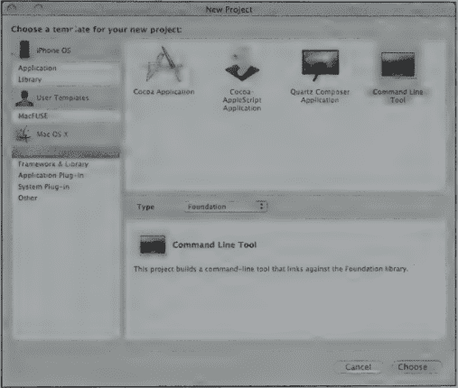

在这个对话框中，你可以选择创建各种类型的项目，包括命令行应用程序到桌面图形应用程序。你可以找到几乎任何东西的模板。此外，如果你安装了 iPhone SDK，还有各种 iPhone 和 iPad 应用程序的项目模板。因为你主要感兴趣的是简单地理解 Objective-C 语言，所以选择这些中最简单的项目。

1. 从 Mac OS X 组中，选择 Application 然后选择 Command Line Tool。
2. 在 Type 下拉列表下，选择 Foundation。
3. 点击 Choose 按钮，选择保存新项目的位置，然后点击 Finish。

在接下来的几个部分中，我将简要介绍 Xcode 开发环境，以便你熟悉它。首先，查看 Xcode 窗口。它如图 1.2 所示。

### 图 1.2

主 Xcode 窗口

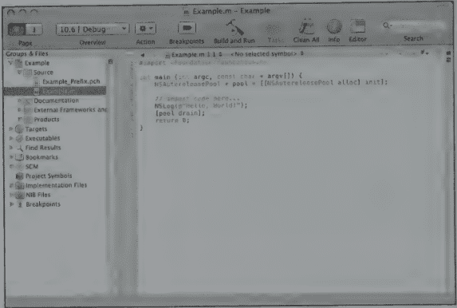

主 Xcode 窗口由两个面板组成。第一个位于左侧，包含项目中的所有文件。选择其中一个文件会在窗口右侧的编辑器面板中打开该文件。项目文件可以在 Xcode 中通过将它们移动到项目内的文件夹中进行分组。对于大多数情况，这些组严格是为了你在开发期间的方便，对最终完成的项目几乎没有或没有影响。

除了源文件之外，你链接项目的框架也会显示出来。

在项目文件下方有一组智能组。它们封装了诸如项目将生成的目标、搜索结果和断点等内容。

Targets 组包含项目将编译的目标。通过修改该组中对象的设置，你会覆盖项目范围的编译设置。这也是你可以在项目中添加和编辑自定义编译步骤的地方。图 1.3 显示了该组的构建设置。


## 图1.3

构建设置

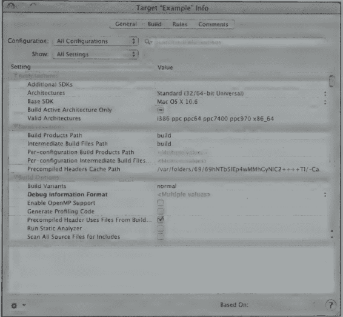

### 探索项目中的文件

在这个简单的项目中，你的源文件都包含在源文件组中。你应该会看到只有一个源文件，它的名称与你为项目起的名称相同，扩展名为 .m。单击此文件，它应显示在 Xcode 的编辑器面板中，如图1.4所示。

注意
虽然我说只有一个源文件，但你可能会看到另一个带有 .pch 扩展名的文件；这是一个预编译头文件，不是你需要编辑或处理的文件。它由编译器自动生成。

现在不必担心理解这个文件中的所有内容。我将在下一章中讲解基本 Objective-C 程序的语法。目前，重点是理解 Xcode 及其工作方式。

### Objective-C 简介

## 注意

如果你的源文件没有显示，你可能需要拖动 Xcode 窗口底部的分隔条来显示源代码编辑器。

图1.4

Xcode 中的编辑器面板。

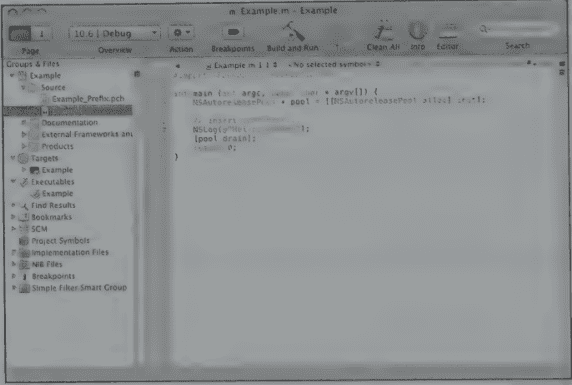

默认项目中包含的其他文件包括：文档组中你的程序文档文件、外部框架和库组中与你的项目链接的框架，以及位于产品组中的实际可执行文件。你的可执行文件会以红色显示，这是因为你还没有构建可执行文件。如果你单击“构建并运行”按钮，它将构建可执行文件、运行它，并在控制台窗口中显示其输出。请务必熟悉控制台窗口及其外观，因为在接下来的章节中，你将经常使用控制台窗口来检查你将要编写的程序的输出。

### 添加源文件

要向项目添加新的源文件，只需在文件组织面板中选择源文件组，然后转到“文件”>“新建文件”菜单，这会显示“新建文件”对话框，如图1.5所示。

在本书中，添加文件时，你大多会使用 Cocoa 类选择和 Objective-C 类模板，因此请熟悉此窗口。

在某些情况下，你的项目中可能有多个目标，因此可能有不同的源文件针对不同目标进行编译。要明确地将某个文件包含在或排除在当前所选目标的编译之外，请单击该文件，然后在源面板中找到详细信息视图。“目标”列包含一个复选框，当文件配置为针对当前目标编译时，该复选框处于选中状态；当取消选中时，该文件将不会被编译。如图1.6所示。

## 注意

如果看不到详细显示，请转到“视图”→“缩小编辑器”菜单来显示它。

## 图1.5

“新建文件”对话框

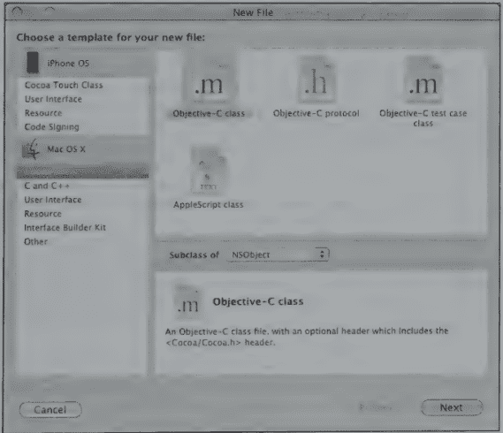

## 图1.6

显示“目标”复选框

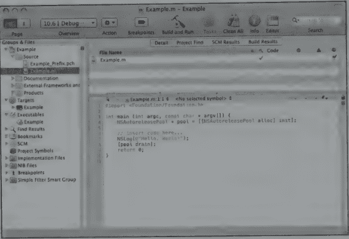

### 主 Xcode 窗口

既然你对 Xcode 中的基本文件管理已经有了一些了解，接下来你需要熟悉主 Xcode 窗口。这是你在 Xcode 中完成大部分工作的地方。主 Xcode 窗口如图1.7所示。

当你查看此窗口时，可以看到左侧是文件浏览器面板，右侧是详细显示面板，或者我在本书其余部分所称的编辑器面板。在文件浏览器面板中选择文件会使其显示在右侧的编辑器面板中。此外，编辑器面板有几种不同的模式。详细模式显示文件浏览器中所选文件的摘要；项目查找模式显示一个查找面板，使你可以在项目中的所有文件中搜索任意文本字符串。如果你为 Xcode 启用了 All-In-One 布局，编辑器面板还会有一种构建结果模式。这种模式使你可以查看上次编译的构建结果。

现在，看一下文本编辑器窗口顶部的条带。它会显示与当前编辑文件相关的几个有趣的信息项。

你在这个顶部条带中看到的第一项是当前正在编辑的文件的文件名和行号。这实际上是一个下拉列表，你可以单击它并从最近打开的文件列表中选择。在旁边，另一个下拉列表显示当前编辑文件中的方法的函数声明。如果你选择其中一个方法，编辑器将自动跳转到现有文件中的对应声明。

## 图1.7

主 Xcode 窗口

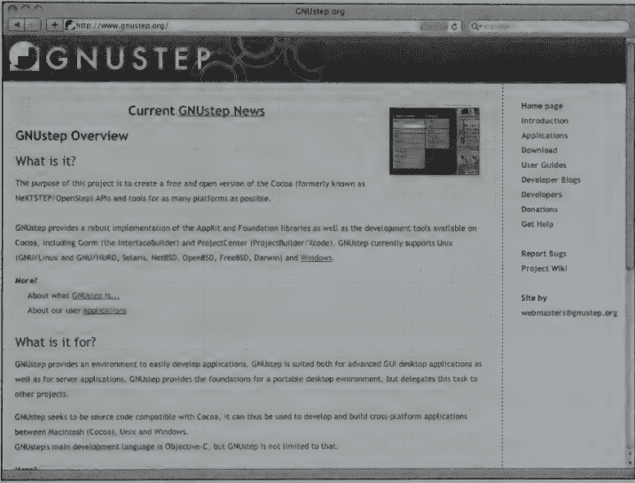

图1.8显示了一个典型文件使用此下拉列表的情况。

> **注意**
> 
> 你还可以在代码中使用 pragma 指令向此下拉列表添加任意标签。对于这个文件，你可以看到已经有一个用于 Interface Builder 动作方法的 pragma 指令。

在文本编辑器和文件浏览器上方是主工具栏。你可以用各种按钮配置它，但通常默认按钮就完全够用。它们让你能够启动构建、停止当前构建等。

最后，在 Xcode 窗口的右下角，你可以看到上次构建结果的摘要。如果构建成功，你会看到“Succeeded”（成功）。如果构建失败，你会看到上次编译期间发生的警告和错误数量的统计信息，以及黄色图标表示警告、红色图标表示错误。如果你最近运行了静态代码分析器，对于它生成的任何警告，你会看到蓝色图标。

## 图1.8

文件导航下拉列表

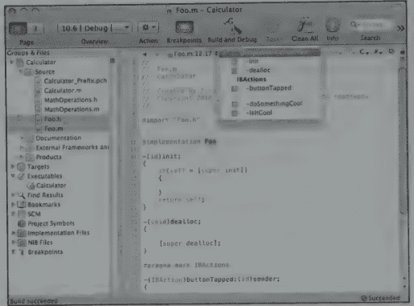

### 理解编译过程

在我们开始详细介绍 Objective-C 的语言特性之前，你必须透彻理解编译过程是如何工作的。编译过程就是计算机将你输入的代码转换为计算机实际可以执行的指令的过程。归根结底，计算机实际上只能以其原生语言执行指令。这种语言通常极其冗长，人类难以理解和使用。因此，为了让人给计算机编写指令，我们使用更高级的语言，例如 Objective-C。我们在文本编辑器中编写程序，将文件保存到磁盘，然后对文本文件运行编译器。编译器随后获取文本并将其转换为计算机可以执行的指令。

这些大多是计算机科学的入门知识。如果你已经熟悉编程，或许是用另一种语言，那么你已经知道所有信息，或许可以放心跳过接下来的几节。但如果你完全是编程新手，这些信息将很有用。即使在实际中编译代码的过程很短，理解这个过程也很有指导意义。

理解编译过程的第一步是编写代码。

### 编写代码

如前所述，作为程序员，你 99% 的时间都会花在将文本精心制作成软件上。所有软件开发都要求程序员在编译之前将计算机的指令输入文本编辑器。这通常被称为编写代码。

## 清单1.2

## 实现文件

```
#include "MyModule.h"

@implementation MyClass
@synthesize foo;

- (void) someMethod
{
    NSLog(@"some method got called");
}
@end
```

同样，现在不必担心理解这段代码，但我会借此机会指出这些清单的几点有趣特性。

首先，请注意，接口文件通过包含 @interface 指令，明确说明了它是一个接口。@interface 指令划定了整个接口的范围，并一直持续到你看到 @end 指令为止。在这些行内，有若干子部分。

第一个子部分由界面顶部的花括号（{ }）界定。这是成员变量声明区域。成员变量存储与你的模块相关的数据。

第二个子部分声明属性和方法。属性记录并允许访问对象中的状态和数据。方法是指示计算机处理这些数据的指令。上面显示的代码是典型的面向对象模块。你将在第3章中学习更多关于面向对象编程、类、成员变量、属性和方法的知识。

## 注意

> Objective-C 保留了 C 编程语言的根源。因此，在 Objective-C 中创建纯 C 模块是不可能的。在这些情况下，模块可能使用 .h 文件扩展名表示接口，使用 .c 表示实现。此外，如果将实现文件命名为 .cc 扩展名，Xcode 可以编译 C++；如果命名为 .mm 扩展名，则可以编译 Objective-C++（Objective-C/C++ 混合体）。不过，本书是来学习 Objective-C 的，所以我们不会这样做。

你可以使用任何能够保存纯文本文件的文本编辑器来编写 Objective-C 代码。然而，Apple 在 Mac OS X 上提供了出色的 Xcode 集成开发环境，专门用于创建 Mac OS X、iPhone 和 iPad 应用程序。它是一个极好的工具，也是本书中你将使用的工具。另一方面，如果你在 Mac OS X 以外的平台上开发，你需要为所选平台寻找合适的文本编辑器。


### 将源代码转换为编译代码，再将编译代码转换为可执行文件

创建好源代码之后，你需要让计算机将源代码转换为它可以执行的指令。这个过程的一部分被称为编译源代码。

编译源代码实际上涉及多个步骤。

第一步称为预处理。你可以将预处理步骤理解为计算机为编译你的代码做准备。在此步骤中，编译器会移除任何不会生成可执行代码的内容，例如注释等。它还会展开部分代码并重新排列某些指令，以便编译过程的第二步能够更高效。编译第一步的最终结果是源代码的一种中间状态。你通常不会看到或处理这种中间形式的代码，不过有一些编译器开关可以让你在出于任何原因想查看输出时，让编译在此阶段停止。一些使用高级技术的开发者有时会利用这些编译器开关，以便查看中间文件并确切了解编译器在做什么。在正常的应用程序开发中，你可能永远不需要这样做。

预处理之后，第二步是编译器真正将源代码转换为所谓的对象文件（object file）。对象文件的扩展名为 `.o`。编译源代码可能是一个相对漫长的过程，涉及许多不同的模块和许多不同的源代码文件。因此，如果某个模块及其所有依赖项都没有发生变化，而你可以避免重新构建该模块，那么在减少编译时间方面将是一个很大的优势。正因为如此，对象文件通常存储在构建目录的磁盘上。如果某个源代码文件自上次运行编译器以来没有更改，编译器就可以直接跳过对该源代码的重新编译，转而重用上次运行编译器时留下的对象文件。通常，你在日常使用中不需要查看这些文件。它们仅供编译器使用。

编译的最后一步涉及一个称为链接（linking）的过程。链接意味着将上一步生成的对象文件连接在一起，形成一个可执行文件。除了对象文件本身之外，库和框架也会被链接到可执行文件中。链接过程的最终结果就是你的实际应用程序可执行文件。对于命令行应用程序而言，这将是一个可以从命令行运行的单一二进制文件。对于桌面应用程序而言，这通常是一个所谓的应用程序包（application bundle），实际上是一个包含可执行文件以及运行应用程序所需的所有资源（如图形、声音等）的磁盘目录。你将在下一节中了解更多关于应用程序包的内容。

在 Xcode 中，编译你的应用程序只需点击“构建并运行”（Build and Run）按钮即可。如果你在示例项目上这样做，它会在控制台中启动应用程序并显示其输出。同时，Xcode 会切换到调试模式，并允许你对应用程序进行调试。调试是一个高级 IDE 主题；有关如何使用它进行调试的信息，请参阅 Xcode 文档。

编译过程的最终结果就是你的可执行文件。如果在任何时刻编译器在你的源代码中检测到错误，它会停止处理该文件并向你显示错误，以便你进行修正。遗憾的是，编译器相当挑剔。计算机在从文字中推断含义方面远不如我们。因此，编译器不会猜测你原本想输入什么，而是直接放弃并显示错误。这些错误可能简单到缺少分号、缺少空格、大小写错误，或任何数量的小问题。做好准备——当你走上程序员这条职业道路后，你每天都会遇到这样的错误，即使没有成千上万次，也会有数百次。即使是最优秀的程序员，也很少能写出第一次就能完美编译的代码。

### 探索应用程序包

在上一节中，我提到了“应用程序包”这个术语——即使你是一位经验丰富的程序员，这对你来说也可能是一个全新的术语。你可能想知道它是什么。应用程序包实际上更像是操作系统层面的构造，而不是 Objective-C 的构造。Objective-C 语言本身并不要求也不生成应用程序包。尽管如此，应用程序包在几乎所有可以使用 Objective-C 的平台上都是编程中重要且不可或缺的概念，因此，作为 Objective-C 程序员，理解它们对你来说是很重要的概念。

应用程序包就是磁盘上的一个目录，其中包含一组文件。在 Mac OS X 中，应用程序包用于将应用程序运行所需的全部文件分组在一起。这包括可执行文件、图形、声音文件和用户界面资源等项目。此外，在构建 Mac OS X 图形应用程序时，用户界面定义通常是在一个名为 Interface Builder 的应用程序中完成的。该应用程序也会生成称为 NIB 文件的包。NIB 文件通常具有 `.nib` 扩展名，并存储在应用程序包内部。

## 注意

NIB 代表 NeXTstep Interface Builder，是从 NeXT 时代遗留下来的。最近，格式从二进制变为 XML，文件扩展名也从 `.nib` 改成了 `.xib`。在编译期间，XIB 文件仍然会被编译成 NIB 文件，因此当你查看应用程序包时，你会看到 `.nib` 而不是 `.xib`。

清单 1.3 显示了一个典型的应用程序包目录结构。在这个例子中，它是 Xcode 应用程序包的部分列表。

#### 应用程序包的内容

```
Xcode.app
`-- Contents
|--- CodeResources -> _CodeSignature/CodeResources
|--- Info.plist
|--- Library
|   `-- QuickLook
|       `-- SourceCode.qlgenerator
|           `-- Contents
|           |--- CodeResources -> _CodeSignature/CodeResources
|           |--- Info.plist
|           |--- MacOS
|           |   `-- SourceCode
|           |--- _CodeSignature
|           |   `-- CodeResources
|           `-- version.plist
|   `-- Spotlight
|       |--- SourceCode.mdimporter
|       |   `-- Contents
|       |   |--- CodeResources -> _CodeSignature/CodeResources
|       |   |--- Info.plist
|       |   |--- MacOS
|       |   |   `-- SourceCode
|       |   |--- _CodeSignature
|       |   |   `-- CodeResources
|       |   `-- version.plist
|       `-- uuid.mdimporter
|           `-- Contents
|           |--- CodeResources -> _CodeSignature/CodeResources
|           |--- Info.plist
|           |--- MacOS
|           |   `-- uuid
|           |--- Resources
|           |   |--- English.lproj
|           |   |   |--- InfoPlist.strings
|           |   |   `-- schema.strings
|           |   |--- Japanese.lproj
|           |   |   |--- InfoPlist.strings
|           |   |   `-- schema.strings
|           |   `-- schema.xml
|           |--- _CodeSignature
|           |   `-- CodeResources
|           `-- version.plist
|--- MacOS
|   `-- Xcode
|--- PkgInfo
|--- PlugIns
```

清单 1.3（续）

```
|   |-- BuildSettingsPanes.xcplugin
|   |   `-- Contents
|   |       |-- CodeResources -> _CodeSignature/CodeResources
|   |       |-- Info.plist
|   |       |-- MacOS
|   |       |   `-- BuildSettingsPanes
|   |       |-- Resources
|   |           |-- Built-in Build Settings Panes.pbsettingspanespec
|   |
|   |-- Resources
|   |   |-- AskUserForNewFileDialog
|   |   |-- CreateDiskImage.workflow
|   |   |   `-- Contents
|   |   |       `-- document.wflow
|   |   |-- DevCDVersion.plist
|   |   |-- Document-Cert.icons
|   |-- _CodeSignature
|   |   `-- CodeResources
|   `-- version.plist
```

请注意，`Contents/MacOS` 目录包含 Xcode 可执行文件。这个可执行文件与你制作命令行应用程序时生成的可执行文件是一样的。区别在于，它被打包在应用程序包中，并且包含从该包中加载资源的代码。此应用程序中其他一些有趣的目录包括 `PlugIns` 目录，其中也包含包。`Spotlight` 目录也包含以 `SourceCode.mdimporter` 和 `uuid.mdimporter` 目录形式存在的包。Foundation 框架（我们将在本书第二部分介绍）包含让你能够读取应用程序包的方法，并允许访问这类嵌入式包。

此时你需要知道的重要事情是，当你为 Mac OS X、iPhone 或 iPad 创建图形应用程序时，Xcode 会为你的应用程序创建一个应用程序包。将来，如果你需要在应用程序中包含分组隔离的资源组，你可能会希望自己创建一个应用程序包。Xcode 也正好为你提供了这样的能力。不过，目前你不需要担心这一点。

### 使用构建设置

Xcode 中有两个位置可以配置项目的构建设置。第一个也是主要的位置是项目信息窗口，你可以通过选择“项目 ▷ 编辑项目设置”（Project ▷ Edit Project Settings）来访问它。在本节中，我将详细介绍这些窗口，因为这些信息既有用又有指导意义。由于这部分内容在书中的位置，你可能无法理解我将要讨论的许多内容。我建议你先略读这一节，等完成第 2 章之后再回来阅读。项目设置窗口的第一个面板（如图 1.9 所示）显示了项目的一般设置。其中大部分你不需要更改，但通过“配置根目录和 SCM”（Configure Roots and SCM）按钮配置源代码管理这一项除外。


### Figure 1.9
### Project settings

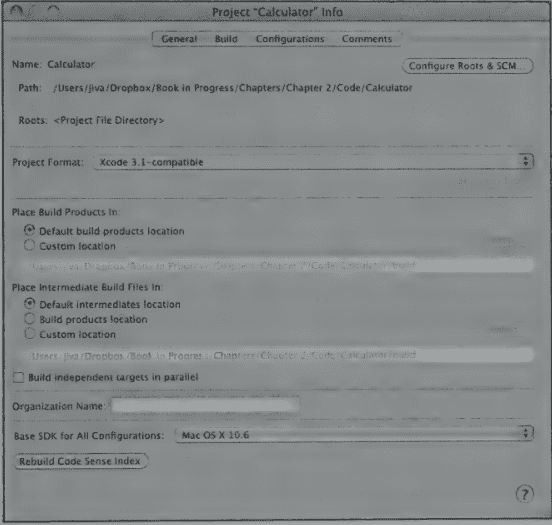

Place Build Products In 设置配置项目中编译后可执行文件放置的位置。同样，这也是你可能不需要更改的设置之一，但在此记录下来是有用的，以便了解你的可执行文件将被放置在哪里。此目录就是你找到可执行文件的位置。

此设置下方的设置，即 Place Intermediate Build Files In 设置，配置在应用程序构建时源代码的对象文件将被放置的位置。

下一个设置 Build Independent Targets in Parallel 影响编译器如何为不同的独立平台构建目标，例如 PPC 和 Intel。如果启用，则单独的目标将并行构建。如果未启用，则它们将串行构建——一个接一个地构建。

关于 Xcode 最常被问到的问题之一是：“如何在版权声明之后自动放置在我源代码头文件中的组织名称进行更改？” 下一个设置 Organization Name 就是为此目的而设。通过在此处配置组织名称，当你向项目添加新文件时，版权列表将列出你在此处输入的组织名称作为版权所有者。将此配置为你的公司名称或你的姓名。

下一个设置 Base SDK for All Configurations 配置应用程序默认将被编译和链接的 SDK。所使用的 SDK 定义了项目可用的代码补全和框架。就本书而言以及你在阅读过程中将要进行的项目，你可以为当前 Mac OS 版本配置基础 SDK。然而，如果你为其他平台（如 iPhone OS 等）进行开发，则应适当配置此设置。你也应在希望为较旧版本的 Mac OS 编译应用程序的情况下修改此设置。

## NOTE

> 术语 SDK 指 Software Development Kit。SDK 是用于为特定平台构建应用程序的库、工具、文档和源文件的集合。Xcode 附带了适用于 Mac OS X 和 iOS 的 SDK。

此面板上的最后一个设置与重建 Code Sense Index 相关。你可能会遇到一些罕见的情况，Code Sense Index 会损坏。在这些情况下，你可能希望通过使用此按钮选择重建 Code Sense Index。这些情况很少见，但如果你需要它，这里就是需要执行的地方。

所有项目构建设置的主要配置位置有两个。第一个是在项目级别，第二个是在单个目标级别。如果你可以将项目级别设置视为构建应用程序的基础设置，那么目标级别设置就是你希望为特定目标更改的项目。例如，你可能有一个给定应用程序的项目，该项目同时具有调试目标和发布目标。在这种情况下，你将对两个目标的项目级别设置保持相同，但你会根据目标逐个改变一些内容，例如是否要剥离你的可执行文件等等。Xcode 通过将项目级别设置和目标级别设置作为两个单独的窗口来实现这一点。你可以配置项目级别设置，这些设置会级联到你的目标中，除非你在特定目标的设置上进行更改。当你对特定目标的设置进行更改时，此更改将覆盖来自项目级别的设置。图 1.10 显示了其工作原理的示例。

在此示例中，你同时查看项目级别设置和目标级别设置。示例应用程序显示了配置了两个共享代码但构建不同可执行文件的不同目标。如你所见，项目与目标之间不同的项目在目标级别设置中以粗体显示。如果你选择删除该设置，则粗体消失，并且默认值为其从项目级别设置获取的值。

屏幕顶部的下拉列表允许你选择要编辑的配置，例如你是在处理调试构建还是发布构建，以及过滤特定设置的列表。所示的配置选项是通过项目级别的 Configurations 选项卡设置的。图 1.11 显示了一个典型的项目，其中配置了调试和发布构建。

你可以将配置视为同一目标的不同构建。除了调试和发布之外，另一个典型示例可能是你想要为不同的架构构建的情况，例如 PowerPC 与 Intel。

### Figure 1.10
### Target versus project settings

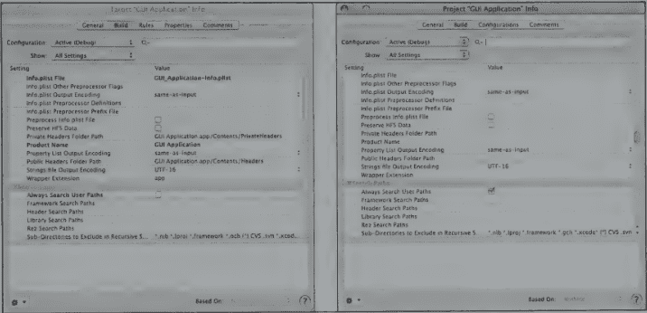

### Figure 1.11
### Build Configurations


可以使用命令行实用程序 xcodebuild 来构建你的项目。这在自动化构建时很有用。如果你这样做，此屏幕底部的选项“Command-line builds use”控制在未指定配置时将使用哪个配置。

本书的大多数这些设置是你通常不会更改的。话虽如此，你可以滚动浏览设置，单击其中每一个，并在屏幕底部查看它显示的信息，描述每个选项的作用，如果你好奇它们的作用。目标构建设置下的第三个选项卡是 Rules 选项卡，它使你能够为项目中不同类型的文件配置默认编译行为。例如，如果你有一种在构建过程中需要特殊处理的文件类型，你可以通过按加号按钮在此处添加该文件。然后配置所需的任何自定义行为。此外，如果你想更改任何内置文件的默认行为，你也可以在此处通过简单地更改下拉列表选项来完成。

在大多数情况下，你不需要对设置进行任何更改。在构建图形 Cocoa 应用程序时，目标构建设置下还有一个额外的选项卡，即 Properties 选项卡。此选项卡允许你配置诸如可执行文件名称和项目的主包标识符等选项。通常，你希望将标识符配置为与你的公司名称匹配，而不是使用默认值。此外，如果你有应用程序保存的文件，你希望能够双击以启动，你可以在此处注册并配置这些文件的文档类型。当你的应用程序构建时，Mac OS X 将检测你指定的文件类型与你的应用程序关联，并将你的应用程序列为可以打开该特定类型文件之一。此行为在图 1.12 中显示。

> NOTE
> 对于命令行应用程序，你将看不到 Properties 选项卡。Properties 选项卡实际上是在配置你的 App 包中的信息，而命令行应用程序中不存在 App 包。

如果你有一个图形应用程序，你也可以为其配置图标。你通过将图标文件作为应用程序包的一部分包含并在 Icon File 设置中指定其名称来完成此操作。

再次，对于你在本书中进行的大多数开发，你不需要更改这些选项中的任何一个，但了解它们的位置以供将来参考是好的。

> NOTE
> Xcode 4 在本书付印时仍在开发中，已将构建设置移来移去，但设置本身基本保持不变。请参阅 Xcode 4 文档以获取此功能的最新信息。

分析器检测到的错误与常规编译警告一样显示。然而，当你在源代码中单击错误时，你会以图形代码流箭头的形式获得额外的上下文信息。这些箭头显示了分析器预测在运行代码时将使用的代码路径。此信息可以帮助你更详细地了解分析器在检测错误时考虑的确切情况。

看看分析器如何处理一些常见的编码错误。同样，我在这里讨论的大部分内容是一个高级主题，你将在后面的章节中了解更多。现在快速浏览本节，但在你自己的代码中看到这些类型的错误后，再回来阅读。

### Listing 1.4
### A Program with a memory leak

```
#import <Foundation/Foundation.h>

int main (int argc, const char * argv[])
{
    NSAutoreleasePool * pool = [[NSAutoreleasePool alloc] init];
    NSDate *date = [[NSDate alloc] init];
    NSLog(@"The time is: %@", date);
    [pool drain];
    return 0;
}
```

在这种情况下，被分配的 NSDate 对象未被释放。此代码的静态分析器输出显示在图 1.13 中。

请注意，错误同时显示在屏幕顶部的构建结果面板中，以及代码内联中。Clang Static Analyzer 不仅能捕获大多数编译器无法捕获的错误，其输出也比大多数编译器错误清晰得多。如果你展开构建结果中错误消息上的披露三角形，它将向你显示与此特定错误关联的两个单独消息。单击这两个消息中的任何一个都会显示内存被分配的确切位置，并显示程序在被分析时的程序流程。然后你可以沿着箭头浏览你的代码。图 1.14 显示了带有展开错误的相同代码以及分析器的完整输出。


### 图 1.13

静态分析器的输出

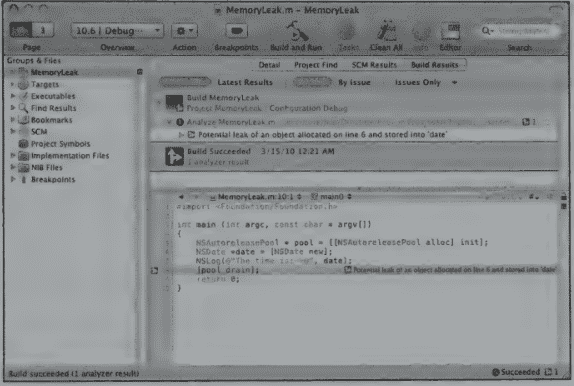

如果你通过将其修改为像清单 1.5 那样来修正代码，你会发现错误消失了，并且你得到一个干净的编译。

### 图 1.14

详细的分析器输出

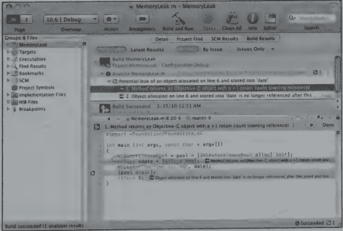

### 清单 1.5

### 正确的代码

```
```objective-c
#import <Foundation/Foundation.h>

int main (int argc, const char * argv[])
{
    NSAutoreleasePool * pool = [[NSAutoreleasePool alloc] init];
    NSDate *date = [[NSDate alloc] init];
    NSLog(@"The time is: %@", date);
    [date release];
    [pool drain];
    return 0;
}
```
```

如果你重新编译该应用程序，你会看到 Clang 静态分析器不再标记错误。

### 理解 Objective-C 运行时

关于 Objective-C 最初且最基本的概念是，Objective-C 是一种具有动态运行时的编译语言。这意味着该语言使用编译器编译，从而实现静态、编译时类型检查，但它也链接了一个运行时，从而实现方法的动态分派。这种动态运行时赋予你许多仅在脚本语言中才能找到的能力，例如“鸭子类型”和对象的内省。

鸭子类型指的是一种语言类型安全类型，其中假设如果一个对象“看起来像鸭子，叫起来像鸭子，它一定就是鸭子”。这与静态类型相反，在静态类型中，一个对象必须是它声明的类型，以便语言能够在其上解析方法。两种技术各有利弊，但在 Objective-C 的情况下，鸭子类型使得语言中的许多酷炫特性成为可能。

实际上有两种主要的 Objective-C 运行时。“现代运行时”，用于 64 位机器和 iPhone，以及“传统运行时”，用于 32 位 Mac OS X 和其他所有地方。“现代运行时”中有几个特性对开发非常有利，但由于其缺乏广泛使用，本书中我展示的代码示例将为传统运行时编写。现代运行时与传统运行时完全向后兼容，因此这不会为你编写代码带来任何问题。在现代运行时有显著优势的情况下，我会尽量在正文中为你做一个注释。

Objective-C 运行时在编译应用程序时会自动添加到你的应用程序中。使用它是完全透明的，除非你需要使用其某些高级功能。现在，重要的是要理解运行时在动态类型和静态类型方面赋予你的能力。这是 Objective-C 相对于其他编程语言所具有的独特能力。

这种能力的一个副作用是引入了 `id` 数据类型。`id` 数据类型是 Objective-C 中一种特殊的对象类型，它实际上可以是任何类型的对象。我将在第 3 章中讨论更多细节。

## 摘要

在本章中，我向你介绍了 Xcode 集成开发环境，你将在本书中全程使用它来开发你的应用程序。我向你展示了如何根据自己的喜好配置它，如何在其中组织你的文件，如何构建你的应用程序，以及如何阅读其输出以查找代码中的错误。我还解释了编译过程和应用程序包的格式，以及简要介绍了 Objective-C 运行时。

## 理解基本语法

在本章中，我将向你展示如何编写一个基本的 Objective-C 程序。这个非常简单的命令行应用程序将向控制台打印一条简短的消息。使用这个基本程序，你将探索 Objective-C 的一些基本要素，首先从如何实际编写代码开始，然后进入变量和函数的工作，最后通过使用条件语句和循环来控制程序的流程。这些概念是学习该语言的基础，你应该在进入下一章之前彻底学习本章。

继续在第 1 章中创建的 Xcode 项目中输入清单 2.1 中的代码。此代码应输入到源文件中，该源文件以你的项目名称命名，位于 Source 组中。

### 清单 2.1

### 你的第一个程序

```
#import <Foundation/Foundation.h>

int main(int argc, const char *argv[])
{
    NSLog(@"Hello from Objective-C");
    return 0;
}
```

我将在这里跳着讲解这段代码，因为这样解释起来更容易。

从第 3 行开始，即 main 函数的声明。所有 Objective-C 应用程序都有一个 main 函数。通常你看不到它，因为它通常在你创建项目时由模板创建；在使用图形应用程序时，很少需要编辑此代码。我也想教你如何编写命令行应用程序，所以我在这里向你展示这段代码。

### 本章内容

- 编写你的第一个程序
- 声明变量
- 使用函数
- 使用流程控制语句
- 使用循环

## 注意

什么是函数？函数本质上是程序中的子例程。它是分支到另一段代码以执行某些任务然后返回。你通过在调用函数时包含参数（括号中的内容）向函数发送数据。你可以通过几种方式从函数获取数据，但主要方式是通过接收返回值，即从函数返回给调用代码的值。

所有 Objective-C 应用程序都有一个 main 函数。main 函数也是程序开始和结束的地方。你的程序开始执行是通过操作系统调用 main 函数。所示的两个参数 argc 和 argv 包含传递给应用程序的命令行参数。你的应用程序开始逐行执行 main 函数内部的每一行，直到它到达 return 语句。在这种情况下，我们的 return 语句只是返回零。这表示我们的程序已成功退出。

第 5 行包含对一个名为 NSLog 的函数的调用。此函数导致传递给它的任何字符串在应用程序运行时打印到控制台。

第 4 行和第 7 行上的大括号表示 main 函数的作用域。你经常会看到这些用法。第 5 行和第 6 行末尾的分号表示这些语句的结束，它们被编译器用来分隔一个语句和另一个语句。Objective-C 中的语句可以跨多行拆分。因此，编译器需要一些指示来知道何时语句结束，以便它可以解析该语句。对于许多初学者来说，知道何时在行尾放置分号可能会令人困惑。请记住，函数块内的任何语句，除流程控制语句外，都需要在行尾加上分号。此外，声明也需要分号。第 1 行是一个 import 语句。import 语句允许你在当前文件中加载来自其他文件中的代码。在这种情况下，我们正在包含 Foundation 框架的接口声明。（你可以在本书的第二部分阅读有关 foundation 框架的更多信息。）此行代码是必需的，以便加载允许我们使用第 5 行的 NSLog 语句的代码。奇怪的 @"Hello from Objective-C" 称为字符串。字符串是代码中的文字文本；它们存储在程序中的变量中，可以稍后访问。在这种特定情况下，此字符串将作为参数发送给 NSLog 函数，后者将然后在控制台上显示它。

继续编译并运行此应用程序并查看输出。你应该会看到类似图 2.1 的内容。


#### 图 2.1

我们应用程序的输出

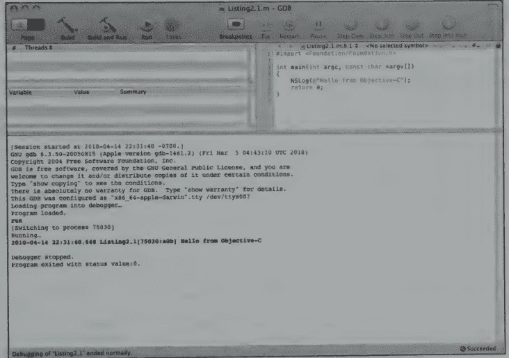

### 使用语句和表达式

所有 Objective-C 程序都由语句和表达式构成。语句是严格为了执行某个操作而存在的代码行。一般来说，语句没有返回值，因此除了调用语句所产生的副作用之外，它们不会改变当前执行行的状态。换句话说，语句可以分支到另一行代码，并在那一行代码中引起具有副作用的事情发生（例如向控制台打印内容或显示对话框），但它不会向语句所在的当前代码行返回值。

相比之下，表达式确实会向调用它的代码返回一个值，因此可以用来改变程序流程。

在很大程度上，这两者之间的区别很小，无需过分担心。我会交替使用这两个术语。

### 声明变量

你已经了解了如何编写一个简单的 Objective-C 程序的基础知识。现在你可以更进一步。把你写过的代码修改成如清单 2.2 所示。

#### 清单 2.2 一个包含变量的程序

```
#import <Foundation/Foundation.h>

int main(int argc, const char *argv[])
{
    int aVariable = 5555;
    NSLog(@"%ld", aVariable);
    return 0;
}
```

这个新的变化说明了下一个概念——变量。

如你所见，我添加了一个变量并给它赋值；然后使用 NSLog 语句输出该变量。变量是存储数据的地方。变量具有与之关联的内存，这些内存被分配用于存储你想要存储的内容。在这个例子中，我将值 5555 存储到变量 aVariable 中，然后将该变量传递给 NSLog 函数。有趣的是，从程序一开始就有几个其他变量存在于我们的程序中。这些就是 argc 和 argv 变量。就像 aVariable 变量一样，它们存储的值可以在程序的其他地方被引用。例如，你也可以将代码修改成如清单 2.3 所示。

#### 清单 2.3 将 argc 作为变量使用

```
#import <Foundation/Foundation.h>

int main(int argc, const char *argv[])
{
    NSLog(@"The argument count is: %ld", argc);
    return 0;
}
```

在这个例子中，你修改了程序，使它打印出传递给它的参数数量。argc 变量存储传递给应用程序的参数数量。通过将变量传递给 NSLog 函数，我们就能将它打印出来。

变量可以在给定的作用域（也称为栈帧）内声明，也可以在所有栈帧之外声明，在这种情况下它们就是全局变量。栈帧由代码中的花括号定义。例如，请看清单 2.4。

> **注意**
> 全局变量通常被认为是一种不良的编程实践，应当避免使用。

#### 清单 2.4 不同的栈

```
#import <Foundation/Foundation.h>

int main(int argc, const char *argv[])
{
    // this is the first stack frame
    int aVariable1 = 5;
    if(aVariable1 > 4)
    {
        // this is the second stack frame.
        int aVariable2 = 10;
        NSLog(@"aVariable1: %ld", aVariable1); // this is OK
        NSLog(@"aVariable2: %ld", aVariable2); // this is OK
    }

    NSLog(@"aVariable1: %ld", aVariable1); // this is OK
    NSLog(@"aVariable2: %ld", aVariable2); // error, aVariable2 does not exist here.
    return 0;
}
```

在上面的代码中，变量 aVariable1 在第一个栈帧中声明。这个栈帧一直存在到第二个花括号的末尾。我们说，“aVariable1 在第一个栈帧内具有作用域。”变量 aVariable2 只在第二个栈帧内具有作用域，该栈帧存在于第 7 行到第 12 行之间。因此，当我们到达第 15 行时，aVariable2 已经不存在了，并会导致错误。我们说，“aVariable2 在第二个栈帧的末尾（第 12 行）超出作用域。”在本章前面，我提到变量在内存中存储数据。它们使用的内存可以分配在栈上，正如你在本例中看到的那样。当变量超出作用域时，与这些变量关联的内存也会被释放。也就是说，当变量不再存在时。然而，变量的内存也可以分配在所谓的“堆”上，堆是应用程序可以自行分配数据的内存池，并且应用程序对它拥有更大的控制力。但是，正如他们在《蜘蛛侠》中所说：“能力越大，责任越大。”你还必须确保释放你在堆上分配的任何内存。清单 2.5 展示了在堆上分配一个对象然后释放它的示例。

#### 清单 2.5 在堆上分配内存

```
// this allocates the memory
SomeClass *aVariable = [[SomeClass alloc] init];

// do something with aVariable

[aVariable release]; // this frees the memory.
```

这个清单中的代码演示了一个我稍后讨论对象时会花大量时间讨论的概念。现在，只需理解变量 aVariable 的内存是分配在堆上的。这意味着如果我们没有在该清单末尾释放那块内存，它就会一直存在，这就是通常所说的内存泄漏。判断一个变量的内存是分配在堆上还是栈上的关键方法之一，是看它是否是一个指针。前面示例中 aVariable 变量声明中的 * 运算符表明这是一个指针。指针是指向另一个内存位置的变量。

请注意，到目前为止我们使用过的所有变量，其名称前都没有 * 运算符。这意味着它们的内存是分配在栈上的。虽然你也可以使用严格分配在栈上的指针，但在 Objective-C 中，当你看到指针时，通常都是针对分配在堆上的变量。关键在于寻找某种像这里所示的分配函数。

指针是一个难以理解的话题，但我很快就会用一个章节来详细深入探讨它们。

在本章前面，我描述了全局变量。类似地，分配在栈上的变量还有一个叫法，即局部变量。局部变量是只存在于局部作用域内的变量。局部作用域是“当前栈帧”的另一种说法。你还会遇到其他一些类型的变量，包括成员变量（即类的成员变量）和实例变量（即存储对象特定实例的变量）。我将在第 3 章讨论对象时介绍这两者。

在 Objective-C 中使用变量时，首先必须声明它们，这意味着你必须告诉编译器你将要使用它们。声明时，你必须给出类型。类型大致分为三大类——标量、指针和结构体。在接下来的几节中，我们讨论的就是这三类。

### 使用注释

清单 2.4 和 2.5 引入了另一种语法：双斜杠（//）。在 Objective-C 中，以 // 开头的行是注释。它们会被编译器忽略，并且可以包含你想要的任何内容。通常，它们用于在代码中提供某种人类可读的文档，但同样经常用于临时移除代码，或者仅仅是为了让代码更美观。需要知道的重要一点是，无论你在代码中哪里看到 //，从该行的 // 到行尾的所有内容都会被编译器忽略。

除了 // 风格的注释之外，还有另一种注释语法，由 /* 和 */ 字符界定。在这种情况下，它不是注释到行尾的所有内容，而是只注释 /* 和 */ 字符之间的文本。

使用哪种注释技巧完全取决于你。我更喜欢 // 风格的注释，所以我在本书中一直使用这种风格。

### 探索标量类型

变量最基本的形式是标量变量。标量是一种每次只能保存一个值的类型。标量的例子有整数、浮点数和字符。标量在内存占用和可存储值的大小方面具有不同的定义大小。在决定将变量定义为什么类型时，你应该注意这些限制。表 2.1 显示了 Objective-C 中最常用的标量类型的大小。

#### 表 2.1 常用的标量类型

| 类型 | 描述 |
|------|-------------|
| int | 介于 +/- 2,147,483,647 之间的整数值。 |
| unsigned int | 介于 0 和 4,294,967,296 之间的整数值。 |
| float | 介于 +/- 16,777,216 之间的浮点值。 |
| double | 介于 +/- 2,147,483,647 之间的浮点值。 |
| long | 一种整数值，大小根据架构在 32 位到 64 位之间变化。 |


#### 表2.1（续）

| 类型 | 描述 |
|------|-------------|
| long long | 一个64位整数。 |
| char | 一个单独的字符。从技术上讲，它是以int来表示的。 |
| BOOL | 一个布尔值，可以是YES或NO。 |
| NSInteger | 编译为32位架构时，与int相同；编译为64位架构时，范围为±4,294,967,296。 |
| NSUInteger | 编译为32位架构时，与unsigned int相同；编译为64位架构时，值介于0到2^64之间。 |

这些标量类型中的大部分也与C和C++共享，但其中有几个是Objective-C所独有的。

苹果在操作系统和库中对32位和64位架构的支持做得非常出色。然而，从编程的角度来看，这样做并非易事。例如，某些值（如数组索引）可能会受益于64位整数更高的上限。因此，在理想情况下，我们希望代码能够在32位和64位平台之间无缝切换。为此，苹果为我们提供了NSInteger和NSUInteger类型，它们会根据编译时的架构自动变为32位或64位。

使用标量类型非常简单。要声明一个标量变量，只需告诉编译器变量的类型和名称。你也可以为它赋予一个初始值。例如，清单2.6展示了如何声明一些典型的标量变量。

#### 清单2.6：声明标量变量

```
int foo = 10;
double bar = 500.0;
float baz;
unsigned long n;
NSInteger x;
char a = 'a';
```

## 注意

请注意，变量`a`已被初始化为值`'a'`。在字符周围使用单引号告诉编译器将该字符的值视为char类型。这不应与字符串混淆，字符串将在后面讨论，它使用`@""`结构来指定。

### 使用特殊的变量修饰符

除了变量类型和变量名之外，还有许多关键字用于修饰你正在声明的变量类型。这些修饰关键字中最重要、也是你会在本书中看到的，是`static`和`const`关键字。

正如我之前提到的，在声明局部变量时，变量的内存通常会在程序每次进入局部变量作用域时被分配，并在离开局部作用域时被释放。这类存储被称为自动存储，或者按照默认的修饰关键字，称为`auto`。

`static`关键字会修改所声明变量的内存分配方式，使其在程序运行期间只被分配一次。之后在应用程序中访问同一个变量时，实际上访问的是最初分配的内存。这一点很重要，因为它让你能够指定一个局部变量，使其内容无限期保持。这使得它非常适合存储那些创建时需要大量资源、但变量内容不经常变化的局部变量。清单2.7展示了如何将`static`关键字与函数结合使用，以优化如变量初始化之类的昂贵操作。

#### 清单2.7：使用static

```
void someFunction()
{
    // x will be created and initialized only once,
    // no matter how often you call this
    static Expensive *x = [[Expensive alloc] initWithData:...];
    // do things with x here...
    [x doSomeOperation];
}

int main(int argc, char *argv[])
{
    someFunction(); // x is created up in someFunction
    someFunction(); // x already exists and will not be created again.
    return 0;
}
```

全局变量由于作用域是全局的，默认情况下行为类似于静态变量。也就是说，它们只被分配一次，并在整个应用程序运行期间保持其内容。然而，当你将`static`关键字应用于全局变量时，它会修改全局变量的作用域，使其只能在其声明所在的文件内被访问。这与全局变量的正常行为形成对比。普通的全局变量在程序中的任何位置都处于作用域内。

`static`关键字被称为存储修饰符。在Objective-C中有几种这种类型的修饰符。有`register`修饰符，它可以向编译器提供提示，表明所存储的数据将被频繁访问，因此存储在CPU寄存器中可能更有益。这个关键字很少使用。另一个更常用的关键字是`extern`。这个修饰符表示变量或函数声明引用的是应用程序中另一个编译单元中定义或分配的实际变量或函数。在本章后面讨论函数时，你会看到`extern`关键字的使用。

`const`关键字同样修改所声明变量的内存行为，但在`const`的情况下，变量被设置为只读。这意味着一旦变量被初始化，其内容就不能被更改。这在声明不应被修改的变量（如常量）时非常有用。通过将这类变量声明为`const`，编译器将强制执行该行为。如果你之后不小心尝试修改这些变量之一，这将是一个错误，编译器会生成一个错误。清单2.8展示了如何使用`const`关键字来避免覆盖常量。

#### 清单2.8：使用const关键字

```
int main(int argc, char *argv[])
{
    const NSString *foo = @"MY_CONSTANT";

    // do things here....

    foo = @"SOME_OTHER_VALUE"; // this will generate a compiler error.

    if([foo isEqualToString:@"MY_CONSTANT"])
    {
        // take action here...
    }
}
```

### 理解结构体

结构体，或简称为struct，是你自己定义的类型，可以在其中包含多个子变量。例如，如果你想声明一个将x和y坐标分组以表示一个点的变量，你可以使用结构体来声明该变量。你可以使用`struct`关键字来实现。

声明结构体分为两个阶段。首先，你必须告诉编译器关于结构体本身的信息，然后你可以使用该结构体来声明属于你所定义结构体类型的变量。继续我们声明点变量的示例，清单2.9展示了如何初步定义这个结构体。同样，这是过程的第一步——定义结构体。

#### 清单2.9：声明结构体

```
struct Point
{
    float x;
    float y;
};
```

在这种情况下，我定义了一个Point结构体，包含两个成员变量x和y，它们都是float类型。现在，在定义了Point结构体之后，你就可以声明你的变量了，该变量最终将实际保存你所引用的具体点。清单2.10展示了如何做到这一点。

#### 清单2.10：声明结构体实例

```
struct Point p;
```

结构体甚至可以由其他结构体的复合体组成。例如，清单2.11展示了一个通过组合两个点来定义线段的结构体。

#### 清单2.11：复合结构体

```
struct Line
{
    struct Point start;
    struct Point end;
};
```

将这些内容整合起来，展示一段实际使用结构体来存储和显示一些点的代码。如清单2.12所示。

#### 清单2.12：使用点结构体

```
#import <Foundation/Foundation.h>

// declaring the point structure.
struct Point
{
    float x;
    float y;
};

int main(int argc, const char *argv[])
{
    // declaring the point variable...
    struct Point p;
    // assigning values to the struct's members...
    p.x = 20.0;
    p.y = 50.0;

    // ... then to use the point...
    moveCursorToPoint(p);

    return 0;
}
```

Objective-C和Cocoa使用结构体来存储点、矩形等数据。使用结构体的好处在于，它们是一种非常轻量级的存储相关变量组的方式。在第3章中，你将看到如何使用对象来分组相关变量以及作用于这些变量的方法。然而，对象可能伴随相当大的开销。相比之下，结构体的开销不会超过其成员变量本身的开销。因此，在对象显得过于沉重的性能敏感区域，有时可以使用结构体。

### 使用typedef

自然，每次声明点时都要输入`struct Point`很快就会变得繁琐。幸运的是，Objective-C提供了另一种结构来帮助解决这个问题。这种结构被称为`typedef`。


单词 `typedef` 来自 *type definition*，本质上允许你定义自己的类型。将它与结构体结合使用，可以定义一个自定义类型来表示你的结构体。然后你可以在任何原本会使用结构体定义的地方使用这种自定义类型。清单 2.13 显示了 `Point` 结构体示例的 `typedef` 版本。

### Listing 2.13
#### Working with point structures and typedefs

```
#import <Foundation/Foundation.h>

// declaring the point structure.
typedef struct
{
    float x;
    float y;
} Point;

int main(int argc, const char *argv[])
{
    // declaring the point variable...
    Point p;
    // assigning values to the struct's members...
    p.x = 20.0;
    p.y = 50.0;

    // ... then to use the point...
    moveCursorToPoint(p);

    return 0;
}
```

正如你所见，只需在 `struct` 关键字前加上 `typedef` 关键字，并将 `struct` 名称移到结构体的末尾，它就能实现一件很神奇的事情；它允许你通过简单地写 Point p 来声明你的 p 变量。本质上，Point 成为了一种一等类型，你可以在任何使用其他类型的地方使用它。

使用 `typedef` 关键字的语法是 `typedef variable-definition new-type-name`。其中 `variable-definition` 是当你使用新类型时要插入的实际类型，而 `new-type-name` 是你在程序中将使用的新类型名称。

由于 typedef 允许你使用更清晰地描述变量中将存储的数据类型的类型名称，因此 typedef 是一种很好的补充，它使你的代码比不使用它们时更具自文档性。我将在第 5 章讨论使用 blocks 时再次提到使用 typedef。

### Using enum

定义自定义数据类型的另一种方法是使用 enum 关键字。Enum 是 enumerated type 的缩写，它允许你创建一个数据类型，该数据类型具有可存储在其中的有限可能值列表。Enums 在 Cocoa 和 Cocoa Touch 中经常用于参数和返回值，其中可能值的列表属于特定的有限集合。

要定义一个 enum，你使用 enum 关键字，后跟你要声明的 enum 的标签，然后后跟 {}，其中包含 enum 的可能值列表，以逗号分隔。清单 2.14 显示了一个 enum 定义。

### Listing 2.14
#### Creating an enum

```
enum MyEnum
{
    Value1,
    Value2,
    Value2
};
```

要在代码中使用 enum，你必须声明一个变量的类型为 enum，后跟你在定义 enum 时指定的标签。然后，要为其赋值，你只需使用来自 enum 定义的允许值之一。清单 2.15 显示了如何操作。

### Listing 2.15
#### Using an enum

```
enum MyEnum foo;
foo = Value1;

// or for a function
enum MyEnum myFunction();

// as a parameter to a function
void myFunction(enum MyEnum foo);
```

enum 本身的实际值由编译器确定，但它们默认为整数，从第一个值的 0 开始，第二个值为 1，以此类推。你可以通过在 enum 定义中提供该值来强制 enum 为其中一个值分配特定值，如清单 2.16 所示。

### Listing 2.16
#### Assigning values to the enum options

```
enum MyEnum
{
    Value1 = 20,
    Value2 = 13,
    Value3 = 155
};
```

当处理期望特定值的遗留代码时，这会很有用。

每次使用 enum 时都输入 enum 会很不方便。因此 enums 可以像结构体一样被 typedef。清单 2.17 显示了如何操作。

### Listing 2.17
#### Using typedef with an enum

```
enum MyEnumType
{
    Value1,
    Value2,
    Value3
};
typedef enum MyEnumType MyEnum;

// Now this allows you to type...
MyEnum foo;
foo = Value1;
```

Cocoa 和 Cocoa Touch 大量使用 enums。enum 的好处在于它们允许你在编译时检查以验证传递给你的函数的参数是否为有限集合中的一个值之一。如果不小心传递了错误的值，编译器会生成错误。

### Understanding pointers

我要讨论的第三种变量类型是指针。指针可能是一个难以理解的概念，但幸运的是，在 Objective-C 中，指针的更复杂方面很少使用。然而，理解它们很重要。

回想一下，典型的变量将数据存储在 RAM 中。计算机通过使用 RAM 中的地址来查找变量。比喻地说，如果你能想象一个变量是一个人们（数据）居住的房子，那么房子的街道地址就是该变量的地址。

指针是一个包含另一个变量地址的变量。声明指针类似于声明你要指向的类型的变量，只是声明中还包括指针运算符。指针运算符是星号 (*)。你可以通过使用取地址运算符 (&) 来获取变量的地址。

清单 2.18 显示了声明指向整数的指针的示例。

### Listing 2.18
#### Declaring pointers

```
#import <Foundation/Foundation.h>

int main(int argc, char *argv[])
{
    int x = 5;
    int *y = &x;

    NSLog(@"X:%ld - Y:%ld", x, y);
    return 0;
}
```

在这段代码中，你声明了一个变量 x，它是一个 int。在此变量中，你存储了值 5。然后我们声明另一个变量 y，它的类型是指向 int 的指针，并且在其中存储了 x 的地址。

指针可以像普通变量一样使用，但当你直接访问它们时，例如我们在本程序第 8 行所做的那样，你得到的值是一个内存地址。在这种情况下，当你运行此程序时，你应该会看到输出，如图 2.2 所示。

你的 y 值可能与我的不同，因为你的计算机可能将你的 x 值存储在与我不同的地址。这很正常。星号运算符 (*) 也是指针解引用运算符。解引用指针的过程允许你访问指针指向的变量的值。所以换句话说，在你的程序示例中，你想打印白色指针指向的值，换句话说 x 的值，那么你可以重写你的程序使其看起来像清单 2.19。

### Figure 2.2
Output of the pointer program

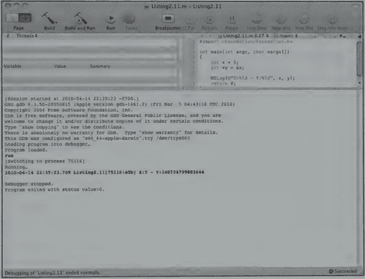

### Listing 2.19
#### Dereferencing pointers

```
#import <Foundation/Foundation.h>

int main(int argc, char *argv[])
{
    int x = 5;
    int *y = &x;

    NSLog(@"X:%ld - Y:%ld", x, *y);
    return 0;
}
```

请注意，我们现在正在解引用 y，这意味着当你运行此应用程序时，你应该会看到类似于图 2.3 的内容。

### Figure 2.3
Output of the dereferencing example code

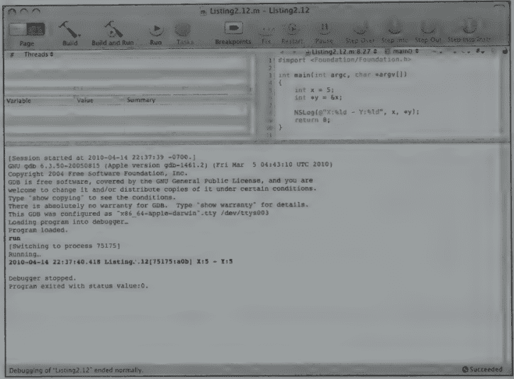

指针有趣的地方在于它们可以像普通变量一样被操作。这意味着你可以递增它们，可以递减它们，可以加到它们上，也可以从它们中减去。你可以做所有这些事情，但你真正做的是改变指针指向的 RAM 位置。因此，你可以在新位置解引用指针并访问与原来指向位置不同的值。

指针的大部分讨论都是相对高级的主题。在日常的 Objective-C 中，你通常不需要解引用很多指针。 （对此规则有几个例外，我将在本书中介绍时指出。）要更深入地了解低级指针，我建议你找一本关于 C 编程语言的好书。

Objective-C 对指针的典型使用主要限于对象的声明。Objective-C 中的对象实际上是指针。幸运的是，在很大程度上，即使它们是指针，你也很少需要以这种方式思考它们。你最需要记住的重要一点是，每当你声明一个对象时，它都需要声明为指针。例如，查看清单 2.20。


## NOTE

此处忽略引用 NSAutoreleasePool 的代码。你将在后面的章节学习到它。

本书中你还会遇到另一种不寻常的指针情况，围绕着指向对象的指针的使用，例如使用 NSError 对象从失败的调用中获取错误消息的情况。当我在第 10 章讨论这个问题时，我会更详细地介绍。

### 使用运算符

与数学类似，编程语言通常支持运算符。运算符是一种“操作”变量和值的函数。例如，表达式“5 + 4”包含值 5 和 4 以及运算符 +。在这种情况下，+ 运算符被称为二元运算符。因此，它操作两个值，一个在左边一个在右边，即 5 和 4。另一种类型的运算符是单目运算符。单目运算符只有一个操作的值。例如，取地址运算符 & 就是一个单目运算符。它获取其操作的值的地址。

表 2.2 显示了 Objective-C 中大多数典型的运算符。

| Operator | Purpose |
|---|---|
| Table 2.2 Typical operators |  |
| () [] -> . | Parentheses, array operations, dereference |
| ! ~ - + * & ++ -- | Not, add/subtraction (unary), dereference (unary), address-of (unary), increment (unary), decrement (unary) |
| * / % | Multiplication, Division, Modulus (binary) |
| << >> | Bitwise Shift (binary) |
| < <= > >= | Comparison Operators (binary) |
| == != | Comparison Operators (binary) |
| & | Bitwise AND (binary) |
| ^ | Bitwise XOR (binary) |
| | | Bitwise OR (binary) |
| && | AND (binary) |
| || | OR (binary) |
| = += -= *= /= %= &= |= ^= <<= >>= | Assignment Operators (binary) |

通常，运算符会返回某种结果，该结果要么被赋给一个变量，要么在控制语句中使用以影响程序流程。例如，输入清单 2.21 中的示例程序并查看输出。

#### Listing 2.21

#### Working with operators

```
#import <Foundation/Foundation.h>

int main(int argc, char *argv[])
{
    int a = 10;
    int b = 3;
    int c = a + b;
    int d = a - b;
    int e = a * b;
    int f = a / b;
    int g = a % b;
    
    NSLog(@"a: %ld", a);
    NSLog(@"b: %ld", b);
    NSLog(@"c: %ld", c);
    NSLog(@"d: %ld", d);
    NSLog(@"e: %ld", e);
    NSLog(@"f: %ld", f);
    NSLog(@"g: %ld", g);
    
    return 0;
}
```

在这段代码中，我们将值 3 和 7 分别赋给 a 和 b；然后我们使用 + 运算符将它们相加，使用 - 运算符将它们相减，进行乘法、除法等等。运行程序即可看到图 2.5 所示的输出。

请注意，程序打印出每个数学运算的结果。现在我在这个程序中加入了一个小麻烦。如果你注意一下，f 的值是错误的。这是因为 10 除以 3 的结果不是一个整数，而是一个分数。或者在计算机上，它是一个浮点数。通常，你可能希望将其存储到 float 或 double 中，这两者都可以表示浮点值；在这种情况下，我们将其存储到 int 值中，这意味着该值的十进制部分将被截断，只剩下整数部分

### 三元运算符

除了我已经向你展示的单目和二元运算符之外，还有一个三元运算符。这个运算符是 ? : ，可以用在 if/else 语句的位置。我不会在这里介绍这个运算符，因为它更适合放在本章的“控制程序流程”部分。因此，请在该部分查找更多信息。

### 使用函数

到目前为止，我向你展示了如何将指令提供给计算机，以便计算机按顺序执行这些指令。但是，随着程序规模和复杂性的增长，你会很快发现，在程序中将所有指令按顺序一个接一个地放置会变得极其繁琐。你希望重用代码的一部分，而复制粘贴是重用代码的非常糟糕的方法。

幸运的是，你可以使用几种机制来解决这两个问题。我将在本节中解释的第一个机制是使用函数的概念。在面向对象编程之前，过程式编程是分解程序以便更易于重用的首选方法。

当然，Objective-C 是一个完全面向对象的编程语言，在你的应用程序开发中你大部分时间会使用面向对象编程。然而，过程式编程是一个至关重要的基础构建块，你需要理解它，因为 Objective-C 中仍然有一些部分本质上是过程式的。

#### 理解函数

你可能要问的第一个问题是：“什么是函数？” 答案是，函数本质上是在你的应用程序中声明子程序的方法。函数使你能够将程序指令的一部分封装成可以命名然后在应用程序的任何地方按需多次使用的东西。

看一个例子；清单 2.22 显示了一个计算 5 的阶乘的程序（它应该产生 120 的值）。它使用 for 循环进行计算，我将在下一节讨论这个概念，但现在你可以忽略它，只需理解它是在进行计算即可。

#### Listing 2.22

#### Calculating a factorial

```
#import <Foundation/Foundation.h>

int main (int argc, const char * argv[])
```

#### Listing 2.22 (continued)

```
{
    int a = 5;
    int result = 1;

    for(int i = 1; i <= a; ++i)
    {
        result = result * i;
    }

    NSLog(@"%ld", result);

    return 0;
}
```

现在，这个程序有趣的地方在于，我们在这里做了相当多的工作来完成这个计算。如果我们想改变我们计算阶乘的数字怎么办？也许最好将那段代码隔离到一个函数中，以便我们可以一次又一次地重用它。也许我们可以创建一个函数，它只接受一个 int 作为参数，然后返回该 int 的阶乘。

清单 2.23 显示了我已完全这样做的程序。

#### Listing 2.23

#### Extracting the calculation to a function

```
#import <Foundation/Foundation.h>

long int calculateFactorial(int value)
{
    long int result = 1;

    for(int i = 1; i <= value; ++i)
    {
        result = result * i;
    }

    return result;
}

int main (int argc, const char * argv[])
{
    int a = 5;
```

```
long int result = calculateFactorial(a);

NSLog(@"%ld", result);

return 0;
}
```

我之前在 main 函数中拥有计算阶乘的代码，现在我们调用的是我们的 calculateFactorial 函数。包含我们想要计算的值的变量在我们的 main 函数的局部作用域中声明，因此我们的 calculateFactorial 函数不知道它。为了将值从我们的 main 函数传递到我们的 calculateFactorial 函数，你必须通过函数调用将值传递给 calculateFactorial 函数。

如果你编译并运行此程序，它应该会给你与之前几乎相同的输出。现在你可以使用该代码为一堆不同的值计算阶乘。这在清单 2.24 中显示。

#### Listing 2.24

#### Demonstrating use of the function

```
#import <Foundation/Foundation.h>

long int calculateFactorial(int value)
{
    long int result = 1;

    for(int i = 1; i <= value; ++i)
    {
        result = result * i;
    }

    return result;
}

int main (int argc, const char * argv[])
{
    NSLog(@"5!: %ld", calculateFactorial(5));
    NSLog(@"10!: %ld", calculateFactorial(10));
    NSLog(@"15!: %ld", calculateFactorial(15));
    NSLog(@"20!: %ld", calculateFactorial(20));

    return 0;
}
```


返回值的类型指定在函数名的左侧。返回值的声明中没有与其关联的变量名。你通过在函数体内部使用 return 关键字来定义从函数返回什么值。这应该是你函数的最后一行语句。

在 Objective-C 中，参数和返回值是使用所谓的“按值传递”来传递的。这意味着当你将参数传递给函数时，运行时实际上会复制你传递的值。这意味着在函数内部对这些值所做的更改不会影响调用函数中的值。但是，如果你传递的是值的指针，那么对解引用变量所做的更改将被发送回调用函数中的原始变量。

清单 2.26 演示了这一概念。

### Listing 2.26
#### Working with pointers
```
#import <Foundation/Foundation.h>

void myFunction(int a, int *b)
{
    a = 20;
    *b = 20; // de-reference the pointer to access the original
}

int main(int argc, const char *argv[])
{
    int a = 10;
    int b = 10;

    myFunction(a, &b); // using the & operator changes b into a pointer

    NSLog(@"a: %ld", a);
    NSLog(@"b: %ld", b);

    return 0;
}
```

同样地，在从函数返回值时，你必须小心不要返回在函数退出后作用域就会结束的变量的指针或引用。例如，如果你返回函数内部某个值的地址，当调用函数尝试访问该值时，该变量已经被释放，因此将不再可用——这会导致崩溃。

当我在第 3 章讨论对象以及第 4 章讨论内存管理时，我会向你展示如何将你在函数中创建的指针返回给其他函数。现在，请坚持使用简单的值。

### Understanding implementation versus interface

函数集合可以被分组到单独的源文件中，这样你就不必用所有编程逻辑来 clutter 你的主源文件。这些源文件通常被称为单元。

当你将源代码分离成单元时，一个单元由两个文件组成：其中一个包含你函数的声明，另一个包含这些声明的定义。理解声明和定义之间的区别是一个重要的概念，你需要理解它。

你已经见过函数定义。你迄今为止使用过的所有函数都是完全定义的。函数定义是你实际编写构成函数本身的代码的地方。函数声明声明了你函数的函数签名，包括返回类型、函数名及其参数。它不包括函数实际做什么的定义。

可以说函数声明声明了你函数的接口。这是一个宽松的定义，但稍后，当我们讨论面向对象程序时，你会看到接口这一概念被大量使用。

由此延伸，函数定义可以被说成是你所声明的接口的实现。

要声明一个可以在其他单元中使用的函数，你使用 extern 关键字，然后像函数定义一样使用函数签名。因为函数声明是一个语句，就像声明一个变量一样，你还需要在函数签名末尾加上一个额外的分号。知道何时放置分号、何时不放置分号是新手程序员常犯的错误。务必记住，分号出现在声明之后，而不是出现在定义之后。

所以，想象一下我们想要将阶乘计算方法封装到它自己的单元中。

为此需要三步。第一步是为我们的单元创建接口文件。通常，Objective-C 中的接口文件使用 .h 扩展名，表示“Header”。在你的 Xcode 项目中创建一个新的 Header 文件，命名为“Factorial.h”，并添加清单 2.27 中的代码。

### Listing 2.27
#### Function declaration
```
extern long int calculateFactorial(int value);
```

这是 calculateFactorial 函数的函数声明。下一步是创建实现文件。实现文件具有 .c 扩展名。在你的 Xcode 项目中创建一个新的 C 源文件，命名为“Factorial.c”，并将其修改为清单 2.28 的样子。

### Listing 2.28
#### Function definition
```
long int calculateFactorial(int value)
{
    long int result = 1;

    for(int i = 1; i <= value; ++i)
    {
        result = result * i;
    }

    return result;
}
```

最后，你必须修改调用你函数的那个文件，以包含你单元的接口文件。将你自己的源文件修改为清单 2.29 的样子。

### Listing 2.29
#### Calling the function
```
#import <Foundation/Foundation.h>
#import "Factorial.h"

int main (int argc, const char * argv[])
{
NSLog(@"5!: %ld", calculateFactorial(5));
NSLog(@"10!: %ld", calculateFactorial(10));
NSLog(@"15!: %ld", calculateFactorial(15));
NSLog(@"20!: %ld", calculateFactorial(20));

return 0;
}
```

函数的定义现在已从此文件中移除，并被 import 命令替换。

Import 语句用于在当前单元中包含其他单元的接口。Import 语句通过在你的项目目录和与你的项目关联的框架中搜索你想要包含的接口文件来工作。当你使用尖括号 <> 括起文件名时，如 Foundation 框架的情况，它会在系统路径中搜索接口文件。当你使用引号时，该语句只搜索你项目的当前目录及其任何子目录。

关于接口文件搜索目录的规则可能很难记住，所以我建议你只需记住这两个经验法则：如果接口文件是你的项目的一部分，是你创建的东西，那么在 import 语句中指定它时你想要使用引号；否则，如果接口文件是第三方框架的一部分或由 Apple 提供的框架的一部分，那么你想要使用尖括号。

### Linking with implementation files

在你将代码拆分为单元并在代码中使用这些单元之后，你仍然需要做一件事。你需要确保实现文件链接到你的可执行文件。可执行文件由多个实现文件与 Objective-C 运行时链接在一起组成。随着你在项目中添加更多实现文件，你必须确保它们也与你的可执行文件链接。通常，当你创建一个新文件时，Xcode 会询问你是否要将其包含在你的项目中。在图 2.6 中，注意指示此文件将被添加到 Listing 2.6 目标的复选框。

然而，如果你忘记这样做，或者如果你添加了另一个目标并且也需要将现有实现文件包含在该目标中，那么了解如何手动将现有实现文件与当前目标链接也很重要。

为此，只需选择你想要包含在当前目标中的实现文件，单击编辑器上方的 Detail 选项卡，并确保在靶心列下的复选框被选中，如图 2.7 所示。

再次注意靶心复选框，它对于我们的“NewFile.m”文件是未选中的。要将此文件包含在当前目标中，请选中此复选框。

现在你已经了解了一些语法和程序组织的基础知识，请看看如何在 Objective-C 程序中控制流程。

### Figure 2.6
Adding a file to your target

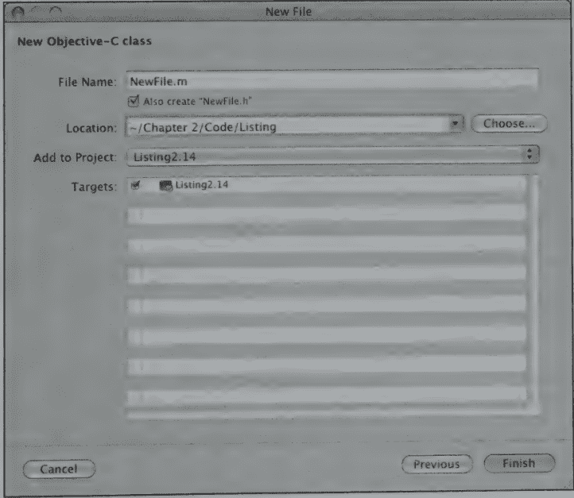

### Figure 2.7 The target check box

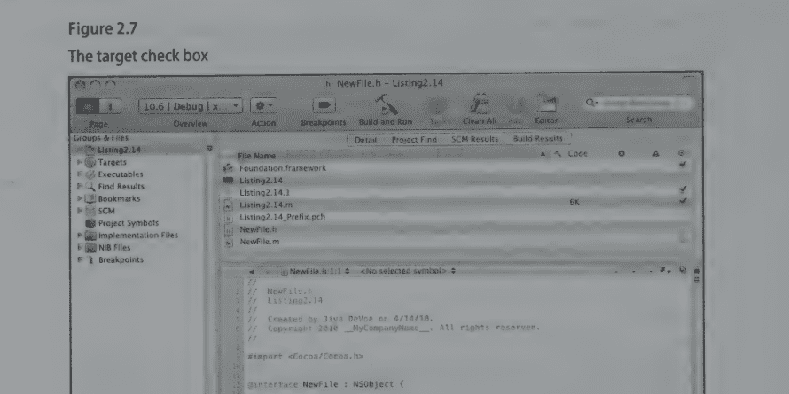

## Controlling Program Flow

如果应用程序只能做一件事，那将会非常无聊。如果你不能让它们在运行时根据条件分支并做出决策，它们就不会很有用。幸运的是，我们不必担心这个问题，因为 Objective-C 为我们提供了丰富的流程控制机制工具包。

这些流程控制机制分为两个大类。

第一类机制中的条件语句使你能够根据运行时条件更改应用程序的执行路径。你本质上可以在应用程序中间设置一个岔路口。应用程序走哪条路可以根据变量来确定。那些变量可以基于参数、用户输入或你想要的任何其他条件来设置。

流程控制机制的第二类是循环。循环使你能够重复执行某组操作，直到满足某个条件。这使你能够做诸如遍历列表中的项目、做某事若干次等操作。


在本书的剩余部分，我们将讨论这两种类别，并了解如何在应用程序中使用它们来驱动执行流程。

### 使用条件语句

再次强调，条件语句使您能够在代码中让执行分支到两个或多个不同路径。条件语句由三种结构组成。

#### 使用 if-else

第一种结构是 if-else 结构。如清单 2.30 所示。

**清单 2.30 — If 语句**

```
if (n > 75)
{
    NSLog(@"%ld is greater than 75!", n);
}
```

该结构的语法主要包括一个 if 语句，后面紧跟着括号中的 if 条件，然后是一个代码块，当条件语句判定为真时执行。如果条件语句判定为假，还可以提供一个可选的 else 块。这个 else 块位于 if 语句的代码块之后，如清单 2.31 所示。

**清单 2.31 — If 与 else**

```
if (n > 75)
{
    NSLog(@"%ld is greater than 75!", n);
}
else
{
    NSLog(@"%ld is less than 75.", n);
}
```

else 语句后面还可以在同一行跟上另一个 if 语句。在这种情况下，如果最初的 if 语句为假，则执行 else 块；但如果当前正在评估的 if 为真，则跳过该 else 块。这样，您可以连续使用多个 else-if 条件语句。通常，最后会跟一个最终的 else 语句，当所有 if 条件均未满足时执行。如清单 2.32 所示。

**清单 2.32 — If、else-if 和 else**

```
if (n > 75)
{
    NSLog(@"%ld is greater than 75!", n);
}
else if(n < 25)
{
    NSLog(@"%ld is less than 25!", n);
}
else
{
    NSLog(@"%ld is between 24 and 76.", n);
}
```

如果在 if-else 语句后要执行的代码块仅限于单个语句，则可以省略花括号。

if 或 else if 后面的条件语句可以是任何返回布尔值 YES 或 NO 的语句。此外，对于返回非严格布尔值的函数或语句，返回值为零被视为否定（即 NO），而返回其他任何值被视为肯定（即 YES）。

**注意**

任何语句都可以被放入 if 语句的条件中，这可能导致代码中出现一个非常常见的错误：程序员本意是使用 `==` 运算符检查相等性，却意外地使用 `=` 运算符进行了赋值。在这种情况下，赋值语句总是返回真。请务必在代码中非常小心这种情况。

#### 使用三元条件运算符

在应用程序中，大多数条件分支我更倾向于使用 if-else 结构。我发现它在语法上比三元运算符更清晰。尽管如此，三元运算符在某些情况下也有其用武之地，例如，当您想根据另一个特定值将一个特定值赋给变量时。这个例子如清单 2.33 所示。

**清单 2.33 — 三元运算符**

```
int result = (x > y ? 10 : 20);
```

三元运算符本质上就像一个微型 if-else 语句，全部在一行内完成。您可以根据 `?` 和 `:` 将三元运算符拆分成三个组成部分。`?` 左侧的是条件语句。如果条件语句求值为真，则三元运算符的结果是位于 `?` 和 `:` 之间的值。如果条件语句求值为假，则三元运算符的结果是冒号右侧的值。

因此，在清单 2.33 的情况下，如果 `x > y`，结果为 10，否则为 20。如您所见，使用三元运算符可以为赋值等场景提供一种便捷、简洁的机制来选择某个值而非另一个值。然而，正因为其简洁性，我觉得三元运算符难以阅读，我更喜欢 if-else 语句的清晰性。但是，如果您遇到三元运算符能让代码更干净、更清晰的情况，那么尽管使用它。这是您工具箱中的另一个工具。

#### 使用 switch 语句

这里我要讨论的最后一种条件语句是 switch 语句。switch 语句非常适合在多个不同选项之间进行分支。如果使用 if-else 结构，您基本上也能实现与 switch 语句相同的效果，但 switch 语句通常更清晰，在某些情况下也更快。

switch 语句的示例如清单 2.34 所示。

**清单 2.34 — switch 语句**

```
switch(state)
{
    case 1:
        doStateOneAction();
        break;
    case 2:
        doStateTwoAction();
        break;
    case 3:
        doStateThreeAction();
    default:
        doDefaultAction();
}
```

如您所见，switch 语句由关键字 switch 及后面括号中您希望进行分支的值构成。该值通常称为控制变量。在 switch 语句之后，必须提供一个代码块，其中包含控制变量可能取的值，以及针对每个可能值要执行的指令。这些“case”通过 case 语句加冒号，然后是针对该条件要执行的指令，再跟一个 break 语句来编写。

break 语句是可选的，它会在 break 处停止 switch 的评估，并将程序执行跳转到 switch 之外。如果没有提供 break 语句，后续的 case 语句会继续被评估，直到遇到 break 或退出 switch 语句为止。

除了在 switch 语句中提供 case 语句之外，您还可以提供一个 default 分支。它位于 switch 语句的底部，当其他所有 case 均未匹配时执行。

**注意**

在清单 2.34 中，case 3 缺少 break 语句，因此如果进入 case 3，那么 case 3 和 default 分支都会被执行。

需要注意的是，switch 语句的控制变量只能是整数值。这不是一个可以使用字符串或类似类型来确定不同分支的情况。此外，不能在 switch 语句内声明新变量。

#### 在条件语句之间进行选择

由于 switch 语句有额外的限制，编译器可以对 switch 语句进行优化，使其比 if-else 语句更高效、更快。然而，在绝大多数情况下，if-else 语句对于您需要执行的大多数操作来说可能已经足够快了。只有在极端性能调优的情况下，switch 语句和 if-else 语句之间的差异才会成为问题。与通常情况一样，您应该在过早优化选择某一种条件语句之前，先测量性能。大多数时候，您应该选择最能表达您所编写代码意图的条件语句。选择对于将来查看您代码的开发人员（包括您自己）来说最容易阅读的条件语句。

对我个人而言，我更倾向于 if-else 语句而非 switch 语句，因为我发现它们更容易阅读。有些人可能会不同意，认为冗长的 if-else 块难以理解。与大多数事情一样，效果因人而异。

### 使用循环

循环使您的程序能够重复执行一组指令，直到满足某个条件为止。与条件语句一样，您会遇到三种主要的循环类型：for 循环、while 循环和 do-while 循环（后者实际上是 while 循环的一种变体）。


随着 Objective-C 2.0 的引入，以及它的快速枚举功能，for 循环在 Objective-C 中工作时已成为真正的主要循环选择。然而，while 和 do-while 循环在语言中发挥着重要作用。

### 使用 for

for 循环可能是 Objective-C 中使用最广泛的循环。使用它，你可以遍历一系列数字，迭代项目数组，等等。正因为这种灵活性，其语法中的一些变化可能会令人困惑。

#### 传统 for 循环

我想要介绍给你的 for 循环的第一个变体是传统形式。在这种形式中，for 语句由语句后面跟着 for 循环条件组成，条件以圆括号内的三个语句形式出现。这三个语句对应于 for 循环执行时对控制变量执行的三个操作。第一个操作设置控制变量的初始条件，通常用于将变量初始化为零，或者在你不想从零开始计数时，初始化为其他值。此第一个操作仅在第一次进入 for 循环时执行。

第二个操作是在循环的每次迭代时评估的条件语句，以确定是否应停止循环。如果条件语句被评估为真，则 for 循环被中断，程序执行继续在 for 循环代码块之后。如果条件语句被评估为假，则执行 for 循环代码块的另一次迭代。

最后一个操作是计数表达式。它用于在循环的每次迭代中实际更改控制变量的值。在每次迭代期间，控制变量可以在计数表达式中随意递增、递减、赋值等。

清单 2.35 显示了一个典型的 for 循环示例。

#### 清单 2.35

##### 一个 for 循环

```
for(int i = 0; i < 100; i++)
{
  Foo *foo = [array objectAtIndex:i];
  [foo doSomething];
}
```

在这种情况下，第一次进入 for 循环时，控制变量（i）被创建并赋值为零。在循环的每次迭代中，条件表达式被评估以确定控制变量是否已达到 100。如果已达到，执行将跳转到 for 循环代码块之后的语句。如果未达到，则执行计数表达式；在这种情况下，控制变量递增一。

NOTE

你的计数表达式可以是你想要的任何内容。例如，要递增一个每次递增两位数的循环，你只需在循环的每次迭代中将控制变量递增二，而不是像我们在这里做的那样递增一。

NOTE

x++ 运算符是后缀递增运算符。它递增 x 的值并将其存储回 x。在此过程中，它还返回 x 在递增之前的值。++x 运算符是前缀递增运算符。它也递增 x 的值并将其存储到 x 中，但它返回的值是递增后的 x 的值。减法运算符 -- 的后置/前置版本也是如此。在某些情况下，你可能想要将这些操作的返回值赋给另一个变量。执行此操作时，请注意此行为。

控制变量在 for 循环代码块的作用域内可用，并且可以例如用于引用数组中的索引，或驱动 for 循环代码块内的条件逻辑。此外，for 循环可以在 for 循环代码块内的任何时间通过执行 continue 语句而被中止。continue 语句将立即停止 for 循环的执行并将执行重置回循环的开头。示例显示在清单 2.36 中。

#### 清单 2.36

##### continue 语句

```
for(int n = 0; n < 100; ++n)
{
    if(n > 10 && n < 20)
        continue; // this skips 11-19
    // do something with n...
    Foo *foo = [array objectAtIndex:i];
    [foo doSomething];
}
```

#### 使用 for 进行快速枚举

for 循环的第二种形式是 Objective-C 2.0 中的新增功能；它适用于枚举集合中包含的对象。你将在下一章学习集合和对象，但我想在这里介绍快速枚举语法，以便你在我们讲到它时熟悉它。

在 for 循环的先前形式中，我们必须使用控制变量来检索数组的元素以便对其进行操作。for 循环的快速枚举形式通过提供一种能力使这种机制过时，即作为 for 语句本身的一部分指定一个临时变量来存储正在迭代的集合的元素。这非常方便，因为绝大多数 for 循环都是专门为迭代集合的成员并对每个成员单独执行操作而编写的。

快速枚举 for 循环的示例显示在清单 2.37 中。

正如你所看到的，一个变量（object）作为 for 语句本身的一部分被声明。随着 for 循环的执行，集合（array）的每个成员都被赋给该变量。它随后在 for 循环代码块的作用域内可用。

#### 清单 2.37

##### 带快速枚举的 for 循环

```
for(Foo *object in array)
{
    // the Foo object is assigned to an element of the array
    // do something with object
}
```

当我在第 13 章描述集合对象时，你会看到 for 循环被大量使用的模式。现在，只需熟悉 for 循环的形式，并准备好再次返回本章进行复习。

### 使用 while

while 循环的工作方式与 for 循环类似，只是 while 语句后面括号内没有多个语句。while 语句有一个条件语句，在循环的每次迭代时检查。当条件语句被发现为假时，执行继续在 while 代码块结束后的下一条语句。

while 语句的示例显示在清单 2.38 中。

#### 清单 2.38

##### While 循环

```
int x = 0;
while(x < 10)
{
    NSLog(@"Value of x: %ld", x);
    x++;
}
```

这种控制流的含义是，你在 while 的条件语句中检查的任何条件都需要，在 while 的代码块内在某个时刻变为假。如果没有，你的 while 语句将永远循环下去。while 也可以像 for 循环一样使用 continue 语句中断。

NOTE

如果在循环第一次运行时条件语句为假，则 while 代码块内的代码将永远不会执行。

while 语句在涉及复杂迭代逻辑的情况下特别方便。

Objective-C 的旧版本没有今天可用的快速枚举功能。因此，while 语句通常用于使用 NSEnumerator 迭代数组。示例显示在清单 2.39 中。

#### 清单 2.39

##### 旧式枚举

```
NSArray *someArray = [self getArray];
NSEnumerator *enumerator = [someArray objectEnumerator];
while((NSObject *obj = [enumerator nextObject]))
{
    // do something with obj...
}
```

你很少看到这种模式被使用，但由于它在旧代码中非常普遍，使自己熟悉这个概念很重要。每次检查条件语句时，枚举器都会返回数组中的下一个对象。当它到达数组末尾时，它返回 nil。这导致 while 条件返回假。反过来，这导致执行跳转到 while 代码块之后的下一行代码。

### 使用 do

我们将在本节中讨论的最后一种循环是 do-while 循环。此循环与 while 循环类似，只是条件被移到了循环末尾，因此无论如何，至少执行一次循环迭代，然后再检查条件。这种循环的示例显示在清单 2.40 中。

这种循环很少使用，但当使用时，它通常是你试图解决的问题的理想解决方案。

#### 清单 2.40

##### do-while 循环

```
int x = 0;
do
{
    NSLog(@"%ld", x);
    x++;
}
while(x < 10)
```

通常，这种循环用于处理处于预先存在状态的某种类型的控制变量的情况，你不想在循环至少执行一次之前更改它。你也可以在控制块的作用域内计算控制变量时使用此循环。再次，你可能在做某种复杂逻辑以得出控制变量的值。do-while 循环给了你在 while 条件被评估之前在代码块内部执行任何你想要的复杂逻辑的机会。请注意，控制变量必须在 do-while 代码块的作用域之外声明，以便在 while 条件的作用域内。

NOTE

记住，当处理 switch 时，使用 break 语句可以跳出 switch。这在 switch 使用中很常见。然而，break 也可以与 do-while、while 和 for 循环一起使用。在这些上下文中使用时，它会导致执行线程跳出循环到循环代码块之后的程序下一行。


### 学以致用

现在你可以创建一个命令行计算器程序。虽然你可能还不完全理解这个程序中的所有内容，但你会理解大部分内容，而那些你尚未理解的部分，我将在下一节中解释。

该程序在其命令行上接收一系列参数。它应由数字和运算符分隔组成。例如，你可以按如下方式运行程序：./Calculator '10 + 5 - 3'。程序随后会依次对数字进行加、减、乘或除运算。完成后，它会在控制台输出最终结果。仅为演示目的，我将程序拆分为两个单元：主单元，包含主要功能逻辑；以及 MathOperations 单元，包含加法、减法等函数。要进入程序，请启动 Xcode 并创建一个新的基于 Foundation 的命令行应用程序。将其命名为“Calculator”。

> NOTE
> 不必担心对 NSString、NSArray 等的调用；这些将在下一章中解释。创建项目后，打开 Calculator.m 文件并将其修改为如下所示的 Listing 2.41。

#### Listing 2.41

#### Calculator.m

```
#import <Foundation/Foundation.h>
#import "MathOperations.h"

BOOL isAnOperator(const char value)
{
    return ((value == '+') || (value == '-') || (value == '*') || (value ==
    '/'));
}

int main (int argc, const char * argv[])
{
    NSAutoreleasePool * pool = [[NSAutoreleasePool alloc] init];

    double result = 0;

    char operator = '\0';

    NSString *equation = [NSString stringWithUTF8String:argv[1]];
    NSArray *eqParts = [equation
                        componentsSeparatedByCharactersInSet:
                        [NSCharacterSet whitespaceCharacterSet]];
```

```
for(int n = 0; n < [eqParts count]; n++)
{
    NSString *argString = [eqParts objectAtIndex:n];
    char firstChar = [argString characterAtIndex:0];

    if(isAnOperator(firstChar))
    {
        operator = firstChar;
        continue;
    }

    double newValue = [argString doubleValue];

    switch (operator)
    {
        case '+':
            result = add(result, newValue);
            break;
        case '-':
            result = subtract(result, newValue);
            break;
        case '*':
            result = multiply(result, newValue);
            break;
        case '/':
            result = divide(result, newValue);
            break;
        default:
            result = add(result, newValue);
            break;
    }
}

NSLog(@"% .3f", result);

[pool drain];
return 0;
}
```

## NOTE

我之前说过 switch 语句只适用于整数，而现在我却在使用 chars。回忆一下关于标量的讨论，char 在内部是以整数表示的。使用单引号字符，‘ ’，编译器会自动将单引号内的字符转换为该字符值的整数表示。

接下来，创建一个新的 C 源文件，将其命名为 MathOperations.m，并使其如下所示的 Listing 2.42。

#### Listing 2.42

#### MathOperations.m

```
#include "MathOperations.h"

double add(double value1, double value2)
{
    return value1 + value2;
}

double subtract(double value1, double value2)
{
    return value1 - value2;
}

double multiply(double value1, double value2)
{
    return value1 * value2;
}

double divide(double value1, double value2)
{
    return value1 / value2;
}
```

最后，编辑 MathOperations.h 文件并使其如下所示的 Listing 2.43。

#### Listing 2.43

#### MathOperations.h

```
extern double add(double value1, double value2);
extern double subtract(double value1, double value2);
extern double multiply(double value1, double value2);
extern double divide(double value1, double value2);
```

完成此操作后，编译应用程序并启动你的终端程序。你应该能在项目目录下的 build/Debug 子目录中找到编译后的应用程序。进入该子目录，并按图 2.8 所示运行你的新程序。运行它时，请务必像我在此处所示一样输入单引号。这会使控制台忽略 ' * ' 字符作为通配符，并将其直接传递给你的程序。

该程序结合了前两章的所有信息：for 循环、条件语句、函数、处理基本类型等等。

Figure 2.8

The output of the program


## Summary

在本章中，你已学习了 Objective-C 过程式编程的所有基本语法。你学习了如何声明变量和结构体，如何使用运算符，以及如何使用函数。你还学习了诸如循环和条件表达式等用于在运行时控制程序流程的内容。最后，你将所有这些知识结合起来制作了一个基本的计算器程序。

在下一章中，我们将深入探讨 Objective-C 中的 Objective 部分，并了解 Objective-C 如何实现面向对象编程。

## Adding Objects

从根本上说，所有软件开发技术最终都旨在解决一个特定问题。问题在于人类难以同时思考多个想法。因此，所有这些技术都使我们能够将想法 compartmentalize 并封装成可重用的包，这些包可以以新颖的方式混合搭配以解决新问题。

你已经看到过程式编程——将我们的想法分解为可重用的过程——能够实现这种 compartmentalization 和封装。过程式编程在计算机科学历史上首次引入时是一个革命性的概念。然而，它有一个主要缺陷：过程没有在自身内部存储状态的机制。通常，过程式程序员通过将状态变量连同过程执行所需参数一起传递给过程，或依赖全局变量来存储其状态来解决这一限制。这两种方法都不是理想的解决方案。

随着程序变得更复杂，将状态变量传递给过程会迅速失控，因为程序需要保留在过程调用之间传递的越来越多状态。

使用全局变量同样复杂，因为过度使用全局变量会导致难以在代码中跟踪的过度依赖。例如，要确定某个特定过程依赖于哪些全局变量，你必须熟悉该过程本身。仅通过查看过程的接口，无法得知该特定过程依赖于哪些全局变量。这会导致变量未正确初始化，或产生副作用，例如变量接收到你在该函数中未意识到被访问的值。

随着过程式应用程序变得越来越复杂，这些问题变得对开发者来说难以克服。

## In This Chapter

- Learning object-oriented terminology
- Working with objects in Objective-C
- Creating classes and class hierarchies
- Defining properties
- Writing class and object methods
- Declaring member variables

需要一种新的编程范式，使开发者能够将他们希望操作的数据和操作该数据的逻辑一起封装在一个包中。这种新编程范式的名称是面向对象编程。在以下各节中，我将向你介绍这项技术。

### Understanding Objects

面向对象编程背后的思想是允许程序员将你想要操作的数据与你想要用来操作数据的过程封装在一起。

例如，想象你想要封装一只猫的行为。首先需要做的是捕获该猫的属性——其数据。图 3.1 显示了这一概念的插图。你可能想要捕获猫的颜色属性。在这种情况下，猫的颜色是黑色。

Figure 3.1

Encapsulating the properties of a cat

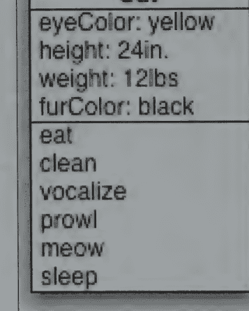


你可能还想记录下这只猫的眼睛是黄色的。有些猫的眼睛是灰色的，有些猫的眼睛是绿色的，但这只猫的眼睛是黄色的。也许你还想记录下猫的体重。所有这些东西都是猫的属性。如果你设想在过程式应用中处理这个问题，所有这些属性都必须存储在某种全局变量中。你可以通过使用结构来缓解部分问题，但即便如此，一旦超过一个，管理一堆结构很快就会变得难以控制。

使用面向对象编程，你可以用一个对象来表示猫的状态及其属性。就像一只具体的猫的实例是更通用、理想的“猫”概念的物理表现一样，你可以说存在一个通用的猫版本，泛称为 Cat。这被称为对象的“类”。另一种思考方式是把对象的这个类看作猫概念的柏拉图式表现。这个猫的柏拉图式理想表现充当了一种概念模板，你可以用它来创建我们实际的个体猫的实例。我的特定个体猫（名为 George）是猫“类”的“对象”或“实例”。

换一种说法，我们的 Cat 类代表了构成猫是什么的所有属性的定义，包括各种不同种类猫的潜在多样性。使用该模板，你可以创建一个猫的个体实例来描述你的特定猫。Cat 类可能会定义猫是小型、有毛、耳朵尖、牙齿锋利、并且有攻击主人腿部的倾向的动物。类还可能定义猫的眼睛或毛皮有不同的颜色。你特定猫实例的毛色将是一个你定义的变量，以便将你的猫与猫的通用概念区分开来。

除了定义猫的通用概念的属性以及你特定猫的具体属性之外，类还可以封装猫的行为。例如，可以说猫通过喵叫来发声。你可以在 Cat 模板中创建代码来表示使猫喵叫所需的指令，这被称为“方法”。同样，你可能在猫上有一个方法来表示它清洁自己的过程。猫可能有一个表示“脏”的临时状态。“clean”方法可能表示将猫从脏变为干净所需的行为。通过这种方式，定义在类 Cat 上的方法定义了改变你特定猫实例中数据的必要指令。

离开我们的隐喻，回到实际的 Objective-C，这里要说的是 Objective-C 定义了编程构造，使你能够定义这些概念和关系。

在 Objective-C 中，类代表特定类型对象的定义或模板。在处理对象时，你创建类。在这些类中，你定义对象封装的数据以及用于操作该数据的<|message|> 方法。

对象是类的特定实例。对象也常被称为实例，我将这两个术语互换使用。

封装在对象中的数据可以称为数据、状态、属性或属性。然而，重要的是要意识到还有另一个编程概念称为属性，我将在本章后面介绍。并非所有数据都是属性，也并非所有属性都是数据。

最后，当谈到对象的行为，包括改变其数据的行为时，与该行为相关的计算机指令被称为方法。Objective-C 开发者也倾向于采用 Smalltalk 的惯例，将方法称为消息。这种术语最常用于指使用方法作为动作。某些编程语言称之为“调用方法”，但 Objective-C 程序员倾向于使用“发送消息”这一说法。我个人更喜欢使用“方法”导向的术语，但在某些情况下我也可能使用消息术语。

## NOTE

在继续阅读本章的其余部分之前，你必须理解用于描述类、对象、属性和方法 的术语。如果你有任何困惑，请重新阅读 Understanding objects 部分，以便清楚地理解这些项目之间的区别。

### Understanding inheritance

继承有两个方面。一方面代表类继承的类设计方面，它影响你如何设计类以及在类定义中放置行为的位置。类继承的第二个方面与这些类从外部视角看起来如何以及如何使用这些类有关。（我在下一节“Using polymorphism”中介绍这个主题。）

回到 Cat 类，回忆一下 Cat 类代表了某种程度上是你的宠物的生物的模板。你也可以将其视为代表你宠物的物种。就像一个物种一样，Cat 类可以说源自其他物种。换句话说，猫物种源自并继承了某些来自称为哺乳动物 的分类的特征。同样，哺乳动物分类源自并继承了脊椎动物分类的特征。猫也有姐妹物种，例如狗。这些物种彼此之间以及与其父物种都有共同特征。你可以在两个方向上扩展，变得更具体（贵宾犬、德国牧羊犬等）。或者你可以变得不那么具体，沿着继承树向上移动到哺乳动物、脊椎动物等。图 3.2 通过大致列出几种不同生物的分类及其相互关系来演示这一概念。

Objective-C 中的类具有相同的能力。事实上，图 3.2 同样可以用来描述类继承树作为物种继承树。换句话说，Objective-C 中的类可以有父类，从中继承行为和属性。此外，你创建的任何类都可以有子类继承你的类的属性和行为。

### Figure 3.2

A class inheritance tree

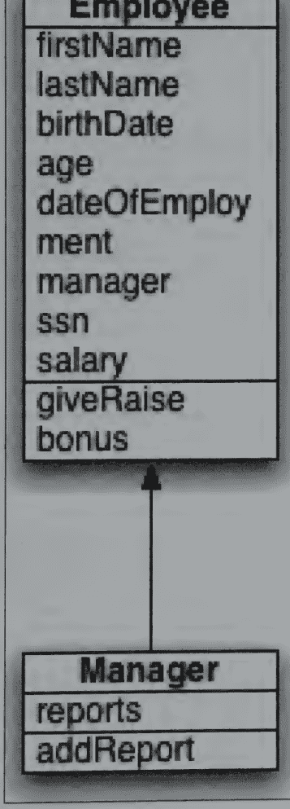

在我们的示例中，猫类继承自哺乳动物类。哺乳动物类规定其所有子类的都有毛皮、胎生、进食、睡眠，并有某种发声。因此，它提供了进食、睡眠和发声的标准方法。哺乳动物的子类的自动继承所有这些属性和行为，但在需要时可以覆盖它们。例如，猫发出的特定发声与狗发出的不同。猫的发声是喵叫，狗的发声是吠叫。为了在实现新子类时覆盖父类中的行为，你只需在子类中定义该方法。你的新版本将替换父类中的版本，并在运行时调用该方法时自动使用。

所有这些相同的可定制功能在定义面向对象语言中的类时都可用。在 Objective-C 中，给定类可以从任何其他给定类继承。然而，它只能永远有一个父类。该类本身将继承其父类及其所有父类的属性和行为，但它不能从多个直接父类继承行为。这一概念称为单父继承。某些语言，例如 C++，允许类从多个父类继承。这可能在编译期间导致歧义。因此，Objective-C 通过只允许单父继承来消除这种歧义。我们的物种继承树最终会追溯到一个单一的、伟大的、曾曾曾祖父类，它是所有生物的祖先；Objective-C 也有一个单一的类，所有类最终都继承自它。这个类是 NSObject。NSObject 类提供了所有 Objective-C 类所需的最基本功能，例如内存管理例程、复制例程等。

> NOTE
> 
> 在 Objective-C 中，你可以做一些模拟多父继承的事情，而实际上不需要多个父类。我在我们查看协议和分类时会介绍如何做到这一点。

### Using polymorphism

在本章前面，我向你介绍了类继承的概念。多态性意味着从给定类创建的任何对象都可以被该对象的使用者假定为其本身的实例，或其任何父类。这意味着你的代码可以编写为仅利用类继承所需的最低限度功能。因为 Objective-C 的所有类最终都继承自 NSObject，所以你甚至可以创建仅需要 NSObject 即可运行的代码。它可能不是特别有用，但它会非常灵活，因为你可以传递任何对象给它，它都能正常工作。

将这一概念扩展回我们的动物类比，你可以想象编写需要哺乳动物对象提供的能力的代码，例如发声。当前正在处理的哺乳动物实例如何实现发声方法可能会有所不同，但当你调用发声方法时，它会确定你正在处理的是什么类型的实际动物并执行适当的操作。例如，狗会吠叫，猫会喵叫，或狮子会咆哮。


这是一项极其强大的能力，你在编程生涯中会不断用到它。多态赋予了面向对象编程真正的力量。

### 使用 id 数据类型

在本章真正开始查看实际代码之前，我想再向你介绍一个概念，即 `id` 数据类型。`id` 数据类型是 Objective-C 中的一种特殊数据类型，本质上表示任何对象。它可以用于任何通常使用对象类型的位置。

在大多数情况下，你不需要直接在代码中使用 `id` 数据类型。不过，你可能会在 Cocoa 或 Cocoa Touch 库中看到使用 `id` 数据类型的情况，尤其是在数组、字典等领域。在这些情况下，正是由于使用了 `id` 数据类型，并且它可以伪装成任何类，才赋予了 Objective-C 动态类型检查的能力。

你可能会问自己：“为什么不一直使用 `id` 呢？这样我就不必担心声明实际的对象类型了。”遗憾的是，因为编译器在编译时无法知道你在使用 `id` 数据类型替代更具体的类型名称时所处理的对象类型，这就会在代码中引入错误，而如果使用更具体的类型，这些错误本可以被编译器捕获。此外，在运行时查找数据类型所需的额外开销，可能会导致对声明为 `id` 数据类型对象的调用速度略慢于对具有更具体数据类型对象的调用。因此，一般来说，将对象声明为特定类型比使用 `id` 数据类型更好。尽管如此，理解 `id` 数据类型的概念仍然很重要，这样你就可以在极少数需要它的场合中使用它。

> **注意**：在初始化方法中使用 `id` 数据类型。

### 创建类

既然我已经向你介绍了面向对象编程、类、继承和多态的一般概念，在接下来的几节中，我将向你展示如何真正创建类并在代码中使用它们。

#### 使用类文件

类通过两个单独的文件来定义。第一个是接口文件。接口文件的扩展名为 `.h`。在这个文件中，你声明类的接口。示例如清单 3.1 所示。

**清单 3.1：一个接口文件**

```
#import <Foundation/Foundation.h>

@interface Foo : NSObject
{
    NSString *someVariable;
    NSString *someOtherVariable;
    NSArray *someArray;
}
@property (nonatomic, retain) NSString *someVariable;
@property (nonatomic, retain) NSString *someOtherVariable;

- (void)someMethod;
- (BOOL)someOtherMethodWithArg:(NSString *)param andAnotherArg:(int)param2;

@end
```

如你所见，接口通过 `@interface` 后跟类名的特殊语法来声明。其中，类名代表你正在定义的类的名称。如果你的类继承自其他类，你需要将所继承类的名称放在类名之后。在这个例子中，你只是简单地从 `NSObject` 继承。

在 `@interface` 行之后，是一段用花括号括起来的代码块。这些花括号内的区域就是定义类数据的地方。在这些花括号内定义的变量被认为在类中定义的任何方法的作用域内。

较旧的运行时要求所有成员变量都必须在此处定义，但现代的 64 位运行时（适用于 Mac OS X 10.6 和 iOS）则没有此要求。你可以通过简单地将成员变量声明为属性来完成声明。不过，在此处额外声明它们没有任何坏处，所以养成这样做习惯也没什么问题。

花括号之后，你定义类中包含的方法签名。最后，通过 `@end` 指令来结束接口的定义。

为类创建接口定义后，还必须实现该类。类的实现在扩展名为 `.m` 的文件中创建。清单 3.2 展示了我们刚才所看到类的实现示例。

**清单 3.2：一个实现文件示例**

```
#import "Foo.h"

@implementation Foo
@synthesize someVariable;
@synthesize someOtherVariable;

-(void)someMethod
{
    // method body
}

-(BOOL)someOtherMethodWithArg:(NSString *)param andAnotherArg:(int)param2
{
    // method body
}

@end
```

同样，我们使用一种特殊语法来告诉编译器我们正在创建实现。这种语法就是 `@implementation` 指令。与 `@interface` 指令一样，你需要在它后面包含我们正在定义的类的名称。在 `@implementation` 和 `@end` 指令之间，就是我们定义类中将使用的所有方法的地方。

回到接口文件，让我们更仔细地看一下我们是如何在类中封装数据的。

#### 编写对象方法

对象方法是类中定义的方法，并且只有在对象被实例化之后才能被调用。通常，当我们谈及方法对对象内部数据进行操作的概念时，所提到的就是这些方法。例如，改变对象内数据或基于对象内数据进行计算的方法，通常都是作为对象方法来实现的。

创建对象方法由两部分组成。第一部分是类接口文件中的方法签名声明。清单 3.3 展示了这样的示例。

**清单 3.3：对象方法声明**

```
- (BOOL) someOtherMethodWithArg: (NSString *) param1
    andAnotherArg: (int) param2
```

所有对象方法都以连字符（-）作为前缀，以区别于以加号（+）作为前缀的类方法。

> **注意**：类方法是可以通过未实例化的类而不是对象来调用的方法。

方法的返回类型在括号内指定。返回类型之后，指定方法的名称及其接受的参数。每个参数在冒号之后指定。参数的类型在括号内指定，然后指定其名称。最后，方法必须以分号结尾。

在声明了要创建的方法的方法签名之后，你需要创建其实际实现。这也称为方法定义。方法定义放在类的实现文件中。创建方法实现时，方法实现的第一行应与你在接口文件中放置的方法接口声明保持一致。在实现文件中的方法签名声明之后，你需要将方法体放在花括号内。清单 3.4 展示了我们之前声明方法的实现。

**清单 3.4：对象方法定义**

```
- (BOOL) someOtherMethodWithArg: (NSString *) param1
    andAnotherArg: (int) param2
{
    // 在这里对 param1 和 param2 进行处理
    if ([someOtherObject doSomething: param1] == param2)
        return YES;

    return NO;
}
```

方法实现指定了计算机执行该行为所需的指令，这些行为是你希望在方法被调用时发生的。要从方法返回一个值，你可以像之前定义过程时那样使用 `return` 语句。

类的所有数据成员都在作用域内，并且可以在为该类定义的任何对象方法中使用。此外，作为参数传入方法的任何变量也在作用域内，并且同样可以在方法内部使用。

#### 处理特殊对象方法

除了那些定义你所需功能行为的对象方法之外，还有一些特殊的对象方法，你可以选择性地将其定义为类的一部分，这些方法具有特定的功能和标准行为。这样的方法有很多，但我现在想向你介绍其中两个。

第一种特殊对象方法属于通用的初始化器类别。初始化器方法名总是以 `init` 开头，并且总是返回 `id` 数据类型。除了这些约定之外，初始化器的方法签名相当随意。然而，初始化器的方法体应该遵循一种特殊的标准语法。清单 3.5 展示了一个典型初始化器的示例。

**清单 3.5：一个典型的初始化器**

```
-(id)init
{
    if((self = [super init]))
    {
        memberVariable = [[NSMutableArray alloc] init];
    }
    return self;
}
```

初始化器方法的结构非常重要。第一步是调用超类的指定初始化器。该初始化器返回一个已初始化的超类对象实例，你必须将其赋值给特殊的变量 `self`。如果在初始化过程中出现问题，与初始化器相关的约定规定它应返回 `nil` 对象，而不是一个有效初始化的对象。因此，在将超类初始化器的返回值赋给 `self` 之后，你应该检查 `self` 是否为 `nil`。如果是，你就不应该初始化自己的变量，而应该直接返回 `nil`。在上面显示的示例中，我们实际上在 `if` 语句中同时将变量赋值给 `self` 并检查它是否为 `nil`。


初始化器的真正目的，除了创建 self 之外，就是初始化对象中的数据成员。因此，在验证 self 不为 nil 之后，你就可以初始化你的变量。初始化完变量后，你再从初始化方法中返回 self。

在某些情况下，为你的类提供多个初始化器是有意义的。例如，如果有不同的方式创建对象，并且在这些不同的状态下需要向初始化器传递不同的参数。在这些情况下，你可以创建多个不同的初始化器，使其接受不同的参数。为了避免代码重复，调用其他初始化器会更有意义。在初始化器内部这样做可以让你将特定的初始化放在一个地方并且只有一个地方。

除了初始化器的概念之外，还有指定初始化器的概念。通常它使用所有初始化器中最少的参数，并且它是所有其他初始化器将调用的最终初始化器，用来设置对象的初始状态。

Listing 3.6 中展示了这一示例。

### Listing 3.6
#### 一个示例展示不同的初始化器调用指定初始化器

```
-(id)init
{
    if((self = [super init]))
    {
        memberVariable = [[NSMutableArray alloc] init];
    }
    return self;
}

-(id)initWithArray:(NSMutableArray *)inArray
{
    if((self = [self init]))
    {
        memberVariable = [inArray retain];
    }
    return self;
}
```

你需要熟悉的第二种特殊方法是 dealloc 方法。dealloc 方法与 init 方法相反。它使你能够释放在 init 方法中或对象其他地方分配的资源。你必须确保在方法退出前调用超类的 dealloc 方法。Listing 3.7 显示了 dealloc 方法的示例。

### Listing 3.7
#### 一个展示 dealloc 方法的示例

```
-(void)dealloc
{
    [memberVariable release]; memberVariable = nil;
    [super dealloc];
}
```

## CAUTION

你应确保不要在释放自己的变量之前调用 super dealloc 方法。这可能会导致崩溃。

我在第 4 章更详细地讨论了初始化器和 dealloc 方法。目前重要的是你只需熟悉这些方法，因为你将在接下来的示例代码中使用这些方法。

### Writing class methods

在 Objective-C 中，类本身也具有与对象相同的许多能力。例如，类能够在其上声明静态方法，可以直接从类本身调用。当使用这类方法时，你不需要实例化正在使用的类的实例。这对于用于创建类实例的方法来说很方便，例如工厂和单例。事实上，Cocoa 框架利用类方法为许多内置类提供创建类实例的功能。在其他语言中，如 C++ 或 Java，类方法通常被称为“静态方法”。如果你熟悉这些语言，你可能熟悉这种术语。

## NOTE

Objective-C 中的工厂方法是一种用于方便构造对象的类方法。它始终返回一个自动释放的对象。工厂方法将在第 4 章中更详细地介绍。

## CROSS-REFERENCE

单例在第 17 章中介绍。

声明类方法与声明对象方法非常相似；唯一的区别是，在方法声明前使用连字符号时，现在使用加号。Listing 3.8 显示了类方法声明的示例。

### Listing 3.8
#### 一个类方法声明

```
@interface Foo : NSObject
{
    NSMutableArray *memberVariable;
    NSString *anotherMemberVariable;
}
@property (nonatomic, retain) NSMutableArray * memberVariable;
@property (nonatomic, retain) NSString * anotherMemberVariable;

-(id)init;
-(id)initWithArray:(NSMutableArray *)inArray;

// a class method
+(id)fooWithArray:(NSMutableArray *)inArray;

@end
```

类方法的实现与对象方法的实现相同。然而，类方法无法访问对象的任何成员变量。要理解原因，请记住类方法是直接从类本身调用的，而不是从该类的实例调用的。因此，没有对象可以存储数据以便操作该数据。Listing 3.9 显示了类方法实现的示例。

### Listing 3.9
#### 一个类方法定义

```
@implementation Foo

+(id)fooWithArray:(NSMutableArray *)inArray
{
    return [[[self alloc] initWithArray:inArray] autorelease];
}

@end
```

类方法最常见的用途是在工厂的使用中，就像这个方法一样。Cocoa 和 Cocoa Touch 中的许多类都在类上定义了工厂方法，以使对象创建更容易。例如，NSArray 类包括工厂方法 [NSArray array]，它返回一个正确构造的 NSArray 对象。 （我在第 4 章讨论了一些特殊的内存管理规则。）创建类方法时，你可以使用 self 对象来引用类本身，就像这种情况一样。

### Declaring objects

我现在已经向你展示了如何声明类，包括其数据、方法等，但如果不能声明类的实例并使用它们，所有这些都是无用的。所以现在，让我们看看如何在代码中声明类的实例。

Listing 3.10 显示了我已在上一节中创建的类，现在我希望在代码中使用该类来做一些有用的事情的示例代码。

### Listing 3.10
#### 创建类的实例

```
{ // plain old initializer Foo *object; object = [[Foo alloc] init]; [object doSomethingWithParameter:arg]; // all on one line Foo *object = [[Foo alloc] initWithArray:[NSMutableArray array]]; [object doSomethingWithParameter:arg]; // using a class method factory Foo *object = [Foo fooWithArray:[NSMutableArray array]]; [object doSomethingWithParameter:arg]; }
```

正如你所见，声明类的实例非常简单。首先，你使用类名，后跟指针运算符 (*)。然后你放置将保存类实例的变量名，在本例中为“object”。如果你愿意，可以在声明的同时立即初始化对象变量，写在同一行。为此，你只需使用等号运算符将初始化值赋给对象变量。在上面的示例代码中，我以两种方式展示了它，一种是不初始化变量，然后将变量初始化写在同一行。我在这个代码中引入了一个重要的新语法。你在本书的其他部分已经见过它，现在我要解释它到底是什么。我在这里指的是方括号运算符 ([ ]) 的使用。

### Introducing Objective-C

在 Objective-C 中，方法是通过将其括在方括号中来在类和对象上调用的。你在与方法相关的对象或类开头放置左方括号，然后在方法调用结束时放置右方括号。因此，查看上面的代码，你可以看到在我们对象变量的初始化中，我们实际上在两个初始化代码片段中都有两次方法调用。第一次调用是 alloc。该方法实际上是在类上调用的。第二次方法调用是 init 方法。该方法实际上是在 alloc 调用返回的对象上调用的。查看此代码时，重要的是要认识到 alloc 调用实际上返回一个对象，并且 init 方法是在该对象上调用的。在 Objective-C 代码中看到这种嵌套调用的情况并不少见，其中对先前方法调用返回的对象进行调用。

初始化 Objective-C 对象实际上是一个两步过程。第一步用于分配将用于存储对象的数据和方法所使用的内存。这就是 alloc 调用的作用。这就是为什么 init 方法可以对 alloc 返回的对象调用的原因。我在内存管理章节中更详细地介绍了这一点，但重要的是要注意，使用 alloc 方法（如这里所示）分配的任何对象也必须被释放。要释放对象，你只需在对象上调用 release 方法。release 是在 NSObject 上定义的方法。

#### Making calls on objects

在声明并创建类的实例后，你可能希望对该实例进行调用。你可以使用我在上一节中向你展示的方括号语法调用在类中声明为对象方法的任何方法。然而，只有在类定义接口文件中声明的方法才应从类本身以外的模块调用。虽然在技术上可以调用未在接口文件中声明的方法，但编译器在编译代码时会发出警告。此外，编译器将无法确定方法所需的参数和返回值的类型，因此可能无法捕获它本可以捕获的错误。

在某些情况下，你可能希望在类中创建仅供类内部使用的方法。也就是说，你不想将其功能暴露给外部类。在 C++ 或 Java 等其他语言中，你可能会将这些方法视为“私有”方法。Objective-C 没有声明私有方法的语法，但如果你未在接口文件中公开该方法，那么其他类调用这些方法就被认为是不好的做法。这部分是由于我在上一段中提到的原因，部分是由于社会规范。你不必向类的使用者公开仅在类中严格使用的那些方法。你可以在实现文件单独声明方法，它们将在实现文件中使用。唯一需要注意的重要事项是，编译器仍需要在使用方法之前知道你的方法签名。因此，仅在实现文件中使用且不想外部公开的方法，应放在引用这些方法的任何方法之上。Listing 3.11 显示了我所指的示例。


#### Listing 3.11: Objective-C 中的“私有”方法

```
@interface Foo : NSObject
{
}

+(id)fooWithArray:(NSMutableArray *)inArray;
-(void)someOtherMethod;

@end

@implementation Foo

+(id)fooWithArray:(NSMutableArray *)inArray
{
    return [[[self alloc] initWithArray:inArray] autorelease];
}

-(void)somePrivateMethod;
{
    // do something private...
}

-(void)someOtherMethod;
{
    [self somePrivateMethod]; // this is OK.
    [self anotherPrivateMethod]; // this generates a warning
}

-(void)anotherPrivateMethod;
{
    // do something else private
}

@end
```

请注意，第一个私有方法在文件中以及在列表中物理上位于调用它的方法之上。第二个私有方法位于调用它的方法之下。如果你要在自己的代码中这样做，第二个私有方法会产生编译器警告，就像你在另一个类中调用私有方法时一样。

> **NOTE:** 如果你觉得这种声明“私有”方法的方式有点可疑，因为它依赖于文件中方法定义的顺序，请参阅第 8 章，了解使用 categories 声明私有方法的另一种方式。

### 使用属性

Objective-C 的一个最新补充是属性的概念。属性允许你以声明方式为类的成员数据定义访问方法。它们消除了以前访问这些成员数据所需的大量样板代码。它们还使你作为类的开发者能够定义对象状态的契约。它们是 Objective-C 的一个重要语法补充。

#### 理解状态与行为之间的差异

在前面的章节中，我谈到对象是封装属性和行为的机制。在本节中，我将更深入地探讨这个主题，以便解释一些概念，这些概念可以帮助你在 Objective-C 中使用属性。

Objective-C 中属性的目的在于帮助你公开代表对象状态的对象属性。内部而言，属性编译为可用于获取和设置对象数据的实际方法。这些被称为访问器。你可以选择使用编译器生成的访问器，也可以选择覆盖编译器并自行生成。

> **NOTE:** 访问器是一种方法，其定义目的专门用于允许你的对象的使用者设置和获取对象中的值。它们封装了对象的成员数据并隐藏了对象的实现细节。访问器可以允许直接访问变量，也可以只是在访问时执行计算。有时这些方法被称为 setters 和 getters。大多数人使用属性而不是手动编写访问器，但在你想要覆盖属性访问器的正常行为的情况下，你可以轻松地覆盖访问器并提供自己的实现。我将在稍后关于属性的部分向你展示如何做到这一点。

对象由状态和行为组成。状态由构成对象的组成数据。思考对象状态时，大多数开发者遵循的一个良好的设计规则指出，虽然对象的状态可以随时更改，但一旦对象的状态被设置，就应认为它将保持该状态，直到由你的应用程序另行操作。还被认为是不好的做法是在仅仅修改对象状态时发生副作用。当你想让更改对象状态的行为产生外部副作用时，你应该仔细思考导致这种结果的设计决策。

另一方面，行为可以被视为对象采取行动。行为可用于更新其他对象，从而产生副作用，也可用于更改对象的内部数据或触发对象上的其他操作。

一些面向对象设计流派指出，对象应仅向外部实体公开行为。借助 Objective-C 2.0 属性记法，Objective-C 的设计者决定公开对象的内部状态也是可以接受的。属性记法使你能够在仍提供访问器通过其进行访问的同时公开对象的状态。同样，属性也应仅用于访问和操作对象的状态。明确地说，在编写属性时，你不应创建具有广泛外部后果的属性。这类事情应限制在对象的行为上。

举个例子，考虑一个代表引擎的类。这个引擎类可能会公开一个用于指定其油门的属性。用于指定油门设置的属性应仅设置油门值。如果你还想公开导致引擎根据油门值改变行为的行为，那么你应另外公开一个方法（一个行为），例如叫做 updateEngineSpeedFromThrottle。这个方法不带参数，并返回一个布尔值，表示是否成功根据油门值更新引擎速度。

通过分离类的状态和行为，你可以防止潜在的副作用以及行为与对象属性之间的依赖关系。

#### 使用属性声明对象状态

为了这个示例，我希望你想象自己正在编写一个人力资源应用程序。该应用程序将用于跟踪员工福利，包括薪水、保险等。因此，你需要创建一个 Employee 类来封装这些数据。

我相信你可以想象员工类需要封装哪些属性和属性。通常，这些包括员工的姓名、姓氏、社会安全号码、员工编号、薪水，以及可能指向其经理的另一个员工的引用。所有这些项目都可以表示为员工类的属性。

Listing 3.12 显示了你可能如何创建员工类接口的示例。它包括我刚刚指定的数据成员的列表以及用于访问每个数据成员的属性。在我们探讨每个属性时，应该有助于你理解属性的工作方式以及属性可以具有哪些属性。

#### Listing 3.12: 员工类接口

```
#import <Cocoa/Cocoa.h>

@interface Employee : NSObject
{
    NSString *firstName;
    NSString *lastName;
    NSDate *birthDate;
    NSDate *dateOfEmployment;
    Employee *manager;
    NSString *ssn;

    double salary;
}
@property (nonatomic, retain) NSString * firstName;
@property (nonatomic, retain) NSString * lastName;
@property (nonatomic, retain) NSDate * birthDate;
@property (nonatomic, retain) NSDate * dateOfEmployment;
@property (nonatomic, assign) Employee * manager;
@property (nonatomic, retain) NSString * ssn;
@property (nonatomic, readonly) NSTimeInterval age;
@property (nonatomic) double salary;

-(id)initWithFirstName:(NSString *)inFirstName lastName:(NSString *)inLastName birthDate:(NSDate *)inBirthDate ssn:(NSString *)inSsn;
-(id)init;
-(void)giveRaise:(double)percentage;
-(double)bonus;

@end
```

首先要注意的是，这里指定的几乎所有属性都有它们映射到的成员数据。属性声明由 @property 指令组成，后跟影响为此属性创建的访问器类型的属性。这些属性指定在 @property 指令后的括号内。给定属性可以指定的不同属性如表 3.1 所示。

#### Table 3.1: 属性属性

| Attribute | Purpose |
|---|---|
| getter=&lt;name&gt;, setter=&lt;name&gt; | 指定将用于此属性的访问器方法的名称。 |
| readwrite or readonly | 指定此属性是否可写入。默认值为 readwrite。 |
| assign, retain, or copy | 确定为此属性生成的 setter 的类型。Assign 生成一个将变量简单赋值的 setter。Retain 生成一个在将其分配给变量的同时保留传递给它的参数的 setter。Copy 生成一个将传入值复制到成员变量的访问器。默认值为 assign。 |
| nonatomic | 指定生成的访问器为 nonatomic，因此不是线程安全的。默认值是 atomic，即线程安全。 |

在属性属性之后，你必须指定属性的数据类型。属性并不总是必须直接映射到成员数据变量，但在映射时，该成员数据的数据类型应与此处指定的属性数据类型匹配。最后，你必须指定属性的名称。可以指定一个与属性所代表的实际成员数据不同的名称的属性。大多数情况下，你不需要这样做。因此，此名称应与此属性映射到的成员数据的名称匹配。

与往常一样，在你的接口文件中声明的内容在你的实现文件中也有对应的声明。属性也不例外。要使用编译器生成的访问器方法，你的属性必须在实现文件中的实现块内有声明。实现文件中属性声明的可能类型要么是 @synthesize 声明，要么是 @dynamic 声明。@synthesize 指令导致编译器完全生成创建属性访问器所需的所有代码。基本上，此指令是使用属性的“免操作”方法。如果你使用 @synthesize 指令，则无需在实现文件中为属性编写任何额外代码。

另一方面，如果你想自己手工创建访问器，无论是在代码中还是稍后通过在运行时动态加载代码，都可以通过使用 @dynamic 指令来实现。使用 @dynamic 指令时，编译器将期望你已为属性创建了一对适当的访问器。

> **CAUTION:** 当你使用 @dynamic 指令创建自己的访问器时，请确保你的访问器满足你在属性属性中指定的契约。换句话说，如果你指定了 copy 属性，那么你必须确保在设置属性时你的访问器复制传入的值。

Listing 3.13 显示了我们的员工类实现。请注意，有不同属性以不同方式处理。


## 上例 3.13：Employee 类实现

```objectivec
#import "Employee.h"

@implementation Employee
@synthesize firstName;
@synthesize lastName;
@synthesize birthDate;
@synthesize dateOfEmployment;
@synthesize manager;
@synthesize ssn;
@synthesize salary;
@dynamic age;

// parts removed to focus on properties...

-(NSTimeInterval)age;
{
    return [birthDate timeIntervalSinceNow];
}

@end
```

大多数已定义的属性都使用 @synthesize 指令。这意味着编译器完全负责为这些属性创建访问器。然而，员工类的某些属性是纯粹的计算属性。例如，员工的年龄可以使用员工的出生日期计算。正如你通过查看此代码所看到的那样，在这些特定情况下，属性已被指定为“只读”和“动态”。这意味着我们选择继续创建动态计算这些属性的方法，而不是将它们存储为数据成员。正如从代码中可以看到的那样，为此，我们实现了为我们执行计算的方法。

### 理解合成属性访问器

当指定一个属性并允许编译器通过使用 @synthesize 指令生成合成访问器时，属性的属性会影响访问器的行为。编译器本身会根据这些属性生成不同的代码。

### 使用 nonatomic 属性

作为属性声明的一部分，你可以指定的重要属性之一是属性访问器的原子性。属性的原子性与它在多线程环境中的行为有关。原子访问器确保其值在访问它的线程中完全设置或检索。因此，原子访问器被认为具有线程安全。基本上，原子访问器生成的代码看起来像上例 3.14 中的代码。

#### 上例 3.14：一个原子访问器

```objectivec
- (NSString *)firstName
{
    [threadLock lock];
    NSString *result = [[firstName retain] autorelease];
    [threadLock unlock];
    return result;
}
```

非原子的访问器不被认为具有线程安全。由 @synthesize 指令生成的 nonatomic 访问器可能看起来像上例 3.15。

#### 上例 3.15：一个 nonatomic 访问器

```objectivec
- (NSString *)firstName
{
    return [[firstName retain] autorelease];
}
```

你可以在确定将永远只有一个线程访问你的对象的应用程序中使用 nonatomic 访问器。

使用 nonatomic 访问器可能会带来轻微的性能提升，因为不需要像原子访问器那样锁定线程锁。

### 使用 assign、retain 和 copy 属性

属性属性中有一组用于指定生成的 setter 语义的重要属性。这三个属性是互斥的，并定义了与此属性一起使用的 setter 的行为。

默认值 assign 指定值将简单地分配给数据成员。这种 setter 的示例显示在上例 3.16 中。

#### 上例 3.16：一个简单的 assign 风格 setter

```objectivec
- (void)setFirstName:(NSString *)inValue
{
    firstName = inValue;
}
```

此属性通常用于标量属性、委托和其他类型的变量，其中保留它们是不合适的。

本节中使用的一些语言与 Objective-C 内存管理有关，这是我在下一章中介绍的主题。你可能需要在阅读该章节后再次参考本节。

retain 属性仅在处理本身就是对象的数据成员时使用。它指定传递给 setter 的值将被分配给成员变量，并且会向其发送 retain 消息。

#### 上例 3.17：一个 retain 风格 setter

```objectivec
- (void)setFirstName:(NSString *)inValue
{
    [firstName autorelease];
    firstName = [inValue retain];
}
```

最后，copy 属性指定生成的 setter 应将对象复制到成员变量。与 retain 属性一样，这仅用于成员变量为对象的属性。从 copy 属性风格属性生成的访问器的示例显示在上例 3.18 中。

#### 上例 3.18：一个 copy 风格 setter

```objectivec
-(void)setFirstName:(NSString *)inValue
{
    [firstName autorelease];
    firstName = [inValue copy];
}
```

### 使用不同数据成员名称的属性

通常，你的属性名称将与成员变量名称匹配。在处理遗留代码等情况下，可能不希望这样。在这些情况下，可以指定属性使用不同的访问器名称。一个示例显示在上例 3.19 中。

#### 上例 3.19：为属性指定访问器名称

```objectivec
@property (nonatomic, retain, getter=getFirstName) NSString *firstName;
```

> **NOTE**
>
> Objective-C 访问器通常采用“variableName”作为 getter 和“setVariableName”作为 setter 的形式。这是 Objective-C 的标准，有助于使你的对象符合 Key-Value-Coding。我们将在第 6 章中更详细地讨论这一点。

### 使用点语法

在内部，属性编译为方法调用，在设置值的情况下为 setter，在获取值的情况下为 getter。使用 Objective-C 属性时，你可以直接使用传统方法调用使用这些 setter 和 getter，例如 [object setFoo:bar]，或使用一种特殊语法，称为点语法。上例 3.20 显示了同时使用传统访问器和点语法的示例。

#### 上例 3.20：使用传统访问器和点语法访问属性

```objectivec
{
    // traditional method call...
    [employee setFirstName:@"John"];

    // new Objective-C dot notation
    employee.firstName = @"John";
}
```


> **CAUTION**
>
> 点语法 ONLY 可用于为其定义了属性的值。

一些语言，如 C++、Python 和 Ruby，利用点语法对所有方法进行方法调用，而不仅仅是属性。如果你有这些语言的背景，你可能会想使用点语法来访问行为而不是状态。这被认为是非常糟糕的做法。

### 应用对象

现在我向你展示了面向对象编程的所有细节，我想带你逐步创建一个简单的应用程序，该应用程序将演示面向对象编程技术的使用。

我们要创建的应用程序是一个用于管理人力资源的应用程序。这是一个非常简单的应用程序。最终结果实际上并不是一个你可以使用的过程式应用程序，但创建它的过程将演示我迄今为止向你展示的所有面向对象编程技术。

首先，创建一个新的命令行 Foundation 项目。

### 创建 employee 类

此应用程序的目的是简单地存储员工及其经理的列表。此外，employee 类将使你能够给予员工奖金和加薪并计算员工的年龄。

此外，还将有一种特殊的员工类型，即经理。经理员工将有向经理汇报的员工。员工将对其经理有引用，以便你可以访问员工的经理。创建完模板中的应用程序后，创建一个新类并将其命名为 Employee。编辑该类的接口以匹配上例 3.21。

#### 上例 3.21：Employee 类接口

```objectivec
//
//  Employee.h
//  HR
//
//
//  Created by Jiva DeVoe on 4/22/10.
//  Copyright 2010 __MyCompanyName__. All rights reserved.
//

#import <Cocoa/Cocoa.h>

@interface Employee : NSObject
{
    NSString *firstName;
    NSString *lastName;
    NSDate *birthDate;
    NSDate *dateOfEmployment;
    Employee *manager;
    NSString *ssn;

    double salary;
}

@property (nonatomic, retain) NSString * firstName;
@property (nonatomic, retain) NSString * lastName;
@property (nonatomic, retain) NSDate * birthDate;
```


## Listing 3.21 (continued)

```
@property (nonatomic, retain) NSDate * dateOfEmployment;
@property (nonatomic, assign) Employee * manager;
@property (nonatomic, retain) NSString * ssn;
@property (nonatomic, readonly) NSTimeInterval age;
@property (nonatomic) double salary;

-(id)initWithFirstName:(NSString *)inFirstName
    lastName:(NSString *)inLastName
    birthDate:(NSDate *)inBirthDate
    ssn:(NSString *)inSsn;
-(void)giveRaise:(double)percentage;
-(double)bonus;

@end
```

请注意，此文件的接口为员工类可能需要跟踪的所有属性定义了各种数据成员。此外，我们还定义了属性来访问这些数据成员。请注意，其中一些属性，例如 age 属性，并不直接映射到数据成员，而是最终会成为计算值。

大多数属性都使用了 retain 属性。例外情况包括标量值属性、计算属性（为只读）以及 manager 属性。在本例中，manager 属性将是一个特殊情况。manager 属性将拥有一个向其汇报的员工列表。因为将员工添加到该汇报列表中会使经理保留这些员工，所以你不希望员工上的 manager 属性也被保留。我将在下一章关于内存管理的章节中解释更多原因。现在，只需理解员工上的 manager 属性应设置为 assign 属性而不是 retain 属性。

在创建完接口文件后，继续编辑实现文件。使其与 Listing 3.22 中的代码相匹配。

### Listing 3.22
#### The employee class implementation file

```
//
// Employee.m
// HR
//
//  Created by Jiva DeVoe on 4/22/10.
//  Copyright 2010 __MyCompanyName__. All rights reserved.
//

#import "Employee.h"

@implementation Employee
@synthesize firstName;
@synthesize lastName;
@synthesize birthDate;
@synthesize dateOfEmployment;
@synthesize manager;
@synthesize ssn;
@synthesize salary;
@dynamic age;

-(void)dealloc
{
    [self setFirstName:nil];
    [self setLastName:nil];
    [self setBirthDate:nil];
    [self setDateOfEmployment:nil];
    [self setSsn:nil];
    [self setManager:nil];

    [super dealloc];
}

-(id)init;
{
    if(self = [super init])
    {
    }
    return self;
}

-(id)initWithFirstName:(NSString *)inFirstName
    lastName:(NSString *)inLastName
    birthDate:(NSDate *)inBirthDate
    ssn:(NSString *)inSsn;
{
    if(self = [self init])
    {
```

## Listing 3.22 (continued)

```
[self setFirstName:inFirstName];
[self setLastName:inLastName];
[self setBirthDate:inBirthDate];
[self setSsn:inSsn];
}
return self;
}
-(NSTimeInterval)age;
{
    return [birthDate timeIntervalSinceNow];
}
-(void)giveRaise:(double)percentage;
{
    salary = salary + (salary * percentage);
}
-(double)bonus;
{
    return salary * .05;
}
@end
```

这里需要注意的重要事项是，首先，有一个接受多种参数的初始化方法，用于初始化 Employee 类的成员变量。通过使用此初始化方法，你创建的对象将具有所有基本属性已初始化并准备就绪。

在此代码中需要注意的另一件重要事项是我们为计算员工年龄的目的创建了一个动态属性。为此，我们对 age 属性使用了 @dynamic 指令。然后我们创建一个 age 访问方法，该方法使用员工的出生日期计算年龄。这里还定义了两个方法，一个用于给员工加薪，另一个用于给员工发放奖金。这两个方法将在我们的 manager 类中被重写，以提供不同的加薪和奖金百分比。

### Creating the manager class

现在你已经创建了 Employee 类，你需要创建一个名为 Manager 的 Employee 类的子类。此类有一个向该员工汇报的员工列表，并且有不同的加薪和奖金百分比。

要创建 manager 类，向你的项目添加一个新类文件，将其命名为 Manager，并编辑每个接口文件以匹配 Listing 3.23。

### Listing 3.23
#### The Manager class interface

```
#import <Cocoa/Cocoa.h>
#import "Employee.h"

@interface Manager : Employee
{
    NSMutableArray *reports;
}
@property (nonatomic, retain) NSMutableArray * reports;

- (void)addReport:(Employee *)inEmployee;

@end
```

请记住，为了创建一个从另一个类继承的类，你需要在接口操作中在类名之后指定父类。正如你从此代码中看到的那样，你就是这样做的。通过这样做，请记住 Manager 类将继承其父类 Employee 类的所有属性和行为。

当涉及到 Manager 类的不同之处时，你需要在此处指定这些项目。具体来说，你需要添加 reports 数组来存储将向此经理汇报的员工。此外，这里有一个用于向经理的汇报列表中添加汇报的方法。切换到 Manager 实现文件，将其编辑为如下所示 Listing 3.24。

### Listing 3.24
#### Manager implementation file

```
#import "Manager.h"

@implementation Manager
@synthesize reports;

- (void)dealloc
{
```

## Listing 3.24 (continued)

```
for (Employee *employee in reports)
{
    [employee setManager:nil];
}

[self setReports:nil];
[super dealloc];
}

-(id)init;
{
    if (self = [super init])
    {
        [self setReports:[NSMutableArray array]];
    }
    return self;
}

-(void)addReport:(Employee *)inEmployee;
{
    [reports addObject:inEmployee];
    [inEmployee setManager:self];
}

-(double)bonus;
{
    return salary * .10;
}

@end
```

关于此代码需要注意的重要事项是，我们在这里有一个指定初始化方法，它创建 reports 数组并对其进行初始化。此指定初始化方法将在 Employee 类的初始化方法被调用时从 Employee 类调用。如果你参考 Employee 类的实现文件，你会看到对 [super init] 的调用，该调用调用此方法。请注意，bonus 方法也在此类中被重写。这是为了使授予员工的奖金金额与标准员工的奖金金额采用不同的百分比。

最后需要注意的一点是，在 dealloc 方法中，manager 对象遍历其 reports，并在其被释放时将其自身从这些 reports 的 manager 中移除。请记住，员工上的 manager 属性是使用 assign 属性而不是 retain 属性设置的。其结果是，如果 manager 对象被分配但向该 manager 汇报的员工未被分配，则员工中引用 manager 的指针将变得无效。因此，当 manager 释放自身时，让 manager 将其 reports 上的 manager 属性设置为 nil 是很重要的。这是未来在处理委托时需要记住的重要模式。

### Tying the classes together in the HR main

现在你已经看到了员工和经理类定义，我想展示如何创建这些类的实例并将它们联系起来。

如果将示例应用程序的主过程编辑为如下所示 Listing 3.25，则它将演示现在我们拥有这些类后可以执行的一些基本操作。

### Listing 3.25

```
#import <Foundation/Foundation.h>
#import "Employee.h"
#import "Manager.h"

int main (int argc, const char * argv[])
{
    NSAutoreleasePool * pool = [[NSAutoreleasePool alloc] init];

    Employee *joeBlow = [[Employee alloc]
                        initWithFirstName:@"Joe"
                                  lastName:@"Blow"
                                 birthDate:
                        [NSDate dateWithNaturalLanguageString:@"12/01/1990"]
                                       ssn:@"555-12-1212"];

    Employee *janeDoe = [[Employee alloc]
                        initWithFirstName:@"Jane"
                                  lastName:@"Doe"
                                 birthDate:
                        [NSDate dateWithNaturalLanguageString:@"11/01/1985"]
                                       ssn:@"555-12-1212"];

    Manager *johnAppleseed = [[Manager alloc]
                             initWithFirstName:@"John"
                                   lastName:@"Appleseed"
                                  birthDate:
                        [NSDate dateWithNaturalLanguageString:@"11/01/1970"]
                                       ssn:@"555-12-1212"];
    [johnAppleseed addReport:joeBlow];
```


## 上例 3.25（续）

```
[johnAppleseed addReport::janeDoe];

joeBlow.salary = 50000;
janeDoe.salary = 75000;
johnAppleseed.salary = 100000;

NSMutableArray *allEmployees = [NSMutableArray array];
[allEmployees addObject:joeBlow];
[allEmployees addObject:janeDoe];
[allEmployees addObject:johnAppleseed];

for (Employee *employee in allEmployees)
{
    [employee giveRaise::10];
    NSLog(@"Employee %@ %@'s salary is: %.2f with a bonus of: %.2f", employee.firstName, employee.lastName, employee.salary, employee.bonus);
}

[johnAppleseed release];
[janeDoe release];
[joeBlow release];

[pool drain];
return 0;
}
```

本质上，这段代码创建了三名员工，Joe Blow、Jane Doe 和 John Appleseed。John Appleseed 是 Joe Blow 和 Jane Doe 的经理。这些员工各自被创建并添加到包含所有员工的数组中。最后，应用程序遍历员工数组并为他们全部发放奖金和加薪。

总结 在本章中，我向你介绍了面向对象编程的非常基础的知识，以及如何在 Objective-C 中声明类并使用它们。我向你展示了如何创建类，如何使用继承，如何使用多态，以及如何使用属性在类中封装数据。在本书的其余部分，你将大量使用对象。

## 4 了解 Objective-C 内存管理

作为一名新入行的 Objective-C 开发者，从 Java、Ruby 和 Python 等其他语言转过来时，你可能面临的最大挑战之一是 Objective-C 要求你考虑内存管理。许多其他现代语言都有内置的内存管理系统，例如垃圾回收，这使得程序员可以忽略大部分内存管理问题。Objective-C 有一个垃圾回收运行时版本，但它相对较新，并且在 Objective-C 运行的某些平台上不可用，例如 iPhone 和 iPad。因此，虽然说一名新的 Objective-C 开发者无需关心内存管理会很理想，但这样做对你这位 Objective-C 新手是不负责任的。即使你没有为除 MacOS X 之外的其他平台编写 Objective-C 代码，你也很有可能遇到 MacOS X 代码，而该代码没有垃圾回收，需要你手动管理内存。

幸运的是，如果你熟悉 Objective-C 内存管理规则，即使手动管理内存也可能是一件相当简单的事情。到本章结束时，你应该掌握所有必要的知识和工具，以便同时处理内存管理代码和非内存管理代码。

### 使用引用计数

在开始回顾你在 Objective-C 中用于管理内存的实际工具之前，我首先想向你介绍 Objective-C 在幕后用来使手动内存管理几乎像使用垃圾回收环境一样简单的机制。

每个继承自 NSObject 的对象都继承了某些内存管理行为。在这些对象内部存在一个称为 retain count 的计数器。通过某些调用，可以增加或减少该计数器。Objective-C 语言运行时知道当 retain count 达到零时，相关对象可以被释放。当对象被释放时，其所有内存资源都会归还给系统以供重用。

retain count 可以通过几种标准化方式增加。首先，最重要的是，每当你使用名称包含 alloc 或 create 的方法创建新对象时，返回的对象 retain count 为一。此外，每当你通过使用方法名包含 copy 的方法获取对象时，该对象也将具有 retain count 为一。你可以通过调用 retain 方法手动增加 retain count。最后，你可以通过调用 release 方法减少 retain count。同样，当 retain count 达到零时，对象及其内存将被释放。

在下面的列表中，我通过几个场景来展示其实际工作原理。首先，在上例 4.1 中，我使用标准的 alloc 和 init 分配一个对象。

### 上例 4.1
#### 一个对象的标准分配

```
Bar *foo = [[Bar alloc] init];
```

在这种情况下，在此方法结束时，对象 foo 的 retain count 为一。

现在看一下上例 4.2

### 上例 4.2
#### 保留一个对象

```
Bar *foo = [[Bar alloc] init];
[foo retain];
```

在这种情况下，除了使用 alloc 调用分配对象外，我还通过使用 retain 方法增加了 retain count。在此代码结束时，对象的 retain count 为二。

现在看上例 4.3

### 上例 4.3
#### 分配并释放一个对象。

```
Bar *foo = [[Bar alloc] init];
[foo release];
[foo doSomething];
```

在这种情况下，在调用 release 方法后，对象的 retain count 为零，因此将被释放。下面的这一行，因为它试图访问一个已释放的对象，将导致崩溃。

显然，这段代码是一个错误。上例 4.4 显示了另一个错误示例，在这种情况下是内存泄漏。

### 上例 4.4
#### 一个内存泄漏

```
Bar *foo = [[Bar alloc] init];
[foo retain];
[foo release];
```

在这段代码中，我分配了一个对象，然后保留了该对象，然后只释放了一次。如果这是一个成员变量，并且我最终发送第二次 release 以彻底释放对象，那是可以的。在这种情况下，我们只处理这个特定栈中的代码，这实际上会造成内存泄漏。

上例 4.5 显示了可能发生的另一个错误示例，你能看出是什么吗？

### 上例 4.5
#### 未保留对象

```
@interface Foo : NSObject
{
    memberVariable
}

@end

@implementation Foo

-(void)someMethod;
{
    memberVariable = [someOtherObject getFoo];
}

@end
```

在这种情况下，相关代码应该保留通过调用方法名中不包含 alloc、copy 或 create 的方法接收到的对象。当程序退出此方法时，对象将被程序运行时释放，从而导致其被释放。下次访问该对象时将导致崩溃。因为这里使用的变量是一个成员变量，所以它应该被保留。

## 注意

从技术上讲，假设在那之前没有其他人保留它，对象将在下一次运行循环迭代结束时被释放，但为了遵循内存管理规则，你可以假设，如果它超出作用域并且你没有保留它，它已被释放。

### 学习内存管理规则

跟踪 retain count 可能看起来很复杂，但记住它们可以使使用 Objective-C 变得容易得多。

- 你使用包含 alloc、copy 或 create 的方法调用创建的任何对象，都是你拥有的对象，即内存，也是你拥有的。你有责任在未来的某个时间点向该对象发送 release 以释放该资源。任何看起来像 [[Foo alloc] init...] 的东西都需要你释放。任何看起来像 [Foo copy] 的东西你都需要释放。并且任何看起来像 CreateFoo() 返回的东西你都需要释放。

你获取的不是通过调用包含上述词语之一的方法获得的对象，你不拥有它。这些对象可以在当前执行栈内随意使用，但在你离开当前栈后，你不能期望它们仍然可供你使用。

当你从其他方法调用接收对象时，你将获得一个已被“自动释放”的对象。我将在本章后面讨论自动释放，但重要的是要知道，自动释放的对象将在应用程序退出其运行循环的下一次被释放。这种释放很可能发生在你离开当前方法时。不要期望该对象在当前方法之外存活，例如，如果你将其分配给成员变量，则需要保留它。

当你通过分配、复制或保留来增加对象的 retain count 时，你就拥有了该对象，并对它提出了主张。你声明你需要在不确定的时间内访问此对象，并在你使用完毕后放弃对该对象的拥有权，并允许其被销毁。

## 警告

虽然你通过保留它成为对象的拥有者，但拥有并不意味着排他性。其他人也可能拥有该对象。你并不是唯一可以访问对象并更改其值的对象。

### 使用 autorelease

我已经提到了 autorelease。autorelease 概念是 Objective-C 内存管理的核心。它使 Objective-C 能够解决其他语言如 C++ 和 C 所面临的一个关键问题：为从其他方法返回的对象定义标准的“交接”机制以及与其关联的内存如何被管理。

例如，如果你考虑一个返回对象的 C++ 方法或函数，谁拥有该对象？是被调用的方法？还是调用方法？如何在不让内存在两者之间泄漏的情况下处理该内存从一个拥有者到另一个拥有者的转移？C++ 和 C 通过各种方式处理了这个问题。大部分情况下，这取决于个人开发者创建和记录他们想要遵循的任何标准。最终结果是，在学习新库时，你还需要学习它使用的内存管理系统。一些库可能更喜欢智能指针，而其他库可能更喜欢已知契约，例如。

当 Objective-C 面临这个问题时，Objective-C 的开发者创建了“autorelease”的概念。Autorelease 是你像 release 一样对对象调用的方法。然而，与立即减少对象的 retain count 不同，你可以将 autorelease 视为运行时的一项承诺，即它将在应用程序的运行循环下一次退出时减少 retain count。通常，这发生在当前方法退出时。当 retain count 以这种方式减少时，对象将像正常一样被释放。

### 本章内容

- 介绍内存管理
- 使用引用计数
- 构建管理内存的对象
- 使用垃圾回收
- 将现有代码转换为垃圾回收
- 知道使用哪种内存管理模型


你可能会发现，将释放与对象的分配紧密耦合会带来一种令人解放的简洁性。使用这种模式时，你不太可能在之后忘记执行它。此外，以这种方式编写代码可以让你把 Objective-C 想得更像一种内存管理的语言，比如 Python 或 Ruby。你可以想象，在这个特定的栈帧内部你所使用的所有变量都会始终超出作用域并被释放。你只有在想要在该栈帧之外保留某个对象或变量时才需要真正考虑它。

Cocoa 和 Cocoa Touch 框架也为你提供了额外的工具来帮助你遵循这种模式。具体来说，许多基础对象，例如 NSString、NSArray 和 NSDictionary，都包含工厂方法，它们返回所创建对象的 autoreleased 版本。通过使用这些方法，而不是采用 alloc/init 模式的构造函数，你几乎不必考虑内存管理。

清单 4.8 显示了使用这类工厂方法的一个示例，并将其与传统模式进行了比较。

**Listing 4.8** *Using factory methods versus the traditional allocation pattern*

```objective-c
- (void)usingFactories {
    NSMutableArray *array = [NSMutableArray array]; // nice, simple, autoreleased.

    NSMutableArray *array2 = [[NSMutableArray alloc] init];
    // do stuff with array and array2...

    // need to release this one.
    [array2 release];

    // [array release]; no need to release this,
    // it's already autoreleased
    // if you release it here, it will cause a crash
}
```

由于你本质上是让运行时来删除你创建的对象，因此你放弃了一定程度的控制，即这些对象将在何时被删除。在理想情况下，它们将在运行时退出其运行循环的下一次被删除。当然，实际上情况并不总是那么简单。正因为如此，你希望避免使用 autorelease pool 创建大量对象。在内存限制特别严格的平台上，甚至可能在没有任何内存泄漏的情况下耗尽内存。例如，清单 4.9 中显示的代码。

**Listing 4.9** *Leaving many objects on the autorelease pool*

```objective-c
- (void)inflateMemoryUsage {
    for (NSUInteger n = 0; n < 100000; ++n) {
        // this object is autoreleased
        NSData *data = [self getBigBlobOfData];
        // do something with data...
        [self doStuff:data];
    }
    // all 100,000 data objects are still alive here.
}
```

在这种情况下，代码看起来足够简单。请注意，我正在执行一个紧密循环，其中对象被分配并被留在 autorelease pool 中以便稍后释放。由于此代码正在循环，执行流程并未退出当前栈。autorelease pool 从未被排空。因此，内存使用量持续攀升。

你可以通过几种不同的方式解决这个问题。当然，第一种方法就是简单地释放对象，而不是使用 autoreleased 对象。例如，如果你将清单 4.9 中的代码重写为清单 4.10 中的样子，问题就会消失。

**Listing 4.10** *Releasing the objects inside the loop*

```objective-c
- (void)inflateMemoryUsage {
    for (NSUInteger n = 0; n < 100000; ++n) {
        // this object is autoreleased
        NSData *data = [self getBigBlobOfData];
        // do something with data...
        [self doStuff:data];
    }
}
```

该池将在该 autorelease pool 被排空时被释放。再次强调，autorelease pools 是一种有用的工具，可帮助使手动内存管理变得更容易。它们不应与自动内存管理混淆。

在下一节中，我将解释内存管理在你的对象内部看起来是什么样的，以及你需要做什么来确保你的对象正确管理其资源。

### Understanding memory from inside the object

你可能想知道当你分配和释放对象时会发生什么。当有人实例化你的对象之一时，他们会调用你的 init 方法。当他们释放你的对象之一时，你的 dealloc 方法会由运行时自动调用。当分配和初始化新对象时，你的初始化器应分配并初始化该对象的所有成员变量。同样地，当释放对象时，你的 dealloc 方法应释放来自你的对象初始化器的所有已分配内存，以及在该对象任何方法执行期间可能已分配的任何动态内存。从本质上讲，当初始化新对象时，你分配该对象所需的任何资源，而在释放对象时，你应释放这些资源。

> **CAUTION**: You should never call dealloc yourself.

你已经看到，当你创建一个新对象并将其分配给变量时，你在类上调用 alloc，这反过来会返回一个已分配但没有数据成员的对象。然后你使用该对象调用 init，或适用于你的类的其他初始化器。初始化器是你在对象中为成员变量分配内存的地方。

dealloc 方法永远不会由你直接调用。它是在你对对象调用 release 方法时间接调用的。dealloc 方法也会在你的对象被 autorelease pool 释放时自动调用。

你在这些方法中如何分配和释放内存很重要。我将在下一节中详细介绍。

#### Writing initializers

编写初始化器时，请记住调用你当前类的 designated initializer 或调用超类的 designated initializer。

要调用你当前类的 designated initializer，你使用特殊变量 self 来调用它，如下所示：[self init]。要调用超类的 designated initializer，你使用特殊变量 super，并通过调用 [super init] 来调用超类的 designated initializer。这两种方法都会返回一个已初始化的对象 self，它代表你正在初始化的对象，并且也必须从你的初始化器返回。如果在超类或 designated initializer 初始化过程中发生错误，它们将返回 nil。

编写正确初始化器中的一个重要但不寻常的步骤是将从超类或 designated initializer 返回的 self 分配给初始化器内部的 self 变量。这看起来可能是一个错误，但它是 Objective-C 的一个重要方面，你不应绕过它。超类初始化器实际上可能会创建一个新对象并将其作为 self 返回，而不是重用你在初始化器中分配的 self 对象。这通常在存在类簇的情况下完成。类簇是给定类由多个子类之一实现的。初始化器确定要实例化的正确子类并返回它。

在调用 designated initializer 并将其结果分配给 self 之后，你应该验证 self 是否不是 nil。如果在初始化期间发生错误，你将从父初始化器收到 nil。如果发生这种情况，你不应尝试初始化成员变量，而应直接返回 nil。

分配和验证可以在一行中完成，如清单 4.13 所示。

**Listing 4.13** *A typical initializer*

```objective-c
- (id)init {
    if (self = [super init]) {
        someMemberVariable = [[Foo alloc] init];
    }
    return self;
}
```

当超类初始化成功完成时，你可以分配并初始化你的成员变量。这仅包括为你需要的每个成员变量调用标准的 Objective-C 初始化器。在某些情况下，你可能希望延迟分配某些成员变量，直到它们实际需要时为止。如果出现这种情况，请相应地调整你的代码。


在 dealloc 方法内部，你应当释放对象所分配的所有资源，包括与任何成员变量相关联的内存。你可以通过对所有成员变量调用 release 来实现这一点。释放成员变量后，你应当始终确保将该成员变量之前保存数据所对应的指针赋值为 nil。

Objective-C 与其他语言（如 Java 或 C++）不同，它规定对 nil 对象调用方法不会产生任何操作（用计算机科学的话说就是“no-op”）。因此，在释放后将指针设置为 nil 始终是一个好主意。当你释放一个成员变量时，尽管其内存可能已被释放，但它的指针仍然指向该对象曾经存在的内存位置。其他数据可能会立即写入内存中的同一位置。此时，再次访问该变量可能会导致崩溃或未定义的意外行为。如果你未能将成员变量设置为 nil，那么对该成员变量的访问将是在访问内存中的未知值。这被称为“悬垂指针”。

当使用你的对象作为委托的对象时，也需要特别小心。当你将自己的对象指定为另一个对象的委托时，根据 Cocoa 标准，委托对象不应保留被指定的对象（即委托）。

原因在于，如果你的对象分配了一个以它为委托的子对象，结果可能会形成循环保留，即你的对象保留了子对象，而子对象又保留了你的对象作为委托。在这种情况下，释放任一对象仍会导致两个对象都被保留，因为它们彼此持有引用。因此，持有委托的对象始终将委托变量指定为赋值（assign）而非保留（retain）。所以，当释放一个作为其他对象委托的对象时，始终在 dealloc 方法中将子对象的 delegate 属性设置为 nil，以防止子对象试图向已被释放的委托发送消息。

另一个与委托问题类似的常见情况出现在使用观察者模式，或更具体的 Objective-C 观察者模式实现——NSNotificationCenter 时。当使用 NSNotificationCenter 让你的对象在应用运行期间收到某些事件的通告时，你应当始终确保在对象被释放时将自己从 NSNotificationCenter 的观察者中移除。否则可能导致崩溃。同样的情况也适用于让你的对象观察其他对象的键值（Key Value）通知。你应当始终从之前将自己设置为观察者的任何对象中移除自己作为键值观察者的身份。我将在第 6 章中讨论这个主题。

在释放了资源，并从可能承担的任何观察或委托职责中移除自己的对象之后，最后一件你应该始终确保做的事情是调用父类的 dealloc 方法。这给了父类释放自身资源的机会。如果你未能调用父类的 dealloc 方法，你的应用将出现内存泄漏。对 [super dealloc] 的调用应当始终是 dealloc 方法的最后一行，这样它才会在你清理完自己的内存分配之后执行。

### 使用垃圾收集

如果你认为在应用中手动管理内存听起来像是一件苦差事，那么你会很高兴地得知，Apple 最近为 Objective-C 添加了垃圾收集功能。如果你不熟悉垃圾收集的概念，那么垃圾收集是一种让应用的运行时动态确定应用中不再使用或不再被引用的对象，并自动释放这些对象的机制。使用垃圾收集的应用通常无需担心释放对象、循环保留，以及在大多数情况下也无需担心内存泄漏。如果使用得当，垃圾收集可以帮助你避免一些初学者程序员常见的最典型陷阱。

不幸的是，垃圾收集确实有缺点。垃圾收集仅适用于 Mac OS X 10.5 或更高版本。目前在 iPhone、iPad 或任何其他不太常见的平台（如 Linux 或 Windows）上均不可用。由于这一限制，学习如何在手动内存管理环境中编写正确的 Objective-C 代码就显得非常重要。

此外，虽然垃圾收集解决了大量与内存管理相关的问题，但它也带来了额外的挑战，你必须理解这些挑战才能有效地使用垃圾收集。

### 理解垃圾收集器

如果你从其他语言（如 Java、Python 或 Ruby）转入 Objective-C，你可能已经熟悉垃圾收集的概念。然而，了解 Objective-C 垃圾收集器的工作原理，有助于你编写适合 Objective-C 环境特定要求的正确代码。

理解 Objective-C 垃圾收集器运行的基本原理至关重要。对于任何内置运行循环的应用，例如 Cocoa 或 Cocoa Touch 应用，当主运行循环执行时，垃圾收集器便会启动，并搜索没有活动引用的对象。当垃圾收集器找到这些对象时，就会释放它们。

其工作原理是，垃圾收集器查看应用中的一组根对象，并搜索包含这些根对象的所有引用。任何无法从这些根对象之一访问到的对象都被视为“垃圾”并被收集。根对象被定义为全局变量、栈变量和外部引用。

因此，例如，任何来自主应用全局实例的对象引用，或者任何被主应用全局实例引用的对象所引用的对象，都不会被视为垃圾引用。然而，如果某个对象在方法中被分配并赋给了该方法内的变量，且在该方法退出后再也未被引用，那么原先持有该对象的变量已经超出作用域。此时该对象引用仍保留在内存中，但已没有可从根对象到达的引用。该对象即可被收集。

### 引入 Objective-C

当一个对象被收集时，它的内存被释放，但其 dealloc 方法不会被调用。在垃圾收集环境中，dealloc 方法被认为已过时，不再使用。取而代之的是引入了一个新的对象方法，名为 finalize。finalize 方法与 dealloc 方法有许多相似之处：它是对象被删除前调用的最后一个方法，并且在大多数情况下，它被认为是执行对象所需任何清理工作的正确位置。然而，由于垃圾收集的工作方式，finalize 方法存在一些 dealloc 方法所没有的限制。为你的对象编写 finalize 方法完全是可选的。事实上，可以说，你实际上应当尽量完全避免编写 finalize 方法。

回想一下，dealloc 方法的主要目的是手动释成为成员变量分配的内存。由于在垃圾收集环境中你不需要这样做，因此在 finalize 方法中这一步并非必要。因此，拥有 finalize 方法的唯一理由是为了释放其他有限资源。（不幸的是，由于我稍后会解释的原因，finalize 实际上是一个非常不适合释放有限资源的地方。）

由于垃圾收集器在何时实际调用你的 finalize 方法方面相对不确定，你无法确定它何时会被调用。因此，如果你需要释放的资源很重要，你最好将释放这些资源的代码放在另一个可以由你的代码确定性地调用的方法中，而不是依赖垃圾收集器以及它何时可能轮到释放你的对象。

垃圾对象被收集的顺序也是不确定的。因此，任何你可能在 finalize 方法中调用其他对象的情况，都有可能失败，具体取决于你的对象或被调用的对象哪个先被释放。

基于这些原因，请避免使用 finalize 方法。如果没有其他选择，我将在本章后面讨论编写 finalize 方法的适当方式，以及如何在该方法中管理你的有限资源。

回想一下，任何包含运行循环的应用——再次强调，即 Cocoa 或 Cocoa Touch 应用——都会自动拥有一个垃圾收集器（假设你已在项目中启用垃圾收集）。然而，如果你正在编写一个仅使用 Foundation 的应用，比如你在本书中到目前为止编写的那些应用，则必须手动实例化并启动垃圾收集器，作为应用 main 函数的一部分。

在本书剩余部分的大部分内容中，我打算在示例项目中使用 Cocoa GUI 应用。不过，我想向你展示如何在 Foundation 应用中启动垃圾收集器。为此，你可以调用 objc_startCollectorThread() 函数，如代码清单 4.15 所示。


## Listing 4.15
### 在 Foundation 应用中使用垃圾收集器

```
int main (int argc, const char * argv[])
{
    objc_startCollectorThread();

    // ...

    return 0;
}
```

### 理解引用类型

要有效地理解如何在你的应用中使用垃圾收集，你需要理解两个影响垃圾收集在应用中如何工作的基本概念。这些概念是强引用和弱引用。

Objective-C 中的所有对象指针都是引用，意味着它们指向为对象分配的内存。引用可以是强引用或弱引用。默认情况下，Objective-C 中的所有引用都是强引用。强引用是垃圾收集器会跟随以确定对象仍然存活且不应被收集的那种引用。另一方面，弱引用是可以分配且对对象有效的引用，但如果它们所引用的对象在其他地方没有强引用，则允许被垃圾收集。

当你想要引用一个对象，但如果该对象被标记为要释放，你又不想保留它时，这个概念很有用。例如，NSNotificationCenter 对已向其注册的观察者使用弱引用。记住，在引用计数环境中，作为观察者向 NSNotificationCenter 注册的对象必须在其 dealloc 方法中将自己从观察者中移除。在垃圾收集环境中，这一要求是不必要的，因为当对象被释放时，NSNotificationCenter 中对该对象的弱引用会失效并被设为 nil。因此，NSNotificationCenter 不再尝试向该对象发送通知。

现在，你可能会读到这里，并认为这是在创建代理时使用的一种合适模式。记住，在引用计数环境中，当一个对象拥有一个代理时，它使用 assign 属性来有效地创建一个对代理的“弱”引用。在该环境中这样做的原因是为了防止保留循环。然而，在垃圾收集环境中，垃圾收集器能够检测并防止保留循环，因此对代理使用弱引用是不必要的。

正如我之前所说，Objective-C 中所有引用的默认值都是强引用。要将引用定义为弱引用，你使用 __weak 关键字。Listing 4.16 中展示了此示例。

## Listing 4.16
### 定义弱引用

```
```objective-c
@interface Foo : NSObject
{
    __weak NSString *memberVariable;
}

@end
```
```

除了能够手动指定某个引用为弱引用之外，还有专门的容器类可用于存储弱引用列表。你可能会在想要存储弱引用而不是强引用的情况下，使用这些类来代替 NSArray 或 NSDictionary 等类。

这些类是 NSMapTable、NSHashTable 和 NSPointerArray。当你使用这些类时，如果这些数组中的某个元素被释放，对该元素的引用就会从数组中简单地移除。通常，如果你使用 NSArray 或类似类，数组中的强引用会使对象保持存活。

### 为垃圾收集配置你的项目

为垃圾收集配置项目相对直接。真正需要做的只是配置你的构建设置，并更改 Objective-C 垃圾收集的设置。如 Figure 4.1 所示，如果你在构建设置中搜索此设置，你可以展开一个可能值的下拉列表。这些包括以下内容：

- Unsupported: 使用引用计数内存管理系统。
- Supported: 指定你的项目支持垃圾收集但不要求它。
- Required: 垃圾收集是此应用程序及其使用的所有框架所必需的。

## Figure 4.1
垃圾收集构建设置

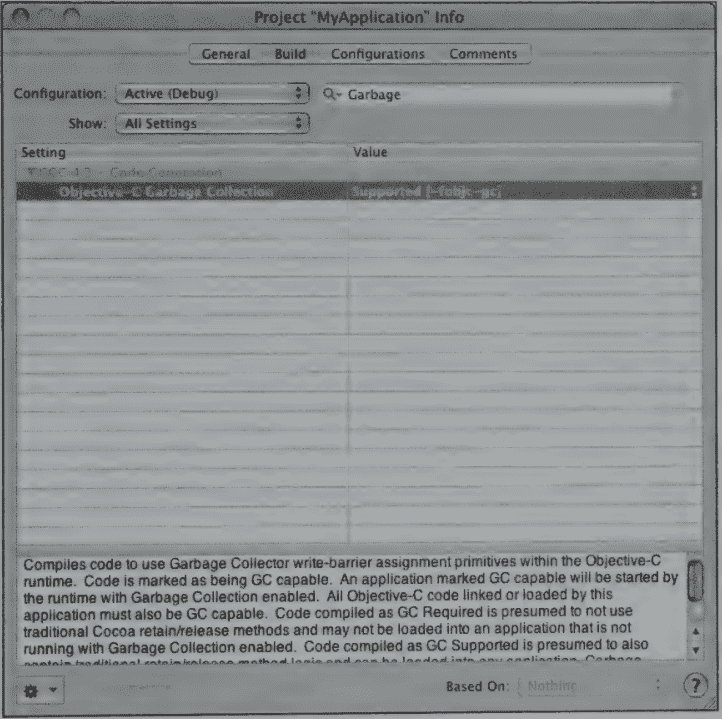

编译代码以在 Objective-C 运行时中使用垃圾收集器写屏障赋值原语。代码被标记为可 GC。标记为可 GC 的应用程序将在运行时启用垃圾收集的情况下启动。由此应用程序链接或加载的所有 Objective-C 代码也必须可 GC。作为 GC Required 编译的代码被假定不使用传统的 Cocoa retain/release 方法，并且可能无法加载到未启用垃圾收集的应用程序中。作为 GC Supported 编译的代码被假定也包含传统的 retain/release 方法逻辑，可以加载到任何应用程序中。Garbage

当然，第一个设置是根本没有垃圾收集。你可以通过选择 Unsupported 选项来启用此设置。第二个选项是 Supported 选项。此选项添加了 -fobjc-gc 标志，指定你的项目支持垃圾收集但不要求它。使用此设置时，你可以将项目与未为垃圾收集编译的应用程序链接。此设置通常仅用于库。使用此设置时，你的代码预计同时实现 dealloc 方法以及 finalize 方法，以便无论链接它的应用程序是否已为垃圾收集编译，都可以使用它。

最后一个设置 Required 将编译器标志 -fobjc-gc-only 添加到你的编译设置中，并指定你的代码不使用 retain/release 方法，因此无法加载到不支持垃圾收集的应用程序中。

如果你正在将现有应用程序从非垃圾收集环境转换为垃圾收集环境，你应该知道，所有特定于非垃圾收集内存管理模型的方法将不再适用。你的初始化方法仍会被调用，但你的 `dealloc` 方法将不会被调用。你因此应该重构你的 dealloc 方法，要么删除你之前可能有的任何资源释放，要么将其移入 `finalize` 方法。

### 在垃圾收集项目中使用框架

当为你的应用程序使用垃圾收集时，你还必须确保你链接的任何库或框架都已编译为支持垃圾收集。正如我之前向你展示的那样，在为垃圾收集编译框架或库时，你可以选择专门启用它、包容性启用它（允许你的框架同时在垃圾收集应用程序和非垃圾收集应用程序中使用），或完全禁止垃圾收集。在后一种情况下，库或框架将无法与你的应用程序链接。

幸运的是，所有 Cocoa 框架都完全支持垃圾收集。你可能会遇到库或框架不支持垃圾收集的情况，仅限于第三方库的情况。垃圾收集在 MacOS X 上的 Objective-C 中已经存在相当一段时间了，因此不支持它的库很少见。

### 探索关键垃圾收集器模式

在处理垃圾收集应用程序时，你不可避免地会遇到一些设计模式。认识这些模式并理解应如何处理它们所解决的问题会很有帮助。

### 管理有限资源

面向对象编程语言中经常使用的一种设计模式是为有限资源编写对象包装器。使用对象包装器是处理文件、套接字等时的一种常见做法。这种模式的优点是资源可以在对象的初始化方法中分配，并在对象的 dealloc 方法中释放。这提供了一个很好的心理模型来确保已分配的资源得到释放。

在垃圾收集环境中，这种设计模式存在几个问题。当然，首先是 dealloc 方法不再被调用。因此，如果你对应用程序所做的唯一更改是启用垃圾收集，你试图包装并确保其被释放的有限资源将永远不会被释放。这可以


如果，例如，所讨论的项目是一个操作系统资源，比如套接字，那么就会变得尤其成问题。看起来很诱人将释放操作从你的 `dealloc` 方法移到 `finalize` 方法中。（我已经讨论过，你的目标应该是完全没有 `finalize` 方法。）请记住，在垃圾回收环境中，你的对象可能会在未来的任意时间点被释放。换句话说，你不能指望你的 `finalize` 方法会在应用程序执行的任何特定时间点被调用。因此，你期望在 `finalize` 方法中释放的资源可能要到程序执行比你之前预期的更晚的时候才会被释放。

这两个问题结合起来，导致你需要重新思考这种设计模式，并在对象本身以及使用该对象的对象中做一些额外的工作，以确保由该对象分配的资源在允许对象被垃圾回收之前被正确关闭。

演示这一概念最简单的方法可能是向你展示一些代码。清单 4.17 显示了一个典型的文件包装类，它在初始化时分配了一个资源，即文件句柄，然后在 `dealloc` 方法中释放该资源。

### Listing 4.17
#### A typical file wrapper class

```
@interface Foo : NSObject
{
    int fileHandle;
}

@end

@implementation Foo

-(id)init
{
    if(self = [super init])
    {
        fileHandle = open(...);
    }
    return self;
}

// methods here...
-(void)dealloc
{
    close(fileHandle);
    [super dealloc];
}
@end
```

要将此类转换为合适的可垃圾回收类，你需要将文件句柄的释放操作从 `dealloc` 方法中取出，并放入另一个可以由你的对象使用者手动调用的方法中。例如，一个 `close` 方法。

### Listing 4.18
#### A garbage collectible file wrapper

```
@interface Foo : NSObject
{
    int fileHandle;
}
@end

@implementation Foo

-(id)init
{
    if(self = [super init])
    {
        fileHandle = open(...);
    }
    return self;
}
-(void)close;
{
    if(fileHandle != -1)
        close(fileHandle);
    fileHandle = -1;
}

-(void)finalize;
{
    [self close];
    [super finalize];
}
@end
```

### Writing foundation applications with garbage collection

我之前简要提到过使用垃圾回收编写的 Foundation 命令行应用程序的主题。你已经知道，要创建一个使用垃圾回收的命令行 Foundation 应用程序，必须在 `main` 函数开始时，在分配任何对象之前手动启动垃圾回收器。然而，还有另一个细节对你理解很重要。

Objective-C 垃圾回收器的工作方式是搜索在全局作用域和当前本地栈中引用对象的指针。在此过程中，它会查看本地栈中所有当前活动的变量。在此过程中，它不会考虑本地栈变量是否已初始化。请记住，一个变量在初始化之前，指向的是可能之前包含已初始化对象或变量数据的内存位置。换句话说，你当前栈中的一个未初始化变量可能指向你在之前函数调用中分配但随后不再被引用的对象。因此，垃圾回收器可能会错误地认为你的本地变量引用了一个应该被垃圾回收的对象。

为了防止此问题发生，你需要定期清理本地栈。你用来执行此操作的低级 Objective-C 运行时方法是 `objc_clear_stack(OBJC_CLEAR_RESIDENT_STACK)`。通常，在一个命令行 Foundation 应用程序中，一个没有由框架提供的运行循环的应用程序，你将为自己的应用程序事件处理提供自己的运行循环。此运行循环的顶部被认为是清理本地栈并防止此问题发生的理想位置。

考虑到这两点，一个典型的命令行 Foundation 应用程序 `main` 函数可能看起来像清单 4.19。

### Listing 4.19
#### Commandline Foundation application main function

```
int main (int argc, const char * argv[])
{
    objc_startCollectorThread();

    // ...

    while(running)
    {
        objc_clear_stack(OBJC_CLEAR_RESIDENT_STACK);

        for(RunnableItem *item in runnableItems)
        {
            [item run]; // ..
        }
    }

    return 0;
}
```

### Working with objects in nib files

在使用 nib 文件中的对象时，如果该对象在你的应用程序中没有来自实例化对象的引用，就可能出现一种不常见但难以调试的问题。同样，垃圾回收器会搜索没有任何来自全局对象或当前栈中对象的引用的对象。在某些罕见情况下，你可能会创建一个 nib 文件，其中包含没有引用它们的对象的，例如没有外部引用的视图控制器。在正常情况下，这些对象会被垃圾回收。解决此问题的方法是在拥有你的 nib 的对象中创建一个 `IBOutlet`，并将此出口连接到相关对象。这为对象提供了强引用并防止其被垃圾回收。

## NOTE

Nib 文件，或“NeXT Interface Builder”文件，用于在 iOS 和 Mac OS 上定义界面。我在本书中除了这里之外没有讨论它们，因为它特定于 Cocoa 和 Cocoa Touch。有关更多信息，请参阅 Wiley 出版的 Cocoa Developer Reference 或 Cocoa Touch for iPhone OS 3 Developer Reference。

### Forcing garbage collection

在某些情况下，你可能希望强制垃圾回收器在应用程序执行的特定点收集可能可供收集的对象。例如，如果你刚刚分配然后释放了一大批对象，那么告诉垃圾回收器开始收集以便这些对象能尽快完全释放可能是合适的。

为此，你可以使用低级方法 `objc_collect()`。此方法强制垃圾回收器开始一次收集周期。我将在本章后面详细介绍此方法。

## NOTE

> 当处理将非垃圾回收代码转换为垃圾回收或需要在两种环境中运行的代码时，自动释放池的存在会作为提示，提示收集器尝试进行一次收集。这是垃圾回收器的一个未记录但相当为人所知的特性。

### Working with void pointers and garbage collection

另一个在垃圾回收应用程序中可能导致困难的常见 Objective-C 模式是使用 `void*` 数据类型在回调之间传递应用程序特定数据。这种方法的优点是，方法之间传递的数据可以是开发者想要的任何类型的数据。它可以是一个对象，也可以只是一段字节。接收方法将 `void*` 参数类型转换为它期望接收的数据类型。

在垃圾回收环境中出现的问题是，void 指针是不透明的，因此可能被误认为是没有任何引用的对象，从而被垃圾回收。这可能发生在发起方法和回调方法之间，以至于回调方法收到的指针最终指向一个已被释放的对象。

解决此问题的办法是使用 Core Foundation 方法 `CFRetain` 和 `CFRelease` 来强制在全局 Core Foundation 框架中保持强引用。其工作原理的示例在清单 4.20 中显示。

### Listing 4.20
#### Retaining opaque pointers for use with a callback

```
@implementation Baz

-(void)callbackMethodForObject:(id)object withUserInfo:(void *)inData
{
```


## Listing 4.20 (continued)

```
Bar *bar = (Bar *)inData;

// do stuff with bar...

CFRelease(bar);
}

-(void)startLongOperation
{
    Bar *bar = [[Bar alloc] init];
    CFRetain(bar);
    foo = [[Foo alloc] init];
    [foo startLongOperationWithDelegate:self callbackMethod:
        @selector(callbackMethodForObject:withUserInfo:)
        userInfo:bar];
}

@end
```

本质上，在将你的用户数据指针传递给将调用你回调的对象之前，你手动调用 CFRetain，并将你的用户数据指针作为其参数传递。此时，针对该对象建立了一个强引用。

随后，当你的回调被调用并传递用户数据指针时，你应该调用 CFRelease，再次将指针作为其参数传递。这移除了对该指针的强引用，并且使得下一次垃圾收集器执行时，假设你没有为此对象建立另一个强引用，它将被回收。

### 使用垃圾收集器的面向对象接口

除了适用于在低级代码中使用的垃圾收集器的函数式接口外，Apple 还提供了一个更高级别的抽象 NSGarbageCollector 类，用于处理垃圾收集器。

NSGarbageCollector 类是一个单例，允许你通过 Objective-C 接口与垃圾收集器交互。你可以通过调用 defaultCollector 方法来访问当前线程的垃圾收集器。获得垃圾收集器的单例实例后，你可以使用它来禁用或启用特定指针的收集，甚至是整个线程的收集。此外，你还可以使用 collectExhaustively 或 collectIfNeeded 方法来强制进行收集。

表 4.1 中列出了 NSGarbageCollector 类上可用的方法

| Table 4.1 Commonly Used NSGarbageCollector Methods |
|---|---| 
| Method | Purpose |
| +defaultCollector | Returns the NSGarbageCollector singleton for the current thread. |
| -disable/-enable | Disables or enables garbage collection temporarily. |
| -isEnabled | Returns YES if garbage collection is currently enabled, otherwise NO. |
| -collectExhaustively | Triggers an exhaustive collection of garbage objects. |
| -collectIfNeeded | Triggers a collection, but only if memory consumption has grown beyond thresholds since the last collection. |
| -disableCollectionForPointer: | Causes the given pointer to become a root object, and thus ineligible for collection. |
| -enableCollectionForPointer: | Removes the given pointer from the list of root objects, making it eligible for collection. |

### 理解为你的项目使用何种内存管理模型

也许关于垃圾收集最重要需要理解的是何时适合使用以及何时不适合使用。在某些情况下，垃圾收集并不是你应用程序的良好选择。如我之前提到的，它仅在 MacOS X 版本 10.5 及更高版本上可用。如果你的代码需要在任何其他平台上运行，包括 iPhone 或 iPad，垃圾收集甚至都不是你的选择。除此之外，如果你有一个不使用垃圾收集的应用程序，并且有一个使用引用计数内存管理的庞大现有代码库，那么将其转换为垃圾收集可能没有意义。所需的努力可能过于高昂。

最后，由于垃圾收集器在应用程序中任何给定时间活跃对象的数量方面效率略低，已释放的对象在收集器找到它们之前并不会真正被释放。此外，垃圾收集器本身必须利用 CPU 周期来完成其工作。如果其中任何一个对你来说都是考虑因素，那么在你的应用程序中使用垃圾收集可能不是合适的选择。

然而，在你的应用程序中使用垃圾收集也可以带来显著的优势。例如，一般来说，使用垃圾收集的应用程序更容易实现线程安全。这是因为访问器可以变成简单的赋值操作，不再需要线程锁来保证线程安全。

使用垃圾收集的应用程序通常也更容易编码。对委托的弱引用等维护不再必要的需要，导致代码更简单，更易于维护。

最后，也是最明显的是，能够几乎忽略引用计数内存管理所需的典型样板代码是一大胜利。人们常说，最好的代码，也是最无 bug 的代码，是你根本不需要编写的代码。毫无疑问，垃圾收集通过减少你需要编写的代码量来帮助减少代码中出现 bug 的机会。

记住，你应该使用能够在你要求的性能参数范围内实现目标的最高抽象级别。也就是说，如果你可以使用垃圾收集，并且它能为你的问题域提供足够的性能，那么你就应该使用它。如果垃圾收集导致你特定问题域的性能不佳，那么就不要使用它。Objective-C 为开发者提供的最大优势之一是能够轻松地在框架栈中上下移动，并使用最容易解决所需问题的抽象级别。

## Summary

本章可能是本书中最重要的章节之一。对内存管理技术以及引用计数和垃圾收集的正确使用有深入理解，是所有 Objective-C 程序员必备的重要技能。在本章中，我首先向你介绍了 Objective-C 的传统内存管理模型，即引用计数。我向你展示了如何在对象中分配内存，并在不再使用时释放该内存。我还向你展示了如何在 MacOS X 上使用新技术，即垃圾收集。垃圾收集可以使你的代码比传统的引用计数内存管理更简单、更不易出错。你必须自行决定哪种内存管理技术适合你的项目。然而，我希望我已为你提供了足够的工具，以便你能够有效地做出该决定。

## Exploring Deeper Features

## In This Part

- Chapter 5
  - Working with Blocks
- Chapter 6
  - Using Key Value Coding and Key Value Observing
- Chapter 7
  - Working with Protocols
- Chapter 8
  - Extending Existing Class Capabilities
- Chapter 9
  - Writing Macros
- Chapter 10
  - Handling Errors

## Working with Blocks

Objective-C 的最新也是最强大的补充之一是包含了一种称为 blocks 的功能。使用它，你可以指定任意代码片段，这些代码可以像对象一样传递给方法和函数。在本章中，我将向你展示如何使用它们。

### Understanding Blocks

如果你是从 Ruby 或 lisp 等其他语言转到 Objective-C，你可能已经熟悉 blocks 的概念，也称为闭包。Listing 5.1 显示了 Ruby 中一个 block 的示例。

#### Listing 5.1

## An example block in Ruby

```
items.each { |item| puts item }
```

本质上，block 使你能够在代码中内联定义一个函数对象。这些函数对象可以通过使用传统变量来引用，包括传递给其他函数。这意味着，你可以定义可重用的代码块，这些代码块可以像对象一样被传递，从而使该代码能够在其他对象内部动态执行。这听起来可能令人困惑，但我认为随着我们逐步完成即将到来的示例，这个概念会变得更清晰。

在上述 block 的情况下，此代码实际上是在遍历 items 数组中的每个项目，然后执行大括号内的代码，并将当前项目传递到 block 中。

## In This Chapter

- Using blocks to encapsulate algorithms
- Using the block directive
- Creating map and filter functions using blocks
- Running blocks in parallel using threads and Grand Central Dispatch


### 声明代码块

在本节中，我将向你介绍在 Objective-C 中代码块是什么样子。代码清单 5.2 展示了一个简单代码块的示例。

#### 代码清单 5.2
##### Objective-C 中的一个简单代码块

```
int main (int argc, const char * argv[])
{
    NSAutoreleasePool * pool = [[NSAutoreleasePool alloc] init];
    
    void (^myBlock)(NSString *x);
    
    myBlock = ^(NSString *x)
    {
        NSLog(@"%@", x);
    };
    
    [pool drain];
    return 0;
}
```

从本质上讲，代码块是一个变量，就像任何其他变量一样。代码块的不同之处在于，存储在代码块内部的数据是一个函数体。使用代码块时，你可以像调用任何标准函数一样调用它，向它传递参数并从它那里获得返回值。

就这段代码而言，持有代码块的变量名为“myBlock”。首先，你使用 `void (^myBlock) (NSString *)` 这一行来声明变量。普通变量在声明时相对简单。普通变量不需要传入参数，也不需要返回值。相反，代码块存储在变量中，并且必须声明其参数和返回类型。因此，它的声明比传统变量更复杂。

代码块的声明由它的返回类型（此处为 void）组成。代码块的返回类型放在你通常期望看到所声明变量类型定义的位置。然而，在代码块声明中，你声明的是代码块执行后将要返回的值类型。

在返回类型定义之后，有一个特殊运算符，用于告诉编译器你定义的是代码块而不是另一种类型的变量。这个运算符就是 ^ 字符。

你可能会觉得把这想象成声明指针变量更容易理解。就像声明指针变量时一样，^ 字符用于表示所讨论的变量是一个指针。然而，在代码块的情况下，使用的也是 ^ 字符。

在 ^ 字符之后，是存储代码块的变量名（myBlock）。该变量名被括在圆括号中，以便与后面的参数分隔开。

变量名遵循语言中其他变量名的命名约定；它只能包含字母数字字符，并且不能以数字开头。

在代码块变量名的右括号之后，列出使用代码块时需要传入的参数，参数用逗号分隔，并括在另一组圆括号中（此处为 (NSString *x)）。列出这些参数时，你不需要提供参数本身的变量名。是否提供由你自己决定，但并非必需。一个好理解方式是，此时你实际上并没有声明函数体。因此，提供参数的变量名没有意义，因为此时它们不会被使用。相反，你只需告诉编译器期望的参数类型。你只需提供用逗号分隔的参数类型。许多代码块文档在声明中省略了参数名。我选择不省略，因为我认为那样会让代码变得混乱，特别是对新手开发者而言。

和往常一样，用分号结束语句。此时，你已经声明了一个变量，它可以存储一个代码块，该代码块返回你指定的值类型，并接受你指定的参数。在我们上面的示例中，这个变量的名称是 myBlock。

正如我们所知，仅仅声明变量还不够。你还需要存储代码块才能使用它。用代码块初始化新变量很简单，只需使用赋值运算符，然后再次使用一种特殊语法来表示你正在创建将要存储到变量中的实际代码块。

代码块的定义同样使用 ^ 字符来告诉编译器接下来是一个代码块定义。在定义中可以省略返回类型，因为编译器可以通过查看代码块所存储到的变量来确定返回类型。但是，你必须再次在圆括号内提供代码块的参数规范。在这种情况下，你还必须提供所传参数的变量名。这很合理，因为你是在声明参数在代码块体内使用的变量名。

在参数列表的右括号之后，你提供代码块的实际主体。这段代码主体的形式与声明普通函数几乎相同。你将代码块代码用花括号括起来，执行你选择的任何操作，按需使用你的参数，并在完成后返回任何合适的值。就像定义标准函数一样，代码块内的代码可以跨越多行，但正常的空白规则仍然适用。

#### 代码清单 5.3
##### 不同类型的代码块定义

```
void (^myBlock)(NSString *x) = ^(NSString *x)
{
    NSLog(@"%@", x);
};

void (^anotherBlock)(NSString *x) = ^(NSString *x) { NSLog(@"%@", x); };

void (^aVoidBlock)() = ^{ NSLog(@"blah"); };

doIt(^(NSString *x){ NSLog(@"%@", x); });
```

## 注意

在定义不带参数的代码块时，不提供参数的外层圆括号在语法上是允许的，因为没有参数。但是，你仍然必须为定义提供圆括号。

如这里所示，你可以将代码块变量的声明和初始化放在同一个表达式中完成。这同样与使用普通变量类似。你可以先声明变量，然后单独初始化，也可以一次性完成。

在上述代码清单的最后一行，你可以看到，也可以直接以内联方式定义代码块，来替换任何需要该代码块的参数，就像你可以将硬编码值而不是变量作为参数传递给函数一样。这是完全合法的。

### 使用代码块

你声明代码块的主要目的是让它们可以在其他地方使用。因此，理解代码块如何传递给其他函数和方法，以及当你收到一个代码块对象后如何使用它，非常重要。

要声明一个函数或方法将代码块作为参数，你可以像在代码中声明代码块变量那样声明该参数。例如，代码清单 5.4 展示了一个以代码块作为参数的函数。所涉及的代码块接收一个 NSString 参数，并返回一个 NSComparisonResult。

#### 代码清单 5.4
##### 声明一个以代码块为参数的函数

```
void useCodeBlock(NSComparisonResult (^theBlock)(NSString *value));
```

在使用代码块的函数体内，你调用代码块时，可以把它当作普通函数名来使用。换句话说，你只需像使用函数一样使用该变量，在圆括号内传入代码块所需的参数，并按需使用赋值运算符存储返回结果。

#### 代码清单 5.5
##### 一个使用代码块的函数

```
void useCodeBlock(NSComparisonResult (^theBlock)(NSString *value))
{
    if(NSOrderedSame == theBlock(@"foo"))
        doSomethingIfSame();
    else
        doSomethingElse();
}
```

当把代码块参数作为参数传递给对象或类方法（而不是函数的参数）时，语法略有不同。代码清单 5.6 展示了如何做到这一点的示例。

#### 代码清单 5.6
##### 将代码块传递给对象方法

```
-(NSMutableArray *)filterArray:(NSArray *)inArray
                    withBlock:(BOOL (^)(NSUInteger))block
{
    NSMutableArray *result = [NSMutableArray array];
```


## 清单 5.6（续）

```
for (NSNumber *number in inArray)
{
    if (block([number integerValue]))
        [result addObject:number];
}
return result;
}
```

注意，在定义 block 之后，你传入的是 block 参数的名字（也就是在方法体内持有 block 的变量的名字）。因此，本来通常用来提供 block 变量名的地方，只需传入 (^)。

Objective-C 的这一新特性强大得惊人。你可以创建比以前更加灵活、更可复用的代码。

不过，在使用这一强大的语言特性之前，你应该先了解一些细节。

### 理解重要的 block 作用域

如果 block 只能使用传给它的参数，并且只能返回它自己定义的值，那么这本身就是一项强大的特性。然而，block 在表面之下还有更多工具，使其更加强大。

当你在另一段代码内部定义一个 block 时，你定义的 block（也就是 block 内部的指令）不仅能访问其他所有代码都能访问的常规全局变量，还会自动获得 block 所在作用域内所有栈变量的只读副本。这意味着，你的 block 在定义时，可以（只读地）访问程序在运行时的整个状态。

为了让你理解我说的意思，请看清单 5.7。

### 清单 5.7

#### 一个访问其定义所在栈中变量的 block

```
int main (int argc, const char * argv[])
{
    NSAutoreleasePool * pool = [[NSAutoreleasePool alloc] init];

NSString *formatStr = @"%s";

void (^myBlock)(char *x) = ^(char *x) { NSLog(formatStr, x); };

doIt(myBlock);

[pool drain];
return 0;
}
```

如你所见，这个 block 访问了一个并非传给它的变量（formatStr），该变量来自创建这个 block 的环境。

同样，这些变量在 block 内部是只读的。不过，你可以在声明变量时使用特殊的语言指令 `__block`，显式地让变量在引用它的任何 block 内部变为可读写。

由于 block 能够为你的应用状态“拍一张快照”，并以这种方式将其提供给应用的其他部分，这就为封装和操作数据提供了一种极其强大的机制。

稍后我会向你展示 block 其他一些很酷的用法，但在那之前，还有一点细节需要处理。

### 管理 block 内存

在 Objective-C 中，block 和其他东西一样，也是对象。组成 block 的数据与普通变量一样，是在栈上分配的。因此，如果你把一个 block 传给另一个函数或对象，而那个对象需要存储该 block 以备稍后使用，那么接收对象必须 retain 这个 block，就好像它接收的是一个传给它的对象一样。

清单 5.8 展示了它的工作原理。

### 清单 5.8

#### 在成员变量中存储 block 的对象

```
@interface Foo : NSObject
{
    void (^myBlock)(NSString *);
```

## 清单 5.8（续）

```
}
-(void)doSomethingWithBlock;
-(void)setMyBlock:(void (^)(NSString *))inBlock;
@end;

@implementation Foo

-(void)dealloc
{
    [myBlock release];
    [super dealloc];
}

-(void)setMyBlock:(void (^)(NSString *))inBlock
{
    myBlock = [inBlock copy];
}

-(void)doSomethingWithBlock
{
    myBlock(@"foo");
    // ...
}
@end
```

如你所见，所有标准的 Objective-C 引用计数内存管理方法都可以像处理其他任何 Objective-C 对象一样处理 block。不过，对于传入的 block 对象，你应该使用 `-copy` 而不是 `-retain`，因为它是分配在栈上的；如果你希望把它保留下来，就需要确保在堆上得到它的副本。

其工作原理是：运行时会为 block 使用到的任何外部变量以及 self 对象在堆上创建一个 const 副本。这样，你就可以访问这些变量，以及创建该 block 的对象的全部成员变量。任何使用 `__block` 指令标记的变量都会被按位复制到堆上，并且 block 负责处理与这些变量相关的任何额外内存管理。

综上所述，如果你的应用使用垃圾回收而不是引用计数内存管理，那么复制、retain 和 release 都会由系统替你完成。

### 使用 typedef 让 block 更易读

有时，对 block 定义使用 typedef 会让代码更易读。这样你可以复用该定义，而不必重新输入 block 的全部参数和返回类型。清单 5.9 展示了上一节中的类，但这一次它使用 typedef 来定义 block 参数。如你所见，这让代码更加清晰易读。

### 清单 5.9

#### 使用 `typedef` 的相同代码

```
typedef void (^BlockWithCharArg)(char *);

@interface Foo : NSObject
{
    BlockWithCharArg myBlock;
}
-(void)doSomethingWithBlock;
-(void)setMyBlock:(BlockWithCharArg)inBlock;
@end

@implementation Foo

-(void)dealloc;
{
    [myBlock release];
    [super dealloc];
}

-(void)setMyBlock:(BlockWithCharArg)inBlock
{
    myBlock = [inBlock copy];
}

-(void)doSomethingWithBlock
{
    myBlock("foo");
    // ....
}
@end
```

### 在线程中使用 block

我相信你能想到 block 在代码中的许多不同用途。在接下来的几节中，我会介绍其中的几种。

如果你仔细想想，block 能让你把应用中的功能封装成漂亮整洁的包，并且可以轻松复用，那么你就会明白，在 Objective-C 中，block 最常见的用途之一就是提供可并行运行的代码。换句话说，就是线程。

事实上，Apple 在 Objective-C 中引入 block 时演示的头几个用例之一，就是在其当时全新的并行化框架 Grand Central Dispatch 中使用 block。

### 使用 Grand Central Dispatch

Grand Central Dispatch 是随 Mac OS X 10.6 发布的一个框架。它提供了一个易于使用的抽象层，使开发者能够利用多处理器和多核架构，而无需处理底层的线程管理。

使用 GCD 时，开发者只需提供代码块，这些代码块封装了可以安全并行运行的功能。他们将 block 交给 GCD 队列，GCD 队列随后会处理所有底层细节，例如线程的创建、线程的管理，甚至是在给定系统上需要创建多少线程来运行所提供的任务。GCD 知道机器有多少个核心，并且只会分配足够的线程，以便在这些核心上最大化性能。它完全处理了队列中任务的排队，并将这些任务分配给它所创建的线程。

可以向 Grand Central Dispatch 提供函数或 block 形式的任务。显然，鉴于本章的主题，我们将重点放在 Grand Central Dispatch 中使用 block。

### 使用 GCD 函数在线程中调度代码块

GCD API 的核心围绕着队列这一概念。使用 GCD 时，你可以选择预置的系统队列之一，例如全局队列。你可以通过 `dispatch_get_global_queue()` 方法来访问它，该方法会返回与你的应用关联的全局并发队列；也可以使用 `dispatch_queue_create` 函数创建你自己的私有串行队列。

队列本身既可以是并发的，也可以是串行的，这表示放在队列中的对象在并发队列中可以彼此并行运行，在串行队列中则彼此顺序运行。


## 注意

串行队列通常用于需要对给定资源进行一系列操作而要求独占访问的场景。通常，你可能会使用线程锁来确保对这些资源的独占访问。使用GCD，你只需将不同的操作按顺序排入串行队列即可。每个条目只有在前一个条目完成后才能运行。

将块（blocks）派发到队列中很简单。清单5.10展示了一个示例，使用一个执行某些耗时操作的块。在这个例子中，我们将这个块派发到全局并发队列。如你所见，我们可以将多个这样的过程派发到队列中。Grand Central Dispatch 可以自动为我们处理这些任务的调度和管理，完全无需我们干预。

#### 清单5.10
#### 将一个块派发到全局并发队列

```
dispatch_async(dispatch_get_global_queue(0, 0), ^{ doSomethingSlow(); });
```

你可以通过方法 dispatch_get_global_queue 获取全局队列，然后将你的块（^{ doSomethingSlow(); }）派发到该队列。在这里，如果你愿意，可以使用我之前展示的任何块模式。当然，通常的线程安全要求同样适用。

### 使用常见的块设计模式

我已经向你展示了如何结合GCD使用块将工作单元派发到线程。现在来看一些其他常见的块模式。在这些情况下，有一些示例展示了在何处可以使用块与标准框架API配合，比不用块能更高效、更简洁地完成任务。

### 使用代码块实现映射操作

在其他语言中，用于展示块强大功能的常见操作之一是实现映射（map）算法。

映射（map），如果你还不知道的话，是一个将给定函数应用于数组的每个元素，并返回结果列表的函数。在Objective-C中使用块实现映射简直是轻而易举。首先，你需要创建你的映射函数。映射函数以一个块和你的条目数组作为参数。如清单5.11所示。

Cocoa中的一些类会将块作为参数来执行操作，通常是对它们管理的集合元素进行操作。这样做的重要类包括NSArray、NSDictionary、NSIndexSet和NSSet。此外，NSString和NSAttributed String也提供了使用块来枚举行和属性的方法。

Cocoa中使用块的最常用方法集合如表5.1所示。

#### 表5.1

| 类 | 方法 | 目的 |
|---|---|---|
| NSNotificationCenter | addObserverForName:object:queue:usingBlock: | 当通知发送时执行给定的块。 |
| NSIndexSet | enumerateIndexesInRange:options:usingBlock:, enumerateIndexesUsingBlock:, enumerateIndexesWithOptions:usingBlock: | 枚举集合的索引，执行给定的块，并将索引传递给该块。 |
| NSDictionary | enumerateKeysAndObjectsUsingBlock:, enumerateKeysAndObjectsWithOptions:usingBlock: | 枚举字典的键和对象，执行给定的块，并将键和对象作为参数传递给它。 |
| NSString | enumerateLinesUsingBlock:, enumerateSubstringsInRange:options:usingBlock: | 枚举字符串的行，以行为参数调用给定的块... |
| NSArray | enumerateObjectsAtIndexes:options:usingBlock:, enumerateObjectsUsingBlock:, enumerateObjectsWithOptions:usingBlock: | 枚举数组的元素，将每个条目传递给给定的块。 |
| NSSet | enumerateObjectsUsingBlock:, enumerateObjectsWithOptions:usingBlock: | 枚举集合的元素，将每个条目传递给给定的块。 |
| NSOperationQueue | addOperationWithBlock: | 将给定的块添加到队列。 |
| NSBlockOperation | +blockOperationWithBlock: | 使用给定的块创建一个新的NSOperation。 |

特别值得注意的是 NSOperationQueue 和 NSBlockOperation 上的方法，它们使你可以通过块来使用 NSOperation 对象。这是比我在之前“使用GCD在线程中派发块”一节中展示的GCD函数更高级的API。我将在第16章展示如何使用这些API。

### 将块应用于极易并行化的任务

现在我已经向你展示了在代码中使用块所需了解的一切，你可以应用这些知识了。虽然块的使用确实不仅限于并行化和线程处理，但它们在处理这些任务方面特别擅长。

在编程界，它们被称为极易并行化问题（embarrassingly parallel problems）——这些问题特别适合并行化。

这类问题的一个例子是计算质数。虽然你可以使用其他比暴力求解更快的方法来计算质数，但在下面的示例中，我将展示如何改进暴力求解法的性能。因此，我将让你编写一个简单的程序，计算2到150,000之间的所有质数。然后，你将用两种不同的方式重写该应用程序。第一种方式使用一个块和一个NSArray，来演示如何封装对给定数字是否为质数的判断。第二种形式利用Grand Central Dispatch来并行化计算。示例代码能够打印出它找到的质数。如果你想看到其运行效果，请随意取消注释这段代码。然而，对你来说重要的是要注意计算这些质数各自需要多长时间。程序会打印出每个程序所需的时间。你应该会看到，简单朴素的方法和数组过滤方法所需的时间大致相同，而并行版本应该会快得多。

### 创建项目

你需要做的第一件事是创建项目。（你已经做过好几次了，所以我就不在这里赘述了。）请确保创建一个新的命令行Foundation项目。虽然其实并非必要，但我打算让你创建一个实际执行质数计算的类。你使用Objective-C进行的大部分编程都会用到对象和类。因此，从现在开始熟悉它们并在日常工作中使用它们是一个好主意。

创建新项目后，修改主源文件，使其看起来如清单5.13所示。

#### 清单5.13
#### 质数计算器的主源文件

```
#import <Foundation/Foundation.h>
#import "PrimeFinder.h"
```

```
int main (int argc, const char * argv[])
{
    NSAutoreleasePool * pool = [[NSAutoreleasePool alloc] init];

    PrimeFinder *finder = [[PrimeFinder alloc] initWithMaxNumber:150000];
    [finder start];

    // uncomment if you want to print out all the primes.
    // for(NSNumber *number in [finder primes])
    // {
    //     NSLog(@"Found prime: %@", number);
    // }

    NSLog(@"Found all the primes in %fs", [finder elapsedTime]);

    [finder release];
    [pool drain];
    return 0;
}
```

这个源文件在示例应用程序的三个版本中保持不变。修改主源文件后，你可以创建一个执行质数计算的类。现在请为你的项目添加一个新类。将类命名为“PrimeFinder”。对于该应用程序的第一个版本，你将完全不使用块，这样你可以看到如果只是用老式方法来做的话，这个程序会是什么样子。

PrimeFinder的接口和实现在清单5.14和5.15中展示。

#### 清单5.14
#### PrimeFinder的接口文件

```
#import <Cocoa/Cocoa.h>

@interface PrimeFinder : NSObject
{
    NSInteger maxNumber;
    NSDate *startedDate;
    NSDate *endedDate;
    NSMutableArray *primes;
}
```

#### 清单5.14（续）

```
@property (retain, nonatomic) NSMutableArray * primes;
@property (retain, nonatomic) NSDate * startedDate;
@property (retain, nonatomic) NSDate * endedDate;
@property (readonly) NSTimeInterval elapsedTime;
-(id)initWithMaxNumber:(NSUInteger)inMaxNumber;
-(void)start;

@end
```

#### 清单5.15
#### PrimeFinder的实现文件

```
#import "PrimeFinder.h"

@implementation PrimeFinder
@synthesize startedDate;
@synthesize endedDate;
@synthesize primes;
@dynamic elapsedTime;

-(void)dealloc
{
    [primes release];
    [startedDate release];
    [endedDate release];
    [super dealloc];
}

-(id)initWithMaxNumber:(NSUInteger)inMaxNumber
{
    if(self = [super init])
    {
        maxNumber = inMaxNumber;
        primes = [[NSMutableArray alloc] init];
    }
    return self;
}
```


```
- (BOOL) isPrime: (NSUInteger) number
{
    for (NSUInteger n = 2; n < number; ++n)
        if ((number % n) == 0)
            return NO;
    return YES;
}

- (void) start
{
    [self setStartedDate: [NSDate date]];

    for (NSUInteger n = 2; n <= maxNumber; ++n)
    {
        if ([self isPrime:n])
            [primes addObject: [NSNumber numberWithInteger:n]];
    }

    [self setEndedDate: [NSDate date]];
}

- (NSTimeInterval) elapsedTime
{
    return [endedDate timeIntervalSinceDate:startedDate];
}

@end
```

在第 5.15 节清单中，代码相当直接。本质上，我们有一个紧密的 for 循环，从 2 计数一直到 150,000，也就是我们传入的最大数字。然后它依次取出这些数字中的每一个并调用 `isPrime:` 方法。如果该方法返回 true，则将该数字添加到我们结果集的素数列表中。`isPrime:` 函数接收给定的任意数字，并尝试用小于该数字的每个数字去除它。如果能整除——如果没有余数——则该数字不是素数。然而，如果它遍历完所有小于该数字本身的数字，则它是素数并返回 true。

如果你编译并运行此程序，它应该会打印出你的计算机计算所有这些素数所需的时间。在我的计算机上，大约需要 15 秒。如果你的计算机比我的快得多，并且完成得比这快得多，你可能需要通过将 150,000 增加到更高的数字来增加素数候选的最大数量。对于本示例的目的而言，重要的是你的计算机在这个问题上花费一些时间进行计算。不要设置得太高。计算素数对 CPU 来说是一项相当繁重的任务，如果设置过高，完成可能需要很长时间。

### 使用 blocks 与数组过滤素数

展示 block 用法的第一个示例实际上并不会带来任何性能改进。我向你展示这个是因为它是一种有用的设计模式，你可以将其用于解决其他类型的问题。

本质上，你要做的是修改 PrimeFinder 类，使其将我们候选素数序列中的所有可能的素数放入一个数组中。然后你将编写一个方法，使用你传递给 filter 方法的 block 来过滤该数组。filter 方法随后返回一个新数组，其中只包含候选数组中为素数的数字。这种模式可能在你想要根据某些条件过滤数组的元素时使用。使用 blocks 的好处是，你可以随时动态更改条件，只需向 filter 函数传递不同的 block 即可。


## NOTE

另一种方法可能是使用 NSPredicate 类方法 `+predicateWithBlock:` 创建一个 NSPredicate，然后将其与 NSArray 方法 `filteredArrayUsingPredicate:` 一起使用。再次强调，我的目的是解释底层概念，所以我们采用硬办法来做。

### 清单 5.16

#### 过滤版本 PrimeFinder 的接口文件

```
#import <Cocoa/Cocoa.h>

@interface PrimeFinder : NSObject
{
    NSUInteger maxNumber;
    NSDate *startedDate;
    NSDate *endedDate;
    NSMutableArray *primes;
    NSMutableArray *candidates;
}
@property (retain, nonatomic) NSMutableArray * candidates;
@property (retain, nonatomic) NSMutableArray * primes;
```

```
@property (retain, nonatomic) NSDate * startedDate;
@property (retain, nonatomic) NSDate * endedDate;
@property (readonly) NSTimeInterval elapsedTime;
-(id)initWithMaxNumber:(NSUInteger)inMaxNumber;
-(void)start;

@end
```

重要的更改在实现文件中，如清单 5.17 所示。

### 清单 5.17

#### PrimeFinder 过滤版本的实现文件

```
#import "PrimeFinder.h"

@implementation PrimeFinder
@synthesize startedDate;
@synthesize endedDate;
@synthesize primes;
@synthesize candidates;
@dynamic elapsedTime;

-(void)dealloc
{
    [self setCandidates:nil];
    [self setPrimes:nil];
    [self setStartedDate:nil];
    [self setEndedDate:nil];
    [super dealloc];
}

-(id)initWithMaxNumber:(NSUInteger)inMaxNumber
{
    if(self = [super init])
    {
        maxNumber = inMaxNumber;
        candidates = [NSMutableArray new];
        for(NSUInteger n = 2; n <= inMaxNumber; ++n)
        {
```

#### 清单 5.17（续）

```
[candidates addObject:[NSNumber numberWithInteger:n]];
}
}
return self;
}

-(NSMutableArray *)filterArray:(NSArray *)inArray
withBlock:(BOOL (^)(id))block
{
NSMutableArray *result = [NSMutableArray array];
for(id item in inArray)
{
if(block(item))
[result addObject:item];
}
return result;
}

-(void)start
{
[self setStartedDate:[NSDate date]];

BOOL (^isPrime)(id) = ^(id number)
{
NSInteger value = [number integerValue];
for(NSInteger n = 2; n < value; n++)
if((value % n) == 0)
return NO;
return YES;
};

[self setPrimes:[self filterArray:candidates withBlock:isPrime]];

[self setEndedDate:[NSDate date]];
}

-(NSTimeInterval)elapsedTime
{
return [endedDate timeIntervalSinceDate:startedDate];
}

@end
```

首先，你在初始化方法中创建 candidates 数组。

在创建了候选数组之后，你必须修改 start 方法。在这个版本中，你将 `isPrime:` 方法取出，并不是将其作为 PrimeFinder 类的对象方法创建，而是将其作为 block 创建。

你还必须创建 filter 方法，该方法将使用你的候选数组和你的 block 调用，并返回仅包含 block 返回 true 的数字的过滤数组。在上面的代码清单中，此方法称为 `-filterArray:withBlock:`。

这段代码的精妙之处在于，你可以向此 filter 函数传递任何你想要的 block。它将遍历数组的成员，并为其中每一个元素简单地调用 block，将元素作为参数传递给 block。block 可以做任何它想做的事情。它唯一需要做的就是，如果该元素应包含在结果数组中则返回 true，如果不应包含则返回 false。将此逻辑与数组的迭代解耦的能力非常强大，在某些情况下非常有用。

### 使用 Grand Central Dispatch

我们 PrimeFinder 类的最终版本利用 GCD 并行运行素数计算。再次说明，我将在后面更深入地讨论 GCD。现在只需理解，我们将为我们想要测试素数的每个数字，将 block 的实例分派到 GCD 全局队列上。

为了做到这一点，我们必须做一些调整，以确保我们对不同线程之间共享的任何变量的访问是安全的。有几件事会受到影响。首先，你将把所有结果，即素数，存储到一个名为 result 的数组中。因为该数组将在所有 block 之间共享，所以你将在 start 方法本身的作用域内声明它。回想一下，当 block 被声明时，它会接收创建它的栈中的所有作用域变量和状态。然而，也要记住这些变量都是只读的，这包括我们的 result 数组。我们不需要使用 `__block` 指令，因为尽管 result 变量本身是只读的，但通过其指针引用，result 的内容并不是只读的。这是一个微妙但重要的细微差别需要注意。

除了使 result 数组可写之外，我们还必须确保没有两个 block 同时尝试写入该数组。我们通过使用 Objective-C 内置的简单线程安全机制 `@synchronized` 关键字来做到这一点。

最后，为了实际将你的 block 分派到 GCD，你需要创建一个 dispatch group，这允许你将 block 放入一个全局队列，该队列将完全由 Grand Central Dispatch 管理。它将为机器上运行的内核和处理器数量自动生成适当数量的线程，然后逐一从队列中取出 block，将它们发送到这些线程上执行工作。

清单 5.18 显示了你需要如何修改 PrimeFinder 实现以完成所有这些操作。继续修改你的类以匹配它。


## 注意

如果你是从前面的示例继续开发项目，请务必从接口中移除 candidates 数组。

### 清单 5.18

## GCD 版 PrimeFinder 的实现文件

```
#import "PrimeFinder.h"

@implementation PrimeFinder
@synthesize startedDate;
@synthesize endedDate;
@synthesize primes;
@dynamic elapsedTime;

-(void)dealloc
{
    [self setPrimes:nil];
    [self setStartedDate:nil];
    [self setEndedDate:nil];
    [super dealloc];
}

-(id)initWithMaxNumber:(NSUInteger)inMaxNumber
{
    if(self = [super init])
    {
        maxNumber = inMaxNumber;
    }
    return self;
}

-(void)start
{
    [self setStartedDate:[NSDate date]];

    NSMutableArray *result = [NSMutableArray array];

    dispatch_queue_t globalQueue = dispatch_get_global_queue(0, 0);
    dispatch_group_t group = dispatch_group_create();
    for(NSUInteger number = 2; number <= maxNumber; ++number)
{
dispatch_block_t isPrime = ^
{
for(NSUInteger n = 2; n < number; ++n)
if((number % n) == 0)
return;
@synchronized(result)
{
[result addObject:[NSNumber numberWithInteger:number]];
};
dispatch_group_async(group, globalQueue, isPrime);
}
dispatch_group_wait(group, DISPATCH_TIME_FOREVER);
[self setEndedDate:[NSDate date]];
[self setPrimes:result];
}
-(NSTimeInterval)elapsedTime
{
return [endedDate timeIntervalSinceDate:startedDate];
}
@end
```

在这段代码中，所讨论的 block 被指定为 dispatch_block_t 类型，这是 Grand Central Dispatch 函数提供的一种特殊 typedef，用于定义要传递给 GCD 队列的 block。需要理解的关键是，这些就是普通的 block，就像你之前一直在使用的那样。dispatch_block_t 的实际定义见清单 5.19，供你参考。

dispatch_block_t 的定义

```
typedef void (^dispatch_block_t)(void);
```

如果你运行这个版本的程序，应该会看到性能显著提升。在我的电脑上，计算素数所需的运行时间缩短了约 45% 到 50%。当然，具体效果因人而异。

## 小结

在本章中，我向你介绍了 Objective-C 工具箱中的一个强大新工具。Block（代码块）非常有用，因为它们让你能够封装小的匿名代码片段，并像处理对象一样传递这些代码片段。这让你能够创建通用方法，只需将新类型的 block 作为参数传入，即可用不同的功能重新配置这些方法。此外，block 使 Grand Central Dispatch 的使用变得异常简单，因为它们让你能够表达功能片段，然后将该功能发送到队列中执行。

## 使用键值编码与键值观察

Objective-C 运行时为你提供了各种高级工具，不仅用于与操作系统框架交互，还用于与代码的属性交互。你可以使用的一个工具就是我在本章中介绍的概念：键值编码（Key Value Coding）。键值编码，也就是 Objective-C 圈子中常说的 KVC。

### 使用键值编码访问对象属性

键值编码使你在常规的 setter 和 getter 之外，还可以使用一组标准化的访问器方法来访问类的属性。你可以通过指定表示要访问属性名称的字符串标识符，使用这些访问器方法获取和设置类的属性。除了能够使用这些字符串标识符访问属性外，你还可以通过标准化语法访问对象关系和子对象。

为了让你对我所说的内容有一个直观认识，请看清单 6.1。

```
Some example classes.

@interface Bar : NSObject
{
    NSArray *array;
    NSString *stringOnBar;
}
```

### 清单 6.1

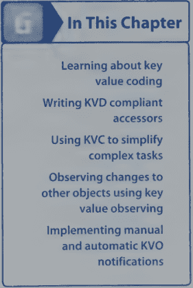

## 清单 6.1（续）

```
@property (retain, nonatomic) NSArray * array;
@property (retain, nonatomic) NSString * stringOnBar;
@end

@interface Foo : NSObject
{
    Bar *bar;
    NSString *stringOnFoo;
}
@property (retain, nonatomic) Bar * bar;
@property (retain, nonatomic) NSString * stringOnFoo;
@end
```

如你所见，给定所示的两个类，我们有一个名为 Foo 的类。这个类有一个字符串属性，以及另一个定义 Foo 与 Bar 类之间关系的属性。该关系是通过 Foo 上的 bar 属性来定义的。

我已经向你展示过，通过为给定类的属性声明 property，Objective-C 会为这些属性生成 setter 和 getter。除了这些标准的 setter 和 getter 之外，它还为你提供了一组键值编码访问器。

这些键值编码访问器中最常用的是能够直接访问给定类属性的那些。它们是 -valueForKey: 调用，允许你通过指定一个表示要访问属性名的字符串参数来读取属性；以及 -setValueForKey: 调用，允许你设置给定属性的值，同样也是通过指定属性名的字符串。

在处理更复杂的关系时，如果你想访问一个属性的属性，可以使用点表示法指定更复杂的键路径。例如，如果你有一个对象，其 bar 属性类型为 Bar，而该属性又有一个名为 stringOnBar 的属性，你可以使用 -valueForKeyPath: 方法，指定到该属性的点表示法路径 "bar.stringOnBar"。此外，还有 -setValue:forKeyPath: 方法。

同样，查看代码可能是描述我所讲内容的最简单方式。Objective-C 运行时会自动为你生成代码，使你能够通过我刚才提到的调用读写这些类的属性，如清单 6.2 所示。

### 清单 6.2

### 使用 KVC 访问器访问类的属性

```
Foo *foo = [[Foo alloc] init];
[foo setValue:@"blah blah" forKey:@"stringOnFoo"];
NSString *string = [foo valueForKey:@"stringOnFoo"];
[foo setValue:@"The quick brown fox." forKeyPath:@"bar.stringOnBar"];
NSString *string2 = [foo valueForKeyPath:@"bar.stringOnBar"];
```

所以，正如你所见，从字面上讲，你可以使用字符串指定要访问的属性名，然后读取其值或写入其值。你甚至可以在访问 Bar 类的属性时，如示例所示，遍历两个对象之间的关系，访问你所访问的主对象的子对象的属性。

一开始这可能看起来有点令人困惑，你可能会想为什么需要了解这个。对于日常大部分编码工作来说，使用键值编码方法来设置和访问属性，最终可能比直接访问类的 setter 和 getter 需要更多输入，也更容易出错。然而，在少数边缘情况下，能够使用可在运行时而非编译时改变的值来动态访问这些属性，可能会非常强大。

清单 6.3 展示了一个类的示例，该类需要将一个 pen 对象序列化到数据库表中。在所示第一个示例中，序列化例程遍历表中的每个字段。在遍历时，它需要一个复杂的 if 语句来确定要对正在序列化的对象调用哪个访问器，以便获取要序列化到给定字段的值。

### 清单 6.3

### 不使用 KVC 序列化表

```
-(BOOL)serializeToTable:(Table *)inTable
{
    Row *row = [inTable addRow];
    for(Column *column in row)
    {
        if([[column name] isEqualToString:@"firstName"])
            [column setValue:[self firstName]];
```


### 清单6.3
（续）

```
else if([[column name] isEqualToString:@"lastName"])
    [column setValue:[self lastName]];
else if([[column name] isEqualToString:@"age"])
    [column setValue:[self lastName]];
else if([[column name] isEqualToString:@"birthDate"])
    [column setValue:[self lastName]];
...
}
[row save];
}
```

这段代码很快就会变得相当难处理。现在看看使用键值编码方法的相同代码。清单6.4展示了更新后的代码。

### 清单6.4
#### 使用KVC的序列化方法

```
-(BOOL)serializeToTable:(Table *)inTable
{
    Row *row = [inTable addRow];
    for(Column *column in row)
    {
        [column setValue:[self valueForKey:[column name]]];
    }
    [row save];
}
```

如你所见，新版本不仅在代码行数上更少，而且更健壮、更灵活。当你向表中添加新列时，只需额外向这个对象添加属性来存储这些字段的值即可。这个序列化方法会自动从这些属性中提取值并为我们存储，无需对该方法做任何修改。同样，序列化方法并不是你会在代码中到处使用的东西。我想强调这一点。使用KVC访问器而不是普通访问器，通常会产生比你需要的更多的代码。但在这种情况下，它使你能编写更动态的代码，也能减少代码中必须表示对象属性信息的位置数量。当你能够查询一个对象的属性时，就不必把那些信息写入代码中的那么多位置。这总是一件好事——没有写出来的代码才是最没有bug的代码。

### 使用键路径

要使用键值编码，你首先必须弄清楚可以构建哪些键路径，以及通过这些键路径可以访问什么。

你可以把使用KVC访问器想象成使用字典。字典的键是字符串。这些字符串本身就是你正在操作的对象的属性名称。由于这个要求，在键以及属性命名方面必须遵循若干规则。首先，你的键必须使用ASCII编码。这意味着你的键不能使用那些通常不能在属性名中使用的特殊字符。其次，你的键必须以小写字母开头。首字母也允许使用下划线，但不能使用数字，也不能使用大写字母。最后，键中不能包含任何空白字符。

谢天谢地，因为你访问的属性本来就必须是有效的符号名，所以这些规则中的大部分你可能已经在遵守了。

清单6.5展示了一些有效键路径和无效键路径的示例。

### 清单6.5
#### 有效与无效的键路径

```
// valid
[foo valueForKeyPath:@"someMember"];
[foo valueForKeyPath:@"someMember.someAttributeOnMember"];
[foo valueForKeyPath:@"someOtherMember"];

// invalid
[foo valueForKeyPath:@"4fun"];
[foo valueForKeyPath:@"kermit the frog"];
[foo valueForKeyPath:@"SomethingWickedThisWayComes"];
[foo valueForKeyPath:@"THISWONTWORK"];
[foo valueForKeyPath:@"thisAlsoWon'tWork"];
```

正如我之前讨论过的，你可以使用键路径遍历对象之间的关系并访问子对象上的属性。键路径是使用点号跨越不同对象之间关系的键，如上面的示例`@"someMember.someAttributeOnMember"`。该键路径访问`foo`对象上的`someMember`属性，找到`someMember`所属类上的`someAttributeOnMember`属性，并返回存储在那里的值。在这些键路径的规范中提供了许多语法糖。除了能够遍历这些关系之外，你甚至可以访问操作对象集合的函数，例如它们的`count`等。例如，清单6.6展示了一些你可以作为这些键路径一部分使用的内置函数。

### 清单6.6
#### 在键路径中使用函数

```
[anArrayOfProducts valueForKeyPath:@"@avg.price"];
[anArrayOfProducts valueForKeyPath:@"@sum.cost"];
[store valueForKeyPath:@"products.@count"];
```

这些函数仅适用于对象数组和对象集合。在示例中，前两行访问的是`product`对象。这些产品具有价格和成本等属性。给定的函数获取数组中每个对象指定属性的值，然后对这些值执行指定的函数。换句话说，第一项遍历产品数组中的每一项，收集每个产品的价格，然后计算它们的平均值。

使用这些函数的语法包括：在函数名前加上`@`符号，然后是函数名、一个`.`,再然后是要操作的属性。对操作属性的要求的唯一例外是`@count`函数，它只返回集合中项目的数量。

表6.1列出了这些函数。

| 函数 | 用途 |
|---|---|
| @avg | 返回数组或集合中所有元素的平均值。 |
| @count | 返回数组或集合中元素的数量。 |
| @max | 返回数组或集合中所有元素的最大值。 |
| @min | 返回数组或集合中所有元素的最小值。 |
| @sum | 返回数组或集合中所有元素值的总和。 |
| @unionOfArrays/@distinctUnionOfArrays | 给定一个数组集合，返回一个包含该集合中所有数组的数组。对于distinct版本，它只返回不重复的数组。 |
| @unionOfSets/@distinctUnionOfSets | 给定一个集合的集合，返回一个包含所有这些集合的集合。对于distinct版本，它只返回不重复的集合。 |
| @unionOfObjects/@distinctUnionOfObjects | 给定一个集合或数组的集合，以单个数组的形式返回所有集合中的所有元素。distinct版本只返回不重复的元素。 |

### 编写符合KVC的访问器

Objective-C运行时实现所有这些魔法，部分依赖于底层框架的能力，部分归功于编码风格约定。尽管Objective-C运行时在KVC功能方面承担了繁重的工作，但它依赖于你——开发者——为你的属性编写遵循特定约定的访问器，以便它能通过KVC检索和设置值。

KVC对设置器和获取器的标准是：设置器遵循`set<Value>:`的模式，获取器则遵循简单的`<value>`模式。在这两种情况下，模式中的`<value>`部分都应替换为你正在访问的属性名。该属性应该是一个成员变量，其名称使用驼峰命名法指定。

> 注意
> 术语“驼峰命名法”（camel case）指的是一种变量命名标准，其中变量中的各个单词被合并成一个长字符串。在这个字符串中，除了第一个单词外，每个单词的首字母都大写。例如，要编写一个名为“some variable name”的变量名，你应该写成`someVariableName`。观察这个变量名，你会发现变量名内部的大写字母就像骆驼的驼峰。这就是其名称的由来。

因此，给出一个如清单6.7所示的类定义，你可以写出如清单6.7所示的访问器。

### 清单6.7
#### 包含成员变量的类定义

```
@interface MyClass : NSObject
{
    float x;
    float y;
    NSString *something;
}
```

## 清单6.7（续）

```
}
-(void)setX:(float)inX;
-(void)setY:(float)inY;
-(void)setSomething:(NSString *)inSomething;
-(float)x;
-(float)y;
-(NSString *)something;
@end
```

符合KVC的访问器。

```
@implementation MyClass
-(void)setX:(float)inX;
{
    x = inX;
}

-(void)setY:(float)inY;
{
    y = inY;
}

-(void)setSomething:(NSString *)inSomething;
{
    NSString *oldValue = something;
    something = [inSomething retain];
    [oldValue release];
}

-(float)x;
{
    return x;
}

-(float)y;
{
    return y;
}

-(NSString *)something;
{
    return something;
}

@end
```


如果你使用属性来封装对象的属性，那么它会自动生成符合 KVC 的访问器。换句话说，如果你使用的是属性，你就不需要做任何其他事情。完成了。话虽如此，通常的注意事项仍然适用。如果你使用属性并且选择覆盖标准属性访问器命名约定，那么你的访问器将不会符合 KVC，并且无法与 KVC 配合使用。

### 使用 KVC 操作数组

在谈论面向对象设计时，思考对象之间的关系是有帮助的。当一个类的成员变量是另一个类的类型时，这种关系可以说是一对一的关系。列表 6.8 显示了这种类型的类接口的示例。

#### Listing 6.8

#### 类 Foo 与类 Bar 之间存在一对一的关系

```
@interface Foo : NSObject
{
    Bar *bar;
}
@property (retain) Bar * bar;
@end;
```

例如，如果某个类包含一个成员变量，该变量实际上是其他对象的集合，则这种关系被称为一对多。 一对多关系通常通过使用包含其他类实例的 NSArray 或 NSSet 成员变量来实现。

列表 6.9 显示了这种类型关系的示例。请注意，尽管数组包含类 Bar 的实例，但此处并未指定。

#### Listing 6.9

#### 从类 Foo 到多个类 Bar 实例的一对多关系

```
@interface Foo : NSObject
{
    NSArray *bars;
}
@property (retain) NSArray * bars;
@end;
```

在这些情况下，通过 KVC 访问这些值时，你可能并不一定想简单地访问数组成员变量，而是直接访问数组的元素。在某些情况下，这可以更高效，但至少，它更直接地代表了这两个对象之间实际存在的关系。

KVC 为这类操作提供了专门的一组访问器。它们专门用于访问一对多关系中的属性以及这些关系中涉及的各个元素。

这些访问器大致分为两大类。第一类是索引访问器。这些访问器用于在表示为数组的一对多关系中访问单个元素。NSArray 是一个有序集合，通常在这种情况下使用的是这种类型的容器类。第二种用于一对多关系访问的类型是在关系成员变量为无序集合（如 NSSet）时使用。在这种情况下，用于访问这种一对多关系中元素的访问器被称为无序访问器。这两种类型的访问器都有可变和不可变变体。

## NOTE

尽管通常这些关系使用 NSArray 和 NSSet 建模，但从技术上讲，它们可以使用你选择的任何类型的集合来建模。关键问题是，你创建的访问器必须遵守为每种类型的访问指定的契约。

### 使用索引访问器

在使用一对多关系的索引访问器时，你必须实现一个用于检索元素数量的方法，-countOf<VariableName>，然后再从中选择几个其他方法来实现以检索关系元素。用于检索索引集合中元素的这些方法，要么是 -object<VariableName>AtIndex:，要么是 -<variableName>AtIndexes:。这些方法旨在使用户能够访问给定索引或索引处的给定元素，并应相应地返回适当的 object。实现这些访问器的示例包括列表 6.10 中 Foo 到 Bar 的一对多关系。

#### Listing 6.10

#### 不可变一对多索引访问器的实现

```
@implementation Foo

-(NSUInteger)countOfBars
{
    return [bars count];
}

-(id)objectInBarsAtIndex:(NSUInteger)inIndex;
{
    return [bars objectAtIndex:inIndex];
}

// OR...

-(NSArray *)barsAtIndexes:(NSIndexSet *)inIndexes;
{
    return [bars objectsAtIndexes:inIndexes];
}

// OR ...

-(void)getBars:(Bar **)outBuffer range:(NSRange)inRange;
{
    [bars getObjects:outBuffer range:inRange];
}

@end
```

除了这些访问器之外，你还可以实现可选方法 -get<Variable Name>:range:，它可以通过将搜索限制在数组内的指定范围内来提供一些性能提升，如前一个列表所示。结果存储在 "outBuffer" 变量中。

如果我们想象一下之前的 Foo 和 Bar 关系，但改用 NSMutableArray 实现，那么关系就变成了一个可变的一对多关系。当你需要实现一个可变的一对多关系时，可以在索引集合中添加、删除或更改元素，你还必须实现 -insertObject:in<VariableName>AtIndex: 或 -insert<VariableName>:atIndexes: 用于插入项目，-removeObjectFrom<VariableName>AtIndex: 或 -remove<VariableName>AtIndexes: 用于删除项目，或者为了高性能替换对象，-replaceObjectIn<VariableName>AtIndex:withObject: 或 -replace<VariableName>AtIndexes:with<VariableName>:。替换对象被视为可选操作，你仅在性能测量表明需要时才真正需要实现它。通常，简单地在给定索引处替换对象，而不先删除原始对象然后重新插入新对象，比替代方案更快。根据需要自行实现这些方法。

用于 Foo 和 Bar 实现中对关系中对象进行可变访问的额外代码如列表 6.11 所示。

#### Listing 6.11

#### 使用索引集合实现可变一对多关系

```
-(void)insertObject:(Bar *)inBar inBarsAtIndex:(NSUInteger)inIndex;
{
    [bars insertObject:inBar atIndex:inIndex];
}

-(void)insertBars:(NSArray *)inBars atIndexes:(NSIndexSet *)inIndexSet;
{
    [bars insertObjects:inBars atIndexes:inIndexSet];
}

-(void)removeObjectFromBarsAtIndex:(NSUInteger)inIndex;
{
    [bars removeObjectAtIndex:inIndex];
}

-(void)removeBarsAtIndexes:(NSIndexSet *)inIndexSet;
{
    [bars removeObjectsAtIndexes:inIndexSet];
}

-(void)replaceObjectInBarsAtIndex:(NSUInteger)inIndex
    withObject:(id)inBar;
{
    [bars replaceObjectAtIndex:inIndex withObject:inBar];
}

-(void)replaceBarsAtIndexes:(NSIndexSet *)inIndexSet
    withBars:(NSArray *)inBars;
{
    [bars replaceObjectsAtIndexes:inIndexSet withObjects:inBars];
}
```

### 使用无序访问器

当处理对象集合为无序集合的一对多关系时，有另一组符合 KVC 的访问器可以实现。

就像处理索引访问器时一样，有不可变访问器可让你仅从集合中读取值，以及可变访问器可让你更改集合中的值。

对于不可变访问器，就像索引集合一样，你必须实现 -countOf<VariableName> 方法以返回集合中的元素数量。此外，你还必须实现 -enumeratorOf<VariableName> 和 -memberOf<VariableName>: 方法。对于 -enumeratorOf<VariableName> 方法，它应返回一个已初始化的 NSEnumerator，用于遍历集合。对于 -memberOf<VariableName>:，该方法将对象实例作为参数，并应返回集合中任何与该对象 isEqual: 的对象。如果找不到集合中 isEqual: 返回 true 的对象，则应返回 nil。

列表 6.12 显示了使用 NSSet 实现一对多关系时这些方法的实现示例。

#### Listing 6.12

#### 不可变无序集合的访问器。

```
@implementation Foo

-(NSUInteger)countOfBars
{
    return [bars count];
}

-(NSEnumerator *)enumeratorOfBars
{
    return [bars objectEnumerator];
}

-(Bar *)memberOfBars:(Bar *)inBar;
{
    return [bars member:inBar];
}

@end
```

当涉及到修改无序一对多关系时，你必须实现 -add<VariableName>Object: 或 -add<VariableName>: 方法之一用于插入新对象，或


-remove<VariableName>：用于移除对象，而 -intersect<VariableName>：用于从集合中移除一组对象。

Listing 6.13 显示了使用 NSSet 来实际实现该关系的这些方法的示例实现。

## Listing 6.13
#### Implementing mutable accessors for an unordered one-to-many relationship

```
// adding...
-(void)addBarsObject:(Bar *)inBar;
{
    [bars addObject:inBar];
}

// OR...
-(void)addBars:(NSSet *)inBars;
{
    [bars unionSet:inBars];
}

// removing
-(void)removeBarsObject:(Bar *)inBar;
{
    [bars removeObject:inBar];
}

// OR...
-(void)removeBars:(NSSet *)inBars;
{
    [bars minusSet:inBars];
}

// intersect
-(void)intersectBars:(NSSet *)inBars;
{
    return [bars intersectSet:inBars];
}
```

### Using KVC with structures and scalars

在使用 KVC 时的一个重要限制是，所有方法，如 -valueForKey:、-setValueForKey: 等，都将 id 作为参数和返回值的类型。对于大多数属性来说，这不是问题，因为在定义这些属性时，你主要使用对象，并且可以使用 id 数据类型来操作它们。然而，当你具有结构或标量类型的属性时，例如 ints、floats 等，这就带来了一些问题。

具体来说，Objective-C 运行时在实际使用键值编码时，无法直接使用这些类型的变量。它实际上必须将这些值从其原生类型转换为完全成熟的 Objective-C 对象类型。

值得庆幸的是，Objective-C 在很大程度上会为你处理这个问题。当访问不是对象的 KVC 属性时，Objective-C 运行时会自动透明地查看正在访问的变量的类型，并会创建 NSNumber 或 NSValue 来包装该值，以便它可以与 KVC 一起使用。

我在本书的第三部分讨论了 NSNumbers 和 NSValues，不过现在，只需理解这些是特殊类，使你能够将标量和结构包装在其中并将它们视为 Objective-C 对象。这使你能够执行诸如将它们存储在数组中、在字典中存储它们以及在 KVC 中使用它们等操作。

再次强调，Objective-C 会自动为你处理此事，但有一个边缘情况你需要注意。在使用 KVC 访问器设置标量值但将 nil 作为值传递的情况下，并没有通用的方法可以在所有情况下自动处理它。因此，在这种特定情况下，Objective-C 运行时将改为调用方法 -setNilValueForKey:。该方法默认会抛出异常。但是，如果需要，你可以在类中重写此方法以执行任何适当的操作。例如，你可能会定义将 nil 值传递给类的特定变量意味着该值应为 -1.0。在这种情况下，你只需重写 -setNilValueForKey: 方法，检查传入的键是否与你定义在 nil 情况下应为 -1.0 的变量匹配，如果匹配，你就可以简单地创建自己的 NSNumber 实例并通过使用 -setValue:forKey: 方法手动设置值。

再次强调，这只是一个边缘情况。在大多数情况下，将标量和结构包装和解包为 NSNumbers 和 NSValues 完全是透明的。即使你自己的结构也会通过使用 NSValue 的 -getValue: 能力自动处理。

### Searching objects for attributes

在访问 KVC 兼容属性时，运行时遵循一组特定的规则来尝试为给定的键路径找到正确的访问器。这些规则如下。

设置特定键的值时，运行时首先搜索类中是否包含匹配标准访问器模式的访问器，即 -set<ValueName>:。如果未找到访问器，你的类也可以实现可选方法 -accessInstanceVariablesDirectly，并返回 YES。在此示例中，运行时然后搜索类中是否包含遵循以下命名模式的实例变量：_<valueName>、_is<valueName>、<valueName> 或 is <valueName>，按此顺序。如果都不适用，则会调用方法 -setValue:forUndefinedKey:。该方法的默认行为是引发异常。

使用键值编码获取值时，运行时在查找变量所代表的变量时遵循类似的流程。具体来说，首先它搜索类中访问器名称是否匹配模式 -get<ValueName>、-<valueName> 或 -is<ValueName>，按此顺序。如果找到此类访问器，则使用它检索值。如果找不到遵循这些规范的访问器，它接下来尝试确定你尝试访问的值是否是一个数组。为此，它检查是否匹配模式 -countOf<ValueName> 和 -objectIn<ValueName>AtIndex: 以及 -<valueName>AtIndexes: 的方法。这些数组 KVC 访问器的存在表明正在访问的值是存储在成员变量中的数组。如果找到这些访问器，运行时会返回一个代理 NSArray 对象，其中包含与它找到的所有上述访问器相对应的代理方法。对 NSArray 对象访问这些方法的任何操作都会导致在原始对象上调用相应的访问器。

接下来，运行时尝试确定你尝试访问的值是否可以作为集合访问。为此，它检查方法 -countOf<ValueName>、-enumeratorOf<ValueName> 和 -memberOf<ValueName>:。如果全部三个方法都找到，则返回一个代理 NSSet 对象。当访问此代理对象时，如果在代理对象上调用上述任何方法，它们都会自动转发到原始对象上的相应方法。

再次，就像设置值一样，如果类方法 -accessInstanceVariablesDirectly 被实现并返回 YES，运行时将搜索遵循标准命名约定 _<valueName>、_is<ValueName>、-<valueName> 或 -is<ValueName> 的成员变量。同样，就像 setter 一样，如果它找到这些成员变量中的任何一个，它将直接访问它们。

最后，如果以上方法都不起作用，运行时将调用方法 -valueForUndefinedKey:，就像设置值时一样。

### Observing Changes to KVC-Compliant Values

构建在键值编码之上的一个很棒的 Objective-C 技术是键值观察。键值观察允许你注册为给定对象的观察者，并且

### Listing 6.14
#### Adding an observer

```objc
[obj addObserver:self
        forKeyPath:@"memberVariable"
           options:(NSKeyValueObservingOptionNew |
                    NSKeyValueObservingOptionOld)
           context:NULL];
```

Observer 参数通常是 self，即在观察值更改时接收通知的对象。key path 参数指定你想要观察更改的属性的键路径。options 参数指定一组标志，告诉 KVO 你希望如何将更改发送给你。这些值使用 '|' 运算符进行或运算。可在此处传递的可能值如表 6.2 所示。

| Value | Purpose |
|---|---|
| `NSKeyValueObservingOptionNew` | 将新值作为更改信息的一部分发送。 |
| `NSKeyValueObservingOptionOld` | 将旧值作为更改信息的一部分发送。 |
| `NSKeyValueObservingOptionInitial` | 在观察者注册后立即发送初始更新。 |
| `NSKeyValueObservingOptionPrior` | 在更改进行之前和之后分别发送更新，而不是仅在值更改后发送一次更新。 |

context 参数是一个 void * 参数，在 KVO 系统中保持不变并在更改通知发生时传回你的对象。从本质上讲，就 KVO 而言，此参数是一个不透明的数据块，完全取决于实现。你想在此处传递的任何内容都将保持不变地传递。


## NOTE

请记住在使用 void * context 参数时，有适用于垃圾收集的特殊规则，并且由你确保 void * 指向的数据在你稍后需要访问它时仍然分配且有效。换句话说，不要将存储在栈上的内容传递给此参数。这将导致崩溃。


在你注册为观察者后，如果你传入了 `NSKeyValueObservingOptionInitial` 标志，你会收到一次针对所观察属性的初始值的通知。此外，随着该值随时间变化，你也会收到相应的变更通知。

为了接收这些通知，你必须实现下一节中所示的回调方法。

### 为 KVO 定义回调

使用 KVO 的下一步是为观察者编写回调方法。清单 6.15 展示了方法 `-observeValue:forKeyPath:ofObject:change:context:` 的一个示例实现。

#### 清单 6.15
#### KVO 回调方法的一个示例实现。

```
-(void)observeValueForKeyPath:(NSString *)inKeyPath
    ofObject:(id)inObject
    change:(NSDictionary *)inChange
    context:(void *)inCtx;
{
    if([inKeyPath isEqualToString:@"memberVariable"])
    {
        NSString *newValue = [inChange
            objectForKey:NSKeyValueChangeNewKey];
        // 对新值进行一些处理...
    }
    else if([inKeyPath isEqualToString:@"..."]) // 等等...
    {
    }
    [super observeValueForKeyPath:inKeyPath
        ofObject:inObject
        change:inChange
        context:inCtx];
}
```

正如你在该方法中所见，首先要做的是找出被观察对象的哪个属性发生了变化。该方法会自动传入一个对象参数，告诉你哪个对象在向你发送通知。通过将传入的键路径值与 `-isEqual` 方法配合使用，你可以精确定位该对象上发生变化的属性。这个键参数不过是一个字符串，就像你在使用 KVC 时一样。因此，你可以使用 `NSString` 的 `-isEqualToString:` 方法来判定这条通知对应的是哪个键路径。

当你确定了对象上哪个属性发生了变化后，就可以采取任何必要的适当操作。实际的变更内容通过 `change` 参数传递给你。该参数是一个 `NSDictionary`，其中包含的键和值与你在注册为观察者时所请求的变更信息相关。这些键和值如表 6.3 所示。

#### 表 6.3

| 键 | 值 |
|---|---|
| `NSKeyValueChangeKindKey` | 一个 `NSNumber`，指定变更的类型。 |
| `NSKeyValueChangeNewKey` | 新值。 |
| `NSKeyValueChangeOldKey` | 旧值。 |
| `NSKeyValueChangeIndexesKey` | 当 `NSKeyValueChangeKindKey` 是 `NSKeyValueChangeInsertion`、`NSKeyValueChangeRemoval` 或 `NSKeyValueChangeReplacement` 之一时，此值包含发生变更的索引。 |
| `NSKeyValueChangeNotificationIsPriorKey` | 与 `NSKeyValueChangeOptionPrior` 配合使用，用于指示“先前”通知。 |

如你所见，如果你选择同时接收旧值和新值，那么它们都会通过 `change` 参数提供给你，你可以使用相应的键来访问。从变更字典中取出该值后，你就可以在你的对象中使用它来进行任何必要的操作。

请记住，KVC 发送值时必须使用对象——它不能直接使用标量和结构体。因此，如果你所观察的值是标量或结构体，你在这里收到的值将分别是 `NSNumber` 或 `NSValue`。因此，你必须使用该值，并提取出你实际需要的标量、值或结构体值。上面展示的示例代码就演示了这一点。

`NSKeyValueChangeKindKey` 指定了你所接收的变更类型。可能的值如表 6.4 所示。

| 值 | 用途 |
|---|---|
| `NSKeyValueChangeSetting` | 指定值正在被设置。 |
| `NSKeyValueChangeInsertion` | 指定值正在被插入，例如在集合或一对多关系中。 |
| `NSKeyValueChangeRemoval` | 指定值正在从一对多关系中移除。 |
| `NSKeyValueChangeReplacement` | 指定值正在一对多关系中被替换。 |

### 移除观察者

请记住，在完成对某对象的变更观察后，你必须记得将自己从观察者中移除。如果不这样做，你的应用可能会崩溃。

> 注意
> 在垃圾回收环境中，如果你忘记将自己移除为观察者，崩溃不是问题。但是，即使如此，这样做仍然是一个好习惯，这样当你不在垃圾回收环境中工作时，就能养成这种习惯。

要将自己移除为观察者，只需调用 `-removeObserver:forKeyPath:` 方法，将观察者作为第一个参数，将你所观察的键路径作为第二个参数。清单 6.16 展示了在观察者的 `dealloc` 方法中执行此操作的示例。

#### 清单 6.16
移除观察者。

```
-(void)dealloc;
{
    [obj removeObserver:self forKeyPath:@"memberVariable"];
    [super dealloc];
}
```

#### 实现手动通知

所有这些通知都是自动发生的。你只需为你的属性使用符合 KVC 的访问器，一切就能正常运作。有时，你并不一定要利用自动通知。有时你会想要手动发送通知，声明你刚刚更改了一个值或一组值。例如，如果你即将同时进行多处更改，你可能希望将通知分组，只发送一个通知。在这些情况下，你就要使用手动通知。

要使用手动通知，你必须首先重写类方法 `+automaticallyNotifiesObserversForKey:`，告诉 Objective-C 你不希望它自动通知观察者变更。对于任何你想要实现手动通知的键，你通过返回 `NO` 来实现。清单 6.17 展示了这样的示例。

#### 清单 6.17
#### 重写 `+automaticallyNotifiesObserversForKey:`

```
+(BOOL)automaticallyNotifiesObserversForKey:(NSString *)inKey;
{
    if([inKey isEqualToString:@"memberVariable"])
        return NO;
    return YES;
}
```

当你实际想要执行手动变更通知时，必须在变更之前调用 `-willChangeValueForKey:` 方法，并在变更之后调用 `-didChangeValueForKey:` 方法。清单 6.18 展示了这样的示例。

#### 清单 6.18
#### 实现手动通知

```
-(void)setMemberVariable:(CGFloat)inValue;
{
    [self willChangeValueForKey:@"memberVariable"];
    memberVariable = inValue;
    [self didChangeValueForKey:@"memberVariable"];
}
```

这些调用在需要时可以嵌套使用，例如当你需要在一次调用中修改多个变量时。对于一对多关系，也有相应的调用。它们是 `-willChange:valuesAtIndexes:forKey:` 和 `-didChange:valuesForIndexes:forKey:`。

### 了解使用 KVO 的风险

使用 KVO 并非没有问题。任何时候，只要你让计算机自行“做事”，总是有可能遇到一些不寻常的因素组合，这些组合可能在极少数情况下导致问题。KVO 也并非对此免疫。

更具体地说，使用 KVO 时最大的风险因素是，如果观察者正在监视你的每一个动作，这些观察者有时可能会产生副作用，而由于你无法控制这些观察者，你也无法控制这些副作用。

在大多数情况下，这不是问题，但在一种情况下，这可能会造成麻烦。这种情况就是当你使用访问器在你的初始化方法或 `dealloc` 方法中释放你的成员变量时，如清单 6.19 所示。

#### 清单 6.19
#### 在 `dealloc` 方法中使用访问器来释放成员变量

```
-(void)dealloc
{
    [self setFoo:nil];
    [self setBar:nil];
    [super dealloc];
}
```

像这样编写你的 `dealloc` 方法非常好！你可以同时释放成员变量并将其设置为 `nil`，一步到位。

问题在于，当你调用这些访问器时，KVO 观察者会收到这些变更的通知。如果它们不期望收到 `nil`，或者它们期望在收到通知时能够操作对象本身，那么就可能发生糟糕的事情。

此外，你可以想象一个观察者，当它收到对 `bar` 变量变更的通知时，期望能够访问 `foo` 变量——显然，在这种情况下，它会遇到问题，因为 `foo` 变量已经被释放并设置为 `nil`。

Apple 目前的建议是，你不要在初始化方法或 `dealloc` 方法中使用访问器来初始化或释放成员变量。而接下来的事实又使这个问题变得更加复杂


在 64 位运行时下，可以声明没有关联成员变量的属性。在这些情况下，初始化和释放成员变量的唯一方法是通过使用它们的访问器。

在我的代码中，除非我知道在特定情况下这样做会造成问题，否则我会使用访问器来初始化和释放成员变量。此外，当我实现键值观察者时，我会确保观察者能够正确处理 nil 值，并且我会尽量减少任何副作用。

如果你认为这是值得冒的风险，那么请随意在初始化方法和析构方法中使用访问器。只要意识到其中潜在的危险，这样当你遇到问题时，就能立即知道去哪里查找。

另一方面，如果你觉得无法确保观察者的安全性，请遵循苹果的建议，不要在初始化器和析构函数中使用访问器，除非必须。

### 应用键值观察

现在你已经了解了键值编码和键值观察的所有细节，请看一个包含几个类的简单示例应用程序。其中一个类将观察其他类，并在接收到被观察类属性变化的通知时，将这些变化打印到控制台。

清单 6.20 显示了此应用程序中的第一个类。这个简单的点类有几个属性，x 和 y。只需将接口放入接口文件，将实现放入实现文件即可。

```
// Interface - goes in MyPoint.h
#import <Cocoa/Cocoa.h>

@interface MyPoint : NSObject
{
    CGFloat x;
    CGFloat y;
}
@property CGFloat x;
@property CGFloat y;

@end
```

```
// implementation - goes in MyPoint.m
#import "MyPoint.h"
@implementation MyPoint
@synthesize x;
@synthesize y;
@end
```

#### Listing 6.21
观察者类

```
// Interface - goes in Observer.h
#import <Cocoa/Cocoa.h>
#import "MyPoint.h"

@interface Observer : NSObject
{
    MyPoint *point;
}
@property (retain) MyPoint *point;
- (id)initWithPoint:(MyPoint *)inPoint;
@end
```

```
// Implementation - goes in Observer.m
#import "Observer.h"

@implementation Observer
@synthesize point;

- (void)dealloc
{
    [point removeObserver:self forKeyPath:@"x"];
    [point removeObserver:self forKeyPath:@"y"];
    [point release];
}
```

#### Listing 6.21 (continued)

```
point = nil;
[super dealloc];
}

-(id)initWithPoint:(MyPoint *)inPoint;
{
    if(self = [super init])
    {
        point = [inPoint retain];
        [point addObserver:self forKeyPath:@"x"
            options:(NSKeyValueObservingOptionNew|
                     NSKeyValueObservingOptionOld)
            context:nil];
        [point addObserver:self forKeyPath:@"y"
            options:(NSKeyValueObservingOptionNew|
                     NSKeyValueObservingOptionOld)
            context:nil];
    }
    return self;
}

-(void)observeValueForKeyPath:(NSString *)keyPath
    ofObject:(id)object
    change:(NSDictionary *)change
    context:(void *)context;
{
    NSNumber *oldValue = [change objectForKey:NSKeyValueChangeOldKey];
    NSNumber *newValue = [change objectForKey:NSKeyValueChangeNewKey];

    if(keyPath == @"x")
        NSLog(@"Value for X changed from: %f to %f",
            [oldValue floatValue],
            [newValue floatValue]);
    if(keyPath == @"y")
        NSLog(@"Value for Y changed from: %f to %f",
            [oldValue floatValue],
            [newValue floatValue]);
}

@end
```

最后是主函数。清单 6.22 显示了此代码。

#### Listing 6.22
主函数。

```
#import <Foundation/Foundation.h>
#import "Observer.h"
#import "MyPoint.h"

int main (int argc, const char * argv[])
{
    NSAutoreleasePool * pool = [[NSAutoreleasePool alloc] init];

    MyPoint *point = [[MyPoint alloc] init];
    Observer *observer = [[Observer alloc] initWithPoint:point];

    point.x = 42.0;
    point.y = 55.1;

    point.x = 4200.0;
    point.y = 5500.1;

    [observer release];
    [point release];

    [pool drain];
    return 0;
}
```

它所做的只是创建点，然后创建观察者，并将点传递给它。然后它更改值。所有输出都在 Observer 类内部完成，并且是自动的。

继续编译并运行此应用程序，看看我的意思。

## 摘要

在本章中，我向你介绍了键值编码和键值观察，这两种是 Objective-C 以及 Cocoa 和 Cocoa Touch 框架为你提供的核心技术。通过使用这些功能，你可以构建更灵活的应用程序设计，而不会将应用程序的不同部分耦合得太紧密。松散耦合意味着更灵活的设计，而 KVO 和 KVC 为你提供了保持应用程序组件松散耦合所需的工具。

## 使用协议

Objective-C 不支持多重继承，这既有优点也有缺点。其优点在于多重继承会导致难以解决的复杂问题。然而，这也是一个缺点，因为有时你希望一个类实现特定的接口，而不必继承指定该接口的类。值得庆幸的是，Objective-C 的设计者包含了一个功能来解决这种情况，即协议。

本质上，协议定义了一个接口，可以由多个其他类在不使用继承的情况下实现。这使你能够在给定类上混合匹配功能，以便该类可以适应不同的用途。

### 优先使用组合而非继承

一个面向对象设计的公理“优先使用组合而非继承”意味着，与其总是把继承作为扩展给定类功能的工具，你应该首先尝试通过在类中使用其他类进行组合来解决问题。例如，如果你需要实现一个在网络服务和应用程序之间提供接口的类，而不是从套接字类继承（一个为你提供网络资源访问的类），你应该在类中包含另一个对象，该对象提供网络连接。你应该从其他可重用组件“组合”你的设计。以这种方式构建设计会带来更大的灵活性，因为你为解决给定问题而组合在一起的这些部分以后可以被替换和更改以解决另一个问题。这是一种非常强大的设计哲学，你应该在代码中努力追求。

当然，仅通过使用标准的面向对象技术就可以遵循这种设计哲学。然而，为重用而设计组件会带来复杂性。

### 本章内容

- 使用协议解决面向对象设计问题
- 为你的类实现协议
- 采用协议
- 使用可选方法
- 理解正式协议与非正式协议

图 7.1 显示了一个类图，描述了包含业务逻辑的类与为网络连接提供的类之间的关系。这是一个典型的“组合式”设计。

这里的想法是 NetworkConnector 类提供与网络服务器的所有交互。它连接、断开连接，并发送和接收数据。BusinessLogic 类接收 NetworkConnector 接收到的数据，并决定这些数据需要在应用程序中的哪个位置。

### Figure 7.1
紧密耦合的 BusinessLogic 和 NetworkConnector。

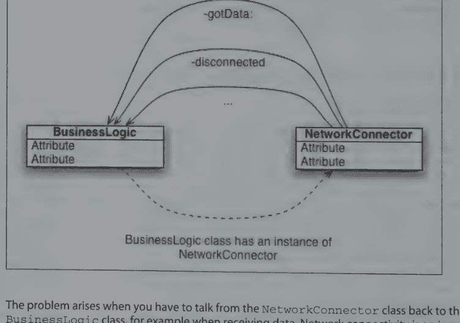

问题在于当你需要从 NetworkConnector 类向 BusinessLogic 类通信时，例如在接收数据时。网络连接是一个非常通用的概念。你肯定可以在其他应用程序中重复使用，甚至可以在同一应用程序的不同位置重复使用。如果你想以完全通用的方式设计网络类，以便网络类可以一次又一次地重复使用，你必须设计它，使其在任何方面都不会与客户端类紧密耦合，换句话说就是 BusinessLogic 类。

你不能让 NetworkConnector 要求 BusinessLogic 类作为依赖，因为你不能总是指望 BusinessLogic 类是使用你的 NetworkConnector 的类。


使用继承解决此问题的一种方法是强制 `BusinessLogic` 类继承自某个父类，而 `NetworkConnector` 类可以依赖该父类。这在图 7.2 中显示。

### Figure 7.2

`BusinessLogic` class inheriting from generic `NetworkClient` class.

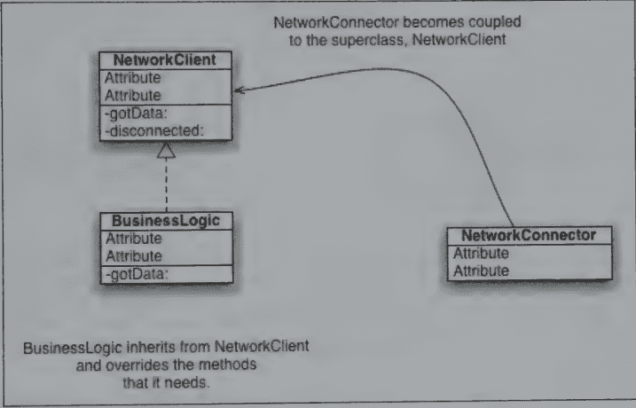

在这种情况下，你通过强制客户端类继承自特定的父类来限制客户端类的开发者。如果该父类不能很好地融入该开发者对象层次结构中，那么这可能会带来重大的设计问题。例如，想象一下 `BusinessLogic` 类需要同时与网络通信，以及与具有类似回调机制的磁盘 I/O 系统通信。使用这种直接继承在这种情况下根本行不通。

### Understanding why you don’t need (or want) multiple inheritance

某些语言，例如 C++，通过多重继承解决这种问题。图 7.3 显示了你如何在 C++ 中解决网络通信问题的示例。

多重继承的问题通常被称为“菱形问题”，并在图 7.4 中说明。

### Figure 7.3

Using multiple inheritance.

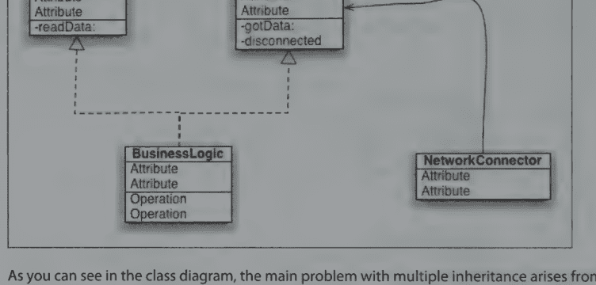

正如你在类图中看到的，多重继承的主要问题源于可以从两个不同的类继承（上图，类 D 同时继承自类 B 和 C），而这两个类又继承自一个共同的超类（类 A）。在这种情况下，可能会出现歧义，即在类 D 的实例上调用类 A 上的方法。在这种情况下，如果类 D 没有重写该方法并提供自己的实现，应该调用哪个超类方法，B 还是 C？

由于这个问题，多重继承根本不是 Objective-C 所提供的内容。如果只有单继承，那么你就不必担心菱形问题。

### Understanding how protocols solve the problem

协议通过使你能够声明一个接口来解决这个问题，而类在实现该接口时不提供任何默认实现。协议不提供指定其中方法实现的机制。它们只提供声明这些方法的接口的机制。与使可重用组件依赖于特定的类实现相比，你可以改为使该组件依赖于协议形式的接口存在。实现给定协议的类预计将提供协议声明中指定的方法的自己的实现。通过以这种方式实现协议，你可以使类编写为仅依赖于接口存在，同时消除歧义问题，因为任何声明其实现给定接口的类也必须实现相关方法。不存在“菱形问题”，因为你声明和支持的任何协议都必须在你的类中有实现。

### Figure 7.4

The diamond problem.

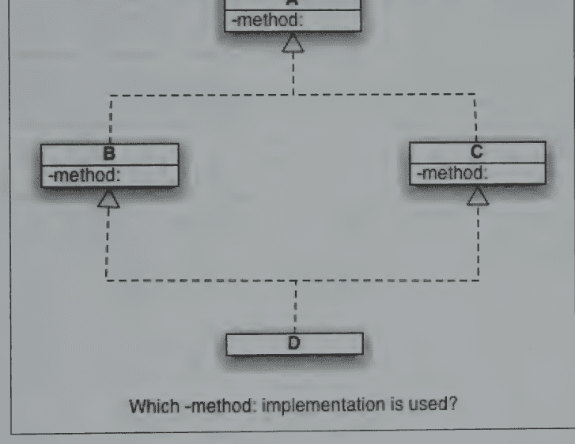

从面向对象设计的角度来看，此解决方案的类图几乎与多重继承的类图相同，但它不允许多重继承必然带来的问题。

此解决方案并不独特于 Objective-C。Java，在很多方面基于 Objective-C，也使用其版本的协议即接口实现了类似的概念。如果你是从 Java 背景转向 Objective-C，协议和接口的概念非常相似，你应该会感到宾至如归。

### Documenting an expected interface for others to implement

另一种思考协议的方法是想象你正在为他人实现而记录一个预期的接口。在 NetworkConnector 示例中，我们记录了网络类可能需要开发者协助以确定在这些情况下该做什么的所有不同条件。

例如，如果 NetworkConnector 从网络接收数据，合理地假设应用程序本身包含确定对该数据做什么所需的业务逻辑知识。换句话说，没有通用的方法可以说“当我收到数据时，我将如何处理它”。你真的必须询问应用程序的其余部分“我刚刚收到一些数据，你希望我如何处理它？” 这正是协议完美且独一无二地适用的情况。你可以为你的通用组件需要能够委托给更高权限的所有不同未解决问题声明一个协议（“我收到数据，我该怎么办？” - “我断开连接了是否应该重新连接？”）。

通过声明这些不同的“问题”，你建立了一个清晰而精确的契约，类的使用者可以随后履行。当他们通过实现协议来履行此契约时，他们将知道需要准备处理的所有不同情况。此系统比涉及返回代码、异常等的任何系统都更灵活。它甚至比简单的通用回调更强大，因为 Objective-C 方法声明的独特详细程度以及声明清晰明显的协议成为可重用组件的自文档化回调 API 的行为。如果你这样想，“协议”这个词比“接口”更有意义，因为“协议”可以被认为是一种商定的程序或行为准则，就像外交和礼仪一样。

好了，理论够多了，现在你可以动手写一些代码了。

### Implementing Protocols in Your Objects

使用协议非常简单，并且遵循你在处理类时已经看到的许多相同的语法约定。

本质上，你首先必须创建协议声明。你可以在现有的接口文件中执行此操作，如果你为已存在的对象声明协议，如我们在之前讨论 NetworkClient 时的情况，或者在单独的接口文件中，如果你可能将此协议用于许多不同的目的。协议本身只声明接口并且完全不提供实现。因此，如果你为协议声明创建单独的 .h 文件，你根本不需要提供任何 .m 文件。 .h 文件中的接口就足够了。

在你声明协议之后，对于实现该协议的任何类，它们也应声明它们实现了它。这样编译器可以验证相关类是否实现了程序所需的所有方法。

> **NOTE**
> 
> 实际上并非绝对必要声明你的类实现了它支持的协议。正如我们稍后讨论的那样，一些类型的协议根本不需要声明。此外，你的类可以选择仅实现协议方法而不是声明其支持。在这些情况下，编译器将无法在编译时确定你的类是否支持协议，因此你必须在运行时做额外的工作以确保你在其上调用协议方法的任何对象实际上都实现了它们。这可能会导致编译器警告，如果另一个类声明它期望你的类实现协议。

当你在代码中引用对象时，这些对象预计实现给定协议，你可以在该对象的类型声明中使用一种特殊语法来显示，虽然你可能不知道对象的实际类，但你期望它实现给定协议。如果协议是正式协议，则存储在该变量中的任何对象都会在编译时检查以确定它是否实现了该协议所需的所有方法。如果没有，则会发出警告。

协议可以同时具有必需和可选方法。在你有可选方法的情况下，实现协议的对象可能不一定实现其其中一个可选方法。在这种情况下，你预计会检查以验证相关对象是否实现了可选方法，然后再尝试调用它。如果你尝试调用可选方法而对象未实现该方法，则会得到异常。

### Declaring a protocol

声明协议遵循许多你已经熟悉的相同的语法标准。表面上，它最类似于声明一个类。你通过使用关键字 @protocol 开始协议声明，后跟你要声明的协议的名称。协议默认不继承自彼此或类，但如果你想继承另一个协议，你可以可选地通过在你要声明的协议名称后用尖括号 <> 括起继承的协议名称来继承它。当你这样做时，实现你的协议的类必须不仅实现你声明的协议方法，还必须实现你继承的任何协议的协议方法。在 @protocol 声明之后，你然后声明协议所需的任何方法。声明这些方法就像你在类上声明方法一样。

在协议定义本身内部，在你声明协议方法的地方，可以使用两个关键字。第一个是 @required 关键字。此关键字规定以下所有方法都是此协议实现的必需方法。这是正式协议的默认行为，因此如果你未指定 @required 关键字，则协议中声明的所有方法默认为必需状态。

在 @protocol 声明中可用的第二个关键字是 @optional 关键字。这用于指示实现类可以选择不实现的方法。实现此协议的类可以选择不实现 @optional 关键字之后声明的任何方法。

在协议声明的末尾，就像类一样，你使用 @end 关键字结束协议声明。我们之前讨论的 NetworkClient 类的一个示例协议声明如清单 7.1 所示


## Listing 7.1

## 示例协议声明

```
@protocol NetworkClient
-(void)networkConnector:(NetworkConnector *)inNetConnector
gotData:(NSData *)inData;

optional
-(void)networkConnectorDisconnected:(NetworkConnector *)inNetConnector;
@end
```

## NOTE

该协议展示了代理模式的工作原理，这就是为什么第一个参数是发送消息的对象。我将在第 17 章中更详细地介绍这一点。

同样，如果你想让你的协议派生自另一个已有的协议，例如扩展该已有协议，你可以让你的协议扩展或继承自该已有协议，如 Listing 7.2 所示。

## Listing 7.2

## NetworkClient 扩展 IOClient 协议

```
@protocol NetworkClient <IOClient>
-(void)networkConnector:(NetworkConnector *)inNetConnector
gotData:(NSData *)inData;

optional
-(void)networkConnectorDisconnected:(NetworkConnector *)inNetConnector;
@end
```

协议无法拥有成员变量。因此，在协议声明中没有地方可以声明成员变量。不要将其与协议不能访问成员变量的想法混淆，它当然可以，但这是协议实现的具体细节，而不是声明协议本身的一部分。当你在采用它的任何类上实现协议的方法时，你当然可以使用在该特定类头文件中声明的任何成员变量。

### Declaring that a class implements a protocol

要声明一个类实现了特定的协议，你只需在类声明中在超类之后用尖括号放置协议名称即可。例如，Listing 7.3 显示了一个实现上一节协议的示例类。

## Listing 7.3

## 实现 NetworkClient 协议的类

```
@class BusinessLogic : NSObject <NetworkClient>
{
    // member variables
    NSString *someMemberVariable;
}
- (id)init;
@end
```

类可以同时实现多个协议。进行此操作时，你只需在尖括号内用逗号分隔列出不同的协议，如 Listing 7.4 所示。

## Listing 7.4

## 实现多个协议的类

```
@class BusinessLogic : NSObject <NetworkClient, DiskClient>
{
    // member variables
    NSString *someMemberVariable;
}
- (id)init;
@end
```

在这种情况下，BusinessLogic 被声明为同时实现 NetworkClient 和 DiskClient 协议。

虽然你必须导入协议声明的头文件，但你也不需要在接口中声明协议方法。只需声明你实现了协议，就足以告诉编译器在你的实现中期望找到哪些方法。

## NOTE

类别，如第 8 章所述，也可以声明它们实现了协议，就像类一样。

### Declaring an object that must implement a protocol

当声明一个期望实现给定协议的实例变量时，通常你使用 id 数据类型，以便任何对象都可以存储在该变量中。如果你希望编译器验证所需协议方法是否确实在你实际存储在变量中的对象上实现，那么你还必须通过指定协议类型信息与数据类型一起告诉编译器。为此，除了 id 数据类型之外，你还在 id 关键字之后指定你期望对象遵守的协议，用尖括号括起来，如 Listing 7.5 所示。

Listing 7.5

## 声明实现特定协议的变量

```
id<NetworkClient> *delegate;
```

在这种情况下，delegate 对象被定义为采用 NetworkClient 协议，因此编译器会期望它实现该协议中的适当必需方法。

在任何你期望声明变量数据类型的任何地方，你都可以使用此语法。这包括方法声明、变量声明、返回类型等等。

## NOTE

在那些你没有声明变量必须实现特定协议但确实需要它的罕见情况下，你可以通过类型转换强制编译器假设给定对象确实实现了给定协议。要将给定变量类型转换为给定协议，你实际上将其类型转换为 (id<SomeProtocol>)。如果你在变量声明中指定协议，如通常推荐的那样，则不需要这样做。

### Exploring formal and informal protocols

我之前简要提到过这一点，但在我们处理如何处理可选方法之前，这里值得进一步讨论。

事实上，有两种不同类型的协议，正式协议和非正式协议。非正式协议是较旧风格的协议，仍在部分 cocoa 和 Objective-C 中使用。非正式协议不需要我迄今为止向你展示的正式协议声明。非正式协议通常被声明为 NSObject 类的类别。我在下一章讨论类别，所以我在这里不会详细介绍。

由于正式协议提供的更大类型安全以及正式协议具有 @optional 关键字，使你能够选择性地将单个方法标记为可选，通常来说，正式协议是你在代码中创建新协议的首选方式。

通常，你今天遇到非正式协议的唯一地方是在使用较旧的框架时，例如 Cocoa 框架本身的部分。

你可以识别这些情况，因为与文档指向正式文档声明和记录你期望实现的接口不同，通常你会看到这些协议方法作为你实际使用的类的文档的一部分。例如，Cocoa 类 NSURLConnection 为其委托方法使用非正式协议。如果你查看该类的文档，你会看到委托方法本身实际上是在 NSURLConnection 类的文档上记录的。它们被标记为“delegate”。与此形成对比的是 Cocoa Touch 类 SKPaymentQueue，它最近为 iPhone 内购支持而添加。它通过使用 SKPaymentTransactionObserver 协议将委托方法分离到正式协议中。

当需要在你的类中实现非正式协议时，你不需要在类声明中声明你的类实现了协议，就像你通常对正式协议所做的那样。相反，你只需实现你选择实现的方法，如果它们可用，需要使用你的对象的类将调用它们。

在使用非正式协议时，协议中的所有方法都是可选的，因此在调用它们之前你需要验证相关对象是否实现了它们。我在下一节中解释如何做到这一点。

### Determining if an object implements optional methods

在你的代码中，你可以通过使用对象方法 -conformsToProtocol: 来确定给定类是否实现了特定协议。该方法使用相关对象调用，接受一个参数，即期望为协议对象。要获取特定协议的协议对象，你使用内置的 Objective-C 指令 @protocol ( )。这与你在声明协议时使用的 @protocol 指令不同，因为它在括号内接受一个参数，即你想要获取其对象的协议的名称。

因此，例如，要确定给定对象是否遵守我们的 NetworkClient 协议，你可以像 Listing 7.6 那样做。

## 在运行时确定对象是否遵守 NetworkClient 协议。

```
- (void)receivedData:(NSData *)inData;
{
	if (![delegate conformsToProtocol:@protocol(NetworkClient)])
		[delegate networkConnector:self gotData:inData];
	// else do something else...
}
```


通常情况下，只有在你没有将协议的类型作为变量的数据类型的一部分进行指定时，才需要这样做。如果你已经指定了协议是变量数据类型的一部分，那么如果该变量未实现所需的协议，编译器会为你标记该变量。

## NOTE

第 7.6 节中显示的 -conformsToProtocol: 方法仅适用于正式协议。如果你使用的是非正式协议，请改用 NSObject 的 -respondsToSelector: 方法，如第 7.7 节所示。

即使你确信某个对象实现了某个协议，仍然存在该对象可能未实现协议中任何可选方法的可能性。

记住，如果一个对象未实现某个可选方法，而你在此对象上调用该方法，那么你的应用程序将会崩溃。因此，在尝试调用它之前，你需要有一种方法来确定该对象是否确实实现了该可选方法。

幸运的是，NSObject —— 所有对象都继承自它 —— 拥有一个恰好完成此操作的 方法。此方法为 -respondsToSelector:，它接受一个选择器对象作为参数。

就像协议对象一样，可以使用特殊的指令将方法签名转换为选择器对象。该指令是 @selector() 指令。其用法以及与 -respondsToSelector: 方法的结合使用在第 7.7 节中展示。

### Listing 7.7

## 测试以确定对象是否实现可选方法

```
-(void)disconnected;
{
    if ([delegate respondsToSelector:@selector(networkConnectorDisconnected:)])
        [delegate networkConnectorDisconnected:self];

    // else implement some default behavior...
}
```

在此示例中，你首先使用 -respondsToSelector: 调用检查实现协议的对象是否确实实现了其中一个可选方法。如果实现了，则继续调用该方法。如果未实现，你可以选择什么都不做，或改而实现某种默认行为。

### Avoiding Circular Protocol Dependencies

协议可以在其自身声明中引用其他协议。例如，想象一个协议要求另一个协议作为其某个方法参数使用，如第 7.8 节所示。

### Listing 7.8

## 一个要求另一个协议的协议

```
@protocol Foo
- (void) someMethodRequiringBar: (id<Bar>) inBar;
@end
```

如果所需的协议（Bar）也要求原始协议（Foo），如第 7.9 节所示，则会在两个协议之间创建循环依赖。这会产生编译器错误。

### Listing 7.9

## 需要 Foo 协议的 Bar 协议

```
@protocol Bar
- (void) someMethodRequiringFoo: (id<Foo>) inFoo;
@end
```

为了解决此问题，你可以对所需的协议进行前向声明，从而使你无需包含所需协议的文件。例如，为防止这种循环依赖，你可以在 Bar.h 接口文件中添加指令 @protocol Foo; 而不是导入 Foo.h 文件。这在第 7.10 节中展示。

### Listing 7.10

## Bar 协议的修正版本

```
@protocol Foo;
@protocol Bar
- (void) someMethodRequiringFoo: (id<Foo>) inFoo;
@end
```

这种情况很少见，但重要的是要知道，如果需要，你可以使用此工具。通过在 Bar 协议声明上方添加 @protocol Foo 指令，你是在告诉编译器“相信我，Foo 是一个协议，我会在编译中包含它，但我在这里不导入 Foo.h。”

### Exploring examples of protocol use

协议在 Objective-C 中使用应用程序框架（如 Cocoa 和 Cocoa Touch）时无处不在。最大的使用领域是在委托和数据源对象中。通常，这些是委托对象在运行时需要信息的案例，而这些信息无法以通用方式确定，例如在给定表格视图中显示哪些列。或者，它们也用于某些过程需要在后台发生的情况。你可能会调用一个像 -start 这样的方法，它立即返回，然后在委托协议方法上收到回调，告诉你该过程已完成。

为了给你一个实际运用的例子，请看第 7.11 节。在此代码中，应用程序正在创建 NSURLConnection 并启动它。稍后，随着数据从 URL 请求返回，它会通过协议方法 -connection:didReceiveData: 收到该数据的通知。

### Listing 7.11

## 一个使用 NSURLConnection 并实现 NSURLConnection 委托协议方法的类

```
@implementation NetworkConnector
-(id)init
{
    if(self = [super init])
    {
        NSURL *url = [NSURL URLWithString:@"http://www.google.com"];
        NSURLRequest *req = [NSURLRequest requestWithURL:url];

        connection = [[NSURLConnection alloc] initWithRequest:req
            delegate:self startImmediately:YES];
    }
    return self;
}
// protocol methods
(void)connection:(NSURLConnection *)connection
    didReceiveData:(NSData *)inData
{
```

### Extending Existing Class Capabilities

无论类或框架设计得多么好，必然会出现框架设计者未预见到的情况。一些开发者甚至走得更远，认为你不应该在代码中规划可重用性，因为最终，实现真正的通用可重用性是如此困难。我不同意这种观点，我认为 Objective-C 提供了当今任何语言中最优秀的促进代码可重用的工具。

在本章中，我将深入探讨其中最强大的工具。虽然并非完全独有 Objective-C，但它们无疑是 Objective-C 动态性如何能够比几乎任何其他编译语言提供更多灵活性和重用的例子。

本章中我解释的技术集中在扩展现有类的功能的能力上。

### Working with Third-Party Frameworks and Classes

如果你过去使用过任何编程框架，你可能遇到过这种情况：语言标准库提供的现有类为你提供了大约 90% 的所需功能，但缺少你真正需要的最后 10% 的功能。例如，你可能有一个字符串类，它不提供正则表达式搜索。

由于这些框架由第三方构建，通常你无法访问这些框架的源代码。正因如此，修改现有框架本身以添加那额外的 10% 功能并不是一个选项。即使在你确实可以访问源代码的情况下，将修改过的自定义标准库版本随应用程序一起分发也是极其糟糕的做法。

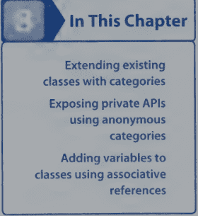

你可能会考虑的另一个选项是继承现有类，创建你自己的自定义版本，即你需要更改的那个类。通过这样做，你可以在自定义版本的类中添加任何你想要的功能。

乍一看，这似乎是个好主意，事实上，许多新的面向对象开发者会抓住这个机会，认为这是解决此问题的逻辑方法。然而，实践中，这实际上会导致其他问题。具体来说，其他阅读你代码的人可能难以理解你的意图。他们可能会问自己为什么你创建了一个自定义字符串类。如果你只添加了几个方法，创建自定义子类可能就太过分了。

你的自定义字符串类造成的混乱程度可能超过了其带来的好处。此外，合并来自不同代码库的不同的子类可能很复杂且容易出错。想象两个不同的代码库有两个略有不同的 `NSString` 子类。现在想象你想使用第一个代码库的部分功能和第二个代码库的部分功能。除了合并两个 `NSString` 子类的困难之外，如果这两个类名称不同，则其中一个或另一个代码库必须进行大量编辑才能使用新的组合 `NSString` 类。

比喻来说，使用子类来扩展现有类，在某些情况下，类似于要求客户只要需要不同类型的轮毂盖，就必须直接从工厂交付一辆完全定制的汽车。

我并不是说在所有情况下子类化都不合适。在某些情况下，子类化绝对是解决可重用性问题的正确解决方案。然而，重温我在上一章中提到的面向对象开发公理，“优先使用组合而非继承”，很容易看出类如果像汽车一样设计，具有可重用和可替换的部件，会为任何需要重用该类的人带来更大的灵活性和可定制性。

因此，在说了这么多之后，让我向你介绍 Objective-C 的一些部分，使你能够在没有源代码访问权限且无需子类化的情况下从外部为类附加功能。

### Working with Categories

我想要谈论的第一项技术称为 categories。类别使你能够通过在这些类上声明和实现方法来扩展现有类的功能，这些方法随后可在应用程序中使用原始类的任何地方使用。


这听起来很酷，只是表面上如此，但更酷的是，在声明一个分类时，你不需要访问你要扩展的类的原始源代码。此外，分类并不是一个子类。也就是说，你添加的方法实际上是被添加到你直接操作的类的实现中。只要你在该类上声明了一个分类，你应用程序中该类的任何使用者都可以通过该类的实例访问这些方法。

尽管这样做被认为是不好的做法，但你可以使用分类来覆盖现有的方法。这样做时，即使是第三方库，在引用该类时也会调用你修改过的方法，而不是原始方法。

如果你是从 Ruby 或 Smalltalk 等其他动态语言转到 Objective-C，你可能熟悉 mixin 的概念。Mixin 和分类有很多共同点，你甚至可以说分类是 Objective-C 版的 mixin。

### 声明分类

分类的声明方式与声明类接口类似。也就是说，你通过先输入 @interface，然后是你要修改的类名来声明一个分类。在类名之后，而不是像声明类时那样写超类，你把要声明的分类名称放在括号内。清单 8.1 显示了在 NSMutableString 类上声明的一个示例分类。

Listing 8.1

在 NSMutableString 上添加将 GUID 插入字符串能力的示例分类

```
#import <Foundation/Foundation.h>

@interface NSMutableString (GUID)

- (void)appendGuid;

@end
```

在这段特定的代码中，我为 NSMutableString 类添加了一个分类，用于生成全局唯一标识符（GUID）。目前，这个分类只是将 GUID 追加到已有字符串的末尾。

### 实现分类方法

与协议不同，仅仅声明分类的接口是不够的，因为你实际上是将方法实现添加到你要修改的类中。这意味着除了声明分类的接口之外，你还必须为相关方法添加实现。清单 8.2 显示了我刚刚在上一节为 NSMutableString 类声明的方法的实现。请注意，@implementation 行，就像声明类时一样，告诉你要为哪个类创建实现，在本例中是 NSMutableString，同样后面跟着括号中的分类名。

```
```objective-c
#import "NSMutableString+GUID.h"

@implementation NSMutableString (GUID)

-(void)appendGuid
{
    CFUUIDRef uuid = CFUUIDCreate(kCFAllocatorDefault);
    NSString *str =
        (NSString *)CFUUIDCreateString(kCFAllocatorDefault, uuid);
    [self appendString:str];
    CFRelease(uuid);
}

@end
```
```

就像在类实现中定义方法一样，你在实现块内定义分类中的方法。这些方法可以访问类中的所有成员变量，可以使用 self 调用类上的其他方法，甚至可以使用 super 关键字调用超类的方法。

唯一的限制是，你不能作为分类的一部分声明新的成员变量。确实有一种方法可以向现有类添加变量，我将在本章后面向你展示，但分类无法做到这一点。

一旦我包含了头文件，我就可以像它们实际声明在原始类上一样简单地使用这些方法。

### 使用分类拆分功能

分类提供的另一个便利是能够从变得过大类中提取功能组件。在这些情况下，你可能有一个包含大量代码的类。大型类代码在需要修改时很快就会变得难以管理。通过将类的功能离散部分提取到分类中，可以更轻松地搜索大量源代码以找到需要更改的方法。这样，当你对给定类进行影响其功能一部分的更改时，你可以将与该功能相关的所有方法放在一个分类文件中，从而更轻松地进行更改。

显然，你应该尽量保持类尽可能简单。你不应该使用分类作为向给定类添加过多额外功能的借口。然而，类确实有横向增长的倾向，很高兴知道在重构时你可以使用此工具。

### 扩展类方法

分类不仅限于对象方法。你也可以使用它们来添加类方法。例如，如果你想为 GUID 分类向 NSMutableString 添加一个工厂方法，你可以简单地按清单 8.4 所示添加工厂方法。

## Listing 8.4
向 NSMutableString 添加工厂方法

```
#import <Foundation/Foundation.h>

@interface NSMutableString (GUID)
- (void)appendGUID;
+ (id)stringWithGUID;
@end

@implementation NSMutableString (GUID)
- (void)appendGUID
{
}

```

## Listing 8.5 (continued)

```
- (void)appendGuid
{
    CFUUIDRef uuid = CFUUIDCreate(kCFAllocatorDefault);
    NSString *str =
        (NSString *)CFUUIDCreateString(kCFAllocatorDefault, uuid);
    [self appendString:str];
    CFRelease(uuid);
}

+ (id)stringWithGuid;
{
    NSMutableString *ret = [self string];
    [ret appendGuid];
    return ret;
}

@end
```

### 探索分类的限制

分类确实有一些相关的限制。分类不能向扩展的类添加任何成员变量。它们绝对可以在分类方法的作用域内声明并使用局部变量，并且它们当然可以使用全局变量，或作为参数传递给它们的任何变量，但它们不能向类添加任何成员变量。

分类可以通过使用 super 关键字调用超类方法。然而，没有机制允许分类调用分类本身覆盖的方法的原始实现。换句话说，如果你使用分类覆盖现有对象方法，就没有办法调用原始的现有对象方法。

回想一下，当我谈到创建协议时描述的多重继承的危险时，问题是如果两个超类定义了相同方法的实现，编译器在给定情况下难以确定调用哪个实现。这个问题不影响协议，因为协议只是接口的声明而不是实现。另一方面，分类就没有那么幸运了。

就像多重继承的情况一样，如果两个分类在同一个类上定义了相同的方法，运行时实际调用哪个方法是不确定的。因此，你应该

NSObject 是一个“特殊类”，因为它为运行时提供了其他类所没有的某些功能。其结果是，NSObject 类，指的是类对象本身而不是类定义，能够调用对象方法。它是 Objective-C 中唯一能够做到这一点的类。为了做到这一点，NSObject 对 self 对象做了一些不寻常的 voodoo。因此，self 在 NSObject 上定义的分类的上下文中使用时，它们指的是类或对象。

由于这些风险，通常来说，你应该只以接口的形式声明 NSObject 上的分类，并且不提供实现。分类实现可能应限于子类。虽然存在为 NSObject 分类提供实现的可能性，但总体而言，预计 NSObject 上的分类将仅用于声明非正式协议的目的。

### 使用匿名分类扩展类

虽然 Objective-C 没有将私有方法声明内置到类声明语法中的机制，但有一种方法可以定义私有 API，仅向类的特权用户公开，而不向其他用户公开，你可以使用分类来实现。

你用来做这件事的工具称为匿名分类。基本上，匿名分类是在给定类上声明但没有名称的分类。也就是说，当你声明分类时，而不是在分类名后括号内放置分类名称，括号在那里，但留空。在使用匿名分类时，你只声明接口，而不作为分类本身的一部分实现。通常，你将此分类声明放在另一个头文件中，可以由有权访问私有 API 的类使用者导入。实现是在原始类的实现内部完成的。你只是创建了一个在外部访问该实现的机制。

这给了你一种方法，可以将方法声明为匿名分类中的私有 API 的一部分，但不是你公共类声明中的公共 API 的一部分。当导入匿名分类接口时，编译器将期望匿名分类接口中声明的方法由扩展类实现。因此，这也为你提供了一种方法，可以拥有一个声明的、编译时检查的 API，该 API 是私有的，对类的使用者不可见，除非他们知道要包含私有 API 分类头。

清单 8.6 显示了匿名分类声明的示例。


你可能真的想用这种方式来对类的使用者实际隐藏私有方法。考虑到我刚才已经向你展示过：通过使用类别，如果一个开发者足够有动力，他或她可以轻松破解你的类，访问任何他们想要的私有方法，所以我认为任何阻止这种访问的尝试都有点徒劳。

不过，我能想到一些场景：你可能希望向某些特定的类使用者暴露特定方法，但又不想把它作为已文档化公共 API 的一部分。例如，如果你是单元测试的支持者，你可能希望能够在公共类声明中不暴露这些方法的情况下测试“非公共”方法。非公共方法可能只是公共 API 中无处安放、或在类外部没有用处的方法。在这种情况下，匿名类别可能是一个非常好的解决方案。

#### 将变量与现有类关联

类别无法向它们所扩展的类添加新成员变量。虽然这看起来像是类别的一个限制，但实际上并没有那么糟糕。当你确实需要向正在扩展的类添加成员变量时，你可以轻松地将其子类化，以这种方式做到。然而，有些情况下你确实不想子类化，但又确实需要向正在扩展的类添加一些额外的变量。幸运的是，从 Mac OS X 10.6 和 iOS 3.2 开始，Objective-C 运行时内置了一种底层能力，可以精确做到这一点。这种能力本身就被运行时使用，当你在极端情况下需要将变量与现有对象关联，且无需子类化、也无需修改该对象的类声明时，你便可以使用它。这种技术称为关联引用。无论是否通过类别，它都是可用的。我将向你展示如何使用它，然后展示如何利用它在 NSMutableDictionary 类上实现一个缓存排序键的类别。

在深入讨论之前，我想先澄清任何可能出现的困惑。在使用关联引用时，你实际上并不会向类本身添加成员变量。它不会有与之关联的属性，也不会有与之关联的访问器。从本质上讲，关联引用只是与类的特定实例相关联的存储。注意，我并没有说该存储与类关联。如果你没有明确地将引用与类的某个给定实例关联起来，那么这个实例就不会拥有它。

要向类的实例添加关联引用，只需使用 Objective-C 运行时函数 `objc_setAssociatedObject`。该函数接受四个参数：希望与之关联数据的对象；一个键，以便稍后取回数据；要存储引用值的值；最后是一个关联策略，用于定义存储值的内存管理方式。

创建关联之后，你可以通过 Objective-C 运行时函数 `objc_getAssociatedObject` 访问存储在关联中的值。该函数接受两个参数：第一个是与数据关联的对象，第二个是当初关联数据时指定的键。

最后，当你不再使用某个关联对象时，可以再次调用 Objective-C 函数 `objc_setAssociatedObject` 来移除关联，不过这次要将 `nil` 作为要关联的值传入。

在所有情况下，与值关联的键都必须对该值唯一。键的实际数据类型是 `void *`。通常，你会希望使用一个声明为 `static` 的变量作为这个键。这样做可以确保与键关联的指针始终指向该指针的单一实例，从而保证唯一性。

关联策略可以是以下值之一，如表8.1所示。

#### 表8.1

| 值 | 用途 |
|---|---|
| OBJC_ASSOCIATION_ASSIGN | 指定仅对值进行赋值。不会使用保留或释放操作。 |
| OBJC_ASSOCIATION_RETAIN_NONATOMIC | 指定以非线程安全的方式对值进行赋值并保留。 |
| OBJC_ASSOCIATION_COPY_NONATOMIC | 指定以非线程安全的方式对值进行复制。 |
| OBJC_ASSOCIATION_RETAIN | 指定以线程安全的方式对值进行赋值并保留。 |
| OBJC_ASSOCIATION_COPY | 指定以线程安全的方式对值进行复制。 |

如你所见，这些值非常类似于为对象声明属性时可以指定的属性特性。关联引用使用了几乎相同的机制。

作为关联引用在实际代码中如何工作的示例，清单8.8展示了一个声明在 NSMutableDictionary 上的类别，它将维护一个缓存且已排序的字典键列表。这里定义了几个用于维护的方法。如果你要真正实现这个类别，可能有更好的方式。此处仅为演示用于存储排序键的关联引用的生命周期。

#### 清单8.8
#### 一个排序键类别

```objc
@interface NSMutableDictionary (SortedKeys)

- (void)generateSortedKeys;
- (NSArray *)sortedKeys;
- (void)dropSortedKeys;
@end

@implementation NSMutableDictionary (SortedKeys)

-(void)generateSortedKeys;
{
    NSMutableArray *keys = [NSMutableArray arrayWithArray:[self allKeys]];
    [keys sortUsingSelector:@selector(compare:)];
    objc_setAssociatedObject(self, @"KEYS", keys, OBJC_ASSOCIATION_RETAIN);
}

-(NSArray *)sortedKeys;
{
    return objc_getAssociatedObject(self, @"KEYS");
}

-(void)dropSortedKeys;
{
    objc_setAssociatedObject(self, @"KEYS", nil, OBJC_ASSOCIATION_RETAIN);
}

@end
```

如你所见，当排序键数组创建后，它被存储为 `self` 上的一个关联引用，这里的 `self` 就是我们所操作的字典，这一点在 `-generateSortedKeys` 中已展示。当不再使用排序键时，可以通过 `-dropSortedKeys` 方法移除关联引用。

由于你没有进行子类化，你需要确保在释放对象之前显式调用 `-dropSortedKeys`（或任何你的清理方法），以释放与对象关联的内存。

> **注意**
> 
> 如果你使用较新的 LLVM 1.5 编译器和现代运行时，它们支持在类扩展中声明实例变量，因此你可以避免大部分这些繁琐操作。要做到这一点，只需像在类中声明一样，在扩展接口中将它们声明为其中一部分。请参阅 LLVM 文档以了解启用此行为所需的标志。

> **注意**
> 
> 你可以使用 `NSString` 常量（就像我在这里使用的那样）作为键，因为根据语言定义，像这样内联定义时，它们是彼此的静态引用。

## 小结

在本章中，我向你介绍了一些 Objective-C 提供的独特而强大的工具，它们可用于从可重用的小组件构建面向对象的设计。如果你是从一种不太动态的语言（如 C++ 或 Java）转向这门语言，那么这里展示的方法可能看起来不同寻常，甚至有些神奇。但 Objective-C 的力量正源于这样的事实：这类元编程工具是该语言本身的一部分，并且语言框架对其提供了充分支持。使用一种如此富有表现力、如此强大、如此动态的语言，是一种美妙的体验。

### 编写宏

本章的主题是宏。宏是 Objective-C 预处理器的一个特殊功能，它允许你在编译时执行特殊命令或替换代码中的特定值。宏的独特之处在于，这些命令实际上作为编译过程的一部分被执行。这些命令的结果通常是插入值或文件等。“宏”一词源于这样的概念：小的东西可以扩展成大的东西，而在很多方面，预处理器宏所做的正是如此。

我之前已经讨论过编译过程，但这里我想重点关注编译最早期的阶段，即预处理器。预处理器，顾名思义，是编译中一个发生在源代码实际处理之前的阶段。它的主要任务是将原始源文件准备好，以供编译过程本身使用。

为此，它首先去除源代码中的任何注释，并用空格替换；然后执行所需的任何行转换。最后，它展开任何预处理指令，也就是所谓的宏。

预处理指令是任何以 `#` 符号开头、后面直接跟着指令本身及其参数的行。换句话说，清单9.1中的所有项都是预处理指令。

- 重新审视编译过程
- 使用预处理器定义创建常量
- 根据编译器设置条件编译部分代码
- 编写预处理器宏以在编译时操作代码


### Listing 9.1

#### Some preprocessor directives or macros

```
#define FOO 1
#ifdef BAR
#endif
#define BAZ(X, Y) NSLog(@"%s - %s", (X), (Y));
#import <Foundation/Foundation.h>
```

Each of these items is a preprocessor directive. The #define is defining a constant called FOO with a value of 1. The #ifdef and #endif are defining a conditional block of code that will only be compiled if BAR has been defined. #define BAZ(X, Y) NSLog(@"%s - %s", (X), (Y)); is a preprocessor function, which takes parameters and logs them. Finally, the #import directive, which you have seen before, loads the given header file and puts its source code inline into this source file.

These directives are expanded during the compilation process, not at runtime. Therefore, the things they do impact the source code before it’s actually compiled. In some ways, you can think of preprocessor macros as a means for writing programs that manipulate your source code when it’s compiling.

### Understanding how macros work

This idea of manipulating your source code while it’s being compiled is an interesting concept. Take a look at Listing 9.2. In this code, there is a particular string constant, @"MY_IMPORTANT_DATA", which is used over and over again to access items from NSUserDefaults.

### Listing 9.2

#### Code that uses a string to access an item from NSUserDefaults

```
#import <Foundation/Foundation.h>

int main (int argc, const char * argv[])
{
    NSAutoreleasePool * pool = [[NSAutoreleasePool alloc] init];

NSString *someValue = @"foobar";
[[NSUserDefaults standardUserDefaults] setObject:someValue forKey:@"MY_IMPORTANT_DATA"];

// do stuff...

NSString *theValue = [[NSUserDefaults standardUserDefaults] stringForKey:@"MY_IMPORTANT_DATA"];

[pool drain];
return 0;
}
```

The biggest problem with this code is that I’m using a constant string for the key in this code, you open yourself up to syntax errors that won’t be caught by the compiler. If you make a mistake in typing the string, the compiler will not be able to tell that it was a mistake and instead will allow it to go all the way to when your application is running. This makes for bugs that are difficult to track down.

It would be nice if you could create some kind of macro that the compiler will expand to your string but which it can check for syntax errors when it goes to compile. This is exactly the kind of thing for which macros are made. Listing 9.3 shows the same code, written using a macro instead of the string.

### Listing 9.3

#### Using a macro

```
#import <Foundation/Foundation.h>

#define THE_KEY @"MY_IMPORTANT_DATA"

int main (int argc, const char * argv[])
{
    NSAutoreleasePool * pool = [[NSAutoreleasePool alloc] init];

    NSString *someValue = @"foobar";
```

#### Listing 9.3 (continued)

```
[[NSUserDefaults standardUserDefaults] setObject:someValue forKey:THE_KEY];

// do stuff...

NSString *theValue = [[NSUserDefaults standardUserDefaults] stringForKey:THE_KEY];

[pool drain];
return 0;
}
```

As you can see, at the top of this new source listing we are defining a macro called THE_KEY. This macro is being defined to be @"MY_IMPORTANT_DATA". Everywhere in the subsequent code where the words THE_KEY are located will be replaced with the string @"MY_IMPORTANT_DATA" when the program is compiled. This will happen transparently as part of the compilation process but the end result is that this code, when compiled, will actually wind up being exactly the same as the listing that we saw previously. The only difference is that when you are writing the source code you can take advantage of Xcode’s built-in code completion, and the compiler will detect if you have any instances of THE_KEY that were typed incorrectly. For example, if you accidentally wrote THE_KEY instead of THE_KEY, the compiler can check for that condition and issue an error.

Listing 9.4 shows another example where the program is taking different actions depending on whether the given macro value (DEBUGGING) is defined.

### Listing 9.4

#### Optional compilation based on a macro

```
#import <Foundation/Foundation.h>

#define DEBUGGING 1

int main (int argc, const char * argv[])
{
    NSAutoreleasePool * pool = [[NSAutoreleasePool alloc] init];
#ifdef DEBUGGING
```

```
NSLog(@"Debugging stuff...");
#else
    NSLog(@"Not debugging");
#endif

    [pool drain];
    return 0;
}
```

In this case, the code inside the main block is checking to see if a value has been set or the DEBUGGING macro. If this macro has been defined, in other words if it has any value at all, then it prints out the “Debugging stuff...” message. If the DEBUGGING macro has not been defined, then it prints out “Not debugging.” This is really powerful because by using it, you can have certain code compile only when you are running in a debugging environment. For example, you might use this to cause your application to connect to a development server instead of your production server while you are testing.

One of the cool aspects of using macros in this way is that there are also flags that you can use as part of your compiler settings to cause these macros to be defined or undefined based strictly on your build settings. In other words, you can configure your build settings so that when you build your target for your debug environment you get this macro defined, and when you’re building for release to your customers you do not. Again, remember that all of this expansion is actually happening at compile time. In addition to that, keep in mind that the expansion is happening in your source code at the location where you place the macro. This is difficult to explain, but easier with an example. Take a look at Listing 9.5.

### Listing 9.5

#### An example of some macros which will give different values than you might expect

```
#import <Foundation/Foundation.h>

#define LOG_LINE NSLog(@"%s:%ld", __FILE__, __LINE__);

int main (int argc, const char * argv[])
{
    NSAutoreleasePool * pool = [[NSAutoreleasePool alloc] init];

    LOG_LINE
```

#### Listing 9.5 (continued)

```
NSLog(@"%@s %@s", __DATE__, __TIME__);
LOG_LINE

[pool drain];
return 0;
}
```

In this code, I first defined a macro called LOG_LINE. This macro, when it is expanded in your code, turns into NSLog(@"%s:%ld", __FILE__, __LINE__);. This causes your program, when it runs, to log the filename and line number where the LOG_LINE macro has been placed. The built-in macros __FILE__ and __LINE__ are provided by the compiler itself, and expand to the current source file name and the current line number. When you run this program notice that the line number changes between the two different calls to LOG_LINE. This is only possible because of this in-line expansion capability that macros have. Another illustration of this is shown by looking at the output of the line in between the LOG_LINE calls. The built-in macros __DATE__ and __TIME__ expand to the date and time that the preprocessor was run to compile this program. In other words, this is the date and time that your program was compiled. If you compile the program once and then run it multiple times, you'll find that the date and time shown here do not change on subsequent launches. This is because the date and time that are being expanded in your source code are effectively being hardcoded by the expansion of these macros in your code.

Listing 9.6 shows what this code might look like after the preprocessor expansion has already taken place.

### Listing 9.6

#### Program with macros expanded

```
#import <Foundation/Foundation.h>

int main (int argc, const char * argv[])
{
    NSAutoreleasePool * pool = [[NSAutoreleasePool alloc] init];

    NSLog(@"Code/Macros/Macros.m:9");
    NSLog(@"%@s %@s", "May 18 2010", "16:00:03");
    NSLog(@"Code/Macros/Macros.m:11");
```

```
[pool drain];
return 0;
}
```

Literally speaking, this is exactly what the preprocessor is doing. It takes your macros and expands them into whatever they are defined to be right inside your code.

You might notice that these particular macros are using double underscores at the beginning and end of the macro name. This is a standard that is reserved specifically for compiler-provided macros and not something that you should do in your code. You can use these macros — just don’t use the double underscores in your own macro names.

### Defining Macros

You begin a macro definition with the # symbol followed by the preprocessor directive and then any parameters to the directive such as the name of the macro and so on. Table 9.1 shows a listing of the most commonly used preprocessor directives.

| Directive | Purpose |
|---|---|
| #define | Used to define new macros such as constants and functions. |
| #ifdef | Begins an optional compilation block. If the parameter for the preprocessor directive is defined to be anything (even zero), then the code following the #ifdef up until a terminating #endif, #else, or #elif will be compiled and included in the application. If the parameter is not defined and an #else or #elsif block is provided, then the #else or #elsif block will be evaluated and if appropriate compiled and included in the application. |
| #undef | Removes a previously defined macro. |
| #import | Reads and includes another source file in this file. Guards against including the file multiple times automatically. |
| #include | Reads and includes another source file in this file. Does not prevent including a file multiple times. |
| #pragma | Special macro used for configuring the compiler and for annotations in the IDE. |
| #warning | Generates a compiler warning. Used to flag issues to the developer. |
| #error | Generates a compiler error. |
| #if | Begins a conditional compilation block similar to #ifdef, but relies on an expression (such as X > 10) which must evaluate to true in order to be considered true. |
| #else | Used after an #if or #ifdef to provide a conditional block to be compiled if the statement is false. |
| #elif | Used after an #if or #ifdef to provide an additional conditional block with an additional control statement to determine if it should be compiled. |
| #endif | Terminates an #if, #ifdef, #else, or #elif block. |


For the purposes of this book, I will focus primarily on the #define, #ifdef, and other more commonly used preprocessor directives. The directives #pragma, #warning, #include, and #error are better served by viewing the GCC documentation.

## NOTE

One very common use of the #pragma directive is in adding IDE directives to your code for use by the IDE in labels. Apple uses this extensively in its own templates. In many of their templates, you’ll see the directive: #pragma mark Something. This will cause the IDE to display “Something” in the method name listing drop down list. Additionally, the special directive #pragma mark – causes a horizontal rule to be placed in the list.

### Defining constants

The first type of macro that I showed you in this chapter was used for the purposes of defining a constant that would then be reused in multiple places in your application. Indeed, this is perhaps one of the most common uses of macros. I myself use macros in this form for defining keys for accessing NSUserDefaults just like they showed in the previous example.

To define a constant, you use the preprocessor directive #define followed by the name of the constant you are defining the value for. After the name, separated by a space, you then provide the value you want the preprocessor to expand your macro to in your source code. The preprocessor expands the macro by using all of the remaining text in your line until it encounters the end of the line.

In cases where you want to make a macro such as this and spread its definition out over multiple lines, you can do this by entering a backslash and then pressing enter. This causes the compiler to consider the next line to be part of the current line for the purposes of evaluating this macro.

#### Listing 9.7

#### Defining constants with #define

```
#define FOO 1
#define BAR @"this is bar"
#define BAZ @"THIS IS A VERY LONG STRING \
AND IT CONTINUES DOWN HERE \
AND HERE."
#define BOZ BAR
```

An unspoken rule is to always name your macros using all capital letters. Doing this helps to distinguish macros in your source code from normal statements and makes your code easier to read. In the previous section, I mentioned that you should not use the double underscores for your own macro names. Additionally, you should not use underscores at the beginning or end of your macro names either because this is reserved for the compiler. It's perfectly safe to use underscores inside your macro names, and in fact, this is again another unspoken standard: separating multiple words in your macro names by using underscores instead of spaces since spaces are not legal anywhere in a macro name. Macro names must also begin with an alphabetic letter. Numbers are not allowed. You are free to use numbers after the first letter of the macro name but they cannot be used for the first letter.

As you found out in the previous section, macros can refer to other macros within their definition. In these cases, your macro will first be expanded to whatever you have defined, and then any macros inside of your macro definition will be expanded in place from there. For example, the macro BOZ above will ultimately expand to BAR, and then BAR will be expanded to @"this is bar".

The exception to this rule is that macros are not recursive. Meaning, you cannot refer to the macro that you are defining in its definition. For example, the macro #define FOO FOO won't work.

### Passing constants by compilation

I mention earlier in this chapter how you can define macros as part of your build settings. Listing 9.8 shows an example of an application that needs to be compiled to connect to a test server when it is being debugged and compiled to connect to the production server when it is not being debugged.

#### Listing 9.8

#### Conditional compilation based on build settings

```
#import <Foundation/Foundation.h>

int main (int argc, const char * argv[])
{
    NSAutoreleasePool * pool = [[NSAutoreleasePool alloc] init];

    NetworkConnection *conn = [[NetworkConnection alloc] init];
#ifdef DEBUGGING
    [conn connectToServer:@"http://develop.nowhere.com"];
#else
    [conn connectToServer:@"http://production.nowhere.com"];
#endif

    [pool drain];
    return 0;
}
```

Notice that the DEBUGGING macro is not actually being defined in this source file. In this particular case, I’m relying on the build settings to pass in that value when I do a debug build. If that value has been defined, then the application connects to the development server. If it is not, then it connects to the production server.

Figure 9.1 shows the build settings window and the parameter that you set in order to define values as part of your build settings.

The build setting that you use to define these preprocessor macros is the Preprocessor Macros setting. This particular setting takes a list of macro names and values separated by =. So, in other words, to define the preprocessor macro DEBUGGING, you would set this build setting to DEBUGGING=1. The given value here, 1, is more or less just setting it to any value (even 0 would be OK) so that the #ifdef statement returns true. If we used a #if with an expression, like #if DEBUGGING > 10 then we could have variable levels of debugging based on the compilation flag.

By setting this build setting on the debug build, the DEBUGGING macro will be set when the source code is compiled. When you switch to the Release build, which does not have this setting, then the normal, production code will be compiled and included.

### Using variables in macros

Although the syntactical capabilities of macros is much more primitive, macros are capable of taking parameters just like if when working with functions or methods. This enables you to create complex macros that actually do creative things with the contextual information available when the macro is being expanded.

For example, if you wanted to create a MAX macro to return the greater value of two parameters, you might create a macro such as Listing 9.9.

#### Listing 9.9

#### A macro for printing the value of a variable

```
#define MAX(X, Y): ((X) > (Y) ? (X) : (Y))
```

#### Figure 9.1

The build settings window.

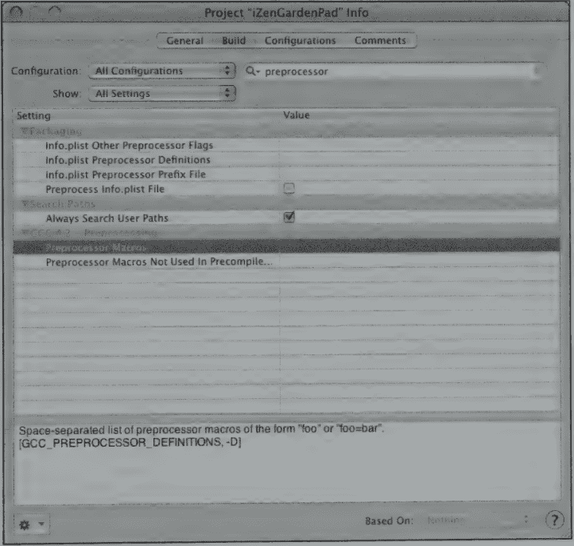

In this example, the MAX macro takes two arguments, X and Y. It then compares these two arguments by using the ternary operator. If X is greater than Y, it returns X, alternatively, if Y is greater than X, it returns Y.

When using parameters with a macro the parameters are specified inside parentheses just as if you were defining parameters for procedures. There are, however, a few subtle differences.

First, you do not need to provide a data type for the parameters. This code will not be compiled. Instead, the macro will be expanded where it is used in the parameters will be inserted directly into the expanded macro code. Therefore, variable types are not necessary here.

Secondly, the opening parenthesis of the parameter list must come directly after the name of the macro. Notice when we have been defining other macros, that the value that we are defining for the macro is separated from the macro name by a space. Therefore, if you were to put a space between the macro name and the opening parenthesis of the parameter list, the preprocessor would assume that the parameter list is the beginning of the macro value instead of part of the macro name.

Another subtle difference between procedures and macros with arguments is in the handling of the values inside the body of the macro value. Notice in the example above that there are a lot of extra parentheses being used in the body of the macro. Again, this has to do with the fact that the macro will be expanded in the code and that the values will be expanded inside the macro in the code. To illustrate this point, consider the expansion of the code NSLog (@"Max Value: %ld", MAX ( x & 20, 10 ) ); . Without the additional parentheses, this might expand to NSLog (@"Max Value: %ld", (x & 20 > 10 ? x & 20 : 10 ) ); . In this case, order of operations dictates that the greater than comparison has higher precedence than the bitwise-AND operation and therefore would be performed on the 20 and the 10 rather than on x & 20 and the 10. By including the extra parentheses inside the body of the macro, you ensure that the order of operations is performed in exactly the way that you expect them to be. In other words, this code would actually expand to NSLog (@"Max Value: %ld", ( (x & 20) > (10) ? (x & 20) : (10) ) ); .

### Using stringification

One of the macro tricks that I like to use in my own code is in logging values of particular variables as my application is running. Doing this can be useful because I can see what the state of my application is without necessarily stopping it in the debugger and looking at particular values one at a time.

To do this, I have to create a macro that takes a variable as a parameter. Because I might use this macro in multiple locations on different variables I also need to get the variable name and print it alongside the value of that variable. To do this, I use a special macro capability called stringification.

Stringification takes whatever code is passed to it and converts it to a C string by enclosing it in quotes. So, for example, if given 'x + 10' as a parameter, it will turn it into " 'x + 10' ". This makes it ideal for solving this kind of problem.

Listing 9.10 shows the macro as I would define it.


### Listing 9.10
## 打印变量值的宏

```
#define LOGVAR(var) NSLog(@"%s: %@", #var, var);
```

关键在于用 # 符号为变量名本身加上前缀。这会调用字符串化。

如果像 Listing 9.11 所示在应用程序中使用此宏，你会看到它首先打印变量的名称，然后打印该变量的值。

### Listing 9.11
## 使用宏打印变量的值

```
#import <Foundation/Foundation.h>

#define LOGVAR(var) NSLog(@"%s: %@", #var, var);

int main (int argc, const char * argv[])
{
    NSAutoreleasePool * pool = [[NSAutoreleasePool alloc] init];

    NSString *someVar = @"This is the value.";

    LOGVAR(someVar);

    [pool drain];
    return 0;
}
```

LOGVAR(someVar) 行会被展开成类似 Listing 9.12 的内容。

### Listing 9.12
## 展开后的代码

```
#import <Foundation/Foundation.h>

int main (int argc, const char * argv[])
{
    NSAutoreleasePool * pool = [[NSAutoreleasePool alloc] init];

    NSString *someVar = @"This is the value.";

    NSLog(@"%s: %@", "someVar", someVar);

    [pool drain];
    return 0;
}
```

## NOTE

此代码出于示例目的而刻意保持简单。在你实际想要创建此类宏的情况下，你可能需要做一些事情来确定传入变量的数据类型，以便在打印时使用正确的格式字符串。

### Handling conditional switching

你可以通过使用条件预处理器指令 #if、#ifdef、#ifndef 以及它们的同伴 #else、#elif 和 #endif 来有条件地编译代码的特定部分。你可以根据某个内容是否已定义、未定义，或某个表达式是否求值为 true，来选择性地包含或不包含代码的整个块。

这些指令中的第一个是 #if 指令。#if 指令用于根据表达式的结果允许或阻止代码的特定部分进行编译。表达式可以是任何有效表达式，使用其他宏、常量、宏展开周围代码中的变量等等。关键是它必须求值为 true，紧随 #if 指令之后的块才会被编译。你用 #end 语句终止 #if 语句。如果你想在表达式求值为 false 的情况下提供额外的代码块进行编译，你可以在 #if 块内、在 #end 指令之前放置一个 #else 指令。或者，你也可以放置一个 #elif 指令。

`#elif` 指令也接受一个表达式，并且只有当该表达式求值为 true 时，才会编译它与下一个指令之间的代码，就像 `#if` 指令一样。基本上，整个 `#if`、`#else`、`#elif`、`#endif` 结构与 `if`、`else` 结构非常相似，只是它影响的不是程序执行期间的程序流程，而是影响应用程序的哪些部分被编译。`#ifdef` 和 `#ifndef` 指令的工作方式与 `#if` 类似，只是它们不使用表达式，而是简单地测试某个值是否已被定义。对于 `#ifdef` 来说，如果该值已被定义，则编译代码；对于 `#ifndef` 来说，如果该值未被定义，则编译代码。

### Using built-in macros

GCC，即 Xcode 用于编译代码的底层编译器，已经为你提供了多种内置宏供使用。你在本章的示例中已经见过其中一些宏的使用。宏如 `__FILE__`、`__LINE__` 等等。要了解更多信息，请访问位于 http://gcc.gnu.org/onlinedocs/cpp/ 的 GCC 文档。

## Summary

在本章中，我向你介绍了 Objective-C 预处理器，这是一个强大的工具，可让你编写在编译时修改代码的代码。使用它，你可以做各种事情，从使用常量防止语法错误，到打印出你的变量，甚至有条件地编译代码的某些部分而不编译其他部分。这是一个你可能不会经常使用的工具，但在需要时却非常方便。

### Handling Errors

你希望运行时错误不会发生，但你知道它们会发生。你会采取防御性编程，确保使用的变量具有你期望的值。

你编写单元测试以确保可能发生的任何条件都已被预见，并且该问题的解决方案已内置到你的应用程序中。你知道你无法预见所有问题。然而，你知道无论你多么努力地让应用程序抵御现实世界的危险，一旦你的应用程序在具有现实世界问题的现实环境中启动，例如内存有限、磁盘空间有限，以及用户在最糟糕的时候中断你的应用程序，你就会遇到问题。你会遇到错误。

值得庆幸的是，Objective-C 内置了多种错误处理功能，你可以利用它们编写健壮、弹性且稳定的代码。你可以编写在错误发生时弯曲而不是断裂的应用程序。

在本章中，我将向你介绍 Objective-C 和 Foundation 框架中内置的三种主要机制，它们将帮助你编写在面对这些危险时勇敢的代码，并在遇到不可预见问题时“做正确的事情”。在开始之前，先看看在典型的应用程序中你可能会遇到什么类型的错误。

#### Classifying Errors

在典型的运行程序中可能发生的错误可分为三大类。

第一类错误只是由成功或失败条件组成的。无法获得关于发生了什么的额外信息，操作只是成功或不成功。通常，这是最轻微的错误，不会严重中断程序流程。例如，如果你试图通过互斥锁访问共享资源，你的程序可能会尝试

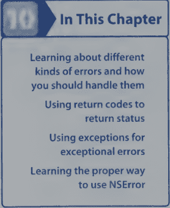

访问该资源，但失败，因为另一个程序或你的程序的另一部分已经在访问该资源。在这种情况下，你想知道访问资源失败了，并且你只想重试再次访问资源。这是一类轻微的错误条件。你确切知道调用失败时该做什么，以及可能导致失败的原因。

返回码非常适合这种错误。理想情况下，返回码可以简单到布尔值。返回码可以在调用成功时返回 YES，调用失败时返回 NO。在缺乏我即将向你介绍的更复杂的错误处理机制的一些语言中，错误代码是你返回无效条件的唯一选择。在这些语言中，错误代码通常被赋予多重含义。这些语言通常要求错误代码被设置为特定值以表示特定错误条件。通常，Objective-C 不这样做，因为其他机制已到位，使你能够提供比普通错误代码更丰富、更具描述性的错误消息。

第二类错误与第一类正好相反。如果不处理，这种类型的错误会导致数据丢失或应用程序失败。这些错误显然比第一类严重得多，包括无法打开应用程序继续运行所绝对必需的资源、数据存储中的一致性错误等等。想象一下，如果你不采取措施，这些错误很重要，以至于你宁愿让应用程序崩溃也不愿继续运行，以免造成更大的损害。这些错误，毫不夸张地说，是异常条件，因此最适合处理它们的错误处理机制被称为异常。幸运的是，在 Objective-C 中，这类错误很少见。尽管如此，我将在本章后面向你展示如何处理它们，以及如何从中恢复。

最后，第三类错误在严重程度上介于前两类之间。这种类型的错误足够严重，你确实需要将更多上下文信息传回调用你函数的上层，但又不至于严重到无法恢复。

这是 Objective-C 程序中发生的最常见的运行时错误类型。它如此常见，以至于 Apple 为处理这类错误提供了一种标准化的错误机制。它使用返回码来指示成功，并在失败时使用专门的 NSError 对象提供上下文信息。使用 NSError 可能很棘手，但到本章结束时，你将能够像专业人士一样处理此类错误。

### Understanding how to interrupt program flow

知道何时中断程序流程很重要。


我之前提到的三种错误类别在中断程序流程的处理方式上各自需要不同的设计模式。当设计一个可能返回错误的 API 时，要考虑 API 的使用者以及处理可能发生的错误会对调用你 API 的代码设计产生怎样的影响。理想情况下，你希望设计 API 时，使用者开发者可以用尽可能少的额外基础设施来使用它，同时又能够捕获并处理可能发生的任何错误情况。

如果你的错误很轻微、显而易见，并且需要很少的外部（开发者侧）支持或干预，那么你可能考虑使用返回码来表示某个调用失败。另一方面，如果发生的错误情况极其严重，以至于你必须完全停止应用程序以避免对系统造成更大损害，那么使用异常可能是正确的做法。你必须假设如果你的 API 的使用者没有处理该异常，应用程序将会崩溃，因为这正是异常所做的。 从这个角度来看待异常，即把未处理的异常视为崩溃，确实能让这种错误情况更清晰，并可能帮助你思考异常在何时才真正合理（提示：非常罕见）。

最后，对于大多数其他错误情况——那些介于极其轻微和极其严重之间的错误——NSError 机制可能是正确的选择。它很容易将调用失败的事实向上层传递给调用者，同时又把判断错误严重性的责任放在了正确的位置，即由同一个调用者来决定。

### 使用不同的错误处理机制

那么，让我们深入探讨如何使用这三种不同的错误处理技术。在以下各节中，我将介绍如何在 Objective-C 中使用三种不同的错误处理功能，它们在你的代码中如何工作，以及你需要做什么来处理他人代码中发生的错误。

#### 使用返回码

你已经看到方法 and 过程都具有在退出时返回值的能力。你通过使用 return 关键字来实现这一点。你在方法签名中声明返回值的类型，这决定了你的方法返回哪种类型的返回值。

使用此返回值来指示失败或成功是编程语言中最古老的错误处理机制之一。在 Objective-C 派生的 C 编程语言中，看到过程返回 `int` 返回码来指示不同种类的错误是很常见的。通常这些返回码会被映射到错误消息，以便你通过查看返回值来确定实际发生的错误。尽管有这种查找错误码的能力，错误码本身通常仍然只是一个数字。这往往很不方便，因为不同的函数使用不同的值来指示不同类型的错误，而查找它们意味着根据你使用的过程查阅不同的代码到错误消息的表格。

因此，其他错误处理机制被开发出来，使用返回码的方式逐渐被淘汰。尽管如此，使用返回码处理简单错误仍然是值得理解和利用的技术。然而，在这样做时最好避免返回码最大的问题，即代码到错误消息的查找，而是坚持使用简单的布尔值，在成功时返回 YES，在失败时返回 NO。这通常是你会在 Objective-C 中看到的用于错误处理的返回码使用方式。

当然也有例外，例如在方法可能在成功调用时返回某个值的情况下，有时调用会返回 nil 而不是预期值。幸运的是，在 Objective-C 中，nil 和 NO 在用作 if 语句的控制变量时，结果相同，它们都被评估为 false。因此，你可以在处理它们时将这些返回值视为相似。

清单 10.1 显示了一个用作磁盘文件包装器的类的示例。在这个特定示例中，期望磁盘上的数据文件存在且可读。但如果不是呢？如果文件不存在，就无法打开。在这种特定情况下，对象方法 `-openFileAtPath:` 将返回 nil。

**清单 10.1**

**文件包装器类的类定义**

```objective-c
@interface FileWrapper : NSObject
{
    NSDictionary *contents;
}
-(BOOL)openFileAtPath:(NSString *)inPath;
@end

@implementation FileWrapper

// dealloc and other stuff should be here...

-(BOOL)openFileAtPath:(NSString *)inPath
{
    contents = [[NSDictionary dictionaryWithContentsOfFile:inPath] retain];
    if (!contents)
        return NO;
    return YES;
}
@end
```

-openFileAtPath: 方法实际上使用了 NSDictionary 上的一个方法，该方法使用了我在这里说明的确切同一种错误处理。换句话说，NSDictionary 类方法 +dictionaryWithContentsOfFile: 的返回值通常是 NSDictionary 的一个实例。然而，如果文件不存在，或者它不能作为属性列表文件加载，则此方法返回 nil。清单 10.1 中显示的方法检查从 NSDictionary 方法返回的值是否为 nil。如果是，则它本身返回 NO。否则返回 YES。

清单 10.2 显示了可能使用此类的程序的主函数。

**清单 10.2**

**使用文件包装器类**

```objective-c
int main (int argc, const char * argv[])
{
    NSAutoreleasePool * pool = [[NSAutoreleasePool alloc] init];

    FileWrapper *wrapper = [[FileWrapper alloc] init];
    if ([wrapper openFileAtPath:@"..."])
    {
        // do stuff with the file here...
    }
    else
    {
        // tell the user the file couldn't be opened.
    }

    [pool drain];
    return 0;
}
```

正如你所见，我已将对 -openFileAtPath: 的调用包装在 if 语句中。如果调用返回 YES，那就是成功，我可以对文件进行操作。否则我必须告诉用户文件无法打开。

这个示例说明了返回码的一个问题，即你无法知道文件为何无法打开。你所知道的只是它无法打开。理想情况下，你希望能够告诉用户到底发生了什么，以及文件为何无法打开。也许文件丢失了，或者用户没有权限打开文件。在这种特定情况下，用户无法得知。

话虽如此，这仍然是表示发生错误的最简单方法之一。

#### 使用异常

现在转向错误处理的另一极端，即真正严重的条件，Objective-C 提供了抛出和处理异常的优秀设施。

Objective-C 语言为异常处理提供了几个内置指令。发出异常情况发生的信号被称为抛出或引发异常。本质上，这包括创建一个 NSException 的实例，然后使用内置的 Objective-C 指令 @throw。

一旦抛出异常，它将继续沿调用栈向上移动，直到被捕获。要捕获异常，你使用 Objective-C 指令 @catch。@catch 指令可用于捕获 NSException 的特定子类，在你可能想要对特定类型的异常进行特殊处理的情况下，或者可以写成捕获所有异常。清单 10.3 再次显示文件包装器示例，但在此情况下如果文件无法打开，-openFileAtPath: 方法会抛出异常。

**清单 10.3**

**使用异常的 -openFileAtPath: 方法**

```objective-c
-(void)openFileAtPath:(NSString *)inPath
{
    contents = [[NSDictionary dictionaryWithContentsOfFile:inPath] retain];
    if(!contents)
    {
        if(![self fileExistsAtPath:inPath])
        {
            NSException *ex =
```


```
[NSException exceptionWithName:@"Error opening file" reason:@"File doesn't exist." userInfo:nil];
}
else if(![self hasPermissionForFileAtPath:inPath])
{
    NSException *ex =
    [NSException exceptionWithName:@"Error opening file" reason:@"Permission error." userInfo:nil];
}
else
{
    NSException *ex =
    [NSException exceptionWithName:@"Error opening file" reason:@"Unknown error." userInfo:nil];
}
    @throw ex;
}
}
```

在这个版本的`-openFileAtPath:`方法中，在确定文件无法打开之后，我会逐一检查可能导致失败的一些典型原因，并为每种情况特别构造一个异常。一旦构造好异常，我就使用`@throw`指令将其抛出。

在这个特定例子中，我使用默认的`NSException`类来抛出异常。但如果我想更讲究一些，我可以为这些不同类型的异常情况分别使用自定义异常类来重写这个方法。

这方面的一个例子如清单10.4所示。

## 清单 10.4
#### 针对不同类型的错误抛出自定义异常

```
-(void)openFileAtPath:(NSString *)inPath;
{
    contents =
        [[NSDictionary dictionaryWithContentsOfFile:inPath] retain];
    if(!contents)
```

## 清单 10.4（续）

```
{
    NSException *ex;
    if(![self fileExistsAtPath:inPath])
    {
        ex = [FileMissingException exceptionWithName:@"Error opening file" reason:@"File doesn't exist." userInfo:nil];
    }
    else if(![self hasPermissionForFileAtPath:inPath])
    {
        ex = [FilePermissionException exceptionWithName:@"Error opening file" reason:@"Permission error." userInfo:nil];
    }
    else
    {
        ex = [NSException exceptionWithName:@"Error opening file" reason:@"Unknown error." userInfo:nil];
    }
    @throw ex;
}
```

请注意，这个方法已经完全去掉了返回值。这是一个要么成功返回、要么完全不返回的代码示例。换句话说，如果文件能够成功打开，方法就会正常返回，一切正常；如果在打开文件时出现错误，就会抛出异常，需要由调用者捕获。

## 警告

这一点我怎么强调都不过分，所以我在这里再重申一下：在这段代码中，如果异常被抛出，而调用栈上层没有人捕获这个异常，那么应用程序就会崩溃。所以显然，只有当你确定这个失败对该应用程序是一个关键问题时，才应该以这种方式使用异常。

由于捕获这些异常非常重要，我们来看看如何做到这一点。清单10.5展示了该应用程序更新后的main函数，其中加入了适当的异常处理代码。

## 清单 10.5
#### 在main函数中处理异常

```
int main (int argc, const char * argv[])
{
    int retCode = 0;
    @try
    {
        NSAutoreleasePool * pool = [[NSAutoreleasePool alloc] init];

        FileWrapper *wrapper = [[FileWrapper alloc] init];
        [wrapper openFileAtPath:@"..."];

        // do stuff with the file here...

    }
    @catch (NSException *e)
    {
        NSString *errorName = [e name];
        NSString *errorMsg = [e reason];
        NSLog(@"An error occurred: %@ - %@", errorName, errorMsg);
        retCode = -255;
    }
    @finally
    {
        [wrapper release];
        [pool drain];
    }
    return retCode;
}
```

异常的工作方式使得它们能够中断应用程序中的任何位置的程序流程，然后在堆栈中向上跳转，直到异常被捕获。

因此，当你调用的方法可能发生异常时，你必须将可能抛出异常的代码包裹在一个所谓的try/catch块中。在上述代码中，你可以看到程序做的第一件事就是使用`@try`指令，这会开启一个try/catch块。一旦使用`@try`指令，后续代码块（用{}分隔）中的代码就会像平常一样执行，直到到达代码块末尾，或者抛出异常为止。

如果抛出异常，程序流程会立即中断，并跳到由`@catch`指令指定的异常处理器。

`@catch`指令允许你捕获特定类型的异常。当异常发生时，代码会跳到`@catch`指令处，寻找与已抛出异常最匹配的处理器，然后开始在catch块内再次执行代码。

在这个特定例子中，catch块只是打印错误消息，然后将应用程序的返回码设置为错误状态。通过捕获通用的`NSException`，如清单10.5所示，你实际上捕获了所有异常。

你甚至可以用`id`数据类型代替`NSException`来捕获，这样你就可以捕获任何被抛出的对象。

在先前的例子中，针对不同类型的错误条件抛出了不同种类的异常；在这种情况下，你需要为需要处理的每种异常分别列出独立的catch块。清单10.6展示了这样一个例子。

## 清单 10.6
#### 捕获不同类型的异常

```
int main (int argc, const char * argv[])
{
    int retCode = 0;
    @try
    {
        NSAutoreleasePool * pool = [[NSAutoreleasePool alloc] init];

        FileWrapper *wrapper = [[FileWrapper alloc] init];
        [wrapper openFileAtPath:@"..."];

        // do stuff with the file here...
    }
    @catch (FilePermissionException *e)
    {
        // ...
    }
    @catch (FileMissingException *e)
    {
        // ...
```

```
}
@catch (NSException *e)
{
    // ...
}
@finally
{
    [wrapper release];
    [pool drain];
}
return retCode;
}
```

当以这种方式捕获异常时，你应该按照从最具体到最不具体的顺序列出异常，因为运行时只会执行它找到的第一个匹配的catch块。

由于异常可以随时中断程序流程，当异常发生时，你的应用程序可能难以对已分配的内存和资源进行适当的清理。幸运的是，除了try/catch结构之外，Objective-C的异常处理还内置了另一个功能——`@finally`指令。

`@finally`块的工作原理与`@catch`块类似，但无论是否发生异常，它都会始终执行。这使得它成为清理在`@try`块中分配的的内存或其他资源的理想场所。无论你的try或catch块内部发生什么，你都可以始终依赖`@finally`块被执行。

这种错误处理方式的优点是，你可以将代码分组，让它一直运行直到某个坏情况发生，然后处理该错误条件。此外，错误可以非常详细。你可以把各种各样的信息放入`NSException`对象中，并根据需要尽量详细。

在具有复杂错误条件的复杂处理需求情况下，try/catch/finally块甚至可以相互嵌套。这允许你在需要时使用多级别的异常处理。

## 注意

与其他一些更广泛使用异常的语言相比，Objective-C在错误处理方面使用异常的情况相对较少。如果你来自Java这类语言，并且也想同样广泛地使用异常，我建议你三思，转而使用接下来要介绍的错误处理机制——NSError。

## 注意

要在抛出异常时让调试器中断，你可以在Objective-C运行时方法`objc_exception_throw`中设置断点。这样做后，当异常被抛出时，它就会触发你的断点并停止应用程序。不过你要小心，因为有些方法会抛出并捕获异常，而不允许它继续沿着堆栈向上传递。这很正常，也不会造成任何损害。

### 使用NSError

在设计Foundation框架时，Apple意识到他们需要一种错误处理机制，既保留简单返回码的简洁性，又能够提供关于发生了什么类型的错误的更多信息。因此，他们开始引入一个名为NSError的新错误处理系统。清单10.7展示了更新后的文件包装器类，它使用了一个NSError。

## 清单 10.7
#### 使用NSError的文件包装器类

```
-(BOOL)openFileAtPath:(NSString *)inPath withError:(NSError **)outError;
{
    contents = [[NSDictionary dictionaryWithContentsOfFile:inPath] retain];
    if(!contents)
    {
        if(![self fileExistsAtPath:inPath])
        {
            NSDictionary *errorInfo =
            [NSDictionary dictionaryWithObject:@"File doesn't exist."
                                        forKey:NSLocalizedDescriptionKey];

            *outError = [NSError errorWithDomain:@"FileWrapper"
                                            code:404
                                        userInfo:errorInfo];
        }
        else if(![self hasPermissionForFileAtPath:inPath])
        {
            NSDictionary *errorInfo =
            [NSDictionary dictionaryWithObject:@"Permission Error."
                                        forKey:NSLocalizedDescriptionKey];

            *outError = [NSError errorWithDomain:@"FileWrapper"
                                            code:500
                                        userInfo:errorInfo];
```


```
}
else
{
    NSDictionary *errorInfo =
        [NSDictionary dictionaryWithObject:@"Unknown error."
                         forKey:NSLocalizedDescriptionKey];

    *outError = [NSError errorWithDomain:@"FileWrapper"
                                    code:501
                                userInfo:errorInfo;
}
return NO;
}
return YES;
}
```

NSError 是一个在 Cocoa 和 Cocoa Touch 框架中广泛实现的正式化设计模式。

要使用它，你需要扩展你的方法签名以接受一个对 NSError 对象的间接引用。该对象由调用方提供。间接引用本质上是指向指针的指针。换句话说，它是指向另一个指针的指针；在这种情况下，它是指向调用方栈中分配的变量的指针。当你为该变量赋值时，你解引用间接引用，从而实际上为其指向的变量赋值。


> **注意**
> 
> 一些程序员会将间接引用称为“指针到指针”、“传引用”或“引用”。我更喜欢使用“间接引用”这一术语，以将其与你在使用 Objective-C++ 时可能会遇到的普通引用区分开来。“指针到指针”可能是最准确的描述，但我觉得对于新程序员来说，“指针到指针”这个说法令人困惑。

这个间接引用的概念听起来可能非常令人困惑。如果是这样的话，那么很好，你完全正常。幸运的是，只要你理解在创建和返回 NSError 对象时需要使用的语法，底层的细节大多并不重要。

在方法参数列表中声明 NSError 间接引用时，你将使用 “(NSError **)” 语法进行声明。双 * 号表示这是一个间接引用。

### 创建 NSError 对象

一旦进入你的方法，如果发生错误，在从方法返回 NO 之前，你必须先创建你的 NSError 对象并将其分配给被解引用的 NSError 间接引用。为此，你可以像平常一样创建 NSError 对象，但在将其分配给传入变量时，你通过使用解引用运算符 (*) 来解引用该变量。所以，换句话说，要创建并将新的 NSError 对象分配给传入的 NSError 间接引用，你可以像清单 10.8 那样操作。

#### 清单 10.8

#### 将 NSError 对象分配给传入的 NSError 间接引用

```
*outError = [NSError errorWithDomain:@"FileWrapper"
    code:404
    userInfo:errorInfo];
```

NSError 工厂方法接受三个参数。第一个是错误域。这是一个字符串值，用于指示错误起源的子系统。Cocoa 本身提供了几个错误域，例如 NSCocoaErrorDomain、NSPOSIXErrorDomain 等。这些在 NSError.h 头文件中声明。你可以，也应该为自己创建的 NSError 实例指定自己的错误域。如果你选择这样做，错误域字符串应以反向 DNS 记法指定，例如 com.yourcompanyname.productname.classname。

第二个参数是错误代码参数。错误代码完全特定于应用程序，并为你提供了一种在错误对象中指定传统错误代码的方式。你如何使用错误代码由你决定，但它必须是无符号整数。

### 理解 NSError userInfo 字典

在很大程度上，错误代码和错误域是今天大多未使用的遗留参数。NSError 对象真正的精华在于 userInfo 字典。在为此参数创建字典时，你可以使用多个键来表示不同的错误信息。键如表 10.1 所示。

并非所有这些键总是存在，而且此外，NSError 类的用户也可以为字典添加特殊的域特定键，以便对发生的错误进行编码。

能够对显示给用户的错误消息所需的所有信息进行编码，包括描述、错误原因、如何恢复的建议，甚至对话框的按钮，使得甚至可以使用 NSAlert 类方法 +alertWithError: 来显示适当的警告框，并使用 NSError 对象中的数据显示适当的按钮和文本字段。

#### 表 10.1

| Key | Purpose |
|---|---|
| NSLocalizedDescriptionKey | 错误条件的本地化描述，例如 "文件无法打开，因为它不存在。" 也可通过 NSError 对象方法 -localizedDescription 访问。 |
| NSLocalizedFailureReasonKey | 错误的本地化原因，例如 "文件不存在。" 也可通过 NSError 对象方法 -localizedFailureReason 访问。 |
| NSLocalizedRecoverySuggestionErrorKey | 用户可能采取的解决问题的本地化描述。也可通过 NSError 方法 -localizedRecoverySuggestion 访问。 |
| NSLocalizedRecoveryOptionsErrorKey | 用于在向用户展示错误时在对话框中使用的按钮字符串数组。第一个字符串将用作最右边的按钮，然后依次向左排列。 |
| NSRecoveryAttemptErrorKey | 一个符合 NSErrorRecoveryAttempting 协议的对象，可用于尝试从错误中恢复。 (仅限 Mac OS X) |
| NSUnderlyingErrorKey | 另一个表示实际底层错误的 NSError 对象。 |

### 使用恢复尝试器

恢复尝试器是 NSError 中鲜为人知且很少使用的组件。仅在 Mac OS X 上可用，它提供了一个可用于自动尝试从发生的错误中恢复的对象。

提供对象必须符合 NSErrorRecoveryAttempting 协议，该协议定义了两种方法，-attemptRecoveryFromError:optionIndex:，该方法仅在应用程序使用模态、非文档中心的用户界面时调用，以及 -attemptRecoveryFromError:optionIndex:delegate:didRecoverSelector:contextInfo:，该方法由具有文档中心用户界面的应用程序调用。

恢复尝试器与 OS X 响应者链紧密配合。要使恢复尝试器被使用，你可以在响应者链中的任何对象上调用 -presentError: 或 -presentError:modalForWindow:delegate:didPresentSelector:contextInfo:。这两种方法分别对应于为模态应用程序和基于文档的应用程序展示错误。当你调用它们时，它们会向用户展示一个警告，显示 NSError 中的信息。当用户点击按钮时，将在恢复尝试器上调用适当的恢复尝试方法，并将所点击按钮的索引作为 optionIndex 参数传递。

-attemptRecoveryFromError:optionIndex: 方法返回一个 BOOL 值，如果错误能够被恢复。-presentError:modalForWindow:delegate:didPresentSelector:contextInfo: 方法预计会在委托对象上调用提供的选择器。该选择器应采用与清单 10.9 类似的形式。

#### 清单 10.9

#### 恢复尝试器回调函数

```
- (void)didPresentErrorWithRecovery:(BOOL)didRecover
    contextInfo:(void *)contextInfo;
```

再次，恢复尝试器很少使用，可能不是你在代码中通常会遇到的东西。尽管如此，它是 NSError 的一个有趣特性。

### 在方法中使用 NSError

回到文件包装器示例，为了利用这个新的 NSError 代码，你必须将主块更改为类似于清单 10.10 的样子。

#### 清单 10.10

#### 使用 NSError 的方法

```
int main (int argc, const char * argv[])
{
    NSAutoreleasePool * pool = [[NSAutoreleasePool alloc] init];

    FileWrapper *wrapper = [[FileWrapper alloc] init];

    NSError *error = nil;

    if([[wrapper openFileAtPath:@"..." withError:&error]])
    {
        // do stuff with the file here...
    }
    else
    {
        // tell the user the file couldn’t be opened.
        // here you have the error object filled in.
        showErrorToUser(error);
    }

    [pool drain];
    return 0;
}
```


这里的重要变化集中在你现在可以检查 -openFileAtPath:withError: 方法的返回值。如果它是 NO，那么 error 对象现在应该包含一个已初始化的 NSError 对象，其中包含你需要向用户显示错误所需的一切。


## CAUTION

一些带有 NSError 的代码示例要求你将 NSError 设置为 nil，然后检查 NSError 是否已被初始化以确定是否发生错误。这绝对是错误的。Cocoa 的某些部分即使成功也会操作 NSError 对象。使用 NSError 的正确模式如图所示。检查方法的返回值，如果它是 NO 或 nil，则检查 error 对象以获取更多信息。

这种错误处理方法是最好的。它简单且信息丰富，并且不会强迫用户处理错误。它为 API 的使用者提供了足够的灵活性来做正确的事情，同时不会假装比她更了解。

## Summary

错误处理是成为一名有效程序员的重要组成部分，因此 Objective-C 能够为你提供足够的工具来优雅且正确地处理错误条件，这很好。你可以使用这些工具。去使用它们。

## Using the Foundation Framework

## In This Part

Chapter 11
Understanding How the Frameworks Fit Together

Chapter 12
Using Strings

Chapter 13
Working with Collections

Chapter 14
Using NSValue, NSNumber, and NSData

Chapter 15
Working with Times and Dates

## 11 Understanding How the Frameworks Fit Together

在 MacOS X、iPhone 和 iPad 上使用 Objective-C 时，操作系统提供的可重用库通常打包为框架。这些框架将头文件、文档和动态库捆绑在一起，形成一个包含使用其中代码所需的所有信息和数据的包。

框架的确切实现方式在很大程度上是平台相关的。框架可以像我刚才描述的那样打包为动态库，就像在 MacOS X 中一样，也可以是静态库，就像在 Linux 或 BSD 上偶尔出现的那样。由于框架包本身具有平台中心性，如何构建框架的详细解释超出了此类语言中心书籍的范围。然而，话虽如此，了解通常与 Objective-C 一起使用的一些关键框架以及它们提供的内容对你来说很重要。因此，本章重点介绍在你可以构建 Objective-C 程序的一些平台上可用的框架概述。出于稍后会显而易见的原因，编写一本严格以语言为中心的 Objective-C 书籍而不包含对至少 Foundation 框架的广泛介绍几乎是不可能的。正因为如此，本书的这一部分其余内容重点讨论此关键组件的一些细节。

### Understanding the Foundation Framework

你可能不知道，但如果你一直跟着本书的示例代码进行操作，你的应用程序中已经在使用框架了。到目前为止展示的每个示例应用程序都是一个 Foundation 应用程序，这意味着它链接了 Foundation 框架。

### 11 In This Chapter

- Explaining frameworks
- Learning where Foundation fits into other frameworks
- Learning how to add frameworks to your projects

大多数语言都有一个标准库。例如 C 编程语言有 C 标准库。C++ 将标准库扩展为还包括标准模板库。Java 也有标准库，等等。在大多数情况下，这些标准库被指定为提供某些功能，但实现则留给平台供应商。

Objective-C 作为一种语言本身并没有指定标准库，但随着时间的推移，Foundation 框架已经演变成 Objective-C 最接近标准库的东西。它提供了许多与这些其他语言的标准库提供的相同设施——字符串、集合、I/O 等。

尽管最初由 NeXT/Apple 为 NeXTstep 和 Mac OS X 开发和支持，但它已成为其他平台必须遵守的黄金标准，以便被合理地视为可行的 Objective-C 平台。Foundation 本身是一个庞大的库，Foundation 提供的每个类和方法的全面列表远远超出了此处实际可行的范围。然而，为了让你品尝一下此库中可用的内容，我在表 11.1 中列出了许多更常用的类。

### Table 11.1

| Class | Purpose |
|---|---|
| NSArchiver/NSUnarchiver | 用于序列化 and 反序列化符合 NSCoder 协议的对象。 |
| NSArray/NSMutableArray | 有序集合。 |
| NSAutoreleasePool | 实现在保留计数和内存管理中使用的自动释放池。 |
| NSBundle | 为应用程序包提供戏剧性接口。 |
| NSCalendar | 提供处理日历的类。 |
| NSData | 一个用于存储通用数据的类。 |
| NSDate | 用于创建和操作日期的类。 |
| NSDateFormatter | 为日期提供本地化和格式化。 |
| NSDictionary/NSMutableDictionary | 关联集合。 |
| NSLock | 线程锁定。 |
| NSError | 用于存储错误信息。 |
| NSException | 异常的基类。 |
| NSEnumerator | 用于枚举集合的目的。 |
| NSFileHandle | 用于处理文件 I/O 的包装类。 |
| NSFileManager | 一个封装与文件系统相关操作（如创建目录等）的类。 |
| NSGarbageCollector | 一个用于以面向对象的方式与垃圾收集器交互的类。 |
| NSSet/NSMutableSet | 无序集合集合。 |
| NSNotification/NSNotificationCenter | 提供一种通过运行时发送和接收任意通知的手段。 |
| NSObject | 所有其他类的基类。 |
| NSTask | 用于与操作系统进程交互的类。 |
| NSThread | 用于创建和交互线程的类。 |
| NSURL | 封装统一资源定位符的类。 |
| NSURLConnection | 启用连接到 Internet 上使用受支持协议定位的资源的网络类。 |
| NSString/NSMutableString | Objective-C 字符串类。 |

Foundation 提供的最重要的类可能是 NSObject，所有其他 Objective-C 类都从它继承。事实上，正是 NSObject 提供了我们作为 Objective-C 视为理所当然的大部分功能，例如键值编码、反射以及动态分派的一些方面。没有 Foundation，Objective-C 将是一个绝对残废的语言。两者相辅相成。

Foundation 极其全面。在考虑自己发明一些低级类之前，首先检查它是否已存在于 Foundation 中。大概率是存在的。

即使现在，我发现自己在 Foundation 和其他框架中不断发现新事物，并不断对 Apple 设想的所有不寻常的边缘情况感到惊讶。要获取 Foundation 或任何其他 Apple 框架中所有内容的完整列表，请访问 Apple 文档 http://developer.apple.com。

### Exploring other frameworks

Foundation 框架在 MacOS X 上并不孤立。Apple 还提供了许多作为标准平台一部分的额外框架，以及数百个可从第三方下载的框架。在 Apple 提供的框架中，有 AppKit，它提供了在 MacOS X 上构建 GUI 应用程序所需的类，UIKit 它提供


提供了在 iPhone 和 iPad 上构建 GUI 应用所需的类，以及许多其他框架，这些框架提供特定于网络服务、图形等方面的功能。就本书而言，我们将只关注 Foundation。这个框架很容易就成为 MacOS X 上所有框架中跨平台支持最广的。它可以在 MacOS X、iPhone 和 iPad 上的官方 Apple 版本中使用，也可以在 Linux、BSD UNIX 甚至 Windows 上以开源第三方实现的形式使用。其中一种实现使你能够在 MacOS X 上使用 Xcode 开发应用，并交叉编译生成 Windows 可执行文件。在许多方面，Foundation 框架比一些专门为此目的构建的标准库提供了更好的可移植性和更强的功能。

不过，由于目前 Apple 平台是 Objective-C 开发者最流行的平台，我主要关注这些平台上可用的特性。

### 在项目中使用框架

尽管这专门针对 MacOS X，我还是要简单讨论一下在自己项目中使用框架的主题，以便你在需要时知道如何处理它们。

Apple 提供的框架通常安装在 Xcode 的安装目录中，默认是 /Developer。在这个目录下，你会找到一个名为 Platforms 的目录。在 Platforms 目录内，你会为每个已安装 SDK 的不同开发平台找到一个目录。例如，如果你安装了 iPhone SDK，你会看到与 iPhone OS 对应的目录。如果没有安装，则只会看到与 MacOS X 对应的目录。

在 SDK 目录内，你会找到一条通向 System/Library/Frameworks 的路径。所有用于该特定 SDK 中特定平台的框架都位于此目录中。

#### 添加框架

向项目添加框架非常简单。你只需右键单击或按住 Option 键单击要添加框架的目标，然后选择“Add ⇧ Existing Frameworks”。此时会弹出框架选择对话框，如图 11.1 所示。

此对话框允许你从已安装框架列表中选择要与当前选定目标链接的任何框架。

图 11.1

框架选择对话框。

- AGL.framework
- Accelerate.framework
- AddressBook.framework
- AppKit.framework
- AppKitScripting.framework
- AppleScriptKit.framework
- AppleScriptObjC.framework
- AppleShareClientCore.framework
- ApplicationServices.framework
- AudioToolbox.framework
- AudioUnit.framework
- Automator.framework
- CP437.dylib
- CP850.dylib
- CalendarStore.framework
- Carbon.framework
- Cocoa.framework
- Collaboration.framework
- CoreAudio.framework
- CoreAudioKit.framework
- CoreData.framework
- CoreFoundation.framework
- CoreLocation.framework

全部

名称

添加其他...

取消

#### 包含头文件

请记住，仅仅与框架链接并不足以让你实际使用其中包含的类和代码。你还需要确保将适当的头文件包含到源文件中。回想你学习导入头文件时，通过将导入的头文件名放在 <> 中，告诉编译器搜索已链接的框架目录。这样做会使编译器搜索系统包含目录以及所有框架目录。

#### 考虑垃圾回收

链接第三方框架时，一个重要的考虑因素是确保所涉及的框架支持你为项目选择的内存管理模型。并非所有框架都同时支持垃圾回收和引用计数内存管理。因此，在查看打算链接到项目的框架文档时，务必确保你链接的是与你选择的内存管理系统对应的正确版本。链接错误的版本将导致编译错误。

## 小结

在本章中，我向你介绍了框架的概念，并讨论了 Foundation 框架，它是 Objective-C 最接近标准库的东西。本书这一部分的其余内容将大量使用 Foundation 框架，因此，你对这个框架及其提供的内容有一个概念性了解非常重要。现在你有了这些背景信息，就能更好地为接下来的详细编码示例做好准备。

### 使用字符串

任何好的标准库都需要一个出色的字符串类，Objective-C 与 Foundation 也不例外。实际上，Foundation 框架提供了一个优秀的字符串类 NSString。与 Foundation 中的许多底层核心类一样，NSString 有一个不可变版本，以及一个名为 NSMutableString 的可变版本。这两个类在处理字符串值时为你提供了大量的功能。

#### 理解字符串声明语法

尽管 NSString 和 NSMutableString 有许多可用的初始化器和工厂方法，但字符串在 Objective-C 中是非常常用的类，因此特意创建了一种语言结构，以便轻松声明字符串。该结构如清单 12.1 所示。

#### 清单 12.1
#### Objective-C NSString 快捷语法

```
NSString *someString = @"this is a string";
```

本质上，编译器知道只要遇到 @ 后跟双引号内的字符串，它就应该创建一个 static const NSString 对象来包含所提供的字符串。

任何两个声明完全相同字符串值（即使存储在不同的变量名中）都会指向同一个对象。因此，你可以将这些字符串用作键，例如，将一个字符串与另一个该字符串的实例进行比较时，无论是使用 -isEqual: 对象方法还是使用 == 运算符（它将比较指针的值），都会认为它们是相等的。

### 本章内容

- 使用 NSString 和 NSMutableString 类
- 理解格式化字符串
- 使用 Objective-C 特有的字符串声明语法

为了说明这一点，请查看清单 12.2。

#### 清单 12.2
#### 检查字符串常量相等性

```
NSString *string1 = @"this is a string";
NSString *string2 = @"this is a string"; // same object as string1
NSString *string3 = [NSString stringWithString:string1]; // makes new

assert(string1 == string2); // true
assert([string1 isEqual:string2]); // also true
assert([string1 isEqual:string3]); // true
assert(string1 == string3); // false
```

大多数情况下，你使用 Objective-C 字符串结构声明字符串，但在 NSString 和 NSMutableString 类上仍然有许多初始化器和工厂方法可用。表 12.1 显示了一些更常用的方法。

#### 表 12.1 NSString 和 NSMutableString 工厂方法

| 方法 | 用途 |
|---|---|
| +string | 构造一个新的空字符串。 |
| +stringWithFormat: | 使用给定的 printf 风格格式说明符以及格式说明符所需的任何参数构造一个新字符串。 |
| +stringWithCharacters:length: | 构造一个新字符串，其中包含从所提供的 C 风格数组中获取的 length 个字符。 |
| +stringWithString: | 用给定字符串的值构造一个新字符串。 |
| +stringWithCString:encoding: | 使用 C 风格字符串，通过指定的编码方式转换后构造一个新字符串。 |
| +stringWithUTF8String: | 使用采用 UTF-8 字符串编码的 C 风格字符串构造一个新字符串。这相当于调用 +stringWithCString:encoding: 并将 NSUTF8Encoding 作为 encoding 参数。 |
| +stringWithContentsOfFile:encoding:error: | 构造一个新字符串，其中包含使用所提供的编码读取的指定文件的内容。 |


| 方法 | 目的 |
|---|---|
| +stringWithContentsOfURL:encoding:error: | 构造一个包含由 URL 指定的资源内容的新字符串。资源将使用指定的协议下载，并使用提供的编码进行解码。此调用会在资源下载期间阻塞。 |
| +stringWithContentsOfFile:usedEncoding:error: | 构造一个包含指定文件内容的新字符串。会尝试自动检测所使用的文件编码类型，并通过 usedEncoding 输出参数通知调用者检测到的编码类型。 |
| +stringWithContentsOfURL:usedEncoding:error: | 构造一个包含由提供的 URL 指定的资源内容的新字符串。会下载资源，并尝试检测所使用的文件编码类型，并通过 usedEncoding 输出参数通知调用者编码类型。 |

其中每一种也都有一个初始化器版本，如果你更喜欢以这种方式创建字符串，可以使用它。

## NOTE

术语“工厂方法”指的是可用于使用特定参数构造对象的类方法。

### 使用格式字符串

最常用的工厂方法之一是 +stringWithFormat: 工厂方法，它利用 printf 风格的格式字符串和参数列表来构造字符串。（我在本书的许多示例中都使用了格式字符串。每当你看到对 NSLog 的调用时，你就看到了格式字符串的一个实例。）清单 12.3 显示了格式字符串与 NSLog 调用一起使用的示例。

### Listing 12.3

#### The format string in NSLog

```
NSLog(@"The age of the employee named %@ is %ld", [employee name], [employee age]);
```

使用 @"" 表示格式字符串是 NSString 的一个实例。在创建格式字符串时，你使用百分号和字符的特殊组合来指示将要在字符串传递给使用该字符串的对象时被替换到字符串中的特定参数。格式字符串包含三种类型的组件，第一种是格式说明符。格式说明符是由 % 开始，后跟一个或多个数字和字母指定要在运行时替换到格式字符串中的参数格式的特殊字符组合。你可以使用格式说明符插入从对象到整数或浮点数等任何内容。格式说明符还可以指定参数在放入字符串时如何格式化。例如，要构造一个格式说明符以插入一个小数点后有两位的小数，你使用诸如 %.2f 的格式说明符。用于格式说明符的不同字符非常多且全面，可能足以用其复杂性和怪癖填满一本如此大小的书。因此，我不会详细介绍其中的所有内容。我鼓励你阅读 Apple 关于格式字符串的文档。

话虽如此，我还是想特别说明一个格式说明符。它是格式说明符 %@。该说明符是 Objective-C 特有的。它旨在与对象参数一起使用。它的作用是使格式字符串获取作为该格式说明符参数传递的对象，并调用该对象上的 -description 方法以获取该对象的字符串表示。大多数基础类都有一个 -description 方法，它返回对该类而言合理的某些内容。NSString 的 -description 方法实际上返回字符串本身。NSArray 的 -description 方法返回一个字符串，显示数组内容的字符串化表示。默认的 NSObject 实现的 -description 返回一个字符串，显示对象的指针地址。如果你创建了一个自定义类，并且希望将格式字符串的此功能与你的类一起使用，请确保相应地重写 -description 方法。

格式字符串中可以使用的第二种组件类型称为转义序列。你使用转义序列将特殊、非标准字符插入到字符串中。转义序列的第一个字符始终是反斜杠字符，后跟一个字符，告诉编译器你希望插入什么类型的特殊字符。例如，要将回车字符插入到字符串中，你使用转义序列 \r。

最常用的转义序列是 \n 插入换行符，\r 用于回车，\" 用于双引号，以及 \t 用于制表符。由于使用 \ 字符来开始转义序列，转义序列 \\ 也仅插入一个 \ 字符。

最后，格式字符串中可以使用的第三种组件本质上是任何不属于前两种组件类别的字符。这些字符只是直接传递到最终结果中。

当解释格式字符串时，它会遍历格式字符串，并对于遇到的每个格式说明符，它会查找该格式字符串本身作为参数的函数的后续参数。然后它将该参数的值替换到结果字符串中，并执行格式说明符指示的任何转换。为了让你了解它是如何工作的，请看清单 12.4。

### Listing 12.4

#### Using format strings

```
NSString *str;

NSString *cardName = @"Ace";
NSString *cardSuit = @"Spades";

str = [NSString stringWithFormat:@"The winning card is %@ of %@.",
    cardName, cardSuit];
// str is "The winning card is Ace of Spades."

str = [NSString stringWithFormat:@"You have %ld gold!",
    [player goldAmount]];
// str is "You have 1000 gold!"

str = [NSString stringWithFormat:@"Your change is: $%.2f.", change];
// str is "Your change is $2.43
```

请注意，在使用格式字符串时传递的参数使用不寻常的语法。格式字符串允许你向 +stringWithFormat 方法传递可变参数列表。参数的计数由提供的格式说明符的数量决定。

## NOTE

为了确保你的代码是 64 位安全的，通常被认为是一种最佳实践是在处理整数时使用 %ld 格式说明符。当使用 NSInteger 作为整数的类型时，它会随着架构从 32 位自动更改为 64 位。使用 %ld 作为格式说明符可确保格式字符串无论 NSIntegers 的大小如何，都能与 32 位或 64 位 NSIntegers 一起使用。

### Working with Other NSString Methods

使用格式字符串允许你以比简单地将它们连接在一起更灵活的方式创建字符串。除了简单地构造新字符串之外，格式字符串还有各种应用。例如，你还可以附加一个格式化的字符串，如清单 12.5 所示。

### Listing 12.5

#### Appending a formatted string

```
NSMutableString *str = [...] ;

[str appendFormat:@"Your change is: %.2f.", change];
```

你还可以使用方法 -componentsSeparatedByString: 将字符串拆分为单独的组件。此方法将在接收者中搜索给定字符串的实例，然后返回一个包含由该字符串分隔的字符串各部分的 NSArray。清单 12.6 显示了此方法的示例。

### Listing 12.6

#### Splitting a string into its components

```
NSString *str = @"This is a string of words.";

NSArray *words = [str componentsSeparatedByString:@" "];

// words is now [@"This", @"is", ... ]
```

同样，其对应的方法是 NSArray 方法 -componentsJoinedByString:，它将执行相反的操作。它将字符串数组组合成一个单一字符串，每个组件由给定的字符串分隔。

你可以使用诸如 -rangeOfString: 之类的方法执行字符串搜索和替换，以查找接收者中给定字符串的范围，或使用 -stringByReplacingOccurrencesOfString:withString: 进行字符串替换。NSString 甚至还具有一些有限的正则表达式匹配支持。

总体而言，NSString 是一个功能强大且全面的类，其功能远不止于此所能涵盖的范围。我的建议是访问 NSString 文档，并查看它为你提供的所有方法。


### 使用 NSString 类别

由于 `NSString` 本身已是一个非常全面的类，Apple 选择将其拆分到与 `NSString` 配合使用的独立类别文件中。这些类别是 `NSString (AppKitAdditions)` 和 `NSString (UIStringDrawing)`。它们严格来说并不是 Foundation 框架的一部分；然而，它们是 GUI 工具包框架 Cocoa 和 Cocoa Touch 的一部分。它们提供了在窗口和视图上绘制字符串的方法。由于它们不属于 Foundation，我在这里不会涉及它们，有关它们的更多信息，请访问 Apple 文档，或查阅本系列中关于这些主题的其他书籍。

## 摘要

`NSString` 和 `NSMutableString` 类是 Objective-C 的重要组成部分。我可以写上几章来介绍所有不同的方法和如何在代码中使用它们。然而，你能做的最好的事情就是熟悉 `NSString` 和 `NSMutableString` 类的文档。通常，如果你在 `NSString` 上需要某些功能，该功能就会存在。你只需要找到它即可。

### 13 处理集合

虽然 Foundation 为各种用途提供了大量类，但由于你在应用程序中很可能会大量使用它们，因此值得深入研究其中几个最基本的类。

这些基本类之一就是被称为集合的类组。集合是一个管理一组对象的类。每个优秀的语言都有一个优秀的集合 API，而 Objective-C 也不例外。Foundation 框架包含用于处理数组、字典、哈希表、集合等的类。这些类为几乎任何情况下管理和操作对象组提供了一套全面的工具集。此外，得益于语言中少量语法糖，使用这些集合类进行枚举、过滤和排序变得简单直观。

我首先要向你介绍的集合类是 NSArray。NSArray 类用于管理有序的对象集合。有序的对象集合是指按存储顺序维护的对象分组。通常，有序的对象集合是通过枚举或通过索引访问的。

要创建 NSArray，你可以使用初始化方法，也可以使用其众多类工厂方法之一。清单 13.1 显示了创建新 NSArray 的示例。

**本章内容**

- 学习使用集合
- 理解可变性与不可变性
- 使用专用集合
- 枚举集合的成员
- 对集合进行排序和过滤
- 使用块与集合

#### 清单 13.1

#### 创建新的 NSArray

```
NSArray *array = [NSArray arrayWithObjects:@"foo", @"bar", @"baz", nil];
```

NSArray 类是不可变的——一旦创建，就无法修改其内容。然而，由于 Objective-C 没有确保数组内部对象不可变的机制，如果你访问数组的一个元素，这些对象是可以被修改的。

**注意**

集合类中的元素不需要是同一类型。你可以随意混合使用。

你可以使用 -count 方法访问数组中元素的数量，该方法返回一个 NSUInteger。

你可以通过使用快速枚举、索引访问或使用 NSEnumerator 对象按顺序访问 NSArray 的元素。清单 13.2 中展示了这三种方法的示例。

#### 清单 13.2

#### 按顺序访问数组的元素

```
NSArray *array = [NSArray arrayWithObjects:@"foo", @"bar", @"baz", nil];

// fast enumeration

for (NSString *item in array)
{
    NSLog(@"%@", item);
}

// indexed access
```

```
```objective-c
for (NSInteger n = 0; n < [array count]; n++)
{
    NSLog(@"%@", [array objectAtIndex:n]);
}

// using an NSEnumerator
NSEnumerator *enumerator = [array objectEnumerator];
NSString *item = nil;
while((item = [enumerator nextObject]))
{
    NSLog(@"%@", item);
}
```
```

访问 NSArray 的单个元素是通过使用方法 `-objectAtIndex:` 完成的，该方法返回给定索引处的单个元素。NSArray 还提供了便捷方法 `-lastObject:`，它返回数组的最后一个元素。要查找特定元素的索引，你也可以使用方法 `-indexOfObject:`，该方法向数组的每个元素发送 `-isEqual:` 消息，并返回第一个返回 YES 的元素。这两者都展示在清单 13.3 中。

#### 清单 13.3

#### 访问单个元素。

```
```objective-c
NSArray *array = [NSArray arrayWithObjects:@"foo", @"bar", @"baz", nil];

NSString *item = nil;

item = [array objectAtIndex:1]; // item is now 'bar'

item = [array lastObject]; // item is now 'baz'

NSLog(@"%ld", [array indexOfObject:@"foo"]); // yields 0
```
```

**警告**

NSArray 以及 Objective-C 中的所有集合都是从零开始的。这意味着第一个元素从索引 0 开始，最后一个元素的索引是数组长度减一。如果你尝试访问这些索引边界之外的元素，你将得到一个异常。

除了返回单个索引处单个项目的那些方法之外，你还可以使用其他返回基于索引范围的对象组的方法。这些方法，如 -objectsAtIndexes: 和 -indexesOfObjects:，的工作方式与用于访问单个元素的方法类似，只是它们接受一个 NSIndexSet，指定你想要的项目。这些调用返回一个包含与传入索引匹配的对象子集的新 NSArray。清单 13.4 显示了这些方法的示例。

#### 清单 13.4

#### 访问元素组

```
NSArray *array = [NSArray arrayWithObjects:@"foo", @"bar", @"baz", nil];
NSRange range;
range.location = 1;
range.length = 2;

NSIndexSet *indexSet = [NSIndexSet indexSetWithIndexesInRange:range];

// this should get indexes for [@"bar", @"baz"]
NSArray *subItems = [array objectsAtIndexes:indexSet];
```

NSArray 中元素的访问时间，虽然没有严格指定，但可以假设最坏情况下为 O(lg N)，但大多数操作通常为 O(1)。线性搜索操作的最坏情况复杂度可以为 O(N*lg N)。NSArray 类可用于存储几乎任何 Objective-C 对象集合，包括不同类的对象。然而，NSArray 无法容纳 nil 值、结构体或标量。如果你觉得需要在 NSArray 中存储 nil 值，请考虑改用 NSNull 的实例。该类专门为需要在容器类中存储“无值”的情况而设计。至于存储结构体，你应该将结构体包装在 NSValue 中。对于存储标量值也一样，NSNumber 提供了一个方便的包装对象，可用于存储标量值。

### 使用字典

接下来我想谈谈的集合类是 NSDictionary。NSDictionary 类为关联对象集合提供了一个容器。关联集合是指包含键和必须相互关联的对象的集合。要访问集合中的给定元素，你需要通过请求与给定键关联的对象来请求该元素。

通常，`NSString` 的实例用作字典的键。这不是一个要求。用作键的对象可以是任何类型，只要它们实现 `NSCopying` 协议并且是唯一的。字典通过 `NSObject` 方法 `isEqual:` 与字典中的其他键来确定唯一性，如果你尝试创建具有两个相同键的字典，它将抛出异常。

与 `NSArray` 一样，`NSDictionary` 可以通过使用初始化方法或使用众多 `NSDictionary` 类工厂方法之一进行初始化。清单 13.5 显示了创建 `NSDictionary` 实例的几个示例。

#### 清单 13.5

#### 创建 NSDictionary 实例

```
NSDictionary *dict;

// normal initializer...

dict = [[NSDictionary alloc] initWithObjects:@"foo", @"bar", @"baz"
                             forKeys:@"one", @"two", @"three"
                              count:3];

// factory method

dict = [NSDictionary dictionaryWithObjects:@"foo", @"bar", @"baz"
                              forKeys:@"one", @"two", @"three"
                               count:3];

// this one reads in a plist file and uses it to create the dict...

dict = [NSDictionary dictionaryWithContentsOfFile:@"something.plist"];

// just like the NSArray...

dict = [NSDictionary dictionaryWithObjectsAndKeys:
        @"foo", @"one",
        @"bar", @"two",
        @"baz", @"three",
        nil];
```


你可以通过使用 object 方法 -objectForKey: 来访问 NSDictionary 的单个元素，该方法会检索与给定键关联的对象。清单 13.6 显示了此操作的示例。

### Listing 13.6
#### Accessing an individual elements of an NSDictionary

```
NSLog(@"%@", [dict objectForKey:@"one"]); // prints 'foo'

NSLog(@"%@", [dict objectForKey:@"two"]); // prints 'bar'
```

就像使用 NSArray 类时一样，此方法的变体可以接受多个键作为参数，一次访问多个对象。这些调用的一个变体是 -objectsForKeys:notFoundMarker:，它会调用一个对象，当给定键未找到时将返回该对象。清单 13.7 显示了此方法的使用示例。

### Listing 13.7
#### Using the method -objectsForKeys:notFoundMarker:

```
NSArray *keys = [NSArray arrayWithObjects:@"one", @"ten", @"two"];

NSArray *items = [dict objectsForKeys:keys notFoundMarker:[NSNull null]];

// items now contains [@"foo", NSNull, @"bar"]
```

与 NSArray 情况相同，nil 值、结构体和标量不能作为对象存储在 NSDictionary 中。你需要分别使用 NSNull、NSValue 或 NSNumber 将它们包装起来。

除了能够通过键访问 NSDictionary 的单个元素外，你还可以使用方法 -allKeys 或 -allObjects 分别检索字典中的所有键或所有对象。这两种方法都返回 NSArray 的实例，然后可以随后以与 NSArray 相同的方式用于枚举目的。也就是说，你可以通过对这些数组使用 for 循环、while 循环等来枚举 NSDictionary 中的所有键或所有对象。清单 13.8 显示了这样做的示例。

### Listing 13.8
#### Enumerating over the keys and objects in NSDictionary

```
// these two have the same output
// iterating the objects...
NSArray *objects = [dict allObjects];
for (NSString *obj in objects)
{
    NSLog(@"%@", obj);
}

// default is to iterate the keys
for (NSString *key in dict)
{
    NSLog(@"%@", [dict objectForKey:key]);
}
```

除了使用 -allKeys 方法获取数组外，你还可以使用迭代通过 -allObjects 方法循环遍历字典的值。仅使用字典本身作为迭代对象进行迭代，如此处所示，也允许你循环遍历键。

最后，你还可以通过使用方法 -sortedKeysUsingSelector: 检索 NSDictionary 中键的排序数组。我将在稍后介绍有关排序集合的更多内容，因此我不会在此讨论此方法，而只是告知你它的存在。

与 NSArray 类似，NSDictionary 不能包含 nil 键或对象，并且不能包含标量或结构体。

NSDictionary 通常在内部实现为哈希表。因此，通过键访问给定对象通常为 O(1)。再次说明，这并未明确指定，因此，具体效果可能因情况而异。

### Working with sets

NSArray 类提供了一个用于有序对象集合的集合，而 NSSet 提供了用于处理无序对象集合的类。使用 NSSet，你可以存储不需要按特定顺序存储的对象。NSSet 的无序特性使其在访问单个元素时速度略快，但它们不能通过索引或键访问。

同样，创建 NSSet 是通过使用初始化器或众多 NSSet 类工厂方法之一来完成的。清单 13.9 显示了如何使用工厂方法创建 NSSet 以及如何操作集合的成员。

### Listing 13.9
#### Creating an NSSet

```
NSSet *set = [NSSet setWithObjects:@"foo", @"bar", @"baz"];

NSLog(@"%@", [set member:@"foo"]); // outputs foo

NSLog(@"%@", [set anyObject]); // prints one of them, no idea which

NSLog(@"%@", [set allObjects]); // [@"foo", @"bar", @"baz"]

NSLog(@"%d", [set containsObject:@"baz"]); // prints '1'
```

存储在 NSSet 中的对象必须响应 NSObject 方法 -isEqual: 和 -hash。如果存储在 NSSet 中的对象的 -hash 方法依赖于对象的内部状态，则该对象在集合中时不得更改。

可以通过使用方法 -allObjects 访问集合中的对象，该方法返回包含集合中所有对象的数组，-anyObject 返回集合中的非确定性对象，或 -member: 返回与传入参数匹配的集合成员，该匹配是通过使用方法 -isEqual: 确定的。最后，方法 -anyObject 返回集合中的非确定性成员。

你可以通过使用快速枚举或 NSEnumerator 对 NSSet 的对象进行迭代。

清单 13.10 显示了在 NSSet 中访问对象并枚举 NSSet。

### Listing 13.10
#### Operations on an NSSet

```
NSSet *set = [NSSet setWithObjects:@"foo", @"bar", @"baz"];

NSLog(@"%@", [set member:@"foo"]); // outputs foo

NSLog(@"%@", [set anyObject]); // prints one of them, no idea which

NSLog(@"%@", [set allObjects]); // [@"foo", @"bar", @"baz"]

NSLog(@"%ld", [set containsObject:@"baz"]); // prints '1'

for(NSString *item in set)
{
    NSLog(@"%@", item);
}

NSEnumerator *enumerator = [set objectEnumerator];
NSString *item = nil;
while((item = [enumerator nextObject]))
{
    NSLog(@"%@", item);
}
```

Foundation 还提供了 NSSet 的一个子类，称为 NSCountedSet。这个巧妙的类允许你多次将同一对象添加到集合中。NSCountedSet 会跟踪你添加给定对象的次数，但实际上只存储一次对象。它会维护给定对象被添加到集合中的次数的运行计数，并且需要相同数量的 -removeObject: 调用才能真正移除该对象。

NSCountedSet 对 -count 方法的实现返回不同对象的数量，而不是将所有对象添加到集合中的总次数。为了访问给定对象的计数，你可以使用方法 -countForObject:。

### Understanding mutability

到目前为止我向你介绍的每个集合类都是不可变的。在创建集合后，你无法向集合中添加对象或从集合中移除对象。如果你只能向集合中添加或移除对象，集合将不会特别有用。

因此，Foundation 还提供了所有这些类的可变版本。这些可变类名称为 NSMutableArray，对应于 NSArray，NSMutableDictionary，对应于 NSDictionary，以及 NSMutableSet，对应于 NSSet。这些类除了其不可变对应类的只读方法外，还提供了额外的用于向集合中添加、移除和替换对象的方法。

NSMutableArray 提供了方法 -addObject: 用于将对象放在数组末尾，-insertObject:atIndex: 用于在特定索引处插入对象，-removeLastObject 用于移除数组中的最后一个对象，-removeObjectAtIndex: 用于移除给定索引处的对象，以及 -replaceObjectAtIndex:withObject: 用于用另一个对象替换指定索引处的给定对象。清单 13.11 显示了一些在 NSMutableArray 上使用这些方法的示例。

### Listing 13.11
#### Manipulating the elements of an NSMutableArray

```
NSMutableArray *array = [NSMutableArray array];

[array addObject:@"foo"];
[array addObject:@"baz"];
[array insertObject:@"bar" atIndex:1];
// now [@"foo", @"bar", @"baz"]

[array removeLastObject];
// now [@"foo", @"bar"]

[array removeObjectAtIndex:0];
// now [@"bar"]

[array replaceObjectAtIndex:0 withObject:@"boz"];
// now [@"boz"]
```

自然地，每个这些方法都有复数形式，它们使用对象数组或索引范围执行相同的操作。

同样，NSMutableDictionary 也提供了用于操作其内容的方法。例如，要向字典中添加对象，你使用方法 -setObject:forKey:。要移除对象，你使用方法 -removeObjectForKey:。清单 13.12 显示了操作 NSMutableDictionary 的示例。


## 注意

调用 -setObject:forKey: 时，如果字典中已存在该键，则会用新对象替换旧对象。

## 代码清单 13.12

## 操作 NSMutableDictionary 的元素

```
NSMutableDictionary *dict = [NSMutableDictionary dictionary];

[dict setObject:@"foo" forKey:@"one"];
[dict setObject:@"bar" forKey:@"two"];
[dict setObject:@"baz" forKey:@"three"];

// dict now contains all three objects and keys

[dict removeObjectForKey:@"two"];

// dict now only has foo and baz in it
```

最后，NSMutableSet 提供了类似的功能，其方法为 -addObject: 和 -removeObject:。此外，它还提供了用于添加和删除对象组的专用方法。例如，-unionSet: 将另一个集合中的所有对象添加到接收者中。类似地，-minusSet: 从接收者中移除一组对象。

### 理解集合与内存管理

在非垃圾回收的内存环境中操作集合时必须小心。当对象从集合中移除时，它会被释放。这对开发者来说有几个影响。

首先，也是最重要的，因为集合会保留添加到其中的对象，如果你没有其他正当理由，就不需要在集合之外保留这些对象。你可以假设将对象放入集合后，集合就拥有了它。当集合被释放时，它会向集合中的每个对象发送一次 release，因此你无需担心内存泄漏的可能性，因为集合履行了内存管理契约的这一部分。

其次，由于对象在从集合中移除时会释放，如果你打算继续使用某个对象但将其从集合中移除，该对象可能会在你不知情的情况下被释放。代码清单 13.13 显示了使用 NSMutableArray 时出现此问题的示例。

## 代码清单 13.13

## 从 NSMutableArray 中移除对象时出现的错误

```
NSMutableArray *array = [NSMutableArray arrayWithObjects:@"foo", @"bar", @"baz", nil];

NSString *item = [array objectAtIndex:1];

[array removeObjectAtIndex:1]; // item is released here.

NSLog(@"%@", item); // error!!
```

此代码中的错误发生是因为虽然你已从数组中检索出对象，但并未保留它。只要你不从数组中移除该对象，它仍会被数组保留，因此可以随意操作。然而，如果你将对象从数组中移除，它会立即被释放。因此，如此处所示访问对象上的方法会导致错误。

正确编写此代码的方法是在从数组中移除之前先保留从数组中检索到的对象。代码清单 13.14 显示了修正后的相同代码。

## 代码清单 13.14

## 正确移除你希望继续使用的对象的方式

```
NSMutableArray *array = [NSMutableArray arrayWithObjects:@"foo", @"bar", @"baz", nil];

NSString *item = [array objectAtIndex:1];

[item retain]; // keep it around!

[array removeObjectAtIndex:1]; // item is released here.

NSLog(@"%@", item); // OK

[item release]; // remember to release it since you retained it!
```

显然，在垃圾回收环境中工作时，这类问题不会出现。

### 使用专用集合

少数集合类用于特定的狭窄目的。虽然它们很少使用，但如果需要，知道它们存在是很有用的；这些是 NSPointerArray、NSHashTable 和 NSMapTable。它们主要在垃圾回收环境中使用，用于需要弱关系的专用集合。

它们各自提供了一个与特定类型的集合相似但不继承自该类型的接口。NSPointerArray 对应 NSArray，NSHashTable 对应 NSSet，NSMapTable 对应 NSDictionary。

由于其用途相似且使用频率低，我不会在此详述每一个，但查看其中之一 NSPointerArray 作为示例是有用的，因为其构建中使用的设计模式与另外两个足够相似，无需额外解释。

NSPointerArray 类可能是这些专用集合类中最强大的之一。它指定了类似 NSArray 的接口，但允许插入空值和任意指针。此外，通过在创建 NSPointerArray 实例时指定某些选项，你可以配置数组对其中存储对象的特定内存管理策略。例如，你可以指定被垃圾回收器回收的对象被替换为空值。为此，你可以通过使用 NSPointerFunctionsZeroingWeakMemory 选项创建零化弱内存配置。

你在创建实例时通过方法 -initWithOptions: 或 -initWithPointerFunctions: 指定 NSPointerArray 的选项。使用方法 -initWithOptions: 时，你指定正在创建的数组将遵守作为参数传递的选项所规定的策略。选项使用按位或指定，设置数组的特定策略或“个性”。例如，要创建用于存储标准 C 风格字符串的数组，这些字符串需要 strcmp 进行比较以及 malloc/free 进行内存管理，你可以像代码清单 13.15 那样操作。

## 代码清单 13.15

## 用于存储 C 字符串的 NSPointerArray

```
NSPointerArray *array = [[NSPointerArray alloc] initWithOptions:
    (NSPointerFunctionsCStringPersonality|
    NSPointerFunctionsMallocMemory)];
```

对于给定的实例，你只能指定一个此类个性选项和一个此类内存选项。

或者，为了获得最大灵活性，你可以使用初始化方法 -initWithPointerFunctions:，它允许你将 NSPointerFunctions 的实例作为参数指定。此类封装了数组将用于操作（如哈希、相等查找、存储和删除）的函数。这些不同操作中的每一个都有一个对应的函数，你可以使用此类实例进行配置。当你将此实例传递给 NSPointerArray 时，它将在对象插入、移除等操作中使用你定义的函数，代替在普通 NSArray 中会使用的正常 retain、release 等方法。

你实际需要使用 NSPointerArray 的情况可能很少见。然而，如果需要，它作为工具是可用的。

### 枚举

集合的元素可以通过使用快速枚举或使用 NSEnumerator 进行迭代。通过使用快速枚举，你只需使用标准的 for 循环。以这种方式对 NSArray 或 NSSet 进行枚举会遍历集合的每个元素。对 NSDictionary 使用快速枚举会遍历其键。

代码清单 13.16 显示了这三种集合类型的枚举。

## 代码清单 13.16

## 使用快速枚举遍历集合

```
NSMutableArray *array = [NSMutableArray arrayWithObjects:@"foo",
    @"bar", @"baz", nil];

for(NSString *item in array)
{
    NSLog(@"%@", item);
}
```

或者，你可以使用“旧式”枚举，使用 NSEnumerator。在此方法中，你为集合获取一个 NSEnumerator，然后重复调用 NSEnumerator 对象的 -nextObject 方法，直到收到 nil，表示集合结束。这在代码清单 13.17 中显示。

## 代码清单 13.17

## 使用 NSEnumerator 枚举集合

```
NSEnumerator *enumerator = [array objectEnumerator];
NSString *item = nil;
while((item = [enumerator nextObject]))
{
    NSLog(@"%@", item);
}
```

还有一个反向枚举器可以访问，它使你能够以相反顺序遍历容器中的元素。这实际上既可以在传统的 while 循环中，也可以使用快速枚举，如代码清单 13.18 所示。

## 代码清单 13.18

## 枚举器技巧

```
NSEnumerator *enumerator = [array reverseObjectEnumerator];
NSString *item = nil;
while((item = [enumerator nextObject]))
{
    NSLog(@"%@", item);
}
```


## Listing 13.18 (continued)

```
for(item in enumerator)
{
    NSLog(@"%@", item);
}
```

这对于前向枚举器也适用，但由于这是快速枚举的标准行为，因此很少使用。

在枚举时更改集合的内容很危险，这会导致枚举变得无效并引发错误。因此——不要这样做。

### Sending Messages to Elements

另一个常见需求是遍历集合中的元素，并在每个元素上调用某个方法。这是通过对象方法 -makeObjectsPerformSelector: 和 -makeObjectsPerformSelector:withObject: 实现的。这些方法接受一个选择器对象，该对象指定要在集合中的每个对象上调用的方法。在后一种方法的情况下，一个参数作为对象参数传递，也会传递给每次方法调用。

Listing 13.19 显示了使用此方法在游戏引擎中遍历项目集合并更新其位置的示例。在这种情况下，游戏状态对象被传递给每个元素，以便它可以使用它。

### Listing 13.19

#### Making all objects of a collection perform some action

```
NSArray *gameObjects = [...] ;

GameState *gameState = [...] ;

[gameObjects makeObjectsPerformSelector:@selector(updatePosition:)
    withObject:gameState];
```

这会导致数组的每个元素都接收到对 -updatePosition: 的调用，并将参数 gameState 传递进去。

### Sorting and Filtering

NSArray 和 NSMutableArray 都受益于丰富的排序和过滤功能。由于 NSArray 的不可变性，它具有允许您检索已排序或已过滤的数组副本的方法，而 NSMutableArray 允许您就地对数组进行排序。为讨论的目的，我主要关注 NSMutableArray，但您应该知道，您也可以通过 NSArray 访问所有非变异方法。

对数组进行排序可以使用方法 -sortUsingDescriptors:、-sortUsingFunction:context: 或我个人最喜欢的 -sortUsingSelector: 来完成，每种方法都接受不同类型的排序对象作为参数来执行排序。

这三种方法中的第一种，-sortUsingDescriptors: 接受 NSSortDescriptor 的实例作为参数。要创建其中一个，您需要指定要按其对对象进行排序的属性的键路径，此排序是升序还是降序，最后，如果您选择，还可以指定一个选择器，该选择器将使用属性作为参数调用以进行比较。如果未提供选择器，则默认使用标准的 -compare: 选择器。

换句话说，例如，如果您有一个 Employee 对象的数组，并且想要基于雇佣日期对它们进行排序。在这种情况下，您实际要排序的属性是雇佣日期属性，您可以使用 Listing 13.20 中显示的代码之类的代码执行此排序。

### Listing 13.20

#### Sorting an array of employees using -sortUsingDescriptors:

```
NSMutableArray *employees = [...];

NSSortDescriptor *descr =
[NSSortDescriptor sortDescriptorWithKey:@"employmentDate"
    ascending:YES];

NSArray *descriptors = [NSArray arrayWithObject:descr];

[employees sortUsingDescriptors:descriptors];
```

在这个示例中，我只使用了一个描述符，但您也可以通过提供多个描述符按多个条件排序。参数是一个数组，因此您只需将它们全部放入 NSArray 中并调用该方法即可。

这三种方法中的第二种 -sortUsingFunction:context: 用于在您需要通过使用函数指针进行比较时使用。传递给此方法的函数指针应为 NSInteger comparisonFunction (id obj1, id obj2, void *) 的形式。其前两个参数是正在比较的两个对象。其第三个参数是上下文信息，它从提供给该方法的附加参数中保持不变地传递。这种技术在您需要将某种额外的外部信息传递给比较时很有用。您可以通过将其作为上下文信息指针传递来实现这一点。Listing 13.21 显示了使用此技术对数组进行排序的示例。

### Listing 13.21

#### Sorting an array using a function

```
NSUInteger sortByEmploymentDate(id employee1,
    id employee2,
    void *ctx)
{
    return [[employee1 employmentDate]
        compare:[employee2 employmentDate]];
}

NSMutableArray *employees = [...];

[employees sortUsingFunction:sortByEmploymentDate context:nil];
```

第三种技术，使用方法 -sortUsingSelector: 接受选择器对象作为参数。使用时，数组会遍历其所有元素，调用给定的选择器作为比较方法。所讨论的选择器预计作为数组中所有元素的类上的对象方法实现。它将另一个数组元素作为参数，并返回一个 NSComparisonResult，指定 NSOrderedSame、NSOrderedAscending 或 NSOrderedDescending，具体取决于接收者的方法和传入对象是否相等、按升序排列或按降序排列。Listing 13.22 显示了使用此技术对相同的员工数组进行排序。在此示例中，我还展示了 Employee 类，以演示如何创建正在调用的方法。

### Listing 13.22

#### Sorting the employee array using -sortUsingSelector:

```
@interface Employee
{
}
- (NSComparisonResult)compareEmploymentDate:(Employee *)other;
@end

@implementation Employee

- (NSComparisonResult)compareEmploymentDate:(Employee *)other;
{
    return [[self employmentDate] compare:[other employmentDate]];
}

@end

[employees sortUsingSelector:@selector(compareEmploymentDate:)];
```

同样，每种方法都在原地对可变数组进行排序。NSArray 类通过 -sortedArrayUsingSortDescriptors:、-sortedArrayUsingFunction:context: 和 -sortedArrayUsingSelector: 方法分别为每种方法提供了相应的非变异方法。

## NOTE

您也可以使用块对数组进行排序，我将在下一节中详细介绍。

要过滤数组，您使用方法 -filterUsingPredicate:，它接受 NSPredicate 对象作为参数。NSPredicate 对象允许您通过简单的查询语言指定用于过滤数组目的的条件。您通过使用查询字符串指定查询条件。NSPredicate 使用的查询语言与 SQL 相似，但不是直接派生自 SQL。它允许您指定诸如 “first Name == 'John'” 或 “birthDate >= '01/01/2001'” 之类的内容。在每种情况下，命名属性都会使用指定的操作与给定值进行比较，如果逻辑上返回 true，则对象包含在结果集中。如果逻辑上返回 false，则对象将被过滤。

因此，要过滤前面示例中的数组，以获取所有在公司工作超过 5 年的员工，您可能会像 Listing 13.23 那样做。

### Listing 13.23

#### Filtering an array

```
NSPredicate *predicate = [NSPredicate
    predicateWithFormat:@"employedForYears >= 5"];

NSArray *seniorEmployees = [employees filterUsingPredicate:predicate];
```

这里的假设是您已在 Employee 类上创建了一个对象方法来计算工作年限，并且它正在查找该方法返回 5 或更大的所有员工。

### Using Blocks with Collections

NSArray 也有使用块进行转换的能力。我在关于块的章节中简要向您展示过这一点，但为了彻底起见，我将在此处再次讨论。使用方法 -enumerateObjectsUsingBlock:，它接受一个块作为参数并执行该块，在迭代过程中将数组的每个元素传递给它。此方法的另一种形式 -enumerateObjectsWithOptions:usingBlock: 接受一个选项参数，允许您指定枚举的方式。此参数是一个按位或的值，可以是 NSEnumerateConcurrently 或 NSEnumerateReverse 标志之一或两者，它们分别指定枚举是并行进行还是反向进行。在第 5 章中，我向您展示了如何通过执行块来遍历数组中的项目。在此，Listing 13.24 中，我们直接切入主题，使用 -enumerateObjectsUsingBlock: 方法执行相同的操作。

### Listing 13.24

#### Performing a map operation on the elements of an NSArray

```
__block NSMutableArray *result = [NSMutableArray array];

void (^theBlock)(id obj, NSUInteger idx, BOOL *stop) =
^{
```


```
[result addObject:transformObj(obj)];
}
```

```
[array enumerateObjectsUsingBlock:theBlock];
```

When this completes, the result array should contain all the elements of the original array but with whatever transformation the transformObj function is doing.

To do the same, but only over a subset of the array, you can use the method -enumerateObjectsAtIndexes:withBlock:. You can also access a subset of the array by using the method -indexesOfObjectsPassingTest:. This convenient method allows you to pass a block to which each object will be given. If the block returns YES, then the object's index will be included in the returned array, otherwise it will not. This makes filtering a breeze with blocks.

Another method of performing a similar procedure might be to use the object methods -makeObjectsPerformSelector: or -makeObjectsPerformSelector:withObject:, which perform an enumeration of the elements of the array and call the given selector on each object. The disadvantage of this method as opposed to the ones that take blocks is that the selector has to be defined on the class of the objects in the array. This can be difficult in some cases, and might even force you to make a category to extend third-party classes for this purpose.

## Summary

Collection classes are a vital part of any standard library. Objective-C, fortunately, has an excellent group of collection classes that make working with groups of objects easy. With NSArray for ordered collections, NSDictionary for associative collections, and NSSet for unordered collections, you have all the tools you need.

## Using NSValue, NSNumber, and NSData

As I highlight in Chapter 13, when working with collections, collections are capable of storing only valid Objective-C objects. Collections are incapable of storing scalars, structures, or other arbitrary low-level data. This is an inconvenience, but one that the designers of the Foundation framework anticipated and solved.

In order to store scalars and structures in collections, you need to use a class wrapper for these values. In other words, a class that enables you to store the value inside of an object. The Foundation framework provides three primary classes for this purpose, NSValue, NSNumber, and NSData.

The NSValue class is the simplest of these classes, providing a low-level interface for the arbitrary storage of virtually any C datatype. For example, you can store structures within it, you can store ranges within it, and so on. Once the data is stored within the NSValue instance, you can then use the instance of NSValue in a collection object. Because NSValue is relatively low level, it does not provide some of the conveniences of higher-level abstractions. Its purpose is to be flexible but it is limited in its capabilities because it can only store simple stack-allocated data. NSNumber is a subclass of NSValue. It provides a higher level abstraction to the NSValue data encoding system specifically for the purposes of storing numbers. It provides numerous factory methods for various scalar types to make creation and manipulation of the NSNumber objects easier. Using NSNumber is generally easier than using NSValue directly, and you should prefer it when possible.

I mentioned that NSValue is capable only of storing simple, stack allocated data. In fact, it is possible to store references to dynamically allocated data within an NSValue as well. You can use this as a means to keep track of dynamically allocated data in collections. However, when doing this, you must also have other code in place to keep track of the actual data itself so that you can allocate it and deallocate it. Managing memory manually like this can be inconvenient. Fortunately, there is a third class which enables you to wrap

## In This Chapter

- Boxing Datatypes for Use in Collections
- Working with NSNumber, and NSValue
- Using NSData and NSMutableData

arbitrary dynamic data as well. This class is the NSData class. This class provides an object-oriented interface for a dynamically allocated byte buffer. You can use it to store any arbitrary chunk of bytes either directly or by copying the bytes from an allocated buffer. You can also use it to write that data out to disk as well.

### Using NSValue and NSNumber

Now that I’ve introduced you to each of these classes, in the next sections, I show you how to use them. I start with the NSValue and NSNumber classes, and then proceed on to NSData and NSMutableData.

### Wrapping arbitrary datatypes with NSValue

I mentioned before that NSValue is used for storing arbitrary data types. To create an NSValue, you provide it with a pointer to the value that you want to store, and a C string indicating the data type. Telling the NSValue instance about the type of the data is important because that tells it how many bytes it needs to read in order to get all of the data. Fortunately, Objective-C provides a special directive, @encode() that returns the appropriate encoding for a given type for your platform. Listing 14.1 shows how to create an NSValue using an arbitrary structure, passing the address of the structure instance for the pointer to the value, and using the @encode() directive to find the appropriate datatype.

#### Listing 14.1

#### Creating an NSValue for an arbitrary structure

```
typedef struct
{
    int someMember;
    float someOtherMember;
} MyDataType;

MyDataType item;
item.someMember = 10;
item.someOtherMember = 500.3;
NSValue *boxedStruct = [NSValue value:&item
    withObjCType:@encode(MyDataType)];
```

This technique can be used with any structures that you create or any of the structures provided by the frameworks. For example, you could just as easily use the exact same code as above to encode an NSRect or an NSSize, both of which are foundation structures.

NSValue can also store integers, floats, and so on as well although NSNumber is probably a better choice when dealing with those particular types of values.

You can also store pointers to dynamic data inside an NSValue. To do this, you store the address of the pointer, as shown in Listing 14.2.

#### Listing 14.2

#### Storing pointers to dynamic data in NSValue

```
char *foo = malloc(1024);

NSValue *boxedPointer = [NSValue value:&foo
    withObjCType:@encode(char **)];
```

An important thing to understand here is that what you are actually storing is the pointer itself and not the data. Therefore, you need to make sure that dynamically allocated data is not freed after storing it in the NSValue.

### Wrapping numbers with NSNumber

For a higher-level abstraction when dealing with numbers, such as ints, floats, and the like, the NSNumber class provides some additional factory methods and accessors that automatically do the type conversion and determination for you. Using NSNumber is as simple as calling the appropriate factory method with your value. Listing 14.3 shows a few examples.

#### Listing 14.3

#### Creating NSNumbers

### Doing arithmetic with NSDecimalNumber

Though you can easily get at the underlying value stored inside an NSNumber for the purposes of mathematical operations, sometimes you may want to just perform simple operations by using the NSNumber object. For this, Foundation provides the NSDecimalNumber class.

The NSDecimalNumber class is a subclass of NSNumber that provides methods for performing simple, base-10 arithmetical operations. It has various methods such as -decimalNumberByAdding:, -decimalNumberBySubtracting:, -decimalNumberByRaisingToPower:, and so on. These methods make it easy to use NSArray methods such as -makeObjectsPerformSelector:withObject: to do math operations on all members of a collection.

## NOTE

NSDecimalNumber is immutable, so all the math operations reviewed here return their result as a new NSDecimalNumber.

To see an example of how you might use these methods to give a bonus to all the employees in an employee dataset, take a look at Listing 14.4.

#### Listing 14.4

#### Giving a flat $5000 bonus to all employees

```
NSArray *employees = ...;
[employees makeObjectsPerformSelector:@selector(addToSalary:)
 withObject:[NSDecimalNumber numberWithFloat:5000.0]];
// the implementation of addToSalary: might be this...

-(void)addToSalary:(NSDecimalNumber *)inRaise
{
 self.salary = [self.salary decimalNumberByAdding:inRaise];
}
```

Because NSDecimalNumber is capable of storing very large values (up to 38 digits x 10^+/−128) it can also be convenient for some very large number calculations, however, using the C-level scalar values directly, rather than through NSDecimalNumber will almost always be faster, so choose this method with care. Generally speaking, this is for use with collections exclusively.


## 使用 NSData 和 NSMutableData

在处理二进制数据块时，Foundation 为你提供了 NSData 和 NSMutableData 类，以便以面向对象的方式操作该数据。这些类可以管理缓冲区的分配和释放，并且还提供了一个对象包装器，以便将数据存储在集合类中。它们还提供了将数据写入文件和通过套接字通信传输数据的接口。

### 创建 NSData 对象

你可以通过使用之前已分配的现有低级数据结构，或通过从支持 NSCopying 协议的任何其他类型的 Objective-C 对象复制数据来创建 NSData 对象。

要使用 C 数据结构中的原始字节创建 NSData 对象，你可以使用工厂方法 +dataWithBytes:length:，它接受指向数据缓冲区的指针，然后将该数据缓冲区中的字节复制到 NSData 对象中。如果你更喜欢直接访问缓冲区内部的字节，而不复制它们，你可以使用工厂方法 +dataWithBytesNoCopy:length:，它也会构造一个 NSData 对象，但不会复制数据，从而导致一个 NSData 对象，其缓冲区直接访问你提供的原始内存。在这种情况下，所提供的字节必须使用 malloc 分配，因为 NSData 对象在释放时将使用 free 函数释放字节。由于 NSMutableData 允许你对其中的数据进行修改，因此在指向外部分配的缓冲区时这样做会导致问题，因此在使用 NSMutableData 时，无论你是否指定复制，对象都会复制字节。清单 14.5 显示了使用预分配的字节缓冲区创建 NSData 对象的示例。

#### Listing 14.5
#### 创建一个 NSData 对象

```
char *buf = malloc(1024);

NSData *data = [NSData dataWithBytes:buf length:1024];
```

NSData 对象最常见的用途之一是访问存储在文件或 Internet 上的资源中的字节。你可以使用工厂方法 +dataWithContentsOfFile: 轻松地创建包含文件内容的 NSData 对象，它将要读取的文件路径作为其参数。要执行相同的操作但使用来自 Internet 的资源，你可以使用工厂方法 +dataWithContentsOfURL:。此方法将使用提供的 URL 中的提供协议访问 Internet 并下载资源，并将该资源的原始数据作为 NSData 对象的原始数据提供。像往常一样，就像这些便捷方法的大多数情况一样，下载过程将阻塞当前线程，直到完成，因此请谨慎使用此方法。NSData 还提供了用于将数据写入磁盘的方法 -writeToFile:atomically: 和 -writeToURL:atomically:。其中后一种方法仅支持写入本地文件 URL。每个方法都将一个次要参数作为是否以原子方式写入文件。这在你写入的数据特别大的情况下尤其重要，因为你的应用程序可能在写入数据过程中终止。这可能导致磁盘上的文件损坏。atomic 参数指定文件将首先写入临时文件，并在文件操作完成后，临时文件将被复制到最终位置。通过使用此标志，你可以确信原始文件只有在替换文件已成功完全写入时才会被覆盖。

### 访问 NSData 对象中的原始字节

NSMutableData 类为包含你想要操作字节的 NSData 对象提供了一个面向对象的接口。你可以使用方法 -appendBytes:length: 和 -appendData: 向其中添加字节；你可以使用方法 -replaceBytesInRange:withBytes: 替换字节；你还可以使用方法 -setLength: 来截断或扩展 NSMutableData 缓冲区。如果你只想将缓冲区的特定部分清零（将其字节设置为 0），你可以使用方法 -resetBytesInRange:。这为你提供了按需操作文件和结构中的原始数据的所有工具。清单 14.6 显示了如何使用此功能从磁盘读取文件，修改特定字节，然后将其写回磁盘。在这种情况下，所涉及的文件是一个遗留游戏数据存档文件，它使用硬编码的文件格式，其中特定值存储在数据中的特定位置。

#### Listing 14.6
#### 修改游戏存档文件的原始字节

```
int goldOffset = 617; // at location 617 in the file
int goldLength = 4; // 4 bytes are used for storing the gold

NSRange goldRange = NSMakeRange(goldOffset, goldLength);
NSMutableData *gameData = [NSMutableData dataWithContentsOfFile:@"..."];

[gameData replaceBytesInRange:goldRange withBytes:newGoldValue];
[gameData writeToFile:@"..." atomically:YES];
```

正如你所见，`NSData` 为访问原始数据提供了一个非常方便的低级接口。它还为将该数据存储在集合类中提供了一个方便的包装器，就像 `NSNumber` 和 `NSValue` 一样。

## Summary

本章的目的是向你介绍一些使处理非标准 Objective-C 数据变得更容易的类。它们在处理集合时特别方便，正如你在第 13 章中看到的那样，集合仅适用于 Objective-C 对象。这些类为该低级数据提供了一个非常简单的包装器，以便你可以在集合类中使用它们，并利用 Objective-C 的面向对象功能。我们生活在一个充满边缘条件和遗留数据的世界。Objective-C 为任何语言提供了最干净、最集成的遗留数据接口之一。其 C 语言根源使其特别适合此任务。

## 处理时间和日期

在计算机上处理日期传统上是一个复杂的问题。日期尽管看起来如此，实际上并不像看上去那么简单。它们充满了异常和边缘条件，例如闰年、日历变更等等。对该主题的全面考虑表明，即使考虑到这些异常，仍然存在关于日历应追溯多远以及如何处理落在该边界之前的日期等问题。CE/BCE 标准是我们习惯的，实际上是一个相当无效的权宜之计。

如果你需要更多关于处理日期有多困难的证明，请回想一下本世纪初计算行业经历的 Y2K 问题。 naive 的程序员之前认为他们可以用只有两位数字来表示日期中的年份。当世纪标记滚动时，数百万行代码不得不重写。

即使现在，我们也面临着由于大多数计算机使用 32 位整数作为自 1970 年 1 月 1 日以来的秒数计数来存储其日期而导致的未来日期问题。不幸的是，这个计数器将在 2032 年左右溢出。虽然这可能看起来很遥远，但我提醒你，程序员在编写他们的两位数字年份处理代码时对 2000 年说了同样的话。

即使你忽略这些更大的问题，仍然存在如何在应用程序中正确处理日期和时间这一非常实际的问题。例如，你如何处理确定一周持续时间的小时数。你对这个问题的第一反应可能只是将一天中的小时数乘以七。这将是一个典型但天真的反应。但如果其中一天是我们从夏令时更改为标准时间或反之的日子呢？现在你的计算突然变得不正确了。

这类问题在软件开发中非常常见，并导致了一些非常高调的错误，这些错误造成了数百万美元的公关损害和客户问题。不要成为那个程序员。

## In This Chapter

- 使用 NSDate 和 NSCalendar 操作日期
- 处理时间间隔
- 本地化日期


在本章中，我将向你介绍 NSDate 类，它用于在应用程序中构造和操作日期对象。我还将向你介绍 NSCalendar 类，它允许你指定用于计算日期的规则。最后，我还会向你介绍 NSDateFormatter 类，它允许你将日期值转换为可以向用户显示的内容。这三个类结合在一起，形成了一个高效的工具包，可以满足你所有的日期处理需求。在 Objective-C 应用程序中，使用它们是处理日期的首选方法。

### 构造日期

NSDate 是封装了某个特定时刻的类。它既包含日期也包含时间。它既可以用来表示当前时间——通过使用类方法 `+date` 构造一个新的 NSDate 对象，也可以用来表示过去或未来的任意时间——通过使用 NSTimeInterval 来构造。清单 15.1 展示了如何创建一个表示当前时间的 NSDate 对象。它实际上展示了两种不同的方法：第一种使用 `+date` 工厂方法，第二种使用标准的初始化方法。

#### 清单 15.1 构造一个 NSDate 对象

```
NSDate *now = [NSDate date];
NSDate *alsoNow = [[NSDate alloc] init];
```

### 使用时间间隔

NSTimeInterval 以秒为单位表示一段时间。通过使用它，你可以构造相对于其他日期的日期。例如，你可以使用初始化方法 `-initWithTimeIntervalSinceNow:` 并传入 30 分钟对应的秒数作为参数，来构造一个表示“从现在起 30 分钟”的 NSDate 对象。

当表示未来的时间测量值时，从现在到那个未来时间的 NSTimeInterval 被表示为一个正整数。换句话说，未来五秒表示为 NSTimeInterval 5。类似地，要表示过去的时间，你使用负整数作为 NSTimeInterval。因此，要表示五秒前，你会创建一个值为 -5 的 NSTimeInterval。你可以通过向某个日期添加正或负的 NSTimeInterval 来操作和创建相对于任何其他日期的新日期。这展示在清单 15.2 中。

#### 清单 15.2 使用时间间隔创建日期

```
NSDate *now = [NSDate date];
NSDate *anHourAgo = [now dateByAddingTimeInterval:-3600];
NSDate *anHourFromNow = [now dateByAddingTimeInterval:3600];
```

### 比较日期

你可以比较日期，以确定哪个更早、哪个更晚、是否相等，或者确定两个日期之间存在多大的时间间隔。

要找出两个日期之间的时间间隔，你使用方法 `-timeIntervalSinceDate:`。你在其中一个日期上调用此方法，并将另一个日期作为参数传入。该方法返回两个日期之间的时间间隔。就像构造新的 NSDate 对象时一样，如果调用的接收者在给定参数之后，返回的 NSTimeInterval 为正值；如果接收者在参数之前，则为负值。还有一个快捷方法 `-timeIntervalSinceNow`，它直接给出接收者与当前时间之间的时间间隔。清单 15.3 展示了这些方法的一些使用示例。

#### 清单 15.3 计算不同日期之间的时间间隔

```
NSDate *now = [NSDate date];
NSDate *anHourAgo = [now dateByAddingTimeInterval:-3600];
NSTimeInterval timeBetween = [now timeIntervalSinceDate:anHourAgo]; // 3600
```

此外，NSDate 类还提供了 `-laterDate:`、`-earlierDate:` 和 `compare:` 方法来比较日期。对于 `-laterDate:` 和 `-earlierDate:` 方法，它们分别返回两个被比较日期中较晚或较早的那个日期。而 `-compare:` 方法返回标准的 NSComparisonResult，在排序日期时非常有用。清单 15.4 展示了这些方法的实际应用。

#### 清单 15.4 比较日期

```
NSDate *now = [NSDate date];
NSDate *anHourAgo = [now dateByAddingTimeInterval:-3600];
assert([now laterDate:anHourAgo] == now); // true
assert([now earlierDate:anHourAgo] == anHourAgo); // true
assert([now compare:anHourAgo] == NSOrderedDescending); // true
```

### 使用 NSCalendar

虽然使用 NSTimeInterval 为某个特定时刻构造 NSDate 可能很有用，但更多时候，你会希望基于日历的时间表示（而不是秒数）来为某一天或某个相对时间构造 NSDate。这不仅在概念上更容易思考，而且通常更准确、更不容易出错。正是在这些情况下，日历操作中的边缘条件最有可能给你带来麻烦。

Foundation 框架提供了 NSCalendar 类正是为了这个目的。它提供了一种机制，可以使用更自然的日期组件（如日、月、周等）来指定日期。它不仅适用于我们今天使用的公历，还适用于专业日历，如希伯来历、伊斯兰历、佛历等。通过这种方式，它还为你的用户提供了一种强大的本地化工具，以提供丰富的本地化体验。

要为某个月的某一天构造一个新的 NSDate 对象，你首先构造一个 NSDateComponents 对象，并使用它来设置你想要包含的任何参数。然后，你为要构造日期的日历构造一个 NSCalendar。将这两者结合使用，你就可以创建表示所需日期的 NSDate 对象。清单 15.5 展示了如何做到这一点。

#### 清单 15.5 使用 NSDateComponents 和 NSCalendar 构造 NSDate

```
NSDateComponents *components = [[NSDateComponents alloc] init];
[components setMonth:4];
[components setDay:13];
[components setYear:2010];

NSCalendar *currentCalendar = [NSCalendar currentCalendar];
NSDate *date = [currentCalendar dateFromComponents:components]; // 04/13/2010
```

类似地，如果你想构造一个表示“一周前”的日期，你可以使用类似清单 15.6 的方法。

#### 清单 15.6 使用相对日期

```
NSCalendar *calendar = [NSCalendar currentCalendar];
NSDateComponents *components = [calendar components:(NSYearCalendarUnit |
NSMonthCalendarUnit |
NSDayCalendarUnit)
fromDate:today];
[components setWeek:([components week] - 1)];
NSDate *oneWeekAgo = [calendar dateFromComponents:components];
```

你甚至可以通过将一个 NSCalendar 中创建的 NSDate 对象传递给另一个 NSCalendar，将给定日期从一种日历转换为另一种日历。清单 15.7 展示了如何完成这一操作。

#### 清单 15.7 在日历之间转换日期

```
NSDate *today = [NSDate date];
NSCalendar *calendar = [NSCalendar currentCalendar];
NSDateComponents *components = [calendar components:(NSYearCalendarUnit |
NSMonthCalendarUnit |
NSDayCalendarUnit)
fromDate:today];

NSCalendar *japaneseCalendar =
[[NSCalendar alloc] initWithCalendarIdentifier:NSJapaneseCalendar];
NSDate *inJapan = [calendar dateFromComponents:components];
```

使用这些技术，你构造的日期将考虑到日历的所有特性。例如，它会自动为你处理闰年和夏令时等问题。

### 使用时区

处理日期和时间时，另一个相当常见的项目是时区问题。Foundation 提供了 NSTimeZone，使你可以指定给定日历对象中的时区。就像指定不同的日历类型一样，给定 NSCalendar 的时区会影响某个特定时刻的计算时间，与另一个区域的相同时间相比会有所不同。换句话说，在另一个时区中的“一周前的这个时刻”，在小时数上实际上会与你当前时区的相同时间不同。

NSTimeZone 还通过类方法 `+knownTimeZoneNames` 提供了它所知道的所有时区的列表。你可以使用这个类方法向用户展示时区列表。

你可以通过将时区名称作为参数传递给工厂方法 `+timeZoneWithName:`，或者通过使用工厂方法 `+timeZoneWithAbbreviation:` 指定该时区的缩写，来创建 NSTimeZone 对象。这些展示在清单 15.8 中。

#### 清单 15.8 创建 NSTimeZone 对象

```
NSTimeZone *est = [NSTimeZone timeZoneWithAbbreviation:@"PST"];

NSTimeZone *azZone = [NSTimeZone timeZoneWithName:@"America/Arizona/Phoenix"];
```

在构造了这些对象之后，你可以将它们与你的 NSCalendar 对象结合使用。如果你没有在日历上显式设置时区，它将使用系统的默认时区。但如果你希望时间采用特定时区，你可以在 NSCalendar 上设置时区，然后从该日历获得的任何日期都将相应地进行调整。

### 使用 NSDateFormatter

大多数情况下，在处理日期时，你最终会将日期以字符串的形式呈现给用户。就像处理日期本身一样，在进行日期到字符串的转换时，需要考虑许多边缘条件。除了简单的标准本地化问题（例如确保月份和日期的名称在用户的区域中正确），还要考虑日期可以使用的不同表示格式。例如，一周中的某一天可以用其全名 Tuesday 表示，可以用缩写 Tue 表示，或者仅用字母 T 表示。月份则更加复杂。它们可以用全名 September、缩写 Sept. 或数字 9 表示。在美国，日期通常表示为 MM/DD/YYYY，而在欧洲，则表示为 DD/MM/YYYY。正如你所看到的，可能的变体是无穷无尽的。


处理日期格式的所有复杂性时，Foundation 为你提供了 NSDateFormatter 类。此类允许你指定所需的行为类型，然后将给定的 NSDate 对象转换为与你请求的行为相匹配的该日期的字符串表示形式。例如，要使用短的、仅数字的样式显示日期，例如 09/20/10，你将使用 NSDateFormatterShortStyle，如清单 15.9 所示。

### Listing 15.9
#### Formatting the date for short numerical format

```
NSDate *date = [NSDate date];
NSDateFormatter *f = [[NSDateFormatter alloc] init];
[f setDateStyle:NSDateFormatterShortStyle];
NSString *dateStr = [f stringFromDate:date]; // yields MM/DD/YY
```

这两种方式都可行，因为你也可以使用 NSDateFormatter 将表示给定日期的自然语言字符串转换为实际的 NSDate 对象。此示例在清单 15.10 中显示。

### Listing 15.10
#### Converting a natural language string into an NSDate object

```
NSDateFormatter *f = [[NSDateFormatter alloc] init];
[f setDateStyle:NSDateFormatterShortStyle];
NSDate *date = [f dateFromString:@"02/25/10"];
```

为你需要处理的几乎任何日期格式构造一个 NSDateFormatter 是不可能的，但通常你会使用系统提供的标准格式化程序集之一。

## Summary

处理日期是一个复杂且充满细节的主题，这些细节可能会让粗心的开发者陷入困境。多年来，Apple 和其他公司在 NSDate 和 NSCalendar 类上投入了大量思考和精力，以使日期对开发者来说不再是问题。你应该避免手动操作日期，而应使用这些类。这样可以节省时间。

## IV
### Exploring
### Advanced Topics

## In This Part

- Chapter 16
- Multiprocessing with Threads
- Chapter 17
- Objective-C Design Patterns
- Chapter 18
- Reading and Writing Data with NSCoder
- Chapter 19
- Using Objective-C on Other Platforms

## Multiprocessing with Threads

线程。也许没有其他计算主题能像线程一样让经验丰富的程序员感到恐惧和忐忑。它应该如此。线程会导致难以追踪、难以重现、令人抓狂的错误。与此同时，它们却承诺能比任何其他现代软件技术更能释放我们的多计算潜力。这种双重特性使其成为一个复杂的主体，值得用一整章来专门讨论如何正确处理它们。

每个程序至少有一个线程，通常称为主线程。主线程在你的 main 函数中开始执行，然后负责执行你的其余应用程序，除非你显式创建另一个线程。

概念上，你可以将线程视为通过你的应用程序的一条执行线，指令按顺序执行。当你创建另一个线程时，你实际上拥有了两条独立的执行线程，并行地通过你的应用程序运行。如果你的应用程序运行在单核、单 CPU 机器上，你的线程可能看起来是同时运行的，然而，它们实际上是在 CPU 上获得不同的时间片。另一方面，如果你的应用程序运行在多核或多 CPU 机器上，那么你的应用程序中的两个线程完全有可能真正同时执行。

当两个线程以这种方式同时执行时，可能出现两个线程同时尝试访问同一块内存的情况。当这种情况发生时，其确切行为是未定义的，因此，这可能导致你的程序出现错误。这种情况称为不安全的线程条件。这些情况仅在代码编写时未考虑线程安全的情况下才会发生。

为了防止此类情况，你必须防止一个线程在另一个线程同时访问时访问同一内存或数据。这称为使你的代码线程安全。只要你使用线程，就必须确保你编写的所有代码都是线程安全的，这一点至关重要。

## In This Chapter

- Understanding the causes of thread errors
- Learning how to prevent thread errors with locks
- Using @synchronize
- Creating threads with NSThread
- Using NSOperation and NSOperationQueue

safe. 调试线程中的问题极其困难，因为错误通常只在非常特定、非常狭窄的竞争条件下出现。这意味着错误可能在特定用户的计算机上出现，因为其计算机的速度和配置，而在你的计算机上却从未出现。此外，由于调试器本身可以让你的应用程序在特定点停止，并且因为它将你的应用程序的执行缩小到特定线程，线程错误通常在调试器中根本不会出现。正因为这些问题，线程错误有时被称为“海森虫”。它们得此绰号是因为你知道它们会发生，但当你试图观察它们时，它们就会消失。

许多开发者看到 Objective-C 中可用的各种线程相关工具，他们的第一反应是认为线程 somehow 会解决他们所有的设计问题。很诱人地将线程在后台启动以执行各种任务，让主线程自由处理用户界面交互；但这样做是个坏主意。即使在网络代码等情况下，其他语言可能会鼓励你使用线程来防止阻塞 I/O，99% 的时间里，对于 Objective-C 来说，使用线程将是错误的工具。线程是一种技术，应该保留用于狭窄的需求，例如 CPU 密集型计算的情况。即使在这些情况下，编写良好、线程安全的代码也可能因共享资源（如 GUI 交互）而被阻塞。这些问题可能导致多线程代码在某些情况下实际上比单线程替代方案更慢。

Objective-C 提供了多种用于创建和操作线程以及编写线程安全代码的工具。在本章中，我回顾了一些编写线程安全代码所需的关键技术，然后向你介绍一些使在 Objective-C 中创建和使用线程变得简单的类。

CAUTION
请注意，Cocoa UI 框架（UIKit 和 AppKit）实际上并不是线程安全的。任何时候对应用程序中任何 GUI 元素的任何交互都必须始终在主线程上完成。如果必须从后台线程更新 GUI 元素，你可以使用 NSObject 方法 -performSelectorOnMainThread:withObject:... 将方法分派到主线程上调用。

CAUTION
一些程序员遇到的常见错误是在使用 NSNotificationCenter 发送通知时。通知是在它们被发布所在的线程上发送的。这意味着如果你从后台线程发布通知，然后更新 GUI 组件，你就有线程安全问题的危险。因此，在线程应用程序中处理通知时要小心。

### Synchronizing Code

编写线程安全代码的关键在于记住，没有任何线程在读取或写入可能同时被另一个线程写入的特定内存块时是安全的。如果正在被读取或写入的内存同时也在线程下方发生变化，应用程序的行为是未定义的。任何事情都可能发生。因此，关键在于确保当你写入特定内存块或变量时，没有其他线程能够在你完成之前从中读取。

防止另一个线程在你写入时访问你正在写入的内存的最常见方法是使用互斥锁，或 mutex。

### Using Locks

互斥锁，或 mutex，是一种对象，可防止对公共资源（通常是内存）的同时访问。它被称为互斥锁，因为它锁定了对资源的访问，并允许一次只有一个线程独占访问。

Objective-C 基础框架提供了两种主要的互斥锁类型。第一种，也是最简单的，是 NSLock 类。NSLock 类表示一个简单的互斥锁，你可以实例化它，然后在写入特定变量或内存位置之前锁定它。其他想要写入或读取同一变量的线程，应该在启动数据访问之前尝试锁定同一个 NSLock 对象。尝试锁定 NSLock 会阻塞线程，直到锁被解锁并可以再次锁定。通过这种方式，尝试锁定 NSLock 将防止在第一个线程完成访问之前访问数据。

要创建 NSLock 的实例，你只需使用标准的 alloc/init 模式实例化一个。清单 16.1 显示了如何执行此操作的示例。通常，你将 NSLock 的实例作为访问数据的任何类的成员变量持有。锁必须作为变量维护并可用，以便两个线程都可以访问它以便相应地获取锁。

### Listing 16.1
#### Creating an instance of an NSLock

```
-(id)init
{
    if((self = [super init]))
    {
        lock = [[NSLock alloc] init];
    }
    return self;
}
```

通常，你会在类的初始化器中像我在这里展示的那样创建 NSLock 的实例。然后，在你想要保护的数据的访问器中，你只需在尝试访问数据之前获取 NSLock 实例的锁。清单 16.2 显示了使用此技术编写的一些访问器的示例。


### Listing 16.2

```
-(void)setSomeVar:(id)inValue
{
    [inValue retain];
    [lock lock];
    id originalValue = someVar;
    someVar = inValue;
    [lock unlock];
    [originalValue release];
}

-(id)someVar
{
    id ret = nil;
    [lock lock];
    ret = [someVar retain];
    [lock unlock];
    return [ret autorelease];
}
```

请记住，尝试锁定一个已经被锁定的 NSLock 实例会导致你的线程阻塞，直到能够获取锁为止。如果这会带来问题，NSLock 为你提供了两种便捷方法来帮助处理。第一个是 -tryLock 方法。此方法尝试获取锁，但如果无法获取，则会立即返回结果 NO。如果能够获取锁，则返回结果 YES。在你可能想要尝试获取锁后再执行某些操作，但如果无法获取锁，则可以在等待再次尝试的同时执行其他操作的情况下，这会很方便。

NSLock 提供的第二个便捷方法是 -lockBeforeDate: 方法。与 -tryLock 方法一样，它也会根据是否能够锁定 NSLock 实例返回布尔值，是或否。然而，在这种情况下，此方法会在指定日期之前的时间段内阻塞。当此方法过期时，如果仍未获得锁，则会返回 NO。

NSLock 最大的问题是，如果你错误地尝试再次锁定一个已经被当前线程锁定的锁，这会导致所谓的“死锁”。因为尝试锁定锁会阻塞当前线程，你可能会陷入一种情况，即你在等待锁被解锁，但它永远不会被解锁，因为负责解锁它的线程正是正在等待它被解锁的线程。这听起来可能非常曲折复杂，但在复杂的应用中这种情况确实会发生。

为了解决这个问题，还有另一种锁叫做 NSRecursiveLock。此锁会跟踪锁定它的线程，如果该线程再次尝试锁定它，则会立即返回。你无需担心从现有线程访问你自己锁定的数据。因此，尝试锁定你已经持有的锁是没有意义的。在这些情况下使用 NSRecursiveLock 可以解决此问题。

## 使用 @synchronize 关键字

使用锁是一种简单高效的方式来确保你的代码是线程安全的。然而，在你编写了一定量的基于 NSLock 的代码后，你可能会发现某些模式开始出现。

第一个模式是你经常想要锁定对特定变量的访问，或某个特定对象的全部成员变量，因此你有与这些特定变量关联的锁实例。通常，你有一个使用给定类的成员作为其锁对象的锁。你可能在需要访问该类中的任何数据时锁定此锁。或者，你可能有与特定变量关联的特定锁，并且你希望确保在访问这些特定变量时锁定这些锁。换句话说，你试图保护数据之间的耦合。理想情况下，你希望有某种语言结构能够在你的代码中表达这种关系。

使用线程锁时出现的第二个模式是，很容易忘记解锁你的锁。当这种情况发生时，你会遇到死锁情况，这可能会毁掉你的整天。这在引入异常时尤其成问题，会导致调用栈的正常执行被中断的情况。由于这些问题，Objective-C 引入了一个内置的语言指令，称为 @synchronized。此指令提供了一个内置的低级互斥锁机制，其中还包括特定的作用域和变量参数。这意味着 @synchronized 指令使你能够为特定变量指定一个锁，并指定该锁存在于特定代码作用域内。Listing 16.3 显示了 @synchronized 指令的使用示例。

### Listing 16.3

#### 使用 @synchronized

```
- (void)setSomeVar: (id) inValue
{
    [inValue retain];
    @synchronized(someVar)
    {
```

```
id originalValue = someVar;
someVar = inValue;
[originalValue release];
}
}
```

正如你所见，@synchronized 指令接受一个参数，指定锁定的目标变量。此外，它接受一段用大括号括起来的代码块，指定锁将被锁定的作用域。本质上，你可以将此视为作用域锁。锁仅存在于大括号内代码的作用域中。

通常，@synchronized 指令会与 self 变量一起使用，以指定整个对象在 @synchronized 块的作用域内被锁定。Listing 16.4 是此示例。

### Listing 16.4

#### 使用 self 作为要同步的变量。

```
- (void)setSomeVar:(id)inValue
{
    [inValue retain];
    @synchronized(self)
    {
        id originalValue = someVar;
        someVar = inValue;
        [originalValue release];
    }
}
```

@synchronized 的一个优点是，因为它指定了锁的作用域，如果任何情况，包括异常，导致它退出该作用域，锁将被释放。

使用 @synchronized 而不是 NSLock 或 NSRecursiveLock 被认为是在确保线程安全方面更现代、更正确的方式。在可能的情况下，你应该在应用程序中使用此技术。

## NOTE

不可变的 Foundation 类，例如 NSString、NSArray、NSDictionary 和 NSSet，由于创建后无法修改，因此天然是线程安全的。然而，你存储它们的变量不是线程安全的，因此如果要修改它，应使用锁来保护。

### 理解原子性

确保你的代码线程安全的另一个工具与属性的使用有关。atomic 属性标志指定无论有多少线程访问给定的属性、设置或获取其值，你总是会得到一个“完整”的值，而不是部分值。本质上，它确保由 @synthesize 指令为你的属性创建的访问器在赋值或检索值之前使用 @synchronized(self) 块。当你指定 nonatomic 标志时，不会使用此类 @synchronized 块。

通过指定 atomic 标志（这是默认值），你指定属性访问器本身是线程安全的。也就是说，如果两个线程同时通过其属性访问器访问特定成员变量，操作将是线程安全的。然而，它并不能确保整个对象或对同一对象的多个不同访问器的后续调用的线程安全。为此，你需要实现某种对象范围的锁。

### 使用 NSThread

在 Objective-C 中创建新线程有几种不同的方法。其中第一个是使用 NSThread 对象。

### 创建线程

要使用 NSThread 类创建线程，你可以使用工厂方法 +detachNewThreadSelector:toTarget:withObject:，也可以使用标准初始化方法 -initWithTarget:selector:object:。对于前一种方法，线程将被创建并启动运行由选择器和目标提供的代码。对于后一种方法，线程将被初始化，但直到你调用 -start 方法才会真正启动。Listing 16.5 显示了使用工厂方法创建线程的示例。

### Listing 16.5

#### 创建新线程

```
[NSThread detachNewThreadSelector:@selector(work:)
    toTarget:self withObject:someData];
```


在这种情况下，我们调用的选择器是 -work: 方法，该方法定义在当前对象上，即从该对象调用此方法的地方（换句话说就是 self）。-work: 方法接受一个参数。我们通过 someData 参数提供此参数。这段代码实际会做的是创建一个新线程，在该线程中随后会在 self 上调用 -work: 方法，并将 someData 参数传递给它。一旦线程启动，该方法就会返回。

### 操作正在运行的线程

创建并分离线程后，它将继续运行，直到用于启动线程的选择器退出。如果需要控制线程的停止，通常应在选择器的运行循环内部包含对某个变量的检查，该变量将在主线程中设置。换句话说，如果例如你希望在用户按下停止按钮之前让某个作业在后台持续运行，你需要有一个可以在前台线程上设置并在后台线程中检查的变量。Listing 16.6 中展示了此方法的示例。

#### Listing 16.6

#### 一个典型的后台线程运行循环

```
- (void)work:(NSDictionary *)someData
{
    while([self continueRunning])
    {
        // do some work...

        [self doSomethingWith:someData];
    }
}
```

在这种特定情况下，这是一种相对粗暴的技术。在此方法之外没有任何操作，也没有关于运行循环的任何棘手操作。

在某些罕见情况下，你可能希望允许当前线程的运行循环在你的线程内实际获得一些处理时间。例如，一些类，如 NSURLConnection，可以被安排在当前运行循环上运行，而不是启动自己的线程。

为了确保这些类和方法在运行循环上获得适当的时间，你需要确保在你的线程运行循环内部给运行循环一个运行的机会。Listing

计算。为了做到这一点，从你的后台线程你只需使用 NSObject 方法 -performSelectorOnMainThread:withObject:waitUntilDone:。该方法接受三个参数。第一个是调用的选择器名称。此选择器将在调用 -performSelector 方法的任何对象上被调用。第二个参数是可选的对象，将传递给被调用的方法。最后，第三个参数指定你是否希望当前线程阻塞，直到你在主线程上调用的方法完成。Listing 16.8 显示了此方法的使用示例。

#### Listing 16.8

#### 从后台线程更新 GUI 元素

```
-(void)doSomethingWith:(NSDictionary *)someData
{
    NSValue *calculatedValue =
        [someObject calculateValueFromData:someData];
    [self performSelectorOnMainThread:@selector(updateGui:)
        withObject:calculatedValue
        waitUntilDone:NO];
}
```

### 使用 perform selector 跨线程

除了导致主线程在其自身上下文中执行某些操作外，还可能存在需要从主线程向后台线程通信的情况。就像在更新 GUI 组件或以其他方式与主线程通信时一样，NSObject 还提供了在特定后台线程上执行选择器的方法。你使用的该方法是 -performSelector:onThread:waitUntilDone:。这与之前的方法工作方式相同，只是它不是在主线程上执行选择器，而是在提供的线程上执行选择器。

### 使用 NSOperation 和 NSOperationQueue

NSThread 是一个功能强大的类，它为你在低级别创建和管理线程提供了一种很好的方式。然而，就创新而言，NSThread 本质上使用的是创建线程 40 年来一直使用的相同技术。最近，Apple 向 Objective-C 添加了一些新的线程功能。

以这种方式管理线程可能很困难且容易出错。手动管理线程最复杂的部分在于，应用程序的理想线程数取决于当前正在运行的其他系统线程的数量以及机器上存在的核心数量。在理想世界中，你希望生成恰好足够的线程来利用 100% 的 CPU 资源。知道多少个线程可以实现这一目标对你程序员来说是困难的。最近，Apple 添加了一些新的 Objective-C 线程功能来解决这个难题。其核心是名为 Grand Central Dispatch 的新线程模型。

Grand Central Dispatch 以 NSOperation 和 NSOperationQueue 类为中心。这两个类一起提供了一个高级面向对象的抽象，用于将线程作为单个原子任务来处理。

该套类中的核心类是 NSOperation。NSOperation 类为你提供了一个基类，以便继承以定义要在后台线程上执行的任务。你可以将 NSOperation 对象视为你想要执行的任务的实例。你从 NSOperation 类继承并创建自己的自定义操作类。然后实例化此自定义操作类并将操作交给 NSOperationQueue，后者负责管理操作。NSOperationQueue 甚至会生成运行该任务在后台所需的适当线程。在幕后，NSOperationQueue 利用 Grand Central Dispatch 并启动适当数量的后台线程来处理你提供给它的所有操作。操作可以配置依赖关系，使得给定操作要等到其所有依赖项都已完成后才会被启动。此外，队列可以配置为并行运行或按顺序执行其操作。

## CROSS-REFERENCE

第 5 章还讨论了一些用于与 Grand Central Dispatch 交互的低级 Objective-C 函数。

## NOTE

一些刚接触 Objective-C 的开发人员错误地认为 NSOperationQueue 是在当前线程上简单地将任务一个接一个串行化的有用工具。这是错误的。NSOperationQueue 更适合与后台线程关联使用。这是其默认操作。

### 创建操作

NSOperation 和 NSOperationQueue 最适合“ embarrassingly parallel ”的任务。这些是没有任何真正依赖关系，但由 CPU 绑定

计算组成的任务。这些类型的任务可以在多核 CPU 上非常有效地运行。例如，想象一个应用程序对一系列照片执行某种图形效果。要创建执行此操作的 NSOperation，你首先需要子类化 NSOperation 并创建自己的自定义操作类，如 Listing 16.9 所示。

#### Listing 16.9

#### 一个自定义 NSOperation 子类

```
```objective-c
@interface PhotoBlurOperation : NSOperation
{
    NSImage *photo;
    NSString *photoPath;
}

-(id)initWithImageAtPath:(NSString *)pathToImage;
-(void)blur;

@end

@implementation PhotoBlurOperation

...

-(void)main
{
    if(![self cancelled])
    {
        photo = [NSImage imageAtPath:photoPath];
        if(![self cancelled] && [self photo])
            [self blur];
        if(![self cancelled])
            [photo writeToOutputPath:...];
    }
}

@end
```
```

这是一个非常简单的示例，显然我没有给你模糊的细节，但无论你的操作有多复杂，基本都是一样的。这里

需要理解的重要一点是，你的操作的主入口和出口点是你在 NSOperation 子类中实现的主方法。这是为处理你的操作而生成的线程将开始执行的地方，当你的主方法退出时线程也会退出。线程不能被强制终止，相反，如果 NSOperation 需要被取消，cancelled 属性将被设置为 YES。你需要在主方法的实现中以及操作内部的任何其他冗长方法中定期检查 cancelled 属性，以确定你的 NSOperation 是否已被取消。如果已取消，你需要清理已开始的任何工作并尽快尝试退出主方法。例如，在 Listing 16.9 中，你需要在 blur 方法中定期检查 canceled 属性，也许在你循环遍历图像的各个部分时。

#### 将操作添加到队列

在创建操作实例后，你随后将这些操作提交给 NSOperationQueue。NSOperationQueue 是管理生成线程的实体，这些线程负责运行你提供给它的操作。

沿着我们的图像模糊示例，想象你有一个要模糊的图像目录。你可能会加载该目录中的所有文件，为每个文件创建模糊操作，然后将它们提供给 NSOperationQueue 以执行实际的模糊。Listing 16.10 是将操作添加到队列的示例。

#### Listing 16.10

#### 将操作添加到队列

```
-(void)processDirectoryOfFiles:(NSString *)inDirectoryPath
{
    NSArray *filesInDirectory = [...]; // get listing of files.

    queue = [[NSOperationQueue alloc] init];

    for(NSString *imagePath in filesInDirectory)
    {
        PhotoBlurOperation *op = [[PhotoBlurOperation alloc]
                                 initWithImageAtPath:imagePath];
        [queue addOperation:op];
    }
}
```


添加至队列后，操作会一直保留在该队列中，直到执行完毕或被取消。

### 操作队列参数的操纵

随着每个操作被添加到队列中，队列开始取出操作进行处理。NSOperationQueue 结合 GCD 会根据当前系统状态自动配置适当数量的线程来处理你的操作。如果你想手动配置它将使用的线程数量，可以使用属性 maxConcurrentOperationCount。设置此属性会限制队列使用的线程数。如果你将其配置为 1，则实际上是在创建一个串行队列。

NSOperationQueue 还有其他方法可以让你确定队列的状态。你可以通过调用方法 -operationCount 来了解有多少个操作在队列中等待执行。你也可以从该方法中访问操作本身。如果你想阻塞当前线程直到队列完成所有工作，可以使用方法 -waitUntilAllOperationsAreFinished。

### 使用其他类型的操作

除了可以继承 NSOperation 并创建自己的操作之外，Foundation 还为你提供了另外两种内置的 NSOperation 子类。NSInvocationOperation 用于创建在已有对象上调用给定方法的操作，以及 NSBlockOperation，它接受一个块，该块将在操作 main 方法的一部分中执行。

NSInvocationOperation 在你已有完成当前任务的代码，但该代码属于已有类时很方便。将该代码重构并放入 NSOperation 中可能不方便。NSInvocationOperation 允许你就地调用给定方法。例如，假设你在 NSImage 上有一个类别，可以为你执行模糊操作。你可以通过类似于 16.11 节清单的方式创建操作来模糊你的图像。

#### Listing 16.11

#### 使用 NSInvocationOperation

```
-(void)processDirectoryOfFiles:(NSString *)inDirectoryPath
{
    NSArray *filesInDirectory = [...]; // get listing of files.

    queue = [[NSOperationQueue alloc] init];

    for(NSString *imagePath in filesInDirectory)
    {
```
```
```objective-c
NSImage *image = [NSImage imageAtPath:...];
NSOperation *op = [[NSInvocationOperation alloc]
                   initWithTarget:image
                   selector:@selector(blur)
                   [object:nil];
[queue addOperation:op];
}
}
```
```

目的只是为了展示如何使用 `NSInvocationOperation`。

正如你所见，你可以创建 `NSInvocationOperation` 并使其在图像对象上调用 blur 并将其添加到操作队列，就像 `NSOperation` 子类一样。

`NSBlockOperation` 如果你想要执行的操作可以用代码块轻松表达，则很方便。16.12 节清单展示了使用 `NSBlockOperation` 的相同模糊操作。

#### Listing 16.12

#### 使用 NSBlockOperation

```
```objective-c
- (void)processDirectoryOfFiles:(NSString *)inDirectoryPath
{
    NSArray *filesInDirectory = [...]; // get listing of files.

    queue = [[NSOperationQueue alloc] init];

    for(NSString *imagePath in filesInDirectory)
    {
        NSOperation *op = [NSBlockOperation blockOperationWithBlock:^
        {
            NSImage *image = [NSImage imageAtPath:imagePath];
            [image blur];
        }];

        [queue addOperation:op];
    }
}
```
```

如果需要，你可以通过使用方法 -addExecutionBlock: 向单个 NSBlockOperation 添加多个执行块。操作将按顺序执行每个块，并且只有在所有块都已执行后才会被视为完成。

## CAUTION

某些以块作为参数的调用会自动在后台线程中执行该块。这并不总是记录在案。因此，你应始终假设你传递给未编写的 API 的任何块都将在另一个线程中执行，并且应考虑到线程安全编写。这包括小心不要在块之外修改你可能有权访问的对象。

## Summary

本章中我向你展示的所有线程工具在构建利用多处理器和多核机器的应用程序时为你提供了巨大的能力。正如常言道，能力越大责任越大，你在使用这些工具时必须确保适当设计你的应用程序。

在可能的情况下，如果你有选择，我鼓励你在代码中使用单线程设计，而不是引入线程。只有在对你的问题域绝对合适时才使用线程。

当你确实使用线程时，使用能够实现你的目标的最高抽象级别，并且始终确保使用适当的线程锁定和同步，以防止多个线程在内存中相互踩踏。本章为你提供了编写 Objective-C 高性能多线程应用程序所需的所有工具。

## Objective-C 设计模式

使用 Objective-C 和 Foundation 框架开发的乐趣之一在于其设计者在使用工程 API 和语言时完全拥抱了最现代的软件开发方法论。事实上，一些专家认为这些方法论甚至起源于 Objective-C。

在 Objective-C 和 Foundation 中得到充分体现的方法论之一是设计模式的概念。事实上，证据表明，我们今天在编程中使用的许多常见设计模式的首次实现实际上起源于 Objective-C 社区。它们可能不一定以现代名称命名，例如“责任链”、“观察者”等，但可以毫无疑问地看出，这些常见（今天）的设计模式的 Objective-C 版本在 Objective-C 语言中得到了充分体现。

在本章中，我向你展示如何在 Objective-C 中实现一些更常见的设计模式。Objective-C、Foundation 和 Cocoa 在其各自的 API 中大量使用设计模式；因此，你将在 Objective-C 中经常遇到设计模式。了解这些设计模式具体在 Objective-C 中的实现方式会很有用，因为在 Objective-C 这样的动态编译语言中的实现有时可能与在 C++ 或 Java 等更严格类型的语言中的实现略有不同。

### 识别解决方案中的模式

你是否注意到，随着时间的推移，相同类型的问题往往在不同项目中一次又一次地出现在你的应用程序开发中？你可能会忙于工作，发现自己面临一个编程情况，与你在别处刚刚处理过的场景非常相似，但又不完全相同。也许问题接近另一个问题，但又不够接近，无法完全重用你在上一个解决方案中使用的代码。设计模式是对特定编程问题的一种通用、可重用解决方案，可以在广泛不同的应用程序架构范围内重复使用和重新应用。通常，经验丰富的开发人员发现自己在不同应用程序的上下文中面临相同类型的一般问题。经常，这些一般问题的解决方案可以在这些不同上下文中应用，利用已存在知识和代码。通常，这并不是完全重用来自先前解决方案的代码的情况，而是使用你以前用来解决问题的相同思想。

作为设计模式的一个典型例子，想象一下你可能有两个对象，对象 Foo 和对象 Bar。Bar 希望在对象 Foo 内部发生特定事件时得到通知。你将如何处理这个问题？

你在这个情况下可能会做的是让 Foo 引用 Bar 对象，这样每当发生相关事件时，它就知道随后调用 Bar 上的方法来通知 Bar。这是一个非常常见的问题和非常常见的解决方案。这两者共同构成了一个设计模式。事实上，这个特定的设计模式被称为委托设计模式。Bar 成为对象 Foo 的委托。

通常，开发人员认识到使用特定设计模式是合适的，有两种不同的状态。第一种是在应用程序的设计阶段。研究设计模式是有用的，因为它使开发人员在讨论应用程序设计的抽象思想时能够拥有一种“通用语言”来讨论特定解决方案。换句话说，而不是费力描述给定解决方案的细节，开发人员可以简单地说：“在这里我们将使用委托来解决这个特定问题。” 另一位开发人员立即知道你在说什么，并且可能在没有任何额外信息的情况下实现解决方案。这使得设计模式成为专家开发人员工具箱中绝对至关重要的工具。

设计模式通常出现的第二个地方是开发人员忙于处理特定问题时。开发人员经常发现自己面临表面上需要复杂解决方案的复杂问题。

设计模式训练你的思维立即对任何手头的编程问题做出正确的解决方案。

由于这些原因，详细研究设计模式几乎总是你时间的良好利用。如果可能，你应该努力使用特定于你正在使用的语言的资源来研究设计模式。换句话说，在 Objective-C 和 Cocoa 中研究设计模式。然而，可能有更多资源可用于使用伪代码对设计模式进行通用研究，而不是特定于 Objective-C。不要让这阻止你。其中大部分资源在 Objective-C 中同样适用。

在接下来的几节中，我回顾了如何在 Objective-C 中具体实现几种特定的设计模式。此讨论并不是 Objective-C 中所有设计模式的全面列表，但应该足以让你入门并帮助你理解如何

## In This Chapter

- Understanding design pattern usage in Objective-C
- Learning how to make a singleton in Objective-C
- Delegating responsibility using delegates
- Observing changes using notifications

代码中重复使用该


Objective-C 与其他语言在这些特定模式的实现上有所不同。我在这里的目标并不是对模式进行完整 catalog，而是挑选一些特别具有说明性的模式样本，帮助你在作为 Objective-C 程序员时更从容地阅读其他设计模式书籍。

### 在 Objective-C 中描述设计模式

大多数设计模式书籍在描述模式时遵循特定的格式。通常，这些书籍首先陈述一个特定类型的问题。然后在问题陈述之后，跟着对解决方案的描述，包括解决方案的代码，最后是对解决方案的讨论。就我在这里要讨论的设计模式而言，我打算遵循这一模式。

### 使用单例

#### 问题

你需要在应用程序中确保某个特定类的实例只有一个，并提供一个全局访问点。这可能是由于设计约束，或是为了控制对有限资源的访问。

#### 解决方案

解决这个问题的方案称为单例。单例是一个确保你无法创建它超过一个实例的类。通常，这通过在第一次调用你的类构造函数时创建该类的单个实例来实现。对构造函数的后续调用会检查全局实例是否存在，如果存在，则返回对全局实例的引用，而不是创建新实例。

在 Objective-C 中实现单例包含几个步骤。首先，你必须创建全局实例。全局实例通常存储在全局变量中。全局实例的一个重要方面是，你应该确保将实例设为 nil。稍后，当你的初始化器被调用时，你会检查这个变量是否设为 nil。清单 17.1 显示了全局单例实例的典型声明。通常，此声明放在你要转为单例的类的实现文件中。

#### 清单 17.1

##### 全局实例定义

```
static MyClass *instance = nil;
```

在创建了存储全局实例的位置后，你需要通过一个工厂方法提供对该实例的全局访问，该方法会检查实例是否存在，如果不存在则创建它。这在清单 17.2 中显示。

#### 清单 17.2

##### 单例工厂方法

```
+(MyClass *)sharedInstance;
{
    @synchronized(self)
    {
        if(!instance)
            [[self alloc] init];
    }
    return instance;
}
```

此方法声明为类方法，以便可以从类本身访问。当它被调用时，首先检查实例变量是否已初始化。如果尚未初始化，则初始化实例变量。最后，它返回全局实例。

实际初始化全局实例变量的地方是在 +allocWithZone: 方法中，这是当你调用最后的 +alloc 方法时最终会被调用的方法。该方法在清单 17.3 中显示。

#### 清单 17.3

##### 初始化全局实例

```
+(id)allocWithZone:(NSZone *)inZone;
{
    @synchronized(self)
    {
        if(!instance)
        {
            instance = [super allocWithZone:inZone];
```

```
return instance;
}
}
return nil;
}
```

使用此方法而不是工厂方法来验证和初始化全局实例可确保即使有人尝试使用标准的 +alloc 和 -init 方法创建你的单例实例，他们仍然会收到全局实例而不是新副本。

你应该实现一些方法以确保全局实例的安全性。例如，你还应该实现 -copyWithZone: 方法。当你的对象收到对 -copy 方法的调用时就会调用此方法。通常，这期望复制你的对象以及其所有属性。通过重写此方法，你可以改为简单地返回自身，换句话说，由于它只会在全局实例上被调用，你实际上只是返回指向全局实例的指针。清单 17.4 显示了你将如何实现此方法。

#### 清单 17.4

##### 实现 -copyWithZone:

```
-(id)copyWithZone:(NSZone *)inZone;
{
    return self;
}
```

在非垃圾回收的引用计数内存模型中，你还应该重写适当的方法以防止全局实例被释放。因此，你需要重写 -retain、-retainCount、-release 和 -autorelease 方法。每一种都应被重写以防止你的对象被保留或释放。你将永远只有一个该对象的实例，并且它应该永远只有一个引用计数

清单 17.5 还显示了这四种方法在单例上应如何实现。

#### 清单 17.5

##### 实现内存管理方法

```
- (id)retain;
{
    return self;
}

- (unsigned)retainCount;
{
    return NSUIntegerMax;
}

- (void)release;
{
    // empty
}

- (id)autorelease;
{
    return self;
}
```

本质上，每种方法都被重写为几乎什么都不做。一旦你实现了单例，要使用它，你只需使用全局工厂方法。第一次访问它时，全局实例将被初始化。之后对工厂方法的所有调用都将返回该原始实例。由于你重写了所有内存管理方法，任何尝试保留或释放该对象的操作都将什么都不做。

## NOTE

这里描述的在 Objective-C 中实现单例的方法是我所说的“安全”方法。换句话说，如果你将代码分发给可能误用你的单例的第三方，这里展示的技术是最安全的。在本设计模式的讨论部分，我还将向你展示一种快捷的“不安全”版本，你也可以自行决定使用。

#### 讨论

Foundation、Cocoa、Cocoa Touch 以及许多与 Objective-C 结合使用的其他框架都大量使用单例。最常见的情况是，当所讨论的对象封装了只能存在一个实例的资源的访问时。例如，NSNotificationCenter 的核心就是一个单例。类似地，在 Cocoa Touch 中，UIApplication 只有一个应用程序在运行，因此它也有一个单例。

单例是最强大且最常用的设计模式之一。它们经常被用在开发者可能想使用全局变量的地方。单例相对于全局变量的优势在于，单例允许你更好地控制全局实例的确切创建时机，并且确保永远只能有一个全局实例。如果没有单例，你应用程序的某些部分可能会重新初始化全局实例。单例可以防止这种情况发生。

我之前向你展示的创建单例的技术被认为是“安全”技术。如果你是为第三方消费开发库的开发者，或者如果你在一个团队中工作，无法确定你的 API 的使用者是否会理解你的对象是一个单例并且不需要被释放或保留等等，我建议你对你的单例使用这种技术。

然而，如果你是一个独自为自己开发代码的开发者，并且你有信心知道不应该过早释放你的单例，那么单例模式的更简单版本在清单 17.6 中显示。

#### 清单 17.6

##### 单例的作弊版本

```
static MyClass *instance = nil;

+(id)sharedInstance;
{
    if(!instance)
    {
        instance = [MyClass new];
    }
    return instance;
}
```

这就是实现一个不安全单例所需做的全部。所有我描述的其他方法实际上都是为了防止你用自己的代码伤害自己。这里明显缺失的一些东西包括，例如，重写内存管理方法、线程安全等等。关键在于，作为此单例的用户，你必须知道它确实是一个单例并且不得被释放或保留。此外，你需要确保在初始化全局实例时是在启动任何外部线程之前进行。虽然同时从多个线程读取实例变量的内容是安全的，但写入它则不安全。因此，你需要确保对 shared instance 方法的首次访问是在可能需要访问全局实例的任何线程创建之前完成。


如果你确定自己能够满足所有这些要求，那么这就是单例实现的一个更简单版本。总的来说，这也是我在代码中使用的实现方式。

研究 Objective-C 中的这个特定设计模式之所以有用，是因为它在实现中使用了工厂方法。Objective-C 使用工厂方法的频率几乎超过我所知道的任何其他语言。因此，使用工厂方法来访问单例对大多数 Objective-C 开发者来说几乎是理所当然的。有时候，在使用其他语言时，你必须想方设法阻止开发者使用标准构造函数直接创建你的对象实例。你必须编写工厂方法的文档，并在所有代码中贴出警告，以确保开发者使用工厂方法。大多数有经验的 Objective-C 开发者首先会查看工厂方法，寻找构造新对象的方式，因为工厂方法通常比使用标准初始化方法更方便。此外，如果你遵循“安全”的单例实现，Objective-C 会为你提供足够的工具，防止粗心的开发者意外释放单例并引发 bug。

### 委托责任

#### 问题

你有两个对象，其中一个需要被告知另一个对象的状态变化。或者，其中一个对象希望将确定运行时行为变化的职责交给另一个对象。

#### 解决方案

这个问题的解决方案就是委托模式。委托模式定义了一种方案：一个对象持有对另一个对象的引用。被引用的对象实现一个预先确定的接口，该接口用于将引用对象内部的变化通知给被引用对象。这种模式不仅可以用来告知被引用对象引用对象内部的状态变化，还可以用来将责任委托给被引用对象，或者由被引用对象代表引用对象在运行时做出决策。

例如，对于我们的两个对象 Foo 和 Bar，Foo 可能会选择将责任委托给 Bar，以便决定在发生错误时如何应对。当错误条件出现时，Foo 对象会告诉它的委托 Bar 错误已经发生，并给 Bar 一个介入的机会。

在 Objective-C 中实现委托模式，需要创建一个定义委托接口的协议，创建一个实现该协议的委托对象，并在委托对象中持有对该委托对象的引用。清单 17.7 展示了一个协议和委托对象实现的示例。在这个例子中，MyClass 就是那个对象

#### 清单 17.8
### 调用委托方法

```
@implementation MyClass
-(void)doSomethingUseful
{
    // ... useful things ...
    // now we want to notify the delegate
    [delegate requiredMethod];
}

-(void)doSomethingElse
{
    if([delegate respondsToSelector:@selector(somethingOptional)])
        [delegate somethingOptional];
}
@end
```

如果你想使用某个可选协议方法，首先必须确定委托是否实现了该方法。你可以通过 NSObject 的 `-respondsToSelector:` 方法来实现这一点，它会告诉你该对象是否响应给定的方法名。这一点很重要。如果在调用可选方法之前不检查委托是否实现了该方法，而委托又选择不实现该方法，你就会遇到错误。

#### 讨论

委托模式是 Objective-C、Foundation 和 Cocoa 中另一个极其常见且有用的模式。在整个框架中，它被用于可复用组件需要来自应用程序代码的信息以处理运行时实现细节的场景。此外，开发者经常在将控制权移交给另一个组件，并希望在从属组件完成必要的处理后“被回调”时使用这种模式。

正如我在协议章节中提到的那样，协议可以用来提供一种便捷机制，用于定义双方商定的接口。这使它们成为委托模式中的理想工具。创建可复用组件时，你可以为组件定义委托协议。该组件的使用者随后可以根据他们需要的信息或需要提供的信息，选择要实现的方法。请记住，协议可以同时指定必需方法和可选方法。如果你的类需要某个特定的委托行为，那么一定要在委托协议中使用必需方法。另外，如果某个行为是可选的，就使用可选方法。

委托模式在 Objective-C 中值得研究，因为它展示了协议和动态类型的强大之处。委托对象可以是任何实现了委托协议的类。这使得这种模式在 Objective-C 中格外有用。此外，Objective-C 冗长的方法命名规范和具名参数使得协议定义成为委托对象与委托之间一份自我文档化的契约。这在行为文档化方面具有巨大的威力。正因如此，我特意选择在本文中突出介绍这个设计模式。

### 通知对象状态变化

#### 问题

你需要通知多个对象状态发生了变化。

#### 解决方案

在委托对象和委托之间是一对一关系的情况下，委托模式是一个很好的选择。但如果需要通知多个观察者你的状态变化，该怎么办？在这些情况下，你不应实现像委托模式那样的一对一关系，而应实现类似观察者模式的东西。

观察者模式定义了一种模式：对象可以向另一个对象注册，成为该对象的观察者。一旦对象注册为观察者，任何该观察者感兴趣的事件发生时，都会发送给该观察者。

在 Objective-C 中，观察者模式通过 `NSNotificationCenter` 类实现。这个类为观察者和事件提供了一个全局分发系统。观察者可以向 `NSNotificationCenter` 注册，以观察系统中的特定事件。当这些事件发生时，可观察对象可以向 `NSNotificationCenter` 发布通知。当它这样做时，任何这些通知的观察者都会被通知到，并可以采取它们认为适当的任何行动。

使用 `NSNotificationCenter` 实现观察者模式包含两个部分。

首先，你的可观察对象必须准备好，在任何可观察事件发生时向 `NSNotificationCenter` 发布通知。为此，对象会访问全局的 `NSNotificationCenter` 单例，并使用 `-postNotificationName:object:userInfo:` 方法。这个方法接收一个 `NSString` 参数，指定要发送的通知名称，后面跟着发送通知的对象和一个可选的 `userInfo` 对象。清单 17.9 展示了一个演示发布通知的实现。

#### 清单 17.9
### 发布通知

```objc
#define MY_FANCY_NOTIFICATION @"MY_FANCY_NOTIFICATION"

@implementation Bar

-(void)someMethod;
{
    ...
    [[NSNotificationCenter defaultCenter]
                 postNotificationName:MY_FANCY_NOTIFICATION
                               object:self
                             userInfo:nil];
}

@end
```

通常，通知名称被定义为一个 `const NSString`，这样它可以像本例中这样使用，并且可以利用 Xcode 的代码补全功能。

在观察者这边，观察者只需向 `NSNotificationCenter` 注册为观察者即可。注册时，它会指定希望观察的通知名称，还可以指定希望观察的对象。当给定对象发布该特定通知时，观察者就会收到该通知。如果观察者将对象参数指定为 `nil`，那么它将收到所有对象发布的该通知。清单 17.10 展示了一个观察者注册某个通知的过程。

#### 清单 17.10
### 注册为观察者

```objc
- (void)viewDidLoad;
{
    [[NSNotificationCenter defaultCenter]
                     addObserver:self
```


selector:@selector(stuffChanged:)
name:MY_FANCY_NOTIFICATION
object:nil];
}

添加对象作为观察者时，必须提供一个选择器，当接收到通知时将调用该选择器。在此情况下，指定的选择器是 -stuffChanged: 方法。该方法必须指定为接收单个参数。当它被调用时，传递的参数将是一个 NSNotification 的实例。该对象包含有关通知的信息、发布通知的对象以及该对象在发布通知时指定的 userInfo 对象。清单 17.11 显示了 -stuffChanged: 方法的实现。

## Listing 17.11
### Implementation of the -stuffChanged: method

```
-(void)stuffChanged:(NSNotification *)inNotification;
{
    Bar *bar = (Bar *)[inNotification object];
    [bar askSomeQuestion];

    NSString *someData = [[inNotification userInfo] objectForKey:@"somedata"];
    [self doSomething];
}
```

最后，作为观察者一个重要部分是确保在你被释放时记得将自己从观察者中移除。未能这样做可能会导致错误，因为你的对象已不再有效但仍在 NSNotificationCenter 中被引用。要从 NSNotificationCenter 中移除自己作为观察者，你调用对象方法 -removeObserver:。

清单 17.12 显示了 dealloc 方法的实现，其中对象将自己从 NSNotificationCenter 中移除。

## NOTE
你只需对任何给定的观察者调用此方法一次。即使你正在观察可能从多个不同的可观察对象接收到的多个通知，使用此调用将自己移除为观察者也会完全将你作为所有通知的观察者移除。

## Listing 17.12
### Removing yourself as an observer.

```
@implementation Foo

-(void)dealloc;
{
    [[NSNotificationCenter defaultCenter] removeObserver:self];
    [super dealloc];
}

@end
```

#### Discussion

NSNotificationCenter 提供了 Objective-C 中观察者模式的实现。它使对象能够发布关于其状态变化的通知，然后允许任何希望被通知这些变化的对象观察这些通知。NSNotificationCenter 允许多个对象观察通知，也允许多个对象发布给定的通知。这样，它在观察者和通知者之间提供了一种多对多的关系。你可能会问的一个问题是何时使用 NSNotificationCenter 与代理模式。首先，每当可能有多个方对你发送通知的信息感兴趣时，你都应该使用 NSNotificationCenter。代理模式实际上只适用于一对一的关系。你可能在处理代理模式时连接到实现一组代理以克服此限制。不要这样做，你应该考虑使用 NSNotificationCenter。

NSNotificationCenter 比使用代理更合理的情况是观察者和被观察对象在你的代码中相距甚远。换句话说，如果观察者和你想要观察的东西在完全不同的子系统中，并且从应用程序的一侧获取对另一侧的引用会带来挑战，NSNotificationCenter 作为一个全局单例，为这两个对象之间提供了一个方便的接口。使用 NSNotificationCenter 工作时存在一些限制，具体来说，它实际上只设计用于传递简单数据。它不允许对代理协议进行复杂定义等，这使得使用代理变得很方便。你在通知过程中传递的数据仅限于对象和 userInfo 字典。这并不意味着发送复杂数据是不可能的，只是说它不如代理协议方便。

## NOTE
通知与委托的另一个重大限制是，委托的方法可以有返回值，而通知则不能。

观察者模式及其在 Objective-C 中的实现 NSNotificationCenter 呈现了一个有趣的设计模式，可以在 Objective-C 中研究，因为它几乎完全通过框架类而不是 Objective-C 语言本身的实现细节来实现。换句话说，由于该设计模式只是通过使用标准类 NSNotificationCenter 以及被观察对象和观察者之间达成的标准来实现，这使得它成为一个有趣的模式来研究。考虑这样一个想法，即当你在自己的代码中发现设计模式时，你可能能够利用你对该模式及其实现的了解来创建更可重用的组件，这些组件可以轻松地集成到你的代码中。

## Summary

在本章中，我向你展示了如何在 Objective-C 中实现三种不同的设计模式。这绝不是潜在设计模式庞大目录的全面列表。我的意图只是向你介绍一些代表性的设计模式，以便你能够感受到 Objective-C 作为一种语言如何影响这些设计模式的实现，与 C++ 或 Java 相比。我的建议是，关于该主题的进一步研究，拿一本关于设计模式的书。有几本可供选择，其中至少有一本专门针对 Cocoa 中的设计模式。不管你如何处理设计模式，我确实建议你努力学习它们。

## Reading and Writing Data with NSCoder

许多现代语言都包括将对象编码为数据并可归档到磁盘或通过网络连接发送的能力。此过程称为序列化。想法是，在你想要通过磁盘或网络将对象从一个进程发送到另一个进程的情况下，你需要一种机制来冻结对象的位置，包括其所有数据以平台无关的形式，以便接收者可以解冻并重新构成对象并使其所有数据保持完整。

Objective-C 使用一组类和协议来实现序列化。Objective-C 序列化系统的核心是 NSArchiver 和 NSUnarchiver 类。使用它们，你向它们提供符合 NSCoding 协议的对象，它们将对象序列化为可传输到磁盘或通过网络的数据格式。

因此，要使用 Objective-C 序列化，首先需要做的是在你的对象上实现 NSCoding 协议。

### Implementing the NSCoding Protocol in Your Objects

NSCoding 协议定义了两个必须在你的对象上实现的方法以符合 NSCoding。第一个是 -encodeWithCoder: 方法。此方法在归档器需要序列化你的对象时被调用。它以 NSCoder 作为参数。NSCoder 是一个抽象基类。通常传递给你的实际对象将是 NSArchiver 或 NSKeyedArchiver 的实例。使用 NSCoder，你随后将其成员变量归档到其中。

### Encoding objects

要将你的成员变量序列化到 NSCoder 中，你使用传递到你的 -encodeWithCoder: 方法中的 NSCoder 实例的方法。NSCoder 提供了多种方法用于编码基本类型以及

- In This Chapter
- Learning about serialization
- Implementing the NSCoding protocol
- Using NSArchiver and NSUnarchiver to archive objects to disk

objects. 要将对象编码到 NSCoder 中，你使用 NSCoder 方法 -encodeObject: 或 -encodeObject:forKey:。并非所有 NSCoder 实例都工作相同。有些支持键值归档，有些不支持。要确定你的 NSCoder 实例是否支持键值归档，请使用方法 -allowsKeyedCoding。此方法如果 NSCoder 实例支持键值归档则返回 YES。任何支持 NSCoding 协议的对象都可以使用 -encodeObject... 方法进行编码。大多数低级 Foundation 类如 NSString、NSArray 和 NSDictionary 都支持。清单 18.1 显示了 -encodeWithCoder: 方法的示例实现，该方法对对象进行编码。

### Listing 18.1
#### A simple -encodeWithCoder: implementation

```
@interface MyClass : NSObject <NSCoding>
{
    Foo *memberVariable;
    Bar *anotherVariable;
    NSArray *someMemberArray;
}
@end

@implementation MyClass
...
-(void)encodeWithCoder:(NSCoder *)inCoder
{
    if([inCoder allowsKeyedCoding])
    {
        [inCoder encodeObject:memberVariable forKey:@"memberVariable"];
        [inCoder encodeObject:anotherVariable forKey:@"anotherVariable"];
        [inCoder encodeObject:someMemberArray forKey:@"someMemberArray"];
    }
    else
    {
        [inCoder encodeObject:memberVariable];
        [inCoder encodeObject:anotherVariable];
        [inCoder encodeObject:someMemberArray];
    }
}
@end
```


如果编码器不允许键值编码，变量将按照你提供给 NSCoder 的顺序进行编码。因此，必须以相同的顺序进行解码，所以你的解档代码也需要知道该顺序。出于这个原因，使用键值归档器通常比非键值归档器更可取。

键值归档被认为是一种更“现代”的归档形式。因此，如果你不需要与非键值归档器向后兼容，可以安全地实现此代码仅使用键进行编码。

## NOTE

务必在你的接口声明中声明你实现了 NSCoding 协议。

### Encoding basic types

基本标量如 int、float 和结构体也可以使用 NSCoder 进行编码，使用其上定义的方法，例如 -encodeDouble:forKey:、-encodeInt:forKey: 等等。如果你将上一个示例中的类扩展以包含一些标量和结构体，你可能会将 -encodeWithCoder: 方法修改为如下所示的 Listing 18.2。

### Listing 18.2

```
@interface MyClass : NSObject <NSCoding>
{
    Foo *memberVariable;
    Bar *anotherVariable;
    NSArray *someMemberArray;
    NSRect aRect;
    int aNumber;
}

@end

@implementation MyClass

...

-(void)encodeWithCoder:(NSCoder *)inCoder
{
    if([inCoder allowsKeyedCoding])
    {
        [inCoder encodeObject:memberVariable forKey:@"memberVariable"];
        [inCoder encodeObject:anotherVariable forKey:@"anotherVariable"];
        [inCoder encodeObject:someMemberArray forKey:@"someMemberArray"];
```

## Listing 18.2 (continued)

```
[inCoder encodeRect:aRect forKey:@"aRect"];
[inCoder encodeInt:aNumber forKey:@"aNumber"];
}
else
{
[inCoder encodeObject:memberVariable];
[inCoder encodeObject:anotherVariable];
[inCoder encodeObject:someMemberArray];
[inCoder encodeRect:aRect];
[inCoder encodeInt:aNumber];
}
}
@end
```

NSCoder 提供了多种此类方法。有关更多信息，请参阅 NSCoder 文档。

### Working with object graphs

由于 NSCoding 协议的工作方式，预计任何给定对象都会编码其成员变量，并且每个成员变量都会编码其成员变量，依此类推。因此 NSCoder 的好处是你只需要真正关心编码自己的状态。假设你的所有成员变量也实现了 NSCoding 协议，你可以“不透明地”编码它们，而不必考虑它们内部的内容。

话虽如此，你可能需要担心循环引用。NSCoder 不执行任何循环引用检查，因此如果你的代码中存在循环引用，可能会导致归档出现问题。另一个有时会让程序员措手不及的陷阱是，只有数据本身，而不是对象的指针和地址，才会被归档。也就是说，归档的对象指针在解档后将与原始指针不同。因此，在解档时，你可能需要手动重新连接引用以完全完成你的对象图。

### Using other types of data

在你拥有的数据不能 neatly 放入标量类型或对象中的情况下，你可能需要使用 NSData 包装来编码该数据。为此，你只需将数据包装到 NSData 对象中，然后使用 NSCoder 方法 -encodeDataObject: 编码 NSData 对象。Listing 18.3 中展示了此示例。

### Listing 18.3

## Encoding a malloc’ed memory block in your NSCoder

```
@interface MyClass : NSObject <NSCoding>
{
    Foo *memberVariable;
    Bar *anotherVariable;
    NSArray *someMemberArray;
    NSRect aRect;
    int aNumber;
    char *buf;
}

@end

@implementation MyClass

// buf might be allocated using malloc(1024) etc...
...

-(void)encodeWithCoder:(NSCoder *)inCoder
{
    if([inCoder allowsKeyedCoding])
    {
        [inCoder encodeObject:memberVariable forKey:@"memberVariable"];
        [inCoder encodeObject:anotherVariable forKey:@"anotherVariable"];
        [inCoder encodeObject:someMemberArray forKey:@"someMemberArray"];
        [inCoder encodeRect:aRect forKey:@"aRect"];
        [inCoder encodeInt:aNumber forKey:@"aNumber"];
        NSData *bufData = [NSData dataWithBytes:buf length:1024];
        [inCoder encodeObject:bufData forKey:@"someData"];
    }
    else
    {
        [inCoder encodeObject:memberVariable];
        [inCoder encodeObject:anotherVariable];
        [inCoder encodeObject:someMemberArray];
        [inCoder encodeRect:aRect];
        [inCoder encodeInt:aNumber];
        NSData *bufData = [NSData dataWithBytes:buf length:1024];
        [inCoder encodeDataObject:bufData];
    }
}

@end
```

### Decoding objects

NSCoding 协议的另一面用于解码已编码的对象。为此目的提供了一个特殊的初始化方法，称为 `-initWithCoder:`，它是唯一一个在使用时要求你**不要**调用指定初始化方法的初始化方法。对我们示例的解码方法的实现在 Listing 18.4 中显示。

### Listing 18.4

## An example of -initWithCoder:

```
- (id)initWithCoder:(NSCoder *)inCoder
{
    if((self = [super init]))
    {
        if([inCoder allowsKeyedCoding])
        {
            memberVariable =
                [[inCoder decodeObjectForKey:@"memberVariable"]
                    retain];
            anotherVariable =
                [[inCoder decodeObjectForKey:@"anotherVariable"]
                    retain];
            someMemberArray =
                [[inCoder decodeObjectForKey:@"someMemberArray"]
                    retain];
            memberVariable =
                [[inCoder decodeObjectForKey:@"memberVariable"]
                    retain];
            aRect = [inCoder decodeRectForKey:@"aRect"];
            aNumber = [inCoder decodeIntForKey:@"aNumber"];
            NSData *bufData = [[inCoder decodeObjectForKey:@"someData"]
                retain];
            buf = malloc(1024);
            [bufData getBytes:buf length:1024];
        }
        else
        {
            memberVariable = [[inCoder decodeObject] retain];
            anotherVariable = [[inCoder decodeObject] retain];
            someMemberArray = [[inCoder decodeObject] retain];
            memberVariable = [[inCoder decodeObject] retain];

            aRect = [inCoder decodeRectForKey:@"aRect"];
            aNumber = [inCoder decodeIntForKey:@"aNumber"];
            NSData *bufData = [inCoder decodeDataObject];
```

```
buf = malloc(1024);
[bufData getBytes:buf length:1024];
}
}
return self;
}
```

## CAUTION

-initWithCoder: 方法是 NSCoding 协议的一部分。如果你继承的对象实现了 NSCoding 协议，你应该在此处调用 [super initWithCoder:...] 而不是 [super init]。在这种情况下，类继承自 NSObject，而 NSObject 不实现该协议。对于 -encodeWithCoder 方法也是如此。如果超类实现了 NSCoding 协议，它也应该调用超类的 -encodeWithCoder。

特别注意，确保你保留从 NSCoder 获取回来的对象。它们遵循与你在其他地方使用的相同的 retain/release 规则。然而，你的标量和结构体不需要保留，因为它们不是对象。

### Using NSArchiver and NSUnarchiver

在你的对象支持 NSCoding 协议后，你可以使用 NSCoders 对它们进行归档和解档。最常见的 NSCoders 是 NSArchiver 和 NSKeyedArchiver，以及对应的解码类 NSUnarchiver 和 NSKeyedUnarchiver。再次说明，NSArchiver 被认为是一种更传统的类，因此我将重点放在 NSKeyedArchiver 上。

要使用 NSKeyedArchiver 归档对象图，请使用类方法 +archivedDataWithRootObject:，它将返回一个 NSData，其中包含从根对象向下归档的所有数据。或者，你也可以使用工厂方法 +archiveRootObject:toFile: 直接将该数据写入文件。Listing 18.5 显示了其用法。

### Listing 18.5

## Writing data to disk

```
-(void)writeDataToPath:(NSString *)inPath
{
    [NSKeyedArchiver archiveRootObject:objects toFile:inPath];
}
```


当调用此方法时，NSKeyedArchiver 会从你提供的根对象开始，调用 `-encodeWithCoder:`，并将自身作为编码器传入，然后获取返回的数据并写入磁盘。由于根对象的 `-encodeWithCoder:` 会对其所有子对象调用 `-encodeWithCoder:`，因此它们都会被编码到文件中。从归档中读取数据也同样简单。为此，你可以使用 NSKeyedUnarchiver 的 `+unarchiveObjectWithData:` 方法从 `NSData` 对象解码，或使用 `+unarchiveObjectWithFile:` 方法从文件解码，如代码清单 18.6 所示。

## 代码清单 18.6
### 从磁盘读取数据

```
-(void)readDataFromPath:(NSString *)inPath
{
    objects = [[NSKeyedUnarchiver
        unarchiveObjectWithFile:inPath] retain];
}
```

同样，这里 NSKeyedUnarchiver 会打开文件，并调用文件中根对象的 `initWithCoder:`。这将使对象图中的所有子对象都被重新解冻还原。

### 使用归档文件格式与遗留数据

NSKeyedArchiver 写入的归档既可以是 XML 格式，也可以是二进制格式。若要配置文件格式，请在将数据写入磁盘之前，对创建的 NSKeyedArchiver 对象使用 `-setOutputFormat:` 方法。（这要求你使用标准的 alloc/init 方法来创建归档器。）你可以将该值设置为 `NSPropertyListXMLFormat_v1_0` 以使用 XML，或设置为 `NSPropertyListBinaryFormat_v1_0` 以使用二进制格式。二进制格式通常比 XML 稍快且体积更小，但可移植性当然也较差。

NSCoder 系统是为主要由 Objective-C 对象组成的现代对象图设计的。如果你有遗留的二进制文件格式，你始终可以退回到使用标准 C 文件 I/O 例程来读写它们。

## 小结

Objective-C 中的对象序列化功能强大且易于使用。你可以用它来将应用状态保存到磁盘，或通过网络连接将数据发送到另一个进程。在本章中，我展示了如何使你的对象与 NSCoding 协议兼容，以及如何使用 NSKeyedArchiver 和 NSKeyedUnarchiver 类将对象图写入磁盘或从磁盘读取。这些工具结合在一起，将为你提供在 Objective-C 中利用序列化所需的手段。

## 在其他平台上使用 Objective-C

尽管到目前为止，编写 Objective-C 的最佳平台无疑是 Apple 提供的平台，但这些平台绝非唯一选择。Objective-C 在 Linux、BSD 甚至 Windows 等其他平台上也有着相当悠久的历史。根据你的具体需求，你会发现有些开源社区对这些替代平台提供了很好的支持。在本章中，我想向你简要介绍其中一些平台，并告诉你可以在哪里找到更多相关信息。

在其他平台上使用 Objective-C 时，最大的挑战在于对使 Objective-C 强大的框架的支持。移植 Objective-C 语言本身是一件相对简单的事情。自从 GNU 编译器集合（gcc）开始支持 Objective-C 以来，它几乎已经可用于 gcc 所支持的所有平台。然而，移植核心框架则是一项艰巨得多的任务。

可以肯定地说，Foundation 框架拥有最好的跨平台支持。由于我在本书中几乎只关注 Foundation 框架，这意味着书中的任何示例，除少数例外，都应该能在这些其他平台上编译和运行。

至于 Cocoa 和其他一些更高级别的框架，它们通常在其他平台上不可用。当然也有例外，但说实话，如果你的代码需要在 OS X 以外的平台上运行，那么在考虑使用 GUI 框架时必须非常谨慎。

话虽如此，对通常与 Objective-C 一起使用的所有框架提供最佳支持的主要有两个项目：GNUstep 和 Cocotron。这两个开源项目在可移植性技术上采取了截然不同的方法，但最终结果相同：能够在 Linux、Windows、BSD 和其他平台上编写并编译带有 Cocoa 和 Foundation 支持的 Objective-C 代码。

### 本章内容

- 在 Windows、Linux 和其他平台上使用 Objective-C
- 了解 Objective-C 框架的成熟度
- 使用其他库

### 使用 GNUstep

这些项目中最早也最悠久的是 GNUstep 项目，其历史可以追溯到最初的 NeXTstep 时代。事实上，这个项目最初是为了给闭源的 NeXTstep 平台提供一个开源替代品而开发的。在这方面，它在重现 NeXTstep 桌面环境方面做得相当不错，包括图标、文件浏览器、邮件客户端等等。参见图 19.1。

图 19.1

在 Unix 上运行的 GNUstep 环境。

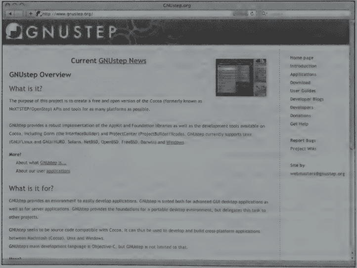

由于其悠久的历史，GNUstep 项目对 Foundation 和 Cocoa 的支持堪称一流。然而，由于他们的目标实际上是重现 NeXTstep 环境，而不是模拟 Mac OS X 或应用程序运行平台的本地控件集，因此他们实际上提供了一整套 NeXTstep 控件集。这意味着，如果你选择使用该项目将 GUI 应用移植到 Windows，你的应用在 Windows 上运行时看起来会像一个 NeXTstep 应用，包括所使用的菜单类型等一切方面。此外，运行 GNUstep 应用还涉及文件系统方面的问题。上一次检查时，要在 Windows 上运行 GNUstep 应用，你必须安装完整的 GNUstep 文件系统以及大量支持库。

所有这些可能会让普通用户感到不安。为了完整性，我在此提一下，过去几年里有人一直在努力为 GNUstep 项目添加换肤（skinning）支持。这将使你至少可以为 Windows 创建一个应用，然后用 Windows 控件集为应用换肤。换句话说，GNUstep 项目正在提升其在图形应用方面的可移植性，并随着时间推移不断改进，但目前尚不完美。尽管如此，在 Foundation 框架方面，GNUstep 项目提供了任何地方都可用的一些最好、最广泛的支持。我的看法是，如果你的应用是命令行应用（例如服务器），并且你打算将其移植到 Windows 或 Linux，那么 GNUstep 项目很可能会让你如愿以偿。可以说，充分利用已有的、在 Mac OS X 上编写并希望移植到 Windows 的 Objective-C 代码的一个好方法，是使用 Objective-C 和 GNUstep 移植后端底层非 GUI 代码。然后，你可以编写一个原生 GUI 运行在该后端代码之上，通过进程间通信与其通信，或将其作为库链接。这样做可以两全其美：你既能够移植业务逻辑代码，同时还能为用户提供熟悉的原生用户界面。

有关 GNUstep 项目的更多信息，请访问其网站：http://www.gnustep.org。

### 使用 Cocotron

另一个较新的跨平台 Objective-C 尝试是 Cocotron 项目。Cocotron 项目在将应用移植到 Mac OS X 以外的平台时采取了不同的方法。Cocotron 为 Xcode 提供了交叉编译环境，因此你可以在 Mac OS X 桌面的 Xcode 中交叉编译应用。使用这个交叉编译器，你可以为 Windows、Linux 或其他桌面 UNIX 构建应用。以这种方式交叉编译的应用，外观、感觉和行为都与原生应用一模一样。

Cocotron 项目的工作原理是利用 Xcode 安装多个工具链和 SDK 并用于编译代码的能力。正是这项让你点击一个按钮就能为 iPhone OS 或 Mac OS X 编译代码的技术，让 Cocotron 得以施展其魔力。

如果你觉得 Mac OS X 和 Xcode 作为开发环境最顺手，那么 Cocotron 是一个理想的解决方案。它允许你在 Mac OS X 上进行所有开发，然后只需更改 SDK 并为目标平台重新编译应用即可。

仿佛这一能力还不够，Cocotron 还对 Cocoa 和 Foundation 框架提供了一些最好的第三方支持。它的实现足够出色，以至于如今确实有一些商业品质的应用在使用 Cocotron 同时部署到 Mac OS X 和 Windows。

Cocotron 往往比较落后的主要领域是网络、线程以及一些更高级别的框架支持。不过，这些领域正在积极开发中；如果你有足够的预算，你甚至可以委托 Cocotron 维护者改进你的应用所需的特定库部分。

图 19.2 展示了一个使用 Cocotron 编写的示例应用，它运行在 Windows 和 Mac OS X 上。


### 展望未来

我之所以想写这本书，其中一个原因是，我觉得 Objective-C 是一种被低估的语言。它的近亲 C++、Java 等则往往获得更多关注。我认为之所以会这样，其中一个原因是，传统上，Objective-C 仅用于在 MacOS X 上开发。

随着 iPhone 的出现以及现在 iPad 的出现，Objective-C 获得了大量新的关注，并且在学习该语言的新用户数量方面经历了前所未有的增长。这既是福也是祸。

这是福气，因为它确保该平台将在未来多年继续生存，但这也是祸害，因为它证明了这种出色语言缺乏足够的标准化和文档。

与 C 和 C++ 不同，Objective-C 没有 ISO 标准机构来推动其规范。有些人可能会争辩说这实际上是一件好事。事实上，这可能是 Objective-C 如此优雅且完美适合其任务的原因之一。然而，问题在于，由于缺乏标准化，Objective-C 在其核心平台之外的采用非常少。这意味着这些来到该平台的新开发者在未来将被限制为只能在 MacOS X 或 iPhone OS 上开发。

没有人知道未来会带来什么新硬件和新平台。当学习一门语言时，你是在该语言及其运行的平台上进行智力投资。为了确保对 Objective-C 的投资是将在未来很长一段时间内产生回报的投资，我们需要将 Objective-C 作为一门语言推向其核心平台之外。它需要在其他平台如 UNIX 和 Windows 上获得更大的支持和更大的采用。我不能说我提倡 Objective-C 的 ISO 标准化，但我绝对希望看到这些平台上第三方项目支持的改进。

可以肯定的是，我在本章中向你介绍的一些项目将这些理想作为其目标。这很棒，我们应该帮助支持和推广这些项目，即使它们不在我们自己可能偏好的平台上。保持 Objective-C 的活跃以及作为不同平台的可行编程环境，有助于使你在此处的投资在未来更有价值。

## 摘要

在本章中，我向你介绍了几个开源项目，它们使你能够在 MacOS X 或 iPhone OS 以外的平台上编译和运行你的 Objective-C 应用程序。虽然它们并不完美，但它们是好的，并且在改进中，未来它们可能提供可行的开发平台。即使今天，也有一些开发者正在使用这些第三方项目来移植商业应用程序。在开发者在使用这些第三方项目进行移植时遇到困难的情况下，他们也可以与项目维护者合作以帮助改进这些项目。如果可能的话，我也鼓励你这样做。不仅有助于在这些替代平台上改进语言支持，而且还可以帮助你更好地理解语言。最好的学习环境之一是在使用现有代码并尝试改进它。

通过鼓励 Objective-C 充满活力的替代平台生态系统，我们有助于确保我们的智力投资将在未来很长一段时间内继续回报我们。

## 索引

### 特殊字符和数字

- + - -- 运算符, 48
- + - - 运算符, 48
- + - ! 运算符, 48
- + - != 运算符, 48
- + - #define 指令, 229–230
- + - #elif 指令, 229, 236
- + - #else 指令, 229, 236
- + - #end 语句, 236
- + - #endif 指令, 229
- + - #error 指令, 229–230
- + - #if 指令, 229, 236
- + - #ifdef 指令, 229, 237
- + - #ifndef 指令, 237
- + - #import 指令, 229
- + - #include 指令, 229–230
- + - #pragma 指令, 229–230
- + - #undef 指令, 229
- + - #warning 指令, 229–230
- + - % 运算符, 48
- + - %= 运算符, 48
- + - %ld 格式, 269
- + - &（取地址运算符）, 44
- + - & 运算符, 48
- + - && 运算符, 48
- + - &= 运算符, 48
- + - () 运算符, 48
- + - (Bar) 协议, 203
- + - (Foo) 协议, 203
- + - *（星号运算符）, 44
- + - *（指针运算符）, 44, 89
- + - */ 字符, 35
- + - * 运算符, 34, 48
- + - *= 运算符, 48
- + - * 字符, 141
- + - . 运算符, 48
- + - .m 扩展名, 82
- + - .pch 扩展名, 7
- + - //（双斜杠）, 35
- + - / 运算符, 48
- + - // 语法, 35
- + - /* 字符, 35
- + - /= 运算符, 48
- + - ;（分号）, 30
- + - @avg 函数, 168
- + - @catch 指令, 244
- + - @count 函数, 168
- + - @dynamic 声明, 95
- + - @end 指令, 82
- + - @end 关键字, 197
- + - @finally 指令, 249
- + - @max 函数, 168
- + - @min 函数, 168
- + - @MY_IMPORTANT_DATA, 226
- + - @optional 关键字, 197, 200
- + - @property 指令, 94
- + - @protocol Foo 指令, 204
- + - @protocol 关键字, 197, 201
- + - @sum 函数, 168
- + - @synchronize 关键字, 317–319
- + - @synchronized 指令, 159, 317–318
- + - @synthesize 指令, 95, 96, 319
- + - @"this is bar" 宏, 231
- + - @try 块, 249
- + - @try 指令, 247
- + - []（方括号运算符）, 89
- + - [] 运算符, 48
- + - [foo copy] 对象, 112
- + - [self init] 变量, 119
- + - [super init] 变量, 119
- + - \\ 字符, 268
- + - \\ 转义序列, 268
- + - \\\\ 转义序列, 268
- + - \\r 转义序列, 268
- + - \\t 转义序列, 268
- + - ^ 字符, 140–141
- + - ^ 运算符, 48
- + - ^= 运算符, 48
- + - __block 指令, 146
- + - __DATE__ 宏, 228
- + - __FILE__ 宏, 228
- + - __LINE__ 宏, 228
- + - __TIME__ 宏, 228
- + - __weak 关键字, 126
- + - {}（大括号）, 14
- + - ~ 运算符, 48
- + - + 运算符, 48
- + - ++ 运算符, 48
- += 运算符, 48
- +alloc 方法, 333
- +allocWithZone: 方法, 332
- +archived DataWithRootObject: 方法, 351
- +dataWithContentsOfURL: 方法, 300
- +defaultCollector 方法, 135
- +knownTimeZoneNames 方法, 308
- +string 方法, 266
- +stringWith Format 方法, 269
- +stringWithCharacters:length: 方法, 266
- +stringWithContentsOfFile:encoding:error: 方法, 266
- +stringWithContentsOfFile:usedEncoding:error: 方法, 267
- +stringWithContentsOfURL:encoding:error: 方法, 267
- +stringWithContentsOfURL:usedEncoding:error: 方法, 267
- +stringWithCString:encoding: 方法, 266
- +stringWithFormat: 方法, 266, 267
- +stringWithString: 方法, 266
- +stringWithUTF8String: 方法, 266
- +timeZoneWithName 工厂方法, 308
- < 运算符, 48
- << 运算符, 48
- <<= 运算符, 48
- <= 运算符, 48
- <>（尖括号）, 58, 197
- <value> 模式, 169
- <valueName> 模式, 178
- = 运算符, 48
- == 运算符, 48, 265
- > 运算符, 48
- >= 运算符, 48
- >> 运算符, 48
- >>= 运算符, 48
- -= 运算符, 48
- 5555 值, 32
- -accessInstanceVariables Directly 方法, 178

A
accessors
age, 104
atomic, 97
creating, 95
defined, 92
indexed, 172–174

KVC, 165–167, 178–181
KVC compliant, writing, 169–171
nonatomic, 97
property, synthesized, 96
unordered, 174–176
-addExecutionBlock: 方法, 328
-addObject: 方法, 282
address-of operator (&), 44
age accessor, 104
All-In-One layout option, 10
-allKeys 方法, 278
-allObjects 方法, 278, 279, 280
+alloc 方法, 333
+allocWithZone: 方法, 332
angle brackets (<>), 58, 197
anonymous categories, 216–218
Apple iPads, 359
Apple iPhones, 359
application bundles
contents of, 17
directory of, 17–18
overview, 16
properties, 23
Application Programming Interface (API)
handling errors, 241
using blocks in, 150–151
applications
foundation, 131–132
GUI, 118, 314, 322, 357
Interface Builder, 16
NeXTstep, 356
applying objects
creating employee class, 101–104
creating manager class, 104–107
tying classes together, 107–108
arbitrary datatypes, 296–297
+archived DataWithRootObject: 方法, 351
archiver file formats, 352
are -will Change:valuesAtIndexes:forKey: 变量, 185
argc 参数, 30
argc 变量, 32, 33
argv 参数, 30
arithmetic, 298
arrays
dictionaries, 276–279
filtering, 292
mutability, 281–283


概述, 273–275
集合, 280–281
使用 KVC, 171–176
使用 blocks 过滤素数, 156–159
ASCII 编码, 167
assign 属性, 95, 98–99
关联集合, 276–277
星号运算符 (*), 44
atomic 访问器, 97
atomic 标志, 319
原子性, 319
-attemptRecoveryFromError:optionIndex: 方法, 253
属性
  assign, 95, 98–99
  copy, 95, 98–99
  getter=<name>, 95
  nonatomic, 95, 97
  readonly, 95
  readwrite, 95
  retain, 95, 98–99, 102
  搜索对象的属性, 177–178
  setter=<name>, 95
  stringOnBar, 164
auto 关键字, 37
自动存储类, 37
autorelease 概念, 113–119
-autorelease 方法, 333
autorelease 池, 116
aVariable 变量, 32
aVariable1 变量, 33
aVariable2 变量, 33
@avg 函数, 168

常见设计模式
  使用 code blocks 进行映射, 149–150
  在标准 API 中使用, 150–151
声明, 140
定义, 142
作用域
  管理 code block 内存, 145–146
typedef, 147
理解
  声明 code blocks, 140–142
  使用 code blocks, 142–144
与集合一起使用, 292–293
与线程一起使用
  Grand Central Dispatch, 148
  使用 GCD 函数在线程中分派 code blocks, 148–149
蓝色图标, 11
BOOL 类型, 36
break 语句, 64
Build and Run 按钮, 编辑器面板, 8, 16
Build Configurations, 21
Build Independent Targets in Parallel 设置, 19
构建设置, 7, 18–23, 233
内置宏, 237
BusinessLogic 类, 192–193, 199
按钮
  Build and Run, 8, 16
  Choose, 5
  Code Sense Index, 20
  Configure Roots, 18
  Configure Roots and SCM, 18
  对话框, 252
  加号, 22
  SCM, 18
  停止, 320

B
Bar. Bar 对象, 330
Bar 类, 164, 171
Bar 对象, 336
(Bar) 协议, 203
Base SDK for All Configurations 设置, 20
行为, 92–99
__block 指令, 146
blocks
  应用于尴尬并行任务
  创建项目, 152–156
  Grand Central Dispatch, 159–162
  使用 blocks 与数组过滤素数, 156–159

C
C++ 方法, 113, 260
calculateFactorial 函数, 53
Calculator 程序, 70
回调, 181–183
调用, 90–92
驼峰命名, 169
Cat 概念, 77
@catch 指令, 244
分类
  使用分类分解功能, 212
  在 NSObject 上创建的危险, 215–216

分类 (续)
  声明, 209
  在头文件中声明, 211
  扩展类方法, 212–214
  实现方法, 210
  使用分类实现协议, 215
  限制, 214–215
  NSString, 271
  使用, 211–212
  CFRetain, 134
  char 类型, 36
  Choose 按钮, New Project 对话框, 5
  循环协议依赖, 203–204
  Clang Static Analyzer 工具, 23–26
  类
  将变量与现有类关联, 218–220
  Bar, 164, 171
  BusinessLogic, 192–193, 199
  分类
    使用分类分解功能, 212
    声明, 209
    在头文件中声明, 211
    扩展类方法, 212–214
    实现方法, 210
    使用分类实现协议, 215
    限制, 214–215
    概述, 208
    理解在 NSObject 上创建的危险, 215–216
    使用, 211–212
  类簇, 120
  声明协议实现, 198–199
  定义, 13
  Employee, 93–94, 101–104
  使用匿名分类扩展, 216–218
  文件包装器, 129, 242–243, 250
  文件, 81–83
  Foo, 164, 217
  Foundation, 319
  管理器, 104–107
  类的方法
    定义, 83
    编写, 87–89
  MyDelegate 协议, 337
  MyPoint, 186, 187
  NetworkClient, 193, 197
  NetworkConnector, 192–195
  NSArchiver, 260, 345, 351–352
  NSArray, 88, 151–152, 172–276, 291–293
  NSAutoreleasePool, 260
  NSBlockOperation, 151, 327
  NSBundle, 260
  NSCalendar, 260, 304–309
  NSCoder, 使用进行读写
    解码对象, 350–351
    编码基本类型, 347–348
    编码对象, 345–347
    在对象中实现协议, 345
    对象图, 348
    概述, 345
    使用 NSArchiver 和 NSUnarchiver, 351–352
    使用其他类型的数据, 348–349
    处理归档文件格式和旧数据, 352
  NSCountedSet, 281
  NSData, 260, 296–301
  NSDate, 260, 304–305, 309
  NSDateFormatter, 260, 308–309
  NSDecimalNumber, 298
  NSDictionary
    枚举, 286
    用途, 151, 260
    使用字典存储弱引用, 126
    使用字典, 276–277
  NSEnumerator, 68, 260, 286, 287
  NSError, 251–255, 260
  NSException, 244, 245, 260
  NSFileHandle, 260
  NSFileManager, 261
  NSGarbageCollector, 134–135, 261
  NSIndexSet, 151
  NSKeyedArchiver, 351, 353
  NSKeyedUnarchiver, 353
  NSLock, 260, 315
  NSMutableArray, 260, 282
  NSMutableData, 296–301
  NSMutableDictionary, 218–219, 260
  NSMutableSet, 261, 283, 300
  NSMutableString, 209–212, 261, 265
  NSNotificationCenter, 151, 261, 339, 343
  NSNumber, 295–301
  NSObject, 200, 215–216, 261
  NSOperation, 322–328
  NSOperationQueue, 151, 322–328
  NSPointerArray, 285, 286
  NSSet, 151, 175, 261, 280

NSString, 151, 208, 261, 267
NSTask, 261
NSThread, 261, 319, 322
NSUnarchiver, 260, 345, 351–352
NSURL, 261
NSURLConnection, 201
NSValue, 295–301
Observer, 187, 189
概述, 78
PrimeFinder, 153, 156
someMember, 168
特殊对象方法, 85–87
存储, 37
字符串, 自定义, 208
子类化, 208
第三方框架和, 207–208
绑定在一起, 107–108
编写方法, 87–89
编写对象方法, 83–85
close 方法, 130
闭包, 139. 另见 blocks
Cocoa Class 选择, 9
Cocoa GUI 框架, 321
Cocoa 方法, 151
Cocoa 平台, 355
Cocoa Touch 框架, 334
Cocoa Touch 库, 80
Cocotron 项目, 357–358
代码
  blocks
    声明, 140–142
    内存, 145–146
    概述, 142–144
    用于映射, 149–150
    使用 GCD 函数分派, 148–149
同步, 314–319
将编译代码转为可执行文件, 15–16
将源代码转为编译代码, 15–16
编写, 12–14
Code Sense Index 按钮, 20
-collectExhaustively 方法, 135
-collectIfNeeded 方法, 135
集合
  枚举, 286–288
  内存管理与
  概述, 283–284
  使用专用集合, 285–286
概述, 273
向元素发送消息, 288–289
排序和过滤, 289–292
使用 blocks 与集合, 292–293
使用数组
字典, 276–279
可变性, 281–283
概述, 273–274
集合, 280–281
Command Line Tool 选项, 5
Command-line builds use 选项, 22
注释, 35
commit 方法, 86
-compare: 方法, 305
编译过程
Application bundle, 23
应用程序包, 16–18
Base SDK for All Configurations 设置, 20
Build Configurations, 21
Build Independent Targets in Parallel 设置, 19
构建设置, 18–23
Code Sense Index, 20
Icon File 设置, 22
图标, 22
通过编译传递常量, 231–232
Place Build Products In 设置, 19
Place Intermediate Build Files In 设置, 19
Project Settings 窗口, 19
Properties 选项卡, 22
Rules 选项卡, 22
SDK (软件开发工具包), 20
将编译代码转为可执行文件, 15–16
将源代码转为编译代码, 15–16
编写代码, 12–14
-components SeparatedByString: 方法, 270
组合, 191–196
条件语句
选择, 64
switch 语句, 63–64
三元条件, 62–63
使用 if-else, 61–62
条件切换, 236–237
Configurations 选项卡, 20
Configure Roots 按钮, Project Settings 窗口, 18
-conformsToProtocol: 方法, 201
const 关键字, 37, 38
常量
概述, 230–231
通过编译传递, 231–232

构造日期, 304
控制变量 (i), 64, 66
COOPC 扩展, 3
copy 属性, 95, 98–99
copy 风格 setter, 99
-copyWithZone: 方法, 333
Core Foundation 方法, 133
Correct Code, 26
@count 函数, 168
-count 方法, 274
-countForObject: 方法, 281
计数表达式, 66
-countOf<ValueName> 方法, 178
-countOf<VariableName> 方法, 172, 175
Cox, Brad, 3
CPU, 156
CreateFoo 方法, 112
大括号 ({}), 14
自定义字符串类, 208

D
悬空指针, 122
数据
  成员名称, 99
  使用 NSCoder 类读写
    解码对象, 350–351
    编码基本类型, 347–348
    编码对象, 345–347
    在对象中实现 NSCoding 协议, 345
    对象图, 348
    概述, 345
    使用 NSArchiver 和 NSUnarchiver, 351–352
    使用其他类型的数据, 348–349
    处理归档文件格式和旧数据, 352
数据类型
  任意, 296–297
  id, 27, 81, 84, 200
  +dataWithContentsOfURL: 方法, 300
__DATE__ 宏, 228
日期
  比较, 305–306
  构造, 304
  使用 NSCalendar, 306–307
  使用 NSDateFormatter, 308–309
  处理时间间隔, 304–305
  处理时区, 307–308

死锁, 316
dealloc 方法
  管理器对象与, 106
  内存管理与, 119
  用于编写对象, 86–87
  编写, 121–122
释放方法, 130
调试, 16
DEBUGGING 宏, 226, 227
声明
  分类, 209
  code blocks, 140–142
  局部变量, 37
  对象, 89–90
  协议, 197–198
  标量变量, 36
  变量, 32–35
解码对象, 350–351
defaultCollector 方法, 134
+defaultCollector 方法, 135
#define 指令, 229–230
委托方法, 338
Delegate 模式, 338–339
委托责任, 336–339
解引用指针, 45
-description 方法, 268
设计模式
  block, 149–151
  定义, 330
描述
  委托责任, 336–339
  通知对象更改, 339–343
  使用单例, 331–336
  概述, 329
  在解决方案中, 329–331
指定初始化器, 86
Detail 选项卡, 59
Detailed Analyzer 输出, 25
开发
  添加源文件, 8–10
  项目中的文件, 7–8
  主 Xcode 窗口, 10–12
  开始项目, 4–7
对话框按钮, 252
钻石问题, 195
字典
  userInfo, 252–253
  使用, 276–279


+   异常（续）
+     引发，244
+     抛出，244–245
+   可执行文件，15–16，18
+   现有框架选项，262
+   展开的代码，236
+   表达式
+     注释，35
+     计数，66
+     声明变量，32–35
+     枚举，42–43
+     运算符，48–50
+     指针，44–48
+     标量类型，35–36
+     搜索，207
+     特殊变量修饰符，37–38
+     结构体，38–40
+     三元运算符，51
+     typedef，40–42
+   扩展类方法，212–214
+   extern关键字，38，56
+   
+   F
+   Factorial.h文件，57
+   阶乘，51–52
+   工厂方法，87，267
+   文件浏览器面板，主Xcode窗口，10
+   文件导航下拉列表，12
+   文件包装类，129，242–243，250
+   __FILE__宏，228
+   文件
+     归档格式，352
+     类，81–83
+     头文件，211
+     实现，链接，58–60
+     nib，132
+     在项目中，7–8
+     源代码，8–10
+   -filterArray:withBlock: 方法，159
+   过滤数组，292
+   过滤集合，289–292
+   -filterUsingPredicate: 方法，291
+   finalize 方法，124，129
+   @finally 指令，249
+   有限资源，128–131
+   第一个小节，14
+   5555值，32
+   
+   float 类型，35，39
+   流程
+     选择语句，64
+     do循环，69
+     if-else语句，61–62
+     中断，240–241
+     for循环，65–67
+     switch语句，63–64
+     三元条件，62–63
+     while循环，67–69
+   -fobjc-gc 标志，127
+   -fobjc-gc-only 标志，127
+   Foo类，164，217
+   [foo copy]对象，112
+   Foo对象，330，336
+   (Foo)协议，203
+   for循环
+     概述，65–66
+     用于快速枚举，66–67
+   强制垃圾回收，133
+   正式协议，200–201
+   格式字符串，267–269
+   Foundation应用程序，131–132
+   Foundation类，319
+   Foundation框架，259–262，264，355
+   Foundation结构体，297
+   框架选择对话框，263
+   框架
+     Foundation，259–261
+     其他，261–262
+     概述，259
+     第三方，207–208
+     在垃圾回收项目中使用，128
+     在项目中使用
+       添加，262–263
+       垃圾回收，264
+       包含头文件，264
+       概述，262
+   函数声明，56
+   函数定义，56
+   功能，212
+   函数
+     @avg，168
+     @count，168
+     @max，168
+     @min，168
+     @sum，168
+     @avg，168

calculateFactorial，53
@count，168
定义，30，54–56
dispatch_queue_create，148
特性，168
GCD，148–149
实现与接口，56–58
接口，56–58
与实现文件链接，58–60
LOG_LINE，228
main，29–30，188
map，149
@max，168
@min，168
NSLog，30，33，267
objc_setAssociatedObject，218
概述，51–54
@sum，168
G
+   垃圾回收
为项目配置，126–128
强制，133
框架，264
管理有限资源，128–131
面向对象接口，134–135
概述，123–125
引用类型，125–126
在项目中使用框架，128
void指针，133–134
在nib文件中处理对象，132
使用（垃圾回收）编写Foundation应用程序，131–132
垃圾回收构建设置，127
gcc（GNU编译器集合），355
GCD（Grand Central Dispatch）
在多处理中，323
概述，148
使用，159–162
-get<ValueName> 模式，178
-get<Variable Name>::range: 方法，173
getter=<name> 属性，95
全局变量，33，37，75
全局唯一标识符（GUID），209
GNU编译器集合（gcc），355
GNUstep项目
Cocotron，357–358
其他开源库，358
概述，356–357
Grand Central Dispatch（GCD）
在多处理中，323
概述，148
使用，159–162
对象图，348
GUI应用程序，118，314，322，357
GUID（全局唯一标识符），209
GUID类别，209，211，212
H
+   错误处理
错误分类
中断程序流，240–241
概述，239–240
机制
创建NSError对象，251–252
异常，244–250
NSError userInfo字典，252–253
方法中的NSError，254–255
返回码，241–244
使用恢复尝试器，253–254
概述，239
处理异常，247
头文件，211
头文件，264
海森缺陷，314
I
+   i（控制变量），64，66
+   IBOutlet对象，132
+   图标文件设置，22
+   图标
+     配置，22
+     警告，11
+   id数据类型，27，81，84，200
+   #if指令，229，236
+   if语句，61，62
+   #ifdef指令，229，237
+   if-else语句，61–62
+   #ifndef指令，237
+   不可变的Foundation类，319
+   不可变方法，298
+   实现文件
+     示例，14，82–83
+     链接，58–60
+   实现函数，13，56–58
+   #import指令，229

import语句，30
#include指令，229–230
索引访问器，172–174
-indexesOfObjects: 方法，276
-indexesOfObjectsPassingTest: 方法，293
-indexOfObject: 方法，275
间接引用，251
非正式协议，200–201
继承
  优先组合而非继承，191–196
  概述，78–80
-init方法，119，333
初始化器，119–121
-initWithCoder: 方法，121，350，351
-initWithOptions: 方法，285
-initWithPointer Functions: 方法，286
实例变量，35
int返回码，242
int类型，35，44
int值，49
Interface Builder应用程序，16
接口文件，13，81–82
接口函数，56–58
接口
  为他人实现记录接口，195–196
  面向对象，134–135
  概述，13
中断程序流，240–241
IOClient协议，198
iPads，359
iPhones，359
-isEnabled方法，135
-isEqual: 方法，265，280
isPrime: 方法，159

K
+   键路径，167–169
+   键值编码（KVC）
+     使用...访问对象属性
+       键路径，167–169
+       搜索对象属性，177–178
+       与数组一起使用，171–176
+       与结构体和标量一起使用，177
+       编写符合规范的访问器，169–171
+     应用键值观察（KVO），186–189
+     观察符合KVC的值的更改
+       为KVO定义回调，181–183
+       实现手动通知，184–185

注册为观察者，179–181
移除观察者，183
了解KVO的风险，185–186
使用KVO，179
概述，165–167
键值观察（KVO）
  使用键值编码（KVC）访问对象属性
  键路径，167–169
  搜索对象属性，177–178
  将KVC用于结构体和标量，177
  与数组一起使用，171–176
  编写符合规范的访问器，169–171
  应用，186–189
  观察符合KVC的值的更改
    定义回调，181–183
    实现手动通知，184–185
    注册为观察者，179–181
    移除观察者，183
    了解风险，185–186
    使用，179
键控归档，347
键
  NSLocalizedDescription，253
  NSLocalizedFailureReason，253
  NSLocalizedRecoveryOptionsError，253
  NSLocalizedRecoverySuggestionError，253
  NSRecoveryAttempterError，253
  NSUnderlyingError，253
  NSValueChangeIndexes，182
  NSValueChangeInsertion值，183
  NSValueChangeKind，182
  NSValueChangeNew，182
  NSValueChangeNotificationIsPrior，182
  NSValueChangeOld，182
  NSValueChangeRemoval值，183
  NSValueChangeReplacement值，183
  NSValueChangeSetting值，183
  void *,219
关键字
  @end，197
  @optional，197，200
  @protocol，197，201
  @synchronize，317–319
  __weak，126
  auto，37
  const，37，38
  extern，38，56
  static，37–38
  struct，38–39

+knownTimeZoneNames方法，308
KVC（键值编码）
  使用...访问对象属性
    键路径，167–169
  搜索对象属性，177–178
  与数组一起使用，171–176
  与结构体和标量一起使用，177
  编写符合规范的访问器，169–171
应用键值观察（KVO），186–189
观察符合KVC的值的更改
  为KVO定义回调，181–183
  实现手动通知，184–185
  注册为观察者，179–181
  移除观察者，183
  了解KVO的风险，185–186
  使用KVO，179
概述，165–167
KVC访问器，165–167，178–181
KVO（键值观察）
  使用键值编码（KVC）访问对象属性
    键路径，167–169
  搜索对象属性，177–178
  将KVC用于结构体和标量，177
  与数组一起使用，171–176
  编写符合规范的访问器，169–171
应用，186–189
观察符合KVC的值的更改
  定义回调，181–183
  实现手动通知，184–185
  注册为观察者，179–181
  移除观察者，183
  了解风险，185–186
  使用，179
KVO回调方法，181

L
-lastObject: 方法，275
%ld格式，269
旧数据，352
旧版运行时，27
库
  开源，358
  标准，260
__LINE__宏，228
链接
  定义，15
  与实现文件，58–60

LLVM 1.5编译器，220
局部作用域，34
局部变量，34
-lockBeforeDate: 方法，316
锁，315–317
LOG_LINE函数，228
LOGVAR (someVar)行，235
long long类型，36
long类型，35
循环
  do，69
    do-while，69
  for，65–67
  while，64，67–69
Love, Tom, 3

M
.m扩展名，82
MacOS X，357，359
宏
  @"this is bar"，231
  __DATE__，228
  __FILE__，228
  __LINE__，228
  __TIME__，228
  DEBUGGING，226，227
  MAX，232
  THE_KEY，226
编写
  内建宏，237
  编译过程，223–229
  常量，230–231
  处理条件切换，236–237
  概述，223
  通过编译传递常量，231–232
  字符串化，234–236
  宏中的变量，232–234
主函数，29–30，188
主过程，107
主工具栏，主Xcode窗口，10
主Xcode窗口，6，11
-makeObjects PerformSelector: 方法，288
-makeObjectsPerformSelector:withObject: 方法，288
管理器类，104–107
管理器属性，102
手动通知，184–185


map 函数，149
maps，149-150
MathOperations 单元，70
MathOperations.h 文件，72
MathOperations.m 文件，71
@max 函数，168
MAX 宏，232
maxConcurrentOperationCount 属性，326
成员名称，99
成员变量，35
-memberOf<ValueName>: 方法，178
内存泄漏，34，111
内存管理
集合与，283-286
垃圾回收
为其配置项目，126-128
概述，123-126
在项目中使用框架，128
关键垃圾回收模式
强制垃圾回收，133
管理有限资源，128-131
面向对象接口，134-135
在 nib 文件中操作对象，132
使用 void 指针和垃圾回收，133-134
使用其编写 Foundation 应用程序，131-132
概述，109-112
引用计数
自动释放，113-119
学习规则，112-113
编写 dealloc 方法，121-122
编写初始化器，119-121
为项目使用模型，135-136
内存管理方法，334
消息，288-289
方法定义，83-84
方法
+alloc，333
+allocWithZone:，332
+archived DataWithRootObject:，351
+dataWithContentsOfURL:，300
dealloc，86-87，106，119，121-122
deallocation，130
defaultCollector，134
+defaultCollector，135
定义，83-84
delegate，338
-description，268
-didChangeValueForKey:，184
+stringWithContentsOfFile:usedEncoding: error::，267
+stringWithContentsOfURL:encoding: error::，267
+stringWithContentsOfURL:usedEncoding: error::，267
+stringWithCSString:encoding: error::，266
+stringWithFormat:，266，267
+stringWithString:，266
+stringWithUTF8String:，266
+timeZoneWithName 工厂，308
-accessInstanceVariables Directly:，178
-addExecutionBlock:，328
-addObject:，282
-allKeys，278，279，280
-allObjects，278，279，280
-attemptRecoveryFromError:optionIndex:，253
-autorelease，333
C++，113，260
category，实现，210
class
扩展，212-214
概述，83-84
编写，87-89
close，130
Cocoa，151
-collectExhaustively:，135
-collectIfNeeded，135
commit，86
-compare:，305
-componentsSeparatedByString:，270
-conformsToProtocol:，201
-copyWithZone:，333
Core Foundation，133
-count，274
-countForObject:，281
-countOf<ValueName>，178
-countOf<ValueName>，172，175
CreateFoo，112
+dataWithContentsOfURL:，300
dealloc，86-87，106，119，121-122
deallocation，130
defaultCollector，134
+defaultCollector，135
定义，83-84
delegate，338
-description，268
-didChangeValueForKey:，184
-disable，135
-disableCollectionForPointer:，135
dispatch_get_global_queue()，148
-dropSortedKeys，220
-enable，135
-enableCollectionForPointer:，135
-encodeObject...，346
-encodeWithCoder:，345，347
-enumerate ObjectsAtIndexes:withBlock:，293
-enumerateObjectsWithOptions:
  usingBlock:，292
-enumeratorOf<ValueName>，178
-enumerateObjectsUsingBlock:，292
工厂，87，267
-filterArray:withBlock:，159
-filterUsingPredicate:，291
finalize，124，129
-get<Variable Name>:range:，173
不可变，298
-indexesOfObjects:，276
-indexesOfObjectsPassingTest:，293
-indexOfObject:，275
-init，119，333
-initWithCoder:，121，350，351
-initWithOptions:，285
-initWithPointer Functions:，286
-isEnabled，135
-isEqual:，265，280
isPrime:，159
+knownTimeZoneNames，308
KVO 回调，181
-lastObject:，275
-lockBeforeDate:，316
-makeObjects PerformSelector:，288
-makeObjectsPerformSelector:
  withObject:，288
-memberOf<ValueName>;，178
内存管理，334
-minusSet:，283
-nextObject，287
NSCoder，346，348
NSGarbageCollector，135
NSKeyedUnarchiver，352
NSObject，277，322，338
NSString，182，269-270
NSString's -description，268
NSTimeInterval，304
objc_collect，133
objc_startCollectorThread，124
object
  特殊，85-87
  编写，83-85
-objectAt Index:，275
-objectForKey:，278
-objects ForKeys:notFoundMarker:，278
-objectsAtIndexes:，276
-openFileAtPath:，242，244
-openFileAtPath:withError:，255
-operationCount，326
-performSelector，322
私有，90-92
-rangeOfString:，270
release，90，333
-remove<VariableName>;，176
-removeObject:，281
-removeObjectForKey:，282
-removeObserver:，341
-resetBytesInRange:，300
-respondsToSelector:，202
retain，110，333
-retainCount，333
-setNil ValueForKey:，177
-setValueForKey:，177
-setValue:forUndefinedKey:，178
singleton 工厂，332
-sortedKeysUsingSelector:，279
-sortUsingDescriptors:，289
-sortUsingFunction:context:，290
-sortUsingSelector:，290
特殊对象，85-87
-start，204
+string，266
+stringWith Format，269
+stringWithCharacters:length:，266
+stringWithContentsOfFile:encoding:
  error:，266
+stringWithContentsOfFile:usedEncoding:
  error:，267
+stringWithContentsOfURL:encoding:
  error:，267
+stringWithContentsOfURL:usedEncoding:
  error:，267
+stringWithCString:encoding:，266
+stringWithFormat:，266，267
+stringWithString:，266
+stringWithUTF8String:，266
方法（续）
-stuffChanged:，341
superclass，214
-timeIntervalSinceDate:，305
-timeIntervalSinceNow，305
+timeZoneWithName 工厂，308
-tryLock，316
updateEngineSpeedFromThrottle，93
-valueForKey:，164，177
-valueForKeyPath:，164
-valueForUndefinedKey:，178
-willChangeValueForKey:，184
-work:，320
在其中使用 NSError，254-255
@min 函数，168
-minusSet: 方法，283
模型，135-136
现代运行时，27
变量的修饰符，37-38
多重继承，193-194
多个协议，199
使用线程的多处理
  NSOperation 和 NSOperationQueue
    向队列添加操作，325-326
    创建操作，323-325
    操作队列参数，326
    概述，322-323
    使用其他类型的操作，326-328
  NSThread
    访问主线程，321-322
    创建线程，319-320
    使用 perform selector 跨线程，322
    操作运行中的线程，320-321
    概述，313-314
同步代码
  @synchronize 关键字，317-319
  原子性，319
  锁，315-317
  概述，314-315
可变性，281-283
互斥锁，315
互斥锁，315
@MY_IMPORTANT_DATA，226
MyClassDelegate 协议，337
MyPoint 类，186，187

N
NetworkClient 类，193，197
NetworkClient 协议，196-200
NetworkConnector 类，192-195
New File 对话框，8，9
New Project 对话框，5
-nextObject 方法，287
NeXTstep 应用程序，356
NIB（NeXTstep Interface Builder）文件
  概述，16
  在其中操作对象，132
nil 对象，85，120
nonatomic 访问器，97
nonatomic 属性，95，97
NSArchiver 类，260，345，351-352
NSArray 类，151-152，172-276，291-293
NSAutoreleasePool 类，260
NSAutoreleasePool 对象，118
NSBlockOperation 类，151，327
NSBundle 类，260
NSCalendar 类，260，304-309
NSCoder 类
  解码对象，350-351
  编码基本类型，347-348
  编码对象，345-347
  在对象中实现 NSCoding 协议，345
  对象图，348
  概述，345
  使用 NSArchiver 和 NSUnarchiver，351-352
  使用其他类型的数据，348-349
  使用归档文件格式和旧数据，352
NSCoder 方法，346，348
NSCoder 系统，352
NSCoding 协议，345，348，353
NSCopying 协议，277
NSCountedSet 子类，281
NSData 包装，348
NSData 类
  在 nsdata 对象中访问原始字节，300-301
  创建 nsdata 对象，299-300
  用途，260
NSDate 类，260，304-305，309
NSDate 对象
  在中访问原始字节，300-301
  构造日期，304
  创建，299-300
NSCalendar 类和，306
NSDateFormatter 类和，309
NSDateComponents 对象，306
NSDateFormatter 类，260，308-309
NSDecimalNumber 类，298
NSDictionary 类，126，151，260，276，279
NSDictionary 参数，182
NSEnumerator 类，68，260，286，287
NSEnumerator 对象，274
NSError 类
  创建对象，251-252
  在 Foundation 库中，260
  userInfo 字典，252-253
  在方法中操作，254-255
  使用恢复尝试器操作，253-254
NSError 对象，48，240，250-252，254
NSException 类，244，245，260
NSException 异常，248
NSFileHandle 类，260
NSFileManager 类，261
NSGarbageCollector 类，134-135，261
NSGarbageCollector 方法，135
NSIndexSet 类，151
NSInteger 类型，36，269
NSInvocationOperation 操作，326
NSKeyedArchiver 类，351，353
NSKeyedUnarchiver 类，353
NSKeyedUnarchiver 方法，352
NSKeyValueChangeIndexesKey 键，182
NSKeyValueChangeInsertion 值键，183
NSKeyValueChangeKindKey 键，182
NSKeyValueChangeNewKey 键，182
NSKeyValueChangeNotificationIsPriorKey 键，182
NSKeyValueChangeOldKey 键，182
NSKeyValueChangeRemoval 值键，183
NSKeyValueChangeReplacement 值键，183
NSKeyValueChangeSetting 值键，183
NSKeyValueObservingOptionInitial 值值，180
NSKeyValueObservingOptionNew 值值，180
NSKeyValueObservingOptionOld 值值，180
NSKeyValueObservingOptionPrior 值值，180
NSLocalizedDescriptionKey 键，253
NSLocalizedFailureReasonKey 键，253
NSLocalizedRecoveryOptionsErrorKey 键，253
NSLocalizedRecoverySuggestionErrorKey 键，253
NSLock 类，260，315
NSLock 对象，315
NSLog 函数，30，33，267
NSLog 语句，32
NSMutableArray 类，260，282
NSMutableData 类
  在 nsdata 对象中访问原始字节，300-301
  创建 NSData 对象，299-300
NSMutableDictionary 类，218，219，260
NSMutableSet 类，261，283，300
NSMutableString 类，209-212，261，265，271
NSNotificationCenter 类，122，151，261，339，343
NSNull 值，278
NSNumber 类
  使用 NSDecimalNumber 进行算术运算，298
  概述，295-296
  使用 NSValue 包装任意数据类型，296-297
  使用 NSNumber 包装数字，297
NSNumber 对象，298
NSNumber 值，177，278
NSObject 类，80，200，215-216，261
NSObject 方法，277，322，338
NSOperation 类
  向队列添加操作，325-326
  创建操作，323-325
  操作队列参数，326
  使用其他类型的操作，326-328
NSOperation 对象，151
NSOperation 子类，324-327
NSOperationQueue 类
  向队列添加操作，325-326
  创建操作，323-325
  操作队列参数，326
  在 Cocoa 中使用，151
  使用其他类型的操作，326-328
NSPointerArray 类，285，286
NSPointerFunctionsZeroingWeakMemory 选项，285
NSPredicate 对象，291
NSRecoveryAttempterErrorKey 键，253
NSRect 基础结构，297
NSSet 类，151，175，261，280
NSSize，297
NSString 类别，271
NSString 类，142，151，208，261，267
NSString 常量，220
NSString 方法，182，269-270
NSString 对象，265
NSString 子类，208
NSString’s -description 方法，268
NSTask 类，261
NSThread 类，261，319，322


NSThread 对象
  访问主线程，321–322
  创建线程，319–320
  使用 perform selector 跨线程，322
  操作正在运行的线程，320–321
NSTimeInterval 方法，304
NSTimeZone 对象，308
NSUInteger 类型，36
NSUnarchiver 类，260，345，351–352
NSUnderlyingErrorKey 键，253
NSURL 类，261
NSURLConnection Cocoa 类，201，204，261
NSUserDefaults，224，230
NSValue 类
  使用 NSDecimalNumber 进行算术运算，298
  概述，295–296
  使用 NSValue 包装任意数据类型，296–297
  使用 NSNumber 包装数字，297
NSValue 值，177，278
数字包装，297

O
OBJC_ASSOCIATION_ASSIGN 值，219
OBJC_ASSOCIATION_COPY 值，219
OBJC_ASSOCIATION_COPY_NONATOMIC 值，219
OBJC_ASSOCIATION_RETAIN 值，219
OBJC_ASSOCIATION_RETAIN_NONATOMIC 值，219
objc_collect 方法，133
objc_setAssociatedObject 函数，218
objc_startCollectorThread 方法，124
object 文件，15
object oriented 接口，134–135
-objectAt Index: 方法，275
-objectForKey: 方法，278
对象
  [foo copy]，112
  使用 KVC 访问属性，163–178
  应用
    在 HR 主程序中一起使用类，107–108
    创建员工类，101–104
    创建经理类，104–107
Bar，336
Bar，Bar，330
创建类
  类文件，81–83
  使用特殊对象方法，85–87
  编写类方法，87–89
  编写对象方法，83–85

声明，89–90
解码，350–351
定义，13
Employee，289
编码，345–347
Foo，330，336
图，348
IBOutlet，132
id 数据类型，81
在协议中实现
  避免循环协议依赖，203–204
  声明，197–198
  声明必须实现协议的对象，200
  声明类实现协议，198–199
  判断对象是否实现可选方法，201–202
  正式和非正式协议，200–201
  概述，196
在其中实现 NSCoding 协议，345
继承，78–80
在上面进行调用，90–92
内存内部，119–122
在 nib 文件中，132
nil，85，120
通知更改，339–343
NSAutoreleasePool，118
NSData，299–301
NSDate，304，306，309
NSDateComponents，306
NSEnumerator，274
NSError，48，240，250–252，254
NSLock，315
NSNumber，298
NSOperation，151
NSPredicate，291
NSString，265
NSThread，319–322
NSTimeZone，308
观察者，341
多态，80–81
属性
  assign、retain 和 copy 属性，98–99
  使用不同的数据成员名称，99
  点符号，99–100
  nonatomic 属性，97
  合成的属性访问器，96
  使用以声明对象状态，93–96

## 索引

Root，123
搜索属性，177–178
self，120
user-Info，340
-objects ForKeys:notFoundMarker: 方法，278
-objectsAtIndexes: 方法，276
Observer 类，187，189
观察者对象，341
Observer 参数，180
观察者模式，339–340，342
观察者
  注册为观察者，179–181
  移除，183
旧式枚举，68
开源库，358
-openFileAtPath: 方法，242，244
-openFileAtPath:withError: 方法，255
OpenStep 平台，3
-operationCount 方法，326
操作
  添加到队列，325–326
  创建，323–325
  类型，326–328
运算符
  列表，48
  三元运算符，51
  概述，48–50
@optional 关键字，197，200
选项
  All-in-One 布局，10
  Command Line Tool，5
  命令行构建使用，22
  Existing Frameworks，262
  NSPointerFunctionsZeroingWeakMemory，285

## P

参数，326
按引用传递，251
按值传递，55
模式
  描述
    委托责任，336–339
    通知对象更改，339–343
    使用单例，331–336
    概述，329
    在解决方案中，329–331
-pch 扩展名，7
-performSelector 方法，322

Place Build Products In 设置，19
Place Intermediate Build Files In 设置，19
平台
  GNUstep
    开源库，358
    概述，356–357
    使用 Cocotron，357–358
  展望未来，359
  OpenStep，3
    概述，355
Plugins 目录，18
plus 按钮，22
Point 结构，39
指针运算符 (*)，44，89
指针程序，45
指向指针的指针，251
指针，44–48
多态，80–81
pragma 指令，11，229–230
预编译头文件，7
预处理，15
PrimeFinder 类，153，156
素数过滤，156–159
私有方法，90–92
过程式编程，75
程序流程
  条件语句
    选择，64
    if–else，61–62
    switch 语句，63–64
    三元条件，62–63
  中断，240–241
  循环
    do，69
    for，65–66
    for，使用快速枚举，66–67
    while，67–69
编程
  语言，13
  过程式，75
Project Find 模式，10
Project Settings 窗口，18，19
项目
  Cocotron，357–358
  为垃圾回收配置，126–128
  难以并行化的任务，152–156
  文件，7–8
  GNUstep，356–358
  开始，4–7

项目（续）
使用项目中的框架，262–264
使用模型，135–136
属性
访问使用 KVC，163–178
assign、retain 和 copy 属性，98–99
使用不同的数据成员名称，99
nonatomic 属性，97
合成的属性访问器，96
使用点符号，99–100
使用以声明对象状态，93–96
Properties 选项卡，22
@property 指令，94
@protocol Foo 指令，204
@protocol 关键字，197，201
协议
示例，204–205
优先组合而非继承
记录预期接口，195–196
多重继承，193–194
使用解决问题的方案，194–195
在对象中实现
避免循环协议依赖，203–204
声明，197–198
声明必须实现协议的对象，200
声明类实现协议，198–199
判断对象是否实现可选方法，201–202
正式和非正式协议，200–201
概述，196
使用分类实现，215
概述，191–192
公共 API，218
Q
队列
添加操作，325–326
操作参数，326
R
引发异常，244
-rangeOfString: 方法，270
原始字节，300–301
使用 NSCoder 读取数据
解码对象，350–351
编码基本类型，347–348
编码对象，345–347
在对象中实现 NSCoding 协议，345
对象图，348
概述，345
使用 NSArchiver 和 NSUnarchiver，351–352
使用其他类型的数据，348–349
处理归档文件格式和旧数据，352
readonly 属性，95
readwrite 属性，95
恢复尝试者，253–254
红色图标，11
引用计数
自动释放，113–119
内存管理规则，112–113
编写 dealloc 方法，121–122
编写初始化方法，119–121
引用类型，125–126
注册为观察者，179–181
release 方法，90，333
-remove<VariableName>: 方法，176
-removeObject: 方法，281
-removeObjectForKey: 方法，282
-removeObserver: 方法，341
reports 数组，106
Required 值，126
-resetBytesInRange: 方法，300
-respondsToSelector: 方法，202
责任委托，336–339
result 数组，159
retain 属性，95，98–99，102
retain 计数，109–110
retain 方法，110，333
-retainCount 方法，333
返回代码，241–244
返回类型定义，140
返回值，30
Root 对象，123
Ruby 语言，209
内存管理规则，112–113
Rules 选项卡，22
运行时，26–27
S
标量
类型，35–36
使用 KVC，177
SCM 按钮，Project Settings 窗口，18

作用域块
  代码块内存，145–146
  typedef，147
SDK（软件开发工具包），20
SDK 目录，20，262
搜索表达式，207
第二小节，14
[self init] 变量，119
self 对象，120
self 变量，85
分号（;），30
序列化，345
set<Value>: 属性，169
-setNil ValueForKey: 方法，177
集合，280–281
setter=<name> 属性，95
-setValueForKey: 方法，177
setValue:forKeyPath: 参数，164
-setValue:forUndefinedKey: 方法，178
单继承，79
singleton 工厂方法，332
单例，331–336
SKPaymentTransactionObserver 协议，201
Smalltalk 语言，209
Smart groups，6
软件开发工具包（SDK），20
解决方案中的模式，329–331
someData 参数，320
someMember 类，168
-sortedKeysUsingSelector: 方法，279
排序集合，289–292
-sortUsingDescriptors: 方法，289
-sortUsingFunction:context: 方法，290
-sortUsingSelector: 方法，290
源代码
  概述，13
  转换为编译代码，15–16
源文件，8–10
特殊对象方法，85–87
特殊变量修饰符，37–38
专用集合，285–286
物种继承树，79
拆分字符串，270
Spotlight 目录，18
方括号运算符（[]），89
标准 API，150–151
标准库，260
-start 方法，204
状态变量，75
语句
  #end，236
  break，64
  注释，35
  条件，61–64
  声明变量，32–35
  else，62
  枚举，42–43
  if，61，62
  if-else，61–62
  import，30
  NSLog，32
  运算符，48–50
  指针，44–48
  标量类型，35–36
  特殊变量修饰符，37–38
  结构，38–40
  switch，63–64
  三元运算符，51
  typedefs，40–42
  while，67
状态
  与行为的差异，92–99
  使用属性声明，93–96
Static Analyzer 工具，23–26
static 关键字，37–38
静态类型，26
stop 按钮，320
存储类，37
字符串常量相等，266
+string 方法，266
字符串化，234–236
stringOnBar 属性，164
字符串
  定义，30
  格式，267–269
  NSString 分类，271
  NSString 方法，269–270
  概述，265–267
  字符串化，234–236
+stringWith Format 方法，269
+stringWithCharacters:length: 方法，266
+stringWithContentsOfFile:encoding:error: 方法，266
+stringWithContentsOfFile:usedEncoding:error: 方法，267


编写（续）
  使用NSCoder处理数据
    归档文件格式
    解码对象，350–351
    编码基本类型，347–348
    编码对象，345–347
    在对象中实现NSCoding协议，345
    遗留数据，352
    NSArchiver，351–352
    NSUnarchiver，351–352
    对象图，348
    概述，345
    使用NSArchiver和NSUnarchiver，351–352
    使用其他类型的数据，348–349
  dealloc方法，121–122
  初始化器，119–121
  符合KVC的访问器，169–171
  宏
    内置，237
    编译过程，223–229
    常量，230–231
    处理条件切换，236–237
    概述，229–230
    通过编译传递常量，231–232
    字符串化，234–236
    在宏中使用变量，232–234
  概述，223
  对象方法，83–85

X
  x参数，233
  x变量，39
  Xcode
    添加源文件，8–10
    可执行文件，18
    项目中的文件，7–8
    主Xcode窗口，10–12
    启动项目，4–7
    静态分析工具，23–26
  XIB文件。参见NIB（NeXTstep Interface Builder）文件

Y
  y参数，233
  y变量，39
  黄色图标，11

Z
  Zoom Editor Out菜单，9

### 开发者们，这本书正该放在你的书桌上！

一旦你理解了Objective-C和面向对象编程，你就可以为市场上最热门的设备——Mac、iPhone和iPad——创建应用程序。借助这本详尽指南，顶级Mac开发者兼作者Jiva DeVoe将让你迅速上手编码，即使你是编程新手。内容涵盖从Objective-C基础的全面介绍到专业程序员使用的高级技术。你将学习Objective-C内存管理、框架如何协同工作、线程安全这一棘手问题、Xcode的作用，以及更多内容。

- 理解Objective-C语法、运行时和Xcode®——并编写你的第一个程序
- 创建类，使用属性，并了解对象
- 使用代码块、线程、KVO和协议
- 在项目中定义和编写宏、处理错误并使用框架
- 理清线程，开始使用设计模式，并掌握高级技术
- 使用NSCoder读写数据
- 为Windows®、Linux®和其他平台编写代码

### 获取Apple开发的最新信息

请访问 www.wileydevreference.com，获取Apple开发工具和技术的最新信息，以及本书中的代码和项目文件。

Jiva DeVoe是Random Ideas, LLC的创始人，这是一家专注于iPhone和Mac OS X应用程序的软件公司。他编写软件已有近25年。他的iPhone应用曾被Apple员工精选并在Apple广告中展示。他还是《Cocoa Touch for iPhone OS 3 Developer Reference》一书的作者。可通过他的博客 www.random-ideas.net 与Jiva联系。
