# C++ 面向对象编程实战


Kiran Gurbani
B.E., MCA, M.Phil.,
计算机与 IT 部门主管，
R.K. Talreja College,
Ulhasnagar - 3. Thane 县，马哈拉施拉邦。


作者


# 献辞

我想将这本书献给我的父母。我要感谢我的儿子 Chirag Gurbani，他是我的压力释放器，并激励我每次都做出更好的表现。由诚地感谢 Himalaya Publishing House Pvt. Ltd. 的 S.K. Srivastava 先生，他为我提供了最好的建议，他对这本书的信任让我即使在最黑暗的日子也保持动力并受到鼓励。非常感谢他的支持，并感谢他真诚的祝福。Kiran Gurbani kiranrtkt@gmail.com 手机：776997964

# 前言

很高兴向计算机科学与信息技术学专业的老师和学生们呈这《C++ 面向对象编程》第一版。本书是根据印度大学规定的教学大纲编写的。第一种语言被称为 C，它衍生自 C 编译器。1983 年，语言名称从 C 变为 C++。C 语言中的 `++` 运算符是增加变量的运算符，这让我们对 C++ 如何被引入有了初步见解。书中的章节主要关注这一时期新增的新特性，其中最著名的是 OOP 概念、构造函数、析构函数、虚函数和函数重载、文件处理、带有 `const` 关键字的引用以及单行注释。

我已尽力以适当的方式提供书中的所有内容。尽管如此，书中某些几点目前可以解释得更清楚。诚挚欢迎用户的建设性建议和意见。如果您发现任何文本错误或遗漏，我将不胜感激。如果您想提出改进或以任何方式贡献，我很乐意听到您的反馈。请将邮件发送至 kiranrtkt@gmail.com

最后，我要向 Himalaya Publishing House Pvt. Ltd. 的 S.K. Srivastava 先生表示终身感谢，他提供了一个激发新思维和创新的环境，并在编写这本书的过程中提供了支持、指导、合作和鼓励。非常感谢他的支持，并感谢他真诚的祝福。Kiran Gurbani kiranrtkt@gmail.com 手机：776997964


# 第1 章

## 章节大纲

- 1.1 C 语言简介
- 1.2 编译器与解释器
- 1.3 C 与 C++ 的区别
- 1.4 软件演进（编程范式）
- 1.5 面对象编程范式
- 1.6 OOP 的优点与 C++ 特性
- 1.7 OOP 的应用
- 1.8 什么是 C++?
- 1.9 C++ 语言特性
- 1.10 C++ 程序的结构
- 1.11 C++ 中的基本数据类型
- 1.12 C++ 运算符
- 1.13 预处理器指令
- 1.14 变量声明
- 1.15 输入输出

### 1.1 C 语言简介

C 语言广泛用于操作系统的开发。操作系统（OS）是控制计算机各种功能的软件（程序集合），它还能让计算机上的其他程序运行。例如，如果没有安装操作系统，你就无法使用 Word 等处理程序。Windows、Unix、Linux 和 MacOS 是一些流行的操作系统。同样，运行特定语言的程序我们需要编译器。

## C 的起源：

Dennis M Ritchie 是贝尔实验室的一位系统工程师，他在 20 世纪 70 年代开发了 C 语言。

### 1.2 编译器与解释器

高级程序在执行之前必须翻译成机器语言。根据执行方式，被称为编译或解释。

编译器在执行任何指令之前会将整个程序翻译成机器语言。相反，解释器通过翻译和执行一小组指令来处理程序。

编译器或解释器本身也是一种程序，它接受高级程序（例如 C 程序）作为输入数据，并生成相应的语言输出。原始高级程序被称为源程序，而生成的机器语言程序被称为对象。

每种高级语言针对特定平台都有自己的编译器或解释器。通常使用解释器开发新程序比使用编译器更方便。一旦开发了无错误的程序，编译版本的运行速度通常比解释版本快得多。


# 变量与运算符的 OOP 与 C++ 简介

BASIC 是用 C 语言编写的。然而，C 的范围不仅限于开发系统程序。它也用于开发任何类型的应用程序，包括复杂的程序。以下是 C 语言使用的领域部分列表：

- 嵌入式系统
- 系统编程
- 人工智能
- 工业自动化
- 计算机图形
- 图像处理

C 语言可以创建系统程序，但变量和函数都在作用范围内，因此没有提供数据隐藏概念。C 不支持封装、多态、抽象、继承等面向对象的概念。我们将切换到具有强大数据概念的 C++ 语言。

### 1.3 C 与 C++ 的区别

| C | C++ |
| :--- | :--- |
| 语言中没有数据隐藏概念。 | 在 C++ 语言中，可以使用带有 private 和 protected 饰符的类来实现数据隐藏概念。 |
| C 是结构化编程语言。 | C++ 是面向对象的语言。 |
| 在 C 编程中，`stdio.h` 中的 `scanf()` 和 `printf()` 用于读取和打印变量值。 | 在 C++ 中，可以使用包含 `iostream.h` 头文件的 `cin` 和 `cout` 来读取和打印变量值。 |
| C 程序文件通过扩展名识别。 | C++ 程序文件通过 `.cpp` 扩展名识别。 |
| 在语言中我们可以编写不同类型集合的结构体。 | 我们可以创建一个类，它是将不同类型的成员和函数封装在一个单元中的。 |
| C 不支持多态概念。 | C++ 通过函数重载支持多态概念。 |
| C 语言不支持继承概念。 | C++ 支持类和子类的继承。 |
| C 不支持构造函数、析构函数概念。 | C++ 支持构造函数和析构函数，用于通过 new 和 delete 运算符创建和销毁对象。 |
| C 语言不支持默认参数。 | C++ 支持参数中的默认参数。 |
| C 语言不支持友元功能。 | C++ 语言支持友元功能。 |

## 软件演进（编程语言演变）

| C | C++ |
| :--- | :--- |
| C 语言中不能创建模板。 | 在 C++ 语言中可以创建模板。 |
| C 语言不支持异常处理。 | C++ 语言支持异常处理。 |
| C 语言不支持虚函数概念。 | C++ 通过抽象和继承支持虚函数概念。 |

软件技术的发展就像树的生长。软件演进相对于上一个版本有了改进。最初的程序是用机器语言编写的，因此难以记忆。

汇编语言的**第一层**具有以英语形式形式的助记符。汇编语言的**第二层**由 CPU 使用。

**第三层**是面向过程的编程（POP）。这个问题问题被视为一系列指令。所有函数或任务都组合在一个程序中。

**第四层**程序被划分为函数。在多功能程序中，许多重要数据元素被放置为全局变量，以便所有函数都能访问。**第五层**通过函数使用模块化，并且在大型程序中，很难识别哪些数据被哪个函数使用。因此，可以使用面向对象的方法提供隐藏概念，其特性如下：

- 大型程序被划分为称为对象的较小程序。
- 提供了数据隐藏概念。

### 1.5 面向对象编程范式

面向对象编程提供了数据隐藏概念。它将数据视为开发中的关键元素，并不允许其在系统中自由流动。它将数据与操作它的函数更紧密绑定，并保护其免受外部函数的修改。面向对象编程允许将问题分解为许多称为对象的实体。

## OOP 中数据和函数的组织

面向对象编程的一些特性：

1. 面向对象的方法通过将程序划分为函数来实现模块化。
2. 程序被划分为对象。
3. 操作对象数据的函数在数据结构中绑定在一起。
4. 数据是隐藏的，不能被外部函数访问。
5. 对象可以通过函数进行相互通信。
6. 数据和函数可以组合在一个封装的类中。
7. 随时需要都可以轻松添加新的数据和函数。

## 面向对象编程的基本概念：

理解 OOP 需要了解一些重要概念：

1. 对象 (Objects)
2. 类 (Classes)
3. 数据抽象
4. 数据封装
5. 继承
6. 多态
7. 动态绑定
8. 消息传递

## 对象：

(a) 对象是基本的运行时实体，也称为现实世界的事物。
(b) C++ 中的对象是某些物理、逻辑或概念实体的表示。例如，对象可以是一个车辆、银行账户、动物、地方、数据表、任何物品，或者代表人类等。
(c) 每个对象都通过其自己的属性和方法识别，这些方法指示对象的行为、状态和标记。
(d) 对象存在于内存中，并在内存中关联，类似于 C 中的结构体或 Pascal 中的记录。
(e) 对象是用户定义数据类型类的实例。我们也可以说对象是用户定义类的变量类型。
(f) 当程序执行时，对象通过相互发送消息来相互作用。
例如 1，如果 customer 和 account 是两个对象，customer 对象可能会向 account 对象发送消息，请求银行余额。
例如 2，如果 student 和 marks 是两个对象，student 对象可能会向 marks 对象发送消息，请求学生的成绩。

| 客户对象 | 账户对象 |
| :--- | :--- |
| 对象：Customer | 对象：Account |
| 数据:CustNo | 数据:AccNo Balance |
| 函数:getcustdetails() | 函数:getbalance() withdraw() |

| 对象：student |
| :--- |
| 数据:Name Date Birth Marks |
| 函数:Total Average |

## 类：

(a) 类是一个预定义的空白模板，可以多次重复使用。
(b) 对象的整个数据和代码被封装在一个名为类的胶胶中。
(c) 类封装了实体的属性和行为。
(d) 类指定了对象包含哪些数据和函数。
(e) 类是用户定义类型，类似于编程语言的内置类型。

# 变量与运算符的 OOP 与 C++ 简介

(f) 一旦定义了类，我们就可以创建属于该类的任意数量的对象。
(g) 类结构通过在一个强大的单元中结合数据和代码来支持数据隐藏。
(h) 声明类的语法为

```cpp
Class className {
  private:
    data members;
  public:
    member functions;
}
```

## 3. 数据抽象：

(a) 抽象指的是数据隐藏，这表示用户只知道重要的事情，而不重要的事情将对用户进行抽象或隐藏。
(b) 抽象是指在不包含背景细节和解释的情况下表示基本特征的方法。这说明只向用户展示前景细节，而背景细节将被隐藏。
(c) 抽象允许程序员在不考虑其内部细节的情况下查看某物。
(d) 结构程序中的抽象显示了函数执行的任务，但它向客户端隐藏了函数如何执行以及任务如何完成。这被称为功能抽象。
(e) 这种对程序直接访问隔离被称为数据隐藏或信息隐藏。
(f) 使用数据抽象概念的类被称为抽象数据类型 (ADT)。
(g) 简单的对象可能有不同的属性或特征，例如其基本特征是颜色、价格、圆珠笔或钢笔，但非基本特征是墨水类型、制造塑料笔的原材料。
(h) 封装的数据/信息隐藏功能允许类用户具有有限的可见性。C++ 中的 private、protected、public 等访问饰符用于实现数据隐藏。
(i) 抽象有助于管理软件的复杂性。


## 4. 数据封装 (Data Encapsulation):

- (a) 类的内部数据（即数据成员和成员函数）首先与外部世界隔离，然后它们被放在一个被称为封装单元的单元中。
- (b) 封装将对象的所有部分组合到一个包中。
- (c) 封装后的数据在外部是不可访问的。它只能通过类内部定义的成员函数进行访问。
- (d) 这种防止程序直接访问数据的隔绝措施被称为类隐藏或信息隐藏。
- (e) 对象的的所有本质属性都封装在类中。用于存储信息的属性称为数据成员。对这些数据进行操作的函数称为方法或成员函数。

## 5. 继承 (Inheritance):

- (a) 继承是从现有类中创建新类（派生类）的过程。这些现有的类通常被称为基类。
- (b) 派生类继承基类的所有属性和方法，并根据需求添加自己的新功能、属性和方法。通过添加这些细化功能，基类保持不变。
- (c) 继承是一个一个类的对象获取另一个类的对象的属性的过程。
- (d) C++ 允许程序员创建分级分类，即它支持父子派生类或子类。
- (e) 父类被称为基类超类，子类也称为派生类或子类。
- (f) 继承的概念提供了可重用的思想。这意味着我们可以多次重用现有内容，并通过修改对现有类来添加额外功能。可重用性概念节省了大量的金钱和时间。可重用代码有助于类库的发布。可重用性提高了可靠性。
- (g) 继承类似于从我们的父母那里继承特征。

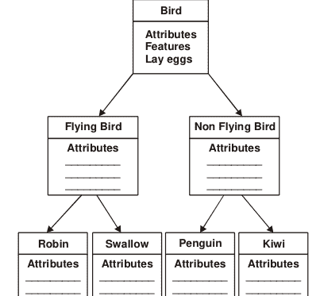

面向对象编程与 C++ 简介（含变量与运算符）

## 6. 多态 (Polymorphism):

- (a) Poly 意味着“多”，morphism 意味着“形式”，即操作有 hơn一种形式。
- (b) 多态表示采取多种形式的能力。
- (c) 多种形式的操作可以通过创建不同的实例表现出不同的行为。
- (d) 对象的行为取决于所使用的数据类型，即同一个事物在不同的地方有不同的行为。
- (e) 多态允许具有不同内部的对象共享相同的外部接口。
- (f) 它支持函数重载和运算符重载。函数重载表示类中的函数具有相同的名称，但参数个数不同或参数类型不同。

你不能重载一个具有相同数量、相同类型且顺序相同、仅在类型上不同的函数。
例如，
当你的朋友询问某事和你的老板询问某事时，你的行为是不同的。
示例，
同名的 `sum` 函数可以用于两个整数的相加、两个浮点数的相加、三个整数的相加；
`sum (int a, int b);`
`sum (float x, float y);`
`sum (int a, int b, int c);`
这也称为多态。

当使用单个函数执行不同的任务时被称为函数重载。这就像特定的单词根据上下文有几个不同的含义一样。

- (g) 在运算符重载中，我们可以重载内置运算符以及用户定义的数据类型。你不能改变运算符的语义。

现有的运算符如 `'+'` 可以用于两个整数的相加，也可以用于两个浮点数的相加，或者 `'+'` 符号用于两个字符串的拼接。重载不能改变运算符的基本模板。

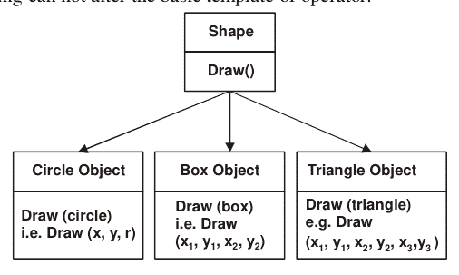

## 7. 动态绑定 (Dynamic binding):

- (a) 动态绑定是在运行时的绑定。
- (b) 动态绑定也称为晚绑定（late binding）。
- (c) 绑定指的是将过程调用或函数调用与运行时要执行的代码或定义链接起来。
- (d) 在运行时调用之前，与给定的过程调用或函数调用相关的代码是未知的。
- (e) 在动态绑定的帮助下，可以使用基类指针根据根据其在运行时指向的对象，来访问派生类的方法。

## 8. 消息传递 (Message passing):

- (a) 面向对象由由一组相互通信的对象组成。
- (b) 消息传递涉及以下步骤：
    - (i) 创建防御对象及其行为。
    - (ii) 从类定义中创建对象。
    - (iii) 在对象之间建立通信。
- (c) 对象通过发送和接收信息或传递消息来相互通信。
- (d) 对象的消息是对执行过程的请求，因此它将调用接收对象中的函数来生成所需的结果。
- (e) 消息传递涉及指定对象的名称、函数的名称以及要发送的消息。
- (f) 客户（Customer）是一个对象。

余额（Balance）是一个消息。

账号（Account no.）是一个对象。

| Customer. | Balance | (account no) |
| :--- | :--- | :--- |
| ↓ | ↓ | ↓ |
| Object | Message | information |

## 1.6 OOP 的优点/OOP 和 C++ 的特性

面向向对象编程提供了许多益处。它规定了以下优势：

- 1. C++ 支持结构化编程和面向对象编程。
- 2. C++ 是处理大型程序的通用语言。
- 3. C++ 使用强大的关键字 `private`、`public` 和 `protected` 支持数据隐藏概念，这有助于我们构建安全的程序。
- 4. 面向对象的系统可以从小到大地升级，因此软件复杂性可以很容易管理。
- 5. 面向对象编程通过继承概念支持。
- 6. 我们可以从标准模块构建程序，而不是从头开始编写代码。这节省了开发时间并提高了生产力。
- 7. 对象可以多个实例。
- 8. 用于对象间通信的消息传递技术。
- 9. C++ 提供了友元功能，使得类内部定义的友可以使用类中私有区域的成员。
- 10. C++ 通过函数重载和运算符重载支持多态概念。
- 11. C++ 有 48 个关键字/保留字。

### 1.7 OOP 的应用

在实时系统中，通常使用复杂的对象以及许多具有不同属性和方法的对象。通过结合这些技术使用了 OOP。
应用领域包括：

- 1. 实时系统。
- 2. 面向对象的数据库。
- 3. 仿真与建模。
- 4. 神经网络和并行计算。
- 5. 决策支持和办公自动化系统。
- 6. CIM/CAM/CAD 系统。

### 1.8 什么是 C++?

- 1. C++ 是由 Bjarne Stroustrup 在 AT & T 贝尔实验室开发的面向对象编程语言。
- 2. C++ 是 C 的扩展，主要增加了类（封装单元）功能。
- 3. C++ 是一种系统编程语言，用于为系统创建不同的程序。

### 1.9 C++ 语言的特性

- 1. C++ 是一种大小敏感的语言。
- 2. C++ 支持结构化编程同时也支持面向对象编程语言的所有特性。
- 3. C++ 是处理大型程序的通用语言。可以使用 C++ 语言创建系统程序。
- 4. C++ 使用强大的关键字 `private`、`public` 和 `protected` 支持数据封装和数据抽象概念。
- 5. C++ 通过运算符重载和函数重载支持数据多态概念。


C++ 编程中的 12 个 OOP

- 6. C++ 支持带有类重用性的继承概念。
- 7. C++ 支持友函数和友类。
- 8. C++ 支持通过使用 `new` 和 `delete` 构造函数和析构函数来实现内存管理概念。
- 9. C++ 支持成员函数使用默认参数。
- 10. C++ 允许我们创建不同的模板。
- 11. C++ 支持使用异常处理进行错误处理。
- 12. C++ 支持虚函数。
- 13. C++ 支持 48 个关键字或保留字。

### 1.10 C++ 程序的结构

```cpp
include section/Link section
class declaration
class function definition
int main () {
    local declaration;
    stmt;
    stmt;
    return 0;
}
```

- 1. **包含部分**：在此部分中，`#` 是一个预处理器指令，用于包含在 Include 语句中指定的头文件。C++ 具有用于输入输出的字符流函数。因此，它拥有 `cin` 和 `cout`。`Istream` 是在 `streambuffer` 类中定义的缓冲区，用于存储从输入设备获取的字符集。`Ostream` 是由 `streambuffer` 类提供的用于显示字符流的缓冲区。`iostream` 是在 `streambuffer` 类中定义的缓冲区，用于存储和显示字符流，帮助可以使用 `cin` 和 `cout` 语句。
- 2. **类声明**：该类（`classname`）在类的公有或私有作用域内定义了不同的数据成员和成员函数。类声明被包含在 `{ }`（大括号）之间，且类声明应以 `;` 结束。
- 3. **类函数定义**：在类声明内部声明的成员函数可以在类函数声明外部进行定义。
- 4. **`main()` 的返回值类型**：在 C++ 中，`main` 向操作系统返回一个整数类型的值，即 `main` 函数应该以 `return` 语句结束。返回值可以是 `void`，表示 `main` 函数不返回任何值。

## 带有变量和运算符的 OOP 与 C++ 简介

示例：
```cpp
#include <iostream.h>
int main () {
  cout << "Welcome to C++";
  return 0;
}
```

### 1.11 C++ 中的基本数据类型

C++ 中的数据类型可以分为以下几类：

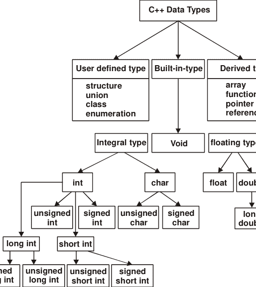

A. **内置类型**：

- (a) **整数类型**：该类型的数据类型为 `int` 和 `char`。修饰符 `signed`、`unsigned`、`long` 和 `short` 可以应用于 `char` 和整数基本数据类型。
`int` 的大小为 2 字节，`char` 的大小为 1 字节。
我们可以正常使用。
- (I) `int` 可以存储 -32767 到 32767 范围内的整数。
- (II) `unsigned` 可以存储 0 到 65535 范围内的整数。
- (III) `char` - 存储字符。
- `signed char` – 存储方式类似于 `char` 类型。
- 可以存储 -127 到 127 范围内的整数。
- `unsigned char` – 存储方式类似于 `char` 类型。
- 可以存储 0 到 255 范围内的整数。
- `short` – 可以存储比使用 `int` 更小的整数。它可以与 `short int`、`signed short`、`short int` 使用。
- `long` – 可以存储 -2147483647 到 2147483647 范围内的整数。
- 可以作为 `long int`、`signed long` 使用。
- `unsigned long` – 可以存储 0 到 4294967295 范围内的整数。

`void`
`void` 用于：
当函数不返回任何值时指定其返回类型。
指示一个空列表。
例如。

| void(void) |
| --- |
| Indicate |
| No Return |
| type = |

**浮点类型**：
`float` 类型支持小数数字。
- (i) `float` 数据类型。
- (ii) `double` 可以存储精度大于 `float` 的小数数字。
- (iii) `long double` 可以存储精度大于 `double` 的小数数字。

B. **用户定义类型**：
通过组合内置数据类型创建的数据类型。

- (a) **结构体 (Structure)**：结构体是一种用户定义类型。它是一个单元内不同数据类型的集合。结构体成员的作用域默认是公有的。
- (b) **联合体 (Union)**：联合体是一种用户定义类型。它在单一位置内存储不同类型的集合。联合体结构体成员的作用域默认是公有的。
- (c) **类 (Class)**：类是一种用户定义类型，可以像任何基本数据类型一样使用。类的成员的作用域默认是私有的，也称为复合类型。
- (d) **枚举 (Enumeration)**：
- (i) 枚举类型是另一种用户定义类型，提供将名称附加到数字的方法。
- (ii) 枚举会将整数隐式地转换为枚举。
- (iii) 使用 `enum` 关键字通过赋值 0, 1, 2 等整数值。
- (iv) 默认情况下，枚举器从 0 开始。

C. **派生数据类型**：

- (a) **数组 (Arrays)**：数组是一种派生类型。它是相似元素的集合，存储在连续的内存位置中。
```cpp
datatype arrayname [size]
int x[10];
```
- (b) **函数 (Functions)**：函数是执行特定任务的派生函数。由于面向对象的概念，在 C++ 中有很多修改。
- (c) **指针 (Pointers)**：指针可以指向另一个变量的地址。常量指针和指向常量的指针可以使用。例如 `char const *P1 = "Welcome";`。
- 指针允许将变量、数组、函数和结构体作为函数参数传递。
- 支持内存的动态分配和释放。

| Sr. | Type | Bytes | Range |
|---|---|---|---|
| 1 | Char | 1 | -128 to 127 |
| 2 | Unsigned char | 1 | 0 to 255 |
| 3 | Signed char | 1 | -128 to 127 |
| 4 | Int | 2 | -32768 to 32767 |
| 5 | Unsigned int | 2 | 0 to 65535 |
| 6 | Signed int | 2 | -32768 to 32767 |
| 7 | Short int | 2 | -32768 to 32767 |
| 8 | Unsigned short int | 2 | 0 to 65535 |
| 9 | Signed int | 2 | -32768 to 32767 |
| 10 | Long int | 4 | -2147483647 to 2147483647 |
| 11 | Unsigned int | 4 | 0 to 4294967295 |
| 12 | float | 4 | 3.4E-38 to 3.4E+38 |
| 13 | Double | 8 | 1.7E-308 to 1.7E+308 |
| 14 | long double | 10 | 3.4E-4932 to 3.4E+4932 |

### 1.12 C++ 运算符

| C++ Operators | | |
|---|---|---|
| (1) | 算术运算符 | |
| (2) | 赋值运算符 | |
| (3) | 比较和逻辑运算符 | 关系运算符、逻辑运算符、相等运算符 |
| (4) | 位逻辑运算符 | |
| (5) | 特殊运算符 | (a) 一元运算符,(b) 三元运算符,(c) 逗号运算符,(d) 作用域运算符,(e) new 和 delete 运算符,(f) 其他运算符 |

## 1. 算术运算符

用于执行加法 (+)、减法 (-)、乘法 (*)、除法 (/) 等算术操作的运算符称为算术运算符。这些基本运算符因为需要两个变量进行求值而被称为二元运算符。

| Sr. No. | Operator | 意义 |
|---|---|---|
| 1. | + | 加法或一元加 |
| 2. | - | 减法或一元减 |
| 3. | * | 乘法 |
| 4. | / | 除法 |
| 5. | % | 取模运算（整数除法的余数） |

运算符操作的变量和常量称为操作数。C++ 中的算术可以分为三种类型：

- (a) 整数算术。
- (b) 实数算术。
- (c) 混合模式算术。

- (a) **整数算术**：当两个操作数都是整数时，该操作被称为整数算术。
 例如：
55 - 5 = 50
55 + 5 = 60
14 * 2 = 28
14/2 = 7 (小数部分截断的整数除法)
14% 2 = 0 (整数除法的余数)
-14 % 3 = -2
14 % 3 = 2


# OOP 与 C++ 简介：变量与运算符

(b) 实数算术：仅涉及实数操作数的算术运算称为实数算术。实数操作数的值可以是分数形式或指数形式的值。

例如：

1.5 - 0.7 = 0.8
1.5 + 0.7 = 2.2
1.5 * 2.0 = 3.0
6.0/7.0 = 0.857143
1.0/3.0 = 0.3333
-2.0/3.0 = -0.666667

% (取模运算符) 不能用于实数

```cpp
x_int/y_int = result_int
x_int/y_float = result_float
x_float/y_int = result_float
x_float/y_float = result_float
```

(c) 混合模式算术：C++ 允许我们将整数与实数操作数混合。当一个操作数是实数而另一个是整数时，该表达式被称为混合模式算术表达式，即如果操作数任一是实数类型，则只执行实数运算，结果始终为实数。

例如：

15/10.0 = 1.5
4 + 3.5 = 7.5

### 2. 赋值运算符

赋值运算符用于将表达式或常数的结果赋值给变量。

赋值运算符可以用任何有效表达式，常用的赋值运算符是 '='。

variable_Name = constant or expression;

算术表达式是变量、常量和运算符的组合。

例如：x = a + b;
z = 100;

在赋值运算符期间，右侧表达式的值被赋值给左侧变量。

在赋值运算符期间，右侧表达式的值被计算并赋值给左侧的变量。

# 复合赋值运算符：

除了常用的赋值运算符 '=' 之外，C++ 具有以下形式的简写赋值运算符。

variable op = expression;

其中 op 是 C++ 二级算术运算符。

- (a) +=
a += 1
a = a + 1
if a = 5
a = 5 + 1
a = 6
x += y + 1
x = x + (y + 1)

- (b) -=
a -= 1
a = a - 1

- (c) *=
a *= 5
a = a * 5

- (d) /= b
a = a/b

- (e) %= b
a = a % b

- (f) &= (位与运算符)
a &= 5
a = a & 5

- (g) |= (位或运算符)
a |= 6
a = a | 6

- (h) <<= (位左移运算符)
a <<= 7
a = a << 7

### 3. 比较运算符与逻辑运算符

- (a) 关系运算符
- (b) 逻辑运算符
- (c) 等等运算符

**关系运算符**：通过关系运算符，我们可以通过比较两个或多个操作数的值来做出决策。关系运算符比较值以判断它们是否相等，或者一个是否大于另一个等。

| 运算符 | 含义 |
|---|---|
| < | 小于 |
| <= | 小于等于 |
| > | 大于 |
| >= | 大于等于 |

expression1 relational_operator expression2

| 表达式 | 结果 |
|---|---|
| 3 > 4 | false |
| 6 <= 2 | false |
| 10 > 32 | True |
| (23 * 7) > (-67 + 89) | True |

**(b) 逻辑运算符**：逻辑运算符用于执行逻辑表达式，如逻辑与（AND）、逻辑或（OR）和非（NOT）。

| 运算符 | 含义 |
|---|---|
| && | 逻辑与 |
| || | 逻辑或 |
| ! | 逻辑非 |

当我们需要测试多个条件并做出决策时，使用逻辑与和逻辑运算符。

**逻辑与**表示当两个条件或表达式都为真时，复合表达式的结果为真。

| 情况 | 结果 |
|---|---|
| true && true | true |
| true && false | false |
| false && true | false |
| false && false | false |

**逻辑或**表示如果任何或所有输入为真，则结果为真。expression1||expression2

| 情况 | 结果 |
|---|---|
| true || true | true |
| true || false | true |
| false || true | true |
| false || false | false |

| (a < b) || (b > c) | |
|---|---|
| true || false | true |

**逻辑取反运算符 (!)**：通过取反运算符 (!)，可以将逻辑表达式从假变为真，或从真变为假。

| 情况 | 结果 |
|---|---|
| ! (true) | false |
| ! (false) | true |

! (expression)

# 示例：
! (a < b) || (c > b)
! (4 < 5) || (6 > 5)
! (true) || (true)

false || true
true

(c) 等等运算符：这些运算符用于检查给定表达式或语句的相等性。
== 是两个表达式之间的比较运算符，用于相等性检查。
!= 是两个表达式之间的比较运算符，用于不相等性检查。

| 表达式 | 结果 |
|---|---|
| a == b != c | 如果 a = 4, b = 6 则为 false |
| 如果 a = 4, b = 6, c = 8 则为 true |
| ' ' == 'k' | false |

### 4. 位逻辑运算符

C++ 拥有一套强大的位操作运算符集。这允许程序员访问并操作数据块中的单个比特位。

| 运算符 | 含义 |
|---|---|
| == | 等于 |
| != | 不等于 |
| & | 位与 |
| | | 位或 |
| ^ | 位异异 (EXOR) |
| >> | 位右移 |
| << | 位左移 |
| ~ | 位取反 |

(a) 位与：位与运算将在运算符的两个模式之间进行。

| 变量 | 值 | 二进制模式 |
|---|---|---|
| x | 5 | 0101 |
| y | 2 | 0010 |
| x & y | 0 | 0000 |
| a | 6 | 0110 |
| b | 3 | 0011 |
| a & b | 2 | 0010 |

要在结果中产生 1 位，位与运算需要两个数在该位上均为 1。

(b) 位或：如果任何一个比特值为 1，位或运算结果为 1。

| 变量 | 值 | 二进制模式 |
| --- | --- | --- |
| x | 5 | 0101 |
| y | 2 | 0010 |
| x/y | 7 | 0111 |
| a | 6 | 0110 |
| b | 1 | 0001 |
| a/b | 7 | 0111 |

(c) 位异异：如果对应的比特位不同，位异异运算结果为 1。

| 变量 | 值 | 二进制模式 |
| ------|---|---|
| x | 5 | 0101 |
| y | 2 | 0010 |
| x^y | 7 | 0111 |
| a | 6 | 0110 |
| b | 3 | 0011 |
| a^b | 5 | 0101 |

(d) 位右移：右移运算符将比特向右移动指定的位数。

| 变量 | 值 | 二进制模式 |
|---|---|---|
| x | 5 | 0101 |
| x >> 1 | 2 | 0010 |

(e) 位左移：左移运算符将比特向左移动指定的位数。

| 变量 | 值 | 二进制模式 |
|---|---|---|
| x | 5 | 0101 |
| x << 1 | 10 | 1010 |

(f) 位取反：取反运算符 翻转二进制模式中的所有比特。

| 变量 | 值 | 二进制模式 |
|---|---|---|
| x | 5 | 0101 |
| ~x | -6 | 补码 |

### 5. 特殊运算符

C++ 语言中一些特殊运算符用于执行特定类型的操作。

- (a) 一元运算符。
- (b) 三元运算符。
- (c) 逗号。
- (d) 作用域运算符。
- (e) new 和 delete 运算符。
- (f) 其他运算符。
  - (i) 用于分组的括号。
  - (ii) 成员运算符（操作符）。

(a) 一元运算符：一元运算符只需要单个表达式即可产生结果。某些一元运算符可以后跟操作数，如增减运算符。

最常用的一元运算符是负号，负号位于数值常量、变量或表达式之前。

| 运算符 | 含义 |
|---|---|
| * | 指针所指存储字段的内容。因此 * 用于获取地址运算符的内容。指向特定的内存。 |
| & | 变量的地址 |
| -- | 负值（负号） |
| -- | 位取反 |
| ++ | 增运算符
i++ 后置增
++i 前置增 |
| -- | i++ -> i + 1 -> i = 5 + 1 -> 6 |
| -- | 减运算符
-- 后置减
-- 前置减
-- i -> i - 1 -> i = 5 - 1 -> 4 |
| type | 强制类型转换 |
| sizeof | 后续数据类型或类型的大小（按字节计）。它用于编译器指向特定数据类型的内存大小或内存块 |


# 带有变量和运算符的 OOP 与 C++ 介绍

(b) 三元运算符 (?)：C++ 了一个非常特殊的运算符，称为三元条件运算符。之所以被称为三元运算符是因为因为它三个表达式。它是 `if_else` 结构的简写形式。

三元运算符的格式为 `expression1?expression2:expression3`

如果 `expression1` 求值为真，则求值 `expression2`，否则求值 `expression3`。

示例：

- (1) if (i % 2 == 0)
    even = true;
  else
    even = false;
  even = (i % 2 == 0) ? true : false;

- (2) if (i > j)
    max = i;
  else
    max = j;
  max = (i > j) ? i : j;

- (3) if (x > y)
    x = x + 3;
  else
    x = x - 3;
  x = (x > y) ? x + 3 : x - 3;

逗号运算符：C++ 以两种方式使用逗号运算符：

- 1. 逗号第一次用法是变量声明中的分隔符：
  `int a, b, c;`
  `float x, y, z;`

- 2. 逗号的第二次用法是循环中的分隔符：
  `for (i = 1; j = 2; i <= 10; i++, j+=3);`
  {
    cout << i << " " << j << endl;
  }

(d) 作用域运算符 (::)：C++ 中的作用域运算符。

作用域用于类成员函数的定义。C++ 有两个一元运算符 `new` 和 `delete`。动态内存的分配和释放通过 `malloc`、`alloc`、`calloc` 和 `free` 等库函数处理。

(e) new 和 delete 运算符：`new` 运算符执行在运行时动态分配内存的任务。
`delete` 运算符用于释放内存或释放内存，即可以使用 `new` 和 `delete` 运算符提供内存管理。

# 其他运算符：

- 用于表达式分组的括号：
每个运算符的优先级和结合性决定了它是在表达式中的下一个运算符之前还是之后生效。
当表达式的元素被放在括号周围时，该元素会在括号外的任何内容之前求值。
例如 `(a + b * c) * d`
这里首先 `b` 与 `c` 相乘，结果加到 `a`，然后该结果乘以 `d`。

- 成员运算符：
这些是可用的 C++ 操纵符。
操纵符用于格式化数据显示的运算符。常用的操纵符是 `endl` 和 `setw`。

- 1. `endl` 运算符导致插入一行。
  `int m=5, n=6;`
  `cout << "m" << m << endl;`
  `cout << "n" << n << endl;`
  `m=5;`
  `n=6;`

- 2. `setw` 运算符指定字段宽度
  `cout << setw(5) << sum << endl;`
如果 `sum = 45`，则输出为
   45
setw 将为打印变量 `sum` 的值设置字段 5。

### 1.13 预处理器指令

- 1. 预处理器根据程序中提供的指令修改 C++ 程序的程序。
2. C++ 基本上运行 `#include` 和 `define` 预处理器指令。
3. 在源文件提交给编译器之前，会执行以下操作：
(a) 通过 `#define` 语句将定义的标识符替换为文本段。
(b) 包含其他文件，它们可能使用定义的文件或系统库文件。
例如 `#include "sum.h"`
包含引号包裹的用户头文件。
例如 `#include <stdio.h>` 它包含系统库的头文件，因此位于尖括号内）。

定义预处理器的通用规则：

- 1. 所有预处理器指令都以井号 (#) 开头。
2. 它们必须从第一列开始，井号和指令之间不需要空格。
3. 预处理器指令不应以分号 (;) 结束。
4. 一行中只能出现一个预处理器指令。
5. 预处理器也被称为宏定义。

`#define max` 是一个预处理器指令，它指示编译器将标识符 `max` 替换为字符串 `100`。
因此在程序中，`max` 的每次出现都会自动替换为 `100`。
示例：

```
#define true 1
#define false 0
#define EoF -1
#define product (x, y) ((x) * (y))
#define max (x, y) ((x) > (y)?(x):(y))
#define begin {
#define end {}
#define mod %
#define program main
```

语法：
`#define macro_name body of macro`
`#define Pi 3.1415`

在这里我们将符号值 `Pi` 的值赋值为 `3.1415`。这种宏也被称为内联函数，其中宏名可以在一行中替换为宏主体。
宏的主体可以是任何常量或表达式。

这些预处理器语句将在程序编译之前定义或声明。因此，预处理器会将程序文本中宏名的每次出现替换为宏主体的副本。

### 1.14 变量声明

- 1. 变量声明：在 C 语言中，所有变量在执行语句中使用之前必须声明。在 C 语言中，所有变量必须先在局部声明部分声明（即在作用域开头）。但 C++ 允许在作用域的任何地方声明变量。


# 控制结构与循环


### 2.1 控制结构引言

控制程序的执行流是编程中一个非常重要的方面。寻找解决某个特定问题的方法可能有许多种，但你将希望找到最好、最快的方法。

控制结构包含一个逻辑语句，它通常是一个被包含在花括号 {} 内的语句块。

对控制结构进行缩进对于编写可读的程序至关重要。有几种风格。我使用的风格是常见的工业风格或 K&R 风格。左大括号位于起始语句的末尾。这种设计的目的是避免在语句各个部分之间产生过多的空白。缩进通常使用 4 个空格，有时也使用 3 个或 2 个空格。

**真/假**值用于 **if** 和循环语句。这些值要么是布尔值 **true** 和 **false**，要么任何非零值表示真，零表示假（如 C 语言所示）。

C++ 有四种控制结构：顺序结构、选择（决策）、重复结构（循环）和子程序（函数）。这些结构简单地控制着程序的执行。

### 2.2 控制结构的类型

C++ 有四种控制结构：

1. 顺序结构。
2. 选择结构（决策）。
3. 重复结构（循环）。
4. 子程序（函数）。

**顺序**：顺序意味着程序从一条语句移动到下一条，该语句移动到下一条，以此此类推。它是结构中最简单的形式，在开发复杂程序时，不太可能会使用顺序结构。

**选择（决策）**：选择结构根据决策做出判断并执行命令。选择结构涉及“if 语句”，它们类似于“如果……这样，就做那样”以及“如果不是，就做那样”。通过“if 语句”，我们还可以包含“嵌套语句”。选择结构的另一种形式被称为“switch 语句”，它对其他人非常有用。“switch 语句”关注特定变量的值并执行不同的“cases”。

**重复（循环）**：当某些内容需要通过“循环”重复特定次数时，就会使用重复结构。循环是一个简单的语句，它重复执行或循环，直到达到某个值，然后移动到下一条可执行语句。例如，如果你要求用户输入值以计算数字的平均值，你可以使用循环，让用户继续输入数字，直到输入了数字为止。

**子程序（函数）**：函数是一个执行特定任务并将结果返回给调用或触发它的语句的子组。一旦你开发出一个处理特定情况的函数，函数就会让编程变得非常强大，你可以在其他程序中使用该函数。函数可以调用另一个函数，该函数可能再调用另一个函数，以此此类推。这是组织程序并将你的程序分解为逻辑步骤的好方法。

在对不同类型的控制结构进行简要介绍后，是时候研究如何使用每种类型了。我们将跳过顺序结构，因为它们几乎是不言自明的，将直接进入选择语句。阅读更多关于选择结构和“if 语句”的内容。

### 2.3 选择语句

**选择语句**：在处理选择语句时，通常有三个版本：单向、双向和多向。单向决策执行某些特定的操作，或者什么都不做。双向决策执行一件事或什么都不做。多向决策可以根据表达式的值执行许多不同的事情。

**单向决策**：单向决策由“if 语句”处理，要么执行某些特定的操作，要么完全什么都不做。决策基于逻辑表达式，该表达式的结果为真或假。如果逻辑表达式为真，则执行某些特定的操作；如果为假，则什么都不做。通过“if 语句”，我们还可以包含“嵌套语句”。单向决策的另一种形式如下：

```cpp
if (expression) {
    // 执行语句
}
```

单向决策可以是简单语句或复合语句（使用花括号包裹）。

示例 1：简单语句
```cpp
int c = 3;
if (c > 0)
    cout << "c";
```

示例 2：复合语句
```cpp
int c = 10;
if (c > 5) {
    cout << "c";
}
```

**双向决策**：双向决策由“if-else 语句”处理，要么执行一件事或什么都不做。决策基于逻辑表达式。如果表达式为真，则执行相应的语句；如果为假，则执行 else 部分。双向决策的的形式如下：

```cpp
if (expression) {
    // 执行语句
} else {
    // 执行其他语句
}
```

**多向决策**：多向决策可以根据表达式的值执行许多不同的事情。多向决策涉及“if-else if 语句”、“嵌套 if”或“switch 语句”。多向决策的形式如下：

```cpp
if (expression1) {
    // 执行语句 1
} else if (expression2) {
    // 执行语句 2
} else {
    // 执行默认语句
}
```

如果第一个表达式为真，则执行语句1；如果第二个表达式为真，则执行语句2，以此此类推。如果所有表达式均为假，则执行 else 部分。

示例 1：简单语句
```cpp
int x;
if (x > 0)
    cout << "x is positive";
else if (x == 0)
    cout << "x is zero";
else
    cout << "x is negative";
```

示例 2：复合语句
```cpp
char ch;
if (ch >= 'A' && ch <= 'Z' || ch >= 'a' && ch <= 'z')
    cout << "contains a character";
else if (ch >= '0' && ch <= '9')
    cout << "contains a digit";
else if (ch == ' ' || ch == '\t' || ch == '\n')
    cout << "is white space";
else
    cout << "ch is a misc. character";
```

**switch 语句**：switch 语句是处理多向决策的另一种选择。我将其单独分出一节是因为有些程序员认为使用 switch 语句不是良好的编程风格。在了一个学期的编程和多年尝试不同编程语言之后，我没有遇到过 switch 语句的问题。我没有写过太多 switch 语句，但当我写过时，程序运行良好。也许在未来的编程经验中我会发现为什么程序员不喜欢 switch 语句。现在，让我们了解 switch 语句。

1. 表达式必须是整数表达式。
2. 每个 case 由整数或字符常量标记。
3. case 和 default 可以以任何顺序排列。
4. case 必须互不相同。
5. 执行完一个 case 的代码后，除非采取显式操作，否则执行会一直进入下一个 case。
6. break 语句会导致立即退出 switch。
7. case 穿透（fall through）是一把双刃剑。
8. 优点是多个 case 可以共一套代码，避免了冗余。
9. 缺点是每个 case 后面都有一个 break。

switch 语句提供了“else if”结构的替代方案，后者根据单个表达式的值有多种可能的路径。switch 语句的修订形式如下：

```cpp
switch (int expression)
{
  case label - 1:
    stmt-list-1;
    break;
  case label - 2:
    stmt-list-2;
    break;
  case label - 3:
    stmt-list-3;
    break;
  .
  .
  .
  case label - n:
    stmt-list-n;
    break;
}
```


在执行期间，会对表达式求值。如果表达式的值与标签 `-1` 匹配，将执行 `stmt-list-1`。如果不匹配，执行将继续检查标签 `-2` 等，依此类推。如果标签与表达式匹配，则将执行 `default`。在每个 `case` 内部以及每个语句列表的末尾（`default` 除外）必须有一个 `break` 语句，用于终止最内层的嵌套 `switch` 或循环语句。

以下是关于 `switch` 语句的几点说明：测试的表达式必须产生整数值（或单个字符），`case` 必须是整数常量（字面量或命名常量），`switch` 内部的每个标签应该是唯一的，且每个 `stmt-list` 可以包含 0 或多个语句，这些语句不需要包含在大括号 `{ }` 中。

## 示例：

假设一个名为 `score` 的变量是 `int` 类型，包含了橄榄球比赛中的得分。考虑以下代码：

```
switch ( score )
{
    case 1: cout << "Extra Point" << endl;
    break;
    case 2: cout << "Safety of two points conversion" << endl;
    break;
    case 3: cout << "Field Goal" << endl;
    break;
    case 6: cout << "Touchdown" << endl;
    break;
    default: cout << "Invalid score on a football play." << endl;
}
```

## 选择语句的语法

| 选择 (if, -else) |
| --- |
| if 语句 |
| //---- 带有真子句的 if 语句 |
| if (expression) { |
| statements // 如果 expression 为真则执行此 |
| } |
| //---- 带有真、假子句的 if 语句 |
| if (expression) { |
| statements // 如果 expression 为真则执行此 |
| } else |
| statements // 如果 expression 为假则执行此 |

## 控制结构与循环

| ------ 带有多个并行测试的 if 语句 |
| if (expression1) { |
| statements // 如果 expression1 为真则执行此 |
| else if (expression2) { |
| statements // 如果 expression2 为真则执行此 |
| else if (expression3) { |
| statements // 如果 expression3 为真则执行此 |
| ... |
| else |
| statements // 如果没有表达式为真则执行此 |
| } |

使用 Switch Case 构造的示例：

```
#include<iostream>
#include<conio.h>
void main() {

int a
```

```
printf("Division of two nos is %d", c);
break;
case 4:
c*=b;
printf("The Multiplication of two nos is %d", c);
break;
} /* end of switch */
getch();
} /* end of main */
```

### 2.4 重复（循环）

**While 循环：** 循环是一种代码语句，它会不断执行某些操作，直到循环的逻辑表达式求值为假。它简单来说是一种反复重复代码直到达到某个特定值的方法。它也是一种确保用户输入正确类型数据（数据验证）的有效方法。

循环与 `if` 语句的区别在于，如果逻辑表达式为真，则会执行 `stmt` 并返回再次检查逻辑表达式……再次，再次，最终逻辑表达式将变为假。

一种需要避免的是编写产生无限循环的代码，无限循环是指在你在键盘上按下 `ctrl-break` 之前永远不会停止的循环。为了避免无限循环，你需要在循环体内使用一个或多个语句来改变逻辑表达式的部分。我们将讨论三种循环：`while`、`do` 和 `for`。

`while` 循环的格式如下：

```
while (logical expression)
  stmt;
```

**示例 1：**

```
int x = 7;
while (x > 0)
{
cout << x << endl;
x--;
}
```

**示例 2：** 使用数据验证：

假设程序用户需要输入一个 -10 到 10（包含）之间的整数。使用数据验证，编写一段代码来输入此值：

```
int k;
k = -99;
while (k < -10 || k > 10)
{
```

控制结构与循环

```
cout << "Enter an integer value (between -10 and 10):");
cin >> k;
}
```

## 示例 3:

编写一段代码，显示所有小于 500 的 5 的倍数。

```
int x = 5;
while ( x < 500 ) {
  cout << x << endl;
  x += 5;
}
```

以上就是我关于循环的所有内容，让我们进入下一个感兴趣的循环。阅读更多关于 `do` 循环……

**Do 循环：** `do` 循环是另一种重复语句。它与 `while` 循环完全相同，执行某些操作，然后评估循环的逻辑表达式以确定下一步发生什么。通常在 `while` 循环中，循环中的逻辑表达式部分在执行循环之前必须初始化。`do` 循环允许执行某些操作，然后再检查循环的逻辑表达式。我在程序中使用数据验证时，喜欢使用 `do` 循环。`do` 循环的格式如下：

```
do
  stmt()
while ( logical expression );
```

循环中的 `stmt` 可以是单条或复杂的。复杂的语句必须包含在大括号 `{ }` 中。让我们来看 `do` 循环的几个示例。

## 示例 1:

```
int number;
do{
  cout << "Enter a positive number greater than 0:";
  cin >> number;
}
while (number <= 0);
```

## 示例 2:

```
int number;
do{
  cout << "Enter a number between 0 and 100:";
  cin >> number;
}
while (number != 0);
```

## For 循环

在讨论了 `while` 和 `do` 循环后，还有一种感兴趣的循环：`for`。

`for` 循环是另一种重复某些操作的方法。大多数程序员喜欢使用 `for` 循环，因为它相比 `while` 语句写法更紧凑。当你确切知道需要循环多少次时，可以使用它。`for` 循环的通常如下：

```
for (expression1; expression2; expression3)
  stmt;
```

其中 `stmt` 是单条语句。`expression2` 在循环期间进行测试，`expression3` 在每次迭代后执行。注意 1：如果 `expression1` 被省略，则等同于 `while` 循环。注意 2：如果 `expression2` 被省略，则循环是无限循环。如果 `expression3` 被省略，则循环没有更新。

`for` 循环可以改写为 `while` 循环，反之亦然。

```
initialStmt:
while(expression2)
{
statements
incrementStmt
}
```

示例 1：编写一个循环显示 1 到 5 之间的奇数：

```
for (int k = 1; k <= 5; k+=2)
cout << k << endl;
```

示例 2：编写一个从 20 到 1 的倒计时循环：

```
for (int k = 20; k >= 1; k--)
cout << k << endl;
```


```cpp
for (j = 0; j < 2; j++)
{
    printf_s("Inner loop executing. j = %d\n", j);
    if (i == 3)
        goto stop;
}
// This message does not print:
printf_s("Loop exited. i = %d\n", i);
stop:
printf_s("Jumped to stop. i = %d\n", i);
```

# 输出:

- 外层循环执行。i = 0
- 内层循环执行。j = 0
- 内层循环执行。j = 1
- 外层循环执行。i = 1
- 内层循环执行。j = 0
- 内层循环执行。j = 1
- 外层循环执行。i = 2
- 内层循环执行。j = 0
- 内层循环执行。j = 1
- 外层循环执行。i = 3
- 内层循环执行。j = 0
- 跳到到 stop。i = 3

### 2.6 break 语句

break 语句：我们已经在 switch 语句中见过一次 break 语句的使用。除此之外，break 语句还可以用于终止循环或退出 switch 语句。它可以在 do-while 循环中使用，例如 `While((c=getchar()))!=EOF):`

示例：{

```cpp
{
    putchar(c);
    i++;
    if(i>20)
        break;
}
```

### 2.7 continue 语句

**continue 语句：** continue 允许你从开始继续执行 for 或 while 循环，这使得在 continue 语句之后可以跳过循环的剩余部分。

示例：

```cpp
#include <stdio.h>
main()
{
    static int marks[5] = {90,80,76,89, -90};
    int i, total=0;
    for(i=0; i<5; i++)
    {
        if(marks[i] < 0)
        {
            printf("negative marks not added\n");
            continue;
        }
        total += marks[i];
    }
    printf("total marks = %d\n", total);
}
```

## 自练习题库

- 1. 解释 c++ 中提供了哪些不同的控制结构。
- 2. 解释 if、if-else 语句的语法并给出合适的示例。
- 3. 解释 c++ 中使用的不同循环并给出合适的示例。
- 4. 解释 for loop与 while loop 的区别。在什么应用下建议使用 for loop，在什么应用下建议使用 while loop？说明原因。
- 5. 解释 switch 语句的作用，将 switch 语句与 if 语句进行比较并说明 switch 语句的优点。
- 6. 解释 break 语句的作用，讨论 break 语句在哪些控制结构中使用并示例。
- 7. 解释 GOTO 语句，讨论如何将控制转移到任何语句。
- 8. 解释 break 和 continue 语句的使用。说明这些语句的使用场景。

# 第 3 章 C++ 中的函数

## 章节目录

- 3.1 函数简介
- 3.2 值传递与引用传递
- 3.3 函数重载
- 3.4 内联函数
- 3.5 带默认参数的函数

### 3.1 函数简介

函数是一组语句块，用于避免重复任务。
将程序划分为函数是自顶向下结构化编程的主要原则。当函数被多次调用或在不同地方被调用时，它可以减小程序的体积。

当函数被调用时，将执行以下步骤：

- 1. 当函数被调用时，控制转移到函数体中的第一个语句。
- 2. 在切换到函数体时，会检查函数原型和函数头语句，如果匹配则控制继续。
- 3. 在切换到函数体时，会传递实际参数。
- 4. 执行函数并将结果返回给函数。
- 5. 函数被调用时可以显示结果。

函数被分为三部分：

- (a) 声明 (Declaration)
- (b) 调用 (Call)
- (c) 定义 (Definition)

C++ 中的函数

(a) 声明：

- (a) 声明在全局作用域。
- (b) 声明在局部作用域。
- (c) 定义在全局作用域。

(d) 声明：

- (a) 声明在函数体内部。
- (b) 声明在函数体外部。
- (c) 声明在函数内部。

(e) 调用：

- (a) 调用在 main 函数内部。
- (b) 调用在 main 函数外部。
- (c) 调用在 main 函数内部。

(f) 定义：

- (a) 定义在 main 函数内部。
- (b) 定义在 main 函数外部。
- (c) 定义在 main 函数内部。


在此处，形式参数指的是函数定义成为调用函数中实际参数的别名。

## 函数声明：

```
int sum (int * a, int * b);
```

## 函数调用：

```
s = sum (&x, &y);
```

## 函数定义：

```
int sum (int * a, int * b)
{
int t;
t = * a + * b;
return t;
}
```

## 3.3 函数重载

重载是指具有相同名的函数可以执行多种不同的任务。这在面向对象编程（OOP）中称为函数多态。

函数重载是一种逻辑方法，通过使用不同的参数和数据类型调用多个执行基本相同功能的函数。

在重载期间，编译器会检查以下几点：

- 1. 它会在函数调用调用时检查函数名是否完全匹配。
- 2. 在名称匹配后，它将检查参数的总数。
- 3. 在参数总量匹配后，它将检查参数的数据类型。
- 4. 如果这 3 点都匹配，则将执行函数定义。

## 函数重载的优点：

- 1. 它消除了为同一操作使用不同函数的情况。
- 2. 它有助于理解、调试和轻松掌握。
- 3. 代码易于维护。

## 3.3.1 使用函数重载的示例

- 1. 编写一个程序，使用带重载的公共函数打印两个整数之和和三个浮点数之和。

```cpp
void main ()
{
int a, b, s;
float fa, fb, fc, fs;
int sum (int x, int y);
float sum (float f1, float f2, float f3);
```

* 变量声明
* 函数声明
* 重载函数声明

```cpp
cout<< "enter two integer numbers";
cin >>a>> b;
s=sum(a, b);
cout<<"enter three float numbers";
cin>>fa>>fb>>fc;
fs=sum(fa, fb, fc);
cout << "The sum of two integers is"<<endl;
cout << "The sum of three float numbers is"<<fs;
getch();

int sum(int x, int y) {
    return (x + y);
}

float sum(float f1, float f2, float f3) {
    return (f1 + f2 + f3);
}
```

函数调用
函数定义
函数定义

- 2. 编写一个程序，使用带重载的交换函数交换 2 个整数、2 个浮点数和 2 个字符的数值。

```cpp
void main() {
    int x, y;
    float fx, fy;
    char cx, cy;
    void swap(int a, int b);
    void swap(float f1, float f2);
    void swap(char c1, char c2);
    cout << "enter two integers"<<endl;
    cin>>x>>y;
    swap(x, y);
    cout << "enter two float numbers"<<endl;
    cin>>fx>>fy;
    swap(fx, fy);
    cout << "enter two characters"<<endl;
    cin>>cx>>cy;
    swap(x, y);
    getch();
}
```

变量声明
函数声明
函数调用
函数调用

```cpp
void swap (int a, int b)
{
    int temp;
    temp=a;
    a=b;
    temp=temp;
    cout<<"a="<<a<<endl;
    cout<<"b="<<b;
}
```

函数定义

```cpp
void swap (float f1, float f2)
{
    float temp;
    temp=f1;
    f1=f2;
    f2=temp;
    cout<<"f1="<<f1<<endl;
    cout<<"f2="<<f2;
}
```

函数定义

```cpp
void swap (char c1, char c2)
{
    char temp;
    temp=c1;
    c1=c2;
    c2=temp;
    cout<<"c1="<<c1<<endl;
    cout<<"c2="<<c2;
}
```

函数定义

- 3. 编写一个程序，使用重载的面积函数打印圆的面积和矩形的面积。

```cpp
void main()
{
    int radius, length, breath, arect; //变量声明
    float acirc;
    float area(int r);
    float area(int l, int b);
    cout<<"enter radius"<<endl;
    cin>>radius;
}
```

函数声明

```cpp
acic=area (radius); //函数调用
cout<<"enter length & breath"<< endl;
cin>>length>>breath;
arect=area(length, breath);
cout<<"The area of circle is"<<acic<<endl;
cout<<"The area of the rectangle is"<<arect;
```

```cpp
float area (int r)
{
    return (3.1415 * r * r);
}
int area (int l, int b)
{
    //函数定义
    return (l * b);
}
```

## 3.4 内联函数

内联函数也称为宏。函数的主要目的是在函数被调用时节省内存空间。

当函数被调用时，会检查函数名、参数类型、参数数量，如果所有内容匹配，则控制权转移到函数并提供动态绑定。然后执行函数定义并返回答案。内联函数在编译时会被替换为函数体，以减少函数调用的开销。

内联函数的优点：

- 1. 减少了函数栈的大小。
- 2. 提高了执行速度。
- 3. 可以消除了函数调用的开销（如压栈和出栈操作）。

## 函数重载的优点：

- 1. 它消除了为同一操作使用不同函数的情况。
- 2. 它可以帮助理解、调试和轻松掌握。
- 3. 代码易于维护。

## 3.3.1 使用函数重载的示例：

- 1. 编写一个程序，使用带重载的公共函数打印两个整数之和和三个浮点数之和。

```cpp
void main ()
{
int a, b, s;
float fa, fb, fc, fs;
int sum (int x, int y);
float sum (float f1, float f2, float f3);
```

* 变量声明
* 函数声明
* 重载函数声明

```cpp
cout<< "enter two integer numbers";
cin >>a>> b;
s=sum(a, b);
cout<<"enter three float numbers";
cin>>fa>>fb>>fc;
fs=sum(fa, fb, fc);
cout << "The sum of two integers is"<<endl;
cout << "The sum of three float numbers is"<<fs;
getch();

int sum(int x, int y) {
    return (x + y);
}

float sum(float f1, float f2, float f3) {
    return (f1 + f2 + f3);
}
```

函数调用
函数定义
函数定义

- 2. 编写一个程序，使用带重载的交换函数交换 2 个整数、2 个浮点数和 2 个字符的数值。

```cpp
void main() {
    int x, y;
    float fx, fy;
    char cx, cy;
    void swap(int a, int b);
    void swap(float f1, float f2);
    void swap(char c1, char c2);
    cout << "enter two integers"<<endl;
    cin>>x>>y;
    swap(x, y);
    cout << "enter two float numbers"<<endl;
    cin>>fx>>fy;
    swap(fx, fy);
    cout << "enter two characters"<<endl;
    cin>>cx>>cy;
    swap(x, y);
    getch();
}
```

变量声明
函数声明
函数调用
函数调用

```cpp
void swap (int a, int b)
{
    int temp;
    temp=a;
    a=b;
    temp=temp;
    cout<<"a="<<a<<endl;
    cout<<"b="<<b;
}
```

函数定义

```cpp
void swap (float f1, float f2)
{
    float temp;
    temp=f1;
    f1=f2;
    f2=temp;
    cout<<"f1="<<f1<<endl;
    cout<<"f2="<<f2;
}
```

函数定义

```cpp
void swap (char c1, char c2)
{
    char temp;
    temp=c1;
    c1=c2;
    c2=temp;
    cout<<"c1="<<c1<<endl;
    cout<<"c2="<<c2;
}
```

函数定义

- 3. 编写一个程序，使用重载的面积函数打印圆的面积和矩形的面积。

```cpp
void main()
{
    int radius, length, breath, arect; //变量声明
    float acirc;
    float area(int r);
    float area(int l, int b);
    cout<<"enter radius"<<endl;
    cin>>radius;
}
```

函数声明

```cpp
acic=area (radius); //函数调用
cout<<"enter length & breath"<< endl;
cin>>length>>breath;
arect=area(length, breath);
cout<<"The area of circle is"<<acic<<endl;
cout<<"The area of the rectangle is"<<arect;
```

```cpp
float area (int r)
{
    return (3.1415 * r * r);
}
int area (int l, int b)
{
    //函数定义
    return (l * b);
}
```

## 3.4 内联函数

内联函数也称为宏。函数的主要目的是在函数被调用时节省内存空间。

当函数被调用时，会检查函数名、参数类型、参数数量，如果所有内容匹配，则控制权转移到函数并提供动态绑定。然后执行函数定义并返回答案。内联函数在编译时会被替换为函数体，以减少函数调用的开销。

内联函数的优点：

- 1. 减少了函数栈的大小。
- 2. 提高了执行速度。
- 3. 可以消除了函数调用的开销（如压栈和出栈操作）。

## 函数重载的优点：

- 1. 它消除了为同一操作使用不同函数的情况。
- 2. 它可以帮助理解、调试和轻松掌握。
- 3. 代码易于维护。

## 3.3.1 使用函数重载的示例：

- 1. 编写一个程序，使用带重载的公共函数打印两个整数之和和三个浮点数之和。

```cpp
void main ()
{
int a, b, s;
float fa, fb, fc, fs;
int sum (int x, int y);
float sum (float f1, float f2, float f3);
```

* 变量声明
* 函数声明
* 重载函数声明

```cpp
cout<< "enter two integer numbers";
cin >>a>> b;
s=sum(a, b);
cout<<"enter three float numbers";
cin>>fa>>fb>>fc;
fs=sum(fa, fb, fc);
cout << "The sum of two integers is"<<endl;
cout << "The sum of three float numbers is"<<fs;
getch();

int sum(int x, int y) {
    return (x + y);
}

float sum(float f1, float f2, float f3) {
    return (f1 + f2 + f3);
}
```

函数调用
函数定义
函数定义

- 2. 编写一个程序，使用带重载的交换函数交换 2 个整数、2 个浮点数和 2 个字符的数值。

```cpp
void main() {
    int x, y;
    float fx, fy;
    char cx, cy;
    void swap(int a, int b);
    void swap(float f1, float f2);
    void swap(char c1, char c2);
    cout << "enter two integers"<<endl;
    cin>>x>>y;
    swap(x, y);
    cout << "enter two float numbers"<<endl;
    cin>>fx>>fy;
    swap(fx, fy);
    cout << "enter two characters"<<endl;
    cin>>cx>>cy;
    swap(x, y);
    getch();
}
```

变量声明
函数声明
函数调用
函数调用

```cpp
void swap (int a, int b)
{
    int temp;
    temp=a;
    a=b;
    temp=temp;
    cout<<"a="<<a<<endl;
    cout<<"b="<<b;
}
```

函数定义

```cpp
void swap (float f1, float f2)
{
    float temp;
    temp=f1;
    f1=f2;
    f2=temp;
    cout<<"f1="<<f1<<endl;
    cout<<"f2="<<f2;
}
```

函数定义

```cpp
void swap (char c1, char c2)
{
    char temp;
    temp=c1;
    c1=c2;
    c2=temp;
    cout<<"c1="<<c1<<endl;
    cout<<"c2="<<c2;
}
```

函数定义

- 3. 编写一个程序，使用重载的面积函数打印圆的面积和矩形的面积。

```cpp
void main()
{
    int radius, length, breath, arect; //变量声明
    float acirc;
    float area(int r);
    float area(int l, int b);
    cout<<"enter radius"<<endl;
    cin>>radius;
}
```

函数声明

```cpp
acic=area (radius); //函数调用
cout<<"enter length & breath"<< endl;
cin>>length>>breath;
arect=area(length, breath);
cout<<"The area of circle is"<<acic<<endl;
cout<<"The area of the rectangle is"<<arect;
```

```cpp
float area (int r)
{
    return (3.1415 * r * r);
}
int area (int l, int b)
{
    //函数定义
    return (l * b);
}
```

## 3.4 内联函数

内联函数也称为宏。函数的主要目的是在函数被调用时节省内存空间。

当函数被调用时，会检查函数名、参数类型、参数数量，如果所有内容匹配，则控制权转移到函数并提供动态绑定。然后执行函数定义并返回答案。内联函数在编译时会被替换为函数体，以减少函数调用的开销。

内联函数的优点：

- 1. 减少了函数栈的大小。
- 2. 提高了执行速度。
- 3. 可以消除了函数调用的开销（如压栈和出栈操作）。

## 函数重载的优点：

- 1. 它消除了为同一操作使用不同函数的情况。
- 2. 它可以帮助理解、调试和轻松掌握。
- 3. 代码易于维护。

## 3.3.1 使用函数重载的示例：

- 1. 编写一个程序，使用带重载的公共函数打印两个整数之和和三个浮点数之和。

```cpp
void main ()
{
int a, b, s;
float fa, fb, fc, fs;
int sum (int x, int y);
float sum (float f1, float f2, float f3);
```

* 变量声明
* 函数声明
* 重载函数声明

```cpp
cout<< "enter two integer numbers";
cin >>a>> b;
s=sum(a, b);
cout<<"enter three float numbers";
cin>>fa>>fb>>fc;
fs=sum(fa, fb, fc);
cout << "The sum of two integers is"<<endl;
cout << "The sum of three float numbers is"<<fs;
getch();

int sum(int x, int y) {
    return (x + y);
}

float sum(float f1, float f2, float f3) {
    return (f1 + f2 + f3);
}
```

函数调用
函数定义
函数定义

- 2. 编写一个程序，使用带重载的交换函数交换 2 个整数、2 个浮点数和 2 个字符的数值。

```cpp
void main() {
    int x, y;
    float fx, fy;
    char cx, cy;
    void swap(int a, int b);
    void swap(float f1, float f2);
    void swap(char c1, char c2);
    cout << "enter two integers"<<endl;
    cin>>x>>y;
    swap(x, y);
    cout << "enter two float numbers"<<endl;
    cin>>fx>>fy;
    swap(fx, fy);
    cout << "enter two characters"<<endl;
    cin>>cx>>cy;
    swap(x, y);
    getch();
}
```

变量声明
函数声明
函数调用
函数调用

```cpp
void swap (int a, int b)
{
    int temp;
    temp=a;
    a=b;
    temp=temp;
    cout<<"a="<<a<<endl;
    cout<<"b="<<b;
}
```

函数定义

```cpp
void swap (float f1, float f2)
{
    float temp;
    temp=f1;
    f1=f2;
    f2=temp;
    cout<<"f1="<<f1<<endl;
    cout<<"f2="<<f2;
}
```

函数定义

```cpp
void swap (char c1, char c2)
{
    char temp;
    temp=c1;
    c1=c2;
    c2=temp;
    cout<<"c1="<<c1<<endl;
    cout<<"c2="<<c2;
}
```

函数定义

- 3. 编写一个程序，使用重载的面积函数打印圆的面积和矩形的面积。

```cpp
void main()
{
    int radius, length, breath, arect; //变量声明
    float acirc;
    float area(int r);
    float area(int l, int b);
    cout<<"enter radius"<<endl;
    cin>>radius;
}
```

函数声明

```cpp
acic=area (radius); //函数调用
cout<<"enter length & breath"<< endl;
cin>>length>>breath;
arect=area(length, breath);
cout<<"The area of circle is"<<acic<<endl;
cout<<"The area of the rectangle is"<<arect;
```

```cpp
float area (int r)
{
    return (3.1415 * r * r);
}
int area (int l, int b)
{
    //函数定义
    return (l * b);
}
```

## 3.4 内联函数

内联函数也称为宏。函数的主要目的是在函数被调用时节省内存空间。

当函数被调用时，会检查函数名、参数类型、参数数量，如果所有内容匹配，则控制权转移到函数并提供动态绑定。然后执行函数定义并返回答案。内联函数在编译时会被替换为函数体，以减少函数调用的开销。

内联函数的优点：

- 1. 减少了函数栈的大小。
- 2. 提高了执行速度。
- 3. 可以消除了函数调用的开销（如压栈和出栈操作）。

## 函数重载的优点：

- 1. 它消除了为同一操作使用不同函数的情况。
- 2. 它可以帮助理解、调试和轻松掌握。
- 3. 代码易于维护。

## 3.3.1 使用函数重载的示例：

- 1. 编写一个程序，使用带重载的公共函数打印两个整数之和和三个浮点数之和。

```cpp
void main ()
{
int a, b, s;
float fa, fb, fc, fs;
int sum (int x, int y);
float sum (float f1, float f2, float f3);
```

* 变量声明
* 函数声明
* 重载函数声明

```cpp
cout<< "enter two integer numbers";
cin >>a>> b;
s=sum(a, b);
cout<<"enter three float numbers";
cin>>fa>>fb>>fc;
fs=sum(fa, fb, fc);
cout << "The sum of two integers is"<<endl;
cout << "The sum of three float numbers is"<<fs;
getch();

int sum(int x, int y) {
    return (x + y);
}

float sum(float f1, float f2, float f3) {
    return (f1 + f2 + f3);
}
```

函数调用
函数定义
函数定义

- 2. 编写一个程序，使用带重载的交换函数交换 2 个整数、2 个浮点数和 2 个字符的数值。

```cpp
void main() {
    int x, y;
    float fx, fy;
    char cx, cy;
    void swap(int a, int b);
    void swap(float f1, float f2);
    void swap(char c1, char c2);
    cout << "enter two integers"<<endl;
    cin>>x>>y;
    swap(x, y);
    cout << "enter two float numbers"<<endl;
    cin>>fx>>fy;
    swap(fx, fy);
    cout << "enter two characters"<<endl;
    cin>>cx>>cy;
    swap(x, y);
    getch();
}
```

变量声明
函数声明
函数调用
函数调用

```cpp
void swap (int a, int b)
{
    int temp;
    temp=a;
    a=b;
    temp=temp;
    cout<<"a="<<a<<endl;
    cout<<"b="<<b;
}
```

函数定义

```cpp
void swap (float f1, float f2)
{
    float temp;
    temp=f1;
    f1=f2;
    f2=temp;
    cout<<"f1="<<f1<<endl;
    cout<<"f2="<<f2;
}
```

函数定义

```cpp
void swap (char c1, char c2)
{
    char temp;
    temp=c1;
    c1=c2;
    c2=temp;
    cout<<"c1="<<c1<<endl;
    cout<<"c2="<<c2;
}
```

函数定义

- 3. 编写一个程序，使用重载的面积函数打印圆的面积和矩形的面积。

```cpp
void main()
{
    int radius, length, breath, arect; //变量声明
    float acirc;
    float area(int r);
    float area(int l, int b);
    cout<<"enter radius"<<endl;
    cin>>radius;
}
```

函数声明

```cpp
acic=area (radius); //函数调用
cout<<"enter length & breath"<< endl;
cin>>length>>breath;
arect=area(length, breath);
cout<<"The area of circle is"<<acic<<endl;
cout<<"The area of the rectangle is"<<arect;
```

```cpp
float area (int r)
{
    return (3.1415 * r * r);
}
int area (int l, int b)
{
    //函数定义
    return (l * b);
}
```

## 3.4 内联函数

内联函数也称为宏。函数的主要目的是在函数被调用时节省内存空间。

当函数被调用时，会检查函数名、参数类型、参数数量，如果所有内容匹配，则控制权转移到函数并提供动态绑定。然后执行函数定义并返回答案。内联函数在编译时会被替换为函数体，以减少函数调用的开销。

内联函数的优点：

- 1. 减少了函数栈的大小。
- 2. 提高了执行速度。
- 3. 可以消除了函数调用的开销（如压栈和出栈操作）。

## 函数重载的优点：

- 1. 它消除了为同一操作使用不同函数的情况。
- 2. 它可以帮助理解、调试和轻松掌握。
- 3. 代码易于维护。

## 3.3.1 使用函数重载的示例：

- 1. 编写一个程序，使用带重载的公共函数打印两个整数之和和三个浮点数之和。

```cpp
void main ()
{
int a, b, s;
float fa, fb, fc, fs;
int sum (int x, int y);
float sum (float f1, float f2, float f3);
```

* 变量声明
* 函数声明
* 重载函数声明

```cpp
cout<< "enter two integer numbers";
cin >>a>> b;
s=sum(a, b);
cout<<"enter three float numbers";
cin>>fa>>fb>>fc;
fs=sum(fa, fb, fc);
cout << "The sum of two integers is"<<endl;
cout << "The sum of three float numbers is"<<fs;
getch();

int sum(int x, int y) {
    return (x + y);
}

float sum(float f1, float f2, float f3) {
    return (f1 + f2 + f3);
}
```

函数调用
函数定义
函数定义

- 2. 编写一个程序，使用带重载的交换函数交换 2 个整数、2 个浮点数和 2 个字符的数值。

```cpp
void main() {
    int x, y;
    float fx, fy;
    char cx, cy;
    void swap(int a, int b);
    void swap(float f1, float f2);
    void swap(char c1, char c2);
    cout << "enter two integers"<<endl;
    cin>>x>>y;
    swap(x, y);
    cout << "enter two float numbers"<<endl;
    cin>>fx>>fy;
    swap(fx, fy);
    cout << "enter two characters"<<endl;
    cin>>cx>>cy;
    swap(x, y);
    getch();
}
```

变量声明
函数声明
函数调用
函数调用

```cpp
void swap (int a, int b)
{
    int temp;
    temp=a;
    a=b;
    temp=temp;
    cout<<"a="<<a<<endl;
    cout<<"b="<<b;
}
```

函数定义

```cpp
void swap (float f1, float f2)
{
    float temp;
    temp=f1;
    f1=f2;
    f2=temp;
    cout<<"f1="<<f1<<endl;
    cout<<"f2="<<f2;
}
```

函数定义

```cpp
void swap (char c1, char c2)
{
    char temp;
    temp=c1;
    c1=c2;
    c2=temp;
    cout<<"c1="<<c1<<endl;
    cout<<"c2="<<c2;
}
```

函数定义

- 3. 编写一个程序，使用重载的面积函数打印圆的面积和矩形的面积。

```cpp
void main()
{
    int radius, length, breath, arect; //变量声明
    float acirc;
    float area(int r);
    float area(int l, int b);
    cout<<"enter radius"<<endl;
    cin>>radius;
}
```

函数声明

```cpp
acic=area (radius); //函数调用
cout<<"enter length & breath"<< endl;
cin>>length>>breath;
arect=area(length, breath);
cout<<"The area of circle is"<<acic<<endl;
cout<<"The area of the rectangle is"<<arect;
```

```cpp
float area (int r)
{
    return (3.1415 * r * r);
}
int area (int l, int b)
{
    //函数定义
    return (l * b);
}
```

## 3.4 内联函数

内联函数也称为宏。函数的主要目的是在函数被调用时节省内存空间。

当函数被调用时，会检查函数名、参数类型、参数数量，如果所有内容匹配，则控制权转移到函数并提供动态绑定。然后执行函数定义并返回答案。内联函数在编译时会被替换为函数体，以减少函数调用的开销。

内联函数的优点：

- 1. 减少了函数栈的大小。
- 2. 提高了执行速度。
- 3. 可以消除了函数调用的开销（如压栈和出栈操作）。

## 函数重载的优点：

- 1. 它消除了为同一操作使用不同函数的情况。
- 2. 它可以帮助理解、调试和轻松掌握。
- 3. 代码易于维护。

## 3.3.1 使用函数重载的示例：

- 1. 编写一个程序，使用带重载的公共函数打印两个整数之和和三个浮点数之和。

```cpp
void main ()
{
int a, b, s;
float fa, fb, fc, fs;
int sum (int x, int y);
float sum (float f1, float f2, float f3);
```

* 变量声明
* 函数声明
* 重载函数声明

```cpp
cout<< "enter two integer numbers";
cin >>a>> b;
s=sum(a, b);
cout<<"enter three float numbers";
cin>>fa>>fb>>fc;
fs=sum(fa, fb, fc);
cout << "The sum of two integers is"<<endl;
cout << "The sum of three float numbers is"<<fs;
getch();

int sum(int x, int y) {
    return (x + y);
}

float sum(float f1, float f2, float f3) {
    return (f1 + f2 + f3);
}
```

函数调用
函数定义
函数定义

- 2. 编写一个程序，使用带重载的交换函数交换 2 个整数、2 个浮点数和 2 个字符的数值。

```cpp
void main() {
    int x, y;
    float fx, fy;
    char cx, cy;
    void swap(int a, int b);
    void swap(float f1, float f2);
    void swap(char c1, char c2);
    cout << "enter two integers"<<endl;
    cin>>x>>y;
    swap(x, y);
    cout << "enter two float numbers"<<endl;
    cin>>fx>>fy;
    swap(fx, fy);
    cout << "enter two characters"<<endl;
    cin>>cx>>cy;
    swap(x, y);
    getch();
}
```

变量声明
函数声明
函数调用
函数调用

```cpp
void swap (int a, int b)
{
    int temp;
    temp=a;
    a=b;
    temp=temp;
    cout<<"a="<<a<<endl;
    cout<<"b="<<b;
}
```

函数定义

```cpp
void swap (float f1, float f2)
{
    float temp;
    temp=f1;
    f1=f2;
    f2=temp;
    cout<<"f1="<<f1<<endl;
    cout<<"f2="<<f2;
}
```

函数定义

```cpp
void swap (char c1, char c2)
{
    char temp;
    temp=c1;
    c1=c2;
    c2=temp;
    cout<<"c1="<<c1<<endl;
    cout<<"c2="<<c2;
}
```

函数定义

- 3. 编写一个程序，使用重载的面积函数打印圆的面积和矩形的面积。

```cpp
void main()
{
    int radius, length, breath, arect; //变量声明
    float acirc;
    float area(int r);
    float area(int l, int b);
    cout<<"enter radius"<<endl;
    cin>>radius;
}
```

函数声明

```cpp
acic=area (radius); //函数调用
cout<<"enter length & breath"<< endl;
cin>>length>>breath;
arect=area(length, breath);
cout<<"The area of circle is"<<acic<<endl;
cout<<"The area of the rectangle is"<<arect;
```

```cpp
float area (int r)
{
    return (3.1415 * r * r);
}
int area (int l, int b)
{
    //函数定义
    return (l * b);
}
```

## 3.4 内联函数

内联函数也称为宏。函数的主要目的是在函数被调用时节省内存空间。

当函数被调用时，会检查函数名、参数类型、参数数量，如果所有内容匹配，则控制权转移到函数并提供动态绑定。然后执行函数定义并返回答案。内联函数在编译时会被替换为函数体，以减少函数调用的开销。

内联函数的优点：

- 1. 减少了函数栈的大小。
- 2. 提高了执行速度。
- 3. 可以消除了函数调用的开销（如压栈和出栈操作）。

## 函数重载的优点：

- 1. 它消除了为同一操作使用不同函数的情况。
- 2. 它可以帮助理解、调试和轻松掌握。
- 3. 代码易于维护。

## 3.3.1 使用函数重载的示例：

- 1. 编写一个程序，使用带重载的公共函数打印两个整数之和和三个浮点数之和。

```cpp
void main ()
{
int a, b, s;
float fa, fb, fc, fs;
int sum (int x, int y);
float sum (float f1, float f2, float f3);
```

* 变量声明
* 函数声明
* 重载函数声明

```cpp
cout<< "enter two integer numbers";
cin >>a>> b;
s=sum(a, b);
cout<<"enter three float numbers";
cin>>fa>>fb>>fc;
fs=sum(fa, fb, fc);
cout << "The sum of two integers is"<<endl;
cout << "The sum of three float numbers is"<<fs;
getch();

int sum(int x, int y) {
    return (x + y);
}

float sum(float f1, float f2, float f3) {
    return (f1 + f2 + f3);
}
```

函数调用
函数定义
函数定义

- 2. 编写一个程序，使用带重载的交换函数交换 2 个整数、2 个浮点数和 2 个字符的数值。

```cpp
void main() {
    int x, y;
    float fx, fy;
    char cx, cy;
    void swap(int a, int b);
    void swap(float f1, float f2);
    void swap(char c1, char c2);
    cout << "enter two integers"<<endl;
    cin>>x>>y;
    swap(x, y);
    cout << "enter two float numbers"<<endl;
    cin>>fx>>fy;
    swap(fx, fy);
    cout << "enter two characters"<<endl;
    cin>>cx>>cy;
    swap(x, y);
    getch();
}
```

变量声明
函数声明
函数调用
函数调用

```cpp
void swap (int a, int b)
{
    int temp;
    temp=a;
    a=b;
    temp=temp;
    cout<<"a="<<a<<endl;
    cout<<"b="<<b;
}
```

函数定义

```cpp
void swap (float f1, float f2)
{
    float temp;
    temp=f1;
    f1=f2;
    f2=temp;
    cout<<"f1="<<f1<<endl;
    cout<<"f2="<<f2;
}
```

函数定义

```cpp
void swap (char c1, char c2)
{
    char temp;
    temp=c1;
    c1=c2;
    c2=temp;
    cout<<"c1="<<c1<<endl;
    cout<<"c2="<<c2;
}
```

函数定义

- 3. 编写一个程序，使用重载的面积函数打印圆的面积和矩形的面积。

```cpp
void main()
{
    int radius, length, breath, arect; //变量声明
    float acirc;
    float area(int r);
    float area(int l, int b);
    cout<<"enter radius"<<endl;
    cin>>radius;
}
```

函数声明

```cpp
acic=area (radius); //函数调用
cout<<"enter length & breath"<< endl;
cin>>length>>breath;
arect=area(length, breath);
cout<<"The area of circle is"<<acic<<endl;
cout<<"The area of the rectangle is"<<arect;
```

```cpp
float area (int r)
{
    return (3.1415 * r * r);
}
int area (int l, int b)
{
    //函数定义
    return (l * b);
}
```

## 3.4 内联函数

内联函数也称为宏。函数的主要目的是在函数被调用时节省内存空间。

当函数被调用时，会检查函数名、参数类型、参数数量，如果所有内容匹配，则控制权转移到函数并提供动态绑定。然后执行函数定义并返回答案。内联函数在编译时会被替换为函数体，以减少函数调用的开销。

内联函数的优点：

- 1. 减少了函数栈的大小。
- 2. 提高了执行速度。
- 3. 可以消除了函数调用的开销（如压栈和出栈操作）。

## 函数重载的优点：

- 1. 它消除了为同一操作使用不同函数的情况。
- 2. 它可以帮助理解、调试和轻松掌握。
- 3. 代码易于维护。

## 3.3.1 使用函数重载的示例：

- 1. 编写一个程序，使用带重载的公共函数打印两个整数之和和三个浮点数之和。

```cpp
void main ()
{
int a, b, s;
float fa, fb, fc, fs;
int sum (int x, int y);
float sum (float f1, float f2, float f3);
```

* 变量声明
* 函数声明
* 重载函数声明

```cpp
cout<< "enter two integer numbers";
cin >>a>> b;
s=sum(a, b);
cout<<"enter three float numbers";
cin>>fa>>fb>>fc;
fs=sum(fa, fb, fc);
cout << "The sum of two integers is"<<endl;
cout << "The sum of three float numbers is"<<fs;
getch();

int sum(int x, int y) {
    return (x + y);
}

float sum(float f1, float f2, float f3) {
    return (f1 + f2 + f3);
}
```

函数调用
函数定义
函数定义

- 2. 编写一个程序，使用带重载的交换函数交换 2 个整数、2 个浮点数和 2 个字符的数值。

```cpp
void main() {
    int x, y;
    float fx, fy;
    char cx, cy;
    void swap(int a, int b);
    void swap(float f1, float f2);
    void swap(char c1, char c2);
    cout << "enter two integers"<<endl;
    cin>>x>>y;
    swap(x, y);
    cout << "enter two float numbers"<<endl;
    cin>>fx>>fy;
    swap(fx, fy);
    cout << "enter two characters"<<endl;
    cin>>cx>>cy;
    swap(x, y);
    getch();
}
```

变量声明
函数声明
函数调用
函数调用

```cpp
void swap (int a, int b)
{
    int temp;
    temp=a;
    a=b;
    temp=temp;
    cout<<"a="<<a<<endl;
    cout<<"b="<<b;
}
```

函数定义

```cpp
void swap (float f1, float f2)
{
    float temp;
    temp=f1;
    f1=f2;
    f2=temp;
    cout<<"f1="<<f1<<endl;
    cout<<"f2="<<f2;
}
```

函数定义

```cpp
void swap (char c1, char c2)
{
    char temp;
    temp=c1;
    c1=c2;
    c2=temp;
    cout<<"c1="<<c1<<endl;
    cout<<"c2="<<c2;
}
```

函数定义

- 3. 编写一个程序，使用重载的面积函数打印圆的面积和矩形的面积。

```cpp
void main()
{
    int radius, length, breath, arect; //变量声明
    float acirc;
    float area(int r);
    float area(int l, int b);
    cout<<"enter radius"<<endl;
    cin>>radius;
}
```

函数声明

```cpp
acic=area (radius); //函数调用
cout<<"enter length & breath"<< endl;
cin>>length>>breath;
arect=area(length, breath);
cout<<"The area of circle is"<<acic<<endl;
cout<<"The area of the rectangle is"<<arect;
```

```cpp
float area (int r)
{
    return (3.1415 * r * r);
}
int area (int l, int b)
{
    //函数定义
    return (l * b);
}
```

## 3.4 内联函数

内联函数也称为宏。函数的主要目的是在函数被调用时节省内存空间。

当函数被调用时，会检查函数名、参数类型、参数数量，如果所有内容匹配，则控制权转移到函数并提供动态绑定。然后执行函数定义并返回答案。内联函数在编译时会被替换为函数体，以减少函数调用的开销。

内联函数的优点：

- 1. 减少了函数栈的大小。
- 2. 提高了执行速度。
- 3. 可以消除了函数调用的开销（如压栈和出栈操作）。

## 函数重载的优点：

- 1. 它消除了为同一操作使用不同函数的情况。
- 2. 它可以帮助理解、调试和轻松掌握。
- 3. 代码易于维护。

## 3.3.1 使用函数重载的示例：

- 1. 编写一个程序，使用带重载的公共函数打印两个整数之和和三个浮点数之和。

```cpp
void main ()
{
int a, b, s;
float fa, fb, fc, fs;
int sum (int x, int y);
float sum (float f1, float f2, float f3);
```

* 变量声明
* 函数声明
* 重载函数声明

```cpp
cout<< "enter two integer numbers";
cin >>a>> b;
s=sum(a, b);
cout<<"enter three float numbers";
cin>>fa>>fb>>fc;
fs=sum(fa, fb, fc);
cout << "The sum of two integers is"<<endl;
cout << "The sum of three float numbers is"<<fs;
getch();

int sum(int x, int y) {
    return (x + y);
}

float sum(float f1, float f2, float f3) {
    return (f1 + f2 + f3);
}
```

函数调用
函数定义
函数定义

- 2. 编写一个程序，使用带重载的交换函数交换 2 个整数、2 个浮点数和 2 个字符的数值。

```cpp
void main() {
    int x, y;
    float fx, fy;
    char cx, cy;
    void swap(int a, int b);
    void swap(float f1, float f2);
    void swap(char c1, char c2);
    cout << "enter two integers"<<endl;
    cin>>x>>y;
    swap(x, y);
    cout << "enter two float numbers"<<endl;
    cin>>fx>>fy;
    swap(fx, fy);
    cout << "enter two characters"<<endl;
    cin>>cx>>cy;
    swap(x, y);
    getch();
}
```

变量声明
函数声明
函数调用
函数调用

```cpp
void swap (int a, int b)
{
    int temp;
    temp=a;
    a=b;
    temp=temp;
    cout<<"a="<<a<<endl;
    cout<<"b="<<b;
}
```

函数定义

```cpp
void swap (float f1, float f2)
{
    float temp;
    temp=f1;
    f1=f2;
    f2=temp;
    cout<<"f1="<<f1<<endl;
    cout<<"f2="<<f2;
}
```

函数定义

```cpp
void swap (char c1, char c2)
{
    char temp;
    temp=c1;
    c1=c2;
    c2=temp;
    cout<<"c1="<<c1<<endl;
    cout<<"c2="<<c2;
}
```

函数定义

- 3. 编写一个程序，使用重载的面积函数打印圆的面积和矩形的面积。

```cpp
void main()
{
    int radius, length, breath, arect; //变量声明
    float acirc;
    float area(int r);
    float area(int l, int b);
    cout<<"enter radius"<<endl;
    cin>>radius;
}
```

函数声明

```cpp
acic=area (radius); //函数调用
cout<<"enter length & breath"<< endl;
cin>>length>>breath;
arect=area(length, breath);
cout<<"The area of circle is"<<acic<<endl;
cout<<"The area of the rectangle is"<<arect;
```

```cpp
float area (int r)
{
    return (3.1415 * r * r);
}
int area (int l, int b)
{
    //函数定义
    return (l * b);
}
```

## 3.4 内联函数

内联函数也称为宏。函数的主要目的是在函数被调用时节省内存空间。

当函数被调用时，会检查函数名、参数类型、参数数量，如果所有内容匹配，则控制权转移到函数并提供动态绑定。然后执行函数定义并返回答案。内联函数在编译时会被替换为函数体，以减少函数调用的开销。

内联函数的优点：

- 1. 减少了函数栈的大小。
- 2. 提高了执行速度。
- 3. 可以消除了函数调用的开销（如压栈和出栈操作）。

## 函数重载的优点：

- 1. 它消除了为同一操作使用不同函数的情况。
- 2. 它可以帮助理解、调试和轻松掌握。
- 3. 代码易于维护。

## 3.3.1 使用函数重载的示例：

- 1. 编写一个程序，使用带重载的公共函数打印两个整数之和和三个浮点数之和。

```cpp
void main ()
{
int a, b, s;
float fa, fb, fc, fs;
int sum (int x, int y);
float sum (float f1, float f2, float f3);
```

* 变量声明
* 函数声明
* 重载函数声明

```cpp
cout<< "enter two integer numbers";
cin >>a>> b;
s=sum(a, b);
cout<<"enter three float numbers";
cin>>fa>>fb>>fc;
fs=sum(fa, fb, fc);
cout << "The sum of two integers is"<<endl;
cout << "The sum of three float numbers is"<<fs;
getch();

int sum(int x, int y) {
    return (x + y);
}

float sum(float f1, float f2, float f3) {
    return (f1 + f2 + f3);
}
```

函数调用
函数定义
函数定义

- 2. 编写一个程序，使用带重载的交换函数交换 2 个整数、2 个浮点数和 2 个字符的数值。

```cpp
void main() {
    int x, y;
    float fx, fy;
    char cx, cy;
    void swap(int a, int b);
    void swap(float f1, float f2);
    void swap(char c1, char c2);
    cout << "enter two integers"<<endl;
    cin>>x>>y;
    swap(x, y);
    cout << "enter two float numbers"<<endl;
    cin>>fx>>fy;
    swap(fx, fy);
    cout << "enter two characters"<<endl;
    cin>>cx>>cy;
    swap(x, y);
    getch();
}
```

变量声明
函数声明
函数调用
函数调用

```cpp
void swap (int a, int b)
{
    int temp;
    temp=a;
    a=b;
    temp=temp;
    cout<<"a="<<a<<endl;
    cout<<"b="<<b;
}
```

函数定义

```cpp
void swap (float f1, float f2)
{
    float temp;
    temp=f1;
    f1=f2;
    f2=temp;
    cout<<"f1="<<f1<<endl;
    cout<<"f2="<<f2;
}
```

函数定义

```cpp
void swap (char c1, char c2)
{
    char temp;
    temp=c1;
    c1=c2;
    c2=temp;
    cout<<"c1="<<c1<<endl;
    cout<<"c2="<<c2;
}
```

函数定义

- 3. 编写一个程序，使用重载的面积函数打印圆的面积和矩形的面积。

```cpp
void main()
{
    int radius, length, breath, arect; //变量声明
    float acirc;
    float area(int r);
    float area(int l, int b);
    cout<<"enter radius"<<endl;
    cin>>radius;
}
```

函数声明

```cpp
acic=area (radius); //函数调用
cout<<"enter length & breath"<< endl;
cin>>length>>breath;
arect=area(length, breath);
cout<<"The area of circle is"<<acic<<endl;
cout<<"The area of the rectangle is"<<arect;
```

```cpp
float area (int r)
{
    return (3.1415 * r * r);
}
int area (int l, int b)
{
    //函数定义
    return (l * b);
}
```

## 3.4 内联函数

内联函数也称为宏。函数的主要目的是在函数被调用时节省内存空间。

当函数被调用时，会检查函数名、参数类型、参数数量，如果所有内容匹配，则控制权转移到函数并提供动态绑定。然后执行函数定义并返回答案。内联函数在编译时会被替换为函数体，以减少函数调用的开销。

内联函数的优点：

- 1. 减少了函数栈的大小。
- 2. 提高了执行速度。
- 3. 可以消除了函数调用的开销（如压栈和出栈操作）。

## 函数重载的优点：

- 1. 它消除了为同一操作使用不同函数的情况。
- 2. 它可以帮助理解、调试和轻松掌握。
- 3. 代码易于维护。

## 3.3.1 使用函数重载的示例：

- 1. 编写一个程序，使用带重载的公共函数打印两个整数之和和三个浮点数之和。

```cpp
void main ()
{
int a, b, s;
float fa, fb, fc, fs;
int sum (int x, int y);
float sum (float f1, float f2, float f3);
```

* 变量声明
* 函数声明
* 重载函数声明

```cpp
cout<< "enter two integer numbers";
cin >>a>> b;
s=sum(a, b);
cout<<"enter three float numbers";
cin>>fa>>fb>>fc;
fs=sum(fa, fb, fc);
cout << "The sum of two integers is"<<endl;
cout << "The sum of three float numbers is"<<fs;
getch();

int sum(int x, int y) {
    return (x + y);
}

float sum(float f1, float f2, float f3) {
    return (f1 + f2 + f3);
}
```

函数调用
函数定义
函数定义

- 2. 编写一个程序，使用带重载的交换函数交换 2 个整数、2 个浮点数和 2 个字符的数值。

```cpp
void main() {
    int x, y;
    float fx, fy;
    char cx, cy;
    void swap(int a, int b);
    void swap(float f1, float f2);
    void swap(char c1, char c2);
    cout << "enter two integers"<<endl;
    cin>>x>>y;
    swap(x, y);
    cout << "enter two float numbers"<<endl;
    cin>>fx>>fy;
    swap(fx, fy);
    cout << "enter two characters"<<endl;
    cin>>cx>>cy;
    swap(x, y);
    getch();
}
```

变量声明
函数声明
函数调用
函数调用

```cpp
void swap (int a, int b)
{
    int temp;
    temp=a;
    a=b;
    temp=temp;
    cout<<"a="<<a<<endl;
    cout<<"b="<<b;
}
```

函数定义

```cpp
void swap (float f1, float f2)
{
    float temp;
    temp=f1;
    f1=f2;
    f2=temp;
    cout<<"f1="<<f1<<endl;
    cout<<"f2="<<f2;
}
```

函数定义

```cpp
void swap (char c1, char c2)
{
    char temp;
    temp=c1;
    c1=c2;
    c2=temp;
    cout<<"c1="<<c1<<endl;
    cout<<"c2="<<c2;
}
```

函数定义

- 3. 编写一个程序，使用重载的面积函数打印圆的面积和矩形的面积。

```cpp
void main()
{
    int radius, length, breath, arect; //变量声明
    float acirc;
    float area(int r);
    float area(int l, int b);
    cout<<"enter radius"<<endl;
    cin>>radius;
}
```

函数声明

```cpp
acic=area (radius); //函数调用
cout<<"enter length & breath"<< endl;
cin>>length>>breath;
arect=area(length, breath);
cout<<"The area of circle is"<<acic<<endl;
cout<<"The area of the rectangle is"<<arect;
```

```cpp
float area (int r)
{
    return (3.1415 * r * r);
}
int area (int l, int b)
{
    //函数定义
    return (l * b);
}
```

## 3.4 内联函数

内联函数也称为宏。函数的主要目的是在函数被调用时节省内存空间。

当函数被调用时，会检查函数名、参数类型、参数数量，如果所有内容匹配，则控制权转移到函数并提供动态绑定。然后执行函数定义并返回答案。内联函数在编译时会被替换为函数体，以减少函数调用的开销。

内联函数的优点：

- 1. 减少了函数栈的大小。
- 2. 提高了执行速度。
- 3. 可以消除了函数调用的开销（如压栈和出栈操作）。

## 函数重载的优点：

- 1. 它消除了为同一操作使用不同函数的情况。
- 2. 它可以帮助理解、调试和轻松掌握。
- 3. 代码易于维护。

## 3.3.1 使用函数重载的示例：

- 1. 编写一个程序，使用带重载的公共函数打印两个整数之和和三个浮点数之和。

```cpp
void main ()
{
int a, b, s;
float fa, fb, fc, fs;
int sum (int x, int y);
float sum (float f1, float f2, float f3);
```

* 变量声明
* 函数声明
* 重载函数声明

```cpp
cout<< "enter two integer numbers";
cin >>a>> b;
s=sum(a, b);
cout<<"enter three float numbers";
cin>>fa>>fb>>fc;
fs=sum(fa, fb, fc);
cout << "The sum of two integers is"<<endl;
cout << "The sum of three float numbers is"<<fs;
getch();

int sum(int x, int y) {
    return (x + y);
}

float sum(float f1, float f2, float f3) {
    return (f1 + f2 + f3);
}
```

函数调用
函数定义
函数定义

- 2. 编写一个程序，使用带重载的交换函数交换 2 个整数、2 个浮点数和 2 个字符的数值。

```cpp
void main() {
    int x, y;
    float fx, fy;
    char cx, cy;
    void swap(int a, int b);
    void swap(float f1, float f2);
    void swap(char c1, char c2);
    cout << "enter two integers"<<endl;
    cin>>x>>y;
    swap(x, y);
    cout << "enter two float numbers"<<endl;
    cin>>fx>>fy;
    swap(fx, fy);
    cout << "enter two characters"<<endl;
    cin>>cx>>cy;
    swap(x, y);
    getch();
}
```

变量声明
函数声明
函数调用
函数调用

```cpp
void swap (int a, int b)
{
    int temp;
    temp=a;
    a=b;
    temp=temp;
    cout<<"a="<<a<<endl;
    cout<<"b="<<b;
}
```

函数定义

```cpp
void swap (float f1, float f2)
{
    float temp;
    temp=f1;
    f1=f2;
    f2=temp;
    cout<<"f1="<<f1<<endl;
    cout<<"f2="<<f2;
}
```

函数定义

```cpp
void swap (char c1, char c2)
{
    char temp;
    temp=c1;
    c1=c2;
    c2=temp;
    cout<<"c1="<<c1<<endl;
    cout<<"c2="<<c2;
}
```

函数定义

- 3. 编写一个程序，使用重载的面积函数打印圆的面积和矩形的面积。

```cpp
void main()
{
    int radius, length, breath, arect; //变量声明
    float acirc;
    float area(int r);
    float area(int l, int b);
    cout<<"enter radius"<<endl;
    cin>>radius;
}
```

函数声明

```cpp
acic=area (radius); //函数调用
cout<<"enter length & breath"<< endl;
cin>>length>>breath;
arect=area(length, breath);
cout<<"The area of circle is"<<acic<<endl;
cout<<"The area of the rectangle is"<<arect;
```

```cpp
float area (int r)
{
    return (3.1415 * r * r);
}
int area (int l, int b)
{
    //函数定义
    return (l * b);
}
```

## 3.4 内联函数

内联函数也称为宏。函数的主要目的是在函数被调用时节省内存空间。

当函数被调用时，会检查函数名、参数类型、参数数量，如果所有内容匹配，则控制权转移到函数并提供动态绑定。然后执行函数定义并返回答案。内联函数在编译时会被替换为函数体，以减少函数调用的开销。

内联函数的优点：

- 1. 减少了函数栈的大小。
- 2. 提高了执行速度。
- 3. 可以消除了函数调用的开销（如压栈和出栈操作）。

## 函数重载的优点：

- 1. 它消除了为同一操作使用不同函数的情况。
- 2. 它可以帮助理解、调试和轻松掌握。
- 3. 代码易于维护。

## 3.3.1 使用函数重载的示例：

- 1. 编写一个程序，使用带重载的公共函数打印两个整数之和和三个浮点数之和。

```cpp
void main ()
{
int a, b, s;
float fa, fb, fc, fs;
int sum (int x, int y);
float sum (float f1, float f2, float f3);
```

* 变量声明
* 函数声明
* 重载函数声明

```cpp
cout<< "enter two integer numbers";
cin >>a>> b;
s=sum(a, b);
cout<<"enter three float numbers";
cin>>fa>>fb>>fc;
fs=sum(fa, fb, fc);
cout << "The sum of two integers is"<<endl;
cout << "The sum of three float numbers is"<<fs;
getch();

int sum(int x, int y) {
    return (x + y);
}

float sum(float f1, float f2, float f3) {
    return (f1 + f2 + f3);
}
```

函数调用
函数定义
函数定义

- 2. 编写一个程序，使用带重载的交换函数交换 2 个整数、2 个浮点数和 2 个字符的数值。

```cpp
void main() {
    int x, y;
    float fx, fy;
    char cx, cy;
    void swap(int a, int b);
    void swap(float f1, float f2);
    void swap(char c1, char c2);
    cout << "enter two integers"<<endl;
    cin>>x>>y;
    swap(x, y);
    cout << "enter two float numbers"<<endl;
    cin>>fx>>fy;
    swap(fx, fy);
    cout << "enter two characters"<<endl;
    cin>>cx>>cy;
    swap(x, y);
    getch();
}
```

变量声明
函数声明
函数调用
函数调用

```cpp
void swap (int a, int b)
{
    int temp;
    temp=a;
    a=b;
    temp=temp;
    cout<<"a="<<a<<endl;
    cout<<"b="<<b;
}
```

函数定义

```cpp
void swap (float f1, float f2)
{
    float temp;
    temp=f1;
    f1=f2;
    f2=temp;
    cout<<"f1="<<f1<<endl;
    cout<<"f2="<<f2;
}
```

函数定义

```cpp
void swap (char c1, char c2)
{
    char temp;
    temp=c1;
    c1=c2;
    c2=temp;
    cout<<"c1="<<c1<<endl;
    cout<<"c2="<<c2;
}
```

函数定义

- 3. 编写一个程序，使用重载的面积函数打印圆的面积和矩形的面积。

```cpp
void main()
{
    int radius, length, breath, arect; //变量声明
    float acirc;
    float area(int r);
    float area(int l, int b);
    cout<<"enter radius"<<endl;
    cin>>radius;
}
```

函数声明

```cpp
acic=area (radius); //函数调用
cout<<"enter length & breath"<< endl;
cin>>length>>breath;
arect=area(length, breath);
cout<<"The area of circle is"<<acic<<endl;
cout<<"The area of the rectangle is"<<arect;
```

```cpp
float area (int r)
{
    return (3.1415 * r * r);
}
int area (int l, int b)
{
    //函数定义
    return (l * b);
}
```

## 3.4 内联函数

内联函数也称为宏。函数的主要目的是在函数被调用时节省内存空间。

当函数被调用时，会检查函数名、参数类型、参数数量，如果所有内容匹配，则控制权转移到函数并提供动态绑定。然后执行函数定义并返回答案。内联函数在编译时会被替换为函数体，以减少函数调用的开销。

内联函数的优点：

- 1. 减少了函数栈的大小。
- 2. 提高了执行速度。
- 3. 可以消除了函数调用的开销（如压栈和出栈操作）。

## 函数重载的优点：

- 1. 它消除了为同一操作使用不同函数的情况。
- 2. 它可以帮助理解、调试和轻松掌握。
- 3. 代码易于维护。

## 3.3.1 使用函数重载的示例：

- 1. 编写一个程序，使用带重载的公共函数打印两个整数之和和三个浮点数之和。

```cpp
void main ()
{
int a, b, s;
float fa, fb, fc, fs;
int sum (int x, int y);
float sum (float f1, float f2, float f3);
```

* 变量声明
* 函数声明
* 重载函数声明

```cpp
cout<< "enter two integer numbers";
cin >>a>> b;
s=sum(a, b);
cout<<"enter three float numbers";
cin>>fa>>fb>>fc;
fs=sum(fa, fb, fc);
cout << "The sum of two integers is"<<endl;
cout << "The sum of three float numbers is"<<fs;
getch();

int sum(int x, int y) {
    return (x + y);
}

float sum(float f1, float f2, float f3) {
    return (f1 + f2 + f3);
}
```

函数调用
函数定义
函数定义

- 2. 编写一个程序，使用带重载的交换函数交换 2 个整数、2 个浮点数和 2 个字符的数值。

```cpp
void main() {
    int x, y;
    float fx, fy;
    char cx, cy;
    void swap(int a, int b);
    void swap(float f1, float f2);
    void swap(char c1, char c2);
    cout << "enter two integers"<<endl;
    cin>>x>>y;
    swap(x, y);
    cout << "enter two float numbers"<<endl;
    cin>>fx>>fy;
    swap(fx, fy);
    cout << "enter two characters"<<endl;
    cin>>cx>>cy;
    swap(x, y);
    getch();
}
```

变量声明
函数声明
函数调用
函数调用

```cpp
void swap (int a, int b)
{
    int temp;
    temp=a;
    a=b;
    temp=temp;
    cout<<"a="<<a<<endl;
    cout<<"b="<<b;
}
```

函数定义

```cpp
void swap (float f1, float f2)
{
    float temp;
    temp=f1;
    f1=f2;
    f2=temp;
    cout<<"f1="<<f1<<endl;
    cout<<"f2="<<f2;
}
```

函数定义

```cpp
void swap (char c1, char c2)
{
    char temp;
    temp=c1;
    c1=c2;
    c2=temp;
    cout<<"c1="<<c1<<endl;
    cout<<"c2="<<c2;
}
```

函数定义

- 3. 编写一个程序，使用重载的面积函数打印圆的面积和矩形的面积。

```cpp
void main()
{
    int radius, length, breath, arect; //变量声明
    float acirc;
    float area(int r);
    float area(int l, int b);
    cout<<"enter radius"<<endl;
    cin>>radius;
}
```

函数声明

```cpp
acic=area (radius); //函数调用
cout<<"enter length & breath"<< endl;
cin>>length>>breath;
arect=area(length, breath);
cout<<"The area of circle is"<<acic<<endl;
cout<<"The area of the rectangle is"<<arect;
```

```cpp
float area (int r)
{
    return (3.1415 * r * r);
}
int area (int l, int b)
{
    //函数定义
    return (l * b);
}
```

## 3.4 内联函数

内联函数也称为宏。函数的主要目的是在函数被调用时节省内存空间。

当函数被调用时，会检查函数名、参数类型、参数数量，如果所有内容匹配，则控制权转移到函数并提供动态绑定。然后执行函数定义并返回答案。内联函数在编译时会被替换为函数体，以减少函数调用的开销。

内联函数的优点：

- 1. 减少了函数栈的大小。
- 2. 提高了执行速度。
- 3. 可以消除了函数调用的开销（如压栈和出栈操作）。

## 函数重载的优点：

- 1. 它消除了为同一操作使用不同函数的情况。
- 2. 它可以帮助理解、调试和轻松掌握。
- 3. 代码易于维护。

## 3.3.1 使用函数重载的示例：

- 1. 编写一个程序，使用带重载的公共函数打印两个整数之和和三个浮点数之和。

```cpp
void main ()
{
int a, b, s;
float fa, fb, fc, fs;
int sum (int x, int y);
float sum (float f1, float f2, float f3);
```

* 变量声明
* 函数声明
* 重载函数声明

```cpp
cout<< "enter two integer numbers";
cin >>a>> b;
s=sum(a, b);
cout<<"enter three float numbers";
cin>>fa>>fb>>fc;
fs=sum(fa, fb, fc);
cout << "The sum of two integers is"<<endl;
cout << "The sum of three float numbers is"<<fs;
getch();

int sum(int x, int y) {
    return (x + y);
}

float sum(float f1, float f2, float f3) {
    return (f1 + f2 + f3);
}
```

函数调用
函数定义
函数定义

- 2. 编写一个程序，使用带重载的交换函数交换 2 个整数、2 个浮点数和 2 个字符的数值。

```cpp
void main() {
    int x, y;
    float fx, fy;
    char cx, cy;
    void swap(int a, int b);
    void swap(float f1, float f2);
    void swap(char c1, char c2);
    cout << "enter two integers"<<endl;
    cin>>x>>y;
    swap(x, y);
    cout << "enter two float numbers"<<endl;
    cin>>fx>>fy;
    swap(fx, fy);
    cout << "enter two characters"<<endl;
    cin>>cx>>cy;
    swap(x, y);
    getch();
}
```

变量声明
函数声明
函数调用
函数调用

```cpp
void swap (int a, int b)
{
    int temp;
    temp=a;
    a=b;
    temp=temp;
    cout<<"a="<<a<<endl;
    cout<<"b="<<b;
}
```

函数定义

```cpp
void swap (float f1, float f2)
{
    float temp;
    temp=f1;
    f1=f2;
    f2=temp;
    cout<<"f1="<<f1<<endl;
    cout<<"f2="<<f2;
}
```

函数定义

```cpp
void swap (char c1, char c2)
{
    char temp;
    temp=c1;
    c1=c2;
    c2=temp;
    cout<<"c1="<<c1<<endl;
    cout<<"c2="<<c2;
}
```

函数定义

- 3. 编写一个程序，使用重载的面积函数打印圆的面积和矩形的面积。

```cpp
void main()
{
    int radius, length, breath, arect; //变量声明
    float acirc;
    float area(int r);
    float area(int l, int b);
    cout<<"enter radius"<<endl;
    cin>>radius;
}
```

函数声明

```cpp
acic=area (radius); //函数调用
cout<<"enter length & breath"<< endl;
cin>>length>>breath;
arect=area(length, breath);
cout<<"The area of circle is"<<acic<<endl;
cout<<"The area of the rectangle is"<<arect;
```

```cpp
float area (int r)
{
    return (3.1415 * r * r);
}
int area (int l, int b)
{
    //函数定义
    return (l * b);
}
```


# 自习题库

- 1. 解释按值传递和引用传递的函数。
2. C++ 中函数原型的好处是什么？
3. 按引用传递参数的主要优势是什么？赋值默认值时遵循哪些不同的规则？
4. 什么是内联函数？如何定义内联函数？
5. 什么是函数重载？我们什么时候使用这个概念？使用函数重载的优势是什么？
6. 函数声明和函数定义之间有什么区别？实际参数和形式参数之间有什么区别？请举例说明。

# 第 4 章 类与对象

## 章节大纲

- 4.1 C语言的结构体
- 4.2 结构体与类
- 4.3 指定（定义）类
- 4.4 定义成员函数
- 4.5 类的 C++ 程序示例
- 4.6 创建外部函数（内联函数）
- 4.7 成员函数的嵌套
- 4.8 私有成员函数
- 4.9 类中的数组
- 4.10 静态数据成员
- 4.11 静态成员函数

### 4.1 C语言的结构体

C语言的一个关键特性是结构体。它们是不同数据类型的集合。它们提供了一种将不同类型的数据封装在一个单元中的方法。结构体是处理一组逻辑相关数据项的非常方便工具。结构体是一种用户定义的数据类型，带有模板来定义其数据属性。一旦定义了一个结构体类型，我们就可以使用类似于内置类型的声明来创建该类型的变量。

示例：

```
Struct employee
{
  int empno;
  char name[10];
```

# 类与对象

```
float salary;
};
struct employee e;

e 是成员变量类型的实例变量，而这些成员变量由模板定义。可以使用点运算符（period operator）访问成员变量。

示例：

```
e.empno=10
e.name="Kiran"
e.salary=16000
```

结构体的局限性：

- 1. 默认情况下，结构体的成员是公共的，因此它们不允许进行数据隐藏。
2. 结构体不支持继承。
3. 成员函数可以封装在结构体中。
4. 在结构体中，不能对结构实例进行加减操作。
5. 为了克服结构的局限性，C++ 发明了类。
6. 结构体数据不被视为内置数据类型。

### 4.2 结构体与类

| C语言中的结构体 | C++ 中的类 |
|---|---|
| 1. 结构体是不同数据类型变量的封装单元。 | 1. 类是不同类型变量（数据成员）和成员函数的封装单元。 |
| 2. 结构体默认是值类型。 | 2. 类默认是引用类型。 |
| 3. 结构体不支持继承。 | 3. 类支持继承。 |
| 4. 在结构体中我们不能声明默认构造函数或参数构造函数。 | 4. 在类中我们可以声明默认构造函数和参数构造函数。 |
| 5. 结构体使用 Struct 关键字创建。 | 5. 类可以使用 Class 关键字创建。 |
| 6. 在结构体内部我们使用类。 | 6. 在类中我们可以声明结构体。 |
| 7. 在结构体中我们无法将成员指定为私有、公共和受保护。这里它们不允许数据隐藏。 | 7. 在类中我们可以通过指定作用范围为私有和受保护来提供数据隐藏。 |
| 8. 结构体声明示例：Struct Student { int rollino; char name[10]; }; | 8. 类声明示例：Private: int rollino; char name[10]; Public: void getdata(); |
| 9. Struct Complex { | 9. 在这里我们可以创建像 C1, C2, C3 这样的类对象。 |

```
float x;
float y;
}; Struct Complex C1,C2,C3;
```

值可以赋值给 C1、C2、C3，但我们不能将两个复数相加或减另一个。
即 C3 = C1 + C2（无效）

| 10. 默认情况下，结构体的成员是公共的。 | 我们可以使用重载概念对对象进行加或减操作。 |

### 4.3 指定（定义）类

- 1. 类是一个预定义的模板，可以重复使用多次。
2. 类是将数据及其关联函数封装在一个单元中的方法。
3. 它允许重用许多数据及其函数。
4. 在定义类时，我们正在创建一个新的抽象数据类型，它可以被像任何其他内置数据类型一样处理。
5. 通过创建它的对象，类可以重复使用多次。
6. 对象包含用于操作数据的数据，类包含不同的成员和成员函数。
7. 将数据和函数封装在一个单元中被称为类。
8. 类规范包含两个部分：
(a) 类声明
(b) 类定义

```
class 类名
{
private:
  变量声明;
  函数声明;
public:
  变量声明;
  函数声明;
};
```

成员函数可以被定义在类内部，也可以定义在类外部。

) 类) 类```
class 类名
{
private:
  变量声明;
  函数声明;
public:
  变量声明;
  函数声明;
};

```

成员函数定义在类内部。访问作用符。
私有、公共和受保护的：
(i) 私有的
(ii) 公共的
(iii) 受保护的
如果是私有数据成员，只能在成员函数中访问。
如果是公共数据成员，可以在类外部访问。

```
class 类名
{
private:
  变量声明;
  函数声明;
public:
  变量声明;
  函数声明;
};
```

成员函数可以被定义在类外部，也可以定义在类内部。

因此，类的定义分为两种类型。

- 1. 类定义外部
2. 类定义内部


# 类定义之外

在类内部声明的成员函数，必须在类外部进行定义。类外的定义与普通成员函数相同。它只是类了类名，后面紧跟 `::`（作用域解析运算符）。

在成员函数之前使用的 `classname` 用于告知编译器该成员函数属于特定的类。

# 语法如下

```
return-type class-name :: functionname  (arguments list)
{
    function body
}
```

return type（返回值）是成员函数的任何数据类型，如 `int`、`float`、`char`，表示函数返回指定数据类型的结果。

classname 是要定义成员函数的类名。

:: 作用域解析运算符。
它写在函数头语句中。

classname 告诉编译器 `function-name` 属于指定的 `classname`。

```cpp
class item
{
    private:
        int productid;
        float price;
        void stock();
    public:
        float amount;
        void getitem(int pid, float p);
        void calculate();
        void display()
        {
            cout<<"The amount is"<<amount;
        }
};
```

```cpp
void item :: getitem(int pid, float p)
{
    productid=pid;
    price=p;
}
```

```cpp
void item :: calculate()
{
    amount=price*4;
}
```

成员函数具有以下特殊特性。

- 1. 多个不同的类可以使用相同的函数名。带有 `::`（作用域解析运算符）的类名将解析它们的作用域。
- 2. 成员函数可以访问类的私有数据。非成员函数无法访问类的私有数据，因为这些数据在类外部无法访问。
- 3. 成员函数可以直接调用另一个成员函数而无需使用点运算符。即一个函数可以使用另一个成员函数，因此称为成员函数的嵌套。

## 类定义内部：

成员函数可以在类内部定义。因此，声明被函数定义所取代。

```cpp
class item
{
    int pid;
    float price;
public:
    void getdata(int a, float b)
    {
        pid=a;
        price=b;
    }
    void putdata()
    {
        cout<<"Theproduct is"<<pid;
        cout<<"The price is"<<price;
    }
};
```

## 4.5 带有类的 C++ 程序

**示例 1：** 写一个程序创建一个 `student` 类，具有私有数据成员 `RollNo`、`name` 和对应学生的成绩 `marks`。

声明 `getdata` 成员函数以接受用户输入的学生详情。

提供 `putdata` 成员函数以显示学生的所有详情。

```cpp
#include <iostream.h>
#include <conio.h>
```

## 类与对象

```cpp
class student
{
  private:
    int rollno, marks;
    char name [10];
  public:
    void getdata()
    {
      cout<<"enter rollno & marks of the student" << endl;
      cin>>rollno>>name>>marks;
    }
    void putdata()
    {
      cout<<"The Rollno is" << rollno <<endl;
      cout<<"The name is" << name <<endl;
      cout<<"The marks is" <<marks;
    }
};

void main()
{
  student s;
  s.getdata();
  s.putdata();
  getch();
}
```

**示例 2：** 在 C++ 中写一个程序创建一个 `Bank` 类，具有私有数据成员用于账户的 `Accno`、余额 `amt` 以及初始存款金额 `initial deposit amount`。

提供 `getdata` 成员函数以接受用户输入的账户和初始存款金额，并将此初始金额设置为余额。

提供 `deposit` 成员函数以存入金额并更新余额。提供 `withdraw`，需检查取款金额是否小于余额。如果是，则允许用户取款并更新余额；否则提供消息。提供 `display` 成员函数显示账号和余额。

```cpp
#include <iostream.h>
#include <conio.h>

class bank
{
  private:
    int accno, depositamt;
    float balance;
  public:
    void getdata()
    {
        cout<<"enter account & initial deposit amount" << endl;
        cin>>accno>>depositamt;
        balance = depositamt;
    }
    void deposit()
    {
        int amount;
        cout<<"enter amount to be deposited" << endl;
        cin>>amount;
        balance = balance + amount;
    }
    void withdraw()
    {
        int amount;
        cout<<"enter amount to be withdrawn" << endl;
        cin>>amount;
        if (amount <= balance)
        {
            balance = balance - amount;
        }
        else
        {
            cout<<"sorry! balance amount is not available"<<endl;
        }
    }
    void display()
    {
        cout<<"Accno is"<<accno<<endl;
        cout<<"Balance amount is"<<balance;
    }
};

void main()
{
    bank obj;
    obj.getdata();
    obj.deposit();
    obj.withdraw();
    obj.display();
    getch();
}
```

**示例 3：** 在 C++ 中写一个程序，通过 `getdata` 接受三个数，通过 `calculate` 成员函数打印最大值。

```cpp
#include <iostream.h>
#include <conio.h>
class greatest
{
    private:
        int a, b, c;
    public:
        void getdata()
        {
            cout<<"enter three number"<<endl;
            cin>>a>>b>>c;
        }
        void calculate()
        {
            if (a > b && a > c)
            {
                cout<<a<<"is greater";
            }
            if (b > a && b > c)
            {
                cout<<b<<"is greater";
            }
            if (c > a && c > b)
            {
                cout<<c<<"is greater";
            }
        }
};
void main()
{
    greatest g;
    g.getdata();
    g.calculate();
    getch();
}
```

**示例 4：** 在 C++ 中写一个程序打印数字的阶乘。通过 `getdata` 成员函数接受数字，通过 `calculate` 成员函数计算阶乘，通过 `display` 函数显示。

```cpp
class factorial
{
    private:
        int n, fact;
    public:
        void getdata(int x)
        {
            n=x;
        }
        void calculate();
        void display()
        {
            cout<<"The factorial of"<<n<<"is"<<fact;
        }
};
```

```cpp
void factorial :: calculate()
{
    fact = 1;
    for (int i = 1; i <= n; i++)
    {
        fact = fact * i;
    }
}
```

```cpp
void main()
{
    factorial f;
    f.getdata(5);
    f.calculate();
    f.display();
    getch();
}
```

## 示例 5：通过 `getdata` 成员函数接受产品 ID、数量和价格，通过 `calculate` 成员函数计算金额，并通过 `display` 函数显示的程序。

```cpp
#include <iostream.h>
#include <conio.h>
class product
{
    private:
        int pid, quantity;
        float price, amount;
public:
    void getdata(int p, int q, float pr)
    {
        pid=p;
        Quantity = q;
        price = pr;
    }
    void calculate()
    {
        amount=price*Quantity;
    }
    void display()
    {
        cout<<"The product id"<<pid<<endl;
        cout << "The price is"<<price<<endl;
        cout<<"The Quantity is"<<Quantity<<endl;
        cout << "The amount is"<<amount<<endl;
    }
};
```

```cpp
void main()
{
    product obj;
    obj.getdata(100, 55, 5000.0);
    obj.calculate();
    obj.display();
    getch();
}
```

## 示例 6：写一个程序通过参数化成员函数打印两个数的值。

```cpp
class mean
{
    int x,y;
    float m;
public:
    void getdata(int a, int b)
    {
        x=a;
        y=b;
    }
    void calculate()
    {
        m=(x+y)/2.0;
    }
    void display()
    {
        cout<<"The mean value is"<<m;
    }
};
```

```cpp
void main()
{
    mean m;
    m.getdata(2,5);
    m.calculate();
    m.display();
    getch();
}
```

**示例 7：** 写一个程序通过参数化成员函数计算数字的阶乘。

```cpp
class factorial
{
    private:
        int n, fact;
    public:
        void getdata(int x)
        {
            n=x;
        }
        void calculate();
        void display()
        {
            cout<<"The factorial of"<<n<<"is"<<fact;
        }
    }
};
```


` 标签内仅包含了代码块，而没有包含需要翻译的对应英文说明文本（如 4.6 到 5.1 的章节内容），根据您的指令要求，我将对代码中出现的逻辑文本部分进行了完整翻译。

以下是为您翻译的译文：

[content]

```cpp
{
fact=1;
for(int i=1; i<=n; i++)
{
    fact=fact * i;
}
}
```

```cpp
void main()
{
    factorial f;
    f.getdata(5);
    f.calculate();
    f.display();
    getch();
}
```

## 4.6 创建类外函数（内联）

1. 类的成员函数应当是内联函数，即它们不应该包含 `for` 循环、`while` 循环或 `switch` 语句。
2. 不是内联的且包含任何循环语句的函数，即它们不应该定义在类内部。它们在类内声明，而定义保持在类外。
3. 内联函数也可以通过使用 `inline` 关键字定义在类外。

```cpp
class item
{
private:
    int pid;
    float price;
public:
    void getdata(int p, float pr);
};
inline void item ::getdata(int p, float pr)
{
    pid=p;
    price=pr;
}
```

## 4.7 成员函数的嵌套

1. 当一个成员函数可以被其内部另一个成员函数调用时，称为成员函数的嵌套。
2. 同一个类的一个成员函数被另一个成员函数使用。
3. 嵌套的成员函数应该有返回值。
4. 嵌套函数不应在 `main` 函数中调用。

```cpp
Example 8:
class largest
{
    private:
    int a,b;
    public:
    void getdata(int x, int y)
    {
        a=x;
        b=y;
    }
    int great()
    {
        if(a>b)
            return a;
        else
            return b;
    }
    void display()
    {
        cout<<"The greatest is not"<<great();
    }
};
void main()
{
    largest l;
    l.getdata(5,8);
    l.display();
    getch();
}
```

## 4.8 私有成员函数

通常我们将数据项存放在 `private` 部分，将所有函数放在 `public` 部分，但在某些情况下，如果我们需要隐藏函数，那么函数也可以存放在 `private` 中，例如删除员工工号或增加薪水。为了对这些函数进行限制，我们可以将它们设为 `private`。

私有成员函数不能在类外被调用。它可以被类内的另一个函数调用。

示例 9:

```cpp
class student
{
private:
    int rollno;
    char name[20];
    void getdata()
    {
        cout<<"enter name, name"<<endl;
        cin>>rollno>>name;
    }
public:
    void display()
    {
        getdata();
        cout<<"The rollno is"<<rollno<<endl;
        cout<<"The name is"<<name;
    }
};
void main()
{
    student s;
    s.getdata(); // 我们无法调用这个函数
                // 因为它是私有的
    s.display();
    getch();
}
```

我们同样无法通过对象调用 `getdata()` 函数，但可以调用 `display()` 函数，因为它是公有的。在 `display()` 函数内部我们可以调用 `getdata()` 函数。

## 4.9 类中的数组

类内部使用的数据成员可以是数组变量。这种数组数据成员可以是整数数组，也可以是字符数组。

数组的大小可以通过常量变量声明，也可以在声明数组时直接声明。

示例 10:

```cpp
const int size=10;                                //为数组大小赋值
class student
{
    int a[size];                                //a 是整数类型数组
    char name[10];                             //name 是字符类型数组
public:
    void getdata();
    void display();
};
void student :: getdata()
{
    for (int i=0; i<size; i++)
    {
        cout<<"enter value of a";
        cin>>a[i];
        cout<<"enter name";
        cin>>name[i];
    }
}
void student :: display()
{
    for(int i=0; i<size; i++)
    {
        cout<<"The value is"<<a[i];
        cout<<"The name is"<<name[i];
    }
}
void main()
{
    student s;
    s.getdata();
    s.display();
    getch();
}
```

对象的内存分配：
成员函数只有在被定义为类的一部分时才创建并位于内存中。由于该类的所有对象使用同一个成员函数，因此创建对象时只为成员变量分配空间，因为不同的对象拥有不同的变量值。

## 4.10 静态数据成员

1. 类的数据成员可以被限定为 `static`。静态成员具有以下特性：
   (a) 在类的第一个对象创建时被初始化为 0。允许其他初始化。
   (b) 它在类内部可见，但生命周期是整个程序。
   (c) 整个类只创建一个该成员的拷贝。多个对象共享同一个拷贝。
2. 静态变量是整个类共有的。用于计数创建了多少对象。
3. 创建对象时，静态变量被初始化为 0。

```cpp
#include<iostream>
class item
{
    static int count;
    int number;
public:
    void getdata(int a)
    {
        number=a;
        count++;
    }
    void getcount()
    {
        cout<<"count:"<<count<<endl;
    }
};
int item::count;
void main()
{
    item a,b,c;
    a.getcount();
    b.getcount();
    c.getcount();
    a.getdata(100);
    b.getdata(200);
    c.getdata(300);
    cout<<"After reading data";
    a.getcount();
    b.getcount();
    c.getcount();
    getch();
}
```

## 4.11 静态成员函数

1. 静态函数只能访问类的静态成员。
2. 静态成员函数带有关键字 `static` 前缀。
3. 静态成员函数不能通过对象引用调用。必须使用类名后跟 `::`（作用域运算符）来调用。

示例 11:

```cpp
#include<iostream.h>
class test
{
    static int count;
public:
    void getdata()
    {
        count++;
    }
    void display()
    {
        cout<<"object no"<<count;
    }
    static void showcount()
    {
        cout<<"count="<<count;
    }
};
int test::count;
void main()
{
    test t1, t2, t3;
    t1.getdata();
    t2.getdata();
    t3.getdata();
    test::showcount();
    t1.display();
    t2.display();
    t3.display();
    getch();
}
```

# C++ 自练习题库

1. 结构体（struct）和类（class）之间的区别。
2. 解释如何定义类。声明类成员函数的两种方法是什么？
3. 解释如何实现函数的嵌套。
4. 解释静态数据成员和成员函数的作用。
5. 什么是对象？它们是如何创建的？

## 第 5 章 数组、指针和引用

## 章节目录

5.1 对象数组
5.2 作为函数参数的对象
5.3 友元函数
5.4 类类的公共友函数（对两个类都好的函数）
5.5 授予其他类友权

### 5.1 对象数组

1. 数组是相同数据类型的集合。它可以是结构体类型的集合。
2. 我们可以声明类型为类的变量数组。这种变量被称为对象数组。
3. 如果我们创建一个包含学号、姓名和成绩的结构体 `student`。为了接收 10-15 个学生，我们将使用数组创建 10 或 15 个结构体实例，在这里这被称为实例数组。
4. 例如，如果我们创建一个包含工号、姓名、薪资的 `employee` 类。为了存储 10 个员工，我们必须为类创建 10 个对象，创建一个包含 10 个对象的数组。每个数组元素都是 `employee` 类型，被称为对象数组（Object Array）。
5. 对象数组以与多维数组相同的方式存储在内存中。它只为数据项分配内存空间，而不为成员函数分配。

示例 1：创建一个 `employee` 类，通过 `getdata()` 成员函数接受 10 个员工的工号、姓名和薪资，并通过 `display` 成员函数显示每个员工的详情。

```cpp
#include<iostream.h>
class employee
{
    int empno, sal;
    char name[10];
public:
    void getdata()
    {
        cout <<"enter empno,name & salary";
        cin>>empno>>name>>sal;
    }
    void display()
    {
        cout<<"The empno is"<<empno<<endl;
        cout<<"The name is"<<name<<endl;
        cout<<"The salary is"<<sal<<endl;
    }
}

void main()
{
    employee e[10];
    for (int i=0; i<10; i++)
    {
        e[i].getdata();
    }
    cout<<"\n";
    for (int j=0; j<10; j++)
    {
        cout<<"employee"<<j+1
        <<<<"Details are"<<endl;
        e[j].display();
    }
    getch();
}
```


员工 1 详情：
员工号为 10
姓名为 teena
工资为 15000
员工 2 详情：
员工号为 11
姓名为 Meena
工资为 19000

### 5.2 对象作为函数参数

参数或参数可以传递给函数。与数据类型一样，对象也可以作为函数参数传递。

将对象作为函数参数有两种方法：

- 1. 传递整个对象的拷贝到函数。
- 2. 仅将对象的地址传递给函数。

- (a) 传递整个方法的拷贝被称为**值传递**（pass-by-value）。由于传递给函数的是对象的拷贝，因此函数内部对对象进行的任何更改都不会影响调用函数时使用的对象。传递对象地址的方法被称为**引用传递**（pass-by-reference）。当传递对象的地址时，被调用的函数直接在调用时使用的实际对象上操作。这意味着函数内部对对象进行的任何更改都会反映在实际对象上。

- (b) 引用传递方法的效率更高，因此它只需要传递对象的地址而不是整个对象。

示例 2：

```cpp
#include <iostream.h>
#include <conio.h>
class time
{
    int hours, minutes;
    public:
        void gettime(int h, int m)
        {
            hours=h;
            minutes=m;
        }
        void puttime()
        {
            cout<<hours<<"hours and ";
            cout<<minutes<<"minutes"<<endl;
        }
        void sum(time t1, time t2)
        {
            minutes=t1.minutes+t2.minutes;
            hours=minutes/60;
            minutes=minutes%60;
            hours=hours+t1.hours+t2.hours;
        }
};
void main()
{
    time obj1, obj2, obj3;
    obj1.gettime(2,45);
    obj2.gettime(3,30);
    obj3.sum(obj1,obj2);
    cout<<"obj1 ";
    obj1.puttime();
    cout<<"obj2 ";
    obj2.puttime();
    cout<<"obj3 ";
    obj3.puttime();
    getch();
}
```

输出：
obj1 = 2 hours and 45 minutes
obj2 = 3 hours and 30 minutes
obj3 = 6 hours and 15 minutes

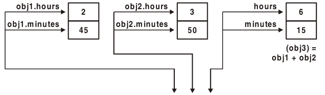

### 5.3 友元函数

- 1. 面向对象编程（OOPS）的主要目标是数据隐藏，即类的私有成员无法从类外部访问，非成员函数无法访问类的私有数据。

- 2. 如果需要直接访问，则可以将私有变量写在公共区域，但这消除了数据隐藏的概念。为了解决这个问题，可以声明友元函数（friend function）具有对类私有成员的访问权限。

- 3. 这种友元函数不需要是这些类中的成员。

- 4. 友元是非成员函数访问类私有数据的特殊机制。

- 5. 友元函数在类定义的作用范围内声明或定义。

- 6. 函数应该带有 `friend` 关键字。该关键字告诉编译器它不是类的成员，但由于是友元关系，该函数可以访问类的所有数据成员和成员函数。

- 7. 友元函数可以用 `friend` 关键字作为前缀，后跟函数的返回类型、函数名和参数。

- 8. 如果友元函数在类内声明而在类外定义，则在类外定义时不应重复 `friend` 关键字，同时应使用 `::`（作用域运算符）。

- 9. 友元函数的语法为：

```cpp
{
private:
    int a;
public:
    __________
    friend void display(xyz & x)
    {
        cout<<"The value of x is"<<x.a;
    }
}
```

- 10. 友元函数虽然不是成员函数，但对类的私有成员具有完全访问权。

### 友元函数的特殊特性：

- 1. 它不在声明为友元的类的作用域内。

- 2. 友元函数不是类的成员函数，但对类的私有成员具有完全访问权限。

- 3. 定义友元函数时不需要作用域解析运算符。

- 4. 友元函数可以声明在类的公共或私有部分，而不影响其含义。

- 5. 通常，类的成员函数可以在不创建对象的情况下访问私有数据成员，但友元函数不能直接访问私有成员，可以通过类的对象来访问。

- 6. 在定义或声明友元函数时，友元函数应该有一个参数，该参数应该是类的对象。

- 7. 在 `main` 函数中调用友元函数时，它应该有一个类对象作为参数。该函数不能通过运算符对象调用。

- 8. 友元函数用于运算符重载。

**示例 3：** 写一个 C++ 程序，通过 `getdata()` 成员函数接受两个数字，并通过友元函数打印这两个数字的平均值。

```cpp
class sample
{
    int a, b;
    public:
        void getdata() {
            // ... 内容不完整
        }
        friend float mean(sample s) {
            // ... 内容不完整
        }
};
```

### 5.4 两个类之间的共同友元

- 1. 两个类可以有一个共同的友元函数。
- 2. 友元函数应该包含两个类的参数。
- 3. 友元函数应该在类内声明。

**示例 4：**
```cpp
class first
{
  friend second;
  private:
    int x;
  public:
    void getdata() {
      cout<<"enter no"<<endl;
      cin>>x;
    }
};
class second
{
  private:
    int y;
  public:
    void getdata(int p) {
        y=p;
    }
};
void max(first e, second f) {
    if(e.x > f.y) {
        cout<<e.x<<" is greater than "<<f.y;
    } else {
        cout<<f.y<<" is greater than "<<e.x;
    }
}
void main() {
  first a;
  second b;
  a.getdata(10);
  b.getdata(20);
  max(a,b);
}
```

### 5.5 授予其他类友元关系

- 1. 像友元函数一样，类也可以被赋予友元。
- 2. 在声明类为友元时，该类应该在另一个类中定义。
- 3. 友元类必须在类内进行声明。
- 4. 友元类成员函数可以使用声明为友元的类的对象来访问另一个类的私有数据成员。

**示例 7：**
```cpp
class first
{
  friend second;
  private:
    int x;
  public:
    void getdata(int i) {
        x=i;
    }
};
class second
{
  private:
    int y;
  public:
    void getdata(int p) {}
    void display()
    {
        cout<<"The value of y is"<<y;
    }
};
```


```cpp
{
    first objx;
    second objy;
    objx.getdata();
    objy.disp(objx);
    getch();
}
```

**示例 8：** 写一个程序在两个类之间建立友元关系。通过类 `first` 接受第一学期的总分，通过类 `second` 接受第二学期的总分，并打印两个学期的分数总和。

```cpp
class first
{
    friend class second;
    private:
        int sem1;
    public:
        void getdata()
        {
            cout<<"enter total marks of sem1";
            cin>>sem1;
        }
};
```

```cpp
class second
{
    private:
        int sem2;
    public:
        void getdata()
        {
            cout<<"enter semster marks";
            cin>>sem2;
        }
        void disp(first term)
        {
            int sum;
            sum=term.sem1+sem2;
            cout<<"The sum is"<<sum;
        }
};
```
```

```cpp
void main()
{
    first objx;
    second objy;
    objx.getdata();
    objy.getdata();
    objy.disp(objx);
    getch();
}
```

# 自习题库

- 1. 解释什么是数组（Array），并举例定义对象数组。
2.  定义对象是如何作为函数参数传递的。
3.  友元函数的作用是什么？如何声明它？
4.  定义友元函数，并解释友元函数如何访问类的属性和方法。
5.  一个公共友元如何共享两个类的属性和方法？请举例说明。
6.  如何在两个类之间实现友元关系？

# 构造函数与析构函数

第 6 章

## 章节大纲

- 6.1 构造函数与析构函数简介
- 6.2 构造函数
- 6.3 参数化构造函数
- 6.4 多重构造函数（构造函数重载）
- 6.5 带默认参数的构造函数
- 6.6 拷贝构造函数
- 6.7 动态构造函数
- 6.8 析构函数

### 6.1 简介

我们通常使用如 `getData()` 或 `input()` 等成员函数来初始化变量。当通过对象调用这些函数时，它们会将初始值赋给对象的数据项。这些函数是在对象创建后才被调用的，无法在对象创建时初始化成员变量。因此，在创建对象时执行成员初始化是由 C++ 中一种特殊的成员函数——**构造函数**（constructor）完成的。

当内置类型的变量超出作用域时，需要编译器自动销毁变量，但在 C++ 中这是不可能的。

因此，名为构造函数的特殊成员函数允许对象在创建时进行自初始化。这被称为对象的自动初始化。它还提供了另一个名为析构函数（destructor）的成员函数，在对象不再需要时销毁对象。

### 6.2 构造函数

**定义：** 构造函数是一种特殊的成员函数，允许对象在创建时进行自初始化。它的名称与类名相同，并会被自动调用。

# 构造函数与析构函数

构造函数具有以下特殊特性：

- 1. 构造函数是用于初始化对象的特殊成员函数。
- 2. 构造函数成员函数的名称与类名相同。
- 3. 当关联类的对象创建时，构造函数成员会被会被调用。
- 4. 它们应该声明在 `public` 区域。
- 5. 它们没有返回值，不能返回任何值，甚至不能有 `void` 返回类型。
- 6. 与其他成员函数一样，构造函数也可以有参数，带参数的构造函数称为参数化构造函数。
- 7. 用于初始化对象的默认构造函数是不带参数的默认构造函数。
- 8. 像其他 C++ 函数一样，它们可以默认参数，因为构造函数可以是参数化的。
- 9. 构造函数支持多态。构造函数可以像函数重载一样被重载。每个类可以拥有多个具有不同数量参数的构造函数。
- 10. 构造函数会对以下操作进行隐式调用：
    - (a) `new`
    - (b) `delete`

在第一次需要内存分配时。当对象创建并第一次进行内存分配时，调用新对象。当对象不再使用并从内存中释放时，调用 `delete` 操作符。
- 11. 构造函数不能被继承，尽管派生类不能调用基类构造函数。
- 12. 构造函数不能是虚函数（virtual）。
- 13. 创建对象时，会调用默认（无参数）构造函数。如果创建时没有参数，则调用构造函数；如果创建时带有参数，则调用参数化构造函数。
- 14. 它被称为构造函数是因为它构造了对象并通过初始化某些值为类的数据成员赋值。

构造函数示例：

```cpp
class hello
{
private:
    int x; // 私有声明
public:
    hello () // 构造函数定义
    {
        cout<<"constructor is called" <<endl;
        x=0;
    }
    void display ()
    {
        cout <<"The x value initialize to"<<x;
    }
}; // 类声明结束
void main()
{
    hello hi;
    hi.display();
    getch();
}
```

输出：

Constructor is called
The x value initialize to 0.

# 示例

- 1. 构造函数被调用
Constructor is called
The x value initialize to 0.

- 2. 写一个程序打印创建了多少个对象。
```cpp
count = 0;
class hello {
    private:
    int count;
public:
    hello() // 构造函数
    {
        count++;
        cout << "Object created is " << count;
    }
};
void main() {
    hello h1, h2, h3;
    getch();
}
```
输出： 

- 2. 写一个程序通过构造函数接受 x 和 y 的值，并打印两个数字之和。
```cpp
class addition
{
    private:
        int x, y, sum;
    public:
        addition() // 构造函数
        {
            cout<<"enter value of x&y";
            cin>>x>>y;
        }
        void calculate()
        {
            sum=x + y;
        }
        void display()
        {
            cout<<"The sum of 2 Nos is"<<sum;
        }
};
```

```cpp
void main()
{
    addition a; // 创建对象
    a.calculate();
    a.display();
    getch();
}
```

- 3. 写一个程序，通过构造函数初始化 sum 为 0，打印从 1 到 n 的偶数和。
```cpp
class series {
private:
    int n, sum;
public:
    series() // 构造函数
    {
        sum=0;
        cout<<"enter value of n";
        cin>>n;
    }
    void calculate(); // 成员函数声明
    void display() // 成员函数
        cout<<"The sum of even is"<<sum;
    }
};
void series::calculate() // 使用作用域运算符 (::) 在类外的成员函数
    for (int i=2; i<=n; i+= 2) {
        sum+=i;
    }
}
void main() {
    series s; // 创建对象
    s.calculate();
    s.display();
}
```

### 6.3 参数化构造函数

- 1. 有时，我们需要在创建不同对象时为它们初始化不同的数据元素。这可以通过在创建对象时向构造函数传递参数来实现。
- 2. 在创建对象时通过构造函数传递参数来初始化对象。
- 3. 接收参数的构造被称为参数化构造函数。
- 4. 参数化构造函数有两种调用方式：
    - (a) 隐式调用：
    - (b) 显式调用：

- 1. 写一个程序通过参数化构造函数接受 m 和 n 变量的值，计算它们的平均值并通过成员函数显示。

```cpp
{
private:
int m, n;
float avg;
public:
mean (int m1, int n1)
{
m=m1;
n=n1;
}
void calculate()
{
avg=(m+n)/2.0;
}
void display()
{}
}
```


```cpp
cout<< "The value is" << avg;
}
void main() {
    m(2, 3);
    m.display();
    getch();
}
```

- 编写一个程序创建一个名为 `student` 类来接收 rollno、name 和 marks。通过参数构造函数接收这些信息，并通过默认构造函数分配默认值。

```cpp
#include <string.h>
class student {
    private:
    int rollno, marks;
    char name[10];
public:
    student(int r, char n) // 参数构造函数
    {
        rollno=r;
        strcpy(name, n); // 将字符串拷贝到 name
        marks=m;
    }
    void display() {
        cout<< "The rollno is" << rollno << endl;
        cout<< "The name is" << name << endl;
    }
};

void main() {
    student s(12, "Kiran"); // 使用参数构造函数创建对象
    s.display();
    getch();
}
```

# 构造函数与析构函数

调用构造函数时编写以下语句：

```cpp
try t1; // 它将自动调用第一个默认构造函数
try t2 (2, 3); // 它将调用第二个构造函数初始化 x 和 y 的值
try t3 (4, 5, 6); // 它将调用第三个构造函数初始化 x、y 和 z 的值
try t4 (t2); // 它将调用拷贝构造函数，将 t2 的值拷贝到 t4

void display() {
    cout << "x" << x<<endl; // 定义成员函数
    cout << "y" << y<<endl;
    cout << "z" << z<<endl;
}

void main() {
    try t1;
    try t1(2, 3);
    try t2(4, 5, 6);
    t1.display();
    t1.display();
    t2.display();
    try t3=t1;
    t3.display();
    getch();
}
```

程序的输出：

x = 0
y = 0
z = 0
x = 2
y = 3
x = 4
y = 5
z = 6
x = 2
y = 3

示例 1：编写一个程序接收书的编号号、书名、标题和价格。通过参数构造函数接收所有信息，并使用构造函数重载通过默认构造函数分配默认值。

```cpp
#include <string.h>
class book {
int bookno;
char *name;
char *title;
float price;
public:
book()
{
    bookno=0;
    name='\0';
    title='\0';
    price=0;
}
book(int b, char *n, char *t, float p) // 参数构造函数
{
    bookno=b;
    strcpy(name, n);
    strcpy(title, t);
    price=p;
}
void display()
{
    cout<< "Bookno is" << bookno<<endl;
    cout<< "Name is" << name<<endl;
    cout<< "Title is" << title<<endl;
    cout<< "Price is" << price<<endl;
}
};

void main()
{
    book b1; // 使用默认构造函数创建对象
    b1.display();
    book b2(101, "C++ Book", "Programming", 500.5); // 使用参数构造函数创建对象
    b2.display();
    getch();
}
```
程序的输出：

Bookno is 0
Name is 
Title is 
Price is 0
Bookno is 101
Name is C++ Book
Title is Programming
Price is 500.5

示例 2：编写一个程序接收书的编号号、书名、标题和价格。通过参数构造函数接收所有信息，并使用构造函数重载通过默认构造函数分配默认值。

```cpp
#include <string.h>
class book {
int bookno;
char *name;
char *title;
float price;
public:
book()
{
    bookno=0;
    name='\0';
    title='\0';
    price=0;
}
book(int b, char *n, char *t, float p) // 参数构造函数
{
    bookno=b;
    strcpy(name, n);
    strcpy(title, t);
    price=p;
}
void display()
{
    cout<< "Bookno is" << bookno<<endl;
    cout<< "Name is" << name<<endl;
    cout<< "Title is" << title<<endl;
    cout<< "Price is" << price<<endl;
}
};

void main()
{
    book b1; // 使用默认构造函数创建对象
    b1.display();
    book b2(101, "C++ Book", "Programming", 500.5); // 使用参数构造函数创建对象
    b2.display();
    getch();
}
```
程序的输出：

Bookno is 0
Name is 
Title is 
Price is 0
Bookno is 101
Name is C++ Book
Title is Programming
Price is 500.5

示例 3：编写一个程序接收书的编号号、书名、标题和价格。通过参数构造函数接收所有信息，并使用构造函数重载通过默认构造函数分配默认值。

```cpp
#include <string.h>
class book {
int bookno;
char *name;
char *title;
float price;
public:
book()
{
    bookno=0;
    name='\0';
    title='\0';
    price=0;
}
book(int b, char *n, char *t, float p) // 参数构造函数
{
    bookno=b;
    strcpy(name, n);
    strcpy(title, t);
    price=p;
}
void display()
{
    cout<< "Bookno is" << bookno<<endl;
    cout<< "Name is" << name<<endl;
    cout<< "Title is" << title<<endl;
    cout<< "Price is" << price<<endl;
}
};

void main()
{
    book b1; // 使用默认构造函数创建对象
    b1.display();
    book b2(101, "C++ Book", "Programming", 500.5); // 使用参数构造函数创建对象
    b2.display();
    getch();
}
```
程序的输出：

Bookno is 0
Name is 
Title is 
Price is 0
Bookno is 101
Name is C++ Book
Title is Programming
Price is 500.5

示例 4：编写一个程序接收书的编号号、书名、标题和价格。通过参数构造函数接收所有信息，并使用构造函数重载通过默认构造函数分配默认值。

```cpp
#include <string.h>
class book {
int bookno;
char *name;
char *title;
float price;
public:
book()
{
    bookno=0;
    name='\0';
    title='\0';
    price=0;
}
book(int b, char *n, char *t, float p) // 参数构造函数
{
    bookno=b;
    strcpy(name, n);
    strcpy(title, t);
    price=p;
}
void display()
{
    cout<< "Bookno is" << bookno<<endl;
    cout<< "Name is" << name<<endl;
    cout<< "Title is" << title<<endl;
    cout<< "Price is" << price<<endl;
}
};

void main()
{
    book b1; // 使用默认构造函数创建对象
    b1.display();
    book b2(101, "C++ Book", "Programming", 500.5); // 使用参数构造函数创建对象
    b2.display();
    getch();
}
```
程序的输出：

Bookno is 0
Name is 
Title is 
Price is 0
Bookno is 101
Name is C++ Book
Title is Programming
Price is 500.5

示例 5：编写一个程序接收书的编号号、书名、标题和价格。通过参数构造函数接收所有信息，并使用构造函数重载通过默认构造函数分配默认值。

```cpp
#include <string.h>
class book {
int bookno;
char *name;
char *title;
float price;
public:
book()
{
    bookno=0;
    name='\0';
    title='\0';
    price=0;
}
book(int b, char *n, char *t, float p) // 参数构造函数
{
    bookno=b;
    strcpy(name, n);
    strcpy(title, t);
    price=p;
}
void display()
{
    cout<< "Bookno is" << bookno<<endl;
    cout<< "Name is" << name<<endl;
    cout<< "Title is" << title<<endl;
    cout<< "Price is" << price<<endl;
}
};

void main()
{
    book b1; // 使用默认构造函数创建对象
    b1.display();
    book b2(101, "C++ Book", "Programming", 500.5); // 使用参数构造函数创建对象
    b2.display();
    getch();
}
```

示例 6：编写一个程序接收书的编号号、书名、标题和价格。通过参数构造函数接收所有信息，并使用构造函数重载通过默认构造函数分配默认值。

```cpp
#include <string.h>
class book {
int bookno;
char *name;
char *title;
float price;
public:
book()
{
    bookno=0;
    name='\0';
    title='\0';
    price=0;
}
book(int b, char *n, char *t, float p) // 参数构造函数
{
    bookno=b;
    strcpy(name, n);
    strcpy(title, t);
    price=p;
}
void display()
{
    cout<< "Bookno is" << bookno<<endl;
    cout<< "Name is" << name<<endl;
    cout<< "Title is" << title<<endl;
    cout<< "Price is" << price<<endl;
}
};

void main()
{
    book b1; // 使用默认构造函数创建对象
    b1.display();
    book b2(101, "C++ Book", "Programming", 500.5); // 使用参数构造函数创建对象
    b2.display();
    getch();
}
```

示例 7：编写一个程序接收书的编号号、书名、标题和价格。通过参数构造函数接收所有信息，并使用构造函数重载通过默认构造函数分配默认值。

```cpp
#include <string.h>
class book {
int bookno;
char *name;
char *title;
float price;
public:
book()
{
    bookno=0;
    name='\0';
    title='\0';
    price=0;
}
book(int b, char *n, char *t, float p) // 参数构造函数
{
    bookno=b;
    strcpy(name, n);
    strcpy(title, t);
    price=p;
}
void display()
{
    cout<< "Bookno is" << bookno<<endl;
    cout<< "Name is" << name<<endl;
    cout<< "Title is" << title<<endl;
    cout<< "Price is" << price<<endl;
}
};

void main()
{
    book b1; // 使用默认构造函数创建对象
    b1.display();
    book b2(101, "C++ Book", "Programming", 500.5); // 使用参数构造函数创建对象
    b2.display();
    getch();
}
```

示例 8：编写一个程序接收书的编号号、书名、标题和价格。通过参数构造函数接收所有信息，并使用构造函数重载通过默认构造函数分配默认值。

```cpp
#include <string.h>
class book {
int bookno;
char *name;
char *title;
float price;
public:
book()
{
    bookno=0;
    name='\0';
    title='\0';
    price=0;
}
book(int b, char *n, char *t, float p) // 参数构造函数
{
    bookno=b;
    strcpy(name, n);
    strcpy(title, t);
    price=p;
}
void display()
{
    cout<< "Bookno is" << bookno<<endl;
    
<< "Name is" << name
endl;
    
<< "Title is" << title<<endl;
    
<< "Price is" << price
endl;
}
};

void main()
{
    book b1; // 使用默认构造函数创建对象
    b1.display();
    book b2(101, "C++ Book", "Programming", 500.5); // 使用参数构造函数创建对象
    b2.display();
    getch();
}
```

示例 9：编写一个程序接收书的编号号、书名、标题和价格。通过参数构造函数接收所有信息，并使用构造函数重载通过默认构造函数分配默认值。

```cpp
#include <string.h>
class book {
int bookno;
char *name;
char *title;
float price;
public:
book()
{
    bookno=0;
    name='\0';
    title='\0';
    price=0;
}
book(int b, char *n, char *t, float p) // 参数构造函数
{
    bookno=b;
    strcpy(name, n);
    strcpy(title, t);
    price=p;
}
void display()
{
    cout<< "Bookno is" << bookno
endl;
    
<< "Name is" << name
endl;
    
<< "Title is" << title<<endl;
    
<< "Price is" << price
endl;
}
};

void main()
{
    book b1; // 使用默认构造函数创建对象
    b1.display();
    book b2(101, "C++ Book", "Programming", 500.5); // 使用参数构造函数创建对象
    b2.display();
    getch();
}
```

示例 10：编写一个程序接收书的编号号、书名、标题和价格。通过参数构造函数接收所有信息，并使用构造函数重载通过默认构造函数分配默认值。

```cpp
#include <string.h>
class book {
int bookno;
char *name;
char *title;
float price;
public:
book()
{
    bookno=0;
    name='\0';
    title='\0';
    price=0;
}
book(int b, char *n, char *t, float p) // 参数构造函数
{
    bookno=b;
    strcpy(name, n);
    strcpy(title, t);
    price=p;
}
void display()
{
    cout<< "Bookno is" << bookno
endl;
    
<< "Name is" << name
endl;
    
<< "Title is" << title<<endl;
    
<< "Price is" << price
endl;
}
};


 main main()
{
    book b1; // 使用默认构造函数创建对象
    b1.display();
    book b2(101, "C++ Book", "Programming", 500.5); // 使用参数构造函数创建对象
    b2.display();
    getch();
}
```


```cpp
cout<<"id of c is" << c.display();
getch();
```

Output:

id of t1 is 10
id of b is 10
id of c is 10

## 6.7 动态构造函数

- 1. 构造函数也可以用于在运行时（即创建对象时）分配内存。
- 2. 当对象的大小不相同时，这种动态分配会为每个对象分配适量的内存，从而节省内存。
- 3. 在构造时为对象分配内存被称为对象的动态构造。内存是通过借助 `new` 操作符的帮助分配的。
- 4. 下面程序展示了在构造函数中使用 `new`，用于在对象中构造字符串。

```cpp
#include <iostream.h>
#include <string.h>
class string
{
    char *name;
    int length;
public:
    string()
    {
        length = 0;
        name = new char[length + 1];
    }
    string (char * s)
    {
        length = strlen(s);
        name = new char[length + 1];
        strcpy(name, s);
    }
    void display ()
    {
        cout<<name<<"\n";
    }
};
```

### 构造函数与析构函数

```cpp
void join (string &a, string &b) {
    length = a.length+b.length;
    delete name;
    name=new char[length+1];
    strcpy(name, a.name);
    strcat(name, b.name);
}
```

```cpp
void main() {
    char *first="fy";
    string name1(first), name2("IT");
    string name3("ty"), s1,s2;
    s1.join(name1, name2);
    s2.join(s1, name3);
    name1.display();
    name2.display();
    name3.display();
    s1.display();
    s2.display();
    getch();
}
```

程序的输出是：

Fy
IT
Ty
FyT
FyTy

- 5. 上述程序使用了两个构造函数。第一个是空构造函数，允许我们声明任何字符串数组。第二个构造函数初始化字符串长度，为字符串的存储分配必要的空间，并创建字符串本身，字符串由空字符终止。

- 6. 成员函数 `join` 拼接两个字符串。它估算要拼接字符串的总长度，为合并后的字符串分配内存，并使用字符串函数 `strcpy()` 和 `strcat()` 创建该字符串。

在 `join` 函数中，`length` 和 `name` 是调用该函数的对象的成员，而 `a.length` 和 `a.name` 是参数对象 `a` 的成员。

`main()` 函数程序将三个字符串合并为一个字符串。

## 6.8 析构函数

- 1. 析构函数是一种特殊的成员函数，用于销毁由构造函数创建的对象。
- 2. 对象使用后，持有该对象的内存会被释放，因此当对象不再被使用时，应该自动调用析构函数。
- 3. 析构成员函数的名称与析构函数名相同，并以 `~`（波浪号）为前缀。
- 5. 析构成员函数由编译器在程序退出时隐式调用，通过调用 `delete` 操作符清理不再可用的存储。
- 6. 析构函数不接受任何参数。
- 7. 析构函数不返回任何值。
- 8. 由于无法传递参数，因此析构函数不能带参数，且不能有默认参数。
- 9. 析构函数不能重载。
- 10. 析构函数不能被进一步继承。

```cpp
e.g. ~test ()
{}
```

示例 4：

```cpp
#include <iostream.h>
int count = 0; //通过初始化为零声明全局变量 count
class hello
{
public:
    hello()
    {
        count++; // 构造函数
        cout<<"object Number created is" << count;
    }
    ~hello()
    {
        // 析构函数
        cout<<"No. of object destroyed is" <<count;
        count--;
    }
};
void main()
{
  hello h1, h2, h3;
  getch();
}
```

程序的输出是：

- No. of object created is 1
- No. of object created is 2
- No. of object created is 3
- No. of object destroyed is 1
- No. of object destroyed is 2
- No. of object destroyed is 3

# 自习题库

- 1. 什么是构造函数？构造函数的作用是什么？
- 2. 如何通过内存管理对对象进行分配和释放？
- 3. 如何在一个类中使用多个构造函数？请举例说明。
- 4. 列出构造函数的一些特殊特性。
- 5. 解释如何通过示例重载构造函数。我们可以在一个类中使用多个构造函数吗？如果是，请用示例证明答案。
- 6. 如何实现对象的动态初始化？
- 7. 构造函数有哪些不同的类型？
- 8. 解释构造函数和析构函数之间的区别。
- 9. 如何将对象相互拷贝？请举例说明。
- 10. 讨论析构函数的优点。
- 11. 讨论带参数构造函数的输入流。
- 12. 写一个程序接受用户输入的学号和分数。
- 13. 写一个计算数字阶乘的程序。
- 14. 写一个判断一个数字是否为质数的程序。
- 15. 创建一个包含两个变量的类。定义成员函数。
- 16. 创建一个具有 `float` 类型变量 x 和 y 的类。定义其构造函数。
  (a) 交换 x 和 y 的值。
  (b) 打印 x 和 y 的最大。
  (c) 打印 x 和 y 的最小值。


## cout

示例：

```
cout<<"hello"<<endl;
cout<<"welcome"<<"
";
cout<<"Intro to c++ streams";
```

示例：

```
int a,b,sum=45;
cout<<"the sum of 2 Nos"<<sum;
```

## istream

- 它继承了 ios 的属性
- 声明了输入函数如 `get()`、`getline()` 和 `read(read)`
- 包含了重载的提取运算符 >>

## ostream 是输出流。

- 继承了 ios 的属性
- 声明了输出函数 `put()` 和 `write()`
- 包含了重载的插入运算符<<

## iostream 是输入输出流。

- 通过多重继承继承了 ios 和 stream，因此包含了所有的输入和输出函数。
- 通过缓冲区提供了与物理设备的接口。
- 作为用于 ios 文件的 filebuf 类的基类。

streambuf 是流缓冲区类。

## put() 和 get() 函数

i 和 o 类分别定义了成员函数 `get()` 和 `put()` 来处理单个字符的输入/输出操作。我们可以使用 `get(char*)` 和 `get(void)` 原型来获取包括空格、制表符和换行符在内的字符。

```
char c;
cin.get(c); // 从键盘获取字符
while(c!='\n')
{
cout<<c; // 显示字符
cin.get(c); // 获取另一个字符
}
```

```
char c;
c=cin.get();
```

## 操纵符

因此，函数 `get()` 返回的值赋值给变量 c。
`put()` 函数是 ostream 类的成员，可以用于逐字符地输出一行文本。

```
cout.put('x');
cout.put(ch);
示例:
char c;
cin.get(c);
while (c !='\n')
{
    cout.put(c); // 在屏幕上显示字符
    cin.get(c);
}
```

`get()` 和 `put()` 是字符处理函数。

我们可以使用行输入的输入输出函数 `getline()` 和 `write()` 更高效地读取和显示行文本。
`getline()` 函数读取整个以换行符结束的整行文本。该函数可以通过 `cin` 函数调用。

该函数调用 `getline()` 将字符输入读取到变量 `line` 中。读取遇到新字符 `'\n` 时终止，换行符被 NULL 字符替换。

```
char name[22];
cin.getline(name,22);
```

假设用户输入了：ANGELA IS A CUTE GIRL
这句话这里包含 21 个字符，这里将打印整行。
如果我们写：

```
char name[16];
cin.getline(name,16);
```

假设用户输入了：ANGELA IS A CUTE GIRL
输出
ANGELA IS A CUTE
`write()` 显示整行，可以使用 `cout` 方法调用。
`cout.write(line,size);`

`line` 表示字符串的内容，`size` 表示要显示的字符数。

## 示例 1:

```
#include<iostream>
#include<string.h>
void main() {
    char*string1="Kiran";
    char*string2="Chirag";
    int m=strlen(string1);
    int n=strlen(string2);
    for(i=1;i<n; i++) {
        cout.write(string2, i);
        cout<<endl;
    }
    for(i=n; i>0; i--) {
        cout.write(string2, i);
        cout<<"\n";
    }
    // 拼接字符串
    cout.write(string1,m).write(string2,n);
    // 越界
    cout.write(string1,3);
    getch();
}
```

程序的输出：

C
Ch
Chi
Chir
Chira
Chirag
Chira
Chir
Chi
Ch
C
KiranChirag
Kir

### 7.4 格式化控制台 IO 操作

操纵符函数是特殊的 IO 函数，用于改变输入和输出的某些特性。

它们改变了流的格式标志位和值。

这些操纵符函数有助于输入输出流的格式化。

`<iomanip.h>` 是输入输出操纵符头文件。

预定义操纵符：

- 1. **endl**: 它是输出操纵符，用于生成回车或换行符。
- 2. **setbase**: 用于将一个数值的基数转换为另一个基数。
  - dec 十进制(10)
  - hex 十进制(16)
  - octal 八进制
- 3. **setw()**: setw 代表设置宽度。用于指定输出字段中占据的最小字符位置数。
  `setw(int w)`
- 4. **setfill()**: 用于指定不同的字符来填充值的空宽。
  `setfill(char f)`
  `setfill("*")`
- 5. **precision()**: 用于控制输出流的位数、浮点数的显示。
  `setprecision(int p)`
  它将浮点插入的精度设置为 P。默认精度为 6。
- 6. **ends**: ends 操纵符用于在字符串末尾附加空终止符 ('\0')。调用时不带参数。
- 7. **ws**: white space 用于插入第一个非空白字符之前的前导空白。
- 8. **setf()**: 用于设置流标志位。
- 9. **unset()**: 用于重置流标志位。

格式化控制台 IO 操作：

C++ 支持通过以下特性进行格式化输出：

- 1. ios 函数和标志位。
- 2. 操纵符
- 3. 用户定义函数。

ios 类包含了许多用于格式化输出的函数。

ios 函数：

- 1. width: 用于指定输出所需的字段宽度。
- 2. precision: 用于指定小数点后的位数。
- 3. fill(): 用于指定字符来填充字段的空白部分。
- 4. setf(): 用于控制输出格式的标志。
- 5. unsetf(): 重置标志。

# 定义宽度：

`width()` 函数用于定义输出字段的宽度。调用 cout：
`cout.width(w);`
其中 w 是打印的字段宽度。

# 设置精度：

浮点数小数点后打印六位。我们可以指定浮点数显示的位数。
`cout.precision(d);`
输出=342

# 填充：

`fill()` 函数用于用任何字符填充空白位置。该函数调用 cout：
`cout.fill(ch);`
其中 ch 是用于填充位置的字符。
`cout.width(10);`
输出5250

# 示例 2:

```
#include<iostream.h>
void main()
{
cout.fill('<');
cout.precision(3);
for(int n=1; n<=6; n++)
{
  cout.width(5);
  cout<<n;
  cout.width(10);
  cout<<1.0/float(n)<<"n";
  if(n==3)
    cout.fill('>');
}
cout<<"#" \n";
cout.fill('#');
cout.width(15);
cout<<12.34567<<"n";
```

输出：

<<<<1
<<<<0.5
<<<<333
>>>>4>>>>25
>>>>5>>>>>>>>2
>>>6>>>>167

填充改变：

######12.346

### 7.5 使用操纵符管理输出

所有的操纵符都存储在不同的函数中。这些函数存储在 iomanip.h 头文件中。它与成员函数和标志位具有相同的特性。

示例：

out<<main1<<main2<<item;
因此 `setw(int w)` 函数用于设置字段宽度 w，等于 `width()` 函数。
`setprecision(int d)` 设置浮点精度为 d，等于 `precision` 函数。
`setfill(int e)` 设置填充字符为 c。等于 `fill()` 方法。
`setiosflags(long f)` 设置格式 f。等于 `setf()` 函数。
`resetflags(long f)` 清除指定的标志。等于 `unsetf()`。
`endl` 函数用于插入换行并刷新流。等于 `"\n"`。

**示例：**

- 1. `cout<<setw(10)<<12345;`
   12345 表示空格。
- 2. `cout<<setw(10)<<ios::left<<12345;`

**示例 3:** 程序使用操纵符和 ios 函数演示输出值的格式化。

```cpp
#include<iostream.h>
#include<iomanip.h>
void main()
{
   cout.setf(ios::showpoint);
   cout<<setw(5)<<"nono"<<
   setw(15) <<Inverse_of_n"<<
   setw(15) <<sum_of_terms\n";
   double term, sum=0;
   for(int n=1;n<10; n++)
   {
     term=1.0/float(n);
     sum=sum+term;
     cout<<setw(5)<<n
     <<setw(14)<<setprecision(4)<<setiosflags
     <<(ios::scientific)<<term
     <<setw(13)<<setiosflags(ios::scientific)<<
     sum<<endl;
   }
   getch();
}
```

**输出：**

| No. | Inverse_of_n | Sum_of_terms |
|---|---|---|
| 1. | 1.0000e + 000 | 1.0000 |
| 2. | 5.0000e - 001 | 1.5000 |
| 3. | 3.3333e - 001 | 1.8333 |
| 4. | 2.5000e - 001 | 2.0833 |
| 5. | 2.0000e - 001 | 2.2833 |
| 6. | 1.6667e - 001 | 2.4500 |
| 7. | 1.4286e - 001 | 2.5929 |


| | | |
|---|---|---|
| 8. | 1.2500e-001 | 2.7179 |
| 9. | 1.1111e-001 | 2.8290 |
| 10. | 1.0000e-001 | 2.9290 |

## 自练习题库

1. 简述什么是流（stream）。
2. 讨论输入流支持的 `get()` 函数。
3. `iomany.h` 文件起什么作用？
4. 简述 C++ 支持的 I/O 系统的特征。
5. 解释不同的操作符（manipulators）并举例。
6. 解释如何以及使用哪些函数对输出进行操作。
7. 解释格式化控制台 I/O 操作。
8. 解释 `getline()` 和 `write()` 函数的使用。
9. 解释 `get()` 和 `put()` 函数。
10. 解释不同的 C++ 流类。


## 函数与运算符重载

## 第 8 章

## 章节目录

- 8.1 函数重载
- 8.2 运算符重载

### 8.1 函数重载

1. 重载是指为了不同的目的使用具有不同参数类型的相同函数。
2. 函数将根据函数调用中的参数列表执行不同的操作。函数重载也可以在类中进行。

函数重载在第 2 章中已经通过不使用类的方式解释过。

类的函数重载：

示例 1：

```cpp
void display() {
    int x=25;
    cout << "\n" << x;
}
class first {
    private:
    int x;
    public:
    void getdata()
    {
        cout << "enter value of x" << endl;
        cin>>x;
    }
    void display() {
        cout<< "x within first class is" <<x;
    }
};
class second
{
    private:
    int x;
    void getdata() {
        cout<< "enter value of x" <<endl;
        cin>> x;
    }
    void display() {
        cout<< "The value of x in second class is" <<x;
    }
};

void main() {
    first obj1;
    second obj2;
    obj1.getdata();
    obj1.display();
    obj2.getdata();
    obj2.display();
    display();
    getch();
}
```

- 创建 `first` 类的对象
- 创建 `second` 类的对象
- 通过 `obj1` 调用成员函数 `getdata`
- 调用 `display` 函数
- 通过 `obj2` 的引用调用 `getdata`
- 通过 `obj2` 的引用调用 `display`
- 调用全局成员 `display` 函数

示例 2：

用 C++ 编写一个程序创建一个 `areademo` 类，该类有一个 `area` 成员函数用于计算矩形面积，并通过另一个 `area` 成员函数的重载来计算圆面积。

```cpp
class areademo
{
    int r, l, b, a; // 声明私有数据成员
    float ac;
public:
    int area (int l1, int b1) // 定义带参数成员函数
    {
      l= l1;
      b= b1;
      return 1*b;
    }

    float area (int*r1) // 通过重载之前的成员函数来完善成员函数
    {
      r=r1;
      return (3.1415*r*r);
    }
};

void main()
{
  areademo obj; // 创建类对象
  cout << "The area of rectangle is" << obj.area (2, 3);
  cout << "The area of circle is" << obj.area (5); getch();
}
```

## 示例 3：

用 C++ 编写一个程序使用 `addition` 类，该类有一个通用的 `sum` 成员函数，通过函数重载相 2 个整数和 3 个浮点数。

## addition 类

```cpp
int x, y, s; // 声明私有数据成员
float fx, fy, fz, fs;
void sum (int x1, int y1) // 定义带两个整数参数的 sum 成员函数
{
  x=x1;
  y=y1;
  s= x + y;
}

void sum (float f1, float f2, float f3) // 定义带 3 个浮点数参数的 sum 成员函数
{
  fx=f1;
  fy=f2;
  fz=f3;
  fs=fx + fy + fz;
  cout<< "The sum of integer" <<s;
}
void dispfloat() {
  cout<< "The sum of float is" <<fs;
}
void main() {
  addition obj;
  obj.sum(2, 3);
  obj.dispint();
  obj.sum(2.5, 5, 6);
  getch(); obj.disfloat();
}
```

### 8.2 运算符重载

1. 重载意味着根据上下文为运算符赋予不同的含义。
2. 就像函数重载一样，我们可以执行运算符重载，即现有的运算符可以被重载。
3. 现有的运算符如 ‘+’ 可以用于整数的加法。相同的 ‘+’ 运算符也可以用于浮点数的加法。
4. 重载现有的运算符如 ‘+’ 可以用于整数的加法。
5. 运算符重载可以在类中进行。

### 运算符重载语法：

```cpp
返回类型 运算符 (参数列表)
{
    // 函数体
}
```


 


```cpp
#include <iostream.h>
class base
{
    int x;
public:
    int y;
    void getData()
    {
        cout << "enter value of x&y";
        cin >> x >> y;
    }
    int getx()
    {
        return x;
    }
    void showx()
    {
        cout << "x; is" << x;
    }
};

class d : public base
{
    int total;
public:
    void sum()
    {
        total = y + getx();
    }
    void display()
    {
        cout << "x = " << getx() << endl;
        cout << "y = " << y << endl;
        cout << "sum = " << total;
    }
};
void main ()
{
    d obj;
    obj.getData();
    obj.sum();
    obj.display();
    obj.y = 100;
    obj.sum();
    obj.display();
    getch();
}
```

## 9.4.2 私有继承

- 1. 当可见性模式为 private 时，基类被私有继承。
- 2. 当基类被派生类私有继承时，基类的公共成员将变为派生类的私有成员，同时，基类的保护成员也变变为派生类的私有成员。基类的私有数据成员无法被进一步继承。
因此，基类的公共成员和保护成员只能通过派生类的成员函数访问。派生类的对象无法访问这些成员。
- 3. 语法为：
```cpp
class abc: private PQR
{
members of abc;
}
```
- 4. 使用 private 的单继承用例。
```cpp
class base
{
    int x;
public:
    int y;
    void getxy()
    {
        cout << "enter value of &x&";
        cin >> x >> y;
    }
    int getx()
    {
        return x;
    }
    void showx()
    {
        cout << "The x value is" << x;
    }
}

# 
```cpp
class d: private base
{
    int z;
public:
    void setxy() {
        getxy();
    }
    void MUL() {
        z = y * getx();
    }
    void display() {
        showx();
        cout << "y=" << y;
        cout << "z=" << z;
    }
};
```

```cpp
void main() {
    d obj;
    obj.setxy();
    obj.MUL();
    obj.display();
    getch();
}
```

# 输出：

enter the value of x & y : 5 10
The value is 5
y = 10
z = 50

## 9.4.3 保护成员

- 1. 如果我们想让派生类直接继承私有成员的一部分，这是不可能的；如果我们将某些私有变量设为公共，那么它们可以被派生类访问，但也会被其他类访问，这破坏了数据隐藏的概念。因此将这些私有变量放在保护作用域内。
- 2. 这第三种可见性模式保护作用域是为了对私有继承进行有限访问。
- 3. 在基类保护作用域中声明的成员只能被派生类的成员函数访问。这两个类之外的函数无法访问。
- 4. 当派生类以保护方式从基类继承时，基类的类的保护成员将变为派生类的保护成员，而基类的公共成员将不再被进一步继承。

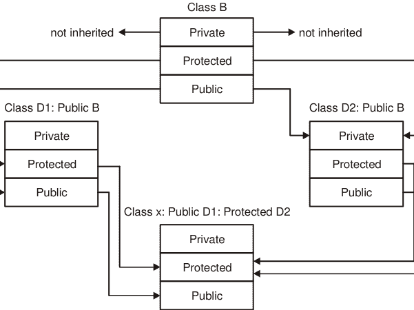

## 9.5 多级继承

- 1. 从一个派生类派生出新类的机制被称为多级继承。
- 2. 从基类创建派生类，进一步从该派生类创建新的派生类，以增加继承的层次。
- 3. 如果类 A 是基类，B 是 A 类的直接派生类。C 派生自 B 类，而 B 类作为 C 的基类。因此类 B 被称为中间基类，ABC 链被称为多级继承路径。

```cpp
class A {----------} // 基类
class B: public A {-------} // B派生自 A
class C: public B {-------} // c 派生自 B
```

# 继承

| A | 基类 |
| :--- | :--- |
| B | 中间基类 |
| C | 派生类 |

- 4. 类 B 可以继承 A 类的属性，C 类可以同时继承 A 和 B 的属性。

示例 1：
创建一个基类 student 来接收学号（Rollno）并通过成员函数显示学号。创建一个派生类 sem1 来接收 sem1 的总分并通过成员函数打印 sem1 的分数。创建一个派生自 sem1 类通过成员函数接收并打印 sem2 的分数。创建一个 result 派生类来打印学号、sem1 分数、sem2 分数以及 sem1 和 sem2 的总分。

```cpp
#include <iostream.h>
class student {
protected:
    int rollno;
public:
    void getroll() {
        cout<< "enter rollno";
        cin>>rollno;
    }
    void pullroll() {
        cout<< "The Rollno is" << rollno;
    }
};
class sem1: public student {
protected:
    int s1;
public:
    void getsem1() {
        cout<< "enter total marks of sem1";
        cin>>s1;
    }
    void putsem1() 
    {
        cout<<"sem1 marks" << s1;
    }
}
class sem2: public sem1
{
protected:
    int s2;
public:
    void getsem2() 
    {
        cout<<"enter total marks of sem2";
        cin >> s2;
    }
    void putsem2() 
    {
        cout<<"sem2 marks is" <<s2;
    }
};
class result: public sem2
{
private:
    int total;
public:
    void display() 
    {
        total=s1 + s2;
        putroll();
        putsem1();
        putsem2();
        cout << "Total marks is" << total;
    }
};
void main() {
    result obj;
    obj.getroll();
    obj.getsem1();
    obj.getsem2();
    obj.display();
    getch();
}
```


```cpp
protected:
    int year;
public:
    void getyear(int y)
    {
        year = y;
    }
    void putyear ()
    {
        cout<< "The year is" << year;
    }
};
```

```cpp
class d: public basic, public year
{
public:
    void display()
    {
        cout<< "original basic" << basic;
        cout<< "No. of years" << year;
        if (year >= 3)
        {
            int bonus = 300;
            basic = basic + 300;
        }
        else
        {
            int bonus = 100;
            basic = basic + 100;
        }
        cout<< "Updated basic is" << basic;
    }
};
```

```cpp
void main()
{
    d obj;
    obj.getbasic(5000);
    obj.getyear(10);
    obj.display();
    getch();
}
```

# 9.7 混合继承 (Hybrid Inheritance)

1. 多级继承与多重继承的机制称为混合继承。
2. 类 A 是基类，B 是 A 的派生类，C 是另一个基类，D 是从 B 类和 C 类派生出来的派生类，这种情况被称为混合继承。
3. 派生类 D 可以接受 A 类、B 类以及 C类的属性。
4. 示例：创建一个基类 `student` 来接收学号（Rollno）并打印学号。创建一个 `student` 类的派生类来接收 subject1、subject2 的分数，并通过成员函数打印这两个科目的分数。创建一个基类 `sports` 来接收体育成绩。创建一个源自 `test` 和 `sports` 类的派生类 `result`，用于打印 sub1、sub2 和体育成绩的总和。同时通过 `display` 函数打印单科分数。

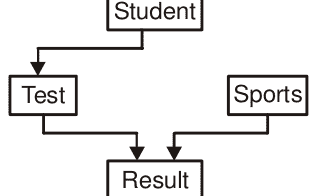

```cpp
#include <iostream.h>
class student
{
protected:
    int rollno;
public:
    void getroll(int a)
    {
        rollno = a;
    }
    void pullroll()
    {
        cout << "The rollno is" << rollno;
    }
};

class test: public student
{
protected:
    int sub1, sub2;
public:
    void getmarks(int x, int y)
    {
      sub1 = x;
      sub2 = y;
    }
    void putmarks()
    {
      cout << "sub1 =" << sub1 << endl;
      cout << "sub2 =" << sub2 << endl;
    }
};

class sports
{
  protected:
    int spmark;
public:
    void getsport(int P)
    {
        spmark = p;
    }
    void putscore()
    {
        cout << "sports marks is" << spmark;
    }
};

class result: public test, public sports
{
    int total;
public:
    void display()
    {
        total = sub1 + sub2 + spmark;
        putroll();
        putmarks();
        putscore();
        cout << "The total is" << total;
    }
};
```

```cpp
void main()
{
    result s;
    s.getroll(10);
    s.getmarks(25, 95);
    s.getsport(49);
    s.display();
    getch();
}
```

# 9.8 层级继承 (Hierarchical Inheritance)

1. 从一个基类创建两个或多个派生类的机制称为层级继承。
2. 类 A 是基类，类 B、C、D 是从 A 基类派生出的派生类。
3. 所有派生类都可以访问基类的属性。

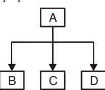

4. 示例：
创建一个基类 `student` 来接收学号并通过成员函数打印学号。创建三个派生类：`art`（艺术）、`med`（医学）和 `Engg`（工程）。在派生类 `art` 中，接收艺术科分数并打印。在派生类 `med` 中，接收医学科分数并打印医学分数。在派生类 `Engg` 中，为机械、电气、土木定义成员函数以接收分数，并通过 `dispengg` 函数打印分数。在主函数中，让用户选择 mech、elec、civil 中的一种类型。接收各自分数并显示。

```cpp
#include <iostream.h>
class student { 
protected:
    int rollno;
public:
    void getroll()
    {
        cout << "enter rollno" << endl;
        cin >> rollno;
    }
    void disproll()
    {
        cout << "rollno is" << rollno;
    }
};

class art: public student
{
  protected:
    int marks;
public:
    void getart() {
      getroll();
      cout << "enter marks";
      cin >> marks;
    }
    void dispart() {
      disproll();
      cout << "marks is" << marks;
    }
};

class med: public student
{
  protected:
    int marks;
public:
    void getmed() {
      getroll();
      cout << "enter marks";
      cin >> marks;
    }
    void dispmed() {
      disproll();
      cout << "marks is" << marks;
    }
};

class engg: public student
{
  protected:
    int marks;
public:
    void getengg() {
      getroll();
      cout << "enter marks";
      cin >> marks;
    }
    void dispengg() {
      disproll();
      cout << "marks is" << marks;
    }
};

void main()
{
    art a;
    med m;
    engg e;
    int ch;
    cout << "1. Arts\n2. Medical\n3. Engg";
    cin >> ch;
    switch(ch)
    {
        case 1:
            a.getart();
            a.dispart();
            break;
        case 2:
            m.getmed();
            m.dispmed();
            break;
        case 3:
            e.getengg();
            e.dispengg();
            break;
    }
    getch();
}
```


## 虚函数与多态

这些信息在编译时是已知的，因此编译器能够在编译阶段就为特定的调用选择合适的函数。

这被称为编译时多态。也称为早期绑定或静态绑定。

早期绑定表示对象在编译时就绑定到它的函数调用。

在编译时，如果原型不匹配，则会发生编译时错误。

在编译期间函数的绑定和变量的分配被称为编译时多态。

- 6. 运行时多态（Runtime polymorphism）：
(a) 当对象在运行时创建，并且当运行时对象被绑定以分配内存时，它被称为运行时多态。
(b) 当基类和派生类具有具有相同原型的相同函数时，该函数并没有重载，而是在运行时基于，即在运行时选择调用基类还是派生类的哪个函数。

```cpp
class base
{
    int x;
public:
    void show()
    {
        __________
        __________
    }
};
class d: public base
{
    int y;
public:
    void show()
    {
        __________
        __________
    }
}
```

在这个示例中，基类和派生类都具有相同原型的相同 `show()` 成员函数。

这个 `show` 函数仍然没有重载。因为它取决于如何通过对象指针通过指定基类或派生类的成员函数在运行时被调用。

这被称为运行时多态。在运行时执行的绑定被称为后期绑定，也称为动态绑定，因为对特定函数的选择是在运行时动态完成的。

多态可以用图形表示如下：

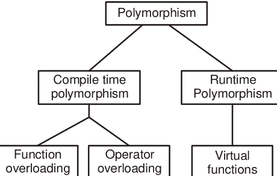

## 10.2 虚函数 (Virtual Function)

- 1. 虚函数用于避免基类和派生类中成员函数的重复。
- 2. 虚函数并不是真实存在的函数，但在程序的某些部分看起来看起来是真实的。
- 3. 当我们在基类和派生类中使用相同的函数名时，如果在运行时我们使用派生类对象调用相同的公共函数，那么默认情况下也会调用基类的函数。为了避免基类中这种函数的重复，应使用 `virtual` 关键字将函数声明为虚函数。
- 4. 虚函数是声明在基类中的成员函数，并在派生类中被重新定义。
- 5. 当基类包含虚函数时，该函数会被继承到派生类，并在派生类中被重新定义以适应自己的需求。
虚函数也被“一接口多方法”。
- 6. 派生类对虚函数的每次重定义都实现了一个特定的方法。这被称为运行时多态，因为在运行期间通过指针访问成员函数。
- 7. 在派生函数中，当重新定义虚函数的定义时，不再使用 `virtual` 关键字。
- 8. 当一个函数被变为虚函数时，C++ 会根据基指针指向的对象的类型（而不是指针的类型）来决定运行时使用哪个函数。因此，通过让基指针指向不同的对象，我们可以执行虚函数的不同版本。

## 10.3 虚函数的规则 (Rules of Virtual Functions)

- 1. 虚函数必须是类的成员。
- 2. 可以通过对象指针访问它们。
- 3. 在基类中即使不使用，也应该定义虚函数。
- 4. 基类版本的虚函数和派生类版本的虚函数原型应该是完全相同的。
- 5. 它们不能是静态成员。
- 6. 虚函数可以是另一个类的友元。
- 7. 虽然基指针可以指向任何类型的派生对象，但反向可能的，即我们不能使用派生类的指针来访问基类型的对象。

虚函数的示例：

```cpp
class base
{
public:
    virtual void vfunction()
    {
        cout<< "This is base class vfunction";
    }
}
class d: public base
{
public:
    void vfunction()
    {
        cout<< "This is derived 1 class vfunction";
    }
}
class d1: public base
{
public:
    void vfunction()
    {
        cout<< "This is derived2 class vfunction";
    }
}
void main()
{
    base *p;
    d obj1;
    d1 obj2;
    p = &obj1;
    p->vfunction();
    p = &obj2;
    p->vfunction();
}
```
输出：
This is base class vfunction
This is derived 1 class vfunction
This is derived2 class vfunction

## 10.4 纯虚函数 (Pure Virtual Functions)

- 1. 包含至少一个没有定义的纯虚函数的类被称为抽象类（abstract class）。
- 2. 在基类中，纯虚函数声明为 `=0`。
- 3. 我们不能创建抽象类的对象。
- 4. 抽象类用于实现多态。
- 5. `virtual function =0;`
- 6. **示例：**

```cpp
#include <iostream.h>
class base
{
public:
    virtual void show() = 0;
};
class d: public base
{
public:
    void show()
    {
        cout<< "Derived 1";
    }
};
class d2: public base
{
public:
    void show()
    {
        cout<< "Derived 2";
    }
};
void main()
{
    base *p;
    d obj1;
    d2 obj2;
    p = &obj1;
    p->show();
    p = &obj2;
    p->show();
}
```
输出：
Derived 1
Derived 2

## 10.5 抽象类 (Abstract Classes)

- 1. 包含至少一个没有定义的纯虚函数的类被称为抽象类。
- 2. 我们不能创建抽象类的对象。
- 3. 我们可以创建抽象类的指针和引用。
- 4. 抽象类支持运行时多态。
- 5. 抽象类的主要目的是创建一个基类，其他类可以在基础上构建。
- 7. 它是程序开发中的一种设计概念，为其他类的构建提供了基础。

## 10.6 早期绑定 (Early Binding)

- 1. 当对象在编译时绑定到它的函数调用时，被称为早期绑定。
- 2. 它指的是发生在编译时的事件。
- 3. 当调用函数所需的所有信息在“编译时”都是已知的。
例如：普通函数调用、重载函数调用和重载运算符。

当进行函数重载时，通过匹配参数和参数的数据类型来选择用于调用的重载函数。
这些信息在编译时对编译器是知的，因此编译器能够在编译阶段就为特定的调用选择合适的函数。这被称为早期绑定、或绑定或静态绑定，即编译时多态。

## 10.7 后期绑定 (Late Binding)

- 1. 当函数在运行时被调用时，被称为后期绑定或运行时绑定。
- 2. 当基类和派生类中存在名称和原型相同的函数，且基类中的相同函数被定义为虚函数时，编译器应该调用该函数的哪个版本。当运行时已知基对象指针指向哪个类时，可能的将调用合适的函数版本。这被称为后期绑定。
- 3. 它指的是直到运行时才被解析的函数调用。
- 4. 虚函数用于实现后期绑定。当通过基指针或引用访问时，实际调用的虚函数由指针指向的对象类型决定。
- 5. 后期绑定的优点是灵活性。
- 6. 后期绑定需要一些开销，但提供了更大的功能和灵活性。

# 自测题库

- 1. 解释早期绑定和后期绑定的区别。
- 2. 解释虚函数和纯虚函数的区别。
- 3. 解释虚函数的需求。解释虚函数的规则。
- 4. 解释抽象类。
- 5. 什么是多态？它如何在编译时和运行时实现？
- 6. 什么是虚函数？
- 7. 我们什么时候让虚函数变为“纯”虚函数？


# 11 文件处理章节

## 章节目录

- 11.1 文件处理简介
- 11.2 文件流操作的类
- 11.3 打开与关闭文件
- 11.4 检测文件结束 (EOF)
- 11.5 关于 Open() 的更多：文件模式
- 11.6 文件指针及其操作
- 11.7 顺序输入和输出操作
- 11.8 读取和写入类对象
- 11.9 更新文件
- 11.10 文件操作过程中的错误处理
- 11.11 命令行参数

## 11.1 文件处理简介

文件是存储在磁盘特定区域的相关数据集合。可以设计程序通过文件处理程序对这些文件执行读（Read）和写（Write）操作。我们可以在控制台与文件之间、以及文件与监视器之间传输数据。

C++ 文件操作中的 `istream` 方式与控制台 I/O 操作类似。它使用文件流作为程序与文件之间的接口。向程序提供数据的流称为输入流（input stream）。接收数据的流被称为输出流（output stream）。I/O 流文件由 `istream` 方法和 `ofstream` 方法组成。

同样，`fstream` 包含 `ifstream` 和 `ofstream`，它还支持一个用于存储数据的缓冲区类。所有这些文件流类都派自 `fstream` 基类。

输入流
数据输入
磁盘文件
程序
数据输出
写数据

# 文件输入和输出流

I/O 系统使用文件流作为程序与文件之间的接口。向程序提供数据的流称为输入流，从程序接收数据的流称为输出流。

输入流 OR 从文件中读取数据，而输出流则用于向文件中插入或写入数据。

输入操作用于创建输入流，此输入数据链接到程序；而输出操作涉及建立输出流。它将数据从程序输出到输出流，并将这些数据写入磁盘文件。

## 11.2 文件流操作的类

C++ 的 I/O 系统包含一组定义了文件处理方法的类。

这些类包括 `ifstream`、`ofstream` 和 `fstream`。

这些类派自 `fstreambase` 以及相应的 `ios` 类。

这些类设计用于管理磁盘文件，在在fstream` 中声明，因此我们在任何使用文件的程序中包含此文件。

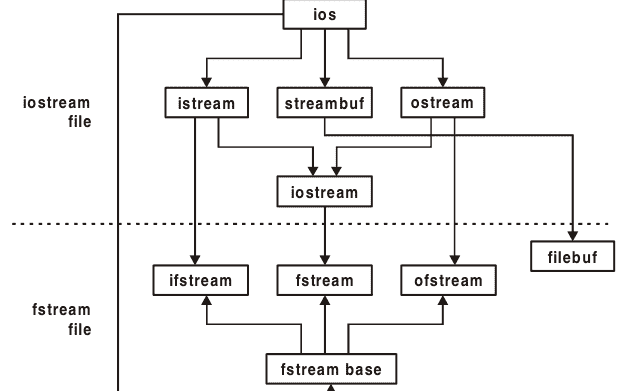

文件操作的流类

# 文件处理

`ios` 是一个由 `istream` 和 `ostream` 类组成的类，`istream` 是输入流类而`ostream` 是输出流，`fstream` 基类包含用于创建输入流和输出流的 `istream` 和 `ofstream`。

`iostream` 类包含输入流 (Istream) 和输出流 (ostream)。

`Stringbuf` 包含 `filebuf` 类。

`fstream` 包含 `istream` 和 `ofstream`，`fstream` 函数意味着仅用于读取打开。`ofstream` 函数意味着仅用于写入打开。

## 11.3 打开与关闭文件

如果我们想使用一个文件，需要考虑以下几点：

1. 给文件指定一个合适的名字。
2. 提供正确的数据类型。文件的结构取决于文件的内容。
3. 通过指定文件的模式（读目的或写目的）来指定文件的用途。
4. 打开方法是顺序的还是随机的。

打开文件时使用 `fstream`：

1. `filebuf` ⇒ 它的目的是将文件缓冲区设置为读和写。
2. `fstreambase` ⇒ 作为 `fstream`、`istream` 和 `ofstream` 类的基类。包含 `open()` 和 `close()` 函数。
3. `istream` ⇒ 提供带有默认输入模式的打开操作。它继承了 `istream` 中的 `get()`、`getline()`、`read()`、`seekg()` 和 `tell()` 函数。
4. `ofstream` ⇒ 提供输出操作。包含带有默认输出模式的 `open()`。它继承了 `ofstream` 中的 `put()`、`seek()`、`tell()` 和 `write()` 函数。
5. `fstream` ⇒ 它包含带有默认输入模式的 `open()` 方法。它通过 `istream` 继承了 `istream` 和 `ofstream` 类的所有函数。

为了打开文件，我们必须首先创建一个文件流，然后将其链接到文件名。可以使用 `fstream.h` 头文件中包含 `istream`、`ofstream` 和 `fstream` 类来定义文件流。

文件可以通过两种方式打开：

1. 使用类的构造函数。
2. 使用类的成员函数 `open()`。

# 使用类的构造函数：

当流中只使用一个文件时使用此方法，因为我们知道构造函数用于在对象创建时初始化对象。这里使用文件名来初始化文件流对象。

这涉及以下步骤：

(a) 使用适当的流类创建文件流对象。
(b) 使用 `ofstream` 创建输出流，`fstream` 创建输入流。

# 例如：

`ofstream infile("abc.txt");`

`ofstream` 是一个类，`outfile` 是对象参数中 `ofstream` 类的的一个对象。我们正在指定文件名，这意味着我们正在调用 `ofstream` 的带参数构造函数。因此，如果我们想向其中写入任何内容，可以通过 `outfile` 对象写入。

# 示例：

```cpp
outfile << "Total";
ofile << sum;
```

# 输出：

total 45
如果变量 `sum` 的值是为了创建输入文件流。
`ifstream infile("abc.txt");`

# 示例：

```cpp
outfile << sum;
```

当流中只使用一个文件时使用此方法，因为我们知道构造函数用于在对象创建时初始化对象。这里使用文件名来初始化文件流。

这涉及以下步骤：

(a) 使用相应的流类创建文件流对象。
(b) 使用 `ofstream` 创建输出流，`fstream` 创建输入流。

# 2. 使用类的成员函数 `open()`。

当我们在流中使用多个文件时使用此方法。

```cpp
ofstream outfile;
outfile.open("data1.txt");
```

# 例如：

```cpp
ifstream inf;
inf.open("data1.txt",mode);
```

# 示例：

```cpp
inf.open("data1.txt", ios::in);
```

这表示 `data1.txt` 以读模式打开，`ifstream` 函数用于读取。

# 示例：

```cpp
ofstream out;
out.open("data1.txt", ios::out);
```

这表示 `data1.txt` 以写模式打开，因此 `ofstream` 函数用于写入。
因此 `ofstream` 被用于写入。

注意：文件以写模式打开，意味着通过 `ofstream` 对象创建一个新文件。如果不存在同名文件。

## 11.4 检测文件结束 (EOF)

`eof()` 成员函数用于指示文件结束。在文件的最后行之后，文件中可用字符。

如果我们想读取文件内容。

`eof()` 是 `ios` 类的成员函数。当遇到文件结束 (Eof) 条件时它返回非零值，否则返回零。

```cpp
ifstream("data1.txt");
while(fin)
```

因此 `while` 语句在到达文件末时终止。

## 11.5 关于 Open() 的更多：文件模式

`ifstream` 和 `ofstream` 构造函数以及 `open()` 函数用于创建新文件以及打开现有文件。

因此指定模式时 `open()` 方法有两个参数。

- 第一个参数用于指定文件名。
- 第二个参数用于指定文件的模式。

该模式标识了打开文件的目的。

```cpp
ifstream inf;
inf.open("data1.txt",mode);
```

# 示例：

```cpp
inf.open("data1.txt", ios::in);
```

这表示 `data1.txt` 以读模式打开，`ifstream` 函数用于读取。

# 示例：

```cpp
ofstream out;
out.open("data1.txt", ios::out);
```

这表示 `data1.txt` 以写模式打开，因此 `ofstream` 函数用于写入。
因此 `ofstream` 被用于写入。

文件模式参数：

| 参数 | 含义 |
| --- | --- |
| 1. ios::app | 附加到文件末尾。 |
| 2. ios::ate | 打开时跳转到文件末尾 |
| 3. ios::binary | 二进制文件。 |
| 4. ios::in | 仅用于读取打开文件。 |
| 5. ios::ncreate | 如果文件不存在则打开失败。 |


## 程序：

| | | |
|---|---|---|
| 6 | ios::noreplace | 如果文件已存在，则打开失败。 |
| 7 | ios::out | 仅以只写模式打开文件。 |
| 8 | ios::trunc | 如果文件存在，则删除文件内容。 |

- 1. 编写一个 C++ 程序，接受用户输入的名称并将其存储到 fnew.txt。
```cpp
#include <iostream.h>
#include <conio.h>
#include <fstream.h>
void main()
{
    char name[10];
    clrscr();
    cout<<"enter the name";
    cin>>name;
    ofstream out("fnew.txt");
    cout<<name;
    out.close();
    getch();
}
```

- 2. 编写一个程序显示 fnew.txt 文件的内容。
```cpp
#include <iostream.h>
#include <conio.h>
#include <fstream.h>
void main()
{
    char name[10];
    clrscr();
    ifstream inf("fnew.txt");
    inf>>name;
    cout<<name;
    inf.close();
    getch();
}
```

- 3. 编写一个程序打开 abc.txt 文件写入任何字符串，写入后读取该文件的内容。
```cpp
#include <iostream.h>
#include <conio.h>
#include <fstream.h>
void main()
{
    char name[20];
    clrscr();
    ofstream out;
    out.open("abc.txt");
    out<<"hello";
    out.close();
    ifstream inf;
    inf.open("abc.txt");
    inf>>name;
    cout<<name;
    inf.close();
    getch();
}
```

- 4. 编写一个程序接受用户输入的物品名称和成本，将其写入 item.txt 文件，然后显示 item.txt 文件的内容。
```cpp
void main()
{
  char name[20];
  float cost;
  clrscr();
  ofstream out;
  out.open("item.txt");
  cout<<"enter the item name";
  cin>>name;
  out<<name<<"end1";
  cout<<"enter the cost";
  cin>>cost;
  out<<cost;
  ifstream inf;
  inf.open("item.txt");
  inf>>name;
  cout<<"The item name is"<<name;
  cout<<"The item cost is"<<cost;
  inf.close();
  getch();
}
```

- 5. 编写一个程序接受用户输入的员工编号、名称和薪水，将其保存到 emp.txt，然后在屏幕上显示。
```cpp
void main()
{
  char name[20];
  int eno, esal;
  clrscr();
  ofstream out;
  out.open("emp.txt");
  out<<"enter the name";
  cin>>name;
  out<<name<<endl;
  out<<"enter the eno";
  cin>>eno;
  out<<eno;
  out<<"enter the salary";
  cin>>esal;
  out<<esal;
  out.close();
  ifstream inf;
  inf.open("emp.txt");
  if(inf>>name);
  if(inf>>eno);
  if(inf>>esal);
  out<<"The empname, sal & no is "<<name<<eno<<esal;
  inf.close();
  getch();
}
```

Getline 函数 ⇒ 此函数用于从特定文件中读取整行，你必须指定字符的大小，即每行中有多少个字符。

## 程序：

示例：编写一个 C++ 程序创建一个 country.txt 文件，写入 3 行不同的内容，然后打开该特定文件并逐行显示内容。

```cpp
void main()
{
  char x[80];
  clrscr();
  ofstream out;
  out.open("country.txt");
  out<<"united state of america";
  out<<"India is a country";
  out.close();
  ifstream inf;
  inf.open("country.txt");
  while(inf)
  {
    inf.getline(x,80);
    cout<<x;
  }
  inf.close();
  getch();
}
```

## 11.6 文件指针及其操纵符

每个文件都与一个文件指针关联。每个文件有两个指针：(1) 输入指针（pointer）和 (2) 输出指针（put pointer）。我们可以使用这些指针在读取或写入文件时在文件中移动。

输入指针用于读取内容，输出指针用于在指定位置写入内容。当输入和输出指针被使用时，指针会自动向前移动。

当我们以只读模式打开文件时，输入指针默认设置在开头，因此我们可以从开始读取文件。

当我们以只写模式打开文件时，现有内容会被删除，输出指针被设置在开头。因此，我们可以从这里开始。

当我们想要打开一个现有文件以添加更多数据时，文件以追加模式（append mode）打开。这会将输出指针移动到文件的末尾。

## 操作文件指针的函数：

- 1. seekg() => 它将获取指针（输入）移动到指定位置。
- 2. seekp() => 它移动指针（输出）。
- 3. tellg() => 获取输入指针的位置。
- 4. tellp() => 获取输出指针的位置。

inf.seekg(10);
```cpp
ofstream out;
out.open("hello", ios::app);
out.tellp();
```

- ios::beg => 文件开头。
- ios::cur => 当前位置。
- ios::end => 文件结尾。

## 11.7 顺序输入与输出

每个文件都与文件指针关联。每个文件有两个指针：(1) 输入指针（pointer）和 (2) 输出指针（put pointer）。我们可以使用这些指针在读取或写入文件时在文件中移动。

输入指针用于读取内容，输出指针用于在指定位置写入内容。当输入和输出指针被使用时，指针会自动向前移动。

当我们以只读模式打开文件时，输入指针默认设置在开头，因此我们可以从开始读取文件。

当我们以只写模式打开文件时，现有内容会被删除，输出指针被设置在开头。因此，我们可以从这里开始。

当我们想要打开一个现有文件以添加更多数据时，文件以追加模式打开。这会将输出指针移动到文件的末尾。

示例：编写一个 C++ 程序创建一个 country.txt 文件，写入 3 行不同的内容，然后打开该特定文件并逐行显示内容。

```cpp
void main()
{
  char x[80];
  clrscr();
  ofstream out;
  out.open("country.txt");
  out<<"united state of america";
  out<<"India is a country";
  out.close();
  ifstream inf;
  inf.open("country.txt");
  while(inf)
  {
    inf.getline(x,80);
    cout<<x;
  }
  inf.close();
  getch();
}
```

## 11.8 读取和写入对象

每个文件都与文件指针关联。每个文件有两个指针：(1) 输入指针（pointer）和 (2) 输出指针（put pointer）。我们可以使用这些指针在读取或写入文件时在文件中移动。

输入指针用于读取内容，输出指针用于在指定位置写入内容。当输入和输出指针被使用时，指针会自动向前移动。

Getline 函数 ⇒ 此函数用于从特定文件中读取整行，你必须指定字符的大小，即每行中有多少个字符。

该的输出是

该程序读取字符串。

```cpp
#include <iostream.h>
#include <fstream.h>
#include <iomanip.h>
class employee
{
  int empno;
  char name[10];
  float salary;
  public:
  void readdata(void) {
    cout<<"enter, name & salary";
    cin>>empno>>name>>salary;
  }
  void writedata(void) {
    cout<<setflags(ios::left)<<setw(10)<<
    empno<<name<<salary;
  }
};
void main()
{
  employee e[2];
  fstream file;
  file.open("emp.txt", ios::in|ios::out);
  cout<<"enter details of two employees";
  for(int i=0; i<2; i++)
    e[i].readdata();
}
```


```cpp
file.write((char*)&e[i],sizeof(e[i]));
}
file.seekg(0);
cout << "OUTPUT\n\n";
for(i=0; i<2; i++)
{
    file.read((char*)&e[i], sizeof(e[i]));
    e[i].writedata();
}
file.close();
getch();
```

# 程序输出：

输入两个员工的详情。

输入工号、姓名和薪水
1 malcolm 40000
输入工号、姓名和薪水
2 Angela 20000

输出：

1 malcolm 40000
2 Angela 20000

## 11.9 更新文件（随机访问）

更新是指修改文件中的数据。

更新包括以下一个或多个任务：

- 1. 显示文件内容。
- 2. 修改现有的项目。
- 3. 添加新项目。
- 4. 删除现有的项目。

可以获取每个对象的长度。
`int object_length = sizeof (object);`
seekg(object) 和 seekp(object) 函数用于将读取指针移动到指定位置，以及将写入指针设置到指定位置以写入或放置内容到指定位置。
tell(pointer) 和 tellp(pointer) 函数用于显示读取指针和写入指针的当前位置。

## 11.10 文件操作过程中的错误处理

在打开文件进行读写时，在读取或写入过程中可能会发生错误。
可能会出现多种错误：

- 1. 尝试打开用于读取的文件不存在。
- 2. 新文件的文件名可能已经存在。
- 3. 我们可能会尝试无效操作，例如读取到文件末尾之后。
- 4. 磁盘可能没有足够的空间存储更多数据。
- 5. 我们可能使用了无效的文件名。
- 6. 我们可能在文件未打开的情况下尝试执行操作。

支持不同的错误处理函数：

- 1. eof() ⇒ 文件结束函数。如果在读取时遇到文件末尾，则返回 true 或非零值；否则返回 false（零）。
- 2. fail() ⇒ 当输入或输出操作失败时，此函数返回 0。
- 3. bad() ⇒ 如果尝试无效操作或发生任何不可恢复的错误，此函数返回 true。如果可以恢复数据，则返回 false。
- 4. good() ⇒ 如果没有发生错误，则此函数返回 true。当它返回 false 时，将无法执行后续操作。

示例：

```cpp
ifstream infile;
infile.open("ABC.txt");
while(infile.fail())
{
    __________
    (处理文件)
}
if (infile.eof())
{
    __________
    __________ (正常终止程序)
}
else
    if(infile.bad)
    {
        __________
        __________
        __________ (报告致命错误)
    }
```

文件处理

```cpp
else
{
    infile.clear(); // 清除错误状态
}
```

## 11.11 命令行参数

C++ 支持一种特性，允许我们向 main 函数提供参数。这些参数在调用程序时提供。它们通常用于传递数据文件的文件名。

示例：在命令行提示符下输入 `exam data result`。

exam 是 C++ 程序文件，results 是作为命令行参数传递给程序的文件名。命令行参数和结果之间应该用空格分隔或限定。

第一个参数始终应该是文件名。

程序的 main() 函数有两个参数。

```cpp
main(int argc, char *argv[])
```

第一个参数称为参数计数器（argument counter）。它计算用户在命令行传递了多少参数。第二个参数是 argv，称为参数向量（argument vector）。这意味着它是参数数组，返回类型为字符。每个命令行参数都存储在 argv 数组中。数组的大小等于

如果我们在命令行参数处输入以下行：

Exam Data Results.

那么 argc 将为 3，且 argv 是创建的数组。
argv[0] = exam
argv[1] = data
argv[2] = results

如果我们想打开数据文件，则写入
`inf.open(argv[1]);`

如果我们想打开结果文件，则写入
`inf.open(argv[2]);`

示例：编写一个程序，通过 C++ 命令行参数从用户处接受两个文件名，并声明一个包含 10 个不同数字的编号数组，这些数字可以是奇偶数的组合。

检查每一个编号数组元素。如果是偶数，则将其内容写入第二个文件。建议将第二个文件命名为 even.txt；如果是奇数，则将该数字写入第一个文件，建议命名为 odd.txt。

```cpp
#include <iostream.h>
#include <fstream.h>
#include <stdlib.h>
int main(int argc, char *argv[])
{
    int number[10] = {1,2,3,4,5,6,7,8,9,10};
    if(argc==2)
    {
        cout<<"error in arguments p/s";
        enter two arguments";
        exit(1);
    }
    ofstream fout1, fout2;
    fout1.open(argv[1]);
    fout2.open(argv[2]);
    for (int i=0; i<=9; i++)
    {
        if (number[i]%2==0)
        {
            fout1<<number[i];
        }
        else
        {
            fout2<<number[i];
        }
    }
    fout1.close();
    fout2.close();
    ifstream fin;
    char ch;
    for (int i=1; i<argc; i++)
    {
        fin.open(argv[i]);
    }
```


```cpp
{
    sum+=this->y[i]*v[i];
}
return sum;
};

void main()
{
    int x[3]={1,2,3};
    int y[3]={4,5,6};
    vector<int> v1;
    vector<int> v2;
    v1=y;
    int R=v1*v2;
    cout<<"R="<<R<<endl;
    getch();
}
```

类模板与普通的类定义相似。唯一的区别是类定义的前缀是 `template <class >`。这个前缀告诉编译器，我们在声明中将声明 `T` 是一个类型名。`vector` 变成了以类型为参数的参数化类。我们可以创建用于不同数据类型的 vector，例如 `vector int` 或 `float vector`。

从类模板创建的类被称为模板类。如果我们想创建模板的实例，语法如下：

- `classname <type> objectname(args list);`
或者
`classname <type>objectname;`

## 12.3 带多参数的类模板

我们可以在类模板中使用多个泛型类型。它们在模板规范中以逗号分隔的列表形式声明，如下所示。

```cpp
template <class T1, class T2>
class classname
{

    {类体}
};
```

示例：

```cpp
# include<iostream.h>
template<class T1
```

程序输出：
1.23 and 123
100 and W

## 12.4 函数模板

模板是一种以泛型方式为一组相似的函数或类编写单个函数或类的方法。当为一组相似的函数编写单个函数时，它被称为“函数模板”。

与类模板一样，我们也可以定义函数模板，用于创建具有不同参数类型的函数族。

## 函数模板的语法

```cpp
template<class T>
rtype functionname(arguments of T)
{
    ____
```

## 模板

// 带有类型 T 的体
函数模板的语法与类模板相同，区别在于我们定义的是函数而不是类。在函数体和其参数列表中必要时使用模板参数 `T`。

示例：

```cpp
template<class T>
void swap(T &x, T &y)
{
    temp=x;
    x=y;
    y=temp;
}
void fun(int m, int n, float a, float b)
{
    cout<<"m and n before swap:"<<m<<endl;
    swap(m,n);
    cout<<"m and n after swap:"<<n<<endl;
    cout<<"a and b before swap:"<<a<<endl;
    swap(a,b);
    cout<<"a and b after swap:"<<b<<endl;
}
void main()
{
fun(100,200,11.22,33);
}
```

程序输出

| m and n before swap | 100 200 |
| m and n after swap | 200 100 |
| a and b before swap | 11.22 33 |
| a and b after swap | 33 11.22 |

对于给定类型的 `swap()` 函数，该模板声明了一组重载函数，每个数据类型一个。我们可以像调用普通函数一样调用 `swap()` 函数。例如，`fun()` 是具有四个参数的普通函数。

## 12.5 带多参数的函数模板

类似于模板类，我们可以在模板语句中使用多个泛型类型，用逗号分隔。

语法为：

```cpp
template<class T1, class T2, ...>
typename(arguments of T1, T2, ...)
{
    ____ (函数体)
}
```

示例：

```cpp
#include <iostream.h>
#include <string.h>
template<class T1, class T2>
void display(T1 x, T2 y)
{
    cout<<x<<""<<y<<endl;
}
void main()
{
    display(1999, "ABC");
    display(12.34, 34);
}
```

输出

1999 ABC
12.34 34

## 12.6 模板函数的重载

与函数重载一样，模板函数可以通过模板函数或同名的普通函数进行重载。

模板函数的重载遵循以下规则：

- 1. 调用精确匹配的普通函数。
- 2. 调用可以精确匹配的模板函数。
- 3. 尝试普通函数的重载解析并调用匹配项。

示例显示模板函数被显式函数重载。

```cpp
#include <iostream.h>
#include <string.h>
template<class T>
void display(T x)
{
    cout<<"Template display:"<<x<<endl;
}
void display(int x)
{
    cout<<"Explicit display:"<<x<<endl;
}
void main()
{
    display(100);
    display(12.34);
    display('c');
}
```

输出：
Explicit display : 100
Template display : 12.34
Template display : c

## 12.7 成员函数

当我们创建 `vector` 类模板时，所有成员函数都定义为内联，这并不是必要的。我们也可以在类外部定义它们，成员函数是由类型参数化的，因此这些函数必须由函数模板定义。

语法：

```cpp
template<class T>
typename typename::functionname(arg)
{
    // 函数体
}
```

示例：

```cpp
template <class T>
class vector
{
    T* v;
    int size;
public:
    vector (int m);
    vector (T* a);
    T operator * (vector &y);
}
```

```cpp
// 成员函数 ...
template<class T>
vector<T>::vector(int m)
{
    v=new T[size];
    for(int i=0; i<size; i++)
    {
        v[i]=0;
    }
}
```

```cpp
template<class T>
vector<T>::vector(T* a)
{
    for(int i=0; i<size; i++)
    {
        v[i]=a[i];
    }
}
```

```cpp
template<class T>
vector<T>::operator * (vector &y)
{
    T sum=0;
    for(int i=0; i<size; i++)
    {
        sum+=v[i] * y[i];
    }
    return sum;
}
```

在上述程序中，`vector` 类在类外重新定义了成员函数。

## 12.8 非类型参数

模板可以有多个参数，并且可能包含非类型参数。除了类型外，我们还可以在模板语句中使用逗号分隔的多个泛型类型。

例如：

```cpp
template <class T, int size>
class array
{
    T[size];
};
```

该模板提供了 `size` 类型的 `swap()` 函数。`size` 在编译时是已知的。

```cpp
#include <iostream>
#include <stdlib.h>
template<class T, int size>
class atype
{
  T[size];
public:
  atype()
  {
    register int i;
    for(i=0; i<size; i++)
    {
      a[i]=i;
    }
  }
  atype &operator[](int i);
};
// 为 atype 提供范围检查

```cpp
template<class T, int size>
T &atype<T,size>::operator[](int i)
{
    if(i<0 || i>size-1)
    {
        cout<<"Index value "<<i<<" is out of bound"<<endl;
    }
    return a[i];
}

void main()
{
    atype<int,10>intob; // 大为10的整数数组
    cout<<"Integer array";
    for(int i=0; i<10; i++)
    {
        cout<<intob[i]<<" ";
    }
}
```

##习题

- 1. 解释模板的概念及其优点。
- 2. 解释类模板和函数模板。
- 3. 模板和宏的区别是什么？
- 4. 区分重载函数和函数模板。
- 5. 解释带参数的类模板。
- 6. 解释带多参数的函数模板。
- 7. 解释如何定义模板成员函数。
- 8. 解释非类型参数。

## 13 异常处理

## 章节大纲

- 13.1 异常处理简介与基础
- 13.2 使用 Try、Catch 和 Throw 语句的异常机制
- 13.3 多 Catch 语句
- 13.4 重新抛出异常
- 13.5 指定异常
- 13.6 异常处理的优点

## 13.1 异常处理简介与基础

通常程序包含错误和漏洞。最常见的类型是：

- 1. 逻辑错误
- 2. 语法错误

逻辑错误是由于错误的解决方案或逻辑导致的，语法错误是由于对语言理解不足，这意味着语法错误。我们可以检测这些错误并进行调试，相应地为这些错误提供描述，这些被称为异常。

异常是程序在执行过程中可能遇到的运行时条件或错误。例如除以零、访问数组边界、内存耗尽或磁盘空间耗尽。

异常处理有两种：

- 1. 同步
- 2. 异步


针对异常可以执行以下任务：

- 1. 发现问题（触发异常）
- 2. 通知已发生错误（抛出异常）
- 3. 接收错误信息（捕获异常）
- 4. 采取纠正措施（处理异常）

## # 使用 Try, Catch & Throw 语句的异常处理机制

异常是一个错误或意外事件。异常处理器是一组在异常发生时执行的代码。

异常处理基本上涉及 3 个代码块：
(i) Try (ii) Throw, (iii) Catch。

try & catch 块写在左大括号和右大括号 `{ }` 之间。try 块通过 `try` 关键字识别，在 `[` 和 `]` 之间有一个有一个语句块。当 try 块检测到异常时，将使用 try 块中的 `throw` 语句将其抛出。

catch 块由关键字 `catch` 后面跟 `{ }` 及其语句定义。该 catch 块捕获由 try 块中的 `throw` 语句抛出的异常并对其进行适当处理。当 try 块抛出异常时，程序控制将离开 try 块并进入 catch 块；只有当 try 块抛出的对象类型与 catch 块匹配时，才会执行 catch 块来处理异常。如果不匹配，程序将使用 `abort` 函数终止。

示例：

```cpp
void main() {
int a,b;
cout<<"enter value of a & b";
cin>>a>>b;
int x=a-b;
try {
if(x!=0) {
cout<<"Result of division is"<<(a/x);
} else {
throw(x);
}
} catch(int i) {
cout<<"exception at x="<<x;
}

cout<<"The denominator is hence 0 it is not possible & it is called division by 0 exception";
}
getch();
}
```

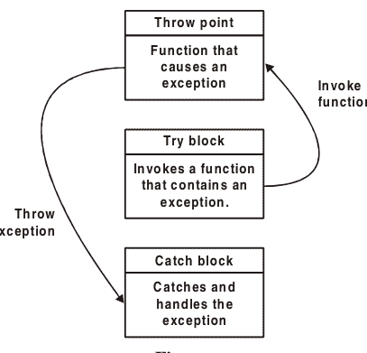

## # 语法 (try catch 块的一般格式)

```cpp
type function (argument list)
{
__________
__________
throw(object) //抛出异常

__________
__________
}
```

```cpp
try
{
__________
__________
在此处调用函数
}
catch (type org) // 捕获异常
{
在此处处理异常
}
```

## # 13.3 多重 Catch 语句

程序段可以有多个条件来抛出异常。在这种情况下，我们可以有多个 catch 块，这意味着一个 try 块可以有多个 catch 块。当异常抛出时，将按顺序搜索异常处理器以寻找适当匹配，如果处理器找到了适当的异常，则执行 catch 块。执行 catch 块后，控制将转移到 try 块的下一个语句，当未找到匹配时，程序将终止。catch 块可以有一个单一参数来捕获抛出的信息。

多个 catch 语句/块的一般格式：

```cpp
try {
    // try 块
}
catch(type1 arg) {
    // catch 块1
}
catch(type2 arg) {
    // catch 块2
}

catch(type N arg) {
    // catch 块N
}
```

示例：

```cpp
# include<iostream.h>
# include<conio.h>
void test(int x)
{
  try {
    if(x==1)
    {
      throw x;
    }
    else {
      if(x==0)
      {
        throw x;
      }
      else {
        if (x==-1)
        {
          throw 1.0
        }
        cout<<"end of try block";
      }
  } catch(char c) {
    cout<<"caught a character";
  }
 catch(int m) {
    cout<<"caught an integer";
  }
 catch(double d) {
    cout<<"caught a double";
  }
  cout<<"end of catch block";
}
void main() {
  cout<<"x=1"<<endl;
  test(1);
  cout<<"x=0"<<endl;
  test(0);
}
```

## # 13.4 抛抛与异常

```cpp
cout<<"for x=-1"<<endl;
test(-1);
cout<<"for x=2"<<endl;
test(2);
getch();
}
```

catch 处理器会决定在不处理的情况下重新抛出捕获到的异常。在这种情况下，我们只需使用 `throw` 关键字后跟分号 (;) 而不带任何参数。
throw;

此语句将要抛出的异常传递给下一个嵌套的 try catch 块。但下一个 catch 块的原型应该与之匹配。
如果我们想从异常处理器内部重新抛出异常，可以通过调用不带异常对象的 `throw` 来实现。这会导致异常被传递到外层的 try/catch 序列。它允许多个处理器访问该异常。

异常只能在 catch 块内部重新抛出。当重新抛出异常时，它不会被同一个 catch 语句捕获。它将向外传播到下一个 catch 语句。

示例：
```cpp
# include<iostream.h>
# include<conio.h>

void divide(double x, double y)
{
    cout<<"Inside function";
try
    {
        if (y==0)
            throw y;
        else
            cout<<"division="<<x/y;
    } // try 块结束
catch(double)
{
    cout<<"catch double inside the function";
    throw;
    } // catch 块结束
    cout<<"end of function";
} // divide 函数结束
void main()
try
{
    divide(10.5,0.0);
}
catch(double)
{
    cout<<"catch double inside the main";
}
cout<<"end main";
```

## # 13.5 指定异常

（注：此处原文内容存在部分重复和错乱，已根据指令避免重复输出原文并完成核心逻辑翻译）

异常处理支持对特定异常的某些安全性，这意味着限制可以在抛出异常时应用。


# 14 标准模板库

## 章节目录

## 章节目录
- 14.1 引言
- 14.2 STL 的组件
- 14.3 容器
- 14.4 算法
- 14.5 迭代器
- 14.6 容器类的应用

## 14.1 引言

模板用于创建泛型类和函数。模板用于创建类（数据结构）和函数（算法）。

这些类和函数的集合被称为标准模板库（STL）。STL 组件是在在 `std` 命名空间中的标准 C++ 库的一部分。因此，为了使用这个命名空间，我们可以写：

```
using namespace std;
```
这条语句类似于声明。它告诉编译器我们要使用标准 C++ 库。

**STL 有三个基本项：**

- (a) 容器 (Containers) (b) 算法 (Algorithms) (c) 迭代器 (Iterators)。

容器是存放其他对象的实例，如 `vector`（动态数组）、`deque`（双端队列）和线性链表（list）。

算法作用于容器。它们提供了操纵容器内容的手段。在这里，可以对容器的内容进行排序、搜索。

迭代器是某种程度上类似于指针的实例。

## 14.2 STL 的组件

STL 包含多个组件。它的核心有三个关键组件。

- 1. 容器
- 2. 算法
- 3. 迭代器

这三个组件协同工作，为各种编程解决方案提供支持。

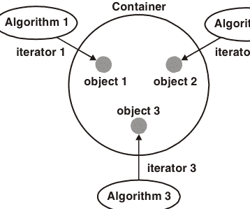

算法利用迭代器来执行存储在容器中的操作。

- 1. 容器是实际存储数据的对象，而容器是持有其他对象的实例。它是内存中组织的数据。STL 容器可以通过轻松自定义来存储不同类型的数据。
- 2. 算法 ⇒ 算法作用于容器。它们提供了操纵容器内容的手段。算法是一种用于处理容器所包含数据的过程。STL 包含了许多种算法，以为初始化、搜索、拷贝、排序和合并等任务提供支持。算法是通过模板函数实现的。
- 3. 迭代器 ⇒ 迭代器是某种程度上类似于指针的实例。迭代器是一个指向容器中元素的指针。我们可以使用迭代器遍历容器的内容。由于迭代器类似于指针，我们可以对它们进行递增或递减。迭代器连接了算法与容器，并在操纵存储的数据中起着关键作用。

## 14.3 容器

容器是持有相同类型其他对象的实例。包含了 `vector` 类（定义动态数组）、`deque`（创建双端队列）和 `list`（提供线性链表）。

STL 定义了种容器，分为三类

## 容器

| (A) | (B) | (C) |
| --- | --- | --- |
| 序列式容器 | 关联容器 | 派生容器 |
| - vector | - set | - stack |
| - deque | - multiset | - queue |
| - list | - map | - priority queue |
| | - multimap | |

序列式容器：
`vector` 是动态数组。它允许在两端进行插入和删除，并允许直接访问任何元素。`list` 是线性链表，允许在任何地方插入和删除；`deque` 是双端队列，允许在两端进行插入和删除，并允许直接访问任何元素。

关联容器：
`set` ⇒ 它是用于存储唯一集合的关联容器。不允许重复。它允许快速查找和搜索。

`multiset` ⇒ 它是用于存储非唯一集合的关联容器。（允许重复）
`map` ⇒ 一种用于存储唯一键/值对的关联容器。每个键只关联一个值（一对一映射）。

`multimap` ⇒ 它是用于存储键/值对的关联容器，其中一个键可能关联多个值（一对多映射）。允许基于键的查找。

派生容器：
1. `stack` ⇒ 标准后进先出 (LIFO) 栈。
2. `queue` ⇒ 标准先进先出 (FIFO) 队列。
3. `priority queue` ⇒ 优先级队列。第一个弹出的元素总是优先级最高的元素。

- (A) 序列式容器：
(i) 序列式容器按线性顺序存储元素。
(ii) 每个元素通过其沿线的位置与其他元素相关联。
(iii) 这些元素可以扩展以允许元素的插入，并可以应用数量的操作。

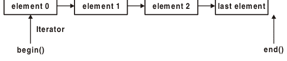

- (iv) STL 提供了三种序列式容器：(1) `vector` (2) `list` (3) `deque`，如前。

(B) 关联容器：
关联容器设计用于支持通过键直接访问元素。它们不是顺序的。

关联容器有四种：

- 1. set
- 2. multiset
- 3. map
- 4. multimap

所有这些容器都存储在名为树的结构中，通过这种结构可以快速搜索、删除和插入。

`set` 和 `multiset` 容器可以存储多个项目，并提供使用键操纵它们的操作。如果我们想搜索某个学生的详情，名称就是搜索记录的键。`set` 不允许重复，而 `multiset` 允许重复集合。

## (C) 派生容器

STL 提供了三个派生容器，即 `stack`、`queue` 和 `priority queue`。它们也被称为容器适配器。

栈、队列和优先级队列。它们也称为容器适配器。

栈，队列和优先级队列。它们也被称为容器适配器。

栈，队列和优先级队列。它们也被称为容器适配器。

栈，队列和优先级队列。它们也被称为容器适配器。

栈，队列和优先级队列。它们也被称为容器适配器。

栈，队列和优先级队列。它们也被称为容器适配器。

栈，队列和优先级队列。它们也被称为容器适配器。

栈，队列和优先级队列。它们也被称为容器适配器。

栈，队列和优先级队列。它们也被称为容器适配器。

栈，队列和优先级队列。它们也被称为容器适配器。

栈，队列和优先级队列。它们也被称为容器适配器。

栈，队列和优先级队列。它们也被称为容器适配器。

栈，队列和优先级队列。它们也被称为容器适配器。

栈，队列和优先级队列。它们也被称为容器适配器。

栈，队列和优先级队列。它们也被称为容器适配器。

栈，队列和优先级队列。它们也被称为容器适配器。

栈，队列和优先级队列。它们也被称为容器适配器。

栈，队列和优先级队列。它们也被称为容器适配器。

栈，队列和优先级队列。它们也被称为容器适配器。

栈，队列和优先级队列。它们也被称为容器适配器。

栈，队列和优先级队列。它们也被称为容器适配器。

栈，队列和优先级队列。它们也被称为容器适配器。

栈，队列和优先级队列。它们也被称为容器适配器。

栈，队列和优先级队列。它们也被称为容器适配器。

栈，队列和优先级队列。它们也被称为容器适配器。

栈，队列和优先级队列。它们也被称为容器适配器。

栈，队列和优先级队列。它们也被称为容器适配器。

栈，队列和优先级队列。它们也被称为容器适配器。

栈，队列和优先级队列。它们也被称为容器适配器。

栈，队列和优先级队列。它们也被称为容器适配器。

## 14.4 算法

算法作用于容器。它们提供了操纵容器内容的手段。

算法可以容器的。

STL  不同的算法。

STL 的分类如下：

- 1. 获取非修改算法
- 2. 变异算法
- 3. 排序算法
- 4. 集合算法
- 5. 关系算法

1. 获取非修改算法：
(a) find() 找到相邻元素。
(b) count() 统计值的出现次数。
(c) count_n 计数。
(d) equal() 检查范围是否相同。
(e) find() 在容器中查找。
(f) find() 找到值的最后出现位置。
(g) each() 对每个元素应用操作。
(h) mismatch() 找到元素不同的元素。
(i) search() 搜索容器。
(j) search_n 搜索数量。

2. 变异算法：
(a) copy() 拷贝序列。
(b) backward() 从末尾拷贝。
(c) fill() 用指定值填充序列。
(d) fill_n 填充 n 个元素。
(e) generate() 用结果替换所有元素。
(f) iter_swap() 通过迭代器交换元素。
(g) remove() 删除指定的元素。
(h) remove_copy() 在删除后拷贝。
(i) replace() 用指定值替换元素。
(j) reverse() 反转元素的顺序。
(k) rotate() 旋转元素。
(l) swap() 交换元素。
(m) swap_range() 交换两个序列。
(n) transform() 对所有元素应用操作。
(o) unique() 删除相邻元素。
(p) unique_copy() 在移除相邻元素后拷贝。

3. 排序算法：
(a) binary_search() 在有序序列上进行二分查找。
(b) merge() 合并两个排序的序列。
(c) sort() 排序序列。
(d) sort_heap() 排序堆。
(e) partial_sort() 排序序列的一部分。
(f) pop_heap() 删除顶元素。
(g) push_heap() 向堆添加元素。
(h) upper_bound() 找到指定值的最后位置。

4. 集合算法：
(a) include() 检查一个序列是否是另一个的子序列。
(b) set_difference() 构建两个有序集合的差集序列。
(c) set_union() 产生两个有序集合的并集。

5. 关系算法：
(a) equal() 检查两个序列是否相同。
(b) max() 两个值的最大值。
(c) max_element() 找到序列内的最大元素。
(d) min() 两个值的最小值。
(e) min_elements() 找到序列内的最小元素。


## 14.5 迭代器 (Iterators)

迭代器类似于指针，用于访问容器的元素。这些指针在访问容器元素时可以在不同元素之间移动或遍历。

从一个元素移动到另一个元素被称为遍历容器。

在遍历时，迭代器可以仅向向移动，也可以向后移动。

迭代器及其特性：

| 迭代器 | 访问方法 | 移动方向 | I/O 能力 | 备注 |
| --- | --- | --- | --- | --- |
| 1. 输入 (Input) | 线性 | 仅限向前 | 只读 | 不可保存 |
| 2. 输出 (Output) | 线性 | 仅限向前 | 只写 | 不可保存 |
| 3. 前向 (Forward) | 线性 | 仅限向前 | 读/写 | 可以保存 |
| 4. 双向 (Bidirectional) | 线性 | 前向 & 后向 | 读/写 | 可以保存 |
| 5. 随机访问 (Random) | 随机 | 前向 & 后向 | 读/写 | 可以保存 |

只有序列关联容器可以使用迭代器遍历。
每种迭代器用于执行特定的功能。

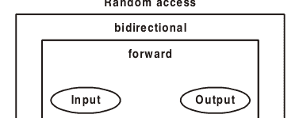

迭代器的功能维恩图。

输入和输出迭代器支持最小的功能。它们仅用于遍历容器。前向迭代器支持输入和输出迭代器的所有操作，并保留在容器中的位置。双向迭代器支持容器中的向前和向后移动。

随机访问迭代器结合了双向迭代器的功能，并具有跳转到任意或特定位置的能力。

## 14.6 容器类的应用

容器类的应用名称：

- 1. vector
- 2. list
- 3. map

1. vector → vector 是最广泛使用的容器。它在连续的内存位置存储元素，并允许使用下标运算符 `[]` 直接访问任何元素。

vector 可以动态地改变大小，并在运行时需要分配内存位置。`class vector` 支持多个构造函数来创建 vector 对象。

在 vector 类中支持以下成员函数：

- 1. begin
- 2. clear
- 3. capacity
- 4. size
- 5. swap
- 6. Resize
- 7. end
- 8. erase
- 9. empty
- 10. back
- 11. insert

2. List → list 是另一种容器。它支持双向线性列表，并为删除和插入操作提供了高效的实现。

它不支持随机访问。

list 只能按顺序访问。list 支持输入、输出、向前和双向迭代器，其操作方式如下：

常用的函数有：

- 1. back
- 2. begin
- 3. clear
- 4. empty
- 5. end
- 6. erase
- 7. insert
- 8. merge
- 9. remove
- 10. resize
- 11. size
- 12. Sort
- 13. swap
- 14. unique
- 15. pop-back
- 16. pop-front
- 17. push-back
- 18. push-front

3. Maps → map 是一个序列（键, 值）对，每个唯一的键与一个值相关联。

值的检索基于键且速度非常快。

它通常被称为关联运算符 `[]`。

键使用下标运算符 `[]` 指定。

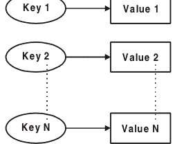

使用的常用函数有：

- 1. begin
- 2. clear
- 3. empty
- 4. end
- 5. erase
- 6. find
- 7. insert
- 8. size
- 9. swap

## 自我练习题库

- 1. 详细解释 STL 库。
- 2. 解释 C++ 中的 STL 组件。
- 3. 详细解释 STL 中的算法组件。
- 4. 解释三种不同的类别。
    - (a) 序列 (sequential)
    - (b) 关联 (associative)
    - (c) 派生 (derived)

- 5. 详细解释迭代器。
- 6. 定义容器类的应用。

# 实践列表

A. 编写程序演示不使用类的简单 C++ 概念。

Q.1 编写 C++ 程序，打印三个数的和和平均值。

```cpp
#include<iostream.h>
#include<conio.h>
void main()
{
    int a,b,c,sum;
    float avg;
    cout<<"Enter three numbers"<<endl;
    cin>>a>>b>>c;
    sum=a+b+c;
    avg=sum/3.0;
    cout<<"The sum of three numbers is"<<sum<<endl;
    cout<<"The Average of three numbers is"<<avg;
    getch();
}
```

输出：
Enter three numbers
10 18 02
The sum of three numbers is 30
The Average of three numbers is 10

Q.2 编写 C++ 程序，使用嵌套 if 打印三个数中的最大值。

```cpp
#include<iostream.h>
#include<conio.h>
void main()
{
    int a,b,c;
    clrscr();
    cout<<"Enter three numbers"<<endl;
    cin>>a>>b>>c;
    if(a>b)
```

```cpp
if(a>c)
{
    cout<<"is greater";
}
if(b>a)
{
    if(b>c)
    {
        cout<<b<<"is greater";
    }
}
if(c>a)
{
    if(c>b)
    {
        cout<<c<<"is greater";
    }
}
getch();
```

输出：
Enter three numbers
10 18 02
18 is greater

Q.3 编写 C++ 程序，使用逻辑运算符打印三个数的最大值。

```cpp
#include<iostream.h>
#include<conio.h>
void main()
{
    int a,b,c;
    clrscr();
    cout<<"Enter three numbers"<<endl;
    cin>>a>>b>>c;
    if(a>b && a>c)
    {
        cout<<a<<"is greater";
    }
```

```cpp
else if(b>a && b>c)
{
    cout<<b<<"is greater";
}
else
{
    cout<<c<<"is greater";
}
getch();
```

输出：
Enter three numbers
10 18 02
18 is greater

Q4 编写 C++ 程序，接受用户输入的三个科目成绩（假设总分 100 分）。

| 分数 | 等级 |
|---|---|
| 75及以上 | 优秀 (Distinction) |
| 60-74 | 一等 (1st class) |
| 50-59 | 二等 (2nd class) |
| 40以下 | 不及格 (Fail) |

```cpp
#include<iostream.h>
#include<conio.h>
void main()
{
    int m1,m2,m3,tot;
    float per;
    clrscr();
    cout<<"Enter three subjects marks"<<endl;
    cin>>m1>>m2>>m3;
    tot=m1+m2+m3;
    per=tot/3.0;
    if (per>=75)
        cout<<"Distinction";
    else if (per>=60 && per<75)
        cout<<"1st class";
    else if (per>=50 && per<60)
        cout<<"2nd class";
    else
        cout<<"Fall";
    getch();
}
```

输出：
Enter three subjects marks
80 90 80
Distinction

Q.5 编写 C++ 程序，打印 1 到 100 之间的偶数。

```cpp
#include<iostream.h>
#include<conio.h>
void main()
{
    int i;
    clrscr();
    cout<<"The Even numbers from 1 to 100"<<endl;
    for(i=2;i<=100;i+=2)
    {
        cout<<i<<" ";
    }
    getch();
}
```

输出：
The Even numbers from 1 to 100 are 2 4 6 8 10 12 14 16 18 20 22 24 26 28 30 32 34 36 38 40 42 44 46 48 50 52 54 56 58 60 62 64 66 68 70 72 74 76 78 80 82 84 86 88 90 92 94 96 98 100 

Q.6 编写 C++ 程序，打印 1 到 100 之间的质数整数。

```cpp
#include<iostream.h>
#include<conio.h>
void main()
{
    int i,j,prime;
    clrscr();
    cout<<"The Prime numbers from 1 to 100 are"<<endl;
    for(i=2;i<=100;i++)
    {
        prime=1;
        for(j=2;j<i;j++)
        {
            if(i%j==0)
            {
                prime=0;
                break;
            }
        }
```

```cpp
        if(prime==1)
        {
            cout<<i<<" ";
        }
    }
    getch();
}
```

输出：
The Prime numbers from 1 to 100 are: 2 3 5 7 11 13 17 19 23 29 31 37 41 43 47 53 59 61 67 71 73 79 83 89 97 

Q.8 编写 C++ 程序，打印一个数的阶乘。

```cpp
#include<iostream.h>
#include<conio.h>
void main()
{
  long i,j,n,fact=1;
  clrscr();
  cout<<"Enter a number"<<endl;
  cin>>n;
  for(i=1;i<=n;i++)
  {
    fact=fact*i;
  }
  cout<<"The factorial of a number is"<<fact;
  getch();
}
```

输出：
Enter a number
5
The factorial of a number is120


一个数字的阶乘是 40320

## Q.9 编写一个 C++ 程序，在一个程序中打印 1 到 100 之间的偶数、奇数和质数。

```cpp
void main()
{
    int i,prime,j;
    clrscr();
    cout<<"The Even numbers from 1 to 100"<<endl;
    for(i=2;i<=100;i+=2)
    {
        cout<<i<<" ";
    }
    cout<<"\\nThe Odd numbers from 1 to 100"<<endl;
    for(i=1;i<=100;i++)
    {
        cout<<i<<" ";
    }
    cout<<"\\nThe Prime numbers from 1 to 100 are"<<endl;
    for(i=1;i<=100;i++)
    {
        prime=1;
        for(j=2;j<=i-1;j++)
        {
            if(i%j==0)
            {
                prime=0;
                break;
            }
        }
        if(prime==1)
        {
            cout<<i<<" ";
        }
    }
    getch();
}
```

## C++ 面向对象编程

输出：

| 2 | 4 | 6 | 8 | 10 | 12 | 14 | 16 | 18 | 20 |
| 22 | 24 | 26 | 28 | 30 | 32 | 34 | 36 | 38 | 40 |
| 42 | 44 | 46 | 48 | 50 | 52 | 54 | 56 | 58 | 60 |
| 62 | 64 | 66 | 68 | 70 | 72 | 74 | 76 | 78 | 80 |
| 82 | 84 | 86 | 88 | 90 | 92 | 94 | 96 | 98 | 100 |

1 到 100 之间的奇数是：

| 1 | 3 | 5 | 7 | 9 | 11 | 13 | 15 | 17 | 19 |
| 21 | 23 | 25 | 27 | 29 | 31 | 33 | 35 | 37 | 39 |
| 41 | 43 | 45 | 47 | 49 | 51 | 53 | 55 | 57 | 59 |
| 61 | 63 | 65 | 67 | 69 | 71 | 73 | 75 | 77 | 79 |
| 81 | 83 | 85 | 87 | 89 | 91 | 93 | 95 | 97 | 99 |

1 到 100 之间的质数是：

| 1 | 2 | 3 | 5 | 7 | 11 | 13 | 17 | 19 | 23 |
| 29 | 31 | 37 | 41 | 43 | 47 | 53 | 59 | 61 | 67 |
| 71 | 73 | 79 | 83 | 89 |

## Q.10 编写一个 C++ 程序，通过接受用户输入的字符来给出 switch case 的示例。

/* 程序：switch 语句 */

```cpp
#include <iostream.h>
void main()
{
    char c;
    cout<<"Enter any character from the word 'worry':";
    cin>>c;
    switch (c)
    {
        case 'W':
            cout<<"I am am in case w\n";
            break;
        case 'O':
            cout<<"I am in case o\n";
            break;
        case 'R':
            cout<<"I am in case r\n";
            break;
        case 'Y':
            cout<<"I am in case y\n";
            break;
        default:
            cout<<"U entered the wrong letter !!\n";
    }
}
```

输出：
输入单词 'worry' 中的任意字符：W
I am am in case w

## Q.11 编写一个 C++ 程序，通过菜单驱动的 switch case 算术、关系和逻辑操作的示例。

```cpp
/* 程序：switch 语句 */
#include <iostream.h>
#include <conio.h>
void main()
{
    int select, choice, x, y;
    clrscr();
    cout<<"Enter any integer values : ";
    cin>>x>>y;

    cout<<"\nOperators : \n";
    cout<<"====================\n";
    cout<<"1. Arithmetic\n";
    cout<<"2. Relational\n";
    cout<<"3. Logical\n";
    cout<<"Enter your choice : ";
    cin>>choice;

    switch (choice)
    {
        case 1:
            cout<<"\tMenu-Arithmetic\n";
            cout<<"1. Addition\n";
            cout<<"2. Subtraction\n";
            cout<<"3. Division\n";
            cout<<"4. Multiplication\n";
            cout<<"5. Modulus\n";
            cout<<"Enter your choice : ";
            cin>>choice;
            switch (choice)
            {
                case 1: cout<<"Addition of "<<x<<" and "<<y<<" : "<<x+y; break;
                case 2: cout<<"Subtraction of "<<x<<" and "<<y<<" : "<<x-y; break;
                case 3: cout<<"Division of "<<x<<" and "<<y<<" : "<<x/y; break;
                case 4: cout<<"Multiplication of "<<x<<" and "<<y<<" : "<<x*y; break;
                case 5: cout<<"Modulus of "<<x<<" and "<<y<<" : "<<x%y; break;
                default: cout<<"Wrong choice!";
            }
            break;
        case 2:
            cout<<"\tMenu-Relational operations\n";
            cout<<"1. Greater than\n";
            cout<<"2. Less than\n";
            cout<<"3. Equal to\n";
            cout<<"4. Less than equal to\n";
            cout<<"5. Greater than equal to\n";
            cout<<"Enter your choice : ";
            cin>>choice;
            switch (choice)
            {
                case 1: cout<<"Result of x greater than y : "<<x>y; break;
                case 2: cout<<"Result of x less than y : "<<x<y; break;
                case 3: cout<<"Result of x equal to y : "<<x==y; break;
                case 4: cout<<"Result of x less than equal to y : "<<x<=y; break;
                case 5: cout<<"Result of x greater than equal to y : "<<x>=y; break;
            }
            break;
        case 3:
            cout<<"\tMenu-Logical operations\n";
            cout<<"1. Logical AND\n";
            cout<<"2. Logical OR\n";
            cout<<"Enter your choice : ";
            cin>>choice;
            switch (choice) 
            {
                case 1: cout<<"Result of x AND y : "<<x&&y; break;
                case 2: cout<<"Result of x OR y : "<<x|y; break;
            }
            break;
    }
    getch();
}
```

输出：
输入任意整数：42
1. Arithmetic
2. Relational
3. Logical
输入你的选择：1
Menu-Arithmetic
1. Addition
2. Subtraction
3. Division
4. Multiplication
5. Modulus
输入你的选择：1
Addition of 4 and 2 : 6

## Q.12 编写一个 C++ 程序打印以下图案：

1
1 2
1 2 3
1 2 3 4

 答案：

```cpp
#include<iostream.h>
#include<conio.h>
void main() {
    int i,j;
    clrscr();
    for(i=1;i<=4;i++) {
        for(j=1;j<=i;j++) {
            cout<<j<<" ";
        }
        cout<<endl;
    }
    getch();
}
```

## Q.13 编写一个 C++ 程序打印以下图案：

1
1 2
1 2 3
1 2 3 4

 答案：

```cpp
#include<iostream.h>
#include<conio.h>
void main() {
    int i,j;
    clrscr();
    for(i=1;i<=4;i++) {
        for(j=1;j<=i;j++) {
            cout<<j<<" ";
        }
        cout<<endl;
    }
    getch();
}
```

## Q.14 编写一个 C++ 程序打印以下图案：

4 4 4
3 3 3
2 2
1

 答案：

```cpp
#include<iostream.h>
#include<conio.h>
void main()
{
    int i,j;
    clrscr();
    for(i=4;i>=1;i--) {
        for(j=1;j<=i;j++) {
            cout<<i<<" ";
        }
        cout<<endl;
    }
    getch();
}
```

## Q.15 编写一个 C++ 程序打印以下图案：

1
2 2
3 3 3
4 4 4 4

 答案：

```cpp
#include<iostream.h>
#include<conio.h>
void main()
{
    int i,j;
    clrscr();
    for(i=1;i<=4;i++) {
        for(j=1;j<=i;j++) {
            cout<<i<<" ";
        }
        cout<<endl;
    }
    getch();
}
```

## Q.16 编写一个 C++ 程序打印以下图案：

*
**
***

 答案：

```cpp
#include<iostream.h>
#include<conio.h>
void main()
{
    int i,j;
    clrscr();
    for(i=4;i>=1;i--) {
        for(j=1;j<=i;j++) {
            cout<<"* ";
        }
        cout<<endl;
    }
    getch();
}
```

## Q.17 编写一个 C++ 程序打印以下图案：

1
2 2
3 3 3
4 4 4 4
5 5 5 5
6 6 6 6 6

 答案：

```cpp
#include<iostream.h>
#include<conio.h>
void main()
{
    int r,c,s;
    clrscr();
    for(r=1;r<=6;r++) {
        for(s=1;s<=r;s++) {
            cout<<r<<" ";
        }
        cout<<"\n"; // 注意：原文此处代码逻辑略有误，此处根据逻辑补全
    }
    getch();
}
```

## B. 编写 C++ 程序演示指针、函数和重载。

## Q.1 编写一个 C++ 程序使用函数计算圆的面积。

```cpp
#include<iostream.h>
#include<conio.h>
void main()
{
    float r,a1;
    float area(float r1);
    clrscr();
    cout<<"enter radius"<<endl;
    cin>>r;
    a1=area(r);
    cout<<"The area is "<<a1;
    getch();
}

float area(float r1)
{
    float pi=3.1415,area;
    area=pi*r1*r1;
    return area;
}
```

输出：
输入半径
5
面积为78.5

## Q.2 编写一个 C++ 程序使用函数打印两个数的最大值。

```cpp
#include<iostream.h>
#include<conio.h>
void main()
{
    int a,b,m;
    int max(int x,int y);
    clrscr();
    cout<<"enter the value of a &b"<<endl;
    cin>>a>>b;
    m=max(a,b);
    cout<<"the maximum no is "<<m;
    getch();
}

int max(int x, int y)
{
    if(x>y)
    {
        return x;
    }
    else
    {
      return y;
    }
}
```

输出：
输入 a 和 b 的值
5 8
最大值为 8

## Q.3 编写一个 C++ 程序使用函数打印一个数字的阶乘。

```cpp
#include<iostream.h>
#include<conio.h>
void main() {
  int fa,n;
  int fact(int n1);
  clrscr();
  cout<<"enter a number"<<endl;
  cin>>n;
  fa=fact(n);
  cout<<"the factorial is "<<fa;
  getch();
}
int fact(int n1) {
  int f1=1,i;
  for(i=1;i<=n1;i++) {
    f1=f1*i;
  }
  return f1;
}
```

输出：
输入一个数字
5
阶乘为 120

## Q.4 编写一个 C++ 程序使用函数打印三个数的和和平均值。

```cpp
#include <iostream.h>
#include <conio.h>
void main()
{
    int a,b,c;
    void sumavg(int x, y, int z);
    clrscr();
    cout<<"enter 3 numbers"<<endl;
    cin>>a>>b>>c;
    sumavg(a,b,c);
    getch();
}
void sumavg(int x, int y, int z)
{
    int s;
    float avg;
    s=x+y+z;
    avg=s/3.0;
    cout<<"The sum of three numbers is "<<s<<endl;
    cout<<"The average of three numbers is "<<avg<<endl;
}
```

输出：
输入三个数字
80 90 80
三个数的和为 250
三个数的平均值为 83.333

## Q.5 编写一个 C++ 程序，使用函数重载交换两个整数、两个浮点数和两个字符。

```cpp
#include <iostream.h>
#include <conio.h>
void main()
{
    int x,y;
    float fx,fy;
    char cx,cy;
    clrscr();
    cout<<"enter y"<<endl;
}
```


# 实用列表

```cpp
cin>>x>>y;
cout<<"enter fx fy"<<endl;cin>>fx>>fy;
cout<<"enter cx cy"<<endl;cin>>cx>>cy;
swap(x,y);
swap(fx,fy);
swap(cx,cy);
getch();
void swap(int a, int b)
{
int temp;
temp=b;
b=a;
a=temp;
cout<<"the value of x is "<<a<<endl;
cout<<"the value of y is "<<b<<endl;
}
void swap(float a, float b)
{
float temp;
temp=b;
b=a;
a=temp;
cout<<"the value of fx is "<<a<<endl;
cout<<"the value of fy is "<<b<<endl;
}
void swap(char a, char b)
{
char temp;
temp=b;
b=a;
a=temp;
cout<<"the value of cx is "<<a<<endl;
cout<<"the value of cy is "<<b<<endl;
}
```

# 问题.6 编写 C++ 程序，使用函数重载计算圆面积、矩形面积和直角三角形面积。

```cpp
#include<iostream.h>
#include<conio.h>

float area(int r1);
float area(double b1,double h1);
int area(int l1, int b1);
void main()
{
int r,l,b2,a3;
double b,h,a1,a2;
clrscr();
cout<<"enter the radius"<<endl;
cin>>r;
cout<<"enter the breath & height"<<endl;
cin>>b>>h;
cout<<"enter the length & breath"<<endl;
cin>>l>>b2;
a1=area(b,h);
a2=area(l,b2);
a3=area(l,b2);
cout<<"in the area of circle is "<<a1<<endl;
cout<<"in the area of triangle is "<<a2<<endl;
cout<<"in the area of rectangle is "<<a3<<endl;
getch();
}

float area(int r1)
{
float a;
a = 3.1415*r1*r1;
return a;
}

float area(double b1, double h1)
{
float z;
z=0.5*b1*h1;
return z;
}

int area(int l1, int b1)
{
int z;
z=l1*b1;
return z;
}
```

# 问题.7 编写 C++ 程序，通过显示变量地址和增加指针变量地址来演示指针变量。

```cpp
#include<iostream>
#include<conio.h>
void main()
{
int i=3,'x';
float j=1.5,'y';
char k='c',z;
clrscr();
cout<<"value of i is "<<i<<endl;
cout<<"value of j is "<<j<<endl;
cout<<"value of k is "<<k<<endl;
x=i;
y=&k;
cout<<"original value of x is "<<x<<endl;
cout<<"original value of y is "<<y<<endl;
cout<<"original value of z is "<<z<<endl;
cout<<"original value of x is "<<x<<endl;
cout<<"original value of y is "<<y<<endl;
cout<<"original value of z is "<<z<<endl;
x--;
y--;
z--;
cout<<"new value of x is "<<x<<endl;
cout<<"new value of y is "<<y<<endl;
cout<<"new value of z is "<<z<<endl;
getch();
}
```

# 问题.8 编写 C++ 程序，演示指针算术。

```cpp
#include<iostream.h>
#include<conio.h>
void main()
{
int i=3,*x;
float j=1.5,*y;
char k='c',*z;
clrscr();
cout<<"value of i is "<<i<<endl;
cout<<"value of j is "<<j<<endl;
cout<<"value of k is "<<k<<endl;
x=&i;
y=&j;
z=&k;
cout<<"original value of x is "<<x<<endl;
cout<<"original value of y is "<<y<<endl;
cout<<"original value of z is "<<z<<endl;
x++;
y++;
z++;
cout<<"new value of x is "<<x<<endl;
cout<<"new value of y is "<<y<<endl;
cout<<"new value of z is "<<z<<endl;
getch();
}
```

# 问题.9 编写 C++ 程序，使用函数打印圆的面积和周长。

```cpp
#include<iostream>
#include<conio.h>
void area(int r,float *a,float *c);
void main()
{
int radius;
float area,circum;
cout<<"enter the radius"<<endl;
cin>>radius;
area(radius,&area,&circum);
cout<<"area is "<<*area<<endl;
cout<<"circumference is "<<*circum<<endl;
getch();
}
void area(int r,float *a,float *c)
{
*a=3.14*r*r;
*c=2*3.14*r;
}
```

# 问题.10 编写 C++ 程序，使用函数打印一个数的平方。

```cpp
#include<iostream.h>
#include<conio.h>
void square(int *x);
void main()
{
int a;
cout<<"enter the value of a:"<<endl;
cin>>a;
square(&a);
cout<<"square is "<<a<<endl;
getch();
}
void square(int *x)
{
*x=$x*(*x);
}
```

# 问题.11 编写 C++ 程序，通过指针声明数组元素显示数组。

```cpp
#include<iostream.h>
#include<conio.h>
void main()
{
int b[]={10,20,30,40,50};
int i;
for(i=0;i<=4;i++)
{
cout<<*(b+i)<<endl;
}
getch();
}
```

# 问题.12 编写 C++ 程序，使用指针和函数合并两个字符串。

```cpp
#include <iostream.h>
#include <conio.h>
#include <string.h>
char *combine(char *s,char *t);
void main()
{
    char a[10],b[10],*p;
    strcpy(a,"horse");
    strcpy(b,"fly");
    p=combine(a,b);
    cout<<p;
    getch();
}
char *combine(char *s,char *t)
{
    int x,y;
    char r[100];
    strcpy(r,s);
    y=strlen(s);
    for(x=y;t!='\0';x++)
    {
        r[x]=t++;
    }
    return r;
}
```

# C. 类函数重载

# 问题.1 编写 C++ 程序，使用函数重载类交换两个整数、两个浮点数和两个字符。

```cpp
#include <iostream.h>
#include <conio.h>
void swap(int a,int b);
void swap(float a,float b);
void swap(char a,char b);
void main()
{
    int x,y;
    float fx,fy;
    char cx,cy;
    clrscr();
    cout<<"enter x y"<<endl;
    cin>>x>>y;
    cout<<"enter fx fy"<<endl;
    cin>>fx>>fy;
    cout<<"enter cx cy"<<endl;
    cin>>cx>>cy;
    swap(x,y);
    swap(fx,fy);
    swap(cx,cy);
    getch();
}
void swap(int a,int b)
{
int temp;
temp=b;
b=a;
a=temp;
cout<<"the value of x is "<<a<<endl;
cout<<"the value of y is "<<b<<endl;
}
void swap(float a, float b)
{
float temp;
temp=b;
b=a;
a=temp;
cout<<"the value of fx is "<<a<<endl;
cout<<"the value of fy is "<<b<<endl;
}
void swap(char a, char b)
{
char temp;
temp=b;
b=a;
a=temp;
cout<<"the value of cx is "<<a<<endl;
cout<<"the value of cy is "<<b<<endl;
}
```

# 问题.2 编写 C++ 程序，使用类函数重载打印圆面积、矩形面积和直角三角形面积。

```cpp
#include<iostream.h>
#include<conio.h>
class area_calc {
    double a;
public:
    void calculate(int r) {
        a = 3.1415*r*r;
        cout<<"area of circle is "<<a<<endl;
    }
    void calculate(int l, int b) {
        a = l*b;
        cout<<"area of rectangle is "<<a<<endl;
    }
    void calculate(double
, int {) {
        a*b;
        cout<<"area of triangle is "<<a<<endl;
    }
};
void main() {
    area_calc obj;
    int r, l, b2;
    double b, h;
    clrscr();
    cout<<"enter radius"<<endl;
    cin>>r;
    obj.calculate(r);
    cout<<"enter breath & height"<<endl;
    cin>>b>>h;
    obj.calculate(b,h);
    cout<<"enter length & breath"<<endl;
    cin>>l>>b2;
    obj.calculate(l,b2);
    getch();
}
```

# D. 编写 C++ 程序以演示概念：类、友函数。

问题.1 编写 C++ 程序创建一个点类，成员函数用于与点标量相乘并加两个点。

源代码：

```cpp
#include<iostream.h>
#include<conio.h>
class point {
    int a,b;
public:
    void input() {
        cout<<"enter a and b:";
        cin>>a>>b;
    }
    void scalar(int n) {
        a=a*n;
        b=b*n;
    }
    void display() {
        cout<<"a "<<a<<" b "<<b<<endl;
    }
    friend void add;
};
void add(point p1, point1, point p2) {
    p1.a = p1.a + p2.a;
    p1.b = p1.b + p2.b;
    p1.display();
}
void main()
{
    point p1,p2;
    int n;
    p1.input();
    p2.input();
    cout<<"enter n:";cin>>n;
    p1.scalar(n);
    add(p1, p2);
    getch();
}
```


# Q.3 编写一个 C++ 程序，创建一个名为 Rectangle 的类，成员变量为 width 和 height，并具有计算面积和周长的成员函数。

源代码：

```cpp
#include<iostream.h>
#include<conio.h>
class rectangle
{
    private:
    int h,w;
    public:
    void input()
    {
        cout<<"Enter the values of h and w";
        cin>>h>>w;
    }
    void display()
    {
        cout<<"h-"<<h<<"-w-"<<w<<";
    }
    void area()
    {
        int area;
        area=h*w;
        cout<<"\n Area Is:";
        cout<<area<<"\n";
    }
    void peri()
    {
        int peri;
        peri=2*(h+w);
        cout<<"Perimeter Is:"<<peri;
    }
};
void main()
{
    rectangle r;
    r.input();
    r.display();
    r.area();
    r.peri();
    getch();
}
```

输出：

Enter the values of h and w 5 40
h-5-w-40

Area Is:200
Perimeter Is:90

# Q. 4 编写一个 C++ 程序，使用友函数打印一个数的立方。

```cpp
#include<iostream.h>
#include<conio.h>
class fir
{
int x;
public:
void get()
{
cout<<"-enter the value of x "<<<<endl;
cin>>x;
}
friend void cube(fir f);
};

void cube(fir f)
{
int z;
z=f.x*f.x*f.x;
cout<<"-the cube of "<<f.x<<" is "<<<<z;
}

void main()
{
fir f1;
clrscr();
f1.get();
cube(f1);
getch();
}
```

# Q.5 编写一个程序，使用嵌套成员函数通过友函数计算两个数的平均值。

```cpp
#include<iostream.h>
#include<conio.h>
class fir
{
int x,y;
public:
void get()
{
cout<<"enter the value of x & y"<<endl;
cin>>x>>y;
}
friend float mean(fir f);
};
float mean(fir f)
{
return (f.x+f.y)/2;
}
void main()
{
fir f1;
clrscr();
f1.get();
cout<<"the mean value is "<<mean(f1);
getch();
}
```

# Q. 6 编写一个 C++ 程序，创建一个类 cel，通过 set 成员函数接受摄氏温度，使用 get 函数读取摄氏温度。创建一个类 feh，通过 set 成员函数接受华氏温度，使用 get 函数读取华氏温度。提供一个公共友函数 sum 来显示两个类的摄氏和华氏温度之和。

```cpp
#include<iostream.h>
#include<conio.h>
class feh;
class cel
{
float c;
public:
void setc()
{
    cout<<"Enter temp in Celsius ";
    cin>>c;
}
float getc()
{
    return c;
}
friend float sum(feh f, cel c);
};
class feh
{
    float f;
public:
    void setf()
{
        cout<<"Enter temp in Feh ";
        cin>>f;
    }
float getf()
{
        return f;
    }
float display()
{
        cout<<"Feh Temp is = "<<f<<endl;
        return f;
    }
    friend float sum(feh f, cel c);
};
float sum(feh f, cel c)
{
    return (f.f+c.c);
}
void main()
{
    cel c1;
    c1.setc();
    cout<<"Temp in cel is "<<c1.get()]<<endl;
    feh f1;
    f1.setf();
    float ff=sum(f1,c1);
    cout<<"FF is"<<ff<<endl;
    getch();
}
```

# Q. 7 编写一个 C++ 程序，通过两个类的公共友函数打印第一类和第二 类中的数最大值。

```cpp
#include<iostream.h>
#include<conio.h>
class sec;
class fir
{
int x;
public:
void get()
{
cout<<"enter the value of x "<<<<endl;
cin>>x;
}
void disp()
{
cout<<"the value of x "<<x<<endl;
}
friend void max(fir,sec);
};
class sec
{
int y;
public:
void get()
{
cout<<"enter the value of y "<<<<endl;
cin>>y;
}
void disp()
{
cout<<"the value of y is "<<y<<"endl";
}
friend void max(fir,sec);
};
void max (fir f,sec s)
{
if(f.x >s.y)
{
  cout<<"x="<<f.x<<"is greater than y="<<s.y<<".";
}
else
{
  cout<<"y="<<s.y<<"is greater than x="<<f.x<<".";
}
}
void main()
{
fir f1;
sec s1;
clrscr();
f1.get();
f1.disp();
s1.get();
s1.disp();
max(f1,s1);
getch();
}
```

# E. 编写 C++ 程序来阐述概念：构造函数、构造函数重载和析构函数。

Q. 1 编写一个 C++ 程序，通过构造函数接受两个数，并通过 sum 成员函数打印两个数之和。创建一个类的两个对象。

```cpp
#include<iostream.h>
#include<conio.h>
class number
{
int x,y;
public:
number()
{
  cout<<"enter the value of x & y"<<endl;
  cin>>x>>y;
}
void sum()
{
  int z;
  z=x+y;
  cout<<"sum is "<<z<<endl;
}
};
void main()
{
  number n1, n2;
  n1.sum();
  n2.sum();
  getch();
}
```

Q. 2 编写一个 C++ 程序，通过构造函数接受两个数，并通过 sum 成员函数打印两个数之和。创建一个类的两个对象。

```cpp
#include<iostream.h>
#include<conio.h>
#include<string.h>
class inventory {
private:
    int x, y;
    char title[10], author[10], publisher[10], stock;
public:
    inventory() {
        cout<<"enter the value of x & y"<<endl;
        cin>>x>>y;
    }
    void sum() {
        int z;
        z=x+y;
        cout<<"sum is "<<z<<endl;
    }
};
void main() {
    inventory n1, n2;
    n1.sum();
    n2.sum();
    getch();
}
```

Q. 3 编写一个 C++ 程序，通过构造函数接受两个数，并通过 sum 成员函数打印两个数之和。创建一个类的两个对象。

```cpp
#include<iostream.h>
#include<conio.h>
#include<string.h>
class inventory {
    int x, y;
public:
    inventory() {
        cout<<"enter the value of x & y"<<endl;
        cin>>x>>y;
    }
    void sum() {
        int z;
        z=x+y;
        cout<<"sum is "<<z<<endl;
    }
};
void main() {
    inventory n1, n2;
    n1.sum();
    n2.sum();
    getch();
}
```

Q. 4 编写一个 C++ 程序，通过构造函数接受两个数，并通过 sum 成员函数打印两个数之和。创建一个类的两个对象。

```cpp
#include<iostream.h>
#include<conio.h>
class student {
    int x, y;
public:
    student(int a, int b) {
        x=a;
        y=b;
    }
    void sum() {
        int z=x+y;
        cout<<"sum is "<<z;
    }
    void sub() {
        int z=x-y;
        cout<<"sub is "<<z;
    }
    void mul() {
        int z=x*y;
        cout<<"mul is "<<z;
    }
    void div() {
        int z=x/y;
        cout<<"div is "<<z;
    }
};
void main() {
    student s(5,3);
    s.sum();
    s.sub();
    s.mul();
    s.div();
    getch();
}
```

Q. 5 编写一个 C++ 程序，通过参数构造函数接受学号、姓名和分数。并通过显示 成员函数显示。

```cpp
#include<iostream.h>
#include<conio.h>
#include<string.h>
class student {
    int rollno;
    char name[10];
    float marks;
public:
    student(int r, char n[10],float m) {
        rollno=r;
        strcpy(name,n);
        marks=m;
    }
    void disp() {
        cout<<"the rollno is"<<rollno<<endl;
        cout<<"the name is "<<name<<endl;
        cout<<"the marks is "<<marks<<endl;
    }
};
void main() {
    student s(10,"chirag",98);
    s.disp();
    getch();
}
```


## Q. 6 创建一个类 first，通过参数构造函数接受一个整数。重载该构造函数以接受两个整数并计算两个数的和。重载该构造函数以接受三个浮点数并计算三个浮点数的和并打印。

```cpp
#include<iostream.h>
#include<conio.h>
class first {
private:
int x,ix,iy;
float fx,fy,fz;
public:
    first(int x1)
    {
        x=x1;
        cout<<"the value of x is "<<x1<<endl;
    }
    first(int x1,int y1)
    {
        ix=x1;
        iy=y1;
        cout<<"the value of ix & iy is "<<ix<<" "<<iy<<endl;
        int sum=ix+iy;
        cout<<"the sum of ix & iy is "<<sum<<endl;
    }
    first(float fx1, float fy1, float fz1)
    {
        fx=fx1;
        fy=fy1;
        fz=fz1;
        cout<<"the value of fx, fy & fz is "<<fx<<" "<<fy<<" "<<fz<<endl;
        int sum1=fx+fy+fz;
        cout<<"the sum of fx, fy & fz is :"<<sum1<<endl;
    }
    void main()
    {
        clrscr();
        first f0(8);
        first f1(2,3);
        first first f2(6,0,7); 
        getch();
    }
};
```

## Q. 7 编写一个 C++ 程序创建一个类 date1，其数据成员为 day,month 和 year，默认值 year = 2002。显示默认日期；对于另一个对象，覆盖 year的值为默认值并显示第二个对象的日期。

```cpp
#include<iostream.h>
#include<conio.h>
class date1
{
    private:
    int day,month,year;
    public:
    date1(int d,int m,int y=2002)
    {
        day=d;
        month=m;
        year=y;
    }
    void disp()
    {
        cout<<"the date is: "<<day<<"/"<<month<<"/"<<year<<endl;
    }
};

void main()
{
    date1 d(5,9);
    d.disp();
    date1 d1(8,11,2003);
    d1.disp();
    getch();
}
```

## Q. 8 编写一个 C++ 程序创建一个类 show，通过 main 函数为公共变量 x 赋值。通过 disp 函数显示 x 的值并提供一个析构函数来显示析构信息。

```cpp
#include<iostream.h>
#include<conio.h>
class show
{
    public:
    int x;
    void disp()
    {
        cout<<x<<endl;
    }
    ~show()
    {
        cout<<"Destructor is called"<<endl;
    }
};
void main()
{
    show obj;
    clrscr();
    obj.x=10;
    obj.disp();
    getch();
}
```

## Q. 9 创建类 bank，数据成员为 name, accno, 账户类型和余额。通过构造函数接受细节。提供成员函数 (1) 存款金额，(2) 检查余额后取款金额，(3) 显示姓名和余额。

```cpp
#include<iostream.h>
#include<conio.h>
#include<string.h>
class bank
{
char name[15];
int accno;
char type[10];
float bal;
public:
bank(char n[15], int ac, char t[10],float b)
{
    strcpy(name,n);
    accno=ac;
    strcpy(type,t);
    bal=b;
}
    void deposit()
    {
        int y;
        cout<<"enter the amount to deposit"<<endl;
        cin>>y;
        bal = bal +y;
    }
    void withdraw()
    {
        int y;
        cout<<"enter the amount to withdraw"<<endl;
        cin>>y;
        if(bal-y)>500
        {
            bal =bal-y;
        }
        else
        {
            cout<<"no balance available";
        }
    }
    void display()
    {
        cout<<"the name is "<<name<<endl;
        cout<<"the balance is "<<bal;
    }
};
void main()
{
    clrscr();
    bank b("kiran",819,"saving",10000);
    bank b1("chirag",485,"current",50000);
    b.deposit();
    b.withdraw();
    b.display();
    b1.deposit();
    b1.withdraw();
    b1.display();
    getch();
}
```

# F. 编写 C++ 程序以演示概念：运算符重载（包括一元和二元）。

## Q. 编写一个 C++ 程序，使用运算符函数作为成员函数来重载一元 - 运算符

```cpp
#include<iostream.h>
#include<conio.h>
class abc
{
    int x,y;
public:
    abc(int a,int b)
    {
        x=a;
        y=b;
    }
    void operator -(void)
    {
        x=-x;
        y=-y;
    }
    void disp(void)
    {
        cout<<" x is "<<x<<endl;
        cout<<" y is "<<y<<endl;
    }
};
void main()
{
    int x,y;
    clrscr();
    abc s(2,3);
    s.disp();
    cout<<"after operator-loading"<<endl;
    -s;
    get.
();


## Q.. 编写一个 C++ 程序，使用运算符函数作为成员函数重载一元 ++ 运算符

```cpp
#include<iostream.h>
#include<conio.h>
class abc {
int x,y;
public:
abc(int a,int b)
{
    x=a;
    y=b;
}
void operator ++(void)
{
    x++;
    y++;
}
void disp(void)
{
    cout<<" x is "<<x<<endl;
    cout<<" y is "<<y<<endl;
}
};
void main()
{
    int x,y;
    clrscr();
    abc s(2,3);
    s.disp();
    cout<<"after operator-loading"<<endl;
    ++s;
    s.disp();
    getch();
}

## Q. 3 编写一个 C++ 程序，使用运算符函数作为友元函数重载一元 - 运算符

```cpp
#include<iostream.h>
#include<conio.h>
class abc
{
  int x,y;
public:
  abc(int a,int b)
  {
    x=a;
    y=b;
  }
  friend void operator ++(abc &s)
  {
    s.x=s.x;
    s.y=s.y;
  }
  void disp(void)
  {
    cout<<"x is "<<x<<endl;
    cout<<"y is "<<y<<endl;
  }
};
void main()
{
  int x,y;
  clrscr();
  abc s(2,3);
  s.disp();
  cout<<"after operator-loading"<<endl;
  ++s;
  s.disp();
  getch();
}

## Q. 4 编写一个 C++ 程序，使用运算符函数作为成员函数重载二元 + 运算符

```cpp
#include<iostream.h>
#include<conio.h>
class abc
{
  int x,y;
public:
abc() {}
abc(int a,int b)
{
    x=a;
    y=b;
}
abc operator +(abc &s)
{
    abc s3;
    s3.x=x+s.x;
    s3.y=y+s.y;
    return(s3);
}
void disp(void)
{
    cout<<"x is "<<x<<endl;
    cout<<"y is "<<y<<endl;
}
void main()
{
    clrscr();
    abc s1(2,3);
    abc s2(4,5);
    abc s3;
    s1.disp();
    s2.disp();
    cout<<"after operator-loading"<<endl;
    s3=s1+s2;
    s3.disp();
    getch();
}
```

## Q. 5 编写一个 C++ 程序，通过提供合适的示例重载一元 >> 和 << 运算符

```cpp
#include<iostream.h>
#include<conio.h>
#include<string.h>
class bird
{
private :
char *name, *flying, *color;
int size;
public:
bird() {
    strcpy(name,"0");
    strcpy(flying,"0");
    strcpy(color,"0");
    size=0;
}
friend istream & operator >>(istream &din, bird &b);
friend ostream & operator <<(ostream &dout, bird &b);
istream & operator >>(istream &din, bird &b) {
    din>>b.name;
    din>>b.flying;
    din>>b.color;
    din>>b.size;
    return din;
}
ostream & operator<<(ostream &dout, bird &b) {
    cout<<b.name<<endl;
    cout<<b.flying<<endl;
    cout<<b.color<<endl;
    cout<<b.size<<endl;
    return dout;
}
void main() {
    bird b;
    cout<<"enter the elements name,flying,color & size";
    cin>>b;
    cout<<"the elements are:""\n";
    cout<<b;
    getch();
}
```## Q. 6 编写一个 C++ 程序重载一元 + 运算符，使其返回字符串的长度。

```cpp
/* 重载! 运算符，使其在不使用指针的情况下返回字符串的长度 */
#include<iostream.h>
#include<conio.h>
#include<string.h>
class string
{
    char n[10];
public:
    string(char b[10])
    {
        strcpy(n,b)
    }
    void operator()(void)
    {
        cout<<"the length of string is "<<strlen(n);
    }
};
void main()
{
    clrscr();
    char k[10];
    cout<<"enter the string"<<endl;
    cin>>k;
    string n(k);
    +n;
    getch();
}
```

```cpp
#include<iostream.h>
#include<conio.h>
#include<string.h>
class string
{
char *n;
char *n1;
public:
string()
{}
string(char *b, char *b1)
{
    n=b;
    n1=b1;
}
void operator+(void)
{
    cout<<"After adding the strings are "<<strcat(n,n1);
}
};
void main()
{
    clrscr();
    char *k,*k1;
    cout<<"enter the first string"<<endl;
    cin>>k;
    cout<<"enter the second string "<<endl;
    cin>>k1;
    string n(k,k1);
    +n;
    getch();
}
```

# G. 编写 C++ 程序以演示概念：单继承、多继承、多级继承。

## Q. 1 编写一个 C++ 程序创建一个类 cAdd 来加两个数，并派生另一个类 cSubtract 来减去通过 cAdd 读取的两个数。

```cpp
源代码:
#include<conio.h>
#include<iostream.h>
class cAdd
{
public:
int x,y;
void setdata()
{
    cout<<"in Enter two numbers";
    cin>>x>>y;
}
void display()
{
    cout<<"x="<<x<<"y="<<y ;
}
int add()
{
    return(x+y);
}
class cSubtract:public cAdd
{
public:
    int sub()
    {
        return(x-y);
    }
};
void main()
{
    clrscr();
    cAdd a;
    a.setdata();
    int b=a.add();
    cout<<"Addition="<<b<<endl;
    cSubtract p;
    p.setdata();
    int c=p.sub();
    cout<<"Subtraction="<<c<<endl;
    getch();
}
```


输入两个数字

4 54

减法= -50

## Q. 2 编写一个 C++ 程序，创建一个基类 `emp` 来通过成员函数接受并打印员工 ID 和姓名，再创建另一个基类 `empun` 来接受并打印成员 ID。

```cpp
#include<iostream.h>
#include<conio.h>
class emp
{
protected:
    int eid;
    char ename[20];
public:
    void get()
    {
        cout << "enter the employee id and name " << endl;
        cin >> eid >> ename;
    }
    void disp()
    {
        cout << "the emp id is " << eid << " and name is " << ename << endl;
    }
};
class empun
{
protected:
    int memid;
public:
    void get()
    {
        cout << "enter member id" << endl;
        cin >> memid;
    }
    void disp()
    {
        cout << "the emp member id is " << memid << endl;
    }
};
```

## 实验列表 253

```cpp
class empin:public emp,public empun
{
private:
    int m;
    void display()
    {
        m=90;
        cout << "the value of m is" << m;
    }
};

void main()
{
    clrscr();
    empin e1;
    e1.emp::get();
    e1.emp::disp();
    e1.empun::get();
    e1.empun::disp();
    e1.display();
    getch();
}
```

## Q.3 编写一个 C++ 程序，创建一个类 `stud` 通过成员函数读取并打印学号，从基类 `stud` 派派生类 `art` 来接受并显示分数；同样地创建派生类 `medi` 和 `engg`（均派自基类 `stud`）来接受并打印分数。在 `engg` 类中，为机械、电气和土木提供成员函数。使用层级继承为用户创建一个菜单选项以选择类别。

```cpp
#include<iostream.h>
#include<conio.h>
class stud
{
protected:
    int roll;
public:
    void get()
    {
        cout << "enter roll no" << endl;
        cin >> roll;
    }
    void dispst()
    {
        cout << "ur roll no is " << roll << endl;
    }
};
class art:public stud
{
protected:
    int marks;
public:
    void getart()
    {
        dispst();
        cout << "enter ur marks" << endl;
        cin >> marks;
    }
    void dispart()
    {
        dispst();
        cout << "ur marks in arts are " << marks << endl;
    }
}
class medi:public stud
{
protected:
    int marks;
public:
    void getmedi()
    {
        dispst();
        cout << "enter ur marks" << endl;
        cin >> marks;
    }
    void dispmedi()
    {
        dispst();
        cout << "ur marks in medical are " << marks << endl;
    }
}
class engg:public stud
{
  protected:
    int marks;
  public:
    void mech() {
      dispst();
      cout << "enter the marks of mechanical subj " << endl;
      cin >> marks;
    }
    void elec() {
      dispst();
      cout << "enter the marks of electrical subj " << endl;
      cin >> marks;
    }
    void civil() {
      dispst();
      cout << "enter the marks of civil subj " << endl;
      cin >> marks;
    }
    void dispengg() {
      dispst();
      cout << "the marks of subj are " << marks << endl;
    }
  }
void main() {
    engg e1;
    art a1;
    medi m1;
    int ch;
    clrscr();
    e1.getst();
    e1.dispst();
    a1.getart();
    a1.dispart();
  }
```

256 C++ 面面向对象编程

## H. 编写 C++ 程序以演示概念：多态（虚函数、纯虚函数）。

| Q.1 编写一个 C++ 程序，创建一个具有虚函数的类来接受两个数字并打印它们的和。创建一个 `der1` 类，它应派生自具有 `sum` 函数的基类。从 `der1` 类派生 `der2` 类，通过显示虚函数的使用来实现 `sum` 函数。 |

```cpp
#include<iostream.h>
#include<conio.h>
class base
{
public:
    int a,b;
    virtual void sum()
    {
        int sum;
        cout << "Enter a &b" << endl;
        cin >> a >> b;
        sum=a+b;
        cout << "the sum is " << sum;
    }
};
class der1:public base
{
public:
    int c;
    void sum()
    {
        int sum;
        cout << "Enter a,b,c" << endl;
        cin >> a >> b >> c;
        sum=a+b+c;
        cout << "the sum is " << sum;
    }
};
class der2:public der1
{
public:
    int d;
    void sum()
    {
        int sum;
        cout << "enter a,b,c,d" << endl;
        sum=a+b+c+d;
        cout << "the sum is " << sum;
    }
};
void main()
{
    clrscr();
    base *p;
    der1 d1;
    der2 d2;
    p=&base;
    p->sum();
    p=&d1;
    p->sum();
    p=&d2;
    p->sum();
}

## Q. 2 编写一个程序，创建一个具有虚函数 `Area()` 的 `Polygon` 类。从它派生两个类 `cRectangle` 和 `cTriangle` 并重写该函数。

源代码：

```cpp
#include<iostream.h>
#include<conio.h>
#include<math.h>
class cPolygon
{
public:
    int l,b;
    virtual void Area() =0;
    virtual void display() =0;
};
class cRectangle:public cPolygon
{
    int A;
public:
    cRectangle(int l1,int b1)
    {
        l=l1;
        b=b1;
    }
    void display()
    {
        cout << "\n Length=" << l;
        cout << "\n Breadth=" << b;
    }
    void Area()
    {
        A=l*b;
        cout << "\n Area Of Rectangle=" << A;
    }
};
class cTriangle:public cPolygon
{
    int c;
    float A;
public:
    cTriangle(int l1,int b1,int c1)
    {
        l=l1;
        b=b1;
        c=c1;
    }
    void display()
    {
        cout << "\n L=" << l;
        cout << "\n B=" << b;
        cout << "\n C=" << c;
    }
    void Area()
    {
        float s;
        s=(l+b+c)/2;
        A=sqrt((s-l)*(s-b)*(s-c));
        cout << "\n Area Of Triangle=" << A;
    }
};
void main()
{
    clrscr();
    cPolygon *p;
    cRectangle r(2,5);
    p=&r;
    p->display();
    p->Area();
    cTriangle t(4,5,6);
    p=&t;
    p->display();
    p->Area();
    getch();
}
```
输出：
Length=2
Breadth=5
Area Of Rectangle=10
L=4
B=5
C=6
Area Of Triangle = 9

## I. 编写程序演示 C++ 中的文件处理。

## Q. 1 编写一个 C++ 程序接受用户输入并写入名为 `fnew.txt` 的文件。

```cpp
#include<iostream.h>
#include<conio.h>
#include<fstream.h>
void main()
{
    char name[10];
    clrscr();
    cout << "enter name" << endl;
    cin >> name;
    ofstream out("fnew.txt");
    out << name;
    out.close();
    getch();
}
```

## Q. 2 C++ 程序示例，通过 `main` 函数的命令行参数传递数组并存储到文件中。

```cpp
#include<iostream.h>
#include<conio.h>
#include<fstream.h>
#include<stdlib.h>
void main(int argc, char * argv[])
{
    int number[9]={11,22,44,33,55,66,77,88,99};
    if(argc==3) {
        cout << "argc=" << argc << "\n";
        cout << "error in argument" << "\n";
        exit(1);
    }
    ofstream fout1,fout2;
    fout1.open(argv[1]);
    if(fout1.fail()) {
        cout << "could not open file" << argv[1] << "\n";
        exit(1);
    }
    fout2.open(argv[2]);
    if(fout2.fail()) {
        cout << "could not open file" << argv[2] << "\n";
        exit(1);
    }
    for(int i=0;i<9;i++) {
        if(number[i]%2==0) {
            fout2 << "number" << number[i] << "\n";
        } else {
            fout1 << "number" << number[i] << "\n";
        }
    }
    fout1.close();
    fout2.close();
    ifstream fin;
    char ch;
    for(int i=1;i<argc;i++) {
        fin.open(argv[i]);
        cout << "contents are of:" << argv[i] << "\n";
        do
        {
            fin.get(ch);
            cout << ch << " ";
        } while(fin);
        cout << "\n";
        fin.close();
    }
    getch();
}
```

## Q. 3 编写一个 C++ 程序接受用户输入的姓名、代码和费用，将详细信息存储在文件中并读取这些信息。

```cpp
#include<iostream.h>
#include<conio.h>
#include<fstream.h>
#include<iomanip.h>
class inventory
{
    char name[10];
    int code;
    float cost;
public:
    void readdata();
    void writedata();
};
void inventory ::readdata()
{
    cout << "enter name cost:" << "\n";
    cin >> name >> code >> cost;
}
void inventory ::writedata()
{
    cout << setw(10) << name << "\n";
    cout << setw(10) << code << "\n";
    cout << setw(10) << setprecision(2) << cost << "\n";
}
void main()
{
# 实验列表

inventory item[3];
fstream file;
clrscr();
file.open("item1.txt",ios::in|ios::out);
cout << "enter the details " << "\n";
for(int i=0;i<3;i++)
{
    item[i].readdata();
    file.write((char*) &item[i],sizeof(item[i]));
}
file.seekg(0);
for(i=0;i<3;i++)
{
    file.read((char*) &item[i],sizeof(item[i]));
    item[i].writedata();
}
file.close();
getch();
}
```


```cpp
}
f1.getline(line,n);
cout<<"country of"<<line;
if(tf2.eof()!=0)
{
    cout<<"exit from capital"<<endl;
    exit(1);
}
f2.getline(line,n);
cout<<"capital of"<<line;
getch();
}
```

# **Q. 5 编写一个 C++ 程序来创建 country.txt 并存储国家名称。创建另一个文件 capital.txt 并存储这些国家的首都名称。读取两个文件的内容并在输出上显示。**

```cpp
#include<iostream.h>
#include<conio.h>
#include<fstream.h>
void main() {
    const int n=80;
    char line[80];
    clrscr();
    ofstream out;
    out.open("country.txt");
    out<<"united state of america"<<"\n"
    out<<"united kingdom"<<"\n"
    out<<"south korea"<<"\n"
    out.close();
    ofstream nout;
    nout.open("capital.txt");
    nout<<"london"<<"\n"
    nout<<"paris"<<"\n"
    nout<<"delhi"<<"\n"
    nout.close();
    ifstream fin;
    fin.open("country.txt");
    while(fin) {
        fin.getline(line,n);
        cout<<line;
    }
    fin.close();
    fin.open("capital.txt");
    while(fin)
    {
        fin.getline(line,n);
        cout<<line;
    }
    fin.close();
    getch();
}
```

# Q. 6 编写一个 C++ 程序创建一个文件并在其中存储运动员的名字，然后显示它们。

源代码：

```cpp
#include<iostream.h>
#include<conio.h>
#include<fstream.h>
void main()
{
clrscr();
char name[80];
int i;
cout<<"\n Enter number of Cricketers";
cin>>i;
int n=0;
ofstream of("Cricketer");
do
{
cout<<"\n Name:";
cin>>name;
of<<name<<"\n";
n++;
}while(n<i);
of.close();

ifstream ifs("Cricketer");
cout<<"\n Data file is:\n";
while(ifs)
{
ifs.getline(name,80);
cout<<name;
}
ifs.close();
getch();
}
```

# 输出：

Enter number of Cricketers 4
Enter Name: Sachin
Enter Name: Saurabh
Enter Name: Piyush
Enter Name: Dhoni
Data file is:
SachinsaurabhPiyushDhoni

# J. 编写程序演示 C++ 中的模板。Q. 1 使用模板编写一个 C++ 程序找到两个数字的最小值。

源代码：

```cpp
#include<iostream.h>
#include<conio.h>
template<class T>
class number
{
    T a,b;
    public:
    void setdata(T aa,T bb)
    {
        a=aa;
        b=bb;
    }
    void display()
    {
        cout<<"\n a="<<a<<endl;
        cout<<"\n b="<<b<<endl;
    }
    void minimum()
    {
        if(a>b)
        cout<<b<<" is Minimum";
        else
        cout<<a<<" is Minimum";
    }
};
void main()
{
  clrscr();
  number<int>x;
  x.setdata(2,3);
  x.display();
  x.minimum();
  number<float>y;
  y.setdata(10.0,20.5);
  y.display();
  y.minimum();
  getch();
}
```

输出：
a=2
b=3
2 is Minimum
a=10
b=20.5
10 is Minimum

# K. 编写程序演示 C++ 中的异常。异常处理：

- 编写一个 C++ 程序，读取两个 double 类型的数字并计算它们的除法，使用 try 块检测并抛出除以零的异常。

源代码：

```cpp
#include<iostream.h>
#include<conio.h>
void main()
{
  double a,b,c=1;
  cout<<"Enter Two Numbers";
  cin>>a>>b;
try
{
  if(b==0)
  throw b;
  c=a/b;
  cout<<c;
}
catch(double b)
{
    cout<<"\nAs Division By Zero Occured";
}
}
```

# 输出：

- (a) Enter Two Numbers: 4 0
As Division By Zero Occured
(b) Enter Two Numbers: 12 4
c=3

# L. 编写程序演示 C++ 中使用的操纵符。

Q. 1 编写程序演示 setw, precision, setiosflags 操纵符的使用。

```cpp
#include<iostream.h>
#include<conio.h>
#include<iomanip.h>
void main()
{
    cout.setf(ios::showpoint);
    cout<<setw(5)<<"\n"<<setw(15) <<inverse of n"<<setw(15) <<sum of terms \n";
    double term,sum=0;
    for(int n=1;n<=10;n++)
    {
        term=1.0/float(n);
        sum=sum+term;
        cout<<setw(5)<<setw(15)<<setprecision(4)<<ios::scientific<<term<<setw(13)<<ios::scientific<<sum<<endl;
    }
    getch();
}
```

```cpp
Q. 2 编写程序演示 fill, width 操纵符的使用。
#include<iostream.h>
#include<conio.h>
void main()
{
clrscr();
cout.fill('<');
cout.precision(3);
for(int n=1;n<6;n++)
{
cout<<setw(5)<<n;
cout<<setw(10);
cout<<1.0/float(n)<<endl;
if(n==3)
{
cout.fill('>');
}
cout<<"padding changed ";
cout.fill('#');
cout<<setw(15);
cout<<12.345678<<"\n";
}
getch();
}
```

```
Q. 3 编写程序演示 width 操纵符的使用。
#include <iostream.h>
#include <io.h>
void main()
{
int item[4]={10,40,88,74};
int cost[4]={44,88,96,12};
clrscr();
cout<<setw(5)<<items ";
cout<<setw(8)<<"cost ";
cout<<setw(15)<<"total value ";
int sum=0;
for(int i=0;i<4;i++)
{
cout<<setw(5)<<item[i];
cout<<setw(8)<<cost[i];
cout<<setw(15);
int value=item[i]*cost[i];
sum=sum+value;
cout<<value<<endl;
}


# 模型试卷

注意：(1) 所有问题均为必答。
(2) 右侧的数字表示分值。
(3) 必要时请编写程序。

## Q. 1 回答以下问题（每题，15分）

- 解释面向对象的概念、数据封装和 C++ 的继承特性。
- b) 通过解释函数重载和运算符重载如何实现多态性。
- c) 解释 C++ 如何提供文件处理，以及用于流操作的不同类。
- d) 解释 C++ 中 Cin 和 Cout 对象的区别，并解释使用的包含指令。

## Q. 2 回答以下问题（每题，15分）

- a) 解释类以及如何定义数据成员和成员函数。绘制类图来表示它。
- b) 解释如何创建和销毁对象，并示例说明如何调用带参数构造函数。
- c) 解释函数声明（原型）、函数调用和函数定义意味着什么。如何使用默认参数来实现这一点？
- d) 解释非成员函数如何访问类的属性和方法。实现这一点遵循哪些规则？

## Q. 3 回答以下问题（每题，15分）

- a) 解释继承及其重用性概念和继承的类型。给出多级继承的示例：创建一个具有 Rollno 和 name 数据成员的基类 student。继承 student 基类的派生类 Sem1 以接受学期 1 分数。创建派生类 Sem2 以接受学期 2 分数。创建派生类 result 以显示 Sem1 和 Sem2 的总分以及 Rollno 和百分比。
- b) 解释虚函数的用途，虚函数和纯虚函数之间的区别。
- c) 解释 C++ 中的流以及用于输出管理的操纵符。
- d) 通过示例解释如何实现对象指针和派生类指针。

## Q. 4 回答以下问题（每题，15分）

- a) 解释文件的 open() 和 Close() 方法，如何检测文件结束。编写一个程序创建文件。存储数据并显示文件内容。
- b) 解释带有多个参数的函数模板。
- c) 解释使用 try、catch 和 throw 块进行异常处理。通过示例说明如何重新抛出异常。
- d) 解释什么是 STL 以及 STL 的组件。

