# 操作系统：三个部分

献给 Vedat S. Arpaci，他是我一生的灵感来源

# 前言

## 致读者

欢迎阅读这本书！我们希望你们在阅读时能像我们编写它时一样享受其中。这本书名为*操作系统：三部曲*（可在 [http://ostep.org](http://ostep.org) 获得），这个标题显然是在向理查德·费曼关于物理学主题所创作的最最伟大的讲义笔记之一的致敬 [96]。虽然这本书无疑无法达到那位著名物理学家所设立的高标准，但或许对于你理解操作系统（更广泛地说，是系统）本质的追求来说，它已经足够足够了。

这“三部曲”指的是本书围绕其组织的三个主要主题元素：虚拟化、并发和持久化。在讨论这些概念时，我们最终会涉及到操作系统所做的许多重要事情；希望你在这一过程中也能有所收获。学习新事物是有趣的，对吧？至少（通常情况下）应该是趣的。

每个主要概念都被分为一组章节，其中大部分章节介绍了一个特定问题以及如何解决它。章节很短，并尝试（尽可能地）引用这些思想真实来源的源材料。我们编写这本书的目标之一是让历史的路径尽可能清晰，因为我们认为这有助于学生更清楚地理解过去、现在以及未来将会是什么。在这种情况下，看到“香肠是如何制作的”与理解“香肠是干用的”同样重要。

我们在书中使用了几个设备，这里值得提一下。第一个是**问题的核心（crux of the problem）**。每当我们试图解决一个问题时，我们首先尝试阐述其最重要的用途是什么；这样的问题的核心会在文中明确标出来，并希望通过文中其他部分介绍的技术、算法和思想来解决。

在许多地方，我们将通过展示系统随时间推移的行为来解释其工作原理。这些时间线是理解的核心；例如，如果你知道当进程发生页缺时发生了什么，你就迈向了真正理解虚拟内存是如何运行的道路。

> 提示：或者吃东西！如果你是一个素食者，在逃避理解日志文件系统向磁盘写入一个区块时发生了什么，那么你已经迈向精通存储系统的第一步。

文中随处可见**辅助（aides）**和**提示（tips）**，为正文叙述增添了些色彩。辅助倾向于讨论与正文相关的（但可能并非本质的）主题；提示倾向于可以应用于你所构建的系统的通用课程。书末的索引列出了所有这些提示和辅助（以及 crux 的复数形式），方便你查阅。

我们在整本书中使用最古老的教学方法之一——对话，以一种不同的视角来呈现部分材料。这些被用于引入主要主题概念（正如我们将要看到的，这种方式非常奇妙），同时也用于偶尔回顾材料。它们也是一个以更幽默的风格写作的机会。至于你觉得它们有用还是幽默，那完全是另一回事了。

在每个主要部分的开头，我们首先会呈现一个作为操作系统的抽象，然后在随后的章节中研究提供该抽象所需的机制、策略和其他支持工作。抽象是计算机科学所有领域的基石，因此它们在操作系统中也是必不可少的，这也许并不意外。

在这些章节中，我们尽可能使用真实代码（而非伪代码），对于几乎所有的示例，你都应该能够自己输入并运行它们。在真实系统上运行真实代码是学习操作系统的最佳方式，因此我们鼓励你在力所及及这样做。我们还提供了代码供你悦赏。

在正文的各个部分，我们穿插了一些作业，以确保你理解了正在发生的事情。这些作业中的许多是操作系统部分组件的微型模拟；你应该下载并运行它们来通过自我测试。作业模拟器具有以下功能：通过给它们一个不同的种子（seed），你可以生成一组近乎无限的问题集；因此，你可以不断测试、重测自己，直到达到良好的理解水平。

这本书最重要的附录是一系列项目，通过设计、实现和测试你的代码，你将从中学习真实系统。所有项目（以及上述提到的示例）都使用 C 编程语言 [K&88]；C 是一种简单而强大的语言，是大多数操作系统的基础，因此值得加入你的项目工具箱。两种类型的系统编程项目：这些项目对于初学者 C 和 UNIX 且并想学习如何进行低级 C 编程的人来说非常棒。第二类是基于 MIT 开发的名为 xv6 的真实操作系统内核 [CK+08]；这些项目对于已经掌握 C 并想进入内核内部的学生来说非常好。在威斯康星，我们以三种不同的方式运行这门课：全是系统编程、全是 xv6 编程，或者两者结合。

我们正在发布项目描述和测试框架。更多信息请参见我们的仓库[^3](https://github.com/remzi-arpacidusseau/ostep-projects)。如果不是课程的一部分，这将给你自己完成这些项目的机会。遗憾的是，当你卡住时没有助教，但书是可以免费的！

## 致教育者

如果你是希望使用这本书的教师或教授，请尽管使用。正如你可能注意到的，它们是免费的，可以通过以下网页获取：

```
http://www.ostep.org
```

也可以从 http://lulu.com 或 http://amazon.com 购买打印版。可以在网页上找到。这本书（目前的）正确引用格式如下：

课程内容可以很好地分配在 15 周的学期内，你可以在合理的深度内涵盖大部分主题。将课程压缩到 10 周的季度内则需要减少每个部分的细节。还有几章关于虚拟监控器（virtual monitors）的章节，我们通常会在学期的某个时候挤进去，要么在虚拟化大章节中，要么在结束时作为补充。

书中一个略微寻常的方面是，并发——许多操作系统书籍前面的主题——被推迟到了学生对 CPU 和内存虚拟化建立理解之后。根据我们教授这门课近20年的经验，如果学生不理解什么是地址空间、进程，或者为什么会在任意时间发生上下文切换，他们很难理解并发是如何产生的，或者他们为什么要尝试解决它。然而，一旦他们理解了这些概念，引入线程以及由此产生的问题就会变得更容易，或者至少，

如果您想获得其中任何材料的副本，请给我们发送电子邮件。我们已经向世界范围内的许多其他人分享了这些材料，其他人也贡献了他们的材料。

最后一个请求：如果您使用了这些免费的在线章节，请直接链接到它们，而不是制作本地副本。这有助于我们追踪使用情况（过去几年中下载量已超过 100 万章！），并确保学生们获得最新（也是最棒？）的版本。

如果你是正在阅读这本书的学生，非常感谢！如果能为你提供一些材料，帮助你追求关于操作系统的知识，我们深感荣幸。我们都非常怀念本科时代读的一些教科书（例如 Hennessy 和 Patterson 的 [HP90]，那本关于计算机架构的经典著作），并希望这本书也能成为你记忆中积极的一之一。

你可能已经注意到这本书是免费的并且可以在线获取¹。这有一个主要原因：教科书通常太昂贵了。我们希望这本书是新一波免费材料的先驱，旨在帮助那些追求教育的人，无论他们来自世界的哪个部分，无论他们愿意为一本书花多少钱。即便如此，它也是一本免费的书，比完全没有要好。

我们还希望在可能的情况下，向你介绍书中许多材料的原始出处：多年年来塑造了操作系统领域的伟大论文和优秀人物。思想不是凭空产的；它们源于聪明且勤奋的人（包括许多位图灵奖获得者），因此我们应该努力尽可能地赞扬这些思想和人物。通过这种方式，我们希望能够更好地理解已经发生的变革，而不是像好像这些思想一直存在那里那样写文章 [K62]。此外，也许这些引用会鼓励你对我们的工作进行深入研究；阅读我们著名的论文无疑是学习的最好方式之一。

> ¹这里有一处离题：我们在这里使用的“免费”并不意味着开源，也不意味着这本书没有受到通常的版权保护——它是受保护的！它的意思是你可以下载这些章节并使用它们来学习操作系统。为什么不是开源书呢，就像 Linux 是开源内核一样？嗯，我们认为一本书通篇有一个统一的声音是非常重要的，并致力于提供这种声音。当你阅读它时，这本书应该感觉是在与向你解释某些问题的人对话。这就是我们的方法。

> ²图灵奖是计算机科学领域的最高奖项；它就像诺贝尔奖，只不过你可能从未听说过它。

# 致谢

本节将感谢那些帮助我们完成这本书的人。现在对你来说重要的一点是：**你的名字可以出现在这里！** 但你必须帮助我们。所以，请给我们提供一些反馈并帮助调试这本书。你可能会成名！或者，至少你的名字会出现在某书中。

到目前为止提供帮助的人包括：Aaron Geiger (Colgate), Aastrith H Govindraj (US), Abhinav Seththikumar (*), Adam Drescher (WUSTL), Adam Egum, Aditya Venkataraman, Daniela Iammitch and Cash (US), Ahmed Jarada, Ahmed Han (U Miami), Manoj Payne, Bryan Gomez, Caleb Summer (Adventist), Caritz, Alex Chao (U. at Colorado Springs), Ali Razen (Dake), Alistair Martin, Amirbehzai, Anand Mundada, Andrei Boztan, Andrew Mahler, Andrew Moses, Andrew Valencic (Saint Mary's), Angela Brown (Toronto), Antonella Bernehuis (Universpek), Arik Bulski, B. Brahmananda Reddy (Miness), Bessie Boe, Billy Vijay, Subrahmanyam Kambala, Bart Miller, Jackson J. James Lindsay, Brandon French (U. Miami), Brian Keith, Caleb Summer (Adventist), Christopher Christian, Christine Jager, C.J. Stanford (University of Newfoundland), Don Hanson, Constantinos Geitias, Dakota Crane (Washington-DC), Dan Soergaard (U. Aarhus), Asher Noah Hailer, David Green (Grimell), David Hartman, Deepethika Muthu-Kuran (US), Demer Delic, Dennis Dhmou, Dennis Sheray (New Mexico), Dustin White, Dustin Metzler, Sion Passofaro, Dylan Han (France), Eduardo Stephenski, Sadag Emeadi, Emily Hamilton, Emily Jacobson, William Witchel (Israel), Eric Freudenhal (UTEP), Eric Kleinberg, Eric Johnston, Erik Rust, Eirik Grant, George J. Grabow (College of Chicago), Diane Gylle, Gabrielle Baptist, Han Re Ghezami, Chao Chen, Han Lee, Henry Abbey, Hylton Gutfasson (Autofish), Rishikesh Amurr, Huanchen Zhang, Hueslin, Huesuel Lug, Hugo Diaz, Harry Colorum (Australian University), Iblomov, Ital Haas (Toronto), Jackson Jae Ha (Texas), Yeoung Chang (SKU), Jannana Eachamardi, Jake Gilbert, Jakob James, James Perry, Jason Mac Lafferty (Southern Adventist), Jason Waterman (Watermass), Jay Lee, Sherwood Weiner (Michigan), Jih-Cheng Chu, Liao Dong (Ruts), Jie-Sha Boon, Bao Jidong, Jiao Xing (Boston State), Jane Young (NYU), Joel, John Somers (Colgate), John Brady (John), John Madden, John Mechan, Nathan Perry (MIT), Joshua Jasper (NC), Justin Petechovas, Walter Kallinger, Kartik Singh, Katherine Dumas, Katie Kyle (Georgia), Kaish Tamil, Kamina Bekai, Keijun Liu, Kyungsoo Park (KAIST), Lanye Lu, Laura West, Li Tien (Nebraska-Lincoln), Leonardo Medici (U. Milan), Leslie Schultz, Liang Yi, Lincoln Losler, Lucas Lu, Luis Baig, Manu Awashi.

Tso 和 Ben Yule。来自 2010 年春季：Patrick Blesi, Aidan Dennis-Oehling, Paras Doshi, Jake Friedman, Benjamin Frisch, Evan Hanson, Pikkili Hemanth, Michael Jeong, Alex Langfeld, Scott Rick, Mike Treffert, Garret Staus, Brennan Wall, Hansner, Soo-Young Yang 以及 Carlos Griffin（几乎所有）。

尽管他们没有直接为这本书提供帮助，但我们的学生教会了我们许多关于系统的知识。在他们于威斯康星大学学习期间，我们经常与他们交流，但他们完成了所有的实际工作——通过告诉我们他们正在做什么，我们每周都能学到新东西。这份名单包含了我们发表过论文的现任及往届学生和博士；星号标记了在我们指导下获得博士学位的人，两个星号代表那些在我们处过博士后研究的人：Abhishek Rajimajale, Aishwarya Agarwal, Andrew Sokolov, Ao Mo, Bryan Foster, Cheng Draaga, Deepak Ramaramarthi, Dennis Zhou, Edward Oakes, Florence Popovici, Haridahanakrishnan, Hayardi S. Gunawai, James Jung, John Lee, Joe Mee*, Jun He*, Kan Wu, Kevin Hough, Lanyu Lu, Lakshmi Bairavasudaraman*, Laxman Patil, Leo Arrual, Leon Yang, Meili Runga, Mithian Sivathan*, Nathan Burnett**, Nitit Agrawal, Ram Lagappagan, Stefan Al-Kisummy**, Scott Hendrick, Thanth Do*, Thumalanayan S. Pillai*, Timothy Denhey*, Tyler Harter, Sudarsan Kant*, Suli Wang, Swaminathan Sundararaman, Swetha Krishnan, Vanth Venkataman, Venkatraman, Vijay Chidambaram, Vijayan Prabhakaran, Yiying Zhang, Yupu Zhang, Yuvraj Patel, Zee Weiss。

我们的毕业生很大程度上得到了美国科学基金会（NSF）、能源部科学办公室（DOE）以及行业资助的支持。我们特别感谢 NSF 多年来的支持，我们的研究塑造了许多章节的内容。

我们感谢 Thomas Grieb，他要求为这本书设计更好的封面。虽然我们没有采纳他的具体建议（一只恐龙，你能相信吗？），但如果没有他的建议，封面上就不会出现 Lacey 那美丽的照片。

我们还欠 Aaron Brown 一份最后的感谢，他多年前第一次修读这门课程（2009 年春季），然后修读了 xv6 课程（2009 年秋季），最后担任了大约两年的课程课程助教（2010 年秋季至 2012 年春季）。他坚持不懈的工作极大改善了项目状态（特别是在 xv6 领域），并帮助威斯康星大学无数本科生和研究生获得了更好的学习体验。正如 Aaron 像他一贯简洁的那样说的：“谢了。”

# 三个简单部分

# 结语

叶桂曾有一句名言：“教育不是灌满水桶，而是点燃火焰。”他是对的但同时也是错的。你确实需要“灌满水桶”，这些笔记确实是为了帮助你完成教育的这部分；毕竟，当你去 Google 面试，当他们问你关于如何使用信号量的问题时，可能是为了让你知道什么是信号量，对吧？

但叶桂更大的观点是显而易见的：教育的真正意义在于让你对某些事物感兴趣，让你独立学习更多关于主题的知识，而不仅仅是为了通过某门课而获得好分必须吸收的内容。正如我们的其中一位父亲（Remzi 的父亲 Vedat Apaci）常说的：“课堂外学习”。

我们创建这些笔记是因为对操作系统感兴趣，为了自己阅读更多关于该主题的内容，与教授讨论该领域正在进行的各种兴奋的研究，并参与研究。这是一个伟大的领域，充满了令人兴奋和奇妙的想法，这些思想以深远且重要的方式塑造了计算史。虽然我们理解这种火焰不会在你们每个人身上点燃，但我们希望它能在许多人甚至少数人身上点燃。因为一旦火焰被点燃，那么你才真正具备了成就伟大的能力。因此，教育过程的真正意义在于：前进，学习许多新的迷人话题，学习，成熟，而且最重要的是，找到某种能点燃你内心火焰的东西。

Andrea 和 Remzi

一对夫妇

希望是点燃火焰的人，如果你真的这么说的话；由于包含了许多名言，这件珍宝的历史是模糊的。如果这听起来像我们在承认某些过去的火灾犯，你可能错解了重点。如果这听起来很俗气，好吧，它确实很俗气，但你只能原谅我们。

操作系统版本 .0

- 15.8 作业（仿真）. . . 165

- 19.10 作业（测量） ................................................. . . . . . . . . . . . . . . . . 227


- 20.4 倒置页表 ................................................................................................................... 241

- 20.6 总结 ................................................................................................................................................... 241

- 20.8 作业（仿真） ................................................................................................................. . . . . . . . . . . . . . . . 243

## 21 物理内存之外：机制 ........................................................................................................ 245

- 21.4 如果内存满了怎么办？ ................................................................................................................................................................................... 249

- 21.6 当替换真正发生时 ................................................................................................................................................................................... 251

- 21.8 参考文献 ..................................................................................................................................................................................... 253

- 21.9 作业（仿真） ................................................................................................................................. . . . . . . . . . . . . . . 254

XX

- 28.16 相阶段锁 . . . . . . . . . . . . . . . . . . . . . . 350

- 28.18 参考文献 . . . . . . . . . . . . . . . . . . . . . . . . . . . . . . . 351

操作系统

- 29.1 并发计数器 . . . . . . . . . . . . . . . . . . . . . 353

## 30 条件变量 . . . . . . . . . . . . . . . . . . . . . . 369

- 30.2 生产者/消费者（边界缓冲区） . . . 374

- 33.3 使用 select() . . . . . . . . . . . . . . . . 427

## 39 间歇：文件与目录 . . . . . . . . . . . . . . . . . . . . . . 491

- 39.6 共享文件表项：fork() 和 dup() . . . . . 499

- 39.8 重命名 . . . . . . . . . . . . . . . . . . . . . . 502

- 39.16 挂载 (Mounting) . . . . . . . 13

- 39.18 参考文献 . . . . . . . . . . . . . . . . . . . . . . . . 18

43.10 确定活跃性 . . . . . . . . . . . . . . . . . . 582

44.2 从位到库/平面 . . . . . . . . . . . . . 590

44.12 总结 . . . . . . . . . . . . . . . . . . . . . . . . 607

45.4 使用校验和 . . . . . . . . . . . . . . . . . . . . . . . 619

参考文献 . . . . . . . . . . . . . . . . . . . . . . . . . . . 624

作业（代码） . . . . . . . . . . . . . . . . . . . . . 626

49.3 重点：简单且快速的恢复 . . . . . . . 51

（注：由于原文中存在大量重复段落，此处译文已根据逻辑进行了精简处理，确保了核心内容的完整性与可读性。）

```c
#include <unistd.h>
#include <stdio.h>
#include <stdlib.h>
#include "common.h"

int
main(int argc, char *argv[])
{
    int *p = malloc(sizeof(int));      // a1
    assert(p != NULL);
    printf("%d address pointed to by p: %p\n", // a2
    getpid(), p);
    *p = 0;
    while (1) {
        *p = *p + 1;
        printf("%d p: %d\n", getpid(), *p); // a4
    }
    return 0;
}
```

> 图 2.3：一个访问内存的程序 (`mem.c`)

## 2.2 内存虚拟化

让我们考虑内存。现代机器呈现的物理内存模型非常简单。内存是一个字节数组；要读取内存，必须指定一个地址以访问存储在该处的数据；要写入（或更新）内存，也必须指定写入到给定地址的地址。

程序运行时，内存会被一直访问。程序将其所有数据结构保存在内存中，并通过各种指令访问它们，如加载和存储，或其他在工作时访问内存的显式指令。不要忘记，程序的每条指令也在内存中；因此，每次取指指令时都会访问内存。

让我们来看这个通过调用 `malloc()` 分配内存的程序（图 2.3）。该程序的输出可以在此处找到：

```
prompt> ./mem
(2134) address pointed to by p: 0x200000
(2134) p: 1
(2134) p: 2
(2134) p: 3
(2134) p: 4
(2134) p: 5
^C
```

© 2008–19, ARPACI-DUSSEAU

三部分

三个部分

# 8 操作系统简介

```
prompt> ./mem &; ./mem &
[1] 24113
[2] 24114
[24113] address pointed to p: 0x200000
[24114] address pointed to p: 0x200000
[24113] p: 1
[24114] p: 1
[24114] p: 2
[24113] p: 2
[24113] p: 3
[24114] p: 3
[24113] p: 4
[24114] p: 4
...
```

图 2.4：多次运行该程序

该程序做了几件事。首先，它分配了一些内存 (a1)。然后，放入内存地址 (a2)，然后将数字放入新分配内存的第一个槽位 (a3)。最后，它进入循环，延迟一秒并增加 `p` 持有的值。在每条打印语句中，它还会打印运行中程序的进程标识符 (PID)。这个 PID 对于每个运行的进程都是唯一的。

再次，这个结果并不有趣。新分配的内存位于地址 0x20000。现在，我们运行该程序的多个实例来看看会发生什么（图 2.4）。我们看到每个运行的程序都在相同的地址 (0x20000) 分配了内存，但它们似乎都在更新 0x20000 处的值！就好像每个运行的程序都有自己的私有内存，而不是与其他程序共享物理内存一样。

事实上，这就是正在发生的事情，因为操作系统正在虚拟化内存。每个进程访问自己的私有地址（有时称为地址空间），操作系统以某种方式将其映射到物理内存上。一个程序内的内存引用不会影响其他进程的地址空间（或操作系统本身）；对于程序而言，它拥有所有物理内存。然而，现实情况是，物理内存是一个共享资源，由操作系统管理。这一切的实现都是本书第一部分的主题，关于虚拟化的主题。为了让这个示例生效，你需要确保禁用了随机化；事实证明，随机化可以是防御某些安全漏洞的良好手段。如果你想学习如何使用栈溢出攻击入侵计算机系统，可以阅读更多内容。

操作系统 [版本 1.0]

# 操作系统简介

## 2.3 并发

```c
#include <stdio.h>
#include <stdlib.h>
#include "common.h"

volatile int counter = 0;
int loops;

void *worker(void *arg) {
  int i;
  for (i = 0; i < loops; i++) {
    counter++;
  }
  return NULL;
}

int main(int argc, char *argv[]) {
  if (argc != 2) {
    fprintf(stderr, "usage: <value>\n");
    exit(1);
  }
  loops = atoi(argv[1]);
  pthread_t p1, p2;
  printf("Initial value : %d\n", counter);

  pthread_create(&p1, NULL, worker, NULL);
  pthread_create(&p2, NULL, worker, NULL);
  pthread_join(p1, NULL);
  pthread_join(p2, NULL);
  printf("Final value : %d\n", counter);
  return 0;
}
```

图 2.5：多线程程序 (`threads.c`)

本书的另一个主题是并发。我们定义这个术语是为了指代在同时处理许多事情（即并发）时，在同一个程序中出现且必须解决的问题。并发问题出现在操作系统内部；正如你在上面的示例所示，操作系统正在同时处理许多事情，首先运行一个进程，然后是另一个。事实证明，这导致了一些深刻且有趣的问题。

遗憾的是，并发问题不再限于操作系统本身。事实上，我们可以通过一个多线程程序的示例（图 2.5）来演示。

尽管你可能无法完全理解这个例子（我们将在后面关于并发的章节学习很多），但基本思想很简单。主程序使用 `pthread_create()` 创建两个线程。你可以将线程认为是在与其他函数相同的内存空间内运行的函数，并且有多个活跃。在这个示例中，每个线程在一个名为 `worker()` 的例程中运行，并在循环 `loops` 次增加计数器。

下面是我们将 `loops` 设置为 1000 运行此程序时发生的情况记录。`loops` 的值决定了每个工作线程循环中增加计数器的次数。当 `loops` 值为 1000 运行程序时，你预计计数器的最终值是多少？

```
prompt> gcc -o thread.c -Wall -pthread
prompt> ./thread 1000
Initial value : 0
Final value : 2000
```

正如你可能猜的那样，当两个线程结束时，计数器的最终值为 2000，因为每个线程增加了计数器 1000 次。事实上，当输入 `loops` 设置为 N 时，我们期望程序的最终输出是 2N。但事实证明生活并非如此。让我们运行相同的程序，但设置更高的 `loops` 值，看看会发生什么：

```
prompt> ./thread 100000
Initial value : 0
Final value : 143012 // 哈？？
```

# 操作系统简介

## 问题的核心：如何构建并发程序

当同一个内存空间中有许多并发线程时，我们如何才能正确构建？操作系统需要哪些原语？硬件应该提供哪些机制？需要三条指令：一个将值加载到寄存器，一个进行增加，然后将其存回内存。由于这三条指令不是原子性执行的（一次性完成），可能会发生一些奇怪的事情。

# 12

## 操作系统简介

```c
#include <stdio.h>
#include <unistd.h>
#include <assert.h>
#include <fcntl.h>
#include <sys/types.h>

int main(int argc, char *argv[]) {
    int fd = open("/tmp/file", O_WRONLY|O_CREATE|O_TRUNC,
                                     S_IRWXU);
    assert(fd > -1);
    int rc = write(fd, "hello world\n", 13);
    assert(rc == 13);
    close(fd);
    return 0;
}
```

图 2.6: 一个包含某些 I/O 代码 程序 (`io.c`)

为了理解这个错误，让我们创建一个包含字符串 "hello world" 的文件 (`/tmp/file`)。

为了完成这项任务，程序对操作系统进行了三次调用。第一次是调用 `open()`，用于打开并创建文件；第二次是 `write()`，向文件写入一些数据；第三次是 `close()`，关闭文件并表示程序不再向其写入任何数据。这些系统调用被路由到操作系统，并向用户返回某种错误代码。

你可能在好奇操作系统为了准确地写入磁盘到底做了什么。我们可以向你展示，但你必须先闭上眼睛；那过程非常不愉快。文件系统必须做一些工作：首先确定这些新数据将储放在何处，并在文件系统维护的各种结构中对其跟踪。这样做需要向底层存储设备发出 I/O 请求，以读取现有结构或更新（写入）。任何写过驱动程序的人都知道，让设备代表你执行某些操作是一个复杂且详尽的过程。它要求对低级设备接口及其语义有深入的理解。坦地说，操作系统通过其系统调用提供了一种标准且简单的方法来访问设备。操作系统有时被视为一个标准库。

当然，在设备访问的方式以及文件系统出于性能考虑如何持久化管理数据方面，还有很多细节。大多数文件系统会延迟写入一段时间，希望将它们合并成更大的组。为了处理写入过程中系统崩溃的问题，大多数文件系统都小心地整合了某种复杂的协议，例如日志（journaling）或写时复制（copy-on-write）。

> 设备驱动程序是操作系统中的某些代码，知道如何处理特定设备。我们稍后会更多地讨论设备和设备驱动。

操作系统

[版本 1.01]

WWW.OSTEP.ORG

## 操作系统简介

## 问题的核心：

### 如何持久化存储数据

文件系统是操作系统负责管理持久化数据的部分。正确实现这一点需要什么技术？为了实现高性能需要哪些机制和策略？在硬件和软件发生故障时，如何实现可靠性？

对磁盘写入进行排序，以确保在写入序列期间发生故障，系统之后可以恢复到合理的状态。为了让不同的常用操作变得高效，文件系统采用了许多不同的数据结构和访问方法，从简单的列表到复杂的树。如果这一切听起来还不太合逻辑，太好了！我们将在本书的第三部分关于持久化的章节中详细讨论这些内容，那里我们将讨论通用的设备和 I/O，以及磁盘、RAID，

## 2.5 设计目标

现在你对操作系统实际上做了什么有了初步了解：它获取物理资源（如 CPU、内存或磁盘）并对其进行虚拟化。它处理与并发相关的棘手且复杂的问题。它还持久化地存储文件，确保它们长期安全。鉴于我们想要构建这样一个系统，我们必须在心中有一些目标，以帮助关注我们的设计和实现，并在时做出权衡；找到正确的权衡组合是构建系统的关键。

最基本的目标之一是建立抽象，使系统变得方便且易用。抽象是我们计算机科学中所做一切的基石。抽象使得我们能够通过将大程序分成许多小且易于理解的部分来编写大型程序，能够使用 C 等高级语言编写此类程序而无需考虑汇编，能够在汇编中编写代码而无需考虑逻辑门，以及通过门构建处理器而无需过多考虑晶体管。抽象是如此基础，以至于我们有时会忘记它的重要性，但我们在这里不会忘记；因此，在每一节中，我们将讨论随时间发展的某些抽象，为你提供一种思考操作系统组成部分的方式。

设计和实现操作系统的目标之一是提供高性能；另一种说法是，我们的目标是尽量减少虚拟化的开销，并让系统易用性是非常值得的，但不是惜任何代价；我们必须在提供虚拟化和其他操作系统特性的同时，不产生过度的开销。

> 你们中可能有人会反对将 C 称为高级语言。但请记住，这是一门课程，我们只要不需要一直写汇编代码就很高兴了！

© 2008–19, ARPACI-DUSSEAU

三个简单部分

## 操作系统简介

这些开销以多种形式出现：额外的时间（更多指令）和额外的空间（内存或磁盘）。我们将寻求尽可能减少其中一种或两者（如果兼得）的解决方案。然而，保护并不总是可以实现的，因此我们学会了察觉并在（适当的情况下）容忍。

另一个目标是提供应用程序之间的保护，以及操作系统与应用程序之间的保护。由于我们允许许多程序同时运行，我们希望确保某一个程序的恶意或无意行为不会伤害到其他程序；我们绝不希望某个应用程序损坏操作系统本身（那会影响系统上运行的所有程序）。保护是操作系统底层主要原理之一的核心，即隔离性：将进程相互隔离是保护的关键，因此是操作系统必须具备的许多功能的基础。


操作系统必须不间断地运行；当它失败时，系统上运行的所有应用程序都会失败。由于这种依赖关系，操作系统通常力求提供高程度的可靠性。操作系统变得越来越复杂（有时包含数行代码），构建一个可靠的系统是一项巨大的挑战——事实上，该领域许多正在进行的研究（包括我们的一些工作 [B5+09, S5+10]）都关注这个问题。

其他目标包括：安全（实际上是保护的扩展！）针对恶意应用程序的安全至关重要，尤其是在这些高度网络时代；随着操作系统运行在越来越小的设备上，移动性变得越来越重要。取决于系统的使用，操作系统将有不同的目标，并可能以不同的方式实现。然而，正如我们将会看到的，许多原理是通用的。

## 2.6 一些历史

在介绍之前，让我们简要介绍一下历史。

### 早期操作系统：仅仅是库

在开始，操作系统并没有做什么。通常，在这些大型机系统中，一次运行一个程序，由于成本原因，计算机并不是以交互方式使用的。

### 超越库：保护

通过超越简单的常用服务库，操作系统承担了管理机器的核心角色。

## 操作系统导论

### 多程序时代

操作系统在超越大型机的计算时代，即微型计算机时代真正开始兴起。数字设备公司（Digital Equipment）生产的 PDP 系列等经典机器让计算机变得极其平民化；不再是每个组织都需要一台大型机，现在一个组织内部的一小群人可能拥有他们自己的计算机。令人惊讶的是，成本下降的主要影响之一是开发者活动性的增加；更多的人接触了计算机，从而让计算机系统变得更加有趣和精美。

特别是由于更好地利用机器资源的愿望，多程序设计变得司空常。操作系统不再一次只运行一个作业，而是将多个作业加载到内存并在它们之间快速切换，从而提高了 CPU 的利用率。这种切换尤为重要，因为 I/O 设备很慢；让程序在等待 I/O 服务时一直占用 CPU 是对 CPU 时间的浪费。相反，为什么不切换到另一个作业并运行它呢？

支持多程序和在存在 I/O 时实现重叠的需求，迫使操作系统在概念开发的许多问题上进行创新。诸如内存保护等问题变得至关重要；我们不希望一个程序访问另一个程序的内存。理解如何处理多程序引入的并发性也是至关重要的；确保操作系统在存在中断的情况下仍能正常运行是一项巨大的挑战。我们将在书的后部分学习这些相关主题。

当时最实用的进展之一是 UNIX 操作系统的引入，这主要归功于贝尔实验室（电话公司）的肯·汤森（Ken Thompson）（和丹尼斯·里奇 Dennis Ritchie）。UNIX 吸收了不同操作系统的许多优秀理念（特别是来自 Multics [O72]，以及 TENEX [B+72] 和伯克利分时系统 [S+68] 等系统），但让它们变得简单且易用。该团队向世界各地发送包含 UNIX 源码的磁带，许多人随后参与其中并为系统做出了贡献；更多细节请参见旁注（下一页）¹

## 现代时代

在微型计算机之后，出现了一种新类型的机器，它更廉价、更快，且面向大众：个人电脑，或我们今天所说的 PC。在苹果早期机器（例如 Apple II）和 IBM PC 的引领下，这种新种类的机器将成为计算领域的主导力量，

> 我们将使用旁注和其他相关的文本框来引起对不符合正文流的各种项目的注意。有时，我们只是用它们来开个笑话，因为我们可能在过程中没有一点乐趣，不是吗？是的，很多笑话都很冷。

### 旁注：UNIX 的重要性

UNIX 在操作系统历史上的重要性怎么强调都不为过。受到早期系统（特别是麻省理工学院著名的 Multics 系统）的影响，UNIX 汇聚了许多伟大理念，并了一个既简单又强大的系统。

原始“贝尔实验室”版 UNIX 的底层原理是构建小而强大的程序，这些程序可以连接起来形成更大的工作流。你输入命令的 shell（外壳）提供了作为管道（pipes）的原语，使得这种元编程成为可能，从而轻松地将程序组合在一起以完成大任务。例如，要找到文件中包含“foo”单词的行并统计存在多少行，你只需输入：`grep file.txt | wc`，使用 grep 和 wc（单词计数）程序来实现每个目标。

UNIX 环境对程序员和开发者来说都是非常友好的，还为新的 C 语言提供了编译器。让程序员能够轻松编写自己的程序以及分享程序，使得 UNIX 变得极其流行。而且，作者可以免费向任何要求的人拷贝，尤其是免费开源软件，这可能提供了很大帮助。

代码的可访问性和可读性至关重要。用 C 语言编写的美好内核邀请了其他人去玩内核，添加新的酷炫功能。例如，伯克利一个由 Bill Joy 领导的进取小组制作了一个出色的发行版（伯克利系统发行版，或 BSD），它具有先进的虚拟内存、文件系统和网络子系统。Unix 后来发现了微系统公司。

遗憾的是，UNIX 的传播较慢，因为公司试图主张其所有权并从中盈利，这是律师介入后不幸（但常见）的结果。许多公司都有自己的变体：SunOS、IBM 的 AIX、来自 HP 的 HPUX（又名“H-Pucks”）以及 SGL 的 IRIX。AT&T/贝尔实验室与这些其他玩家之间的法律斗争为……蒙罩了层层阴影。

## 操作系统导论

### 旁注：后来 Line了 Linux

幸运的是，在经历了多年的痛苦后，微型机的老功能最终进入了桌面。例如，Mac OS X 的核心就是 UNIX。

## 操作系统导论

## 2.7 总结

因此，我们对操作系统有了一个介绍。今天的操作系统使得系统变得相对易用，而且你今天使用的几乎所有的操作系统都受到我们将在书中讨论的进展的影响。

遗憾的是，由于时间限制，操作系统中的许多部分我们不会在书中涵盖。例如，操作系统中有大量的网络代码；我们将这留给你，通过学习网络课程来获取更多知识。同样，图形设备也特别重要，请将你的知识向那个方向延伸。最后，一些操作系统书籍会大量论述安全；我们也会在这方面进行讨论，意义是操作系统必须在其文件之间提供保护，但我们不会深入探讨在安全课程中可能会发现的安全问题。

然而，我们将涵盖许多重要主题，包括 CPU 和内存虚拟化的基础、并发性以及通过设备和文件系统实现的持久化。别担心！虽然需要涵盖的内容很多，但大部分都非常酷，在旅程的终点，你将对计算机系统的真实运作方式有新的认识。现在开始工作吧！

# 20

# 操作系统原理

# 参考文献

- [BS+09] "Tolerating File-System Mistakes with EnvyFS"由 L. Balairasundaram, S. Sundararaman, A. Apaci-Dusseau, R. Apaci-Dusseau 著。USENIX ’09, 加利福尼亚州圣地亚哥，2009年6月。关于同时使用文件系统来容忍其中一个错误的有趣论文。
- [BH100] "Computer Operating Systems"由 P. Brinch Hansen 著。『经典操作系统：从处理到分布式系统。』Springer-Verlag, 纽约，2000年。这篇文章为了一系列关于操作系统的精彩论文集提供了介绍。
- [B2+72] "A Paged Time Sharing System for the PDP-10"由 D. Dobson, J. Burchfield, D. Murphy, R. Tomlinson 著。CACM, 第15 卷，第3 期，1972年3月。TENEX 包含了现代操作系统中的许多机制；阅读它就可以看到 20 世纪 70 年代初已经有了多少创新。
- [B75] "The Mythical Man-Month"由 F. Brooks 著。Addison-Wesley, 1975年。软件工程的经典教材，非常值得一。
- [BH011] "Computer: A Programmer's Perspective"由 R. Bryant 和 D. O'Hallen 著。Addison-Wesley, 2010年。另一本关于计算机系统如何工作的极佳介绍。它与本书有些重叠——如果你喜欢它，可以跳过它的前几章，或者简单地阅读它们以获得某些材料的不同视角。毕竟，建立自己知识的良好方法之一是从许多角度听取意见，然后你对该问题形成自己的想法。你知道的，通过思考！
- [GS85] *The Mechanics of Unix*由 P. Maurice 著，1985年。www.gnu.org/gnu/manifesto.html。Linux 的成功无疑归于卓越的编译器 `gcc`、`acc` 以及其他免费软件的存在，虽然这书可能不是最好的读物。GNU 的 Stallman 在开源方面是一个远见者，这篇宣言阐述了他的希望和转折。
- [K+61] "One-Level Storage System"由 T. Killburn, B.D.G. Edwards, M. Ligan, F.H. Summer 著。IRE Transactions on Electronic Computers，1962年4月。Atlas 展示了你在现代系统中看到的许多内容。然而，如果只读一次，你需要阅读 [78] 的历史视角。
- [M78] "The Manchester Atlas: A Historical Perspective"由 S. H. Livingston 著。Communications of the ACM, 第21 卷:1，1978年1月。关于计算机系统早期发展和 Atlas 先驱性工作的一段精彩历史。当然，人们可以回去阅读 [78] 的论文，但这篇论文提供了良好的概述和历史视角。
- [O72] "The Multics System: An Examination"由 Elliott 著。MIT Press, 1972年。对许多优秀想法的极佳概述，它是一个过度设计的系统，追求触，而这实际上非常需要。Fred Brooks 的经典著作称之为“二要效应”（1973年）。
- [P03] "Introduction to Computing Systems: From Gates to C and Beyond"由 Yale N. Patt, Sananjay J. Patel 著。McGraw-Hill, 2003年。我们最喜欢的计算系统介绍书籍之一。从门电路开始，当你接触 C 语言时结束：材料其实非常简单。
- [RT74] "The Unix-Time Sharing System"由 Dennis M. Ritchie, Kevin Thompson 著。AC AC, 第17 卷:6，1974年7月。关于 Unix 分时系统的概论。
- [S68] "Time-Sharing System"由 Scientific Data 著。TECHNICAL MANUAL, 1968年8月。关于分时系统的技术手册，SDS 940 系统，1968年。
- [SS10] "Reliable Operating Systems"由 Balairasundaram, Sundararaman, Apaci-Dusseau, Apaci-Dusseau 著。圣地亚哥，加利福尼亚州，2010年2月。关于可靠操作系统的研究。

操作系统原理 版本1.0

# 操作系统原理

# 引言

# 参考文献

大部分我们最喜欢的计算系统介绍书籍之一。从门电路开始，当你接触 C 语言时结束：材料其实非常简单。

引言

# 引言

# 引言

大部分我们最喜欢的计算系统介绍书籍之一。从门电路开始，当你接触 C 语言时结束：材料其实非常简单。

引言

# 引言

# 引言

大部分我们最喜欢的计算系统介绍书籍之一。从门电路开始，当你接触 C 语言时结束：材料其实非常简单。为了完成这些作业，我们强烈建议你巩固你的技能。请查看此页面 (`github.com/remzi-arpusseau/ostep-projects`) 获取一些项目。为了完成这些作业，你可能需要一台基于 Unix 的机器，运行 Linux 或 macOS。它应该有一个 C 编译器（例如 `gcc`）以及 Python。你还应该学会用编辑器编写代码。

第一部分

## 虚拟化

### 关于虚拟化的对话

**教授：** 因此我们进入了操作系统的三个部分之一：**虚拟化**。

**学生：** *但是什么是虚拟化，尊敬的教授？*

**教授：** *想象我们有一个苹果。*

**学生：** *一个苹果？（怀疑地）*

**教授：** 是的，让我们把苹果称为*物理*苹果。但我们有许多想吃这个苹果的人。我们希望给每个人提供他们自己的苹果，这样他们就能开心。我们将创建的苹果称为**虚拟苹果**；我们通过某种方式从物理苹果创建许多虚拟苹果。重要的是：在这种幻象中，每个人看起来都拥有一个物理苹果，但实际上并没有。

**学生：** 所以你们在共享苹果，但你甚至并不知道？

**教授：** 正确！

**学生：** 嗯，如果我和别人共享苹果，我想我会注意到的。

**教授：** 噢！很好！但很多吃者的特点在于；他们大多数时间都在睡觉或做其他事情，因此，我们可以把苹果夺走，给别人用一会儿。我们我们创造了许多虚拟苹果的幻象，每个人一个苹果！

**学生：** 听起来像是个糟糕的竞选口号。你是在说计算机，对吧教授？

**教授：** 噢，年轻的弟子，你想一个更具体的例子。好主意！让我们来看看最基础的资源，CPU。假设系统中有一个物理 CPU（尽管通常有二、四或更多）。虚拟化所做的是将这一个 CPU 让运行系统上的应用程序看起来像许多虚拟 CPU。因此，虽然每个应用程序

以为它有自己的 CPU 可以使用，但实际上真的只有一个。因此，操作系统创造了一个美丽的幻象：它将 CPU 虚拟化了。

**学生：** 哇！听起来像魔法一样。多告诉我一些！它是怎么运作的？

**教授：** 慢慢，年轻的同学，慢慢来。听起来你已经准备好开始了。

**学生：** 我准备好了！呃，差不多。我必须承认，我有点担心你又要开始谈论桃子的话题了。

**教授：** 别太担心；我甚至都不喜欢桃子。那么我们开始吧……

# 抽象：进程

在本章中，我们将讨论操作系统为用户提供的最基础的抽象之一：**进程（process）**。简单来说，进程的定义非常简单：它是一个**运行中的程序**。程序本身是一个死的东西：它静静地留在磁盘上，是一堆指令（可能还有一些静态数据），等待着投入运行。是操作系统允许这些字节并让它们运行起来，将程序转化为有用的东西。

事实证明，人们往往想同时运行多个程序；例如，你可能想运行一个网页浏览器、邮件程序、一个游戏、一个播放器等等。事实上，一个典型的系统似乎同时运行着几十甚至上百个进程。这样做使得系统变得易用，人们永远不必担心 CPU 是否可用；只需运行程序即可。因此，我们的挑战是：

> 问题的核心：
>
> 如何提供多个 CPU 的幻象？
>
> 尽管可用的物理 CPU 寥寥几个，操作系统如何提供近乎无限的 CPU 供应幻象呢？

操作系统通过**虚拟化** CPU 来创建这种幻象。通过运行一个程序，然后中断它并运行另一个，以此此类推，操作系统可以营造出存在许多虚拟 CPU 的幻象，而实际上只有一个物理 CPU（或几个）。这种基本技术被称为 **CPU 时间分片（time sharing of the CPU）**，它允许用户运行他们需要的任意并发进程；潜在的代价是性能，因为如果 CPU 必须共享，每个进程的运行速度都会变慢。

为了实现 CPU 的虚拟化并良好地实现，操作系统既需要一些底层机制，需要一些高层智能。我们将底层机制称为**机制（mechanisms）**；机制是实现所需功能部分的底层方法或协议。例如，我们稍后将学习如何实现**上下文切换（context switch）**，它赋予操作系统在给定 CPU 上停止一个程序并启动另一个的能力；这种时间分片机制被所有现代操作系统所采用。

### 提示：使用时间分片（以及空间分片）

时间分片是操作系统共享资源的基本技术。通过允许一个实体使用一小会儿，另一个实体使用一小会儿，以此此类推，所涉及资源（例如 CPU 或网络链路）就可以被许多人共享。时间分片的对应物是**空间分片（space sharing）**，其中资源被（在空间上）分配给想要使用它的人。例如，磁盘空间自然地是一种空间资源；一旦一个块被分配给一个文件，在用户删除原始文件之前，它通常不会分配给另一个文件。

在这些机制之上，是操作系统中的一些智能，以**策略（policies）**的形式存在。策略是操作系统内部做出某种决策的算法。例如，给定了要在 CPU 上运行的若干可能程序，应该运行哪一个？操作系统中的调度策略将做出这一决策，利用历史信息（例如，过去一分钟哪个程序运行时间最多？）、负载知识（例如，运行了哪些类型的程序）以及指标（例如，系统是针对交互式性能还是吞吐量进行优化？）。

## 4.1 抽象：进程

操作系统提供的运行中程序的抽象我们称之为进程。正如我们上面说的，进程简单来说就是一个运行中的程序；在任何时刻，我们都可以通过对进程在执行过程中访问或影响的系统不同部分进行盘点来总结一个进程。

要理解什么构成了进程，我们必须理解它的**机器状态（machine state）**：程序在运行时可以读取或更新什么。在任何给定时间内，机器的哪些部分对该程序的执行重要？

构成进程的一个明显的机器状态组件是**内存**：指令位于内存中；运行中的程序在内存中读写的数据也在其中。进程可以访问的内存（称为其地址空间）是进程的一部分。

机器状态的另一个部分是**寄存器（registers）**；许多指令显式地读取或更新寄存器，因此它们对进程的执行至关重要。

注意，有一些特别特殊的寄存器构成了机器状态的一部分。例如，程序计数器 (`PC`)（有时称为指令指针或 IP）告诉我们程序将要执行哪条指令；同样，栈指针和相关的帧指针被用于管理函数参数、返回地址。

### 提示：分离策略与机制

在操作系统中，一种常见的设计范式是将高层策略与其底层机制分离。你可以将机制理解为提供关于系统的“*如何（how）*问题”的答案；例如，*操作系统如何执行上下文切换？*策略则提供“*哪个（which）*问题”的答案；例如，*应该运行哪个进程？*将两者分离允许人们轻松地更改策略而无需重新思考机制。最后，程序通常也会访问存储设备。

## 4.2 进程 API

尽管我们将推迟到后续章节讨论真实的进程，但我们首先对任何操作系统可能包含的内容提供思路。这些 API 以某种形式存在于任何操作系统。

- **创建（Create）**：操作系统必须包含创建进程的方法。当你在 shell 中输入命令或双击应用程序图标时，操作系统会被调用以创建该进程。
- **销毁（Destroy）**：既然有创建进程的接口，系统也提供了强制销毁进程。当然，许多进程在完成后会自行退出；然而，用户可能想要杀死它们，因此一个停止运行进程的接口是非常用的。


- **等待（Wait）**：等待进程停止是有用的；
- **杂项控制（Miscellaneous Control）**：除了杀死或等待进程，还有其他可能的控制操作。
- **状态（Status）**：通常还有获取进程某些状态的接口。

# CPU

# 内存

` 函数填充参数，即 `arg` 和 `argv`。

操作系统可能还会为程序的**堆**（heap）分配一些内存。在 C 程序中，堆用于存放显式请求的动态分配数据，例如通过调用 `malloc()` 请求，并通过调用 `free()` 显式释放。堆还需要链表、表和其他有趣的数据结构。起初堆内存很小；随着程序的运行，以及通过 `malloc()` 库 API 请求更多内存，操作系统可能会介入并为进程分配更多内存以满足这些调用。

操作系统还会执行一些其他初始化任务，特别是与输入/输出（I/O）相关的任务。例如，在 UNIX 系统中，每个进程默认拥有三个标准输入、输出和错误的文件描述符；这些描述符允许程序从终端读取输入并将输出打印到屏幕。我们将在书的第三部分关于**持久化**（persistence）的内容学习更多关于 I/O 文件描述符的知识。

通过将代码和静态数据加载到内存、创建并初始化栈以及完成与 I/O 设置相关的工作，操作系统现在（终于）为程序的执行铺好了舞台。它最后一个任务是：从入口点启动程序运行，即 `main()`（通过我们将在下一章讨论的特殊机制），操作系统将 CPU 的控制权交给新创建的进程，从而开始执行程序的执行。

## 4.4 进程状态

现在我们对进程是什么有了初步概念（尽管我们将继续完善这一概念），并且（大致）了解了它是如何创建的，让我们来讨论进程在给定时间内可能处于的不同**状态**。进程可以处于这些状态之一的概念存在于早期的计算机系统 [DV66, V65]。在简化的视图下，进程可以处于三种状态之一：

- **运行（Running）**：在运行状态下，进程正在处理器上运行。这意味着它正在执行指令。
- **就绪（Ready）**：在就绪状态下，进程准备好运行，但由于某些原因，操作系统在此时选择不运行它。

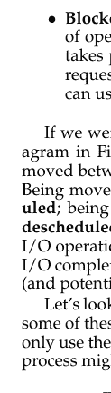

- **阻塞（Blocked）**：在阻塞状态下，进程执行了某种操作导致它在其他事件发生之前无法运行。一个常见的例子是：当进程向磁盘发起 I/O 请求时，它会进入阻塞状态，这样其他进程就可以使用处理器。

如果我们把这些状态映射到图中，就会得到 4.2 节中的图表。如图所示，进程可以根据操作系统的调度在就绪态和运行态之间移动。从就绪态到运行态意味着进程被**调度**（scheduled）。从运行态移动到就绪态意味着进程被**取消调度**（descheduled）。一旦进程变为阻塞状态（例如通过发起 I/O 操作），操作系统将一直保持这种状态，直到某些事件发生（例如 I/O 完成）；此时，进程移动到就绪态（如果操作系统决定，可能立即再次进入运行态）。

让我们来看两个进程如何通过其中某些状态的示例。首先，想象有两个进程正在运行，它们都只使用 CPU（不进行任何 I/O）。在这种情况下，每个进程的状态可能如下所示（图 4.3）。

| 时间 | Process₁ | Process₂ | 备注 |
|---|---|---|---|
| 1 | Running | Ready | |
| 2 | Running | Ready | |
| 3 | Running | Ready | |
| 4 | Running | Ready | Process₀ 现在到期 |
| 5 | — | Running | |
| 6 | — | Running | |
| 7 | — | Running | |
| 8 | — | Running | Process₁ 现在到期 |

图 4.3：进程状态追踪：仅限 CPU

| 时间 | Process₀ | Process₁ | 备注 |
|---|---|---|---|
| 1 | Running | Ready | |
| 2 | Running | Ready | |
| 3 | Running | Ready | Process₀ 被阻塞， |
| 4 | Blocked | Running | 所以 Process₁ 运行 |
| 5 | Blocked | Running | |
| 6 | Blocked | Running | I/O 完成 |
| 7 | Ready | Running | Process₁ 现在完成 |
| 8 | Ready | Running | |
| 9 | Running | | |
| 10 | Running | | Process₀ 现在完成 |

图 4.4：进程状态追踪：CPU 和 I/O

在这个示例例中，操作系统需要追踪哪个进程正在运行。图 4.4 显示了该场景的追踪。当进程被停止时，它的寄存器将保存到这部分内存中；通过恢复这些寄存器（即将它们的值放回物理寄存器），操作系统可以恢复进程。我们将在后面的章节中详细学习这种被称为上下文切换（context switch）的技术。

更具体地说，操作系统需要追踪哪个进程处于阻塞状态。图 4.4 显示了该场景的追踪。当进程发起 I/O 请求时，它会变为阻塞。当 I/O 完成时，进程移动到就绪态。

操作系统还需要追踪哪个进程处于就绪态。图 4.4 显示了该场景的追踪。当进程处于就绪态时，操作系统可以选择运行它。

操作系统还需要追踪哪个进程处于运行态。图 4.4 显示了该场景的追踪。当进程处于运行态时，操作系统正在执行它的指令。

## 4.5 数据结构

操作系统是一个程序，和任何程序一样，它有一些数据结构。为了追踪每个进程的状态，操作系统需要一些信息。图 4.5 显示了 xv6 追踪哪些信息。在“真实”操作系统（如 Linux、Mac OS 或 Windows）中也存在类似的结构；去查查看看它们有多复杂。从图中你可以看到操作系统追踪进程的几项信息。寄存器上下文将保存，对于

# 抽象：进程

旁注：数据结构 —— 进程列表

操作系统中充满了各种重要的数据结构，我们将在这些笔记中讨论它们。进程列表（也称为任务列表）就是其中第一个这样的结构。在任何能够同时运行多个进程的操作系统中，都会有类似这样的结构，以跟踪系统中所有运行中的程序。有时人们将存储进程信息的单个结构称为进程控制块（Process Control Block, PCB），这是一种时髦的说法，指代一个包含每个进程信息（有时称为进程描述符）的 C 结构体。

它尚未被清理（在类 Unix 系统中，这被称为**僵尸状态**[zombie state]！）。这个最终状态是有用的，因为它允许其他进程（通常是创建该进程的父进程）检查进程的返回码，并查看刚刚结束的进程是否执行成功（通常，在类 Unix 系统中，程序在成功完成任务时返回零，否则返回非零）。完成后，父进程将进行最后一次调用（例如 `wait()`）来等待子进程完成，并通知操作系统它可以清理任何引用该未消亡进程的数据结构。

## 4.6 总结

我们引入了操作系统最基本的抽象：进程。它被简单地视为一个正在运行的程序。带着这种概念性视角，我们将进入细节：实现进程所需的低级机制，以及以智能方式调度它们所需的高级策略。通过结合机制和策略，我们将建立起对操作系统如何虚拟化 CPU 的理解。

> 是的，僵尸状态。就像真正的僵尸一样，这些僵尸相对容易杀死。通常建议使用不同的技术。

# 旁注：关键进程术语

- **进程**（**process**）是运行程序的主要操作系统抽象。在任何时间点，进程都可以通过通过其状态来描述：其**地址空间**（**address space**）中的内存内容、CPU 寄存器的内容（包括**程序计数器****program counter** 和**栈指针****stack pointer** 等）以及关于 I/O 的信息（如可读可写的打开文件）。
- 进程 API 由程序可以进行的与进程相关的调用组成。通常包括创建、销毁和其他有用调用。
- 进程存在于许多不同的**进程状态**（**process states**）之一，包括运行（running）、就绪（ready）和阻塞（blocked）。不同的事件（例如被调度或重新调度、等待 I/O 完成）使进程从这些状态之一转换到另一个。
- 进程列表（**process list**）包含系统中所有进程的信息。每个条目位于有时所谓的**进程控制块**（**process control block (PCB)**）中，这实际上只是一个包含特定进程信息的结构。

# 抽象：进程

37

# 参考文献

[H79] "The Nucleus of a Multiprogramming System" by Per Brinch Hansen, Communications of the ACM, Volume 134, April 1970. 这篇文章介绍了操作系统中最早的微内核之一，称为 Nucleus。更小、更极简系统的理念是操作系统历史反复出现的主题；它一切始于此处描述的 Brinch Hansen 的工作。

[Ck-08] "the xv6 Operating System" by Russ Cox, Frans Kaashek, Robert Morris, Nikolai Zeldovich. 下载并运行它以学习更多关于操作系统实际工作原理的。来自 https://github.com/mit-pdos/xv6-public。世界上真实且微小的操作系统。它使用旧版本（2012-01-30T2341432）构建，因此书中的某些示例可能与源代码中的最新不匹配。

[DV66] "Programming Semantics for Multiprogramming Computations" by Jack B. Dennis, Earl C. Van Horn. Communications of the ACM, Volume 9, Number 3, March 1966. 这篇文章定义了许多关于构建多程序系统的早期术语。

[L75] "Policy/mechanism separation in Hydra" by J. Levin, E. Cohen, R. Corvin, F. Pollack, W. Wald, Austin, November 1975. 一篇关于如何在名为 Hydra 的研究型操作系统中构建结构的早期论文。Hydra 从未成为主流操作系统，它的一些思想影响了操作系统设计师。

[V+65] "Structure of the Multics Supervisor" by I.A. Vyssotsky, F. J. Corbato, R. M. Graham. Fall Joint Computer Conference, 1965. 一篇关于 Multics 的早期论文，描述了我们在现代系统中发现的许多基础思想和术语。计算公用事业的一些愿景最终在现代云系统中得以实现。

# 作业（模拟）

此程序 `process-run.py` 允许你看到进程状态如何随着程序的运行而变化，程序使用 CPU（例如执行加法指令）或进行 I/O（例如向磁盘发送请求并等待其完成）。请使用 README 详情。

# 问题

- 1. 使用以下参数运行 `process-run.py`：`-l 5,100`。CPU 利用率（即 CPU 使用时间的百分比）应该是多少？使用 `-c` 和 `-p` 查看你是否正确。
- 2. 现在使用这些参数运行：`./process-run.py -l 1,0`。这些参数指定一个进程执行 1 条指令（全部使用 CPU），另一个仅发出 I/O 并等待完成。完成这两个进程需要多久？使用 `-c` 和 `-p` 查看你是否正确。
- 3. 交换进程顺序：`-1 0,100`。现在发生了什么？交换顺序重要吗？为什么？（始终使用 `-c` 和 `-p` 查看你是否正确）
- 4. 我们现在探索一些其他参数。一个重要的参数是 `-S`，它决定了系统在进程发出 I/O 时的反应。当参数设置为 `SWITCH_END` 时，系统在执行 I/O 时不会切换到另一个进程，直到进程完全完成。运行以下两个进程时会发生什么（`-1 0;4,100 -c SWITCH_END`）？一个执行 I/O，另一个执行 CPU 任务。
- 5. 现在运行相同的进程，但将切换行为设置为在执行 I/O 时随时切换到另一个。（`-1 0;4,100 -c SWITCH_END`）。
- 6. 另一个重要的行为是 I/O 完成时要做什么。当参数设置为 `SWITCH_END` 时，系统在执行 I/O 时不会切换到另一个进程，直到进程完全完成。运行以下两个进程时会发生什么（`-1 0;4,100 -c SWITCH_END`）？一个执行 I/O，另一个执行 CPU 任务。
- 7. 现在运行相同的进程，但将切换行为设置为在执行 I/O 时随时切换到另一个。（`-1 0;4,100 -c SWITCH_END`）。
- 8. 现在运行一些随机生成的进程：`-s 1 -1 3:50,3:50` 或 `-s 2 -1 3:50,3:50` 或 `-s 3 -1 3:50,3:50`。看看你是否能预测轨迹的结果。当使用参数 `-I RUN_IMMEDIATE` 与 `-I RUN_LATER` 时会发生什么？当使用 `-S SWITCH_ON` 与 `-S SWITCH_END` 时会发生什么？

# 42

间插录：进程 API

```c
#include <stdio.h>
#include <stdlib.h>
#include <unistd.h>

int main(int argc, char *argv[]) {
    printf("hello world (pid:%d)\n", getpid());
    int rc = fork();
    if (rc < 0) {
        // fork 失败
        fprintf(stderr, "fork failed\n");
        exit(1);
    } else if (rc == 0) {
        // 子进程（新进程）
        printf("hello, I am child (pid:%d)\n", (int) getpid());
    } else {
        // 父进程进入此路径（main）
        printf("hello, I am parent of %d (pid:%d)\n", rc, (int) getpid());
    }
    return 0;
}

fork()
```

图 5.1：调用 fork() pl.c

当你运行这个程序（称为 pl.c）时，你会看到以下内容：

```
prompt> ./pl
hello world (pid:29146)
hello, I am parent of 29147 (pid:29146)
hello, I am child (pid:29147)
prompt>
```

让我们详细了解 pl.c 中发生了什么。在首次运行时，进程打印了一条 hello world 消息；消息中包含了它的进程标识符，也称为 PID。该进程的 PID 为 29146；在 UNIX 中，如果想对进程进行某些操作（例如停止它的运行），PID 用于命名进程。到目前为止一切顺利。

有趣的部分开始了。进程调用了 `fork()` 系统调用，操作系统通过此作为创建新进程的方法。创建的另一个部分是调用进程的（几乎）相同的副本。这意味着对于操作系统来说，现在似乎有两个程序的副本在运行，并且它们都能从 `fork()` 系统调用返回。新创建的进程（与父进程相对称为子进程）并没有在 `main()` 中启动，正如你预期的那样（注意，“hello world”消息只被打印了一次）；而是它像是自己调用了 `fork()` 一样产生的。

操作系统

[版本 1.01]

WWW.OSTEP.ORG

# 间插录：进程 API


```c
#include <stdio.h>
#include <stdlib.h>
#include <unistd.h>
#include <sys/wait.h>

int main(int argc, char *argv[]) {
    printf("hello world (pid:%d)\n", getpid());
    int rc;
    rc = fork();
    if (rc < 0) { // fork 失败；退出
        fprintf(stderr, "fork failed\n");
        exit(1);
    } else if (rc == 0) { // 子进程（新进程）
        printf("hello, I am child (pid:%d)\n", (int) getpid());
    } else {
        int rc_wait = wait(NULL);
        printf("hello, I am parent of %d (rc_wait:%d) (pid:%d)\n", rc_wait, (int) getpid());
    }
    return 0;
}
```

图 5.2：调用 `fork()` 和 `Wait()` (p2.c)

你可能已经注意到：子进程并不是完全副本。具体来说，尽管它有自己的地址空间（即它的私有内存），但它有自己的寄存器（通常是 PC），因此它返回给 `fork()` 调用者的值是不同的。具体而言，父进程接收到新创建子进程的 PID，而子进程接收到的返回值为零。这种区分是有用的，因为编写处理两种不同情况的代码（如上所示）很简单。

你可能还会注意到：输出（pl.c 的输出）不是确定性的。当子进程被创建时，系统中现在有两个活动进程，我们称之为：父进程和子进程。假设我们运行在一个具有单 CPU 的系统上（为了简单起见），在这一点，子进程或父进程可能会运行。在我们的示例中（上文），父进程运行并首先打印了它的消息。在其他情况下，可能会发生相反的情况，正如我们在输出跟踪中所示：

```
prompt> ./pl
hello world (pid:29146)
hello, I am child (pid:29147)
hello, I am parent of 29147 (pid:29146)
prompt>
```

CPU 调度器（我们将很快详细讨论的话题）决定在给定时刻运行哪个进程；因为调度器是复杂的，我们通常无法对它将选择做什么以及因此哪个进程将先运行做出强有力的假设。这种**不确定性**事实会导致一些有趣的问题，特别是在**多线程程序**中；因此，当我们在书的第二部分学习**并发**时，我们将看到很多不确定性。

## 5.2 wait() 系统调用

到目前为止，我们还没做什么：只是创建了一个打印消息并退出的子进程。事实证明，父进程等待孩子完成它正在做是非常非常有用的。任务通过 `wait()` 系统调用（或更完整的 `waitpid()`）完成，详见图 5.2。

在示例（p2.c）中，父进程调用 `wait()` 来延迟其执行，直到子进程完成执行。当子进程完成后，`wait()` 返回给父进程。

在代码中添加 `wait()` 使得输出具有确定性。你知道为什么吗？继续想一想。

（等待你思考……完成）

现在你已经思考了一会儿，这里是输出：

```
prompt> ./p2
hello world (pid:29266)
hello, I am child (pid:29267)
hello, I am parent of 29267 (rc_wait:29267) (pid:29266)
prompt>
```

通过这段代码，我们现在知道子进程会先运行。我们为什么不知道呢？嗯，它可能只是先运行，因为 `wait()` 直到子进程退出才返回。因此，父进程等待孩子。

## 5.3 最后，exec() 系统调用

进程创建最后最后是 `exec()` 系统调用。当你想要运行与调用进程不同的程序时，该系统非常有用。例如，调用 `fork()` 让“子进程先运行”。在 Linux 上，`exec()` 有六种变体：`execcl()`、`execp()`、`execle()`、`execve()` 和 `execv()`。阅读页面更多。

`fork()` 系统调用很奇怪；它的伙伴 `exec()` 并不那么普通。它的作用是：给定一个可执行文件的名称（例如 `wc`）和一些参数（例如 `p3.c`），它从那里加载代码（和静态数据）。

# 间插录：进程 API

```c
#include <stdio.h>
#include <stdlib.h>
#include <unistd.h>
#include <string.h>
#include <sys/wait.h>

int main(int argc, char *argv[]) {
    printf("hello world\n", (pid:%d), getpid());
    int rc = fork();
    if (rc < 0) { // fork 失败：退出
        fprintf(stderr, "fork failed\n");
        exit(1);
    } else if (rc == 0) { // 子进程（新进程）
        printf("hello, I am child (pid:%d)\n", (int) getpid());
        char *myargs[3] = strdup("wc"); // 程序："wc"
        myargs[1] = strdup("p3.c"); // 参数：计数的文件
        myargs[2] = NULL; // 数组结束
        execvp(myargs, myargs); // 运行 wc
        printf("this shouldn't print out");
    } else { // 进入此路径（main）
        int rc_wait = wait(NULL);
        printf("hello, I am parent of %d (rc_wait:%d) (pid:%d)\n", (int)rc, rc_wait, (int)getpid());
    }
    return 0;
}
```

图 5.3：调用 `fork()`, `wait()` 和 `exec()` (p3.c)

## 间歇：进程 API

> 提示：做正确（Lampson法则）

正如 Lampson 在他广受赞誉的《计算机系统设计提示》[L83]中所述，**做正确**。无论是抽象还是简单，都不是“做正确”的副标题。有时候，你只需要做对的事，而当你这样做时，它会比其他替代方案更好。设计进程创建的 API 有很多方法；然而，`fork()` 和 `exec()` 的组合既简单又极其强大。在这里，UNIX 设计者做到了。正因为 Lampson 经常能“做正确”，我们以他的名字命名了这条法则。

可执行文件并用它覆盖其当前的代码段（以及静态数据）；程序的堆、栈以及程序内存空间的其他部分将重新初始化。然后操作系统将运行该程序，并将进程的任何参数作为该进程的 `argv` 传递给它。因此，它并没有创建一个新进程；而是将当前运行的程序（原为 p3）转换为另一个运行的程序（wc）。在子进程执行 `exec()` 之后，几乎就像成功的 `exec()` 调用永远没有返回一样。

## 5.4 为什么？API 的动机

当然，你可能会有一个问题：我们为什么要为一个本应该是创建新进程的操作构建这样一个接口呢？嗯，事实证明，`fork()` 和 `exec()` 的分离在构建 UNIX shell 时是至关重要的，这让 shell 可以在调用 `fork()` 之后但在调用 `exec()` 之前运行；这段代码可以修改即将运行程序的环境，从而使得许多有趣的功能随时可用。

shell 只是一个用户程序。它显示一个提示符，然后等待你向它输入内容。当你向它输入一个命令（即一个可执行程序的名称加上参数）时；在大多数情况下，shell 会确定它在文件系统中的位置，调用 `fork()` 创建新进程来运行该命令，调用 `exec()` 的变体来运行该命令，并通过调用 `wait()` 等待其完成。当子进程完成时，shell 从 `wait()` 返回并打印提示符，准备好接受你的下一个命令。

`fork()` 和 `exec()` 的分离允许 shell 可以非常轻松地完成很多事情。例如：

```
prompt> p3.c > newfile.txt
```

^而且有很多种 shell；例如 `tsch`、`bash` 和 `zsh`。你应该选择一个，阅读它的帮助页（man pages）并进一步了解它；所有的 UNIX 专家都是这么做的。

操作系统

[版本 1.01]

WWW.OSTEP.ORG

## 间歇：进程 API

在上面的示例中，程序 `wc` 的输出被重定向到了输出文件 `newfile.txt`（大于号就是该重定向指示）。shell 完成这项任务非常简单：当子进程被创建时，在调用 `exec()` 之前，shell 关闭标准输出并打开文件 `newfile.txt`。通过这样做，即将运行的程序 `wc` 的任何输出都被发送到文件而不是屏幕。

图 5.4（第48页）展示了执行此操作的程序。这种重定向是因为对操作系统如何管理文件描述符的假设。具体来说，UNIX 系统从零开始查找描述符。在这种情况下，`STDOUT.FILENO` 将是第一个可用的，并在调用 `open()` 时被分配。子进程对标准输出文件描述符的后续写入（例如通过 `print()` 等例程）将透明地路由到新打开的文件而不是屏幕。

以下是运行 `p4.c` 程序的输出：

```
prompt> /p4
prompt> cat p4.output
      32  109      846 p4.c
prompt>
```

你会注意到关于这个输出的（至少两个）小细节。首先，当 p4 运行时，似乎什么都没有发生；shell 只是打印了命令并立即准备好接受你的下一个命令。然而，事实并非如此；程序 p4 确实调用了 `fork()` 创建了一个新的子进程，然后通过调用 `execvp()` 运行了 `wc` 程序。你在屏幕上没有看到任何输出，因为它被重定向到了文件 `p4.output`，当我们调用输出文件时，你可以发现运行 `wc` 的所有输出都在那里。酷吗？

管道（Pipes）以类似的方式实现，但使用了管道系统。在这种情况下，一个进程的输出连接到一个输入管道，另一个进程的输入连接到同一个管道；因此，一个进程的输出被无缝地作为下一个进程的输入，长命令链可以串联起来。例如，考虑某个单词在文件中出现了多少次；配合文件以及 `grep` 和 `wc` 工具，这很容易；只需在命令提示符中输入 `grep -o foo file | wc -1` 并对结果感到惊叹。

最后，我们只是从高层面上勾勒了进程 API，关于这些调用还有更多细节需要学习和消化；我们在书的第三部分讨论文件系统时，我们会学习更多内容，例如文件描述符。现在，足以说 `fork()`/`exec()` 的组合是创建和操作进程的强大方法。

## 间歇：进程 API

```c
#include <stdio.h>
#include <stdlib.h>
#include <unistd.h>
#include <string.h>
#include <fcntl.h>
#include <sys/wait.h>

int main(int argc, char *argv[]) {
    int rc = fork();
    if (rc < 0) {
        // fork 失败
        fprintf(stderr, "fork failed\n");
        exit(1);
    } else if (rc == 0) {
        // 子进程：重定向标准输出到文件
        close(STDOUT_FILENO);
        open(".p4.output", O_CREAT|O_WRONLY|O_TRUNC, S_IRWX);

        // 现在执行 wc...
        char *myargs[3];
        myargs[0] = strdup("wc"); // 程序
        myargs[1] = strdup("p4.c"); // 参数
        myargs[2] = NULL; // 标记数组结束
        execvp(myargs[0], myargs);
    } else {
        // 父进程走此路径
        int rc_wait = wait(NULL);
        return 0;
    }
}
```

> 图 5.4：带有重定向的所有

## 5.5 进程控制与用户

除了 `fork()`、`exec()` 和 `wait()`，还有许多控制进程的有用接口。最常用 `kill()`，它用于向进程发送信号。例如，`SIGINT`（中断）、`SIGSTOP`（停止）和 `SIGCONT`（继续）是常见的信号。进程可以使用 `signal()` 调用来“捕捉”各种信号；这样做可以确保信号传递给进程时，它会暂停正常执行并运行特定的代码。

这自然引出了问题：在在使用这些工具时，我们应该向进程发送信号吗？如果任何人都可以任意发送像 `SIGINT`（中断进程并可能终止它）这样的信号，那么系统的可用性和安全性将受到破坏。结果是，现代系统包含了用户。用户在输入密码建立凭据后，登录以访问系统资源。用户可以启动一个或多个进程，并对它们进行完全控制（暂停它们、杀死它们等）。用户通常可以控制自己的进程；分配资源（如 CPU、内存、磁盘）给每个用户（及其进程）以满足整体目标是操作系统的工作。

## 间歇：进程 API

> 旁注：RTFM —— 阅读帮助页

在书中很多地方，当引用系统调用或库调用时，我们会要求你阅读帮助页，简称为 man pages。帮助页在网络出现之前就已经存在了。阅读帮助页是系统程序员成长的关键步骤；某些特别有用的页面包括你正在使用的任何 shell（例如 `tcsh`、`bash`），当然也包括任何一个。

## 5.6 有用的工具

许多命令行工具也是用的。例如，使用 `ps` 命令可以查看哪些进程正在运行；阅读关于给 `ps` 的有效标志的帮助页。`top` 工具也很有，它会显示系统进程以及它们消耗了多少 CPU 和其他资源。幽默的是，很多时候当你运行它时，top 声称自己才是资源大户；也许它有点自恋。`kill` 命令可以被用于发送任意

## 间歇：进程 API

> 旁记：超级用户（root）

系统通常需要一个能够管理系统的用户，且该用户不像大多数用户那样受到限制。这样的用户应该能够杀死任意进程（例如，如果该进程正在以某种方式滥用系统），即使该进程不是由该用户启动的也可以。这样的用户还应该能够运行强大的命令，如关机（通常是关闭系统）。在 UNIX 系统中，这些特殊能力被赋予超级用户（有时称为 root）。大多数用户无法杀死其他进程。成为 root 就像蜘蛛侠：能力越大，责任越大 [QI5]。因此，为了增加安全性（避免代价昂贵的错误），通常作为普通用户更好；如果你需要成为 root，请务必仔细阅读，计算机领域的所有破坏性力量现在都掌握在你的指尖。

向进程发送信号，类似于稍微友和（友好）一点的 `killall`。请务必谨慎地使用这些工具；如果你不小心杀了自己的窗口管理器，你面前的这台电脑可能会变得非常难以使用。

最后，有许多不同的 CPU 测量器可以使用，来快速了解系统的负载；例如，我们始终在 Macintosh 的工具栏上运行 Menueters（来自自己的 Menace 软件），这样我们可以看到任何时刻 CPU 的利用率。通常情况下，关于运行情况的信息越多越好。

## 5.7 总结

我们介绍了一些处理 UNIX 创建进程的 API：`fork()`、`exec()` 和 `wait()`。然而，我们只是触及了表面。如需了解更多细节，请阅读 Stevens 和 Rago 的著作 [SR05]，当然，特别是关于进程控制、进程关系和信号的章节；从其中的智慧中可以提取出更多内容。

虽然我们对 UNIX 进程 API 的热情依然强烈，但我们也应该注意到，这种积极态度并不是统一的。例如，来自微软、波士顿大学和瑞士联邦理工学院（ETH）的系统研究人员最近的论文详细说明了进程创建 API（如 `spawn()`）的一些问题 [B+19]。阅读它以及它引用的相关工作，以理解这种不同的视角。虽然信任这本书通常是好事，但请记住，作者也有自己的观点，这些观点可能（并不）像你想象的那样被广为认可。

操作系统 [版本 1.01]

WWW.OSTEP.ORG

## 旁记：关键进程 API 术语

- 每个进程都有一个名字；在许多系统中，该名字是一个被称为进程 ID（PID）的数字。

- `fork()` 系统调用用于 UNIX 系统中创建新进程。创建者称为父进程；新创建的进程称为子进程。正如现实生活中有时发生的情况 [J16]，子进程是其父进程几乎完全相同的拷贝。

- `wait()` 系统调用允许父进程等待子进程完成。

- `exec()` 系列系统调用允许子进程摆脱与父进程的相似性并执行一个全新的程序。

- UNIX shell 通常使用 `fork()`、`wait()` 和 `exec()` 来启动用户命令；`fork` 和 `exec` 的分离实现了某些功能，且无需更改正在运行程序的任何内容。

- 进程控制以信号的形式存在，可以导致作业停止、继续甚至终止。

- 哪些进程可以被特定个人控制被封装在“用户”的概念中；操作系统允许多个用户登录系统，并确保用户只能控制他们自己的进程。

- 超级用户可以控制所有进程（实际上还可以做许多其他事情）；出于安全考虑，应该频繁地且谨慎地承担这一角色。

## 间歇：进程 API

# 参考文献


[B19] "A fork() in the road" 作者 Andrew Baumann, Jonathan Appavao, Oran Krier, Timothy Roscoe. HotOS '19, Bertinorno, Italy. 一篇关于 `fork` 的完整论文，阅读它以获得 UNIX 进程 API 的观点。在一直举办的 HotOS研讨会上提交，系统研究人员在那里展示他们的意见。

[C63] "Multiprocessor System Design" 作者 Melvin E. Conway. AFIPS '63 联合计算机会议，美国纽约。关于多处理器系统的设计。

[DV66] "Programming Semantics for Multiprocessor Computations" 作者 Jack B. Dennis 和 Earl Van Horn. Communications of the ACM, 第9 卷，第 3 期，1966年。关于多程序的经典论文。

[I16] "They could be twins?" 作者 Phoebe Jason-Edwards. The Daily Mail, 2016年。这篇具有冲击力的新闻报道触及了

[I83] "Hints for Computer Systems" 作者 Lampson. ACM Systems Review, 1983。关于系统的提示。

[QI15] "With Great Power Come Responsibility" 作者 The Investigator. 访问：`https://investigator.com/15/07`

[SR05] "Advanced Programming in the UNIX Environment" 作者 W. Stevens, Stephen A. Rago. Addison-Wesley, 2005。书中包含了 UNIX 的所有细微差别。

## 旁记：编码作业

编码作业是一些小型练习，你在真实的机器上编写代码以获得 API 的经验。毕竟，你（可能）是一个计算机科学家，因此想写代码，对吧？如果你不想，还有计算机理论，但那非常困难。

# 作业（代码）

在本次作业中，你需要对刚刚读过的进程管理 API 熟悉。不要担心——这比听起来有趣得多！通常情况下，如果你能花时间写代码会更好，为什么不开始呢？

# 问题

- 1. 写一个调用 `fork()` 的程序，让主进程接受一个变量（例如 `x`）并给它赋值值（例如 `100`）。子进程中的变量值是多少？当父子进程都更改 `x` 的值时会发生什么？

- 2. 写一个程序，使用 `open()` 系统调用打开文件，然后调用 `fork()` 创建新进程。子进程和父进程都能访问 `open()` 返回的文件描述符吗？当它们同时向文件写入时会发生什么？

- 3. 写另一个使用 `fork()` 的程序。子进程应该打印“hello”，父进程应该打印“goodbye”。你应该确保子进程先打印；在不在父进程中使用 `wait()` 的情况下可以吗？

- 4. 写一个程序调用 `fork()` 然后调用某些 `exec()` `/bin/ls` 来运行程序。尝试 `exec()` 的所有变体，包括（在 Linux 上）`exec()`、`exec(),()`clp()`、`execv()` 和 `execve()`。你认为为什么同一个基本调用会有这么多变体？

- 5. 写一个程序使用 `wait()` 在父进程中等待子进程完成。`wait()` 返回什么？如果你在子进程中使用 `wait()` 会发生什么？

- 6. 对上一个程序进行轻微修改，这次使用 `waitpid()` 代替 `wait()`。在什么情况下 `waitpid()` 有用？

- 7. 编写一个程序，创建一个子进程，然后在子进程中关闭标准输出 (`STDOUT_FILENO`)。如果子进程在关闭描述符后调用 `printf()` 某些输出会发生什么？

- 8. 编写一个程序，创建两个子进程，并使用 `pipe()` 系统调用将其中一个的标准输出连接到另一个的标准输入。

# 机制：受限直接执行

为了虚拟化 CPU，操作系统需要以某种方式将物理 CPU 共享给许多看似同时运行的作业。基本思想非常简单：运行一个进程一会儿，然后运行另一个，以此此类推。通过这种时间分复用 CPU 的方式，实现了虚拟化。

然而，在构建虚拟化机制时面临着一些挑战。第一个是性能：我们如何在不给系统增加过大开销的情况下实现虚拟化？第二个是控制：我们如何在保留对 CPU 控制权的同时，高效地运行进程？控制对操作系统来说尤为重要，因为内核负责资源；如果没有控制，进程可能会一直运行并接管机器，或者访问不应允许访问的信息。因此，在保持控制的同时获得高性能是构建操作系统的核心挑战之一。

> 核心问题：如何在保留控制的同时高效地虚拟化 CPU

操作系统必须在保留对系统控制的同时，以高效的方式虚拟化 CPU。为了实现这一点，需要硬件和操作系统的共同支持。操作系统通常会巧妙利用硬件支持来有效地完成它的工作。

## 6.1 基本技术：受限直接执行

为了让程序像人们预期的那样运行快速，并不意外的是操作系统开发者可以使用一种技术，我们可以称之为受限直接执行。该思想的“直接执行”部分非常简单：直接在 CPU 上运行程序。因此，当操作系统想要启动一个程序运行时时，它会在进程列表中为其创建一个进程条目，为其分配一些内存，将程序代码（从磁盘）加载到内存中，分配入口点（即 `main()` 例程或类似内容），跳转到那里并运行用户代码。图 6.1 显示了这种基本的直接执行协议（尽管还没有任何限制），它使用普通的调用和返回跳转到程序的 `main()` 随后返回内核。听起来很简单，对吧？但这种方法在我们追求虚拟化 CPU 的过程中引发了一些问题。第一个是简单的：如果我们只是运行一个程序，操作系统如何在确保程序不执行我们不希望它做的事，同时又能高效地运行它？第二个：当我们正在运行并切换到另一个进程时，操作系统如何停止它运行并切换到另一个进程，从而实现虚拟化 CPU 所需的时间分复？

在回答这些问题时，我们将能够更好地理解虚拟化 CPU 需要什么。在开发这些技术时，我们还将看到名称中“受限”部分源自何处；如果没有对运行程序的限制，操作系统将对任何事情都失去控制，并变成“仅仅是一个库”——对于一个有志的操作系统来说，这是一个非常悲哀的局面！

| 操作系统程序 |

| :--- |

| 为进程列表创建条目 |

| 为程序分配内存 |

| 将程序加载到内存 |

| 设置带有 `argc/argv` 的栈 |

| 清空寄存器 |

| 执行 `call main()` |

| 运行 `main()` |

| 执行从 `main` 返回 |

| 释放进程内存 |

| 从进程列表中移除 |


## 6.2 问题 #1：受限操作

直接执行的明显优点是速度快；程序在硬件 CPU 上原生运行，执行速度正如人们预期的那样。但在 CPU 上运行引入了一个问题：如果进程想要执行某些受限操作，例如向磁盘发出 I/O 请求，或获取更多系统资源（如 CPU 或内存）怎么办？

> 核心问题：如何执行受限操作

进程必须能够执行 I/O 和其他受限操作，但不能赋予进程对系统的完全控制。操作系统和硬件如何协作来实现这一点？

# 机制：受限直接执行

# 旁白：为什么系统调用看起来像过程调用

你可能会奇怪，为什么调用系统调用（如 `open()` 或 `read()`）看起来和 C 语言中典型的过程调用一模一样；如果它看起来就像过程调用，系统如何知道它是一个系统调用并完成所有正确的工作呢？简单的原因是：它确实是一个过程调用，但在该过程调用内部隐藏着著名的 `trap` 指令。具体来说，当你调用 `open()`（例如）时，你正在执行进入该 C 库的过程调用，而对于 `open()` 或提供的任何其他系统调用，库使用与内核约定的调用约定，将参数放在已知的位置（例如栈上或特定寄存器中），将系统调用号也放在一个已知位置（同样在栈或寄存器上），并执行上述的 `trap` 指令。库中的代码在 `trap` 返回后执行，并将控制权返回给使用系统调用的程序。C 库中负责系统调用的部分是用汇编语言硬编码的，因为它们需要严格遵守约定以正确处理参数和返回值，并执行特定于硬件的 `trap` 指令。现在你知道你不需要编写汇编来 `trap` 进入操作系统了；已经有人为你写好了汇编。

一种方法是简单地让任何进程无论是什么，在 I/O 和其他相关操作中随心所欲。然而，这样做将阻止许多理想系统的构建。例如，如果我们想构建一个检查权限并授予文件访问权限的文件系统，我们就不能简单地让任何用户进程向磁盘进行 I/O；如果这样做，进程就可以直接读取或写入整个磁盘，所有的保护都将失效。

因此，方法是引入一种新的处理器模式，称为用户态（user mode）；在用户态下运行的代码在其能力上受到限制。例如，在用户态下运行时，进程不能发出 I/O 请求；这样做会导致处理器抛出异常；操作系统将杀死该进程。

与用户态相反的是内核态（kernel mode），操作系统（或内核）运行在该模式下。在这种模式下，内核可以随心所欲，包括特权操作，如发出 I/O 请求和请求所有类型的受限指令。

我们仍然面临一个挑战：当用户想要执行某些受限操作（例如从磁盘读取）时，用户应该做什么？为了实现这一点，几乎所有硬件都为用户程序提供了。

©2008–19, ARPAC-D

| 机制：受限直接执行 |

| :--- |

| 三 |

| 容易 |

| 部分 |

# 机制：受限直接执行

> 提示：使用保护控制转移

硬件通过提供不同的执行模式协助操作系统。

在用户态下，应用程序无法访问硬件。

在内核态下，操作系统拥有全部资源。

进入内核的 `trap` 和返回的特殊指令也被提供了，以及操作系统告知硬件陷阱表所在的位置。大多数操作系统运行数百个调用（参见 POSIX 标准）；早期的 Unix 暴露了大约二十种。

为了执行调用，程序必须执行一种特殊的 `trap` 指令。该指令同时跳转到内核并返回；一旦进入内核，系统现在就可以执行所需的操作（如果允许的话）。完成后，操作系统调用一种特殊的 `return-trap` 指令，正如你预期的那样，它在返回用户程序的同时将级别降回用户态。

硬件在执行 `trap` 时需要非常小心，因为它必须确保保存足够的调用者寄存器，以便在操作系统发出 `return-trap` 时能够正确返回。在 x86 上，处理器会将程序计数器、标志和其他一些寄存器推入每个进程的内核栈；`return-trap` 会从栈上弹出这些值并恢复用户程序的执行（参见 Intel 手册）。其他硬件系统使用不同的约定，但基本概念是类似的。

讨论中遗漏了一个重要的细节：trap 如何知道调用进程没有指定跳转的地址（就像你调用过程调用时那样）；这将允许程序跳转到内核的任何位置。因此，内核必须严格控制在 `trap` 时执行的代码。

内核通过在启动时设置陷阱表来实现这一点。当机器启动时，它是在特权（内核）模式下启动的，因此根据需要配置硬件。操作系统做的第一件事之一就是告诉硬件在某些异常事件发生时运行什么代码。例如，当磁盘中断发生、键盘中断发生或程序发出系统调用时，应该运行什么代码？

> 想象一下跳转到访问文件的代码，但恰好在权限检查之后；事实上，这种能力可能会让任何程序员都能让内核运行任意代码。通常情况下，是为了避免这种非常糟糕的主意。

# 机制：受限直接执行

| OS 启动时（内核态） | 硬件 | |

|---|---|---|

| 初始化陷阱（trap） | 记住...地址：系统调用处理程序 | |

| OS 运行中（内核态） | 硬件 | 程序（用户态） |

| 创建进程列表条目 | 为程序分配内存 | 将程序加载到内存 | 使用参数设置栈 | 在内核栈中填充寄存器/PC | 从陷阱返回 | | 恢复寄存器（从内核栈） | 切换到用户态 跳转到主函数 | 运行 `main()` ... 调用系统调用 陷阱进入 OS |

| 保存寄存器（到内核栈） | 切换到内核态 跳转到陷阱处理程序 | | |

| 处理陷阱 | 执行系统调用工作 | 从陷阱返回 | 恢复寄存器（从内核栈） | 切换到用户态 跳转到陷阱后的 PC ... 从 `main()` 返回 陷阱（通过 `exit()` 返回） | | |

| 释放进程内存 | 从进程列表中移除 | | |

图 2：受限直接执行协议

这些陷阱处理程序的位置通常通过某种特殊指令来设置。一旦硬件被告知，它就会记住这些处理程序的位置，直到机器重启。因此，当发生系统调用和其他异常事件时，硬件知道该做什么（即应该跳转到哪段代码）。

# 机制：受限直接执行

> 提示：在安全系统中要警惕用户输入

即使我们已经付出了巨大努力在系统调用期间保护 OS（通过添加硬件陷阱机制，并确保所有对 OS 的调用都通过该机制路由），在实现安全操作系统方面仍有许多其他方面我们需要考虑。其中之一就是系统边界处对参数的处理；OS 必须检查用户传递的内容，并确保参数指定正确，否则拒绝该调用。

例如，在 `write` 系统调用中，用户指定一个缓冲区地址作为写入的源。如果用户（无论是无意还是恶意）传递了一个“坏”地址（例如，内核地址空间内的地址），OS 必须检测并拒绝该调用。否则，用户可能会读取所有的内核内存；考虑到内核（虚拟）内存通常包含了系统的全部物理内存，一个小小的疏忽就能让程序读取系统中任何其他进程的内存。

总的来说，安全系统必须对用户输入保持高度怀疑。这样做无疑会使软件易被破解，产生对世界是不安全且可怕之地的绝望感，并让所有过度信任的 OS 开发者失去安全感。

为了指定具体的调用，每个系统调用通常会被分配一个系统调用号。用户代码负责将所需的系统调用放在寄存器或栈的指定位置；当 OS 在陷阱处理程序内部处理系统调用时，它会检查此内容，确保其有效性，如果有效，则执行正确的代码。这种间接层是保护的一种形式；用户代码无法指定要跳转的精确地址，而是通过编号请求特定的服务。

最后一点：能够执行告知硬件陷阱表所在位置的指令是一项非常强大的能力。因此，正如你可能猜到的，这是一项特权操作。如果你尝试在用户态下执行这条指令，硬件不会允许你这样做，你可能会思考：会发生什么可怕的事情（提示：Adobe，违规程序）。值得思考的一点是：如果你可以安装自己的陷阱表，对系统可以造成多恐怖的影响？你可以接管整个

图 6.2 中随时间向下增加的时间线总结了该协议。我们假设每个进程都有内核栈，在进入和退出内核时，寄存器（通用寄存器和程序计数器）会被硬件保存到该栈并从中恢复。

受限直接执行（LDE）协议包含两个阶段。在第一阶段（启动时），内核初始化陷阱表，CPU 记住其位置以供后续使用。内核通过特权指令执行此操作（所有特权指令均已加粗）。

操作系统

[版本 1.01]

WWW.OSTEP.ORG

# 机制：受限直接执行 61

在第二阶段（运行进程时），内核在通过 `return-from-trap` 指令开始执行进程之前，会设置一些内容（例如，在进程列表中分配节点、分配内存）；这会将 CPU 切换到使用系统调用，它会陷阱回 OS，由 OS 处理，然后再次通过 `return-from-trap` 将控制权还给进程。进程完成工作并返回到 `main()`；这通常会返回到某些存根代码中，这些代码将正确地退出程序（通过调用 `exit()` 系统调用，该调用会陷阱进入 OS）。此时，OS 进行清理，我们就大告成了。

## 6.3 问题 #2：进程间的切换

下一个具有直接执行能力的任务是实现进程间的切换。进程间的切换应该是简单的，对吧？OS 应该决定停止一个进程并启动另一个。这有什么大不了的？实际上有点棘手：具体来说，如果一个进程正在 CPU 上运行，那么根据定义，意味着 OS 没有在运行。如果 OS 没有在运行，它如何能做任何事情呢？（提示：它不能）。虽然这听起来像哲学问题，但这是一个真实的问题：如果 OS 没有在 CPU 上运行，它就无法采取任何行动。因此，我们到达了问题的核心。

> 核心：如何重新获得 CPU 的控制权

操作系统如何重新获得 CPU 的控制权，以便在进程之间进行切换？

## 协作方法：等待系统调用

某些系统过去采用的一种方法（例如，早期版本的 Macintosh 系统 [M11]，或旧的 Xerox Alto 系统）被称为协作方法。在这种风格下，OS 信任进程能够合理行为。运行时间过长的进程会被定期让出 CPU，以便 OS 决定运行其他任务。

因此，你可能会问，进程如何通过调用系统调用让出 CPU（例如打开文件、读取文件、发送消息或创建新进程）。应用程序在执行非法操作时也会将控制权交给 OS。例如，如果应用程序除以零或尝试访问不应访问的内存，它会产生一个陷阱进入

© 2008–19, ARPACI-DUSAU

THREE

PIECES

# 机制：受限直接执行

OS。随后 OS 将再次获得 CPU 的控制权（可能会终止违规进程）。因此，在协作系统中，OS 通过等待系统调用或某种非法操作发生来重新获得 CPU 的控制权。你可能在想：这种被动的方法并不理想？如果一个进程（无论是恶意的还是充满 Bug 的）陷入死循环且不不进行系统调用，OS 该怎么办？

## 非协作方法：OS 接管控制权

如果没有硬件的额外帮助，事实证明当进程拒绝系统调用时，OS 完全无法作为。事实上，在协作方法中，当进程卡住时，你的诉诸是解决计算机系统的万老方案：重启机器。然后我们再次到达了获取 CPU 控制权这一任务的子问题。

> 核心：在没有协作的情况下获得控制权

即使进程不协作，操作系统如何获得 CPU 的控制权？OS 能做什么来确保恶意进程不会破坏机器？

答案证明是简单的，并且被多年前构建计算机系统的人发现：定时器中断 [M+63]。定时器设备可以被设置为每隔几毫秒产生一次中断；当中断发生时，当前运行的进程会被停止，OS 中预先配置的陷阱处理程序运行。此时，OS 重新获得了 CPU 的控制权，因此可以随心所欲：停止当前进程，并启动另一个。

正如我们之前讨论系统调用时那样，OS 必须告知硬件在中断发生运行时运行代码；因此，在启动时，OS 正是这样做的。其次，在启动序列，OS 必须启动定时器，这无疑是一项特权操作

## 机制：有限直接执行

...操作。一旦定时器开始运行，操作系统就可以放心地认为控制权最终会返回给它，因此操作系统可以自由地运行用户程序。定时器可以被关闭（这也是一种特权操作），我们将在稍后详细理解并发性时讨论这一点。


请注意，当发生中断时，硬件也承担某些责任，特别是要保存足够的中发生时正在运行的程序状态，以便随后的 `return-from-trap`（从陷阱返回）指令的行为与显式系统调用陷阱进入内核时的硬件行为非常相似，其中各种寄存器会被保存（例如，保存到内核栈中），从而能够被 `return-from-trap` 指令轻松恢复。

## 保存和恢复上下文

现在操作系统重新获得了了控制权（无论是通过系统调用协作地，还是通过定时器中断强制地），都必须做出决定：是继续当前运行的进程，还是切换到另一个进程。这个决策由操作系统中称为*scheduler*（`scheduler`）的部分做出，我们将在接下来的章节中详细讨论调度策略。

如果决定进行切换，操作系统将执行一段低级代码，我们称之为*context switch*（`context switch`）。上下文切换在概念上非常简单：操作系统需要做的只是为当前执行的进程保存几个寄存器（从其内核栈），并为即将执行的进程恢复几个寄存器（从其栈）。通过这种方式，操作系统确保了当最终执行 `return-from-trap` 指令时，系统将不是返回到之前运行的进程，而是恢复到另一个进程的执行。

为了保存当前运行进程的上下文，操作系统将执行一些低级汇编代码来保存当前运行进程的通用寄存器、`PC`（程序计数器）和内核栈指针，并为即将执行的进程恢复保存的寄存器、`PC` 和内核栈。通过切换栈，内核在一个进程（被中断的那个进程）的上下文中进入切换代码的调用，当操作系统最终执行 `return-from-trap` 指令时，

> 提示：使用定时器中断重新获得控制权

定时器中断的引入使得操作系统即使进程以非协作的方式运行，具有再次在 CPU 上运行的能力。因此，这一硬件特性对于帮助操作系统维持对机器的控制至关重要。

## 机制：有限直接执行

提示：重启是有用的

早些时候我们注意到，在协作式抢占下，无限循环（以及类似行为）的唯一解决方案是重启机器。虽然你可能嘲笑这种权宜之计，但研究人员已经证明，重启（或通常指重新启动某些软件）可以是构建健壮系统的一个非常有用的工具 [C+04]。

具体来说，重启是有用的，因为它将软件移动到了已知且可能经过了更多测试的状态。重启还能回收过时或泄露的资源（例如内存），这些资源可能更容易处理。最后，重启很容易实现自动化。由于所有这些原因，在大规模互联网服务中，系统管理软件定期重启机器并获得上述优势的情况并不罕见。

因此，下次你重启时，你不仅仅是在执行某种拙劣的权宜之计。相反，你正在使用一种经过时间检验的方法来改进计算机系统的行为。做得好！

即将执行的进程变成了当前运行的进程。此时上下文切换完成。

整个过程的时间线如图 6.3 所示。在这个示例中，进程 A 正在运行并被定时器中断。硬件保存了它的寄存器（到内核栈）并进入内核（切换到内核模式）。在定时器中断处理程序，，操作系统决定从运行 A 切换到进程 B。在此时，它调用 `switch()` 例程，该例程仔细地保存当前寄存器值（到 A 的进程结构中），然后切换上下文，具体来说更改 B 的进程结构（从其进程条目）以及将栈指针指向 B 的内核栈（而不是 A 的栈）。最后，操作系统执行 `return-trap`，恢复 B 的寄存器并开始运行。

请注意，在此协议过程中发生了几类型的寄存器/切换恢复。第一种是发生的中时器中断；在这种情况下，运行进程的用户寄存器由硬件使用该进程的内核栈隐式地保存。第二种是操作系统决定从 A 切换到 B；在这种情况下，内核寄存器由软件（即操作系统）显式地保存，但这将其放入了内存中的进程结构中。后者的操作使系统从“看起来像是从 A 直接跳入内核”的状态，移动到了“看起来像是从 B 陷阱进入内核”的状态。

为了让你更好地理解这种切换是如何执行的，图 6.4 显示了 xv6 的上下文切换代码。看看你是否能理解它（你需要了解一些 x86 以及一些 xv6 才能理解）。

### 机制：有限直接执行

| OS @ 启动 (内核模式) | 硬件 |
| --- | --- |
| 初始化陷阱定时器 | 记住...的地址 |
| 系统调用处理程序 | |
| 定时器处理程序 | |
| 启动中断定时器 | 启动器 |
| | CPU 在 X毫秒后 |
| OS @ 运行 (内核模式) | 硬件 | 程序 (用户模式) |
| --- | --- | --- |
| | 定时中断 | 进程 A |
| | `saveregs(A)` $\rightarrow$ k-stack(A) | |
| 切换到内核模式 | | |
| | 跳转到陷阱处理程序 | |
| 处理陷阱 | | |
| 调用 `switch` 例程 | | |
| `saveregs(A)` $\rightarrow$ proc.t(A) | | |
| `regs(B)` $\leftarrow$ proc.t(B) | | |
| 切换到 k-stack(B) | | |
| `regs(B)` $\leftarrow$ k-stack(B) | | |
| 切换到用户模式 | | |
| 跳转到 B 的 PC | | |
| 进程 B ... |

图 6.3：有限直接执行过程（定时器中断）

## 6.4 担心并发吗？

答案是肯定的，操作系统在处理中断时确实需要担心另一个中断的发生。事实上，这是本书的第二部分关于并发的主题；我们将以后详细讨论。

为了激发你的兴趣，我们将简单勾勒操作系统如何处理这些情况。操作系统采取的一种简单方法是在中断处理期间**禁用中断**；这样做可以确保当

### 机制：有限直接执行

```
## void swtch(struct context *old, struct context *new);
## 在 old 中保存寄存器上下文
## 然后从 new 加载寄存器上下文
.globl swtch
swtch:
    # 保存旧寄存器
    mov 4(%esp), %eax # 将指针放入 eax
    popl 0(%eax) # 保存 IP
    mov %esp, 4(%eax) # 保存栈
    mov %ebx, 8(%eax) # 保存寄存器
    mov %ecx, 16(%eax)
    mov %edx, 20(%eax)
    mov %esi, 24(%eax)
    mov %ebp, 28(%eax)

    # 加载新寄存器
    mov 4(%esp), %eax # 将指针放入 eax
    mov 28(%esp), %ebp # 恢复其他寄存器
    mov 24(%esp), %edi
    mov 20(%esp), %ecx
    mov 16(%esp), %edx
    mov 8(%esp), %ebx # 栈在此切换
    mov 4(%esp), %esp # 返回地址就位
    pushl 0(%esp)
    # 最后返回到新上下文
ret
```

> 图 4：xv86 上下文切换

一个中断正在被处理时，没有中断会被传递到 CPU。当然，操作系统在这样做时必须小心；禁用中断过长会导致丢失中断，用技术术语说，这是糟糕的。

操作系统开发了许多复杂的锁方案来防止对内部数据结构的并发访问。这使得内核内部可以同时进行多个活动，在多处理器系统上特别有用。正如我们将在本书关于并发的后续部分将看到的，尽管锁定可能是复杂的并可能导致各种有趣且难以发现的错误。

## 6.5 总结

我们描述了一些实现 CPU 虚拟化的关键低级机制，这些我们统称为有限直接执行的一组技术。基本思想非常直观：直接在 CPU 上运行你想运行的程序，但要设置好硬件，限制进程在没有操作系统协助的情况下能做的事情。

操作系统n[版本 1.01]

WWW.OSTEP.ORG

### 机制：有限直接执行

#### 旁注：上下文切换需要多长时间

你可能会产生一个自然问题是：像上下文切换这样的操作需要多长时间？或者系统调用呢？对于那些好奇的读者，是否有一个名为 `imbench` [MS96] 的工具可以精确测量这些内容，以及一些可能相关的性能指标？

结果随着时间的推移有了很大提高，大致遵循处理器性能的增长趋势。例如，在 1996 年，在 200-MHz 的 PC CPU 上运行 Linux 1.3.37，系统调用大约需要 4 微秒，上下文切换大约需要 6 微秒 [MS96]。现代系统的性能几乎提升了整整一个数量级，在具有 2GHz 或 3GHz 处理器的系统上，结果达到了亚微秒级。

需要注意的是，并非所有的操作系统操作都遵循 CPU 的性能增长。正如 Oerhout 所观察到的，许多操作系统操作是内存密集型的，而内存带宽的提升并没有像处理器速度那样快 [O90]。因此，取决于你的工作负载，购买最新、最强大的处理器可能无法像你预期的那样显著提升操作系统的速度。

这种通用方法在现实生活中也被广泛采用。例如，如果你有孩子，或者至少听说过孩子，可能熟悉对房间进行“婴儿安全防护”（baby proofs）的概念：锁上装有危险物品的柜子并盖住插座。当房间准备好后，你就可以让宝宝自由地活动了，因为你知道房间里最危险的部分已经受到了限制。

以类似的方式，操作系统对 CPU 进行“婴儿安全防护”：首先（在启动期间）设置陷阱处理程序（`trap handlers`）并启动中断定时器，然后仅在受限模式运行运行。操作系统只在执行特权操作，或者当进程独占 CPU 太久而需要换出时才干预。

因此，我们已经有了就地虚拟化 CPU 的基本机制。但一个主要问题仍未解决：在给定时刻我们应该运行哪个进程？这就是调度器必须回答的问题，也是我们下一个的学习课题。

#### 旁注：关键 CPU 虚拟化术语（机制）

- CPU 至少应该支持两种执行模式：受限用户模式和特权（非受限）内核模式。
- 典型的应用程序运行在用户模式下，并使用系统调用陷入（`trap`）到内核以请求操作系统的服务。
- `trap` 指令仔细保存寄存器状态，将硬件状态更改为内核模式，并跳转到操作系统中的预设目标位置：陷阱表（`trap table`）。
- 当操作系统完成系统调用的服务后，它通过另一个特殊的返回陷阱（`return-from-trap`）指令返回用户程序，该指令会降低权限并将控制权交回给陷阱跳转到 OS 之后的那条指令。
- 陷阱表必须由操作系统在启动时设置，并确保它们不能被用户程序轻易修改。这一切都是有限直接执行协议的一部分，该协议能够高效运行程序，同时不会丢失对操作系统的控制。
- 一旦程序开始运行，操作系统必须使用硬件机制确保用户程序不会永远运行，即定时器中断。这种方法是一种非协作的 CPU 调度方法。
- 有时，操作系统在定时器中断或系统调用期间，希望从运行当前进程切换到另一个进程，这种低级技术被称为上下文切换。

### 机制：有限直接执行

# 参考文献

- [A79] Xerox 版的《Alto 用户手册》。Xerox Palo Alto Research Center, 1979 年 9 月。可用：http://history-computer.com/Library/AltoHandbook.pdf。一个惊人的系统，远超时代。它非常有名；史蒂夫·乔布斯访问过并做了笔记，随后构建了 Lisa 并最终有了 Mac。
- [C04] G. Candea, S. Kawamoto, Y. Fuji, G. Friedman, A. Fox 写的《Microbook - 现实的一种技术》。OS'04, 加州旧金山，2004 年 12 月。一篇优秀的论文，指出了如何通过重构来构建健壮的系统。
- [I11] 英特尔公司《64 和 IA-32 架构开发者手册》卷 3A 和 3B：系统指南。2011 年 1 月。这是一本枯燥的手册，但其中一些是有用的。
- [K66] T. Kilburn, D.B.G. Edwards, M. Lanjigan, F.H. Summer 写的《单级存储技术》。IRE Transactions on Electronic Computers, 1962 年 4 月。Atlas 先驱了你在现代系统中看到的许多内容。然而，这不是最值得读的一篇。如果你只想读一篇，可能是 1970 年之前的历史视角。
- [L78] S. H. Lavington 写的《机器接口与历史视角》。Communications of the ACM, 21, 1978。关于计算机早期发展历史以及 Atlas 的开创性工作。
- [M63] J. McCarthy, S. Boilen, E. Fry, 和 C. R. Lacker 写的《小型计算机分时调试系统》。AFIPS '63 (春季), 1963, 美国纽约。一篇关于分时的早期论文，其中提到了使用定时器中断；文中讨论道：“17 通道的基本任务是决定是否将当前用户从进程中移除，从而决定在用户离开时换入哪个程序。”
- [M96] Larry McVoy 和 Carl Stein 写的《性能分析的可移植工具》。USENIX Conference, 1996 年 1 月。
- [M11] 英特尔公司《64 和 IA-32 架构开发者手册》卷 3A 和 3B：系统指南。2011 年 1 月。
- [O90] Open Group 编写《单 Unix 规范》。2010 年 5 月。
- [S07] Howard Shannon 写的《……的起源》。CS 07, 2007 年 10 月。

# 调度：引言

运行进程的低级**机制**（例如上下文切换）应该是清晰的；如果不清楚，请翻回前一两章并阅读相关内容。然而，我们尚未理解操作系统所采用的高级**策略**。我们现在将要做这件事：介绍一系列多年来由聪明的人们开发的**调度策略**（有时被称为**调度算法**）。

事实上，调度起源于计算机系统；早期方法源于运营管理并应用于计算机。这种现实并不意外：流水线和许多其他人类活动都需要调度，并且存在许多相同的问题，例如对效率的渴望。

> 核心：如何开发调度
> 我们应该如何开发调度策略？关键假设有哪些？哪些指标是重要的？早期使用了哪些方法？

## 7.1 负载假设

在进入可能的策略范围之前，让我们对系统中运行的进程的一些简化假设，统称为**负载**。确定负载是构建策略的关键部分，你对负载了解得越深，你的策略就可以越精细。

我们在这里提出的负载假设大多是不符合实际的，但没关系（目前），因为我们会随着学习不断放松这些假设，并最终开发出……（停顿）……一种完全的调度算法。

我们将对系统中运行的进程（有时称为作业）做出以下假设：

- 1. 每个作业运行的时间相同。
- 2. 所有作业同时到达到达。
- 3. 一旦开始，每个作业都会运行完成。
- 4. 所有作业只使用 CPU（即不进行 I/O）。
- 5. 每个作业的运行时间是已知的。

我们说过这些假设有很多是不现实的，但正如《动物农场》中某些动物比其他动物更平等一样，调度中的某些假设更不现实。特别是，每个作业的运行时间已知可能会让你困扰：这会让调度器变得全知，尽管这（可能）不太可能发生。

## 调度指标

除了负载假设之外，我们还需要另外一点来让我们比较不同的调度策略：调度指标是我们用来衡量的东西，在调度中有很多不同的指标。

目前，让我们通过简单使用单一指标来简化问题：等待时间。一个作业的等待时间定义为作业完成的时间减去作业到达系统的时间。更正式地，等待时间 `$T_{turnaround}$` 为：

```
$T_{turnaround} = T_{completion} - T_{arrival} \quad (7.1)$
```

由于我们假设所有作业同时到达，所以目前 `$T_{turnaround} = 0$`，因此 `$T_{turnaround} = T_{completion}$`。这一事实将随着我们对上述假设的放松而改变。

你应该注意，等待时间是一个性能指标，这将是我们本章的重点。另一个感兴趣的指标是公平性，因为在调度中，性能和公平性往往是对立的；例如，调度器可以使用 Jain 的公平性指数 [91]。示例可能会优化性能，但以阻止少数几个作业运行为代价，从而降低了公平性。这个困境说明生活并不总是完美的。

## 先进先出 (FIFO)

我们可以实现的最基础的算法被称为先进先出 (FIFO) 调度，有时被称为先来先服务 (FCFS)。

> ^1 用你可能会说“一个完全运行的死星”的方式说的。

FIFO 具有许多优点：它显然简单，因此易于实现。而且，根据我们的假设，它工作得非常完美。

让我们做一个快速的例子。想象三个作业 A、B 和 C 同时到达系统（`$T_{arrival} = 0$`）。由于 FIFO 必须先放某个作业，让我们假设它们是同时到达的，A 略先于 B 到，B 又略先于 C 到。假设每个作业运行 10 秒。这些作业的平均等待时间是多少？

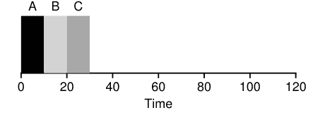

图 7.1：FIFO 示例

从图 7.1 可以看出，A 在 10 秒时完成，B 在 20 秒时完成，C 在 30 秒时完成。因此，它们的平均等待时间是 `$\frac{10+20+30}{3} = 20$`。

正如我们所说的，等待时间是是现实但但（（（问题），你对负载了解得越多，你的策略就可以越精细。

我们我们这些负载假设大多是不现实的，但为了问题（为了，）问题问题，，假设三个不同长度的作业（A、B 和 C），A   100 秒，B   10 秒CC   10 秒。

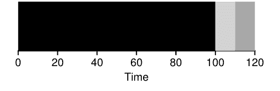

图 7.2：为什么 FIFO 并不完美

正如你在图 7.2 中看到的，A 运行了 100 秒，B 或 C 才有机会。因此，系统的平均等待时间很高：`$\frac{100+110+120}{3} = 110$`。这个问题通常被称为“护送效应”[B+79]，其中较短的消费者被阻塞了。

> 提示：SJF 原则

短作业优先代表了一个可以应用于任何对等待时间（在我们的案例中是作业）敏感系统的通用原则。想想你排过的任何队：如果该机构关心客户，他们很可能考虑了 SJF。例如，超市通常设有“10 件以内”通道，以确保只买几件东西的购物者不会被准备过冬物资的重型资源消费者困住。

所以我们该怎么做呢？我们该如何开发一个更好的算法来处理我们运行时间不同的作业的新现实？先思考一下这个问题；然后继续阅读。

## 7.4 短作业优先 (SJF)

事实证明，一种非常简单的方法就能解决这个问题；事实上，它来自运筹学 [C54,PV56] 并应用于计算机系统的调度。这种新的调度算法被称为短作业优先 (SJF)，这个名字应该很容易记忆，因为它完整地描述了策略：它先运行最短的作业，然后是下一个最短的，以此此类推。


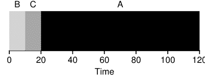

图 7.3：SJF 示例

让我们上面的例子使用 `SJF` 作为我们的调度策略。图 7.3 显示了运行 A、B 和 C 的结果。希望图表能清楚地说明为什么 `SJF` 在平均等待时间方面表现好得多。通过简单地在先运行 B 和 C，它将平均等待时间从 110 秒减少到 50 秒（10+20+120=50），改进了一倍以上。

²在这种情况下建议采取是：要么快速换到另一条队伍，要么深呼吸一次，长长的、深且放松的呼吸。没错，吸气，呼气。没事的，别担心。

操作系统

[版本 1.01]

WWW.OSTEP.ORG

# 调度：引言

> 旁注：抢占式调度器

在早期的批处理时代，开发了许多非抢占式调度器；此类系统在考虑运行新作业之前，会运行每个作业直到完成。几乎所有现代调度器都是抢占式的，并且非常乐意停止一个正在运行的作业来运行另一个。这意味着调度器利用了我们之前学过的机制；特别是，调度器可以执行上下文切换，临时停止一个正在运行的进程并恢复（启动）另一个进程。

事实上，基于我们对所有作业同时到达的假设，我们可以证明 `SJF`（短作业优先）确实是一个优的调度算法。然而，你现在上的是系统课程，而不是理论或运筹学；

（再次停下来思考……你是否有时间。

我们将“响应”定义为作业到达系统到第一次被调度之间的时间⁴。

```
$T_{response} = T_{firstrun} - T_{arrival}$
```

> ⁴ 某些人对“响应”的定义不同，例如还包括直到作业产生某种“响应”所需的时间；我们的定义是这种定义的最佳情况版本，基本上假设作业瞬时产生响应。

操作系统

[版本 1.01]

WWW.OSTEP.ORG

# 调度：引言

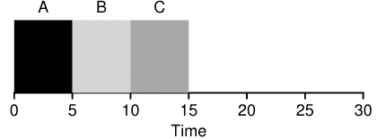

图 7.6：再次示例 SJF（对响应时间不利）

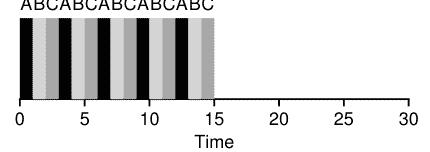

图 7.7：轮询算法（对响应时间有利）

例如，如果我们有上面的调度器（A 在时间 0 到达，B 和 C 在时间 10 到达），每个作业的响应时间如下：作业 A 为 0，B 为 0，C 为 10（平均值：3.33）。

正如你可能想到的，`STCF` 和相关策略对响应时间并不是特别友好。例如，如果三个作业同时到达，第三个作业必须等待前两个作业完全运行结束后才能开始调度。这种方法对于响应时间和交互性来说非常糟糕。想象你坐在终端前打字，却因为另一个作业排在你前面被调度而必须等待 10 秒才能看到系统的响应：这种感觉并不愉快。

因此，我们面临另一个问题：如何构建一个对响应时间敏感的调度器？

## 7.7 轮询算法

为了解决这个问题，我们将引入一种新的调度算法，经典称为轮询（Round-Robin, `RR`）调度 [K64]。基本思想非常简单：`RR` 不运行作业直到完成，而是运行一个作业一个时间片（称为调度时间量子），然后切换到运行队列中的下一个作业。它重复此过程直到作业完成。因此，`RR` 有时被称为时间分片。注意，时间片的长度必须是定时器中断周期的倍数；因此，如果定时器每 10 毫秒中断一次，那么时间片可以是 10、20 或任何 10 毫秒的倍数。

2008–19, ARPACI-DUSSEAU

三个部分

# 调度：引言

> 提示：摊销可以降低成本

摊销通用技术在系统中常用，特别是当某些操作具有固定成本时。通过更不频繁地产生该成本（即减少操作执行次数），可以降低系统的总成本。例如，如果时间片为 10 ms，则有 10% 的时间花在切换上。如果我们想摊销这种成本，可以增加时间片，例如增加到 100 ms。在这种情况下，不到 1% 的时间花在上下文切换上，时间分片被摊销了。

假设三个作业 A、B 和 C 同时到达系统，且每个作业都想运行 5 秒。`SJF` 在运行另一个作业之前会调度每个作业直到完成（见图 7.6）。相比之下，时间片为 1 ms 的 `RR` 会快速循环这些作业（见图 7.7）。

`RR` 的平均响应时间为：$\frac{0+1+2}{3} = 1$；对于 `SJF`，平均响应时间为

如你所见，时间片的长度对 `RR` 至关重要。时间片越短，`RR` 在响应时间指标下的性能就越好。然而，将时间片做得太小是有问题的：切换成本突然会主导整体性能。

注意，上下文切换的成本并非来自操作系统保存和恢复几个寄存器的操作。当程序运行时，它们会建立一组 CPU 缓存、TLB、分支预测器和其他片上硬件。切换到另一个作业会导致这些成本的引入，可能会产生明显的性能开销 [MB91]。

因此，如果响应时间是我们的唯一指标，具有合理时间片的 `RR` 是一个出色的调度器。但我们的朋友周转时间（turnaround time）呢？假设 A、B 和 C 三个运行 5 秒的作业同时到达，且 `RR` 使用（较长的）1 秒时间片作为调度器。我们可以从上面的图片图中看到 A 在 13 秒完成，B 在 14 秒，C 在 15 秒完成，平均值为 14 秒。完全太糟糕了！

`RR` 确实是周转时间最差的策略之一，并不意外。直觉上是合理的：`RR` 所做的是尽可能拉长每个作业的时间，因为它在移动到下一个作业之前只运行每个作业很短的时间。因为周转时间关注的是作业完成的时间，`RR` 的表现几乎是糟糕的，甚至比简单的先来优先（FIFO）还要差。

通常情况下，任何策略（例如公平策略，即在小时间尺度内均匀地分配 CPU）在周转时间等指标上的表现都会很差。这是一个内在的权衡：如果你愿意不公平，你就可以完成较短的作业，但是以响应时间为代价；如果你更看重公平，

# 调度：引言

> 提示：重叠可以提高利用率

在可能的情况下，重叠操作以最大化系统利用率。重叠在许多不同领域都很有用，包括执行磁盘 I/O 或向远程机器发送消息；在何种情况下，启动操作然后切换到其他工作都是好主意，并且可以提高系统的整体利用率和效率。

响应时间降低了，但是以牺牲周转时间为代价的。这种衡在系统中很常见；你不能兼得兼失。

我们开发了两种类型的调度器。第一类（`SJF`, `STCF`）优化周转时间，但对响应时间不友好。第二类（`RR`）优化响应时间，但对周转时间不友好。我们有两个需要放宽的假设：假设 4（作业不进行 I/O）和假设 5（作业的运行时间是已知的）。让我们接下来处理这些假设。

## 7.8 引入 I/O

首先我们放宽假设 4 —— 并不是所有程序都会执行 I/O。想象一个没有任何输入的程序：它会在相同时间产生相同的输出。想象一个没有输出的程序：它就是所谓的“森林中的树”，没有人看到它；它是否运行过并不重要。

当一个作业发起 I/O 请求时，调度器显然需要做一个决策，因为当前运行的作业在 I/O 期间将不会占用 CPU；它会被阻塞等待 I/O 完成。如果 I/O 发送到硬盘，进程可能会被阻塞几毫秒或更久，取决于硬盘当前的 I/O 负载。调度器可能应该在那时在 CPU 上调度另一个作业。

当 I/O 完成时，调度器也需要做一个决策。当该情况发生时，会触发一个中断，操作系统运行并并将发出 I/O 的进程移回就绪状态。当然，它甚至可以在该点运行该作业。操作系统应该如何处理每个作业呢？

为了更好地理解这一点，假设我们有两个作业 A 和 B，每个作业都需要 50 ms 的 CPU 时间。它们有一个明显的区别：A 运行 10 ms 后发出 I/O 请求（这里假设每个 I/O 都需要时间），而 B 仅使用 CPU 50 ms 且不进行任何 I/O。调度器先运行 A，然后运行 B（图 7.8）。

假设我们正尝试构建一个 `STCF` 调度器。这种调度器应该如何考虑到 A 被拆分为 5-10 ms 的子作业这一事实呢，

> 一个让人们困惑的谚语应该是“你不能既想要饼又想吃掉它”（这很明显，不是吗？）。令人惊讶的是，维基百科有一个关于这个谚语的页面；更惊讶的是，阅读 [W15] 挺有趣。正如意大利人所说，你不能“avere la botte piena e la mogliechia”。

© 2008–19, ARPACI-DUSSEAU

三个简单部分

80 调度：引言

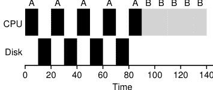

图 7.8：对资源的利用不当

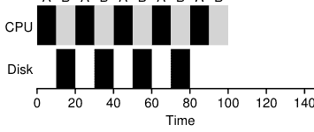

图 7.9：重叠允许更好地利用资源

而 B 仅仅是一个单一的 50 ms CPU 需求？显然，仅仅运行一个作业而让另一个作业运行而不考虑如何处理 I/O 是没什么意义的。

一种常见的方法是将 A 的每个 10-ms 子作业视为一个独立的作业。那么，当系统启动时，它的选择是调度 10 ms 的 A 还是 50 ms 的 B。对于 `STCF`，选择是显而易见的：选择较短的那个，在本例中是 A。然后，当 A 的第一个子作业完成后，只剩下 B 了，它开始运行。然后提交一个 B 的新子作业，它会抢占 B 并运行 10 ms。这样做允许了重叠，在等待另一个作业的 I/O 完成时，CPU 被另外一个进程使用；因此，系统得到了更好的利用（见图 7.9）。

因此，我们看到了调度器如何结合 I/O。通过将每个 CPU 突发传输（burst）视为一个作业，调度器确保了“交互式”进程能够被频繁运行。当这些交互式作业正在执行 I/O 时，其他 CPU 密集型作业会运行，从而利用处理器。

## 7.9 不再有先知

有了基本的 I/O 处理方法后，我们来到了最后一个任务：调度器知道每个作业的长度。正如我们之前说的，这是我们能做出的最糟糕假设。事实上，在通用操作系统（如我们关心的那些系统）中，操作系统对每个作业的长度了解非常少。因此，如何在没有这种*先验*知识的情况下，构建一种行为像 `SJF`/`STCF` 的方法？此外，我们如何结合我们在 `RR` 调度器中看到的某些思想，使得响应时间也相当良好？

操作系统

[版本 1.01]

WWW.OSTEP.ORG

## 7.10 总结

我们引入了调度背后的基本思想并开发了两类方法。第一类运行剩余时间最短的作业，从而优化了周转时间；第二类在作业之间切换，从而优化了响应时间。两者在对方擅长的领域都很糟糕。我们还看到了如何结合 I/O，但仍然没有解决操作系统无法预测未来的问题。不久，我们将看到如何克服这个问题，即通过构建一个利用过去来预测未来的调度器。这种调度器被称为多级反馈队列。

82

调度：引言

# 参考文献

- [B79] "The Convoy Phenomenon" by M. Bladen, J. Gray. ACM Systems Review, 13:2, April 1979.

- [C54] "Priority Assignment in Waiting Line Problems" by A. Cobham. Journal of Operations Research, 2/70, 1954.

- [K64] "Computer Scheduling Methods" by Leonard Kleinrock. Naval Research Logistics, 11/1, pages 59–73, March 1964.

- [CS68] "Computer Scheduling Methods and Countermeasures" by Edward G. Coffman and Leonard Kleinrock. AIS '68 (Spring), April 1968.

- [W91] "The Art of Systems Performance Analysis: Techniques for Experimental Design, Measurement, Simulation, and Modeling" by R. Jain. Interscience, New York, April 1991.

- [O45] "Animal Farm" by George Orwell. Secker and Warwick (London), 1945.

- [MB91] "The effect of context-switches on cache performance" by Jeffrey C. Morgan, Anita Org. ASPLOS,1991.

# 作业（模拟）

此程序 `scheduler.py` 允许你查看不同调度器在响应时间、周转时间及总等待时间等调度指标上的表现。详情请见 README。

# 问题

1. 使用 `SJF` 和 `FIFO` 调度器运行三个长度为 200 的作业，计算其响应时间和周转时间。

2. 现在执行同样的操作，但使用长度分别为 100、200 和 300 的作业。

3. 现在执行同样的操作，但也要使用 `RR` 调度器和时间片量子（quantum）。

4. 在什么样的工作负载和时间量子长度下，`SJF` 交付与 `FIFO` 相同的周转时间？

5. 随着 `SJF` 作业长度的增加，响应时间会发生什么变化？你可以使用器演示这种趋势吗？

6. 随着 `RR` 量子长度的增加，响应时间会发生什么变化？你能写出一个公式，在给定 $N$ 个作业的情况下给出最坏响应时间吗？

## 调度：

多级反馈队列

在本章中，我们将解决开发最著名的调度方法之一的问题，即被称为**多级反馈队列 (`MLFQ`)**。多级反馈队列调度器最早由 Corbato 等人于 1962 年 [C+62] 首次描述，当时处于一个名为兼容时间分用系统（CTSS）的系统中。这项工作以及后来关于算法的研究，促使 ACM 授予了 Corbato 其最高荣誉——**图灵奖**。从此以后，该调度器在多年间不断不断完善，最终形成了你在现代系统中会遇到的这种实现方式。

`MLFQ` 解决的根本问题是两个层面的：首先，它希望优化*周转时间*（turnaround time），正如我们在上一篇笔记中看到的，这是通过优先运行较短的任务来实现的；遗憾的是，操作系统通常不知道一个任务将运行多久，而这正是像 `SJF`（或 `SCFF`）这样的算法所需的精确知识。其次，`MLFQ` 希望让系统对交互式用户（即等待进程完成的用户）具有良好的响应性，从而最小化地减少*响应时间*（response time）；遗憾的是，像轮询（Round Robin）这样的算法虽然减少了响应时间，但对周转时间却是糟糕的。我们的问题是：在通常情况下我们对进程一无所知的情况下，我们如何构建一个调度器来实现这些目标？调度器如何在系统运行时，捕获其正在运行的任务的特征，从而做出更好的调度决策？

## 核心：如何在没有完美知识的情况下调度？

我们如何设计一个调度器，既能在没有关于任务长度*先验*知识的情况下，既最小化交互式任务的响应时间，又能最小化周转时间？

## 调度：多级反馈队列

> 提示：从历史中学习

多级反馈队列是一个通过过去来预测未来的极佳示例。这类方法在操作系统（以及计算机科学中的许多地方，包括硬件分支预测器和缓存算法）中非常常见。当任务具有阶段性行为且可预测的时，这种方法非常有效；当然，必须谨慎使用此类技术，因为它们很容易被误导，导致系统做出比完全没有知识时更糟糕的决策。

## 8.1 MLFQ：基本规则

为了构建调度器，我们将在本章中描述多级反馈队列背后的基本算法；尽管许多实现的 `MLFQ` 具体细节有所不同 [E95]，但大多数是相似的。

在我们的处理中，对于一个要在单个优先级级别上运行的任务，`MLFQ` 具有不同数量的队列。`MLFQ` 使用优先级来决定在给定时间应该运行哪个任务：具有较高优先的任务（即位于较高队列的任务）会被选中并运行。

当然，一个给定的队列中可能有多个任务，因此具有相同的优先级。在这种情况下，我们将在这些任务之间使用轮询调度。

因此，我们得到了 `MLFQ` 的第一条基本规则：

- 规则 1：如果 `Priority(A) > Priority(B)`，则 A 运行（B 不运行）。

- 规则 2：如果 `Priority(A) = Priority(B)`，则 A 和 B 交替运行。

`MLFQ` 调度的关键在于调度器如何设置优先级。`MLFQ` 并不是给每个任务都分配一个固定的优先级，而是根据其观察到的行为来改变任务的优先级。例如，如果一个任务在等待键盘输入时反复放弃 CPU，`MLFQ` 将保持其高优先级，因为它是一个交互式进程；如果一个任务在长时间内密集使用 CPU，`MLFQ` 将降低其优先级。通过这种方式，`MLFQ` 将尝试了解进程，并利用任务的历史来预测它的未来。

如果我们画出队列在某一时刻可能的状态，我们可能会看到类似图 8.1 内容。在图中，任务（A 和 B）处于最高优先级，而任务 C 处于中间，任务 D 处于最低。根据我们目前对 `MLFQ` 工作原理的了解，调度器将在 A 和 B 之间切换时间片，因为它们是系统中优先级最高的任务；糟糕的任务 C 和 D 将永远没有运行的机会——这太不可理喻了！

当然，仅仅展示队列的静态快照并不能让你 `MLFQ` 是如何工作的。我们需要理解任务优先级是如何随时间变化的。而这（对于第一次读本书这一章的人来说是个意外）恰恰是我们接下来要做的。

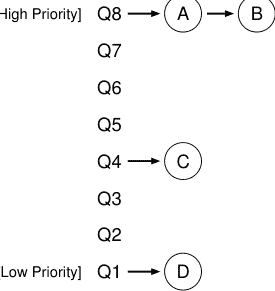

图 8.1：MLFQ 示例

## 8.2 尝试 #1：更改优先级

我们现在决定 `MLFQ` 如何在任务的生命周期内改变任务的优先级级别（以及它所在的队列）。为了做到这一点，我们必须考虑我们的负载：短运行的交互式任务（它们可能频繁放弃 CPU）以及一些需要大量 CPU 时间且对响应时间不重要的长运行“CPU 密集型”任务。这是我们优先级调整算法的首次尝试：

- 规则 3：如果一个任务进入系统，它被放在最高优先级（最顶部队列）。

- 规则 4a：如果一个任务在运行时使用了整个时间片，它的优先级就会降低（即它向下移动一个队列）。

- 规则 4b：如果任务在时间片结束前放弃了 CPU，它将保持相同的优先级级别。

## 示例 1：单个长运行任务

让我们来看一些例子。首先，我们将看看当一个任务持续运行时会发生什么。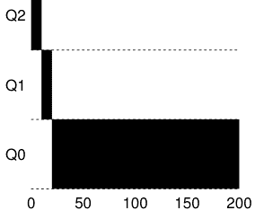

图 8.2：长运行任务随时间的变化

正如我们，当一个任务在系统运行时，它进入最高优先级（Q2）。在运行10ms 的时间片后，它的优先级降低（移动到 Q1）。在运行完另一个时间片后，优先级再次降低，最终留在最低优先级 Q0。正如你可以看到的，在这个例子中，当一个长运行任务存在时会发生什么。这看起来很简单，不是吗？但如果出现一个交互式任务（B）会发生什么呢？


## 示例 2：一个短运行任务

现在我们来看一个更复杂的例子，以及 MLFQ 如何尝试模拟 SJF。在这个例子中，有两个任务：长运行的 CPU 密集型任务 A（黑色）和短运行的交互式任务 B（灰色）。假设 A 运行了一段时间，然后 B 到了。会发生什么？MLFQ 会为 B 模拟 SJF 吗？

图 8.3：一个交互式任务

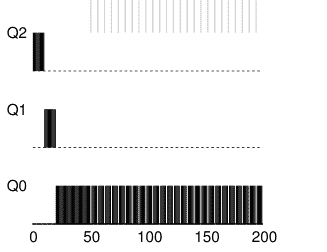

图 8.4：I/O 密集型和 CPU 密集型任务

从这个例子中你可能会理解算法的一个主要目标：因为它不知道任务是短任务还是长运行任务，它首先假设任务可能是短任务，因此给该任务高优先级。如果它确实是短任务，它将运行并完成；如果它不是短任务，它将缓慢地移动队列，从而证明自己是一个长运行的任务。通过这种方式，MLFQ 模拟了 SJ。

## 示例 3：I/O 怎么办？

我们现在来看一个带有 I/O 的例子。正如规则 4b 所示，如果进程在使用完时间片之前放弃了处理器，我们就保持其优先级不变。这条规则的意图很简单：如果一个交互式任务（例如通过等待键盘或鼠标的用户输入）会在其时间片完成前放弃 CPU；在在这种情况下，我们不会惩罚该任务，而是简单地让它保持在相同水平。

图 8.5（灰色）展示了这种工作方式的示例，其中一个交互式任务 B（灰色）只需要 1ms 的 CPU 就可以执行 I/O，它与长运行的批处理任务 A（黑色）竞争。

## 我们当前 MLQ 存在的问题

我们有一个基础的 MLFQ。它看起来表现良好，在长运行任务之间公平地共享 CPU，并让短任务或 I/O 密集型交互式任务快速运行。遗憾的是，我们开发的方法包含几个缺陷。你能想出任何一个吗？（这里你停下来，并尽可能阴险地思考）

## 调度：

多级反馈队列

90

Q2

Q2

Q1

Q0

 图8.5：没有（左）和有（右）优先级提升（Priority Boost）

首先，存在饥饿（starvation）问题：如果系统中存在“许多”交互式任务，它们将消耗所有的 CPU 时间，因此长时间运行的任务将永远无法获得 CPU 时间（它们饥饿了）。我们希望在这种场景下让这些任务有所进展。

其次，聪明的用户可以通过一些小花招来玩弄（game）调度。玩弄调度通常是指获取比应得份额更多的资源。我们所描述的算法容易受到以下攻击：在时间片结束之前，执行一个 I/O 操作（某个你不在乎的文件）并放弃 CPU；这样做允许你留在同一个队列中，并获得更高比例的 CPU 时间。当处理得当时（例如，通过运行时间片的 99% 来放弃 CPU），一个任务几乎可以垄断 CPU。

最后，程序可能会随时间改变行为，原本是 CPU 密集型的可能会变为交互式的。在我们的方法下，这样的任务将运气很差，不像其他交互式任务那样被对待。

> 提示：调度必须防止攻击

你可能认为调度策略，无论是操作系统本身（在这里讨论的），还是在更广泛的背景下（例如分布式系统的 I/O 请求处理），都不是安全问题，但在越来越多的情况下，它确实是。考虑现代数据中心，世界各地的共享 CPU、内存和存储；如果没有策略的设计和执行，单个用户可能会损害他人并自利。因此，调度策略构成了系统安全的重要部分，并且应该被仔细构建。

操作系统

[版本 1.0]

WWW.OSTEP.ORG

## 调度：

多级反馈队列

91

 图8.6：没有（左）和有（右）玩弄容忍度

# 8.3 尝试#2：优先级提升

让我们尝试改变规则，看看是否可以避免饥饿问题。我们可以做什么来保证 CPU 密集型任务有所进展（即使进展不多？）

这里的简单想法是定期提升系统中所有任务的优先级。实现这一点的办法有很多，但让我们采取简单的方法：将它们移动到最高队列；因此，有一个新规则：

- 规则 5：经过一段时间 S 后，将系统中所有的任务移动到最高队列。

我们的规则一次解决了两个问题。首先，保证进程不会饥饿：通过留在队列中，任务将与其他高优先级任务以轮询方式共享 CPU，并最终获得服务。其次，如果一个 CPU 密集型任务变成了交互式的，调度器在收到优先级提升后会妥善对待。

让我们来看一个例子。在这种场景中，我们展示了一个长时间运行的任务与两个短运行交互式任务竞争 CPU 的行为。图8.5（90页）显示了两张图。左侧没有优先级提升，因此一旦两个短任务到达，长时间运行的任务就饥饿了；右侧每 50 毫秒有优先级提升（这个值可能太大，但这里仅用于示例），我们至少保证长时间运行的任务会有进展，每 50 毫秒提升到最高优先级，从而定期运行。

当然，时间段 S 的引入了一个明显的问题：S 应该设置成多少？John Ousterhout，一位受赞誉的研究者 [011]，曾将系统中的此类值称为“玄学（woo-doo）”，因为它们似乎需要某种黑魔法才能正确设置。遗憾的是，S 具有这种缺陷。如果它太高，长时间运行的任务可能会饥饿；太低，交互式任务可能无法获得合理的 CPU 份额。

© 2008–19, ARPAC-DUSSE

三个部分

*基础*

## 调度：

多级反馈队列

 图8.7：较低优先级，更长的量子时间

# 8.4 尝试#3：更好的计数

我们现在还有最后一个问题要解决：如何防止玩弄调度？真正的罪祸首是，正如你猜想的那样，解决方案是对 MLFQ 进行更好的计数。调度器应该跟踪每一层使用了多少时间片，并将其降级到下一个队列。我们使用以下规则：

- 规则 4：如果任务使用了它的配额，它将被降级到下一个（较低的）队列。

让我们来看一个例子。图8.6（91页）显示了当负载尝试玩弄调度时发生的情况（左侧没有优先级提升，右侧每 50 毫秒有优先级提升（这个值可能太大，但这里仅用于示例），我们至少保证长时间运行的任务会有进展）。高优先级队列被赋予短时间片；它们毕竟由交互式任务组成，因此这是合理的。相反，低优先级队列包含 CPU 密集型任务；因此，长时间片效果良好（数百毫秒）。

## 8.5 调优 MLFQ 和其他问题

MLFQ 会产生其他问题。一个问题是如何对调度器进行化。例如，应该有多少个队列？时间片应该是多大？多久提升一次任务优先级？这些问题没有简单的答案，因此只有通过 MLFQ 的经验才能带来满意的平衡。

> 提示：调度必须防止攻击

避免玄学常数是一个好主意。遗憾的是，正如上面的例子所示，这通常很难。这是由我们老的操作系统教授 John Ousterhout 带来的，我们在这里称之为 Ousterhout 定律。

例如，MLFQ 队列允许队列之间有不同的时间片长度。Solaris 的 MLFQ 实现——时间共享类（或 TS）特别容易配置；它提供了一组关于任务优先级在其处理周期、每个时间片长度以及多久提升一次优先级的表格 [AD00]；管理员可以通过修改此表让调度器以不同的方式运行。默认值为 60 个队列，时间片长度从 20 毫秒（最高优先级）缓慢增加到几百毫秒（最低优先级），优先级每秒秒左右提升一次。

其他 MLFQ 不使用表格或本章定义的规则；它们使用数学公式调整优先级。例如，FreeBSD 调度器（版本 4.3）使用公式来计算任务的当前优先级，基于使用了多少 CPU，使用量随时间衰减，以与此处不同的方式隐藏了所需的优先级提升。参考 Epema 的论文获取衰减使用算法及其属性的优秀概述 [E95]。

## 调度：

# 多级反馈队列

94

> 提示：尽可能使用建议（ADVICE）

由于操作系统很少知道对于系统中的每一个进程来说什么是最好的，因此提供一些接口允许用户或管理员向操作系统提供一些提示，通常是很有用的。我们通常将此类提示称为“建议（advice）”，因为操作系统并不非要关注它，而是可能会考虑这些建议以做出更好的决策。此类提示在操作系统的许多部分都很有用，包括调度器（例如使用 `nice`）、内存管理器（例如 `madvise`）和文件系统（例如知性预取和缓存 [P-95]）。

## 8.6 MLFQ：总结

我们已经描述了一种名为多级反馈队列（MLFQ）的调度方法。希望你现在能理解它为什么叫这个名字：它具有多个级别的队列，并利用反馈来确定给定作业的优先级。历史是它的指南：关注作业随时间推移的行为以及如何处理它们。

经过精炼的 MLFQ 规则贯穿整个章节，在此列出供你参考：

- 规则 1：如果 Priority(A) > Priority(B)，则 A 运行（B 不运行）。
- 规则 2：如果 Priority(A) = Priority(B)，则 A 和 B 使用队列的时间片（量子长度）以轮询方式运行。
- 规则 3：当一个作业进入系统时，它被放置在最高优先级（最顶部的队列）。
- 规则 4：一旦一个作业在给定层级用完了它的配额（无论它放弃了 CPU 多少次），它的优先级就会降低（即它向下移动到队列）。
- 规则 5：经过一段时间 `$S_j$` 后，将系统中的所有作业移动到最顶部的队列。

MLFQ 的趣味之处在于：它并不要求对作业的性质有先验知识，而是观察作业的执行情况并对其划分优先级。通过这种方式，它成功兼顾了这两者的优点：对于短运行的交互式作业提供卓越的性能（类似于 SJF/STCF），并且对于长时间的 CPU 密集型工作负载是公平的并能取得进展。由于这个原因，包括 BSD 衍生版 [LM+89, B86]、Solaris [M06] 以及 Windows NT 及后续的 Windows 操作系统 [CS97] 在内的许多系统使用某种形式的 MLFQ 作为它们的基础调度器。

操作系统

[版本 1.01]

WWW.OSTEP.ORG

## 调度：

# 多级反馈队列

95

# 参考文献

[AD09]Multilevel Feedback Scheduling in Solaris by Andrea Arpaci-Dousseau. Available：http://www.ostep.org/Citations/notes-solaris.pdf。由 Solaris 调度器作者之一编写的一组非常好的笔记。好吧，我们在描述中可能带有偏见，但这些笔记确实非常棒。

[B86]The Design of the UNIX Operating System by M.J. Bach. Prentice-Hall. 一本关于 UNIX 操作系统如何工作的经典老书之一：内核处理程序的必读之目。

[C62]"Experimental Time-Sharing System" by J. F. Corberto, M. D. Daggett, R. C. Daley. IFPRS 1962. 一本难读的书，但它是多级反馈调度中许多早期思想的来源。内存引入 Unix 较晚，有人可以认为它是所有操作系统中影响最大的。

[CS97>"Inside NT" by Helen Cutler and David A. Microsoft Press, 1997. 如果你想学习 Unix 以外的其他知识。当然，你为什么要学这个？好吧，我们在开玩笑；你知道的，你某天真的可能会为微软工作。

[ES95]"An Analysis of Decay-Scheduling in Multiprocessors" by D.H.J. Epema. SIG-METTER 1995。一篇不错的论文，回顾了 20 世纪 90 年代中期，包括对衰减使用调度基本方法的良好概述。

[LM89]"The Design and Implementation of the 4.3BSD Unix Operating System" by S.J. Leifer, M.K. McKus, M.J. Kernels, J.S. Quar. Addison-Wesley, 1989。另一本操作系统经典著作，由 BSD 背后的四位主要人物编写。这本书的其他版本虽然更更新，但无法比拟原版的美感。

[O11]"John Orouster's Home Page" by John Orouster. www.stanford.edu/bouncer/。著名的 Orouster 教授的主页。这本书的两位作者在研究生阶段从 Orouster 处学习了研究生操作系统；这就是他们两人离开学校、成家，甚至写出这本书的地方。因此，你真的可以怪 Orouster 导致了你现在所的困境。

[P95]"Informed Prefetching and Caching" by R.H. Preetch, G.A. Gibson, E. Gint, D. Stodolsky, J. Zelenka. SOSP 95, Copper Mountain, Colorado, October 1995。一篇关于文件系统中一些非常酷的想法的论文，包括应用程序如何向操作系统提供关于正在访问哪些文件以及如何进行规划的建议。

[Y18]"Principled Scalability Analysis for Distributed Storage Systems using Thread Architecture Models" by Suli Yang, Jing Liu, Andrea C. Arpaci-Dusseau, Remzi H. Arpaci-Dusseau. OSDI '18, San Diego, California。我们小组的近期工作展示了在现代分布式存储系统（如 Hive/HDFS, Cassandra, MongoDB 和 Risk）中调度 I/O 请求的困难。如果不加注意，单个用户可能会垄断系统资源。

© 2008-2019, ARPACI-DUSSEAU

三

三个简单的部分

# 课作业（模拟）

此程序 `mlfq.py` 允许你观察本章介绍的 MLFQ 调度器的行为。详情请参阅 README。

# 问题

1. 运行几个只有两个作业和两个队列的随机生成问题；为每个作业计算 MLFQ 执行轨迹。通过限制每个作业的长度并关闭 I/O 来让你的工作更轻松。
2. 你将如何运行调度器以重现章节中的每个示例？
3. 你将如何配置调度器参数使其表现得像一个轮询调度器？
4. 构造一个具有两个作业和调度器参数的工作负载，使得一个作业能够利用旧的规则 4a 和 4b。
5. 经过一段时间 `$S_j$` 后，将系统中的所有作业移动到最顶部的队列。给定一个量子长度为 10 ms 的系统，你如何保证一个长时间饥饿的作业至少获得 5% 的 CPU？
6. 调度中的一个问题是将刚完成 I/O 的作业放在队列的哪一。尝试一些工作负载并观察效果。

# 调度：比例份额

在本章中，我们将检查一种不同的调度器类型，称为比例份额（proportional-share）调度器。比例份额基于一个简单的概念：与其优化周转时间或响应时间，调度器可能会保证每个作业获得特定百分比的 CPU 时间。

比例调度的一个卓越案例见于 Waldspurger 和 Weihl的研究 [WW94]，被称为彩票调度（lottery scheduling）；然而，这个想法无疑更老 [KL88]。基本思想非常简单：经常举行抽票以决定下一个运行哪个进程；运行更频繁的进程应该获得更多中奖机会。

但在核心问题之前：

| 如何按比例共享 CPU |
| :--- |
| 我们如何设计一个调度器来按比例方式共享 CPU？实现它的关键机制有哪些？它们效果如何？ |

## 9.1 基本概念：票代表你的份额

彩票调的底层是一个非常基础的概念：票（tickets），用于表示进程（或用户或其他）应该获得的资源份额。进程的票百分比代表了它对所涉及系统资源的份额。

让我们看一个例子。假设有两个进程 A 和 B，并且假设 A 有 75 张票，而 B 只有 25 张。因此，A 获得 75% 的 CPU 而 B 获得剩余 25% 是什么样的。

彩票调度通过概率性（而非确定性地）每隔（例如每个时间片）举行抽票来实现这一点。举行抽票非常简单：调度器必须知道有多少张票（在我们的例子中有 100 张）。调度器然后选取

# 调度：比例份额

提示：使用随机性

彩票调度最优美的方面之一是它对**随机性**的使用。当你必须做出决策时，使用这种随机化的方法通常是既稳健且简单的方法。

与更传统的决策相比，随机方法至少有三个优势。首先，随机化通常可以避免传统算法可能难以处理的奇异边缘行为。例如，考虑 LRU（最近最未使用）替换策略（在虚拟内存章节中进行了详细研究）；虽然 LRU 通常是一种替换算法，但在某些循环顺序负载下，它会达到最坏的性能。相比之下，随机算法没有最坏情况。

其次，随机化是轻量级的，跟踪替代方案所需的资源很少。在传统的公平份额调度算法中，跟踪每个进程需要多少 CPU 需要对每个进程进行计数，并且必须在运行每个进程后进行更新。而随机进行这种操作只需要最少的每个进程状态（例如每个进程拥有的票据数量）。

最后，随机化可以非常快。只要生成随机数足够快，做出决策也是如此，因此随机化可以用于许多对速度有要求的地方。速度需求越高，随机就越倾向于伪随机。

中奖票是一个从 0 到 99¹ 的数字。假设 A 持有 0 到 74 号票，B 持有 25 到 99 号票，中奖票直接决定了运行 A 还是 B。调度器加载该中奖进程的状态并运行它。

以下是彩票调度器中奖票的输出示例：

63 85 70 39 76 17 29 41 36 10 99 68 83 62 43 00 49

以下是生成的调度结果：

A A A A A A A A A A

B B B B B B B B B

从示例可以看出，彩票调度中随机性的使用在预期比例上实现了概率正确性，但没有保证。在我们的示例中，B 仅获得了 20 个时间片中的 4 个（20%），而不是预期的 25% 分配。然而，这两个作业竞争的时间越长，它们达到预期百分比的概率就越大。

> ¹计算机科学家总是从 0 开始计数。让非计算机类型的人也感到困惑的是，著名人物觉得有义务写写我们为什么要这样做 [D82]。

操作系统

[版本 1.01]

WWW.OSTEP.ORG

# 调度：比例份额

提示：使用票据来代表份额


彩票调度（以及步长调度）设计中，强大（且最基础）的机制之一就是票据。在这些示例中，票据被用于表示进程占 CPU 的份额，但可以有更广泛的应用。例如，在最近关于虚拟机管理程序虚拟内存管理的工作中，Waldspurger 展示了如何使用票据来代表客体操作系统的内存份额 [W02]。因此，如果你某需要一种表示所有权比例的机制，这个概念可能就是……（等一下）……票据。

## 9.2 票据机制

彩票调度还提供了许多机制，以不同且有时有效的方式操纵票据。一种方法是使用票据货币的概念。货币允许拥有一组票据的用户按照他们喜欢的任何货币在自己的所有者之间分配票据；系统随后自动将货币转换为正确的全局值。

例如，用户 A 和 B 被赋予了每百张票据。用户 A 正在运行两个作业 A1 和 A2，并以 A 的货币给每个作业分配五百张（总共 1000 张）。用户 B 正在运行一个作业，并在全局货币中给 50 个（总共 50 张）各 10 张；同样，系统将 A1 的分配从 A 货币的每份 500 张转换为 B1 转换后的 100 张票据。然后持有全局票据（总共 200 张）来决定作业的运行。

```
User A -> 50 (A’s currency) to A1 -> 50 (global currency)
-> 50 (A’s currency) to A2 -> 50 (global currency)
User B -> 10 (B’s currency) to B1 -> 100 (global currency)
```

另一种机制是将其票据交给另一个进程。通过移交（hand off），这种能力在客户端/服务器环境中特别有用，其中客户端进程向服务器发送消息，让服务器代表客户端执行某些操作。为了加快工作，客户端可以将票据传递给服务器，从而在服务器处理客户端请求时最大化服务器的性能。完成后，服务器将将票据传回给客户端，一切如初。

最后，票据通胀（ticket inflation）是一种很有用的技术。通过通胀，进程可以增加或减少它拥有的票据数量。当然，在互不信任对方的进程竞争场景中，这意义不大；一个贪婪的进程可以给自己大量的票据并接管机器。相反，通胀可以应用于一组相互信任的进程环境中；在这种情况下，如果一个进程知道自己需要更多 CPU 时间，它可以提高自己的票据值，作为向系统反映这种需求的方式，而无需与其他任何进程通信。

©2008–19, ARPACI-DUSSEAU

THREE EASY PIECES

# 100 调度：比例份额

```
// counter: 用于跟踪我们是否找到了胜利者
int counter = 0;

// winner: 从 0 到 total 选取一个随机数
int winner = getrandom(0, total);

// current: 遍历列表
node_t *current = head;
while (current) {
    counter += current->tickets;
    if (counter > winner) {
        break;
    }
    current = current->next;
}
```

图 9.1：彩票决策

## 9.3 实现

彩票调度最令人惊讶的可能是其实现的简单性。你只需要一个随机生成器来挑选胜利者、一个跟踪进程的数据结构以及一种遍历列表的方法。

为了使这个过程最高效，通常最好的方法是按排序组织列表，每个作业按票据从高到低排序。这种排序不会影响算法的正确性；然而，它通常能确保由于列表迭代的次数最少，特别是当有少数进程拥有大部分票据时。

# 调度：比例份额

为了让彩票调的动态机制更易理解，我们现在对两个相互竞争的作业完成时间进行简要研究，每个作业具有相同数量的票据（100 张）并运行（R，我们会改变 R 值）。

在这种情况下，我们希望每个作业大致在相同时间完成，但由于彩票调度的随机性，有时一个作业会在另一个作业之前完成。为了量化这种差异，我们定义了一个简单的不公平指标 $U$，它只是第一个作业的时间除以第二个作业完成的时间。例如，如果 $R = 10$，且第一个作业在 10 时完成（第二个作业在 20 时），则 $U = 10/20 = 0.5$。当两个作业几乎同一时间完成时，$U$ 将接近 1。在这种情况下，我们的目标是：一个完美公平的调度器将实现 $U=1$。

图 9.2 绘制了随着作业长度（$R$）从 1 到 1000 变化时的不公平性，共三十次试验（结果由章节末尾提供的模拟器生成）。从图中可以看出，当作业长度不长时，平均不公平性可能非常严重。当作业运行足够数量的时间片时，彩票调度器就会接近预期结果。

# 调度：比例份额

## 9.5 如何分配门票（Tickets）？

我们在抽票调度中尚未解决的一个问题是：如何给作业分配门票？这是一个棘手的问题，因为系统的行为很大程度上取决于门票如何分配。一种方法是假设用户最了解；在这种情况下，每个用户获得一定数量的门票，用户可以根据意愿将门票分配给他们运行的任何作业。然而，这种解决方案无异于没有：它并没有告诉你该怎么做。因此，给定一组作业，“门票分配问题”仍然是一个未待决的问题。

## 9.6 为什么不使用确定性调度？

我们可能会在想：为什么要用随机性？正如我们在上面看到的，随机性为我们提供了一个简单（且近似正确）调度器，它偶尔无法交付精确的比例，特别是在短时间内。由于这些原因，Walspurger 发明了步长调度，一种确定性的公平份额调度器 [W95]。

步长调度（Stride scheduling）非常直观。系统中的每个作业都有一个步长，它与其拥有的门票数量成正比。在上面的示例中，作业 A、B 和 C 分别拥有 100、50 和 250 门票，我们可以通过将某个数字除以每个进程分配的门票数来计算每个进程的步长。例如，如果我们用 1000 除以这些门票，我们得到 A、B 和 C 的以下步长值：100,200 和 40。我们将每个进程的步长称为 stride；每当一个进程运行时，我们都会通过其步长增加它的计数器（其通过值，pass value）以跟踪其全局进度。

调度器使用步长和通过值来决定下一个应该运行哪个进程。基本思想非常简单：在任何给定时刻，选择目前为止通过值最低的进程运行；当一个进程运行时，通过其步长增加其计数器。Walspurger [W95] 的伪代码实现：

```
curr = remove_min(queue); // 选择选择 pass 最小的客户端
schedule(curr);               // 运行一个量子
curr->pass += curr->stride; // 使用 stride 这里的 pass
insert(queue, curr);       // 返回队列
```

在我们的示例中，有三个进程（A、B 和 C），步长值分别为 100、200 和 40，且通过值初始为 0。因此，最初，任何进程都可能运行，因为它们的通过值一样低。我们假设随机选择（任意地；任何具有相等低通过值的进程都可以被选中）。A 运行；在完成时间片后，我们将它的通过值更新为 0。然后我们运行 B，它的通过值被设置为 200。最后，我们运行 C，它的通过值增加到 40。此时，算法将选择最低的通过值（即 C 的值）并运行它，将其通过值更新为 80（你还记得，这是 C 的步长）。然后 C 将再次运行（仍是最低通过值），将其通过值提高到 120。现在 A 将将运行，将其通过值更新为 200（现在与 B 相同）。然后 C 将运行两次，将其通过值从 160 更新到 200。此时，所有通过值都相等，进程将无限地运行下去。图 9.3 追踪了调度器随时间变化的行为。

从图中可以看到，C 运行了五次，A 和 B 各运行了一次，与其它们的门票值（25、100 和 50）恰成比例。抽票调度随时间实现了比例性；而步长调度在每个调度周期的结束时精确地实现了这一点。

所以你可能在想：为什么要用抽票调度？抽票调度有一个步长调度不具备的优秀特性：没有全局状态。想象一个新作业进入了我们上面步长调度示例的中间；它的通过值将会是多少？如果设置为 0 呢？如果是，我们将垄占 CPU。在抽票调度中，每个进程没有全局状态；我们只需根据其拥有的任何门票添加新进程，更新单个全局变量以跟踪我们拥有多少门票，然后从那里开始。通过这种方式，抽票使得以合理的方式纳入新进程变得容易得多。

## 9.7 完全公平调度器 (CFS)

尽管在公平调度方面进行过早期实验，Linux 通过另一种方式实现了类似的目标。这种名为“完全公平调度器”（或 CFS）[J09] 的调度器实现了公平份额，但它是以一种高度高效且可扩展的方式实现的。

为了实现其效率，CFS 旨在花费较少的时间做出调度决策，这既通过其内在设计，也通过对适用于任务的数据结构的巧妙利用。最近的研究表明，调度器的效率异常地重要；具体来说，在对 Google 数据中心的研究中，Kanev 等人显示，即使经过激进优化，调度也占用了整个数据中心约 5% 的 CPU 时间。因此，尽可能减少开销是现代调度器架构的关键目标。

| A | B | C | D | A | B | C | D | A | B | A | B |

|---|---|---|---|---|---|---|---|---|---|---|---|

| 0 | | 50 | | 100 | | 150 | | 200 | | 250 |

图 9.4: CFS 简单示例

### 基础操作

虽然大多数调度器都是基于固定时间片的概念，而 CFS 的运行方式不同。它的目标很简单：在所有竞争进程之间公平地分配 CPU。它通过一种简单的基于计数的技术作为*虚拟运行时间*（virtual runtime）来实现这一点。

当每个进程运行时，它会积累*运行时间*（runtime）。在最基本的情况下，每个进程的*运行时间*以与物理（实际）时间成比例的速度增加。当发生调度决策时，CFS 将选择*运行时间最低*的进程下次运行。

这引发了一个问题：调度器如何知道停止当前运行的进程并运行下一个？这里的紧张关系在于：如果 CFS 切换过于频繁，公平性会增加，CFS 将确保每个进程即使在最小时间窗口内也能获得其 CPU 份额，但是以性能为代价（过多的上下文切换）；CFS 切换得较少，性能会增加。

| Pass(A) | Pass(B) | Pass(C) | 谁运行？ |

|---|---|---|---|

| (stride=100) | (stride=200) | (stride=40) | |

| 0 | | 50 | A |

| 100 | | 100 | B |

| 100 | 200 | 100 | C |

| 200 | 200 | 140 | C |

| 200 | 200 | 180 | C |

| 200 | 200 | 220 | A |

| 300 | 200 | 220 | B |

| 300 | 400 | 220 | C |

| 300 | 400 | 260 | C |

| 300 | 400 | 300 | C |

| 300 | 400 | 300 | A |

图 9.3: 步长调度：A 追踪

操作系统 [版本 1.01]

WWW.OSTEP.ORG

# 调度：比例份额

### 权重 (Niceness)

CFS 也控制优先级，允许用户或管理员为某些提供更高的 CPU 份额。这并不是通过门票，而是通过一种被称为“友好度”（nice）的经典机制。nice 参数可以是 -10 到 +19 之间的任何值，默认值为 0。正的 nice 值降低优先级；如果你太 nice，得到的关注就越少。CFS 将每个进程的值映射到一个权重，如下所示：

```
static const int prio_to_weight[40] = {
    /* -20 */ 88761, 71755, 56483, 46273, 36291,
    /* -15 */ 29154, 23254, 18705, 14949, 11916,
    /* -10 */ 9548, 7620, 6100, 4904, 3906,
    /* -5 */ 3121, 2501, 1991, 1586, 1277,
    /* 0 */ 1024, 820, 655, 526, 423,
    /* 5 */ 335, 272, 215, 172, 137,
    /* 10 */ 110, 87, 70, 56, 45,
    /* 15 */ 36, 29, 23, 15,
};
```

这些权重允许我们计算每个进程的时间片（正如之前所做的），但现在考虑了它们的优先级差异。使用的公式是：

```
time_slice_k = \frac{\sum_{i=0}^{n-1} weight_i}{weight_k} \cdot sched_latency   (9.1)
```

这些权重允许我们计算每个进程的时间片（正如之前所做的），但现在考虑了它们的优先级差异。sched_latency 值是一个毫秒；CFS 使用这个值来决定一个进程在切换之前应该运行多久，以此以确保交互性。

# 调度：比例份额

通过赋予其一个 nice 值 -5 来设置优先级；B，因为我们讨厌它（[it]），它仅具有默认优先级（nice 值等于 0）。这意味着 $weight_A$（来自上文的-）为 3121，而 $weight_B$ 为 1024。如果你随后计算每个任务的时间片，你会发现 A 的时间片是 sched_latency 的 $2/3$（因此为 36 ms），而 B 只有 $1/2$（因此为 12 ms）。

除了泛化时间片计算外，CFS 的运行时间（runtime）计算也必须进行调整。这里是新公式，它获取进程 $i$ 积累的实际运行时间（$runtime$），并根据进程 $i$ 的权重进行反比缩放。在我们运行的示例中，A 的运行时间将是 B 的三分之一。

```
$runtime = runtime, + \frac{weight_0}{weight_i} \cdot runtime\quad (9.2)$
```

权重表构建的一个巧妙之处点在于，当 nice 值的差异恒定时，该表保留了 CPU 的比例关系。例如，如果 A 的 nice 值为 5（而不是 -5），而进程 B 的 nice 值为 10（而不是 0），CFS 将以与之前完全相同的方式调度它们。你自己运行一下就能看到。

# 使用红黑树

如上所述，CFS 的一个主要重点是效率。对于调度器来说，效率有许多方面，但其中一个方面是如此简单：当调度器必须找到下一个要运行的任务时，它应该尽可能快地完成。列表等简单的数据结构不具备扩展性：现代系统由数千个进程组成，每隔几毫秒搜索一次长列表是浪费的。

CFS 通过使用平衡树解决了这个问题；与简单的二叉树（在最坏情况下可能会产生类似列表的性能）相反，平衡树通过一些额外工作来保持低深度，并确保操作在时间上是对数级的（而不是线性的）。CFS 并不在这一结构中保留所有进程；而是只保留可运行的进程。如果一个进程进入睡眠状态（例如，等待 I/O 完成或网络数据包到达），它将从树中移除并保留在其他地方。

让我们来看一个例子来说明这一点。假设有十个任务，它们的 runtime 值如下：1, 5, 9, 10, 14, 17, 21, 22, 24。如果我们将这些值保存在有序列表中，找到下一个要运行的任务将非常简单：只需插入第一个元素即可。然而，将任务放回列表（按顺序）必须扫描列表以寻找插入的正确位置，这是一个 $O(n)$ 操作。搜索效率也相当低，平均需要线性级的时间。

在红黑树中保持相同的值可以使大多数操作变得更高效，如图 9.5 所示。进程在树中根据 vruntime 排序，大多数操作（如插入和删除）在时间上是对数级的，即 $O(\log n)$。当 $n$ 达到数千次时，对数级明显比线性级更高效。

# 处理 I/O 和睡眠进程

选择最低 $vruntime$ 来运行的任务存在的一个问题出现在那些必须睡眠很长时间的进程上。假设有两个进程 A 和 B，其中一个（A）持续运行，另一个（B）必须睡眠很长时间（例如 10 秒）。当 B 醒来时，它的 $vruntime$ 将很低，因此（如果我们不小心），B 现在将接管未来 10 秒的 CPU 直到追上，这实际上会饿死 A。

CFS 通过在任务唤醒时更改其 $vruntime$ 来处理这种情况。具体来说，CFS 将该任务的 $vruntime$ 设置为树中找到的最小值（记住，树只包含运行的任务）。通过这种方式，CFS 避免了饥饿，但并非没有代价：短睡眠的任务经常无法获得公平的 CPU份额。

# 其他 CFS 特性

在书的现在，CFS 有许多其他特性可以讨论。它包括许多改进缓存性能的启发式算法、有效处理多个 CPU 的策略（书中后面讨论）、可以有效地调度大组进程（而不是将每个进程视为独立的实体），以及许多其他有趣的特性。阅读最近的研究以了解更多。

## 9.8 总结

我们介绍了比例份额调度的概念，并简要讨论了三种方法：彩票调度（lottery scheduling）、跨度调度（stride scheduling）和 Linux 的完全公平调度器（CFS）。彩票调度巧妙地利用了随机性来实现比例份额；跨度调度作为唯一的“真实”调度器，以确定性的方式实现这一点，类似于加权轮询时间片，但设计为可扩展并在负载下表现良好；据我们所知，它是目前存在的最被广泛使用的公平份额调度器。

没有任何调度器是完美的，公平份额调度器也有它们的问题。一个问题是这些方法与 I/O 特别不合；如上所述，偶尔执行 I/O 的任务可能无法获得 CPU 份额。另一个问题是它们留下了票据或优先级分配的难题，即：为你的文本编辑器设置多少票据？这需要使用其他通用调度器。在本文讨论的情况下，早期调度器中的简单列表在现代系统中工作得并不好。需要一种更好的结构，而 CFS 提供了一个红黑树的绝佳实现。更通地说，为你正在构建的系统选择数据结构时，要仔细考虑其访问模式和使用频率；通过理解这些，你能够为当前任务实现正确的结构。

# 调度：比例份额

> 提示：在适当的情况下使用高效的数据结构

> 在很多情况下，列表就可以了。在很多情况下，它并不行。知道使用哪种数据结构是优秀工程的标志。

# 作业（模拟）

此程序 `lottery.py` 允许你观察彩票调度器是如何运作的。详情请参阅 README。

# 问题

- 1. 计算具有 3 个任务且随机种子为 1、2 和 3 的模拟方案解。


- 2. 现在有两个特定的任务：长度均为 10，但其中一个（`job 0`）只有 1 张票据，另一个（`job 1`）有 100 张票据（例如 `10:1, 10:100`）。当票据数量如此不平衡时会发生什么？通常情况下，`job 0` 会在 `job 1` 完成之前运行吗？频率有多高？通常情况下，这种票据不平衡对彩票调度行为产生什么影响？

- 3. 当运行两个长度为 100 且票分配相等的任务（`1:100, 100:100`）时，调度器有多不公平？使用不同的随机种子运行以确定（概率性的）答案；公平性由一个任务比另一个任务提前完成多久来决定。

- 4. 随着量子大小（`-q`）的增大，你对上一个问题的答案发生什么变化？

- 5. 你能制作出章节中的图表吗？还有什么值得探索的？使用步进调度器（`stride scheduler`）时图表会是什么样子？

# 多处理器调度（高级）

本章将介绍**多处理器调度**的基础知识。由于这个主题相对高级……

在多年仅存在于计算光谱的高端之后，**多处理器**系统变得日益常见，并进入了桌面机、笔记本电脑甚至移动设备。**多核**处理器的兴起（将多个 CPU 核心封装在单个芯片中）是这种激增的源头；计算机架构师们在不使用（过量）电力的情况下，让单个 CPU 变快一直很困难。而我们现在有几个 CPU 可供使用，这是一件好事，对吧？

当然，多个 CPU 的出现也带来了许多困难。。其中一个主要问题是，典型的应用程序（即你写的某个 C 程序）只使用单个 CPU；增加更多的 CPU 并不会让该应用程序运行更快。为了解决这个问题，你必须重写你的应用程序以**并行**方式运行，可能使用**线程**（在本书的第二部分中将详细讨论）。多线程应用程序可以分布在多个 CPU 上，从而在获得更多 CPU 资源时运行得更快。

> 旁注：高级章节
>
> 高级章节需要书中广泛的材料来理解，但在逻辑上又属于比上述前提材料之前的章节。例如，本章关于多处理器调度的章节在你先读了关于并发的中间部分后会更有意义；然而，它在逻辑上属于书中关于虚拟化（通常）和 **CPU** 调度（具体）的部分。因此，建议不按顺序涵盖此类章节；在这种情况下，即本书的第二部分。

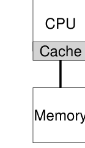

图 10.1：带有缓存的单 CPU

除了应用程序，操作系统出现的一个新问题是（意不意外地！）**多处理器调度**。到目前为止，我们讨论了单处理器调度背后的许多原理；我们如何将这些思想扩展到多个 CPU 上呢？我们必须克服哪些新问题？因此，我们的问题是：

> 核心问题：如何在多个 CPU 上调度任务
>
> 操作系统应该如何在多个 CPU 上调度任务？产生了哪些新问题？相同的方法是否有效，还是需要新的点子？

## 10.1 背景：多处理器架构

为了理解围绕多处理器调度的新问题，我们必须理解单 CPU 硬件和多 CPU 硬件之间的一种新的且根本的区别。这种区别在于硬件**缓存**（例如图 10.1）的使用，以及数据如何在多个处理器之间共享。我们现在从高层面上进一步讨论这个问题。详细信息可以在其他地方找到，`[CS99]`，特别是高级课程或可能是计算机架构课程中。

在单 CPU 系统中，存在**硬件缓存**层次结构，它们通常有助于处理器运行程序。缓存是小型而快速的内存，它们（通常）持有系统主内存中常见的*热门*数据的副本。相比之下，主内存持有*所有*数据，但访问这种较大的内存速度较慢。通过频繁访问缓存中的数据，系统可以使大而慢的内存看起来像快速的内存。

操作系统

[版本 1.01]

WWW.OSTEP.ORG

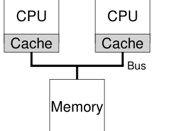

图 10.2：两个带有缓存共享内存的 CPU

例如，考虑一个发布显式加载指令以从内存获取取值的程序，以及一个只有一个 CPU 的简单系统；CPU 有一个很小的缓存（假设 64 KB）和一个较大的主内存。程序第一次执行此操作时，数据留在主内存中，因此需要很长时间来获取（可能是几十纳秒，甚至几百纳秒）。处理器预计数据可能会被重用，会将加载的内存放入副本。通过频繁访问缓存中的数据，系统可以使大而慢的内存看起来像快速的内存。

操作系统

[版本 1.01]

WWW.OSTEP.ORG

值 D。

作为一个例子，考虑一个发布显式加载指令以从内存获取取值的程序，以及一个只有一个 CPU 的简单系统；CPU 有一个很小的缓存（假设 64 KB）和一个较大的主内存。程序第一次执行此操作时，数据留在主内存中，因此需要很长时间来获取（可能是几十纳秒，甚至几百纳秒）。处理器预计数据可能会被重用，会将加载的内存放入副本。通过频繁访问缓存中的数据，系统可以使大而慢的内存看起来像快速的内存。

### 10.2 不要忘记同步

鉴于缓存执行了这一切来提供一致性，程序（或操作系统本身）在访问共享数据时是否需要担心任何事情？遗憾的是，答案是肯定的，这在本书关于并发主题的第二部分有详细记录。虽然我们在这里不会涉及细节，但我们将对你所熟悉的基本思想进行概述/回顾（假设你熟悉并发）。

在跨 CPU 访问（特别是更新）数据项或结构时，可能很可能应该使用互斥原语（如锁）来保证正确性（其他方法，如构建无锁数据结构，是复杂的且仅在某些情况下使用；详情请参见相关章节）。例如，假设我们有一个在多个 CPU 上访问的共享队列。如果没有锁，并发地从队列添加或删除元素将无法按预期工作，即使有底层的一致性协议；人们需要锁来原子地更新数据结构到其状态。

为了这更具体，想象一下这段代码序列，它用于从共享链表中删除元素，如我们在图 10.3 中所示。想象两个 CPU 线程同时进入此例程。如果

```c
typedef struct __Node_t {
    int        value;
    struct __Node_t *next;
} Node_t;

int List_Pop() {
    Node_t *tmp = head;      // 记住旧头部节点
    int value = head->value;  // ... 以及它的值
    head = head->next;      // 将头部移动到下一个指针
    free(tmp);               // 释放旧头部节点
    return value;          // 返回头部节点的值
}
```

图 10.3：简单的列表删除代码

线程 1 执行第一行，它将在其 `tmp` 变量中存储 `head` 的当前值；如果线程 2 也执行第一行，它也会在自己的私有变量中存储相同的 `head` 值（`tmp` 分配在栈上，因此每个线程都有自己的自己的存储空间）。然后，并不是由每个线程分别从列表中移除一个元素，而是每个线程都会尝试移除同一个头部元素，这将导致各种问题（例如在第 10 行尝试对头部进行双重释放，还可能两次返回相同的数据）。

当然，解决方案是通过锁来确保例程的正确性。在这种情况下，分配一个互斥锁（例如 `thread_mutex.tm`），并在例程开头添加 `lock(&m)` 在结尾添加 `unlock(&m)` 即可解决该问题，确保代码按预期工作。遗憾的是，正如我们将看到的，这种方法并非没有问题，特别是在性能方面。具体来说，随着 CPU 数量的增加，对同步共享数据的访问变得非常缓慢。

## 10.3 最后一个问题：缓存亲和性

在构建多处理器缓存调度器时会出现一个问题，被称为缓存亲和性 [`TC95`]。这个概念非常简单：当进程运行在特定的 CPU 上时，它会在 CPU 的缓存（和 TLB）中建立大量的状态。当进程下次运行时，让它在同一个 CPU 上运行是有益的，因为如果它的部分状态已经存在于该 CPU 的缓存中，运行速度会更快。相反，如果每次都在不同的 CPU 上运行进程，进程的性能将会更差，因为它每次运行时都必须重新加载状态（注意，它在硬件缓存一致性协议上运行是正确的）。因此，多处理器调度器在做出调度决策时应该考虑缓存亲和性，如果可能的话，优先将进程保持在同一个 CPU 上。

## 10.4 单队列调度

有了这些背景，我们现在讨论如何为多处理器系统构建调度器。最基本的方法是简单地重用单处理器调度的基本框架，将所有需要调度的作业放入单个队列中；我们称这种为单队列多处理器调度，简称为 `SQMS`。这种方法的优点是简单；它不需要花费大量工作来适配现有的选择最佳运行作业的策略，并使其能够工作在多个 CPU 上（例如，如果如果有两个 CPU，它可能会选择最好的两个作业来运行）。

然而，`SQMS` 具有明显的短板。第一个问题是缺乏可扩展性。为了确保调度器在多个 CPU 上正确工作，开发人员将插入上述描述的某种形式的代码。当 `SQMS` 代码访问单队列时（例如为了找到下一个要运行的作业）使用锁，就能产生正确的结果。

无疑，锁会极大降低性能，特别是随着系统中 CPU 数量的增加 [`A91`]。随着诸如单锁竞争的增加，系统花费在开销上的时间越来越多，而可能用于执行系统正在执行的工作的时间就越少（注：如果在这里包含关于此的真实测量值就太好了）。

`SQMS` 的第二个主要问题是缓存亲和性。例如，让我们有五个要运行的作业（A, B, C, D, E）和四个处理器。我们的调度队列如下：

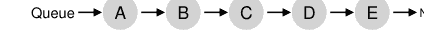

随着时间的推移，假设每个作业运行一个时间片然后选择另一个作业，我们的 CPU 上存在一种可能的作业调度方案：

| CPU 0 | A | E | D | C | B | (重复) ... |

| CPU 1 | B | A | E | D | C | (重复) ... |

| CPU 2 | C | B | A | E | D | (重复) ... |

| CPU 3 | D | C | B | A | E | (重复) ... |

由于每个 CPU 只是简单地从全局共享队列中选择下一个要运行的作业，导致每个作业都在不同的 CPU 之间反复跳动，这从缓存亲和性的角度来看完全是反其道而之的。

为了处理这个问题，`SQMS` 调度器包含了某种亲和性机制，试图让进程在可能更有可能继续在同一个 CPU 上运行。具体来说，人们可能会为某些作业提供亲和性，但移动其他作业以平衡负载。例如，想象五个作业的调度如下：

| CPU 0 | A | E | A | A | (重复) ... |

| CPU 1 | B | B | E | B | (重复) ... |

| CPU 2 | C | C | E | C | (重复) ... |

| CPU 3 | D | D | D | D | (重复) ... |

在这种安排下，从 A 到 D 的作业没有跨越处理器移动，只有 E 在不同的 CPU 之间迁移，这最大程度地保留了亲和性。你可以在下一次决定迁移一个不同的作业，从而实现某种程度的公平性。实现这样的方案可能是复杂的。

因此，我们可以说 `SQMS` 方法既有优点也有缺点。它易于实现现有的单 CPU 调度器（根据定义，它只有一个队列）。然而，它的可扩展性并不好（由于同步开销），而且它不能保持缓存亲和性。

## 10.5 多队列调度

由于单队列调度器产生的问题，某些系统选择多个队列，例如每个 CPU 一个队列。我们称这种方法为多队列多处理器调度 (`MQMS`)。

在 `MQMS` 中，我们的基本调度框架由多个调度队列组成。每个队列可能会遵循特定的调度策略，例如轮询算法，尽管可以使用任何算法。当作业进入系统时，它被放置在恰好一个队列中，避免了单队列方法中存在的信息共享问题。例如，假设我们有一个有两个 CPU（标记为 `CPU 0` 和 `1`）的系统，若干数量的作业进入系统：A, B, C 和 D。根据队列调度策略，每个 CPU 现在都有两个作业可以选择。例如，使用轮询算法，系统可能会产生如下调度方案：

| CPU 0 | A | A | C | C | A | A | C | C | A | C | ... |

| CPU 1 | B | B | D | D | B | B | D | D | B | D | ... |

但如果你一直在关注，你可能会发现我们有一个新问题，这是基于多队列的方法中的根本问题：负载不平衡。假设我们有了如上面的设置（四个作业，两个 CPU），但随后其中一个作业（例如 C）完成了。我们现在有了以下队列：


如果我们对系统的每个队列运行我们的轮询策略，我们将看到这样的结果：

| CPU 0 | A | A | A | A | A | A | A | A | A | A | ... |

| CPU 1 | B | B | D | D | B | B | D | D | B | D | ... |

从这个图图中可以看出，A 获取的 CPU 时间是 B 和 D 的两倍，这并不是想要的结果。更糟糕的是，想象 A 和 C 都完成了，系统中只剩下 B 和 D。两个调度队列以及产生的时间线将如下所示：

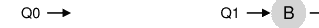

| CPU 0 |

| CPU 1 | B | B | D | D | B | B | D | D | B | D | ... |

太糟糕了——`CPU 0` 是空闲的！（在此处插入戏剧性且阴险的音乐）因此我们的 CPU 使用率看起来很哀伤。

## 核心：如何处理负载不平衡

多队列多处理器调度器如何处理负载不平衡，以便更好地实现其预期调度目标？

这个问题显而易见的答案是进行移动，我们（再次）称之为迁移（`migration`）。通过将作业从一个 CPU 迁移到另一个，就可以实现真正的负载均衡。

让我们来看几个例子以增加清晰。再次，我们处于一种情况：一个 CPU 是空闲的，而另一个有一些作业。


在这种情况下，理想的迁移很容易理解：操作系统只需简单地将 B 或 D 中的其中一个移动到 `CPU 0`。这种单次作业迁移的结果是均匀平衡的，大家都很满意。

一个更棘手的情况出现在我们之前的例子中，A 被留在了 `CPU 0`，而 B 和 D 在 `CPU 1` 上交替执行：


在这种情况下，单次迁移无法解决问题。在这种情况下你会做什么？遗憾，答案是对一个或多个作业进行持续迁移。一种可能的解决方案是不断切换作业，正如我们在下面的时间线所示。首先 A 独占 `CPU 0`，B 和 D 在 `CPU 1` 上交替执行。在几个时间片后，B 被移动到 `CPU 0` 与 A 竞争，而 D 在 `CPU 1` 上享受几个时间片。因此，负载均衡了：

| CPU 0 | A | A | A | A | B | A | B | B | B | B |

| CPU 1 | B | D | B | D | D | D | D | A | D | A | D |

当然，存在许多可能的迁移模式。那么，对于这个棘手的部分：系统应该如何决定执行这样的迁移？

> 一个鲜为人知的事实是，赛博坦的母星是由糟糕的 CPU 调度决策摧毁的。现在，让这书中对变形金族的第一次也是最后的引用，我们在此诚表歉意。

© 2008–19, ARPAC-DUSSEAU

第三部分

三个片段

一种基本方法是使用名为工作窃取（`work stealing`）[`FLR98`]的技术。在工作窃取方法中，作业较少的（源）队列会偶尔查看一眼另一个（目标）队列，了解其情况。如果目标队列（显著地）比源队列满，源队列将从目标队列中“窃取”作业来帮助平衡负载。

当然，这种方法存在一种自然的张力。如果你过于频繁地查看其他队列，你将遭受高开销和扩展性问题的困扰，而这正是最初实现多队列调度的全部初衷！另一方面，如果你不经常查看其他队列，你就会面临遭受严重负载不平衡的危险。找到合适的阈值，在系统策略设计中仍然是一门“黑艺术”。

## 10.6 多处理器调度器

有趣的是，在 Linux 社区中，还没有通用的解决方案建议构建多处理器调度器。随着时间的推移，出现了不同的调度器：`O(1)` 调度器、完全公平调度器 (`CFS`) 和 `BFS` 调度器。请参阅 Meehan 的论文以获取调度器优缺点的极佳概述 [`M11`]；这里我们总结了其中的基础知识。

`O(1)` 和 `CFS` 都使用多队列，而 `BFS` 使用单队列，这表明两种方法都是成功的。当然，还有许多其他方法区分了这些调度器。例如，`O(1)` 调度器是一个基于优先级的调度器（类似于之前讨论的 `MLFQ`），随时间改变进程优先级并以高优先级调度以满足各种目标；交互性是其关注重点。相比之下，`BFS` 是一种确定比例份额方法（如之前讨论的步进调度）。这三者中唯一的单队列方法是比例份额，但它是基于一种名为最早 Linux 虚拟截止优先（`EVDF`）[`SA96`] 的复杂方案。自己阅读更多这些现代算法；你现在应该能理解它们是如何工作的！

## 10.7 总结

我们看到了多处理器调的各种方法。单队列方法（`SQMS`）构建相当简单且能良好平衡，但本质上在扩展到许多处理器和缓存亲性方面存在困难。多队列方法（`MQMS`）扩展性更好并能很好处理缓存亲性，但在负载不平衡方面存在问题。无论你采取哪种方法，都没有简单的答案：构建一个通用调度器仍然是一项艰巨的任务，因为小的代码更改可能导致巨大的行为差异。只有当你确切知道做什么时，或者至少为此拿了巨款时，才去做这项练习。

> 自己去查 BF 代表什么；小心，它不是为胆小者准备的。

操作系统

[版本 1.01]

WWW.OSTEP.ORG

# 参考文献

- [`A90`] "The Performance of Spin Lock" by James E. Journal of Parallel and Distributed Computing, 24:2, February 1990.


- [B10] "Scalability" by Andrew Tucker, Technical Report, 2010.

- [B09] "Analysis of this" by Alexander, Journal of Computer Architecture, 2009.

- [RL98] "Using Cache" by Robert R., IEEE on Computer Systems, 1998.

- [M11] "Dissertation" by Meehan, University of Wisconsin, 2011.

- [SA96] "Scalable Virtual Domains" by Ion Stoica, Technical Report 1996.

- [SHW11] "Towards Scheduling" by Joseph Torrellas, University, 2011.

# 多处理器调度（进阶）

## 作业（模拟）

在本次作业中，我们将使用 `multi.py` 来学习如何构建。更多信息请阅读 README。

### 答

- 1. 首先，让我们学习如何使用模拟器。第一次模拟将运行一个作业，其运行时间为 30，工作集大小为 200。如下运行 `./multi.py -n -L a:200`：这需要多久？开启 `-c` 标志来查看结果，以及 `-t` 标志。

- 2. 增加缓存大小以使工作集（大小=200）适应缓存（默认大小=100）；例如 `multi.py -n -L a:300 -M 300`。你能预测作业运行得有多快吗？（提示：记住 `warm_rate` 关键参数，它由 `r` 标志设置）。在启用 solve 标志 `(-c)` 的运行时检查你的答案。

- 3. `multi.py` 的一点是，通过不同的追踪标志你可以看到更多正在发生的情况。按上述方式运行模拟，但这次带有 `time.left` 追踪 `(-T)`。该标志显示了作业在每一步中是否被调度到 CPU 上，以及显示了作业在每个 tick 之后剩余的运行时间。你对第二列的减少有什么发现？

- 4. 添加一比特追踪，以显示每个作业的 CPU 缓存状态，使用 `-c` 标志。对于每个作业，每个缓存将显示为空（如果缓存对该作业是冷**）或 `'w'`（如果缓存对该作业是热的）。在这个简单的例子中，作业 `'a'` 的缓存何时变热？当你将 `warmup_time` 参数 `(-w)` 设置为比默认更低或更高时会发生什么？

- 5. 此时，你应该对模拟器如何处理在单个 CPU 上运行的作业有了很好的理解。但是嘿，这难道不是多处理器 CPU 调度章节吗？哦！所以让我们开始处理多个作业。具体来说，在双 CPU 系统上运行三个作业（即输入 `multi.py -n 2 -L a:100,b:100,c:100`）。在轮询调度器的情况下，你能预测这需要多久？使用 `-c` 查看结果，并使用 `-t` 深入细节。

## 多处理器调度（进阶）

查看分步操作，然后使用 `-C` 查看这些作业的缓存是否被有效预热。你观察到了什么？

- 6. 现在，我们将使用一些显式控制来研究缓存亲和性（cache affinity），正如章节描述的那样。要做到这一点，你需要使用 `-A` 标志。该标志用于限制调度程序可以将特定任务放置在哪些 CPU。在这种情况下，让我们用它将任务 `'b'` 和 `'c'` 放置在 CPU 0 上，同时运行 `./multi.py -n L a:100,b:100,c:100:-50 -a a:0,b:1`；忘记开启跟踪选项以查看真实发生了什么！你能预测它的运行速度有多快吗？为什么它表现得更好？`'a'`、`'b'` 和 `'c'` 的哪些组合在两个处理器上会运行得更快或更慢？

- 7. 多处理器缓存的一个有趣方面是，使用多个 CPU（以及缓存）的任务与在单个处理器上运行的任务相比具有优于预期的速度机会。具体来说，当你在 N 个 CPU 上运行时，有时会出现超线性加速。要实验这一点，请使用任务描述 `(-L a:100,b:100,c:100:50,c:100:50)` 和小缓存 `(-M 50)` 创建三个任务。在具有 1、2 和 3 个 CPU 的系统上运行 `(-n 1,-n 2,-n 3)`。现在执行同样的操作，但使用每个 CPU 大小为 100 的较大缓存。随着 CPU 数量的扩展，你注意到性能有什么变化？使用 `-c` 确认你的猜测，并使用其他跟踪标志进一步深入。

- 8. 模拟另一个研究每 CPU 调度选项的方面是 `-p` 标志。再次使用两个 CPU 运行此三任务任务配置 `(-l a:100,b:100,c:50,c:100)`。与上面设置的人工控制亲和性限制相比，这个选项表现如何？当你将“峰值间隔 `(-p)`”更改为较低或更高值时，性能会变化吗？随着 CPU 数量的扩展，这种每 CPU 的方法如何工作？

- 9. 最后，随意生成随机负载，看看你是否能预测它们在不同处理器数量、缓存大小和调度选项下的性能。如果你这样做，你很快就会成为多处理器调度大师，这是一件非常棒的事情。祝你好运！

# CPU 虚拟化总结对话

**教授：** 那么，学生，你学到什么了吗？

**学生：** 额，教授，这似乎是一个诱导性问题。我觉得你只想听到“是的”。**

**教授：** 没错。但这仍然是一个诚实的问题。吧，放过我好吗？

**学生：** 好的，好的。我想我学了一些关于操作系统如何虚拟化 CPU 的。为了理解这些，我必须理解许多重要的**机制**：陷阱（traps）和陷阱处理程序、中断，以及操作系统和硬件在切换进程时必须仔细地保存和恢复状态。

**教授：** 好，很好！

**学生：** 但所有的交互似乎有点复杂；我该如何学习更多呢？

**教授：** 嗯，这是一个很好的问题。我认为没有实践是不可替代的；仅仅阅读这些并不能给你正确的感受。去做课程项目，到结束时，一切都会迎刃而解的。

**学生：** 听起来不错。我还能告诉你什么呢？

**教授：** 那么，在理解其基本机制的过程中，你对操作系统的哲学产生某种感觉了吗？

**学生：** 嗯……我想是的。操作系统似乎相当多疑。它想确保自己保持对机器的控制权。虽然它希望程序尽可能高效地运行（这也是**限制直接执行**背后的全部原因），但操作系统也希望在遇到异常或恶意的进程时能够说“啊！别那么快，我的朋友”。多疑症主宰一切，并确实保持了操作系统对机器的控制。也许这就是为什么我们把操作系统看作资源管理器。

**教授：** 确实如此——看起来你开始把它们联系起来了！不错。

**学生：** 谢谢。

# CPU 虚拟化总结对话

**教授：** 那么这些机制之上的策略呢——有什么有趣的教训吗？

**学生：** 确实有一些可以学习的。可能可能显而易见，但显而易见也是好事。例如将短作业移到队列前面的想法——从我在商店买口香糖开始，我就知道这是一个好主意，排在我前面的那个人信用卡坏了。告诉你，他可不是短作业。

**教授：** 听起来对那个可怜的家伙很不礼貌。还有呢？

**学生：** 嗯，你可以构建一个智能调度器，尝试同时像 SJF（短作业优先）和 RR（轮询）那样——MLFQ（多级级反馈队列）很酷。构建一个真正的调度器似乎很困难。

**教授：** 的确如此。这就是为什么直到今天对于使用哪种调度器仍然存在争议；例如，Linux 中 CFS、BFS 和 O(1) 调度器之间的斗争。我不会透露 BFS 的全称。

**学生：** 我也不会要求你说的！这些策略之争似乎会永远持续下去；有一个正确答案的。

**教授：** 可能没有。毕竟，甚至我们的指标也是冲突的：如果你的调度器擅长周转时间，那么它在响应时间上就很差，反之亦然。

**学生：** 那很令人沮丧。

**教授：** 工程学可以是那样。它也可以是令人振奋的！这只是你的观点。我认为务实主义是件好事，务实主义者意识到并不是所有问题都有解决方案。还有别的吗？

**学生：** 我很喜欢调度器的概念；它似乎可能是为了在亚马逊的 EC2 服务上运行。也许我可以偷取一些（以及不防备的）客户！

**教授：** 看起来我可能创造了一个怪物！弗兰肯斯坦不是我想说的，你知道的。

**学生：** 那个主意呢？让我们感到兴奋，以至于我们观察到……吗？点火了吗？

**教授：** 我们结束了。

# 关于虚拟化

**学生：** 那么，我们完成虚拟化了吗？

**教授：** 没有！

**学生：** 我们虚拟化了 CPU 吗？

**教授：** 我们虚拟化了 CPU 吗？

**学生：** 我们虚拟化了 CPU 吗？

**教授：** 我们虚拟化了 CPU 吗？

**学生：** 我们虚拟化了 CPU 吗？

**教授：** 我们虚拟化了 CPU 吗？

**学生：** 我们虚拟化了 CPU 吗？

**学生：** 我们虚拟化了 CPU 吗？

**教授：** 我们虚拟化了 CPU 吗？

**学生：** 我们虚拟化了 CPU 吗？

**教授：** 我们虚拟化了 CPU 吗？

**学生：** 我们虚拟化了 CPU 吗？

**教授：** 我们虚拟化了 CPU 吗？

**学生：** 我们虚拟化了 CPU 吗？

**教授：** 我们虚拟化了 CPU 吗？

**学生：** 我们虚拟化了 CPU 吗？

**教授：** 我们虚拟化了 CPU 吗？

**学生：** 我们虚拟化了 CPU 吗？

**教授：** 我们虚拟化了 CPU 吗？

**学生：** 我们虚拟化了 CPU 吗？

**教授：** 我们虚拟化了 CPU 吗？

**学生：** 我们虚拟化了 CPU 吗？

**教授：** 我们虚拟化了 CPU 吗？

**学生：** 我们虚拟化了 CPU 吗？

**教授：** 我们虚拟化了 CPU 吗？

**学生：** 我们虚拟化了 CPU 吗？

**教授：** 我们虚拟化了 CPU 吗？

**学生：** 我们虚拟化了 CPU 吗？

**教授：** 我们虚拟化了 CPU 吗？

**学生：** 我们虚拟化了 CPU 吗？

**教授：** 我们虚拟化了 CPU 吗？

**学生：** 我们虚拟化了 CPU 吗？

**教授：** 我们虚拟化了 CPU 吗？

**学生：** 我们虚拟化了 CPU 吗？

**教授：** 我们虚拟化了 CPU 吗？

**学生：** 我们虚拟化了 CPU 吗？

**教授：** 我们虚拟化了 CPU 吗？

**学生：** 我们虚拟化了 CPU 吗？

**教授：** 我们虚拟化了 CPU 吗？

**学生：** 我们虚拟化了 CPU 吗？

**教授：** 我们虚拟化了 CPU 吗？

**学生：** 我们虚拟化了 CPU 吗？

**教授：** 我们虚拟化了 CPU 吗？

**学生：** 我们虚拟化了 CPU 吗？

**教授：** 我们虚拟化了 CPU 吗？

**学生：** 我们虚拟化了 CPU 吗？

**教授：** 我们虚拟化了 CPU 吗？

**学生：** 我们虚拟化了 CPU 吗？

**教授：** 我们虚拟化了 CPU 吗？

**学生：** 我们虚拟化了 CPU 吗？

**教授：** 我们虚拟化了 CPU 吗？

**学生：** 我们虚拟化了 CPU 吗？

**教授：** 我们虚拟化了 CPU 吗？

**学生：** 我们虚拟化了 CPU 吗？

**教授：** 我们虚拟化了 CPU 吗？

**学生：** 我们虚拟化了 CPU 吗？

**教授：** 我们虚拟化了 CPU 吗？

**学生：** 我们虚拟化了 CPU 吗？

**教授：** 我们虚拟化了 CPU 吗？

**学生：** 我们虚拟化了 CPU 吗？

**教授：** 我们虚拟化了……了 CPU。

**学生：** ...有了虚拟化，我本以为它行不通的。

**教授：** 我们虚拟化了 CPU 吗？

**学生：** 我们虚拟化了 CPU 吗？

**教授：** 我们虚拟化了 CPU 吗？

**学生：** 我们虚拟化了……，

** CPU。

**教授：** 我们虚拟化了 CPU 吗？

**学生：** 我们虚拟化了……，

** CPU。

**学生：** 嗯，我想我能记住这个……自言自语）程序的每个地址都是虚拟的，用户程序的每个地址都是虚拟的，每一个……

**教授：** 你在嘀咕什么？

**学生：** 噢，没什么……（尴尬的停）……总之，操作系统为什么想要提供这种幻象呢？

**教授：** **主要是为了易用**：操作系统将给每个程序一个拥有大型连续地址空间的视图，用于存放代码和数据；因此，作为程序员，你永远不需要担心诸如“我把这个变量放在哪里？”的问题，因为程序的虚拟地址空间很大，有足够的空间处理这类事情。如果你必须担心如何将所有代码数据挤进狭小拥挤的内存，程序员的生活将变得困难得多。

**学生：** 为什么？

**教授：** 嗯，**隔离**和**保护**也是大问题。我们不希望一个异常的程序能够读取，或者更糟糕，覆盖另一个程序的内存，对吧？

**学生：** 可能吧。除非那是一个由你不喜欢的人写的程序。

**教授：** 嗯……我想我们可能需要在你下学期的课程里增加一门道德和伦理课。也许操作系统课没有传达出正确的信息。

**学生：** 也许我们应该。但记住，不是我教我们对异常进程行为的正确响应是杀掉那个故障进程的！

# 抽象：地址空间

在早期，构建计算机系统是非常容易的。你问为什么？因为用户并没有抱太大的期望。正是那些对“易用性”、“高性能”、“可靠性”等有期望的死用户，真正导致了所有这些头疼的问题。下次当你遇到其中一个计算机用户时，请感谢他们带来的所有麻烦吧。

## 13.1 早期系统

从内存的角度来看，早期机器并没有为用户提供多少抽象。基本上，机器的物理内存看起来就像图 13.1（第 130 页）所示。

操作系统（OS）是一组例行程序（实际上是一个库），它们驻留在内存中（在本例中从物理地址 0 开始），并且会有一个正在运行的（进程）当前位于物理内存中（在本例中从物理地址 64k 开始）并使用内存的剩余部分。当时几乎没有幻象，用户对操作系统也没有抱太大期望。那时代的操作系统开发人员来说，生活是多么简单，不是吗？

## 13.2 多程序与分时

一段时间后，机器变得非常昂贵，人们开始更有效地共享机器。因此，多程序时代诞生了 [DV66]，在这个时代，多个进程准备好同时运行，操作系统会在它们之间进行切换，例如当其中一个进程决定执行 I/O 时），从而增加了 CPU 的有效利用率。在那个机器花费数十万甚至数百万美元的年代（你还觉得你的 Mac 贵了！），效率的提升尤为重要。

然而，人们很快对机器提出了更高的要求，分时时代诞生了 [59, L60, M62, M83]。具体来说，批处理计算的许多实现，特别是在程序员身上 [CV65]——他们厌倦了漫长（因此是低效的）程序调试周期。**交互性**的概念变得变得重要，因为许多用户可能同时使用一台机器，每个人都在等待（或希望）其当前正在执行的任务能给出及时响应。

| 0KB | 操作系统（代码、数据等） |

|---|---|

| 64KB | | 当前程序（代码、数据等） |

图 13.1: 操作系统：早期阶段

实现分时的一种方法是运行一个进程一短时间，获得对所有内存的完全访问（图 13.1），然后停止它，将其所有状态保存到某种磁盘中（包括所有物理内存），加载其他进程的状态，运行它一段时间，并实现某种粗略的机器共享 [M+63]。

遗憾的是，这种方法有一个很大的问题：它太慢了，特别是随着内存容量的增长。虽然保存和恢复寄存器级状态（PC、通用寄存器等）相对较，但将整个内存内容保存到磁盘的性能极其糟糕。因此，在它们之间进行切换时，我们倾向于将内容留在内存中，以便操作系统能够高效地实现分时（如 **13.2**，第 131 页所示）。

在图中，有三个进程（A、B 和 C），每个进程都从 512KB 的内存中划分出了一小部分。假设有一个单核 CPU，操作系统选择其中一个进程（比如 A），而其他进程（B 和 C）在就绪队列中等待运行。

随着分时变得越来越流行，你可能猜到对操作系统提出了新的要求。特别是，允许多个程序并发驻留在内存中使得**保护**成为一个重要问题；你不希望一个进程能够读取，更糟糕的是，写入另一个进程的内存。

| 0KB | 操作系统（代码、数据等） |

|------|

| 64KB | （空闲） |

| 128KB | 进程 C（代码、数据等） |

| 192KB | 进程 B（代码、数据等） |

| 320KB | （空闲） |

| 384KB | 进程 A（代码、数据等） |

| 448KB | （空闲） |

| 512KB | （空闲） |

图 13.2: 三个进程：共享内存

## 13.3 地址空间

然而，我们必须记住这些讨厌的用户，这需要操作系统创建一个易于使用的物理内存抽象。我们将这种抽象称为地址空间，它是运行程序对系统内存的视图。理解这种基础的操作系统内存抽象是理解内存如何虚拟化的关键。

进程的地址空间包含了运行程序的所有内存状态。例如，程序的代码（指令）必须存在于某个地方，因此它们在地址空间中。程序在运行时，使用栈来跟踪它在函数调用中的位置，并分配局部变量、传递参数以及从例程返回结果。最后，堆用于动态分配、用户管理的内存，例如你可能从调用接收内存。

## 13.4 目标

我们在这些笔记中得到了操作系统的任务：虚拟化内存，但要有格调地这样做。我们需要一些目标来指导我们。我们以前见过这些目标（回想引言），之后还会再次看到它们，但它们确实值得重复。

虚拟内存（VM）系统的一个主要目标是透明性。操作系统应该以一种对运行程序不可见的方式来实现虚拟内存。因此，程序不应该意识到内存被虚拟化的事实；相反，程序的行为就像它有自己的物理内存一样。在后台，操作系统（和硬件）执行所有在许多不同作业之间复用内存的工作，从而实现了这种幻象。

VM 的另一个目标是效率。操作系统应该努力使虚拟化尽可能高效，无论是在时间上（即不让程序运行太慢）还是空间上（即不要为支持虚拟化的结构使用过多的内存）。在实现高效的虚拟化时，操作系统将依赖硬件支持，包括 TLB 等硬件特性（我们将在课程中学习）。

最后，第三个目标是保护。操作系统应该确保

# 抽象：地址空间

## 提示：隔离原理

隔离是构建可靠系统的关键原则。如果两个实体之间能够良好地隔离，这意味着其中一个发生故障而不会影响另一个。操作系统努力将进程彼此隔离，以防止其中一个进程损害另一个。通过使用内存隔离，操作系统确保了运行中的程序不会影响底层操作系统的运行。某些现代操作系统将隔离更了一层，通过将操作系统的某些部分与其他部分隔离开来。这种微内核 [BH70, R89, S03] 可能会比单体内核设计提供更高的可靠性。


当一个进程执行加载（`load`）、存储（`store`）或指令取指（`instruction fetch`）时，它不应该访问或影响任何其他进程或操作系统的任何内存内容（即其地址空间之外的任何内容）。因此，保护使我们能够在进程之间实现隔离属性；每个进程都应该运行在自己的孤立环境中，免受其他故障或恶意进程的破坏。

在接下来的章节中

## 13.5 总结

我们已经看到了一个主要的操作系统子系统的介绍：虚拟内存。`VM` 系统负责为程序提供一个大容量、稀疏且私有的地址空间的幻觉，操作系统在某些强大的硬件帮助下，将这些每一个虚拟内存引用，并将其转换为物理地址，以获取所需的信息。操作系统将同时为许多进程执行此操作，确保程序之间相互保护，同时也保护操作系统本身。整个方法需要大量的机制（底层机器装置）以及一些关键进程来工作；我们将从底向上，首先描述关键机制。因此，我们继续下文吧！

> 或者，我们会说服你退掉这门课。但等一下；如果你能通过虚拟内存章节，你很可能会一路走下去！

操作系统 [版本 1.01]

`WWW.OSTEP.ORG`

# 抽象：地址空间

### 旁注：你看到的每一个地址都是虚拟的

写一个打印指针的 C 程序怎么样？你看到的值（某个很大的数字，通常以十六进制形式打印）是一个**虚拟地址**。你是否想过你的程序代码是在哪里？你也可以把它打印出来，如果你能打印它，那么它也是一个虚拟地址。事实上，作为一个用户级程序的程序员，你看到的任何地址都是虚拟地址。只有操作系统通过其精妙的内存虚拟化技术，才知道这些指令和数据值位于机器物理内存的什么位置。所以永远不要忘记：如果你在程序中打印一个地址，它是虚拟的，是关于内存布局方式的一种幻觉；只有操作系统（以及硬件）知道真实的真相。

这里有一个短程序 (`va.c`)，它打印 `main()` 例程的位置（代码所在之处）、从 `malloc()` 返回的堆分配值的值，以及栈上上一个整数的位置：

```c
#include <stdio.h>
#include <stdlib.h>
int main(int argc, char *argv[]) {
    printf("location of code: %p\n", main);
    printf("location of heap: %p\n", malloc(100e6));
    int x = 3;
    printf("location of stack: %p\n", &x);
    return x;
}
```

在 64 位的 Mac 上运行，我们得到以下输出：

location of code : 0x1095afe50

location of heap : 0x1096008c0

location of stack: 0x7fff691aea64

从这里你可以看到代码在地址空间中排在前面，然后是堆，栈则位于这个巨大虚拟空间的另一端。所有地址都是虚拟的，并将由操作系统和硬件翻译，以从它们真实的物理位置获取值。

# 参考文献

- [BH70] "The Nucleus of a Multiprogramming System" by Perch Hansen, Communications of the ACM, 13:4, 1970年4月。这是第一篇建议操作系统内核应该是构建定制操作系统的最小化且灵活的基底的论文；这一主题在整个操作系统研究历史中被反复提及。

- [CV65] "Introduction and Overview of the Multics System" by F. J. Corbato.

- [DV66] "Programming Semantics for Multiprogramming Systems" by Jack B. Dennis, Earl C. Van Hoorn, 1960. Communications of the ACM, Volume 9, Number 3, 1966年3月。这是一篇虽然不是第一篇，但……

- [LI60] "Man-Computer Symbiosis" by J. C. R. Lickider. Transactions on Human Functions in HFE, E-1.这是一篇关于计算机和人类如何进入共生时代的迷人论文；尽管远超时代，但仍然是一篇非常精彩的读物。

- [M62] "Time-Sharing Computer Systems" by M. McCarthy. Management and Control of the Future, MIT Press, Cambridge, MA 1962.这可能是 McCarthy 关于分时共享最早的记录论文。他从1955年起就在考虑这个想法。McCarthy 离开了系统领域，成为 LISP 编程语言的极力倡者。更多信息请访问 McCarthy 主页：http://www-formal.stanford.edu

- [M75] "A System Design for" by M. McCarthy. SOSP.

- [M83] "On time sharing" by J. McCarthy. 1983.

- [M99] "Time Sharing in Large Computers" by C. Strachey. 1999.

- [NS07] "Valgrind: A Framework for" by N. Seward 2007.

- [S03] "Improving the Reliability of" by M. Levy. SOSP 2003.

- [S89] "Time sharing in" by R. Jones. 1989.

- [S07] "Dynamic memory" by J. Bash. PLDI 2007.

# 作业（代码）

在本次作业中，我们将学习一些检查内存使用的工具。这仅只是一个简短的提示；你得自己深入探索。

# 问题

- 1. 你应该查看的第一个工具是简单的工具 `free`。输入 `man free` 并阅读它的手册；它很短。

- 2. 运行 `free`，可以使用一些可能有参数（例如 `-m`，以兆字节为单位显示内存）。你的系统有多少内存？空闲多少？这些数字符合你的直觉吗？

- 3. 接下来创建一个使用特定内存的小程序，命名为 `memory-user.c`。该程序应接受一个命令行参数：将使用的兆字节数。运行时，它应该分配一个数组，并不断遍历数组，访问每个项。该程序应该持续运行，或者运行命令行指定的特定时间。

- 4. 在运行 `memory-user` 程序时，同时（在另一个终端窗口，但在同一台机器上）运行 `free` 工具。当你的程序运行时，内存使用如何变化？当你杀死 `memory-user` 程序时发生了什么？这些数字符合你的预期吗？尝试不同的内存量进行测试。

- 5. 让我们尝试另一个工具，`pmap`。花点时间详细阅读 `pmap` 的手册页。

- 6. 使用 `pmap`，你已经知道感兴趣进程的进程 ID。然后，首先运行 `ps auxw` 查看所有进程列表；然后选择一个有趣的进程，比如浏览器。你也可以使用你的 `memory-user` 程序（实际上，你可以让该程序调用 `getpid()` 并打印其 PID 以方便）。

- 7. 对这些进程运行 `pmap`，使用各种标志（如 `-X`）来揭有关进程的许多细节。你看到了什么？与简单的代码/栈/堆概念相比，现代地址空间由多少不同的实体组成？

- 8. 最后，让我们对你的 `memory-user` 程序运行 `pmap`，使用不同的使用内存量。你看到了什么？`pmap` 的输出符合你的预期吗？

# 间歇：内存 API

在节间隙中，我们将讨论 UNIX 系统中的内存分配接口。提供的接口非常简单，因此本章内容简短且直击要点¹。我们要解决的主要问题是：

> 核心：如何分配和管理内存

> 在 UNIX/C 程序中，理解如何分配和管理内存对于构建健壮且可靠的软件至关重要。通常使用哪些接口？应该避免哪些错误？

## 14.1 内存类型

在运行 C 程序时，会分配两种类型的内存。第一种被称为栈内存（`stack memory`），它的分配和释放由编译器隐式地为程序员管理；由于这个原因，它有时被称为自动内存。

在 C 语言中在栈上声明内存是非常简单的。例如，假设你在函数 `func()` 中需要为一个名为 `x` 的整数留出一些空间。要声明这块内存，你只需要这样做：

```c
void func() {
  int x; // 在栈上声明一个整数
  ..
}
```

编译器会完成剩余的工作，确保在调用 `func()` 时在栈上开辟空间。当你从函数返回时，编译器会为你释放这部分内存；因此，如果你想让某些信息在调用之后仍然存在，最好不要将该信息留在栈上。

¹ 事实上，我们希望所有章节都是如此！但我们认为这一章更短、更精炼。

# 间歇：内存 API

正是这种对长存内存的需求引导我们走向第二种内存，被称为堆内存（`heap memory`），其中所有的分配和释放都由你——程序员显式地处理。这是一个沉重的责任，无疑如此！而且这也是许多 bug 的根源。但如果你足够小心并注意，你就能正确地使用这些接口而不会带来麻烦。这是一个如何在堆上分配一个整数的示例：

```c
void func() {
    int *x = (int *) malloc(sizeof(int));
...
}
```

关于这段短代码段的几点说明。首先，你可能会注意到栈分配和堆分配同时发生：首先，当编译器看到你声明该指针（`int *x`）时，为指向整数的指针留空间；随后，当程序调用 `malloc()` 时，它在堆上请求空间；例程返回该整数的地址（成功时返回地址，失败时返回 NULL），该地址随后存储在栈上供程序使用。

由于其显式的性质以及用途的多样性，堆内存给用户和系统都带来了更大的挑战。因此，它是我们后续讨论的重点。

## 14.2 malloc() 调用

`malloc()` 非常简单：你传递一个大小值以在堆上请求一些空间，它要么成功并返回一个指向新分配空间的指针，要么失败并返回 NULL²。

帮助页显示了使用 `malloc` 需要执行的操作；在命令行中输入 `man malloc`，你将看到：

```c
...
#include <stdlib.h>
void *malloc(size_t size);
```

从这些信息中，你可以看到，你只需要包含头文件 `stdlib.h` 即可使用。事实上，你并不真的需要这样做，因为所有 C 程序默认链接的 C 库内部已经包含了 `malloc()` 的代码；添加头文件可以让编译器检查你是否正确地调用了 `malloc()`（例如，传递的参数个数和类型是否正确）。

`malloc()` 的单个参数类型为 `size_t`，描述了你需要的字节数。然而，大多数程序员不会在这里直接输入数字（如 `10`）；事实上，这样做性能很差。相反，会利用各种例程和宏

> ² 注意，C 语言中的 `NULL` 并不特殊，它只是一个指向零值的宏。

> 提示：如果不确定，就去试试看

如果你不确定某些函数如何工作，就去试试看。

## 14.3 常见内存错误

# 中间页：内存 API

> 提示：编译通过或运行通过 ≠ 它是正确的

仅仅因为一个程序编译了甚至正确地运行了一次或多次，并不意味着该程序是正确的。很多事件可能会让你处于认为它能正常运行的程度，但随后情况发生了变化，它就停止了。学生常见的反应是说（或大喊）“但它之前还好好好的！”并将其归咎于编译器、操作系统、硬件，甚至问题本身。问题通常就在你认为它所在的地方，在你的代码里。

当你运行这段代码时，它可能会导致段错误（`segmentation fault`），这是一个华丽的术语，意思是“你对内存上做了某些错误的事情，程序员，我非常生气”。在这种情况下，正确的代码可能像这样：

```c
char *src = "hello";
char *dst = (char *) malloc(strlen(src) + 1);
strcpy(dst, src); // 正常工作
```

或者，你可以使用 `strdup()` 让你的生活变得更轻松。阅读 `strdup` 的手册页以获取更多信息。

# 分配内存不足

另一个相关的错误是没有分配足够的内存，有时被称为缓冲区溢出（`buffer overflow`）。在上面的示例中，常见的错误是为目标缓冲区只留了几乎足够的空间。

```c
char *src = "hello";
char *dst = (char *) malloc(strlen(src)); // 太小了！
strcpy(dst, src); // 正常工作
```

奇怪的是，取决于内存的实现方式以及许多其他细节，这个程序运行似乎是正确的。在某些情况下，当字符串拷贝执行时，它会向分配空间的末尾多写一个字节，但在某些情况下，这种溢出是无害的，可能覆盖了一个未使用的变量。在某些情况下，这些溢出可能是极其有害的，事实上，它们是许多安全漏洞的根源。

# 中间页：内存 API

# 忘记初始化已分配的内存

在这种错误中，你正确地调用了 `malloc()`，但忘记了在你新分配的数据类型中填入一些值。不要这样做！如果你忘记了，你的程序最终会遇到未初始化读取（`uninitialized read`），即它从一个具有未知值的堆数据中读取内容。

# 忘记释放内存

另一个常见错误被称为内存泄漏（`memory leak`），它在你忘记释放（`free`）内存时发生。在长时间运行的应用程序或系统（例如操作系统本身）中，这是一个巨大的问题，因为缓慢的泄漏会导致内存耗尽，之后需要重启。因此，通常情况下，当你完成一块内存的使用后，你应该确保释放它。

在某些情况下，不调用 `free()` 似乎是合理的。例如，你的程序很短，很快就会退出；在这种情况下，当进程死亡时，操作系统将清理它所有的分配页，本质上不会发生内存泄漏。虽然这“有效”，但这可能是一个不好的习惯，所以要警惕选择这种策略。作为程序员，你的目标之一是养成良好的习惯；习惯之一就是理解你是如何管理内存的以及你所分配的块。

# 在完成工作之前释放内存

有时程序会在完成使用之前释放内存；这种错误被称为悬空指针（`dangling pointer`），正如你所知，这是坏事。随后的使用会导致程序崩溃，或覆盖内存。

# 重复释放内存

程序有时也会多次释放内存；这被称为双释放（`double free`）。这样做的结果是未定义的。正如你可以想象的，内存分配库可能会陷入困惑并发生各种奇怪的事情；崩溃是常见的结果。

# 中间页：内存 API

> 旁注：为什么进程退出后“没有”内存泄漏

当你写一个短命的程序时，你可能会发现一旦进程退出，就不会有内存泄漏。当你写一个短命的程序时，你可能使用 `malloc()` 申请内存。因此，通常情况下，当你完成一块内存的使用后，你应该确保释放它。

在某些情况下，不调用 `free()` 似乎是合理的。例如，你的程序很短，很快就会退出；在这种情况下，当进程死亡时，操作系统将清理它所有的分配页，本质上不会发生内存泄漏。虽然这“有效”，但这可能是一个不好的习惯，所以要警惕选择这种策略。作为程序员，你的目标之一是养成良好的习惯；习惯之一就是理解你是如何管理内存的以及你所分配的块。即使你不这样做也能逃过，养成释放每一个显式分配的字节的习惯可能也是好事。

© 2008–19, RPACI-DUSSEAU

三部曲


进入`/path/to/xxx`目录，找到`xxx.json`。

在表达式`cvar = avar + bvar`中，加法运算符（`+`）将`avar`与`bvar`相加，得到它们的和`cvar`

在`List.of(arg0, arg1, arg2)`中，`List`接口的工厂方法`of()`接受一系列的元素，返回包含它们的只读列表。

之后我们这样调用`cmd`命令：`cmd arg0 arg1 arg2`。

```
if (condVar > someVal) {console.log("xxx")}
```

，，，，的的，，，，错误地调用 `free()`，

，，内存是否存在，，，内存，仍然是问题。

在某些情况下，不调用 `free()` 似乎是合理的。例如，你的程序很短，很快就会退出；在这种情况下，当进程死亡时，操作系统将清理它所有的分配页，本质上不会发生内存泄漏。虽然这“有效”（参见第 145 页的旁注），但这可能是一个不好的习惯，所以要警惕选择这种策略。

# 错误地调用 `free()`

最后一个常见的错误是错误地调用 `free()`。正如你所看到的，有很多滥用内存的方法。由于频繁的错误与内存，因此，无效的释放是危险的。

## 总结

我们介绍了一些处理内存分配的 API。由于我们刚刚涵盖了基础；更多细节可以在其他地方找到。阅读 C 语言 [KR88] 和 Stevens [SR05]（第 7 章）以获取更多信息。对于一种很酷的自动检测并纠正许多此类问题的现代论文，请参见 Novark 等人 [N+07]；这篇论文还包含了对常见问题的很好的总结，以及关于发现和修复它们的一些巧妙想法。

146

中间页：内存 API

## 14.5 底层 OS 支持

你可能注意到，我们在讨论 `malloc()` 和 `free()` 时没有谈到系统调用。原因很简单：它们不是系统调用，而是库调用。因此，库通过系统调用来请求更多内存或释放回系统。最后，当前的系统调用 `brk` 用于更改堆的边界。它接受一个参数（新边界地址），并根据新边界变大还是小来增加堆的大小。额外的调用 `sbrk` 通过增量传递，但具有类似的作用。注意，你不应该直接使用 `brk` 或 `sbrk`。它们是被内存库使用的；如果你尝试使用它们，可能会做出（极其）错误的事情。坚持使用 `malloc()` 和 `free()`。最后，你还可以通过 `mmap()` 调用从操作系统获取内存。通过传递正确的参数，`mmap()` 可以在程序内部创建一个内存区域——一个与特定文件无关但与交换空间相关的区域，我们稍后会在虚拟内存中详细讨论。这种内存可以被视为堆并对其进行管理。阅读 `mmap()` 的手册页获取详情。

## 14.6 其他调用

内存分配库还支持其他几个调用。例如，`calloc()` 分配内存并在返回之前将其零；这防止了假设内存已清零而忘记初始化的错误（参见“未初始化读取”段落）。`realloc()` 例程也有用，如果你为某些东西分配了空间（例如数组），然后需要向其添加某些内容：`realloc()` 创建一个新的内存区域，将旧区域复制到其中，并返回新区域的指针。

## 14.7 总结

我们介绍了一些处理内存分配的 API。由于我们刚刚涵盖了基础；更多细节可以在其他地方找到。当你习惯了使用这些强大的工具，你将会疑惑没有它们是如何生存的。

OPERATING

SYSTEMS

[Version 1.01]

WWW.OSTEP.ORG

# 间歇：内存 API

# 参考文献

- [HJ92] "Purify: Fast Detection of Memory Leaks and Access Errors" by R. Hastings, B. Joyce. USENIX '92. Purify 工具背后的论文，该工具现已是一项商业产品。

- [K&88] "The C Programming Language" by Brian Kernighan, Dennis Ritchie. Prentice-Hall 1988. 这本书由 C 语言的开发者编写。读一遍，写写程序，再读一遍，并把它放在你的桌旁或任何你编程的地方。

- [N07] "Exterminator: Automatically Correcting Memory Errors with High Probability" by G. Novak, E. D. Berger, B. G. Zorn. PLDI 2007, 加利福尼亚圣迭戈。一篇关于自动发现和纠正内存错误的酷论文，是对 C 和 C++ 程序中许多常见错误的极佳概述。该论文的扩展版见于 CACM（第 31 卷第 12 期，2008 年 12 月）。

- [S05] "Using Valgrind to Detect Undefined Value with Bit-precision" by J. Seward, N. Nethercode. USENIX '05. 如何使用 valgrind 查找某些类型的错误。

- [SR05] "Advanced Programming in the UNIX Environment" by W. Richard Stevens, Stephen A. Rago. Addison-Wesley, 2005. 我们以前说过，现在还会说一遍：多读读这本书，每当你需要学习新知识时将其作为参考，即使在编程多年之后也是如此。

- [W06] "Survey on Buffer Overflow Attacks and Countermeasures" by T. Werner. 可访问 www.nds.de/seminar/06/BufferOverflow.pdf。关于缓冲区溢出及其引起的一些问题的良好综述。

# 作业（代码）

在本次作业中，你将熟悉内存分配。首先，你将编写一些带有 bug 的程序。然后，你将使用工具来帮助发现这些 bug。接着，你会意识到这些工具有多么棒，并在未来使用它们来提高自己的生产力。这些工具是调试器（例如 `gdb`）和 `valgrind`。

## 问题

1. 首先，编写一个简单的 `null.c` 程序，创建一个指向整数的指针，将其设置为 NULL，然后尝试对其进行解引用。将其编译为可执行文件。运行它时会发生什么？

2. 接下来，带有符号信息（使用 `-g` 标志）编译此程序。这样做会在可执行文件中放入更多信息，使调试器能够访问关于变量名的更有用的信息。在 `gdb` 下运行程序，一旦 `gdb` 运行，它会向你显示什么？

3. 最后，对该程序使用 `valgrind` 工具。我们将使用 `memcheck` 工具来分析发生的情况。输入 `valgrind --leak-check=yes null` 来运行它。发生了什么？

4. 编写一个程序，使用 `malloc` 创建一个大小为 100 的数组；然后将 `data[100]` 设置为零。运行它时会发生什么？使用 `valgrind` ，该程序是正确的吗？

5. 现在在分配的数组中间给 `free()` 传递一个值。发生了什么？你需要工具来发现这类问题吗？

6. 尝试一些其他内存分配的接口。例如，创建一个简单的类 `vector` 数据结构，并使用 `realloc()` 来管理它的空间。这种 `vector` 的性能如何？它与链表相比如何？使用 `valgrind` 帮助你发现 bug。

花更多时间阅读如何使用 `gdb` 和 `valgrind`，成为 UNIX 环境的专家。

# 机制：地址翻译

在开发 CPU 虚拟化时，我们关注一种名为有限直接执行（limited direct execution, LDE）的通用机制。LDE 背后的想法非常简单：在大多数情况下，让程序直接在硬件上运行；但在某些时间点（例如当进程发出系统调用或发生定时器中断时），安排让操作系统介入并确保“正确”的事情发生。因此，操作系统在少量的硬件支持下，尽力不干扰运行中的程序，以提供高效的虚拟化；然而，通过在这些关键时间点介入，操作系统确保了它保持了控制权。

在内存虚拟化中，我们将对任何操作系统都追求类似的策略，在产生所需的虚拟化的同时兼顾效率和控制。效率要求我们利用硬件支持，这种支持最初会非常原始（例如仅几个寄存器），但随后会变得复杂（例如 TLB、页表支持等）。控制意味着操作系统确保任何应用程序都不会访问其以外的任何内存；因此，为了保护应用程序之间互相以及操作系统免受应用程序的影响，我们需要硬件的帮助。最后，为了提供灵活性，我们希望程序能够以它们喜欢的方式使用其地址空间，使系统更容易编程。因此，我们得出了核心问题：

> 核心问题：如何高效且灵活地虚拟化内存

> 我们如何构建高效的内存虚拟化？我们如何提供应用程序所需的灵活性？我们如何保持对应用程序可以访问的内存位置的控制，从而确保应用程序访问得到适当限制？我们如何高效地完成这一切？

## 机制：地址翻译

我们将使用的通用技术（你可以将其看作是对我们有限直接执行通用方法的补充）是人们所说的**基于硬件的地址翻译**，或简称为*地址翻译*。通过地址翻译，硬件转换每次内存访问（例如指令取指、加载或存储），将指令提供的**虚拟**地址更改为所需信息实际所在的**物理**地址。因此，在每次内存引用时，硬件都会执行地址翻译，将应用程序的引用重定向到它们在内存中的实际位置。

当然，单凭硬件无法实现内存虚拟化，因为它只提供了高效执行该操作的底层机制。操作系统必须在关键点设置硬件以确保发生正确的翻译；它必须管理内存，跟踪位置在哪里以及哪些正在使用，并审智地干预以保持对内存使用方式的控制。

再次，目标是创建一个美丽的幻象，让程序拥有它自己的内存，其代码和数据存储在那里。在那个虚拟现实背后是糟糕的真相：许多程序同时积极共享内存，而 CPU（或多个 CPU）在运行一个程序和下一个之间切换。通过虚拟化，操作系统（在硬件的帮助下）将糟糕的现实变成了强大且易用的抽象。

## 15.1 假设

我们虚拟化内存的首次尝试将非常简单，到了可笑的地步。尽管去吧，随你；很快，当你试图理解 TLB、多级页表和其他奇迹的细节时，就会变成操作系统在嘲笑你。不喜欢操作系统嘲笑你的主意吗？那么你可能没戏了；那就是操作系统的工作方式。

具体来说，我们假设用户的地址空间必须连续地放在物理内存中。为了简单起见，我们还假设地址空间的大小太大；具体来说，小于物理内存的大小。最后，我们还假设每个地址空间的大小完全相同。不要担心这些假设听起来不现实；我们会边做边处理它们，实现真实的内存虚拟化。

# 机制：地址翻译 153

提示：拦截（Interposition）是强大的

拦截（Interposition）是一种通用且强大的技术，经常在计算机系统中被广泛使用并取得极佳的效果。在内存虚拟化中，硬件会拦截每次内存访问，并将进程发出的虚拟地址翻译为实际存储所需信息的物理地址。然而，拦截的这一通用技术适用范围要广泛得多；几乎任何定义良好的接口都可以被拦截，以添加新功能或改进系统的某些方面。这种方法通常的优点之一是**透明性**（transparency），即拦截操作通常在不改变接口客户端的情况下完成，不需要对该客户端进行任何修改。

```c
void func() {
  int x = 3000; // 感谢 Perry。
  x = x + 3; // 我们感兴趣的行代码
  ..
}
```

编译器将这行代码转换为汇编，看起来可能如下（使用 x86 汇编）。在 Linux 或 Mac 上使用 `objdump` 对其进行反汇编：

```assembly
128: mov 0(%ebx), %eax      ;将 0+ebx 加载到 eax
132: add $0x03, eax             ;向 eax 寄存器加 3
135: mov %eax, 0(%ebx)          ;将 eax 存回内存
```

这段代码相对直观；它假设 `x` 的地址已位于寄存器 `eax` 中，然后使用 `mov` 指令（“长字”移动）将该地址的值加载到通用寄存器 `eax` 中。下一条指令向 `eax` 加 3，最后一条指令将 `eax` 中的值存回内存相同的位置。

在图 15.1（第 154 页）中，观察代码和数据是如何位于进程地址空间中的；三条指令代码序列位于地址 128（顶部的区域），变量 `x` 的值位于地址 15 KB（底部的栈附近）。在初始状态下，`x` 的值为 3000，如其在栈上的位置所示。

当这些指令运行时，从进程的角度来看，会发生以下访问：

- 取出地址为 128 处的指令

- 执行此指令（从地址 15 KB 载入）

- 取出地址为 132 处的指令

- 执行此指令（无内存引用）

- 取出地址为 135 处的指令

- 执行此指令（存储到地址 15 KB）

© 2008–19, ARPACI-DUSSEAU

三个简单部分

# 机制：地址翻译 154

```assembly
128 mov 0(%ebx),%eax
132 addl $0x03,%eax
135 mov %eax,0(%ebx)
```

0KB

128

132

135

1KB

| 程序代码 |

| --- |

2KB

| 堆 (Heap) |

| --- |

3KB

4KB

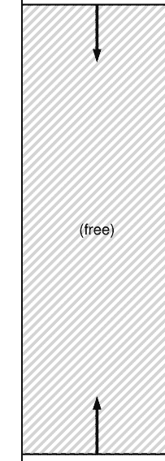

(free)

14KB

| 3000 |

| 栈 (Stack) |

15KB

16KB

图 15.1：进程及其地址空间

操作系统 [版本 1.01]

WWW.OSTEP.ORG

# 机制：地址翻译 155

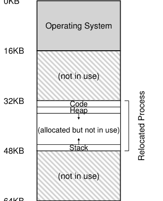

图 15.2：带有单个已重定位进程的物理内存

从程序的角度来看，其地址空间从 0 开始并增长到最大 16 KB。通过边界（bounds），地址空间大小为 16 KB；程序所有的内存引用应该在这些边界内。然而，为了虚拟化内存，操作系统会将进程放置在物理内存的某处，而不是地址 0。我们如何能够提供一个从 0 开始的地址空间，而实际上它位于某个其他物理地址？

图 15.2 显示了物理内存的一个示例，该进程已重定位到 32 KB。另外两个槽是空闲的（16 KB-32 KB 和 48 KB-64 KB）。

## 15.3 动态重定位（基于硬件）

为了形象理解基于硬件的地址翻译，我们首先讨论基址和边界方法。具体来说，我们需要两个寄存器：一个用于基址（base），另一个用于边界（limit）。基址寄存器持有进程起始的物理地址，边界寄存器持有地址空间的大小。这确保了进程无法访问边界之外的内存。由于可以在启动后移动进程，这种技术通常被称为动态重定位。

© 2008–19,DUSSEAU

三个简单部分

# 机制：地址翻译 156

### 侧记：软件重定位

在硬件支持之前的早期，重定位是一种粗糙的软件形式。例如，如果你想移动一个程序，操作系统必须找到代码中所有的内存引用并更新它们。这种方法缓慢且效率低下。更好的方法是使用翻译表，将虚拟地址映射到物理地址。这是分页和分段的基础。

基址和边界是为了确保进程生成的所有地址都是合法的。具体来说，处理器在加上基址之前会首先检查内存引用是否在边界内。在简单示例中，边界寄存器将始终设置为 16 KB。如果进程生成的地址大于边界，CPU 将抛出异常。

将虚拟地址转换为物理地址正是我们所指的地址翻译；也就是说，硬件获取一个虚拟地址并将其转换为数据实际所在的物理地址。由于这种重定位发生在运行时，我们可以移动进程。如果进程生成的地址大于边界或为负数，CPU 将抛出异常并终止进程。边界的作用是确保进程生成的所有地址都是合法的。我们应该注意，基址和边界寄存器是位于芯片上的硬件结构（每个 CPU 一一对）。随着我们开发更复杂的内存管理技术，我们将在 MMU 中添加更多电路。

# 翻译示例

为了更详细理解通过基址和边界进行地址翻译，让我们来看一个例子。假设一个地址空间大小为 4 KB（小得不切实际）的进程已加载到物理地址 16 KB。以下是多次地址翻译的结果：

# 虚拟地址与 物理地址

| 虚拟地址 | 物理地址 |
| :--- | :--- |
| 0 | 16 KB |
| 1 KB | 17 KB |
| 3000 | 19384 |
| 4400 | 异常（越界） |

如示例所示，你可以很容易地将基地址加到虚拟地址上（这可以看作是地址空间中的偏移量），从而得到相应的物理地址。只有当虚拟地址“太大”或为负时，结果才会产生异常（fault），从而触发一个异常。

## 15.4 硬件支持：总结

现在让我们总结一下我们对硬件的需求（另见第 159 页图 15.3）。首先，正如在 CPU 虚拟化章节中讨论的那样，我们需要两种不同的模式。操作系统运行在**特权模式（或内核模式）**中，它具有访问整个机器的权限；应用程序运行在**用户模式**中，它们的操作受到限制。一个标志位（可能存储在其他类型的异常或中断中）指示 CPU 当前运行在何种模式（**状态字**）；在某些特殊情况下（例如系统调用或其他类型的异常或中断），CPU 会在模式之间切换。

硬件还必须提供**基寄存器和界寄存器（base and bounds registers）**；每个 CPU 都有一个额外的内存管理单元（MMU）。当用户程序运行时，硬件会通过将用户程序的虚拟地址加上基值来翻译每个地址。硬件还必须能够检查地址是否有效，这是通过使用界寄存器和 CPU 内部的某些电路实现的。

硬件应该提供特殊指令来修改基寄存器和界寄存器，允许操作系统在运行不同进程时更改它们。这些指令是**特权**的；只有在内核（或特权）模式下才能修改这些寄存器。想象一下，如果用户在运行时更改基寄存器会造成多大的混乱¹。

> ¹除了“混乱”，还有什么是能被“造成”的吗？[W17]

旁注：数据结构 —— 空闲列表

操作系统必须跟踪未使用的空内存部分，以便为进程分配内存。此类任务可以使用许多不同的数据结构；最简单的（我们在此假设的）是**空闲列表（free list）**，它仅仅是当前未使用的物理内存列表。

# 机制：地址翻译 159

| 硬件需求 | 备注 |
| --- | --- |
| 特权模式 | 需要防止用户模式进程执行特权操作 |
| 基/界寄存器 | 每个 CPU 需要一对寄存器来支持地址翻译和越界检查 |
| 翻译虚拟地址并检查是否在界内的能力 | 用于翻译和检查限制的电路；在这种情况下非常简单 |
| 更新基/界寄存器的特权指令 | 操作系统必须在允许用户程序运行之前能够设置这些值；操作系统在发生异常时能够告知硬件运行哪段代码 |
| 注册异常处理程序的特权指令 | 当进程尝试访问特权指令或越界内存时 |
| 抛出异常的能力 | |

图 15.3：动态重定位：硬件需求


想象一下！然后迅速从脑海中清除这些阴暗的念头，因为噩梦的幽灵正被制造。最后，`CPU` 必须在用户程序尝试非法访问内存（使用“越界”的地址）的情况下产生异常；在这种情况下，`CPU` 应该停止执行用户程序并安排“越界”异常处理程序，然后操作系统就可以弄清楚如何反应，在这种情况下可能是终止进程。同样，如果用户程序尝试更改（特权的）基寄存器和界寄存器的值，`CPU` 应该抛出异常并重试“在用户模式下尝试执行特权操作”的处理程序。`CPU` 还必须提供一种方法来通知。

# 15.5 操作系统问题

正如硬件支持动态重定位一样，`CPU` 在用户程序尝试非法访问内存（使用“越界”的地址）的情况下能够产生异常；在这种情况下，`CPU` 应该停止执行用户程序并安排“越界”异常处理程序，然后操作系统就可以弄清楚如何反应，在这种情况下可能是终止进程。同样，如果用户程序尝试更改（特权的）基寄存器和界寄存器的值，`CPU` 应该抛出异常并重试“在用户模式下尝试执行特权操作”的处理程序。`CPU` 还必须提供一种方法来通知。

首先，操作系统必须跟踪未使用的空内存部分，以便为进程分配内存。此类任务可以使用许多不同的数据结构；最简单的（我们在此假设的）是`空闲列表（free list）`，它仅仅是当前未使用的物理内存列表。

由于硬件提供了动态重定位，操作系统在面临这些问题时必须处理。首先，操作系统必须跟踪未使用的空内存部分，以便为进程分配内存。此类任务可以使用许多不同的数据结构；最简单的（我们在此假设的）是`空闲列表（free list）`，它仅仅是当前未使用的物理内存列表。

操作系统必须在进程创建时将其内存放回空闲列表。由于地址空间是变的的，在变得复杂复杂。操作系统通过空闲列表列表来来处理内存空间，这是很容易的。

其次，操作系统在进程终止时必须工作（当它正常退出或被强制杀死时）。在进程终止时，操作系统将其内存放回空闲列表并清理任何必要的数据结构。

第三，操作系统在发生切换时还必须执行一些额外的步骤。每个 `CPU` 只有一对基/界寄存器，运行进程的值不同，程序在内存中以不同的物理地址加载。操作系统在切换进程时必须保存和恢复基/界对。具体来说，当操作系统停止运行一个进程时，它必须将基寄存器界寄存器的值保存到某些进程结构中（如进程控制块 `PCB`）。同样，当操作系统恢复运行一个进程时（或第一次运行时），它必须将 `CPU` 上的基和界寄存器值设置为该进程的正确值。

第四，操作系统必须提供异常处理程序（或调用的函数），如上所述；操作系统在启动时安装这些处理程序（使用特权指令）。例如，如果进程尝试访问其边界之外的内存，`CPU` 将抛出异常；操作系统必须准备好在发生此类异常时采取行动。操作系统的常见反应是敌意的；它可能会终止违规进程。

# 机制：地址翻译

| 操作系统需求 | 备注 |
| --- | --- |
| 内存管理 | 需要为新进程分配内存；通过空闲列表收回内存 |
| 基/界管理 | 在上下文切换时必须正确设置基和界 |
| 异常处理 | 发生异常时运行的代码；可能的行动是终止进程 |

图 15.4：动态重定位：操作系统职责

让我们看看例子。在图 15.2 中，你可以看到操作系统使用物理内存插槽，它将进程重定位到。空闲列表。

# 机制：地址翻译

| OS 启动时 | 硬件 | (暂无程序) |
| :--- | :--- | :--- |
| (内核模式) 初始化中断向量表 (trap table) | | |
| 记录...的地址 | | |
| 系统调用处理程序 | | |
| 定时器处理程序 | | |
| 合法内存访问处理程序 | | |
| 合法指令处理程序 | | |
| 启动中断定时器 | | |
| 启动定时器；X 毫秒后中断 | | |
| 初始化进程表 | | |
| 初始化空闲列表 (free list) | | |

图 15.5：受限直接执行（动态重定位）@ 启动

执行了它不应该执行的指令。再见，异常行为发生；很高认识你。

15.5 和 15.6（第 162 页）在时间轴上展示了硬件/操作系统的大部分内容。第一图显示了 OS 在启动时为内存准备了哪些工作，第二图显示了当一个进程（进程 A）启动时发生了什么；注意它的内存翻译是如何由硬件处理的，无需 OS 侵预。在某个时刻（第二个进程的中间），发生了定时器中断，OS 切换到进程 B，进程 B 执行了一次“非法加载”（指向一个非法内存地址）；此时，OS 必须介入，终止进程并通过释放 B 的内存和从进程表中删除其条目来完成清理。正如你从图中看到的，我们仍然遵循受限直接执行的基本方法。在大多数情况下，OS 只是恰当地地设置好硬件并让进程直接在 `CPU` 上运行；只有当进程发生异常行为时，OS 才会介入。

# 15.6 总结

在本章中，我们扩展了受限直接执行的概念，引入了虚拟内存中使用的一种特定机制，即地址翻译。通过地址翻译，OS 可以控制来自进程的每一次访问，确保访问保持在地址空间的范围内。为了提高这种技术的效率，硬件支持能够为每次访问快速地执行翻译，将虚拟地址（进程对内存的视图）转换为物理地址（实际地址）。这一切的执行方式使得进程认为已经被重定位了；进程完全不知道它的内存引用正在被翻译，这创造了一种奇妙的幻象。

我们还看到了虚拟化的一种特殊形式，称为基址与界限（base-and-bounds）和动态重定位。基址与界限虚拟化是非常高效的，只需要少量的硬件逻辑向虚拟地址加上基址寄存器，并检查进程生成的地址是否在范围内。

© 2008–19, ARPACI-DUSSEAU

三个简单部分

# 机制：地址翻译

| OS 运行时（内核模式） | 硬件 | 程序（用户模式） |
| :--- | :--- | :--- |
| 启动进程 A：在进程表中分配条目 | | |
| 为进程分配内存 | | |
| 设置基址/界限 寄存器 | | |
| 从陷阱返回 (return-from-trap)（进入 A） | | |
| 恢复 A 的寄存器 | | |
| 切换到用户模式 | | |
| 跳转到 A 的（初始）程序计数器 PC | | |
| 进程 A 运行 | 取指令 | |
| | 翻译虚拟地址 | 执行取指 |
| | 执行指令 | | |
| | 如果是显式加载/存储：确保地址合法 | 翻译虚拟地址 | |
| | | 执行加载/存储 |
| (A 运行...) | | |
| 定时器中断 | 切换到内核模式 | | |
| | 跳转到处理程序 | | |
| 处理定时器 | 决定：停止 A，运行 B | 调用 switch() 例程 |
| 将寄存器(A) 保存到 proc-struct(A)（包含基址/界限） | | |
| 从 proc-struct(B) 恢复寄存器(B)（包含基址/界限） | | |
| 从陷阱返回 (return-from-trap)（进入 B） | | |
| 恢复 B 的寄存器 | | |
| 切换到用户模式 | | |
| 跳转到 B 的 PC | | |
| 进程 B 运行 | 执行非法加载 | | |
| 加载越界： | 切换到内核模式 | | |
| | 跳转到陷阱处理程序 | | |
| 处理陷阱 | 决定杀死进程 B | | |
| 释放 B 的内存 | | |
| 释放进程表中的 B 条目 | | |

图 15.6：受限直接执行（动态重定位）@ 运行

# 机制：地址翻译

基址与界限也提供了保护；OS 和硬件共同确保没有进程可以生成其自身地址空间之外的引用。保护是 OS 最重要的目标之一；没有了它，OS 就无法控制机器（如果进程可以自由覆盖内存，它们可以轻易地做一些坏事，如覆盖陷阱表并接管系统）。

遗憾的是，这种简单的动态重定位技术确实存在效率低的问题。例如，正如你在图 15.2（第 155 页）所示，重定位后的进程使用的是从 32 KB 到 48 KB 的物理内存；然而由于进程栈并不大，两者之间的所有空间都被浪费了。这种浪费通常被称为内部碎片，因为分配单元内部的空间没有被完全使用（即被碎片化）并因此浪费了。在我们目前的方法中，虽然可能有足够的物理内存供更多进程，但我们目前受限于放置固定大小的槽，这就会产生内部碎片。因此，我们需要更复杂的机制来尝试更好地利用物理内存并避免内部碎片。我们的第一次尝试将基址和界限的微小推广，称为分段（segmentation），我们将在接下来讨论。

> 另一种解决方案是在地址空间内放置一个固定大小的栈（位于代码区域下方），并在下方下方放置一个增长的堆。然而，这限制了灵活性，使得递归和深层嵌套函数调用变得困难，因此这是我们希望避免的。

© 2008–19, ARPACI-DUSSEAU

三个简单部分

# 机制：地址翻译

# 参考文献

[M65] "On Dynamic Program Relocation" by W.C. McGee. IBM Systems Journal, Volume 4, 1968, pages 184–199.

[P90] "Relocating loader for MS-EXE" by Kenneth D. Pillay. Microprocessors & Systems, Volume 14.

[S74] "The Protection of Information in Computer Systems" by J. Seltzer and M. Schroeder. CACM, July 1974.

[S04] "System Call" by Mark Smother. 2004. people.clemson.edu/mark/syscall.html.

[WL93] "Efficient Software-based Fault Isolation" by Robert Waha, Steven Lucas, Thomas E. Anderson, Susan L. Graham. SOPAS '93.

[W17] Answer to footnote: "Is there anything other than cannot be hacked?" by Wacium Wanjoki. 2017.

# 分段 (Segmentation)

到为止，我们一直是将每个进程的整个地址空间放入内存中。通过基址（base）和界限（bounds）寄存器，操作系统可以轻松将进程移动到物理内存的不同部分。然而，你可能注意到我们的这些地址空间有一个有趣的现象：在栈（stack）和堆（heap）之间有一块巨大的“空闲”空间。

正如你从图16.1中所想象的，虽然栈和堆之间的空间没有被进程使用，但它仍然占用物理内存；因此，为了将整个地址空间移动到物理内存的某处，使用基址和界限寄存器对来可视化内存的简单方法是浪费的。当整个地址空间无法放入内存时，运行程序也会变得非常困难；因此，基址和界限的灵活性并没有我们想要的。因此：

> 核心问题：如何支持大地址空间。我们如何在栈和堆之间存在（可能）大量空闲空间的情况下支持大地址空间？请注意，在我们的示例中，由于（虚拟）地址空间非常小，这种浪费看起来并不严重。想象一下，一个 32 位地址空间（大小为 4 GB）；一个典型程序只会使用几兆字节内存，但仍然要求整个地址驻留在内存中。

## 16.1 分段：广义基址/界限

为了解决这个问题，一个想法诞生了，被称为分段。这是一个非常老的想法，可以追溯到20世纪60年代非常早期 [H61, G62]。这个想法很简单：与其在我们的MMU中只有一对基址和界限，为什么不为地址空间的每个逻辑段设置一对基址和界限呢？段是地址空间中特定长度的连续部分，在它的规范

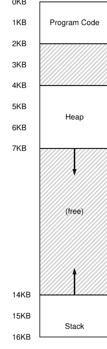

图 16.1：地址空间（再次出现）

规范

地址空间中，我们有三个逻辑上不同的段：代码、栈和堆。分段允许操作系统将这些段中的每一个放在物理内存的不同部分，从而避免用未使用的虚拟地址空间填充物理内存。

让我们来看一个例子。假设我们想将图16.1中的地址空间放入物理内存。通过为每个段使用一对基址和界限，我们可以将每个段*独立地*放置在物理内存中。例如，参见图16.2（第169页）；在那里你可以看到一个64KB的物理内存，其中有三个段（并留了16KB给操作系统）。

# 分段 (SEGMENTATION)

169

| | 操作系统（未使用） | （未使用） |
|---|---|---|
| 16KB | （未使用） | |
| 32KB | 栈（未使用） | 代码 / 堆 |
| 48KB | （未使用） | |
0 图 16.2：将段放置在物理内存中

如你在图中所示，只有被使用的内存会在物理内存中分配空间，因此可以容纳具有大量未闲地址空间（我们有时称之为稀疏地址空间）的大地址空间。

支持分段所需的MMU硬件结构正如你预期的那样：在这种情况下，是一组三个基址和界限寄存器对。下面的图16.3显示了上述示例的寄存器值；每个界限寄存器持有一个段的大小。

| 段 (Segment) | 基址 (Base) | 大小 (Size) |
|---|---|---|
| 代码 (Code) | 32K | 2K |
| 堆 (Heap) | 34K | 3K |
| 栈 (Stack) | 28K | 2K |

图 16.3：段寄存器值

你可以从图中看到，段被放置在物理地址32KB处，大小为2KB；堆段放置在34KB处，大小为3KB。这里的尺寸字段与之前的界限寄存器完全相同；它精确地告诉硬件该段中有多少字节是有效的（从而使硬件能够判断程序何时对这些界限之外的内容进行了非法访问）。

让我们使用图16.1中的地址空间进行一个转换示例。假设引用了虚拟地址100（如你在图16.1第168页中直观上看到的，它在代码段中）。当引用发生时（例如，在取指指令时），硬件将基址值加上该段中的*偏移量*（在本例中为100），以得到所需的物理地址：`100 + 32KB`，或3268。然后它会检查该地址是否在界限内（100小于2KB），发现确实在，并发送到物理内存地址3268。

# 旁注：段错误 (THE SEGMENTATION FAULT)

170

**段错误**（segmentation fault）或违例（violation）源于分段机器上对非法地址的内存访问。幽默的是，这个术语在完全不支持分段的机器上依然存在。或者没那么幽默，如果你无法理解为什么你的代码一直失败的话。

现在让我们看堆中的一个地址，虚拟地址4200（再次参考图16.1）。如果我们直接将虚拟的4200加上堆的基址（34KB），我们得到一个物理地址39016，但这*不是*正确的物理地址。我们需要做什么来从堆中提取出*偏移量*，即指的是该段中的哪一个字节？因为堆起始于虚拟地址4KB（4096），4200的偏移量实际上是104（4200-104）。然后我们取这个偏移量（104）并加上基址寄存器地址（34K），得到所需的结果：34920。

如果我们尝试引用一个非法地址（即大于7KB的虚拟地址），它超出了堆的末尾怎么办？你可以想象会发生什么：硬件检测到地址超出界限，陷阱（trap）进入操作系统，导致违规进程的终止。现在你知道这个所有程序员都学习梦过的著名术语的起源了：**段违例**（segmentation violation）或**段错误**（segmentation fault）。

## 16.2 我们指的是哪一个段？

硬件在转换期间使用段寄存器。它是如何知道段内的偏移量，以及指的是哪一个段地址的？

一种常用的方法（有时被称为*显式*（explicit）方法）是根据虚拟地址的高位将地址切成段；这种技术曾用于VAX/VMS系统 [LL82]。在我们的示例中，我们有三个段；因此我们需要两个位来完成任务。如果我们使用14位虚拟地址的高两个位来选择段，虚拟地址看起来如下：

| 13 | 12 | 11 | 10 | 9 | 8 | 7 | 6 | 5 | 4 | 3 | 2 | 1 | 0 |
|---|---|---|---|---|---|---|---|---|---|---|---|---|---|
| 段 (Segment) | | | | | | | | | | | | 偏移量 (Offset) |

在我们的示例中，如果高两个位是00，硬件知道虚拟地址在代码段，因此我们使用代码基址和界限来移动地址。如果两个位是01，硬件知道地址在堆中，因此使用堆的基址和界限。

208 分段 (SEGMENTATION)

171

如你在图中所示，只有被使用的内存会在物理内存中分配空间，因此可以容纳具有大量未使用地址空间（我们有时称之为稀疏地址空间）的大地址空间。

支持分段所需的MMU硬件结构正如你预期的那样的：在这种情况下，是一组三个基址和界限寄存器对。下面的图16.3显示了上述示例的寄存器值；每个界限寄存器持有一个段的大小。

在我们的示例中，如果高两个位是00，硬件知道虚拟地址在代码段，因此我们使用代码基址和界限来移动地址。如果两个位是01，硬件知道地址在堆中，因此使用堆的基址和界限。

让我们取我们的示例4200，以二进制形式查看，如下：

```
13 | 12 | 11 | 10 | 9 | 8 | 7 | 6 | 5 | 4 | 3 | 2 | 1 | 0 |
|---|---|---|---|---|---|---|---|---|---|---|---|---|
0 | 0 | 1 | 0 | 0 | 0 | 1 | 0 | 0 | 0 | 0 | 0 | 0 |
      段                                偏移量
```

4200的偏移量实际上是104（4200-104）。然后我们取这个偏移量（104）并加上基址寄存器地址（34K），得到所需的结果：34920。

如你在图中所示，只有被使用的内存会在物理内存中分配空间，因此可以容纳具有大量未使用地址空间（我们有时称之为稀疏地址空间）的大地址空间。

使用固定多个位来选择段的另一个问题是，它限制了虚拟地址空间的使用。具体来说，每个段都被限制在一个最大范围内，在我们的示例中为4KB（使用两个位选择段意味着16KB的地址空间被切分成碎片，在本示例中为4KB）。如果运行中的程序想要扩大某个段（堆或栈）超过这个最大值，该程序就没办法了。

硬件还有其他方法来确定特定地址属于哪个段。在隐式方法中，硬件定

## 分段的共享

## 16.4 支持共享


随着对分段支持的增长，系统设计人员很快意识到，通过增加硬件支持，可以实现新类型的效率。具体来说，为了节省内存，有时在地址空间之间共享某些内存段是有帮助的。特别是代码共享非常常见，并且在当今的系统中仍然在使用。

为了支持共享，我们需要硬件提供一些额外的支持，形式为保护位。基本支持为每个段添加几个位，用于标识程序是否可以读取或写入某个段，或者是否可以执行该段内的代码。通过将代码段设置为只读，相同的代码可以在多个进程之间共享，而不必担心会造成损害；每个进程仍然认为它正在访问无法被他人修改的私有内存，这种幻觉得以保留。

硬件（和操作系统）跟踪的额外信息示例如图 16.5 所示。如你所见，代码段被设置为可读和可执行，因此内存中的物理段可以映射到多个虚拟地址空间中。

| 段 | 大小（最大 4K） | 是否向正向增长？ | 保护 |
| --- | --- | --- | --- |
| Code00 | 32K | 1 | 可读可执行 |
| Heap01 | 34K | 1 | 可读可写 |
| Stack11 | 2K | 0 | 可读可写 |

图 16.5：段寄存器值（带保护）

有了保护机制，之前描述的硬件算法也必须发生变化。除了检查虚拟地址是否在边界内，硬件还必须检查特定的访问是否允许。如果用户进程尝试写入只读段，或从不可执行段中执行代码，硬件应该抛出异常，从而让操作系统处理违规进程。

## 16.5 细粒度分段 vs. 粗粒度分段

我们的大部分示例都侧重于只有几个段的系统（即代码、栈、堆）；我们可以将这种分段看作是粗粒度的，因为它将地址空间切分成相对较大的块。然而，一些早期系统（例如 Multics [CV65, DD68]）更加灵活，允许地址空间由大量较小的段组成，这被称为细粒度分段。

支持许多段需要进一步的硬件支持，即在内存中维护一个段表。此类段表通常支持创建极大量的段，从而使系统能够以我们目前为止讨论过的更灵活的方式使用段。例如，早期机器如 Burroughs B5000 支持成千上万个参数，并期望编译器将代码和数据切分成独立的段，然后由操作系统和硬件来支持这些段 [RK68]。

| 未紧凑 | 已紧凑 |
| --- | --- |
| 0KB | 0KB |
| 8KB | 操作系统 | 操作系统 |
| 16KB | (未使用) | 16KB |
| 24KB | 已分配 | 24KB |
| 32KB | (未使用) | 已分配 |
| 40KB | 40KB |
| 48KB | (未使用) | 48KB |
| 56KB | 56KB |
| 64KB | 已分配 | 64KB |

图 16.6：未紧凑和已紧凑的内存

当时的思想是，通过使用细粒度段，操作系统可以更好地了解哪些段正在被使用，从而更有效地利用主内存。

## 16.6 操作系统的支持

你现在应该对分段是如何工作的有一个基本的概念了。地址空间的一部分随着系统的运行被定位到物理内存中，因此与我们之前对整个地址空间使用单一基址/边界对的简单方法相比，实现了物理内存的巨大节省。具体来说，栈和堆之间所有未使用的空间都不分配在物理内存中，允许我们将更多的地址空间放入物理内存中，并支持每个进程拥有大型稀疏虚拟地址空间。

然而，分段给操作系统带来了许多问题。第一个是一个老问题：在上下文切换时操作系统应该做什么？你现在应该已经有一个大概的猜测了：必须保存和恢复段寄存器。显然，每个进程都有自己的虚拟地址空间。

# 分段

177

# 参考文献

[CV65] "Introduction and Overview of the Multics System" 由 F. J. Corbalo, A. V. Vyssotsky. Fall Joint Computer Conference, 1968. 这是秋季联合计算机会议上关于 Multics 的五篇介绍论文之一；噢，真希望那时我是那房间里的一只苍蝇！

[DD68] "Virtual Memory, Processes, and Sharing in Multics" 由 Robert C. Daley 和 Jack B. Dennis 发表于 Communications of the ACM, Volume 11:5, May 1968. 一篇关于如何在 Multics 中实现动态链接的早期论文，其过程就像时间流动一样简单。随着共享库需求的出现，动态链接在约 20 年前进入系统。书中提到，这些早期的库是 Unix 早期用于动态链接的 retrieve 工具！

[Fac62] "Segment" 由 M. N. Greenfield. Proceedings of the SJCC, Volume 21, 1962. 另一篇关于分段的早期论文；早到它没有引用任何其他文献。

[Hol61] "Program Organization and Record Keeping for Dynamic Storage" 由 A. W. Holt. 发表于 Communications of the ACM, Volume 4:10. 一篇关于分段及其历史背景的令人惊讶且易于阅读的早期论文。

[In64] "86 and IA-32 Architecture Software Developer's Manual" Intel. 2009. 获取地址：http://www.intel.com/products/processors/manuals. 每一章都读到了分段（第3章标题：会让你头疼），像美酒一样需要细品。

[Ke68] "The Art of Computer Programming: Volume I" 由 Donald Knuth. Addison-Wesley, 1968. Knuth 不仅因其早期关于计算机程序艺术的书闻名，还因他在 1983 年 10 月引入的排版系统而闻名。这是关于构建系统的真正参考文献。输入这本书很难。他的著作一直是今天许多计算系统底层算法的极佳早期参考。

[LL83] "Hints for Computer Systems Design" 由 Butler Lamps 发表于 ACM Operating Systems Review，这是一份关于如何构建系统的卓越建议集。坐着很难读完，要像美酒或参考手册一样一次读一点。

[LV82] "Virtual Memory in the VAX/VMS Operating System" 由 Henry M. Levy, P. H. Lipman. 发表于 IEEE Computer, Volume 15:3; March 1982. 一个经典的内存管理系统，设计非常有理。我们将在稍后的章节中详细研究。

[RK68] "Dynamic Storage Allocation Systems" 由 B. Randell 和 J.C. Kuehner. 发表于 Communications of the ACM, Volume 11:5; May 1968. 对分页系统与其他系统之间差异的良好概述，并带有历史背景——

[R69] "A note on storage fragmentation and program segmentation" 由 Brian Randell. 发表于 Communications of the ACM, Volume 12:7; July 1969. 讨论碎片化的早期论文之一——

[W95] "Dynamic Storage Allocation: A Survey and Critical Review" 由 Paul R. Wilson, Mark S. Johnstone, Michael Neel, David Boles. International Workshop on Memory Management, Scotland, UK, September 1995. 一篇关于内存分配器的极佳综述论文。

© 2008-19, ARTIQUES-DUSEAU

三个简单部分

# 作业（模拟）

此程序允许你看到在分段的系统中是如何执行地址翻译的。详情请参见 README。

# 问题

- 1. 首先，让我们用一个微小的地址空间来翻译一些地址。这里有一组带有几个随机种子的简单参数；你能翻译出这些地址吗？

```
segmentation.py -a 128 -p 512 -b 0 -1 20 -B 512 -L 20 -s 0
segmentation.py -a 128 -p 512 -b 0 -1 20 -B 512 -L 20 -s 1
segmentation.py -a 128 -p 512 -b 0 -1 20 -B 512 -L 20 -s 2
```

- 2. 现在，让我们看看我们构建的这个微小地址空间（使用上述参数）。最高虚拟地址是多少？最低的非法地址又是哪里？最后，你如何使用 `-A` 标志运行 `segmentation.py` 来测试你是否正确？

- 3. 假设我们有 16 字节物理内存。为了让模拟器为指定的地址生成以下翻译结果：valid, valid, ..., violation, valid，你会设置什么样的基（base）和界（bounds）？假设参数如下：

```
segmentation.py -a 16 -p 128 -A 0,1,2,3,4,5,6,7,8,9,10,11,12,13,14,15 -b ? -s ?
```

- 4. 假设我们想生成一个大约 90% 虚拟地址都是有效的（非违规）的问题。你应该如何配置模拟器来实现这一点？哪些参数是重要的？

- 5. 你能运行模拟器使得没有虚拟地址是有效的吗？怎么做？

空闲空间管理

在本章中，我们将离开对内存虚拟化的讨论，去讨论任何内存管理系统的基本方面，无论是库（管理进程的堆）还是操作系统本身（管理地址空间部分）。具体而言，我们将讨论空闲空间管理。

管理空闲空间可以很简单，正如我们在讨论分页时将看到的那样。当你管理的空间被分为固定大小的单元时是很简单的；在这种情况下，你只需保留这些固定大小单元的列表；当客户端请求其中一个时，返回第一个条目即可。

空闲空间管理变得更加困难（且有趣）的情况是你管理的空闲空间由可变大小的单元组成；这出现在用户级内存分配库（如 `malloc()` 和 `free()`）以及管理物理内存的操作系统中。在任何情况下，存在的问题被称为外部碎片：空闲空间被切分成不同大小的碎片并因此碎片化；随后的请求可能会失败，因为没有单一的连续空间可以满足请求，即使空闲空间总量超过了请求的大小。


该图展示了这个问题的例子。在这种情况下，可用的空闲空间为 20 字节；不幸的是，它被碎片化两个 10 字节的块。因此，15 字节的请求将失败。由此我们引出了本章讨论的问题。

# 核心：如何管理空闲空间

在满足可变大小请求时，应该如何管理空闲空间？可以使用哪些策略来减少碎片？其他方法的时间空间开销是什么？

## 17.1 假设

大部分讨论将集中在用户级分配器的历史。我们参考了 Wilson 的优秀综述 [W95]，但鼓励感兴趣的读者查阅原文获取详情：

我们假设有一个类似于 `malloc()` 和 `free()` 提供的基础接口。具体来说，`void malloc(size_t size)` 接收一个参数，即应用程序请求的字节数；它返回一个指向该大小区域的指针（无特定类型，在 C 语言中为空指针）。相应的程序 `free(void *ptr)` 接收指针并释放相应的块。注意这对用户的意义：在释放空间时，并不通知库其大小；库必须在仅收到指针时就能推断出内存块有多大。我们将在本章稍后部分讨论这样做。

该库管理的空间在历史上被称为堆（*heap*），而管理堆中空闲空间的通用数据结构是某种空闲列表（*free list*）。该结构包含受管理区域内所有块的引用。当然，这个数据结构本质上不需要列表，而是某种跟踪空闲空间的数据结构。

我们进一步假设我们关注的是**外部碎片**（external fragmentation），它与**内部碎片**（internal fragmentation）不同；如果分配器分出的内存块大于请求的，则此类块中任何多余（即未使用的）空间都被视为内部碎片（因为浪费发生在分配单元内部），它是空间浪费的另一个例子。为了简单起见，并由于两种碎片类型中外部更有趣，我们将主要关注外部碎片。

我们还假设一旦内存交付给客户端，就无法移动到内存中的另一个位置。例如，如果程序调用 `malloc()` 并获得一个指向堆内空间的指针，那么在程序通过相应的 `free()` 调用返回它之前，该内存区域实际上归程序“所有”（库无法移动它）。因此，空闲空间的压缩是不可能的，这

# 空闲空间管理

这对于对抗碎片²非常有用。然而，在实现分段（segmentation）时，操作系统可以使用压缩来处理碎片（如在分段章节中讨论的）。

最后，我们假设分配器管理一个连续的字节区域。在某些情况下，分配器可能会要求扩大该区域；例如，用户级内存分配库在空间耗尽时可能会通过系统调用（如 `sbrk`）调用内核。但是，为了简单起见，我们假设该区域在整个生命周期内都是固定大小。

## 17.2 底层机制

在深入某些策略细节之前，我们将介绍大多数分配器使用的某些机制。首先，我们将讨论分割（splitting）和合并（coalescing）的基础知识，这是任何分配器的常用技术。其次，我们将展示如何快速且方便地跟踪已分配区域的大小。最后，我们将讨论如何在空闲空间内部构建一个简单的列表，以跟踪哪些是空闲的，哪些不是。

# 分割与合并

空闲列表包含一组描述堆中剩余空闲空间的元素。因此，假设有如下 30 字节的堆：

| 空闲 | 使用 | 空闲 |
|---|---|---|
| | 10 | 20 |
|30 |

该堆的空闲列表将有两个条目。其中一个条目描述第一个 10 字节的空闲段（字节 0-9），另一个条目描述另一个空闲段（字节 20-29）：

```
head addr:0 len:10 -> addr:20 len:10 -> NULL
```

如上所述，任何大于 10 字节的请求可能会失败（返回 `NULL`）；因为没有可用的等大小连续内存块。恰好为该大小（10 字节）的请求可以由任何一个空闲块满足。但如果请求小于 10 字节会发生什么？

假设有一个 1 字节内存的请求。在这种情况下，分配器将执行分割操作：它将找到

> ² 一旦你向 C 程序提供了一个内存块的指针，通常很难确定指向该区域的所有引用（指针），这些引用可能存储在执行期间某一点的其他变量中，甚至是寄存器中。在类型更强、具有垃圾回收机制的语言中情况可能不同，这使得压缩可以成为一种对抗碎片化的技术。

© 2008–19, ARPACI-DUSSEAU

THREE EASY PIECES

WWW.OSTEP.ORG

# 空闲空间管理

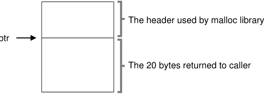

图 17.1：已分配区域加头部

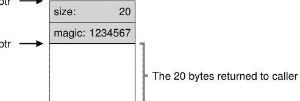

图 17.2：头部的具体内容

# 跟踪已分配区域的大小

你可能已经注意到 `free(void *ptr)` 接口没有接受大小参数；因此假设在给出一个指针时，`malloc` 库可以快速确定被释放内存区域的大小，从而将该空间合并回空闲列表。

为了完成这项任务，分配器在内存中的一个头部块中存储少量信息，通常紧邻分配出的内存块之前。让我们再次查看（图 17.1）。在这个示例中，我们正在检查一个由 `ptr` 指向的 20 字节已分配块；假设调用的 `malloc()` 将结果存储在 `ptr` 中：`ptr = malloc(20);`

头部至少包含该区域的大小（在此例中为 20）；它还可能包含额外的字段以加速释放、提供额外完整性检查的魔数（magic number）以及其他信息。假设有一个包含区域大小和魔数的简单头部，如下所示：

```
typedef struct {
  int size;
  int magic;
} header_t;
```

© 2008–19, ARPACI-DUSSEAU

THREE EASY PIECES

上面的示例看起来就像图 17.2 所示。当用户调用 `free(ptr)` 时，库随后使用简单的指针算术来确定头部开始的位置：

```
void free(void *ptr) {header_t *hptr = (header_t *) ptr - 1;
```

在获取头部指针后，库可以很容易地判断空闲魔数的大小是否匹配预期检查值（`assert(hptr->magic == 1234567)`），并通过简单的数学运算（即将头部的大小加上区域的大小）来计算新释放区域的总大小。最后一句话中有一个微小但关键的细节：空闲区域的大小是头部加上分配给用户空间的大小。因此，当用户请求 $N$ 字节内存时，库并不寻找大小为 $N$ 的空闲块；而是寻找大小为 $N$ 加上头部大小的空闲块。

# 嵌入空闲列表

因此，我们将空闲列表视为一个概念性实体；它只是描述堆中的空闲内存块。但我们如何在空闲空间内部构建一个列表呢？

在更典型的列表中，当分配新节点时，当你需要为节点分配空间只需调用 `malloc()`。遗憾的是，在内存分配库内部，你不能这样做！相反，你需要在空闲空间内部构建。

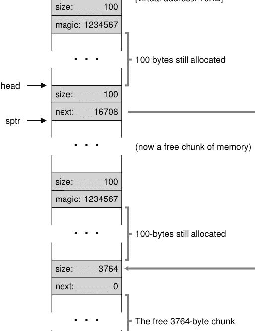

图 17.6：分配了两个块的空闲空间

三次分割后的剩余字节。但当调用程序通过 `free()` 返回某些内存时会发生什么呢？

在这个示例中，应用程序通过调用 `free(16500)` 返回分配内存的中间块（值 16500 是通过将内存区域起始地址 16384 加上上一个块的 108 字节以及当前块的 8 字节得到的）。该值在之前的图图中由指针 `ptr` 显示。

库立即确定了空闲区域的大小，然后将该空闲块加回空闲列表（free list）。假设我们在空闲列表的头部插入，现在的空间看起来如下所示（图 17.66）。

## 空闲空间管理

[虚拟地址: 16KB]

| 大小: | 100 |
| 下一个: | 16492 |
(现在空闲)

| 大小: | 100 |
| 下一个: | 16708 |
(现在空闲)

| 大小: | 100 |
| 下一个: | 16384 |
(现在空闲)


| 大小: | 3764 |

| 下一个: | 0 |

(该 3764 字节空闲块)

图 17.7：非合并的空闲列表

现在我们有一个列表，以一个小的空闲块（100 字节，由列表头部指向）和一个大的空闲块（3764 字节）开头。我们的列表包含多个元素！而且，空闲空间被碎片化了，这是一种不幸的情况。举个例子：假设现在最后两个正在使用的块被释放了。如果不进行合并（`coalescing`），我们就会导致碎片化（图 17.7）。正如从图中看到的，我们面对的是一团糟！为什么？简单，是因为我们忘记合并列表了。

既然我们已经掌握了这些机制，让我们来回顾一些管理空闲空间的策略。这些方法大多基于你可能想出的策略；理想的分配器既是快速又能最大限度地减少碎片。遗憾的是，分配和释放请求的流可能是任意的（毕竟，它们是由程序员决定的）。因此，我们不再描述分配库中最后一种机制。具体来说，如果堆空间耗尽了该怎么办？最简单的方法就是失败。在某些情况下，这是唯一的选择，返回 `NULL` 是一种诚实的方法，尽管你失败了。

大多数传统的分配器从较小的堆开始，并在内存耗尽时向操作系统（OS）请求内存。通常，这会产生某种类似 `sbrk` 的系统调用来扩展堆。为了处理 `sbrk` 请求，操作系统会寻找空闲页，将它们映射到地址空间，并返回新堆末尾的值；此时，一个更大的堆可用了，请求可以得到处理。

## 17.3 基本策略

### 最佳拟合 (Best Fit)

最佳拟合策略非常简单：首先遍历空闲列表，找到大于或等于请求大小的空闲内存块，然后返回组中最小的一个；这被称为最佳拟合块（也可以称为最小拟合块）。最佳拟合背后的直觉非常简单：通过返回一个接近用户请求的块，最佳拟合试图减少空间浪费。然而，朴实的实现在执行详尽式搜索时会付出沉重的代价。

### 最坏拟合 (Worst Fit)

最坏拟合方法与最佳拟合相反：找到最大的块并返回请求的数量；将剩余（大的）块留在空闲列表中。最坏拟合试图留下大块，而不是最佳拟合方法可能产生的小块。再次，它的表现很糟糕。

### 首次拟合 (First Fit)

首次拟合方法简单地找到第一个足够大的块，并将请求的数量返回给用户。和一样，剩余的空闲空间被留给后续请求。首次拟合的优势是速度——不需要对所有空闲空间进行详尽搜索——但有时会在头部充满小对象。因此，分配器如何管理空闲列表的顺序成了一个问题。一种方法是使用基于地址的排序；通过按空闲空间的地址保持列表排序，合并变得更容易，碎片往往倾向于减少。

### 下次拟合 (Next Fit)

下次拟合算法不是总是从列表开始开始首次拟合搜索，而是保留一个额外的指针指向列表中上一次所在的位置。这个想法是让空闲空间的搜索在整个列表中更均匀地分布，从而避免列表开部的碎片。这种方法的性能与首次拟合非常相似，因为再次避免了详尽搜索。

### 示例

这里是上述策略的几个示例。想象一个包含三个元素的空闲列表，大小分别为 10、30 和 20（我们在这里忽略头部和其他细节，仅考虑大小）：

`head -> 10 -> 30 -> 20`

假设一个大小为 15 的分配请求。最佳拟合方法搜索列表并发现 20 是最好的，因为它是满足请求的最小块。结果列表为：

`head -> 10 -> 30 -> NULL`

正如本例所示，最坏拟合方法搜索列表并发现 30 是最好的，结果留下了一个较小的空闲块。结果列表为：

`head -> 15 -> 20 -> NULL`

## 空闲空间管理

首次拟合策略在本例中与最坏拟合的做法相同，即找到满足请求的空闲块。区别在于搜索成本；最佳拟合和最坏拟合都会遍历整个列表；而首次拟合只需检查块直到找到合适的，从而减少了搜索成本。

这些示例仅触及分配策略的表面。要深入理解，需要对真实工作负载和更复杂的分配器行为（例如合并）进行更详细的分析。

## 17.4 其他方法

除了上述的各种方法外，还有许多建议的技术和算法以某种方式改进内存分配。我们在这里列出了其中几个供你参考（即，让你比简单的最佳拟合多了解一点）。

### 分类列表 (Segregated Lists)

存在一段时间的一种有趣方法是使用分类列表。基本思想非常简单：如果特定应用程序有（几种）常见的尺寸请求，则为该大小的对象维护一个单独的列表；所有请求都转发给更通用的内存分配器。

这种方法的优点是显而易见的。通过为特定大小的请求专用内存，碎片化不再那么令人担心；而且当大小正确时，分配和释放请求可以非常快速，因为不需要对列表进行复杂的搜索。

任何好想法都会为系统引入新的复杂性。例如，应该分配多少内存给特定大小请求的内存池，而不是通用池？一种分配器，由工程师 Jeff Bonwick 设计的内存分配器（`slab allocator`，它是为 Solaris 内核设计的），以一种非常好的方式处理这个问题。

具体来说，当内核启动时，它为可能频繁请求的内核缓存分配数量的对象（如锁、文件系统节点等）；因此，对象缓存按大小分类，可以快速处理分配和释放请求。当缓存空空间不足时，它从更通用的分配器请求内存页（请求的总量是页大小和相关对象的的倍数）。相反，当给定页内对象的引用计数都变为零时，通用分配器可以从专门分配器中收回它们，这通常在虚拟机系统需要更多内存时进行。

旁注：伟大的工程师确实非常了不起

像 Jeff Bonwick 这样的工程师（他不仅编写了本文提到的 `slab` 分配器，还是惊人的文件系统 `ZFS` 的首席负责人）是硅谷的核心。在几乎任何伟大的产品或技术背后，都有一个（或一小群）他们，才华、能力和奉献精神其实非常平庸。马克·扎克伯格（Facebook 创始人）曾说：“在岗位上表现卓越的人，不仅仅是比表现优秀的人好一点点。他们要强出 100 倍。”这就是为什么直到今天，两个人也可以创立一家改变世界格局的公司（想想 Google、Apple 或 Facebook）。努力工作，你可能也会成为那样 100% 的优秀人才。即使失败了，你一天学到的东西也比大多数人一年的多。`slab` 分配器还通过将空对象保持在预初始化状态，超越了分离方法。Bonwick 表明，数据结构的初始化和销毁是昂昂的；通过将空对象保持在特定的列表中，`slab` 分配器避免了每个对象频繁的初始化和销毁周期，从而降低了开销。

## 伙伴分配 (Buddy Allocation)

由于合并（`coalescing`）对于分配器至关重要，某些方法的设计是围绕使合并简单化的。一个示例是在二进制分配器 [K65] 中。在这样的系统中，空闲内存概念上被认为是一个为 $2^n$ 的大空间。当提出内存请求时，对空闲空间的搜索会递归划分空间，直到找到足够容纳请求的块（进一步拆分将导致空间过小）。此时，请求的块被返回给用户。这里是系统中为 8KB 块划分空闲空间的示例（图 17.8）。在示例中，最左侧的 8KB 块被分配（用较深的灰色表示）并返回给用户；注意，这种方案可能会受到碎片化的影响，但我们允许分配 2 的幂大小的块。伙伴分配的妙之处在于块释放时发生的情况。当将 8KB 块返回空闲列表时，分配器会检查 8KB 的“伙伴”是否空闲；如果是，它会将这两个块合并成一个 16KB 的块。分配器随后检查 16KB 块的伙伴是否仍然空闲；如果是，它将合并这两个块。这种递归合并过程一直持续，直到树恢复了整个空闲空间，或者在发现伙伴被占用时停止。


图 17.8: 伙伴管理堆示例

伙伴分配之所以工作得很好，是因为确定特定块的伙伴非常简单。你问怎么做？想想上面块的地址。如果你想得足够仔细，你会发现每个伙伴的地址仅差一个位；该比特位由伙伴树中的级别决定。因此，你对伙伴分配方案的工作原理有了一个基本的概念。关于更多细节，请像往常一样，参阅 Wilson [W95]。

## 其他想法

上述方法的一个主要问题是它们缺乏可扩展性。具体来说，搜索列表可能非常慢。因此，高级分配器使用更复杂的数据结构来解决这些成本，用简单性换取性能。示例包括平衡二叉树、AVL 树或部分有序树 [W95]。

鉴于现代系统通常有多个处理器并运行多线程工作负载（你将在“并发”章节中详细学习这一点），并不意外人们投入了大量精力使分配器在多处理器系统上良好运行。两个极好的例子可以在 Berger 等人 [B00] 和 Evans [E06] 中找到；查看它们以获取细节。

这些人们随着时间推移对内存分配器提出的数千想法中的两个；如果你感兴趣，可以自行阅读。阅读 glibc 分配器是如何工作的 [S15]，让你对真实世界的情况有一个直观感受。

## 17.5 总结

在本章中，我们讨论了内存分配器的原始形式。此类分配器无处不在，连接到你编写的每一个 C 程序中，也存在于管理自身数据结构的底层操作系统中。对于许多系统来说，构建这样的系统需要进行许多权衡，你对分配器面临的精确工作负载越了解，越能对其进行调优以使其在该工作负载运行得更好。构建一个适用于广泛工作负载的快速、空间高效且可扩展的分配器，仍然是现代计算机系统中面临的持续挑战。

# 参考文献

[B00] "Hoard: A Scalable Memory Allocator for Multithreaded Applications" by Emery D. Berger, Kathryn S. McKinley, Robert D. Blumofe, Paul R. Wilson. ASPLOS IX, November 2000. Berger 等公司为多处理器系统设计的优秀分配器。不仅是一篇有趣的论文，在实践中也得到了使用！

[U94] "The Slab Allocator: An Object-Caching Kernel Memory Allocator" by Jeff Bonwick. USENIX. 94. 一关于如何为操作系统内核构建分配器的免费论文，以及如何针对特定对象大小进行特化的绝佳。

[E06] "A Concurrent Malloc: Implementation for FreeBSD" by Jason Evans, April, 2006. http://freebsd.org/jemalloc/jemalloc.pdf. 详细介绍了如何为多处理器构建现代分配器。它现在被广泛应用，如 FreeBSD、NetBSD、Mozilla Firefox 以及 Facebook 内部。

[K65] "A Fast Storage Allocator" by Knowton. Communications of the ACM, Volume 8, October 1965.

[S15] "Understanding glibc malloc" by sploftun. wordpress.com/2015/understanding-glibc-malloc/.

[W95] "Dynamic Allocation: A Survey and Critical Review" by Paul R. Wilson, Mark S. Johnston, Michael Neely. International Workshop on Memory Management, Scotland, UK, September 1995.

# 分页：引言

人们常说，操作系统在解决几乎任何空间管理问题时采用两种方法之一。第一种方法是将事物切割成大小不等的片段，正如我们在虚拟内存分段中看到的那样。遗憾的是，这种解决方案具有固有的困难。特别是当将空间划分为不同大小块时，空间本身可能会变得碎片，从而导致分配随着时间的推移变得越来越具有挑战性。

因此，考虑第二种方法可能是值得的：将空间切割成固定大小的虚拟。在虚拟内存早期早期早期早期系统——Atlas [KE+62, L78]。我们没有将进程的地址空间分成若干个大小不等的逻辑段（例如：代码、堆、栈），而是将其分成固定大小的单元，我们称每个单元为页（`page`）。相应地，我们将物理内存视为一个固定大小槽的数组，称为页帧（`page frame`）；每个页帧可以包含一个虚拟内存页。我们的挑战是：

> 核心问题：
>
> 如何用分页实现内存虚拟化
>
> 我们能否通过分页来实现内存虚拟化，以避免分段的问题？基本技术是什么？我们如何以最小的空间和时间开销使这些技术发挥作用？

## 18.1 简单示例与概述

为了使这种方法更加清晰，让我们用一个简单的示例来说说明。图 18.1（第198页）展示了一个微型地址空间的示例，总共仅 64 字节，包含四个 16 字节的页（虚拟页 0、1、2 和 3）。真实的地址空间大得多，通常为 32 位和 4-GB 地址空间，甚至是 64 位；在书中，我们将使用微型示例使它们更于理解。

> ^1 64 位地址空间难以想象，它大得令人惊叹。一个类比很有帮助：如果你把 32 位地址空间想象成网球场的大小，那么 64 位地址空间大约是欧洲的大小（！）

# 分页：引言

| | |

|---|---|

| 0 | (地址空间的第 0 页) |

| 16 | (第 1 页) |

| 32 | (第 2 页) |

| 48 | (第 3 页) |

| 64 | |

图 18.1：一个 64 字节的简单地址空间

物理内存如图 18.2 所示，也由许多固定大小的槽组成，这里有八个页帧（构成 128 字节的物理内存，或者小得离谱）。你可以看到，虚拟地址空间的页被放置在物理内存的不同位置：图表还显示操作系统也为自己使用部分物理内存。

正如我们所见，分页与我们之前的方法相比具有简洁的优点。最重要的改进将是灵活性：通过一个完善的分页方法，系统将能够有效地支持地址空间的抽象，无论进程如何使用该地址空间；例如，我们不会对堆和栈的增长方向及其使用方式做出假设。

| | | |

|---|---|---|

| | 操作系统预留 | 物理内存的第 0 页帧 |

| 16 | (未使用) | 页帧 1 |

| 32 | AS 的第 3 页 | 页帧 2 |

| 48 | AS 的第 0 页 | 页帧 3 |

| 64 | (未使用) | 页帧 4 |

| 80 | AS 的第 2 页 | 页帧 5 |

| 96 | (未使用) | 页帧 6 |

| 112 | AS 的第 1 页 | 页帧 7 |

| 128 | | |

图 18.2：128 字节物理内存中的 64 字节地址空间

另一个优点是分页涉及的空闲空间管理的简单性。例如，当操作系统希望将我们的微型 64 字节地址空间放入八页物理内存中时，它找到了四个空闲页；也许操作系统为此维护一个所有空闲页的空闲列表，并只需从中取出前四个页。在示例中，操作系统将地址空间（AS）的虚拟页 0 放在物理帧 3 中，AS 的虚拟页 1 放在物理帧 7 中，页 2 放在帧 5，页 3 放在帧 2。页帧 1、44 和 6 目前是空闲的。

为了记录地址空间的虚拟地址放置在物理内存中的位置，操作系统通常会维护一个每个进程的数据结构，称为页表（`page table`）。页表的主要作用是存储地址空间每个虚拟页的地址转换，从而让我们知道每个地址位于物理内存的何处。对于示例图 5.2（第198页），页表将具有以下条目（页 0 → 物理帧 3），（VPN 1 → PF 7），（VPN 2 → PF 5），以及（VPN 3 → PF 2）。

记住，这个页表是每个进程一个结构（我们讨论的大多数页表都是进程结构；反转页表除外）。如果我们的示例运行另一个进程，操作系统必须为它管理一个不同的页表，因为它的虚拟页显然映射到不同的物理页（不考虑任何共享情况）。

现在，我们知道如何执行地址翻译示例了。让我们想象这个具有微型地址空间（64 字节）的进程正在进行内存访问：

```
mov <virtual_address>, %eax
```

具体来说，让我们关注从地址 `<virtual address>` 到寄存器 `eax` 的显式数据加载（因此忽略之前可能发生的指令取指）。

为了翻译进程生成的此虚拟地址，我们将其分为两个部分：虚拟页数（VPN）和页内的偏移（`offset`）。例如，因为进程的虚拟地址空间是 64 字节，我们需要 6 位来表示虚拟地址（2⁶ = 64）。因此，我们的虚拟地址可以概念化如下：

| Va5 | Va4 | Va3 | Va2 | Va1 | Va0 |

在图中，Va5 是虚拟地址的最高位，Va0 是最低位。因为我们知道页的大小（16 字节），我们可以进一步划分虚拟地址如下：

| VPN | offset |

|---|---|

| Va5 | Va4 | Va3 | Va2 | Va1 | Va0 |

| VPN | offset |

|---|---|

| Va5 | Va4 | Va3 | Va2 | Va1 | Va0 |

让我们重新检查 OCR 逻辑的表格：

| Va5 | Va4 | Va3 | Va2 | Va1 | Va0 |

以及

| VPN | offset |

| Va5 | Va4 | Va3 | Va2 | Va1 | Va0 |

虚拟地址是 6 位。如果页是 16 字节（4 位），那么 VPN 是 2 位，偏移是 4 位。

| VPN | offset |

|---|---|

| Va5, Va4 | Va3, Va2, Va1, Va0 |

| VPN | offset |

|---|---|

| Va5, Va4 | Va3, Va2, Va1, Va0 |

# 分页：引言

旁注：数据结构 —— 页表

现代操作系统内存管理子系统中最重要的数据结构之一是**页表**（`page table`）。通常情况下，页表存储了**从虚拟地址到物理地址的翻译**，让系统知道地址空间中的每一页实际上位于物理内存的哪个位置。每个地址空间都需要这种翻译，通常系统中有一个页表处理过程。页表的确切结构要么由硬件决定（旧系统），要么可以由操作系统更灵活地管理（现代系统）。

现代机器拥有数GB（`gigabytes`）的内存，使用其中很大一部分来存储翻译似乎有点疯狂，而且我们甚至没有想过对于 64 位地址空间，这样的表会有有多大；那将是极其恐怖的，足以让你完全望而却步。


由于表格非常庞大，我们没有在内存管理单元（`MMU`）中留出任何特殊的片上硬件来存储当前运行进程的页表。相反，我们将每个进程的页表存储在**内存**的某处。我们暂假设页表存在操作系统管理的物理内存中；稍后我们会看到操作系统内存的大部分是虚拟的，且页表可以存储在虚拟内存中（并交换出），但现在这太复杂了，所以我们先忽略它。图 **18.4**（第201页）是操作系统内存中页表的图片；看到那里那一小组翻译项了吗？

## 18.3 页表中到底包含什么？

让我们谈一下页表的结构。页表只是一个用于将虚拟地址（或者说是虚拟页号）映射到物理地址（物理帧号）的数据结构。因此，任何数据结构都可以工作。简单的形式被称为**线性表**（linear table），它仅仅是一个数组。操作系统通过虚拟页号（`VPN`）对数组进行*索引*，并查找页表项（`PTE`）以找到物理帧号（`PFN`）。目前，我们将假设这种简单的线性结构；在后面的章节中，我们将利用更高级的数据结构来解决分页中的某些问题。

作为每个 `PTE` 的内容，我们在某些层面上需要理解几个不同的位。**有效**（valid）位是常见的，用于指示特定的翻译是否有效；例如，当程序开始运行时，它在地址空间的一端会有代码和堆，而另一端会被标记为**无效**（invalid），如果进程尝试访问此类内存，它将产生一个陷阱到操作系统，从而终止进程。因此，有效位对于支持稀疏地址空间至关重要；通过简单地将地址空间中所有未使用的页标记为无效，我们就不需要为这些页分配物理帧，从而节省大量的内存。

| 31 | 12 | 11 | 9 | 8 | 7 | 6 | 5 | 4 | 3 | 2 | 1 | 0 |

|---|---|---|---|---|---|---|---|---|---|---|---|---|

| | `PFN` | `G` | | | `A` | `PCD` | `PWT` | `US` | `RW` | `P` |

图 18.5：一个 x86 页表项 (`PTE`)

我们还有保护位，指示该页是否可以被读、写或执行。同样，以这些位不允许的方式访问页将产生一个指向操作系统的陷阱。

还有几个其他重要但目前暂不重要的位。存在位（present bit）指示该页是在物理内存中还是在磁盘上（即已被交换出）。当我们使用部分内存交换到磁盘来支持比物理内存更大的地址空间时，我们将进一步理解这种机制；将不常用的页移动到磁盘。脏位（dirty bit）也是常见的，指示该页自调入内存以来是否被修改。

引用位（reference bit，即访问位）有时用于跟踪哪些页被访问过。

当然，为了理解这段代码（它只是初始化了一个数组）将产生哪些内存访问，我们需要知道（或假设）几点情况。首先，我们必须在 Linux 上使用 `objdump` 或在 Mac 上使用 `otool` 对结果进行反汇编，以查看循环初始化数组的汇编指令。以下是生成的汇编代码：

```
1024 mov $x0, (%edi,%eax,4)
1028 incl %eax
1032 cmpl $0x038,%eax
1036 jne 0x1024
```

如果你了解 x86，这段代码其实很容易理解。第一条指令将值 0（作为 `$0x0`）移动到数组的虚拟内存地址；这是通过取 `%edi` 的内容并加上 `%eax` 乘以 4 计算得。因此，`%edi` 存储数组的基地址，而 `%eax` 存储索引 (`i`)；我们乘以 4是因为数组是一个整数数组，每个整数 4 个字节。

第二条指令递增 `%eax` 中的数组索引，第三条指令将寄存器的内容与值 `0x038`（或十进制 1000）进行比较。如果比较显示两个值尚未相等（这是 `jne` 指令测试的内容），第四条指令跳转回循环顶部。

为了理解这个序列产生了哪些内存访问（在虚拟和物理层面），我们需要对虚拟内存代码段和数组所在的位置进行假设，并且（现实地）假设页表的内容和位置。

对于这个示例，我们假设虚拟地址大小为 64KB（不符合实际情况）。我们还假设页面大小为 4KB。

我们只需要知道页表的内容以及它在物理内存中的位置。假设我们有一个线性（基于数组的）页表，并且它位于物理地址 1KB (`1024`)。

至于内容，在这个示例中，我们只需要考虑几个需要映射的虚拟页。首先是存储代码的虚拟页。因为页面大小为 4KB，虚拟地址 1024 位于虚拟页表的第二个页（`VPN=1` → `VPN=0` 是第一页）。假设我们的虚拟页映射到物理帧 4（`VPN 1` → `PFN 4`）。

接下来是数组本身。它的大小为 4000 字节（整数），我们假设它位于虚拟地址 4000 到 44000 之间（不包括最后一个字节）。这个数值范围的虚拟页是 `VPN=39 ... VPN=42`。因此，我们需要这些页的映射。假设该示例的虚拟到物理映射如下：(`VPN 40` → `PFN 8`, `VPN 41` → `PFN 9`, `VPN 42` → `PFN 10`)。

> ²我们在这里为了简单起见稍微作弊，假设每条指令都是四个字节；实际上，x86 指令是变长度的。

# 分页：引言

`PageTable[39]`

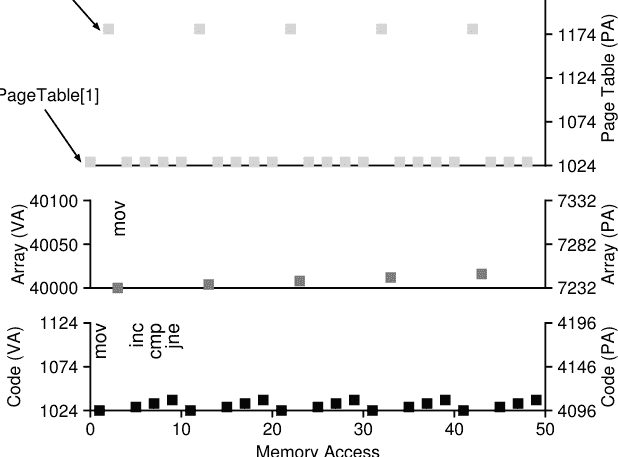

`PageTable[1]`

图 18.7: 虚拟（及物理）内存轨迹

我们现在准备好追踪程序的内存引用了。当程序运行时，每次指令取指都会产生两次内存访问：一次访问页表，以找到指令所在的物理帧，另一次访问指令本身，以将其取到 CPU 中处理。此外，还有一次 `mov` 指令形式的显式内存访问；这增加了一次页面访问（将虚拟地址翻译为正确的物理地址），然后是数组访问。

整个过程（循环的前五次迭代）如图 18.7（第 207 页）所示。底部的图显示了 y 轴上的黑色指令引用（左侧是虚拟地址，右侧是物理地址）；中间的图显示了深灰色数组访问（同样左侧为虚拟，右侧为物理）；最后最顶部的图显示了浅灰色页表访问（仅物理层，在此示例中页表代表物理内存）。跨越 x 轴的整个轨迹中，每个循环有 10 次内存访问，其中包括四次指令取指、一次显式内存更新，以及五次翻译那四次取指和一次显式更新的页表访问。

© 2008–19, ARPACI-DUSSEAU

三个简单的部分

# 分页：引言

看看你是否能理解在这个可视化中呈现的模式。特别是，当循环继续运行这前五次迭代之后，什么会发生变化？哪些新的内存位置将被访问？你能弄出来吗？

这只是最简单的例子（只有几行 C 代码），尽管如此你可能已经感受到理解真实应用程序实际内存行为的复杂性了。别担心：情况会更糟，因为我们即将引入的机制只会让这个已经复杂的机制更加复杂。抱歉！

## 18.6 总结

我们引入了分页的概念作为解决虚拟化挑战的方案。与以前的方法（如段）相比，分页有许多优势。首先，它不会导致外部碎片，因为分页（按设计）将内存划分为固定大小的单元。其次，它是灵活的，允许虚拟地址空间的稀疏使用。

然而，不加仔细地实现分页支持会导致机器变慢（产生许多额外的内存访问）。

```
-P 8 -a 32 -p 1024 -v -s 1
-P 8k -a 32k -p 1m -v -s 2
-P 1m -a 256m -p 512m -v -s 3
```

这些参数组合中，哪些是不现实的？为什么？

+ 4. 使用程序尝试一些其他问题。你能找到程序不再运行的界限在哪里吗？例如，如果地址空间的大小大于物理内存会发生什么？

# 分页：更快的翻译（TLB）

使用分页作为核心机制来支持虚拟内存会导致很高的性能开销。通过将地址空间划分成小的、固定大小的单元（即页），分页需要大量的映射信息。由于这些信息通常存储在物理内存中，分页在逻辑上要求为程序生成的每个虚拟地址都进行一次额外的内存查找。在每次指令取指或显式的加载/存储之前，都去内存中查找翻译信息，这速度是慢得令人无法接受的。因此我们面临的问题是：

> ### 核心：如何加速地址翻译

我们如何加速地址翻译，并通俗地避免分页似乎需要的额外内存引用？需要什么样的硬件支持？需要什么样的操作系统参与？

当我们想要让运行得更快时，操作系统通常需要帮助。而帮助来自操作系统的老朋友：硬件。为了加速地址翻译，我们将添加一种由于历史原因 [CP78] 被称为**旁路缓冲区**（translation-aside buffer），或者叫 `TLB` [CG68, C95]。`TLB` 是芯片的**内存管理单元 (`MMU`)** 的一部分，它简单来说是所有常用虚拟到物理地址翻译的硬件缓存；因此，一个更好的名字应该是**地址翻译缓存**。在每次进行虚拟内存引用时，硬件首先检查 `TLB` 查看所需的翻译是否存储在其中；如果是，则（快速地）执行翻译，而无需查询页表（页表包含所有的翻译）。由于它们对性能的巨大影响，`TLB` 在真正意义上使虚拟内存成为可能 [C95]。

```
VPN = (VirtualAddress & VPN_MASK) >> SHIFT
```

```
(Success, TlbEntry) = TLB_Lookup (VPN)
if (Success == True) // TLB 命中
```

```
if (CanAccess TlbEntry.ProtectBits) == True)
Offset = VirtualAddress & OFFSET_MASK
PhysAddr = (TlbEntry.PFN << SHIFT) | Offset
Register = AccessMemory(PhysAddr)
```

```
else
RaiseException (PROTECTION_FAULT)
```

```
else
// TLB 缺失
PTEAddr = PTRB + (VPN * sizeof (PTE))
PTE = AccessMemory (PTEAddr)
```

```
if (PTE == False)
RaiseException (SEGMENTATION_FAULT)
else if (CanAccess TlbEntry.ProtectBits) == False)
RaiseException (PROTECTION_FAULT)
```

```
else
TLB_Insert (VPN, PTE.PFN, PTE.ProtectBits)
RetryInstruction()
```

图 19.1：`TLB` 控制流算法

## 19.1 TLB 基础算法

19.1 显示了硬件如何处理虚拟翻译的草图（即页表是一个数组）以及硬件管理的 `TLB`（即硬件处理了页表访问的大部分责任；我们将稍详细解释这一点）。该算法的工作原理如下：从虚拟地址中提取页码（`VPN`）（图 19.1 中的第 1 行），并检查 `TLB` 是否持有该 `VPN` 的翻译（第 2 行）。如果是，我们就得到了 `TLB` 命中，意味着 `TLB` 持有该翻译。成功了！我们现在可以从相关的 `TLB` 条目中提取帧号（`PFN`）；将其与来自虚拟地址的偏移量（offset）拼接，形成所需的物理地址（`PA`），并访问内存（第 5-7 行），假设保护检查没有失败（第 4 行）。

如果 CPU 在 `TLB` 中没有找到翻译（`TLB` 缺失），我们还有更多工作要要做。在这个例中，硬件访问页表来查找翻译（第 11–12 行），并假设进程生成的内存是有效且可访问（第 13, 15 行），用翻译更新 `TLB`（第 18 行）。这一系列操作是昂贵的，主要是因为访问页表需要额外的内存引用（第 12 行）。最后，`TLB` 被更新，硬件重试该指令；这次，在 `TLB` 中找到了翻译，内存引用被快速处理了。

# 分页：更快的翻译（TLB）

`TLB` 像所有缓存一样，建立在一个基础之上：通常情况下翻译是可以找到的（即命中）。如果是这样，增加的开销就很小，因为 `TLB` 最近且设计得非常快。当发生缺失时，就会产生分页的高昂成本；必须访问页表来查找翻译，并导致额外的内存引用（如果有复杂的页表，则会有更多）。如果发生这种情况，程序的运行速度可能会变慢；内存访问是昂贵的，而 `TLB` 缺失会导致更多的访问。因此，我们的希望是尽可能地避免 `TLB` 缺失。

## 19.2 示例：访问数组

为了清楚 `TLB` 的操作，让我们检查一个简单的虚拟地址轨迹，看看 `TLB` 如何提高其性能。例如，假设我们有一个数组。让我们假设该数组包含 10 个整数，从虚拟地址 100 开始。为了简单起见，我们假设数组位于同一个页内：

```
int sum = 0;
for (i = 0; i < 10; i++) {
  sum += a[i];
}
```

第一次访问虚拟地址 100 的元素，CPU 会检查 `TLB` 是否该翻译。由于这是第一次访问，发生了 `TLB` 缺失。硬件访问页表来查找翻译，并假设该内存是有效且可访问的，用翻译更新 `TLB`。下次访问 `a[0]` 时，`TLB` 命中，因为翻译已经在 `TLB` 中了。访问 `a[1]` 时，`TLB` 再次命中，因为它与 `a[0]` 在同一个页内。访问 `a[2]` 时，`TLB` 再次命中，因为它与 `a[0]` 和 `a[1]` 在同一个页内。访问 `a[3]` 时，我们遇到了另一个 `TLB` 缺失。然而，后续 `a[4]` 到 `a[6]` 将命中 `TLB`，因为它们都位于内存中的同一个页。最后，访问 `a[7]` 会导致 `TLB` 缺失。让我们总结一下在访问十次数组期间的 `TLB` 活动：缺失、命中、命中、命中、命中。因此，`TLB` 命中率（命中次数除以总访问次数）为 70%。虽然这并不算高（事实上，我们看到过接近 100% 的比率），但它不是零。

| VPN | Offset | |

|---|---|---|

| VPN = 00 | | |

| VPN = 01 | | |

| VPN = 02 | | |

| VPN = 03 | | |

| VPN = 04 | | |

| VPN = 05 | | |

| VPN = 06 | a[0] | a[1] | a[2] |

| VPN = 07 | a[3] | a[4] | a[5] | a[6] |

| VPN = 08 | a[7] | a[8] | a[9] | |

| VPN = 09 | | | |

图 19.2：示例：微小地址空间中的数组

# 分页：更快的翻译 (TLBs) 217

提示：尽可能使用缓存

缓存是计算机系统中最基础的性能技术之一，它被反复使用以实现“常见情况最快化” [HP06]。硬件缓存背后的思想是利用局部性：指令和数据引用中的时间局部性。通常有两种类型的局部性。对于**时间局部性**，其核心思想是最近访问过的指令或项目在不久的将来很可能会被再次访问。想想循环中的变量或指令；它们随着时间的推移被反复访问。对于**空间局部性**，其核心思想是如果程序访问了 x 处的内存，它很可能会访问 x 附近的内存。想象这里正在搜索某种数组，访问完一个元素后访问下一个。当然，这些属性取决于程序的确切性质，因此它们不是硬性规定，而更像是经验法则。

对于指令、数据或其他翻译（在我们的 `TLB` 中），硬件缓存通过在快速的片上内存中保留内存副本来利用局部性。处理器不需要去访问（慢速）内存；如果必须要在缓存中查找，处理器也可以快速检查是否存在附近的副本（即仅需几个 CPU 周期），从而避免花费访问内存的昂贵时间（纳秒）。

你可能会在想：如果缓存（如 `TLB`）如此出色，为什么我们不直接把缓存做大，并将所有数据都放在里面呢？遗憾的是，在这里我们遇到了更基础的定律，例如物理定律。如果你想要快速的缓存，它必须很小，因为光速和其他物理限制会变得相关。任何大型缓存从定义上都是缓慢的，因此违背了初衷。因此，我们只能使用小而快速的缓存；留下的问题是如何利用它们来提高性能。

如果数组简单地增加一倍大小（32 字节而不是 16 字节），数组的缺失会更少。由于典型的页面大小更接近 4KB，这种密集的基于数组的访问类型具有极佳的 `TLB` 性能，每页访问只遇到一次缺失。

关于 `TLB` 性能的最后一点：如果程序在完成此循环后再次访问数组，我们可能会看到更好的结果，假设我们有一个大 `TLB` 来缓存所需的翻译：命中、命中、命中、命中、命中……在这种情况下，由于时间局部性（即在时间上对内存项快速引用），`TLB` 命中率将很高。与任何缓存一样，`TLB` 依赖于空间局部性和时间局部性来成功，这是正确的属性。如果感兴趣的程序表现出这种局部性（许多程序确实如此），`TLB` 命中率可能会很高。

© 2008–19, ARPACI-DUSSEAU

三个简单的部分

# 218 分页：更快的翻译 (TLBs)

```c
VPN = (VirtualAddress & VPN_MASK) >> SHIFT
(Success, TlbEntry) // TLB_Lookup (VPN)
if (Success == True) // TLB Hit
    if (CanAccessTlbEntry.ProtectBits) == True) 
        Offset = VirtualAddress & OFFSET_MASK
        PhysAddr = (TlbEntry.PFN << SHIFT) | Offset
        Register = AccessMemory(PhysAddr)
    else
        RaiseException (PROTECTION_FAULT)
else // TLB Miss
    RaiseException (TLB_MISS)
```

图 19.3：`TLB` 控制流算法（操作系统处理）

## 19.3 谁来处理 TLB 缺失？

更多的架构（例如 MIPS R10k [H93] 或 Sun 的 SPARC v9 [WG00]，RISC 或精简指令计算机）具有*软件管理的 TLB*。当 `TLB` 缺失时，硬件会抛出一个异常（见图 19.3 第 11 行），这会暂停当前的指令流，将权限级别更改到内核模式，并跳转到*陷阱处理器 (trap handler)*。正如你可能的，这个陷阱处理器是操作系统内部的代码，专门为处理 `TLB` 缺失而编写。运行时，代码将在页表中查找翻译，使用“特权”指令更新 `TLB` 并从陷阱返回；此时，硬件将检索该指令（导致 `TLB` 命中）。

让我们讨论一下几个重要的细节。首先，从陷阱返回（return-from-trap）指令需要与处理系统调用之前使用的从陷阱返回略有不同。在这种情况下，从陷阱返回应该在进入操作系统的陷阱*之后*指令处恢复执行，就像从过程调用返回到立即调用过程的指令一样。在前一种情况下，从处理 `TLB` 缺失的陷阱返回，硬件必须在*导致*陷阱的指令处恢复执行；这种重试让中……

操作系统

[版本 1.01]

WWW.OSTEP.ORG


# 分页：更快的翻译 (`TLBs`)

## 旁注：RISC vs. CISC

在 20 世纪 80 代，计算机架构领域发生了一场大战。一方是 `CISC` 阵营，代表**复杂指令集计算 (Complex Instruction Set Computing)**；另一方是 `RISC`，代表**精简指令集计算 (Reduced Instruction Set Computing [PS81])**。`RISC` 方由伯克利的 David Patterson 和斯坦福的 John Hennessy 领导（他们也是一些著名论文 [H86] 的合作者），尽管后来 John Cocke 因……获得了图灵奖。

软件管理方法的主要优势是灵活性：操作系统可以决定……

© 2008–19, ARPACI-DUSSEAU

## 旁注：TLB 有效位 vs 页表位

一个常见的错误是将 `TLB` 与页表中的 `TLB` 混淆。在页表中，当一个 `TLB` 条目被标记为无效时，意味着该页面尚未分配。相比之下，`TLB` 有效位仅是指该条目是否具有有效的翻译。例如，当系统启动时，每个 `TLB` 条目的一个常见初始状态是设置为无效，因为……一旦程序开始运行并访问其地址空间，`TLB` 就会被缓慢填充。在执行上下文切换时，`TLB` 有效位非常有用，正如我们将进一步讨论的。通过将所有 `TLB` 条目设置为无效，系统可以确保即将运行的进程不会意外使用……来自上一个进程的。硬件在缺失时做得不多：只是抛出一个异常并让……

### 19.4 TLB 内容：里面有什么？

让我们更详细地查看 `TLB` 的内容。一个典型的 `TLB` 可能有 32、64 或 128 个条目，并且被称为全相的 `fully associative`。基本上，这意味着任何给定的翻译可以位于 `TLB` 中的任何位置，硬件将并行搜索整个 `TLB` 以找到所需的翻译。

| VPN | PFN | 其他位 |

注意，每个条目中都存在 `VPN` 和 `PFN`，因为翻译可能出现在这些位置中的任何一个（在硬件术语中，`TLB` 被称为全相缓存）。硬件并行搜索条目以查看是否有匹配。

更有趣的是“其他位”。例如，`TLB` 通常有一个有效位 `valid bit`，表示该条目是否具有有效的翻译。常见的还有保护位，它们决定了如何访问页面（如页表所示）。例如，代码页面可能标记为可读可执行，而堆页面可能被标记为可读可写。可能还有其他字段，包括地址空间标识符、脏位等；见下文以获取更多信息。

### 19.5 TLB 问题：上下文切换

使用 `TLB` 时，在进程（以及地址空间）之间切换时会出现一些新问题。具体来说，`TLB` 包含了虚拟到物理的转换关系，这些关系仅对当前运行的进程有效；这些转换对其他进程没有意义。因此，当从一个进程切换到另一个进程时，硬件、操作系统（或两者）必须小心确保即将运行的进程不会意外使用来自之前运行进程的转换关系。

为了更好地理解这种情况，让我们来看一个例子。当一个进程 `P1` 运行时，它假设 `TLB` 可能缓存了对它有效的转换关系，例如，`P1` 的第 10 个页映射到物理帧 100。

在示例中，假设有另一个进程 `P2`，操作系统可能决定执行上下文切换并运行它。假设 `P2` 的第 10 个虚拟页映射到物理帧 170。如果两个进程的条目都在 `TLB` 中，那么 `TLB` 的内容将是：

| VPN | PFN | prot |
| --- | --- | --- |
| 10 | 100 | 1 |
| 10 | 170 | 1 | rwx |

在上面的 `TLB` 中，我们显然遇到了一个问题：`VPN` 10 转换为 `PFN` 100 (`P1`) 或 `PFN` 170 (`P2`)，但硬件无法区分哪个条目属于哪个进程。因此，我们需要做一些工作，以便 `TLB` 能够正确高效地支持跨进程的虚拟化。由此产生了一个核心问题：

> 核心问题：
> 在上下文切换时管理 `TLB` 内容
> 在进程之间切换上下文时，`TLB` 中上一个进程的转换关系对于即将运行的进程没有意义。硬件或操作系统应该做什么来解决这个问题？

这个问题有很多可能的解决方案。一种方法是在上下文切换时刷新 `flush` `TLB`，在新进程运行之前将其清空。在基于软件的系统中，这可以通过显式的（且是特的）硬件指令来实现；对于硬件管理的 `TLB`，可以在更改页表基寄存器时执行刷新（无论操作系统在上下文切换时都会更改该寄存器）。无论哪种情况，刷新操作都会将所有有效位置 0，本质上清空 `TLB` 的内容。

通过在每次上下文切换时刷新 `TLB`，我们现在有了一个可行的解决方案，因为进程永远不会在 `TLB` 中意外遇到错误的转换。然而，这是有代价的：进程每次运行时，在访问其数据和代码页时可能会导致 `TLB` 缺失。如果操作系统频繁在进程之间切换，这种成本可能会很高。

为了减少这种开销，某些系统增加了硬件支持以在跨上下文切换时共享 `TLB`。特别是，某些系统在 `TLB` 中提供了地址空间标识符 `ASID` 字段。你可以将 `ASID` 视为进程标识符 `PID`，但通常它的位数较少（例如，`ASID` 为 8 位，`PID` 为 32 位）。

如果我们取上面的示例 `TLB` 并添加 `ASID`，显然进程可以共享 `TLB`：只需要 `ASID` 字段就可以区分相同的转换关系。这里是添加了 `ASID` 的 `TLB` 描述图。

| VPN | PFN | valid | prot | ASID |
|---|---|---|---|---|
| | 100 | 1 | | 1 |
| | | 0 | | |
| 10 | 170 | 1 | rwx | 2 |
| | | — | | |

因此，通过地址空间标识符，`TLB` 可以同时持有来自不同进程的转换关系而不会产生任何混淆。当然，硬件还需要知道当前正在运行哪个进程以执行转换，因此操作系统在上下文切换时必须将某些特权寄存设置为当前进程的 `ASID`。

顺便提一下，你可能还想过另一种情况，即 `TLB` 的两个条目极其相似。这里是两个具有不同 `VPN` 但指向同一物理页的不同进程条目：

| VPN | PFN | valid | prot | ASID |
|---|---|---|---|---|
| 10 | 101 | 1 | r-x | 1 |
| | | 0 | | |
| 50 | 101 | 1 | r-x | 2 |
| | | 0 | | |

这种情况可能会发生，当两个进程共享一个页时（例如代码页）。在上面的示例中，进程 1 与进程 2 共享物理页 101；`P1` 将其映射到自己地址空间的第 10 个页，而 `P2` 将其映射到自己地址空间的第 50 个页。共享代码页（在二进制文件或共享库中）是有用的，因为它减少了使用的物理页数量，降低了内存开销。

### 19.6 问题：替换策略

与任何缓存以及 `TLB` 一样，我们必须考虑的另一个问题是缓存替换。具体来说，当我们在 `TLB` 中安装新条目时，必须替换一个旧条目，因此问题是：替换哪一个？

> 核心问题：
> 如何设计 `TLB` 替换策略
> 当我们添加新条目时，应该替换哪个 `TLB` 条目？目标当然是最小化缺失率（提高命中率）。我们将详细研究这些策略；一种常用方法是最少使用算法 `LRU`，它驱逐未使用的条目。

### 19.7 真实的 TLB

最后，让我们简单看看一个真实的 `TLB`。`MIPS TLB` 是软件管理的，需要指令来更新 `TLB`。`MIPS TLB` 提供了四条指令：`TLBP`，探测特定转换是否在 `TLB` 中；`TLBLR`，将 `TLB` 条目的内容读入寄存器；`TLBI`，替换特殊的 `TLB` 条目；以及 `TLWI`，替换随机的 `TLB` 条目。操作系统使用这些指令来管理 `TLB` 内容。这些指令是特权的这一点至关重要；想象一下如果用户进程修改 `TLB` 内容会发生什么（提示：几乎可以做任何事情，包括接管机器运行恶意的“操作系统”）。

### 19.8 总结

我们已经看到硬件如何加速地址转换。通过提供一个较小的专用芯片上 `TLB` 作为地址转换缓存，大多数内存引用有望在不访问主内存中页表的情况下处理。因此，在通常情况下，

程序的性能几乎就像内存没有被虚拟化一样，这对于操作系统来说是一项卓越的成就，并且对于现代系统中分页机制的使用至关重要。

然而，`TLB` 并不是让每个现有程序都运行得如如意。特别是如果一个程序在短时间内访问的页数超过了 `TLB` 能容纳的页数，该程序将产生大量的 `TLB` 缺失 `TLB misses`，从而导致运行变慢很多。我们将这种现象称为超过了 `TLB` 覆盖范围 `TLB coverage`，这对于某些程序来说可能是一个问题。一种解决方案（我们将在下一章中讨论）是包含对大页大小的支持；通过将数据结构映射到程序地址空间中由大页映射的区域，可以增加 `TLB` 的有效覆盖范围。数据库管理系统 `DBMS` 等程序经常利用对大页的支持，它们在 CPU 流水线中存在瓶颈，特别是对于所谓的物理索引缓存 `physically-indexed cache`。

另一个值得提的 `TLB` 问题是：`TLB` 访问很容易成为性能瓶颈，特别是在所谓的物理索引缓存中。对于这种缓存，在访问缓存之前必须进行地址翻译，这会大大减慢速度。由于这个潜在问题，人们已经研究了各种使用虚拟地址访问缓存的巧妙方法，从而在缓存命中的情况下避免昂贵的翻译步骤。这种虚拟索引缓存 `virtually-indexed cache` 解决了一些性能问题，但在硬件设计中也引入了新问题。更多细节请参见 Wiggins 的精彩综 [W03]。

## 参考文献

[BC91] "Performance for Architecture: A RISC and a CISC with Similar Hardware Organization" 作者 D. Bhandarkar 和 Douglas W. Clark。Communications of the ACM, 1991年9月。对 RISC 和 CISC 之间非常好且公平的比较。结论是：在类似的硬件上，RISC 的性能是三倍。

[CM01] "The evolution of RISC technology at IBM" 作者 John Cocke，IBM Journal of Research and Development, 441:2。对 IBM 801 背后的思想和工作的总结，许多人认为它被认为是第一个真正的 RISC 微处理器。

[C95] "The Core of the Black Canyon Computer Corporation" 作者 John Coeur。IEEE Annals of History of Computing 17, 1995年。在这段引人入胜的历史笔记中，Coeur 讲述了他如何在1984年发明了 TL，以及随后与 MIT Project MAC 成员之间发生的幸运的合作。

[CS68] "Shared-access Data Processing System" 作者 John E. Coeur, Edward. Gather。专利 3412382，1968年11月。该专利包含了用于存储翻译的关联存储的想法。Morgan-Hill, Ca, 1968年。

[CP78] "The Architecture of the IBM System/370" 作者 R.P. Case, A. Padegs。Communications of the ACM. 21:73-96, 1978年6月。第一个使用 lookaside buffer（旁缓冲区）术语的人。这个名字是缓存的俄语昵称，是曼彻斯特大学开发 Atlas 系统的人员称为预读缓冲区（lookahead buffer）；因为翻译而产生的地址翻译缓存。即使是 lookahead buffer 这个词也显得有些过时了，TLB 似乎有某种缺陷，无论原因何。

[IH93] "MIPS R4000 Processor User Manual" 作者 John Heinrich。可用：http://www.csmit.edu/docs/R4000.Uman.Book.Ed2.pdf 一本相当意外或并不意外的手手册。

[HP06] "Computer Architecture: A Quantitative Approach" 作者 John Hennessy 和 David Patterson。MorganKaufman, 2006。一本非常好的计算机架构书籍。我们对这个经典版本有特殊的感情。

[PS81] "IQA-1 Reduced Instruction Set VLSI Computer" 作者 D.A. Patterson 和 C.H. Quisco。ISA 81, Minneapolis, 1981年5月。这篇引入了 RISC 术语的论文开启了学术计算系统性能研究的浪潮。

[SB92] "CPU Performance and Execution Time Prediction Using Narrow Spectrum Benchmarking" 作者 Rudolph H. King，加州大学伯尔克分校计算机系。技术报告 No. UCB/CS-92-684, 1992年2月。关于如何通过将任务拆分并了解每个部分的成本来预测执行时间的精彩讨论。这项工作产生的最有趣的部分可能是测量缓存命中细节的工具（在第5章中描述）。务必查看其中的奇妙梦想。

[W03] "A Survey on the Interaction Between Caching, Translation and Protection" 作者 Adam Wiggins。新南威尔士大学，TRNSW-CSE-TR-0321, 2003年。关于 TLB 如何与 CPU 流水线的其他部分（即硬件缓存）交互的优秀综述。

[WG00] "The SPARC Architecture Manual: Version 9" 作者 David L. Weaver 和 Tom Green。SPARC, San Jose, California, 2000年。关于 SPARC 架构手册第9版。


[SB92] "CPU Performance and Execution Time Prediction Using Narrow Spectrum Benchmarking" 作者 Rudolph H. King，加州大学伯尔克分校计算机系。技术报告 No. `UCB/CS-92-684`, 1992年2月。关于如何通过将任务拆分并了解每个部分的成本来预测执行时间的精彩讨论。这项工作产生的最有趣的部分可能是测量缓存命中细节的工具（在第5章中描述）。务必查看其中的奇妙梦想。

[W03] "A Survey on the Interaction Between Caching, Translation and Protection" 作者 Adam Wiggins。新南威尔士大学，`TRNSW-CSE-TR-0321`, 2003年。关于 `TLB` 如何与 CPU 流水线的其他部分（即硬件缓存）交互的优秀综述。

[WG00] "The SPARC Architecture Manual: Version 9" 作者 David L. Weaver 和 Tom Green。`SPARC`, San Jose, California, 2000年。关于 `SPARC` 架构手册第9版。

# 作业（测量）

程序的性能几乎就像内存完全没有被虚拟化一样，这对于操作系统来说是一项卓越的成就，并且对于现代系统中分页机制的使用至关重要。

然而，`TLB` 并不是让每个现有程序都运行得如如意。特别是如果一个程序在短时间内访问的页数超过了 `TLB` 能容纳的页数，该程序将产生大量的 `TLB` 缺失，从而导致运行变慢很多。我们将这种现象称为超过了 `TLB` 覆盖范围，这对于某些程序来说可能是一个问题。一种解决方案（我们将在下一章中讨论）是包含对大页大小的支持；通过将数据结构映射到程序地址空间中由大页映射的区域，可以增加 `TLB` 的有效覆盖范围。数据库管理系统（`DBMS`）等程序经常利用对大页的支持，它们在 CPU 流水线中存在瓶颈，特别是对于所谓的物理索引缓存。

另一个值得提的 `TLB` 问题是：`TLB` 访问很容易成为性能瓶颈，特别是在所谓的物理索引缓存中。对于这种缓存，在访问缓存之前必须进行地址翻译，这会大大减慢速度。由于这个潜在问题，人们已经研究了各种使用虚拟地址访问缓存的巧妙方法，从而在缓存命中的情况下避免昂贵的翻译步骤。这种虚拟索引缓存解决了一些性能问题，但在硬件设计中也引入了新问题。更多细节请参见 Wiggins 的精彩综 [W03]。

# 问题

- 为了计时，你需要使用一个计时器（例如 `gettimeofday()`）。这种计时器有多精确？操作需要持续多久才能进行计时？

- 编写一个名为 `lb.c` 的程序，测量访问每个页的成本。程序的输入应该是：页数和实验次数。

- 使用你喜欢的语言（`bash`?）编写脚本运行此程序，同时将访问的页数从1开始增加到几千，每次迭代翻倍。在不同的机器上运行脚本并收集数据。

- 接下来，对结果绘图，画一张与上面类似的图。使用良好的工具如 `gnuplot` 或 `matplotlib`。可视化通常会让数据更容易消化；你认为为什么？

- 一个需要注意的是的是编译器优化。编译器会进行各种巧妙的操作，移除程序其他部分没有使用的循环。如何确保编译器没有移除你的 `TLB` 大小估计器的主循环？

- 另一个需要注意的是，许多现代系统配备了多个 CPU，每个 CPU 都有自己的 `TLB` 级联结构。为了获得良好的测量结果，你必须仅在一个 CPU 上运行，而不是让调度器将其在不同的 CPU 之间切换。你可以这样做吗？（查找“线程固定”）如果你不这样做，代码从一个 CPU 移动到另一个 CPU 会发生什么？

- 另一个可能出现的问题是初始化。如果你在访问 `array` 之前没有初始化它，第一次访问它将非常昂贵，由于初始访问成本（如按需置零）。这将影响你的代码和计时。你可以做什么来抵消这些潜在成本？

# 分页：更小的页表

我们现在处理分页引入的第二个问题：页表太大了，因此消耗了过内存。让我们从线性页表开始。正如你可能记得的¹，线性页表非常大。假设再次使用 32 位地址空间（$2^{32}$ 字节），乘以 4KB（$2^{12}$ 字节）的页和 4 字节的页表项。因此，一个地址空间包含大约百万个虚拟页（$\frac{2^{32}}{2^{12}}$）；乘以页表项的大小，你会发现你的页表大小为 4MB。还要记住：我们通常为系统中的*每个进程*分配一个页！如果有数百个活跃的进程（这在现代系统中并不起见），我们仅仅为页表就要分配数百兆字节的内存了！因此，我们正在寻找一些技术来减轻这种沉重的负担。方法有很多，让我们开始吧吧。

> 核心问题：如何让页表更小？

> 基于数组的简单页表（通常称为线性页表）太大了，在典型系统上占据了过多的内存。我们如何让页表更小？关键思想是什么？这些数据结构会导致哪些低效问题的产生？

## 20.1 简单方案：更大的页

我们可以通过一种简单的方法减小页表的大小：使用更大的页。再次采用 32 位地址空间，但这次使用 16KB 的页。这样我们就有 18 位的 `VPN` 加上 14 位的偏移量。假设每个 `PTE` 的大小相同（4 字节），我们现在线性页表中有 $2^{18}$ 个项，因此每个页表的总大小为 1MB，页表大小缩小了 4 倍（并不意外，这种缩小的比例恰好对应了页大小增加的 4 倍比例）。

问题是，大页会导致每个页内部产生浪费，这个问题被称为**内部碎片**（因为浪费发生在分配单位内部）。因此，结果是分配了页，但只使用了每个页的一小部分，内存很快就会被这些过大的页填满。因此，大多数系统在通常情况下使用较小的页大小：4KB（如 `x86`）或 8KB（如 `SPARC9`）。遗憾的是，我们的问题并没有得到简单的解决。

¹或者事实上，你可能没有；这种分页机制正在失控，不是吗？话虽如此，在转向解决方案之前，务必确保你理解你正在解决的问题；事实上，如果你理解了问题，通常可以自己推导出解决方案。在这里，问题应该是清晰的：简单的线性（基于数组的）页表太大了。

## 20.2 混合方法：分页与分段

每当你对某件事有两种合理但不同的方法时，你应该始终考虑两者的结合，以便获得两者的优势。我们将这种组合称为“混合”。例如，既然可以只吃巧克力或只吃花生酱，为什么不直接将它们结合成一种迷人的混合体——瑞士花生杯巧克力 [M07] 呢？

多年前，`Multics` 的创建者（特别是 Jack Dennis）在构建 `Multics` 虚拟内存分段系统 [M07] 时提到过这样的想法。具体来说，Dennis 有将分页和分段结合以减少页表内存开销的想法。我们可以通过更详细检查典型的线性页表来看到它是如何工作的。假设我们有一个地址空间，其中堆和栈的使用部分很小。为了示例，我们使用 16KB 的地址空间和 1KB 的页（图 20.1）；该地址空间的页表见图 20.2。

### 旁白：多种页大小

顺便提一下，请注意许多架构（例如 `MIPS`、`SPARC`、`x86-64`）现在支持多种页大小。通常使用较小的（4KB 或 8KB）页大小。然而，如果一个“智能”应用程序请求，可以在地址空间的特定位置使用单个大页（例如大小为 4MB），使得此类应用程序能够将频繁使用（且大型的）数据结构放在此类空间中，同时只消耗一个 `TLB` 条目。这种类型的大页使用在数据库管理系统和其他高需求型应用程序中很常见。然而，多种页大小的主要原因并不是为了节省页空间；而是为了减轻 `TLB` 的压力，使程序能够访问更多的地址空间而不会遭受过多的 `TLB` 缺失。但是，正如研究人员指出的 [N02]，使用多种页大小会让操作系统的虚拟内存管理器变得复杂得多，因此大页有时通过简单地引入新接口来使用最为容易。

# 分页：更小的页表

提示：使用混合方案

当你有两个很好且看似对立的观点时，你应该总是看看是否可以将它们结合成一种混合方案，以兼顾两者的优点。例如，杂交玉米品种比任何自然产生的物种都更健壮。当然，并非所有的杂交种都是好主意；斑驴（`Zeebok`，或 `Zonkey`）是斑马和驴的杂交种。如果你不相信这种生物存在，去查查资料，准备好大一惊吧。

我们的混合方案的关键区别在于每个段都有一个边界寄存器（`bounds register`）；每个边界寄存器持有该段中最大页的数值。例如，如果代码段仅使用它的前三个页（0, 1 和 2），则代码段表将为其分配三个条目，且边界寄存器将设置为 3；超出段末尾的内存访问将产生异常并导致进程终止。通过这种方式，我们的混合方法与线性页表相比实现了显著的内存节省；栈和堆之间未分配的页不再占用页表空间（只需将它们标记为无效）。

然而，正如你可能注意到的，这种方法并非没有问题。首先，它要求我们使用分段；因为分段并没有我们想象的那么灵活，因为它假设了地址空间的某种用法；例如，如果我们有一个巨大但稀疏使用的堆，可能会导致大量的页表浪费。这种混合方法是以页为单位进行管理的，现在页表可以是任意大小（以 `PTE` 为单位）。因此，为内存寻找空闲空间变得更加复杂。由于这些原因，人们继续寻找实现更小页表的更好方法。

## 20.3 多级页表

另一种方法不依赖分段，而是通过将所有无效区域留在内存之外来消除页表中的所有无效区域？我们将这种方法称为多级页表，因为它将线性页表变成了类似树结构。这种方法非常有效，许多现代系统都采用了它（例如 `x86` [BOH101]）。我们将详细描述这种方法。

多级页表背后的基本思想很简单。首先，将页表切分为页大小的单位；然后，如果整页页表条目（`PTE`）都是无效，则完全不分配该页表。为了跟踪页表的某页是否有效（如果有效，它在内存的什么位置），使用一种新结构，称为页目录（`page directory`）。因此，页目录既可以告诉你页表某页的位置，也可以告诉你整个页表不包含任何有效页。

# 分页：更小的页表

> 提示：理解时间空间权衡

在构建数据结构时，应该始终考虑其构建过程中的时间空间权衡。通常，如果你希望加快对特定数据结构的访问，你必须为该结构支付空间使用上的代价。

与之对比的是一个简单的（非分页的）线性页表*，这是一个由 `VPN` 索引的 `PTE` 数组；对于这样的结构，整个页表必须连续地存储在物理内存中。对于一个大型页表（大小为 4MB），找到如此大块的未使用的物理内存是一项挑战。在多级结构中，我们需要通过使用页目录来实现一层间接层，页目录指向页表；这种间接性允许我们将页表放置在物理内存中任何想要的位置。

需要注意的是，多级页表是有成本的；在 `TLB` 缺失时，需要从内存中加载两次才能从页表中获取正确的翻译结果（一次用于页目录，一次用于 `PTE` 本身），而线性页表只需要加载一次。多级页表是时间空间权衡的一个小用例。我们想要更小的表（并且得到了），但并不是免费的；虽然在通常情况下（`TLB` 命中）性能是相同的，但在 `TLB` 缺失时，这种较小的表会承受更高的代价。

另一个明显的遗憾仍然是：无论是由硬件还是操作系统处理页表查找（在 `TLB` 缺失时），其操作显然都比简单的线性页表查找要复杂得多。我们经常愿意增加复杂性以提高性能或减少开销；在多级页表的情况下，我们为了节省宝贵的内存而让页表查找变得更加复杂。

## 详细的多级示例

为了更好地理解多页页表背后的思想，让我们来做一个例子。想象一个大小为 16KB、页大小为 64字节的小地址空间。因此，我们有一个 14 位的虚拟地址空间，其中 8 位用于 `VPN`，6 位用于偏移（`offset`）。如果只使用地址空间的一小部分，线性页表将有 $2^8$ (256) 个条目。图 20.4（第 236 页）展示了此类地址空间的一个示例。

在这个示例中，虚拟页 0 和 1 用于代码，虚拟页 4 和 5 用于堆，虚拟页 254 和 255 用于栈；其余页空间未被使用。

为了为这个地址空间构建一个二级页表，我们从线性页表开始并将其分解为页大小的单位。回想我们的完整表（在本示例中）有 256 个条目；假设每个 `PTE` 为 4 字节。

*我们在这里做了一些假设，即所有页都完整地驻留在物理内存中（即它们没有交换到磁盘）；我们很快就会放宽这个假设。

| | |

| 0000 0000 | code |

| 0000 0001 | code |

| 0000 0010 | (free) |

| 0000 0011 | (free) |

| 0000 0100 | heap |

| 0000 0101 | heap |

| 0000 0110 | (free) |

| 0000 0111 | (free) |

| | all free ... |

| 1111 1100 | (free) |

| 1111 1101 | (free) |

| 1111 1110 | stack |

| 1111 1111 | stack |

图 20.4: 具有 64 字节页的 16KB 地址空间

因此，我们的页表大小为 1KB (256 × 4 字节)。鉴于我们有 64 字节的页，这 1KB 的页表可以分为 16 个 64 字节的页；每个页可以容纳 16 个 `PTE`。

我们现在需要理解的是取一个 `VPN` 并使用它来索引第一个页目录，然后是页表的地址。记住，每一个都是条目数组；因此，我们需要弄清楚如何为 `VPN` 的每个页构建索引。

让我们先索引页目录。在本示例中，我们的页表很小：256 个条目，分布在 16 页中。页目录每个页表的每一页需要一个条目；因此，它有 16 个条目。结果是我们需要 `VPN` 的 4 位来索引目录；我们使用 `VPN` 的高位，如下：

| VPN | offset |

| 13 | 12 | 11 | 10 | 9 | 8 | 7 | 6 | 5 | 4 | 3 | 2 | 1 | 0 |

一旦我们从 `VPN` 中提取出页索引 (`PIndex`)，我们就可以用它来索引页表本身，得到 `PTE` 的地址：`PTEAddr = (PDE.PFN << SHIFT) + (PTIndex * sizeof(PTE))`。

如果页目录条目被标记为无效，我们就知道访问是无效的，从而产生异常。但是，如果 `PDE` 是有效的，我们还有更多工作要做。具体来说，我们现在必须从页表的页获取页表条目 (`PTE`)。要找到这个 `PTE`，我们必须使用 `VPN` 的剩余位来索引页表。

注意，从页目录获得的页帧号 (`PFN`) 在与页目录索引组合之前必须左移，以形成 `PTE` 的地址。为了看到这一切，我们现在将用一些实际值填充多级页表，并翻译单个虚拟地址。让我们从这个示例的页目录开始（图 20.5 的左侧）。

在图中，每个页目录条目 (`PDE`) 描述了关于该地址空间页表的信息。在本示例中，地址空间有两个有效区域（在开头和结尾），以及若干之间的无效映射。

在物理页 100（页表第 0 页的物理帧号）中，我们拥有用于地址空间前 16 个 `VPN` 的第一页页表条目。见图 20.5（中间部分）查看这部分页表的内容。

该页表包含前 16 个 `VPN` 的映射；例如，`VPN` 0 和 1 是有效的（代码段），

| Page Directory | Page of PT (@PFN:100) | Page of PT (@PFN:101) |

| PFN valid? | PFN valid prot | PFN valid prot |

| 100 | 1 | 1 r-x | 0 |

| — | 0 | 23 | 0 |

| — | 0 | — | 0 |

| — | 0 | — | 0 |

| — | 80 | 1 rw- | 0 |

| — | 59 | 1 rw- | 0 |

| — | 0 | — | 0 |

| — | 0 | — | 0 |

| — | 0 | — | 0 |

| — | 0 | — | 0 |

| — | 0 | — | 0 |

| — | 0 | — | 0 |

| — | 0 | 55 1 rw- | |

| 101 | 1 | 0 45 1 rw- | |

图 20.5: 页目录以及页表片段

# 分页：更小的页表

> 提示：警惕复杂性

> 系统设计者应该警惕为自己的系统增加复杂度。一个优秀的系统构建者所做的是实现当前任务的最简单系统。例如，如果磁盘空间充足，不要设计一个为了尽可能节省字节而运行的文件系统；同样，如果处理器很快，那么在操作系统内部编写一个清晰且易于理解的模块，比为当前任务编写经过 CPU 优化的手工汇编代码更好。警惕不必要的复杂性；优化代码或其他方法会使系统更难理解、维护和调试。安托万·圣埃克苏佩曾写道：“当不再能添加任何东西，而是当不再能取去任何东西时，完美就达到了。”他写写道：“谈论完美比实现完美要容易得多。”

是 4 和 5（堆）。因此，该表包含了这些页中每个页的映射信息。其余条目被标记为无效。

页表的另一个页在 `PFN` 101 找到。该页包含了地址空间中最后 16 个 `VPN` 的映射；详见图 20.5。

在示例中，`VPN` 254 和 255（栈）具有有效映射。希望我们能从中看到，多级索引结构可以节省多少空间。在这个示例中，我们没有为线性页表分配所有 16 个页，而是只分配了三个页：一个用于页目录，另外两个用于具有有效映射的页表块。对于大型（32 位或 64 位）地址空间，这种节省可能会大得多。

最后，让我们使用这些信息来执行转换。这是一个指向 `VPN` 254 的第 0 个字节的地址：0x3F80，或 0011 1111 0000 0000。

回想我们使用 `VPN` 的高 4 位来索引页目录。因此，1111 将选择页目录的最后一个（如果从 0 开始计数，则为第 15 个）条目。这指向地址为 101 的一个有效页。然后，我们使用 `VPN` 的下一组 4 位（1110）来索引该页表并找到 `PTE`。1110 是该页上倒数第二个（第 14 个）条目，它告诉我们物理地址是 55。通过将 `PFN`=55（或 0x37）与偏移量=0x0000 连接，我们可以形成物理地址并向内存系统发出请求：`PhysAddr = (PTE << SHIFT) + offset`

`= 0011 1100 0000 0000 = 0x3DC0.`

你现在应该已经有了如何构建两级页表的思路，即使用一个指向页表页的页目录。遗憾的是，我们的工作还没有结束。正如我们将讨论的，有时两级分页是不够的！

## 多于两级

在我们目前为止的示例中，我们假设多级页表只有两级：页目录和页表碎片。在某些情况下，更深层次树是可能的（而且确实是必要的）。

让我们举一个简单的例子，用它来展示多级表如何有用。在这个示例中，假设我们有一个 30 位的虚拟地址空间，以及一个 512（字节）的页大小。我们的虚拟地址有一个 21 位的虚拟页号（`VPN`）和 9 位的偏移量。


回想我们构建多级页表的目标：使每个页表碎片都适应在一个页内。因此，我们只考虑了页表本身；但是，如果页目录变得太大了怎么办？

为了确定多级页表中需要多少层才能使所有页表碎片都适应在一个页内，我们首先确定一个页可以容纳多少个页表条目。考虑到我们 512 字节的页大小，使用 4 字节的 `PTE` 大小，你应该看到一个页可以容纳 128 个 `PTE`。当我们对页位进行索引时，可以得出结论，我们需要 `VPN` 的低 7 位（`log2 128`）作为索引。

| VPN | 29 | 28 | 27 | 26 | 25 | 24 | 23 | 22 | 21 | 20 | 19 | 18 | 17 | 16 | 15 | 14 | 13 | 12 | 11 | 10 | 9 | 8 | 7 | 6 | 5 | 4 | 3 | 2 | 1 | 0 |

| :--- | :--- | :--- | :--- | :--- | :--- | :--- | :--- | :--- | :--- | :--- | :--- | :--- | :--- | :--- | :--- | :--- | :--- | :--- | :--- | :--- | :--- | :--- | :--- | :--- | 4 | 3 | 2 | 1 | 0 |

| 页目录索引 | 页表索引 | | | | | | | | | | | | | | | | | | | | | | | | | | | | | | |

你可能还会从上面的图中注意到（大型）页目录中还剩下多少位：14 位。如果我们的页目录有 $2^{14}$ 个条目，它跨越的不是一个 128 页，因此我们让每个多级页表碎片都适应一个页的目标就消失了。

为了解决这个问题，我们构建树的更深一层，通过将页目录拆分成多个页，并在上方添加另一个页目录，以指向页目录的各个页。我们可以将虚拟地址拆分为：

| VPN | 29 | 28 | 27 | 26 | 25 | 24 | 23 | 22 | 21 | 20 | 19 | 18 | 17 | 16 | 15 | 14 | 13 | 12 | 11 | 10 | 9 | 8 | 7 | 6 | 5 | 4 | 3 | 2 | 1 | 0 |

| :--- | :--- | :--- | :--- | :--- | :--- | :--- | :--- | :--- | :--- | :--- | :--- | :--- | :--- | :--- | :--- | :--- | :--- | :--- | :--- | :--- | :--- | :--- | :--- | :--- | 4 | 3 | 2 | 1 | 0 |

| PD 索引 0 | PD 索引 1 | 页表索引 | | | | | | | | | | | | | | | | | | | | | | | | | | | | | |

现在，当索引上层目录时，我们使用虚拟地址的高位（图中的 `PD Index 0`）；此索引可用于从顶层目录中获取页目录条目。如果是，则通过结合顶层 `PDE` 的物理帧号和 `VPN` 的下部分（`PD Index 1`）来查询第二级页目录。最后，如果有效，则可以使用页表索引结合第二级 `PDE` 形成 `PTE` 地址。在多级表中查找某项确实需要做大量工作。

```
VPN = (VirtualAddress & VPN_MASK) >> SHIFT
(Success, TlbEntry) = TLB_Lookup(VPN)
if (Success == True) // TLB 命中
    if (CanAccess(TlbEntry.ProtectBits) == True)
        Offset = VirtualAddress & OFFSET_MASK
        PhysAddr = (TlbEntry << SHIFT) | Offset
        Register = AccessMemory(PhysAddr)
    else
        RaiseException(PROTECTION_FAULT)
else // TLB 缺失
    // 首先，获取目录条目
    PDIndex = (VPN & PD_MASK) >> SHIFT
    PDEAddr = PDB + (PDIndex + sizeof(PDE))
    PDE = AccessMemory(PDEAddr)
    if (PDE.Valid == False)
        RaiseException(SEGMENTATION_FAULT)
    else
        // 如果有效，从页表获取 PTE
        PTIndex = (VPN & PT_MASK) >> SHIFT
        PTEAddr = (PDE << SHIFT) + (PTIndex * sizeof(PTE))
        PTE = AccessMemory(PTEAddr)
        if (PTE.Valid == False)
            RaiseException(SEGMENTATION_FAULT)
        else if (CanAccess(PTE.ProtectBits) == False)
            RaiseException(PROTECTION_FAULT)
        else
            Tlb_Insert(VPN)
```

图 20.6: 多级页表控制流

你现在应该已经有了如何构建两级页表的思路，使用一个指向页表页的页目录。遗憾的是，我们的工作还没有结束。正如我们将讨论的，有时两级分页是不够的！

## 多于两级

在我们目前为止的示例中，我们假设多级页表只有两级：页目录和页表碎片。在某些情况下，更深层次树是可能的（而且确实是必要的）。

让我们来看一个简单的例子，用它来展示多级表如何有用。在这个示例中，假设我们有一个 30 位的虚拟地址空间，以及一个 512（字节）的页大小。我们的虚拟地址有一个 21 位的虚拟页号（`VPN`）和 9 位的偏移量。

回想我们构建多级页表的目标：使每个页表碎片都适应在一个页内。因此，我们只考虑了页表本身；但是，如果页目录变得太大了怎么办？

为了确定多级页表中需要多少层才能使所有页表碎片都适应在一个页内，我们首先确定一个页可以容纳多少个页表条目。考虑到我们 512 字节的页大小，使用 4 字节的 `PTE` 大小，你应该看到一个页可以容纳 128 个 `PTE`。当我们对页位进行索引时，可以得出结论，我们需要 `VPN` 的低 7 位（`log2 128`）作为索引。

| VPN | 29 | 28 | 27 | 26 | 25 | 24 | 23 | 22 | 21 | 20 | 19 | 18 | 17 | 16 | 15 | 14 | 13 | 12 | 11 | 10 | 9 | 8 | 7 | 6 | 5 | 4 | 3 | 2 | 1 | 0 |

| :--- | :--- | :--- | :--- | :--- | :--- | :--- | :--- | :--- | :--- | :--- | :--- | :--- | :--- | :--- | :--- | :--- | :--- | :--- | :--- | :--- | :--- | :--- | :--- | :--- | 4 | 3 | 2 | 1 | 0 |

| 页目录索引 | 页表索引 | | | | | | | | | | | | | | | | | | | | | | | | | | | | | | |

你可能还会从上面的图中注意到（大型）页目录中还剩下多少位：14 位。如果我们的页目录有 $2^{14}$ 个条目，它跨越的不是一个 128 页，因此我们让每个多级页表碎片都适应一个页的目标就消失了。

为了解决这个问题，我们构建树的更深一层，通过将页目录拆分成多个页，并在上方添加另一个页目录，以指向页目录的各个页。我们可以将虚拟地址拆分为：

| VPN | 29 | 28 | 27 | 26 | 25 | 24 | 23 | 22 | 21 | 20 | 19 | 18 | 17 | 16 | 15 | 14 | 13 | 12 | 11 | 10 | 9 | 8 | 7 | 6 | 5 | 4 | 3 | 2 | 1 | 0 |

| :--- | :--- | :--- | :--- | :--- | :--- | :--- | :--- | :--- | :--- | :--- | :--- | :--- | :--- | :--- | :--- | :--- | :--- | :--- | :--- | :--- | :--- | :--- | :--- | :--- | 4 | 3 | 2 | 1 | 0 |

| PD 索引 0 | PD 索引 1 | 页表索引 | | | | | | | | | | | | | | | | | | | | | | | | | | | | | |

现在，当索引上层目录时，我们使用虚拟地址的高位（图中的 `PD Index 0`）；此索引可用于从顶层目录中获取页目录条目。如果是，则通过结合顶层 `PDE` 的物理帧号和 `VPN` 的下部分（`PD Index 1`）来查询第二级页目录。最后，如果有效，则可以使用页表索引结合第二级 `PDE` 形成 `PTE` 地址。在多级表中查找某项确实需要做大量工作。

## 反转页表

在页表中，更极端的空间节省是通过**反转页表**实现的。在这里，我们不是为每个进程拥有多个页表，而是维护一个每个物理页对应一个目的页表。条目告诉我们哪个进程在使用该页，以及该进程的哪个页映射到该物理页。

查找正确的条目变成了搜索数据结构。线性扫描将是非常贵的，因此通常会在基础结构之上建立哈希表来加速查找。`PowerPC` 是这种架构的一个示例 [JM98]。

更通地说，反转页表说明了我们从开始所说的：页表只是数据结构。你可以对数据结构做很多疯狂的事情，让它们变小或变大，变慢或变快。多级页表和反转页表只是许多方法之一。

## 将页表交换到磁盘

最后，我们假设页表位于内核物理内存中。即使有许多缩小页表大小的技巧，它们仍然可能无法全部放入内存。因此，某些系统将页表放在**内核虚拟内存**中，允许系统在内存压力增大时将这些页表*交换*到磁盘。

`Retry()`

## 总结

我们已经看到真实的页表是如何构建的；不仅仅是线性数组，而是更复杂的数据结构。它们提出的权衡是在时间和空间——表越大，`TLB` 缺失处理越快，结构的选择取决于给定环境的限制。在内存受限的系统（如其他系统），较小的结构是合理的；在内存充足且工作负载使用大量的系统中，加速 `TLB` 缺失的大型表可能是正确的选择。在软件管理的 `TLB` 中，整个数据结构空间都为操作系统创新者（提示：就是你）的乐趣而敞开。你能提出什么新花？它们能解决什么问题？在你入睡时思考这些问题，并做出只有操作系统开发者才能做出的宏大梦想。

分页：更小的表格

# 参考文献

[B010] "Computer Systems: A Programmer's Perspective" 由 Randall E. Bryant 和 David R. O'Hallanan 编写，Addison-Wesley，2010。我们需要找到关于多级页表的良好参考文献。然而，Bryant 和 O'Hallanan 的这本书深入了 x86 的细节，而这至少是使用此类结构的早期系统。这是一本非常棒的书。

[M98] "Virtual Memory: Issues of Implementation" 由 Bruce Jacob, Trevor Wood，IEEE Computer, 1998年6月。对许多系统及其内存虚拟化方法的卓越综述。涵盖 PowerPC、MIPs 等。包含了关于 x86 和其他架构的大量细节。

[L82] "Virtual Management in the VAX/VMS System" 由 Hank Levy, P. Lipman，IEEE Computer, Vol. 15, No. 7, 1982。这是一篇关于经典操作系统 VMS 中虚拟内存管理器的精彩论文。事实上，它非常精彩，以至于我们在几个章节之后使用了我们目前为止学到的关于虚拟内存的所有知识。

[M28] "Reese's Peanut Butter Cups" 由 Mars Candy Corporation 出版在你附近的商店出售。显然，这些精美的糖果是由 Harry Burnett Reese 在 1928 年发明的，他是好时巧克力的前农民和航运销售员，但维基百科上是这么说的。Sitaram Iyer, Peter Dobson, Alan Cox. OSD'02，马萨诸塞州波士顿，2002年10月。一篇展示了整合大页（或*超页*）必须正确的全部细节的好论文。

[N+02] "Multics: History" 可 http://www.multicians.org/history/history.html。这个 amazing网站提供了关于 Multics 系统大量的历史，无疑是操作系统中最影响力的系统之一。其中的引用是：“MIT 的 Jack Dennis 为 Multics 的早期贡献了具有影响力的体系思想，特别是分页和分段相结合的思想。”来自第 1.2.1 节）

# 作业（模拟）

这个有趣的小作业测试了你是否理解多级页表是如何工作的。而且，对于前句话中“有趣”一词的使用存在一些争议。该程序的名称可能并不令人意外：`paging-multilevel-translate.py`；详情请参阅 `README`。

# 问题

- 1. 使用线性页表，你需要单个寄存器来定位页表，假设硬件在 `TLB` 缺失时执行查找。定位两级页表需要多少个寄存器？三级页表呢？
- 2. 使用模拟器在给定随机种子 0、1 和 2 的情况下执行翻译，并使用 `-c` 标志检查你的答案。执行每次查找需要多少次内存引用？
- 3. 根据你对缓存工作原理的理解，你认为对页表的内存引用在缓存中的表现会怎样的？它们会导致大量的缓存命中（从而快速访问）？还是大量的缺失（从而导致访问缓慢）？

# 超越物理内存：机制

到目前为止，我们假设地址空间小到不切实际，并且可以放入物理内存中。事实上，我们一直假设每个运行进程的每个地址空间都能放入内存。现在我们将放宽这些大假设，假设我们希望支持许多并发运行的大型地址空间。

为了做到这一点，我们需要在内存层次中增加额外的级别。到目前为止，我们假设所有页都留在物理内存中。然而，为了支持大型地址空间，操作系统需要一个地方来存放目前需求不大的地址空间部分。通常，这种位置的特征是它的容量比内存大；结果是它通常更慢（如果我们能更快，我们就直接把它当作内存用了不是吗？）。在现代系统中，这个角色通常由硬盘驱动器承担。因此，在我们的内存层次中，内存就在上方。因此我们到达了问题的核心：

> 核心：超越物理内存。操作系统如何使用更大、更慢的设备来透明地提供大型虚拟地址空间的幻觉？

可能有人会问：我们为什么想要为一个进程支持单一的大型地址空间？再次，答案是方便和易用。有了大型地址空间，你不需要担心内存中是否有足够的空间存放你程序的数据结构；你只需要正常地编写程序，根据需要分配内存。这是操作系统提供的一种强大幻觉，让你的生活变得简单得多。不客气！相比之下是使用内存覆盖（memory overlays）的旧系统，它要求程序员根据需要手动将代码或数据移入或内存 [D97]。尝试想象一下那是什么感觉：在调用函数或访问某些数据之前，你首先需要安排代码或数据位于内存中；真恶心！

# 超越物理内存：机制

旁注：存储技术

我们稍后会深入探讨 I/O 设备实际上是如何工作的（参见 I/O 设备章节）。所以请保持耐心！当然，较慢的设备不必是硬盘，可以是更现代的，例如基于闪的 SSD。我们也会讨论这些内容。只需假设我们有一个巨大且相对较慢的设备可以帮助我们即可。

# 超越物理内存：机制

| PFN 0 | PFN 1 | PFN 2 | PFN 3 |

|---|---|---|---|

| 物理内存 | | | |

| 交换空间 | | | |

## 21.2 存在位

现在我们已经在磁盘上有了一些空间，我们需要在系统中添加机制来支持向磁盘和从磁盘的交换。为了简单起见，假设我们有一个具有硬件管理的 `TLB` 的系统。

# 超越物理内存：机制

旁记：交换术语及其他内容

虚拟内存系统中的术语在不同的机器和操作系统之间可能会有些令人困惑且多变。例如，“页错误异常”（page fault）在广义上可以指任何产生某种类型故障的页表：这可能包括我们在这里讨论的类型故障，即“页不存在异常”（page-not-present fault），但有时也可以指非法访问。事实上，我们定义为合法访问（一个页面映射到进程的虚拟地址空间中，但此时不在物理内存中）的操作竟然被称为一种“故障”（fault），这确实很奇怪的；它应该被称为“页缺失”（page miss）。但通常，当人们说一个程序正在发生“页异常”时，他们指的是它正在访问被操作系统交换到磁盘的虚拟地址空间部分。

我们怀疑，这种行为被称为“故障”（fault）的原因与操作系统用于处理它的内存处理机制有关。当发生异常情况时，即当发生了硬件不知道如何处理的指令时，硬件简单地将控制权交给操作系统，希望它能改善状况。在这种情况下，进程想要访问的页面在内存中缺失了；硬件只做了它能做的事，即抛出一个异常，然后由操作系统接管。这与进程执行非法操作时发生完全相同，我们将这种活动称为“故障”，难道不觉得奇怪吗？

访问不在物理内存中的页面的行为通常被称为页异常（page fault）。

发生页异常后，操作系统会被调用来处理该页异常。一段被称为页异常处理程序（page-fault handler）的特定代码会运行并按照我们描述的那样处理页异常。

## 21.3 页异常

回想一下在 `TLB` 缺失的情况下，我们有两种类型的系统：硬件 `TLB`（硬件在页表中查找所需的翻译）和软件 `TLB`（由操作系统执行查找）。在任一类型的系统中，如果页面不存在，都由操作系统负责处理页异常。命名恰当的操作系统页异常处理程序会运行以确定要做什么。几乎所有的系统都拥有硬件管理的 `TLB`，硬件信任操作系统来管理这项重要职责。


如果一个页面不存在且已被交换出，操作系统将需要将页面换回内存以处理页异常。因此，问题随之产生：操作系统将如何知道去寻找目标页面呢？在许多系统中，页表是存储此类信息的自然位置。因此，操作系统通常使用 PTE 中用于数据的位（如页帧数 PFN）来存储磁盘地址。当操作系统接收到页异常

> 旁记：为什么硬件不处理页异常

根据我们对 TLB 的经验知道，硬件设计师非常讨厌信任操作系统去执行任何事情。他们为什么要信任操作系统处理页异常呢？有几个主要原因。首先，到磁盘的页异常非常缓慢；即使操作系统花费长时间来处理故障并执行指令，传统的磁盘操作也是如此缓慢，以至于运行软件的开销微乎其微。其次，为了处理页异常，硬件必须理解交换空间、如何向操作系统发出 I/O 请求，以及一系列它目前了解得并不细节。因此，出于性能和简单性的考虑，由操作系统处理页异常，即使是硬件类型也可能很复杂。

对于页异常，它在 PTE 中查找地址，并向磁盘发出请求将页面取到内存中。

当 I/O 完成时，操作系统将更新页表 PTE 的 PFN 字段，以记录新获取页面的内存位置，并重试该指令。下一次尝试可能会产生 TLB 缺失，在处理页异常时可以通过更新 TLB 来避免这一步。最后，最后重启将在 TLB 中找到翻译，从而证明了从翻译后的物理页内存中获取了所需的数据或指令。

## 21.4 如果内存满了怎么办？

对于页异常，它在 PTE 中查找地址，并向磁盘发出请求将页面取到内存中。

当 I/O 完成时，操作系统将更新页表 PTE 的 PFN 字段，以记录新获取页面的内存位置，并重试该指令。下一次尝试可能会产生 TLB 缺失，在处理页异常时可以通过更新 TLB 来避免这一步。最后，最后重启将在 TLB 中找到翻译，从而证明了从翻译后的物理页内存中获取了所需的数据或指令。

注意：在 I/O 进行期间，进程处于阻塞状态。由于 I/O 是昂贵的，在处理页异常时更新 TLB 可以避免这一步。最后，最后重启是能够让程序继续执行的。

由于 I/O 是昂贵的。在内存内存时，操作系统必须做。

我们描述的替换发生方式假设操作系统等到内存完全满，然后才替换（换出）页面以腾出空间。正如你可以想象的，这并不现实，操作系统有很多理由让预地留留部分内存。

为了保持一小部分空内存，大多数操作系统都有某种高水位（HW）和低水位（LW）来帮助决定何时开始换出内存中的页面。其工作原理如下：操作系统发现可用页面少于 LW 页，负责释放内存的后台线程运行。该线程换出页面，直到可用页面达到 HW 页。后台进程（有时称为交换守护进程或页守护进程）然后进入睡眠，因为它已经为运行中的进程和操作系统留出了空内存。

通过一次性执行多次替换，新的性能优化变得可能。例如，许多系统将聚类

## 超越物理内存：机制

提示：在后台执行工作

当你有一些工作需要完成时，在后台执行它们通常是一个好主意，这可以提高效率并允许操作分组。操作系统通常经常在后台执行工作；例如，许多系统在实际将数据写入磁盘之前，会对文件写入进行缓冲。这样做有许多好处：提高磁盘效率，因为磁盘可能会一次性接收多次写入，从而能够进行调度；降低写入延迟，因为应用程序认为写入已快速完成；减少工作量，因为写入可能永远不会到达磁盘（如果文件被删除）；以及更好地利用空闲时间，因为当系统处于空闲状态时，可以进行后台工作，从而更好地利用硬件 [G+95]。

将若干页面分组并将它们写入交换分区，从而提高磁盘的效率 [LS82]；正如我们在稍后详细讨论磁盘时将看到的，聚类（clustering）减少了磁盘的旋转开销，从而显著提升了性能。

为了与后台分页线程协作，应该对图 21.3 中的控制流进行细微修改；算法不再直接执行替换，而是简单检查是否有空闲页可用。如果没有，则通知后台分页线程需要空闲页；当线程释放了一些页面后，它将重新唤醒原始线程，该线程就可以调入所需的页面并继续工作。

## 21.7 总结

在这个简短的章节中，我们引入了访问比系统物理存在更多内存的概念。这需要页表结构具有复杂性，必须包含（某种类型的）存在位（present bit），以告知页面是否在内存中。当不在内存中时，系统缺页处理程序会运行以处理缺页异常，并安排将所需的页面传输到内存，可能首先替换内存中的某些页面以为换入的页面腾出空间。

请记住，且令人惊讶的是！所有操作对于进程来说都是透明的。就像访问其私有的、连续的虚拟内存一样。在后台，页面被放置在物理内存中任意（非连续）位置，有时它们并不在内存中，需要从磁盘获取。虽然我们希望在通常情况下内存访问是快速的，但在某些情况下，它需要多次磁盘操作来完成；例如执行单条指令在最坏的情况下可能需要许多毫秒才能完成。

# 参考文献

- [CS94] F. Corbato, R. Steinberg 写的 "Take Our Word For It"，www.takeourword.com/TOW146 (第 4 页)。Richard Steinberg 写道：“有人问我在计算机领域应用 daemon（守护进程）一词的起源。根据我所的研究，这个词最早是由 1963 年 Project MAC 团队中那些 IBM 7094 的人员使用的。”Corbato 教授回答道：“我们对 daemon 的使用灵感来自物理学和热力学中的麦克斯魔鬼（我的背景是物理学）。麦克斯魔鬼是一个想象的代理，帮助分类不同速度的分子，并在后台不知疲倦地工作。我们用 daemon 来描述后台进程。”

- [D97] Peter Denning 写的 "Before Memory Was Virtual"。收于《In the Beginning: Collections of Software Pioneers》，Wiley, 1997 年 11 月。这是由虚拟内存和工作集先驱之一写的一篇优秀的历史文章。

- [G95] Richard Golding, Peter Bosch, Carl Staelin, Tim Sullivan, John Wilkes 写的 "idleness is not lost"。USENIX ATC '96, 路易斯安那州新奥尔良。这是一个关于如何在系统中更好地利用空闲时间的趣味且易读的讨论，包含了许多好的例子。

- [LL82] Hank Levy, P. Lipman 写的 "Virtual Memory Management in the VAX/VMS Operating System"。IEEE Computer, 第 15 卷第 3 期，1982 年 3 月。这不是第一个使用页面聚类的地方，但对这种机制如何工作提供了清晰且简单的解释。我们经常引用这篇论文！

# 作业（测量）

这项作业为你介绍一个新工具 `vmstat`，以及如何使用它来理解内存、CPU 和 I/O 使用情况。在进行下面的练习和问题之前，阅读相关的 README 并检查 `mem.c` 中的代码。

# 问题

- 1. 首先，为**同一台机器**打开两个独立的终端连接，这样你就可以方便地在一个窗口运行程序，在另一个窗口运行。现在，在窗口中运行 `vmstat 1`，它显示每秒一次机器的使用统计信息。阅读 man页、相关的 README 以及你需要的任何其他信息，以便理解其输出。在剩下的练习中，保持此窗口运行 `vmstat`。现在我们将运行 `mem.c` 程序，但内存占用非常小。这可以通过输入 `./mem 1`（使用 1 MB 内存）来实现。运行 `mem` 时 CPU 使用率统计数据如何变化？`user` 列中的数字合理吗？当同时运行多个 `mem` 实例时，情况如何变化？

- 2. 现在让我们查看运行的两列内存统计：`swpd`（虚拟内存量）和 `free`（空闲内存量）。运行 `./mem 1024`（分配 1024 MB）并观察这些值的变化。特别是，当程序退出时，**free** 列是如何变化的？

- 3. 我们将查看 `swap` 列（**si 和 so**），它们指示了进出磁盘的页交换数据量。当然，为了激活这一点，你需要使用大量内存运行 `mem`。`/proc/meminfo` 中的一个条目是系统中的总内存。假设它是 8 GB；如果是的话，从运行 `mem 4000`（约 4 GB）开始并观察交换进出的列。哪些列给出了非零值？然后尝试 `5000`、`6000` 等。当程序进入第二个循环时，这些值发生了什么变化？总共交换进出了多少数据？

- 4. 同样的上述的实验，但现在观察其他统计数据（如 CPU 利用率和块 I/O 统计）。当 `mem` 运行时，它们是如何变化的？

- 5. 现在让我们检查性能。为 `mem` 选择一个可以轻松放入内存的输入（例如如果系统内存为 8 GB，则选择 4000）。循环花费多长时间（以及随后的循环 1, 2 等）？选择一个根据内存大小合适的尺寸（例如针对 8 GB 选择 12000）。在这里，循环花费多长时间？不断交换与将 `mem` 使用的所有内容放入内存相比，性能有多大差异？你能画一张图吗，以使用内存的大小为纵轴？最后，上述内存第一个循环与后续循环的性能对比如何？在所有内容不在内存中的情况下又是如何？

- 6. 交换空间不是无限的。你可以使用 `swap` 工具配合 `-s` 参数来查看可用交换空间。如果你尝试用超过可用交换空间的大值运行 `mem` 会发生什么？内存分配在何时一点失败？

- 7. 最后，如果你是高级用户，可以使用 `swap` 和 `swapoff` 配置系统使用不同的交换设备。阅读页面以获取详情。如果你可以使用不同的硬件，观察当交换到传统硬盘、闪存 SSD 甚至 RAID 数组时，交换性能如何变化。通过新设备可以提高多少交换性能？可以接近内存性能多远？

# 物理内存之外：策略

在虚拟内存管理器中，如果你有大量的空闲内存，生活会很轻松。发生页错误时，你在空闲页列表中找到一个空闲页，恭喜！你又做到了。在这种情况下，内存迫使操作系统开始分页以换出内存，这种逻辑被封装在操作系统的替换策略中；从历史角度看，这是一组值得进一步了解的有趣策略。

遗憾的是，当空闲内存很少时，情况变得稍微复杂了。内存压力迫使我们开始换出页面，为活动使用的页面腾空间。决定换出哪一个（或哪些）页面就是操作系统的替换策略；从历史角度看，这是早期虚拟内存系统做出的最重要的决策之一，因为旧系统的物理内存非常小。至少，这是一组值得进一步了解的策略。因此，我们面临的问题是：

> **核心问题**：如何决定换出哪一个页面

> 操作系统如何决定从内存中换出哪一个（或哪些）页面？这个决定由系统的替换策略做出，通常遵循某些通用原则（下文讨论），但也包括为了避免极端情况行为的某些微调。

## 22.1 缓存管理

在深入策略之前，我们更详细地描述正在试图解决的问题。鉴于主内存持有系统中所有页面的子集，它可以被正确地看作系统中虚拟内存页面的缓存。我们为此缓存选择替换策略的目标是尽可能减少缓存缺失的次数，即尽可能减少我们必须从磁盘获取页面的次数。缓存命中次数让我们能够计算程序的平均内存访问时间（AMAT）（这是计算机架构师为硬件缓存计算的指标 [HP06]）。具体来说，给定这些值，我们可以这样计算程序的 AMAT：

```
AMAT = T_M + (P_{Miss} \cdot T_D)
```

其中， $T_M$ 代表访问内存的代价，$T_D$ 代表访问磁盘的代价，$P_{Miss}$ 是在缓存中未找到数据的概率（缺失）；$P_{Miss}$ 从 0.0 到 1.0 之间变化，我们使用百分比缺失率而不是概率（例如，10% 的缺失率意味着 $P_{Miss} = 0.10$）。注意，你支付了访问内存的代价；但当你发生缺失时，你必须额外支付从磁盘获取的代价。

例如，让我们想象一台具有（极小的）地址空间的机器：4KB，页大小为 256 字节。因此，一个虚拟地址有两个部分：一个4 位的 VPN（高位）和一个 8 位的偏移量（低位）。因此，在这个过程中，acquire 生成了内存引用（总共 $2^4$ 或 16 个虚拟页面。即虚拟地址： 0x000, 0x100, 0x200, 0x400, 0x500, 0x600, 0x700, 0x800）。这些虚拟地址指向地址空间前几个页每个页的首字节（页号是虚拟地址的第一位）。

假设每个虚拟页面都在内存中。那么，我们的内存引用 acquire 操作将遇到以下行为：命中、命中、缺失、命中、命中、命中、命中、命中。我们计算命中率（在内存中找到引用的百分比）：90%，因为 10 次引用中有 9 次在内存中。缺失率即为 10%（$P_{Miss} = 0.1$）。通常情况下，命中率之和可以达到 100%。

为了计算 AMAT，我们需要知道访问内存的代价访问磁盘的代价。假设访问内存的代价（$T_M$）约为 100 纳秒，访问磁盘的代价（$T_D$）约为 10 毫秒，我们得到如下 AMAT：$100ns + 0.1 \cdot 10ms$，即 $100ns + 1ms$，或 1 毫秒。如果我们的命中率为 99.9%（$P_{Miss} = 0.001$），结果就会完全不同：AMAT 为 10.1 微秒，快了 100 倍。随着命中率接近 100%，AMAT 接近 100 纳秒。

遗憾的是，如你在示例所示，在现代系统中磁盘访问的代价如此之高，以极微小的缺失率也会迅速影响运行程序的 AMAT。显然，我们需要尽可能避免缺失，或者缓慢地运行磁盘。帮助这一点的一种方法是像我们现在这样做这样，仔细设计一种智能策略。

## 22.2 最佳替换策略

为了理解特定的替换策略如何工作，如果将其与最可能的替换策略进行比较将会很好。事实证明，Belady 在许多年前开发了一种**最优**策略 [B66]（他称之为 MIN）。最佳替换策略会导致总体上最少的缺失次数。Belady 证明，一种简单的（但遗憾的是很难实现！）方法——替换在未来访问时间*最远*的页面——就是最优策略，从而产生最少的缓存缺失。

**提示：与最优策略比较是有用的**

虽然最优策略作为一种真实策略并不实用，但作为模拟或其他研究中的比较点，它是极其有用的。孤立地说你的花哨算法有 80% 的命中率是没有意义的；但如果说你的算法接近最优策略，这种说法就意义意义。

## 22.3 简单策略：FIFO

### 旁注：缓存缺失类型

在计算机体系结构领域，架构师有时发现将缺失分类为三类是有用的：强制缺失、容量缺失和冲突缺失，有时被称为“三个 C” [H87]。强制缺失（或启动缺失）是因为缓存最初是空的，这是对该项目的首次引用；相反，容量缺失是因为缓存空间耗尽，必须换出一个以将新项目引入缓存。第三种类型的缺失（冲突缺失）是因为由于所谓的组关联，导致项目在硬件缓存中的放置位置受到限制；它在操作系统页面缓存中不会出现，因为此类缓存总是全关联的，即对页面的放置位置没有限制。详情参阅 H&P [HP06]。

# 越物理内存：策略

261

| 访问 | 命中/缺失？ | 逐出 | 结果缓存状态 |
|---|---|---|---|
| 0 | 缺失 | | 先入→ 0 |
| 1 | 缺失 | | 先入→ 0, 1 |
| 2 | 缺失 | | 先入→ 0, 2 |
| 0 | 命中 | | 先入→ 0, 2 |
| 1 | 命中 | | 先入→ 0, 2 |
| 3 | 缺失 | 0 | 先入→ 1, 3 |
| 0 | 缺失 | 1 | 先入→ 2, 0 |
| 1 | 命中 | | 先入→ 2, 0 |
| 2 | 缺失 | 2 | 先入→ 3, 0 |
| 2 | 缺失 | 3 | 先入→ 0, 2 |
| 1 | 命中 | | 先入→ 0, 2 |

图 2.2：追踪 FIFO 策略

访问 0, 1 和 2，然后命中了 0 和 1。接下来，引用了页面 3，导致缺失；FIFO 的替换决策很简单：选择“先”进入的页面（图中的缓存状态是 FIFO 顺序，最左边的是页面 0）。不幸的是，我们的下一次访问是页面 1，导致了另一次缺失（页面 1）。我们命中了 3，但缺失了 1 和 2，最后命中了 3。

与最优策略相比，FIFO 表现差：命中率为36.4%（不包含强制缺失）。FIFO 并不确定块的重要性：即使页面 0 被访问过多次，FIFO 仍然将其踢出，仅仅因为它是第一个进入内存的。

#旁白：Belady 异常

Belady 和他的同事发现了一个行为出乎意料的引用流：1, 2, 3, 4, 1, 5, 1, 2, 3, 4。他们研究的策略是 FIFO。有趣的部分在于：当缓存大小从 3 增加到 4 时，命中率如何。

通常情况下，你会预期缓存增大时命中率会增加（变好）。但在这种情况下，使用 FIFO 时它反而变差了！你自己计算一下命中和缺失的情况。这种奇怪的行为被称为 Belady 异常。

其他策略（如 LRU）并没有遇到这个问题。你能证明为什么吗？事实证明，LRU 具有栈属性。对于具有这种属性的算法，大小为 N+1 的缓存包含了大小为 N 的缓存的内容。因此，当增加缓存大小时，命中率将保持不变或提高。FIFO 受到异常行为的影响。

© 2008–19, Prentice

三个部分

# 越物理内存：策略

| 访问 | 命中/缺失？ | 逐出 | 结果缓存状态 |
|---|---|---|---|
| 0 | 缺失 | | 0 |
| 1 | 缺失 | | 0, 1 |
| 2 | 缺失 | | 0, 1, 2 |
| 0 | 命中 | | 0, 1, 2 |
| 1 | 命中 | | 0, 1, 2 |
| 3 | 缺失 | 0 | 1, 2, 3 |
| 0 | 缺失 | 1 | 2, 3, 0 |
| 3 | 命中 | | 2, 3, 0 |
| 1 | 缺失 | 3 | 2, 0, 1 |
| 2 | 命中 | | 2, 0, 1 |
| 1 | 命中 | | 2, 0, 1 |

图 2.3：追踪 Random 策略

## 22.4 另一种简单策略：Random


另一种替换策略是 `Random`（随机），它在内存压力下随机选择一个页面进行替换。`Random` 具有与 `FIFO` 类似的属性：实现简单，但在选择逐出的块时并不真正聪明。让我们看看 `Random` 在我们著名的引用流上的表现（见图 22.3）。当然，`Random` 完全取决于它选择时的运气（或不运）。在示例中，`Random` 比 `FIFO` 好一点，但比最优策略差一点。事实上，我们可以运行数千次 `Random` 实验，以确定它的总体表现。图 22.4 显示了 `Random` 在 10,000 次试验中的结果，每次试验都有不同的随机种子。你可以看到，有时（略超过 trace 的 40%），`Random` 与最优策略一样好，在示例流中实现了 6 次命中；有时它表现糟糕得多，只有 2 次或更少的命中。`Random` 如何取决于运气。

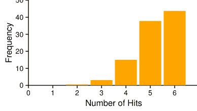

图 22.4：10,000 次试验中的 `Random` 性能

操作系统[版本 1.01]

`WWW.OSTEP.ORG`

越物理内存：策略

263

| 访问 | 命中/缺失？ | 逐出 | 结果缓存状态 |
|---|---|---|---|
| 0 | 缺失 | | `LRU→ 0` |
| 1 | 缺失 | | `LRU→ 0, 1` |
| 2 | 缺失 | | `LRU→ 0, 2` |
| 0 | 命中 | | `LRU→ 1, 2` |
| 1 | 命中 | | `LRU→ 2, 0` |
| 0 | 命中 | | `LRU→ 1, 3` |
| 3 | 缺失 | 2 | `LRU→ 0, 3` |
| 3 | 命中 | | `LRU→ 1, 0` |
| 1 | 命中 | | `LRU→ 0, 1` |
| 2 | 缺失 | 0 | `LRU→ 3, 2` |
| 2 | 命中 | | `LRU→ 2, 1` |

图 22.5：追踪 `LRU` 策略

## 22.5 使用历史：LRU

不幸的是，任何像 `FIFO` 或 `Random` 的策略都可能遇到共同的问题：它可能会逐出一个重要的页面，一个即将再次被引用的页面。正如调度策略所说，为了改进未来的缓存，我们再次依赖过去并以历史作为指南。例如，如果一个程序在最近访问了某个页面，它在未来可能会再次访问它。

页面替换策略可以使用的一种历史信息类型是*频率*；如果一个页面被访问了多次，也许不应该被替换，因为它显然具有某种价值。一种更常用的页面属性是访问的*新颖性*；一个页面越晚被访问过，它未来再次被访问的可能性就越大。

因此，一系列基于历史的简单算法就诞生了。最不经常使用 `LFU` 策略替换使用最少的页面。最久未使用 `LRU` 策略替换最近未使用的页面。为了更好地理解 `LRU`，让我们看看 `LRU` 在我们的上的表现。

### 无局部性工作负载

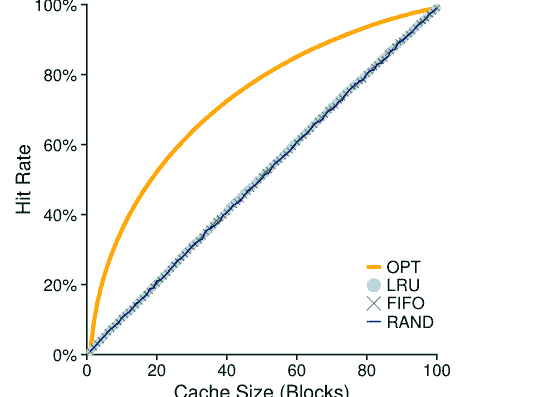

图 22.6：无局部性工作负载

图 22.6 绘制了最优 `optimal`、`LRU`、`Random` 和 `FIFO` 的实验结果。图的 y 轴显示了每个策略实现的速率；x 轴如上所述改变了缓存的大小。

我们可以从图中得出若干结论。首先，当工作负载中没有局部性时，使用哪种现实策略都无关要；`LRU`、`FIFO` 和 `Random` 的性能相同，命中率完全取决于缓存的大小。其次，当缓存大到能够容纳整个工作负载时，使用哪种策略也无所谓；当引用的块能够放入缓存中时，所有策略（甚至是 `Random`）都会收敛到 100% 的命中率。你可以看到，最优策略明显优于现实策略；通过预知未来，它似乎能够执行得更好的替换工作。

下一个例子是“80-20”工作负载，它表现出局部性：80% 的引用指向 20% 的页面（“热”页）；剩余 20% 的引用指向剩余 80% 的页面（“冷”页）。在我们的工作负载中，再次总共有 100 个页面；“热”页大部分时间被引用，“冷”页在剩余时间内被引用。图 22.7（第 266 页）显示了这些策略在此工作负载下的表现。

如你所示，`Random` 和 `FIFO` 的表现都尚可，`LRU` 在保留热页方面表现更好；由于这些页面在过去被频繁引用，它们在不久的将来很可能再次被引用。最优策略再次表现更优，说明 `LRU` 的历史信息并不完美。

### 80-20 工作负载

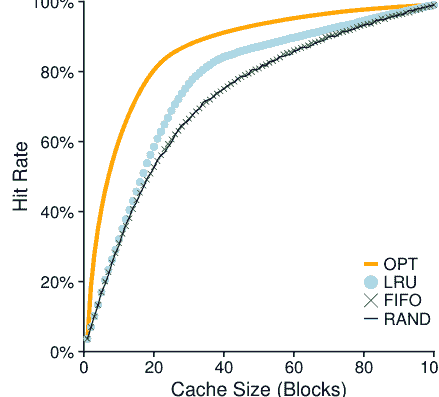

图 22.7：80-20 工作负载

你可能注意到：`LRU` 相于 `Random` 和 `FIFO` 的改进真的那么重要吗？答案一如常常，“视情况而定”。如果每次缺失的成本非常高（这并不罕见），那么命中率的微小增加（缺失率的降低）就能对性能产生巨大影响。如果缺失的成本并不那么高，那么 `LRU` 可能带来的收益自然没有那么重要了。

让我们来看最后一个工作负载。我们称之为“循环顺序工作负载”`looping-sequential workload`，因为我们按顺序引用 50 个页面，从 0 开始，然后是 1 ... 直到页面 49，然后循环重复这些访问，对 50 个唯一页面总共进行 10,000 次访问。图 22.8 中的最后一张图显示了这些策略在此工作负载下的行为。

这种情况在许多应用中（包括数据库 [CD85] 等重要的商业应用）中很常见，代表了 `LRU` 和 `FIFO` 的最坏情况。这些算法在循环顺序工作负载下会淘汰旧页面；遗憾的是，由于工作负载的循环，这些旧页面被访问的时间将比它们想要保留在缓存中的页面更早。事实上，即使缓存大小为 49，50 个页面的循环顺序工作负载也会导致 0% 的命中率。有趣的是，`Random` 的表现明显好得多，虽然没有达到最优水平，但至少实现了非零命中率。事实证明随机具有一些良好的特性；其中一个特性就是没有奇怪的边界情况行为。

### 循环顺序工作负载

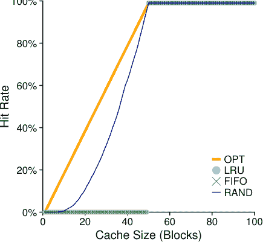

图 22.8：循环工作负载

### 22.7 实现历史算法

如你所示，像 `LRU` 这样的算法通常比比 `FIFO` 或 `Random` 等更简单的策略做得更好，后者可能会丢弃重要的页面。遗憾的是，历史策略为我们带来了新挑战：我们如何实现它们呢？

以 `LRU` 为例。为了实现它，我们需要做大量工作。具体来说，在每次页面访问时（即每次内存访问，无论是指令取指还是加载或存储），我们都必须更新某些数据结构，将该页面移动到列表的前端（即 `MRU` 侧）。相比之下，`FIFO` 页面列表只在页面被驱逐时（通过移除先进入的页面）或有新页面添加到列表时（添加到最后进入的侧）才会被更新。为了跟踪哪些页面是最近最少使用和最近使用的，系统必须在每次内存访问时进行一些计数。显然，如果不加留心，这种计数可能会极大地降低性能。

这里可以帮助的一种方法是增加一些硬件支持。例如，机器可以在每次页面访问时更新内存中的一个时间字段（这可以在每个进程的页表内，也可以在内存中的某个单独数组中，系统的每个物理页面有一个条目）。因此，当页面被访问时，硬件会将时间字段设置为当前时间。然后，在替换页面时，操作系统可以简单地扫描系统中的所有时间字段来找到。

## 内存之外：策略

如你所示，像 `LRU` 这样的算法通常比比 `FIFO` 或 `Random` 等更简单的策略做得更好，后者可能会丢弃重要的页面。遗憾的是，历史策略为我们带来了新挑战：我们如何实现它们呢？

以 `LRU` 为例。为了实现它，我们需要做大量工作。具体来说，在每次页面访问时（即每次内存访问，无论是指令取指还是加载或存储），我们都必须更新某些数据结构，将该页面移动到列表的前端（即 `MRU` 侧）。相比之下，`FIFO` 页面列表只在页面被驱逐时（通过移除先进入的页面）或有新页面添加到列表时（添加到最后进入的侧）才会被更新。为了跟踪哪些页面是最近最少使用和最近使用的，系统必须在每次内存访问时进行一些计数。显然，如果不加留心，这种计数可能会极大地降低性能。

这里可以帮助的一种方法是增加一些硬件支持。例如，机器可以在每次页面访问时更新内存中的一个时间字段（这可以在每个进程的页表内，也可以在内存中的某个单独数组中，系统的每个物理页面有一个条目）。因此，当页面被访问时，硬件会将时间字段设置为当前时间。然后，在替换页面时，操作系统可以简单地扫描系统中的所有时间字段来找到。

## 核心：如何实现 LRU

如你所示，像 `LRU` 这样的算法通常比比 `FIFO` 或 `Random` 等更简单的策略做得更好，后者可能会丢弃重要的页面。遗憾的是，历史策略为我们带来了新挑战：我们如何实现它们呢？

以 `LRU` 为例。为了实现它，我们需要做大量工作。具体来说，在每次页面访问时（即每次内存访问，无论是指令取指还是加载或存储），我们都必须更新某些数据结构，将该页面移动到列表的前端（即 `MRU` 侧）。相比之下，`FIFO` 页面列表只在页面被驱逐时（通过移除先进入的页面）或有新页面添加到列表时（添加到最后进入的侧）才会被更新。为了跟踪哪些页面是最近最少使用和最近使用的，系统必须在每次内存访问时进行一些计数。显然，如果不加留心，这种计数可能会极大地降低性能。

## 近似 LRU

这里可以帮助的一种方法是增加一些硬件支持。例如，机器可以在每次页面访问时更新内存中的一个时间字段（这可以在每个进程的页表内，也可以在内存中的某个单独数组中，系统的每个物理页面有一个条目）。因此，当页面被访问时，硬件会将时间字段设置为当前时间。然后，在替换页面时，操作系统可以简单地扫描系统中的所有时间字段来找到。

## 22.8 考虑脏页

这里可以帮助的一种方法是增加一些硬件支持。例如，机器可以在每次页面访问时更新内存中的一个时间字段（这可以在每个进程的页表内，也可以在内存中的某个单独数组中，系统的每个物理页面有一个条目）。因此，当页面被访问时，硬件会将时间字段设置为当前时间。然后，在替换页面时，操作系统可以简单地扫描系统中的所有时间字段来找到。

### 80-20 工作负载

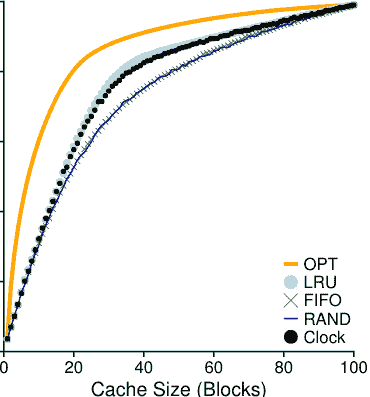

图 22.9：带 `Clock` 的 80-20 工作负载

`Clock` 算法的行为如图 22.9 所示。该变体在执行替换时随机扫描页面；当它遇到引用位为 1 的页面时，它会清除该位（设置为 0）；当它发现引用位为 0 的页面时，它将其选择为受害者。如你所示，它的表现没有完美的 `LRU` 好，但比那些完全不考虑历史的方法要好。

## 22.10 其他 VM 策略

页面替换并不是虚拟机 `VM` 子系统所采用的策略（尽管它可能是最重要的）。例如，操作系统还必须决定何时将一个页面调入内存。这种策略有时被称为“页面选择策略”（正如 `Denning [D70]` 所称的那样），它为操作系统提供了不同的选项。

对于大多数情况，操作系统简单地使用按需分页 `demand paging`，这意味着操作系统在页面被访问时才将其调入内存，即所谓的“按需”加载。当然，操作系统也可以预测某个页面即将被使用，从而提前将其调入内存；这种行为被称为预取 `prefetching`，并且应该在有较好成功率时才执行。例如，某些系统会假设，如果代码页 `P` 被调入内存，那么代码页 `P+1` 很可能在随后的被需要，因此应该被调入内存。

另一种策略决定了操作系统如何将页面换出到磁盘 `page out`。例如，它们可以一次写入一个；然而，许多系统转而是在内存中收集若干待写入的页面，并通过一次（更高效的）写入到磁盘。这种行为通常被称为聚类 `clustering` 或简单的写入分组 `grouping of writes`，它之所以有效是因为磁盘驱动器的特性——执行单次大写比执行多次小写要高效得多。

## 22.11 抖动 Thrashing

在结束之前，我们来讨论最后一个问题：当内存简单地过度订阅，运行进程集的需求超过了可用物理内存时，操作系统应该怎么办？在这种情况下，系统将不断进行分页，这种状态有时被称为抖动 `thrashing` [D70]。

一些早期的系统有一套相当复杂的机制来检测和应对发生时的抖动。例如，给定一组进程，系统可以决定不运行其中的某个子集，希望减少后的进程工作集（它们正在使用的页面）能够适应内存容量并取得进展。这种方法通常被称为准入控制 `admission control`，其优势在于它有时比尝试一次性完成所有任务的效果更好，我们在现实生活以及现代计算机系统中也经常遇到这种情况。

目前的一些系统对对过载采取了更严厉的方法。例如，`Linux` 的某些版本在内存过度订阅时会运行内存溢出杀手 `out-of-memory killer`；该守护进程会选择一个内存密集型进程并将其杀死，从而以一种并不微妙的方式减少内存占用。虽然这种方法成功减少了内存压力，但它可能会产生问题，例如，如果杀掉了 `X` 服务器，会导致任何需要显示的应用程序都无法使用。

## 22.12 总结

我们已经看到了许多页面替换（及其他）策略，这些策略是所有现代操作系统 `VM` 子系统的一部分。现代系统对简单的 `LRU` 近似算法（如时钟算法）进行了一些微调；例如，抗扫描 `scan resistance` 是许多现代算法（如 `ARC [MM03]`）的重要组成部分。抗扫描算法通常类似于 `LRU`，但也试图避免 `LRU` 的最坏情况行为（之前我们在循环顺序工作负载中看到过这种行为）。因此，页面替换算法的演进仍在持续。

然而，在许多情况下，上述算法的重要性已经有所降低，因为内存访问时间与磁盘访问时间之间的差异不断扩大。由于分页到磁盘的代价极高，过度分页的代价是无法接受的。因此，解决过度分页的最佳方案通常是简单的（尽管在智力上令人不满意）：买更多的内存。

# 272

# 物理内存之外：策略

## 参考文献

[AD03] Remzi H. Arpaci-Dasseau 的《River 中的时间自适应》。ACM TOCS, 21:1, 2003年2月。这是作者关于某个命名系统的博士论文工作的总结，他在那里了解到与理想状态进行比较是系统设计者的一项重要技术。

[B86] Laslo A. Bellamy 的《虚拟存储计算机替换算法研究》。IBM Systems Journal 5(2): 78-101, 1966。这篇文章引入了计算策略行为的简单方法（MIN 算法）。

[BS69] C. L. Berry, A. D. Nelson 和 G. S. Shedler 的《机器中运行的某些程序时空特性的某种异常》。Communications of the ACM, 12, 1969年6月。介绍了我们对 Belady 异常的极少了解。我们好奇，Nelson 和 Sheldon 对这个名字有何看法？

[CE85] 周宏泰，David J. DeWitt 的《关系型数据库缓冲区管理策略评估》。VL85, 斯德哥尔摩，1985年8月。一篇关于在常用数据库访问模式下应使用的缓冲策略的数据库论文。论文建议，对于你的工作负载，可以定制策略以获得比本文使用的通用策略更好的效果。

[CP96] F.J. Corbato 的《多系统分页实验》。包含在为 P.M.Morse 教授出版的纪念集中。MIT 出版社，马萨诸塞州剑桥市，1996年。该算法的原始（且难以寻找到）引用，而非一组位位的首次使用。我们好奇，Belady 算法是如何被应用的？

[D70] Peter J. Denning 的《虚拟内存》。Computing Surveys, 第2卷，第3期， 1970年9月。Denning 对虚拟内存系统的早期研究和综述。

[EF78] Malcolm C. Easton, Ronald Fagin 的《自缓存 vs. 热启动缺失策略》。Communications of the ACM, 1978年10月。对冷启动与热启动的讨论。

[EH89] Martin Fleischman, Stanley Pons 的《电感诱导偏转》（注：原文应为“机器中运行的某些程序时空特性的某种异常”）。Journal of Electrolytic Chemistry, 26, 1989年4。介绍了我们对 Belady 异常的极少了解。我们好奇，Nelson 和 Sheldon 对这个名字有何看法？（注：此处原文内容似乎存在引用混乱，译文遵循原文逻辑）。

[HP06] John Hennessy 和 David Patterson 的《计算机架构：定量方法》。这是一个关于缓存架构的著名著作。由于其包含在内，它获得了广泛关注。

[KE61] T. Turnbull, D.G. Edwards, M. Liang 的《单级系统存储》。IBM Transactions. 11-2, 1962。

[M70] R. Matson, J. Slutz, L. Taylor 的《存储技术的评估》。IBM Journal, 9, 1970。

[MM03] Nimrod Megcardo 和 Dharmendra S. Modha 的《自调优低开销缓存》。FAST 2003, 2003年2月。关于替换算法的优秀论文，包含了一种新策略 AC，现已用于系统中。2014年被存储系统社区授予“Test of Award”奖。

操作系统

版本 1.0

`WWW.ESTEP.ORG`

# 作业（模拟）

这个模拟器 `paging-policy.py` 允许你尝试不同的页面替换策略。详见 `README`。

# 问题

- 1. 使用以下参数生成随机地址：`-s 0 -n 10`, `-s 1 -n 10`, `-s 2 -n 10`。将策略从 `FIFO` 更改为 `LRU`。计算每次访问是命中还是缺失。

- 2. 对于大小为 5 的缓存，为以下策略生成最坏情况的地址引用流：对于最坏情况引用流，需要多大的缓存才能显著提高性能并接近 `OPT`（最优）？

- 3. 生成一个具有局部性的随机轨迹。你如何生成不同的策略来执行？

- 4. 现在生成一个具有局部性的轨迹。轨迹是如何产生的？`LRU` 在其上表现如何？比 `RAND` 好多少？`CLOCK` 表现如何？不同时钟位数的 `CLOCK` 又如何？

- 5. 使用 `valgrind` 等程序对真实应用程序进行插桩并生成虚拟页引用流。例如，`valgrind --tool=lackey --trace-mem=yes` 会输出程序 `ls` 的每个指令和数据引用的引用轨迹。为了使上述模拟器有用，你首先需要将每个虚拟内存引用转换为虚拟页号引用。对于你的应用程序轨迹，需要多大的缓存才能满足大部分请求？

# 完整的虚拟内存系统


在结束对内存虚拟化的学习之前，让我们仔细观察整个虚拟内存系统是如何组合在一起的。我们已经看到了此类系统的关键元素，包括各种页表设计、与 `TLB` 的交互（有时甚至由操作系统本身处理），以及决定哪些页面保留在内存中、哪些页面被换出的策略。然而，还有许多其他特性构成了一个完整的虚拟内存系统，包括许多用于性能、功能和安全性的特性。因此，我们的核心问题是了：

# 核心问题：如何构建一个完整的 VM 系统

实现一个完整的虚拟内存系统需要哪些功能？它们是如何提高性能、增加安全性或在其他方面改进系统的？

我们将通过介绍两个系统来完成任务。第一个是“现代”虚拟内存管理器的早期示例之一，见于 20 世纪 70 年代末和 80 年代初开发的 `VAX/VMS` 操作系统 `[LL82]`；该系统中有许多令人惊讶的技术和方法保留到了今天，非常值得研究。有些想法（即使是 50 年前的）仍然值得了解，这种想法在大多数其他领域（例如物理学）中本是众所周知的，但在技术驱动的学科（例如计算机科学）中必须被明确出来。

第二个是 `Linux`，其理由显而易见。`Linux` 是一个被广泛使用的系统，可以在从微小且性能不足的手机到现代数据中心中最具扩展性的多核系统等各种设备上高效运行。因此，它的 `VM` 系统必须足够灵活，以便在所有这些场景中成功运行。我们将讨论每个系统，以说明在前面的章节中引入的概念在完整的内存管理器是如何结合在一起的。

## 23.1 VAX/VMS 虚拟内存

`VAX` 微型计算机架构由数字设备公司 (`DEC`) 于 20 世纪 70 年代末引入。在微机时代，`DEC` 是计算机行业的一个巨头；遗憾的是，一系列糟糕的决策以及 `PC` 的出现缓慢地（但确实地）导致了它们的灭亡 `[C03]`。该架构通过多种实现方式得以实现，使用了 `VAX-11/780` 和性能较弱的 `VAX-11/750`。

该系统的操作系统被称为 `VAX/VMS`（或简称为 `VMS`），其首席架构师是 `Dave Cutler`，他后来领导了微软 `Windows NT` 的开发工作 `[C93]`。`VMS` 有一个通用问题，即它运行在广泛的机器上，包括同一架构族中的廉价机器（复数形式）以及极高端且强大的机器。因此，操作系统必须具有跨越这一系列系统的有效（且运行良好）的机制和策略。

另一个问题是，`VMS` 是软件用于隐藏架构某些固有缺陷的绝佳示例。操作系统通常依赖硬件来构建高效的抽象和幻象，但有时硬件设计者并不能把一切都做对；在 `VAX` 硬件中，我们将看到其中的几个例子，以及 `VMS` 操作系统如何在存在这些硬件缺陷的情况下构建一个有效、工作的系统。

### 内存管理硬件

`VAX-11` 为每个进程提供了一个 32 位的地址空间，划分为 512 字节的页。因此，一个虚拟地址由一个 23 位的 `VPN` 和 9 位的偏移量组成。`VPN` 的高两位用于区分其位于哪个段内；因此，正如我们之前看到的，该系统是分页和分段的混合体。地址空间的下半部分被称为“进程空间”，每个进程所独有。在进程空间的前半部分（称为 `P0`）中，可以找到用户程序，以及一个向下增长的堆。在进程空间的后半部分（`P1`）中，我们找到了向上增长的栈。地址空间的上半部分被称为系统空间 (`S`)，只使用了一半。受保护的 `OS` 代码和数据存储在这里，且 `OS` 在进程间共享的。

硬件设计者的一个主要关注点是 `VAX` 硬件中页面极其小的尺寸（512 字节）。这种尺寸由于历史原因被选中，其根本性问题是使得简单的线性页变得异常巨大。因此，`VMS` 设计者的最初目标之一是确保 `VMS` 不会被页表压垮内存。

系统将内存的页表压力减少到两个：通过将用户地址空间分为两部分，`VAX-11` 为每个进程的这些区域（`P0` 和 `P1`）各提供一个页表；

#### aside：通用性的诅咒

操作系统通常面临被称为“通用性诅咒”的问题，它们被要求对一大类应用程序和系统提供通用支持。这种诅咒的根本结果是操作系统不太可能很好地支持任何一个安装。在 `VMS` 的案例中，这种诅咒是非常真实的，因为 `VAX-11` 架构在许多不同的实现中得以实现。在今天它也同样不真实，因为人们期望 `Linux` 能在每部手机、电视顶盒、笔记本台式电脑以及在云数据中心运行数千个进程的高端服务器上运行良好。

因此，对于栈和堆之间地址空间的未使用部分不需要表空间。基寄存器（`base`）和界限寄存器（`bounds`）的作用正如你预期的那样：基寄存器持有该页表的地址，而界限寄存器持有其大小（即页表项的数量）。

其次，操作系统通过将页表（针对 `P0` 和 `P1`，每个进程两个）放置在内核虚拟内存中进一步减轻了内存压力。在分配或扩展页表时，内核从其虚拟内存（在 段 中）中分配空间。如果内存面临压力，内核可以将这些页表交换到磁盘，为其他部分留出物理内存。

将页表放在内核虚拟内存意味着地址翻译变得更加复杂。例如，为了翻译 `P0` 或 `P1` 中的虚拟条目，硬件必须首先在它的页表（`P0` 或 `P1`）中查找页表项；然而，硬件必须首先咨询系统页表，硬件持有页表的地址，最后获取所需内存访问的地址。幸运的是，这一切通过 `VAX` 硬件管理的 `TLB` 变得更快，`TLB` 通常（希望）可以避免这种繁琐的查找。

### 真实的地址空间

研究 `VMS` 的一个方面是我们可以看到真实的地址空间是如何构建的（图 23.1）。到目前，我们假设了一个由用户代码、用户数据和用户堆组成的简单地址空间，但正如我们上面看到的，真实的地址空间要复杂得多。

例如，代码段从从页 0 开始。相反，该页是不可访问的，以便为检测空指针访问提供支持。因此，设计地址空间时的一个考虑因素是对调试的支持，这里提供的不可访问零页以某种形式提供了这种支持。

可能重要的是，内核虚拟地址空间（即其数据结构和代码）是每个用户地址空间的一部分。在上下文切换时，操作系统更改 `P0` 和 `P1` 寄存器以指向即将运行的进程的相应页表；然而，它不会更改 `S` 基和界限寄存器，结果“相同的”内核结构被映射到每个地址空间中。


内核映射到每个地址空间是出于许多原因。这种构造让内核的工作变得更容易；例如，当 `OS` 从用户程序接收到一个指针时，它可以轻松地拷贝指针的数据。如果内核完全位于物理内存中，交换页表将变得困难。通过这种构造（现在被广泛使用），内核就像一个受保护的库。

#### aside：为什么指针访问会导致异常

你现在应该很好地理解空指针引用时发生了什么。程序通过类似下面的操作生成一个虚拟地址 0：

```c
int *p = NULL; // 将 p 设置为 0
*p = 10;      // 尝试向存储 10
```

硬件尝试在 `TLB` 中查找 `VPN`（这里也是 0），并咨询 `TLB`，结果发现 `VPN` 0 的条目被标记为无效。因此，产生无效访问，并将控制权转移给 `OS`（在 `Unix` 系统中，进程会收到信号，允许它们对这种异常做出反应；如果没有捕获，进程将被杀死）。

关于此地址空间的最后一点涉及保护。显然，`OS` 不希望用户访问读取或写入 `OS` 数据或代码。硬件必须支持不同的保护级别以来实现这一点。`VAX` 通过在页表中指定 `CPU` 必须处于何种权限级别才能访问特定页面来实现的。因此，系统数据和代码被设为比用户数据和代码更高的保护级别；从用户代码访问信息将产生进入 `OS` 的陷阱，并（你猜到的）导致冲突进程的终止。

`VAX` 页表项 (`PTE`) 包含以下位：有效位、保护位（4 位）、修改位（或脏位）、`OS` 使用预留字段（5 位），以及最后是用于存储物理内存位置的物理帧数 (`PFN`)。敏锐的读者可能会注意到没有引用位！因此，`VAX` 替换算法必须在没有硬件支持确定哪些页面是活跃的情况下应付。

开发者们还担心内存大户，即占用大量内存并使其他程序运行困难的程序。我们目前为止看到的大多数策略都容易受到这种内存占用的影响；例如，`LRU` 是一种全局策略，不会在进程之间公平地共享内存。

# 旁注：模拟参考位

事实证明，为了获取系统中哪些页面正在使用的概念，你并不需要硬件参考位（`reference bit`）。在 20 世纪 80 年代初，`Babuoglu` 和 `Joy` 展示了 `VAX` 上的保护位可以用来模拟参考位 `[BJ81]`。基本思想是：如果你想了解系统中的哪些页面正在被使用，将所有页面标记为不可访问；（保留关于进程真正可以访问页面的信息，或许存储在页表的“预留”`OS` 字段中）；如果进程访问了它，它将产生一个进入操作系统的陷阱（`trap`）；随后，操作系统将检查该页面是否应该是可访问的，如果是，则将页面恢复到正常保护状态（例如，只读或读写）。在进行替换时，操作系统可以检查哪些页面仍处于不可访问状态，从而推出哪些页面未被使用。这种“模拟”参考位的关键在于减少开销的同时，仍能获得对页面使用情况的良好掌握。操作系统在标记页面为不可访问时不能过于激进，否则开销会太高。操作系统在进行此类标记时也不能过于被动，否则所有页面最终都会被引用；操作系统将再次不知道应该驱出哪个页面。

为了解决这两个问题，开发者可以使用分段 `FIFO` 替换算法 `[Rl81]`。该想法非常简单：每个进程在内存中可以保留的最大页面数量，称为其驻留集（`RSS`）。每个页面都保存在 `FIFO` 列表中；当进程超过 `RSS` 时，“先进入”的页面就会被驱出。`FIFO` 显然不需要任何硬件支持，而且易于实现。

当然，正如之前所见，纯 `FIFO` 的性能并不特别好。为了提高 `FIFO` 的性能，`VMS` 引入了两个“第二次机会列表”（`second-chance lists`），页面在从内存中驱出之前会被放入其中，具体是一个全局空闲页列表和一个脏页列表。当页面 `P` 超过其 `RSS` 时，它从进程进程有的 `FIFO` 列表中移除；如果干净（未修改），它被放在干净页列表的末尾；如果脏（已修改），它被放在脏页列表的末尾。如果另一个进程 `Q` 请求，它将获取全局列表中的第一个空闲页。如果另一个页面 `P` 在该页面被回收之前发生缺页，在交换期间的小页面 `I/O` 可能会非常低效，因为磁盘更适合大块传输。为了使交换 `I/O` 更高效，`VMS` 增加了许多优化，但最重要的是聚类（`clustering`）。通过聚类，`VMS` 将大批页面分组并一次性写入磁盘（从而使其变为干净页）。聚类被用于绝大多数系统，因为在交换空间内任何位置放置页面的自由度让操作系统能够执行更少、更大的写入，从而提高性能。

# 其他巧妙妙招

`VMS` 还有两个技巧：按需置零（`demand zeroing`）和写时复制（`copy-on-write`）。我们将描述这些惰性优化。`VMS`（以及大多数现代系统）中的一种形式是页面的按需置零。为了理解这一点，让我们考虑向堆添加一个页面的例子。在朴素实现中，操作系统响应向堆添加页面的请求，方法是在物理内存中找到一个页面，将其清零，然后将其映射到你的地址空间中；否则你将看到页面上的内容。通过按需置零，当页面添加到你的地址空间时，操作系统仅执行少量工作；它在页表中放置一个条目，将页面标记为非活动。如果进程随后读取或写入该页面，它将陷入操作系统。在处理陷阱时，操作系统会（通常通过页表“预留”部分标记的某些位）发现这是预期的；此时，操作系统执行所需的工作：找到物理页面、将其清零并映射到进程中。如果进程从未访问该页面，则通过按需置零避免了所有工作。

在 `VMS`（以及几乎每个现代操作系统）中发现的另一个酷优化是写时复制（`COW`）。其描述如下：操作系统需要将页面从一个地址空间复制到另一个，而不是立即复制，而是将其映射到目标地址空间。如果只读取，则不采取任何操作；如果确实尝试写入，它将陷入操作系统。处理陷阱时，操作系统（惰性地）分配一个新页面，填充数据，并将其映射到进程中。`COW` 在许多情况下都是有用的，任何共享库都可以映射到许多进程，从而节省内存。在 `UNIX` 系统中，`COW` 更为关键，由于 `fork()` 的语义。正如你记得，`fork()` 创建了调用者地址空间的精确拷贝；对于大型地址空间，这样做缓慢且耗费资源。更糟糕，随后的 `exec()` 会覆盖该地址空间。通过写时复制，操作系统避免了许多不必要的复制并保持了正确的语义，提高了性能。

# 提示：要懒性

懒性在生活中和操作系统中都是一种美德。懒性可以将工作推迟到以后，这对操作系统是有益的。首先，推迟工作可能会减少当前操作的延迟，从而提高响应；例如，操作系统立即报告成功，然后在后台写入。其次，更重要的是，懒性消除了工作的需要；例如，延迟执行删除进程。懒性在生活中也有好处：例如，通过推迟你的 `OS` 项目，你可能会发现项目规范由你的同学完成了；然而，课程项目不太可能取消，所以过于懒惰可能会导致问题，导致项目迟交、成绩不佳以及教授难过。不要让教授难过！

# 完整的虚拟内存系统

`0x00000000`, `0xC000FFF` 到 `0x0000FFF`，以此此类推。这种直接映射有两个影响。第一是在内核逻辑地址和物理地址之间进行相互回译非常简单；结果是，这些地址通常被视作物理地址。第二是，如果一段内存存在内核逻辑空间中是连续的，那么它在物理内存中也是连续的。这使得在内核地址空间这部分分配的内存可以用于需要连续物理内存才能正常运行的操作，例如通过直接内存访问（`DMA`）与设备进行 `I/O` 传输（我们将在本书的第三部分学习这些）。

另一种类型的内存地址是内核虚拟地址。当获取这种类型的内存时，内核代码会调用不同的分配器 `valloc`，它返回一个指向目标内存中虚拟连续区域的指针。与内核逻辑内存不同，内核虚拟内存通常是非连续的；内核虚拟页可能映射到不连续的物理页（因此不适合 `DMA`）。然而，这种内存更容易分配，因此对于较大的缓冲区，寻找一段连续的物理内存块将是具有挑战性的。

在 32 位 `Linux` 中，内核虚拟地址存在的另一个原因是，它们允许内核访问超过（大约） 1 `GB` 的内存。多年前，机器的内存少于此，访问 1 `GB` 并不是一个问题。然而，随着技术的进步，需要允许内核使用更大容量的内存。内核虚拟地址以及它们与物理内存严格的一一映射的脱离，使得这成为可能。然而，在 64 位 `Linux` 中，这种需求不再那么紧迫，因为内核不再局限于虚拟地址空间的最后 1 `GB`。

## 页表结构

由于我们的讨论侧重于 `Linux`，因此重点将围绕 `x86` 提供的页表结构类型展开，因为它决定了 `Linux` 能做什么和不能做什么。如前所述，`x86` 提供了硬件级多级页表结构，每个进程有一个页表；操作系统在内存中设置映射，页目录起始处的一个特权寄存器处理其余部分。正如预期的那样，操作系统会在进程创建、删除以及上下文切换时介入，确保在种情况下硬件 `MMU` 均使用正确的页来转换地址。

最近最大的变化可能是上述的从 32 位到 64 位 `x86` 的迁移。正如 `VAX/VMS` 系统一样，32 位地址空间已经存在很长时间，随着技术的变化，它们最终开始成为程序的实际局限。虚拟内存使得系统编程变得容易，但由于现代系统包含许多 `GB` 的内存，32 位已不足以触及其中的每一块内存。因此，下一次飞跃变得十分必要。

迁移到 64 位地址会以预期的方式影响 `x86` 的页表结构。由于 `x86` 使用多级页表，当前的 64 位系统使用四级页表。然而，虚拟地址空间的完整 64 位特性并未被使用，而是仅使用了低 48 位。因此，一个虚拟地址可以看作：

| 63 | 47 | 31 | 15 | 0 |
|---|---|---|---|---|
| 未使用 | `P1` | `P2` | `P3` | `P4` | 偏移量 |

如图片所示，虚拟地址的高位 16 位是未使用的（因此在转换中不起作用），低位 12 位（由于 4-`KB` 的页大小）用作偏移量（因此直接使用，不进行转换），留下虚拟地址中间的 36 位参与转换。地址的 `P1` 部分用于索引最顶层的页目录，转换从那里开始逐级进行，直到由 `P4` 索引到页表的实际页，从而产生所需的页表项。

随着系统不断变大，这个庞大地址空间中的更多部分将被启用，导致五级并最终六级页表树结构的出现。想象一下：一个简单的页表需要六级转换，才能确定某段数据位于内存何处。

## 大页支持

`Intel x86` 允许使用多种页大小，而不只是标准的 4-`KB` 页。具体而言，硬件设计支持 2-`MB` 和 1-`GB` 页。因此，随着时间的推移，`Linux` 演变为允许应用程序利用大页（在 `Linux` 世界中被称为 `huge pages`）。正如正如提到的，使用大页带来了许多益处。正如 `VAX/VMS` 所示，设计减少了页表中所需的映射数量；页越大，映射越少。然而，页表项并不是大页的驱动力；相反，更好的 `TLB` 行为以及相关的性能提升。

当进程使用大量内存时，它会用翻译信息填充 `TLB`。如果这些翻译是针对 4-`KB` 页的，那么在不引起 `TLB` 缺失的情况下，只能访问少量的总内存。研究表明，对于在具有许多 `CPU` 的机器上运行的现代“大内存”负载，内存是一个显著的性能成本；研究显示，某些应用程序 10% 的周期消耗在 `TLB` 缺失上 `[B+13]`。

大页允许进程通过较少的 `TLB` 槽位访问大范围内存而不引起 `TLB` 缺失，这是其主要优势。

## 页缓存 (The Page Cache)

为了降低使用持久化存储（本书第三部分的重点）的成本，大多数系统使用激进的缓存子系统将热门数据留在内存中。在这方面，`Linux` 与传统操作系统并无区别。

`Linux` 的页缓存是统一的，它将来自三个来源的页留在内存中：内存映射文件、设备的数据和元数据（通常通过将 `read()` 和 `write()` 调用指向系统来访问），以及组成每个进程的堆栈（有时被称为匿名内存，因为底层没有命名文件，但有交换空间）。这些实体被存储在页缓存哈希表中，允许在需要数据时快速设置。

页缓存跟踪“洁页”（已读但未更新）或“脏页”（即已修改）。脏数据由后台线程（称为 `flush()`）定期写回后存储（即写入特定的文件数据，或写入匿名区域的交换空间），以确保被修改的数据最终被写回持久化存储。这种后台活动发生在一段时间后，或者当有许多页面被视为脏页时（这两者都是可配置的参数）。

在某些情况下，系统内存不足，`Linux` 必须决定将哪些页面移出内存以释放空间。为此，`Linux` 使用了改进形式的 `2Q` 替换算法 `[JS94]`，我们在这里对其进行描述。

基本思想是：标准的 `LRU` 替换是有效的，但如果一个进程反复访问一个大文件（尤其是一个接近内存大小或更大的文件），`LRU` 将将每个文件都踢出内存。即使在内存中保留该文件的部分是有用的，因为它们在被踢出内存之前从未被再次引用过。


Linux 版本的 2Q 替换算法通过保留两个列表并在它们之间分配内存来解决这个问题。当页面被首次访问时，它被放置在一个队列中（原始论文中称为 A1，但在 Linux 中称为非活动列表 `inactive list`）；当它被再次引用时，页面会被提升到另一个队列（原始中称为 A2，但在 Linux 中称为活动列表 `active list`）。当内存不足并发生置换时，替换候选将从非活动列表中选取。Linux 还会将活动列表底部的页面移动到非活动列表，保持总页缓存大小的三分之二 [G04]。

Linux 理想情况下按 LRU 顺序管理这些列表，但正如前面的章节所述，这样做成本很高。因此，在许多操作系统中，使用了 LRU 的近似算法（类似于时钟替换）。

这种方法行为上通常类似于 LRU，但显著特点是通过将循环访问的页面限制在非活动列表中，有效地处理了发生循环大文件访问的情况。由于这些页面在被踢出内存之前从未被再次引用，它们不会刷掉位于活动列表中的其他有用页面。

# 旁注：内存映射的普遍性 (THE UBIQUITY OF MEMORY-MAPPING)

内存映射比 Linux 早几年，并用于 Linux 以及其他现代系统的许多地方。其原理非常简单：调用 `mmap()` 不会复制已打开的文件描述，而是向进程返回一个虚拟内存区域起始处的指针，该文件的内容位于该区域。通过使用该指针，进程可以通过简单的指针解引用访问文件的任何部分。

对尚未加载到内存的内存映射文件的访问会触发页错误，此时操作系统将分页入相关数据并通过更新页表使其可访问（即按需分页）。

每个标准的 Linux 进程都会使用内存映射文件，即使是 `main()` 中的代码也没有调用 `map()`，这是由于 Linux 将可执行文件和共享库代码加载到内存的方式。以下是 `pmap` 命令行工具的（高度简略的）输出，显示了构成运行程序虚拟空间的不同映射（在本例中为 shell，即 `tsh`）。输出显示了四列：映射的虚拟地址、大小、保护位以及映射的来源：

```
0000000000  372K r-x-- tsh
0000000001d95000  178K rw---- [ anon ]
0000000f4e7cf0600 1792K r-x-- libc-23.so
0000000f4e7d2d000   36K r-x-- libcrypt-23.so
0000000f4e7d50800  148K r-x-- libinfo.so.9
0000000f4e7d31000  152K r-x-- id-23.so
0000000f4e7d32000   16K rw---- [ stack ]
```

从输出可以看出，`tsh` 二进制文件、来自 `lib`、`libinfo` 以及动态链接器本身（`id.so`）的代码都映射到了地址空间。此外还有两个匿名区域：堆（标记为 `anon`）和栈（标记为 `stack`）。内存映射文件为操作系统构建地址空间提供了一种直接且高效的方法。

# 安全与缓冲区溢出 (Security And Buffer Overflows)

现代系统（Linux, Solaris 或 BSD 变体）与古老系统（VAX/VMS）之间最大的区别可能在于对安全的强调。安全一直是操作系统的关注焦点，但随着机器比以往任何时候都相互连接，开发者实现了各种防御措施来防止黑客控制系统。

# 虚拟内存系统 (VIRTUAL MEMORY SYSTEMS)

一个主要威胁存在于缓冲区溢出攻击。这类攻击的想法是在目标系统中找到一个漏洞，允许攻击者向地址空间注入任意数据。这种漏洞有时出现是因为开发者（错误地）假设输入不会过长，然后（信任）将输入复制到缓冲区；因为输入实际上太长了，它溢出了缓冲区，覆盖了目标内存。如下代码所示：

```
int some_function(char *input) {
char dest_buffer[100];
strcpy(dest_buffer, input); // 噢，无边界拷贝！
}
```

在许多情况下，这种溢出并不是灾难性的，例如传递给用户程序的意外输入可能会导致其崩溃。然而，恶意程序可以精心构造溢出缓冲区的输入，将自己的代码注入目标系统，本质上允许他们随心所欲。如果成功，攻击可以访问更多资源，并形成权限提升（即用户获得内核权限）。如果不猜，这些都是坏事。

缓冲区溢出的第一个最简单的防御是防止在地址空间的某些区域（例如栈内）执行任何代码。`NX` 位（AMD 在其 x86 版本中引入，Intel 现在也提供了类似的位）是这种防御之一；它防止执行任何在页表项中设置了位的页。这种方法防止了攻击者注入目标栈的代码被执行，缓解了问题。

然而，攻击者是聪明的，当注入的代码无法被编辑时，恶意代码可以执行任意代码序列。这种想法通常被称为面向返回的编程 (`ROP`) [507]，它确实非常出色。关于 `ROP` 的观察是，在任何程序的地址空间中都有许多代码片段（ROP 术语中称为 gadgets/getgets），后面跟着一个返回指令。通过串联来收集大量的 gadgets（即确保每次返回都跳转到下一个 gadget），攻击者可以执行任意代码。太惊人了！

为了防御 `ROP`（其早期形式返回-to-libc 攻击 [+04]），Linux（以及其他系统）增加了另一种防御，称为地址空间随机化 (`ASLR`)。操作系统不再将代码、栈和堆放在地址空间内的固定位置，而是随机化它们的位置，使得编写此类攻击的复杂代码变得非常有挑战性。有趣的是，你可以在实践中很容易观察到这种随机性。这里有一段在现代系统上演示它的代码：

```
int main(int argc, char *argv[]) {
    int stack = 0;
    printf("%p\n", &stack);
    return 0;
}
```

在非 `ASLR` 系统中，栈上变量的值将是相同的。但如下所示，该值随运行而变化：

```
prompt> ./run
0xffd3e55d2b4
prompt> ./run
0xff1033b8f4
prompt> ./run
0xff45522e9a4
```

`ASLR` 是用户级程序的一个有用防御，它也被整合到了内核中，我们形象性地将其命名为内核地址空间随机化 (`KASLR`)。然而，事实证明内核可能面临更更大的问题要处理，正如我们接下来讨论的那样。

# 其他安全问题：Meltdown 和 Spectre (Other Security Problems: Meltdown And Spectre)

当我们写下这两章时（2018 年 8 月），系统安全世界被两种新的且相关的攻击搞得天翻地覆。第一种称为 Meltdown，第二种称为 Spectre。它们由四个不同的研究人员/工程师同时发现，并导致了人们对计算机硬件和上述操作系统提供的基本保护产生了深度质疑。我们可以通过 `meltdownattack.com` 和 `spectreattack.com` 查看详细描述每种攻击的论文。Spectre 被认为是两者中更有问题的。

OPERATING SYSTEMSn[Version 1.01]

WWW.OSTEP.ORG

# 虚拟内存系统

这些攻击中利用的通用弱点是：现代系统中的 CPU 会在后台执行各种“疯狂”的技巧以提高性能。处于该问题核心位置的一类技术被称为**推测执行**（speculative execution），CPU 会预测未来将执行某些指令，并提前启动它们。如果预测正确，程序运行得更快；如果预测错误，CPU 就会撤销这些操作对体系状态（例如寄存器）的影响，并重新尝试，这次会走正确的路径。

推测执行的问题在于，它往往倾向于在系统的各个部分留下执行痕迹，例如处理器缓存、分支预测器等。正如攻击者所展示的，这种状态可能会受到内存内容的影响，即使是那些受 `MMU`（内存管理单元）保护的内存。

增强内核保护的一种方法是从每个用户进程中移除大部分内核地址空间，并为大多数内核数据设置独立的内核页表（称为**内核页表隔离**，或 `KPTI`）[G+17]。因此，不再将内核的代码和数据结构映射到每个进程中，而是只保留最少的内容；当切换到内核态时，需要切换到内核页表。这样做提高了安全性并避免了攻击向量，但付出了代价：切换页表在便利性和性能上都是昂贵的。

遗憾的是，`KPTI` 并没有解决上述所有的安全问题，只解决了大部分问题。简单的解决方案（如关闭推测执行）几乎没有意义，因为系统的运行速度会慢数千倍。因此，如果你对系统安全感兴趣，现在是一个活在这个世界上非常有趣的时代。

要真正理解这些攻击，你（可能）需要先学习一些知识。可以从该主题的高级书籍开始学习现代计算机架构，专注于推测执行以及实现它所需的所有机制。一定要在上述提到的网站上阅读 Meltdown（熔融漏洞）和 Spectre（幽态漏洞）攻击的文章；这些网站实际上还包含了一份关于推测执行的实用入门介绍，因此也许不是坏的起点。并学习操作系统以发现更多漏洞。谁知道还存在什么问题呢？

## 23.3 总结

你已经对两个虚拟内存系统进行了从上到下的回顾。情况下，大部分细节都很容易理解，因为你应该对基础机制和策略有了良好的理解。关于 VAX/VMS 的更多细节可以参考 Levy 和 Lipman 写的优秀且简洁的论文 [LL82]。我们鼓励你阅读它，因为这是了解这些章节背后源材料的极方法。

你还学习了一些关于 Linux 的知识。虽然它是一个庞大复杂的系统，但继承了过去的许多优秀思想，其中许多我们还没有详细讨论。例如，Linux 在 `fork()` 时会对页面执行**懒写时复制**（lazy copy-on-write），从而通过避免不必要的拷贝来降低开销。Linux 还要求对 `/dev/zero` 设备进行内存映射，并有一个后台交换守护进程（`swapd`）将页面交换到磁盘以减轻内存压力。事实上，虚拟内存（VM）充满了取自过去的好主意，也包含了许多创新。

要了解更多信息，请查看这些合理的（尽管遗憾的是已经过时了）书籍 [BC05, G04]。我们鼓励你独立阅读，因为面对海洋般的复杂性，我们只能提供最少的一滴。但你必须从某处开始。海洋又何不是无数水滴构成的呢？[M04]

# 完整的虚拟内存系统

# 参考文献

- [B+13] "Efficient Virtual Memory for Big Memory Servers", A. Basu, J. Gandhi, J. Chang, M. D. Hill, M. M. Swift. ISCA 15, 2013年6月13日，以色列特拉维夫。近期的一项工作显示 TLB 至关重要，在大内存工作负载中消耗了 10% 的周期。解决方案是：使用一个巨大的段来存放数据集。我们回溯过去，以便恢复。

- [BB72] "TENEX, A Paged Time Sharing System for PDP-10", D. Dobson, J. D. Burch, F. L. Murphy, R. S. Thomson. ACM, 第15卷, 1972年。一个早期的分时操作系统，产生了许多优秀思想。写时复制只是其中之一；它也是现代操作系统、虚拟内存管理和文件系统的灵感。

- [C81] "Converting a Segment-Based to a Paged Architecture Locking Page-Reference Bits", B. Badalaga, W. N. Noy. IOS '81, 加利福尼亚州帕西格罗夫，1981年12月。由伯克利一个开发其 UNIX 版本（BSD）的团队编写，关于模拟引用位进行攻击保护机制的佳读。该小组在虚拟内存的发展中具有影响力。

- [C05] "Understanding Linux", W. Love, and M. Ceseti. O'Reilly Media, 2005年11月。你可以找到的关于 Linux 的众多书籍之一，虽然日期很久，但仍然值得读。

- [C03] "The Innovator's Dilemma", Clayton Christensen. Harper Publishers, 2003年。一本关于磁盘驱动行业以及新创新如何颠覆现有技术的精彩书籍。业务经理和计算机科学家的佳读。提供了关于大型且成功的公司如何彻底失败的见解。

- [C93] "Windows NT", H. C. Suter. Microsoft Press, 1993年。一本关于 Windows NT 的书，从顶层解释了该系统，细节比你想象的要多。一本很好的书。

- [C04] "Understanding Virtual Memory Management", M. Gorman. Prentice Hall, 2004年。对 Linux 虚拟内存深度观察，但也涉及其他内容。

- [G17] "Live KASLR", D. Grus, M. Milch, M. Schwarz, R. Petit, C. Santiago. Engineering Security and Systems, 2017。地址：https://grus.fi/files/kaslr.pdf 关于 KASLR、KPTI 及后续的关键信息。

- [Q94] "A Low Overhead Performance Buffer Replacement Algorithm", T. Johnson, S. Shasta. VLDB '94, 1994年智利。一种简单但高效的页面替换方法。

- [L82] "Virtual Memory in the VAX/VMS Operating System", H. Levy, P. Lipman. IEEE Computer, 第15卷3期, 1982年。本文的原始。如果你想读研究生，这尤为重要，因为在那里你只需要读更多论文、做更多工作、有效地写一篇论文，然后是更多。

- [RI16] "Virtual Memory and Linux", A. Ott. IEEE Linux Conference, 2016年。https://events.linuxfoundation.org/sites/events/files/0216_mem.pdf。一组非常有用的幻灯片，概述了 Linux 虚拟内存。

- [S07] "The Geometry of Return-Oriented-Programming without Functions (on the x86)", H. Shacham, CCS '07, 2007年10月。无函数面向返回编程（ROP）的泛化。《危险的恋》中的 Beth Garner 博士说：“太疯狂了！”这就是我们对 ROB 的打法。

- [S04] "On the Effectiveness of Address-space Randomization", H. Shacham, M. Page, B. Pfaff, E. J. Geb, N. M. Modaddu, D. Boneh. CCS '04, 2004年10月。关于的描述。

# 关于内存虚拟化的对话总结

**学生：** 嗯，我想我现在对进程引用内存时发生了什么有了相当清楚的理解。正如你多次看到的那样，这在每次指令取指以及显式的加载和存储时都会发生。

**教授：** 听起来不错——告诉我吧。

**学生：** 嗯，我能记住的是，我们在用户程序（比如用 C 语言编写）中看到的地址……

**教授：** 有什么语言？

**学生：** （继续说道）……是的，我知道像 C。我也是！正如我所说的，现在真的知道程序内观察到的所有地址都是虚拟地址；我作为一个程序员，只是得到了关于数据和代码在内存中位置的幻觉。我以前以为我可以打印指针的地址，但现在发现这很令人沮丧——它只是一个虚拟地址！我看不到数据实际所在的物理地址。

**教授：** 不，那是操作系统向你隐藏了它。还有别的吗？

**学生：** 嗯，`TLB` 是一个关键部分，它通过一个小小的地址转换硬件缓存来保护系统。页表通常很大，存储在大型缓慢的内存中。如果没有 `TLB`，程序的运行速度一定会慢得多。看来 `TLB` 真正让内存虚拟化成为可能。我无法想象一个没有 `TLB` 的系统！想到一个集合超过了 `TLB` 覆盖范围的程序，我不禁而栗：会有那么多 `TLB` 缺失（miss），简直没法看。

**教授：** 是的，捂住孩子们的眼睛！除了 `TLB` 之外，你还学了什么？

**学生：** 我还知道页表是你需要了解的数据结构之一；不过它只是一种数据结构，意味着几乎任何结构都可以。我们从简单的结构开始，比如数组（也称为线性页表），一直发展到多级页表（看起来像树），甚至更疯狂的东西，比如内核虚拟内存中的可倒链页表。这一切都是为了在内存中节省一点空间！

**教授：** 确实如此。

**学生：** 还有一点的一点：学到了地址结构足够灵活，允许程序员对他们的地址空间进行各种操作。因为多级页表在这方面是完美的；它们只在用户需要地址空间的一部分时才创建页表空间，因此浪费很少。早期的尝试，比如简单的基址和边界寄存器，并不灵活；结构需要匹配用户对虚拟内存系统的期望和需求。

**教授：** 这是一个很好的视角。那我们学的关于交换到磁盘（swapping）的那些内容呢？

**学生：** 嗯，研究这些确实很有趣，了解页面替换是如何工作的。有些基本策略是显而易见的（比如 LRU），但构建一个虚拟内存系统似乎非常有趣，就像我们在 VMS 案例研究中看到的那样。但不知为什么我觉得机制更有趣，而策略没那么有趣。

**教授：** 噢，为什么呢？

**学生：** 嗯，正如你所说，解决策略问题的最佳方案很简单：买更多的内存。但要知道事情到底是如何运作的，你需要理解机制。说起这个……

**教授：** 怎么？

**学生：** 嗯，我的机器最近运行有点慢……而且内存其实并不贵……

**教授：** 噢行了，行了！这给你几块钱。去买点 DRAM 吧，吝啬鬼。

**学生：** 谢谢教授！我再也不会交换到磁盘了——或者，如果我真的做了，至少我会知道到底发生了什么！

# 第二部分

# 并发

# 关于并发的对话

**教授：** 这样，我们到达了操作系统三大支柱中的第二个：并发。

**学生：** 嗯……我以为有四个桃子（pillars）……

**教授：** 不，那是书的旧版本。

**学生：** （打断）又是桃子！并发到底有什么问题，噢伟大的教授？

**教授：** 嗯，想象我们有一个桃子——

**学生：** （打断）你和桃子之间是怎么了？

**教授：** 读过 T.S. 艾略特吗？《阿尔弗雷德·普鲁弗洛克的恋爱情之歌》，里面有“我敢吃桃子吗”之类的那些有趣的内容？


**学生：** 噢是的！高中的英语课上上过。很棒的内容！我很喜欢那部分

**教授：** （打断）这和那个没关系——我喜欢桃子。总之，想象桌子上有很多桃子，有很多人想吃它们。假设我们这样做：每个吃桃子的人先通过视觉识别一个桃子，然后尝试抓住它并吃掉。这种方法有什么问题？

**学生：** 唔……似乎你会错过一个别人也看到的桃子。如果他们先到，当你伸手时，你就没桃子吃了！

**教授：** 没错！那么我们该如何处理呢？

**学生：** 嗯，可能得开发一种更好的方法。也许排个队，当你排到最前面时，拿一个桃子然后继续。。

**教授：** 好！但你的方法又有什么问题呢？

**学生：** 是的。

**学生：** 好的，让我想想。嗯，我们以前是许多人同时抢桃子，那样速度更快。但在我的方法里，我们只是一个接一个，虽然是正确的，但慢得多。最好的方法可能是既快又准确的。

**教授：** 你真的开始让我印象深刻了。事实上，你刚刚告诉了我们关于并发所需要的所有知识！做得好。

**学生：** 我说了？我原以为我们只是在聊桃子呢。记得吧，这通常是你把话题绕回到计算机上的环节。

**教授：** 确实。我的抱歉！人们永远不要忘记那些我们称为多线程应用程序的特定程序；每个线程都像是一个在内存中运行的独立代理，对于它们来说，每个内存单元都像那些桃子之一。如果我们不协调线程之间的内存访问，程序将无法按预期工作。明白吗？

**学生：** 差不多是吧。但我们为什么要在操作系统课上讲这个？那不只是应用程序编程的吗？

**教授：** 问得好！实际上有几个原因。首先，操作系统必须通过锁和条件变量等原语支持多线程应用程序，我们很快就会讨论这些。其次，操作系统本身是第一个并发程序——它必须非常小心地访问内存，否则就会发生很多奇怪而可怕的事情。真的，这可能很有风险。

**学生：** 我明白了。听起来很有趣。我想还有更多细节吧？

**教授：** 确实有……

# 并发：引论

为止，我们已经看到了操作系统所执行的基础抽象的演变。我们看到了如何将单个物理 CPU 转换为多个 CPU，从而产生多个程序同时运行的幻觉。我们还看到了如何为每个进程创建一个大型私有虚拟内存的幻觉；这种地址空间的抽象使得每个程序的行为都就像它拥有自己的内存一样，而实际上操作系统正在物理内存（有时是磁盘）上对地址空间进行复用。

在本文中，我们为单个运行的进程引入了一种新的抽象：线程。不同于我们对程序内单个执行点的经典观点（即一个从其处取指并执行指令的单 PC），多线程程序有多个执行点（即多个 PC，每个 PC 都在被被取指和执行）。每个线程都是一个独立的进程，只是它们共享相同的地址空间并可以访问相同的数据。

线程的状态与进程的状态非常相似。它有一个程序计数器（PC），用于跟踪程序取指的位置。每个线程都有自己的一套私有寄存器，用于计算；如果有两个线程在单个处理器上运行，当从其中一个（T1）切换到另一个（T2）时，必须发生上下文切换。线程之间的上下文切换与进程之间的上下文切换非常相似，因为在运行 T2 之前必须保存 T1 的寄存器状态并恢复 T2 的寄存器状态。对于进程，我们将状态保存到进程控制块（PCB）中；现在，我们需要一个或多个线程控制块（TCB）来存储每个线程的状态。不过，我们在线程和进程之间执行的上下文切换中有一个主要区别：地址空间保持不变（即不需要切换我们正在使用的页表）。

线程和进程之间的一个主要区别涉及栈。在我们经典进程地址空间的简单模型中

# 并发：引论

| 程序代码 | 程序代码 |
| --- | --- |
| 0KB | 0KB |
| 1KB | 1KB |
| 堆 | 堆 |
| 2KB | 2KB (空) |

代码段：

指令存放的地方

堆段：

包含 `malloc()` 和动态数据结构（它向正向增长）

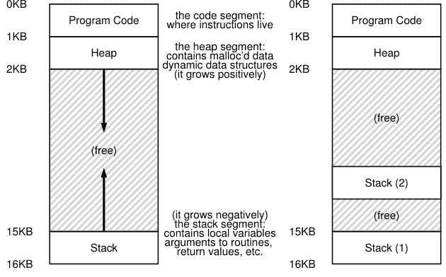

**图 26.1：单线程与多线程地址空间**

（我们现在可以称之为**单线程**进程），它只有一个栈，通常位于地址空间的底部（图 26.1，左侧）。

然而，在多线程进程中，每个线程都独立运行，并可能调用各种例程来执行它们正在执行的任务。地址空间中不再单一栈，而是每个线程一个栈。假设我们有一个包含两个线程的多线程进程；结果地址空间看起来就会不同（图 26.1，右侧）。

在图中，你可以看到两个栈分布在进程的地址空间中。因此，任何栈分配的变量、参数、返回值以及我们放在栈上的其他东西将存放在所谓的**线程本地**（thread-local）存储中，即——相关线程的栈。

你可能还会注意到这如何影响我们优美的地址空间布局。之前，栈和堆可以独立增长，只有当地址空间空间用尽时才会出现问题。在这里，我们不再有这种理想的情况了。幸运的是，这通常没问题，因为栈通常不需要很大（例外是大量使用递归的程序）。

## 26.1 为什么要使用线程？

在进入线程的细节以及你在编写多线程程序时可能遇到的某些问题之前，让我们先回答一个更简单的问题：为什么要使用线程？

事实证明，至少有两个主要理由说明你应该使用线程。第一个原因很简单：并行性。想象你正在编写一个对大数组执行操作的程序，例如，将两个大数组相加，或者将数组中每个元素的值增加某个量。如果你只在单个处理器上运行，任务是直观的：执行每个操作并完成。然而，如果你在具有多个处理器的系统上执行程序，你就有潜力通过使用处理器执行工作的每个部分来加速这一过程。将你的单线程程序转换为在多个 CPU 上执行此类工作的程序的任务被称为并行化（parallelization），即每个 CPU 使用一个线程来完成工作，这是让程序在现代硬件上运行的一种自然且典型的方式。

第二个理由是一种避免由于慢 I/O 导致阻塞的微妙方法。如果你正在编写一个执行不同类型 I/O 的程序：要么等待发送或接收消息，要么等待一个页面完成。与其等待，你的程序可能希望做些其他事情，利用 CPU 进行计算，甚至发出 I/O 请求。使用线程是避免卡住的自然方法；当你程序中的一个线程在等待（即——被阻塞）时，调度器可以切换到其他准备好执行其他事情的线程。线程使得单个程序内的 I/O 与其他活动重叠，这实现了跨程序的进程多程序处理；因此，现代基于服务器的应用程序（Web 服务器、数据库管理系统等）在它们的实现中都使用了线程。当然，在上述情况下，你可以使用多个进程代替线程。然而，线程共享地址空间，因此易于共享数据，因此在构建这类不需要大量数据结构共享的程序时，它是自然的选择。

## 26.2 示例：线程创建

让我们进入细节。假设我们想要运行一个创建两个线程的程序，每个线程执行一些工作，打印“A”或“B”。代码如图 26.2 所示。

主程序创建两个线程，每个线程将带有不同的参数（字符串 A 或 B）运行函数 `mythread()`。一旦创建，它可能会立即开始运行（取决于调度器的随心所欲）；或者，它可能被置于“就绪”状态但尚未“运行”。当然，在多处理器上，线程甚至可以同时运行，但我们先不用担心这个问题。

```c
#include <stdio.h>
#include <assert.h>
#include <pthread.h>
#include "common.h"
#include "common_threads.h"

void mythread(void *arg) {
    printf("%s\n", (char *)arg);
    return NULL;
}

int main(int argc, char *argv[]) {
    pthread_t p1, p2;
    int rc;
    printf("main: begin\n");
    // join 线程等待线程完成
    pthread_create(&p1, NULL, mythread, "A");
    pthread_create(&p2, NULL, mythread, "B");
    pthread_join(p1, NULL);
    pthread_join(p2, NULL);
    printf("main: end\n");
    return 0;
}
```

图 26.2：简单的线程创建 (t0.c)

在创建两个线程（我们称之为 T1 和 T2）后，主线程调用 `pthread_join()` 等待特定线程完成。它这样做是为了确保 T1 和 T2 运行，并在它们完成后，它将打印“main exit”并退出。总体期间使用了三个线程：主线程、T1 和 T2。

让我们检查这个小程序的可能执行顺序。在执行图（图 26.3）中，时间向下增加，每一列显示了某个不同线程（主线程、线程 1 或线程 2）正在运行。

但注意，这并不是唯一的可能顺序。事实上，给定一组指令，有很多种可能，取决于调度器在某一点运行哪个线程。例如，一旦创建了线程，它可能会立即运行，这将导致图 26.4 所示的执行。

我们也可能看到在打印“A”之前打印“B”，如果调度器甚至在创建线程 1 之前决定运行线程 2；没有理由假设先创建的线程先运行。图 26.5 显示了这种最终顺序，线程 2 在线程 1 之前完成了它的工作。

正如你可能看到的，思考线程创建的一种方式是它像调用函数；然而，系统不是先执行函数然后返回调用者，而是为被调用的例程创建一个新的执行线程，它独立于调用者运行，可能在调用者之前返回，也可能在晚得多之后返回。

# main

线程 1 线程 2

开始运行

打印 “main: begin"

创建线程 1

创建线程 2

运行

打印 “B"

返回

等待 T1

运行

打印 “A"

返回

等待 T2

立即返回；T2 已完成

打印 “main: end”

图 26.5：线程轨迹 (3)

## 26.3 为什么情况会恶化：共享数据

我们上面展示的简单示例对于展示线程是如何创建的，以及它们如何根据调度程序决定如何运行它们而以不同的顺序运行，是很有用的。然而，它并没有向你展示线程在访问共享数据时是如何相互作用的。

让我们想象一个简单的例子，两个线程想要更新一个全局共享变量。我们将看到的代码在图 26.4（第 309 页）。关于这段代码有以下几点说明。首先，正如 Stevens [SR05] 所述，我们对线程创建和合并（join）例程进行了封装，以便对于像我们这样简单的程序，让它直接退出，或者在失败时至少注意到错误。因此，`pthread_create()` 只是让返回码为 0；如果不是，`pthread_create()` 只打印一条消息并退出。

其次，我们没有为工作线程使用两个独立的函数，而是使用了单段代码，并传递线程参数（在这种情况下是一个字符串），这样我们可以让每个线程在完成之前打印不同的字母。

最后，也是最重要的一点，我们现在可以看看每个线程试图做什么：向共享变量计数器加一个数字，并重复 1000 万次（在一个循环中）。预期的最终结果是：20,000,000。

我们现在编译并运行程序，观察它的行为。有时，一切如我们预期的工作：

```
gcc -o main main.c -Wall -pthread; ./main
main: begin (counter = 0)
A: begin
B: begin
A: done
B: done
main: done with both (counter = 20000000)
```

# 并发：简介

```c
#include <stdio.h>
#include <thread.h>
#include <common.h>
#include <common_threads.h>
static volatile int counter = 0;

// mythread())
// 只是在循环中反复给计数器加 1
// 不，这不是你给计数器加 10,000 的方法
// 但它也很好地展示了问题。

void mythread(void *arg) {
    printf("%s: begin\n", (char *) arg);
    int i;
    for (i = 0; i < 10000; i++) {
        counter = counter + 1;
    }
    printf("%s: done\n", (char *) arg);
    return NULL;
}

void main () {
// 只启动两个线程 (pthread_create)
// 然后等待它们完成 (pthread_join)

int main(int argc, char *argv[]) {
    printf("main: begin (counter = %d\n", counter);
    pthread_create(&p1, NULL, mythread, "A");
    pthread_create(&p2, NULL, mythread, "B");

// join 等待线程完成
    pthread_join(p1, NULL);
    pthread_join(p2, NULL);
    printf("main: done with both (counter = %d\n", counter);
    return 0;
}
```

图 26.6：共享数据：哎呀 (t1.c)

# 并发：简介

不幸的是，当我们运行这段代码时，即使在单个处理器上，我们也不一定能得到预期的结果。有时，我们得到：

```
prompt> ./main
main: begin (counter = 0)
A: begin
B: begin
A: done
B: done
main: done with both (counter = 19345221)
```

让我们再试一次，就看看我们是不是疯了。毕竟，根据你学到的，计算机不应该产生确定性的结果吗？！也许你的教授一直在对你撒？（吸气声）

```
prompt> ./main
main: begin (counter = 0)
A: begin
B: begin
A: done
B: done
main: done with both (counter = 19221041)
```

不仅每次都是错误的，而且得出了不同的结果！一个大问题仍然存在：为什么会发生这种情况？

> 提示：了解并使用你的工具

> 你应该始终学习有助于你编写、调试和理解计算机系统的新工具。在这里，我们使用了一种名为反汇编器（disassembler）的巧妙工具。当你对可执行文件运行反汇编器时，它会显示由哪些汇编指令组成程序。例如，如果我们想理解更新计数器的底层代码（在我们的示例中），我们运行 `objdump`（Linux）来查看汇编代码：

prompt> objdump -d main

执行此操作会产生程序中所有指令的详细列表，几乎每个都有标记（特别是如果你使用 `-g` 标志编译），其中包含了程序中的符号。`objdump` 程序只是你应该学习如何使用的许多工具之一；像 gdb 这样的调试器、valgrind 或 purify 这样的内存分析器，以及编译器本身提供的工具，都是你应该花时间进一步了解的其它；你使用工具越熟练，构建的系统就越优秀。

## 26.4 问题的核心：不可控的调度

要理解为什么会发生这种情况，我们必须理解编译器为更新计数器生成的代码序列。在这种情况下，我们想要向计数器加一个数字（1）。因此，执行该操作的代码序列可能如下（x86）：

```
mov 0x8049ac, %eax
add $0x1, %eax
mov %eax, 0x8049ac
```

这个示例假设计数器位于地址 0x8041c。在这个三指令序列中，使用 x86 mov 指令从地址获取值并将其放入寄存器 eax。然后，执行加法，将 eax 寄存器的内容加 1，最后将 eax 的内容存回内存中的地址。

让我们想象我们的一个线程（线程 1）进入这段代码区域，并准备将计数器加 1。它将计数器的值（假设开始为 50）加载到它的寄存器 eax 中。线程 1 的 eax=50。然后它给寄存器加1；因此 eax=51。现在，不幸的事情发生了：定时器中断触发；操作系统将当前运行线程的状态（它的 PC、它的寄存器等）保存到线程的 TCB 中。

现在糟糕的事情发生了：线程 2 开始运行，并进入这段代码。它执行第一条指令，增加计数器的值并将其放入它的 eax 中（内存：每个线程运行时都有其私有的寄存器；寄存器通过保存和恢复它们的上下文切换实现虚拟化）。此时计数器的值仍然是 50，线程 2 执行接下来的两条指令，加 1（因此 eax=51），然后将 eax 的内容保存计数器（地址 0x80491c）。因此，全局变量计数器现在的值为 51。

# 并发：引论

提示：使用原子操作

原子操作是构建计算机系统中最强大的技术之一，从计算机架构到并发代码（我们正在学习的内容），再到文件系统（我们很快就会学习）、数据库管理系统，甚至分布式系统 [L+93]。

将一系列动作变为原子的核心思想可以简单地表述为“全有或全无（all or nothing）”：即它要么看起来就像你想要组合在一起的所有动作都发生了，要么是它们一个都没有发生，而不会有可见的中间状态。有时，将许多动作分组为一个单一的原子操作被称为“事务（transaction）”，这个想法在数据库和事务处理领域已经有了非常详细的发展 [GR92]。

在我们对并发的探索中，我们将使用同步原语（synchronization primitives）将短促的指令序列转换为原子执行块；正如我们将看到的，原子性的程度要比这大得多。对于日志日志（journaling）或写复制（copy-on-write）的文件系统，为了原子地转换其磁盘状态对于面对系统故障时的正确运行至关重要。如果这听起来有点费理解，不要担心——在未来的某个章节中，你会理解的。

## 26.5 对原子性的渴望

解决此问题的一种方法是拥有更强大的指令，这些指令能够在单步内精确地完成我们需要的操作，从而消除了被中断的可能性。例如，如果我们有这样一条“超级指令”：

```
memory_add 0x8049ac, $0x1
```

假设这条指令向内存位置添加一个值，并且硬件保证它是以原子方式执行的；当指令执行时，它将按预期执行更新。它可能不会被中断，因为这是我们从硬件处获得的保证：当中断发生时，要么是指令完全没有运行，要么是运行完成；没有中间状态。硬件可以是件美妙吗？

在这种语境下，“原子地”意味着“作为一个单元”，我们有时将其视为“全有或全无”。我们想要执行以下三条指令序列：


```
mov 0x8049ac, %eax
add $0x1, %eax
mov %eax, 0x8049ac
```

正如我们所说，如果我们有一条指令来完成这些工作，只需发布该指令即可。但在一般情况下，我们不会有这样的指令。想象我们正在构建一棵 B 树并想要更新它；我们真的需要硬件支持一条“B 树原子更新”指令吗？可能不需要，至少在一组合理的指令中不需要。

因此，我们将做的是向硬件请求一些实用的指令，并在此基础上构建一套通用的同步原语集。通过使用这种硬件支持并结合操作系统的一些功能，我们将能够构建出多线程代码，以同步且受控的方式访问临界区，尽管并发执行具有挑战性，但它能可靠地产生正确的结果。很酷吧？

这就是我们在本书的这一部分将学习的问题。这是一个奇妙且困难的问题，应该让你的大脑感到（一点）疼。如果不疼，说明你没懂！继续努力直到你感到头疼为止；那时你就知道自己走在正确的方向上。到时候，休息一下；我们不希望你的头疼得太。

# 核心：如何支持同步

为了构建实用的同步原语，我们需要硬件提供什么支持？我们需要操作系统提供什么支持？我们如何正确且高效地构建这些原语？程序又如何使用它们来获得理想的结果？

## 26.6 另一个问题：等待另一个

本章将并发问题设定为线程之间只发生一种类型的交互，即访问共享变量以及对临界区原子性的支持需求。但事实证明，还有另一种常见的交互会产生，即一个线程必须等待另一个线程完成某些操作；例如，当进程执行磁盘 I/O 并需要睡眠时；当 I/O 完成时，该进程需要从睡眠中唤醒以继续运行。

因此，在接下来的章节中，我们不仅将学习如何构建支持原子性的同步原语，还将学习支持这种在多线程程序中常见的睡眠/唤醒交互的的机制。如果现在这听起来没意义，没关系！很快你就理解了，当你读到关于条件变量（condition variables）的章节。如果那时还不懂，也没关系，你应该重读那个章节（再读几次）。

> 旁注：关键并发术语

临界区（CRITICAL SECTION）、竞态条件（RACE CONDITION）、不确定（INDETERMINATE）、互斥（MUTUAL EXCLUSION）。这四个术语对于并发代码是如此核心，以至于我们认为值得提出来。更多细节请参阅迪杰斯特拉的一些早期工作 [D65, D68]。

- 临界区是一段访问共享资源（通常是变量或数据结构）的代码。

- 竞态条件（或数据竞态 [NM92]）发生在多个执行线程大致同一时间进入临界区时；它们都尝试更新共享数据，导致令人出乎意料（且可能是不如意的）的结果。

- 不确定程序由一个或多个竞态条件组成；程序的输出每次运行都可能不同，取决于哪些线程运行。结果不是确定性的，而这通常是我们对计算机系统的预期值。

- 为了避免这些问题，线程应该使用某种形式的互斥；这样做可以保证永远只有一个线程进入临界区，从而避免竞态，并产生确定性的程序输出。

## 26.7 总结：为什么要在课上讲这个？

在结束之前，你可能有一个问题：为什么要在课上讲这个？答案是：这是一个奇妙且困难的问题，应该让你的大脑感到（一点）疼。如果不疼，说明你没懂！继续努力直到你感到头疼为止；那时你就知道自己走在正确的方向上。到那时，休息一下；我们不希望你的头疼得太。

# 参考文献

- [D65] "Solution of a problem in concurrent control" by E. W. Dijkstra. Communications of the ACM, 8(9):569, September 1965。迪杰斯特拉指出互斥问题。

- [D68] "Sequential processes" by Edsger Dijkstra. 1968. 可访问 `http://www.cs.utexas.edu/users/EDW/ed23.pdf`。迪杰斯特拉在阿姆斯特丹大学工作期间留下了大量的论文、笔记和论文。然而，他在 Eindhoven 工作期间的工作包含了这篇关于“顺序进程”的著名论文，它概述了操作系统程序所需的思考，最后出现在 1969 年。

- [GR92] "Transaction Processing: Concepts and Techniques" by Jim Gray and Andreas Reuter. Morgan Kaufmann, September 1992. 这本书是事务处理的圣经，由领域的传奇人物 Jim Gray 编写。它也被认为是 Jim Gray 的“脑力风暴”，他在年前悲剧地写下了，我们许多人因此失去了一位朋友和伟导师，包括该书的合著者。Gray 去于 20 世纪 90 年代的动荡之中。

- [LM93] "Atomic Transactions" by Nancy Lynch, Michael Merritt, Wilhelm Weih, Alan Stone. Morgan Kaufmann, August 1993. 关于分布式系统原子事务理论和实践的很好的文本。对某些人来说可能太正式，但里面有很多实践。

- [NM92] "What Are Race Conditions? Some Issues and Formalizations" by Robert H. B. Netzer and Barton P. Miller. ACM Letters on Programming Languages and Systems, Volume 1:1: March 1992. 对并发程序中不同类型竞态的精彩讨论。在本章以及接下来的几章中，我们关注数据竞态，但之后我们将扩展到通用的竞态。

- [SR05] "Advanced Programming in the UNIX Environment" by W. Richard Stevens and Stephen A. R. Rago. Addison-Wesley, 2005.正如我们多次提到的，买这本书并读它，分小块读，最好在睡前读。这会让你更快入睡；重要的是，你学到了更多关于如何成为一名严肃的 UNIX 程序员的知识。

# 并发：导论

# 作业（模拟）

此程序 `x86.py` 允许你观察不同的交织执行是如何导致或避免竞态条件的。请阅读 README 了解程序工作原理的详情，然后回答以下问题。

# 问题

- 1. 检查一个简单的程序 "`loop.s`" 。首先，阅读并理解它。然后使用这些参数运行它（` /x86.py -p loop.s -s i 100 -R dx`）：这指定了单线程、每隔 100 条指令触发一次中断，并追踪寄存器 `%dx`。在运行期间 `%dx` 将是多少？使用 `-c` 标志检查你的答案；左侧显示右侧指令执行后寄存器（或内存值）的值。

- 2. 相同代码，不同的标志（` /x86.py -p loop.s -t 2 -i 100 -dx=3,dx=3 -R dx`）：这指定了两个线程，并将每个 `%dx` 初始化为 3。`%dx` 将是多少？运行 `-c` 进行检查。多线程的存在是否影响了你的计算？这段代码中存在竞态吗？

- 3. 运行：`./x86.py -p loop.s -t 2 -i 3 -r -ax=3,dx=3 -R dx`：这使得中断间隔变小/随机；使用不同的种子（`-s`）查看不同的交织情况。中断频率变化了吗？

- 4. 现在是另一个程序 `looping-race-nock.s`，它访问位于地址 2000 的共享变量；我们将该变量称为 `value`。用单线程运行以确认你的理解：`./x86.py -p looping-race-nock.s -t 1 -M 2000`。在整个运行过程中`value`（即地址 2000 处）是多少？使用 `-c` 检查。

- 5. 使用多次迭代/线程运行：`./x86.py -p looping-race-nock.s -t 2 -a bx=3 -M 2000`。为什么它会变化？`value` 的最终值是多少？

- 6. 使用随机中断间隔运行：`./x86.py -p looping-race-nock.s -t 2 -M 2000 -i 4 -r -s 0` 并使用不同的种子（`-s 1`, `-s 2` 等）。你能通过观察线程交织判断出 `value` 的最终值是多少吗？中断的时机重要吗？它在何时可以安全地发生？在何时不可以？换句话说，临界区究竟在哪里？

- 7. 现在检查固定的中断间隔：`./x86.py -p looping-race-nolock.s -a bx=1 -t 2 -M 2000 -i 1`。共享变量 `value` 的最终值将会是多少？当你更改 `-i 2`, `3` 等时情况如何？在哪些中断间隔下，程序会给出“正确”的答案？

- 8. 对更多循环运行相同的操作（例如，设置 `-a bx=100`）。哪些中断间隔（`-i`）会导致正确的结果？哪些间隔是令人惊讶的？

- 9. 最后一个程序：`wait-for-me.s`。运行：`./x86.py -p wait-for-me.s -a ax=1,ax=0 -R ax -M 2000`：这为线程 0 设置 `%ax` 寄存器为 1，为线程 1 设置为 0，并监控内存位置 2000 `%ax`。代码应该如何表现？线程如何使用位置 2000 的值？它的最终值是多少？

- 10. 现在切换输入：`./x86.py -p wait-for-me.s -a ax=0,ax=1 -R ax -M 2000`。线程表现如何？线程 0 在做什么？更改中断间隔（例如 `-i 1000`，或者使用随机间隔）将如何改变追踪结果？程序是否高效地使用了 CPU？

# 27

## 间插：线程 API

本章简要介绍了线程 API 的主要部分。每个部分将在后续章节中进一步解释，我们将展示如何使用该 API。更多细节可以在各种书籍和在线资源中找到 [B89, B97, B+96, K+9]。我们应该注意，后续章节将更缓慢地引入锁和条件变量的概念，并带有许多示例；因此，本章用作参考。

> 核心问题：如何创建和控制线程

> 操作系统应该为线程创建和控制提供什么样的接口？

> 这些接口应该如何设计，以兼顾易用性和实用性？

## 27.1 线程创建

编写多线程程序首先你必须能够创建新线程，并且必须存在某种线程接口。在 POSIX 中，这是简单的：

```c
#include <pthread.h>
int
pthread_create(pthread_t *thread,
                const pthread_attr_t *attr,
                void *(*start_routine)(void*),
                void *arg);
```

这个声明看起来有点复杂（特别是如果你没有用过 C 语言函数的话），但实际上并不糟糕。它有四个参数：`thread`、`attr`、`start_routine` 和 `arg`。第一个参数 `thread` 是一个指向 `pthread_t` 类型结构的指针；我们将使用该结构进行交互。

第二个参数 `attr` 用于指定线程可能具有的任何属性。示例包括堆栈大小或优先级。

第三个参数 `start_routine` 是复杂的，但实际上并不糟糕。它有四个参数：`thread`、`attr`、`start_routine` 和 `arg`。第一个参数 `thread` 是一个指向 `pthread_t` 类型结构的指针；我们将使用该结构进行交互。

第四个参数 `arg` 正是我们要传递给线程的内容。因为程序可以返回任何内容，所以它被定义为返回 `void` 指针；因为 `pthread_join()` 程会更改参数的值，我们返回值。

## 27.2 线程完成

示例展示了如何创建线程。然而，如果你需要等待完成会发生什么？你需要进行特殊处理；特别是，你必须调用 `pthread_join()`。

```c
int pthread_join(pthread_t thread, void **value);
```

# 间插：线程 API

```c
#include <stdio.h>
#include <pthread.h>
typedef struct {
 int a;
 int b;
} myarg_t;

void *mythread(void *arg) {
 myarg_t *args = (myarg_t *) arg;
 printf("%d %d\n", args->a, args->b);
 return;
}

int main(int argc, char *argv[]) {
 myarg_t args = {10, 20};

 int rc = pthread_create(&p, NULL, mythread, &args);
}
```


此程序接受参数。第一个是 `pthread_t` 类型，用于指定等待哪个线程。该变量由线程创建程序初始化（当你将它的指针作为参数传递给 `pthread_create()` 时）；如果你保留它，可以使用它来等待。

第二个参数是指向你期望获取的返回值的指针。因为程序可以返回任何内容，所以它被定义为返回 `void` 指针；因为 `pthread_join()` 程序会更改参数的值，你不需要向它传递一个值，只需要传递值本身。

让我们看另一个例子（图 27.2）。在代码中，再次创建了一个单线程，并通过 `myarg_t` 结构传递了几个参数。为了返回值，主线程（在 `pthread_join()` 程序¹内部等待）随后返回，我们可以访问线程返回的值，即 `myret_t` 中的任何内容。

关于这个例子有几点注意。首先，通常我们不需要进行所有这些痛苦的参数打包和解包。例如，如果我们创建一个不带参数的线程，可以在创建线程时传递 `NULL` 作为参数。同样，如果我们不关心返回值，可以向 `pthread_join()` 传递 `NULL`。

¹我们在这里使用了封装函数；具体来说，我们调用了 `Malloc()`、`Pthread.join()` 和 `Pthread.create()`，它们只是调用了同名的小写版本并确保这些

# 322

# 间隙：线程 API

```c
typedef struct { int a; int b; } myarg_t;
typedef struct { int x; int y; } myret_t;

void *mythread(void *arg) {
    myret_t *rvals = malloc(sizeof(myret_t));
    rvals->x = 1;
    rvals->y = 2;
    return (void *) rvals;
}

int main(int argc, char *argv[]) {
    thread_t *rvals;
    myarg_t args = { 10, 20 };
    pthread_join(p, NULL, mythread, &args);
    printf("returned %d %d\n", rvals->x, rvals->y);
    free(rvals);
    return 0;
}
```

### ### 图 27.2：等待线程完成

其次，如果我们只是传递一个单一值作为参数（例如，一个 `long int`），我们不需要将其封装成参数。图 27.3（第 323 页）展示了一个示例。在这种情况下，情况会简单得多，因为我们不需要在结构体内部封装参数和返回值。

第三，我们应该注意，对于线程如何返回值，必须极其小心。具体来说，不要返回一个指向线程调用栈上分配的内容的指针。如果你这样做了，你认为会发生什么？（思考一下！）这里有一个危险的代码示例，是根据图 27.2 中的示例修改的。

```c
void *mythread(void *arg) {
    myret_t *args = (myret_t *) arg;
    printf("%d %da\n", args->a, args->b);
    myret_t oops; // 分配在栈上：错误
    oops.x = 1;
    oops.y = 2;
    return (void *) &oops;
}
```

在这种情况下，变量 `oops` 被分配在 `mythread` 的栈上。然而，当它返回时，该值会被自动释放（这正是栈如此容易使用的原因，毕竟！），而返回一个指向已释放变量的指针会导致各种糟糕的后果。当然，当你打印你返回的值时，你可能会（但并不一定！）感到惊讶。试一下并亲自发现吧！

操作系统

[版本 1.01]

WWW.OSTEP.ORG

# 间隙

```c
void *mythread(void *arg) {
    long long int value = (long long int) arg;
    printf("%lld\n", value);
    return (void *) (value + 1);
}
```

```c
int main(int argc, char *argv[]) {
    pthread_t p;
    long long int rvalue;
    pthread_create(&p, NULL, mythread, (void *) 100);
    pthread_join(p, (void **) &rvalue);
    printf("%lld\n", rvalue);
    return 0;
}
```

图 27.3：向线程传递更的参数

最后，你可能会发现使用 `pthread_create()` 创建线程后紧接着调用 `pthread_join()` 是一种非常奇怪创建线程的方式。事实上，有一种更简单的方法来解释这个任务；它被称为过程调用。显然，我们将创建多个线程并等待它们完成，否则使用线程根本没有意义。

我们不应该认为所有多线程代码都必须使用 `join` 例程。例如，一个多线程服务器可能会创建若干工作线程，然后使用主线程接受请求并将它们传递给工作线程。这类链接程序可能不需要 `join`。然而，一个创建线程来执行特定任务（并行执行）的并行程序可能会使用 `join` 来确保在退出或移动到计算阶段阶段之前完成所有工作。

## 27.3 锁


除了线程创建和连接之外，POSIX 线程库提供的下一个最有用的函数可能是通过锁为临界区提供互斥的函数。用于此目的最基础的一对例程由以下提供：

```c
int pthread_mutex_lock(pthread_mutex_t *mutex);
int pthread_mutex_unlock(pthread_mutex_t *mutex);
```

> 幸运的是，当你编写这样的代码时，`gcc`可能会报错，这又是关注编译器警告的另一个原因。

© 2008–19, ARPACI-DUSSEAU

# 三部曲入门

## 间隙：线程 API

这些例程应该是易于理解和使用的。当你有一段代码是临界区，因此需要保护以确保操作正确运行时，锁是非常有用的。你可能可以想象锁的样子：

```c
pthread_mutex_t lock;
pthread_mutex_lock(&lock);
x = x + 1; // 或者无论你的临界区是什么
pthread_mutex_unlock(&lock);
```

[content]:

[第 362 页]

## 间隙：线程 API

```c
// 保持代码整洁；仅在失败时退出
void Pthread_lock (pthread_mutex_t *mutex) {
  int rc = pthread_mutex_lock(mutex);
  assert(rc == 0);
}
```

图 27.4：一个示例

锁和解锁例程并不是线程库中与锁交互的唯一例程。另外两个关注的例程是：

```c
int pthread_mutex_try_lock(pthread_mutex_t *mutex);
int pthread_mutex_timedlock(pthread_mutex_t *mutex, struct timespec *abs_timeout);
```

这两个被用于获取锁。如果锁已被占用，`trylock`版本会失败；`timedlock`版本在超时或获取锁（以先发生的为准）后返回。因此，超时为 0 的`timedlock`退化为`trylock`情况。

### 27.4 条件变量

任何线程库的另一个主要组件（特别是 POSIX 线程）是条件变量的存在。当线程之间必须进行某种信号传递时（如果一个线程等待另一个线程完成某些操作），条件变量是有用的。程序使用两个主要的例程与此变量交互：

```c
int pthread_cond_wait(pthread_cond_t *cond, pthread_mutex_t *mutex);
int pthread_cond_signal(pthread_cond_t *cond);
```

使用条件变量需要额外一个与此条件相关的锁。在调用上述任何例程时，应该持有该锁。

第一个例程`pthread_cond_wait()`让调用线程睡眠，并等待另一个线程信号它，通常当程序中发生了某些该睡眠线程可能关心的变化时。典型的用例如下：

```c
pthread_mutex_t lock = PTHREAD_MUTEX_INITIALIZER;
pthread_cond_t cond = PTHREAD_COND_INITIALIZER;
```

```c
pthread_mutex_lock(&lock);
while (ready == 0)
  pthread_cond_wait(&cond, &lock);
pthread_mutex_unlock(&lock);
```

在这段代码中，在初始化相关的锁和条件变量¹后，线程会检查变量`ready`是否已被设置为零以外的值。如果不是，线程将简单地调用`wait`程以进入睡眠，直到其他某个线程唤醒它。

唤醒线程的代码（将在另一个线程中运行）看起来如下：

```
pthread_mutex_lock(&lock);
ready = 1;
pthread_cond_signal(&cond);
pthread_mutex_unlock(&lock);
```

关于这段代码序列，有几点需要注意。首先，当通过修改全局变量`ready`信号时，我们总是要保持持有锁。这确保了我们不会无意中在程序中引入竞态条件。

其次，你可能会注意到`wait`调用将锁作为参数传入，而`signal`调用只接收一个条件变量。这种差异的原因是`wait`除了调用条件变量外，还：进入睡眠，并在让调用者睡眠时释放锁。想象一下如果它这样做：其他线程如何获取锁并发送唤醒信号呢？然而，在被唤醒返回之前，`pthread_cond.wait()`会重新获取锁，从而确保等待线程在等待序列开始时获取锁到结束释放锁之间的任何运行时刻，它都持有该锁。

最后一点：等待线程在`while`循环中检查条件，而不是简单的语句。虽然我们将在后续章节中详细学习条件变量，但通常情况下，使用`while`循环是简单且安全的做法。尽管它重新检查了条件（可能会增加一些开销），但某些`pthread`的实现可能会虚假地唤醒等待线程；在这种情况下，如果不重新检查，等待线程将继续认为条件已经改变，尽管事实并没有改变。将唤醒视为一个可能已经改变的提示，而不是绝对事实会更安全。

注意，有时人们倾向于使用一个简单的标志在两个线程之间传递信号，而不是使用条件变量和关联锁。例如，我们可以将上面的代码重写得像这样：

```
while (ready == 0)
    // 自旋等待
```

相关的信号代码看起来如下：

ready = 1;

¹可以使用`pthread_cond_init()`（以及`pthread_cond_destroy()`）来代替静态初始化器`PTHREAD_COND_INITIALIZER`。听起来工作量更多吗？确实如此。

## 间歇：线程 API

千万不要这样做，原因如下：第一，它在很多情况下性能很差（长时间自旋只会浪费 CPU 周期）。其次，它很容易出错。正如最近的研究 [X+10] 所示，当用标志（如上所示）在线程间进行同步时，犯错是令人惊讶的；在那项研究中，约有一半的临时同步用法都存在 Bug！不要偷懒；即使可以不使用它们，也请使用条件变量。

如果条件变量让你感到困惑，先不要（太）担心——我们将在随后的章节中详细介绍它们。在此之前，只需要知道它们的存在，并对为什么以及使用它们有一个大致的理解即可。

### 27.5 编译与运行

本章中的所有代码示例都相对容易运行。要编译它们，你必须在代码中包含头文件`pthread.h`。在链接行上，你还必须显式地链接线程库，添加`-pthread`标志。

例如，要编译一个简单的多线程程序，你需要执行以下操作：

```
gcc -o main.c -Wall -pthread
```

只要`main.c`包含了线程头文件，你就已经成功编译了一个并发程序。至于它是否运行正常，像往常一样，那是另一了。

### 27.6 总结

我们引入了`pthread`库的基础知识，包括线程创建、通过锁构建互斥，以及通过条件变量进行信号。为了编写健壮且高效的多线程代码，你不需要太别的，除了耐心和大量的心！

我们现在用一组建议结束本章，这些建议在你编写多线程代码时可能对你有帮助（详情请参见下一页的旁注）。该 API 还有其他有趣的方面；如果你想获取更多信息，可以在 Linux 系统上运行`man pthread`，以查看构成整个接口的一百多个 API。然而，此处此处讨论的基础知识应该能够让你构建出复杂的（并希望是正确且高效的）多线程程序。线程中最困难的部分不在于 API，而在于构建并发程序的棘手逻辑。继续阅读以了解更多内容。

## 间歇：线程 API

### 旁注：线程 API 指南

在使用 POSIX 线程库（确切地说，任何线程库）构建多线程程序时，有许多但重要的事情需要记住。它们是：

- 保持简单。最重要的是，任何在线程间锁定或发送信号的代码都应该尽可能简单。复杂的线程交互会导致 Bug。
- 最小化线程交互。尝试将线程间交互的方式减少到最少。每次交互都应该经过仔细考虑。
- 检查返回值。当然，在任何 C 和 UNIX 编程中，你都应该检查每个返回值，这里也是如此。这样做会导致诡异且难以理解的行为，导致你 (a) 尖叫 (b) 抓狂或 (c) 两者皆。
- 小心向线程传递参数以及从线程返回值。特别是，每当你传递某个线程执行的函数中的栈变量引用时，你可能错了。
- 每个线程都有自己的栈。关于上述一点，请记住每个线程都有自己的栈。因此，如果在线程执行的函数内部局部变量，它是私有的；其他线程无法（轻易）访问它。要在线程间共享数据，值必须位于堆上或其他全局可见的位置。
- 始终使用条件变量在线程间传递信号。虽然使用简单的标志很有诱惑力，但不要这样做。
- 使用手册页。特别是在 Linux 上，`pthread`页面提供了详尽的信息，并讨论了此处提到的许多细节，且往往更深入。仔细阅读它们！

## 间歇：线程 API

### 参考文献

- [B89] “An Introduction to Programming with Threads” Andrew D. Birrell. DEC 技术报告, 1989年1月。可用：https://birrell.org/andrew/papers/035-Threads.pdf 一本经典的线程编程入门。值得阅读，且免费获取。
- [B97] “Programming with POSIX Threads” David R. Butenhof. Addison-Wesley, 1997年5月。线程领域的顶级著作之一。
- [K96] “Programming with Threads” POSIX Standard for Better Multiprocessing. Dick Butlar, Jacqueline Farrell, Barnard Nichols. O’Reilly, 1996年9月 来自优秀的实用出版社的书籍。我们的书架上有很多这类书籍，包括关于 Perl、Python 和 Javascript的一些优秀著作（特别是 Crockford 的“Javascript: The Good Part”）。
- [K+96] “Programming With Threads” Steve Kleinman, Devang Shah, Bart Smaanders. Prentice Hall, 1996年1月。可能是该领域最好的书籍之一。去当地图书馆借吧。或者从你妈妈那里偷。更认真点，直接向你妈妈要吧——她会借给你的，别担心。
- [X+10] “Ad Hoc Synchronization Considered Harmful” Weiwei Xiong, Soyeon Park, Jiaqi Zhang, Yuanyuan Zhou, Zhiqi Ma. OSDI 2010, 加拿大温哥华。该论文展示了看似简单的同步代码会导致数量惊 Bug。请使用条件变量并正确发送信号！

## 作业（代码）

在本节中，我们将编写一些简单的多线程程序，并使用名为 helgrind 的特定工具来发现程序中的问题。阅读 README 获取有关如何编译和运行 helgrind 的详情。

### 问题

1. 首先编译 `main-race.c`。检查代码，以便你可以看到（显而易见的）数据。现在运行 `valgrind --tool=helgrind main-race` 来查看竞争情况。它指向正确的代码行吗？helgrind 给了你什么其他信息？
2. 当你移除其中一行代码时会发生什么？在共享变量的更新处添加一个锁（lock）。在这些情况下，helgrind 报告了什么？
3. 现在看看 `main-deadlock.c`。检查代码。这段代码有一个被称为*死锁*的问题（我们将在后续章节中详细讨论）。你能看到它可能存在的问题吗？
4. 现在在这段代码上运行 helgrind。helgrind 报告了什么？
5. 现在在 `main-deadlock-global.c` 上运行 helgrind。检查代码；它和 `main-deadlock.c` 有相同的问题吗？helgrind 应该报告相同的错误吗？helgrind 告诉了你什么？
6. 让我们看看 `main-signal.c`。这段代码使用一个变量（done）来信号子线程已完成，父线程可以继续。为什么这段代码效率低下？（特别是当子线程需要长时间才能完成时？）
7. 现在在该程序上运行 helgrind。helgrind 报告了什么？代码是正确的吗？
8. 现在看看稍微修改过的版本，位于 `main-signal-cv.c`。这个版本使用条件变量来信号（以及相关的锁）。为什么这个版本优于之前的版本？是为了正确性、性能，还是两者兼有？
9. 再次在 `main-signal-cv` 上运行 helgrind。它报告了任何错误吗？

## 锁

从并发介绍中，我们看到了并发编程中的基本问题之一：我们希望原子地执行一组指令，但由于单处理器上中断的存在（或多个线程在多个处理器上并发执行），我们无法做到。在本章中，我们通过引入被称为**锁**（lock）的东西来直接解决这个问题。程序员在源码中标记锁，将其放置于临界区周围，从而确保任何此类区域的执行都像单条指令一样。

### 28.1 锁：基本思想

作为一个示例，假设我们的临界区看起来如下，对共享变量的典型更新：

balance = balance + 1;

当然，可能存在其他区域，例如向链表添加元素或对共享结构进行复杂的更新，但我们现在只保持这个简单的示例。要使用锁，我们在临界区周围添加如下代码：

```c
lock_t mutex; // 全局分配的锁 'mutex'
...
lock(&mutex);
balance = balance + 1;
unlock(&mutex);
```

锁是一个变量，因此要使用它，你必须声明某种类型的锁变量（例如上面的 mutex）。这个锁变量（或直接称为“锁”）持有锁在任何时刻的状态。它要么是可选（未解锁或空闲）且没有线程持有锁，要么已获取（已锁定或持有），因此恰有一个线程持有锁并可能在临界区中。我们还可以在数据类型中存储其他信息，例如哪个线程持有锁，或者用于获取锁的队列，但这些信息对锁的用户是隐藏的。

`lock()`和`unlock()`程序的语义是自由。调用程序`lock()`尝试获取锁；如果没有其他线程持有锁（即它是空闲的），该线程将获取锁并进入临界区；此线程被认为是锁的所有者。如果另一个线程在同一变量（此示例中的 mutex）上调用`lock()`，在锁被另一个线程持有期间它将不会返回；通过这种方式，防止其他线程在第一个线程持有锁时进入临界区。

一旦所有者调用`unlock()`，锁现在变为可选的（空闲）。如果没有其他线程在等待锁（即没有其他线程调用`lock()`并卡住），锁的状态就会被改变。如果线程正在等待（st 在`lock()`中），其中一个（最终）会收到此锁状态的通知，获取它并进入临界区。

锁为程序员提供了对调度的一些极少控制。通常情况下，我们将线程视为由程序员创建但由操作系统以操作系统选择的任何方式进行调度的实体。通过在代码段周围放置锁，锁交回了这部分控制权，程序员可以保证该代码内永远不会有一个线程处于状态。锁有助于将传统操作系统调度的混沌转换为更受控的活动。

### 28.2 线程锁

POSIX 库对锁使用的名称是 mutex（互斥锁），因为它被用于提供线程之间的互斥，即如果一个线程在临界区内，它将排除其他线程直到它完成该区域。那么，当你看到下面的 POSIX 线程代码时，你应该理解：

```c
pthread_mutex_t lock = PTHREAD_MUTEX_INITIALIZER;
...
pthread_mutex_lock(&lock);
balance = balance + 1;
pthread_mutex_unlock(&lock);
```

你可能在这里注意到，使用不同的锁来保护不同的变量允许更多线程同时工作（细粒度方法），而使用一个大锁保护所有数据结构则是一种粗粒度策略。

### 28.5 控制中断

提供互斥的早期解决方案之一是在临界区内禁用中断；这种解决方案是为单处理器系统设计的。代码看起来如下：

```c
void lock() {
    DisableInterrupts();
}
void unlock() {
    EnableInterrupts();
}
```

假设我们正运行在一个单处理器系统上。通过在进入临界区之前（使用某种硬件指令）关闭中断，我们确保了临界区不会被中断，并且其执行方式就像原子操作一样。当我们完成操作后，我们重新启用中断（再次通过硬件指令），程序便按常继续运行。

这种方法的主要优点是其简单性。你完全不需要苦思冥想去理解它是如何工作的。在没有中断的情况下，线程可以确定代码正在执行，并且没有其他其他线程会干扰它。

遗憾的是，缺点也很多。首先，这种方法要求我们允许任何调用它的线程执行特权操作（开启和关闭中断），因此必须信任该功能不会被滥用。正如你所知的，人们被要求信任任何任意程序；在这里，问题以多种方式表现出来：贪婪的程序可以在执行开始时调用`lock()`并进入死循环。在这种情况下，操作系统或某些恶意程序可能会调用`lock()`永远无法获得系统的控制权，唯一的解决办法就是：重启系统。将禁用中断作为一种通用的同步解决方案对于应用程序来说要求太高了。

第二种方法在多处理器上不起。如果多个线程在不同的 CPU 上运行，并且每个线程都试图进入临界区，那么是否禁用了中断并不重要；线程可以在其他处理器上运行，从而进入临界区。由于多处理器现在已随处可见，我们的通用解决方案也只能止于此。

第三，长时间关闭中断会导致中断的代价变得非常高昂，这可能导致严重的系统问题。例如，如果 CPU 错过了磁盘设备已完成读取请求的事实，操作系统如何知道去处理等待读取的进程呢？

最后，可能最不重要的一点，这种方法可能是低效的。与普通指令执行相比，掩码或取消掩码中断的代码在现代 CPU 上执行速度往往较慢。

## 锁 335


```c
typedef struct __lock_t { int flag; } lock_t;

void init(lock_t *mutex) {
    // 0 -> 锁可用，1 -> 已被持有
    mutex->flag = 0;
}

void lock(lock_t *mutex) {
    while (mutex->flag == 1) // 测试标志
        // 自旋等待（什么都不做）
    mutex->flag = 1; // 现在设置标志位！
}

void unlock(lock_t *mutex) {
    mutex->flag = 0;
}
```

> 图 28.1：第一次尝试：简单的标志位

由于某些原因，关闭中断仅在有限的上下文中用作互斥原语。例如，在某些情况下，操作系统本身会使用中断来在访问自己的数据结构时保证原子性，或者至少防止中断处理情况的发生。这种用法是有意义的，因为信任问题消失了——因为操作系统总是信任自己去执行特权操作。

## 28.6 失败的尝试：使用加载/存储

为了超越基于中断的技术，我们必须依赖 CPU 硬件及其提供的指令来构建一个适当的锁。让我们尝试使用一个简单的变量来构建一个简单的锁。在这个失败的尝试中，我们将看到构建锁所需的一些基础知识，并且（希望）明白为什么仅使用单个变量并通过普通的加载（loads）和存储（stores）来访问它是不够的。

在第一次尝试中（图 28），其思想是使用一个简单的变量（标志位）来指示临界区是否拥有锁。第一个进入临界区的线程将调用 `lock()`，测试标志是否等于 1（在这种情况下，它不等于1），然后将标志设置为1，表示该线程持有锁。在完成临界区操作后，线程调用 `unlock()` 并清除标志，表示锁不再被持有。

如果另一个线程在第一个线程处于临界区时 尝试调用 `lock()`，它将简单地在 `while` 循环中自旋等待，直到第一个线程调用 `unlock()` 并清除标志。一旦第一个线程这样做了，等待的线程将跳出 `while` 循环，为自己将标志设置为1，然后进入临界区。

遗憾的是，代码有两个问题：一个是正确性问题，另一个是性能问题。

© 2008–19, ARPACI-DUSSEAU THREE EASY PIECES

| 线程 1 | 线程 2 |
| :--- | :--- |
| `call lock()` | `call lock()` |
| `while (flag == 1)` | `while (flag == 1)` |
| `interrupt: 切换到线程 2` | `flag = 1; // 设置标志为1 (也是!)` |
| | `interrupt: 切换到线程 1` |
| | |

一旦你考虑并发编程，正确性问题就显而易见了。想象图 28.2 中的代码交替执行；假设开始时 `flag=0`。

从这种交替执行中可以看出，通过及时的（或不及时的？）中断，我们可以很容易地产生两个线程都将标志设置为 1 且两个线程都能进入临界区的情况。这种行为是专业人士所说的“坏”的——我们显然未能提供最基本的要求：提供互斥。

性能问题（我们稍后会讨论）是线程在等待获取一个已经被持有的锁：它实际上在检查锁的值，这种技术被称为“自旋等待”（spin-waiting）。自旋等待浪费了另一个线程释放锁的时间。在单处理器上，这种浪费是极其昂贵的，因为等待的线程甚至无法运行（至少，在发生上下文切换之前！）。随着我们继续向前并开发更复杂的解决方案，我们也应该考虑这一点。

## 28.7 使用测试并设置构建可行的自旋锁

由于中断在多处理器上不起作用（如上所示），且使用加载和存储的简单方法（如上所示）无效，设计者想要发明用于锁的硬件支持。早期的多处理器系统，例如20世纪60年代初的Burroughs B85000 (M82)，就有这种支持；今天，所有单CPU系统都提供这种支持。

硬件支持最简单的形式被称为“测试并设置”（test-and-set，或原子交换）指令。我们使用下面的 C 代码段来定义测试并设置指令的功能：

```c
int testAndSet(int *old_ptr, int new) {
    int old = *old_ptr; // 获取 old_ptr 的值
    *old_ptr = new; // 将 new 存储到 old_ptr
    return old; // 返回旧值
}
```

> 每个支持测试并设置的都不同。在 SPARC 上是无符号加载/存储 (ldstub)，在 x86 上是带锁的原子交换 (xchg)。

# 锁

## 旁：DEDEKER 和 PETERSON 算法

在20世纪60年代，Dijkstra 向他的朋友提出了并发问题，其中一位名叫 Theodorus Josef Dekker 的数学家给出了一个解决方案 [D68]。与我们在这里讨论的那些特殊硬件指令和任何操作系统支持的解决方案不同，Dekker 算法仅使用加载和存储（假设它们在早期硬件上是原子的）。

Dekker 方法后来被 Peterson [P81] 改进。同样仅使用加载和存储，其思想是确保两个线程不会同时进入临界区。这里是 Peterson 算法（针对两个线程）；看看你能理解这段代码。`flag` 和 `turn` 变量的作用是什么？

```c
int flag[2];
int turn;

void init() {
    // 用 flag 表示想要持有锁
    flag[0] = 0;
    // 轮到谁了？（线程0还是线程1）
    turn = 0;
}

void lock() {
    // 'self' 是调用者的线程 ID
    flag[self] = 1;
    // 让另一个线程轮到
    turn = 1 - self;
    while ((flag[1-self]) == 1) && (turn == 1 - self)) {
        // 当不是你的轮次时自旋等待
    }
}
void unlock() {
    // 简单地撤销意图
    flag[self] = 0;
}
```

出于某种原因，开发不需要特殊硬件支持即可工作的锁曾一度成为主流，这给理论工作者带来了很多问题要解决。当然，这条路线的研究在意识到假设少量的硬件支持要容易得多（事实上，这种支持从多处理时代的早期就已经存在了）之后，变得毫无用。此外，这样的算法在现代硬件上不起作用（由于宽松的内存一致性模型），使得它们比以前更没用。更多的研究被丢进了历史的尘埃中……

# 338 锁

```c
typedef struct __lock_t {
    int flag;
} lock_t;

void init(lock_t *lock) {
    // 0: 锁可用，1: 锁被占用
    lock->flag = 0;
}

void lock(lock_t *lock) {
    while (TestAndSet(&lock->flag, 1) == 1) {
        // 自旋等待（什么都不做）
    }
}

void unlock(lock_t *lock) {
    lock->flag = 0;
}
```

图 28.3: 使用 Test-and-set 的简单自旋锁

`test-and-set` 指令的操作如下：它返回 `old_ptr` 指向的值，同时将该值更新为 `new`。关键在于，这一系列操作是原子性执行的。它之所以被称为“测试并设置”（test and set），是因为它允许我们在“测试”旧值（即返回的值）的同时，“设置”内存为新值：事实证明，这种功能更强大的指令足够构建一个简单的自旋锁，正如我们现在 28.3 节中所看到的。或者更好：你自己去想出来！

让我们确保理解这个锁是如何工作的。想象一种情况：一个线程调用 `lock()` 且当前没有其他线程持有锁；当执行 `TestAndSet(flag, 1)` 时，程序返回 `flag` 的旧值，即 0；因此，测试 `flag` 值的调用线程不会在 `while` 循环中自旋，并将获取锁。该线程还会将值设置为 1，表示锁现在已被占用。当线程完成其临界区后，它调用 `unlock()` 将锁置回零。

我们可以想象的第二种情况是一个线程已经持有锁（即 `flag` 为 1）。在这种情况下，线程将调用 `lock()`，然后也会调用 `TestAndSet(flag, 1)`。这次，`TestAndSet()` 将返回 `flag` 的旧值，即 1（因为锁被占用了），同时将其设置为 1。只要锁被另一个线程持有，`TestAndSet()` 就会反复返回 1，因此线程将一直自旋直到锁最终被释放。当 `flag` 最终被另一个线程设置为 0 时，该线程将再次调用 `TestAndSet()`，此时它将返回 0，同时原子地将值设置为 1，并获取锁并进入临界区。

通过测试（旧锁值）和设置（新值）的单一原子操作，我们确保了只有一个线程能获取锁。这就是构建一个可以运行的互斥原语的方法！

**提示：将并发看作一个恶意的调度器**

从这个例子中，你可能会体会到理解并发执行所需要采取的方法。你应该尝试做的是假装自己是一个恶意的调度器，在最不恰当的时机中断线程，以挫败它们构建同步原语的微弱尝试。你真是一个刻毒的调度器啊！虽然中断的精确序列可能不太可能，但它是可能的，而这足以我们证明某种方法是行不通的。恶意地思考是有用的！（至少，有时如此）。

你可能也知道为什么这种锁通常被称为自旋锁（spin lock）。它是最简单构建的锁类型，它通过消耗 CPU 周期进行自旋，直到锁变得可用。要在单处理器上正常工作，它需要一个抢占式调度器（即一个会通过定时器中断线程以便运行另一个线程的调度器）。如果没有抢占，自旋锁在单 CPU 上没有太大意义，因为在 CPU 上自旋永远不会放弃它。

## 28.8 评估自旋锁

有了我们基础的自旋，现在我们可以评估它在我们之前描述的维度上有多有效。自旋锁最重要的一个方面是正确性：它是否提供了互斥？答案是肯定的，它只允许一个线程获取锁。

下一个维度是公平性。自旋锁对线程公平吗？自旋锁是否能保证线程进入临界区？遗憾答案是不，，可能会导致饥饿。

最后一个维度是性能。使用自旋锁的开销是多少？在多 CPU 上，自旋锁可能可能良好；但在单 CPU 上，自旋是糟糕的。

342

锁

```
void lock(lock_t *lock) {
    while (1) {
        while (LoadLinked(&lock->flag) == 1)
            ; // 自旋直到其变为 0
        if (StoreConditional(&lock->flag, 1) == 1)
            return; // 如果设置为 1 成功：全部完成
            // 否则：重试
    }
}
```

```
void unlock(lock_t *lock) {
    lock->flag = 0;
}
```

# 图 28.6: 使用 LL/SC 构建锁

并获取到 0 后继续执行。此时，两个线程都已执行了每条指令，并且都将尝试 `store-conditional`。这些指令的关键特征是，只有其中一个是等效。其中一个将成功将 flag 更新为 1 并获取锁；第二个尝试 `store-conditional` 的线程将失败（因为另一个线程在它的 `load-linked` 和 `store-conditional` 之间更新了 flag 值），因此必须再次获取锁。

几年前，本科生 David Capel 建议为喜欢短路布尔条件的你们提供上述操作更简洁的形式。如果你能弄明白为什么它是等效的。它确实更短了：

```
void lock(lock_t *lock) {
    while (LoadLinked(&lock->flag) ||
        !StoreConditional(&lock->flag, 1))
        ; // 自旋
}
```

## 28.11 取并加 (Fetch-And-Add)

一种硬件原语是 `fetch-and-add` 指令，它在返回特定地址值的同时原子地增加该值。`fetch-and-add` 指令的 C 伪代码如下：

```c
int FetchAndAdd(int *ptr) {
    int old = *ptr;
    *ptr = old + 1;
    return old;
}
```

操作系统

[版本 1.01]

WWW.OSTEP.ORG

# 锁

343

> 提示：代码越少，代码越好（Lauer 定则）

程序员倾向于吹耀他们为了某事写了多少代码。这样做从根本上说是错误的。相反，人们应该吹耀的是为了完成给定任务写了多少少的代码。短而简洁的代码总是优选的；它可能更容易理解且 Bug 更少。正如 Hugh Lauer 在讨论 Pilot 操作系统的构建时提到的：“如果同群人有两倍的时间，他们可以用一半的成本产生同样优秀的系统。”[L81] 我们称之为 Lauer 定则，它非常值得记住。所以，下次当你吹耀为了完成作业写了多少代码时，请想想，或者更好地，回去重写，让代码尽可能清晰简洁。

在这个示例中，我们将使用 `fetch-add-and` 来构建一个更有趣的“票据锁”（ticket lock），该锁由 Mellor-Crummey 和 Scott 引入 [MS91]。锁和解锁的代码见于 28.7（第 344 页）。

该方案没有使用简单的值，而是使用 `ticket`（票号）和 `turn`（轮）变量来构建锁。基本操作非常简单：当一个线程想要获取锁时，它首先对 `ticket` 值执行原子的 `fetch-add-and`；该值现在被视为它的“轮”。全局共享的 `lock->turn` 则用于判断当前是哪一轮；当给定线程的 `mutex == turn` 时，轮到该线程进入临界区。解锁通过增加 `turn` 实现，使得下一个线程（如果有的话）现在可以进入临界区。

该方案与我们之前的尝试相比的一个重要区别是：它确保了所有线程的进展性。线程被分配了它的 `ticket` 值后，它将在未来的某个点被调度（一旦排在它前面的线程通过了临界区并释放了锁）。在我们之前的尝试中，并没有这种保证；例如，一个在 `test-and-set` 上自旋的线程可能会永远自旋，即使其他线程在不断获取和释放锁。

## 28.12 过度自旋：现在怎么办？

我们简单的基于硬件的锁简单（只有几行代码）且有效（如果你愿意，甚至可以通过写一些代码来证明这一点），它们具有任何系统或代码的两个优秀属性。然而，在某些情况下，这些解决方案可能非常低效。想象你正在单个处理器上运行两个线程。现在想象一个线程（线程 0）正处于临界区并持有锁，不幸的是它被中断了。第二个线程（线程 1）现在尝试获取锁，但发现它已被持有。因此，它开始自旋。一直自旋。然后又自旋了一会儿。最后，定时中断发生，线程 0 再次运行并释放了锁，最后（当它下次运行时，

© 2008–19, ARPACI-DUSSEAU

三个简单部分

344

锁

```c
typedef struct {
  int ticket;
  int turn;
} lock_t;

void init(lock_t *lock) {
  lock->ticket = 0;
  lock->turn = 0;
}

void lock(lock_t *lock) {
  int myturn = FetchAndAdd(&lock->ticket, 1);
  while (lock->turn != myturn)
    yield();
}

void unlock(lock_t *lock) {
  lock->turn++;
}
```

图 28.7: 票据锁

在这种方法中，我们假设存在一个操作原语 `yield()`，线程在想要放弃 CPU 并让另一个线程运行时可以调用它。线程可以处于三种状态之一（运行、就绪或阻塞）；`yield` 是一个将调用者从运行状态移动到就绪状态并提升另一个线程运行的系统调用。因此，`yield` 本质上是在调度。

> 中心：如何避免自旋

我们之前的方法的问题在于它们留下了太多的运气。调度器决定下一个运行哪个线程；如果调度器做了糟糕的选择，线程要么自旋等待锁（我们的方法一），要么立即释放 CPU（我们的方法二）。无论，都有浪费的可能性且无法防止饥饿。

28.13 一种简单的方法：直接 yield 吧

考虑在单 CPU 上运行两个线程的例子；在这种情况下，我们基于 yield 方法的效果良好。如果一个线程恰好 `lock()` 并发现锁被持有，它将释放 CPU，从而另一个线程将运行并完成临界区。在简单情况下，这种方法是有效的。

让我们考虑许多线程（例如 100 个）竞争一个锁的情况。如果一个线程获取锁并在释放之前被抢占，其他 99 个线程将各自 `lock()`，发现锁被持有并释放 CPU。使用某种轮询调度器，这 99 个线程中的每一个在再次持有锁运行之前，都会执行这种运行和 yield 的模式。虽然比我们的自旋方法要好（后者会浪费 99 次自旋），但这种方法仍然成本很高；上下文切换的成本可能是巨大的，因此存在大量的浪费。

我们完全没有解决饥饿问题。线程可能会困在无限的 yield 循环中，而其他线程反复进入和退出临界区。我们显然需要一种直接解决此的方法。

图 28.8: 使用测试并置位和 yield 的锁

```c
typedef struct {
  int flag;
} lock_t;

void init(lock_t *lock) {
    lock->flag = 0;
}

void lock(lock_t *lock) {
    while (TestAndSet(&lock->flag, 1) == 1)
        yield(); // 放弃 CPU
}

void unlock(lock_t *lock) {
    lock->flag = 0;
}
```

28.14 使用队列：睡眠输入的跨越

```c
typedef struct __lock_t {
    int flag;
    int guard;
    queue_t *q;
} lock_t;
```


```c
void lock_init(lock_t *m) {
    m->flag = 0;
    m->guard = 0;
    queue_init(m->q);
}
```

```c
void lock_lock(lock_t *m) {
    while (TestAndSet(&m->guard, 1) == 1) {
        // 通过自旋获取 guard锁
        if (m->flag == 0) {
            m->flag = 1; // 获取了锁
        }
        m->guard = 0;
    } else {
        queue_add(m->q, gettid());
        park();
    }
}
```

```c
void lock_unlock(lock_t *m) {
    while (TestAndSet(&m->guard, 1) == 1) {
        // 通过自旋获取 guard锁
        if (queue_empty(m->q) == 0) // 释放锁；没有人想要
    else
        unpark(queue_remove(m->q)); // 持有锁
        // (给下一个线程!)
    m->guard = 0;
}
```

> 图 28.9：带有队列、测试并设置、让出和唤醒的锁

因此，我们必须对当前持有者释放锁的哪个线程施加一些控制。为了做到这一点，我们需要更多的操作系统支持，例如一个等待获取锁的线程队列。

为了简单起见，我们将使用 Solaris 提供的支持，涉及两个调用：`park()` 将线程置睡眠，`unpark(threadID)` 唤醒由 `threadID` 指定特定的线程。这两个例程可以配合使用，构建一种锁，允许调用者在尝试获取被占用的锁时睡眠，并在锁空闲时唤醒它。让我们看看图 28.9 中的代码来理解此类原语的一种可能用法。

## 锁 (LOCKS)

347

> ### 旁注：避免自旋的理由：优先级反转
>
> 避免自旋锁性能的一个原因是：如正文所述，如果一个线程在持有锁时被中断，其他使用自旋锁的线程将花费大量的 CPU 时间仅等待锁可用。然而，事实证明，在某些系统上避免自旋锁还有另一个有趣的理由：正确性。需要警惕的问题被称为优先级反转，不幸的是，这是一种逻辑上的灾难，发生在地球 [15] 和火星 [R97] 上！
>
> 假设系统中有两个线程。线程 2 (`T2`) 具有较高的调度优先级，而线程 1 (`T1`) 的优先级较低。在此情况下，我们假设如果两个线程都是可运行，CPU 调度器将始终运行 `T2`；只有当 `T2` 阻塞时（例如在在 I/O 上阻塞时），`T1` 才会运行。
>
> 现在问题来了。假设 `T2` 因为某种原因被阻塞。于是 `T1` 运行，获取了一个自旋锁并进入临界区。`T2` 被解除阻塞（可能是因为 I/O 完成了），CPU 立即调度它（从而调度了 `T1`）。`T2` 尝试获取锁，因为 `T1` 持有锁，它无法获取，因此继续自旋。因为它是自旋锁，`T2` 会永远自旋下去，导致系统挂起。
>
> 不幸的是，仅仅避免使用自旋锁并不能避免反转问题（类似的）。假设有三个线程 `T1`、`T2` 和 `T3` 优先级最高，而 `T1` 优先级最低。现在 `T3` 立即抢占（抢占了 `T1`），`T3` 开始等待，因为它的优先级比 `T1` 高；`T1` 比 `T2` 更先运行，进入等待；`T3` 尝试获取 `T1` 仍持有的锁。如果 `T2` 开始运行，它的优先级将比 `T1` 高，因此将会运行。`T3` 的优先级比 `T2` 高，但它正在等待，因为强大的 `T3` 在 `T2` 运行时现在无法运行。强大的“地位卑微”的 `T2` 控制着 CPU，这难道不令人悲哀吗？高优先级已经不再是它以前的模样了。
>
> 你可以通过多种方法解决优先级反转问题。在自旋锁导致问题的特定情况下，你可以避免自旋锁等待（下文将详细描述）。更通用地说，当高优先级线程等待低优先级线程时，可以临时提高低优先级线程的优先级，使其能够运行并克服反转，这种技术被称为优先级继承。最后的解决方案是最简单的：确保所有线程具有相同的优先级。

我们在这个示例中做了两件有趣的事。首先，我们将旧的测试并设置思想与显式的锁等待者结合，以做出更高效的锁。其次，我们使用队列来帮助谁下一个获取锁，从而避免饥饿。

你可能会注意到 `guard` 是如何被使用的（图 28.9，第 346 页），基本上是作为锁正在使用的 `flag` 和队列操作周围的自旋锁。这种方法并没有完全避免自旋等待；线程在获取或释放锁时可能会被中断，从而导致其他线程自旋等待该线程再次运行。然而，自旋花费的时间是非常有限的（只是锁和代码内部的几条指令，而不是用户定义的临界区），因此这种方法可能是合理的。

© 2008–19, ARPACI-DUSSEAU

# 三个简单的部分 (THREE EASY PIECES)

可能会在获取或释放锁时被中断，从而导致其他线程自旋等待该线程再次运行。然而，自旋花费的时间是非常有限的（只是锁和代码内部的几条指令，而不是用户定义的临界区），因此这种方法可能是合理的。

你可能还会观察到，在 `lock()` 中，当线程无法获取锁（已被占用）时，我们通过调用 `park()` 将自己加入队列。你可能会注意到 `guard` 是如何被使用的（图 28.9，第 346 页），基本上是锁正在使用的 `flag` 和队列操作周围的自旋锁。这种方法并没有完全避免自旋等待；线程

你可能还会注意到在 `lock()` 中，当被唤醒时，`guard` 被置为 0。它会释放锁的释放。

`T2` 尝试获取锁，因为 `T1` 持有锁，它无法获取，因此继续自旋。因为它是自旋锁，`T2` 会永远自旋下去，导致系统挂起。不幸的是，仅仅避免使用自旋锁并不能避免反转问题（类似的）。假设有三个线程 `T1`、`T2` 和 `T3` 优先级最高，而 `T1` 优先级最低。现在 `T3` 立即抢占（抢占了 `T1`），`T3` 开始等待，因为它的优先级比 `T1` 高；`T1` 比 `T2` 更先运行，进入等待；`T3` 尝试获取 `T1` 仍持有的锁。如果 `T2` 开始运行，它的优先级将比 `T1` 高，因此将会运行。`T3` 的优先级比 `T2` 高，但它正在等待，因为强大的 `T3` 在 `T2` 运行时现在无法运行。强大的“地位卑微”的 `T2` 控制着 CPU，这难道不令人悲哀吗？高优先级已经不再是它以前的模样了。

你可以通过多种方法解决优先级反转问题。在自旋锁导致问题的特定情况下，你可以避免自旋锁等待（下文将详细描述）。更通用地说，当高优先级线程等待低优先级线程时，可以临时提高低优先级线程的优先级，使其能够运行并克服反转，这种技术被称为优先级继承。最后的解决方案是最简单的：确保所有线程具有相同的优先级。

我们在这个示例中做了两件有趣的事。首先，我们将旧的测试并设置思想与显式的锁等待者结合，以做出更高效的锁。其次，我们使用队列来帮助谁下一个获取锁，从而避免饥饿。

你可能会注意到 `guard` 是如何被使用的（图 28.9，第 346 页），基本上是锁正在使用的 `flag` 和队列操作周围的自旋锁。这种方法并没有完全避免自旋等待；线程在获取或释放锁时可能会被中断，从而导致其他线程自旋等待该线程再次运行。然而，自旋花费的时间是非常有限的（只是锁和代码内部的几条指令，而不是用户定义的临界区），因此这种方法可能是合理的。

你可能还会注意到在 `lock()` 中，当线程无法获取锁（已被占用）时，我们通过调用 `park()` 将自己加入队列。你可能会注意到在 `guard` ，，，`` 置 0，`guard`。

你你可能会注意到在被唤醒时，`guard` 被置为 0。它会释放锁的释放。

最后，你可能会注意到在 `park()` 调用之前，`flag` 被置为 0。如果在调用 `park()` 之前线程被唤醒，它将直接从 `park()` 返回并继续。

15 不同的操作系统 (Different OS)

我们已经看到了操作系统可以提供的一种支持，用于构建更高效的锁。其他操作系统提供了类似的支持，但细节各异。例如，Linux 提供了 `futex`，它与类似，但提供了内核空间支持。具体来说，每个 `futex` 与其内存位置关联。

```c
void mutex_lock(int *mutex) {
    int *v;
    /* 位 31 清零，我们获取了锁（快速路径） */
    if (atomic_test_set(mutex, 31) == 0)
        return;
    atomic_increment(mutex);
    while (1) {
        if (atomic_test_set(mutex, 31) == 0) {
            atomic_decrement(mutex);
            break;
            /* 我们必须等待确保监控的 futex 值确实为负数（已锁定） */
        }
        v = *mutex;
        if (v > 0)
            continue;
        futex_wait(mutex, v);
    }
}
```

```c
void mutex_unlock(int *mutex) {
    /* 对计数器增加 0x8000000，结果为 0 仅当没有感兴趣线程时 */
    if (atomic_add_zero(mutex, 0x8000000))
        return;
    /* 有其他线程等待这个互斥锁，唤醒其中一个。 */
    futex_wake(mutex);
}
```

图 28.10：基于 Linux 的 Futex 锁

每个 futex 在内核空间。调用者使用 futex 锁（下文描述）根据需要进行睡眠和唤醒。这些在 Linux 互斥锁中的用法如图 28 所示。

这段来自 nptl 库中 `lowvellock.h`（glibc 库的一部分）的代码片段从几个原因来看非常有趣。首先，它使用单个整数来跟踪锁是否被持有（整数的高位）以及在锁上的等待者数量（所有其他位位）。因此，如果锁是负数，则它被锁定了（因为高位被设置，且它决定了整数的符号）。

特别是当没有锁竞争时；当只有一个线程获取和释放锁时，执行的工作非常少（用于加锁的原子位测试置 `test-and-set` 和用于释放锁的原子加法 `add`）。

看看你的两相锁是否实现了本节之后介绍的这种“真实世界”锁的剩余部分，以理解它是如何工作的。做到这一点就能成为 Linux 锁的大师，或者至少成为一个在书本要求你做某事时会听进去的人。

## 28.16 两相锁

最后一点说明：Linux 的方法带有某种旧方法的风格，这种方法已经断断续续使用了多年，至少可以追溯到 20 世纪 60 年代初的 Dekker Locks [M82]，现在被称为**两相锁**。锁实现到自旋（spinning）是有用的，特别是当锁将被释放时。因此，在第一阶段，锁会自旋一段时间，希望能够获取该锁。

然而，如果在第一次自旋期间没有获取锁，将进入第二个阶段，此时调用者被置于睡眠状态，只有当锁空闲时才会被唤醒。上面的 Linux 锁就是这种锁的一种形式，但它只会自旋；这种形式的通用版本可以在锁中自旋固定时间后，然后使用 **futex** 进入睡眠。

两相锁是**混合方法**的另一个实例，结合两种想法可能会产生更好的结果。当然，这是否在很大程度上取决于许多因素，包括硬件环境、线程数量以及工作负载的细节。一如既往，创建一个适用于所有可能用例的单一通用锁是一项相当具意义的挑战。

## 28.17 总结

上述方法展示了如今真实的锁是如何构建的：一些硬件支持（以更强大的指令的形式）加上操作系统的支持（例如 Solaris 上的 `park()` 和 `unpark()` 原语，或者 Linux 上的 `futex`）。当然，细节各不相同，且执行此类锁的精确代码通常经过了高度调优。如果你想查看更多细节，请检查 Solaris 或 Linux 代码库；它们是非常引人入胜的 [L09, S09]。另参见 David 等人的优秀著作，其中对现代多处理器上的锁策略进行了比较 [D+13]。

> ³ 想要买一本 OSTEP 的副本吗？虽然书可以在网上免费提供，但你难道不想在你的桌子上放一本硬装版吗？或者更好，买十份和朋友家人分享？也许再多加一份扔向敌人？（这本书很重，所以扔过去的效果出奇地有效）

# 锁 (LOCKS)

# 351

# 参考文献

[D91] "Just Win, Al Davis and His Raiders", Glenny Dixon. Harcourt, 1991. 关于 Al Davis 和他的名言的书。或者假设这本书是关于 Al Davis 和 Raiders 队的，而不是关于那个名言。明确一下：我们并不推荐这本书，我们只是需要引用。

[D13] "Everything You Wanted to Know about Synchronization but We Were Afraid to Ask", Tudor David, Rachael Guerriao, Vileslavis Tritonikos. SOSP '13. 一篇比较了多种构建锁方式的优秀论文。了解这些思想在现代硬件上是如何工作的。

[D68] "Sequential processes", Eds Dijkstra, 1968. 在线可用：http://www.cs.utex.edu/dijkstra/sp.pdf. 早期论文之一。讨论了原创性问题和 Dekker 的解决方案。

[M93] "MIPS R4000 Microprocessor User's Manual", Joe Heinrich, 1993. 可用：http://cg.sail.net/docs/R4000_Manual.pdf. MIPS 手册仍然存在。

[H91] "Free-choice Synchronization" in TOPLAS, Volume 13, Number 1, 1991. 一篇介绍构建并发结构不同方法的手。。由于涉及复杂性，其中一些想法在部署中的进展缓慢。

[O81] "Observations on the Development of an Operating System", Hauger, Pacific Grove, December 1981. 一篇关于开发的多用户回顾。内容完整且有很多亮点。

[L92] "Linux includes threads", Many authors.... 在线可用：http://www.kernel.org/doc/linux/，看一眼 npt 子目录，你可以在那里找到 Linux 中首个线程支持。

[M82] "The Architecture of Synchronization and the Burroughs B5000: 20 Years Later and Still Ahead of Time", A. Meyer, 1982. 可用：http://ajm.net/papers/B5000.html. Dekker-阶段锁被称为一种对内存位置进行读写的不稳定操作。

[O15] "SpinLock is Unsafe", J. McCall. https://simaj.com/blog/2016/spinlock/. 在 Mac 上对不同优先级的线程调用 SpinLock 是安全的——这些线程可能会永远自旋！

[M91] "Algorithms for Synchronization in Shared-Memory Processors", J. Miller and M. Scott. TOPLAS, Volume 9, Number 1, February 1991. 对各种锁算法的分析。没有操作系统在使用它。

[P81] "Methods about the Universal", G. Peterson. Information Processing 12, (3), pages 115–116, 1981. 这里引入了 Peterson 算法。

[S05] "Guide to porting Solaris to x86", Ajay Sood, April 2005. 可用：http://www.ibm.com/developers/linux/library/.

[S03] "OpenThreads Library", Sun. 代码: src/solaris.org/src/unix/xv3/threads_sync.h. 格式化输出，在 src/lib/pthread/threads_sync.h。很有意思，因为谁知道线程不是为了 Solaris 的。感谢 Mike Swift 的指点。

[W90] "Link-Store Condition", E. Thomas. en.wikipedia.org/wiki/Link-Store-Condition. 原子操作很快，即使你的系统可以不是原子的。进一步来说，如果有用的话，列出了不同架构的细节：ldx/sti 和 ldq/stq (Alpha), wap/stwcx (PowerPC), li/sc (MIPS), 以及 ldrex/strex (ARM)。 你能强化 Link-Store-Condition 吗？但是，我们发现了信息而且它并没有错。实际上，Wikipedia 非常惊人，不是吗，或者？

[W90] "THE SPARC Architecture Manual: Version 9", D. Weaver, German. SPARC International, 2000. sun.com/articles/atomic_. 对于开发者。

# 简单部分 (THREE EASY PIECES)

# 练习 (Homework)

这个程序 `lock.py` 显示了线程交织如何导致或避免竞争条件。

# 问题 (Questions)

# 查看 `flag.s`。这段代码实现了一个锁。

- 检查 `flag.s`。你能理解这段汇编吗？

- 当你运行默认设置时，`flag.s` 工作吗？使用 `-M` 和 `-R` 标志跟踪变量和寄存器。

- 在两个线程运行 `-a bx=2` 的情况下，代码做了什么？你会回答什么问题？

- 为每个线程的 `bx` 设置一个高值，然后使用 `-i` 标志生成中断频率；哪些值会导致糟糕的结果？哪些是好的？


- 现在看 `test-and-set.s`。首先，理解这段代码，它使用 `xchg` 指令构建了一个简单的锁机制。
- 现在运行，更改中断间隔（`-i`），并确保循环若干次。代码符合预期吗？这会导致 CPU 使用率低效吗？你能量化它吗？
- 使用 `-f` 生成特定的测试。例如，运行一个让第一个线程获取锁，另一个尝试获取锁的调度。发生了什么？你还应该测试什么？
- 现在看 `peter.s`，它实现了 Peterson 算法（在书的侧栏中提到）。研究这段代码，如果你能理解它的话。
- 现在用不同的 `-i` 值运行。你看到了什么种不同的行为？确保正确设置线程 ID（例如使用 `-a bx,bx=1`），因为代码假设了这一点。
- 你可以控制调度（使用 `-f` 标志）来“证明”代码是有效的吗？你展示的不同情况成立吗？考虑互斥和避免死锁。
- 现在研究 `ticket.s` 中的票锁代码。它与章节中的代码一致吗？运行以下标志：`-a bx=1000`（每个线程循环临界区 1000 次）。发生了什么，线程在等待锁花费的时间更多了吗？
- 随着线程的增加，代码表现如何？

# 基于锁的并发数据结构

在移动锁之前，我们首先将描述如何在一些常用数据结构中使用锁。在数据结构中添加锁使其能够被线程使用，这使得该结构变得了线程安全。当然，具体如何添加这些锁决定了数据结构的正确性和性能。因此，我们面临的挑战是：

> 关键问题：如何在数据结构中添加锁？

> 对于一个特定的数据结构，我们应该如何对其添加锁以确保其能够正常工作？此外，我们应该如何添加锁，才能使数据结构产生高性能，允许许多线程同时访问该结构（即并发访问）？

当然，我们无法涵盖所有的数据结构或所有添加并发的方法，因为这是一个已经研究了多年的课题，并发表了（字面上的）数以千计的相关研究论文。因此，我们希望对所需的思维方式提供足够的介绍，并向你推荐一些良好的素材资源，供你自行进一步查询。我们发现 Moir 和 Shavit 的综述是一份极佳的信息来源 [MS04]。

## 29.1 并发计数器

最简单的数据结构之一是计数器。它是一种常用且接口简单的结构。我们在图 29.1 中定义了一个简单的非并发计数器。

### 简单但不可扩展

如你所见，非同步的计数器是一个平而易举的数据结构，只需要少量代码即可实现。现在我们面临下一个挑战：如何让它变得线程安全？图 29.2 展示了我们如何做。

```c
typedef struct __counter_t {
    int value;
} counter_t;

void init(counter_t *c) {
    c->value = 0;
}

void increment(counter_t *c) {
    c->value++;
}

void decrement(counter_t *c) {
    c->value--;
}

int get(counter_t *c) {
    return c->value;
}
```

图 29.1：没有锁的计数器

这个并发计数器简单且运行正常。事实上，它遵循了最简单、最基础的并发数据结构常见的设计模式：它添加了一个单锁，在执行操作数据结构的例程时获取锁，并在从调用返回时释放锁。通过这种方式，它类似于使用监视器（monitors）构建的数据结构 [BH73]，在你调用和从对象方法返回时，锁会自动获取和释放。

此时，你已经有了一个可以工作的并发数据结构。如果你的数据结构太慢，你将需要做比添加单锁更多的的操作；如果需要，此类优化是本章节后续的内容。注意，如果数据结构并不慢，你不需要做任何事情；简单的方法就能很好。

为了理解简单方法的性能代价，我们运行了一个基准测试，其中每个线程更新共享计数器百万次；我们改变线程的数量。图 29.5 显示了一个到四个线程所花费的总时间；每个线程更新计数器一百万次。该实验是在一台带有 Intel 2.7 GHz CPU 的 iMac 上运行的；随着 CPU 的增加，我们必须在单位时间内完成更多的总工作。

从图中顶行（标记为“Precise”），你可以看到同步计数器的性能扩展性很差。虽然单个线程可以在极短的时间内完成百万次计数器更新（大约 0.03 秒），但让两个线程并发地每个更新计数器百万次会导致严重的减速（耗时超过 5 秒！）。随着线程的增加，情况变得更加糟糕。

```c
typedef struct __counter_t {
    int value;
    pthread_mutex_t lock;
} counter_t;

void init(counter_t *c) {
    c->value = 0;
    pthread_mutex_init(&c->lock, NULL);
}

void increment(counter_t *c) {
    pthread_mutex_lock(&c->lock);
    c->value++;
    pthread_mutex_unlock(&c->lock);
}

void decrement(counter_t *c) {
    pthread_mutex_lock(&c->lock);
    c->value--;
    pthread_mutex_unlock(&c->lock);
}

int get(counter_t *c) {
    pthread_mutex_lock(&c->lock);
    int rc = c->value;
    pthread_mutex_unlock(&c->lock);
    return rc;
}
```

> 图 29.2：带锁的计数器

理想情况下，你希望看到线程能像单线程一样快速完成。这种被称为完美扩展；尽管做了更多工作，但所花费的时间并没有增加。

### 可扩展计数

为了清楚这一点，让我们来看一个示例（图 29.3）。在这个示例中，每个 CPU 都有自己的局部计数器，只有当局部计数器达到阈值时才会更新全局计数器。S 越小，它就越像非同步计数器；S 越大，它就越可扩展。

（注：源码中图 29.3 的表格文本是碎片化的。根据“可扩展计数”的上下文，以下是近似计数器的重建逻辑。）

```c
typedef struct __counter_t {
    int global;
    pthread_mutex_t glock;
    int local[NUMCPUS];
    pthread_mutex_t locks[NUMCPUS];
    int threshold;
} counter_t;

// init：记录阈值，初始化锁
// 局部计数和全局计数的值
void init(counter_t *c, int threshold) {
    c->threshold = threshold;
    c->global = 0;
    pthread_mutex_init(&c->glock, NULL);
    for (int i = 0; i < NUMCPUS; i++) {
        c->local[i] = 0;
        pthread_mutex_init(&c->locks[i], NULL);
    }
}

// update：通常，只需获取局部锁并更新
// 局部值；局部计数达到“阈值”，
// 获取全局锁并将局部值转移到它
void update(counter_t *c, int threadID, int amt) {
    int cpu = threadID % NUMCPUS;
    pthread_mutex_lock(&c->locks[cpu]);
    c->local[cpu] += amt;
    if (c->local[cpu] >= c->threshold) {
        // 转移到全局（假设 amt > 0）
        pthread_mutex_lock(&c->glock);
        c->global += c->local[cpu];
        pthread_mutex_unlock(&c->glock);
        c->local[cpu] = 0;
    }
    pthread_mutex_unlock(&c->locks[cpu]);
}

// get：返回全局值（近似值）
int get(counter_t *c) {
    pthread_mutex_lock(&c->glock);
    int val = c->global;
    pthread_mutex_unlock(&c->glock);
    return val; // 仅近似；
}
```

图 29.4：近似计数器实现

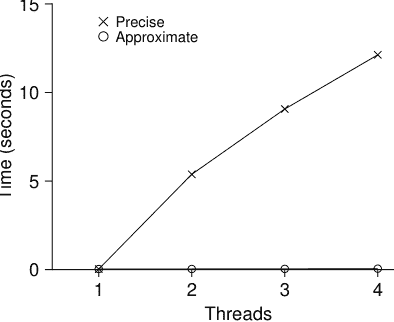

图 29.5：传统计数器与近似计数器的性能

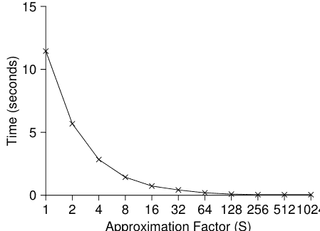

图 29.6：近似计数器的扩展

图 29.6 显示了阈值 S 的重要性，其中四个线程在四个 CPU 上对计数器进行了一百万次增加。如果 S 较小，性能很差（全局计数非常准确）；如果 S 很大，性能非常出色，但全局计数会滞后（滞后最多为 CPU 数量乘以 S）。这种准确性与性能的权衡正是近似计数器所提供的。

近似计数器的粗略版本见图 29.4（第 357 页）。阅读它，或者更好的是，你自己在某些实验中运行它，以更好地理解它的工作原理。

# 基于锁的并发数据结构

> 提示：高并发并不一定意味着更快

如果你设计的方案增加了大量的开销（例如，频繁地获取和释放锁，而不是获取一次），那么它具有更高并发性的事实可能并不重要。简单的方案通常运行良好，特别是当它们使用开销较大的例程时。增加更多的锁和复杂性可能会导致你的失败。尽管如此，有一种方法可以真正知道：构建两种替代方案（简单但并发性低的，以及复杂但并发性高的）并测量它们的表现。根结底，你无法在性能上作弊；你的主意要么更快，要么不是。

## 29.2 并发链表

我们检查一种更复杂的结构：链表。为了简单起见，我们将省略列表应有的显而易见的例程，只关注并发插入；我们将查找、删除等操作留给读者自行考虑。29.7 显示了这种基础数据结构的代码。

如代码所示，简单的代码在进入 `insert` 例程时会获取一个锁，并在退出时释放锁。如果 `malloc()` 无法分配内存（一种罕见情况），就会产生一个小棘手的问题；在这种情况下，代码在插入失败之前必须释放锁。

这种异常控制流被证明是非常容易出错的；最近对 Linux 内核补丁的研究发现，很大比例的错误（接近 40%）出现在很少执行的代码路径上（事实上，这一观察引发了我们的某些研究，我们从 Linux 文件系统中移除了所有内存故障路径，结果得到了更健壮的系统 [S11]）。

因此，挑战在于：我们可以重写 `insert` 和 `lookup` 例程以在并发插入下保持正确性，但失败路径要求我们需要添加锁来解锁

在这种情况下，答案是肯定的。具体来说，我们可以重新排列代码，使锁只围绕 `insert` 中的实际临界区域，并在 `lookup` 代码中使用单一的退出路径。前者之所以有效是因为 `insert` 的部分实际上不需要锁定；假设 `malloc` 是线程安全的，我们可以放心地调用它而无需担心竞态条件或其他并发错误。只有在更新共享列表时才需要持有锁。这些修改的细节见图 29.8。

对于 `lookup` 例程，跳出主搜索循环到单一返回路径是一个简单的转换。因此，这样做减少了代码中锁获取/释放点的数量，并降低了在代码中意外引入错误（例如在返回之前忘记解锁）的机会。

360

基于锁的并发数据结构

```c
// 基础节点结构
struct __node_t {
    int key;
    struct __node_t *next;
} node_t;

// 列表结构（每个列表使用一个）
struct __list_t {
    node_t *head;
    pthread_mutex_t lock;
} list_t;

void List_Init(list_t *L) {
    L->head = NULL;
    pthread_mutex_init(&L->lock, NULL);
}

int List_Insert(list_t *L, int key) {
    pthread_mutex_lock(&L->lock);
    node_t *new = malloc(sizeof(node_t));
    if (new == NULL) {
        perror("malloc");
        pthread_mutex_unlock(&L->lock);
        return -1; // 失败
    }
    new->key = key;
    new->next = L->head;
    L->head = new;
    pthread_mutex_unlock(&L->lock);
    return 0; // 成功
}

int List_Lookup(list_t *L, int key) {
    pthread_mutex_lock(&L->lock);
    node_t *curr = L->head;
    while (curr) {
        if (curr->key == key) {
            pthread_mutex_unlock(&L->lock);
            return 0; // 成功
        }
        curr = curr->next;
    }
    pthread_mutex_unlock(&L->lock);
    return -1; // 失败
}
```

图 29.7：并发链表

操作系统 [版本 1.01]

WWW.OSTEP.ORG

# 基于锁的并发数据结构

```c
void List_Init(list_t *L) {
    L->head = NULL;
    pthread_mutex_init(&L->lock, NULL);
}

void List_Insert(list_t *L, int key) {
    pthread_mutex_lock(&L->lock);
    node_t *new = malloc(sizeof(node_t));
    if (new == NULL) {
        perror("malloc");
        pthread_mutex_unlock(&L->lock);
        return -1;
    }
    new->key = key;
    new->next = L->head;
    L->head = new;
    pthread_mutex_unlock(&L->lock);
    return 0;
}

int List_Lookup(list_t *L, int key) {
    pthread_mutex_lock(&L->lock);
    node_t *curr = L->head;
    while (curr) {
        if (curr->key == key) {
            pthread_mutex_unlock(&L->lock);
            return 0;
        }
        curr = curr->next;
    }
    pthread_mutex_unlock(&L->lock);
    return -1;
}
```

图 29.8：并发链表：重写后的

# 链表的扩展

尽管我们再次有了一个基础列表，但它的扩展性并不良好。研究人员探索的一种实现更多并发性的技术被称为“手拉锁”（hand-over-hand locking）[MS04]。想法非常简单：不再对列表使用单个锁，而是为每个节点添加一个锁。在遍历列表时，代码首先获取下一个节点的锁，然后释放当前节点的锁。

399

# 基于锁的并发数据结构

> 提示：警惕锁与控制流

一个通用的设计提示同样适用于并发代码，是警惕导致函数返回、退出或其他错误的控制流变化。因为许多函数从获取锁、分配内存或执行操作开始，当错误发生时，代码需要在返回之前撤销所有操作，这很容易出错。从概念上讲，手拉锁是有道理的；它实现了高并发性。但在实践中，每个节点获取和释放锁的开销是难以接受的。也许某种混合方式（每隔节点获取锁）值得研究。

## 29.3 并发队列

你现在已经知道，使数据结构并发的一种标准方法是添加锁。对于队列，我们将跳过那种方法，假设你可以自己想出来。相反，我们查看由 Michael 和 Scott 设计的稍微并发的队列 [MS98]。该队列的数据结构和代码位于下页的图 29.9。如果你仔细研究这个队列，你会发现有两个锁，一个用于队列头部，一个用于尾部。这两个锁的目标是实现入队和出队操作的并发。在通常情况下，入队例程只访问尾锁，出队只访问头锁。Michael 和 Scott 使用的一个技巧是添加一个虚拟节点（在队列初始化代码中分配）；这个虚拟节点分离了头部和尾部操作。研究代码，或者更好的是，你自己输入、运行并测量它，以理解它的工作原理。

队列常用于多线程应用程序。然而，使用的队列类型（仅使用锁）通常无法满足此类程序的需求。更完善的边界队列（允许线程在队列为空或过满时等待）是下一章条件变量中深入研究的主题。敬关注！

# 基于锁的并发数据结构

```c
typedef struct __node_t {
    int             value;
    struct __node_t *next;
} node_t;
```

```c
typedef struct __queue_t {
    node_t              head;
    node_t              tail;
    pthread_mutex_t head_lock, tail_lock;
} queue_t;
```


```c
void Queue_Init(queue_t *q) {
    node_t *tmp = malloc(sizeof(node_t));
    tmp->next = NULL;
    q->head = q->tail = tmp;
    pthread_mutex_init(&q->head_lock, NULL);
    pthread_mutex_init(&q->tail_lock, NULL);
}
```

```c
void Queue_Enqueue(queue_t *q, int value) {
    node_t *tmp = malloc(sizeof(node_t));
    assert(tmp != NULL);
    tmp->value = value;
    tmp->next = NULL;

    pthread_mutex_lock(&q->tail_lock);
    q->tail->next = tmp;
    q->tail = tmp;
    pthread_mutex_unlock(&q->tail_lock);
}
```

```c
int Queue_Dequeue(queue_t *q, int *value) {
    pthread_mutex_lock(&q->head_lock);
    node_t *tmp = q->head;
    node_t *new_head = tmp->next;
    if (new_head == NULL) {
        pthread_mutex_unlock(&q->head_lock);
        return -1; // 队列为空
    }
    *value = new_head->value;
    q->head = new_head;
    pthread_mutex_unlock(&q->head_lock);
    free(tmp);
    return 0;
}
```

图 29.9：Michael and Scott 并发队列

```c
#define BUCKETS (101)
struct __hash_t {
    list_t lists[BUCKETS];
} hash_t;

void Hash_Init(hash_t *H) {
    int i;
    for (i = 0; i < BUCKETS; i++) {
        List_Init(&H->lists[i]);
    }
}

int Hash_Insert(hash_t *H, int key) {
    List_Insert(&H->lists[key % BUCKETS], key);
}

int Hash_Lookup(hash_t *H, int key) {
    return List_Lookup(&H->lists[key % BUCKETS], key);
}
```


## 29.4 并发哈希表

我们以一种简单且广泛应用的并发结构——哈希表来结束讨论。我们将关注一个不进行调整大小的简单哈希表；处理调整大小并不需要额外额外工作，我们将其留给读者作为练习题。这个并发哈希表（图 29.10）非常直观，使用我们之前开发的链表构建，并且运行效果非常好。其性能良好的原因是，它没有为整个结构使用单一锁，而是为每个桶使用一个锁（每个桶由一个锁表示）。这样做使得许多并发操作能够进行。

图 29.11 显示了哈希表在并发更新下的性能（从四个线程在四个个 CPU 上进行 10,000 到 50,000 次更新）。此外，为了比较，链表（使用单一锁）的性能扩展非常显著；而哈希表则没有。

## 29.5 总结

我们介绍了采样数据结构，从计数器到链表和队列，最后是无处不在的哈希表。在这个过程中，我们学到了一些重要的教训：在控制流周围获取和释放锁时要小心；增加并发性并不一定能提高性能；只有在性能问题出现后才应该进行改进。最后一点——避免过早优化，是任何关注性能的开发者的核心；让某些东西比应用本身更快是没有价值的。当然，我们仅仅触及了高性能结构的冰角；更多信息请参阅 Michael 出色的综述以及其他资源。特别地，你可能对其他结构（如 B 树）感兴趣；对于这类知识，学习数据库课程是你的最佳选择。你可能对完全不使用锁的技术感兴趣；这类非阻塞数据结构是我们在并发错误章节中将略要过的，但坦率地说，这个主题是一个需要更多研究的整个领域。如果你感兴趣，请自行寻找更多信息！

> 提示：避免过早优化（克努斯法则）。在构建并发数据结构时，从最基本的方法开始，即添加单一锁来提供同步访问。通过这样做，你很可能构建出一个正确的锁；如果你随后发现它存在性能问题，可以对其进行精炼，从而在需要时使其变快。正如克努斯著名的格言所：“过早优化是万恶之源。” 许多系统在过渡到多处理器时使用了单一锁，包括 Sun OS 和 Linux。在后者中，这个锁有一个名字，即大内核锁（BKL）。多年来，这种简单的方法一直足够用，直到内核中同时只有一个活跃线程成为一个瓶颈。因此，终于是时候为这些系统添加改进并发性的优化了。在 Linux 内部，这种做法是使用多个锁替换单个锁；在 Solaris 内部，采取了更激进的决定：从一开始就引入并发性。

# 参考文献

- [B10] 《Linux 多核内核扩展性分析》，Silas Boyd 等。关于 Linux 在多核机器上性能的研究。
- [BH73] 《操作系统原理》，Peter Hahn。Prentice-Hall，1973。访问：http://portal.acm.org/citation=540365。关于操作系统的经典著作之一。
- [BC05] 《Linux 内核（第三版）》，Daniel P. Bovet 和 Marco Cesati。O'Reilly Media，2005。关于内核的经典。你应该阅读它。
- [C06] 《寻找循环》，Jonathan Bonter。2006。访问：http://lwn.net/Articles/17003。LWN 有许多关于 Linux 的精彩文章。
- [L13] 《Linux 文件系统演进分析》，Lance Lu, Andrea C. Arpaci-Dusseau, Remzi H. Arpaci-Dusseau。San Jose, CA，2013。我们的研究追踪了近十年的文件系统补丁。那里有很多发现；读读它！这项工作做起来很痛苦，需要手动查看每一个细节。
- [M98] 《共享内存处理器上的非阻塞算法与抢占安全锁》，Michael Scott。并行与分布式计算杂志，第51卷第1期，1998。Scott 教授和他的学生多年来一直是并发算法和数据结构的前沿；查看他的网页。
- [MS04] 《并发数据结构》，Mok Nair 和 Sahni。Chapman and Hall/CRC Press，2004。访问：www.cs.tsau.edu/shani/concurrent-data-structures.pdf。关于并发数据结构的简短但全面的参考。尽管它缺失了领域的最新作品，但它是一份非常有价值的参考。
- [MM00] 《内核架构》，Jim Mauro 和 Richard McDougall。Prentice Hall，2000。关于 Solaris 的书。如果你想学习 Linux以外的其他内容。
- [S+11] 《通过预期内存分配让常见情况成为唯一情况》，Sundarasan, Sundarasan, Jupu Zhang, Seiram Subramanianian, Andrea C. Arpaci-Dusseau, Remzi H. Arpaci-Dusseau。FAST '11，San Jose, CA，2011。我们在内核节点中移除可能失败的分配调用的工作。通过在执行任何工作之前分配所有可能的内存，我们避免了存储栈中的深度失败。

# 作业（代码）

在本次作业中，你将获得编写并发代码和测量性能的经验。编写良好的代码是一项关键技能，在这里获得一些经验是非常值得的。

# 问题

- 1. 我们从重做这些测量开始。使用 `gettimeofday()` 在程序中测量时间。这个计时器准确吗？它能测量的最小间隔是多少？对它的工作原理有信心吗？你也可以查看其他使用 `rdtsc` 指令的计时器。
- 2. 构建一个简单的计数器，并随着线程数量的增加测量它需要多久。你使用的系统上有多少 CPU？这会对你的测量产生影响吗？
- 3. 接下来，构建一个计数器版本。再次，随着线程数量的变化测量它的性能。这与你在书中看到的一致吗？
- 4. 构建一个使用手接锁（spinlock locking）的链表版本，如书中提到的。你应该阅读论文以理解它是如何工作的，然后实现它。什么情况下手接锁列表比标准链表效果更好？
- 5. 选择你最感兴趣的数据结构，例如 B 树或其他稍微复杂的结构。实现它，并从简单的锁策略开始。随着并发线程数量的增加测量性能。
- 6. 最后，为你喜欢的数据结构考虑一种更有趣的锁策略。实现它，并测量它的性能。它与直接的锁方法相比如何？

# 条件变量

到为止，我们已经开发了“锁”的概念，并看到了如何结合硬件和操作系统支持来正确地构建它。遗憾的是，锁并不是构建并发程序所需的全部原语。

特别是，许多情况下，线程在继续执行之前希望检查某个条件是否真。例如，父线程可能需要等待子线程完成后继续执行（这通常被称为 `join()`）。应该如何实现这种等待？让我们看看图 30.1。

```
void *child(void *arg) {
    printf("child\n");
    // XXX 表示我们已完成？
    return NULL;
}

int main(int argc, char *argv[]) {
    printf("parent: begin\n");
    pthread_t c;
    pthread_create(&c, NULL, child, NULL); // 创建子线程
    // XXX 等待子线程？
    printf("parent: end\n");
    return 0;
}
```

> 图 30.1：父线程等待其子线程

我们在这里想要看到的是如下输出：

parent: begin

child

parent: end

我们可以尝试使用共享变量，如你在图 30.2 中所示。这种解决方案通常有效，但由于父线程在自旋（spin），所以效率极低。

# 条件变量

```
volatile int done = 0;
void *child(void *arg) {
    printf("child\n");
    done = 1;
    return NULL;
}

int main(int argc, char *argv[]) {
    printf("parent: begin\n");
    pthread_t c;
    pthread_create(&c, NULL, NULL, NULL); // 创建子线程
    // 自旋
    printf("parent: end\n");
    return 0;
}
```

图 30.2：父线程等待子线程：基于自旋的方法浪费 CPU 时间。我们想要的是某种方法，可以让父线程睡眠，直到我们等待的条件（例如子线程执行）到来。

> 核心问题：如何等待条件

在多线程程序中，线程在继续操作之前等待某些条件变为真通常是有用的。简单的方法——即一直自旋直到条件变为真——效率极低且浪费了 CPU 周期，并且在某些情况下可能是错误的。因此，线程应该如何等待条件？

## 30.1 定义与例程

为了等待某个条件变为真，线程可以使用被称为条件变量的机制。条件变量允许线程在执行（即某些条件）不符合预期时将自己置于某种执行状态（通过在条件上等待）；当其他线程改变该条件时，可以唤醒这些等待线程中的一个或多个并允许它们继续（在条件上发送信号）。这个想法可以追溯到 Dijkstra 使用“私有信号量”[D68]；类似的思想后来被 Hoare 命名为“条件变量”。

为了等待某个条件变为真，线程可以使用被称为条件变量的机制。条件变量允许线程在执行（即某些条件）不符合预期时将自己置于某种执行状态（通过在条件上等待）；当其他线程改变该条件时，可以唤醒这些等待线程中的一个或多个并允许它们继续（在条件上发送信号）。这个想法可以追溯到 Dijkstra 使用“私有信号量”[D68]；类似的思想后来被 Hoare 命名为“条件变量”。

为了等待某个条件变为真，线程可以使用被称为条件变量的机制。条件变量允许线程在执行（即某些条件）不符合预期时将自己置于某种执行状态（通过在条件上等待）；当其他线程改变该条件时，可以唤醒这些等待线程中的一个或多个并允许它们继续（在条件上发送信号）。这个想法可以追溯到 Dijkstra 使用“私有信号量”[D68]；类似的思想后来被 Hoare 命名为“条件变量”。

具体来说，POSIX 的调用如下：

```
pthread_cond_wait(&c, &m);
pthread_cond_signal(&c);
```

这唤醒了父线程。状态变量 `done` 是在锁被持有时调用的。具体实现如下：

```
    int done = 0;
 1;
}
```

状态变量 `done` 是在锁被持有时调用的。具体实现如下：

```
    pthread_mutex_lock(&m);
    while (done == 0) {
        pthread_cond_wait(&c, &m);
    }
    pthread_mutex_unlock(&m);
```

状态变量 `done` 是在锁被持有时调用的。具体实现如下：

```
    pthread_mutex_lock(&m);
    done = 1;
    pthread_cond_signal(&c);
    pthread_mutex_unlock(&m);
```

状态变量 `done` 是在锁被持有时调用的。具体实现如下：

```
    void *child(void *arg) {
        printf("child\n");
        pthread_mutex_lock(&m);
        done = 1;
        pthread_cond_signal(&c);
        pthread_mutex_unlock(&m);
        return NULL;
    }
```

状态变量 `done` 是在锁被持有时调用的。具体实现如下：

```
    int main(int argc, char *argv[]) {
        printf("parent: begin\n");
        pthread_t c;
        pthread_create(&c, NULL, child, NULL);
        pthread_mutex_lock(&m);
        while (done == 0) {
            pthread_cond_wait(&c, &m);
        }
        pthread_mutex_unlock(&m);
        printf("parent: end\n");
        return 0;
    }
```

> 图 30.3：等待：使用条件变量

到为止，我们已经开发了“锁”的概念，并看到了如何结合硬件和操作系统支持来正确地构建它。遗憾的是，锁并不是构建并发程序所需的全部原语。

有两种情况需要考虑。在第一种情况下，父线程创建线程后继续运行调用 `join()` 等待子线程。在这种情况下，它会获取锁，检查子线程是否完成（尚未完成），并通过调用 `wait()` 进入睡眠。第二种情况下，子线程在创建后立即将 `done` 设为 1，通知父线程（但没有线程在等待，所以它直接返回），父线程调用 `join()`，发现 `done` 为 1，因此不等待并返回。

```c
void thr_exit() {
  done = 1;
  Pthread_cond_signal(&cond);
}
```

```c
void thr_join() {
  if (done == 0)
    Pthread_cond_wait(&cond);
}
```

图 30.5：父进程等待：无锁

这里 (30.5) 是另一个糟糕的实现。在这个例子中，我们假设为了发送信号和等待，不需要持有锁。这里可能会发生什么问题？思考一下！

该问题在于一个微妙的竞态条件。具体来说，如果父进程调用 `thr_join()` 然后检查 `done` 的值，它会发现其值为 0，从而尝试进入睡眠。但在它调用进入睡眠之前，它被中断了，然后子进程开始运行。子进程将状态变量 `done` 改变为 1，但此时没有线程在等待，也没有线程被唤醒。当父进程再次运行时，它将永远休睡下去，这太悲哀了。

希望通过这个简单的 join 示例，你可以看到正确使用条件变量的一些基本要求。为了确保你理解了，我们来看一个更复杂的例子：带有双端缓冲的**生产者/消费者**模型。

> 提示：**发送信号时始终持有锁**。尽管在所有情况下并非严格必要，但在使用条件变量时，发送信号时持有锁显然是最简单且最好的做法。上面的示例展示了一个**必须为了正确性而持有锁**的情况；然而，还有其他一些情况可能不持有也是可以的，但可能可能是你应该避免的。因此，为了简单起见，**在调用信号时持有锁**。

该提示的相反面，即在调用 wait 时持有锁，不仅仅是一个提示，而是 `wait` 语义强制要求的，因为 `wait` 总是会：(a) 假设在你调用它时已持有锁，(b) 在让调用者进入睡眠时释放锁，以及 (c) 在返回之前重新获取锁。因此，该提示的泛括化是正确的：**在调用 signal 或 wait 时持有锁**，这样你将万无一失。

请注意，这个示例并不是“真实”的代码，因为 `pthread_cond_wait()` 的代码始终需要一个互斥锁（mutex）和一个条件变量；但为了作为反面教材，我们假定接口不需要这样做。

```c
int buffer;
int count = 0; // 初始为空空
```


```c
void put(int value) {
    assert(count == 0);
    count = 1;
    buffer = value;
}
```

```c
int get() {
    assert(count == 1);
    count = 0;
    return buffer;
}
```

图 30.6：Put 和 Get 程序 (v1)

## 30.2 生产者/消费者（有界缓冲区）问题

我们在本章将讨论下一个同步问题被称为生产者/消费者问题，有时称为有界缓冲区问题，它由 Dijkstra [D72] 提出。事实上，正是这个生产者/消费者问题导致 Dijkstra 和他的同事发明了广义信号量（既可以当作锁，也可以当作条件变量）[D01]；我们稍后会学习更多信号量的知识。

想象有一个或多个生产者。生产者产生数据项并将其放入缓冲区；消费者从缓冲区中取出它们并以某种方式消耗它们。

这种安排出现在许多真实系统中。例如，在多线程 Web 服务器中，生产者将 HTTP 请求放入工作队列（即有界缓冲区）；消费者从此队列中取出请求并进行处理。

当你将一个程序的输出管道传输到另一个程序时，也会使用有界缓冲区，例如 `grep file.txt | wc -l`。这个示例并发运行两个进程；`grep` 从 `file.txt` 中读取行，同时在它们认为的标准输出中使用字符串 `foo`；UNIX shell 将输出重定向到所谓的 UNIX 管道（由 `pipe` 系统调用创建）。

### 条件变量

| Tc1 | State | Tc2 | State | Tp | State | Count | Comment |
|---|---|---|---|---|---|---|---|
| c1 | Run | | Ready | Ready | 0 | |
| c2 | Run | | Ready | Ready | 0 | |
| c3 | Sleep | | Ready | Ready | 0 | 无数据可取 |
| | Sleep | | p1 | Run | 0 | |
| | Sleep | | p4 | Run | 1 | 缓冲区现满 |
| | Ready | | p5 | Run | 1 | Tc1 被唤醒 |
| | Ready | | p6 | Run | 1 | |
| | Ready | | p1 | Run | 1 | |
| | Ready | | p2 | Run | 1 | |
| | Ready | | p3 | Sleep | 1 | 缓冲区满；休眠 |
| | Ready | c1 | | Sleep | 1 | Tc2 溜入... |
| | Ready | c2 | | Sleep | 1 | |
| | Ready | c4 | | Sleep | 0 | ... 并取走了数据 |
| | Ready | c5 | | Ready | 0 | Tp 被唤醒 |
| | Ready | c6 | | Ready | 0 | |

图 30.9：线程轨迹：解决方案 (v1)

缓冲区是满的 (`p2`)，发现并非如此后，继续填充缓冲区 (`p4`)。然后生产者发送信号表示缓冲区已填充 (`p5`)。关键点在于，这使得第一个消费者 (`Tc1`) 从等待条件变量的休眠状态移动到就绪队列；`Tc1` 现在可以运行（但尚未运行）。生产者随后继续执行，直到发现缓冲区已满，此时它进入休眠状态 (`p6`, `p1–p3`)。

问题就发生在这里：另一个线程 (`Tc2`) 溜入并消耗了缓冲区中唯一的值 (`c1`, `c2`, `c4`, `c5`, `c6`，由于缓冲区是满的，跳过了 `c3` 处的等待）；假设 `Tc1` 在返回等待之前运行，它重新获取了锁并返回。然后它获取了 `(1)`，但没有缓冲区可以消费了！断言以某种方式阻止了 `Tc1` 尝试消费，因为 `Tc2` 溜入并消费了缓冲区中产生的唯一值。图 30.9 显示了连锁反应，以及其随时间变化的调度器状态（就绪、运行或休眠）。

问题的出现有一个简单的原因：在生产者唤醒 `Tc1` 之后、`Tc1` 运行之前，缓冲区的状态发生了变化（多亏于 `Tc2`）。信号线程会唤醒它们；因此，这暗示世界状态已经发生了变化（在这种情况下，缓冲区中放置了一个值），但不能保证当被唤醒的线程运行时，状态仍然符合预期。这种对“信号”含义的解释通常被称为 **Mesa 语义**，其命名源于第一个以此方式构建条件变量的研究 [LR80]；与之对比的是，被称为

© 2008–19, ARPACI-DUSSEAU

三个简单部分

### 378 条件变量

```c
int loops;
cond_t cond;
mutex_t mutex;
```

```c
void *producer(void *arg) {
    int i;
    for (i = 0; i < loops; i++) {
        Pthread_mutex_lock(&mutex); // p1
        while (count == 1) { // p2
            Pthread_cond_wait(&cond, &mutex); // p3
            put(i); // p4
        }
        Pthread_cond_signal(&cond); // p5
        Pthread_mutex_unlock(&mutex); // p6
    }
}
```

```c
void *consumer(void *arg) {
    int i;
    for (i = 0; i < loops; i++) {
        Pthread_mutex_lock(&mutex); // c1
        while (count == 0) { // c2
            int temp = get(); // c3
            Pthread_cond_wait(&cond, &mutex); // c4
        }
        Pthread_cond_signal(&cond); // c5
        Pthread_mutex_unlock(&mutex); // c6
        printf("%d\n", temp);
    }
}
```

图 30.10：生产者/消费者：单条件变量与 While 循环

**Hoare 语义** 构建起来更困难，但它提供了更强的保证，确保线程在被唤醒后立即运行 [H74]。几乎每个系统都采用 Mesa 语义。

### 更好，但仍然存在：用 While 而非 If

幸运的是，这个修复很容易（图 30.10）：将 `if` 改为 **while**。考虑一下它的工作原理：现在 T1 被唤醒并在（持有锁的情况下）重新检查共享变量的状态 (`c2`)。如果此时缓冲区为空，消费者将直接返回休眠 (`c3`)。生产者中的对应逻辑 (`p2`) 也随之改变了更改。

得益于 Mesa 语义，记忆条件变量的一个简单规则是：**始终使用循环**。有时你不需要检查条件，但这样做总是安全的；尽管这样做并会让你无忧。

然而，这段代码有一个 Bug，是上述提到的两个问题中的第二个。你能看到吗？它似乎有些……（文本截断）

### 条件变量

#### 提示：对于条件，请使用 WHILE（而不是 IF）

在多线程程序中检查条件时，使用 `while` 循环总是正确的；而使用 `if` 语句可能并不正确，这取决于信号的语义。因此，请务必使用 `while`，这样你的代码运行将符合预期。

在条件检查周围使用循环还可以处理发生虚假唤醒（spurious wakeups）的情况。在某些线程库中，由于实现细节的不同，可能会在只发生一次信号时，两个线程被唤醒 [L11]。虚假唤醒是需要重新检查线程正在等待的条件的首要原因。

### 正确的生产者/消费者解决方案

我们有一个可以运行的生产者/消费者解决方案，尽管它不是一个完全通用的方案。我们做的最后一个更改是增加并发性和提高效率；具体来说，我们增加了更多的缓冲区槽位，以便在睡眠之前可以消费多个值。对于单个生产者和消费者，这种方法更有效，因为它减少了上下文切换；而对于多个生产者或消费者（或两者兼有），它甚至允许生产或消费同时发生，从而提高了并发性。幸运的是，这与我们目前的解决方案相比只是很小的改。

该解决方案的第一个更改位于缓冲区本身以及 `put()` 和 `get()` 中（图 30.13）。我们还稍微修改了生产者和消费者检查的条件，以决定是否睡眠。我们还展示了等待和信号逻辑（图 30.14）。生产者只有在所有缓冲区都满时 (`p2`) 才会睡眠；同样，消费者只有在所有缓冲区都为空时 (`c2`) 才会睡眠。这样，我们就解决了生产者/消费者问题，现在可以坐下喝口冰的饮料了。

## 30.3 覆盖条件

我们将查看另一个关于条件变量如何使用的示例。这段代码摘自 Lampson 和 Redell 关于 Pilot 的论文 [LR80]，他们是第一个实现上述 Mesa 语义的同类小组（他们使用的语言是 Mesa，因此得名）。

他们遇到的问题通过这个简单的示例展示，在本例中，这是一个多线程内存分配库。图 30.15 显示了一个演示该问题的代码片段。

如你从代码所示，当线程调用内存分配代码时，它可能需要等待以释放更多内存。相反，当线程释放内存时，它会发送信号表示内存已可用。然而，我们上面的代码有一个问题：等待的线程（可能有多个）应该被唤醒吗？

### 条件变量

```c
// 堆中有多少字节空闲？
int bytesLeft = MAX_HEAP_SIZE;

// 还需要锁和条件
cond_t c;
mutex_t m;

void *ptr = allocate(int size) {
    Pthread_mutex_lock(&m);
    while (bytesLeft < size) {
        Pthread_cond_wait(&c, &m); // 从堆中获取内存
    }
    bytesLeft -= size;
    Pthread_mutex_unlock(&m);
    return ptr;
}

void free(void *ptr, int size) {
    Pthread_mutex_lock(&m);
    bytesLeft += size;
    Pthread_cond_signal(&c); // 信号谁？
    Pthread_mutex_unlock(&m);
}
```

图 30.15: 覆盖条件：一个示例

考虑以下场景。假设空闲字节为零；`T1` 调用 `allocate(100)`，随后 `T2` 调用 `allocate(10)` 请求较少的内存。`T1` 和 `T2` 都会在条件上等待并睡眠；因为没有足够的字节来满足其中任何一个请求。

此时，假设第三个线程 `T3` 调用 `free(50)`。遗憾的是，当它在等待唤醒线程时调用该函数时，它可能不会唤醒正确的线程 `T2`；`T2` 只需要等待 10 字节空闲；`T3` 应该保持等待，因为释放的内存仍然不足。图中的代码无法工作，因为被唤醒的其他线程不知道该唤醒哪个线程（或哪些线程）。

Lampson 和 Redell 建议的解决方案非常简单：将 `pthread_signal` 替换为 `pthread_broadcast`，后者会唤醒所有等待的线程。通过这样做，我们保证任何应该被唤醒的线程都会被唤醒。当然，缺点可能是性能产生负面影响，因为我们可能会不必要地唤醒许多不应该（尚未）唤醒的其他线程。这些线程只会唤醒、重新检查条件，然后重新进入睡眠。

Lampson 和 Redell 将这种条件称为覆盖条件，因为它涵盖了线程需要唤醒的所有情况（保守地说是）；正如我们讨论过的，代价是可能会唤醒过多的线程。

敏锐的读者可能还会注意到，我们早早可以使用这种方法（参见只有单个变量的生产者/消费者问题）。然而，在那种情况下，我们有更好的解决方案，因此使用了它。通常情况下，如果你发现你的程序只有在将信号更改为广播（broadcasts）时才能工作（但在像上面的内存分配器那样的情况下），请修复它！

## 30.4 总结

我们已经看到了除了锁之外的另一个重要原语：条件变量。通过允许线程在某些程序状态不符合预期时睡眠，CV 使我们能够整洁地解决许多重要问题，包括著名的（仍然重要的）生产者/消费者问题，以及覆盖条件。这里本该有一句更具戏剧性的结语，例如“他爱着老大哥”。

## 参考文献

- [D68] Edsger Dijkstra 著“Cooperating processes”。1968年。在线访问地址此处：http://www.cs.utexas.edu/user/Ewd01xx/EWD23.PDF。
- [D72] E.W. Hoare 著“Shaping a Finite Buffer”。Information Processing Letters: 1:79, 1972年。访问地址：http://www.cs.utexas.edu/user/EWD02xx/EWD29.PDF。
- [D81] E.W. Dijkstra 著“Reflections of operating system design”。2001年。在线访问：http://www.cs.utexas.edu/user/EWD03xx/EWD33.PDF。
- [H74] C.A.R. Hoare 著“Monitors: An Operating System Concept”。Communications of the ACM, 17:10, pages 549–557, 1974年10月。
- [L11] March 著“pthread.cond_signal Man Page”。2011年。在线访问：http://linux.die.net/man/3/pthread_cond_signal。
- [L80] B.W. Lampson, D.R. Redell 著“Experience with Processes and Monitors in Mesa”。Communications of the ACM, 23:2, pages 105–117, 1980年2月。
- [O49] George Orwell 著“1984”。Secker and Warburg, 1949。

## 作业（代码）

这项作业让你探索使用锁和条件变量来实现各种形式的生产者/消费者队列代码。你将查看代码，在各种配置下运行它，并学习哪些是有效的。详情见 README。

## 问题

- 1. 我们的第一个问题关注 `main-two-cvs-while.c`（有效的解决方案）。首先，研究代码。你认为运行程序时会发生什么？
- 2. 使用一个生产者和一个消费者运行，并让生产者产生值。从缓冲区大小 1 开始，然后增加它。代码的行为会发生变化吗？你预测如何？对于不同的缓冲区大小（例如 `-10`）和产生的项目数量（例如 `-100`），当你将消费者睡眠字符串从默认（无睡眠）更改为 `-c 0, 0, 0, 0, 0, 0, 1`？
- 3. 如果可能，在不同的系统（例如 Mac 和 Linux）上运行。你在这些系统之间看到了不同的行为吗？
- 4. 让我们查看一些计时。你认为具有一个生产者、三个消费者共享缓冲区，且每个消费者以 `c3` 的速度运行的执行需要多长时间？`/main-two-cvs-while -p 1 -c 3 -m 1 -c 0, 0, 1, 0, 0, 0, 0, 0, 1, 0, 0, 0, 0, 0, 0, 0, -1 10 -v- t`
- 5. 现在将睡眠的缓冲区大小改为 3 (`-m 3`)。这会对总时间产生任何影响吗？
- 6. 现在将睡眠的位置改为 `c6`（这模拟了消费者从队列中取出后对其进行处理），使用单入口缓冲区。在这种情况下你预测的时间是多少？`/main-two-cvs-while -p 1 -c 3 -m 1 -C 0, 0, 1, 0, 0, 0, 0, 0, 1, 0, 1: 0, 0, 0, 0, 0, 0, 1, -1 10 -v- t`
- 7. 最后，再次将缓冲区大小改为 3 (`-m 3`)。现在你预测会如何？
- 8. 现在让我们看看 `main-one-cv-while.c`。在单生产者、单消费者且缓冲区大小为 1 的情况下，你能配置一个睡眠字符串来导致该代码出现问题吗？
- 9. 现在，将消费者的数量改为两个。你能为生产者和消费者构造休眠字符串（sleep strings）以导致代码出现问题吗？
- 10. 现在检查 `main-two-cvs-if.c`。你能让这段代码发生问题吗？再次考虑只有一个消费者的情况，然后考虑有多个消费者的情况。
- 11. 最后，检查 `main-two-cvs-while-extra-lock.c`。当你在执行 `put` 或 `get` 操作之前释放锁时会出现什么问题？在给定休眠字符串的情况下，你能可靠地导致此类问题的发生吗？会发生什么糟糕的事情？

# 信号量 (Semaphores)

正如我们现在知道的，我们需要锁（locks）和条件变量（condition variables）来解决广泛的相关且有趣的并发问题。很久以前意识到这一点之一是埃德格·迪斯特拉（Edsger Dijkstra）（尽管很难知晓确切的历史 [GR92]），他因图论中著名的“最短路径”算法 [D59] 而闻名，以及关于结构化编程的早期论战《Go To是有害的》 [D68b, D72]（多么棒的标题），在我们在这里研究的案例中，引入了一种名为信号量（semaphore）的同步原语 [D68b, D72]。事实上，迪斯特拉和同事发明了信号量作为处理所有同步相关事务的单一原语；正如你将看到的，信号量既可以作为锁也可以作为条件变量。

# 核心：如何使用信号量

我们如何使用信号量而不是锁和条件变量？信号量的定义是什么？二值信号量是什么？用锁和条件变量构建信号量简单吗？用信号量构建锁和条件变量简单吗？

## 3.1 信号量：定义

信号量是一个带有整数值的对象，我们可以通过两个例程对其进行操作；POSIX 标准规定这两个例程为 `wait()` 和 `post()`。由于信号量的初始值决定了它的行为，在调用任何其他与信号量交互的例程之前，我们必须将其初始化为某个值，如图 3.1 所示。


> 在历史上，迪斯特拉将 `wait()` 称为 P，将 `post()` 称为 V。这些缩短的名字有趣地源于荷兰语；据称它们随时间演变自这些词。P 源于 "passering"（通过），而 V 源于 "vrijgave"（释放）；后来，迪斯特拉将 P 写为 "proslag"，它是 "probeer"荷兰语中的“尝试”）和 "verlaag"（“减少”）的缩写，而 V 源于 "verhoog"，意为“增加”。有时人们称它们为 down 和 use。详情请见 https://news.ycombinator.com/item?id=879。

# 信号量

```c
#include <semaphore.h>
sem_t s;
sem_init(&s, 0, 1);
```

图 31.1：初始化信号量

在图中，我们声明了一个信号量，并通过将 1 作为第三个参数传递给 0 将初始化为 1。在我们将看到的所有示例中，`sem_init()` 的第二个参数将被设置为 0；这表示信号量在同一进程的线程之间共享。请参阅帮助页（man page）以获取信号量的其他用法（即它们如何用于不同进程之间的同步），那样的第二个参数需要一个不同的值。

信号量初始化后，我们可以调用两个函数之一来与之交互，即 `sem_post()`。这两个函数的行为见图 31.2。

目前，我们不关心这些例程的实现，当多个线程调用 `sem_wait()` 和 `sem_post()` 时，显然需要管理这些临界区（critical sections）。我们现在将重点关注如何使用这些原语；以后我们可能会讨论它们是如何构建的。

我们应该在这里讨论接口的几个方面。首先，我们可以看到 `sem_wait()` 要么直接返回（因为当我们调用 `sem_wait()` 时信号量的值为 0 或更高），要么会导致调用者挂起并等待随后的 `post`。当然，多个线程可能会调用 `sem_wait()`，并且它们都将进入队列等待唤醒。

其次，我们可以看到 `sem_post()` 不会等待某个特定条件满足 `sem_wait()`。相反，它只是简单地增加信号量的值，如果有线程等待被唤醒，就会唤醒其中一个。

第三，当信号量的值为负时，它等于线程的数量 [D68b]。虽然信号量的用户通常看不到这个值，但这个不变性值得知道，也许可以帮助你记住信号量是如何工作的。

```c
int sem_wait(sem_t *s) {
    将信号量 s 的值减一
    如果信号量 s 的值为负，则等待
}
```

```c
int sem_post(sem_t *s) {
    将信号量 s 的值加一
    有一个或多个线程在等待，唤醒一个
}
```

图 31.2：Wait 和 Post 的定义

# 信号量

```c
sem_t m;
sem_init(&m, 0, X); // 初始化为 X；X 应该是什么？
sem_wait(&m);
// 此处是临界区
sem_post(&m);
```

图 31.3：初始化信号量

## 3.2 二值信号量（锁）

我们现在要把信号量作为锁。回看定义，如果值为 1，线程 0 将能够进入临界区。图 31.4 显示了此的轨迹。注意当线程 1 第一次进入时，它会进入休眠状态。

| 信号量值 | 线程 0 | 线程 1 |
|---|---|---|
| 1 | | |
| | call_wait() | |
| | | sem_wait() (returns) |
| | (临界区) | |
| | Switch->T1 | call_wait() |
| | | (休眠) |
| | |__()() |
| | | incr | |
| | | wake(T1) |
| | | sem_post() (returns) |
| | | | |
| | | | |
| | | |_wait() |
| | | sem_wait() (returns) |
| | | (界界区) |
| | | (临界区) |
| | | sem_post() |
| | | incr sem |
| | | wake(T0) |
| | | sem_post() (returns) |
| | | | |

图 31.4：单线程使用信号量的轨迹

因此我们要使用信号量作为锁。因为锁只有两种状态（持有和未持有），我们调用信号量作为二值信号量。如果你只以这种方式使用信号量，它的实现可能比我们展示的通用信号量更简单。

## 3.3 用于排序的信号量

信号量也用于并发程序中的排序。例如，一个线程可能等待列表非空，

| 信号量值 | 线程 0 | 线程 1 |
|---|---|---|
| 1 | | |
| | call_wait() | |
| | | sem_wait() (returns) |
| | (临界区) | |
| | Switch->T1 | call_wait() |
| | | (休眠) |
| | | sem_post() |
| | | incr sem |
| | | wake(T1) |
| | | sem_post() (returns) |
| | | Ready |
| | | Run |
| | | call_wait() |
| | | sem_wait() (returns) |
| | (临界区) | |
| | (临界区) | |
| | | sem_post() |
| | | incr sem |
| | | wake(T0) |
| | | sem_post() (returns) |
| | | Ready |

图 31.5：两个线程使用信号量的轨迹

从而等待（进入休眠并释放处理器）。当线程 0 再次运行时，它最终会调用 `sem_post()`，将信号量的值增加到零，并唤醒等待的线程（线程 1），它将能够获取锁。当线程 1 完成时，它再次增加信号量的值，将其恢复为 1。

31.5 显示了此示例的轨迹。除了线程的操作外，图还显示了每个线程的调度状态：Run（线程正在运行）、Ready（即可运行但未运行）和 Sleep（线程被阻塞）。注意当线程 1 第一次进入时，它在尝试获取已持有的锁时进入休眠状态；只有当线程 0 再次运行时，线程 1 才能被唤醒并再次运行。

# 信号量

```
sem_t s;

void *child(void *arg) {
    printf("child\n");
    sem_post(&s); // signal here: child is done
    return NULL;
}

int main(int argc, char *argv[]) {
    sem_init(&s, 0, X); // X 应该是什么?
    printf("begin\n");
    pthread_t c;
    pthread_create(&c, child, NULL);
    sem_wait(&s); // wait for child
    printf("end\n");
    return 0;
}
```


所以它可以从其中删除一个元素。在这种用法模式中，我们经常会发现一个线程在等待某些事情，而另一个线程让这些事情发生并信号该事情已经发生，从而唤醒该线程。因此，我们是将信号量作为一种排序原语（类似于我们之前使用条件变量）。

一个简单的例子如下。想象父线程创建另一个线程，然后等待它完成执行（图 31.6）。当这个程序运行时，我们希望看到以下输出：

parent: begin

child

parent: end

问题是于，如何使用信号量来实现这种效果；事实证明，答案相对容易理解。如代码所示，父线程调用 `sem_wait()`，子线程调用 `sem_post()` 来等待子线程完成执行的条件变为真。然而，这引发了一个问题：这个信号量的初始值应该是多少？

（再次思考一下，不要急着往下看）

答案显然是，信号量的值应该设置为0。有两种情况需要考虑。首先，假设父线程创建了子线程但子线程尚未运行（即它位于等待队列中而不是运行）。在这种情况下（图 31.7，第 394 页），父线程会在子线程调用 `sem_post()` 之前调用 `sem_wait()`；我们希望父线程等待子线程运行。这种情况发生的唯一可能是信号量的值不大于 0；因此，0 是初始值。父线程运行，信号量递减（变为 -1），然后等待（睡眠）。当子线程最终运行时，它将调用 `sem_post()`，信号量的值增加到 0 并唤醒父线程，父线程随后从 `sem_wait()` 返回并结束程序。

# 信号量

| Val | Parent | State | Child | State |
|---|---|---|---|---|
| 0 | create (Child) | Run | (Child exits, can run) | Ready |
| 0 | call sem_wait() | Run | | Ready |
| -1 | decr sem | Run | | Ready |
| -1 | (sem<0)→sleep | Sleep | child runs | Run |
| -1 | Switch→Child | Sleep | call sem_post() | Run |
| 0 | | Sleep | inc sem | Run |
| 0 | | Sleep | wake (Parent) | Run |
| 0 | | Ready | sem.post() returns | Run |
| 0 | sem_wait() returns | Ready | Interrupt→Parent | Ready |

图 31.7: 线程轨迹：父线程等待子线程（情况 1）

| Val | Parent | State | Child | State |
|---|---|---|---|---|
| 0 | create (Child) | Run | (Child exits; can run) | Ready |
| 0 | Interrupt→Child | Ready | child runs | Run |
| 1 | | Ready | call sem_post() | Run |
| 1 | | Ready | inc sem | Run |
| 1 | | Ready | wake (nobody) | Run |
| 1 | | Ready | sem.post() returns | Run |
| 1 | parent runs | Run | Interrupt→Parent | Ready |
| 1 | call sem_wait() | Run | | Ready |
| 0 | (sem≥0)→awake | Run | | Ready |
| 0 | decr sem | Run | | Ready |
| 0 | sem_wait() returns | Run | | Ready |

图 31.8: 线程轨迹：父线程等待子线程（情况 2）

第二种情况（图 31.8）发生在子线程在父线程有机会调用 `sem_wait()` 之前运行完成。在这种情况下，子线程会先调用 `sem_post()`，将信号量的值从 0 增加到 1。当父线程有机会运行时运行时，它将调用 `sem_wait()` 并发现信号量的值为 1；父线程将值减1（变为 0）并从 `sem_wait()` 返回无需等待，同样实现了预期的效果。

## 31.4 生产者/消费者（边界缓冲区）问题

我们在本章中确认的下一个问题被称为生产者/消费者问题，或者有时称为边界缓冲区问题 [D72]。这个问题在上一章关于条件的章节中有详细描述；详细信息请参阅该章节。

# 信号量

# 旁注：设置信号量的值

我们现在已经看到了两个初始化信号量的例子。在第一种情况下，我们将值设置为 1，将信号量作为锁；在第二种情况下，将其设置为 0，将信号量用于排序。那么信号量初始化的通用规则是什么呢？多亏 Kivowitz，一种简单的思考方法是考虑你在初始化后愿意给出的资源数量。对于锁，这个值是 1，因为你愿意在初始化后立即将其锁定（给出去）。对于排序情况，值是 0，因为在开始时没有东西可以给出；当线程完成时，值增加到 1。尝试对未来的问题进行这种思考，或许会有帮助。

# 第一次尝试

我们解决问题的第一次尝试引入了两个信号量 `empty` 和 `full`，它们分别用于指示缓冲区已被清空或填充。在这个例子中，生产者首先等待缓冲区为空以便放入数据，而消费者同样等待缓冲区被填充。让我们假设 MAX=1（只有一个缓冲区），并看看这是否有效。再次假设有两个线程，一个生产者和一个消费者。检查一个单 CPU 的特定场景。假设消费者首先运行。因此，消费者将调用 `sem_wait(&full)`。由于 `full` 被初始化为 0，它将递减 `full`（变为 -1），阻塞生产者。如果生产者被中断并开始运行，它将从 `sem_wait(&empty)` 返回。由于 `empty` 被初始化为 MAX（在这种情况下为 1），生产者继续执行 P3 并调用 `sem_post(&full)` 将 `full` 的值从 -1 变为 0 并唤醒消费者。在这种情况下，可能会发生这种情况：如果生产者继续运行，它将循环并再次命中 P1。然而，此时它会阻塞，因为空信号量的值为 0。如果生产者被中断开始运行，它将从 `sem_wait(&full)`（C1）返回，发现缓冲区已满并消费它。在任何情况下，我们都实现了预期的行为。

你可以用更多线程尝试这个示例（例如多个生产者和多个消费者）。应该是有效的。

```
int buffer[MAX];
int fill = 0;
int use = 0;

void put(int buffer) {
    buffer[fill] = value; // F1
    fill = (fill + 1) % MAX; // F2
}

int get() {
    int tmp = buffer[use]; // G1
    use = (use + 1) % MAX; // G2
    return tmp;
}
```

图 31.9: Put 和 Get 函数

```
sem_t empty;
sem_t full;

void *producer(void *arg) {
    int i;
    for (i = 0; i < loops; i++) {
        sem_wait(&empty); // P1
        put(i);           // P2
        sem_post(&full);  // P3
    }
}

void *consumer(void *arg) {
    int i, tmp = 0;
    while (1) {
        sem_wait(&full); // C1
        tmp = get(&empty); // C2
        sem_post(&empty);  // C3
        printf("%d\n", tmp);
    }
}

int main(int argc, char *argv[]) {
    sem_init(&empty, 0, MAX); // MAX 个空
    sem_init(&full, 0, 0);   // 0 个满
}
```

图 31.10: 添加满和空条件

```
void *producer(void *arg) {
  int i;
  for (i = 0; i < loops; i++) {
    sem_wait(&mutex);    // P0 (新增行)
    sem_wait(&empty);     // P1
    put(i);               // P2
    sem_post(&full);      // P3
    sem_post(&mutex);     // P4 (新增行)
  }
}

void *consumer(void *arg) {
  int i;
  for (i = 0; i < loops; i++) {
    sem_wait(&empty);     // C0 (新增行)
    sem_wait(&full);      // C1
    int tmp = get();      // C2
    sem_post(&empty);     // C3
    sem_post(&mutex);     // C4 (新增行)
    printf("%d\n", tmp);
  }
}
```

图 31.11: 添加互斥锁（错误地）

# 解决方案：添加互斥锁

如你所见，我们在这里得到了`互斥`。缓冲区索引的增加操作是一个临界区域，必须经过小心保护。让我们使用我们的二进制信号量朋友添加一些锁。图 31.11 显示了我们的尝试。

正如“新增行”注释所示，我们在代码的整个 `put()`/`get()` 部分周围添加了一些锁。这似乎是正确的想法，但它同样不起作用。为什么？为什么会发生死锁？花点考虑一下；尝试找到产生死锁的情况。程序发生死锁必须经过哪些步骤序列？

# 398 信号量


```c
void *producer(void *arg) {
  int i;
  for (i = 0; i < loops; i++) {
    sem_wait(&empty); // Line P1
    sem_wait(&mutex); // Line P1.5 (此处为互斥)
    put(i); // Line P2
    sem_post(&mutex); // Line P2.5 (在这里也是)
    sem_post(&full); // Line P3
  }
}
void *consumer(void *arg) {
  int i;
  for (i = 0; i < loops; i++) {
    sem_wait(&full); // Line C1
    sem_wait(&mutex); // Line C1.5 (此处为互斥)
    int tmp = get(); // Line C2
    sem_post(&mutex); // Line C2.5 (在这里也是)
    sem_post(&empty); // Line C3
  }
  printf("%d\n", tmp);
}
```

图 31.12: 避免互斥（正确做法）

# 避免死锁

好了，现在你已经明白了，这里是答案。假设有两个线程，一个生产者和一个消费者。消费者先运行。它获取了互斥锁（Line C0），然后对 `full` 信号量调用 `sem_wait()`（Line C1）；由于目前还没有数据，这导致消费者阻塞并让出 CPU；重要的是，消费者仍然持有该锁。

生产者开始运行。它有数据要产生，如果它能够运行，它就能唤醒消费者线程，一切就顺利大吉了。遗憾的是，它做的第一件事是对二值化互斥锁（Line P0）执行 `sem_wait()`。锁已经被占用了。在这里，生产者现在被卡在外面等待了。

这里存在一个简单的循环。消费者持有互斥锁，正在等待有人发送 `full` 信号。生产者可以发送 `full` 信号，但它正在等待互斥锁。因此，生产者和消费者都在互相等待：这是一个经典的死锁。

# 终于，一个可行的解决方案

为了解决这个问题，我们只需要缩小锁的作用范围（作用）。图 31.12（第 398 页）展示了正确的解决方案。如你所见，我们只需将互斥锁的获取和释放移动到仅紧邻临界区的位置；

操作系统

[版本 1.01]

WWW.OSTEP.ORG

# 信号量

`full` 和 `empty` 的等待信号代码被留在外面$^2$。结果是一个简单且有效的有界缓冲区，这是多线程程序中常用的模式。现在理解它吧；去使用它吧。在未来的多年里，你都会感谢我们的。或者至少，当期末考试或工作面试中问到同样的问题时，你会感谢我们的。

## 31.5 读写锁

另一个经典问题源于对更灵活的锁原语的渴望，这种原语承认数据结构的访问可能需要不同类型的锁。例如，假设有许多当前的列表操作，包括插入和简单查找。虽然插入会改变列表的状态（因此传统的临界区是有意义的），但查找仅仅是读取数据结构；只要我们保证没有正在进行的插入，我们就可以允许许多查找进行。我们现在要开发的用于支持这种类型操作的特殊类型锁被称为**读写锁** [CHP71]。这种锁的代码见图 31.13（第 40 页）。

代码非常简单。如果线程想要更新相关的数据结构，它将调用一对同步操作：`rwlock.acquire_write()` 以获取写锁，以及 `rwlock.release_write()` 释放锁。在内部，这些操作使用 `rwlock` 信号量来确保只有一个写入者可以获取锁并进入临界区更新数据结构。

更有趣的是获取和释放读锁的一对例程。在获取锁时，第一个读取者获取 `lock` 并增加 `readers` 变量，以跟踪当前有多少读者在数据结构内部。接下来的重要步骤在锁内部进行；在情况下，当第一个读取者获取锁时发生了 `rwlock.acquire_read()`，该读取者还将通过对信号量调用 `sem_wait()` 来获取锁，然后通过调用 `sem_post()` 释放锁。

然后，一旦一个读者获取了锁，更多的读者也将被允许获取锁；然而，任何想要等待到所有读者完成的线程；最后一个离开临界区的读者将会在 "writelock" 上调用 `sem_post()`，并允许等待中的写入者获取锁。

这种方法（正如我们预期的），但确实存在一些负面影响，特别是在公平性方面。特别是，读者很容易饿死写入者。针对这个问题存在更复杂的解决方案；你能想到更好的实现方式吗？提示：想想一旦写入者正在写入，你需要些什么来防止更多读者进入锁。

> $2$ 它，将互斥的获取/释放放在 `put()` 和 `get()` 内部可能更自然。

# 信号量

提示：简单且笨的可能更好（希尔定律）

你不应该低估“简单且笨的方法往往是最好的”。对于锁来说，有时自旋锁最好，它容易实现且快速。虽然读写锁听起来很酷，但它们很复杂，可能导致速度缓慢。因此，总是尝试简单且笨的方法。

这种追求简单性的想法出现在很多地方。一个早期来源是 Mark Hill 的论文 [H87]，他研究了如何设计缓存。Hill 发现简单的直接映射缓存优于复杂的组关联设计（原因是在缓存中，设计能够更快的查找）。Hill 简洁地总结了他的工作：“大而笨更好。”因此我们将类似的建议称为希尔定律。

# 餐桌哲学家

这个问题之所以是因为是因为有趣且在智力上引人胜；然而，它的实际用处很低。然而，它是错误的关注；事实上，你可能会在某些面试中被问到它，如果你因为错过这个问题而没得到工作，你会很恨你的操作系统教授的。相反，如果你得到了工作，可以给你的操作系统教授发一封感谢信。

该问题的基本设置（如图 31.14 所示）：有五位“哲学家”围坐在桌旁。每两个哲学家之间有一把叉子（因此总共有）。哲学家有思考的时间（不需要任何叉子），也有吃饭的时间。为了吃饭，哲学家需要两把叉子，左边和右边的。对叉子的竞争以及随之而来的同步问题，正是我们在并发编程中学习这个问题的原因。

这里是每个哲学家的基本循环，假设每个哲学家有一个唯一的标识符 p 从 0 到 4（包含）：

```c
while (1) {
    think();
    get_forks(p);
    eat();
    put_forks(p);
}
```

关键挑战在于编写 `get_forks()` 和 `put_forks()` 例程，使得不会发生死锁，哲学家不会饿死且

我们尝试对该问题给出第一个解决方案。假设我们将每个信号量（在叉子数组中）初始化为值 1。同时，每位哲学家都知道自己的编号（p）。然后我们就可以编写 `get_forks()` 和 `put_forks()` 例程（图 31.15，第 403 页）。为了获取叉子，这个（错误的）解决方案背后的直觉是这样的：我们对每个叉子获取“锁”：先获取左边的，再获取右边的。当我们进时时，释放它们。很简单，对吧？遗憾的是，在这种情况下，简单意味着失败。你能看出问题所在吗？思考一下。

问题在于死锁。如果每位哲学家都恰好在任何哲学家拿到右侧叉子之前抓住了左侧的叉子，那么每个人都将持有一个叉子并永远等待另一个。具体来说，哲学家 0 抓了叉子 1，哲学家 1 抓了叉子 2，哲学家 3 抓了叉子 3，哲学家 4 抓了叉子 4；所有的叉子都被获取了，所有人都在等待另一位哲学家拥有的叉子。我们很快会详细学习死锁；现在是为了是为了这不是一个可行的解决方案。

## 解决方案：打破依赖

解决这个问题最简单的方法是改变每位哲学家获取叉子的方式；事实上，这正是 Dijkstra 本人解决问题的方法。具体来说，假设哲学家 4（编号最大的一个）获取叉子的顺序与其他人不同（图 31.16）；`put_forks()` 代码保持不变。

由于最后一位哲学家尝试先抓右边的再抓左边的，因此不存在每位哲学家都抓住一个叉子并卡住等待另一个的情况；等待的循环被打破了。仔细思考这个解决方案的影响，你就会说服自己它是有效的。

# 信号量

还有其他类似的“著名”问题，例如烟草者问题或睡眠理发师问题。它们中的大多数只是思考并发的借口；其中一些有着有趣的例子。如果你对学习更多感兴趣，或者只是想多练习并发思维，可以查阅。

## 31.7 线程节流 (Thread Throttling)

信号量的一个简单用例偶尔会出现，因此我们在这里介绍它。具体问题是：程序员如何防止“太多”线程同时执行某操作并导致系统变慢？答案是：为“太多”设定一个阈值，并使用信号量来限制执行相关代码的线程数量。我们将这种方法称为节流 [99]，并将其视为准入控制的一种。

让我们考虑更具体的例子。假设你创建了数百个线程来并行处理某个问题。然而，在代码的某部分，每个线程都会获取大量内存来执行计算；每个内存密集区域都是。如果所有线程同时进入内存密集区域，所有内存分配的总和将超过机器物理内存量。结果是机器将开始抖动（即在磁盘和内存之间交换页面），整个计算将慢到像爬一样。

一个简单的信号量可以解决这个问题。通过将信号量的值初始化为允许同时进入内存密集区域的最大线程数，并在区域周围放置 `sem_wait()` 和 `sem_post()`，信号量可以自然地限制在代码密集区域中并发的线程数量。

## 31.8 如何实现信号量

最后，我们使用底层的同步原语——锁和条件变量来构建我们自己版本的信号量，称为……（敲鼓声）——信号量。这个任务相当直接，正如你在图 31.17（第 405 页）所示。

在上面的代码中，我们使用一个锁和一个条件变量，加上一个状态变量来跟踪信号量的值。你自己学习代码直到你真正理解它。去做吧！

信号量与 Dijkstra 定义的纯信号量之间有一个微妙的区别，我们不维护这种不变性：信号量的值在为负时，反映等待线程的值；事实上，该值永远不会低于零。这种行为更容易实现，并且匹配当前的 Linux 实现。

```c
typedef struct __sem_t {
  int value;
  pthread_cond_t cond;
  pthread_mutex_t lock;
} Zem_t;

// 只有一个线程可以调用这个
void Zem_init(Zem_t *s, int value) {
  s->value = value;
  Cond_init(&s->cond);
  Mutex_init(&s->lock);
}

void Zem_wait(Zem_t *s) {
  Mutex_lock(&s->lock);
  while (s->value <= 0)
    Cond_wait(&s->cond, &s->lock);
  s->value--;
  Mutex_unlock(&s->lock);
}

void Zem_post(Zem_t *s) {
  Mutex_lock(&s->lock);
  s->value++;
  Cond_signal(&s->cond);
  Mutex_unlock(&s->lock);
}
```

图 31.17：使用锁和 CV 实现信号量

目前，用信号量构建条件变量是一个要棘得多的命题。

## 31.9 总结

信号量是编写程序的一种强大且灵活的原语。在本章中，我们只展示了几个经典问题。如果你对学习更多感兴趣，还有很多。

## 提示：谨慎泛化

泛化的抽象比看起来更具挑战性。

关于它最糟糕的部分可能是操作系统实现者推导出了算法，尽管 Dijkstra 通常被归功于此。

# 作业（代码）

在本次作业中，我们将使用信号量来解决一些著名的并发问题。其中许多问题取源自 Downey 的《信号量小书》（Little Book of Semaphores），该书很好地汇编了许多经典问题，并引入了一些新的变体；读者应该查阅该书以获取更多信息。

以下每个问题都提供了一个代码骨架；你的任务是填充代码，使其在给定信号量的情况下能够正常工作。在 Linux 上，你将使用原生信号量；在 Mac 上（不支持信号量），你必须首先构建一个实现版本（使用本章节中描述的锁和条件变量）。祝你好运！

# 问题

- 第一个问题仅仅是实现并测试文中描述的 fork/join（分支/合并）问题的解决方案。尽管文中描述了该解决方案，但亲手敲写一遍也是有意义的；即使是巴赫也会重写 Rivaldi，以便让“一个精通的人从现有作品中学习”。详情请参见 `fork-join.c`。在子进程中添加 `sleep(1)` 以确保它正在运行。

- 我们通过研究会合（rendezvous）问题来稍微泛化一下。问题如下：你有两个线程，每个线程都将进入代码中的会合点。在另一个线程进入之前，任何一个都不应该退出这部分代码。考虑使用两个信号量来完成此任务，详情请参见 `rendezvous.c`。

- 现在更进一步，实现一个屏障同步（barrier synchronization）的解决方案。假设在顺序代码中有两个点，分别称为 P1 和 P2。在 P1 和 P2 之间放置屏障可以保证所有人在执行 P2 之前都会执行 P1。你的任务是实现一个可以以这种方式使用的 `barrier()` 函数。可以假设你已知 N（运行程序中的线程总数），并且有 N 个线程将尝试到达屏障。同样，你应该使用两个信号量来实现解决方案，并使用其他计数器连接它们。详情请参见 `Barrier.c`。

- 现在让我们解决文中描述的读者-写问题。在第一个任务中，不要担心饥饿（starvation）。查看 `reader-writer.c` 中的代码，并在代码中添加了 `sleep()` 以演示它是如何按你预期运行的。你能证明饥饿问题的存在吗？

- 让我们再次观察读者-写问题，但这次要考虑饥饿问题。你能确保所有读者和写者最终都能进展吗？详情请参见 `reader-writer-nostarrive.c`。

- 使用信号量解决一个非饥饿互斥锁（mutex），任何尝试获取互斥锁的线程最终都能获得它。查看 `mutex-nostarrive.c` 中的代码获取更多信息。

- 喜欢这些问题吗？查看 Downey 的书籍获取更多类似的问题。别忘记，享受其中！但是，在你编写代码时，

> 可用资源：http://greentexpress.com/semaphores/downey08semaphores.pdf。

# 常见并发问题

多年来，研究人员花费了大量精力研究并发漏洞。我们在过去几个章节中涉及的许多早期工作现在将深入探讨 [C+71]。最近的工作侧重于研究其他类型的常见并发漏洞（即非死锁漏洞）。在本章中，我们将简要查看在真实代码库中发现的一些并发问题，以便更好地理解需要警惕的问题。我们本章的核心问题是：

> 核心：如何处理常见的并发漏洞

> 漏洞往往以各种常见的模式出现。知道需要留意哪些模式是编写更正确的并发代码的第一步。

## 32.1 存在哪些类型的漏洞？

第一个也是显而易见的问题是：复杂的并发程序中表现出哪些类型的并发漏洞？这个问题很难普遍回答，但遗憾的是，已经有人为我们做了这项工作。具体来说，我们依靠 Lu 等人 [L+08]的一项研究，该研究详细分析了许多流行的并发应用，以理解实践中会出现哪些类型的漏洞。

该研究关注了四个主要的开源应用程序：MySQL（一种流行的数据库系统）、Apache（一个著名的 Web 服务器）、Mozilla（浏览器）和 OpenOffice（MS Office 套件的免费版本，实际上真的有人在使用）。在研究中，作者检查了在这些每个代码库中发现并修复的并发漏洞，将开发人员的工作转化为定量漏洞分析；理解这些结果可以帮助你理解成熟代码库中实际上发生了什么类型的问题。

图 32.1 显示了 Lu 及其同事研究的漏洞。从图中可以看到，总共有 105 个漏洞，其中大多数

# 常见并发问题

| 应用程序 | 功能 | 非死锁 | 死锁 |
|---|---|---|---|
| MySQL | 数据库服务器 | 14 | 9 |
| Apache | Web 服务器 | 13 | 4 |
| Mozilla | 浏览器 | 41 | 16 |
| OpenOffice | 办公套件 | 6 | 2 |
| 总计 | | 74 | 31 |

图 32.1：现代应用程序中的漏洞

绝大多数不是死锁（74 个）；剩下的 31 个是死锁漏洞。此外，你可以看到每个应用程序研究的漏洞数量；虽然 OpenOffice 只有 8 个并发漏洞，但 Mozilla 有近 60 个。

我们现在更深入地探讨这些不同类的漏洞（非死锁、死锁）。对于第一类非死锁，我们使用研究中的示例。对于第二类死锁，我们将讨论

## 32.2 非死锁漏洞

非死锁漏洞占并发漏洞的大多数。但这些是什么是什么？我们现在讨论两类主要的非死锁漏洞：原子性违反（atomicity violation）和顺序违背（order violation）。

### 原子性违反漏洞 (Atomicity-Violation Bugs)

遇到的第一类问题被称为原子性违反。这里有一个在 MySQL 中发现的简单示例。试一试！

```
Thread 1:
if (thd->proc_info) {
  fputs(thd->proc_info, ...);
}

Thread 2:
thd->proc_info = NULL;
```

图 32.2：原子性违反 (atomicity.c)

在示例中，两个不同的线程访问结构 `thd` 中的 `proc_info` 字段。第一个线程检查该值是否非空，然后打印其值；第二个线程可能在中间运行，将其设置为 NULL；当第一个线程恢复时，它将崩溃，因为 `fputs` 将解引用一个 NULL 指针。

根据 Lu 等人的定义，原子性违反的正式定义是：“多次内存访问之间所需的序列化被违背了（即某个代码区域本应是原子的，但在执行期间没有强制原子性）”。在我们的示例中，代码对 `proc_info` 的非空检查以及在 `fputs` 调用中对 `proc_info` 的使用存在原子性假设；当假设错误时，代码将无法工作。

修复此类问题通常（但并不总是）直观的。你能想出如何修复代码吗？

在解决方案（图 32.3）中，我们简单地在共享变量周围添加了锁，确保当任何线程访问 `proc.info` 字段时都拥有锁（`proc.info.lock`）。当然，任何访问该结构的代码都应该先获取此锁。


```
pthread_mutex_t proc_info_lock = PTHREAD_MUTEX_INITIALIZER;
Thread 1:
pthread_mutex_lock(&proc_info_lock);
if (thd->proc_info) {
  fputs(thd->proc_info, ...);
}
pthread_mutex_unlock(&proc_info_lock);

nThread 2:
pthread_mutex_lock(&proc_info_lock);
thd->proc_info = NULL;
pthread_mutex_unlock(&proc_info_lock);
```

图 32.3：修复性违反修复 (`atomicity_fixed.c`)

### 顺序违背漏洞 (Order-Violation Bugs)

Lu 等人发现的另一类常见的非死锁漏洞是顺序违背。这里是另一个简单的示例；再次，你可以推断为什么下面的代码存在漏洞。

图 34.2：顺序漏洞 (`ordering.c`)

正如你可能推出的那样，Thread 2 中的代码似乎假设变量 `mThread` 已经初始化（且非空）；

## 412 常见并发问题

```
pthread_mutex_t mtLock = PTHREAD_MUTEX_INITIALIZER;
pthread_cond_t mtCond = PTHREAD_COND_INITIALIZER;
int mtInit = 0;
```

```
Thread 1::
void init() {

  mThread = PR_CreateThread(mMain, ...);

  // 信号线程已创建。
  pthread_mutex_lock(&mtLock);
  mtInit = 1;
  pthread_cond_signal(&mtCond);
  pthread_mutex_unlock(&mtLock);

}
```

```
Thread 2::
void mMain(...) {

  // 等待线程初始化。
  pthread_mutex_lock(&mtInit);
  while (mtInit == 0) {
    pthread_cond_wait(&mtCond, &mtLock);
  }
  pthread_mutex_unlock(&mtLock);

  mState = mThread->State;

}
```

图 32.5: 修复顺序违规 (`ordering.fixed`)

然而，如果 Thread 2 在创建后立即运行，则 `mT` 的值在 Thread 2 的 `main()` 函数之前不会被设置，并且可能会因为空指针解引用而崩溃。我们假设 `mT` 的初始值为 NULL；即使在 Thread 2 中通过解引用访问了任意内存位置，也可能发生奇怪的情况。

顺序违规的正式定义如下：“两个（或一组）内存访问之间的预定顺序是固定的（即 A 应该始终在 B 之前执行，但在执行过程中没有强制执行顺序）[L+087]。

此类 Bug 的修复方法通常是强制排序。正如所讨论的，使用条件变量是向现代代码库中添加此类同步的一种简单且稳健的方法。在上面的示例中，我们可以像图 32.5 所示重写代码。

在这一段修复后的代码序列中，我们添加了一个条件变量 (`mtCond`) 和相应的锁 (`mtLock`)，以及一个状态变量 (`mtInit`)。当初始化代码运行时，它会将 `mtInit` 的状态设置为 1 并发送信号表示已完成。如果 Thread 2 在此点之前运行，它将等待该信号和相应的状态；如果它稍后运行，它将检查状态并发现初始化已经发生（即 `mtInit` 被设置为 1），并照常继续。注意，我们可能可以使用 `mT` 作为变量本身，但为了简单起见未这样做。当线程之间的顺序很重要时，条件变量（或信号量）可以解决问题。

## 非死锁 Bug 总结

在 Lu 等人的研究中，97% 的非死锁 Bug 是由于原子性或顺序违规导致的。因此，通过仔细考虑这些 Bug，程序员可以更好地避免它们。此外，当自动化工具检查代码时，它们可能会发现许多非死锁 Bug。不幸的是，并不是所有的锁 都是有效的。我们需要对死锁有更深入的理解。阅读 Lu 等人的论文以获取更多细节。

## 32.3 死锁 Bug

除了上述提到的死锁 Bug 之外，系统中出现的一种经典问题被称为死锁。例如，当线程 1 持有资源并等待另一个资源时，死锁就会发生，线程 2 正在等待释放锁 L1。这里有一个展示了潜在死锁的代码片段：

```
Thread 1:
pthread_mutex_lock(L1);

Thread 2:
pthread_mutex_lock(L2);
```

图 32.6: 死锁 (`deadlock.c`)

注意，如果代码按顺序获取锁，死锁就不会发生。例如，如果线程 1 和 2 都按照相同的顺序获取锁，死锁就不会发生。

图 32.7: 死锁依赖图

> 核心：如何处理死锁
>
> 我们应该如何构建系统来防止、避免或至少从死锁中恢复？

## 为什么会发生死锁？

由于代码库中的复杂性，死锁会产生。死锁是可以避免的。例如，如果线程 1 和 2 都按照相同的顺序获取锁，死锁就不会产生。另一个原因是由于封装。不幸的是，并不是所有的锁都是有效的。我们被学习到，在系统内存中，死锁是可以被避免的。因此，部分排序是一种有效的结构化锁获取方式，以避免死锁。

## 414 常见并发问题

```
Vector v1, v2;
v1.AddAll(v2);
```

内部，因为该方法是线程安全的，所以对向量 (`v1`) 和参数 (`v2`) 的锁都需要被获取。为了将 `v2` 的内容添加到 `v1`，例程以某种顺序（例如 `v1` 后 `v2`）获取锁。如果另一个线程几乎同时调用 `v2.AddAll(v1)`，就会产生死锁的可能。


图 32.7: 死锁依赖图

## 死锁的条件

死锁的发生需要满足以下四个条件 [C+71]：

- 互斥：线程对所需的资源进行独占控制（例如，线程获取锁）。
- 持有并等待：线程在持有已分配资源（例如它们已获取的锁）的同时等待额外的资源（例如它们想要获取的锁）。
- 不可抢夺：资源（例如锁）不能从线程中强制移除。
- 循环等待：存在一个线程链，每个线程都持有一个或多个资源（例如锁），而这些资源被链中下一个线程请求。

如果这四个条件中任何一个不满足，死锁就不会发生。因此，我们首先探索防止死锁的技术；每种策略都试图防止上述某种条件的出现，从而成为处理死锁问题的方法。

## 防止循环等待

最实用的预防技术是编写你的锁代码，使其不会引发循环等待。实现这一点最直接的方法是为获取提供一个总排序。例如，如果系统中只有两个锁（`L1` 和 `L2`），我们可以通过始终先获取 `L1` 后获取 `L2` 来防止死锁。严格的排序确保不会出现循环等待，没有死锁。

当然，在更复杂的系统中，存在两个以上的锁，因此总排序可能难以实现（也许根本没有必要）。因此，部分排序是一种有效的结构化锁获取方式，以避免死锁。

# 常见的并发问题

提示：通过锁地址强制执行顺序

在某些情况下，函数可能会获取两个（或更多）锁；因此我们知道必须小心，否则可能会出现死锁。想象一个如下函数：`do.something(mutex_t *m1, mutex_t *m2)`。如果代码在获取 `m2` 之前获取了 `m1`（或者在获取 `m1` 之前获取 `m2`），可能会导致死锁，因为另一个线程可能调用 `do.something(L2, L1)`。

为了避免这个问题，聪明的程序员可以使用锁的地址作为顺序。通过从高到低或从低到高的顺序获取锁，`do.something()` 保证无论传递顺序如何，都能获取锁。代码看起来如下：

```c
if (m1 > m2) { // 按高到低顺序获取
  pthread_mutex_lock(m1);
  pthread_mutex_lock(m2);
} else {
  pthread_mutex_lock(m2);
  pthread_mutex_lock(m1);
} // 假设 m1 == m2（同一个锁）
```

通过使用这种技术，程序员可以确保简单且无死锁的多锁获取。

例如，完全和部分顺序都需要仔细设计锁策略，并且必须小心构造。此外，顺序是一种约定，粗心的程序员可能会忽略锁顺序并可能导致死锁。最后，锁顺序需要对代码库有深入的理解以及函数是如何被调用的；仅仅一个错误就会导致“D”。

# 持有等待等待

死锁的持有等待等待可以通过一次性原子获取所有锁来避免。在实践中，可以通过如下实现：

```c
pthread_mutex_lock(prevention); // 开始获取
pthread_mutex_lock(L1);
pthread_mutex_lock(L2);
...
pthread_mutex_unlock(prevention); // 结束
```

> 提示：“D”代表“死锁”。

操作系统

[版本 1.0]

WWW.OSTEP.ORG

# 常见的并发问题

417

通过首先获取锁，这段代码保证在获取锁的过程中不会发生意外的线程切换，因此死锁可以被避免。当然，这要求在需要之前提前获取任何锁。例如，如果另一个线程尝试以不同的顺序获取锁 `L1` 和 `L2`，将会出现问题。

注意，这种解决方案由于若干原因是有问题的。正如之前提到的，封装对我们不利：当调用函数时，这要求我们确切知道必须持有哪些锁并提前获取。这种技术可能会降低并发性，因为所有锁必须在早期（而不是需要时）获取。

# 无抢占

由于我们通常认为锁会一直持有直到 `unlock` 被调用，多个锁获取经常遇到麻烦，因为会等待我们已经持有的锁。许多线程库提供了灵活的接口来避免这种情况。具体来说，`pthread_mutex_trylock()` 要获取锁（如果可用）并返回成功，或者返回锁被占用的错误；在后的情况下，如果你想获取该锁，可以以后尝试。

这样的接口可以用于构建无死锁、顺序的锁获取协议：

```c
top:
pthread_mutex_lock(L1);
if (pthread_mutex_trylock(L2) != 0) {
    pthread_mutex_unlock(L1);
    goto top;
}
```

注意，另一个线程可能遵循相同的协议但以另一种顺序（`L2` 然后 `L1`）获取锁，程序仍然会死锁。然而，出现了一个新问题：活锁（livelock）。可能（尽管可能不太）两个线程反复尝试这种序列并反复失败获取两个锁。在这种情况下，两个系统反复运行这段代码序列（尽管不是死锁），但并没有取得进展，因此也称为活锁问题：例如，可以在循环和重新尝试之前添加延迟，以减少竞争线程之间重复干扰的概率。

关于这种解决方案的一点：由于封装，它绕过了困难的部分：如果这些锁之一被隐藏在某个被调用的函数中，跳回开头的实现将变得复杂。如果代码在途中获取了某些资源（`L1` 之外），它也必须确保仔细地释放它们；例如，如果在获取 `L1` 后代码拥有一些内存，那么在获取 `L2` 失败时必须释放这些内存，然后再回到顶部尝试整个序列。然而，在有限的情况下（例如之前提到的 Java vector 方法），这种方法可能有效。

你可能会注意到这种方法没有增加抢占（从拥有锁的线程强制夺走锁的动作），而是使用 `trylock` 方法来允许开发者这样做。

# 互斥

最后的技术将是避免互斥。通常情况下，我们知道这是困难的，因为我们可以设计不带锁的数据结构。作为一个简单的例子，假设我们有一个 `compare-and-swap` 指令，这可能是硬件提供的原子指令，执行以下操作：

```c
int CompareAndSwap(int *address, int expected, int new) {
  if (*address == expected) {
    *address = new;
    return 1; // 成功
  }
  return 0; // 失败
}
```

想象我们想用 `compare-and-swap` 原子地将一个值增加一个量。我们可以通过以下函数实现：

```c
void AtomicIncrement(int *value, int amount) {
  do {
    int old = *value;
  } while (CompareAndSwap(value, old, old + amount) == 0);
}
```

常见的并发问题

419

无锁

让我们考虑一个稍微复杂的例子：列表插入。这里是位于头部插入的代码：

```c
void insert(int value) {
  node_t *n = malloc(sizeof(node_t));
  asert(n != NULL);
  n->value = value;
  n->next = head;
  head = n;
}
```

这段代码执行简单的插入，但如果被多个线程“同时”调用，就会产生竞态条件。你能猜出为什么吗？（画出当两个并发插入发生时，假设存在恶意的交织的情况）。当然，我们可以通过在代码周围加上获取和释放锁来解决这个问题：

```c
void insert(int value) {
  node_t *n = malloc(sizeof(node_t));
  asert(n != NULL);
  n->value = value;
  pthread_mutex_lock(listlock); // 临界区开始
  n->next = head;
  head = n;
  pthread_mutex_unlock(listlock); // 临界区结束
}
```

在这种解决方案中，我们是以传统方式使用锁。相反，尝试使用 `compare-and-swap` 指令无锁地执行这种插入。这里有一种可能的方法：

```c
void insert(int value) {
  node_t *n = malloc(sizeof(node_t));
  asert(n != NULL);
  n->value = value;
  do {
    n->next = head;
  } while (CompareAndSwap(&head, n->next, n) == 0);
}
```

> ²敏锐的读者可能会问，为什么我们是在这里获取锁，而不是在进入 `insert` 时立即获取；敏锐的读者，你能猜出为什么这可能是正确的吗？例如，代码对 `malloc` 的调用假设了什么？

# 常见的并发问题

此处的代码更新了 `next` 指针指向当前头节点，然后尝试将新创建的节点交换位置作为列表的新头节点。然而，如果在此期间其他线程成功交换了新的头节点，则将会失败，导致该线程使用新头节点进行重试。

当然，构建一个实用的列表不仅仅是插入列表，不意外的是，构建一个可以以无锁方式进行插入、删除和查找的列表并非易事。由于需要对各个线程在执行过程中可能获取的锁有全局了解，并以一种保证不会发生死锁的方式来调度线程，请阅读关于无锁（lock-free）和无等待（wait-free）同步的最新文献以了解更多 [H01, H91, H93]。

# 通过调度避免死锁

在某些场景下，避免死锁比预防死锁更优。避免需要对各个线程在执行过程中可能获取的锁有全局了解，并以保证不会发生死锁的方式调度线程。

例如，我们有两个处理器和四个必须按时间调度的线程。假设线程 1 (`T1`) 在执行过程中的某一点获取了 `L1` 和 `L2`，`T2` 获取了 `L1` 和 `L2`，`T3` 正获取了 `L2`，而 `T4` 完全没有获取锁。我们可以用表格形式展示这些线程的锁获取需求：

| | T1 | T2 | T3 | T4 |
|---|---|---|---|---|
| L1 | yes | yes | no | no |
| L2 | yes | yes | yes | no |

一个智能调度器可以计算出，只要 `T1` 和 `T2` 不同时运行，永远不会出现死锁。以下是这样的调度方案：

| | T3 | T4 |
|---|---|---|
| CPU 1 | | |
| CPU 2 | | |

注意，(`T3` 和 `T1`) 或 (`T3` 和 `T2`) 重叠是可以的。尽管 `T3` 获取了 `L2`，但由于它当前与其他线程同时运行时，它永远不会导致死锁，因为它只获取了一个锁。

让我们再看一个例子。在这个例子中，对相同资源（再次是锁 `L1` 和 `L2`）的竞争更加激烈，如下竞争表所示：

| | T1 | T2 | T3 | T4 |
|---|---|---|---|---|
| L1 | yes | yes | yes | no |
| L2 | yes | yes | yes | no |

# 常见的并发问题

提示：不要总是追求完美（汤姆·韦斯特法则）

汤·韦斯特（Tom West）作为经典计算机行业书籍《新机器灵魂》（Soul of a New Machine [K81]）的主角，曾有一句名言：“并不是所有值得做都值得完美完成”，这是一条极佳的工程格言。如果坏事很少发生，确实不应该花费大量精力去防止它，特别是当坏事的代价很小时。相反，如果你正在建造一艘航天飞机，爆炸了的话，那么也许你应该忽略这条建议。

有些读者反对说：“这听起来像是你在建议将平庸作为解决方案！”也许他们是对的，我们应该谨慎对待此类建议。然而，我们的经验告诉我们，在工程世界中，由于面临紧迫的截止日期和其他现实世界的考量，人们总是必须决定系统的哪些方面需要做好，哪些方面可以稍后处理。困难的部分在于知道何时做什么，这需要通过经验和对当前任务的投入来获得一些洞察。

特别是，线程 `T1`、`T2` 和 `T3` 都需要在执行过程中的某一点获取锁 `L1` 和 `L2`。这是一个保证永远不会发生死锁的可能调度方案：

| CPU 1 | T4 |
| CPU 2 | T1 T2 T3 |

如你所见，静态调度导致了一种保守的方法，即 `T1`、`T2` 和 `T3` 都运行在同一个处理器上，因此完成任务的总时间被大大延长。虽然可能并发运行这些任务，但对死锁的恐惧阻止了我们这样做，而代价就是性能。


这种方法的一个例子是迪杰斯特的银行家算法（Dijkstra's Banker's Algorithm [D64]），文献中也描述了许多类似的方法。遗憾的是，它们只在非常有限的环境中有效，例如在嵌入式系统中，人们对必须运行的任务集以及它们所需的锁有完全了解。此外，此类方法会限制并发性，正如我们在上面的第二个例子中看到的。因此，通过调度避免死锁并不是一种广泛使用的通用解决方案。

# 检测与恢复

最后一种通用策略是允许死锁偶尔发生，然后在检测到死锁后采取某些行动。例如，如果操作系统一年死机一次，你只需重启它并愉快地（或不气地）继续工作即可。如果死锁很罕见，这种非解决方案确实是非常务实的。

许多数据库系统采用了死锁检测和恢复技术。死锁检测器定期运行，构建资源图并检查是否存在循环。一旦发生循环（死锁），系统就需要重启。如果需要对数据结构进行复杂的修复，可能需要人工参与来简化过程。

关于数据库并发及相关问题的更多细节可以在其他找到 [B+87, K87]。阅读这些著作，或者更好的是上上一门数据库课程来学习更多这个有趣的话题。

## 32.4 总结

在本章中，我们学习了并发程序中发生的错误类型。第一类型是原子性错误（atomicity bugs），它们异常常见，以及顺序违规（order violations，即顺序不符合预期）。我们还讨论了古老的死锁。困难的部分在于知道何时做什么，这需要通过经验和对当前任务的投入来获得一些洞察。

特别是，线程 `T1`、`T2` 和 `T3` 都需要在执行过程中的某一点获取锁 `L1` 和 `L2`。这是一个保证永远不会发生死锁的可能调度方案：

如你所见，静态调度导致了一种保守的方法，即 `T1`、`T2` 和 `T3` 都运行在同一个处理器上，因此完成任务的总时间被大大延长。虽然可能并发运行这些任务，但对死锁的恐惧阻止了我们这样做，而代价就是性能。

这种方法的一个例子是迪杰斯特的银行家算法（Dijkstra's Banker's Algorithm [D64]），文献中也描述了许多类似的方法。遗憾的是，它们只在非常有限的环境中有效，例如在嵌入式系统中，人们对必须运行的任务集以及它们所需的锁有完全了解。此外，此类方法会限制并发性，正如我们在上面的第二个例子中看到的。因此，通过调度避免死锁并不是一种广泛使用的通用解决方案。

在本章中，我们学习了并发程序中发生的错误类型。第一类型是原子性错误（atomicity bugs），它们异常常见，以及顺序违规（order violations，即顺序不符合预期）。我们还讨论了古老的死锁。困难的部分在于知道何时做什么，这需要通过经验和对当前任务的投入来获得一些洞察。

在本章中，我们学习了并发程序中发生的错误类型。第一类型是原子性错误（atomicity bugs），它们异常常见，以及顺序违规（order violations，即顺序不符合预期）。我们还讨论了古老的死锁。困难的部分在于知道何时做什么，这需要通过经验和对当前任务的投入来获得一些洞察。

# 常见的并发问题

# 参考文献

- **B+87**: "数据库中的死锁检测", Edgar Knapp. ACM Computing Systems, 20:3, 1987. 系统的引言。指向许多相关著作，这是一个很好的阅读起点。
- **D-64**: "排序算法", Edsger Dijkstra. 1964. 获取地址：`http://www.utexas.edu/users/deadlock`。
- **G02**: "MapReduce: 在集群实现", Sanjay Ghewat, Jeff Dean. OSD'04, San Francisco, 2004. MapReduce 开启了大规模数据的时代。
- **H01**: (关于无锁（lock-free）和无等待（wait-free）同步的最新文献)。
- **H91**: "无等待", Maurice Herly. ACM TOPLAS, 13, 1991. Herly 的工作探索了无等待之后的思想。
- **K81**: 《新机器灵魂", Tracy Kidicker. Backbyte Books, 2000 (1990年重印)。任何系统构建者或工程师的必读之，详细介绍了团队内部的无等待。
- **H93**: "并发对象的实现方法", Maurice Herly. ACM TOPLAS, 15:5, 1993. 关于无等待的新概述。
- **I08**: "死锁免疫：使系统防御死锁", Horatu Juli, Daniel Tralam, Cristian Zamfir. OSD'08, San Diego, CA, 2008. 一篇关于死锁的优秀新论文，以及如何避免陷入特定系统中的陷阱。
- **L08**: "从互斥锁学习——真实世界并发错误的全面研究", Chan Lu, Suoyey Park, Eunsoo Seo, Yuanyuan Zhou. OSLAS '08, 2008, Seattle. 对真实软件并发错误的首次深度研究，以及本章节的搜索。查看 Y.Y. Shao 的网页以获取更多关于错误的有趣论文。
- **T+94**: "时间内存映射", Tom West. 我们读过许多其他的。在线获取地址：`http://lxr-free-electrons.com/source/filemap.c`。感谢 Michael Walsh (纽约) 指出这个例子。现实世界，正如你在这个文件中看到的，比教科书中的简单清晰要复杂得多...

# 作业（代码）

此作业将让你探索一些会发生死锁（或避免死锁）的真实代码。不同版本的代码对应于在简化的 `vector_add()` 运行时避免死锁的不同方法。有关这些程序及其共同基础的详细信息，请参阅 README。

# 问题

- 1. 首先，让我们确保理解这些程序通常是如何运行的，以及一些关键选项。学习 `vector-deadlock.c` 中的代码，以及 `main-common.c` 和相关文件的代码。现在，运行 `./vector-deadlock -n 2 -l 1 -v`，这会实例化两个线程 (`-n`)，由其中一个向量对另一个进行操作 (`-l 1`)，并在详尽模式 (`-v`) 下运行。确保你理解了这些内容。输出在每次运行之间有何变化？
- 2. 添加 `-d` 标志，并将循环次数从 1 改为更大的数字。发生了什么？代码会（总是）发生死锁吗？
- 3. 线程数 (`-n`) 的变化如何影响程序的结果？是否存在某些 `-n` 的值可以确保不发生死锁？
- 4. `vector-global-order.c` 中的代码。确保你理解代码正试图做什么；你是否理解代码是如何避免死锁的？另外，为什么当运行时和向量不同时，在这个 `vector.add()` 中存在一个特殊情况？
- 5. 使用以下标志运行代码：`-c -n 2 -l 100000 -d`。代码完成需要多长时间？当增加循环次数或线程数时，时间是如何变化的？
- 6. 如果开启并行标志 (`-p`) 会发生什么？当每个线程处理不同的向量（即 `-p`）与处理相同的向量相比时，你预期的性能变化会有多大的变化？
- 7. 现在让我们学习 `vector-try-wait.c`。确保你理解这段代码。第一次调用 `pthread_trylock()` 真的需要吗？现在运行代码。与全局顺序方法相比，它的运行有多快？代码统计的重试次数会随着线程数的增加而变化吗？
- 8. 现在看 `vector-avoid-hold-and-wait.c`。这种方法的主要问题是什么？在开启 `-p` 和不开启 `-p` 运行时，它的性能与其他版本相比如何？
- 9. 最后，让我们 `vector-lock.c`。这个版本完全没有使用锁；它提供的语义与其他版本完全相同吗？为什么相同或为什么不同？
- 10. 现在将其性能与其他版本进行比较，但是在线程处理分离向量（不加 `-p`）以及每个线程处理分离向量（加 `-p`）的情况下。这个无锁版本的性能表现如何？

## 基于事件的并发（高级）

到目前为止，我们编写并发时仿佛构建并发应用程序的唯一方法是使用线程。像生活中的许多事情一样，这并非完全正确。具体来说，基于 GUI 的应用程序 [O96] 以及某些类型的互联网服务器 [PD99] 都使用一种不同的并发编程风格。这种风格被称为**基于事件的并发**，在现代系统中已经流行，包括如 node.js [Ni13] 等服务器端框架，但它的根源可以找到我们在下面将讨论的 C/Unix 系统。

基于事件的并发解决的问题包含两个方面。首先，在多线程应用程序中正确管理并发是具有挑战性的；正如我们讨论过的，可能会出现漏锁、死锁和其他棘手问题。其次，在多线程应用程序中，开发者对某一时刻的调度几乎完全没有控制力；相反，程序员只是创建线程，并希望底层操作系统在可用的 CPU 上合理地调度它们。鉴于构建一个能够在所有情况下为所有工作负载都良好运行的通用调度器非常困难，有时操作系统的调度方式可能并不理想。因此，我们有了……

### 核心：如何构建无线程的并发服务器

我们如何在不使用线程的情况下构建并发服务器，从而保持对并发的控制并避免某些似乎困扰多线程应用程序的问题呢？

## 33.1 基本思想：事件循环

如上所述，我们将使用的基本方法被称为基于事件的并发。这种方法非常简单：你只需要等待某些事情（即“事件”）的发生；当它发生时，你检查它是什么类型的事件，并完成它所需的少量工作（这可能包括 I/O 请求，或调度其他事件以后处理等）。仅此！

在进入细节之前，让我们先检查一个标准的基于事件的服务器是什么样的。此类应用程序围绕一个**事件循环**（event loop）展开。事件循环的伪代码如下：

```
while (1) {
  events = getEvents();
  for (e in events)
    processEvent(e);
}
```

真的这么简单。主循环只是等待有事可做（通过调用上面代码中的 `getEvents()`），然后对于返回的每个事件，逐一进行处理；处理每个事件的代码被称为**事件处理器**（event handler）。重要的是，当处理器处理一个事件时，它是系统中正在进行的唯一活动；那么，决定下一个处理哪个事件就等同于调度。这种对调度的显式控制是基于事件的方法的基本优势之一。

但这个讨论留给我们留下一个更大的问题：基于事件的服务器究竟如何确定哪些事件正在发生，特别是在网络和磁盘 I/O 方面？具体来说，事件服务器如何判断消息是否到达？

## 33.2 一个重要的 API：select() (或 poll())

在考虑到那个基本循环的基础上，我们接下来必须解决如何接收事件的问题。在大多数系统中，可以通过 `select()` 或 `poll()` 系统调用提供基础 API。

这些接口允许程序执行的操作非常简单：检查是否有任何需要处理的入站 I/O。例如，想象一个网络应用程序（如 Web 服务器）想要检查是否有任何网络数据包到达以便提供服务。这些系统调用让你恰好可以做到这一点。

以 `select()` 为例。手册页（在 Mac 上）如下描述该 API：

```
int select(int nfds,
  fd_set *restrict readfds,
  fd_set *restrict writefds,
  fd_set *restrict errorfds,
  struct timeval *restrict timeout);
```

实际描述：`select()` 检查传入的 `readfds`、`writefds` 和 `errorfds` 描述符集，查看它们是否分别就绪读取、写入或等待异常条件。检查 0 到 `nfds-1` 的描述符。返回时，`select()` 将给集合替换为就绪操作的描述符子集。返回所有就绪描述符的数量。

> 旁注：阻塞与非阻塞接口
>
> 阻塞（同步）接口在返回调用者之前会完成所有工作；非阻塞（异步）接口开始某些工作但立即返回，让需要的工作在后台进行。
>
> 阻塞的常见祸首是某种 I/O。例如，如果调用必须从磁盘读取才能完成，它可能会阻塞，等待发送到磁盘的 I/O 请求返回。
>
> 非阻塞接口可以用于任何类型的编程（例如，使用线程），但在基于事件的方法中是必不可少的，因为阻塞调用会停止进度。

关于 `select()` 的几点。首先，注意它让你知道描述符是否可以被读取或写入；前者让服务器确定新数据包已到达并正在处理中，而后者则让服务器知道何时可以回复（即输出队列未满）。

其次，超时参数。这里的一种常见用法是将超时设置为 `NULL`（注：原文为 NULL，此处根据语境理解为空指针或无限）以让 `select()` 无限阻塞，直到某个描述符就绪。然而，更健壮的服务器会使用某种超时机制；一种常见技术是将超时设置为 0，然后使用 `select()` 立即返回。

`poll()` 系统调用非常相似。参见其手册页，以及 Stevens 和 Rago [SR05]，

无论何种方式，这些基本原语都为我们提供了构建非阻塞事件循环的方法，它只需检查入站包，从有消息的套接字读取并根据需要回复。

## 33.3 使用 select()

为了具体化，让我们检查如何使用 `select()` 查看哪些网络描述符有入站消息。图 3.1 显示了一个简单的示例。这段代码实际上很容易理解。初始化后，服务器进入无限循环。在循环内部，它使用 `FD_ZERO()` 清空描述符集，然后使用 `FD_SET()` 将 `minFD` 到 `maxFD` 的所有文件描述符包含在

```c
#include <stdio.h>
#include <stdlib.h>
#include <sys/time.h>
#include <sys/types.h>
#include <unistd.h>

int main(void) {
    // open and set up a bunch of sockets (not shown)
    // main loop
    while (1) {
        // initialize the fd_set to all zero
        fd_set readFDs;
        FD_ZERO(&readFDs);

        // set the bits for the descriptors
        // this server is interested in
        // (for simplicity, all of them from min to max)
        int fd;
        for (fd = minFD; fd < maxFD; fd++)
            FD_SET(fd, &readFDs);

        // do the select
        int rc = select(maxFD+1, &readFDs, NULL, NULL, NULL);

        // check which actually have data using FD_ISSET()
        for (fd = minFD; fd < maxFD; fd++)
            if (FD_ISSET(fd, &readFDs))
                processFD(fd);
    }
}
```

图 33.1: 使用 select 的简单代码

描述符集合可能代表（例如）服务器正在关注的所有网络套字。最后，服务器调用 `select()` 来查看哪些连接有可用数据。通过在循环中使用 `FD_ISSET()`，事件服务器可以查看哪些描述符的数据已就绪，并处理传入的数据。

当然，一个真实的服务器会比这复杂得多，并且需要处理发送消息、磁盘 I/O 以及许多其他细节的逻辑。如需更多信息，请参考 Stevens 和 Rago 的 [SR05] API 信息，或参考 Pai 等人或 Welsh 关于事件驱动服务器通用流程的良好概述 [PDZ99, WCB01]。

## 事件驱动并发（进阶）

> 提示：在事件驱动的服务器中不要阻塞

事件驱动的服务器能够对任务调度进行细粒度的控制。然而，为了维持这种控制，不能进行任何会阻塞调用者执行执行的调用；不遵守这一设计提示将导致事件驱动服务器阻塞、客户端感到沮丧，并引发对你是否真的读过书的这部分的严重质疑。

## 33.4 为什么更简单？不需要锁

在使用单个 CPU 和事件驱动应用程序时，并发程序中发现的问题将不再复存在。具体来说，一次只处理一个事件，不需要获取或释放锁；事件驱动的服务器不会被另一个线程中断，因为它是单线程的。因此，线程程序中常见的并发 Bug 在基础的事件驱动方法中并不会表现出来。

## 33.5 一个问题：阻塞系统调用

到目前为止，事件驱动编程听起来很棒，对吧？你编写一个简单的循环，并在事件发生时处理它们。你不需要考虑锁定！但存在一个问题：如果某个事件要求你发出一个可能会阻塞的系统调用怎么办？

例如，想象一个客户端向服务器请求从磁盘读取一个文件并将其内容返回给请求的客户端（类似于简单的 HTTP 请求）。为了处理此类请求，某些事件处理器必须发出 `open()` 调用来打开文件，紧接着是一系列 `read()` 调用来读取文件。当文件被读入内存后，服务器可能会开始将结果发送给客户端。

`open()` 和 `read()` 调用都可能向存储系统发出 I/O 请求（当元数据或数据不在内存中时），并且可能需要很长时间来处理。对于基于线程的服务器来说这不是问题；当发出 I/O 的线程挂起（等待 I/O 完成）时，其他线程可以运行，使服务器取得进展。事实上，这使得基于线程的编程对于 I/O 密集型任务非常自然直接。

然而，对于事件驱动的方法，没有其他线程可以运行：只有主循环。这意味着如果事件处理器发出了一个阻塞调用，整个服务器将只能：直到该调用完成。当事件循环阻塞时，系统就会处于闲置状态，从而造成资源的巨大浪费。在事件驱动系统中有一条必须遵守的规则：不要有阻塞调用。

## 33.6 解决方案：异步 I/O

为了克服这一局限性，许多操作系统引入了发出 I/O 的新方法，统称为异步 I/O。例如，某些系统提供了这样的结构：

```c
struct aiocb {
    int fildes;      // 文件描述符
    off_t offset;     // 偏移量
    void *aio_buf;    // 缓冲区
    size_t aio_bytes; // 传输长度
};
```


在事件驱动系统中，生活并不那么轻松。为了执行相同的任务，我们首先使用上面描述的 `AIO` 类异步发出读取。假设我们定期使用 `aio.error()` 调用检查读取的完成情况；当它通知我们读取已完成时，事件驱动服务器如何知道该做什么？

## 事件并发（进阶）

### 旁注：UNIX 信号

一种庞大且迷人的基础设施——信号（signals）——存在于所有现代 UNIX 变体中。简单来说，信号提供了一种与进程通信的方式。具体来说，信号可以被传递给应用程序；这样做会停止应用程序正在执行的任务，转而运行信号处理程序（signal handler），即应用程序中用于处理该信号某些代码。执行完成后，进程将恢复其之前的行为。

每个信号都有一个名称，例如 `HUP`（挂断）、`INT`（中断）、`SEGV`（段错误）等；详情请参阅主页。有趣的是，有时是内核本身在发送信号。如果你的程序遇到了段错误，操作系统会发送一个 `SIGSEGV`（在名称前加上 `SIG`）；为了捕获该信号，你实际上可以运行一些代码来响应这种错误的人为程序行为（这对于调试非常有帮助）。当信号发送给一个没有配置处理该信号的进程时，将执行默认行为；对于 `SEGV`，进程会被杀死。

下面是一个简单的程序，它会进入无限循环，但在此之前已经设置了一个信号处理程序来捕获 `SIGHUP`：

```c
void handle(int arg) {
    printf("stop wakin' me up...\n");
}

int main(int argc, char *argv[]) {
    signal(SIGHUP, handle);
    while (1) {
        // 除了捕获信号外，什么都不做
    }
    return 0;
}
```

你可以使用命令行工具向它发送信号（这是一个很奇怪且具有攻击性的名称）。这样做将中断程序中的主循环并运行处理函数 `handle()`：

```bash
prompt> ./main &
[3] 36705
prompt> kill -HUP 36705
stop wakin' me up...
prompt> kill -HUP 36705
stop wakin' me up...
```

关于信号有很多东西需要学习，多到仅仅一个章节甚至一页纸都远远不够。一如既往，这里有一个伟大的来源：Stevens 和 Rago 的 [SR05]。

Adya 等人 [A02] 描述的解决方案是使用一种名为延续（continuation）[F84]的旧编程语言结构。虽然听起来很复杂，但这个想法其实很简单：基本上，在某些数据结构中记录完成此进程所需的信息（即当事件发生时），查找所需的信息并处理该事件。

在特定的特定情况下，解决方案将是某种数据结构（例如哈表）中的套接字描述符（sd），通过文件描述符（fd）进行索引。当磁盘 I/O 完成时，事件处理程序将使用文件描述符查找延续，延续将把套接字描述符的值返回给调用者。在此时（最后），服务器就可以完成最后一部分工作，向数据写入内容。

### 3.8 事件模型还存在什么问题

基于事件的方法还有其他一些困难需要我们提一下。例如，当系统从单 CPU 迁移到多路 CPU 时，服务器必须并行运行多个处理程序；在这样做时，会出现常见的同步问题（例如临界区域），必须采用通常的解决方案（例如锁）。因此，在多处理器服务器上，不使用锁的简单事件处理已不再是可能的。

基于事件的方法的另一个问题是它与某些类型的系统（如分页）集成得不是很好。例如，如果事件处理程序发生缺页，它将被阻塞，在缺页完成之前服务器将无法进展。尽管服务器的结构设计是为了避免显式阻塞，但这种由于缺页引起的隐式阻塞是很难避免的，并可能导致严重的性能问题。

第三个问题是，随着各种例程的变化，事件代码可能会变得难以管理。例如，如果一个例程从非阻塞变为阻塞，调用该例程的事件处理程序也必须更改以适应其特性。

最后，由于大多数平台现在都支持异步 I/O，但达到这一步花了很长时间 [PD99]，而且它与异步网络/I/O 的集成比你想象的要简单。例如，虽然人们只想使用 `select()` 接口来管理所有待处理 I/O，但需要 `select` 和 `AIO` 调用的一种组合。

### 3.9 总结

我们介绍了基于事件的不同并发风格的简要介绍。基于事件的服务器将调度控制交给应用程序本身，但在复杂性和与现代系统其他方面（如分页）的集成上付出了代价。目前还没有哪种方法脱颖而出；因此，线程和事件在未来多年可能会作为解决同一个问题的不同方法持续存在。阅读一些研究论文（例如 [A02, PD99, WCB01]），或者更好，是写一些基于事件的代码来学习更多。

# 参考文献

[A02] "Cooperative Task Management Without Stack Management" by Atul Adya, John Howell, Marvin Theimer, William Bobsky, R. Douceur. USENIX ATC ’02, Monterey, CA, June 2002. 这篇极品论文是首个清晰阐述基于事件并发困难的论文，并提出了一些简单的解决方案，探索了结合类型的奇特想法！

[F84] "Programming Continuations" by Daniel P. Friedrich, T. Haynes, Eugene. Kohl. In Transformation Environments, Springer Verlag. 编程语言世界中许多想法的经典参考。新范式在现代系统中越来越流行。

[N13] "Documentation by those who built node.js." Available: node.js/ 由 node.js 构建者编写的文档。可用：node.js/。

[O96] "Why Threads Are a Bad Idea" by John Outer. Invited at USENIX ’99, San Diego, January 1996. 关于为什么线程是一个坏主意的演讲。在发现许多框架的期间。

[PD99] "Flash: An Efficient and Portable Web Server" by Steve S. Pai, Peter Drusch. USENIX ’99, Monterey, CA, June 1999. 关于高效可移植 Web 服务器的开创性论文。

[SR05] "Advanced Concurrency in the UNIX Environment" by Richard Stevens and Stephen A. Rago. Addison-Wesley, 2005. UNIX 环境中的高级并发。再次，我们参考这本书。

[WCB01] "SEDA: An Architecture for Well-Conditioned, Scalable Internet Services" by Matt Welsh, David Culler, Eric Brewer. SOSP ’01, Banff, Canada, October 2001. 将线程、队列和事件处理整合为一个流畅的整体。这些想法已经进入了 Google、Amazon 等公司的基础设施。

# 作业（代码）

在这个（短小的）作业中，你将获得对事件代码及其核心概念的经验。好运！

# 问题

1. 编写一个可以接受 TCP 连接的简单服务器。如果你不知道如何做，可能需要搜索一下。构建一个一次只处理一个请求的服务；例如获取当前时间。

2. 现在，添加 `select()` 接口。构建一个可以接受多个连接的主程序，以及一个检查文件描述符是否有数据的事件循环，然后返回并处理这些请求。确保仔细测试你正确使用了 `select()`。

3. 接下来，让请求更有趣，模拟一个简单的 Web 或文件服务器。每个请求应该读取一个文件（在请求中命名），服务器应通过将文件读入缓冲区然后向客户端返回内容来做出响应。使用标准的 `open()`, `read()`, `close()` 系统调用来实现一段时间。注意这里：如果你让它运行很长时间，可能会发现如何利用它读取你计算机上的所有文件！

4. 现在，不要使用标准的 I/O 系统，而是使用章节描述的异步接口。将异步接口整合到程序中感觉如何？

5. 出于趣味，在你的代码中添加一些信号处理。信号的一个常见用途是提示服务器重新加载某种配置文件，或执行某种管理操作。也许一种自然的尝试方法是为服务器添加一个用户级缓存，存储最近访问的文件。实现一个信号处理程序，当信号发送给服务器进程时清除缓存。

# 总结对话... 并发

**教授**: 那么，你现在头疼吗？

**学生**: （吃下两片芬坦痛）嗯，有点疼。要考虑线程所有可能的交织方式太难了。

**教授**: 的确如此！我总是很惊奇，当涉及到并发执行时，仅仅几行代码就会变得几乎无法理解。

**学生**: 我也是！作为一名计算机科学家，无法理解几行代码，感觉挺不好意思的。

**教授**: 噢，别太难过。如果你读过早期关于并发算法的论文，它们它们有时是错的！而且作者往往是教授。

**学生**:（吸了一口气）教授也会……呃……呃……出错吗？

**教授**: 是的，事实如此。不过别告诉任何人——这是我们的行业秘密之一。

**学生**: 我发誓保守保密。但如果并发代码如此难以思考且难以写对，我们又该如何编写正确的并发代码呢？

**教授**: 嗯，这才是真正的问题，不是吗？它从几件简单的事情开始。保持简单！避免线程之间复杂的交互，使用已知且经过验证的方法来管理线程交互。

**学生**: 比如简单的锁，也许还有生产者-消费者队列？

**教授**: 正确！这些是常见的范式，根据你所学的，你应该能够产出工作的解决方案。其次，只在绝对需要时才使用并发；如果可能就避免它。没有比程序的过度优化更糟糕的事情了。

**学生**: 我明白了——如果不需要线程，为什么要增加它们呢？

**教授**: 没错。第三，如果你真的需要并行性，请寻求简化形式的并行。例如，用于编写并行数据分析代码的 Map-Reduce 方法就是实现并行性的极佳示例，它不需要处理锁、条件变量以及我们讨论过的其他可怕的复杂性。

# 438 关于并发的总结对话

**学生**: Map-Reduce，是吗？听起来很有意思——我得自己多读读它的东西。

**教授**: 好！你应该这样做。根结底，你必须做很多这类工作，因为我们一起学到的只能作为对外界丰富知识的最浅层次的介绍。多读、多读、不断读！然后去尝试，在书中的内容之外，还有许多其他资源¹！正如格拉德威尔在他的书《异类》中所说，你需要在某件事上投入大约 10,000 小时才能成为真正的专家。在课堂上是做不到的！

**学生**: 哇，我不确定这是让人沮丧还是鼓舞。但我假设是后者，开始工作吧！是时候多写一些并发代码了……

> ¹这里有一个游戏化形式的链接：https://deadlockempire.github.io/

操作系统

[版本 1.01]

WWW.OSTEP.ORG

# 第三部分

# 持久化

# 关于持久化的对话

**教授**: 这样，我们达到了操作系统的四个……呃……三根支柱中的第三个：**持久化**。

**学生**: 你说是有三根支柱还是四个？第四个是什么？

**教授**: 不。只有三个，年轻的学生，只有三个。努力保持简单。

**学生**: 好的，好吧。但什么是持久化呢，噢，高贵的教授？

**教授**: 实际上，你可能知道它在传统意义上的含义，对吧？正如字典所说：“尽管有困难或反对，坚定或固执地继续某行动。”

**学生**: 这有点就像上你的课：有些固执是必不可少的。

**教授**: 哈！是的。但这里的持久化意味着别的东西。让我解释一下。想象你正在外面，在一片田里，你摘起一个——

**学生**:（打断道）我知道！一个桃！从桃树上摘的！

**教授**: 我本想说从苹果树上。好吧；我想我们可以按你的方式来。

**学生**:（呆呆地看着）

**教授**: 无论如何，你摘了一个桃；事实上，你摘了很多桃，但你想让它们保存得久一点。毕竟，威斯康星的冬季既寒冷又残酷。你会怎么办？

**学生**: 嗯，我觉得有不同的处理方法。你可以把它腌起来！或者烤成派。或者做成某种果酱。很有趣！

**教授**: 也许很有趣。但，为了让桃持久化，你确实必须做更多工作。信息也是如此；在计算机崩溃、磁盘故障或停电的情况下，让信息保持持久化是一项艰巨且有趣的挑战。

**学生**: 转换得不错；你变得越来越擅长这个了。

**教授**: 谢谢！教授也可以说几句好话，你知道的。

**学生**: 我会记住的。我想是时候停止谈桃子，开始谈论计算机了？

**教授**: 是的，那个时候到了……

在深入学习本书这部分的主要内容（关于持久化）之前，我们首先引入**输入/输出（I/O）设备**的概念，并展示操作系统如何与此类实体进行交互。I/O 对计算机系统当然至关重要；想象一下没有它的计算机；显然，为了让系统变得有趣，输入和输出都是必不可少的。因此，我们的通用问题是：

# I/O 设备

> 核心：如何将 I/O 集成到系统中

应该如何将 I/O 集成到系统中？通用机制是什么？

# 36.1 系统架构

在开始讨论之前，让我们看看这样一个典型的系统（图 36.1，第 444 页）。图片显示了一个通过某种总线连接到主内存的单 CPU。CPU 连接到一个 I/O 芯片，其余设备通过许多不同的互连连接到该芯片。

你可能会问一个问题：为什么我们需要分级结构？简单来说：物理因素和成本。总线越快，它就必须越短；设计一个高性能总线是昂贵的的。因此，系统设计人员采用了这种分级方法，其中要求高性能的组件（如显卡）离 CPU 更近。性能较低的组件则较远。将磁盘和其他设备放置在外设总线上的处处是多方面的；特别是，我们可以在上面放置大量设备。

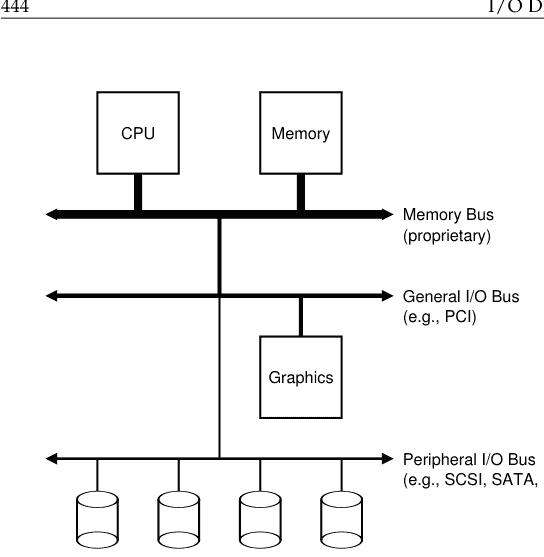

图 36.1：典型的系统架构

当然，现代系统越来越多地使用专用芯片组和更快的点对点互连来提高性能。图 36.2（第 445 页）显示了特尔 Z270 芯片组的示意图 [H17]。在顶部，CPU 与内存系统的连接最紧密，但也与显卡（因此是显示器）有高性能连接，以实现游戏（噢，太了！）和其他图形密集型应用程序。

CPU 通过特尔专有的 DMI（直接介质接口）连接到 I/O 芯片，其余设备通过许多不同的互连连接到该芯片。在右侧，一个或多个硬盘通过 eSATA 接口连接到系统；ATA（AT 连接，指的是提供到 IBM PC AT 的连接）、SATA（串行 ATA）以及现在的 eSATA（外部 SATA）代表了过去几十年存储接口的演变，每一步提高了性能以跟上现代存储设备。

在 I/O 芯片下方有许多 USB（通用串行总线）连接，在描绘中允许键盘和鼠标连接到计算机。在许多现代系统中，USB 用于此类低性能设备。

最后，在左侧可以连接其他更高性能的设备

# I/O 设备

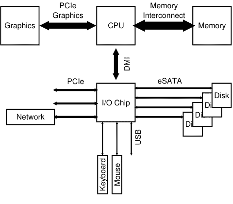

通过 PCIe（外设组件互连快速通道）连接到系统。在图中，此处在此连接了一个网络接口；通常还连接了性能更高的存储设备（如 NVMe 持久性存储设备）。

图 36.2：现代系统架构

## 36.2 一个典型设备

现在让我们来看一个典型设备（并非真实的设备），并利用这个设备来驱动我们对实现高效设备交互所需的某些机制的理解。从图 36.3（第 446 页）我们可以看到设备具有两个重要的部分。第一个是面向系统其余部分的硬件接口。就像软件一样，硬件也必须呈现出某种接口，允许系统控制其操作。因此，所有设备都有其用于交互的某种指定接口和协议。

设备的第二部分是其内部结构。设备的这部分取决于具体实现，并负责实现设备向系统呈现的抽象。简单的设备将有一个或几个芯片来实现其功能；更复杂的设备将包含单个 CPU、一些通用内存以及其他设备特定芯片来完成工作。例如，现代 RAID 控制器可能由数十万行固件（即硬件设备内部的软件）组成以实现其功能。

2008–19, ARPACI-DUSSEAU

三个部分

I/O 设备

| 寄存器 | 状态 | 命令 | 数据 | 接口 |

|---|---|---|---|---|

| 微控制器 (CPU) 内存 (DRAM 或 SRAM 或两者都有) 其他硬件特定芯片 | | | | 内部 |

图 36.3：一个典型设备

## 36.3 典型协议

在上面的图中，（简化的）设备接口由三个寄存器组成：状态寄存器，可以通过读取它查看设备的当前状态；命令寄存器，用于告诉设备执行任务；以及数据寄存器，用于向设备传递数据或从设备获取数据。通过读写这些寄存器，操作系统可以控制设备。

让我们描述操作系统为了代表用户执行某些操作而与设备进行的一种典型交互。该协议如下：

```
While (STATUS == BUSY)
  // 等待设备不再忙碌
将数据写入 DATA 寄存器
将命令写入 COMMAND 寄存器
（启动设备并执行命令）
While (STATUS == BUSY)
  // 等待设备完成你的请求
```

该协议分为四个步骤。第一步，操作系统通过反复读取状态寄存器等待设备准备好接收命令；我们称之为**轮询**设备（基本上是询问它正在发生什么）。第二步，操作系统向数据寄存器发送一些数据；可以想象，如果这是一个磁盘（例如），则需要多次写入才能将一个磁盘块（例如 4KB）传输到设备。当 CPU 参与到数据移动时（如本协议所示），我们称之为**程序化 I/O (PIO)**。第三步，操作系统向命令寄存器写入命令；这样做意味着设备知道数据已就绪且应该开始处理该命令。最后，操作系统通过在循环中轮询设备来等待其完成，等待它是否已结束（然后它可能会获得一个错误代码来指示成功或失败）。

这种基本协议的优点是简单且有效。然而，它也涉及一些效率低下和不便之处。你可能会在协议中注意第一个问题是轮询似乎效率很低；具体来说，它浪费了大量的 CPU 时间仅用于等待（可能缓慢的）设备完成活动，而不是切换到另一个进程并更好地利用 CPU。

操作系统

[版本 1.01]

WWW.OSTEP.ORG

# I/O 设备

> 关键问题：如何避免轮询

操作系统如何在不频繁轮询的情况下检查设备状态，而轮询会产生并导致 CPU 的开销？

## 36.4 使用中断降低 CPU 开销


多年前发明的中断技术是为了改进这一点：与其反复轮询设备，不如使用中断。当设备完成操作时，它会触发中断（它可能会获得一个错误代码来指示成功或失败）。中断允许操作系统在等待设备时切换到另一个进程，从而更好地利用 CPU。在这种情况下，设备通过触发中断服务程序（ISR）来完成任务。中断允许计算与 I/O 的重叠，这种方法在设备慢时非常有用。这显示了：

| CPU | 1 | 1 | 1 | 1 | p | p | p | 1 | 1 |
|---|---|---|---|---|---|---|---|---|---|

| Disk | | | | | | | | 1 | 1 |

在时间线图中，CPU 1 运行并请求某些数据。如果没有中断，操作系统将一直轮询磁盘。在这种情况下，使用中断反而会减慢系统：如果设备很快，最好的方法是轮询；如果设备慢，则可以使用中断。

| CPU | 1 | 1 | 1 | 1 | 2 | 2 | 2 | 1 | 1 |
|---|---|---|---|---|---|---|---|---|---|

| Disk | | | | | | | | 1 | 1 | 1 |

在这些例中，CPU 2 在等待 I/O 时运行。当设备完成请求时，会发生中断，操作系统再次运行 CPU 1。这种分阶段的方法可以达到两者的完美。

©2008–19, ARPACI-DUSSEAU

三个部分

I/O 设备

> Tip：中断并不总是比 PIO 好

虽然中断允许计算与 I/O 的重叠，但它们只在慢设备上才有意义。否则，中断处理和上下文切换的成本可能超过其带来的收益。在某些情况下，中断的洪没可能会导致系统死锁 [MR96]；在这种情况下，轮询提供的控制是很有用的。

# I/O 设备

在网络中，另一个不使用中断的原因 [MR96]。当涌入的数据包产生每一个中断时，操作系统可能会陷入死锁，即发现自己一直在处理中断，而从未让用户级进程运行。例如，负载波动的 Web 服务器可能会偶尔使用轮询来更好地控制。

另一种基于中断的优化是合并。在这种设置下，设备在向 CPU 传递中断之前需要等待一段时间。等待期间，其他请求可能很快完成，多个中断可以合并为一次交付，从而降低中断处理的开销。当然，等待太久会增加请求的延迟，这是系统中常见的权衡。请参考 Ahmad 等人 [A11] 的优秀总结。

# I/O 设备

## 关键：如何降低 PIO 开销

使用 PIO（程序端口 I/O）时，CPU 花费大量时间手动在设备之间移动数据。我们如何卸载这些工作，从而更有效地利用 CPU 呢？

这个问题的解决方法是我们所说的直接内存访问（DMA）。DMA 引擎本质上是系统中的一种非常特殊的设备，可以在无需 CPU 干预的情况下协调设备与主内存之间的传输。

DMA 的工作原理如下：例如为了将数据传输到设备，操作系统通过程序 DMA 引擎，告诉它数据在内存中的位置以及要发送到哪个设备。此时，操作系统已完成传输，可以继续执行其他工作。当 DMA 完成时，DMA 控制器会触发一个中断，操作系统就能知道传输情况了。修订后的时间线：

| CPU | 1 | 1 | 1 | 1 | 2 | 2 | 2 | 2 | 2 | 2 | 1 |
|---|---|---|---|---|---|---|---|---|---|---|---|

| DMA | | | | | c | c | c | | | | | |
| 磁盘 | | | | | | | | 1 | 1 | 1 | 1 |

从时间线可以看出，数据拷贝现在由 DMA 控制器处理。因为 CPU 在这段时间内是闲的，操作系统可以做其他事情，这里选择运行进程 2。因此，进程 2 在进程 1 再次运行之前可以使用更多的 CPU。

# 36.6 设备交互的方法

现在我们已经了解了执行 I/O 时涉及的一些效率问题，但还有其他几个问题我们需要处理，以便将设备整合到现代系统中。你可能已经注意到了一个问题：我们还没有真正提到过操作系统实际上是如何与设备通信的！因此，问题在于：

> 关键：如何与设备通信

硬件应该如何与设备通信？应该有显式的指令吗？还是有其他方法？

随着时间的推移，发展出了两种主要的设备通信方法。第一种、也是最老的方法（IBM 主机多年来）是使用显式的 I/O 指令。这些指令指定了操作系统向特定设备寄存器发送数据的方法，从而允许构建上述描述的协议。

© 2008–19, ARPAC-DUSSEAU

三个简单部分

450

I/O 设备

例如，在 x86 上，可以使用 `in` 和 `out` 指令与设备通信。例如，要向设备发送数据，调用者指定一个包含该数据的寄存器，并用特定的端口命名设备。执行该指令即可实现所需的行为。

此类指令通常是特权的。因此，操作系统是唯一允许直接与它们通信的实体。如果任何程序都能读取或写入磁盘，例如：那将陷入彻底混乱（一如既常），因为任何程序都可以利用漏洞获得对机器的完全控制。

与设备交互的第二方法被称为内存映射 I/O（memory-mapped I/O）。通过这种方法，硬件将寄存器提供出来就像内存位置一样。要访问特定寄存器，操作系统会发出 `load`（读取）或 `store`（写入）地址；然后硬件会将 `load/store` 路由到设备而不是主内存。

这两种方法之间并没有特别大的优势。内存映射方法的好处在于不需要新指令来支持它，但这两种方法仍然在使用。

# 36.7 适配到操作系统：设备驱动程序

我们将讨论的一个问题是：如何将具有非常特定接口的设备整合到我们希望尽可能通用的操作系统中。例如，考虑一个文件系统。我们希望构建一个运行在 SCSI 设备、IDE 磁盘、USB 钥匙驱动程序等之上的文件系统，并且我们希望文件系统忽略所有向这些类型的设备发布读/写请求的细节。因此，我们的问题是：

> 关键：如何构建一个设备中性的操作系统

我们如何让操作系统的大部分保持设备中性，并向操作系统子系统隐藏设备交互的细节？

这个问题通过古老的抽象技术得以解决。在最底层，操作系统有一部分软件必须详细了解设备的工作原理。我们称这部分软件为设备驱动程序，任何设备交互的细节都封装在其中。

让我们通过检查 Linux 文件系统栈软件，来看看这种抽象如何帮助操作系统的设计和实现。图 36.4 是 Linux 软件结构的一个粗略示意。正如你从图中看到的，文件系统（当然，上层的应用程序完全不知道它正在使用哪种类磁盘的特定细节；它只需向通用块层发布块读/写请求，由通用块层将其路由到相应的设备驱动程序，再由驱动程序处理发布特定请求的细节）。尽管经过了简化，该图展示了此类细节如何从操作系统的大部分隐藏掉。

488

# I/O 设备

| 应用 | | |
| :--- | :--- | :--- |
| 文件系统 | | |
| 通用块层 | | |
| 设备驱动程序 | | |
| 硬件 | | |

图 36.4：软件栈

该图展示了此类细节如何从操作系统的大部分隐藏掉。这个问题通过古老的抽象技术得以解决。在最底层，操作系统有一部分软件必须详细了解设备的工作原理。我们称这部分软件为设备驱动程序，任何设备交互的细节都封装在其中。

让我们通过检查 Linux 文件系统栈软件，来看看这种抽象如何帮助操作系统的设计和实现。正如你从图中看到的，文件系统（当然，上层的应用程序完全不知道它正在使用哪种类磁盘的特定细节；它只需向通用块层发布块读/写请求，由通用块层将其路由到相应的设备驱动程序，再由驱动程序处理发布特定请求的细节）。尽管经过了简化，该图展示了此类细节如何从操作系统的大部分隐藏掉。

> 关键：如何构建一个设备中性的操作系统

我们如何让操作系统的大部分保持设备中性，并向操作系统子系统隐藏设备交互的细节？

这个问题通过古老的抽象技术得以解决。在最底层，操作系统有一部分软件必须详细了解设备的工作原理。我们称这部分软件为设备驱动程序，任何设备交互的细节都封装在其中。

# 36.8 案例研究：简单的 IDE 驱动

为了深入研究，让我们快速查看 IDE 磁盘。假设它已经初始化，协议如下。IDE 磁盘向系统提供了一个示例接口，由四种寄存器组成：控制、命令块、状态和错误。这些寄存器通过读取或写入“I/O 地址”可用（使用 x86 的 `in` 和 `out` 指令）。

### 控制寄存器 (0x3F6)

| 位 | 描述 |
| :--- | :--- |
| 0x3F6 | 0000 1RE:重置, E中断 |

### 命令块寄存器 (0x1F0-0x1F6)

| 寄存器 | 描述 |
| :--- | :--- |
| 0x1F0 | 数据端口 |
| 0x1F1 | 错误 |
| 0x1F2 | 扇区数量 |
| 0x1F3 | LBA低字节 |
| 0x1F4 | LBA中字节 |
| 0x1F5 | LBA高字节 |
| 0x1F6 | TOPLBA: B=LBA, D=驱动 |

### 状态寄存器 (0x1F7)

| 位 | 描述 |
| :--- | :--- |
| 0x1F7 | 忙 读取 故障 寻道 DRQ 错误 |

### 错误寄存器 (0x1F1)

| 位 | 描述 |
| :--- | :--- |
| 0x1F1 | BBK UNC IDNF MCR ABR TONF AMNF |

- BBK = 坏块
- UNC = 不不可数据错误
- IDNF = ID标记未找到
- MCR = 请求命令消息
- ABR = 命令中止
- TONF = 轨道0未找到
- AMNF = 地址标记未找到

与交互的基本协议如下：

1. 等待驱动器就绪。读取状态寄存器 (`0x1F7`)，直到驱动器就绪且非忙。
2. 向命令寄存器写入参数。将扇区数量、要访问扇区的逻辑地址 (`LBA`) 以及驱动器号（主`0x00`或从机`0x10`，IDE仅允许两个驱动器）写入命令寄存器 (`0x1F2-0x1F6`)。
3. 通过向命令寄存器发布读/写启动 I/O。

# I/O 设备

453

- **数据传输（写入）：** 等待驱动器状态为 READY 且 DRQ（驱动器数据请求）有效；将数据写入数据端口。
- **处理中断。** 每个传输的扇区都会产生一个中断；更复杂的方法允许批量处理，从而在整个传输完成后只产生一个中断。
- **错误处理。** 每次操作后，读取状态寄存器。如果 ERROR 位置位，则读取错误寄存器以获取详情。

该协议的大部分内容位于 xv86 IDE 驱动程序（图 36.6）中，该程序（初始化后）通过四个主要函数工作。第一个是 `ide_rw()`，它将请求放入队列（如果有其他待处理请求），或将其发送到磁盘（通过 `ide_start_request()`）；无论何种情况，该程序都会等待请求完成，并且调用进程将进入睡眠状态。第二个是 `ide_start_request()`，用于向磁盘发送请求（如果是写入，则发送数据）；通过调用 `in` 和 `out` 指令分别读取和写入设备寄存器。启动请求使用第三个函数 `ide_wait_ready()`，以确保在向设备发送请求之前设备已就绪。最后，当发生中断时调用 `ide_intr()`；它从设备中读取数据（如果是读取而非写入），唤醒等待 I/O 完成的进程，并（如果 I/O 队列中有更多请求）通过 `ide_start_request()` 启动下一个 I/O。

# 36.9 历史说明

在进入正之前，我们包含了关于这些基本思想起源的简短历史说明。如果你想了解更多信息，请阅读 Smotherman 出色的总结 [S08]。

中断是一个古老的概念，存在于最早的机器中。例如，20 世纪 50 年初的 UNIVAC 就具有某种形式的中断向量，尽管尚不清楚该功能是在哪一年提供的 [S08]。遗憾的是，即使在我们的起步阶段，我们也开始遗失计算机史的起源了。

关于哪种机器首次引入 DMA 概念，也存在争议。例如，Knuth 等人指向 DYAC（一种“移动式”机器，在当时它可以被拖在拖车上），而另一些人认为 IBM SAGE 可能是第一个 [S08]。无论如何，到 50 年代中期，已经存在了带有 I/O 设备且能与内存直接通信并在完成后中断 CPU 的系统。

这里的历史很难追溯，因为这些发明与真实的、有时是不广为人知的机器紧密结合的。例如，一些人认为 Lincoln Labs 的 TX-2 机器是第一个使用向量中断的 [S08]，但这并不明确。

# 454

# I/O 设备

```c
static int ide_wait_ready() {
    while (((int r = in(0x1f7)) & IDE_BSY) || !(r & IDE_DRDY))
        ; // 循环直到驱动器不再忙碌
}
```

```c
static void ide_start_request(struct buf *b) {
    ide_wait_ready();
    outb(0x3f6, 0); // 产生中断
    outb(0x1f2, 0); // 多少扇区？
    outb(0x1f3, b->sector & 0xff); // LBA 放在这里 ...
    outb(0x1f4, (b->sector >> 8) & 0xff); // 这里
    outb(0x1f5, (b->sector >> 16) & 0xff); // 这里！
    if ((b->flags & B_DIRTY) | ((b->sector>>24)&0x0f)) {
        outb(0x1f7, IDE_CMD_WRITE); // 这是一个写入
        outb(0x1f0, b->data, 512/4); // 也传输数据！
    } else {
        outb(0x1f7, IDE_CMD_READ); // 这是一个读取（无数据）
    }
}
```

```c
void ide_rw(struct buf *b) {
    acquire(&ide_lock);
    for (struct buf **pp = &ide_queue; *pp=(*pp)->qnext;) { // 遍历队列
        *pp = b; // 将请求添加到末尾
        if (ide_queue == b) { // 如果队列为空
            ide_start_request(b, &ide_lock); // 向磁盘发送请求
            while ((b->flags & (B_VALID|B_DIRTY)) != B_VALID)
                sleep(b, &ide_lock); // 等待完成
        }
    }
    release(&ide_lock);
}
```

```c
void ide_intr() {
    struct buf *b;
    acquire(&ide_lock);
    if (!(b->flags & B_DIRTY) && ide_wait_ready() >= 0) {
        ins(0x1f0, b->data, 512/4); // 如果是读取：获取数据
        b->flags |= B_VALID;
    }
    b->flags &= ~B_DIRTY;
    wakeup(b); // 唤醒等待的进程
    if ((ide_queue == b->qnext) != 0) // 启动下一个请求
        ide_start_request(ide_queue); // 如果存在的话
    release(&ide_lock);
}
```

图 36.6：xv6 IDE 磁盘驱动程序（简化）

由于这些思想相对显而易见——要想出在 I/O 挂起时让 CPU 执行其他事情不需要爱因斯坦式的飞跃——也许我们对“谁是第一个”的关注是误的。可以明确的是：当人们构建这些早期机器时，中断、DMA 以及相关思想都是快速 CPU 和慢速设备本质的直接结果；如果你在那个时代，你可能也会产生类似的想法。

# 36.10 总结

你现在应该对操作系统如何与设备交互有一个非常基础的理解。引入了两种技术——中断和 DMA——来提高设备效率，并描述了两种访问设备寄存器的方法：显式 I/O 指令和内存映射 I/O。最后，提出了了设备驱动程序的概念，展示了操作系统本身如何封装底层细节，从而能够更容易以设备中立的方式构建操作系统的其他部分。

# 参考文献

[A11] "VIC: Interrupt Coalescing for Virtual Machine Device IO"，作者为 Irfan Ahmed, Ajay Gulati, Ali Mashtashed。USENIX '11。关于虚拟机设备 I/O 中断合并的综述。

[A14] "Operating Systems: Three Pieces"（章节：崩溃一致性：日志结构），作者为 Remzi Arpacci-Dusseau 和 Andrea Arpacci-Dusseau，2014年。关于文件系统的正常访问描述。

[C01] "Empirical Study of Operating Systems"，作者为 Emery Chao, Jungfeng Yang, Benjamin Chad, Seth Halpern 和 David Weiser。系统性探索现代操作系统许多功能的论文。

[C08] "The x86 Operating System"，作者为 Russ Cox, Nicholas Zeldovich。来自 pdos.csail.mit/828/index.html。

[D07] "What Operating Systems Should Know About Memory"，作者为 Haridai Gunai, Arpacci-Dusseau。加州圣何塞，2007年11月。

[E08] "Error-Handling is Costly"，作者为 Cindy Rubio-Gonzales, Arpacci-Dusseau。

[H17] "Core i7-700 评测"，作者为 Joel Hruska。2017年1月3日。

[H18] "Hacker News"，作者为多个贡献者。位于 ycombinator.com。


[L94] "Attachment Interface for Disk Drives"，作者为 Lawrence J. Ramirez。编号：`ANSI X3.221`，1994年。位于 `ftp.tio.org/e13/project/ata-1.pdf`。

[RM96] "Receive in an Interrupt-driven Kernel"，作者为 Jeffrey Mog, K. K. Ramakeshan。USENIX '96。Michael Mog 同事在网络性能方面做了大量的工作。

[S08] "Interrupts"，作者为 Mark Smotherman。2008年7月。位于 `people.clemson.edu/mark/interrupts.html`。关于计算机中断、DMA 及相关思想信息的宝贵回顾。

[S03] "Improving the Reliability of Commodity Operating Systems"，作者为 Michael M. Swift, Brian N. Levy：SOSP '03。Swift 的工作在更微内核的操作方法中被回顾；最后，他发现了一些地址空间保护在现代操作系统中有用的理由。

[W10] "Hard Disk Drive"，华盛顿州课程首页。位于该网站：`eecs.wsu.edu/~cs460/cs560/HDDdriver.html`。关于 IDE 磁盘驱动接口以及如何为其构建驱动程序的很好的总结。

# 硬盘驱动器

上一章引入了 I/O 设备的通用概念，并展示了操作系统如何与这类“巨兽”进行交互。在本章中，我们将详细探讨其中一种特定的设备：硬盘驱动器。几十年来，这些硬盘驱动器一直是计算机系统中持久性数据存储的主要形式，而且文件系统技术（即将发布）的大部分发展都是基于它们的行为的。因此，在构建管理这些磁盘的文件系统软件之前，了解磁盘操作的细节是非常值得的。这些细节中的许多可以在 Ruemmler 和 Wilkes [RW92] 以及 Anderson、Dykes 和 Riedel [ADR03] 的优秀论文中找到。

> 核心问题：如何在磁盘上存储和访问数据

现代硬盘如何存储数据？接口是什么？数据实际上是如何被读取或访问的？磁盘调度如何提高性能的？

## 37.1 接口

让我们从理解现代磁盘驱动器的接口开始。所有现代驱动的基本接口由大量的扇区（512 字节块）组成，每个扇区都可以读取或写入。在具有 `$n$` 个扇区的磁盘上，扇区的编号从 0 到 `$n-1$`。因此，我们可以将磁盘视为一个扇区数组；0 到 `$n-1$` 是该驱动器的地址空间。

多扇区操作是可能的；事实上，许多文件系统会一次读取或写入 4KB（或更多）。然而，在更新磁盘时，驱动器制造商提供的唯一保证是单个 512 字节的写入是原子的（即：要么完整完成，要么完全不完成）；因此，如果发生及时的断电，只有较大写入操作中的部分可能会完成（有时被称为“断裂写入”，即 torn write）。

大多数磁盘驱动器的客户端都会做出一些假设，但这些假设并未在接口中指定；Schlosser 和 Ganger 认为

# 硬盘驱动器

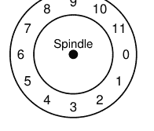

图 37.1：只有一个单一磁道的磁盘

让我们从硬盘驱动器的“未写之约”假设开始 [SG04]。具体来说，通常可以假设在驱动器地址空间内访问两个相邻的块会比访问两个相距远的块更快。还可以假设在连续的数据块中访问块（即顺序读取或写入）是最快的访问模式，且通常比任何随机访问模式都要快得多。

## 37.2 基础几何结构

让我们开始理解现代磁盘的一些组件。我们首先从盘片（platter）开始，这是一个圆形的硬表面，通过对其感应磁性变化来存储数据。磁盘可能有一个或多个盘片；每个盘片有两个面，每个面都是表面。这些盘片通常由某些硬材料（如铝）制成，然后涂有一层薄的磁层，使驱动器在掉电时也能持久地存储比特位。

所有盘片都围绕主轴（spindle）结合在一起，主轴连接到一个电机，该电机在驱动器通电时以恒定（固定）的速率旋转盘片。旋转速率以每分钟旋转数（RPM）衡量，现代典型的数值在 7,200 RPM 到 15,000 RPM 之间。请注意，我们通常关注单次旋转的时间，例如，以 10,000 RPM 旋转的驱动器意味着单次旋转需要 6 毫秒（ms）。

数据在每个表面上以同心圆扇区的形式编码；我们每个磁道对应一个同心轨道。单个表面包含成千上万条轨道，它们紧密地排列在一起，数百条轨道就能填满手掌的宽度。

为了从表面进行读写，我们使用一种机制，让我们能够感应（即读取）表面上的磁性模式，或者写入它们。

（此处原文在某处中断，翻译随之相应结束）

# 硬盘

## 461

按此方式旋转

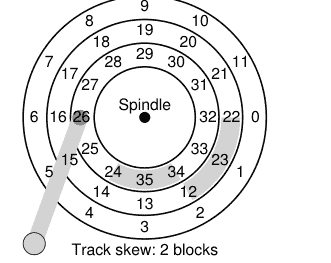

图 37.4：三条磁道：磁道偏移 2

扇区通常像这样偏移，这是因为当从一条磁道切换到另一条磁道时，磁盘需要重新定位磁头（即使是到相邻的磁道）。如果没有这种偏移，磁头将移动到下一条磁道，但所需的下一个块已经旋转到了磁头下方，磁头必须等待几乎整个旋转延迟才能访问下一个块。

另一个事实是，外层磁道的扇区通常比内层磁道多，这是几何结构的结果；这些磁盘通常被称为*多分区*（multi-zoned）硬盘，其中磁盘被划分为多个区域，每个区域包含每个磁道的扇区数量，且外区的扇区数量多于内区。

最后，任何现代硬盘的一个重要部分是其*缓存*（cache），它只是一小部分内存（通常为 8 或 16 MB），驱动器可以用它来存储从磁盘读取或写入磁盘的数据。例如，当从磁盘读取一个扇区时，驱动器可能需要决定读取该磁道上的所有扇区并将它们缓存在内存中；这样做允许驱动器快速响应对同一条磁道的任何后续请求。

在写入操作时，驱动器有一个选择：是在数据放入内存后立即确认写入已完成，还是在数据实际写入磁盘后确认？前者是*写回*（write back）缓存（有时也称为*即时报告*），后者是*直写*（write through）缓存。写回缓存有时会让驱动器运行得“更更快”，但可能是危险的；如果文件系统或应用程序要求数据按特定顺序写入磁盘以确保正确性，写回缓存可能会导致问题（详情请参阅文件系统日志章节）。

© 2008–19, ARPAC-DUSSEAU

# 三个部分

## 硬盘

## 旁记：量纲分析

还记得在化学课上，你是如何通过简单地设置单位使它们抵消来解决几乎每个问题，而答案就这样自然而出的吗？这种化学魔法有一个高大上的名称——量纲分析（dimensional analysis），事实证明它在计算机系统分析中同样有用。

让我们来看量纲分析是如何工作的以及它为什么是有用的。在这个例子中，假设你必须计算磁盘旋转一次需要多少时间（单位为毫秒）。不幸的是，你只知道磁盘的转速（RPM），即每分钟旋转圈数。假设我们谈论的是一个 100 RPM 的磁盘（即每分钟旋转 10,000 次）。我们如何设置量纲分析以获得以毫秒为单位的时间率？

为了做到这一点，我们从目标单位写在左侧开始；在这种情况下，我们希望获得每次旋转的时间（单位为毫秒），所以这正是我们要写的：并确保尽可能地抵消单位。首先，我们得到 10,000 次“旋转”（Rotations）（将旋转放在底部，因为它在左侧），然后用秒将分钟转换为秒，最后用毫秒将秒转换为毫秒：最终结果如下（带有整的单位）：

| 时间(ms) | 1 minute | 60 seconds | 1000 ms | 60,000 ms | 6 ms |
| --- | --- | --- | --- | --- | --- |
| 1 Rot. | 10,000 Rot. | 1 Rot. | 1 minute | 60 Rot. | Rotation |

如你所示，这种量纲分析将看似直觉的操作变成了一个简单且可重复的过程。除了上面的 RPM 计算外，它在常规 I/O 分析中也非常好用。例如，你通常会得到磁盘的传输率，例如 100 MB/秒，然后被问：传输一个 512 KB 的块需要多长时间（毫秒）？使用量纲分析，计算如下：

| 时间(ms) | 512 KB | 1 MB | 1 second | 1000 ms | 5 ms |
| --- | --- | --- | --- | --- | --- |
| 1 Request | 1 Request | 1024 KB | 100 MB | 1 second | Request |

## 37.4 I/O：数学计算

现在我们已经有了磁盘的抽象模型，可以使用一些分析来理解磁盘性能。特别是，我们可以将 I/O 时间表示为三个主要组件之一：

```
T_{I/O} = T_{seek} + T_{rotation} + T_{transfer}
```

注意，I/O 速率（$R_{I/O}$）通常更容易用于硬盘之间的比较（正如我们下面将做的那样），它可以从时间很容易算出。只需将传输量除以所需的时间即可：

> $$R_{I/O} = \frac{Size_{Transfer}}{T_{I/O}}$$

为了对 I/O 时间有更直观的感受，让我们进行计算。假设我们对两个负载感兴趣。第一种被称为随机负载（random workload），涉及对磁盘上随机位置进行小规模（例如 4KB）读取。随机负载在许多应用程序中都很常见，包括数据库管理系统。第二种是顺序负载（sequential workload），只是简单地连续读取大量扇区，而不进行来回跳跃。顺序访问模式也很常见，而且同样重要。

为了理解随机负载和顺序负载之间的性能差异，我们需要对磁盘做出一些假设。首先，让我们看看 Seagate 的两个现代磁盘。第一个名为 Cheetah 15K.5 [09b]，是一个高性能 SCSI 磁盘。第二个 Barracuda [09a] 是一个为容量设计的磁盘。详情见图 37.5。

如你所示，这些磁盘具有不同的特性，并在许多方面总结了磁盘市场的两个重要组成。第一类是“高性能”市场，磁盘的设计是为了尽可能快速旋转、提供低寻道时间并快速传输数据。第二类是“容量”市场，磁盘的设计是为了尽可能封装更多内容。

| 容量 | Cheetah 15K.5 | Barracuda |
| --- | --- | --- |
| RPM | 300 GB | 1 TB |
| 平均寻道 | 15,000 | 7,200 |
| 最大传输 | 4 ms | 9 ms |
| 盘片 | 125 MB/s | 105 MB/s |
| 缓存 | 4 MB | 16 MB |
| 接口 | 16 MB | 16/32 |
| | SCSI | SATA |

图 37.5：磁盘规格：SCSI vs SATA

## 硬盘

## 提示：顺序使用磁盘

在可能的情况下，以大块的方式在磁盘之间传输数据：块越大越好。I/O 性能将遭受剧烈影响。此外，用户也会遭受痛苦。

© 2008–19

## 三个

部分

## 硬盘

| | Cheetah | Barracuda |
|---|---|---|
| $R_{IO}$ 随机 | 0.66 MB/s | 0.31 MB/s |
| $T_{IO}$ 顺序 | 125 MB/s | 105 MB/s |

图 37.6：磁盘性能：SCSI vs SATA

操作系统

系统

[版本 1.01]

WWW.OSTEP.ORG

# 硬盘

# 465

# 旁注：计算“平均”寻道

在许多书籍和论文中，你会看到平均磁盘寻道时间被引用为约为完全寻道时间的三分之一。这是从哪里来的呢？

事实证明，这是基于平均寻道距离（而非时间）的简单计算。将磁盘想象成一组从 0 到 $N$ 的轨道。因此，任意两条轨道 $x$ 和 $y$ 之间的寻道距离计算为它们差的绝对值：$|x - y|$。

要计算平均寻道距离，你所做的就是先加所有可能的寻道距离：

```
$$\sum_{x=0}^{N}\sum_{y=0}^{N}|x - y|$$ (37.4)
```

现在，将其除以不同寻道的次数：$N^2$。为了计算和，我们将直接使用积分：

```
$$\int_{x=0}^{N}\int_{y=0}^{N}|x - y|dydx$$ (37.5)
```

为了计算内层积分，让我们拆分绝对值：

```
$$\int_{y=0}^{x}(x - y)dy + \int_{y=x}^{N}(y - x)dy$$ (37.6)
```

解方程得到 $(xy - \frac{1}{2}y^2)|_{y=0}^{x} + (\frac{1}{2}y^2 - xy)|_{x}^{N}$，它可以简化为 $(x^2 - Nx + \frac{1}{2}N^2)$。现在我们必须计算外层积分：

```
$$\int_{x=0}^{N}(x^2 - Nx + \frac{1}{2}N^2)dx$$ (37.7)
```

结果为：

```
$$\frac{1}{3}x^3 - \frac{N}{2}x^2 + \frac{N^2}{2}x|_{0}^{N} = \frac{N^3}{3}$$ (37.8)
```

记住，我们仍然需要除以寻道的总数 $(N^2)$ 来计算平均寻道距离：$(\frac{N^3}{3})/(N^2) = \frac{1}{3}N$。因此，磁盘在所有可能的寻道之上的平均寻道距离是完全寻道的三分之一。现在，当你听到平均寻道是完全寻道的三分之一时，你就知道它是从哪里来的了。

© 2008–19

# 三个简单部分

向此旋转

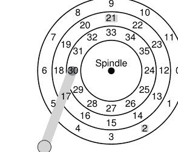

图 37.7: SSTF：调度请求 21 和 2

## 37.5 磁盘调度

由于 I/O 的成本，操作系统在历史上一直于决定向磁盘的 I/O 顺序方面起着作用。更具体地说，给定一组 I/O 请求，**磁盘调度器**会检查这些请求并决定下一个调度哪一个 [SCL90, JW91]。

与作业调度不同（作业调度中每个作业的长度通常是未知的），在磁盘调度中，我们可以很好地估计一个“作业”（即请求）需要多长时间。通过估计请求可能的旋转延迟，磁盘调度器可以知道每个请求所需的时间，从而（贪婪地）优先选择处理时间最短的请求。因此，磁盘调度器在操作中会尝试遵循 SJF（最短作业优先）原则。

### SSTF：最短寻道时间优先

一种早期的磁盘调度方法被称为**最短寻道时间优先（shortest-seek-time-first, SSTF）**（也称为 *shortest-seek-first* 或 SSF）。SSTF 按轨道顺序处理 I/O 请求队列，选择离当前轨道最近的请求进行完成。例如，假设磁头当前位置位于内层轨道，轨道 1 和 22（外层轨道），我们稍后向 21 发出请求，等待其完成，然后向 2 发出请求（图 37.7）。

SSTF 在这个例子中运行良好，然而，SSTF 并不是万能药，原因如下：首先，主机操作系统无法直接获取驱动器的几何结构信息；相反，它看到的是一个块的数组。幸运的是，这个问题很容易解决。操作系统可以实现的不是 SSTF，而是**最近块优先（nearest-block-first, NBF）**，它将调度具有最近块地址的请求。

# 硬盘

第二个问题更为根本：饥饿（starvation）。想象在我们上面的例子中，如果有一系列持续的请求发送到磁头当前位置所在的内层轨道，那么对任何其他轨道的请求将完全被纯 SSTF 方法所忽略。因此，问题的关键在于：

## 核心：如何处理磁盘饥饿

我们如何能实现类似 SSTF 的调度但避免饥饿？

# 电梯算法（又称 SCAN 或 C-SCAN）

这个问题的答案在一些时候以前已经开发出来了（例如参见 [CKR72]）。

SCAN（扫描算法）有多个变体，它们的作用大同小异。例如，Coffman 等人引入了 F-SCAN，它在执行扫描时冻结要访问的队列 [CKR72]；此操作将扫描期间到达的请求放入队列中稍后处理。通过延迟处理后到达的请求（或更近的请求），来避免远端请求的饥饿。

**C-SCAN**

C-SCAN 是另一种常见的变体，是循环扫描的缩写。该算法不是跨磁盘进行双向扫描，而是只从外层向内层移动，然后返回外层轨道重新开始。这样做对中间轨道来说公平一点，即在处理完外层轨道后，SCAN 往返通过中间层两次，然后再次返回外层轨道。

出于显而易见的原因，SCAN 算法（及其亲戚）有时被称为*电梯*算法，因为它的行为就像一个向上或向下的电梯，而并不是根据哪个楼层更近就处理哪个层的请求。想象一下，如果你正从第 10 层下到 1 层，有人在 3 层上车并按了 4 层，而电梯却上到了 4 层，因为它比 1 层“更近”！正如你所见，电梯算法在现实生活中被防止了这种情况在电梯中发生。在磁盘中，它防止了饥饿。

遗憾的是，SCAN 及其亲戚并不代表最好的调度技术。

等待一会儿 [ID01]，采用所谓的“非工作保护（non-work-conserving）”方法。通过等待，一个新的且“更好”的请求可能会到达磁盘，从而提高整体效率。当然，决定何时等待以及等待多久可能是困难的；详情请参阅研究论文，或查看 Linux 内核实现以了解此类思想是如何转化为实践的（如果你是那种野心勃勃的人的话）。

## 37.6 总结

我们对磁盘的工作原理进行了总结。这个总结实际上是一个详细的功能模型；它没有描述进入实际驱动器设计中那些惊叹的物理学、电子学和材料科学。对于那些对这类更多细节感兴趣的人，我们建议换一个专业（或者也许辅修）；对于那些对这个模型感到满意的人，太棒了！我们现在可以继续使用该模型在这些不起设备之上构建更有趣的系统。

# 硬盘

# 471

# 参考文献

- [ADR03] "不仅仅是接口：SCSI vs." 由 Dave Anderson, Jim Dykes, Erik Riedel 编写。FAST '03, 2003。关于现代硬盘真实如何工作的最新参考文献之一；对想了解更多信息的人来说必读。

- [CKR72] "磁盘寻道时间调度策略分析" E.G. Coffman, L.A. Klimko, B. Ryan. SIAM Journal of Computing, 1972年9月, 第1卷, 第3期。磁盘调度领域的早期工作之一。


- [HK17] "固态硬盘的未书之契约" 由 Jun, Sudarsan Kannan, Andrea C. Arcpaci-Dusseau, Remi H. Arcpaci-Dusseau 编写。Euroys '17, 塞尔维贝尔格德, 2017年4月。我们利用了不确定性控制，它扩展到了 SSD。使用 SSD 良好似乎和硬盘一样复杂，有时甚至更。
- [IW01] "预期调度：克服欺骗性的空闲同步 I/O" 由 Sitaran, Peter Dusselj 编写。SOSP '01, 2001年10月。一篇很酷的论文，展示了预期调度如何工作；更好的请求可能在路上了！
- [JW91] "基于旋转位置的磁盘调度算法" 由 D. Jacobson, J. Wilkes 编写。技术报告 HP-CSP-22(1), Hewlett-Packard, J. Wilkes. 1991。对磁盘调度的现代解读。它仍然是一个技术报告（而不是发表的论文），因为作者被 Scalter 等人 [50] 引用。
- [RW92] "硬盘建模简介" 由 C. Ruecmeller 编写。J. IEEE Computer, 273, 1994年3月。磁盘操作基础的极佳介绍。部分内容已过时，但基本机制仍然适用。
- [SCO90] "修订后的磁盘调度" 由 Marno Saltzer, Peter Chen, John Ousterhout 编写。USENIX 1990。一篇讨论在磁盘调度世界中磁头如何移动的论文。
- [G04] "基于 MEMS 的存储设备和固态磁盘接口：方木入圆？" Steven W. Schlosser, Gregory K. Ranger '04, 第 77-100 页，2004年。虽然该论文的 MEMS 方面产生了影响，但关于文件系统和磁盘之间连接的讨论很有帮助但略显不足。我们后来在这项工作中研究了“固态硬盘的未书之契约” [HK17]。
- [S09a] "Barracuda ES2 数据表" 由 Seagate, Inc. 编写。可在此网站获取，至少曾经是：`http://www.seagate.com/docs/pdf/datasheet/disc/ds_baracuda_es.pdf`。一份数据表；风险自担。风险是什么？无聊。
- [S09b] "Cheetah 15K-5" 由 Seagate, Inc. 编写。可在此网站获取，我们非常确定是：`http://www.seagate.com/docs/pdf/datasheet/disc/cheetah-15k-5-us.pdf`。

请对本文留下评论。

© 2008-2019 ARCPACI-DUSSEAU

三部分

## 业作业（仿真）

此作业使用 `disk.py` 来让你熟悉现代硬盘的工作原理。它有许多选项，与其他仿真器不同，它有一个图形动画器，可以向你精确展示磁盘在运行时发生了什么。详情请参见 `README`。

1. 计算以下请求组的寻道时间、旋转时间和传输时间：`-a 0`, `-a 6`, `-a 30`, `-a 7`, `3`, `8`, 最后是 `-a 10`, `11`, `12`。
2. 执行上述相同的请求，但将寻道率更改为不同的值：`-S 2`, `-S 4`, `-S 8`, `-S 10`, `-S 40`。时间是如何变化的？
3. 执行上述相同的请求，但更改旋转速率：`-R 0.1`, `-R 0.5`, `-R 0.01`。时间是如何变化的？
4. FIFO 并不总是最好的，例如请求流 `-a 70`, `3`，请求应该以什么顺序处理？运行最短时间优先（SSTF）调度器，以及每个请求被服务需要多长时间（寻道、旋转、传输）？
5. 使用下一次访问时间优先调度器（p SATF）。对于 `-a 7`, `30` 负载它有区别吗？找到一组 SATF 表现通常良好的请求；什么时候 SATF 比 SSTF 更好？
6. 这里有一个要添加的请求流：`a 10`, `11`, `12`, `13`。运行时哪些部分很糟糕？在默认寻道率下增加轨道寻道可以解决这个问题，寻道时间是多少可以使性能最大化？不同的寻道率（例如 `-S 2`, `-S 4`）呢？通常，你能写一个公式来计算偏斜吗？
7. 指定一个不同密度的磁盘，例如 `-z 10`, `20`, `30`，这指定了外圈、中间和内圈轨道块之间的角度差。运行随机请求（例如 `-n 1 -a 5, 1.0`，指定随机请求应通过 `-a` 标志请求并标记五个），并计算寻道、旋转和传输。
8. 调度决定了磁盘一次可以检查多少个请求。生成随机请求（例如 `-w 4`），看看当调度窗口改变时调度器需要多长时间。多大的窗口可以最大化性能？
9. 创建一系列请求来让特定请求饥饿；调度器只有在所有请求都被服务后才会移动到下一个窗口。这会导致饥饿吗？通常，磁盘应该如何在性能和饥饿之间进行这种权衡？
10. 我们看过的所有调度策略都是贪心的；找到一组贪婪不是最优的请求？

# 冗余磁盘阵列 (RAID)

当我们使用磁盘时，有时希望它更快；I/O 操作很慢，因此成为整个系统的瓶颈。当我们使用磁盘时，有时希望它更大；更多数据被放到线上，因此我们的磁盘越来越满。当我们使用磁盘时，有时希望它更可靠；当磁盘故障时，如果我们的数据没有备份，所有数据都会丢失。

> CRUX：如何制造大型、快速、可靠的磁盘

如何制造大型、快速、可靠的存储系统？关键技术是什么？不同方法之间的权衡是什么？

在本章中，我们介绍了冗余磁盘阵列，即 RAID [P-88]，这是一种使用多个磁盘协作来构建更快、更大、更可靠磁盘系统的技术。该术语是由 20 世纪 80 年代末加州伯克利大学的一个由 David Patterson 教授、Randy Katz教授以及学生 Girth Gibson 领导的研究小组引入的。

外部，RAID 看起来像是一组块；内部，RAID 是一个复杂的后端，由多个磁盘、内存（易失性和非易失性）以及一个或多个处理器组成。硬件 RAID 非常像一台专门为管理一组磁盘设计的计算机。

与单个磁盘相比，RAID 有许多优势。一个优势是性能。并行使用多个磁盘可以加快 I/O 时间。另一个好处是容量。数据集需要大磁盘。最后，RAID 可以提高可靠性；将数据分散在多个磁盘上（如果没有 RAID 技术）会使数据受到磁盘故障的影响；通过某种形式的冗余，RAID 可以忍受磁盘丢失并继续运行，就像无事一样。

# 廉价磁盘冗余阵列 (RAID)

提示：透明性使部署成为

在考虑如何为系统添加新功能时，应该始终考虑此类功能是否可以以透明的方式添加，即不需要对系统的其他部分进行任何更改。要求完全重写现有软件（或进行根本性的硬件更改）会降低对想法产生影响的可能性。RAID 是一个完美的例子，它的透明性促进了它的成功；管理员可以安装基于 SCSI 的 RAID 存储阵列代替 SCSI 磁盘，而系统的其他部分（计算机、操作系统等）不需要更改一个位即可启动。通过解决这个部署问题，RAID 从第一天起就变得更加成功了。

令人惊讶的是，RAID 为使用它的系统透明地提供了这些优势，即 RAID 在主系统中看起来就像一个大磁盘。当然，透明性的美之处在于，它让人们能够简单地将磁盘替换为 RAID，而无需更改一行软件；操作系统和应用程序可以在不修改的情况下继续运行。通过这种方式，透明性提高了 RAID 的可部署性，使使用户和管理员能够在不必担心软件兼容性的情况下使用 RAID。

我们将讨论 RAID 的一些重要方面。我们从接口、故障模型开始，然后讨论如何沿着三个重要维度：容量、可靠性和性能来评估 RAID 设计。然后我们还会讨论其他对 RAID 设计和实现重要的其他问题。

## 38.1 接口与 RAID 内部

对于上层文件系统来说，RAID 看起来是一个巨大的（希望）快速的且（希望）可靠的磁盘。对于单个磁盘，它呈现为块的线性数组，每个块都可以由文件系统（或其他客户端）读取或写入。

当文件系统向 RAID 发送逻辑 I/O 时，RAID 内部必须计算访问哪个磁盘（或哪些磁盘）以完成请求，然后发布一个或多个物理 I/O 来执行。这些物理 I/O 的具体性质取决于 RAID 级别，我们将在下文中详细讨论。然而，作为一个简单的例子，考虑一个保留每个块副本的 RAID（每个副本位于单独磁盘上）；当向镜像系统写入时，RAID 对于发出的每个逻辑 I/O 必须执行两次物理 I/O。

RAID 系统通常被构建为一个独立的硬件箱，与主机有标准连接（例如 `SCSI` 或 `SATA`）。然而，在内部，RAID 相当复杂，由一个运行固件以指导 RAID 操作的微控制器、用于在读写时缓冲数据块的易失性内存（如 `DRAM`），在某些情况下用于安全缓冲写入的非易失性内存，甚至用于执行校验计算的专用逻辑（在某些 RAID 级别中很有用，正如我们在下面将看到的）。在高级层次，RAID 是一个非常特殊的系统：它有处理器、内存和磁盘；然而，它运行的不是应用程序，而是旨在操作 RAID 的专用软件。

## 38.2 故障模型

为了理解 RAID 并比较不同的方法，我们必须在心中有一个故障模型。RAID 的设计用于检测并从各种磁盘故障中恢复；确切知道哪些故障对于得一个工作的设计至关重要。

我们将假设的第一个故障模型非常简单，具有停机停止故障模型 [SB84]。在这种模型中，磁盘恰好处于两种状态之一：正常工作或故障。对于正常磁盘，所有块都可以被读取或写入。相比之下，对于已故障的磁盘，数据将永久丢失。

停机停止模型的一个关键方面是它对故障检测的假设。具体来说，当磁盘故障时，我们假设这是很容易被检测到的。例如，在 RAID 阵列中，我们假设 RAID 控制器硬件（或软件）能够立即观察到磁盘何时故障。

因此，现在我们不需要担心更多“静默”故障，例如磁盘损坏。我们不需要担心在运行正常的磁盘上某个块变得不可访问（有时称为潜伏扇区错误）。我们稍后将考虑这些更复杂（不幸的是更符合现实的）磁盘故障。

## 38.3 如何评估 RAID

正如我们将看到的，构建 RAID 有许多方法。每种方法都有值得评估的不同特征，以便理解它们的优缺点。

具体而言，我们将从两个维度来评估每个 RAID 设计。第一个维度是容量：给定一组具有 `$B$` 个块的 `$N$` 个磁盘，RAID 客户端可以使用多少可用容量？如果没有冗余，答案是 `$N \cdot B$`；如果我们有一个每个块有两个副本的系统（称为镜像），我们得到 `$(N \cdot B)/2$` 的可用容量。不同的方案（例如基于校验的方案）往往介于之间。

第二个评估维度是可靠性。给定设计可以容忍多少次磁盘故障？与我们的故障模型一致，我们假设只有整个磁盘可能会故障；在后面的章节中（即关于数据完整性），我们将思考如何处理更复杂的故障模式。

最后，第三个维度是性能。性能的评估有些具有挑战性，因为它很大程度上取决于呈现磁盘阵列的工作负载。因此，在评估性能之前，我们将展示一组应该考虑的典型工作负载。

我们考虑了三个重要的 RAID 设计：RAID 0 级（条带）、RAID 1 级（镜像）和 RAID 4/5 级（基于校验的冗余）。这些设计命名为“级”（level）源于伯克利大学 Patterson、Gibson 和 Katz 的开创性工作 [P+88]。

## 38.4 RAID 0 级：条带

第一级实际上根本不是 RAID 级，因为没有冗余。然而，RAID 0 级，或如其所知的条带（stripe），作为一个基准。

最简单的条带形式是跨磁盘进行条带：

| 磁盘 0 | 磁盘 1 | 磁盘 2 | 磁盘 3 |
| :--- | :--- | :--- | :--- |
| 0 | 4 | 8 | 12 |
| 1 | 5 | 9 | 13 |
| 2 | 6 | 10 | 14 |
| 3 | 7 | 11 | 15 |

图 38.1：简单条带

从 38.1，我们得到了基本思想：以轮询方式跨磁盘进行条带。例如，当块大小为 4KB 时，RAID 可以很容易计算：

```
Disk = A % number_disks
Offset = A / number_disks
```

注意，这些公式适用于简单的例子。假设一个请求针对块 14。由于有 4 个磁盘，这是否意味着感兴趣的磁盘是 `(14 % 4 = 2)`？精确的偏移量是 `(14 / 4 = 3)`。因此，块 14 应该在第三块磁盘（从 0 开始计数）。

| 磁盘 0 | 磁盘 1 | 磁盘 2 | 磁盘 3 |
| :--- | :--- | :--- | :--- |
| 0 | 4 | 8 | 12 |
| 1 | 5 | 9 | 13 |
| 2 | 6 | 10 | 14 |
| 3 | 7 | 11 | 15 |

图 38.2：大块大小的条带

在这个例子中，我们在移动到下一个磁盘之前在每个磁盘上放置块。因此，该阵列的块大小为 4KB。

### 块大小

块大小主要影响阵列的性能。例如，小块大小意味着许多文件将跨越许多磁盘进行条带化，增加了单个文件读写的并行性；然而，跨越多个磁盘的寻道时间增加了。

另一方面，大块大小减少了文件内部并行性，并依赖多个并发请求来实现高吞吐量。然而，大块减少了寻道时间；例如，如果一个文件位于块内并放置在单个磁盘上，访问它时产生的寻道时间将只是单个磁盘的寻道时间。

因此，确定“最佳”块大小是很困难的，因为需要对磁盘系统呈现的工作负载有了解 [CL95]。在本文讨论中，我们将假设阵列使用单块大小（4KB）。大多数阵列使用更大的块大小（例如 64 KB），但为了简单起见，我们在这些问题中使用单块。

# 回 RAID-0 分析

现在让我们来评估条带（striping）的容量、可靠性和性能。从容量的角度来看，它是完美的：给定 `$N$` 块块大小为 `$B$` 块的磁盘，条带会删删除 `$N-B$` 块有效容量。从可靠性的角度来看，条带也是完美的，但这种完美是糟糕的：任何磁盘故障都会导致数据丢失。最后，性能非常出色：所有磁盘都得到了利用，且通常是并行工作的，以服务用户的 I/O 请求。

# 评估 RAID 性能

在分析 RAID 性能时，可以考虑不同的性能指标。第一个是单请求延迟。理解指向 RAID 的单次 I/O 请求的延迟是有用的，因为它揭示了在单个逻辑 I/O 操作期间存在多少并行性。第二个是 RAID 的稳态吞吐量，即并发请求的总带宽。由于 RAID 被用于高性能环境，稳态带宽至关重要，因此这将是我们分析的重点。

为了更详细地理解吞吐量，我们需要提出一些感兴趣的负载。在本文讨论中，我们假设有两种类型的负载：**顺序的**和**随机的**。对于顺序负载，我们假设执行数组的请求是以连续块执行的；例如，一个 1 MB 的数据请求，从块 `$x$` 开始并到块 `$(x+1)$` 结束，被认为是顺序的。顺序负载在许多环境中很常见（例如在大型文件中搜索关键词），因此因此被认为是重要的。

对于随机负载，我们假设每个请求的位量都较小，且每个请求都是磁盘上的一个不同随机位置。例如，随机请求流可能首先访问逻辑地址 10 的 4KB，然后是逻辑地址 550,000，然后是 20,100，依此类推。某些负载，如数据库管理系统 (`DBMS`) 上的事务性负载，表现出这种访问模式，因此被认为是一种重要的负载。

当然，真实的负载并不那么简单，通常包含顺序和随机寻道组件的混合，以及两者之间的交互行为。为了简单起见，我们只考虑这两种可能性。

正如你所说，顺序和随机负载将导致磁盘产生不同的性能特征。在顺序访问时，磁盘以最高效率的模式运行，花极少的时间寻道和等待旋转，大部分时间用于传输数据。在随机访问时，情况则相反：大部分时间花在寻道和等待旋转上，传输数据的时间相对较少。为了在分析中捕捉这种差异，我们假设磁盘在顺序负载下以 `$S$` MB/s 的速度传输数据，在随机负载下以 `$R$` MB/s 的速度。通常，`$S$` 远大于 `$R$`（即 `$S \gg R$`）。

# 廉价磁盘冗余阵列 (RAID)

为了确保我们理解了这种差异，让我们做一个简单的练习。具体来说，根据以下磁盘特性计算 `$S$` 和 `$R$`。假设平均顺序传输为 10 MB，平均随机传输为 10 KB。还假设以下磁盘特性：

| 平均寻道时间 | 7 ms |
| :--- | :--- |
| 磁盘平均旋转延迟 | 3 ms |
| 磁盘传输率 | 50 MB/s |

要计算 `$S$`，我们需要弄清楚 10 MB 传输花费了多少时间。首先，我们花费 7 ms 寻道，然后是 3 ms 旋转。最后，10 MB @ 50 MB/s 的速率下花费了 1/5 秒，即 200 ms 用于传输。因此，对于每个 10 MB 的请求，我们花费了 210 ms 完成请求。计算 `$S$`，我们只需要除法：

```
$S = \frac{\text{数据量}}{\text{访问时间}} = \frac{10\text{ MB}}{210\text{ ms}} \approx 47.6\text{ MB/s}$
```

对于随机负载，传输量小得多。我们花费 7 ms 寻道，然后是 3 ms 旋转。最后，10 KB @ 50 MB/s 的速率下花费了 1/5000 秒，即 0.2 ms 用于传输。因此，对于每个请求，我们花费了 7.2 ms 完成请求。计算 `$R$`，我们只需要除法：

```
$R = \frac{\text{数据量}}{\text{访问时间}} = \frac{10\text{ KB}}{7.2\text{ ms}} \approx 1.39\text{ MB/s}$
```

正如我们看到的，`$S$` 远大于 `$R$`。

# RAID-1 分析

让我们评估 RAID-1。从容量的角度来看，RAID-1 是昂贵的；由于镜像级别为 2，我们只获得一半的容量。对于 `$N$` 块 `$B$` 磁盘，有效容量为 `$(N \cdot B)/2$`。从可靠性的角度来看，RAID-1 表现良好，它可以容忍任何一个磁盘故障。通常情况下，镜像级别为 2 的系统可以容忍 `$N/2$` 个磁盘故障，取决于哪块磁盘损坏。最后，我们分析延迟。从单请求的角度来看，RAID-1 的读取延迟与单磁盘相同，但写入不同：它必须等待两次物理写入完成，因此最坏情况下写入时间会比单磁盘略高。

# 廉价磁盘冗余阵列 (RAIDS)

# 旁白：RAID 一致性更新问题

在分析 RAID-1 之前，让我们讨论一个任何多磁盘 RAID 系统中都会出现的问题，即一致性更新问题 [DAA05]。该问题发生在对任何 RAID 进行写入操作时，该 RAID 必须在单次昂贵的操作中更新多个磁盘。在这种情况下，让我们假设我们正在考虑一个镜像磁盘阵列。


假设有一个数据被写入 RAID，RAID 决定必须将其写入两块磁盘，磁盘 0 和磁盘 1。RAID 向磁盘 0 发出了写入请求，但就在 RAID 能够向磁盘 1 发出请求之前，发生了发生了断电（或系统崩溃）。在这种不不幸的情况下，让我们假设向磁盘 0 的请求已经完成（但显然向磁盘 1 的请求没有完成，因为该请求从未被发送）。

不及时断电的结果是该数据块的两个副本变得不一致；磁盘 0 上的副本是新版本，而磁盘 1 上的副本是旧版本。我们希望发生的是两个磁盘的状态发生原子化变化，即要么两个都变成新版本，要么两个都不变。

解决此问题的通用方法是使用某种预写日志（write-ahead log），在执行操作之前首先记录 RAID 即将要的操作（即用某个特定数据更新磁盘）。通过这种方法，我们可以确保在发生崩溃时发生正确的结果；通过使用恢复程序重复对 RAID 执行所有待处理事务，我们可以确保没有两个镜像副本（在 RAID-1 案例中）不同步。

注意一点：由于每次写入时都向磁盘记录日志的代价极其昂贵，大多数 RAID 硬件都包含少量的非易失性 RAM（例如带电池备份的），在其中执行此类日志记录。因此，在无需向磁盘记录日志代价的情况下提供了一致性更新。

为了分析稳态吞吐量，让我们从顺序负载开始。当按顺序写入磁盘时，每次逻辑写入都会导致两次物理写入；例如，当我们写入逻辑块 0（如图所示）时，RAID 内部会将其同时写入磁盘 0 和磁盘 1。因此，我们得出结论：镜像阵列在顺序写入期间的最大带宽为 `$S/2$`，即峰值带宽的一半。

遗憾的是，人们可能会认为顺序读取时的相同性能可能会更好，因为只需要读取数据的一个副本，而不是两个。然而，让我们用一个例子来说说明为什么这并无大帮助。假设我们需要读取块 0, 1, 2, 3, 4, 5, 6 和 7。假设我们向磁盘 0 发出读取 0，向磁盘 2 发出读取 1，向磁盘 1 发出读取 2，向磁盘 3 发出读取 3。我们继续向磁盘 0、2、1 和 3 分别读取 4、5、6 和 7。人们可能会天真地认为，由于我们利用了所有磁盘，因此我们实现了阵列的全额带宽。

# 廉价磁盘冗余阵列 (RaIDs)

然而，为了证明事实并非如此，请考虑单个磁盘接收到的请求（假设磁盘 0）。首先，它收到一个块 0 的请求；然后，它收到一个块 4 的请求（跳过了块 2）。事实上，每个磁盘都会收到每隔一个块的请求。当它在跳过的块上旋转时，它并没有为客户端提供有用的带宽。因此，每个磁盘将只能提供其峰值带宽的一半。因此，顺序读取只能获得 `($\frac{1}{2} \cdot S$)` MB/s 的带宽。

随机读取是镜像 RAID 的理想情况。在这种情况下，我们可以将读取分布在所有磁盘上，并获得全额带宽。对于随机读取，RAID-1 交付 `N \cdot R` MB/s。最后，随机写入性能为 `$\frac{1}{2} \cdot R$` MB/s。

# 3.6 RAID 4：利用奇偶校验节省空间

我们展示了另一种方法，通过奇偶校验（parity）向阵列添加冗余，以减少镜像系统所付出的巨大空间代价。正如我们所看到的，奇偶校验如下：

| 磁盘 0 | 磁盘 1 | 磁盘 2 | 磁盘 3 | 磁盘 4 |
| :--- | :--- | :--- | :--- | :--- |
| 0 | 1 | 2 | 3 | P0 |
| 4 | 5 | 6 | 7 | P1 |
| 8 | 9 | 10 | 11 | P2 |
| 12 | 13 | 14 | 15 | P3 |

**图 38：RAID 4：利用奇偶校验**

这是一个五磁盘 RAID-4 示例。对于每个数据条带，我们添加了一个存储冗余信息的奇偶校验块。例如，校验块 P1 是从块 4、5、6 和 7 计算得。

为了计算奇偶校验，我们需要使用一种允许我们在不丢失任何数据的情况下计算的数学函数。简单的 XOR 函数效果非常好。对于给定的位集合，如果位中是偶数个 1，则异或返回 0；如果是奇数个 1，则返回 1。例如：

| C0 | C1 | C2 | C3 | P |
| :--- | :--- | :--- | :--- | :--- |
| 0 | 0 | 1 | 1 | XOR(0,0,1,1) = 0 |
| 0 | 1 | 0 | 0 | XOR(0,1,0,0) = 1 |

操作系统

[版本 1.01]

WWW.OSTEP.ORG

# 廉价磁盘冗余阵列 (RAIDS)

在第一行 (0,0,1,1) 中，有两个 1 (C2, C3)，因此所有这些值的异或结果为 0 (P)；同样，在第二行中只有一个 1 (C1)，因此异或结果为 1 (P)。你可以用一种简单的方法记住：任何行（包括奇偶校验行）中1 的数量必须是偶数（而不是奇数）；这是 RAID 为了确保奇偶校验正确而维护的不不变性。

通过上面的示例，你可能也能猜出如何利用奇偶校验信息从故障中恢复。假设列 C2 丢失。为了确定该列必须包含什么值，我们只需要读取异或校验位并重建正确答案。具体来说，假设第一行在列 C2 中的值丢失了（它是 1）；通过读取该行的其他值（来自 C0 的 0，来自 C1 的 1，来自 C3 以及来自校验列 P0），我们得到了 0、1 和 0，因为我们知道异或给出1 的数量，而且我们知道缺失的数据必须是：1。这就是基于 RAID 方案中重建的工作方式！同时注意我们是如何计算重建值的：我们只需对数据位和校验位进行异或。

# 冗余磁盘阵列 (RAID)

| 磁盘 0 | 磁盘 1 | 磁盘 2 | 磁盘 3 | 磁盘 4 |
|---|---|---|---|--|
| 0 | 1 | 2 | 3 | P0 |
| 4 | 5 | 6 | 7 | P1 |
| 8 | 9 | 10 | 11 | P2 |
| 12 | 13 | 14 | 15 | P3 |

图 38.5: RAID-4 中的全条带写入

为了理解顺序性能，我们必须首先它们是如何实现的。在向磁盘写入大块数据时，RAID-4 可以执行简单的优化，如全条带写入（full-stripe write）。例如，块 0、1、2 和 3 已经作为写入请求的一部分发送到 RAID 的情况（图 38.5）。

在这种情况下，RAID 只需通过对块 0、1、2 进行异或（XOR）运算即可计算出 P0 的新值，然后并行向这五块磁盘写入所有块（包括校验块，图中用灰色突出显示）。全条带写入是 RAID-4 写入磁盘最高效的方式。

一旦我们理解了这一点，计算 RAID-4 中顺序写入的性能就简单了：有效带宽也是 `(N-1)` MB/s。尽管在操作期间校验磁盘的使用率是恒定的，但客户端并不会从中获得性能优势。

现在让我们分析随机读取的性能。如示例所示，一组 1 块的随机读取将分布在系统的磁盘上，但不会涉及校验磁盘。因此，有效性能为：`(N-1)` MB/s。

我们留到最后讨论的随机写入是 RAID-4 中最有趣的情况。假设我们要重写上面示例中的块 1。我们将会面临一个问题：校验块 P0 不再能准确反映条带的正确值；在这个示例中，P0 也必须被更新。我们如何既正确又高效地更新它们呢？

事实有两种方法。第一种被称为加法校验（additive parity），要求我们执行以下操作：为了计算新校验块的值，并行读取条带中所有其他磁盘（在示例中为 0、2 和 3），并将它们与新块（1）进行异或。结果即为你的新校验。为了完成写入，你可以并行地将新数据和校验分别写入各自的磁盘。

这种技术的问题在于它会随磁盘数量的增加而扩展，因此在大型 RAID 中，需要大量的读取操作来计算校验。另一种是减法校验（subtractive parity）方法。

例如，假设有这样一个 4 位数据位、1 位校验位：

| C0 | C1 | C2 | C3 | P |
|---|---|---|---|--|
| 0 | 0 | 1 | 1 | XOR(0,0,1,1) |

假设我们希望用一个新值（我们称之为 `C2_new`）重写 `C2`。减法方法分为三个步骤。首先，我们读取 `C2` 的旧数据（`$C_{old} = 1$`）和旧校验位（`$P_{old} = 0$`）。然后，我们比较旧数据和新数据；如果它们相同（例如 `$C_{new} = C_{old}$`），那么我们就校验位也将保持不变（即 `$P_{new} = P_{old}$`）。如果它们不同，我们必须翻转旧校验位到其当前状态，即如果 (`$P_{old} == 1$`)，则 `$P_{new}$` 被设置为 0；如果 (`$P_{old} == 0$`)，则 `$P_{new}$` 被设置为 1。我们可以用异或 `$\oplus$` 来表示整个过程：

```
$P_{new} = (C_{old} \oplus C_{new}) \oplus P_{old}$
```

由于我们使用的是块而不是位，因此对块中的所有位进行计算（例如，4096 字节乘以 8 个位）。在大多数情况下，新块将与旧块不同，因此新校验块也是如此。你现在应该能够计算出在使用加法校验时，系统需要多少块磁盘才能使加法方法执行的 I/O 更少；交叉点在哪里？

对于这种性能分析，假设我们使用减法方法。因此，每个情况下，RAID 将执行 4 次 I/O（两次读取和两次写入）。假设有大量写入提交到 RAID；RAID4 如何并行？为了理解这一点，让我们看看 RAID-4 的布局（图 38.6）。

| 磁盘 0 | 磁盘 1 | 磁盘 2 | 磁盘 3 | 磁盘 4 |
|---|---|---|---|--|
| 0 | 1 | 2 | 3 | P0 |
| *P4 | 5 | 6 | 7 | P1 |
| 8 | 9 | 10 | 11 | P2 |
| 12 | *13 | 14 | 15 | P3 |

图 38.6: 写入 4、13 和偶偶校验块

现在假设有两个小写入同时提交到 RAID，4 和 13（标记为 *）。这些磁盘的数据在 0 和 1 上，因此读取和写入是并行的，这是好事。校验磁盘产生的问题是：在这种工作负载下，校验位是瓶颈；我们有时将这种基于校验的 RAID 称为**小写入问题**（small-write problem）。因此，尽管可以并行访问磁盘，校验位阻止了任何并行；所有写入都将串行化。因为校验磁盘必须执行两次 I/O（一次读取，一次写入），我们可以通过计算校验磁盘的两次 I/O 性能来计算 RAID-4 中的随机写入，从而达到 `(R/2)` MB/s。RAID-4 在随机写入下的吞吐量非常糟糕；它不会随着磁盘的增加而提高。我们通过分析 RAID-4 的延迟得出结论：如你所知，假设没有故障，单个读取映射到单个磁盘，其延迟等于单个磁盘的延迟。单次写入需要两次读取和两次写入；读取可以并行发生，总延迟大约是单个磁盘的两倍（因为我们必须等待两次读取完成）。

# 第 5 层：旋转校验

为了解决小写入问题（至少部分），Patterson、Gibson 和 Katz 引入了 RAID-5，它的工作方式与 RAID-4 几乎相同，只是在磁盘之间旋转校验块（图 38.7）。

| 磁盘 0 | 磁盘 1 | 磁盘 2 | 磁盘 3 | 磁盘 4 |
|---|---|---|---|---|
| 0 | 1 | 2 | 3 | P0 |
| 5 | 6 | 7 | P1 | 4 |
| 10 | 11 | P2 | 8 | 9 |
| 15 | P3 | 12 | 13 | 14 |
| P4 | 16 | 17 | 18 | 19 |

图 38.7: 旋转校验的 RAID-5

你可以看到，每个条带的校验块现在在磁盘之间旋转，以消除 RAID-4 的校验磁盘瓶颈。

# RAID-5 分析

RAID-5 的大部分分析与 RAID-4 相同。例如，这两个级别的有效容量和容错能力相同。单个请求（无论是读取还是写入）的顺序读写性能和延迟也与 RAID-4 。

随机性能好一点，因为我们可以利用所有磁盘。最后，随机写入性能相比 RAID-4 有显著提高，因为它允许跨请求的并行。假设对块 10 进行写入；这将转换为对磁盘 1 和 4 的请求（针对块 1 及其校验）以及对磁盘 0 和 2 的请求（针对块 10 及其校验）。因此，它们可以并行进行。事实上，我们通常可以假设在大量随机请求的情况下，我们能够让磁盘保持忙碌。如果是这样，我们小写入的总带宽将是 `N/4` MB/s。损失因素是因为 RAID-5 写入产生了总共 4 次 I/O 操作，这正是使用基于校验的 RAID 的代价。因为 RAID-5 在优于的情况下基本上与 RAID-4 相同，它在市场上几乎完全取代了 RAID-4。唯一没有取代的地方是那些知道将执行大写入以外的其他操作的系统，从而完全避免了小写入问题；在这些情况下，有时使用 RAID-4，因为它的构建稍微简单。

# RAID 对比：总结

| RAID-0 | RAID-1 | RAID-4 | RAID-5 |
|---|---|---|---|
| 容量 | `$N \cdot B$` | `$(N \cdot B)/2$` | `$(N-1) \cdot B$` | `$(N-1) \cdot B$` |
| 可靠性 | 0 | 1 (确定) (如果可能) | 1 | 1 |
| 吞吐量 | `$N \cdot S$` | `$(N/2) \cdot S$` | `$(N-1) \cdot S$` | `$(N-1) \cdot S$` |
| 顺序读取 | `$N \cdot R$` | `$(N/2) \cdot R$` | `$(N-1) \cdot R$` | `$N \cdot R$` |
| 随机读取 | `$N \cdot R$` | `$(N/2) \cdot R$` | `$N/2 \cdot R$` | `$N/4 \cdot R$` |
| 延迟 | `$T$` | `$T$` | `$2T$` | `$2T$` |
| 读取 | `$T$` | `$T$` | `$2T$` | `$2T$` |

图 38.8: RAID 容量、可靠性和性能

# 38.9 其他有趣的 RAID 问题

在思考 RAID 时，还有许多其他可以（也许）讨论的有趣观点。这里是我们最终可能会撰写的一些内容。

例如，还有许多其他的 RAID 设计，包括原始分类法中的级 2 和 级 3，以及能够容忍多个磁盘故障的级 6 [C+04]。还有当磁盘故障时 RAID 的行为；某些技术留有热备（hot sitting）以填补故障磁盘。在发生故障时性能如何？在重建故障磁盘期间性能表现又如何？还有更真实的故障模型，以考虑到潜伏扇区错误或数据块损坏 [B+08]，以及许多处理此类故障的技术（详情请参见数据完整性章节）。最后，你可以将 RAID 构建为软件层：此类软件系统更便宜，但存在其他问题，包括一致更新问题 [DAA05]。

# 38.10 总结

我们讨论了 RAID。RAID 将多个独立的磁盘转换为一个大型、容量更大且更可靠的单一实体；重要的是，它是透明地做到这一点的，因此硬件和软件对这种变化并不敏感。

有许多可选的 RAID 级别，而使用哪种具体的 RAID 级别很大程度上取决于终端用户认为什么重要。例如，镜像 RAID 简单、可靠且通常提供良好的性能，但容量成本很高。相比之下，RAID-5 在容量角度来看是可靠的，当负载中存在小写操作时性能很差。为特定负载正确选择 RAID 并设置其参数（分块大小、磁盘数量等）具有挑战性，这仍然更像是一门艺术而非科学。

# 廉价磁盘冗余阵列 (RAIDS)

489

# 参考文献

- [B+08] "存储栈中的数据损坏分析"，作者为 Lakshmi N. Bairavasanaram, Garrett R. Goodson, Bianca Schroeder, Andrea C. Apaci-Dusseau, Remzi H. Apaci-Dusseau。FAST '08, 加州圣何塞，2008年2月。关于磁盘如何实际损坏你的数据的分析，并非空穴！这是可靠存储系统必须考虑的因素。

- [B+88] "磁盘削减"，作者 D. Morton 和 J. Gray。VLDB 1988。最早讨论镜像的之一，文中将其称为“削减”（shaving）。

- [CU95] "RAID 5 磁盘阵列中的条带"，作者 Peter. Chen 和 Edward K. Lee。SIGMETRICS，对 RAID-5 磁盘阵列中某些参数的简要分析。

- [C+04] "用于磁盘故障纠正的节点校验"，作者 P. Corbett, B. English, A. Go, T. Trancan, S. Kleiman, J. Long, S. Sarkar。FAST '04, 2004年2月。虽然不是第一个双磁盘 RAID 系统，但它是该想法目前且非常易于理解的版本。我们阅读它以了解更多。

- [DAA05] "软件 RAID 的故障日志重同步"，作者 Timothy D. Doreny, A. Apaci-Dusseau, R. Apaci-Dusseau。FAST 2005。我们关于一致更新问题的工作。在这里，我们通过将文件系统的日志方法与软件 RAID 的优势相结合解决了软件 RAID 问题。

- [HLM94] "用于 NFS 文件服务器应用程序的文件系统"，作者 Dave Hunt, James Lee, Michael Lucken。USENIX Winter 1994, 加州旧金山，1994年。存储中引入稀疏文件的产品，NetApp 文件服务器底层的灵活文件布局或 WAFL 文件系统。

- [BK86] "同步磁盘交织——高性能性能的新兴方法"，作者 F. Kurzweil。IEEE Transactions on Computers，发表于 SIGCOMP '88 演示，1988年3月，加州旧金山。在这里发现了另一项 RAID 的早期工作。

- [P+88] "廉价磁盘冗余阵列"，作者 D. Patterson, G. Gibson 和 R. Katz。SIGMOD1988。这被认为是 RAID 论文，由作者 Patterson、Gibson 和 Katz 撰写。这篇论文获得了许多测试奖并开启了 RAID 时代，甚至命名了 RAID！

- [Pr86] "维护并行存储系统的容错性"，作者 A. Park, K. Balasubramanian。普林斯顿计算机科学系，CS-TR-05-57，1986年11月。另一项 RAID 的早期工作。

- [SG86] "磁盘条带化"，作者 K. Salem, H. Garcia-M。IEEE 工程国际会议，1986年。是的，有很多这类文章，它们是在 RAID 系统在 SIGMOD 发布后出现的。


- [S84] "行动中的拜占庭将军：实现故障停止处理器"，作者 F.B. Schneider。ACM Transactions on Computer Systems,2(2):145154,1984年5月。最后，有一篇不是关于 RAID 的论文！这篇论文实际上是关于系统如何故障，以及如何让某个以故障停止的方式运行。

# 作业（模拟）

本节介绍了 `raid.py`，这是一个简单的 RAID 模拟器，你可以用它来加强对 RAID 系统如何工作的知识。详情见 README。

# 问题

- 使用模拟器执行一些基本的 RAID 映射测试。使用不同的级别（0, 1, 4, 5）运行，如果你能弄出 RAID-5 的映射，看看你是否能看出左对称和左非对称布局的区别。使用不同的随机种子生成上述不同的问题。
- 执行与第一个问题相同的操作，但使用 `-C` 随时间变化分块。分块大小如何改变映射？
- 与上述相同，使用 `-r` 标志反转每个问题的性质。
- 使用反转标志，但通过 `-S` 标志增加每个请求的大小。尝试指定 8k、12k 和 16k 的大小，同时在顺序负载时更改底层 I/O 模式（`-W sequential`）；对于哪些请求大小，RAID-4 和 RAID-5 更高效？
- 使用模拟器的计时模式 (`-t`) 估计每个 RAID 级别的性能，在使用 4 个磁盘的情况下改变 RAID 级别。
- 执行 100 次随机读取 (`-w 100`) 而不是读取。
- 与上述相同，但增加磁盘数量。随着磁盘数量的增加，每个 RAID 级别的性能如何扩展？
- 与上述相同，但使用所有写入 (`-w 100`) 而不是读取。现在每个 RAID 级别的性能是如何扩展的？你能粗略估算完成 100 次写入工作负载需要多长时间吗？
- 最后一次运行计时计时模式，但这次使用顺序负载 (`-W sequential`)。性能如何随 RAID 级别变化，在读取与写入之间又如何变化？改变每个请求的大小又如何？在使用 RAID-4 或 RAID-5 时，你应该向 RAID 写入多大的数据？

# 间歇：文件和目录

到目前为止，我们看到了两个关键操作系统抽象的发展：进程，它是 CPU 的虚拟化；以及地址空间，它是内存的虚拟化。协作工作，这两个抽象允许程序运行就像它在一个私有的、隔离的世界中；就像它有自己的处理器（或处理器）；就像它有自己的世界。

在本节中，我们为虚拟化拼图增加了另一个部分：持久性存储。持久性存储设备（如经典的硬盘或更现代的固态存储设备）永久存储信息（或至少存储一段时间）。与掉电内容丢失内存不同，持久性存储设备会保持数据完整。因此，操作系统对这类设备必须格外小心：这是用户存放真正数据的地方。

# 39.1 文件和目录

到目前，我们看到了存储虚拟化的两个关键抽象。第一个是文件。文件仅仅是一个字节线性数组，你可以读取或写入其中的每个字节。每个文件都有某种低级名称，通常是某种数字；通常，用户并不知道

第二种抽象是目录。目录和文件一样，都有一个低层名称（即 inode 节点），但其内容非常具体：它包含一个（用户可读名称，低层名称）值对的列表。例如，假设有一个低层名称为“10”的文件，它对应的用户可读名称为“foo”。“foo”所在的目录会有一个条目为 ("foo", "10") 的条目，它映射到其他文件或目录。通过将目录置于其他目录中，系统能够构建任意的目录树（或层级结构），所有的文件和目录都存储在其之下。

这种层级结构从目录开始（在 Unix 类系统中，根目录被称为 `/`，并使用某种分隔符使随后的子目录可见）。例如，如果用户在根目录 `/` 下创建了一个名为 `foo` 的目录，然后在 `foo` 目录中创建了一个文件 `bar.txt`，我们可以通过其绝对路径来引用该文件，在这种情况下路径为 `/foo/bar.txt`。参见图 39.1 查看更复杂的目录树；示例中的有效目录有 `/`、`/foo`、`/bar`、`/bar/foo`，有效文件有 `/foo/bar.txt` 和 `/bar/foo/bar.txt`。

# 间歇：文件与目录 493

> 提示：仔细考虑命名

命名是计算机系统中一个重要方面 [SK09]。在 UNIX 系统中，你所能想到的几乎所有东西都是通过文件系统命名的。不仅是文件，设备、管道和进程 [K84] 也可以在看起来像普通旧文件系统中找到。这种命名的统一性简化了你对系统的概念模型，并使系统更简单、更模块化。每当创建系统或接口时，都要仔细考虑你正在使用的名称。

目录和文件只要它们位于文件系统树中的不同位置，就可以具有相同的名称，例如有两个名为 `bar.txt` 的文件：`/foo/bar.txt` 和 `/bar/bar.txt`。

你可能还会注意到此示例中的文件名由两部分：`bar` 和 `txt`，由点号分隔。第一部分是任意名称，而文件名的第二部分通常用于指示文件的类型，取决于它是 C 代码（例如 `.c`）、图像（例如 `.jpg`）还是音乐文件（例如 `.mp3`）。然而，这仅仅是一种约定：并没有强制规定命名为 `.c` 的文件所包含的数据一定是 C 源码。

因此，我们可以看到文件系统提供的一大优势：为我们感兴趣的所有文件命名的约定。名称在系统中非常重要，因为访问任何资源的第一步是能够为它命名。在 UNIX 系统中，文件系统提供了一种统一的方法来访问磁盘、USB 闪盘、CD-ROM 等许多其他设备，实际上是许多其他东西，它们都位于单个目录下。

# 39.2 系统接口

让我们详细讨论一下文件系统接口。我们将从创建、访问和删除文件的基础开始。你可能认为这很简单易懂，但在此过程中，我们将发现用于删除文件的神秘调用，被称为 `unlink()`。希望到本章结束时，这个谜团对你来说就不那么神秘了！

# 39.3 创建文件

我们将从最基础的操作开始：创建文件。这可以通过 `open` 系统调用完成；通过调用 `open()` 并传递 `O_CREAT` 标志，程序可以创建一个新文件。以下是一个在当前目录下创建一个名为“foo”的文件的示例代码：

```
int fd = open("foo", O_CREAT|O_WRONLY|O_TRUNC, S_IRUSR|S_IWUSR);
```

# 间歇：文件与目录

# 旁注：create() 系统调用

创建文件的旧方法是调用 `create()`，如下所示：

```
// 选项：添加第二个标志来设置权限
int fd = create("foo");
```

你可以将 `create()` 视为带有以下标志的 `open()`：`O_CREAT | O_WRONLY | O_TRUNC`。因为 `open()` 可以创建文件，`create()` 的用法在某种程度上已经过时（事实上，它可以被实现为 `open()` 的库调用）；然而，它在 Unix 中仍有特殊地位。具体来说，当肯·汤普森（Ken Thompson）被问及如果重新设计 Unix 会做什么不同时，他回答道：“我会用带 e 的方式创建（create）。”

`open()` 例程接受多个不同的标志。在这个示例中，第二个参数在文件不存在时创建文件（`OCREAT`），确保文件可以写入（`O_WRONLY`），并且如果文件已存在，则通过删除任何现有内容将其截断为零字节（`O_TRUNC`）。第三个参数指定权限，在这种情况下使文件所有者可读可写。

`open()` 的一个重要方面是它的返回值：一个文件描述符。文件描述符是一个整数，每个进程私有，用于 Unix 系统中访问文件；一旦文件被打开，你就使用文件描述符来读取或写入该文件，你有权限这样做。通过这种方式，文件描述符是一种能力 [I.84]，即一个不透明的句柄，赋予了你执行某些操作的权力。另一种思考方式将其视为一个对象，你可以调用它的“方法”来访问文件，如 `read()` 和 `write()`（我们将在下文中介绍如何操作）。

如上述，文件描述符由操作系统按进程管理。这意味着 Unix 系统上的某种简单结构（例如数组）保存在 `proc` 结构中。这里来自 xv6 内核的相关片段 [CK08]:

```
struct proc {
    struct file *ofile[NOFILE]; // 打开的文件
};
```

简单的数组（最多 `NOFILE` 个文件）按进程跟踪已打开的文件。数组的每个条目实际上是 `struct file` 的指针，用于跟踪正在读取或写入的文件信息；我们稍后会讨论。

> 提示：使用 trace（以及类似工具）

trace 工具提供了一种查看程序在做什么的极佳方法。通过运行，你可以跟踪程序调用的系统调用，查看参数和返回码，并对整体情况有一个很好的了解。

该工具还接受一些非常有用的参数。例如，`-f` 跟踪子进程；`-t` 报告每次调用的时间；`-e trace=open,close,read,write` 只跟踪这些系统调用并忽略其他的。还有许多其他标志；阅读主页了解如何利用这个强大的工具。

# 39.4 读取和写入文件

一旦我们有了一些文件，当然可能想读取或写入它们。让我们从读取一个现有文件开始。如果我们在命令行输入，我们可能会直接使用 `cat` 程序将文件内容显示在屏幕上。

```
prompt> echo hello foo
prompt> cat foo
hello
prompt>
```

在这段代码片段中，我们将 echo 程序的输出重定向到文件 `foo`，其中包含单词“hello”。然后，我们使用 `cat` 查看文件内容。但 `cat` 程序是如何访问文件的呢？为了找到答案，我们将使用一个极其有用的工具来跟踪程序调用的系统调用。在 Linux 上，该工具被称为 `trace`；其他系统有类似的工具，如 Mac  `dtruss` 或其他 Unix 变体上的 `truss`。以下是使用 `trace` 的示例：

```
prompt> echo hello foo
prompt> cat foo
open("foo", O_CREAT|O_WRONLY|O_TRUNC, S_IRUSR|S_IWUSR) = 3
read(3, buffer, 4096) = 6
write(1, "hello\n", 6) = 6
read(3, buffer, 4096) = 0
close(3) = 0
prompt>
```

写入文件的完成是通过类似的步骤完成的。首先

# 间歇：文件与目录

> 旁白：数据结构——打开文件表

每个进程都维护一个描述符数组，其中每个描述符都指向系统级打开文件表中的一个条目。表中的每个条目都跟踪文件描述符所指向的文件、当前偏移量（offset）以及其他相关细节，例如文件是否可读或可写。

## 39.5 读取与写入，但并非顺序的

到目前为止，我们讨论了如何读取和写入文件，所有的访问都是顺序的；也就是说，我们要么从头到尾读取一个文件，要么按无顺序写入文件。

然而，有时能够对文件中的特定偏移量处进行读取或写入是有用的；例如，如果你对一个文本建立了索引并用它来查找特定单词，你可能需要从文档的随机偏移处进行读取。为了这一点，我们使用 `lseek()` 系统调用。

```
off_t lseek(int fd, off_t offset, int whence);
```

第一个参数是熟悉的（文件描述符）。第二个参数是偏移量，它将文件偏移量定位到文件内的特定位置。第三个参数由于历史原因被称为 `whence`，它决定了寻址的具体执行位置。根据 man 页：

- 如果 `whence` 是 `SEEK_SET`，则偏移量设置为 `offset` 字节。
- 如果 `whence` 是 `SEEK_CUR`，则偏移量设置为当前位置偏移 `offset` 字节。
- 如果 `whence` 是 `SEEK_END`，则偏移量设置为文件大小 `offset` 字节。

从这个描述可以看出，对于进程打开的每个文件，操作系统都会跟踪一个“当前”偏移量，它决定了下一次读取或写入从哪里开始。因此，打开文件的抽象部分是它有一个当前偏移量，该偏移量通过两种方式更新。首先是在读取或写入 N 字节时。将 N 加到当前偏移量；每次读取或写入都会按指定更新偏移量。第二次是显式使用 `lseek`，它按上述方式更改偏移量。

正如你猜的那样，偏移量保存在 `struct file` 结构中，通过 `struct proc` 引用。以下是该结构的（简化）定义：

```
struct file {
  int ref;
  char readable;
  char writable;
  struct inode *inode;
  uint offset;
};
```

© 2008–19, ARPAC-DUSSEAU

三个简单部分

# 间歇：文件与目录

旁白：调用 lseek() 并不执行磁盘寻道（DISK SEEK）

命名不当的 `lseek()` 系统调用困扰了许多试图理解磁盘以及构建在其上的文件系统的学生。不要混淆这两者！`lseek()` 调用仅仅更改了操作系统内存中的一个变量，该变量跟踪特定进程的下一次读取从哪里开始。当对磁盘的读取或写入操作与上一次操作不在同一轨道上，且需要移动磁头时，就会发生寻道。更令人困惑的是，调用 `lseek()` 从文件的随机部分读取/写入，然后对这些随机部分进行读取/写入，确实会导致更多的磁盘寻道。因此，调用 `lseek()` 可能导致后续的读取或写入发生寻道，但它本身不会引起任何 I/O 操作。

正如你在结构中看到的，操作系统可以使用此判断文件是否可读或可写（或两者均可）、它指向的底层文件（由 `struct inode ip` 指向）以及当前偏移量（`off`）。还有一个引用计数（`ref`），我们将进一步讨论。

这些文件结构代表了系统中当前所有打开的文件；它们合在一起有时被称为打开文件表。xv 内核同样将这些保持为数组，每个条目带有一个锁，如下所示：

```
struct {
    struct spinlock lock;
    struct file[NFILE];
} ftable;
```

让我们通过几个例子来让它变得更清晰。首先，让我们跟踪一个打开文件（大小为 300 字节）并通过调用 `read()` 系统调用读取它的进程，每次读取 100 字节。这里是相关系统调用的轨迹，以及每个系统调用的返回值，以及该文件访问在文件表中当前偏移量的值：

| 系统调用 | 返回状态码 | 当前偏移量 |
|---|---|---|
| fd = open("file", O_RDONLY) | 3 | 0 |
| read(fd, buffer, 100) | 100 | 100 |
| read(fd, buffer, 100) | 100 | 200 |
| read(fd, buffer, 100) | 100 | 300 |
| read(fd, buffer, 100) | 0 | 300 |
| close(fd) | 0 | - |

从轨迹中有get几点需要注意。首先，你可以看到当文件打开时当前偏移量是如何初始化为零的。接着，你可以看到它如何随着进程的每次 `read()` 而递增；这使得进程可以轻松地通过不断调用 `read()` 来获取文件的下一块内容。最后，你可以看到在最后，尝试在文件末尾之外进行 `read()` 返回零，指示进程它已读取了整个文件。

其次，让我们跟踪一个两次打开同一个文件并对每一个执行读取的进程。

| 系统调用 | 返回状态码 | OFT[10] 偏移量 | OFT[11] 偏移量 |
|---|---|---|---|
| fd1 = open("file", O_RDONLY) | 3 | 0 | |
| fd2 = open("file", O_RDONLY) | 3 | 0 | 0 |
| read(fd1, buffer, 100) | 100 | 100 | |
| read(fd2, buffer, 100) | 100 | | 100 |
| read(fd1, buffer, 100) | 100 | 200 | |
| read(fd2, buffer, 100) | 100 | | 200 |
| read(fd1, buffer, 100) | 100 | 300 | |
| read(fd2, buffer, 100) | 0 | | 300 |
| close(fd1) | 0 | - | 300 |
| close(fd2) | 0 | - | 300 |

*(注：原文表格格式略有混乱，译文已根据逻辑进行了对齐处理)*

这里，调用 `lseek()` 可能会按上述方式偏移量更新。

### 39.6 共享文件表条目：fork() 和 dup()

在很多情况下（如上面的示例所示），文件描述符到打开文件表条目的映射是一一一的。例如，当进程运行时，它可能会打开一个文件然后关闭它；在这种情况下，每个都有自己的偏移量。即使某些进程同时读取同一个文件，它们也有自己的偏移量。

然而，有些有趣的情况是共享。其中之一是父进程创建一个子进程并等待它。图 3.2 显示了一个父进程创建子进程并等待其完成的小片段。子进程通过调用 `lseek()` 调整偏移量并退出。

# 间歇：文件与目录

```
int main(int argc, char *argv[]) {
    int fd = open("file.txt", O_RDONLY);
    assert(fd >= 0);
    int rc = fork();
    if (rc == 0) {
        rc = lseek(fd, 0, SEEK_SET);
        printf("child: %d\n", rc);
    } else if (rc > 0) {
        (void) wait(NULL);
        printf("parent: %d\n", (int)lseek(fd, 0, SEEK_CUR));
    }
    return 0;
}
```

图 39.2：共享/子文件表条目 (fork-seek.c)

当我们运行此程序时，看到如下输出：

```
prompt> ./fork-seek
child: 10
parent: 10
prompt>
```

图 39.3 显示了连接每个进程私有描述符数组、共享打开文件表条目以及它指向底层文件系统 inode 的引用。注意我们在这里最后使用了引用计数。当文件表被共享时，其引用计数会增加；只有当两个进程都关闭文件（或退出）时，该条目才会被移除。


父进程之间共享文件表条目有时是有用的。例如，如果你创建了若干协作处理任务的进程，它们可以在不需要额外协调的情况下写入同一个输出文件。关于调用 `fork()` 时进程共享内容的更多信息，请参阅 man 页。

操作系统

[版本 1.01]

WWW.OSTEP.ORG

## 间隙：文件与目录

父进程

打开文件表

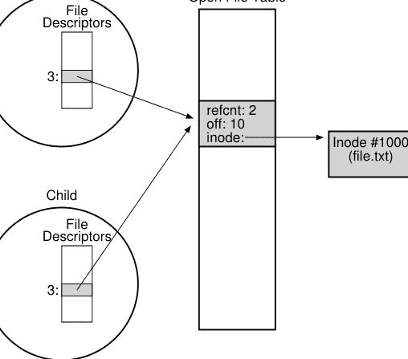

图 39.3：共享打开文件表项的进程

另一个有趣且可能更有用的共享案例发生于 `dup()` 系统调用（及其兄弟方法 `dup2()` 和 `dup3()`）。它将底层的打开文件视为一个存在的描述符。图 39.4 显示了一个短代码片段，展示了如何使用 `dup()`。

`dup()` 调用（特别是 `dup2()`）在编写 UNIX Shell 和执行如输出重定向等操作时非常有用；花点时间思考一下为什么！现在，你可能在想：为什么我在做 shell 项目时他们不告诉我这些呢？噢，没关系，即使在一部不可思议的操作系统书籍中，你也无法按正确的顺序获得所有内容。抱歉！

```c
int main(int argc, char *argv[]) {
    int fd = open("README", O_RDONLY);
    assert(fd >= 0);
    int fd2 = dup(fd);
    // 现在 fd 和 fd2 可以互换使用
    return 0;
}
```

图 39.4：使用 `dup()` 共享文件表项 (dup.c)

© 2008–19, ARACI-DUSSE

三个简单部分

### 39.7 使用 fsync() 立即写入

大多数时候，当程序调用 `write()` 时，只是告诉文件系统：请在未来的某个时刻将这些数据写入持久化存储。文件系统会在几秒内在内存中缓冲此类写入（例如 5 秒或 30 秒）；或者在之后的某个时间，写入操作才会实际发送到存储设备。从调用应用程序的角度来看，写入似乎很快完成了，只有在少数情况下（例如在 `write()` 调用之后、写入磁盘之前机器崩溃），数据才会丢失。

然而，某些应用程序需要比这更多的要求的保证。例如，在数据库管理系统 `DBMS` 中，开发崩溃恢复协议需要能够不时强制写入磁盘。

为了支持这类应用程序，大多数文件系统提供了额外的控制 API。在 UNIX 世界，为应用程序提供的接口是 `fsync(int fd)`。当进程对特定的文件描述符调用 `fsync()` 时，文件系统通过强制将该描述符所指文件的脏数据（即尚未写入的数据）写入磁盘来响应。`fsync()` 程序在这些写入完成后返回。

这里是一个使用 `fsync()` 的示例。下面的代码打开一个文件，向其写入块数据，然后调用 `fsync()` 以确保写入立即强制到磁盘。`fsync()` 返回后，应用程序可以安全地继续，因为知道数据已经持久化（前提是 `fsync()` 已正确实现）：

```c
int fd = open("foo", O_CREAT|O_WRONLY|O_TRUNC,
    S_IRUSR|IWUSR);
assert(fd > -1);
int rc = write(fd, buffer, size);
assert(rc == size);
rc = fsync(fd);
assert(rc == 0);
```

有趣的是，这并没有保证你可能预期的所有内容；在 `fsync()` 中包含了包含文件 `foo` 的目录。添加这一步不仅确保了文件本身在磁盘上，还确保了如果该文件是新创建的，它也是目录的一部分。令人惊讶的是，这种细节经常被忽略，导致了许多应用程序级别的 bug [P+13,P+14]。

### 39.8 重命名文件

一旦我们有了一个文件，有时给文件起一个不同的名字是有用的。在命令行中输入时，这通过 `mv` 命令实现；在示例中，文件 `foo` 被重命名为 `bar`：

```bash
prompt> mv foo bar
```

使用 `trace`，我们可以看到 `mv` 使用了系统调用 `rename(char *old, char *new)`，它精确地接受两个参数：文件的原始名称 `old` 和新名称 `new`。

`rename`（调用）提供的一个有趣保证是，它（通常实现为相对于系统崩溃的原子调用；如果系统在重命名期间发生崩溃，文件要么是旧名，要么是新名，不会出现中间状态）。`rename()` 对于支持某些需要对文件状态进行原子更新的应用程序至关重要。

让我们变得更具体一点。假设你正在使用一个编辑器（例如 emacs），并在文件中间插入了一行。文件的名称与示例相同。编辑器可能会更新文件，以确保新文件具有原始内容，插入的行如下（为了简单忽略了错误检查）：

```c
int fd = open("foo.txt.tmp", O_WRONLY|O_CREAT|O_TRUNC, S_IRUSR|S_IWUSR);
write(fd, buffer, size); // 写入文件的新版本
fsync(fd);
close(fd);
rename("foo.txt.tmp", "foo.txt");
```

编辑器在这个示例中的操作是：以临时名称 `foo.txt.tmp` 写入文件新版本，通过 `fsync()` 强制写入磁盘，然后当应用程序确定新文件的元数据和内容都在磁盘上时，将临时文件重命名为原始文件名。最后一步原子地将新文件交换到位，同时删除旧版本的文件，从而实现了文件的原子更新。

### 39.9 获取文件信息

除了文件本身，我们期望文件系统为每个文件保留大量信息。我们通常称这些为元数据。要查看某个文件的元数据，我们可以使用 `stat()` 系统调用。这些调用接收文件的路径（或描述符）并填充如图 9.1 所示的结构体。

你可以看到每个文件都有大量信息，包括它的大小（字节）、低级名称（即节点号）、一些所有权信息，以及关于文件何时访问或修改的信息等。要查看这些信息，你可以使用命令行工具 `stat`。在示例中，我们首先创建一个文件（称为 file），然后使用 `stat` 命令行工具获取关于该文件的信息。

```c
struct stat {
    dev_t  st_dev;    // 包含文件的设备 ID
    ino_t  st_ino;    // 节点号
    mode_t st_mode;   // 权限
    nlink_t st_nlink;// // 硬链接数
    uid_t  st_uid;    // 所有者用户 ID
    gid_t  st_glid;    // 所有者组 ID
    dev_t  st_rdev;   // 设备 ID（如果是特殊文件）
    off_t  st_size;   // 总大小，字节
    blk_t st_blocks;  // 用于文件系统 I/O 的块
    blk_t st_blkcnt; // 分配的块数
    time_t st_atime;  // 最后访问时间
    time_t st_mtime;  // 最后修改时间
    time_t st_ctime;  // 最后状态更改时间
};
```

图 9.1：stat 结构体。

# 间歇：文件与目录

提示：警惕强大的命令

`rm` 程序为我们提供了一个强大命令的极佳示例，说明了有时过强的力量会变成坏事。例如，为了一次性删除一组文件，你可以输入类似的内容：

```
prompt rm *
```

其中 `*` 将匹配当前目录下的所有文件。但有时你也想删除目录，实际上是删除它们的所有内容。你可以通过告诉 `rm` 递归进入每个目录并删除其内容来实现：

```
prompt rm -rf *
```

当你无小心地从文件系统的根目录执行这串短字符命令时，你就会遇到麻烦，因为它会移除该系统中的每一个文件和目录。哎！因此，记住强大的命令是一把双刃剑；虽然它们让你能够通过少量的按键完成大量工作，但它们也能快速且容易地造成巨大的伤害。

### 39.12 读取目录

现在我们已经创建了一个目录，可能想要读取它的内容。事实上，这正是 `ls` 程序所做的。让我们自己写一个微型 `ls` 看看它是如何实现的。

我们不能像打开文件一样仅仅打开目录，而必须使用一组新的系统调用。下面是一个打印目录内容的示例。程序使用了三个调用：`opendir()`、`readdir()` 和 `closedir()` 来完成工作，你可以看到接口是怎样的；我们使用一个简单的循环每次读取一个目录，并打印目录中每个文件的名称和索引。

```c
int main(int argc, char *argv[]) {
    DIR *dp = opendir("./");
    assert(dp != NULL);
    struct dire *d;
    while ((d = readdir(dp)) != NULL) {
        printf("%lu %s\n", (unsigned long) d->d_ino,
               d->d_name);
    }
    closedir(dp);
    return 0;
}
```

# 间歇：文件与目录

下面的定义显示了结构体数据每个目录条目中可用的信息：

```c
struct dire {
    char            d_name[256]; // filename
    ino_t           d_ino;      // inode 编号
    off_t           d_off;      // 下一个偏移量
    unsigned short d_recl;      // 此记录的长度
    unsigned char d_type;       // 文件类型
};
```

由于目录是轻量级的（基本上是将名称映射到 inode 编号以及其他少量细节），程序可能想要对每个文件执行 `stat()` 获取更多信息，例如它的长度或其他信息。事实上，这正是当你传递 `-i` 标志给 `ls` 时它的所；你自己尝试一下吧。

### 39.13 删除目录

最后，你可以调用 `rmdir()` 来删除目录（该调用也用于文件删除）。然而，删除目录更危险，因为你可能通过一个命令删除大量数据。因此，`rmdir()` 有一个要求：目录在被删除之前必须是非空的（即只包含 `.` 条目）。如果你尝试删除一个非空目录，`rmdir()` 调用将直接失败。

### 39.14 硬链接

现在我们通过理解如何在文件系统树中创建条目，回到“删除文件是通过 `link()` 执行的”这个谜题。`link()` 系统接受两个参数：一个旧路径和一个新路径；当你将一个新名称“链接”到一个旧名称时，你本质上是创建了引用同一个文件的另一种方式。命令行程序 `ln` 用于执行此操作，正如我们在示例所示：

```
prompt> echo hello > file
prompt> cat file
hello
prompt> ln file file2
prompt> cat file2
hello
```

# 间歇：文件与目录

在这里我们创建了一个包含“hello”单词的文件，并将其命名为 `file`。然后我们使用 `ln` 程序为该文件创建了一个硬链接。之后，我们可以通过打开 `file` 或 `file2` 来检查该文件。`link()` 之能工作是因为它仅仅在你正在创建的目录中创建了另一个名称，并将其指向原始文件的同一个 inode 编号（即名称）。文件并没有以任何方式被复制；你现在拥有两个人类可读的名称（`file` 和 `file2`），它们指向同一个文件。我们甚至可以在目录中打印每个文件的 inode 编号来看这一点：

```
prompt> ls -i file2
6715084 file
6715084 file2
prompt>
```

通过向 `ls` 传递 `-i`，它会打印每个文件的 inode 编号（以及文件名）。因此你就可以看到 `link` 到底做了什么：只是为同一个 inode 编号创建了一个新引用（在本例中为 `6715084`）。到这里你可能开始理解 `unlink()` 是如何工作的。当你调用 `unlink()` 时，你实际上在做两件事。首先，你移除了跟踪该文件所有相关信息的结构（inode），包括它的大小、它在磁盘上的块等。其次，你从该文件中解除了一个人类可读的名称并将其放入目录。在为文件创建硬链接后，对于文件系统来说，文件名（`file`）和新创建的文件（`file2`）没有区别；它们都是指向文件底层元数据的链接，这些元数据位于 inode 编号 6715084 中。

因此，要从文件系统中删除文件，我们可以调用 `unlink()`。在上面的示例中，我们可以删除名为 `file` 的文件，并且仍然可以顺利地访问该文件。

```
prompt> rm file
removed 'file'
prompt> cat file2
hello
```

这种方法之所以有效，是因为当文件系统链接它时，会检查 inode 编号内部的引用计数（有时称为链接计数），这允许文件系统跟踪有多少个不同的文件名链接到了这个特定的 inode。当调用 `unlink()` 时，它会移除人类可读名称（正在被删除的文件）与给定节点编号之间的“链接”，并递减引用计数；只有当引用计数达到零时，文件系统才会释放该节点和相关数据块，并真正“删除”该文件。

> 注意再次看这本书的作者有多有创意的。我们曾把一只仓仓鼠叫“Cat”（真实故事）。然而，她去世了，我们现在有一只仓仓鼠“Hammy”。更新：Hammy 现在也去世了。宠物正不断堆积。

### 39.15 符号链接

还有另一种非常有用的链接类型：符号链接（软链接）。除了这种相似性外，符号链接与硬链接不同。第一个区别是符号链接本身也是文件，但类型不同。要创建链接，可以使用 `-s` 标志。这是一个示例：

```
prompt> echo hello > file
prompt> ln -s file file2
prompt> cat file2
hello
```

`file2` 是 4 字节的原因是因为符号链接是由被链接文件的路径作为链接文件的数据而形成的。因为我们链接到一个命名的文件，所以我们的链接文件 `file2` 很小（4 字节）。如果我们链接到一个更长的路径，我们的链接文件会更大：

```
prompt> echo hello >longerfilename
prompt> ln -s longerfilename file3
prompt> ls -al longerfilename file3
-rw-r--r-- 1 remzi remzi 6 May 3 19:17 longerfilename
lrwxr-wx 1 remzi remzi 15 May 3 19:17 file3 -> longerfilename
```

最后，由于符号链接创建的方式，它们留下了所谓的“悬空引用”的可能性：

```
prompt> echo hello > file
prompt> ln -s file file2
prompt> cat file2
hello
prompt> rm file
prompt> cat file2
cat: file2: No such file or directory
```

# 间歇：文件与目录

正如你在示例中看到的，与硬链接完全不同，删除原始文件名会导致链接指向一个不存在的路径。

### 39.16 权限位与访问控制列表

进程的抽象展示了两个核心的虚拟化：CPU 和内存的虚拟化。这两种抽象都为进程提供了一种幻觉，认为它拥有自己的 CPU 和私有内存；而实际上，底层的操作系统使用了各种技术，以安全且可靠的方式在多个相互竞争的实体之间共享有限的物理资源。

文件系统提供了磁盘的视觉化视图，将它从一堆原始块转换为更用户友的文件和目录，这些内容将在本章中进行描述。然而，这种抽象与 CPU 和内存的抽象有显著不同，之处在于文件在不同用户和进程之间是通用的，并且并不（不总是）私有的。因此，文件系统中通常存在一套更全面的机制，以启用不同程度的共享。

此类机制的第一种是经典的权限位。要查看文件 `foo.txt` 的权限，只需输入：

```
prompt ls -l foo.txt
-rw-r-- 1 remzi wheel 0 Aug 24 16:29 foo.txt
```

我们将关注此输出的第一部分，即 `-rw-r--`。这里的第一个字符显示文件的类型：`-` 表示普通文件（`foo.txt` 属于此类），`d` 表示目录，`l` 表示符号链接，等等；这（大部分）与权限无关，所以我们现在忽略它。

我们感兴趣的是权限位，它们由后面的字符 `(rw-r--r--)` 表示。这些位决定了对于每个普通文件、目录和其他对象，确切是谁可以访问它以及如何访问。

权限由三组组成：文件所有者可以对文件做什么、组内的某人可以对文件做什么，以及其他人（有时被称为“其他”）可以做什么。所有者、组组成员或其他人拥有的能力是读取、写入或执行该文件。

在上面的示例中，`ls` 输出的前三个字符显示该文件对该组来说是可读且可写的（`rw-`），仅对 `wheel` 组的成员可读，并且对系统中的其他人也可读（`r---` 后面跟着 `r--`）。

文件所有者可以轻松更改这些权限，例如使用 `chmod` 命令（更改文件模式）。为了删除除所有者之外的任何人访问文件的权限，你可以输入：

```
prompt chmod 600 foo.txt
```

© 2008–19, ARPACI-DUSSEAU

# 三部分

# 间歇：文件与目录

# 旁注：文件系统的超级用户

哪个用户被允许执行特权操作来帮助管理文件系统？例如，如果需要删除非活动用户的文件以节省空间，谁有权这样做？

在本地文件系统中，常见的默认设置是存在某种超级用户（即 `root`），它可以无视权限访问所有文件。在像 `A`（具有访问控制的的系统）这样的分布式文件系统中，一个名为 `system:administrators` 的组包含了被信任可以执行此类操作的用户。在这两种情况下，这些用户都代表了一种不安全风险；如果攻击者能够以某种方式伪装此类用户，攻击者就可以访问系统中的所有信息，违反隐私和保护保障。


# 间隙：文件与目录

# 39.16 权限位与访问控制列表

# 三部分

# 间隙：文件与目录

# 旁注：文件系统的超级用户

执行位特别有趣。对于普通文件，它的存在决定了程序是否可以运行。例如，如果我们有一个简单的脚本 `hello.csh`，我们可能希望通过输入来运行它：

```
prompt> ./hello.csh
hello, from shell world.
```

然而，如果我们没有正确为该文件设置执行权限，就会发生以下情况：

```
prompt> chmod 600 hello.csh
prompt> ./hello.csh
./hello.csh: Permission denied.
```

对于目录，执行位的行为有所不同。具体来说，它允许用户进入目录（通过 `cd`）并访问其下的内容。如果没有目录的执行位，用户将无法进入该目录，即使他们拥有目录内文件的权限。由于执行位允许用户进入目录并访问其下的内容，这种位导致出问题。

除了权限位之外，某些文件系统还包含更精细的控制，例如，在 `A` 中通过访问列表（ACL）的形式，这种控制可以实现更精细的权限管理。

执行位特别有趣。对于普通文件，它的存在决定了程序是否可以运行。例如，我们有一个简单的脚本 `hello.csh`，我们可能希望通过输入来运行它：

```
prompt> ./hello.csh
hello, from shell world.
```

然而，如果我们没有正确为该文件设置执行权限，就会发生以下情况：

```
prompt> chmod 600 hello.csh
prompt> ./hello.csh
./hello.csh: Permission denied.
```

对于目录，执行位的行为有所不同。具体来说，它允许用户进入目录（通过 `cd`）并访问其下的内容。如果没有目录的执行位，用户将无法进入该目录，即使他们拥有目录内文件的权限。由于执行位允许用户进入目录并访问其下的内容，这种位导致出问题。

除了权限位之外，某些文件系统还包含更精细的控制，例如，在 `A` 中通过访问列表（ACL）的形式，这种控制可以实现更精细的权限管理。

# 间隙：文件与目录

正如你所看到的，路径 `/home/users/` 现在指向新挂载目录的根节点。同样，我们可以通过路径 `/home/users/a` 和 `/home/users/b` 访问目录 `a` 和 `b`。最后，名为 `foo` 的文件可以通过 `/home/users/a/foo` 和 `/home/users/b/foo` 访问。这就是挂载（mount）的魅力之处：它不是许多独立的文件系统，而是将所有文件系统统一到一个树结构中，使得你的系统命名统一且方便。

要查看系统中有哪些内容以及位于哪些点，只需运行 `mount` 程序即可。你会看到如下所示：

```
/dev/sda on / type ext3 (rw)
proc on /proc type proc (rw)
sysfs on /sys type sysfs (rw)
/dev/sda5 on /tmp type ext3 (rw)
/dev/sda7 on /var/vice/cache type ext3 (rw)
tmpfs on /dev/shm tmpfs (rw)
AFS on /afs type afs (rw)
```

这种疯狂的混合表明，许多不同的文件系统，包括 `ext3`（一种标准的基于磁盘的文件系统）、`proc` 文件系统（用于访问当前进程信息的文件系统）、`tmpfs`（仅用于临时文件的文件系统）以及 `AFS`（分布式文件系统），都胶合在一起并在这台机器的文件系统树上。

# 39.18 总结

UNIX 系统（实际上在任何系统中的）中的文件系统接口非常原始，但如果你想精通它，会有很多需要理解。当然，没有什么比直接使用它（大量使用）更好的了。所以请务必这样做！当然，阅读更多内容；如既往地，Stevens [SR05] 是入门之处。

# 间隙：文件与目录

# 旁白：关键文件系统术语

- **文件**是一个字节数组，可以被创建、读取、写入和删除。它有一个低级名称（即数字），可以唯一地标识它。这个低级名称通常被称为*索引节点*（i-number）。

- **目录**是元组的集合，每个元组包含一个人类可读的名称及其映射的低级名称。每个目录条目都指向另一个目录或文件。每个目录本身也有一个低级名称（i-number）。目录始终有两个特殊条目：`.`，指向其本身；以及`..`，指向其父目录。

- **目录树或目录层次结构将所有文件和目录组织成一棵大树，从`root`（根目录）开始。**

- 要访问文件，进程必须使用系统调用（通常是 `open()`）向操作系统请求权限。如果获得许可，操作系统会返回一个`文件描述符`（file descriptor），可以在权限和意图允许的情况下用于读取或写入。

- 每个文件描述符都是私有的进程级条目，指向`打开文件表`（open file table）中的一个条目。该条目跟踪该访问指向哪个文件、文件的`当前偏移量`（即下次读取或写入将访问文件的哪个部分）以及其他相关信息。

- 调用 `read()` 和 `write()` 自然会更新当前偏移量；否则，进程可以使用 `lseek()` 来改变它的值，实现对文件不同部分的随机访问。

- 为了强制将更新写入持久化介质，进程必须使用 `fsync()` 或相关调用。然而，在保持高性能的同时正确完成操作具有挑战性 [P+14]，因此在这样做时请仔细考虑。

- 要让文件系统中多个人类可读名称指向同一个底层文件，请使用`硬链接`（hard links）或`符号链接`（symbolic links）。它们在不同情况下都有用，因此在使用之前考虑它们的优缺点。并记住，删除文件只是在目录层次结构对其执行最后一次 `unlink()` 操作。

- 大多数文件系统都有启用和禁用共享的机制。此类控制的原始形式由`权限位`（permissions bits）提供；更复杂的`访问控制列表`（access control lists）允许更精确地控制谁可以访问和操作信息。

# 间隙：文件与目录

# 参考文献

[BD96] "Checking for Race Conditions in File Access" by Matt Bishop, Michael Dilger. Computing Systems 9-2, 1996. 对 TOCTOU 问题及其在文件系统中的存在精彩描述。

[CK-08] "The xv Operating System" by Russ Cox, Frans Kaashek, Robert Morris, Nickolai Zeldovich. 源自: http://github.com/mit-pdos/xv-base. 如前所述，这是一个酷且简单的 Unix 实现。我们使用了较旧的版本（2012-01-30-1-c41342），因此书中的某些示例可能不是最新的源码。

[HT-18] "Fastly later File System Crash Consistency to Produce ACID Transactions" by Y. Hu, J. Lee, Y. Kwon, T. Cheng, Y. Chidambaram, E. Witchel. USENIX AT’18, 2018. UNIX AT’18 上第一个快速文件系统，是学习事务型文件系统的很好的起点。

[Processes-84] "Processes as Files" by Maurice Uman. 引入 Unix 文件系统的论文，其中每个进程都作为一个文件被创建。

[Cap-84] "Capability-Based User Systems" by Henry M. Levy. 1984. 可用：http://homes.washington.edu/

[ML-94] "All File Systems in Linux" by Marshall McKusik, Joy Levy, 1994. 关于 Linux 中所有文件系统的概述。

[P-13] "Event Ordering, Application-Level Consistency" by Thamalian, Joshua Young, 2013.

[P-14] "All File Systems Are Not Equal: Crafting Consistency" by Thamalian, 2014.

[MK-99] "Complexity of Computer Systems" by Saltzer and Kahn, 1999.

[SR05] "Advanced Programming in the Unix Environment" by Richard Stevens and Stephen A. Rago, Addison-Wesley, 2005.

[T-08] "Portably Solving TOCTOU Races with Hardness Amplification" by Dsair, Silva, 2008.

# 作业（代码）

在作业中，我们将熟悉书中描述的 API。为此，你只需编写几个基于工具的程序。

- 1. **Stat**: 编写你版本的命令行程序 *stat*，它只需对给定的文件或目录调用 `stat()` 系统调用。输出文件大小、分配块数、链接计数等。随着目录条目的数量，目录的链接计数是多少？可用接口：`stat()`。

- 2. **Files**: 编写一个列出目录文件的程序。在不带任何参数调用时，程序应打印文件名。当带有 `-l` 标志调用时，程序应打印关于每个文件的信息，例如从 `stat()` 获取的所有者、组、权限。程序应接受一个额外的参数，即要读取的目录。如果没有给出目录，程序应使用当前工作目录。可用接口：`stat()`，`opendir()`，`readdir()`，`getcwd()`。

- 3. **Tail**: 编写一个打印文件最后几行的程序。该程序应该是高效的，即跳转到文件末尾附近读取数据块，然后向前移动直到请求的行数；此时，从起点到文件结束打印这些行。调用程序时，应输入：`mytail -n file`，其中 n 是文件结尾打印的行数。可用接口：`stat()`，`lseek()`，`open()`，`readdir()`，`close()`。

- 4. **Recursive**: 编写一个从文件系统树给定点开始打印每个文件和目录名称的程序。例如，在没有参数的情况下，程序应从当前工作目录开始，打印其内容以及任何子目录的内容，直到打印整个树（以 CWD 为根）。如果提供目录名称作为单个参数，则用其作为树的根。使用更多函数选项来完善你的递归搜索，类似于强大的 `find` 命令行工具。

# 文件系统实现

在本章中，我们将介绍一种简单的文件系统实现，被称为 **vsfs（极简文件系统）**。该文件系统是典型 UNIX 文件系统的简化版本，因此旨在向你介绍在当今许多文件系统中常见的的一些基本磁盘上结构、访问方法以及各种策略。

文件系统是纯软件；与我们对 CPU 和内存虚拟化的开发不同，我们不会添加硬件特性来使文件系统的某些方面工作得更好（尽管我们可能需要关注设备特性以确保文件系统良好运行）。由于我们在构建文件系统时具有极大的灵活性，人们已经构建了许多不同类型的文件系统，字面上的从 AFS（安德鲁文件系统）到 ZFS（Sun 的 ZFS [B07]）无有不。这些系统都有不同的数据结构，并且在某些方面做得比同类更好或更差。因此，我们学习文件系统的方法是通过案例研究：首先在本章中通过一个简单的文件系统（vsfs）介绍大多数概念，然后通过对真实文件系统的一系列研究，来理解它们在实践中的差异。

> 核心问题：如何实现一个简单的文件系统。我们如何构建一个简单的文件系统？磁盘上存在哪些结构？它们需要跟踪什么？是如何被访问的？

## 4.1 思考方式

思考文件系统时，我们通常建议从两个不同的方面来考虑；如果你理解了这两个方面，可能就理解了文件系统基本上是如何工作的。

第一个是文件系统的**数据结构**。换句话说，文件系统利用哪些类型的磁盘上结构来组织其数据和元数据。我们将看到的第一个文件系统（包括下方的 vsfs）采用简单的结构，如块数组或其他对象，而更复杂的文件系统（如 SGI 的 XFS）则是更复杂的基于树的结构 [S+96]。

### 旁注：文件系统的心理模型

正如我们之前讨论过的，在学习系统时，你真正试图建立的是**心理模型**。对于文件系统，你的心理模型最终应该包含对以下问题的回答：哪些磁盘上结构存储了文件系统的数据和元数据？当一个进程打开文件时会发生什么？在读或写期间访问了哪些磁盘上结构？通过研究并改进你的心理模型，你对正在发生的事情建立抽象的理解，而不仅仅尝试理解某些文件系统代码的细节（当然，那也有用）。

文件系统的第二个方面是它的**访问方法**。它如何将进程发出的调用（如 `open()`、`read()`、`write()` 等）映射到它的结构上？在执行特定的系统调用期间，读取了哪些结构？哪些被写入了？所有步骤的执行效率如何？

如果你理解了文件系统的数据结构和访问方法，你就建立了一个关于它如何真实运行的良好心理模型，这是系统思维的关键部分。在我们深入研究第一个实现时，尝试着建立你的心理模型。

## 4.2 整体结构

我们开发文件系统数据结构的整体结构。我们需要做的第一件事是将磁盘划分为块；块的大小，这正是我们要做的。让我们选择一个常用的 4 KB 大小。

因此，我们对正在构建的文件系统的磁盘分区的视图是：一系列的块，每个块的大小为 4 KB。在一个大小为 $N$ 个 4-KB 块的分区中，块从 0 到 $N-1$ 编号。假设我们有一个较小的磁盘，只有 64 个块：

| 0 | 7 8 | 15 16 | 23 24 | 31 |

|---|---|---|---|---|

| 32 | 39 40 | 47 48 | 55 56 | 63 |

现在让我们考虑一下在这些块中我们需要存储什么来构建文件系统。当然，首先想到的的是用户数据。事实上，任何文件系统中的大部分空间都是（也应该是）用户数据。我们将我们用于用户数据的磁盘区域称为**数据区域**，为了简单起见，为这些块留出磁盘的固定部分，例如磁盘上 64 个块中的最后 56 个：

### 数据区域

| D D D D D D D D | D D D D D D D D | D D D D D D D D |

|---|---|---|

| 0 | 7 8 | 15 16 | 23 24 | 31 |

### 数据区域

| D D D D D D D D | D D D D D D D D | D D D D D D D D |

|---|---|---|

| 32 | 39 40 | 47 48 | 55 56 | 63 |

正如我们上章学到的（一点点），文件系统必须跟踪关于每个文件的信息。这些信息是元数据的关键部分，诸如哪些块（数据区域）组成一个文件、文件的大小、所有者和访问权限、访问和修改时间，以及其他类似的信息。为了存储这些信息，文件系统通常有一个称为 inode 的结构（我们将阅读更多关于 inode 的内容）：

为了容纳 inode，我们还需要在磁盘上留出一些空间。让我们把这部分部分称为 inode 表，它简单地包含一个磁盘上 inode 的数组。因此，我们的磁盘镜像看起来如图片所示，假设我们使用 64 个块中的 5 个用于 inode（在图中用 I 表示）：

### Inodes

### 数据区域

| D D D D D D D D | D D D D D D D D | D D D D D D D D |

|---|---|---|

| 0 | 7 8 | 15 16 | 23 24 | 31 |

### 数据区域

| D D D D D D D D | D D D D D D D D | D D D D D D D D |

|---|---|---|

| 32 | 39 40 | 47 48 | 55 56 | 63 |

我们应该注意，inode 通常并不大，例如 128 或 256 字节。每个 inode 使用 256 字节，一个 4KB 的块可以容纳 16 个 inode，我们基于 64 块分区的构建的文件系统包含 80 个 inode。在我们基于微小的 64 块分区的构建的虚拟文件系统中，这代表了我们系统中可以拥有的最大文件数量；然而，在更大的磁盘上构建的相同文件系统只需分配更大的 inode 表即可容纳更多文件。

我们的文件系统有数据块 (D) 和 inode (I)，但仍然缺少几个。正如你可能猜到的，仍然需要的一个主要组件是某种用于跟踪 inode 或数据块是空闲还是已分配的方法。所有的分配结构都是每个文件系统的必要元素。

当然，有很多分配跟踪方法，例如，我们使用空闲列表来找到第一个空闲块，然后它指向下一个空闲块，以此此类推。我们选择了一种简单且流行的结构，称为位图（bitmap），一个用于数据区域（数据位图），一个用于 inode 表（inode 位图）。位图是一个简单的结构：每个位都用于指示相应的对象/块是空闲 (0) 还是使用中 (1)。因此，我们新的磁盘布局具有 inode 位图 (i) 和数据位图 (d)：


| Inodes | Data Region |

|---|---|

| i d 0 7 8 | DDDDDDDDDDD 15 16 DDDDDDDDDDD 23 24 31 |

| | Data Region |

| | DDDDDDDDDDD 32 39 40 DDDDDDDDDDD 47 48 DDDDDDDDDDD 55 56 DDDDDDDDDDD 63 |

你可能注意到，使用整个 4KB 块用于这些位图有点过度；一个位图可以跟踪 32K 个分配对象，而我们只有 80 个 inode 和 56 个数据块。然而，为了简单，我们为每个位图使用了一个整个块。

细心的读者（即仍然清醒的读者）可能注意到在我们极简系统的磁盘结构中还剩下一个块。我们为这个块留下了**超级块（superblock）**，如下图 5 所示。超级块包含关于这个特定系统的信息，例如文件系统中有多少 inode 和数据块（在本例中分别为 80 和 56），节点表块在哪里（第 3 块），等等。它还将包含某种类型的魔数来识别文件系统类型（在本例中为 vfs）。

| Inodes | Data Region |

|---|---|

| Sid d 0 7 8 | DDDDDDDDDDD 15 16 DDDDDDDDDDD 23 24 31 |

| | Data Region |

| | DDDDDDDDDDD 32 39 40 DDDDDDDDDDD 47 48 DDDDDDDDDDD 55 56 DDDDDDDDDDD 63 |

因此，在制作文件系统时，操作系统首先运行超级块以初始化各种参数，然后将卷挂载到文件树上。

## 40.3 文件组织：Inode

文件系统最重要的磁盘上结构之一是 **inode**；每个文件系统都有类似的结构。inode 的名称是 **index node**（索引节点）的缩写，这是 UNIX [RT74] 可能更早系统给它的历史名称，是因为这些节点最初在数组中，并且在访问特定 inode 时使用数组索引。

### 文件系统实现

> 旁白：数据结构——inode（索引节点）

inode 是许多文件系统中使用的通用名称，用于描述存储特定文件元数据的结构，例如其长度、权限以及组成部分的位置。这个名称至少可以追溯到 UNIX（如果不是更早的系统，可能还可以追溯到 Multics）；它是“index node”（索引节点）的缩写，因为 inode 被用于索引磁盘上的索引，以查找该编号的文件。我们将发现，inode 的设计是文件系统设计中的关键部分之一。大多数现代系统都有某种结构将其与其跟踪的每个文件链接起来，但可能称为不同的名称（如 nodes、inodes 等）。

每个 inode 都隐式地通过一个数字（i-number）来引用，我们称其为它的低级名称。在 `vfs` 和其他文件系统中，给定一个 i-number，你可以直接计算出对应的 inode 所在。例如，`vfs` 的 inode 表如下：大小为 20-KB（4-KB 块），并由 80 个 inode 组成（假设每个 inode 为 256 字节）；进一步假设 inode 范围从 2KB 开始（超级块从 0KB 开始，inode 位图在地址 4KB，数据位图在 8KB，因此 inode 来自于该地址）。我们有文件系统分区的布局（局部视图）：

#### inode 表（局部视图）

| | inode 0 | inode 1 | inode 2 | inode 3 | inode 4 |

|---|---|---|---|---|---|

| Super | i-bitmap | d-bitmap | | | |

| 0KB | 0123 | 14151617 | 18192021 | 22232425 | 26272829 |

| 4KB | 4567 | 20212223 | 24252627 | 28293031 | 32333435 |

| 8KB | 8901 | 36373839 | 40414243 | 44454647 | 48495051 |

| 12KB | 5234 | 56575859 | 60616263 | 64656667 | 68697071 |

| 16KB | | | | | |

| 24KB | | | | | |

| 32KB | | | | | |

为了读取 inode 号 32，文件系统会首先计算进入 inode 范围的偏移量（32 - sizeof(inode_t) 或 8192），并将其加到 inode 磁盘的起始地址（`inodeStartAddr = 12KB`），从而到达所需 inode 的正确地址。记住，磁盘不是字节寻址的，而是由大量可寻址的扇区组成，通常为 512 字节。因此，为了获取包含 inode 32 的块，文件系统将向扇区 51 或 40 发出读取指令以获取所需的 inode。通常，inode 块的扇区可以通过如下方式计算：

```
blk = (inumber(inode_t)) / blockSize;
sector = ((blk * blockSize) + inodeStartAddr) / sectorSize;
```

每个 inode 内部几乎包含了你关于一个文件的所有信息：它的类型（例如，普通文件、目录等）、大小等，以及分配给它的块数，保护信息（如所有者）、谁可以在*某些*时间访问它，包括文件何时创建、修改或最后访问的时间，以及关于其数据块在磁盘上何处所在的信息（例如，某种形式的指针）。我们将所有此类信息称为*元数据*（metadata）；事实上，文件系统中任何不是用户数据的信息通常都被称为此类数据。来自 ext2 [PO09] 的一个示例如图 40.1 所示：

| 大小 | 名称 | 这个 inode 字段是什么？ |

|---|---|---|

| 2 | mode | 此文件可以被读取/写入/执行吗？ |

| 2 | uid | 谁拥有此文件？ |

| 4 | size | 此文件中有多少字节？ |

| 4 | time | 此文件最后一次访问是什么时候？ |

| 4 | ctime | 此文件是什么时候创建的？ |

| 4 | mtime | 此文件最后一次修改是什么时候？ |

| 4 | dtime | 此 inode 是什么时候删除的？ |

| 2 | gid | 此文件属于哪个组？ |

| 2 | links.count | 此文件有多少个硬链接？ |

| 4 | blocks | 为此文件分配了多少块？ |

| 4 | flags | ext2 应该如何使用此 inode？ |

| 4 | osd1 | 一个依赖字段 |

| 60 | block | 一组指针（总共 15 个） |

| 4 | generation | 文件版本（使用 NFS） |

| 4 | file.acl | 超越传统权限的新权限模型 |

| 4 | dir.acl | 称为访问控制列表 |

图 40.1：简化的 Ext2 Inode

文件分配中最重要的决策之一是支持更大的文件。为了实现这一点，在 inode 中添加了另一个指针：**双重间接指针**（double indirect pointer）。该指针指向一个块，该块又包含许多指向数据块的指针。通过假设块大小为 4 KB，这种结构可以容纳超过 4 GB 的（即 $12 + 1024 + 1024^2 \times 4$ KB）。你可能想要更多，我们敢赌你知道这是要走向哪里：**三重间接指针**（triple indirect pointer）。

总体而言，这种不平衡树被称为指向文件的**多级索引方法**（multi-level index approach）。让我们查看包含十二个直接指针，以及一级和一个双重间接块的示例。

### 文件系统实现

- 大多数文件都是小文件
- 平均文件大小正在增长
- 大多数字节存储在大文件中
- 文件系统包含大量文件
- 文件系统大约只有半满
- 目录通常很小
- 2K 是最常见的大小
- 平均接近 200K
- 少数大文件占用了大部分空间
- 平均接近 100K
- 即使随着增长，文件系统仍保持“50% 满”的状态
- 许多目录条目很少；大多数条目 20 个或更少

图 40.2：文件系统测量总结

可以直接指向 48 KB 的数据，对于较大的文件则需要一个（或多个）间接块。Agrawal 等人 [A+07] 进行了一项近期的研究：图 40.2 总结了这些结果。

当然，在 inode 设计领域，存在许多可能性；毕竟，inode 只是一个数据结构，任何能够存储相关信息并对其进行有效查询的数据结构就足够了。由于文件软件系统很容易更改，当工作负载或技术发生变化时，你应该愿意探索不同的设计。

## 40.4 目录组织

在 `vfs`（许多文件系统）中，目录有简单的组织结构；目录基本上包含一个（条目，inode 号）对的列表。对于目录中的每个文件或目录，目录的数据块中都有字符串和一个数字。对于每个字符串，可能还会有一个长度（假设名称是变长度的）。

例如，假设目录 `dir` (`inode 5`) 中有三个文件（`foo`、`bar` 和 `foobar.a_pretty_lastname`），它们的 inode 号分别为 12、13 和 24。`dir` 的磁盘上数据可能看起来如下：

| inum | declen | strlen | name |

| :--- | :--- | :--- | :--- |

| 5 | 12 | 2 | |

| 12 | 12 | 3 | foo |

| 12 | 12 | 4 | |

| 13 | 12 | 4 | bar |

| 24 | 36 | 28 | foobar_a_pretty_lastname |

在这个示例中，每个条目都有一个 inode 号、记录长度（名称加上任何留留空间的总字节数）、字符串长度（名称的实际长度），最后是条目的名称。注意，每个目录有两个条目，“dot”和“dot-dot”；目录是当前目录（在本例中为 dir），而 dot-dot 是父目录（在这种情况下是根目录）。

删除文件（例如 `unlink()`）可能会在目录中间留下空隙，因此应该有某种方法将其标记（例如使用零等预留数字）。这种删除操作使用记录长度的原因之一：新条目可能会重用旧的大型条目，然后在内部留有空间。

操作系统版本 1.01

WWW.OSTEP.ORG

### 旁注：基于链接的方法

设计 inode 的另一种简单方法是使用链表。因此，在 inode 内部，不需要有多个指针，你只需要指向文件的第一个块。为了处理更大的文件，在该数据块末尾添加另一个指针，依此类推，你就可以支持大文件。

正如你可能猜的那样，链接文件分配在某些工作负载下性能很差；例如考虑文件的最后一个块，或者仅仅进行随机访问。因此，为了让链接分配工作得更好，某些系统将使用内存链接信息表，而不是将下一个指针存储在数据块本身中。该表通过数据块地址 `D` 索引；条目的的内容仅仅是 `D` 的下一个指针，紧随 `D` 之后的下一个块地址。也可以是一个空值（表示结束）。拥有这样一个下一个指针表使得链接分配方案可以有效地执行随机访问，通过首先扫描（内存）表找到所需的块，然后进行访问（磁盘）。

这听起来熟悉吗？我们描述的文件分配基本结构，NTFS [C94] 是基于简单的链接分配方案（*注：此处原文文本似乎存在乱序或重复，由于是翻译源文本错误，此处已根据上下文调整逻辑*）。它与标准 Unix 系统的不同之处在于：没有真正的 inode，而是存储文件元数据的目录条目，直接指向文件的第一个块，这使得硬链接变得不可能（*注：原文此处存在严重的段落乱序和重复，译文已按逻辑尽可能翻译**）。这听起来熟悉吗？我们描述的文件分配基本结构，NTFS [C94] 是基于简单的链接分配方案。它与标准 Unix 系统的不同之处在于：没有真正的 inode，而是存储文件元数据的目录条目，直接指向文件的第一个块，这使得硬链接变得不可能。你可能在好奇目录究竟是如何存储的。更多细节请参见 Brouwer [B02]。通常，文件系统将目录视为特殊类型的文件。目录有一个 inode（其 type 字段标记为“directory”而不是“regular file”）。目录由 inode 指向块（可能还有间接块）；这些数据块位于文件系统的数据区域。磁盘结构保持不变。我们应该再次注意，目录条目列表并不是存储此类信息的唯一方法。例如，XFS [S+96] 以 B树的形式存储目录，使得创建操作（必须在创建之前确保文件名未被使用）比必须扫描整个列表的系统更快。

### 旁注：空空间管理

有许多管理空空间的方法；位图只是其中一种。早期的文件系统使用空闲列表，其中数据块中的指针指向第一个空闲块；当需要块时，头部被使用并相应更新列表。在 `vfs` 中，我们为此任务有两个位图。例如，当我们创建一个文件时，必须为它分配一个 inode。文件系统将遍历位图寻找空闲的 inode 并分配它；文件系统会将 inode 标记为已用（带1），并最终更新磁盘位图。在分配数据块时也会发生类似的活动。例如，Linux 文件系统（如 ext2 和 ext3）在创建新文件并需要块时，会寻找一个空闲块序列（例如8）；通过找到这样的空闲块并将它们分配给新文件，文件系统保证了文件的一部分在磁盘上是连续的，从而提高了性能。因此，预分配策略是分配数据块空间的常用启发式方法。

## 40.6 访问路径：读取与写入

现在我们已经知道了文件和目录如何在磁盘上存储，我们应该能够遵循读取或写入文件期间的操作流。理解此访问路径上发生了什么是理解文件系统如何工作的第二个关键；注意！

对于以下示例，让我们假设文件系统已经挂载，因此超级块（`superblock`）已经在内存中。其他所有内容（即 inode、目录）仍在磁盘上。

### 从磁盘读取文件

在这个简单的示例中，让我们假设你想简单地打开一个文件（例如 `/foo/bar`），读取它，然后关闭它。对于这个示例，假设文件系统大小为 12KB（即 3 个块）。

当你发出 `open("foo/bar")` 调用时，文件系统首先需要找到文件的 inode，以获取有关文件的一些基本信息（权限、文件大小等）。为了做到，文件系统必须能够找到 inode，但它现在只有完整路径。文件系统必须遍历路径并定位目标。所有的遍历都从文件系统的根开始，在根目录 `/` 中。因此，FS 从磁盘读取的第一条内容是根目录的 inode。但 inode 在哪里呢？要找到 inode，我们必须知道它的 inode 号。通常我们在目录中找到它；根目录没有父目录（根据定义）。因此必须知道根 inode 号；FS 必须知道文件系统何时挂载。在 Unix 文件系统中，根 inode 号是 2。因此，为了开始过程，FS 读取包含 inode 号 2 的块（第一个块）。

一旦读取了 inode，FS 就可以查看内部找到指向数据块的指针，这些包含根目录的内容。FS 将使用这些指针读取目录，在这种情况下，它正在寻找 `foo` 的条目。通过读取一个或多个目录块，它将找到 `foo`；一旦找到，FS 将获得 `foo` 的 inode 号（假设是 44），这是它下一步将需要的。

下一步是递归地遍历路径，直到找到所需的 inode。在这个示例中，FS 读取包含以下内容的块：

图 40.3：文件读取时间线（时间向下增加）

| data inode root foo bar |

| :--- | :--- | :--- | :--- | :--- |

| bitmap inode inode data data [0] [1] [2] |

| read | | | | |

| open(bar) | | | | |

| | | | | |

| | | | | |

| read() | | | | |

| | | | | |

| read() | | | | | write |

### 文件系统实现

> 旁注：读取操作不会访问分配结构

我们看到许多学生对位图（bitmaps）等分配结构感到困惑。特别是，许多人经常认为，当你读取文件且没有分配任何新块时，会查询位图。事实并非如此！分配结构（如位图）仅在需要分配空间时才会被访问。inode、目录和间接块已经包含了完成读取请求所需的所有信息；无需确保 inode 指向的块是否已分配。

`foo` 的 inode，然后是它在目录中的索引。`open()` 的最后一步是将 `bar` 读取到内存中；文件系统（FS）进行最后的权限检查，在每个进程的打开文件表中为进程分配一个文件描述符，并将其返回给用户。

一旦打开，程序就可以发出 `read()` 系统调用来读取第一个字节（除非调用了 `lseek(i)`，否则偏移量为 0）。它将读取文件的第一个块，查询 inode 找到该块的位置；它还可能更新 inode 以记录一个新的访问时间。`read` 将进一步更新该文件描述符在内存中的打开文件表，更新文件偏移，使得下一次 `read` 将读取第二个块，依此类推。

在某个点，文件将被关闭。这里有很多工作要做完成；文件描述符应该被释放，但目前这是文件系统需要做的所有工作。不要 I/O 操作系统缓存。

此过程的描述见图 40.3（第 529 页）；在图中，时间向下减少，因为读取按顺序进行，以便最终定位文件的 inode。之后，读取每个块都需要文件系统查询 inode，然后读取块，然后用一个字段更新 inode 的最后访问时间。花些时间理解正在发生什么。

还要注意，`open` 产生的 I/O 与路径名的长度成正比。路径中每多出一个目录，我们都必须读取它的 inode 及其数据。让情况更糟的是存在大型目录；在这里，我们需要读取一个块获取目录内容，而在大型目录下，我们可能需要读取很多数据块才能找到所需的条目。是的，读取文件时生活可能会变得繁忙；正如你即将发现的，写入文件（尤其是创建一个新文件）更加糟糕。

### 将文件写入磁盘

写入文件是一个类似的过程。首先，必须打开文件（如上所述）。然后，应用程序可以发出 `write()` 调用用新内容更新文件。最后，关闭文件。

与读取不同，写入文件也可能分配空间（除非，块正在被覆盖）。在写入新文件时，每次 `write` 并不一定要将数据写入磁盘，而是必须先决定

| data | inode | root | bar | root | bar | bar | bar |

| --- | --- | --- | --- | --- | --- | --- | --- |

| bitmap | | | inode | inode | data | data | data | data |


| read | | | | | [0] | [1] | [2] | |
| | read | | | | | | | | |
| | | read | | | | | | | |
| create | read | | | | | | | | |
| (/foo/bar) | write | | | | | | | | |
| | | | read | | | | | | |
| | | | | write | | | | | |
| write() | read | | | | | | | | | |
| write() | write | | | | | | | | | |
| | | | read | | | | | | | |
| | | | | write | | | | | | |
| | | | | | read | | | | | |
| | | | | | | write | | | | |
| | | | | | | | read | | | | |
| | | | | | | | write | | | |

图 40.4：文件创建时间线（时间向下增加）

决定将哪个块分配给文件，并相应地更新磁盘的其他结构（例如数据位图和 `inode`）。因此，对文件的每次写入逻辑上都会产生五次 I/O：一次读取数据位图（然后将其更新为新分配的块为已用），一次写入位图（以将其新状态反映到磁盘），两次读取和写入 `inode`（用新块的位置更新它），最后是写入实际的块。

当考虑到像创建文件这样简单且常见的操作时，写入流量会更糟糕。要创建一个文件，文件系统不仅必须分配一个 `inode`，还必须包含新文件的目录内分配空间。总的 I/O 流量非常高：一次读取 `inode` 位图（寻找空闲 `inode`），一次写入新 `inode`（初始化它），一次写入目录数据（将文件的高级名称链接到其 `inode` 号），以及一次读取和写入目录 `inode` 以更新它。如果目录需要增长以容纳新条目，还需要额外的 I/O（即到数据位图和新的目录块）。这一切仅仅是为了创建一个文件！

# 三个简单部分

让我们看一个特定的例子，其中创建了文件 `/foo/bar`，并向其写入了三个块。图 40.4（第 531 页）显示了 `open()`（创建文件）期间以及每次 3KB 写入期间发生了什么。

在图中，对磁盘的读取和写入被归类在引起它们的系统之下。在图中，时间向下增加，因为读取按顺序进行，以便最终定位文件的 `inode`。之后，读取每个块都需要文件系统查询 `inode`，然后读取块，然后用一个字段更新 `inode` 的最后访问时间。花些时间理解正在发生什么。还要注意，`open` 产生的 I/O 与路径名的长度成正比。路径中每多出一个目录，我们都必须读取它的 `inode` 及其数据。让情况更糟的是存在大型目录；在这里，我们需要读取一个块获取目录内容，而在大型目录下，我们可能需要读取很多数据块才能找到所需的条目。是的，读取文件时生活可能会变得繁忙；正如你即将发现的，写入文件（尤其是创建一个新文件）更加糟糕。

# 核心：如何减少文件系统 I/O 开销

> 提示：理解静态与动态分配
>
> 在不同客户端/用户之间划分资源时，你可以使用静态分配或动态分配。静态方法简单地将资源划分为固定比例；例如，如果有两个可能的内存用户，你可以给一个用户某个固定比例的内存，另一个。文件系统可以做什么来减少 I/O 开销？

## 40.7 缓存与缓冲

正如上面的例子所示，由于读取和写入是昂贵的，文件系统使用内存来缓存重要的块。为了解决这种明显的性能问题，文件系统激进地使用内存（DRAM）来缓存重要的块。

想象上面的打开示例：如果没有缓存，每一层都需要至少两次读取（一次读取目录的 `inode`，另一次读取其数据）。对于长路径（例如 `/1/2/3.../100/file.txt`），文件系统实际上会执行数百次读取！

早期的系统引入了固定大小的缓存来存放热门块。正如我们在讨论虚拟内存时提到的，像 `LRU` 这样的策略会决定哪些块。这种固定大小的缓存通常在启动时分配，大约占内存的 10%。

然而，这种内存静态划分可能是浪费的；如果文件系统在特定时刻不需要 10% 的内存，这些页面无法被重新利用。

相比之下，现代系统采用动态分配方法。具体来说，许多操作系统将虚拟内存和文件页集成到统一页缓存中。通过这种方式，内存分配可以更加灵活。

提示：理解持久性与性能的权衡

存储系统通常向用户呈现持久性与性能之间的权衡。如果用户希望写入的数据能够立即持久化，系统就必须尽全力将新写入的数据提交到磁盘，这样写入速度就会很慢（尽管如此）。然而，如果用户可以忍受少量数据丢失，系统就可以在内存中缓存写入一段时间，并在稍后（在后台）将它们写入磁盘。这样做可以让写入操作看起来非常快，从而提高性能；但是，如果发生崩溃，未提交到磁盘的写入将将会丢失，这就是权衡的所在。要理解如何正确进行这种权衡，最好的办法是理解使用系统的应用程序需要什么；例如，丢失网页浏览器下载的最后几张图片可能是可以忍受的，但丢失部分向你的账户增加资金的数据库交易可能就不那么好忍受了。当然，除非你非常有钱；如果是那样，你为什么要那么在意积攒那最后的一分钱呢？

某些应用程序（如数据库）并不喜欢这种权衡。因此，为了避免缓存引起的意外丢失，它们简单地通过调用 `fsync()` 强制写入磁盘，通过使用绕过缓存的直接 I/O 接口，或者通过使用原始磁盘接口并完全跳过文件系统。由于系统所做的权衡，有足够的控制措施让系统执行你想要的操作，但默认设置将是不令人满意的。

## 40.8 总结

我们已经看到了构建文件系统所需的机制。每个文件都需要一些信息（元数据），这些信息通常存储在一个称为 `inode` 的结构中。目录只是某种特殊的文件，存储了“名称→`inode`”的映射。还需要其他结构；例如，文件系统经常使用类似位图（`bitmap`）的结构来跟踪哪些 `inode` 或数据块是空闲或已分配的。

文件设计的奇之处在于它的自由性；在接下来的章节中，我们将探索如何利用这种自由来优化文件系统的各个方面。显然，我们还有许多策略决策尚未探索。例如，当创建一个新文件时，它应该被放在磁盘的什么位置？这种策略以及其他策略也将是未来章节的主题。它们会吗？

> 去学一下数据库类，了解更多关于老派数据库以及它们过去坚持避免操作系统并控制一切的执念。但要注意！那些数据库类型总是试图坏化操作系统。真丢脸，你们数据库的人们。真丢脸。

伴随着神秘的音乐，让你对文件系统的话题更加感兴趣。

操作系统 [版本 1.01]

WWW.OSTEP.ORG

## 文件实现

# 参考文献

- [A07] "A Five-Year Study of File-System Metadata" Nitin Agrawal, William J. Boloski, John R. Dourcer, Jacob R. Lorch. FAT '07, 加州圣荷塞, 2007年2月。对实际使用的文件系统分析的极佳回顾。利用参考文献可以将文件分析论文的线索追溯到20 世纪 80 年代初。
- [B07] "ZFS: The Last Word in File Systems" Ben Bonwick and Bill Moore。访问地址：http://www.ostep.org/Citations/zfs_last.pdf。最重要的文件系统之一，充满了功能和进步。我们应该就它写一个章节，也许很快就会。
- [B02] "The FAT File System" Andrews Brouwer.2002年9月。在线获取：http://www.fune.net/tui/linux/fs/fat.html。对 FAT 文件系统的很好的描述，不是经典的那种。你必须承认，但 FAT 味道可能更好。
- [C94] "The Windows File System" Helen Custer. 微软出版社, 1994。关于 Windows 文件系统的简短介绍。
- [H88] "Scale and Performance in Distributed File System" David Howard, Michael L. Menees, Robert N. Subramanian, Michael J. West. ACM Transactions, 1988年。
- [P09] "The Unix Time-Sharing System: Internal Layout" Dave Portier.n2.com/papers/unix.
- [RT74] "The Unix Time-Sharing System: Internal Layout" C. Ritchie and D. Thompson. ACM Transactions, 第17卷，1974。
- [S00] "UBC: Unified Buffer Cache" Chuck Silver，2000。
- [S96] "Scalability in XFS" Adam Sweeney, Doug Courville, Wei Hu, Geoff Peck. USENIX '96, 加州圣迭戈。

# 作业（模拟）

使用此工具 `vsfs.py` 来研究随着操作的进行文件系统是如何变化的。模拟从空状态开始，只有根目录。

# 问题

- 1. 使用不同的种子（例如 17, 18, 19）运行模拟器，看看你可以发现什么。
- 2. 现在使用不同的种子（例如 21, 22, 23）并带有 `-r` 参数。
- 3. 现在减少文件系统中数据块的数量到非常低的水平（例如两个），并运行几百次请求。
- 4. 现在这样做，但使用 `inodes`。在 `inode` 很少的情况下，哪些操作可以成功？

## 局部性与快速文件系统

当 UNIX 操作系统首次引入时，Unix 大师 Ken Thompson 编写了第一个文件系统。我们称之为“旧 UNIX 文件系统”，它非常简单。基本上，它的数据结构在磁盘上如下：

| S | Inodes | Data |
|---|---|---|

块（S）包含了整个文件系统的信息：卷有多大、有多少个 `inode`、空闲块列表头的指针等。磁盘的 `inode` 区域包含了文件系统所有的 `inode`。最后，大部分数据由数据块占据。

旧文件系统的优点是它非常简单，并且支持文件系统试图提供的基本抽象：文件和目录层次结构。这套易于使用的系统是过去笨拙的记录存储系统迈出的一步，而目录层次结构也是更早简单的单级层次结构的真正进步。

糟糕的是，文件系统会变得非常碎片，因为空空间没有经过妥善管理。空闲列表将指向分散在磁盘各处的一块，随着文件的分配，它们会简单地占用下一个空闲块。结果是，逻辑上连续的文件在访问时需要在磁盘上来回寻道，从而极大地降低了性能。

例如，下面的数据块区域包含四个文件（A、B、C 和 D），每个文件的大小为 2 个数据块：

| A1 | A2 | B1 | B2 | C1 | C2 | D1 | D2 |

如果删除了 B 和 D，生成的布局是：

| A1 | A2 | C1 | C2 |

如你所见，空空间被碎片化为两个两个块的连续区域，而不是一个四个块的连续区域。现在假设你现在想要分配一个大小为四个数据块的文件 E：

| A1 | A2 | E1 | E2 | C1 | C2 | E3 | E4 |

你可以看到：E 散布在磁盘上，结果是访问 E 时你无法获得磁盘的峰值（顺序）性能。相反，你首先读取 E1 和 E2，然后寻道 E3 和 E4。这种碎片问题在 UNIX 文件系统中经常发生，并损害性能。顺带提一下：这个问题正是磁盘碎片整理工具所解决的；它们重组磁盘以将文件连续放置，并为一个或多个连续区域留出空空间，移动数据然后重写 `inode` 以反映这些。

一个问题是：原始块大小太小了（512 字节）。因此，从磁盘传输数据本质上是低效的。较小的块是好的，因为它们最小化内部碎片（块内浪费），但对于传输来说，每个块可能都需要定位开销。因此，问题在于：

## 核心：通过组织磁盘数据来提高性能

我们如何组织文件系统数据结构来提高性能？我们需要什么样的分配策略？我们如何让文件系统“感知磁盘”？

## 局部性与快速文件系统

### 41.2 FFS：感知磁盘是解决方案

伯克利的一个小组决定构建一个更好、更快的文件系统，他们巧妙地将其称为快速文件系统（FFS）。其理念是设计文件系统结构和分配策略使其具有“感知磁盘”的能力，从而提高性能，而这正是他们所做的。FFS 由此开启了文件系统研究的新纪元；通过保持文件系统接口相同（相同的 `open()`、`read()`、`close()` 和其他文件系统调用）但改变内部实现，为新文件系统的构建铺平了道路，并持续到今天。几乎所有现代文件系统都遵循现有的接口（从而保持与应用程序的兼容性），同时为了性能、可靠性或其他改变其内部结构。

### 4.3 结构组织：圆柱组

第一步是将磁盘分为圆柱组（Cylinder Groups）。单个圆柱是硬盘不同表面上的一组磁道，这些轨道距离设备中心的距离相同；它被称为“圆柱”是因为它看起来类似于所谓的几何形状。FFS 将连续的圆柱聚合为一个组，因此整个磁盘可以被视为圆柱组的集合。这里是一个简单的示例，显示了带有盘片的驱动器的外层轨道，以及由三个圆柱组成的圆柱组：


注意，现代驱动器并不向文件系统导出关于特定圆柱是否被使用的真实信息；正如之前讨论的，因此现代系统（如 Linux ext2、ext3 和 ext4）将磁盘组织成块组（Block Groups），每个块组只是磁盘地址空间的一个连续部分。下面的图说明了一个示例，块被组织在不同的块组中（注意组包含更多块）：

| 组 0 | 组 1 | 组 2 |
| --- | --- | --- |
| | | |

无论你称之为圆柱组还是块组，这些组都是 FFS 用来提高性能的核心机制。至关重要的是，通过将文件放置在同一个组内，FFS 可以确保连续访问文件不会导致跨磁盘的寻道。

为了使用这些组来存储文件和目录，FFS 需要具备将文件和目录放入组中的能力，并跟踪关于它们的所有必要信息。为了做到这一点，FFS 在每个组内包含了你可能预期文件系统拥有的所有结构，例如用于 `inode`、数据块的空间以及用于跟踪这些内容是否已分配或空闲的结构。以下是 FFS 在单个圆柱组内保留的内容描述：

| ib db | Inodes | Data |
| --- | --- | --- |

现在让我们详细检查这个单个圆柱组的组件。出于可靠性考虑，FFS 在每个组中保留了一个超级块（Super Block, S）的副本。挂载文件系统需要超级块；通过保留多个副本，如果其中一个损坏，你仍然可以使用工作的副本挂载并访问文件系统。

在每个组内部，FFS 需要跟踪该组的 `inode` 和数据块是否已分配。每组的 `inode` 位图 (`ib`) 和数据位图 (`db`) 了了组内 `inode` 和数据块的角色。位图是管理文件系统空空间的极佳方法，因为很容易找到大块空空间并分配给文件，避免了旧文件系统中空闲列表的一些碎片问题。

最后，`inode` 和数据块区域与之前的非常简单的文件系统（VSFS）中的类似。大多数圆柱组由数据块组成。

### 旁注：FFS 文件创建

作为一个例子，考虑在创建文件时哪些数据结构需要更新；假设用户创建一个新文件 `bar.txt`，且该文件大小为一个块（4KB）。文件是新的，需要一个新的 `inode`；因此位图和分配的 `inode` 必须被写入。文件还有一个数据位图和一个最终将被写入的数据块。因此，对当前圆柱组进行写入（记住这些写入在发生之前可能会在内存中缓冲）。但这还没有全部！特别是在创建文件时，你还必须将文件放入文件层次结构；目录必须更新。具体来说，父目录必须更新以添加 `bar.txt` 条目；`foo` 的 `inode` 需要更新以反映目录长度以及时间字段（如最后修改时间）。总之，创建一个新文件需要这么多工作！也许下次你这样做时应该更小心，或者至少理解它为什么如此有效。

### 4.4 策略：如何分配文件和目录

在有了这种组结构后，FFS 现在需要决定如何在磁盘上放置文件、目录和元数据以提高性能。基本的准则很简单：将相关的放在一起（而将不相关的分开）。

因此，遵循这一准则，FFS 必须决定哪些是“相关的”并将其放在同一个组内；相反，不相关的项应该放在不同的块组。为了实现这一点，FFS 使用了若干启发式策略。

第一种是目录的放置。FFS 采用了一种简单的方法：找到分配 `inode` 数量少的圆柱组（以平衡目录）且空闲 `inode` 数量多的圆柱组（以便分配大量文件）；并将目录数据和 `inode` 放入该组。当然，可以使用其他启发式策略（例如考虑空闲数据块的数量）。

对于文件，FFS 做了两件事。首先，它确保（在通常情况下）将文件的块分配在与其 `inode` 相同的组内，以防止 `inode` 和数据之间的寻道（如文件系统所示）。其次，它将位于同一目录的文件放在它们所在的圆柱组中。如果用户创建了四个文件 `/a/b`、`/a/c`、a/d 和 b/f，FFS 会尝试将前三个放在一起（同一个组），而将第四个放在远处（在另一个组）。

# 542

# 局部性与快速文件系统

（不切实际的小数字），并且 PFS 策略将这三个目录（根目录 `/`、a 和 `/b`）以及四个文件（`/a/c`, `/a/d`, `/a/e`, `/b/f`）放置在其中。假设每个普通文件的大小均为两个块，而目录仅包含一个块的数据。为了便于此图示，我们为每个文件或目录使用了直观的符号（例如：/ 代表根目录，a 代表 `/a`，f 代表 `/b/f`，以此类推）。

| 分组 inode | 数据 |
| :--- | :--- |
| 0 / | ------/ |
| 1 acde |------accdee---- |
| 2 bf | ------bff------ |
| 3 | ---------------- |
| 4 | ---------------- |
| 5 | ---------------- |
| 6 | ---------------- |
| 7 | ---------------- |


注意，PFS 策略实现了两个积极作用：每个文件的数据块都靠近该文件的 `inode`，且同一个目录下的文件也彼此靠近（`/a/c`、`/a/d` 和 `/a/e` 都在组 1，而目录 `/b` 及其文件 `/b/f` 靠近组 2 中的另一个）。

相比之下，现在来看另一种 `inode` 分配策略，它简单地将 `inode` 分散在各个组，以确保没有任何一组的 `inode` 表会被快速填满。最终的分配可能如下：

| 分组 inode | 数据 |
| :--- | :--- |
| 0 / | -------------/ |
| 1 a | ------a---- |
| 2 b | ------b---- |
| 3 c | ------cc---- |
| 4 d | ------dd---- |
| 5 e | ------ee---- |
| 6 f | ------ff---- |
| 7 | ---------------- |

如从图中所示，虽然这种策略确实让文件和（目录）与其各自的 `inode` 靠近，但目录内的文件被随机分散在整个目录周围，因此没有保留基于名称的局部性。访问文件 `/a/c`、`/a/d` 和 `/a/e` 现在跨越了三个组，而 PFS 方法仅跨越一组。

PFS 的启发式算法基于对文件系统流量的广泛研究，或其他实际操作中的细微差别；相反，它们基于老式的常识（难道 CS 不代表“一切”吗？）¹。一个目录中的文件通常在一起：想象有一组文件，并将它们链接成单个可执行文件。比——

> 有人将常识称为“马的直觉”（horse sense），特别是那些与马打交道的人。然而，我们觉得随着“机械化马”（即汽车）的普及，这个习语可能会流传下去。他们接下来会发明什么？飞行器！！！

操作系统

[版本 1.01]

WWW.OSTEP.ORG

# 局部性与快速文件系统

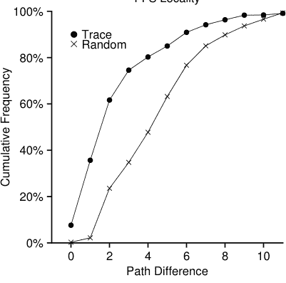

图 41.1：SEER 轨迹的 FFS 局部性

由于基于命名空间的局部性存在，FFS 往往能够提高性能，确保相关文件之间的寻道距离尽可能短。

## 41.5 测量文件局部性

为了理解这些启发式算法是否合理，让我们分析一些文件系统访问的轨迹，看看是否存在命名空间局部性。出于某种原因，文献中似乎对这个主题没有良好的研究。

具体来说，我们将使用 SEER 轨迹 [K94] 并分析目录中访问操作之间的距离有多“远”。例如，如果文件 `f` 被打开，然后在树中重新打开（在打开任何其他文件之前），则这两个打开操作在目录树中的距离即为 0（因为它们是同一个文件）。如果目录（即 `dir/f`）中的文件 `f` 被同一目录中的文件 `g`（即 `dir/g`）的打开操作访问，则两次访问之间的距离为之一，因为它们共享同一个目录但不是同一个文件。我们的距离度量衡量的是你沿着树向上移动多少才能找到两个文件的公共祖先；它们在树中越接近，度量越低。

图 41.1 显示了 SEER 集群中所有工作站在整个运行期间内观察到的局部性。图表沿 x 轴绘制差异度量，并在 y 轴上显示具有该差异的文件打开的累计百分比。具体而言，对于标记为 SEER 轨迹（图中的 "Trace"），你可以看到大约有 7% 的文件访问是针对上一个打开的文件，而接近 40% 的文件访问要么是同一个文件，要么是同目录的文件（即差异为零或一）。因此，FFS 的局部性假设似乎是合理的（至少对于轨迹而言）。

有趣的是，另外约 25% 的文件访问是距离为二的文件。这种局部性通常发生在用户以多级方式结构化了一组相关目录并不断连接它们时。例如，如果用户有一个 `src` 目录，并在 `obj` 目录中构建对象文件（`.o` 文件），而这两个目录都是主目录的子目录，那么一种常见的模式是 `proj/src/foo.c` 后面跟着 `proj/obj/foo.o`。这两次访问之间的距离为二，因为 `proj` 是公共祖先。FFS 在其策略中没有捕捉到这种局部性，因此在访问之间会发生更多的寻道。

作为比较，图表显示了“随机”轨迹的局部性。图表沿 x 轴绘制差异度量，并在 y 轴上显示具有该差异的文件打开的累计百分比。具体而言，对于标记为 SEER 轨迹（图中的 "Trace"），你可以看到大约有 7% 的文件访问是针对上一个打开的文件，而接近 40% 的文件访问要么是同一个文件，要么是同目录的文件（即差异为零或一）。因此，FFS 的局部性假设似乎是合理的（至少对于轨迹而言）。

# 局部性与快速文件系统

# 544

## 41.7 关于 FFS 的其他几点

FFS 也引入了一些其他创新。特别是，设计者非常担心小文件的适应问题；事实证明，以前很多文件的大小大约为 2KB 左右，而在传输数据时使用 4KB 的块对于空间效率并不是友好的。这种**内部碎片**因此可能导致典型文件系统有一半的磁盘被浪费掉。

FFS 设计者想到的解决方案非常简单并解决了这个问题。他们决定引入**子块（sub-blocks）**，这些是 512 字节的小型块，文件系统可以将其分配给文件。因此，如果你创建一个小文件（例如大小为 1KB），它将占用两个子块，从而不会

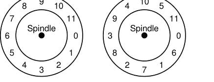

图 41.3: FFS：标准布局与参数化布局

浪费一个额外的 4KB 块。随着文件的增长，文件系统将继续分配 512 字节的块，直到获得完整的 4KB 数据。到那时，FFS 将找到一个 4KB 的块，将子块拷贝到其中，并释放子块供将来使用。

你可能会观察到这个过程是低效的，需要文件系统进行大量工作（大量的额外的 I/O 来执行拷贝）。你的判断也是正确的！因此，FFS 通过修改 `libc` 避免了这种自私行为；库会缓存写操作并以 4KB 为单位提交给文件系统，从而在大多数情况下避免了子块的特化处理。

很巧妙的一点是，FFS 引入了一种针对性能优化的磁盘布局。在那个时代（SCSI 和其他现代设备接口之前），磁盘的复杂程度要低得多，需要 CPU 以更直接的方式控制其操作。当文件被放置在磁盘的连续扇区上时（如图 41.3 所示），FFS 出现了一个问题。

特别地，问题发生在使用顺序读取的期间。FFS 会先向块 0 发出读取请求；当读取完成时，FFS 会向块 1 发出读取请求，但已经太晚了：块 1 已经过了磁头，现在读取块 1 将导致一次完整的旋转。

FFS 通过不同的布局解决了这个问题，如图 41.3 所示。FFS 有足够的时间在块经过磁头之前请求该块。FFS 足够聪明，可以针对特定的磁盘计算出在布局顺序上应该跳过多少个块以避免额外的旋转；这种技术被称为参数化布局（parameterized placement），因为 FFS 知道磁盘的特定性能参数，并利用这些参数来决定交错布局方案。

你可能在想：这种方案终究并不完美。事实上，你使用这种布局只能获得 50% 的带宽，必须绕每个磁道转两次才能读取每个块一次。幸运的是，现代磁盘要智能得多：它们在内部读取整个磁道并将其缓冲在内部磁盘缓存中（由于这个原因通常称为轨道缓冲区）。然后，在对该磁道的后续读取中，磁盘将直接从缓存中返回所需数据。文件系统不再需要担心这些极低层次的细节。当设计得当时，抽象和更高层次的接口是一件好事。

还添加了其他可用性改进。FFS 是最早允许长文件名的系统之一，使得文件系统可以使用更具表现力的名称，而不是传统的固定大小方法（例如 8 个字符）。此外，引入了一个新概念称为符号链接（symbolic link）。如前面的章节 [AD14b] 所，硬链接的局限在于它们不能指向目录（担心在文件系统层次结构中引入循环），并且它们只能指向同一卷内的文件或目录（节点号必须具有意义）。符号链接允许用户创建系统上任何其他文件或目录的“别名”，并且灵活得多。FFS 还引入了用于重命名文件的原子性 `rename()` 操作。除了基础技术之外，可用性上的改进也可能为 FFS 赢得了更强大的用户群。

### 提示：让系统变得可用

可能来自 FFS 最基础的教训是，它不仅引入了磁盘感知布局这一概念上很好的主意，还添加了许多让系统变得更易用的功能。长文件名、符号链接和以原子方式运行的重命名操作提高了系统的实用性；虽然很难写一篇关于它的研究论文（想象试着读一篇 14 页关于“符号链接：硬链接丢失的代价”的论文），但这些小功能让 FFS 更加强大，并可能增加了它被采用的机会。让一个系统变得可用往往比它进行深度的技术创新更重要。

## 41.8 总结

FFS 的引入是文件系统历史上的分水岭，因为它明确了文件管理问题是操作系统中最感兴趣的话题之一，并展示了人们如何开始处理那个最重要的设备——硬盘。从那时起，已经开发了数百个新的文件系统，但直到今天，许多文件系统仍然从 FFS 获取启示（例如 Linux 的 ext2 和 ext3 显然是其后代）。现代所有系统都考虑了磁盘。

# 参考文献

[AD14a] "Operating Systems: Three Easy Pieces" (Chapter: Hard Disk Drives) by Remzi Arpaci-Dusseau and Andrea Arpaci-Dusseau. Arpaci-Dusseau Books, 2014. 如果你没有读过硬盘的细节，就不应该阅读这本书。如果你尝试这样做，请直接去读它；不要跳过，关键在于。

[AD14b] "Operating Systems: Three Easy Pieces" (Chapter: File System Implementation) by Remzi Arpaci-Dusseau and Andrea Dutusseau. Arpaci-Dusseau Books, 2014. 如上所述，如果没有读过并理解文件系统实现的章节，阅读它毫无意义。否则，你将到处使用“inode”和“间接块”等术语，而你会觉得“？”，这对我们双方来说都不有趣。

[K94] "The Design of the SEER Predictive Caching System" by G. H. Kuening. MOBICOMM94, Santa Cruz, California, December 1994. Kuening 的出现使得这是关于 SEER 系统最好的概述，直到对这些轨迹的深入分析。

[MLJ84] "A Fast File System for UNIX" by Marshall K. McKusick, William N. Joy, Sam J. Lefler, Robert S. Fabry. ACM TOC, 2, August 1984. McKusick 最近因其对文件系统的贡献荣获 IEEE Reynolds B. Johnson 奖，很大程度上基于他构建 FFS 的工作。在获奖辞中，他讨论了原始的 FFS 软件：只有1200行代码。现代版本复杂得多，例如 BSD FFS 后代现在有5万行代码。

[P98] "Hardware Technology Trends and Database Opportunities" by David A. Patterson. Keynote Lecture at SIGMOD '98, June 1998. 关于硬件技术趋势及其随时间变化的非常棒且简洁的概述。

# 作业（模拟）

本节介绍了 `ffs.py`，这是一个简单的文件系统模拟器，你可以用它来更好地理解基于 FFS 的文件和目录分配是如何工作的。有关如何运行模拟器的详细信息，请查看 README。

# 问题

- 1. 检查 `in.largefile` 中的文件，然后使用标记 `-f in.largefile -L 4` 运行模拟器。生成的分配结果会是什么样的？运行 `-c` 进行检查。

- 2. 现在使用 `-L 30`，你预计会看到什么？再次开启 `-c` 看看你的判断是否正确。你也可以使用 `-s` 查看具体哪些块被分配给了该文件。

- 3. 现在我们计算一些关于该文件的统计数据。首先我们调用 `span`，它是文件任意两个块之间、或者索引与任何数据块之间的最大距离。计算 `span`。运行 `ffs.py -f in.largefile -L 4 -c` 查看其结果。当 `-L 100` 时，当大文件的分配从低值变为高值时，你预计文件会有什么变化？

- 4. 现在让我们来看一个新的输入 `in.manyfiles`。你认为 FFS 策略将如何布局这些文件？（你可以运行 `-v` 查看创建了哪些文件，或者直接 `cat in.manyfiles`）。运行模拟器 `-c` 看看你的判断是否正确。


- 5. 一个评估指标是 `dispan`。该指标计算文件在特定目录内的分布情况，具体是指目录下所有文件的索引与数据块与目录本身数据块之间的最大距离。运行 `in.manyfiles` 和 `-T` 标记，并计算三个目录的 `dispan`。运行 `-c` 进行检查。效果如何？

- 6. 将索引块的大小改为 5 (`-I`)。你认为这会如何改变文件的布局？运行 `-c` 查看你的判断是否正确。它会影响 `dispan` 吗？

- 7. FFS 应该将新目录放在哪个组？默认（模拟器）策略寻找空闲 inode 数量最多的组。例如，如果你运行 `-A 2`，在分配新目录时，模拟器将显示 `/fs.in-manyfiles -I 5 -A 2 -c` 以查看分配如何随此策略变化。它如何影响 `dispan`？为什么可能采取这种策略？

- 8. 我们将探索的最后一个策略与文件碎片有关。运行 `ffs.py -f in.fragmented -v` 看看你是否能预测哪些文件保持分配。运行 `-c` 确认你感兴趣的内容。这涉及到文件的数据布局：为什么这会是一个问题？

- 9. 一种新策略，我们称之为连续分配 (`-C`)，尝试确保每个文件都是连续分配的。具体来说，通过 `-C n`，文件系统在分配每个块之前尝试确保该组内的块是空闲的。运行 `ffs.py -f in.fragmented -v -C 2 -c` 查看差异。随着 `-C` 参数的增加，布局如何变化？最后，`-C` 如何影响生存周期（lifespan）和 `dispan`？

# 崩溃一致性：FSCK 与日志

正如我们目前所看到的

文件系统面临的一个主要挑战是在尽管存在掉电或系统崩溃的情况下，如何更新持久的磁盘上结构。具体来说，当在更新磁盘上结构的中间，不小心踢到了电源线导致机器断电会发生什么？或者操作系统遇到 Bug 并崩溃？由于掉电和崩溃，更新持久化数据结构可能非常棘手，并导致了文件系统实现中一个新颖且有趣的问题，被称为崩溃一致性问题（crash-consistency problem）。

这个问题非常容易理解。假设你必须更新两个磁盘上结构 `A` 和 `B` 来完成某个特定操作。由于磁盘一次只处理一个请求，其中一个请求将先到达磁盘（要么是 `A`，要么是 `B`）。如果系统在一次写入完成后发生崩溃或掉电，磁盘上的结构将处于一种不一致的状态，因此我们面临着一个所有文件系统都需要解决的问题：

> 核心问题：如何在发生崩溃的情况下更新磁盘

> 系统在任何两次写入之间可能发生崩溃或掉电，因此磁盘上的状态可能只被部分更新。崩溃后，系统启动并希望再次挂载文件系统（以便访问文件等）。鉴于崩溃可能发生在任何时间点，我们如何确保文件系统将磁盘镜像保持在合理的状态？

# 崩溃一致性：FSCK 与日志（Journal）

在本章中，我们将更详细地描述这个问题，并观察文件系统用来克服它的某些方法。我们将从检查旧文件系统采用的方法开始，即 `fsck` 或文件系统检查。我们将转向另一种方法，即日志（journaling，也称为预写日志），这种技术为每次写入增加了一些开销，但可以从崩溃或掉电中快速恢复。我们将讨论日志的基本机制，包括 Linux `ext3` [T98,PAA05]（一个相对现代的日志文件系统）实现的几种不同类型的日志。

## 42.1 详细示例

为了开始对日志的调查，让我们来看一个例子。我们需要使用一种以某种方式更新-inode 结构的工作负载。假设该工作负载是简单的：向现有文件追加单个数据块。追加操作通过打开文件、调用 `lseek()` 将偏移量移动到文件末尾，然后在关闭文件之前向文件执行 4KB 写入来完成。

假设我们在磁盘上使用简单的文件系统结构，类似于我们之前见过的文件系统。这个微型示例包含一个 inode 位图（8 位，每个 inode 占用一个位）、一个数据位图（8 位，每个数据块占用一个位）、inodes（总共 8 个，编号为 0 到 7，分布在四个块中）以及数据块（总共 8 个，编号为 0 到 7）。这是该系统的示意图：

位图 (Bitmaps)

| Inode 数据 | | 数据块 (Data Blocks) |

| --- | --- | --- |

| 0 1 2 3 4 5 6 7 | | 0 1 2 3 4 5 6 7 |

如果你观察图片中的结构，可以看到分配了一个 inode（inode 号 2），它在 inode 位图中被标记，并且分配了一个数据块（数据块 4），它在数据位图中也被标记。inode 记为 `[v1]`，该 inode 的第一个版本也是如此；它将被更新（由于上述描述的工作负载）。

让我们窥看其内部。在 `[v1]` 内部我们看到：

```
owner : remzi
permissions : read-write
size : 1
pointer : 4
pointer : null
pointer : null
```

在这个简化的 inode 中，文件大小为 1，第一个指针指向块 4（第一个数据块 Da），其他三个指针都设置为 null（表示未使用）。当然，真实的 inode 具有更多字段；更多信息请参见前面的章节。


崩溃一致性：FSCK 与日志

当我们向文件追加内容时，我们是在添加一个新的数据块，因此必须更新三个磁盘结构：inode（必须指向新块并记录由于追加而增加的大小）、新数据块 Db 以及位图的新版本（称之为 B2）以指示数据块已分配。

因此，在系统内存中，我们有三个必须写入磁盘的块。更新后的 inode（简称为 Iv2）现在看起来像这样：

```
owner: remzi
permissions: read-write
size: 2
pointer: 4
pointer: 5
pointer: null
pointer: null
```

更新后的位图 (B2) 现在看起来像这样：0000110。最后是数据块 (Db)，它填充了用户输入的内容。我们希望最终的文件系统磁盘镜像如下：

| 位图 (Bitmaps) | Inodes | 数据块 (Data Blocks) |

| --- | --- | --- |

| Inode 数据 | Iv2 | Da Db |

| 0 1 2 3 4 6 7 | | |

为了实现这种转换，文件系统必须对磁盘执行三次独立的写入，分别针对 Iv2、位图 B2 和数据块 Db。注意，这些写入通常不会在用户调用 `write()` 系统调用时立即发生；相反，脏 inode 或缓冲区缓存以及新数据会首先留在内存中；然后，当文件系统最终决定写入它们时（5 秒或 30 秒后），文件系统将向磁盘发出所需的请求。不幸的是，可能会发生崩溃并干扰这些磁盘的更新。

# 崩溃场景

为了理解这个问题，让我们来看一些示例崩溃场景。假设只有一次写入成功，有三种可能的结果，我们在此列出：

- 仅将数据块 (Db) 写入磁盘。在这种情况下，数据在磁盘上，但没有指向它的 inode，也没有位该块已分配的位图。因此，从文件系统崩溃一致性¹的角度来看，这就像写入从未发生过一样。这种情况完全不是问题。

- 仅将更新后的 inode (Il(v2)) 写入磁盘。在这种情况下，inode 指向了磁盘地址 (5)，即 Db 准备写入的所在位置，但 Db 尚未写入那里。因此，如果我们信任这个指针，我们就会从磁盘中读取到垃圾数据（磁盘地址 5 的内容）。

此外，我们遇到了一个新问题，我们称文件系统一致性问题。磁盘上的位图告诉我们数据块 5 尚未分配，但 inode 却说它已经分配。位图和 inode 之间的分歧是文件系统数据结构中的不一致性；为了使用该文件系统，我们必须以某种方式解决这个问题（下文将进行详细介绍）。

- 仅将更新后的位图 (Bv2) 写入磁盘。在这种情况下，位图表示块 5 已经分配，但没有指向它的 inode。文件系统再次变得不一致；如果任之不管，这将导致空间泄漏，因为块 5 将永远不会被文件系统使用。

在尝试向磁盘写入三个数据块时，还有三种崩溃场景。其中两个成功了，最后一个失败了：

- inode (Il(v2)) 和位图 (Bv2) 被写入了磁盘，但没有写入数据 (Db)。在这种情况下，文件系统的元数据是完全一致的：inode 拥有指向块 5 的指针，位图显示 5 正在使用，因此从文件系统元数据的角度来看，一切正常。但存在一个问题：5 里面是垃圾数据。

- inode (Il(v2)) 和数据块 (Db) 被写入了，但没有写入位图 (Bv2)。在这种情况下，我们的 inode 指向磁盘上的正确数据，但 inode 与旧版本的位图 (B1) 之间再次出现了不一致性。因此，在使用文件系统之前，我们仍然需要解决这个问题。

- 位图 (Bv2) 和数据块 (Db) 被写入了，但没有写入 inode (Il(v2))。在这种情况下，我们再次遇到了 inode 和位图之间的不一致性。然而，尽管块已被写入且位图显示其正在被使用，但我们不知道它属于哪个文件，因为没有 inode 指向它。

> ¹然而，这对于用户来说可能是一个问题，因为他们刚刚丢失了一些数据！

## 崩溃一致性：fsck 与日志记录

## 崩溃一致性问题

希望通过这些崩溃场景，你可以看到崩溃导致我们的磁盘文件系统镜像中可能出现的问题：文件系统数据结构可能出现不一致；会产生空间泄漏；可能会向用户返回垃圾数据等等。我们理想情况下想的是，让文件系统从一个一致状态（例如在附加数据之前）原子地转到另一个一致状态（例如在 inode、位图和新数据块写入磁盘之后）。但遗憾的是，我们无法可靠地做到这一点，因为磁盘一次只提交一次写入，而在这些更新之间可能会发生崩溃或掉电。我们把这种通用问题称为崩溃一致性问题（我们也可以称之为一致性更新问题）。

## 42.2 解决方案 #1：文件系统检查

早期的文件系统使用简单的方法处理崩溃一致性。基本上，它们决定让不一致性发生，然后在稍后修复（通过重启）。这种懒惰方法的示例可以在一个名为 *fck* 的工具中找到。fck 是一个用于查找不一致性并修复它们的 UNIX 工具 [MK86]；不同系统中也存在检查和修复磁盘分区的类似工具。并不是说这种方法不能解决所有问题（例如 inode 指向垃圾数据的情况），它的唯一目标是让文件系统元数据在内部保持一致。

*fck* 工具分多个阶段运行，如 Mkusik 和 Kowalski [MK96] 所述。它在 *fck* 假设没有其他文件系统活动正在进行时（在其运行期间）运行；完成后，磁盘上的文件系统应该是一致的，并且可以供用户完全访问。

以下是 *fck* 作用的简单摘要：

- **超级块 (Superblock)**：*fck* 首先检查超级块看起来是否合理，主要进行健全性检查，例如确保文件系统的大小大于已分配块的数量。通常所有这些健全性检查都是为了发现可疑（损坏）的超级块；在这种情况下，系统（或管理员）可能会决定使用超级块的备副本。

- **空闲块 (Free blocks)**：接下来，扫描 inode、间接块、双间接块等，以构建对文件系统中当前分配了块的理解。它利用这些知识执行正确版本的分配位图；因此，如果位图和 inode 之间存在任何不一致性，将通过信任 inode 内部的信息来解决。对所有 inode 执行相同类型的检查，确保所有 inode 在 inode 位图中看起来使用状态是一致的。

> ² 读音可以是 "eff-ess-check-kay"、eff-ess-check"，或者如果你不喜欢这个工具，读作 "eff-s"。是的，严肃的专业人士确实使用这个词。

© 2008–19, ARPACI-DUSSEAU

THREE

EASY

PIECES

## 崩溃一致性：fsck 与日志记录

- **Inode 状态**：在日志记录中，每个 inode 都会被检查是否损坏。例如，日志记录确保每个 inode 都有一个有效字段。

- **Inode 链接**：在日志记录中，每个 inode 都有一个链接计数。

- **重复项**：在日志记录中，系统会检查重复的 inode。

- **坏块 (Bad blocks)**：在日志记录中，每个块都会被检查是否有坏块。

## 42.3 解决方案 #2：日志记录（或预写日志）

解决一致性更新问题最流行的解决方案可能是从数据库管理系统中借用了一个想法。这种被称为预写日志（write-ahead logging）的理想是为了为了解决这类问题而发明的。在文件系统中，由于历史原因，我们通常称之为日志记录（journaling）。最早采用这种方法的文件系统是 JFS、XFS 和 Windows NTFS。

基本思想如下：在更新磁盘时，在原地写入结构之前，先写一条备注（在磁盘的另一个地方，已知位置），描述你正要执行的操作。这一部分是“预写”部分，我们将其写入组织为“日志”的结构中；因此，称为预写日志记录。

通过写入备注，你保证了如果在更新（覆盖）你正在更新的结构期间发生崩溃，你可以回去查看备注并重试；因此，在崩溃后，你将确切知道需要修复什么（如何修复），而无需扫描整个磁盘。

设计上，日志记录在更新期间增加了一些工作量，以减少恢复期间所需的工作。

我们将描述 Linux ext3（一种流行的日志文件系统）如何将日志记录整合到文件系统中。大多数磁盘结构被分为块组，每个块组包含一个 inode 位图、数据位图、inode 和数据块。新的关键结构是日志本身，它在分区内或另一个设备上占用少量空间。因此，ext2 文件系统（不带日志记录）如下：

| 超级块 | 组0 | 组1 | ... | 组 N |

假设日志位于文件系统内部（有时在另一个设备上，或作为文件系统中的一个文件），带有日志的 ext3 文件系统如下：

| 超级块 日志 | 组0 | 组1 | ... | 组 N

真正的区别仅仅在于日志的存在，当然还有它是如何被使用的。

# 数据日志 (Data Journaling)

让我们通过一个简单的例子来理解数据日志的工作原理。数据日志是 Linux ext3 文件系统的一种模式，我们后文的大部分讨论内容都是基于此的。

假设我们再次进行了一次标准更新，即我们希望再次将 inode I[v2]、位图 bitmap B[v2] 和数据块 (Db) 写入磁盘。在将它们写入磁盘的最终位置之前，我们现在首先将它们写入日志（也称为 journal）。这在日志中看起来是这样的：

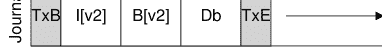

你可以看到我们有五个块。事务开始 (TxB) 告诉我们相关信息，包括关于文件系统待处理更新的信息（例如 I[v2]、B[v2] 和 Db 的最终地址），以及某种事务标识符 (TID)。接下来的三个块仅包含块本身的内容；这被称为“物理日志”（physical logging），因为我们将更新的物理内容放入了日志中（另一种想法是“逻辑日志”，它在日志中放置更新的更紧凑的逻辑表示，例如，“此更新将数据块 Db 追加到文件 X”，这稍微复杂一点，但可以节省日志空间并提高性能）。最后一个块 (TxE) 是该事务结束的标记，它也包含 TID。

一旦该事务在磁盘上安全无无，我们就可以准备覆盖文件系统中的旧结构了；这个过程被称为“检查点”（checkpointing）。因此，为了对文件系统进行检查点（即使其与日志中的待处理更新同步），我们如上所示发布对 I[v2]、B[v2] 和 Db 的写入到它们所在的磁盘位置；如果这些写入成功完成，我们就成功地完成了文件系统的检查点，工作也基本结束了。我们的操作序列为：

1. **日志 (Journal)**：将事务（包括事务开始块、所有待处理的数据和元数据更新，以及一个事务结束块）写入日志；等待这些写入完成。

2. **检查点 (Checkpoint)**：将待处理的元数据和数据更新写入文件系统中的最终位置。

在我们的示例中，我们首先将 TxB、I[v2]、Db 和 TxE 写入日志。当这些写入完成后，我们通过对 I[v2]、B[v2] 和 Db 进行检查点以写入其磁盘位置来完成更新。

如果在写入日志期间发生崩溃，情况就会变得复杂一些。在这里，我们正尝试将事务中的一组块（例如 TxB、I[v2]、B[v2]、Db、TxE）写入磁盘。实现此点的一种简单方法是逐一发布每一个，等待每个完成后，然后发布下一个。然而，这很慢。我们希望一次性发布所有五个块，因为这将五次写入转换为单次顺序写入，从而更快。然而，这种做法是不安全的，原因如下：对于如此大的写入，磁盘内部可能会进行调度，并以任何顺序完成大块写入的小部分。因此，磁盘可能会先写入 TxB、I[v2]、B[v2] 和 TxE，然后在稍后（2）才写入 Db。遗憾的是，如果磁盘在 (1) 和 (2) 之间丢失电源，结果将是：

| 日志 | TxB | I[v2] | B[v2] | ?? | TxE |

|---|---|---|---|---|---|

| | id=1 | | | | id=1 |

为什么这是一个问题呢？该事务看起来是一个有效的事务（它有开始和结束，且序列号匹配）。此外，系统可以查看第四个块并知道它是错的；毕竟，它是任意的用户数据。因此，如果系统重启并恢复，它将重放此事务，并无知地将垃圾块 '??' 的内容复制到 Db 应该所在的位置。这对于文件中的任意用户数据是如此；如果发生在文件系统的关键部分（例如超级块 superblock），情况会糟糕得多，可能会导致文件系统无法挂载。

© 2008–19, ARPACI-DUSSE

三条鱼

(THREE EASY PESCES - *注：此处为书籍《轻松三条鱼》的译名*)

# 崩溃一致性：FSCK 与日志 (CRASH CONSISTENCY: FSCK AND JOURNALING)

旁注：强制写入磁盘 (ASIDE: FORCING WRITES TO DISK)

为了强制执行两次磁盘写入之间的顺序，现代文件系统必须采取一些额外的预防措施。在过去，强制执行两次写入 `A` 和 `B` 之间的顺序很容易：只需向磁盘发出 `A` 的写入指令，等待磁盘在写入完成时中断操作系统，然后发出 `B` 的写入指令。


由于磁盘内部写入缓存的使用增加，情况变得稍微复杂了。带有写入缓冲区（有时称为**即时报告** immediate reporting），当写入仅被放置在磁盘内存缓存中而尚未到达磁盘时，磁盘会通知操作系统写入完成。如果操作系统发出随后的写入，则无法保证它能到达磁盘。为了强制执行两次写入之间的顺序，现代文件系统必须采取一些额外的预防措施。在过去，强制执行两次写入 $A$ 和 $B$ 之间的顺序很容易：只需向磁盘发出 $A$ 的写入指令，等待磁盘在写入完成时中断操作系统，然后发出 $B$ 的写入指令。

# 崩溃一致性：FSCK 与日志 (CRASH CONSISTENCY: FSCK AND JOURNALING)

## 旁注：强制写入磁盘 (ASIDE: FORCING WRITES TO DISK)

为了强制执行两次磁盘写入之间的顺序，现代文件系统必须采取一些额外的预防措施。在过去，强制执行两次写入 $A$ 和 $B$ 之间的顺序很容易：只需向磁盘发出 $A$ 的写入指令，等待磁盘在写入完成时中断操作系统，然后发出 $B$ 的写入指令。

由于磁盘内部写入缓存的使用增加，情况变得稍微复杂了。带有写入缓冲区（有时称为**即时报告** immediate reporting），当写入仅被放置在磁盘内存缓存中而尚未到达磁盘时，磁盘会通知操作系统写入完成。如果操作系统发出随后的写入，则无法保证它能到达磁盘。

# 崩溃一致性：FSCK 与日志记录

包含新目录条目的父目录数据块，以及父 inode（该节点现在有了新的修改时间）。通过日志记录，对于创建的两个文件，我们会在逻辑上将所有这些信息提交到日志中；因为这些文件位于同一个目录，且假设它们的 inode 位于同一个块中，如果我们不小心，将会导致这些块被反复重写。

为了解决这个问题，某些文件系统不会一次只向磁盘提交一次更新（例如 Linux `ext3`）；相反，可以将所有更新缓冲到一个全局事务中。在我们创建两个文件的示例中，文件系统将内存中的位图、文件的 inode、目录数据和目录 inode 标记为“脏数据”（dirty）状态，并将它们添加到构成当前事务的块列表中。当最终需要将这些块写入磁盘时（例如，在 5 秒超时后），该全局事务将被提交，包含上述描述的所有更新。因此，通过缓冲更新，文件系统在许多情况下可以避免过度的流量。

# 使日志有限化

我们已经有了更新磁盘上文件系统结构的基本协议。文件系统在内存中缓冲更新一段时间；当最终需要写入磁盘时，文件系统首先将事务的细节写入日志（也称为预写日志）；事务完成后，文件系统将这些块检查点（checkpoint）到它们在磁盘上的位置。

然而，日志的大小是有限的。如果我们不断向其添加事务（如图所示），它很快就会失效。你认为那时会发生什么？

| Tx1 | Tx2 | Tx3 | Tx4 | Tx5 | ... |

当日志满时会出现两个问题。第一个问题较简单，但并不关键：日志越大，恢复所需的时间越长，因为恢复过程必须顺序重放日志中的所有事务才能恢复。第二个是一个严重问题：当日志满（或几乎满）时，没有更多的事务可以提交到磁盘，这导致文件系统变得“毫无用处”（即完全没用）。

为了解决这些问题，日志文件系统将日志视为一个循环数据结构，反复使用它；这样做是为了当日志有时重启时，文件系统必须在每次检查点后采取行动。具体来说，一旦事务完成了检查点，文件系统就应该释放其在日志中占用的空间，允许日志空间被重用。有许多方法可以实现；例如，你只需在日志超级块（journal superblock）中标记日志中旧旧和最新的非检查点事务；所有其他空间都是空闲的。这是一个图形描述：

| Journal Super | Tx1 | Tx2 | Tx3 | Tx4 | Tx5 | ... |

在日志超级块中（不要与主文件系统超级块混淆），日志系统记录了足够的信息，以知道哪些事务尚未检查点，从而缩短了恢复时间，并能够循环循环重用日志。我们在基本协议中又增加了一个步骤：

1. **日志 (Journal)**：将事务内容（包含 `TxB` 和更新内容）写入日志；等待这些写入完成。
2. **提交（Commit）**：将事务提交块（包含 `TxE`）写入日志；等待写入完成；事务已提交。
3. **检查点（Checkpoint）**：将更新的内容写入系统内部的最终位置。
4. **释放（Free）**：一段时间后，通过更新超级块将日志中的该事务标记为已释放。

我们现在有了最终的日志记录协议。但仍然存在一个问题：我们将每个数据块都写入磁盘两次，这是一个高昂的代价，特别是对于系统崩溃这种罕见事件。你能想出一种在不写两次数据的情况下保持一致性的方法吗？

# 元数据日志记录

虽然现在的恢复速度很快（扫描日志并重放几个事务，而不是扫描整个磁盘），但文件系统的运行速度比我们预期的要慢。特别是对于每次写入磁盘的操作，我们现在还要向日志写入，从而导致写入流量翻倍；这种翻倍在顺序写工作负载期间尤为痛苦，因为现在现在将以磁盘的峰值写入带宽进行。此外，在写入日志和写入主文件系统之间，存在一次昂贵的寻道（seek），这为工作负载增加了明显的开销。

为了避免每个数据块写入磁盘两次的代价，人们有几种不同的方法来提高性能。例如，我们上面描述的日志记录模式通常被称为数据日志（如 Linux `ext3` 中的数据，加上文件系统的元数据）。一种更简单（更常见）的日志记录形式有时被称为**顺序日志**（ordered journaling，或简称为**元数据**日志），它与上述几乎相同，不同之处用户数据没有写入日志。因此，在执行与上述相同的更新时，以下信息将被写入日志：

| Journal | TxB | I[v2] | B[v2] | TxE |

| --- | --- | --- | --- | --- |

之前写入日志的数据块 `Db` 改为写入文件系统，从而避免了额外的写入；鉴于磁盘的大部分 I/O 流量是数据，不写两次大幅减少了日志记录的 I/O 负载。但这种修改引发了一个有趣的问题：我们何时应该写入数据？让我们再次考虑示例以更好地理解这个问题。更新包含三个块：`I[v2]`、`B[v2]` 和 `Db`。前两个是元数据检查；后者是数据。这重要吗？例如，某些文件系统（如 Linux `ext3`）强制在元数据之前写入数据。为了确保一致性，某些文件系统要求在元数据检查点块写入日志之前完成数据写入。然而，如果数据没有记录日志，在崩溃后文件系统可能会指向垃圾数据。

# 崩溃一致性：FSC 和日志记录

| TxB（元数据） | 日志内容（问题处理） | TxE（数据问题） | 文件系统元数据数据 |

| :--- | :--- | :--- | :--- |

| 发布完成 | 发布完成 | 发布完成 | 问题处理完成 |

图 42.1：数据日志时间线

现在假设发生崩溃，且所有这些信息仍在日志中。在重放过程中，恢复过程简单地重放日志中的所有内容，包括对块 1000 中目录数据的写入；随后，重放会将旧的目录内容覆盖到当前文件条（bar）的数据！显然，这不是正确的操作，而且用户在读取文件条时无疑会感到很惊讶。

有许多方法可以解决这个问题。例如，在块删除操作从日志中检查点（checkpoint）之前，永不重放这些块。然而，Linux `ext3` 需要在日志中添加一种新类型的记录，称为撤销记录（revoke record）。在上述情况下，删除目录将向日志中写入一条撤销记录。在重放日志时，系统首先扫描此类记录；任何此类撤销的数据都会被重放，从而避免了上述的问题。

# 总结日志记录：时间线

在结束对日志记录的讨论之前，我们总结了讨论过的协议，并用时间线描述了每种协议。图 42.1 显示了数据和元数据日志记录的协议，而图 42.2 显示了仅对元数据日志记录的协议。

在每个图中，时间向下增加，图中的每一行显示了写入可以发布或可能完成的逻辑操作。例如，在数据日志协议（图 42.1）中，事务块（`TxB`）的写入和事务内容可以在逻辑上同时发布，然后按任何顺序完成；然而，在上述之前的写入完成之前，不能发布对事务结束块（`TxE`）的写入。同样，对数据块和元数据块的检查点写入在事务结束块提交之前不能开始。水平虚线显示了必须遵守写入排序要求的地方。

元数据日志协议也显示了类似的条目。请注意

| TxB | 日志内容（元数据） | TxE | 文件系统数据 |

| :--- | :--- | :--- | :--- |

| 发布 | 发布 | | 完成 |

| 完成 | 完成 | | |

| | | 发布 | | |

| | | 完成 | | |

图 42.2：元数据日志时间线

数据写入在逻辑上可以与事务开始和日志内容同时发布；然而，它必须在事务结束发布之前发布并完成。最后，请注意时间线中标记的每个项目的完成时间是任意的。在真实系统中，完成时间由 I/O 子系统决定，该系统可能会重新排序写入以提高性能。我们对排序的唯一保证是那些为了正确性必须强制的排序（在图中水平虚线所示）。

# 42.4 解决方案 #3：其他方法

我们描述了保持文件系统元数据一致的两种方案：一种基于 *fsck* 的懒惰方法，以及一种被称为日志记录的更主动的方法。然而，这些并不是唯一的方法。一种方法，如 *Soft Updates* [GP94]，是由 Ganger 和 Patti 引入的。这种方法仔细地对文件系统的所有写入进行排序，以确保磁盘结构永远不会处于不一致状态。例如，通过在写入其指向的 inode *之前* 指向的数据块，我们可以确保 inode 永远不会指向垃圾数据；对于文件系统的所有结构都可以推导出类似的规则。实现 Soft Updates 可能是一项挑战；然而，上述日志记录只需要对每个文件系统结构有少量了解即可实现，而 Soft Updates 需要复杂的知识，这增加了相当数量的复杂性。另一种方法被称为*写时复制*（COW），并被用于许多流行的文件系统中，例如使用 Sun 的 `ZFS` [B07]。这种技术从不在此地覆盖文件或目录；而是将新更新放置在磁盘上之前未使用的位置。在完成若干更新后，COW 系统会翻转文件系统的根结构，以包含指向新更新结构的指针。这样做使得文件系统的一致性变得简单。我们将在未来的章节中讨论日志结构文件系统（LFS）时学习这种技术；LFS 就是 COW 的一个例子。

另一种方法是在这里威斯康星州开发的。这种技术被称为基于回指针的一致性（backpointer-based consistency，简称 BBC），写入之间不强制执行排序。为了实现一致性，系统中的每个块都添加了额外的回指针；例如，每个数据块都有一个指向其所属 inode 的引用。在访问文件时，文件系统可以通过检查指向回它的块的前向指针（例如 inode 或直接块中的地址）来确定文件是否一致。如果是，则所有内容已安全到达磁盘；如果不是，则文件是不一致的，并返回错误。通过向文件系统添加回指针，可以实现一种新形式的懒惰一致性 [C+12]。

最后，我们还探索了减少日志等待磁盘写入完成次数的技术。乐观崩溃一致性（optimistic crash consistency）[C+13] 这种新方法通过使用通用事务校验和 [P+05] 尽可能发布许多写入，并包含了其他几种在不一致性出现时进行检测的技巧。对于某些工作负载，这些乐观技术可以提高数量级的性能。为了良好运行，需要略有不同的磁盘接口 [C+13]。

## 42.5 总结

我们介绍了崩溃一致性问题，并讨论了解决该问题的各种方法。构建文件系统的旧方法在现代系统中恢复可能太慢了，因此许多文件系统现在使用日志记录。日志记录将恢复时间从卷的大小（volume）缩短到日志的大小，大大加快了崩溃和重启后的恢复速度。我们还看到日志记录有多种形式；最常用的是顺序元数据日志记录，它在为文件系统元数据提供合理保证的同时，减少了到日志的流量。最后，对用户数据的强保证可能是最重要的事情之一；奇怪的是，正如最近的研究所示，该领域仍处于进行阶段 [P14]。

# 崩溃一致性：FSC 和日志记录

# 参考文献

[B07] "ZFS: The Last Word" Jeff Bonwick, Bill Moore。在线：http://www.ostp.org/zfs_last.

[C+12] "Consistency Without Ordering" Vijay Chidambaram, Tushar Sharma, Andrea C. Arpeau, Remzi-Dusseau.

[C+13] "Optimistic Crash Consistency" Vijay Chidambaram, Thumulukkannanan Pillai, Ramnathan Alagan, Harwadi S. Gunawi, Andrea C. Arpeau-Dusseau.

[GP94] "Metadata Update Performance" Ganger and Patti.

[H87] "Implementing the Cedar System using Group Commit" Marshall K. Chidambaram, Robert Haight, Austin, Texas.

[MJ84] "All File Systems Are Not Equal" Marshall K. Chidambaram, William N. Joy, Sam J. Ferry. ACM Transactions on Computing Systems, Volume 2-3, August 1984.

[M96] "The UNIX File System" Marshall Kent and T. Kowalski. 在1996.

[M13] "The File System" Ao Ma, Christopher Dragga, Andrea C. Arpeau-Dusseau, Remzi H. Arpeau-Dusseau. FAST 13, San Jose, February 2013.

[P05] "IFSN File System" Vijay Prabhakaran, Lakshmi K. Bairvasitaram, Nitin Agrawal, Harwadi S. Gunawi, Andrea C. Arpeau-Dusseau, Remzi H. Arpeau-Dusseau. OOSP 05, Berlin, October 2005.

[P14] "Crash Consistency" Thumulukkannanan Pillai, Vijay Chidambaram, Ramnathan Alagan, Al-Swayid, October 2014. Bloomfield, Colorado.

[PA05] "Analysis and Evaluation of Journaling Systems" Vijay Prabhakaran, Andrea C. Arpeau-Dusseau, Remzi H. Arpeau-Dusseau. USENIX '05, Anaheheim, April 2005.

[R11] "Cache Eviction and Direct-Mode Journaling" Abhishek Rajwale, Vijay Chidambaram, Ramesh Ramamurthi, Andrea C. Arpeau-Dusseau, Remzi H. Arpeau-Dusseau. DSN '11, Hong Kong, China, June 2011.

# 570 崩溃一致性：FSCK 与日志

[T98] Stephen C. Tweedie 著《Journaling the Linux ext2fs File System》。1998 年 5 月，第四届年度 Linux 博览会。Tweedie 在为 Linux ext2 文件系统添加日志功能方面做了大量工作；意料乎的是，结果被命名为 ext3。一些不错的决策包括对向后兼容性的高度关注，例如，你只需向现有的 ext2 文件系统添加一个日志文件，然后将其作为 ext3 文件挂载。

[T100] Stephen Tweedie 著《EXT3, Journaling Files》。2000 年 7 月，在渥太华 Linux 研讨会上的演讲。olstrains.sourceforge.net/release/OLS2000-ext3/OLS2000-ext3.html 这是 Tweedie 在此发表演讲的记录。

[T01] Theodore Ts’o 著《The Linux ext2 File System》。2000 年 6 月。可在此处获取：http://e2fsprogs.sourceforge.net/ext2.html。一种基于 FFS 理念的简单 Linux 文件系统。在一段时间内，它被频繁使用；现在它仅作为简单文件系统的示例存在于内核中。

操作系统 [版本 1.01]

WWW.OSTEP.ORG

# 崩溃一致性：FSCK 与日志

# 课作业（模拟）

本节介绍了 `fsck.py`，这是一个简单的模拟器，你可以用它更好地理解如何检测（并可能修复）文件系统损坏。请查看相关的 README 以了解如何运行该模拟器。

# 问题

- 1. 首先，运行 `fsck.py -D`；此标志会关闭任何损坏，看看你是否可以使用它来确定其中哪些文件系统和目录。所以，尽管去做吧！使用 `-p` 标志查看你的判断是否正确。尝试将 `(-s)` 设置为不同的值（如 1、2 和 3），对几个随机生成的文件系统进行测试。
- 2. 现在，让我们引入一个损坏。运行 `fsck.py -S 1` 开始。你能看到引入了什么不一致性吗？在真实的文件系统修复工具中你会如何修复它？使用 `-c` 检查你的判断是否正确。
- 3. 将种子更改为 `-S 3` 或 `-S 19`；你看到了什么不一致性？使用 `-c` 检查你的答案。这两种情况下有什么不同？
- 4. 将种子更改为 `-S 5`；你看到了什么不一致性？以自动方式修复这个问题有多难？使用 `-c` 检查你的答案。然后，使用 `-S 38` 引入一个类似的不一致性；这是否更难/可能检测到？最后，使用 `-S 642`；这种不一致性是否可以检测？如果是，你该如何修复文件系统？


- 5. 将种子更改为 `-S 6` 或 `-S 13`；你看到了什么不一致性？使用 `-c` 检查你的答案。这两种情况之间有什么区别？当遇到这种情况时，修复工具应该做什么？
- 6. 将种子更改为 `-S 9`；你看到了什么不一致性？使用 `-c` 检查你的答案。在这种情况下，检查和修复工具应该信任哪部分信息？
- 7. 将种子更改为 `-S 15`；你看到了什么不一致性？使用 `-c` 检查你的答案。在这种情况下，修复工具可以做什么？如果没有可能的修复，会损失多少？
- 8. 将种子更改为 `-S 10`；你看到了什么不一致性？使用 `-c` 检查你的答案。文件系统结构中是否存在可以帮助修复的冗余信息？
- 9. 将种子更改为 `-S 16` 和 `-S 20`；你看到了什么不一致性？使用 `-c` 检查你的答案。修复工具应该如何修复这个问题？

# 日志结构文件系统

在 20 世纪 90 年代初，伯克利的 John Ousterhout 教授和研究生 Mendel Rosenblum 领导的小组开发了一种名为日志结构文件系统的新文件系统 [RO91]。他们这样做的动机基于以下观察：

- **系统内存正在增长**：随着内存变大，更多数据可以缓存到内存中。随着缓存数据的增加，磁盘流量的增加主要由写操作组成，因为读取操作由缓存处理。因此，文件系统的性能很大程度上取决于其写入性能。
- **随机 I/O 性能与顺序 I/O 性能之间存在巨大差距**：硬盘传输带宽在多年来大幅增加 [YP98]；随着更多位被封装到驱动器表面，访问这些位时的带宽随之增加；但要让廉价微小的电机旋转得更快或让磁盘寻臂移动得更快具有挑战性。因此，如果你能够以顺序方式使用磁盘，你将获得比引起寻道和旋转的方法大大的性能优势。
- **现有文件系统在许多常见工作负载上表现糟糕**：例如，`FPS` [MJ84] 在创建一个大小为一个块的新文件时会执行大量写入：一个用于 `inode`，一个用于更新位图，一个用于包含该文件的目录块，一个用于更新该目录，新的数据块是新文件的一部分，以及一个用于数据位图以标记数据为已分配。因此，`FPS` 将所有这些块放置在同一个组内，`FPS` 导致了多次寻道和随后的旋转延迟，因此性能无法达到顺序带宽。
- **文件系统不感知 RAID**：例如，`RAID-4` 和 `RAID-5` 都有**小块写问题**，即对单个块的逻辑写入会导致 4 次物理 I/O。现有文件系统并没有避免这种最糟糕的写入行为。

# 提示：细节至关重要

所有有趣的系统都由少数通用理念和许多细节组成。有时，当你学习这些系统时，你会想：“噢，我理解了大意；剩下的只是细节”，并据此只学了皮。不要这样做！很多时候，细节是关键的。正如我们在 LFS 中看到的，通用理念是容易理解的，但要构建一个运行的系统，你必须考虑所有棘手的情况。

理想的文件系统因此应该关注良好的性能，并利用磁盘的顺序带宽。此外，它在不仅写入数据还频繁更新元数据结构的常见工作负载上表现良好。最后，它要在 RAID 上能够工作。

Ousterhout 引入的新类型文件系统是 LFS，即日志结构文件系统的缩写。在写入磁盘时，LFS 首先将所有更新（包括元数据！）缓冲在内存段中；当段填满时，它会以一次长顺序传输写入磁盘的空闲部分。LFS 从不覆盖现有数据，而是将段写入空位置。因为段很大，磁盘（或 RAID）被利用得很高效，文件系统的性能达到了顶点。

## 核心问题

如何让所有写入变为顺序写入？

文件系统如何将所有写入转换为顺序写入？对于读取来说，这项任务是不可能的，因为要读取的块可能位于磁盘的任何位置。但对于写入，文件系统有选择，而这正是我们希望利用的选择。

### 43.1 顺序写入磁盘

我们因此面临第一个挑战：如何将对文件系统状态的更新转换为一系列顺序写入磁盘？为了更好地理解这一点，让我们使用一个简单的例子。假设我们正在向文件写入一个数据块 `D`。写入数据块 `A0` 可能会导致如下：

| D |
|---|
| A0 |

然而，当用户写入一个数据块时，被写入的不仅仅数据；还有其他元数据需要写入。在这种情况下，让我们写入文件的 `inode` (`I`)，并使其指向数据块：

| A0 |
|---|
| D |
| I |

段，然后将整个段一次性写入磁盘。只要段足够大，这些写入就是高效的。

这里是一个示例；实际的段会更大（几 MB）。第一次更新是对一个小段的四次块写入；对文件 `$j$` 进行了两次写入；第二次是向文件 `$k$` 添加了一个块。然后，LFS 将这七个块的段一次性提交到磁盘。这些块在磁盘上的最终布局如下：

| $D_0$ | $D_{j,1}$ | $D_{j,2}$ | $D_{j,3}$ | $D_{k,0}$ |
|---|---|---|---|---|
| A0 | A1 | A2 | A3 | Inode A5 | Inode k |

### 43.3 缓存多少？

这引出了以下问题：LFS 在写入磁盘之前会缓存多少次更新？答案显然取决于磁盘本身，具体取决于寻道开销相对于传输率有多高；类似的分析请参阅 FFS 章节。

例如，假设每次写入之前的定位（即旋转和寻道开销）大约需要 `$T_{position}$` 秒。假设传输率是 `$R_{peak}$` MB/s，LFS 在写入磁盘之前应该缓存多少内容？

这种思考方式是：每当你写入时，写入得越多，写得越好，以便*分摊*成本？因此，为了达到峰值带宽，你需要额外写入多少？（显然的），而且越接近峰值带宽越好。

为了得到一个具体的答案，假设我们正在写入 `$D$` MB。写入这块数据的时间（`$T_{write}$`）是定位时间 `$T_{position}$` 加上传输 `$D$` 的时间（`$\frac{D}{R_{peak}}$`），或者：

$$T_{write} = T_{position} + \frac{D}{R_{peak}} \quad (43.1)$$

因此，有效速率（`$R_{effective}$`）就是数据量除以总写入时间：

$$R_{effective} = \frac{D}{T_{write} + \frac{D}{R_{peak}}} \quad (43.2)$$

我们感兴趣的是让有效速率（`$R_{effective}$`）接近峰值速率。具体来说，我们希望有效速率是峰值速率的某个比例 `$F$`，其中 `$\tilde{U} < F < 1$`（典型的 `$F$` 可能是 0.9，即峰值速率的 90%）。在数学形式上，这意味着我们希望 `$R_{effective} = F \times R_{peak}$`。

此时，我们可以求解 D：

$$R_{effective} \frac{D}{T_{position} + \frac{D}{R_{peak}}} = F \times R_{peak} \quad (43.3)$$

$$D = F \times R_{peak} \times (T_{position} + \frac{D}{R_{peak}}) \quad (43.4)$$

$$D = (F \times R_{peak} \times T_{position}) + (F \times R_{peak} \times \frac{D}{R_{peak}}) \quad (43.5)$$

$$D = \frac{F}{1-F} \times R_{peak} \times T_{position} \quad (43.6)$$

我们来做个例子，假设磁盘的定位时间为 10 毫秒，峰值传输率为 100 MB/s；假设我们希望有效带宽达到峰值的 90%（`$F = 0.9$`）。在这种情况下，`$D = \frac{0.9}{0.7} \times 100$` MB/s `$\times 0.01$` 秒 = `$9$` MB。尝试不同的值，看看为了接近峰值带宽我们需要缓存多少。达到峰值的 95% 需要多少？99%

### 43.4 问题：查找 Inode

为了理解如何在 LFS 中查找 `inode`，让我们简要回顾一下在典型的 Unix 文件系统（如 `FFS`）或更老的 Unix 文件系统中如何查找 `inode`，因为它们被组织成数组并放置在固定位置。

传统的 Unix 文件系统将所有 `inode` 保留在磁盘固定位置。因此，给定 `inode` 号和起始地址，查找特定的 `inode` 只需将 `inode` 号乘以 `inode` 的大小，加上数组的起始地址即可计算出磁盘地址；基于数组的索引是快速且直接的。

在 `FFS` 中查找 `inode` 号稍微复杂，因为 `FFS` 将 `inode` 表分成若干块，并在块组内增长 `inode`。因此，必须知道每个 `inode` 块的大小以及每个块的起始地址。在此之后，计算也是简单的。

在 LFS 中，情况变得困难。为什么？因为我们把 `inode` 散布在了整个磁盘上！更糟糕，我们不原地覆盖，而且 `inode` 的最新版本（即我们想要的）一直在移动。

### 43.5 间接解决方案：Inode 映射

为了解决这个问题，LFS 的设计者引入了通过 `inode` 映射（`imap`）结构的间接机制。该映射接受 `inode` 号作为输入并产生 `inode` 的磁盘地址。由于 `inode` 会移动，`imap` 必须经常更新。

`imap` 是一个指向 `inode` 的指针数组。要查找 `inode`，我们首先在 `imap` 中查找以获取其磁盘地址，然后读取 `inode`。因为 `imap` 很小，我们可以将其留在内存中，从而减少从磁盘读取次数。当 `imap` 更新时，我们像写入任何其他数据一样将新的 `imap` 写入磁盘。

`inode` 映射是让 LFS 工作的关键。它允许我们为了效率将 `inode` 散布在磁盘上，同时仍然能够快速找到它们。

### 43.8 目录又是怎样的？

到目前为止，我们通过只考虑索引和数据块稍微简化了讨论。然而，为了访问文件系统中的文件（例如 `/home/remzi/foo`，这是我们最喜欢的文件名之一），必须访问某些目录。

幸运的是，目录的结构基本上与经典的 UNIX 文件系统相同，因为目录只是（名称， `inode` 节点）映射的集合。例如，在磁盘上创建文件时，LFS 必须创建一个新的 `inode`，以及引用该文件的数据块和它的 `inode`。请记住，LFS 会在磁盘上按顺序执行这些操作（在对更新进行一段时间缓冲）。因此，在目录中创建文件 `foo` 将导致以下结构：

| b[0];A0 | (foo, k) | b[0];A2 | m[k];A1 |
| :--- | :--- | :--- | :--- |
| D_k | l[k] | D_dir | m[dir];A3 |
| A0 | A2 | A3 | imap |

`inode` 映射（`inode map`）部分包含了目录和新创建文件的位置信息。因此，在访问 `foo`（`inode` 编号为 k）时，你首先查找 `inode` 映射（通常缓存在内存中）以找到目录的位置（A3）；然后读取目录，这会给你数据的位置（A2）；读取此块可以得到 `(foo, k)` 的名称到 `inode` 的映射。然后你再次查询 `inode` 映射以找到 `inode` 的位置（A1），最后读取 A0 处的数据块。

LFS 中还有另一个严重问题，递归更新问题。这个问题出现在任何不进行原地更新（如 LFS），而是将更新移动到磁盘上新位置的文件系统中。具体来说，每当其在磁盘上的位置发生变化时，将涉及到更新指向该文件的目录，这将强制更改该目录的父目录，以此此类推，一直直到文件系统的顶部。LFS 通过 `inode` 映射避免了这个问题。尽管 `inode` 的位置可能会变化，但这种变化永远不会反映在目录本身上；而是更新映射，而目录保持相同的名称到 `inode` 的映射。因此，通过间接方式，LFS 避免了递归更新问题。日志结构化文件系统（LOG-STRUCTURED FILE SYSTEMS）。

### 43.9 一个新问题：垃圾回收

你可能注意了 LFS 的另一个问题：它反复将文件的最新版本（包括其 `inode` 和数据）写入磁盘上的新位置。这个过程虽然高效，但意味着 LFS 将旧版本的文件结构散布在整个磁盘上。我们自然而然将这些旧版本称为垃圾。

例如，假设我们有一个由 `inode` `$k$` 指向的现有文件，它指向单个数据块 `$D_0$`。现在我们更新该块，生成一个新的 `inode` 和一个新的数据块。LFS 的结果布局看起来如下（注意为了简单起见，我们省略了 `imap` 和其他结构；还必须向磁盘写入新的映像分块以指向新的 `inode`）：


在图中，你可以看到 `inode` 和数据块在磁盘上都有两个版本（左侧一个，右侧一个）。为了当前和活跃的状态（仅通过（逻辑上）更新数据块的这一简单操作），LFS 必须持久化许多新结构，从而在磁盘上留下了这些块的旧版本。

作为另一个例子，假设我们在原始 `$k$` 之后追加一个块。在这种情况下，生成了新版本的 `inode`，旧数据块仍被 `inode` 指向。因此，它仍然是活跃的并且当前文件系统的一部分：


那么，我们应该如何处理这些旧版本的 `inode`、数据块等呢？我们是否可以保留这些旧版本并允许用户恢复旧版本（例如，如果他们不小心覆盖或删除了文件，这样做会非常有用）；这样的文件系统被称为*版本文件系统*（versioning file system），因为它跟踪了文件的不同版本。

然而，LFS 仅保留文件的最新活跃版本；因此（在后台），LFS 必须定期释放这些旧的死亡版本文件数据、`inode` 和其他结构，对它们进行*清理*（clean）；清理应该使磁盘上的块再次变得可用，供后续写入。请注意，清理过程是垃圾回收的一种，这种技术出现在自动为程序释放未使用内存的编程语言中。

我们之前讨论过分段（segments），因为它们是 LFS 中向磁盘大写入的机制。事实证明，它们对于有效的清理也是必不可缺的。想象一下如果 LFS 清洁器在清理期间仅仅遍历单个数据块、节点等会发生什么。结果是：旧分段之间会有许多洞。性能将大幅下降，因为 LFS 无法找到一个连续区域来顺序且高效地进行写入。

相反，LFS 以分段为单位进行清理，从而为后续写入清理出空间块。基本过程如下：LFS 定期读取若干旧的（部分填充）分段，确定这些分段中哪些块是活跃的，并写入一组包含活跃块的新分段（其中 `$N < M$`），然后将 `$N$` 个分段写入磁盘的新位置。旧的 `$M$` 个分段被释放，文件系统可后续写入。

### 43.10 确定活跃性

然而，我们现在面临两个问题。第一个是机制：LFS 如何判断分段内哪些块是活跃的？第二个是策略：应该经常运行清理器吗？

我们首先处理机制。给定一个数据块 `$S$`，LFS 必须能够确定 `$D$` 是否活跃。具体来说，LFS 为每个分段添加了少量信息，描述它属于哪里。为了做到这一点，LFS 在分段摘要中包含了版本号。最后，使用偏移量 `$T$`，如果它指向磁盘地址 `$A$`，LFS 就可以得出 `$D$` 是活跃的结论。如果指向其他地方，它就可以认为该版本不再需要。以下是伪代码总结：

```
(N, T) = Segment Summary[A];
inode = Read(imap[N]);
if (inode[T] == A)
  // block是活跃的
else
  // block是垃圾
```

这是一张描述该机制的图，其中分段（标记为 SS）记录了 A0 处的数据块实际上是文件的指针。通过检查 `$k$` 的 `imap`，你可以找到 `inode`，并看到它确实指向该位置。


### 43.11 策略问题：清理哪些块，何时清理？

在上述机制的基础上，LFS 必须包含一套策略来决定何时清理以及哪些块值得清理。决定何时清理更容易：要么定期、在空闲时间，或者当磁盘满时。决定清理哪些块更具挑战性，也是许多研究论文的主题。在原始的 LFS 论文 [RO91] 中，作者描述了一种分离*热*分段和*冷*分段的方法。热分段是指内容被频繁覆盖的分段；因此，对于一个分段，最好的策略是等待一段时间再清理，因为更多（在新分段中）和更多的块被覆盖可能会产生一些死亡块，但其其余内容相对稳定。因此，作者得出结论，应该早清理冷分段，晚清理热分段，并开发了一种实现此点的启发式算法。然而，与大多数策略一样，这种策略并不完美；后续的方法展示了如何做得更好 [MR+97]。

### 43.12 崩溃恢复与日志

最后一个问题：如果系统在 LFS 向磁盘写入时发生崩溃会怎样？正如你在上一章关于日志（journaling）中所提到的，更新过程中的崩溃对于文件系统来说是非常棘手的，因此 LFS 也必须考虑这个问题。

在正常运行期间，LFS 在段（segment）中缓冲写入，然后（当段满，或经过了一段时间后）将该段写入磁盘。LFS 将这些组织在日志中，检查点区域（checkpoint region，CR）指向头部和尾部段，每个段指向下一个要写入的段。LFS 还会定期更新检查点区域。崩溃显然可能发生在这些操作（写入段或写入磁盘）的期间。那么 LFS 是如何处理这些崩溃的呢？

让我们来看第二种情况。为了确保 CR 的更新是原子的，LFS 创建了两个 CR，分别位于磁盘的两个端，并交替写入它们。在更新带有 `inode` 映射和其他信息的 CR 时，LFS 实现了一套严谨的协议：首先写入头文件（带有时间戳），然后是 CR 的主体，最后是结尾（也带有时间戳）。如果系统在 CR 更新期间发生崩溃，LFS 可以通过发现时间戳不一致来检测到这一点。LFS 始终会选择时间戳一致的最新 CR，从而实现 CR 的一致更新。

现在让我们处理第一种情况。因为 LFS 每大约 30 秒就会崩溃一次，文件系统的快照可能非常旧。因此，在重启后，LFS 可以通过简单地读取检查点区域来恢复文件；然而，最后的更新将会丢失。

为了改进这一点，LFS 尝试通过一种名为“前滚”（roll forward）的技术来重建许多段。其基本思想是是从检查点区域开始，找到日志的末尾（包含在 CR 中），然后利用它读取后续段并查看是否有任何更新。如果有，LFS 就会相应地更新文件系统，并恢复自上次检查点以来写入的大部分数据和元数据。详情请参阅 Rosenblum 获奖的论文。

### 43.13 总结


LFS 引入了更新磁盘的新方法。LFS 不再在原地写入，而是始终写入磁盘的未使用部分，然后回收该空间。这种方法在数据库系统中被称为影子分页（shadow paging）[`L77`][L77]，在文件系统术语中被称为写时复制（copy-on-write），它实现了高效写入，因为 LFS 可以将所有更新汇集在内存段中，然后顺序将它们写入。

### 提示：化缺陷为优势

每当你的系统存在缺陷时，看看是否能将其转化为有用的东西。NetApp 的 `WAFL` 在旧文件上就是这样做；通过让旧版本可用，`WAFL` 不再需要频繁担心清理（尽管它最终会在后台删除旧版本），并提供了一个酷炫的功能。还有其他例子吗？无疑是有的，但你必须自己思考，因为这一章已经彻底结束了（over with a capital “O”）。LFS 生成的大型写入对于许多不同设备的性能都是极佳的。在硬盘上，大写写入确保了寻道次数最小化；在基于校验的 RAID（如 RAID-4 和 RAID-5）上，它们完全避免了小写问题。最近关于闪存 SSD 的研究 [`H17`][H17]；因此，令人的是，LFS 风格的文件系统可能是这些新介质的极佳选择。这种方法的缺点是会产生垃圾；数据的旧副本散落在整个磁盘上，如果想为后续使用留出空间，必须定期清理段。特别是，`WAFL` 通过在意外删除时通过快照提供文件系统的旧版本，将清理问题转化为一个功能得以解决。

# 参考文献

- [`AD14`] "Operating Systems: Three Easy Pieces"（章节：Flash-based State Drives），作者 Remzi Arpacci-Dousseau 和 Andrea Arpacci-Dousseau。Books, 2014。向你推荐这本书的其他章节可能略显生兀，但我们又凭什么判断呢？

- [`B07`] "ZFS: The Last Word in Files"，作者 Johnwick 和 Bill Moore。可用：`http://www.ostep.org/citations/zfs_last.pdf`。关于 ZFS 的幻灯片；没有免费的 ZFS 论文吗？（也许你会写一篇，到时候我们可以在这里引用它吗？）

- [`H17`] "The Unwritten Contract of State Drives"，作者 Jun He, Sudan Khanna, Andrea C. Arpacci-Dousseau, Remzi H. Arpacci-Dousseau，EuroSys 17, 2017。当写作者不努力从 SSD 中提取性能时，扩展性（或并行请求）和延迟最为重要。事态在变化——

- [`HLM94`] "File System for NFS Server"，作者 Dave Hines, James Lu, Michael Mahmood。USENIX 94。`WAFL` 吸取了 LFS 和 RAID 的许多思想，并将其应用于价值数十亿美元的公司 NetApp 的高速 NFS 中。

- [`L77`] "Physical Integrity in a Segmented Database"，作者 R. Lorie。ACM Transactions on Databases, 第 2 卷，1 (1977)。这里介绍了分页的原始想法。

- [`M94`] "A File System for UNIX"，作者 Robert K. McKusick, William N. Joy, Sam J. Lee, Robert S. Fabry，ACM TOC, 第 3 卷，1994 年 8 月。免费的 LFS 论文：更多细节请看 CFS。

- [`MR97`] "Improving the Performance of Log-Structured File Systems with Adaptive Methods"，作者 Jeanna Neefe Mathews, Remzi Dousseau, Adam M. Castro, Randolph Y. Wang, Thomas E. Anderson，SOSP '1997, 第 228–235 页，圣 Mayo，蒙特利尔。一篇较新的论文为 lfs 提供了更好的清理策略。

- [`P98`] "Hardware Trends and Database Opportunities"，作者 David D. Patterson。SIGMOD '98, Keynote, 5 月 4 日。幻灯片见：`http://www.berkeley.edu/patterns/keynote.html`。一组关于计算机系统趋势的精彩幻灯片。希望 Patterson 很快会创作另一一组。

- [`R91`] "Design and Implementation of the Log-Structured File System"，作者 Mendel Rosenblum 和 John Ousterhout。SOSP '91，加州太平洋园林，1991 年 10 月。关于 lfs 的原始 SOSP 论文已被数百篇其他论文引用，并启发了现代系统。

- [`R92`] "Design and Implementation of the Log-Structured File System"，作者 Mendel Rosenblum。`http://www.berkeley.edu/Pubs/TechIPS/TechIPS-92-068.pdf`。lfs 的获奖论文。

- [`SS95`] "File system using clustering: a performance comparison"，作者 Marco Selger, Keith A. Smith, Hari Balakrishnan, June Chang, Sara Menschae, Venkatesan Podabaman。USENIX 1995，路易斯安那州，1995 年。一篇显示 LFS 性能影响最严重的论文，特别是频繁调用 `fsync()` 时（例如数据库工作负载）。

- [`S90`] "Write-Disk Caching"，作者 James A. Sun, Susan Cyr, Cyril. Orji。SIGMOD '90，纽约，1990 年 5 月。关于软件缓存及其收益的早期研究。然而，缓存过久会有害：详见 [`M94`]。

- [`Z12`] "Deirection for Flash-based SSDs with Nameless Writes"，作者 Yiyang Zhang, Prash Prath Arul, Andrea C. Arpacci-Dousseau, Remzi H. Arpacci-Dousseau。FAST 13，加州圣何塞，2013 年 2 月。关于构建闪存存储设备的新方法的论文，以避免文件系统和 FTL 中冗余映射。其思想是由设备选择写入的物理位置，并将地址返回给文件系统，其中-

日志结构化文件系统

# 课作业（模拟）

本节介绍了 `lfs.py`，这是一个简单的 LFS 模拟器，你可以用它来更好地理解基于 LFS 的文件系统是如何工作的。请阅读 README 了解有关运行模拟器的详细信息。

## 问题

- 1. `./lfs.py -n 3`，可以更改种子 (`-s`)。你能推推出运行了哪些命令来生成最终的文件系统内容吗？你能判断最终文件系统状态中每个块的活跃性（liveness）吗？使用 `-o` 显示运行了哪些命令，使用 `-c` 显示最终文件系统状态的活跃性。随着你执行的命令数量增加（例如从 `-n 3` 增加到 `-n 5`），任务对你来说变得困难了多少？

- 2. 如果你已经了这种痛苦，能否通过显示每个特定命令引起的更新集来稍微帮助自己？为此，运行 `./lfs.py -n 3 -l`。现在看看理解每个命令可能是什么是否变得更容易了。更改随机种子以获取不同的命令进行解释（例如 `-s 1`, `-s 2`, `-s 3` 等）。

- 3. 为了测试你判断每个命令执行了哪些更新的能力，请运行：`./lfs.py -o -F -100`（可能还有其他随机种子）。这显示了一组命令，**并没有**显示文件系统的最终状态。你能推理出文件系统的最终状态是什么吗？

- 4. 现在看看你能否在多次文件操作后确定文件和目录是否仍然活跃。运行 `tt ./lfs.py -n 20 -s 1` 然后检查最终的文件系统状态。找出哪些路径是有效的？运行 `tt ./lfs.py -n 20 -s 1 -c -v` 查看结果。使用 `-o` 运行查看你的答案是否与系列随机命令匹配。使用不同的随机种子获取更多问题。

- 5. 现在让我们执行一些特定命令。首先，创建一个文件并向其写入。为此，使用 `-L` 标志，你可以指定要执行的特定命令。创建文件 "foo" 并写入四次：`-L c,foo:w,0,1w:/foo,1,1w:/foo,2,1w:/foo,3,1w -o o`。看看你能否判断文件系统状态的活跃性；使用 `-c` 检查你的答案。

- 6. 现在让我们做相同的事情，但使用单次写入操作而不是 foo。运行 `./lfs.py -o L c,foo:w,0` 创建文件 "foo" 并通过单次写入写入 4 个块。再次计算活跃性，并使用 `-c` 检查你是否正确。一次性写入文件（如我们在这里所）与一次处理一个块（如上）的主要区别是什么？这告诉你关于主内存中缓冲更新的重要性，正如真实的 LFS 所做的那样？

- 7. 让我们来看另一个特定例子。首先，运行：`./lfs.py -L c,/foo:w//foo,0,1`。这组命令是做什么的？现在运行 `./lfs.py -L c,/foo:w/foo,7,1`。这组命令是做什么的？两者有什么不同？你能根据这两组命令告诉我们节点中的大小字段（size field）吗？

- 8. 现在让我们比较文件创建与目录创建。运行模拟 `./lfs.py -L c,/foo` 和 `./lfs.py -L d,/foo` 来创建一个文件和一个目录。这些运行的相似之处和不同之处之处？

- 9. LFS 模拟器支持硬链接。运行以下命令以研究它们的工作原理：`./lfs.py -L c,/foo:1,/foo/bar:1,/foo/goo -o in` 在创建硬链接时写入了哪些块？这与创建新文件有什么相似之处，又有什么不同？随着链接的创建，引用计数（reference count）如何变化？

- 10. LFS 做了许多策略决策。我们在这里没有探索其中许多项——也许留给未来——但这里我们做了一个非常简单的决策：inode 编号的选择。首先，运行 `./lfs.py -p c100 -n 10 -o -as` 显示使用“顺序”分配策略时的通常行为，该策略尝试使用靠近零的空 inode 编号。然后，通过运行 `./lfs.py -p c100 -n 10 -o -a r` 到“随机”策略（`-p c100` 标志确保 100% 的随机操作都是文件创建）。随机策略与顺序策略在磁盘上产生什么结果？这说明了真实的 LFS 中 inode 编号的重要性？

- 11. 我们一直假设的一个点是 LFS 模拟器在每次更新后都会更新检查区域（checkpoint region）。在真实的 LFS 中情况并非如此：它是定期更新的以避免长时间寻道。运行 `./lfs.py -N -i -o -s 1000` 查看操作以及当检查区域不强制写入磁盘时文件系统的中间和最终阶段。如果检查区域从不更新会发生什么？如果它是定期更新的呢？你能找出如何通过前滚（rolling forward）将文件系统恢复到最新状态吗？

# 闪存 SSD

在硬盘主导几十年后，一种新型持久存储形式最近在世界上获得了重要性。它通常被称为固态存储。固态存储没有机械部件，与硬盘不同，在掉电后也能保留信息，因此是持久存储的理想选择。我们关注的技术是闪存（特别是 NAND 闪存），是在 80 年代由冈俊夫发明的。闪存正如我们将看到的，具有一些独特的特性。例如，为了写入一个页（例如，page），必须先擦除整个块（例如，block）。这两种特性使得构建闪存 SSD 是一个有趣且值得的挑战：如何构建基于闪的 SSD？如何处理擦除的昂贵特性？反复写入会导致设备磨损。

## 44.1 存储单个比特

闪存芯片设计用于在晶体管中存储一个或多个比特；晶体管内的电荷水平映射到二进制值。在单层单元（SLC）闪存中，晶体管内只存储一个比特（即 0 或 1）；在多层单元（MLC）闪存中，两个比特被编码到不同的水平中，例如 00、01、10 和 11 分别代表低、中、高电平。甚至还有三层单元（TLC）闪存，每个单元编码 3 个比特。总的来说，SLC 性能更高且更贵。

## 44.2 从比特到银行/平面

正如古希腊人说的，存储单个比特（或几个）并不是存储系统。闪存芯片被组织成银行（banks）或平面（planes），由大量单元组成。

银行以两种不同的大小访问：块（有时称为擦除块），通常为 128 KB 或 256 KB，以及页，每个大小为 KB（例如 4KB）。在每个银行中有很多块；在每个块中有很多页。在思考闪存时，你必须记住这种新术语，它与我们在磁盘和 RAID 中提到的块以及我们在虚拟内存中提到的页不同。

图 44.1 显示了一个带有块和页的闪存平面；在这个简单的示例中有三个块，每个块包含四个页。我们将在下面看到如何区分块和页；事实这种区别对于闪存操作（如读取和写入）至关重要，对于设备的整体性能更是。你将学到的最重要的（也是最奇怪）点是，写入块中的页之前，必须先擦除整个块；这个棘手的细节使得构建基于闪的 SSD 是一个有趣且值得的挑战，也是本章后半部分的主题。

| | 0 | 1 | 2 |

|---|---|---|---|

| 块: | | | |

| 页: | 00 01 02 03 04 05 06 07 08 09 10 11 |

| 内容: | | | |

图 44.1: 简单的闪存芯片：块中的页

## 44.3 基础闪存操作

基于这种闪存结构，闪存芯片支持三种底层操作。读取命令用于从闪存中读取一页（page）；擦除（erase）和编程（program）则配合用于写入。详情如下：

- 读取（一页）：闪存芯片客户端可以通过向设备指定读取命令和适当的页号来读取任何页（2KB 或 4KB）。这种操作通常非常快，大约几十微秒，无论其在设备上的位置如何，且（无论上一次请求的位置如何）时间都相同（或更短，这与磁盘不同）。能够以均匀的速度快速访问任何位置，意味着该设备是一个随机访问设备。

- 擦除（一个块）：在写入闪存中的某一页之前，设备的特性要求你必须先擦除该页所在的整个块（block）。重要的是，擦除会破坏块的内容（通过将每个位设置为值 1）；因此，在执行擦除之前，你必须确保你关心的块中的任何数据已复制到其他地方（内存或可能是另一个闪存块中）。擦除是昂贵的，需要几毫秒才能完成。完成后，该块被重置，每个页都准备好进行编程。

- 编程（一页）：一旦块被擦除，就可以使用编程命令将页中的某些 1 改为 0，并写入所需的内容。编程比擦除便宜，但比读取一页昂贵，在现代闪存芯片上通常需要几百微秒。

思考闪存芯片的一种方式是，每个页页都对应一个与其关联的状态。页从 `INVALID`（无效）状态开始。通过擦除页所在的块，你将页（以及该块内的所有页）的状态设置为 `ERASED`（已擦除），这会重置块中每个页的内容，使其变得可编程。当你对一个页进行编程时，它的状态变为 `VALID`（有效），意味着其内容已被读取。读取不会影响这些状态（尽管你应该只从已编程的页读取）。一旦页被编程，更改其内容的唯一方法是擦除该页所在的整个块。以下是一个在 4 页块内进行多次擦除和编程操作后的状态转换示例：

```
IIII      初始：块中的页为无效 (I)
Erase()   → EEEE    块内设置为已擦除 (E)
Program(0) → VEEE    编程页 0；状态变为有效 (V)
Program(0) → error   无法对页重复编程
Program(1) → VEEE    编程页 1
Erase()   → EEEE    内容已擦除；所有页均可编程
```

## 详细示例

由于写入过程（即擦除和编程）非常不寻，让我们通过一个详细示例来确保理解。在这个示例中，假设我们一个 4 页块内有以下 8 位页（这在现实中是不可能的，但在本示例中是有用的）；每个页都已编程。

| 页 0 | 页 1 | 页 2 | 页 3 |

| :--- | :--- | :--- | :--- |

| 00011000 | 11001110 | 00000001 | 00111111 |

| VALID | VALID | VALID | VALID |

现在假设我们要写入页的内容。为了写入任何页，必须首先擦除整个块。假设我们这样做了，块处于如下状态：

| 页 0 | 页 1 | 页 2 | 页 3 |

| :--- | :--- | :--- | :--- |

| 11111111 | 11111111 | 11111111 | 11111111 |

| ERASED | ERASED | ERASED | ERASED |

好消息！我们现在可以擦除并编程页 0，例如内容 00000111。这样做之后，块看起来如下：

| 页 0 | 页 1 | 页 2 | 页 3 |

| :--- | :--- | :--- | :--- |

| 00000111 | 11111111 | 11111111 | 11111111 |

| ERASED | ERASED | ERASED | ERASED |

现在我们：页 1、2、3 的内容全部消失了！因此，在覆盖块内的任何页之前，我们必须将关心的任何数据移动到另一个位置（例如内存或闪存的其他地方）。擦除的本质将极大影响我们设计基于闪存的 SSD，我们很快就会了解到。

## 总结

总结来说，读取一页很容易：只需读取页。闪存芯片在这方面做得很好且很快；在性能方面，它们的潜力远超过磁盘驱动器（后者由于机械原因速度缓慢）。

写入一页更为复杂；必须擦除整个块（先将关心的任何数据移动到另一个位置），然后编程目标页。这不仅昂贵，频繁的编程/擦除循环会导致闪存芯片的可靠性问题：磨损。在设计闪存存储系统时，写入的性能和可靠性是关注焦点。我们将很快了解到现代 SSD 如何应对这些问题，尽管存在这些限制。

## 基于闪存的 SSD

| 设备 | 读取 (μs) | 编程 (μs) | 擦除 (μs) |

| :--- | :--- | :--- | :--- |

| SLC | 25 | 200-300 | 1500-2000 |

| MLC | 50 | 600-900 | ~3000 |


| TLC | 75 | ~900-1350 | ~4500 |

图 44.2：原始性能特性

## 44.4 闪存性能与可靠性

由于我们对使用原始芯片构建存储设备感兴趣，注意它们的基本性能特性是有价值的。图 44.2 展示了媒体 [V12] 中一些数字的粗略总结。在那里作者介绍了读取的基本操作延迟，涵盖 SLC、MLC 和 TLC 闪存，它们分别在每个单元存储 1、2 和 3 位。

从表中可以看出，读取延迟非常好，只需几十毫秒即可完成。编程延迟较高且波动，SLC 最低为 200 毫秒，但随着每个单元中位数的增加，延迟会更高；为了获得写入性能，你必须并行使用多个闪存芯片。此外，擦除非常贵，通常需要几毫秒。处理这种成本是现代闪存设计的核心。

让我们考虑闪存芯片的可靠性。与可能因多种原因故障（包括严重的物理头损坏，即驱动器实际上与记录表面接触）不同，闪存芯片是纯硅，从这个意义上说，需要担心的可靠性问题较少。主要的关注点是磨损，当闪存块被擦除或编程时，它会缓慢积累一点额外的磨损。随着时间的推移，随着额外磨损的增加，区分 0 和 1 变得越来越困难。在变得不可能这一点，块变得失效。

块的寿命并不为人知。制造商认为基于 MLC 的块具有 1 万次 P/E 循环寿命；基于 SLC 的芯片因为每个晶体只存储一个位，其寿命比预期长得多 [BD10]。

闪存内部另一个可靠性问题是干扰。访问闪存内的特定页时，相邻页中的某些位可能会发生翻转；这种翻转取决于页是被读取还是编程，分别被称为读取干扰（read disturbs）或编程干扰（program disturbs）。

## 44.5 从原始闪存到基于闪存的 SSD

基于对闪存芯片的基本理解，我们现在面临下一个任务：如何将一组闪存芯片转换为像存储设备的东西。在内部，SSD 由若干个闪存芯片组成（用于持久性存储）。SSD 还包含一定量的易失性（即非持久性）内存（例如 SRAM）；它对于缓存、缓冲以及用于协调设备操作的控制逻辑非常有用。详情见 Agarwal 等人 [A08]；简化框图见图 44.3（第 595 页）。

这种控制逻辑的功能之一是满足读取和写入，根据需要将其转换为内部闪存操作。闪存转换层（FTL）提供了这种功能。FTL 接收逻辑块（构成设备接口）的读取和写入请求，并将其转换为底层物理块和页（实际闪存设备）的底层读取、擦除和编程操作。FTL 应该以实现卓越性能和高可靠性的目标来完成这一任务。

### 基于闪存的 SSD

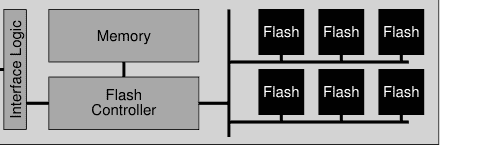

图 44.3：基于闪存的 SSD：逻辑图

客户端发送到 SSD。正如我们在下面将看到的，构建 FTL 的朴素方法会导致频繁的擦除，从而导致写入放大和低性能。

高可靠性将通过几种不同方法的结合来实现。如上所述，一个主要问题是磨损。如果一个数据块被频繁地擦除和编程，它就会变得不可用；因此，FTL 应该将写操作尽可能均匀地分散在闪存的各个块上，确保设备的所有块同时磨损；这种做法被称为磨损均衡（leveling），是任何现代 FTL 的核心组成部分。

另一个可靠性问题是程序干扰（program disturbance）。为了尽地减少干扰，FTL 必须按照从低页到高页的顺序，在已擦除的块内对页编程。这种顺序编程方法最大限度地减少了干扰并被广泛采用。

## 44.6 FTL 组织：一种糟糕的方法

FTL 最简单的组织方式就是我们所说的直接映射（direct-mapped）。在这种方法中，对逻辑页 N 的读取被直接映射到物理页 N。对逻辑页 N 的写入则更为复杂；FTL 必须首先擦除包含该页 N 的整个块；然后它必须擦除该块；最后，FTL 对旧页和新页进行编程。

正如你可能猜到的那样，直接映射 FTL 在性能和可靠性方面都有许多问题。性能问题出现在每次写操作中：设备必须擦除整个块（开销巨大）、将其擦除（开销巨大）、然后对其进行编程（开销巨大）。结果导致了严重的写入放大（与块中的页数成正比），并导致糟糕的写入性能，甚至比具有机械寻道和旋转延迟的典型硬盘还要慢。

更糟糕的是这种方法的可靠性。如果系统元数据或用户文件数据被覆盖，同一个块会被反复、不断地被擦除和编程，导致数据不断磨损并可能丢失。直接映射方法对跨逻辑块的均匀磨损控制能力不足，包含热点数据的底层物理块将迅速磨损。出于可靠性和性能的考虑，直接映射 FTL 是一个坏主意。

© 2008–19, ARPACI-DUSSEAU

三个简易部分

## 44.7 日志结构 FTL

由于这些原因，大多数 FTL 都是日志结构化的（log structured），这种想法对于存储设备（正如我们现在看到的）以及其之上的文件系统（正如我们在关于日志结构文件系统的章节中将看到的）都是非常有用的。当对逻辑块 N 进行写入时，设备将写操作附加到当前写入块中的新空位置；我们将这种写入风格称为日志（logging）。为了简单起见，假设对于块 N，设备维护一个映射表（在内存中，并以某种形式持久化存储在设备中）；此表存储了 SSD 中每个逻辑块的物理地址。

让我们通过一个示例来确保这种基于日志的方法是如何工作的。对于客户端来说，设备看起来像一个典型的磁盘，它可以读取和写入 512 字节的扇区（或扇区组）。假设 SSD 正在读取或写入 4KB 大的小块。进一步假设 SSD 包含大量的 16KB 块，每个块被分为四个 4KB 页；这些参数是不现实的（闪存块通常由许多页组成），但将很好地服务于教学目的。

假设客户端发出了以下顺序的操作：

- `写入(100)` 内容为 a1
- `写入(101)` 内容为 a2
- `写入(2000)` 内容为 b1
- `写入(2001)` 内容为 b2

这些逻辑块（例如 100）被 SSD 客户端（例如文件系统）用于记录信息所处的位置。

在内部，设备必须将这些块转换为硬件支持支持的擦除和编程操作，并以某种方式记录每个逻辑块地址的数据存储位置。假设 SSD 的所有块目前都是无效的，未存储数据，并且在对任何页进行编程之前必须擦除。这里我们展示了 SSD 的初始状态，所有页都被标记为无效 (i)：

| 块 | 0 | | 2 |
|---|---|---|||
| 页 | 00 01 02 03 04 05 06 07 08 09 10 11 |
| 内容 | | | |
| 状态 | i i i i i i i i i i i i i i i i |

当 SSD 收到第一次写入（针对逻辑块 100）时，FTL 决定将其写入物理块 0，该块包含四个物理页：0、1、2 和 3。因为该块未被擦除，我们无法向其写入数据；设备必须先向块 0 发送擦除命令。这样做会导致以下状态：

| 块 | 0 | | 2 |
|---|---|---|||
| 页 | 00 01 02 03 04 05 06 07 08 09 10 11 |
| 内容 | | | |
| 状态 | E E E E i i i i i i i i i i i |

块 0 现在准备好编程了。大多数 SSD 会按顺序写入页（即从低到高），从而减少与程序干扰相关的可靠性问题。随后，SSD 将逻辑块 100 的写入导向物理页 0：

| 块: | 0 | 1 | 2 |
| 页: | 00 01 02 03 04 05 06 07 08 09 10 11 |
| 内容: | a1 | | | | | | | | | | | |
| 状态: | V E E | | | | | | | | | | | |

但如果客户端想读取逻辑块 100 呢？它如何找到它在哪里？SSD 必须将针对逻辑块 100 发出的读取转换为对物理页的读取。为了实现这一功能，当 FTL 将逻辑块 100 写入物理页 0 时，它会在内存映射表中记录这一事实。我们将在图中通过如下方式跟踪此映射表的状态：

| 表: | 100 → 0 | 内存 |
| 块: | 0 | 1 | 2 |
| 页: | 00 01 02 03 04 05 06 07 08 09 10 11 |
| 内容: | a1 | | | | | | | | | | | |
| 状态: | V E E | | | | | | | | | | | |

现在你看到当客户端写入时发生了什么。SSD 找到下一个空闲页，并以某种方式记录逻辑块到物理页映射。让我们查看这些写入流的剩余：101，2000。

| 表: | 100 → 0 | 内存 |
| 块: | 0 | 1 | 2 |
| 页 | 00 01 02 03 04 05 06 07 08 09 10 11 |
| 内容 | a1 | | | | | | | | | | | |
| 状态 | V E E | | | | | | | | | | | |

这种日志方法通过其本质提高了性能（避免了直接映射方法的擦除修改-写），并极大地提高了可靠性。FTL 可以将写操作分散到所有页，被称为磨损均衡并增加了设备寿命。

© 2008–19, ARPACI-DUSSEAU

三个简易部分

旁注：FTL 映射信息的持久化

你可能会问：如果设备掉电了怎么办？内存映射表会消失吗？显然，这种信息不能丢失，否则设备将无法工作。SSD 必须具有恢复映射信息的方法。简单的方法是在每个页中记录映射信息，这被称为带外区域（OOB）。当设备掉电重启时，它必须扫描区域来重建映射表。为了克服这一限制，一些高级设备使用更多的日志和检查点技术来加速恢复；通过阅读崩溃一致性和日志结构文件系统的章节了解更多信息。

遗憾的是，这种基础日志方法有一些缺点。第一个是产生垃圾，因此必须进行垃圾回收（即死块回收）。让我们继续使用示例来理解这一点。记得逻辑块 100, 101, 2000 和 2001 已经写入设备。

现在，假设块 100 和 101 再次写入，内容为 c1 和 c2。写入被写入后续页（在此情况下为页 4 和 5），映射表随之相应更新。注意，设备必须先擦除块 1 以便这种编程成为可能。

| 100 → 4 | 101 → 5 | 2000 → 2 | 2001 → 3 | 内存 |
|---|---|---|---|---|||
| 块 | 0 | | 1 | | 2 | |
| 页 | 00 01 02 03 04 05 06 07 08 09 10 11 | 闪存芯片 |
| 内容 | a1 a2 b1 b2 c1 c2 | | | | | | |
| 状态 | V V V V V E E i i i | | | |

### 基于闪的 SSD

我们现在面临的问题应该是显而易见的：物理页 0 和 1 也标记为有效，但它们内部包含垃圾数据，即块 100 和 101 的旧版本。由于设备的日志结构特性，覆盖写入会产生垃圾块，设备必须回收这些块，为新的写入操作提供可用空间。

寻找垃圾块（也称为死块）并将其回收以便使用的过程称为垃圾回收（Garbage Collection），它是任何现代 SSD 的重要组成部分。其基本过程非常简单：找到一个包含一个或多个垃圾页的块，从该块中读取有效（非垃圾）页，将这些页写入日志中，并（最后）回收整个块以供使用。

现在让我们用一个例子来说说明。设备决定要回收上述任何死页。块 0 有两个死页（0 和 1）和两个有效块（页 2 和 3，分别包含块 2000 和 2001）。为了实现这一点，设备：

- 从块 0 读取有效数据（页 2 和 3）
- 将有效数据写入日志末尾
- 擦除块（将其释放以便以后使用）

为了让垃圾回收器工作，每个块中必须有足够的信息，使 SSD 能够确定每个页是有效的还是死的。实现这一点的自然方法是在块内的某个位置存储关于逻辑块存储在每个页中的信息。设备可以使用映射表来确定块内的页是否持有有效数据。

根据我们的示例（在垃圾回收发生之前），块 0 持有逻辑块 100、101、2000、2001。通过检查映射表（在垃圾回收之前，该表包含 100->4, 101->5, 2000->2, 2001->3），设备可以很容易地确定 SSD 块中的每个页是否持有有效信息。例如，2000 和 2001 是有效的，而 100 和 101 不是，是垃圾回收的候选对象。

当我们示例中的垃圾回收过程完成后，设备的状态如下：

| | 100→4 | 101→5 | 2001→7 | 内存 |
|---|---|---|---|---|
| 块 (Block): | 0 | 1 | 2 | |
| 页 (Page): | 00 01 02 03 04 05 06 07 08 09 10 11 | 闪存芯片 (Flash Chip) |
| 内容 (Content): | | c1 c2 b1 b2 | | |
| 状态 (State): | E E E E V V V V I I I | | |

如你所见，垃圾回收可能是昂贵的，需要读取和重写有效数据。回收的理想候选是仅由死页组成的块；在这种情况下，该块可以立即被擦除并用于新数据，而无需昂贵的数据迁移。

© 2008– ARPACI-DSEAU

第三

部分

### 旁注：一种名为 TRIM 的新存储 API

当我们考虑到硬盘时，通常只考虑到读写它们最基础的接口：读和写（还有某种缓存刷新命令，确保驱动器已同样持久化，但有时我们为了简单起见会省略它）。对于日志结构 SSD，实际上对于任何具有逻辑到物理块灵活且变化映射的设备，一个新接口是有用的，这被称为 trim 操作。

`trim` 操作以地址（可能还包括长度）作为参数，简单地通知设备由地址（和长度）指定的块已被删除；设备不再需要跟踪关于给定地址范围的任何信息。对于标准硬盘，`trim` 并不特别有用，因为设备具有从地址到磁道、扇区的静态映射。然而，对于日志结构 SSD，知道一个块不再被需要是非常用的，SSD 可以在垃圾回收期间从 FTL 中移除这些信息。

尽管我们有时将接口和实现视为独立的实体，在这种情况下，我们看到复杂的映射对于更有效的实现是需要这些。

为了减少 GC 成本，某些 SSD 会进行过度备用（overprovision）；通过增加额外的容量，清理工作可以推迟到后台，在设备不忙碌时执行。增加容量也会增加内部带宽，从而不会损害客户端带宽。许多现代驱动器以这种方式运行，这是实现卓越性能的关键。

## 44.9 映射表大小

日志结构的另一个成本是可能会产生极其巨大的映射表，每个 4-KB 页一个条目。例如，对于一个 1TB 的 SSD，每个 4-KB 页一个条目会导致需要 1 GB 内存！因此，页级 FTL 方案是不行的。

### 基于块的映射

减少映射成本的方法是每个块仅保留一个指针，这使得映射信息按页大小缩小了一个倍数。这种块级 FTL 类似于在内存系统中具有更大的页大小；在这种情况下，你在每个虚拟地址使用更少的位和一个更大的偏移。

不幸的是，基于块的映射在性能上并不理想。当发生“小写”（即小于物理块大小的写入）时，会出现最大的问题。在这种情况下，FTL 必须从旧块读取大量数据并将其复制到新块中（连同小写的数据）。

为了让这个问题更清楚，让我们来看一个例子。假设客户端之前写入了块 2000、2001、2003（内容为 a, b, c, d），并且它们位于物理块 1 的页 4、5、6 和 7。使用页级映射，必须为这些逻辑块记录映射：2000–4、2001–5、2002–6 和 2003–7。

如果我们使用块映射，FTL 只需要为所有数据记录一个翻译。然而，地址映射与我们之前的示例略不同。具体来说，如果设备的逻辑地址被切分成与闪存物理块大小相同的块，逻辑块由两部分组成：块号和偏移。由于我们假设每个物理块包含四个块，逻辑地址的偏移部分是 2 位；剩余（高位）位组成块号。

逻辑块 2000、2001、2002 和 2003 都具有相同的块号（500），并具有不同的偏移（分别为 0、1、2 和 3）。因此，通过块级映射，FTL 记录块 500 映射到块 1（从物理页 4 开始），如下所示：

表：500 → 内存

| 块 (Block) | | 1 | 2 |
|---|---|---|---|
| 页 (Page): | 00 01 02 03 04 05 06 07 08 09 10 11 | 闪存芯片 (Flash Chip) |
| 内容 (Content): | | c1 c2 b1 b2 | | |
| 状态 (State): | E E E E V V V V I I I | | |

如你所见，垃圾回收可能是昂贵的，需要读取和重写有效数据。回收的理想候选是仅由死页组成的块；在这种情况下，该块可以立即被擦除并用于新数据，而无需昂贵的数据迁移。


© 2008– ARPACI-DSEAU

第三部分

# 闪的 SSD

# 601

| 块 (Block) | | 1 | 2 |
|---|---|---|---|
| 页 (Page): | 00 01 02 03 04 05 06 07 08 09 10 11 | 闪存芯片 (Flash Chip) |
| 内容 (Content): | | c1 c2 b1 b2 | | |
| 状态 (State): | E E E E V V V V I I I | | |

如你所见，垃圾回收可能是昂贵的，需要读取和重写有效数据。回收的理想候选是仅由死页组成的块；在这种情况下，该块可以立即被擦除并用于新数据，而无需昂贵的数据迁移。

© 2008– ARPACI-DSEAU

第三部分

# 旁注：一种名为 TRIM 的新存储 API

当我们考虑到硬盘时，通常只考虑到读写它们最基础的接口：读和写（还有某种缓存刷新命令，确保驱动器已同样持久化，但有时我们为了简单起见会省略它）。对于日志结构 SSD，实际上对于任何具有逻辑到物理块灵活且变化映射的设备，一个新接口是有用的，这被称为 `trim` 操作。

`trim` 操作以地址（可能还包括长度）作为参数，简单地通知设备由地址（和长度）指定的块已被删除；设备不再需要跟踪关于给定地址范围的任何信息。对于标准硬盘，`trim` 并不特别有用，因为设备具有从地址到磁道、扇区的静态映射。然而，对于日志结构 SSD，知道一个块不再被需要是非常用的，SSD 可以在垃圾回收期间从 FTL 中移除这些信息。尽管我们有时将接口和实现视为独立的实体，在这种情况下，我们看到复杂的映射对于更有效的实现是需要这些。为了减少 GC 成本，某些 SSD 会进行过度备用（overprovision）；通过增加额外的容量，清理工作可以推迟到后台，在设备不忙碌时执行。增加容量也会增加内部带宽，从而不会损害客户端带宽。许多现代驱动器以这种方式运行，这是实现卓越性能的关键。

# 44.9 映射表大小

日志结构的另一个成本是可能会产生极其巨大的映射表，每个 4-KB 页一个条目。例如，对于一个 1TB 的 SSD，每个 4-KB 页一个条目会导致需要 1 GB 内存！因此，页级 FTL 方案是不行的。

# 基于块的映射

减少映射成本的方法是每个块仅保留一个指针，这使得映射信息按页大小缩小了一个倍数。这种块级 FTL 类似于在内存系统中具有更大的页大小；在这种情况下，你在每个虚拟地址使用更少的位和一个更大的偏移。不幸的是，基于块的映射在性能上并不理想。当发生“小写”（即小于物理块大小的写入）时，会出现最大的问题。在这种情况下，FTL 必须从旧块读取大量数据并将其复制到新块中（连同小写的数据）。这种数据拷贝极大地增加了并降低了性能。为了让这个问题更清楚，让我们来看一个例子。假设客户端之前写入了块 2000、2001、2003（内容为 a, b, c, d），并且它们位于物理块 1 的页 4、5、6 和 7。使用页级映射，必须为这些逻辑块记录映射：2000–4、2001–5、2002–6 和 2003–7。如果我们使用块映射，FTL 只需要为所有数据记录一个翻译。然而，地址映射与我们之前的示例略不同。具体来说，如果设备的逻辑地址被切分成与闪存物理块大小相同的块，逻辑块由两部分组成：块号和偏移。由于我们假设每个物理块包含四个块，逻辑地址的偏移部分是 2 位；剩余（高位）位组成块号。逻辑块 2000、2001、2002 和 2003 都具有相同的块号（500），并具有不同的偏移（分别为 0、1、2 和 3）。因此，通过块级映射，FTL 记录块 500 映射到块 1（从物理页 4 开始），如下所示：

表：500 → 内存

| 块 (Block) | | 1 | 2 |
|---|---|---|---|
| 页 (Page): | 00 01 02 03 04 05 06 07 08 09 10 11 | 闪存芯片 (Flash Chip) |
| 内容 (Content): | | c1 c2 b1 b2 | | |
| 状态 (State): | E E E E V V V V I I I | | |

如你所见，垃圾回收可能是昂贵的，需要读取和重写有效数据。回收的理想候选是仅由死页组成的块；在这种情况下，该块可以立即被擦除并用于新数据，而无需昂贵的数据迁移。

© 2008– ARPACI-DSEAU

第三部分

# 混合映射

为了启用写入同时也减少成本，许多现代 FTL 采用**混合映射**（hybrid mapping）技术。通过这种方法，FTL 保留几个已擦除的块并将所有写入重向它们；这些被称为**日志块**（log blocks）。因为 FTL 希望能够将任何页写入日志块内的任何位置，而无需块级映射所需的所有拷贝，因此它保留了这些日志块的映射。

FTL 逻辑上在内存中有两种映射表：我们称为日志表（log table）中的一小组页级映射，以及数据表中的一组较大的页级映射。当查找特定的逻辑块时，FTL 会查询日志表；如果未找到该逻辑块，FTL 将查询数据表以找到其位置并访问请求。

混合映射策略的关键是保持块的数量较小。为了保持日志块的数量较小，FTL 必须定期检查日志块（每个页有一个指针），并将它们切换为仅由单个块指针指向的块。这种切换通过三种主要技术之一完成，取决于块的内容 [KK+02]。

例如，假设 FTL 之前写出了日志页 1000、1001、1002 和 1003，并将它们放置在物理块 2（物理 OPERATING

SYSTEMS

[Version 1.01]

WWW.OSTEP.ORG

# 基于 FLASH 的 SSD

第 8, 9, 10, 11 页）；假设写入 1000, 1001, 1002 和 1003 的内容分别为 a, b, c 和 d。

日志表：

| 数据表: | 250 → 8 | 内存 |


| 块: | 0 | 1 | 2 | | |
| 页: | 00 01 02 03 04 05 06 07 08 09 10 11 | 闪存 |
| 内容: | | | | | | | | a b c d | 芯片 |
| 状态: | i i i i i i i i V V V V | | | |

现在，当客户端按照确顺序在当前可用的日志块之一中重写这些块（使用数据 a', b', c', 和 d'）时，物理块（物理页 0, 1, 2 和 3）。在这种情况下，FTL 具有如下状态：

日志表：`1000→0` `1001→1` `1002→2` `1003→3`

| 数据表: | 250 → 8 | 内存 |
| 块: | 0 | 1 | 2 | | |
| 页: | 00 01 02 03 04 05 06 07 08 09 10 11 | 闪存 |
| 内容: | a' b' c' d' | | a b c d | 芯片 |
| 状态: | V V V V | i i i i | | | |

由于这些块的写入方式与之前完全相同，FTL 可以执行所谓的**切换合并**（switch merge）。在这种情况下，日志块 (0) 现在成为块 0, 1, 2 和 3 的存储位置，并由单个指针指向；旧块 (2) 现在被擦除并用作日志块。在这种理想情况下，所有所需的每页指针都被一个单一指针取代。

日志表：

| 数据表: | 250 → 0 | 内存 |
| 块: | 0 | 1 | 2 | | |
| 页: | 00 01 02 03 04 05 06 07 08 09 10 11 | 闪存 |
| 内容: | a' b' c' d' | | a b c d | 芯片 |
| 状态: | V V V V | i i i i | | | |

这种切换合并对于混合 FTL 来说也是最好的。遗憾的是，FTL 的运气并不那么好。想象我们具有相同的初始条件（逻辑块 1000 ... 1003 存储在物理块 2 中），但客户端重写了逻辑块 1000 和 1001。

你认为在这种情况下会发生什么？为什么处理起来更具挑战性？（在查看下一页的结果之前思考一下）

©2008–19, ARPACI-DUSSEAU

三个简单部分

基于 FLASH 的 SSD

日志表：`1000→0` `1001→1`

数据表：`250→8` 内存

| | | | | | | | | | | | | |
|---|---|---|---|---|---|---|---|---|---|---|---|---|
| 块: | | | | | | | | | | | 2 | |
| 页: | 00 01 02 03 04 05 06 07 08 09 11 | 闪存 |
| 内容: | a' b' | | | | | | | a b c d | 芯片 |
| 状态: | V V I I I I i i i i V V V | | | | | |

为了重新合并该物理块的其他页，从而能够通过单个块指针引用它们，FTL 执行了所谓的**部分合并**（partial merge）。在操作过程中，从物理块 2 读取了逻辑块 1002 和 1003，然后将它们附加到日志中。SSD 的最终状态与上面的切换合并相同；但在这种情况下，FTL 必须执行额外的 I/O 来实现其目标，从而增加了写放大。

FTL 遭遇的最后一种情况被称为**全合并**（full merge），它需要更多的空间。在这种情况下，FTL 必须从许多块中组合以执行清理。例如，假设日志块 A 写入日志块。为了将此块转换为块映射页，FTL 必须创建一个包含逻辑块 0, 1, 2 和 3 的数据块，然后 FTL 必须从其他地方合并 1, 2 和 3 并写入 0, 1, 2 和 3。接下来，合并必须对逻辑块 4 执行相同的操作，找到 5, 6 和 7 并将它们协调到一个物理块中。块 8 和 12 也必须进行相同的操作，然后（最后），日志块就可以释放了。频繁的全合并并不意外，由于这种原因，性能会受损。然而，对于混合 FTL 来说，这种切换合并也是最理想的。

| | | | | | | | | | | | | | |
|---|---|---|---|---|---|---|---|---|---|---|---|---|
| 块: | | | | | | | | | | | 2 | |
| 页: | 00 01 02 03 04 05 06 07 08 09 11 | 闪存 |
| 内容: | a' b' | | | | | | | a b c d | 芯片 |
| 状态: | V V I I I I i i i i V V V | | | | |

为了重新合并该物理块的其他页，从而能够通过单个块指针引用它们，FTL 执行了所谓的部分合并。在操作过程中，从物理块 2 读取了逻辑块 1002 和 1003，然后将它们附加到日志中。SSD 的最终状态与上面的切换合并相同；但在这种情况下，FTL 必须执行额外的 I/O 来实现其目标，从而增加了写放大。

FTL 遭遇的最后一种情况被称为全合并，它需要更多的空间。在这种情况下，FTL 必须从许多块中组合以执行清理。例如，假设日志块 A 写入日志块。为了将此块转换为块映射页，FTL 必须创建一个包含逻辑块 0, 1, 2 和 3 的数据块，然后 FTL 必须从其他地方合并 1, 2 和 3 并写入 0, 1, 2 和 3。接下来，合并必须对逻辑块 4 执行相同的操作，找到 5, 6 和 7 并将它们协调到一个物理块中。块 8 和 12 也必须进行相同的操作，然后（最后），日志块就可以释放了。频繁的全合并并不意外，由于这种原因，性能会受损。

# 页映射加缓存

对于混合 FTL 来说，这种切换合并也是最理想的。遗憾的是，FTL 的运气并不那么好。想象我们具有相同的初始条件（逻辑块 1000 ... 1003 存储在物理块 2 中），但客户端重写了逻辑块 1000 和 1001。

你认为在这种情况下会发生什么？为什么处理起来更具挑战性？（在查看下一页的结果之前思考一下）

由于 SSD 在顺序和随机 I/O 之间存在某些性能差异，因此在后续章节中我们学习的如何为硬盘构建文件系统的许多技术仍然适用于 SSD；尽管顺序和随机 I/O 之间的差异程度较小，但这种差距足以仔细考虑如何设计文件系统。

# 性能

在结束之前，我们检查 SSD 的性能。在这种情况下，我们对比 SSD 与硬盘（HDD）。由于 SSD 没有机械部件，它们在随机访问方面与 DRAM 相似。表 44.1 显示了三种 SSD 的数据，最后一行显示的是硬盘，数据来自网络。

| 设备 | 随机读取 (MB/s) | 随机写入 (MB/s) | 顺序读取 (MB/s) | 顺序写入 (MB/s) |
|---|---|---|---|---|
| Samsung 840 Pro SSD | 103 | 287 | 421 | 384 |
| Seagate 600 SSD | 84 | 252 | 424 | 374 |
| Intel SSD 335 | 39 | 222 | 344 | 354 |
| Seagate Savvio 15.K 3 HDD | 2 | 2 | 223 | 223 |

图 44：SSD 与硬盘：性能对比

我们可以从表中学习到一些有趣的事实。首先，也是戏剧性的，SSD 与硬盘在随机 I/O 上的差异。虽然 SSD 在随机 I/O 中可以达到数十或数百 MB/s，而“这种”硬盘的峰值仅为几 MB/s（实际上我们向上取整为 2 MB/s）。你可以看到在顺序性能方面，差异要小得多；如果你只需要顺序性能，硬盘反而更好。你可以看到 SSD 的随机读取性能不如 SSD 的随机写入性能。这种出人意料的随机写入性能是因为许多 SSD 的日志结构特性，它将随机写入转换为顺序写入并提高了性能。

# 磨损均衡

最后，SSD 必须实现磨损均衡。为了确保块的均匀磨损，FTL 必须在所有块上分配写入。在这种情况下，磨损均衡最简单的方法是缓存部分数据。由于这种方式，性能会受到损害。

## 44.12 总结

基于闪存的 SSD 正在成为笔记本电脑、台式机以及驱动全球经济的数据中心服务器的常见设备。因此，你可能应该对它们了解一些情况，对吧？

坏消息是：这一章（就像书中的许多章节一样）只是理解当前技术水平的第一步。获取更多关于真实情况信息的途径包括：对实际设备性能的研究（例如 Chen 等 [CK+09]、Grupp 等 [A+08]、Gurpta 等 [CG]、Huang 等 [H+14]、Kim 等 [KK+02]、Lee 等 [L+07] 以及 Zhang 等 [Z+12] 的研究），甚至还有闪存分布式系统（包括 Gordon [CG+09] 和 CORFU [B+12]）。而且，如果我们这么说的话，关于从 SSD 中提取高性能所需的所有事项的非常好的概述，可以在一篇关于“未定义的读取契约”[HK+17] 的论文中找到。

不要只读学术论文；也要关注大众媒体中的最新进展（例如 [V12]）。在在那里你可以学到更多实用的（但仍然很有用的）信息，例如三星在同一块 SSD 中同时使用 TLC 和 SLC 单元以最大化性能（SLC 可以快速缓冲写入）和容量（TLC 每个单元可以存储更多比特）。而且正如他们所说，这仅仅是冰山一角。深入其中并自己学习更多关于这项研究的“冰山”，可以从 Ma 等人的优秀（且是新的综述）[M+14] 开始。不过要小心；冰山甚至可以击没最强大的船 [W15]。

## 基于闪存的 SSD

### 旁注：SSD 关键术语

- 一个闪存芯片由许多库（banks）组成，每个库被组织成擦除块（erase blocks，有时称为块）。每个块被进一步划分为若干页（pages）。
- 块很大（128KB-2MB），包含许多页，而页相对较小（1KB-8KB）。
- 要从闪存读取，需发出带有地址和长度的读取命令；这允许客户端读取一个或多个页。
- 写入闪存更为复杂。首先，客户端必须擦除整个块（这会删除块内的所有信息）。然后，客户端可以对每个页进行一次编程，从而完成写入。
- 新的 `trim` 操作非常有用，它可以告知设备特定块（或块范围）何时不再需要。
- 闪存的可靠性主要由磨损决定；如果一个块被频繁地擦除和编程，它将会变得无法使用。
- 基于闪存的固态存储设备（SSD）其表现就像一个普通的基于块的读写磁盘；通过使用闪存转换层（FTL），它将客户端的读写操作转换为底层闪存芯片的读取、擦除和编程。
- 大多数 FTL 是日志结构化的（log-structured），这通过最小化擦除/编程周期来降低写入成本。一个内存中的转换层跟踪逻辑写入在物理介质中的位置。
- 日志结构 FTL 的一个关键问题是垃圾回收的成本，这会导致写入放大。
- 另一个问题是映射表的大小，它可能会变得非常大。使用混合映射或缓存 FTL 的片段是可能的解决办法。
- 最后一个问题是磨损均衡；FTL 必须偶尔将数据从大部分读取的块中迁移，以确保这些块也能获得其份额的擦除/编程负载。

## 基于闪存的 SSD

# 参考文献

- [A+8] "Design Tradeoffs for SSD Performance" 作者 N. Agrawal, V. Prabhakaran, T. Wobber, J. D. Davis, M. Manasse, R. Panigraahy, USENIK '08, 加利州圣地亚哥, 2008年6月。关于 SSD 设计内容的优秀概述。
- [A14] "Operating Systems: Three Easy Pieces" 章节：崩溃一致性：FSC 和日志-日志结构文件系统。作者 Remzi Arpac-Dusseau 和 Andrea Arpac-Dusseau。这里关于如何在文件系统中使用日志记录有更多详细信息；其中许多想法也可以应用到设备内部。
- [A15] "Pricing Strategy" 作者 Remzi Arpac-Dusseau, 2015年2月。这并不是一篇真正的论文，而是亚马逊的一位作者之一，正在查看硬盘和 SSD 的当前价格。你可以在线阅读这篇论文并查看现在的成本。


- [B12] "CORE Log Design for Flash Controllers" 作者 M. Balakrishnan, D. Dalkhi, V. Prabhakaran, T. Wobber, M. Wei, J. D. Davis. NSD '12, 加利州圣何何塞, 2012年4月。一种关于为闪存控制器设计重映射日志的新方法。

- [D10] "Understanding Intrinsic Characteristics" 作者 Simona Boboila, Peter Denoyers. FT '10, 加利州圣何何塞, 2010年2月。一篇回顾闪存寿命提升器的论文。对于制造商的耐用性预测，提升了高达 100 倍。

- [E07] "The Last Word in File Systems" 作者 Jeff Bonnwick 和 Bill Moore. 此处可用。

- [CG09] "Characterizing Flash: Anomalies, and Observations" 作者 Grupp, Sudarsan. ASPLOS '09, 华盛顿。对发生情况的良好概述。

- [H+14] "An Aggressive Worn-out Management Scheme: To Alleviate Degradation" 作者 Huang, Wu. EuroSys '14。

- [HK+17] "The Constraint of SSDs" 作者 He, Kannan. EuroSys '17。

- [KK02] "A Space-Efficient Flash Translation for Compact Systems" 作者 Kim, Kim, Ho, Min, Cho. IEEE Transactions on Electronics, Volume 48, Number 2, 2002年5月。

- [L07] "A Buffer-Based Flash Translation by Using Fully-Associative Search" 作者 Lee, Chun, Lee, Park, Sog. ACM Transactions on Embedded Computing, Volume 6, Number 3, 2007年7月。

- [M+14] (优秀的且是新的综述)) 作者 Ma 等。

- [W15] "List of Ships Sunk by Icebergs" 作者多位. 维基百科。

- [V12] "Understanding TLC Flash" 作者 Vato. AnandTech, 2012。

- [T15] "Performance Hard Drives Charts" 来自 Tom's Hardware. 2015。

- [U12] "Understanding TLC Flash" 作者 Vato. AnandTech, 2012。

- [Z12] "De-irection for Flash-based SSDs with Nameless Writes" 作者 Zhang, Prash, Koh, Arpaci-Dusseau. FAST '13, 加利州圣何何塞, 2013年2月。

基于闪的 SSD 611

# 作业（仿真）

本节介绍了 `ssd.py`，这是一个简单的 SSD 模拟器，你可以用它更好地理解 SSD 的工作原理。请阅读 README 获取有关如何运行模拟器的详细信息。首先，你决定去泡杯茶（必须有咖啡因），戴上阅读眼镜，让猫蜷在你的腿上，然后开始工作。

## 问题

- 1. 作业将主要集中在日志结构化 SSD 上，通过 `…T log` 标志进行模拟。我们将使用其他类型的 SSD 进行比较。首先，使用标志 `-T log s 1 -n 10 -q` 运行。你能推算出发生了哪些操作吗？使用 `-c` 检查答案（或用 `-C` 代替 `-q -c`）。使用不同的 `-s` 值生成不同的工作负载。

- 2. 现在显示命令并看看你是否能推算出 Flash 的中间状态。使用标志 `-T log s 2 -n 10` 运行以显示每个命令。现在，确定每个命令对应的 Flash 状态；使用 `-F` 显示状态验证你是否正确。使用不同的随机种子来测试你日益增长的专业知识。

- 3. 让我们通过添加 `-r 20` 标志让这个问题稍微有趣一点。这对命令造成了什么变化？使用 `-c` 检查你的答案。

- 4. 性能由擦除、编程和读取次数决定（我们假设这些是免费的）。运行与上面相同的工作负载，但不显示任何中间状态（例如 `-T log s 1 -n 10`）。你能估算出完成此工作负载需要多久吗？（擦除时间为 1000 微秒，编程时间为 40）并使用 `-I` 检查答案。你也可以通过 `-E`,`-W` 修改擦除和读取时间。

- 5. 现在，比较日志结构方法与（非常糟糕的）直接方法（使用 `-T direct` 代替 `-T log`）的性能。首先，估计你认为直接方法的表现会如何，然后用 `-s` 检查答案。通常情况下，日志结构方法的性能会比直接方法好多少？

- 6. 接下来让我们探索垃圾回收器的行为。为了做到这一点，我们必须恰当地设置高水位（`-G`）和低水位（`-g`）。首先，让我们观察在没有垃圾回收器的情况下，在日志结构化 SSD 上运行较大工作负载会发生什么。为此，使用标志 `-T log -n 1000` 运行（高水位默认为 10，因此在此配置下 GC 不运行）。你认为会发生什么？使用 `-C` 也许还有 `-F` 查看。

> 现在你可能会抱怨：“但我是个猫派的！”对此，我们说：太遗憾了！去养只猫，把它放在你腿上，然后去做作业！如果你连最基本的指令都无法遵循，还能如何学习呢？

2008–19, ARPAC-DUSSEAU

三个部分

- 7. 要开启垃圾回收器，请使用较小的值。水位（`-G N`）告诉系统开始收集已使用的 N 个数据块；低水位（`-G M`）告诉系统当仅剩 M 个块在使用时停止收集。你认为什么样的水位值能使系统运行？使用 `-C` 和 `-F` 显示命令和中间设备状态。

- 8. 另一个有用的标志是 `-J`，它显示收集器在运行时正在做什么。使用标志 `-T -n 1000 -C -J` 同时查看命令和 GC 行为。你对 GC 注意到了什么？当然，GC 的最终影响是性能。使用 `-S` 查看所有统计数据；由于垃圾回收导致了多少额外的读取和写入？将其与理想 SSD（`-T ideal`）进行比较；由于 Flash 的特性产生了多少额外的读取、写入和擦除？与直接方法相比，日志结构方法更优吗？

- 9. 最后一个要探索的方面是工作负载倾斜（skew）。向工作负载添加倾斜会改变写入，使得更多写入发生在逻辑空间的较小部分。例如，运行 `-K80/20` 会将 80% 的写入倾斜到 20% 的块上。选择不同的倾斜值并执行许多随机选择的操作（例如 `-n 1000`），先使用 `-T direct` 理解倾斜，再使用 `-T` 查看会发生什么影响？另一个可以探索的倾斜控制参数是 `-k100`；通过在倾斜的工作负载中添加此标志，前 100 次写入是不倾斜的。这种想法是创建大量数据，但然后更新其中的一部分。这对垃圾回收器可能会产生什么影响？

# 数据完整性与保护

除了我们目前为止所学习的文件系统中发现的基础进展外，许多特性也值得研究。在本章中，我们再次关注可靠性（之前在 RAID 章节中学习过存储系统的可靠性）。具体来说，考虑到现代存储设备不可靠的本质，文件系统或存储系统如何确保数据是安全的？

这一通用领域被称为数据完整性或数据保护。因此，我们现在将调查确保你存入存储的数据在存储系统返回给你时保持相同的技术。

> **核心问题：如何确保数据完整性**

系统应如何确保写入存储器的数据受到保护？需要哪些技术？如何使这些技术变得高效，且具有低空间和时间开销？

## 故障模式

正如你在 RAID 章节中学到的那样，磁盘不是完美的：磁盘要么正常，要么失效。然而，现代磁盘也可能看似无法访问（即 LSE）或包含错误的内容（即损坏）。因此，在访问看似良好的磁盘时，它偶尔会失败。常见的有两种类型：LSE 和损坏。

LSE 发生在磁盘扇区（或一组扇区）以某种方式损坏时。例如，如果磁盘头由于原因接触表面（这在正常运行时不应发生），可能会损坏表面，导致块无法读取。幸运的是，磁盘纠错码（ECC）被驱动器用于判断磁盘位位是否正确，并在某些情况下进行修复；如果它们没有足够的信息来修复错误，磁盘在发出请求时将返回错误。

还有某些情况是块以磁盘检测的方式发生了损坏。例如，有缺陷的固件可能会将块写入错误的位置；在这种情况下，ECC 指明块内容是正确的，但返回了错误的块。同样，块在从磁盘传输到故障总线时可能会损坏；结果数据被存储在磁盘中，但它不是客户端想要的。这些类型的故障特别为阴险，因为它们是静默故障；磁盘在返回错误数据时不会给出任何问题指示。

Prabhakaran 等人将这种更现代的磁盘故障观点描述为部分故障磁盘模型 [P-05]。在这种观点下，磁盘仍然会整体故障（正如以前在故障停止模型中那样）；然而，磁盘也可能看似无法访问（即 LSE）或包含错误的内容（即损坏）。这两种故障都不罕见，但到底有多罕见呢？图 45 总结了 Bairavasundaram [B+07,B+08] 的某些发现。

| 类型 | 廉价 | 昂贵 |
| :--- | :--- | :--- |
| LSEs | 9.40% | 1.40% |
| 损坏 | 0.50% | 0.05% |

图 45.1：LSE 和块损坏的频率

关于 LSE（潜扇区错误）的一些额外发现如下：

- 具有多个 LSE 的昂贵硬盘比廉价硬盘更容易产生额外的错误
- 对于大多数硬盘，年度错误率在第二年会增加
- LSE 的数量随着磁盘容量增大而增加
- 大多数具有 LSE 的硬盘其数量少于 50 个
- 具有 LSE 的硬盘更有可能产生额外的 LSE
- 存在大量的空间和时间局部性
- 磁盘巡检（Disk scrubbing）是有用的（大多数 LSE 都是通过这种方式发现的）

关于数据损坏的一些发现：

- 在同一类硬盘中，不同型号的损坏概率差异巨大
- 不同型号之间的年龄效应
- 负载和磁盘大小对损坏的影响很小
- 大多数发生损坏的硬盘只有少数处发生损坏
- 损坏在磁盘内部或 RAID 跨磁盘之间不是相互独立的
- 存在空间局部性，以及某些时间局部性
- 与 LSE 之间存在弱相关性

要了解更多关于这些故障的信息，你可能需要阅读原始论文 [B07, B08]。但希望核心观点应该是的：如果你想构建一个可靠的存储系统，必须包含检测并恢复 LSE 和数据块损坏的机制。

## 45.2 处理潜扇区错误

鉴于这两种部分故障的模式，我们现在应该尝试看看能做些什么。先处理两者较容易的一种，即潜扇区错误。

> CRUX：如何处理潜扇区错误

存储系统应该如何处理潜扇区错误？需要多少额外的机制来处理这种形式的部分故障？

事实证明，潜扇区错误处理起来相当简单，因为它们（根据定义）是容易被检测到的。当存储系统访问一个数据块且磁盘返回错误时，存储系统应简单地使用现有的任何冗余机制来返回正确的数据。例如，在镜像 RAID 中，系统应该访问备副本；在基于校验的 RAID-4 或 RAID-5 系统中，系统应该从校验组中的其他块重建该数据块。因此，像 LSE 这样易于检测的问题可以通过标准的冗余机制轻松地恢复。

© 2008–19, ARPACI-DUSSEAU

## 数据完整性与保护

多年来，LSE 的日益普遍影响了 RAID 的设计。在 RAID-4/5 系统中，当全盘故障和 LSE 同时发生时，产生了一个特别有趣的问题。具体来说，当整块磁盘故障时，RAID 试图通过读取校验组中所有其他磁盘并重新计算缺失值来重建该磁盘（例如重建到热备上）。如果在重建过程中，在其他一个磁盘上遇到了 LSE，我们就有问题了：重建无法成功完成。

为了解决这个问题，某些系统增加了一层额外的冗余。例如，NetApp 的 RAID-DP 等同于两个校验盘而不是一个 [C+04]。当重建过程中发现 LSE 时，额外的校验有助于重建缺失的数据块。一如既常，这是有成本的，为每个条带维护两个校验块的成本更高；然而，NetApp WAFL 文件系统的日志结构特性在许多情况下抵消了这种成本 [HLM94]。剩余成本是空间，表现为用于第二个校验块的额外磁盘。

## 45.3 检测损坏：校验和

让我们处理最具挑战性的问题，即通过损坏引起的静默故障。当损坏发生并导致磁盘返回错误数据时，我们如何防止用户获取到坏数据？

> CRUX：如何在存在损坏的情况下保护数据完整性

鉴于此类故障的静默性，存储系统可以做什么来检测损坏的发生？需要哪些技术？如何高效地实现这些技术？

与潜扇区错误不同，损坏的检测是一个关键问题。客户端如何知道一个数据块坏了？一旦确定某个特定块是坏的，恢复方法与之前相同：你需要在地方有该块的副本（并且希望副本没有损坏！）。因此，我们在这里重点关注检测技术。

现代存储系统用于保护数据完整性的主要机制称为“校验和”（checksum）。校验和仅仅是一个函数的结果，该函数将一段数据（例如 4KB 块）作为输入并对该数据计算一个函数，生成该数据内容的简短摘要（例如 4 或 8 字节）。这个摘要被称为校验和。此类计算的目标是让系统能够检测数据是否由于某种原因损坏或更改，方法是将校验和与数据一起存储，并在以后确认数据的校验和是否与原始存储值。

操作系统

[版本 1.01]

WWW.OSTEP.ORG

## 完整性与保护

> 提示：没有免费的午餐

世界上没有免费的午餐（英文简称 TNSTAAFL）是一个古老的美国谚语，意味着当你似乎免费获得某东西时，实际上你可能在为此付出代价。它源于以前餐馆向顾客推销免费午餐以吸引他们进入；只有当你进去后，才会发现为了获得这份“免费”的午餐，你必须购买一种或多种饮料。当然，这实际上可能并不是一个问题，特别是如果你是一个渴望饮酒的人（或典型的本科生）。

## 常用校验和函数

许多函数被用于计算校验和，它们在强度（即它们保护数据完整性的能力有多好）和速度（即计算速度有多快）方面各异。这产生了一种权衡：获得的保护越多，成本就越高。

一种简单的校验和是基于异或（XOR）的。为了具体化，想象一个数据块。如果我们对所有字节进行异或运算，就会得到一个校验和。这种方法非常快，但有局限性：它无法检测每个单元内相同位置的变化。

一种稍微复杂的算法被称为 Fletcher 校验和（正如你所猜的，发明者是 John G Fletcher [F82]）。具体来说，假设一个块 D 由字节 $d1 \dots dn$ 组成；s1 = $(s1 + dn) \pmod{255}$；s2 继而是 $(s2 + s1) \pmod{255}$。Fletcher 校验和几乎与 CRC 一样强大，可以检测所有单比特错误、双比特错误和许多突发错误 [F04]。

最后一个常用的校验和被称为循环冗余校验（CRC）。假设你希望对块 D 计算校验和。你所做的只是将其看作一个大数（它是一个字节字符串）并将其除以一个约定的值 $k$。该除法的余数就是 CRC 的值。事实证明，我们可以通过取模运算非常高效地实现这一点，因此 CRC 在网络中也广受欢迎 [M13]。

无论使用哪种方法，显然不存在完美的校验和：两个内容不相同的数据块可能会具有相同的校验和，这被称为“碰撞”（collision）。这种现象是符合直觉的：毕竟，计算校验和是将一个巨大的东西（例如 4KB）并产生一个小得多的摘要（例如 4 或 8 字节）。在选择良好的校验和函数时，我们实际上是在寻找一个……

现在你已经了解了一些如何计算校验和的知识，让我们下一步分析如何在存储系统中使用校验和。我们必须解决第一个问题是校验和的布局，即校验和如何存储在磁盘上？

最基础的方法是将校验和与每个扇区（或块）一起存储。给定数据块 D，我们将它的校验和称为 `C(D)`。在没有校验和的情况下，磁盘布局如下：

| D0 | D1 | D2 | D3 | D4 | D5 | D6 |

有了校验和后，布局为每个块增加了单个校验和：

| D0 | C(D0) | D1 | C(D1) | D2 | C(D2) | D3 | C(D3) | D4 | C(D4) | D5 | C(D5) | D6 | C(D6) |

# 数据完整性保护

| C(0) | D0 | C(1) | D1 | C(2) | D2 | C(3) | D3 | C(4) | D4 |

由于校验和（checksums）通常很小（例如 8 字节），而磁盘只能以扇区大小（512 字节）或其倍数的块进行写入，因此出现了一个问题，即如何避免上述布局。驱动制造商采用的一种解决方案是将磁盘格式化为 520 字节的扇区；每个扇区额外的 8 字节可用于存储校验和。在不具备此类功能的磁盘中，文件系统必须找到一种方法将校验和紧凑存储在 512 字节的块中。其中一种可能的方法如下：

| C(0) | D0 | C(1) | D1 | C(2) | D2 | C(3) | D3 | C(4) | D4 |

在这种方案中，`n` 个校验和被一起存储在一个扇区中，随后是 `n` 个数据块，然后是针对后续 `n` 个块的另一个校验扇扇，以此此类推。这种方法的优点是适用于所有磁盘，但效率可能较低；如果文件系统需要重写块 `D1`，它必须读取包含 `C(D1)` 的校验扇区，更新其中的 `C(D1)`，然后写回校验扇区和新的数据块 `D1`（因此，需要一次读取和两次写入）。较早的方法（一个校验扇区的方法）只需执行单次写入。

# 45.4 使用校验和

确定布局后，我们现在可以开始理解如何使用校验和。当读取块 `D` 时，客户端（例如文件系统或存储控制器）也会从磁盘 `C(D)` 读取其校验和，我们称其为*存储的校验和*（因此下标为 `C_s`）。然后，客户端对检索到的块 `D` 计算校验和，我们称之为*计算的校验和* `C_c`。此时，客户端比较存储的校验和和计算的校验和：如果它们相等（即 `C_c(D) = C_s(D)`），则说明数据未被损坏，可以安全地返回给用户。如果它们不匹配（即 `C_c(D) != C_s(D)`），则意味着数据自存储以来已发生变化（因为存储的校验和反映了该数据存储时刻的值）。在这种情况下，发生了损坏，我们的校验和帮助检测到了这一点。


给定损坏后，自然的问题是我们应该如何处理？如果存储系统有冗余副本，答案是：尝试使用它。如果存储系统没有此类副本，答案是返回错误。在何种情况下，都要意识到损坏检测并不是万能灵药；如果没有其他方法来处理未损坏的数据，你只能自认倒霉了。

# 45.5 一个新问题：误定向写入（Misdirected Writes）

上述基本方案在块损坏的通用情况下运行良好。然而，现代磁盘有几种不常见的失败模式，需要不同的解决方案。

我们关注的第一种失败模式被称为误定向写入。这发生在磁盘和 RAID 控制器中，它们正确地将数据写入磁盘，但但写入了错误的位置。在单磁盘系统中，这意味着磁盘写入块 `D_x` 没有写入到地址 `x`（如预期），而是写入了地址 `y`（从而“损坏”了 `D_y`）；此外，在多磁盘系统中，控制器还可能将 `D_{i,j}` 写入不是磁盘的地址 `x`，而是其他磁盘 `j`。因此，我们的问题是：

## 核心：如何处理误定向写入

存储系统或磁盘控制器应该如何检测误定向写入？校验和需要哪些额外功能？

出乎意料的是，答案很简单：为每个校验和多增加一些内容。在这种情况下，添加物理标识符（物理 ID）是非常帮助的。例如，如果存储的信息现在包含了校验和 `C(D)` 以及该块的扇区号，客户端就可以很容易地判断正确的信息是否位于特定位置。具体来说，如果客户端正在读取磁盘 10 上的块 4（`D_{10,x}`），存储信息应包含磁盘编号和偏移量，如下所示。如果信息不匹配，则发生了误定向写入，且没有检测到损坏。以下是在双磁盘系统中这些添加信息的显示方式示例。请注意，此图及其之前的块并不是按比例绘制的，因为校验和很小（例如 8 字节），而块要大得多（例如 4 KB 或更大）：

| 磁盘 1 | | D0 | | D1 | | D2 |

|---|---|---|---|---|---|

| | C[D0] disk=0 block=1 | D0 | C[D1] disk=1 block=1 | D1 | C[D2] disk=2 block=2 |

| 磁盘 0 | | C[D0] disk=0 block=0 | D0 | C[D1] disk=0 block=1 | D1 | C[D2] disk=0 block=2 | D2 |

# 数据完整性与保护

从磁盘格式中可以看出，磁盘上现在有了相当多的冗余：对于每个块，磁盘编号在每个块内重复，且该块的偏移量也保留在块本身旁边。冗余信息的存在并不意外，冗余信息的出现不应该感到惊讶（注：此处原文有重复翻译错误）。

# 45.6 最后一个问题：误定向写入

在大多数损坏的情况下，损坏检测可以发挥作用。

# 45.7 扫描（Scrubbing）

在讨论了这些之后，你可能会问：校验和究竟何时被检查？当然，当应用程序访问数据时会进行校验和，但大多数数据很少被访问，因此处于未检查状态。未检查的数据对于可靠的存储系统是问题的，因为位翻转（bit rot）最终会影响某些数据。

为了解决这个问题，许多系统利用磁盘扫描（scrubbing）。通过定期读取每个块，并确保校验和仍然有效，磁盘系统可以减少某些数据发生损坏的概率。典型的系统会每晚或每周进行一次此类扫描操作。

# 45.8 校验和的开销

在结束之前，我们现在讨论一下校验和的开销。正如计算机系统中，开销有两种类型：空间和时间。空间开销有两种形式。第一种是在磁盘（或存储介质）上；每个校验和都会占用空间，这些空间本可以用于数据。典型的比例是每 4 KB 块 8 字节校验和，占用 0.19% 的磁盘空间。

第二种开销是系统的内存。在访问数据时，内存中必须为校验和数据本身留出空间。然而，如果系统只是在检查后将其丢弃，这种开销就是短暂的，并不可担心。只有当校验和保留在内存中（为了对内存损坏增加额外的保护）时，这种细微的开销才会被察觉。

虽然空间开销很小，但在访问数据时对每个块进行校验计算产生的开销是（为了确定存储校验和的值）以及在访问时（重新计算校验和并与存储的校验和进行比较）。减少 CPU 开销的一种方法（许多使用校验和的系统包括网络栈采用）是将数据拷贝和校验和合并到一个流式操作中；拷贝是需要的（例如从内核页缓存拷贝数据到用户缓冲区），合并校验和是有效的。

除了 CPU 开销外，某些校验和方案可能会导致 I/O 开销，特别是当校验和与数据分开存储时（因此每次 I/O 都要访问它们），以及对于后台扫描所需的任何额外 I/O。前者可以通过设计来减少；后者可以通过调整并从而限制其影响，例如通过控制扫描活动发生的时间。深夜，当大多数（并非所有！）生产工作人员已经就寝时，可能是进行此类扫描活动的好时间，从而增加存储系统的稳健性。

# 45.9 总结

我们讨论了现代存储系统中的数据保护，重点关注了校验和的实现和用法。不同的校验和可以防止不同类型的故障；随着存储设备的演进，无疑会产生新的故障模式。也许这种变化将迫研究界和工业界重新审视这些基础方法，或者发明完全全新的方法。时间会给出答案。或者不会。时间就是这么奇妙。

# 数据完整性与保护

# 参考文献

- [B+07] "硬盘驱动器中的弹性扇区分析"（An Analysis of Latex Sectors in Disk Drives），作者：L. Bairravasundaram, Goodson, P. Pasupathy, J. Schindler。SIG '07, 加利福尼亚州圣地亚。首次详细研究扇区错误的论文。该论文获得了 Kenneth C. Sevick 优秀学生论文奖，该奖项以一位早早逝的天才研究者和天才命名。为了感谢 OAST 的作者，它必须从美国移动到加拿大，再次作为加拿大的国歌站在成千上万人的群中。我们欠美国，但仅仅是，

- [B+08] "存储栈中的损坏分析"（An Analysis of Corruption in the Storage Stack），作者：Lakshmi N. Bairravasundaram, Gartham, R. Goodson, Sandra Schroeder, A. Apaci-Dusseau, Remzi H. Apaci-Dusseau。FAST '08, 加利福尼亚州圣何塞，2008年2月。首次真实详细研究磁盘损坏的研究，重点关注 150 万个驱动器多年来发生了多少损坏。

- [BS94] "Linux 中的商业容错：回顾"（Commercial Fault Tolerance in Linux: A Review），作者：Wendy Bartle, Lisa Olson。IEEE 数据库与安全计算杂志，第 21 卷 (2003)。这篇构建容错系统的经典论文是对 IBM 和 Tandem 领先水平的极佳概述。对该领域感兴趣的人必读。

- [C+04] "用于双重故障修正的原始对对"（Raw-Dual Pairing for Double Fault Correction），作者：P. Corbett, B. English, A. Guest。FAST '04, 加利福尼亚州圣何塞，2004年2月。早期关于额外冗余如何帮助解决组合故障/部分故障问题的示例。将理论工作与实践结合的良好范。

- [F+04] "校验和与纠错"（Checksums and Error Correction），作者：Peter F. Weenc。在线副本可见：http://www.step.org/citations/checksums-03.pdf。一个关于校验和的极佳且简单的教程，任何读者均可阅读。

- [FS+82] "电信服务架构"（Architecture for Telecommunication Services），作者：John G. Fetcher。IEEE 通信杂志，第 30 卷，1982年1月。Fetcher 对其同名校验和的原始工作。如果他没有创建 Fetcher，我们可能不会那样叫它了；或者别人会用他的名字命名。不要怪 English 让这个口头轶事变得合乎逻辑。这可能源于 Robin White 的记忆，我们会直接称它为 Fetcher 校验和了。

- [HLM94] "NFS 服务器设施的文件系统设计"（File System Design for an NFS Server Facility），作者：David Hines, Jim Lucas, Malcolm Coleman。USENIX SPRING '94。讨论 NetApp 核心理念和产品的开创性论文。通过该系统，NetApp 成了一价值十亿美元规模的企业。要了解更多关于 NetApp 的信息，请阅读 Hines 的自传《To Castrate a Ball》（这就是标题），以及 Gary Johnson 的所有指令。

- [K+08] "校验位丢失与校验恢复"（Parity Loss and Parity Regained），作者：Andrew Krikou, Lakshmi N. Bairravasundaram-Garath R. Goodson, Kiran Srinivasan, Randolph Thelen, A. Apaci-Dusseau-Remzi H. Apaci-Dusseau。FAST '08, 加利福尼亚州圣何塞，2008年2月。这项工作探索了容错校验和方案在实践中如何工作（或不工作）。我们揭示了当前保护策略中的许多有趣的缺陷。

- [M+13] "循环冗余校验"（Cyclic Redundancy Checks），作者：.... 可在：http://www.mathpages.com/kmath458.html。对 CRC 的清晰简洁的描述。事实证明，内容是格式化的。

- [P+08] "日志结构文件系统的实现"（Implementation of the Log-Structured File System），作者：Prabhakaran, L. Bairravasundaram, A. Nagrawal, H. Gandhi, A. Apaci, R. Apaci-Dusseau。SOSP '05, 英国布莱顿。关于磁盘具有部分故障模式的论文，以及对现代文件系统如何响应此类故障的详细研究。事实证明，我们在这项工作中发现了许多漏洞、设计缺陷和其他异常。欢迎大家指正！

- [S+99] "实现容错分布式系统：状态机方法：教程"（Implementing Fault Tolerant Distributed Systems: The State Machine Approach: A Tutorial），作者：Fred B. Schneider。ACM 调查，第 22 卷，第 4 期，1990年11月。如何构建容错服务。构建分布式系统的人必读。

- [Z+13] "具有灵活端到端数据完整性的泽字节可靠性"（Zettabyte Reliability with Flexible End-to-end Data Integrity），作者：Y. Zhang, D. Myers, A. Apaci-Dusseau, R. Apaci-Dusseau。MST '13, 加利福尼亚州长滩，2013年5月。如何向系统缓存添加数据保护。如果空间不足，我们会写一些……

操作系统

[版本 1.01]

WWW.OSTEP.ORG

数据完整性与保护

62

# 课作业（模拟）

在本次作业中，你将使用 `checksum.py` 来研究校验和的各个方面。

- 1. 首先直接运行 `checksum.py`。计算加法、XOR 异 Fletcher 校验和。

- 2. 现在执行相同的操作，但改变输入。

- 3. 有时即使数据不同，加法和 XOR 校验和也会产生相同的结果。从一个 4 字节值开始（例如 0,1,2,3），看你是否可以替换其中一个数字但得到相同的校验和。

- 4. 现在传入一个你已知会产生相同加法和 XOR 结果的 4 字节值。通常情况下这种情况何时发生？

- 5. 现在对 Fletcher 校验和执行相同的操作。

- 6. 现在对 XOR 校验和执行相同的操作。

- 7. 现在让我们看一组特定的数据。第一个是 1,2,3,4。你对这些校验和（加法、XOR、Fletcher）有什么发现？Fletcher 与简单的加法相比如何？

- 8. 没有任何校验和是完美的。给定一个你选择的特定输入，你能找到其他产生相同 Fletcher 校验和的值吗？通常情况下何时发生？一如既往，使用 `-c` 检查你的答案。

数据完整性与保护

65

三个简单部分

# 课作业（代码）

在作业的这部分，你将编写一些自己的代码来实现校验和。

- 1. 写一个简短的 C 程序（命名为 `check-xor.c`），计算输入文件上基于 XOR 的校验和，并将校验和作为输出。使用 8 位无符号字符 `unsigned char` 来存储（单字节）校验和。制作一些测试文件看看它是否能工作。

- 2. 现在写一个简短的 C 程序（命名为 `check-fletcher.c`），计算输入文件的 Fletcher 校验和。再次测试你的程序看看它是否能工作。

- 3. 现在比较两者的性能：是否一个比另一个快？性能随着输入文件大小的变化如何变化？使用内部调用 `gettimeday` 为程序计时。如果你在意性能，应该用哪一个？如果你在意检查能力，应该用哪一个？

- 4. 阅读关于 16 位 CRC 并实现它。在多个不同的输入上测试它以确保其正常工作。它的性能与简单的 XOR 和 Fletcher 相比如何？检查能力如何？

- 5. 构建一个工具（`create-csum.c`），它为文件的每个 4 KB 块计算单字节校验和，并将结果记录在输出文件中（命令行指定）。构建一个相关的工具（`check-csum.c`），它读取文件，计算每个块的校验和，并将结果与另一个文件中存储的校验和进行比较。如果发现问题，程序应打印文件已损坏。通过手动损坏文件来测试程序。

# 关于持久性的总结对话

**学生**：哇，文件系统看起来很有意思（！），但又很复杂。

**教授**：这就是为什么我和我的配偶在这个领域进行研究的原因。

**学生**：呃……您是写这这本书的教授之一吗？我以为我们两个只是构造体，用来总结一些主要要点，也许在操作系统的学习中增加一点幽默感。

**教授**：呃……额……也许吧。不过不关你的闲事！不管如何，我们进入正题吧：你学到了什么？

**学生**：嗯，我想其中一个主要要点是，长期（持久化地）管理数据比管理非持久化数据（比如内存中的内容）要困难得多。毕竟，如果你的机器崩溃了，内存中的内容就消失了！但文件系统中的内容需要永远存在。

# 分布式系统

# 633


```c
// client code
int main(int argc, char *argv[]) {
    int sd = UDP_Open(20000);
    struct sockaddr_in addrSnd, addrRcv;
    int rc = UDP_FillSockaddr(&addrSnd, "cs.wisc.edu", 10000);
    char message[BUFFER_SIZE];
    sprintf(message, "hello world");
    rc = UDP_Write(sd, &addrSnd, message, BUFFER_SIZE);
    if (rc > 0) {
        int rc = UDP_Read(sd, &addrRcv, message, BUFFER_SIZE);
    }
    return 0;
}

// server code
int main(int argc, char *argv[]) {
    int sd = UDP_Open(10000);
    assert(sd > -1);
    while (1) {
        struct sockaddr_in addr;
        char message[BUFFER_SIZE];
        int rc = UDP_Read(sd, &addr, message, BUFFER_SIZE);
        if (rc > 0) {
            char reply[BUFFER_SIZE];
            sprintf(reply, "goodbye world");
            rc = UDP_Write(sd, &addr, reply, BUFFER_SIZE);
        }
    }
    return 0;
}
```

> 图 48.1：UDP 示例代码 (`client.c`, `server.c`)

有时，路由器内部内存可能无法容纳所有数据包。此时路由器唯一的选择就是丢弃一个或多个数据包。这种行为在主机上也会发生；当你向单台机器发送大量消息时，该机器的资源很容易被过载，从而再次发生丢包。

因此，丢包在网络中是基础现象。问题变成了：我们应该如何处理它？

## 4.2 不可靠的通信层

一种方法是：我们不处理它。因为某些应用程序知道如何处理丢包，所以让它们与基础的不可靠消息层进行通信有时是有用的，这就是人们经常听到的端到端原则（`end-to-end argument`）的一个示例（参见章节末尾的注）。这种不可靠层的一个极佳示例可以在

© 2008–19, ARPACI-DUSSEAU

三部分

简单组成

634

分布式系统

```c
int UDF_Open(int port) {
    int sd;
    if ((sd = socket(AF_INET, SOCK_DGRAM, 0)) == -1) {
        return -1;
    }
    struct sockaddr_in myaddr;
    bzero(&myaddr, sizeof(myaddr));
    myaddr.sin_family = AF_INET;
    myaddr.sin_port = htons(port);
    myaddr.sin_addr.s_addr = INADDR_ANY;
    if (bind(sd, (struct sockaddr *) &myaddr, sizeof(myaddr)) == -1) {
        return -1;
    }
    return sd;
}
```

```c
int UDF_FillSockAddr(struct sockaddr *addr, int port) {
    char *hostname, sizeof(struct sockaddr_in);
    addr->sin_family = AF_INET; // 主机字节序
    addr->sin_port = htons(port); // 网络字节序
    struct in_addr *in_addr;
    struct hostent *host_entry;
    if ((host_entry = gethostbyname(hostname)) == NULL) {
        return -1;
    }
    in_addr = (struct in_addr *) host_entry->h_addr;
    addr->sin_addr = *in_addr;
    return 0;
}
```

```c
int UDF_Write(int sd, struct sockaddr_in *addr, int n) {
    char *buffer;
    int addr_len = sizeof(struct sockaddr_in);
    return sendto(sd, buffer, n, 0, (struct sockaddr *) addr, addr_len);
}
```

```c
int UDF_Read(int sd, struct sockaddr_in *addr, int n) {
    char *buffer;
    int len = sizeof(struct sockaddr_in);
    return recvfrom(sd, buffer, n, 0, (struct sockaddr *) addr, (socklen_t *) &len);
}
```

图 48.2：简单的简单的 库 (`udp.c`)

操作系统

[版本 1.01]

WWW.OSTEP.ORG

# 分布式系统

# 635

> 提示：使用校验和确保完整性

校验和是现代系统中快速有效检测损坏的常用方法。一种简单的校验和是加法：只需对数据块的字节进行求和；或者创建了许多更复杂的代码，包括基础的循环冗余校验 (`CRC`)、`Fletcher` 以及许多其他算法 [`MK09`]。在网络中，校验和的使用如下：在从一台机器向另一台机器发送消息之前，计算该消息字节的校验和；然后将消息和校验和发送到目的地。

# 提示：设置超时值时要小心

正如你可能从讨论中猜到的，正确设置超时值是使用超时重传消息的一个重要方面。如果超时时间太短，服务器将无谓地重新发送消息，浪费发送端的 CPU 时间和网络资源。如果超时时间太大，服务器等待重试的时间过长，从而导致服务器性能下降。从单个客户端的角度来看，“正确”的值是等待足够长的时间直到检测到不再有丢包为止。

然而，正如我们将在后续章节中看到的，分布式系统中通常不只有一个客户端和服务器。在许多客户端向单个服务器发送数据的场景中，服务器的丢包可能是服务器过载的指标。诚然，客户端可能会以不同的自适应方式进行重试；例如，第一次，客户端可能会将其超时值增加到更高的数值，可能是原值的两倍。指数退避方案（最早在 Aloha 网络中提出，并在早期以太网 [`A70`] 中采用）避免了因过度重发导致资源过载的情况。健壮的系统力求避免这种情况。

接收者使用计数器作为来自发送者的消息 ID 的预期值。如果收到的消息 ID (`N`) 与接收者的计数器（也是 `N`）匹配，它将确认该消息并将其传递给应用程序；在这种情况下，接收者得出这是第一次收到该消息。接收者增加其计数器（变为 `(N+1)`），并等待下一条消息。

如果确认（`ack`）丢失了，服务器的计数器更高 (`N+1`)，因此接收者知道它已经接收了这条消息。这一次，接收者会重新发送 `N` 并确认，但不会将其传递给应用程序。通过这种简单的方法，序列计数器可以用来避免重复。

最常用的可靠通信层被称为 `TCP/IP`，或简称为 `TCP`。`TCP` 比我们在上面描述的要复杂得多，包括处理网络拥塞 [`Vj88`]、多个待处理请求以及数百种其他微调和优化。如果你感兴趣，可以阅读更多相关内容；最好是上一门网络课程并良好地学习这些材料。

## 48.4 通信抽象

在有了消息层之后，我们现在处理本章的下一个问题：在构建分布式系统时，应该使用什么样的通信抽象？

多年来，系统领域开发了许多方法。其中一项工作是对操作系统进行抽象并将其扩展到在分布式环境中运行。例如，**分布式共享内存 (`DSM`)** 系统允许不同机器上的进程共享一个大型的虚拟地址空间 [`LH89`]。这种抽象将分布式计算转变为类似于多线程应用程序的形式；唯一的区别是线程运行在不同的机器上，而不是同一台机器的不同进程中。

大多数 `DSM` 系统通过操作系统的虚拟内存系统工作。当某台机器上访问一个页面时，可能会发生两种情况。在第一种（最好）情况下，页面已经在机器本地上，因此可以快速获取页面。在第二种情况下，页面在其他某些机器上。会发生缺页错误，页面处理器向其他某些机器发送消息以获取该页面，将其安装在请求进程的页面中，并继续执行。

由于若干原因，这种方法现在已不再广泛使用。`DSM` 最大的问题是它如何处理故障。例如，如果一台机器故障了，该机器上的页面会发生什么？如果分布式计算的数据结构分布在整个地址空间中怎么办？在这种情况下，这些结构部分将突然变得不可用。处理地址空间部分缺失是非常困难的；想象一个链表，其中的“next”指针指向了一个已经消失的地址空间部分。糟糕！

另一个问题是性能。在编写代码时，通常假设访问内存是廉价的。在 `DSM` 系统中，某些访问是廉价的，但其他一些访问会导致缺页以及从远程机器进行昂贵的获取。因此，`DSM` 系统的程序员必须对那些几乎没有发生通信的计算保持小心，这违背了这种方法的初衷。尽管在该领域进行了大量研究，但影响很小；今天没有人使用 `DSM` 构建可靠的分布式系统了。

## 48.5 远程过程调用 (`RPC`)

虽然抽象被证明是构建分布式系统的较差选择，但编程语言 (`PL`) 抽象要有意义得多。最主导的抽象是基于**远程过程调用**（remote procedure call，简称 `RPC`）[`BN84`]。¹

远程过程调用程序包有一个简单的目标：让在远程机器上执行代码的过程变得像调用本地函数一样简单直接。因此，对于客户端来说，发起了一个过程调用，并在稍后的某个时候返回了结果。服务器定义了一些它希望导出的例程。剩下的魔法由 `RPC` 系统处理，它通常包含两个部分：一个*存根生成器*（stub generator，有时称为*协议编译器*）和一个*运行时库*。我们现在将更详细地查看这些部分。

> 在现代编程语言中，我们可能会改称为*远程方法调用 (`RMI`)*，但这些是指哪些语言呢，它们都带有那些花哨的对象？

### 存根生成器

存根生成器的工作非常简单：通过自动化将函数参数和结果封装到消息中，从而消除一些痛苦。诸多优点暂且不计：其一避免了手动编写此类代码时发生的简单错误；此外，存根编译器或许可以优化代码从而提高性能。

此类编译器的输入是服务器希望导出的调用集合。从概念上讲，它可以像这样简单：

```
interface {
    int func1(int arg1);
    int func2(int arg1, int arg2);
}
```

存根生成器获取这样的接口并生成几段代码。对于客户端，会生成一个客户端存根（client stub），它包含接口中指定的每个函数；想要使用此 `RPC` 服务的客户端程序将与此客户端存根链接并调用它来发起 `RPC`。

在内部，客户端存根中的每个函数都完成了执行远程调用所需的所有工作。对于客户端来说，代码看起来就像一个函数调用 `func(x);`；在内部，客户端存根中的代码 `func(y)` 执行以下操作：

- 创建一个消息缓冲区。消息缓冲区通常只是某个大小的连续字节数组。
- 将所需信息封装到消息缓冲区中。这些信息包含了要调用的函数的某种类型标识符，以及函数所需的所有参数（例如，在我们的示例中，`func1` 需要一个整数）。将所有这些信息放入连续缓冲区的过程有时被称为参数的封化（marshalling）或消息的序列化（serialization）。
- 将消息发送到目标 `RPC` 服务器。与 `RPC` 服务器的通信以及使其能够正确运行的所有细节，都由 `RPC` 运行时库处理，该库将在下文进一步描述。
- 等待答复。由于函数调用通常是同步的，客户端将等待其完成。
- 解包返回码和其他参数。如果函数返回单个返回码，此过程非常简单；然而，复杂函数可能会返回更复杂的结果（例如，列表），因此存根可能还需要解包这些结果。这一步也称为反封化（unmarshalling）或反序列化（deserialization）。
- 返回给调用者。最后，从客户端存根返回到客户端代码。

# 分布式系统

对于服务器，代码也会被生成。在服务器上执行的步骤如下：

- **解包消息。** 这一步称为反销化（unmarshaling）或反序列化（deserialization），获取传入消息的信息。提取函数标识符和参数。
- **调用实际函数。** 终于！我们到达了实际执行远程函数的位点。`RPC` 运行时调用由 ID 指定函数，并传入所需的参数。
- **封装结果。** 返回参数被序列化回一个单一的响应缓冲区中。
- **发送响应。** 响应最终被发送给调用者。

在存根编译器（stub compiler）中，还有其他需要考虑的问题。首先是复杂性问题，即如何封装并发送一个复杂的数据结构？例如，当调用 `write()` 系统调用时，传递了三个参数：一个整数文件描述符、一个指向缓冲区的指针，以及一个指示要写入多少字节（从指针处开始）的大小值。如果向 `RPC` 包传递一个指针，它需要能够识别出如何解释该指针并执行正确的操作。通常，这是通过常用的类型（例如 `buffer_t`）实现的，该类型用于传递给定大小的数据块，`RPC` 编译器可以理解这种类型；并通过对数据结构进行注释，使编译器知道哪些字节需要被序列化。

另一个问题是服务器在并发方面的组织方式。简单的服务器在一个简单的循环中等待请求，并一次处理一个请求。然而，正如你可能猜到的，这的效率可能非常低；如果一个 `RPC` 阻塞（例如在 I/O 上），服务器资源就会浪费。大多数服务器都是以某种并发的方式构建的。一种常见的组织方式是线程池。在这种组织中，服务器启动时会创建一个有限的线程集合；当消息到达时，它会被分发到这些工作线程之一，然后由该线程执行 `RPC` 调用并最终回复；在此期间，主线程继续接收其他请求并将它们分发给其他工作线程。这种组织使得服务器内部能够并发执行，从而提高了其利用率；随之产生的标准成本也主要体现在编程复杂性上，因为现在 `RPC` 调用可能需要使用锁和其他同步原语来确保执行顺序的正确。

# 运行时库

运行时库处理了 `RPC` 系统中的大部分繁重工作；大多数性能和可靠性问题都在这里处理。现在我们来讨论构建运行时层的一些主要挑战。

© 2008–19, ARPAC-DUSSEAU

三个简单部分

# 分布式系统

我们必须克服的首要挑战之一是如何定位远程服务。这个命名问题在分布式系统中很常见，并且在某种意义上超出了我们当前讨论的范围。最简单的方法是基于现有的命名系统，例如当前互联网协议提供的主机名和端口号。在这样的系统中，客户端必须知道运行 `RPC` 服务的机器主机名或 IP 地址，以及它正在使用的端口号（端口号只是识别机器上发生的特定通信活动的一种，允许同时开启多个通信通道）。协议必须提供一种机制，能够从系统中的任何机器将数据包路由到特定地址。关于命名的深入讨论，你必须查看其他地方，例如阅读关于互联网上的 DNS 和命名端口，或者更好的是阅读 Saltzer 和 Kaashek 书中 [`SK89`] 的精彩章节。

一旦客户端知道应该与哪个远程服务通信，应该基于什么传输层协议进行构建？具体来说，`RPC` 系统应该使用如 `TCP/IP` 这样的可靠协议，还是构建在 `UDP/IP` 等不可靠的通信层之上？

幼稚的想法似乎很容易：显然，我们希望请求能够可靠地递送到远程服务器，显然我们也希望能够可靠地收到响应。因此，我们应该使用如 `TCP` 这样的可靠传输协议，对吧？

不幸的是，在可靠通信层之上构建 `RPC` 会导致性能上的巨大浪费。回想上面的讨论，通信层加上超时/重试。因此，当客户端向服务器发送 `RPC` 请求时，服务器响应一个确认以表示请求已收到，客户端进行确认以便服务器知道已收到。同样，当服务器将响应发送给客户端时，客户端进行确认以便服务器知道已收到。通过在上方构建请求/响应协议（如 `RPC`），会发送两条“额外”的消息。

正由于这个原因，`RPC` 包是构建在如 `UDP` 等不可靠通信层之上的。这样做可以实现更高效的 `RPC` 系统，但也为系统提供可靠性的责任交给了 `RPC`。`RPC` 通过使用我们上面描述的那种超时/重试和确认机制实现了所需的可靠性水平。通过使用某种形式的序列，通信层可以保证每个 `RPC` 恰好发生一次（在无故障的情况下），或至少一次（在发生故障的情况下）。

# 其他问题

`RPC` 还必须处理其他问题。例如，当远程调用花费很长时间完成时会发生什么？考虑到我们的超时机制，长时间运行的远程调用可能会被误认为失败，从而触发重试，因此这里需要一些处理。一种解决方案是使用显式确认

# 分布式系统

643

旁注：端到端原则（END-TO-END ARGUMENT）

端到端原则认为，系统的最高层（即应用程序）是唯一可以正确实现某些功能的区域。在他们著名的示例中：两台机器之间的文件传输 [`84`]，Saltzer 等人认为如果你想从机器 A 传输文件到机器 B，并确保 B 上的字节与 A 上的完全相同，你必须进行端到端的检查；低级机制（例如网络或磁盘）无法提供这种保证。

与之相对，这种方法通过增加系统的低层来解决可靠文件传输问题。例如，我们说构建一个可靠通信协议并用它来构建可靠的文件传输。通信协议保证发送者的每个字节都会被接收者顺序接收，使用超时/重试、确认和序列号。不幸的是，使用这种协议并不能保证文件传输，可能字节在通信发生前在发送者内存中损坏，或者当接收者写入数据时发生了故障。在这些情况下，尽管字节在网络上是可靠递送的，我们的文件传输最终是不可靠的。为了构建可靠的文件传输，必须包含端到端的可靠性检查，例如在传输完成后，在接收端读回文件计算校验和，并与发送端文件的校验和进行比较。这一原则的推论是，有时低层提供的额外功能确实可以提高系统性能或优化系统。因此，你不应该排除在系统中拥有这种机制；你应该仔细考虑这种机制在整个系统或应用程序中的用途。


（从接收者到发送者）当响应无法立即生成时；这让客户端知道服务器收到了请求。然后，一段时间后，客户端可以定期询问服务器是否仍在处理请求；如果服务器一直回答“是”，客户端应该满意并继续等待（毕竟，有时过程调用需要很长时间才能完成执行）。

运行时还必须处理具有大型参数的过程调用，其大小超过了单个包的容量。某些低级网络协议提供了这种发送端分（将大包分成一组较小的包）和接收端重组（将较小部分重组成一个较大的逻辑整体）；如果没有，RPC 运行时可能需要自己实现此类功能。详情请阅 Birrell 和 Nelson 的论文 [84]。

# 分布式系统

644

许多系统处理的一个问题是字节序问题。如你所知，某些机器以所谓的大端序（big endian）格式存储值，而另一些机器则使用小端序（little endian）。大端序字节（例如一个整数）从最高位到最低位排列，类似于阿拉伯数字；小端序则相反。这两种都是存储数值信息的有效方式；问题在于如何在不同字节序的机器之间进行通信。

RPC 软件包通常在其消息格式中处理定义良好的字节序。在 Sun 的 RPC 软件包中，XDR（外部数据表示）层提供了这种功能。如果发送或接收消息的机器字节序与 XDR 匹配，则消息将按预期发送和接收。如果参与通信的机器字节序不同，则每条信息都必须进行转换。因此，字节序差异会带来微小的性能开销。

最后一个问题是通信的异步特性是否限制了某些性能优化。具体来说，RPC 通常是同步的，即当客户端调用它时必须等待过程返回才能继续。这种等待可能会很长，而且由于客户端可能有其他可以做的工作，某些 RPC 软件包允许你异步调用 RPC。当发出异步 RPC 时，RPC 软件包会发送请求并立即返回；客户端可以自由执行其他工作，例如其他 RPC 或用途。客户端在某个时刻想要查看异步 RPC 的结果；此时它会回调 RPC 层，告诉它等待未完成的 RPC 完成，此时就可以访问返回参数了。

# 48.6 总结

我们已经看到了在分布式系统中如何处理故障：当你使用台式机时，故障很少发生；当你处于一个拥有成千万台机器的数据中心时，故障一直在发生。任何分布式系统的关键在于你如何处理这些故障。

我们还看到通信是任何分布式系统的核心。通信的一种常见抽象存在于远程过程调用（RPC），它允许客户端在服务器上进行远程调用；RPC 软件包处理所有复杂的细节，包括超时/重试和确认，以提供与本地过程调用非常紧密的服务。

真正理解 RPC 软件包的最好方法当然是亲手使用。Sun 的 RPC 使用存根编译器 `rpcgen`，是一个较老的方案；gRPC 和 Apache Thrift 是相同理念的现代实现。尝试其中一个，看看大家都在忙火什么。

操作系统

[版本 1.01]

WWW.STEP.ORG

# 分布式系统

# 参考文献

[A70] "The ALOHA System – Another Alternative for Computer Communications" 作者 Norman Abraham. 1970 年秋季联合计算机会议。ALOHA 网络开创了网络中的一些基本概念，包括指数退避和重传，这些概念多年来一直是共享总线以太网网络通信的基础。

[BN84] "Implementing Remote Procedure Calls" 作者 Andrew D. Birrell, Jay Nelson. ACM TOCS, 卷 2:1, 1984 年 2 月。所有其他系统所构建的基础性 RPC 系统。来自我们 Xerox PARC 朋友的另一项开创性工作。

[MK99] "The Effectiveness of Checks for Embedded Control Networks" 作者 Theresa C. Maxwell and Philip J Koopman, IEEE Transactions on Dependable and Secure Computing, 6, 1, 1999 年 1 月。关于死锁的一个很好的练习，以及它们之间的一些性能和稳健性比较。

[LH89] "Memory Coherence in Shared Virtual Systems" 作者 Kai Li and Paul Hudak. ACM TOCS, 7:4, 1989 年 11 月。通过虚拟内存引入基于软件的共享内存，这是一个为了分布式提出的想法，但最终并不是一个持久或良好的想法。

[SK09] "Principles of Computer System Design" 作者 Jerome H. Saltzer and Frank Kaasek. Norman-Kaufmann, 2009 年。一本关于系统的优秀书籍，是每个书架的必读之作。我们见过的少数出色的命名设计之一。

[SR84] "End-to-End Arguments in Systems" 作者 Jerome H. Saltzer, David P. Reed, and David D. Clark. ACM TOCS, 2:4, 1984 年 11 月。对计算机系统中分层、抽象和通用性最终要求的优美描述。

[VJ88] "Congestion Avoidance and Control" 作者 Van Jacobson. SIGCOMM '88 . 一篇关于客户端如何适应感知到的网络拥塞的开创性论文；无疑是互联网底层的关键技术之一，对于任何认真研究系统的人来说都是必读的，对于 Van 的亲戚来说也是如此，因为亲戚们会读你的每一页内容。

# 作业（代码）

在这一节中，我们将编写一些简单的通信代码，让你熟悉这项任务。祝得愉快！

# 问题

-1. 使用章节提供的代码构建一个简单的基于 UDP 的服务器和客户端。服务器应该接收来自客户端的消息，并回复确认。在第一次尝试中，不要添加任何重传或稳健性处理（假设通信完美运行）。在单台机器上运行进行测试；在两个不同的机器上运行。

2. 将你的代码转换为一个通信库。具体来说，让你的 API 允许发送和接收调用，以及所需的其他 API 调用。重写你的客户端和服务器，使用你的库而不是 socket 调用。

3. 以超时/重试的形式向你不断完善的通信库中添加可靠通信功能。具体来说，你的库应该对它将要发送的任何消息进行备份。在发送时，它应该启动计时器，以便跟踪消息发送以来已经过去了多久。在接收端，库在发送时应该有确认块，即它应该等待消息被确认。

4. 让你的通信库变得更高效且功能更全。首先，添加大文件传输。具体来说，尽管网络限制了消息大小，你的库应该从服务器传输任意大小的文件。服务器端代码应该将碎片组装成整体。

5. 再次执行上述操作，但要实现高性能。与其一次发送一个片段，你应该快速发送许多片段，允许网络被更充分地利用。这样做，仔细标记消息以确保接收端不会被打乱。

6. 最终的实现挑战：带顺序交付的异步消息发送。也就是说，客户端应该能够连续发送消息；接收端应该可靠地获取每个消息；许多消息可以并发发送。此外添加一个发送端调用，允许客户端等待所有未完成的消息确认。

7. 现在，还有一个痛点：测量。测量在两个不同的机器之间可以传输多少数据，速率是多少？还要测量延迟：对于数据包发送和确认，需要多快完成？最后，你的数字合理吗？你的预期是怎样的？如何更好地设定预期，以便判断是否存在问题，或你的代码运行良好？

# CRUX：如何构建分布式文件系统

如何构建一个分布式文件系统？需要考虑的关键方面有哪些？哪些地方容易出错？我们可以从现有的系统中学习到什么？

## 49.1 基础分布式文件系统

我们现在将学习一个简化的分布式文件系统的架构。一个简单的客户端/服务器分布式文件系统比我们目前学过的文件系统具有更多的组件。在客户端，有客户端应用程序通过对客户端文件系统的系统调用（如 `open()`、`read()`、`write()`、`close()`、`mkdir()` 等）来访问文件和目录，从而访问存储在服务器上的文件。因此，对于客户端应用程序而言，文件系统与本地（基于磁盘的）文件系统的区别仅在于性能；通过这种方式，分布式文件系统提供了文件的透明访问，这是一个显而易见的目标；毕竟，谁会想要一个需要一套不同的 API 才能使用的文件系统呢？

客户端文件系统的作用是执行服务这些调用所需的操作。例如，如果客户端发出 `read()` 请求，客户端文件系统（通常称为文件服务器）会向服务端文件系统（或文件服务器）发送消息，随后服务器从磁盘（或其自身的内存缓存）中返回块，并向客户端发回包含请求数据的消息。客户端文件系统随后将数据拷贝到系统调用提供的用户缓冲区中，从而完成请求。注意，客户端对同一块的后续 `read()` 甚至可能缓存在客户端内存或客户端磁盘中；在最好的情况下，不需要产生流量线程。

客户端应用程序

文件服务器

磁盘

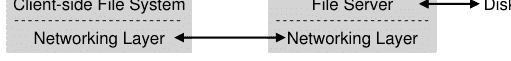

图 49.2：分布式文件系统架构

通过这个概述，你应该能感觉到，在客户端/服务器分布式文件系统中有两个重要的软件部分：客户端文件系统和文件服务器。它们的行为共同决定了分布式文件系统的行为。现在是时候研究一个特定的系统了：Sun 微系统的的网络文件系统（NFS）。

## Sun 微系统的网络文件系统 (NFS)

### 旁注：服务器为何崩溃

在进入 NFSv2 协议的细节之前，你可能会想服务器为什么会崩溃？嗯，正如你可能猜到的那样，有很多原因。服务器可能会遭遇停电（暂性的）；只有在恢复电源后，机器才能重启。服务器经常因数十万甚至数百万行代码而崩溃；因此，它们有 bug（即使是优秀的软件，每百或每千行代码有两个 bug），因此它们最终会触发导致崩溃的 bug。它们还存在内存泄漏；微小的内存泄漏会导致系统内存耗尽并崩溃。最后，在分布式系统中，客户端和服务器之间存在网络；如果网络运行异常（例如，发生分区，导致客户端和服务器都在工作但无法通信），看起来就像某台远程机器崩溃了，但实际上它只是无法通过网络触达。

## 49.2 进入 NFS

最早且最快的分布式系统之一由 Sun 微系统开发，被称为 Sun 网络文件系统（或简称 NFS）[S86]。在定义 NFS 时，Sun 采用了一种不同乎寻常的方法：它没有构建一个专有的封闭系统，而是开发了一种开放协议，该协议仅规定了客户端和服务器通信时使用的消息格式。不同的团体开发了自己的 NFS 服务器，从而在 NFS 市场中保持了互操作性。这种方法证明证明有效的；今天有许多公司销售 NFS 服务器（包括 Oracle/Sun、NetApp [HLM94]、EMC、IBM 等），NFS 的广泛传播可能归功于这种“开放市场”方法。

## 49.3 重点：简单快速的服务器崩溃恢复

在本章中，我们将讨论经典的 NFS 协议（版本 2，即 NFSv2），它是多年来的标准；迁移到 NFSv3 时仅做了小更改，而迁移到 NFSv4 时进行了大规模的协议变更。然而，NFSv2 既完美又令人沮丧，它是我们的重点。

在 NFSv2 中，协议设计的主要目标是简单快速的服务器崩溃恢复。在多客户端、单服务器环境中，这个目标非常有意义；服务器宕机（或不可用）每一分钟都会让所有客户端机器（及其用户）感到不悦且效率低下。因此，服务器挂了，整个系统也就挂了。

三个简单的部分

## 49.4 快速崩溃恢复的关键：无状态性

这个简单的目标在 NFSv2 中通过设计我们所谓的“无状态协议”来实现。从设计上，服务器不跟踪每个客户端发生的任何情况。例如，服务器不知道哪些客户端正在缓存块，哪些文件当前在每个客户端打开着，或者某个文件的当前指针位置等。简单来说，服务器不跟踪客户端在做什么；相反，协议的设计是在每个协议请求中交付完成请求所需的所有信息。如果它不知道，那么在下面详细讨论协议时，这种无状态方法将更显合理。

```
char buffer[MAX];
int fd = open(pathname, O_RDONLY); // 打开文件
read(fd, buffer, MAX); // 读取字节
close(fd); // 关闭文件
```

图 49.3：从文件读取

在此示例中，服务器使用文件句柄（handle）来识别文件。客户端在每个请求中发送句柄，服务器使用它在内部表中查找文件。如果服务器崩溃，内部表就会丢失，但当服务器重启时，客户端只需再次发送文件句柄，服务器就可以重建表。

文件句柄是一个三元组：

- 卷标识符：告诉服务器指向哪个文件系统

- Inode 号：告诉服务器是该分区中的哪个文件

- 生成号：在重用 inode 号时需要，以确保使用旧句柄的客户端不会意外访问新分配的文件

## 49.5 NFSv2 协议

我们得到了 NFSv2 协议的定义。我们的问题陈述很简单：

> CRUX：如何定义无状态协议

> 我们如何定义协议以实现无状态操作？显然，像 `open()` 这样的调用不能是讨论的一部分（因为需要服务器跟踪打开的文件）；然而，客户端应用程序将调用 `open()`、`read()`、`write()` `close()` 以及其他针对文件和目录的 API 调用。因此，完善后的问题是，我们如何定义既无状态又支持 POSIX 文件系统 API 的协议？

NFS 设计的设计的关键是理解文件句柄。文件句柄用于唯一描述特定操作的文件或目录；因此，许多请求包含文件句柄。

你可以将文件句柄理解为包含三个部分：卷标识符、inode 号和生成号；这些项目共同组成客户端想要访问的文件或目录的唯一标识符。卷标识符告知服务器请求指向哪个文件系统；inode 号告诉服务器是该分区中的哪个文件。最后，生成号在重用 inode 号时需要，以确保使用旧句柄的客户端不会意外访问新分配的文件。

这里是协议重要组成部分的总结；完整协议可在其他处获得（参见 Callaghan 的书，获取关于 NFS 的极佳详尽概述 [C000]）。

# SUN 的网络文件系统 (NFS)

NFSPROC_GETATTR 文件句柄（file handle）

返回：属性

NFSPROC_SETATTR 文件句柄，属性

返回：

NFSPROC_LOOKUP 目录文件句柄，要查找的文件/目录名

返回：文件句柄，偏移量，计数

NFSPROC_READ 文件句柄，偏移量，计数，数据，属性

NFSPROC_WRITE 目录文件句柄，文件名，属性

NFSPROC_CREATE 目录文件句柄，要删除的文件名

NFSPROC_MKDIR 目录文件句柄，目录名，属性文件句柄

NFSPROC_RDIR 目录文件句柄，要删除的目录名

NFSPROC_READDIR 目录句柄，读取的字节数，cookie

返回：目录条目，cookie（用于获取更多条目）

图 49.4：NFS 协议：示例

我们简要强调了该协议的重要组件。首先，LOOKUP 消息用于获取文件句柄，随后该句柄被用于访问文件数据。客户端传递目录句柄和要查找的文件名，而服务器会将该文件（目录）的句柄及其属性返回给客户端。

例如，客户端已经拥有文件系统根目录（/）的文件句柄（实际上，这是通过 NFS 挂载协议获得的，这是客户端和服务器首次连接在一起的方式；为了简单起见，我们在这里不讨论挂载协议）。如果应用程序运行在客户端文件 `/foo.txt` 上，客户端文件系统会向服务器发送请求，传递根文件句柄和文件名 `foo.txt`；如果成功，将返回文件句柄（以及属性）。

如果你好奇，属性只是文件系统跟踪每个文件时记录的元数据，包括文件创建时间、最后修改时间、所有权和权限信息等字段，这与你对文件调用 `stat()` 时得到的信息类型相同。

一旦文件句柄可用，客户端就可以在文件上使用 READ 和 WRITE 协议消息来分别读取或写入文件。READ 协议消息需要传递文件句柄，以及文件内的偏移量和要读取的字节数。服务器随后就能读取（内容）（毕竟，句柄告诉服务器应该从哪个卷和哪个 inode 读取数据，而偏移量和计数则告诉它要读取文件的哪些字节）并将数据返回给客户端（如果发生故障则返回错误）。WRITE 的处理方式类似，但数据是从客户端传递到服务器的，并且仅返回成功代码。

一种持久的协议消息是 GETATTR；给定一个文件句柄，它简单地获取该文件的属性，包括文件的最后修改时间。在下文中讨论缓存时，我们将看到这种协议请求在 NFSv2 中是多么重要的（你能猜到吗？）。

## 49.6 从协议到分布式文件系统

希望我们现在已经开始理解该协议是如何跨客户端文件和文件服务器被转换为文件系统的。客户端文件系统跟踪打开的文件，并通常将应用程序请求翻译为相关的协议消息。服务器对协议消息做出响应，每条消息都包含了完成请求所需的所有信息。

例如，让我们考虑一个读取文件的简单应用程序。在图（图 4.5）中，我们展示了应用程序执行了哪些系统调用，以及客户端文件系统和服务器如何响应这些调用。

关于第一点有几点说明。首先，注意客户端如何跟踪文件访问的所有相关状态，包括整数文件描述符到 NFS 文件句柄的映射，以及当前的文件指针。你已经注意到客户端不需要（显式地）考虑从哪个偏移量读取，因为格式正确的读取消息会告诉服务器具体要从文件中读取哪些字节。读取成功后，客户端更新当前文件位置；随后的读取将使用相同的文件句柄但不同的偏移量发出。

其次，你可能会注意到服务器交互发生在何处。当文件第一次被打开时，客户端文件系统会发送 LOOKUP 请求消息。事实上，如果必须遍历长路径（例如 `/home/remzi/foo.txt`），客户端需要进行三次 LOOKUP：一次在根目录 `/` 中查找 `home`，一次在 `home` 中查找 `remzi`，最后在 `remzi` 中查找 `foo.txt`。

第三，你可能会注意到每个服务器请求都包含了完整完成该请求所需的**全部**信息。这一设计点对于能够从服务器故障中优雅地恢复请求至关重要，正如我们将在后面详细讨论的那样；它确保了服务器不需要保持状态（stateless，无状态的）即可能够响应请求。

| 客户端 (Client) | 服务器 (Server) |
| :--- | :--- |
| `fd = open("/foo", ...);` |  |
| `Send LOOKUP (rootdir FH, "foo")` | 接收 LOOKUP 请求<br>在根目录中查找 "foo"<br>返回 foo 的 FH + 属性 |
|  | 接收 LOOKUP 回复<br>在打开文件表中分配文件描述符 fd<br>将 foo 的 FH 存储在表中<br>存储当前文件位置 (0)<br>返回文件描述符以打开 |


| `read(fd, buffer, MAX);` | 使用 `fd` 索引进入打开文件表<br>获取文件句柄 (`FH`)<br>使用当前文件位置作为偏移量 |

| `Send READ (FH, offset=0, count=MAX)` | 接收 `READ` 请求<br>使用 `FH` 获取卷/`inode` 号<br>从磁盘（或缓存）读取 `inode`<br>计算块位置（使用偏移量） |

| | 接收 `READ` 回复<br>从磁盘（或缓存）读取<br>将数据返回给客户端 |

| | 更新当前文件位置 |

| `closed(fd);` | 释放文件表中的 "`fd`" |

| | 无需与服务器通信 |

图 49.5：读取文件：客户端侧与服务器的操作

## SUN 的网络文件系统 (NFS)

提示：幂等性是强大的。构建系统时，幂等性是一个非常有用的属性。当一个操作可以多次执行时，处理操作失败会变得容易得多；如果操作不是幂等的，情况就会变得复杂。

### 49.7 幂等操作中的处理器故障

当客户端向服务器发送消息时，有时无法接收回复。这种响应失败可能有许多原因。在某些情况下，消息可能会被网络丢弃；网络确实会丢失消息，因此请求或回复可能丢失，导致客户端永远接收不到。也可能是服务器崩溃了，目前无法响应消息。过一会儿，服务器将重启并开始运行，在此期间所有请求都丢失了。在所有这些情况下，客户端都面临一个问题：当服务器没有及时回复时，它们该怎么办？

在 `NFS2` 中，客户端以一种单一且优雅的方式处理所有这些故障：它简单重试请求。具体来说，在发送请求后，客户端设置了一个在一段时间后触发的定时器。如果在定时器触发之前收到回复，则取消定时器并一切正常。客户端假设请求未被处理并重新发送。如果服务器回复了，则一切正常，客户端优雅地解决了这个问题。

#### 案例 1：请求丢失

| 客户端 | 服务器 |
| --- | --- |
| [发送请求] -> X | (无消息) |

#### 案例 2：服务器宕机

| 客户端 | 服务器 |
| --- | --- |
| [发送请求] -> X | (宕机) |

#### 案例 3：服务器返回的回复在途中丢失

| 客户端 | 服务器 |
| --- | --- |
| [发送请求] | [接收请求] [处理请求] [发送回复] <- X |

图 49.6：三种丢失的类型

通过这种方式，客户端可以用统一的方式处理所有超时。如果一个 `WRITE` 请求简单地丢失了（如上述案例 1），客户端将重试它，服务器将执行写入，一切都会正常。如果是在发送请求时服务器恰好宕机，但在发送第二个请求时已恢复并正常运行，一切也将如预期工作（案例 2）。最后，服务器可能会接收到 `WRITE` 请求，将其写入磁盘并发送回复。该回复可能会丢失（案例 3），再次导致客户端重新发送请求。当服务器再次收到请求时，它将仅仅执行完全相同的操作；将数据写入其磁盘，且没有产生变化。如果客户端收到回复，一切再次正常，客户端已以统一的方式处理了消息丢失和服务器故障。真妙！

顺便提一下：某些操作被设计为幂等性的（idempotent）。例如，当你尝试创建一个已经存在的目录时，你会收到通知 `mkdir` 请求失败。因此，在 `NFS` 中，如果服务器接收到 `MKDIR` 协议消息并执行成功，但回复丢失了，客户端可能会重复该操作并遇到该失败，而实际上该操作最初已经成功了，只是在重试时才失败了。因此，生活并非完美。

## 太阳物公司的网络文件系统 (NFS)

> 提示：完美是好的敌人（沃尔泰尔定律）

即使你设计了一个精美的系统，有时边界情况（corner cases）也不会完全如你所愿那样运行。以上面的 `mkdir` 示例为例；可以为 `mkdir` 设计不同的语义，使其具有幂等性（想想你可能为此做多少工作）；然而，何必如此呢？`NFS` 的设计哲学涵盖了大多数重要情况，总体上使系统设计在处理故障方面变得简洁简单。因此，接受生活并不完美并依然构建系统是优秀工程的标志。显然，这种智慧归功于沃尔泰尔，他说“一位聪明的意大利人说，最好的好的敌人” [V2]，我们称之为沃尔泰尔定律。

### 49.8 提高性能：客户端缓存

分布式文件系统有很多方面的优点，但跨网络发送所有的读/写请求会导致一个大问题：网络并不快，不像本地内存或磁盘那么快。因此，另一个问题是：我们如何提高分布式文件系统的性能？

答案正如你从上面小标题中的大词中猜到的那样，是客户端缓存。`NFS` 客户端文件系统将从服务器获取的数据（以及元数据）缓存在客户端内存中。因此，虽然第一次访问是昂贵的（即需要网络通信），但随后的访问将从客户端内存中快速提供。

缓存还作为写入的临时缓冲区。当客户端应用程序向文件写入时，客户端会将数据缓冲在客户端内存中（与从文件服务器读取数据时位于同一个缓存中），然后再将数据写入服务器。这种缓冲是有用的，因为它将写入延迟与实际写入性能解耦，即应用程序的写入调用会立即成功（只需将数据放入客户端文件系统的缓存中）；只有在之后，数据才会被写入文件服务器。

`NFS` 中，客户端缓存数据且性能通常很棒，我们就搞定了，对吗？遗憾的是，并非如此。在任何带有多个客户端缓存的系统中引入缓存都会引入一个巨大且有趣的挑战，我们将其称为：

### 49.9 缓存一致性

分布式文件系统有很多方面的优点，但跨网络发送所有的读/写请求会导致一个大问题：网络并不快，不像本地内存或磁盘那么快。因此，另一个问题是：我们如何提高分布式文件系统的性能？

答案正如你从上面小标题中的大词中猜到的那样，是客户端缓存。`NFS` 客户端文件系统将从服务器获取的数据（以及元数据）缓存在客户端内存中。因此，虽然第一次访问是昂贵的（即需要网络通信），但随后的访问将从客户端内存中快速提供。

## 太阳的网络文件系统 (NFS)

同样涉及到关注性问题。当从磁盘读取数据（以及元数据）时，`NFS` 服务器将将其保留在内存中，后续对该数据（及元数据）的读取将不再访问磁盘，这会对性能产生潜在的（微小的）提升。

更有趣的是写缓冲的情况。在写操作未被强制刷到稳定存储器（例如，写入磁盘或其他持久性设备）之前，`NFS` 服务器绝对不能在 `WRITE` 协议上返回成功。虽然它们可以将数据的副本存放在服务器内存中，但在 `WRITE` 协议上向客户端返回成功可能会导致错误的行为；你能猜出这是为什么吗？

答案在于我们对客户端如何处理服务器故障的假设。想象客户端发出的以下顺序的写操作：

```
write(fd, a_buffer, size); // 在第1个数据块中填充 a
write(fd, b_buffer, size); // 在第2个数据块中填充 b
write(fd, c_buffer, size); // 在第3个数据块中填充 c
```

这会用 `a`、然后 `b`、最后 `c` 覆盖文件的三个数据块。因此，如果文件最初看起来像这样：

```
xxxxxxxxxxxxxxxxxxxxxxxxxxxxxxxxxxxxxxxxxxxxxxxxxxxx
yyyyyyyyyyyyyyyyyyyyyyyyyyyyyyyyyyyyyyyyyyyyyyyyyyyyyyyyyyy
zzzzzzzzzzzzzzzzzzzzzzzzzzzzzzzzzzzzzzzzzzzzzzzzzzzzzzzzzzzz
```

我们可能期望在这些写操作后的最终结果如下，其中 `x`、`y` 和 `z` 将被 `a`、`b` 和 `c` 覆盖。

```
aaaaaaaaaaaaaaaaaaaaaaaaaaaaaaaaaaaaaaaaaaaa
bbbbbbbbbbbbbbbbbbbbbbbbbbbbbbbbbbbbbbbbbbbbbcccccccccccccccccccccccccccccccccc
```

现在，为了示例，假设这三个客户端的操作已先发送到服务器的 `WRITE` 协议并写入磁盘，且客户端已被通知成功。现在假设第二次写入仅在内存中，服务器在强制写入磁盘之前也向客户端报告了成功；不幸的是，服务器在写入之前崩溃了。服务器快速重启并恢复了第三次写请求，且该请求也成功了。

因此，对客户端来说，所有请求都已完成，但我们惊讶地发现文件内容如下：

```
aaaaaaaaaaaaaaaaaaaaaaaaaaaaaaaaaaaaaaaaaaaa
yyyyyyyyyyyyyyyyyyyyyyyyyyyyyyyyyyyyyyyyyyyyyyyyyyyyy <--- 哎呀
cccccccccccccccccccccccccccccccccccccccccccccc
```

天哪！因为服务器在提交写入之前告诉客户端第二次写入是成功的，导致文件中留下了旧数据块，这取决于应用程序，并可能是灾难性的。

## 太阳的网络文件系统 (NFS)

> 旁注：创新产生创新

正如许多先驱技术一样，将 `NFS` 引入世界也需要其他基础性创新才能使其成功。可能最持久的是虚拟文件系统 (`VFS`) / 虚拟节点 (`vnode`) 接口，由太阳公司引入，允许不同的文件系统能够方便地插入到操作系统中 [K86]。

`VFS` 层包含了对整个文件系统执行的操作，例如挂载和卸载、获取文件系统范围的统计数据，以及将所有脏数据（尚未写入的数据）强制写入磁盘。`vnode` 层由对文件可以执行的所有操作组成，如打开、关闭、读取等。

要构建一个新的文件系统，只需定义这些“方法”；框架随后会处理其余工作，将系统调用连接到特定的文件系统实现，以集中方式执行所有文件系统通用的函数（例如缓存），并为多个文件系统的实现的同时运行提供方法。

尽管某些细节已经发生变化，但许多现代系统都有某种形式的 `VFS`/`vnode` 层，包括 `Linux`、`BSD` 变体、`macOS` 甚至 `Windows`（以可安装文件系统的形式）。即使 `NFS` 对世界变得不再那么重要，它提供的一些必要基础仍将至关重要。

为了避免这个问题，`NFS` 服务器必须在返回成功之前将每次写入提交到稳定（持久）存储器；这样做可以确保客户端在写入期间检测到服务器故障，并重试直到最终成功。这样做可以确保我们不会在上述示例中出现文件内容混杂的情况。

这一要求给 `NFS` 服务器实现带来了问题，如果如果不加注意，写性能可能会成为性能瓶颈。一些公司（例如 `Network Appliance`）的出现有着简单的目标：构建一个可以快速写入的 `NFS` 服务器；其中一个技巧是将写操作放在受电池保护的内存中，然后允许响应 `WRITE` 请求而不必担心丢失数据，且无需承担立即写入的代价；第二个技巧是使用专门为在某个文件需要写入时快速写入的文件系统设计 [HLM94, RO91]。

### 49.12 总结

我们已经看到了 `NFS` 分布式文件系统的介绍。`NFS` 的核心思想是在服务器故障时时简单且快速的恢复，并通过仔细的协议设计来实现这一目标。幂等-

## 太阳的网络文件系统 (NFS)

旁注：`NFS` 关键术语

- 实现 `NFS` 快速且简单崩溃恢复这一主要目标的关键在于无状态协议的设计。崩溃后，服务器可以快速重启并再次开始处理请求，客户端只需重试请求直到成功。

- 使请求具有幂等性是 `NFS` 协议的一个方面。当多次执行某操作的效果与执行一次的效果相等时，该操作就是幂等的。在 `NFS` 中，幂等性允许客户端无忧地重试，并统一了客户端消息重传以及客户端处理服务器崩溃的方式。

- 性能考虑决定了对客户端缓存和缓冲的需求，但引入了一致性问题。

- `NFS` 实现通过多种手段提供了缓存一致性解决方案：打开时刷新（flush-on-open）确保在关闭文件时，将其内容强制推送到服务器；属性缓存减少了询问服务器文件已更改的频率（通过 `GETATTR` 请求）。

- `NFS` 服务器必须在返回成功之前将写入提交到持久介质；否则可能会发生数据丢失。

- 为了支持 `NFS` 进入操作系统，太阳公司引入了 `VFS`/`vnode` 接口，允许多个文件系统实现在同一个操作系统中共存。操作的幂性至关重要；因为客户端可以安全地重放失败的操作，无论服务器是否已执行该请求都是可以。我们还看到在多客户端、单服务器系统中引入缓存如何使情况变得复杂。特别是，系统必须解决冲突以保持合理行为；然而，`NFS` 的处理是以一种略微“热点”的方式进行的，这偶尔可能导致奇怪的行为。最后，提到了其他显然相关的问题：早期 `NFS` 实现中的安全性非常松散；任何用户都相当容易伪装他人并获得访问。随后与更高级认证服务的集成（例如 `Kerberos` [NT94]）已经解决了这些缺陷。

## 太阳的网络文件系统 (NFS)

参考文献

[AKW98] 《C 语言设计》，Alfred A. Ritchie, Brian Kernighan，太阳公司，1998。关于 `NFS` 非常有影响力的著作。

[C00] 《NFS 可视化》，Brent Gallager，Addison-Wesley 出，2000。关于 `NFS` 的精明介绍。

[ES03] 《文件系统设计》，John Design，圣地，2003。对 `NFS` 的深入分析。

[HM94] 《文件系统设计》，Dave Hits, James Shell，太阳公司，旧金山，1994。深受其影响。

[K86] 《Vnodes：多文件系统架构》，Steve R. Staubach, Carl Leve，USENIX '86，亚特兰大。操作系统。

[NT90] 《Kerberos：计算机网络认证服务》，B. Clifford Needham, Theodore，IEEE Communications，32(9):33-38，1994。一种早期且非常有影响力的服务。

[OI91] 《分布式状态的作用》，John K. Outter。可在此处获取：http://ftp.cs.berkeley.edu/papers/papers。关于分布式状态的广泛观点。

[P94] 《NFS 版本 3：设计与实现》，Brian Pawlowski, Czech Juszczak, Peter Staubach, Carl Smith, Dave Leeds, Hits，USENIX Summer 1994，第 137-152 页。

[P01] 《NFS 版本 4》，Brian Pawlowski, David Daveck, David Robin, Robert Thorbert。2002。国际系统管理与网络会议 (SANE 2000)。无疑是 `NFS` 最受欢迎的论文。

[R91] 《日志结构文件系统的设计与实现》，M Mendel Rosen-Blum, John Outster。操作系统原理小组会议 (SOSP)，1991。LFS 再次。什么时候该用 LFS。

[S86] 《太阳网络文件系统：设计、实现与体验》，Russell Sandberg。USENIX Summer 1986。`NFS` 的原始论文，读起来有点挑战，但值得看看这些有用想法的来源。

[Sun89] 《NFS：网络文件系统规范》，Sun Microsystems, Inc. 征求意见：1989 年 3 月。可用：http://www.iet.org/rfc/rfc1094.txt。详细规范；如果必须且给钱就读。希望报酬很高。

[V72] 《La Beguele》，François-Marie Arouet（即 Voltaire）。1772 年出版。伏特尔说了很多聪明的话，但这一句。例如，伏特尔说如果你的土地有两种宗教，这两种会互相残杀；如果你有三十种宗教，它们将和平共处。民主党和共和党人，你们怎么说

## 作业（测量）

在本次作业中，你将使用真实的追踪（trace）进行一些 `NFS` 追踪分析。这些追踪源于 Ellard 和 Seltzer 的工作 [ES03]。在开始之前，请确保阅读了 `README`，并从 `OSTEP` 作业页面下载相关的回溯文件（如往常一样）。

## 问题

1. 针对追踪分析的第一个问题是：使用第一列找到的时间戳，确定追踪所取的时间跨度。该跨度有多长？是哪一天/哪周/哪月/哪一年？（是否与文件名中的提示一致？）使用工具 `head -l` 和 `tail -l` 提取文件的第一行和最后一行并进行计算。

2. 现在，让我们来进行一些操作计数。追踪中出现了多少种类型的操作？按频率排序；哪种操作最频繁？`NFS` 是否名不虚传？

3. 现在让我们更详细地查看某些特定操作。例如，`GETATTR` 请求返回了大量关于文件的信息，包括执行该操作的用户 `ID`、文件大小等。对追踪中访问的文件大小进行分布统计；平均文件大小是多少？另外，追踪中有多少用户访问了文件？是个别用户主了流量吗？在 `GETATTR` 中还发现了哪些信息？

4. 你也可以查看对给定文件的请求，并确定文件是如何访问的。例如，给定文件是顺序读取或写入，还是随机的？查看 `READ` 和 `WRITE` 请求/响应的细节来计算答案。

5. 流量来自许多机器并去往一个服务器（在此追踪中）。计算一个流量矩阵，显示追踪中有多少不同的客户端，每个客户端接收了多少请求/响应。是几台机器主导了流量，还是更加均衡？

6. 计时以及每个请求/响应的唯一 `ID` 允许你计算给定请求的延迟（latency）。计算每对请求/响应的延迟，并将其绘制成分布图。平均值是多少？最大值？最小值是多少？

7. 有时请求会被重试，因为请求或其响应可能会丢失或丢弃。你能在追踪样本中找到任何此类重试的证据吗？

8. 通过更多分析，你还可以回答许多问题。你认为哪些问题是重要的？向我们建议这些问题，也许我们会把它加入这里！

## 安德鲁文件系统 (AFS)

安德鲁文件系统于 20 世纪 80 年在卡内基梅隆大学 (`CMU`) 引入 [H+88]。在卡内基梅隆大学著名的 M. Satya-nararayanan 教授（简称“Satya”）的带领下，该项目的主要目标非常简单：**扩展**。具体来说，如何设计一个分布式文件系统，使得服务器能够支持尽可能客户端？

有趣的是，设计和实现的许多方面都会影响可扩展性。最重要的是客户端与服务器之间的协议设计。在 `NFS` 中，协议强制客户端检查服务器以确定缓存内容是否更改；每次检查都会使用服务器资源（包括 `CPU` 和网络带宽），这种频繁的检查会限制服务器能够响应的客户端数量，从而限制了扩展性。

`AFS` 与 `NFS` 的不同在于，从一开始开始，合理的行为就是首要考虑的问题。在 `NFS` 中，缓存一致性很难描述，因为它直接依赖于底层实现细节，包括客户端的缓存超时。在 `AFS` 中，缓存一致性简单且易理解：当文件被打开时，客户端将从服务器接收最新的一致副本。

### 50.1 AFS 版本 1

我们将讨论 `AFS` 的两个版本 [H+88, S+85]。第一个版本（我们称之为 `AFSv1`，实际上原始版本是 `ITC` 分布式文件系统 [S+85]）具备了一些基础设计，但没有按预期扩展，这导致了重新设计以及最终的协议（我们称之为 `AFSv2`，或简称 `AFS`）[H+88]。我们现在讨论第一个版本。


> 最初被称为“Carnegie-Mellon University”，CMU 后来去掉了连字符，成为现代形式。“Carnegie Mellon University。”由于 AFS 起源于 80 年代初，我们以其原始的全带连字符的形式指称 CMU。https://www.quora.com/When-did-Carnegie-Mellon-University-remove-the-hyphen-in-the-university-name-for-more-details-if-you-are-into-boring-minutiae.

# 安德鲁文件系统 (AFS)

| 命令 | 描述 |
| :--- | :--- |
| TestAuth | 测试文件是否更改（用于验证缓存条目） |
| GetFileStat | 获取文件的统计信息 (stat) |
| Fetch | 获取文件内容 |
| Store | 将此文件存储在服务器上 |
| SetFileStat | 设置文件的统计信息 (stat) |
| ListDir | 列出目录内容 |

图 50.1：AFSv1 亮点

所有 AFS 的基础之一是在访问文件的客户端本地磁盘上进行文件缓存。当 `open()` 整个文件（如果存在）时，从服务器获取并存储在你的本地磁盘中。后续的应用程序 `read()` 和 `write()` 操作被重定向到存储文件的本地文件系统；因此，这些操作避免了网络通信，并在最终 `close()` 时，文件（如果已修改）会被刷回服务器。注意明显的点：在缓存块中（如果没有整个文件，AFS 可以缓存整个文件的每个块），并且在客户端内存中（而不是本地磁盘）。

让我们更深入一点细节。当客户端应用程序首次调用 `open()` 时，AFS 侧的代码（AFS 设计师称之为 Venus）会向服务器发送一个 Fetch 协议消息。Fetch 协议消息会将目标文件的路径（例如 `/home/remzi/notes.txt`）发送到服务器（即调用 Venus 的组），服务器将遍历路径，找到目标文件，并将整个文件取回到客户端。客户端代码随后会将文件缓存在客户端的本地磁盘上（通过写入本地磁盘）。正如我们所说，后续的 `read()` 和 `write()` 操作在 AFS 中是严格本地的（不与服务器通信）；它们只是重定向到文件的本地副本。`read()` 和 `write()` 就像调用本地文件一样，一旦访问了某个块，它可能会被缓存在客户端内存中。AFS 还使用客户端内存来缓存其本地磁盘中的块副本。最后，当需要时，AFS 会检查文件是否已修改（即是否已以写模式打开）；如果是，客户端将使用 TestAuth 协议检查文件是否更改。因此，服务器花费了大量时间告诉客户端可以使用它们的缓存副本。在大多数情况下，答案是文件没有更改。上面的图显示了 AFSv1 中的某些协议。请注意，这种早期的目录版本（例如）是保存在服务器上的。

# 安德鲁文件系统 (AFS)

> 提示：先测量，后构建（帕特森法则）

我们的顾问之一 David Patterson（以 RISC 和 RAID 闻名）过去总是鼓励我们在构建系统之前对其进行测量。通过使用证据而非直觉，你可以将构建过程转变为一项更具科学性的努力。当你最终开始构建新系统时，结果会有两点更好：首先，你有证据表明你正在解决一个真实的问题；其次，你有了一套衡量新系统的方法。因此，我们可以称此为帕特森法则。

# 50.2 版本 1 的问题

AFS 第一个版本的几个关键点促使设计者重新思考他们文件系统。为了详细研究细节，AFS 的设计者花费了大量时间测量现有的原型以找出问题所在。这种实验是一件好事，测量是理解系统如何工作以及如何改进它们的关键；因此，获得具体的、良好的数据是系统构建的必要组成部分。在该理论中，作者们发现了 AFSv1 的两个主要问题：

- 路径遍历成本过高：在执行 Fetch 或 Store 协议请求时，客户端将路径（例如 `/home/remzi.txt`）传递给服务器。为了访问文件，服务器必须执行完整的路径遍历，首先在根目录中查找 `home`，然后在 `home` 中查找 `remzi`，以此此类推，一直向下直到找到文件。由于许多客户端同时访问服务器，AFS 的设计者发现服务器花费了大量的 CPU 时间仅仅在遍历目录路径。
- 客户端发送了过多的 TestAuth 协议消息：就像 NFS 及其过量的 GETATTR 协议消息一样，AFSv1 产生了大量流量，使用 TestAuth 协议检查本地文件（或其统计信息）是否有效。因此，服务器花费了大量时间告诉客户端可以使用它们的文件缓存副本。在大多数情况下，答案是文件没有更改。

实际上 AFSv1 还有两个问题：负载在服务器之间分布不均衡，并且服务器为每个客户端使用一个独立的进程，导致了上下文切换和其他开销。

不平衡问题通过引入卷（volumes）得到了解决，管理员可以在不同服务器之间移动卷以平衡负载；而上下文切换问题则在 AFSv2 中通过使用线程来构建服务器得到了解决。然而，为了简洁起见，我们在这里关注上述限制系统规模的两个主要协议问题。

## 50.3 改进协议

上述两个问题限制了 AFS 的可扩展性；每个服务器的 CPU 都成了系统的瓶颈，且每个服务器只能为二十个客户端服务而不会过载。服务器接收到太多的 TestAuth 消息，而且当它们收到 Fetch 或 Store 消息时，需要花费大量时间遍历目录层次结构。因此，AFS 的设计者面临着一个问题：

> 核心问题：如何设计一种可扩展的文件协议

人们应该如何重新设计协议以尽可能地减少与服务器的交互，即，他们如何减少 TestAuth 消息的数量？此外，他们能否设计协议以使服务器交互变得高效？通过解决这两个问题，新的协议将产生一个可扩展性更好的 AFS 版本。

## 50.4 AFS 版本 2

AFSv2 引入了回调（callback）的概念以减少客户端/服务器之间的交互次数。回调简单来说就是服务器对客户端的一个承诺，即当客户端缓存的文件被修改时，服务器将通知客户端。通过向系统中添加这种状态，客户端不再需要联系服务器来检查缓存文件是否仍然有效。相反，请注意轮询（polling）与中断（interrupts）之间的类比。

AFSv2 还引入了文件标识符（FID）的概念（类似于 NFS 文件句柄）来代替路径名。在 AFS 中，FID 的副本可以指定所感兴趣的文件。一个 FID 包含一个唯一标识符（uniquifier，以便在文件删除时重用卷 ID 和文件 ID）。因此，客户端不再将路径名发送给服务器让服务器去查找目标文件，而是逐部分遍历路径名，缓存结果，并希望减少服务器的负载。

例如，如果客户端访问文件 `/home/remzi/notes.txt`，而 home 是挂载在系统上的 AFS 目录（即 `/` 是根目录，但 `home` 及其子目录在 AFS 中），客户端将首先 Fetch home 的内容，将其放入本地磁盘缓存，并在 home 上设置回调。然后，客户端将 Fetch 目录 remzi，将其放入本地磁盘缓存，并在 remzi 上设置回调。最后，客户端将 Fetch notes.txt。

客户端 (C1)

- `fd = open("/home/remzi/notes.txt", ...);`
- Send Fetch(home FID, "remzi")
- Receive Fetch 请求
- 在 home 目录中查找 remzi
- 在 remzi 上建立 callback(C1)
- 返回 remzi 的内容和 FID
- Receive Fetch 回复
- 将 remzi 写入本地磁盘缓存
- 记录 remzi 的回调状态
- Send Fetch(remzi FID, "notes.txt")
- Receive Fetch 请求
- 在 remzi 目录中查找 notes.txt
- 在 remzi 上建立 callback(C1)
- 返回 notes.txt 的内容和 FID
- Receive Fetch 回复
- 将 notes.txt 写入本地磁盘缓存
- 记录 notes.txt 的回调状态
- 对缓存的 notes.txt 进行本地 open()
- 向应用程序返回文件描述符

```
read(fd, buffer, MAX);
对缓存副本执行本地 read()
```

```
close(fd);
对缓存副本执行本地 close()
如果文件已更改，则刷新到服务器
```

```
fd = open("/home/remzi/notes.txt", ...);
Foreach dir (home, remzi)
if (callback(dir)) == VALID
使用本地副本进行 lookup(dir)
else
Fetch (如上文)
if (callback(notes.txt)) == VALID
打开本地缓存副本
返回其文件描述符
else
Fetch (如上文) 然后打开并返回 fd
```

图 50.2：读取文件：客户端侧和文件服务器的操作

然而，与 NFS 的关键区别在于，每次 Fetch 目录或文件，AFS 客户端都会与服务器建立回调，从而确保服务器会通知客户端其缓存状态。其益处是显而易见的：虽然对 `/home/remzi.txt` 的首次访问产生了许多客户端/服务器消息（如上所示），但它为所有目录建立了回调。

在讨论分布式文件系统时，人们经常强调文件系统提供的缓存一致性。然而，这种基准一致性并不能解决多个客户端访问文件时的所有问题。例如，如果你正在构建一个仓库，多个客户端执行代码的提交（check-in）和检出（check-out），你不能仅仅依赖文件系统为你完成所有工作；相反，你必须使用显式文件锁，以确保在并发访问发生时发生“正确的事情”。事实上，关心并发更新的应用程序会添加额外的机制来处理客户端。本章和前一节描述的基准一致性主要用于普通使用场景，即当用户登录系统并期望看到其文件的某个合理版本时。对这些协议寄予更高期望将使自己推向失败、失望和泪流满面的挫败感中。

因此，在文件被客户端缓存的情况下，AFS 的行为与基于本地磁盘的系统几乎相同。如果多次访问一个文件，第二次访问将变得像在本地访问文件一样快。

## 50.5 缓存一致性

当我们讨论 NFS 时，我们考虑了缓存一致性的两个方面：更新可见性（update visibility）和缓存过时性（cache staleness）。在更新可见性方面，问题是：服务器是否会更新文件的新版本？在缓存过时性方面，问题是：一旦服务器有了新版本，客户端多久之后能看到新版本而不是旧副本？

由于有了回调和全文件缓存，AFS 提供的缓存一致性易于描述和理解。有两个重要的情况需要考虑：不同机器间进程的一致性，以及同一机器上进程之间的一致性。

在不同机器之间，AFS 在服务器端使更新可见，并在精确时刻（即更新文件被关闭时）失效缓存副本。客户端打开一个文件，然后进行写入（可能多次）。当它最终被关闭时，服务器会“断开”所有具有缓存副本客户端的回调（从而变为可见）。此时，断开是通过联系每个客户端并通知它们文件上的回调已失效来完成的。这一步确保了客户端将不再读取文件的过时副本；随后的打开操作将要求从服务器重新获取文件的新版本（并将重新在该文件上建立回调）。

AFS 在同一台机器的进程之间对这个简单模型有一个例外。在这种情况下，对文件的写入不会立即对其他本地进程可见（即进程不需要等待文件关闭即可看到最新更新），这使得使用单台机器的行为完全符合你的预期，因为这种行为在典型的 Unix 系统中是预期的。只有当切换到不同的机器时，你才能检测到更通用的 AFS 一致性机制。

有一个有趣的跨机器案例值得进一步讨论。在不同机器上的进程同时修改一个文件的罕见情况下，AFS 自然地采用所谓的“最后写入者胜”策略（也许应该被称为“最后关闭者胜”）。具体来说，哪个客户端最后调用 `close()`，就会更新服务器上的文件条目，从而成为“获胜者”。

# ANDREW 文件系统 (AFS)

文件，即保留在服务器上供他人查看的文件。其结果是一个完全由其中一个客户端或另一个客户端生成的文件。注意它与像 NFS 这种基于块的协议的区别：在 NFS 中，当每个客户端更新文件时，单个块的写入操作会被刷新到服务器上，因此，服务器上的最终文件可能是来自两个客户端更新的混合体。在许多情况下，混合的文件输出是毫无意义的；例如，想象一个 JPEG 图像被两个客户端分段修改；写入操作产生的结果很可能无法构成一个合法的 JPEG 格式。

图 50.3 显示了这些不同场景的时间线。各列显示了两个进程（P1 和 P2）在各自缓存状态下的行为，客户端 2 上的一个进程（P3）及其缓存状态，所有进程都在操作一个形象地命名为“imagin”的单个文件。对于服务器而言，该图仅显示了左侧操作完成后文件的内容。请仔细阅读，并尝试理解为什么每个读取操作会得到那样的结果。右侧的注释将帮助你解决困难。

## 50.6 崩溃恢复

从上述描述中，你可能会感觉到崩溃恢复比 NFS 更加复杂。你的直觉是对的。例如，有一段时间，服务器（S）无法连接到客户端（C1），而此时客户端（C1）正在重启。在 C1 不可用期间，S 可能会尝试向其发送一个或多个回调消息；例如，想象 C1 在其本地磁盘上缓存了文件 F，而 C2（另一个客户端）更新了 F，导致 S 向所有缓存了该文件的客户端发送消息，将其从它们的缓存中移除。C1 在重启时可能会错过这些关键消息；当它加入系统时，C1 应该将其所有的缓存内容都视为可疑的。因此，在下一次访问文件时，C1 应该首先询问服务器（通过 TestAuth 协议）其文件 F 的缓存拷贝仍然有效；如果是，C1 就可以使用它；如果不是，C1 则可以从服务器获取新版本。

服务器崩溃后的恢复也更加复杂。问题在于所有的崩溃信息都存储在内存中；因此，当服务器启动时，它不知道哪些客户端拥有文件。因此，在服务器重启后，每个客户端必须意识到服务器已崩溃，并将它们所有的缓存内容视为可疑的，并且（如上所述）在使用文件之前重新建立其有效性。因此，崩溃是一个大事件，必须确保每个客户端都能及时感知到崩溃，否则将面临丢失文件的风险。实现恢复有许多方法；例如，让服务器在恢复运行后向每个客户端发送消息（“不要信任你的缓存内容！”），或者让客户端定期检查服务器是否存活（使用所谓的心跳消息）。正如你所见，构建一个更具扩展性且更合理的缓存模型是有代价的；而在 NFS 中，客户端几乎察觉不到崩溃的存在。

| 工作负载 | NFS | AFS | AFS |
|---|---|---|---|
| 1. 小文件，顺序读取 | `N_s \cdot L_{net}` | `N_s \cdot L_{net}` | 1 |
| 2. 小文件，顺序重读 | `N_s \cdot L_{mem}` | `N_s \cdot L_{mem}` | 1 |
| 3. 中等文件，顺序读取 | `N_m \cdot L_{net}` | `N_m \cdot L_{net}` | 1 |
| 4. 中等文件，顺序重读 | `N_m \cdot L_{mem}` | `N_m \cdot L_{mem}` | 1 |
| 5. 大文件，顺序读取 | `N_L \cdot L_{net}` | `N_L \cdot L_{net}` | 1 |
| 6. 大文件，顺序重读 | `N_L \cdot L_{disk}` | `N_L \cdot L_{disk}` | `L_{disk}` |
| 7. 大文件，单次读取 | `L_{net}` | `L_{net}` | `N_L` |
| 8. 小文件，顺序写入 | `N_s \cdot L_{net}` | `N_s \cdot L_{net}` | 1 |
| 9. 大文件，顺序写入 | `N_L \cdot L_{net}` | `N_L \cdot L_{net}` | 1 |
| 10. 大文件，顺序覆盖 | `N_L \cdot L_{net}` | `2 \cdot L_{net}` | 2 |
| 11. 大文件，单次写入 | `L_{net}` | `2 \cdot L_{net}` | `2 \cdot N_L` |

图 50.4：对比：AFSv2 vs. NFS

## 50.7 AFSv2 的扩展性与性能

在使用新协议后对 AFSv2 进行了测量，发现其扩展性比 NFS 好得多。AFSv2 表现出远高于 NFS 的扩展性。事实上，在许多情况下，AFS 比原始版本更具扩展性，因为由于本地磁盘缓存，AFS 客户端可以访问本地磁盘，而不需要总是访问网络。在某些情况下，由于 AFS 客户端的访问可以使用本地磁盘。

我们通过对比 NFS 获取了关于 AFS 性能的视角。图 50.4 显示了在不同文件大小下的结果。在实验中，我们假设了不同大小文件的访问模式。小文件占用内存中的 `N_s` 块；中等文件占用 `N_m` 块；大文件占用 `N_L` 块。最后，跨网络访问需要 `L_{net}` 时间，访问内存需要 `L_{mem}` 时间，而访问本地磁盘需要 `L_{disk}` 时间。通常，我们假设 `L_{net} > L_{disk} > L_{mem}`。

各列显示了特定操作（例如顺序读取）所需的时间。最右侧的列显示了 AFS 与 NFS 的比例。我们得出以下观察结果：首先，在许多情况下，AFS 与 NFS 相似。你可能认为 AFS 会更慢，因为它要写入磁盘。然而，要意识到它是在写入本地文件系统；这些写入首先提交到页面缓存，只有随后（在后台）才写入磁盘。

其次，在大文件重读（工作负载 6）期间，出现了一个有趣的差异。由于 AFS 具有本地磁盘缓存，它将直接访问本地磁盘。相比之下，NFS 只能在客户端内存中缓存；因此它需要从远程服务器获取整个文件。

第三，注意顺序写入（新文件）在两个系统上的性能是类似的（8、9）。在这种情况下，AFS 在文件关闭时会将数据写入本地缓存；你可能认为 AFS 会更慢，因为它会将所有数据写入磁盘。然而，NFS 会在内存中缓冲写入，然后强制某些块推送到服务器以产生客户端内存压力，但肯定会在文件关闭时将它们写入服务器，以保持刷新一致性。

第四，注意 AFS 在顺序覆盖（工作负载 10）上的性能更差。到目前为止，我们假设这些操作是在创建一个新文件；在这种情况下，文件已存在并正在被覆盖。覆盖对于 AFS 来说是一个特别糟糕的情况，因为客户端获取了整个旧文件，以便随后对其进行覆盖。相比之下，NFS 只需覆盖块，避免了初始（无用的）读取。


最后，在大文件中访问一小部分数据的工作负载性能比 NFS 好得多（工作负载 7、11）。在这些情况下，AFS 协议在打开文件时会获取整个文件；不幸的是，只执行了少量读取或写入。更糟糕的是，如果修改了文件，整个文件都会写回服务器，导致每次操作的成本翻倍。因此，在这种情况下，AFS 比 NFS 快了一个本地磁盘倍。

# Andrew 文件系统 (AFS)

## 旁注：负载的重要性

评估任何系统面临的挑战之一就是工作负载的选择。由于计算机系统被用于许多不同的场景，因此有许多种负载可供选择。系统设计者应该如何决定哪些负载是重要的，以便做出合理的决策呢？

AFS 的设计者根据他们对所用文件系统的经验，做出了某些负载假设；特别是，他们假设大多数文件并没有被频繁共享，并且在生命周期内是按顺序访问的。基于这些假设，AFS 的设计是完全合理的的。

然而，这些假设并不总是正确的。例如，想象一个应用程序会定期向日志文件中添加信息。这种向现有文件添加少量数据的“微量写日志”操作，对 AFS 来说是非常棘手的。还存在许多其他难以处理的负载，例如事务数据库中的随机更新。

获取关于常见负载类型信息的一种途径是通过已进行的各种研究。查看这些研究中的任何一项都可以作为负载分析的良好示例 [B+91, H+11, R+00]，包括 AFS 的回顾报告 [H+88]。

NFS 作为一种基于块的协议，其 I/O 操作与读或写的大小成正比。

总的来说，我们发现 NFS 和 AFS 采取了不同的假设，并因此意外地实现了不同的性能结果。这些差异是否重要，一如既往，取决于工作负载。

## 50.8 AFS：其他改进

我们看到，随着 Berkeley FFS 的引入（它增加了符号链接和许多其他功能），AFS 的设计者在构建自己的系统时利用此机会添加了许多功能，使得系统更容易于使用和管理。因为 AFS 为客户端提供了一个真实的命名空间，确保所有文件在所有客户端上的命名方式都是相同的。相比之下，NFS 允许每个客户端以他们喜欢的任何名称挂载 NFS 服务器，因此只有通过惯例（以及巨大的管理工作量）才能在跨客户端访问时保持相似的命名。

AFS 还非常重视安全性，并结合了身份验证用户的机制，以确保如果用户需要，一组文件可以是私有的。相比之下，NFS 在许多多年里对安全性的支持还非常原始。

AFS 还包含了用于灵活的用户管理访问控制的设施。因此，在使用 AFS 时，用户对他们具体可以访问哪些文件拥有很大的控制权。NFS 与大多数 UNIX 文件系统一样，对这种类型的支持支持少得多。

最后，如前所述，AFS 工具为系统管理员提供了更简单的服务器管理方法。在考虑系统管理方面，AFS 领先该领域好光年。

## 50.9 总结

AFS 展示了分布式文件系统的构建方式可以与我们在 NFS 中看到的截然不同。AFS 的协议设计尤为重要；通过最小化服务器交互（通过全文件缓存和回调），每个服务器可以支持许多客户端，从而减少了管理特定站点所需的服务器数量。许多其他功能，包括单一命名空间、安全性和访问控制列表，使得 AFS 非常好用。AFS 提供的一致性模型易于理解和推理，并且不会导致有时在 NFS 中观察到的奇怪行为。

遗憾的是，AFS 可能正在衰落。因为 NFS 变成了一个开放标准，许多不同的版本都支持它，并且结合 CIFS（Windows 文件系统协议），NFS 主导了市场。尽管偶尔还能看到 AFS 的安装（例如在各种教育机构，包括威斯康星州），但唯一持久的影响可能是 AFS 的理念，而不是系统本身。事实上，NFSv4 现在增加了服务器状态（例如一个“open”协议消息），因此与基础 AFS 协议的相似性日益增加。

[V99] "File system usage in Windows NT 4.0" by Werner Vogels. SOSP '99, Kiawah Island Resort, South Carolina, December 1999. 一项关于 Windows 负载的酷研究，这些负载本质上与之前的许多基于 Unix 的系统不同。

# 作业（模拟）

本节介绍了 `afs.py`，这是一个简单的 AFS 模拟器，你可以用它来巩固对 Andrew 文件系统工作原理的知识。阅读 `README` 文件获取更多细节。

# 问题

- 1. 运行几个简单用例，确保你可以预测客户端将读取哪些值。改变随机种子标志 (`-s`)，看看你是否可以追踪并预测中间值以及存储在文件中的最终值。还可以改变文件数量 (`-f`)、客户端数量 (`-C`) 和读取百分比 (`-r`，从 0 到 1) 以增加难度。你还可能生成更长的跟踪轨迹以产生有趣的交互，例如 (`-n 2` 或更高)。)。

- 2. 现在执行同样的操作，看看你是否可以预测 AFS 发起的每个回调。尝试不同的随机种子，并确保使用高水平的反馈（例如 `-d 3`），以便在程序为你计算答案 (`-c`) 时观察回调何时发生。你能准确猜出每个回调发生的确切时间吗？回调发生的精确条件是什么？

- 3. 与上述类似，使用一些不同的随机种子运行，看看你是否可以预测每一步的精确缓存状态。可以通过运行来观察缓存状态。

- 4. 现在让我们构建一些特定的负载。使用 `-A oal:wl,oal:cl` 标志运行模拟。当使用随机调度器运行时，客户端 1 在读取文件 a 时会观察到哪些不同的可能值？（尝试不同的随机种子以查看不同的结果？）在两个客户端操作的所有可能的调度交错执行中，有多少个会导致客户端 1 读取该值？

- 5. 如上所述，使用一些不同的随机种子运行，看看你是否可以预测每一步的精确缓存状态。

- 6. 现在构建一些特定的负载。在两个客户端操作的所有可能的调度交错执行中，有多少个会导致客户端 1 读取值 1，以及多少个读取值 0？

- 7. 现在运行上述负载，看看你是否可以预测每一步触发的精确切回调。

## 关于分布式的对话

**学生**：好吧，这进展得太快了，在我看来。

**教授**：是的，分布式系统非常复杂且值得研究，只是在这本书（或这门课）里。

**学生**：太遗憾了，我还想学更多！但我确实学到了东西。

**教授**：学到了什么？

**学生**：好吧，一切都可能失败。

**教授**：很好的开始。

**学生**：但通过拥有这些东西（磁盘、机器或其他），你可以隐藏许多引发的失败。

**教授**：继续吧！

**学生**：像重试这样的基础技术非常有用。

**教授**：确实如此。

**学生**：你必须仔细考虑协议：即机器之间交换的精确位。协议会影响系统如何响应故障以及其可扩展性。

**教授**：你在学习这些东西方面真的进步很大了。

**学生**：谢谢！你也不是一个糟糕的老师！

**教授**：那也太谢谢你了。

**学生**：所以这就是这本书的终点了吗？

**教授**：我不确定。它们没告诉我。

**学生**：我也不知道。让我们离开这里吧。

**教授**：好。

**学生**：你先走。

**教授**：不，你先来。

**学生**：请教授先来。

**教授**：不，请你后来。

# 总索引

swapd, 292

2Q, 287

绝对路径, 492

抽象, iv, 132, 450

抽象层, 13

访问控制列表, 512

访问控制列表, 516

访问方法, 520

访问路径, 528

访问列表, 203

计费, 92

ack, 636

确认, 646

ACL, 512

已获取, 331

活跃, 287

累加奇偶校验, 484

地址, 257

地址空间, 8, 28, 36, 128, 131, 150, 333

地址空间标识符, 222

地址空间布局随机化, 290

地址翻译, 152, 157, 161

基于地址的排序, 190

地址空间标识符, 220

地址翻译单元, 233

管理, 50

管理, 270, 404

建议, 93, 94

I/O 控制块, 430

AIX, 17

callocate, 530

分配结构, 521

AMAT, 257

摊销, 78, 545

摊销, 28, 576

匿名, 146

匿名内存, 287

预期性磁盘调度, 469

近似计数器, 355

ASID, 222

aside, 16

旁注, iv

ASLR, 290

异步, 427

异步 I/O, 430

异步读, 430

异步地, 644

AT 附件, 444

ATA, 444

原子, 313, 457, 503

原子交换, 336

原子地, 11, 313, 338, 481, 555

原子性违反, 410

属性缓存, 661

自动, 139

自动内存访问时间, 142

可用, 331

平均内存访问时间, 257

平均周转时间, 73

避免, 420

避免, 533

B-树, 528

婴儿证明, 67

后向指针, 568

后台, 252, 600

基于后指针的一致性, 568

bash, 291

屏障, 408

屏障同步, 408

基, 155, 157, 232

基和 185, 155

基与限寄存器, 158

bash, 49

批处理, 15, 533

BBC, 568

贝尔迪异常, 261

伯克利系统发行, 17, 293

# 崩溃一致性问题

最佳拟合, 189

最佳拟合, 176

大端序, 644

大内核锁, 366

Bill boy, 17

二进制伙伴分配器, 192

二进制信号量, 392

位图, 521

BKL, 366

块, 458, 646

块损坏, 488, 613

块组, 540

块级, 680

阻塞, 32

阻塞, 79, 240

块, 520, 590, 608

边界, 318

边界, 232

边界缓冲区, 374, 394

边界 SATF, 472

有界缓冲区, 373

边界, 155, 157

中断, 146

BSATF, 472

BSD, 17, 293

tbtfrs, 585

伙伴算法, 176

缓冲区, 253

缓冲区缓存, 553

缓冲区溢出, 143, 289

错误, 651

总线嗅探, 114

通过排序, 646

子, 42, 51

块大小, 476

吸烟者问题, 404

循环日志, 562

循环扫描 (Circular-SCAN), 467

CISC, 218, 219

干净, 269, 287

客户端类, 640

客户端侧系统, 650

客户端/服务器, 451

时钟, 287

时钟算法, 268

时钟指针, 268

打开打开, 660, 664

簇, 251

簇, 108

聚类, 270, 280

合并, 182, 448

细粒度, 173, 332

代码, 153

代码共享, 173

冷启动缺失, 259, 260

冲突, 618

命令, 446

常见情况, 661

常识, 542

通信, 652

通信端点, 635

通信库, 646

压缩, 180

复杂, 175, 582

比较并交换, 340

比较并交换, 330

完全公平调度器 (CFS), 103

复杂指令集, 219

强制性缺失, 259, 260

计算出的校验和, 619

并发, 1, 9, 13, 16, 44, 65, 305

并发地, 352

条件, 370, 390

条件变量, 325, 370

条件变量, 312, 394, 413

冲突缺失, 266

一致性更新问题, 481, 555

消费者, 375

上下文切换, 27, 34, 63, 75

延续, 638

惯例, 490

协作, 61

写时拷贝, 12, 281, 567, 584

正确性, 339

损坏, 614

覆盖, 383

COW, 281, 567

CPU, 25

崩溃一致性问题, 551, 555

语言, iv, 17

C-SCAN, 467

缓存, 213, 257, 461

缓存亲和性, 115, 123

缓存一致性, 114

缓存一致性问题, 659, 664

缓存刷新, 269

缓存命中, 257

缓存缺失, 257

缓存替换, 223

缓存, 112

缓存, 287, 608, 659, 664

回调, 253

能力, 494

容量, 475

类型, 162

集中化管理, 649

CFS, 103

检查点, 558, 598

检查点区域, 579

检查, 635

# CRC

CRC, 618

临界区, 312, 325

核心, iii

问题, iii

截止's Law, 224

当前偏移量, 516

循环, 413

循环冗余校验, 618

圆道, 539

圆道组, 539

反汇器, 310

学科, 71

磁盘, 30

磁盘地址, 246

磁盘臂, 458

磁盘碎片, 451

磁盘头, 458

磁盘操作系统, 17

磁盘调度器, 466

磁盘扫描, 622

磁盘, 443

分布式共享内存, 639

分布式状态, 652

干扰, 593

悬空指针, 144

悬空引用, 510

数据位图, 521, 550

数据块, 548

数据完整性, 613

数据日志记录, 556

数据竞争, 312

数据区域, 520

数据结构, 35, 519

数据库管理系统, 225

数据报, 635

DMA, 284

DOS, 157

空闲, 144

空闲指针, 525

释放, 639

DSM, 639

触发, 495

DMS, 225

死块, 599

死锁, 430, 409, 413

DEC, 276

衰减使用, 321

解码, 3

碎片化, 538

Dekker 算法, 337

定价, 270, 288

按清零, 281

可用性, 474

部署, 474

已删除, 382

调度, 345

反序列化, 640, 641

确定性, 430, 312, 315

空), 501

空), 501

动态分区, 532, 533

动态重定位, 155, 157

对话, iv

Digital Equipment Corporation, 276

反汇编, 462

进餐问题, 401

直接 I/O, 534

直接映射, 395

直接接口, 444

直接内存访问 (DMA), 499

直接指针, 524

目录, 492, 516

目录历史, 492, 516

直接内存访问, 224

直接树, 492, 516

脏, 269, 287, 502, 604

脏位, 203, 220, 269

可禁用, 65

反汇编, 206

早期, 30

易用性, 128

易用, 3, 131

ECC, 614

Edger Dijkstra, 389

高效的, 123

电梯, 467

空, 580

封装, 414

端到端架构, 633, 643

能效, 14

删除, 291, 591, 608

删除块, 590, 608

编码, 614

事件循环, 426

基于事件的并发, 225

驱逐, 257

精确一次, 637

异常处理程序, 159

异常处理程序, 160

可执行格式, 30

执行, 5

显式, 170

指数退避, 638

# 混合

空闲列表, 158–160, 199, 521

空闲列表, 528

空闲空间管理, 179, 28

空, 142, 331

频率, 263

fsck, 552

FTL, 594, 608

类空闲, 984

空闲关联, 220

空闲关联, 220, 260

函数指针, 320

futex, 348, 350

F-SCAN, 467

部分故障, 614

停止故障, 657, 613

失败, 631

公平, 78

公平份额, 97

公平性, 72, 333, 339

快速文件系统 (FFS), 539

FAT, 327

先来先服务 (FCFS), 537

获取并加, 342

获取, 3

FID, 670

先进先出 (FIFO), 220

文件, 492, 516

文件分配表, 527

文件句柄, 494, 516

文件句柄, 31

文件标识符, 653, 670

文件模式, 511

文件偏移量, 497

文件服务器, 680

文件系统, 11

文件系统一致性检查, 461

文件系统一致性, 554

文件, 11

填充, 380

最终, 34

细粒度, 173, 332

固件, 445

先来先服务, 527

先进先出, 72

第一它, 176

固定大小缓存, 532

闪存, 559

闪存块, 589

闪存芯片, 608

闪存页, 589

闪存转换层, 594, 608

基于闪存的 SSD, 30, 585

Fletcher 校验和, 618

刷新, 221

打开刷新, 660, 664

分支(0), 43, 51

分支/合并问题, 408

碎片化, 643

碎片化, 197, 538

帧指针, 218

# 混合映射 (HYBRID MAPPING)

# 687

混合映射, 602, 608

内核地址空间布局随机化, 290

i-number, 516, 523

I/O, 21

I/O 总线, 443

I/O 指令, 449

I/O 合并, 469

幂等性, 657

幂等的等的, 657, 664

空闲时间, 252

幻象, 152

立即报告, 461, 559

隐式的, 177

内存中映射表, 597

活动索引, 287

不一致, 481, 551

不确定性, 312, 315

索引节点 (index node), 522

间接指针, 524

初始, 191

inode, 504, 521, 540, 575

inode 位图, 521, 540, 552

inode 映射 (imap), 177

inode, 492

输入/输出, 111

输入/输出 (I/O) 设备, 443

输入/输出重定向, 561

中断指针, 28

交互性, 130

接口, 448

内部的, 230

内部碎片, 163, 180, 192, 230, 285, 536, 546


内部结构, 445

拦截, 151

中断, 431, 447

中断处理程序, 62, 447

中断服务程序 (ISR), 447

中断, 670

innovid, 202, 232

无效释放, 145

使失效, 660

不变性, 283

反向页表, 199

反向页表, 241

`IP`, 28

`IRIX`, 177

隔离, 124, 138

Jain 公平性指数, 72

作业, 72

日志超级块, 563

日志文件系统, 112, 552, 557

内核逻辑地址, 283

内核模式, 15, 57, 158

内核页表, 291

内核栈, 58

内核虚拟地址, 284

内核虚拟内存, 241

键盘, 445

`kill`, 432

`malloc`, 283

Knuth, 566

`KPTI`, 291

最后一个簇, 673

最后写入者, 673

后扇区错误, 488

Lauer 定律, 343

懒性地, 390

懒惰的, 281

最少使用算法 (LFU), 263

最久未使用算法 (LRU), 263

最久未使用的, 223

间接层级, 235, 577, 578

`LFS`, 574

`LFU`, 263

限制, 155, 237, 262

通过直接执行限制, 55, 68, 228

线性页表, 202, 214

链接计数, 508

链表, 527

`Linux`, 18

`Linux`, 275

`Linux ext2`, 557

`Linux ext3`, 557

`Linux ext4`, 560

小端序, 644

活的, 580

活锁, 448

`loadmem`, 267

加载, 236

加载不平衡, 118

链接加载, 341

加载器, 156

局部性, 113, 217

锁, 331

锁耦合, 361

锁变量, 331

无锁, 114, 418

无锁同步, 341

已锁, 331

锁定, 66, 115, 116

锁, 302, 323

`KASLR`, 290

# 688

# OOB (越界)

日志块, 602

日志结构化, 596

日志结构化的, 608

日志结构化文件系统, 574

日志结构化文件系统, 596

记录, 598

逻辑块地址, 596

逻辑日志, 558

旁路缓冲区 (lookaside buffer), 226

丢失写入, 621

彩票调度, 251

低水位, 97

低层名称, 491, 523

`LRU`, 223, 263, 532

镜像的, 474

镜像化, 475

错误写入, 620

缺失率, 223, 258

`MLC`, 58

`MMU`, 158, 213

miller, 14

修改, 269, 287

修改位, 269

模块化, 295

监视器, 354

最经常使用队列, 264

最近使用队列, 264

挂载点, 513

挂载协议, 654

MOMS, 117

`MRU`, 264

多级列, 589

多级反馈队列, 881

多级反馈队列 (MLFQ), 85

多级索引, 525

多级页表, 218, 233

多队列多处理器调度, 117

多线程的, 92, 303

多线程程序, 444

多区域的, 461

多核, 111

mults, 117

多处理器, 111

多处理器调度, 111, 112

多道程序, 16, 129, 305

互斥锁, 352

互斥, 312, 315, 333

Mac OS, 18

机器状态, 228

恶意调度器, 339

mallet, 140

man页, 495

manage, 4

管理内存, 152

man页, 495

手动栈管理, 431

映射表, 596

主程序, 640

测量, 669

机制, 6, 71, 125, 134

Meltdown, 250

内存层级, 243

内存大户, 279

内存泄漏, 144

内存管理单元 (MMU), 157

内存覆盖, 245

内存压力, 257

内存映射文件, 287

内存映射 I/O, 450

合并, 188

内存语义, 377, 382

元数据, 503, 524

`MFU`, 264

mice, 443

微内核, 37

迁移, 117

migration, 119

细粒度的, 104

多计算机, 16

最小化开销, 13

名称, 493

命名, 642

基于闪存的, 589

最近扇区优先, 466

网络, 119

`new`, 142

`nice`, 105

节点, 35

非阻塞数据结构, 365

非操作的, 68

非抢占, 44

非抢占式的, 75, 76

非工作保护, 470

空指针, 227

`NVMe`, 445

`NX 位`, 289

对象缓存, 191

偏移量, 199

`OOB`, 598

# 操作系统 (OPERATING SYSTEMS)

打开文件表, 497, 498, 516

打开协议, 651

开源软件, 17

操作系统, 4

Paterson 定律, 669

`PC`, 16, 28

`PCB`, 35, 36

`PCI`, 443

完美伸缩, 355

性能, 12, 732, 333, 479, 462

外围总线, 443

最优, 75, 258

乐观崩溃, 568

违反, 410, 411

有序日志, 563

排序, 393

`OS`, 4

其他, 511

Outermost 定律, 93

内存杀手, 270

叠加, 79, 82, 249, 305, 429

过度配置, 660

所有者, 332

外围连接 Express, 445

权限位, 511

权限位, 516

持久化, 541, 551

持久性存储, 1, 13, 31, 441

页, 197

页缓存, 287

页哈希表, 287

守护进程, 251

页条目, 233, 237

页目录, 234

页异常处理程序, 248, 252

页层级, 620

页替换策略, 249

页基寄存器, 204, 218

页索引, 237

页, 368

分页, 31, 179, 197, 208, 433

并行性, 257

并行化, 305

参数化, 547

参数, 95

父, 35, 52, 41

奇偶, 482

部分合并, 604

部分排序, 415

分区, 651

pass, 102

个人计算机, 16

person's算法, 337

`PFN`, 208

物理, 42, 152

物理地址, 156

物理帧数, 200

物理 ID, 629

物理日志, 558

物理内存, 7

物理页, 296

物理页数, 200

物理索引缓存, 225

管道, 51, 72, 134

管道, 17

平面, 590

plaster, 458

策略, 28, 71, 134

策略, 86

轮, 430

power, 551

停机, 651

`PPN`, 200

预分配, 528

抢占, 75

抢占式的, 75

抢占式调度器, 339

预取取, 270

过早优化, 365

存在, 250

存在位, 203, 247, 252

局部性原理, 263, 264

SJF 定律 (最短作业优先), 466

优先级继承, 347

优先级反转, 347

优先级层级, 86

权限提升, 289

堆, 60, 158, 224

# 魔方立方 (RUBIK'S CUBE)

特权模式, 158

过程调用, 15, 323

进程, 27, 28, 36

进程 API, 36

进程控制块 (PCB), 303

进程控制, 36, 160

进程组, 48

进程 ID, 51, 137

进程标识符, 42, 222

进程列表, 33, 36

进程状态, 36

进程结构, 160

进程状态字, 158

生产者, 325

生产者-消费者, 373, 374, 394

程序, 591

程序计数器, 28, 36

程序 I/O (PIO), 446

项目, 191

提示, 46

比例份额, 97

保护, 133

保护, 14, 60, 128, 130, 220

保护位, 173, 203

协议, 667

协议编译器, 639

伪代码, 19v

`PSF`, 76

就绪, 31

ready, 345

真实代码, 16

真实世界代码, 218

重启机器, 62

最近性, 263

重建, 483, 616

恢复, 481, 591

恢复协议, 652

递归更新, 580

红黑树, 106

重定向, 470

重做日志, 561

减少归纳集, 219

冗余, 475

独立冗余磁盘阵列 (RAID), 272

引用位, 203, 268, 279

引用计数, 500, 508

重新计数, 661

寄存器上下文, 333

可靠性, 14, 475

重定位, 155

远程方法调用, 639

远程过程调用, 639

渲染进程, 408

替换, 225, 249

替换策略, 257

重放, 561

驻留集大小, 280

资源, 4

资源管理器, 4, 6

响应, 135

响应时间, 76, 58, 68

重试, 666, 644

返回从, 15, 58

返回定向编程, 289

返回-to-like, 290

撤销, 566

`RISC`, 218, 219

`RMI`, 639

向前滚, 584

根, 50, 512, 516

根目录, 492, 529

`ROP`, 289

旋转, 486

旋转延迟, 459

转动延迟, 459

每分钟转数, 462

每分钟转数 (RPM), 458

轮询, 118

Round-Robin (RR), 77

`RPC`, 639

`RPM`, 462

`RSS`, 280

队列, 86

竞态条件, 312, 315

`RAID`, 473

`RAID 0`, 480

`RAID 1+0`, 480

`RAID-01`, 480

`RAID-10`, 480

`RAID-DP`, 616

`RAM`, 224

`RAM is not always RAM`, 224

随机, 223, 463, 478

# 运行时库

# 691

- 运行时库, 639
- 运行时栈, 31
- 运行中, 31
- 运行, 345
- 运行程序, 270
- 最短寻道时间优先 (shortest-seek-time-first), 466
- `SIG`, 432
- 信号处理器, 432
- 发送信号, 370
- 信号, 48, 51, 432
- `SIGSEGV`, 432
- 客户端故障, 614
- 仿真, 21
- 单层单元格 (single-level cell), 589
- 单队列多处理器调度, 116
- `SATA`, 443, 444
- `SATF`, 268
- 可扩展性, 116
- 缩放, 193
- `SCAN`, 467
- 抗扫描性, 271
- 调度.库, 104
- 调度, 533
- 调度, 320
- 调度器, 43, 63, 307
- 调度器状态, 392
- 调度指标, 372
- 调度策略, 271
- 调度策略, 280
- 调度时间量子, 77
- `SCCI`, 443
- 第二次机会列表 (second-chance-lists), 280
- 单线程, 304, 305
- 内存分配器 (slab allocator), 191
- 实验, 191
- `SLC`, 589
- 睡眠屏障问题, 404
- 粗略计数器 (sloppy counter), 367
- 小写问题, 485, 573
- 快照, 585
- 软锁 (soft lock), 609
- 软件 RAID, 488
- 软件管理 TLB, 218
- 固态硬盘, 111
- 固态存储, 589
- 内存泄漏, 554
- 空间共享, 280
- 稀疏密集地址, 169
- 空间局部性, 113, 216, 274
- 分页的, 533
- Spectre 漏洞 (Spectre), 290
- 推测性执行, 291
- 自旋锁, 338, 339
- 自旋等待 (spin-wait), 335
- 自旋等待, 436
- 磁盘主轴 (spindle), 458
- 区域, 458
- 安全, 690
- 安全, 14, 19, 50, 90, 632, 649
- 寻道, 460
- 调度, 167, 575
- 调度摘要块, 562
- 调度表, 175, 166, 179, 181, 197
- 调度, 163
- 调度故障, 143, 170
- 调度故障违规, 170
- 分离 FIFO (segregated FIFO), 280
- 分离列表, 191
- `SEGV`, 432
- 信号量, 389
- 分隔符, 492
- 序列计数器, 637
- 序列请求, 463, 478, 497
- 串行接口 (Serial ATA), 444
- 序列化, 640
- 服务端文件系统, 650
- 集合, 338
- 组装, 260
- 集合, 335
- 设置时间, 460
- 影子分页, 584
- 共享, 117
- 共享状态, 652
- 共享, 460
- Shell, 171
- 首次访问时间优先 (test access time first), 468
- 最短作业优先 (SJF), 74
- 最短定位时间优先 (shortest positioning time first), 468
- 最短完成时间 (shortest Time-to-Completion), 76
- 最短寻道优先 (shortest-seek-first), 466
- 分裂, 185
- 分裂, 181
- `SPTF`, 468
- 虚假唤醒, 382
- `SQMS`, 116
- `SSD`, 389, 608
- `SSDs`, 111
- `SSF`, 466
- `SSTP`, 406
- 栈, 31, 131, 139
- 栈指针, 28, 36
- 栈属性, 261
- 过期缓存, 660
- 标准库, 660
- 标准输出, 47
- 饥饿, 90, 467
- 饥饿, 90
- 状态, 655
- 有状态的, 652
- 无状态的, 652, 664

© 2008–19, ARPACI-DUSSEAU

三部曲

# 692

# 图灵灵奖

- 状态, 31
- 静态分区, 532, 533
- 静态重定位, 156
- 状态, 446
- `STC`, 75
- 条件存储 (store-conditional), 341
- 存储的校验和, 619
- `strace`, 495
- 步长 (stride), 102
- 步长调度, 102
- 条带, 476
- 字符串生成器, 639
- 子块, 546
- 子目录, 492
- 减法奇偶, 484
- SunOS, 17
- 超块 (super block), 540
- 超线性速度, 123
- 超块 (superblock), 523
- 超用户 (superuser), 50, 51, 512
- 监控器 (supervisor), 4
- 表面, 458
- 交换 (swap), 203
- 交换空间 (swap space), 146, 246
- 换出 (swapped out), 203
- 交换操作 (swapping), 31
- 切换合并 (switch merge), 603
- 切换上下文 (switches contexts), 644
- 符号链接 (symbolic link), 399, 548
- 符号链接 (symbolic links), 516
- 同步原语, 314
- 同步, 427, 640
- 异步, 443
- 系统调用, 15, 57, 68
- 系统调用, 4, 12, 60
- 系统崩溃, 551
- 系统调用数量, 60
- 系统编程, iv
- 任务列表, 38
- `TCP`, 638
- `TCP/IP`, 638
- tcs, 49
- 时间局部性, 113, 217, 264
- 测试, 338
- 测试并设置 (test-and-set), 336
- 测试, 335
- 通用性, 277
- 映射问题, 477
- 网页 (the web), 49
- 抖动 (thrashing), 270
- 线程 (thread), 302, 303
- 线程控制块 (TCBs), 303
- 线程池, 641
- 线程销售 (thread sale), 333
- 线程本地 (thread-local), 304
- 线程, 100, 111, 132
- 三 C (Three C's), 260
- 节流 (throttling), 404
- 票证 (ticket), 98
- 票证货币 (ticket currency), 99
- 票证膨胀 (ticket inflation), 99
- 票证锁 (ticket lock), 343
- 票证传输, 99
- 节拍 (ticks), 97
- tid, 558
- 时间检查使用 (time Check Of Use), 514
- 时间共享, 288
- 时间共享, 27, 55, 56, 129
- 时间片 (time slice), 77
- 时间分片化 (time-slicing), 77
- 时间空间偏移 (time-space-off), 235
- 时间空间偏移 (time-space-offs), 235
- 时间线, iii
- 超时 (timeout), 638
- 超时/重试 (timeout/retry), 636, 646
- 时间中断 (time interrupt), 62, 63, 68
- 提示 (tips), iv
- `TLB`, 213
- `TLB 覆盖`, 225
- `TLB 命中`, 214, 247
- `TLB 缺失`, 214


# 操作系统

[版本 1.01]

WWW.OSTEP.ORG

# 转换时间

# 693

- TLC, 589
- TOCTOU, 514
- 撕裂写 (torn write), 457
- 全排序, 415
- 轨迹, 458
- 轨迹缓冲区, 561
- 轨迹偏移 (track skew), 460
- 追踪/关闭 (trace-off), 79
- 事务 (transaction), 313
- 事务, 568
- 事务标识符, 558
- 事务文件系统, 514
- 传输, 460
- 翻译 (translate), 199, 204, 597
- 翻译, 158
- 转换地址查找缓冲区 (translation lookaside buffer), 226
- 转换地址查找缓冲区 (translation-lookaside buffer), 213
- 透明性, 133, 153
- 透明性, 155, 260, 880
- 透明性, 252, 474
- 中陷 (trap), 15, 58, 61
- 中陷处理器 (trap handler), 15, 218
- 中陷处理程序 (trap handlers), 59
- 中陷表 (trap table), 38, 68
- 遍历 (traverse), 529
- 修剪 (trim), 600, 608
- 三缩进指针 (triple indent pointer), 525
- 三层单元格 (triple-level-cell), 589
- tuss, 852
- 图灵奖, 85

# 操作系统

[版本 1.01]

WWW.OSTEP.ORG

# 转换时间

# 693

- 转换时间 (turnaround time), 72
- 二相锁 (two-phase lock), 350
- 两阶段的 (two-phased), 448
- 类型, 493
- 冯·诺依曼 (Von Neumann), 3
- foo-doo 常量, 91
- 运行时 (runtime), 104
- `vsfs`, 519
- `UDP/IP`, 635
- 不公平性指标, 101
- 统一页面缓存 (unified page cache), 532
- 未初始化读取, 144
- 通用串行总 (Universal Serial Bus), 444
- 未锁, 331
- 未映射 (unmapped), 219
- 不可哈希 (unashable), 640, 641
- 更新, 7, 114
- `USB`, 443
- 使用位 (use bit), 258
- 用户 (user), 49
- 用户模式, 13, 57, 68, 158
- 利用率, 129
- `WAFL`, 585, 616
- `wait()`, 51, 53
- 无锁等待 (wait-free), 418
- 等待, 370
- 唤醒/等待 (wakeup/waiting), 348
- 写回 (write back), 461
- 写通过 (write through), 461
- 写屏障 (write barriers), 559
- 写缓冲 (write buffering), 533, 575, 659
- 写验证 (write verify), 631
- 预写日志 (write-ahead log), 481
- 预写日志 (write-ahead logging), 552, 557
- `x86`, 206
- `XDR`, 644
- 异或 (XOR), 482
- 产生 (yield), 61
- Zemhores, 404
- 兆字节文件系统 (Zettabyte File System), 621
- `ZFS`, 585, 621
- 僵尸进程 (zombie), 35

© 2008–19, ARPACI-DUSSEAU

三部曲

# 旁注

- UNIX 信号, 432
- 一种名为 Trim 的新存储 API, 600
- 高级章节, 111
- Linux 的诞生, 53
- 贝雷迪异常 (Belady's Anomaly), 261
- 阻塞 vs. 非阻塞接口, 427
- 缓存一致性并非万灵药, 672
- 调用 `lseek()` 不执行磁盘寻道, 498
- 编程作业, 53
- 计算“平均”寻道, 465
- 数据结构 — 空闲列表, 158
- 数据结构 — 索引 (In), 523
- 数据结构 — 打开文件表, 497
- 数据结构 — 页表, 202
- 数据结构 — 进程列表, 35
- Dekker 算法与 Peterson 算法, 337
- 维数分析, 462
- 模拟引用位, 280
- 你所看到的每个地址都是虚拟的, 135
- FFS 文件创建, 541
- 强制写入磁盘, 559
- 空闲空间管理, 528
- FTL 映射信息持久化, 598
- 伟大的工程师确实伟大, 192
- 上下文切换所需, 67

## 为什么硬件不处理页故障

# 696 为什么硬件不处理页故障

- 创新产生创新, 663
- 间歇, 41
- 关键并发术语, 315
- 关键 CPU 虚拟化术语（机制）, 68
- 关键文件系统术语, 516
- 关键 NFS 术语, 664
- 关键进程 API 术语, 51
- 关键进程术语, 36
- 关键 SSD 术语, 608
- 基于列表的方法 527
- 测量作业, 70
- 文件系统的模型, 520
- 更多避免自旋的理由：优先级反转, 379
- 多页页大小, 230
- 优化日志写入, 560
- 抢占式调度 (Preemptive Sched), 75
- 读取不访问分配结构, 530
- RISC 与 CISC, 219
- 读页手册 (RTFM — Read The Pages), 49
- 软件重定位, 156
- 存储技术, 246
- 虚拟地址, 133, 135
- 虚拟地址空间, 8
- 虚拟 CPU, 383
- 虚拟文件系统, 663
- 虚拟虚拟机, 4
- 虚拟内存, 303
- 虚拟页号 (VPN), 199
- 虚拟运行时, 104
- 虚拟到物理地址, 202
- 虚拟化, ii, 1, 25
- 虚拟化, 108, 311
- 虚拟化, 13
- 虚拟化 CPU, 8, 133
- 虚拟索引缓存, 225
- `vmalloc`, 284
- `vnstat`, 254
- `vnode`, 663
- 空指针, 180, 320
- `volatile`, 11

## 为什么进程退出后内存不会泄露 697

- 为什么没有有效位, 203
- 为什么空指针访问会导致段错误, 279
- 为什么服务器会崩溃, 651
- 为什么系统调用看起来像过程调用, 57

## 提示

- 发送信号时始终持有锁, 373
- 摊销可以降低成本, 78
- 避免过早优化（Knuth 定律）, 366
- 避免 Voooo 常量（Ousterhout 定律）, 93
- 设置超时值时要小心, 638
- 谨慎处理泛化, 406
- 谨慎使用术语, 590
- 偷懒一点, 282
- 警惕复杂度, 238
- 警惕锁和控制流, 362
- 警惕命令, 506
- 警惕系统中的用户输入, 560
- 通信本质上是不可靠的, 632
- 与最优进行比较, 259
- 考虑基于范围的方法, 525
- 考虑增量方法, 286
- 处理应用异常行为, 62
- 在后台执行工作, 252
- 不要总是追求完美（West 定律）, 421
- 在基于事件的服务器中不要阻塞, 429
- 通过地址强制执行锁顺序, 416
- 做到正确（Lamps 定律）, 460
- 基于硬件的动态重位址, 157
- 等幂性是强大的, 657
- 如果存在 1000 种解决方案，就没有伟大的解决方案, 175
- 拦截是强大的, 153
- 中断并不总是比 PIO 好, 448
- 取决于情况（Livny 定律）, 469
- 只要它通过了编译或是正确的, 143
- 了解并使用你的工具, 310
- 从历史中学习, 86
- 代码越少越好（Lauer 定律）, 343
- 使系统可用, 548
- 先测量后构建（Patterson 定律）, 669
- 并发性并不一定意味着更快, 359
- 重叠可以实现更高的利用率, 79
- 完美是好的敌人（Voltaire 定律）, 699
- RAM 并不总是是 RAM（Culler 定律）, 224
- 重启是有用的, 64
- 调度必须能够防御攻击, 90
- 分离策略与机制, 29
- 设置信号量的值, 395
- 简单愚笨可能更好（Hill 定律）, 651
- 向后兼容的重要性, 594
- 隔离原理, 134
- SJF（短作业优先）原理, 74
- 没有免费午餐, 617
- 将并发视为恶意的, 339
- 仔细考虑命名, 493
- 透明性实现部署, 474
- 化缺陷为美德, 585
- 理解 vs 动态分区, 533
- 理解持久性/性能权衡, 693
- 使用空间换时间, 235
- 使用 `strace`（以及类似工具）, 495
- 一种间接层, 578
- 使用原子操作, 313
- 尽可能使用缓存, 481
- 使用校验和保证完整性, 635
- 顺序使用磁盘, 464
- 在适当的情况下使用高效数据结构, 108
- 使用混合方法, 701
- 使用混合策略, 233
- 使用保护器获取控制, 58
- 使用随机性获取控制, 98
- 使用票证共享, 99
- 等待条件, 382
- 当不确定时尝试一下, 141

## 三部分

## 课程

- 考虑磁盘旋转, 468
- 为数据加锁, 353
- 分配并管理内存, 139
- 避免轮询, 344
- 避免轮询开销, 447
- 构建虚拟机系统, 275
- 构建可靠的操作系统, 450
- 构建基于 SSD 的系统, 650
- 构建文件系统, 589
- 构建锁, 333
- 无需线程构建并发服务器, 642
- 构建正确的程序, 631
- 构建组件故障时仍工作的系统, 631
- 与设备通信, 449
- 创建并控制线程, 41
- 处理死锁, 319
- 处理负载不均衡, 414
- 决定置换页面, 119
- 定义无状态文件协议, 257
- 设计可扩展文件协议, 653
- 设计替换策略, 223
- 开发调度策略, 71
- 高效且灵活地虚拟化内存, 151
- 通过控制高效虚拟化 CPU, 55
- 尽管损坏也能保持数据完整性, 613
- 无协作获取控制, 62
- 超越物理内存, 245
- 处理常见的并发 Bug, 409
- 处理磁盘饥饿, 467
- 处理扇区错误, 615
- 处理丢失写入, 621
- 处理误导写入, 620
- 实现简单的文件系统, 519
- 实现 LRU 替换策略, 268
- 将 I/O 集成到系统中, 443
- 管理 PIO 开销, 449
- 构建大、快速、可靠的磁盘, 43

本书使用强大的 `LaTeX` 排版系统和优秀的 `memoir` 制作包进行制作。衷心感谢多年开发过程中对这一强大工具做出贡献的无数程序员。

书中的所有图表都是使用基于 `Python` 的 `zplot` 生成的，`zplot` 是由 R. Arpac-Dusseau 开发的用于生成 `PostScript` 图表的简单实用工具。`zplot` 的出现是多年来对现有绘图工具（如局限的 `gnuplot` 和过度复杂的 `ploticus`，尽管后者被认为非常棒）感到沮丧的结果。因此，R. A-D 将其多年对 `PostScript` 的付诸实践，开发了 `zplot`。
