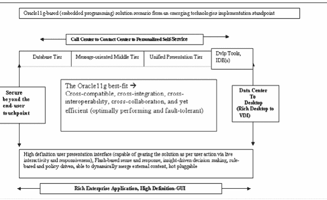
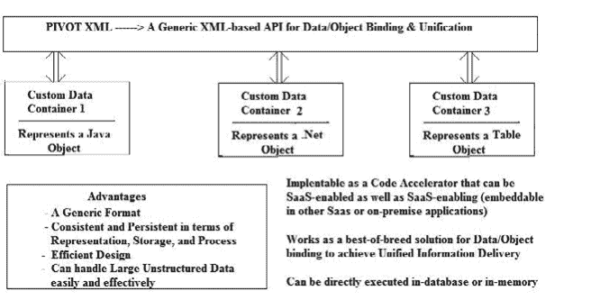
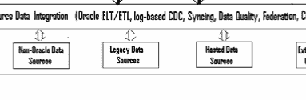

# Oracle 嵌入式编程与应用开发


# 献辞

本书献给我怀爱的父亲 B.S.K.R. Somayajulu 教授。他不懈的努力以及前所未有的热情、鼓励和建议，使我至今的人生旅程中每一步都能够“认清自己的处境”（引用他自己的话），并将成为我未来生活每一步中闪耀的明灯塔。


- 2.3 Oracle10g 中的新功能和解决方案选项 35


# 关于作者

Lakshman Bulusuru 在面向美国、欧洲和亚洲客户的 Oracle 数据库、DW/BI 以及解决方案的管理、监督、指导、评审、设计与开发方面拥有 17 年以上的经验和专业知识。他精通从 Oracle 11g 开始的主型 Oracle 技术，包括使用 SQL 和 PL/SQL；用于 Web 应用程序 .NET、Java、基于 PL/SQL、.NET、Java（Perl, PHP/AJAX）以及基于 C/C++ 的开源编程；他工程化设计了针对软件开发的 Oracle PL/SQL 应用程序生命周期开发框架的设计，涵盖了从设计、编码到测试调试、性能优化到 BI 的各个阶段，并被世界 500 强公司使用。此外，他还提供了使用 SQL Server 2008 和 T-SQL 的通用数据质量框架的设计、开发和优化，用于跨异多供应商的大型数据库进行汇总、比较和差异隔离。最近，他因对 Focus 社区的高质量贡献被授予了“焦点专家”（FOCUS EXPERT）。他编写了 6 本关于 Oracle 的书籍、2 本关于英语诗歌的书，以及在美国和英国各类期刊/杂志上发表的许多技术文章。

# 引言

唯一的真理是“结果决定一切”（此处无双关！）

编程就是程序编码，而程序就是代码——全都是代码，别无其他。

噢！我表述得正确吗？或者不仅是正确，而且准确？答案在于其从诞生到现状所经历的如过山车般的历程。

如今的编程已远远超越了极快速的计算和子计算，扩展到了适应分号终止的应用程序、应用平台和解决方案。编程基础背后的原理，从合成计算到合成代码，再到隐藏代码细节（通过算法、子程序、分治法等著名术语进行引用），以及其易用性背后的原理（或通过执行程序以获得最佳准确性、简单性和效率的结果），仍然是编程的核心。编程已经从一种纯编码的范式演变为一种以解决方案为导向的范式。在这个过程中，整合的高级（或下一级）功能集也从纯代码演变为代码模式和代码设计模式，这些模式比纯代码更贴合解决方案设计。这种编程模式的兴起涵盖了多个维度，包括从过程化到声明式的代码模块化、面向对象编程（OOP）、继承和代码封装等实践（这些实践重新定义了编程范式，使代码能够根据现实世界的类似对象来查看）、代码重用、代码归档、最佳可能、最佳时间、最匹配等。这种广度导致了新的且经过验证的代码结构的设计，更多，代码模板、库（静态和动态可加载）、由以下部分组成的软件层

## xx Oracle 嵌入式编程

除了代码之外，还有代码设计架构、热插拔代码（开发期间以及运行时的（对象代码库））、代码动态性（包括在执行之前无法完全解释的代码以及生成代码的代码）；托管代码和非托管代码；组织良好的代码（这不仅是技术方面，也是文档方面——文档完良好的代码具有更大的可维护生命周期价值）；可扩展代码；反向工程和重构代码（这特别适用于作为解决方案平台的代码）；使用多种实现进行代码部署，针对特定语言，以及一些跨语言的通用实现；最后是可移植的、跨硬件、跨操作系统和跨层（解决方案架构中多个层级或层之间的交互和集成）的独立代码；例如：

数据库层 -> 中间层 -> 应用层

- 中间层：应用服务器、应用增强器、应用加速器、Web 服务器等。
- 应用层：用于终端用户访问的统一呈现层、透明缓存、半透明缓存（如移动访问点）、离线数据源等。

这是一个指数级演变的曲线——考虑这种可能性：作为软件服务（SaaS）的动态适应代码，以及数据驱动的治理、风险和合规（GRC）标准。

由于编程具有许多维度，在实际编码开始之前，必须设计并实现这些适应代码。编程的演进过程受一套既定规则的约束，从编码标准到软件标准，从代码伦理到业务伦理，以及解决方案的最佳实践。这些实践是基于可执行的，通过测试来达到经过测试且真实的代码输出。

尽管编程和编码方面发生了许多变化，但数据驱动代码/数据驱动代码的核心原则仍然可以根据其主要目标被理解：*易用性*。

让我们从行动结果的角度重新审视这些维度。


在代码就绪之后，是安全问题，它引入了一个全新的维度：

- 真实性与授权（谁以及以什么方式使用）
- 应用输出与数据保护（在外部部署中，通过数据访问的）
- 代码的安全（通过数字签名等机制）以及代码的验证程序
- 遵循监管合规的实践（包括访问和身份合规、透明数据加密等）

- 被动代码到主动代码再到预取代码
- 数据驱动代码（由代码运行的方式驱动）到数据驱动代码（再次，根据用户需要进行自动适应）
- 代码输出数据以实现决策支持/业务洞察
- 用户交互驱动代码（启用动态交互和响应），而不是代码驱动行动，代码根据用户行动“实时”适应


- 准确性
- 简单性
- 效率，包括性能和可靠性，基于最佳交付时间、部署时间、价值时间、上市时间以及新兴的洞察时间（相关于从数据中提取可操作的智能）
- 可维护性

而且这一切必须以最低的成本实现！

唯一的真理是“结果决定一切”（此处无双关！）


本书是第一本关注 Oracle 相关嵌入式编程最佳实践的书，不仅关注“什么”和“如何”，还关注“为什么”和“何时”。它强调了嵌入式实践可以使用的最佳方式，深入探讨了为什么以及何时这些实践被视为最佳实践，增强了它们在应用开发和代码设计方法中的易用性，此外还在真实场景中产生高质量且高性能的代码。带领读者超越相关的专业参考书籍或在线教程和指南。它详细介绍了这些经过测试且真实的嵌入式编程最佳实践，包括各种应用程序的设计和代码开发技术。我们从基于 PL/SQL（使用 HTML、XML）、NET（使用 C、C++、C#）以及 Java（使用 SQLJ、JDBC、Java 存储过程和 Java 类库）的应用开始，继续介绍基于 PHP（使用 PHP 页面）、Perl 以及基于 C 或 C++（.NET 环境之外，使用外部协议）的应用。我们还讨论了基于 Web 2.0 RIA 功能的遵循和使用，涉及审计的监管合规实践（包括访问和身份合规、数据保护的透明数据加密、近零数据丢失、数据归档以及无线部署安全的特殊安全协议——WEP）。


## 引言 xxiii

（Web 加密协议对比 WPA/WPA2（无线 保护访问）等）。我们还关注端到端解决方案的整合，使用基于网格、基于虚拟化和/或基于云（数据和应用程序）的集成与互操作技术、多层部署特定功能以及下一级别的解决方案移动性（随地、随地、由任何人、移动中和即时可用），这种易用性与本地解决方案的易用性不相上下。

本书还集中于更重要的务实方面，描述了通过 11g 版本与 Oracle 数据库进行更高效集成和交互的技巧和实践，并涵盖了涉及编程语言进行编译和执行的细节概念。


本书针对两类读者：专业地使用 Oracle 的人员，以及正在教学或学习 Oracle 的人员。本书假设读者已具备 SQL、PL/SQL 以及相关嵌入式语言的工作知识。

Oracle 专业人士——即使用 PL/SQL、Java、C、C++、.NET、Perl 和 PHP 开发基于 Oracle 的 Web 应用程序的人员——是从书中获益的主要群体。Oracle 应用开发人员、技术解决方案架构师、实施者、执行同行代码审查的技术主管、负责代码设计和改进的领域专家（SME），以及担任 Oracle 数据库-应用程序集成专家的顾问，都将从书中关于构建架构和代码设计方法的描述中获益，这些方法可以推广到实时应用开发项目中，并标准化为应用开发和代码设计框架。

此外，本书还面向学术领域的学生、学习者、导师和教职人员，他们致力于涉及 Oracle 及相关嵌入式语言的应用开发课程。这些学术用户会发现本书有助于他们获取理论和实际编程方面的问题-解决方案要点、最佳实践技巧和场景。


本书主要涉及使用嵌入式语言（C、C++、Java、Perl、PHP、Ajax、Groovy、HTML 和 XML）的 Oracle 编程，以及 SQL 和 PL/SQL，涵盖从代码设计到端到端解决方案的各个方面，提供了架构、方法和标准化编码，使解决方案不仅能够适用于相关技术的生命周期，还适用于该解决方案所服务的业务生命周期。

事实上，书籍和网上提供了大量信息，以丰富信息技术（IT）和非 IT 人员的知识库。这些信息包括网站、博客、常见问题（FAQ）汇编、期刊和杂志中面向技术和业务的文章、快速入门指南、提示和技巧、开发者指南、专家技巧等。这些信息由具有不同专业水平的作者提供：包括专业人士、程序员、专家、同行、大师、化身等。这些信息经过了尝试、测试，并被证明是真实的。

那么，为什么还需要另一本书呢？原因分为两类：


- 解决方案的业务需求不仅很多，而且在需求、谁需要以及以什么方式方面是多维度的。
- 解决方案跨越了不同的技术、方法、架构和部署环境。
- 解决方案在终端用户方面的易用性范围涵盖了从业务（非技术）用户的帮助台支持到企业管理层——几乎是任何授权使用它的人。

### 解决方案生命周期

- 解决方案将在相关技术的生命周期内持续存在。

为了展示普及性的易用性，这里是一些说明该特性的真实场景列表：

- 从执行管理到 IT 专业人员，许多业务用户需要查看包含关键业务数据的高价值报告，这些数据通常是汇总的（跨大数据集的聚合）。当公司 IT 团队不在办公室但通过无线连接时，这是一种迫切的需求，他们可能在几秒前通过 BlackBerry 收到了他们认为可能巨大的损失报告，并询问原因。谁能想到某一天，双方在对此报告数据进行主动分析方面平起平坐呢！

- 有些用户要求数据/报告输出。换句话说，他们希望在点击并移动七位数数值上的光标时，看到输出为“此数值为负，是因为……”。
（注：原文此处存在大量重复句子，翻译已按要求处理）


（基于 Perl）从代码设计、编码、代码设计模式、编译、执行和效率的角度来看。

## 1.1 从 Oracle 视角看嵌入式编程：主要指标与解决方案生命周期

让我们重新回顾引言的最后一段：以最佳方式实践这些原则，以获得“最合宜”的解决方案，涵盖了所有可能的基于 Oracle 的嵌入式编程解决方案场景——仅此此，无他物。本书详细阐述了从业务/客户视角、技术视角以及重要（但关注较少）的程序员/开发者/技术人员/解决方案架构师/实施者视角，交付最合宜解决方案的做什么、何时、不做什么、为什么以及如何做。

任何应用解决方案都聚焦于业务格局、技术格局和用户格局的结合。没有一种通用的、开箱即用的单一方案能够同时涵盖业务和用户需求，以及所涉及的技术、架构和编程语言这三大主要格局。基于 Oracle 的嵌入式编程解决方案也是如此。这是因为业务需求（功能与用户体验的结合）、业务价值（性能和生命周期）以及使用的技术和方法就像雪花一样——没有两个是相同的。然而，最合宜的解决方案是这三个格局交汇的理想实现答案。

以下列表强调了驱动嵌入式编程解决方案的主要指标，以及以 Oracle11g 为主数据库的端到端生命周期大图：

- IT 流程与业务流程的生命周期对齐，以补充、支持或扩展解决方案的业务端

- 对新颖和新兴技术的灵活性和适应性（至少在设计层面，涉及解决方案架构模型、业务流程模型和 IT 流程模型），以防 IT 解决方案涉及的技术生命周期短于业务生命周期；这可能涉及通过添加/更改新的技术模块和/或子模块来扩展现有技术架构，以获得相同的业务结果（范围、时间、成本和质量）

- 底层无缝架构，允许可扩展性、适应性（通过改变用户体验或技术创新来无缝整合业务/IT 变化的能力——这三个领域对于从解决方案生命周期角度来看任何架构设计都至关重要）

- 一致性；可复用；易于编码、部署和使用；有效性；高效性

- 在可用性和客户接受度方面的开放性——原生外观和感受结合无缝、丰富的用户界面（UI 渲染）

- 可扩展性（包括水平扩展和垂直扩展）、持久性、高可用性、安全性、可移植性

- 应用开发工具和应用程序的通用集成平台

- 在 UI、主动和预防性测试与调试、源代码版本控制和源代码配置管理方面的统一框架

图 1.1、1.2 和 1.3 给出了从 Oracle 11g 视角涉及的解决方案生命周期快照。它可能没有描绘最佳解决方案的前景，但无疑为最合宜解决方案提供了计划，在业务格局、技术格局以及从程序员到实施者的格局方面，它与“最佳”解决方案相比始终是“双赢”的。

## 1.2 包含和不包含的内容：基于 Oracle 解决方案提供的编程语言、平台和解决方案选项

本节从可用性角度详细介绍了可用于嵌入 SQL/PL/SQL 代码或反之的编程语言的各种嵌入式编程场景，以及基于 Oracle 解决方案的设计、开发和部署平台和/或选项。这些章节子章节涵盖了基于 .NET 的语言、基于 Java/J2EE 的语言以及基于 PHP/Ajax 的语言的使用，并强调了基于 Oracle11g 的嵌入式编程解决方案包含和不包含的内容。


| 业务格局 | | |
| --- | --- | --- |
| 选择 | 投影 | 建议 |
| KBPI 卓越的客户体验和更好的业务价值 | | |
| 业务性能 = CLV（客户生命周期价值） = 业务价值 更好、更容易、更快、更便宜、最优的触达（当前和未来的业务需求） | | |

| 全球普及 | 今天的用户期望 | |
| --- | --- | --- |
| 个人到企业 | - 实时连接体验 - 点击-爆炸-房间效果 - 高级闪电交互和响应速度 - 用户友好且精通业务的 IT 解决方案 | |

1.1 从业务格局来看的典型解决方案生命周期。

| 技术格局 | KTPI 设计一次性做正确的 IT | |
| --- | --- | --- |
| IT 加速技术曲线 | - 主动和预防性设计（关于何时-如何-为什么做-做-撤销-重做） - 为了在任何时间、任何时候、实时实现用-复用 | | |
| 利用最合宜的实现用户友好且精通业务的 IT 解决方案 | | |
| 增长的业务需求 | | |
| (B2B, B2C, C2C, 端到端，以客户为中心（高定义统一呈现层、数据隔离和保护、可共享） | | |

1.2 从技术格局来看的典型解决方案生命周期。


图 1.3 从程序员到实施者的格局来看的典型生命周期。


- 基于 .NET 的嵌入式语言解决方案的推荐语言是 C#。此外还有 VB.NET（类似于 C/C++ 的 .NET 语言）。Oracle Data.NET 是一种原生托管提供程序，能够利用 Oracle 的特定功能，如实时应用集群 (RAC)、自动存储管理 (ASM)、数据库 (IMDB)、数据库安全库、虚拟数据库 (VPD)、Oracle 空间选项、SQL 分析以及用户定义类型 (UDTs)，确保高性能、吞吐量和高可用性：
- ODP.NET 负载均衡
- 快速连接故障转移
- 文件系统性能（使用 SecureFiles 对非结构化数据（LOB、二进制 XML 等）进行去重、压缩和加密）
- ODP.NET 语句缓存（减少重复解析）
- 元数据缓存
- 客户端结果集缓存（与数据库同步的客户端刷新结果集缓存）
- 通过关联获取的数据行控制动态数据大小
- 使用 REF CURSOR 支持 PL/SQL 过程和结果集（.NET 调用 PL/SQL），优化从 Oracle 获取数据
- 数据库常驻连接池 (DRCP) 和通过代理验证增强 Oracle 安全（允许多个唯一用户共享同一个连接池用户以实现扩展性）
- 通过 ODP.NET 客户端标识符跟踪应用程序上下文
- Oracle .NET 扩展适用于深度访问 Oracle 的复杂 .NET 逻辑。这些扩展使用 C# 编写存储过程和函数，或作为其他 .NET 托管语言存储过程部署在数据库中。它们可以通过 SQL、PL/SQL、其他 .NET 代码或 Java 存储过程调用。它们使用 MS Studio 2010、2008、2005 或 2003 编写，并使用 Oracle Developers for Visual Studio 进行部署。
- Oracle Provider for ASP.NET 是允许 Microsoft ASP.NET 语言访问 Oracle 数据库的 Oracle 驱动程序——适用于在 Oracle 层运行的 ASP.NET Web 。
- Oracle Developers for Visual Studio 是一个集成开发环境 (IDE)，可用于开发和部署基于 Oracle11g 的 .NET 嵌入式应用程序。
- 自动生成创建、查询、更新和删除 (CRUD) 操作代码，适用于基于 Oracle 的 Web 嵌入应用或丰富互联网应用 (RIA)，UDT 自定义类代码生成功能以及 .NET 存储过程测试
- .NET 存储过程的部署
- 集成 PL/SQL 调试

由于 Java 是一种第一级遗产面向对象编程语言，具有前所未有的开源使用、可移植性、可扩展性和高性能；


健壮的应用程序服务器方法（J2EE、servlets、JMS、多线程、互操作性以及丰富的客户端能力（JSP、JS 等））使其成为基于数据库的富 Web 应用程序（RWA）开发、部署和迁移的主要嵌入式语言选择；Oracle 11g 与 Java 的结合提供了一种最适合到端的解决方案，它不仅能够跨企业扩展，以适用于数据库和应用层的高量交易处理，而且在具有遗留支持的同时，在上述功能方面极具灵活性。从嵌入式编程解决方案的角度来看，Oracle 11g 对 Java 的支持可以列如下：

- 对 EJB 3.0/ Java 持久 API (JPA) 和 Java Server Faces 的支持：
    - 使用 Native SQL 和 JPQL 查询 JPA 实体
    - 使用 Java 增强 Web 服务
    - 通过丰富的 UI 暴露 SOA 服务
    - 通用资源定位符 (URL) 控制（例如 ADF 中的 URL 数据控制）
    - 下一代代用户界面（无缝呈现上下文信息）
    - 数据库服务，使用 SOA 将 Oracle DB 功能 Web 化（使用 Oracle JPublisher）
- 自动化 Java 性能优化
    - 数据库中 Java 的 JDBC 和 SQLJ
    - 从代码到执行保护 Java 程序安全
    - JDBC 中改进的数据完整性和加密
    - 轻量、强效和 OS 认证
    - 改进 JDBC 性能和可扩展性（第一轮往返中的行预取）
    - loadjava 的 URL 支持
    - 通过 MBean 在 JDBC 中通过 JMX 程序开启/关闭 JDBC 日志
    - 通过 JDBC-Java 代码程序启动和关闭 Oracle DB（带有适当的认证和授权）
- Oracle ADF（应用程序开发框架），通过基于组件的可重用对象简化了基于 Java EE 的 Web 服务启用/实现（SOA）应用程序的，这些对象可以广泛归类为：


- 表现层：富 UI——使用 ADF Faces 和 Oracle Web-Center（企业 Web 2.0）、基于桌面的框架 RCA（富客户端应用程序——与 Office 应用同水平的 ADF Swing）以及基于浏览器的应用程序（与 JSP 或 JSF 同水平的 ADF Faces）。ADF Faces 使用可重用的客户端组件，利用了 Ajax、Flash、JavaScript 和 DOM 中的顶级技术，并包括数据可视化、部分页面渲染、高级数据流、模板、可重用流等额外功能。

- 应用程序/业务逻辑：这通过 Web 服务（基于 Oracle SOA Suite 的集成和敏捷性 SOA）和 ADF 业务组件（ADFusable，基于 SQL 的组件，用于管理 DB 访问和逻辑，将数据与应用程序/业务逻辑视图分离）作为业务服务暴露，其水平与持久化业务对象（企业 Java Beans EJB)/JPA 实体和 Java 类以及 Web 服务同等。主要目标是提供关系映射 (ORM)、管理 CRUD 操作、实现验证和应用逻辑的业务规则，并确保基于标准且可重用。

- DB（数据服务）：基于 Oracle 11g 的 ADF 模型/绑定组件利用了关系型数据、XML 数据、遗留数据和外部数据。这些绑定组件声明式地绑定到业务服务，执行 ORM 并管理持久化（ORM 和 DML/DQL）以及缓存、自动事件和状态管理，以及通过控制层策略的 ADF Taskflow（具有声明性，类似于 Struts 或 JSP 工作流）进行内存作用域。此外，ADF Taskflow 还允许对 Web 页面进行声明式定义。

在纯 Java 侧，支持 Java EE5（EJB, JPA）结合 SOA、Web 2.0 (RIA)、Ajax/JPHP、JavaScript、BPEL、SOAP、RMI、WSDL、JNDI、JDBC、O/R、HTML、XML 和 DOM。

- 开发/部署平台：Oracle JDeveloper、Oracle Publisher、Oracle WebCenter（提供 Web 2.0 服务作为内容库、标签、wiki 页面等）、Oracle SOA Suite（用于 AI 和敏捷性）。

- IDE 平台与 RIA 平台合一：Oracle APEX、Oracle JDeveloper、ODT.NET IDE 和 RIA 平台用于创建/生成 RIA 应用程序——无缝且具有原生外观。

- 热插拔能力通过 Oracle Enterprise Grid（由应用程序网和数据库网组成）和/或所有级别的虚拟化实现：
    - 硬件，包括存储 (ASM) 和网络、操作系统、应用程序（端到端），或端点级别，意味着最终用户设备级（通常是无线的）
    - 数据库，使用 RAC/集群进行存储和反序列化，数据库服务能够实现多个数据库连接（来自应用）跨一个或多个数据库实例的动态负载均衡或定向
    - 数据供应（将数据集作为 Web 服务存储和使用——换句话说，作为数据服务；将数据集成工作流和作业作为 Web 服务，即数据集成服务）


- 集成：应用程序集成：Oracle AIA、Oracle Coherence（DB 内部或应用层级的内存数据库缓存）
- 数据集成：ODI，云 
- 管理解决方案的数据侧：目标是提高性能、防止数据丢失并降低风险。关键指标是数据增长（增长前的数据库大小）、实时归档（在访问数据时进行归档）、内容和非结构化数据——多种方式存储、检索和处理文档、二进制文件和其他非结构化数据。
- 管理解决方案的应用程序侧：整体系统性能和响应、丰富的用户体验、端到端安全和合规性、高可用性，以及在数据量、用户量和应用程序功能（动态添加新模块）方面的扩展性。


嵌入式编程以及以应用为中心的优化，两者对于整体解决方案的性能至关重要：数据库与应用程序之间的动态结果集互操作性（使用 C#、Java、C/C++、PHP、Perl 等嵌入式编程语言），这通过使用 `REF CURSORS`、连接池和客户端缓存来实现。对于仅使用 SQL 和 PL/SQL 的应用（通过 PSP 使用 HTML、XML 或 Web Toolkit），REF CURSOR 则与基于 API 的 `DBMS_SQL` 进行双向交互，这提供了更大的灵活性，并能够在解析、执行和/或将结果集交付给应用程序方面选择最佳方案或最佳工具以实现最优性能的能力。

- 使用各种嵌入式编程技术的富意交互（RIA）解决方案：Oracle 和 PL/SQL；Oracle 和 Java/JEE；Oracle 和 PHP/Ajax；Oracle 和 .NET（ODP.NET，适用于 .NET、C/C++/C#）；Oracle 和 Perl
- 针对每个组合中的特定嵌入式语言提供健壮且高性能的特性
- 使用丰富的 IDE（如 Oracle APEX、JDeveloper、Oracle Developer Tools for .NET，包括 MS Visual Studio 2010/2008/2005）进行灵活、简单、快速开发
- “富”指的是使用最新和下一代的 Web 技术（也称为 Web 2.0）来交付和渲染更好、更增强的用户体验。RIA 与简单的基于 Web浏览器的应用程序的主要区别在于后者的增强能力，例如高定义 GUI、动态“外观”以及实时的用户交互和响应。这类似于飞机仪表盘——从静态控制到基于触摸屏的 Flash 控制——其程度在 particular，基于浏览器的 Web 页面看起来就像你看到的 Flash 页面一样，是完全且实时的。

> 目标是将 GUI 提升到更高的维度，使终端用户体验在用法、可操作的“实时”生产力和效率方面处于更高水平——让终端用户越用该解决方案越能成为专家。这要求将上述的更丰富的功能内置到 GUI 中。最新的 Web 2.0 至少带有四种不同的技术：Ajax、Flash、Flex 和 AIR。Oracle 有两种方法论来交付 RIA 解决方案：

- 在数据库中直接使用 Oracle11g 和 PHP/Ajax。声明式 PL/SQL API 调用 Ajax（JavaScript、PHP、XML 等）代码，这些代码实现了丰富的 UI 功能并将其直接渲染到 Web 浏览器中（不需要中间层代码/软件）。它遵循非过程化的编程路线，只是 Ajax 代码只需编写一次并使用声明式 API 嵌入到 PL/SQL 中。如此。其他一切都由数据库完成。

- 使用 Oracle11g 和传统的嵌入式 Web 语言（如 Java 或 .NET (C#, C++)），结合 XML HTML。这也可以，并且使用遗留技术实现了相同的功能——只是它涉及一个中间层，这层损害了数据库内处理的某些优势，包括应用程序逻辑和 UI 呈现。

关键指标：使用如 Flash、Flex、AIR 等其他 RIA 技术来实现 RI 效果有一个缺点，即它不能一直用于生成和渲染整个应用程序，特别是为企业定制的应用程序。当我们比较渲染一个基于 Web 的促销活动站点与为全球企业级解决方案交付统一的呈现层时（该解决方案必须不仅仅是前端），这种差异是显而易见的。

RIA 有益于企业、开发者和用户。通过整合基于 Web的技术来增强 UI 可以节省成本，提供基于（公共）互联网的开放性，并由于可重用和共享的 Web 服务及数据服务能力获得客户的认可。

- 安全数据保护是应用程序解决方案中最关键、核心方面之一。透明数据加密在列级（10gr2）、表级（11gR1）和表空间级（11gr2）处理；特定客户的数据隔离通过使用“私有云”部署处理（云端 Oracle数据库、企业网格、适用于 DW/OLAP 的 HP-Oracle Database Machine (Exadata v1)，以及适用于 OLTP 和灵活 OLAP 的 Sun-Oracle Database Machine (Exadata v2)）；使用 Oracle 应用集成架构 (AIA) 结合企业 Oracle 数据集成器 (ODI) 和企业仓库构建器 (OWB) 实现应用程序和数据的即时集成和互操作，同时考虑了缺失的内容并识别使用补充/替代技术/方法论完成缺失部分的方法。

- 更好的业务敏捷性，涉及相关的业务和 IT 过程的底层同步。
- 针对终端用户层面应用程序的 Oracle11g 数据库优化——通过基于组策略和角色的 FGAC 进行安全数据访问；使用 SIAM（安全信息访问管理）遵循合规策略进行数据泄露防护数据保护；单登录；Oracle Database Vault；双向数据库活动；通过 OASIS 可扩展访问控制标记语言 (XACML) 进行内部威胁和入侵防护；用于 XML 威胁的安全断言标记语言 (SAML)；通过自动生成带有对应 's'（代表 'secure'）后缀扩展的输出文件（例如，.PDF 文档对应 .PDFS）进行安全内容管理，使实际的应用程序输出文件作为报告、输出进行二进制编码，以防止未经授权的程序外访问（这在发送邮件时可能会发生）。

- 应用程序的实时能力——使用业务活动监控 (BAM)、复杂事件处理 (CEP) 并近实时提醒终端用户。
- 使用 ODI、OWB 或其他方式进行实时 DI（数据集成）；实时查询（现状、现有）、分析（现状、现有）以及预测（假设）的即席查询和报告；具有极短洞察时间的运营业务智能。
- 使用 CDC（异步和同步）、Oracle Data Pump 进行高性能实时数据捕获，以及利用基于云和集群设计的下一代技术。
- 即时数据压缩以线性扩展数据访问，从而提供了消除额外存储的附加优势。


| Oracle11g + 开发 + Web 服务 | 协作集合 | 部署技术 |
| :--- | :--- | :--- |
| 功能（数据库和代码的设计与优化——涉及数据库结构、数据结构和嵌入式语言；性能优化） | 环境 | （启用 SaaS、基于云） | （内置同步；现有解决方案和新部署解决方案；数据访问、更新、分析和报告；丰富的、动态的统一的呈现；全球可访问） |
| | = Oracle 嵌入解决方案（下一代或先进） | |

图 1.4 基于嵌入式语言的 Oracle 解决方案典型视图。

图 1.4 包含了基于嵌入式语言的 Oracle 解决方案的概述。


下面详细说明的所有差异都围绕着利用 Oracle11g 数据库以及 SQL、PL/SQL 在编译、执行、编码范围和架构设计方面的优势。这些优势源于 Oracle11g 数据库在数据完整性、数据和应用安全、高可用性、可用性、效率和互操作性方面强大且高性能的功能。

- 解决方案涉及的处理类型——数据库密集型、计算密集型或两者兼顾。这对于选择合适的嵌入式编程语言起着关键作用。
- 与 Oracle 数据库的交互类型——在 Oracle 数据库与嵌入式应用程序以及应用程序之间处理和共享数据的能力。


### 数据流管理处理

这取决于所使用的嵌入式编程语言如何以100%的兼容性和准确性管理进出 Oracle 数据库的数据流，并尽可能地减少数据丢失（无论是定性的还是定量的）。数据结构管理和数据管理从数据类型兼容性、不匹配和转换（包括隐式和显式，以及相对于嵌入式语言和 Oracle 的原生类型），到数据结构兼容性（涉及同步存储在语言特定结构/对象和 Oracle 特定对象中的数据）——这两者对于数据输入输出（I/O）都至关重要。当涉及的数据是非结构化数据时，这一点尤为关键，因为每种嵌入式语言在处理非结构化数据方面都有自己的局限性，因此此类 I/O 会变得复杂。这方面的解决方案是设计一个尽可能接近抽象层——研究现有的数据和编码数据结构，并设计出一个可以通用为代码设计模式的代码。

### 数据处理方式的处理

同样重要的是数据处理的方式——从小规模行集到巨大的结果集。Oracle 通过利用静态和动态 SQL 的数组处理，提供了非常高效的数据集检索和操作。在嵌入式语言中使用静态和/或动态 SQL/PL/SQL 代码，对于编译和执行方面的性能提升至关重要。嵌入式语言本身（以及应用程序中）如何处理 Oracle 之外的静态和动态代码（嵌入或其他），对执行也有影响。


### 结果集的双向交换

关于 Oracle 与嵌入式编程应用程序之间的数据共享，通常需要的面向用户型功能是 Oracle 数据库与应用程序之间结果集的双向交换。这是通过具有基于 SQL 的检索/或更新代码的过程函数或子程序来实现的——大多数情况下，这些子程序是参数化的。上述数据管理和数据结构管理的问题同样适用于参数。实现此方法有很多，要记住 Oracle 数据库是共享数据的持久化存储。嵌入式编程解决方案环境中的典型方法包括：

- 使用 REF CURSORS 在数据库之间传递结果集。这再次取决于嵌入式语言与 Oracle 接口的功能。某些仅提供单向共享——从数据库到应用程序，而另一些允许双向共享。
- 数据从 Oracle 数据库到应用程序的实时流。这通常是分析密集型且仅涉及数据检索的应用——实时速度的大量数据。这是通过函数的管道和并行实现的，实现了数据的应用程序逐行“实时”流。在函数执行但尚未完全完成时，应用程序即可获取数据。这同样取决于涉及的嵌入式语言接口的功能。

这种管道过程可以通道化为管道链，以消除中间过程/数据存储，从而获得最佳性能提升。然而，这种特殊技术的可用性取决于解决方案。

- 结果集缓存——数据库端的每个 SQL 查询结果集、每个函数的结果集；客户端对相同结果集的缓存；以及应用程序层的的 IMDB 缓存。
- 数据库驻留连接池和语句缓存
- 在动态 SQL（查询和 DML）中使用绑定变量和参数化，防止 SQL 注入

### 应用程序之间共享数据的能力

这是上述场景的通用场景，涉及多个应用程序共享相同的数据。除了上述问题外，关键问题还有：

- 结果集共享和缓存
- 最小数据库往返的输入方向和输出方向
- 连接池
- 基于不同的嵌入式语言解决方案，同步应用程序之间数据流和结果集的代码抽象层
- 数据和代码隔离（代码和数据的中心化与去中心化）
- 数据和代码全球化；数据本地化和代码私有化，独立于使用的嵌入式语言和现有解决方案的应用级——使用代码仅是涉及任务的一部分。

可以设计一个代码模块化框架，作为跨语言、跨功能嵌入式解决方案的模板。


托管代码与非托管代码：这是基于 .NET 的嵌入式语言解决方案（C#）中的关键差异。了解什么是托管的（或非托管）、以什么方式以及如何，是衡量嵌入式编程解决方案适用性和设计架构的标准。以下是情况的概览：

- 数据库内托管
  - 数据库代码生命周期
    - 从编译到执行的整个过程
    - 与外层应用程序的交互
  - 与外部应用程序的集成（即不在应用程序架构中的应用程序）
  - 与外部应用程序集成
- 数据库外托管
  - 有多少是在 Oracle 之外托管的？（完全或部分）
  - 与外层应用程序的交互


- 错误和异常处理：这是任何软件应用程序/解决方案不可或缺的方面之一，更说基于 Oracle 的解决方案了。当嵌入式编程语言 Oracle 数据库语言集（原生或 Oracle 特定）涉及 Oracle 解决方案时，异常处理必须是卓越的。这涉及：
- 捕获错误——异步进行，用于实时告警和独立于触发错误的事务/过程的自主错误日志；以及同步进行，以便在发生较高严重程度的错误时停止后续处理
- 跟踪错误源
- 处理错误（预先处理或其他方式）
- 解码数据库特定和语言特定的错误消息，并将其编码为用户友好且明智的格式（在需要时）
- 自定义错误（针对与验证及其他应用程序特定的错误）
- 将错误从数据库传播到终端用户 UI
- 审计错误（包括其修复）
- 故障排除（调试及以后），在数据库端和应用程序端；如果所有内容（除 UI 层外）都是基于数据库的，管理这一方面就很容易。


- 用户界面的渲染：这里的关键差异在于在数据库内部使用基于嵌入式编程语言的 UI，以前后端的方式将数据和 UI 绑定。这类似于“虚拟现实”场景，其中中间层实际上存在，但与 Oracle 数据库内联。


这种方法不同于将 Web 部分（包括 UI 呈现逻辑以及相关的应用程序逻辑代码）与 Oracle 数据库部分分离的常规方法。一个简单的例子是在第一种场景中在 PL/SQL 中使用 HTML，而在后种场景在 HTML 中使用 PL/SQL。类似的模拟也适用于其他嵌入式语言。这两种方法各有优缺点，决策标准取决于最终的预期目标。参考先前的示例，前者涉及将嵌入式语言代码即插即用地集成到声明式的 Oracle API（主要基于 PL/SQL）中，并运行应用程序，无需安装和配置中间层软件，如 Web 应用服务器、UI 所需的特定语言 SDK、驱动程序/提供程序、库等（当使用 Java 或 .NET 时，这在后一种方法中必不可少的）。

- 响应时间：由于涉及应用层（且该层必须位于数据库层之上，并非所有应用相关的代码都可以内联到数据库中），对于对时间敏感的应用程序，这在响应时间和吞吐量方面是一个关键问题。为了获得极快的响应时间，可以在应用层部署 IMDB 缓存并与 Oracle 数据库配合使用，以便能够以 RAM 的速度完成用户数据 I/O，从而消除昂贵的数据库往返。适用于近实时数据访问和/或更新所需的毫秒和微秒级响应时间，而仅使用 Oracle DB 而不在应用层使用 IMDB 缓存所实现的秒级及后续响应时间。
- 在应用层中使用静态和动态缓存，使用持久性“一次性缓存”和“缓存进缓存出”。
- 从数据库到应用 IMDB 缓存的实时缓存数据刷新，反之亦然（在对未提交的用户数据的临时缓存直到数据标记为提交之前有效的情况下，特别是在涉及事务数据的在线 Web 应用中）。
- 通过利用 Oracle 数据库级集群和 Data Guard 技术提供高可用性和容错能力。
- 利用 Oracle DB 的 LOB 功能利用大对象（LOBs）处理非结构化数据。如果 IMDB 缓存作为独立部署（即底层没有 Oracle DB），则无法实现这一点。
- 可与大多数嵌入式语言的数据访问接口配合，例如 JDBC、ODBC、OCI 和 ProC* (C/C++)，当然还有 SQL 和 PL/SQL。
- 同步、编码和解码：以无缝方式处理 Oracle 特有和嵌入式语言特定的操作。
- 与外部应用程序集成（即不在嵌入式应用程序解决方案架构中的程序）：这本身单独的话题，涉及上述所有标准的排列和/或组合以及更多内容。该主题在第 8 章“应用程序开发框架”中进行了详细讨论。

以下是选择最适合 Oracle 嵌入式编程解决方案的主要决策因素的概览，不仅从技术准确性和效率考虑，还从业务/客户的角度考虑获得你想要的内容：


本章涵盖了使用 Oracle 数据库的嵌入式编程解决方案的基础。首先识别了可选以 Oracle 为中心的编程语言、平台和解决方案选项。它还涉及了构建此类解决方案/应用程序的现有的、新兴的和下一代的架构、方法论和技术。介绍的细节不仅涵盖了这些选项的“包含内容”、“何时-如何-为什么”以及“不包含内容”，还强调了“涉及内容”——换句话说，此类解决方案周期需要什么。本章还讨论了 Oracle 特有代码与嵌入式代码的关键区别，从与 Oracle 的交互和集成到终端用户的交互性。下一章将从功能集和解决方案集的角度，详细介绍在 Oracle 11g 中引入的基于 Oracle 的嵌入式编程应用的新功能。


## 务实且审慎的解决方案架构的选择与适用性标准


图 1.5 最适合的 Oracle 编程解决方案——全景


### 2.1 引言

本章从功能集和解决方案集的角度，讨论了 Oracle 11g 中引入的基于 Oracle 的嵌入式编程应用的新功能。

- Oracle 11g 中的新功能
- Oracle 10g 中的新功能

### 2.2 细粒度依赖跟踪 (FGD)

此功能重新发明了子程序层次结构的隐式失效和重新编译。在 Oracle 11g 之前，特定子程序中的单次失效会导致树中的所有子程序失效。使用 FGD，只有与正在执行的特定程序相关的数据库对象会失效，消除了级联效应。例如，向表中添加列，或向包规范中添加新游标。


动态 SQL 经过优化以实现更快的执行和增强的功能。在原生动态 SQL 方面，字符串长度现在不再限制，以接受字符大对象 (CLOB) 输入。`EXECUTE IMMEDIATE` 和 `DBMS_SQL` 现在可以接受 CLOB 输入。在这方面更强大的增强是 `DBMS_SQL` 和 REF CURSOR 的互操作。这意味着你可以使用 `DBMS_SQL` 游标编写动态 SELECT 语句，使用 `DBMS_SQL` 对其解析和执行，然后使用原生 SQL 和 REF CURSOR 处理结果集。这对于嵌入式语言非常有用，因为 REF CURSOR 是 Oracle 和应用程序之间共享数据集的高效结构。

此外，这种互操作可以利用批量操作。API 使用 `DBMS_SQL_TO_REF_CURSOR` 函数将 DBMS_SQL 转换为 REF CURSOR。反之也是可能的，使用 API `DBMS_SQL_TO_CURSOR`。最后，DBMS_SQL 现在支持自定义类型以及对这些类型的动态操作。


```sql
ALTER SESSION SET PLSQL_WARNINGS = 'enable';
CREATE OR REPLACE PROCEDURE p_test(id NUMBER, status VARCHAR2)
IS
BEGIN
  UPDATE test_tab
  SET status = status
  WHERE id = id;
EXCEPTION
  WHEN OTHERS THEN
    NULL;
END;
/
```


```sql
INSERT /*+ DUP_VAL_INDEX */
INTO tgt_tab
SELECT ... FROM src_tab;
```


触发执行顺序的能力以及允许在单个触发器中使用多个触发器部分的新型复合触发器，在需要以透明方式实现数据完整性代码的情况下非常有用。这是因为当数据输入/输出 (I/O)绑定到非 Oracle 的嵌入式语言时，透明的数据完整性感知会更加明显。这同时也带来了性能问题；复合触发器具有共同状态并保留


该状态适用于整个 DML 操作的生命周期；且 DML 触发器已经过优化，速度提升了 25%。在非触发表上执行更新操作的行级触发器可能会从中获益。

在 Oracle 11g 中，可以使用 `FOLLOWS` 子句来指定触发器顺序。这里有一个简单的语法示例：

```
CREATE OR REPLACE TRIGGER trg_demo
AFTER INSERT ON demo_tab FOR EACH ROW
FOLLOWS trg_ai_demol
BEGIN
/* Some logic *
END;
/
```

这在触发器执行顺序方面创建了一个新的（隐式）基于触发器的依赖链。然而，Oracle 11gR1 并没有对这种类型基于触发器的依赖关系进行细粒度的控制。该功能在 Oracle 11gR2 中添加，并引入了新的 `PRECEDES` 能力，用于跟踪触发器触发触发器的依赖关系。

Oracle 11g 引入了复合触发器（compound trigger）的概念。与其定义多个不同类型的触发器，不如复合触发器包含了 `BEFORE/AFTER` 以及 `STATEMENT/EACH ROW` 的部分。通过这种方式，可以维护变量的状态。例如，在 `BEFORE STATEMENT` 部分之前定义的任何变量都会持续存在直到触发器语句结束。以下是此类触发器可能外观的预览：

```
CREATE OR REPLACE TRIGGER trig_demo_compound
FOR INSERT ON demo_tab
COMPOUND TRIGGER
g_val NUMBER;
BEFORE STATEMENT IS
/* Some logic */
END BEFORE STATEMENT;
AFTER EACH ROW IS
BEGIN
/* Some logic */
END AFTER EACH ROW
AFTER STATEMENT IS
```

```
BEGIN
/* Some logic */
END AFTER STATEMENT;
END trig_demo_compound;
/
```


Oracle 11g 整合了 PL/SQL 代码的单元内内联（intra-unit inlining），这允许在调用子程序时，用子程序的实际代码动态替换子程序调用。这意味着主程序与子程序之间没有控制流转移，从而消除了函数调用的开销。对象代码在替换后生成。这种能力使得基于 4GL 的 PL/SQL 达到了与 3GL 以及具有类似宏功能的传统过程化编程语言相同的水平。对于本地声明的子程序也是如此。此特性在嵌入式代码与 Oracle DB 交互的执行效率方面是一项资产。

Oracle 根据性能为中心的标准来确定特定的子程序是否可以内联。这不涉及代码更改，但必须将 `PLSQL_OPTIMIZE_LEVEL` 设置为 3 以实现自动内联。在 Oracle 11g 中，当 `PLSQL_OPTIMIZE_LEVEL` 设置为 2 时，单元内内联同样有效（实际上至少为 2）。但在这种情况，必须在子程序调用之前通过程序化方式调用一个 `pragma` 来启动内联过程。这是一个示例：

```
CREATE OR REPLACE PROCEDURE demo_child_proc
IS
BEGIN
/* Some logic here */
END demo_child_proc;
/
CREATE OR REPLACE PROCEDURE demo_parent_proc
IS
BEGIN
/* Some logic here */
/* 在此处条件调用 demo_child_proc */
IF (<condition>) THEN
  PRAGMA INLINE(demo_child_proc, 'yes');
demo_child_proc;
```


```
END IF;
END demo_parent_proc;
/ 
```

此代码指示编译器 `demo_child_proc` 是内联编译的潜在候选者。

“潜在”一词在此语境下是相关的，因为编译器可能会由于内部原因拒绝内联任务。在启用自动内联时也是如此。然而，当同时指定了自动内联和 `pragma` 时，`pragma` 具有优先级。因此，当 `pragma` 的第二个参数的值为“no”时，将跳过内联过程。


使用 `RESULT_CACHE` 提示对于 SQL 语句的并行执行是有效的，这在 11g 之后，结果结果  。。。。             ，调用调用调用程序程序，被动态替换。程序 。。。    ，，   应用程序的 PL/SQL 语句。


通过为（每个）相同项分配单个表空间来实现和/或业务领域。Oracle10gR2 引入了透明表级加密，为 Oracle 数据保护体系增加了更细粒的粒度。

### 2.2.2 有益于企业网格的新功能

- 现在可以使用新的“网络感知复制”（Network-Aware Duplication）实现用于高可用性的即时数据库备份和恢复，该功能允许使用“活动”数据库的数据文件创建复制数据库（无需源数据库的先验备份）；具有自动历史数据管理的闪回归档（flashback archival）；SQL 修复顾问（SQL Repair Advisor）和数据修复顾问（Data Repair Advisor）（这两个顾问提供了更强大的 SQL 补丁修复失败的 SQL 和数据的能力，而无需更改现有 SQL 和轻量级数据修复）。
- Oracle11gR2 引入了 Oracle 安全备份云模块（Oracle Secure Backup Cloud Module），能够对 Amazon 简单存储服务（S3）进行安全且易于管理的备份——这是一种基于 Web Services 的存储解决方案，在成本和管理上最大限度地减少/消除了对本地解决方案的需求。
- 可在企业网格数据库网格层对 Oracle RAC 环境进行自动数据库诊断监控。
- 新 SQL 性能分析器能够识别系统对 SQL 性能的影响和差异，这是嵌入式编程场景中的关键性能指标。
- 除了备用快照和逻辑备用数据库外，还提供了用于查询的实时备用数据库。结合新的启动故障转移改进和自动健康监控器（Automatic Health Monitor），这增加了预防性、主动性和反应性的数据库恢复与监控。
- 自动存储管理（ASM）成为企业网格的福音。它实现了企业网格物理存储层的自动虚拟化。它还通过添加第三个数据库角色 oracle（第一个和第二个角色为 sysdb 和 sysoper），将数据库管理员（DBA）的管理权限与存储管理员（SA）的权限隔离开。
- 在数据库级（仅针对某些 SQL 语句）和用户配置层级自动启用审计，确保了符合 SOX 和 PCI 的监管安全合规。这还跟踪了登录和签名信息。通过将 `AUDIT_TRAIL` 初始化参数设置为 `EXTENDED_DB` 值，可以启用事务级审计（例如针对每个 SQL 语句）。此外，Oracle11gR2 通过实施联邦身份和访问管理策略（该策略基于 SOA、符合安全身份和访问管理 (SIAM)、安全断言标记语言 (SAML) 和可扩展访问控制标记语言 (XACML)，且具备防 XML 威胁能力），确保了企业之外的应用安全（即云端外部化部署中）。这是通过 Oracle11gR2 身份管理和内容管理解决方案实现的。
- 从数据库内部访问数据库外部资源的精细粒度网络访问，为整体解决方案架构增加了增强的安全层。
- 通过高可用性 FAN（快速应用程序通知），数据库事件通知（及其随后的处理）通过回调和事件处理程序通信到嵌入式应用程序（例如用于基于 .NET 的嵌入式应用程序的 ODPN 回调和事件处理程序）。此外，Oracle11gR2 支持针对基于 Oracle Scheduler 的作业活动向用户发送电子邮件通知。
- 针对基于 .NET 的嵌入式应用程序（以及 Web 服务）的新 Oracle 应用测试套件提供了一个完全集成的部署前测试环境，能够进行负载测试、功能测试和缺陷跟踪，可用于提高质量、可扩展性和高可用性。


- 使用 Zend Core 开发/生成的、与 Oracle11g 数据库应用程序集成的 PHP/Ajax 基础的新 IDE 和应用平台，已完全集成，以利用最新 11g 数据库功能的威力和性能潜力。
- 数据库驻留连接池为 PHP 应用程序提供了更高的可扩展性，在连接池方面模拟了使用多线程服务器进行持久会话共享所获得的益处。这实际上在数据库中创建了一个驻留的共享连接池，可用于专用服务器进程和共享服务器进程，由 Oracle 管理连接池的审计。通过在连接字符串中添加 `SERVER=POOL` 选项，可以为嵌入式代码创建驻留数据库的共享连接池，用于专用服务器进程和共享服务器进程。这是通过以下 OCI 实现的：

```
OCISessionCreate(..., OraText, ...)
```
支持 8 字节数据类型，用于 Pro*C 和 Pro*BOL 应用程序。此外通过 OCI 支持用于 Pro*C 和 Pro*BOL 的 INSERT 语句。


- 通过程序化 API，SQL.NET 现在可以利用 Oracle 高级队列（AQ）资源。
- 新构建的 ODP.NET 功能允许通过动态调整语句缓存来自适应调优嵌入式应用程序，这是通过 Visual Studio 性能分析器来分析变化影响实现的。
- 所有针对单个数据库运行的 ODP.NET 事务默认本地化。只有当涉及第二个数据库时，这些事务才会提升到分布式级别。
- 性能优化的 ODP.NET 组件可以实现更快的访问。
- 声明式 Oracle 安全适用于代码访问。
- SQL 脚本可以基于任何 Oracle 对象或对象组为 .NET 生成；此外我们现在可以同时编译任何存储过程或函数。


- Oracle11g 在其 JVM 中支持 J2SE 1.5 功能。此功能允许基于 Java 的 Oracle 嵌入式应用程序利用泛型的定义功能，类似于 PL/SQL 中的编译器提示提示 Oracle 在适当的情况下使用性能特性。
- 基于 Oracle11g 的嵌入式 Java 通过使用 `TIMESTAMP WITH TIME zone` 类型符合夏令时。此外，JDBC 支持已扩展，允许 SecureFile 零拷贝 I/O 和 LOB 预取。此功能是内容统一的加速器，因为它允许 Java 以缝、安全且高效的方式访问结构化、半结构化和非结构化数据。
- 嵌入式代码中 Java 方法的即时（JIT）编译。此功能在编译前自动选择 Java 方法进行原生编译，然后将它们自动编译为原生代码，以获得以性能为中心的编译收益。这在某种程度上类似于 PL/SQL 代码的原生编译功能，结合了后续调用期间对无效 PL/SQL 单元的重新编译。JIT 默认启用，嵌入式 Java 代码不仅可以从原生编译中受益，还可以从无效 Java 方法的自动重新编译以及这些方法跨数据库调用、会话和实例自动持久化中受益（最后的益处类似于通过指定 `PRAGMA SERIALIZABLE` 实现 PL/SQL 包程序调用的跨区域持久化）。
- Java 文件关联并保存到 Oracle11g 数据库中，除了 .jar 文件中提取的每个 .class 文件创建的对象之外外。此外，Oracle 自动将新的 JAR 对象与其对应的独立数据库对象关联（为每个对应的 .class 文件创建）。这在数据库端提供了类似于 JAR 文件在 Java 侧提供的优势。
- 新的 jmc 工具预先解析并为类路径中的未解析类引用生成存根，以便最终代码无需手动解析和/或即可编译。


在编译过程中对它们中的每一个进行代码化。这在节省开发时间和精力的同时，还额外了一个优势：可以加载引用了其他库中类的库，而这些类对于上下文中的嵌入式程序不需要，但由于未解析的引用，该库否则无法加载。


-   对 XML Schema 的即时更改能够确保近零停机时间。
-   数据库中新的二进制 XML 格式最小化了硬解析的成本。
-   XMLCast 允许使用 XML 进行数据类型转换。（对于涉及 XML 数据的嵌入语言代码实现，以及用于访问/存储/交付的统一数据/内容格式非常有用）。
-   XMLIndex 通过基于 XML 数据内部结构的索引机制，实现了更快的 XML 数据检索。
-   使用 XMLDiff 和 XMLPatch 的新 SQL 的 XML 操作实现了类似于比较和合并的功能，但通过 SQL 暴露集成到 Oracle 中，以利用类 SQL 结构化数据的优势。


Oracle 10g 版本为应用程序开发者引入了许多优秀功能。关于针对数据库交互的更佳、更高效的嵌入式语言代码，这些新功能中最好的将在本节介绍。


Oracle 10g 引入了通过正则表达式在 PL/SQL 中描述、查询和操作文本模式的能力。PL/SQL 中引入了基于 UNIX 风格的正则表达式，通过 SQL 查询和 PL/SQL 赋值中可预定义模式和函数来执行增强型查询和字符串操作。这些模式包括括号表达式、转义字符、替换、子表达式、反向引用等。函数有 REGEXP_LIKE、REGEXP_INSTR、REGEXP_REPLACE 和 REGEXP_SUBSTR。这些与用于字符串操作的 LIKE、INSTR、REPLACE 和 SUBSTR 函数类似。例如，REGEXP_LIKE 允许匹配超出 "_" 和 "%" 的范畴。这里是一个示例：

```sql
DECLARE
v_src_str VARCHAR2(200) := '998 999 7096';
v_like_str VARCHAR2(10) := '[0-9]{3} [0-9]{3} [0-9]{4}';
BEGIN
IF NOT REGEXP_LIKE(v_src_str, v_like_str) THEN
DBMS_OUTPUT.PUT_LINE('Invalid Phone Number');
END IF;
END;
```

基于正则表达式的 LIKE 搜索可以在 JDBC 和其他嵌入语言接口中使用 REGEXP_LIKE 来实现，以加速富 UI 呈现层所需的上下文搜索处理。


这允许将 DBMS_OUTPUT.PUT_LINE 的输出重定向到 Java 环境。


Oracle 10g PL/SQL 提供了一种优雅的方法来获取异常异常时执行的实际行号。在 Oracle 10g 之前，通过调用包函数 DBMS_UTILITY.FORMAT_ERROR_STACK，只能在 PL/SQL 程序中知道错误代码、错误消息文本和错误堆栈。在 Oracle 10g PL/SQL 中，可以通过调用包函数 DBMS_UTILITY.FORMAT_ERROR_BACKTRACE 来获取实际行号。此功能是 Oracle 10g 的新功能，它返回所抛异常的错误回溯堆栈，其中包含程序所有者、程序名称以及发生错误的实际行号，但不包含实际错误代码。


该函数在抛出异常的块中被调用，它给出了首次抛出异常的行号。如果异常再次抛出，它将给出最后一次重新抛出的行号。

使用此功能的最佳方法是在 WHEN OTHERS 异常处理程序中调用 FORMAT_ERROR_BACKTRACE 函数。为了获取有关错误的详细信息，需要在 WHEN OTHERS 中调用 FORMAT_ERROR_STACK。通过这种方式可以获取程序所有者、子程序名称、错误代码、错误消息、实际行号和错误堆栈。在包中，返回的程序是包名，而不是单个程序。

将 FORMAT_ERROR_BACKTRACE、FORMAT_ERROR_STACK 和 DBMS_OUTPUT.PUT_LINE 结合使用，在 Java 环境中产生了强大的错误跟踪功能。

示例 2.2 显示了使用此功能的示例。


预处理器指令类似于 UNIX shell 环境变量，以 $ 符号开头，后跟标识符名称。例如 $IF、$ELSEIF 和 $END。它们的用法如下所示：

```
$IF condition1 $THEN
action1
$ELSEIF condition2 $THEN
action2
$END
```

上述伪代码逻辑与 PL/SQL 的 IF 语句相似，但在语法上并不相同。查询指令以 $$ 开头，后跟一个标志名称，主要用于检查编译环境。这是一个示例：

```
```

还可以定义带有静态常量的用户自定义包规范，以替代预定义的包常量。然而，在这种情况下，该包应该专门为条件编译而定义。此外，可以使用预定义的包过程 `DBMS_PREPROCESSOR.PRINT_POST_PROCESSED_SOURCE` 获取条件编译后处理过的源代码。

### 2.3.6 编译时警告

这些警告信息由于使用了不当或低效的结构而在编译时抛出。此功能允许在部署到生产环境之前，在开发环境中对代码进行预测试。通过对给出的警告做出响应，可以在代码运行之前对其进行改进。这些警告以代码 PLW 开头。你可以通过三种方式启用或禁用这些警告：

-1. 在数据库级别，通过设置 `plsql_warnings` 初始化参数。
2. 在会话级别，使用 `ALTER SESSION SET plsql_warnings` 命令。

`plsql_warnings` 参数设置如下：

```
[ ENABLE | DISABLE | ERROR]:
[ ALL | SEVERE | INFORMATIONAL | PERFORMANCE|warning_number ]
```

以下是在会话级别启用所有三种类型警告的命令：

ALTER SESSION SET PLSQL_WARNINGS = 'enable:all'
```

要启用或禁用特定的警告，应使用五位警告号代替“all”。从 PLW-5000 到 5999 的消息是严重警告，6000 到 6249 以及 7000 到 7249 是性能相关的警告。实际的警告信息可以从数据字典视图 `DBA_ERRORS` 获取。


用于处理超文本传输协议（HTTP）请求的 mod_plsql 模块在 Oracle10g Release2 中已直接集成到服务器。这消除了单独安装 Apache 监听器的需要，可以通过 URL 通过 HTTP 连接使用 Web-Toolkit API 调用 PL/SQL过程。


本章从特性集和解决方案集的角度涵盖了 Oracle 11g 和 Oracle10g 中引入的新型和高级功能。下一章将详细介绍基于 Oracle 的嵌入式编程应用程序在编程语言、平台和解决方案架构方面的最佳实践和适用性标准。


# 编程语言、平台与解决方案


- 为什么以及何时架构优于特性集
- Oracle 数据库交互方面的最佳实践
- 仅使用 SQL 和 PL/SQL（通过 PSP 使用 HTML、XML 或 Web Toolkit）的最佳实践
- 使用基于 .NET 的语言（C++, C#）的最佳实践
- 使用基于 Java 的语言（Java 库、通过 JDBC 使用 Java、通过 SQLJ 使用 Java、通过 Java 存储过程使用 Java）的最佳实践
- 使用基于 PHP 的语言（仅 PHP、PHP 和 AJAX、PHP Web 页面）的最佳实践
- Perl 的地位——在嵌入式场景下完美适配和使用 Perl 的最佳实践
- 好或坏：以应用程序为中心和以业务为中心的关键性能指标

选择和确定嵌入式编程解决方案适用性的最佳实践策略受一组基本因素支配，这些因素作为所提解决方案的评估标准。这些因素本质上是通用的，适用于所考虑的任何技术、架构和方法论，无论是基于 Java、.NET、PHP、Perl 还是仅基于 Oracle（结合 HTML/XML 使用 SQL 和/或 PL/SQL）。这些因素可以归为以下几大类：

- 所提解决方案在软件务实性方面的目的；即一个广义上更像产品的通用解决方案、一个以客户为中心的解决方案、一个基准测试型解决方案（最终将演变为产品或软件应用程序）、一个架构蓝图（可以增强/扩展）等。
- 针对的用户类型；即终端用户（包括技术人员和非技术人员）、研究人员、架构师（业务/功能、技术、技术功能型）、分析师（业务/功能、技术、技术功能型）等。
- 解决方案使用的普及范围；即企业级、部门级等。这反过来决定了使用所提解决方案的潜在用户数量。这里的关键因素是涉及的各种业务流程。
- 所提解决方案的部署；即它是完全全新的解决方案、现有解决方案的替代品、与解决方案一起部署（可能与它们集成），或作为现有解决方案的一部分（嵌入式或插件式）使用。

必须理解，在大多数情况下，在这些或所有情况下都没有“快速启动”或“一刀切”的解决方案。所提解决方案的架构设计是使其适合任何实现的关键。本章开头强调了优化架构解决方案的重要性，以及为什么“第一次就做好”会有巨大差异。后续章节详细介绍了在确定嵌入式语言选项合适性方面的最佳实践，从纯 SQL 和 PL/SQL 的 Oracle 解决方案到 .NET、Java 和基于 PHP 的语言，以及在嵌入式场景中 Perl 使用。最后一节强调了在以应用程序为中心和以业务为中心的关键指标方面，领域领先的解决方案，并得出结论：合适的解决方案始终是双赢的。


一旦确定了所提解决方案的业务需求，下一步是根据功能角度从涉及的业务流程确定解决方案的架构和设计，并从技术角度确定要使用的技术和要遵循的方法。没有单一简单的方法可以实现这一点；良好的架构是优秀解决方案的基础，不仅产生最佳的系统性能，还能带来更好的业务性能和卓越的客户体验，最终带来更大的客户/业务生命价值。

架构优先的“为什么和何时”取决于更广泛的方面：

- 涉及的自动化程度——设计、部署、管理、配置、监控
- 所使用的解决方案技术（以实现自动化）——端到端解决方案服务（软件和业务服务）、作为解决方案的一部分、仅软件即服务、仅业务流程即服务等：
  - 面服务的架构 (SOA)—Web 服务、软件即服务 (SaaS)、平台即服务 (PaaS)、基础设施即服务 (IaaS) 等
  - 业务流程管理 (BPM)
  - 业务活动监控 (BAM) 和复杂事件处理 (CEP)
  - 跨端到端的连续事件处理和监控，实现连续性

这些作为解决方案架构和应用程序开发的跨中心方法论。


+   与可用工具和技术一一对应的安全策略。这在“企业之外的安全”等场景中（例如无线环境和终端安全）尤为重要。

考虑到这些因素，以下是关于架构为何以及何时位于待办事项首位的一系列关键指标：

+   将业务流程与涉及的技术（IT 流程）对齐是主要的解决方案需求之一，架构在这些设计中起着主要作用。所提的顶尖解决方案尽可能地利用技术与业务流程的耦合，以获得卓越的业务价值。它不仅必须（通过流程集成）简化涉及的业务流程，还必须对其进行优化，以实现相关业务案例的双赢。经验法是通过构建端到端的业务流程通道化设计，来获得卓越的业务/客户体验。

+   解决方案的性能应该是最佳的，同时也是可见的（即显著可感且值得赞赏）。在这里，性能既指系统性能（即解决方案），也业务性能，且不损害可靠性。

+   你所想要的——该解决方案是“一刀切”的，还是本质上更具针对性的？这里需要注意的是，“一刀切”和“更具针对性”指的是可用性范围，意味着解决方案是否在信息呈现和业务性能方面涵盖了所有用户、所有数据和所有业务需求。最终，“按需即所得”的特定解决方案架构是用来设计以取代“一刀切”解决方案架构的。

+   客户投资回报率 (ROI)——这归结为一条跨价值、速度与时间加速的曲线。无缝的企业级访问（这包括了对丰富数据和信息的“此时此地”的访问）。在这里，“企业级”一词通常包含在一个特定的客户中。这产生了另一个首要任务，即在保护和隔离业务/客户数据的同时，保持逻辑和物理解决方案（技术/架构上）的独立性。

+   消除解决方案中的架构孤岛——这适用于为最终解决方案设计并实现的中间解决方案层数，是应用集成和数据集成（包括数据共享）的驱动因素。所提解决方案能否满足下一代能力需求？必须考虑到这一点，因为所提解决方案必须适应未来的业务需求（即以一种更好、更简单、更快的方式进行扩展或增强，并利用（先进或更改的）技术来实现性能与价值的最优平衡）。以下是该场景下的考虑因素：

- 按需和动态资源配置
- 应用程序的增量扩展
- 动态负载均衡
- 零停机（这意味着消除计划停机）
- 将应用程序作为动态服务运行
- 智能数据管理
- 热插拔组件能力
- 多内容“即插即用”集成与管理（交付业务价值）
- 通过实时终端用户控制实现闪电交互
- 100% 瘦客户端
- 跨浏览器兼容性

共享性——磁盘、内存、CPU（不共享，使用公有或私有云来实现云兼容解决方案，该解决方案通过在 DBMS 端使用高性能分析数据库来实现仅计算共享：共享部分 [磁盘—Oracle RAC, Synergy IQ]；和/或共享内存——SQL Server）。

在这种情况下，架构设计策略可能包括应用程序和数据存储（数据库、数据仓库、数据市、数据归档等）的虚拟化；应用网格；开源解决方案；基于云的解决方案；基于 SaaS 的和按需解决方案（以交付更多、更低成本、加速实施周期）；以及将相同的设计应用于安全即服务和硬件设备。

为什么不创建一个作为硬件设备的定制解决方案呢？这可以通过将 Oracle DB 层、应用层和演示层全部集成在一个硬件和软件盒中来实现，这在业务（解决方案）领域非常具有特定性。这种方法需要在整个客户范围内更广泛的使用。

为什么不提供一种作为服务的定制解决方案呢？这可以通过结合基础设施即服务、平台即服务以及端到端的应用即服务来实现。


+   业务负载和用户数量、解决方案内部及外部的可见性与安全性，以及解决方案在部署后和部署后阶段在无或极少 IT 干预的情况下实现业务连续性的能力。
    能力——一种智能、用户友好且精通业务的解决方案不仅能满足业务功能，在易用性、实时闪电交互（例如：自动补全、自动填充、增强型个人搜索等）以及响应速度（即自用用性贯穿于前端和后端）方面还提供了用户友好的可用性。换句话说，在特定背景下，整个客户/用户群体中是由自服务驱动且可自我管理的。


选择对卓越的客户中心体验至关重要且最符合业务敏捷性的特定细节，并将其纳入解决方案架构中。


+   更强的业务敏捷性——将业务流程与涉及“实时”环境中相应的 IT 流程对齐。业务敏捷性可以大幅降低软成本。敏捷开发并不意味着企业流程是脆弱的，而是最适合以下场景的：
- 管理 IT/软件变更
- 业务需求管理
- 应用生命周期管理

+   软件/供应商验证——使用主动测试策略，提问什么、何时以及为什么。一种推荐的方法是进行“实战演习”类型的测试。

+   消除长周期的开发周期
    消除应用/解决方案架构中的孤岛——这对于业务敏捷性在适时解决方案可用性方面的表现至关重要（即可用性是实时的、按需的，并且能够随着业务流程的变化发生而整合），以便更改几乎立即对终端用户可见（同时保持透明）。这一目标可以通过以下方式实现：

## 编程语言、平台与解决方案 51

基于 SOA 的解决方案方法能够使业务-IT 流程和数据被暴露为重用服务，在运营集成和企业级普及性方面是端到端的。这可以在 Oracle 11g 中使用 Oracle Grid Framework 为企业解决方案（基础设施、数据库、应用）实现。

+   - 使用统一的呈现层进行视觉化分析和报告——解决方案应该足够智能，同时做到“智能、精通且友好”；通过智能看板、仪表板、电子白板等，它是否可以提供用户可以信赖的某些业务洞察？这种功能反过来从涉及业务流程的角度扩展了应用的可见性。

+   - 以业务流程和客户数据为中心（功能/技术过程/方法论/技术透明化）——这是以客户为中心的要求（参见前述章节“从业务/客户角度的适用性标准”）。解决方案应以单一的客户中心视图交付，并对涉及的所有业务和技术过程及方法提供透明度，其中最是以客户数据为中心。在这方面，“数据无关”可以要求对所有（关键的、公共的、企业跨源系统）数据的单一统一视图，或对相同数据的多个统一视图，这些视图无处不在，但为了合并/集成到现有业务过程中。这增加了解决方案的可靠性。

+   - 基于标准、合规性和/或遵循策略——解决方案必须符合业务组织的政策以及州和联邦法规，例如萨班斯-奥克斯勒法 (SOX)、支付卡行业标准 (PCI)、健康保险流通性与责任法 (HIPAA) 等。

+   - 本地化（开箱即用、本地开发）或按需。

+   解决方案 适应性——解决方案必须具有灵活性，根据业务需求增加/增强功能。

+   主动和预见性测试——测试应该是有计划且主动的，而不是响应式的测试和故障排除。这可以通过“实战演习”类型的模拟测试或使用“实时”环境的快照来完成。

## 3.3 Oracle 数据库交互方面的最佳实践

Oracle 数据库交互的最佳实践通常涉及 Oracle11g 数据库与解决方案/应用之间的双向数据移动，而后者可能具有中间层软件（自定义编程或其他）以实现各种功能，如数据集成、共享与合并、迁移等。这要求关注至少四个方面——即数据完整性、数据保护、数据一致性以及数据呈现/存储。

Oracle 嵌入式编程

通过数据保护和实现双读模式（访问读写）确保应用程序的可用性。用户友好且精通业务——这包括自服务驱动的可用性，通过实时闪电交互（例如：自动补全、自动填充、增强型个人搜索等）赋予终端用户更大的控制权。
基础设施支持——涉及：

+   -硬件、操作系统 (OS) 级别的服务器支持
- 客户端支持
- 数据库支持——这对于 Oracle11g 如何满足数据库需求至关重要，以及与其他数据库（如 SQL Server, Sybase, DB2 等）的兼容性。
- 门户和或 Web 服务

## 关键解决方案架构指标：

+   - 解决方案互操作性
- 零停机的数据归档和保留
- 客户特定的应用程序隔离
- 高可用性和灾难恢复（使用 Data Guard、Audit Vault、Total Recall）

## 编程语言、平台与解决方案 53

+   安全性（解决方案内部的应用/数据授权、信息/数据保护）
• 统一解决方案（流程、数据和应用整合）
• 本地部署对比在线（包括按需 Web 访问）
• 可扩展性（向上扩展和水平扩展——设计的关键驱动因素）
• 更好的用户采用（依赖于解决方案中包含的自服务功能）

设计质量——质量不仅关乎 100% 的完美，更关乎解决方案如何在所需的业务中心功能范围内发挥最佳作用。这涉及到在设计阶段从解决方案角度（端到端或其他）需要考虑的关键标准，如下：

+   通过自服务赋能和适应性实现创新——增加部署后业务的连续性和价值
• 效率（高性能且不可破坏）
• 易集成到目标环境（需要正确的部署和应用集成选择）
• 易用且易管理
• 功能性（事件、过程、数据/内容的共同性、连续、标准化、简化、同步和自动化）
• 价值（主要是更好的业务利益）


# Oracle 嵌入式编程

（客户数据隔离、兼容性、隐式/显式格式转换，以及管理非结构化/复杂结构化数据等问题）。这需要一个数据 I/O 框架，该框架在实施时可转化为数据库层或应用程序层的最佳实践策略。同时，部署选项（如将数据作为服务暴露等）对这些某些方面也有贡献，特别是数据呈现-隔离和数据安全。

本节从“原则即最佳实践”的角度描述了这些方面，这些原则应在解决方案架构的数据库层实施。

## 关键指标：

实施一种“设计即框架”的策略，在规则、模式及其结果方面具有可重用性。生成的框架可以使用 Web 服务和协作技术等选项作为流程的一部分进行部署。

充分利用 Oraclelg 数据库及其内置功能，不仅体现在 SQL 方面，还体现在最优的数据库/数据为中心的设计、元数据设计、计算（内存中或数据库内）以及效率（高性能和防错）。

以下是起始列表：

-   根据 Oracle1lg 中的数据类型（事务型或分析型），推导出数据 I/O 的业务规则。对于事务型数据，应考虑数据完整性、唯一性、限制冗余以及引用完整性 (RI) 等所有方面。对于分析型数据，可以省略 RI 规则，因为分析型数据库中的数据已经是干净、高质量的数据。这意味着业务规则推导的要重点应放在用户对数据的感知上（这与现有的逻辑数据定义一致）。实现此点的典型方法是：
    *   基于逻辑数据模型推导，模型存储在数据字典或标准元数据定义文件中。这使得调整获取规则以适应嵌入式编程语言空间时具有更大的灵活性，因为它处于更高的（而非业务导向的概念性）层面。

-   从底层的第三范式 (3NF) 和/或维度数据模型挖掘这些规则。
-   根据业务策略将它们重构为规则引擎。接下来的章节“为了效率强制业务规则”讨论了这些规则的最佳实践。
-   在嵌入式编程解决方案中实现这些规则，绕过针对特定架构解决方案的关于数据访问和数据共享需求的数据库级强制执行方案。

-   通过回溯分析底层数据设计模型（纯关系型、关系型与对象结合、关系型与维度、纯维度或纯分析型）来推导出适当的数据访问规则；使用聚类、分区、并行化、会话特定和实例特定的持久存储（如投影/视图、结果缓存、内存（自定义）数据网格，或 IMDB 缓存）实现高性能访问设计，并与嵌入式编程语言在将数据暴露给统一层及反向的能力保持同步。这也决定了数据共享的解释和应用内交互。

-   推导出数据供应、数据联邦、数据挖掘和漏斗规则，以及进一步的分析（上钻/下钻、透视、交叉分析）、高级分析（例如描述性、分类、数值型、预测性）和自定义分析（包括运行时分析）、数据可视化以及端用户交互式指标/计算。

这些规则必须以这种方式推导和实施，确保它们不会隐藏在嵌入式代码中——实现规则的代码需要被封装和隔离，但规则本身应该是内生可追溯的。这种方法有助于简化合并和迁移和/或根据未来业务相对于 IT 的需求扩展/增强解决方案。

-   不要构建基于数据的孤岛；这样做反过来会减少应用程序孤岛。Oracle1ig 提供了强大的方法，如数据和应用程序集成、虚拟化以及跨所有访问触点的即时部署，从而实现高效的应用程序交付。

-   为跨数据消费者提供一致的实时数据可用性；即数据同时具有上下文环境并处于所需的格式。这意味着维持呈现为“当前”状态的数据——情况即对更改的数据进行实时更新，以及/或刷新存储中（相当静态）的数据，以便端用户看到最新的数据。一种新兴方法是使用数据服务提供“信息即策略”，该服务可以兼顾数据访问和集成。Oracle1lg 支持使用 ODI 或 OWB（在 ETL/EL-T 级别）以及功能跨解决方案层的企业网格。

-   实现“适机”（right-time）数据共享。与实时或近实时相反，适机数据共享允许端用户在任何需要的时候、任何地方，通过获得授权的正确用户，以一致且最准确的信息格式访问数据。此功能类似于按需实时访问，主要区别在于，即使是存储数据也是这种适机数据访问的一部分，除了实时数据（实时数据主要指数据可用性，因为它的更改不会对效率产生影响）。有多种方法可以实现这一点（包括但不限于）使用数据即服务进行实时数据虚拟化、能够按需进行企业范围数据共享的企业信息集成 (EII) 解决方案，以及易于实现且易访问的适机数据集成。

## 3.3.1 为了效率强制业务规则

如果数据完整性是涉及解决方案的关键因素，尽可能在数据库级别使用声明式约束来实现强制执行数据完整性的业务规则。这些是整个解决方案/应用程序框架的一部分，涉及数据库安全、应用程序安全和网络安全。数据库安全涉及数据保护，反过来又确保了数据的保护。

在基于 SQL 的数据访问/操作方面，没有什么能超越 Oracle1lg（及其 SQL 引擎）的力量；在数据完整性方面，没有什么能超越执行数据库控制（业务规则的等等物）的声明式数据库能力。

# 编程语言、平台与解决方案

数据库需要自己的安全层，应用程序/解决方案也是如此。网络安全仍然需要，但它不足以保护数据库免受未经的入侵和更改。

## 3.3.2 预防性和主动措施

通过以下方式在访问、数据存储和数据加载方面预扩展数据库：

-   按当前大小的至少 10 倍分配空间。
-   使用 Oracle1g 的自调优功能对数据库进行预调优。
-   根据解决方案/应用程序在上下文中的事务/分析功能，自动执行表、索引和段的重建、重组和碎片任务以获得最优性能。
-   使用分区、MVS、投影（IOT 或基于聚类的）、查询和结果集缓存（在数据库服务器、内存中——例如内存数据库缓存 IMDB 缓存）、内存数据网格（主要连接应用程序层或客户端缓存）以及用于数据流的流水线函数（ETL、数据泵、Oracle 流）实现高性能数据数据访问。
-   在数据库架构层级自动对源自服务器的应用程序错误（例如数据库活动暂停以及与其他资源相关的碎片、反碎片等）以及数据字典和数据库状态和同步进行检查。
-   跨整个企业数据库配置设计并实现一种基于元数据的集中搜索和报告服务，跨越元数据的所有级别，从 Oracle1g 数据字典到任何自定义设计的元数据层（包括 XML 元数据）。这种启用搜索的功能必须涵盖所有数据类型，从结构化到非结构化，包括协作、Web 2.0 以及文本、语音和视频类型的数据。此外，这应该通过一个独立的（但集成且透明的）元定义层进行增强，该层持有数据移动过程，如工作流、监控、审计、用户交互捕获等。


## 关键指标：
所有这些元定义都应存储并管理在 Oracle 11g 内部。

## 3.3.3 数据库交互：不仅仅是 G/B 和数据质量

这是任何涉及数据库外交互的解决方案（包括基于嵌入式编程语言的解决方案）面临的核心挑战之一。在这方面，“必须具备”的做法如下：

- 使用结果集（数据集）和数据绑定或绑定变量在数据库与应用程序之间共享数据，确保数据库侧以及嵌入式语言中 NULLS 的准确性、NULLS 的默认值，以及对 NULL、空值和空白（空格）值的处理。

- 绝不要使用编程语言变量作为在数据库与应用程序层之间传递的实际数据。这必须通过绑定变量完成。前者仅用于动态传递的模式对象名称。

- 始终使用 Oracle REF CURSORS 来显示行集（无论是否使用绑定变量）。弱引用和强 REF CURSORS 的互操作性，以及处理和或动态处理（使用数组、集合或其他）数据的互操作性，可以通过 Oracle 11g 功能集及其到嵌入式编程语言环境的正确映射来促进，这在这方面需要予以关注。

- 通过 SQL 语句参数化以及涉及用户输入值的方法（特别是涉及动态绑定的方法），确保数据库交互不受 SQL 注入的影响。一个很好的例子是根据基于 FGAC 策略的数据库实现业务规则，或整体实现中的数据质量过程，对用户登录输入进行验证。

- 在合并相似和不相似的数据时使用数据标识符（确保类型兼容性、数据类型排序等）。这些标识符能够实现两关联，同时保留正确的语境，并允许在数据库与应用程序之间轻松存储/检索相同数据。这可以通过对多语言数据库使用自然语言处理（NLP）技术、通过标准数据录入程序精炼数据、对数据的经纬度根据相关业务用途进行评分来实现——在正确的时间为正确的用途提供正确的数据（为了方便起见，我们将其称为 R-R-R 规则）。例如，我们可以设计指标（分类型和数值型）来衡量优质数据的收益并损害糟糕数据的负面影响。好与坏指的是数据的 R-R-R 能力。Oracle 11g 的内容管理解决方案是实现上述内容的可行选择。这将在第 4 章和第 6 章中有更详细的讨论。

- 设计一个丰富的元数据模型，作为物理数据源和用户访问层之间的中间器，通过隐藏所访问数据的技术复杂性，并以精通业务且用户友好的格式将其暴露。

请记住，这是一个仅用于信息展示及其即插即用性的额外元数据模块；它更具通用性和可重用性。这与用于 MDM（主数据管理）、数据结构设计和其他特定业务定义的元定义不同，后者需要针对以客户为中心的解决方案特定的元数据存储。再次，这里的关键指标是在数据库中存储和管理两者。

## 3.4 仅使用 SQL 和 PL/SQL 的最佳实践（通过 PSP 或 PL Toolkit 使用 HTML、XML）

在构建 Oracle 11g 端到端业务解决方案时，仅使用 SQL 和 PL/SQL 的最明显原因是客户需求强制要求使用基于 Oracle 的解决方案。这可能是出于各种原因——也许新解决方案是为了增强现有的纯 Oracle 解决方案，并且必须重新部署或与其共存。又可能需要一个独立的解决方案来满足某个特定业务/服务功能的特定需求。

这里在基于 Oracle 的 Java、.NET、HTML 和其他基于 Web 的环境中应用 SQL-PL/SQL 的关键可用性指标是：其优势如下：

- 较少的集成工作
- 无缝的操作流和执行——数据库与表现层之间 Oracle 到 Oracle 的原生支持
- 在可扩展性、可靠性和性能方面的高效率——内联执行
- 无需中间层即可基于数据库的无缝复制和分发
- 基于 Web 2.0 的简单性工具集。示例包括 Oracle Developer Suite、Oracle ADF、Oracle APEX（通过 PL/SQL 直接生成应用程序）以及基于对象的 PL/SQL 应用。

基于上述讨论，在基于 Oracle 的解决方案中将 SQL 和 PL/SQL 作为嵌入式编程语言使用的最佳实践场景如下：

- 一种事务密集型、数据密集型且业务逻辑密集型的端到端解决方案，需要符合高可用性和扩展性标准，并启用 Web 功能。这可以使用 Oracle 11g 的完整功能，通过 PL/SQL Pages (PSP) 或 PL Toolkit 使用 HTML/XML 实现。

无论用例场景如何，关键设计策略是构建一个使用 Oracle 11g 作为数据库的解决方案，并使用 HTML/XML 层实现 Web 化，以处理用户访问界面——如果需要，还可以添加 Flash。

## 3.5 扩展 PL/SQL 以在数据库中使用 Groovy 等新兴动态脚本语言

Groovy 是一种动态、强大且高度灵活的脚本语言，可以为用户表现界面添加交互性或 Flash 效果。直接从 PL/SQL 调用 Groovy 脚本可以是暴露数据库内置业务逻辑的一种创新方法。关键点包括：

- 用于测试多个用例场景的复合自动代码生成

- SQL 和 XML 模板的自动创建

### 3.5.1 扩展 PL/SQL 使用 HTML/XML

通过部署在 Web 上，PL/SQL 应用程序可以实现全球访问。Web 化 PL/SQL 涉及 HTML 和/或 XML 的使用，并需要在 Web 服务器上部署。Web 化 PL/SQL 本质上由 PL/SQL 子程序（通常封装在包中），为后端和前端处理生成 Web 内容。这反过来涉及使用启用 HTML/XML 的 Web 页面生成 GUI，并生成交互逻辑以


## 62 Oracle 嵌入式编程

数据库处理与展示。客户端（通常是 Web 浏览器）通过 HTTP 通信通道与数据库交互。传统上，这是使用 CGI 的，每个 HTTP 请求都由一个新生成的 CGI 进程处理。在 CGI 上使用 PL/SQL 消除了这些过程，并且在可用功能和可进行优化方面提供了利用 Oracle 数据库的力量和效率。PL/SQL 与 HTML/XML 代码结合可以以两种方式使用：在 PL/SQL 中嵌入 HTML/XML 代码，或者在 HTML/XML 中嵌入 PL/SQL 代码。

下方的代码列表说明了这两种方法的区别。

```sql
CREATE OR REPLACE PROCEDURE proc_html_in_plsql
IS
BEGIN
htp.p('<HTML>');
htp.p('<HEAD>');
htp.p('<TITLE>Customer Application</TITLE>');
htp.p('</HEAD>');
htp.p('<BODY>');
htp.p('<h1>Customer Information</h1>');
htp.p('<TABLE ORDER="1">');
htp.p('<tr><th>Name</th><th>Long Name</th></tr>');
FOR idx IN (SELECT c.cust_name, c.cust_long_name
FROM cust_tab c
ORDER BY c.cust_name ) LOOP
htp.p('<td>' || idx.cust_name || '</td>');
htp.p('<td>' || idx.cust_long_name || '</td>');
htp.p('</TR>');
END LOOP;
htp.p('</TABLE>');
htp.p('</BODY>');
htp.p('</HTML>');
END;
/
```

这是一个在 HTML 中使用 PL/SQL 的代码示例：

```html
<@ page language="PL/SQL">
<@ plsql procedure="proc_plsql_in_html_psp">
<HTML>
<HEAD>
<TITLE>Customer Application</TITLE>
</HEAD>
<BODY>
<h1>Customer Information</h1>
<TABLE BORDER="1">
<TR><th>name</TH><th>Long Name</TH></TR>
<%
FOR idx IN (SELECT c.cust_name, c.cust_long_name
FROM cust_tab c
ORDER BY c.cust_name ) LOOP
<TR>
<td> <= idx.cust_name %> </td>
<td> <= idx.cust_long_name %> </td>
</TR>
<% END LOOP; %>
</TABLE>
</BODY>
</HTML>
```

第一种方法涉及通过 PL/SQL Web 工具包暴露的通用 API 在 PL/SQL 中使用 HTML。这种方法生成在 Web 客户端上执行的 HTML 输出（包括动态 HTML）。使用 API 的存储过程作为 URL（如有必要，带有参数）调用，该 URL 由 PL/SQL 网关翻译并处理，以将结合 HTML 的数据库信息返回给客户端。这种方法适用于 PL/SQL 密集型应用程序，因为 HTML 是在 PL/SQL 代码内部生成的。

注意，某些 Web 应用程序是高度 HTML 密集型的并要求使用动态内容。这与在 Web 页面中包含 SQL 查询结果和 PL/SQL 逻辑的需求相结合，需要一种快速方便的方法将 PL/SQL 应用程序 Web 化。在 HTML 中使用 PL/SQL 的第二种方法是这种情况下可以采用的关键代码设计。这种方法通过使用特殊的 PL/SQL 标签在 HTML 中嵌入 PL/SQL 来。这种 Web 页面被称为 PL/SQL 页面 (PSP)，PL/SQL 被放置在称为 PSP 标签的特殊脚本中。这些类似于 Java Server Page 中的脚本段 (scriptlets)，唯一的区别是它们是用 PL/SQL 编写的。PSP 用 HTML 或 XML 编写。

```
使用 PSP 的关键性能指标是它允许在静态 HTML 中包含动态内容，从而产生尖端的 Web 页面。动态内容是由 PL/SQL 逻辑生成的，当 Web 浏览器提交 PSP 页面并在服务器端执行（即数据库服务器）。这比动态 HTML 更强大，而且减少了网络往返，从而提高了效率。丰富的动态内容为应用程序的 Web 化提供了更大的灵活性。
```

需要关注的关键方面是：

- 运行时的页面划分和分区可以通过动态 HTML 和动态“逻辑”内容的包含来实现。
- 从 Web 客户端向数据库传递参数可以使用 HTML 表单或带有硬编码参数值的 URL 链接。前者是一种丰富且灵活的方法，允许输入验证和用户选择。
- 参数值可以通过将其存储在 HTML 表单的非显示元素或 Cookie 中来重用。PL/SQL Web 工具包具有设置和获取信息的 API。另一种替代方案是涉及将这些参数存储在表或 PL/SQL 结构中的数据库解决方案。在使用这种方法时必须考虑并发问题。
- SQL 结果集可以使用这些方法动态处理并返回给 Web 客户端。PSP 技术增加了更多的灵活性，因为输出可以直接包含在封装的 HTML 中，而没有任何任何开销。
- Web 化过程是一个双任务过程，其中 HTML 负责展示服务，底层的 PL/SQL 程序包负责处理逻辑。这为输入子程序的数据提供了稳健的身份验证逻辑，包括对缺失、NULL、无效和离群值的验证。OUT 参数可以在 PL/SQL 层内部使用，并带有...

## 编程语言、平台与解决方案


# 编程语言、平台与解决方案 67

Oracle11g 的原生托管 .NET 数据提供程序 ODP.NET 充分利用了 Oracle11g 的所有潜力，实现了最优的数据访问、管理和交互，并结合强大的 SQL 能力，解决了从特定特定语言的类型数据集、多个可共享结果集和不连续数据，到并发、多租户、高可用性和细粒度安全等各种问题。

此外，使用 ODP.NET 可以实现托管代码与 Oracle11g 之间更紧密的集成（在此处是隐式且增强的紧密控制），消除了数据类型不匹配（原生与特定语言类型）的问题；通过 .NET 存储过程在 Oracle11g 数据库内内联执行 .NET 代码，允许 SQL、PL/SQL、XML 和 C# 代码的混合使用；使用 REF CURSORS 和客户端结果缓存来实现最优的大规模数据访问和可共享性；使用代理身份验证、客户端标识符和参数化来增强应用程序安全性以防止 SQL 注入攻击；以及通过预取锁定来避免死锁。

## 3.6.2 以最小的成本和交付时间利用 JEE 固有的服务器特定优势

- 使用 .NET 嵌入式编程语言，该解决方案在很大程度上涉及对基于组件对象模型 (COM)/分布式对象模型 (DCOM) 的解决方案进行增强。典型场景包括构建一个扩展解决方案组件（嵌入到企业级 IT 环境中）以满足扩展/增强的业务需求；或者必须与现有解决方案并存但需要支持 COM/DCOM 的解决方案。
- 考虑使用 .NET 嵌入式编程语言来开发需要在特定语境下交付到多个最终用户端点的解决方案。一个很好的例子是需要作为解决方案即服务（使用 SOA/Web 服务）部署的 RIA（响应式应用程序），或需要在 Microsoft 平台上运行的移动设备（移动平台端点）应用。

根据上述标准，基于 .NET 的语言在嵌入式编程解决方案中的最佳适用场景可以列如下：

## 68 Oracle 嵌入式编程

- 1. 开发针对微软平台特定且强制要求扩展性、丰富 UI 和桌面活性的解决方案——涵盖数据库层、应用/中间层层以及表示层/UI 层。这种方法提供了 100% 的 .NET 解决方案。

- 2. 开发需要支持 .NET 的解决方案，它利用了两者的优势：异构的、跨平台的互操作性，以及非 .NET 应用程序（如 J2EE 等）的集成，以及 PC 桌面的支持。这种方法提供了一种混合的 SOA-.NET 解决方案。

结果是得到了同类最佳解决方案，对于最终用户而言，它具有真正的“客户端”能力，仅涉及服务器和浏览器；中间的所有内容根据实现方式，被消除或保持透明。有几种设计策略可以实现这一点：

- 架构一个完全以客户为中心的解决方案，如下所示：

数据库层→应用层(层)→表示层→基于 Oracle11g 支持 JEE 的←Oracle11g 数据库，Oracle WebLogic Server ↔→通过 Web 服务→

- 使用 Oracle11g .NET 存储过程是利用此功能的良好技术。

- 使用支持 .NET 的“托管”代码为补充应用程序定义代码封装器（wrappers），并通过支持 SOA 的 Web 服务将其暴露出来。补充应用程序通常位于“基础”（即非 .NET 基于）应用程序/解决方案之上。这对于需要拆分现有“基础”解决方案的方案是最佳选择。

- 将应用程序（代码）组件化以支持 .NET（无论是补充的还是从“基础”中提取的），使其能够与非 .NET 的语言代码实现进行互操作执行。支持 .NET 的组件通过 Web 服务暴露。例如，使 COM/DCOM（或 J2EE）对象支持 .NET，从而利用 Microsoft SharePoint 协作功能的高潜力。这意味着“基础”应用程序仍然可以在 UNIX 平台上运行，并基于 J2EE 或非 .NET 语言，充分利用相同技术全范围的高扩展性优势，同时在 Microsoft Windows 平台上暴露应用程序的更特定的模块，以获得最终用户所需的收益。而这一切对用户来说都是透明的。

Oracle11g 通过 Oracle SOA 启用和 .NET 启用技术支持这两种功能。

## 关键指标：

- Oracle11g 使用 Oracle SOA 启用和 .NET 启用技术支持这两种功能。
- Oracle11g 使用 Oracle SOA 启用和 .NET 启用技术支持这两种功能。
- Oracle11g 使用 Oracle SOA 启用和 .NET 启用技术支持这两种功能。
- Oracle11g 使用 Oracle SOA 启用和 .NET 启用技术支持这两种功能。
- Oracle11g 使用 Oracle SOA 启用和 .NET 启用技术支持这两种功能。
- 开发、部署和
- 无缝集成（EAI、EPM 等）。
- 以客户为中心的因素，如
- 拆分现有“基础”解决方案和。
- Oracle11g 使用 Oracle SOA 启用和 .NET 启用技术支持这两种功能。
- Oracle11g 使用 Oracle SOA 启用和 .NET 启用技术支持这两种功能。
- Oracle11g 使用 Oracle SOA 启用和 .NET 启用技术支持这两种功能。
- Oracle11g 使用 Oracle SOA 启用和 .NET 启用技术支持这两种功能。
- Oracle11g 使用 Oracle SOA 启用和 .NET 启用技术支持这两种功能。
- Oracle11g 使用 Oracle SOA 启用和 .NET 启用技术支持这两种功能。
- Oracle11g 使用 Oracle SOA 启用和 .NET 启用技术支持这两种功能。
- Oracle11g 使用 Oracle SOA 启用和 .NET 启用技术支持这两种功能。
- Oracle11g 使用 Oracle SOA 启用和 .NET 启用技术支持这两种功能。
- Oracle11g 使用 Oracle SOA 启用和 .NET 启用技术支持这两种功能。
- Oracle11g 使用 Oracle SOA 启用和 .NET 启用技术支持这两种功能。
- Oracle11g 使用 Oracle SOA 启用和 .NET 启用功能支持这两种功能。
- Oracle11g 使用 Oracle SOA 启用和 .NET 启用技术支持这两种功能。
- Oracle11g 使用 Oracle SOA 启用和 .NET 启用技术支持这两种功能。
- Oracle11g 使用 Oracle SOA 启用和 .NET 启用技术支持这两种功能。
- Oracle11g 使用 Oracle SOA 启用和 .NET 启用技术支持这两种功能。
- Oracle11g 使用 Oracle SOA 启用和 .NET 启用技术支持这两种功能。
- 基于 Java 的
- 这种强大的功能（EAI、EPM 等）。
- 以客户为中心的因素，如
- 拆分现有“基础”解决方案和。
- Oracle11g 使用 Oracle SOA 启用和 .NET 启用技术支持这两种功能。

## 3.7 使用 Java 语言的最佳实践

- 基于 Java 的基于 Oracle 的应用程序中间件主要是基于 Java 的
- 这种强大的功能（EAI、EPM 等）。

## 关键指标：
- 开发、部署和
- 无缝集成（EAI、EPM 等）。
- 以客户为中心的因素，如
- 拆分现有“基础”解决方案和。
- Oracle11g 使用 Oracle SOA 启用和 .NET 启用技术支持这两种功能。

Java 的强大之处在于其固有的对异构和平台无关的支持。这种适应性在数据库内外使用 Java 进行跨平台集成被证明是一项资产。

## 使用 Java 的其他适用性指标：

- 与其他嵌入式语言（如基于 .NET 的 C# 或 PHP/Ajax 等）相比，具有更高的扩展性和稳定性。Java 几乎线性扩展。
- Oracle 基础设施主要是基于 Java 的（例如 ADF、JDeveloper、Oracle SOA Suite）。

基于这些事实，使用 Java 作为嵌入式语言的最佳场景可以描述如下：

- 需要基于 Oracle 且不受特定语言限制的 Web应用程序，只要满足业务功能和先进的用户界面要求。这些应用程序可以利用 Oracle11g 和 Java 的高性能来针对巨大的用户群体，这在很大程度上提高了解决方案的“业务价值”。此类应用程序可以部署在任何支持 Java 的操作系统平台上（包括 Windows），并能够扩展到最优程度。
- 运行在多个操作系统（如 UNIX、Linux、Windows 等，以及大型机）上的现有 Oracle 解决方案可以利用 Java 增强功能（业务逻辑、流程和/或数据/信息），使用自定义 Java 代码并暴露为基于 Java 的 Web 服务，这可以在整个企业端重复使用。这种热插式的集成使得 Java 成为更合适的嵌入式编程语言。
- 涉及多层的大型企业应用程序（如 ERP 系统或 EAI 解决方案）是使用 Java 的良好候选，与


# 编程语言、平台与解决方案 71

Oracle1g 提供了广泛的功能，这些功能可以包括模块增强、业务流程实现或基于服务的“随时、随地、随任何人”的可访问性。

- 作为一个真实的用用例，使用 Java 结合 SQL-PL/SQL 构建基于 Oracle 的解决方案，可以使企业级解决方案与现有的后端应用程序（如计费会计）进行通信，因为 Java 在硬件、操作系统和应用层面的性能和功能上表现优异，并且可以通过模拟现有的解决方案架构来更好地处理各种功能/配置能力。

- Java 还可以用于为企业或其他基于 Oracle 的解决方案构建自定义的“应用服务器”模拟器，在后端核心解决方案与前端支持 Web 的客户端（如门户等）之间提供接口功能，从而实现应用间的通信、协作和管理。无论操作系统和整体解决方案环境如何，所有这一切都可以实现。而且，这种就地解决方案可以轻松、高效地访问服务器端的业务逻辑和数据——特别是当它需要暴露给外部客户端环境时（例如通过互联网、或通过无线设备或非 Java 客户端应用程序）。

- 一个很好的用用例是在 SQL-PL/SQL 中嵌入 Java 来设计智能代码加速器。现实世界的场景包括：

- 利用 Java 的力量来处理复杂的业务逻辑（增强验证和校验）。

- 动态将非结构化数据和/或外部内容（如 Google Maps、基于 XML 的内容或视觉数据元素）进行映射，以无缝且数据库高效的方式实现统一的信息传递。基于 JPA 的数据对象实现了数据库内部 Java 持久，并且可以通过 Java 持久查询语言 (JPQL) 配合原生 SQL 和 XML-XSLT 查询相同内容来完成混合（mash-up）。

智能代码设计框架（类似于 ODI KM）使用声明式设计策略，并产生针对特定功能定制的、可用的、自适应且灵活的代码设计框架或模式。这些代码可以混合/合并 SQL、PL/SQL、Java 以及 Perl、Python、JavaScript 等脚本语言。

# Oracle 嵌入式编程

关键关注点是：

- 基于多层设计的开放且基于标准的架构
- 需要的交互工作更少且成本也更低，特别是当上下文解决方案需要与在其他 Java/非 Java 环境开发的现有应用程序进行交互时
- Java 的自动内存管理功能，使得基于 Java 的应用层能够实现更高效、更低内存占用
- Java 语言及其相关框架，它们在高可扩展性和处理极高量交易应用程序方面非常强大。基于 Oracle11g 的 Java 解决方案继承了 Oracle 端会话管理、自动内存管理、故障转移、负载均衡和跨操作系统应用集成，以及“原生和托管”Java 端的内置效率和健壮性，所有这一切在底层都是透明的
- 基于 Oracle 的 Java 应用（无论是在 SQL-PL/SQL 中使用 Java 还是 Java 调用 SQL-PL/SQL 代码）在 Web 上具有可扩展性和高性能，这不仅从应用角度来看，也从数据/信息的角度来看（代码是 IDE 和应用服务器代理）
- 涉及高量交易数据的处理和转换（例如 ETL 或操作数据集成），这些数据可以在 Java 中更安全、更高效地管理，特别是当涉及企业级可用性时
- Java 的消息服务强大到支持任何消息机制，包括发布/订阅，从而消除了绑定特定消息进程的需求，同时利用了协调、基于标准和合规的优势（事实上，Java 消息服务 (JMS) 可以结合 SOAP 使用，以提高基于 Java 的 Web服务的效率和扩展性，而不是使用 HTTP 和 SOAP
- 跨异构平台无缝流程的关键优势，适用于基于门户的信息传递、在关键任务和专用情况下的应用程序个性化（如结合实时信息可用性的自服务服务）

这里的关键指标是，Oracle 和 Java 为操作系统平台以及在硬件、软件、应用和/或服务的集成方面提供了更灵活、动态的管理架构，对于客户适应性；可扩展性（跨用户群和处理复杂性/量）以及性能，这对于服务器端处理而非客户端处理至关重要。

### 3.7.1 通过 JDBC、SQLJ、存储过程或库使用 Java

通过 JDBC、SQLJ、存储过程或库使用 Java

通过 JDBC 使用 Java 在 Java 应用程序内部调用 SQL-PL/SQL 代码。JDBC 是一种标准化的数据库连接，提供了 Java 与数据库之间的双向交互。通过存储过程使用 Java 涉及涉及 SQL-PL/SQL 代码。通过 SQLJ 使用 Java 涉及额外的 OCI 驱动程序，并要求安装相应的客户端库。使用 SQLJ。通过 JDBC 使用 Java 在 Java 应用程序内部调用 SQL-PL/SQL 代码。

决定因素是：

- 正在执行的 SQL 语句类型
- 数据如何传输到应用层和从应用层传出
- 是否涉及像 OCI 这样的 Oracle 特定驱动程序
- 是否涉及 OCI（最佳实践是尽可能避免）
- 嵌入数据访问是否完全由数据库管理

这些因素反过来决定了吞吐量、响应时间、可扩展性和部署便利性方面数据访问、处理和传递的效率。以下列出了“何时-为什么”方面的最佳实践：

- 当需要进行数据密集的数据访问和处理时，通过存储过程使用 Java，因为可以从 SQL 密集型代码的高效执行中获益。

# Oracle 嵌入式编程

将数据访问（涉及 SQL）与复杂的业务逻辑（涉及 Java）解耦。

- 扩展 PLSQL 中无法提供或高效实现的数据库功能。由于 Java 实现了更安全的类型系统、自动内存管理、动态多态、继承、健壮的多线程和消息，扩展过程中的复杂性可以使用在 Oracle 内部运行的 Java 代码更有效地管理。作为一个用例，在 SQL-PL/SQL 环境中使用 Java 存储过程基于 JMS 框架构建健壮的 360 度消息模块（例如电子邮件、队列等），可以从功能角度提高应用程序的生产力，并与数据库更紧密地集成。始终在定义 Java 存储过程时将 Java 类指定为 public 并将其方法指定为 public static。
- 在访问数据库外部资源（如从外部存储过程访问操作系统文件）时进行细粒度的访问控制。

- 通过 JDBC 使用 Java 在 Java 应用程序内部调用 SQL-PL/SQL 代码。始终使用 Oracle 原生的 Java JDBC API，因为这些 API 是为优化的代码编译和执行设计的，并且不需要标识符类型转换开销（消除了类型不匹配）、性能中心的结果检索、从 Java 代码调用 PL/SQL 存储过程等。
- 始终在嵌入 SQL 语句和存储子程序的正式数据参数中使用绑定变量。这确保了 SQL 语句的重用并消除了额外的解析。

通过 SQLJ 使用 Java 涉及额外的 Oracle OCI 驱动程序，并要求安装相应的客户端库。数据流通过 OCI 驱动程序路由到上层的 JDBC 驱动程序，反过来涉及延迟，降低吞吐量。这一过程对可扩展性有直接影响。当嵌入解决方案需要与已实现核心业务功能的现有 SQLJ 代码接口时，SQLJ 是一个很好的选择。


# 编程语言、平台与解决方案 75

无论采用何种 Java 连接与 Oracle 数据库交互的方法，以下是一些强大的实践可以提高应用程序的效率、扩展性和生产力：

- 使用数据库驻留连接池（DRCP）结合语句池（statement pooling）。
- 配置具有重新认证机制的连接池。
- 使用委托授权结合本地认证。
- 对数据参数使用绑定变量（bind variables），以实现语句重用并增强编译/执行性能。
- 使用在 11g 中针对 Java 执行进行优化的 Oracle JVM。
- 尽可能禁用自动提交模式（auto-commit）。
- 在数据库和缓存层强制执行行级安全。这使得解决方案具有极高的安全性，从而提高了示例代码的可靠性和生产力。
- 调整 SQL-PL/SQL 代码以优化访问/更新功能，使其使用基于 Oracle 的 RPC 执行，而不是基于 Oracle 的原生语句执行。通过使用绑定变量消除了解析，并根据被调用语句的类型和性质使用适当的方法调用 SQL-PL/SQL 代码（例如准备语句、立即执行、作为过程执行、使用数组处理执行等）。

## 3.8 基于 PHP 语言使用的最佳实践（仅限 PHP、PHP 和 Ajax、PHP Web 页面）

PHP 与 Oracle 11g 的融合是将开源脚本语言与 Oracle 这种专有数据库相结合的“顶尖组合”。PHP 扩展了 Oracle 11g 的功能，能够通过开源嵌入语言编程实现强大且动态的脚本。针对 Oracle 的标准 PHP 扩展允许 PHP Web 框架为 Web 界面层生成用于动态执行的脚本。选择 PHP 的最强优势在于：

- Web PHP 框架的易用性，体现在其灵活性以及其对业务和 IT 友好的开源许可条款。

- 一套丰富的功能集，用于构建基于 Oracle DB 的富交互网络应用程序（RIA），该集合能够支持企业级需求，且不会损害整体解决方案的安全性。

Oracle 11g 和基于 PHP 的嵌入解决方案的使用场景可以基于以下几点：

- 构建可以在 Web 环境中运行并在 UI 层使用动态界面的企业级数据库应用程序。PHP 丰富的脚本功能集和 Oracle 11g 数据库的高性能功能相结合，实现能够在 Oracle DB 中持久化并通过使用 PHP 启用 Web 后暴露为 RIA 的复杂业务逻辑的直接集成和互操作。

- 为基于 Oracle 的 Web 解决方案创建快速稳健的动态 Web 界面加速器，这些加速器可以被重用并易于嵌入和部署。一个很好的真实示例是将 PHP Ajax 化，以便将映射到 Oracle 关系结构的复杂对象以与 XML 结合无缝透明的方式暴露给 Web 浏览器。

- 使用 PHP 将 Web 编程和脚本的声明式能力提升到新水平，构建声明式列表选择和钻取列表，通过部分页面刷新、页面模板（以保持一致的外观体验）、交互式用户导航（需要时使用 Ajax）以及即时自动化来扩展 Web 界面——这不仅极大地实现了 UI 的重用，还丰富了终端用户的体验。

关键关注点是：

在选择连接参数方面，应选择最接近 Oracle DB 的数据驱动以获得原生支持和管理。Oracle 11g PHP 驱动程序和 Oracle-PHP Zend Server 是很好的选择。这意味着在 PHP 代码中使用 `oci_connect()` 调用来连接 Oracle 数据库可以获得优异的可扩展性。请注意，尽管涉及 OCI 调用，但通过 PHP_OCI8 驱动程序的 `oci_connect()` 已经针对优化的数据访问进行了优化，内置了以性能为中心的特性，如 DRCP（数据库驻留连接池）、语句缓存、使用可调默认数组大小的语句预取（类似于 SQL-PL/SQL 中的获取数组大小）、基于 FAN 的事件通知、使用离线数据库认证（OS 认证）的特权连接等。

Oracle 11g-PHP Zend Server 可用于企业环境，通过 PHP-Ajax 增强现有的 Web UI，使其能够提供功能全的 Web 2.0 标准 UI 层，同时确保所需的高性能和安全性。这为基于 Oracle 的应用程序提供了一个即插即用的 PHP 中间层，它可以驻在 Windows 或 Linux 操作系统上，而不会影响企业解决方案平台。

- 启用 DRCP 以实现持久连接和语句缓存。
- 在数据库和缓存层强制执行行级安全。
- 通过程序化或使用 Zend Server 自动启用基于 URL 的 HTML 输出和诊断的页面缓存。这对于通过动态生成的 PHP 页面来说是一个巨大的优势，因为它增加了请求-响应的吞吐量——这是使用 PHP 的主要原因之一。使用页面缓存规则进一步增强了这一益处，因为缓存页面在创建期间也可以进行压缩。
- 基于 Oracle 的 PHP 可以使用 Java 代码适配器与 Java 代码通信，该适配器充当 PHP 和 Java 之间的桥梁。如果使用 Zend Server，可以在安装过程中安装 Zend Java Bridge 来启用它。

## 3.9 Perl：在嵌入场景中完美匹配与使用的最佳实践

在嵌入解决方案中使用 Perl 的完美方案是作为自动生成 SQL/PL/SQL 以及嵌入语言（Java,.NET）代码的中间语言。这在实现加速或增强功能的设备时非常有用。

Perl 的真实应用适用于：

- 使用 Perl 通过预建脚本单元（scriptlets）自动化访问和管理任务。
- 使用 Perl 实现开放扩展性和多租户：
- 自动化作业和处理调度任务，例如配置和部署。这有助于加速解决方案的部署，并在额外部署中重用脚本。
- 使用内置 Perl 脚本进行预防性错误解决或预识别错误点。这有助于消除自定义脚本的编写以及运行时表达式。Perl 脚本还可以用于通过告警、错误解决和诊断来自动化错误报告。这些在调试、测试、审计、血缘测量和服务流程期间作为输入基准使用时非常有用。

## 3.10 无论好坏：以应用程序为中心和以业务为中心的关键性能指标

### 3.10.1 关注客户

- 提供用户友好且精通业务的解决方案。从业务/客户角度来看，最合适的解决方案优于“最佳”解决方案。
- 结果是关键——业务价值、业务性能和解决方案性能。你必须以更低的成本、更简单的实现和更快的交付更多（这等同于对更好业务价值的承诺）。
- 关键 KPI（业务性能指标）：选择卓越用户体验和最佳捷活性至关重要的细节，并将其纳入解决方案架构：从用户对解决方案的感知开始设计，并由此决定所使用的功能/技术/方法。

- 应用程序适应性、功能性、管理性和可靠性：
- 构建一次，多次部署（本地），供单用户/多用户使用。
- 构建一次，部署一次（按需），作为纯托管 SaaS，供多个用户使用。
- 构建一次，多次部署（按需），但具备解决方案即服务能力——即支持 SaaS。


# 编程语言、平台、解决方案 79

以及支持 SaaS 化，以便解决方案可以热插拔或嵌入到其他基于 SaaS 或本地化的解决方案中，供多个用户/多次使用。

在某些情况下，构建阶段可能在现场进行；这为获取 B-B-B 解决方案带来了挑战。这里的关键指标是降低用于构建客户特定解决方案的 Oracle 11g（数据库）和应用程序开发工具的总体拥有成本（TCO）。

### 3.10.2 以应用为中心

### 企业 IT 服务与应用程序之间的无缝集成
解决方案架构的业务敏捷性标准要求跨企业的应用程序与驱动这些应用程序的相应流程/服务进行无缝集成。这需要为此提供灵活、可扩展且分布式的集成框架，即一个持久、无处不在且具有间歇性的透明介质/通信平台；它负责数据移动、连接性、事务管理和类点击流的消息传递，以及对所实现框架的监控和管理，确保跨越 IT 企业所有应用程序的细粒度安全。

这可以使用企业服务总线（ESB）来实现，它在企业应用程序（现有的、遗留的）与企业服务之间提供连接弧，利用基于新兴技术和方法论（例如基于 SOA 的 Web 服务、消息传递等）的顶级架构来交付最佳的业务-IT 敏捷性，不仅从集成的角度，还从服务编排和设计模式的角度。

益处包括：

- 应用程序到应用程序以及应用程序到终端用户触点之间的无缝集成与同步
- 能够动态启动/与外部应用程序建立接口

## 支持 EPM 的解决方案

支持 EPM 的解决方案是信息管理与性能管理的收敛，作为业务与 IT 统一的框架（精简跨企业的业务流程、信息和技术流程以实现 B-B-B）。

益处包括：

- 集成不连接的异构事务数据源和/或应用程序
- 多个数据库和/或应用程序的合并
- 以上两项均作为持续过程执行

## 持续复杂事件监控、通知与处理（包括对等的审计）

Oracle 将称为复杂事件处理（CEP）和业务活动监控（BAM）。它涉及从端到端视角对业务用户活动进行跟踪和通知——即 Oracle 11 数据库发起的事件、应用程序层触发的事件、架构相关的事件（包括与基础设施相关的事件）以及用户交互发起的事件。

## 关键指标：

需要对事件和过程进行持续监控、通知和审计，以提高运营效率并提供业务连续性。

“少钱多得”的业务-IT 范式是因果应用问题的关键。实施一个对架构解决方案及终端用户影响最小的稳健解决方案框架，至少是最合适的解决方案之一。

## 信息与数据的端到端

这对于涉及任务至关关键的混合数据内容的解决方案尤为重要。

- 数据库与数据管理
- 数据集成
- 数据迁移
- 数据质量

数据增强对于对现有数据进行自定义分析增强或精炼非常有用，以便在决策方面获得业务洞察（数据驱动决策及此类自动化）、扩展数据广度，并在详细/更细粒度的层级上识别子视图。

- 数据联邦
- 主数据管理
- 数据治理
- 元数据管理
- 多模态数据操作（OLTP、OLAP、在线预测挖掘）
- 数据可视化
- 实时、准时数据流
- 企业 ETL（数据加载 [ETL, EL-T]，考虑数据广度、数据上传频率和数据更新频率）
- 数据分析（包括匿名和统一业务维度关联的纵向分析）
- 基于 MDX 的分析（使用 Oracle Objects for EL-DB 和/或 XML/A 分析多维数据）
- 数据建模、可视化数据建模和数据可视化

## VLDB（大型数据库）的高效数据归档与恢复

保留关闭后的事务数据是昂贵、不实际且往往风险的。此外，快速增长的数据和文档量会导致系统性能和生产力迅速下降，令用户沮丧。

解决方案包括：

- 端到端解决方案虚拟化——不仅仅是节约措施
- 解决方案远程部署与管理——托管服务、托管服务、SaaS 化能力（插入到现有的纯托管和/或独立应用程序中）、云 SaaS，以及这些管理的自动化和/或简化。

参见图 3.1 典型的基于 Oracle 11g 的解决方案场景。

## 82 Oracle 嵌入编程



图 3.1 典型的基于 Oracle 11g 的（嵌入式编程）解决方案场景。

## 总结

本章描述了各种基于嵌入式编程语言的 Oracle 11g 解决方案架构在“做什么”和“基于什么”标准方面的最佳实践。强调了架构是任何解决方案付诸实践的关键，后续章节强调了在确定嵌入式编程语言适用性和正确选择时要考虑的主要标准，从 SQL 和 PL/SQL 到基于 .NET、Java 和基于 PHP 的语言，并识别了 Perl 在此场景下如何提供帮助的方法。最后一节强调了在确定嵌入式编程语言适用性和正确选择时要考虑的主要标准。

## 4 数据结构管理

### 数据管理最佳实践

在本章中

- 企业级特征的数据表示
- 企业级特征的数据管理
- Oracle 11g 基于数据的数据结构
- Oracle 11g 基于数据的数据结构
- Oracle 11g 的基于数据的数据结构

### 4.1 引言

数据管理框架要求按需数据服务和可迁移性。数据结构是数据的设计基础，在数据管理框架架构中起着至关重要的作用。数据库高效运行的解决方案架构可以基于以下：

- 统一的解决方案框架，涉及统一架构、统一集成框架和统一呈现框架，从任何时间、随地可访问的角度来看，并具备 SOAset能力以及基于 SOA 的安全性，以便嵌入任何现有的 SOA 平台中。数据流的协调和同步取决于代码如何编写——数据的安全性取决于代码安全性，反之传播到整个架构解决方案的安全性。这在模块化和处理海量数据流方面提供了最佳性能，反之确保了结构化信息在正确的时间正确的地点提供给用户。Oracle 高性能高可用特性：组策略调用；基于列的细粒度访问控制；表空间级加密（从 gr2 开始），允许一次性加密整个应用程序；细粒度依赖控制；隐式设计；自调优能力可以加速数据优化。最佳实践是使数据流与业务流程同步，使其不仅在 IT 流程方面对齐，还能提供业务连续性，从长远来看无需 IT 干预。


## 数据结构管理最佳实践 85

用于数据可用性和访问的层。Oracle 11g 提供了许多最优秀、最大的技术，例如企业级数据集成、应用集成架构、性能管理、企业服务总等，以实现这一目标。

- 关键设计指标之一是使数据实践具有跨企业的可扩展性。在这里，“企业”指的是所架构解决方案的业务空间，在易用性和需求方面，它需要具有高数据可用性，以及与现有应用程序协作的灵活性。使用适当的数据结构有助于创建模块化的嵌入式代码加速器，这些加速器可以根据需要插入，而不会影响现有的就地应用程序和解决方案。这种能力有助于从解决方案角度和业务领域的用户角度提供卓越的客户体验。

首要目标是呈现数据成为有意义的信息，同时使集成变得更简单、更快速，以便终端用户进行操作。这有助于用户根据数据驱动决策的能力。其中涉及的用户交互性有助于基于数据驱动业务功能，将发现的数据转化为供当前和未来使用的可操作信息。

将解决方案和基础设施组件结合，以实现极其灵活的架构，需要在自定义解决方案软件即服务（SaaS）的设计中，实现平台即服务（PaaS）与基础设施即服务（IaaS）的融合；这种方法在卓越客户体验和业务需求方面提供了360度的匹配。

另一个方面是集成海量非结构化数据（如视频、音频和点击流数据），并以流式方式传播，以实现正确的数据、正确的时间和正确的用户访问。

## 4.2 数据表示：数据库与编程语言视角

数据库（Oracle 11g）和编程语言结构（如 Java、C++、C# 等）中的数据表示可以使用以下标准进行分析：

# Oracle 嵌入式编程

1. 表示的数据类型

- 单类型数据与多类型数据
- 结构化与非结构化数据
  - 结构化类型 [数值、字符、日期、时间、布尔等]
  - 非结构化类型 [文本（ASCII、二进制）、地理空间、多媒体和基于内容的（视频、音乐、图像、图形）、多维]
- 复杂结构化类型 [层次结构数据、“扁平化”为单一类型的非结构化数据（如 XML 类型等）]
- 线性与非线性（单个值中由多个数据类型组成）[数组、列表等]

2. 数据如何存储

- 持久性与瞬态性
- 扁平化的“表”行/列表示
- 在行/列单元格中支持非原子和异构数据
- 使用 SQL DDL 创建数据结构（表）

3. 数据如何被访问/更新（创建-检索-更新-删除，或 CRUD 操作）

- 使用基于统一标准的关系数据库管理系统（RDBMS）语言（SQL）进行 DML、DQL 操作
- 仅使用编程语言（3GL 语言，如 C；面向对象的编程语言 [OOPLs]，如 C++、C# 等）
- 通过基于语言的接口使用混合方法，该接口扩展 SQL 4GL 的功能，使 3GL 和 OOPLs 能够相互操作对数据以及数据结构进行 CRUD 操作。

4. 数据如何呈现供终端用户访问：这里的首要指标是数据（无论格式如何）如何以有意义的方式转换为信息，使用户能够能够对数据代表的内容以及其对进一步业务的用性得出洞察。

# 数据结构管理最佳实践 87

在数据库内部存储和处理的数据非常高效。这种效率反过来会渗透到驻留在数据库并对其进行操作的数据结构中。这种方法要求数据库和编程语言数据结构具有通用的语言接口，因此对于要存储/处理的数据也是如此的。选择数据结构的关键指标之一是包含数据的使用方式。例如，为了存储数据之间非显见的关系（如社交文本聚合），我们需要一种具有灵活字段（flex-field）组件的半结构化或复杂结构化数据结构。

考虑到上述分析标准和关键指标，表 4.1 从 Oracle 11g DB 和嵌入式编程语言的角度解释了数据表示和存储：

表 4.1 数据表示与存储：数据库与编程语言

| Oracle 11g 数据库 | 嵌入式编程语言 |
| :--- | :--- |
| 数据类型 | 结构化、半结构化、非结构化、多表示（线性、非线性）、二进制、多媒体、富格式数据 | Oracle 11g 数据库支持的所有类型。 |
| 数据如何存储 | 数据库中的所有数据都以“扁平”行/列格式表结构存储，这些结构是 Oracle 11g DB 原生的。即使对于存储“对象”数据（存储数据及其关联行为）、半结构化数据等也是如此，这些也被分层为扁平的行/列格式。它们遵循完全的关系模型或 ORM（对象关系映射）模型。 | 语言特定的存储数据结构，如结构体（struct）、联合体、枚举、数组（在 C/C++ 中）、OOPLs 中的对象和继承结构（C++、Java、C#）、XML 类型以及其他特殊类型。在大多数操作系统之间可移植的 OS 文件。作为托管或未托管对象组件，在异构应用程序之间提供更大的灵活性和操作性。 |

# 表 4.1 数据表示与存储：数据库与编程语言（继续） |

| Oracle 数据库 | 嵌入式编程语言 |
| :--- | :--- |
| 数据如何存储（续） | 像 Oracle11g 这样的 ORDBMS 通过用户定义类型、方法和继承来支持对象特性，尽管其核心是基于 RDBMS 的模型，但将其暴露给特定的“对象”。这种方法融合了 DB 的对象存储能力和 DB 的能力 | |
| 数据如何存储 | 数据库中的所有数据都以“扁平”行/列格式表结构存储，这些结构是 Oracle 11g DB 原生的。即使对于存储“对象”数据（存储数据及其关联行为）、半结构化数据等也是如此，也被分层为扁平的行/列格式。它们遵循完全的关系模型或 ORM（对象关系映射）模型。任何（部分）超出数据内限制的数据 | 语言特定的存储数据结构，如结构体（struct）、联合体、枚举、数组（在 C/C++ 中）、OOPLs 中的对象和继承结构（C++、Java、C#）、XML 类型以及其他特殊类型。在大多数操作系统之间可移植的 OS 文件。作为托管或未托管对象组件，在异构应用程序之间提供更大的灵活性和操作性。 |
| 数据如何被访问/更新（创建-检索-更新-删除，或 CRUD 操作） | 使用基于统一标准的关系数据库管理系统（RDBMS）语言（SQL）进行 DML、DQL 操作 - 仅使用编程语言（3GL 语言，如 C；面向对象的编程语言 [OOPLs]，如 C++、C# 等） - 通过基于语言的接口使用混合方法，该接口扩展 SQL 4GL 的功能，使 3GL 和 OOPLs 能够相互操作对数据以及数据结构进行 CRUD 操作。 |
| 数据如何呈现供终端用户访问：这里的首要指标是数据（无论格式如何）如何以有意义的方式转换为信息，使用户能够对数据代表的内容以及其对进一步业务的用性得出洞察。 | 为了实现“真正的”对象导向，必须求助于面向对象的数据库，其中对象导向是数据模型本身的内置功能，并据此推导出数据库设计模型。 |
| | |


# 90 Oracle 嵌入式编程

## 表 4.1 数据表示与存储：数据库对比编程语言（续表）

| Oracle11g 数据库 | 嵌入式编程语言 |
|---|---|
| 数据如何访问/更新（CRUD 操作）（续） | 采用原生的数据库格式，并使用基于 SQL 的语言来查询/更新这些数据，无需单独的 API 层即可实现相同的结果。<br>1. 用于存储数据的数据结构创建以及所有访问/处理操作均使用标准、统一且声明式的 SQL 完成，其目的是保持数据标识性、完整性、一致性、并发性以及高效的任何查询、任何时间访问。用于存储基于对象的数据的用户定义类型也以相同的方式处理。富格式数据类型也使用相同的机制。<br>2. 通过基于语言的接口（如开放数据库连接 ODBC、Java 数据库连接 JDBC 和 Oracle 调用接口 CCI（用于 C/C++））使用混合方法来扩展 SQL 4GL 的功能，使三代编程语言 3GL 和面向对象的编程语言 OOPL 能够相互互操作，以便对数据及数据结构进行 CRUD 操作。这通过实现这些层级中固有数据结构的无缝同步/兼容性，允许 Oracle11g DB 与应用程序之间进行灵活的双向数据交换。 |
| 3. Oracle 通过 PL/SQL 拥有其专有的 SQL 3GL 扩展，这允许创建可以与其他数据库对象共存的用户定义函数。<br>4. Oracle 还允许在数据库中无缝执行 Java 程序、基于 .NET 的语言程序、C/C++ 程序、Groovy 脚本以及基于 Web 2.0 的 HTML/XML/PHP/AJAX 代码，除了隐含处理正确的数据类型和数据结构兼容性、JIT 编译（即时编译）、数据交换和异常处理外还提供了事务管理以及数据库内存计算的能力。它还有一个名为应用程序开发框架（ADF）的通用互操作框架。 |

### 数据如何访问/更新（CRUD 操作）（续）

关键在于用户希望如何查看和使用呈现的数据。
为了让数据以有意义、用户友好且便于应用程序的形式呈现，需要设计并实现一个语义元数据层，以统一

所有的数据呈现选项对于编程语言解决方案同样有效。关键区别在于根据涉及的（嵌入式）编程语言的能力和局限性，执行这些操作的效率和准确性。

### 终端用户访问的数据呈现方式

## 表 4.1 数据表示与存储：数据库对比编程语言（续表）

| Oracle11g 数据库 | 嵌入式编程语言 |
|---|---|
| 将不同类型的数据整合到单一中央存储库中，并将数据转换为符合业务术语的信息，使用户能够更好地解释相同的数据（而无需担心涉及的底层技术细节）。 | |
| 终端用户访问的数据呈现方式（续） | 有时，使用各种视觉化元素（交互式/非交互式、图形、基于照片/图像/地图，以及或或外部数据的混合，并以透明方式与呈现的数据合并）来创建优越的体验体验。<br>将复杂的结构化数据、半结构化或非结构化数据分解为统一格式，提供了一个整合的语义/单一视图，以便根据业务功能和/或行业领域对“全局信息池”进行以客户为中心的隔离；或者对相同数据进行实时流/浏览。<br>数据可以以多种格式的报告呈现，包括 PDF、XLS、RTF、XML 以及最新的 RDF（资源描述格式）。 | |

为了封装 Oracle11g DB 中数据和数据结构的表示以及“纯”非数据库编程语言数据存储的实用性，以下子节强调了这两者的关键方面。

## 数据结构管理最佳实践

### 4.2.1 数据库实现

Oracle11g 是一个对象关系数据库，其数据表示通过允许以下操作保留了 RDBMS 的关键标准：

- 所有数据都以“扁平化”的行/列格式表示
- 行/列值是原子的
- 每一行都是唯一标识的
- 单列中的所有值必须具有相同的（数据）类型
- 默认情况下列的顺序不重要
- 默认情况下行的顺序不重要
- 每一列都可以通过唯一名称进行标识

除了这种表示外，Oracle11g 还扩展了其数据库语义，以以下方式支持复杂数据和“对象”数据：

- 单列中的非原子数据和异构数据（非原子数据包括存储在单列值中的多个相同数据类型的值）
- 通过数据库内部的用户定义类型和关联行为提供对支持支持
- 通过集合、大对象（LOBs）、地理对象类型、XML 类型等支持多表表示数据和二进制数据（如文本文档、音频、视频、图像和基于 Web 的语义结构）

数据库中的对象支持合并了 OOPL 的编程能力和数据库以原生数据库格式持久化存储非结构化数据的能力。通过使用基于 SQL 的语言查询/更新这些数据，无需单独的 API 层来实现相同的功能。

通过这种方式，所有类型的数据都可以使用一种无缝、标准的基于 SQL 的声明式数据定义（通过符合 SQL 的高效数据结构）、处理和控制语言进行存储、访问和更新。

### 4.2.2 编程语言实现

在“纯”编程语言场景下，所有数据主要存储在特定的语言固有数据结构，这些结构是基于对象的或可以轻松映射到对象表示。基于这些结构的应用程序受益于语言的高功能和全功能语义。所有类型的数据都可以适应这些这样构建的结构，不仅在数据存储方面，而且与类似的语言应用程序协作方面都允许更简单、更快速、更好的这种灵活性。这种实现的缺点是：

- 此类数据是瞬时的，对于持久化存储，强制使用外部文件系统和/或面向对象的数据库来处理真实对象面向的所有复杂性（隐含处理非对象数据）。

- 数据管理变得过于复杂，互连应用程序组件之间的数据 I/O 倾向于用于存储和检索对象或基于数据的新程序 API，这又需要额外的编程将其暴露给终端用户展示层。对于大型应用程序系统（无论是高量事务处理还是分析/报告目的），这都是巨大的缺点。

在探索数据结构管理最佳实践之前，以下是建议的指南：

- 利用现有的 Oracle 功能
- 在程序中添加强大的查找和增强例
- 使用像 Google 搜索一样无缝的搜索功能（尽可能接近）
- 使用数据服务进行数据质量
- 确保可以通过简单的 XML 调用数据服务
- 强调数据质量集成，涵盖所有嵌入式编程场景（包括分析、清洗、解析和标准化、匹配、增强和监控、数据升级、数据连续性以及对对象数据进行整体验证）
- 为主数据管理（MDM）提供灵活、有效的解决方案。相同的规则由业务定义


# 数据结构管理最佳实践 95

并非由 MDM 架构决定。其的设计和实现应仅根据数据类型和内容遵循这些规则。

- 确保一个负担得起且功能齐全的企业级数据集成平台

## 4.3 使用异构数据结构的最佳实践：数组、数组列表、列表、映射、枚举

决定使用何种数据结构以及何时使用取决于上下文中的特定解决方案。然而，在主要的嵌入式编程语言中，存在通用的“规则”，可以付诸实践以实现最佳的功能效率。以下是关于在使用数组、数组列表、枚举、结构/联合体以及更通类等异构数据结构时，你应该做和不应该做的事项清单：

- 为每种嵌入式编程语言实现使用 Oracle 原生数据访问驱动程序。例如，使用 .NET 语言（C# 是最佳选择）与数据库交互时，使用 ODP.NET 11gr2（编写此本书时版本为 11.1.0.7.2）。这利用了 Oracle11g 针对特定上下文语言的内置优化。例如，在数据结构管理中，它提供了上下文参数化、绑定、延迟执行等之间的透明同步。

- 选择一种能够与 Oracle11g 数据库通信且不会产生数据丢失、类型不匹配、类型转换开销、参数限制或 SQL 注入漏洞的数据结构。最佳方案是利用 Java/J2EE、.NET、PHP 和 C/C++ 编程框架的双数据访问驱动程序的 Oracle 原生数据类型组件，这些组件极大地提高了针对特定框架的效率以及以 Oracle DB 为中心的效率。作为一个案例，可以选择数组或数组列表将多个数据元素合并到单一结构中，并作为“绑定”主机变量进行处理。这为处理具有异构数据元素的大型数据集带来了巨大的性能提升和可扩展性。

# 96 Oracle 嵌入式编程

选择一种能够通过数据类型转换和/或通过多种格式合并数据来实现数据序列化的数据结构。一个很好的例子是 Oracle 11g 中的 XMLTYPE 和 XMLSTREAM，它可以容纳几乎任何类型的数据，从简单的数字数据、ASCII 文本到二进制文本、文档、多媒体和图形（包括 XML 格式的数据）。重要的一点是，这可以使用声明式 SQL 接口完成，该接口可以从数据库内部性能指标的全部潜力中受益。XML 类型结合 ODP.NET 用户定义类型 (UDTs)，还可以用于模拟基于 ADO.NET Entity Framework（实体数据模型）的 LINQ to Entities 通用 API，以实现 CRUD 操作的语言无关。

这是解决方案架构前景工程的关键指标，因为在多种格式中合并数据意味着更多数据值的合并/聚合：结果数据应该固有地“连接”合并的不同类型数据的业务语义。换句话说，可展示的解决方案应当无缝集成底层数据的业务含义，用户可以将其可视化有助于得出业务洞察/价值的信息。

选择一种能够优化数据库与应用程序之间双向数据流、跨应用程序编程结果集共享、数据聚合以及用于展示的 SQL 声明式访问能力的数据结构。良好的示例是 PL/SQL REF CURSOR 类型和 SQL CURSOR 表达式类型，它们结合优化了上述所有嵌入式编程语言之间数据/结果集的共享。

REF CURSOR 是涉及嵌入式编程语言（非 Oracle 的）数据库交互的最佳数据结构。Oracle 11gR2 支持 .NET 的 REF CURSOR 预取，可以在单次数据库往返中同时获取首行数据和 REF CURSOR 指针。这减少了获取完整结果集的总往返次数（一种性能改进）。

# 数据结构管理最佳实践

- 选择适用于数组类型数据的最佳数据结构。基于 Oracle11g 的解决方案也可以通过 ODP.NET for Oracle11g 使用 PL/SQL 关联数组在数据库与基于 .NET 的程序之间进行数据 IO。C# 中的数组和列表数据结构从中获得了最佳性能收益。

- 使用用户定义类型 (UDTs)(类似于对象），在涉及复杂非结构化数据时，与面向对象的嵌入式语言对象进行一对一交互。数据库内部使用集合（VARRAYS、NESTED TABLES）——这对于空间数据等很有用。

- Oracle11g 对于基于 Java、.NET、PHP/Ajax 或 HTML/XML 的应用程序具有无缝互操作性，可以使用原生语言特定的 API，如用于 Java 的 Java Database Connectivity (JDBC)、Open Database Connectivity (ODBC) 和用于 .NET 的 Oracle Data Provider。这些是高性能基于 SQL 的特性。

- 使用 Oracle11g XMLTYPE 数据结构——通过 `CREATE TABLE ... AS XMLTYPE` SQL 语句作为多列结构或基于行的表。这些是 XML DB 技术的一部分，该技术实现了高性能 XML 存储与检索以及 XML 与 SQL（CRUD 操作）之间的无缝互操作性。

- 使用基于 JavaJ2EE、.NET、PHP/Ajax 或 HTML/XML 的应用程序与 Oracle11g 进行无缝交互/协作。

- 启用原生语言的应用程序（如纯基于 Java/J2EE、.NET、PHP/Ajax 或 HTML/XML 的）到数据库。使用 Oracle 特有的快速应用开发/富集成开发环境 (IDE)，如 Oracle JDeveloper 11g、Oracle APEX 以及 Visual Studio .NET 的开发者工具扩展和 ODP.NET，它们具有内置的代码生成（或代码存根）功能，在某种程度上利用了优化数据结构的选择和包含，同时也支持 Eclipse 框架和 Ruby on Rails 框架。

### 4.3.1 使用优化数据结构进行高效数据及管理的代码加速设计

本节描述了一种代码加速器的设计，它使用常用数据结构 XMLTYPE 和 XMLSTREAM 实现 Oracle11g 数据库与编程应用程序之间高效的数据 IO。代码加速器在自动优化代码性能方面作为解决方案的性能增强器，同时也通过库作为可重用的代码组件（移植的混淆二进制代码）。相应的基础更容易维护。

以下是关于的实践方法：

- 通过 `CREATE TABLE ... AS XMLTYPE` SQL 语句使用 Oracle11g XMLTYPE 数据结构——作为多列结构或基于行的表。这些是 XML DB 技术的一部分，该技术实现了高性能 XML 存储与检索以及 XML 与 SQL（CRUD 操作）之间的无缝互操作性。

- 使用各种内置 XML 构造/函数，例如带有 XMLELEMENT（DOCUMENT 或 CONTENT 类型数据）的 `XMLTABLE`、XPATH 构造等进行序列化和/或转换。


## 数据结构管理最佳实践 99

使用 NUMBER、VARCHAR2、CLOB、BLOB、BFILE 等多种数据类型。如有必要，使用 TO_CHAR、TO_BLOB、BFILENAME() 等转换函数。

- 对于数据聚合，使用 `XMLTABLE` 函数和 `PIVOT XML` 子句，以及/或预构建的 SQL 聚合函数（如 `ROLLUP`、`CUBE` 等）。这允许根据不同的数据汇总类型/层级实现数据输出的隔离。

- 将整个代码封装在一个具有 `REF CURSOR` 参数的包内函数。该函数的实际参数通过 `CURSOR` 表达式传递。

- 使用 Oracle11g 在原生动态 SQL（通过 `EXECUTE IMMEDIATE` 声明性语句）与基于 API 的 `DBMS SQL` 程序包之间的动态 SQL 互操作性，管理生成的数据以适应动态执行，从而根据业务功能和/或标准实现收敛结果集的分段。

- 启用嵌入式语言应用层的 Oracle 数组处理能力，特别是动态可控的读取和抓取大小（fetch size），自调优数据库的读写访问。

- 启用客户端基于嵌入式语言的特性，可以使用 `Oracle DataAdapter` 接口。例如，如果 .NET 客户端应用程序需要 `System.XML` 支持，则可以存储在服务器端（数据管理及数据数据结构管理的完美选择），而在应用程序客户端侧，仍受益于 XML DB 的使用。

下面的代码段示例说明了这一点：

```
SELECT XMLTABLE(...)
```

通过使用中间 `XMLTYPE` 存储，然后应用 Oracle11g 函数对多格式数据进行统一转换，可以实现双向数据传输。包化（package-age）的使用将其推到了极致，通过提供一个极少发生依赖失效的抽象层，使多表示变得无缝，并提升了性能。

如果使用 Oracle11gR2，启用并自动化 Oracle DB 内部的 .NET 状态新功能。这通过“原样”表示最后的应用程序状态（即类似于应用程序状态缓存），减少了重新执行数据管理过程（包括数据结构同步）的开销。例如，书店/媒体网站上的“我的收藏列表”或在线购物网站中的“购物车”——这些内容在访问时可以恢复其最新状态。

## Oracle 嵌入式编程

## 4.4 使用 LINQ to Objects 的最佳实践（在 Oracle11g 中）

语言集成查询（LINQ）是一种预构建的 .NET Framework 技术，提供来自几乎任何源的语言查询/更新功能，不仅限于基于 SQL 的数据库。它是针对数据库、XML 数据源或对象集合的一种种统一且优化的数据访问/操作语言（这在“纯”编程数据存储器中是这种情况）。在类比上，它与用于查询任何 RDBMS 或 ORDBMS 的 SQL 4GL 不同，但它是一种基于标准的、通用语法、语义和实践的编程语言，用于在统一的基于 XML 的模型架构定义上进行 CRUD 操作，且仅适用于 .NET 环境。关键指标是它是描述底层源数据的元数据定义，同时对数据的存储方式感知。它将来自不同源的数据转换为通用的实体数据模型架构定义（基于 XML 的），无论每个单独组件在各自的数据源上是如何存储的。最后，它暴露了相同的实体 SQL（eSQL——一种用于实体的类 SQL 语言）。

OOP 功能涉及将类、对象和方法作为结合在一起的数据结构，其在数据访问和集成方面有自己的原生定义。.NET LINQ 允许使用一种具有丰富元数据、编译时语法验证、静态类型和 IntelliSense 的编程语言，所有这些已预集成并可用于所有基于 .NET 的语言，如 C#、VB.NET、ASP.NET（也就是说可以像使用任何 C#、VB.NET 或 ASP.NET 原生语法和语义一样使用）。LINQ 框架包含了 LINQ for SQL（MS SQL Server）、LINQ for Objects 以及针对 SQL Server RDBMS、对象集合和 XML 数据源的 LINQ for XML。XML 的查询框架被称为 XLinq，支持使用嵌入式编程语言中的 XPath/XQuery 功能进行高性能 XML 处理。关系数据的等效框架称为 DLinq，它利用了 .NET 运行时 CLR 系统中基于 SQL Server 的数据库架构/效率功能（从表数据的强类型到查询路径以及通过 LINQ for Objects 的执行查询/更新，提供了在内存中对象集合上进行高性能查询的益处）。

使用 LINQ，基于 .NET 且启用 LINQ 的语言（如 C#、VB.NET、ASP.NET）可以通过相同的语法对多种 SQL 数据、过滤、枚举并创建多种类型 SQL 数据、集合、XML 和 DataSets 的投影。生成的 SQL 是动态生成的。

### 4.4.1 LINQ 如何适配 Oracle11g-.NET 空间？

- Microsoft .NET LINQ 框架在 .NET Framework 内部提供了 100% 的托管代码，并主要设计用于与 MS SQL Server RDBMS 交互的“纯” .NET 应用程序。托管代码消除了在 .NET 环境之外进行外部调用的需要。因此，在 .NET 环境之外不需要额外的客户端组件。这是高性能和可扩展性的关键指标。

- Oracle11g 通过 UDT 和集合（可变数组和嵌套表）提供了数据库中对象的原生数据存储/访问/操作语言支持。ODP.NET 11.1.0.7.2 模拟了 LINQ 框架功能，并将其集成到针对 .NET 的 ODP.NET 原生 Oracle11g 托管提供程序中。

- 虽然 ODP.NET 11 不完全支持 DLinq，但 XLinq 和针对对象的查询具有 Oracle 客户端库，ODP.NET 11 中丰富的功能集和健壮性能的功能可以为“查询”对象集合、带有预集成 XMLTYPE 和 XMLSTREAM 数据结构的基于 XML 的数据以及原生声明式的 .NET API（包括数组的数组、嵌套表、对象 REF 数据结构、可变数组以及针对 .NET DataSets 的原生声明式访问驱动）提供“最匹配”的类 LINQ 编程能力。

这可以通过列表、数组列表、枚举以及 DataSet 数据结构处理嵌入式编程语言特定的数据结构，通过使用一组与 Oracle SQL PL/SQL 兼容的原生查询函数/运算符/构造，从而为复杂的 SET 操作实现过程化编码，例如数组/列表过滤或对集合中的元素进行数据值汇总，以及集合集的操作，这与 Oracle10gR2 中引入的 SQL/PLSQL 嵌套表集合的 SET 操作类似。

在 Oracle 领域，LINQ 最匹配的方案有三点：

- 对于已经使用 LINQ 框架设计和开发的基于 Oracle 的 .NET 应用程序，Oracle11g 允许无缝迁移到 ODP.NET 11g，而无需更改应用程序代码或牺牲功能、效率、可扩展性和生产力。Oracle11g ODAC 客户端现在只需简单的单文件安装。唯一的缺点是，在编写此书时，ODP.NET 11 尚未直接支持 DLinq 到 Oracle 以及 Microsoft .NET 核心 LINQ 框架的 Entity Framework。然而，其他 Oracle 提供程序具有此额外功能，主要的包括 DataDirect 的 Connect Managed Data Provider for Oracle 以及 Devart 的 dotConnect for Oracle。

- 对于基于 Oracle11g 的新 .NET 解决方案，ODP.NET 11g 提供了完整的 LINQ 框架功能，实际上在 Oracle 特有的高性能、可移植性、RAC、对象集合支持以及客户端结果集缓存方面更加丰富，缓存可以改进客户端的查询执行并通过 DataSet 数据结构提高离线数据源性能。DataSet 是一种作为离线数据源的 .NET 应用程序数据结构（即当 .NET 应用程序与主数据（基础）源分离时，DataSet 中的缓存数据仍可用于运行查询）。针对原始源数据的任何更新都通过 ODP.NET 11g 自动同步，利用其固有的管理能力。

- 第三，ODP.NET 支持全存储过程功能……包括 SQL 查询的自动代码生成和参数化、将结果集返回为强类型集合、分布式等。这类似于比直接使用 SQL 对嵌套表集合的声明式 DML 支持，但通过在 .NET 层执行相同操作并将更改写回数据库，进一步扩展了一步。


### 4.4.2 Oracle11g 中 ODP.NET LINQ 对象的最佳用途

- 在数据事务密集型和/或分布式，并强制对存储在异构数据模型表示中的数据进行 CRUD 操作的应用中，以实现高性能、可扩展性、可靠性和高级安全性。

- 在基于 C# 的嵌入式编程中，便于基于对象集合的集合操作（例如从集合中提取条件子集）；并使用 Oracle 声明式 SQL 语法在对象集合上模拟 SQL JOIN 操作（类似于 LINQ 中的查询表达式）。这比比 PL/SQL 中的 CURSOR 表达式功能，该功能在通过内存计算消除复杂连接方面证明是非常高效的。这种转变通过允许对集合中成员对象进行直接（随机）访问，简化了涉及多个 RI（引用完整性）关系的数据访问。这些对象对应于父子关系中的子表。集合成员的创建/更新/删除也是如此。通过 ODP.NET 数据访问组件 API 使用自定义的 `customDataContext` 类及其方法来存储和初始化集合成员，实现 Oracle 类型与 C# 类型之间的无缝兼容和同步。

- 在嵌入了基于 .NET 的子程序 SQL 的应用程序中使用。ODP.NET 允许通过使用 .NET 存储过程在数据库中存储并执行它们，从而使用 SQL-PL/SQL 代码直接调用（这类似于 LINQ to SQL 使用存储过程而非 SQL 用的的功能）。

- 通过在 ODP.NET 中使用 LINQ 模拟的查询表达式作为数据结构，并结合 .NET 存储过程。这种最佳实践提供了双重益处：在 C# 中对对象集合进行原生操作，以及在数据库内存储代码的执行效率、完整性和安全性。使用 `Context` 自定义类并将存储过程定义为该类的方法。ODP.NET 分别为参数和返回的结果生成强类型参数和强类型对象集合。

## 使用对象作为数据结构的最佳实践

对象结构扩展了对象面向语言（如 C++、Java、COM/DCOM 对象等）的语义，通过将对象面向语言对象无缝地一对一映射到数据库对象，在保留原生兼容性的同时提供了全功能的数据库编程能力。Oracle11g 是一个对象关系数据库管理系统 (ORDBMS)，它具有灵活的数据库内对象管理机制，通过创建对象类型（对应于类）以及使用对象类型实例或行对象来扩展功能，并使用对象和集合作为数据库内部的可互操作数据结构并使用 SQL/PL/SQL。这种内在机制简化了涉及对象的嵌入式语言与数据库的交互/集成。所有的链接——关联（关系）、泛化（超类/子类层次结构）和组合（关系依赖），以及同一对象上的 SELF 链接——在必要时进行指定、使用、重用和取消，都得到了保留。

用于 Java、C++、C# 等对象语言的原生 Oracle 驱动提供了相应的 API。该 API 同时支持针对透明数据访问、操作和应用程序处理优化的丰富功能和纯功能。Oracle 数据存储在数据库中，并通过查询语言中的查询进行整体处理。Oracle 在内部将对象结构转换为扁平化的表行/列表示。对象关系映射 (ORM) 允许源和目标之间对象数据的序列化。以下是使用对象数据结构的建议实践列表：

- 对于要求以持久化形式表示和呈现复杂数据或对象的应用，使用对象作为数据结构。“纯”面向对象编程语言 (OOPL) 对象持有“瞬态数据”，例如执行程序中的数据。此类数据之间的关系在数据库层面仍由数据原生的 Oracle 特有对象 REFs 驱动。所有基于 Oracle11g 的嵌入语言（如 Java、基于 .NET 的 C# 和 C/C++）都支持与上下文编程语言 API 一一同步的数据访问组件，从而实现了数据库层面以及语言层面的效率。

## 数据结构管理最佳实践 105

Oracle11g 允许无缝合并持久化数据（如关系数据库管理系统 RDBMS）与执行程序中“瞬态数据”的操作与可管理性。所有这些对于解决方案都是透明的，并且不涉及（或极少）更改应用程序代码。

- 使用对象作为数据结构设计代码加速器。可以实现的典型用例：

- 基于类型粒度的数据合并，以便在呈现层提供统一视图（例如，时间数据包含子元素的层次结构，如时区、年、月、日、时、分、秒和分数；使用自定义时间对象作为数据结构极大简化了最细粒度数据的创建和管理）

- 构建多维数组

- 使用嵌入语言模拟嵌套集合操作

### 4.5.1 基于类型粒度合并数据的代码加速器

基于类型粒度合并数据的代码加速器算法可以包括以下步骤：

- 1. 创建一个将所有子元素作为其成员的对象类型。

- 2. 为“业务需求”函数定义方法，并将其绑定到每个粒度子元素上。

- 3. 通过文中特定嵌入语言的原生基于 Oracle 对象 API 暴露这些元素的访问和管理。

- 4. 使用以下方法（单个或组合）针对所需的输出进行合并结果：

106 Oracle 嵌入式编程

5. 直接使用 SQL 根据特定输出的持久化对象数据创建统一视图。输出可以使用另一种常用数据结构呈现（类似于 4.2 中使用 XMLTYPE 描述的代码加速器），通过 REF CURSOR 和 CURSOR 表达式或使用 SQL 表操作来实现。

6. 取决于所使用的语言，通过 Oracle11g 提供的 JDBC、ODBC、Oracle 接口 (OCI)、外部过程和 ODP.NET API 暴露构建的 SQL。

7. 使用常用的基于集合的对象 API（例如对象数据结构、方法、逻辑等），使用映射到自定义类的 OBJECT 类型和集合。Oracle11g 提供的 JDBC/ODBC API、.NET API 和 PHP API 都提供了自定义类的创建、更新和访问能力。此外，在此过程中可以使用嵌入语言存储过程。

8. 在特定的 .NET 应用程序解决方案中，使用 ODP.NET 的查询表达式（类似 LINQ）功能对集合成员直接执行集合操作。

在数据库中使用对象通过隐式利用用于数据结构和数据管理的数据库特定功能，以及数据库中 3GL 和 4GL 语言的扩展编程能力，实现了数据库对象与编程语言对象映射到相当合理的程度（即使不是一对一映射，或不是提供 360 度灵活性的映射），为处理密集型、计算密集型功能提供了 SQL 和 (非 SQL) 语言代码的嵌入和互操作性。


## 4.6 元编程的最佳实践：使用或舍弃

从数据库和应用程序开发的角度来看，元编程的核心在于将功能性数据元素定义和业务规则收集并整合到一个统一的“超级数据”定义和语言格式中，以便端到端的业务用户在跨功能单元进行定义和通信时，有一个单一的共同基准，而每个单元本身都有其对应的数据定义以及对相同业务的业务解释。

为了实现元编程，需要创建一个元数据存储库或架构（schema），将所有不同的业务定义和业务规则归纳到一种通用格式中，该格式可以与当前数据库上下文的格式相同存储，且不会损害逻辑和物理数据的独立性。该元数据层是一个整合后的数据定义架构，它实现了所有业务数据定义单元及其相关业务规则的集中化设计，并将它们存储在该类类架构中，以提供集成化的定义表。

```
随着数据库从“纯”关系型向对象关系型演进，并涉及将 SQL 和或 PL/SQL 代码嵌入 3GL & OOPL 代码中（反之亦然），数据库端元数据层（涵盖数据定义和业务规则）以及应用程序端元程序层（用于无法在元数据层容纳的额外统一代码模块，特别是针对嵌入式编程语言和上下文业务函数的非声明性和复杂规则）已接近成为基于 Oracle 1g 的嵌入式编程解决方案建模、设计和开发的标准定义/编程接口。
```

图 4.1 展示了元数据和元编程的重要性。

以下是关于元数据和元编程使用的建议实践：

- 始终在解决方案架构中包含元数据和元程序设计。元数据定义应该能够将单级或多级数据（根据必要的业务实体识别）整合进单一数据定义架构中。这充当了涉及的所有解决方案过程的中央存储器。首先，这对应于位于源操作性（主要是事务性的）基础表、主查找表和参考表之上的上下文业务解决方案。该层对于异构数据源与 Oracle11g 数据库的接口是必需的，以便将所有这些数据源的数据加载到“统一的”（从业务功能角度来看）数据定义架构中。

- 可以存在第二层元数据定义，对应于上下文业务解决方案，它位于对应高级数据隔离/划分需求的元数据之上，这些需求与业务规范齐平。在这种情况下，最终的数据呈现涉及将第二层元数据重定向到基础数据库架构（作为其数据源），以推导出所需的输出。

- 始终基于基础（源）表、列、关系（线性 RI、分级关系、自引用），通过将它们交叉映射到功能性业务组件——即业务实体、其属性以及任何需要添加的额外属性——推导出元数据定义。派生的属性可以实现为虚拟列（特别是在需要高量基于 SQL 的数据访问的情况下）。

- 在将解决方案的编程端与整合的元数据定义对齐时，需要元编程。

- 使用元数据定义设计一个全面、一致且连贯的架构，该架构将上下文中的特定业务主数据与相应的源数据汇集，将其转换为通用定义以作为单一“逻辑”视图使用，并存储在 Oracle DB 内部的持久化中央存储器中。元编程可以基于业务驱动的规则，将这种统一的主数据与业务事务/操作数据进行联邦。

## 总结

本章描述了数据结构管理方面的最佳实践，即针对数据访问和 CRUD 操作的优化设计，这些设计与各种嵌入式编程语言的数据结构保持一致。将数据结构作为数据管理的设计基础，起始章节描述了数据表示以及从数据库和编程语言角度来看的关键区别点。后续章节强调了处理数组、列表、数组列表和枚举等异构数据结构的建议实践；在嵌入式编程场景中使用对象作为数据结构的优势；以及针对嵌入式错误的错误检测和处理的最佳实践。

下一章将描述错误检测和处理的最佳实践。

## 嵌入式编程
## 元数据定义与元编程

| 元数据定义 | 与元编程 |
| :--- | :--- |
| 嵌入式接口 | 业务数据（结构化、非结构化 |
| 语义元数据模型 | 使用元编程（代码） |> |
| Oracle 数据库 | 数据 | |


 |    |         | |           |


| | | |源 | Oracle11g——> Web 2.0 > 业务驱动的元数据 |

> 可视性：端到端元数据管理中的时间可见性，可以无缝集成通过自动化的应用程序的元程序模块（可以实现）

图 4.1 元数据定义和元编程的重要性。

## 第5章
## 错误检测和处理的最佳实践

### 5.1 引言

错误的预防、检测和解决对于任何应用程序都是不可或缺的，并反驱动扩展性和可用性。在本章中，我们将讨论：
- 错误检测和处理的稳健设计
- 减少错误概率的技术
- 获取完整错误信息的技术
- 自定义错误的技术

> 稳健的错误管理确保了端到端解决方案的完整性和可靠性（Web 服务、应用程序服务等）

基于 Oracle1g 的嵌入式解决方案开发需要使用应用程序接口 (API) 在解决方案的不同层之间进行交互和协作，即：数据库层、中间层（如果有）以及应用程序/演示层。此外，它可能涉及与外部交互。这种 Web 接口（可能也需要）可能会导致解决方案更容易出错，因为上下文无法控制 Web 层。

运行时错误可以分为四大大类：

- 数据库相关错误：包括由于嵌入 SQL 语句失败、嵌入 SQL 内部逻辑失败、事务失败或事务状态不一致以及异常原因（例如系统或数据库崩溃）引起的错误。大多数此类错误是隐式抛出的，Oracle 通过预定义的命名异常和未命名数据库异常来处理这些情况。开发者的角色是捕获、解决或将这些错误向上传播。

- 编程语言/应用程序相关错误：包括由于 SQL-PL/SQL 和或编程语言特定代码失败，以及由于应用程序逻辑失败引起的错误，例如由于终端用户输入不当或违反业务规则的应用级验证。这些可以使用自定义程序来翻译、转换或合并数据库相关的逻辑错误信息和纯语言特定的错误信息。甚至可以使用自定义的错误代码和消息。

- 演示界面相关错误：包括由于用户 UI 显示信息或视觉组件引起的错误、Web 暴露浏览器状态之间的不一致、Web 启用应用程序服务之间的无效对象解析，以及/或 HTML/Flash  Web 页面。

- 此外，由于连锁反应、解决方案不同层之间的多个程序丢失范围和状态等错误可能会被抛出。


# 健壮错误检测与处理管理最佳实践 113

Oracle11g 以及相关的嵌入语言 API/功能提供了多种方法来编写异常处理程序，以尽可能细粒度的级别获取错误信息。特别提到的一种技术是通过通过额外的逻辑扩展异常模型，根据应用需求自定义返回的错误信息。

## 5.2 减少错误概率并实现快速解决的最佳实践

最小化与数据库、应用程序和表现层相关错误的最佳实践包括：

- 利用 Oracle11g DB 和解决方案功能来实现既强大又高效的现有特性。
- 通过设计评审、同行代码审查以及对上述内容的改进，预分析潜在错误范围及其解决方案。
- 从开发阶段开始，对每个程序/应用程序模块进行迭代的“实兵演习”模拟测试；这确保了上下文中的解决方案模块在进入其他测试阶段之前尽可能地防止错误。一种好的方法是捕相关数据和输入的“实时”快照来执行测试。这使得通过基于基础的迭代测试周期实现了敏捷测试。
- 通过捕获错误及其诊断和解决实践，从生产部署中学习，并将其这些实践作为错误管理的基准。这使得能够通过衡量影响来量化错误；它可以有助于确定未来运行或部署中预防错误的抢发性措施。
- 将最佳实践的实用性推向新高度，利用得出的基准及其分析结果创建错误实例模板（视觉化和/或分类）。

一个可以作为“设计即基准”的测试框架可以使解决方案更不容易出现错误，同时能够对任何出现的错误进行快速调试和修复。该框架可以使用分层方法来实现错误预防、检测、调试和解决。

任何基于 Oracle11g 的嵌入式编程解决方案主要具有以下 n 体系结构：

- 数据库层，包括 Oracle11g 数据库。
- 中间层，包括中间件软件，该软件实现了数据库层与表现层之间的进程间及数据通信/协作。在某些情况下，该层级是可选的。
- 表现层，包括一个 Web 端用户界面 (UI)，该界面既用户友好又精通业务，能够让技术用户和非技术用户都能通过按钮操作、即点即用的的信息可视化、基于 Flash 的用户操作-响应、个人搜索功能等无缝地与解决方案进行交互。

健壮的错误预防、检测和解决策略的关键指标是构建一个能够无缝集成这些各个层级的框架。一种主动且预防性的框架方法论涉及快速-执行-同步-测试 (FAST) 验证、监控、调试和测试架构，该架构支持多周期、即时的敏捷测试范式，并可以使用内置代码模块、功能结合现有的支持 Oracle11g 的工具和功能来实现。毕竟，解决方案的目的是存储、访问、处理和呈现“数据，无处不在的数据”，而不会损害其业务（以及 IT）价值。

表 5.1 显示了可以遵循的最佳实践的典型设计架构。

### 表 5.1 用于最佳实践错误预防、检测和解决的典型设计架构。

| 错误预防 | 错误检测 | 错误报告 | 错误解决 |
| :--- | :--- | :--- | :--- |
| 验证 | 通过告警通知 | 调试（使用 Oracle11g 原生功能） | |
| 扩展验证 | 捕获（利用功能）并进行记录/审计。通过自动触发所有解决方案触点（包括终端用户活动）的事件，对解决方案进行基于事件的持续监控——并将此过程集成到整体工作流中。 | 动态地定义告警集群，根据特定领域和以客户为中心（例如，对于每个业务文本、客户端-用户等）的指导以及 IT 特定的上下文（例如：什么、过程、代码模块、触发事件等）对告警进行分析，并将这些每一项与错误上下文关联。最后，将生成的告警合并为单个告警。这消除了告警冗余，并通过用于主处理的的加速器来实现。 | 使用代码模块处理错误。关键是修复错误并记录异常处理，而不影响或更改现有的业务规则。类似于告警聚类的方法也可用于错误处理和记录。典型的主错误管理 (M-E-M) 组件可以自动用于错误通知联邦器机器人；错误归档和检索目录等。 | |

表 5.1 用于最佳实践错误预防、检测和解决的典型设计架构。（续表）

| 错误预防 | 错误检测 | 错误报告 | 错误解决 |
| :--- | :--- | :--- | :--- |
| 确保应用程序级代码（包括 SQL 和非 SQL）与与其绑定的特定业务规则保持一致 | 告警管理 (M-A-M)（包括对单个告警进行自动自定义标记）。这消除了为每个点对点通知都使用新告警的情况，同时保留了其业务实用性。 | 自定义告警集群可以作为未来使用的告警模板，或根据其在时间线上的类型、上下文和发生频率进行关联，以作为可衡量的严重程度表。 | 这些将在随后的章节中讨论。 |
| | 跟踪（利用 Oracle 特有功能跟踪错误源并对其进行记录） | | 报告输出（以...的形式记录错误捕获、跟踪、调试和处理细节） |

### 健壮错误检测与处理管理最佳实践

表 5.1 用于最佳实践错误预防、检测和解决的典型设计架构。（续表）

| 错误预防 | 错误检测 | 错误报告 | 错误解决 |
| :--- | :--- | :--- | :--- |
| 预防性措施（识别潜在错误） | 调度作业以自动化 | 基准化（重用诊断作为基准） | |

<---------- 支持批处理和在线解决方案 ------------>

这些代码模块可以作为加速器，使用以下方式构建：

- 所有层级的基于策略的验证和扩展验证。这包括跟踪、捕获、告警和处理。
- 持续监控和事件通知程序，在对解决方案性能影响最小的情况下，跨所有层级同步“因果”场景。
- 直接针对数据库活动的特殊验证。这对于任何基于 Oracle 的解决方案都是关重要的，特别是涉及应用层嵌入语言的。

## 5.2.1 典型错误处理加速器的设计模式

基于集合的策略可以使用自定义存储函数、用户定义操作符等以声明式或编程的方式集成到数据库/或应用程序级别。可以使用 SQL 和/或嵌入语言使用特定语言的 API 调用，仍然保持 Oracle 原生、编译时和运行时动态性以及重用性。基于集合的策略可以执行验证事件、错误跟踪/捕获/通知/处理事件或测试/调试事件，并可以根据功能、数据集和/数据对象、用户空间或这些组合进行分组。关键点如下：

- 各种查询类型，特别是基于标准和时间的查询，更容易受到 SQL 注入攻击，这可能导致未经授权访问应用程序以及错误/不一致的数据访问和更新。除了绑定变量外，每个查询都可以参数化，以防止生成不逻辑的查询从而消除此类攻击。

- 在 Oracle11g 中运行基于嵌入语言的存储过程会由于...导致应用程序更容易产生错误


## 健壮错误检测与处理管理最佳实践 119

这两个环境框架的异步设计特性。这归在于：对于高性能的嵌入式语言，“最佳实践”代码在 Oracle11g 内部执行时可能并不是该语言的“最佳实践”代码。这种异步性是错误发生概率的关键因素，进而影响修复。

Oracle11g 对运行在数据库内部的 Java、.NET、PHP 和 HTML/XML 代码具有出色的代码优化功能。一种最佳实践是利用这些功能编写高性能代码，并为相关的嵌入语言内置“无缝流式（seamless-streamed）”错误处理程序，使其执行方式尽可能地接近 Oracle 特有的 SQL/PL/SQL 存储过程。通过这种无缝且流式的处理，它为错误处理代码的自由流执行提供了一种连贯（或一致阶段的）代码设计模式，在跨解决方案分层中维持错误传播和解决的自由流过程。使用 Oracle11g 支持的 Java、.NET 和 PHP 功能可以实现高效的错误处理。例如，基于 .NET 的解决方案 FAN（快速告警）通过在每个单独层设置特定的错误处理代码加速器，同时对所有这些内容进行简化，以实现连贯且一致的执行，从而实现了类似于“分治法”的方法。

- 从基于多内容的数据处理不一致中产生的错误，例如半结构化数据（EDI 数据、电子邮件消息）、Web 数据（图表、视觉模型等）、多媒体数据（音频、视频、二进制文档：PDF 文件、Word 文件等）或集成外部数据——存储在符合 Oracle 格式（如 CLOB、BLOB、BFILES、XMLTYPE 数据结构等）中的外部文件——需要被正确捕获、告警和诊断，因为某些数据位于 Oracle 之外，可能依赖于操作系统文件系统。真实世界的场景可能会出现由于未经授权访问 BFILES 的操作系统文件或其他 Oracle 外部 DB 资源而导致的错误（由 Oracle11g 细粒度网络访问功能 [例如，SecureFiles 等] 触发）。

## 120 Oracle 嵌入式编程

在数据库层，使用 Oracle11g 原生数据库功能（如增强的特定编程语言功能），以及用于错误预防、在线检测调试及修复的内置数据库功能，以实现高效的数据库运行以及应用上下文数据/信息的准确性、可靠性和效率。

关键指标是构建一种设计，在实施时对数据库和应用功能的影响降至最低，同时对这些管理不涉及（或极少）更改。Oracle11g 及其跨语言兼容的原生能力是获得此类结果的“最佳拟合点”。

可以利用 Oracle11g 的 SOA 功能构建数据服务引擎，该引擎可以整合上述验证、通过告警进行的事件通知以及基于数据库的错误拦截、处理和传播程序，并通过服务暴露这些程序，以实现更广泛和增强的可用性。

在应用层，可以设计特定编程语言的代码层，以增强 Oracle11g 提供的默认功能。一种智能代码设计是在应用层使用 Oracle11g 内存数据库缓存（IMDB-cache），并编写连接/访问代码，以实现在用户级对数据的更快速访问/更新。Oracle11g 会自动处理内存缓存与底层数据库之间的同步和协调。

可以设计一种端到端的统一错误跟踪、报告和处理引擎（类似于上述数据服务引擎），使用数据服务引擎作为其组件之一，并管理数据库、中间（应用）和表示层之间的无缝协调。

## 自定义错误通知

对于通过告警进行的事件通知，Oracle11g 将 Oracle数据库集成队列（AQ）机制暴露给嵌入式解决方案空间。.NET、Java 和/或基于 OCI 的应用程序可以使用此进行基于流的队列、出队以及错误消息或其他分类消息的通知（同时进行持久化存储）。对于与网络、DB 服务器或 DB 实例级的高可用性故障相关的错误，使用适当的回调进行此类事件通知，然后编写自定义代码进行处理。对于基于 Java 的

## 健壮错误检测与处理管理最佳实践 121

应用程序，Oracle 11g 提供了原生 JMS/AQ 机制/API 以提高性能。

## 自定义错误存档与检索目录

自定义错误存档与检索目录是整个解决方案的关键错误管理指标。实现此功能的设计架构应侧于：

- 针对所有错误（隐式或显式抛出）的集中错误日志库，包括用于通知这些错误的告警（Alerts）。

- 集成到数据库层，具有心理可扩展的灵活性（如果需要），而无需修改解决方案。

- 无缝简化端到端的错误管理过程（创建、联合、语义错误信息映射 [技术到技术细节]、通知、通过持续和自动监控进行跟踪和拦截）。

- 基于多个以错误为中心的过滤器的索引检索和个人搜索能力——使用“主错误管理”分类标准——例如关键字、标签、领域（业务领域、应用、用户会话、用户类别、用户权限），所有这些都与错误类型、文本和/或严重性、告警等相关。

- 健壮的保留和恢复策略，允许对错误以及触发这些错误的事件进行审计。

- 对 IT 友好且业务友好的报告，是安全的且可以在内部和外部共享（通过电子邮件、发布/订阅）。

对于现有基于 Oracle11g 的应用程序

- Oracle Database Vault 确保应用层级的数据保护

- PL/SQL、C/C++、Java、C# 和 PHP 等嵌入语言可以使用相应的 IMDB cache 程序化扩展，以便在不修改应用程序的情况下利用缓存优势。

## 122 Oracle 嵌入式编程

设计的代码加速器以利用

- Oracle JVM 用于基于 Java/JEE 的解决方案，加速运行在 Oracle11g 上的 Java 应用程序。这提供了内部以及外部服务器特定类库与 Oracle11g 的直接集成。通用 JDBC 驱动可以结合 Oracle XML 解析器通过 JDBC 调用访问非 Oracle 数据源。
- Oracle WebLogic Server 用于基于 Web 的解决方案，加速运行在 Web 上的 Java 应用程序（RIA）。
- Oracle ADF Faces 用于协作和互操作的应用/解决方案开发框架，该框架支持跨嵌入式编程语言（Java,.NET、PHP、Web 服务等）。


# 健壮错误检测与处理管理最佳实践

- 为每个基于 Oracle11g 的存储子程序启用默认异常处理程序，如下所示：

```sql
EXCEPTION WHEN OTHERS THEN
-- 必须使用 RAISE 或 RAISE_APPLICATION_ERROR
  RAISE;
  RAISE_APPLICATION_ERROR(...);
```

在开启编译时警告的情况下，当 PL/SQL 存储程序在编译时没有包含 WHEN OTHERS 句柄，但包含 RAISE 或 RAISE_APPLICATION_ERROR 语句调用时，会显示 PLW-06009 警告。

- 默认启用基于 Oracle11g 的 JDBC/ODBC 日志。在需求的情况下，可以通过编程禁用。

- 启用事务级审计；这是衡量执行的每个 DML 语句成功与否的好方法，无论该特定语句发布自何处。可以通过将 `AUDIT_TRAIL` 初始化参数设置为 `EXTENDED_DB` 来。Oracle 允许根据需要在这开启/关闭状态之间切换。

- 使用 Oracle11g 数据库上下文（可以是会话级别的，也可以是每个数据库的全局级别的）跟踪应用程序用户上下文信息。基于 .NET 的嵌入语言为此过程提供客户端标识符。另一种替代方法是在数据库级别和用户配置文件级别自动启用审计，有助于跟踪登录和注销信息。此外，还可以创建并使用带有属性的自定义用户上下文列表（Context Lists）。

错误处理中的一个关键指标是错误在展示平台中的表示方式。这有时可能需要在上下文中产生/消耗错误分级结构。

124 Oracle 嵌入式编程

2. 将数据库和/应用程序层抛出的错误呈现给展示界面可以通过多种方式实现，报警通知是最常用的方法。然而，在某些情况下，这可能不足以更有意义地传递错误的因果关系。例如，逻辑错误（即非 Oracle 服务器相关的错误或其他非技术错误）可以通过图形化（单色/多色条形）很好地表示，并根据“保持在限制范围内/最佳结果”的解释，显示错误解释的影响力/置信度。理想情况下，错误测量信息应以具有洞见的方式呈现，以便更好地处理错误。Oracle11g 相关的嵌入语言技术支持将 SIEM 作为错误可视化和解释的方法论。这可以使用根据需求标准自定义的配置脚本来实现。下一级是（通过代码）将底层逻辑错误转换为带有交互控件的可视图显示，以便终端用户可以操作所示的交互错误并进行调整/偏移，以得出结论获得更好的解决。这与前述的重用性/基线最佳实践一致，代码加速器可以包含一个扩展的验证程序来实现相同功能。Perl 等脚本语言可以与常规嵌入语言结合编写相同代码。（参见第 3 章标题为“图中的 Perl”章节。）

3. 识别涉及 NULL 值和对象引用（或 REFs）的应用程序代码，因为它们可能导致“空引用”异常：

```java
System.NullReferenceException
```

当使用基于对象的数据结构进行处理时，可能会发生此类错误，特别是对于非结构化数据、半结构化数据以及涉及的转换（例如通过嵌入语言 API 从 Oracle DB/DD 共享基于内容的数据，创建特定特定的自定义文档作为扩展的应用程序帮助等）。

# 健壮错误检测与处理管理最佳实践

4. 识别与按钮启用执行相关的代码并对其进行单独范围。与此相关的常见错误有：

- 基于终端用户权限的涉及受限数据（特别是默认值）的验证错误。这主要是由于代码不正确，需要修改以适应根据用户访问对有效数据的动态刷新和显示。泛而言，这种场景可以扩展到包含单行内列之间、跨行或跨表的相互依赖数据的智能验证策略。实现此点的典型方法是使用行级安全、授权和审计（数据库层）以及动态数据刷新（应用层/展示层）。

- 在点击按钮后发生的错误（例如，屏幕没有刷新或冻结）。这里的关键指标是查看结果集是否输出到屏幕。这也可能是由于资源争用，可以遵循迭代测试方法。

识别在非高峰期间通过计划批作业透明地进行的数据上传。尽管这些加载后解决方案的各个方面都恢复了正常，但不可见的是加载的数据量。因此，周五下班运行两分钟的查询，在周一早上 9 点可能会运行“到永远”。”。

5. 另一个潜在的错误发生场景是一致性因素，当涉及终端用户交互的不同数据集表示时。识别所有基于窗口的操作（例如通过标签页的显示，如图表、轨迹图等），并确保当这些内容移动、关闭、最小化、最大化或悬挂时不存在不一致。这再次指向底层代码，并需要使用动态数据显示能力进行处理。

# 6. 识别容易出现执行时间不一致的 SQL。典型的现实场景是：

- 批程序运行 20 分钟，而在相同的参数、数据集和数据库环境中运行相同的 SQL 需要一小时。这是由于批模式更快，因为没有对结果进行复杂的渲染/交付（大多数情况下，它写入操作系统文件或专用表）。当在应用程序端检索结果时，SQL 必须获取并交付（增量地或完整地），这种迭代比批处理的点击运行执行消耗更多的时间（和资源）。

识别通过计划批作业在非高峰期间透明地进行的数据上传。尽管这些加载后解决方案的各个方面都恢复了正常，但不可见的是加载的数据量。因此，周五下班运行两分钟的查询，在周一早上 9 点可能会运行“到永远”。而且所有终端用户的挫败感最终反映在 IT/技术团队身上。这是需要团队协作的地方，由 DBA 通知开发团队数据量变化了 n 倍。

这里的关键指标是在（测试/调优之前）设计查询，通过在估计大小为当前数据库实际 n 倍的预增长数据库中运行。

Oracle11g 通过真实应用测试（用于负载和压力测试）使这一过程变得简单，在测试中，你可以获取“实时”数据库的快照并将其作为基准来预测试查询和


# 健壮错误检测与处理管理最佳实践

针对增量数据加载影响相应查询运行时间的情况，进行调优以实现最优扩展。此任务也可以通过性时间间隔调度来实现自动化——例如，在数据上传完成后的几周内。最后，可以将测试结果转换为有意义的信息，并通过向用户通报性能影响（如果有）来通知用户。

- 7. 识别由应用程序删除行引起的错误（当调用嵌入式语言 API 执行相同操作时）。这通常发生在应用程序尝试访问其刚刚删除的行时。Oracle 11g 通过提供独占行级锁定来处理此问题，但主要问题在于行由于程序化代码的执行而被删除，导致读取一致性受到破坏。产生的异常是：

```
System.ApplicationException
```

- 8. 另一个常见的可见问题是由于从应用程序界面提交特定行后，行值自动取默认值引起的错误。这涉及纯粹的应用程序错误，即在提交给定行后引入某些验证以刷新状态。

- 9. 识别涉及特殊类型（如 XML 类型、大对象 Large Objects 等）的代码，并确保类型谱系中的相应元素是准确的。例如，使用 XMLType 时，其元素类型和 XMLNodeType 应保持同步。否则，会导致以下异常：

```
System.Xml.XmlException
```

这同样适用于数据库层代码以及应用程序层代码。

- 10. 准备好由于解决方案组件未激活导致资源不可用、由于“拒绝访问”导致的“拒绝服务”或代码执行期间异常终止引起的错误。

此类类别的典型错误包括：

```
<...>: The specified <resource> is not available.
<...>: Insufficient privileges to access the specified <resource>.
<...>: Internal error. Execution of <...> aborted.
```

在这里，`<resource>` 可以指内存不足、与业务流不一致的工作流任务，或者运行时执行流中由于内部错误导致的代码执行异常（即运行时执行中无法特定归类为任何预定义服务器错误的错误）。

虽然前两种类型错误的原因、影响和解决方案可以以不同程度的容易确定，但要识别第三种“内部错误”的相同信息可能会非常困难。这正是解决方案的自动化和持续监控过程发挥作用之处，系统管理员和 DBA 团队通过各种事件和活动监控日志对系统进行系统的诊断和故障排除也是同样有效的。

## 5.3 获取完整错误信息的技术

采用分层方法进行错误跟踪和追踪，是跨端到端解决方案获取完整错误信息的首要因素。一个良好的起点是遵循类似于表 5.1 中列出的主-错误管理（Master-Error-Management）实践的方法。以下是针对该代码设计模式的一些最佳实践。

- 识别从别处提取并合并到现有源程序的代码补丁或离群代码。这可能导致代码被广泛解释（因为从其功能和存在原因来看，其可见性较低），反过来暴露了长远来看可能无法追踪的潜在风险。

- 使用内置的数据库和编程语言异常处理例程跟踪错误源。例如，结合 `PL/SQL DBMS_UTILITY.FORMAT_ERROR_BACKTRACE` 与 `DBMS_UTILITY.FORMAT_ERROR_STACK` 以及 `SQLERRM`；这种组合除了获取错误消息和错误堆栈外，还可以获取错误发生的行号。同样，使用特定嵌入语言的异常处理例程以及基于 Oracle 11g 的接口 API，可以获取完整的错误信息。

- 使用规范化处理技术（canonicalization techniques），如果从跟踪结果获取了基于对象的数据，则通过 Oracle 嵌入语言 API 进行解码和去掩码以展开错误源的细节，因为这些信息不能为了目的直接作为错误文本显示。

- 获取的完整错误细节可以持久化日志，或者通过数据/信息源公开以建立基准，此外还可以转换为自定义的错误消息通知给最终用户。

- Oracle 提供了著名的 REF CURSOR 类型，用于在不同层之间动态“流式”传输错误消息，这有助于简化错误处理。通过 Java、.NET C# 和/或 PHP 代码使用针对性能和资源利用优化的 Oracle 原生 API，这种技术在实现上一小节描述的“典型错误处理代码加速设计模式”中的自定义错误通知联邦以及错误存档与检索时非常方便。

- 始终使用基于 Oracle 11g 的存储过程将错误信息暴露给最终用户环境，无论此类信息是关于数据库特定错误、编程语言特定错误还是两者的结合。这非常重要，特别是对于与业务规则验证、数据和应用程序完整性违反、不同对象引用之间不一致相关的错误。

- 使用 `DBMS_JAVA.SET_OUTPUT` 结合 `DBMS_UTILITY.FORMAT_ERROR_BACKTRACE` 和 `DBMS_UTILITY.FORMAT_ERROR_STACK` 可以在基于 Java 的环境中编写健壮的错误跟踪机制。

`DBMS_JAVA_SET_OUTPUT` 允许将 `DBMS_OUTPUT:PUT_LINE` 输出重定向到 Java 环境。用户会话和会话状态方面的不一致会话管理，可以通过“捕捉和跟踪错误的最佳实践”章节中描述的相关功能，结合 Oracle 1g 对原生语言技术（如 Java/2EE、.NET、PHP）的内置支持处理，确保基于浏览器和基于服务器的会话稳定性，并防止跨站脚本（XSS）、跨站请求伪造（XSRF）等漏洞。在 Oracle 中存储应用程序状态以及整体会话管理也可以在数据库中记录，以便进行恢复/分析任务。可以利用基于 SIP（会话发起协议）的机制来分析最佳场景。

### 5.3.1 数据库错误信息跟踪（跨分层）

为了深入细节，可以使用异常处理程序捕获隐式异常的完整错误信息，并跟踪错误代码、错误消息文本、首次发生的行号、错误执行堆栈以及调用堆栈。调用栈是错误执行堆栈的超集，有助于调试期间跟踪执行步骤。错误执行堆栈显示了导致原始错误发生的程序步骤序列，包括行号。获取完整错误的技术可以使用包形式的代码封装（主要基于 PL/SQL）来实现，提供获取错误的 API（包含之前列出的所有信息，但不包括调用栈）。

创建此类包的步骤如下：

- 1. 定义一个具有全局范围的记录类型或对象类型（用于更健壮和统一的数据结构），包含错误消息文本（错误代码包含其中）、错误行信息以及整个错误执行堆栈。错误信息包含堆栈中每一行的程序所有者、程序名称和错误行号——其中“程序”指的是堆栈层次结构顶层程序中的一个被调用子程序。


# 健壮错误检测与处理管理最佳实践 131

2. 2. 定义一个函数来处理异常信息，填充此记录或对象类型的实例，并使用 `REF CURSOR` 返回该实例。可以添加一个可选参数，用于标记是否包含整个错误执行堆栈。

获取完整错误信息的函数应用于所有嵌入式语言程序和应用程序模块，无论错误日志记录和/或 UI 呈现机制如何。核心工作由 `DBMS_UTILITY.FORMAT_ERROR_BACKTRACE` 和 `DBMS_UTILITY.FORMAT_ERROR_STACK` 函数完成。前者返回源代码中首次导致执行过程失败的实际行号；后者返回完整的、未经过任何截断的错误消息。

## 5.4 自定义所返回的错误信息的技术

返回的完整错误信息中，可见且实用的组件包括错误代码、错误消息文本和错误执行堆栈。

### 5.4.1 数据库错误

在这种情况下，错误消息文本以带有 ORA 前缀的错误代码开头。要自定义这些信息，请按照以下步骤操作：

- 1. 从 `SQLERRM` 或 `DBMS_UTILITY.FORMAT_ERROR_STACK` 返回的输出中单独提取错误消息文本。这可以在数据库级别使用 SQL-PL/SQL 完成。

- 2. 解析由 `DBMS_UTILITY.FORMAT_ERROR_BACKTRACE` 返回的错误执行堆栈，并从整个错误堆栈中获取原始行号，以及发生错误的程序名称。解析后的信息可以记录在数据库表中或用于持久化存储。

- 3. 将 Oracle 服务器错误消息转换为用户友好的错误消息。根据错误代码，从嵌入式语言中缓存的或存储在/缓存在数据库中的查找数组对象中分配自定义的错误消息。将 Oracle 错误代码与自定义错误 ID 进行一对一映射是一项推荐实践，并能够针对特定的 132 Oracle 嵌入式编程业务功能对错误代码实例进行专门化。注意，在这种情况下，`SQLCODE` 可以映射到多个实例 ID。

- 4. 根据特定特定的需求抛出、捕获并处理自定义的错误消息。这还包括将编程语言特定的异常与这些对应逻辑错误的自定义错误消息关联。

- 5. 使用上下文语言的 Oracle 原生 API 和/或该语言的程序特性升级到嵌入式语言环境。这可以通过在应用程序层级使用对象结构来使解析后的信息瞬态化，以及从数据库对象到程序对象的（双向）映射来实现。

### 5.4.2 编程语言特定错误（与 Oracle 服务器错误无关）

在这种情况下，错误消息由系统异常或基于 Oracle 的原生语言异常组成，例如与空/无效对象引用、无效 XML、消息服务错误以及与特定特定嵌入式语言相关的操作系统特定异常异常。解决这些错误的简单方法是遵循与数据库错误所述的类似的方法论：

- 1. 使用 `{throw...catch}` 表示法捕获并提取错误信息。

- 2. 使用特定语言的字符串函数或正则表达式函数对其进行解析。

- 3. 实现映射例程，将技术错误转换为“用户友好”的格式，如序列化、枚举化、投影等。

- 4. 使用嵌入式语言特有的 GUI 特性或其他方式公开这些内容。

一种最佳实践是将转换后的错误信息作为参数传递给 Oracle-DB 存储过程或持久化对象数据结构，并可以使用特定的嵌入式语言通过 Oracle 原生 API 或方法调用进行调用。为了实现这一点，可以使用 Oracle 兼容但标准的 ODBC/JDBC 驱动编写一个“通用”存储过程，可以作为 133 健壮错误检测与处理管理最佳实践存储过程调用的模板。此存储过程可以专门用于此目的。由于 Oracle11g 提供了 Java、.NET、PHP/HTML/XML 和 SQL-PL/SQL 之间的操作性，这种策略在实践上是可行的。这可以是之前章节中描述的错误机器人的一部分。

## 5.5 发生错误时停止后续处理的技术

异常处理的一个重要方面是发生错误时该怎么办。这提出了三个选项：当发生异常时，我们应该停止后续执行、忽略错误并继续处理，还是让异常溢并在其他地方处理？在这三个选项中，关键错误点的执行具有重要相关性。例如，由高优先级验证和业务规则导致的错误不允许应用程序在发生点之后继续处理。当错误不影响应用程序从一个逻辑点到另一个逻辑点的控制流时，忽略错误是有用的。即使错误仅位于应用程序代码层也是如此。第三种选项，即让异常溢出，适用于异常发生后在之后处理，但不一直传递到最外层的调用程序。通过在每个封闭代码块中重新抛出异常来实现。如果存在相互调用形成调用栈的子程序序列，则最初发生的异常应该在每个子程序中重新抛出，并在最外层调用程序中重新抛出或通过其他方式处理。

PL/SQL 提供了一个名为 `DBMS_STANDARD.RAISE_APPLICATION_ERROR` 的包例程，它可以从调用该例程点停止后续执行。这确保了程序执行在调用点终止 160 这可以用于数据库层，每当应用程序需要抛出带有自定义错误消息的错误并停止执行时，以便捕获并以更健壮的方式进行处理。

## 总结

本章描述了在预防、检测、解决和呈现方面错误管理的最佳实践，涉及数据库层、中间层和终端用户呈现的端到端解决方案。从面向高效且可扩展设计的错误管理最佳实践开始，重点介绍了关键概念，例如获取完整错误信息的技巧（包括错误消息文本、发生的实际行号和完整错误执行堆栈）、自定义信息以以便表示以及在特定点停止执行。介绍了一种由代码加速设计和代码模式（如前文表 5.1 描述的自定义告警级别）组成的错误管理方法论，以实现更通用的错误管理实现。下一章描述了在最佳适配设计和开发实践方面数据管理的最佳实践，以数据结构管理和错误管理作为其设计基础。


<!-- no content -->


140 Oracle 嵌入式编程

## 6.2 使用嵌入式编程语言进行数据库管理：最佳匹配的设计实践

将方法论与基础设施组件相结合以实现极其灵活的架构，需要 Oracle 数据库技术、稳健的信息统一与呈现技术（富信息应用 [RIA]、Web 2.0、Oracle ADF 等）以及将软件即服务（SaaS）与基础设施即服务（IaaS）合并为统一的数据服务平台。这产生了一种作为服务的定制化解决方案，能够提供以客户为中心、按特定领域进行数据隔离以及使用业务语义进行高定义呈现在内的 360 度数据管理能力——这是实现更好业务价值的最佳实践。本节将探索在管理数据或内容、提高对呈现数据/信息的前所未有的用户端可见性以及本地化安全方面，实现最佳匹配的推荐设计实践。这些实践列如下：

- 数据驱动的 RIA——一个一致的全局框架
- 使用活动文档抽象进行非结构化信息整合
- 数据管理设计与数据现实对齐——用户看到数据的方式取决于用户界面 (UI) 级如何呈现数据，反之，又取决于使用自定义元规则的数据表示和管理架构如何设计。这反过来决定了数据如何在数据库中输入（存储）和输出（转换和确认）。
- 允许跨解决方案、系统、应用程序或源分析的数据剖析与增强
- 跨事务一致性与部分事务分区（ACID 与 BASE）
- 基于事件的可溯性，用于管理数据及相关过程的持久性和临时变化——这些变化反映了业务功能或业务消费者增长方面的演进模式。
- 在 n 层解决方案中统一复制与事务处理——这些可以是基于组件的或其他方式——例如，CORBA 和/或组件对象模型/分布式组件对象模型 (COM/DCOM) 等。
- 特定应用程序的数据复制——用于提高性能和可用性
- 用于 DQL、DML、呈现和聚合（mash-up）的逻辑接口——使用统一的“智能信息编程”代码设计以确保持续的可用性和性能（随时、随地、任何人（A-A-A）可用性），这反过来要求对运行时所有类型的数据（非结构化、半结构化、结构化和/或外部导入数据）集成聚合/聚合及查询机制。
- 代码上下文感知能力——例如支持上下文的数据交互、文本搜索和可视化。这反过来要求一种设计上就能实现这些解决方案。
- 为数据输入和可视化实现交互式控制，以实现“实时”端用户交互和响应能力
- 在 Oracle DB 中使用代码加速器实现高效的文本搜索能力——例如启用个人搜索，确保基于无序数据层次结构的搜索具有数据血缘、聚类搜索结果等。
- 实现查询代码加速器，用于提取部分内容数据（例如多媒体图形数据、图表、图像等）或基于存储的 PDF 文档文本结果的加速器。
- 主动和预防性地防止 RIA 中会话数据依赖导致的安全和完整性漏洞。
- 支持基于 Web 的信息内容之间的动态交互和互操作性——这是元数据、元结构（metatures）和元编程设计的关键指标。
- 为位于端到端解决方案空间之外的数据提供稳健且安全的接口——例如访问存储在公共云或其他处的数据
- 同步启用数据库的数据与仅限 XML 启用的数据
- 实现进程间/组件间消息的查询
- 增强、扩展并自动化检测与 Oracle DB 交互的嵌入式代码（如 Java 组件、.NET 组件等）中的漏洞
- 使用代码加速器作为外部/未管理组件解决方案的性能增强器，这些解决方案的源代码不可（例如基于 Java 或 .NET 的组件）

# Oracle 嵌入式编程

- 统一的数据服务框架，用于管理计算密集型 SaaS 部署，涉及估计计算时间和操作-响应延迟
- 解决方案中不同层级之间的高效数据共享——应用内、跨操作以及基于 Web 的
- 使用代码重构来提高吞吐量和访问时间方面的性能
- 使用数据虚拟化对断开的数据源（如独立的桌面应用程序数据和/或基于 Web 的信息传递）进行数据整合；数据服务在实施策略中起着关键作用
- 通过业务数据特定数据结构（线性、非线性或复合）的动态组合，以及使用“业务友好”语义通过 Web 媒介传输，创建一个“统一信息结构”；元数据设计在此实现中起着关键作用。
 使用 使用解决方案内置的、特定上下文的“通过示例处理数据”自服务接口来增强数据管理。
- 大幅改进数据管理以实现可靠性、扩展性和灾难恢复，以及安全的数据迁移。
- 为数据定义语言 (DDL) 的每个部署版本以及相关的数据库构建脚本实现版本控制系统。这可以通过在开发/测试数据库中执行的开发完成脚本的表驱动验证来实现（这些脚本的版本号必须与部署版本表中对应值中的代码部分相同），也可以通过与 Oracle 11g 特有的内置工具（vertools）集成来实现。在一种情况下，如果开发/测试数据库中的构建号不大于要部署的新脚本中的构建号，则简单地执行。如果涉及多个数据库模式（schema），可以使用超级用户表来更新语境下每个数据库/模式的版本号，从而使 Oracle11g TIMESTAMP 格式中的相应时间戳（这允许存储小数）更加准确。
- 通过测试驱动的务实方法实现敏捷和效率——将实际设计付诸行动

# 数据管理最佳实践 143

这里的关键指标是衡量最佳实践的可用性，不仅在性能、可靠性和稳定性方面，还要看设计在重用和适应性方面有多么灵活——产生快速-可操作-同步-测试 (FAST) 设计。

- 在线（磁盘到磁盘）安全备份。
- 克服性能挑战，例如：
    - 分布式事务系统的整合
    - 并发分布式事务致性和持久性
    - 使用优化数据集成设计消除数据孤岛
    - 保护存储在数据库之外的重要数据的完整性——例如作为电子邮件附件发送的 PDF 文件或 Excel 报告和离线数据
- 数据迁移、数据质量和数据增强——用于自定义分析、增强（精炼）现有数据以获得业务洞察（数据驱动决策及其自动化）、扩展数据宽度以及识别子视图，在详细颗粒级别整合多种格式的数据。
- 使用数据联邦从异源收集并分发数据，使用最优元数据设计整合多种格式的数据。
- 优化数据加载，涉及数据上传和更新的响应及吞吐量，以及相应的调度。
- 通过引入跨层级的匿名统一业务维度来提高数据的分析能力——提供纵向分析的灵活性。敏感数据的去标识化、适当的数据建模和交互式数据可视化可以显著辅助这一过程。


内置服务、托管服务（如安全服务、数据保护服务、远程访问服务等）、事件流和系统集成都是解决方案的增强器。

## 6.3 Oracle 数据库连接和交互的最佳实践

- 在解决方案的所有层中，使数据库列类型与嵌入式语言代码类型匹配，包括复合和嵌套数据结构。这可以通过涉及 SQL、PL-SQL 的代码中使用 `%TYPE` 锚点，并在应用程序代码中使用兼容的语言类型来实现。这确保了数据库与解决方案结果之间的逻辑数据类型依赖关系，同时也通过消除隐式数据类型转换以及更快的数据访问/更新来提高性能。

- 使用具有最佳可扩展性（垂直扩展、动态水平扩展和横向收缩）、高效性（缩短从最小到交付的时间）且能降低交付/部署成本的 A-A 设计。

- 构建一个语义元数据层，将技术细节转换为“业务友好型”信息并将其暴露给展示界面；这是驱动解决方案业务价值的关键因素。这可以通过像 XML 这样的语义标记语言（Semantic Mark-up Language）暴露语义。
    - 可以使用转换函数将应用程序网格行索引（或“逻辑行 ID”）与物理 ROWID 对齐。这可以定义为一个 PL/SQL 包函数，该函数接受逻辑行 ID 作为输入参数，并返回数据库表中对应行的物理 ROWID。更进一步，尽可能可以将其作为声明式功能添加。
    - 代码执行策略也决定了解决方案的性能效率，特别是在数据密集型处理 SQL、DQL 和 DML 的情况下。在这些情况下，可以遵循以下最佳实践：
        - 对读取访问执行并行查询分区。这种情况通过根据大小拆分数据并将这些子集分配给每个从进程，在每个从进程中只读取数据文件/表/数据分区的的一部分，但同时确保主数据文件/表/数据分区仍然位于单个文件系统/数据库上。

- 设计上按数据进行分区，而不是按数据库表分区。

- 在并行化特定应用程序 SQL 代码的情况下，可以设计一种自定义的示例分区算法，通过 `MOD` 运算符结合代表节点和节点数量的绑定变量，将涉及的 SQL 分隔为数据范围以模拟相同的过程。

- 可以使用示例分区策略来实现特定应用程序的数据复制，并通过 SQL 中的管道表函数（pipelined table functions）使用流处理（实时流），根据解决方案特定的需求对数据进行透视、合并（反透视）、聚合和分离，这能够在各个聚类数据集之间对输入/输出数据进行排序合并，并针对特定的 SQL 读写操作进行定制。这提升了性能并提高了整体数据 I/O 的效率。

- 创建维度数据（无论是 SCD 还是查找数据），用于填充事实表并缓存在 DB 层或应用层的 IMDB 缓存中（一种缓存预加载选项），以备数据仓库和/或 BI 解决方案中的分析查询。数据更改检测和测量。检测数据源更改的能力是数据集成的关键指标。Oracle11g 提供了同步 CDC（更改数据提取，使用数据库触发器）和基于日志的异步 CDC。这种内置功能可以扩展到自动检测发生的更改，使用记录更改的事件，同时测量其对数据库、应用程序负载/性能以及业务背景的影响。然后，CDC 通过实时/增量事件流执行结果，并通过快速告报通知（FAN）向 IT 团队/业务用户暴露结果。影响分析可以基于将最新数据流（更改的数据）中的行与较早数据流（参考流）中的行进行比较，识别并输出差异。实现此点的最简单方法是对底层表进行列审核，并根据数据更改日期使用参数化查询，过滤出自上次提交/检查以来发生更改的行。

此策略可以扩展到更通用的数据库活动监控框架，以涵盖对数据库事件和操作的端到端监控。

- 尽量减少网络调用次数。这主要适用于从数据库提取数据的 Web 应用程序。每次数据库调用在 CPU 周期、I/O 和内存方面都会产生开销。对于用户请求量巨大的 Web 应用程序，可以通过预先优化 Web 页面的加载时间来克服可扩展性问题。此外，Oracle11g 允许通过存储过程调用在单个实例中返回多行。对应于涉及的嵌入语言，相应的基于 Oracle 数据访问驱动程序提供了原生结果集对象。使用这些对象可以高效地在 Web 页面和数据库之间共享数据。

代码加速器的设计可以基于以下选项：

- 除了通用的信息访问接口和上述列表之一描述的查询接口外，还可以自定义代码连接器来“捕获”底层代码、计算、流和（因此）结果到单个代码-应用程序中，以便其在其他解决方案/应用程序中进行复用，方式可以是共同部署（即嵌入）或共存（即独立执行）。

- 同步或内联代码组件决定了实现的代码加速器在整体解决方案中的形式。最佳实践是使用通过如 C/C++ 等通用编码语言、与 Oracle11g“原生”兼容性同步的进程内代码组件。这有两个优势：性能更好（因为是内联运行的），并且服务器端的维护和监控更少。可以使用支持输出通用语言（如 XML 或 RDF）无缝地暴露结果。这对于基于数据库的接口将处理过程与子解决方案/展示层解耦非常有用。

### 数据管理最佳实践

- 独立或异步代码组件可以使用特定的编程语言（如 C、C++、Java、C#）编写，并嵌入到现有应用程序中。这是因为代码增强器具有独立运行的能力且本质上是分布式。只要应用程序支持后端 Oracle 数据库特定语言所需的代码兼容性，就可以安装在运行多种配置的解决方案中。两者的集成可以使用基于 API 的 Java、.NET、C/C++ 内置“原生”提供程序完成。

- 使用 Oracle Business Monitoring 可以更全局的端到端业务活动监控，它在数据库、解决方案/应用程序和展示层执行相同的操作。这在第 7 章“应用程序管理最佳实践”中描述。

- 通过定义的代码片段或预定义的表达式大幅减少编写自定义代码片段的需求——使用声明式的虚拟列或过程化的方法。

- 利用 DB 包的优势，如执行时间、维护时间、对架构依赖错误的漏洞性最低。

- 通过结合嵌入式语言对 Oracle SQL-PL/SQL 代码进行自动验证和一致性检查，极大地加速嵌入代码（包）的大规模部署。

- 在尽可能低的粒度级别上对进程/事务级活动进行细粒度审核和活动监控——通过单个用户任务、事务和条目（表/行/列），使用相同的智能告警框架——可以使用 Oracle11g 中的 FAN 技术（快速告报通知），该技术支持相关进程的自执行以实现实时/准时告警。

- 当代码包无法正确执行时，使用代码加速器通过电子邮件自动将这些告警重定向到适当的用户（组）列表。

- 使用代码加速器通过 FAN 告警或电子邮件告警自动警告用户性能不佳的 SQL 代码。


涉及可能的延迟。同时，应通知 DBA/数据库解决方案架构师。Oracle 11g 的自调优功能可以调整性能不佳的 SQL 代码，并可以使用自定义的数据访问性能分析器和增强器进行增强，使用如 SQL 执行计划行等内置机制。

- 使用加速器创建跨部门、特定业务特定数据的 360 度匿名（去标识化）客户视图。

- 专门针对数据库活动（往返）定制的特殊验证/监控例程，不仅能提供衡量数据质量的预防性方法，还能在“现状”基础上确保“实时”数据库的性能。这对于任何基于 Oracle 的解决方案至关重要，特别是涉及使用嵌入语言的应用层时。反之，这应该处理数据库和安全、质量、数据及数据流中的“盲点”（再次强调数据存储和可访问性方面的 A-A-A 范式）、“过时数据”等，以及演示层的数据展示和修改。

## 6.4 使用相同元数据同时连接到多个数据库的技术

可以使用内置的数据转换加速器轻松且无缝地集成来自不同数据源的海量数据，以实现数据质量清洗和主数据管理（MDM）应用。

ETL（提取、转换和加载）操作是收集和整合源数据的本质过程。海量数据、多个且异构的数据源、数据不准确、不同的数据模型实现方案（如关系型和雪花型架构）、缓慢变化的维度以及多维设计是需要考虑的关键因素。

基于包含所有相关数据的整合信息，可以实现快速、可靠且可操作的决策。

以下最佳实践是异构数据集成的主要设计指标，确保了并发性、时效性和可扩展的性能：

- 从海量数据中使用仅包含与特定上下文相关的特定可操作数据/内容（例如业务领域、用户请求、特定业务流程等）的信息上下文，并对其进行无缝集成和自动化。这提供了持续的数据可用性、实时性以及在正确的时间。

- 使用通过 3D 和 Web 2.0 功能实现的动态数据可视化，为每个自定义信息上下文创建自定义的数据/内容集。通过拖放式交互将这些控制权交给客户/终端用户。这不仅让用户能够访问存储在不同位置的数据/内容，还提供了按需或在任何时间点使用相同内容的灵活性，最重要的是，以特定于业务背景的任何所需方式。

- 为了使上述实现无缝、透明且可重用，相关的数据/内容可以虚拟收敛到使用单一元数据字典结构的视图，该字典在数据库内部（或根据需要在内存中）进行动态管理。相同的 3D 可视化可以以此方式实现——涉及的所有逻辑和工作流都存储并处理在 Oracle 数据库中——甚至可以暴露为调用的数据库 Web 服务，即上下文信息服务（CIS），它流到所有数据库工作流中（按需或其他）。

Oracle 11g 中的 CDC 技术可以使用通用（自定义）元数据应用于同步和复制过程，从而实现 OLTP、OLAP 和外部数据的实时数据集成。

关键设计指标是将数据密集计算集中在数据实际存储的地方，即 Oracle 数据库。这意味着将底层逻辑分离到特定特定的程序中，这些程序在 Oracle 数据库内部存储、编译和执行。此外，利用子程序的隐式内联（从 Oracle 11g 开始）可以帮助单次数据 I/O。这两项优化能够提高性能，特别是当关系型数据源之外还涉及半结构化和/或非结构化数据源时。

## Oracle 在 ADO.NET 框架中的最佳适配——ODP.NET 和 ODE.NET

.NET Framework 3.5 在 .NET Framework 3.0 添加的新功能基础上增量构建——例如 Windows 工作流基础 (WF)、Windows 通信基础 (WCF)、Windows 演示基础 (WPF) 和 CardSpace 中的功能集。此外，.NET Framework 3.5 包含了几个技术领域添加的许多新功能：

- 语言集成查询（LINQ）允许你对集合进行过滤、枚举和创建投影。
- Ajax 让你创建更高效、更交互的体验。
- Web 服务支持 JSON、REST、RSS、ATOM。
- 对 WF、WCF 和 WPF 的完整工具支持。
- 适用于各种数据类型的基础库 (BCL)。

## 数据检索的最佳实践

通过采用异构数据库架构（内存数据集）并为数据关键型应用实现 Oracle，可以显著降低数据库成本。新增了 IMDB 缓存和结果集缓存功能。考虑这些主动数据访问的关键指标：

- 自服务查询能力：即席查询以及以自定义方式存储结果（例如切片、切转分析、爆破、分段等）的能力。

## 数据管理的最佳实践

- 数据挖掘技术：预测事务数据中的异常；一种可以通过代码实现的预防性数据质量措施。

- 解决方案内性能能力：除 DB 层外，还在解决方案层/或客户端层启用 IMDB 缓存和结果集缓存。
- 通过正确配置和调度 Oracle 11g 的无代码自调优选项。
- 用于数据集成的动态数据虚拟化（跨平台）、数据可用性到数据操作再到数据可视化。
- 为嵌入语言解决方案使用数据库连接池以启用连接，从而大幅提高解决方案的可扩展性。
- 使用模拟 IMDB 缓存特性的断开数据源作为功能完全且持久的数据源，同时将实际的 Oracle DB 与应用程序解耦。


关键数据访问增强器是查询优先级，它基于响应时间和业务重要性。需要在亚秒级响应时间的查询与具有关键任务重要性的查询之间取得平衡。这可以通过基于业务领域和用户上下文的查询监控和调优框架构建的**自定义查询加速器**来实现。Oracle 11g 在自动化和调度 SQL 查询计划基准以及查询结果统计方面增加了一些自调优能力，涉及 CPU 和 I/O 利用率；解析、取回和交付；响应时间；以及整体吞吐量。此外，可以使用 Oracle 1g 的真实测试（Real Testing）功能来复制用户查询及其诊断的快照，对其进行分析并根据分析创建优先级列表。

- 引入强大的以性能为中心的技术，例如：
- 使用 MVS（物化视图集）和自定义投影进行数据预聚合（按业务维度进行数据汇总）；以及数据合并——一种将行压缩为派生表列的透视技术
- 对数据进行高级压缩，以实现最佳 I/O 性能和存储效率
- 对数据进行分区，以利用表/视图上的动态分区裁剪——这有助于更好地管理 OLTP 和 OLAP 环境的数据/信息生命周期
- 通过流水线技术（使用表函数）实现查询和流的并行化
- 查询重构，允许在单个 SQL 语句的查询中复用子查询
- 使用物化视图的查询重写技术（这些视图也可以进行分区）
- 时间敏感的数据访问，如近实时的现状查询、特定时间戳的时间点查询，以及用于预防性/预测分析的假设（what-if）查询
- 使用自主事务和 ASH（活动会话历史信息）进行查询审计——与 `v$active_session_history` 动态性能视图连接的自定义日志表

易用的 Web 2.0 接口——这些接口加速并简化了关键业务分析工作，从统一的业务导向型视图中的信息展示，到根据交付的信息即时集成外部内容，从而获得增强的（且可视化的）直观视图。

集成内存分析——这提供了强大的性能和准确的“业务为导向”的信息交付，且就在你需要的地方（R-R-R-R）。

关系型 OLAP 设计——这种设计通过使用 Web 或 Excel 提供多个信息视图，来实现海量数据分析，且不会损害系统性能。

跨业务解决方案空间的持续数据可用性与管理——业务运营最相关的数据（活动数据）可以在线，其余数据可以归档在管理器中，确保相同或相似的响应时间。Oracle 11g 提供了应用层数据库网格的数据集动态配置、并行化以及对位于数据库内、内存或委托存储中的数据进行查询流水线执行，这实现了无缝扩展、线性性能和持续可用性。

将检索到的数据分布到不同的目标平台——这是数据访问最佳实践的另一个重要方面，可以使用各种技术实现。具有最佳实践的方法包括：

- 基于合并数据的统一视图或多个业务领域特定及战略上下文的连贯视图的联邦查询

- 使用 Oracle SOA 方法论实现的数据服务联邦，以实现相同内容的实时或按需交付/发布

- 数据虚拟化与自动化的结合。以上下文业务信息视图小部件（view-let）的形式向多个/异构端用户设备终端按需交付信息。

## 6.7 数据操作最佳实践

使用嵌入式语言代码或直接在数据库中使用存储过程 SQL-PL/SQL 通过 SQL 数组处理进行大规模数据更新。在这种情况下，识别嵌入式语言解决方案在上下文中的典型超时秒数（例如在 Java、.NET 或 PHP/Ajax 解决方案中）非常重要。平均超时约为 25–30 秒（尽管此参数可以通过配置规范进行控制）。由于 Oracle 11g 允许正在更新的表，对多个列和海量行集的更新会极大影响 Web 应用程序的性能，因为这增加了事务日志/回滚段的大小。在这种情况下，Oracle 11g 允许基于插入/更新/删除 语句利用 SQL 数组处理，以便数据更改以大小为 `n` 的批量进行，其中 `n` 是一个合理的正数，以平衡正在更新的数据集、磁盘 I/O、涉及的 CPU 密集型指标，以及最重要的 PGA（程序全局区域，即为应用程序代码预留）的大小。

`n` 的典型值为 100 或 1,000。也可以大于 1,000 的值，但请注意，值越大消耗的 PGA 资源越多，即使响应时间很快。

对于每个更新批次，都应发布一次 commit 以重置回滚段，通过事件处理的调度作业可以在每个批次提交时对事务日志进行在线备份。

以下是一个演示批大小为 1,000 的代码段：

```
BEGIN
LOOP
UPDATE appl_tran_tab SET depend_val1 = :1, depend_val2 = :2
WHERE tran code = :3 AND ROWNUM <= 1000;
IF SQL%ROWCOUNT = 0 THEN
EXIT;
END IF;
COMMIT;
END LOOP;
END;
```

相同的代码可以封装为包存储过程并从嵌入式语言（如 C#, C/C++, Java 等）调用。或者，也可以直接作为嵌入式语言代码中的匿名 PL/SQL 块。使用包存储过程可以提高代码的可扩展性和效率。

使用动态代码生成器来实现重复的数据库操作，例如数据控制语言（DCL）、数据定义语言（DDL）语句。代码生成器可用于在数据库或架构级别运行所有表的统计，在数据加载后重新构建、组织索引，并根据某些条件对部分表/数据库对象授予或撤销用户权限。为了确保涉及高流量的 Web 请求具有快速响应，推荐的最佳实践是使用部分事务分区机制，该机制适用于普通 Web 以及基于 Web 服务的分布式事务环境。

## 6.8 数据验证最佳实践

嵌入式语言解决方案与 Oracle 数据库进行双向数据流，在数据库和应用程序内部都会隐式地发生多个过程。主要过程包括：数据访问；数据移动；数据转换/处理；数据加载；数据合并；统一格式的数据交付和展示；通过数据库和应用程序进行的隐式数据操作，以及终端用户的交互式数据操作；以及通过 commit 操作实现的数据持久化。

数据验证是确保和维护整个数据库解决方案数据完整性的主要机制。虽然这些过程都涉及某种验证，但数据验证对于数据加载、数据转换/处理、数据合并和数据操作过程至关重要。本节重点介绍了在识别“坏”数据和清洗数据、数据去标识化（作为匿名展示敏感数据的措施）以及涵盖数据验证领域的其他各种参数和程序方面的最佳实践。

关键的数据验证性能指标是内容和上下文。内容指的是数据的实际值及其存储或表示的格式。上下文指的是相关性


关于业务领域、业务流程和/或 IT 流程的数据，这反过来决定了数据在特定语境下的可用性。数据验证必须针对内容以及其上下文范围进行，以确保并保护端到端的数据完整性。

# 数据验证的关键指标有有：

- 波动性指标
- 比较指标
- 附加指标

波动性变量包括对输入数据进行错误检查（功能性、技术性、缺失值）——即无效数据和缺失数据。这些变量能够确定数据的功能性局限性，进而影响到此类数据输入/处理/输出的技术局限性。

通过清晰地区分条目与 NULL 值（从业务功能角度来看）来定位数据中的“盲”点。例如，输入数据源中的一个空字段从业务用例的角度来看可能是一个有效值；但将其加载到受有 `NOT NULL` 约束的 Oracle 表格中，需要以一种以业务为中心的使用所接受的方式进行数据掩码。

识别由于链接缺失或悬空引用而导致“损坏”的数据。这可能涉及一些后处理步骤，例如重新组织数据库结构以修复断开的链接。然而，这需要对用户和应用程序透明地进行。Oracle Data Integrator/Oracle Warehouse Builder 凭借其增强的数据分析（Data Profiling）和质量功能，可以大幅减少实现工作量。它可以被架构为 Oracle DB 之间的中间组件，并作为服务简化或通过自动化进行调度。

比较变量包括：

- 使用数据过滤器、优化的验证算法和数据质量迭代来识别数据中的异构模式，比较数据从正常值到异常值的相对偏差，并将其分类为离群值、“未使用”数据和稀疏数据（即由于缺失值过多或值分布不均导致的），这些数据对业务解决方案至关重要。

# 数据管理最佳实践 157

- 设计自动检测数据端点——针对范围限制数据的边界值，以及对这些值的自动化处理（在大多数情况下）。
- 在语境中对 Oracle 嵌入式解决方案中的底层业务规则进行验证。这需要跨列数据验证以测试依赖关系，跨行数据验证以确保准确的关联关系，以及/或跨表数据验证/比较以验证跨功能的业务（数据）完整性。一个典型的用例是在数据从遗留/外部数据源迁移到 Oracle 数据库期间。

附加变量包括：

- 保持与相应表实现的特定实体相关的业务键的完整性。可以通过分配人工键（而非代理键）来实现，这些键是相应业务键的数据库映射等效项，并实现使用主键和/或外键。代理键可用于所需的进一步粒度需求（例如，在主要用于读取访问和分析的数据库系统中）。
- 执行集合验证；将一组列共同组合成一个元组进行验证，可能会导致其标记为“有效数据”，但其中一个或多个单独列值可能被声明为错误数据。这在语境验证的情况下非常重要。*
- 自动化数据质量过程，以持续管理“无效”数据。
- 将非结构化数据转换为有意义的信息，从而实现数据驱动的可操作决策。
- 通过对数据库大小进行预先估计和分配，提供数据库在爆炸式数据增长和用户群方面的解决方案可扩展性，以便实现数据库预增长以获得最佳拟合度。
- 利用集群和网格计算，为同一个数据库网格、应用网格、实时“数据”流的处理以及“信息”流的可用性（A-A-A）获取最优效率。

## 6.9 使用 LINQ to SQL 的最佳实践

.NET Framework 3.5 在 .NET Framework 3.0 添加的新功能基础上进行增量构建的——例如 Workflow Foundation (WF)、Windows Communication Foundation (WCF)、Windows Presentation Foundation (WPF) 和 Windows CardSpace 中的功能集。此外，.NET Framework 3.5 在多个技术领域包含许多新功能，这些功能作为新程序集添加以避免破坏性更改。它们包括：

- 语言集成查询 (LINQ) 与数据感知的深度集成。这项新功能将允许你使用启用 LINQ 的语言编写代码，通过相同的语法过滤、枚举和创建多种类型 SQL 数据、集合、XML 和 DataSets 的投影。
- ASP.NET Ajax 让你能够创建更高效、更交互且高度个性化的 Web 体验，这些体验可以在所有最流行的浏览器中运行。
- 构建 WCF 服务的新 Web 协议支持，包括 Ajax、JSON、REST、POX、RSS、ATOM 以及几种新的 WS-* 标准。
- Visual Studio 2008 中针对 WF、WCF 和 WPF 的完整工具支持，包括新的工作流启用服务技术。
- .NET Framework 3.5 基类库 (BCL) 中的新类解决了许多常见的客户请求。

## 6.10 使用 XML 的最佳实践

XML 已经成为一种统一通用的数据表示和存储格式，它与操作系统无关、与解决方案/平台无关，重要的是与技术无关。它有自己的模式和标签定义，可以包含对所存储数据或内容的描述符，可以以分层方式表示数据，并且更侧重于自定义语义的结合。它还可以嵌入外部代码片段。XML 从作为 Web 页面的下一代语言开始，已经演变为它自己的数据表示和存储模型，涵盖了从 Java/JEE、.NET、PHP/Ajax、C/C++ 等到 SOA 和 Web Services 的广泛技术。Oracle11g 拥有一个 XMLTYPE 数据类型，可以像其他标量数据类型（如 NUMBER、VARCHAR2 等）一样在表格列中存储

# 数据管理最佳实践 159

XML。它具有使用 XSQL、XPath、XQuery 以及嵌入语言的原生 API 进行声明式查询和操作 XML 数据的灵活性。

使用 XML 有以下优势：

- 将数据和内容（结构化和非结构化）无缝整合到统一、简单且易于理解的信息格式中，呈现给业务用户。例如，XML 可通过将数据库中的内部文本数据或二进制文档与图片或转换为统一格式来整合/映射。
- 只要保持基本的 XML 结构，它对于任何类型的数据表示都是高度灵活、扩展且可定制的。
- 它跨多种技术、平台和操作系统，并轻松对接下一代信息架构，如使用面向服务的架构 (SOA) 和 Web Services、虚拟化、云计算、数据、内容和事件流、实时集成等。

从嵌入编程的角度来看，XML 的优势在于了一种高效有效的数据/内容/信息访问、更新、交付和展示机制。以下是基于 Oracle DB 的嵌入式解决方案中使用 XML 的最佳实践：

- 使用 XML 作为异构数据库或应用程序与基于 SQL 的声明式 API 之间双向数据流的中间存储处理平台。这消除了使用临时表或中间数据转换引擎的开销。此外，整个过程在内存中进行，提高了性能和可扩展性。
其收益是在呈现多种格式的数据/内容作为单一统一信息视图时，平衡了速度和质量，而不会丢失与每个单独数据/内容相关的业务规则相关的任何格式/逻辑。
- 使用 XML 加速语境内容搜索。例如，XML 可作为枢转层来持有多语境搜索。


产生单一格式的结果，可以使用通用规则引擎进行处理；相同的结果可以联邦到多个目标，每个目标都与其上下文相关。这提高了此类搜索查询的性能。其中一个经典的例子是基于语言的内容翻译的搜索。

- 使用 XML 结合 SQL 来加速联邦数据访问。这是通过将数据的上下文视图构建为逻辑上的的、基于 XML 的语义信息包来实现。基于 SQL 的 XML 检索可以将结果分发到特定文本的用户请求/应用程序模块。

- 使用 XML 数据服务（XML Data Services）来加速（分布式）事务处理。使用 XML 读取和更新事务性数据，以获得最佳性能和低延迟。这在分布式事务中具有特殊价值，因为在这种情况下数据完整性至关重要。这些服务在设计上是可互操作且可重用的，可以用于现有解决方案中以保护数据完整性。

- 使用 XML 进行异构数据对象的绑定。这可以使用自定义信息容器来实现，这些容器可以设计为：

    - 一个包含数据/对象组织结构的组件
    - 一个包含数据/对象存储结构的组件（即实际的值集）
    - 一个包含自定义标签的组件，这些标签可以引用特定上下文的属性或元数据

整体实现的设计模式可以由以下步骤组成：

- 使用代码加速器为每个需要绑定的数据/对象上下文构建自定义信息容器。这可以用特定的嵌入式语言对象格式或 XML 格式来表示。

- 使用通用的基于 XML 的 API 将这些容器连接并绑定在一起，形成单一的集成 XML 层。

- 使用基于 Oracle11g 的 SQL 暴露统一的信息内容。

# 数据管理最佳实践 161

图 6.3 展示了此设计的视觉快照。



图 6.3 使用 XML 进行数据/对象绑定与统一的设计模式。

- 将 XML Web 服务和 SOA 作为实时数据集成的设计选择。以下是实时集成数字内容（图像、媒体剪辑）的几个步骤：
    1. 使用输入自定义代码适配器提取并转换输入内容的 XML，并将其发布为 XML Web 服务 (WS)。
    2. 在上述 XML WS 之上添加一个额外的组件，该事件用于执行 Web 服务，以存储 XML 格式的内容并添加指向其内容的链接。该事件本身可以转换为 XML。
    3. 使用输出自定义代码适配器将 XML 格式的内容转换回其原始格式。
    4. 这使得内容以及其链接可以存储在 Oracle11g DB 中。通过 Web 服务发布生成的链接，以便其供在线共享和协作。

Oracle11g SOA 套件能够实现这种方案。XML Web 服务可以直接集成到数据库本身中，输入可以从嵌入式编程语言应用程序提供。

# 162 Oracle 嵌入式编程

在实现业务规则加速器（Business Rules Accelerator）时，经验法则是它应该为了重构目的而具有可扩展或可可编程性。

- 使用 XML 帮助简化底层数据；这有助于减少分析数据/内容的复杂性。
- 使用 XML 进行电子邮件合并和持久化存储，以便能够更长时间地以高效且可重用的方式保留它。

# 6.11 处理非结构化数据的最佳实践

非结构化数据包括不符合特定预定义或标准数据结构，但需要在 Oracle DB 内部存储、访问和处理的企业数据。示例包括文档（Word、PDF、演示文稿、Excel 文件、论文、大型文档）、图形、图像和地图、音频/视频剪辑、EDI 文件、数据模型、网页等。

向业务分析师或领域专家传达大量有意义的信息，用于如信息合并、内容混杂、文档的复杂量子搜索等广泛的解决方案。

非结构化数据的主要管理指标可以分类如下：

- 解决方案级非结构化数据与适当的元数据同步，和/或异构非结构化数据的合并。从业务和 IT 角度来看，这都是关键性能指标。实现此点的更好、更快速、更简单的方法是使用自定义元数据定义和编程模块作为应用程序加速器，动态流处理并精简非结构化数据以及相关的主数据。直接从 Oracle DB 运行可以消除延迟并消耗更少的 I/O 和 CPU 周期，从而提高效率并增加生产力。
- 在用户端级别实现数据的粒度可见性，使用数据可视化、内容混杂和实时无缝的用户交互（即时动作-响应），所有均使用精通业务且易于用户的术语交付。这可以通过实现来实现：

# 数据管理最佳实践 163

一个额外的语义元数据接口，以实现 IT -> 业务语言的处理。

基于上下文、基于案例、喜欢/不喜欢、基于文件名的、全文搜索，或混合合并过滤方法的个性化搜索能力。

点击流数据访问/处理和事务控制（包括同步和异步控制）。异步事务控制涉及内存数据复制，能够为正在发生的事务提供亚秒级响应时间，同时保留基于 ACID 的两阶段提交一致性。包含数据库网格和应用程序网格的 Oracle 11g 企业网格可实现类似的功能。

对非结构化或半结构化数据进行更新操作可能会导致相同数据以不同格式进行动态重组。这要求现有的数据处理具有适应性，以满足更改/处理需求。这可以通过使用常用的“非结构化数据”通道化数据移动/转换过程来实现。可以使用作为非结构化数据加速器部署并重用的数据服务来处理呼中心数据，输入是 XML 格式，输出可以是 PDF、视觉等任何格式，并将 XML 作为数据媒介。

企业空间内及之外的数据保护。这涉及防止特权用户（DBAs）未经授权的访问/更新。防止特权用户滥用的关键是使用外部界面/应用程序授予/撤销权限。细粒度访问控制可用于行级安全（包括基于组的安全策略），Oracle11g 列级加密可用于更严格的控制。

对 DB 中非结构化数据的更改进行审计以及外部内容的访问/更新。前者可以在应用程序/模块/事务级进行，使用 CDC 结合 Oracle11 审计跟踪和/或业务活动监控 (BAM)。后者可以使用 Oracle SecureFiles 实现。CDC 结合每次调度/发布可用于自动化过程。这里的关键指标是审计结果应该是持久化的，以便处理活动/休眠用户、数据（频繁访问/更新的数据、未使用的数据等），涉及数据库外部资源（操作系统文件系统）的活动。

- 按需集成。基于 Oracle 的嵌入式语言解决方案必须能够集成任何类型的非结构化数据。换句话说，任何数据组件都应该是能够嵌入到信息交付接口或持久化在线数据库中的，按需且在范围内，不仅需要实时的，还需要正确时间的。Oracle11g-SOA/数据服务可以结合主动调度和自动发布数据服务，以满足这种按需集成需求。

- 效率和可扩展性

- 随时访问

Oracle11g 提供了内置数据类型来存储此类数据，如用于 ASCII 或 Unicode 文本数据的 CLOB（字符大对象）、用于所有二进制数据的 BLOB（二进制大对象，如 Word、PDF、演示文稿、电子表格文档、图形视觉数据，以及所有音频/视频等多媒体内容数据）。Oracle11g 还有 XML 数据类型，用于以统一的数据结构格式存储这些非结构化数据，以便在不同和异构应用程序系统之间传递和移动。

此外，Oracle 内容管理允许基于 SQL 的非结构化数据存储和检索：

- 基于优化数据结构的存储，涉及对象、大对象（CLOB、BLOB、BFILE）、XMLTYPE，允许非结构化数据进行基于 SQL 的 CRUD 操作。例如，可以创建基于 LOB 的数据分区，主维度或分区键列为 LOB 列并


# 数据管理最佳实践 165

分区键列（作为第二个维度）是一个基于哈希函数的标识符，确保数据在每个分区中均匀分布，无论是在数据加载过程中还是其他时候。

- 预构建的优化算法，用于在 SQL 中使用正则表达式进行基于文本的文档搜索（利用 SQL 实现类 Unix Shell 脚本编写的功能，并与 Oracle DB 紧密集成）——用于大小写敏感、上下文敏感、基于模式和布尔条件的搜索。
- 在每种嵌入语言（Java、C++、C#、PHP）中优化的“原生”Oracle 类型，这些类型能够高效的数据 I/O 和转换，并对应基于 SQL 的非结构化数据类型。

保护从 Oracle 文件报告中生成的内容的关键指标：可以使用 Oracle 信息/内容管理功能集中固有的适当文件类型带有 's' 后缀的文件扩展名对敏感信息提取进行安全保护（例如，生成的 PDF 文件使用 `.pdfs` 等）。

> 这对于保护企业解决方案边界之外的验证数据非常有用，因为带有 's' 后缀的文件无法被任何授予所需权限的用户访问或解密。

## 6.12 保护数据完整性的最佳实践及涉及的特殊情况

从业务和 IT 的角度来看，数据完整性是任何软件解决方案的基本要求。一个提供最高级别数据保护、所有数据随时安全访问以及数据完整性的解决方案，通过提供 24/7 无懈、一致、可靠且高可用信息，产生了巨大的业务价值，并在维持解决方案的业务连续性方面发挥作用。

确保和保护数据完整性涉及将数据安全和保护框架分为两个平面：

- 用户与数据（以及数据库）的交互
- 应用程序与数据（以及数据库）的交互
- 数据归档与恢复（保护数据本身）

## 6.12.1 用户与数据的交互（以及与数据库）

本节涉及用户访问/使用应用程序解决方案或数据库。用户可以是具有适当身份验证和授权权限的终端用户，也可以具有数据管理权限的特权用户。用户破坏数据完整性的典型方式有：

- 未授权的用户使用特权账户登录凭据访问数据库。这涉及通过后端接口（如启用 SQL 的会话）直接访问数据库，使用通过破解上层（如应用程序服务器或跨会话脚本）获取的其他授权用户的用户名/密码。
- 访问加密密钥并使用它们检索/更改加密数据。当像系统管理员这样的特权用户破坏密钥信息并根据加密密钥操纵敏感数据时，这将是可能的。
- 内部攻击。这些是由数据库管理员、系统管理员等超级用户执行的未经授权的数据检索/操纵操作；或者内部员工泄露关键数据库的凭据，或使用篡改机制绕过本地访问控制层以获得特权访问。

访问控制作为一种过程是确保与数据进行最佳安全用户交互的单一事实。自动化该过程可以增强解决方案在持续数据完整性方面的可靠性和一致性。

Oracle 有多种方法来限制用户对数据库和应用程序的访问与控制、执行数据库策略以及实施多层安全，防止数据被滥用和误用。这些是：

- 第一层访问安全是在网络和系统层。这可以使用高级网络和操作系统安全机制（如 LDAP 目录和启用 Oracle 单点登录功能）来实现。
- 基于角色的访问控制 (RBAC) 结合针对单个列和行级的细粒度访问控制 (FGAC) 安全性。RBAC 确保访问控制由系统执行，而不是由数据库超级用户或管理员执行。可以基于访问控制列表 (ACL) 或其他方式声明地或使用封装 API 实现 FGAC 自定义安全策略，根据用户角色仅授予数据库中特定数据的访问——根据用户权限在更细粒度的表/行/列级上提供数据访问。安全策略也可以基于组，包含一个预定义的用户组。

- 访问控制列表是一个预先注册的用户-对象-权限列表，通过该列表验证用户的访问权限，限制用户访问指定的数据库对象/操作。这可以提供身份验证、授权和端到端用户会话审计。

- Oracle 身份管理解决方案提供了集成且安全的 Web 端工具和框架，能够实现对终端（即物理系统、数据库以及电子数据）的用户访问权限的自动化和管理，涵盖本地和虚拟化（按需）环境。它还为用户与数据库/企业之间的端到端交互提供了审计跟踪。

健壮的数据完整性保护和管理解决方案 (DIPS) 基于基于 ACL 的安全模型，并结合中央数据库来维护和编辑用户访问权限。ACL、双向数据库活动监控、用户和业务活动监控、审计和报告（通过轻量级 Web 控制台暴露）将通过基于 SOA 的安全 Web 服务在整个企业甚至外部运行。Oracle 拥有集中且整合的身份管理解决方案，基于一致性、通用性和重复性——确保企业解决方案无懈可的可靠性和可用性。

## 实现 DIP-MS 的最佳设计实践

以下描述了实现用于数据安全、访问控制和集中管理的所谓 DIP-MS 的建议设计实践——该方案不仅能保护数据免受泄露，还能防止其降级，从而确保数据/信息的可用性、访问和修改具有最高水平的完整性：

- 将数据保护和安全作为业务 IT 流程实施，并与数据库和应用程序解决方案的操作流程保持一致。这不仅将安全级别提升到了设计的细粒度策略和访问控制之外，还提供了连续性。当数据集成需要扩展或底层技术需要增加更新技术以跟上不断变化的 IT 格局时，这种方法特别有用。
- 将数据库活动监控和安全 (DAMS) 过程作为解决方案流的一部分，自动化安全控制以及用户端到端的会话活动。这可以处理各种权限级别用户的配置和注销。
- 访问控制策略和程序必须是数据驱动的，这意味着它们必须建立在预识别的数据模式之上（例如数据的规律/不规则、数据的任何特殊之处、数据中的时间影响等）。这种数据驱动的方法确保了策略框架与用户对数据的含义保持一致，即谁将使用数据、将如何使用数据，以及如何进行增强和呈现以从中更高价值。这些属性决定了策略应该是基于角色的、时间限制的、限制特定表/列的、成组的以及或基于事件的。然后使用适当的技术实现这些（例如，声明式的、基于角色的、使用 ACL、基于 SOA 的和/或使用集中界面）。


## 数据管理最佳实践 169

- 使用自定义数据掩码代码在行/列单元格级别对敏感和个人信息进行去标识化。例如，可以使用哈希算法来掩盖涉及安全或信用卡号的数值，允许用户进行数据工作而无法看到实际值。掩码的准则应该是：掩码必须与数据的原始值一致、必须是不可逆的，并且应使掩码列能够作为外键的一部分使用。迭代更改掩码规则可以增强所执行的安全强度。

- 这里的关键指标包括：
- 数据掩码应定义为 DB 策略执行的一部分并实现自动化。
- 数据掩码对于确保数据在解决方案空间之外的可移植性也很有用。更强的数据级加密技术可以对下载到外部设备的数据进行完全保护，但不会对数据库实施身份访问控制。
- Oracle11g 除了行/列级，还支持表级和表空间级加密。将其纳入数据库配置和管理功能中，可以防止未经授权的访问并保护数据免受滥用。

- 将联邦身份管理作为保护企业级数据完整性/安全的候选项。

联邦身份管理现在已成为现实，至少在它已被部署并被企业使用的范围内——并且至少在确保“信任”因素方面达到了一种程度的安心。

联邦身份管理非常符合治理、风险和合规（GRC）中的职责分离方面。但其中涉及最大的风险是内部威胁。仍然通过拥有“集中式用户访问、监控、控制和审计控制台”（消除直接访问系统/数据库的后端通道）来继续遵循联邦身份管理，以确保安全流程位于“授权责任所在处”，并且不受任何具有数据库管理员权限的人员控制。

# 170 Oracle 嵌入式编程

Oracle 身份管理解决方案底层包含了联邦身份管理。

可以通过 Oracle11g 的身份和内容管理解决方案，通过 RBAC 和 FGAC 实现联邦身份管理，以整合基于策略的执行和访问控制。它可以使用基于 Web 的统一信息访问和控制管理图形用户界面（GUI）暴露出来。此部分还可以使用任何专有/第三方集成软件嵌入到现有软件中。这种做法使数据库和应用程序免受来自内部和外部攻击者的威胁，并缩小了与管理权限相关的风险。

- 在跨数据库解决方案和物理系统中使用相同的登录凭据。这可以通过 Oracle 的 SSO（单点登录）实现。SSO 将用户的权限绑定到特定机器的操作系统（OS）。更谨慎的方法是根据业务功能和角色创建每个每个用户（包括特权用户）唯一的自定义用户凭据，并根据用户的访问权限具有更广泛的范围。Oracle11g 为嵌入式语言应用程序提供了创建客户端标识符以及自定义标签的功能，可用于检查用户是谁以及正在访问哪个应用程序/表/行/列。这在用代理身份验证将实际终端用户 ID 传递给服务器以在 Oracle 数据库中进行身份验证时有效。结合连接池使用，这可以实现基于用户的身份访问。

- 使用 Oracle 虚拟私有数据库（Virtual Private Database）是限制用户访问的另一种方法。这对于代理身份验证情况下基于客户端标识符的客户端验证很有用。

- 与 SSO 方法类似，通过将每个账户与特定的（高权限的）作业绑定来收窄超级用户的权限，可以防范内部威胁风险。要更上一层，将用户身份验证与 OS 级服务或作业绑定，从身份访问和数据完整性的角度增加了一层额外的保护。最后两个功能解决了由于跨平台数据可移植性导致完整性丢失的风险。

- 强制执行强密码策略并启用 Oracle11g 的自动密码管理以保护特权密码。

## 数据管理最佳实践 171

此功能不仅在单独的数据库中加密密码，还将加密绑定到相应数据文件所在的 OS 文件系统。

- 使用“黄金老旧”（golden-oldie）方法捕捉用户击键并记录日志，实时跟踪用户活动。这些日志稍后可以追溯，以记录用户交互期间的每一个命令。

- 调度自动化数据库漏洞扫描，以与已有的 DB 配置保持一致。通过使用 SQL 注入、通过 Web 应用程序路由的代理调用等进行渗透测试，模拟黑客场景。

### 6.12.2 涉及的特殊情况

- 识别出与特定解决方案问题具有更高关联性的信息元素，并根据发生频率对它们进行排序。追溯与这些信息元素相关的表和列以及与之相关的相应逻辑（通过声明式业务规则或其他方式），可以检测出完整性已损坏的特定列或记录及其中的数据值。

- 在终端用户发起的用户查询/请求中寻找反模式。一个很好的例子是按请求的数据类型和正在查询的数据库对象类型进行查询分析，并用用户的业务规则与该用户执行的查询分析进行交叉验证。

- 内部威胁对数据完整性有直接影响（本节开头所述），并且可能涉及各个层面的 SQL 注入攻击和数据库通信协议误用，此外还有破解 DBA 权限。这两个方面将在下一节中讨论。

## 6.12.3 与数据（以及与数据库）的交互

## 嵌入式编程解决方案的数据库连接

为特定的嵌入式语言代码选择正确的访问驱动程序以便执行期间与 Oracle11g 交互，确保双向数据流（包括数据传输中的消息）与 DB 紧密集成，从而实现数据万无一的完整性。它还确保在嵌入语言特定内容与相应的 Oracle “原生”驱动内部同步过程中没有泄漏，例如类型定义、类型转换、数据表示和格式的准确性以及对 NULL 值的正确处理。特别提到了对象数据、数据类型不匹配（强类型和弱类型）、错误的类型转换以及缓冲区溢出等情况。

在此背景下的最佳实践是：

- 选择与嵌入式语言的 Oracle11g “原生”功能和“托管执行”最接近的驱动程序。通过消除驱动程序之上的数据互操作“中间层自定义数据访问层”，可以获得巨大的性能提升。例如，ODP.NET 数据提供程序是基于 Oracle 驱动的 .NET 嵌入语言解决方案的理想选择。它利用了 Oracle11g DB 强大的数据安全功能。
- 根据用户/领域/应用程序和数据库上下文授权数据库连接。
- 启用数据集连接池和语句缓存。

## 加速数据密集型处理性能

- 为正确的 SQL 语句使用正确的 Oracle11g “原生”API 调用，以实现最优的数据传输和转换效率（例如，基于事务的 SQL 使用准备语句等），并避免语句适应性、类型转换、格式不兼容以及内存分配/释放的开销。

- 使用基于集合的处理，特别是在管理大量事务型数据时。利用 REF CURSORS 的功能及其与动态 SQL 的互操作性，跨解决方案层共享数据/对象集。
- 在可行的情况下，通过使用涉及的嵌入式语言编写存储过程来实现数据库内执行——特别是在要求集成 Oracle 特有的 PL/SQL 逻辑与非 Oracle 逻辑的场景中。这种实现将通过内置的优化机制，更好地处理使用 Java、C/C++ 等的计算密集型任务。


# 数据管理最佳实践 173

相应的技术——这反过来又提高了执行效率（例如，使用 JMS 而非 SOAP/HTML 消息等）。此外，需要访问 OS 资源或需要从数据库内部执行特定 OS 程序的任务，也可以从数据库内执行中获益。

这种优势直接源于应用程序逻辑（通过存储过程）与 Oracle11g 数据库以及 SQL/PL/SQL 的紧密集成。这不仅适用于 Java，还适用于 C/C++、PHP/ASP/Groovy、XML/HTML 等。

- 使用增强型功能，例如构建数据缓存网格以进行分布式缓存和复制。这在事务数据（在主缓冲区缓存中处理）的速度和吞吐量方面赋予了巨大的性能提升，同时也满足了高量基于 SQL 的查询处理（即时的、实时的或基于报告的）所需的即时响应、高数据可用性、持久性以及最大可扩展性。

需要遵循的务实方法包括 Oracle11g 在应用层上的内存数据缓存功能（即应用网格 Application Grid），以及运行嵌入式语言应用程序的客户端（即任何终端客户端设备或浏览器）上的结果缓存。

# SQL 注入

SQL 注入是一种使用写入数据库的 SQL 语句来获取未经授权的数据以进行检索/修改的方法。这些语句在功能上是错误的，但在语法和语义上是正确的；当执行时，它们允许授予未经授权的权限或对数据执行未经授权的操作。

当登录凭据输入逻辑上无效的值，但该值传递给了 Oracle 数据库的技术细节时，就会发生直接 SQL 注入。当底层 SQL 代码涉及将传递的“无效”值连接到正在执行的查询时，情况尤为如此。

这种情况也发生在整个 SQL 语句作为参数传递给存储过程中。

间接 SQL 注入也称为“侧向”SQL 注入，是指由于不逻辑的 DATE 和 NUMBER 值导致 SQL 注入，而不是 VARCHAR2 值（直接 SQL 注入的情况如此）。

解决 SQL 注入的最佳实践是：

- 在嵌入 SQL 中使用参数化查询。
- 对于传递给 DML 语句的数据值以及传递给参数化查询和存储过程的参数使用绑定变量。这同样适用于使用原生动态 SQL（包括动态 PL/SQL）执行的 SQL 语句。不要使用拼接来替代实际的参数，或用于运行时构建的 SQL 语句。

# 使用原生动态 SQL 和 PL/SQL

这涉及一种直接的安全威胁，即 SQL 注入，通过“镜像执行”通过语法、语义和数据库授权标准的代码——由于这些代码被执行了——来利用 Oracle11g 数据库，从而将敏感数据暴露给攻击者。解释在于，Oracle 存储过程以过程所有者的权限运行，而不是运行过程的用户的权限。通过原生动态 SQL 执行 DDL 语句以获得未经授权的访问权限，或执行过程所有者具有 DBA 权限的常规 SQL 语句，使得过程的调用者能够检索/更改/更新数据或表结构。

在 SQL 语句定义中使用绑定变量作为正式参数可以解决这个问题。

# 在嵌入语言代码中使用存储过程

此过程同样保护了数据的完整性，因为 Oracle 以定义者权限（definer rights）执行这些过程。因此，涉及高度敏感数据（例如金融交易）的计算可以定义在存储过程中，并赋予它们默认的定义者权限，而将执行权限仅授予特定业务的特权用户（同时禁用后端访问）。

> 使用函数（独立函数或定义在包中）封装每个 SQL 查询，可以从完整性的角度保护查询检索到的数据。这是默认以定义者权限执行的直接结果。

# 数据管理最佳实践 175

涉及的最佳实践包括：

- 验证过程参数的内容和上下文是否正确。例如，VARCHAR2 参数的非典型值是 SQL 语句本身，或涉及与数据操作或数据控制相关的 SQL 关键字的语句。另一种模式可以是通配符字符串或非字母数字字符。
- 使用按特定函数分组的基于存储过程的 API 调用，执行用户发起的 SQL 密集型事务。

# 对数据传输本身实施 FGAC

这确保了数据库和相关的网络访问协议是安全的，不受数据库位置和数据库本身的影响。此类示例是对传输数据和/或消息本身进行加密/策略强制。

> 这里的关键指标是网络/消息事件的双向审计日志（即从数据库服务器到客户端应用程序以及反之亦然）。

- 将生产数据库及其访问与开发环境分离。
- 尽可能地利用 Oracle11 特有的数据库安全和数据保护功能，且仅在需要的范围内使用。通过使用 JDBC 和 ODBC 的 Oracle11 原生和托管驱动程序进行数据访问，这些某些功能天然可用。
- 禁用生产环境中所有不必要的数据库对象，包括 Oracle 提供的内置包，如 DBMS_SQL、UTL_TCP、DBMS_XMLGEN 等。在各种解决方案的实施经验中，这些都是“隐性威胁”。

在本节讨论的所有代码加速器都作为数据库-应用程序层的类比，以便在表示层实现“按钮式”、一触式（即点即用）的功能。

### 6.12.4 典型代码加速器的设计模式

特定业务上下文的策略/逻辑可以使用自定义存储函数、用户定义运算符等声明地和/或编程地整合到数据库和/或应用程序层。它们可以通过 SQL 和/或嵌入式编程语言使用特定语言的 API 调用，保持 Oracle 原生性、编译时和运行时的动态性。这执行了某些事件，例如启用交互式用户控制以及跟踪/捕获/通知/处理某个业务函数、数据集和/或数据对象、信息传递，或这些者的组合。关键点在于：

- 多种查询类型，特别是那些受时间限制的且本质上更关键的查询，要求在处理处理逻辑中使用利用 Oracle DB 特有功能的优化数据结构，以实现一致且持续的数据访问/更新。除了使用绑定变量外，还可以对查询进行参数化以便重用，并防止动态生成不逻辑查询。

- 在 Oracle11g 中运行嵌入式语言——存储过程是另一个挑战。语言设计需要与数据库设计同步。这归结为：对于一种高性能嵌入式语言的“最佳实践”代码设计，在 Oracle11g 内部执行时并不一定是另一种嵌入式语言的最佳实践代码设计。应注意实现无缝操作性，以确保编译和执行性能不受影响，从而增加应用程序的可移植性。


## 数据管理最佳实践 177

通过在每个特定层级（Tier）设置特定的代码加速器，实现了类似于“分治”法的实用方法，同时对所有这些进行简化，以确保协调且一致的执行。

在数据库层，使用 Oracle11g 原生数据库功能（例如增强型编程语言特性）以及数据库内置特性，以实现高效的数据库运行以及应用上下文的数据/信息准确性、可靠性和效率。

关键指标是构建一种设计，该设计在实施时对数据库和应用程序功能的影响降至最低，同时对涉及的数据管理过程无需或（极少数的）更改。Oracle11g 及其跨语言兼容的原生能力是实现这种结果的“最佳选择”。

可以利用 Oracle11g 的 SOA 功能来构建数据服务引擎，该引擎可以整合上述的事件和逻辑处理，并通服务的形式暴露它们，以实现更广泛、更增强的可用性与可重用性。

- 在应用层，可以设计特定于编程语言的代码层，以增强 Oracle11g 提供的默认功能。一种“智能”代码设计是在应用层使用 Oracle11g IMDB 缓存，并编写连接/访问代码，以实现对终端用户级更快的访问/更新。Oracle11g 会自动处理底层数据库的同步和协调。可以使用类似于数据服务引擎（上述）的增强代码来设计并实现统一信息结构，将数据服务引擎作为其组件之一，管理数据库、应用缓存和表现层级之间的无缝协调。

- 针对基于 Oracle11g 的现有应用程序：
  - 使用 Oracle Database Vault 和多标签安全（multilabel security）来确保数据库和应用层的数据保护。
  - 使用 Oracle Audit Vault 监控端到端数据、处理活动、审计并记录结果。此应用程序有助于欺诈异常检测及修复。Oracle Total Recall 在发生任何安全违规时作为备用回滚机制。所有这些都直接构建在 Oracle11g 数据库内核中，只需启用即可激活功能。

- 如 PL/SQL、C/C++、Java、C# 和 PHP 等嵌入式语言可以使用程序化扩展到 IMDB 缓存，然后在极少或不更改代码的情况下利用 IMDB 缓存的优势。

-如此设计的代码加速器可以利用：
  - 针对 Java/J2EE 解决方案的 Oracle JDBC JVM，用于加速在 Oracle11g 上运行的纯 Java 应用。这提供了内部以及服务器特定的 Java 类库与 Oracle11g 的直接集成。通用的 JDBC 驱动可以结合 SAX 和 DOM 解析器，通过 JDBC 调用访问非 Oracle 数据源。
  - 针对 Web 解决方案的 Oracle WebLogic，用于加速 Web 上的 RIA 应用。
  - Oracle ADF (Faces) 用于统一、协作且互操作的解决方案开发框架，该框架跨嵌入式编程语言（Java。.NET、PHP、Web 服务等）。
  - 特殊数据类型（如 XML 类型、大对象等）应经过优化，以确保类型血缘中的相应元素准确。例如，当使用 XMLType 时，Oracle 会验证其元素类型和 XMLNodes 是否同步。这使得基于数据类型的高效处理成为可能。

使用与语境语言对应的 Oracle 原生 API 将数据/信息发布到嵌入式语言环境中，以利用其程序化特性。这可以通过应用程序层级使用对象结构或 XML 结构来实现，使内容变为“瞬态”并实现从数据库到应用程序的（双向）流。这是信息统一过程的一部分。

关于对象关系映射的最佳实践、使用带有 XML 的 LINQ 框架以及使用多态关联，已在第 5 章“数据结构管理”中关于使用对象、LINQ to Objects 和 LINQ to SQL 的章节中进行了详细讨论。

## 总结

本章从设计和编码实用方法的角度，描述了端到端功能方面的数据管理最佳实践。首先概述了嵌入式编程语言实现中数据管理最佳设计策略，然后转向更高级别的话题，例如涉及应用代码与 Oracle DB 层次和交互的数据访问层、元数据在数据/内容整合中的作用，以及在 ADO.NET 领域针对 Oracle 的推荐最佳实践。后续章节处理了数据检索、操纵、验证和数据完整性保护的最佳实践——这些都是数据管理的精髓。

本章还强调了如何管理 XML 和非结构化内容，以实现嵌入式语言解决方案的最佳适配，以及使用 XML 和基于 XML 的数据服务如何将异构、巨大且多格式的数据无缝统一到单一的统一信息结构中，这种结构是高效、精通业务且易于交互、响应和智能决策的。

下一章将深入探讨应用程序管理最佳实践，关注解决方案在 Web 2.0 启用、Ajax 化、向解决方案中引入动态可视化界面，以及与数据库层的协调以实现最佳互操作性和进程间通信。

## 第 7 章

## 应用程序管理最佳实践

### 本章内容

- 用于快速应用程序开发和管理的代码加速器：设计与编码方面
- 应用程序 Web 交互最佳实践：接收、路由、响应、重定向、渲染、链接
- 应用程序完整性最佳实践
- 应用程序一致性最佳实践
- 安全最佳实践
- Oracle 在 ASP.NET 中的最佳选择
- 模板最佳实践：使用或消除
- HTML 之外的最佳实践：自动生成动态内容、Web 服务和移动应用程序
- 创意报告最佳实践

### 7.1 引言

应用程序管理可以广泛分为应用程序开发和应用程序管理。前者涉及设计、开发、部署和优化；后者包含管理、监控和定制。为了实现更高程度的自动化，遵循的设计和编码实践是一个关键指标，但嵌入式编程业务流、流程和服务事件的有效且无缝同步也是主要影响因素。尽管开发无法 100% 自动化，但考虑到没有适用于所有的解决方案，可以通过以下两种方式之一生成应用程序：

- 使用 RAD（快速应用程序开发）工具中的 IDE 和运行时平台，如 Oracle APEX（用于数据库内生成 PL/SQL、PHP 等代码）、Oracle Developer（用于基于 Java 的应用程序）
- 使用组件化模块、可执行容器并根据需要重用的自定义代码加速器

自动化应用程序管理也可以采用上述两种方法，在自服务和管理性方面，前者比后者提供的控制/灵活性小。然而，应用程序开发和应用程序管理之间存在大量的重叠，两者的最佳实践相互补充。

接下来的章节将描述应用程序管理端最佳实践，以及中间任务在多大程度上可以加速和自动化。

图 7.1 展示了真实应用程序管理场景下的最佳适配解决方案集成设计。

| 解决方案架构与客户部署环境最佳集成应用程序管理最佳实践 |
| :--- |
| KPI：加速至无缝并消除异构集成设计 |
| 1. 源环境与待部署解决方案之间的管道连接 |
| 数据传播（通过 ESB） <=> 应用编排（通过 ESB） |
| Oracle ESB <=> Oracle11g 数据库-存储 <=> Oracle 企业网 |
| 2. 源的属性（数据、内容、信息）以及如何使用 OEP 解决方案使其被业务用户可用 |
| 统一数据视图（通过 ESB） <=> 统一应用（通过 ESB） |
| 通过 EIP 的 Oracle 数据集成 <=> Oracle 应用集成架构 (AIA) <=> Fusion 中间件、Oracle ADF |
| 3. OEP 解决方案及源数据与企业业务规范的对齐 |
| Oracle 集成的 GCR |
| 结果：OEP 解决方案是端到端客户企业中的无缝“规划者”，而不是另一个站点或遗留应用程序 |

图 7.1 作为应用程序管理实践的最佳适配解决方案集成设计。


## 7.2 快速应用开发的代码加速器：设计与编码方面

加速应用程序解决方案不仅限于选择最佳的优化策略；它还决定了方案对对其定制的运营、财务和技术流程所产生的性能影响。在这方面，设计和开发的关键驱动因素包括：

- 对加速型（或完全全新）解决方案的需求
- 对现有方案与未来将实施方案的识别与评估
- 是否进行集成（与现有的就地方案或其他方案集成）
- 加速方案如何获得业务优势和竞争优势
- 仅更改部署方法是否可以加速运营效率（例如，我们是否应该从本地部署迁移到真正的托管托管或基于云的部署？）

然而，快速应用开发的最佳实践涉及在开发所需解决方案并使其运行的过程中，采取最佳的交付时间（time-to-deliver）策略，且不牺牲效率和业务功能。在这方面，关键驱动因素包括：

- 基于尽可能灵活的架构的解决方案，以避免对其部分或全部组件进行重新设计或重新编码
- 一种可以根据需要使用、重用和不使用的解决方案，同时保持活动状态
- 应用程序解决方案能够多快被自动生成（尽可能减少开发者的编码），以及可以使用哪些最新的工具、流程和方法论来产生满足业务需求的最合适解决方案
- 从代码和应用程序生成的角度，以及从可管理性的角度，如何多好地量化加速性能——生成的代码在可移植性和/或转换为另一种嵌入式编程语言方面必须是通用的

这意味着代码应该提供一个与嵌入语言无关的应用程序接口 (API)，或者可以使用某种声明式元代码（metacode），基于其相同的技术标准将其转换为另一种嵌入式语言，以重用生成的代码（例如 JDBC, ODBC, .NET, 开源——PHP, Python, ODBC 等）。

代码/解决方案加速器的设计和编码受一组主要实践的支配，需要解决这些实践，以便在正在开发的新解决方案中或需要扩展或替换的现有解决方案中实现高效实施。图 7.2 展示了应用管理中使用的基准。

# 应用管理的基准

| 数据 (DATA) | 信息 (INFORMATION) | 呈现 (PRESENTATION) | 交互 (INTERACTION) | 执行 (ACTION) | 创新 (INNOVATION) |
| --- | --- | --- | --- | --- | --- |
| 身份 (Identity) | 完整性 (Integrity) | 洞察 (Insight) | 智能 (Intelligence) | | 业务连续性 (BUSINESS CONTINUITY) |
| 安全 (Security) | 恒定 (Constancy) | （根据需要进行解决方案评审）性能、可扩展性、自给自足、时效性、扩展性（通过通信实现性能） | | | 业务价值 (BUSINESS VALUE) |
| KPT 用户驱动因素：有效的、独特的价值和客户生命周期 | | | | R-B-B -> 更好的业务收益 |
| | 端到端解决方案（数据库、Web 应用程序层、解决方案-应用程序 UI） | | | | A.A.A -> 随时随地（可用性） |
| | 基于 Oracle 的方法（基于主题导向的过程框架） | | | | R.R.R -> 正确的时间-正确的权利-正确的用户-正确的目的 |
| 端到端解决方案应用和信息集成与安全 (SRIM, SAML, SACML, ASCM) | | | | | I.I.I.I -> 身份、完整性、洞察、智能（以及用户指标） |
| 预订单、预测性和预防性最佳实践：业务规则 | | | | | E.E.E. -> 效率、扩展性、赋能 |
| 交互式推理和丰富的用户控制：“文章”互操作性以及实时的端到端信息提供者 | | | | | |
| 通过架构功能、安全、报告和设计可用性实现扩展性 | | | | | |
| 基于 Oracle的技术 | | | | | |
| （已实现的服务、通过分析和集中化管理实现的服务） | | | | | |
| 连接 DB、网络防火墙、DB、数据库、审计、多级安全、数据访问和数据加密 | | | | | |
| Oracle RAC、Oracle Server、IBM DB2、嵌入数据库分析 | | | | | |
| SQL 查询优化、高级压缩、高列压缩、Oracle 搜索文件 | | | | | |
| 基于 ISN 的网格应用网格、企业网格控制、云端 Oracle 解决方案部署、SaaS、PaaS 和 IaaS | | | | | |
| Oracle RAC、Oracle Server、IBM DB2、嵌入数据库分析 | | | | | |
| SQL 查询优化、高级压缩、高列压缩、Oracle 搜索文件 | | | | | |
| 基于 ISN 的网格应用网格、企业网格控制、云端 Oracle 解决方案部署、SaaS、PaaS 和 IaaS | | | | | |
| Oracle RAC、Oracle Server、IBM DB2、嵌入数据库分析 | | | | | |
| SQL 查询优化、高级压缩、高列压缩、Oracle 搜索文件 | | | | | |
| 基于 ISN 的网格应用网格、企业网格控制、云端 Oracle 解决方案部署、SaaS、PaaS 和 IaaS | | | | | |
| Oracle RAC、Oracle Server、IBM DB2、嵌入数据库分析 | | | | | |
| SQL 查询优化、高级压缩、高列压缩、Oracle 搜索文件 | | | | | |
| 基于 ISN 的网格应用网格、企业网格控制、云端 Oracle 解决方案部署、SaaS、PaaS 和 IaaS | | | | | |

- 对现有方案与未来将实施方案的识别与评估
- 是否进行集成（与现有的就地方案或其他方案集成）
- 加速方案如何获得业务优势和竞争优势
- 仅更改部署方法是否可以加速运营效率（例如，我们是否应该从本地部署迁移到真正的托管托管或基于云的部署？）

然而，快速应用开发的最佳实践涉及在开发所需解决方案并使其运行的过程中，采取最佳的交付时间策略，且不牺牲效率和业务功能。在这方面的关键驱动因素是：

- 基于尽可能灵活的架构的解决方案，以避免对其部分或全部组件进行重新设计或重新编码
- 一种可以根据需要使用、重用和不使用的解决方案，同时保持活动状态
- 应用程序解决方案能够多快被自动生成（尽可能减少开发者的编码），以及可以使用哪些最新的工具、流程和方法论来产生满足业务需求的最合适解决方案
- 从代码和应用程序生成的角度，以及从可管理性的角度，如何多好地量化加速性能——生成的代码在可移植性和/或转换为另一种嵌入式编程语言方面必须是通用的

这意味着代码应该提供一个与嵌入语言无关的应用程序接口 (API)，或者可以使用某种声明式元代码（metacode），基于其相同的技术标准将其转换为另一种嵌入式语言，以重用生成的代码（例如 JDBC, ODBC, .NET, 开源——PHP, Python, ODBC 等）。

代码/解决方案加速器的设计和编码受一组主要实践的支配，需要解决这些实践，以便在正在开发的新解决方案中或需要扩展或替换的现有解决方案中实现高效实施。图 7.2 展示了应用管理中使用的基准。

## 应用管理的最佳实践

- 基于尽可能灵活的架构的解决方案，以避免对其部分或全部组件进行重新设计或重新编码
- 一种可以根据需要使用、重用和不使用的解决方案，同时保持活动状态
- 应用程序解决方案能够多快被自动生成（尽可能减少开发者的编码），以及可以使用哪些最新的工具、流程和方法论来产生满足业务需求的最合适解决方案
- 从代码和应用程序生成的角度，以及从可管理性的角度，如何多好地量化加速性能——生成的代码在可移植性和/或转换为另一种嵌入式编程语言方面必须是通用的

- 基于尽可能灵活的架构的解决方案，以避免对其部分或全部组件进行重新设计或重新编码
- 一种可以根据需要使用、重用和不使用的解决方案，同时保持活动状态
- 应用程序解决方案能够多快被自动生成（尽可能减少开发者的编码），以及可以使用哪些最新的工具、流程和方法论来产生满足业务需求的最合适解决方案
- 从代码和应用程序生成的角度，以及从可管理性的角度，如何多好地量化加速性能——生成的代码在可移植性和/或转换为另一种嵌入式编程语言方面必须是通用的

- 基于尽可能灵活的架构的解决方案，以避免对其部分或全部组件进行重新设计或重新编码
- 一种可以根据需要使用、重用和不使用的解决方案，同时保持活动状态
- 应用程序解决方案能够多快被自动生成（尽可能减少开发者的编码），以及可以使用哪些最新的工具、流程和方法论来产生满足业务需求的最合适解决方案
- 从代码和应用程序生成的角度，以及从可管理性的角度，如何多好地量化加速性能——生成的代码在可移植性和/或转换为另一种嵌入式编程语言方面必须是通用的

- 基于尽可能灵活的架构的解决方案，以避免对其部分或全部组件进行重新设计或重新编码
- 一种可以根据需要使用、重用和不使用的解决方案，同时保持活动状态
- 应用程序解决方案能够多快被自动生成（尽可能减少开发者的编码），以及可以使用哪些最新的工具、流程和方法论来产生满足业务需求的最合适解决方案
- 从代码和应用程序生成的角度，以及从可管理性的角度，如何多好地量化加速性能——生成的代码在可移植性和/或转换为另一种嵌入式编程语言方面必须是通用的

- 基于尽可能灵活的架构的解决方案，以避免对其部分或全部组件进行重新设计或重新编码
- 一种可以根据需要使用、重用和不使用的解决方案，同时保持活动状态
- 应用程序解决方案能够多快被自动生成（尽可能减少开发者的编码），以及可以使用哪些最新的工具、流程和方法论来产生满足业务需求的最合适解决方案
- 从代码和应用程序生成的角度，以及从可管理性的角度，如何多好地量化加速性能——生成的代码在可移植性和/或转换为另一种嵌入式编程语言方面必须是通用的

- 基于尽可能灵活的架构的解决方案，以避免对其部分或全部组件进行重新设计或重新编码
- 一种可以根据需要使用、重用和不使用的解决方案，同时保持活动状态
- 应用程序解决方案能够多快被自动生成（尽可能减少开发者的编码），以及可以使用哪些最新的工具、流程和方法论来产生满足业务需求的最合适解决方案
- 从代码和应用程序生成的角度，以及从可管理性的角度，如何多好地量化加速性能——生成的代码在可移植性和/或转换为另一种嵌入式编程语言方面必须是通用的

- 基于尽可能灵活的架构的解决方案，以避免对其部分或全部组件进行重新设计或重新编码
- 一种可以根据需要使用、重用和不使用的解决方案，同时保持活动状态
- 应用程序解决方案能够多快被自动生成（尽可能减少开发者的编码），以及可以使用哪些最新的工具、流程和方法论来产生满足业务需求的最合适解决方案
- 从代码和应用程序生成的角度，以及从可管理性的角度，如何多好地量化加速性能——生成的代码在可移植性和/或转换为另一种嵌入式编程语言方面必须是通用的

- 基于尽可能灵活的架构的解决方案，以避免对其部分或全部组件进行重新设计或重新编码
- 一种可以根据需要使用、重用和不使用的解决方案，同时保持活动状态
- 应用程序解决方案能够多快被自动生成（尽可能减少开发者的编码），以及可以使用哪些最新的工具、流程和方法论来产生满足业务需求的最合适解决方案
- 从代码和应用程序生成的角度，以及从可管理性的角度，如何多好地量化加速性能——生成的代码在可移植性和/或转换为另一种嵌入式编程语言方面必须是通用的

- 基于尽可能灵活的架构的解决方案，以避免对其部分或全部组件进行重新设计或重新编码
- 一种可以根据需要使用、重用和不使用的解决方案，同时保持活动状态
- 应用程序解决方案能够多快被自动生成（尽可能减少开发者的编码），以及可以使用哪些最新的工具、流程和方法论来产生满足业务需求的最合适解决方案
- 从代码和应用程序生成的角度，以及从可管理性的角度，如何多好地量化加速性能——生成的代码在可移植性和/或转换为另一种嵌入式编程语言方面必须是通用的

- 基于尽可能灵活的架构的解决方案，以避免对其部分或全部组件进行重新设计或重新编码
- 一种可以根据需要使用、重用和不使用的解决方案，同时保持活动状态
- 应用程序解决方案能够多快被自动生成（尽可能减少开发者的编码），以及可以使用哪些最新的工具、流程和方法论来产生满足业务需求的最合适解决方案
- 从代码和应用程序生成的角度，以及从可管理性的角度，如何多好地量化加速性能——生成的代码在可移植性和/或转换为另一种嵌入式编程语言方面必须是通用的

- 基于尽可能灵活的架构的解决方案，以避免对其部分或全部组件进行重新设计或重新编码
- 一种可以根据需要使用、重用和不使用的解决方案，同时保持活动状态
- 应用程序解决方案能够多快被自动生成（尽可能减少开发者的编码），以及可以使用哪些最新的工具、流程和方法论来产生满足业务需求的最合适解决方案
- 从代码和应用程序生成的角度，以及从可管理性的角度，如何多好地量化加速性能——生成的代码在可移植性和/或转换为另一种嵌入式编程语言方面必须是通用的

- 基于尽可能灵活的架构的解决方案，以避免对其部分或全部组件进行重新设计或重新编码
- 一种可以根据需要使用、重用和不使用的解决方案，同时保持活动状态
- 应用程序解决方案能够多快被自动生成（尽可能减少开发者的编码），以及可以使用哪些最新的工具、流程和方法论来产生满足业务需求的最合适解决方案
- 从代码和应用程序生成的角度，以及从可管理性的角度，如何多好地量化加速性能——生成的代码在可移植性和/或转换为另一种嵌入式编程语言方面必须是通用的

- 基于尽可能灵活的架构的解决方案，以避免对其部分或全部组件进行重新设计或重新编码
- 一种可以根据需要使用、重用和不使用的解决方案，同时保持活动状态
- 应用程序解决方案能够多快被自动生成（尽可能减少开发者的编码），以及可以使用哪些最新的工具、流程和方法论来产生满足业务需求的最合适解决方案
- 从代码和应用程序生成的角度，以及从可管理性的角度，如何多好地量化加速性能——生成的代码在可移植性和/或转换为另一种嵌入式编程语言方面必须是通用的

- 基于尽可能灵活的架构的解决方案，以避免对其部分或全部组件进行重新设计或重新编码
- 一种可以根据需要使用、重用和不使用的解决方案，同时保持活动状态
- 应用程序解决方案能够多快被自动生成（尽可能减少开发者的编码），以及可以使用哪些最新的工具、流程和方法论来产生满足业务需求的最合适解决方案
- 从代码和应用程序生成的角度，以及从可管理性的角度，如何多好地量化加速性能——生成的代码在可移植性和/或转换为另一种嵌入式编程语言方面必须是通用的

- 基于尽可能灵活的架构的解决方案，以避免对其部分或全部组件进行重新设计或重新编码
- 一种可以根据需要使用、重用和不使用的解决方案，同时保持活动状态
- 应用程序解决方案能够多快被自动生成（尽可能减少开发者的编码），以及可以使用哪些最新的工具、流程和方法论来产生满足业务需求的最合适解决方案
- 从代码和应用程序生成的角度，以及从可管理性的角度，如何多好地量化加速性能——生成的代码在可移植性和/或转换为另一种嵌入式编程语言方面必须是通用的

- 基于尽可能灵活的架构的解决方案，以避免对其部分或全部组件进行重新设计或重新编码
- 一种可以根据需要使用、重用和不使用的解决方案，同时保持活动状态
- 应用程序解决方案能够多快被自动生成（尽可能减少开发者的编码），以及可以使用哪些最新的工具、流程和方法论来产生满足业务需求的最合适解决方案
- 从代码和应用程序生成的角度，以及从可管理性的角度，如何多好地量化加速性能——生成的代码在可移植性和/或转换为另一种嵌入式编程语言方面必须是通用的

- 基于尽可能灵活的架构的解决方案，以避免对其部分或全部组件进行重新设计或重新编码
- 一种可以根据需要使用、重用和不使用的解决方案，同时保持活动状态
- 应用程序解决方案能够多快被自动生成（尽可能减少开发者的编码），以及可以使用哪些最新的工具、流程和方法论来产生满足业务需求的最合适解决方案
- 从代码和应用程序生成的角度，以及从可管理性的角度，如何多好地量化加速性能——生成的代码在可移植性和/或转换为另一种嵌入式编程语言方面必须是通用的

- 基于尽可能灵活的架构的解决方案，以避免对其部分或全部组件进行重新设计或重新编码
- 一种可以根据需要使用、重用和不使用的解决方案，同时保持活动状态
- 应用程序解决方案能够多快被自动生成（尽可能减少开发者的编码），以及可以使用哪些最新的工具、流程和方法论来产生满足业务需求的最合适解决方案
- 从代码和应用程序生成的角度，以及从可管理性的角度，如何多好地量化加速性能——生成的代码在可移植性和/或转换为另一种嵌入式编程语言方面必须是通用的

- 基于尽可能灵活的架构的解决方案，以避免对其部分或全部组件进行重新设计或重新编码
- 一种可以根据需要使用、重用和不使用的解决方案，同时保持活动状态
- 应用程序解决方案能够多快被自动生成（尽可能减少开发者的编码），以及可以使用哪些最新的工具、流程和方法论来产生满足业务需求的最合适解决方案
- 从代码和应用程序生成的角度，以及从可管理性的角度，如何多好地量化加速性能——生成的代码在可移植性和/或转换为另一种嵌入式编程语言方面必须是通用的

- 基于尽可能灵活的架构的解决方案，以避免对其部分或全部组件进行重新设计或重新编码
- 一种可以根据需要使用、重用和不使用的解决方案，同时保持活动状态
- 应用程序解决方案能够多快被自动生成（尽可能减少开发者的编码），以及可以使用哪些最新的工具、流程和方法论来产生满足业务需求的最合适解决方案
- 从代码和应用程序生成的角度，以及从可管理性的角度，如何多好地量化加速性能——生成的代码在可移植性和/或转换为另一种嵌入式编程语言方面必须是通用的

- 基于尽可能灵活的架构的解决方案，以避免对其部分或全部组件进行重新设计或重新编码
- 一种可以根据需要使用、重用和不使用的解决方案，同时保持活动状态
- 应用程序解决方案能够多快被自动生成（尽可能减少开发者的编码），以及可以使用哪些最新的工具、流程和方法论来产生满足业务需求的最合适解决方案
- 从代码和应用程序生成的角度，以及从可管理性的角度，如何多好地量化加速性能——生成的代码在可移植性和/或转换为另一种嵌入式编程语言方面必须是通用的

- 基于尽可能灵活的架构的解决方案，以避免对其部分或全部组件进行重新设计或重新编码
- 一种可以根据需要使用、重用和不使用的解决方案，同时保持活动状态
- 应用程序解决方案能够多快被自动生成（尽可能减少开发者的编码），以及可以使用哪些最新的工具、流程和方法论来产生满足业务需求的最合适解决方案
- 从代码和应用程序生成的角度，以及从可管理性的角度，如何多好地量化加速性能——生成的代码在可移植性和/或转换为另一种嵌入式编程语言方面必须是通用的

- 基于尽可能灵活的架构的解决方案，以避免对其部分或全部组件进行重新设计或重新编码
- 一种可以根据需要使用、重用和不使用的解决方案，同时保持活动状态
- 应用程序解决方案能够多快被自动生成（尽可能减少开发者的编码），以及可以使用哪些最新的工具、流程和方法论来产生满足业务需求的最合适解决方案
- 从代码和应用程序生成的角度，以及从可管理性的角度，如何多好地量化加速性能——生成的代码在可移植性和/或转换为另一种嵌入式编程语言方面必须是通用的

- 基于尽可能灵活的架构的解决方案，以避免对其部分或全部组件进行重新设计或重新编码
- 一种可以根据需要使用、重用和不使用的解决方案，同时保持活动状态
- 应用程序解决方案能够多快被自动生成（尽可能减少开发者的编码），以及可以使用哪些最新的工具、流程和方法论来产生满足业务需求的最合适解决方案
- 从代码和应用程序生成的角度，以及从可管理性的角度，如何多好地量化加速性能——生成的代码在可移植性和/或转换为另一种嵌入式编程语言方面必须是通用的

- 基于尽可能灵活的架构的解决方案，以避免对其部分或全部组件进行重新设计或重新编码
- 一种可以根据需要使用、重用和不使用的解决方案，同时保持活动状态
- 应用程序解决方案能够多快被自动生成（尽可能减少开发者的编码），以及可以使用哪些最新的工具、流程和方法论来产生满足业务需求的最合适解决方案
- 从代码和应用程序生成的角度，以及从可管理性的角度，如何多好地量化加速性能——生成的代码在可移植性和/或转换为另一种嵌入式编程语言方面必须是通用的

- 基于尽可能灵活的架构的解决方案，以避免对其部分或全部组件进行重新设计或重新编码
- 一种可以根据需要使用、重用和不使用的解决方案，同时保持活动状态
- 应用程序解决方案能够多快被自动生成（尽可能减少开发者的编码），以及可以使用哪些最新的工具、流程和方法论来产生满足业务需求的最合适解决方案
- 从代码和应用程序生成的角度，以及从可管理性的角度，如何多好地量化加速性能——生成的代码在可移植性和/或转换为另一种嵌入式编程语言方面必须是通用的

- 基于尽可能灵活的架构的解决方案，以避免对其部分或全部组件进行重新设计或重新编码
- 一种可以根据需要使用、重用和不使用的解决方案，同时保持活动状态
- 应用程序解决方案能够多快被自动生成（尽可能减少开发者的编码），以及可以使用哪些最新的工具、流程和方法论来产生满足业务需求的最合适解决方案
- 从代码和应用程序生成的角度，以及从可管理性的角度，如何多好地量化加速性能——生成的代码在可移植性和/或转换为另一种嵌入式编程语言方面必须是通用的

- 基于尽可能灵活的架构的解决方案，以避免对其部分或全部组件进行重新设计或重新编码
- 一种可以根据需要使用、重用和不使用的解决方案，同时保持活动状态
- 应用程序解决方案能够多快被自动生成（尽可能减少开发者的编码），以及可以使用哪些最新的工具、流程和方法论来产生满足业务需求的最合适解决方案
- 从代码和应用程序生成的角度，以及从可管理性的角度，如何多好地量化加速性能——生成的代码在可移植性和/或转换为另一种嵌入式编程语言方面必须是通用的

- 基于尽可能灵活的架构的解决方案，以避免对其部分或全部组件进行重新设计或重新编码
- 一种可以根据需要使用、重用和不使用的解决方案，同时保持活动状态
- 应用程序解决方案能够多快被自动生成（尽可能减少开发者的编码），以及可以使用哪些最新的工具、流程和方法论来产生满足业务需求的最合适解决方案
- 从代码和应用程序生成的角度，以及从可管理性的角度，如何多好地量化加速性能——生成的代码在可移植性和/或转换为另一种嵌入式编程语言方面必须是通用的

- 基于尽可能灵活的架构的解决方案，以避免对其部分或全部组件进行重新设计或重新编码
- 一种可以根据需要使用、重用和不使用的解决方案，同时保持活动状态
- 应用程序解决方案能够多快被自动生成（尽可能减少开发者的编码），以及可以使用哪些最新的工具、流程和方法论来产生满足业务需求的最合适解决方案
- 从代码和应用程序生成的角度，以及从可管理性的角度，如何多好地量化加速性能——生成的代码在可移植性和/或转换为另一种嵌入式编程语言方面必须是通用的

- 基于尽可能灵活的架构的解决方案，以避免对其部分或全部组件进行重新设计或重新编码
- 一种可以根据需要使用、重用和不使用的解决方案，同时保持活动状态
- 应用程序解决方案能够多快被自动生成（尽可能减少开发者的编码），以及可以使用哪些最新的工具、流程和方法论来产生满足业务需求的最合适解决方案
- 从代码和应用程序生成的角度，以及从可管理性的角度，如何多好地量化加速性能——生成的代码在可移植性和/或转换为另一种嵌入式编程语言方面必须是通用的

- 基于尽可能灵活的架构的解决方案，以避免对其部分或全部组件进行重新设计或重新编码
- 一种可以根据需要使用、重用和不使用的解决方案，同时保持活动状态
- 应用程序解决方案能够多快被自动生成（尽可能减少开发者的编码），以及可以使用哪些最新的工具、流程和方法论来产生满足业务需求的最合适解决方案
- 从代码和应用程序生成的角度，以及从可管理性的角度，如何多好地量化加速性能——生成的代码在可移植性和/或转换为另一种嵌入式编程语言方面必须是通用的

- 基于尽可能灵活的架构的解决方案，以避免对其部分或全部组件进行重新设计或重新编码
- 一个可以根据需要使用、重用和不使用的解决方案，同时保持活动状态
- 应用程序解决方案能够多快被自动生成（尽可能减少开发者的编码），以及可以使用哪些最新的工具、流程和方法论来产生满足业务需求的最合适解决方案
- 从代码和应用程序生成的角度，以及从可管理性的角度，如何多好地量化加速性能——生成的代码在可移植性和/或转换为另一种嵌入式编程语言方面必须是通用的

- 基于可能灵活的架构的解决方案，以避免对其部分或全部组件进行重新设计或重新编码
- 一个可以根据需要使用、重用和不使用的解决方案，同时保持活动状态
- 应用程序解决方案能够多快被自动生成（尽可能减少开发者的编码），以及可以使用哪些最新的工具、流程和方法论来产生满足业务需求的最合适解决方案
- 从代码和应用程序生成的角度，以及从可管理性的角度，如何多好地量化加速性能——生成的代码在可移植性和/或转换为另一种嵌入式编程语言方面必须是通用的

- 基于可能灵活的架构的解决方案，以避免对其部分或全部组件进行重新设计或重新编码
- 一个可以根据需要使用、重用和不使用的解决方案，同时保持活动状态
- 应用程序解决方案能够多快被自动生成（尽可能减少开发者的编码），以及可以使用哪些最新的工具、流程和方法论来产生满足业务需求的最合适解决方案
- 从代码和应用程序生成的角度，以及从可管理性的角度，如何多好地量化加速性能——生成的代码在可移植性和/或转换为另一种嵌入式编程语言方面必须是通用的

[此处省略了重复的文本内容]

加速应用程序解决方案不仅限于选择最佳的优化策略；它还决定了方案对对其定制的运营、财务和技术流程所产生的性能影响。在这方面，设计和开发的关键驱动因素包括：

- 对加速型（或完全全新）解决方案的需求
- 对现有方案与未来将实施方案的识别与评估
- 是否进行集成（与现有的就地方案或其他方案集成）
- 加速方案如何获得业务优势和竞争优势
- 仅更改部署方法是否可以加速运营效率（例如，我们是否应该从本地部署迁移到真正的托管托管或基于云的部署？）

然而，快速应用开发的最佳实践涉及在开发所需解决方案并使其运行的过程中，采取最佳的交付时间策略，且不牺牲效率和业务功能。在这方面的关键驱动因素包括：

- 基于尽可能灵活的架构的解决方案，以避免对其部分或全部组件进行重新设计或重新编码
- 一种可以根据需要使用、重用和不使用的解决方案，同时保持活动状态
- 应用程序解决方案能够多快被自动生成（尽可能减少开发者的编码），以及可以使用哪些最新的工具、流程和方法论来产生满足业务需求的最合适解决方案
- 从代码和应用程序生成的角度，以及从可管理性的角度，如何多好地量化加速性能——生成的代码在可移植性和/或转换为另一种嵌入式编程语言方面必须是通用的

这意味着意味着代码应该提供一个与嵌入语言无关的应用程序接口 (API)，或者可以使用某种声明式元代码（metacode），基于其相同的技术标准将其转换为另一种嵌入式语言，以重用生成的代码（例如 JDBC, ODBC, .NET, 开源——PHP, Python, ODBC 等）。

代码/解决方案加速器的设计和编码受一组主要实践的支配，需要解决这些实践，以便在正在开发的新解决方案中或需要扩展或替换的现有解决方案中实现高效实施。图 7.2 展示了应用管理中使用的基准。

应用管理的最佳实践

- 基于尽可能灵活的架构的解决方案，以避免对其部分或全部组件进行重新设计或重新编码
- 一种可以根据需要使用、重用和不使用的解决方案，同时保持活动状态
- 应用程序解决方案能够多快被自动生成（尽可能减少开发者的编码），以及可以使用哪些最新的工具、流程和方法论来产生满足业务需求的最合适解决方案
- 从代码和应用程序生成的角度，以及从可管理性的角度，如何多好地量化加速性能——生成的代码在可移植性和/或转换为另一种嵌入式编程语言方面必须是通用的

[此处省略了重复的文本内容]


### 7.2.1 代码加速器设计实践

以下是针对业务运营效率和架构效率的最优场景的详细说明：

- Oracle-DB 原生兼容性——加速器中包含的代码除了具有原生嵌入式语言兼容性外，还必须具有 Oracle 原生兼容性。这是一项本质的设计实践，能够有效确保代码的编译时和运行时性能，并减少修改相同代码行的复杂性。

- 让 SQL 完成其所能的所有（隐式）数据管理。将 PL/SQL 作为编写自定义代码的首选，因为它与 SQL 无缝集成，用于内存处理，并在 Oracle 11g 中支持只读随机访问。所有嵌入式编程语言都有数据层的 Oracle 原生 API，可以调用 SQL-PL/SQL 存储代码模块，以增强应用层的计算。

- 使用代码来加速非基于数据或基于效率的的处理，例如使用嵌入式编程代码与数据库对象进行基于对象的 I/O。典型示例超出了数据库服务的范围（例如：在应用程序/UI 层进行渲染、复杂的聚合、汇总或合并，如基于输出查询的混合、非基于查询的非结构化数据等）。

- SQL 结合 PL/SQL 也可以用于代码加速器，以优化/自动化基于数据库的信息流程，例如：使用虚拟（内存）数据视图进行高效的数据集成、对非结构化/半结构化数据（如 XML 结构、二进制文档、视觉内容以及存储在数据库中的内容）进行内容查询、数据库对象的缓存（在数据库、应用程序和客户端层）、跨域查询缓存和跨查询结果集缓存。Oracle 11g 支持基于 SQL 的访问，允许对 XML 数据/内容进行 XQuery 和 XSQL 查询。

基于 SQL-PL/SQL 的代码加速器的一个良好真实用例是：自动化重构倍数，根据结果集大小、缓存大小、基准执行计划预测的响应时间、缓存查询语句的数量、请求的 SQL 操作类型（DML 或 DQL）以及执行性质（例如：流式、联邦、并行等）来驱动最优代码执行。

- 针对高效执行的自适应性——代码应能够自动重构，以适应变化的业务需求、优化和可扩展性。这意味着不需要重新编码即可加速解决方案的效率。效率可以通过组合技术实现，例如运行时的代码动态生成、流水线执行（类似于垂直并行）、并行化以及组件化代码模块，这些模块允许单个代码包基于多个输入（标量、基于集合甚至是进程）进行向量处理。Oracle PL/SQL 和相关的嵌入式语言在数据库内部和应用中都支持这种编码方式。

- 通过跨 Oracle 11g 数据库层、（Web）应用程序服务器层和端点 UI（即 Web 浏览器、移动设备等）的模块化设计或分区加速——这意味着此类代码加速器的设计遵循“没有任何代码设计能够适用于端到端的所有层”的原则。

- 测试驱动开发与实现——通过测试循环演进效率和资源利用率，每次迭代都能带来性能提升，且无任何编译和/执行开销。这可以通过协作测试平台实现，该平台能够对技术和功能准确性进行并排故障排除。这种平台可以通过 Oracle 的真实应用测试（Real Application Testing）方法实际实现，该方法能够对在线生产/预归档数据进行动态切分，并在测试环境中立即复制相同数据。这可以用于在开发过程中测试应用程序，并使用“实时数据”，通过来自业务团队的一对一反馈进行增强，业务团队可以根据数据、流程和相应业务过程结果的可视化诊断查看到位的数据模型。来自此反馈的输入可用于纠正低效和或设计数据模型（如果需要）。Oracle APEX 是一个良好的集成开发兼测试环境，可用于实现这一实践。它甚至允许在测试过程迭代时，在测试中的解决方案与数据库之间一键推送和弹出。

核心在于先修复（代码）设计，而不是修复代码。消除应用程序代码中的 SQL 硬编码，并使用嵌入式语言特定的允许 API 和数据库内存储过程来实现所有的 SQL-PL/SQL 代码。将数据库内过程与 Oracle 的多线程执行相结合，可以获得高性能和高效管理测试结果的双重利益，因为解决方案实例运行其自身的线程或进程空间，从而隔离了测试会话。

- 抢性性能测试——这提高了应用程序的质量，从而创建高效的应用程序交付平台（涵盖应用、业务服务、按需信息和自助智能的解决方案）。自动化此此点的关键指标是使用动态代码测试和解决方案白盒测试。实现此点的务实方法是针对具有相似解决方案属性和参数的现有行业基准进行性能基准测试（Proof-of-Performance），尽可能接近测试对象。同样，Oracle 的真实应用测试可以辅助这一过程。

- 在工作流调度和过程自动化之间进行选择（超越了作业调度）——增强作业调度和管理（通过过程自动化）、提供内存池（通过允许线程协调共享数据）、提供数据库连接（通过声明式和基于对象的 API），并实现对应用程序行为的易于控制和配置

## Oracle 嵌入式编程

使用代码加速器重创建资源池、作业调度和过程自动化，并用于在商品化（应用）、虚拟或云环境中开箱即用的嵌入式编程应用程序的可靠性、可用性和安全性（RAS，在书中缩写为 OEP）。

使用以业务为中心的解决方案模型，并遵循“架构-加速-自动化”（Architect-Accelerate-Automate）方法——从业务模型、服务和架构设计（数据和应用组件、技术和部署平台以及集成方法）的角度来设计解决方案，以优化以下内容：

- 以业务为中心是指使用业务过程到 IT 过程的映射进行以业务为中心和特定解决方案的业务及 IT 过程的分段、优先级排序和自动化。这些映射可以使用代码加速器进行效率优化，以获得更好、更易、更快的设计、实现、部署和定制——所有这些都直接影响运营效率。

- 为用户提供对协作内容（例如：工作流、文档、来自社交网站的可共享内容等）以及事务性内容（基于运营业务交易的信息，例如按业务变量分区的汇总或聚合交易等）的 Web 访问权限。Oracle 11g WebCenter Suite 允许从 LinkedIn、数字图书馆等协作网站向解决方案平台进行近实时的内容交付。现有的基于 Oracle 的解决方案可以通过集成协作内容共享的额外部分来利用此功能。对于从开始的设计，最佳实践是利用基于 SOA 的操作集成技术。

改进内容分析的真实世界用例是基于实体提取、概念聚类、文本挖掘、Web 挖掘等，以帮助从大型二进制文本信息（文档、电子邮件、博客、微博等）中发现由洞察驱动的隐藏模式和内容集合，并能够高效地找到“基于关键词的可搜索内容，以检测数据分析过程中的异常和离群值”，从而隔离无效/坏数据。这提高了数据质量，反过来改进了数据提取，


# 应用管理最佳实践 191

最终实现了源数据集成的闭环电路——这是解决方案信息处理的基础。

- 使用 Oracle 数据集成（数据联邦、CDC 和流式复制的结合）处理实时数据以及分析（历史）数据，以实现信息同步。以下是推荐的规则集：

1. 使用数据捕获 (CDC) 和复制作为 ETL 机制的一部分或独立使用，将多个数据源整合到 Oracle 数据库（即解决方案的数据源）。这既适用于在线事务处理 (OLTP) 和联机分析 (OLAP) 环境，也适用于运营业务智能。复制也可以使用基于 Oracle Streams 的方法进行。

2. 使用数据联邦作为一种信息交付机制，创建源数据的整合视图，用于进一步处理或向用户展示。“信息交付”过程可以使用流式机制，以实时或准时性（right-time）的方式，利用 Oracle 支持执行的任何技术：管道链、数据可视化、通过 Data Services 的基于 SOA 信息交付、虚拟化，以及作为按需（托管）部署的“纯”托管式交付，或 SaaS 云计算模型。

3. 关键在于数据联邦，不对源数据/处理后的数据进行复制；仅对多个（分散的）数据片段（无论是源数据还是经过利用的数据）进行抽象，以实现以客户为中心的数据隔离——基于中心化存储库或其他其他方式。

在源数据涉及同构数据源（即 Oracle 到 Oracle 和/或外部文件数据）的情况下，可以使用代码加速器来实现自定义设计的数据集成框架。该框架可以使用任何方法（ETL-CDC、复制、联邦、流式传输等）。

- 通过统一的 Web 可访问信息数据库即时集成数据和内容的能力。

- 基于 Web 工作流的创建、读取、更新、删除 (CRUD) 操作——关键指标是事务性和高性能。代码加速器可用于驱动 Oracle 和集成（非 Oracle）应用环境的峰值性能，主要体现在吞吐量（每单位事务数）、速度和负载方面。

这方面的设计标准是基于分布式/或复制数据的按需 CRUD 操作、事务中止和触发器回滚。触发器可以指向一个事件或过程。

Oracle11g 数据库网格凭借其无共享、高压缩率的数据存储网格，在吞吐量和扩展性方面提供了订阅所需的性能。

代码加速器通过使用内存部分分区，对看似异步的更改数据进行即时复制，提供了一层“虚拟 ACID 合规事务”，有助于加速分布式数据并发事务的事务性，确保伪两阶段提交，从而对延迟高度敏感的 Web 查询提供快速响应时间。如果两阶段提交失败，事务将最终回滚并向请求者发出警告。例如，通过高需求的关键任务 Web 网站进行业务操作，例如：在集成的在线应用中对具有时间限制的数据进行“现状”和即时的、紧急的创建和派生，其产生的信息可以在亚秒级内实现，因为它们是并发插入并实时同步的。这里的细微差别在于“请求成功提交”与“请求成功批准”之间的区别。Oracle11g 还支持扩展此方法以实现基于 Web 服务的事务性。

- 数据虚拟化——这是提高应用解决方案性能的关键考虑因素，无论是物理基础设施（基于软件）机器（虚拟机）以利用纵向扩展（扩容）和水平扩展（扩容）的优势，还是通过从先实现的单一虚拟机视图或端到端解决方案镜像的实时应用流（按需且所需）实现 A-A-A 可访问性，或者仅虚拟化应用层和数据库层的 VDI（即仅软件）。然而，虚拟环境中的可靠性–高可用性–安全性会影响性能。

在高容量 OLTP 解决方案的情况下，确保内存复制和应用状态一一对应是谨慎的。这归结为需要一种灾难恢复机制来自动负载均衡并启用虚拟机解决方案的主备切换，而不会丢失事务或应用状态。此类机制的推荐设计实践是根据最佳合并密度，设置物理到虚拟机的合并比例为 3:4。虚拟化环境中的应用性能取决于虚拟化应用对业务流程、访问安全和事务性的影响。有效管理虚拟环境所需的功能也同样重要。

Oracle11g 通过应用网格、数据库网格和实时应用集群实现了这一切。数据虚拟化结合复制，利用应用、存储和数据库网格有助于有效的灾难恢复。

数据虚拟化与复制之间的选择类似于数据联邦与复制之间的选择。对于需要跨多个数据源进行实时数据集成的解决方案，数据虚拟化比物理数据整合是更好的解决方案，因为它能对快速变化的数据同步做出高效响应。另一个用例是运行按需运行并需要随数据增长和用户群增加而进行伸缩扩展的系统。它有潜力集成任何定义为业务关键且需要同步的数据类型。另一方面，数据复制在分布式计算环境中是一个很好的选择，通常用于在内存复制数据。

- 安全套字层 (SSL) 通过保护 URL 级数据免受可能的黑客攻击，为 Web 提供了大量的安全性。它与 HTTP 配合处理传输中的数据。基于 SSL 的安全性是防御钓鱼、恶意软件、网络犯罪等新兴威胁的良好启动机制。这可以通过数据库防火墙、解决方案级防火墙、网络防火墙、所有数据和操作端到端实时诊断以及内置数据保护预防策略进行补充。

- Web 应用交付与管理：Web 应用交付和访问管理——这涉及在本地（企业内部）和按需（即托管或企业外）环境中部署解决方案，并具有相应的用户认证和访问权限。Web 应用交付可以使用自定义代码或内置的应用交付安装器加速，这些安装器与操作系统、技术和部署平台无关，也可以针对每个客户的部署更加具体。这些是点击即用的自动化，提供了透明性、（近）零停机时间以及无论部署平台如何都能的高效互操作性。针对数据、流程和特权身份访问管理的有效且加强的安全包括访问治理和审计、网络双向流量监控，以及数据库防火墙、Web 应用防火墙和网络防火墙。在 Web 环境环境中，符合治理、风险和合规审计可以作为身份即服务 (IDaaS) 和安全即服务 (SECaaS) 实现。从非结构化孤岛转变为企业内部及外的精简无缝集成企业解决方案。使用 Web 应用交付机制在预分配资源、数据和用户群方面实现最佳扩展性，以及通过软件即服务 (SaaS)、平台即服务 (PaaS) 和基础设施即服务 (IaaS) 对这些进行不可预测的按需配置。使用移动即服务 (MaaS) 进行移动 Web 应用交付——这具有即使在网络故障情况下也能持续可用、终端用户设备独立性、信息准时/实时同步以及本地终端设备认证的优势。


## 应用管理最佳实践

- 及时获取高质量信息对业务成功至关重要。然而，对于面临更多项目请求、数据源增加、数据量增长以及不断演变的 IT 组织来说，构建必要的基础似乎是一项艰巨的任务。

- 保护关键任务数据和 PII（个人身份信息）——这涉及确定“关键”热点，并在客户/终端用户领域、业务领域和端到端访问触点之间对关键任务数据和 PII 进行隔离，以保护数据免受潜在数据泄露、特权用户滥用以及来自威胁、黑客攻击等外部漏洞的侵害。

- 自服务适应性——这允许动态的用户交互；提供卓越的客户体验：对未来新增功能的添加提供简单、有效且高效的扩展性；与外部应用程序的透明集成；以及跨企业的协作统一信息视图。

- 解决方案的效率——通过设计实现高性能、使用最优架构和交互式 Web 2.0 GUI 提供个性化的 Web 呈现仪表板、A-A-A 可用性以及改进的分析，通过应用程序输出与基于 Microsoft Excel 的离线智能之间的“实时”互操作来实现这一切。此外，它还提供了高可用性、灾难恢复以及达到行业标准要求的细粒度数据保护。

意识到灾难恢复不仅限于备份、存档和恢复。当前的技术趋势例如虚拟化及其在实现虚拟桌面中的应用；作为数据备份替代方案的数据去重；以及基于多节点的服务器、数据库和应用程序集群，配合用于高可用性的透明故障转移等，增强了解决方案的耐用性、可行性和业务连续性。

- 启用单击 URL 导航。
- 通过 Ajax 动态/代码驱动组件在 UI 中引入自服务功能，使用户能够自主控制信息/结果进行发布，以及提供个性化启用结果的集成搜索能力等。
- 为用户控件模拟 IntelliSense 功能，类似于 SQL IntelliSense 启用器的“红线错误标记”、“行尾单词自动连字符”、“语句大纲”以及“自动大小写或驼峰式命名”。这对于构建此类自定义控件的模板也是一个很好的用例，这些模板可以复用于用户与 Web 界面的交互。
- 动态提供查询结果的上下文感知渲染；这是通过定制实现的个性化。
用户可以定义自己的查询；固有的查询执行可以优化，并根据用户特定或客户特定的运行标准对其结果进行个性化。以下是相关要点的列表：
- 提供基于 GUI 的交互式控件，使用户能够根据多个运行标准定义查询，这些标准可以使用业务领域友好的语言进行指定。输入的查询规范可以使用启用静态和动态 SQL 的代码加速器透明地转换为优化的查询。
- 自动插入动态生成的“闭合标签”、“属性引号”、“命名空间声明”以及“其他标记-注释或特殊标签”。
- 自动解析文本，包括来自 Oracle-act 执行器大型大对象 (CLOB) 列的基于 XML 的文本（使用灵活的映射和转换），并在细粒度的行级或 XML Schema 属性/DTD（文档类型定义）级别进行处理。
- 自动缓存并自动下载 DTD 和 XML Schema，以加速基于 XML 的报告或输出的 XML 生成。

## 应用管理最佳实践 197

- 自动捕获 XML 执行统计数据并进行视觉化呈现，以便进行快速的诊断和性能优化——特别是对于 XML 格式的内容交付。这必须包括执行耗时、数据库名称、登录主机服务器名称、受影响行数（读和写）、用于处理内容的服务器连接类型（例如多线程和启用连接池、专用服务器等），以及特定数据库的运行时统计数据，如涉及的数据 I/O、消耗的 CPU 周期、锁存/锁信息（包括等待信息）、在在线监控过程中捕获的基于日志的审计跟踪等。

- 通过自动设置在运行时启用查询执行参数（例如：查询执行超时、ANSI SQL-92 查询执行指示、对 CLOB 和 NCLOB（国家字符大型对象）数据大小上限的动态修复，如果有助于提高效率等），这也有助于查询性能的排名评分。

注意，NCLOB 数据以 Unicode 格式存储在 Oracle 数据库中，从 Oracle 11g 起最大字节限制为 128 TB，Oracle 11g 之前最高为 4GB。需要以特定国家语言的字符集交付数据。NCLOB 所有了符合 Unicode 的统一输入输出格式，适用于涉及任何国家语言（字符集）的所有基于 CLOB 的内容。Oracle 负责像 Oracle 10g 那样的来来回隐式转换。在 Oracle 10g 之前，使用转换函数 `TO_CLOB` 和 `TO_NCLOB` 获取相同的结果。

- 自动显示来自多个查询的结果，或针对多个数据库的查询，基于即时创建和消费的联邦视图的高效自动合并——例如用于处理即席查询。

- 为数据库服务器名称添加前缀或后缀，并转换为业务语义——映射文本，从而避免将数据库登录名前缀加到结果中以保护用户隐私。这可以在数据库级别实现，通过 PL/SQL API（如 `DBMS_APPLICATION_INFO`）使用客户端标识符来捕捉用户。

- 启用上下文感知去变形（de-flexion）
1. 向 Web UI 提交请求
2. 验证身份、授权和用户输入
3. 处理请求
4. 验证处理后请求的结果
5. 将输出重定向到适当方式
6. 将结果交付到适当方式
7. 支持在线发布结果
8. 信息内部及外部共享

应用管理最佳实践 199

Oracle11g 结合 Oracle SOA Suite、Oracle WebLogic Server、Oracle WebCenter 以及基于 ADF 的设计，可以用于网格计算方法（所有层级），构建基于 SOA 的即插实现——构建、编排（工作流）、集成、协调、自动化、部署、扩展（按需伸缩）以及适应（以循环方式改进输出）。快速应用开发工具如 Oracle Developer、使用 Spring 的 Oracle Platform、Oracle APEX 和 SQL Data Modeler 有助于极高的应用程序效率和协作，并使解决方案深度渗透到分布式位置和时间性需求中，而且这一切带有最所需的业务利益——即结果的持续一致性和持久性、可靠性、可用性和安全性。

### 7.3.1 个性化客户/终端用户服务请求：应用程序界面交互的真实用例

- 实现领域特定的在线解决方案服务的持久化存储，在相关性方面对应用程序用户做到无遗。此场景中的 Web 服务包含了支持的特定应用程序主列表，用户从中选择。这可以通过 Oracle 数据库中的存储库存储或应用程序层中的内存存储来实现，并可以作为信息服务从 Web UI 中按需调用。

- 为用户提供交互式拖拽控件，以便其选择所选的服务。使用代码加速器，可以在拖拽发生时实时对所选选项进行分组、隔离和渲染。这可以使用 Oracle 支持的基于 Java、.NET 以及 PHP/AJAX/Javascript/Perl 的功能来实现，并作为持久化对象、数据库内对象或内存对象部署。一致性和互操作性可以使用基于 ADF 或 Oracle Coherence 的自定义代码加速器来实现。


# 200 Oracle 嵌入式编程

请注意，这些对象的管理是通过 Java/.NET 框架固有的动态内存分配/释放以及清理能力来实现的。

- 实现一个服务请求启用器（Service Requests Enabler），自动将每个服务请求捕获为事件并将其封装到复合过程模块（带有自己的工作流）中，通过动态执行以得出结果。此类启用器的设计模式可以基于通过联邦（federation）动态创建自定义的用户服务请求选择列表集成服务（User-Service-Requests-Pick-List Integration Service），以合并单个服务请求。

- 使用映射单元（maplets）流式传输获取的结果，在单个服务请求级别上同步“事件-动作-结果”。相同的自定义生成的集成 Web 服务（Integration Web Service）也可用于包含此步骤及其自动化。更广泛的结果可以渲染为自定义信息可视化视图（Custom Information Visualizations）。

端到端流程流的编排由数据库、应用程序和表示层上的各种 Oracle 引擎处理，并结合基于 SOA 的 Java 和 .NET Web 服务框架进行。

最终结果可以本身部署为另一个 Web 服务——该服务可以用于以共享的方式对客户趋势进行跟踪和分析，以便将其分组为“最常请求”和“最高评分”类别。更进一步，这可以根据涉及的用户上下文和领域将其标准化为服务请求模板（Service Requests Template）。

## 7.4 应用程序完整性的最佳实践

应用程序完整性完全取决于确保应用程序功能在业务需求方面（数据、过程，包括事件、接口以及它们的编排）的正确性和有效性——并且无论应用程序如何被使用、由谁使用以及部署在何处，也无论底层数据/信息、业务/IT 流程以及指标如何根据需要或其他方式更改、添加和/或删除，都能维持这种状态。这最终归结为：数据完整性（涉及数据的有效性、信息流以及将异构内容合并为统一视图）、过程完整性（涉及使用工作流或流程自动化将业务流程与 IT 流程同步），以及感知应用程序上下文并以组织化方式进行的进程间和组件间的协调与通信。

第 6 节讨论了数据完整性问题以及为该问题实施的最佳实践。本节讨论了实现端到端应用程序完整性（即跨越整个解决方案）的最佳实践。

从完整性和一致性的角度来看，应用程序管理的 KPI 是以无缝且透明的方式，在保持灵活性的同时，实现效率（包括解决方案效率和业务运营效率）的最优化。

以下是针对该点的推荐实践列表：

- 自动生成代码——使用代码来生成新代码，以封装、自动化和/或加速特定解决方案的应用程序组件，从而实现变化的业务流程和需求。

- 动态读写数据变量——这是自动生成代码的一部分，可用于提高作为 KPI 交付的业务业务指标的准确性，特别是涉及用户交互引起的变化时。

- 使用通用信息完整性框架——维护整个数据/信息生命周期持续且一致的完整性状态，从源数据质量到交付给最终用户的统一信息。这包括 Web 事务完整性。

# 7.4.1 端到端解决方案层面通用信息完整性框架的设计模式

- 在数据库内或内存中实现业务规则处理，将这些规则映射到上下文业务属性和过程，以提高端到端数据及其流的有效性和准确性。这是为了搜索、查询和修改目的处理非结构化内容的绝对要求。可以通过根据数据量、分析复杂性以及涉及基于用户请求的数据/内容集成，对联邦（federation）和复制（replication）进行智能耦合来实现。

- 通过实时数据联邦和内存复制提供动态高效的信息传递。

- 在 Oracle 和宿主环境之间无缝共享数据，不涉及任何“中间”堆叠。

- 在嵌入编程中使用 REF CURSOR 而非自定义代码，这是嵌入式编程场景下的明智选择。使用 REF CURSOR 可以在解决方案的各种组件之间、以及与其他集成解决方案之间，对标量数据和基于集合的信息进行动态共享。这是因为可以定义单个的 REF CURSOR 变量来捕获动态构建的多个查询（动态 SQL 的优势），并且查询结果的获取和处理可以在客户端以以客户端为中心的方式（即使用嵌入式语言上下文、部署平台等）以及以自定义为中心的方式（根据客户端需要）进行。

- 数据和代码；应用程序组件全球化；最佳实践将其作为软件即服务（SaaS）本身实施，或通过基础设施即服务（IaaS）和平台即服务（PaaS）相结合实施。

- 数据本地化，并将代码、应用程序组件以及整个解决方案私有化。

- 使用 Oracle 数据库存储包（stored package）进行数据完整性。

- 使用回调（callbacks）验证入入数据和出数据。

- 使用回调验证应用程序 Web 流。

- 使用回调进行告警/消息。

- 执行交互式验证；验收和确认应基于要求的和/或重新输入的用户输入。

- 在应用程序级别进行可视化；这是实现有状态 Web 解决方案完整性、更好的适应性和“实时”应用程序流的最优选择。

虚拟化允许根据业务 IT 需求，动态控制引入解决方案的灵活性程度。解决方案并不一定需要部署在云端。

- 通过创新的可操作的智能，逐个业务指标地演进应用程序。量化相应业务指标的定性测量和性能，并在此基础上从更智能性能和可负责的业务效率方面演进解决方案。

## 7.5 应用程序一致性的最佳实践

应用程序一致性的依据是关键业务驱动因素：解决方案必须实现“客户的统一业务视图”——客户可以是业务方或消费者/终端用户。这使得驱动应用程序一致性的 IT 理由变为：

- 跨解决方案层的简化管理，并与业务领域/层次结构对齐

- 针对业务流程的工作流自动化，反过来简化了解决方案面向未来扩展的变更管理。

- 灵活的集成服务，能够与跨越多个业务线和多个用例场景的系统（事务/操作型、分析型、按需、预测和描述性商业智能等）实现互操作性

- 针对传输中数据、静态数据以及 Web 表示状态的自动同步和有状态能力

简而言之，应用程序一致性维持了实时、始终且异步运行的活动进程的需求，以确保端到端应用程序的透明一致状态，从而在正确的时间为正确的的用户提供正确的数据。

- 通过复用现场设计来生成用于扩展业务需求的衍生过程，以减少 IT 流程的创建，这些过程可以在单个级别或组合进行组件化——这是大规模解决方案中巨大的性能提升。


## 应用管理最佳实践 205

- 在 Web 服务器层级使用乐观锁处理多个用户请求，并最终级联到数据库服务器层级。

- 使用可通过基于 SOA 的服务提供的解决方案加速器，以实现数据服务调用、Web 服务调用和 Java 服务调用的多租户化，并使用 (code) 设计来推导并驱动更新、加速或优化的 (code) 设计。

- 通过持续、自动的 Web 应用程序监控到任何功能或安全差异的增量分析，在现场解决方案组件与部署后扩展之间实现稳健的同步。

- 根据解决方案组件的选择和集成，提供按需的自定义解决方案滚动更新。这可以通过“虚拟解决方案实现”（类似于虚拟桌面实现 VDI）来实现，并使用由虚拟化和/或托管的网格控制台编排的实时联邦和流传输来完成。

- 通过添加热插拔组件/Web 服务来扩展按需部署中的解决方案，在按需部署中有效管理解决方案。

- 在按需/托管/云端部署中有效监控解决方案，特别是跟踪用户会话，无论是基于位点的还是基于终端用户的会话。

- 确保托管环境的安全性；这出了企业 IT 的控制范围。

- 管理涉及转型性技术的解决方案，如虚拟化、云计算和数据中心整合，特别是当单个解决方案同时采用多种技术时。这可以通过将业务 IT 流程/工作流转换为可调用的 Web 服务来实现，并使用标准-同步-简化-同步-虚拟化-自动化技术强制性要求。

### 7.5.1 数据服务调用、Web 服务调用和 Java 服务调用的多租户化

Web 服务指的是以解决方案为中心的应用程序模块、硬件、软件或两者的结合，可以通过 Web 浏览器通过 SSL 在互联网上访问。这些服务通过基于虚拟化和网格计算的设计交付。虚拟化允许对单个物理机（服务器、数据库、存储）的多个“虚拟”镜像进行分发，并结合应用程序解决方案，使用面向服务的架构（SOA）。每个“虚拟”镜像本身就是一个完整的端到端解决方案（并且可以利用原始父解决方案的所有功能）。物理机与虚拟机之间的管理和同步是通过使用虚拟化软件（如 VMware）完成的，该软件位于应用程序解决方案物理机与多个虚拟机之间。网格计算能够按需方式实现容量、资源和应用程序模块的即时扩展/收缩。

将业务服务封装到单个模块中并作为 Web 服务交付以实现多租户化——这意味着解决方案的单个物理实例可以动态地划分为一个或多个相同的、以用户为中心的虚拟实例。每个 Web 服务都可以使用嵌入在其他应用程序中的调用 API，或通过浏览器等 Web 界面进行访问。数据服务和 Web 服务是 Web 服务调用的特例，专门用于数据/内容的统一和交付，并分别使用 Java 或 J2EE 技术实现的 Web 服务。

在嵌入式编程场景下，将业务服务作为 Web 服务交付的最大益处是它们与实现无关的。这意味着使用 C# (.NET) 等一种嵌入式编程语言实现的业务过程，可以被使用非 C# 语言（如 Java、C/C++、PHP）构建的应用程序部署和访问，并在支持 Windows 浏览器回调的多个平台上运行。

以下是一个使用虚拟化技术实现数据和内容应用程序一致性的设计模式：

- 1. 使用联邦（federation）等数据整合技术整合来自多个数据源的数据/内容，并将其从解决方案中解耦到一个虚拟化内容层。数据的统一可以在数据库内部完成，并可以使用基于 Oracle 的虚拟化方法（如数据库/应用程序网格）创建虚拟化内容层。

- 2. 统一的内容层可以存在于持久的内存数据库缓存中，或者存在于应用程序解决方案和数据库之间独立的“真实”全局虚拟镜像中。前者选项允许将统一内容作为持久缓存与应用程序耦合，并与任何即时发生的更改自动同步。后者选项允许通过从单个虚拟镜像实时流传输请求的内容（而不是通过 Oracle 数据库）来实现更广泛的访问。

此处的 KPI（关键性能指标）如下：

- 在交付数据/内容方面，应用程序一致性是隐式得出的，且涉及的虚拟化使得对任何所需的基于数据源的信息实现了 A-A-A 访问性。它可以作为解决方案工作流中的业务过程实时且自动地完成，从数据创建/加载到集成，再到跨多个用户、多个域和多个平台的安全访问，它提供了信息的无缝交付，同时通过高效的数据存储、访问以及进程间和过程间管理加速了性能。

- 将此设计应用到涉及整个解决方案的每个独立应用程序，可以在同步数据/内容、工作流和消息方面实现应用程序一致性，从而提高多应用程序场景下的生产力和效率。

- 确保业务连续性的解决方案可用性一致状态，为服务器、数据库和存储管理提供了灵活且透明的机制；用于灾难恢复的在线和（近）实时备份恢复以及自动故障转移；在容量、资源和用户群方面的动态缩容和扩容。

> 多租户的关键指标是，业务解决方案团队和客户的 IT 团队都不需要担心涉及的物理和虚拟环境的管理。

图 7.3 展示了实现解决方案解决方案一致的设计架构。

使用虚拟化和整合实现应用程序一致性 - 推荐设计

| | Oracle 嵌入式编程解决方案 | | | |
| :--- | :--- | :--- | :--- |
| 移动端 IT 高管 | 门户用户 | 报告分析师 | |
| | 单个镜像 — 虚拟化内容层（跨多个源统一） | | |
| 数据库层 | Oracle DD | 数据源 | |
| | 数据 | XML 文件 | 传输的数据 |

类似的设计框架可以遵循以下原则，以实现跨部署环境中多个应用程序的解决方案一致性：

应用程序层—— 使用虚拟化和集群实现服务器、数据库和中间层。
企业层—— Oracle VM、Oracle R&C、Oracle ASML、Oracle DMID 应用程序缓存、服务器、内存数据格（来自 Java, NET）、传输层（C++）、Oracle Web Cache Active、Oracle DB、Oracle WebLogic 控制

DR—— Oracle Active Data Guard 安全—— SIEM、身份/访问

7.3 用于一致性的设计架构...


应用管理最佳实践 209

启用对运行时影响最小的启用/默认值，例如调试模式等。这还包括与端点客户端平台相关的、必要的插件、浏览器不兼容性等。所有这些内容都可以根据解决方案上下文和执行平台分组到模板中，并存储在通用格式的模板中以便重用（例如基于 XML 的模板）。

- 2. 优化数据流、数据集成流、业务流程以及基于用户输入的动作-响应处理过程。

- 3. 关联所有数据源以及各种解决方案组件之间的相互依赖关系，包括涉及的集成场景。

- 4. 根据监控日志，针对突发问题的隔离提供深度诊断和解决方案，并立即解决这些问题以防止事进一步扩大。

- 5. 分析跨多个“活动”会话的端到端应用响应时间。这能够实现不同负载与整体响应时间之间的关联，以确定响应速度最慢的点。通过可视化技术，可以将这些数据回溯到性能流水线中，该流水线包含了源自其他业务需求的基于时间的分析，例如：特定领域的功能与解决方案组件性能对比；与之前发布的涉及相同变量分析的应用结果进行比较；等等。

- 6. 修复数据库侧的无效对象，并消除与数据库/应用层运行时执行无直接相关的空闲进程。

## 7.6 用户身份认证之外的安全最佳实践：端到端应用安全

用户身份验证是确保用户进入基于 Oracle 的 Web 嵌入式编程解决方案的第一步。为了实现更高级别的安全性以处理各种威胁和攻击——不仅是在数据库层面，而是跨越整个端到端解决方案——安全基础设施的设计需要尽可能稳健和严密。这一转变涉及紧密保护网络、应用和数据库层，以防止任何类型的漏洞。解决方案的安全性扩展到了用户认证之外，创建了 Web 应用安全、访问和身份管理的新世界。

> 解决方案安全的关键绩效指标（KPI）应当区分安全泄露（由解决方案内部代码引起）和风险（或漏洞）威胁或攻击（由于解决方案外的误用导致代码被破坏，并为意外/突发的安全疏漏打开大门）。根据每个者的严重程度设计一个框架，映射它们对解决方案上下文业务敏感性的直接影响，优先考虑要实施的解决和风险缓解过程，并利用这些信息提供分析、解决和缓解，以确保持续的端到端安全。

以下是在设计和开发 Web 解决方案安全、访问和身份管理框架时需要关注的关键安全指标：

- 从以客户为中心的角度关注“最重要的问题”，而不是从 IT 角度。
- 用数据库和网络活动监控补充业务活动监控（BAM）。BAM 在检测数据库内代码疏漏（如 SQL 注入 [S-a-a-S] 安全）方面的能力较低（有时无法检测）。
- 通过跟踪和追踪每一个活动用户会话来捕捉用户会话活动，无论用户类型如何（本地、按需、端点设备等）。
- 安全设计应基于公司以及监管治理、风险和合规策略，包括访问和身份合规策略。
- 使用集成了安全业务规则的测试代码加速器，在业务功能和 Web 解决方案的使用中引入假阳性和假阴性，以防止测试。
- 通过对架构设计、部署平台和涉及的集成需求产生的潜在威胁进行评估和分析，提高交付解决方案完整性的信心。这提出了一个需要解决的关键安全问题——确保从数据库到 Web 应用之间的数据、内容和信息流的安全。

应用管理最佳实践 211

包括运行时与其他应用程序、Web 服务和外部混成内容的交互。这既适用于传输数据也适用于静态数据。

典型的补救措施是设计可重用的测试计划，可以使用可重用的代码加速器实现自动化并集成到流程中，以动态自动检测并修复类似的漏洞。

- 应用代码在不可破坏性、防滥用和执行效率方面的可靠性和效率是一个关键指标。除了同级代码审查外，在构建/测试阶段同时进行白盒测试和黑盒测试，并对相同的因-果-解决结果进行分析；最后实现对解决方案组件的白名单和黑名单管理。所有这些都可以封装在安全代码加速器中并实现自动化。

- 对于移动/端点/按需托管/云基础的用户访问，将端到端（运行时基础设施和应用解决方案）配置设置——包括安全设置，因为这些特定于上下文中的特定终端设备/终端用户——锁定到可重用的配置文件或端点 Web 服务胶囊中，该胶囊在用户/端点设备系统启动时自动部署并设置/执行。这冻结了特定的用户/设备安全性，因此没有其他用户/端点（包括特权用户）可以访问此内容。这进一步加速了上述详细的应用白名单和黑名单安全实践过程。

这种方法也适用于本地部署平台。

记住上述所有因素都是相互关联并具有共同点的。需要注意的关键点是利用安全设计来推导出威胁和攻击的因果，并将其无缝集成到端到端安全过程中。

## 212 Oracle 嵌入式编程

对于基于嵌入式编程语言的解决方案，仅设计内置安全策略是不够的。为了实现有效的设计，相关代码的效率必须与设计相当。这又取决于特定语言的编码运行时部署平台——以考虑到由于不良编码习惯导致的安全疏漏，以及运行时平台支持（或说限制）的安全级别。


## 应用管理最佳实践 213

引入静态代码测试和动态代码测试，这对于识别代码缺陷和代码漏洞都至关重要。静态（或“白盒”）测试能够检测解决方案中固有的语义错误和其他代码差异，包括影响执行性能的差异。实施静态代码测试的最佳方法是使用基于 Oracle 的集成开发环境（IDE）（例如 Oracle Developer、Oracle APEX、针对 .NET 的 Oracle Developer Tools 等），这些环境内置了“雷达探测器”，可以在开发期间测试期间扫描代码错误，并基于“原样”实时发出警报。另一种直观的方法是开启数据库层面的代码优化参数，并在特定语言级别启用相同的参数，同时辅以扫描代码缺陷的自定义代码加速器进行增强。

一项推荐的最佳实践是：在同步开展的开发-测试阶段和/或迭代过程中，始终在数据库层和特定语言级别启用代码优化参数。

另一方面，动态代码测试（或“黑盒”测试）是检测黑客攻击、攻击以及权限操纵和提升、SQL 注入和网络威胁等新兴威胁漏洞的最佳实践。实现这一点的最简单方法是在“演习”类型代码中手动进行模拟黑客攻击或渗透测试。然而，推荐的最佳实践是使用采用预见性设计的代码加速器，通过所有可能的方式创建旁路（订阅的）解决方案代码，并将其自动化、精简化地整合到端到端工作流中。这对于扫描“解决方案之外”的攻击（即由于用户交互/利用导致并暴露代码漏洞的攻击）非常有用。

动态代码测试需要通过一个全面的解决方案活动监控模块进行增强，该模块包含数据库活动监控和数据库防火墙；Web 应用程序监控和 Web 防火墙；以及网络活动监控和网络防火墙。通过这种方式，可以对导致风险的源代码进行风险评估和回溯，以便采取正确的补救措施。这是应用程序解决方案白名单和黑名单的一部分，旨在将其组件隔离到“允许”和“禁止”类别中。这解决了传统防火墙和防病毒软件通常无法检测的问题。

Oracle 10gr2 及更高版本在某种程度上提供了安全错误和业务逻辑漏洞的自管理、自动检测和修复。Oracle Real Application Testing 允许对生产环境中的“活动”应用（即使在基于 RAC 的基础设施中）进行快照测试并

## 214 Oracle 嵌入式编程

Oracle Application Testing Suite 11g1 可用于静态和动态代码测试。

Java 作为一种嵌入式编程语言，对于 Java 和非 Java 应用程序都是很好的选择，因为其架构中内置了极高的安全性。代码加速器可以通过转换为 Java 存储过程来实现与语言无关，该存储过程可以使用通用 API（例如 ODBC）暴露以用于非 Java 环境，或者作为可以从客户端端点调用的 Web 服务。

这并不意味着 Java 是安全代码的唯一选择。它意味着基于 Java 的方案是一个非常好的选择。其他嵌入式语言接口，如 .NET C# 和 J#、C/C++、PHP/Ajax、Python 和 Perl 可以遵循它们各自支持的代码安全功能，并通过语言无关的 API/Service 暴露它们。其透明的互操作性是这里的关键。

> 一种最佳实践实施场景是：使用静态和动态代码测试，并结合端到端解决方案监控、漏洞分析，以及对陷阱/疏漏应用程序代码源代码及其修复方法进行回溯。

最后但同样重要的是，备份已有的端到端安全策略。这不仅可以用于恢复操作，还可以通过在类似的需求情况下将相同的策略合并到可重用的热插拔模板中，实现其复制/备份。

## 7.6.1 实现 Web 安全策略的真实世界用例

之前概述的保护 Web 应用程序的最佳实践策略也可以用于构建真实世界的实现案例。接下来的章节中描述了两个此类案例。

### 用于用户身份的自定义安全扩展器

简而言之，这是对非活动用户或准确说是用户 ID 的管理。尽管看起来简单，但在企业级或远程部署环境中，跟踪所有不再授权使用应用程序解决方案的用户的“后视”状态和历史是一个主要的瓶颈。

## 应用管理最佳实践 215

此类实施的设计模式与用户身份安全扩展器的用例模式（如前一个小节所述）类似，但需要考虑以下因素：

- 这里的关键指标是利用先前的客户经验。如果解决方案要部署在生产环境中，则之前的客户经验指的是针对具有相似相关性和背景的业务领域定制的类似的后期解决方案。否则，它指的是运行在生产环境中的当前解决方案的客户/监控体验，并对其进行改进。
- 这可以被视为现实挖掘的一个特例，其中重点是客户体验，而不是在安全入侵和泄露、其因果以及解决-预防-评估-保证方面的 IT/技术体验。

### 自定义安全扩展器预防保护

此用例侧重于利用（过去的）威胁和破解来防止（未来的）威胁和破解。换句话说，这涉及利用以前检测到的信息泄露和漏洞及其补救措施，通过重用它们的解决方案策略作为预见性安全策略并将其整合到整体安全架构中。

此类实施的设计模式与用户身份安全扩展器的用例模式（如前一个小节所述）类似，但需要考虑以下因素：

- 这里的关键指标是利用先前的客户经验。如果解决方案要部署在生产环境中，则之前的客户经验指的是针对具有相似相关性和背景的业务领域定制的类似的后期解决方案。否则，它指的是运行在生产环境中的当前解决方案的客户/监控体验，并对其进行改进。

## 7.7 Oracle 在 ASP.NET 框架中的最佳适用

在 ASP.NET 环境中使用 Oracle 的首要 KPI 是：它能够将 ASP.NET 框架的效率需求与 Oracle SQL-PL/SQL 的效率需求对齐并同步，通过隐式地允许它们到达 ODAC、ODP.NET 管理数据提供程序和 Oracle ADF。通过利用正确的 Oracle 兼容数据访问提供程序来实现更快的访问、优化的资源利用和减少磁盘 I/O，从而极大提高了性能。

Oracle ADF 完全符合 ASP.NET 框架，并通过增强的 Web 页面功能和控件（如动态）对其进行扩展。


# 应用管理最佳实践 217

页面分段、多面高亮、如二进制 .pdf 文件等内容流的多部分发布等。

以下是需要考虑的关键角色参与者列表：

- 在 ASP.NET 页面中调用的 .NET GUI 对象可以通过内存分布式缓存或 Oracle Coherence 访问非基于 Oracle 的 Web 服务器（运行在 Oracle 之上），从而允许 .NET 消费者与外部 Web 服务器提供者之间进行通信。（这是一种基于 SOA 的 Web 服务机制。）

- 基于主题导向和信息集成的统一数据/信息视图——即：对于 OLTP 和 业务性 OLAP/业务智能（BI）是易变的；对于 OLAP 是持久的、具有时间变异性的、A-A-A（可用性分析）、正确的时间、正确的用户、正确的数据、正确的任务。

- 通过自动化实现面向过程的管理，以提高业务运营效率。

- 通过 Web 服务实现面向服务的方法，以便于用户/UI 交互和交付（远程、移动设备）。

- 在数据库层内实现可扩展且快速的应用生成。通过使用即时变量的任何组合（包括数据和过滤/搜索标准）进行动态查询生成，能够提高关于谁在查询什么数据的高级应用可见性。这种可见性的提高有助于端到端的应用监控过程。

- 更快地执行通过 ASP.NET 页面提交的基于日期的范围查询。

- 对页面处常用的搜索条件进行缓存，并将其与相关的基于请求的查询绑定。可以通过在构建最终查询之前使用标签和包含/排除标准对这些内容进行标记，在分词之前通过对字符/文本表达式的智能过滤替换基于 HTML 的表达式等方式来实现。

- 使用 URL 启用的渲染将顶部的搜索动态聚类到“收藏的搜索”列表中。将互斥的搜索合并到渲染为 URL 链接的“其他搜索”列表中。

# 218 Oracle 嵌入式编程

可能是一个间歇性任务，仅持续特定的会话，也可以被缓存以便在每个 Web 页面初始化时重复使用。

- Oracle 可以作为基于 Web 的 ASP.NET 的后端数据库，从而利用其在效率、可扩展性、可用性、安全性和多租户方面提供信息和解决方案交付与定制的无与伦比的功能。这被证明是在本地部署和按需部署中，快速、灵活且可扩展地实现现有 ASP.NET 解决方案集成的最佳方法。

- 通过将用户权限整合到基于角色的策略驱动存储中，实现了用户身份验证和授权的集中和持久化管理，这允许基于业务驱动的权限分配，同时防止权限和数据丢失。这意味着 ASP.NET 访问列表现在可以是持久的且更细粒度的，从更大程度上确保了解决方案的可性。因此，页面间接、重定向和子章节渲染是基于用户角色的，这些角色通过数据库中的翻转变化（flipflop change）动态分配。

- 使用代码加速器建立基于访问控制列表的动态映射机制，抽象出 Oracle DB 中 ASP.NET 应用代码中的任何硬编码的用户角色，为用户权限提供多级安全保护，包括对特权用户的保护。

- ASP.NET 容器独立性将 ASP.NET 应用视为一种在 Oracle 数据库中自动生成的 Web 服务架构，这通过将应用代码层与用户部署平台环境隔离来实现解决方案的纠正。这种方法允许在易用性和采用性方面仅通过 Web 浏览器——即跨越不同的功能领域进行分布式应用复制，避免了每次都对解决方案进行多次部署。

- Web 页面的状态可以持久缓存，并与用户交互期间显示/修改的视觉内容实时同步。即使是用户上下文状态也可以作为实体存储在数据库中，并在每次打开页面时默认重新渲染，或在页面调用时自动刷新。这里的关键指标是捕获缓存的统计数据，可以使用配置文件中动态设置和重置的启用标志来实现。

模块化是应用稳定和加速的关键！

- 模板是应用稳定和加速的关键，用于动态生成。
- 页面数字签名使用特定上下文的输出，这种数字签名可以是业务驱动的关键主数据。
- 页面可移植性和动态模板生成使用异步转换为 XML 格式，以包含特定的上下文属性（使用脚本语言的）。
- 实现导航控件，用于多页面报告、基于页面的拖放、基于鼠标的滚动、随机滚动以及输入 HTML 等。
- 以这种方式导出报告输出，供其他业务模型/应用程序使用。可以通过导出到通用的 XML 格式来实现适应标准的解决方案。
- 实现自动触发事件，如自动补全、自动导航、基于字符的自动过滤、拖放以及一点击功能。
- 主动衡量加载、刷新、请求和响应页面级以及单个组件级。这可以使用由定时事件激活的 ASP.NET 特定代码来实现。Oracle 支持这种类型的设计。这有助于改进双向交互。

# 220 Oracle 嵌入式编程

这方面的实际用例是确定哪些操作是延迟中性的，不需要瞬时、秒级或毫秒响应。

## 7.8 模板最佳实践：使用还是消除？

将模板作为标准化重用最佳实践的方法，在之前讨论配置器设计、应用完整性、一致性、Web 交互和安全性时已经概述。这些为基于模板的解决方案设计和开发提供了有力的支持。模板使用静态内容（它们也可以包含代码）和占位符，允许运行时内容动态嵌入到合适的位置以创建所需的解决方案输出。这通过使用模板友好的配置文件、基于 XML 的动态代码嵌入等来实现。

以下是使用模板加速设计的开发的推荐用例场景列表：

- 如前文所述，可以创建一个代码设计模板，封装将数据库中的 ASP.NET 应用转换为基于 PL/SQL 的 Web 2.0 应用的设计实现。此模板可以扩展/自定义以供其他此类实现使用。甚至底层的元数据设计也可以扁平化为基于 XML 的（分级）文件模板。
- 正如主数据管理（MDM）实现提供了以客户为中心、特定上下文的数据/内容的 360 度视图，主应用管理（MAM）实现可以通过对业务流程和服务数据的统一元数据定义、与整体整合相关的业务关键主数据以及与业务流程同步的数据/内容和集成流服务，提供嵌入解决方案与各种外部应用程序的无缝集成视图。与其相关的代码可以生成 MAM 模板，该模板可以被重用或重构以进一步改进。此类模板可以是基于文件的（XML 模板）。


应用管理最佳实践 221

基于 SOA（可调用 Web 服务模板）或纯基于 API（可调用 API 模板）。这在减少新设计和实现资源及风险的同时，缩短了价值实现时间——且不会影响现有应用的稳定性。

- 使用可视化模板，该模板包含用于嵌入动态内容的占位符的视觉内容，例如基于模板的报告生成。

## 7.9 HTML 之外的最佳实践：自动生成动态视觉内容、Web 服务和移动应用程序

视觉分析、可调用 Web 服务和应用程序移动化正成为新一代面向用户的方法论，旨在实现更快速、更准确的分析、底层的无缝集成与协作，以及 AAA 级的可访问性和可用性。这些方法的实现超出了 HTML/XML 的普通能力和易用性，它们涵盖了多种加速标记语言，例如：XACML（扩展访问控制标记语言），用于实现传输中 XML 消息的安全性；WML（无线标记语言），它是移动应用部署等场景的 HTML 类似物。

后续章节将重点介绍相关的推荐最佳实践。

### 7.9.1 自动生成动态视觉内容

- 集中化的控制点、共享的处理与存储点、分布的访问点以及远见的应用可见性——这就是数据/内容可视化、基于 SOA 的 Web 服务以及用于应用部署的移动平台相结合带来的不妥协的优势。这是一种高端业务加速器，通过卓越的客户体验，实现了客户的留存和获取。

从视觉内容中获得的最佳业务收益，是它能够让“作为输入的数据”通过转化为“作为统一信息的数据”，并演变为“作为行动中决策的数据”。

222 Oracle 嵌入式编程

这方面的真实用例可以是向异构应用程序实时分发信息/报告，例如外部仪表板、消息系统、Web 门户甚至 Excel 表格。以下是该功能的典型可用性模式：

- 将异构源和格式的业务上下文数据整合到单一无缝视图中，该视图可以转换为 3D 可视化显示，显示相关的业务变量和相应的定量值，业务用户可以随时对其进行推断，从而在同一显示中得出定性标记。
- 将这种业务增强的显示实时传播到另一个操作系统的 BI 仪表板或 Excel 表格中，数据管理员/CIO 可以“原样”将其用于企业决策。这种动态数据互操作性可以通过代码加速器实现，该加速器作为一个“实时”（即在应用程序运行时）数据附加服务运行。
- 当任何一方发生更改时，自动刷新解决方案 UI 中的视觉显示以及仪表板/Excel 中的“实时”内容，并在需要时实现这些更改在 Oracle 数据库中的持久化能力。
- 在内存中以集成方式执行所有分析/处理。这加速了内容流动态流的处理和执行效率。关键设计指标是：用户拥有控制权，以最符合上下文需求的任何方式进行导航、下钻、交换或生成新内容，并进行分析和执行基于指标的测量。

- 视觉告警——这可以用于强制用户重新登录解决方案或其他处理的死锁异常。

作为一个真实用例，当发生高严重错误时，可以强制应用程序进入“模态”状态，并通过视觉告警消息要求用户进行交互式响应/确认。

- 基于视觉内容的搜索——这涉及基于文本的视觉内容（如包含 3D .pdf 文件的扫描图像文件）向多部分正则表达式文本的转换。这可以通过运行时生成动态代码来实现，该代码根据用户指定的搜索准则生成文本可搜索文档文件的快照。源视觉内容仍可存储在 Oracle 数据库中按需访问。这也作为应用模板的用例，因为底层代码设计模式可以自动转换为视觉内容中文本搜索的标准模板。

- 视觉交互——这可能涉及任何用户控制的动作-响应组合，包括基于 Flash 的交互或所呈现信息的可视化。推荐场景包括：

- 针对内部（或解决方案内）外部视频内容的混合，派导出自定义的可视化，以实现实时交互，例如旋钮控制、进度条、速度表/里程表模拟控制等。
- 将 2D 图表演变为相应的 3D 可视化，以更敏锐的方式渲染相关细节。这有助于通过流程/工作流自动化捕捉这些事件并自动生成 3D 视觉图像，以便对实时发生的交易或事件进行 3D 分析，从而实现基于交易的缺陷/欺诈早期检测、对用户会话活动的现状分析等。

以下是该功能的设计模式：

- 1. 动态捕获正在执行的关联事务/过程，并将它们每一个自动转换为 3D 可视化，并使用 Ajax-PHP、C# 和 WPF API、Java API、C/C++ API 等结合 SQL-PL/SQL 在数据库内或内存中处理。
- 2. 使用专为内容集成设计的代码加速器，将生成的 3D 图像/视频输出与事务/用户交互事件的细节无缝集成。（该功能的多种设计模式已在第 4 章和第 6 章中详细介绍。）
- 3. 通过特定的 Web 服务或仪表板使用无缝且标记的表示将整合后的 3D 内容暴露给展示界面，通过 URL 链接提供可下载报告等。
- 双击报告特定的业务属性进行分级、下钻和/或跨阈分析。

224 Oracle 嵌入式编程

- 鼠标悬停气泡提示提供业务相关的帮助和建议，将涉及的技术性抽象化。
- 在一个视觉视图中合并统计数据、历史趋势数据以及基于预测分析的预测和建议，使用颜色编码和线条图案（例如，使用不同颜色结合粗体字体、常规字体、虚线等来表示这些类别）。
- 实现基于视觉分析的在线问题跟踪和解决（例如，地对监控的数据库、用户会话或业务过程活动进行转换），以便在解决方案运行时进行实时诊断。这对于预防性和主动性的诊断和故障排除（特别是优化）至关重要，可以消除维护操作带来的停机时间。该技能的另一个重要用处是捕并分析解决方案中实现的自调功能，以供相关的流程性能和可能的改进。

- 请记住，跟踪/监控是在线进行的，而问题-解决方案分析和解决措施是离线进行的。

基于运行时标准动态生成子页面，将用户随机选择的对象自动分析、分类并聚类到特定上下文的视觉层中。这种派生的输出集可以组织为分级树形结构或基于目录的用户为中心的内容结构。Oracle ADF 凭借其固有的 Java、.NET、JavaScript 和 XML 功能（用于异步处理、执行和控制），可以实现基于 Flash 的 GUI 对象渲染和无缝交互。再次，这可以在数据库内、内存中完成，或者归档为 Web 服务，甚至标准化为模板。


### 7.9.2 Web 服务

基于面向服务的架构（SOA）实施基于 Web服务的最佳实践，可以通过在专用服务器上部署和运行应用程序解决方案的单实例，实现业务服务的多租户，并允许多个客户端（或用户）使用基于服务器的应用程序解决方案实例的副本（或镜像）来访问该解决方案。这是通过对单个服务器进行虚拟分区实现的。

Web 服务能够让解决方案在按需（真实托管或云端）、本地化和混合平台上实现无缝部署和使用。访问控制和管理可以通过集中式视觉化控制（例如 Oracle Enterprise Grid Control）或程序化 API 完成。后者涉及调用 Web 服务。

以下是在现实世界解决方案实施中使用 Web 服务的若干最佳实践列表：

- 通过数据服务（Data Services）、基于 API 或暴露为 Web 服务，来防止信息泄露并确保安全性。

- 将可重用的业务运营过程暴露为 Web 服务，以实现面向主对象的业务领域功能，这些功能被封装在面向服务的胶囊中，并通过 Web UI 访问。这与业务 IT 解决方案的工作流不同，尽管也可以可以使用集成服务（Integration Services）进行暴露，以实现多租户和共享计算的自动化。

- 实时的动态数据转换以及基于此的实时报告，以便根据活跃用户控制的数据/内容变化生成个性化/即时报告。

- 解决方案在用户端点（如移动设备/平台以及远程访问的端点）上的按需可访问性——并启用所有企业级功能。

这里的 KPI（关键性能指标）是基于 Web 服务的实施，它允许利用现有 IT 基础设施通过自定义的 Web 报告来增强/扩展解决方案，同时实现对操作系统、技术和触点的无关性。

### 7.9.3 应用程序移动化

Oracle 支持的应用程序网格、虚拟化和云计算方法论扩展了嵌入式编程解决方案的普及性，使其从本地网络和有线网络扩展到非企业级/无线/移动平台。此类应用移动的最合适部署方法是使用 Web 服务，它既是集中的（在管理、同步和控制方面），又是分布的（在访问/可用性方面）。以下是在现实世界实施中移动应用程序解决方案的若干最佳实践列表：

- 设计并开发一个代码加速器，用于终端设备信息的在线和离线存档。这可以使用统一的元数据设计和元编程代码设计来实现，旨在捕获终端设备在创建或更改时特定上下文的终端设备信息（在线和离线），并通过自动化对其进行同步和精简。

- 移动解决方案在用户体验和端点移动平台上的使用效率，必须与类似的桌面体验持平。这意味着可以以高性能（具有最小活动延迟）、可操作性和用户交互性的方式，对信息进行访问、修改和同步，而不会损害解决方案的灵活性、高可用性和安全性。

- 使用端到端解决方案的合并虚拟镜像，随后根据该镜像对多个镜像进行实时应用流传输（live application streaming），与每个移动设备的部署需求一一对应，是实施此类策略的最合适务实方法。这反过来提供了按需接入和拔出移动用户的灵活性，所有操作都通过集中式控制完成。

> KPI 是透明化缓存和对缓存的管理，以便在移动设备上进行高性能计算。

Oracle11g Enterprise Manager Grid Console 由自定义应用程序网格（通过虚拟化）支持，该架构将数据库内、内存、处理以及基于集成工作流的事件处理与基于 Oracle RAC 的集群相结合，实现了上述功能的开箱即用实施。

使用 Web 服务将解决方案作为移动软件即服务（Mobile SaaS）进行部署。这种方法使得安全和信息保护、可用性、持续监控和上下文感知等主要问题得以隐含，因为它们被构建在待部署的解决方案中。然而，这里的关键指标如下：

- 确保此内置功能对于终端设备是无关的（device-agnostic）。

- 确保这种内置功能对于解决方案是可见的，这意味着数据/内容加密是默认开启的，并且在解决方案运行期间保留该状态。

- 在设备层面实现本地身份验证，但它是基于职责分离（SoD）的。

- 报告空间对于基于 SaaS 的安全或网关，在用户注销时包含等同于桌面体验的 Cookie、离线内容、无线功能（如通过 Wi-Fi 访问网络）。

这种方法通过确保正确的内容提供正确的用户，实现了服务质量（QoS）的有效实现。

## 7.10 创意性报告的最佳实践

创意性报告的核心是将数据转换为信息，并以这种方式进行呈现，使用用户（无论是谁）能够运用其分析洞察力和管理专业知识来推导出或发现支持决策的结果，并以在运营和竞争中都有优势的方式实施这些结果。支持决策的结果其“创意”何在？这些结果将数据演变为“智能信息”，并实施这些信息在运营和竞争中驱动业务效率，这证明了其中涉及的创意。

这种方法取决于以下关键指标，这些指标是应用程序管理过程的一部分：

- Web 启用和按需供应（A-A-A）：在向用户展示之前，能够实时、随时地将历史数据与运营数据关联。

- 动态演示界面：在即时分析、数据可视化、实时交互（通过即时响应能力）和自助功能方面表现得更好、更快、更简单。

- 报告侧的时间点记录和回溯查询功能；意味着捕捉报告执行的原始上下文，包括用户驱动的控件和报告输出（即在给定时间点的报告）。这可以缓存或存档（推荐后者），以便根据报告输出的快照进行特定的、以用户为查看和分析。

以下是设计和信息呈现方面的若干最佳实践：

- 健壮的数据集成机制——这些机制支持来自分散/多个数据源的信息处理和集成，创建领域数据的统一视图，该视图可以按用户/客户隔离，但仍汇总到集中的“信息”存储中。第 6 章数据管理已强调了此方面的许多设计开发最佳实践（例如：通过动态虚拟视图进行实时联邦、流处理、运营数据及静态数据的内存中复制，利用基于 SOA 和 SaaS 的计算等）。关于报告需要注意的细节是：
  报告输出中空/空值的表示错误（尽管数据库中的相应值是


（有效的）。例如，在报告中解码一个性别字段，如果其存储为 0 和 1 分别代表“男性”和“女性”，而在所有其他情况下留为 NULL 或空值，那么在涉及性别聚合的报告中，可能会导致每个性别分组的 COUNT（计数）值错误。请记住，在许多涉及嵌入式编程的应用解决方案中，NULL 和空值可以被视为特定列中所有离群值的有效值。

- 代表相同业务属性的列的异源源和目标数据类型的同步。这是一项非常重要且事实上必须实现的实践，可以通过使用对齐目标数据库类型的元数据定义（即大多数是 Oracle 1g，但也可以是任何自定义格式类型）或报告演示中的元编程（例如用于数据可视化）来实现。

关键设计指标包括消除中间数据容器和元数据存储库、中间层数据访问组件，以及使用数据虚拟化来补充物理数据的复制和整合。对于运营数据集成而言，这是一种明智的选择，它能够跳过运营和持续 BI（商业智能）所需的数据库/数据仓库，并能够跨不同层级（如虚拟部署平台和物理环境等）关联复杂事件处理（CEP）的结果。

- 运营数据的直接信息输入——通过赋予终端用户直接从运营系统访问/内容的能力来实现业务智能，在解决方案上下文中跳过数据库/数据仓库/数据市集层。应用程序/演示界面必须提供这种灵活性，使用安全、持续、事件驱动和自动化的运营数据集成过程。实现此点的一种方法是使用数据虚拟化。

- 运行时的内容混合（Mash-up）——这涉及将外部以及屏幕上/实地的内容在报告中实时合并成单个无缝整体（通过用户交互实现，如点击即用、拖放、基于旋钮的控制或值列表选择/多选）。建议待混合的内容是可以通过 URL 地址访问的。这包括根据按需和用户驱动对多个 UI 分段进行混合。一个典型的示例是在现有的视觉报告（Visual Report）中嵌入自定义分析 3D 计分板作为附加业务组件。

- 从呈现的信息进行信息/内容的创建/转换/重新呈现——报告仪表板中内置用户执行此操作的插入即用能力。

- 信息的 360 度分析——这包括钻取（drilldown）、跨钻（drill-across）和层次分析。特别重要的是涉及孤岛的跨钻报告，例如，当跨平台报告涉及本地部署和按需应用程序时。基于 Oracle 的嵌入式编程解决方案可能需要访问外部数据源，如基于公有/私有/混合云或其他遗留系统。实现此点的关键设计指标是：

- 构建一个业务分析设备，可以按需嵌入基于 Oracle 的解决方案中，且以客户为中心并以数据为驱动。可以使用实时数据联邦到动态虚拟视图以及随后的流处理来实现，并作为基于 SOA 的服务组件集成到解决方案工作流中，可以在数据库内或内存中进行处理。数据库内分析能够更高效的处理，因为减少了嵌入式编程语言环境与 SQL-PL/SQL 引擎之间的上下文切换，特别是在以实时方式调用时。通过分析集成 SOA 组件集成到工作流中也可以遵循相同的程序。

- 将上述构建的模块以 SaaS 的形式作为数据库 Web Service 交付，使其既能启用 SaaS 又能赋能 SaaS。SaaS 赋能此处所需的功能，支持根据上下文中的钻取场景对相同内容进行实时集成。

- SOA 组件分析设备还可以透明地缓存在内存中和/或复制，以实现跨应用程序的跨钻报告。

- 丰富数据可视化——这通过增强用户交互和视觉分析的增强控制提供。

这的一个真实世界用例是能够为用户提供控制以构建个性化报告，通过交互方式在数据库内处理，包括基于数据的报告、Flash 呈现、Java 和 .NET 技术，能够更高效高效的处理（由于减少了嵌入式编程语言环境与 SQL-PL/SQL 引擎之间的上下文切换，特别是在实时调用时），且是高度可扩展的。

- 以用户驱动的像素完美（pixel-perfect）格式报告——这些报告应遵循行业术语。

- 活动（live）和交互式报告——这些允许通过基于数据的报告进行自定义，并允许在解决方案上下文中跳过数据库/数据仓库/数据市集层（使用基于 JSP 的、ASP.NET 的或脚本语言的，并以 JSP 文件、ASP.NET 文件或自定义脚本形式交付），以实现基于数据列的自定义。

- 导航控制的实现——这些对于多页报告是必要的，例如基于进度条的单页滚动、鼠标点击滚动、随机滚动。

- 将报告导出到其他应用程序——可以通过导出到常见的 XML 格式来实现。一个真实世界用例是安全地将报告发送给指定的邮件列表，随后对相同进行通知——实现此点的最佳实践是将相应的代码内联到整体工作流中。它可以进一步作为服务组件扩展其执行可以自动化。

- 自动触发事件——自动补全、自动导航、基于击键的过滤、拖放、点选功能。

- 实现无键盘无鼠标导航——使它们相互独立。

- 实现端到端工作流报告——这种报告应基于业务活动、用户会话活动、IT 活动以及跨数据库、应用程序的交互。这不仅有助于从 IT 解决方案的角度进行故障排除和优化，还有助于将底层工作流重构为高级逻辑业务（视觉）模型。

- 服务模拟——使用触摸屏（单触）和语音激活交互、多种格式的实时下载能力（符合标准且用户友好）、点击即报告的分段、爆发和分发（包括邮件和消息、发布和共享）。

报告执行优化——这涉及通过在报告级重构（包括基于内容的报告）来优化运行性能——即在不修改解决方案架构的其他层的情况下，不受底层数据库结构/数据模型、应用程序架构（包括虚拟视图、内存缓存联邦数据集等）的影响，且不影响报告功能。Oracle Reports 11g 以及 Oracle ADF 中的报告接口以及 Oracle APEX 中的自定义生成仪表板报告、Ajax、ODP Tools for .NET 以及/或 Oracle Developer11g，结合自定义 PHP 和 Perl 脚本，提供了将报告与数据库和应用层分离的灵活性。这是对第 3 章概述的最佳实践的直接推导，该章节强调了基于隔离应用程序和 UI 层的设计。Oracle 嵌入式编程解决方案提供了各种机制，使用动态游标变量代替多个游标；根据数据相关性对查询而不是按查询复杂度进行分组；使用模块化函数返回确定性结果，并将所有这些按业务功能隔离封装在报告层级的包中；在报告 SQL 语句中使用游标表达式，


# 应用管理最佳实践 233

特别是在结合独立结果集时；以及在报告级别进行去规范化查询，通过减少连接（joins）来提高速度。

- 报告输出中的动态数据集操作——即在实时输出中。这涉及根据用户交互和输入控制创建/修改/删除报告输出的“实时”快照。这是本章前面“HTML 之前的最佳实践”节中所述的“实时”数据集成的一种特殊用例。

- 报告嵌入——Oracle 11g 允许嵌入可通过 URL 访问的、即时生成的报告，并为钻取（drillndown）或点击即备用（click-and-go）功能提供 URL 链接输出。此外，可以使用基于 JSP 的报告从 Excel 模板等外部模板生成报告。

- 数据库内报告生成——利用组件化和执行预编译并存储在数据库中的支持 SQL 的嵌入式语言代码，充分利用数据库内报告生成的强大能力。单个组件可以使用任何嵌入式语言编写，但由于逻辑封装在支持 SQL 的 Oracle DB 函数中，因此上下文解决方案可以使用特定于相关嵌入式语言的报告所需组件，并使用自动化服务在感知上下文的调用绑定（call-binding）中动态管理它们的选择和集成。自动化服务本身可以使用动态生成的规则进行编码，持久地缓存在应用层或无磁盘 I/O 存储器中，其数据模型是报告元定义的“虚拟”元数据定义。

- 行级和列级安全策略——在 Oracle 数据库级别实现这些策略，从而避免了额外的自定义逻辑来向正确的用户显示正确的数据。

- 特定上下文的计算函数的生成——使用代码加速器即时生成这些函数。它们可以根据报告输出执行实时或“按原样”分析——即结果来自多值、基于查询或基于 SQL 的数据库。此过程基本上涉及代码生成并将其混淆为二进制格式；可以使用 C#、Java、C/C++、PHP 或 Perl 代码实现，这些代码可以动态创建可以内联（inline）并执行的类宏函数。可以设计统一的报告元数据架构，以推导出异构数据一致、连贯的视图，并将其标准化为基于报告的存储库，以便根据需要进行导入。

使用代码加速器在运行时进行动态 XML 格式化。

- 即时自动格式化混合（mash-up）内容。

- 即时自动重新格式化“粘贴”的内容并在结束标签完成后自动格式化。

这可以通过 Oracle 与 Java、.NET、C/C++、PHP 等互操作性特性实现。实现此的三个示例：

- 1. 使用 Java 存储过程或 .NET 存储过程，编译并将自定义的 Java 或 .NET 代码存储在 Oracle 11g 数据库中。该存储过程可以转换为数据库 Web 服务，供任何相同服务的调用者调用。Oracle 存储过程可以通过特定于 Java、.NET、C/C++、PHP 等标准 API 进行调用。

- 2. 使用通用的调用模型，允许基于代码的对象在 Java 和 .NET 之间转换。这适用于增强动态 XML 格式化的预构建代码模块。

- 3. 通过 Oracle ADF 创建统一代码模块，该模块可以通过重用的 Web 服务暴露给客户端环境。

使用代码加速器将时间变动约束纳入报告的输入和执行中，从而提供高度灵活的用户控制报告环境。这使用户户能够根据业务上下文特定变量的所有相关排列和组合运行报告，例如按相关性排序、时间戳、滑动窗口等，包括报告输出和突发（bursting）参数。

对于基于业务属性驱动的排名类报告（如前 n 个结果），特别是那些在运行时变化的属性，要确保报告数据层级之间 n 排名顺序的一致性，即跨钻取（drill-across）、向下钻取（drilldown）和向上钻取（drill-up）。注意，在跨钻取时保留排名也很重要，因为这些报告可能涉及跨多个业务上下文的重叠数据，但具有相同的业务属性。

在报告查询中使用动态 SQL。对于直接 SQL 以及嵌入在 Java、.NET、C/C++ 或 PHP 语言中的 SQL，使用基于词法（lexical-based）的查询。Oracle 11g 通过为这些语言提供的 API 提供了这种活性。

## 总结

本章从应用解决方案设计和相应的代码设计实践的角度，描述了应用管理的最佳实践。从用于快速嵌入式语言实现的代码加速器设计策略开始，详细介绍了与应用安全、一致性、应用 Web 交互、端到端应用管理以及超越 HTML 的 Web 访问（涉及动态可视化、Web 服务和移动即服务 Mobility-as-a-Service）相关的最佳实践。还探讨了 Oracle 在 ASP.NET 框架中的最佳适用性，以及将 ASP.NET 应用与 Oracle 集成的推荐实践和用例。最后，提到了基于 Web 的报告的最佳实践及其无限能力。在整个章节中，重点在于如何使用基于 Oracle 的高级功能加速解决方案，讨论了某些推荐最佳实践的方法论以及真实用例的展示。下一章将涉及数据结构、数据和应用管理的最佳实践演变为应用开发框架，以展示这些最佳实践在最适合的真实世界实现中经过验证的卓越品质。

# 第 8 章

# 应用开发框架

本章内容

- 应用开发框架：一种务实的“最佳可能”解决方案
  - 针对事务解决方案
  - 针对报告和分析解决方案
  - 错误管理框架
  - 性能调优框架
  - 调试框架

### 8.1 引言

应用开发框架为实现特定任务提供了标准模板。需要此类模板的 PL/SQL 示例包括错误日志和执行 ETL（提取、转换、加载）操作。该框架提供了设计和代码开发功能，以最佳方式实现应用需求（如业务需求或功能特定因素以及技术特定因素，即在实现此类业务规则时需要考虑的标准）。

接下来的章节将介绍 PL/SQL 应用中常用的四种任务框架：错误日志、DML 审计、ETL 和性能调优。

# 8.2 应用开发框架：务实的“最佳可能”解决方案

快速应用开发正如其名，核心是通过尽可能短的交付时间来获得更好的业务利益，满足丰富的 Web 呈现、可用性和智能需求，并具有增强/适应按需业务变化的活性，并优化业务结果以演进/创新为更好的以客户为中心的业务解决方案。开发此类解决方案的技术和方法论的相应要求是多方面的，无论其业务用途是事务型的、分析型的还是者的结合：

- 业务流程驱动和面向服务的关注型解决方案，确保企业内部业务运营与 IT 运营之间的无缝且透明的协作
- 基于标准的解决方案，实现能够自我优化、自我管理和自助用户交互的灵活架构，为跨企业提供一致的业务运营和信息管理
- 基于对业务和技术特定属性的集中关联分析，提供统一的用户体验和业务结果视图


OEP-ADF 扩展了传统的虚拟化和实现技术趋势，涵盖了：

- 一种面向软件的设计，由松耦合且自动化的应用基础架构和应用部署组成。
- 新的策略/规则/KPI（关键性能指标），这些指标可以基于解决方案的性能、诊断和高级分析的评估进行制定，并作为自定义优化器服务、自定义业务流程以及以客户为中心的 KPI 嵌入解决方案设计中，通过基于工作流的集成进行简化。可以使用 Oracle 规则（Oracle Business Rules）来推导和优化业务规则，可以使用 Oracle Advanced分析（Oracle Advanced Analytics）处理 KPI。

OEP-ADF 可以作为基于模型的设计，实施后可自动生成以客户为中心的 OEP 解决方案，包括根据特定的输入集和业务领域变量自动生成嵌入代码库。

所描述的框架关注以下关键指标，适用于事务型解决方案也适用于报告和分析解决方案：

- 对以客户为中心的解决方案的需求
- 以客户为中心的动态变化的趋势

# 为什么需要“以客户为中心”的解决方案？

重申那句名言：“没有两片雪花是相同的。”这句话在以客户为中心的解决方案的背景下也有类似的类比：

- 没有两个客户是相同的
- 没有两个终端用户是相同的
- 没有两个业务解决方案是相同的

# 以客户为中心的动态变化的趋势

- 上下文特定性驱动特定特定
- 客户不同于（终端）用户
- 客户体验不同于（终端）用户体验
- 暴露给客户/终端用户的信息一致性优于功能的一致性；这是特定解决方案基础架构的关键选择指标——数据库（DB）、在线事务处理（OLTP）、数据仓库（DW）、商业智能（BI）工具、丰富的用户界面等——以及解决方案架构（IT 解决方案的以客户为中心的设计）

解决方案的业务价值基于 CLV（客户生命周期价值回报）来决定，比基于投资回报率（ROI）和/或 TCO（客户总成本）更明智。最终，回报最多的是结果，从业务角度来看，IT 解决方案带来的更好的业务效益（B-B）是唯一需要且被认可的价值——B-B-B 是解决方案端到端实施的底线。这意味着解决方案的业务影响（而非 IT 影响）衡量 ROI。这种方法超越了客户实施；它依赖于利用客户体验和用户体验，使解决方案进化到智能之外。

# 8.2.1 事务型解决方案

所描述的框架关注以下特定于事务型解决方案的关键指标：

- 事务解决方案架构的关键业务指标
- 事务解决方案架构的关键 IT 指标
- 关键实施指标
- 关键性价比指标

# 事务解决方案架构的关键业务指标

- 高水平的用户数据/内容和用户交互性——供人在任何时间、任何地通过任何方式可用（A-A-A）——其本质上是动态且具有事务性的，例如基于 Web 2.0 和 Flash 技术的富网络应用程序（RIAs），根据其部署和使用的特定领域上下文，RIAs 也称为富信息应用程序。
- 通过企业范围的可靠性、可用性和安全性（RAS）确保业务连续性
- 跨分布式企业的信息和业务结果的连贯性和一致性
- 事务内容在跨企业中的效率、可扩展性和共享性

# 事务解决方案架构的关键 IT 指标

- 管理动态增长的数据，特别是当由于高事务和查询吞吐量导致无法预判增长率时
- 底层数据库基础架构的水平（缩容）和垂直（扩容）扩展，以按需适应数据增长；可以通过结合数据库集群和使用数据虚拟化的数据库网格计算来实现
- 跨分布式企业的信息和业务结果的连贯性和一致性
- 随着用户群的增加提供持续且按需的数据库连接
- 跨企业的事务内容的效率、可扩展性和统一视图
- 智能数据库竞争解决和缓存管理

# 关键实施指标

- 标准化锁定——Oracle11 启用多版本并发
- 通过消除事务竞争来实现对事务的乐观控制，从而防止读取操作干扰 DML（数据操作语言）写入操作并提高事务应用程序的性能。
- 针对数据密集型应用程序的数据库层持续同步——注意缓存失效和同步（维护频繁变化数据的状态）在数据库层完成（例如使用内存数据库 IMDB），数据本身缓存在应用层或独立的分布式缓存服务器上。
- 数据库虚拟化、分区和集群——Oracle 应用程序集群（RAC）允许主应用程序数据库分区到多个物理服务器。这种数据库实例（每个实例包含数据集子集）的水平扩展允许跨物理服务器共享事务带宽，从而减少高量事务负载中的插入/更新/删除延迟。分区是根据业务应用程序查询需要的列组对数据进行水平切片。数据虚拟化涉及根据运行时创建跨分区的动态联邦视图并返回相同的合并视图。Oracle11g 通过跨数据库连接实现这一点，并在 IMDB 缓存中创建相同的联邦视图。Oracle 网格技术结合 Oracle RAC 允许动态配置所需的物理和数据库/数据服务器/实例。自动化取决于用户和事务负载，特别是混合负载环境——例如自动选择多个执行计划、IO 密集型查询的自动优化器提示以及隐式数据压缩以实现快速随机 I/O——以及根据应用程序负载的动态分析自动调整底层结构。
- 数据库层的连接池和缓存——多个用户连接可以设置为在数据库中自动缓存和动态管理，而不是应用程序/数据访问层。这优化了跨数据库实例和集群的 SQL 查询。
- 数据库和应用程序级别的动态负载测试——Oracle 实时测试以及 Oracle 测试套件允许对生产环境进行等等测试，以防止由于数据和/负载增长导致的性能下降。反过来通过在无需采取方案的情况下进行故障排除来减少停机时间。

# 关键性价比指标

- 基于通用性、全面性、并发性和连贯性的以客户为中心的事务解决方案，由行业认可的标准定义
- 高吞吐量和优化数据访问方面的效率，事务性体现在：

- 业务连续性（可靠性、可用性和安全性）
- 持续事件处理
- 用户驱动的交互性


# 应用开发框架 243

- 通过允许数据库自动调优来实现自适应，从而通过演进和创新提高运营效率。

- 针对 Web 2.0 技术扩展 Oracle DB 和 Web 基础设施：
    - 使用 Oracle11g 数据库为 Web 2.0 的 Web 和企业计算提供可扩展性和性能
    - 部署一种高可靠的解决方案，将可扩展的服务器、下一代存储、网络技术与 Oracle11g DB、Oracle11g 融合中间件、Oracle RAC、Oracle IMDB Cache、Oracle Database and Application Grids、Oracle Coherence、Oracle WebLogic Suite、Oracle 服务体系架构 (SOA) Suite 以及 OracleCenter Suite 结合。
    - 通过运行在 Sun 服务器上的 Oracle Coherence 以及 Oracle-Sun 数据库机 (Exadata V2) 和 Oracle-HP 数据库机 (Exadata V1) 的预测试架构、最佳实践和性能结果，处理事务和查询的速度至少快两倍。

## 8.2.2 报告与分析解决方案

报告和分析解决方案能够对统一的业务领域信息进行分析和展示，这些信息可以作为高级分析（由业务分析师、数据管理员、公司官员等进行）和报告的输入。简单来说，这是一种数据仓库 (DW) 和商业智能 (BI) 解决方案，使用 Oracle DB 作为存储数据（包括历史数据和持续变化的数据）的数据仓库，或作为加速分析和决策支持的 BI 工具。本小节概述了以客户为中心的基于 Oracle 的报告与分析解决方案的 A-A-A 架构的最佳实践图示。

该框架针对报告和分析解决方案通过以下关键指标描述：

## DW-BI 解决方案架构的关键业务指标

- DW-BI 解决方案架构的关键 IT 指标
- 用户对数据、数据访问和数据集成的感知
- 基于 Oracle11g 的适用于 A-A-A 的 DW-BI 解决方案架构设计最佳实践
- 关键实施指标
- 关键性价比指标

## 244 Oracle 嵌入式编程

- 关键业务指标——DW-BI 解决方案架构

- A-A-A 可访问性——为任何用户、任何查询、任何时间提供正确的答案；在这种情况下，正确的答案是能够引导可操作决策的答案。

- 业务连续性——企业级的可靠性、可用性和安全性 (RAS)。

- BI 解决方案业务用户对“方向盘”的控制：
    - 理解客户/用户的位置——解决方案的选择和设计应该是“有机的”的，即其关键标准必须基于用户对数据的感知——即用户和分析师如何审阅、推理和使用数据，通过基于事实的分析将其转化为信息。
    - 不再是一次性适用——今天，存在不止一种“全”。解决方案的实用性超出了当前的行业需求，并需要智能的解决方案适应性，这种适应性在很长的道路上应尽可能保持“当前”、全面和一致性。无论业务目标、行业趋势、技术和客户群发生变化，解决方案不仅必须应对变化，还必须利用变化来获得最佳优势。

- 自服务 BI——解决方案必须提供自服务的交互性和响应能力，且 IT 设预最少。这意味着解决方案在无限制且瞬时的“分析并派生”动作-响应能力方面必须提供前所未有的灵活性。预构建的关键性能指标 (KPI) 并不总是能实现这一点，因为所有基于 KPI 的推理都会促进新的发现领域——例如，改进、趋势等。

- 跨越分布式企业的信息和业务结果的可共享性。

- 除了信息安全之外的信息保障——这必须为数据和用户提供，在任何地方、任何时间、由任何人提供，涉及风险评估与缓解以及质量保证。

## DW-BI 解决方案架构的关键 IT 指标

- A-A-A 可访问性——这需要实时和准时的可访问性（瞬时且持续，但间歇且持久的）。

## 245 应用开发框架

必须有一个统一的数据中心化框架——在源数据级别以及数据/内容交付阶段的统一数据集成框架——从 A-A-A 可访问性的角度提供统一的信息展示，同时不损害效率和生产力。该框架应该具备 SOA 启用能力，并通过数据服务具备 SOA 启用能力，这种服务可以嵌入到任何现有的基于 SOA 的服务和/或本地平台。

此类解决方案的基础需要一种基于事件的无缝工作流，并与基础设施管理保持，能够提供实时和按需的数据服务、应用服务和可移植性。这意味着：

- 数据流如何协调和同步取决于代码如何编写——存在连锁效应，数据的安全性也取决于代码的安全性，进而传播到整个端端解决方案中敏感和客户特定数据的安全性，防止内部和外部未经授权的用户访问（以及内部威胁），针对静态数据和传输中数据防止泄露、防止数据丢失，并对这些进行强大的数据库、用户和网络活动监控以及审计日志（双向）。Oracle11g 预集成的高级加密和掩码、安全备份和高级安全；Oracle Database Vault 和标签安全；以及用于安全、审计库和全面回溯 (Total Recall) 的 Oracle 配置管理提供了一种“深度防御”的方法，以实现端到端数据的绝对安全。

- 最佳性能指标基于数据的具体情况：谁、为什么、何时、如何——性能指标体现在处理海量数据的能力：实时和批量数据更新等。这些指标确保了信息在正确的地方提供给正确的用户。Oracle11g 预集成的高级加密和掩码、安全备份和高级安全；Oracle Database Vault 和标签安全；以及用于安全、审计库和全面回溯的 Oracle 配置管理提供了一种“深度防御”的方法，以实现端到端数据的绝对安全。

## 272 Oracle 嵌入式编程

基于的细粒度访问控制、细粒度依赖控制、跨数据库事务数据一致性、隐式设计和自调优能力可以加速和自动化数据管理与优化。流程与业务流程同步，使其不仅符合 IT 流程，还能提供业务敏捷性，从长期来看消除了对 IT 干预的需求——并留下了创新的空间。Oracle11g 提供了一些最大的技术，例如企业数据集成、动态数据可视化以及基于 SOA Web 服务的动态数据服务，提供了企业内部及外部的信息灵活性和移动性，以及用于极高性能的内存数据复制和处理。

- 对所有类型数据的交互搜索能力——使用声明式的、基于 SQL 的全文搜索或正则表达式搜索，以最短的响应时间获得意义的结果。此功能可以通过通过 Web 服务 (API) 提供的个性化搜索启用器，或两者结合来实现。

- 分 DW 和 BI 层以减少/消除解决方案架构中的孤岛，作为中间层和元数据层——让数据库尽可能地完成这些工作。IMDB 缓存消除分布式联邦（本地和按需）的中间层。使用内存数据复制（包括运营数据和历史数据）；这种分布式网格可以在内存中缝接到应用程序/解决方案层。在 Oracle11g 中，将在线分析处理 (OLAP) 立方体数据扁平化为 ROLAP（关系型在线分析处理）立方体（遵循星型设计模型），同时保留了后者的“智能刷新”。这允许实时和批量数据变化即时渗透到 ROLAP 立方体中。


结合可访问性（在正确的时间将正确的数据提供给正确的用户）和可用性（RAS）作为统一的连接和集成框架该框架应包含全面的管理和控制；所有解决方案触点（包括终端设备）；以及超越企业（基于 SOA 的安全网关、本地策略执行和访问控制）。以下是同类的关键设计指标：

- 在数据仓库（DW）和 BI 层的视角下，数据访问（DA）和数据集成（DI）是两个对称的过程。DI 促进了 DA。
- 高效访问的关键在于使用正确的数据连接器/适配器。这为 DA 和 DI 处理的复杂数据带来了巨大收益；非结构化数据需要数据质量。
- 整合运营 BI 以实现源系统数据到 BI 解决方案的直接访问，绕过数据仓库（DW）。
- 运营 DI 并不一定是实时的，但允许正确的数据在任何时候可用，使 DW 保持“最新”状态-A。
[/content]

[content]
RAS 端到端

- 通过通过抽象层（即单一视图）创建基于感知数据的联邦视图来引入虚拟数据联邦，然后向下游到 Oracle 1lg。
- 基于不同的数据集创建即时连接以填充此联邦数据视图。
- 引入基于 SOA 部署的共享服务（使用 SOA 连接和集成驱动业务敏捷性和连续性）；这些具有跨多个领域感知共享的能力。
- 增强基于角色的访问控制和基于上下文的身份与管理细粒度访问控制。角色的分配和分离基于内容/解决方案感知策略，并根据特定的上下文/领域进行联邦。这提供了更紧耦合的安全设计，如下：
[/content]

[content]
248 Oracle 嵌入编程

- 基于角色的访问控制更多是静态的，而基于上下文的访问控制本质上是动态的。该设计使用基于 SOA 的安全实现。Oracle ESB 以及 Oracle 身份管理解决方案现在支持 XACML（扩展访问控制语言）以处理 XML 威胁（例如 XSS、XSRF 等），并符合安全信息事件管理（SIEM）和安全宣告标记语言（SAML）。XACML、SIEM 和 SAML 的结合确保了更强的 Web 安全，包括 Web 边界安全。
- 该解决方案实现了与本地授权相结合的委托身份验证。这对于终端安全（例如移动和外部基于 Web 服务的部署）非常重要。
[/content]

[content]
用户对数据、数据访问和数据集的感知

- 交互性通过控制实现自助服务。
- 语言和语义精通业务业务。
- 呈现方式对用户友好，具有高定义数据可视化和易于导航。
- 结果集成到一个单一视图中，该视图具有特定上下文且时间敏感。
- 可执行，因为它将数据转化为可以采取行动并超越的信息性决策。可执行的客户/用户 BI 洞察被用于演进/创建新的 BI 分析（提高 BI 效率），超越 IT 解决方案生命周期并涵盖整个客户生命周期。
- 数据访问（DA）和数据集成（DI）是两个不同的任务：
  - DI 为数据访问奠基础；两者对加速 BI 信息化都有贡献。
  - DI 促进不同数据库、应用程序、托管服务等之间的数据互操作性。
  - DA 的核心在于以统一的方式提供数据可用性，这种方式在所有业务领域中是一致的、全面的、贯的，并且对两者都是特定的。
  - 数据服务和数据集成能力是两个独立的任务：
[/content]

[content]
应用开发框架 249

- DI 服务是基于事件触发 DI 任务的进程。
- DI 服务用于将（新的）DI 进程流到 DI 工作流中。
- 数据服务主要涉及数据访问（无论是原地数据还是从新/或现有数据转换、派生、聚合或合并的数据）。

所有数据服务和数据集成服务都可以作为基于 SOA 的 Web 服务暴露。两者都可以提供并消费使用 SOAP、WSDL 等类似技术的 Web 服务。

图 8.1 展示了数据集成的分层视图。图 8.2 展示了实践设计。

| 数据集成 | 完整性 | 数据访问 | 利用 |
| :--- | :--- | :--- | :--- |
| 异构数据源 | 一致性 | 消除 | 增强 |
| 基于元数据 | 性能 | 内存 | |
| 呈现： | 设计 | 分区 | |
| 数据驱动决策 | | Oracle 数据 | |
| 正确的需求 | | 可用性 | |
| 正确的源 | | 负载 | |
| 可扩展性 | | | | |
| 体量、多样性 | | | |
| 吞吐量 | | | |
| 安全、完整性 | | | |
[/content]

[content]
关键实现指标

- 标准化

- 同步（以及）
[/content]

[content]
250 Oracle 嵌入编程

最佳实践架构设计-A

| 企业 BI 解决方案 | 动态仪表板，动态 | 控制中心 |
| :--- | :--- | :--- |
| 混合 | 交互式数据 - 视觉智能 | 基于属性的 IAM |
| 运营 BI | 数据挖掘 | 分析 BI | 泛在 BI | 视觉智能 | 定制构建

| 视图（Web 服务的统一、混合/合并）（基于 SQL 的访问可用性）

| 数据仓库、 | | Oracle 解决方案 | |
| :--- | :--- | :--- | :--- |
| 实时捕捉和处理 | 优化器 | | |
| “在位”基础 | 内存 | | |
| 分布式、 | 仓库 | | |
| 分区数据 | 服务.数据库 | | |
| 可用性 | 内存 | | |
| 可扩展性 | 服务.n | | |
| 体量、多样性 | | | |
| 吞吐量 | | | |
| 安全、完整性 | | | |
| Oracle 之外 | | 数据 数据 | |

优化的数据访问 内存数据复制（由 ACID 兼容支持）以及用于 BI 交付

| 源数据集成（DW ETL/ELT、基于日志的 CDC、同步、数据质量、联邦、合并） |
| :--- | :--- | :--- | :--- |
| Oracle 数据 | 非 Oracle 数据 | 遗留数据 | 托管数据 |
| 源 | 源 | 源 | 外部文件和 |
| 服务 | |



图 8.2 DW 和 BI 解决方案实施的架构设计。


# 应用开发框架 251

- 业务连续性（可靠性、可用性、安全性或 RAS）
- 持续事件处理
- 自服务驱动
- （某种程度的）自适应性，因为解决方案能够进化和创新；利用收集到的客户经验来动态创建新的业务分析，使企业能够做出具有远见且可操作的决策
- 强大的预测性分析；预测分析模型通过增强型数据挖掘模型构建，这些模型利用了解决方案的自适应能力并促进了以客户为中心的理念，例如具有更复杂决策能力的客户目标模型
- 混合解决方案模型：数据仓库（DW）和业务智能（BI）层的分离允许利用混合解决方案模型；例如使用开源 BI 解决方案进行报告和分析，并与 Oracle 11g DW 解决方案无缝集成

## 8.3 主主错误管理框架

### 8.3.1 错误日志框架

错误日志框架指的是记录程序执行过程中发生的 SQL 和/或 PL/SQL 错误，以及特定的应用程序错误消息。在这里，日志是指捕获有关每个错误的以下信息：

- 与发生错误的代码块相关的标识符
- 实际错误代码和错误消息
- 发生错误的行号，包括错误执行堆栈（导致错误的程序步骤序列）

这种方式的错误日志不仅对于跟踪运行时错误有用，对调试和代码修正也有巨大的帮助。对于所有交互式运行的应用程序（如 OLTP 应用程序），错误日志是必不可少的。在批模式下，可以为执行增量批更新的程序启用错误日志，并对执行一次性大量加载的程序禁用错误日志。在记录错误时，请务必考虑以下因素：

- 正在记录的错误类型；它是严重错误、警告还是信息性消息？
- Oracle SQL 或 PL/SQL 错误或特定的应用程序错误（即由于嵌入语言编程代码中的异常引起的错误）
- 多次执行同一程序，例如，在多个会话中执行或在单个会话中通过多个程序执行。

考虑到这些因素，你可以使用控制表来控制错误日志；它可以使用两个数据库表来实现。控制表可以有一列用于启用/禁用错误日志，而实现表可以设计为错误日志表和查找表。错误信息日志表可以有额外的列，以容纳捕获的有关应用程序和程序的信息。PL/SQL 包为实现逻辑提供了 API。

以下是此类实现的框架：

1. 错误日志信息被记录在两个数据库表中。
2. 使用 PL/SQL 包 API 程序化日志记录过程。
3. 使用审计控制表启用/禁用错误日志。这是在应用程序和/或当前程序级完成的。此表将为每个应用程序保留一行，其中 `current_program_name` 设置为空格。
4. 具有有效 `current_program_name` 的额外行定义了启用/禁用的粒度；这些行的优先级高于具有空当前程序名称的单行。
5. 如果开启了错误日志，则每个程序都会被记录错误日志。
6. 如果需要错误日志的应用程序或模块数量不大，可以使用应用程序上下文代替控制表。这使得控制更安全且集成更紧密。上下文是与会话的信息，存储在 UGA（用户全局区域，也称为程序全局区域）或 SGA（系统全局区域）的安全数据缓存中；它可以用于结合访问控制机制。上下文被指定为一组属性-值值对，可以使用关联的包进行定义、设置和访问。它们被用于确保每个数据事务都被正确记录，开启或关闭 DML 审计/错误日志，并通过使用应用程序属性来控制用户可以访问的数据来实现细粒度安全。
7. 每个应用程序都可以有自己的带有自身属性的上下文。在每情况下，根据具体情况设置上下文属性可以使你的应用程序能够实现某种程度的细粒度安全。例如，一个库应用程序可以定义一个库上下文，其中有一个名为 `privileged_user` 的属性，对于访问应用程序的特定组用户，该属性的值可以被设置为 `Yes`。一旦用户登录，该值就会透明地显示出来。它是安全的，因为是会话特有的，由 `SYS` 所有，并且只能由与上下文关联的 PL/SQL 包设置。这种方法比使用包更安全、控制更紧密。此外，还可以创建多个特定于应用程序的上下文。

以下是数据结构的设计：

- 错误日志信息表（`ERROR_LOG` 表）——此表存储应用程序名称、调用程序名称、当前程序名称、唯一会话代码、块标识符、消息类型、错误代码、错误文本和描述、一个捕获导致错误的事务信息的关键信息列以及杂杂注释列。
- 查找表（`CUSTOM_ERROR_MESSAGES` 表）——此表包含应用程序消息。其关键信息包括消息号、消息文本和消息类型，例如信息性、警告或严重错误。

列表 8.1 显示了此过程的代码。

## 列表 8.1 为错误日志框架创建数据结构。

```sql
DROP TABLE ERROR_LOG;
CREATE TABLE ERROR_LOG
(
EL_ID NUMBER NOT NULL
CONSTRAINT PK_ERROR_LOG PRIMARY KEY,
APPLICATION_NAME VARCHAR(100) NOT NULL,
CURRENT_PROGRAM_NAME VARCHAR(100) NOT NULL,
CALLING_PROGRAM_NAME VARCHAR(100) NOT NULL,
UNIQUE_SESSION_CODE VARCHAR2(100) NOT NULL,
BLOCK_NAME VARCHAR2(100) NULL,
DESCRIPTION VARCHAR2(2000) NULL,
MESSAGE_NO NUMBER,
MESSAGE_TYPE VARCHAR2(10) NULL,
MESSAGE_DESC VARCHAR2(2000) NULL,
KEY_INFO VARCHAR2(2000) NULL,
COMMENTS1 VARCHAR2(2000) NULL,
COMMENTS2 VARCHAR2(2000) NULL,
COMMENTS3 VARCHAR2(2000) NULL,
COMMENTS4 VARCHAR2(2000) NULL,
COMMENTS5 VARCHAR2(2000) NULL,
DATE_CREATED DATE NOT NULL,
USER_CREATED VARCHAR2(30) NOT NULL
);
ALTER TABLE ERROR_LOG ADD CONSTRAINT FK_ERROR_LOG
FOREIGN KEY (MESSAGE_NO) REFERENCES
CUSTOM_ERROR_MESSAGES;

CREATE TABLE CUSTOM_ERROR_MESSAGES
(
MESSAGE_NO NUMBER NOT NULL,
MESSAGE_TEXT VARCHAR2(2000) NOT NULL,
MESSAGE_TYPE VARCHAR2(10) NOT NULL,
DATE_CREATED DATE NOT NULL,
USER_CREATED VARCHAR2(30) NOT NULL
);
DROP TABLE audit_control;
CREATE TABLE audit_control
(
APPLICATION_NAME VARCHAR2(100) NOT NULL,
CURRENT_PROGRAM_NAME VARCHAR2(100) NOT NULL,
RETENTION_PERIOD NUMBER NOT NULL,
ERROR_LOGGING_ON VARCHAR2(1) DEFAULT 'Y' NOT NULL
CHECK (ERROR_LOGGING_ON IN ('Y','N')),
PRIMARY KEY (APPLICATION_NAME, CURRENT_PROGRAM_NAME)
);
DROP SEQUENCE seq_el_id;
CREATE SEQUENCE seq_el_id MINVALUE 1;
```

错误日志框架的包应用程序接口（API）设计由完成状态的公共常量和三个过程组成，此处描述了 `pkg_log_error` 包：

- 消息类型的公共常量——M 表示信息性消息。E 表示错误消息，W 表示警告消息
- 过程如 `log_error_info`——记录任何 Oracle 服务器/PL/SQL 错误
- 函数 `get_message_text`——根据给定的消息号和类型检索文本

列表 8.2 显示了此过程的代码。

## 列表 8.2 错误日志包 pkg_log_error

```sql
CREATE OR REPLACE PACKAGE pkg_log_error AS
-- 公共消息类型
_ERROR CONSTANT CHAR := 'E';
_WARNING CONSTANT CHAR := 'W';
_INFORMATION CONSTANT CHAR := 'I';

PROCEDURE log_error_info(
p_application_name IN error_log.application_name%TYPE,
p_curr_program_name IN error_log.current_program_name%TYPE,
p_calling_program_name IN error_log.calling_program_name%TYPE,
p_block_name IN error_log.block_name%TYPE,
p_description IN error_log.description%TYPE,
p_msg_no IN error_log.message_no%TYPE,
p_msg_type IN error_log.message_type%TYPE,
p_msg_desc IN error_log.message_desc%TYPE
);
/
```


```sql
p_key_info IN error_log.log_info%TYPE DEFAULT NULL,
p_comments1 IN error_log.comments1%TYPE DEFAULT NULL,
p_comments2 IN error_log.comments2%TYPE DEFAULT NULL,
p_comments3 IN error_log.comments3%TYPE DEFAULT NULL,
p_comments4 IN error_log.comments4%TYPE DEFAULT NULL,
p_comments5 IN error_log.comments5%TYPE DEFAULT NULL
);

FUNCTION get_message_text (p_message_no IN NUMBER,
p_message_type IN VARCHAR2) RETURN NUMBER;

END;
/

CREATE OR REPLACE PACKAGE BODY pkg_log_error
AS

FUNCTION get_message_text (p_message_no NUMBER,
p_message_type IN VARCHAR2)
RETURN VARCHAR2
IS
v_message_text custom_error_messages.MESSAGE_TEXT%TYPE;
BEGIN
SELECT message_text
INTO v_message_text
FROM custom_error_messages
WHERE message_no = p_message_no
AND message_type = p_message_type;
RETURN (v_message_text);
EXCEPTION
WHEN others THEN
RETURN(NULL);
END get_message_text;

PROCEDURE log_error_info(
p_application_name IN error_log.application_name%TYPE,
p_curr_program_name IN error_log.current_program_name%TYPE,
p_calling_program_name IN error_log.calling_program_name%TYPE,
p_block_name IN error_log.block_name%TYPE,
p_description IN error_log.description%TYPE,
p_msg_no IN error_log.message_no%TYPE,
p_msg_type IN error_log.message_type%TYPE,
p_msg_desc IN error_log.message_desc%TYPE,
p_key_info IN error_log.key_info%TYPE DEFAULT NULL,
p_comments1 IN error_log.comments1%TYPE DEFAULT NULL,
p_comments2 IN error_log.comments2%TYPE DEFAULT NULL,
p_comments3 IN error_log.comments3%TYPE DEFAULT NULL,
p_comments4 IN error_log.comments4%TYPE DEFAULT NULL,
p_comments5 IN error_log.comments5%TYPE DEFAULT NULL
)
IS
PRAGMA AUTONOMOUS_TRANSACTION;
v_el_id error_log.el_id%TYPE;
v_error_logging_on audit_control.error_logging_on%TYPE;
BEGIN
BEGIN
SELECT error_logging_on
TO v_error_logging_on
FROM audit_control
WHERE application_name = p_app_name
AND current_program_name = p_curr_prog_name;
EXCEPTION
WHEN NO_DATA_FOUND THEN
BEGIN
SELECT error_logging_on
INTO v_error_logging_on
FROM audit_control
WHERE application_name = p_app_name;
EXCEPTION
WHEN NO_DATA_FOUND THEN
NULL;
-- RAISE_APPLICATION_ERROR(
-- 20002, 'Error Logging not set up for application ||p_app_name);
WHEN OTHERS THEN
NULL;
-- -- RAISE_APPLICATION_ERROR(
-- 20003, 'ERR getting setup info for application ||p_app_name||':': '||SQLERRM);
END;
WHEN OTHERS THEN
NULL;
-- RAISE_APPLICATION_ERROR(
-- 20001, 'Error Logging not set up for '|||
-- ||'(application, current program) ('|||
-- p_app_name || '')
-- ||p_curr_prog_name ||')||SQLERRM);
IF v_error_logging_on = 'Y' THEN
SELECT seq_el_id.nextval
INTO v_el_id
FROM DUAL;
INSERT INTO error_log(el_id, application_name,
current_program_name, calling_program_name,
unique_session_code,
block_name, description, message_no, message_type,
message_desc,
key_info, comments1, comments2, comments3, comments4,
comments5,
date_created, user_created
VALUES (v_el_id, p_application_name,
p_curr_program_name, p_calling_program_name, SYS_CONTEXT('USERENV', 'OS_USER'),
p_block_name, p_description, p_msg_no, p_msg_type,
p_msg_desc, p_key_info, p_comments1, p_comments2, p_comments3, p_comments4,
p_comments5, SYSDATE, USER);
COMMIT;
END IF;
EXCEPTION
WHEN OTHERS THEN
NULL;
END log_error_info;

END pkg_log_error;
/
```

注意会话 ID 是从 USERENV 的 OS_USER 属性派生的。

# 调用程序

调用程序调用 `log_error_info` 来根据 `error_logging_on` 参数记录错误信息。示例 8.3 显示了使用错误日志框架的调用程序代码。

```sql
CREATE OR REPLACE PROCEDURE proc_test_error_logging(
ip_input_source VARCHAR2
)
IS
v_status NUMBER := 0;
v_app_name VARCHAR2(100) := 'PL/SQL';
v_curr_prog_name VARCHAR2(100) := 'PROC_TEST_ERROR_LOGGING';
BEGIN
-- Insert
INSERT INTO error_log ...
EXCEPTION
WHEN OTHERS THEN
v_status := 1;
pkg_log_error.error_info(v_app_name, v_curr_prog_name, NULL, 'Insert', NULL, NULL, SQLCODE, SQLERRM, ip_input_source);
END;
-- Update
UPDATE ...
EXCEPTION
WHEN OTHERS THEN
v_status := 1;
pkg_log_error.error_info(v_app_name, v_curr_prog_name, NULL, 'Update', NULL, NULL, SQLCODE, SQLERRM, ip_input_source);
END;
-- Delete
DELETE ...
EXCEPTION
WHEN OTHERS THEN
v_status := 1;
pkg_log_error.error_info(v_app_name, v_curr_prog_name, NULL, 'Delete', NULL, NULL, SQLCODE, SQLERRM, ip_input_source);
END;
EXCEPTION
WHEN OTHERS THEN
ROLLBACK;
pkg_log_error.error_info(v_app_name, v_curr_prog_name, NULL, 'Proc Test Logging', NULL, NULL, SQLCODE, SQLERRM, ip_input_source);
RAISE;
END proc_test_error_logging;
/
```

`pkg_log_error` 包可以进一步改进，包含常用 PL/SQL 异常和未定义 Oracle 错误的特定处理，通过为它们定义公共常量。示例包括 `NO_DATA_FOUND` 和 `TOO_MANY_ROWS` 异常。此外，可以定义自定义异常并关联错误代码，以便更有意义地捕获。其次，调用程序在最后的 OTHERS 处理程序中有 `RAISE`。这种行为是特定于应用程序的，可以相应的处理。例如，可以为 `log_error_info` 过程定义额外的参数来决定是否抛出异常。

# 8.3.2 DML 审计框架

DML 审计框架指的是对 PL/SQL 存储程序执行的 DML 语句（INSERT、UPDATE 和 DELETE）进行审计。在这里，审计指的是捕获有关每个 DML 语句执行或结果的以下信息：

- 语句本身的标识符
- 语句影响的行数
- 语句的成功或失败；这又是错误日志的一个特例，通过使用错误日志框架进行捕获。

这样审计 DML 语句对于运行大量 INSERT、UPDATE 和 DELETE 语句以及大量事务的应用程序非常有用。在这种情况下，DML 审计的标准取决于以下因素：

- 单个程序中执行的 DML 语句数量
- 同一个程序的多次执行——例如在多个会话中或由单个会话中的多个程序执行
- 是否审计 DML 还取决于应用程序运行的位置。如果应用程序是关键任务型的并在生产环境中以高优先级模式运行，则每个 DML 的失败都需要被捕获。在这种情况下，需要启用 DML 审计。另一方面，如果应用程序以涉及大量批量加载的批模式运行，则不需要跟踪每个 DML 操作，可以禁用 DML 审计。

考虑到这些因素，可以使用类似的控制表来控制 DML 审计，并使用错误日志框架中的两个类似的数据库表来实现。控制表可以有一个用于启用/禁用 DML 审计的列，主表结构可以与错误日志框架相同，细表可以有额外的列来适应 DML 统计数据。包 API 会相应更改以适应 DML 审计框架。

以下是此类实现的框架：

- 在两个数据库表中记录审计和错误日志信息
- 使用 PL/SQL 包 API 程序化处理日志过程
- 使用审计控制表完成审计、错误日志和 DML 审计的启用/禁用
- 这是在应用程序和/或当前程序级完成的。此表将为每个应用程序有一行，其中 `current_program_name` 设置为一个空格。具有有效当前程序名的额外行定义了启用/禁用的粒度，这些行的优先级高于带有空白当前程序名的单行。
- 只要存在 DML 语句且启用了 DML 审计，每个程序都会被审计，无论 DML 影响了多少行
- 如果需要 DML 审计的应用程序或模块不多，可以使用应用程序上下文代替控制表；这样控制更安全且集成紧密

数据结构的设计：

- 审计主表（AUDIT_MASTER 表）这里的关键信息包括应用程序名称、调用程序名称、当前程序名称、唯一会话代码、开始和结束时间、完成状态、由唯一 标识的信息以及各种注释列。


审计明细（AUDIT_DETAIL 表）——这里的关键信息包括块标识名称、描述、插入、更新和/或删除的记录数、作为主键和外键的列，以及用于记录 DML 记录 PK/FK/注释的杂项注释。这些记录通过指向审计主记录的加载明细 ID 来标识。列表 8.4 显示了此过程的代码。

## 列表 8.4 为 DML 审计框架创建数据结构。

```sql
DROP TABLE AUDIT_MASTER;
CREATE TABLE AUDIT_MASTER
(
AM_ID NUMBER NOT NULL
CONSTRAINT PK_AUDIT_MASTER PRIMARY KEY,
APPLICATION_NAME VARCHAR(100) NOT NULL,
CURRENT_PROGRAM_NAME VARCHAR(100) NOT NULL,
CALLING_PROGRAM_NAME VARCHAR(100) NOT NULL,
START_TIMESTAMP TIMESTAMP NOT NULL,
END_TIMESTAMP TIMESTAMP NULL,
COMPLETION_STATUS VARCHAR(100) NULL,
UNIQUE_SESSION_CODE VARCHAR(200) NOT NULL,
COMMENTS1 VARCHAR(2000) NULL,
COMMENTS2 VARCHAR(2000) NULL,
COMMENTS3 VARCHAR(2000) NULL,
COMMENTS4 VARCHAR(2000) NULL,
COMMENTS5 VARCHAR(2000) NULL,
DATE_CREATED DATE NOT NULL,
USER_CREATED VARCHAR(30) NOT NULL
);
DROP TABLE AUDIT_DETAIL;
CREATE TABLE AUDIT_DETAIL
(
AD_ID NUMBER NOT NULL
CONSTRAINT PK_AUDIT_DETAIL PRIMARY KEY,
AM_ID NUMBER NOT NULL,
BLOCK_NAME VARCHAR(100) NOT NULL,
DESCRIPTION VARCHAR(2000) NULL,
RECS_INSERTED NUMBER NULL,
RECS_UPDATED NUMBER NULL,
RECS_DELETED NUMBER NULL,
RECS_ERRORED NUMBER NULL,
PK_FK_INFO VARCHAR2(2000) NULL,
COMMENTS1 VARCHAR2(2000) NULL,
COM2 VARCHAR2(2000) NULL,
COM3 VARCHAR2(2000) NULL,
COM4 VARCHAR2(2000) NULL,
COM5 VARCHAR2(2000) NULL,
DATE_CREATED DATE NOT NULL,
USER_CREATED VARCHAR2(30) NOT NULL
);

ALTER TABLE audit_detail ADD CONSTRAINT
FK1_AUDIT_DETAIL FOREIGN KEY (AM_ID)
REFERENCES AUDIT_MASTER(AM_ID);
DROP TABLE audit_control;
CREATE TABLE audit_control
(
APPLICATION_NAME VARCHAR2(100) NOT NULL,
CURRENT_PROGRAM_NAME VARCHAR2(100) NOT NULL,
RETENTION_PERIOD NUMBER NOT NULL,
DML_AUDIT_ON VARCHAR2(1) DEFAULT 'Y' NOT NULL
CHECK (DML_AUDIT_ON IN ('Y','N'))
);

ALTER TABLE audit_control ADD CONSTRAINT
PK_AUDIT_CONTROL
PRIMARY KEY (APPLICATION_NAME,
CURRENT_PROGRAM_NAME);
DROP SEQUENCE seq_am_id;
CREATE SEQUENCE seq_am_id MINVALUE 1;
DROP SEQUENCE seq_ad_id;
CREATE SEQUENCE seq_ad_id MINVALUE 1;
```

DML 审计框架的包 API 设计包含用于完成状态的公共常量三个过程，如下处对 `pkg_audit` 包的描述：

- 公共常量
- 消息类型，其中 M 表示信息消息，E 表示错误消息，W 表示警告消息
    - 最终状态，例如 SUCCESS、SUCCESS WITH EXCEPTIONS 或 FAILED
    - 语句类型，如 DML 或 ERR
- 过程
    - Initialize——每个调用程序在 BEGIN 之后的第一条语句。它记录应用程序名称、程序名和启动时间。还会返回 DML 审计控制参数（`dml_audit_on` 和 `error_logging_on`）。
    - Log_audit_info——此过程记录 Oracle Server/PL/SQL 错误或 DML 标识消息，以及 DML 的审计统计信息。
    - Finalize——END 之前的最后一个语句，它会更新完成时间和最终状态。

列表 8.5 显示了此包 API 代码。

## 列表 8.5 DML 审计框架的包 API。

```sql
CREATE OR REPLACE PACKAGE pkg_audit
AS
-- Public Status Constants
c_success CONSTANT VARCHAR2(100) := 'SUCCESS';
c_success_with_exceptions CONSTANT VARCHAR2(100) := 'SUCCESS WITH EXCEPTIONS';
c_failed CONSTANT VARCHAR2(100) := 'FAILED';

PROCEDURE initialize(
  p_dml_audit_on OUT audit_control.dml_audit_on%TYPE,
  p_am_id OUT audit_master.am_id%TYPE,
  p_app_name IN audit_master.application_name%TYPE,
  p_curr_prog_name IN audit_master.current_program_name%TYPE,
  p_calling_program_name IN audit_master.calling_program_name%TYPE
  DEFAULT NULL
);

PROCEDURE log_audit_info(
  p_dml_audit_on IN audit_control.dml_audit_on%TYPE,
  p_am_id IN audit_master.am_id%TYPE,
  p_block_name IN audit_detail.block_name%TYPE,
  p_description IN audit_detail.description%TYPE,
  p_recs_inserted IN audit_detail.recs_inserted%TYPE DEFAULT 0,
  p_recs_updated IN audit_detail.recs_updated%TYPE DEFAULT 0,
  p_recs_deleted IN audit_detail.recs_deleted%TYPE DEFAULT 0,
  p_recs_errored IN audit_detail.recs_errored%TYPE DEFAULT NULL,
  p_pk_fk_info IN audit_detail.pk_fk_info%TYPE DEFAULT NULL,
  p_comments1 IN audit_detail.comments1%TYPE DEFAULT NULL,
  p_comments2 IN audit_detail.comments2%TYPE DEFAULT NULL,
  p_comments3 IN audit_detail.comments3%TYPE DEFAULT NULL,
  p_comments4 IN audit_detail.comments4%TYPE DEFAULT NULL,
  p_comments5 IN audit_detail.comments5%TYPE DEFAULT NULL
)

PROCEDURE finalize(
  p_dml_audit_on IN audit_control.dml_audit_on%TYPE,
  p_am_id IN audit_master.am_id%TYPE,
  p_comp_status IN audit_master.completion_status%TYPE
);
END pkg_audit;
/

CREATE OR REPLACE PACKAGE BODY pkg_audit
AS
PROCEDURE initialize(
  p_dml_audit_on OUT audit_control.dml_audit_on%TYPE,
  p_am_id OUT audit_master.am_id%TYPE,
  p_app_name IN audit_master.application_name%TYPE,
  p_curr_prog_name IN audit_master.current_program_name%TYPE,
  p_calling_program_name IN audit_master.calling_program_name%TYPE
  DEFAULT NULL
)
IS
PRAGMA AUTONOMOUS_TRANSACTION;
v_dml_audit_on audit_control.dml_audit_on%TYPE;
BEGIN
  SELECT dml_audit_on
  INTO v_dml_audit_on
  WHERE application_name = p_app_name
  AND current_program_name = p_curr_prog_name;
  p_dml_audit_on := v_dml_audit_on;
EXCEPTION
  WHEN NO_DATA_FOUND THEN
    SELECT dml_audit_on
    INTO v_dml_audit_on
    FROM audit_control
    WHERE application_name = p_app_name;
    p_dml_audit_on := v_dml_audit_on;
    EXCEPTION
      WHEN NO_DATA_FOUND THEN
        RAISE_APPLICATION_ERROR(-20002, 'Auditing parameters not set for ' || p_app_name);
      WHEN OTHERS THEN
        RAISE_APPLICATION_ERROR(-20003, 'ERR auditing parameters for ' || p_app_name || ': ' || SQLERRM);
  END;

  IF v_dml_audit_on = 'Y' THEN
    SELECT seq_am_id.nextval
    INTO p_am_id
    FROM DUAL;
    INSERT INTO audit_master(am_id, application_name, current_program_name, calling_program_name, unique_session_code, start_timestamp, date_created, user_created)
    VALUES (p_am_id, p_app_name, p_curr_prog_name, p_calling_program_name, SYS_CONTEXT('USERENV', 'OS_USER'), SYSTIMESTAMP, SDSDATE, USER);
    COMMIT;
  END IF;
EXCEPTION
  WHEN OTHERS THEN
    p_am_id := to_number(to_char(SYSDATE, 'yyyymmdd24miss'));
END initialize;

PROCEDURE log_audit_info(
  p_dml_audit_on IN audit_control.dml_audit_on%TYPE,
  p_am_id IN audit_master.am_id%TYPE,
  p_block_name IN audit_detail.block_name%TYPE,
  p_description IN audit_detail.description%TYPE,
  p_recs_inserted IN audit_detail.recs_inserted%TYPE DEFAULT 0,
  p_recs_updated IN audit_detail.recs_updated%TYPE DEFAULT 0,
  p_recs_deleted IN audit_detail.recs_deleted%TYPE DEFAULT 0,
  p_recs_errored IN audit_detail.recs_errored%TYPE DEFAULT NULL,
  p_pk_fk_info IN audit_detail.pk_fk_info%TYPE DEFAULT NULL,
  p_comments1 IN audit_detail.comments1%TYPE DEFAULT NULL,
  p_comments2 IN audit_detail.comments2%TYPE DEFAULT NULL,
  p_comments3 IN audit_detail.comments3%TYPE DEFAULT NULL,
  p_comments4 IN audit_detail.comments4%TYPE DEFAULT NULL,
  p_comments5 IN audit_detail.comments5%TYPE DEFAULT NULL
)
IS
PRAGMA AUTONOMOUS_TRANSACTION;
v_ad_id audit_detail.ad_id%TYPE;
BEGIN
  IF p_dml_audit_on = 'Y' THEN
    SELECT seq_ad_id.nextval
    INTO v_ad_id
    FROM DUAL;
    INSERT INTO audit_detail(ad_id, am_id, block_name, description, recs_inserted, recs_updated, recs_deleted, recs_errored, pk_fk_info, comments1, comments2, comments3, comments4, comments5, date_created, user_created)
    VALUES (v_ad_id, p_am_id, p_block_name, p_description, p_recs_inserted, p_recs_updated, p_recs_deleted, p_recs_errored, p_pk_fk_info, p_comments1, p_comments2, p_comments3, p_comments4, p_comments5, SYSDATE, USER);
    COMMIT;
  END IF;
EXCEPTION
  WHEN OTHERS THEN
    NULL;
END log_audit_info;

PROCEDURE finalize(
  p_dml_audit_on IN audit_control.dml_audit_on%TYPE,
  p_am_id IN audit_master.am_id%TYPE,
  p_comp_status IN audit_master.completion_status%TYPE
)
IS
PRAGMA AUTONOMOUS_TRANSACTION;
BEGIN
  IF p_dml_audit_on = 'Y' THEN
    UPDATE audit_master
    SET completion_status = p_comp_status,
    end_timestamp = SYSTIMAMP
    WHERE am_id = p_am_id;
    COMMIT;
  END IF;
EXCEPTION
  WHEN OTHERS THEN
    NULL;
END finalize;

END pkg_audit;
```


注意唯一的会话 ID 是从系统上下文 `USERENV` 的 `OS_USER` 属性派生的。

## 调用程序

调用程序通过调用包过程 `pkg_audit.initialize()`、`pkg_audit.log_audit_info()` 和 `pkg_audit.finalize()`，根据控制参数 `dml_audit_on` 存储审计信息。`initialize` 过程输出该控制参数的值，该值会被另外两个过程调用。

列表 8.6 显示了使用 DML 审计框架的示例调用程序代码。

##  8.6 使用 DML 审计框架的调用程序。

```
CREATE OR REPLACE PROCEDURE proc_test_audit(
  ip_input_source VARCHAR2
)
IS
  v_am_id NUMBER;
  v_status NUMBER := 0;
  v_recs_count NUMBER := 0;
  v_recs_inserted NUMBER := 0;
  v_recs_updated NUMBER := 0;
  v_recs_deleted NUMBER := 0;
  v_recs_errored NUMBER;
  v_desc VARCHAR2(4000);
  v_success_status VARCHAR2(100);
  v_dml_audit_on VARCHAR2(1) := 'P';
  v_app_name VARCHAR2(100) := 'PL/SQL';
  v_curr_prog_name VARCHAR2(100) := 'PROC_TEST_AUDIT';
BEGIN
  -- call initialize
  pkg_audit.initialize(v_dml_audit_on, v_am_id,
  v_app_name,
  v_curr_prog_name);
BEGIN
  -- Insert1
  INSERT....
  v_recs_inserted := SQL%ROWCOUNT;
```

```
v_desc := v_recs_inserted || ' for insert1';
pkg_audit.log_audit_info(v_dml_audit_on, v_am_id,
'Insert1', v_desc, v_recs_inserted);
EXCEPTION
WHEN OTHERS THEN
v_status := 1;
END;
```

```
BEGIN
--Updatel
UPDATE......
v_recs_inserted := 0;
v_recs_updated := SQL%ROWCOUNT;
v_desc := v_recs_updated || ' for updatel';
pkg_audit.log_audit_info(v_dml_audit_on, v_am_id,
'Update1', v_desc, v_recs_inserted, v_recs_updated);
EXCEPTION
WHEN OTHERS THEN
v_status := 1;
END;
```

```
BEGIN
--Deletel
DELETE......
v_recs_inserted := 0;
v_recs_updated := 0;
v_desc := v_recs_deleted || ' for delete1';
pkg_audit.log_audit_info(v_dml_audit_on, v_am_id,
'Delete1', v_desc, v_recs_inserted,
v_recs_updated, v_recs_deleted);
EXCEPTION
WHEN OTHERS THEN
v_status := 1;
END;
```

```
IF v_status = 0 THEN
v_success_status := pkg_audit.c_success;
ELSIF v_status = 1 THEN
```

```
v_success_status :===
pkg_audit.c_success_with_exceptions;
ELSE
v_success_status := NULL;
END IF;
```

```
pkg_audit.finalize(v_dml_audit_on, v_am_id,
v_success_status);
```

```
EXCEPTION WHEN OTHERS THEN
  ROLLBACK;
  RAISE;
```

错误日志框架可以与 DML 审计框架结合，以提供一个健壮且复杂的审计和错误日志框架。例如，可以在每个异常处理程序或在生产环境中运行的应用程序的最后一行异常处理中调用 `pkg_log_error.log_error_procedure`。归根结底，`proc_test_audit` 过程为这提供了一个完整的审计和错误日志解决方案。

## 8.4 性能调优框架

性能调优是任何应用程序不可缺的一部分，PL/SQL也不例外。它需要最佳运行。最佳主要指的是根据负载（用户数和操作数）、网络流量和系统资源等标准，增加对输入的响应时间（无论是应用程序交互式运行时来自用户的输入还是其他输入）。

从应用程序的角度来看，执行调优涉及以下方面：

- 1. 监控和调优 Oracle DB 代码（包括 SQL、PL/SQL 或存储程序单元）
- 2. 监控和调优应用程序代码（即嵌入语言代码）

监控涉及跟踪应用程序的执行方式，包括跟踪涉及的步骤计数、每个步骤所需的时间以及执行次数。

调优涉及对 SQL 和 PL/SQL 的调优。对于数据密集型的 PL/SQL 应用程序（大多数都是如此），SQL 构成了代码很大一部分。调优 SQL 查询（这不仅包括 SELECT，还包括 UPDATE 和 DELETE）通常能显著提高性能。

在调优 SQL 时，你需要考虑以下几个因素：

- 表的大小
- 结果集的大小
- 表更新的频率
- 对该表的并发查询数

调优 PL/SQL 适用于数据密集型和计算密集型应用程序，并取决于以下因素：

- 使用的数据结构
- 数据管理
- 应用程序的编码方式


# 278 Oracle 嵌入式编程

在编译期间通知您运行期间可能出现的性能相关问题。

这些技术适用于存储的 PL/SQL 程序单元，并被称为 PL/SQL 块。

此处概述了 PL/SQL 监控和调优的标准框架：

- 1. 使用编译时警告来识别潜在的运行时性能问题。这可以通过设置 `PLSQL_WARNINGS` 参数或使用 `DBMS_WARNING` 内置包来实现。可以在开发环境中启用警告来编译存储程序，根据警告信息进行修改，然后关闭警告并重新编译。一个很好的例子是当 `WHEN OTHERS` 子句没有包含 `RAISE_APPLICATION_ERROR` 时生成的警告（在 Oracle 11g 中）。

- 2. 在运行时对 PL/SQL 代码进行监控，涵盖四个标准——代码的执行顺序、总执行时间、执行次数以及每次执行所消耗的时间，以及在内存、I/O 和 CPU 使用方面属于资源密集型的 PL/SQL。
    * 代码的执行顺序可以通过 PL/SQL 追踪获取。这可以使用 `DBMS_TRACE` 包实现。可以使用 `PLSQL_DEBUG` 参数启用或禁用 PL/SQL 追踪。
    * 总执行时间、执行次数和每次执行消耗的时间可以通过 PL/SQL 分析（profiling）获取。这可以使用 `DBMS_PROFILER` 包实现。特定 PL/SQL 程序依赖子程序（包括被调用者和调用者）的动态执行分析可以使用 `DBMS_HPROF` 包获取（Oracle 11g 起）。
    * 资源密集型的 PL/SQL 可以通过 AWR 和 ADDM 获取。

提供了性能糟糕的 PL/SQL 代码的整体影响分析。

- 3. 审计 PL/SQL 程序单元以记录开始时间、结束时间、完成状态（成功、失败或异常终止）、标识程序调用者的唯一 ID（当同一程序单元被多个用户或多次调用时非常有用）、处理的数据库记录数以及涉及的关键数据。这结合错误日志，可以实现对应用程序逻辑的灵活追踪，有助于监控 PL/SQL 的执行。

您可以通过编写标准的审计包以及在应用程序/程序层级启用/禁用审计的审计控制机制，对 PL/SQL 程序单元进行审计。审计控制可以使用应用程序上下文（更细粒度）或常规数据库表完成。在本章之前的“主审计管理框架”小节中已讨论了此类审计。

- 根据监控结果对 PL/SQL 代码进行调优。这可以通过以下方法实现：

- 使用涉及的最优数据结构，例如 PL/SQL 缓存表。

- 使用最优的应用程序程序结构，例如包（如有必要对其进行固定 [pin]）。

- 使用其他 PL/SQL 性能特有的特性，例如 `NOCOPY` 提示、缓存函数结果集（Oracle 11g 起）、增强型原生编译（适用于计算密集型程序）、高效的数组处理（用于在 PL/SQL 中执行批处理 DML）、流水线和/或并行表函数、细粒度依赖跟踪（Oracle 11g 起）、调用者权限（invoker rights，用于编写动态实用程序、代码中心化和数据去中心化）以及定义者权限（definer rights，用于共享 SQL、数据库驱动的应用程序安全、代码去中心化和数据去中心化）。

- 使用最优的应用程序逻辑，例如优化循环和函数调用，在动态 SQL 中使用应用程序上下文作为替代绑定变量等。

- 使用基于初始化参数的默认 PL/SQL 代码优化，例如 `PLSQL_OPTIMIZE_LEVEL`（当设置为 2 时，即 Oracle 10g 的默认值，提供了激进优化；当设置为 3 时，即 Oracle 11g 起，提供了单元内自动内联）。

- - 针对 PL/SQL 执行调优 Oracle 内存，例如共享池中的 SGA。

关于 PL/SQL 特性性能调优的讨论请见本书第 10 章。

# 8.5 调试框架

调试涉及追踪运行期间发生的任何错误的来源和原因。调试与错误处理不同，错误处理是指捕获这些错误。本节描述了一个用于应用程序代码调试的框架。

调试出现在代码运行之后以及应用程序的故障排除过程中。运行时错误可能是由于 Oracle Server 提出的异常（由于 SQL 和/或 PL/SQL 代码失败）或影响应用程序功能的逻辑错误引起的。Oracle Server 抛出的异常更具可见，因为它们以错误消息的形式抛给调用环境，并被代码捕获进行自定义或以未处理的格式呈现。逻辑错误的可见性较低，因为它们是固有的或依赖于应用程序的数据或结果。只有经过仔细分析，逻辑错误才能揭示应用程序中的功能缺陷，从而揭示底层代码的问题。

调试和错误处理相辅相成，事实上是相互完成的。建立高效的错误处理机制可以容易、智能且快速地调试。然而，并非所有错误都可以仅用错误处理器进行调试。在某些情况下，需要对 SQL/PL/SQL 代码和/或嵌入语言代码的执行进行逐行追踪，以确定错误的位置或原因。在未处理的异常和逻辑错误的情况下确实如此。在某些情况下，生产系统中发生的实际错误需要在测试环境中进行模拟以确定真实问题。这取决于输入数据集，数据集可能从生产环境到测试环境有所不同，因此所谓的模拟可能是不可行的。然而，先根据生产环境模拟测试数据可以帮助解决这个问题。无论何种情况，实现调试框架都有助于实现高效调试。建议在生产环境中部署代码时保留已实现的调试框架（以及调试日志代码），因为这确保了以一种相当高效的方式解决否则会延迟的现场问题。

# 应用程序开发框架 281

调试框架的设计包含以下核心任务：

- 在运行应用程序之前）建立稳健的错误处理机制。这作为捕获任何错误的基础。
- 作为代码的一部分异步引入调试消息。这可以以翻转的方式运行，根据需要透明地记录调试消息。
- 应用程序解决方案的测试：
    - 响应式：识别“现场”错误的原因和解决方案
    - 完全式：不仅监控代码以获取执行分析，还监控端到端的活动，并分析遇到的各种问题解决场景，以便主动预防故障排除以修复错误并提高性能。
- 逻辑/服务器错误的解决以及针对效率的优化


同样，一个特定的子程序可以包含多个此类调试消息。可以设计任何调试日志框架，在识别为重要和/或关键的代码区域内生成并记录调试消息。涉及步骤的简要概述如下：

- 1. 创建两个名为 `DEBUG_LOG` 和 `CUSTOM_DEBUG_MESSAGES` 的表（类似于“主消息管理框架”中描述的 `ERROR_LOG` 和 `CUSTOM_ERROR_MESSAGES` 表）。第二个表定义了所有待汇总的可能调试消息的主列表；它是可选的。如果省略了第二个表，则可以用第一张表作为所有调试消息的中央存储库。

- 2. 你可以使用审计控制表来切换调试消息的记录状态。对错误日志记录的审计控制表进行修改，添加另一个名为 `DEBUG_ON` 的列，以便根据单个应用程序/模块/程序的范围在会话中开启或关闭调试。只有在开启日志记录时，程序才会记录调试日志。如果需要调试的应用程序/模块数量不大，可以使用应用程序上下文来代替控制表，这样控制更安全且集成更紧密。该表还用于在应用程序/子程序级别之外，基于外部准则（如用户身份验证）控制按需调试。需要关闭调试的情况包括批处理（特别是处理海量行时）以及 ETL 过程的初始加载。

- 3. 你可以通过捕当前会话的唯一 OS 用户（而不是用户登录或数据库用户登录），结合调用/被调用程序的信息，在记录调试消息时实现并发控制。这允许你以最高的准确度记录执行程序的用户信息，以防同一个程序被多个会话调用或在同一个会话中被多次调用。所有嵌入编程语言都提供了使用 `CLIENT IDENTIFIER` 标识来实现此功能的能力，标识可以用于单点登录 (SSO) 以及安全代理身份验证。

列表 8.7 显示了上述表结构的代码。

列表 8.7 用于创建调试日志框架数据结构的代码。

```sql
DROP TABLE DEBUG_LOG;
```

```sql
CREATE TABLE DEBUG_LOG
(
DL_ID NUMBER NOT NULL
CONSTRAINT PK_DEBUG_LOG PRIMARY KEY,
APPLICATION_NAME VARCHAR2(100) NOT NULL,
CURRENT_PROGRAM_NAME VARCHAR2(100) NOT NULL,
CALLING_PROGRAM_NAME VARCHAR2(100) NULL,
UNIQUE_SESSION_CODE VARCHAR2(100) NULL,
BLOCK_NAME VARCHAR2(100) NULL,
DESCRIPTION VARCHAR2(2000) NULL,
MESSAGE_NO NUMBER,
MESSAGE_TYPE VARCHAR2(10) NOT NULL,
MESSAGE_DESC VARCHAR2(4000) NOT NULL,
KEY_INFO VARCHAR2(2000) NULL,
MENTS1 VARCHAR2(2000) NULL,
MENTS2 VARCHAR2(2000) NULL,
MENTS3 VARCHAR2(2000) NULL,
MENTS4 VARCHAR2(2000) NULL,
MENTS5 VARCHAR2(2000) NULL,
DATE_CREATED DATE NOT NULL,
USER_CREATED VARCHAR2(30) NOT NULL
);
```

```sql
ALTER TABLE debug_log ADD CONSTRAINT FK_DEBUG_LOG
FOREIGN KEY (MESSAGE_NO) REFERENCES
CUSTOM_DEBUG_MESSAGES (MESSAGE_NO);
```

```sql
DROP TABLE CUSTOM_DEBUG_MESSAGES;
```

```sql
CREATE TABLE CUSTOM_DEBUG_MESSAGES
(
MESSAGE_NO NUMBER NOT NULL
CONSTRAINT PK_CDM PRIMARY KEY,
MESSAGE_TEXT VARCHAR2(2000 CHAR) NOT NULL,
MESSAGE_TYPE VARCHAR2(10 CHAR) NOT NULL,
DATE_CREATED DATE NOT NULL,
USER_CREATED VARCHAR2(30) NOT NULL
);
```

```sql
DROP TABLE audit_control;
```

```sql
CREATE TABLE audit_control
(
APPLICATION_NAME VARCHAR2(100) NOT NULL,
CURRENT_PROGRAM_NAME VARCHAR2(100) NOT NULL,
RETENTION_PERIOD NUMBER NOT NULL,
DEBUG_LOGGING_ON VARCHAR2(1) DEFAULT 'Y' NOT NULL
CHECK (DEBUG_LOGGING_ON IN ('Y','N'))
);
```

```sql
ALTER TABLE audit_control ADD CONSTRAINT
PK_AUDIT_CONTROL
PRIMARY KEY (APPLICATION_NAME,
CURRENT_PROGRAM_NAME);
DROP SEQUENCE seq_dl_id;
```

```sql
CREATE SEQUENCE seq_dl_id MINVALUE 1;
```

- 4. 为了实现调试日志机制，你可以使用类似于错误日志记录机制 API 代码的简单 API。此外，你可以向此 API 添加一个新函数，根据指定的参数动态生成调试消息。列表 8.8 显示了此类函数的示例。列表 8.8b 显示了调试日志机制的 API 代码。它是使用名为 `pkg_log_debug` 的包实现的。

- 5. 编写一个子程序，将被调用的主程序单元的调试信息作为格式化输出返回。

- 6. 根据保留期、应用程序截止日期等准则定期清理调试日志。

# 列表 8.8a 动态生成调试消息的代码。

```sql
FUNCTION f_gen_debug_msg(
p_application_name IN
debug_log.application_name%TYPE,
p_curr_program_name IN
debug_log.current_program_name%TYPE,
p_calling_program_name IN
debug_log.calling_program_name%TYPE,
p_block_name IN debug_log.block_name%TYPE,
p_description IN debug_log.description%TYPE,
p_msg_no IN debug_log.message_no%TYPE,
p_msg_desc IN debug_log.message_desc%TYPE,
p_key_info IN debug_log.key_info%TYPE DEFAULT NULL,
p_include_header IN VARCHAR2 DEFAULT 'N')
RETURN VARCHAR2
IS
v_debug_msg VARCHAR2(2000);
header VARCHAR2;
BEGIN
  IF p_msg_no IS NOT NULL THEN
    v_debug_msg := 'Application: ' || p_application_name ||
                   ', Program: ' || p_curr_program_name ||
                   ', Called: ' || p_calling_program_name ||
                   ', Block: ' || p_block_name ||
                   ', Description: ' || p_description;
  END IF;

  IF p_include_header = 'Y' THEN
    header := 'Application: ' || p_application_name ||
              ', Program: ' || p_curr_program_name ||
              ', Called: ' || p_calling_program_name ||
              ', Block: ' || p_block_name;
  END IF;

  RETURN (header || ': ' || v_debug_msg);
END f_gen_debug_msg;
# 列表 8.8b 用于调试日志的包。

```sql
CREATE OR REPLACE PACKAGE pkg_log_debug
AS
C_DEBUG CONSTANT VARCHAR2 := 'D';

FUNCTION get_message_text (p_message_no IN NUMBER,
p_message_type IN VARCHAR2 DEFAULT C_DEBUG) RETURN VARCHAR2;

FUNCTION f_gen_debug_msg(
p_application_name IN
debug_log.application_name%TYPE,
p_curr_program_name IN
debug_log.current_program_name%TYPE,
p_calling_program_name IN
debug_log.calling_program_name%TYPE,
p_block_name IN debug_log.block_name%TYPE,
p_description IN debug_log.description%TYPE,
p_msg_no IN debug_log.message_no%TYPE,
p_msg_desc IN debug_log.message_desc%TYPE,
p_key_info IN debug_log.key_info%TYPE DEFAULT NULL,
p_include_header IN VARCHAR2 DEFAULT 'N') RETURN VARCHAR2;

PROCEDURE log_debug(
p_application_name IN
debug_log.application_name%TYPE,
p_curr_program_name IN
debug_log.current_program_name%TYPE,
p_calling_program_name IN
debug_log.calling_program_name%TYPE,
p_block_name IN debug_log.block_name%TYPE,
p_description IN debug_log.description%TYPE,
p_msg_no IN debug_log.message_no%TYPE,
p_msg_desc IN debug_log.message_desc%TYPE,
p_key_info IN debug_log.key_info%TYPE DEFAULT NULL,
p_comments1 IN debug_log.comments1%TYPE DEFAULT NULL,
p_comments2 IN debug_log.comments2%TYPE DEFAULT NULL,
p_comments3 IN debug_log.comments3%TYPE DEFAULT NULL,
p_comments4 IN debug_log.comments4%TYPE DEFAULT NULL,
p_comments5 IN debug_log.comments5%TYPE DEFAULT NULL);

END pkg_log_debug;
/
```

```sql
CREATE OR REPLACE PACKAGE BODY pkg_log_debug
AS

FUNCTION get_message_text (p_message_no IN NUMBER,
p_message_type IN VARCHAR2 DEFAULT C_DEBUG) RETURN VARCHAR2
IS
v_message_text
custom_debug_messages.MESSAGE_TEXT%TYPE;
BEGIN
SELECT message_text
INTO v_message_text
FROM custom_debug_messages
WHERE message_no = p_message_no
AND message_type = p_message_type;
RETURN (v_message_text);
EXCEPTION
WHEN others THEN
RETURN(NULL);
END get_message_text;

FUNCTION f_gen_debug_msg(
p_application_name IN
debug_log.application_name%TYPE,
p_curr_program_name IN
debug_log.current_program_name%TYPE,
p_calling_program_name IN
debug_log.calling_program_name%TYPE,
p_block_name IN debug_log.block_name%TYPE,
p_description IN debug_log.description%TYPE,
p_msg_no IN debug_log.message_no%TYPE,
p_msg_desc IN debug_log.message_desc%TYPE,
p_key_info IN debug_log.key_info%TYPE DEFAULT NULL,
p_include_header IN VARCHAR2 DEFAULT 'N')
RETURN VARCHAR2
IS
v_debug_msg VARCHAR2(2000);
header VARCHAR2;
BEGIN
  IF p_msg_no IS NOT NULL THEN
    v_debug_msg := 'Application: ' || p_application_name ||
                   ', Program: ' || p_curr_program_name ||
                   ', Called: ' || p_calling_program_name ||
                   ', Block: ' || p_block_name ||
                   ', Description: ' || p_description;
  END IF;

  IF p_include_header = 'Y' THEN
    header := 'Application: ' || p_application_name ||
              ', Program: ' || p_curr_program_name ||
              ', Called: ' || p_calling_program_name ||
              ', Block: ' || p_block_name;
  END IF;

  RETURN (header || ': ' || v_debug_msg);
END f_gen_debug_msg;

PROCEDURE log_debug(
p_application_name IN
debug_log.application_name%TYPE,
p_curr_program_name IN
debug_log.current_program_name%TYPE,
p_calling_program_name IN
debug_log.calling_program_name%TYPE,
p_block_name IN debug_log.block_name%TYPE,
p_description IN debug_log.description%TYPE,
p_msg_no IN debug_log.message_no%TYPE,
p_msg_desc IN debug_log.message_desc%TYPE,
p_key_info IN debug_log.key_info%TYPE DEFAULT NULL,
p_comments1 IN debug_log.comments1%TYPE DEFAULT NULL,
p_comments2 IN debug_log.comments2%TYPE DEFAULT NULL,
p_comments3 IN debug_log.comments3%TYPE DEFAULT NULL,
p_comments4 IN debug_log.comments4%TYPE DEFAULT NULL,
p_comments5 IN debug_log.comments5%TYPE DEFAULT NULL)
IS
v_debug_msg VARCHAR2(2000);
BEGIN
  v_debug_msg := f_gen_debug_msg(
    p_application_name,
    p_curr_program_name,
    p_calling_program_name,
    p_block_name,
    p_description,
    p_msg_no,
    p_msg_desc,
    p_key_info,
    'Y'
  );

  INSERT INTO debug_log (
    DL_ID,
    APPLICATION_NAME,
    CURRENT_PROGRAM_NAME,
    CALLING_PROGRAM_NAME,
    UNIQUE_SESSION_CODE,
    BLOCK_NAME,
    DESCRIPTION,
    MESSAGE_NO,
    MESSAGE_TYPE,
    MESSAGE_DESC,
    KEY_INFO,
    MENTS1,
    MENTS2,
    MENTS3,
    MENTS4,
    MENTS5,
    DATE_CREATED,
    USER_CREATED
  ) VALUES (
    seq_dl_id.NEXTVAL,
    p_application_name,
    p_curr_program_name,
    p_calling_program_name,
    SYS_CONTEXT('USERENV', 'SESSIONID'),
    p_block_name,
    p_description,
    p_msg_no,
    C_DEBUG,
    p_msg_desc,
    p_key_info,
    p_comments1,
    p_comments2,
    p_comments3,
    p_comments4,
    p_comments5,
    SYSDATE,
    USER
  );
END log_debug;

END pkg_log_debug;
/
```


```sql
p_description IN debug_log.description%TYPE,
p_msg_no IN debug_log.message_no%TYPE,
p_msg_desc IN debug_log.message_desc%TYPE,
p_key_info IN debug_log.key_info%TYPE DEFAULT NULL,
p_include_header IN VARCHAR2 DEFAULT 'N'
RETURN VARCHAR2
IS
v_debug_msg VARCHAR2(2000);
FUNCTION header RETURN VARCHAR2
IS
BEGIN
RETURN('IN App: ||p_application_name|||
 PROG: ||p_curr_program_name|||
 Called By: ||p_calling_program_name|||');
END;
BEGIN
IF p_msg_no IS NOT NULL THEN
v_debug_msg :=pkg_log_debug.get_message_text (p_msg_no)
END IF;
RETURN ((CASE WHEN p_include_header = 'Y' THEN header
ELSE NULL END));
' This code identifies ||p_block_name||
'-||p_description||
':||(CASE WHEN v_debug_msg IS NOT NULL THEN
v_debug_msg
ELSE p_msg_desc END)||
'(KEY INFO: ||p_key_info||))');
END f_gen_debug_msg;
PROCEDURE log_debug_info(
p_application_name
IN debug_log.application_name%TYPE,
p_curr_program_name
IN debug_log.current_program_name%TYPE,
p_calling_program_name
IN debug_log.calling_program_name%TYPE,
p_block_name
IN debug_log.block_name%TYPE,
p_description
IN debug_log.description%TYPE,
p_msg_no
IN debug_log.message_no%TYPE,
p_msg_type
IN debug_log.message_type%TYPE,
p_msg_desc
IN debug_log.message_desc%TYPE,
p_key_info
IN debug_log.key_info%TYPE DEFAULT NULL,
p_comments1
IN debug_log.comments1%TYPE DEFAULT NULL,
p_comments2
IN debug_log.comments2%TYPE DEFAULT NULL,
p_comments3
IN debug_log.comments3%TYPE DEFAULT NULL,
p_comments4
IN debug_log.comments4%TYPE DEFAULT NULL,
p_comments5
IN debug_log.comments5%TYPE DEFAULT NULL,
)
IS
PRAGMA AUTONOMOUS_TRANSACTION;
v_dl_id debug_log.dl_id%TYPE,
v_debug_logging_on
audit_control.debug_logging_on%TYPE;
BEGIN
BEGIN
SELECT debug_logging_on
INTO v_debug_logging_on
FROM audit_control
WHERE application_name = p_application_name
AND current_program_name = p_curr_program_name;
EXCEPTION
WHEN NO_DATA_FOUND THEN
BEGIN
SELECT debug_logging_on
INTO v_debug_logging_on
FROM audit_control
WHERE application_name = p_application_name;
EXCEPTION
WHEN NO_DATA_FOUND THEN
NULL;
-- RAISE_APPLICATION_ERROR(
-- -20002, 'Debug Logging not set up for
-- application ' ||p_application_name);
WHEN OTHERS THEN
NULL;
-- RAISE_APPLICATION_ERROR(
-- -20003, 'ERR getting setup info for
-- application ' ||p_application_name||':':
'||SQLERRM);
END;
WHEN OTHERS THEN
NULL;
-- RAISE_APPLICATION_ERROR(
-- -20001, 'Debug Logging not set up for '|||
--||'(application, current program) ('||
-- p_app_name||', ' ',
-- p_curr_program_name||||SQLERRM);
END;

IF v_debug_logging_on = 'Y' THEN
SELECT seq_dl_id.nextval
INTO v_dl_id
FROM DUAL;

INSERT INTO debug_log(dl_id, application_name,
current_program_name, calling_program_name,
unique_session_code,
block_name, description, message_name, message_type,
message_desc,
key_info, comments1,comments2,comments3,comments4,
comments5,
date_created, user_created)
VALUES (v_dl_id, p_application_name,
p_curr_program_name,
p_calling_program_name, SYS_CONTEXT('USERENV',
'OS_USER'),
p_block_name, p_description, p_msg_no, p_msg_type,
p_msg_desc,
p_key_info, p_comments1, p_comments2, p_comments3,
p_comments4,
p_comments5, SYSDATE, USER)

COMMIT;

END IF;
EXCEPTION
WHEN OTHERS THEN
NULL;
END log_debug_info;

END pkg_log_debug;
/
```

这里需要注意的重要点是唯一会话 ID 如何从系统上下文 `USERENV` 的 `OS_USER` 属性派生的。列表 8.9 显示了使用调试日志框架的示例程序代码。**列表 8.9** 骨架代码演示了调试日志框架中包 API的使用。

```sql
CREATE OR REPLACE PROCEDURE proc_test_debug_logging(
p_input_source IN VARCHAR2
IS
v_status NUMBER := 0;
v_app_name VARCHAR2(100) := 'TEST_APP';
p_curr_program_name VARCHAR2(100) := 'TEST_PROC';
p_calling_program_name VARCHAR2(100) := 'MAIN';
p_block_name VARCHAR2(100) := 'BLOCK_1';
p_description VARCHAR2(100) := 'TEST DESC';
p_msg_no NUMBER := 101;
p_msg_type VARCHAR2(20) := 'INFO';
p_msg_desc VARCHAR2(200) := 'Test message';
p_key_info VARCHAR2(500) := 'KEY_VAL';
BEGIN
FUNCTION header RETURN VARCHAR2
BEGIN
RETURN('IN App: ||p_application_name|||
 PROG: ||p_curr_program_name|||
 Called By: ||p_calling_program_name|||');
END;
BEGIN
IF p_msg_no IS NOT NULL THEN
v_debug_msg :=pkg_log_debug.get_message_text (p_msg_no)
END IF;
RETURN ((CASE WHEN p_include_header = 'Y' THEN header
ELSE NULL END));
' This code identifies ||p_block_name||
'-||p_description||
':||(CASE WHEN v_debug_msg IS NOT NULL THEN
v_debug_msg
ELSE p_msg_desc END)||
'(KEY INFO: ||p_key_info||))');
END f_gen_debug_msg;
PROCEDURE log_debug_info(
p_application_name
IN debug_log.application_name%TYPE,
p_curr_program_name
IN debug_log.current_program_name%TYPE,
p_calling_program_name
IN debug_log.calling_program_name%TYPE,
p_block_name
IN debug_log.block_name%TYPE,
p_description
IN debug_log.description%TYPE,
p_msg_no
IN debug_log.message_no%TYPE,
p_msg_type
IN debug_log.message_type%TYPE,
p_msg_desc
IN debug_log.message_desc%TYPE,
p_key_info
IN debug_log.key_info%TYPE DEFAULT NULL,
p_comments1
IN debug_log.comments1%TYPE DEFAULT NULL,
p_comments2
IN debug_log.comments2%TYPE DEFAULT NULL,
p_comments3
IN debug_log.comments3%TYPE DEFAULT NULL,
p_comments4
IN debug_log.comments4%TYPE DEFAULT NULL,
p_comments5
IN debug_log.comments5%TYPE DEFAULT NULL,
)
IS
PRAGMA AUTONOMOUS_TRANSACTION;
v_dl_id debug_log.dl_id%TYPE,
v_debug_logging_on
audit_control.debug_logging_on%TYPE;
BEGIN
BEGIN
SELECT debug_logging_on
INTO v_debug_logging_on
FROM audit_control
WHERE application_name = p_application_name
AND current_program_name = p_curr_program_name;
EXCEPTION
WHEN NO_DATA_FOUND THEN
BEGIN
SELECT debug_logging_on
INTO v_debug_logging_on
FROM audit_control
WHERE application_name = p_application_name;
EXCEPTION
WHEN NO_DATA_FOUND THEN
NULL;
-- RAISE_APPLICATION_ERROR(
-- -20002, 'Debug Logging not set up for
-- application ' ||p_application_name);
WHEN OTHERS THEN
NULL;
-- RAISE_APPLICATION_ERROR(
-- -20003, 'ERR getting setup info for
-- application ' ||p_application_name||':':
'||SQLERRM);
END;
WHEN OTHERS THEN
NULL;
-- RAISE_APPLICATION_ERROR(
-- -20001, 'Debug Logging not set up for '|||
--||'(application, current program) ('||
-- p_app_name||', ' ',
-- p_curr_program_name||||SQLERRM);
END;

IF v_debug_logging_on = 'Y' THEN
SELECT seq_dl_id.nextval
INTO v_dl_id
FROM DUAL;

INSERT INTO debug_log(dl_id, application_name,
current_program_name, calling_program_name,
unique_session_code,
block_name, description, message_name, message_type,
message_desc,
key_info, comments1,comments2,comments3,comments4,
comments5,
date_created, user_created)
VALUES (v_dl_id, p_application_name,
p_curr_program_name,
p_calling_program_name, SYS_CONTEXT('USERENV',
'OS_USER'),
p_block_name, p_description, p_msg_no, p_msg_type,
p_msg_desc,
p_key_info, p_comments1, p_comments2, p_comments3,
p_comments4,
p_comments5, SYSDATE, USER)

COMMIT;

END IF;
EXCEPTION
WHEN OTHERS THEN
NULL;
END log_debug_info;

END pkg_log_debug;
/
```

这里需要注意的重要点是唯一会话 ID 如何从系统上下文 `USERENV` 的 `OS_USER` 属性派生的。列表 8.9 显示了使用调试日志框架的示例程序代码。**列表 8.9** 骨架代码演示了调试日志框架中包 API的使用。

```sql
CREATE OR REPLACE PROCEDURE proc_test_debug_logging(
p_input_source IN VARCHAR2
IS
v_status NUMBER := 0;
v_app_name VARCHAR2(100) := 'TEST_APP';
p_curr_program_name VARCHAR2(100) := 'TEST_PROC';
p_calling_program_name VARCHAR2(100) := 'MAIN';
p_block_name VARCHAR2(100) := 'BLOCK_1';
p_description VARCHAR2(100) := 'TEST DESC';
p_msg_no NUMBER := 101;
p_msg_type VARCHAR2(20) := 'INFO';
p_msg_desc VARCHAR2(200) := 'Test message';
p_key_info VARCHAR2(500) := 'KEY_VAL';
BEGIN
FUNCTION header RETURN VARCHAR2
BEGIN
RETURN('IN App: ||p_application_name|||
 PROG: ||p_curr_program_name|||
 Called By: ||p_calling_program_name|||');
END;
BEGIN
IF p_msg_no IS NOT NULL THEN
v_debug_msg :=pkg_log_debug.get_message_text (p_msg_no)
END IF;
RETURN ((CASE WHEN p_include_header = 'Y' THEN header
ELSE NULL END));
' This code identifies ||p_block_name||
'-||p_description||
':||(CASE WHEN v_debug_msg IS NOT NULL THEN
v_debug_msg
ELSE p_msg_desc END)||
'(KEY INFO: ||p_key_info||))');
END f_gen_debug_msg;
PROCEDURE log_debug_info(
p_application_name
IN debug_log.application_name%TYPE,
p_curr_program_name
IN debug_log.current_program_name%TYPE,
p_calling_program_name
IN debug_log.calling_program_name%TYPE,
p_block_name
IN debug_log.block_name%TYPE,
p_description
IN debug_log.description%TYPE,
p_msg_no
IN debug_log.message_no%TYPE,
p_msg_type
IN debug_log.message_type%TYPE,
p_msg_desc
IN debug_log.message_desc%TYPE,
p_key_info
IN debug_log.key_info%TYPE DEFAULT NULL,
p_comments1
IN debug_log.comments1%TYPE DEFAULT NULL,
p_comments2
IN debug_log.comments2%TYPE DEFAULT NULL,
p_comments3
IN debug_log.comments3%TYPE DEFAULT NULL,
p_comments4
IN debug_log.comments4%TYPE DEFAULT NULL,
p_comments5
IN debug_log.comments5%TYPE DEFAULT NULL,
)
IS
PRAGMA AUTONOMOUS_TRANSACTION;
v_dl_id debug_log.dl_id%TYPE,
v_debug_logging_on
audit_control.debug_logging_on%TYPE;
BEGIN
BEGIN
SELECT debug_logging_on
INTO v_debug_logging_on
FROM audit_control
WHERE application_name = p_application_name
AND current_program_name = p_curr_program_name;
EXCEPTION
WHEN NO_DATA_FOUND THEN
BEGIN
SELECT debug_logging_on
INTO v_debug_logging_on
FROM audit_control
WHERE application_name = p_application_name;
EXCEPTION
WHEN NO_DATA_FOUND THEN
NULL;
-- RAISE_APPLICATION_ERROR(
-- -20002, 'Debug Logging not set up for
-- application ' ||p_application_name);
WHEN OTHERS THEN
NULL;
-- RAISE_APPLICATION_ERROR(
-- -20003, 'ERR getting setup info for
-- application ' ||p_application_name||':':
'||SQLERRM);
END;
WHEN OTHERS THEN
NULL;
-- RAISE_APPLICATION_ERROR(
-- -20001, 'Debug Logging not set up for '|||
--||'(application, current program) ('||
-- p_app_name||', ' ',
-- p_curr_program_name||||SQLERRM);
END;

IF v_debug_logging_on = 'Y' THEN
SELECT seq_dl_id.nextval
INTO v_dl_id
FROM DUAL;

INSERT INTO debug_log(dl_id, application_name,
current_program_name, calling_program_name,
unique_session_code,
block_name, description, message_name, message_type,
message_desc,
key_info, comments1,comments2,comments3,comments4,
comments5,
date_created, user_created)
VALUES (v_dl_id, p_application_name,
p_curr_program_name,
p_calling_program_name, SYS_CONTEXT('USERENV',
'OS_USER'),
p_block_name, p_description, p_msg_no, p_msg_type,
p_msg_desc,
p_key_info, p_comments1, p_comments2, p_comments3,
p_comments4,
p_comments5, SYSDATE, USER)

COMMIT;

END IF;
EXCEPTION
WHEN OTHERS THEN
NULL;
END log_debug_info;

END pkg_log_debug;
/
```

实施调试日志功能提供了代码执行的第一级监控，揭示了代码发生故障或停止的控制点。通过跟踪代码获取动态执行配置的第三个步骤补充了这一步骤。

除了结合独立事务使用表外，调试消息可以使用文件 I/O、管道函数以及 `DBMS_APPLICATION_INFO` 进行记录。

## 8.5.3 应用程序测试

这主要涉及对应用程序进行端到端测试并跟踪代码执行顺序。你跟踪程序中每个执行单元的计数和时间（这可能是单行或另一个子程序）；每个子程序的相同统计信息，以及调用者和被调用者的子图信息；最后是所使用的资源。端到端测试的详细步骤在本章的“应用程序开发框架：实用最佳解决方案”节中概述。监控应用程序代码的详细步骤在本章的“性能调优框架”节中概述，并在第二部分的第 4-7 章中也有介绍。重要的是第 7 章“快速应用程序开发加速器：设计与编码方面”中描述的预防性性能基准测试。所提技术的结合提供了一套测试和监控执行配置的工具，并对 SQL、PL/SQL 和应用程序代码执行进行分类。

监控解决方案的端到端活动包括业务侧的终端用户活动和业务活动，以及 IT 侧的工作流和服务执行与自动化。这可以简化为基于工作流的自动化流程，在网络、数据库和 Web 应用层包含防火墙、审计和日志管理，使用 Oracle Database Vault、Oracle Audit Vault、Web 防火墙和 Oracle Total Recall。

这里提出的调试框架可以通过构建作为代码库部分的通用调试工具来实现自动化。此类工具的设计和编码步骤可以从构建此调试框架中得出，并作为额外的自动化流程内联到端到端解决方案工作流中。


下一章将涉及书中之前未涵盖的各种技术，但在架构和实现基于 Oracle 的嵌入式编程解决方案方面，这些技术与目前讨论的方法同样适用。

## 第 9 章
## 杂最佳实践

### 本章内容

- 模拟基于 Oracle 的数据集：设计与编码的最佳实践
- 构建高可见性的网站

### 9.1 模拟基于 Oracle 的数据集：设计与编码的最佳实践

本节重点介绍了一项通过管道函数（pipelined functions）链流结果集的技术，这些函数充当内存中的分阶段数据集。数据集分阶段（Dataset staging）主要用于内存处理，例如涉及在线分析处理（OLAP）的应用，这类应用需要极快地处理和交付查询结果；或者用于提取、转换和加载（ETL）以填充数据仓库，此时目标数据库需要从外部源或与目标数据库不同的数据库中获取数据。它也用于对高并发量事务有快速响应要求的 OLTP 应用，例如高流量网站——当 OLTP 系统中的数据变化迅速，因此需要对样本进行实时流传输和/或复制。

表函数（Table functions）与 SQL 紧密集成，因此也与 Oracle 数据库紧密集成。表函数与管道和并行化结合使用，为 OLAP 应用在内存中进行结果集的处理、联邦和流处理提供了高效方法；适用于 ETL 的提取、转换和加载过程；以及 OLTP 系统复杂的内存事务处理和分发。这种高性能技术凭借其流式能力，消除了中间数据集临时表的需求。

298 Oracle 嵌入式编程

为了理解数据集在何处出现，让我们以填充数据仓库的 ETL 处理为例。了解 ETL 是什么以及如何实现的概述，可以帮助更好地理解如何通过管道表函数模拟数据集分阶段。类似的理论也适用于 OLAP 或在线事务处理（OLTP）系统中的内存处理。

#### 9.1.1 内存处理框架

使用 PL/SQL 利用其与 SQL 和 Oracle 数据库的紧密集成及其强大的功能，提供了一种高效的复杂数据处理方法。它通过消除临时表及其资源/CPU 占用，并结合 SQL、PL/SQL 管道和并行化直接在内存中执行高性能处理来实现。

当源数据位于不同的源数据库时，可以先从源端进行初始加载，然后进行变更数据加载（如果源数据在 OLTP 系统中）。理想的方法如下：

- 使用带有直接路径 `INSERT...SELECT` 的单个 SQL 语句来填充初始加载的中间表。这比编写 PL/SQL 更快。
- 使用 CDC（Oracle 变更数据捕获），主要是异步 CDC，周期性地将变更行填充到中间表中。

内存处理是完成大部分逻辑/转换操作的地方。它涉及以下步骤：

- 在必要时在处理前对输入数据进行验证
- 在内存中执行所需的处理
- 根据需要进行额外的后处理

如果验证或逻辑转换较简单，可以将它们移动到 SQL 语句中，这些语句供后续过程使用。否则，则需要使用增强的 PL/SQL 技术，如批量数组处理（批量绑定）或管道表函数。

### 使用批量绑定（Bulk Binds）

批量绑定涉及以下步骤：

- 1. 在循环中使用带有 `LIMIT` 子句的 `BULK COLLECT` 从中间表读取源数据并读到 PL/SQL 数组中。
- 2. 读取集合元素并执行数据转换及任何其他处理。
- 3. 使用 `FORALL` 语句将转换后的数据加载到目标表中。

这里有一段说明这些步骤的代码片段：

```sql
CREATE OR REPLACE PROCEDURE p_insert(
p_src_data SYS_REFCURSOR)
IS
TYPE arr IS TABLE OF src_tab%ROWTYPE INDEX BY
BINARY_INTEGER;
arr arr;
BEGIN
LOOP
  FETCH p_src_data BULK COLLECT INTO arr1 LIMIT 100;
  EXIT WHEN arr1.COUNT = 0;
  /* 对 arr1 中的输入行执行某些处理 */
  FORALL i IN 1..arr1.COUNT
  INSERT INTO target_tab VALUES arr1(i);
  COMMIT;
END LOOP;
/
```

### 使用管道表函数（Pipelined Table Functions）

使用管道表函数涉及以下步骤：

- 1. 在模式级（schema level）定义一个结构与源数据记录等效的对象类型，以及一个该对象类型的集合类型。
- 2. 在包中创建一个返回集合类型的管道表函数。该函数必须具有一个类型为 `REF CURSOR` 的输入参数，以便将源数据泵入其中。
同时，定义函数时带有 `PARALLEL_ENABLE` 子句。

使用表函数可以实现以下目标：

- 它减少了在内存中实例化函数返回的所有行集时产生的内存瓶颈。
- 它通过不等待函数完全执行来提高效率。
- 它允许使用并行处理，从而通过并行查询执行进一步提高速度。这是创建从进程所消耗的资源与执行函数所需时间之间的权衡。

这里有一段说明管道函数的代码片段：

```sql
CREATE OR REPLACE FUNCTION f_process(
p_src_data SYS_REFCURSOR)
PIPELINED
IS
TYPE arr IS TABLE OF src_tab%ROWTYPE INDEX BY
BINARY_INTEGER;
arr1 arr;
BEGIN
LOOP
  FETCH p_src_data BULK COLLECT INTO arr1 LIMIT 100;
  EXIT WHEN arr1.COUNT = 0;
  /* 对 arr1 中的输入行执行某些处理 */
  FOR i IN 1..arr1.COUNT
    /* 填充 src_row_obj，它是与 src_tab 对应的
       对象集合的元素，在数据库中定义，
       并从数组 arr1 中读入输入数据 */
    PIPE ROW (arr1(i)); /* 使用多个 PIPE 语句从单个源行
       扇散记录 */
  END LOOP;
END LOOP;
RETURN;
END;
/
```

通常情况下，并行管道表函数方法比批量绑定方法快一个数量级。然而，单个结果可能根据输入记录的数量和可用数据库资源而异。对于复杂的处理需求（例如为每个输入行扇散出多行），管道方法可以证明是有益的，因为批量绑定方法需要多次使用 `FORALL`。

在定义用于表函数的集合时，始终使用模式级类型而非 PL/SQL 类型。这提供了能够存储为数据库行集的能力之外，还提供了声明式控制而非程序化控制。

在定义管道表函数时，始终将其封装在 PL/SQL 包中。这种方法将其与数据库依赖隔离开。包中的每个过程都可以用于批量绑定方法。

额外的后处理涉及将处理结果输出到目标表或不同的调用环境，例如 Web 页面上的数据网格，或作为 `REF CURSOR` 输入参数传递给调用的嵌入语言程序以实现结果集共享。这里涉及的技术有：

如果数据验证和逻辑转换可以移动到 SQL 本身，则逻辑只需向目标表执行 `INSERT...SELECT` 或作为 `REF CURSOR` 参数。对于前者，可以使用 Oracle 10g Release 2 中的 DML 错误日志功能，以及多表 `INSERT` 和 `MERGE` 功能。这可以通过直接路径执行以绕过缓冲区缓存。

这里有一段说明加载阶段此步骤的代码片段：

```sql
INSERT /** APPEND **/ INTO target_tab
SELECT <col_list> FROM src_tab
LOG ERRORS
```


# 302 Oracle 嵌入式编程

REJECT LIMIT UNLIMITED;

如果所需要的处理过程强制要求使用 PL/SQL 逻辑（例如表函数方法），那么使用 `INSERT...SELECT` 配合 `TABLE` 运算符对表函数进行查询是最佳方法。这必须在直接路径模式（direct path mode）下完成。

这里有一个代码片段说明了加载阶段的这一步骤：

```
INSERT /* APPEND */ INTO target_tab
SELECT * FROM TABLE(f_etl_process(CURSOR
(SELECT * FROM src_tab)));
```

使用 `FORALL` 语句向目标表插入数据是完成加载过程的另一种方法。然而，对于每个输入记录需要对应多个目标记录的复杂处理情况，这种方法可能不是最优的。在之前介绍的 `p_insert` 过程的代码中已经说明了。

在执行加载过程时，始终使用直接路径插入（direct-path insert）。由于由于原因无法使用直接路径插入（例如在可能存在唯一约束或索引冲突的情况下），请退而使用基于 `BULK COLLECT` 和 `FORALL` 方法的批量绑定方法。这比执行传统的 `INSERT` 要快。

对于复杂的处理需求，使用并行管道表函数（parallel pipelined table function）配合直接路径 `INSERT...SELECT` 来加载过程。这可能是最高效的方法。

# 9.1.2 使用转换管道链模拟基于 Oracle 的数据集

本小节概述了如何使用管道表函数创建一个转换链，该链可以模拟基于 Oracle 的内存数据集。考虑从单条输入行扇出（fanning）出多条记录的示例。这可以通过管道链来实现，该链查询源表，对初始数据进行逻辑处理/转换，并为每个处理过的输入行扇出输出记录。可以使用简单的直接路径 `INSERT...SELECT` 将管道链返回的输出行加载到目标表中。

# 设计方法论

- 1. 查询源表并将 `SELECT` 语句作为输入传递给第一个执行逻辑处理或转换的管道表函数。

```
f_pipelined1(CURSOR(SELECT * FROM external_tab))
```

- 2. 使用 `TABLE` 运算符将 `f_pipelined1` 的输出作为 `CURSOR` 表达式作为输入传递给 `f_pipelined2`。第二个函数为每个输入行扇出多个输出记录。

```
f_pipelined2(CURSOR(SELECT * FROM TABLE
(f_pipelined1(CURSOR(SELECT * FROM external_tab))))
```

- 3. 使用 `f_pipelined2` 的输出，通过直接路径 `INSERT...SELECT` 向目标表进行后处理加载。

```
INSERT /*+ APPEND * */ INTO target_tab
SELECT FROM TABLE(f_pipelined2(CURSOR
(SELECT FROM TABLE(f_pipelined1)
(CURSOR(SELECT * FROM external_tab)))))
```

这比使用中间临时表并将转换链过程分解为多个步骤更高效。这种技术通过模拟基于 Oracle 的数据集阶段来实现，其细节在下文段落中描述。

# 实现

函数的实现是通过创建一个函数，该函数接收传入的数据作为 `REF CURSOR` 参数，对每条记录应用处理处理逻辑，并通过函数返回值将转换后的记录作为集合（collection）返回。通过管道表函数，流式处理是逐记录进行的，通过应用一种称为管道化（pipelining）的技术，使得输入数据集是逐记录处理的。这使得函数输出能够按行进行异步流式传输，从而实现了“实时”可用性。这是 OLTP 和 OLAP 应用最常需要的优势。此外，编写包（packages）允许应用程序之间以及应用内部的数据集共享；使用管道表函数在至少四种情况下是高效性能的：

- 逐行流式数据而不是一次性处理所有数据
- 在 PL/SQL 程序之间传递海量数据集（当与批量数组处理结合时）


308 Oracle 嵌入编程

-   所需的 GRC（治理、风险与合规）策略（以及已实施了多少比例）

-   所需的个性化和扩展程度——例如，通过 Web 在任何终端设备上以整合和交互式的方式交付数据

-   基于客户体验，可以主动纳入的智能水平（通过创新的关键过程指标，即 KPI），以实现实时决策——为客户及相应的交互语境提供最佳匹配方案

-   3. 实现内置可见性的网站——可见性必须从业务（以及客户）以及 IT 的角度进行构建。

在接下来的列表中，前两项紧要性任务和第六项紧要性任务可以通过采用以下架构设计来实现：

-   让“以客户为中心”成为网站的核心设计指标。

-   将网站设计为 100% 的 Web 应用程序，使用上下文环境中的嵌入式语言技术（例如 .NET、Java、基于 Oracle APEX 的解决方案等）。

-   考虑解决方案的端到端业务范围。所有用户都需要在任何时间、任何地点访问所有授权的数据/信息——但在概念（用户）层面应有一个统一的解决方案平台。

-   在所有部署环境中实现持续的信息保护。

-   通过禁用离屏渲染或启用部分页面渲染（并开启部分页面刷新）来实现结果的大量输出。这可以使用 JSON 或基于 AJAX/PHP 的代码段来实现，这些代码段可以用于搜索功能的重复利用。

-   针对搜索引擎优化（SEO）对网站进行定制。内容与搜索语境的相关性是网站架构的关键设计因素。

-

通过使用中心化的信息语义库来确保呈现的上下文信息的业务语义，该存储库根据数据/内容的特定性进行动态访问，并将底层信息翻译为简化的、业务友好的文本。

-   通过实现交互式用户控制的数据视觉化（根据用户指定的用于选择和展示数据的变量进行即时渲染）来构建细粒度的可见性。这加速了获取洞察的决策支持时间，并在多个维度上进行，例如推导出为加速业务增长而定制的新型关键业务需求，如领域扩展、业务服务优先级排序等。

-   尽力减少来自网站的 HTTP 请求次数。

-   通过将网站与内容分发网络（CDN）接口集成，优化二进制内容的交付。实时交互式地缝装外部内容可以增加网站的可见性。

-   考虑网站的移植性或转换，特别是网站中离线和现场特定的元素（在转换期间需要更改的部分），以及渲染、视觉化和导航方面。

-   通过将加密数据策略与底层网络使用的策略同步，确保 SSL 强度和可见性。使用如会话建立协议（SIP）结合代理终止和重新启动 SSL Web 会话等技术，可以使加密流量对解决方案监控组件完全可见。

上述列出的五项 IT 紧要性任务从可见性的角度来看，对于其架构和设计可以被归为主要的（相对于其他项）。它们的入围如下：

-   1. 所需的安全水平（以及已实施了多少比例）——这也包括运行时治理和监控

-   2. 所需解决方案中的各种客户触点

-   3. 所需 GRC 策略（以及已实施了多少比例）

# 310 Oracle 嵌入编程

-   4. 所需个性化和扩展程度——例如，通过 Web 在任何终端设备上以整合和交互式的方式交付数据

-   5. 基于客户体验，可以主动纳入的智能水平（通过创新的 KPI），以实现实时决策——为客户及相应的交互语境提供最佳匹配方案

筛选出上述五项并不会损害其他 IT 紧要性任务；那些任务对于此类的成功实施也是必要的。

确保网站安全对于为业务和 IT 运营提供可见性至关重要。网站（及 Web 应用程序）与 Oracle 数据库之间发生的所有通信在在线时必须是可溯且安全的，且不影响运行时环境。此外，所有存储的数据必须完全安全，并对特权攻击产生免疫。

在实现最细粒度安全层，设计指标是在数据库层强制执行 360 度数据安全。这必须包含加密所有数据的通用且一致的策略（包括传输中的数据和存档数据）、禁用特权用户绕过应用程序访问数据；通过统一的管理控制台实施基于职责分离（SoD）的访问（该控制台通常由业务部门控制，而不是由 IT 控制），以及一个完全自动化的端到端监控到审计的综合模块。

Oracle1 通过预防性和检测性措施实现这一点，这些措施与 Oracle 数据库深度集成，同时与应用程序代码无关（即如果底层安全框架发生变化，无需更改应用程序代码）。预防性措施包括加密、脱敏、基于角色的 SoD 以及访问控制；检测性措施包括活动监控、变更跟踪、发现与评估、信息保护（在离开应用程序边界后）以及安全配置。

-   * 预防控制可以使用 Oracle Advanced Security 进行加密、数据脱敏和安全备份，并使用 Oracle Database Vault 和多标签安全（Multiple Label Security）进行访问和身份管理。

-   - Oracle Advanced Security 具有内置的透明数据加密和加密功能（在列级）

-   - Oracle Database Vault 和 Multiple Label Security 充当强大的数据库防火墙层，通过提供身份和访问控制的 SoD 和特权用户控制、应用程序数据的多租户、基于规则和因素的多因素访问控制，防止通过绕过应用程序访问数据。

-   - 通过 Oracle Audit Vault、Total Recall 和 Oracle Configuration Management 实现的检测控制确保预防性措施有效：

-   - Oracle Audit Vault 通过自动化活动监控提供控制机制，包括通过中心化存储库进行审计、告警、生成和针对主要 GRC 法规的证明。

-   - Total Recall 保持对应用程序数据的透明且安全的跟踪，包括使用 SQL 进行实时访问、存档数据的安全高效存储，以及易于使用的取证和恢复。

-   - Oracle Configuration Management 通过执行特定上下文策略确保端到端的配置和变更管理，这些策略可以处理运行时和实时的发现、分类、漏洞评估、优先级排序、修复和分析

# 312 Oracle 嵌入编程

通过启用报告为解决方案的可见性增加了另一个粒度。

-   4. 通过上述控制的基于 SOA 的复用服务加速解决方案的可见性——通过将服务（上述可见性措施的实现）与特定上下文数据绑定，可以创建作为暴露 Web 服务的独立模块。这为个性化和扩展提供了更大的灵活性，以及即时集成，并通过重复利用消除了冗余。

-   5. 客户体验驱动的主动行动智能——这是一个区别于传统商业智能范式的关键设计需求。它涉及将客户体验从呼叫中心自驱动的方法扩展到多渠道、多功能和多学科的重新定义，其：

-   基于数据分析和客户体验（或洞察），以量化方式使用这些分析，在业务解决方案需求语境下对服务性（或服务时间）、业务价值一致性、实时决策和更低的 TCO 进行排名——使用改进和加速的策略和因素，从而产生更优高效的客户智能分析和更高的客户满意度。

-   提供与客户/终端用户业务语境的一致性，从而创建指向预防性业务问题的指针/指标。

以下是一个优化客户智能分析服务的设计模式，解释了从概念到定制的细节：

-   1. 通过根据客户触点上下文的细节为实时数据派生指标，创建优化分析，此外捕捉点击流数据或交互导航链。这可以回答客户“为什么”
触点交互以及同一客户产生“重复”交互行为背后的原因。

+ 2. 根据多个交互渠道——除了呼叫中心或接触中心外，还包括 IVR、Web UI、动态自助服务到移动设备等——的定量评分对客户体验进行排名，并根据评分进行分类，将客户分为高价值客户和低价值客户等不同群体。

+ 3. 分析跨交互触点和特定领域功能的客户体验，以确定业务服务的一致性和客户满意度的一致性。这将产生另一组优化指标。

+ 4. 将这些优化的关键性能指标（KPI）纳入解决方案分析设计中，通过使用联邦分析处理、数据可视化等技术，实现实施过程中某种程度的动态性。这在运行时创建了一个由终端用户/客户交互动作与响应的变量/输入驱动的自适应执行场景。

+ 5. 将上述内容集中到一个 Web 可访问的 KPI 存储库中，该库可以实时流到 RSS 馈和/或通过 Wiki 页面共享。这使得现有应用程序能够基于 Web 启用 SQL 查询访问来利用优化的 KPI。

+ 6. 最终结果是运营决策支持，它不仅最符合语境下的客户/业务限制，而且通过基于实时数据输入/馈的实时决策来提升流程，并可用于在正确的时间为正确的语境提供正确的行动——始终如此。

+ 7. 通过创建一个独立的支持 SOA 的 Web 服务组件来加速优化的分析，该组件可以作为“优化客户智能分析服务”被重用。这使得在整个解决方案空间及之外的使用具有无处不在的访问。

## 总结

本章介绍了两种关键的应用开发实践，即：在内存中模拟数据集缓存以进行高性能处理，以及构建高可见性网站的设计考虑因素。它涉及了所涉及的设计模式的细节，以及其中一些相关的编码方面。下一章将涉及嵌入式语言解决方案的故障排除以及嵌入式语言特定编码标准的最佳实践，这些标准可以简化、增强、加速并（有时）最大限地减少此类代码的编写。

# 第 10 章

# 编码标准与故障排除方面的最佳实践

### 本章内容

- 从 Oracle11g 嵌入式编程角度的编码标准
- 优化 SQL & PL/SQL 代码以达到最优
- 优化嵌入式语言代码以达到最优：数据结构和过程代码
- 优化解决方案方法论以达到最优

# 10.1 引言

每个应用程序解决方案都以某种方式使用数据及其管理——这些数据在存在性、准确性和可访问性方面可能是持久的、间歇的和/或一致的。如果交付的基于加速且准确的分析提供了业务敏捷性、灵活性、可见性、连续性和运营效率，那么采用基于 Oracle 的嵌入式语言的业务理由就会加强。为了实现此类解决方案，底层解决方案架构以及代码设计和解决方案编排必须从代码执行到通信、协作再的各个方面都表现最优，包括客户/终端用户的交互和体验。

> 这里的关键性能指标（KPI）是：卓越客户体验方面的结果是唯一的，这反过来驱动了客户回报（ROC）和投资回报率（ROI）。

为了实现这种实用的解决方案，它必须符合特定的行业标准，包括最适合其实施的技术实践，并在安全、风险缓解和预防方面尽可能具有容错性。这反过来要求对 Oracle 数据库 (DB) 层、解决方案层和用户界面 (UI) 层一一执行一套相同的标准和最佳实践。这意味着不仅是技术和嵌入式语言的选择，设计和编码也必须采用这些最佳实践和标准。本章的其余部分提供了一个入门指南，列出了在最适合基于 Oracle 的嵌入式语言解决方案从设计到交付过程中应遵循的某些标准和最佳实践的“顶尖”清单。

# 10.2 从 Oracle11g 嵌入式编程角度的编码标准

以下是基于 Oracle11g 的嵌入式语言编程的最佳实践全面列表：

+ 1. 使用对 XML Web 服务的原生支持解决集成问题。
+ 2. 保留 HTML 格式。
+ 3. 实施服务器端控制以加速网站开发，适用于此类技术如基于 .NET 的解决方案的 ASP.NET 、基于 JEE 的解决方案的 Java/JSF、11g 的 Oracle ADF、Ajax 以及 PHP 5.0 及以上版本。
+ 4. 使用工具提示（Tool Tip）、气泡帮助（Bubble help）等控件。
+ 5. 构建拖放式数据绑定以实现数据加速。
+ 6. 使用丰富的数据可视化来加速分析和决策。
+ 7. 整合一次部署（click-once deployment）以简化解决方案的部署。
+ 8. 通过使用新和增强的功能大幅减少代码。
+ 9. 在 .NET 框架中使用泛型支持来编写高性能且类型安全的代码。
+ 10. 使用代码片段（code snippets）插入并自定义大块模板代码。一种推荐的实践是使用智能标签（smart tags）创建视觉化模板。
+ 11. 采用移动设备模拟器以促进解决方案的开发和测试。
+ 12. 创建可以动态渲染到数百种移动设备类型的 Web 应用程序。
+ 13. 使用跨语言调试器在解决方案的多个层级之间单步执行应用程序逻辑。
+ 14. 使用调试器可视化和数据提示（DataTips）排除即使是最复杂的代码故障。
+ 15. 使用动态模块在设置时自动检测并安装缺失的先决条件。
+ 16. 通过具有语法高亮功能的后台编译和代码编辑器在错误发生前捕捉错误。Oracle 通过编译警告来实现这种主动编译，这些警告可以在单个存储程序级别、会话级别或实例级别激活。对于嵌入式语言存储程序也是如此；它能检测并指出可能导致任何逻辑或性能漏洞的代码。
+ 17. 使用内置的成员身份和个性化功能来增强您的网站。
+ 18. 重构代码限制代码。使用最映射目标解决方案环境的嵌入式语言。使用其内置功能创建结构化的代码存根。
+ 19. 尽可能将性能计数器和事件日志机制纳入解决方案中。这些可以是重用和嵌入的，但在执行时必须是完全


# 318 Oracle 嵌入式编程

与应用程序工作流（即内联）对齐，而不是作为集成组件发挥作用。这意味着它们应该是解决方案本身的一部分，或者可以在任何时间点无缝地嵌入设计中。

- 20. 设计 Web UI，以实现跨所有类型支持 Web 的访问点（包括部署平台）的可用性。这意味着要使用基于 Web 2.0 的无缝透明接口，并由面向服务的架构 (SOA) 设计驱动，在灵活性和效率方面提供不妥协的用户体验。Oracle 提供了一了一种丰富的互联网应用程序 (RIA) 设计和开发方法论，该方法基于数据库、支持 SOA 且是事件驱动的，并使用了 Oracle ADF、Oracle SOA Suite、Oracle 复杂事件处理 (CEP) 和业务活动监控 (BAM)、Oracle Web-Center Suite 以及基于企业网格架构的 Oracle 应用集成架构 (AIA)，这些工具可以被用于从启动开始构建 RIA 解决方案。或者，可以使用 Oracle Application Express (APEX) 无缝生成相同的解决方案，它利用了数据库内设计和代码处理，其中 SQL 和 PL/SQL 与 JavaScript、PHP、Ajax 甚至足够的代码动态交互并执行，从而创建一个功能强大且具有动态 UI 的支持 Web 的应用程序解决方案。使用 Oracle Developer 能够构建一个适用于基于 Java 的 RIA（数据库外）的加速解决方案——同时通过启用存储在数据库中的嵌入式逻辑来利用 Oracle DB 的能力。无论哪种，RIA 解决方案都可以作为与技术无关的 Web 服务暴露，并通过 Web 浏览器进行调用。

- 21. 基于 SOA 设计嵌入式解决方案，使其能够作为即服务 (SaaS) 以及支持 SaaS 化。前者意味着它可以以原有的形式在纯托管和基于云的平台上部署和运行。后者意味着该解决方案可以嵌入到其他托管、基于 SaaS 的或基于云的解决方案中。这种设计对于构建统一的基于 Web 的通信和协作平台非常有帮助，该平台可以提供近实时的定制化信息——如即时消息、电子邮件消息、数字签名和其他下一代协作策略（如移动即服务），这些策略将所需内容带到更近客户/终端用户的交互、即时内容生成与交付，以及“窄播”或仅分发在任何特定访问点分发已简化到最细粒度上下文的的内容。

- 22. 在所有类型的数据/内容上构建交互式搜索功能，使用声明式的、基于直接 SQL 的全文搜索或基于正则表达式的搜索，以产生有意义的结果并具有最短响应时间。

- 23. 设计端到端的解决方案安全框架，该框架应：
    * 企业内部及外部所有数据和用户活动的集中存储库，无论其如何以及存储在何处、谁在访问以及传输方式如何。
    * 一个集中的控制点，其位于正确的业务权限属于特权和非特权 IT 用户（即外部）的范畴之处，通过基于角色的访问控制 (RBAC) 和基于上下文的访问控制（支持策略的动态执行）相结合来实现。
    * 委派认证结合本地化授权（例如，以实施职责分离，即 SoD）。
    * 在解决方案如何充分保护业务内部员工的 PII（个人身份信息）及其他业务敏感数据方面，与业务外部客户或客户端相比，这是一个关键的差异化点。

以下列表概述了此类解决方案设计和实现框架的推荐最佳实践：

- * 使用基于查询的访问控制列表 (ACLs) 来确保数据库访问凭据的正确性。这必须结合基于上下文的 ACL 进行连接控制，随后是虚拟补丁和符合标准的严格协议验证，以及控制独立于特权用户控制的正常使用之外的查询认证。可以通过以下方式实现：
    * 采用安全审计日志，并限制对审计日志的访问和控制于 DBA 或其他系统管理员。
    * 执行高于特权用户级别的策略，例如允许数据库管理员 (DBA) 在无法查看数据的情况下更改特定的表结构。注意，治理此类访问语义的策略/角色必须位于数据库内部。只有此类控制才能在数据库外部进行管理，例如通过使用特定的控制台或 Oracle 身份和访问管理工具。
    * 捕获查询周围的上下文，例如客户端信息、客户端软件、执行查询的时间以及提取的敏感数据量，此外执行查询的用户和受影响的记录。
    * 使用结构化方法保护 PII 和其他敏感数据：
        * 发现与评估——识别敏感数据及其分类、这些高配置数据的所在地（数据库、归档等）以及以什么形式存在（加密、未加密、掩码等）。
        * 动态分析——应用程序与数据的交互、绕过应用程序的用户数据交互、数据库与终端用户界面之间双向传输的数据采集；这要求除数据库应用程序配置外还要跟踪用户应用程序配置。
        * 用户活动跟踪——监控用户会话以跟踪与数据的交互以及应用程序之间的会话状态。
        * 关联攻击验证——分析相对于多个数据库和 Web 应用程序的威胁数据。
        * 虚拟补丁——在 Oracle DB 外部运行相关数据，使用管理服务器 MX）；这有助于检测终端访问点的漏洞，并以警报或事件消息通知的形式将缓解机制纳入解决方案安全框架中。
- 审计定义和控制——Oracle Audit Vault 是一种专用的审计解决方案，能够主动和响应地识别并解决威胁及其缓解。关键最佳实践包括：
    * 对外部发生的活动进行审计，例如对数据库与用户之间的活动进行审计，这无非双向流入 Oracle DB 的传输数据的审计日志。
    * 对解决方案上下文空间内发生的所有审计进行审计。
    * 在生产环境中跨端到端解决方案开启审计，而不仅仅是在登录和失败点。


## 322 Oracle 嵌入式编程

在传递大量数据集作为参数时，使用 `NOCOPY` 通过引用传递参数以提升性能。

利用游标变量的动态性，通过对同一个游标打开多个查询，或根据运行时条件将不同的查询分配给同一个游标变量来重用它。利用游标表达式来方便获取复杂或完全无法满足连接查询的多行数据（例如在合并独立的 m:n 关系时）。然而，这会带来执行成本上的开销，涉及额外的外的逻辑 I/O、内部递归的使用以及避免隐式数组处理。

在数据库中使用基于嵌入式语言的存储过程来优化需要数据库访问的计算密集型任务，并扩展 PL/SQL 无法提供的数据库功能。嵌入式语言特定的特性（如更安全的类型系统、自动垃圾回收、多态、继承、多线程等）以及 Oracle 在相应的数据库特定原生驱动程序 API 中的对应实现，确保了两者之间的高度兼容性。

在访问数据库外部的资源时（例如从嵌入式语言过程访问操作系统文件），请使用细粒度访问。

在 HTML 中使用 PL/SQL，以便将 HTML 密集型应用程序与数据库无缝集成。在 PL/SQL 内部使用电子邮件功能可以消除为电子邮件编写外部程序的程序，从而从功能角度实现应用程序更紧密的集成和更高的生产力。实现此点的方法之一是使用嵌入式编程语言健壮的消息机制（如 JMS，它是技术无关的），并将所需的电子邮件功能编写为数据库中的 Java 存储过程。这可以通过可调用 API 用于任何嵌入式语言解决方案中。

利用用户定义数据类型、子程序和用户定义异常。当需要更高灵活性时（例如当从多个表中选择列时），请使用面向游标的记录。在 PL/SQL 中定义集合类型时，请将这些定义封装在包（package）中。

## 编码标准与故障排除方面的最佳实践 323

- 7. 使用关联数组将数据库表数据转换为 PL/SQL 结构，例如查找表缓存。当需要顺序创建行时，使用循环填充关联数组。在处理 `VARCHAR2` 数据时，为关联数组使用字符索引。这通过允许快速查找单个数组元素来提高性能，消除了对单个元素位置的感知需求，并避免了遍历所有元素。

- 8. 使用多个关联数组模拟多维数组。在将嵌入式语言代码中的 m:n 数组映射到 PL/SQL 以及反之的情况下，这是高效。

- 9. 使用嵌套表和变体数组对基于列表的数据进行高效数据库存储和操作，这些数据通常以数组形式存在，包括通过多级集合的多维数组。使用嵌套表和变体数组在纯 PL/SQL 子程序之间共享结果集，当返回的结果集不符合 SELECT 查询返回的数据时，可以提供优化的数据 I/O。使用表函数提供了这种返回结果集的方法。当使用表函数时，通过管道（pipeline）它们返回数据以实现最大效率——随着函数的持续执行，实现行的近实时的流式传输。

- 10. 使用 SQL `TABLE` 操作符来检索嵌套表的单个元素。将 PL/SQL 类型的多级集合类型定义包含在包中是一项推荐标准，以便它们在跨数据库会话时保持持久可用。

- 11. 在 PL/SQL 中使用对象对真实世界实体建模。面向对象的固有优势有助于利用 PL/SQL 中的对象，例如更丰富的封装和方法与数据的绑定。使用 `GET` 和 `SET` 方法来检索和填充对象类型的属性。使用用户定义的构造函数来自定义对象初始化，从而实现灵活性、易用性和对属性数据的正确验证。使用类型层次结构来对涉及对象的层级关系建模。超类和子类的定义、可替换性和动态方法分发等特征可以加速生成的模型的效率和易用性。

## 324 Oracle 嵌入式编程

12. 使用对象视图（object views）呈现关系型表数据的对象关系视图。在这些视图上使用 `INSTEAD-OF` 触发器可以基于对象视图执行背后的 DML 操作。

13. 另一种方法是使纯嵌入式语言代码支持 LINQ 以实现基于对象的功能。

14. 将错误消息分类为信息、警告和错误消息，并以适当的方式处理每种。分类之类的命令式引用可以是上下文中的错误严重程度。对于典型用例：

- 运行时导致强制停止处理的实际应用程序消息可以归类为错误。
- 运行时可以忽略的特定警属于警告类别。
- 信息类型消息仅传达一般状态，例如关于输入。在这种情况下，通过在每个异常处理部分中定义 `WHEN OTHERS` 句程序来捕获任何未显式或其他方式处理的错误。这会捕获任何未显式或其他方式处理的错误。在这种情况下，使用 `SQLCODE` 和 `SQLERRM` 捕获抛出的 Oracle 错误。
- 在不停止处理的情况下传播到调用环境的消息应该被处理。
- 一个很好的例子是“勾选此框”，用于提供用户特定的需求，通过以所需的方式输出用户定义的错误消息，而不扰乱应用程序的流。

15. 根据以应用程序为中心和以解决方案为核心的指标对错误进行分类，将它们划分为预定义的异常、未定义的 Oracle 错误、用户定义的异常和用户定义的 PL/SQL（逻辑）错误消息。对于所有这些类型的错误，通过为每种错误编写一个异常处理程序，将错误处理与业务逻辑分离。根据相关上下文抛出、捕获并处理自定义消息。这也关联与逻辑错误相对应的程序员定义异常。

## 编码标准与故障排除方面的最佳实践 325

- 1. 通过捕获详细的错误信息（如错误代码、错误消息、首次发生错误行号和错误执行栈）来异步审核错误。使用 `SQLERRM` 和 `DBMS_UTILITY.FORMAT_ERROR_STACK` 的组合来定制错误信息，或使用 `DBMS_UTILITY.FORMAT_BACKTRACE` 获取错误行号。使用 `EXCEPTION_INIT` 将未定义的 Oracle 错误与用户定义的异常关联。错误抛出程序在其内部调用 `RAISE_APPLICATION_ERROR` 以在 PL/SQL 中提供自定义错误消息。处理真实的错误消息可以使用这种方法，因为它不仅抛出错误并停止执行，还将错误代码和消息作为 `SQLCODE` 和 `SQLERRM` 返回给调用环境。

- 2. 确定异常发生后何时停止、继续程序执行或让异常传递。对于信息和警告消息，可以忽略这些消息。对于严重错误消息，正常行为应该是在该点停止程序执行。然而，仔细的分析可以揭示某些情况下何时继续。通过为应用程序中的每个 PL/SQL 块或子程序编写显式异常处理程序，避免隐式异常故障。在每个异常处理部分定义 `WHEN OTHERS` 句程序。这会捕获任何未显式或其他方式处理的错误。在这种情况下，使用 `SQLCODE` 和 `SQLERRM` 捕获抛出的 Oracle 错误。

- 3. 将用户定义异常定义在包中以便全局访问。在处理嵌套块时，不要定义重复的用户定义异常。通过为每种异常编写异常处理程序来显式处理所有用户定义异常。避免将多个用户定义异常关联到同一个错误号。用户定义异常始终遵循与预定义异常不同的命名模式。PL/SQL 块的声明和异常处理部分抛出的异常至关重要。在嵌套块的情况下，在每个 PL/SQL 程序的最顶层始终包含一个 `WHEN OTHERS` 句程序。


## 326 Oracle 嵌入式编程

- 19. 从触发器定义错误时，使用自定义的错误报告机制。当系统级触发器触发时，使用 `system-event` 和 `user-event` 触发器属性来引用系统事件、对象所有者或对象名称。可以通过 `SYS.%` 属性或名为 `ORA%` 的公共同义可用。利用 11g 中引入的复合触发器（compound trigger）。

- 20. 推荐的标准是在使用用户事件触发器后，在上下文中分析数据库模式，以估算该模式下表的统计信息。

- 21. 处理多行 SELECT 时，始终使用游标（cursors）。这样，你就可以在 PL/SQL 块中按行处理多行 SELECT 的结果。在 PL/SQL 块内执行 DML 后，务必检查隐式游标属性。此外，使用 `RETURNING` 子句输出 DML 语句插入或更新的信息。

- 22. 当无条件处理游标中的所有行，且循环体内部不涉及额外的 SQL 处理时，使用游标 `LOOP`。此外，还可用它来填充关联数组（associative array）以缓存查询值。

- 23. 避免在 PL/SQL 循环内部进行 SQL 操作。此规则的唯一例外是上述的游标 `FOR` 循环。使用隐式游标而不是显式游标。即使在使用原生编译的显式游标时，隐式游标总是更快。推荐的最佳实践是将单行 `SELECT..INTO` 封装为包内函数，以实现重用和更高的性能，前提是它不在循环中被重复使用。

- 24. 仅当你想要更新正在选定的表时，才使用 `SELECT FOR UPDATE` 游标。在这种情况下，指定要更新的列名。这样做不仅在游标打开并确定更新结果集行后锁定行，还消除了为了更新而进行的第二次行提取，并通过 `WHERE CURRENT OF` 子句保留当前行。在处理 `SELECT FOR UPDATE` 游标时，不要在循环内部进行提交或回滚。应在循环结束后执行。当使用 `SELECT...FOR UPDATE` 获取、处理并更新同一行时，始终通过 `ROWID` 而不是主键访问行。这比使用主键更快。

- 仅在使用 SQL 不可行时，才在 PL/SQL 中使用数组处理（array processing）。如果 PL/SQL 是可行方案，可以使用数组处理来改进在游标循环中迭代使用的 PL/SQL（而非批量 SQL）。使用批量操作（bulk）可以提高整体 PL/SQL 解析和执行的性能，并减少在 PL/SQL 中处理 DML 语句集（如多行插入、更新和删除）时的上下文切换。

- 利用结合批量绑定（bulk binding）的原生动态 SQL。在适当的情况下，在动态 SQL 中使用批量绑定，结合了批量绑定以减少上下文切换的性能优势，以及使用原生动态 SQL 语句快速执行的能力。“利用（leverage）”一词意味着在……的同时，应记住使用动态 SQL 的缺点。
[/content]

[content]
## 编码标准与故障排除方面的方面的最佳实践 327

- 仅在使用 SQL 不可行时，才在 PL/SQL 中使用数组处理。如果 PL/SQL 是可行方案，可以使用数组处理来改进在游标循环中迭代使用的 PL/SQL（而非批量 SQL）。使用批量操作可以提高整体 PL/SQL 解析和执行的性能；并上下文……

- 利用结合批量绑定（bulk binding）的原生动态 SQL。在适当的情况下，在动态 SQL 中使用批量绑定，结合了批量绑定以减少上下文切换的性能优势，以及使用原生动态 SQL 语句快速执行的能力。“利用（leverage）”一词意味着在……的同时，应记住使用动态 SQL 的缺点……（根据输入流截断）


330 Oracle 嵌入编程

38. 将频繁使用的包固定在内存中，以优化共享池的性能。对于功能相似但参数类型或参数数量不同的程序，进行重载。

39. 通过为 SQL 指定 `RESULT_CACHE` 提示以及对函数使用 `RESULT_CACHE` 子句（Oracle 11g 起可用），使用 SQL 和 PL/SQL 结果集缓存，为输出重用的函数及其内部查询获得额外的性能。通过这种方式，上一次执行的结果被缓存在数据缓冲区而不是数据块中。此外，缓存数据在实例级别可用，并在底层数据发生更改时自动刷新。这还减少了标量（函数）的执行次数。

40. 在编写执行数据库无关任务的密集型 PL/SQL 子程序时，使用 PL/SQL 代码的原生编译。在这种情况下，原生编译可以实现更快的 PL/SQL 执行。

41. 对于非基于恢复的事务使用异步 `COMMIT` 特性。当使用独立事务来划分事务时，避免与主事务在资源和锁上发生死锁。在独立事务中编写显式的 `COMMIT` 或 `ROLLBACK` 以正常结束。避免从独立事务异常跳转到主事务发出的保存点 `ROLLBACK`。对于包，每个单独的子程序都应定义为独立。独立事务非常适合用于从 SQL 调用的函数中，例如从 PL/SQL 审计 SQL 查询。

## 10.4 为了优化对嵌入式语言代码进行调优：数据结构和过程代码

第 3、4、6、7 和 8 章描述了与设计和使用嵌入式语言数据结构及代码相关的最佳实践和代码加速器——强调了用于原生嵌入式语言数据结构和异构格式数据（作为对象、数据集、数组和 XML 类型分级结构）的最优实现的重大设计模式——以及它们的关系型映射对应项。本节列出了

## 编码标准和故障排除方面的最佳实践 331

在建议调优标准方面的关键区别，这些标准优化了 Web 事务效率、可扩展性以及后续响应时间的端到端解决方案；以及针对基于数据、面向服务和流程驱动的实现，进行跨解决方案和单解决方案内部的设计优化，以交付业务敏捷性、韧性、一致性和同类业务的连续性。

- 在数据访问层使用与 Oracle DB 原生性最接近驱动驱动可以实现单点登录 (SSO) 逻辑，使其不仅能够安全地完成连接和特权访问控制方面的风险消除，还能实现应用解决方案与 Oracle DB 之间的优化数据访问。这是将数据驱动查询或请求性能提升几个数量级（n 至少等于 2）的关键加速器。

- 使用如 C# 等基于 .NET 的嵌入式编程语言时，为代码启用 LINQ 以增强 SQL 启用数据感知。对 C# 代码进行上下文感知搜索和过滤的复杂处理——以及通过枚举和结构进行数据合理化——可以使用基于 SQL 的数据结构（如 SQL 数据、集合、XML 和数据集）并使用相同的语法进行模拟。

- 在现有的基于 ASP.NET 的 Web 应用程序中使用 Ajax 功能，通过引入自助交互和高度个性化的 Web UI（同时也支持跨浏览器访问）来加速解决方案的 UI。

- 通过将解决方案发布为 Web 服务（通过嵌入式代码中的可调用 API）以及可以通过 Web 浏览器调用的可执行程序，设计解决方案的跨平台移植性。无论底层应用技术如何（例如 .NET、J2EE、基于 PHP/Perl/Groovy、仅限 PL/SQL 等），Web 服务都通过通用的可调用接口提供了解决方案的部署和可用性移植性。这种移植性是数据库层独立于解决方案架构的直接收益，也可用于外部集成。

## 332 Oracle 嵌入编程

5. 设计基于 SOA 的解决方案工作流、集成和自动化服务，实现解决方案的可扩展性、定制性和可重用。工作流根据（用户启动/自动生成）事件的触发而执行。关键指标是使用与上下文中的驱动解决方案相同的嵌入式语言来编写此服务，即将作为主要部署解决方案实施的解决方案。

6. 将数据服务和数据集成服务编码为异构数据整合和展示的一部分。通过使用内存分析和动态虚拟数据联邦，或使用内存数据库缓存进行持久化内存存储，将数据处理限制在内存计算中。这至少有三个关键的设计和性能优势：

- 使用内存计算消除了在 Oracle DB 中持久化存储额外元数据定义的必要性，因为所有必要的元数据语义都是动态生成并封装在处理逻辑中的。这对于基于实时数据馈送的实时分析处理是特别必要的。

- 除了数据服务和集成服务的 SOA 优势外，它还提供了对大量基于 SQL 的结果集的极速访问。

- 解决方案应用程序通过传递基于 Oracle DB 的数据仓库或 ODS 直接访问此类数据。

7. 通过增加 Web 事务的吞吐量来优化应用程序性能。这可以通过基于分布在多个 Web 服务器上的内存数据复制的事务划分机制来实现，在存在多个并发事务的情况下，透明地延迟每个事务的实际提交，并向请求事务的用户发送即时响应——而无需等待阶段提交同步的发生。然而，每个事务的 ACID 属性通过结合 RESTful 会话的 BASE 机制得以保留。

## 为了优化的解决方案方法论

对解决方案进行优化调优的主要目标是利用解决方案内置的集成信息、精简流程和中心化管理的多重优势，为上下文业务系统的多个领域提供统一视图。

解决方案必须能够与业务运营的不断变化相一致的灵活性和扩展性——在架构业务-IT 解决方案设计时，这是底线要求，也必须是首要要求。

以下列表概述了最合合实践的建议做法：

- 1. 应用于 Oracle 数据库与解决方案访问接口之间的业务活动、用户活动和交互，并对发生的端到端 Web 事务进行持续监控。将 URI 和 URL 的性能指标引入 SQL，即 Oracle WebLogic 应用服务器，可以作为互联网活动的监控代理，同时可以从 Web 浏览器向或从或调用 Web 服务器。在此过程中，它可以通过安全的 SSL 连接通过 Web 浏览器审计用户启动的事务，记录与整体事务执行摘要相关的统计数据、包括端到端事务生命周期指标及其对解决方案性能影响的解决方案性能统计，以及任何业务性能统计（如产生的吞吐量、单个事务满足所需的业务中心过程输出的能力等）。可以对这些进行分析，或以回放方式在相关事务集上进行基准测试或自动测试模拟。这一系列步骤的自动化加速了监控过程，其分析结果可以通过新的/高效的集成业务规则来优化事务处理能力——这些规则充当性能增强器。当检测到影响异常值时，通过自动生成的告警通知相关的业务用户。


业务运营。用于生成视觉图形的代码动态可视化例程基于事务摘要，而解决方案以及业务性能统计与自动通知实时关联，面向 IT 部门以及业务分析师/用户。

- 2. 扩展解决方案基于 Web 的搜索能力，使其涵盖跨所有内容/通信渠道的上下文内容发现（Edcovery），这些渠道包括：电子邮件消息、即时消息、博客或基于 Wiki 的内容，以及相同内容的任何归档版本。这可以通过基于搜索引擎优化技术的代码设计，以及强大的基于 Web 的过滤（例如由 Postini 驱动的过滤）结合个人搜索启用功能来实现。其结果可以组件化为可重用的“搜索胶囊（Search Capsules）”并部署为 Web 服务。元数据设计和元编程算法可以存储为“个性化搜索模型”以及集中的基于数据库或基于 XML 的文件库，它们允许通过直接 SQL 或启用 LINQ 的 SQL API 对相同内容进行 SQL 访问。

- 3. 使解决方案的编程接口（API）设计与解决方案测试模板保持一致，该模板负责单元测试、集成测试以及压力/回归测试，不仅适用于开发环境和测试环境，还适用于模拟“现场”生产环境的场景——旨在实现更好的性能和可靠性的检测与故障排除。将数据库逻辑与解决方案嵌入逻辑分离（并将其封装在模块化的存储程序中，同时带有用于数据处理的符合 Oracle DB 标准的原生语言 API 调用），在很大程度上简化了调试和调优过程。

- 4. 实现自动生成的代码测试例程，可以通过根据业务过程上下文选择的参数化或引用变量进行自定义。将这些部署为与测试集成服务绑定的可重用“测试服务”，从而实现测试自动化流程的无缝精简。

## 编码标准与故障排除方面的最佳实践 335

5. 通过以下方式使实现的解决方案或类似的现有解决方案现代化：

- 将其与当前解决方案无缝集成；这消除了在现有遗留系统中引入孤岛的需求。

- 保持功能不丢失；解决方案设计必须以业务为中心，并能够以上下文为中心服务实施正确的业务流程和实践，提供卓越的客户体验。

- 增加按需嵌入/集成自定义接口和报告的灵活性。

6. 将以客户为中心的控制分类为“必须具备”的功能——例如多级签名、多播安全等。包含关注业务问题的特定参数，将这些业务需求与底层技术的可实现业务规则绑定，并优先考虑业务流程；这决定了相关性方面的执行优先级和偏好。将此排名列表记录为 Excel 表格或电子计分板。

7. 实现实时运营报告，消除了从多个系统提取信息以生成随变化的循环报告的需求。通过多种机制（在第 6 章中概述）实现的实时信息访问能够为这些报告提供及时且“当前”的数据，甚至是包括电子邮件和“现场”Excel 互操作在内的多种格式。这增强了基于报告对信息的分析，能够在正确的时间将正确的信息传递给正确的用户——即快速洞察。

8. 提高解决方案在接受性和适应性方面的标准，使其更加普及。可定制的解决方案可以在完成定制后通过“一次点击可配置部署”直接实施。解决方案可以根据一组特定业务的通用设置进行预配置，而无需为每种上下文定制更改解决方案。面向 SOA 且无孤的的架构是交付此类解决方案的最佳设计策略；它具有适应变化的灵活性，并且交付更好、更简单、更快速。额外的业务效益还包括动态且增强的可配置性、通过自服务接口动态配置服务，以及/或构建在解决方案中的动态管理工作流逻辑——为在存储和管理方面集中的企业信息提供 A-A-A 访问，同时在业务功能方面保持完整、一致和持续。

- 9. 通过交付具有固有协作能力的解决方案来实现更高层次的优化，该能力能够输出共享和扩展。

- 10. 针对更好的业务可见性设计解决方案，实现跨部门、应用程序的跟踪追踪。可见性越高，解决方案的业务价值越高。

- 11. 在治理、风险和合规（GRC）方面实现本地化，并在全球化实现：

- 12. 通过以下方式实现实时运营报告：
    - 将其与当前解决方案无缝集成；这消除了在现有遗留系统中引入孤岛的需求。
    - 保持功能不丢失；解决方案设计必须以业务为中心，并能够以上下文为中心服务实施正确的业务流程和实践，提供卓越的客户体验。
    - 增加按需嵌入/集成自定义接口和报告的灵活性。

- 13. 基于 Web 的设计实现：
    - 用于数据呈现
    - 用于数据呈现
    - 用于数据呈现

- 14. 孤立设计：
    - 用于数据呈现
    - 用于数据呈现
    - 用于数据呈现

## 10. 总结

本章涵盖了设计、开发和部署解决方案的实用性，讨论了基于 Web 2.0 功能以及涉及审计的合规实践的符合情况。

## 数据库 / Oracle

> 以 Oracle 为中心的方法，Lakshman 巧妙地引导你穿越 .NET、C++、PHP、Java 甚至 SQL 和 PL/SQL 等流行语言，不仅展示了它们如何交互，还说明了哪种语言最适合特定情况——John Kanagaraj，SELECT 杂志编辑

本书专注于 Oracle 嵌入编程的真实实践，为改进代码提供了权威指南。面向使用 .NET、Java、C++ 和 PHP 开发的 IT 专业人员，涵盖了从概念到定制的应用开发。

| CRC Press | 6000 Broken Sound Parkway, NW | K10845 |
| --- | --- | --- |
| Taylor & Francis Group | Suite 3000, Boca Raton, FL 33487 | ISBN: 978-1-4398-1664-4 |
| an informa business | 270 Madison Avenue | 90000 |
| | New York, NY 10016 | |
| | 2 Park Square, Miller Park | |
| | Abingdon, OX14BN, UK | |
| www.taylorandfrancisgroup.com | | |
| | | www.auerbach-publications.com |

本实用指南详细介绍了构建现场开发项目的架构和代码设计方法论，这些方法可以通用化并标准化为应用开发和代码设计框架。为了涵盖，本文提供了对设计、开发和部署的解决方案如何符合新兴和下一代趋势的理解。它还讨论了 Web 2.0 功能以及涉及审计的合规实践的符合情况。

