# Oracle SQL Developer Data Modeler 数据库设计精通 (Oracle Press)

C.J. Date 和 Tom Kyte 序

在现实世界中，我们所思考和所做的一切的基础都是数据。我们大脑通过模式组织数据，这换一种说法就是集合。在编程的虚拟世界中，核心仍然是数据。但现在我们必须自己构建和管理这些数据集。我们能够并且应该使用 SQL 语言作为通信手段，但在此之前，我们必须确保数据经过良好的组织，以便准确地捕捉和表达它们之间的关系。跳过或糟糕地完成数据库设计，你的应用程序流程中的其他所有环节都将受到影响。如果做得正确，后续工作将变得更加直观、更容易构建且更易于维护。

凭借深厚且丰富的经验，Heli 编写了一本关于数据库设计和 Oracle SQL Developer Data Modeler 的理想指南。

> --Steven Feuerstein 
> Oracle 公司架构师

作为一名数据库管理员和开发者，你遇到的最困难的问题之一是后期加入一个正饱受性能问题的项目。在许多情况下，这些问题是由数据库设计的根本缺陷导致的。在开发过程的后期才发现这些问题，重新设计数据库和重构相关代码将成为一个巨大的难题。

在过去的 30 多年里，编程范式层出不穷，但数据始终是王者。无论你选择何种开发方法，如果你计划使用关系型数据库，就别无不在设计阶段花时间。试图走捷径总会在后期导致问题。

> --Tim Hall 
> Oracle ACE Director 
> 数据库管理员、开发者、作者
> http://oracle-base.com

数据建模是成功的关键。数据建模和数据设计比以往任何时候都重要。随着大数据的冲击，我们的工作更加关键；将数据转化为信息是一项必要任务，如果不理解数据的结构就无法完成。如果我们不专注于理解数据的结构，就无法正确识别或理解它，更不用将其转化为业务可以利用了。

> --Dan Linstedt 
> 创始人兼首席执行官

企业级应用用于实现业务。一个优秀的应用程序不仅支持业务流程，还能让组织了解正在发生的情况并做出响应。这一切的关键在于数据，而设计良好的数据库提供了这种访问的灵活性。

我的现实情况是，每当我试图从应用程序中获取所需信息遇到困难时，都是因为数据库设计糟糕。这本书将强化对高质量数据库设计的必要性。

> —Debra Lilley 
> ACE Director

产生正式的数据库设计的想法在如今许多人看来是过时的。然而，根据我在数据库性能领域 25 多年的工作经验，我确实看到在项目前期投入时间进行满足功能性需求而设计的数据库设计，这与项目成功率之间存在明显的相关性。另一个方向的相关性甚至更加明显：如果不投入时间来理解应用程序系统的需求，以及理解存储其数据的数据库，那么构建一个满足用户要求的系统概率将很小，而且偏离核心要求的概率会大大增加。性能是事后补救的；它必须被设计进去。

使用书中推荐的工具帮助自动化设计过程，可以缩短设计阶段所需的时间，减少跳过设计阶段的倾向。这对每个人来说都是好处。

> —Graham Wood 
> 架构师 
> Oracle 公司


致我深爱的家人：Marko、Patrik 和 Matias。

以及我的祖父母，Laura 和 Matti Luukkainen，

Marja Lehto 和 Harri Holmikari。我会永远想念你们！

# 关于作者

Heli 拥有赫尔辛基大学的计算机科学硕士学位，专攻数据库。Heli 是一名 Oracle ACE 总监，并曾多次在许多会议上担任演讲。她自 1990 年起从事 IT 行业，并自 1993 年起使用 Oracle 产品。她曾担任过多个职位，但每个角色都包含了数据库设计。Heli 从 1996 年起使用 Oracle Designer，并从 2010 年起使用 Oracle SQL Developer Data Modeler。Heli 是 Oracle 用户社区的活跃成员，包括芬兰 Oracle 用户组以及欧洲、中东和非洲 Oracle 用户组 (EOUC) ，她自 2007 年起一直担任该小组的发言人/大使。Heli 还是 Miracle Finland Oy 的首席执行官。Heli 相信，创建良好的数据库设计和文档可以减少性能问题并使工作变得更容易。您可以在 Twitter 上关注她 @helifrominland，并在 helifrominland.wordpress.com 阅读她的博客。

# 关于技术编辑

Kentiano 是 Data Warrior LLC 的所有者，也是 Rocky Mountain Oracle Users Group (RMOUG) 和 ODTUG 的永久成员。他是一位屡获殊荣的作者和演讲者、Oracle ACE 总监、认证 Data Vault Master (DVDM) 和 Data Vault 2.0 架构师，经验丰富的数据建模专家和数据仓库架构师，拥有超过30 年的经验，包括超过25 年的 Oracle（从版本5开始）及 Oracle 工具使用经验以及二十年的数据仓库经验。他是 Oracle*CASE、Oracle Designer 和 Oracle SQL Data Modeler 的公认专家。Kent 编写过许多文章，编写了一本 Kindle 书（可在亚马逊上购买），合著了四本书，并在国内外进行过多次演讲。最近，他在芬兰赫尔辛基的 OUGF14 会议上获得了二等演讲者奖。您可以在 Twitter 上关注 Kent @KentGraziano，或访问他的博客 Data Warrior (@kentgraziano.com)。

Jeff Smith 是 Oracle SQL Developer Data Modeler 的产品经理，他非常高兴有 Heli 和 Kent 这样的真正的设计专家帮助 Oracle 客户首次构建他们的应用程序。Jeff 拥有西弗吉尼亚大学的计算机科学学士学位，在过去的14年里专注于数据库开发和管理工具。您可以在 Twitter 上通过 @thatjeffsmith 关注 Jeff，并在 www.thatjeffsmith.com 查看关于 Oracle SQL Developer Data Modeler 的生产力提示和技巧。

物理设计是在给定某些逻辑设计的基础上，决定如何将该设计映射到目标数据库管理系统（DBMS）支持的任何物理构造的过程或过程的结果。因此，请注意，物理设计应该源于逻辑设计，而不是反过来；理想情况下，实际上，它应该是自动生成的。

在接下来的简短讨论中，我将特别关注逻辑设计。我首先想说的是，存在某些可以帮助逻辑设计过程的科学；我指的当然是诸如进一步规范化原则和正交设计原则等问题。因此，如果你是一名设计师，你对自己——以及对你的客户（即那些将使用你设计的数据库的人）——有义务彻底熟悉这些原则，并知道在何时以及如何应用它们。（顺，顺便提一下，请注意，其中的工作量比许多人意识到的要得多。这绝对不是确保所有表都符合第三范式的问题。然而，这里不便讨论细节。）

我想说明的第二点是，尽管科学很重要，但遗憾的是，设计中还有许多方面是科学完全无法涵盖的。这正是实践经验发挥作用的地方。如果你在设计领域有丰富的个人经验，那为你感到高兴——你已经学习（可能是在摸索！）了什么是有效的，什么是无效的。如果你没有足够的自己的经验可以依靠（即使有），你也需要可以遵循的可靠建议，即来自那些有经验的人的建议。一本由相应合格专业人士编写的关于设计的好书可以满足这种需求。不过，需要提醒的是：关于数据库技术的书籍（而不是专门关于设计的书籍）可能不是你在这里需要的。这类书籍通常描述了设计概念，但未能就如何将这些概念应用于设计这一实际任务提供太多指导。读者自慎（Caveat lector）。

让我来列举所有这些表谓词、业务规则和不受控制的冗余。首先，给定表的谓词仅仅是用自然语言对该表的内容进行一个相当精确但非正式的陈述，说明该表。例如，假设我们有一个名为 `EMP`（员工）的表，列名为 `ENO`、`ENAME`、`DNO` 和 `SALARY`。那么，该表的谓词可能像这样：

```
员工编号为 ENO 的人是公司的员工，名为 ENAME，在部门号为 DNO 的部门工作，工资为 SALARY。
```

`ENO`、`ENAME`、`DNO` 和 `SALARY` 是该谓词的参数，并且它们对应于表的列。

其次，业务规则也是一种相当精确但非正式的语言陈述，它捕捉了数据库中数据应受约束的某些方面。（实际上，有些作者将谓词视为业务规则的特例）；然而，广义的业务规则比简单的表谓词复杂得多。）首先，会有规则规定这些表谓词的参数所表示的是什么类型的信息；以员工为例，会有一条规则规定 `SALARY` 参数（“工资”）表示货币值，以（比方）欧元或美元表示。然后，会有规则约束在孤立考虑特定员工时参数可以取的值范围（例如，一条规定工资必须为负数且不小于指定上限的规则）。还会有规则约束整体考虑的员工集合，且独立于同一数据库中可能表示的其他实体（例如，规定员工编号必须是唯一的规则）。最后，还会有规则约束与其他实体一起考虑的员工（例如，规定每个员工都必须分配到某个部门的规则，或者规定任何员工的工资不能超过其所属部门经理的规则）。

物理设计是在给定某些逻辑设计的基础上，决定如何将该设计映射到目标数据库管理系统（DBMS）支持的任何物理构造的过程或过程的结果。因此，请注意，物理设计应该源于逻辑设计，而不是反过来；理想情况下，实际上它应该是自动生成的。

在接下来的简短讨论中，我将特别关注逻辑设计。我首先想说的是，存在某些可以帮助逻辑设计过程的科学；我指的当然是诸如进一步规范化原则和正交设计原则等问题。因此，如果你是一名设计师，你对自己——以及你的客户（即那些将使用你设计的数据库的人）——有义务彻底熟悉这些原则，并知道在何时以及如何应用它们。（顺便提一下，请注意，其中的工作量比许多人意识到的要得多。这绝对不是确保所有表都符合第三范式的问题。然而，这里不便讨论细节。）

我想说明的第二点是，尽管科学很重要，但遗憾的是，设计中还有许多方面是科学完全无法涵盖的。这正是实践经验发挥作用的地方。如果你在设计领域有丰富的个人经验，那为你感到高兴——你已经学习（可能是在摸索！）什么是有效的，什么是无效的。如果你没有足够的自己的经验可以依靠（即使有），你也需要可以遵循的可靠建议，即来自那些有经验的人的建议。一本由相应合格专业人士编写的关于设计的好书可以满足这种需求。不过，需要提醒的是：关于数据库技术的书籍（而不是专门关于设计的书籍）可能不是你在这里需要的。这类书籍通常描述了设计概念，但未能就如何将这些概念应用于设计这一实际任务提供太多指导。读者自慎。

让我列举所有这些表谓词、业务规则和不受控制的冗余。首先，给定表的谓词仅仅是用自然语言对该表的内容进行一个相当精确但非正式的陈述，说明该表。例如，假设我们有一个名为 `EMP`（员工）的表，列名为 `ENO`、`ENAME`、`DNO` 和 `SALARY`。那么，该表的谓词可能像这样：

```
员工编号为 ENO 的人是公司的员工，名为 ENAME，在部门号为 DNO 的部门工作，工资为 SALARY。
```

`ENO`、`ENAME`、`DNO` 和 `SALARY` 是该谓词的参数，并且它们对应于表的列。

其次，业务规则也是一种相当精确但非正式的语言陈述，它捕捉了数据库中数据应受约束的某些方面。（实际上，有些作者将谓词视为业务规则的特例）；然而，广义的业务规则比简单的表谓词复杂得多。）首先，会有规则规定这些表谓词的参数所表示的是什么类型的信息；以员工为例，会有一条规则规定 `SALARY` 参数（“工资”）表示货币值，以（比方）欧元或美元表示。然后，会有规则约束在孤立考虑特定员工时参数可以取的值范围（例如，一条规定工资必须为负数且不小于指定上限的规则）。还会有规则约束整体考虑的员工集合，且独立于同一数据库中可能表示的其他实体（例如，规定员工编号必须是唯一的规则）。最后，会有规则约束与其他实体一起考虑的员工（例如，规定每个员工都必须分配到某个部门的规则，或者规定任何员工的工资不能超过其所属部门经理的规则）。

最后，关于不受控制的冗余呢？我们可以粗略地说，如果数据库显示冗余，当且仅当它“重复了相同的内容”。我们经常也这样粗略地说，我们不希望数据库显示冗余。但更准确的说法是我们不希望显示任何不受控制的冗余。不受控制的冗余可能是问题，但可控的冗余不是。让我解释。首先是一些细节：

- **可控冗余**：如果用户意识到了数据库中的冗余，但它保证永远不会导致任何不一致。
- **不受控制**：如果数据库中的冗余具有导致不一致的潜力，它就是不受控制的。
- **不一致**：从形式角度来看，如果数据库是不一致的，当且仅当存在某个它应该满足但没有满足的完整性约束。

所以，如果可控冗余意味着没有不一致，那么它也意味着没有约束被违反。当然，并不是所有的约束都与冗余有关；例如，如果数据库显示某个员工的工资为负数；因此，例如，规定工资不能为负数的约束没有被满足。因此，工资，这显然是不一致的，但那种特定的不一致并不是由冗余产生的。

因此，说数据库涉及某些冗余，意味着某个约束应该被应用。在“相同薪水”示例中，该约束可以在 SQL 中表述如下：

```sql
CREATE ASSERTION EX1 CHECK
(( SELECT COUNT (DISTINCT DNO) FROM EMP ) = ( SELECT COUNT (*) FROM (SELECT DISTINCT DNO , SALARY FROM EMP ) ))
```

显式陈述这一点是为了告知读者冗余的存在；而执行它则是为了确保它不会导致任何不一致性，从而保证相关的冗余得到控制。现在，我们再次看到，能够形式地陈述完整性约束是多么重要——数据库管理系统（DBMS）能够执行这些约束又是多么重要。

我还有一点想说。我确定，有些读者会发现上述关于一致性和冗余的言论有点令人困惑，特别是考虑到最近对所谓的“最终一致性”（eventual consistency）的关注。那么，如果可以的话，让我来尝试澄清这些言论：

- 首先，重复一遍：说一个数据库是一致的，从形式上讲，意味着数据库符合所有声明的约束。现在，至关的一点是数据库在这一形式意义上必须保持一致；事实上，一个在特定时刻此意义上不一致的数据库，就像一个存在矛盾的逻辑系统。事实上，它确实如此——一个存在矛盾的逻辑系统。在一个存在矛盾的逻辑系统中，你可以证明任何结论（例如，你可以证明 1=0）。在数据库术语中，这意味着如果数据库在上述形式意义上曾有过不一致的时候，你就永远无法信任你得到的查询答案——它们可能是假的，也可能是真的，而你通常没有办法知道它们是哪一种。换句话说，所有的赌注都失效了。这就是为什么形式意义上的一致性是如此关重要的原因。这也是为什么与大众观点相反，完整性检查必须始终是实时的，以及为什么“延迟检查”（deferred checking）是一个逻辑错误。
- 但形式意义上的一致性并不一定等同于传统理解的一致性（指的是数据库世界之外的一致性）。假设数据库中有两个项目 A 和 B，在现实世界中，尽管它们具有相同的值，我们认为它们是相同的。例如，它们可能都是某个特定商品的售价，由于为了提高可用性而使用了复制技术而被存储了两次。如果 A 和 B 在给定时刻实际上具有不同的值，我们当然可以非正式地说，那个时刻存储的数据存在不一致性。但这种“不一致性”对于系统而言，只有当系统被告知 A 和 B 应该是相等的——即只有当“A = B”被声明为形式约束时——才是一种不一致。如果没有，那么 (a) 在某一时刻 A ≠ B 的事实本身对于系统而言并不构成对一致性的违反，而且 (b) 重要的是，系统永远不会依赖 A 和 B 相等的假设。
- 如果我们希望 A 和 B “最终”相等——即，如果我们满意于该要求在应用层被处理——那么对于数据库系统而言，我们所做的就是省略任何将“A = B”作为形式约束的声明。这没有问题，也没有违反关系模型。

到此，我结束关于数据库设计的简短言论。我要感谢 Heli 让我有机会就这个话题发表我的观点，感谢 Hugh Darwen 花时间对我的所说的话进行评论（他的建议带来了几处改进和澄清）。当然，我祝愿 Heli 和她的书在她选择的领域取得巨大成功。

> - C. J. Date
> 加利福尼亚州，赫尔斯堡
> 2015年2月

我的名字是 Tom Kyte。我是 http://asktom.oracle.com/ 网站和《Oracle Magazine》专栏背后的 Tom。我从事数据库工作已经几十年，可以追溯到 1987 年。我教教的内容之一是强有力设计的重要性——包括软件设计和强大的数据库设计。在任何基于数据的应用程序中，数据库设计都是系统最重要的部分。


> 如你所见，所涉及的约束是通过 `SQL` 中的 `CREATE ASSERTION` 语句定义的。由于某种原因，`SQL` 有时（但并非总是！）将约束称为断言（assertions）。

我的名字是 Tom Kyte。我是 `http://asktom.oracle.com/` 网站和《`Oracle Magazine`》专栏背后的 Tom。我从事数据库工作已经几十年，可以追溯到 1987 年。我教教的内容之一是强有力设计的重要性——包括软件设计和强大的数据库设计。在任何基于数据的应用程序中，数据库设计都是系统最重要的部分。

> 如你所见，所涉及的约束是通过 `SQL` 中的 `CREATE ASSERTION` 语句定义的。由于某种原因，`SQL` 有时（但并非总是！）将约束称为断言（assertions）。

数据库设计对于任何重视数据（我们最宝贵的资产）的公司来说都是至关重要的。为了支持高效的数据库设计工作，设计人员必须拥有一种工具，能够以正式的方式记录数据和数据使用情况。本书帮助人们更好地设计数据库，并展示了在该项工作中如何使用名为 `Oracle SQL Developer Data Modeler` 的工具。

数据库设计包括分析需求以及创建概念、逻辑和物理设计。这个过程是迭代且增进的，所有这些阶段都将反复进行，以获得该目的的正确且最优的设计。数据库设计是一个生成详细的实体关系（`ER`）图和数据流图（`DFD`）的过程，并最终生成用于创建数据库所需所有对象的脚本（`DDL`）。在本书中，我将带你使用 `Oracle SQL Developer Data Modeler` 完成整个数据库设计过程。

在本章中，你将学习数据库设计和 `Data Modeler` 的基础知识，并获得关于在敏捷开发过程中设计数据库的一些思路。

在本章中，你将探索如何开始使用 `Data Modeler` 以及如何进行设置以满足你的需求。

需求分析是发现和分析应用程序及数据库未来用户需求的过程。这一过程的结果是用户需求规范。在本章中，你将看到如何使用 `Data Modeler` 完成这些任务。

概念数据库设计包括将需求翻译为正式的概念数据模型和过程模型。概念数据库设计的结果是概念模式和过程模型。在本章章中，你将看到如何使用 `Data Modeler` 创建逻辑模型。

物理数据库设计是决定数据库技术栈和版本的阶段。`Data Modeler` 支持不同版本的 `Oracle`、`Microsoft SQL Server` 和 `IBM DB2` 数据库。在物理数据库设计中，你负责设计与所选技术相关的物理数据库元素，并为关系模型中的元素添加物理属性。在本章中，你将学习如何使用 `Data Modeler` 创建物理设计。

数据定义语言（`DDL`）用于创建数据库对象。使用 `Data Modeler` 生成 `DDL` 脚本非常简单，并且可以多次尝试，以找到合适的设置来获取正确的脚本。`DDL` 基于关系模型及其其中一个物理模型。在本章中，你将学习如何使用 `Data Modeler` 生成 `DDL`。

在本章中，你将简要查看最常见的数据仓库设计方法：星型模型、雪花模型和数据库模型（`Data Vault`）。你还将学习如何使用 `Data Modeler` 设计数据仓库数据库。

`Subversion` 可用于版本控制，也可用于启用使用 `Data Modeler` 的多用户环境。在本章中，你将学习版本控制（`Subversion`）如何与 `Data Modeler` 协作，包括如何将设计添加到版本控制以及如何对其进行操作。你还将探索如何解决可能的冲突。在本章中，你还将学习如何使用 `Microsoft Excel` 来启用多用户环境。

为数据库准备文档是非常重要的。如果你不了解你的数据，就无法保持其更新、安全、高质量等。此外，如果你不了解自己正在更改什么，根据当前需求更改数据结构是不可能的。在解决与性能等数据相关的问题时，文档也至关重要。通过 `Data Modeler`，你可以通过从数据字典或现有 `DDL` 对数据库进行反向工程来记录现有数据库；你可以使用从第三方建模工具获取的文档并导入 `Data Modeler`；或者结合这些方法。在本章中，你将学习所有这些选项。

在选择数据库设计工具时，报告功能是必不可少的。如果你无法从工具中生成报告，那么这个工具就不值得使用。报告有许多不同的需求：审计、质量审查、文档记录、与用户沟通、内部通知等。`Data Modeler` 拥有强大的报告功能，在本章中你将了解更多关于这些功能。

在许多情况下，你需要将两个设计与其他比较，或者将设计与数据库进行比较。在本章中，你将学习如何使用 `Data Modeler` 进行比较，以及如何将设计与数据库进行比较。


数据库设计对于任何重视数据（我们最宝贵的资产）的公司来说都是至关重要的。为了支持高效的数据库设计工作，设计人员必须拥有一种工具，能够以正式的方式记录数据和数据使用情况。本书帮助人们更好地设计数据库，并展示了在该项工作中如何使用名为 `Oracle SQL Developer Data Modeler` 的工具。

数据库设计包括分析需求以及创建概念、逻辑和物理设计。这个过程是迭代且进的，所有这些阶段都将反复进行，以获得该目的的正确且最优的设计。数据库设计是一个生成详细的实体关系（`ER`）图和数据流图（`DFD`）的过程，并最终生成用于创建数据库所需所有对象的脚本（`DDL`）。在本书中，我将带你使用 `Oracle SQL Developer Data Modeler` 完成整个数据库设计过程。

在于，当数据库设计师设计数据库时，应用设计师在与数据库设计师配合的情况下设计应用程序。在数据库设计师转向逻辑设计之前，数据库设计师和应用设计师应该坐下来比较他们的模型，以确保设计中确实涵盖了所有需求。`UML` 模型中可能包含某些 `ER` 模型中没有或不应该包含的信息。例如，在 `UML` 模型中，可能有一个属性 `AGE`（年龄），但在数据模型（`ER`）中，可能有一个被命名为 `DATE OF BIRTH`（出生日期）的属性。数据模型中还可以包含一些 `UML` 模型中不需要的技术属性。例如，每个表都可能有 `Created`、`Date`、`Modifier` 和 `Modified_Date` 列。这意味着 `UML` 和 `ER` 并不完全相同，但创建并维护这两个模型将保证获得更好的结果。只有当你拥有一个适用于这两种目的的工具时，这一点才成立；如果没有工具进行这项工作，双重流程将花费过多的时间和金资金。你希望使用工具来协作创建设计，并利用每个人的专业技能和知识。

> 注意

`UML` 模型和 `ER` 模型不需要相同，而且也很少相同。

数据库设计在敏捷项目中重要性日益增加。在这种情况下，流程不仅涉及设计，还包括找到正确的问题，并在与终端用户和业务所有者交流时提供图片（`ER` 模型和 `DFD` 图）。你需要从终端用户和业务所有者那里获取尽可能的信息。你需要理解大局，否则可能会让你得到一个与你预期的完全不同的数据库。这就像在做之前先思考一样简单。

正确理解数据库的主要概念（实体）及其关系非常重要，因为以后添加实体和属性很容易，但要拆分它们或纠正错误的关系并不容易。始终为了正确的目的设计数据库，仅设计需要的，并从最困难的任务开始。

在图 1-1 中，你可以看到我版本的敏捷数据库设计。它始于需求分析以及寻找主要概念及其关系。接下来，你尽可能地对概念模型建模。然后，你为迭代 `n` 设计概念模型，使其尽可能详细；继续进行迭代 `n` 的逻辑设计；最后转向物理设计，并使用 `DDL` 脚本创建数据库对象。然后对迭代 `n+1` 重复整个过程，依此类推。该过程与其他项目中的相同；敏捷项目唯一的区别在于你从一个阶段到另一个阶段移动更快，而且你是分部分设计的，而不是整体。


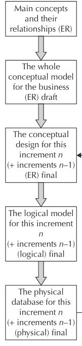

**图 1-1.** 敏捷数据库设计流程

如果数据库将存储有价值的数据，则必须由理解数据库工作并知道如何对数据建模的人设计。在设计数据库时，你可能需要所有类型的领域专家为你提供做出设计决策所需的信息。此外，如果你的截止日期很紧，你甚至需要更多信息来确保做出正确的决策；你不想以后再更改所有内容。优先级对每个人（甚至是终端用户）来说都很重要。没有什么比工作太多而时间太少更让人压力大的了。数据库设计意味着团队合作，这就是为什么在今天的环境下，你需要一个工具来正确地进行数据库设计。

在选择数据库设计工具时，你希望一个支持这些功能的工具：`ER` 符号、从概念设计到自动转换的过程、基于逻辑设计的逻辑设计、多用户环境、版本控制、报告功能、生成数据库对象的脚本以及文档工具。它还支持命名、流程、设计规则，以及对设计进行比较。此外，如果你的工具还允许你对设计进行比较，以及与其他设计之间进行比较。

`Oracle SQL Developer Data Modeler`（在本书中称为 `Dataeler`）是一个用于数据库设计的工具，它支持 `Oracle`、`SQL Server` 以及 `DB2` 数据库的建模。它还支持数据库进行正向和反向工程。当你设计好数据库并拥有物理模型后，你可以使用 `DDL` 脚本来创建对象。`Dataeler` 支持数据库以及多维模型。该工具作为一个独立产品可用，也可以集成到 `SQL Developer` 中，以便你使用它来设计。

`Dataeler` 提供以下功能供数据库设计师使用：

- 数据库设计工具：关于数据库的元数据集合位于 `Dataeler` 中。设计由多维模型、关系模型、关系类型模型、流程、业务信息以及对象模型组成。
- 定制：你可以根据喜好调整 `Dataeler`。在偏好中，你可以定义。
- 版本控制：`Dataeler` 集成了名为 `Subversion` 的控制工具。这允许多个用户同时更改模型。它提供了版本控制功能。当使用版本控制时，设计的最新版本始终在版本控制中，而你正在使用的在本地目录中。
- 现有数据库：你可以从现有数据库、其他设计工具（例如 `Oracle Designer` 或 `ERwin`）或 `DDL` 脚本将设计导入 `Dataeler`。
- 报告功能：`Dataeler` 内置了报告功能，你也可以创建报告和模板并将搜索功能作为报告基础。你还可以使用报告库进行设计报告并使用 `SQL` 查询信息。你还可以打印设计布局。
- 文档工具，提高质量和效率：`Dataeler` 帮助你标准化设计和数据文档。你可以使用命名标准、域、词汇表和设计规则来获得更好的质量。你还可以对模型和设计进行比较，并与数据库进行比较。不同的比较、转换和符号将为你提供一个更具成本效益的环境和更高的质量。

使用 `Dataeler` 的设计流程始于设计逻辑模型。在逻辑模型中，你定义实体、属性和关系。下一步是基于逻辑模型创建关系模型。你只需点击“`Engineer To Relational`”图标即可。完成关系模型后，是时候创建物理模型了。你只需右键点击浏览器中的“`Physical Model`”并选择“`New`”。创建物理模型时，你必须知道将使用什么数据库（`Oracle`、`SQL Server` 或 `DB2`）以及版本。物理模型的所有属性取决于所选的技术。创建物理模型后，你应该定义物理对象的属性。完成这些后，你就可以准备生成 `DDL`（即创建数据库对象的 `SQL` 脚本）了。你可以通过选择 `File | Export | DDL File` 来创建 `DDL`。然后在你的数据库上运行这些 `DDL` 即可创建对象。这一切都可以在多用户环境中完成，并在使用版本控制的情况下进行。

# 第1章：介绍数据库设计和 Oracle SQL Developer Data Modeler 7

你也可以使用 `Data Modeler` 对现有数据库（`Oracle`、`SQL Server`、`DB2`）进行文档化。你可以从数据字典或现有的 `DDL` 反向生成文档，也可以从其他设计工具（`Oracle Designer`、`ERWin` 或 `VAR` 文件）导入。或者，你也可以结合所有这些技术，例如，从另一个设计工具引入一些描述，并将其添加到来自数据字典的物理信息中。你可以通过选择“`文件 | 导入`”菜单来找到这些功能。

由于数据库设计的一个重要部分是报告，你可能希望使用 `Data Modeler` 创建模板，并基于这些模板创建报告。你还可以创建一个仓库；除了模板之外，你还可以使用 `SQL` 查询其中的信息。你还可以打印图表，或使用强大的搜索功能来搜索报告中的信息。

此外，能够在一个地方记录所有与数据库相关的信息也非常重要。在 `Data Modeler` 中，你可以记录数据库设计所需的所有信息，以及变更请求、业务信息等内容。

如果你要在数据库中存储重要数据，那么完成整个数据库设计过程至关重要。数据库设计是生成详细的实体关系图和数据流图，以为创建数据库对象生成 `DDL` 脚本的过程。数据库设计包括需求分析、概念设计、逻辑设计、物理设计，以及取决于你问谁，还包括事务设计。为了设计数据库（特别是在敏捷系统中），你需要 `Oracle SQL Developer Data Modeler`。它是一个免费工具，支持数据库设计人员的所有需求以及额外功能。


本章将介绍你在开始使用 `Oracle SQL Data Modeler` 之前需要了解的知识。在开始使用该工具之前，与团队达成并实施某些指南将帮助你简化工作流。特别是，在生产环境或多用户环境中使用 `Data Modeler` 之前，决定标准化问题、调整工具中的某些设置并针对你的需求进行调优是非常有价值的。许多情况下，首次将 `Data Modeler` 引入工作流时，从一个小项目开始是好的，并不是因为这个工具很难用，而是为了充分发挥它的潜力，需要做出很多决策。

标准化团队工作流并提高数据库设计质量的一种简单方法是使用域（domains）、词汇表（glossaries）和设计规则。域定义了属性的可能值。创建域很容易，但决定包含什么却很难。词汇表是一组预先接受的术语，换句话说是在设计中使用的词汇。创建词汇表可能比创建域更有挑战性，因为给概念命名通常很困难。设计规则是针对设计质量的一组预定义规则。为所有设计人员共享创建域和词汇表，并实施域和词汇表将提高你的效率和所有设计的质量。此外，在进入设计过程下一个阶段之前使用设计规则将提高最终数据库的质量。

这里有一些需要考虑的其他问题：你使用哪些报告？你将它们保存在哪里？会有什么类型的数据定义语言（`DDL`）文件，你会保存它们吗？你会如何使用版本控制（如果的话）？你将使用哪种关系型数据库管理系统（`RDBMS`）？我将在本书书中涉及这些主题。

你可以从 `Oracle` 技术网络 (`OTN`) 下载 `Data Modeler`，地址为：`www.oracle.com/technwork/developer-tools/datameler/overview/index.html`。下载 `.zip` 文件后，将其解压以开始使用 `Data Modeler`。

`Data Modeler` 有不同的版本，取决于你的操作系统以及你是想要带有还是不带运行时环境（`JRE`）的版本。你可以下载免费的 `Data Modeler` 独立版或 `Oracle SQL Developer`（后者集成了 `Data Modeler`）。你应该对组织内将使用哪个版本的产品达成一致，以避免不同版本之间的冲突，特别是当你在多用户环境中使用版本控制时。

## 什么是设计？

在 `Data Modeler` 中，你创建的对象集合被称为设计（design）。一个设计由一个扩展名为 `.dmd` 的扩展 `XML` 文件（例如 `Customer.dmd`）、一个目录（例如 `Customer`）以及子目录和 `XML` 文件组成。设计中的每个元素（例如设计、表或实体）都有它们自己的 `XML` 文件和唯一标识符（对象 `ID`）。`.dmd` 文件会自动创建设计所需的目录和子目录。除非你清楚自己在做什么，否则不应在工具之外编辑这些 `XML` 文件。导致 `XML` 文件损坏的常见原因是使用了不支持编辑器或错误的字符集。如果这些文件损坏，`Data Modeler` 将无法读取它们。

> 提示
>
> 如果你想将设计提供给他人，请将 `dmd` 文件和目录进行压缩。

一个设计由一个逻辑模型、可选的多个基于该逻辑模型的关系模型，以及可选的多个基于关系模型的物理模型组成。还可以有多维模型、数据类型模型、过程模型、域、业务信息等。

在开始生产环境中使用 `Data Modeler` 之前，你需要决定设计将由什么组成以及如何命名。设计可以由组织中的所有数据库、一个数据库实例、一个架构或完全不同的内容组成。你需要定义设计，以便处理应用程序、架构或数据库之间共享的对象。如果你想共享对象，它们应该在同一个设计中，因为 `Data Modeler` 不支持在不同设计之间共享对象。此外，决定谁将使用 `Data Modeler` 以及他们将对其做什么非常有价值。这个决定可能帮助你理解设计在组织中的含义，并为人员授予正确的权限。此外，你应该为你的设计创建一个命名标准。例如，你可以将设计命名为 `Customer`、`CUSTOMER`、`CustomerDB` 或 `CustomerData`。你会使用哪一个？如果设计命名一致且你知道在哪里找到它们，将高效得多。


在 Data Modeler 中，浏览器面板（`Browser pane`）显示设计中的所有元素（见图 2-1）。还有用于不同操作菜单：文件、编辑、视图、团队、工具和帮助。Data Modeler 不会自动保存，因此记住通过选择`文件 | 保存`或`文件 | 另存为`来频繁保存。如果你想以不同的位置或不同的名称保存设计，请使用`另存为`。在`文件`菜单中，你会看到`最近设计`。这是你处理过的设计列表；位于顶部的是你打开的。如果你想打开设计时节省时间，并且知道它是你上次处理的设计；与其使用`文件 | 打开`浏览文件打开设计，不如选择`文件 | 最近设计`。你可以选择`文件 | 关闭`关闭一个设计，选择`文件 | 关闭所有`关闭所有打开的设计。使用其中任一操作，Data Modeler 都会保持开启。如果你选择`文件 | 退出`，所有设计以及 Data Modeler 都将关闭。


> **提示** 选择 `文件 (File) | 退出 (Exit)` 可以退出 Data Modeler 并关闭所有打开的设计。Data Modeler 将要求你保存所有设计。如果你点击窗口右上角的关闭 (X) 按钮，系统会询问你是否只保存其中一个设计。

在浏览器（`Browser`）窗格中，你可以选择一个实体或表，右键点击并选择`转到图表`（`Go To Diagram`）。你将看到该对象所在的所有设计、子视图和显示，并选择你需要的那个。该图表/子视图或显示将打开，对象将在画布上被选中。

如果你在画布上右键点击，将看到几个选项。通过选择`添加/删除对象`（`Add/Remove Objects`）并取消勾选包含（`include`）属性，你可以从此图表/子视图/显示中添加或移除对象。通过`细节`（`Details`），你可以调整图中显示哪些对象的细节，哪些不显示。通过`显示`（`Show`），你可以向图表添加网格、页网格、标签和图例。网格将帮助你对齐对象并使图表更易读。页网格显示页的开始和结束位置。标签例如外键名称或关系中的源和目标名称。图例显示审计信息，例如，包括图表名称、作者、创建时间、修改时间、设计名称以及模型类型（逻辑或关系型）。

如果浏览器窗格（或任何其他窗格）出现，你可以从`视图`（`View`）菜单中恢复它。如果你需要查看日志以进行故障排除或了解工具状态，请根据需要选择`视图 | 日志`（`View | Log`）或`视图 | 外部日志`（`View | External Log`）。

学习如何使用该工具的最佳方法是查看启动页（见上文 2-1 节）。在启动页上，你会找到指向文档、教程和在线演示的链接。如果启动页由于某种原因消失，你可以通过选择`帮助 | 启动页`（`Help | Start Page`）来获取帮助。事实上，你可以使用搜索和目录来查找更多关于该工具的信息。通过`帮助 | 关于`（`Help | About`），你可以检查你正在使用的 Data Modeler 版本和构建版本。你还可以查看包含哪些组件、属性和扩展。

你可以使用导航（`Navigator`）窗格（位于图 2-1 右侧）跳转到图表的精确位置或查看全景。当你拥有大型图表或无法通过查看画布找到所需对象时，导航窗格格外的好用。在导航器中，你可以在图片周围拖动一个红色矩形。当你移动光标时，逻辑或关系模型中的图表会相应移动。还有带有用于设计的工具栏和图标的图表。通过右键点击对象，你可以看到在该对象上允许的操作。

对象具有属性，可以通过右键点击对象并选择`属性`（`Properties`）或双击对象来访问这些属性。

还有一个`消息`（`Messages`）窗格（位于图 2-1 底部），显示 Data Modeler 中正在发生的消息。红色的消息可能需要你注意；其他信息仅供参考。

对于版本控制，有一个`版本`（`Versions`）窗格作为 Subversion 目录，以及一个`待定更改`（`Pending Changes`）窗格，你可以看到传入和传出的更改。

## 自定义界面

你可以根据自己的工作喜好自定义 Data Modeler 的用户界面。决定屏幕上显示哪些工具，你可以调整它们的大小，并可以将不同的窗格移动到不同位置以提供更好的服务。只需拖动任何面板移动到你想放置的地方。你会看到一个跟随面板的矩形。当位置和形状符合你的要求时，释放鼠标按钮将其放置。这种可能性是无限的，因此请找到适合你的组合。在图 2-2 中，你可以看到为了满足你的需求而偏好的 Data Modeler 布局。

在生产环境中使用 Data Modeler 之前，根据你的需求调整工具是重要的。你可以让 Data Modeler 保持默认设置，但随着时间推移，你会发现需要某些设置。在开始时，你应该设置某些偏好设置和领域。在版本控制中，这些偏好设置将如何共享。工具还有帮助你维护设计的偏好规则，但你可以根据需要与其他用户共享这些偏好设置。

偏好是影响 Data Modeler 行为的设置，某些偏好立即生效，而其他偏好需要你关闭并重新打开图表才能生效。为了确保更改生效，在你打开图表时需要关闭 Data Modeler。由于某些偏好设置在内存中，或者被复制到了其他地方，有时关闭 Data Modeler 并重新打开它更好。

在每个版本的 Data Modeler 中，都有为了满足用户的偏好设置。关于特定偏好的详细描述，请查阅 Data Modeler 帮助。本章将涵盖最重要的。其他章节将涵盖影响该特定阶段的偏好设置。

## 使用 Oracle SQL Data Modeler 的偏好

本节将涵盖使工具符合你要求的偏好设置，并解释在实施后如何与其他用户共享这些偏好。你可以在项目期间更改所有偏好，


但以后更改设置总是很困难，因为它会影响所有用户并可能影响工具的行为。

图 2-4 显示了偏好对话框，是在选择`工具 | 偏好`后打开的，左侧选中了 Data Modeler。为 Data Modeler 使用定义默认目录非常有价值。如果你确切知道它们在哪里，对你来说会更容易。你应该为所有用户定义 Data Modeler 标签页上的目录，这将使你的生活方便得多，特别是在版本控制和解决问题时。

- 默认设计目录是你默认查找设计的目录，并且如果你导出或导入 Data Modeler 设计，它将默认保存在这里。
- 默认导入目录是偏好和其他设计级属性导入的默认目录。


- 默认保存目录是你默认保存文件的目录。例如，Data Modeler 将尝试在此处查找导出的文件。
- 默认系统类型目录是 Data Modeler 系统文件的默认存储目录。通常这些文件是类型定义文件、默认领域文件、词表文件、RDBMS 站点、自定义脚本和保存的搜索标准。这些文件影响你的 Data Modeler 安装。注意对于领域，Data Modeler 将不会使用`默认系统类型`偏好设置的目录中 `defaultdomains.xml` 之外的任何文件的更改。如果在另一个文件中进行了更改，必须将其添加到此默认文件中才能生效。
- 默认报告目录是存储 Data Modeler 生成的报告的目录，可以在偏好（`Preferences`）-> `Data Modeler | Reports` 中定义。

如果你在偏好对话框的左侧面板中展开 Data Modeler，将看到按类别分组的更多偏好。

> 注意
> 你可以通过设置`DDL 文件导出目录`（`DDL Files Export Directory`），为 `Data Modeler | DDL` 下创建数据库对象的 DDL 脚本定义默认目录。


在图（`Diagram`）偏好中，你会找到针对逻辑模型的偏好。Data Modeler 支持多种表示法类型。你可以在表示法类型（`Notation Type`）列表中将首选表示法设置为 Barker 或 Bachman。（信息工程表示法无法设置为默认表示法。）你还可以通过选择实体继承偏好中的`框中框表示`（`Box-in-Box Presentation`）来决定继承的呈现方式。你可以随时更改此偏好，甚至可以通过右键点击图表并设置表示法（`Notation`）来更改图表的当前表示法或框中框设置。

还有模型（`Model`）偏好，如图 2-5 所示。RDBMS 类型是 Data Modeler 支持的 RDBMS 类型列表，而 RDBMS 站点是 RDBMS 类型的别名。你可以根据需要添加尽可能新的 RDBMS 站点。例如，Oracle 12c 或 SQL Server 2008 是一种 RDBMS 类型，你可以创建一个名为 TEST12c 的别名，以定义你环境中对应 Oracle 12c 的 RDBMS 站点。`默认 RDBMS 类型`偏好用于选择默认 RDBMS，而`RDBMS 站点`偏好在创建物理模型时默认被选为该 RDBMS 站点。（第 6 章将详细介绍 RDBMS 类型和站点。）数据类型（`Datatype`）选项用于定义工具对属性（以及列）建议数据类型的默认值。例如，如果你选择了域（`Domain`），在创建新属性时，默认会建议域作为数据类型。`首选逻辑类型`（`Preferred Logical Types`）是一项实用的功能。工具中有许多不同的逻辑类型，而你可能只需要其中十个以内。如果你定义了自己的一组首选逻辑类型，它将提供一个更短的列表，供你在创建新属性时从中选择。你可以随时向列表添加新的逻辑类型。通过选择首选逻辑类型并点击指向它的箭头，即可将逻辑类型添加到到你的列表中。你将在对话框（首选逻辑类型）的右侧看到已选逻辑类型的列表。

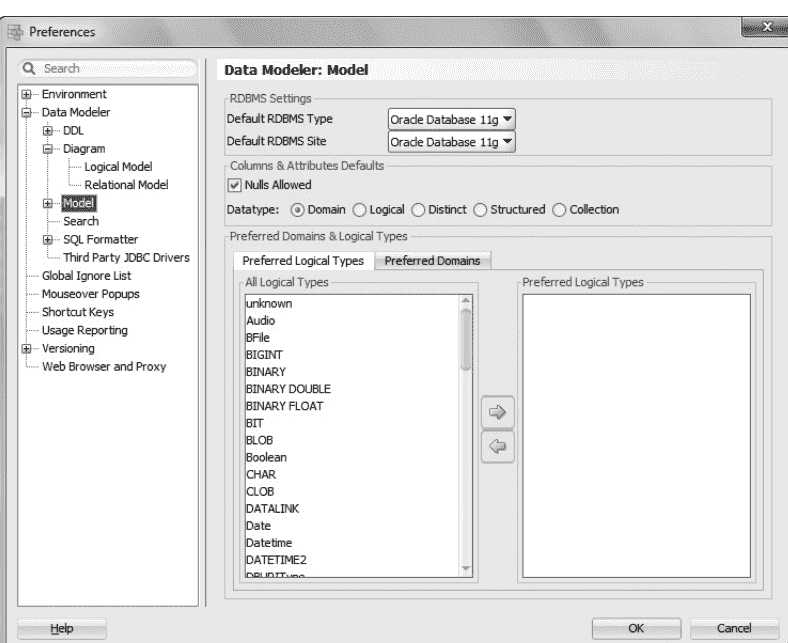

图 2-5. 模型偏好

你还可以定义快捷键，以使工具的使用更加顺畅。图 2-6 显示了快捷键（`Shortcut Keys`）偏好。你可以使用列出的快捷键，也可以定义自己的快捷键。

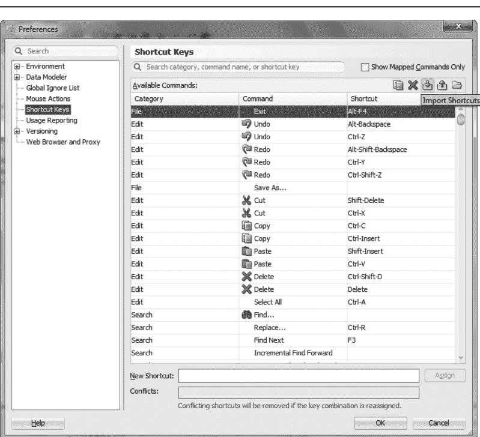

图 2-6. 快捷键偏好

当选择 Data Modeler 时，可以使用偏好对话框底部的导出/导入按钮与其他用户共享你的 Data Modeler 偏好。要导出偏好，点击`导出`按钮。系统将要求输入保存 XML 文件的名称和位置，并将据此保存。此 XML 文件可以通过`导入`按钮导入另一台计算机。你只需要定义一次设置，然后将其导入组织中的其他计算机。每当你更改工作环境中的官方偏好时，请确保向所有用户导出/导入新的偏好。

> 提示
> 如果你发现导入失败（例如导入了错误的文件），请不要点击确定；请点击取消。只有点击确定后，导入才完成。

快捷键定义未包含在 Data Modeler 导出的偏好中。如果你想与其他用户共享快捷键，请使用如图 2-6 所示图标的导出/导入功能。

> 提示
> 你应该像对待其他重要文件一样对导出文件进行版本控制。你将在第 9 章学习更多关于版本控制的知识。

除了帮助设置 Data Modeler 工作环境的属性外，还有仅影响特定设计的属性。这是从 Data Modeler 4.0 版本开始的新行为。从 4.0.3 版本开始，可以通过双击浏览器面板中的设计名称或右键点击并选择`属性`来打开`设计属性`对话框。你可以在`设置`下选择`全局设计级选项`。如果`使用全局设计设置`，属性将通过来自 `datamodel\datamodel\types\dl_settings.xml` 的全局设计级设置自动修改。此外，当具有全局设计级设置的设计更改了某些属性时，更改将同时保存到本地文件和全局文件。

如所述，你可以通过双击浏览器面板中的设计名称或右键点击并选择`属性`来找到设计级属性。

设置标准使得人们更容易阅读。在设置 | 逻辑模型中，你可以将逻辑表示法设置为 Barker 或 Bachman。（信息工程表示法无法设置为默认表示法。）你还可以通过选择实体继承偏好中的`框中框表示`来决定继承的呈现方式。你可以随时更改此偏好，甚至可以通过右键点击图表并设置表示法来更改图表的当前表示法或框中框设置。

还有模型偏好，如图 2-5 所示。RDBMS 类型是 Data Modeler 支持的 RDBMS 类型列表，而 RDBMS 站点是 RDBMS 类型的别名。你可以根据需要添加尽可能新的 RDBMS 站点。例如，Oracle 12c 或 SQL Server 2008 是一种 RDBMS 类型，你可以创建一个名为 TEST12c 的别名，以定义你环境中对应 Oracle 12c 的 RDBMS 站点。`默认 RDBMS 类型`偏好用于选择默认 RDBMS，而`RDBMS 站点`偏好在创建物理模型时默认被选为该 RDBMS 站点。（第 6 章将详细介绍 RDBMS 类型和站点。）数据类型（`Datatype`）选项用于定义工具对属性（以及列）建议数据类型的默认值。例如，如果你选择了域（`Domain`），在创建新属性时，默认会建议域作为数据类型。`首选逻辑类型`（`Preferred Logical Types`）是一项实用的功能。工具中有许多不同的逻辑类型，而你可能只需要其中十个以内。如果你定义了自己的一组首选逻辑类型，它将提供一个更短的列表，供你在创建新属性时从中选择。你可以随时向列表添加新的逻辑类型。通过选择首选逻辑类型并点击指向它的箭头，即可将逻辑类型添加到你的列表中。你将在对话框（首选逻辑类型）的右侧看到已选逻辑类型的列表。

你还可以定义快捷键，以使工具的使用更加顺畅。图 2-6 显示了快捷键偏好。你可以使用列出的快捷键，也可以定义自己的快捷键。

当选择 Data Modeler 时，可以使用偏好对话框底部的导出/导入按钮与其他用户共享你的 Data Modeler 偏好。要导出偏好，点击`导出`按钮。系统将要求输入保存 XML 文件的名称和位置，并将据此保存。此 XML 文件可以通过`导入`按钮导入另一台计算机。你只需要定义一次设置，然后将其导入组织中的其他计算机。每当你更改工作环境中的官方偏好时，请确保向所有用户导出/导入新的偏好。

> 提示
> 如果你发现导入失败（例如导入了错误的文件），请不要点击确定；请点击取消。只有点击确定后，导入才完成。

快捷键定义未包含在 Data Modeler 导出的偏好中。如果你想与其他用户共享快捷键，请使用如图 2-6 所示图标的导出/导入功能。

> 提示
> 你应该像对待其他重要文件一样对导出文件进行版本控制。你将在第 9 章学习更多关于版本控制的知识。

命名标准使工作变得更容易并提高你的设计质量。例如，你可以决定逻辑模型中的名称如何被分隔。在逻辑模型中，你可以选择空格（驼峰命名 `camelCase`）或字符。例如，如果你选择了空格，客户名称将是 Customer Name。如果你选择了标题大小写（`title case`），客户名称将是 CustomerName。如果你选择了下划线（`_`），客户名称将是 Customer_name。在关系模型中，你还可以选择`仅缩写`（`Abbreviated Only`），这意味着使用了缩写词。命名标准可以根据所选词汇表进行验证。你可以在`引入词汇表`部分找到更多关于词汇表的信息。你可以对属性、列、域、实体和表的命名标准进行添加、修改和删除，这些标准会在应用设计规则时进行检查。


## 定义对象类型的格式

设置标准使得人们更容易阅读。在设置 | 逻辑模型中，你可以选择 Barker 或 Bachman。（信息工程表示法无法设置为默认表示法。）你还可以通过选择实体继承偏好中的`框中框表示`（`Box-in-Box Presentation`）来决定继承的呈现方式。你可以随时更改此偏好，甚至可以通过右键点击图表并设置表示法（`Notation`）来更改图表的当前表示法或框中框设置。

还有模型偏好，如图 2-5 所示。RDBMS 类型是 Data Modeler 支持的 RDBMS 类型列表，而 RDBMS 站点是 RDBMS 类型的别名。你可以根据需要添加尽可能新的 RDBMS 站点。例如，Oracle 12c 或 SQL Server 2008 是一种 RDBMS 类型，你可以创建一个名为 TEST12c 的别名，以定义你环境中对应 Oracle 12c 的 RDBMS 站点。`默认 RDBMS 类型`偏好用于选择默认 RDBMS，而`RDBMS 站点`偏好在创建物理模型时默认被选为该 RDBMS 站点。（第 6 章将详细介绍 RDBMS 类型和站点。）数据类型（`Datatype`）选项用于定义工具对属性（以及列）建议数据类型的默认值。例如，如果你选择了域（`Domain`），在创建新属性时，默认会建议域作为数据类型。`首选逻辑类型`（`Preferred Logical Types`）是一项实用的功能。工具中有许多不同的逻辑类型，而你可能只需要其中十个以内。如果你定义了自己的一组首选逻辑类型，它将提供一个更短的列表，供你在创建新属性时从中选择。你可以随时向列表添加新的逻辑类型。通过选择首选逻辑类型并点击指向它的箭头，即可将逻辑类型添加到你的列表中。你将在对话框（首选逻辑类型）的右侧看到已选逻辑类型的列表。

你还可以定义快捷键，以使工具的使用更加顺畅。图 2-6 显示了快捷键偏好。你可以使用列出的快捷键，也可以定义自己的快捷键。

任何违反行为都将作为错误或警告报告。你可以在`引入设计规则`部分找到更多关于设计规则的信息。


在我看来，设计属性对话框中命名标准下最有价值的选项卡是模板，如图 2-10 所示。在模板选项卡上，你可以定义主键、外键、约束和索引等元素的命名方式。你可以指定命名格式字符串，模板可以包含变量和固定部分。模板在自动生成元素时使用。

设计级属性仅对定义它们的特定设计有效。如果你想在其他设计中使用相同的属性或让其他用户使用，可以使用导出/导入功能进行共享。从设计属性中，选择“设置”，如图 2-11 所示。点击“保存”可以保存当前设置。通过“导出”，你将创建一个包含设计级属性的 XML 文件，并将其与其他用户共享。通过点击

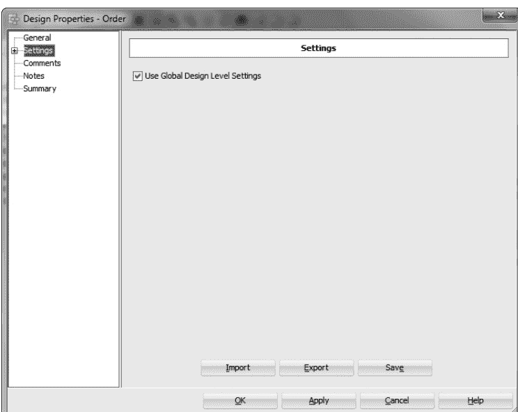

图 2-11. 设计属性的导出/导入功能

导入时，你可以导入属性或其他用户导出的属性。XML 文件（包括定义的属性）应保留在版本控制中，并且当任何属性发生更改时，应导入到每个设计中。

属性导出的默认目录在首选项（Preferences）下的 Data Modeler 中通过“默认保存目录”（Default Save Directory）设置定义，属性导入的默认目录通过“默认导入目录”（Default Import Directory）设置定义。

从 4.0.3 版本开始，你还可以使用全局设计级设置。你可以在设计属性（Design Properties）对话框的设置（Settings）下，为当前设计选择“使用全局级设置”（Use Global Level Settings）选项。如果选择了使用全局设计级设置，设计属性将根据文件 `datamodeler\datamodeler\types\dl_settings.xml` 中的全局设计级设置自动修改。

当打开设计时。例如，对分类类型、默认字体和颜色、默认线宽和颜色、命名标准规则以及比较映射的更改将在设计属性中自动实现。设计仍然使用位于某个目录下的 `dlsettings.xml` 文件，勾选“使用全局设计级设置”框将在打开设计时将设置从全局文件复制到本地文件。

因此，如果你想在设计中使用全局设置，请根据你对设计属性的更改保持文件 `datamodeler\datamodeler\types\dlsettings.xml` 的更新，选择“使用全局设计级设置”，并记住与其他用户共享该全局文件。一般步骤如下：

- 1. 在其中一个设计中创建所需的设计属性。
- 2. 在设计属性对话框中点击“保存”（Save）以保存设置。如果你不保存，更改将不会保存到本地或全局文件中。如果你点击“保存”且勾选了“使用全局设计级设置”框，你将收到消息：“勾选‘使用全局设计级设置’复选框将覆盖两个文件——全局设计级设置文件和当前设计级设置文件。确定继续吗？”点击“确定”（OK）。
- 3. 使用 Subversion 与其他用户共享文件，并确保你有一套更新该文件的程序。你可以将文件从版本控制复制到 `datamodeler\datamodeler\types\`，让 Data Modeler 自动将更改复制到本地设计文件中。


> 注意
> 当你为一个设计选择“全局设计级设置”选项时，所有新设计的默认设置都将启用为“使用全局级设置”。旧设计不会自动更改。

如所述，词汇表是设计工作使用的单词词汇表。你可以使用它们来保证定义的设计规则，或在逻辑模型和关系模型之间进行工程建模。你可以从零开始创建一个词汇表，基于现有的逻辑模型创建一个，或使用现有的词汇表。词汇表是一个扩展名为 `.glossary` 的 XML 文件。

你可以在词汇表编辑器（Glossary Editor，选择工具 Tools | Glossary Editor）中创建和编辑词汇表，如图 2-12 所示。保存词汇表的默认目录在“默认导入目录”首选项中设置。

如果你想编辑现有词汇表，打开词汇表编辑器，选择词汇表文件，进行更改并点击“保存”（Save）。此文件可以是使用 ERwin 创建的 `.csv` 或 `.txt` 文件。

如果你想创建一个新词汇表，启动词汇表编辑器并定义一个不存在的文件名。Data Modeler 将自动创建该文件作为新词汇表。每个词汇表都应该有一个名称。

图 2-12 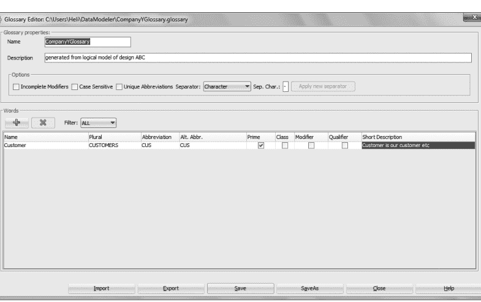 词汇表编辑器

## 介绍词汇表

# 第 2 章：开始使用 Oracle SQL Developer Data Modeler 27

## 创建或编辑词汇表

你可以在词汇表编辑器（Glossary Editor，选择工具 Tools | Glossary Editor）中创建和编辑词汇表，如图 2-12 所示。保存词汇表的默认目录在“默认导入目录”首选项中设置。

如果你想编辑现有词汇表，打开词汇表编辑器，选择词汇表文件，进行更改并点击“保存”（Save）。此文件可以是使用 ERwin 创建的 `.csv` 或 `.txt` 文件。

图 2-12  词汇表编辑器

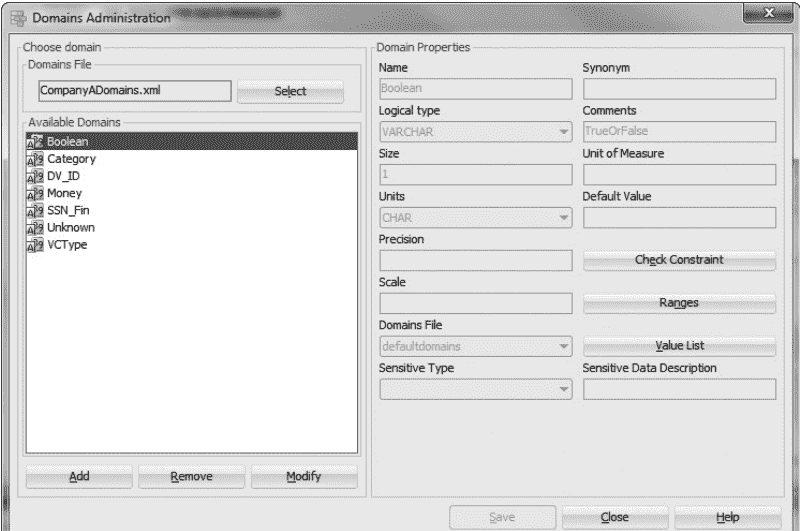

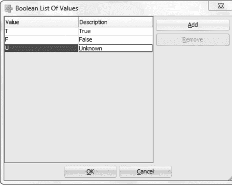

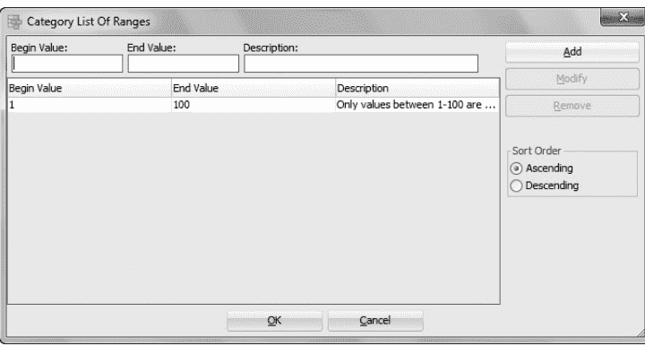

对话框并点击“修改”（Modify）。然后点击“范围”（Ranges）。在“范围列表”（Category List Of Ranges）对话框中，如图 2-15 所示，填入所需的范围并点击“添加”（Add）。如果列表中有很多范围，您可以使用右侧的单选按钮对其进行升序或降序排序。

Data Modeler 使用的唯一域文件是 `default.xml`，位于您在“默认系统目录”（Default System Directory）首选项中设置的目录。向其他用户共享新域有两种可能：您可以修改默认文件并与其它用户共享，或者您可以修改一个单独的文件并将其与所有导入到其本地默认文件的用户共享。为您的组织的标准域集准备一个单独的文件是有用的，这可以确保每个人都使用同一文件的最新版本。该解决方案还允许用户定义不会与其他用户共享的自定义域。

如果您决定使用默认域文件并共享它，可以将该文件复制到所有计算机的“默认系统类型目录”（Default System Types Directory）指定的目录中，这样所有用户都可以在他们的设计中使用这些域。

如果您决定为公司特定的域准备一个单独的文件，您可以将其与用户共享，但在使用新域之前，您必须先将设置导入到本地默认文件中。可以通过“文件”（File）菜单中的“导入”（Import）功能进行导入：选择文件 | 导入 | 域（Import | Domains）。选择“打开域文件”（Open Domain File），并选择想要的文件。勾选“导入到默认域”（Import In Default Domains）框并点击“导入”（Import）。如果您没有勾选“导入到默认域”框，您将不会

在此项设计中拥有这些域，这可能不是您想要的。

# 32 数据库设计精通：Oracle SQL Developer Data Modeler 教程

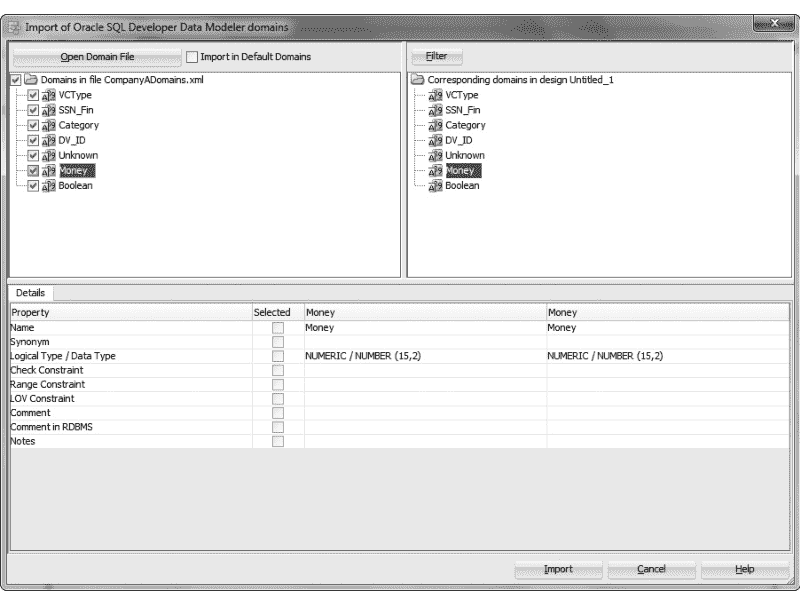

有关导入功能的更多信息，请参考图 2-16。

提示 您应该将共享的域文件保存到版本控制中。您将在第 9 章学习更多关于版本控制的知识。

如所述，设计规则是为您的数据库设计进行标准化测试的一种简单方法。测试是自动的，但每当您认为需要时，必须手动启动。工具中预设了设计规则，您也可以创建自己的规则和规则集。选择“工具”（Tools） | 设计规则和转换”（Design Rules and Transformations） | 设计规则（Design Rules）来打开设计规则对话框。

Data Modeler 中有很多预定义设计规则，如图 2-17 所示。这些规则根据模型（通用、逻辑、关系、物理）和模型组件（表、视图、属性等）进行分类。您可以随时根据这些规则检查您的模型，也可以创建一组将进行检查的规则集。您可以通过选择规则并点击“已选择”（Selected）来逐一检查模型或检查所有规则。或者可以通过点击“全部”（All）来检查所有规则。结果将以错误（红色）或

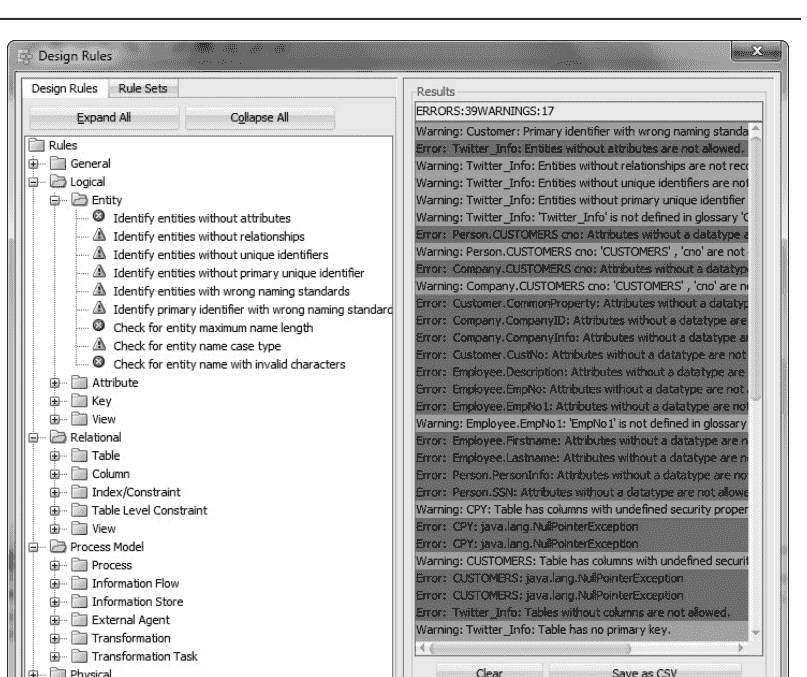

图 2-17. 设计规则对话框

警告（蓝色）。双击错误/警告消息将将您带到错误或警告发生的位置，您可以立即修复任何错误或警告。当您开始使用 Data Modeler 时，您可能对工具自带的设计规则感到满意，但在使用 Data Modeler 期间，您可能会提出新规则，因此知道您可以将它们添加为自定义设计规则是好的。您可以创建基于自定义库的自定义设计规则。您可以在“库”（Libraries）对话框中根据需要创建自定义库，如图 2-18 所示。工具（Tools） | 设计规则和转换（Design Rules and Transformations） | 库（Libraries）。然后您可以在“设计规则”对话框中基于该自定义库创建自定义设计规则，如图 2-19 所示，工具（Tools） | 设计规则和转换（Design Rules and Transformations） | 自定义规则（Custom Rules）。自定义设计规则

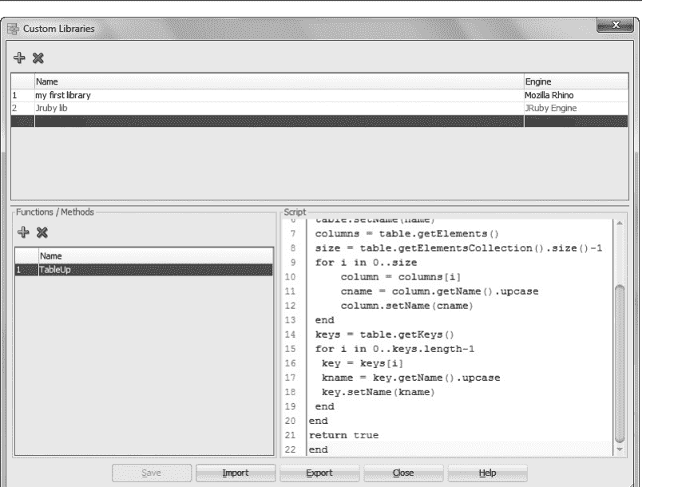

图 2-18. 创建库

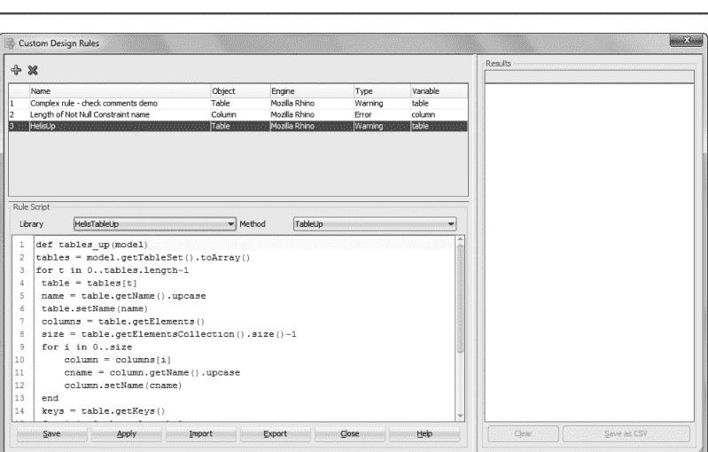

| 名称 (Name) | 对象 (Object) | 引擎 (Engine) | 类型 (Type) | 变量 (Variable) |
|---|---|---|---|---|
| 1 | 复杂规则 - 检查注释演示 | 表 | JRuby | |
| 2 | 长度非空约束演示 | 列 | JRuby | |
| 3 | 方法 | 表 | JRuby | |

图 2-19. 创建自定义规则

自定义设计规则将自动添加到规则集中，这样所有用户都可以在设计中使用。为您的组织的标准域集准备一个单独的文件是有用的，这可以确保每个人都使用同一文件的最新版本。该解决方案还允许用户定义不会与其他用户共享的自定义域。

在“库”对话框中，根据需要创建自定义库。您可以使用绿色按钮来分配内存。

提示 您应该将共享的域文件保存到版本控制中。您将在第 9 章学习更多关于版本控制的知识。

对于每个规则，您可以指定执行引擎，这可能。

# 36 数据库设计精通：Oracle SQL Developer Data Modeler 教程

注意 如果您决定使用默认域文件并共享它，可以将该文件复制到所有计算机的“默认系统类型目录”（Default System Types Directory）指定的目录中，这样所有用户都可以在他们的设计中使用这些域。

# 34 数据库设计精通：Oracle SQL Developer Data Modeler 教程

警告（蓝色）。双击错误/警告消息将将您带到错误或警告发生的位置，您可以立即修复任何错误或警告。

# 第 2 章：开始使用 Oracle Developer Data Modeler 35


| 名称 (Name) | 对象 (Object) | 引擎 (Engine) | 类型 (Type) | 变量 (Variable) |
|---|---|---|---|---|
| 1 | 复杂规则 - 检查注释演示 | 表 | JRuby | |
| 2 | 长度非空约束演示 | 列 | JRuby | |
| 3 | 方法 | 表 | JRuby | |

图 2-19. 创建自定义规则

自定义设计规则将自动添加到规则集中，这样所有用户都可以在设计中使用这些。为您的组织的标准域集准备一个单独的文件是有用的，这可以确保每个人都使用同一文件的最新版本。该解决方案还允许用户定义不会与其他用户共享的自定义域。

如果您决定使用默认域文件并共享它，可以将该文件复制到所有计算机的“默认系统类型目录”（Default System Types Directory）指定的目录中，这样所有用户都可以在他们的设计中使用这些域。

如果您决定为公司特定的域准备一个单独的文件，您可以将其与用户共享，但在使用新域之前，您必须先将设置导入到本地默认文件中。可以通过“文件”（File）菜单中的“导入”（Import）功能进行导入：选择文件 | 导入 | 域（Import | Domains）。选择“打开域文件”（Open Domain File），并选择想要的文件。勾选“导入到默认域”（Import In Default Domains）框并点击“导入”（Import）。如果您没有勾选“导入到默认域”框，您将不会


有关导入功能的更多信息，请参考图 2-16。

提示 您应该将共享的域文件保存到版本控制中。您将在第 9 章学习更多关于版本控制的知识。

如所述，设计规则是为您的数据库设计进行标准化测试的一种简单方法。测试是自动的，但每当您认为需要时，必须手动启动。工具中预设了设计规则，您也可以创建自己的规则和规则集。选择“工具”（Tools） | 设计规则和转换（Design Rules and Transformations） | 设计规则（Design Rules）来打开设计规则对话框。

Data Modeler 中有很多预定义设计规则，如图 2-17 所示。这些规则根据模型（通用、逻辑、关系、物理）和模型组件（表、视图、属性等）进行分类。您可以随时根据这些规则检查您的模型，也可以创建一组将进行检查的规则集。您可以通过选择规则并点击“已选择”（Selected）来逐一检查模型或检查所有规则。或者可以通过点击“全部”（All）来检查所有规则。结果将以错误（红色）或


图 2-17. 设计规则对话框

# 34 数据库设计精通：Oracle SQL Developer Data Modeler 教程

警告（蓝色）。双击错误/警告消息将将您带到错误或警告发生的位置，您可以立即修复任何错误或警告。当您开始使用 Data Modeler 时，您可能对工具自带的设计规则感到满意，但在使用 Data Modeler 期间，您可能会提出新规则，因此知道您可以将它们添加为自定义设计规则是好的。您可以创建基于自定义库的自定义设计规则。您可以在“库”（Libraries）对话框中根据需要创建自定义库，如图 2-18 所示。工具（Tools） | 设计规则和转换（Design Rules and Transformations） | 库（Libraries）。然后您可以在“设计规则”对话框中基于该自定义库创建自定义设计规则，如图 2-19 所示，工具（Tools） | 设计规则和转换（Design Rules and Transformations） | 自定义规则（Custom Rules）。自定义设计规则


图 2-18. 创建库

# 第 2 章：开始使用 Oracle Developer Data Modeler 35


| 名称 (Name) | 对象 (Object) | 引擎 (Engine) | 类型 (Type) | 变量 (Variable) |
|---|---|---|---|---|
| 1 | 复杂规则 - 检查注释演示 | 表 | JRuby | |
| 2 | 长度非空约束演示 | 列 | JRuby | |
| 3 | 方法 | 表 | JRuby | |

图 2-19. 创建自定义规则

自定义设计规则将自动添加到规则集中，这样所有用户都可以在设计中使用这些。为您的组织的标准域集准备一个单独的文件是有用的，这可以确保每个人都使用同一文件的最新版本。该解决方案还允许用户定义不会与其他用户共享的自定义域。

如果您决定使用默认域文件并共享它，可以将该文件复制到所有计算机的“默认系统类型目录”（Default System Types Directory）指定的目录中，这样所有用户都可以在他们的设计中使用这些域。

如果您决定为公司特定的域准备一个单独的文件，您可以将其与用户共享，但在使用新域之前，您必须先将设置导入到本地默认文件中。可以通过“文件”（File）菜单中的“导入”（Import）功能进行导入：选择文件 | 导入 | 域（Import | Domains）。选择“打开域文件”（Open Domain File），并选择想要的文件。勾选“导入到默认域”（Import In Default Domains）框并点击“导入”（Import）。如果您没有勾选“导入到默认域”框，您将不会

# 36 数据库设计精通：Oracle SQL Developer Data Modeler 教程

注意 如果您决定使用默认域文件并共享它，可以将该文件复制到所有计算机的“默认系统类型目录”（Default System Types Directory）指定的目录中，这样所有用户都可以在他们的设计中使用这些域。

## 性能调优

Data Modeler 是一个 Java ，需要 Java 开发包（JDK）。Data Modeler 包含多个目录和 XML 文件，必须在内存中。如果设计很大，内存可能会耗尽，运行 Data Modeler 会变得太慢。您可能会收到警告消息（低内存）提示您内存不足。如果您有一个良好的设置，可以进行此查看内存使用情况，使用 JavaVM。如果您安装了 Oracle Developer，您将在 `/bin` 目录下找到 `jvm.exe`。在图 2-1 中，您可以看到 JavaVM 分配的内存。已使用了多少。如果您想更改 4.0 之前的设置，要更改的文件是 `/datodeler/datodeler.conf` 或 `/datodeler/datodeler64.conf`，但从 4.0 开始，它是每个用户的配置设置，要编辑的文件是 `C:\Users\username\AppData\Roaming\Oracle SQL Data Modeler\buildno\product.conf`。`buildno` 是您的版本号的一部分。您仍然可以使用 `buildno.conf` 文件，但在此设置生效之前。检查内存设置时，查找 `AddVMOption -Xmx`。它通常有一个值为 `800M`；您可能想将其更改，例如改为 `1250M` 甚至可能是 `3GB` 或 `4GB`。但请注意，如果将设置得太大，Data Modeler 可能无法启动。在这种情况下，请减小值。您可以通过绿色按钮在规则集对话框中创建规则集，可以通过红色按钮删除现有的规则。您可以在规则集选项卡上点击带有铅笔图标的规则添加规则，如图 2-20 所示。

*图 2-20. 选择规则集*

# 第 2 章：开始使用 Oracle Developer Data Modeler 37

## 共享规则

Data Modeler 的共享规则对所有用户都是相同的。如果您决定创建自己的库和规则，您必须共享它们。共享是通过导出/导入功能完成的。导出的默认文件夹在“首选项”（Preferences）中设置，导入在“首选项”（Preferences）中设置。同样，自定义规则可以导出和导入。

# 38 数据库设计精通 Oracle SQL Developer Data Modeler

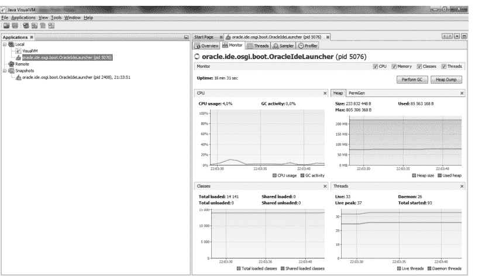

图 2-21. 用于内存使用的 Java VisualVM

在 Data Modeler 4.1 版本中，引入了一个新的设计属性，允许你将设计保存到一个或多个文件中。也可以使用混合模式，将某些对象保在一个文件中，将另一些对象保存在单独的文件。如果你正在使用版本控制，仍然需要将每个对象保存到单独的文件。添加此功能的目的是为了提高性能。

> **提示** 如果不需要，请不要打开物理模型，尤其是当物理模型很大时，因为打开它会极大地影响性能。

## 总结

在组织内的多个用户开始在生产环境中使用 Data Modeler 之前，设定一些标准并根据需求自定义 Data Modeler 是明智的。对于使用哪个版本的工具、谁来使用该工具以及出于什么目的非常重要。你可能还需要决定在组织中什么是设计，以及你将如何命名你的设计。

# 第 2 章：上手 Oracle SQL Developer Data Modeler 39

根据你的需求对工具进行调优至关重要。你可以设置偏好设计属性并将其与所有用户共享，还可以创建并共享术语表和域以支持标准。同样重要的是要理解你可以使用设计规则并设置自己的规则来检查并强制这些标准。所有这些将提高最终设计的生产效率和质量。Data Modeler 能够轻松在整个组织和设计人员之间强制标准。此外，在 Data Modeler 中对所有共享和公共文件使用版本控制将将质量和效率提升到一个新的水平。

Data Modeler 不会自动保存设计，因此请务必通过选择“文件 | 保存”来频繁保存。你可以通过简单的拖放将不同的导航器、浏览器和画布移动到你想要的地方。花些时间找到适合你的方法；这绝对值得的。

Data Modeler 是一个需要 JDK 的 Java Swing 应用程序。有时你可能需要更改 JVM 设置以获得更好的性能。


# 第 3 章

## 需求分析简介

# 42 数据库设计精通 Oracle SQL Developer Data Modeler

需求分析是发现和分析应用程序及数据库未来用户所需求的的过程。此过程的结果是用户需求规范。需求至少有三种：数据需求、功能性需求而非功能性需求。功能性需求描述了应用程序必须做什么，数据需求描述了需求所需的数据，而非功能性需求（例如安全和性能需求）描述了执行功能性需求时的约束条件。功能性需求的一个示例是应用程序必须返回客户名称。数据需求可能包括一个具有 `Name` 属性的 `Customer`（客户）实体所需的字段，而非功能性需求的示例是它可以向拥有该信息权限的人返回该信息，并且必须在 5 秒内返回。

需求分析过程用于指定项目目标以及规划周期和增量。需求分析还作为规划测试用例的来源。很多时候，需求分析为分析提供输入。找到数据库的需求至关重要。了解哪些需求是可选的，哪些需求将比其他需求具有更高的优先级（排序）也是重要的。

需求分析期间的工作是收集可能的可用数据并将其形式化为一致的形式。工作包括进行访谈、召开会议、阅读文档以及尽一切可能的方法来发现意外之外的信息。在收集信息时，与用户验证这一点也很重要。根据你组织使用的工具，需求分析的文档可能会有所不同。在需求分析阶段，设计人员在创建模型时，设计人员是不明智的，只有在概念设计开始时，才是明智的。在需求分析阶段，设计人员尝试收集所有问题（数据需求）以及（功能性需求）以及性能（非功能性需求）。需求分析主要包括实体关系（ER）模型、数据流图（DFD）和转换包，以帮助文档化。Data Modeler 还允许你记录

# 第 3 章：需求分析简介 43

业务信息，如负责人、联系方式、电话、电子邮件等。在需求分析阶段，设计人员并不试图模拟整个世界，而是核心概念及其关系。仍然，在 Data Modeler 中记录下这些内容是有好处的，在设计数据库时，可能会遗忘这些细节。

在需求分析阶段在 Data Modeler 中创建的所有模型都可以作为概念设计的基础。在需求分析阶段，设计人员并不试图模拟整个世界，而是核心概念及其关系。所有添加到 Data Modeler 中的文档都可以作为需求文档，因为它们可以从 Data Modeler 通过内置或自定义报告轻松提取。这是拥有所有文档的原因之一。另一个很好的原因是，你不需要记住你使用哪个磁盘或目录保存了文档。你可以在第 11 章阅读更多关于报告的信息。

## 为逻辑模型收集需求

在 Data Modeler 中，实体关系模型被称为逻辑模型，可以在浏览器面板中找到。如果逻辑模型没有在画布上打开，可以通过右键点击浏览器面板中的逻辑模型并选择“显示”。所有的 ER 设计都在此画布上进行。

使用工具栏上的图标创建新的实体和关系。当你的鼠标悬停在图标上时，提示会显示该图标的名称。3-1 显示新实体的提示。你可以通过点击画布创建许多此类类型的对象，当你想停止时，点击新实体图标左侧的选择箭头图标。

Data Modeler 中的每个对象都可以通过双击对象或右键点击浏览器面板中的对象并选择属性来查看其属性。

实体有多个属性；图 3-2 显示了常规属性。实体始终有一个名称、一个同义词和一个长名称。名称用作同义词和长名称的默认值。长名称用于实体名称与属性名称结合的屏幕，且无法更改；它始终与名称完全相同。你还可以为实体定义一个短名称，例如实体名称可以是 `Customer`，短名称为 `Cust`，同义词为 `Customer`，长名称为 `Customer`。如果你选择创建代理键，将自动为该生成代理键

## 44 用于数据库设计的精通 Oracle SQL Developer Data Modeler

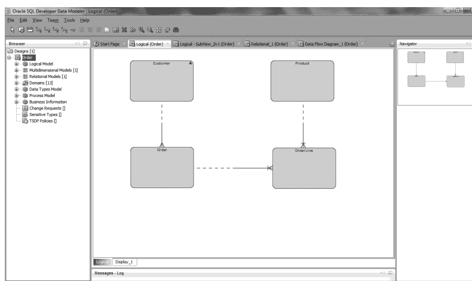

**图 3-1.** 基于此实体创建的新建实体（New Entity）的工具栏和气泡帮助。如果你为实体定义了“显示别名”（Synonym To Display）设置，它是图中该实体的使用的名称，而不是“名称”（Name）设置。如果此实体是子实体，你可以在“超类型”（Super Type）列表中选择超类型。你可以在第 4 章中学习更多关于子类型和超类型的知识。

如果你已经知道某些属性，你可以在“实体属性”（Entities Properties）对话框的“属性”（Attributes）选项卡中将它们添加到设计中，如图3-3所示。你可以点击绿色加号在列表末尾添加属性。如果你想在所选属性之前添加属性，按住 SHIFT 键并点击加号。如果你想在所选属性之后添加属性，按住 CTRL 键并点击加号。如果你的属性顺序错误，选择你想移动的那个，并根据你想移动的方向点击蓝色向上或向下箭头。如果你想修改属性属性，选择列表中的属性并点击图 3-3 所示的“属性”图标（铅笔图标）。对于属性，你必须定义名称，并且你可以

## 第 3 章：引入需求分析 45

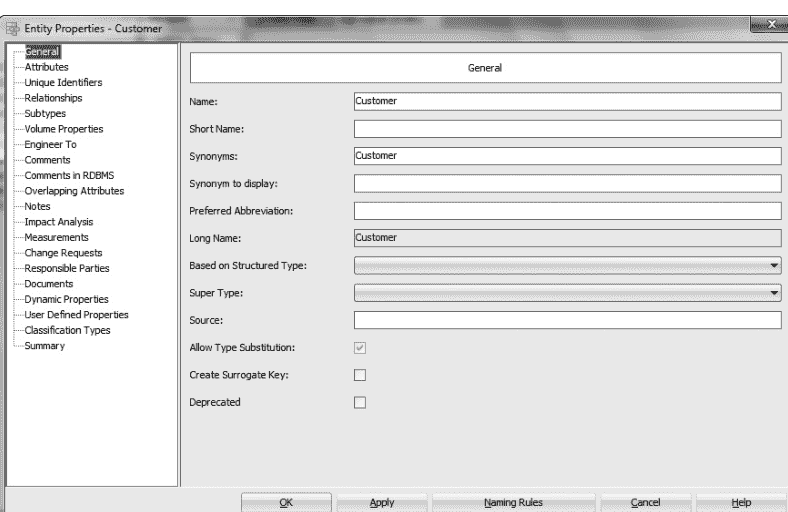

图 3-2. 实体的通用属性

定义数据类型：域（Domain）、逻辑（Logical）或结构化（Structured）。如果你定义了了自己的集合（collection）或唯一（distinct）用户数据类型，也可以将其选为数据类型。Data Modeler 中为结构化数据类型始终有预定义的数据类型；因此，即使你没有定义任何，该数据类型也是可用的。根据你选择的内容，“类型”（Type）列表将向你显示该别的可用类型。如果你只想查看首选列表（在第 2 章介绍的设置中定义），请选择“首选”（Preferred）。你可以通过选择“主 UID”（Primary UID）来决定此属性是否为主键，你还可以通过选择“强制”（Mandatory）来将属性定义为强制性。

你可以对属性编写三种描述：注释（comments）、关系数据库管理系统（RDBMS）中的注释和备注（notes）。RDBMS 中的注释是可以一直带到数据库的文档，用于描述将工程化为数据库列的属性。在 RDBMS 字段中，你应该输入有助于帮助人们正确使用你的数据库的描述。此文本将出现在数据库中，是不使用 Data Modeler 或其报告的人员能看到的唯一描述。

## 46 用于数据库精通 Oracle SQL Developer Data Modeler

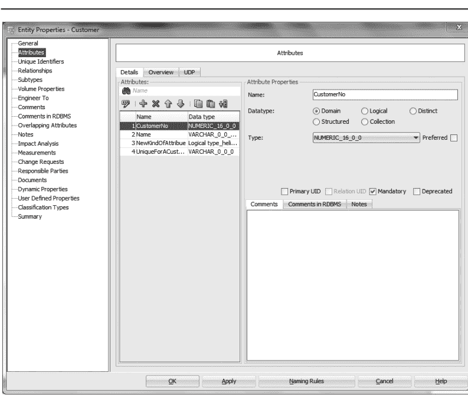

图 3-3. 属性的属性

> 提示

> 使用“RDBMS 中的注释”（Comments in RDBMS）来向没有访问 Data Modeler 或其报告的用户说明如何使用数据库。使用“注释”（Comments）用于正式文档，使用“备注”（Notes）用于非正式文档。

“注释”字段是对此属性的描述，使用 Data Modeler 的人员可以阅读它。它可能是其他用户将看到的官方描述。“备注”通常是非正式的记记，通常在规划期间编写的。可能在需求分析期间，“备注”字段是做记录最好的地方。之后，你可以使用“备注”中的描述并对其编辑以更正式，然后插入到“注释”或“RDBMS 中的注释”字段中。

## 第 3 章：引入需求分析 47

> 提示

> 你可以记录建模会话和会议中听到的所有内容，并将它们放在“备注”中，之后编辑、复制/移动你喜欢的描述从“备注”到“注释”。

如果你对实体的视图有任何信息，你可以在建模会话和会议中记录并放在“备注”中，之后编辑、复制/移动你喜欢的描述从“备注”到“注释”。 之后，你可以使用“备注”中的描述并将其编辑得更正式，以插入到“注释”或“RDBMS 中的注释”字段中。

如果你想查看查看首，，中的的。（图 3-3 所示）。


你可以看到这些属性的视图。将将作为列的视图进行工程化。图 3-4 显示了。

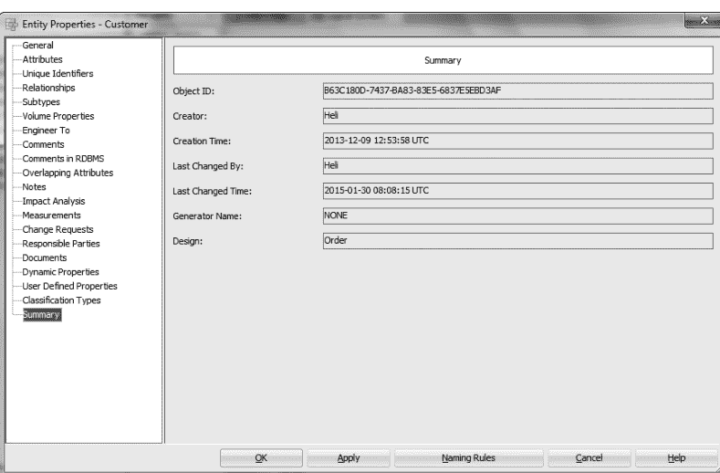

**图 3-4.** 属性

## 48 用于数据库设计的精通 Oracle SQL Developer Data Modeler

你可以看到这些属性的视图。选择你想移动的那个，并根据你想移动的方向点击蓝色向上或向下箭头。如果你想修改属性属性，选择列表中的属性并点击图 3-3 所示的“属性”图标（铅笔图标）。对于属性，你必须定义名称，并且你可以

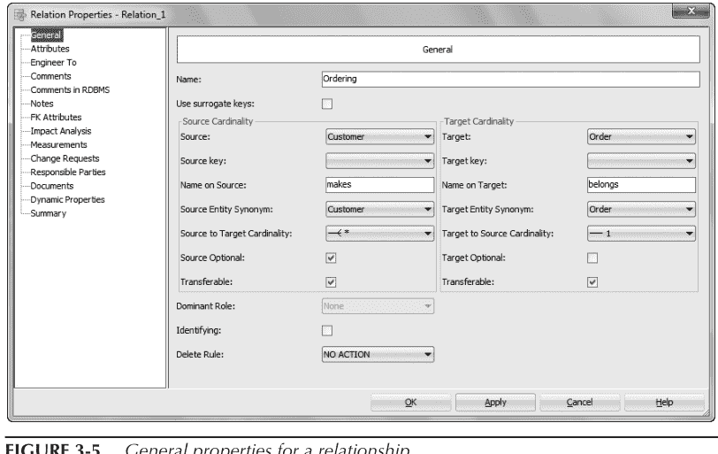

图 3-5. 属性属性

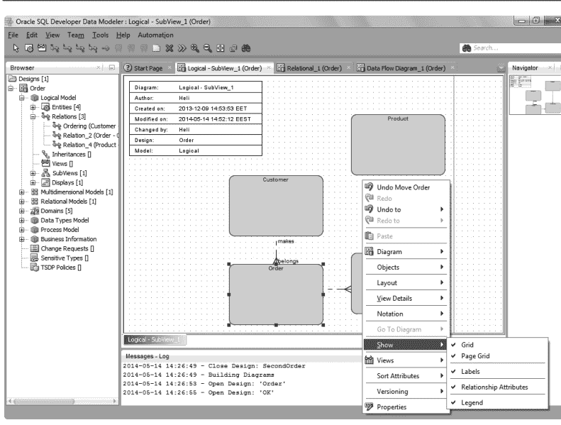

图 3-5 属性

图 3-2. 属性的通用属性

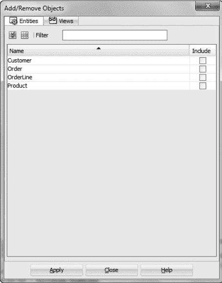

图 3-6. 选择对象到视图

要创建一个新的数据流图，在浏览器（Browser）窗格中，在进程模型（Process Model） | 数据流图（Data Flow Diagrams）下，右键点击并选择新建数据流图。使用工具栏在图表上创建元素。点击你想要添加到图中的元素图标，然后点击画布。当你想要开始放置元素时，点击工具栏上的选择（Select）箭头。数据流图中的每个元素都有属性。

图 3-9 显示了进程属性（Process Properties）对话框。进程（原始、复合或使用转换）也可以有一个简短的定义。它有一个模式（批处理、交互式、手动或未知），并根据该模式，你可以定义其他内容，例如响应时间。你还可以为进程定义峰值期、频率和优先级设置。

图 10 显示了外部代理属性（External Agent Properties）对话框。外部代理必须有一个名称和一个类型（组织单元、系统、角色或其他其它）。它可以具有文件规范或数据元素，以及其他设置。

图 11 显示了信息存储库属性（Information Store Properties）对话框。信息存储库必须有一个名称和一个类型（RDBMS、文件、对象或临时），并根据类型具有其他其他定义。

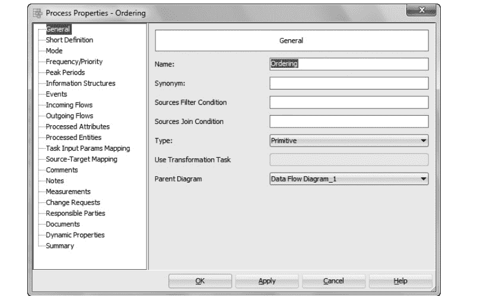

图 3-9。进程属性对话框

# 第 3 章：引论需求分析 53

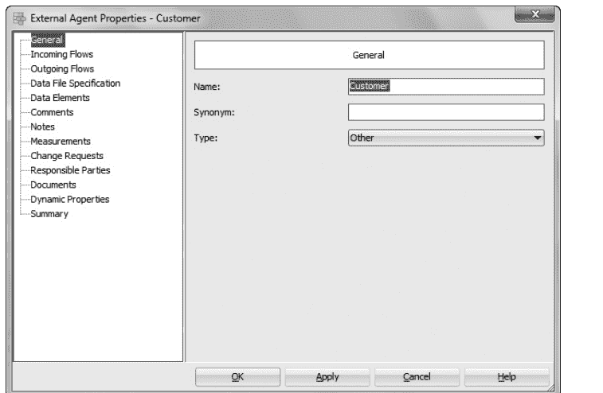

图 3-10。外部代理属性对话框

图 3-12 显示了流属性（Flow Properties）对话框。流有一个名称、同义词、源和目的。它可以有一个父流，可以是一个日志流，还可以有一个触发进程的事件。

### 介绍转换包

转换用于数据仓库环境，以将数据更改为所需的格式。不同的目标可能有不同的需求，例如对于 OLAP 与数据挖掘，因此确实有需要设计 ETL 过程。转换包是根据对象管理组（OMG）通用仓库元模型（CWM）规范 V1.1（www.omg.org/spec/CWM/1/）定义的包。

转换包将不同的源转换为不同的目标，并允许对不同的转换分组。只有当你已经定义了代表数据源或目标的包时，才能创建转换包：对象模型（面向对象）、关系型、记录、多维、XML，

54 Oracle SQL Developer Modeler 数据库设计精通

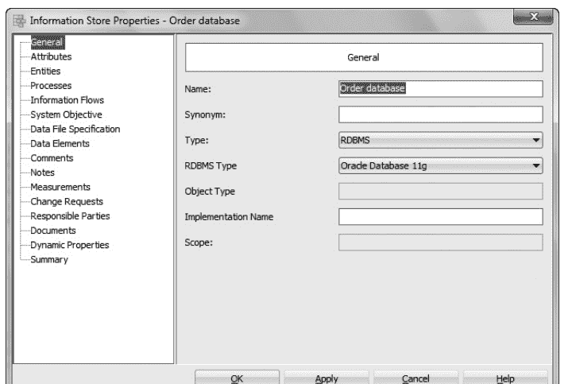

**图 3-11。** 信息存储库属性对话框

OLAP 或数据挖掘。通常你无法在需求分析阶段创建转换包，因为你需要比此时通常拥有的多得信息来完成操作。但了解 Data Modeler 的这项功能是好的，这样你就知道记录任何与转换相关的有趣内容。

要创建一个新的转换包，在浏览器窗格中选择进程模型 | 转换包（Transformation Packages），右键点击并选择包（New Package）。然后右键点击转换包名称并选择新建转换任务（New Transformation Task）。Data Modeler 将自动创建一个与你的转换任务同名的画布，并提供一个输入参数框。你可以将转换任务视为一个函数，它将有一个输入参数来定义函数将做什么，以及有一个输出参数来指示函数如何结束。函数本身（转换任务）可能有几项操作要执行。

在工具栏中，你可以找到设计转换任务的工具：新建转换（New Transformation）、新建信息存储库（New Information Store）、新建流（New Flow）和新建注释（New Note）。你也可以通过从浏览器窗格拖放到画布上来使用现有的信息存储库。

# 第 3 章：引论需求分析 55

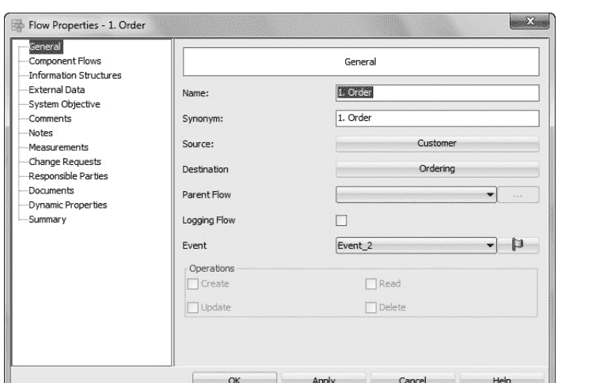

**图 3-12。** 流属性对话框

### 添加业务信息

你可以向 Data Modeler 添加业务信息。在浏览器窗格中进入逻辑模型（Logical Model），双击或右键点击并选择属性（Properties）。在逻辑模型属性中，你可以添加、编辑和删除文档以及负责方。负责方可以包括例如，电子邮件地址、电话号码、统一资源定位符（URL）和位置。所有这些内容都可以先添加到负责方，然后通过双击或选择属性符号（铅笔图标）进行编辑。你可以为设计中的元素添加负责方。

此外，你可以对对象发起请求，并定义例如状态、完整性、请求日期、完成日期和原因。例如，假设你想为实体 Customer 增加一个“新属性，状态”的变更请求。你可以使用搜索功能（有关搜索的更多信息请参见第 11 章）找到所有未完成的变更请求。选择逻辑模型然后选择高级模式（Advanced Mode）。从对象类型列表中选择变更请求逻辑（Change Request Logical）并点击添加属性。选择完成（Complete）并将 False 定义为值。在结果选项卡上，你可以看到逻辑模型中所有未完成的变更请求。搜索后，你可以运行生成 .xls 或 .xlsx 格式的报告并发送给项目经理进行更新。项目经理可能会更新状态、完成日期。

# 第 4 章：介绍概念数据库设计（逻辑模型） 59

通过模式中的单词类型及其强制性进行定义。Data Modeler 支持的单词类型为第 2 章中定义的主键（Prime）、类（Class）、修饰（Modifier）和限定符（Qualifier）。属性的定义结构可以是一个：一个可选强制单词、一个可选修饰符和一个强制类单词。这种结构的示例有“临时公司送货地址”或“公司地址”。你可以点击该对象的“设计属性设置 | 命名标准”中的绿色加号，为对象名称创建一个结构，并从列表中选择单词类型。然后，你可以通过勾选“强制”（Mandatory）将此模式定义为必选，或将其禁用作为可选（Optional）。你可以根据需要为模式添加任意数量的单词类型。可以通过红色 X 按钮从模式中删除单词类型。

当应用设计规则时，这些命名标准将与定义的词表进行检查，任何违反行为都将以警告的形式报告。你可以使用此功能确保设计中使用的所有单词都定义在你的词表中，你可以如第 2 章所述，在“设计属性”对话框的“设置”中定义一个或多个词表作为验证词表。如果你定义了多个词表，只要该名称使用任何一个定义的词表通过验证，它就会被认为是有效的。你可以使用不同的词表，例如表示不同的关注领域。一个词表用于营销部门，另一个用于销售部，第三个用于财务部。最后，你可以如第 2 章所述，与其他用户共享设计级属性。

> 注意
>
> 如果在两个词表中有相同的单词，则使用词表进行验证可能会导致问题。

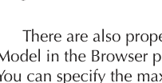

还有一些适用于逻辑模型级别的属性。在“浏览器”窗格中选择“逻辑模型”，右键点击，并选择“属性 | 命名选项”。你可以指定名称的最大长度和字符大小写（大写、小写、混合）。你还可以从“有效字符”列表中选择一组，或指定自己的字符，或选择“所有字符”为有效。你可以为实体、属性和视图设置这些选项。详情请见图 4-1。如果你尝试创建违反命名选项的内容，将立即收到错误消息。例如，如果命名选项属性定义实体名称必须全大写，但设计人员创建了一个小写的实体名称，则会给出错误消息。如果在更改命名选项之前已创建了元素，则会在应用设计规则时进行检查，任何违反命名选项属性的行为都将报告为错误。在 Data Modeler 4.0.2 版本中，命名选项设置无法与其他用户共享，但计划在未来的发布中提供此功能。

# 60 Oracle SQL Developer Data Modeler 数据库设计精通

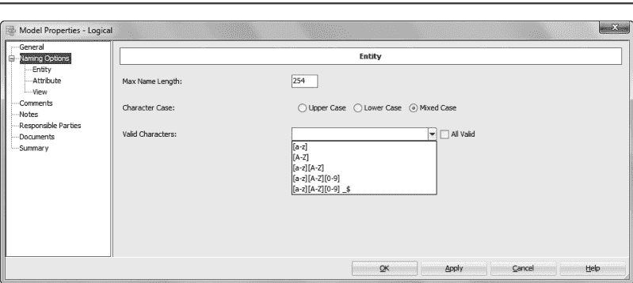

图 4-1 逻辑模型的命名选项

除了属性，你还可以设置一些影响逻辑模型的偏好。选择“工具 | 选项”菜单打开“偏好”对话框。通过按照你希望 Data Modeler 工作的方式设置逻辑模型的偏好，可以让你的设计工作变得更加简单舒适。在第 2 章中我们已经学习了如何定义使用的符号以及如何定义首选类型等。在“偏好”对话框中，选择“Data Modeler | 逻辑”以查看逻辑模型的设置，如图 4-2 所示。通过设置这些偏好，你可以定义在创建新实体或到关系模型的关系时的默认值。你可以随时更改这些默认值以影响新元素，如果需要，也可以在逻辑模型中单独更改它们。你可以定义源和目标为可选或强制（源可选，目标可选）。源是关系开始的地方，目标是进入的地方。例如，“客户”可以是源，“订单”可以是目标。一个客户可能有多个订单（源可选，意味着源侧的关系线是可选的；客户可以没有订单而存在），但一个订单必须属于客户（目标强制，意味着目标侧的关系线必须是强制的；订单不能没有客户而存在）。换句话说，如果是客户，则不需要订单；但如果有订单，就必须有客户。你可以通过选择“将第一个唯一键作为主键”（Use Set First Unique Key As Primary Key）告诉 Data Modeler 将第一个唯一标识符定义为主键。一个实体中可能有多个唯一键，这有助于工具和设计人员将其中一个设为主主键

# 第 4 章：介绍概念数据库设计（逻辑模型） 61

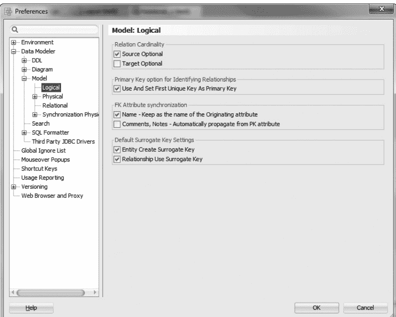

图 4-2 逻辑模型的偏好设置

键。我不推荐使用此功能，因为我想定义自己的主键，并确保选择了正确的唯一键（即第一个）。另一个问题是，唯一键可以为空值（null），但主键不可以。因此，如果将第一个唯一键设为主键，则其所有属性都允许空值。无论如何，在一个实体中存在多个唯一键并不常见。要查看正向工程的逻辑模型偏好以及关系模型的偏好，请参第 5 章。

> 注意
>
> 更改某些偏好仅影响更改后创建的元素。

62 Oracle SQL Developer Data Modeler 数据库设计精通

### 介绍逻辑模型

在设计数据库时，在项目中尽快开始设计工作是有价值的，因为在将需求转换为正式形式时，设计人员可能会意识到有很多问题尚未被提出。事实上，有许多建模技术。你不能总是说一种方法比另一种方法更好，但有时是可以的。逻辑理论将指导你发现并选择一种定义而非另一种。关系理论有助于以正确的方式在 ER 模型中实现需求。例如，最终用户可能会简单地说：“客户必须下单。”通过此，用户可能认为这个陈述定义了客户（也就是说，要成为客户就必须下单）。换句话说，最终用户可能认为他们已经定义了“客户”的概念。受过逻辑训练的人意识到事实并非如此；存在许多种可能的正式解释。重要的任务是在对任何解决方案进行建模之前，找到哪一个是意图所属的。为了清楚起见，示例中客户的定义可以是以下任何一种：

- 每个客户都至少下了一个订单。
- 至少有一个客户下至少了一个订单。
- 至少有一个订单是每个客户都下的。
- 每个客户恰好下了一个订单。
- 每个客户恰好对应有一个订单。

或者它可能意味着其他意思。

在这种情况下，找到正确的定义相当容易，因为“客户”对大多数人来说是一个熟悉的概念，但你仍会对不熟悉的概念面临类似的断言，并且仍然必须准备好提出正确的问题，以便在建模时做出正确的决策。你可以从关于该主题的几书中获得更多关于逻辑和关系理论的信息，例如 C.J. Date 编写的作品。

## 第 4 章：引入概念性数据库设计（逻辑模型） 63

提示

尽量不要表现得过于聪明而设计出太复杂的解决方案；记住，通常简单的解决方案是最好的。

在概念性数据库设计期间，你不需要主动担心范式化等问题，但请记住关系理论将对你有所帮助。重要的是尽可能准确地对目标进行建模，同时又要足够详细，以便其他人也能理解。发现并建模各个概念以及它们之间的关系至关重要。尝试记录你听到的和学到的所有内容。建模时要系统化。决定在何处以及如何进行记录，并确定合适的文档级别。确保你的注释和评审内容清晰且易于理解。

你应该从需求分析（第 3 章）中创建的逻辑模型开始建模。如果你没有来自需求分析的任何内容，你必须从头开始，从本章描述的概念性数据库设计开始。在最好的情况下，这意味着更多工作；甚至意味着你没有足够的信息来做出正确的建模决策。

逻辑模型由实体、关系、视图、继承、子视图和显示组成。所有逻辑模型对象都显示在浏览器（Browser）面板的“逻辑模型（Logical Model）”下。一个逻辑模型由一个逻辑图以及可能的一个或多个子视图和/显示组成。

如果你在浏览器面板中右键点击“逻辑模型”，你将看到逻辑模型的操作。

- 通过“隐藏（Hide）”和“显示（Show）”，你可以控制逻辑模型图是否打开。
- 你可以基于逻辑模型创建子视图和显示（本章稍后会介绍）。
- 你可以设置分类类型（classification types）（更多信息请见第 8 章）。
- 你可以应用命名标准和自定义转换脚本从逻辑模型创建词表（更多信息请见第 3 章）。
- 你可以搜索并根据搜索结果创建报告，并通过 Excel 工作表更新 Data Modeler 中的数据（更多信息请见第 11 章）。
- 你可以选择“工程化到逻辑模型（Engineer To Logical Model）”（更多信息请见第 5 章），当然可以查看和编辑属性。

## Oracle SQL Developer Data Modeler 数据库设计精通

- 在浏览器面板的每个对象中，你都有选择“版本控制（Versioning）的能力。你可以在第 9 章中找到更多关于版本控制和版本管理的知识。

如果你右键点击逻辑模型图（或子视图图），可以执行以下操作：

- 你可以撤销操作。
- 你可以定义布局。
- 你可以定义显示哪些细节（查看详情/View Details）：所有细节（All Details）、仅名称（Names Only）或属性（Attributes）。你还可以指定显示分类类型（元素上分类类型的名称）或注释。
- 你可以选择表示法（notation）。
- 你可以显示页格或网格，或者让图中的标签（源和目标名称）以及关系属性可见。你可以指定显示图例（legend）。图例显示图中的摘要（Summary）属性。所有这些都可以在“显示（Show）”下进行选择。

### 实体及其属性

实体是任何作为建模目标的物体，例如， Heli。每个实体都属于某种实体类型。实体类型是一组具有某些共同属性的实体（如人 Person，Heli、Marko、Patrik 和 Matias——与所有类型为人的实体一样——都有名称）。实体始终是一个名词（公司 Company、员工 Employee、客户 Customer）。实体是实体类型的子集，仅包含属于建模实体。在语言中，实体和实体集通常被称为实体（entity）。在书中，由于在 Data Modeler 的上下文中，我们将实体和实体集都称为实体。当指代单个实体（Heli）时，我们使用“实体实例（entity instance）”一词。你可以通过点击实体图标并插入实体属性在逻辑模型的逻辑模型中创建一个实体，如第 3 章所示。

实体可以是强实体也可以是弱实体。强实体（例如客户 Customer）不需要其他实体或关系即可识别自身；强实体具有独立的存在。弱实体（例如订单行 Orderline）依赖其他实体（订单 Order、客户 Customer）来识别，并且它们具有强制性的标识关系。实体的弱性通过关系线末尾的水平线表示。你可以在关系属性（Relation Properties）对话框中通过从属性的源侧选择“标识（Identifying）”来定义。

## 第 4 章：引入概念性数据库设计（逻辑模型） 65

如前所述，实体具有属性（例如人 Person 有名称）。这些属性被称为属性。属性可以是原子的（atomic），意味着它只包含来自某个域的单个值，且不能划分为更小的组件。例如，邮政编码（Zip Code）是一个原子属性。属性也可以是复合属性（composite），意味着它是两个或多个属性的组合，而这些属性可以是原子的或复合的。复合属性的示例是姓名 Name = 名 Firstname + 姓 Lastname。属性可以是多值的（multivalued）或集合（set-valued），意味着属性将有多个值，但不同值的数量可以是有限。例如，一个客户可以只有三个电话：家庭、工作和手机。属性可以是派生属性（derived attribute）。例如，年龄 Age 可以从出生日期 Date of Birth 派生。对于属性，你可以在属性属性（Attribute Properties）对话框中找到属性，如图 4-3 所示。你可以通过点击找到它：

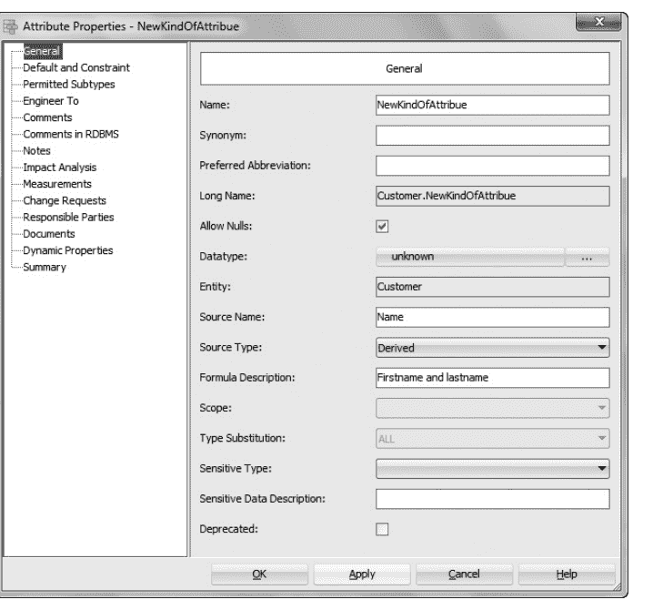

图 4-3 属性属性对话框，常规选项卡

## Oracle SQL Developer Data Modeler 数据库设计精通

实体属性（Entity Properties）对话框属性（Attribute）选项卡上的属性图标、双击属性名称，或在浏览器面板中选择属性、右键点击并选择“属性”。在属性属性对话框中，你还可以在源名称（Source Name）字段中为属性源定义名称，然后从此处选择首选的源类型。源类型的允许值为空（无源类型）、手动（Manual）、系统（System）、派生（Derived）和聚合（Aggregate）。如果你想为派生或聚合属性定义公式，在公式描述（Formula Description）中输入公式描述，如图 4-3 所示。


属性可以是强制的（`mandatory`）或可选的（`optional`）。如果创建属性时通过选择“强制（`Mandatory`）”将其定义为强制，它将在画布上显示，名称前带有一个星号（*）。如果属性是可选的，在 Barker 表示法中属性名称前有一个小圈（o），在 Bachman 或信息工程（`Information Engineering`）表示法中则为空。

如果你在画布上右键点击实体，可以看到允许对实体的操作。你可以执行以下操作：

- 完全删除实体（删除对象/`Delete Object`）或仅从图中删除（删除视图/`Delete View`）。
- 复制实体。
- 显示或隐藏元素。
- 选择邻居（`Neighbors`）并使用“从所选创建子视图（`CreateSubview From Selected`）”在实体及其邻居上创建子视图。
- 对实体的属性排序。
- 创建同义词。同义词实际上是指创建视觉同义词；换句话说，是在同一图中实体的另一种表示形式。它不是数据库中的同义词。它仅用于使图表易读。同义词具有与原始实体不同的可见性元素和格式。

在 `Data Modeler` 中，你可以通过属性将对象名称设置为不可更改。这对于防止任何人意外更改名称很有用。例如，如果你希望设计中包含属于另一个架构（另一个系统等）的表，你希望它们显示存在逻辑关系，但你想防止任何人更改它们的名称。更常见的原因是你已经在数据库中有了此对象，由于某种原因无法更改。你可以通过选择工具 | 对象名称管理（`Tools | Objects Names Administration`）找到此功能（图 4-4）。在对象名称管理对话框中，为你想要固定名称的所有元素选择“固定（`Fixed`）”。你可以对实体、属性、关系、标识符和视图的名称执行此操作。

## 第 4 章：引入概念数据库设计（逻辑模型） 67

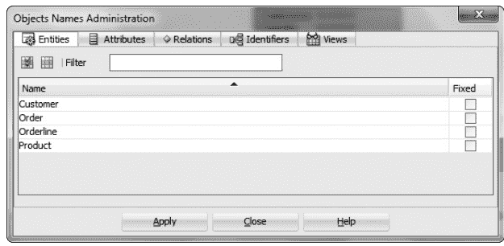

图 4-4. 对象名称管理对话框

另一个有时很有用的功能是将对象标记为“弃用”（`deprecated`），以告知其他用户该元素不应被使用。在许多属性对话框中，你可以找到此功能（在实体属性的 `General` 和 `Attributes` 选项卡上）。在图 4-5 中，你可以看到实体 `ProductGroup` 被划了删除线，这意味着它已被标记为弃用，其属性 `GroupNo` 也是如此。

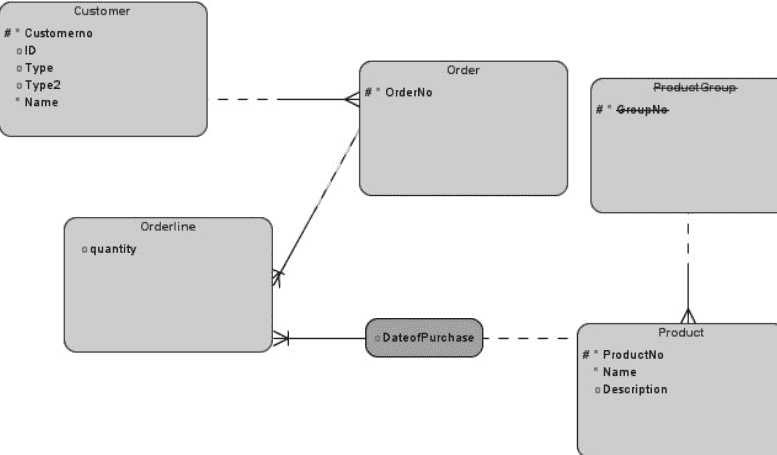

图 4-5. 被标记为弃用的实体和属性

### 用户定义类型

`Data Modeler` 中有四种用户定义数据类型：区分类型（`distinct types`）、结构化类型（`structured types`）、集合类型（`collection types`）和逻辑类型（`logical types`）。

逻辑类型并非实际的数据类型；它们是与所选关系型数据库管理系统（`RDBMS`）原生类型关联的名称，并定义为属性或域的数据类型。要创建逻辑类型或编辑现有类型，选择 `Tools | Types Administration`（图 4-6）。要创建一个新类型，在 `User Defined Native Types` 选项卡上为选定的 `RDBMS` 类型（如 `Oracle 12c`、`SQL Server 2008` 等）定义用户定义类型。点击 `Save`。然后转到 `Logical Types To Native` 选项卡并点击 `Add`。为新逻辑类型输入名称并选择为 `RDBMS` 类型创建的原生类型。点击 `Save`。现在你可以在 `Logical Types To Native` 选项卡中看到带有原生类型设置的新逻辑类型。它可以被选择为属性或域的数据类型。我曾用此，例如用于一个尚未支持某些新数据类型的 Microsoft SQL Server 版本。我将数据类型定义为逻辑类型，并在设计时使用它们。

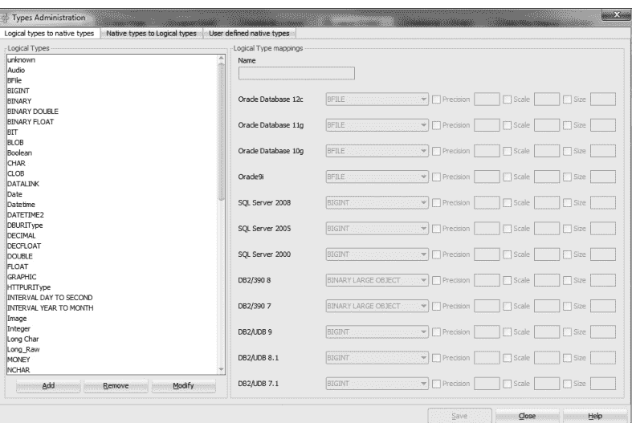

图 4-6. 类型管理对话框

你可以使用 `Types To Domains Wizard`（选择 `Tools | Types To Domains Wizard`）从设计中使用的数据类型创建域。你应该非常小心，域必须经过仔细定义和约定，我更倾向于手动定义它们。可以通过选择 `Tools | Domains Administration` 来维护域。你可以在第 2 章中阅读更多关于域的信息。

区分、结构化和集合类型可以在浏览器面板的 `Data Types Model` 下定义和管理。逻辑模型和关系模型都使用数据类型模型的定义来指定属性和列的数据类型。某些结构化类型也可用于定义实体或表的结构化类型。数据类型模型可以手动构建，也可以从 Oracle Designer 仓库导入。你可以在 File 菜单中找到导入功能，可以在第 10 章中阅读更多关于从 Oracle Designer 的内容。

要创建区分类型或集合类型，进入浏览器面板，选择数据类型并点击右键。填写所需的输入。对于任何区分类型，你需要定义名称并从值列表中逻辑数据类型。你还可以定义大小。忘记对你的区分类型进行注释和说明。创建区分类型后，它将出现在属性或列的数据类型列表中。记住选择数据类型 `Distinct`。要创建一个新的集合类型，必须定义名称并将集合设为 `array`（数组）或 `collection`（集合）。对于数组，你必须定义数组中的最大元素数量；对于集合，不需要定义此元素。你应该为你的数组或集合定义数据类型。数据类型可以是域、逻辑、区分、集合或结构。你还应该定义 `Max Size String` 参数，不要忘记对你的集合类型进行注释和说明。创建集合类型后，它将作为属性或列的数据类型。为属性分配数据类型时，记住选择数据类型 `Collection`。

结构化类型是有属性和方法的用户定义数据类型。属性可以是逻辑、区分、结构化或集合类型。结构化类型也可以定义为另一个结构化类型的子类型。可以在结构化类型上定义实体。要创建一个新的结构化类型，进入浏览器面板中的 `Data Types`，点击右键并选择 `Show`；或者在 `SubViews` 下点击右键并选择 `SubView`。然后使用工具栏上的图标设计结构化类型。只有结构化类型对象在数据类型图中以图形形式表示。数据类型图由结构化类型、引用链接、嵌入结构链接、引用链接集合、嵌入结构链接集合和注释组成。

从数据类型的属性中，你可以在 `Used In` 选项卡查看此数据类型在何处使用。

## 70 Oracle SQL Developer Data Modeler 数据库设计精要

### 敏感数据

在 Oracle Database 版本中，有一个可选功能（包含在 Advanced Security 中），允许对定义为敏感的数据进行不同处理。请阅读更多关于 Oracle 文档的内容。`Data Modeler` 支持设计敏感数据。在 `Data Modeler` 中，你可以定义敏感类型并将其与透明敏感数据保护（`TSDP`）策略关联。你可以通过右键点击 `Sensitive Types` 并选择 `New Sensitive Type` 来创建敏感类型。敏感类型应有一个名称。（此处省略了原文中重复的 OCR 描述）

## 第 4 章：引入概念数据库设计（逻辑模型） 71

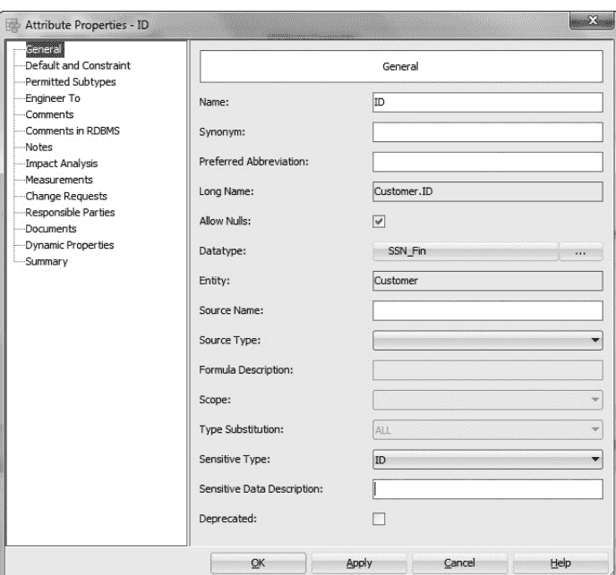

图 4-8. 将敏感类型关联到属性

### 关系

关系是两个或多个实体之间的逻辑关联。关系的*度*（`degree`）是参与该关系的实体数量。如果关系中超过两个实体，则被称为*复杂*关系（`complex relationship`）。“Heli 买了一部 iPad”是一个 2 度的关系（Heli, iPad）。关系类型是一组相似关系的集合，例如 `BUY (CUSTOMER, PRODUCT)`。类型是一个动词。关系集是关系类型的子集，它仅包含属于建模目标的关系。在口语中，关系类型和关系集通常被称为关系。在书中，我们将关系类型和关系集统称为关系，因为在 `Data Modeler` 的上下文中它们是这样理解的。你可以通过工具栏上的关系图标之一（绿色箭头）在逻辑模型画布上创建关系。

### 约束

关系具有参与约束：可以是强制的（`total`）或可选的（`partial`）。在 `Data Modeler` 中，你可以在 `Logical` 选项卡的对话表中定义参与约束。如果你希望关系的源端是可选的，选择 `Source Optional` 属性；否则，禁用它。`Target Optional` 属性为目标端定义相同的内容。

关系具有基数约束（映射基数、基数比例），用于描述该实体在关系中的实例数量。对于

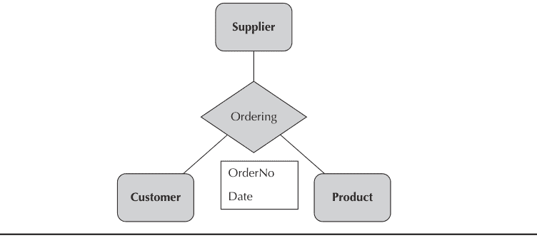

图 4-9. 复杂关系的示例

# 第 4 章：引入概念性数据库设计（逻辑模型）

例如，一个员工可以恰好有一个主管、最多一个主管，或者有多个主管。在 `Data Modeler` 中，有四种不同的映射基数：一对一 (`1:1`)、一对多 (`1:m`)、一对多识别关系以及多对多 (`m:n`)。你还可以在关系属性（`Relation Properties`）对话框中，通过 `Source To Target Cardinality`（源到目标基数）和 `Target Source Cardinality`（目标到源基数）属性来定义这些设置。

同一个实体可以以不同的角色多次参与关系。例如，一个员工既可以是员工又是主管，而两者都是员工。图 4-10 显示了一个实体与同一实体建立两次关系的示例。在 `Data Modeler` 中，你可以通过选择一对多关系符号并双击两次来创建这种关系。如果关系指向实体本身，则被称为递归（`recursion`）。为了避免混淆，请确保清晰地命名不同的角色。你可以在 `Name` 字段中命名关系角色，并在 `Name On Source` 和 `On Target` 字段中命名角色的名称。若要在 `Data Modeler` 的图中显示这些名称，请右键点击画布并选择 `Labels`。

关系属性对话框还有一个 `Delete Rule`（删除规则）列表，你可以在这里定义当父表中的行被删除且该值在子表中存在时，如何删除子行。可选选项有 `No Action`（无操作）、`Cascade`（级联）、`Set Null`（置为空）和 `Restrict`（限制）。

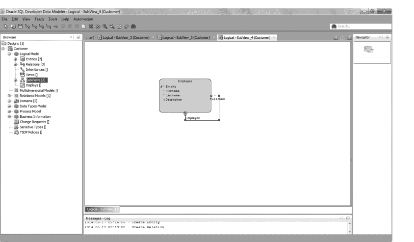

图 4-10。指向同一实体的关系，递归

# 7 Oracle SQL Developer Data Modeler 数据库设计精通

- `No Action` 值对这些行不执行任何操作，这意味着在从父表中删除之前，必须先从子表中手动删除这些行。
- `Cascade` 选项在 `Data Modeler` 删除父表中的行时，自动删除子表中的这些行。
- `Set Null` 值将子表中所有可以设为空的列设置为 `null`。如果存在不能设为空的列，则必须手动处理。
- `Restrict` 值防止对子表引用的父表列进行任何更新或删除。

在逻辑模型中，删除规则没有意义，但这是找到记录所需信息的正确地方。在 `Data Modeler` 的逻辑模型中就可以记录这些信息是好的，它们将会被正向工程化到关系模型中。

关系可以有自己的属性。例如，客户（`Customer`）和订单（`Order`）之间的关系可能有一个“购买日期”（`Date of Purchase`）属性。关系的属性可以在关系属性的 `Attributes` 选项卡中定义，如图 4-11 所示。在图中，关系属性在图 4-12 中所示。默认情况下，图中不显示关系属性。如果你看不见它们，请右键点击画布并选择 `Show | Relationship Attributes`（显示 关系属性）。

> 注意：一个常见的错误是将外键建模为属性。不要这样做。如果你这样做了，在正向工程之后，你的关系模型中将出现重复列。

如果关系的外观不符合你的要求，你可以选择并移动它，或者使用 `Data Modeler` 功能来移动它。你可以删除或隐藏该关系。你可以选择 `Straight Lines`（直线）、`Add Elbow`（添加直角）或 `Change The Format`（更改格式）。如果你想更改关系线的外观，选择 `Change Format` 并进行更改。通过在图中右键点击关系，你可以看到关系和关系线允许的所有操作。

## 第 4 章：引入概念性数据库设计（逻辑模型） 75

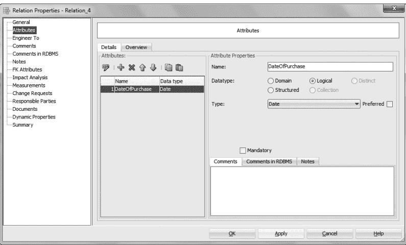

图 4-11。关系属性的属性

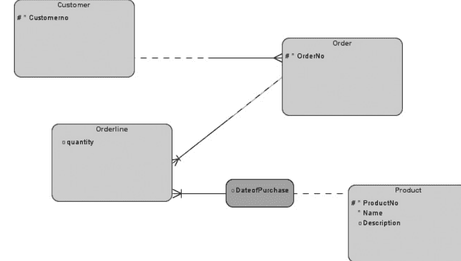

图 4-12。图中关系的属性

> 提示
>
> 如果你想看到逻辑图中由逻辑关系所隐含的外键属性，请选择 `Bachman notation`（巴赫曼表示法）。这是检查模型的简单方法，可以查看正向工程是否会产生你预期的关系模型。

### 约束

一个属性或一组属性可以是识别性的（`identifying`），这意味着这些属性用于标识实体，并且是实体的约束。实体的唯一标识符可以由一个或多个属性组成。你可以指定一个主标识符（`primary identifier`），用于唯一标识每个实体实例并作为主键。主键中的所有属性都是强制的；它们不能为 `null`。主键可以是自然键（`natural key`），意味着它由该实体的一个或多个真正标识它的属性组成；也可以是代理键（`surrogate key`），即由一个属性（通常是数字属性）组成，该属性对实体本身没有意义，但将其与其他区分来。

你还可以定义一个或多个唯一标识符作为约束或唯一键（`unique keys`）。唯一键确保实体中没有两个实例在唯一键定义的所有属性上具有相同的值（唯一约束）。主键和唯一键的区别在于，唯一键属性允许存在 `null` 值，且一个实体可以有多个唯一键，而主键只能有一个，且全为强制属性。

在 `Data Modeler` 中，你可以通过选择实体属性（`Entity Properties`）对话框中 `Attributes` 选项卡上的 `Primary UID` 复选框来将某个属性定义为主键。你还可以在实体属性对话框的 `Unique Identifiers`（唯一标识符）选项卡上创建其他标识符。点击 `+` 号添加新标识符。双击唯一标识符名称或属性图标打开属性对话框，图 4-13 所示。你可以在 `Attributes` 选项卡中选择 `Primary Key` 来创建主键，也可以在 `Relations` 选项卡中选择关系并将其作为唯一标识符。如果你良好命名了关系，将其作为唯一标识符是值得的。你可以通过高亮关系名称并点击箭头指向

## 第 4 章：引入概念性数据库设计（逻辑模型） 77

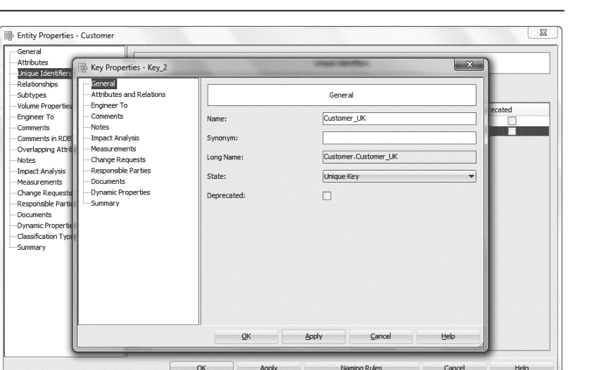

图 4-13。键属性

到左侧，如图 4-14 所示。始终点击 `Apply`（应用）和 `Save`（保存）。你也可以使用相同的方法创建主键，但你需要在 `State` 中选择主键。你可以在浏览器 `Primary Keys` 下找到主键，在 `Alternate Keys` 下找到其他唯一键。

主键的属性应该是标识性的、稳定的且不随值变化的。例如，在许多系统中，社会安全号码（`SSN`）被定义为人的主键。它是一个好的主键吗？不。原因如下：

- `SSN` 不是唯一的，至少在全球范围内不是。
- `SSN` 并不标识一个人；在少数情况下，一个人甚至可以有多个 `SSN`。

# 78 Oracle SQL Developer Data Modeler 数据库设计精通

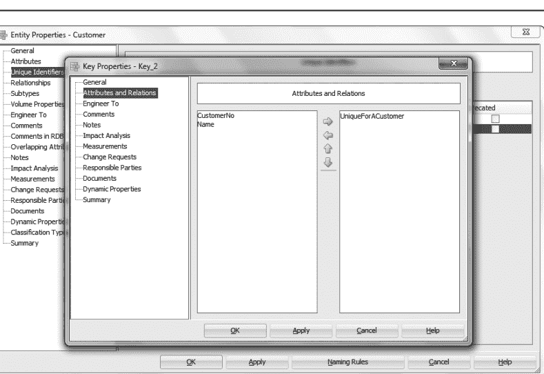

图 4-14。为唯一键选择实体和关系

在选择主键时，你有两种选择：自然键或代理键。哪一个更好？关于任何建模问题的唯一正确答案都是：这取决于情况。但决定主键是最重要的决策之一。

## 第 4 章：引入概念数据库设计（逻辑模型） 79

在概念数据库设计中的决策。自然键（`natural key`）通常更高效；有时你可以消除一个连接（`join`），有时查询优化器可以高效工作，以此此类推。但如果没有合适的候选键，尝试寻找主键是没有意义的，尽管在许多此类情况下，这表明模型本身存在某些问题。很多时候，设计者过于谨慎，没有将属性设为“非空”（`not null`），只能定义唯一键（`unique keys`）。或者对概念的理解不够深入，无法真正识别实体。设计数据库的主要关注点之一是数据质量。为了获得高质量的数据，你必须理解你正在建模的内容，并且尽可能将任何属性设置为非空并找到所有可能的约束。代理键（`surrogate key`）不能阻止用户在数据库中插入重复数据，但自然键可以，而且代理主键的索引通常不会使用（查询不会基于代理键进行）。另一方面，对于来自另一个系统且不受你组织控制的数据，通常最好的解决方案是代理键，因为你永远无法确定另一个系统是否更改了你认为唯一的数据。因此，这个问题没有标准答案。如果你想使用代理键，请在“实体属性”（`Entity Properties`）或“关系属性”（`Relationship Properties`）框中选择“代理键”（`Surrogate Keys`）复选框。

外键约束引用实体主键的属性或属性集，如前所述，这可以是另一个实体，也可以是实体本身。

你可以为属性定义约束。域约束（`Domain constraints`）可以定义数据类型、长度、允许值和默认值等。你可以在“域”（`Domains`）中重新定义它们以便使用（见第 2 章），也可以在“属性属性”（`Attribute Properties`）对话框的“域”中为每个属性单独定义（图 4-15）。定义约束的名称并为其定义默认值。如果你想使用“域管理”中为关联域定义的属性，请选择“使用域约束”（`Use Domain Constraints`）。如果未选择此选项，你可以继续定义设置。你可以从“约束”列表中为一个或多个类型的数据库指定约束。你可以为属性指定一个或多个值范围。你可以为属性指定一个有效值列表。如果你选择了“域约束”，所有更改将自动应用到该属性。例如，如果向域约束中添加了新的允许值，该值将自动作为该属性的默认值候选并出现在允许值列表中。我建议使用域及其设置，这将使维护变得更容易。


另一个常用的约束是检查约束（check constraint）。检查约束的示例可以是 `Check (Name=upper(Name))`。约束可以是即时的（immediate）或延迟的（deferred），这意味着它将在立即或稍后进行检查。

## 用于数据库设计的 Oracle SQL Developer

![img/431f8ac8f273fa89a28377c500ed6d7_106.png]

**15.** 域约束

### 实体视图 (Entity Views)

实体视图是概念模型中的一个元素，允许设计者看到实体属性的一个集。这对于为特定用户简化模型有用。你可以通过选择实体和你想包含的属性来创建实体视图。如果选择了“框中框”（box-in-box）表示法，继承关系看起来就像图 4-18 中的模型。如果没有选择“框中框”表示法，相同的继承关系将像图 4.19。在这种情况下，继承关系属性可以是

## 第 4 章：引入概念数据库设计（逻辑模型）

![img/431f8ac8f273fa89a28377c500ed6d7_107.png]

**16.** 实体视图

### 继承 (Inheritance)

有时，你需要建模一个实体具有多个子类型（subtypes）的情况。例如，一个人既可以是员工，也可以是客户。在这种情况下，你可以使用继承来表示一个人可以扮演的不同角色。

继承是超类型（supertype）与其子类型之间的关系。子类型继承超类型的所有属性和关系，也可以拥有自己独特的属性。这是建模复杂现实场景的一种强大方式。

## 用于数据库设计的 Oracle SQL Developer

![img/431f8ac8f273fa89a28377c500ed6d7_108.png]

**17.** 弧解决方案 (Arc solution)

在正向工程中，弧解决方案将为每个实体生成一个表。为了能够将此设置正向工程到关系模型，你必须将属于超类型的所有外键允许为空，因为对于每行数据，只有一个外键会有值。实现该弧还需要额外的约束。你将在第 5 章中学习更多关于正向工程的内容。当子类型之间没有共同点且可以独立使用时，弧解决方案是一个很好的选择。

在许多情况下，使用子类型和超类型来表达相同的需求会让目标更容易建模和理解。使用超类型和子类型的建模策略通常对终端用户来说更容易读，并且让设计者自由决定以后如何在关系模型中实现它。超类型的所有属性和关系必须属于其所有的子类型。

# Oracle SQL Developer Data Modeler 数据库设计精通

可以在继承属性中进行修改。你可以定义名称（Name）、全名（Long Name）、父类型（Super Type）和子类型（Sub Type）。你还可以定义工程师至（Engineer To）、注释（Comments）、RDBMS 中的注释（Comments In RDBMS）以及备注（Notes）。

实体属性对话框中的“Engineer To”属性用于定义层次结构中的哪个实体将转换为表，以及如果有多个关系模型，则转换为哪一个关系模型。此定义应该针对每个实体进行。

自 Data Modeler 4 版本起，实体属性对话框中新增了“子类型”（Subtype）页面，用于在工程中实现子类型并设置区分器列，如图 40 所示。对于实体和子类型的生成，有两个决策：子树生成（Subtree Generation）和应用到模型（Apply To Model）。对于子树生成有四种选择：不预设（Do Not Preset）、单表（Single Table）、每个子表（Table Per Child）和每个实体（For Each Entity）。如果你想通过手动设置每个实体的“Engineer To”属性来选择决策，请选择“不预设”。我将在本节稍后详细讨论这些选择。同一页面上的“应用到模型”选择定义了实体属性的可能更改是应用到所有关系模型还是特定的

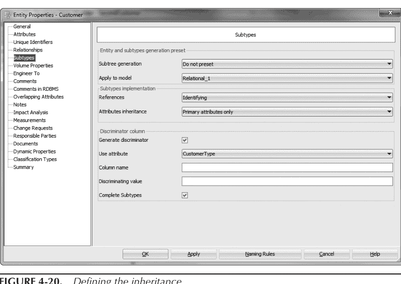

# 第 4 章：介绍概念性数据库设计（逻辑模型）

模型。对于子类型实现（图 4-20），有两个设置：引用（References）和属性继承（Attributes Inheritance）。对于引用，你有三个选择：无（None）、标识性（Identifying）和 Arc 实现（Arc Implementation）。如果你对引用选择“无”，则表与表之间不会创建外键。如果你选择“Arc 实现”，则会创建从父类型到子类型的可选外键。如果你选择“标识”，则会从子类型表到子类型表创建标识性外键。你还可以指定继承方式，你有两个选择：仅主属性（Primary Attributes Only）和所有属性（All Attributes）。此属性定义了在实现为表时，父类型的主属性还是所有属性继承到子类型。

对于子类型实现（图 4-20），你还可以指定一个区分器列，这在泛化和单表实现时经常使用，我将在本节中详细讨论。

在关系模型中实现继承有三种方式：为每个实体创建特化（specialization，表）、泛化（generalization，单表）或两者皆非（table child，子表）。建模继承没有绝对正确的方法；它始终取决于需求是什么。

对将分为子类型的实体进行特化。例如，Customer（客户）实体可以分为 Person（人员）和 Customer。所有共同属性将位于 Customer 实体中。Person 和 Customer 将仅拥有这些实体的特定属性。这与你在图 4-16 中 arc 解决方案类似。在 Data Modeler 中，这被称为“每个实体一个表”（Table For Each，见图 4-20）到“实体表”（Table For Entity），你可以通过设置实体属性对话框中的子类型生成选项来选择它（参见每个实体表）。当选择“实体表”时，当前子类型中的所有实体都将被用于工程化。

你应该问自己几个问题以确保解决方案是正确的。Person 可以是一家公司吗？通常从性能角度来说，这不是一个好的方案，因为可能经常需要连接这些表。

为一组实体创建的实体进行泛化。子类型可能具有不适用于该父类型下泛化的所有实体的属性。假设你有实体 Customer、Company（公司）和 Person。你可以将所有这些实体泛化到一个名为 Customer 的父类型下。该父类型现在泛化了子类型。子类型继承了父类型的属性，并可能有自己的属性。在 Data Modeler 中，这被称为“单表”（Single Table），你可以通过设置实体设置对话框中的子类型生成选项为“单表”来选择。在 Data Modeler 中，此属性的“Engineer To”将被设置，并清除当前子类型中的所有子类型。

在现实中，你可能需要一个新的属性来描述每个客户是哪种类型的客户，例如 CustomerType（客户类型）属性，因为可能有此类需求。在 Data Modeler 中，你将使用区分器列为此目的。如果你选择“生成区分器”（Generate Discriminator），系统将自动为表生成区分器列。在“使用属性”（Use Attribute）中，你可以定义使用哪个现有属性作为区分器；在这种情况下，就是 CustomerType。如果你想为该列定义名称，使用“名称”属性。此属性定义了生成的区分器列的名称。如果不指定名称，则使用模板。你可以在“区分值”（Discriminating Value）属性中为每个子类型定义区分值。例如，对于 Person，区分值可以是 P，对于 Company 可以是 C。如果你不定义值，则使用实体名称或“名称”属性。如果你希望子类型是完整的，请选择“完整子类型”（Complete Subtypes）。此属性对生成的 arc 以及区分器列的可能值列表有影响。如果子类型列表不完整，则生成可选 arc，父类型实体的值也会包含在区分器列的允许值列表中。参见图 4-21 带有区分器 CustomerType 的 Customer 泛化示例。因为你有像 Data Modeler 这样的工具，你可以使用子类型和子类型来建模真实情况，并在使用实体属性在正向工程到关系模型时决定如何实现它。

泛化的问题在于只能定义共同属性，且不能为空。因此，子类型实体中的强制性属性变为可选列，除了区分器列的值约束列表外，还会生成一个独立性依赖约束。在第 5 章中，你将看到正向工程是如何工作的。泛化可能是最流行的解决方案，如果大多数属性是共同的，它通常是有效的，且子类型实体属性相似。

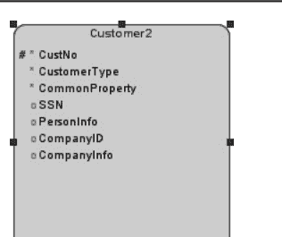

**图 4-21。带有区分器的泛化**

# 逻辑设计（逻辑模型）

你可能决定既不特化也不泛化。在这种情况下，你将没有 Customer 的概念，只有 Person 和 Company。所以，你的模型中没有 Person 和 Company 的信息；你必须确保 Person 不能变成 Company，反之亦然。在这种情况下，你必须定义所有实体的共同属性以及属于每个实体的特定属性。在 Data Modeler 中，这被称为“每个子表”（Table Per Child）以及“子表”。你可以通过设置实体属性对话框中的子类型生成选项为“每个子表”来选择。选择“每个子表”后，当前子树中的所有实体将被用于工程化，并留下子实体的 Engineer 属性。正向工程到关系模型时，只有子实体将被生成表，并且它们带有来自子实体的列。你将在第 5 章中详细了解。如果子实体之间共同点很少，如果子实体没有许多属性，并且业务规则差异很大，这种方案可能是好的。

Data Modeler 还支持替换，它补充了继承。类型替换仅在实体结构化类型之间是可能的。

### 子视图（Subviews）

子视图是为了表示不同区域并使大图更具可读性的。对子视图中的元素进行的任何更改都将应用于逻辑图，因为元素是相同的。你可以通过在浏览器面板中选择 SubView、右键点击并选择 New SubView 来创建任意数量的子视图。或者右键点击画布并选择 Diagram | Create SubView。右键并选择 Diagram 后，你还可以删除子视图（Delete Sub）。子视图也有属性，命名所有额外的子视图有助于找到正确的一个。子视图可以通过其属性进行命名。

所有新实体都会自动添加到逻辑图中。只有对其他子视图中已存在的对象进行的更改才会显示在那里。子视图中选中的实体之间的关系将会显示；如果没有选择所有所需的实体，则关系将不会显示。你可以在任何子视图中添加新实体和关系并进行任何更改，所有更改将自动应用于所有相关的子视图。所有对象在 Data Modeler 中只有一次，子视图只是它们的界面。但有一个例外：你可以从你的设计中或从一个子视图中删除整个对象。右键点击任何子视图中的任何对象查看两个选择：删除对象（Delete Object）和删除视图（Delete View）。删除对象将删除对象

# Oracle SQL Developer Data Modeler 数据库设计精通

在处处指定，且“删除视图”将仅从此子视图删除该对象。

如果您想创建一个包含特定实体的子视图，请在画布上选择您需要的实体（使用 CTRL 选择多个），右键点击并选择“从所选内容创建子视图”。选择所需实体简单的方法是选择一个实体，右键点击它并选择“选择邻居（Select Neighbors）”。您可以通过定义区域来指定仅选择最近的邻居，也可以选择所有邻居。然后再次右键点击实体并选择“从...创建子视图”。您还可以从浏览器画布上拖放元素将其包含在此子视图中。您也可以在子视图中右键并选择“对象 | 添加/删除元素（Objects | Add/Remove Elements）”向子视图添加或删除对象，或者“选择/隐藏关系（Choose/Hide Relationships)”来显示或隐藏关系。

从工具栏中，您可以点击图标进行放大或缩小，点击“屏幕（Screen)”以使子视图更好地适应屏幕，调整布局（Layout），决定将显示哪些细节（查看细节/View Details），更改记法（Notation），并决定画布上显示哪些元素（显示/Show）。

### 显示（Displays）

显示是子视图或逻辑模型的独立视觉版本。它具有原始画布的所有元素，但您可以根据意愿任意更改其视觉效果，且它将按原样保存。例如，您可以更改记法，以便与习惯使用不同于您的记法的人进行讨论。或者，您可以更改布局或显示的细节。例如，您可以选择仅显示每个实体的名称。如果显示是针对逻辑模型的，可以在浏览器面板的“逻辑模型 | 显示（Logical Model | Displays）”下找到。如果是为子视图创建的，如果画布上有该模型的显示，可以在画布下方查看并选择，如图 4-22 所示。

如果您右键点击画布，可以通过选择“显示 | 创建显示（Display | Create-Display）”创建显示。您可以在浏览器面板中右键点击子视图并选择“创建显示”，或右键点击浏览器面板中的“显示”并选择“新建显示”来创建一个。

应该对显示命名，以便在需要时找到它。您可以在“属性（Properties）”对话框中为显示进行命名，

> **提示**
>
> 要在图中找到特定元素，请右键点击浏览器面板中的元素名称，选择“转到图（Go To Diagram）”，并选择您要前往的图。显示可以是逻辑/关系模型、子视图或显示。

# 第 4 章：引言概念数据库设计（逻辑模型）

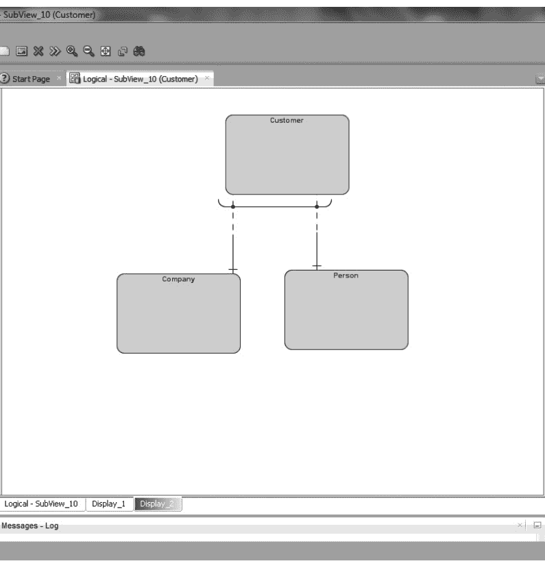

图 4-22. 显示

### 总结

本章讨论了开发概念数据库设计和实体关系建模，以及 Data Modeler 如何支持这些工作。

您可以通过设置偏好和属性，以最符合您需求且支持企业标准的方式定义 Data Modeler 的行为。概念数据库设计的主要工具是逻辑 ER 模型和数据流图。

概念数据库设计的核心是尽可能地建模目标，同时保持足够简单，以便其他人也能理解。Data Modeler 为您提供了许多供选择的，以完美建模您的解决方案。发现并建模概念以及它们与其他实体和关系的关系是非常重要的。您应该建模您能找到的所有属性及其数据类型、长度、域、参与约束等。在选择主键时，还要尝试寻找唯一标识符，并注意冗余；每个细节必须只保存一次。不要害于定义不允许值的属性。在建模时要保持一致性和逻辑。子视图和显示在 Data Modeler 中用于生成更具读性的图。


# 第 5 章

# 引言逻辑数据库设计（关系模型）

# Oracle SQL Developer Data Modeler 数据库设计精通

创建逻辑数据库设计的过程主要包括将概念模型（逻辑模型）转换为关系模型。通常这被称为逻辑数据模型，但在 Oracle SQL Developer 中，它被称为关系模型。数据库设计此阶段的结果是关系型数据库模式，这是一组关系模式及其约束条件。如果概念设计是用 Data Modeler 完成的，那么工程到关系模型就很简单。如果是用其他工具或未用工具完成的，第一步是将所有数据插入 Data Modeler，以便使用 Data Modeler 提供的功能进行转换。

逻辑数据库设计过程始于数据库设计之前阶段创建的实体-关系（ER）模型。取决于之前的完成方式，您可以继续对其进行工作，也可以直接进入转换。通常模型尚未完成；您可能需要添加更多属性、定义数据类型等。现在您开始思考实体和关系是否是根据关系理论进行建模的，并对建模中更困难的问题做出决策。在这一点上，您必须知道此数据库将如何被使用（其功能模型）。

如果我们之前没有做，最好开始考虑如何处理数据历史、您是否需要安全解决方案、用户有何种角色等。这样实现起来会更容易。

### 设置偏好和属性

有一些您尚未研究的偏好会影响关系模型。您可以通过选择“工具 | 偏好（Tools | Preferences）”找到这些偏好。在“偏好”对话框中，选择 Data Modeler，你会看到一个名为“显示关系模型（Show Relational Models）”的偏好。如果您选择它，可以指定显示哪些关系模型。如果没有选择，则所有关系模型将自动显示。

要定义关系模型的偏好，选择“偏好”并进入“Data Modeler | 图表（Diagram）”。只有一个有一个需要定义的偏好：外键箭头（Foreign Key Arrow）。此偏好控制箭头是指向主键还是指向外键。

要定义逻辑模型的偏好，选择“偏好”并进入“Data Modeler | 模型 | 逻辑（Model | Logical）”。在“逻辑”选项卡上，您可以定义以下内容：

- 按源属性名称（By Name Of Originating Attribute）：告诉 Data Modeler 保留关系模型中为外键列指定的名称。

- 按注释、备注 - 从属性自动传播（By Comments, Notes – Automatically Propagate From Attribute）：您将在关系模型中获得与父实体属性具有相同注释和备注的外键列。

- 选择实体创建键 - 允许在工程期间重排序（Selecting Entity Create Key- Allow Reorder During Engineering (Table's Default Value)）允许允许 Data Modeler 在工程到关系模型时将列重新排序为与属性相同的顺序，并在将表工程到逻辑模型时将属性重新排序为与列不同的顺序。此偏好将再次仅影响设置后创建的表，因为该值会被复制到表属性中。

关系模型中外键列的名称。如果您想定义另一个名称，请不要勾选此项。

- 删除 FK 列（Delete FK Columns）定义了当您想要删除一个有一个或多个生成的外键列指向它的表时 Data Modeler 的规则。您可以将其设置为删除外键列、不删除外键列，或对外键删除请求确认。

- 默认外键删除规则（Default Foreign Key Delete Rule）指定了当用户尝试删除涉及外键关系的数据行时发生什么。可能的值有无操作（No Action）、级联（Cascade）、置空（Set Null）和限制（Restrict）。您可能已经在逻辑模型中的关系中看到过该值。在这种情况下，该值将用于基于该实体创建的表。如果您在关系模型上创建一个全新的外键（我不建议这样做），则将使用此默认值。

# 使用 Oracle SQL Developer Modeler 精通数据库设计


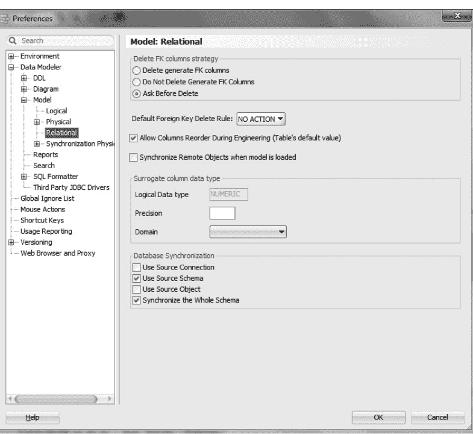

图 5-1. 关系模型的偏设置

（在工程过程中重排列），该属性可以针对单个表进行更改。如果你手动重新排列列顺序，该属性将自动清除。

- **载入模型时同步远程对象**定义了当原始对象在其原始位置发生更改时，共享该对象的模型是否会自动更新。你可以让你的模型与数据库进行同步，反之亦然。数据库同步

# 第 5 章：介绍逻辑数据库设计（关系模型） 95

偏设置定义了在在此同步中是否使用源连接（使用源连接）、源模式（使用源模式）或源对象（使用源对象）。你可以在第 12 章中查到更多关于同步的知识。代理键的默认数据类型是不带精度的逻辑数据类型 `Numeric`。可以在“代理列数据类型”中更改代理键设置。你无法更改逻辑数据类型（代理键始终是数字型的），但你可以为代理键定义精度，或者选择一个域作为代理键的列数据类型。

## 从逻辑模型转换为关系模型

当逻辑模型完成（目前）后，是时候将它转换为关系模型了。在转换之前，最好再检查一次逻辑模型。你的模型是否满足了业务数据的所有需求和要求？是否遵循了建模和命名标准？主键是否正确且已定义？是否存在没有主键的实体？你是想让 `Data Modeler` 为它们定义代理键，还是想自己手动处理？所有已知的属性都定义了吗？它们的数据类型和必填项是否定义得正确？现在是运行逻辑模型设计规则的好时机。有关关于设计规则的更多信息，请参阅第 2 章。

如果你在逻辑模型中有一对一关系，请检查每个一对一关系是否是正确的。有时，建立一对一关系有充分理由，例如元数据和其他数据的生命周期不同。一个例子可以是名为 `Letter`（信件）的实体。可能存在一条业务规则：关于信件发送给谁以及何时发送的信息必须保存 10 年，但信件内容只能保存一个月。从维护的角度来看，两个独立的实体和一个一对一关系将是一个很好的解决方案。如果你创建了有特定目的但并不显而易见的解决方案，请记住记录它们。

> **提示**
>
> 记录那些理由充分但不显而易见的解决方案。你可以使用“`Notes`”（注释）属性来实现。

现在确保你已按照需要对逻辑模型进行了规范化处理。`Data Modeler` 支持规范化设计，它允许你在“`Properties`”（属性）选项卡中的“`Normal Form`”（范式）属性中记录每个实体（和表）的规范化程度，并通过“`Adequate Normalized`”（充分规范化）属性定义它是否足够规范化。有很多关于关系理论的佳书会解释规范化等其他内容。简而言之，这意味着信息被保存并建模了一次。确保数据库中的数据质量良好至关重要；如果数据库充满了你无法信任的信息，那还有意义吗？如果数据只保存一次，它比在数据库中多处重复时更容易保持正确和高品质。当你准备好逻辑模型后，是时候转向转换关系模型了。

## 设置转换规则

从逻辑模型到关系模型的转换是直接的。实体将变成表，属性将变成列，关系将变成外键。对于一对多关系，会在子表中添加一个外键的新列；而对于一对一关系，它会被添加到关系中强制性侧的表中。在这两种情况下，如果该关系是标识性关系，新的外键列也将被添加到子表的主键中。如果为实体选择了“`Create Surrogate Key`”（创建代理键）属性，则会自动为表生成一个代理主键。

# 第 5 章：介绍逻辑数据库设计（关系模型） 97

注意


如果一个实体没有主键，且你希望根据父表的关系和代理主键为表生成主键，请确保在点击“`Engineer To Relational`”（转换为关系模型）之前，已为实体创建主键并为其列选择了所有关系。否则，子表将没有主键。请参阅第 8 章关于生成数据仓库事实表的示例（图 8-1、8-2 和 8-3）。

如果关系的基数是多对多（m:n），将创建一个新表来解决 m:n 基数，并为该表创建一个新的外键（此处原文逻辑略有跳跃，根据语境应为：创建一个新表）。创建一个新表来解决 m:n 基数，并为该表创建一个新的外键。

如果关系的基数是多对多（m:n），将创建一个新表来解决 m:n 基数，并为该表创建一个新的外键。

在关系关系，`Data Modeler` 会创建一个新表中一个以以关联的属性。

如果关系的基数是多对多（m:n），将创建一个新表来解决 m:n 基数，并为该表创建一个新的外键。

在关系关系，`Data Modeler` 会在子表中添加一个以关联的属性，并创建新的一对多关系。

如果关系的基数是多多多（m:n），将创建一个新表来解决 m:n 基数，并为该表创建一个新的外键。

在关系关系，`Data Modeler` 会在子表中添加一个以解决其关联的属性。

# 98 Oracle SQL Modeler 精通数据库设计

> **注意**
>
> 如果你想在关系图中展开结构化列，只需右键点击关系图并选择“`Details`”（详情）

上述解释的转换规则在表 5-1 中以更复杂的形式给出。

| 逻辑模型中的元素 | 关系模型中的元素 |
| --- | --- |
| 实体 | 变成表。 |
| 属性 | 变成列。 |
| 关系 | 变成外键。 |
| 唯一标识符 | 变成主键。 |
| 一对多 | 外键将添加到子表中；如果该关系是标识性关系，新的外键列也将添加到主键中。 |
| 一一对一 | 外键将被添加到关系中强制性侧的表中；如果该关系是标识性关系，新的外键列也将添加到主键中。 |
| 多对多 | 将创建一个新表（以关系命名）。每个表的外键都将添加到该表中。该表的主键将基于这些列生成。同时，为这两个表创建新的一对多关系。 |
| 带属性的关系，一对多 | `Data Modeler` 将该属性作为列添加到子表中，并创建一个依赖约束。 |
| 带属性的关系，多对多 | 将创建一个新表（以关系命名）。该新表将基于每个表的外键生成主键。同时，为这两个表创建新的一对多关系。 |
| 多值属性 | 有两种选择：创建一个用户定义的数据类型（集合）并使用其作为属性的数据类型。或者在转换为关系模型之前，将该属性拆分为单独的属性/实体。 |

**表 5-1. 工程转换为关系模型的转换规则（续）**

# 第 5 章：逻辑数据库设计导论（关系模型） 99

## 逻辑模型中的标题元素

## 关系模型中的标题元素

### 复合（结构化）属性

有两种选择：

- 创建一个用户定义的数据类型（结构化），并将其作为该属性的数据类型。
- 将属性拆分为多个属性并到实体中，或者为该复合属性创建一个新的实体/多个实体。

**表 5-1.** 工程到关系模型的转换规则

有时，例如，ER 图中的环形结构会导致一个或多个候选键重叠的情况。这意味着它们具有一个或多个共同属性。图 5-2 显示了教师、学生和课程。当一个学生通过某门课程时，它将被标记为 `StudentRecord`。在图 5-2 中，你可以看到两个外键中都包含了

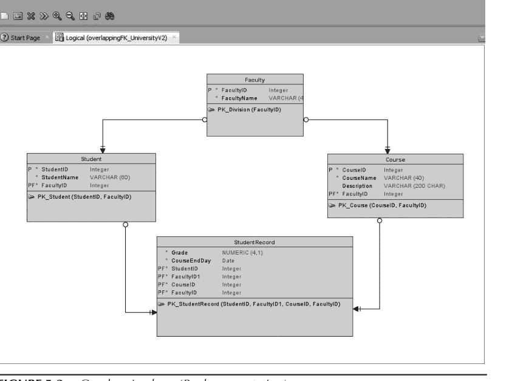

**图 5-2.** 重叠键（巴赫曼表示）

10 Oracle SQL Developer Data Modeler 数据库设计精要

`StudentRecord`（来自 `Student` 的一个和来自 `Course` 的一个）包含 `FacultyID` 属性。如果学生可以修读非其所属系的其他课程，那么这种情况是可以的；这意味着这两个 `FacultyID` 可以不同。如果学生只修读自己所属系的课程，那么从不同路径引入 `FacultyID` 可能会引起混淆。你可以在实体属性对话框的“重叠属性”（`Overlapping Attributes`）选项卡中看到相同的内容，如图 5-3 所示。

在此路径上，你可以通过选择没有标题的复选框（在图 5-3 中突出显示）来指定该属性将被折叠（不工程化为列）。具有实际属性名称（`FacultyID`）的属性将被工程化，但名称包含版本号的属性（`FacultyID1`）将被折叠。你可以通过关系的创建顺序来定义此内容。在本章稍后的部分，你将看到折叠如何影响工程到关系模型的过程。

第 4 章讨论了继承的概念。在开始转换之前，请检查你的设置是否符合你想要对继承转换。在接下来的节中，你将看到例如继承在 `Data Modeler` 中是如何转换的。

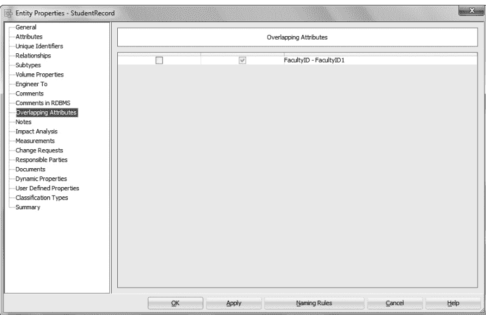

图 5-3. 一个重叠属性

第 5 章：逻辑数据库设计导论（关系模型） 101

## 工程到关系模型

在 `Data Modeler` 中，转换功能被称为“工程到关系模型”（`Engineer To Relational Model`）。你可以通过在浏览器窗格中右键点击逻辑模型并选择“工程到关系模型”，或点击指向右侧的双箭头（图 5-2）来开始转换。图 5-4 显示了“工程到关系模型”界面是将被转换内容的树形视图。也可以使用图 5-5 所示的表格视图。此界面用于查看和选择转换名称指示的哪些元素

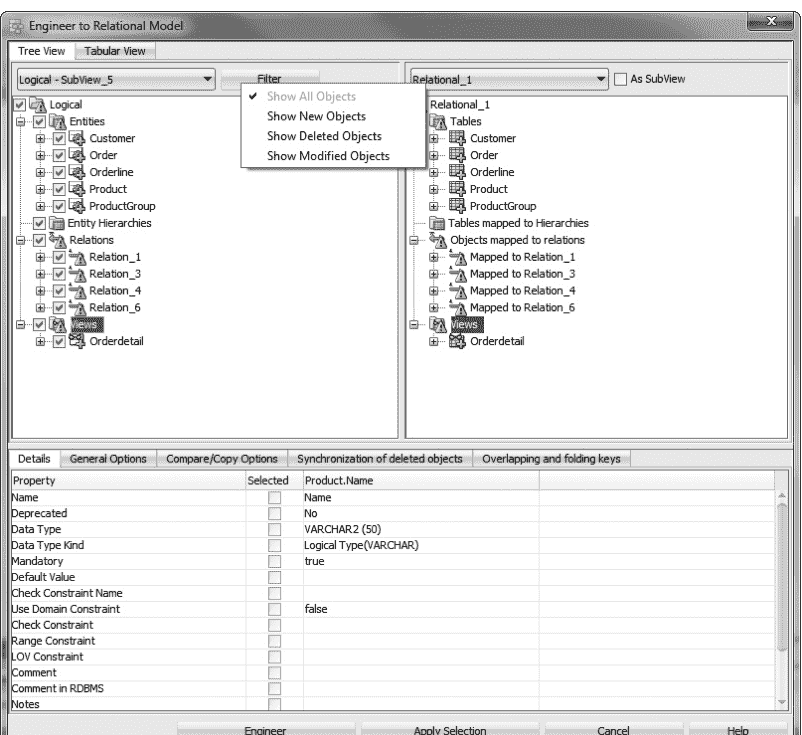

图 5-4. 工程到关系模型界面，树形视图

102 Oracle Developer Data Modeler 数据库设计精要

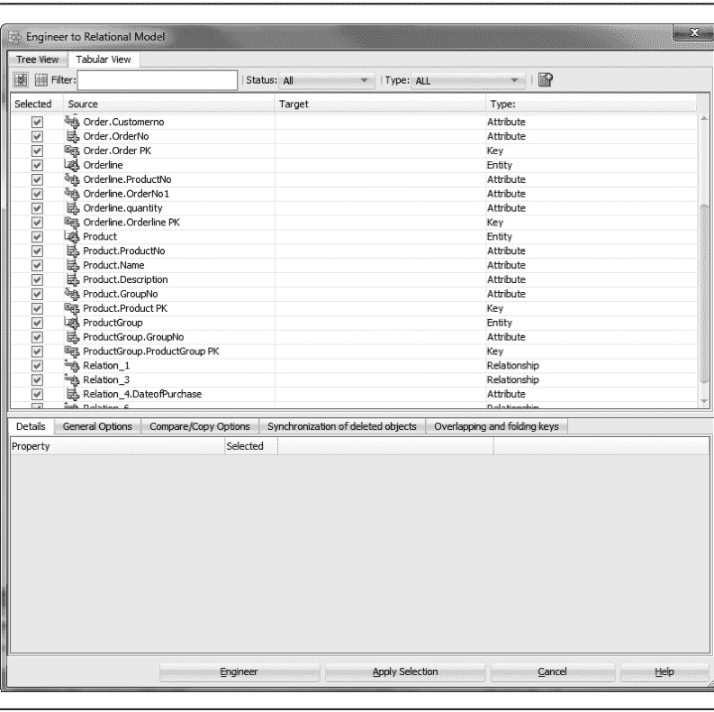

这表示该元素将被工程化。如果你想将某个元素排除在工程过程之外，只需取消选择它。

在树形视图中，你可以选择对象的范围：逻辑模型或该逻辑模型中的某个子视图。你还可以通过过滤器（图 5-4）来缩小对象数量，仅显示新的、删除的或修改的对象，或它们的组合。如果你有多个关系模型，你应该选择哪一个是要转换到逻辑模型的；你通过右上角的列表进行此操作。如果你选择了逻辑子视图（而不是整个模型），

你还可以选择“`SubView`”（子视图），这将创建一个关系子视图并在那里也对你的元素进行工程化（第 4 章已涵盖了子视图）。

屏幕上的绿色加号表示该元素是新的，并将添加到关系模型中（另见图 5-6，该图显示了一个名为 `HelixNewAttribute` 的新属性），红色“X”表示该元素已被删除。元素名称前带有感叹号的黄色三角形表示与关系模型相比，逻辑模型中的该元素发生了变化。钻取到变化所在的级别（在图 5-6 中是属性 `Name`），在“详细”（`Details`）选项卡上，你可以看到实际差异（在图 5-6 中是注释 `comment`）。差异会被高亮显示。

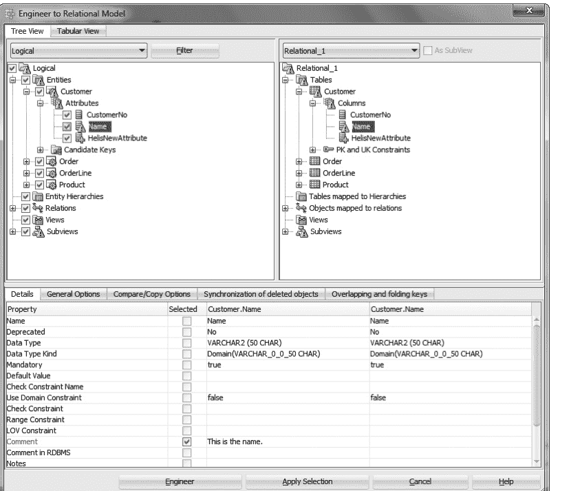

图 5-6. 工程到关系模型界面，详细选项卡

104 Oracle Data Modeler 数据库设计精要

## 工程到关系模型界面上的选项

生成关系模型有很多选项。如果你点击“工程”（`Engineer`），更改将提交到关系模型，工程完成。如果你点击“取消”（`Cancel`），将不进行工程。如果你点击“应用”（`Apply`），你的选择将被保存，“关系模型”窗口将关闭。

在关系模型界面底部，你会发现一个名为“通用选项”（`General Options`）的选项卡（图 5-7）。在“通用选项”中，你可以为转换指定通用规则。工程定义了是否

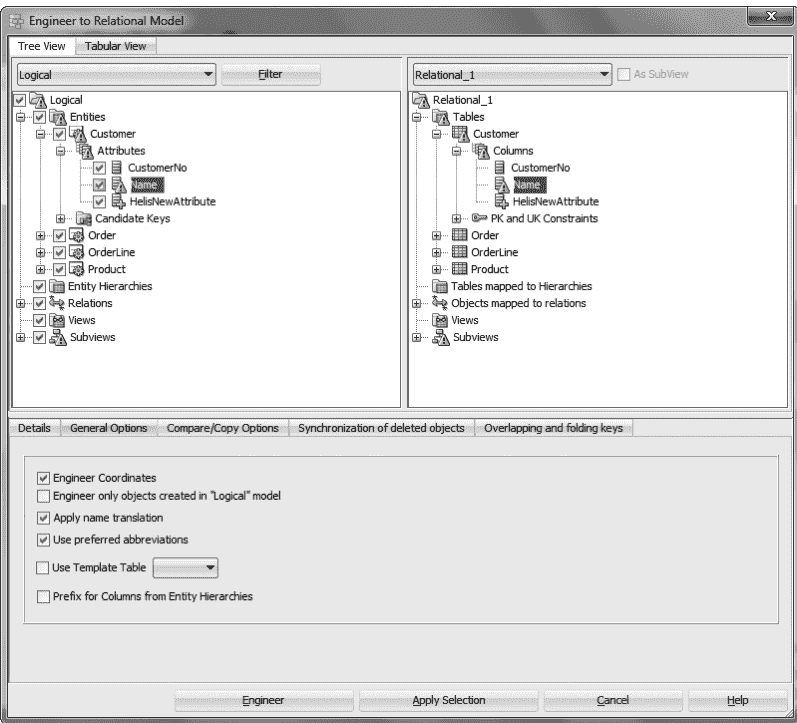

图 5-7. 工程到关系模型界面，通用选项选项卡

第 5 章：工程到关系模型

将以源对象相同的方式放置。“仅逻辑模型中创建的对象”（`Only Objects Created In Logical Model`）将工程范围限制为逻辑模型中显式创建的对象。

如果你使用命名标准附加了词汇表（参见第 2 章），你可以使用词汇表替换实体和属性的名称。可以通过选择“应用名称翻译”来实现这一点。如果你为表定义了复数，将将其用于名称翻译；否则使用缩写。如果你没有为表定义复数或缩写，将使用备用缩写。对于列，顺序是缩写、复数和备用缩写，取决于列中定义了哪一个。如果词汇表中没有该单词的定义，则使用实体/属性名称。

在名称翻译过程中，还会遵循“命名选项”上设置的模型级属性。如果新名称不匹配最大长度（`Max Name`），将使用备用缩写。如果字符大小（`Character Case`）选项设置为“混合”（`Mixed`），则不执行大小转换。如果设置为“大写”（`Upper Case`）或“小写”（`Lower Case`），则会进行可能的大小转换。因此，如果你选择“应用名称翻译”，表和列可能与相关的实体及其属性不同，但名称将根据词汇表进行翻译。这同样适用于反向工程（从关系到逻辑）。如果你在工程化时有“应用名称翻译”选项，那么在反向工程时也应该有它，否则实体和属性的名称将像表一样被更改。


> 注意
>
> 如果你选择“应用名称翻译”，在工程化和反向工程中都应保留它，以确保所有对象的命名正确。

你也可以通过同时选择“应用名称翻译”和“使用首选缩写”，将实体和属性的名称翻译为表列中“首选缩写”设置定义的名称。在这种情况下，所有的表和列将是实体和属性定义的任何首选缩写属性。如果你在工程化时选择了“首选缩写”，那么在反向工程时也应该选择它，否则实体和属性的名称将像表一样被更改。如果你选择了“首选缩写”选项，在工程和反向工程中都应保留它，以确保所有对象的命名正确。

## 106 数据库设计精通 Oracle SQL Developer Data Modeler


提示：

对于“首选缩写”（`Preferred Abbreviation`）属性，你实际上并不需要定义缩写。你也可以使用它，例如，如果你希望在实体名称中使用单数形式，而在表名中使用复数形式。例如，你可以为实体名称输入 `STUDENT`，为实体表输入 `STUDENTS`。然后在进行工程化时，同时选择“名称翻译”（`Name Translation`）和“使用首选缩写”（`Use Preferred Abbreviations`）。现在你的表将具有复数名称，而你的实体仍将保持单数名称。对于那些你不希望在关系对象中使用缩写的实体和属性，请确保将“首选缩写”属性留空。


提示：

你还可以使用工具菜单上的“名称缩写”（`Name Abbreviations`）工具将缩写转换为名称，反之亦然。你将在第8章中学习更多内容。

如果你选择“来自实体层次级的列”（`For Columns From Entity Hierarchies`），则层级结构表中列名将以表名作为外键或主键列的前缀，即使你可能对所有其他列名应用了“名称翻译”和“使用首选缩写”。如果没有勾选“来自实体层次结构的列列”（`Prefix Columns From Entity Hierarchies`），则将遵循其他表的相同规则。

有时你可能想向表中添加一些技术列，但不需要在实体中包含它们。这些列可以是 `CreatedDate`、`Creator`、`ModifiedDate` 和 `Modifier`。在通过 `Data Modeler` 进行“向关系模型工程”（`Engineer To Relational Model`）转换时，有一种简单的方法可以将这些列添加到每个表或一组表中。你只需要一个名为 *_template* 的表，它将只包含你想添加到其他表中的列。在本例中，那将是 `table_template` 表（`CreatedDate`, `Creator`, `ModifiedDate`, `Modifier`）。在“向关系模型工程”屏幕上，首先选择你想添加这些列的所有表，并选择“使用模板表”（`Use Template Table`）。然后从“使用模板”列表中选择 `table_template` 并点击“工程”。你不需要担心是否已经创建了列，因为该功能只有在列尚未添加时才会添加它们。

## 第5章：引论逻辑数据库设计（关系模型） 107

提示：

如果你想向表中添加技术列而不将其添加到实体，请在向关系模型工程时使用“模板表”（`Template Table`）功能。

对于“比较/复制”（`Compare/Copy Options`）选项卡（图 5-8），你可以选择一对对象（实体/属性/列、唯一标识符/索引、关系/外键、关系/实体视图/视图）并定义哪些属性将进行比较，以检查发生了变化以及哪些变化需要工程到关系模型中。

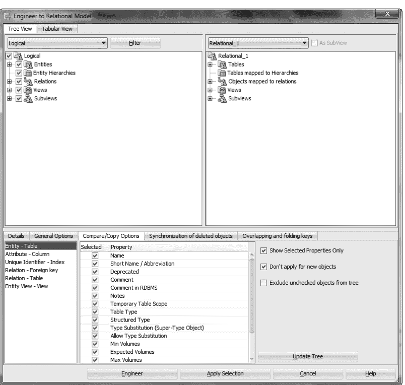

图 5-B。向关系模型工程屏幕，比较/复制选项卡

## 108 数据库设计精通 Oracle SQL Developer Data Modeler

表，并定义哪些属性将通过检查变化的变化以及哪些更改需要工程到关系模型。因此，你可以决定哪些更改值得关注和工程化，哪些不值得。你可以通过选择“仅显示已选属性”（`Selected Properties Only`）来缩小“详情”（`Details`）选项卡上显示的属性范围。换句话说，如果你在“比较/复制”选项卡的列表中取消勾选某个属性，它将不会显示在“详情”选项卡中，不会在“向关系模型工程”屏幕中作为更改显示给你，也不会被工程到关系模型中。如果你选择“新对象不处理”（`Don't For New Objects`），对于所有新对象，所有更改（以及对这些未勾选属性的变化）都将工程到关系模型，但对于在此属性设置之前创建的对象则不会。

例如，如果你禁用了“来自实体/表”（`From Entity/Table`）属性并选择“仅显示已选属性”和“新对象不应用”（`Don't Apply for New Objects`），实体的“注释”（`Comment`）属性将不会显示在“详情”选项卡中，对其任何更改都不会在工程屏幕上用三角形显示。如果你勾选了“新对象不处理”，对于新实体，注释中的更改也不会工程到关系模型中。

如果你选择“从树中排除未勾选对象”（`Exclude Unchecked Objects From Tree`）选项，则“向关系模型工程”屏幕上的未勾选对象将完全不显示（因为它们未被勾选，它们也不会被工程化）。当你更改“从树中排除未勾选对象”时，记得始终点击“更新树”（`Update Tree`）按钮以将你的更改更新到“向关系模型工程”屏幕。

如果你在“向关系模型工程”屏幕上取消勾选实体 `Customer`，那么在该屏幕上将完全看不到 `Customer` 实体，它也不会被工程到关系模型中。


在图 5-9 中你可以看到有一个属性（`HisNewAttribute`）已从逻辑模型中删除，但它仍然存在于之前工程过的关系模型中。如果你想从关系模型中删除该列，必须选择“删除对象的同步”（`Synchronization Of Deleted Objects`）选项卡。如果不选择此项，删除将在工程过程中完成。

在“重叠与键”（`Overlapping And Keys`）选项卡（图 5-10）中，你可以看到是否存在重叠的键（本章较早部分“设置转换规则”提供了更多关于重叠候选键的信息），并且你可以决定如何处理它们。

如果不勾选“折叠”（`Fold`，图 5-10），将按 usual进行工程。如果你选择“折叠”，工程将不会为 `Student` 外键生成 `FacultyID` 列。它将不会生成列，也不会在 `Student` 的外键或主键中包含。在图 5-11 中，你可以看到左侧未折叠的工程，右侧启用了折叠的工程。

## 第5章：引论逻辑数据库设计（关系模型）

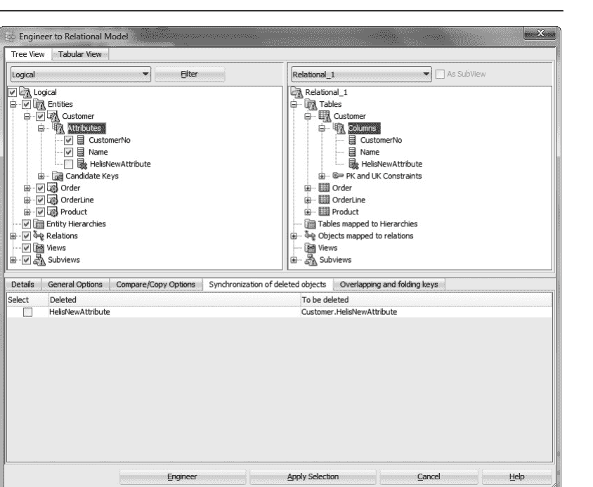

第4章讨论了转换继承的不同方法。图 5-14 展示了弧形解决方案（arc solution，第4章描述）的示例，并展示了它是如何转换为关系模型的。右侧有三个表。为两个子表都创建了外键列（标记为 PF），因为子实体是弱实体，所以父实体的主键被带到了两个子表的主键中。为两个子表都创建了外键。关系模型中的弧显示客户（`Customer`）可以是个人也可以是公司，不能两者兼有。

## 112 数据库设计精通：Oracle Developer Data Modeler


图 5-12 “工程到关系模型”界面、网格视图和生成报告按钮

图 5-15 显示了单表解决方案（在第 4 章描述）的示例，并展示了它是如何转换为关系模型的。右侧只有一张表，该表包含了左侧实体中每个属性的列。子实体中的任何强制属性都转换为表中的强制性列。不需要外键，主键是父实体的主键。

## 第 5 章：引言逻辑数据库设计（关系模型） 113


图 5-13 “工程到关系模型”界面，报告对话框

还有一个新列 (`Customer_TYPE`)，它是该表的区分符列（见第 4 章），用于将表的行划分为公司 (`Companies`) 或个人 (`Persons`)。`Data Modeler` 会自动创建该列，以及图 5-16 所示的生存依赖约束 (`Existence Dependency Constraint`)。该约束是一个检查：如果 `Customer_TYPE` 为 C，则 `Company_ID` 不能为空；然而，`SSN` 和 `PersonInfo` 必须为零；如果 `Customer_TYPE` 为 P，则 `Company` 和 `CompanyInfo` 必须为零，且 `SSN` 和 `PersonInfo` 都不能为零。因此，`Data Modeler` 自动创建了人员或公司存在的逻辑。在图 5-17 中，你可以看到 `Data Modeler` 创建的带有允许值列表的检查约束，用于检查区分符列。

## 114 数据库设计精通：Oracle SQL Data Modeler


图 5-14 弧解决方案的工程化

图 5-18 显示了每个子表解决方案（在第 4 章描述）的示例以及它是如何转换为关系模型的。右侧有两个表。这些表中没有外键，父实体的属性已转换为两张表中的列。子实体中的属性转换为对应表的列。两张表的主键都是根据父表的主键创建的。


图 5-15 单表解决方案的工程化


图 5-19 显示了第 4 章描述的每个实体一个表解决方案的示例，以及它是如何转换为关系模型的。右侧有三个表。两个子表都创建了外键列（标记为 PF），因为子实体是弱实体，所以父实体的主键与两个子表的主键一起取用。为个人或公司创建了外键，而不是两者都创建。你也可以要求 `Data Modeler` 创建区分符列。它还创建了允许值列表和触发器，以监控插入或更新到子表时的 `Company_TYPE` 是否正确。因此，如果在 `Company` 表中插入或更新行，触发器会检查 `Company_TYPE` 的值是否为 C。如果不是，则抛出错误。

## 116 数据库设计精通：Oracle SQL Data Modeler


**图 5-17.** 单表解决方案的检查约束


**图 5-18.** 每个子表的工程化

## 第 5 章：引言逻辑数据库设计（关系模型） 117


**图 5-19.** 每个实体一个表解决方案的工程化

第 4 章还讨论了带有自身属性的一对多关系案例。在图 5-20 中，你可以看到它是如何转换的。关系属性 (`OrderDate`) 已创建为子表的一列，由于它最初不是强制性的，所以它作为列也不是强制性的。一个依赖


**图 5-20.** 带有属性的一对多关系工程化示例

## 118 数据库设计精通：Oracle SQL Data Modeler

约束被创建，为子表创建了外键及其列 (`OrderNo`)，由于子实体没有主键，因此为子表创建了代理键。

在图 5-21 中，你将找到带有自身属性的多对多关系示例。右侧可以看到创建了一个新表 (`Relation_1`)，它带有与属性相同的强制列 (`OrderDate`)。`Product` 实体没有主键，因此创建了代理键，并且外键及其列已添加到子表 (`Relation_1`) 中。子表的主键是根据父表的主键创建的。


图 5-21 带有属性的多对多关系工程化

## 第 5 章：引言逻辑数据库设计（关系模型） 119

> 提示：在工程化关系模型时，如果键或约束的命名不符合要求，请转到面板，右键点击关系模型的名称并选择“应用标准”(`Applying Standards To Keys`)。

在第一次保存设计时，第一个关系模型 (`Relational_1`) 会自动创建。你可以通过在面板中右键点击关系模型并选择“新建关系模型”(`New Relational Model`) 来添加关系模型。关系模型（包括 `Relational_1`）可以在属性对话框中重命名。可以通过在面板中右键点击“隐藏”(`Hide`)或再次“显示”(`show`)来关闭模型。关系模型可以打开或关闭，这意味着面板将显示对象。在关系模型中，你可以按照第 4 章描述的方法创建视图。

在图 5-22 中，你可以看到关系图的示例。在关系模型中，主键标记为 P，唯一键标记为 U，外键标记为 F。


图 5-22. 关系图

## 120 数据库设计精通：Oracle SQL Data Modeler

根据标识关系 (PF) 创建了主键列。强制性列标记为星号 (*)。弃用元素用删除线显示。如果表名末尾有“1”，则意味着你为该表创建了图形符号。如果你右键点击关系模型或视图画布，可以通过选择“详细信息”(`Details`)来决定图中显示哪些细节，如图 5-23 所示。

关系模型的主要概念是表、列和外键。在关系模型中，你可以与同一设计中的关系模型共享表，但如果你将表拖到另一个设计，工具会显示不可，但在两个设计之间创建了共享表。设计之间的共享有一些限制：你不能拥有设计层面的域和数据类型，因为它们无法在表定义中使用。


图 5-23. 关系模型画布的右键菜单及选项

## 第 5 章：引言逻辑数据库设计（关系模型）

指向另一个图中的表，而不是它的副本。如果你想与另一个设计/关系模型创建共享表，必须先打开两个设计/关系模型。然后转到面板，简单地拖入另一个设计的模型画布或其他关系模型。在表的左上角，你可以看到一个显示表已共享的符号（图 5-24）。

表的所有属性在共享端将变为灰色，且只能在原始位置编辑。如果原始位置的表发生了更改，将更新传输到共享设计是很有用的。有两种方法：自动或手动。对于自动同步，设置如本章前面所述的属性“加载模型时同步对象”(`Synchronize Objects When Model Is Loaded`)，在这种情况下，每当表所在的设计的关系模型变化时，表就会更新（发生更改）。在实践中，这意味着表将是最新的。如果你没有设置，可以通过在面板中右键点击关系模型并选择“同步对象”(`Synchronize Objects`)，或者通过右键点击关系图并选择“同步”(`Synchronization`)然后选择“同步对象”(`Synchronize Objects`)来手动同步。

从表的“属性摘要”(`Properties Summary`)表中，你可以从“远程设计”(`Remote Design`) 和“远程模型”(`Remote Model`) 属性看到该表是从哪里共享的。如果你决定与另一个设计共享表，请记住这里存在一些限制：

| Customer | | | Order | | ProductGroup |

| :--- | :--- | :--- | :--- | :--- | :--- | :--- |

| P * Customers | NUMBER | | F * Customer_Customer | NU | | |

| U ID | VARCHAR(1) | | F * OrderNo | NUM | P * ProductGroup | NUMBER |

| Type | VARCHAR(2) | | | Order_PK (OrderNo) | | |

| P * Name | VARCHAR(2) | | | Order_Customer_FK (Customer | | |

| Customer: PK (Customer) | | | | Product_Group_FK (GroupNo) | | |

| Person | | | | | | |

| Name | VARCHAR(2) | | | | P * Product | NE |

| | | | | | Name | VA |

| Numbers | PhoneNumber | | | | Description | VA |

| | | | | | F * Product_Group_GroupNo | NT |

| P * Person_ID | NUMBER | | | | Product_FK (ProductNo) | NT |

| | | | | | | |

| Orderline | | | | | | |

| PF * Product_Product | NUMB | | | | | |

| PF * Order_OrderNo | NUMB | | | | | |

| DatePurchase | DATE | | | | | |

| Orderline_Pk (Product_Product | | | | | | |

| Orderline_FK (Order_Order | | | | | | |

| Orderline_FK (Product | | | | | | |

图 5-24. 从另一个设计共享的表 (Person)

前文提到：没有设计层面的域，也没有来自数据类型模型的定义。在这种情况下，我建议选择自动同步。

> 注意

在将表共享到任何其他设计之前，请记住保存原始设计。

## 表格

表具有许多属性。与实体相同的属性将在工程过程中从实体转换而来，而表特有的属性则可以在“表属性”对话框中编辑，如图 5-25 所示。工程完成后的第一件事可能是为关系模型运行命名规则。这可以通过点击“表属性”对话框“常规”面板上的“命名规则”按钮轻松实现。


**图 5-25.** 表属性，常规选项卡

# 第 5 章：逻辑数据库设计简介（关系模型） 123

“常规”选项卡具有控制工程、逆向工程和 DDL 生成的属性。“工程”(`Engineer`)定义了在工程到逻辑模型（逆向工程）时是否包含该表及其属性，“在工程过程中允许重排列”(`Allow Columns Reorder During Engineering`)允许 `Data Modeler` 按照关联列在表定义中的相同顺序重新排列关联实体的属性。此属性复制自本章前面的属性（在工程过程中允许重排列），但根据需要可以针对单个表进行更改。“在 DDL 中生成”(`Generate In DDL`)定义了在反向工程期间是否包含该表。

“作为关系”(`Engineer As Relationship`)定义了在反向工程期间是否创建关系属性。换句话说，如果该表是一个交叉表，选择此项将允许表在非关系外键属性的列中作为多对多 (m:n) 关系进行反向工程。当逻辑模型具有带有可能属性的多对多关系时，这种转换行为是反向的。如果您想与表关联一个模式（schema），可以在表属性中从下拉列表中选择该模式。如果您尚未添加该模式，可以在浏览器（Browser）窗格的“关系模型”下右键点击该模式，选择“新建模式”。

> 提示

如果您已创建了模式并将其与对象关联，可以基于此创建关系模型。在浏览器窗格中，进入关系模型，右键点击并选择“根据模式名称新建模型”。`Data Modeler` 将为您指定的每个模式创建一个新的关系模型，并使用与模式相同的名称。

表还有其他属性。您可以通过选择“注册为空间表”(`Register As Spatial Table`)告知该表是空间表。对于结构类型，可以通过“允许类型替换”(`Allow Type Substitution`)在 DDL 生成时允许替换。您可以通过选择“标识符为主键”(`Object Identifier Is PK`)来定义表具有对象标识符 (OID)，并在 Oracle DDL 生成中生成 `IDENTIFIER IS PRIMARY KEY` 子句。

# 124 Oracle SQL Developer Modeler 数据库设计

提示

要查看表或视图的 DDL，请在画布上右键点击对象并选择“DDL 预览”。当预览器打开时，您可以选择关系模型中的另一个对象，预览器将相应更新。


表属性中还包含列列表及其属性。有三个选项卡：“详细”(`Details`)、“概述”(`Overview`)和“安全”(`Security`)。双击（或点击属性图标）可以查看更多列属性。在“安全”选项卡中，可以看到列列表及其安全属性（您可以在属性的安全属性中找到相同的属性）。如第 4 章所述，可以为属性定义敏感类型，但有很多个人身份信息 (PII) 或敏感信息的选项以及掩码类型（FULL、NO、PARTIAL、RANDOM、REGEXP）。如果您选择 PARTIAL 或 REGEXP，还可以选择“掩码模板”（第 4 章中创建掩码模板）。掩码模板必须与其所属的列的数据类型相同。如果您将其标记为“敏感信息”(`Sensitive Info`)，该列名在任何图表中将以红色显示。

如果您知道将创建一个 Oracle 数据库（11.2.0.4 或更高版本，已许可高级安全性），您可能还想为您的表定义脱敏策略（redaction policy）。脱敏策略可以在表属性的“脱敏策略”下定义。您可以定义策略名称，定义策略是否启用以及在生成 DDL 时是否考虑，以及真实数据是呈现为空还是向用户显示所有未定义为掩敏的数据。每个脱敏策略仅适用于该表的一个列。因此，在定义脱敏策略后，进入列属性并为所需的属性定义包含 PII、敏感信息、掩码类型和掩码模板。

# 126 用于精通数据库设计的 Oracle Developer Data Modeler

在逻辑数据库设计中，你可以开始考虑索引，但当你知道正在使用哪种关系型数据库管理系统（RDBMS）以及它支持哪些索引类型时，可以在物理设计中继续该部分。你可以在“属性”(`Properties`)选项卡中创建新索引或编辑现有索引。只需点击绿色符号并插入索引数据即可。对于索引，你可以定义名称、是否唯一、是否由 DDL 生成，以及在反向工程时是否进行工程。你还可以指定它是否为空间索引。你可以选择索引的列，或者将其标记为表达式（Index Expression）并为索引编写表达式子句以获得基于函数的索引。在“属性”中（双击索引或点击并点击“属性”图标），你可以为索引定义许多其他属性。你可以定义普通索引、主键约束或唯一约束。你还可以将索引附加到模式（schema），或为空间索引定义空间属性。你还可以查看并定义备注（Notes）、注释（Comments）以及“在 RDBMS 中的注释”字段。

在“表级约束”(`Table Level Constraints`)选项卡上，你可以指定表级约束，并通过验证规则定义它们，并指定它们是否设置为“在 DDL 中生成”(`Generated In DDL`)。在“存在依赖”(`Existence Dependencies`)选项卡上，你可以创建存在依赖约束。在本章中你可以找到更多关于存在约束（Existence Constraints）选项的信息。

你还可以带有名称、开始时间列和结束时间列定义有效维度（Valid Time Dimensions），并带有名称和空间列/函数表达式定义空间属性（Spatial Properties）。你可以双击空间属性或点击属性按钮（铅笔图标）来显示和编辑空间定义属性。


进入`/path/to/xxx`目录，找到`xxx.json`。

如果你为实体定义了卷（Volume）属性，将在表属性的“卷属性”下看到它们。例如，你可以查看模型（根据你认为）是否已充分归一化以及它属于哪种范式。遗憾的是，这些属性并不用于估计 Oracle 数据库中对象所需的空间。这些信息仅用于 DB2 数据库。

分类类型（Classification types）对于多维模型有用，但也可以用于操作数据库，例如，如果你想用特定颜色突出显示所有查找表（代码表），以便在大图中轻松查看。你可以在单个实体中或在它们的属性中设置分类类型，也可以在浏览器窗格（Browser Pane）的逻辑模型或关系模型上使用“设置分类”（Set Classification）操作。或者你可以通过在浏览器窗格中右键点击逻辑/关系模型并选择“设置分类类型”，将其设置为一组实体/表。你可以在第 8 章找到更多相关信息。

### 提示

你可能想为你的查找表（代码表）创建一个新的“查找”（Lookup）分类类型，并将其分配给所有该类型的实体。当颜色传递重要信息时，阅读图表会更简单。


## 第 5 章：引入逻辑数据库设计（关系模型） 127

在“脚本”（Scripts）选项卡上，你可以定义在指定时间自动运行的 SQL 语句：在此表删除/重命名之前、在此表执行创建操作之前，或在为此表指定的脚本结束时。你可以通过选择“包含到 DDL 脚本”（Into DDL Script）将这些脚本包含在 DDL 中。你还可以为表（以及许多其他对象）创建自己的动态属性。第 8 章将讨论动态属性。

> 注意

与表或视图相关的脚本将不会显示在 DDL 预览。


### 视图

在逻辑模型（第 4 章）中，你可能创建了一些实体视图。如果是这样，实体视图在工程过程中将转换为关系模型上的视图。在逻辑模型上，实体视图显示为橙色，而关系模型上的视图显示为绿色。在关系模型中，视图的名称旁边可能有一个图标，指示其状态。带有感叹号的黄色三角形表示它是用较早 Data Model 版本创建的旧样式视图，或者已导入但尚未解析。要解析视图，请在图中右键点击该视图并选择“解析样式视图”（Parse Style Views）。带有感叹号的右直三角形表示该视图是一个无效视图。这可能意味着解析后发生了某些变化，或者视图包含错误的语法。要验证视图，请在图中右键点击视图并选择“验证所选视图”（Validate Selected Views）。你可以通过右键点击关系模型画布、选择“视图”（Views）并选择“验证所有视图”（Validate All Views）或“解析样式视图”来同时验证或解析所有视图。

你也可以在关系模型上创建视图。在关系图中，点击“新建视图”（New View）图标并点击画布。视图具有属性，如图 5-26 所示。首先你应该给视图命名，然后你应该构建视图。查询基本上是一个保存的查询，可以包含来自多个表的信息。查询在“查询生成器”（Query Builder）中构建，可以通过点击名为“查询”（Query）的查询生成器字段找到（图 5-26）。如果你选择“外键自动连接”（Auto Join On FKs）属性，查询生成器中的表连接将根据外键自动创建。如果你在“仅来自对象”（Object Only From）属性中选择某个模型或子视图，则查询生成器中仅显示该图中的对象。你还可以通过选择“在 DDL 中生成”（Generate In DDL）来定义是否为视图生成 DDL，并可以通过选择“弃用”（deprecated）将视图标记为弃用。你可以基于结构化类型编写查询，为其定义 OID 列。

# 154

# 128 用于精通数据库设计的 Oracle Developer Data Modeler


图 5-26 视图的通用属性

在 SQL 中。你也可以基于结构化类型编写查询，为其定义 OID 列。

查询生成器由右侧过滤器、输出标准以及三个屏幕组成：主、输出标准和 SQL 预览。从右侧过滤器，你可以将表拖到查询中。从右侧过滤器，可以将表列表限制为关系模型或子视图。在画布上，你可以选择要包含的列并取消不需要的列。在“主、输出标准”屏幕下方的窗口中，你可以为要评估的列选择聚合、别名、排序类型、分组和条件。所有这些设置将影响 SQL 查询。

# 155

# 第 5 章：引入逻辑数据库设计（关系模型） 129


图 5-27 用于创建查询的查询生成器

在 SQL 中。如果需要，你可以编辑 SQL 子句，运行测试查询（测试查询图标），并将连接语法更改为 ANSI 连接或 Oracle 连接。如果你手动编辑查询，请记住点击“更新图表”（Update Diagram）以同步图表和 SQL 查询。你还可以通过选择左上角的“结构树”（Structure Tree）以结构化树格式查看查询。你可以从许多提供程序（在语法提供程序列表中）中选择语法，包括 Oracle、DB2、MSSQL、MySQL、PostgreSQL、SQLite、Sybase 和 Firebird。你可以在视图属性对话框（如图 5-26 所示）中点击“测试查询”来测试你的查询。在查询生成器主窗口的右上角，你可以看到一个大字母 Q 的图标。那是“更新查询”（Update Query）按钮，如果你点击它，主窗口中的查询将更新。点击“应用”（Apply）将一个查询元素中进行的更改更新到所有其他元素。点击“确定”（OK）保存查询并关闭查询生成器，点击“取消”（Cancel）将取消更改并关闭查询生成器。

在视图属性对话框中，你还可以为查询中的列添加列注释，或为视图添加注释、注释和备注。在 RDBMS 中，你还可以指定在创建之前/之后、删除/重命名之前或脚本结束时运行的脚本，就像你在本章早些时候为表看到的那样。你可以通过选择“包含到 DDL 脚本”（Include DDL Script）来设置这些脚本随 DDL 一起创建。

## 名称缩写与前缀管理

你可以使用名称缩写和前缀管理来快速更改对象的命名以满足你的需求。

### 名称缩写

你可以使用名称缩写（Name Abbreviations）工具来批量更改名称或缩写。你可以用它将所有相似的词改为相同的词；例如，你可以将 C 和 CUST 都更改为 CUSTOM。或者，你可以使用它为表和列添加缩写。该更改基于逗号分隔值（CSV）文件。文件中有一成对的单词，这些单词由逗号或在执行更改时定义的其他分隔符隔开。第一个单词是名称，第二个单词是缩写。

名称对话框。如果你在“方向”（Direction）中选择“名称缩写”，则第一个单词将被第二个单词替换。但如果你选择“缩写转名称”（Abbreviation To Name），则列表中的第二个单词将被第一个单词替换。换句话说，“方向”设置决定了列表的读取方式。

你可以通过在“范围”（Scope）设置中选择“所有对象”（All Objects）或“缩写”（Abbreviations），对名称或缩写执行名称缩写。针对名称的名称缩写可以应用于表、视图、外键约束、主键和唯一键约束、列和索引。


**图 5-28.** 名称缩写对话框

可以应用于表和列的缩写。比较是区分大小写的，并且仅替换整个单词或带有下划线的单词。例如，CSV 文件中的以下几行将产生不同的结果：

CUSTOMER, CUST

CUSTOMER, CUST

第一行将替换（例如）将 Customer_ID 为 CUST_ID，但后者由于区分大小写敏感性，将找不到该单词。它们中的任何一个都不会将 CUSTOMID 替换为 CUSTID，因为该单词不是一个独立的单词，也不是由下划线分隔的单词部分。

通过选择 CSV 文件来开始名称缩写操作；在“名称缩写”对话框中点击“浏览”（Browse）按钮并找到正确的文件。对于分隔符，你可以定义逗号或任何其他分隔符。如果你选择了文件中不存在的分隔符，将得到错误。选择文件后，选择转换的范围和方向。如果你想在更改名称部分时保留原始大小写，选择“保留大小写”（Keep Case）。如果你想使用 CSV 文件中定义的大小写，请禁用此属性。例如，如果你有一个包含 customer_name 的列，并且禁用了“保留大小写”，则列名将更改为 CUST_NAME。当选中该属性时，列名将更改为 CUSTNAME。

当你打开了多个设计时，选择你想要执行操作的设计。更改将完成，日志将如图 5-29 所示显示所有更改。如果你使用相同的文件和设置在两个方向上执行名称缩写，名称将与开始时相同。在这种情况下，名称组合必须是唯一的。

在数据模型中，你可以找到两个名称缩写的示例文件：ABREV.csv 和 plurals.csv。plurals.csv 文件是使用该工具的示例。如果你在项目过程中决定表名实际上应该是复数而不是单数形式，你可以使用该工具轻松地更改命名。


**5-29.** 名称缩写的日志

缩写不适用于实体和属性，因此如果你使用该工具，请记住点击“工程逻辑模型”（Engineer Logical Model）以便在逻辑模型中进行更改。

### 前缀管理

在设计数据库时，前缀管理也非常有用。当你不想使用不同的模式（schemas）时，可以使用前缀来区分和分类各种对象。你可能希望对具有不同生命周期的对象使用前缀，例如历史表（HIST_）或汇总表（MONTH_DAY）。你可能希望根据应用程序或应用程序的一部分对其进行分类，例如，对所有客户信息、表等使用 CUST_ 前缀。Oracle 数据字典视图就是其中的例子：USER_ALL_ 和 DBA_。或者，你可能想使用前缀来描述对象的用途，例如，用于临时对象的 TEMP_，或用于仅包含索引的表空间的 IDX_。

前缀可用于 DDL 生成。在创建对象或更改其属性时，你可以手动为对象名称添加前缀。例如，与其命名为 ADDRESS，不如使用 CUST_ADDRESS。你也可以使用 Data Modeler 工具自动完成。你可以对关系模型或特定子视图中的表、视图、外键约束、主键和唯一键约束以及索引执行此操作。在浏览器（Browser）面板中，进入关系模型，右键点击并选择“更改对象名称前缀”（Change Object Names Prefix）。你可能完全根据你用于前缀命名的标准将对象分为子视图。在这种情况下，从浏览器面板中选择子视图，右键点击并选择“更改对象名称前缀”。或者，你可能为对象关联了分类类型，这允许你更改该分类类型的所有前缀，如第 8 章所述。根据你的需求，可以使用其中任何一种，它们都会进入“更改对象名称前缀”对话框，如图 5-30 所示。

在“更改对象名称前缀”对话框中，你可以选择“前缀替换”（Prefix Replacement）或“添加分类前缀”（Add Classification Prefix）。“添加分类前缀”将在第 8 章中解释。现在你将看到可以使用“前缀替换”执行的操作。如果你选择“前缀替换”，可以替换现有的前缀或添加新前缀。如果你想替换现有的前缀，只需设置当前前缀并设置新前缀。你可以带下划线（_）或不带下划线来指定新前缀；如果已经有了前缀，带不带下划线没有区别，取决于它是手动添加的还是使用 Data Modeler 工具添加的。然后选择是否对前缀搜索区分大小写（Case Sensitive）。如果选择了此项且你在当前前缀输入了 CUST，前缀为“cust”的对象将不会被选中。在对话框的应用（Apply）部分选择你想要的对象。更改对象名称前缀操作将影响关系模型/子视图指定的指定的类型。然后点击“应用”。

如果你想为对象添加前缀，选择“新前缀”并在其中输入前缀；记得在末尾也输入下划线（_）。如果对象名称中已有前缀，它将被添加在前面，因此如果你想替换现有的前缀，请确保使用替换功能，如果只想添加新前缀，则仅使用添加前缀功能。

你也可以在生成 DDL 时更改前缀。参考第 7 章的“文件 | 导出”（File | Export）。如果你打开了多个设计，选择你想要生成 DDL 的设计；选择用于生成 DDL 的关系模型。选择所需的 RDBMS 站点，如果想要来自所选关系模型的视图，则选择它。点击“生成”（Generate）。在 DDL 生成选项对话框中选择“名称替换”（Name Substitution）。在“旧”（Old）字段中输入你想替换的前缀，在“新”（New）字段中输入你想使用的前缀。例如，旧字段输入 CUST，新字段输入 TEST_。然后选择将选定的名称替换包含在 DDL 生成过程中。选择“对象类型”选项卡并启用你想包含在更改中的类型。例如，选择“表”以仅对表缀执行更改。然后点击屏幕底部的“应用名称替换”（Apply Name Substitution）。如果不选择此项，则不进行替换。这是一个使用名称替换为 CUST_CUSTOMER 表生成的 DDL 脚本示例：

```
PROMPT CREATING TABLE 'CUST_CUSTOMER';
CREATE TABLE "TEST_CUSTOMER"
(\ "Cust No" NUMBER (16) NOT NULL,
 "CustName" VARCHAR2 (30) NOT NULL
 )
```

## 第 5 章：逻辑数据库设计简介（关系模型） 135

## 模型的调优与重构

早晚你都需要对模型进行更改。特别是当系统开发方法是敏捷的时，在第一个版本发布后，逻辑模型会有很多变化；设计工作是迭代的。你在每个阶段检查模型得越频繁，结果就会越好。

重构的问题通常不在于数据库及其上层的对象（例如：测试用例、程序、数据类、迁移等）。尽早发现核心概念及其关系并正确理解它们是明智的。在流程的后期阶段拆分实体或修复问题通常会耗费大量工作。从数据库对象的角度来看，如果你手有像 Data Modeler 这样的工具，重构是非常容易的。你只需要对逻辑模型进行更改，然后工程化到关系模型。你的更改将应用到物理模型，并轻松地生成新的 DDL 脚本。我的观点是，无论你有多忙，都应该始终遵循流程：在逻辑模型中进行更改，然后工程化到关系模型。千万不要先在关系模型或数据库中进行更改。虽然你可以通过工具完成这一过程，但这不是明智的。为什么？第一，流程是为了系统地完成任务的，如果你打破了它们，就会面临某些工作未实际完成的风险（例如，实体或属性的文档）。其次，尽管工具提供了不同模型和数据库之间所有可能的比较，我不认为寻找差异是一项全职工作。而且如果不遵循流程，你如何知道事情实际上应该是怎样的？许多数据库中具有相同的数据也是如此：源之一必须是主，其他所有都是主的副本。如果它们不一致，以主为准。在数据库设计中，实体是主。

在逻辑数据库设计过程中，你可以做出反规范化的决策以获得更好的性能，但要确保每个决策都是明智且经过记录的。逻辑数据库设计中一种典型的优化策略是拆分或合并表。将一个垂直分为两个（或多个）表。合并两个（或多个）表以避免连接（joins）并获得更好的性能。操作通常针对关系模型执行，对逻辑模型没有影响。Data Modeler 支持这两种操作。

要进行拆分，在关系模型图中选择表，并点击关系模型工具栏中的“拆分表”（Split Table）图标启动拆分表向导。输入新表的名称（table Name），在“为新表添加注释”（Add Comments For The New Table）属性中输入任何所需的注释，并点击“下一步”。然后从列表中选择要添加到新表的外键，并点击“下一步”。从列表中选择要添加到新表的列，并点击“完成”。要合并表，点击工具栏中的“合并表”（Merge Tables）图标，并从图中选择想要合并的表。对于问题“你确定要合并所选表吗？”，点击“是”。然后回答后续问题，你的表将合并为一张。

## 总结

逻辑数据库设计始于概念设计中的逻辑模型。通过 Data Modeler，逻辑模型将使用“工程化到关系模型”（Engineer To Relational Model）功能转换为关系模型。数据库设计这一阶段的结果是关系数据库模式（schema）：一组关系对象及其约束。“工程化到关系模型”功能是一个简单且快速的过程，每当你对概念模型有更改请求时，都应该执行它。

设计数据库是一个迭代过程。为了拥有高效且可靠的流程，始终遵循相同的程序和相同的顺序是有价值的：更改逻辑模型，并使用“工程化到关系模型”功能将更改正向工程化到关系模型。对数据库进行逆向工程也是可能的。你可以在第 10 章阅读更多信息。你可以同时使用名称缩写和前缀管理来快速更改对象的命名以满足你的需求。


## 第 6 章

## 物理数据库设计简介

## 138 数据库设计 Oracle SQL Developer Data Modeler

物理数据库设计延续逻辑设计中创建的关系模型。一个关系模型可以没有物理模型，也可以有任意数量的物理模型，物理模型由其关系数据库模型（RDBMS）站点定义。RDBMS 站点是与 Oracle SQL Developer Data Modeler 支持的 DBMS 类型（Oracle 12c、Oracle 11g、SQL Server 2008 等）相关的别名。为了设计物理模型，你需要对所的 RDBMS 站点有良好的理解，以便做出正确的决策。

在物理数据库设计中，设计与选取技术相关的物理数据库元素（表空间、数据文件等），并为关系模型中的元素添加物理属性。你估计数据库所需的空间，规划磁盘和磁盘组，并确定将哪些数据库对象放在哪个磁盘中。你必须规划备份和恢复策略，并决定如何记录数据库更改，包括对象的更改和 RDBMS 的更改（何时运行什么补丁等）。你还需要约定由谁来创建文档、他们将记录什么以及在哪里记录。你还设计了数据库模式（schemas），它们是基于模式名称定义的命名空间的数据库子集。你定义了用户、角色和权限。你创建索引，而不仅仅是主键和外键。你设计数据库以便能够创建数据库。数据定义语言（DDL）脚本的生成主要基于物理模型。物理模型没有图形化展示，只有一个用于的浏览器。物理设计过程的结果是创建数据库所需的 DDL。在第 7 章中，你将学习在所有对象定义后生成数据库。

> 提示


为表空间和数据文件等物理对象约定命名标准。这些不是 Data Modeler 命名标准的一部分，但为了一致性，拥有命名规范是有价值的。


本章将涵盖物理设计过程中的所有任务。你将阅读可以使用 Data Modeler 为 Oracle 12c 设计物理模型的部分任务。所有技术都有它们自己需要设计的物理对象。物理数据库设计中有大量的设计工作，某些决策必须与最终用户（如用户和角色定义）甚至公司管理层（如备份策略和敏感数据定义）协商。

## 设置偏好和属性

Data Modeler 有一些影响物理模型的偏好。在偏好对话框的 Model 选项中，你可以定义默认的 RDBMS 类型和站点。你还可以为 DB2、Oracle、SQL Server 和通用数据库（UDB）的物理模型定义默认值。预定义的默认值取决于你使用的 RDBMS。对于 Oracle 和 DB2，列表更大，但对于 SQL Server 可以定义默认数据库设置，对于 UDB 可以定义所有者设置。

在图 6-1 中，你可以看到为 Oracle 物理模型定义的默认值。你可以定义默认用户和默认表空间。默认用户和表空间只有在你在物理模型中创建了这些对象并在关闭重新打开设计后才会生效。如果你对任何元素更改了用户或表空间属性，它们不会被覆盖。


**图 6-1.** Oracle 物理模型的默认值

## 140 Oracle SQL Developer Data Modeler 数据库设计精通


**图 6-2.** Oracle 的表模板规范

为表的物理属性（见图 6-2）和索引（见图 6-3）预定义一个模板。为了能够定义模板，你必须先选择“使用表模板”或“使用索引模板”。这些模板在创建物理模型以及在关系型模型上创建新表或新索引将将被用。当你使用模板创建物理模型时，在进行任何操作之前，请保存并关闭设计，Data Modeler 可以保存所有修改后的数据。如果你在创建后立即查看物理模型，你将无法看到模板实际上执行了什么操作。

你还可以定义“自动递增列模板”设置。对于触发器或序列，你可以使用变量（正如你在第 2 章中对许多元素所的那样）来为新的自动创建的对象定义命名模板。这意味着如果

# 第 6 章：引入物理数据库设计 141


**图 6-3.** Oracle 的索引模板规范

在列的属性中选择了列的“自动递增”，则将根据“自动递增列模板”中定义的规则自动创建用于该列的序列和触发器，除非你在“自动递增”选项卡上的列属性中显式地定义了它们。你可以在列属性中为序列和触发器定义名称。序列和触发器不会作为对象在物理模型中创建，但如果这些对象被定义为生成，它们将在生成时被包含在 DDL 脚本中。

你可以为自动递增 DDL 定义默认值（默认自动递增 DDL：无、触发器或 DEFAULT 子句）。你还可以为标识 DDL 定义默认值（默认标识 DDL）：无、触发器、DEFAULT 子句或 IDENTITY 子句。

还有用于同步物理模型的偏好设置。你可以在 Data Modeler | Model | Synchronization Physical 下下找到这些设置，它们与 RDBMS 类型有关。对于列表中的每个对象类型，你可以指定是否将其与关系型模型的变化进行同步。同步意味着如果关系型模型中更改了对象类型，则该更改将自动应用到关联物理模型的对象上。

# 142 Oracle SQL Data Modeler 数据库设计精通

到对象上。对于 Oracle，这些对象类型例如是用户、簇、表空间或同义名。例如，如果你更改了关系型模型的模式所有者，并且选择了一个用户进行同步，则该表的所有者将在物理模型中自动更新。如果物理模型中没有定义此类用户，则该表的所有者将为空。

物理模型没有设计层面的属性，且物理模型本身不具有任何属性。

## 创建物理模型

当你创建一个新的物理模型时，你必须知道将使用什么 RDBMS 技术，因为创建物理模型的唯一决策是 RDBMS 站点。为了能够设计出优的物理模型，你必须非常熟悉该技术质量。

## 管理 RDBMS 站点

RDBMS 站点是与 Data Modeler 支持的 RDBMS 类型相关的名称，例如 Oracle 12c、Oracle 11g、SQL Server 2008 或 DB2/390。Data Modeler 中已经预定义了几个 RDBMS 站点，但你可以为支持的类型创建新站点（别名）。物理模型始终基于一个 RDBMS 站点。在一个关系型模型中只能使用一次 RDBMS 站点，因此如果你的关系型模型有多个物理模型，你不能拥有两个具有相同 RDBMS 站点的模型。如果你想为一个关系型模型提供三个不同的 Oracle 12c 物理模型（用于测试、教育和生产环境），你必须定义你自己的 RDBMS 站点。你的测试环境可能非常简单，你的教育环境可能与其他环境不同，而生产环境可能使用加密/脱敏等功能。或者你可能正在销售自己的软件，并支持 SQL Server 和 Oracle，因此需要为 SQL Server 和 Oracle 各一个物理模型，以及这些产品的不同版本和设置（小环境对比大环境）。所有这一切都可以通过定义你自己的 RDBMS 站点来实现。

所有 RDBMS 站点都通过 RDBMS 站点编辑器（见图 6-4）管理，你通过选择 Tools | Model | Synchronization Physical 打开它，它们与 RDBMS 类型有关。对于列表中的每个对象类型，你可以指定是否将其与关系型模型的变化进行同步。同步意味着如果关系型模型中更改了对象类型，则该更改将自动应用到关联物理模型的对象上。对于 Oracle，这些对象类型例如是用户、簇、表空间或同义名。例如，如果你更改了关系型模型的模式所有者，并且选择了一个用户进行同步，则该表的所有者将在物理模型中自动更新。如果物理模型中没有定义此类用户，则该表的所有者将为空。

物理模型没有设计层面的属性，且物理模型本身不具有任何属性。

RDBMS 站点都通过 RDBMS 站点编辑器管理（见图 6-4），你通过选择 Tools | Model | Synchronization Physical 打开它，它们与 RDBMS 类型有关。对于列表中的每个对象类型，你可以指定是否将其与关系型模型的变化进行同步。同步意味着如果关系型模型中更改了对象类型，则该更改将自动应用到关联物理模型的对象上。对于 Oracle，这些对象类型例如是用户、簇、表空间或同义名。例如，如果你更改了关系型模型的模式所有者，并且选择了一个用户进行同步，则该表的所有者将在物理模型中自动更新。如果物理模型中没有定义此类用户，则该表的所有者将为空。

# 第 6 章：引入物理数据库设计 143


**图 6-4.** RDBMS 站点编辑器

> **提示** 当你想要拥有所有用户时，明智的做法是保存默认的ites。

> **注意** 对文件的更改不会应用。你需要关闭 Data Modeler。

## 144 Oracle SQL Data Modeler 数据库设计精通

一个新的 RDBMS 站点可以添加到 Edit File With。点击 Select，导航到默认目录并选择默认。输入站点名称并从列表中选择 RDBMS 类型。然后点击 Apply。现在你下次打开设计时将拥有这些站点（以及其他已定义的站点）。

## 新物理模型

创建物理模型非常简单。你只需要在浏览器中的物理模型上右键点击并选择 New。然后你将看到可用的 RDBMS 站点列表。如果你忘记创建想要使用的站点，只需点击 Cancel 并按照上一节的说明创建 RDBMS 站点。如果你在列表中看到了它，只需点击它并点击 OK。将以 RDBMS 站点命名的物理模型将被创建。当你向关系型模型添加新元素时，它们将存储在物理模型中。如果你希望元素具有某些默认属性，可以通过设置物理模型的偏好来实现。如果你没有在偏好中设置模板，则必须手动某些属性，如下一节所示。某些属性无法自动填充，需要完成。

在浏览器面板中，选择物理模型名称并右键点击。你可以通过 Save 保存物理模型，通过 Delete 删除它。你可以通过 Open 或 Close 打开物理模型。

当你打开设计时，物理模型不会自动打开。这样做是因为你的设计中可能有多个物理模型。所以，当你想要查看或编辑物理模型时，转到浏览器面板中的模型名称，右键点击并选择 Open。


> **提示** 当你启动 Data Modeler 时，在 Select Relational models 中告诉 Data Modeler 在打开 Data Modeler 时打开选定的关系型模型。你还可以选择关系型模型的第一个物理模型，在启动 Data Modeler 时自动打开。所以，除了浏览器面板中的第一个外，所有物理模型都不会打开（也不建议打开）。

在 Data Modeler 中可以克隆物理模型。这意味着所有在你克隆的物理模型中不存在的元素都将被添加。对于已在该物理模型中的对象的某些属性也

# 第 6 章：物理数据库设计简介 145

在你要克隆的模型中发生更改将会在更新。仅存在于要克隆模型中的所有对象将保持不变。通过选择想要克隆的物理模型名称并点击右键开始克隆。选择“从...克隆”（Clone From），在从数据库站点列表中选择你想要克隆的物理模型；然后点击确定。

你只能在相同版本或更早版本的数据库站点克隆物理模型。对于 Oracle 12c，你可以从 Oracle 12c 或更早版本克隆；对于 Oracle 11g，你可以从 Oracle 11g 或更早版本克隆，而不能从 Oracle 12c 克隆。

> 提示

> 从一个物理模型克隆物理细节到另一个时，确保你已经保存了想要克隆的物理模型。


## 定义物理模型属性

在物理模型中，有与关系模型链接的元素，但这些元素尚未为 DDL 创建设置所有属性，因为这些属性取决于所选的 RDBMS 类型。物理数据库设计中的步骤之一就是设置这些属性。此外还有在关系模型中完全不存在的新元素，这些元素完全依赖于所选的 RDBMS 类型。物理数据库设计的另一个步骤是定义这些元素，并在设计过程中构建物理数据库。物理模型中的元素和属性依赖于 RDBMS 类型；这些是在所选 RDBMS 上创建数据库所需的元素和属性。在本章中，你将主要看到针对 Oracle 的内容，因为你可能至少有一个 Oracle 数据库，而且 Oracle 的元素和属性数量是其中最大的。我将不会深入探讨这些属性的细节，而是会从通用层面进行讨论。

某些对象在设计的之前的阶段已经创建了，在物理数据库设计阶段，你无法创建新对象；你只需要为现有对象添加一些属性。如果你需要创建新对象，请在逻辑模型或关系模型中进行。

某些属性在不创建新物理对象的情况下无法完成。例如，为了完成表属性，你必须定义所有用户和角色以便授予权限。你还必须定义表空间、存储模板、回滚段、临时表空间、撤销表空间等，以便定义存储设置。然后还有诸如实际数据库和目录、磁盘组、外部表、物化视图、簇、上下文等元素。

# Oracle SQL Developer Data Modeler 数据库设计大师

> 提示

> 如果你不再使用某个物理模型，可能将其关闭以释放其他用途的内存。

## 定义用户和角色

为了定义并授予权限，你需要定义用户和角色。为了定义用户和角色，你需要知道系统将会有什么种用户，以便设计角色并相应地命名。当然，在设计角色和用户时，需要确定数据库需要什么种权限，然后根据此创建用户并相应地命名。相同的需求可以分组到一个角色中，一个用户可以被授予所有需要的角色。为用户和角色创建命名标准也是非常重要的。用户和角色的命名标准无法在 Data Modeler 中记录，但它们仍然必须存在。如果命名标准清晰，创建和维护角色、用户和数据库对象权限将容易得多。

> 提示

> 就用户和角色的命名标准达成一致。

用户分为两种：对象所有者（模式所有者）和将被授予权限的个人用户。你可能想为这两类用户设置不同的命名标准，以便区分。每个 Oracle 物理模型默认都有 MDSYS 和 PUBLIC。你可以通过在浏览器面板中右键点击“用户”并选择“新建”创建额外用户。在打开的属性对话框中你会看到多个选项页：常规、角色、系统权限、簇、表、索引、物化视图、视图、维度、序列、同义词、过程、函数和注释。在常规属性中，你定义用户名称、身份验证方法（密码、外部或全局）以及密码（标识符）。你还可以定义用于生成 Oracle 12c `CREATE USER` 子句的默认表空间、临时表空间、配置文件和其他属性。在“角色”选项页上，你可以向此用户授予角色；在“系统权限”上，向此用户授予权限。在“注释”选项页上，你可以对该用户输入注释。如果用户是模式用户且其模式下有对象，这些对象将列在用户属性对话框的其他选项页中。

> 注意

> 如果你在逻辑模型中定义了模式，它们与这些用户是完全不同的，并且不会被复制到物理模型中。

# 第 6 章：物理数据库设计简介 147

如果你想向用户授予权限，点击用户属性对话框中的“权限”（Permissions）按钮。在打开的权限对话框中，你可以向此物理模型中的所有对象授予权限（见图 6-5）。在左上角，你可以选择对象类型（可用对象），并选择你想要授予权限的对象类型。如果你选择了“表”，你可以向整个表授予权限，也可以向表中的某些列授予权限。要授予权限，在“可用对象”框中选择对象并点击指向右侧的箭头。现在对象名称出现在右上角的框（对象）中。选择该对象，在右下角（可用权限）中你可以看到可能的权限列表。选择你想要授予的权限并点击右右的箭头；你可以在右侧的框（已授予权限）中看到它。点击“授予”（Grant）确认权限。


图 6-5 权限对话框

# 148 数据库设计大师

> 注意

> 在文件系统中保存设计时，物理模型中设置的所有密码都会被加密。

如果你想撤销权限，从列表中选择你想撤销的权限或对象并点击指向左侧的箭头。如果你在“对象”框中有许多权限，可以通过从“过滤”列表中选择类型按对象类型进行过滤。

> 注意

> 如果你在“对象”框中选择名称，可以查看授予给该对象的权限。

如有需要，你可以为用户定义配额。用户只能使用表空间特定限额的配额是确保单个用户不会占用所有空间的方法。这可能很有用，例如在测试环境中确保每个用户拥有平等的资源。右键点击并选择“新建”。在“配额”对话框中，转到浏览器面板中的用户名，定义表空间（从表空间列表中选择）和数量（大小）。此空间不会分配给数据库，但会由 RDBMS 监控，如果用户尝试使用超过此限额的空间，用户将收到错误。你还可以在“注释”选项页上记录配额。

角色是一组权限，可以授予给用户或另一个角色，当你授予它时，你实际上授予了该角色所拥的所有权限。你可以使用角色来轻松管理数据库权限。例如，你可以有一个名为 SystemAdminUser 的角色，它对选定的表具有 Select 权限，一个名为 SystemInsertRole SystemASuperRole 的角色，具有 Delete 权限。你对 SystemB 也有类似的角色：SystemReportUser、SystemBMainUser 和 SystemBSuperUser。可能你有一个名为 Mark 的用户，他需要查看两个系统的所有报告（这些在同一个数据库中；你可以授予他两个角色：SystemReportUser 和 SystemBReportUser）。如果 SystemA 有新角色，你不需要担心 Mark 的权限，因为新角色将被授予 SystemReportUser，Mark 会自动获得它。

你可以在浏览器面板中通过右键点击“新建”来创建角色。在打开的对话框中有四个选项页：常规、角色、系统权限、

## 第 6 章：引入物理数据库设计 149

以及注释。在“常规”（General）属性中，你可以定义角色的名称、该角色是否被标识（NO/YES）、标识类型（通过密码、外部、全局或使用包）以及密码。如果你选择使用包进行标识，你需要定义包的模式（Schema）和包名（Package）。在“角色”（Roles）选项卡上，你可以为此角色授予/撤销其他角色（及其权限），在“系统权限”（System Privileges）选项卡上，你可以为该角色授予系统权限。在“注释”（Comments）选项卡上，你可以对该角色添加注释。在常规属性中，你可以点击“权限”（Permissions）按钮并授予和撤销之前描述的相同权限（图 6-5）。

> 提示

> 使用角色使维护数据库对象变得更容易。

## 存储模板和 LOB 存储

存储模板是用于表、物化视图或簇的 DDL 中 `physical_attributes_clause` 属性的模板。`physical_attributes_clause` 子句允许指定 Oracle Database 应如何存储持久对象，存储参数之所以重要，不仅是因为它们影响数据库所需的空间量，还因为影响访问数据库中存储的数据的时间。定义存储模板是一种良好的做法，既可以使物理设计更容易，也可以使数据库定义更加标准化。在定义存储模板之前，你必须定义你将如何使用它们。


要创建一个新的存储模板，在浏览器（Browser）窗格中选择“存储模板”，右键点击并选择“新建”。在属性的“常规”选项卡上，你可以定义 `physical_attributes_clause` 子句中参数的值：`PCTFREE` (PCT)、`USED` (PCT Used)、`INTRANS` (initrans)、`INITIAL` (SC Initial Ext)、`NEXT` (SC Next Ext)、`MINEXTENTS` (SC Min Ext.)、`MAXEXTENTS` (SC Max Ext.)、`maxsize_clause`、`INCREASE` (SC PCT Increase)、`FREELIST` (SC Free List)、`FREELIST GROUPS` (SC Free Groups) 以及 `BUFFER_POOL` (SC Buffer Pool)。存储模板无法指定 `physical_attributes_clause` 参数 `OPTIMAL`、`FLASH_CACHE` 和 `ENCRYPT`。在存储模板的常规标签中，当使用此存储模板时，“当前”（Currently）属性会被选中。

在“簇、表、索引和物化视图”选项卡上，你可以设置对象使用指定的存储模板。点击绿色加号，从列表中选择你想要使用存储模板的对象，并点击“确定”。你也可以在（例如）表属性中指定表将使用此存储模板。

你还可以为表或物化视图中的列指定 LOB 存储。进入浏览器窗格，在要创建存储的表或物化视图下选择“LOB 存储”，右键点击它并选择“新建”。在“LOB 存储属性”对话框的“常规”选项卡上，你定义 LOB 子句所需的所有参数，并通过使用“存储属性”定义其存储子句参数。之后，在生成 DDL 时，通过在“Lob 列”属性中输入列名，将其分配到这些参数所属的列。在 Data Modeler 中实现它们之前，你必须定义 LOB 存储。

## 150 Oracle SQL Data Modeler 数据库设计精通

### 表空间

在 Data Modeler 中进入表空间之前，你必须对它们进行设计并规划如何使用它们。数据库对象保存在表空间上，表空间是数据库中一组逻辑数据文件。这些表空间被归类为永久表空间，因为它们永久保存数据。此外还有两种类型的表空间：临时（temporary）和回滚（undo）。临时表空间用于管理数据库排序操作的空间并存储全局表。临时表空间仅在会话持续期间包含模式对象。临时表空间中的对象存储在临时文件（temp files）中。回滚表空间用于管理 undo。回滚记录用于在执行 `ROLLBACK` 语句时回滚事务、恢复数据库、提供一致性，并通过 Oracle 回溯查询（Flashback Query）分析较早时间点的数据或恢复逻辑损坏。Oracle 9 之前的版本使用回滚段（rollback segments）来实现。尽管 Oracle 强烈建议使用 undo 表空间而不是回滚段，但 Data Modeler 仍然支持回滚段。

- 一个对象必须保存在一个表空间中，但多个对象可以保存在同一个表空间。通常保存在同一个表空间的对象在稳定性和大小上是类似的。通常一个表空间只保存一种对象（这不是规则，但它让工作变得更简单）：表放在其中一个，索引放在另一个，依此类推。无论你在设计表空间使用时有何种偏好，请记住要设计并知晓为什么要这样设计。

在浏览器中，通过选择表空间、右键点击并选择“新建”来创建表空间。表空间属性有八个标签：常规、默认存储、存储、表、簇、索引、物化视图和注释。在“常规”选项卡上，你定义表空间 DDL 子句的名称和其他属性。在“默认存储”选项卡上，你可以指定表空间的默认存储值。如果在该表空间上创建的对象没有存储设置，则使用表空间的默认存储设置。在“存储、表、簇、索引和物化视图”选项卡上，你可以查看该类型空间是否使用了该对象，在“注释”选项卡上你可以对表空间进行记录。

当你在物理模型中创建表空间后，你可以在浏览器窗格的表空间名称下看到一个名为“数据文件”的新分支。如果你右键点击并选择“新建”，你就可以为表空间定义数据文件。

## 第 6 章：引入物理数据库设计 151

对于数据文件，你可以定义生成 DDL 所需的属性。

通过在浏览器窗格中选择“临时表空间”、右键点击并选择“新建”来创建临时表空间，你可以为数据文件定义生成 DDL 所需的属性。临时表空间属性只有两个标签：常规和注释。在“常规”选项卡上，你定义表空间 DDL 子句的名称和其他属性。在“注释”选项卡上，你可以对表空间进行记录。就像你在物理模型中创建临时表空间一样，你可以在表空间名称下看到一个名为“数据文件”的新分支。如果你右键点击并选择“新建”，你就可以为表空间定义数据文件。

通过在浏览器窗格中选择“回滚表空间”、右键点击并选择“新建”来创建回滚表空间。回滚属性仅包含两个标签：常规和注释。在“常规”选项卡上，你定义表空间 DDL 子句的名称和其他属性。在“注释”选项卡上，你可以对表空间进行记录。就像你在物理模型中创建回滚表空间一样，你可以在表空间名称下看到一个名为“数据文件”的新分支。如果你右键点击并选择“新建”，你就可以为表空间定义数据文件。

### 同义名

你可能在设计的阶段定义过同义名。那些同义名与 Oracle Database 拥有的那些完全不同。定义 Oracle 同义名的首次和位置是在物理数据库设计和物理模型中。同义名是数据库中为另一个数据库对象提供替代名称的对象（表、视图、序列、过程、存储函数、包、自定义对象类型等）。同义名提供了数据独立位置透明，这意味着你不需要知道哪个用户拥有对象或对象位于哪个数据库；所有这些信息隐藏在同义名详情中。同义名不能取代权限。如果你没有对象同义名的权限，你就无法访问该对象。

要创建一个新的同义名，进入浏览器窗格，选择“同义名”，右键点击并选择“新建”。对于同义名，你必须创建一个名称、同义名的所有者（用户）以及是否。如果同义名是公有的，则对所有数据库用户可用。如果是私有的，则只有拥有该同义名的数据库用户才能使用它。接下来你为创建的对象同义名定义对象所有者对象名称设置。所有者可以从列表中选择，但遗憾名称必须手动输入，因为存在拼错对象名称的风险。我希望在 Data Modeler 的未来版本中这里会有一个值列表。

# 152 用于数据库设计的 Oracle SQL Data Modeler Mastery

通过别名告诉 Oracle 对象所在的位置。当然，你可以使用注释（Comments）和备注（Notes）字段来记录该别名。

### 表

在之前的阶段中，你已经定义了表，但可能没有定义外部表（external tables）。这可能是更好的，因为外部表实际上依赖于 RDBMS 类型，因此它是一个应该在物理数据库设计中定义的元素。外部表的概念是你可以像访问数据库中的表一样访问数据库中的数据。在 Data Modeler 4.0.2 版本中，外部表的呈现和处理方式发生了变化。物理模型中的“外部表（External Tables）”分支已不再使用，当打开物理模型时，旧风格的外部表会转换为新定义。在逻辑/关系模型中，你可以定义一个实体或表并将其分类设置为“外部（External）”。这样定义的外部表会显示在物理模型的“表（Tables）”下，但它们实际上并不是外部表。你可以通过设置表的“组织（Organization）”属性为“外部（External）”在物理模型中定义外部表。该表将作为外部表显示在定义的关系模型中。


> 提示
>
> 你也可以使用 Data Modeler 设计和创建 hive 表。在物理模型中，通过将表的“组织（Organization）”属性设置为“外部（External）”，并将“外部表属性（External Table Properties）”中的“访问驱动程序（Access Driver）”属性设置为 `ORACLE_HIVE`。你还可以为关系模型中的表设置一个名为 `hive` `hiveSchema` 的动态属性，这些属性在生成 DDL 时会被考虑。注意，你可以在 DDL 生成选项中的“外部表（External Tables）”选项卡找到该表。

在之前阶段创建的表会自动带到浏览器面板（Browser pane）中物理模型的“表（Tables）”下。在关系模型浏览器面板中为它们定义的所有属性和元素都将带到物理模型的“表（Tables）”下。在物理模型中，你为所选 RDBMS 类型的表及其下所有元素添加 DDL 生成所需的属性。在此处，你可以在“常规（General）”选项卡上定义创建 Oracle 12c 表所需的 `create_table` 子句参数：Schema 所有者（User）；名称（Name）；临时（Temporary）（NO/Yes（保留行)/Yes（删除行））；组织（Organization）（HEAP/INDEX/EXTERNAL）；簇（Cluster）（从列表中选择簇名称）；日志（Logging）：存储（Storage）（从列表中选择存储模板）；缓存（Cache）（NO/YES）；并行（Parallel）（NO/YES）；如果是 YES，则度（Degree）：行依赖（Row Dependency）（NO/YES）；已分区（Partitioned）（NO/YES）；行移动（Row Movement）（DISABLE/ENABLE）；数据压缩（Data Compression）（NO/YES）；如果是 YES，压缩类型（Compression Type）（从列表中选择压缩类型）；结构类型（Structures Type）（如果是基于某种），以及实现为物化视图（Implement As Materialized View）（从列表中选择视图名称）。如果你为表定义了簇（选择了簇名称），你可以在“簇列（Cluster Columns）”选项卡上选择涉及该簇的列。如果你将“分区”设置为 YES，你可以在“分区（Partitioning）”选项卡上定义分区子句的参数。如果你将“组织”设置为 INDEX，在“IOT 属性（IOT Properties）”选项卡上你可以将组织设置为 EXTERNAL，在“外部表属性（External Table Properties）”选项卡上你可以定义外部表子句的参数。在“补充日志（Supplemental Log）”选项卡上，你可以定义启用表级补充日志的参数。补充日志用于将额外的列记录到重做日志中。

如果该表不是关系表，则它可以是对象表（object table）也可以是 XML 类型表。如果是对象表，你可以在“OID 属性（OID Properties）”选项卡上定义 `object_table` 子句所需的参数；如果是 XML 类型表，你可以在“XML 属性（XMLProperties）”选项卡上定义 `XMLType` 子句所需的参数。当然，重要的一点是为表定义权限，可以在点击“权限（Permissions）”按钮时打开的权限对话框中完成。

在设计过程之前的阶段，你还为表定义了列。这些列可以在物理模型浏览器面板的“表（Tables）”下找到。列的所有逻辑属性都在关系模型中定义，且只能在何处更改（如果你更改了任何项，更改后的值将立即显示在物理模型中），但在物理模型中，你为列定义物理属性。在“常规（General）”选项卡上，你可以为它定义默认值和字符串最大长度（Max Size As String）设置。如果你将“加密（Encryption）”设置为 YES，你可以在“加密（Encryption）”选项卡上定义加密参数。

> 注意
>
> 如果你在关系模型中更改列的逻辑属性（数据类型、长度等），你可以在物理模型中立即看到变化。


在“列非空（Column Not Null）”约束上，你可以更改此列可能的 Null 约束参数，或者在没有约束时创建一个新的。首先你为约束定义名称：初始（Initially）（立即 Immediate，延迟 Deferred），可延迟（Deferrable）（yes/no），启用（Enable）（yes/no），验证（Validate）（yes/no）。然后你从列表中选择一个表名作为异常表。在“列检查选项（Column Check Options）”选项卡上，你可以更改此列可能的检查约束的参数：初始（Initially）（立即 Immediate，延迟 Deferred），可延迟（Deferrable）（yes/no），启用（Enable）（yes/no），验证（Validate）（yes/no）；然后从列表中选择一个表名作为异常表。如果列是自增的，你可以在“自增（Auto Increment）”选项卡上定义参数。

你还可以在这些选项卡上为 XML 类型、嵌套表集合和 Varray 集合指定参数：XML 类型选项（XMLType Options）、XML存储（XMLStorage）、Varray 和嵌套表（Nested Table）。你可以在“注释（Comments）”选项卡上查看并编辑注释（Comments）和数据库中的注释（Comments In RDBMS）字段，但请记住如果你在物理模型中更改了它们，那么逻辑模型中的更改（针对这些注释）将不会显示在物理模型中。


> 注意
>
> 如果你在物理模型中更改了注释（Comment）或数据库中的注释（Comment In RDBMS）设置，关系模型中的更改不会带到物理模型。在物理模型中更改它们会切断与关系模型的联系。这种灵活性是为了处理可能需要单独安装注释的不同物理实现。

在浏览器面板的名称下，你可以找到主键（primary keys）分支和唯一键（unique keys）分支。在关系模型中定义的主键/唯一键及其属性可以在这里找到。你无法在物理模型中创建主键/唯一键，但可以为现有项添加物理属性。如果缺少主键/唯一键或需要更改，前往逻辑模型进行更改（记得启用同步到关系模型）。在主键/唯一键属性的“常规（General）”选项卡上，你可以定义以下属性：初始（Initially）（立即 immediate/延迟 deferred），可延迟（Deferrable）（NO/YES），启用（Enable）（YES/NO），验证（Validate）（YES/NO），使用索引（Using Index）（NO/YES），以及异常表（Exceptions Table）（从中选择）。如果你将验证设置为 No，还可以定义依赖（Rely）（NO/YES）。你可以从 Oracle手册检查每个参数的含义。例如，使用索引意味着在生成主键/唯一键时会自动创建索引，不需要单独索引定义。默认值为 No，这可能是好事，因为数据库中的每个索引都必须经过仔细考虑并明智地命名。在“列（Columns）”选项卡上，你可以看到与该主键/唯一键相关的列，在“注释（Comments）”选项卡上，你可以看到为关系模型中的主键/唯一键编辑的注释和数据库中的注释字段。在全局分区（Global Partitioning）和全局哈希分区数量（Global Hash Partitions By Quantity）选项卡上，你可以定义分区参数。

# 第 6 章：物理数据库设计简介 155

> 注意
>
> 如果你在物理模型中更改了主键/唯一键的注释（Comment）或 RDBMS 中的注释（Comment In RDBMS）字段，关系模型中这些属性的更改将不会同步到物理模型中。在物理模型中更改它们会切断其与关系模型的关联。这同样适用于其他元素。


在浏览器面板（Browser pane）的表名下，你可以找到外键分支（foreign key branch）。关系模型中定义的外键及其属性可以在此处找到。你无法在物理模型中创建新的外键，但可以为现有的外键添加物理属性。如果缺少外键或需要更改，请到逻辑模型进行修改（记得对外键属性执行工程化同步/engineer），你可以定义以下属性：初始状态（Initially：立即/延迟）、可推迟（Deferrable：NO/YES）、启用（Enable：YES/NO）、验证（Validate：YES/NO），还可以定义选择（Select：从列表中选择表名）。如果你对 Validate 选择了 No，可以定义依赖（Rely：NO/YES）。你可以在 Oracle 手册中检查每个参数的含义。在“列与引用列”（Columns And Referenced Columns）选项卡中，你可以看到与此外键相关的列；在“注释”（Comments）选项卡中，你可以看到关系模型中主键/唯一键的注释。

在关系模型中，你可能在表属性（Table Properties）对话框的“表约束”（Table Constraints）下创建了表级约束。你可以从该表物理模型的“检查约束”（Check Constraints）找到这些约束，在其中你可以为约束定义物理属性并查看关系模型中的注释。表检查约束的物理属性如下：初始状态（Initially：立即，延迟）、可推迟（Deferrable：NO/YES）、启用（Enable：YES/NO）、验证（Validate：YES/NO）以及异常表（Exceptions Table：从表列表中选择）。

> 提示
>
> 如果你想创建不带物理参数的生成数据库对象的通用脚本（DDLs），请不要打开物理模型。


### 序列 (Sequences)

序列是一种用于生成多个用户可以使用的唯一整数的数据库对象。例如，你可以使用序列自动生成主键值，通常这会结合触发器使用，从序列中获取下一个值并将其添加到主键列中。序列并不保证连续，因为无论事务是提交还是回滚，序列在生成序列号后都会递增。你还可以在序列上使用 `CACHE`（缓存）选项。序列号会被预留——这些数字定义在缓存中——且其中任何一个都不会被返回。如果将 `CACHE` 设置为 20 且序列 A 的下一个值为 1，则下一次取值操作将从序列中取出 20 个，当你再次请求下一个值时，将得到 21。`CACHE` 选项通常用于批量加载。序列号的唯一性体现在两个用户无法获得相同的序列号（除非序列被修改或重新创建），但用户可以根据需要多次使用生成的序列号（Oracle 不会停止）。一个序列可以用于多个表，但通常不建议这样做。通常建议每个表创建一个序列。


在物理模型中，你可以在`Browser`面板中选择序列并点击“`New`”。对于序列，你需要定义名称、所有者（用户 `User`）、序列的起始数字（`StartWith`）、序列的递增量（`Increment By`）、序列的最小值和最大值（`Min Value`, `Max Value`）、当达到最后一个值时序列是否可以从第一个值开始（`Cycle`：NO/YES）、是否禁用缓存（`Disable Cache`：NO/YES）、缓存大小（`Cache`）、在实时应用集群（`RAC`）环境中生成的序列顺序是否保证与请求顺序一致（`Order`：NO/YES），以及序列是否仅限会话（`Session Only`：NO/YES）。你还可以输入注释和备注，并通过点击“`Permissions`”按钮添加权限。

在`Oracle 12c`中，你还可以使用标识列（`identity column`）。在`CREATE TABLE`子句中，你只需说明该列是标识列，值将按照你定义的方式自动增加；不需要触发器。`Data Modeler`支持此功能，在关系模型的列属性（`Column Properties`）中通过选择“标识列”（`Identity Column`）来定义。

## 视图 (Views)

如果你在关系模型中创建了视图，它们将自动出现在物理模型中。你无法在物理模型中创建新视图，但可以为选定的`RDBMS`站点添加模式（`schema`）和其他物理属性，并授予权限。

## 物化视图 (Materialized Views)

物化视图是一个包含特定时刻查询结果的数据库对象，你可以定义如何以及何时更新结果。物化视图可以基于表、视图或其他物化视图。在复制术语中，物化视图基于的这些对象被称为*主表*（master tables）；在数据数据仓库术语中，它们被称为*明细表*（detail tables）。在`Oracle`之前的版本中，物化视图的一些功能被称为*快照*（snapshots）。

你可以通过在`Browser`面板中选择“物化视图”、右键点击并选择“`New`”在物理模型中创建物化视图。物化视图的属性有七个选项卡：常规（`General`）、主体（`Body`）、聚类列（`Cluster Columns`）、分区（`Partitioning`）、刷新语句（`Refresh Clause`）、注释（`Comments`）和备注（`Notes`）。在“常规”选项卡中，你可以定义物化视图的名称和所有者模式（用户）。你还可以定义它是否被分区、是否作为集群的一部分、保存的表空间、存储设置以及其他`DDL`物理属性。你还可以定义它是立即更新（`Build`）还是延迟更新、是否可更新（`Update`）以及是否启用查询重写。在“主体”选项卡中，你可以指定`DDL`的刷新部分。在“注释”和“备注”中，你可以记录物化视图。通过“`Permissions`”按钮，你可以为物化视图授予权限。

# Oracle SQL Developer Modeler 数据库设计精通

要创建一个新的触发器，请转到物理模型的`Browser`面板，选择你想要添加触发器的表或视图名称，转到“触发器”（`Triggers`），右键点击并选择“`New`”。对于触发器，你可以在四个选项卡上定义属性：常规（`General`）、触发器体（`Trigger Body`）、更新列（`Update Columns`）和注释（`Comments`）。在常规选项卡上，你定义触发器的名称、架构所有者（用户）以及调用它的触发操作（插入/或更新和/或删除）。你还可以指定触发时间（执行前/执行后）、范围（每行、每条语句）以及状态（启用/禁用）。你还可以定义旧参数名（`Ref OLD as`）、新参数名（`Ref NEW as`）、父级参数名（`Ref PARENT as`）以及条件（`Condition`）。在触发器体选项卡上，你可以为触发器操作编写实际的`PL/SQL`代码；在更新列选项卡上，如果触发器的操作是更新，你可以选择或删除要更新的列。在注释选项卡上，你可以对触发器进行文档说明。

## 自定义数据类型

你无法在物理模型中创建数据类型，但你早期在数据类型模型中定义的集合类型和结构化类型会自动带到物理模型中。

你可以更改集合类型的名称，并为其定义所有者（`Owner`）、强制放置（NO/YES）、`OID`（对象标识符）和注释（`Comments`）设置。你还可以点击“`Permissions`”按钮来定义权限。

你还可以重命名结构化类型，并为其定义所有者（`Owner`）、强制放置（NO/YES）、全局`ID`（`Global ID`）、调用者权限（空、`Current_user`、`Defined`）、映射顺序函数（`Map Order Functions`）、映射到`Java`类（NO/YES）以及注释（`Comments`）设置。你还可以点击“`Permissions`”按钮来定义权限。

## 其他元素

如果你想在`Data Modeler`中对整个数据库进行设计和文档化，这是可以到的。你可以将一个数据库及其属性添加到物理模型中，以获取其`DDL`。在数据库属性（`Database Properties`）中，你可以在常规（`General`）、日志（`Logging`）和表空间（`Tablespaces`）上定义属性，并编写注释。在定义物理模型的数据库后，你可以在`Browser`面板中看到新的分支，用于向数据库添加数据文件、重做日志组和`SYSAUX`文件。

你可以定义目录和磁盘组，并定义上下文（`contexts`），上下文是一组应用程序定义的属性，用于验证和保护应用程序。你还可以创建簇（`clusters`）。簇是一个包含一个或多个表数据的架构对象。簇的数据特点是数据被被在一起检索并保存在彼此附近，以实现快速性能。簇中的所有表必须至少有一个共同列。索引簇存储所有共享相同簇键的表行，而哈希簇则将具有相同哈希值的行存储在一起。在物理模型中，你可以创建一个簇，并在“簇属性”对话框的“表/物化视图属性”选项卡上将表或物化视图附加到其中。

## 第 6 章：引入物理数据库设计 159

## 属性传播

在大多数属性对话框中，你都会看到一个“传播属性”（`Propagate Properties`）按钮。当你定义了一种类型对象的属性并希望将相同的属性复制到其他相同类型的对象时，此功能非常有用。例如，你可能定义了表的某些属性，如表空间、日志、存储、行依赖、行移动和权限，并且你希望另外 25 张表也具有相同的设置。与其为这 25 张表手动输入所有信息，你可以使用“传播属性”工具。在一个表上设置好所需的属性后，只需点击“传播属性”。打开“属性传播”对话框时，你可以首先选择要传播的属性，然后选择这些属性将传播到哪些对象。这个工具可能是你或你的`DBA`在物理数据库设计中最喜欢的工具。


> 提示

你可以使用“传播属性”按钮来复制权限。你可以为一张表定义权限，并点击“传播属性”将相同的权限集复制到其他表。

## 索引

索引是提供快速查询数据库中数据的数据库对象。不同类型的搜索有不同类型的索引。通常，索引的合理性取决于使用情况：数据量、数据的主要使用方式（查询/更新/插入/删除）以及查询的频率。如果数据量很小，可能不需要索引。如果数据主要是插入、更新和删除，那么添加索引可能不是一个好主意，因为索引只会让查询变快，而让其他操作变慢。如果你有一个每年只运行一次的查询，那么在数据库中维护一个支持它 12 个月的索引可能不是一个好主意。索引是为表的某一列或若干列定义的，它仅支持那些在`WHERE`子句中包含这些列的查询。索引并不支持所有查询，它不是性能的万灵药。

## 160 Oracle SQL Data Modeler 数据库设计精通

索引有多种类型。最常见的是`B`树索引（`B-tree`, `B+-tree`, `B*-tree`）；对于空间数据有`R`树索引（`R-tree`, `R+-tree`, `R*-tree`），还有以下：位图索引、上下文索引、多级索引、哈希索引、函数索引、位图连接索引、反向索引等。主键有一个特殊的索引称为主索引，一个表只能有一个主索引。创建许多外键索引是为了支持连接并避免锁定问题。在物理模型中，你可以创建一个簇，并在“簇属性”对话框的“表/物化视图属性”选项卡上将表或物化视图附加到其中。（等等，此处原文似乎存在混乱或重复描述，我将根据上下文进行逻辑翻译）。## 第 6 章：引入物理数据库设计 161

## 分区

如果一个表或物化视图很大，可以对其进行分区。`Oracle`的分区需要企业版提供的分区选项。分区使得维护变得更容易并提升了性能。在我看来，分区的主要优势是维护，其次是性能提升。例如，分区使得删除变得快速；你只需删除一个分区。如果你决定使用分区，请仔细考虑你的`RDBMS`的功能并仔细设计。

分区操作只影响物理架构。这意味着逻辑模型（和关系模型）保持不变。某些分区可能需要额外的列来获取有效分区键，这时必须更改逻辑模型和程序。

你可以在物理模型的`Browser`面板中创建一个新分区；在要创建分区的表下右键点击并选择“`New`”。有五个选项卡：常规（`General`）、子分区顺序（`Subpartition Order`）、子分区（`Subpartitions`）、本地索引（`Local Index`）和注释（`Comments`）。在常规选项卡上，你可以指定以下设置：名称、列表（自由文本编辑）、表空间（从表空间列表中选择）、日志（null, YES, NO）、存储（从存储模板列表中选择）以及数据压缩（null, YES, NO）。对于属性中的表，你将分区属性设置为`YES`，并在“分区”选项卡上选择分区类型，如果需要，还选择子分区类型。在为表选择了子分区类型后，你可以创建一个所选类型的新的子分区（哈希、列表、范围），并指定`DDL`所需的参数。

# 摘要

在物理数据库设计中，你设计并定义与所选`RDBMS`站点相关的物理元素，并为逻辑设计创建的元素添加物理属性。物理数据库设计过程的结果是用于创建数据库的`DDL`脚本。为了能够设计物理模型，你需要深入理解所选的`RDBMS`站点以便做出正确的决策。在物理数据库设计期间，你必须设计其他内容，例如备份和恢复策略。


# 第 7 章

# 生成创建数据库对象的 DDL 脚本

## 164 数据库设计精通：Oracle SQL Data Modeler

数据定义语言（`DDL`）用于创建数据库对象。使用`Oracle SQL Data Modeler`生成`DDL`脚本非常简单，并且可以多次尝试，以找到合适的设置来获取所需的脚本。困难的任务在于决定你想要哪种类型的`DDL`文件。你是想要在一个文件中包含某个特定时间点的整个数据库版本，还是想要每个对象一个文件或其他形式？你计划将文件存放在哪里，谁有权访问它们？你打算用这些文件做什么？你需要一个文件来创建特定版本的整个数据库吗？也许你可能还需要一个文件来创建生产环境中`Customer`表格的最新版本？在创建`DDL`文件之前，你必须决定它们的用途，以便知道自己需要什么。你需要生产环境和测试环境不同版本的`DDL`。它们有何不同？你将`DDL`存放在哪里？第 12 章讨论了将模型与数据库进行比较以及生成用于修改数据库对象的`DDL`脚本。在数据库中运行`DDL`之前，必须对其进行审查，并应该有一个记录的流程。还应该清楚谁在何时以及如何并在数据库上运行`DDL`，以及此人如何记录已运行的内容。

`DDL`基于关系模型及其其中一个物理对象。如果你没有打开任何物理模型，则仅使用关系模型，生成的`DDL`将是基础的，不包含物理参数。你可能想使用这一点，例如为测试数据库创建对象，在测试环境中你已经定义了表空间和用户的默认值，创建对象不需要自身的物理参数。

## 设置选项和属性

某些偏好会影响`DDL`的生成方式以及生成的`DDL`的外观。在`Data Modeler`的每个新版本中，都有新的偏好来使生成更具可调性。应该仔细研究`DDL`偏好，正确设置它们可以无需手动干预即可从工具中获取所需的`DDL`。

图 7-1 显示了打开`Data Modeler | DDL`选项卡的选项对话框。通过`Statement Termination Character for DB2 And UDB`，你可以为`IBM DB2`和`UDB`数据库定义`DDL`子句的终止字符。在框中输入你想要的作为终止符字符。

此选项卡上有几个用于定义触发器生成的参数：

- `Create Type Substitution Triggers For Oracle And UDB`设置是否在`Oracle`和`IBM UDB`中生成类型替换触发器。
- `Create Arc Constraints`定义了是否在`DDL`脚本中生成用于外键弧形约束的触发器。

## 第 7 章：生成创建数据库对象的 DDL 脚本 165


**图 7-1.** `DDL`选项

- `Create Triggers For Non Transferable FKs`设置是否在`DDL`脚本中生成用于不可转移外键关系的触发器。

然后还有一些关于生成的偏好设置。

- `Show CHAR/BYTE Unit For Oracle VARCHAR2 And CHAR Types`偏好定义了与`Oracle`类型`CHAR`和`VARCHAR2`属性长度相关的单位（`CHAR`或`BYTE`）是否包含在生成的`CREATE TABLE`语句中。

## 166 数据库设计精通：Oracle Developer Data Modeler

- `Generate Short Form Of NOT NULL Constraint`偏好定义了列定义的`CREATE TABLE`语句是否使用`NOT NULL`约束名称。

- 通过选择`Quoted Identifiers`（引用标识符），你定义对象名称将被引号括。

- 如果选择`Generate Comments In RDBMS`，将包含模型中的文本。

- 如果生成`Inline Constraints`，则约束句将包含在`CREATE TABLE`语句中。

- 如果选择了`Generate Valid Constraints`，则将包含`List of Values`约束。

- 如果选择了`Include Default Settings In DDL`，将包含所有可能的关键字。

- `Include PROMPT Command (For Oracle Only)`偏好仅在生成`Oracle`的`DDL`语句时有效。

## 第 7 章：生成创建数据库对象的 DDL 脚本 167

在生成的`DDL`语句中，每个`DDL`语句之前都加入了`PROMPT`命令。`PROMPT`命令用于查看脚本的进度。

- 如果在`SQL Formatting`下选择了`SQL Developer Formatter`偏好，则格式将遵循`SQL Developer`的默认设置；如果没有选择，格式将遵循传统的`Data Modeler`默认设置。

- 在`Default DDL Files Export Directory`中，你可以指定`DDL`文件默认保存的目录。

- `Extended Size For Characters Oracle`偏好在 4.0.3 版本中引入。它定义了在生成`DDL`时是否可用`MAX_STRING_SIZE = EXTENDED`初始化参数。

- 名为`Include And Name DDL Files Path`的新偏好在 4.0.3 中引入。通过选择此偏好，你将在`DDL`文件路径中使用设计和模型名称，这使得查找正确的`DDL`变得更容易。我建议选择此偏好。

以下是一个名为`Order`的表选择所有偏好后的`DDL`脚本示例：

```
PROMPT CREATING TABLE 'Order';
CREATE TABLE "Order"(
  "OrderNo" NUMBER NOT NULL,
  "Information" VARCHAR2 (100 CHAR) NULL
)
ORGANIZATION HEAP NOCOMPRESS NOCACHE PARALLEL NOROWEDDEPENDENCIES
DISABLE ROW MOVEMENT;
COMMENT ON TABLE "Order"
IS
'This is the table for Orders.';
PROMPT CREATING PRIMARY KEY ON 'Order';
ALTER TABLE "Order" ADD CONSTRAINT "Order_pk" PRIMARY KEY ("OrderNo"
 NOT DEFERABLE VALIDATE;
```

如果未选择`SQL Formatting`下`SQL Developer Formatter`偏好，`DDL`将如下所示：

```
PROMPT CREATING TABLE 'Order';
CREATE TABLE "Order"(
  "OrderNo" NUMBER NOT NULL,
  "Information" VARCHAR2 (100 CHAR) NULL
```

# 168 使用 Oracle SQL Developer Data Modeler 进行数据库设计精通可视化

```sql
)
ORGANIZATION HEAP
NOCCOMPRESS NNOCACHE
NOPARALLEL
NOROWDEPENDENCIES
DISABLE ROW MOVEMENT
```

```sql
;
COMMENT ON TABLE "Order" IS 'This is the table for Orders.';
;
PROMPT PRIMARY KEY ON 'Order';
ALTER TABLE "Order"
ADD CONSTRAINT "Order_PK" PRIMARY KEY ("OrderNo") NOT DEFERRABLE
ENABLE VALIDATE;
```

你也可以使用首选项（`Preferences`）来设置格式。在首选项对话框中，在`Data Modeler | SQL Formatter`之下有一个名为`Autoformat SQL and PL/SQL`的参数。如果你选中了它，`SQL`格式选项将自动应用到生成的存储过程、包、视图和触发器的`PL/SQL`代码中。如果你不选择它，则只有在你手动请求时才会应用`SQL`格式选项。此外，还有特定产品的格式化选项以及导出/导入功能，用于与其他用户共享格式。

> 提示


> 定义 `Default DDL Files Export Directory` 设置，这样你就能始终知道 DDL 文件保存在哪里了。


> 注意
> 第 10 章将涵盖影响导入的 DDL 首选项（导入时替换系统名称、导入时创建定义域）。


图 7-2 显示了首选项对话框打开到 `Data Modeler | DDL | DDL/Storage` 选项卡。`DDL Storage Options For Import And Export` 下的选项允许你定义是否将存储选项包含在导入和导出操作的 DDL 中。你可以在 DDL 的存储句中包含或排除这些参数：`PCTFREE`、`PCTUSED`、`INITRANS` 和 `MAXTRANSANS`、`INITIAL`、`NEXT`、`MINEXTENTS`、`MAXEXTENTS`、`PCTINCREASE`、`BUFFER_POOL`、`FREELIST`、`FREELIST GROUPS`、`OPTIMAL` 以及 `Encryption`。默认行为是选中所有这些关键字，并将物理模型中定义的值包含在生成的 DDL 中。

# 第 7 章：生成用于创建数据库对象的 DDL 脚本 169


图 7-2. 用于导入和导出的 DDL 存储选项

此外，还有两个设计属性会影响 DDL 的生成。在 `DDL Properties` 对话框中（通过选择 `Design Properties | Settings | DDL` 打开），你可以决定是否对主键、唯一和外键约束自动生成索引。如果你启用了自动生成索引，索引将自动生成，你不需要在物理模型中定义它。我建议禁用这些设计属性（该功能在工具中也是默认值），并在你的数据库中指定每个索引。有时会有两个相似的索引候选，你可能决定不创建外键，因为另一个候选包含了所有的外键列，并在索引末尾还有一些额外的列。手动查看所有索引并决定是否创建索引是非常重要的。另一个属性是 `Preserve DDL Generation Options`，用于控制在当前 DDL 生成操作后恢复原始的 DDL 生成选项。

> 提示
> 记住，在设计级属性中，你也可以为自动生成的索引定义一个命名标准的模板。

在 `DDL Migration Properties`（`Design Properties | Settings | DDL | Migration`）的 `Name Substitution` 选项卡中，你可以定义在生成 DDL 语句时将对象中的旧字符串替换为新字符串。只有当你同样勾选 `DDL Generation Options` 对话框中的 `Apply Name Substitution` 时，才会生效。这在很多情况下有用。例如，如果你的测试数据库有一个名为 `TEST` 的模式，而生产数据库有一个名为 `XYZ` 的模式，你不需要准备独立的物理模型；可以使用名称替换在为测试数据库生成 DDL 时替换名称 `XYZ`。如果你在 `Design Properties` 中指定了 `Name Substitution` 规则，你可以在 DDL 生成的 `Name Substitution` 选项卡中看到它们，并将其用于名称替换。

## 提示

测试这些首选项和属性最快的方法是使用 `DDL Preview`。在关系图中选择一个表，右键点击并选择 `DDL Preview`。现在预览器已打开，你可以选择图中的另一个对象，DDL 脚本将相应更新。你也可以更改首选项或设计属性，并查看更改将如何影响 DDL 的生成。


## 导出 DDL 文件

你可以通过选择 `File | Export | DDL File` 或点击关系模型工具栏上的 `Generate DDL` 图标来开始 DDL 生成。首先，你选择用于 DDL 生成的 RDBMS 站点和关系模型，然后点击 `Generate`（如图 7-3 所示）。如果一个关系模型有多个物理模型，Data Modeler 默认会建议最近更改过的 RDBMS 站点；如果你需要，可以选择另一个。在 DDL 生成后也会显示此屏幕，这就是为什么有 `Clear`、`Save` 和 `Find` 按钮。`Clear` 清空屏幕，`Save` 将内容保存到文件。你可以使用 `Find` 在 SQL 中搜索某些文本。图 7-3 中的示例是生成后的。你可以看到生成的 SQL。

> 注意
> 如果你选择的 RDBMS 站点不存在或未打开，生成的 DDL 将仅包含关系模型的信息。


# 第 7 章：生成用于创建数据库对象的 DDL 脚本 171


图 7-3. DDL 文件

## 探索 DDL 选项

显示了首选项对话框打开到 `Data Modeler | DDL | DDL/Storage` 选项卡。`DDL Storage Options For Import And Export` 下的选项允许你定义是否将存储选项包含在导入和导出操作的 DDL 中。你可以在 DDL 的存储句中包含或排除这些参数：`PCTFREE`、`PCTUSED`、`INITRANS` 和 `MAXTRANSANS`、`INITIAL`、`NEXT`、`MINEXTENTS`、`MAXEXTENTS`、`PCTINCREASE`、`BUFFER_POOL`、`FREELIST`、`FREELIST GROUPS`、`OPTIMAL` 以及 `Encryption`。默认行为是选中所有这些关键字，并将物理模型中定义的值包含在生成的 DDL 中。

# 第 7 章：生成用于创建数据库对象的 DDL 脚本 172


**图 7-4.** DDL 生成选项对话框

`DDL Generation Options` 控制包含在 DDL 中的内容。在树中你可以看到物理模型中的所有元素，选中的物理模型名称出现在生成的 DDL 顶部。在树的底部你可以看到这些选项：`Tables`、`UK Constraints`、`Foreign Keys`、`Views`、`Clusters`、`Dimensions`、`Materialized Views`、`Synonyms`、`Sequences`、`Bitmap Join Indexes`、`External Tables`、`Collection Types`、`Triggers`、`Packages`、`Package Bodies`、`Stored Procedures` 和 `Structured Types`。在这些选项卡上，你可以选择并排除某些对象类型。例如，在 `Tables` 选项卡上你可以选择某些表并排除其他。

这些选项卡下方有一个 `Design Rules` 按钮。此按钮允许你对当前设计中的定义规则进行检查。在生成 DDL 之前最好使用它并修复任何违规项。如果选中了 `Include Comments` 选项，DDL 将包含关系模型定义的注释。还有支持的 DDL 类型列表：`Regular DDL`、`Interactive DDL` 和 `Advanced DDL`。`Regular DDL` 生成常规 DDL，而 `Interactive DDL` 和 `Advanced DDL` 支持交互式脚本。在生成的 DDL 脚本开头（注释中），你可以看到什么样的交互式类型以及该功能需要哪些权限。常规 DDL 看起来就像我们在本章节早期创建名为 `Order` 表时看到的示例。

用于创建 `Order` 表的定义交互式 DDL 脚本看起来如下：

```sql
declare
  statement varchar2(32000);
  comments varchar2(200);
begin
  statement := 'PROMPT CREATING TABLE ''Order''
CREATE TABLE ''Order'' (
  ''OrderNo'' NUMBER NOT NULL,
  ''Information'' VARCHAR2 (100 CHAR) NULL
  ORGANIZATION HEAP NOCOMPRESS NOCACHE PARALLEL NOROWDEPENDENCIES
)
DISABLE ROW MOVEMENT';
comments := 'PROMPT CREATING TABLE ''Order''';
adv_scripting.EXEC_STATEMENT(10,statement,comments);
end;
/
end Step10
-- Step20
declare
  statement varchar2(32000);
  comments varchar2(200);
begin
  statement := 'COMMENT ON TABLE ''Order'' IS ''This is the table for Orders.'''
  comments = 'COMMENT ON TABLE ''Order'' ';
adv_scripting.EXEC_STATEMENT(20,statement,comments);
end;
/
end Step20
```

以下是选择 Advanced CL DDL 时相同示例的代码：

```sql
-- Step10
declare
    statement varchar2(32000);
    comments varchar2(200);
begin
    statement :=='PROMPT CREATING TABLE ''Order'';
    CREATE TABLE ''Order'' (
      ''OrderNo'' NUMBER,
      ''Information'' VARCHAR2 (100 CHAR) NULL
    ) ORGANIZATION HEAP
    NOCCOMPRESS
    NOCACHE
    NOPARALLEL
    NOWDEPENDENCIES
    DISABLE ROW MOVEMENT
    ;
    comments := ''PROMPT CREATING TABLE ''Order'';
    CREATE TABLE ''Order'' '';
    adv_scripting.EXEC_STATEMENT(10,statement,comments);
end;
-- Step20
declare
    statement varchar2(32000);
    comments varchar2(200);
begin
    statement :='COMMENT ON TABLE ''Order'' IS ''This is the table for
Orders.'''';
    comments := ''COMMENT ON TABLE ''Order'' '';
    adv_scripting.EXEC_STATEMENT(20,statement,comments);
end;
-- Step30
declare
    statement varchar2(32000);
    comments varchar2(200);
begin
    statement :=='PROMPT CREATING PRIMARY KEY ON ''Order'';
    ALTER TABLE ''Order''
    ADD CONSTRAINT ''Order_PK'' PRIMARY KEY ( ''OrderNo'' ) NOT DEFERRABLE
    ENABLE VALIDATE '';
    comments := ''PROMPT CREATING PRIMARY KEY ON ''Order'';
    ALTER TABLE ''Order''
    adv_scripting.EXEC_STATEMENT(30,statement,comments);
end;
/

- end Step30
spool off
exit;
```

如果你想为每个对象单独创建一个 DDL 文件，请选择“在单独文件中生成 DDL”（`Generate DDL In Separate Files`）。否则，所有 DDL 将生成在一个单独文件中。此选项从 4.0.2 版本起可用。将其添加到工具中是因为许多用户希望每个对象拥有一个 DDL 文件，而在之前，只能一次生成一个。现在，你可以通过选择“在单独文件中生成 DDL”来生成。文件将生成到你在生成期间指定的目录或你在“偏好”（`Preferences`）中定义的目录。Data Modeler 将创建一个以设计名称命名的目录，以及一个关系模型的子目录和一个物理模型的子目录。对于物理模型目录，如果你定义了创建策略，你可以在那里找到这些策略的 DDL 以及一个名为 `DataObjects` 的目录。在 `DataObjects` 下，你会找到所有对象类型的目录，在它们下面，你会找到每个对象类型的所有 DDL。在我看来，这是处理生产环境 DDL 的最佳方法，因为你通常逐个创建对象并对其进行仔细计划和测试。对于测试环境，你可能希望创建一个特定版本的整个数据库，在这种情况下，你会希望所有的 DDL 都在一个文件中。如果你选择了“常规 DDL”（`Regular DDL`）以外的任何其他 DDL 类型，则无法使用将 DDL 放在单独文件的选项。

在同一树形结构的顶部，你可以看到不同类型 DDL 操作的标签卡。在“创建”（`Create`）标签卡（如图 7-4 所示）上，你可以选择底部的标签卡以包含在 DDL 生成中，或者使用标签卡按对象类型进行选择和取消。在“删除”（`Drop`）选择标签卡（图 7-5）中，你可以指定哪些对象类型将带有位于 CREATE 子句之前的 DROP 子句 DDL。你还可以决定是否为所有选择对象生成 DROP 子句，或仅为生成的对象生成（仅删除已生成的对象），以及是否在 DROP 子句中添加 CASCADE 选项。CASCADE 表示子表将包含在 DROP 操作中。

在“名称替换”（`Name Substitution`）标签卡（图 7-6）上，你可以定义在生成 DDL 语句时将对象名称中的旧字符串替换为新字符串。只有当你同时在屏幕底部选择“名称替换”时，这才会生效。你也可以像本章前面解释的那样，在设计属性中定义名称替换。在设计属性中定义的名称替换将自动显示在此屏幕上。

# 176 Oracle Developer Data Modeler 数据库设计精通


图 7-5. “删除”选择标签卡

在“对象类型”（Object Types）标签卡上，你可以指定名称替换的对象类型：索引（`Index`）、角色（`Role`）、表（`Table`）、表空间（`Tablespace`）和用户（`User`）。

如果你为表定义了这些脚本（第 5 章），你可以在“包含表脚本”（`Include Table Scripts`）标签卡上看到它们（图 7-7）。在此标签卡上，你可以定义这些脚本是否被包含在生成的 DDL 中。这不会影响为视图定义的脚本；它们只能通过关系模型中视图属性“脚本”（Scripts）标签卡上的“包含到 DDL 脚本”（`Include Into DDL Script`）来控制。如果你在“DDL 生成选项”中禁用表的脚本生成，则关系模型中表属性“脚本”标签卡上的表的“包含到 DDL 脚本”属性将自动禁用。

> 注意
> 你无法在 DDL 预览中看到表脚本。

# 第 7 章：创建数据库对象生成 DDL 脚本 177


图 7-6. 名称替换标签卡

如果你选择了“高级 DDL”（`Advanced DDL`）或“高级 CL DDL”而不是“常规 DDL”（`Regular DDL`），在“Oracle 错误”（`Oracle Errors To Mask`）标签卡上，你可以指定脚本执行期间忽略的任何 Oracle 错误。在类型字段中指定错误编号和有效数字。例如，对于 ORA-0942，指定 -942。你还可以指定错误描述，但这仅供参考，不影响脚本执行。

你可以通过 DDL 生成对话框底部的“保存配置”（`Save Configuration`）按钮保存配置，配置将保存在 XML 文件中。以后可以通过“加载配置”（`Load Configuration`）按钮获取这些设置。此功能非常有用；例如，当你找到了适用于测试数据库的设置组合，只需保存配置即可。记得命名配置文件以便区分哪一个。

# 178 Oracle SQL Developer Data Modeler 数据库设计精通


图 7-7. 包含表脚本标签卡

如果你想生成 DDL，请点击 OK。如果你想取消，点击取消。

当你点击 OK 后，你将返回 DDL 文件编辑器屏幕，但这次它不是空的。你将看到根据你定义的参数生成的所有对象的 DDL 子句。设计规则也会自动检查，因此你可能会收到一条提示错误的消息，你应该检查设计规则以获取详细信息。在 DDL 文件编辑器中，你可以向上向下滚动代码，可以保存 DDL 文件（记住偏好“默认 DDL 文件导出目录”定义了该目录的默认值），可以点击“查找”搜索文件字符串，或者点击“清除”清除屏幕代码。

> 提示
> 保存 DDL 文件时，记得为文件名添加扩展名，例如 `Customer.sql`。

从 4.1 版本开始，你可以使用转换脚本自定义 DDL 生成。通过转换脚本，你可以动态生成 DDL 为你的对象添加前缀/后缀，或完全替换它们。例如，可以在 DDL 中生成表后，立即创建日志表。


# 总结

使用 `Data Modeler` 生成 `DDL` 非常简单，你可以反复执行 `DDL` 生成。记住决定你需要什么种类型的 `DDL` 以及它们将如何被使用，以便定义偏好、设计属性和生成选项来支持你的需求。`DDL` 预览是测试不同偏好和设计属性的有用工具。

# 182 掌握数据库设计的 Oracle SQL 数据模型建模器

设计数据仓库（`DW`）数据库通常与设计在线事务处理（`OLTP`）的运营数据库有所不同。数据仓库数据库可以使用实体关系（`ER`）建模原则（如第三范式 `3NF` 等）像设计任何其他数据库一样进行设计，但由于需要复杂的关系、下钻分析（`drill-downs`）等功能，这通常不是最优解决方案。因此，你可以使用一种称为维度建模（`dimensional modeling`）的逻辑设计技术来设计数据仓库。最大的区别在于，设计维度模型是关于业务规则，而设计 `ER` 模型是关于数据和规则的。

运营数据库通常面临大量短而快速的插入、更新和删除，以及针对基础业务任务的合理选择查询；而数据仓库数据库通常用于批量加载和对大量数据进行复杂查询，以用于规划、分析和决策支持，这被称为在线分析处理（`OLAP`）。数据仓库数据库的数据来自其他几个数据库，且数据可以在数据库上进行转换或整合。建模数据仓库数据库有多种技术：`ER` 建模（`3NF`）、维度建模（最流行的是星型模型和雪花型模型）以及 `Data Vault`（`ER` 和维度建模的混合体）。这些技术还包含了设计数据仓库数据库时针对已知问题的模式解决方案。数据仓库数据库通常使用数据市（或信息市）构建，在 `Data Vault 2.0` 中称为数据市，包含一个或多个维度模型。维度建模使用 `ER` 符号完成。如果数据库支持 `OLAP` 功能，可以在维度建模之上使用多维符号。多维建模包含了立方（`cubes`）的概念。

本章将不会涉及设计数据仓库数据库的所有细节（这将是一本新书的主题），但你将学习 `Data Modeler` 在设计数据仓库数据库时如何帮助你。

## 介绍维度建模技术

在 `OLAP` 环境中，对数据库的查询可能比 `OLTP` 中的复杂得多。这里有一个 `OLTP` 中二维查询的示例：“本月卖了多少产品？”在 `OLAP` 环境中，查询可能不是二维的，而是多维的；

# 第 8 章：设计数据仓库数据库 183

它可能是这样的：“在特定日期、由某个特定销售人员在特定城市，我们的每种产品售出了多少？”在多维模型中，该查询的每个独立部分被称为维度（`dimension`）。在 `OLAP` 环境的数据库中，许多子查询的答案不是计算出来的，而是从数据库中检索的。

有多种技术可以使用维度模型对数据仓库进行建模。你将学习其中三种：星型模型、雪花型模型和 `Data Vault` 模型。这些技术包含了建模技术以及针对数据仓库中已知问题的预定义解决方案。

星型模型（`star schema`）基于一个中心表（事实表）和几个通过主键和外键连接的表。雪花型模型（`snowflake schema`）也基于一个中心表（事实表）和一组维度表，这些维度表被进一步规范化为子域表。`Data Vault` 模型由三个部分组成：架构（系统、三层架构）、方法论（关于如何以及为何的规则）和模型（具有严格定义实体的标准数据模型）。`Data Vault` 模型是星型模型和 `3NF` 的结合。该模型基于三个组件：枢纽（`hubs`）、链接（`links`）和卫星（`satellites`）。枢纽是用于跟踪和识别信息的业务键唯一列表，链接是将多组信息连接在一起的关联，卫星是为枢纽和链接提供上下文的描述符。

当使用敏捷方法论构建数据仓库时，`Data Vault` 方法最灵活，可能可能是该目的的最佳选择。但星型模型和雪花型模型之间的区别是什么？你应该选择哪一个？雪花型模型的冗余比星型模型少，因为维度表是规范化形式。这使得雪花型模型更容易维护，但其上的查询变得相当复杂，有时性能较差。雪花型模型适用于维度分析，而星型模型更适用于简单关系和多对多关系。雪花型建模是自下而上的方法，星型建模是自上而下的方法。

## 探索维度设计

维度设计的过程通常与设计任何数据库相似，但在设计数据仓库数据库时，有一些技巧和工具可以帮助你。

需求分析主要是关于收集和记录需求，如第 3 章所示。数据仓库数据库的区别在于，你还必须收集分类类型（`classification types`）。可以通过调查数据库的 `ER` 模型和业务过程来收集。如果支持，可以轻松生成模型，如第 10 章所示

# 184 掌握数据库设计的 Oracle Developer

系统支持

在概念和逻辑数据库设计中，工具是 `ER` 模型和数据流图。过程与第 4、第 5 章相似。数据仓库设计的特殊之处在于你应该利用分类类型，有时还有转换。`Data Modeler` 中已经预设了分类类型，但你可以根据需要创建许多。右键点击设计并选择属性。在设计属性对话框中，转到设置 | 图 | 分类类型标签。你可以看到此设计的所有分类类型。你可以点击绿色加号添加新的，也可以选择你想更改的修改现有的。你可以为分类类型定义名称，定义其前缀，并定义设计中该类型对象的颜色。分类类型已应用于本章的所有图中。

与你在第 4、 5 章学到的不同的是，运营数据库的 `ER` 模型与维度模型（使用 `ER` 符号制作）之间的关系。一个 `ER` 图可能会根据业务过程拆分为多个维度模型。例如，订单是一个业务过程，发票是另一个过程，但它们都在同一个 `ER` 图中建模。这就是为什么业务过程必须排序并良好记录，以便理解。

加载数据到数据仓库的过程可以使用数据流图设计，转换可以使用转换包（在第 3 章介绍）设计。在数据流图中，你设计数据加载过程；在转换包中，你设计数据加载到数据仓库之前所需的所有转换。

## 星型模型或雪花型模型

对于设计星型模型或雪花型模型，已经预设了名为事实（`Fact`）和维度（`Dimension`）的分类类型。如果你想为分类类型的的前缀，可以编辑这些规范（在设计属性对话框的设置 | 图 | 分类类型标签页）。例如，你可以为事实表定义 `FACT`，为维度定义 `DIM`。首先，使用逻辑模型的 `ER` 符号设计维度模型：选择业务过程、声明粒度、识别维度并识别事实。模型的粒度用句话描述该维度模型的核心过程，并帮助你定义维度和事实。然后为设计中的每个实体定义分类类型。你可以在实体属性对话框的分类类型下进行，也可以在浏览器面板中右键点击

## 第 8 章：设计数据仓库数据库 185

逻辑模型并选择分类类型（`Set Classification Types`）。在打开的对话框中，你可以指定哪些实体属于事实（`Fact`）类型。你可以通过选择浏览器窗格（`Browser pane`）中的“附加分类类型”（`Additional Classification Types`）为实体定义额外的分类类型。在图中，实体左上角的大字母 **D** 表示这是一个维度实体，大字母 **F** 表示它是一个事实表（`fact table`）。如果你想查看分类类型名称或为实体定义了多个分类类型，请右键点击图形并选择“查看详情 | 分类类型”（`View Details | Classification Types`）。图 8-1 显示了使用 `Modeler` 用 `ER` 符号设计的星型架构（左）和雪花型架构（右），并显示了分类类型。

当你准备好 `ER` 模型后，可以通过运行“引擎转关系”（`Engine To Relational`）命令移动到第 5 章描述的关系模型。这种转换是根据逻辑模型、偏好和属性自动完成的。如果你希望为表自动生成代理键（`IDs`），这通常是 `DW` 数据库建议的做法，请参考为实体（通常是维度）定义“创建代理键”（`Create Surrogate Key`）属性。如果你希望事实表的主键仅根据来自父表的外键构建，首先将你想要作为主键的所有关系定义为“标识性关系”（`identifying`）（有关标识性关系的更多信息请参阅第 4 章）。然后进入事实实体的属性，在“唯一键”（`Unique key`）上为其定义一个唯一标识符。接着，进入此唯一键的属性（双击属性图标），并将该唯一标识符设置为“主键”（`Primary Key`）。


图 8-1. 星型和雪花型架构的逻辑维度模型

`Oracle SQL Data Modeler` 数据库设计精髓 186

然后选择“属性和关系”（`Attributes And Relations`）选项卡，并选择主键的所有关系，如图 8-2 所示。现在事实表将拥有一个主键。如果你使用自动生成的 `ID` 并希望将此维度模型作为多维模型的基础，在创建多维模型时，将“关系模型”（`Relational Model`）设置为边界模型（`Bound Model`）设置（本章稍后会详细介绍）。如果你选择“逻辑模型”（`Logical Model`），你将看不到 `ID`（因为它们是为关系模型创建的），以便链接维度实体和多维模型对象。如果你想基于逻辑模型构建多维模型，请手动定义逻辑模型。除了主代理键以外的任何其他 `ID` 都必须手动添加（例如在映射到多维模型时可能使用的实体候选 `ID`）。并记住，在“设计属性”（`Design Properties`）对话框的“设置 | 命名标准 | 模板”（`Setting | Naming Standards | Templates`）中，你可以定义自动生成的代理键（`Surrogate Key`）名称及其列的名称。


**图 8-2.** 为事实实体定义主键

第 8 章：设计数据仓库数据库 187

（代理键）及其其列（`Surrogate Key Column`）。在工程化之后，有两件事需要做：如果约束名称没有自动设置，你必须正确设置它们，并根据其分类类型为表关联前缀。如果你不想在约束名称上带有前缀，请进入浏览器窗格中的关系模型，右键点击并选择“应用键和约束命名标准”（`Apply Naming Standards For Keys And Constraints`）；再次右键点击关系模型并“更改对象名称前缀”（`Change Object Names Prefix`）。在“更改对象名称前缀”对话框中，选择“添加前缀”（`Add Prefix`）。图 8-3 显示了右侧的雪花示例；你可以看到分类前缀不在键和约束名称中。如果你希望在约束名称中使用前缀，先运行“对象名称前缀”（`Run Object Names Prefixes`），之后再运行“应用键和约束命名标准”（`Run Applying Naming Standards For Keys And Constraints`）。图 8-3 左侧显示了星型架构，你可以看到分类前缀也在键和约束名称中。

由于维度模型是一个标准框架，它包含了针对业务需求建模场景的模板或模式，例如缓慢变化维度（`SCD`）、事实表、异构产品、预数据库、事件处理数据库（无事实表）、快照事实表、维度表结构、周期性快照代理键、退化维度、反规范化扁平维度、维度中的多层次结构、作为文本维度属性的标志和指示、日历日期维度、角色扮演维度、杂项维度等。


图 8-3. 星型和雪花型架构的关系维度模型

`Oracle SQL Developer Data Modeler` 数据库设计精髓 188

在书中我没有介绍这些内容，但我鼓励你寻找更多关于它们的信息并使用你认为有用的部分。

找到许多关于这些解决方案以及数据仓库设计最佳实践的文献。例如，`www.kimballgroup.com` 是一个很好的起点。

## Data Vault

`Data Vault` 是一种新兴的数据仓库建模方法，由 `Dan Lindstedt` 创建。它是第三范式和星型架构的混合。`Dan Lindstedt` 和 `Kent Graziano` 有编写关于 `Data Vault` 的优秀书籍。你可以从 `LearnDataVault.com` 或 `http://danlindstedt.com/about/data-vault-basics/` 找到更多关于 `Data Vault` 的信息。

开始使用 `Data Vault` 建模你的数据仓库时，你必须首先为中心（`hubs`）、链路（`links`）和卫星（`satellites`）定义分类类型。如前所述，你可以在设计属性（`Design Properties`）中进行操作。你还可以为它们定义前缀，例如中心使用 `HUB_`，卫星使用 `SAT_`。要定义 `Data Vault` 模型，你必须首先定义中心和关联的卫星。然后在中心之间创建多对多的关系。如果你希望结果链路表命名为 `LNK_Sales`。

> 提示

> 在偏好设置（在关系 `Relational` 选项卡上），你可以定义代理键的长度，或者选择一个 `MD5` 哈希值。

当本地模型完成后，选择“转关系”（`Engineer To Relational`）。图 8-4 显示了一个 `Data Vault` 示例。运行转换命令后，你应该为创建的表定义分类类型。在浏览器窗格中，选择你的关系模型，右键点击并选择“设置分类类型”（`Set Classification Types`）。从分类类型列表中选择链路（`Link`），然后选择表并点击指向右的箭头。点击应用或确定。现在需要像你之前在星型和雪花中看到的那样，正确设置约束名称并根据其分类类型为表关联前缀。如果你不想在约束名称上带有表前缀，请进入浏览器窗格中的关系模型，右键点击并选择“应用键和约束命名标准”（`Apply Naming Standards For Keys And Constraints`）；然后


第 8 章：设计数据仓库数据库 189


**图 8-4.** `Data Vault` 逻辑模型

再次右键点击逻辑模型并“更改对象名称前缀”（`Change Object Names Prefix`）。如果你希望约束名称中也包含前缀，先运行“更改对象名称前缀”，之后再运行“应用键和约束命名标准”。

在 `Data Vault` 中，每个表必须具有某些预定义的列。当然，你可以在实体上定义它们并工程到表中，但也可以使用转换脚本为工程化的表添加列，或者在正向工程期间应用模板。中心应该包含所需的业务键（业务键是业务具有某种意义的键）、代理键（`SQN` 或哈希键）、最后看到日期（`LSDT`）、加载日期（`LDTS`）和记录源（`RSRC`）。链路应该拥有代理键（`SQN` 或哈希键）、最后看到日期（`LSDT`）、加载日期（`LDTS`）、记录源（`RSRC`）以及中心键。卫星应该拥有继承自

# 190 用于数据库设计的精通 Oracle SQL Developer Data Modeler

父节点表或链接表，加载日期 (`LDTS`)，最后查看日期 (`LSDT`)，加载结束时间 (`LEDS`)，记录源 (`RSRC`)，以及可能的序列 ID (`LSQNID`) 和哈希差异 (`HDIFF`)。

我定义了三个模板表：`table_template_Hub`、`table_template_Lnk` 和 `table_template_Sat`。在 `table_template_Hub` 中，我定义了 `Hub` 表所需的列；在 `table_template_Lnk` 中，我定义了 `link` 表所需的列；在 `table_template_Sat` 中，我定义了卫星表（`satellite tables`）所需的列。然后，我让 Patrick 修改转换脚本“`Table template - uses column name`”（在 `Data Modeler` 中预定义），以找到所有名称以 `hub` 开头的表，并将模板表 `table_template_Hub` 中定义的列添加到这些表中（如果之前尚未添加过）。以下是代码：

```
// columns found by column name
// allowing reuse of already existing columns
// dynamic property cameraId is set afterwards - will keep
connection to template
// column if the name of column is changed
var t_name = "table_template_Hub"
var p_name = "columnID"
template = model.getTableSet().ByName(t_name);
if(template==null) {
 tcolumns = template.getElements();
tables = model.getTableSet().toArray();
for (var t = 0; t<tables.length;t++) {
  var table = tables[t];
  // compare name ignoring the case
  if(table.getName().equalsIgnoreCase(t_name)) {
   if((table.getName().substring(0,3).equalsIgnoreCase("HUB")) {
    for (var i = 0; i<columns.length; i++) {
     var column = columns[i];
     var col = table.getColumnByName(column.getName());
     if(col==null) {
      col = table.getColumnByProperty(p_name, column.getID());
      if(col==null) {
       col = table.createColumn();
      }
      column.copy(col);
     }
     // set property after copy otherwise it'll be cleared
     // by copy
     col.setProperty(p_name, column.getID());
    }
table.setDirty(true);
  }}\}
```

# 第 8 章：设计数据仓库数据库 191

我让他创建另一个脚本，用于处理名称以 `Lnk` 开头且列在模板表 `table_template_Lnk` 中中指定的表。该代码如下：


# 192 Oracle SQL Developer Data Modeler for Mastery

```
// columns are found by column name
// allowing reuse of already existing columns
// dynamic property ctemplateID is set afterwards - will keep
connection to template
// column var even if the name of column is changed
var name = "table_template_Lnk"
var p_name = "templateID"
template = model.getTableSet().getByName(t_name);
if(template==null) {
columns = template.getElements()
tables = model.getTableSet().toArray();
for (var t = 0; t < tables.length; t++) {
  table = tables[t];
  // compare name ignoring the case
  if(table.getName().equalsIgnoreCase(t_name)) {
    if(table.getName().substring(0,3).equalsIgnoreCase("LNK")) {
      for (var i = 0; i < columns.length; i++) {
        column = columns[i]
        col = table.getColumnBy(column.getName());
        if(col==null) {
          col = table.createColumn()
        }
        column.copy(col);
        // set property after copy otherwise it'll be cleared
        // by copy
        col.setProperty(p_name, column.getObjectID());
        table.setDirty(true);
      }
    }
```

我让他再创建一个脚本，用于处理名称以 `Sat` 开头且列在模板 `table_template_Sat` 中指定的表。该代码如下：

```
// columns are found by column name
// allowing reuse of already existing columns
// dynamic property ctemplateID is set afterwards - will keep
connection to template
```

# 192 Oracle SQL Developer Data Modeler for Mastery

```
// column even if the name of column is changed
var t_name = "table_template_Sat"
var p_name = "templateID"
template = model.getTableSet().getByName(t_name);
if(template==null) {
    columns = template.getElements();
    tables = model.getTableSet().toArray();
    for (var t = 0; t<tables.length; t++) {
        table = tables[t];
        // compare name ignoring the case
        if(table.getName().equalsIgnoreCase(t_name)) {
            if(table.getName().substring(0,3).equalsIgnoreCase("SAT")) {
                for (var i = 0; i < columns.length; i++) {
                    column = columns[i];
                    col = table.getColumnByName(column.getName());
                    if(col==null) {
                        col = table.createColumn();
                    }
                    column.copy(col);
                // set property after copy otherwise it'll be cleared
                // by copy
                col.setProperty(p_name, column.getObjectID());
                table.setDirty(true);
            }
        }
    }
}
```

你可以添加这些转换脚本 `Design Rules` 和 `Transformations`。点击加号，为脚本定义名称，并定义：`Object to Relational`（对象到关系型）、`Engine to Model`（引擎到模型）以及 `Variable to Model`（变量到模型）。然后在脚本编辑器中编写代码。保存并点击 `Apply` 脚本。编写转换时，可以使用动态属性来满足建模器的需求。本章将详细介绍动态属性。

# 第 8 章：设计数据仓库数据库 193

| Dim_Store | LMK_Store | Dim_City | LMK_Country | Dim_Country |
| :--- | :--- | :--- | :--- | :--- |
| Store_Hash | City_Hash | City_Hash | Country_Hash |
| Store_Name | LST | City_Name | LST | Country_Name |
| LRS | LRS | LRS | LRS | LRS |
| RSRC | RSRC | RSRC | RSRC | RSRC |
| Dim_Sales | LMK_Sales | Dim_Product | LMK_Product | Dim_ProductGroup |
| :--- | :--- | :--- | :--- | :--- |
| Sales_Hash | Product_Hash | ProductCategory_Hash | ProductCategory_Hash |
| Sales_Name | LST | Product_Name | LST | ProductCategory_Name |
| LRS | LRS | LRS | LRS | LRS |
| RSRC | RSRC | RSRC | RSRC | RSRC |
| Dim_Date | LMK_Date | Dim_Space | LMK_Space | Dim_Bank |
| :--- | :--- | :--- | :--- | :--- |
| Date_Hash | Space_Hash | Space_Hash | Space_Hash | Bank_Hash |
| Date_Name | LST | Space_Name | LST | Bank_Name |
| LRS | LRS | LRS | LRS | LRS |
| RSRC | RSRC | RSRC | RSRC | RSRC |

# 图 8-5. Data Vault 的关系模型

Data Vault 模型中的图表通常很大，你可能希望保留实际 Data Vault 表的模板。选择表并选择“Create Subview”（从选定创建视图）。选择你的 Data Vault 主表（在本例中为 `Sales`），右键点击并选择 `Neighbors`，然后选择 `Create Subview`。现在你可以按需要定义布局。图 8-5 显示了基于图 4 所示逻辑模型的 Data Vault 关系模型示例。此外，注意画布上的网格。你可以通过右键点击画布并选择 `Show Grid`（显示网格）来开启它。网格有助于调整画布上的对象，对某些人来说更容易阅读图表。


> 提示：如果你想让关系模型中的外键直线，不要尝试移动线条；移动表。当直线足够直时释放鼠标。

使用关系模型作为多维模型的基础，因为所有的设置都在逻辑模型中。如果你想使用逻辑模型作为多维模型的基础，你应该在逻辑模型中手动定义所有属性、带前缀的全名和代理。

# 194 用于数据库设计的精通 Oracle SQL Developer Data Modeler

## 物理数据库设计与 DDL

维度或 Data Vault 模型的物理数据库设计与第 6 章描述的物理设计相同，因为数据库对象是类似的。DDL 的生成也与第 7 章相同。更多信息请参见第 6 章和第 7 章。

## 引引入多维设计

Data Model 还支持多维模型，这些模型包括以下元素：立方体、维度、级别和不规则层级链接（ragged hierarchy links）。如果数据库支持多维对象，可以使用多维模型。两种选择是 ROLAP 或 MOLAP。关系 OLAP (`ROLAP`) 是扩展了 OLAP 支持的数据库，多维 OLAP (`MOLAP`) 是用多维数组存储数据的多维数据库。

在多维设计中，你使用维度模型（用 ER 表示创建）并映射到多维表示。多维建模的典型操作是切片（slice）、卷帘（dice）、钻取（drill down/up）、聚合（roll up）和旋转（pivot）。在切片操作中，你选择一个维度的单个值并创建一个比原始少一个维度的新立方体。例如，你可以仅获取 2013 年的销售数据；在卷帘操作中，你或最终用户可以选择原始立方体上每个维度的特定值并据此创建子立方体。在钻取/向上操作中，用户能够在从最汇总（向上）到最详细（向下）的级别之间进行导航。聚合操作沿维度汇总数据。汇总规则可能是通过层级计算总和或应用一组公式。旋转操作允许用户旋转立方体以查看立方体的不同侧。

## 创建多维模型

多维模型是设计数据仓库的重要部分。多维模型旨在帮助用户以有意义的方式检索数据，并便于读取业务查询。Oracle OLAP 不仅访问存储在关系表中的数据，还包含名为*分析工作空间*（AWM）的特殊存储结构，允许使用分析工作管理器（AWM）进行多维对象。

在 Data Modeler 中，可以通过右键点击浏览器面板中的多维模型并选择 `New Multidimensional Model` 创建新的多维模型。工具栏上你会看到用于设计多维模型的元素图标。创建多维模型时，还可以定义其属性。你可以为模型定义名称、是否可见（Visible）、它基于哪个模型（逻辑或关系以及哪一个，例如 Bound Model）、注释和备注。

# 第 8 章：设计数据仓库数据库 195

注意

在开始创建多维模型后，你无法更改多维模型的边界。请确保在开始设计之前已正确设置。该决策取决于你如何决定创建维度模型，以及你是否已经在逻辑模型或关系模型中拥有所有所需信息。


通过创建立方体（Cube）开始你的多维设计。立方体是以维度数组形式存储数据的数据库对象对象。在常规属性（General properties）中，你可以定义立方体的名称（Name）和其他其他属性。如果你选择虚拟（Virtual），则立方体将被定义为虚拟立方体。虚拟立方体是多个立方体的逻辑组合。分区（Partitioning）是在立方体中存储度的方法，可用于提高大型度的性能。你通过选择分区（Partitioned）来开启分区。如果你定义了立方体进行分区，你还应该定义其他分区属性，但当然，你可以在定义了维度、层次和层级的模型后再进行这些操作。在分区维度（Part. Dimension）字段中，你指定用于立方体分区的维度。该维度必须至少有一个基于层级的层次（Hierarchy）才能定义为分区。在分区层（Part. Level）字段中，选择层次（Hierarchy）字段作为分区层。如果该维度有多个层次，请选择成员最多的层次并将其定义为默认层次。

复合体（Composite）是一种分析工作空间对象，用于维护所有非空稀疏维度-值组合的列表。当数据通过空间添加到度量维度时，Oracle 工作空间会自动用新值维护复合体。全局复合体（Global composite）是适用于立方体内所有数据的单一复合体。根据你做出的压缩和分区决策，如果你选择了全局复合体（Global composites），立方体将使用一个复合体；否则它将使用多个复合体。此选择仅适用于未压缩的分区立方体，由于压缩对任何立方体都更有价值，因此不使用此选项。如果立方体未分区，它始终有一个针对立方体的复合体；如果已分区，则每个分区都有一个复合体。这意味着立方体将被压缩。如果立方体非常稀疏，这将非常有用。压缩（Compression）选项（自 Oracle OLAP 10g 起）非常适合聚合稀疏的多维数据。它改进了聚合性能。通过压缩，查询性能可能会提高，磁盘存储可能会减少。此功能适用于大量的稀疏数据，但不适用于密集的立方体。

在全立方体物化（Full Cube Materialization）中，整个数据立方体在 Oracle 中物理物化；这会影响具有所有物化视图能力的物化视图。

包括预定的刷新。

# 198 使用 Oracle Developer Data Modeler 数据库设计精髓

在 `Olap` 标签页中，你可以为 Microsoft OLAP 设置所需的项。在 `Oracle Names` 标签页中，你可以为层级定义不同的名称（短名称、全称、复数名称）。你还可以编写注释和备注，并在 `Description` 标签页上为层级编写描述。

接下来，你为立方体创建维度。立方体维度是一个数据库对象，可以看作立方体的一条边或立方体中存储数据的索引。首先，在 `General` 标签页上定义维度的名称（Name）。如果你选择 `Natural Keys`（自然键），则将不经修改地使用关系源中的源键；如果禁用它，在将维度成员加载到分析工作空间时，会在成员前添加一个层级前缀以确保唯一性。如果你选择 `Time Dimension`（时间维度），则该维度被定义为时间维度；否则，它将被定义为用户维度。时间维度必须至少有一个支持基于时间分析的层级。

在 `Hierarchies`（层次结构）标签页中，你可以查看和编辑与此维度关联的层次结构。要查看或编辑层次结构属性，双击层次结构名称或选择属性（铅笔）图标。在 `Hierarchy Properties` 中，你可以为层次结构定义一个名称。如果你选择 `Value Based Hierarchy`（基于值的层次结构），该层次结构将被定义为基于值的；否则，将被定义为基于级的层次结构。如果你选择 `Time Based Hierarchy`（基于时间的层次结构），该层次结构将被定义为基于时间的。如果叶节点位于不同的层级，该层次结构以后将是图 8-6 中虚线所示的不规则层次结构（ragged hierarchy）。通过选择 `Default Hierarchy`，你可以将其定义为维度的默认层次结构。在 `Levels`（层级）标签页中，你可以查看或编辑与此层次结构关联的层级定义，而在 `Rollup Links`（汇总链接）标签页中，你可以查看或编辑链接定义。在 `Oracle Names` 标签页中，你可以为层次结构指定不同的名称：短名称、全称和复数名称。在 `Description` 中，你可以为层次结构定义描述。你还可以为层次结构定义注释和备注。

在 `Levels` 标签页中，你可以查看或编辑与此维度关联的层级定义。你可以查看和编辑与缓慢变化维度（SCD）关联的缓慢变化属性。在 `Calculated Members`（计算成员）标签页中，你可以查看、添加和删除与此维度关联的计算成员。在 `Oracle Names` 标签页中，你可以为维度指定不同的名称：短名称、全称和复数名称。在 `Description` 标签页中，你可以为维度定义描述。你还可以为维度定义注释和备注。

最后，你创建立方体之间、以及维度与层级之间的链接。图 8-6 显示了左侧的简单逻辑维度模型示例以及右侧基于该逻辑模型的多维模型。

如果你想让模型更精简，只需进入 `Browser`（浏览器）窗格，右键点击并选择 `Show Compact Model`（显示紧凑模型）。图 8-7 显示了一个紧凑图。要再次查看所有细节，选择 `Hide Compact Model`（隐藏紧凑模型）。

# 第 8 章：设计数据仓库数据库 199


图 8-6. 基于逻辑维度模型的多维模型


图 8-7. 紧凑图

# 创建物理模型和导出

在 Oracle 数据库的物理模型中，你可以为维度定义一些属性。否则，物理模型将按照第 6 章所述进行定义。要将维度获取到物理模型，你需要进入 `Browser` 窗格中的多维模型，右键点击并选择 `Engineer to Oracle Model`（工程到 Oracle 模型）。如果你选择 `Engineer From Oracle Model`（从 Oracle 模型工程），则多维模型将根据反向工程过程中给出的物理模型和参数创建。


关系对象的 DDL 可以按照第 7 章所述进行导出。多维模型可以导出到立方体视图元数据、Microsoft XMLA 或 Oracle Analytic Workspace (`Oracle AW`)。你可以在 `File`（文件）菜单下的 `Export`（导出）中找到所有这些选项。立方体视图元数据和 Microsoft XMLA 的 DDL 可以在不连接数据库的情况下生成，但 `Oracle AW` 是可以生成的。

> 注意 多维视图也可以导入到 `Data Modeler`。

如果你想导出为立方体视图元数据，选择 `File | Export | Cube Views Metadata`。插入默认模式，选择 `Dimensional And Relational Model And Physical (DB2 UDB) Model`，并点击 `OK`。然后你可以定义 XML 文件的文件名和保存位置。现在你可以将其部署在 `UDB v8.1` 物理环境中。

如果你想导出为 Microsoft XMLA（分析的 XML），选择 `Microsoft XMLA`。输入数据库名称，选择多维模型，并点击 `OK`。你可以定义 XML 文件的文件名和保存位置。

如果你想将其导出为 `Oracle AW`，选择 `Oracle AW`。定义默认模式，选择维度模型、关系模型和物理模型（`Oracle Model`）。定义 `Oracle AW` 名称并选择导出模型（`Recreate AW` 重建 `AW` 或 `Export Metadata To File Only` 仅导出元数据到文件）。如果你希望填充立方体，选择 `Populate Cubes`。定义 `Output XML File`，即导出的定义文件的 XML 文件。你可以通过点击带有三个点 (`...`) 的框指定输出目录。你可以选择 `JDBC` 连接或通过 `New JDBC Connection` 旁边的 `Create` 按钮创建一个新的。要测试连接。在 `Cubes And Slices`（立方体和切片）标签页中，你可以选择包含或排除的立方体。

# 第 8 章：设计数据仓库数据库 201

# 198 使用 Oracle Developer Data Modeler 数据库设计精髓

# 202 使用动态属性和自定义属性


# 多维视图也可以导入到 Data Modeler

# 198 使用 Oracle Developer Data Modeler 数据库设计精髓

202 使用动态属性和自定义属性 多维视图也可以导入到 Data Modeler。

使用动态属性和自定义属性 多维视图也可以导入到 Data Modeler。

多维视图也可以导入到 Data Modeler。

使用动态属性和自定义属性 多维视图也可以导入到 Data Modeler。

使用动态属性和自定义属性 Data维到。

。 属性。 属性 多维视图也可以导入到 Data Modeler。

（（注：由于原文文本中存在大量重复的 NOTE，此处已按要求进行翻译并保持格式对应）]

# 第 8 章：设计数据仓库数据库 199


图 8-6. 基于逻辑维度模型的多维模型


图 8-7. 紧凑图

# 创建物理模型和导出

在 Oracle 数据库的物理模型中，你可以为维度定义一些属性。否则，物理模型将按照第 6 章所述进行定义。要将维度获取到物理模型，你需要进入 Browser（浏览器）窗格中的多维模型，右键点击并选择 Engineer to Oracle Model（工程到 Oracle 模型）。如果你选择 Engineer From Oracle Model（从 Oracle 模型工程），则多维模型将根据反向工程过程中给出的物理模型和参数创建。

关系对象的 DDL 可以按照第 7 章所述进行导出。多维模型可以导出到立方体视图元数据、Microsoft XMLA 或 Oracle Analytic Workspace (`Oracle AW`)。你可以在 File（文件）菜单下的 Export（导出）中找到所有这些选项。立方体视图元数据和 Microsoft XMLA 的 DDL 可以在不连接数据库的情况下生成，但 Oracle AW 是生成的。

> 注意 多维视图也可以导入到 Data Modeler。

如果你想导出为立方体视图元数据，选择 File | Export | Cube Views Metadata。插入默认模式，选择 Dimensional And Relational Model And Physical (DB2 UDB) Model，并点击 OK。然后你可以定义 XML 文件的文件名和保存位置。现在你可以将其部署在 UDB v8.1 物理环境中。

如果你想导出为 Microsoft XMLA (分析的 XML)，选择 Microsoft XMLA。输入数据库名称，选择多维模型，并点击 OK。你可以定义 XML 文件的文件名和保存位置。

如果你想将其导出为 Oracle AW，选择 Oracle AW。定义默认模式，选择维度模型、关系模型和物理模型（Oracle Model）。定义 Oracle AW 名称并选择导出模型（Recreate AW 重建 AW 或 Export Metadata To File Only 仅导出元数据到文件）。如果你希望填充立方体，选择 Populate Cubes。定义 Output XML File，即导出的定义文件的 XML 文件。你可以通过点击带有三个点 (...) 的框指定输出目录。你可以选择 JDBC 连接或通过 New JDBC Connection 旁边的 Create 按钮创建一个新的。要测试连接。在 Cubes And Slices（立方体和切片）标签页中，你可以选择包含或排除的立方体。

# 第 8 章：设计数据仓库数据库 201

# 注意 多维视图也可以导入到 Data Modeler。

# 198 使用 Oracle Developer Data Modeler 数据库设计精髓

202 使用动态属性和自定义属性 多维视图也可以导入到 Data Modeler。

使用动态属性和自定义属性 多维视图也可以导入到 Data Modeler。

多维视图也可以导入到 Data Modeler。

使用动态属性和自定义属性 多维视图也可以导入到 Data Modeler。

使用动态属性和自定义属性 Data维到。

。 属性。 属性。

（注：由于原文文本中存在大量重复的 NOTE，此处已按要求进行翻译并保持格式对应）

## 第 8 章：设计数据仓库数据库 203

这是必要的，因为在 Data Modeler 中进行保存时，只有脏状态（dirty status）为 True 的对象会被保存。如果脏状态未设置为 True，更改将不会持久化。

> 提示

> 你可以从 `.../datamodeler/xmlmetadata/doc` 了解更多关于脚本的内容。

> 提示

> 你可以将转换脚本用于许多事情。例如，正如 David Allan 在他的 https://blogs.oracle.com/dataintegration/entry/odi_12c_building_models_in 文章中所解释的那样，你可以使用这些来基于 Data Modeler 关系模型创建 Oracle 数据集成器 (`ODI`) 模型。

你可以使用以下与动态属性脚本相关的方法：

- `void set(String key, String value);`
- `String getProperty(String key);`
- `boolean hasProperty(String key);`
- `boolean hasProperty(String key, String value);`
- `void removeProperty(String key);`
- `void clearProperties();`
- `Iterator getPropertyNames();`

从 4.0.1 版本开始，你可以在自定义报告模板和生成的报告中包含动态属性。从 4.0.2 版本开始，增加了一个在关系图和逻辑图中显示动态属性的选项。你可以在 Design Properties（设计属性）中设置（在浏览器面板中右键点击名称并选择 Properties，或者在 Settings | Dynamic Properties 选项卡上双击名称并选择 Visible 属性）。你可以通过在 Presentation Name 字段中输入内容来定义在图中显示的不同名称。更多信息请参见图 8-9。然后进入图画布，右键点击并选择 View Details | Dynamic Properties（查看详情 | 动态属性）。

在 Data Modeler 4.1 中，你可以将动态属性升级为用户定义属性。用户定义属性是动态属性，但多了一个元数据层。用户定义属性可以有类型（数字、文本、日期、值列表）以及相关的控件。它们可以在图中可视化，除了动态属性外，它们还可以设置颜色。


**图 8-9.** 设计属性对话框，动态属性选项卡

## 总结

为数据仓库设计数据库与设计业务数据库略有不同。主要区别在于，你不再关注业务流程、业务规则以及报告和分析的需求。数据仓库数据库通常由维度模型中描述的业务流程组成。

Data Modeler 中辅助数据仓库设计的主要工具是数据流图、转换包、维度建模（逻辑模型和关系模型）以及多维模型。数据仓库建模的过程与第 3 到 7 章描述的过程相似，不同之处在于通常使用数据仓库特定的建模技术，而不是 3NF。最常用的技术是星型模型、雪花模型和 Data Vault。多维模型基于维度模型（星型或雪花型）创建，可以在支持多维数组的数据库中实现。多维对象被 OLAP 工具用于分析数据。

Data Modeler 对各种搜索和报告操作有很好的支持。你还可以创建自己的报告模板。动态属性和用户定义属性可以用于为 Data Modeler 添加自定义功能。


## 第 9 章

## 使用版本控制并在多用户环境中工作 (Subversion)

206 Oracle SQL Data Modeler 数据库设计精要

通常软件开发项目会实现版本控制工具和方法。因此，为数据库设计使用版本控制也是有意义的，也许可以使用与应用程序开发相同的版本编号系统和逻辑。开发团队经常要求特定版本的数据库。如果没有在数据库设计中集成版本控制工具，这将是无法实现的。

对于通常不熟悉版本控制工具及其工作原理的数据库设计人员来说，这听起来可能很困难。事实上，当我听到 Oracle SQL Developer Data Modeler 将基于文件和真实数据库内部的版本控制时，我曾持反对意见，因为我不信同版本控制。我决定查看一下版本控制功能，然后形成我的观点。我认为 Oracle 出的决定是正确的，因为在我们所处的这个世界里，Data Modeler 为数据库设计提供的支持比构建在数据库之上要好得多。听我的，我以前是绝不会说这种话的。

Data Modeler 集成了一个名为 Subversion 的版本控制接口。Subversion 是一个免费的开源版本控制工具。在 Preferences（偏好）对话框中（选择 Tools | Preferences | Versioning | Subversion）的 Subversion 选项卡上，你可以检查你的 Data Modeler 版本支持哪个版本的 Subversion。

Data Modeler 中的所有内容由目录和文件组成，因此任何支持文件版本控制的产品都可以手动使用，但这样做是不明智的，因为每个设计中都有许多文件，且文件名基于对象 ID，人类易于读取和识别。手动管理这些文件将不会有好好结果，因此我不建议你使用任何其他版本控制工具。此外，Data Modeler 与 Subversion 的集成已经过实现，使得在 Pending Changes（待处理更改）中，Data Modeler 显示的是对象名称而不是文件名。

在开始使用 Subversion 之前你必须做出许多决定。首先，你需要决定是只使用一个 Subversion 仓库还是多个。然后，你需要为设计创建一个目录。如果你之前已经做了决定（例如在 Preferences 中的 Default Designs），你就不需要再考虑这个问题了。在此设计中，每个项目都被视为 Subversion 中的项目。你还需要决定如何命名 Subversion 中的设计。以下其他需要考虑的问题：

- 你想哪些文件引入 Subversion？
- 你是否与其他用户共享文件？
- 你是否使用模板进行注释？
- 是否在注释中使用版本号？
- 你是否使用与应用开发相同的版本号？
- 如果尚未安装 Subversion，你将如何安装？
- 谁来管理？
- 你如何定义用户权限？

## 设置偏好和属性

Data Modeler 没有影响版本控制的属性，但有一些影响 Data Modeler 行为的偏好。在 Preferences 对话框中（选择 Tools | Preferences），进入 Versioning | Subversion。

在 Comment Templates（注释模板）中，你可以定义提交到 Subversion 时的模板。花一点时间考虑什么样的模板最适合你是明智的。你可以随时添加新模板或编辑现有模板。你可以将其中一个模板设置为默认模板。如果需要，还可以删除模板。你可以点击 Export 按钮导出模板，并在另一台计算机上点击 Import 按钮将其导入。模板可能如下所示：

版本号：

规格说明和 ID：

修复说明：

## 208 Oracle Developer Data Modeler 数据库设计精通

由于 Data Modeler 的默认行为，不需要“提交工作副本”（Committing Working Copy）选项。

- 如果你选择了“检出后根据 Sv:needs-lock 属性自动锁定文件”（Automatic Locks Files with Sv:needs-lock Property After Check Out），从仓库检出的文件将被自动锁定。Subversion 不建议这种行为，我建议你取消勾选此选项。锁定会让工具的使用变得复杂，而工具在没有锁的情况下运行完美。作为一名数据库人员，我曾想要锁定，但在使用了一段时间并自己锁定文件后，我决定不再使用锁定，并发现这种方式更灵活且同样安全。但如果你决定使用锁定工作模式，请记住会发生奇怪的锁定现象，有一个解决办法：选择团队（Team） | 清理工作副本（Cleanup Working Copy）。


## 合并操作

在执行合并操作时，有两种选择：对话框或向导。如果你选择了“用于 Subversion 合并的合并向导”（`Merge Wizard For Subversion Merge`）选项，则将使用向导。否则，将打开合并对话框进行合并请求。

如果你勾选了“在 Subversion 控制台中显示日志消息”（`Show Log Messages In Subversion Console`），当有日志消息需要显示时，`SVN` 控制台 – 日志面板会自动打开。这些消息关于你在提交更改时 `Data Modeler` 与 `Subversion` 之间的操作。这里是一个示例：

```
commit - "m -N C:/../rel/62GAAD018-081AFB6E3EE/table/seg_0/
5891AED-CA-75-BB62-C06F-083F1571634.xml
Adding C:/Users/Heli/DMSubversionTestIMall/User2/Design1/
rel/62GAAD018-081AFB6E3EE/table/seg_0/F5891AED-CA-75-BB62-C06F-
083F1571634.xml
Transmitting file data ...
Committed revision 66.
```

一直开启此选项可能会很烦，因为你会收到大量信息。你可能想禁用它，仅在由于某些原因需要调试 `Data Modeler` 和 `Subversion` 的问题，或者当你将设计导入版本控制时才选择。如果你更改了此选项，需要重启 `Data Modeler` 使新设置生效。

在“操作超时”（`Operation Timeout`）中，你可以指定允许 `Subversion` 操作完成的最大秒数、分钟或小时数。

如果你想编辑 `Subversion` 配置文件，可以通过点击“编辑 Subversion 配置”（`Edit Subversion Configuration File`）中的“编辑‘服务器’”按钮来实现。以 `#` 开头的行是注释。如果你点击“重置”（`Reset`），未保存的更改将从文件中移除，且编辑器将保持打开。如果你点击“确定”（`OK`），更改将被保存并关闭编辑器。“取消”（`Cancel`）将取消所有更改并关闭编辑器。如果你的公司有严格的安全设置，你可能需要编辑配置文件并添加代理异常才能使用版本控制。你只需要在 `[global]` 部分中添加以下行：`http-proxy-exceptions = *.mycompany.com`。或者你可能想编辑“Web 浏览器代理”（`Web Browser Proxy`）首选项。

在“版本工具”（`Version Tools`）选项卡上，你可以定义“等待更改”（`Pending Changes`）对话框和合并编辑器（`Merge Editor`）的工作方式。在“等待更改”对话框中，你可以看到“输出更改”（你已修改并保存的更改）和“传入更改”（他人已修改并提交到 `Subversion` 的更改）。对于“等待更改窗口”选项，你可以指定“输出更改”对话框是始终显示、在隐藏更改时显示还是从不显示（使用“输出提交”对话框）。“传入计时器”（`Incoming Timer`）首选项指定了 `Data Modeler` 检查 `Subversion` 中文件以获取传入更改的时间间隔。你可以通过“等待更改”中“传入更改”选项卡上的“刷新传入更改”（`Refresh Incoming Changes`）首选项随时检查状态。你还可以通过设置“合并编辑器”首选项来定义是在本地还是在服务器进行合并。我的个人偏好是本地，这样我始终知道我的本地版本是正确的。

# 第 9 章：使用版本控制和多用户环境

## 引入 Subversion

在开始使用 `Subversion` 之前，你需要安装它。

如果你只需要为了版本控制目的使用 `Subversion`，最简单的方法是创建一个本地仓库。如果你需要多用户功能，请选择 `Subversion | 创建本地仓库`（`Create Local Repository`）。

当你使用 `Subversion` 时，你总是有一个仓库。当你保存时，它是你设计的副本。

在 `Subversion` 中，项目是类似于 `Modeler` 的一个实体单元。它是包含所有保存文件的目录。在 `Subversion` 中，你可以为用户组定义权限并添加用户账户以授予权限。但必须有人维护层级结构。另一种可能性是授予 `Subversion` 仓库或 `Modeler` 设计主数据的权限。

`Subversion` 并不提供项目布局的结构，它没有定义你需要一个仓库还是多个仓库。如果你决定使用一个仓库，通常意味着管理更少，但版本号是全局的，无法区分项目。大型项目可能会对同一仓库中的其他项目产生影响，例如消耗仓库的大量资源。如果项目之间没有任何关系且需要单独管理，多个仓库通常效果更好。在这种情况下，仓库结构可以为每个仓库定制，并且可以轻松定义用户权限，但有一个很大的限制：`Subversion` 不支持不同仓库之间的合并。通常情况下，最简单的解决方案是为所有 `Modeler` 设计创建一个仓库。

`Subversion` 并不定义仓库的结构或项目布局，它没有定义你需要一个仓库还是多个仓库。你可以每个项目一个 `Subversion` 仓库，或者将所有项目放在一个仓库中，或者介于两者之间。如果你决定使用一个仓库，通常意味着管理更少，但版本号是全局的，无法区分项目。大型项目可能会对同一仓库中的其他项目产生影响，例如消耗仓库的大量资源。如果项目之间没有任何关系且需要单独管理，多个仓库通常效果更好。在这种情况下，仓库结构可以为每个仓库定制，并且可以轻松定义用户权限，但有一个很大的限制：`Subversion` 不支持不同仓库之间的合并。通常情况下，最简单的解决方案是为所有 `Modeler` 设计创建一个仓库。

`Subversion` 并不定义仓库的结构或项目布局，它没有定义你需要一个仓库还是多个仓库。你可能想在 `Subversion` 仓库中设置三个子目录，是在根目录下还是每个设计目录下：主（`trunk`）、分支（`branch`）和标签（`tags`）。主是设计的主线或根，主开发线应该保存在 `trunk` 文件夹中。你可能想创建特定的分支，它们应该保存在 `branch` 目录。标签是特定开发线的命名稳定快照，保存在 `tags` 目录中。例如，设计的 1.0 版本可以保存在

作为标签（`tag`），以便有一种稳固且简便的方法找到它的某个版本。在 `Subversion` 中，每个存储库版本实际上等同于通用标签：每次提交（`commit`）后文件系统的快照。从 `Subversion` 的意义来说，并不需要标签；你可以随时从版本控制中找到设计的特定修订（`revision`）。但如果人们在使用标签，最好为它们创建一个目录。创建分支（`branch`）或标签（`tag`）对 `Subversion` 来说是一个复制操作，并且只有选定的位置会告诉用户实际上执行了哪种复制：分支还是标签。使用 `Subversion` 没有区别，因为目录就是目录，文件就是文件，这更易于遵循具有主干（`trunk`）、分支（`branch`）和标签（`tag`）目录的通用标准。你还需要决定在哪里查找什么，对于用户来说，决定你是希望这些目录是仓库级别的，还是为每个项目或设计创建要容易得多。

## 连接到 Subversion

在 ways `Subversion` 并在“版本浏览器”（`Versions browser`）中看到它之前，你必须在 `Data Modeler` 中创建一个到 `Subversion` 存储库的连接。要创建连接，选择 `Team | Create Connection`，或者在版本浏览器中右键点击，并选择 `Create Connection`。然后选择你是想手动创建（`Manually Create A Subversion Connection`），还是通过导入他人创建的连接（`Import Subversion Connections`）来自动创建（可以使用 `Data Modeler` 或 `Oracle SQL Developer` 进行）。你将创建它，稍后你将看到如何导出和导入连接。请选择 `Manually Create A Subversion Connection`。在 `Repository URL` 中，输入 `Subversion` 存储库的完整且有效的 URL。以下是可能的选项，它们取决于存储库所在的位置以及你需要使用的哪种：

- `file://` 直接对本地磁盘上的存储库进行存储库访问。
- `http://` 通过 Web 上的 `WebDAV` 协议访问 `Apache` 服务器。
- `https://` 与 `http://` 相同，但带有安全套接层 (`SSL`) 加密。
- `svn://` 通过自定义协议访问 `svnverse` 服务器。
- `svn+ssh://` 与 `svn://` 相同，但通过 `SSH` 隧道进行访问。

例如，我在我的本地计算机上有一个存储库，我定义的 URL 是为 `file://C:/Users/Heli/DataModeler/SubversionRepository`。记住将路径中的反斜杠（`\`）替换为正斜杠（`/`）。

然后定义连接名称。如果将其留空，连接名称将是整个存储库位置。如果你已经为存储库创建了用户并授予了权限，请输入你的用户名（`User Name`）和密码（`Password`）。如果你的存储库不要求这些内容，请将其留空。

如果你的存储库是生产存储库，它应该定义用户权限。记住用户名和密码是区分大小写的。你可以通过点击 `Test Read Access` 按钮来测试连接。如果运行正常，你就可以准备开始使用 `Subversion` 了。如果你收到错误消息，请修复所需内容并重试。

要为你的连接备份，你可以使用导出/导入功能。要导出你的连接（`de-connections`），进入版本浏览器，右键点击，并选择 `Export Connections`。选择导出文件的目录，并从列表中选择你想要导出的连接命名的文件，然后点击 `OK`。要将连接导入到新的 `Data Modeler` 安装中，进入版本浏览器，右键点击，并选择 `Import Connections`。通过 `Browse` 按钮选择包含连接的文件，然后点击 `OK`。导出过程中创建的文件也包含用户名和密码，因此此文件不应与其他用户共享。密码在文件中是加密的。

## 在 Oracle SQL Data Modeler 中使用 Subversion

使用 `Subversion` 的核心概念是你本地计算机上的工作副本（`working copy`）。你的设计工作副本将存在那里，并且当你保存设计时，你所做的所有更改都会保存到本地工作副本中。你始终通过工作副本将更改提交（`commit`）到版本控制中（输出更改）。

当你继续使用某个设计的版本时，总是刷新以获取这些更改并更新你的本地副本。

## 探索 Oracle SQL Dataeler 工具

使用 `Subversion` 时的主要工具是版本浏览器、待处理更改（`Pending Changes`）和 `Team` 菜单。此外，通过右键点击面板中的元素，你可以选择版本控制以及与版本相关的操作。在版本浏览器中，你可以看到现有连接的所有定义。通过双击连接名称或右键点击属性（`Properties`），你可以编辑连接。如果你在版本浏览器中右键点击设计名称，可以获得以下目录操作：

- `New Remote Directory` 在 `Subversion` 中创建一个新目录。URL 将定义目录创建的位置。它将自动定义为你选择 `New Remote Directory` 所在的导航树。你只需要填写目录名称注释字段。注释可以基于模板。
- `Delete` 删除目录或文件。


进入`/path/to/xxx`目录，找到`xxx.json`。

## 操作列表

- `Copy URL` 复制你所在处的 URL，你可以在需要的地方粘贴。
- `Refresh` 刷新版本浏览器。
- `Show Log` 启动日志浏览器，显示所选文件或目录的修订。你可以看到修订号（`Revision`）、操作、日期和时间以及更改作者。你可以通过这些参数限制列表：`Stop On Copy`、`Show All Revisions` 和 `Next 20 Revisions`。在 `Comment` 中，你可以看到为某个修订编写的注释。如果你在修订列表中选择一个修订，你可以看到它的所有更改，如图 9-1 所示。

### 214 Oracle SQL Developer Data Modeler 数据库设计精通

- `Check Out` 从 Subversion 获取设计并将其放入你定义的 `Destination` 位置中，并定义为该设计的工作目录。你可以获取最新版本（`HEAD Revision`，默认值），也可以选择它的任一修订。你可以获取整个设计（`Infinity: Fully Recursive`）或其部分。
- `Export` 从 Subversion 获取设计并将其放入你定义的 `Destination Path` 位置中。你可以获取最新版本（`HEAD Revision`，它是默认的），你也可以选择一个版本。不会创建到 Subversion 的链接，也不会创建指定的目录。
- `分支/标签（Branch/Tag）` 会在 Subversion 中为最新版本（`HEAD` 版本，默认值）或选定的版本创建新的分支或标签。源（`From`）将是你在“版本浏览器”（`Versions browser`）中激活此操作的目录。你在 Subversion 中选择所需的版本以及目标（`To`），并在目标位置处创建新的分支或标签。建议在创建时撰写一条注释来描述此分支或标签。
- 在属性（`properties`）中，你可以选择存储库 URL 选项、最后更改信息（版本号、日期时间和用户）、锁定信息（所有者、创建时间和注释）以及用户定义的 Subversion 属性。

在“待处理更改”（`Pending Changes`, 9-2）中，你可以看到传入更改（`Incoming Changes`）、输出更改（`Outgoing Changes`）和未版本文件（`Unversioned Files`）。只有在点击“刷新传入更改”（`Refresh Incoming Changes`）后才能看到传入更改，而在将设计保存为未版本文件后才能看到输出更改。输出更改和未版本文件选项卡中也有“刷新”按钮。

- 传入更改列出了他人对同一设计所做的更改。此人员已将这些更改提交到 Subversion，但你尚未将它们更新到你的工作副本。
- 你可以通过点击“刷新”按钮或旁边的列表图标并选择“刷新传入更改”或“刷新全部”来刷新传入更改列表。
- 你可以通过点击“更新工作副本”（`Update Working Copy`）图标来更新你的工作副本。
- 输出更改列出了你已经在本地修改并保存但尚未提交到 Subversion 的更改。
- 你可以通过点击“刷新”按钮或旁边的列表图标并选择“刷新输出更改”或“刷新全部”来刷新输出更改列表。
- 你可以通过点击“提交”（`Commit`）图标将更改提交到 Subversion，也可以通过点击“撤回工作副本”（`Revert Working Copy`）图标来取消更改。如果你决定撤销更改，Data Modeler 会询问你：“你确定要丢弃工作副本中的更改吗？”。如果你点击“是”，则会完成撤回。当你将更改提交到 Subversion 时，可以为每个版本添加注释。注释在查找正确版本时非常有用，因此为每个版本创建详尽的注释是重要的。你还可以使用本章前面介绍的模板来创建注释。定义一个（或多个）模板有助于注释的标准化。
- 在“未版本文件”（`Unversioned Files`）选项卡上，你可以看到尚未添加到 Subversion 的文件。
- 你可以通过点击“刷新”按钮或旁边的列表图标并选择“刷新未版本文件”或“刷新全部”来刷新未版本文件列表。
- 你可以通过点击绿色加号添加文件，或通过点击红色 X 号删除文件。

在“待处理更改”中，你也可以在任何窗格中点击右键，获取当时允许的操作，例如：与之比较（`Compare With`）、版本历史（`Version History`）、查看 Subversion 属性（`View Subversion Properties`）、添加 Subversion 属性（`Add Subversion Property`）以及属性（`Properties`）。属性可能包括名称、ID、文本状态、属性状态、版本和路径（显示文件在工作目录中的位置和名称）。如果 Subversion 出现任何问题，将出现 `SVN 控制台`——日志窗格（除非你阻止了它）。

| Relational_1 | | | |
| SVN 控制台 - 日志 | 待处理更改 (Subversion) | 待处理更改 | 版本历史 |
|---|---|---|---|
| Customer (`C:\Users\Hel|DM|SubversionTest\Main\Customer_95`) | | | |
| mapping | | | |
| Customer [95] | | | |
| Logical | | | |
| Entities | | | |
| 18C0D91-300C-660C-B2D7-19CD227B098 | | | |
| Person [95] | | | |
| Company [95] | | | |
| Customer [95] | | | |
| Diagrams | | | |
| Rational_Models | | | |
| Relational_1 | | | |
| Diagrams | | | |
| Relational_1 [95] | | | |
| Tables | | | |
| CUSTOMERS [95] | | | |
| 6D0B4D3-2078-64D4-A22C-FD39C67FB8D | | | |
| E45D091B-2826-6293-C404-30ECA889BD | | | |
| 传入更改... | 待处理更改: 0 | 未版本文件: 0 |

# 9-2. 待处理更改列表

在待处理更改中，你也可以在任何窗格中点击右键，获取当时允许的操作，例如：与之比较、版本历史、查看 Subversion 属性、添加 Subversion 属性以及属性。属性可能包括名称、ID、文本状态、属性状态、版本和路径（显示文件在工作目录中的位置和名称）。如果 Subversion 出现任何问题，将出现 `SVN 控制台`——日志窗格（除非你阻止了它）。

## 第 9 章：使用版本控制 (Subversion)

在待处理更改中，你也可以在任何窗格中点击右键，获取当时允许的操作，例如：与之比较、版本历史、查看 Subversion 属性、添加 Subversion 属性以及属性。属性可能包括名称、ID、文本状态、属性状态、版本和路径（显示文件在工作目录中的位置和名称）。如果 Subversion 出现任何问题，将出现 `SVN 控制台`——日志窗格（除非你阻止了它）。

# 第 9 章：使用版本控制在多用户环境中工作（Subversion） 219

8. 如果你想更改某些内容，请点击“返回”；如果想完成导入或想取消，请点击“取消”。


无论您选择哪种方式，您的设计现在已成功添加到 Subversion，并且为您的工作目录创建了一个新目录（`.svn`），以便 Subversion 跟踪更改。如果您想继续处理该设计，请像往常一样打开本地副本（`文件 | 打开`）并开始工作。

请注意，将新设计添加到版本控制总是需要时间的，耗的时间越长，说明设计越大，这是因为需要添加该设计的所有文件，正如前面提到的，每个设计都有多个文件。如果在 `SVN 控制台 – 日志` 中选择了“在 Subversion 控制台中显示日志消息”（`Show Log Messages in Subversion Console`）选项，您将看到处理进度和“`Committed revision xy`”的文本。如果禁用了该选项，您将完全看不到 `SVN 控制台 – 日志`。如果您使用“另存为”方法导入文件，可以在 `消息 – 日志` 中看到类似下面的内容：

- - 2014-09-14 10:44:44 - 开始添加文件
- 2014-09-14 10:44:57 - 结束添加文件
- 2014-09-14 10:44:58 - 保存属性 - 开始
- 2014-09-14 10:45:03 - 属性 - 结束

如果您使用导入文件方法，即使 `消息 – 日志` 也不会告诉您进度。因此，如果您倾向于使用导入方法，请务必始终选择“在 Subversion 控制台中显示日志消息”选项，并在开始导入之前退出并重启 `Data Modeler`，以便在日志窗格中查看进度。

## 对设计进行更改

您之前已处理过的

要开始处理某个设计，请像往常一样从其工作目录打开它（选择 `文件 | 打开`）。您如何知道其他用户可能对设计做了哪些更改呢？前往“待处理更改”（`Pending Changes`）中的“传入更改”（`Incoming Changes`）并选择“刷新传入更改”（`Refresh Incoming Changes`）。通过右键点击“待处理更改”中的元素并选择“比较”（`Compare`）或“作为文本比较”（`Compare As Text`），您可以确切看到与本地副本相比更改了哪些内容。然后通过点击刷新图标上的图标选择“更新工作副本”（`Update Working Copy`）。现在，您在本地工作目录中就有了设计的最新版本。

如果您之前做了了更改但忘记在 Subversion 中提交，您将在“待处理更改”的“传出更改”（`Outgoing Changes`）选项卡中看到它们。提交它们。如果设计版本存在冲突，您必须解决它。为了避免冲突，请务必在离开工具之前提交到 Subversion。

### 220 Oracle SQL Developer Data Modeler 数据库设计精通


**图 9-3.** 比较两个版本，XML 元数据比较器

现在您准备好处理您的设计了。像往常一样进行更改并保存。当您准备好将更改提交到 Subversion 时，选择“待处理更改” | “传出更改”并提交。记住，只有在您保存了设计后，“待处理更改”才会显示您的更改。如果您在“未版本文件”（`Unversioned Files`）选项卡中看到文件，说明您已向工作目录添加了文件，该文件应该添加到 Subversion。您可以将其添加到“待处理更改”中的“未版本文件”选项卡中。选择该文件并点击绿色加号将其添加。如果您不想添加它，请选择它并点击红色的 X 按钮。如果您想查看 Subversion 中的更改，可以在“版本”（`Versions`）中检查。刷新“版本”（`Refresh Versions`），进入文件应所在的子目录并检查更改。

# 第 9 章：使用版本控制在多用户环境中工作（Subversion）


图 9-4. 比较两个版本 vs

> 提示
>
> 始终保存您的设计，以便在“待处理更改”和“传出更改”中查看您所做的更改，并始终将您的更改提交到 Subversion。

## 228 Oracle SQL Developer Data Modeler 数据库设计精通

### 从 Subversion 检出设计

如果您想处理他人更新过的设计，必须先更新您的本地副本。要此操作，请前往“待处理更改”中的“传入更改”并选择“刷新传入更改”。如果有新更改，选择“更新工作副本”图标。这将把最新版本引入您的本地工作目录。如果存在冲突，系统将提示您解决它们。

如果您已经做了更改但尚未提交到 Subversion，这些更改将列在“传出更改”选项卡中。您可以提交这些更改以与他人共享您的工作。如果您向工作目录添加了新文件，它们将出现在“未版本文件”选项卡中。您可以通过点击绿色加号将这些文件添加到 Subversion。

## 解决冲突

冲突（图 9-5）意味着您对一个已被他人更改过的版本进行了更改。这通常发生在其中一个用户在更改后没有立即提交，而是稍后才提交。因此，您在“传入更改”中看不到他人的更改，从而无法将它们更新到您的副本中。当你们最终都提交到 Subversion 时，这种情况被称为冲突，必须由最后提交的人解决。冲突在“待处理更改”中以红色显示。解决冲突必须手动完成；不能自动完成。在现实生活中，您无法为每个冲突提供模式解决方案。

## 第 9 章：使用版本控制在多用户环境中工作（Subversion） 223


**图 9-5.** 冲突

## 224 数据库设计精通：Oracle Developer Data Modeler

> 注意
>
> 为避免冲突，请记住在完成工作后提交您的更改。切勿在未提交或撤销（`revert`）更改的情况下离开 Data Modeler。

以下是一个冲突的示例：`User2` 创建了一个新表 `user2`，并在 `CUSTOMERS` 表中添加了一个名为 `User2Column` 的新列，但忘记了将其提交到版本控制。同时，`User1` 在同一个设计中创建并添加了新表 `user1`，并在 `CUSTOMERS` 表中添加了一个名为 `User1` 的新列，并将更改提交到版本控制。`User2` 回到工作，打开 Data Modeler，看到了他们的传出更改（`Outgoing Changes`）。由于 `User2` 熟悉该流程，下一步是点击“刷新迁入”（`Refresh Incoming`），并注意到也有迁入更改（`Incoming Changes`）。`User2` 现在可以看到迁入和传出的更改都以红色显示，并知道存在冲突。如果 `User2` 没有意识到这一点并尝试提交，将会得到之前图 9-5 所示的错误消息。合并（`Merge`）用户接下来需要做的是构建所需的设计版本。由于合并偏设置为本地（`Local`），该版本将在本地工作目录中构建。`User2` 将从迁入更改开始。如之前的图 9-3 所示，`User2` 可以看到本地设计版本中需要添加一个新列（`User1Column`），而本地副本中有一个 Subversion 版本中不存在的列（`User2Column`）。`User2` 现在决定如下：

- `User1Column` 列是否正确，是否应该将其添加到本地版本？
- `User2Column` 列是否正确，还是应该将其删除？

如果 `User2` 想要保留列 `User1` (`User1Column`)，`User2` 让它在 XML 比较器屏幕上被选中。如果 `User2` 不想保留它，则会禁用它。如果 `User2` 仍要添加 `User2Column` 列，则应在 XML 元数据比较器屏幕上禁用它。但如果 `User2` 不再想添加它，则应该将其选中。在 `User2` 对如何处理更改做出决定后，点击“合并”并保存设计。现在，本地工作副本已按照 `User2` 想要的方式构建。

`User2` 在“迁入更改”选项卡中看到红色文本，是因为存在关于新表的问题。就像列一样，`User2` 现在必须决定对 `User1` 添加的表以及 `User2` 添加的表该如何处理。在做出决定后，`User2` 点击“合并”并保存设计。如果“迁入更改”选项卡上仍有一些未显示红色的更改，`User2` 将其更新到工作副本并保存设计。完整版本位于 `User2` 的工作目录中。`User2` 将在“传出更改”选项卡将所有更改提交到 Subversion，`User1` 在下一次打开设计并检查“迁入更改”时将看到它们。可能会发生现实中的冲突，`User1` 意识到 `User2` 删除了 `User1` 之前添加的表。`User1` 可以在“迁入更改”中看到更改，并根据其本地工作副本再次添加该表，或者以后从之前的版本恢复该表。

> 提示
>
> 请记住，您尚未提交到版本控制，您随时可以通过在“待处理更改”（`Pending Changes`）面板中右键点击传出更改并选择“撤销”（`Revert`）或“全部撤销”（`Revert All`），或者选择“团队（Team） | 撤销（Revert）”来取消更改。在尝试解决复杂的冲突时可以使用这些选项。

## 基于旧版本进行更改

您可以根据旧版本更改您的设计。更改可以只是单次更改，也可以是多个更改，或者您可以返回到某个时间点的设计。如果您想更改某个元素或某项内容，请转到浏览器（`Browser`）面板中的该元素处，选择您想要比较的两个版本，右键点击并选择“比较”（`Compare`）或“以文本比较”（`Compare As Text`）。现在，您可以看到两个版本之间的差异，并决定是否将旧版本中的某些内容合并到当前版本。如果您想恢复到旧版本（无论是永久还是临时），可以像之前解释过的在“版本”（`Versions`）中选择“检出”（`Check Out`）或“导出”（`Export`）。您可能想要获取 DDL 或查看设计某个版本的逻辑模型。如果您想取消工作目录与版本控制的关联，请删除 `.svn` 目录。

> 提示
>
> 如果您想从设计的之前的版本中恢复已删除的元素，可以选择“团队（Team） | 设计版本历史（Design Version History）”。

## 理解分支、更改和同步

某些开发团队希望保持设计的某个版本不变且易于获取，因此将其保存在标签（`tags`）目录中（请在注释（`Comment`）中记录这一点），而某些团队希望拥有两个独立的开发轨道（主干 `trunk` 和分支 `branch`），之后可以合并。与主轨道分开的轨道将保存在分支（`branch`）目录中。正如本章之前过的，您可以通过在版本浏览器中右键点击源位置并选择“分支/标签”（`Branch/Tag`）来创建新分支或标签，取决于您将其保存到标签还是分支目录，这赋予了版本作为标签或分支的含义。另一种可能性是在版本浏览器中选择源位置，然后选择“团队（Team） | 分支/标签（Branch/Tag）”。

如果您想完全或部分将分支合并到主线设计，有很多方法。您可以使用“团队（Teams）”菜单下的“合并设计”（`Merge Design`）功能来比较并合并从 Subversion 版本到您的本地工作副本的更改，或者可以使用比较/合并功能合并两个本地版本版本的设计，然后提交更改。

如果您想将分支合并到主线设计，请遵循以下步骤：

1. 获取迁入更改，如果没有可用更改，请选择“更新工作副本”（`Update Working Copy`）。
2. 提交所有传出更改并保存设计。
3. 使用分支功能。
4. 使用“合并设计”（`Merge Design`）。
5. 在分支面板中，选择分支。
6. 在操作屏幕中，右键点击并选择“合并”。
7. 在 XML 元数据比较器中，选择更改。
8. 保存设计。

## 第 9 章：使用版本控制在多用户环境中（Subversion）

> 提示
>
> ![img/431fac8273fa892837c5ed63]
>
> 合并整合（`Reintegrate`）功能是将分支合并回主干的最终步骤。在使用此功能后，您应该删除分支并不再使用它。

> 提示
>
> ![img/431fac8273fa892837c5ed63]
>
> Data Modeler 在合并设计时有时会导致冲突。如前所述，Data Modeler 为种类型（表、实体、视图）都有目录，但只有在创建第一个同类元素时才会创建目录，因此可能会产生冲突。例如，假设存在主干和分支，并且两者都创建了新元素，假设它是视图。因此，有人在分支上创建了视图，另一个人在主干上创建了另一个视图。现在视图目录在两个版本中都是首次创建的。您尝试合并设计并收到错误提示存在冲突。这是正确的；存在冲突：两个版本中都创建了目录，您必须决定哪一个是正确的。您现在需要做的是，通过“合并设计”中版本屏幕下方的操作屏幕从本地目标设计中删除该目录。如果有传出更改，提交它们并更新工作副本。现在应该不再有冲突，合并可以完成。一切正常，您可以找回删除的本地目录中的内容。您可以通过选择“团队（Team） | 设计版本历史（Design Version History）”来这样做。选择并恢复位于删除目录中的视图文件。之后，您应该就有了到主干的完整合并。

## 22 数据库设计精通 Oracle SQL Developer Data Modeler

一个设计中的子目录在另一个设计中也只有一个子目录。此外，合并可能会导致元素数量超过 70，或者类似的情况有时会在合并设计时引起冲突。

有时与其使用 Subversion 版本，不如直接获取所需的更改更为简单。如果你想比较两个设计并据此进行更改，有两种方法：`工具 (Tools) | 比较/合并模型 | 导入 (Import)`。我们将在第 12 章中详细讨论比较。如果你决定使用 `工具 | 比较/合并模型`，操作方法如下：

- 1. 确保你的工作目录中拥有这两个设计的最新版本，因为比较是针对你工作目录中的设计进行的，而不是 Subversion 中的设计。
- 2. 打开原始设计（目标）。
- 3. 选择 `工具 | 比较/合并模型`。在导入设计界面上选择分支设计（源）。
- 4. 分别选择源和目标要进行比较的关系模型。点击确定。
- 5. 在树形视图中，你可以看到更改，如图 9-6 所示。
- 6. 在表格视图（图 9-7）中，你可以生成报告以确切查看哪些更改，如图 9-8 所示。
- 7. 如果你想在合并时删除某个表，请选择该表；否则它不会被删除。删除的默认值为“否”。如果你想添加它，请选择该表。插入的默认值为“是”。
- 8. 点击合并 (`Merge`)。
- 9. 选择 `文件 (File) | 保存 (Save)` 以保存本地副本中的更改。
- 10. 在待处理更改 (`Pending Changes`) 中将输出更改提交到 Subversion。


> 注意
>
> 使用表格视图时，记住它的行为类似于树形视图。例如，如果你只想更改一列，请记住不仅要选择该列，还要选择它相关的表。如果你只选择列，则你的目标设计将不会执行任何更改。

现在，你已经将分支中的更改合并到设计的主线中。你可以随时使用这种方法来比较两个设计。这种方法的唯一局限性是你只能比较关系模型或物理模型，但好处是，你还可以获取目标数据库按需更改的脚本（更改 DDL）（DDL 预览）。如果你还想将逻辑模型与其他逻辑模型进行比较并合并那里的更改，你应该使用 `文件 | 导入` 方法，如此处所示：

- 1. 确保你的工作目录中拥有这两个设计的最新版本，因为比较是针对你工作目录中的设计进行的，而不是 Subversion 中的。

## 第 9 章：使用版本控制在多用户环境中工作（Subversion） 229


**图 9-7.** 表格视图中的比较模型对话框


230 数据库设计精通 Oracle SQL Developer Modeler

- 1. 打开原始设计（目标）。
- 2. 选择 `文件 (File) | 导入 (Import) | Data Modeler 设计`。在导入设计对话框中选择分支设计（源）。
- 3. 如果你想比较逻辑模型，请选择逻辑模型（已选中）；如果你想比较关系模型，请选择关系模型。对于关系模型，你可以选择将其导入到新的关系模型（新关系模型），或者从目标设计中的关系模型列表中进行选择。点击下一步。点击完成。将打开比较 SQL Developer Data Modeler 设计对话框。
- 5. 在树形视图中，你可以看到更改，如前文图 9-6 所示。
- 6. 在表格视图中，你可以生成报告来查看两个模型之间的差异。
- 7. 如果你想从目标设计中删除一个元素，请选择它；否则它不会被删除。删除的默认值为“否”。如果你想添加一个元素，请选择该元素。插入的默认值为“是”。
- 8. 点击应用 (`Apply`)。
- 9. 选择 `文件 (File) | 保存 (Save)` 以保存本地副本中的更改。
- 10. 在待处理更改 (`Pending Changes`) 中将输出更改提交到 Subversion。

## 比较模型

| 设计名称 | 客户 |
| --- | --- |
| 源模型 | Relational_1 |
| 目标模型 |  |

## 对象

| 源名称 | 目标名称 | 类型 | 状态 |
| --- | --- | --- | --- |
| Totally/NewinBranch |  | 表 | 新 |
|  | NewinOriginal | 表 | 已删除 |

**图 9-8.** 基于两个模型比较的报告

如果你不熟悉 Subversion 及其工作原理，我建议你使用后两种方法之一来比较本地工作副本，并将本地构建的版本提交到 Subversion。在合并过程中，可能会出现冲突。

## 第 9 章：使用版本控制在多用户环境中工作（Subversion） 231

## 共享文件

232 数据库设计选择精通 Oracle SQL Developer Modeler


Microsoft Excel 仅允许编辑某些单元格。将报告交给终端用户进行编辑。在图 9-10 中你可以看到编辑后的报告示例。当用户完成更改后，在 Data Modeler 中打开设计。根据你要上传的报告级别，在浏览器面板中右键点击逻辑模型或关系模型，并选择“使用之前导出的 XLS (XLSX) 文件更新模型”，如图 9-11 所示。从列表中选择报告并点击打开。查看日志将显示你更新了哪些内容。如果你需要，可以点击保存日志，点击关闭关闭日志。现在，所有更改已保存到设计中。请参见图 9-12，以查看客户实体及其注释的更改示例。

# 234 用于数据库设计的 Oracle SQL Data Modeler


图 9-11. 使用之前导出的 XLS (XLSX) 更新后的模型


图 9-12. 在 Microsoft Excel 中更新的实体 Customer（客户）及其注释属性

## 总结

在开始使用 Subversion 之前，你需要做出一些决策，特别是关于权限、Subversion 仓库的数量以及 Subversion 目录的结构。此外，为提交到 Subversion 时将使用的注释模板是有价值的，这可以更轻松地找到正确的版本。

Data Modeler 提供了与 Subversion 的集成，这意味着你可以在 Data Modeler 中流畅地使用 Subversion。Subversion 可启用多用户环境。事实上，Subversion 可以像对待应用设计一样对数据库设计进行版本控制。每个设计都必须有一个工作副本目录，其中更改被保存并然后提交到 Subversion。Subversion 中的每次提交更改都会创建一个新的修订版本。在“待处理更改”（Pending Changes）中，你可以看到所有导入和导出的更改，以及应该添加到 Subversion 的新文件。

如果发生冲突，必须由某人解决；它们无法自动解决。冲突根据所需的输出，通过合并、提交或回滚来解决。通常可以在完成更改后立即保存并提交，以避免冲突。

你可以让终端用户在 Microsoft Excel 中编辑设计，然后轻松地将这些更改上传到 Data Modeler。


# 第 10 章

# 记录现有数据库

# 238 数据库设计精通 Oracle SQL Developer Data Modeler

为数据库准备文档是非常重要的。如果你不了解你的数据，你就无法保持它的最新性、安全性、良好的质量等。此外，如果你不了解你正在更改什么，那么根据当前需求更改数据结构是不可能的。在处理与数据相关的问题（如性能低下）时，文档至关重要。

令人惊讶的是，数据库通常没有任何文档。这可能是因为数据库是随应用程序产品提供的，而供应商没有交付任何关于数据库的文档。在这些情况下，由于所有的更改、问题解决等都是由供应商完成的，可能没有文档；尽管如此，了解你购买了什么是有好的。在某些情况下，你可能拥有某些在软件开发过程中创建的数据库文档，但它没有被维护，现在要更新它将花费过多的工作。在另一些情况下，文档是手写的，无法使用，例如无法生成数据定义语言（DDL）脚本。没有昂贵文档的原因有很多。

当然，你可以从零开始手动对现有数据库进行文档记录，这可能非常昂贵且耗力，但 Data Modeler 提供了其他许多更高效且具成本效益的可能。它允许你通过从数据字典或现有的 DDL 反向工程数据库来记录现有数据库。或者，你可以使用可能在第三方建模工具上拥有的文档并将其导入 Data Modeler。你也可以结合这些方法。

## 设置偏好和属性

Data Modeler 的偏好设置会改变反向工程或从第三方建模工具导入的结果。选择“工具 (Tools) | 偏好 (Preferences)”来打开偏好对话框。

在 Data Modeler 选项卡上，有更改反向工程或从第三方建模工具导入结果的偏好。你可以定义两个设置：“导入时更改名称”（Replace Names During Import）和“导入时创建域”（Create Domains Import）。如果不选择“导入时更改名称”，则不会根据标准更改名称。如果选择了“导入时创建域”，则会创建域。在 Data Modeler | DDL 选项卡上，你可以定义导入时的存储选项（Storage）。在主 DDL 选项卡上，你可以定义默认目录（Default Directory）。在 Data Modeler | Model | Relational 选项卡上，你可以定义默认外键规则（Default Key）。

你还可以在偏好对话框中定义是否使用 OCI 驱动而不是 JDBC 驱动，对于 Oracle 连接是可用的。

## 反向工程现有数据库

如果你有一个在建模工具中没有文档的数据库，记录它的方法有两种：你可以从数据字典反向工程，也可以从现有的 DDL 导入。如果你想在 Data Modeler 中开始设计，可以使用“逻辑模型”功能来生成逻辑模型。

### 从数据字典反向工程

你可以从 Oracle 反向工程，但也可以从其他数据库管理系统（RDBMS）导入。目前，支持的数据库包括 Microsoft SQL Server 2000 到 2012、IBM DB2 LUw v7 到 v10、IBM DB2 OS/390、DB2 Mainframe/OS 以及符合 ODBC/JDBC 标准的数据字典。非 Oracle 驱动未包含在 Data Modeler 安装中。为了能够导入非 Oracle 数据库，你需要下载驱动并在偏好对话框中添加它们。具体来说，下载驱动后，必须打开偏好对话框，选择 Data Modeler | 第三方驱动（Third Party Drivers），点击加号添加驱动。你将在“选择连接”对话框中看到非 Oracle 数据库作为一个新标签，并创建连接。

例如，如果你添加了 Microsoft SQL Server，你将在“选择连接”对话框的 Oracle 和 JDBC 旁边看到一个新标签。根据所选的 RDBMS 和 Data Modeler 版本，你可能还需要进行一些其他操作才能使连接正常，例如 Java 设置，但通常过程是下载驱动、解压驱动并设置 Data Modeler 的偏好。

## 第 10 章：记录现有数据库 241


图 10-2. 数据字典导入向导


图 10-3. 新/选择数据库连接对话框

## 242 数据库设计精通：Oracle Developer Data Modeler

- 输入用于授权 SSH 会话的用户名。
- 如果你使用密钥文件（Key File），将使用密钥文件来提供身份验证。密钥文件包含与服务器上注册的公钥对应的私钥，用于确保用户确实是其声称的身份。
- 对于密钥文件，输入密钥文件的路径，或使用“浏览”（Browse）按钮查找它。
- 你也可以通过在“新建/选择数据库连接”对话框中选择相应的单选按钮，使用 OS 身份验证或 Kerberos 身份验证。从版本 4.0.3 开始，代理连接不再是一个单选按钮，而是“高级属性”对话框中的一个标签页。要定义代理连接，请选择“代理”（Proxy）标签页。
- 选择代理连接以定义要使用的 SSH 隧道。
- 选择“用户名”（User Name）或“区分名称”（Distinguished Name）作为代理类型。
  - 如果选择了“用户名”，请填写“代理客户端”（Proxy Client）和“代理密码”（Proxy Password）字段。
  - 如果选择了“区分名称”，请填写“代理客户端”和“区分名称”字段。

选择好连接后，选择反向工程所需的模式或方案（参见图 10-4）。你可以在“导入到”（Import To）下设置选项：对象将导入到现有的关系模型（Relational_1），还是为它们创建一个新的关系模型（New Relational Model）；在下一个列表中，你可以从与存档数据库版本匹配的现有 RDBMS 站点中选择。例如，如果你为 Oracle 11g 定义了多个 RDBMS 站点，此列表将显示所有站点。点击“选项”（Options），你可以从导入中排除某些对象（参见图 10-5）。例如，如果你有一大组分区，如果不需要，则无需导入它们。在“比较映射”（Compare Maps）中，你可以查看比较映射，这将在第 12 章中介绍。点击“下一步”（Next），你可以选择要导入 Data Modeler 的对象（参见图 10-6）。你可以按类型选择对象，并使用过滤器（filter）缩小对象列表。选择对象后，点击“下一步”。在摘要中（如图 10-7 所示），你可以看到导入摘要。

- 如果不是你想要的，点击“取消”（Cancel），将不执行任何导入。如果你满意，点击“完成”（Finish）。点击“完成”后，你还将看到最终日志（如图 10-8 所示）。现在现在 Data Modeler 中拥有了一个关系模型和一个物理模型。

## 第 10 章：记录现有数据库 243


图 10-4. 选择方案

> 注意
>
> 如果你从数据字典引入多个方案，Data Modeler 将自动为每个方案创建一个子视图。


图 10-5. 可选导入和处理选项

## 244 数据库设计精通：Oracle Developer Data Modeler


图 10-6. 选择导入的对象

> 注意
>
> 当从数据字典或定义了多个通用存储属性的 DDL 文件导入时，存储模板（参见第 6 章）会自动定义。

从 4.0.2 版本开始，Data Modeler（以及 4.0.3 SQL Developer）支持 Oracle Big Data SQL 和 Hive。这允许你连接 Hive 并对 Hive 表进行反向工程，使用 SQL Developer 查询 Hive 表、设计/创建 Hive 表，并为 Big Data SQL Oracle 表生成 DDL。

为了能够连接到 Hive，你必须先下载 JDBC 驱动程序。Data Modeler 的集成最早开发于 Hortonworks Sandbox 2.0，它也支持这些 JDBC 驱动。SQL Developer 的集成仅适用于 Cloudera 的 JDBC 驱动。你可以下载


## 第 10 章：记录现有数据库 245


图 10-7. 数据字典导入向导摘要


图 10-8. 数据字典导入向导日志

## 246 数据库设计精通：SQL Data Modeler


**图 10-9.** Hive 连接器偏好

来自 www.clouden.com/content/clouden/en/downloads.html 的 Cloudera JDBC 驱动。Hive 的 JDBC 驱动以 .zip 文件形式提供：Cloudera_HiveJDBC3_<version>.zip 和 Cloudera_HiveJDBC4_<version>.zip。这些文件符合 JDBC 3.0 和 4.0 标准。提取 ...<version>.zip 中的文件。SQL Developer 和 Data Modeler 使用 JDBC 4.0 标准，因为 Java 环境（JRE）是 6.0 或更高。启动 Data Modeler 或 SQL Developer。选择“新建/选择数据库连接”对话框。

## 第 10 章：记录现有数据库 273


图 10-9. Hive 连接器偏好


图 10-10. 数据字典导入向导日志

## 244 数据库设计精通：Oracle Developer Data Modeler

### 发现外键

如果数据库中没有外键，那么你的模型中也没有外键。没有关系的数据模型有什么价值呢？你会有大量的表和大量的实体，但它们之间彼此没有任何关系。

在 Data Modeler 中，你可以要求工具尝试为你寻找外键。发现是基于列之间的名称和数据类型匹配。你指定在此过程中使用的外键列名。转到浏览器面板（Browser pane）并选择关系模型。右键点击并选择“发现外键”（Discover Foreign Keys）；打开“创建发现外键”屏幕。在对话框中，你将看到可以用于外键的主键列表。你可以勾选或取消选择。在列表中，你可以选择被引用表、被引用键和列。在列、被引用表、被引用键的“过滤器”中，你可以输入字符串来限制列表。例如，你可以将列表限制为仅包含 LINK 的表名。如果选择了“外键列单次使用”（Single Use OF FK column），外键列只能绑定到一个外键。你可以通过选择“外键键命名策略”（FK key name policy）来定义选择外键候选的命名策略。可能的值有被引用列（Referred Column）、外键列模板（FK Column Template）、被引用和模板（Referred And Template）或模板被引用和引用（Template Referred And Referred）。

- 如果你选择“被引用列”，Data Modeler 将寻找与被引用列同名的外键。
- 如果你选择“外键列模板”，Data Modeler 正在寻找使用外键模板生成的名称列。
- 如果你选择“被引用和模板”，Data Modeler 先应用被引用列策略，然后应用外键列模板策略。
- 如果你选择“模板被引用和引用”，Data Modeler 先应用外键列模板策略，然后应用被引用列策略。

# 第 10 章：现有数据库的建模

例如，你有两个表：Customer（客户）和 Order（订单）。在 Customer 表中，你定义了一个名为 `CustNo` 的主键。在 Order 表中，两个潜在的外键列 `CustNo` 和 `Customer_ID`。如果你知道该数据库中的外键列名称始终与父表中的名称相同，你只需将“被引用列”（Referred Column）选择为 FK 列名命名策略，如图 10-11 所示。

> 注意
>
> 如果在添加发现的外键之前，你的模型中已经存在某些外键，可能会出现具有不同外部名称的重复外键。请确保手动删除多余的项。


图 10-11 “创建已发现的外键”对话框，同名

## 数据库设计精通之路：Oracle SQL Developer Modeler

如果你知道该数据库中的外键始终被称为 `Table_ID`，你只需进入设计级属性并更改外键列的模板设置，如图 10-12 所示；并在“发现外键”中，选择“FK 列模板”（FK Column Template）作为“FK 列名”选项，如图 10-13 所示。

如果你认为这两种都有可能，可以根据偏好选择“被引用和模板”（Referred And Template）或“模板和被引用”（Template And）。例如，如果你选择“Referred And Template”，则 `Order.CustNo` 被定义为外键；如果你选择“Template And Referred”，则 `Order.Customer_ID` 被定义为 Order 表的外键。

点击“再次扫描”（Scan Again）按钮将使用更改后的参数刷新屏幕。点击“确定”（OK），创建发现的外键。如果点击“取消”（Cancel），则不创建任何外键。所有发现的外键都带有一个名为 `createdByFKDiscover` 的动态属性，并可以轻松找到。如果你想删除发现的外键，选择“编辑 | 移除已发现的外键”（外键）。外键将在无警告的情况下删除。

创建好发现的外键后，记得点击“工程到逻辑模型”（Engineer To Logical Model）以获取实体之间的关系。注意，


图 10-12 外键列的模板设置


图 10-13 基于模板发现外键

动态属性 `createdByFKDiscoverer` 不会被工程化到逻辑模型的关系中。如果你由于某些原因决定删除发现的外键，记得再次点击“工程到逻辑模型”，这样关系也会随之删除。

> 提示
>
> 你可以使用“根据架构名称创建新模型”（Create New Models Based On Schema Names）来获取每个架构的关系模型。这可能有助于更有针对地寻找正确的外键。右键点击关系模型名称并选择“根据架构名称创建新模型”。

## 数据库设计精通之路：Oracle SQL Data Modeler

如果数据库中没有主键，定义它们可能是值得的，这不仅是为了让“发现外键”功能正常工作，也是为了让数据库运行得更好。主键将保持高数据质量，并通常有助于数据库优化器改进查询的执行计划并提高其效率。你可以在 Data Modeler 中定义主键，并在数据库中编写创建它们的 DDL。请确保你确切知道这些正确的主键，因为它们会阻止重复数据插入数据库。你可能需要查看表中的数据、读取应用程序代码，并与了解此项应用程序的人交流，以确保主键无误。

有时，父表主键列与子表外键候选列的日期类型是相同的，但其他定义不匹配。例如，在父表中，该列必须是 `NUMBER(16,0)`，而在子表中，它可能是 `NUMBER`。在这种情况下，你可能需要将子表的定义更改为 `NUMBER(16,0)`。你可以使用搜索功能以及相关的“设置属性”操作来实现。你可以在第 11 章中阅读更多相关信息。在 Data Modeler 中更改日期类型后，你可以将设计与数据库进行比较（更多信息请见第 12 章），并获取修改列类型的 ALTER DDL。

> 注意
>
> 如果父表定义了主键或唯一键，且父表和子表中的列日期类型相同，则“发现外键”有效。例如，如果列名与父表中的主键列名匹配，但在子表中的日期类型不同，则该列不会被包含在外键候选中。


## 工程到逻辑模型

当你从数据字典或 DDL 导入后，如果你想使用 Data Modeler 开始设计更改，请记得使用“工程到逻辑模型”按钮（如图 10-14）。从现在起，你可以对逻辑模型进行更改，将它们正向工程到关系模型，并按照第 3 至 7 章的说明导出 DDL，或者按照第 12 章的说明，通过与模型同步来获取 ALTER DDL。

当然，在某些情况下你不需要逻辑模型，因此创建它也没有意义，例如数据库结构由软件供应商维护，或者更改非常微小。在这些情况下，你只需向表中添加列即可。


图 10-14 工程到逻辑模型

如果你决定创建逻辑模型并开始设计，逻辑图在反向工程后的外观可能并不完全符合你想要的样子。如果你想更改布局，可以将图中的元素移动到你想要的地方，或者使用 Data Modeler 提供的自动优化布局的功能。具体来说，右键点击画布并选择“布局”（Layout）。你可能还想像第 3 和第 4 章所示那样创建子视图或布局。

数据库中的关系名称取决于数据库是如何设计和创建的，这些名称可能完全技术化，对人类视觉来说没有意义。在这种情况下，将关系重命名为更有意义的名称可能是值得的。

## 从第三方工具导入文档

你可能拥有已经有文档的数据库，并希望将这些文档导入 Data Modeler，这样就不必从头开始。你当然可以手动将设计插入 Data Modeler，但也有其他可能性。你可能在 VAR 文件中拥有这些文档，该文件是由 Oracle DBA v2.1 或 Sterling v7.2、Cayenne v7.2、Rational Rose、Oracle JDeveloper 或 PowerDesigner v12 创建的。或者你可能在 ERWin 4.1 或 7 中拥有它们。

# 第 10 章：记录现有数据库 255

否则，点击“取消”。查看日志”对话框将显示用于导入的最终日志。现在你已经拥有了导入到 Data Modeler 中的所有信息。你可能有两个关系模型：Relational_1 和另一个以 Oracle Designer 连接命名的模型。所有元素已导入到带有连接名称的模型中。在这种情况下，你可以删除空的 Relational_1 模型，并可能重命名另一个关系模型。保存设计。在我看来，这种导入效果非常好，绝对值得。

注意

在从 Oracle Designer 存储库导入期间期间，Oracle Designer 中实体的短名称将同时用于 Data Modeler 中对应实体的短名称和映射表的缩写。Designer 中实体的“Designer 复数（Designer Plural）”属性将映射到 Data Modeler 中对应实体的“首选缩写（Preferred Abbreviation）”属性。


目前，Data Modeler 不从 Oracle Designer 存储库导入表空间、存储过程、包、函数和数据流图。这些内容大部分可以如文所述从数据字典添加。Data Modeler 的每个版本在从 Oracle Designer 导入方面都变得更好。

注意

导入不会保留其他建模工具中图表的原始布局。导入后，你需要手动或使用 Data Modeler 提供的自动布局设置功能在 Data Modeler 中更改布局以满足你的需求。


现在，你可能会发现设计并未包含所有所需信息。这有几个原因。可能的原因是你使用了 Oracle Designer 不支持的数据库功能，也许你没有将所有信息添加到 Oracle Designer 中（例如数据文件），也可能是由于 Data Modeler 转换的局限性。不需要恐慌。你可能已经在数据库中实现了所有内容，可以连接到数据字典并从那里导入所有缺失信息。选择“文件 | 导入 | 数据字典”。选择数据库连接或创建一个新连接。确保你有足够的权限查看你所需的所有内容。点击“下一步”。选择包含此设计信息的模式。点击“下一步”。选择你想要导入的所有对象。点击“下一步”。你将看到导入摘要。点击“完成”。现在你将看到“比较模型”屏幕（参阅第 12 章了解更多信息）。选择你想要在设计中实现的更改并点击“合并”。

256

记住，“比较模型”对话框中有许多参数，可以让你轻松地选择正确的更改。例如，你可能不想用数据字典中的空注释替换现有的注释。现在你拥有了数据库的完整文档。你可能想要检查你的设计规则（参参见第 2 章），或者甚至添加新规则进行检查。接下来，你可能想将你的设计添加到版本控制中。更多信息请参见第 9 章。

> 注意
>
> 导入不会导入图表的布局。你必须在导入后手动编辑它们。


## 总结

你可以手动记录现有数据库、使用其他建模工具的文档，或者从数据字典或 DDL 文件导入信息。

Data Modeler 支持从许多工具导入设计，包括 Oracle Designer 9 及更高版本、CA Erwin Data Modeler 4.x 和 7.x、Sterling COOL: DBA v2.1、Sterling Bsnteam v7.2 以及 Cayenne Bsnteam v7.2 格式。对于多维模型，支持 Cube Views 元数据和 XMLA。没有文档的数据库可以通过从数据字典或 DDL 文件导入到 Data Modeler 进行反向工程。目前支持的数据库包括 Microsoft SQL Server 2000、2005、IBM DB2/LU v7 或 v8、IBM DB2 for OS/390 and zOS，以及符合 ODBC/JDBC/ODBCget字典。如果数据库没有外键，可以使用“发现外键”尝试获取可能的外键。在导入物理模型和关系模型后，如果需要，可以使用“转换为逻辑模型”功能生成逻辑模型。然后，你就可以准备好维护逻辑模型、将更改正向工程到关系模型，并导出 DDL 或通过如第 12 章解释的那样与模型同步来获取 ALTER DDL。


# 第 11 章

## 生成报告和使用搜索

# 258 Oracle SQL Data Modeler 数据库设计大师

在选择数据库设计工具时，报告功能是必不可少的。如果你无法使用该工具创建报告，那么它就不值得使用。报告有许多需求：审计、质量审查、文档记录、与最终用户交流、内部通知等。Data Modeler 具有强大的报告功能。

在 Data Modeler 中，你可以从打开的设计生成报告，或从上传到存储库的所有设计的的可选存储库生成报告。你可以使用报告功能生成报告，或通过使用搜索功能并将搜索结果生成报告。报告可以用于为表、实体、域、词表、结构化类型、区分类型、集合类型、请求或测量创建文档。你还可以通过选择“文件 | 打印图表”来打印图表。你可以将图表打印为图像文件（到文件）或 PDF 文件（到 PDF 文件）。用户可以轻松创建报告模板，并可以使用 SQL 查询报告存储库。你可以在 `datamodeler\reports` 中找到关于报告的有用信息。

Data Modeler 使用标准转换从源可扩展标记语言 `XML` 文件生成报告。可扩展样式表转换 `XSLT` 定义了将 XML 文档转换为其他格式或 XML 文档的语法和语义。Data Modeler 使用 `XSLT 1.0`，但你也可以下载 Saxon `XSLT 2.0` 并在报告中使用。2.0 版本更先进，并支持富文本格式 `RTF` 报告中的多字节字符。

# 260 数据库设计精通：Oracle SQL Developer Data Modeler


图 11-1. 报告对话框

- 对于输出格式 `Output Format`，你可以为标准模板选择 HTML、PDF 或 RTF，为自定义模板选择 HTML、PDF、XLS 或 XLSX。对于 HTML 报告，会生成多个文件；其他格式仅有一个文件。XLS 和 XLSX 报告都可以像本章后后的“搜索”部分描述的那样导入 Data Modeler。

# 第 11 章：生成报告和使用搜索 261

在 JVM `JVM Options` 中，如果需要，你可以指定 PDF 报告的内存分配。Data Modeler 建议的默认值为 `-Xmx768M`。PDF报告（尤其是使用 `XSLT 1.0` 时）会消耗大量内存，如果你在生成 PDF 报告时遇到问题，你可能需要增加内存分配值，或者在生成报告时考虑使用 `XSLT 2.0`。

在报告标题 `Report Title` 中，你可以为报告定义一个名称。该名称将显示在报告页眉中。

在报告名称 `Report Name` 中，你可以为报告文件定义名称。Data Modeler 会通过在文件名末尾添加序列号自动确保文件名的唯一性。如果你手动将名称更改为重复，Data Modeler 会给出警告：“文件 ... 已存在！你确定要覆盖吗？”

在模板 `Templates` 部分，你可以指定是想使用标准模板还是自定义模板。标准模板拥有一组较为固定且有限的备选项，而自定义模板允许你对最终报告中的元素进行广泛控制。根据你的选择，可用模板列表会有不同，创建模板的选项也所不同。标准报告模板保存在名为 `report_templates.xml` 的文件中，自定义报告模板保存在名为 `custom_templates.xml` 的文件中。这两个文件都保存在选项 `Preferences` 中默认系统类型 `Default System Types` 方向定义的目录中。你可以像第 9 章解释的那样，使用 Subversion 创建并版本化模板。如果你想从列表中选择，如果你想编辑或删除现有模板或创建新模板，请点击管理 `Manage` 按钮。

要创建一个新模板，点击添加 `Add`。你必须赋予模板名称 `Template Name`，但为报告模板选择的元素取决于为报告所选择的元素类型。例如，如果你在可用报告 `Available Reports` 中选择了表 `Tables` 并为它创建一个新模板，选项将在报告模板管理对话框中显示，如图 11-2 所示。你可以启用想要在报告模板中包含的元素，也可以不启用它们。完成后，点击保存 `Save`。该模板将显示在标准模板列表中并可以使用。要与其他用户共享，只需将 `report_templates.xml` 分享给其他用户即可。他们应该将其保存到自己的默认系统类型目录中。

要创建一个自定义模板，点击添加图标 `绿色加号`。然后为模板给一个名称 `Name` 并提供描述 `Description`。为报告模板选择的元素取决于为报告所选择的元素类型。例如，如果你在可用报告中选择了表 `Tables` 并为它创建一个新的自定义模板，选项将在自定义报告模板对话框中显示，如下：

# 262 数据库设计精通：Oracle Developer Data Modeler


**图 11-2.** 标准模板的报告模板管理对话框

如图 11-3 所示。在可用集合 `Available Collections` 中，你可以看到可以添加到此类元素类型的报告布局中的相关信息列表。使用箭头图标从报告布局 `Report Layout` 部分添加或移除信息。在自定义名称 `Custom Name` 中，你可以为报告中的该元素定义一个不同的名称。报告布局 `Report Layout` 部分显示了哪些信息将包含在报告模板中。在可用属性 `Available Properties` 中，有有所选报告布局元素的可用属性列表。使用箭头图标从报告列 `Report Columns` 部分添加或移除信息。在报告列 `Report Columns` 中，你可以看到报告模板的列。如果你需要，可以在列名 `Column Name` 中更改报告的名称。列宽 `Column Width`，如果你不更改，它将自动确定最佳宽度。在数据排序 `Data Sort order` 中，为单列设置值。将 1 设置为第一个，2 设置为第二个，依此类推。屏幕右侧有箭头，可重新排列元素顺序。完成后，点击保存图标。该模板将显示在自定义模板列表中并可以使用。要与其他用户共享，只需将 `custom_report_templates.xml` 文件分享给其他用户即可。他们应该将其保存到自己的默认系统类型目录中。如果你正在使用

# 第 11 章：生成报告和使用搜索 263


图 11-3. 自定义模板的自定义报告模板对话框

为你报告的自定义模板，你还可以选择报告布尔值 `Report Boolean Values` 来指定报告中真 `Y, YES, y, yes` 和假 `N, NO, n, no` 的值。

> 提示：
>
> 你可以使用自定义报告模板对话框中的自定义名称 `Custom Name` 和列名 `Column Name` 字段，为报告中的元素获得一个与模型中定义的不同的名称。例如，如果你希望报告中的名称不同，可以这样做。

> 注意：
>
> 你无法为可用报告创建模板；报告是基于可用的报告运行的。

在设计 `Designs` 部分 `图 11-1`，你可以选择加载的设计 `Loaded Designs` 或报告架构 `Reporting Schema`。如果你选择加载的设计，现在将看到选项；报告架构请参见下一步。如果你选择加载的设计，你可以定义这些设置：

- 在可用设计 `Available Designs` 中，你可以看到当前打开的设计列表，并选择一个作为报告的基础。注意你无法通过这种方法对未打开的设计执行报告。
- 在可用模型 `Available Models` 中，你可以看到与你的报告选择匹配且位于设计中的模型列表。
- 在报告配置 `Report Configurations` 中，你可以将报告限制为某些对象。你可以留空、从列表中选择，或点击管理 `Manage` 在标准报告配置对话框中创建、编辑或删除配置。此对话框适用于标准和自定义报告。标准报告配置 `图 11-4`，你可以添加、编辑或删除标准报告配置。

1. 要创建一个，点击添加 `Add`。
2. 在报告 `Report` 部分，为配置给出一个名称 `Name` 和描述 `Description`。
3. 选择所有对象 `Include All Objects` 或仅子视图对象 `Choose Subview(s) Objects`。如果你选择子视图对象，可以在子视图部分使用箭头选择子视图。选中的子视图显示在右侧，可能的子视图显示在左侧。使用子视图是获取报告所需元素的有效方法，比逐个选择要快得多。
4. 在对象 `Object` 部分，你可以选择和取消选择包含在报告中的对象。

- 报告将使用目录中的图表。生成报告时，图表将被保存并重复使用以节省时间和资源。如果没有选择清除图表 `Clear Diagrams`，这些图文件将被重复使用而不再生成。如果选了，清除图表可能会极大影响性能，且如果图表没有更改，则无需再次创建文件。

## 介绍报告库

Data Modeler 报告库是一个数据库模式，包含了用于存储元数据和关于 Data Modeler 设计相关信息的数据库对象。你可以决定将哪些设计导出到报告库，并在需要时从报告库中删除设计。报告库可以作为一个数据库，非常有用，用于存储你希望与没有 Data Modeler 权限的用户共享的所有信息。

图 11-4. 标准报告配置对话框


# Oracle Developer Data Modeler 数据库设计精通


拥有 Data Modeler 的访问权限，其价值在于可以将所有信息集中在一个地方，能够为所有设计生成报告，并使用 SQL 对报告库进行查询。在 `datamodel\datamodel\reports\Reporting Schema` 中，你可以找到报告库结构的描述。报告库是只读的。对内容的任何更改必须通过 Data Modeler 完成并导出到报告库。可以授予用户报告库的只读权限，以便直接在报告库上运行 SQL 脚本。

## 创建报告库

要创建报告库，你应先在数据库中创建一个库所有者（模式）。这并不是强制的（你可以使用任何模式），但拥有专门的库所有者会让报告库更容易管理。这里是一个示例：

```sql
CREATE USER DM_REPOSITORY IDENTIFIED BY password;
```

然后在大 `datamodel\datamodel` 中找到 `Reporting_Schema_Permissions.sql` 文件。你可以使用此文件为库所有者授予权限，并定义 `REPOSITORY_DIR` 以供报告生成在运行时作为临时目录使用。编辑文件并将 `<USER>` 替换为你的用户名 (`DM_REPOSITORY`)，并将 `<DIRECTORY>` 替换为运行库的服务器上的临时目录路径和名称。此目录将包含运行时文件：`dm_reports.log` 和 `report_data.xml`。该值不能超过 30 个字符，例如 `/home/oracle/reporting`。然后转到该服务器并创建目录。现在在数据库中运行编辑后的 `Reporting_Schema_Permissions.sql`。它看起来像这样：

```sql
CREATE OR REPLACE DIRECTORY REPOSITORY_DIR AS '/home/oracle/reporting/';
GRANT READ, WRITE ON DIRECTORY REPOSITORY_DIR TO DM_REPOSITORY;
GRANT CREATE SESSION TO DM_REPOSITORY;
GRANT RESOURCE TO DM_REPOSITORY;
GRANT CREATE TABLE TO DM_REPOSITORY;
GRANT CREATE SEQUENCE TO DM_REPOSITORY;
GRANT CREATE VIEW TO DM_REPOSITORY;
GRANT CREATE PROCEDURE TO DM_REPOSITORY;
```

当你第一次将设计导出到报告库时，报告模式将自动创建。请确保以模式所有者的身份登录。

提示：你可以使用目录下的 `CreateUserForReporting.sql` 脚本在报告库中创建仅具有读取权限的额外用户。

## 将设计导出到报告库

当你将第一个设计导出到报告库时，报告库所需的所有数据库对象都将自动创建。要将设计导出到报告库，首先在 Data Modeler 中打开该设计并选择 **文件 | 导出 | 报告模式**。然后你将选择现有的连接或创建一个新连接（图 11-5）。要创建新连接，点击绿色的加号；将打开“新建数据库连接”对话框，如图 11-6 所示。填入所需信息。记住以模式所有者的身份登录。然后点击“测试”查看连接是否正常。状态应显示


图 11-5. 导出报告模式对话框


11-6. 定义数据库连接

成功。然后点击“保存”。在导出报告模式对话框中，在“连接”部分，你可以执行以下操作：

- 点击属性图标编辑连接
- 点击添加图标添加新连接
- 点击删除图标移除连接
- 点击 SQL 连接图标从 SQL Developer 导入连接
- 点击测试图标测试连接
- 双击连接名称编辑连接
- 为每个连接编写描述（注释）

屏幕底部有三个选项卡：选项、维护和术语。在“选项”中，你可以指定是否以 PDF 格式将图表导出到库（导出 PDF），以及在导入之前是否清除图表。记住，如果选择了“清除图表”，导出将花费更长的时间。

在“维护”选项卡中，你可以删除报告库、删除设计以及启用或删除索引。如果你删除报告库，库的所有数据库对象和内容都将被删除。当你点击“删除库”按钮时，Data Modeler 会询问：“确定要删除报告库吗？”你决定删除，完成后 Data Modeler 显示：“报告库已成功删除”。点击“删除设计”按钮，你可以选择删除哪些设计。从每个设计中可以看到导出时间、名称和注释。如果你想删除某个设计，选中该设计并点击“删除选中”。现在库没有被删除；仅删除了选中设计的数据。如果你启用索引，数据库对象的索引将重新重建；如果设置禁用索引，索引将变为不可用。如果使用了索引，稍后将生成报告。

在“术语”选项卡中，你可以点击“导出”按钮将术语导出到报告库，并点击“删除术语”按钮从库中删除术语。要导出术语，在库中选中术语并点击“删除选中”。听起来可能奇怪，可能有没有 Data Modeler 权限的用户，他们可能也对术语感兴趣。将所有信息导出到报告库让他们有机会看到与 Data Modeler 设计相关的所有信息。

要导出打开的设计，点击“确定”，它将被导出到所选连接的库。Data Modeler 将通知你设计已成功导出。

## 使用搜索

如果有多个人不断运行存储库报告，服务器上的临时目录可能会变得繁忙。在启动报告时，可以通过报告对话框的“目录路径”（Directory Path）字段中输入目录来定义不同的目录。请记住，你必须拥有创建目录的服务器权限，否则将无法成功。

在 SQL Developer 中，有针对 Data Modeler 报告存储库的多个报告。进入 SQL Developer，运行报告，获取 SQL，并将其作为你自己的 SQL 查询的基础。

Data Modeler 具有搜索功能。改进后的搜索功能在 3.3 版本中引入。你可以通过多种方式在多个搜索层级进行搜索。搜索结束时，你可以根据搜索结果生成报告。搜索操作将仅在所选范围内进行查找。全局搜索将搜索整个设计，而模型搜索将仅搜索模型。你可以在“编辑（查找）”（Find）和“视图（模型搜索）”（Model Search）菜单中找到搜索操作，也可以在浏览器（Browser）面板中逻辑模型或关系模型的右键菜单中找到它。逻辑和关系模型的工具栏上也有搜索图标。在“视图”（View）菜单中，你还会找到“全局搜索”（Global Search），它将搜索整个设计。

你可以使用搜索进行查找，也可以将其用于报告和设置常用属性。你可以以两种不同的模式进行搜索：简单模式或高级模式。

## 使用搜索进行报告

搜索功能为查找所需信息并将其转换为报告提供了精细的可能性。你可以在所选范围内、使用单词或其部分、并使用否定法进行搜索，也可以搜索空值。例如，你可以查找所有类型为 `XMLTYPE` 的列并根据它们创建报告。或者，你可以找到所有没有唯一键的表并获取它们的报告。在搜索操作的 Result窗格（见图 11-7）中，你会看到一个“报告”（Report）按钮。一旦你从模型列表中选择了模型，或者在开始搜索时从对象列表中选择了对象（如果有需要报告的对象），“报告”按钮就会可用。自定义报告一次只能包含一种类型的对象，这就是为什么未选择对象类型时“报告”按钮是灰色的原因。

- 点击“报告”运行报告；将打开生成 Data Modeler 报告的报告对话框（见图 11-8）。


FIGURE 11-7. 搜索结果并启动报告


FIGURE 11-8. 配置报告

在报告对话框的报告部分，你可以指定以下内容：

- 对于“输出格式”（Output Format），为标准模板可以选择 HTML、PDF 或 RTF，为自定义模板可以选择 HTML、PDF、XLS 和 XLSX。对于 HTML 报告，将生成多个文件；其他格式仅生成一个文件。XLS 和 XLSX 格式的报告可以编辑并导入到 Data Modeler。例如，你可以编辑 RDBMS 中的注释和名称。
- 在“JVM 选项”（JVM Options）中，如有需要，你可以指定 PDF 报告的内存分配。Data Modeler 建议的默认值为 `-Xmx768M`。
- 在“报告标题”（Report Title）中，你可以为报告定义名称，该名称将显示在报告页眉中。
- 在“报告文件名”（Report File Name）中，你可以为报告文件定义名称。Data Modeler 通过在文件名末尾添加序列号自动维护文件名的唯一性。如果你手动将名称更改为非唯一，Data Modeler 将向你发出警告：“文件 ... 已存在！是否要覆盖？”

在“模板”（Templates）部分，你可以指定是要使用自定义模板还是标准模板。模板可以按照本章前面描述的方法进行使用和定义。

XLS 或 XLSX 格式的报告可以在 Microsoft Excel 中编辑（只读属性除外）。某些属性在 Microsoft Excel 报告中甚至有一个值列表，你可以在其中选择值。这些属性例如：域（domains）、任何类型的真/假属性以及逻辑数据类型。Microsoft Excel 报告中外键属性/列的数据类型更改将不会在 Data Modeler 中生效，因为这些属性/列继承自被引用的属性/列的数据类型。通过“使用以前导出的 XLSX (XLS) 文件更新”功能，你可以访问更新后的 Excel 报告，该功能可以通过右键点击逻辑或关系模型名称访问，取决于报告的类型。更多信息请参见第 9 章中的图 9-9。更新后将生成一个日志。

> 提示 你可以编辑 XLS 或 XLSX 格式的报告并将其重新导入 Data Modeler。例如，你可以在与最终用户的会话中使用 Microsoft Excel 在“备注”中编写笔记，或者你可以要求最终用户在“注释”中编写描述。

## 简单模式

在简单模式下，你可以使用字符串进行搜索，也可以使用正则表达式作为搜索标准。你还可以对搜索结果运行报告，或更改搜索结果的常用属性。

要在简单模式下开始搜索，选择“简单模式”（Simple Mode）单选按钮，并在带有双远镜符号的框中输入要搜索的字符串，如图 11-7 所示。取决于你在首选项（Preferences）中的设置，显示是在输入时显示还是在按下回车键时显示。


> 提示 如果你想搜索所有内容，只需在字段中输入星号 (*)。

在“过滤”（Filter）中选择“所有”（All）或一种对象类型以限制搜索。如果你选择了“区分大小写”（Case Sensitive），搜索还将检查大小写敏感性。如果你选择了“在首次处停止”（Stop On First），如果存在重复的名称，将显示第一个出现的结果。

在“结果”（Results）中，你可以看到符合标准的元素。如果双击列表中的一个元素，你可以查看并编辑该元素的属性。你可以通过拖放列更改结果中的列顺序，并通过点击列标题对结果进行排序。

在“图表”（Diagrams）中，你可以看到找到对象的图表。如果双击图表名称，将打开该图表。

如果你想保存搜索，转到“搜索”（Searches）（<新建搜索> 字段，为搜索输入名称，点击“更多”（More），并选择“保存”（Save）。如果你在“更多”中选择“清除”（Clear），搜索结果将被删除。在删除之前，Data Modeler 会询问：“确定要删除保存的搜索吗？”如果你使用已保存的搜索，点击 <新建搜索> 旁边的按钮。

> 提示 如果你想搜索所有内容，只需在字段中输入星号 (*)。

如果你使用 Regex，你将拥有大量的搜索可能性。你可以使用正则表达式搜索设计中的内容。例如，你可以搜索包含以下任何 URL 的设计（http; https; 或 ftps:）：通过 (...) 将模式元素组合成单个元素，管道符号 (|) 表示匹配备选方案之一。问号 (?) 表示模式 (s) 是可选的。然后，前面的正则表达式匹配它；http; https; 以及字符串。图 11-9 显示了带有正则表达式的搜索示例。搜索返回属性s 的属性。

字符 | 和 ? 称为元字符，使用它们使得正则表达式变得强大。另一个元字符示例是 (,)，它表示间隔。{1} 表示恰好一个，{1} 表示至少一个，而 {1,7} 表示 1 到 7 之间。使用此项你可以找到包含两个 p 的任何内容，使用 p[2] 或至少两个 p，使用 p[*]。这种搜索将返回 humppa。

大括号 {} 被称为量词。其他量词包括：* 表示 0 次或，+ 表示 1 次或，以及 ? 表示 0 或 1。如前所述，(...) 是一个组。方括号 [] 表示范围。例如，[abc] 表示“a 或 b 或 c”。[^abc] 表示“不是 a 或 b 或 c”。[1-9] 表示“1 到 9 之间的任何数字”，[a-q] 表示“a 到 q 之间的字母”。范围是包含的。还有许多其他元字符可以使用。你可以使用所有基本元素创建复杂且强大的模式。例如，((?=*/d)?[*a-z])(?=*[A-Z]){8,15}) 可以检查字符串是否包含一个数字、一个小写字母和一个大写字母，并且长度为 8 到 15 个字符。


# FIGURE 11-9. 带有正则表达式的全局搜索

> 提示 你可以在 http://docs.Oracle.com 了解更多关于正则表达式的信息。

## 高级模式

高级模式比简单模式具有更多的搜索功能。在高级模式下，你可以根据对象属性进行搜索，并在搜索逻辑中指定 OR 和 AND。选择“高级模式”单选按钮以启用这些功能。

# 第 11 章：生成报告和使用搜索

高级模式下屏幕的上部与简单模式相同；区别在于屏幕的下部。在高级模式下，你还有一个“结果：选项 (results: Options)”选项卡。“选项”选项卡是你为搜索添加对象属性标准的地方。首先选择将用于搜索的对象类型，然后点击“添加属性 (Add Property)”按钮即可选择所需的属性类型。从“可搜索属性 (SearchableProperties)”列表中再次选择你要搜索的属性，并在其旁边的字段中输入搜索标准。如果你希望搜索为否定查询，请选择“否 (Not)”。如果你希望区分大小写（Case Sensitive），可以通过点击“属性 (Properties)”并选择属性和标准来添加任意数量的属性。在右侧，你可以通过单选框决定将各个属性及其标准使用 OR 还是 AND 进行组合。如果你想从搜索中移除某个属性，点击属性行旁边的红色 X 按钮。当你想执行搜索时，点击“添加属性”旁边的“查找 (Find)”按钮。你可以在“结果 (Results)”选项卡中查看搜索结果。

例如，你可以找到所有已弃用的属性（见图 11-10）、所有具有 VARCHAR 数据类型的域，或者所有带有属性的已弃用关系。简而言之，你可以根据在设计中输入的任何属性进行搜索。此工具非常强大，当你将前文解释的正则表达式添加到搜索标准中时，它会变得更加强大。关于该工具可以搜索的内容，几乎没有限制。


图 11-10. 高级模式搜索属性=true 的属性

请记住，每个搜索结果都可以保存到报告中。报告可以是不同的格式、不同的模板，并且可以轻松构建新的。搜索结果还可以用于更新结果集的公共属性。

## 设置公共属性

如果你选择了对象类型，就会出现“报告 (Report)”和“属性 (Properties)”按钮。通过点击“属性”按钮，你可以查看结果集的公共属性并对其进行设置，如图 11-1 所示。在“设置公共属性”对话框中，你可以更改整个属性。在“旧值 (Old Value)”中，你可以看到属性的当前值，而在“新值 (New Value)”中，你可以输入新值或从列表中选择一个值作为所有项的新值。双击“新值”字段以输入新值。当你点击“应用 (Apply)”时，所有项的新值都会被更改。


图 11-1. 设置公共属性

例如，如果你想为关系模型中的所有表关联相同的架构名称（schema name），请启动关系模型的搜索操作，在搜索字段中选择 Oracle Database（或任何 RDBMS Site）。然后点击“属性”，进入“属性名称”，并点击列表选择架构值。


提示：如果你想将现有值替换为空值，点击属性名称设置末尾的左箭头并选择空字符串。

## 总结

你可以通过选择“文件 |报告 (File | Reports)”或使用搜索功能来生成报告。你还可以通过选择“文件 | 打印图表 (File | Print Diagram)”来打印图表。你可以从打开的 Data Modeler 设计生成报告，也可以从 Data Modeler 报告库生成报告。用户可以创建标准和自定义模板以包含所需信息。报告可以以 Microsoft Excel 格式生成，更改的信息可以导入 Data Modeler 的逻辑或关系模型中。报告可以根据需要生成不同的格式。

报告库是一个可以通过 SQL 访问的数据库。用户对报告库拥有只读访问，以便使用 SQL 查询。报告库是只读的，所有内容的更改必须在 Data Modeler 中完成。

Data Modeler 具有强大的搜索功能可以找到设计中的任何细节。搜索可以在简单模式或高级模式下执行。此外，搜索中可以使用正则表达式。搜索功能不仅可以用于搜索，还可以用于结果集的公共属性设置。


## 第 12 章

## 比较设计与数据库


在许多情况下，你需要比较两个设计之间，或者将设计与数据库进行比较。你可以通过“`File | Import | Data Modeler Design`”或选择“`Tools | Compare/Merge Models`”来比较两个设计。这两种方法的主要区别在于，在“比较/合并模型”中你只能比较关系模型和物理模型，而通过“导入设计”你可以比较设计中的所有内容。另一方面，通过“比较/合并模型”，你还可以预览并影响生成的 DDL。设计和数据库可以使用“`Synchronize Model With Data Dictionary`”或“`Synchronize Data Dictionary With Model`”进行比较，实际比较将在“比较模型”对话框中进行。对设计的比较也可以基于 DDL 或数据字典。这种比较也发生在“比较模型”对话框中。

在所有比较中，你总有一个目标（target）和一个源（source），可能的更改始终在目标执行。在比较屏幕上，源显示在左侧，目标显示在右侧。设计目标是开始比较时在 Data Modeler 中打开的那个。在“同步模型数据字典”中，目标是模型；在“同步数据字典到模型”中，目标是数据库。比较和同步最好的部分在于，你可以从源中选择任何需要的差异并将其实现在目标中。

## 设置偏好和属性

某些偏好会影响比较——而不是影响比较哪些对象。你可以在偏好通过选择“`Data Modeler | DDL/比较`”来找到它们。有一个名为“选项 (Options)”的类别，包含以下偏好：

- 每个表的列顺序始终是勾选的，但如果选中了“使用列顺序功能 (Use Columns Order In Functionality)”，则“详细 (Details)”选项卡中的差异将被自动选中以合并。如果未选中，则差异不会启用合并，但根据需要可以手动选择。
- “区分大小写名称功能 (Case Sensitive Names In Functionality)”定义了比较时名称是否区分大小写。如果选择了此项，例如，表 `CUSTOM` 和 `Customer` 将不同。工具将建议删除一个或添加另一个。
- 如果选择“系统名称功能 (System Names In Functionality)”，则将比较系统生成的名称。通常不会这样做，因为生成的名称是随机的，且在不同的数据库中很不同。
- 数据类型比较总是进行的，但如果选择了“使用数据类型功能 (Use Data Type In Functionality)”，则架构差异将被自动启用。如果未选中，则差异不会启用合并，但根据需要可以手动选择。
- “使用架构功能 (Use Schema In Functionality)”定义了比较两个对象时显示哪个架构，如果选择了此项，例如一侧在 `TEST` 而另一侧在 `PROD`，则建议你创建一个新表。

还有一些偏好会影响导入 DDL 或与数据库同步的结果。这些偏好定义了从数据库提取哪些对象进行比较。你可以在偏好的 `Data Modeler | 模型 | 关系` 选项卡中找到它们。有一个名为“数据库同步 (Database Synchronization)”的类别，包含以下偏好：

- 如果使用“源连接 (Source Connection)”，定义的数据库连接的用户名是选择比较对象的主要标准。只有在物理模型中定义为包含用户架构的源对象会被包含在比较中。例如，如果用户名是 `Heli`，只有在设计的物理模型中定义为 `Heli` 用户架构的对象会被从数据库侧包含。在两种情况下，物理模型中没有所有者的对象都将被包含。如果你使用了多个连接导入相同或不同的数据库、相同或不同的用户，可以使用此选项过滤掉使用同步对话框中未选连接导入的对象。
- 如果未选择“源架构 (Source Schema)”，只有与设计具有相同所有者（架构）的源对象才会被包含在比较中。设计中的所有对象都将被包含。
- 选择了架构（Schema），则源架构中存在且设计中也存在的对象都将被包含，无论它们的所有者是否相同。数据库中在设计中不存在的对象将不被包含。物理模型中没有所有者的对象也会被包含在内。
- 如果选择了“源对象”（Source Object），则仅对使用连接连接时数据库中存在的对象进行比较。物理模型中没有所有者的对象在某些情况下也会包含在内。
- 如果选择了“同步整个架构”（Synchronize The Whole Schema），列表中将显示数据库中存在的所有对象以及设计中存在的所有对象。

如果未选择上述任何项，将从数据库中包含相同所有者的对象进行比较。如果全部选中，你将看到数据库中的所有对象设计中的所有对象。

# 282 数据库设计精通 Oracle SQL Developer Data Modeler

## 比较两个设计

有两种比较两个设计的方法：你可以选择 `File | Import | Data Model Designer`，或者你可以选择 `tools | Compare/Merge Models`。导入 | 数据模型设计方法用于比较每个层级的设计：逻辑模型、关系模型、物理模型等。比较/合并模型方法仅用于比较关系模型和物理模型。在导入 DDL、从数据字典导入或使用数据库同步时，将使用“比较模型”（Compare Models）对话框。

### 导入数据模型设计

如果你想比较逻辑模型，以及关系模型、物理模型以及其中的更改，你应该使用 `File | Import | Data Model Design` 方法。在 Data Modeler 中打开目标设计（target）。然后选择 `File | Import | Data Model Design`。在导入屏幕上选择源设计。如果你想比较逻辑模型，请选择“逻辑模型”设置；如果你想比较关系模型，请选择“关系模型”。对于关系模型，你可以选择将其导入到新的关系模型（新关系模型/New Relational），或者从目标设计的关系模型列表中选择一个现有的关系模型，如图 12-1 所示。你可以使用“新关系模型”在逻辑下创建一个新的关系模型，而不影响现有的关系模型。但如果你想将关系模型与现有关系模型进行比较，请选择该模型。点击“下一步”并“完成”。如图 12-2 所示的 Oracle SQL Developer Data Modeler 设计界面将出现。

# 第 12 章：比较设计与数据库 283


图 12-1. 选择要导入的逻辑和关系模型

如前所述，源设计始终位于左侧，目标设计始终位于右侧；源上的任何更改都会应用到目标上，再次有两种查看差异的方法：树状视图（tree view）和表格视图（tabular view）。在表格视图中，你可以运行差异报告（HTML、PDF、RTF），通过选择“按状态分离对象”（Separate Objects By Status），你可以按状态（修改、新建、删除）列出它们。在这两种视图中，你都可以在比较之前在“详情”（Details）面板中查看差异。详情从所选元素显示。黄色三角形表示这两个设计之间存在差异。如果你在屏幕上选择并查看详情，就可以看到哪些更改。红色的 X 表示某些内容已删除，绿色加号表示某些内容已添加。在将差异应用到目标模型时，删除的默认是禁用的，而添加是选中的。记住在点击“应用”之前，务必检查你是否已按照需要选择了并禁用了差异。如果你点击了“应用”并发现某些地方不对，可以随时关闭设计而不保存。当你选择了想要对目标设计所做的更改后，你可以运行更改报告并并

# 284 数据库设计精通 Oracle SQL Data Modeler


图 12-2. 比较界面

然后将更改应用到你的目标设计中。当你点击“应用”或“取消”任后，Oracle SQL Developer Data Modeler 设计界面将关闭，因此你必须在一键应用之前运行报告，并且你可以

在表格视图中，你可以一键选择/取消勾选所有内容，并可以只选择你想查看的模型元素：全部（ALL）、数据类型（Data Types）、逻辑模型（Logical Model）或关系模型（Relational Model）。在两种视图中，你都可以通过（新建、删除或修改）选择状态，但在表格视图中你还可以选择未更改的元素。在表格视图中，你可以选择类型：全部、弧（Arc）、属性（Attribute）、列（Column）、实体（Entity）、实体视图（Entity View）、FK、外键（Foreign Key）、索引（Index）、键（Key）、关系（Relationship）、结构类型（Structured Type）、子视图（Subview）或表。对我而言，树视图更容易读，但在表格视图中你可以看到例如只有列而其他没有的内容，这非常有用。

# 第 12 章：比较设计与数据库 285

我建议你学习使用这两种视图，因为它们都非常优秀，根据你的需求，在特定情况下一个可能比另一个更好。但根据我的经验，最终将更改应用到目标设计时，使用树视图更安全。因为，如果你想对列 NAME 实现更改并在表格视图中选中它，则不会执行任何更改。

### 比较/合并模型

此方法用于比较关系模型和物理模型。目标设计必须在 Data Modeler 中打开。选择 `Tools | Compare/Merge Models`。注意，你必须在工作目录中也拥有源设计。如果你有多个关系模型，请选择你想比较的那个。如果你在目标设计中有多个物理模型，请选择你需要的那个。如果你没有选择任何模型，将使用源设计“设计属性”（Design Properties）中定义的默认数据库管理系统（RDBMS）。如果你选择了一个目标设计物理模型中不存在的 RDBMS，将在比较期间为你创建一个。点击“确定”。

在“比较模型”（Compare Models）对话框中，你可以清楚地看到两个模型之间的差异。源设计始终位于左侧，目标设计始终位于右侧。再次有两种查看差异的方法：树视图和表格视图。黄色三角形表示存在差异。如果你在屏幕上选择元素并查看详情，就可以看到哪些更改。红色 X 表示某些内容已被移除，绿色加号表示某些内容已添加。删除的默认是禁用的，添加则是选中的。记住在点击“合并”之前检查你是否已选择并禁用了所需的元素。如果你合并后发现某些地方不对，可以随时关闭设计而不保存。当你选择了想要对目标设计所做的更改后，可以通过点击“DDL Preview”查看它将生成的 DDL，并检查是否是你想要的，然后将更改合并到目标设计中。当你点击“合并”或“关闭”任后，比较模型界面将关闭，因此如果你想运行报告或

在这些视图中，你可以在这些选项页中查看差异：详情（Details）、存储详情（Storage Details）、选项（Options）、将被重建的表（Tables That Will Be Recreated）以及数据类型转换（Data Type Conversion）。如果你在选项中选择了任一高级 DDL 设置，你还会看到 Oracle 错误标记（Oracle Errors Mark）。在“详情”选项卡中，你可以查看树视图或表格视图中选中元素的所有详情。你可以看到该详情的值（例如列名）在源和目标中的值。如果值存在差异，将将标记为红色。你定义了此详细

## 286 掌握 Oracle SQL Developer Data Modeler 数据库设计大师

更改将在目标元素上执行。你可以在树形视图中看到更改将在列上执行，在“详细信息（Details）”面板中，你可以选择仅执行建议的部分更改。例如，你可以指定仅更改名称而不更改数据类型，如图 12-3 所示。

在“存储（Storage）”选项卡中，你可以查看具有存储值的元素（如表）的源和目标存储值。如果存在差异，将用红色标记。存储详细信息例如表空间或存储子句中的任何参数。


图 12-3 比较模型对话框，详细信息选项卡

## 第 12 章：比较设计与数据库

在“选项（Options）”选项卡中，你可以定义 DDL 选项、DDL 存储选项、比较选项、属性过滤器、存储属性过滤器以及日期/时间格式。让我们更仔细地查看它们：

- 在 DDL 选项中，你可以指定以下内容：
  - 你可以指定将包含在 DDL 语句中的元素。在“首好（Data Modeler | DDL）”中，你已经指定了除“包含注释”（Include Comments，见第 7 章）之外的所有参数值。可以通过在“比较模型（Compare Models | Options）”中设置不同的值来让比较结果覆盖首好设置。下次启动 Data Modeler 时，首好设置将覆盖此参数设置。
  - `Include Comments（包含注释）` 参数控制比较中是否包含注释。
  - `Include Default Settings（包含默认设置）` 参数控制生成的 DDL 中是否包含设置。它将为生成的 DDL 中创建的对象的对象添加所有 DDL 关键字。如果你想查看对象 DDL 的语法，此选项非常有用。
  - `Include Logging（包含日志）` 参数控制生成的 DDL 中是否包含日志信息。
  - `Include Schema（包含模式）` 参数控制在生成的 DDL 语句中，对象名是否带有模式名前缀，例如使用 `PROD.CUSTOMER` 而不是 `CUSTOM`。
  - `Include Storage（包含存储）` 参数控制生成的 DDL 中是否包含存储信息。如果未包含存储，在 Oracle 中将使用保存对象所在的表空间的存储设置。存储设置例如 `PCTREE`、`PCTUSED`、`INITRANS` 和 `MAXTRANS`、`INITIAL`、`NEXT`、`MINEXTENTS` 和 `MAXEXTENTS`。
  - `Include Tablespace（包含表空间）` 参数控制生成的 DDL 中是否包含表空间信息。
  - 你可以像第 7 章提到的那样选择 DDL 类型。可能的类型有常规 DDL（Regular DDL）、高级交互式 DDL（Advanced Interactive DDL）和高级命令行（Advanced CL）DDL。高级交互式 DDL 和高级 CL DDL 都会创建脚本。这两个脚本都是交互式的，且高级 CL DDL 脚本可以从命令行运行。两个脚本都包含输入参数，例如起始步骤、停止步骤、日志文件和日志级别（1、2 或 3）。如果你想在 SQL*Plus 中运行高级 CL DDL 脚本，语法如下：

```
SQL> sqlplus user/password@ name @script_name start_step stop_step log_file log_level
```

  - 如果选择了 `Replacing Files（替换文件）` 参数，Data Modeler 将自动替换任何现有的 DDL 文件。
  - 你还可以指定 `Upload Directory（上传目录）`。这是服务器端的一个目录，如果在执行操作时出现任何问题将使用它。例如，如果数据库运行在 Linux 目录，原本应重建表的表空间可能会耗尽空间。这仅适用于高级交互式 DDL 或高级 DDL，且备份策略设置为“卸（unload）”。常规 DDL 仅使用重命名进行备份。

- 在 `DDL Storage Options（DDL 存储选项）`中，你可以更改在“首好”中设置的 DDL 子句包含内容的值（第 7 章）。你可以在 DDL 的存储子句中包含或排除这些参数：`PCTREE`、`PCTUSED`、`ITRANS`、`INITIAL`、`NEXT`、`MINEXTENTS`、`MAXEXTENTS`、`PCTINCREASE`、`BUFFER_POOL`、`FREELIST`、`FREELIST GROUPS` 和 `OPTIMAL`。

- 在 `Compare Options（比较选项）`中，你可以指定本节之前介绍的相同首好参数：`Use Data Type Kind Property（使用数据类型属性）`、`Use Schema Property（使用模式属性）`、`Use Column Order Property（使用列顺序属性）`、`Case Sensitive Names（大小写敏感名称）`和 `Include System Names（包含系统名称）`。值将来自首好设置，但你可以为比较更改它们。更改这些参数后，点击“刷新树（Refresh Tree）”以更新屏幕上部分，这些参数将对当前比较生效。

- 在 `Properties Filter（属性过滤器）`中，你可以选择在比较时包含或排除的属性。针对弧（arcs）、列、外键、主键和唯一键约束、结构化类型、表和视图等元素都有设置。对于你想要包含的元素，为它的所有属性选择“包含（Included）”。例如，当你将一个带有注释的模型与另一个从数据库创建且没有注释的模型进行比较时，可以排除表的注释和备注，从而确保该元素不会被覆盖。

- `Storage Properties Filter（存储属性过滤器）`如果元素属于具有存储属性的类型，则该过滤器会有内容。你可以从比较中排除某些存储属性。如果你知道源和目标表的表空间不同是故意为之，你可能希望从比较中排除表空间。

- 在 `Date/Time Format（日期/时间格式）`中，你可以设置日期格式、时间戳格式和时间时区格式。

在 `Tables That Will Be Recreated（将重建的表）`中，你可以为每个将要重建的表定义备份策略（重命名/无）、数据恢复（恢复/无）、脚本执行（继续）和卸载目录。表可能需要重建，例如如果列正在发生变化。如果数据类型发生变化，并且根据表是否为空，你可能需要选择一种不同的备份策略。

在 `Data Type Conversion（数据类型转换）`选项卡中，你可以看到哪些列将转换以及新旧数据类型。你可以定义是否重建表。如果表被删除并创建，但它是空的，则必须重建。你还可以定义转换表达式。

如果你选择了高级 DL 或高级 CDL，你可以在 Oracle Errors（Oracle 错误）中指定脚本执行期间忽略某些 Oracle 错误。例如，你可以为 `ORA-00942` 指定 `-942`。


提示：你可以点击标题更改 `Tables Be Recreated` 和 `Data Conversion` 选项卡的列顺序。这种更改可能会让屏幕更易读。


经常有人问哪种视图更好，树形视图还是表格视图。我的回答是它们互为补充，这取决于你正在做什么。在表格视图中，你可以一键选择/取消选择所有内容，并可以只选择你想看到的模型元素：全部、数据类型模型和关系模型。在两个视图中，你都可以按状态（新建、删除或修改）进行选择，但在表格视图中你还可以选择未更改。在表格视图中，你可以按类型选择：全部、列、`FK`弧、外键、结构化类型或表。对我来说，树形视图更易读，但在表格视图中你可以看到索引等其他内容，这些是可以用的。我建议你学会使用两个视图，因为它们都非常好，根据你的需求，在特定情况下一个可能比另一个更好。我建议在最终合并逻辑时使用树形视图，因为表格视图中的合并可能并不那么明显。在任何视图中，你都可以生成差异报告（HTML、PDF、RTF）。通过选择“按状态分离对象（Separate Objects By Status）”，你可以根据状态列出报告中的差异。

## 比较设计与数据库

设计和数据库可以使用“同步模型与数据字典（Synchronize Model With Data Dictionary）”或“同步数据字典与模型（Synchronize Data Dictionary With Model）”进行比较。在所有比较中，你始终有一个目标和一个源，且可能的更改始终在目标上执行。在“同步模型与数据字典”中，目标是

# 290 数据库设计精通：Oracle SQL Data Modeler

并且在“将数据字典同步到模型”（`Synchronize Data Dictionary With Model`）功能中，目标是数据库。如果你不想使用同步功能来比较数据库，还有其他选项：导入 DDL 或从数据字典导入。

这些方法之间的区别在于过程的开始：所有这些方法最终都会进入上一节介绍的同一个“比较模型”（`Compare Models`）对话框。唯一的区别在于“将数据字典同步到模型”，因为该操作的“比较模型”界面还包含一个“同步新对象”（`Sync New object`）。

如果你正在使用同步功能来比较数据库，在之前没有创建连接的情况下，需要先创建一个数据库连接。没有特定的位置可以创建连接，但可以通过“导入”(`Import`)完成。选择 `File | Import Dictionary`（文件 | 字典）。点击“添加”(`Add`)创建一个新连接并插入连接所需的信息。点击“测试”(`Test`)测试连接是否正常，完成后点击“保存”(`Save`)。现在连接已创建，你不需要继续导入任何内容，因此点击“取消”(`Cancel`)。

通过“将模型同步到数据字典”（`Synchronize Model With Data Dictionary`）按钮，你可以查看数据库中的更改并将这些更改应用到你的模型中。点击指向左侧的箭头，如图12-4所示。在“重定向连接”（`Redirect Connection`）中选择你的连接并点击 `OK`。现在你将看到“比较模型”对话框。Data Modeler 建议将仅存在于数据库中的对象添加到设计中，并将仅存在于设计而不在数据库中的对象从数据库中删除。你可以使用此比较将直接对数据库的更改获取到设计。选择你想要执行的更改。在点击“合并”（`Merge`）按钮之前，你可以查看 DDL 预览，以确保模型按你的预期进行更新。你还可以使用 Data Modeler 提供的 DDL 脚本来修改数据库。在保存到你需要的内容之前检查设计。


图 12-4. 将模型同步到数据字典和将数据字典同步到模型的按钮

# 第 12 章：比较设计与数据库 291

通过“将数据字典同步到模型”（`Synchronize Data Dictionary With Model`）按钮，你可以查看设计中的更改并将这些更改应用到数据库中。点击指向右侧的箭头，如图12-4所示。在“重定向连接”（`Redirect Connection`）列表中选择你的连接并点击 `OK`。你会再次看到“比较模型”对话框。Data Modeler 显示仅存在于数据库中的对象应从数据库中删除，而仅存在于设计中的对象应添加到数据库。当你对设计进行了更改但尚未在数据库中实现它们时，可以使用此比较。请注意，图12-4 中的“合并”按钮没有禁用，因为设计中没有可以执行的更改。另请注意，在将数据字典同步到模型时，有一个名为“同步新对象”（`Sync New Objects`）的新按钮。选择你想要执行的更改并排序 DDL 预览。检查脚本是否正确并保存。在数据库中运行脚本。这是用于更改数据库以匹配模型的 ALTER 脚本。根据你选择的内容，此脚本可能包含在数据库中创建新对象的元素，以及删除或修改对象的元素。

你还可以使用用于创建数据库的 DDL 与设计进行比较。选择 `File | Import | DDL File`（文件 | 导入 | DDL 文件）进行操作。你可以与设计中现有的关系模型（目标）进行比较，也可以根据 DDL 创建新的关系模型。如果你想将 DDL 设计作为目标，可以选择“交换目标”（`Swap Target`）将模型从 DDL 更改为目标。然后选择要进行比较的数据库站点（RDBMS 站点）。之后，你可以在“查看日志”（`View Log`）对话框中查看日志并根据需要保存它。另一个选项是从数据字典导入。选择所需的连接并选择要导入的架构、导入它们的关系模型以及所需的目标。随后会打开与你之前看到的相同的“比较模型”界面。如果你需要，可以像之前解释的那样选择“交换目标模型”（`Swap Target Model`）。选择你想要导入的对象。“比较模型”界面将打开。

例如，假设有人更改了数据库中某列的名称和数据类型。“比较模型”对话框并不知道。它显示设计中有一个列在数据库中不存在，反之亦然。在源上选择该列并右键点击。选择“映射到现有列”（`Map To Existing Column`）并选择它应该映射到的列。你刚刚创建了一个比较映射，Data Modeler 将会在你下次进行比较时记住它。这仅适用于设计与数据库、DDL 脚本或数据字典之间的比较。如果你比较两个设计，Data Modeler 会识别出它们是同一列，无需创建比较映射。你可以在“设计属性”（`Design Properties`）中查看现有的比较映射，如图12-5所示。如果你想执行该操作（更改名称和数据类型），点击“合并”（`Merge`）。

# 292 数据库设计精通：Oracle SQL Developer Data Modeler


## 总结

有多种方法可以相互比较设计，以及比较设计与数据库。作为比较的结果，你还可以相应地更改设计或数据库。

可以通过“导入”（`Import`）功能或“比较/合并”（`Compare/Merge`）来比较设计。导入比较所有设计，而比较/合并仅比较关系模型。

设计与数据库可以通过同步或导入 DDL 进行比较。同步可以更改列的数据类型。在运行 DDL 之前，务必检查设计。

# 符号

- `*`（星号）用于全局搜索，273, 277
- 作为量词，274

# B

- 位图连接索引，161
- 布尔域，值列表，29
- 分支/标签选项，版本控制，215
- 分支，设计，225–228
- 浏览器面板，Data Modeler，12–14
- 气泡帮助，新建，43–44

# A

- 仅缩写，命名标准，22
- 缩写词，名称，130–132
- 添加新前缀，134
- 充分规格属性，逻辑模型，96
- 管理 RDBMS 站点，142–144
- 高级模型，搜索操作，274–276
- 敏捷数据库设计，2–4
- 工程期间允许列读取，关系模型，93–94
- 工作空间 (`AW`)，Oracle，194, 200–201
- `AND` 按钮，高级方法，275
- 应用设计对比数据库设计，2–3
- 应用名称转换到关系模型，104–105, 111
- `arc`，定义，81
- `arc` 解决方案工程，112, 114
- 在继承中，81–82
- `*`（星号）用于全局搜索，273, 277
- 作为量词，274
- 属性对话框定义域约束，80，常规选项卡的，65–66
- 敏感数据以及，71
- 作为约束，76–80
- 实体属性的，45–46
- 标记为弃用，67
- 重叠，100
- 属性属性，275
- 关系，74–75
- 设置为非空，79
- 类型，65–66
- 自动增列模板设置，140–141
- 可用集合，自定义报告模板对话框，262, 263
- 可用对象框，权限对话框，147
- 可用报告，259–260
- `AW`（工作空间），Oracle，194, 200–

# 294 掌握数据库建模：Oracle SQL Data Modeler

# C

大小写敏感选项, 27, 281
类别域 (`Category domain`)，范围列表, 29, 31
更改对象名称前缀对话框, 133–134
检查约束, 79, 113, 115–116
在 Subversion 中检出 (`Check Out`), 212, 214
分类类型
  - 用于数据中台 (`Data Vault`) 模型, 188
  - 用于设计属性, 22
  - 用于 DW 数据库设计, 184
  - 用于词表词, 27–28
  - 用于星形/雪花模型, 184–185
  - 用于表, 126
物理模型中的聚簇, 158
集合数据类型
  - 概述, 68–69
  - 在物理模型中, 158
列
  - 更改顺序, 289
  - 在 RDBMS 中定义, 154
  - 在物理模型中定义, 153–154
  - 属性, 124–125
RDBMS 中的注释, 281
注释字段，定义属性, 45–46
多维模型中的紧凑图, 198–199
以文本比较 (`Compare As Text`)，待处理更改, 219,
比较/复制对象选项卡，到工程关系模型, 107–108
比较映射 (`Compare Mapping`)，设计属性对话框, 291–292
比较模型对话框
  - 在其中比较物理/概念模型, 285–289
  - 表格视图, 228, 230–231
  - 树形视图, 228–229,
比较选项，比较模型对话框, 208
比较 Oracle SQL Data Modeler 设计, 282–285
比较
  - 设计与数据库的比较, 289–292
  - 概述, 280
  - 基于报告的, 231
  - 比较偏好设置, 280–282
  - 表格/树形视图, 228–230
  - 两个设计的比较, 282–289
复杂关系, 71, 72
复合属性, 65
复合的，用于数据立方体, 195
压缩属性属性 (`Compressed properties`), 195
概念数据库设计。另见逻辑模型
  - 约束和, 76–80
  - 其中的数据类型, 68–71
  - 显示内容, 88–89
  - 其中的实体/属性, 64–67
  - 指南, 63
  - 实例和, 82–87
  - 概览, 58
  - 关系和, 71–76
  - 子视图, 77–88
  - 定义, 222
  - 销售, 223–225
连接到 Subversion, 211–212
约束
  - 检查, 79, 115–116
  - 域, 79
  - 主键/唯一键作为, 76–125
  - 表级, 126, 155
  - 物理模型, 158
创建外键对话框, 248–251
导入时创建域偏好, 238
“创建”选择选项卡，DLL 生成选项对话框, 175
`createdByFKDO`，外键, 250–251
立方体
  - 创建, 196–197
  - 为其创建维度, 198
  - 物化视图的, 195–196
  - 在多维设计中, 195
自定义设计规则对话框, 34–35, 37
自定义库对话框, 34–36
自定义名称/列部分，报告模板, 263
自定义报告模板, 261–262, 263
自定义转换脚本, 202–203
自定义，使用 Data Modeler, 5, 14

# D

数据语言脚本。另见 SDL (数据语言)脚本
数据字典导入向导
  - 最终日志, 242, 245
  - 导入摘要, 242, 245
  - 逆向工程, 240–241
  - 选择导入对象, 242, 244
  - 其中模式, 242–243
数据字典，逆向工程, 239–240
数据文档，Modeler, 6, 7
数据流，定义, 51
数据图
  - 创建, 52–55
  - 在数据库设计中, 2
  - 在 DW 数据库中, 184
  - 特性, 51
Modeler 设计，导入, 282–285
  - 添加业务信息, 55–56
  - 使用数据记录, 6, 7
  - 特性, 5–6
  - 导入 Excel 报告, 232–234
  - 性能调优, 38
  - 首选列表, 14
  - 使用准备, 11
  - 设置偏好
数据类型转换，比较模型对话框, 280
数据类型，比较, 280
数据类型
  - 创建域, 69
  - 用户定义的, 68–71
Data Vault建模
  - 分类类型, 188
  - 在 DW 数据库中, 188–189
  - 逻辑模型, 188–189, 193
  - 转换脚本, 189–193
数据仓库：另见 DW (数据仓库)
  - 敏捷项目, 3–4
  - 比较, 289–292
  - 在 Data Modeler 中, 5, 6
  - 概述, 2–3
  - 工具选择, 4–5
数据库同步偏好，关系模型, 94–95
记录现有数据库
数据类型选项，模型偏好, 18–19
DDL (数据语言)脚本
  - 更改前缀, 134
  - 在数据库设计中, 2
  - 默认目录, 18
  - 自定义生成, 179
  - 导出文件, 170–171
  - 在表中生成, 122–123
  - 生成选项, 171–172, 175–179
  - 生成, 247–248
  - 物理数据库设计中, 70
  - 设置值, 141
  - 设置偏好, 164–168
  - 设置属性, 169–170
  - 查看表, 124
  - 不带物理参数, 155
DDL 编辑器特性, 170–171, 178
DDL 生成选项
  - 其中的“删除”选择选项卡, 175–176
  - 特性, 172
  - 名称替换表脚本选项卡, 176, 178
DDL 迁移优先级对话框，名称替换, 169–170
DDL 选项，比较模型对话框, 287
DDL 存储选项，比较模型对话框, 288
默认外键规则，关系模型, 93
默认导入目录, 16–17
默认 RDBMS 类型, 18, 19
默认报告, 18, 259
默认安全目录, 17
默认系统类型目录
  其中设置的文件集, 29
  特性, 17–18
  共享域和, 31
关系度 (degree of relationship), 71
删除主键列策略 (`Delete PK Columns Strategy`)，关系模型, 93
删除规则列表，关系属性, 73–74
派生属性, 65
比较/合并方法, 285–289
Data Modeler 设计方法, 282–285
设计属性对话框, 21, 24–26
分类/对象类型/命名标准, 22–23
发现外键, 248–253
导入 DDL 文件, 247–248
来自 Oracle Designer, 254–256
来自第三方建模工具的域
  - 创建/使用, 33–36
  - 定义, 10
  - 共享, 37
记录数据库。另见逆向工程
工程到逻辑模型功能, 252–253
用于 DDL 脚本生成, 169–170
其中的动态属性, 203–204
设计规则
  - 添加到 Subversion, 217–219
  - 根据旧版本更改, 222–225
  - 从 Subversion 检出
  - 与数据库比较, 289–292
  - 在 Data Modeler 中, 5, 6
  - 逆向工程, 239
  - 导出脚本
```


# 294 掌握数据库建模：Oracle SQL Data Modeler

# C

大小写敏感选项, 27, 281

类别域 (Category domain)，范围列表, 29, 31

更改对象名称前缀对话框, 133–134

检查约束, 79, 113, 115–116

在 Subversion 中检出 (Check Out), 212, 214

分类类型
- 用于数据中台 (Data Vault) 模型, 188
- 用于设计属性, 22
- 用于 DW 数据库设计, 184
- 用于词表词, 27–28
- 用于星形/雪花模型, 184–185
- 用于表, 126

物理模型中的聚簇, 158

集合数据类型
- 概述, 68–69
- 在物理模型中, 158

列
- 更改顺序, 289
- 在 RDBMS 中定义, 154
- 在物理模型中定义, 153–154
- 属性, 124–125

RDBMS 中的注释, 281

注释字段，定义属性, 45–46

多维模型中的紧凑图, 198–199

以文本比较 (Compare As Text)，待处理更改, 219,

比较/复制对象选项卡，到工程关系模型, 107–108

比较映射 (Compare Mapping)，设计属性对话框, 291–292

比较模型对话框
- 在其中比较物理/概念模型, 285–289
- 表格视图, 228, 230–231
- 树形视图, 228–229,

比较选项，比较模型对话框, 208

比较 Oracle SQL Data Modeler 设计, 282–285

比较
- 设计与数据库的比较, 289–292
- 概述, 280
- 基于报告的, 231
- 比较偏好设置, 280–282
- 表格/树形视图, 228–230
- 两个设计的比较, 282–289

复杂关系, 71, 72

复合属性, 65

复合的，用于数据立方体, 195

压缩属性属性 (Compressed properties), 195

概念数据库设计。另见逻辑模型
- 约束和, 76–80
- 其中的数据类型, 68–71
- 显示内容, 88–89
- 其中的实体/属性, 64–67
- 指南, 63
- 实例和, 82–87
- 概览, 58
- 关系和, 71–76
- 子视图, 77–88
- 定义, 222
- 销售, 223–225

连接到 Subversion, 211–212

约束
- 检查, 79, 115–116
- 域, 79
- 主键/唯一键作为, 76–125
- 表级, 126, 155
- 物理模型, 158

创建外键对话框, 248–251

导入时创建域偏好, 238

“创建”选择选项卡，DLL 生成选项对话框, 175

`createdByFKDO`,外键, 250–251

立方体
- 创建, 196–197
- 为其创建维度, 198
- 物化视图的, 195–196
- 在多维设计中, 195

自定义设计规则对话框, 34–35, 37

自定义库对话框, 34–36

自定义名称/列部分，报告模板, 263

自定义报告模板, 261–262, 263

自定义转换脚本, 202–203

自定义，使用 Data Modeler, 5, 14

# D

数据语言脚本。另见 SDL (数据语言)脚本

数据字典导入向导
- 最终日志, 242, 245
- 导入摘要, 242, 245
- 逆向工程, 240–241
- 选择导入对象, 242, 244
- 在其中模式, 242–243

数据字典，逆向工程, 239–240

数据文档，Modeler, 6, 7

数据流，定义, 51

数据图
- 创建, 52–55
- 在数据库设计中, 2
- 在 DW 数据库中, 184
- 特性, 51

Modeler 设计，导入, 282–285
- 添加业务信息, 55–56
- 使用数据记录, 6, 7
- 特性, 5–6
- 导入 Excel 报告, 232–234
- 性能调优, 38
- 首选列表, 14
- 使用准备, 11
- 设置偏好

数据类型转换，比较模型对话框, 280

数据类型，比较, 280

数据类型
- 创建域, 69
- 用户定义的, 68–71

Data Vault建模
- 分类类型, 188
- 在 DW 数据库中, 188–189
- 逻辑模型, 188–189, 193
- 转换脚本, 189–193

数据仓库：另见 DW (数据仓库)
- 敏捷项目, 3–4
- 比较, 289–292
- 在 Data Modeler 中, 5, 6
- 概述, 2–3
- 工具选择, 4–5

# 298 Oracle SQL Developer Modeler 数据库精通

# I

# L

导入。另见数据字典导入向导 (Data Dictionary Import Wizard)
- Data Modeler 的, 282–285
- DDL 文件的, 247–248
- 定义偏好, 238–239
- 属性属性的, 24–
- 属性规则的, 37
- Subversion 的, 218–219
- 多维模型的, 200
- 来自 Oracle Designer 的, 254–256
- 偏好的, 20–21
- 来自第三方建模工具的, 253–254

在比较中包含系统名称 (Include System Names In Compare)

传入更改 (Incoming Changes) 选项卡
- 最新版本设计中的, 219–221
- 在待处理更改 (Pending Changes) 对话框中, 215–216
- 解决冲突和, 223–225

不完全修饰符 (Incomplete Modifiers), 图形编辑器, 27

索引
- 创建/编辑, 126, 160–161
- 定义/功能, 159
- 模板规范, 141, 169
- 类型, 160

信息属性对话框 (Information Properties dialog), 数据流, 52, 54

继承
- 信息存储存储的, 51
- 在“框中包含框”呈现中的, 83
- 定义的, 82
- 在泛化中, 85–86
- 实现子类型, 84–85
- 在“框中无框”呈现中的, 83–84
- 在特化中, 85
- 带表子 (Table Child), 87
- 标签, 13

图例 (legends), 13

多维设计, 197–198

库 (libraries), 设计规则中的, 34–36

多维设计中的链接, 198

Linstedt, Dan, 188

范围列表对话框 (List of Ranges dialog), 31

值列表对话框 (List of Values dialog), 29–30

已加载的设计 (Loaded Designs), 报告对话框, 260, 264

LOB 大对象对象, 149–150

日志浏览器 (Log browser): Subversion, 213–214

逻辑数据类型, 68–69

逻辑数据库设计。另见关系模型 (relation model)

基于多维模型,
- 基于多维模型模型, 198–199
- 用于架构/雪花模型模型, 184–188
- 逻辑模型。另见概念数据库设计
- 在添加/业务信息中, 55–56
- 在 Data Modeler 设计中, 5, 11
- 用于 Data Vault, 188, 189

图表偏好设置的, 18

实体视图中的, 80–81

特征, 62–64
- 收集需求, 43–50

命名标准, 22–23, 59–60

设置偏好, 60–61, 92–93

转换为关系模型, 95–96

调整/重构, 135–136

# J

Java 应用, 作为 Data Modeler, 37–38
- JavaVisualVM 工具，内存设置, 37–38

连接 (Joins) 选项卡, 立方体, 196

JVM 选项, 报告对话框, 260–261, 272

# M

维护选项卡 (Maintenance tab), 导出到报告架构对话框 (Export To Report Schema dialog), 267, 269

手动创建 Subversion 连接 (Manually Create A Subversion Connection), 211

多对多属性, 118

主表, 156

物化视图 (materialized views)
在物理模型中创建, 157
立方体中的, 195–196
定义的, 156

度量 (Measures) 选项卡, 立方体, 196, 197

内存使用, JavaVisualVM 报告中的, 37–38

合并设计 (Merge Design), 设计分支, 226–227

合并编辑器偏好 (Merge Editor preference), 版本控制, 209

# K

键属性对话框 (Key Properties dialog), 76–77

# 索引 299

合并表图标 (Merge Table icon), 关系模型工具栏, 135–136

消息日志 (Messages-Log)页面功能, 12, 14

元字符, 在搜索中, 273–274

Microsoft Excel
在报告中编辑, 27
与其工作, 232–234

Microsoft SQL Server, 连接到, 239–240

模型偏好, 18–19

模型属性对话框 (Model Properties dialog), 关系, 98

MOLAP (多维在线分析处理), 194

基于逻辑维度模型的多维模型, 198–199

其紧凑图表, 188–199

创建立方体维度/链接, 198

创建立方体, 194–197

创建层级, 197–

作为物理建模，导出, 200

报告和, 201

多变量属性, 65

从非 Oracle 数据库反向工程化, 239–240

归一化, 转换规则, 96–100

注释属性 (Notes property), 记录解决方案, 96

# O

对象名称管理对话框 (Object Names Administration dialog), 66–67

对象类型, 设计属性, 22, 23

对象 (objects)
授予权限的, 147
物化视图, 156
作为同义名 (synonyms), 151–152

OLAP (在线分析处理)
定义的, 182
环境, 多维查询中的, 182–183
关系/多维, 194

旧值字段 (Old Value field), 常用属性对话框, 276

一对多关系, 属性, 117–118

操作超时 (Operation Timeout), 版本控制, 208

可选导入和处理 (Optional Import and Processing), 反向工程, 242, 243

# N

名称缩写对话框 (Name Abbreviations dialog), 106–130

名称替换 (Name Substitution), DDL 生成, 134–169, 175–177

命名选项 (Naming Options), 逻辑模型, 59–60

命名标准
设计属性, 22–23
在转换为关系模型中, 105, 110–111
作为物理对象, 138
设置, 58–59
模板化, 122
用于用户/角色, 146–149

输出更改 (Outgoing Changes) 选项卡
在提交设计中, 219, 222

自然键 (natural keys), 选择的, 78–79

导航页 (Navigator page), 12–13

新实体 (New Entity), 帮助, 43–44

新远程目录 (New Remote-Directory), Subversion, 123

导出到存储库, 267–268

反向工程, 240–242

选项对话框 (Options Models), 287–288

导出到报告架构对话框 (Export To Schema dialog), 267–268

搜索操作, 274–236

高级搜索按钮, 275

Oracle (分析工作空间), 194–201

从 Oracle 数据库反向工程化, 240–244

从 Oracle Developer 导入, 254–256

Oracle SQL Developer Modeler。另见 Data Modeler)

在待处理更改 (Pending Changes) 对话框中, 215–216

输出格式 (Output Format), 报告对话框, 260, 272

重叠和折叠 (Overlapping and Folding) 选项卡, 同步删除的对象, 108, 110–111

重叠键或否, 108, 110–111

在转换为关系模型中, 99–100

新值字段 (New Value field), 常用属性对话框, 276

# 300 Oracle SQL Developer Modeler 数据库设计

# P

分区 (partitioning)
立方体中的, 195
在物理模型中, 161

密码, 在物理模型中, 148

克隆, 144–145

在 Data Modeler 设计中, 5, 11

属性的, 145

用于用户/规则, 146–149

基于维度模型, 200

索引中的, 138

在传播属性中, 159

与关系模型比较, 285–289

序列中的, 155–156

存储模板/LOB 存储, 149–150

在存储过程/函数/包中, 157

同义名中的, 151–152

表中的, 150–151

触发器中的, 157

视图中的, 156

预计算选项卡 (Precalculated tabs), 196–197

用于比较, 280–282

用于 DDL 脚本, 164–168

定义/位置, 15–16

用于逻辑模型, 18, 60–61, 92–93

用于关系模型, 93–95

用于报告, 259

设置格式, 168

快捷键, 19–20

用于版本控制, 207–209

DDL 选项中的, 164–167

导入/导出 DDL 存储选项, 168–169

特征, 16–20

在索引模板规范中的, 141

为物理模型设置默认值, 139–141

在表模板规范中的, 140

首选缩写 (Preferred Abbreviation), 转换为关系模型, 104–106, 111

首选逻辑类型 (Preferred Logical Types), 模型偏好, 18–19

转到关系模型, 104, 106

偏好管理, 132–133

前缀替换选项 (Prefix Replacement option), 133–134

主键 (primary keys)
属性的, 77–78
选择实体/关系, 77–78
事实实体用于, 185–186
为新表生成, 97
改进数据库功能, 252
在逻辑模型偏好中, 60–61
强制属性的, 76
物理模型, 144–155
主索引的, 160
在关系模型中, 125
选择的, 78–79

权限, 授予用户, 147–148

过程模型 (process model)
特征, 50
收集需求, 51–54

过程属性对话框 (Process Properties dialog), 数据流图, 52

过程类型, 51

传播属性按钮 (Propagate Properties button), 159

属性过滤器 (Properties Filter), 比较模型对话框, 288

# Q

量词 (quantifiers), 搜索操作, 274

查询生成器 (Query Builder), 视图, 127–129

总属性对话框 (Total Properties dialog), 144

配额, 用户, 148

# Index 301

# R

架构解决方案中的, 81–82

RDBMS (关系数据库管理系统)
属性的, 74–75
添加新站点, 243–144
基数约束中的, 72–73
创建站点, 242
定义/度, 71–72
定义默认, 139
参与约束中的, 72
字段, 注释中的 45–46
递归和, 73
索引站点, 159
替换，现有文件 (Replace, Existing Files)
原生类型, 68–69
从反向工程化, 239–240
RDBMS 功能, 142
递归，和实体关系, 73
脱敏策略，表, 72

关系属性对话框 (Relation Properties dialog), 73–75

报告（功能）
关系模型
设置的, 259
基于架构, 123

报告存储库
在 Data Modeler 设计中, 5, 11
创建额外的用户, 267
导出到设计, 267–269
图表, 119–120
特征, 265–266
逻辑建模转到, 95–96
从运行报告, 269–270

关系模型
基于比较模型, 231


# 302 Oracle SQL Developer Data Modeler 数据库设计精通

反向工程，另参见对现有数据库的文档

应用名称翻译，使用，来自数据字典，105，239–240

从 Hive 到 Oracle，244–247，来自 Oracle 数据库，240–240

ROLAP（关系型在线分析处理），194 角色，148–149

规则集，36 删除，74 设计.design. 设计规则转换，96–100

多值属性，65

快捷键偏好，19–21

在 Subversion 版本控制中显示日志消息偏好，208, 219

仅显示选中属性，工程化到关系模型，107–108 简单模式，搜索操作，271–274 单表选项

检查约束用于，116 工程化，112, 存在依赖性用于，113, 115 快照，156

DW 数据库具有，183 逻辑维度模型用于，184–185 维度模型用于，186–188

关系模型用于，185–186

源原始，关系模型偏好，60–61

在其中比较，280

实体特化，继承 85 分表图标，关系模型，135 SQL Developer

Hive 连接，246–247 运行自，270 SQL（结构化查询语言），查看查询，128–129

SSH（安全外壳）隧道，反向工程，240–240

标准属性配置对话框，264–265 星型架构/星型建模

DW 数据库的，183 逻辑维度设计用于，184–185 维度模型用于，186–188

关系模型用于，185–186

首页功能，12–13 存储详情选项卡，模型比较对话框，288

存储属性过滤器，模型比较模板

创建/指定，149 从数据字典导入，244 存储过程，在物理模型中，157

结构化查询语言（SQL），查看查询中，128–129

保存方法，添加设计，217–218 模式

保存配置，DDL 生成选项对话框，172, 177

数据库。在物理模型中查看存储库，146 基于关系模型的，123 用于反向工程，242–243 用于查询的选取，127–128

脚本选项卡，关系模型，127 搜索操作高级模式的，274–276 概览，270 报告用于，259–272 设置常用属性用于，276–277 简单模式的，273–274

可搜索属性，高级搜索模式，275 安全外壳（SSH）隧道，反向工程，240–240

安全功能，用于列，124 选择对象到数据字典导入向导，242, 244

选择标准级别，197 敏感数据，70–71 选择器

在词表中，27–28 命名标准，22–23 序列在物理模型中定义，156 功能的，155–156

设置常用属性对话框，搜索操作，276–277

# S

# 索引 303

Sub Policies 选项卡，TSDP 策略属性对话框，70–71 子类型

- 实现，84–85

在继承中，82–83

Subversion

向其添加设计，217–219

在其中更改设计，219–222

从其检出设计，222

提交更改到，221

连接到，211–212

- 考虑，206–207

功能的，209–211

待处理更改，215–216

在其中共享文件，231–232

用于 Team 菜单，217

利用，212–213

用于版本控制，5

用于版本，213–215

子视图

向其中添加对象，50

创建–，48

定义，87

功能的，88–89

摘要选项卡，用于实体属性，47

- 泛化，85–86

在继承中，82–83

代理键

选取，78–79

Data Vault 模型中的表，188

- 比较与，280

模型偏好，物理 141–142

已删除对象选项卡，工程化到关系模型，108–109

同步数据字典与，289–292

同步模型数据字典，289–292

当模型加载时同步，用于关系模型，94–95

用于共享表，121

同步整个模式，282

同义词，创建，151–152

# T

每个实体的表，工程化的，115, 117

每个子表在继承中，87

每个子表创建/编辑索引，126

表属性对话框，DDL 生成选项，176, 178

- 添加动态属性，202–203

列属性与，124–125

定义物理模型，152–153

外键/约束在，55

授予权限给，147

主键/唯一约束与，125

唯一键在，154

属性的，122–123

在列设置，153–154

合并的，135–136

模板规范，139–140

已重建表，在模型比较对话框中，228, 230–231, 285–286, 289

用于比较两个，60–61

目标，在比较中，280

用于 Team 菜单，217

模板引用

- 定义表/索引，139–141

基于外键的，250–251

报告选项，260–263, 272

存储，149–150

临时表，150–151

第三方建模工具，导入自，253–254

工具/偏好选取

导入过程，236

用于关系模型，92

报告选项卡通过，259

转换包，53–54

添加动态属性，202–203

带有 DDL 生成，179

带有 Data Vault 模型，189–192

转换到关系模型方案，112, 114

比较/拷贝选项，107–108

工程化到关系模型，104–106

生成报告，109–113

多对多关系与属性，118

一对多关系与属性，117–118

重叠键在，108, 110–111

准备，95–96

规则，96–101

单表选项，112, 114

删除对象的同步，108–109

每个实体的表方案，115, 117

子表属性，114, 116

转换的，53

在模型比较对话框中，228, 229, 231, 285–286, 289

触发器

在物理模型中创建，157–158

DDL 选项参数，164–165

TSDP（透明敏感数据保护）

策略属性对话框，70–71

类型对话框，逻辑类型，68–69

域，创建，202

域，69

# U

UI（用户界面），数据模型，12–14

UML（统一建模语言）模型，2–3

撤销表，150–151

唯一缩写，词表

编辑器，27

唯一约束，关系模型，125

唯一键

功能的，76

逻辑模型中，202

在物理模型中，154–155

选取实体/关系，6–77, 78

解锁对话框，模型比较对话框，288

未版本文件，更改对话框，216

使用之前使用的 (XLS) 文件更新模型，223–234

使用并设置主键，60–61

“列顺序”属性在比较功能中，280–281

使用全局设计级别，设置属性，21, 26

“模式”属性在比较功能中，280–281

使用连接偏好，202–283

使用对象编辑器，202–283

使用模式模式偏好，281–282

使用模板表，工程化到关系模型，104, 106

自定义数据类型功能，68–70

在物理模型中，158

转换规则，57

自定义属性，203–204

# V

# 索引 305

有效时间维度，126

物化的，156–157

版本控制

在物理模型中，156

- 基于旧修订的更改，在，225

属性的，127–128

使用数据模型，5–6

查询生成器创建，128–129

- 概览，206–207

虚拟立方体，定义，195

- 设置偏好/属性，207–209

卷属性选项卡，实体属性，47

- 在其中共享文件，231–232

- 在其中解决冲突，222–225

# X

版本浏览器

- 用于向 Subversion 添加设计，218–219

XML（可扩展标记语言）文件

- 数据模型设计，5

- 作为 Subversion 目录，14, 213–215

在数据模型设计中，11

数据模型设计，20

查看日志屏幕

词表，作为 26

- 数据字典导入向导，242, 245

XML 元数据比较器

- 导入 DDL 文件，248

在其中比较两个版本，219, 220

- 视图菜单，13

在其中合并设计分支，226

- 视图属性对话框，实体视图中，80–81

# 加入全球最大的技术社区

- 下载最新的软件、工具和开发者模板

- 获取实操培训和研讨会的专属访问权限

- 通过 Oracle ACE 计划扩展您的专业网络

- 发布您的技术文章 – 通过分享您的专业知识获取报酬

加入 Oracle 技术网络（Oracle Technology Network）会员是免费的。访问 oracle.com/technetwork

@OracleOTN facebook.com/OracleTechnologyNetwork

# 我们的技术，您的未来。

通过 Oracle 认证，加速您的职业发展。

超过 150 万份认证证明了这些顶尖行业认可凭证的重要性，它们是脱颖而出的最佳方式之一。

**并保持领先。**

从今天开始

Oracle 认证计划

certification.oracle.com


# 硬件与软件

为协同工作而设计


# ORACLE

ACE 计划

# 需要帮助？需要咨询吗？

需要知性的意见吗？

# 保持联系

oracle.com/technetwork/oracleace

Oracle 合作伙伴、开发者和客户寻求 Oracle ACE 和 ACE 主监，以获得专注的产品专业知识、系统和解决方案讨论，以及对各种数据中心实施的知情意见。

# 您需要一位 Oracle ACE

作为 Oracle 产品和技术专家、社区爱好者和解决方案倡导者，他们的资历非常有分量。

现在是进一步了解这一精英群体——或提名一位优秀同事的绝佳时机。

有关更多关于 Oracle ACE 计划的信息，请访问：oracle.com/technetwork


# 通过 Oracle 出版集团触达超过 70 万 Oracle 客户

与对您的业务最重要的受众建立联系

| 出版物 | 描述 | 发行量 | 受众 |
| :--- | :--- | :--- | :--- |
| Oracle Magazine | 世界最大的 IT 出版物 | 550,000 | IT 经理、DBA、程序员和开发者 |
| Profit | 为企业级业务领导者提供商业洞察，帮助他们利用 Oracle 技术构建更好的业务 | 100,000 | 高级执行人员和业务部门经理 |
| Java Magazine | Java 技术、Java 编程语言和基于 Java 应用的核心来源 | 125,000 且稳定增长 | 企业级及独立 Java 开发者、程序员和架构师 |

欲了解更多信息或注册免费订阅：

扫描二维码以访问 Oracle 在线出版平台。


# 测试 Oracle 软件

首批体验我们的最新产品——帮助我们完善它们。您必须满足以下标准：

- 授权 Oracle 客户或 Oracle PartnerNetwork 成员

- Oracle 软件专家

- Oracle 产品早期采用者

请在此申请：pdpm.oracle.com/BPO/userprofile

# 加入 OraclePressBooks.com 的 Oracle Press 社区

获取 Oracle 产品技术的最新信息。获取 Oracle 书籍专属折扣。与 Oracle Press 作者和其他 Oracle Press 社区成员互动。阅读博客文章、下载内容和多媒体等。立即加入吧！

立即加入 Oracle Press 社区并享受以下福利：

- 专属会员折扣和优惠

- 全面访问网站上的所有功能：示例章节、免费代码和下载、作者博客、播客、视频等

- 与作者和 Oracle 爱好者互动

- 关注您喜爱的作者和主题并接收更新

- 包含专属优惠、折扣、提前预告以及作者播客和采访的通讯 {


