# OpenACC 并行编程


该领域的知识和最佳实践不断变化。随着新研究和经验扩大了我们的理解，研究方法、专业实践或医疗治疗方面的变化可能变得必不可。

执业人员和研究人员在评估和使用本文中的信息、方法、化合物或实验时，必须始终依靠他们自己的经验和知识。在使用此类信息或方法时，他们应该注意自己及他人的安全，包括他们负有专业责任的方。


## 贡献者

### C. Keith Cassidy

伊利诺伊大学厄巴纳-香槟槟分校，美国

Keith 是伊利诺伊大学厄巴纳-香槟槟分校物理系的研究生。作为理论与计算生物物理学小组的一员，他的研究集中在利用计算方法研究细菌趋化性背景下的分子信号传导和信息处理。


### Sunita Chandrasekaran

特拉华大学，美国

Sunita 是计算机与信息科学系的助理教授，也是生物信息学与计算生物学中心的附属教员。她在新加坡南洋理工大学获得了计算机科学博士学位。


### Barbara Chapman

布鲁克林大学，美国

Barbara 是布鲁克林大学数学与统计系的教授，同时在布鲁克林大学计算机科学学院任职。她在纽约州立大学获得了计算机科学博士学位。


### Mathew Colgrove

波特兰，美国

Mathew 是波特兰大学的研究员。

### Robert Dietrich

德国德累斯顿工业大学

Robert 在德累斯顿工业大学学习信息系统，并在那里毕业。


### Janus Juul Eriksen

奥胡斯大学，丹麦

Janus 是奥胡斯大学化学系的博士后研究员。


### Saber Feki

阿卜杜拉国王大学，沙特阿拉伯

Saber 是阿卜杜拉国王大学超级计算实验室的计算科学家团队负责人。

## Wayne Gaudin

英国 AWE plc.

Wayne 是一位计算物理学家，在高性能计算（`HPC`）环境中处理复杂代码方面拥有超过20 年的经验。在过去的 3 年里，他专注于多个算法领域的新兴技术和编程模型的评估。

## Andy Herdman

英国 AWE plc.

Andy 是 AWE plc. 高性能计算部门主管。他毕业于纽卡斯尔大学，获得数学与统计学学士荣誉学位（`BSc Honors`）；他还拥有应用数学硕士学位。他在 `HPC` 应用领域工作了 20 多年。曾担任职位包括负责代码迁移与优化的技术负责人，以及负责涵盖工程代码、数据可视化和先进技术的多学科团队组长。他目前是华威大学的访问研究员，正在攻读高性能计算领域的博士学位。


## Guido Juckeland

德国亥姆霍兹德累斯登-罗森多夫研究中心 (`HZDR`)

Guido 在德国亥姆霍兹德累斯登-罗森多夫研究中心 (`HZDR`) 的计算科学小组工作，并协调德累斯顿 GPU 卓越中心的工作。他还在 `SPEC` 高性能小组和 `OpenACC` 委员会代表 `HZDR` 出席。他在硬件加速器性能分析方面的工作使其获得了博士学位。

## 贡献者


## Jiri Kraus

德国 `NVIDIA` GmbH

Jiri 是 `NVIDIA` 欧洲开发者技术团队的高级开发人员。作为 `NVIDIA` 于利希应用实验室和功率加速与设计中心 (`PADC`) 的 GPU `HPC` 应用顾问，Jiri 与于利希超级计算中心和于利希研究中心的开发人员及科学家合作。在加入 `NVIDIA` 之前，他在位于圣奥古斯丁的弗劳恩霍夫 `SCAI` 从事多核 `CPU` 和 `GPU` 集群的科学与技术应用的并行化与优化工作。他拥有德国科隆大学的数学学位。


## Xavier Lapillonne

瑞士瑞士气象局 (`MeteoSwiss`)

Xavier 自 2015 年起担任瑞士联邦气象局（`MeteoSwiss`）模型开发组的高级科学家。他从事高性能计算领域，特别是混合系统，目前是小规模建模联盟 (`COSMO`) “大规模并行架构上的性能”项目的负责人。他于 2010 年在瑞士洛桑联邦理工学院（`EPF Lausanne`）获得物理学博士学位，期间从事模拟热等离子体湍流的大规模并行代码研究。

他在许多超级计算机上开发和运行科学模型方面拥有经验，包括混合架构（`IBM blue gene`, `Bull NovaScale`, `Cray XT-4/5`, `XE6`, `XK7`, `XC30`, `CS-Storm`）。

## Jeff Larkin

美国 `NVIDIA` 公司

Jeff 是 `NVIDIA` 技术组的软件工程师，专长于高性能计算应用的迁移与优化。他目前与妻子和儿子居住在田纳西州诺克斯维尔。Jeff 代表 `NVIDIA` 加入了 `OpenACC` 和 `OpenMP` 标准组织，致力于这两项规范的未来开发。在加入 `NVIDIA` 之前，Jeff 曾在奥克瑞奇国家实验室的克雷超级计算卓越中心工作，并在福尔曼大学（学士）和田纳西大学（硕士）拥有计算机科学学位。


## Ty McKercher

美国 `NVIDIA` 公司

Ty 是 `NVIDIA` 全球现场组织的主监，也是首席解决方案架构师。他代表 `NVIDIA` 加入了 `OpenACC` 和 `OpenMP` 标准组织，致力于这两项规范的未来开发。


## 贡献者

## Karine

瑞士瑞士气象局 (`MeteoSwiss`)

Karine 自 2015 年起担任苏黎世瑞士联邦气象局（`MeteoSwiss`）模型开发组的高级科学家。她从事高性能计算领域，特别是混合系统，目前是小规模建模联盟 (`COSMO`) “大规模并行架构上的性能”项目的负责人。她于 2010 年在瑞士洛桑联邦理工学院（`EPF Lausanne`）获得物理学博士学位，期间从事模拟热等离子体湍流的大规模并行代码研究。

她在许多超级计算机上开发和运行科学模型方面拥有经验，包括混合架构（`IBM blue gene`, `Bull NovaScale`, `Cray XT-4/5`, `XE6`, `XK7`, `XC30`, `CS-Storm`）。

## Juan

美国伊利诺伊大学厄巴纳-香槟分校

Juan 是伊利诺伊大学厄巴纳-香槟分校计算物理学小组的研究员。他拥有约翰霍普金斯大学的计算机科学博士学位和休斯顿大学硕士学位。

## Oliver

英国 AWE plc.

Oliver 是 AWE plc. 的研究员，专注于高性能计算的应用开发。他在该领域拥有 10 年经验。他拥有华威大学的博士学位。

## 贡献者

## Klaus Schulten

美国伊利诺伊大学厄巴纳-香槟分校

Schulten 是伊利诺伊大学厄巴纳-香槟分校的教授，在计算生物学领域是领导者，从原子尺度到生物尺度致力于分子动力学。他的 `NAMD` 和 `VMD` 被全球数千名研究人员使用。

他拥有明斯特大学的物理学文凭（1969）以及哈佛大学的物理学博士学位（1974）。Schulten 于 1988 年来到伊利诺伊大学，并于 1989 年加入贝克曼研究所创立了理论与计算物理小组。自 2008 年以来，他担任 `NSF` 资助的分子建模中心主任。

Schulten 的奖项包括：2015 年生物物理学会国家讲师、国家超级中心 Blue Waters 教授（2014）、伊利诺伊大学高级研究员（2013）、生物物理学会卓越服务奖（2013）、会员（2012）、计算生物学奖（2008）、德国洪堡基金会洪堡奖（2004）、伊利诺伊大学学者（1996）、美国物理学会会员（1993）以及德国化学学会内恩斯特奖（1981）。

## Malek

沙特阿拉伯阿卜杜拉国王大学

Malek 是沙特阿卜杜拉国王大学计算机、电气和数学学院的讲师，在那里教授编程、数据结构与算法、并行编程和体系结构等课程。她于 2008 年和 2011 年分别在休斯顿大学获得计算机科学硕士和博士学位。她的研究兴趣包括启发式算法和志愿者计算。

## John Stone

美国伊利诺伊大学厄巴纳-香槟分校

John 是伊利诺伊大学厄巴纳-香槟分校理论与计算物理学小组的高级研究员。他是 `VMD` 的首席开发人员，这是一种全球研究人员使用的高性能分子可视化工具。

John 是伊利诺伊大学厄巴纳-香槟分校 GPU 卓越中心的副主任。他的研究兴趣包括分子可视化、GPU 计算、光线追踪、触觉、虚拟环境和沉浸式可视化。Stone 先生于 2010 年入选 `NVIDIA CUDA Fellow`。Stone 先生加入了 `Vulkan` 图形 API 的 `Khronos` 顾问小组。Stone 还是高性能计算、`GPU` 和计算机图形项目的顾问。John 于 1998 年在密苏里州罗拉分校获得计算机科学硕士学位。

## Michael Wolfe

美国波特兰集团 (`The Portland Group`)

Michael 在工业界和学术界设计与实现高性能并行计算机语言及编译器方面拥有超过40多年的经验，最近的项目包括针对多核和异构体系的 `PGI OpenACC`。他撰写了一本教材《面向并行计算的高性能编译器》（`High Performance Compilers for Parallel Computing`），并发表了多篇技术论文，还经常为在线简报 `HPCwire` 撰写文章。


## Rengan Xu 博士

美国休斯顿大学

Rengan 是戴尔（`Dell`）的系统资深工程师（`HPC` 基准测试专家）。他于 2016 年 5 月在休斯顿大学获得计算机科学博士学位。他的研究方向包括多核系统和加速器的编程模型，以及这些编程模型在编译器和运行时的实现。他在使用不同的高性能编程模型进行应用并行化和优化方面拥有丰富经验。


## Michael Wolfe 前序

核心在于性能。

用一句话就能总结了书的主题——《基于 OpenACC 的并行编程》（`Parallel Programming with OpenACC`）。对于许多读者来说，无论你是否相信，这都总结了你的追求和需求。从数字计算开始到千年之交，我们几乎每年都能预期并获得更快的计算机系统；但在过去的12年里，处理器的时钟频率并没有提高。这意味着某种形式的并行化是获得更高性能的唯一途径。

并行计算并不是新话题。50多年来，计算机设计中的并行性一直以各种形式被利用。具有多个独立功能单元的流水线处理器出现在20世纪60年代，代表型号有 `Control Data 6600`、`7600` 以及 `IBM 360/91`。矢量处理器出现在20世纪70年代，代表有 `Control Data STAR`、德州仪器 `ASC` 和 `Cray 1`。多处理器系统在当时也得到了设计和建造，对称内存多处理器在20世纪80年代变得常见，特别是得益于单芯片32位处理器的能力。高度并行的多节点系统也于80年代问世，如 `nCUBE` 超立方体、`Intel iPSC/1` 等。各种消息传递的编程模型最终演变为今天通用的消息传递接口（`MPI`）。对于程序员来说，如今的顶尖超级计算机与早期的超立方体系统有很多相似之处；目前最大的系统拥有超过 90,000 个节点。

现在我们正处于高性能计算机系统设计的转折点。

并行性是性能的驱动力，这些系统将拥有许多消息传递节点，但节点本身正在变得高度并行。即使是工作站也比过去并行得多。这在很大程度上是因为处理器架构采用了早期超级计算机的流水线和多功能特征。这些处理器包含了 `SIMD` 指令（与早期的矢量处理器相似），并集成了多个核心，每个核心在对称共享内存操作系统中都像一个独立的处理器，其缓存一致性由高速处理器间互连技术进行管理。每个节点或高端工作站中的核心数量正在急剧增加，从单位数增加到如今，并在不久的未来变得更多。在本书出版时，`Intel Xeon Phi` 单芯片上已拥有最多 72 个核心。许多 `CPU` 的核心还支持多个硬件线程，通过利用即使是应用级的并行性来提供整体性能。

最近，使用外接加速器变得常见，特别是使用 `GPU` 进行计算。外接加速器早在 70 年代就出现了，例如 `Floating Point Systems AP-120B` 和 `IBM 3838`。随着半导体技术变得日益复杂昂贵，设计和实现为高性能计算定制的加速器在经济上变得不再可行。然而，`GPU` 的优势在于其“本职工作”图形处理支付了大部分的设计和验证成本。作为计算设备的 `GPU` 享受着与批量 `CPU` 相同的经济优势。

`GPU` 针对图形流水线中的那种高度并行、规则的计算进行了优化，而这些计算恰好能映射到许多科学和工程应用。`GPU` 设计具有与 `CPU` 类似的并行性，包括流水线、多核心、`SIMD` 风格执行和多线程，但 `GPU` 的数量和宽度要高得多。`GPU` 还放弃了大型缓存，转而选择更多的核心和更高的带宽内存接口，这种设计我们在 `Intel Xeon Phi` 处理器中也看到了。

这似乎是让可怜的应用程序员承担了大量的新复杂性。在过去几十年里，我们今天和未来看到的所有计算机系统中，并行性通常被用于更小的设备。由于应用程序的生命周期通常比任何单一系统都长，它们已经并且应该被编写成能够在尚未设计的未来系统上提供高性能的。本书将帮助你使用正确的算法和正确的数据结构来构建你的应用程序，以便你能够从现有的高度并行系统以及未来几十年出现的系统中受益。

你作为读者，在设计或优化未来十年的应用时必须承担的挑战，是在你的应用中暴露并表达足够的并行性，以填充那些并行计算通道。这包括为了保持数十或数百个核心忙碌的多核并行性，可能还需要另外 2-10 倍来填充多线程插槽。这还包括为了利用 `SIMD` 指令和高带宽内存的 `SIMD` 并行性。

`OpenACC` 的设计兼顾了跨不同系统的移植性以及仅限 `CPU` 的系统。你可以编写在非常不同的目标上运行良好的 `OpenACC` 程序。`OpenACC` 有三个优势：第一，虽然并行编程永远都不容易，但 `OpenACC` 提供了一种直接的语言来表达你的应用。第二，`OpenACC` 是为高度并行的未来设计的。第三，`OpenACC` 在大多数 `HPC` 站点和免费提供的编译器工具集中都是可用的。

记住，最终目标是性能！

Michael Wolfe，

`OpenACC` 技术委员会及 `PGI` 编译器工程师。

## 前言

欢迎阅读我们的书，这是一本包含入门、中级和高级章节的教程，提供了从基础到高级的 `OpenACC` 教育。

## 致谢

能与这本书不可思议的贡献者们工作是我的荣幸。我钦佩他们的奉献、智慧以及分享专业知识的意愿。他们的名字列在他们所贡献的章节开头，你可以在书的“贡献者”部分了解更多关于他们的信息并看到他们的照片。我希望你们投入到每一章的心血和多年经验能获得充分的回报。

此外，永远不要忘记，清晰地写作和表达的能力是任何领域的必修技能，无论是科学、技术还是生活。如果有怀疑，就写一本书吧！我可以推荐一位名字在书封上的优秀出版商。

感谢 Michael Wolfe 对 `OpenACC` 的支持和非凡贡献，以及他在前言中提供的见解。

感谢 Todd Green、Nikolai Sakharov、Julia Levites、Duncan Poole、Pat Brooks 和 Nadeem Mohammed，没有他们，这本书就无法完成。

我想感谢许多在幕后为这本书付出努力工作中的其他几位：James Beyer, Ken Hester, Brent Leback, James Norris, Kshitij Mehta, Adrian Jackson, Ab Muslim Malik, Maxime Hughes, Sunita Chandrasekaran 和 Kartik Mankad。我们非常幸运得到了 `NVIDIA`、`PGI`、`PathScale` 和 `Cavium` 管理层的支持与鼓励，以及致力于开发 `OpenACC` 标准和编译器编写者的劳动成果。

我想要亲自感谢我的儿子 Ryan Farber，感谢他的爱以及我在工作此项目期间离开他的时间。Ryan 证明我是老旧型号。他正在成长为一个全球的影响者。我拥有一个远超我预期的儿子，非常幸运。我也感谢我的朋友 James Reinders 和 Bertil Schmidt，他们过去编辑过（许多）书籍，并提供了帮助我创作了这本书的见解。

向 `Kaufmann` 团队致敬，包括我们直接合作的三个人：Todd Green、Lindsay Lawrence 和 Priya Kumaragurapur。

许多人提供了信息、建议和愿景，因此无法列出所有人。我感谢每一个帮助的人，并对那些提供了帮助但未在此处提及的人表示歉意。

感谢大家，

Rob Farber

## 使用 OpenACC 从串行到并行编程

Rob Farber

`TechEnablement` 执行官/出版商


# 第 1 章 使用 OpenACC 从串行到并行编程

本章的目的是向读者介绍 OpenACC，并演示如何使用它编写可以在多核 CPU 和如 GPU 等加速器上运行的可移植并行程序。示例程序将向读者展示如何在 CPU 和 GPU 上编译和运行。

在本章结束时，读者将对以下内容有基本的理解：

- 如何创建、构建和运行 OpenACC 应用
- 高性能 OpenACC 编程的三条规则
- 大数据和任务并行的基本的概念
- 对大表示法（Big-notation）和阿姆达尔（Amdahl's law）的理解
- 竞态条件、原子操作以及如何避免它们
- 无锁编程的重要性
- 如何控制 OpenACC 中的并行资源利用

## 简单数据并行循环

为顺序处理器编程需要编写一个程序，指定计算某些结果所需的每个任务和数据操作。OpenACC 的创建是为了让程序员插入伪指令（pragmas），为编译器提供关于并行性以及在加速器之间移动数据的信息。程序员使用伪指令与编译器协作工作，调整并优化并行代码以实现高性能。

OpenACC 帮助程序员编写高效的数据并行和任务并行软件。数据并行侧重于将数据操作分布在多个当前的执行线程上。计算机科学中的线程是本地运行一段代码的执行线程的简称。通过使用多个执行线程，应用程序可以使用多核处理器和海量并行 GPU 等并行硬件，反过来可以使应用程序运行更快，因为多个线程可以并发运行——同时运行——意味着每个单位时间内可以执行更多工作。

同样，任务并行侧重于将计算任务分布在多个并发的执行线程上。同样，应用程序将运行更快，因为多个任务可以同时执行。

下面的 C++ 示例 `accFill_ex1.cpp` 通过程序动态分配并随后填充 `status` 数组中的值数组，使数据并行具体化（图 1）。

```cpp
#include <iostream>
using namespace std;
#include <cdef>
#include <cassert>

int main(int argc, char *argv[]) {
    if(argc != 2) {
        cerr << "Use: nCount" << endl;
        return -1;
    }

    int nCount = atoi(argv[1])*1000000;

    if(nCount < 0) {
        cerr << "ERROR: nCount must be greater than zero!" << endl;
        return -1;
    }

    // allocate variables
    char *status = new char[nCount];
    #pragma acc parallel loop copyout(status[:nCount])
    for(int i=0; i < nCount; i++)
        status[i] = 1;
    }

    // Sanity check to see that array is filled with ones
    int sum=0;
    for(int i=0; i < nCount; i++)
        sum += status[i];

    cout << "Final sum is " << (sum/1000000) << " millions" << endl;
    assert(sum == nCount);

    delete []status;

    return 0; // normal exit
}
```

**图 1** 一个初始化数组的数据并行示例

### 简单数据并行循环

一个使用多个线程初始化数组的数据并行示例。

此示例遵循编程实践，检查了数组大小是否大于零。还进行了完整性检查，以确认 `status` 确实填充了 1。断言不能在并行区域调用，因为不允许提前退出。

在编写代码时使用 `assert()` 是帮助调试代码的极佳方法。编译时定义 `DEBUG` 可以从代码中移除断言。良好的习惯要求验证应用程序接口（API）调用的成功。读者会注意到没有检查 `status` 的动态内存分配。这是为了简洁而省略的。

- `#pragma acc loop` 是一个 OpenACC 程序。`parallel` 关键字告诉编译器使用并行构造规则（而不是内核构造），这将在下一节讨论。`loop` 子句告诉编译器我们实际上想让 C++ 的 for 循环并行。OpenACC 伪指令利用 C++ 作用域来定义适用于该程序的代码块。在示例中，for 循环将并行运行。

- `copyout(status[:nCount])` 此子句告诉 OpenACC 编译器在设备上创建一个起始索引为 0 具有 nCount 个元素的 `status` 数组，并在并行区域结束时从设备传回，因此 `status` 的版本将与加速器版本相同。

- 我们在此子句中使用 `copyout()` 而不是 `copy()`，是为了避免未初始化数据从主机移动到加速器。

- 在 OpenACC 主机运行顺序代码与设备共享内存的特殊情况下，不需要编译器移动数据。

如图 2 所示，可以使用 Portland Group (PGI) 统一二进制文件将源代码编译为在中央处理器 (CPU) 和图形处理器 (GPU）上运行。统一二进制参数告诉可执行文件支持多个设备。命令行参数 "MinInfo=acc" 告诉编译器关于各种循环的加速器信息。如**粗体**所示，生成了 Tesla 和多核内核（Multicore）。

```cpp
$ pg++ -std=c++11 -acc -ta=multicore,tesla -Minfo=acc accelfill_ex1.cpp -o accfill_ex1
main:
    21, generating copyout(status[:n])
    Accelerator kernel generated
    Generating Tesla code
    25, #pragma acc loop gang, vector(128) /* blockIdx.x threadIdx.x */
    21, Generating Multicore code
    25, #pragma acc loop gang
```

**图 2** 统一代码体中 CPU 和 GPU 设备的编译信息

下文显示了代码可以在多核 x86 处理器和 NVIDIA GPU 上正确运行。PGI OpenACC 运行时在运行统一代码体时会检查 `ACC_DEVICE_TYPE` 环境变量，以确定使用哪种设备（图 3）。

```cpp
$ export ACC_DEVICE_TYPE=host
$ ./accfill_ex1 1000
Final sum is 1000 millions
$ export ACC_DEVICE_TYPE=nvidia
$ ./accfill_ex1 1000
Final sum is 1000 millions
```

**图 3** 使用 PGI 统一代码体在主机和 GPU 上运行

## OpenACC 的 KERNELS 构造与 PARALLEL 构造的对比

OpenACC 有两种并行构造：在之前的 `accFill_ex1.cpp` 示例中使用的 `parallel` 构造，以及将演示的 `kernels` 构造。

简而言之，OpenACC 中的 `parallel` 构造告诉编译器该区域（region）的作用范围是在每个线程中运行的单一操作。添加 `loop` 子句（如前一个示例所示）告诉编译器尝试并行化循环内部所有内容，这是 OpenMP 程序员预期的行为。在 CUDA 中，`parallel` 构造会被翻译成单个内核（kernel）。

**安全提示：** 一种常见的错误是忘记了循环指令（例如 `#pragma acc parallel`），这会误地告诉编译器后续代码块范围内的所有内容都将并行运行，这意味着一个循环将在每个并行线程中运行！此外，很容易忘记 `pragma` 中的 `acc`，在这种情况下，循环将完全不会被并行化。这是数千原因之一，说明了为什么检查编译器信息以及验证每个并行区域是否真的在设备上并行运行至关重要。

### 一个简单的数据并行循环

相比之下，`kernels` 构造为编译器为目标设备生成高效并行代码提供了更大的灵活性，包括将多个循环合并为单个并行内核或创建多个内核。它还将确保循环并行化是安全的责任交给了编译器，而在 `parallel` 构造中，编译器被认为这样做（并行化）是安全的。这意味着编译器将倾向于非常谨慎，并在并行化某些循环之前需要更多信息。`kernels` 并行化过程分为三个步骤：

1. 识别可以并行执行的循环。
2. 将抽象的循环并行映射到具体的硬件并行上（例如，可以在多核处理器上运行的线程，或 GPU 的适当并行配置）。
3. 让编译器生成并优化实际代码以实现所选的并行映射。

接下来的示例 `accFill_ex2.cpp` 利用 `kernels` 构造在 OpenACC 设备上并行执行填充操作和总和计算。在此处使用 `kernels` 构造消除了传输数组的需求，因为所有计算都在设备上完成（图 4）。

注意，两个示例之间的 C++ 代码逻辑是相同的，但 OpenACC 的 pragma 指令不同。

- `accTask_ex1.cpp`：`#pragma acc parallel loop copyout(status[0:nCount])`
- `accTask_ex2.cpp`：`#pragma acc kernels create(status[0:nCount])`

此外，增加了大括号 `{}` 来定义 `kernels` 构造的作用范围。还使用了一个子句在 OpenACC 设备上为数组分配空间。

通过第二个 pragma `#pragma loop vector reduction(+sum);` 指定了向量归约（reduction）。

非常简单，代码中指定的 `reduction` 会汇总数组向量指令（在本例中）中 `status` 的所有值以及更多的标量变量。示例使用了变量 `sum`。在 OpenACC 区域结束时，并行结果将与原始变量的值合并。这就是为什么 `sum` 必须在归约之前初始化为值（在本例中为零），否则会导致未定义行为的结果。`vector` 类告诉 OpenACC 它可以利用向量并行性。从软件角度来看，向量指令成功地有效利用了硬件，同时执行操作，因此这是并行性的另一种形式。现代 x86 处理器中的每个核心都可以向多个内核单元发射向量指令，以同时执行多个数据并行操作。例如，x86 处理器提供的当前向量指令集中，AVX-512 向量指令可以在每次调用中执行多达 16 个并发单精度 32 位浮点操作。当所有向量……

最终结果是巨大的整体性能提升。

```cpp
#include <iostream>
using namespace std;
#include <cstdlib>
#include <cassert>

int main(int argc, char *argv[]) {
    if(argc < 2) {
        cerr << "Use: nCount" << endl;
        return -1;
    }

    int nCount = atoi(argv[1])*1000000;

    if(nCount < 0) {
        cerr << "ERROR: nCount must be greater than zero!" << endl;
        return -1;
    }

    // allocate variables
    char *status = new char[nCount];

    // 这里我们填充 status 向量
    int sum=0; // 重要要零初始化.sum
    #pragma acc create(status[0:nCount])
    for (int i=0; i < nCount; i++) {
        #pragma acc reduction(+:sum)
        for (int i=0; i < nCount; i++) {
            sum += status[i] = 1;
        }
    }

    cout << "Final sum is " << (sum/1000000) << " millions" << endl;

    // 安全检查数组是否已填充为 1
    assert(sum == nCount);

    return 0; // 正常退出
}
```

**图 4** 基于 kernels 的数据并行示例 `accFill_ex2.cpp`

高端处理器上的所有核心都被充分利用。GPU 利用 SIMD（单指令多数据）指令来实现类似的性能倍数，只是向量化是在一组线程（CUDA 术语中 32 个线程一组）中自然发生的，而不是通过程序员显式地发射向量指令。

### 一个简单的数据并行循环

多核处理器上向量和并行编程的优势示意如图 5 所示。

**图 5** 多核并行和向量性能

## OpenACC 并行的各种形式

OpenACC 执行模型允许用户表达三种并行层次：gang、worker 和 vector。如图 6 所示，从顶部开始：

- **thread**：核心并行概念是单线程串行执行流，运行任何有效的 C、C++ 代码。
- **worker**：可以以 SIMD 或向量方式操作的线程组被称为 worker。（CUDA 程序员会意识到 worker 只是 OpenACC 对 warp 的称呼。）
- **Vectors**：向量导致 worker 线程在执行向量指令时步调一致。
- **gang**：worker 线程组被称为 gang。（CUDA 程序员会意识到 gang 是 CUDA 超块的另一个名称。）Gangs 之间独立运行。

**图 6** OpenACC 并行的各种形式

### accFill_ex2 的运行时结果

从下面的 PGI 编译器报告可以看出，源代码利用 `create()` 在设备上分配数据；没有请求拷贝操作。编译器还检测到内核中的循环在 GPU 和多核 CPU 目标上都是可行的（图 7）。

**图 7** accFill_ex2.cpp 的 PGI 编译器输出

### 一个简单的任务并行示例

以下命令显示了代码在 CPU 和 GPU 上均可运行。使用 `ACC_DEVICE_TYPE` 环境变量来指定运行时设备（图 8）。

```cpp
$ export ACC_DEVICE_TYPE=host
$ ./accfill_ex2 1000
Final sum is 1000 millions
$ export ACC_DEVICE_TYPE=nvidia
$ ./accfill_ex2 1000
Final sum is 1000 millions
```

**图 8** 显示程序同时在 CPU 和 GPU 上运行的示例

### 一个简单的任务并行示例

该示例 `accTask.cpp` 演示了如何在 OpenACC 设备上并行运行单个任务。

在使用基于任务的并行化时，必须小心，因为目标 OpenACC 设备可能存在性能限制，这可能会对性能产生不利影响。通常情况下，最好让所有 OpenACC 线程同时运行相同的任务，这样并行任务就可以高效地映射到 GPU SIMD 多处理器以及传统多处理器的向量单元上。进阶读者可能想要深入研究 OpenACC `async()` 子句和流（streams）的使用，它们为程序员提供了实现非常复杂的任务并行化的能力。特别是感兴趣的读者，应该关注并行任务分解和依赖图。其中一种可能性是 (Grama, Abshul, Karypis, & Kumar, 2003)，但互联网上也有许多相关的任务和教程。

图 9 所示的以下 `accTask.cpp` 代码假设 `task()` 函数被声明为 `inline`（内联）或装饰有被编译器识别为 OpenACC 例程的模式。

`main` 方法中引入的唯一新概念是 C++ 高分辨率时钟类（它报告具有最短滴答周期的时间）以及对 `task()` 方法的调用。

图 10 提供了一个忙循环（busy-loop）方法示例。


```cpp
#include <iostream>
using namespace std;
#include <cstdlib>
#include <cassert>
#include <chrono>
using namespace std::chrono;

// 一个顺序性任务
// 在此处放置任务代码

int main(int argc, char *argv[]) {
    if(argc < 3) {
        cerr << "Use: <nCount> <nloop>" << endl;
        return -1;
    }

    int nCount = atoi(argv[1]);
    int nloop = atoi(argv[2]);

    if(nCount < 0 || nloop < 0) {
        cerr << "ERROR: both nCount and nloop are greater than zero!" << endl;
        return -1;
    }

    high_resolution_clock::time_point t1 = high_resolution_clock::now();

    // 这里是评估任务的地方：
    int sum=0;
    #pragma acc parallel loop reduction(:sum)
    for(int i=0; i < nCount; i++)
        sum += task(i,nloop);

    high_resolution_clock::time_point t2 = high_resolution_clock::now();
    duration<double>time_span = duration_cast<double>(t2 - t1);

    cout << "Duration " << time_span.count() << " second" << endl;
    cout << "Final sum is " << sum << endl;

    // 完整检查，查看数组是否填充了 1
    assert(sum == nCount);

    return 0; // 正常退出
}
```

**图 9** accTask.cpp。

```cpp
// 一个在线程中运行的任务
#pragma acc routine worker
inline char task(int index, int nLoop)
{
  long counter=0;
  for(long i=0; i < 1000000*nLoop; i++)
    counter += (i>=0)?1:0;
}
```

**图 10** 一个忙循环计算任务示例。

此方法利用了 OpenACC 例程指示器。OpenACC 2.0 引入了 `#pragma acc routine`，它指示编译器构建函数或子程序的设备版本，以便其从设备区域被调用。`worker` 子句告诉编译器，例程中的任何代码以及在此 `task()` 中调用的任何其他例程都将在 worker 中运行。也可以使用 C++ 的 `inline` 关键字包含短小任务。

# 阿姆达尔定律与扩展性

我们可以通过绘制随并行性增加而任务运行时间的图表，观察应用程序的扩展性行为。并行编程的意义在于，在具有 $N$ 个处理元素的计算机上运行时，它可以提供 $N$ 倍的加速。换句话说，程序在核处理器上运行速度可以快 10 倍，在支持 $N$ 个并发线程的 GPU 上可以快 100 倍。阿姆达尔定律以架构师阿姆达尔（Amdahl）命名。它并不是真正的定律，而是一种模拟串行程序修改为并行运行时加速的近似模型。为了使这种近似有效，必须确保问题规模保持不变，且并行版本中程序执行的工作量没有发生显著变化。显然，取决于硬件能力，并行部分可能会运行得快得多。

因此，使用 $N$ 个处理器时并行代码相比顺序代码的预期加速 $S(N)$ 取决于程序中可以并行化的比例 $P$，以及无法并行化的部分 $(1-P)$。这种关系如公式 (1) 所示：

$S(N) = \frac{1}{(1-P)+P/N}$

**公式 1：阿姆达尔定律**

阿姆达尔定律告诉我们，在使用 $N$ 个处理器并行化应用程序时，有两个目标：

1. 尽可能快地执行并行部分。理想情况下，使用 $N$ 个处理器时应快 $N$ 倍。
2. 利用任何技术最小化 $(1-P)$ 串行时间。

并行部分取决于硬件能力可能会运行得快得多。这在数据从内存、跨网络或跨 PCIe 总线取时依然有效。缓存数据可以帮助，数据可以运行得更快。这是为什么并行程序拥有加速器（如 CPU）和协处理器的原因之一。在理想情况下，数据可以被预取到内存中。这通常意味着算法的运行时间被 $(1-P)$ 串行部分占据。

# 大-O 考虑因素与数据传输

Big-O 表示法是一种描述输入大小如何影响算法资源（如处理器时间或内存）的方便方法。在这种情况下，计算机科学家可以描述算法的最坏情况和平均情况运行时间。这些 Big-O 描述可以用于比较具有高计算数据的算法，识别出 OpenACC 编程感兴趣的类型。

某些 Big-O 增长率包括：

- **O(1)**：这些是常数时间（或空间）算法，资源消耗与输入大小无关。例如，对向量中的单个元素进行索引不会随数据集的大小而变化，并表现出 O(1) 时间。
- **O(N)**：算法的资源消耗随输入大小 $N$ 线性增加。这对于遍历数据集（大小为 $N$）的算法很常见，循环内部的工作需要常数时间。
- **O($N^2$)**：性能与输入的平方成正比。典型示例是对输入数据集进行嵌套循环的算法，表现出 O($N^2$) 时间。嵌套迭代通常显示出更长的运行时间（例如，三次嵌套循环为 O($N^3$)，四次循环为 $O(N^4)$）。

有很多关于算法分析的优秀书籍可以提供 Big-O 表示法的更精确、更全面的描述。一本流行的书籍是《算法教程》（Cormen, Leiserson, & Rivest, 2009）。互联网上有许多关于 Big-O 表示法和算法分析的资源。

- **1级**：需要 O(N) 数据和 O(N) 工作量的矩阵-向量操作。示例包括向量加法或点积。
- **2级**：需要 O(N²) 数据和 O(N²) 工作量的矩阵-向量操作。示例包括矩阵-向量乘法或单右侧三角求解器。
- **3级**：需要 O(N²) 数据和 O(N³) 工作量的矩阵-矩阵操作。示例包括稠密矩阵-矩阵乘法。

下表说明了 BLAS 各级所执行的工作量，假设有 N 个浮点值从主机传输到需要数据移动的 OpenACC 设备（**表 1**）。

**表 1：不同 BLAS 等级的每单位数据工作量**

| BLAS 等级 | 数据 | 工作 | 单位数据工作量 |
|---|---|---|---|
| 1 | O(N) | O(N) | O(1) |
| 2 | O(N²) | O(N²) | O(1) |
| 3 | O(N²) | O(N³) | O(N) |

我们看到 3 级 BLAS 操作运行非常高效，因为它们对于每个传输到 OpenACC 设备的浮点值都执行了 O(N) 的工作。同样的单位数据工作量分析也适用于非 BLAS 相关的计算问题。

显而易见，良好的性能需要尽可能将数据保留在靠近处理器的缓存内存中。在此之后，使用 OpenACC 设备和高性能需要对每个数据执行许多计算，例如 3 级 BLAS 操作。创建一个由许多低级算术计算组成的流水线会有帮助，但只有当每个操作都能让 OpenACC 设备忙碌足够的时间以克服启动延迟时，才能提高性能。另一种方法是通过组合多个低密度操作（如 BLAS 1 级和 2 级操作）来提高性能。`kernel` 正好可以做到这一点。

前面的讨论可以总结为卸载模式的三个规则：

1. **将数据获取到 OpenACC 设备上并保留它。**
   这将尽可能地消除数据传输开销。特别是，OpenACC 程序员应该学会使用 `present()` 子句和如 `present_copy()` 等条件数据移动子句。OpenACC 运行时在共享内存设备（如多核 CPU）上运行时，被允许消除数据传输。

2. **给 OpenACC 设备提供足够的工作。**
   快速运行的并行代码段的挑战在于，OpenACC 设备上的启动时间可能会匹配或超过运行时间。记住，大多数现代 OpenACC 设备都具备多个 TF/s（万亿次浮点运算/秒）性能。基本上，应用程序必须在每微秒内执行 100 万次操作，才能匹配在设备上启动并行代码段的开销。

3. **关注数据重用以避免内存带宽限制。**
   如所述，针对数据重用的高局部性进行编程，意味着编译器和硬件可以为你工作，将数据保留在性能最高的寄存器和缓存内存。OpenACC 编译器还可以帮助优化寄存器使用和预取。同样，`present_and_*` OpenACC 子句意味着已经传输到设备的数据重用。

# accTask.cpp 代码的可扩展性

如所述，`accTask.cpp` 代码的设计具有极高的引用局部性。事实上，它应该使用一个寄存器变量且不表现出显著的性能依赖。

以下输出显示了 `accTask.cpp` 单线程版本在 x86 CPU 上的运行时（**图 11**）：

```
$ g++ -Ofast -std=c++11 accTask.cpp -o accTask.single
./accTask.single 1 10000
Duration 14.5115 second
Final sum is 1
rmfarberBd=~/OpenACC_book/myChapter$ ./accTask.single 4 10000
Duration 57.4627 second
Final sum is 4
```

**图 11** 顺序运行 accTask。

注意，在频率为 2.53 GHz 的 Intel 四核 E5630 系统上，当必须顺序运行四个任务时，单线程任务的时间大约长了 4 倍（例如 57.4627/14.511=3.95）。该比例是近似的，因为时间测量存在粒度。

使用一个 bash 脚本（如**图 12**所示）生成运行时列表，然后可以绘制图表以查看运行时如何随核心数（例如并行处理元素）缩放。

```bash
export ACC_DEVICE_TYPE=host
#!/bin/bash
for j in $(seq 1 1 40)
do
  ./accTask $j 1000
done
```

**图 12** 测试可扩展性的脚本。

**图 13** 显示的图表说明了相对于单线程值的运行时随核心数量呈现的阶梯模式。换句话说，取决于我们是否在每个核心上过度订阅了相同数量的任务，运行时是相同的。例如，当我们对硬件核心进行 2 倍过度订阅时，我们得到了单线程的 2 倍运行时间。这种行为在过度订阅处理器核心时可以清楚地看到。

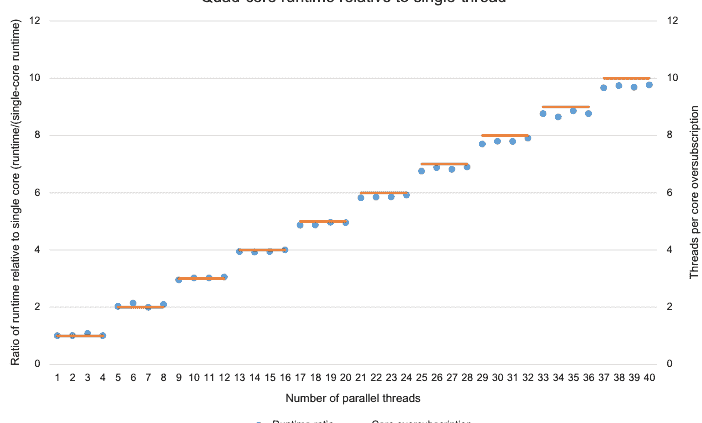

**图 13** 在四核 CPU 上相对于单线程版本的运行时。

我们看到使用 PathScale Enzo OpenACC 编译器构建一个在 96 核 Cavium ThunderX® ARM64 系统上运行的可执行文件时，具有类似的缩放性（**图 14**）。

## 并行执行与竞态条件

OpenACC 并行化 `for` 循环（以及 Fortran 中的 `DO` 循环），使得循环体中的代码可以在并发的硬件执行线程中并行运行。

这可能会令人困惑，后续循环中的变量 `i` 似乎是顺序递增的，但实际上，该 `for` 循环变量中的许多 `i` 值可能同时并行运行。非常重要的是，OpenACC 对线程运行的顺序不作任何保证。事实上，甚至无法确保单调性。例如，此循环的 `nCount-1` 迭代可能实际上在第零迭代之前完成！

**图 14** 在 96 核 ThunderX® 系统上相对于单线程的加速（结果由 PathScale 提供）。

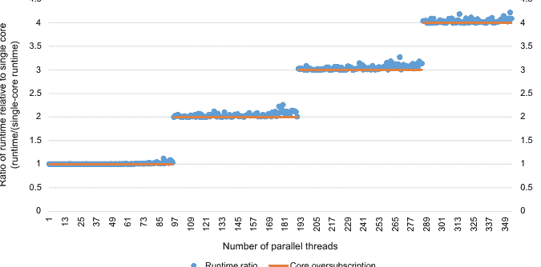

非常值得注意的是，OpenACC 对线程运行顺序没有任何保证。

简而言之，OpenACC 不能对线程运行顺序做出任何假设（**图 15**）。

```cpp
#pragma acc parallel loop
for(unsigned int i=0; i < nCount; i++) {
  // 在每个线程中执行某些操作
}
```

**图 15** OpenACC 并行循环。

### 竞态条件

并行循环中的数据依赖会给程序员带来问题，特别是因为 OpenACC 除了原子操作外不提供任何锁定机制来防止竞态条件。竞态条件发生在多个线程对共享数据项执行操作时。（注意：只读数据项没有竞态条件。）

共享数据依赖的一个明显示例发生在并行更新计数器时，如下例所示。此示例利用 `#pragma acc atomic update` 来保护通过 `counter++` 更新的计数器。在 OpenACC 中，可以使用原子读、写或更新指令来保护单个变量。此示例使用条件编译，以便查看省略原子操作会发生什么（**图 16**）。

```cpp
#include <iostream>
using namespace std;
#include <cstdlib>
#include <cassert>
#include <chrono>
using namespace std::chrono;

int main(int argc, char *argv[]) {
    if(argc < 2) {
        cerr << "nCount" << endl;
        return 1;
    }
    int nCount = atoi(argv[1]);

    if(nCount <= 0) {
        cerr << "ERROR: nCount must be greater than zero!" << endl;
        return 1;
    }

    high_resolution_clock::time_point t1 = high_resolution_clock::now();

    // 在这里定义并增加计数器。
    int counter=0;
    #pragma acc parallel loop
    for (int i=0; i < nCount; i++) {
        #ifdef USE_ATOMIC
        #pragma acc atomic update
        #endif
        counter++;
    }

    high_resolution_clock::time_point t2 = high_resolution_clock::now();
    duration<double> time_span = duration_cast<double>(t2 - t1);

    cout << "counter " << counter
         << " Duration " << time_span.count() << " second " << endl;
    assert(counter == nCount);

    return 0; // 正常退出
}
```

**图 16** accCounter.cpp：包含竞态条件的示例。

未包含原子指令（pragma）是一个常见错误，会导致竞态条件，从而产生垃圾数据和非确定性结果，因为程序员无法控制线程的执行顺序。这种非确定性行为特别危险，因为程序在调试时可能报告正确的结果，但在生产环境中却失败。此外，应用程序可能在一个平台上运行正常，而在另一个平台上失败，或者在某个软件版本中运行正常，但在软件更新后失败。

PGI OpenACC 编译器足够智能，能够在省略 atomic 的情况下检测到此示例中的错误。如**图 17**所示，编译器决定仅使用一个线程生成串行代码以确保正确性。原因在后续信息行中给出：变量 `counter` 是从循环中 *live-out*（活跃传出）。也就是说：如果一个变量持有未来可能需要的值，则它是 *live*（活跃）的；当编译器数据流分析确定它在退出代码块时可能被其他语句需要时，它就是 *live-out*。关于编译器数据流分析，有许多优秀的书籍和演示文稿可以提供精确的 *live-out* 数学定义，但这超出了本文的范围。

```
pgcc++ -std=c11 -acc -ta=multicore,tesla:acc35 -Minfo=accCounter.cpp -o accCounter_no_atomic
main:
    24, Accelerator kernel generated
    Generating Tesla code
    26, #pragma acc loop seq
    24, Generating Single core code
    30, Accelerator restriction: induction variable live-out from loop:
```

**图 17** 省略 atomic 时的 PGI 输出。

在编译期间使用 `USE_ATOMIC` 会包含 OpenACC 指令。在此示例中，PGI 编译器报告它可以为 GPU 生成并行内核并为 CPU 生成多个循环。命令行参数 `ta=tesla:cc35` 告诉编译器目标是 NVIDIA 3.5 计算能力。这样做是为了观察更现代的 GPU 原子操作对运行时的影响，因为并行能力为 2.x（例如 Fermi）及之后的 GPU 具有更高效的原子操作。

虽然原子操作很方便，但避免使用它们很重要，因为它们可能会强制运行时发生串行化，因为一次只有一个线程可以访问原子变量。`accCounter.cpp` 诚然是一个最坏的情况，其中每个线程都必须执行 `counter++` 操作。


# 第 1 章 使用 OpenACC 从串行到并行编程

如图 18 所示，编译器报告生成了并行代码。正如预期的，对 `counter` 变量的竞争导致并行代码线性扩展。如图 19 所示，由于线程和原子开销，并行运行可能远差于串行代码。

```cpp
$ gcc -DUSE_ATOMIC -std=c++11 -acc=multicore,tesla:cc35 -Minfoaccel accCounter.cpp -o Counter_w_atomic
main:
  24. Accelerator kernel generated
  Generating Tesla code
  26. #pragma acc loop gang, vector(128) /* blockIdx.x threadIdx.x */
  24. Generating copy(counter)
  Generating Multicore code
  26. #pragma acc loop gang
```

**FIG. 18**  
包含 atomic 时的 PGI 输出。

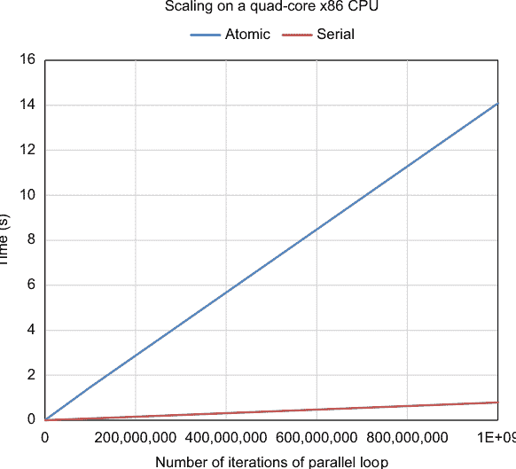

**FIG. 19**  
四核 x86 系统上的扩展。

在 NVIDIA Tesla® K40（计算能力 3.5）GPU 上的运行时显示串行版本呈线性扩展。与直觉相反，并行版本表现出恒定的运行时间（下方的线）。这是由于 NVIDIA 在硬件中进行了优化，允许某些原子操作在大规模并行计算环境中扩展。如需更多信息，我们推荐阅读《Massive Atomics for Parallelism on GPUs》（Egil, Huang, & Zhang, 2014）和《NVIDIA’s Fermi: The First GPU Computing Architecture》（askowski, 2009）（图 20）。

## 无锁编程


**FIG. 20**  
在 NVIDIA K40 上使用原子增的扩展。

## 无锁编程

互斥锁是并行程序中需要访问共享资源的进程或线程常用的机制。它们的工作原理正如名称所示：如果一个线程“锁住”了资源，另一个想要访问它的线程将等待它释放。一旦发生，第二个线程将继续锁定它。程序的线程必须在使用共享资源后立即释放它，以保持程序顺利执行。

由于 OpenACC 中缺少锁，程序员需要熟悉无锁编程和无锁数据结构的概念。无锁方法保证执行该方法的线程中至少有一个会进展。在某些情况下，某些线程可能会延迟，但统计来说，所有线程在无锁方法下都会取得进展。[Blehmann (2016)] 如果某些并发操作保证在有限步内完成，则该数据结构被认为是无锁的。

鼓励读者深入研究无锁编程和无锁数据结构。一个很好的信息来源是《The Art of Multiprocessor Programming》（ily & Shavit, 2012）。无锁编程比简单使用锁保护临界区域（例如 OpenMP `#pragma critical`）更具挑战性。然而，有锁程序无法提供无锁方法的任何性能保证。在实践中，锁是限制或阻止扩展的常见罪魁。死锁是

死锁问题的简单解决方法是减少一个或多个线程需要循环执行原子操作的概率。这是通过图 21 所示的 `accParaCounter.cpp` 中的一对嵌套循环实现的。

```cpp
#include <iostream>
using namespace std;
#include <cstdlib>
#include <cassert>
#include <chrono>
using namespace std::chrono;

int main(int argc, char *argv[]) {
    if(argc < 3) {
        cerr << "Use: nCountPartial" << endl;
        return 1;
    }
    int nCount = atoi(argv[1]);
    int nPartial = atoi(argv[2]);

    if(nCount <= 0 || nPartial <= 0) {
        cerr << "ERROR: nCount and nPartial must be greater than zero!" << endl;
        return 1;
    }

    high_resolution_clock::time_point t1 = high_resolution_clock::now();
    // 这里定义并增加计数器
    counter=0;
    #pragma acc parallel loop
    for(int i=0; i < nCount; i += nPartial) {
        int partialSum=0;
        n = (i+nPartial < nCount)?i+nPartial:nCount;
        #pragma acc loop reduction(+:partialSum)
        for(int j=i; j < n; j++) {
            partialSum += 1;
        }
        #pragma acc atomic update
        counter += partialSum;
    }

    high_resolution_clock::time_point t2 = high_resolution_clock::now();
    duration<double>time_span = duration_cast<duration<double>>(t2 - t1);

    cout << "counter " << counter << " Duration == " << time_span.count() << " second" << endl;
    assert(counter);

    return 0; // 正常退出
}
```

**FIG. 21**  
快速版本 `accParaCounter.cpp` 减少了共享资源的竞争。

虽然简单，但 `accParaCounter.cpp` 代码将在下一节用于实现更有趣的随机数生成器（PRNG）代码。PRNG 是蒙特卡洛方法的关键，蒙特卡洛方法是科学计算（Newman & Barkema, 1999）和金融计算（Glasserman, 2003）的重要部分。鼓励读者进一步研究 PRNG 和蒙特卡洛方法。

如 `accParaCounter.cpp` 源代码所示，并行 for 循环被拆分为两个嵌套循环：(1) 带有 `nPartial` 增的外部并行循环，以及 (2) 利用工作并行性执行局部变量 `nPartial` 次的内部循环。

以下是修订后的扩展图，显示了 `accParaCounter.cpp` 使用 1000 次嵌套内部向量循环迭代的性能。注意并行性要好得多，并超过了串行版本（图 22）。

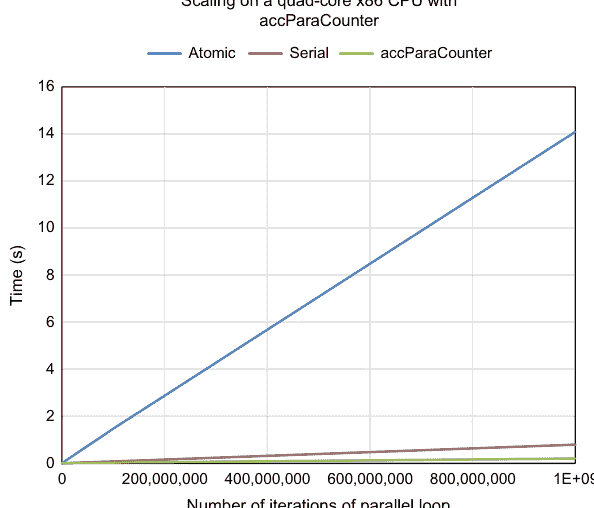

**FIG. 22**  
减少竞争的并行版本的扩展行为。

## 控制并行资源

`accParaCounter.cpp` 中相同的嵌套循环结构可以用于控制循环的并行性，从而控制并行资源的消耗。

大多数并行程序员遵循一种方法：利用系统中的最大并行性来实现最高性能。

大量线程背后的思想是给并行调度器提供尽可能多的线程，以最大化所有计算资源都被充分利用的机会。GPU 程序员喜欢用“占用率”（occupancy）作为线程并行性的衡量标准。高占用率允许调度器有更多活动线程可供选择，从而获得更高性能的机会。

高占用率并不一定意味着最快的性能。指令级并行性（ILP）通过让处理器（或 GPU）被资源更少、开销更小的线程忙碌，在隐藏延迟方面同样有效。然而，程序必须能够运行以确保并行硬件得到最佳利用。ILP 的原理简单而强大：使用更少的线程意味着每个线程可以使用更多的资源（Volkov, 2010）。

这一观点可以应用于 OpenACC 以控制并行资源的利用。与 OpenMP 不同，OpenACC 并不提供类似 `omp_get_thread()` 的机制来确定线程的身份，也不提供 `omp_get_num_threads()` 来查找并发线程的数量。因此，无法编写能够控制其并行资源利用的类。否则，OpenACC 程序员——至少到 OpenACC 2.5 标准为止——必须使用循环结构来显式控制程序中如何使用并行资源。

例如，以下程序（`accParaRNG.cpp`）并行利用了多个顺序随机数生成器。要成功，程序必须保证一次只有一个线程在使用 RNG。否则，交织的 RNG 状态信息可能会损坏。在 OpenACC 中无法在单个原子操作中更新种子信息，保证正确性的唯一方法是使用一组循环。

`accParaRNG.cpp` 使用了基于代码的并行在本章讨论的 OpenACC 构造，以及带进位的乘法（MWC）随机数生成器。MWC 随机数生成器由 George Marsaglia 发明，用于从初始集合到许多随机选择的种子值生成随机整数序列（Marsaglia & Zaman, 1991）。MWC 的优势在于它们可以用几行 C++ 代码实现，而且它还利用了整数算术。MWC 能够非常快速地生成良好的随机数序列。读者可以将 MWC 替换为更复杂的随机数生成器，例如广泛使用的梅森旋转算法（Matsumoto & Nishimura, 1998），并使用 Diehard 随机数测试套件等进行测试（Brown, 2016; 24）。

将程序的上半部分和 `accParaRNG.cpp` 下半部分结合。然后可以将示例编译为 PGI 统一二进制文件，并在 CPU 和 GPU 上进行如下所示测试（图 25）。

```cpp
#include <iostream>
using namespace std;
#include <cstdlib>
#include <cassert>
#include <chrono>
using namespace std::chrono;
// 用于剥离低位的掩码。当前使用最低位
#define MASK 0x1

// 简单的带进位乘法 RNG (George Marsaglia)
struct MWC_RNG {
    uint32_t m_z, m_w;
    SimpleMWC_RNG() : m_z = random(), m_w = random() {}
    #pragma acc routine worker
    inline uint32_t rand() {
        m_z = 36969 * (m_z & 65535) + (m_z >> 16);
        m_w = 18000 * (m_w & 65535) + (m_w >> 16);
        return (m_z << 16) + (m_w & 65535);
    }
};
```

```cpp
int testGolden(SimpleMWC_RNG *gold_rng, int nNG, int nCount) {
    int sequentialSum=0;
    for (int i=0; i < nCount; i += nNG) {
        int n = ((i+nNG < nCount)?nNG:nCount - i);
        int index = i/nNG;
        int partialSum=0;
        for(int j=0; j < n; j++) {
            partialSum += gold_rng[index].rand()%MASK;
        }
        sequentialSum += partialSum;
    }
    return sequentialSum;
}
```

**图 23** `accParaRNG.cpp` 的上半部分。

## 让生活变得简单

Pragmas 和高级 API 旨在提供方便软件功能。它们隐藏了底层实现的细节，让程序员可以关注其他任务。同事幽默地将基于 pragma 的编程称为开发者与编译器之间的“谈判”，因为 pragmas 是程序员向编译器提供的信息性语句。这意味着 pragmas 不需要像源代码的其他部分那样经过语法、类型和安全性检查。

```cpp
int main(int argc, char *argv[]) {
    if(argc < 4) {
        cerr << "Use: nCount nRG doGolden" << endl;
        return 1;
    }
    int nCount = atoi(argv[1]);
    int nRG = atoi(argv[2]);
    int doGolden = atoi(argv[3]);
    if(nCount < 0 || nRG < 0) {
        cerr << "ERROR: nCount and nRG must be greater than zero!" << endl;
        return 1;
    }
    random(0); // 为 host 生成器设置种子
    SimpleMWC_RNG *rng = new SimpleMWC_RNG(nRG);
    SimpleMWC_RNG *gold_rng = new SimpleMWC_RNG(nRG);
    for(int j=0; j<nRG; j++) gold_rng[j] = rng[j]; // 复制 rng 初始条件

    high_resolution_time_point t1 = clock::now();
    // 在随机数生成器上定义并行
    int partialSum=0;
    #pragma acc loop reduction(+:partialSum)
    for(int i=0; i<nCount*nRG; i++) {
        int n = ((i/nCount)*nRG)+(i%nCount);
        int index = i/nCount;
        #pragma acc loop reduction(+:partialSum)
        for(int j=0; j<nCount; j++) {
            partialSum += rng[index].rand()&MASK;
        }
        #pragma acc atomic update
        parallelSum += partialSum;
    }

    high_resolution_time_point t2 = clock::now();
    duration<double> span = duration_cast<double>(t2-t1);

    cout << "Count: " << nCount << endl;
    cout << "Duration: " << span.count() << " second" << endl;

    if(doGolden) {
        testGolden(gold_rng, nCount, partialSum);
        cout << "Success!" << endl;
    }
    delete rng; delete gold_rng;
    return 0; // 正常退出
}
```

**图 24** `accParaRNG.cpp` 的下半部分。

释放 pragma 的任何原因包括：不支持 pragma 语法、代码复杂性、未解决（或可能的依赖）、编译器无法保证数据结构（如向量或数组）不重叠。由于这些原因，必须使用性能分析工具并仔细检查编译器的信息，以确保 pragmas 产生效果并获得高性能。

```bash
$ gcc -std=c++11 -accel -fast -multicore=tesla -Minfo=accel accParaRNG.cpp -o accParaRNG
main:
63. Generating copyin(rng) Accelerator kernel generated Tesla code
65. #pragma acc loop gang /* blockIdx.x */
70. #pragma acc loop worker(128) / threadIdx.y reduction(+:partialSum)
63. Generating copyout(parallelSum) Multicore code
65. #pragma acc loop gang
70. Loop is parallelizable
SimpleMWC_RNG:rand();
16. Generating acc routine worker Tesla code
$ export ACC_DEVICE_TYPE=host
./accParaRNG 1000000000 16384 1
Count: 1000000000 0.031582 second
Success!

$ export ACC_DEVICE_TYPE=nvidia
./accParaRNG 1000000000 16384 1
Count: 1000000000 2.8326 second
Success!
```

**图 25** `accParaRNG.cpp` 在 CPU 和 GPU 上的编译和成功执行。

Blechmann, T. (2016). Boost.Lockfree. 获取自 http://www.boost.org/doc/libs/1_60_0/doc/html/lockfree.html.


# 参考文献

Brown, R. G. (2016). *Diehard: 一个随机数测试套件*. 获取自杜克大学 https://www.duke.edu/~rbg/general/diehard.php.

Corm, T. H., Leerson, C. E., & Rivest, R. L. *算法导论（第3版）*. Cambridge, MA: MIT Press. https://mitpress.edu/books/introduction-algorithms.

Egelski, I., Huang, J., & Zhang, Z. (2014). *GPU 上的大规模并行策略*. SIGGRAPH Annual Note, 46(9):93. https://doi.org/10.1145/2775049.260993.

Glaskowski, P. N. (2009). *NVIDIA 的 Fermi: 第个 GPU 计算架构*. NVIDIA. 获取自 http://www.nvidia.com/content/PDF/fermi_white_papers/P.Glaskowski_NVIDIAFermi-TheFirstGPUComputingArchitecture.pdf.

Glassmann, P. (2003). *金融工程中的蒙特卡洛方法*. New York, NY: Springer-Verlag.

Grama, A., Abshul, G., Karris, G., & Kumar, V. (2003). *并行计算导论（第2版）*. Boston, MA: Addison Wesley.

Herhiy, M., & Shavit, N. (2012). *多处理器编程的艺术*. Burlington, MA: Morgan Kaufmann.

Marsaglia, G., & Zaman, A. (1991). *一类新的随机数生成器*. The Annals of Applied Probability, 1(3), 426–480.

Matsumoto, M., & Nishimura, T. (1998). *Mersenne twister: A 623-dimensionally equidistributed uniform pseudo-random number generator*. ACM Transactions on Modeling and Computer Simulation, 8(1), 3–30. http://dx.doi.org/10.1145/272991.272995.

Newman, M. E., & Barkema, G. T. (1999). *Monte Carlo methods in statistical physics*. Oxford: Clarendon Press.

Volkov, V. (2010). *volkov 10-PMAA*. Retrieved April 2011, from, http://eech.berkeley.edu/http://www.eecs.berkeley.edu/~volkov/volkov10-PMAA.pdf.

# 第 2 章 使用 OpenACC 进行性能引导型开发

Jeff Larkin

NVIDIA, Santa Clara, CA United

本章的目的是通过加速一个真实的基准应用程序来介绍 OpenACC 编程。读者将学习通过添加 OpenACC 指令来分析并改进应用程序。在本章结束时，示例应用程序将从串行代码转换为可以在带有卸载的加速器（如图形处理器 `GPU`）和多核心目标设备（如多核心中央处理器 `CPU`）上并行运行的代码。

在本章结束时，读者将对以下内容有基本的理解：

- OpenACC `kernel` 指令
- OpenACC 数据指令和子句
- `PGProfiler`
- OpenACC 的三级并行性
- 数据依赖

编译器指令（如 OpenACC）为开发者提供了一种向编译器表达信息的方法，这些信息超出了标准编程语言提供的范围。例如，OpenACC 提供了表达循环并行化以及不同物理内存之间数据移动的机制，而这些在 C、C++ 或 Fortran（OpenACC 支持的底层语言）中无法直接实现。因此，程序员通常会增量地向现有代码中添加指令，首先将指令应用于高影响的函数和循环，然后随着代码其他部分重要性的增加，再添加代码的其他部分。引导性开发是一种使用性能分析工具在每一步告知程序员应用程序的哪些部分将产生最大影响的技术。在本章中，我们将使用 The Portland Group (PGI) 编译器和 `PGPROF` 性能分析工具通过增量改进来加速基准代码。在本章结束时，我们将完成一个串行基准并使用 OpenACC 将完全并行化。

完成本章的先决条件：可用的 OpenACC 编译器和 `make` 执行程序（示例中将使用 NVIDIA OpenACC Toolkit）；具备阅读、理解和编译 C 或 Fortran 代码的能力；运行 OpenACC 编译器生成的可执行文件的能力。

## 基准代码：共轭梯度法

在整个章节中，我们将处理一个实现共轭梯度法的简单基准代码。共轭梯度法是一种用于求解大型稀疏线性方程组的迭代方法。本章不需要理解方法的数学原理；基准实现已以 C 和 Fortran 两种形式提供。本章使用的代码遵循 Apache License 2.0 许可，请阅读许可协议以获取更多细节。

示例代码有两个感兴趣的数据结构：一个用于存储数组长度的 `vector`（向量），另一个是 `Matrix`（矩阵），它以压缩稀疏行格式存储，这意味着只存储每行的非零元素，以及代表元素在完整矩阵中位置的元数据。这两个数据结构以及创建、销毁和操作它们的函数位于 `vector.h` 和 `matrix.h` 中。

引导性开发的第一步是构建代码并获取基线分析。我们将使用此分析来指导加速代码的步骤，并作为后续步骤正确性和性能的比较。基准代码提供的 `Makefile` 已预配置为使用 PGI 编译器构建。如果你使用的是不同的 OpenACC 编译器，则需要修改 `Makefile` 使用该编译器。

## 构建代码

提供的 `Makefile` 将通过运行 `make` 命令使用 PGI 编译器构建串行代码，而无需修改。为了获取额外信息协助我们的初始性能调查，我们将修改编译器标志以添加多个分析选项。`-Minfo=all`：此标志指示编译器打印其优化代码的信息，并将这些信息嵌入可执行文件中，供支持常见格式的工具使用。

修改后的 `Makefile` 如图 1 所示。此时我们有一个可以串行执行 CG 基准的可执行文件 (`cg.x`)。预期输出见图 2。运行可执行文件的确切时间取决于 `CPU` 性能，但迭代次数和容差值应与所示值一致。

```make
1 CXX=pgcc
2 CXXFLAGS=-fast -Minfo=all
3 LDFLAGS=$(CXXFLAGS)
4
5 cg.x:main.o
6 $(CXX) $^ -o $@ $(LDFLAGS)
7
8 main.o:main.cpp matrix.h matrix_functions.h vector.h
9 vector_functions.h
10 .SUFFIXES: .o .h
11 .PHONY: clean
12 clean:
13    rm -Rf cg.x pgprof *.core
```

图 1 用于初始分析的 `Makefile` 内容。

| | 容差 (Tolerance) | 非零元素 (nnz) |
| :--- | :--- | :--- |
| 行 (Rows) | 81 | 25 |
| 迭代 0 | 4.006e+00 | 8 |
| 迭代 10 | 1.872e-07 | 27 |
| 迭代 20 | 6.359e-05 | 24 |
| 迭代 30 | 2.320e-04 | 39 |
| 迭代 40 | 8.365e-02 | 25 |
| 迭代 50 | 3.003e-01 | 01 |
| 迭代 60 | 1.076e-02 | 64 |
| 迭代 70 | 3.836e-00 | 02 |
| 迭代 80 | 1.351e-03 | 15 |
| 迭代 90 | 4.620e-05 | 00 |
| 总迭代次数 | 100 | |
| 总时间 | 20.695s | |

图 2 基准代码的示例输出。

## 初始基准测试

我们将使用 `pgprof` 获取代码的基线 `CPU` 分析。这将帮助我们理解可执行文件消耗时间的地方，以便我们将精力集中在提供最大性能提升的函数和循环上。`PG prof` 随 PGI 编译器和 OpenACC 一起安装。要打开它，请在终端中使用 `pgprof` 命令。分析 `prof` 窗口打开后，从 `File` 菜单选择 `New Session`（新建会话），打开 `Create New Session` 对话框。在标记为 `File` 的框中，点击 `Browse`（浏览）按钮并选择你的可执行文件 `cg.x`。选择可执行文件后，点击 `Next`（下一步）然后点击 `Finish`（完成）。此时，分析工具将运行可执行文件，以固定频率采样程序状态以收集性能信息。完成后，选择窗口底部的 `CPU Details`（CPU 详情）选项卡，显示可执行文件中最重要的函数表。窗口看起来类似于图 3 所示。

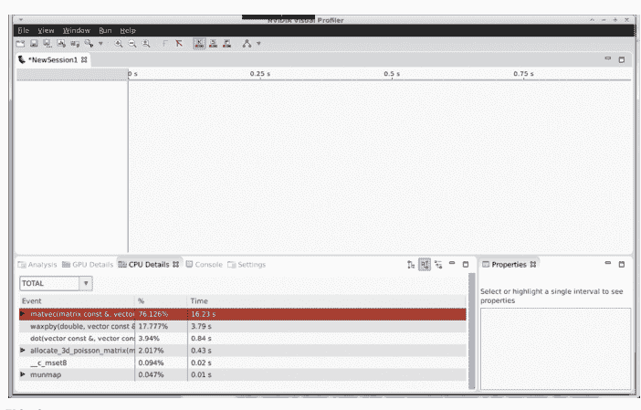

图 3 此时，双击耗时最大的函数 `matvec` 将弹出一个选择源文件位置的对话框。一旦你选择了包含源码的目录，将打开一个新的标签页显示 `matrix_functions.h` 中的 `matvec`。循环左侧边距将有一个符号，表示分析工具能够读取关于该循环的编译器反馈。悬停在图表符号上将弹出一个框，显示编译器对该循环执行了哪些优化信息以及该循环的计算强度。示例见图 4。

读取编译器反馈是理解编译器对你的代码判断出什么，以及它根据这些信息采取什么行动的唯一途径。编译器可能会重排你代码中的循环，将其拆分为更易管理的块，使用向量化指令（如 `SSE` 或 `AVX`）并行化代码，或者在无法确定哪些优化是安全且有效的时可能不采取任何操作。通常，程序员知道一些编译器无法自行学习的信息，导致编译器错失优化和并行化的机会。在本章中，我们将为编译器提供更多

## 描述并行性

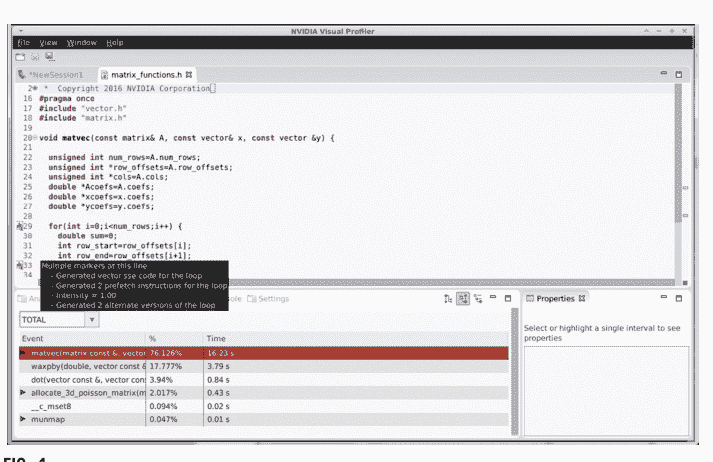

图 4

`PGProfiler` 分析了编译器在优化和并行化此代码时所需的信息。这在许多方面都是 OpenACC 编程的首要目标：为编译器提供有关代码的额外信息，使其能够做出良好的决策，并在任何硬件上进行并行化。

探索 `CPU` 性能，我们看到三个感兴趣的函数：`matvec`、`waxpy`。第四高耗时程序是 `allocate_3d_pos_matrix`，这是一个只运行一次的初始化程序，因此将被忽略。研究代码显示，`matvec` 例程包含一个双嵌套循环，用于执行稀疏/向量积；而其他两个程序都包含一个执行两个向量操作（`aX+bY`）和点积的单循环。这些是我们重点关注对基准测试进行并行化的三个循环嵌套结构。

## 描述并行性

现在我们已经知道了代码耗费时间在哪里，让我们开始对重要的循环进行并行化。通常的最佳实践是从耗时程序的顶部开始逐向下工作，加速一个占据执行时间高达 75% 的程序，对代码性能的影响将比加速一个仅占 15% 的程序要大得多。这意味着我们应该首先将精力放在 `matvec` 例程上，然后转向 `waxpy` 和 `dot`。然而，这可能是你的第一个 OpenACC 代码，不过，让我们从这三个函数中最简单的一个开始，逐步向更复杂的函数过渡。不从 `matvec` 开始的原因将变得显而易见。

## 加速 WAXPBY

在 `vector_functions.h` 的第 33 行，我们将从并行化 `waxpby` 例程开始。该函数包含一个循环，我们将通过在循环开始之前立即添加 OpenACC 内核（`kernels`）来并行化它。通过此指令（`pragma`），我们需要告诉编译器我们正在为其提供 OpenACC 指令，并要求它为目标加速器构建代码。我将在一个带有 NVIDIA Tesla K20c `GPU` 的机器上运行代码，因此我将选择 `tesla` 加速器。使用 `-ta=tesla` 命令行选项为 `GPU` 启用 OpenACC。虽然编译器针对用于数据中心环境的 NVIDIA Tesla `GPU`，但生成的代码也应该运行在其他 NVIDIA `GPU` 上。`Makefile` 的更改可见图 5，`waxpby` 例程的编译器反馈见图 6。

```make
2 CFLAGS=-fast -ta=tesla:lineinfo -Minfo=all,ccff
```

图 5 用于启用 OpenACC 支持的 `Makefile` 修改。

```
waxpby(double, const vector &, double, const vector &, const vector &):
  21. include "vector_functions.h"
  40. Generating copyout(wcofs[:n])
  Generating copyin(wcofs[:n],ycofs[:n])
  41. Complex loop carried dependence of ycofs->ycofs->
  prevents parallelization
    Loop carried dependence of wcofs-> prevents
  parallelization
    Loop carried backward dependence of wcofs-> prevents
  vectorization
    Accelerator scalar kernel generated
    Accelerator kernel generated
  41. #pragma acc loop seq
```

图 6 `waxpby` 函数 OpenACC 版本的初始编译器反馈。

我们从编译器反馈中看到，尽管它生成了 `GPU` 内核，但在尝试并行化循环时出了问题。具体来说，编译器认为循环的迭代之间可能存在数据依赖。数据依赖当一个循环迭代依赖于另一个循环迭代的数据时，就会发生依赖。仔细检查循环体发现，循环的每次迭代与其他任何迭代之间是完全数据独立的，这意味着在一次迭代中计算的结果不会被任何其他迭代使用。那么为什么编译器认为循环存在依赖呢？问题在于 C 和 C++ 编程语言的低级特性，它们将数组表示为内存的指针；指针可能指向同一内存。问题是编译器无法证明循环中使用的三个数组没有别名（`alias`）或重叠，因此它假设并行化循环是不安全的。一种可能性是向编译器提供更多关于指针的信息，承诺它们永远不会有别名。这可以通过添加 C99 的 `restrict` 关键字来实现。虽然这不是一个 C++ 关键字，但 PGI 编译器将接受 C++ 代码指令中的此标记。我们还可以使用 OpenACC 循环指令为编译器提供更多关于循环本身的信息。循环指令用于指导下一次迭代。我们可以使用 `loop independent` 来告知 OpenACC 编译器循环的所有迭代都是独立的，这意味着没有两个迭代依赖于对方的数据，从而覆盖编译器对循环的依赖分析。这两种解决方案都保证了程序员让编译器意识到代码。在这种情况下，我们无法保证结果不会产生别名，因为编译器有时会认为在 `y` 和 `w` 是相同向量时代码是可以被接受的，因此我们将使用 `independent` 代替。`waxpby` 的最终代码见图 7，附带图 8 中的编译器反馈。注意编译器反馈，编译器已确定第 41 行的循环是可以并行化的。

```cpp
33 void waxbody(double alpha, const vector &x, double beta, const
34 vector &y, const vector &) {
35 unsigned int n;
36 double *xcofs=x;
37 double *ycofs=y;
38 double *wcofs=w;
39 #pragma acc kernel
40 #pragma acc loop independent
42 for(int i=0;i<n;i++) {
43 wcofs[i]=alpha*xcofs[i]+beta*ycofs[i];
44 }
46 }
```

图 7 带有 OpenACC 的最终 `waxbody`。

> 某些 C++ 编译器不接受 `restrict` 关键字，但会接受 `__restrict`。

```
waxpy(double, const vector &, double, const vector &, const vector &):
  21. include "vector_functions.h"
  40. Generating copyout(wcofs[:n])
  Generating copyin(wcofs[:n],ycofs[:n])
  42. Loop is parallelizable
  Accelerator kernel generated
  Generating Tesla code
```

图 8 `waxpy` 的编译器反馈。


仔细观察编译器反馈，注意它不仅仅是为我的 GPU 并行了循环。编译器理解我的目标加速器是物理上独立的主机 CPU，因此有必要将数组移动到 GPU 进行处理，并传回供使用。第 40 行的输出告诉我们 `x` 和 `y` 是输入数组，因此它生成了到 GPU 的拷贝，而 `w` 是输出数组，因此它生成了输出的拷贝。数据子句提供了关于区域内数据如何使用的额外信息。在这种情况下，编译器能够正确确定数组的大小、形状和用法，因此它为它们生成了隐式数据子句。编译器对数据移动非常谨慎，因此需要程序员通过向内核添加数据子句来覆盖它的决策。其他时候，编译器无法准确确定区域内数组的大小或形状，因此它会终止并请求更多信息，正如我们在处理矩阵时看到的那样。在继续之前，重要的是重新编译并运行代码以检查我们引入了任何错误。在进行小更改后查找并纠正错误比在大量更改之后要简单得多。恢复变慢后，代码应该显示你仍然得到相同的答案，但如果我们现在使用 PGProf 分析器运行执行文件，我们将看到变慢的原因。在 GPU 机器上执行执行文件时生成的配置显示了单个 GPU 操作（内核）以及关联的数据传输。注意每次调用 `waxpy` 现在都会拷贝两个数组到设备并传回供其他函数使用。这非常低效。理想情况下，我们希望尽可能长时间将数据留在 GPU 内存中，避免这些中间数据传输。唯一的方法是加速剩余函数，使数据传输变得不再必要。

# 加速 DOT

让我们快速看看 `dot` 例程，当我们使用 OpenACC 内核指令时，编译器在其他情况下也会提供帮助。就像之前一样，我们在感兴趣的循环周围添加内核指令并重新编译代码。图 10 显示了函数的 OpenACC 版本，图 11 显示了编译器反馈。

# 描述并行性 37

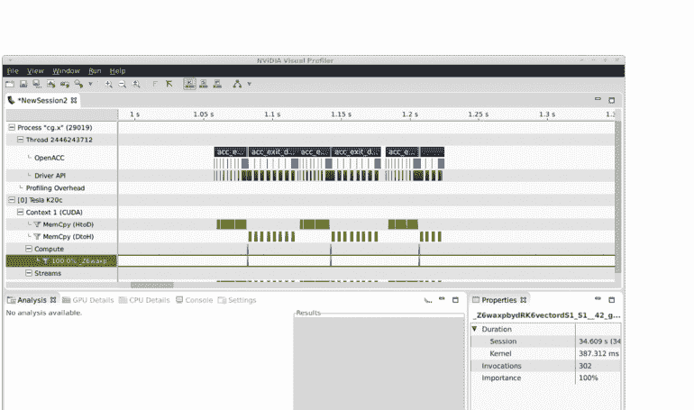

图 9

加速 WAXPBY 的概览，显示了数据移动。

```
double dot(const vector & x, const vector &) {
double sum=0;
unsigned int n=x.n;
double *xcoef=x.coef;
double *ycoef=y.coef;

#pragma acc kernels
for(int i=0;i<n;i++) {
    sum+=xcoef[i]*ycoef[i];
}
return sum;
}
```

图 10

OpenACC 2.0 的 dot 函数解构。

```
dot(const vector &, const vector &);
21. include "vector_functions.h"
25. Generating copyin(xcoefs[:n],ycoefs[:n])
28. Loop is parallelizable Accelerator kernel generated
Generating Tesla code
28. #pragma acc loop gang, vector(128) / blockIdx.x * threadIdx.x
29. Generating implicit reduction(+:sum)
```

图 11

OpenACC dot 函数的编译器反馈。

# 38 第 2 章节 使用 OpenACC 进行性能引导的开发

注意第 29 行的编译器反馈，它生成了一个**隐式归约 (implicit reduction)**。循环的每次迭代都会计算 `xcoefs[i]*ycoefs[i]` 的值，但编译器意识到我们并不关心其中每一个的具体值，而是关心它们的和。归约操作会将循环中计算出的 n 个不同的值提取出来，并将它们归约为我们关心的值：`sum`。重要的一点是，由于浮点算术的不精确性，并行归约得到的结果可能与顺序逐个相加数字的结果略有不同，尽管该答案也是正确的。这在很大程度上取决于具体的数值、相加的数字个数以及操作的顺序，但差异可能很小，甚至可能仅仅是因为浮点算术其本质上是不精确的。记住，顺序和并行和都是正确的，因为我们使用了 `kernels` 指令来并行化此循环，编译器为我们处理了识别这种归约的复杂性。如果我们使用了更高级的并行指令，那么告知编译器该归约情况将是我们的责任。在进入下一节之前，不要忘记运行代码以检查是否有遗漏。

# 加速 MATVEC

最后一个需要加速的例程是 `matvec` 例程。正如我们之前提到的，这不仅仅是一个教学练习，该例程将是我们工作的正确起点，因为到目前为止它是最主要的例程，但该例程具有一些复杂性，在我们压榨包含其中的并行性时，需要采取额外的步骤。让我们采用与另外两个例程相同的方法：为我们的数组添加 `restrict` 关键字，并用 `kernel` 指令包裹我们的循环嵌套。然而，当我们尝试构建此例程时，编译器输出了错误信息，如图 12 所示。

```
PGCC-05155-Failed to translate accelerator region (see Info messages): Could not find allocated-variable index for symbol (main.cpp:273)
23, Include "matrix_functions.h"
matvec(const matrix *, const vector &, const vector &):
  30, Loop is parallelizable
    Accelerator kernel generated
    Generating Tesla code
  30, #pragma acc loop gang, vector(128) /* blockIdx.x * threadIdx.x;
  34, #pragma acc loop seq
  34, Accelerator restriction: size of the GPU copy of xcoefs,Acoofs,cols is unknown
    Loop is parallelizable
PGCC/x86 Linux 16.4.0: compilation completed with severe errors
```

图 12

首次尝试加速 matvec 函数的编译器输出。

# 描述并行性 39

这里编译器输出中最重要的部分是第 34 行的**限制 (restriction)**，它指出不知道如何计算在 `kernels` 区域内部使用的数组的大小，特别是最内层循环中的三个数组。在之前的两个例子中，编译器可以根据循环迭代的次数来确定需要迁移到加速器的数据量大小，但由于 `matrix` 的循环边界隐藏在我们的数据结构中，编译器无法通过重新定位关键指令来为编译器提供关于我们数据结构的更多信息。表 1 列出了最常见的五个数据子句及其含义。我们已经在之前的函数中看到了编译器隐式使用的 `copyin` 和 `copyout`。

## 数据子句及其含义

| 子句 | 行为 |
| --- | --- |
| copyin | 检查列出的变量是否已存在于设备上，如果不在则创建空间并将当前数据拷贝到设备副本中 |
| copyout | 检查列出的变量是否已存在于设备上，如果不在则在设备上创建空间并在最后使用后将设备拷贝的结果数据拷贝 |
| copy | 行为类似于同时出现在 `copyin` 和 `copyout` 数据子句中的变量 |
| create | 检查列出的变量是否已存在于设备上，如果不在则在设备上创建空空间 |
| present | 假设列出的变量已存在于设备上 |

为了让编译器为我的 GPU 并行化循环嵌套（这需要数据卸载），我们需要告诉编译器内层循环中使用的三个数组的形状。

## 42 第 2 章 使用 OpenACC 进行性能分析引导开发

在设备的生命周期内，这些数据由 `create` 或 `copyin` 数据类控制。同样，`exit data` 指令通过 `copyout`、`release` 和 `delete` 数据类标记变量生命周期的结束。由于数据在函数之间传递，实际上同一个变量可能会有多个引用的进入和退出数据指令，因此运行时将记录变量被引用的次数计数，确保在数据在设备上不再需要之前，不会将其从设备中移除。运行时还将使用此引用来确定是否有必要将数据拷贝到设备或从设备拷贝，这发生在对所需数据的第一次和最后一次引用。表 2 在表 1 的基础上增加了两个可能出现在 `exit data` 指令上的数据子句。

## 表 2 仅适用于 exit data 指令的额外数据子句

| 子句 | 行为 |
| --- | --- |
| delete | 列出的变量将立即从设备中删除，无论引用计数如何，这将触发任何数据拷贝 |
| release | 列出变量的引用计数将减少。如果引用计数为 0，变量将从设备中删除且不触发任何数据拷贝 |

## 描述矩阵和向量的数据移动

为了避免在三个并行的三个函数中产生不必要的数据移动，我们在管理矩阵和向量结构数据的函数中添加了数据指令。需要记住，OpenACC 的数据模型是主机优先（host-first）的，这意味着在设备上分配数据的数据指令必须出现在主机分配（`malloc`、`allocate`、`new` 等）之后，而释放数据的数据指令必须出现在释放操作（`free`、`delete`）之前。基于此，我们在 `matrix.h` 和 `vector.h` 中的 `allocate_3d_poison_matrix` 矩阵中添加了 `enter data` 指令。由于 `allocate_3d_matrix` 执行了一些额外的初始化，最简单的方法是将指令添加到例的末尾，这样数据结构拷贝就会被初始化。

图 16 显示了添加 `enter data` 指令后的 `allocate_3d_poison_matrix` 函数的简化列表。起初看起来可能很奇怪：先将 A 拷贝到设备，然后拷贝 A 内部的所有成员数组。该结构包含标量数字和 3 个在设备上使用的指针。第 71 行对 A 的 `copyin` 拷贝了结构以及我描述的 5 个元素。然而，当拷贝这 3 个指针时，它们将包含指向主机内存的指针，因为指针只是简单地拷贝到了设备。此时有必要将数据拷贝到这些指针，这正是第 72 行 `pragma` 所做的作用。第 72 行获取 A 中包含的三个数组形状并将它们的数据拷贝到设备。在 `free_matrix` 函数中从设备上移除数据时，这些操作应该按反序执行，如图 17 所示。

## 描述数据移动 43

```
void allocate_3d_polsson_matrix(matrix &A, int N) {
  int num_rows=(N+1)*(N+1)*(N+1);
  int nnz=27*num_rows;
  A.num_rows=unsigned
  A.row_offsets=unsigned
  A.alloc=malloc(num_rows*sizeof(unsigned int));
  A.cols=(unsigned int*)malloc(nnz*sizeof(unsigned int));
  A.coeffs=(double*)malloc(nnz*sizeof(double));

  int offsets[27];
  double coeffs[27];
  int zstride=N*N;
  int ystride=N;
  <Shortened for space>
68

  A.row_offsets[num_rows]=nnz;
  A.nnz=nnz;
  #pragma acc enter data copyin(A)
  #pragma acc enter data
  copyin(A.row_offsets[0:num_rows+1],A.cols[0:nnz],A.coeffs[0:nnz])
73

```

FIG. 16

修改后的矩阵分配函数。

```
void free_matrix(matrix &A) {
  unsigned int *row_offsets=A.row_offsets;
  unsigned int *cols=A.cols;
  double *coeffs=A.coeffs;

#pragma acc exit data delete(A.row_offsets
```

FIG. 17

修改后的矩阵释放函数。

`allocate_vector` 和 `free_vector` 函数可以类似地修改，将向量结构也迁移到加速器。由于 `allocate_vector` 没有用任何数据初始化向量，可以使用 `create` 数据子句来分配空间而不引起任何数据拷贝，如图 18 所示。

在此基准测试中，所有的矩阵和向量数据结构在整个计算过程中都留在设备上，但将得到错误结果，因为代码未能加速器上初始化向量数据结构。要修复此，必须修改 `initialize_vector` 函数，使用 `update` 指令用初始化的主机数据更新设备数据。

## 第 2 章 使用 OpenACC 进行性能分析引导开发

```
void allocate_vector(vector &v, unsigned int n) {
    v.n=n;
    v.coeffs=(double*)malloc(n*sizeof(double));
    #pragma acc enter data create(v)
    #pragma acc enter data create(v.coeffs[0:n])
}
void free_vector(vector &v) {
    #pragma acc exit data delete(v.coeffs[0:n])
    #pragma acc exit data delete(v)
}
```

FIG. 18

修改后的函数

`allocate_vector` 和 `free_vector` 函数可以类似地修改，将向量结构迁移到加速器。由于 `allocate_vector` 没有用任何数据初始化向量，可以使用 `create` 数据子句来分配空间而不引起任何数据拷贝，如图 18 所示。

在此基准测试中，所有的矩阵和向量数据结构在整个计算过程中都留在设备上，但将得到错误结果，因为代码未能加速器上初始化向量数据结构。要修复此，必须修改 `initialize_vector` 函数，使用 `update` 指令用初始化的主机数据更新设备数据。

```
void initialize_vector(vector &v, double val) {
    for(int i=0;i<v.n;i++)
        v.coeffs[i]=val;
    #pragma acc update device(v.coeffs[0:n])
}
```

FIG. 19

更新后的 initialize_vector 函数。

对于新的 OpenACC 程序员来说，一个困惑是为什么更新主机的子句被称为 `self`。OpenACC 1.0 使用 `host` 关键字来指定用设备数据更新主机数组，但由于 OpenACC 2.0 开启了在计算区域内嵌套 OpenACC 区域的可能性，执行更新的线程可能不在主机，而是在加速器上。

## 描述数据移动 45

```
#pragma acc kernels
for (int i = 0; i < N; i++)
{
  #pragma acc update device(A[0:N])
  #pragma acc kernels
  for (int j = 0; j < N; j++) {
    A[j] = j;
    #pragma acc update self(A[0:N])
  }
}
```

FIG. 20

嵌套 OpenACC 区域中的 update 指令示例。

构建基准测试代码相比示例系统有了巨大的性能提升。检查 PGProf 时间线（图 21）显示，数据在执行最初被拷贝到设备，只有结果范数被定期拷贝回主机。这是因为我们指定编译器直接在加速器上生成我们的数据结构，以及我们在上一节中添加的计算区域。

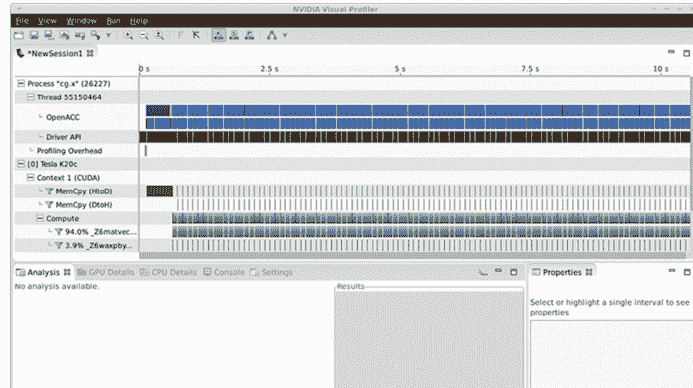

FIG. 21

表达数据移动后的性能分析时间线。

检查数据是否存在，并在设备上找到数据时，重用现有的设备数据。对于具有离散内存的加速器（如本例中的 GPU），表示数据移动的步骤是程序员能看到最大加速的步骤，因为消除了通过 PCIe 总线拷贝数据这一显著瓶颈。人们倾向于认为这会产生巨大的加速，因此应该首先处理这一点。然而，这样做往往容易出错，因为每次遇到未加速的循环时，都需要引入指令（directives）。更简单的方法是首先将所有的循环放在设备上（代码的大部分），然后消除不必要的传输。忘记消除不需要的数据传输仅仅是性能 Bug，通过性能分析器（profiler）很容易识别；而由于过早向程序添加数据指令导致遗漏更新指令则是正确性错误，这种错误通常难找得多。

## 优化循环

此时，基准测试代码在测试机上的运行速度已比原始串行代码快了 2 倍，但这是我们能实现的最快速度吗？到目前为止，我们在代码中添加的所有 pragmas 都应该提高了基准测试的性能，我们需要开始应用特定的优化。幸运的是，OpenACC 提供了一种指定 `device_type` 的方法，使得额外的子句仅在为指定的设备类型构建时才生效。让我们从访问当前代码的编译器反馈开始，特别是 matvec 程序，它是我们最耗时的程序（图 22）。


```
matvec(const matrix &, const vector &, const vector &):
    23, Include "matrix_functions.h"
    27, Generating copyin(cols:A->nnz), xcoeffs[A:nnz], xcoeffs[:x:n]
    Generating copyout(ycoeffs[:num_rows])
    Generating copyin(row_offsets[:num_rows+1])
    30, Loop is parallelizable
    Accelerator kernel generated
Generating Tesla code
    30, #pragma acc loop gang, vector(128) /* blockIdx.x */
    34, #pragma acc loop seq
    34, Loop is parallelizable
```

图 22

编译器提供了有关它如何并行化第 30 行和 24 行两个 `matvec` 循环的信息。为了理解它在告诉我们什么，我们需要理解 OpenACC 的三个并行级别：`gang`（组）、`worker`（线程）和 `vector`（向量）。从并行层级的底部开始，`vector` 并行是非常细粒度的并行，例如，如果我有两个需要相加的数组，某些硬件具有特殊指令，能够同时操作每个数组中的一组数字并将它们全部相加。这被称为向量长度（vector length），并因机器而异。并行层级的顶端是 `gang`。`gang` 之间完全独立地运行，没有相互同步的机会，且对 `gang` 与其他 `gang` 的运行顺序没有保证。因为 `gang` 并行是粗粒度的，所以它具有非常好的可扩展性。`worker` 并行介于 `gang` 和 `vector` 之间。一个 `gang` 由一个或多个 `worker` 组成，每个 `worker` 在一个 `vector` 上操作。`vector` 内部的 `worker` 具有同步和共享快速内存缓存的能力。OpenACC 编译器并行化的每个循环将映射到这些并行级别中的至少一个，否则将按顺序执行（缩写为 `seq`）。图 23 显示了 OpenACC 的三个并行级别。

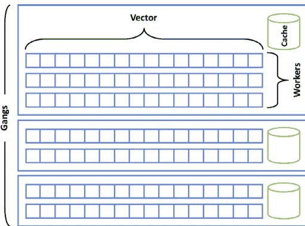

图 23

OpenACC 的三个并行级别。

基于这些背景，我们可以看到 OpenACC 编译器如何将我们的两个循环映射到并行级别。它将第 30 行的循环映射到 `gang` 和 `vector` 并行，隐式地为每个 `gang` 创建了一个 `worker`，并分配了 128 的向量长度。第 34 行的循环按顺序执行。有了这些信息，我们现在可以为编译器提供额外信息，以指导它如何将循环映射到并行级别。

## 减少向量长度

由于我在 NVIDIA GPU 上运行此基准测试，我将利用对 NVIDIA GPU 和应用的理解，对如何并行化循环做出更好的决策。例如，我知道 NVIDIA GPU 在向量循环以步长 1（stride-1）方式访问数据时性能最佳，这意味着每次连续的循环迭代访问连续的数组元素。虽然外层循环以步长 1 访问 `row_offsets` 数组，但内层循环以步长 1 访问 `Acols`、`Acoefs` 和 `xcoefs` 数组，这更利于向量化。在内层循环上方添加一个循环允许我们指定该循环使用哪种并行方式。此外，我们还可以指定应该使用的向量长度。编译器似乎倾向于 128 的向量长度，但我们的循环只对 20 个非零元素进行操作，这导致该循环每次产生 101 次向量操作。考虑到我们对循环次数的了解，如果减少向量长度会导致资源浪费，我们只需将长度减少到 27，因为我们知道这是确切的循环次数（NVIDIA 称为 warp size），因此让我们将长度缩减到 32，这样只会浪费 5 次向量迭代，而不是 101 次。图 24 显示了内层循环映射到 `vector` 并行且向量长度为 32 的代码块。循环指令上的 `device_type` 子句指定了子句仅适用于设备类型，这意味着它们不会影响编译器的决策。

```
#pragma acc kernels
copyin(cols[0:A.nz],Acoefs[0:nz],xcoefs[0:n])
for (int i=0;i<num_rows;i++) {
    double sum=0;
    int row_start=row_offsets[i];
    int row_end=row_offsets[i+1];
    #pragma acc device_type(nvidia) vector(32)
    for (int j=row_start;j<row_end;j++) {
        unsigned int col=cols[j];
        double Acoef=Acoefs[j];
        double xcoef=xcoefs[j];
        sum+=Acoef*xcoef;
    }
    ycoefs[i]=sum;
}
```

图 24

缩短长度的 `matvec` 函数。

从图 25 的输出可以看出，这种更改实际上影响了整体性能。人们很想撤销这一更改，因为它没有帮助我们的运行时间，但我认为向量化内层循环的决定是正确的，我将转向性能分析器来理解为什么没有加速。

```
Rows:81206, nnz:218535
Iteration: 0, Tolerance: 4.0067e+08
Iteration: 10, Tolerance: 1.8772e+07
Iteration: 20, Tolerance: 6.4359e+05
Iteration: 30, Tolerance: 3.2036e+04
Iteration: 40, Tolerance: 8.3356e+02
Iteration: 50, Tolerance: 3.0039e+01
Iteration: 60, Tolerance: 1.0764e+00
Iteration: 70, Tolerance: 3.5368e-02
Iteration: 80, Tolerance: 1.3515e-03
Iteration: 90, Tolerance: 4.6209e-05
Total Iterations: 100 Total Time: 14.9463s
Final Tolerance: 1.9934e-06
```

图 25

调整向量并行后的程序输出。

## 增加并行性

为了确定自定义向量长度没有产生效果的原因，我们将使用 PGProf 引导分析来帮助。引导分析默认开启，因此使用当前执行启动新会话，选择 Analysis 标签并遵循建议。分析应该指向 GPU 占用率（occupancy）因素，如图 26 所示。占用率是 NVIDIA 使用的术语，用于描述 GPU 饱和程度相对于其理论运行能力的比例。

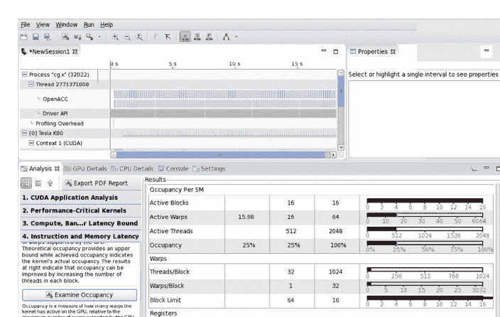

图 26

NVIDIA GPU 由一个或多个处理器组成，通常称为 SM。SM 可以管理 2048 个并发线程，尽管并非所有线程都同时运行。性能分析器输出显示，在 2048 个可能的线程中，SM 只有 512 个线程，导致占用率为 25%。图 26 中的红线说明了原因：SM 最多可以管理 16 个线程块（相当于 OpenACC `gang`），但由于 `gang` 的大小，需要 64 个才能达到完全占用，从 "Threads/Block" 行可以看到只有 32 个线程。这一切表明，通过将向量长度减少到 32，每个 GPU 块的总线程减少到 32，因此我们需要引入更多的并行性来更好地填充 GPU。

我们可以通过两种方式增加 `gang` 内的并行性：增加向量长度或增加 `worker`。从上一节知道增加向量长度没有意义，因为内层循环不足以支持更长的向量长度，所以我们尝试增加 `worker` 的数量。GPU 线程块内的总工作是 `worker` 数量乘以 向量长度，我们可以使用的最多 `worker` 是 32，因为 32×32=1024 个 GPU 线程。图 27 显示了最终 `matvec` 循环代码，图 28 显示了更改每个 `gang` 内 `worker` 数量带来的加速。在该特定系统中，8 个 32 线程的 `worker` 似乎是最佳尺寸。由于使用了 `device_type` 子句，这些优化仅适用于为 NVIDIA GPU 构建构建，不会影响其他加速器。

```
29 #pragma acc kernels
copyin(cols[0:A.nz],acoefs[0:nz],xcoeffs[0:n])
30 #pragma acc loop device_type(nvidia) gang workerB
31 for (int i=0;i<num_workers;i++) {
    double sum=0;
    int row_start=row_offsets[i];
    int row_end=row_offsets[i+1];
    35 #pragma acc loop device_type(nvidia)vector(32)
    36 for (int j=row_start;j<row_end;j++) {
        unsigned int col=cols[j];
        double Acoef=Acoefs[j];
        double xcoef=xcoef[col];
        sum+=Acoef*xcoef;
    }
    ycoefs[i]=sum;
}
```

图 27

`matvec` 循环代码.

## 在多核上并行运行

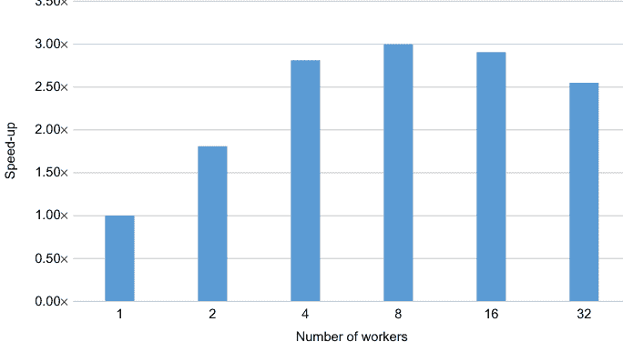

图 28 增加 `matvec` 函数中工作线程数量带来的加速效果。

至关重要的一点是，尽管本章节使用了 NVIDIA GPU，但 OpenACC 并不是一种 GPU 编程模型，而是一种通用的并行编程模型。虽然我们在“优化循环”部分中应用的循环优化仅适用于代码运行的特定 GPU，但关于并行性和数据移动的描述适用于任何并行架构。在本节中，PGI 编译器均支持多个加速器目标，包括来自 NVIDIA 和 AMD 的 GPU 以及多核 x86 CPU。那么，如果我们把编写的代码运行在多核 CPU 上会发生什么呢？让我们开始为多核目标而非加速器目标重新构建代码。由于基准测试机的 CPU 核心数固定，可以通过环境变量 `ACC_NUM_CORES` 来调整所使用的 CPU 核心数量，如果现在运行生成的可执行文件，它将在基准测试机的 CPU 核心上实现循环并行。图 31 显示了核心数从 1 调整到 12（基准测试机的最大核心数）的加速情况。4 个 CPU 核心之后的性能平台期是因为基准测试性能受限于可用的 CPU 带宽。

```
1 CXX=pg++n2 CXXFLAGS=-fast -ta=multicore -Minfo=all -Mneginfo
```

图 29 针对多核加速器目标的 Makefile 更改。

```
matvec(const matrix &, const vector &, const vector &):
  23. include "matrix_functions.h"
31. Loop is parallelizable
Generating Multicore code
31. #pragma acc loop gang
36. Loop is parallelizable
  Generated 2 alternate versions of the loop
  Generated vector sse code for the loop
  Generated 2 prefetch instructions for the loop
```

图 30 针对多核目标的编译器输出。

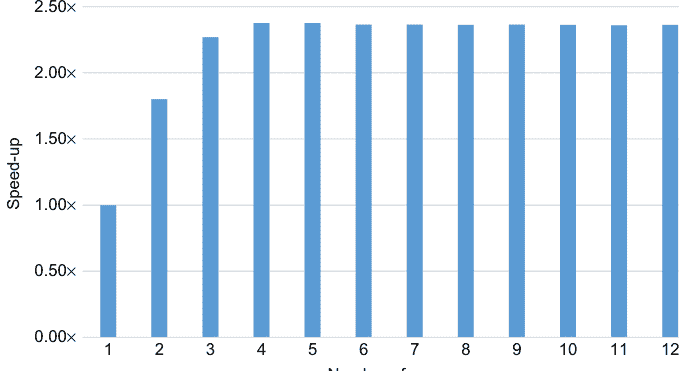

图 31 多核加速带来的性能提升。

## 总结

OpenACC 是一种并行编程的描述性模型，在本章中，我们使用了若干 OpenACC 特性来描述基准测试应用的并行性和数据使用，并针对特定平台进行了优化。尽管本章使用了 Portland Group 编译器和 PGPProf 性能分析器，但同样的过程也适用于任何使用 OpenACC 感知工具的应用。

- 1. 获取应用程序的分析结果（profile），以识别代码中未利用的并行性。

- 2. 增量向编译器描述可用的并行性。在具有主机和加速器独立内存的架构上执行此步骤时，代码在此步骤期间变慢是常见现象。

- 3. 描述应用程序的数据移动。编译器在处理数据移动时必须始终谨慎以确保正确性，但开发者能够观察全局，并理解数据如何在不同函数的 OpenACC 区域之间共享。在向编译器描述数据移动后，在具有独立内存的架构上性能将显著提升。

- 4. 最后，利用你对应用程序和目标架构的知识来优化循环。频繁的循环优化会带来微小的性能收益，但有时可以为编译器提供比通常更多的循环信息，从而获得更大的性能提升。

图 32 显示了相对于原始代码每个加速步骤的最终性能。注意，最终代码比原始串行代码实现了 4 倍加速，多核版本实现了近 2.5 倍加速。虽然代码在此过程中变慢了，但很容易看出特定步骤会导致变慢并进行修正以进一步提升性能。此过程的最终结果是可以在多种并行架构上运行的代码，并针对特定平台进行了调优，而不会对其他平台的性能产生负面影响。这就是 OpenACC 编程：为编译器提供足够的信息以便在任何现代机器上高效运行。

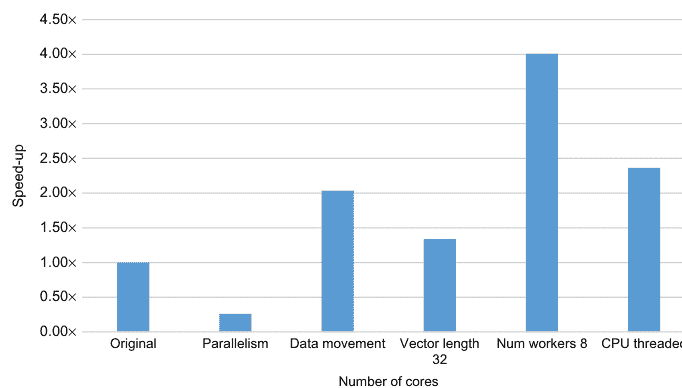

图 32 每一步的最终性能结果。

# 使用 Score-P 和 Vampir 对混合应用进行性能分析

Guido Juckeland*, Robert Dietrich*

Helmholtz-Zentrum Dresden-Rosendorf (HZDR), Dresden, DEU* Technische Universität Dresden, Germany

本章的目的是让读者熟悉“演化性能（evolutionary performance）”的概念，以及在 OpenACC 应用中添加其他并行范式时涉及的工具。此类混合应用可能会遇到许多瓶颈，而应用程序运行期间所有活动的全局视图可以阐明如何提高整体性能。在本章结束，读者将对以下内容有基本的理解：

- 混合应用（例如 MPI+OpenACC）性能分析的术语和方法。

- 如何修改混合应用以生成和记录性能数据。

- 如何可视化和分析性能数据，以便对改进应用做出明智选择。

- 在扩展现有并行应用以包含另一种并行范式时常见的陷阱（pitfalls）。

OpenACC 旨在为在带有硬件加速器的平台提供一种相对简单且直观的方法来描述并行性。从设计上讲，它是将传统高性能计算（HPC）应用迁移到新架构的方法。超过单节点能力的旧及新应用可以使用消息传递接口（MPI）进行内部通信和粗粒度任务划分。结合 OpenACC 和 MPI 的应用被称为混合应用。还可以在主机上结合 OpenMP 利用计算节点的所有资源，或同时使用三种并行级别（MPI、OpenACC 和 OpenMP）。对任何并行范式的性能调优都是挑战性的，第二层或第三层并行由于所有并行范式的交互引入了新的挑战层。在使用正确的工具时，分析引导开发也可以涵盖这些混合场景。

## 性能分析技术

来自编译器或加速器厂商的分析工具通常限于其所属方案，例如仅限 OpenACC/CUDA/OpenCL 活动。几乎所有厂商工具无法记录 MPI 活动，导致程序员不知道混合应用的性能如何。基于研究的性能工具填补了这一空白。HPcount、Tau 和 Score-P 是支持硬件加速器的主流第三方性能分析工具。在这三者中，Score-P 涵盖的并行模式最多，记录的并发活动最多，因此为复杂应用提供了最完整的性能视图。因此，本章将使用 Score-P 作为示例性能记录工具。Vampir 将用于性能可视化，因为它是目前最强大的轨迹可视化器和分析生成器。

你可以通过 http://www.score-p.org 获取 Score-P，通过 http://www.vampir.eu 获取 Vampir。

虽然“分析（profiling）”一词常描述整个性能分析，但从技术上讲，它是性能测量和分析技术的一个子集。技术的正式对比见图 1。

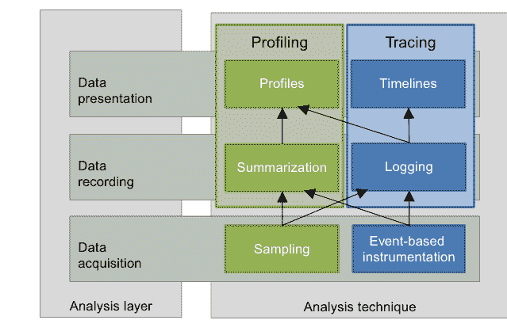

图 1 性能分析技术的正式分类及其关系（Lische, Schuchart, Schöne & Hackenberg, 2014)。

性能测量与可视化由三个步骤组成：数据获取、记录和展示。性能监视器想要分析应用程序的行为。为了实现这一点，它既可以中断未修改的应用程序并“拉取”应用程序在中断时正在执行的信息（采样），也可以对应用程序本身进行修改，以向性能监视器“推送”有关其活动的信息（基于插桩）。记录既可以立即汇总所有数据，也可以完整记录所有带有时间戳的日志。完整日志文件可以以时间线（timeline）或任何任意时间间隔的剖概图（profile）形式展示，而汇总后的数据只能作为整个应用程序运行的剖概图展示。

所有的分析技术都有优缺点。例如，采样通过以固定的采样率中断应用程序（例如），这会对被测的应用程序运行时产生恒定的扰动。然而，测量准确性取决于采样频率。每个被插桩的程序都需要记录，即所有手动或通过编译器增强了触发器的函数或代码段，但运行时的扰动取决于事件发生速率，而该速率在编译时是未知的，在最坏的情况下，其内存占用可能达到几个数量级。立即汇总为性能监视器保持了低开销，且不会导致额外的输入/输出（IO），但它丢失了记录活动的时间上下文，而日志记录则恰恰相反。剖概图根据活动对应用程序的影响（通常是函数上的时间分布）来显示活动，但它们忽略了时间上下文。时间线则完全相反；它们展示了程序的随时间演变，但使得更难立即分离出消耗资源最多的活动。


# 基于事件的追踪

基于事件的追踪（Event based tracing）类似于记录应用程序运行期间所有活动的“全景”，代价是可能产生非常高的运行时扰动。幸运的是，可以使用这些引入的技术之间的折中方案，以最低的开销生成尽可能多的信息。Score-P 提供了所有展示的性能分析技术的——甚至是并发——使用，因此在性能监视器能力方面是独一无二的。

## 性能演进

书中的示例表明，可以使用 OpenACC 通过卸载越来越多的活动和优化数据传输来持续改进应用程序的性能。优化混合应用程序遵循与图 2 所示的类似模式。

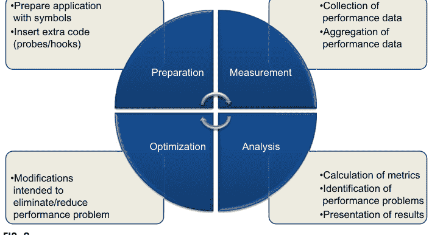

性能优化周期从应用程序的准备开始，然后是实际测量以及对性能数据的分析。基于这些数据，程序员将尝试缓解性能问题并重新开始整个过程。

本章剩余部分解释了如何使用 `Score-P` 和 `Vampir` 执行优化周期的前三个步骤，使用了 CUDA 加速的粒子单元（particle-in-cell）模拟，其中 CUDA 部分可以轻松替换为 OpenACC 实现以获得相同的结果。此外，还介绍了各种优化步骤，这些步骤是更通用的性能调优选项。

## 激光驱动电子束的粒子单元模拟

粒子单元代码（PIC codes）通过将模拟区域划分为网格（单元）来模拟粒子在电磁场中的运动，同时保持粒子为自由移动的实体。本章用于性能研究的特定模拟（Burau 等人，2010）描述了极高能量激光脉冲如何激发氢气，并在其后以近光速加速电子束，而不需要更大的特定加速器。

实际运行通过离散的时间步进行，每个步都涉及图 3 所示的四个阶段。首先计算所有粒子受电场（E）和磁场（B）产生的洛伦兹力（F）。接着粒子沿着这些力移动。由于移动的电荷代表电流（J），因此会计算这些电流。最后，计算出的电流将影响电磁场，这些场需要在循环结束前更新。

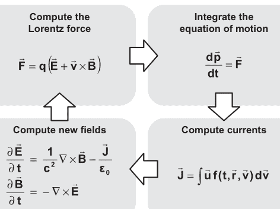

模拟时间步的持续时间的选择使得粒子可以在一个时间步内移动距离超过一个单元。

PIConGPU 源于一个高中生在 HZR 实习期间的概念验证。它是一个单图形处理器（GPU）CUDA 实现，运行速度比任何其他 PIC 代码快几个数量级。从那时起，该代码已被移植到多个 GPU，代码从 CUDA 迁移到 C++。通过本章描述的步骤，性能得到了进一步提高。PIConGPU 可复用于其他应用程序的功能被提取到外部库中，以便其他粒子网格模拟受益于让 PIConGPU 如此快速的关键组件。PIConGPU 的源代码可在 `https://github.com/ComputationalRadiationPhysics/picongpu` 获取。

## 通过代码插桩准备测量

为了获取非常详细的性能数据，需要修改测试应用程序的源代码，以将事件推送到性能监视器。这一过程被称为插桩（instrumentation），这意味着调用编译器时带有额外的选项，为所有函数入口和出口生成回调函数，这些回调将由 `Score-P` 处理。这些回调函数就是之前引入的事件。这自然要求编译器支持注入此类回调函数，而大多数目前的编译器都支持这一点。

所有的并行范式（`MPI`、`OpenMP`、`Pthreads`、`OpenACC`、`CUDA`、`OpenCL`、`OpenSHMEM`）都通过提供性能工具接口或源转换进行自动插桩。结果是，`Score-P` 可以在不修改应用程序源码的情况下记录所有活动。

为了调用编译器插桩，`Score-P` 为常用的编译器提供了包装器。这些包装器将使用正确的标志来插入回调函数。一个名为 `scorep` 的通用包装器提供了对这些包装器的访问。其用法如表 1 所示。

| 编译器定义 | 使用 Score-P 的编译器定义 |
| :--- | :--- |
| `NVCC = nvcc` | `scorep nvcc` |
| `CXX = g++` | `scorep g++` |
| `MPICC = mpic++` | `scorep --cuda mpic++` |

**表 1** 示例说明插桩要复杂得多。首先，我们不想记录如构造函数或析构函数。然后它们在不进行插桩的情况下进行编译。此外，通过向列表提供过滤器来排除某些函数的插桩。从通用行为来看，以尽可能低的运行时开销捕获每次迭代的四个阶段；底层细节可以根据需要添加。

`Score-P 2.0` 引入了通过采样获取活动的数据。为了使用该功能，应用程序仍然需要插桩，以便使用事件记录并行库，并且需要外部工具来获取调用栈。

## 在运行期间记录性能信息

应用程序将在遇到第一个插桩事件时自动启动 `Score-P` 性能监视器。性能监视器通过多个环境变量进行配置。为了减少运行时扰动，`Score-P` 的默认产生基于事件的剖概，这将包含任何加速器活动。为了设置 `Score-P` 以记录 PICon 示例的所有相关活动，使用了表 2 所示的环境变量。为了在即将发布的 `Score-P 3.0` 中启用 OpenACC API 的追踪，需要将环境变量 `SCOREP_OPENACC_ENABLE` 设置为 "yes"。

可用选项详见 `Score-P` 文档。

```
SCOREP_ENABLE_TRACING=yes
SCOREP_CUDA_ENABLE=yes
```

**表 2** 启用 MPI+CUDA 追踪的 Score-P 环境变量。

程序执行后，当前工作目录将包含一个新的子目录 `scorep-<程序运行时间戳>`。在子目录中，你可以找到图 6 所示的分析文件（`profile.cubex`）和追踪文件（`traces.otf2`）。

```
user@opunode:~/scorep-20160612_2007_135653241800420$ ls
profile.cubex  scorep.cfg  traces/  traces.def  traces.otf2
```

**图 6** 成功运行分析和追踪后，`scorep-*` 子目录的内容。

生成的分析文件（profile）是理解应用程序整体行为的最初步方法。对于事件率未知或预期非常大的应用程序，通常建议只生成分析文件，并通过限制的插桩或记录过滤将追踪范围扩展到仅覆盖特定的信息级别。分析文件（`profile.cubex`）可以使用 `cube` 查看器进行可视化。示例如图 7 所示。

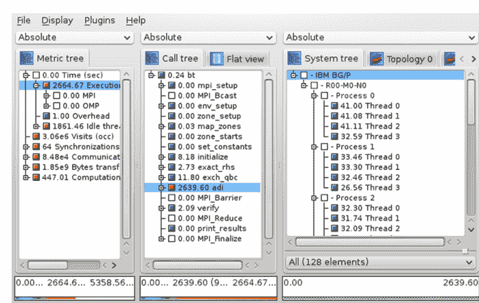

`cube` 分析文件查看器显示了针对多个指标（最左侧列）的应用程序运行分析。在中间，当前选定的指标被分解到程序的各个函数中。在右侧列，所选函数的选定指标被分解到应用程序运行的所有进程和线程中。

追踪文件允许对分析数据以及时间上下文进行深度分析。接下来的章节将展示如何利用这一点来优化 PIConGPU 应用程序。关于 `Score-P` 设置的更详细说明可以在安装包附带的手册中找到。

## 查看第一个并行 PIConGPU 实现

作为下一步，使用 `Vampir` 打开追踪文件 `traces.otf2`，如图 8 所示。缩略图（右上角）显示整个应用程序运行中仅选择了 0.2s，重复的模式表明显示了模拟中约 2.5 个迭代步骤。中间带有彩色活动条的部分是时间轴，它同时显示了 MPI 进程和主机进程（进程 1–4）以及相应的 CUDA 上下文（线程 1/4）。右下角的图例显示了颜色的含义。进程与 CUDA 内存拷贝之间的黑线代表交换的 MPI 消息。MPI 活动可能主导程序执行，而实际的 CUDA 活动相当有限。

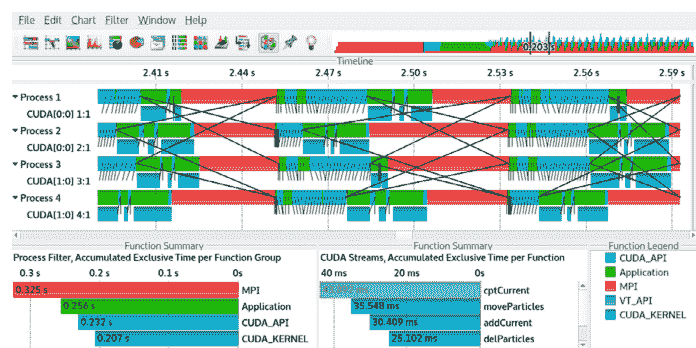

可以通过左上角的工具栏图标选择性能数据的各种显示方式。有两组显示：时间轴显示和统计显示。时间显示展示了沿水平方向随时间演变的活动。该组中包含主时间轴，它显示了所有事件流（可以是进程或 CUDA 流）的彩色活动。

颜色代码默认基于右下角函数图例中显示的函数组。进程时间轴显示了单个事件流随时间变化的调用上下文。计数器时间轴显示了与单个事件流关联的性能计数器值。这可以是例如 `PAPI` 计数器，也可以是来自内存分配或任何使用 `Vampir` 指标编辑器创建的派生计数器。所有事件流的计数器时间上下文在性能雷达图中显示。

第二个显示组包含呈现各种分析数据的统计信息。函数摘要显示了运行时间或调用次数在函数或组之间的分布。消息摘要提供了关于所有数据传输（主机与设备之间或 MPI 处理器之间）的统计数据。其他显示还包括进程摘要、消息矩阵、I/O 摘要和调用类树。关于 `Vampir` 所有功能的详细说明可以在其安装包附带的手册中找到。

`Vampir` 最重要的功能，也是它与标准分析工具区别开来的特性，是能够缩放到程序执行时间轴中的任意间隔。图 8 中仅显示了追踪的一个示例，如右上角的缩略图所示（所选间隔由两条黑条表示）。所有显示都会始终更新为当前显示的时间间隔。因此，`Vampir` 能够针对应用程序的任何阶段并以极高的分辨率对程序进行分析。可以通过在显示区域点击鼠标右键，配置 `Vampir` 所有显示项显示信息的方式。左键点击任何内容都将弹出上下文视图，显示所选项目的详细信息（例如开始/结束时间、持续时间、函数名、文件名、大小等）。

图 8 中的追踪文件描述了首次尝试使用 MPI 并行单个 GPU 以增加模拟区域（弱缩放）的运行。追踪显示了此类并行尝试中的典型问题：顺序任务执行。在这种情况下，我们可以看到 MPI 活动和 CUDA 内存拷贝都主导了执行时间，而 GPU 利用率较低。

MPI 活动占比过高是因为小消息的传输时间（可以使用“消息”功能进行分析）。结果证明，GPU 利用率本身并不是问题，而是主机无法提供足够工作负载的结果。

## 释放主机

改进版本的 PIConGPU 解决了已发现的问题，并引入了一个线程，在所需数据可用时将 MPI 通信卸载到 GPU。结果如图 9 所示。

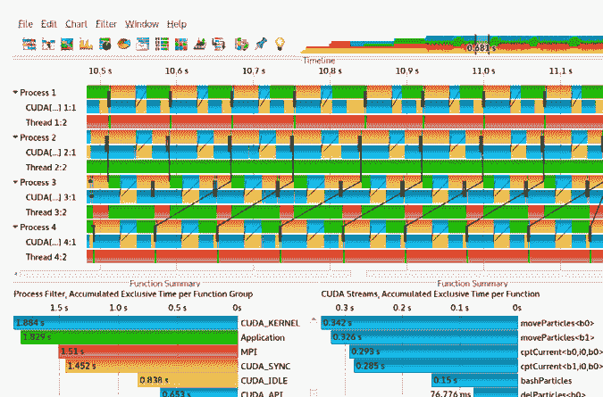

## 优化 GPU 内核

既然 GPU 大部分时间都在忙，问题随之产生：何时可以减少 GPU 计算时间？使用函数摘要仅显示 CUDA 组的函数（如图 9 所示），可以看到主导性内核是 `moveParticles`，随后是 `cptCurrent`。

内核的共同部分在于它们需要遍历粒子列表，以首先累加对单元格总电荷的贡献（`cptCurrent`），然后更新粒子位置（`moveParticles`）。结果证明，所使用的数据结构——一个表示（位置、速度和电荷）的结构体链表——源自原始 PIC 中央处理器（CPU）实现——在需要合并内存访问的 GPU 上运行并不良好。将数据结构更改为 256 个浮点数的列表后，性能显著提高，如图 10 所示。这归因于将所使用的 MPI 通信从同步改为异步 MPI。

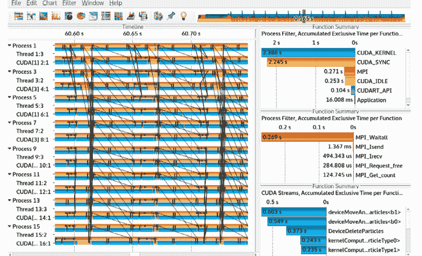

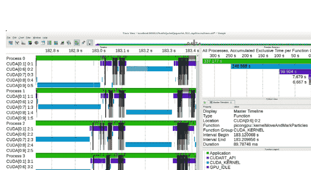

为了在 GPU 上实现这种极高的并发性，PIConGPU 实现了一个内部事件系统，该系统可以自动触发活动和数据依赖关系，从而在输入数据仍在传输时即可启动内核（kernel）。结果是 PIConGPU 能够扩展到非常多的 GPU，并依然保持极高的 GPU 利用率。PIConGPU 及其后继版本经常在 OLCF 的 Titan 上利用整个系统进行运行，并在 2013 年获得过 Gordon Bell 奖决赛奖（Bussmann et al., 2013）。

## 使用 SCORE-P 和 VAMPIR 调查 OpenACC 运行时事件

编译器和运行时在实现 OpenACC 指令时具有一定的自由度。因此，审查它们的转换和执行情况至关重要。例如，内核指令（kernels directive）会触发设备初始化、设备内存分配和数据传输，而无需显式地指定相应的操作。OpenACC 2.5 引入的性能分析接口定义了一系列事件，揭示了 OpenACC 实现和执行的细节。这使得像 `Score-P` 等工具能够测量 OpenACC 区域的持续时间，暴露主机上的等待时间和卸载开销（offloading overhead），并跟踪加速器上的内存分配。通过 OpenACC 库封装（library wrapping），可以使用 `CUPTI` 接口为 CUDA 目标收集更多加速器事件，例如 GPU 内核的开始和结束以及 CPU-GPU 数据传输（Dietrich & Tschüter, 2015）。OpenACC 事件将底层加速器事件与应用程序源代码关联。它们根据类型被标记为隐式或显式，还可以提供有关数据传输的变量名或内核启动的内核名称的信息。

图 12 显示了使用 MPI、OpenMP 和 OpenACC 的应用程序在某个执行间隔内的 `Vampir` 可视化结果。在选定的间隔内，两个 MPI 进程执行相同的程序区域，运行两个 OpenMP 线程和一个带有 CUDA 流的 GPU。加速器活动是异步触发的，例如，右侧的树状图大部分时间都在等待完成。右侧显示更新结构（update construct）触发了从加速器到主机的数据下载和等待监控。OpenACC 和 OpenMP 区域标注了源代码文件名和行号。

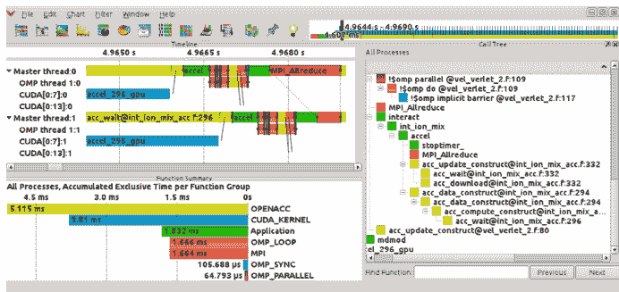

## 总结

PIConGPU 示例是一个特定的例子，识别出的瓶颈是真实的，所提出的解决方案适用于其他应用程序。无论加速器是使用 CUDA（如 PIConGPU）还是 OpenACC 编程的，都没有区别；所使用的改进在两种范式中都是可用的，或者涉及到所使用的 MPI 活动。

- 性能分析需要是每个（并行特别是混合型）程序开发的不可或缺的一部分，以便尽可能地利用可用资源。
- 基于采样的性能分析（Sample-based profiling）能以极低的运行时开销首次洞察程序执行中的潜在热点。
- 事件跟踪（Event tracing）揭示了程序执行期间所有并发活动的全景。日志级别应仔细选择，以防导致 I/O 系统过载。
- 通过跟踪文件进行交互式跟踪，并对各种应用程序进行间歇性性能分析的可能性，为应用程序开发者提供了对程序在任何时间点实际操作的更好理解。
- MPI 和加速器的异步活动是实现高性能的关键。

## 参考文献

Burau, H., Wudera, R., ... (此处省略后续参考文献)

# 示例代码：Mandelbrot 生成器

| H2D | kernel | D2H | H2D | kernel | D2H |
|---|---|---|---|---|---|
| 队列 1 | H2D | kernel | D2H | | | |
| | 队列 2 | H2D | kernel | D2H | | |
| | | 队列 3 | H2D | kernel | D2H | |
| | | | 队列 4 | H2D | kernel | D2H |

两个独立的串行操作

**图 1** 拷贝与计算的叠加：串行执行与流水线执行。

本章使用的示例代码生成一个类似于图 2 所示的 Mandelbrot 集。Mandelbrot 集对每个像素应用一个特定的公式来确定像素的颜色密度。由于图像的每个像素都可以独立于其他像素计算其颜色，其他像素，图像生成非常适合使用 OpenACC 进行并行加速。本章使用的代码根据 Apache License 2.0 许可，更多详情请参阅随附的许可文件。

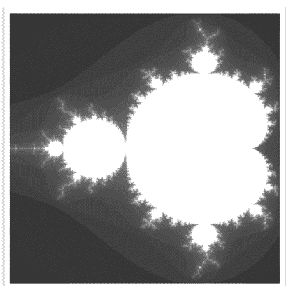

代码分为两个部分：跨越图像所有像素的循环嵌套，以及计算像素颜色的函数。循环嵌套位于主函数中，并已使用 OpenACC 并行 pragma（`pragma`），尽管也可以使用 kernels 指令。代码如图 3 所示。

```c
#pragma acc parallel loop
for(int y=0; y<HEIGHT; y++) {
  for(int x=0; x<WIDTH; x++) {
    image[y*WIDTH+x] = mandelbrot(x, y);
  }
}
```

**图 3** OpenACC 加速的 Mandelbrot 循环。

由于这要求在 OpenACC 区域内调用 `mandelbrot` 函数，因此有必要使用 `acc routine` 程序，如图 4 所示。注意，该函数从每次循环迭代中被调用，并已声明为 `acc routine seq`。这意味着函数内部的计算是顺序的。OpenACC 要求程序员预留程序内部使用的并行性，以便编译器知道在并行化代码其余部分时可用的并行层级。通过将函数声明为顺序执行，所有类型的并行性都


```c
#pragma acc routine seq
unsigned char mandelbrot(int Px, int Py);
```

图 4

带有 OpenACC `routine` 指令的 Mandelbrot 文件。

构建高效流水线的关键在于拥有足够的步骤，且每个步骤所需的时间大致相当，以便每个步骤可以与其他步骤重叠。我们将在带有 NVIDIA Tesla K40 GPU 的机器上运行此测试代码。在该类机器上，有四种操作可以同时进行：通过 PCIe 将数据拷贝到 GPU、通过 PCIe 从 GPU 拷贝数据、在 GPU 上计算以及在 CPU 上计算。然而，本案例研究仅执行两个操作：在 GPU 上计算和从 GPU 内存拷贝数据。这是因为图像生成不需要输入数据，所以我们可以忽略到 GPU 的拷贝。此外，在这种情况下，很难平衡 CPU 和 GPU 之间的计算，因此我们将忽略 CPU。图 5 显示了当前代码的 Visual Profiler 时间线，注意计算内核前后的 PCIe 拷贝。

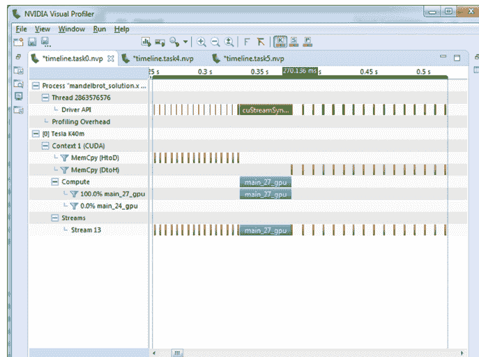

图 5

通过添加 `copyout` 数据子句的初始 Mandelbrot 生成器的 NVIDIA Visual Profiler 时间线，但我们随后在当前代码结构上遇到了问题。由于代码目前的编写方式，将图像写回 CPU 内存的操作在 `main_gpu_kernel` 完成之前无法发生。为了实现计算与 PCIe 连接的重叠，有必要使用一种通常被称为“将问题分成独立运行的小块”的技术。

## 分块计算

分块是将单个大型操作分解为更小的、独立的部分的技术。当正确应用分块时，最终结果应该需要相同的工作量并产生正确的结果。图 6 显示了之前生成的相同 Mandelbrot 集图像，并说明图像可以被分成多个部分（在本例中为 4 部分），这些部分是独立单独生成的。对于这个练习，我们只按行对图像生成进行分块，代码也可以按列或按行和列进行分块。按行分块的决策确保了每个块在内存中是连续的，从而简化了与加速器之间的数据传输。

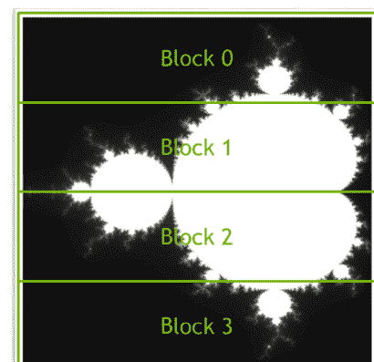

图 6

分成四个块的 Mandelbrot 图像。

为了进行分块操作，有必要通过插入一个新的跨块操作的外层循环，将外层的 "y" 循环分成更小的部分。"y" 循环现在从每个块的第一行开始，仅迭代到块的最后一行。为了简单起见，我们假设块的数量始终能整除图像的高度，以便块的大小始终相等。图 7 显示了此步骤的代码，使用了 16 个块而不是图 6 中的 4 个。

| 行号 | 代码 |
| :--- | :--- |
| 22 | `num_blocks = 16;` |
| 23 | `#pragma acc data copyout(image[:WIDTH*HEIGHT])` |
| 24 | `for(int block = 0; block < num_blocks; block++) {` |
| 25 | `int start = block * (HEIGHT/num_blocks);` |
| 26 | `end = start + (HEIGHT/num_blocks);` |
| 27 | `#pragma acc parallel loop` |
| 28 | `for(int y=start; y<end; y++) {` |
| 29 | `for(int x=0; x<WIDTH; x++) {` |
| 30 | `image[y*WIDTH+x] = mandelbrot(x,y);` |
| 31 | `}` |
| 32 | `}` |

图 7

分块的 Mandelbrot 代码。

## 示例代码：Mandelbrot 生成器

此时，只有计算被分块了，但数据移动没有。直到 "y" 循环结束。第 22 行指定了块的数量。第 23 行确保了数据在进入加速器之前被拷贝到主机。第 25 行和 26 行分别计算起始和结束值。第 28 行是并行循环。图 8 显示了分块。由于此步骤的运行时间是大致相当的。

## 分块拷贝

构建流水线的下一步是让数据拷贝与计算重叠。首先，在 "y" 循环结束时使用 `update` 指令。第 34 行显示了分块策略。最后，由于数据传输现在被处理，第 24 行必须从 `copyout` 更改为 `create`。图 8 显示了用于此步骤的代码。

```c
num_blocks = 16;
block_size = (HEIGHT/num_blocks)*WIDTH;
#pragma acc data create(image[WIDTH*HEIGHT])
for(int block = 0; block < num_blocks; block++) {
    start = block * (HEIGHT/num_blocks);
    end = start + (HEIGHT/num_blocks);
    #pragma acc parallel loop
    for(int y=start; y<end; y++) {
        for(int x=0; x<WIDTH; x++) {
            image[y*WIDTH+x] = mandelbrot(x,y);
        }
    }
    #pragma acc update self(image[block*block_size:block_size])
}
```

图 8

分块数据传输的 Mandelbrot 代码。

## 第 4 章 使用 OpenACC 进行数据传输的流水线化

## 异步执行

现在计算和数据传输都已分块，它们可以变成异步的，释放 CPU 向加速器发射每个块而无需等待之前的块完成。这是通过使用 `async` 和 `wait` 指令实现的。`async` 子句可以添加到任何 OpenACC 指令，使其与 CPU 异步运行。当指令包含 `async` 子句时，操作被放入工作队列，执行立即返回 CPU。由于所有加速指令现在都与 CPU 异步运行，CPU 最终会到达需要结果的点。需要使用 OpenACC `wait` 指令挂起执行，直到之前发布的异步操作完成。在示例中，等待的位置是在分块循环结束和数据区域结束之间，我们需要确保所有的块都拷贝回主机，设备数组在数据区域结束时被销毁。一旦所有异步操作完成，主机执行就可以使用结果。图 9 显示了结果代码。

```c
num_blocks = 16;
block_size = (HEIGHT/num_blocks)*WIDTH;
#pragma acc data create(image[WIDTH*HEIGHT])
for (int block = 0; block < num_blocks; block++) {
    int start = block * (HEIGHT/num_blocks);
    int end = start + (HEIGHT/num_blocks);
    #pragma acc parallel loop async
    for (int y=start; y<end; y++) {
        for (int x=0; x<WIDTH; x++) {
            image[y*WIDTH+x] = mandelbrot(x,y);
        }
    }
    #pragma acc update self(image[block*block_size:block_size]) async
}
#pragma acc wait
```

图 9

带有异步块的 Mandelbrot 代码。

构建流水线的最后一步是利用每个块都是相互独立的特性，通过将块放入不同的异步队列来实现。`async` 子句接受一个数字，代表将工作添加到队列的编号。理论上，每个块都可以拥有自己的队列，但创建工作队列在某些架构上可能是一个昂贵的操作。相反，我们使用两个队列：一个用于计算，另一个用于从加速器拷贝回数据。并行循环和每个块的更新必须顺序发生，因此它们应该在同一个队列中发生，但块是独立的，所以它们可以放置在不同的队列中。表示队列编号的一种方便方法是使用块索引对块数取模。图 10 显示了生成的代码。`wait` 指令也接受队列号，但在这种情况下我们没有指定队列号，因此指令会等待所有工作队列完成。

| 行号 | 代码 |
| :--- | :--- |
| 22 | `num_blocks = 16;` |
| 23 | `block_size = (HEIGHT/num_blocks)*WIDTH;` |
| 24 | `#pragma acc data create(image[WIDTH*HEIGHT])` |
| 25 | `{` |
| 26 | `for(int block = 0; block < num_blocks; block++) {` |
| 27 | `int start = block * (HEIGHT/num_blocks),` |
| 28 | `end = start + (HEIGHT/num_blocks);` |
| 29 | `#pragma acc loop async(block%2)` |
| 30 | `for(int y=start; y<end; y++) {` |
| 31 | `for(int x=0; x<WIDTH; x++) {` |
| 32 | `image[y*WIDTH+x] = mandelbrot(x,y);` |
| 33 | `}` |
| 34 | `}` |
| 35 | `#pragma acc update(image[block*block_size:block_size])` |
| 36 | `async(block%2)` |
| 37 | `}` |
| 38 | `#pragma acc wait` |

图 10 使用交替同步队列的 Mandelbrot 代码。

此时，执行时间应该比原始执行时间至少略有提高，因为数据拷贝和计算是重叠的。通过改变块的数量可以进一步提高执行效率，这反过来也会改变每个块的大小。有必要在大量块带来的额外开销与等大小块重叠带来的收益之间找到平衡，应该通过实验为给定的系统找到最佳块数。由于加速器、主机 CPU 和数据传输速度的差异，最佳块数因系统而异。图 11 显示了在 NVIDIA Tesla K40 GPU 上使用 16 个块的 Visual Profiler 时间线。

## 跨多设备流水线化

由于图像生成现在被划分为独立的块，不仅可以在单个加速器上对块进行流水线处理，还可以在多个设备上执行这些块。OpenACC 提供了一个 API，根据设备类型和数量选择运行时使用的设备。到目前为止，示例使用了默认设备，该设备是由运行时自动选择的。通过调用 `acc_set_device_num` 函数可以更改运行时使用的设备。

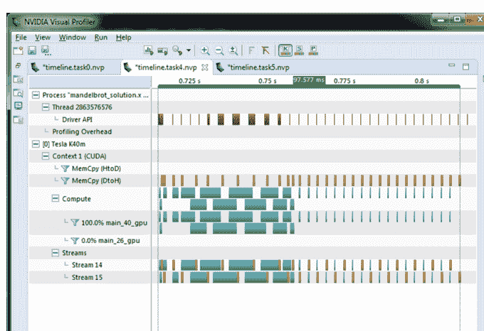

**图 11** 用于流水线 Mandelbrot 代码的 NVIDIA Visual Profiler 时间线。

可以通过多种不同的方式管理多个设备，包括使用同一个 CPU 线程管理所有设备、每个 GPU 使用不同的进程，或使用不同的线程。在本例中，需要的代码更改最少的技术是在 CPU 上使用 OpenMP 线程来划分分块，并将每个 OpenMP 线程分配给可用设备之一。由于图像足够小可以放入单个 GPU 的内存中，我们简单地在每个设备上复制整个图像。当数据大到无法放入单个加速器的内存时，则需要额外的更改，仅为每个加速器分配足够的空间来容纳其分区。

此示例使用的 PGI 编译器支持在同一个程序中同时使用 OpenACC 和 OpenMP，只要它们不在同一个循环上使用。在本例中，OpenMP 严格用于分块循环，以将块分配给 OpenMP 线程，而 OpenACC 用于数据管理以及每个块内的 "x" 和 "y" 循环。必须在编译时使用 `--mp` 命令行选项启用 OpenMP。图 12 显示了如何使用 OpenMP 并行结构为每个可用设备生成一个线程（第 22 行），使用 `acc_get_num_devices` 函数（第 19 行）查询可用设备数量，并将每个线程分配给一个设备（第 35 行）。每个设备仍然使用两个异步队列以实现数据传输和计算的重叠。

## 跨设备流水线化

```c
19 int num_gpus = acc_get_num_devices(acc_device_nvidia);
20 // 这个并行部分消耗了初始化的代价
21 // 到
22 // 防止初始化时间偏置结果。
23 #pragma omp parallel num_threads(num_gpus)
24 {
25     acc_init(acc_device_nvidia);
26     acc_set_device(omp_get_thread_num(), acc_device_nvidia);
27     
28     printf("Found %d NVIDIA GPUs.\n", num_gpus);
29
30     double st = omp_get_wtime();
31
32     int my_gpu = omp_get_thread_num();
33     acc_set_device(my_gpu, acc_device_nvidia);
34     printf("Thread %d is using GPU %d\n", my_gpu, acc_get_device_num(acc_device_nvidia));
35     #pragma acc data create(image[WIDTH*HEIGHT])
36     {
37         int queue = 1;
38         int my_gpu = omp_get_thread_num();
39         acc_set_device(my_gpu, acc_device_nvidia);
40         printf("Thread %d is using GPU %d\n", my_gpu, acc_get_device_num(acc_device_nvidia));
41         #pragma omp for schedule(static,1)
42         for(int block=0; block<num_blocks; block++) {
43             int start = block * (HEIGHT/num_blocks);
44             end = start + (HEIGHT/num_blocks);
45             #pragma acc loop async(block%2)
46             for(int y=start; y<end; y++) {
47                 for(int x=0; x<WIDTH; x++) {
48                     image[y*WIDTH+x] = mandelbrot(x,y);
49                 }
50             }
51             #pragma acc update(image[block*block_size:block_size]) async(block%2)
52         }
53         #pragma acc wait
54     }
55 }
```


# 第 4 章 使用 OpenACC 进行流水线数据传输

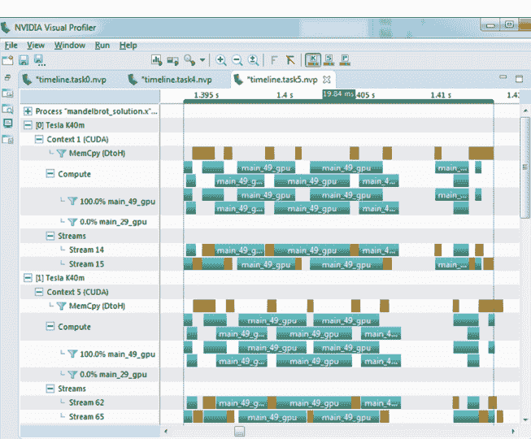

图 15
多 GPU 版 Mandelbrot 代码的 Visual Profiler 时间线。

## 结论

流水线化是一项强大的技术，可以利用 OpenACC 的异步能力，通过计算与数据传输的重叠来加速代码运行。在代码中加入流水线后的参考系统将速度提升了 2.9 倍，而将流水线扩展到六个设备时，该加速相对于原始代码提升了 7.8 倍。流水线化只是编写异步代码的一种方法；对于模板型（stencil types）代码（如有限差分法和谱方法），可以使用异步行为来使边界条件的交换与内部元素的计算相互重叠。在处理异构数据集时，可以使用异步编程在宿主 CPU 和加速器之间划分工作，或者执行核外计算（out-of-core calculations），以较小块的形式将数据流过加速器。编写异步代码需要大量的远见和精细的代码，但最终结果通常是更好地利用所有可用系统资源，并缩短求解时间。

# 第 5 章 高级数据管理

Mathew Colgrove

The Portland Group (PGI), Beaverton, OR, United States

本章目的是教授读者如何管理聚合数据结构、利用全局变量以及创建仅限设备的数据（device-only data）。
在本章结束，读者将对以下内容有基本的理解：

- 非结构化数据区域
- 处理带有动态成员的聚合类型
- C++ 类数据管理
- 在设备例程中使用全局静态变量和 Fortran 模块变量
- 如何创建仅限设备的数据
- 通过消息传递接口 (MPI) 进程共享内存

之前的章节引入了数据区域，其中宿主与设备之间的数据移动是被卸载的。随着程序增长和数据结构变得越来越复杂，在某个点上，采用自上而下的全程序视角来处理设备数据，结合自下而上的计算卸载方法会变得更好。通过这种方法，设备数据的创建和删除发生在高层，通过更新（update）指令处理数据同步。实现这一点的第一种方法是在每个计算区域之前之后放置 update 指令，随着代码中越来越多的被卸载，可以逐个移除 update 指令。这允许对程序的正确性进行增量检查，并隔离出需要进一步调查的数据同步区域。如果程序输出结果错误，你可以调查是由于需要数据同步，还是因为在宿主上更新数据的计算可以卸载到设备上以消除数据同步。

本章引入了非结构化数据区域，在该区域中设备数据的生命周期不再由词法单元的开始和结束定义，而是取决于程序的执行流。非结构化区域可以更方便地创建包含动态成员的聚合结构，通过将设备数据的创建与宿主数据创建同步耦合。非结构化数据区域也可用于 C++ 析构函数，允许类成员在宿主上的生命周期与其在设备上的生命周期匹配，并允许在类内部封装数据管理（图 1）。

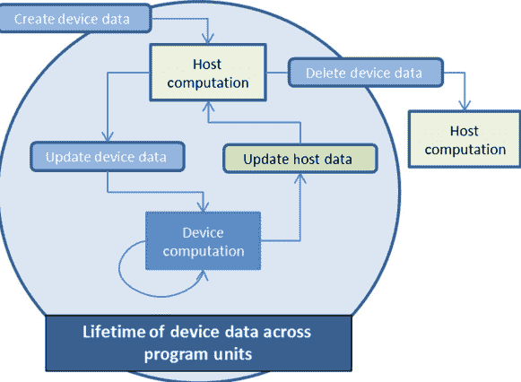

图 1
跨程序单元的设备数据周期。

本章的其他主题还包括使用 `declare` 指令管理全局静态和 Fortran 模块数据，以及在没有关联宿主拷贝的情况下使用设备数据。`declare` 指令允许从 OpenACC 例程内部访问全局和模块数据。仅限设备的数据对于与 CUDA 和 OpenCL 等原生设备语言的互操作、创建内存池以及在共享同一设备的不同 MPI 节点之间共享设备数据有用。

## 非结构化数据区域

OpenACC 2.0 标准的主要新增内容之一是非结构化数据区域。在此之前，数据区域必须有词法的开始和结束。使用非结构化数据后，数据的生命周期随程序的执行而变化，并与宿主数据的作用域一致。非结构化区域可以与静态数据配合使用，其意图是匹配动态分配的数据。`enter create` 指令用于在设备上定义变量，并可以在通过 `malloc` 或 `allocate` 分配宿主变量后使用；同样，`exit data` 指令在释放数据之前使用。

### 带有动态数据成员的聚合类型

#### 框 4 多维数组

```cpp
#pragma acc enter data create(A[0:size][0:size2])

#pragma acc update self(A[0:size][0:size2])
```

然而，如果数组的形状是非均匀的（例如每个向量数组的大小各相同），则由程序员手动创建和更新数据。接下来的示例使用了一种自顶向下的方法，即在设备上创建一个指针数组，然后通过循环创建每个向量。向量数组会被“挂载（attached）”，即将向量的设备指针分配给正确的设备指针数组。

#### 框 5 创建不对齐数组

```cpp
double ** allocData(size_t size, int * sizes) {

    double ** tmp;

    int i;

    tmp = (double **) malloc(size*sizeof(double));

    /* 创建一个指针数组 */

    #pragma acc enter data create(tmp[0:size])

    for (i=0; i < size; ++i) {

        tmp[i] = (double *) malloc(sizes[i]*sizeof(double));

        /* 创建向量数组并将其挂载到指针数组 */

        #pragma acc enter data create(tmp[i][0:sizes[i]])

    }

    return tmp;

}

void deleteData(double ** A, size_t size) {

    int i;

    for (i=0; i < size; ++i) {

        #pragma acc exit data delete(A[i][0:sizes[i]])

        free(A[i]);

    }

    #pragma acc exit data delete(A[0:size])

    free(A);

}
```

注意，在框 5 的示例中，每个向量数组都需要被单独创建。当数据在主机（host）上可用时，每个向量数组都需要被单独更新。如果指针数组本身被更新，代码将拷贝设备或主机的内存地址。这会导致在解引用指针时发生运行时错误。请务必只更新基础的、固定大小的聚合类型或这些类型的数组！

现在让我们深入探讨这个想法，并在框 6 中创建一个“向量”结构体数组，每个结构体都包含一个大小变量和一个双精度浮数组（框 7）。

#### 框 6 更新不对齐数组向量

```cpp
/* 写回每个向量的结果 */

for (j=0; j < size; ++j) {

    int nele = sizes[j];

    #pragma acc update self(A[j][0:sizes[j]])

}
```

#### 框 7 创建带有动态数据成员的结构体

```cpp
typedef struct {

    int size;

    double * data;

} vector;

vector * allocData(size_t size) {

    vector * tmp;

    int i;

    tmp = (vector*)malloc(size*sizeof(vector));

    /* 创建向量结构体数组 */

    #pragma acc enter data create(tmp[0:size])

    for (i=0; i < size; ++i) {

        tmp[i].size = i+10;

        tmp[i].data = (double *)malloc(tmp[i].size*sizeof(double));

        /* 创建数据数组并将其挂载到数据指针 */

        #pragma acc enter data create(tmp[i].data[0:tmp[i].size])

        /* 更新数据的大小以便可以在设备上进行更新 */

        #pragma acc update device(tmp[i].size)

    }

    return tmp;

}

int deleteData(vector * A, size_t size) {

    int i;

    for (i=0; i < size; ++i) {

        /* 删除每个向量的数据数组 */

        #pragma acc exit data delete(A[i].data[0:A[i].size])

        free(A[i].data);

    }

    /* 删除向量数组 */

    #pragma acc exit data delete(A[0:size])

    free(A);

}
```

在计算区域（compute region）中使用这些数据结构时，使用 `present` 子句非常重要。`present` 子句指示编译器数据已在设备上。如果变量不在 `present` 子句中，编译器可能会将其放入 `copy` 子句，这在形状未知的情况下会导致问题（框 8）。

#### 框 8 在计算区域使用 PRESENT 子句

```cpp
#pragma acc parallel loop present(A,B)

for (j=0; j < size; ++j) {

    int size2 = A[j].size;

    #pragma acc loop

    for (i=0; i < size2; ++i) {

        A[j].data[i] = B[j].data[i] + (double)(i);

    }

}
```

## C++ 类数据管理

在前节中，我们创建了简单的“向量”结构体数组。将数据的创建和删除移动到构造函数和析构函数，这样当类对象创建或销毁时会自动处理。我们也使用模板来处理不同数据类型（框 9）。

#### 框 9 C++ 类构造函数和析构函数

```cpp
template<typename T>

class myList {

  private:

    T* _A;

    size_t _size;

  public:

    explicit myList(size_t size) {

      _size = size;

      _A = new T[size];

      #pragma acc enter data copyin(this)

      #pragma acc enter data create(_A[0:size]);

    }

    ~myList() {

      #pragma acc exit data delete(_A[0:size]);

      #pragma acc exit data delete(this)

      delete [] _A;

      _A=NULL;

      _size=0;

    }

};
```

注意，类指针 `this` 也被添加到 `enter data` 指令中。`this` 指针是特定对象的成员实例。尽管对程序员是隐藏的，但对对象的访问都是通过 `this` 指针完成的。当在设备上创建 `this` 指针时，会为对象的成员创建空间。如果使用了 `copy` 子句，会对数据成员进行浅拷贝。如果任何数据成员是 `present`，则关联将被拷贝到设备（图 2）。

| 主指针 | 设备指针 |
| :--- | :--- |
| _size = value<br>A = [host ptr] | 浅拷贝<br>_size = value<br>A = [host ptr] |

| 主指针 | 设备指针 |
| :--- | :--- |
| _size = value<br>A = [host ptr] | _size = value<br>A = [dev ptr] |

图 2 在 C++ 构造函数中创建设备数据。

接下来，在设备上分配动态数据成员并挂载到 `this` 指针。将数据成员的指针挂载到设备数据的地址是关键的。如果动态数据成员在 `this` 指针之前创建，则没有内容可挂载，挂载操作将被跳过。在析构函数中，使用相反的顺序：先从设备删除动态数据成员，然后删除 `this` 指针。由于数据是私有的，类必须提供在主机和设备之间同步数据的方法（框 10）。

#### 框 10 添加类更新方法

```cpp
void accUpdateSelf() {

  #pragma acc update self(_A[0:_size])

}

void accUpdateDevice() {

  #pragma acc update device(_A[0:_size])

}
```

框 11 显示了一个使用 `myList` 类的简单程序。除了决定何时同步数据外，程序员不需要管理底层数据的创建、删除或更新。

#### 框 11 使用类

```cpp
#include "myList.h"

#include <iostream>

int main() {

    myList<double> A(N), B(N);

    for (int i=0; i < B.size(); ++i) {

        B[i]=2.5;

    }

    B.accUpdateDevice();

    #pragma acc parallel loop present(A,B)

    for (int i=0; i < A.size(); ++i) {

        A[i]=B[i]+1;

    }

    A.accUpdateSelf();

    for (int i=0; i<N; ++i) {

        std::cout << "A[" << i << "]=" << A[i] << std::endl;

    }

}
```

## 创建通用容器类

为了使容器类更通用，需要对其进行更新以允许与包含动态数据的对象使用。由于通用容器类将没有对象数据成员的信息，包含的对象将需要管理自己的数据。然而，容器类必须维护对象列表以确保列表在内存中是连续的。

在此示例中，容器类 `accList` 包含 `soaFloat3` 结构体列表，它由一个大小和三个浮点指针组成。在 `accList` 的构造函数中，创建一个空的 `soaFloat3` 列表。对于每个元素，创建一个新的 `soaFloat3`。`soaFloat3` 构造函数创建大小为 M 的设备数组。由于包含的类管理其自己的数据，因此在插入时 `soaFloat3` 拷贝会执行到列表中（图 3）。

| accList(soaFloat3 C(N)); | |
| :--- | :--- |
| _size = value | Device list soaFloat3 |
| _A | Size-0 Size-1 Size-2 |
| | PARALLEL PARALLEL PARALLEL |
| C.insert(i,tmpC); | |
| Device list soaFloat3 |
| _size = value | Size-0 Size-1 Size-2 |
| _A | PARALLEL PARALLEL PARALLEL |

`accList` 构造函数首先在设备上创建其指针，然后调用初始化例程。这会创建一个新的对象列表，并通过调用 `acc_is_present` OpenACC 应用程序接口（API）运行时来检查元素是否已经存在于设备上。如果允许元素在设备上创建其自己的内存，则对象可能会通过 `[]` 运算符散落在设备内存中。这会导致在设备上按顺序访问列表元素时发生错误。为了防止这种情况，代码将检查元素是否存在，而不是在运行时崩溃（框 12 和 框 13）。

#### 框 12 accList 类构造函数

```cpp
template<typename T>

class accList {

public:

    explicit accList() {}

    explicit accList(size_t size) {

        // 在设备上创建 accList 对象

        #pragma acc enter data copyin(this)

        allocate(size);

    }

    ~accList() {

        release();

        // 从设备上删除 accList 对象

        #pragma acc exit data delete(this)

    }

private:

    void release() {

        if (_size > 0) {

            // 从设备上删除 _A 列表

            #pragma acc exit data delete(_A[0:_size]);

            delete[] _A;

            _A = nullptr;

            _size = 0;

        }

    }

    void allocate(size_t size) {

        if (_size != size) {

            release();

            _size = size;

            // 更新设备上的 _A 列表大小

            #pragma acc update device(_size);

            if (_size > 0) {

                _A = new T[_size];

            }

            #ifdef OPENACC

            // 确保 _A 元素在设备上已经存在
```


# C++ 类数据管理

`accList` 构造函数首先在设备上创建其指针，然后调用初始化例程。这会创建一个新的对象列表，并通过调用 `acc_is_present` OpenACC 应用程序接口（API）运行时来检查元素是否已经存在于设备上。如果允许元素在设备上创建其自己的内存，则对象可能会通过 `[]` 运算符散落在设备内存中。这会导致在设备上按顺序访问列表元素时发生错误。为了防止这种情况，代码将检查元素是否存在，而不是在运行时崩溃（框 12 和 框 13）。

```cpp
BOX 12 accList 类构造函数

template<typename T>
class accList {
public:
    explicit accList() {}
    explicit accList(size_t size) {
        // 在设备上创建 accList 对象
        #pragma acc enter data copyin(this)
        allocate(size);
    }
    ~accList() {
        release();
        // 从设备上删除 accList 对象
        #pragma acc exit data delete(this)
    }
private:
    void release() {
        if (_size > 0) {
            // 从设备上删除 _A 列表
            #pragma acc exit data delete(_A[0:_size]);
            delete[] _A;
            _A = nullptr;
            _size = 0;
        }
    }
    void allocate(size_t size) {
        if (_size != size) {
            release();
            _size = size;
            // 更新设备上的 _A 列表大小
            #pragma acc update data device(_size);
            if (_size > 0) {
                _A = new T[_size];
            }
            #ifdef OPENACC
            // 确保 _A 元素在设备上已经存在
            assert(!acc_is_present(&_A[0],sizeof(T)));
            #endif
            // 在设备上创建 A 列表
            #pragma acc enter data create(_A[0:_size]);
        }
    }
};
```

| 框 13 在 accList 中插入对象的方法 |
| :--- | :--- |
| `void insert(size_t idx, const T& val)` | `_A[idx] = val;` |

接下来，添加一个 `insert` 方法，可以将对象添加到列表中。数据的实际更新发生在对象的拷贝构造函数中，该构造函数对底层数据结构一无所知。在框 14 中，`soaFloat3` 的拷贝构造函数对主机和设备上的数据结构进行了完整拷贝。

```cpp
BOX 14 soaFloat3 拷贝构造函数

sFloat3& operator=(const soaFloat3 &B) {
    size_t Bsize(B.size());
    if (Bsize != _size)
        allocate(Bsize);
    size_t bytes = _size * sizeof *x;
    memcpy(x, B.x, bytes);
    memcpy(y, B.y, bytes);
    memcpy(z, B.z, bytes);
    #if defined(USE_OPENACC) && defined(OPENACC)
        acc_memory_device(acc_deviceptr(x), acc_deviceptr(B.x), bytes);
        acc_memory_device(acc_deviceptr(y), acc_deviceptr(B.y), bytes);
        acc_memory_device(acc_deviceptr(z), acc_deviceptr(B.z), bytes);
    #else
        accUpdateDevice();
    #endif
    return *this;
}
```

与其使用 `accUpdateDevice` 方法来更新数据，我们可以使用 `acc_memory_device` API 来执行设备内存传输。`acc_memory_device` 接收两个指针（目标和源）以及每个指针对应的字节大小。为了拷贝与每个关联的数据指针，请调用 `acc_deviceptr`。这两种方法都能正常工作，`acc_memory_device` 比 `update` 稍微快一点，代价是 API 调用可以通过 `_OPENACC` 宏进行保护，而当 OpenACC 未启用时，该指令仅被视为注释。

# accList 更新方法

现在，`accList` 和 `soaFloat3` 类已经有了针对列表中每个 `soaFloat3` 元素的更新方法。这可以通过在 `accList` 方法中添加 `for` 循环来遍历列表并调用每个元素的更新方法来实现。然而，如果所包含的对象是没有更新方法的基本类型或固定大小聚合类型，就会产生问题。相反，代码需要在编译时测试所包含的类是否支持 `updateSelf` 和 `updateDevice` 方法。为了实现这一点，代码利用了“替换失败不是错误”（SFINAE）规则，即在可用时将使用特化方法，在不可用时回退到通用方法。

这里，`decltype` 限定符返回对象的 `updateSelf` 方法的类型。如果该方法存在，则使用特化的 `updateSelf` 方法。否则，通用情况将更新直接使用的列表（框 15）。

```cpp
BOX 15 测试对象是否支持更新方法

void updateSelf() { updateSelfT(A, 0); }
void updateDevice() { updateDeviceT(A, 0); }

template<typename U>
void updateSelfT(U* p, long) {
    #pragma acc update self(p[0:_size]);
}
```

# 使用全局模块变量

| 框 16 declare 指令 |
| :--- | :--- |
| C/C++ 语法: `#pragma acc declare [copyin \| copyout] \| present` |
| Fortran 语法: `!$acc declare [copyin \| copyout] \| present` |

# 在 Fortran 例程中使用模块数据

```fortran
module declare_data
    real, dimension(:,), allocatable :: A, B
!$acc declare(A,B)
contains
    subroutine allocateData(n,m)
    integer n,m
    ! 数据在设备上隐式分配
    allocate(A(n,m),B(n,m))
    end subroutine allocateData
    subroutine deallocateData
    ! 数据在设备上隐式释放
    deallocate(A,B)
    end subroutine deallocateData
end module declare_data

module use_data
    use declare_data
    contains
    subroutine fillData(j,val)
    !$acc routine vector
    integer(8), value :: j
    real(kind=dp), value :: val
    integer(8) :: i
    !$acc loop vector
    do i=1,M
        ! 这里使用了 declare_data 数组的拷贝
        A(j,i) = B(j,i) + ((j-1)*M)+(i-1)
    end do
    end subroutine fillData
end module use_data
```

# 仅使用设备数据

设备语言、CUDA 和 OpenCL，或者在设备上管理内存池时。OpenACC 提供了运行时 API 程序，用于动态分配和释放设备内存（Box 20）。

## Box 20 acc_malloc 和 acc_free
C/C++ 语法：

```cpp
void * acc_malloc(size_t number_of_bytes);
void acc_free(void * *);
```

`acc_malloc` 和 `acc_free` 过程的使用方式与主机的 `malloc` 和 `free` 相同，但它们仅在设备上创建数据。当在 OpenACC 计算区域或 `host_data` 区域使用仅限设备的数据时，该数据被声明为 `deviceptr`。未使用 `deviceptr` 可能会导致运行时错误。此外，仅限设备数据不能在非活跃指令或其他数据类中使用，因为它们没有关联的主机副本。

## Box 21 使用 acc_malloc 创建的设备数据调用 CUDA 例程
```cpp
int main() {
    double *A, *B;
    size_t size, i;
    size = N;
    A=(double*) malloc(sizeof(double));
    B=(double*) acc_malloc(sizeof(double));
    /* 调用 CUDA 例程设置设备数据 */
    cudaSet(B,2.5);
    /* 在计算区域使用 deviceacc 创建的拷贝副本 */
    #pragma acc parallel loop copyout(A[0:size]) deviceptr(B)
    for (i=0; i < size; i++) {
        A[i] = B[i] + (double) i;
    }
    printData(A, size);
    free(A); acc_free(B);
}
```


Box 21 中的以下示例使用 `acc_malloc` 创建了仅限设备的数据，然后在 CUDA 核函数中使用该数据。其中 `cudaSet` 例程调用了一个使用该设备数组的 CUDA 核函数（Box 22）。

## Box 22 setVal CUDA 核函数

```cpp
#include <cuda.h>

__global void setVal(double * B, size_t size, double val) {

    int tid = threadIdx.x + blockDim.x * blockIdx.x;

    int stride = blockDim.x * gridDim.x;

    for(tid < size; tid += stride) {

        B[tid] = val;

    }

}

extern "C"

void cudaSet(double *B, size_t size, double val) {

    setVal<<1,128>>>(B,size,val);

}

```

## 映射设备数据

在某些情况下，程序使用的数据量对于设备内存来说太大了。即：为了适应这种情况，需要对程序进行分块和重写，将较小的数据划若干块，并在设备上逐一个地计算这些块。与其为每个块创建和销毁设备数据，可以先创建一个设备数据池，然后将每个主机块映射到该池中并在完成后取消映射。

## Box 23 acc_map_data 和 acc_unmap_data

C/C++ 语法：

```cpp
void acc_map_data(void *host_ptr, void *device_ptr, size_t number_of_bytes);

void acc_unmap_data(void *host_ptr);
```

`acc_map_data` 方法将主机地址与特定字节数的设备地址关联起来。设备地址不需要必须是 `acc_malloc` 返回的设备内存的基地址。相反，它可以是基地址加上偏移量，从而允许不同的主机变量映射到设备数据的不同部分（Box 23）。

Box 24 展示了一个简单的分块算法，它为每个主机数据块重用同一个设备内存池。

## Box 24 使用 acc_map_data 重用设备数据

```cpp
int main() {

    double **A, *tmpA;

    char * devMem;

    int i, j, nbytes;

    nbytes = N*sizeof(double);

    A = (double**)malloc(BLOCKS*sizeof(double));

    for (i=0; i < BLOCKS; ++i) {

        A[i] = (double*)malloc(nbytes);

    }

    /* 创建设备内存 */

    devMem = (char*)acc_malloc(nbytes);

    for (i=0; i < BLOCKS; ++i) {

        /* 使用临时指针获取块的起始地址 */

        tmpA = A[i];

        /* 将主机块映射到设备内存 */

        acc_map_data(tmpA,devMem,nbytes);

        #pragma acc parallel loop test(tmpA)

        for (j=0; j < N; ++j++) {

            tmpA[j] = 2.5 + (double)((j*N)+i);

        }

        /* 将数据拷贝回块 */

        #pragma acc update host(tmpA[0:N]);

        /* 取消块的映射 */

        acc_unmap_data(A[i]);

    }

    printData(A,BLOCKS,N);

    for (i=0; i < BLOCKS; ++i) {

        free(A[i]);

    }

    free(A);

    acc_free(devMem);

}

```

## 在 MPI 进程之间共享设备内存

使用 OpenACC 的数据映射例程和 CUDA 进程间通信 (IPC)，MPI 程序可以共享设备数据。共享设备内存可以通过消除将数据拷贝主机的需要来提高性能。

当在 OpenACC 计算区域或 `host_data` 区域使用仅限设备的数据时，该数据被声明为 `deviceptr`。未使用 `deviceptr` 可能会导致运行时错误。此外，仅限设备数据不能在非活跃指令或其他数据类中使用，因为它们没有关联的主机副本。

使用 OpenACC 的数据映射例程和 CUDA 进程间通信 (IPC)，MPI 程序可以共享设备数据。共享设备内存可以通过消除将数据拷贝主机的需要来提高性能。

`acc_map_data` 方法将主机地址与特定字节数的设备地址关联起来。设备地址不需要必须是 `acc_malloc` 返回的设备内存的基地址。相反，它可以是基地址加上偏移量，从而允许不同的主机变量映射到设备数据的不同部分（Box 23）。

Box 24 展示了一个简单的分块算法，它为每个主机数据块重用同一个设备内存池。

(注：由于原文中部分段落出现了重复，翻译时已根据“不要重复输出原文”的原则进行了精简，确保逻辑通顺。)

## 代码示例 103

## Box 31 accList 类源码（续）

```cpp
28 #pragma acc routine seq

29 const T& operator[](size_t idx) const { return _A[idx]; };

30

31 size_t size() const { return _size; };

32

33 accclist&operator=(const accList& B) {

34 allocate(B.size());

35 for (size_t j = 0; j < _size; j++) {

36 _A[j] = B[j];

37 }

38 accUpdateDevice();

39 return *this;

40 }

41

42 void insert(size_t idx, const T& val) { _A[idx] = val; }

43 void insert(size_t idx, const T* val) { _A[idx] = *val; }

44

45 void updateSelf() { updateSelf(T_A, 0); };

46 void updateDevice() { updateDevice(T_A, 0); }

47

48 private:

49 void release() {

50 if (_size > 0) {

51 #pragma acc enter data delete(_A[0:_size])

52 delete[]_A;

53 _A = nullptr;

54 _size = 0;

55 }

56 }

57

58 void allocate(size_t size) {

59 if (_size != size) {

60 release();

61 _size = size;

62 #pragma acc enter update device(_size)

63 if (_size > 0) {

64 _A = new T[size];

65 #ifdef OPENACC

66 assert(acc_is_present(&_A[0],sizeof(T)*size));

67 #endif

69

69 #pragma acc enter data create(_A[0:_size]);

70 }

71 }

72

73 这些模板函数使用 SFINAE 模式，以便在

74 如果元素类型的 updateSelf/Device() 存在时调用

75 如果元素都存在，否则对原始数据使用

76 *acc update_device* 操作。

77 这对于下面的模板函数版本有效，因为

78 这些成员函数看起来更具特化，因此

79 会被 C++ 的函数重载解析规则优先考虑，

80 相比应用于指令的更通用版本。

```

## Box 32 accList 类源码（结语）

```cpp
82 template<typename U>

83 void accUpdateSelfT(U *p, long) {

84   #pragma acc update self(p[0:_size])

85 }

86

87 template<typename U>

88 auto accUpdateSelfT(U *p, int) -> decltype(p->accUpdateSelf()) {

89   for (size_t j = 0; j < _size; ++j) {

90     p[j].accUpdateSelf();

91 }

92 }

```

## Box 33 soaFloat3 类源码 (soaFloat3.h)

```cpp
1

2 #ifndef FLOATS3_H

3 #define FLOATS3_H

4

5 #include <string>

6 #ifdef _OPENACC

7 #include <openacc.h>

8 #endif

9

10 using namespace std;

11

12 struct soaFloat3 {

13

14 float *x=nullptr, *y=nullptr, *z=nullptr;

15 soaFloat3() {

16   // 默认构造函数不执行 acc enter data copy(this)

17   // 这样当作为数组或 accList 的部分

18 // 实例化时，可以在主机和设备地址空间中

19 // 保持地址的连续性。

20 }

21

22

24 explicit soaFloat3(size_t n) : _created(true) {

25   #pragma acc enter data copy(this)

26   allocate(n);

27 }

28

29 ~soaFloat3() {

30   release();

31   if (_created) {

32     #pragma acc exit data delete(this)

33 }

34 }

```

## 代码示例 105

## Box 34 soaFloat3 operator=(const soaFloat3 &B)（续）

```cpp
34

35 soaFloat3& operator=(const soaFloat3 &B) {

36 size_t _size=B.size();

37 if (_size != B.size())

38 allocate(_size);

39 size_t _bytes = _size * sizeof(*x);

40 memcpy(x, B.x, bytes);

41 memcpy(y, B.y, bytes);

42 memcpy(z, B.z, bytes);

43 if defined(_OPENACC)

44 #if defined(USE_ACC_MEMCPY)

45 acc_memcpy_device(acc_deviceptr(x),acc_deviceptr(B.x), bytes);

46 acc_memcpy_device(acc_deviceptr(y),acc_deviceptr(B.y), bytes);

47 acc_memcpy_device(acc_deviceptr(z),acc_deviceptr(B.z), bytes);

48 #else

49 updateDevice();

50 #endif

51 return *this;

52

53 #pragma acc routine vector

54 void add(const soaFloat3 &B) {

55 #pragma acc loop vector

56 for (size_t j = 0; j < _size; ++j) {

57 x[j] += B.x[j];

58 y[j] += B.y[j];

59 z[j] += B.z[j];

60 }

61

62 #pragma acc routine seq

63 void setValue(float xval, float yval, float zval) {

64 #pragma acc loop seq

65 for (size_t j = 0; j < _size; ++j) {

66 x[j] = xval;

67 y[j] = yval;

68 z[j] = zval;

69 }

70

71 size_t size() const { return _size; }

72

73 void accUpdateSelf() {

74 #pragma acc update self(x[0:_size])

75 #pragma acc update self(y[0:_size])

76 #pragma acc update self(z[0:_size]);

77 }

78

79 void accUpdateDevice() {

80 #pragma acc update device(x[0:_size])

81 #pragma acc update device(y[0:_size]);

82 #pragma acc update device(z[0:_size]);

83 }

84

85 soaFloat3 类（结语）

86 private:

87     void release() {

88     if (_size > 0) {

89         #pragma acc exit data delete(x[0:_size])

90         #pragma acc exit data delete(y[0:_size])

91         #pragma acc exit data delete(z[0:_size])

92         delete[x];

93         delete[y];

94         delete[z];

95         _size = 0;

96         x = y = nullptr;

97     }

98 }

99

100 void allocate(size_t n) {

101 if (_size != n) {

102     release();

103     _size = n;

104     #pragma acc update device(_size)

105     if (_size > 0) {

106         x = new float[_size];

107         y = new float[_size];

108         z = new float[_size];

109         #pragma acc enter data create(x[0:_size])

110         #pragma acc enter data create(y[0:_size])

111         #pragma acc enter data create(z[0:_size])

112     }

113 }

114

115 size_t _size(0);

116 // 析构函数中的 "acc delete(this)"

117 bool _created(false);

118 }

119 #endif

```

## Box 36 accList.soaFloat3.cpp 示例


```cpp
1 #include <iostream>
2 #include "soaFloat3.h"
3 #include "accList.h"
4 #ifndef N
5 #define N 6
6 #define M 1024
7 #endif
8
9 int main() {
10
11 acc<soaFloat3> C(N);
12 for (size_t j = 0; j < C.size(); ++j) {
13   soaFloat3 tmp(M);
14   C.insert(j, tmp);
15 }
16
17 acc<soaFloat3> A(N), B(N);
18 for (size_t j = 0; j < A.size(); ++j) {
19   soaFloat3 tmp(A);
20   A.insert(j, tmp);
21   B.insert(j, tmp);
22   B[j].setValue(2.5, 3.5, 4.5);
23 }
24
25 A.accUpdateDevice();
26 B.accUpdateDevice();
27 #pragma acc parallel loop present(A,B)
28 for (size_t j = 0; j < N; ++j) {
29   A[j].setValue(2.5, 3.5, 4.5);
30   A[j].add(B[j]);
31 }
32
33 A.accUpdateSelf();
34 for (size_t j = 0; j < N; ++j) {
35   cout << "A[" << j << ": " << A[j].x[0] << ", " << A[j].y[0] << ", " << A[j].z[0] << endl;
36 }
37
38 cout << "......" << endl;
39 for (size_t j = 0; j < N; ++j) {
40   cout << "B[" << j << ": " << B[j].x[0] << ", " << B[j].y[0] << ", " << B[j].z[0] << endl;
41 }
42 }
```

## BOX 37 使用 accList 指定类型

```cpp
1 #include <iostream>
2 #include <cstdlib>
3 #include <vector>
4 #include "accList.h"
5 using namespace std;
6 #ifndef N
7 #define N 6
8 #define M 1024
9 #endif
10
11 int main() {
12 acc<soaFloat3> C(N);
13 for (size_t j = 0; j < C.size(); ++j) {
14   soaFloat3 tmp(M);
15   C.insert(j, tmp);
16 }
17
18 acc<soaFloat3> A(N), B(N);
19 for (size_t j = 0; j < A.size(); ++j) {
20   soaFloat3 tmp(A);
21   A.insert(j, tmp);
22   B.insert(j, tmp);
23   B[j].setValue(2.5, 3.5, 4.5);
24 }
25
26 A.accUpdateDevice();
27 B.accUpdateDevice();
28 #pragma acc parallel loop present(A,B)
29 for (size_t j = 0; j < N; ++j) {
30   A[j].setValue(2.5, 3.5, 4.5);
31   A[j].add(B[j]);
32 }
33
34 A.accUpdateSelf();
35 for (size_t j = 0; j < N; ++j) {
36   cout << "A[" << j << ": " << A[j].x[0] << ", " << A[j].y[0] << ", " << A[j].z[0] << endl;
37 }
38
39 cout << "......" << endl;
40 for (size_t j = 0; j < N; ++j) {
41   cout << "B[" << j << ": " << B[j].x[0] << ", " << B[j].y[0] << ", " << B[j].z[0] << endl;
42 }
43 }
```

## BOX 38 运行结果

以下示例展示了如何使用 `soaFloat3` 类型构建并运行 `accList` 示例。

# 第5章 高级数据管理

## 框 39 构建与运行 accList 示例（续）

```
accList<soaFloat3>::allocate(unsigned long):
8. include "accList.h*"
66. 生成设备端更新(_size)
72. 生成输入数据创建 create(A[:_size])
declaretype((param1_)->updateSelf(()))
accList<soaFloat3*>::updateSelf(soaFloat3*, T1*, int*);
8. include "accList.h"
declaretype((param1_)->updateDevice())
accList<soaFloat3*>::updateDevice<soaFloat3*, T1*, int*>;
8. include "accList.h"
std::basic_ostream<T1, T2> &std::char;
std::traits<char<char>>(std::basic_ostream<T1, T2> &);
8. include "accList.h"

/ ..accList.soaFloat3.out
A[0]: 5,7,9
A[1]: 5,7,9
A[2]: 5,7,9
A[3]: 5,7,9
A[4]: 5,7,9

A[1]: 5,7,9
A[2]: 5,7,9
A[3]: 5,7,9
A[4]: 5,7,9
A[5]: 5,7,9
```

## 总结

当从简单程序扩展到完整的应用程序时，管理主机（host）与设备之间的数据创建和同步可能是一项挑战。OpenACC 用户可以通过对整个程序采用自上而下的数据管理方法来简化这一挑战。利用非结构化数据区域（unstructured data regions）在创建主机数据的同时创建数据，可以使设备数据的生命周期与主机数据匹配。通过使用 OpenACC 指令开启主机与设备之间的同步，可以增量地卸载程序的计算。

利用 OpenACC 的 `enter` 和 `exit` 指令可以镜像主机和设备的数据结构，将带有动态数据的数据类型进行聚合，并将数据管理封装在 C++ 类结构中。`declare` 指令允许你在设备可调用的例程中使用静态全局和 Fortran 模块。对于主机数据太大无法包含在设备内存中的情况，你可以使用 `acc_malloc` 创建设备内存池，并在其中使用 `acc_map_data` 映射主机数据。最后，你可以使用 `acc_map_data` 在多个主机 MPI 进程之间共享设备数据。

# 优化 OpenACC 循环执行

Saber Feki*, Malek Smaoui

KAUST 超计算实验室，沙特阿卜杜拉科学技术大学，图瓦，沙特* 计算机、电气、数学科学与工程学院，沙特阿卜杜拉科学技术大学，图瓦，沙特

本章的目的是帮助已经熟悉基础和核心指令的 OpenACC 开发者通过在 OpenACC 循环结构中添加更多具描述性的子句（clauses），进一步提高其代码性能。

在本章结束，读者将：

- 更好地理解 OpenACC 循环结构及其关联子句的用途（结合示例）
- 在实践中运用所学知识进一步提高 OpenACC 加速代码的性能

无论你是追求科学发现还是职业成就，亦或是为了获得学位，你都希望最大限度地利用你的资源。例如，作为一名开发者/作者/程序员，你希望获得可用计算设备的最佳性能，即中央处理器（CPU）和加速器。然而，众所周知，这些目标需要投入时间和精力，这在学习和应用必要的技能方面都是宝贵的资源。OpenACC 的设计基于生产力和性能之间的权衡。作为一种基于指令的范式，与 CUDA 等其他代码范式相比，更容易学习和使用。因此，让你的生活变得简单：从高级应用程序编程接口（API，如 OpenACC）开始，然后深入低级 API 以实现更高的性能或特定的功能。

如果你正在阅读这一章，你应该已经知道如何使用 OpenACC 在加速器上运行计算密集型/可行的代码部分。换句话说，你应该熟悉 OpenACC 内核（kernels）和 OpenACC 并行结构，这些结构允许你定义并行执行区域。如果操作得当（即你通过 OpenACC 数据结构明智地管理了数据移动），你应该已经看到相对于原生 CPU 代码显著的性能提升。但也意味着你正在追求更好的性能，因为 OpenACC 允许你在继续使用高级 API 的同时，在短时间内进一步提高代码性能。

出于目的，且运行在加速器上的代码部分很可能是循环，你可以将 OpenACC 循环结构应用于紧随其后的循环，以便为编译器提供关于并行化和迭代分布的更多详细信息。该循环必须是将在加速器上执行的代码段的一部分。然而，尽管完全合法，但基础循环结构可能无用（甚至有风险）。只有通过大量的关联子句，你才能描述执行循环应使用什么类型的并行，并定义任何必要的归约操作（reduction operations）。

## 循环结构

参考 OpenACC 标准版本 2.5，循环结构的通用语法如图 1 和 2 所示：

- 在 C/C++ 中

```cpp
#pragma acc loop [clause-list]
for(...)
```

**图 1** C/C++ 中的 OpenACC 循环指令语法。

- 在 Fortran 中

```fortran
!$acc loop [clause-list]
do ...
```

**图 2** Fortran 中的 OpenACC 循环指令。

其中 `[clause-list]` 是与 OpenACC 指令关联的子句。在本章的剩余部分，将解释这些子句的意义及其用法。

## 基础循环优化子句

**图 3** 与 OpenACC 指令关联的子句列表。

第一个代码是矩阵乘法的朴素实现，其使用了循环结构。

你可能注意到，通过大量的关联子句，你可以描述执行循环应使用何种类型的并行，并定义任何必要的归约操作。

**图 4** 矩阵乘法 OpenACC 加速代码示例。

使用 `auto` 子句，你可以指定编译器负责分析循环的独立性，并决定是否将其并行化。当使用 `kernels` 结构时，编译器……

PGI 编译器的输出。

**图 5** 使用 `-acc=info` 标志输出。

## 优化子句

```c
/* acc-base.c */
#include <sys/time.h>
#include <stdio.h>
#include <stdlib.h>

#define SIZE 100

double a[SIZE][SIZE];
double b[SIZE][SIZE];
double c[SIZE][SIZE];
double d[SIZE][SIZE];

int main() {
    int i, j, k;
    struct timeval tim;

    /* 初始化矩阵 */
    for (i = 0; i < SIZE; i++) {
        for (j = 0; j < SIZE; j++) {
            a[i][j] = (double)(i + j);
            b[i][j] = (double)(i - j);
            c[i][j] = 0.0;
            d[i][j] = 0.0;
        }
    }

    gettimeofday(&tim, NULL);

    /* 矩阵乘法 */
    #pragma acc data copyin(a,b) copy(c)
    #pragma acc kernels
    for (i = 0; i < SIZE; i++) {
        for (j = 0; j < SIZE; j++) {
            for (k = 0; k < SIZE; k++) {
                c[i][j] += a[i][k] * b[k][j];
            }
        }
    }

    gettimeofday(&tim, NULL);
    printf("%6f seconds with OpenACC\n", tim.tv_sec - tim.tv_sec); // 注意：原文 tim.t2-tim.t1 疑为笔误，保留原文逻辑结构

    /* 检查 OpenACC 结果 */
    #pragma omp parallel for default(none) private(i,j,k) shared(a,b,c,d)
    for (i = 0; i < SIZE; i++) {
        for (j = 0; j < SIZE; j++) {
            for (k = 0; k < SIZE; k++) {
                d[i][j] += a[i][k] * b[k][j];
            }
        }
        if(c[i][j] != d[i][j]) {
            printf("Error at %d %d: %f != %f\n", i, j, c[i][j], d[i][j]);
            exit(1);
        }
    }

    printf("OpenACC matrix multiplication test was successful!\n");
    return 0;
}
```

## 基础循环优化子句

```
main:
  31. Generating copyin(a[:],b[:])
      Generating copyin(c[:][:])
  33. Loop is parallelizable
  34. Loop is parallelizable
  35. Complex loop carried dependence of c prevents parallelization
      Loop carried dependence of c prevents parallelization
      Loop carried backward dependence of c prevents vector
      Inner sequential loop scheduled on accelerator
      Accelerator generated
      Generating Tesla code:
  33. @pragma acc loop gang /* blockIdx.x */
  34. @pragma acc loop gang, vector(128) /* blockIdx.x threadIdx.x */
```

**图 5** 矩阵-矩阵乘法示例代码的编译过程。

```
31 #pragma acc data copyin(a,b) copy(c)
32 #pragma acc kernels
33 #pragma acc loop auto
34 for (int i = 0; i < SIZE; ++i) {
35 #pragma acc loop auto
36 for (int j = 0; j < SIZE; ++j) {
37 #pragma acc loop auto
38 for (int k = 0; k < SIZE; ++k) {
39 c[i][j] += a[i][k] * b[k][j];
40 }
41 }
42 }
```

**图 6** `auto` 子句的使用示例。

上面的示例可以在每个嵌套循环之前使用裸露循环结构或带有 `auto` 子句的循环结构进行标注，如图 6 所示：

由于编译器仍然是并行化策略的唯一解码器，编译输出没有变化，显然代码性能也没有变化。

`auto` 子句的描述似乎是没用的。嗯，通过这个示例，你可能会认为这个子句是没用的。实际上，当父结构为 `parallel` 时，这个子句就更有用了，解释可以在下一节中找到，因为那里需要理解影响更大的子句：`independent`。

## independent 子句

`independent` 子句允许你指示循环的迭代之间是数据相互独立的。结果是，编译器将生成代码，使用独立的异步线程来计算这些迭代。

## 第 6 节 调整 OpenACC 循环执行

如果你检查之前示例代码中的循环，你会发现乘积矩阵单个元素的计算不依赖于同一矩阵其他元素的值。因此，两个外层计算循环是独立的，这证实了编译器之前的分析。然而，对于最内层的循环，每次迭代都需要上一次迭代的 `c[i][j]` 值：即这种数据依赖排除了对 `independent` 子句的使用。

注意，在考虑这种情况时必须谨慎。首先，如果你在特定循环中漏掉了数据依赖并用 `independent` 子句进行标注，你的程序可能会给你错误且不一致的结果。此外，还有一种情况是，所有的循环结构都隐含了 `independent`，除非被 `auto` 显式覆盖，或者 `seq` `compute` 结构是一个并行结构。这里 `auto` 子句的重要性就体现出来了：使用带有 `auto` 子句的循环结构始终比保持裸露更安全。

## seq 子句

如果由于某种原因（通常是数据依赖），循环必须顺序执行，你只需使用循环结构连同 `seq` 子句对其进行标注。该子句将覆盖编译器可能尝试的任何自动并行或向量化。请注意，编译器在检测数据依赖时倾向于采取保守态度：误报比假漏报频繁得多，假漏报是指编译器并行化了一个包含数据依赖的循环，这将产生错误的数值结果。


由于这非常直接，编译器在我们的矩阵乘法示例中已经发现哪些循环是独立的且需要顺序执行的。因此，接下来的标注仅是为了说明 `independent` 和 `seq` 子句的使用，对并行化程度没有任何影响（图 7）。

```cpp
#pragma acc data copyin(a,b) copy(c)
#pragma acc kernel
#pragma acc loop independent
for (i = 0; i < SIZE; ++i) {
#pragma acc loop independent
for (j = 0; j < SIZE; ++j) {
#pragma acc loop seq
  for (k = 0; k < SIZE; ++k) {
    c[i][j] += a[i][k] * b[k][j];
  }
}
}
```

图 7

`independent` 和 `seq` 子句的示例。

# 基础循环优化子句

## reduction 子句

某些数据依赖可以通过归约（reduction）来克服。如果你还不熟悉归约，那么最好的进展方法是通过示例，而我们的矩阵-矩阵乘法示例正适合这个目的。最内层循环通过逐渐累积每次迭代执行的 `a[i][k] * b[k][j]` 之和获益。乘法运算在迭代之间是独立的，因此可以并行执行，只要乘法的结果可以单独保存到临时循环中。使用临时变量作为操作数后，并行化它们变得可能。求和将在这些值可用后进行。这听起来需要一些代码修改，还需要分配额外的存储。幸运的是，通过 `reduction` 子句提示这种归约操作时，编译器能自动完成。

更通俗地说，`reduction` 子句需要指定参数：一个归约操作符和一个标量变量。对于每个归约变量，都会创建并初始化一个私有副本。执行期间，线程将部分结果存储在变量对应的副本中。当所有线程都完成循环执行时，将使用指定的归约操作合并部分结果。全局结果在并行区域结束可用。在我们的示例中，`reduction` 子句的变量参数要求是标量的。因此，需要修改代码，在带有 `reduction` 子句标注的循环内部用一个临时变量替换 `c[i][j]`。然后，循环外部的简单赋值将计算结果存储在其最终位置（图 9）。

图 8

归约操作符。

| C 和 C++ | 初始化值 | Fortran | 初始化值 |
|---|---|---|---|
| + | 0 | + | 0 |
| * | 1 | * | 1 |
| max | least | max | Least |
| min | largest | min | Largest |
| & | ~0 | iand | All bits on |
| \| | 0 | ior | 0 |
| ^ | 0 | ieor | 0 |
| && | 1 | .and. | .true. |
| \|\| | 0 | .or. | .false. |
| eqv | 1 | .eqv. | .true. |
| neqv | 0 | .neqv. | .false. |

```cpp
#pragma acc data copyin(a,b) copy(c)
#pragma acc kernel
#pragma acc loop auto
for (int i = 0; i < SIZE; ++i) {
#pragma acc loop auto
for (int j = 0; j < SIZE; ++j) {
#pragma acc loop auto
for (int k = 0; k < SIZE; ++k) {
c[i][j] += a[i][k] * b[k][j];
}
}
}
```

图 9

归约的示例。

```cpp
#pragma acc data copyin(a,b) copy(c)
#pragma acc kernel
#pragma acc loop independent
for (i = 0; i < SIZE; ++i) {
#pragma acc loop independent
for (j = 0; j < SIZE; ++j) {
tmp=0.0f;
#pragma acc loop reduction(+:tmp)
for (k = 0; k < SIZE; ++k) {
tmp += a[i][k] * b[k][j];
}
c[i][j] = tmp;
}
}
```

图 10

带有 `reduction` 子句的代码示例的编译报告：注意最内层循环并行化的差异。

## COLLAPSE 子句

到为止，你已经看到 OpenACC 循环结构与紧随其循环相关。每个嵌套循环都需要一个指令。这导致了如果对多个嵌套循环以相同的方式进行处理，代码将变得繁琐。

在这种情况下，`collapse` 子句就非常有用。`collapse` 子句的参数是一个常量正整数，它指定了与循环结构关联的紧密嵌套循环的数量。因此，你可以使用单个循环结构（在除 `collapse` 以外的其他子句周围）来描述循环的迭代。

在我们的示例中，我们将前两个循环指令替换为一个带有 `collapse(2)` 子句的单个指令（图 11）。

```cpp
#pragma acc data copyin(a,b) copy(c)
#pragma acc kernels
#pragma acc loop collapse(2) independent
for (int i = 0; i < SIZE; ++i) {
    for (int j = 0; j < SIZE; ++j) {
        tmp=0;
        #pragma acc loop reduction(+:tmp)
        for (int k = 0; k < SIZE; ++k) {
            tmp += a[i][k] * b[k][j];
        }
        c[i][j] = tmp;
    }
}
```

图 11

使用 `collapse` 子句的示例。

相应的编译输出如下（图 12）：

```text
31. Generating copyin(a[:][:],b[:][:])
    Generating copy(c[:][:])
34. Loop is parallelizable
35. Loop is parallelizable
    Accelerator kernel generated
    Generating Tesla code
34. #pragma acc loop gang, vector(128) collapse(2) /*
blockIdx.x threadIdx.x */
35. /* blockIdx.x threadIdx.x collapsed */
38. Loop is parallelizable
```

图 12

使用 `collapse` 子句时的编译器报告。

`collapse` 子句具有巨大益处的另一种情况是：当某些紧密嵌套循环中任何一个循环的计数相对于设备上可用的线程数较小时。通过在所有嵌套循环之间创建一个单一的迭代空间，迭代次数往往会增加，从而允许编译器提取更多的并行性。然而，我们的示例并不是这种情况的良好说明。

## 高级循环优化子句

## gang, worker 和 vector 子句

典型的加速器架构表现出多个级别的并行性。例如，NVIDIA GPU 由多个流式多处理器组成，每个多处理器都可以调度 warp 块（blocks of warps），warp 是 32 宽的单指令多数据 (SIMD) 线程。另一方面，Intel Xeon Phi 拥有大量的 x86_64 核心，每个核心可以执行多达四个 512 位宽的 SIMD 指令。

根据这些常见的架构考量，OpenACC 配备了 `gang`、`worker` 和 `vector` 子句，允许你使用三个级别的并行性将循环迭代映射到目标设备。请注意，这些子句也可以与 `parallel` 或 `kernels` 结构以及循环结构关联。本节不讨论这种特殊情况，而是侧重于它们伴随循环结构时的用法。

第一级并行性可以使用 `gang` 子句指定，它保证了关联的循环或多个循环的迭代将在多个 gang 之间执行。此外，你可以添加一个整数参数来指定在设备上进行调度的 gang 数量。

第二级并行性可以使用 `worker` 子句描述，表示关联循环的迭代将在 gang 内部的 worker 之间并行执行。你可以可选地添加一个整数参数，指定每个 gang 执行多少 worker 来处理该循环的迭代。

第三级并行性可以使用 `vector` 子句表示，指定关联循环或多个循环的迭代将通过向量或 SIMD 处理执行。同样，你可以使用可选的整数参数来确定向量长度。图形处理器 (GPU) 目标的典型向量长度是 warp 尺寸的倍数，例如最新几代中的 32。

如果你不指定这些子句和/或它们的参数，编译器将使用其启发式方法做出最佳映射。

在 NVIDIA GPU 上，可能的映射是将 `gang` 映射到线程块（thread blocks），`worker` 映射到 warp。或者，你可以省略 `worker` 子句，并将 `gang` 映射到线程块，`vector` 映射到块内的线程。

在我们的示例中，我们进一步对外层循环结构注释了 `gang` 子句，对后续嵌套循环注释了 `vector` 子句。然后，对两个子句的最优整数参数进行调优，通过线程块数量和线程数量的最佳组合获得更好的性能。虽然我们的示例是手动调优的，但可以使用某些自动调优工具获取最佳值（图 13）。

```cpp
#pragma acc data copyin(a,b) copy(c)
#pragma acc kernels
#pragma acc loop gang(32)
for (int i = 0; i < SIZE; i++) {
  #pragma acc loop vector(16)
  for (int j = 0; j < SIZE; j++) {
    tmp=0.0;
    #pragma acc loop reduction(+:tmp)
    for (int k = 0; k < SIZE; k++) {
      tmp += a[i][k] * b[k][j];
    }
    c[i][j] = tmp;
  }
}
```

图 13

相应的编译输出如下（图 14）：

```text
31. Generating copyin(a[:][:],b[:][:])
    Generating copy(c[:][:])
34. Loop is parallelizable
36. Loop is parallelizable
    Accelerator kernel generated
    Generating Tesla code
34. #pragma acc loop gang, vector(128) collapse(2) /*
blockIdx.x threadIdx.x */
35. /* blockIdx.x threadIdx.x collapsed */
38. Loop is parallelizable
```

图 14

使用 `collapse` 子句时的编译器报告。

## tile 子句

`tile` 子句导致紧密嵌套的循环拆分为两个循环：一个外部循环和一个内部循环。例如，如果存在嵌套循环（图 15），`tile` 子句会根据 `sizeX` 和 `sizeY` 进行拆分。

```cpp
#pragma acc data copyin(a,b) copy(c)
#pragma acc kernels
#pragma acc loop tile(32,32)
for (int i = 0; i < SIZE; i++) {
   for (int j = 0; j < SIZE; j++) {
     tmp = 0.0;
     #pragma acc loop reduction(+:tmp)
     for (int k = 0; k < SIZE; k++) {
      tmp += a[i][k] * b[k][j];
     }
     c[i][j] = tmp;
   }
}
```

图 15

使用 `tile` 子句的示例。

通常，使用 `tile` 子句是为了利用数据局部性（data locality），这在许多情况下是性能提升的重要因素。通过 `tile` 子句，嵌套循环被拆分为分块（图 16）。

```cpp
#pragma acc data copyin(a,b) copy(c)
#pragma acc kernels
#pragma acc loop tile(32,32)
for (int i = 0; i < SIZE; i++) {
   for (int j = 0; j < SIZE; j++) {
     tmp = 0.0;
     #pragma acc loop reduction(+:tmp)
     for (int k = 0; k < SIZE; k++) {
      tmp += a[i][k] * b[k][j];
     }
     c[i][j] = tmp;
   }
}
```

图 16

分块（tiling）。

`tile` 子句允许对嵌套循环进行分块。如果 `tile` 子句提供了 `n` 个整数大小，则循环将被拆分。在我们的示例中，前两个嵌套循环被分块（图 17）。

```cpp
#pragma acc data copyin(a,b) copy(c)
#pragma acc kernels
#pragma acc loop tile(32,32)
for (int i = 0; i < SIZE; i++) {
   for (int j = 0; j < SIZE; j++) {
     tmp = 0.0;
     #pragma acc loop reduction(+:tmp)
     for (int k = 0; k < SIZE; k++) {
      tmp += a[i][k] * b[k][j];
     }
     c[i][j] = tmp;
   }
}
```

图 17

使用 `tile` 子句的示例。

相应的输出如下（图 18）：

```text
31. Generating copy(a[:][:],b[:][:])
Generating copy(c[:][:])
34. Loop is parallelizable
35. Loop is parallelizable
    Accelerator kernel generated
    Generating Tesla code
34. #pragma acc loop gang, vector(128) collapse(2) /*
blockIdx.x threadIdx.x */
35. /* blockIdx.x threadIdx.x collapsed */
38. Loop is parallelizable
```

图 18

使用 `tile` 子句时的编译器报告。

编译器输出清晰地反映了 `tile` 子句及其相应参数的影响。当使用两个星号（**）代替 `(32,32)` 参数时，编译器选择了 `(32,4)` 分块参数，导致执行时间更长。

用于性能评估的测试平台由一个双插槽系统组成，配备 NVIDIA Kepler K20e GPU 卡。每个 CPU 插槽包含一个八核心的 Sandy Bridge Intel(R) Xeon(R) CPU E5-2650，主频为 2.00 GHz。

当通过必要的代码修改，使用 `reduction`（归约）子句对第三层嵌套循环进行并行化时，可以感受到第一次明显的性能提升。通过使用 `gang` 和 `vector` 子句，或者通过仔细选择相应的可选参数使用 `tile` 子句来微调循环的执行，可以获得第二次显著的性能提升。运行在 GPU 上的调优 OpenACC 加速代码几乎是运行在多核 CPU 上的 OpenMP 对应代码的两倍。

## 结论

OpenACC 标准允许使用多种选项对循环结构进行注释，以便向编译器提供关于执行循环时应使用的并行类型的提示，并定义任何必要的归约操作。本章描述的某些子句具有特殊的用例；而另一些更为常见，并适用于大多数代码。对某些子句中的某些整数参数进行进一步调优通常有助于在目标硬件上获得更好的加速内核性能。你可以参考一些针对这些参数进行自动调优的研究工作。尽管本章侧重于解释与循环结构配合的不同子句，但开发者可能会在内核中组合使用许多此类子句。图 17 通过同时使用 `tile` 和 `reduction` 子句示例说明了这一点。

# 使用 OpenACC 进行多设备编程

## 7

Jiri Kraus

NVIDIA GmbH, Würselen, DEU, Germany

本章的目的是解释如何为多个 OpenACC 设备使其在单个问题上协同工作。

在本章结束时，读者将对以下内容有基本的理解：

- 如何使用单线程主机、OpenMP 或 MPI 使用 OpenACC 为主机设备或加速集群编程
- 如何使用区域分解策略协调多个设备的工作
- 如何使用 `async` 子句来实现计算与 MPI 通信的重叠
- 如何使用 NVIDIA® 工具处理 MPI+OpenACC

## 引言


在单设备加速您的应用程序之后，考虑扩展应用程序以利用单个节点或加速集群中多个节点上的多个设备优势是自然的。使用多个设备的两个主要原因是：

- 计算更快——设备越多意味着解决问题的时间越短
- 计算更大——设备越多意味着有更多内存来处理更大的问题

应用程序加速通常需要使用多个设备，因为问题无法放入单个设备的内存中，或者需要在特定时间内完成计算（例如数值天气预报）。在本章中，你将学习如何使用 OpenACC 为加速集群中的多设备系统编程。为了协调多个设备的工作，区域分解被应用于 2D Poisson 方程的 Jacobi 求解器。本章涵盖了 OpenMP、消息传递接口（MPI）以及使用 OpenACC 为多设备编程的单线程替代方案。重点关注内存与主机物理分离的加速器，例如图形处理器（GPU）。对于 OpenACC 目标，主机处理器和加速器的内存是相同的，例如 Portland Groups (PGI) 的多核目标，在共享内存节点内进行分解以处理所有核心是并非必要的。然而，使用 MPI 进行 OpenACC 的多设备编程也适用于这些目标，并能够实现跨集群的扩展。

为了简化理解并关注与 OpenACC 多设备编程相关的方面，本章附带的源代码和代码段进行了以下简化处理：

- 为了简化区域分解所需的逻辑，MPI 版本在每个 MPI rank 中复制问题。
- 为了简化索引算术，数据数组被定义为二维全局数组。

不建议在生产应用中使用这些简化方案，因为它们是为了教学目的。

## 成功的可扩展性指标

在开始之前，让我们定义一些贯穿本章将用到的成功可扩展性指标。这些指标的基本思想是，如果我们倍增解决给定问题的资源数量，我们预期解决方案会快一倍。因此，我们定义了以下指标（Hager & Wellein, 2010, pp. 122–123）：

1. 串行时间：$T_s$——使用单个处理器（例如 GPU）运行问题所需的时间。
2. 并行时间：$T_p$——使用多个处理器并行运行问题所需的时间。
3. 处理器数量：$P$——并行运行的处理器数量。

借此，我们可以定义以下指标来衡量多设备参数化的成功与否：

4. 加速比：$T_s/T_p$——并行版本相对于串行版本快多少。理想加速比为 $P$。
5. 并行效率：$E = S/P$——处理器的利用效率。理想效率为 1。

本章的源代码计算两次同一个问题：一次使用单设备，一次使用多个设备。执行运行时使用主机计时器进行计时，以计算上述指标，并评估多设备的实现性能。

## 多设备编程方法

### 使用 OpenACC 为多设备编程的三种方法

使用 OpenACC 为多设备编程的最常见方法：

1. 从单个主机线程控制多个设备
2. 从每个设备的专用线程控制每个设备，例如使用 OpenMP
3. 从每个设备的专用进程控制每个设备，例如使用 MPI

### 处理设备亲和性或选择设备

若要为多个设备编程，所有备选方案都需要通过一系列命令指明目标设备。在由专用线程或进程控制单个设备的情况下，这种分配通常被称为设备亲和性（device affinity）。在 OpenACC 中，通过 `set` 指令和 `device_num` 子句选择设备。图 1 显示了在多 GPU 系统选择顺序为 2 的 NVIDIA GPU（假设至少有三个）。

```cpp
#pragma acc set device_num(2)
```

在 `set device_num` 之后，所有的 OpenACC 指令或应用程序接口（API）调用都指向 `set device_num` 指定的设备。即使在不同的设备上进行异步执行，也可以在程序的任何位置更改当前活动设备。

## 单线程多设备编程

从单个主机线程控制多个设备时，基本思想是在一个设备上启动异步操作，并立即切换到下一个设备启动异步操作。为了执行异步操作，我们使用 `async` 子句。在许多情况下，可以使用如图 2 所示的方法。

```cpp
for (int dn = 0; dn < num_devices; dn++) {
  #pragma acc set device_num(dn)
  #pragma acc kernels async
  for (int iy = iy_start[dn]; iy < iy_end[dn]; iy++) {
    
  }
}
```

## 多线程多设备编程

当一个线程专门控制每个加速器时，基本思想是将 OpenACC 设备与线程 ID 绑定。图 3 显示了使用 OpenMP 创建主机线程来控制多个 OpenACC 设备的示例。

### 第 7 章 使用 OpenACC 进行多设备编程

```cpp
int thread_num = 0;
int num_threads = 1;
#pragma omp parallel firstprivate(thread_num,num_threads)
{
  #if _DEF_OPENMP
    thread_num = omp_get_thread_num();
    num_threads = omp_get_num_threads();
  #endif /*_OPENMP*/

  #if _DEF_OPENACC
    int num_devices = acc_get_num_devices(acc_device_nvidia);
    int device_num = thread_num % num_devices;
    acc_set_device_num(device_num, acc_device_nvidia);
    acc_init(acc_device_nvidia);
  #endif /*_OPENACC*/
}
```

图 3：将 ACC 设备编号绑定到 OpenMP 宿主线程上。

OpenMP API 调用也同样如此，以确保代码在没有 OpenMP 或 OpenACC 编译器的情况下也能运行。

也可以使用多个线程来处理单个设备，因为 `device_num` 可以通过对可用设备数量取模运算从 `thread_num` 计算出来。子文件夹 `Jacobi_OpenMP_multi_device` 包含一个这种使用 OpenACC 编程多个设备的替代方案的示例。

## 多进程多设备编程

与多线程编程类似，多进程编程的基本思想是在创建进程时设置设备。初始化后，你可以在整个程序中使用该设备。图 4 展示了使用 MPI 创建宿主进程的示例。

```cpp
int rank = 0;
int size = 1;
MPI_Init(&argc, &argv);
MPI_Comm_rank(MPI_COMM_WORLD, &rank);
MPI_Comm_size(MPI_COMM_WORLD, &size);

#if _DEF_OPENACC
  acc_device_type device_type = acc_get_device_type();
  if (acc_device_nvidia == device_type) {
    int num_devices = acc_get_num_devices(acc_device_nvidia);
    int device_num = rank % num_devices;
    acc_set_device_num(device_num, acc_device_nvidia);
  }
  acc_init(device_type);
#endif /*_OPENACC*/
```

图 4：将 ACC 设备编号绑定到 MPI 宿主进程上。

OpenACC API 的调用受预处理器条件的保护，以保持与非 OpenACC 编译器的兼容性。添加了设备类型查询，以跳过不需要或不支持设备选择的目标设备，例如 PGI 编译器的多核。这允许在中央处理器 (CPU) 集群节点内使用 MPI 进行通信以及使用 OpenACC 进行并行化。

如所述，子文件夹 `Jacobi_MPI_multi_device` 包含一个使用 OpenACC 运行多设备的替代方案的示例。

# 示例：二维泊松方程的 Jacobi 求解器

本章随附的源代码使用用于求解二维泊松方程的 Jacobi 求解器：

$\Delta A(y,x) = e^{-\sum y(i',j')}$

在顶部/底部和左/右边界上具有周期性边界条件（Jacobi 方法，2016：泊松方程，2016）。求解器本质上在循环中执行以下步骤并检查收敛：

1. 通过计算对区域内的所有内点执行一步（图 5）。

$A_{+1}(iy,ix) = rhs(iy,ix) - A_x(iy,ix-1) + A_x(iy,ix+1) + A_y(iy-1,ix) + A_y(iy+1,ix)$

```cpp
error = 0.0;
#pragma acc kernels
for (int iy = 1; iy < NY-1; iy++) {
  for (int ix = 1; ix < NX-1; ix++) {
    Anew[iy][ix] = -0.25*(rhs[iy][ix]-A[iy][ix+1]+A[iy][ix-1]
    -A[iy-1][ix]+A[iy+1][ix]));
    error = fmax(error, fabs(Anew[iy][ix]-A[iy][ix]));
  }
}
```

图 5：单个 OpenACC 设备上的 Jacobi 步。

2. 从 `Anew` 计算计算值，以便在下次迭代中重用 `A` 和 `Anew`（图 6）。

```cpp
#pragma acc kernels
for (int iy = 1; iy < NY-1; iy++) {
  for (int ix = 1; ix < NX-1; ix++) {
    A[iy][ix] = Anew[iy][ix];
  }
}
```

图 6：从 `Anew` 计算计算值到 `A`。

3. 应用周期性边界条件。通过将第一个修改的行复制到边界、最后一个修改的内行复制到顶部边界、第一个修改的内列复制到右边界以及最后一个内列复制到左边界来实现（图 7 和图 8）。

```cpp
#pragma acc kernels
for(int ix = 1; ix < NX-1; ix++) {
    A[0][ix] = A[NY-2][ix];
    A[NY-1][ix] = A[1][ix];
}
#pragma acc kernels
for(int iy = 1; iy < NY-1; iy++) {
    A[iy][0] = A[iy][NX-2];
    A[iy][NX-1] = A[iy][1];
}
```

图 7：应用边界条件（顶部/底部）。

图 8：应用边界条件（左侧/右侧）。

## 区域划分

为了在多设备上使用 OpenACC 求解泊松方程，需要将工作分配到各个设备（Jacobi 方法）。这种区域划分是一种常用策略（Hager & Welle, 2010）。在多设备上运行 Jacobi 求解器的思想是将区域划分为等于设备数量的子区域。这些子区域的交界区域（halo regions）（见图 9）通过 `iy_start` 和 `iy_end` 数组在每个设备中定义。在 Jacobi 求解器的每次迭代中，都需要处理这些子区域的交界处。

图 9：区域划分策略。

| 水平条带 | 垂直条带 | 瓦片 |
| :--- | :--- | :--- |
|  |  |  |
| 减少邻居数量 | 减少邻居数量 | 减少表面积体积比 |
| 延迟通信最优 | 延迟通信最优 | 带宽通信最优 |
| 按行顺序时连续 (C) | 按列顺序时连续 (Fortran) | 需要非连续交界交换 |

## 单线程多设备编程实现

用于每个设备的起始（`iy_start`）和结束（`iy_end`）索引是根据设备数量划分的。

```cpp
int chunk_size = ceil((1.0*NY)/num_devices);
int iy_start[MAX_DEVICES];
int iy_end[MAX_DEVICES];
iy_start[0] = 1;
iy_end[0] = -1;
for (int dn = 1; dn < num_devices; dn++) {
  iy_start[dn] = iy_start[dn-1] + chunk_size;
  iy_end[dn-1] = iy_start[dn];
}
iy_end[num_devices-1] = NY-1;
```

图 10：为每个设备创建数据区域索引。

```cpp
for (int dn = 0; dn < num_devices; dn++) {
  #pragma acc set device_num(dn)
  #pragma acc enter data \
  copyin(A[iy_start[dn]-1:iy_end[dn]+2][0:NX], \
         rhs[iy_start[dn]:iy_end[dn]+1][0:NX]), \
  create(Anew[iy_start[dn]:iy_end[dn]][0:NX])
}
```

图 11：为每个区域创建数据区域。

```cpp
for (int dn = 0; dn < num_devices; dn++) {
  #pragma acc set device_num(dn)
  #pragma acc kernels async
  for (int iy = iy_start[dn]; iy < iy_end[dn]; iy++) {
    for (int ix = 1; ix < NX-1; ix++) {
      Anew[iy][ix] = 0.25*(rhs[iy][ix] - A[iy][ix+1]
      + A[iy][ix-1] - A[iy-1][ix]
      + A[iy+1][ix]);
    }
  }
}
```

图 12：在分配的设备上执行每个区域的 Jacobi 步。

单线程多设备版本中不计算误差。计算误差会抑制 Jacobi 步的并发执行，因为 OpenACC 编译器需要确保误差变量上必要的归约操作结果在整个内核区域内都是可用的（OpenACC-Standard.org, 2016, p. 24）。如果我们计算误差，则必须等待当前设备完成并且误差值可用，才能将工作分发到下一个设备，这会导致计算串行化。

由于我们在单线程多设备版本中不计算误差，可以省略计算全局误差的步骤。

光区交换（halo exchange）通过主机拷贝完成：

1. 从每个设备更新第一行 (`iy_start[dn]`) 和最后一次处理行 (`iy_end[dn]`) 的主机拷贝（图 13）。

```cpp
for (int dn = 0; dn < num_devices; dn++) {
    #pragma acc set device_num(dn)
    #pragma acc update \
    self(A[iy_start[dn]-1:1][0:NX], \
         A[iy_end[dn]:1][0:NX]) async
}
```

图 13：在主机上更新光区。

2. 等待所有更新完成（图 14）。

```cpp
for (int dn = 0; dn < num_devices; dn++) {
    #pragma acc set device_num(dn)
    #pragma acc wait
}
```

图 14：等待主机光区更新完成。

3. 在主机拷贝上应用顶部/底部边界条件（图 15）。

```cpp
for (int ix = 1; ix < NX-1; ix++) {
    A[0][ix] = A[NY-2][ix];
    A[NY-1][ix] = A[1][ix];
}
```

图 15：在主机上应用周期性边界条件。

4. 从更新后的主机拷贝更新每个设备上的顶部边界 (`iy_start[dn]-1`) 和底部边界 (`iy_end[dn]`）（图 16）。

```cpp
for (int dn = 0; dn < num_devices; dn++) {
    #pragma acc set device_num(dn)
    #pragma acc update \
    device(A[iy_start[dn]-1:1][0:NX], \
           A[iy_end[dn]:1][0:NX]) async
}
```

图 16：将光区更新回设备。

使用 PGI 16.4 编译并运行两块 NVIDIA™ Tesla™ K80 的四块 GPU 上，在问题规模为 4096×4096、迭代 1000 次的情况下，实现了 2.78 的加速和 70% 的并行效率：

| GPU 数量 | 时间 | 加速 | 效率 |
| :--- | :--- | :--- | :--- |
| 1 GPU | 4.5793 s | - | - |
| 4 GPUs | 1.6458 s | 2.78 | 69.56% |

导致并行效率不理想的原因是：

- **A.** 并行开销：串行版本不需要进行光区更新，并且可以在设备上进行顶部-底部的周期性边界条件处理。


- **B.** 光区更新是异步执行的，因为所需的更新指令无法完全异步运行。取决于目标架构和使用的 OpenACC 实现，可能需要固定主机内存（pin memory）以真正使用异步数据传输，例如，在带有 PGI 编译器的 NVIDIA 硬件上，必须固定在堆上分配的主机内存。当添加 `tesla:ta-tesla:pinned` 选项时，堆内存会自动固定。由于它是更新指令全局变量的一部分，它无法通过 `pinned` 选项进行固定，因此更新指令不会如[图 17] 中的 NVVP 截图所示那样异步运行。

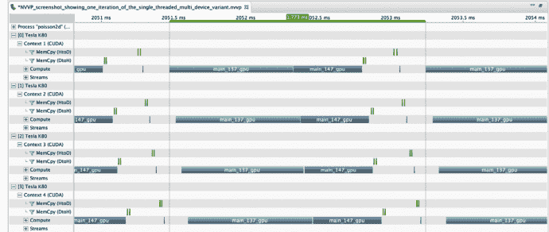

显示单线程多设备变体一次迭代的 NVVP 截图。

- **C.** 由于向不同的 GPU 串行分发工作，内核并非同时启动（见图 17 中的 NVVP 截图）。

- **D.** 参与设备的数据区域是串行创建的。

生产应用运行时间会更长，因此原因 D 对应用程序性能的影响微乎其微。此外，通过使用堆内存和固定内存并在光区更新期间增加并发执行，可以提高并行效率。

## 多线程多设备编程

与单线程多设备版本类似，域划分是通过计算设备在越行行循环的起始 (`iy_start`) 和结束 (`iy_end`) 索引来实现的，如图 18 所示。

```c
// 如果 NY%num_threads != 0，确保正确性
chunk_size = ceil((1.0*NY)/num_threads);
iy_start = thread_num * chunk_size;
iy_end = iy_start + chunk_size;
// 不处理边界
iy_start = max(iy_start, i);
iy_end = min(iy_end, NY - i);
```

**图. 18** 计算域边界。

参与设备的数据区域是串行创建的。域边界用于为分配的设备创建数据区域，如图 19 所示。

```c
#pragma acc data copy(A[iy_start:iy_end][0:NX])
```

**图. 19** 创建数据区域。

与单线程多设备版本类似，域划分是通过计算设备越行行循环的起始 (`iy_start`) 和结束 (`iy_end`) 索引来实现的，如图 18 所示。光区交换通过 Aby 的主机拷贝完成：

- 1. 从每个设备更新第一行 (`iy_start[dn]`) 和最后一次处理行 (`iy_end[dn-1]`) 的主机的拷贝（图 13）。

```c
for ( int dn = 0; dn < num_devices; dn++ ) {
    #pragma acc set_device_num(dn)
    #pragma acc update
    self(A[iy_start[dn-1]:1][0:NX]), A[(iy_end[dn-1]:1][0:NX]) async
}
```

- 2. 等待所有更新完成（图 14）。

```c
for ( int dn = 0; dn < num_devices; dn++ ) {
    #pragma acc set_device_num(dn)
    #pragma acc wait
}
```

- 3. 在主机拷贝上应用顶部/底部边界条件（图 15）。

```c
for ( int ix = 1; ix < NX-1; ix++ ) {
    A[0][ix] = A[(NY-2)][ix];
    A[(NY-1)][ix] = A[1][ix];
}
```

Jacobi 步在主机上执行。

- 4. 从更新后的主机拷贝更新每个设备上的顶部边界 (`iy_start[dn-1]`) 和底部边界 (`iy_end[dn]`）（图 16）。

```c
for ( int dn = 0; dn < num_devices; dn++ ) {
    #pragma acc set_device_num(dn)
    #pragma acc update
    device(A[iy_start[dn]-1:1][0:NX],
          A[iy_end[dn]:1][0:NX]) async
```

# 域划分 137

与单线程变体相比，域顶部的边界条件由计算最顶部条形的线程处理。域底部边界条件由计算最底部条形的线程处理。此外，每次更新后都需要屏障，以防止线程在邻近线程完成之前更新光区。

```c
// Ensure correctness if NY%i = 0
int chunk_size = ceil((1.0*NY)/size);
int iy_start = rank + chunk_size;
int iy_end = iy_start + chunk_size;
yy_start = max(iy_start, 1);
yy_end = min(iy_end, NY - 1);
```

## 图. 25

计算区域边界。

```c
#pragma acc kernels
for (int iy = iy_start; iy < iy_end; iy++) {
  for (int ix = iy_start; ix < ix_end; ix++) {
    Anew[iy][ix]-=0.25*rhs[iy][ix]-A[iy][ix-1]
               +A[iy][ix+1]
               +A[iy-1][ix]
               +A[iy+1][ix]);

    error=fmax(error, fabs(Anew[iy][ix]-A[iy][ix]));
  }
}
```

## 图. 26

在分配给执行 MPI 进程的区域执行 Jacobi 迭代。

```c
real globalerror = 0.0;
MPI_Allreduce(
  &error,&globalerror,1, MPI_DOUBLE,MPI_MAX,MPI_COMM_WORLD);
error = globalerror;
```

## 图. 27

计算全局误差。

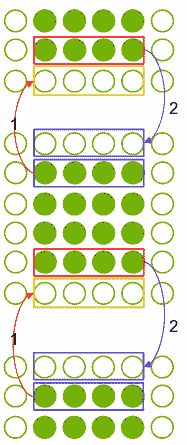

## 图. 28

Halo 交换（边界交换）示意。

# 区域分解 139

使用了两个 `MPI_Sendrecv` 来：

- 将区域的第一行修改行 (`iy_start`) 发送到上方邻居，并从下方邻居接收底部边界 (`iy_end`）（图 29）。

```c
int top = (rank - 0) ? (size-1) : rank-1;
int bottom = (rank - size_i) ? 0 : rank+1;
#pragma acc host_data_use_device(A )
{
 MPI_Sendrecv(
  &[iy_start][ix_start],(ix_end-ix_start),
  MPI_DOUBLE,top, 0,
  &[iy_end][ix_start],(ix_end-ix_start),
  MPI_DOUBLE,bottom, 0,
  MPI_COMM_WORLD,MPI_STATUS_IGNORE);
}
```

图 29

Halo 交换步骤。

- 将区域的最后一行修改行 (`iy_end-1`) 发送到下方邻居，同时从上方邻居接收顶部边界 (`iy_start-1`)（图 30）。

```c
#pragma acc host_data_use_device(A )
{
 MPI_Sendrecv(
  &[iy_end-1][ix_start],(ix_end-ix_start),
  MPI_DOUBLE,bottom,0,
  &[iy_start-1][ix_start],(ix_end-ix_start),
  MPI_DOUBLE,top, 0,
  MPI_COMM_WORLD,MPI_STATUS_IGNORE);
}
```

图 30

Halo 交换步骤。

通过使用 `acc host_data_use_directive`，设备的表示被直接传递给 MPI 例程，确保 MPI 可以直接处理设备内存，例如在 NVIDIA GPU 的情况下使用 CUDA-aware MPI。

使用 OpenMP 1.10.2 和 MPI 16.4 编译，并在两块 NVIDIA® Tesla K80 的四块 GPU 上运行，问题规模为 4096×4096，进行 1000 次迭代，实现了 3.74 倍的加速和 93% 的并行效率：

- GPU 数量：4。

- 4096x4096:

  - 1 个 GPU: 5.214 s,

  - 4 个 GPU: 1.399 s, 加速: 3.74, 效率: 93.45%

我们没有达到最优效率的原因是并行开销，Halo 交换在串行版本中是不必要的（图 31）。

## 第 7 章 使用 OpenACC 进行多设备编程

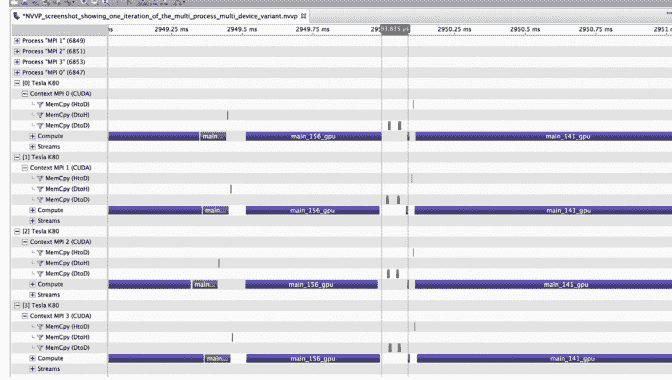

图 31 NVWP 截图，显示了多进程多设备变体的一次迭代。

## CUDA-aware MPI

CUDA-aware MPI 实现允许你直接从设备内存缓冲区交换数据，避免了用户代码中主机暂存（host staging）的开销。如果没有 CUDA-aware MPI，则必须通过 `update` 指令将数据暂存到主机内存（见图 32）。如有必要，在嵌入 MPI 实现的内部流水线时可以更高效地完成主机暂存。此外，CUDA-aware MPI 将透明地使用加速技术，例如 GPUDirect 直接对点传输 (P2P) 和远程直接内存访问 (RDMA)，避免任何主机暂存。

备注：直接的 GPU 到 GPU 传输 (GPUDirect<sup>P2P</sup>) 需要使用进程间通信 (IPC)。CUDA-aware MPI 实现在不同进程控制的 GPU 之间使用 CUDA IPC P2P 映射。P2P 映射的建立通常由 MPI 实现在第一次通信时延迟，并产生显著开销。在运行时间较长的应用程序中，该开销通常忽略不计。为了从报告的时间中排除这一点，使用了类似技术来避免所有变体的第一次迭代。

## 通信与计算并行

所有变体的并行效率都受到 Halo 交换引起的并行开销。由于 Halo 交换只需要读取区域的第一行和最后一行，因此可以在拷贝内核执行时隐藏这些延迟（Hager & Wells, 2010, pp.220）。

# 区域分解 141

```c
int top = (rank == 0) ? (size-1) : rank-1;
int bottom = (rank == (size-1) ? 0 : rank+1;
#pragma acc update(device(A[iy_start][ix_start:(ix_end_ix_start)], A[iy_end-1][ix_start:(ix_end-ix_start)])
MPI_Sendrecv(
  &[iy_start][ix_start],(ix_end-ix_start),
  MPI_DOUBLE,top,0,
  &[iy_end-1][ix_start],(ix_end-ix_start),
  MPI_DOUBLE,bottom,0,
  MPI_COMM_WORLD,MPI_STATUS_IGNORE);
MPI_Sendrecv(
  &[iy_end-1][ix_start],(ix_end-ix_start),
  MPI_DOUBLE,bottom,0,
  &[iy_start][ix_start],(ix_end-ix_start),
  MPI_DOUBLE,top,0,
  MPI_COMM_WORLD,MPI_STATUS_IGNORE);
```

图 32 在没有 CUDA-MPI 的情况下应用边界条件并进行 Halo 更新。使用正整数识别异步队列进行 Halo 交换。提交到同一异步队列的操作按顺序执行，而提交到不同异步队列的操作允许并行。因此，为了实现通信和计算的交叉，首先在异步队列 1 中执行发送到其他进程的行（边界），然后在异步队列 2 中执行交换，如图 33 所示。

这允许在内核执行时隐藏数据的必要通信时间。Halo 更新完成后，我们需要等待异步队列 2 的内核完成后才能开始传输（图 34）。

使用 PGI 16.4 和 OpenMPI 1.10.2 编译，并在两块 NVIDIA® Tesla K80 的四块 GPU 上运行，问题规模为 4096×4096，进行 1000 次迭代，实现了 3.79 倍加速和 95% 的并行效率（图 35）：

- GPU 数量：4。

- 4096×4096:

  - 1 个 GPU: 5.1756 s.

  - 2 个 GPU: 1.3662 s., 加速: 3.79, 效率: 94.71%

```c
#pragma acc kernels async(1)
for(int ix=ix_start;ix<ix_end; ix++) {
  A[iy_start][ix]=Anew[iy_start][ix];
  A[iy_end-1][ix]=Anew[iy_end-1][ix];
}
```

```c
#pragma acc kernels async(2)
for (int iy=iy_start; iy<iy_end; iy++) {
  for(int ix=ix_start; ix<ix_end; ix++) {
    A[iy][ix]=Anew[iy][ix];
  }
}
```

```c
real globalerror=0;
MPI_Allreduce(&globalerror,1,
MPI_DOUBLE,MPI_MAX,MPI_COMM_WORLD,
error=globalerror);
```

```c
#pragma acc wait(1)
```

```c
int top=(rank==0)?(size-1):rank-1;
int bottom=(rank-(size-1))?0:rank+1;
```

```c
#pragma acc host_data_device(A)
{
 MPI_Sendrecv(
  &[iy_start][ix_start],(ix_end-ix_start),MPI_DOUBLE,top,0,
  &[iy_end-1][ix_start],(ix_end-ix_start),MPI_DOUBLE,bottom,0,
  MPI_COMM_WORLD,MPI_STATUS_IGNORE);
 MPI_Sendrecv(
  &[iy_end-1][ix_start],(ix_end-ix_start),MPI_DOUBLE,bottom,0,
  &[iy_start-1][ix_start],(ix_end-ix_start),MPI_DOUBLE,top,0,
  MPI_COMM_WORLD,MPI_STATUS_IGNORE);
}
```

```c
#pragma acc wait(2)
```

图 33 使用异步调用并发执行 MPI 通信和 OpenACC 内核。


图 34 通信时间隐藏示意。

# 144 第 7 章 使用 OpenACC 进行多设备编程

`cuda-memcheck` 将将 `%q{ENV_VAR}` 替换为 `ENV_VAR` 的值。为了给每个 MPI rank 获取一个文件，应将 `ENV_VAR` 替换为包含 `MPI_COMM_WORLD` 中 MPI rank 的环境变量的名称。MPI 启动器会设置这些环境变量。

- MVAPICH2 为每个对应 `MPI_COMM_WORLD_RANK` 中 rank 的进程设置 `MV2_COMM_WORLD_RANK`

- OpenMPI 为每个对应 `MPI_COMM_WORLD` 中 rank 的进程设置 `MPI_COMM_WORLD_RANK`

其他启动器可能会设置不同的环境变量。

使用 `cuda-db` 调试 MPI+OpenACC 应用可以采用与使用 `gdb` 调试 CPU MPI 应用相同的技巧，即为 MPI rank 启动 `xterm cuda-gdb`，或者挂载到正在运行的应用程序上。此外，设置 `CUDA_DEVICE_WAITS_ON_EXCEPTION` 让程序正常运行，直到遇到设备异常。当发生设备异常时，它会等待 `cuda-gdb` 挂载，并向以下内容提供 PID 和主机名信息：

```
<hostname>: 应用程序遇到了设备错误且设置了 CUDA_DEVICE_WAITS_ON_EXCEPTION。你现在可以将调试器挂载到应用程序 (PID <pid>) 进行检查。
```

设置 `CUDA_ENABLE_CODUMP_ON_EXCEPTION` 会设备上创建 GPU 或编译后的 CPU/GPU 转储，以便进行离线检查（NVIDIA, 2016）。

## 使用 nvprof 和 NVIDIA VISUAL PROFILER 进行分析

可以通过为每个 MPI rank 启动 `nvprof` 实例并将分析写入文件来生成 `nvprof` 配置文件：

`pmirun -np 2 nvprof -o <filename>.%q{ENV_VAR}.nvprof ./app <args>`

与 `cuda-memcheck` 类似，`nvprof` 将 `%q{ENV_VAR}` 替换为 `ENV_VAR` 的值。使用 MPI 启动器提供的环境变量，`nvprof` 为每个 MPI rank 执行分析（例如 MVAPICH2:`MV2_COMM_WORLD_RANK` 或 OpenMPI:`MPI_COMM_WORLD_RANK`）。生成的配置文件可以通过多进程导入功能导入 NVIDIA Visual Profiler。为了方便将不同的时间线映射到 MPI rank，可以进行以下命名：

- 使用命令行选项命名进程：`--process-name "MPI %q{ENV_VAR}"`

- 使用命令行选项命名 GPU 上文：`--context-name "MPI %q{ENV_VAR}"`

使用环境变量名称作为输出文件的名称。

## 结论


在本章中，你学习了三种使用多个 OpenACC 设备进行更快速或更大规模计算的方法。在本文中，使用 OpenACC 编程多个设备的替代方案具有以下优缺点（图 36）。

## 结论

| 优点 | 缺点 |
|---|---|
| 单线程 | - 不增加任何额外的依赖<br>- 应用程序启动容易 | - 目前无法使用直接的设备间通信，例如 `GPUDirect™ P2P`<br>- 在某些情况下并发性受限，例如带有带有原子操作的内核以及可能与主机内存之间的数据传输 |
| 多线程 | - 控制线程之间高效的共享内存协调<br>- 应用程序启动容易 | - 目前无法使用直接的设备间通信，例如 `GPUDirect™ P2P`<br>- 增加了对线程库的依赖，例如 `OpenMP` |
| MPI | - 扩展到节点之外<br>- 配合 `CUDA-aware MPI` 在 `NVIDIA®` 设备上使用直接的设备间通信 (`GPUDirect™ P2P/RDMA`) | - 增加了对 `MPI` 的依赖<br>- 应用程序启动需要使用启动器，例如 `mpie` |

**图 36** 多个 OpenACC 设备编程替代方案对比。

图 37 显示，使用 `PGI® 16.4` 和 `OpenMPI 1.10.2` 运行 `MPI+OpenACC` 版本在 `tesla` 和 `PGI®` 编译器的多核目标上均具有良好的扩展性。多核目标每个插槽/MPI rank 使用 16 个线程。

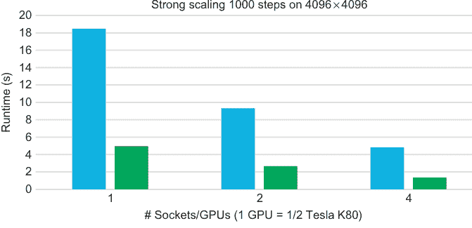

**图 37** CPU 和 GPU 上的强扩展。

## 参考文献

- Hager, G., & Wellein, G. (2010). Introduction to high performance computing for scientists and engineers. Boca Raton, FL: CRC Press.
- Jacobi Method. (2016). Encyclopedia of mathematics. Retrieved from: http://www.encyopedia-diaofmath.org/index.php?title=Jacobi_method&oldid=34059.
- Kraus, J. (2016). An introduction to CUDA-aware MPI. Retrieved from Parallel Forall: https://devlogs.nvidia.com/parallelforall/introduction-cuda-aware-mpi/
- NVIDIA. (2016). CUDA-GDB. Retrieved from CUDA Toolkit Documentation: http://docs.nvidia.com/cuda/cuda-gdb/#gnu-coredump.
- OpenACC-Standard. (2.16). The OpenACC(R) application programming interface version 2.5 June. Retrieved from OpenACC.org: http://www.openacc.org/sites/files/OpenACC_2pt5.pdf.
- Poisson Equation. (2016). Encyclopedia of mathematics. Retrieved from: http://www.encyopedia-diaofmath.org/index.php?title=Jacobi_method&oldid=34059.

## FELDAMP-DAVIS-KRESS 算法

计算机断层扫描（CT）广泛应用于医学领域，用于生成人体特定区域的断层图像。简单而言，CT 是从大量的二维（2D）X 射线图像重建出原始三维（3D）对象的图像。当一组射线围绕单个旋转轴穿过物体时，产生的投影数据由探测器阵列捕，然后使用基于傅里叶切片定理的滤波反投影法来重建原始物体。在各种反投影算法中，Feldkamp-Davis-Kress (FDK) 算法在数学上非常简单且易于实现。从获取的数据重建的图像准确至关重要。本工作的目标是使用基于指令的编程模型来加速重建。

图 2 显示了 FDK 算法的伪代码，它包含三个步骤：

1. 加权——计算投影数据。
2. 滤波——通过乘以它们的傅里叶变换对加权后的投影进行滤波。
3. 反投影——将滤波后的投影反投影到 3D 重建网格上。

```
Initialization;
foreach 2D image in detected images do
  foreach pixel in image do
    Pre-weight and ramp-filter the projection;
  end
foreach 2D image in detected images do
  foreach voxel in 3D reconstruct volume do
    calculate projected coordinate;
    sum the contribution to the object from all tilted fan
  end
end
```

**图 2** 算法 1 FDK 算法的伪代码。

# 第 8 章 使用 OpenACC 进行模板子和 Feldkamp 算法

重建算法是计算密集型的，具有双四次复杂度 ($O(N^4)$)，其中 N 是一个维度上探测器像素的数量。该算法最耗时的步骤是反投影。如图 3 所示，应用程序的分析示例显示，应用中的反投影程序占了几乎所有的运行时间（63.04% + 20.85% + 15.63%=99.52%，占整个应用程序）。我们工作的重点是将反投影步骤并行化。

FDK 的执行时间：159.57 秒

============

CPU 性能分析结果（自下向上）：

| 时间(%) | 名称 |
| :--- | :--- |
| 63.04% | 100.7s `back_projection` |
| 20.85% | 33.3065s `_fsd_sincos_vex` |
| 15.63% | 24.9699s `floor` |
| 15.63% | 24.9699s `back_projection` |
| 0.18% | 290.23ms `four1` |
| 0.11% | 180.14ms `dread` |
| 0.11% | 180.14ms `main` |
| 0.05% | 80.064ms `main` |

**图 3** FDK CPU 版本的分析结果，`sin(t)`, `cos(t)`, 和 `floor(t)` 在 `back_projection(function)` 内部被调用。

为了实现，我们遵循了 Kak 和 Slaney (1998) 给出的步骤。如图 4A 所示，反投影算法有四个循环。最外层的三个循环遍历输出 3D 对象的每一个维度，而内层循环访问每个检测到的 2D 图像切片。

首先对代码进行重构，使三个外层循环紧密嵌套，然后应用 OpenACC 的 `collapse` 子句。这意味着每个线程按顺序执行内层循环。所有检测到的图像都通过 `copyin` 子句从 CPU 传输到 GPU，而输出的 3D 对象（即：

```
void back_projection()
{
  #pragma acc kernels copyin(fp_h[0:X_SIZE*Y_SIZE*Z_SIZE]) \
  copyout(CT_numbers_h[0:RECONSIZE_Z*RECONSIZE*RECONSIZE])
  {
    #pragma acc loop collapse(3) independent
    for(i=0;i<RECONSIZE_Z;i++) {
      for(j=0;j<RECONSIZE;j++) {
        for(k=0;k<RECONSIZE;k++) {
          z=(Z_CENTER-zstart+i)*recon_step_z;
          y=(j-REC_XY_CENTER)*recon_step;
          x=(k-REC_XY_CENTER)*recon_step;

          reco = 0;
          for(l=view_start;l<view_end;l++) {
            ......
          }
        }
      }
    }
  }
}
```

**(A)**

**图 4** (A) FDK 实现中 `back_projection` 核的 OpenACC 代码片段

续

```
__global__ void back_projection(_);
```

```
  idx = threadIdx.x + blockIdx.x*blockDim.x;
  size2 = RECONSIZE*RECONSIZE;
  i = (idx/size2)%RECONSIZE_Z;
  j = (idx/RECONSIZE)%RECONSIZE;
  k = idx%RECONSIZE;
  z=(Z_CENTER-zstart+i)*recon_step;
  y=(j-REC_XY_CENTER)*recon_step;
  x=(k-REC_XY_CENTER)*recon_step;
  reco = 0;

  for(l=view_start;l<view_end;l++) {
      ....
  }
int main() {

    cudaMalloc(void)&fp_d, X_SIZE*Y_SIZE*Z_SIZE*sizeof(float));
    cudaMempy(fp_d, fp_h, X_SIZE * Y_SIZE * sizeof(float), cudaHostToDevice());

    cudaMalloc(void)**CT_numbers_d, RECONSIZE_Z * RECONSIZE*sizeof(short int);
    cudaMemset(void*)CT_numbers_d, 0, RECONSIZE_Z * RECONSIZE*sizeof(short int));

    dim3 dimBlock(THREADS);
    dim3 dimGrid((RECONSIZE_Z*RECONSIZE+THREADS-1)/THREADS);

    back_projection<<<dimGrid, dimBlock>>>(fp_d, CT_numbers_d,
    view_start, view_end, X_SIZE, Y_SIZE, Z_SIZE);

    cudaMempy(CT_numbers_h, CT_numbers_d, RECONSIZE_Z * RECONSIZE*sizeof(short int), cudaDeviceToHost());
```

**图 4 (B)** FDK 实现中 `back_projection` 核的 CUDA 代码片段。

通过 `copyout` 子句从 GPU 拷贝到 CPU 的许多 2D 图像切片使用了 Logan 和 Sheppard (1975) 的方法评估。300 个检测图像，每个图像的分辨率为 200x200。算法产生 200x200x200 的重建立方体。输入和输出图像在本节末尾显示。注意，该实现的结果对浮点顺序和精度敏感。GPU 上的最终浮点值可能与 CPU 上计算的值不同，原因之一是融合乘加 (FMA) 操作在单个阶段执行并只舍入一次。如果没有 FMA，`(X * Y + Z)` 由两个步骤组成并舍入两次。尽管这并不意味着使用 FMA 会导致结果差异或错误。对于某些类型的代码，无 FMA 的结果可能很重要。在我们的情况下，如果考虑复杂的代码（例如天气建模代码），即使是微小的差异也是不可接受的。

编译 SDK 的版本使用以下命令（图 5）：

```
$ pgcc -fast -acc -tesla:cc35,nofma -Minfo -accel fdk.c -o acc_fdk
```

**图 5** 编译命令行。

`-ta-tesla` 标志告诉编译器为 Tesla GPU 生成代码。我们使用 `cc35` 选项指定 Tesla GPU 的计算能力，因为 Tesla GPU 产品随时间演变，包含了多代计算能力不同的设备。`nofma` 标志告诉编译器禁用 FMA 操作。`-Minfo=-accel` 标志告诉编译器在将 OpenACC 代码翻译为 GPU 代码时输出关于循环调度、数据移动和数据同步的信息。

在这些实现技术中，即使面对准确性和精度差异也可以看到。OpenACC 是一个针对不同加速架构的模型。为了用于多核架构，需要以下命令（图 7）：

```
$ pgcc -fast -acc -ta=multicore -Minfo=accel fdk.c -o multicore_fdk
```

**图 7** 多核的编译命令行。

此命令与之前的编译命令行不同在于指定的标志：`-ta=multicore` 替换了 `-ta=tesla`。在多核平台上，不需要特定的计算能力。

我们的评估包含了顺序 CPU 版本、针对多核和 GPU 的 OpenACC 版本以及 CUDA 版本之间的比较。CUDA 版本是手动开发的，反投影核的代码片段如图 4B 所示。

在 OpenACC 版本中，三个外层循环被折叠了。为了保持比较的公平，CUDA 核保留了类似的循环调度策略。编译器可以应用许多循环调度。读者可以参阅 Tian 等人 (2016) 获取更多关于使用循环调度选项的细节。

图 8 显示了使用不同编程模型/语言的和速度。与顺序版本相比，OpenACC GPU 和 CUDA 版本分别实现了 16.24x、12.47x 和 98.93x 的加速。OpenACC 版本的性能略高于 CUDA 版本。这种现象可能可能是 OpenACC 编译器在翻译 OpenACC 核到 CUDA 时应用了比手动编写的 CUDA 核更好的优化。

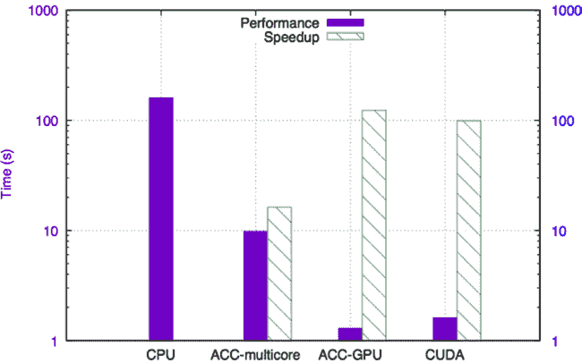

**图 8** FDK 算法在不同模型下的性能。

```
resolution=200;
slice=180;
fid = fopen('output.img');
fseek(fid, resolution*resolution*slice, 'bof');
img = fread(fid, [resolution], 'short');
imtool(img, [-325, 1])
```

**图 9** 用于数据可视化的 Matlab 脚本。

可以使用 Matlab 同时查看输入图像和输出图像。例如，3D 图像的分辨率为 200×200，可以使用以下 Matlab 脚本来查看输出图像中的第 180 个 2D 图像切片（图 9）。2D 图像的输入和输出数据如图 10 和图 11 所示。

## 2D 热方程

我们的 2D 热方程应用是一种基于模板（stencil-based）的算法，具有高计算/通信比，其工作负载分布在多个线程中。该实现使用了 GPU 的全局内存并获得了更好的性能，但通过使用 GPU 共享内存可以进一步改进。

表示 2D 热导的公式在 Whitehead & Fit-Florea (2011) 中进行了解释，并如图 12 所示：

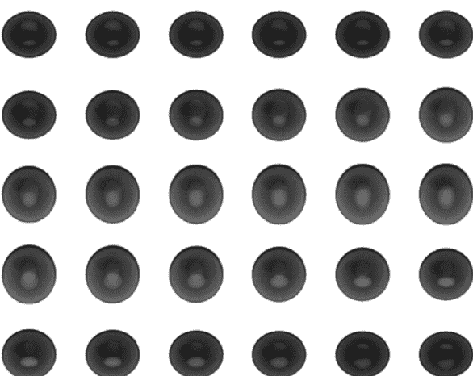

**图 10** 输入图像的代表性 2D 图像切片。

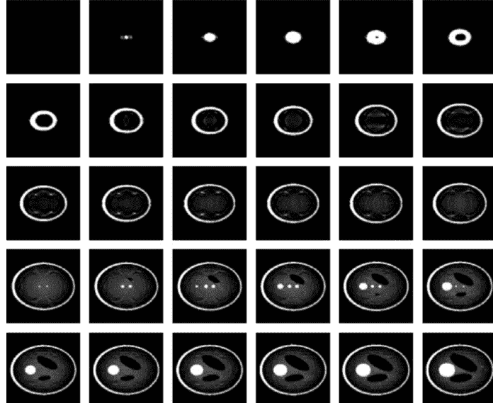

**图 11** 输出图像的代表性 2D 图像切片。

## 实验设置 157

```
$$\frac{\partial T}{\partial t} = \alpha \frac{\partial^2 T}{\partial x^2} + \frac{\partial^2 T}{\partial y^2}$$
```

**图 12** 2D 热导公式。

其中 $T$ 是温度，$t$ 是时间，$\alpha$ 是热扩散率，$x$ 和 $y$ 是网格中的点。为了解决这个问题，一种可能的有限差近似法如图 13 所示：

```
$$\frac{\Delta T}{\Delta t} = \alpha \frac{T_{i+1,j} - 2T_{i,j} + T_{i-1,j}}{\Delta x^2} + \frac{T_{i,j+1} - 2T_{i,j} + T_{i,j-1}}{\Delta y^2}$$
```

**图 13** 一种可能的有限差近似法。

其中 $\Delta T$ 是时间 $\Delta t$ 内的温度变化，$i, j$ 是网格中的索引。在启动时，会设置一个带有边界点和初始温度的网格，以及必须增量更新温度的内部点。每个内部点通过其邻居点和自身的之前的温度来更新其温度。更新步骤计算了与边界点的温度差，但每次迭代只能推进一个网格点；这意味着需要大量的迭代才能达到网格中所有点的稳态。

实现基于模板的温度更新的代码片段重现在图 14。使用的迭代次数为 20,000 次，网格大小从 $256 \times 256$ 增加到 $4096 \times 4096$。


为了使应用并行化，使用了 OpenACC 指令：在温度更新内核顶部插入 ``#pragma acc kernels``，并在每个循环前插入 ``#pragma acc loop independent``。`independent` 子句用于告诉编译器输入到 GPU 和输出数据之间没有循环依赖。添加 `copy` 和 `copyout` 子句来管理移动。图 15 中基础实现的性能分析结果显示，数据在每次迭代中都会往返传输。

传输成本很高，导致并行代码的执行时间比原始版本长。为了避免这种开销，在主循环周围添加了 `data` 指令；确保数据只在主循环前后传输。在所有循环完成后，`temp1` 中的数据而非 `temp` 需要从 GPU 传输到 CPU，此时 `temp1` 和 `temp` 进行了交换。在内核中，`copy` 和 `copyout` 子句被 `present` 子句取代，表示数据已经在 GPU 上，因此不需要任何数据移动。

图 16A 显示了应用数据优化后的 OpenACC 代码，图 17 显示了相应的性能。数据次数从 40,000 减少到 30,000（注：原文中的“30”可能是 30,000 的笔误）。为了方便比较，图 16B 显示相同内核的 CUDA 实现。

```
void step_kernel(int ni, int nj, float fact, float* temp_in, float* temp_out)
{
    // 遍历区域内的所有点（边界除外）
    #pragma acc kernels copyin(temp_in[0:ni*nj]) copyout(temp_out[0:ni*nj])

    #pragma acc loop independent
    for (j=1; j < nj-1; j++) {
        #pragma acc loop independent
        for (i=1; i < ni-1; i++) {
            // 点和邻居在线性内存中的索引
            i00 = I2D(ni, i, j); im10 = I2D(ni, i-1, j);
            ip10 = I2D(ni, i+1, j); i0ml = I2D(ni, j-1);
            ip01 = I2D(ni, j+1);
            // 计算导数
            d2dt2 = temp_in[im10]-2*temp_in[i00]+temp_in[ip10];
            d2ty2 = temp_in[i0ml]-2*temp_in[i00]+temp_in[ip01];
            // 更新温度
            temp_out[i00] = temp_in[i00]+tfac*(d2dt2 + d2ty2);
        }
    }
}

int main(int argc, char* argv[]) {
    for (istep=0; istep < nstep; istep++) {
        step_kernel(ni, nj, tfac, temp1_h, temp2_h);
        // 交换温度指针
        temp_tmp = temp1_h; temp1_h = temp2_h; temp2_h = temp_tmp;
    }
}
```

图 14 数据优化前的 2D 热方程 OpenACC 实现。

2D 热方程的执行时间：6.65 s

性能分析应用：`./unopt_heat_single_gpu 256 256 20000`

结果：

| Time(%) | Time | Calls | Avg | Max | Name |
| :--- | :--- | :--- | :--- | :--- | :--- |
| 44.84% | 1.4126s | 20000 | 70.11us | 80.92us | CUDA mem HtoD |
| 44.72% | 1.4087s | 20000 | 70.47us | 84.03us | CUDA mem DtoH |
| 10.44% | 328ms | 20000 | 16.437us | 17.216us | step_kernel_gpu |

图 15 优化前的 2D 热方程 OpenACC 版本性能分析。

```
void step_kernel(int ni, int nj, float fact, float* temp_in, float* temp_out) {
    // 遍历区域内的所有点（边界除外）
    #pragma acc presents(temp_in[0:ni], temp_out[0:nj])
    #pragma acc loop independent
    for (j=1; j < nj-1; j++) {
        #pragma acc loop independent
        for (i=1; i < ni-1; i++) {
            /* 找到点和邻居在线性内存中的索引 */
            i00 = I2D(ni, i, j); im10 = I2D(ni, i-1, j);
            ip00 = I2D(ni, i+1, j); i01 = I2D(ni, j-1);
            ip01 = I2D(ni, j+1);
            // 计算导数
            d2tdx2 = temp_in[im10]-2*temp_in[i00]+temp_in[ip10];
            d2ty2 = temp_in[i0ml]-2*temp_in[i00]+temp_in[ip01];
            // 更新温度
            temp_out[i00] = temp_in[i00]+tfac*(d2tdx2 + d2ty2);
        }
    }
}
```

图 16 数据优化后的 OpenACC 代码（接上部分）

```
int main(int argc, char* argv[]) {
#pragma acc data copy(temp1_h[0:(ni+2)*(nj+2)]) \
copyin(temp2_h[0:(ni+2)*(nj+2)])

    for (istep=0; istep < nstep; istep++) {
        step_kernel(ni, nj, tfac, temp1_h, temp2_h);
        // 交换温度指针
        temp_tmp = temp1_h; temp1_h = temp2_h; temp2_h = temp_tmp;
    }
}
```

(A)

```cpp
int main(int argc, char* argv[]) {
    // allocate temperature arrays on device
    cudaMalloc(void **)temp1_d, sizeof(double)*(ni+2)*(nj+2));
    cudaMalloc(void **)temp2_d, sizeof(double)*(ni+2)*(nj+2));

    // transfer temperature array from host to device
    cudaMemcpy((void *)temp1_d, (void *)temp1_h,
    sizeof(double)*(ni+2)*(nj+2), cudaMemcpyHostToDevice);
    cudaMempy((void *)temp2_d, (void *)temp1_h,
    sizeof(double)*(ni+2)*(nj+2), cudaMemcpyHostToDevice);
    for (step=0; step < nstep; step++) {
        step_kernel(ni, nj, tfac, temp1_h, temp2_h);
        // swap the temperature pointers
        temp_tmp = temp1_h; temp1_h = temp2_h; temp2_h = temp_tmp;
    }

    cudaMempy((void *)temp1_h, (void *)temp1_d,
    sizeof(double)*(ni+2)*(nj+2), cudaMemcpyDeviceToHost);
}
```

(B)

**图 16，续**

(B) 二维热方程的 CUDA 实现。

二维热方程的执行时间：0.86 s

--46185-- 性能分析程序：`./heat_single_gpu 256 256 20000 out.dat`

--46185-- 性能分析结果：

| 时间占比(%) | 耗 | 调用次数 | 平均 | 最小值 | 最大值 | 名称 |
|---|---|---|---|---|---|---|
| 99.93% | 327.35ms | 20000 | 16.368us | 15.999us | 17.056us | step_kernel_cpu_27_gpu |
| 0.04% | 142.94us | 2 | 71.471us | 71.359us | 71.584us | [CUDA memcpy HToD] |
| 0.02% | 70.879us | 1 | 70.879us | 70.879us | 70.879us | [CUDA memcpy DToH] |

图 17

数据优化后 OpenACC 版本二维热方程的性能分析结果。

## 混合 OpenMP/OpenACC

本节讨论了应用程序使用两个 GPU 的情况。图 18 展示了包含内容的程序细节。在此实现中，*ni* 和 *nj* 分别是网格的 *X* 和 *Y* 维度（不包括边界）。

如图 18 所示，网格沿 *Y* 维度被分为两部分，每部分将在一个 GPU 上运行。分解部分在边界处重叠，重叠区域被称为光晕区域（halo regions）。在计算开始时，初始温度存储在 `temp1_h` 中；更新温度后，新温度存储在 `temp2_h` 中。然后交换指针，以便内核在下一次迭代中指向当前的当前新温度。由于每个数据点在迭代都需要上一次迭代中相邻点的值，因此两个 GPU 需要通过高层指令或运行时库在不同的 GPU 之间交换数据。唯一的解决办法是手动将数据从一个设备传输到主机，图 19 展示了针对二维热方程的这种情况，其中 OpenACC 设备通过 CPU 交换光晕数据。

图 20 中的性能分析结果也证实了在每次迭代后都会通过 CPU 进行数据交换。由于不同的 GPU 使用网格中的部分数据，该特定数据的共享内存并未分配，而是只需要使用指针指向共享变量 `temp1_h` 和 `temp2_h` 的不同位置。如果 *tid* 是线程的 ID，那么该线程指向网格中位置 `tid*rows*(i+2)` 的指针（因为需要包含光晕区域），并且它需要将 `rows*(i+2)*(j+2)` 数据传输到目标设备上，其中 *rows* 等于 `nj/NUM_THREADS`。多 GPU 实现中更新温度的内核与单 GPU 版本中的完全相同。

图 21 显示了 OpenACC 和 CUDA 实现的性能分析结果。注意，它们的性能相似。OpenACC 实现的内核性能略于 CUDA 实现，这说明在翻译 OpenACC 内核时，OpenACC 编译器可能会应用 CUDA 编译器不具备的优化。图 22 比较了不同实现的性能。显然，单 GPU 上串行版本的执行时间总是慢的。当问题规模较小时，OpenACC 多核性能略优于 GPU 性能，但当问题规模较大时则逊于 GPU 性能。通过对比，我们发现当问题规模较小时存在细微差异，而使用多个 GPU 时性能显著提升。

图 23 显示了多核和 GPU 相比 CPU 的加速比。对于 4096×4096 的网格大小，使用两个 GPU 的加速比大约是单 GPU 实现的两倍。这是因为随着网格尺寸增大，计算量也之增加，光晕数据交换

```cpp
omp_set_num_threads(NUM_THREADS);
rows = nj/NUM_THREADS;
LDA = ni + 2;

// 主循环
#pragma omp parallel private(istep)
{
    float *temp1, *temp2, *tmp;
    int tid = omp_get_thread_num();
    acc set(tid, device);
    temp1 = temp1 + rows*LDA;
    temp2 = temp2 + rows*LDA;
    #pragma acc copy(temp1:(rows+2)*LDA)
    #pragma acc copy(temp2:(rows+2)*LDA)
    {
        for(istep=0; istep < nstep; istep++){
            step_kernel(ni+2, rows, tfac, temp1, temp2);
            /* 除最后一个以外的所有设备更新主机下光晕 */
            if(tid == NUM_THREADS-1)
                #pragma acc update host(temp2[rows:LDA]);
            /* 除第一个以外的所有设备更新主机上光晕 */
            if(tid != 0)
                #pragma acc update host(temp2[0:LDA]);
        } /* 所有线程在此同步以等待所有设备的数据 */
        #pragma omp barrier
        /* 除第一个以外的所有设备更新设备上光晕 */
        if(tid != 0)
            #pragma acc update device(temp2[0:LDA]);
        /* 除最后一个以外的所有设备更新设备下光晕 */
        if(tid == NUM_THREADS-1)
            #pragma acc update device(temp2[(rows+1)*LDA:LDA]);
        
        float tmp = temp1; temp1 = temp2; temp2 = tmp;
    } /* 更新最终结果到主机 */
    #pragma acc update host(temp1[LDA]);
}
```

图 18

使用 OpenMP/OpenACC 的二维热方程多 GPU 实现。

# 第 8 章 使用 OpenACC 进行模板（stencil）和 Feldkamp 算法

4798a278f62814c0b15c628d71d_183_0

图 19

使用 OpenMP/OpenACC 混合模型的二维热方程多 GPU 实现中的数据移动。

4798a278f62814c0b15c628d713_183_1

图 20

二维热方程多 GPU 实现的性能分析结果。

```
==6180== 性能分析程序：../cuda_multi_gpu 2 2048 20000 20000 cuda_multi_gpu.dat
==6180== 性能分析结果：
时间占比(%) | 耗 | 调用次数 | 平均 | 最小值 | 最大值 | 名称 |
97.67% | 18.6972s | 40000 | 467.43us | 463.84us | 471.61us | step_kernel
1.21% | 231.83ms | 40004 | 5.7950us | 5.2790us | 2.7339ms | [CUDA memcpy ToD] |
1.12% | 214.22ms | 40002 | 5.3550us | 5.0240us | 2.5606ms | [CUDA memcpy DH]
```

```
==6237== 性能分析程序：../cuda_multi_gpu 2 2048 20000 cuda_multi_gpu.dat
==6237== 性能分析结果：
时间占比(%) | 耗 | 调用次数 | 平均 | 最小值 | 最大值 | 名称 |
93.34% | 16.4935s | 40000 | 412.34us | 407.49us | 414.65us | step_kernel_cuda_42
1.41% | 239.50ms | 40008 | 5.9860us | 5.3110us | 2.1293ms | [CUDA memcpy ToD] |
1.24% | 210.75ms | 40004 | 5.2680us | 4.9600us | 2.5491ms | [CUDA memcpy DH]
```

图 21

多 GPU 上 OpenACC 和 CUDA 实现的比较。

## 总结

4798a278f62814c0b15c628d713_184_0

图 22

使用不同模型的二维热方程性能。

4798a278f62814c0b15c628d713_184_1

图 23

相比 CPU，多核和 GPU 的加速比仍然很小。因此，计算/通信率会增加；分解以利用多个 GPU 是非常有优势的。同样明显，针对多个 GPU 的 OpenMP/OpenACC 实现的性能与 CUDA 实现相当。

## 总结

OpenACC 是一种基于指令的编程模型，它可以生成适用于比 GPU 以外更多设备的可执行文件。这意味着应用程序科学家可以在维护单一代码库的同时，将应用程序移植到一系列计算设备上。这至关重要，因为遗留代码通常包含数百万行，每当设备架构变化时重写它们是不现实的。

此外，在 CUDA 或 OpenCL 等低级语言中重写这些代码既昂贵又耗时，而且在实际上并不可。


# 使用 OpenACC 加速 3D 波方程

本章展示了一些编码挑战，并引导读者使用 OpenACC 进行渐进式代码改进。读者会发现，所实现的性能取决于代码特性，这些特性可以通过性能分析工具（`profiler tools`）发现。根据我们的实验结果，我们得出结论：高层指令模型的高效实现加上用户引导的优化，能够产生与手写 CUDA 代码相同的性能。

## 参考文献

- Kák, A. C., & Slaney, M. (1988). Principles of computerized tomographic imaging. IEEE Press.
- Logan, B. F., & Shepp, L. A. (1975). Optimal reconstruction of a function from its projections. Duke Mathematical Journal, 42(4), 645-659. http://dx.org/10.1215/S0012-7094-75-04256-8, http://projecteuclid.euclid.dm/1077311339.
- Pullen, G. (2009). Cambridge CUDA course 25-27 http://www.many-core.group.cam.ac.uk/archive/CUDAcourse09.
- Tian, X., Xu, R., Yan, Y., Chandrasekhar, S., Eachempati, D., & Chapman, B. (2016). Compiler transformation of nested loops for GPGUs. Journal of Concurrency and Computation: Practice and Experience, 28(2), 537-556. Special issue on programming models and applications for multicores and many cores.
- Whitehead, N., & It-Florea, A. (2011). Precision and performance: Floating point and IEEE 754 compliance for NVIDIA GPUs. rm (A+B), 21, 1–1874919424.

## 使用 OpenACC 加速 3D 波方程

**Ty McKercher**

NVIDIA Corporation，德克萨斯州休斯顿，美国

本章的目的是学习如何使用 OpenACC 指令为 3D 有限差代码表示并行性。科学和工程领域常用有限差法来求解偏微分方程。在完成本章后，你将对以下内容有基本的理解：

- 有限差代码
- 如何将 OpenMP 代码转换为 OpenACC
- 剖析和分析有限差代码性能行为的实用技术
- 如何在 OpenACC 中使用统一内存（`Unified Memory`）
- 测试包括多核系统在内的迁移目标

## 引言

在本章中，你将使用数据驱动的方法来加速求解 3D 标量波方程的应用。这种方法可以用于各种科学领域，用于模拟波在各种介质中传播的代码。本章使用的代码示例源于圣路易斯华盛顿大学医学院高性能计算中心的《OpenMP 简要介绍》，其中包含了 C 和 FORTRAN 示例（Tobias, 2016）。

首先，你将使用 OpenMP 工具测量主机中央处理单元（CPU）的可扩展性，然后使用增强的 OpenACC 性能分析能力为多核主机或图形处理器（GPU）目标获得性能提升。为了最大化你的生产力，OpenACC 工具非常有帮助：

- 突出并行执行依赖关系
- 识别关键优化目标
- 测量代码强度区域（共同的内存带宽与浮点运算对比）

数据驱动的方法是一种迭代方法。在每次迭代中，你都使用增强的依赖分析来生成关键路径上函数的时间线。选择优化哪个函数是一个重要的步骤。如图 1 所示，运行最长的内核（`kernel`）并不总是最关键的优化目标（Harris, 2016）。

| | 5% | 40% |
|---|---|---|
| CPU | A | 等待 |
| GPU | Kernel X | Kernel Y |

**图 1** 尽管内核 X 运行时间最长，但它并不总是最关键的优化目标。内核 Y 消耗了更多时间。

虽然可以使用性能分析报告的图形界面（GUI）来更容易理解情况，但通过性能分析工具来测量代码强度区域（共同的内存带宽与浮点运算对比）是有帮助的。

### 求解 3D 波方程的示例代码：标量波方程

这种数学公式可以表示波在介质中传播的现象。不需要完全理解本节中的公式，但提供的细节有助于理解问题是如何求解的。本章中的示例使用笛卡尔坐标这种形式：

```
$$\frac{\partial^2\phi}{\partial x^2} + \frac{\partial^2\phi}{\partial y^2} + \frac{\partial^2\phi}{\partial z^2} = 0$$
```

其中 $\phi$ 表示随时间变化的函数。为了求解这个二阶方程，使用了以下一阶方程（时域有限差）：

```
$$\frac{\partial\phi}{\partial t} = g$$
$$\frac{\partial g}{\partial t} = \frac{\partial^2\phi}{\partial x^2} + \frac{\partial^2\phi}{\partial y^2} + \frac{\partial^2\phi}{\partial z^2}$$
```

其中 $f$ 代表分配给每个点的值，称为波场（Riffe, 2016）。换句话说，$g$ 告诉场如何在特定方向上变化。使用替换法会导致以下公式：

### 求解 3D 波方程的示例代码

本章使用的示例代码的结构可以通过图 2 中的伪代码进行总结：

- 初始化 x, y, z 数组
- 初始化 f 和 g 数组
- 分配 gp 数组
- 设置间距 dx, dy, dz 和时间步间隔 dt
- 对于 n 个时间步：
  - 计算预测器 fp
  - 计算边界条件 gp
  - 使用有限差法从预测器 fp 更新 gp
  - 使用 g 和 gp 的平均值更新 fp
  - 更新 f 和 g
- 结束

**图 2** 求解 3D 波方程示例的伪代码。

关于使用该算法的数值稳定性的重要说明：由于使用了有限差法来求解波方程，变量 `dt`（代表时间步）必须远小于 `dx`（代表网格大小），解才能收敛。如果你增加时间步而保持网格大小固定，或者在保持时间步固定的情况下增加网格大小，方法可能会不稳定。本章的源代码中包含一个验证程序，你可以在每次优化步骤后检查结果。如果你生成了错误的结果，运行有多快也没有用。

或许图 4 能够帮助你进一步理解这段代码片段，展示了如何使用两个波场数组 `g` 和 `fp` 来更新 `gp` 波场数组。`fp` 波场使用模板模式在每个时间步处叠加相邻元素的贡献。

```c
for (i=1; i<NX-1; i++) {
  for (j=1; j<NY-1; j++) {
    for (k=1; k<NZ-1; k++) {
      gp[i][j][k] = gp[i][j][k] + dt * (
        (fp[i+1][j][k]-2.0*fp[i][j][k]+fp[i-1][j][k])/dx +
        (fp[i][j+1][k]-2.0*fp[i][j][k]+fp[i][j-1][k])/dy +
        (fp[i][j][k+1]-2.0*fp[i][j][k]+fp[i][j][k-1])/dz
      );
    }
  }
}
```

**图 3** C 源代码说明了使用来自邻数组贡献的有限差分计算。

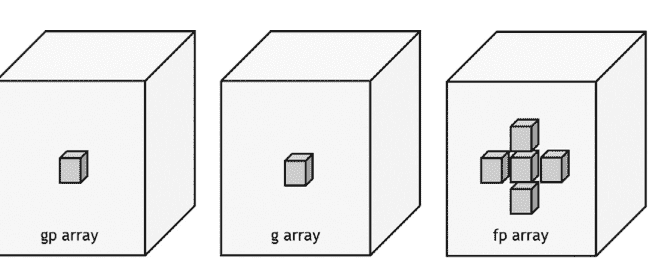

**图 4** 在更新 `gp` 波场期间，使用一个来自数组 `fp` 的模板来添加来自邻接元素的贡献。

## 将栈转换为堆

现在你已经查看了伪代码，你可能已经急于深入研究并加速这段代码。由于本章的原始 C 代码使用程序栈来存储数组，因此你应该先将代码转换为堆（主机内存中一个更大的自由浮空区域）进行分配。这将允许你尝试更大规模的问题，这在科学应用中是典型的。

在这一转换过程中，你将添加代码来接受来自命令行的输入，允许用户在运行时指定问题规模的维度以及仿真步数。这可以通过如图 5 所示的解析命令行参数来实现。

```c
#define NX 256
#define NY 256
#define NZ 256
#define NPESTE 500

int main(int argc, char *argv[]) {
    int i,j,k,n;

    int nx = NX;
    int ny = NY;
    int nz = NZ;
    int nsteps = NPESTE;

    if(argc > 4) {
        nx = atoi(argv[1]);
        ny = atoi(argv[2]);
        nz = atoi(argv[3]);
    }
    if(argc > 5) {
        nsteps = atoi(argv[4]);
    }
}
```

**图 5** 定义默认值并允许用户通过解析命令行参数指定问题维度。

一旦定义了问题规模，你现在就可以计算数组的字节大小，并使用 `malloc()` 系统调用从堆中动态分配内存。如图 6 所示，使用 `restrict` 关键字允许编译器在分析阶段更加激进，从而防止指针别名消除。

```c
size_t nbytes = nx * ny * nz * sizeof(float);

float *restrict x = (float*)malloc(nbytes);
float *restrict y = (float*)malloc(nbytes);
float *restrict z = (float*)malloc(nbytes);
float *restrict f = (float*)malloc(nbytes);
float *restrict g = (float*)malloc(nbytes);
float *restrict fp = (float*)malloc(nbytes);
if(x==0 || y==0 || z==0 || f==0 || g==0 || fp==0) {
    printf("couldnt allocate fields on the host!\n");
    return (-1);
}
```

**图 6** 使用 `malloc()` 从堆中动态分配内存。`restrict` 关键字在编译器分析阶段很有帮助，它可以指示指针位置没有别名。

接下来是从静态分配到动态堆分配的一个非常重要的部分。你必须定义 `OFFSET` 宏来计算 3D 数组索引，如图 7 所示。如果这样做不正确：

- 你的应用程序性能将由于数据访问效率低下而受影响
- 你的应用程序可能会产生错误结果

```c
#define OFFSET(i,j,k,width,depth) ((k*(width))*(j)+(i))

for (i=0; i<nx; i++) {
  for (j=0; j<ny; j++) {
    for (k=0; k<nz; k++) {
      int offset = OFFSET(i, j, k, ny, nz);
      x[offset] = -1.0f + (i)*dx;
      y[offset] = -1.0f + (j)*dy;
      z[offset] = -1.0f + (k)*dz;
    }
  }
}
```

**图 7** 为了高效访问数据，正确定义 `OFFSET` 宏至关重要。转换的最后一步是在退出程序前使用 `free()` 系统调用释放内存，如图 8 所示。

```c
free(x);
free(y);
free(z);
free(f);
free(g);
free(fp);
```

**图 8** 对于堆分配，需要在程序退出释放内存。

# 测量基准可扩展性

原始版本的代码包含 OpenMP 指令。这些指令提供了测量主机（CPU）可扩展性的机会，并用于确定基准性能。对于本章中的每个代码，都使用了 `timer.h` 来测量总运行时。

- Windows 系统：`QueryPerformanceCounter()`
- Linux 系统：`gettimeofday()`

## 创建 OpenMP 构建环境

为了从分析工具中获得最大的洞察，你需要修改 Makefile 以使用 OpenMP 编译器。本章将使用 PGI (Portland Group Inc.) 编译器以及相应的 PGProf 剖析。如图 9 所示，你应该使用的重要编译器开关有助于调试：`-Minfo=all,ccff`。添加 `ccff` 开关指示编译器使用编译器反馈格式在执行文件中存储额外信息：

- 实现了哪些代码优化
- 哪些代码优化未实现（以及为什么）
- 数据是如何访问的
- 过程之间的关系

```makefile
CC := pgcc
DEFINES := FP32
INCLUDES := -I.
OBJ := 0
EXE := out
APP := 3Dwave_omp_dynamic

NX := 944
NY := 944
NZ := 944
STEPS := 500

UNAME := $(shell uname -a)
ifeq $(findstring CYGWIN_NT,UNAME))
  DEFINES := WIN32
OBJ := obj
EXE := exe
else
endif

CCFLAGS := -D$(DEFINES) -fast -Minline -Minfo=all.ccff -mp

all: build run

build: $(APP).c
	$(CC) $(INCLUDES) $(CCFLAGS) -o $(APP).EXE $(APP)

run: $(APP).EXE
	export OMP_NUM_THREADS=8; $(APP).EXE $(NX) $(NY) $(STEPS)
	export OMP_NUM_THREADS=4; $(APP).EXE $(NX) $(NY) $(STEPS)
	export OMP_NUM_THREADS=1; $(APP).EXE $(NX) $(NY) $(STEPS)

verify: ../verify.$(EXE)
	../verify.$(EXE)

clean:
	@echo "Cleaning up..."
	rm -rf *.$(OBJ)
```

**图 9** 适用于 Linux 或 Windows 系统的 Makefile，包含构建、运行和验证目标。

## 编译 OpenMP 代码

Portland Group (PGI) 工具链包含一个与 Windows 或 Linux 交互的命令行。要编译 OpenMP 版本，在命令行中输入 `make build` 生成与图 10 类似的输出。`fast` 标志用于为目标平台生成最佳性能。

```bash
$ pgcc -I. -DF32 -fast -Minline -Minfo=all,ccff -mp -0 3Dwave_omp_dynamic.out
3Dwave_omp_dynamic.c
main:
  94, StartTimer inlined, size=2, file 3Dwave_omp_dynamic.c (32)
  104, Parallel region activated
  108, Parallel loop activated with static schedule
  110, Generated 2 alternate versions of the loop
  118, Barrier
  119, Loop not vectorized: data dependency
  128, Loop not vectorized: data dependency
  137, Loop not vectorized: data dependency
  147, Parallel loop activated with static schedule
  149, Generated 2 alternate versions of the loop
  169, Barrier
  170, Parallel loop activated with static schedule
  172, Generated 2 alternate versions of the loop
  180, Barrier
  181, Parallel loop activated with static schedule
  183, Generated vector sse code for the loop
  191, Barrier
  193, Parallel region terminated
  204, GetTimer inlined, size=10, file 3Dwave_omp_dynamic.c (51)
```

**图 10** 在 Linux 上使用 PGI C 编译器编译 OpenMP 版本的输出。

## 运行 OpenMP 代码


这些数据是从单个 Intel Haswell 的 CPU 插槽收集的，使用了 944x944x944 的 3D 网格大小，500 步的结果如表 1 所示。

## 使用 OpenACC 工具

表 1 使用 OpenMP 的扩展性结果（在 8 核、Intel CPU 插槽、E5-2698 v3, 2.30GHz 上运行）

| 网格 | 时间 (s) | 加速率 | 效率 (%) |
|---|---|---|---|
| 944 × 944 × 944 步: 500 | 1835.32 | 1.00x | 100.00 |
| OMP 线程 = 4 | 671.23 | 2.73x | 68.36 |
| OMP 线程 = 8 | 436.37 | 4.21x | 52.63 |

## 使用 OpenACC 工具

既然我们已经测量了基准性能，可以使用 OpenACC 工具针对基于 GPU 的加速器。你需要访问一个安装了 NVIDIA GPU 和 PGI 编译器的系统。对于本章节，我们在基于 Haskell 的系统中增加了一个单 NVIDIA™ Tesla® M40 24GB GPU 加速器，其具有 24GB 的 GDDR5 GPU DRAM 和 3072 个 Maxwell 核心。由于原始代码已针对 OpenMP 线程进行了并行执行分析，你可以确信相应的 OpenACC 指令对于对应的循环也是并行的。

## 添加 OpenACC 并行指令

在此阶段使用了两种类型的 OpenACC 并行指令：

- `#pragma acc kernels`
- `#pragma acc loop`

通过插入 `kernels` 指令，你表达了并行化区域内任何循环的意愿，并将分析的负担交给编译器。结合 `kernels` 指令，你可以在认为感兴趣且需要编译器进一步分析的循环之前添加 `loop` 指令。图 11 显示了使用 `kernels` 和 `loop` 指令的部分 C 代码。

`#pragma acc loop` 指令的额外子句包括：`independent`、`collapse(N)`、`gang` 和 `vector`。`independent` 子句告诉编译器代码是独立的，循环的每次迭代都是独立的，因此不会出现竞态条件或数组顺序问题。`collapse(N)` 子句将指示编译器将后续 N 个循环合并为一个扁平的循环。这有助于提高 GPU 占用率。`gang` 和 `vector` 子句允许你向编译器提供提示，以指定调度哪些并行资源。多个 `gang` 之间独立工作，并被调度以共享单个 GPU 的资源，如多处理器、缓存等。一个 `gang` 拥有一个或多个 `worker`，每个 `worker` 在一组 `vector` 线程上执行操作。`vector` 线程以同步步工作，使用相同的指令同时处理多个数据元素。这也被称为单指令多数据 (SIMD) 或单指令多线程 (SIMT) 计算风格。

```c
#pragma omp parallel private(i,j,k)
#pragma acc kernels
{
  // predictor
  #pragma omp for schedule(static)
  #pragma acc loop independent collapse(2) gang
  for (i=0; i<nx; i++) {
    for (j=0; j<ny; j++) {
      #pragma acc loop independent vector
      for (k=0; k<nz; k++) {
        int offset = OFFSET(i, j, k, ny, nz);
        fp[offset] = f[offset] + dt*g[offset];
      }
    }
  }

  // static boundaries
  #pragma acc loop independent collapse(2)
  for (j=0; j<ny; j++) {
    for (k=0; k<nz; k++) {
      int xbeg = OFFSET(0, j, k, ny, nz);
      int xend = OFFSET(nx-1, j, k, ny, nz);
      gp[xbeg] = g[xbeg];
      gp[xend] = g[xend];
    }
  }
}
```

图 11 添加 OpenACC 并行指令。

## 使用 OpenACC 并行指令进行编译

要针对 NVIDIA Tesla GPU，请按图 12 所示通过在编译标志中添加 `-acc -ta-tesla` 来修改 Makefile。你也可以看到针对特定目标的的额外选项。例如，你可以尝试使用 `fastmath` 编译选项。

```
UNAME := $(shell uname -a)
ifeq($(findstring CYWIN_NT, $(UNAME)), CYWIN_NT)
  CCFLAGS := -fast -Minline -Minfo-all -acc -ta-tesla:fastmath
else
  CCFLAGS := -fast -Minline -Minfo-all -acc -ta-tesla:fastmath,managed
endif
```

图 12 添加编译标志以目标 Tesla GPU。

这将生成利用硬件加速例程的代码，并侧重于性能的准确性，因此在使用此选项时，请额外注意验证结果是否正确。

## 统一内存（Unified Memory）

只要可能，你应该利用能够提高程序员生产力的自动化能力。统一内存（Unified Memory）正是如此，它是 Tesla 平台更动态的编程模型改进之一。通过统一内存，引入了按需分页（demand paging）支持，使得从单个托管池分配的内存可以在主机和 GPU 之间自动迁移。PGI 工具链将统一内存支持集成到 OpenACC 环境中。在适当条件下，你可以依赖底层系统来确保数据在正确的时间迁移到正确的内存中，而无需任何指定。

## 统一内存的优势

为了利用这一方便的功能，你需使用托管内存（managed memory）功能。统一内存正是如此，它是 Tesla 平台更动态的编程模型改进之一。通过统一内存，引入了按需分页支持，使得从单个托管池分配的内存可以在主机和 GPU 之间自动迁移。PGI 工具链将统一内存支持集成到 OpenACC 环境中。在适当条件下，你可以依赖底层系统来确保数据在正确的时间迁移到正确的内存中，而无需指定。

## 运行托管内存

基于 PGI 的托管内存功能仅支持 64 位 Linux 系统和 NVIDIA GPU。表 2 中的结果是从一个带有 Tesla M4 GPU（具有24GB GDDR5 内存和3072个 Maxwell 核心）的 Hasswell 系统运行 CentOS7.2 版本得出的。

表 2 在 Tesla M0 上添加 OpenACC 托管内存的性能对比

| 网格: 944 × 944 × 944 步: 500 | 时间 (s) | 加速率 | 效率 (%) |
|---|---|---|---|
| OMP 线程 = 1 | 1835.32 | 1.00x | 100.00 |
| OMP 线程 = 4 | 671.23 | 2.73x | 68.36 |
| OMP 线程 = 8 | 436.37 | 4.21x | 52.63 |
| OpenACC Tesla M0 托管内存 | 224.33 | 8.18x vs. HSW 1核 | 1.94x vs. HSW 8核 |

## 使用可视化分析器（Visual Profiler）分析托管内存

为了帮助你可视化底层系统如何自动迁移数据，可以在 Shell 中输入 `prof` 使用可视化分析器。这将启动基于 GUI 的分析器（假设你在访问远程系统时已正确配置了远程显示）。一旦可视化分析器启动，从 File 菜单中选择 New Session 项。在 Executable Properties 对话框中（如图 14 所示），确保勾选了以下框：

- Enable Unified Memory profiling（启用统一内存分析）
- Enable OpenACC profiling（启用 OpenACC 分析）

当你从 Executable Properties 对话框选择 Finish 按钮后，可视化分析器将收集性能指标，并生成类似于图 15 所示的时间轴图。

从时间轴图中可以，统一内存操作按以下顺序执行：

1. 在主机和 GPU 上分配内存。
2. 将数据从设备传输到主机（图 15 中的 DtoH 行）。

图 13 编译器信息报告已创建内核。

图 15 统一内存操作的时间轴。

## 可执行属性

设置可执行属性

| 执行超时 | 输入最大执行超时时间（秒）[可选] | 秒 |
|---|---|---|
| 启用性能分析并启动执行 | | |
| 启用内核分析 | | |
| 在时间线中启用 CUDA API 追踪 | | |
| 启用功耗、时钟和热剖析分析 | | |
| 启用统一内存分析 | | |
| 响应应用程序以收集事件和指标（多进程分析不支持） | | |
| 在 CPU 上进行执行分析 | | |
| 启用 OpenACC 分析 | | |
| 启用宿主机线程 API 追踪 | | |
| 运行引导分析 | | |

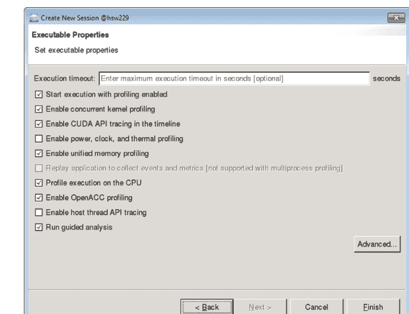

**图 14** 交互会话分析允许你显示统一内存分析信息。

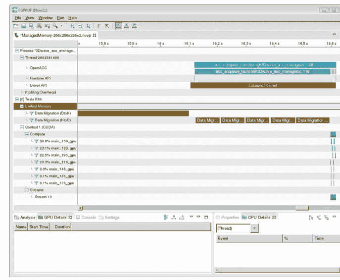

**图 15** pgprof 可视化分析器的时间线视图，显示了统一内存迁移。

- 1. main_116_gpu
- 2. main_159_gpu
- 3. main_183_gpu
- 4. main_195_gpu

## 使用 OpenACC 数据指令

看来每个内核在为内部数据区域计算结果上花费了足够的时间，因此你可以使用 OpenACC `async` 指令来重叠计算与通信。这部分留给读者练习。

## 使用 OpenACC 数据指令

在此阶段，你已经：

- 在 OpenMP 指令旁插入了 OpenACC 并行指令（prag）
- 通过 PGI 编译器管理选项使用统一内存来自动迁移数据
- 使用 pgprof 可视化分析器识别了冗余的数据拷贝

下一步是使用详细的编译器报告，这些报告指定了如何通过内存编辑数据，以指导你精确插入 OpenACC 指令。图 17 列出的指令显示了如何从此示例代码中显式提取数据。网格数据（在宿主机上初始化的 x、y 和 z 数组）和输入字段（在宿主机上初始化的 f 和 g 数组）已进行如下标注：

```c
#pragma acc enter data copy(x[0:nx*ny*nz], y[0:nx*ny*nz], z[0:nx*ny*nz])
#pragma acc enter data copy(f[0:nx*ny*nz], g[0:nx*ny*nz])
#pragma acc enter data create(fp[0:nx*ny*nz], gp[0:nx*ny*nz])

for (n=0; n<nsteps; n++) {
    step = step + dt;

    if ((n+1)%10==0)
        printf("step = %9.6f\n", step);

    #pragma omp parallel private(i,j,k)
    #pragma acc kernels
    {
        //预测器:
        #pragma acc loop independent schedule(static)
        #pragma acc loop independent collapse(2) gang
        for (i=0; i<nx; j++) {
            for (j=0; j<ny; j++) {
                #pragma acc loop vector
                for (k=0; k<nz; k++) {
                    int offset = OFFSET(i, j, k, nz);
                    f[offset] = f[offset] + dt * g[offset];
                }
            }
        }
    }
}
```

图 17 OpenACC 数据指令提供了对数据移动的显式控制，以避免冗余拷贝。

`copyin` 数据指令将在任何内核调用之前将数据从宿主机拷贝到设备上。传播器字段（fp, gp）用数据指令标注，该指令通过在设备上创建和访问数据来避免额外的拷贝。

## 使用 OpenACC 数据指令进行编译

在插入 OpenACC 数据指令后，记住在构建可执行文件之前从 Makefile 中移除 `managed` 编译器选项。对于 Tesla 架构应使用的关键编译器选项是：

`-tesla:pinned,fastmath`。`pinned` 编译器选项用于在宿主机和设备之间分配最大传输性能的内存。图 18 显示了 PGI 编译器的部分报告，说明了数据如何迁移以及如何生成内核。

```
- 98. Generating enter data copyin(f[:nz*(ny*)],g[:nz*(ny*)])
- 98. Generating enter data copyin(x[:nz*(ny*)],y[:nz*(ny*)],z[:nz*(ny*)])
- 99. Generating enter data create(fp[:nz*(ny*)],gp[:nz*(ny*)])
- 117. Allocator restriction: size of the GPU copy of fp is unknown
- Generating copyin(f[:nz*(ny*)])
- Generating copyout(f[:nz*(ny*)])
- Generating copyin(g[:nz*(ny*)])
- Accelerator kernel generated
- Tesla code
- 114. #pragma acc loop vector(collapse 2) /blockidx.x threadidx.y
- 115. /* blockidx.x threadidx.y */
- 117. #pragma acc loop vector(32) /* threadidx.x */
- 126. Loop is parallelizable
- 127. Allocator restriction: size of the GPU copy of g is unknown
- Generating copyin(g[:nz*(ny*)])
- Generating copyout(g[:nz*(ny*)])
- Generating copyout(gp[:nz*(ny*)])
- Accelerator kernel generated
- Tesla code
- 126. #pragma acc loop gang, vector(128) collapse(2)/blockidx.x threadidx.x*/
- 127. /* blockidx.x threadidx.x collapsed */
```

图 18 使用 OpenACC 数据指令的 PGI 编译器详细报告。

## 使用 OpenACC 分析

现在你已经插入了 OpenACC 数据指令，可以使用 pgprof 可视化分析器检查数据迁移，如图 19 所示。如果你将图 19 与图 15（见“Visual Profiler”部分）进行比较，你会发现冗余的数据迁移已被移除。

## 使用 OpenACC 数据指令

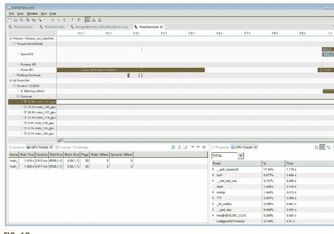

图 19 使用 OpenACC 数据指令的可视化分析器时间线。

## 使用 OpenACC 数据指令运行

一旦构建了了 GPU 目标，你应该能够复制表 3 中的性能结果（收集自带有 24GB GPU 内存的 Tesla M40 系统）。请注意，使用 OpenACC 数据指令测量的性能比单 8 核 Haswell CPU 快了 2 倍以上。这表明在适当条件下，可以通过插入 OpenACC 并行指令来获得性能提升。

表 3 在 Tesla M40 上添加 OpenACC 指令的性能对比

| 网格：944×944×944 步数：500 | 时间 (s) | 加倍率 | 效率 (%) |
|---|---|---|---|
| OMP threads = 1 | 1835.32 | 1.00x | 100.00 |
| OMP threads = 4 | 671.23 | 2.73x | 68.36 |
| OMP threads = 8 | 436.37 | 4.21x | 52.63 |
| OpenACC Tesla M40 托管内存 | 224.33 | 8.18x vs. HSW 1-core 1.94x vs. HSW 8-core | |
| OpenACC Tesla M40 数据指令 | 214.92 | 8.54x vs. HSW 1-core 2.03x vs. HSW 8-core | |

## 第9 章 使用 OpenACC 加速 3D 波方程

为了测量一致的运行时间，你可能需要显式设置 Tesla GPU 的应用时钟模式。为了减少默认自动模式的动态时钟调整，可以使用以下命令查询并显式设置应用时钟：

- `nvidia-smi --help-supported-clocks`
- `nvidia-smi --query-supported-clocks --mem --format=csv`
- `nvidia-smi --query-supported-clocks --gr --format=csv`


- 启用持久模式，这将无论 GPU 程序是否在运行都保持 `nvidia` 驱动加载，并维持请求的应用时钟
  - `nvidia-smi --pm 1`
- 为了复制本章的 Tesla M40 结果，可以使用以下命令设置应用时钟：
  - `nvidia-smi -ac 3004,1063`
    - 3004 MHz = 内存时钟（mem，最大 M40 内存时钟）
    - 1063 MHz = 图形核心频率（gr，比最大 M40 核心频率低两级）

## 使用 OpenACC 针对多核系统

通过使用一组 OpenACC 编译器指令，你可以编写整洁、可移植的代码，编译器生成的二进制文件可以在多核宿主机系统以及 GPU 加速器上运行。通过 OpenACC 指令，你向编译器表达并行化区域的意图。OpenACC 编译器会自动处理创建内核、管理数据并针对特定的加速架构做出资源调度决策细节。

## 为 OpenACC 多核编译

要针对多核系统，你需要为 PGI 编译器指定 `ta=multicore -tp=haswell` 编译器选项，如图 20 中的 Makefile 列表所示。

```makefile
UNAME := $(shell uname -a)
if ($(findstring CYGWIN_NT,$(UNAME)),CYGWIN_NT))
  CCFLAGS := -fast -Minline -Info-all -acc ta-multicore -tp=haswell
else
  CCFLAGS := -fast -Minline -Info-all -acc ta-multicore -tp=haswell
Endif
```

图 20 使用 OpenACC 指令和编译器为 Intel Haswell 多核系统生成代码。

图 21 显示了仅使用一组 OpenACC 指令使用多核选项（无 OpenMP 指令）的编译器输出。

# 使用 OpenACC 目标多核系统

```
114, Loop is parallelizable
    Generating Multicore code
114, #pragma acc loop gang
115, Loop is parallelizable
117, Accelerator restriction: size of the GPU copy of f,fp is unknown
    Generated  alternate versions of the loop
126, Loop is parallelizable
    Generating Multicore code
126, #pragma acc loop gang
127, Accelerator restriction: size of the GPU copy of g,gp is unknown
136, Loop is parallelizable
    Generating Multicore code
136, #pragma acc loop gang
137, Accelerator restriction: size of the GPU copy of g,gp is unknown
146, Loop is parallelizable
    Generating Multicore code
146, #pragma acc loop gang
147, Accelerator restriction: size of the GPU copy of f,gp is unknown
157, Loop is parallelizable
    Generating Multicore code
157, #pragma acc loop gang
158, Loop is parallelizable
181, Loop is parallelizable
184, Accelerator restriction: size of the GPU copy of f,fp,gp is unknown
    Generated 2 alternate versions of the loop
193, Loop is parallelizable
    Generating Multicore code
193, #pragma acc loop gang
```

图 21 使用 OpenACC 指令的详细编译报告，以及目标为多核系统的编译选项。

## 在 OpenACC 多核系统上运行

性能对比请见表 4，其中基于 OpenACC 的二进制文件是在具有双路 CPU 的 Intel Haswell 系统上测量的。为了与 OpenMP 进行公平比较，使用 Linux 的 `numactl` 工具将 CPU 核心数限制在八个核心。你可以使用 `numactl --hardware` 命令查询系统并列出可用的 NUMA（非统一内存访问）节点。

```bash
numactl --hardware
```

要将进程绑定到特定 NUMA 节点的特定核心（例如，NUMA 节点 0 和核心 0–7），你可以使用：

```
numactl --cpunodebind=0 --physbindcpu=0,1,2,3,4,5,6,7 <program> <arguments>
```

# 第 9 章 使用 OpenACC 加速 3D 波方程

表 4 性能对比、添加 OpenACC 数据指令以及目标为 Haswell 多核系统

| 网格: 944x944x944 时间线程: 500 | 时间 (s) | 加速率 | 效率 (%) |
|---|---|---|---|
| OMP 线程 = 1 | 1835.32 | 1.00x | 100.00 |
| OMP 线程 = 4 | 671.23 | 2.73x | 68.36 |
| OMP 线程 = 8 | 436.37 | 4.21x | 52.63 |
| OpenACC Tesla M40 管理内存 | 224.33 | 8.18x vs. HSW 1核 1.94x vs. HSW 8核 | |
| OpenACC Tesla M40 数据指令 | 214.92 | 8.54x vs. HSW 1核 2.03x vs. HSW 8核 | |
| OpenACC 多核使用 8核 Haswell | 371.74 | 4.93x vs. HSW 1核 | 61.71 |

## 总结

在本章中，你学习了如何通过分析驱动的方法来加速 3D 有限差代码。你将指令从 OpenMP 转换为 OpenACC，并通过增强的依赖关系分析工具识别了关键路径的优化目标。从栈分配到堆分配的关键转换，使你能够利用统一内存，并利用底层系统自动在主机和 GPU 之间迁移数据。你利用详细的编译报告指导了 OpenACC 指令的精确插入。最后这一转换让你能够通过指定 GPU 和多核目标来利用 OpenACC 的可移植性。一组简单的指令，结合强大的 OpenACC 工具链，为你的示例代码带来了显著的性能提升。

## 参考文献

- Harris, M. (2016). CUDA 8 features revealed. April, https://devlogs.nvidia.com/parallelfor/cuda-8-features-revealed/
- Riffe, M. (2016). 3D wave equation and plane waves/3D differential operators. April, http://www.physics.usca.edu/riffe/3750/Lecture%2018.pdf.
- Tobias, M. (2016). A brief introduction to OpenMP. April, https://www.mir.wustl.edu/Research/Support-Facilities/Center-for-High-Performance-Computing-CHPC/For-Researchers/A-very-Brief-Introduction-to-OpenMP/

# 第 10 章 OpenACC 应用的详细开发

Andy Herdman, Wayne Gaudin, Oliver Perks
AWE plc, Reading, United Kingdom

本章描述了将 OpenACC 指令模型应用于 CloverLeaf 微型程序的逐步方法，以及增量性能增益和阻碍性能的问题，最终实现了该程序的完全驻留、混合多 GPU 版本。尽管本章主要讨论了使用 Cray 编译环境和 Cray XK6 硬件平台的开发，但作者认为在章节结束时，读者将对以下内容有基本的理解：

- OpenACC 实现
- 如何使用多个 GPU
- 分析代码比单核心运行得更快
- 异步数据传输的使用
- 开发 OpenACC 实现
- 使用 OpenACC 消除不需要的数据传输

## 介绍 CloverLeaf 流体力学方案

CloverLeaf 由 AWE 和华威大学合作，是 Mantevo 测试套件的一部分，是一个求解能量、质量和动量守恒方程的显式微型程序。方程在二维网格上求解。每个网格存储三个量：能量、密度和速度向量。

程序的每个周期包含两个步骤：(i) 拉格朗日步使用预测-校正方案推进解，单元随流体移动而发生变形；(ii) 平流步用于将单元恢复到原始位置。平流程序根据“风”（材料流）的方向计算更新，并在 x 和 y 方向上扫描以进行更新。使用较大的临时 2D 数组允许网格中的所有单元并行更新。

## 测试用例

整个研究使用了一个简单但不对称的测试问题。该问题由两个理想气体区域组成；一个高密度高能量区域与一个低密度低能量区域相邻。随着模拟的进行，一个激波形成并渗透到低密度区域。

## OpenACC CloverLeaf 的开发

最初，在问题规模为 0.25 万（500² 单元格）的情况下创建了 0.5µs 的模拟时间。这提供了一个较快的周转时间，但它仍然长到足以视为主要负载。随着代码的精炼和改进，同一模拟使用了更大的单元格数量，以最大化利用能够放入中央处理器（CPU）核心并随后放入节点的大小。这些细节将在本章节的相关点进行详细说明。

## 开发平台：Cray XK6

Chile Pine 是一台 XK6，配备了 40 个 AMD 16 核 Opteron 6272 Interlagos 处理器。每个计算节点拥有一个这样的 Opteron 6272 CPU 加上一个 NVIDIA X2090 图形处理器（GPU）。每个节点拥有 32 GB 的 1600MHz 双倍数据速率（DDR3）内存，为 CPU 提供支持。XK 利用“Cray Gemini 网络”（Gemini）作为互连。Opteron 6272 CPU 在“Bulldozer 模块”级别共享资源。也就是说，构成一个“模块”的核心可以访问共享的浮点单元（FPU）。该 FPU 有两个 128 位流水线，可以合并为一个 256 位流水线，其中容纳单条 256 位矢量扩展（AVX）指令。这每个时钟周期仅提供四次双精度浮点运算（FLOPs）。然而，AMD 确实有一个 256 位的融合加法时钟周期。Chile Pine 中的 Opteron 时钟频率为 2.1 GHz，相当于总的 CPU 峰值性能 10.75 teraflop/s（TFlops）。默认的 Fortran 和 C 编译器是 CCE 版本 8.0.7（尽管对于本研究，使用了 Cray 发布的 CCE 8.1.0.157 版本），所选的 MPI 是通过 Cray 的 xt-mpi 5.5 版本的 MPICH2。

## OpenACC CloverLeaf 的开发

本节描述了逐步步进的方法，以及在将 OpenACC 指令模型应用于 CloverLeaf 微型应用程序时固有的增量性能收益和问题，最终产生了一个完全驻留的多 GPU 版本应用程序。

CloverLeaf 包含了计算密集型代码的 C 和 Fortran 实现。Fortran 版本是本研究的基础和目标；C 实现是随后在开发出完全优化的 Fortran 代码后制作的。这是出于两个原因：首先，AWE 开发的大多数应用程序基于 Fortran，从行业角度来看，深入了解获取 Fortran 源代码并在 GPU 架构上进行加速所需的问题和过程具有极高价值。其次，在开发期间，Cray 侧重于在其 CCE 编程环境中对 OpenACC 的 Fortran 实现；因此，Fortran 相比其 C 实现提供了更成熟的工具集和更强大的支持。

OpenACC 指令的实现得益于这一点，因为 CloverLeaf 已经实现了一种基于 OpenMP 的共享内存并行化方案。这立即识别出了需要应用 OpenACC 来加速的区域。然而，显而易见，这并不意味着简单地添加或替换 OpenMP 指令为 OpenACC 就能获得合适的加速代码。最终，用于生成加速版本的加速内核数量和应用的 OpenACC 指令总结如下：

- 14 个唯一内核
- 25 个 ACC 数据结构
- 121 个 ACC 并行+循环区域
- 4 个循环
- 12 个 ASYNC
- 4 个 Update host
- 4 个 Update device

后续章节详细说明了应用于代码的渐进方法，以产生高效的加速 OpenACC 版本。第一步是识别那些计算密集型或热点的子程序或内核。

## 热点

使用简单的性能分析器，表 1 显示了 CloverLeaf 的平坦单 CPU 剖析。这六个计算密集型的子程序或内核占据了代码执行时间的几乎 95%。在此基础上，这些内核被设定为初始加速的目标。

表 1 CloverLeaf CPU 剖析

| 子程序 | 运行时间 |
| :--- | :--- |
| advec mom | 41.79 |
| advec cell | 20.54 |
| Pdv | 12.72 |
| calc dt | 9.06 |
| Accelerate | 5.32 |
| Viscosity | 5.24 |

## 单个内核的加速

后续章节详细说明了应用于代码的渐进方法，以产生高效的加速 OpenACC 版本。第一步是识别那些计算密集型或热点的子程序或内核。

# 第 10 章 OpenACC 程序的详细化开发

```fortran
PROGRAM main
<stuff>
!$acc data &
!$acc copy(r,s,t)
!$acc copyin(u,w)
!$acc copyin(x,y,z)
!$acc copyout(a)
CALL CloverLeaf
!$acc end data
END PROGRAM
```

```fortran
SUBROUTINE kernel_A
<stuff>
!$acc data &
!$acc present(r,s,t)
!$acc copyout(r)
!$acc parallel
DO k
!$acc data &
!$acc present(u,v,w)
!$acc copyout(u)
!$acc parallel
SUBROUTINE kernel_B
<stuff>
!$acc data &
!$acc present(x,y,z)
!$acc copyout(x)
!$acc parallel loop
DO k = y_min, y_max
DO j = x_min, x_max
!<stuff>
END
END
!$acc end parallel loop
!$acc end data
!$acc end data
<stuff>
END SUBROUTINE kernel_C
```

图 4 伪代码：使用 OpenACC 实现数据驻留性。

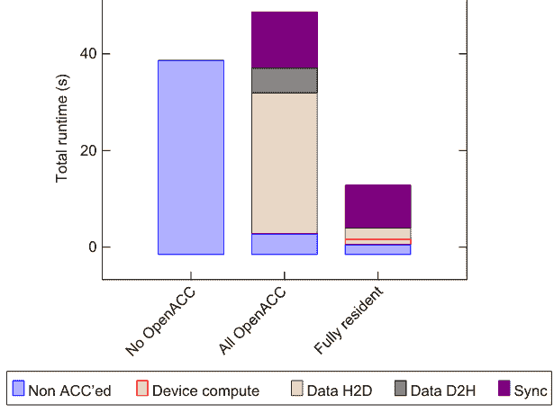

图 5 驻留内核时间的细分。

## 增大问题规模


适中的 500² 问题规模在 GPU 上的执行时，相比等效 CPU 实现了 3.01 倍的增益。图 6 显示了这一点，以及 960²、2048³ 和 4096⁶ 规模下的情况，其相对于 CPU 的相对性能增益分别为 4.91、5.82 和 5.76。正如预期，随着问题规模的增加，数据传输的运行时间百分比有所减少。事实上，对于 4096⁶，问题数据传输仅占了 5.07%，而 500² 则为 18.24%。

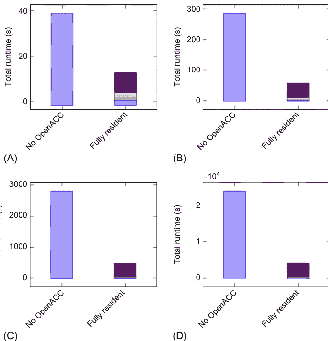

图 6：问题规模的增加：(A) 500，(B) 960，(C) 2048 和 (D) 4096。

对于足够大的问题，GPU 的性能正接近 Opteron CPU 上非加速串行代码性能的 6 倍。

# 混合型 MPI/OpenMP 的比较

从表面上看，加速代码相比原始非加速代码提高了六倍，听起来是一个巨大的增益。然而，这是将整个 X2090 GPU 的性能与单个 Open 核心的性能进行比较。更现实的比较是与使用 Openor 插槽上所有核心所能实现的性能进行比较。

在研究期间，混合 MPI/OpenMP 版本的 CloverLeaf 最佳性能是通过 8 个 MPI 任务、1 个 OpenMP 线程以及每个 Bulldozer 模块一个线程实现的。墙时间为 43.52s，而 GPU 为 58.03s；倍数为 0.88。

相比串行实现的六倍增长可能看起来很有吸引力，但如果 CPU 上的分布式并行实现优于加速 GPU，那么基于 GPU 的架构就不再具有如此大的吸引力。在返回并解决这一性能差距之前，需要启用 OpenACC 版本的代码在多个 GPU 上执行。

## 混合型 MPI/OpenACC

为了实现在多个 GPU 上执行，CloverLeaf 的 OpenACC 构建被扩展为使用 MPI。这要求每个 GPU 完全驻留在其计算区域的分区内，并在每个子区域之间实现传统的“影数据”（halo data）交换方案。

在实践中，我们首先从关联的 GPU 更新最新的影数据，使用 MPI 在相邻 CPU 之间通信这些数据，最后由每个关联的 GPU 从其 CPU 主机获取更新后的影数据。图 7 显示了如何使用 OpenACC `update` 指令来实现。这产生了一个完全分布且加速的 CloverLeaf 微型程序版本。

# 版本 A：初始性能

称为版本 A，这个初始的、完全分布且加速的版本被视为分析性能的起点。图 8 显示了代码初始 MPI 版本的强性能特性。图表分别对应一个 Interlagos CPU 核心、一个 Interlagos 插槽以及 1–6 个 GPU。

提取的关键点如下：

- 一个 X2090 GPU 的速度是一个 Interlagos 核心速度的 5.97 倍。
- 一个 X2090 GPU 的速度是一个 Interlagos 插槽速度的 0.88 倍。
- 多 GPU 扩展在利用 6 个 GPU 后发生转折。

为了查看这些初始数据是否可以改进，理解这些性能数据至关重要。

# OpenACC CloverLeaf 197 开发

```
SUBROUTINE exchange
!acc data &
!acc present(snd_buffer)
!acc parallel loop
DO k = y_min_dpth, y_max_dpth
  DO j = 1, dpth
    <pack snd_buffer>
  ENDDO
ENDDO
!acc end parallel loop
!acc update host(snd_buffer)
!acc end data
CALL MPI_RECV(rcv_buffer)
CALL MPI_ISEND(snd_buffer)
CALL MPI_WAITALL
!acc data &
!acc present(rcv_buffer)
!acc update device(rcv_buffer)
!acc parallel loop
DO k = y_min_dpth, y_max_dpth
  DO j = 1, dpth
    <unpack rcv_buffer>
  ENDDO
ENDDO
!acc end parallel loop
!acc end data
END SUBROUTINE exchange
```

图 7：伪代码：混合 MPI/OpenACC。


图 8：多 CPU 和 GPU 的版本 A 性能。此外，循环带有“标记”，表示在线程之间分布。相关对话：

# OpenACC CloverLeaf 199 开发

| | |
| :--- | :--- |
| G----< !$acc parallel loop | Ftn-6405: ACCEL=advec_cell90, Line=93 |
| G--< DO k= y_min, y_max | 从第93行到第99行的区域被放置在加速器上 |
| G3< DO j= x_min, x_max | Ftn-6430: ACCEL=advec_cell90, Line=94 | 从第94行的循环在线程块和128个线程之间分布 |
| G3< <stuff> | Ftn-6411: ACCEL=advec_cell90, Line=95 | 从第95行的循环将串行执行 |
| G3< ENDD0 | |
| G----< ENDD0 | |
| G----< !$acc parallel loop | |
| Accelerated - partitioned | |

图 10：advec cell 版本 A。从第94行的循环在线程块和128个线程之间分布。这两个语句和循环标记都是预期的结果，表示每个线程都在处理自己的循环计数器。此外，内部循环的消息显示：“从第95行的循环将串行执行”。这表明 j 在线程之间分布，且所有线程在同一时间迭代 j——这并不是预期的结果。依赖关系需要被解决，或者至少对于 advec cell 的每次迭代，计算了质量和体积。这些更新后的值随后在同一个循环中使用。通过将循环分成两个可以很容易解决这种依赖关系。计算并发送这些更新后的值。一旦实现了更新后的列表（图 11），内部循环现在正确地在线程之间分布。图 12 显示了从 -2s 到 -2s 的 advec。此修改版本与图 13 中的版本 A 进行比较。

```
G----< !$acc parallel loop
G--< DO k= y_min, y_max
G3-< DO j= x_min, x_max
G3-< <stuff>
G3-< ENDD0
G----< ENDD0
G----< !$acc end loop
```

| | |
| :--- | :--- |
| Ftn-6405: ACCEL=advec_cell90, Line=93 | 从第93行到第99行的区域被放置在加速器上 |
| Ftn-6430: ACCEL=advec_cell90, Line=94 | 从第94行的循环在线程块和128个线程之间分布 |
| Ftn-6411: ACCEL=advec_cell90, Line=95 | 从第95行的循环将在128个线程之间分布 |

图 11：advec cell 版本 B 的代码列表。

# 200 第 10 章 OpenACC 程序的详细化开发

| Time% | Time | Calls | Function |
| :--- | :--- | :--- | :--- |
| 100.0% | 66.375613 | 415631.0 | Total |
| 100.0% | 66.375607 | 415629.0 | USER |
| 29.2% | 19.304030 | 4000.0 | [advec_mom_kernel_ACC_SYNC_WAIT@li.216 |
| 19.3% | 12.785222 | 1000.0 | [timestep_ACC_SYNC_WAIT@li.51 |
| 17.9% | 11.913856 | 4000.0 | [advec_cell_kernel_ACC_SYNC_WAIT@li.240 |
| 6.5% | 4.327830 | 4300.0 | [advec_mom_kernel_ACC_COPY@li.216 |
| 3.7% | 2.444010 | 1000.0 | [accelerate_kernel_ACC_SYNC_WAIT@li.101 |
| 3.3% | 2.165092 | 2000.0 | [advec_cell_kernel_ACC_COPY@li.240 |
| 3.0% | 1.907699 | 4000.0 | [advec_mom_kernel_ACC_COPY@li.68 |
| 1.9% | 1.276888 | 1000.0 | [adv_kernel_ACC_SYNC_WAIT@li.133 |
| 1.6% | 1.033906 | 2000.0 | [advec_kernel_ACC_SYNC_WAIT@li.137 |
| 1.5% | 1.019408 | 4000.0 | [timestep_ACC_COPY@li.51 |
| 1.5% | 0.986405 | 2000.0 | [advec_cell_kernel_ACC_COPY@li.58 |

图 12：版本 B 的平面分析。

# 版本 C：嵌套循环和全局变量

图 12 说明了 advec mom 现在主导了运行时间。评估列表中的循环标记显示，包含多层嵌套的循环没有被加速。

## OpenACC CloverLeaf 201 的开发

通过拆分嵌套循环，只有一个循环没有按照预期进行分区。对于这个未分区的循环，可以通过在 `!acc loop` 构造结构中添加 OpenACC 向量类（vector class），强制其在所有线程之间调度。

图 14 展示了原始的嵌套循环结构及其重构后的加速伪代码。重构后的代码使 `adop mem` 内核时间从 19s 降到 8s，如图 15 的重新分析分析所示。图 15 还显示了 `timestep` 例程现在主导了运行时间。查看与 `timestep` 相关的列表文件可以发现，该内核仅在单个 GPU 线程上执行。

```
DO k = y_min, y_max
DO j = x_min, x_max
<flux stuff>
ENDDO
!acc end parallel loop
!acc parallel loop
DO k = y_min, y_max
DO j = x_min, x_max
<mass stuff>
ENDDO
!acc end parallel loop
!acc parallel loop
!acc loop vector!acc end parallel loop
```

```
!acc parallel loop
DO k = y_min, y_max
DO j = x_min, x_max
<flux stuff>
ENDDO
DO j = x_min, x_max
<mass stuff>
ENDDO
DO j = x_min, x_max
<vel stuff>
ENDDO
ENDDO!acc end parallel loop
```

(A) (B)

图 14：`adop mem` 的嵌套和重构的伪代码：(A) 版本 B 和 (B) 版本 C。

原因可以追溯到全局变量的使用。由于所有线程都有写入这些全局变量的可能，编译器采取了保守的方法，仅允许在单个线程上调度内核。全局变量在 `timestep` 内核中用于返回包含迭代中最小时间步值的单元格 (i,j,k) 坐标。在功能上，通过使用 Fortran 内生函数 `MINLOC` 可以保留这一点，而不需要全局变量。

版本 C 的组成部分扁坦化分析（图 16）显示 `timestep` 内核的执行时间从 13s 减少到不足 1s。

## 第10 章 202 一个 OpenACC 程序的详细开发

| Time% | Time | Calls | Function |
| :--- | :--- | :--- | :--- |
| 100.0% | 48.804243 | 44761.0 | 总计 |
| 100.0% | 48.804243 | 44729.0 | USER |
| 26.4% | 12.874175 | 1000.0 | timestep_ACC_SYNC_WAIT@li.51 |
| 16.6% | 8.094541 | 4000.0 | advec_mom_kernel.ACC_SYNC_WAIT@li.247 |
| 9.8% | 4.794964 | 2000.0 | advec_cell_kernel_ACC_SYNC_WAIT@li.236 |
| 8.9% | 4.328033 | 4000.0 | advec_mom_kernel.ACC_COPY@li.247 |
| 5.0% | 2.442117 | 1000.0 | accelerate_kernel.ACC_SYNC_WAIT@li.101 |
| 4.4% | 2.164465 | 2000.0 | advec_cell_kernel_ACC_COPY@li.238 |
| 4.0% | 1.969379 | 4000.0 | advec_mom_kernel.ACC_COPY@li.68 |
| 2.6% | 1.278651 | 1000.0 | jdv_kernel_ACC_SYNC_WAIT@li.133 |
| 2.1% | 1.034398 | 2000.0 | jdv_kernel_ACC_SYNC_WAIT@li.137 |
| 2.0% | 0.985912 | 2000.0 | advec_cell_kernel_$ACC_COPY@li.58 |
| 2.0% | 0.972801 | 4000.0 | timestep_$ACC_COPY@li.51 |

图 15：带有重构的 `advec mom` 的扁坦化分析。

| Time% | Time | Calls | Function |
| :--- | :--- | :--- | :--- |
| 100.0% | 48.804243 | 44731.0 | 总计 |
| 100.0% | 48.804243 | 44729.0 | USER |
| 26.4% | 12.874175 | 1000.0 | timestep_ACC_SYNC_WAIT@li.51 |
| 16.6% | 8.094541 | 4000.0 | advec_mom_kernel.ACC_SYNC_WAIT@li.247 |
| 9.8% | 4.794964 | 2000.0 | advec_cell_kernel_ACC_SYNC_WAIT@li.236 |
| 8.9% | 4.328033 | 4000.0 | advec_mom_kernel.ACC_COPY@li.247 |
| 5.0% | 2.442117 | 1000.0 | accelerate_kernel.ACC_SYNC_WAIT@li.101 |
| 4.4% | 2.164465 | 2000.0 | advec_cell_kernel_ACC_COPY@li.238 |
| 4.0% | 1.969379 | 4000.0 | advec_mom_kernel.ACC_COPY@li.68 |
| 2.6% | 1.278651 | 1000.0 | jdv_kernel_ACC_SYNC_WAIT@li.133 |
| 2.1% | 1.034398 | 2000.0 | jdv_kernel_ACC_SYNC_WAIT@li.137 |
| 2.0% | 0.985912 | 2000.0 | advec_cell_kernel_$ACC_COPY@li.58 |
| 2.0% | 0.972801 | 4000.0 | timestep_$ACC_COPY@li.51 |

图 16：版本 C 的扁坦化分析。

图 17 增加了版本 C 的计算，包含了重构的嵌套循环和全局变量的移除。与版本 B 相比，现在单 GPU 执行中观察到性能提升。但在多个 GPU 上，性能提升仍然有限。


图 17：版本 C性能对比。

## 版本 D：多 GPU，减少传输

为了理解为什么加速器的扩展性限制在几个 GPU 上，需要确定多 GPU 执行的瓶颈。感兴趣的第一个区域是 CPU 和 GPU 之间的数据传输。取决于涉及的变量，空间分解需要不同深度的边界交换。默认情况下，MPI 分布代码设置了所有变量的深度。该默认深度匹配最坏情况。由于 MPI 通信开销是阶跃函数而非线性增长，通信额外的一层数据是可以忽略不计的。然而，在分布式 GPU 上运行时，任何边界交换都需要从 GPU 传输到主机内存进行 MPI 通信，而接收 GPU 需要从主机内存传输新数据。

如前所述，到 GPU 的 PCIe 数据传输是一个主要瓶颈，因此任何数据传输的减少都应该是有利的。考虑到这一点，代码仅交换需要的数据。有助于这一点的是 CEE 版本 8.1.0.165 文明的 `ACC_DEBUG` 环境变量。该变量有三个设置级别。每个级别都提供了关于数据如何在 GPU 之间传输的信息。

启用 `ACC_DEBUG` 环境变量显示加速内核中存在与边界交换数据无关的意外传输。虽然尺寸较小（2376 字节），但输出显示 Fortran 定义类型正在被传输并分配到 GPU 上。进一步调查发现，该定义类型的标量组件正被加速内核利用，并且为了将其放置在 GPU 上，发生了整个定义类型的隐式拷贝。通过创建本地标量并将定义类型的相应字段复制到本地标量，停止了这种隐式拷贝。

实施这两项更改的微程序版本 D 的最终性能如图 18 所示。尽管这是一个显著改进，但多 GPU 的扩展性仍然较低，4 个 GPU 需要 63.57s，而 6 个 GPU 需要 67.01s。


图 18：版本 D性能对比。


## 版本 E：“ACC SYNC WAIT”

图 19 显示了版本 D 的分析。现在主导的是许多具有 `ACC SYNC WAIT` 开销的例程。进一步调查发现，所有例程的共同点是它们在 GPU 上分配数据。

通过在“实现 GPU 完全驻留”节中描述的调用树相同高层预分配临时数组，并执行到设备的初始数据拷贝，通过子程序参数传递相关数组，可以多次重用设备内存。这消除了检查数据是否存在的需要，并抵消了通过分配在设备上创建它的需要。

图 20 原始分配方法和实施的分析位置的伪代码。图 21 显示了版本 E 的新代码分析（实施了预分配）。这显示了实施预分配消除了 `ACC SYNC WAIT` 开销。

## OpenACC CloverLeaf 205 的开发

| Time% | Time | Calls | Function |
| :--- | :--- | :--- | :--- |
| 100.0% | 37.151994 | 44761.0 | 总计 |
| 100.0% | 37.151988 | 44729.0 | USER |
| 21.8% | 8.103623 | 4000.0 | `idpv_kernel_ACC_SYNC_WAIT@li.132` |
| 12.9% | 4.797556 | 2000.0 | `advec_mom_kernel_ACC_WAIT@li.236` |
| 8.6% | 2.297533 | 2000.0 | `advec_mom_kernel.ACC_COPY@li.451` |
| 6.6% | 2.478886 | 1000.0 | `accelerate_kernel.ACC_SYNC_WAIT@li.101` |
| 5.8% | 2.160784 | 2000.0 | `advec_cell_kernel_ACC_COPY@li.236` |
| 3.5% | 1.965759 | 4000.0 | `advec_mom_kernel.ACC_COPY@li.68` |
| 3.4% | 1.276887 | 1000.0 | `jdv_kernel_ACC_SYNC_WAIT@li.133` |
| 3.4% | 1.261867 | 1000.0 | `timestep_ACC_SYNC_WAIT@li.51` |
| 2.8% | 1.034047 | 2000.0 | `jdv_kernel_ACC_SYNC_WAIT@li.137` |
| 2.7% | 0.985090 | 2000.0 | `advec_cell_kernel_$ACC_COPY@li.58` |
| 2.6% | 0.976743 | 4000.0 | `timestep_$ACC_COPY@li.51` |

图 19

版本 D：ACC SYNC 方法。

```
SUBROUTINE advec_mom(a,b)
REAL ALLOCATE(:)) :_flux

ALLOCATE(node_flux(xmin:ymax))
!$ acc data_create(node_flux)
!$ acc parallel loop
DO k = y_min, y_max
DO j = x_min, x_max
    <flux stuff>
END DO
END DO
!$ acc parallel loop
!$ acc end data(a,b)
DEALLOCATE(node_flux)
 SUBROUTINE
```

```
SUBROUTINE advec_mom(node_flux,b)
REAL DIMENSION(xmin,ymax) :node_flux

!$ acc data present(node_flux)
!$ acc parallel loop
DO k = y_min, y_max
DO j = x_min, x_max
    <flux stuff>
END DO
END DO
!$ acc parallel loop
!$ acc end data
 ENDROUTINE
```

(A)

()

图 20 预分配和后分配的：(A) 版本和 (B) 版本 E。

图 21

版本 E 的扁坦化分析。

将版本 E 的运行时添加到之前版本的图表中（图 22）中，可以看到代码的加速版本有了显著提高。事实上，在单块 GPU 上，版本 E 的总周转时间比初始版本 A 改进了 67%。

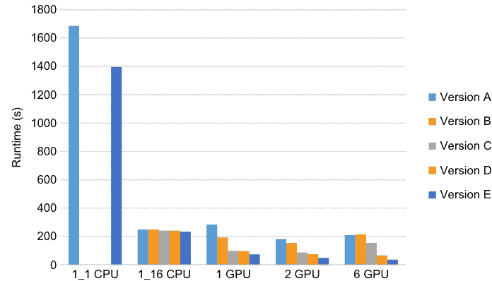

图 22 E 性能对比。

版本 A 的初始性能：

- 单块 X2090 GPU 的速度是单个 Interlagos CPU 的 5.97 倍
- 单块 X2090 GPU 的速度是单个 Interlagos 插槽的 0.88 倍
- 在利用 6 个 GPU 后，多 GPU 扩展性出现瓶颈

版本 E 的相同指标现在为：

- 单块 X2090 GPU 的速度是单个 Interlagos CPU 的 19.34 倍
- 单块 X2090 GPU 的速度是单个 Interlagos 插槽的 4.91 倍
- 在利用 6 个 GPU 时，多 GPU 扩展性仍然保持扩展性

Opteron 的 TDP 为 115W，X2090 的 TDP 为 225W，这意味着在相同功耗下，X2090 的性能提升了 2.5 倍以上。

# GPU 优化对 CPU 的影响

一个有趣且相关的旁证是观察仅在 CPU 上运行时，版本 A 和版本 E 的相对性能。请记住，这两个版本中进行的所有优化都旨在改进/修复对 GPU 性能不利的因素。然而，比较单 CPU 性能时，版本 E 比版本 A 改进了 17% 以上。

# OpenACC CloverLeaf 207 的开发

当像图 23 那样比较每个版本性能的派生指标时，这种提升更为巨大。虽然版本 A 达到了尚可的 652 MFLOPS（图 23A），但版本 E（图 23B）增加到了 1 GFLOPS 以上。这种增加来自于 L1 缓存利用率（提升高达 2.3 倍），现在每个操作数的平均使用次数为 4.164 次。

| | | | | |
| :--- | --- | --- | --- | --- |
| 总计 | | | 100.0% |
| 时间% | | | | |
| 时间 | | | 52.054641 secs |
| 阻存时间% | | | -- secs |
| 计算 | | 107.656 /sec | 5640.4 calls |
| PAPI_L1_DCM | | 72.452M/sec | 3771478858 refs |
| PAPI_TLE_DCM | | 63.664 /sec | 3314 misses |
| PAPI_L1_DCA | | 104.638M/sec | 5433901142 refs |
| PAPI_FP_OPS | | 652.652M/sec | 3397378141 refs |
| 每次调用平均 | | | 0.009289 secs |
| Crayat 开销：时间 | | | 52.055 secs 100.0% cycles |
| 硬件 FP Ops / 用户时间 | | 652.65M/sec | 3397378141 ops 3.9%peak(OP) |
| 硬件 FP Ops / MCT | | 0.31 ops/cycle | 0.63 ops/ref |
| 计算强度 | | | | |
| MFLOPS (总计) | | 652.6M/sec | | |
| TLE 利用率 | | 1639908.48 refs/miss | 32025 avg uses |
| D1 缓存命中/缺失率 | | 93.1% hits | 6.9% misses |
| D1 缓存利用率（缺失） | | 14.41 refs/miss | 1.801 avg hits |

(A)

| | | | | | |
| :--- | --- | --- | --- | --- | --- |
| 总计 | | | 100.0% | | |
| 时间% | | | | | |
| 时间 | | | 31.776925 secs | | |
| 阻存时间% | | | -- secs | | |
| 计算 | | 220.725 /sec | 7014.0 calls | | |
| PAPI_L1_DCM | | 32.501M/sec | 1032780862 misses | | |
| PAPI_TLE_DCM | | 73.386/sec | 2332 misses | | |
| PAPI_L1_DCA | | 108.638M/sec | 3440309287 refs | | |
| PAPI_FP_OPS | | 1032.789M/sec | 2819200474 ops | | |
| 每次调用平均 | | | 0.004530 secs | | |
| Crayat 开销：时间 | | | | 0.1% | | |
| 用户时间（约） | | | 31.777 secs | 6673204821 cycles 100.0% cycles | | |
| 硬件 FP Ops / 用户时间 | | 1032.789M/sec | 3281900474 ops 6.1%peak(OP) | | |
| 硬件 FP Ops / MCT | | 1032.79M/sec | | | | |
| 计算强度 | | 0.49 ops/cycle | 0.95 ops/ref | | | |
| MFLOPS (总计) | | 1032.79M/sec | | | | |
| TLE 利用率 | | 142758096.48 refs/miss | 28814 avg uses | | | |
| D1 缓存命中/缺失率 | | 97.0% hits | 3.0% misses | | | |
| D1 缓存利用率（缺失） | | 33.31 refs/miss | 4.164 avg hits | | | |

(B)

图 23

派生指标：(A) 和 (B) 版本。

# 多 GPU 可扩展性

在之前的版本的图表（图 22）中添加版本 E 的运行时，显示代码的加速版本有了显著提高。事实上，在单块 GPU 上，版本 E 的总周转时间比初始版本 A 改进了 67%。


图 22 E 性能对比。

版本 A 的初始性能：

- 单块 X2090 GPU 的速度是单个 Interlagos CPU 的 5.97 倍
- 单块 X2090 GPU 的速度是单个 Interlagos 插槽的 0.88 倍
- 在利用 6个 GPU 后，多 GPU 扩展性出现瓶颈

版本 E 的相同指标现在为：

- 单块 X2090 GPU 的速度是单个 Interlagos CPU 的 19.34 倍
- 单块 X2090 GPU 的速度是单个 Interlagos 插槽的 4.91 倍
- 在利用 6 个 GPU 时，多 GPU 扩展性仍然保持扩展性

Opteron 的 TDP 为 115W，X2090 的 TDP 为 225W，这意味着在相同功耗下，X2090 的性能提升了 2.5 倍以上。

# GPU 优化对 CPU 的影响

一个有趣且相关的旁证是观察仅在 CPU 上运行时，版本 A 和版本 E 的相对性能。请记住，这两个版本中进行的所有优化都旨在改进/修复对 GPU 性能不利的因素。然而，比较单 CPU 性能时，版本 E 比版本 A 改进了 17% 以上。

# OpenACC CloverLeaf 207 的开发

当像图 23 那样比较每个版本性能的派生指标时，这种提升更为巨大。虽然版本 A 达到了尚可的 652 MFLOPS（图 23A），但版本 E（图 23B）增加到了 1 GFLOPS 以上。这种增加来自于 L1 缓存利用率（提升高达 2.3 倍），现在每个操作数的平均使用次数为 4.164 次。

# 第 10 章 OpenACC 应用的详细开发


这种结构使我们能够有一套针对 CPU 和一个针对 GPU 的代码库。然而，通过较新版本的 PGI 编译器，现在有了使用 OpenACC 代码目标 CPU 的功能。目前你必须使用不同的目标来构建二进制文件，多核针对 CPU 线程。然而，这可以使用与 GPU 变体相同的源代码来实现，从可维护性的角度来看这非常有益。

OpenACC 由于其语言的描述性，为差异提供了完美的框架。在 CloverLeaf 的 OpenACC 部分，我们使用 Kernels 结构，并将每个循环标记为“循环独立”，这在处理嵌套循环时特别有效。OpenACC 的描述性允许我们陈述这一点，而不对其执行方式做出任何限制。我们只是说明循环迭代可以并行处理，而无需担心放置。这意味着编译器可以根据此信息自由决定如何生成线程代码。

通过采用 OpenACC 代码知道内核中存在足够的并行性，以值得在 GPU 上处理。

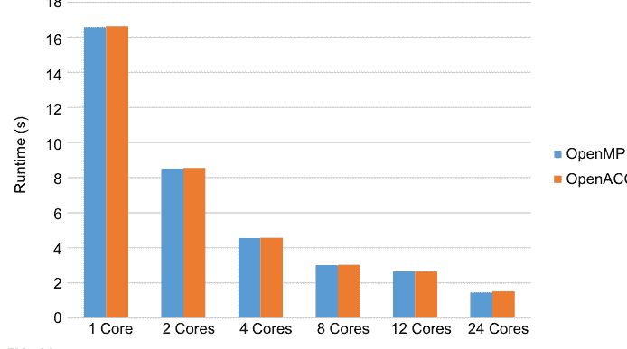

图 26 CloverLeaf 960² own OpenMP/OpenACC 对比。

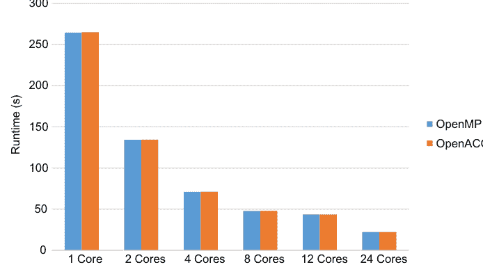

图 27 CloverLeaf 3840² 的 OpenMP/OpenACC 对比。

## 异构计算

这种新能力能够允许从完全相同的源代码编译出两个二进制文件，一个针对 GPU，另一个针对 CPU。

当在节点的 GPU 上运行 OpenACC 代码时，CPU 通常处于空闲状态。当我们展望未来的“胖”节点（fat nodes）时，例如 OpenPower 系统，这将导致一种巨大的资源浪费。理想情况下，我们希望利用节点上的所有资源，并使用同一个二进制文件来实现。

使用 MPI 运行时配置，我们可以将它们作为同一个作业的一部分运行，使用一个 MPI rank 运行一个二进制文件，使用另一个 MPI rank 运行另一个二进制文件。

这允许我们同时针对节点上的目标设备和节点上的 GPU。

在 CloverLeaf 内部，两个分区之间的通信在 MPI 内部处理，使用专用的缓冲区，在其他情况下，两个 rank 都可以独立进展。

使用 OpenACC 时，数据数组存储在 GPU 上，这意味着通信缓冲区需要在 GPU 上填充，然后用 GPU 数据进行更新。

这意味着 MPI rank 可以通信这些缓冲区，这些缓冲区被用于更新主数据数组，无论是在 CPU 版本还是带有 OpenACC 版本的 GPU 版本中。

这里显而易的问题是双插槽 CPU 与 GPU 版本之间的自然负载均衡。

在测试中，我们看到插槽 CPU 和 GPU 版本之间有大约 4 倍的性能差异。这表明，如果我们利用所有资源，我们可能会获得大约 20% 的性能提升。

然而，我们仍然需要为 OpenACC rank 分配一些 CPU 资源——以驱动 GPU。因此，我们预期的性能提升低于此值——可能为 10%。

这是一个理想场景。目前，CloverLeaf 中的分解方案为每个 MPI rank 分配了等量的工作。然而，在我们的异构方案中，相对于性能差异，我们将分配大部分比例的数据分配给 GPU。

作为一个微型应用（mini-app），CloverLeaf 足够灵活，我们能够实现一种由输入数据驱动的新型分解方案。允许用户只需说明问题集中多大比例的问题应分配给问题的每个 MPI rank。

虽然令人难以置信，这允许我们原型化一种特定硬件的负载均衡。目前，CloverLeaf 中的负载均衡是静态的；但它将作为更复杂代码动态负载均衡的递归器。

在带有 NVIDIA K20 的 Nehalam X5650（双六核插槽）上进行测试，运行 CloverLeaf 3840 版本（PGI 15.7, OpenMPI 1.8.1）。

| CPU 时间 (2MPI)x6 OpenMPI | 64.9s |
| GPU 时间 (1MPI) | 19.6s |

我们最好的异构版本是 4 个 MPI rank 的配置，1 个用于 GPU，3 个用于 CPU。每个 CPU rank 都关联了 3 个 OpenMP 线程，总计 1 个 GPU 核心和 9 个 CPU 核心。我们找到的最佳负载均衡配置是将 82% 的问题分配给 GPU，然后剩余 3 个 CPU rank 中的每个获得 6% 的问题域。

| 1 GPU, 3 MPIx3 OpenMP—0.82 0.06 | 17.9s |
| 0.06 0.06 | |

## 第 11 章 GPU 加速的分子动力学聚类分析

（C. Liu 等人，2016; Perilla, Hadden, Mayne, & Schulten, 2016; Zhao 等人 2013），细菌的传感器阵列（Cassidy 等人，2015），以及其他无法通过实验成像结构确定方法的光合膜。十年前，分子动力学（MD）模拟分析软件的性能需求（Stone 等人，2016）刚刚开始成为分子科学家考虑的重大因素。今天，通过最先进算法与领先计算平台相结合实现的长时间模拟，给研究人员带来了严峻挑战，他们必须高效地分析数百 TB 的轨迹数据。

图形处理器（GPU）等加速器是先进超级计算平台性能的主要来源，因此现代模拟和分析工具已经过调整，利用此类加速器来处理关键算法。MD 模拟工具的性能通常由几个已知的计算和力时间积分算法决定，这导致只有少数计算内核是性能关键的。相比之下，模拟准备和可视化涉及非常多的算法，这些算法通常具有高度的用户定制性，以适应特定研究项目的独特需求，导致有大量的内核需要优化以利用 GPU 或加速器。

作为一个代表，由作者开发的分子可视化和分析工具 VMD（Humphrey, Dalke, & Schulten, 1996）包含约百万行用 C++ 编写的代码，以及同样数量用 Tcl 和 Python 等高级脚本语言编写的代码。大多数支持加速器的广泛算法构成了挑战；使用 CUDA (Nickolls, Buc, Garland, & Skadron, 2008)、OpenCL (Stone, Gobara, & Shi, 2010) 或 ISPC (Pharr & Mark, 2012) 等高级多数据语言编写并维护手编码的加速器内核是不现实的；同样，在 SSE、AVX 或 VSX 中进行低级单指令手编码也是如此。在 VMD 的案例中，虽然许多分析和可视化算法已经适配了加速器（Stone, Hardy, Ufitsev, & Schulten, 2010; Stone, McGee, Israelewit, & Schulten, 2014; Stone 等人，2016），但仍有许多算法等待适配。针对加速器的新算法层出不穷。OpenACC、OpenMP 和其他基于指令的并行程序方法提供了一种有趣的途径，通过利用编译器技术、并行运行时系统和加速器硬件的最新进展，将大量现有应用代码低成本适配到带有 GPU 和其他加速器的异构计算平台。

### MD 聚类分析概述

MD 模拟产生了一系列分子系统的结构快照，被称为“轨迹”，可以对其进行分析以发现发现感兴趣的模式（Freddolin, Harrison, Liu, & Schulten, 2010; Rajan, Freddolino, & Schulten, 2010）。由于支配 MD 模拟的物理原理，系统会采样局部自由能最小值附近的分子构象系综，并且通常在相邻的低能阱之间观察到转换（见图 1）。确定极小值的构象对于研究蛋白质动力学以及阐明分子结构与生物学功能之间的联系至关重要。例如，在蛋白质折叠过程中，在达到标准折叠之前会观察到多个中间态。识别这些中间态提供了有关与阿尔茨海默病和疯牛病等疾病相关的蛋白质错误折叠的重要信息（Freddolino 等人，2010）。同样，在实空间确定蛋白质结构时（Goh 等人，2016），确定模拟产生的具有统计学意义的模型是至关重要的（Goh 等人，2015）。

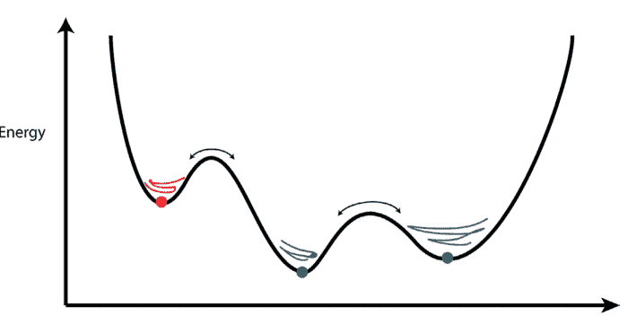

**图 1** 由 MD 模拟采样的底层分子自由能景观示意图。分子沿着反应坐标在局部低能阱之间来回转换，如*黑色箭头*所示。*实心圆点*表示每个能量阱的代表性构象。

使用聚类分析对 MD 轨迹进行结构化分类，可以系统地确定具有独立局部自由能阱的构象。聚类分析是一种无监督机器学习技术，尝试根据邻近性或相似性概念对数据进行意义分组（Reynolds, Richards, de la Iglesia, & Rayward-Smith, 2006）。在 MD 模拟背景下，分子构象由三维空间中的点阵列表征，每个点标记了分子中原子的位置。因此，衡量构象间差异的常用方法是均方根偏差（RMSD），公式如下

```
$RMSD_{i,j} = \sqrt{\frac{1}{N} \left[\sum_{k=1}^{N} (x_k - y_k)^2 \right]}$
```

$S$ 是分子中选定原子的数量。尽管 RMSD 在严格意义上不是指标（例如，它不符合三角不等式），但它简洁地捕捉了构象之间的差异。在 MD 模拟中，相似的特征产生较小的 RMSD 值（$<1.5 \text{\AA}$），而差异大的特征则会被惩罚。例如，除了 RMSD 外，还提出了其他方法来表征特征（Perilla 等人，2015）。如前，现代超级计算机的巨大力量能够处理大规模数据集（Stone 等人，2016）。

### 聚类算法

聚类算法主要分为两类：层次类和划分类，它们的主要区别在于确定簇的方式。凝聚类以自下而上的方式工作，从小的类形成较大的类，而划分类则采用自上而下的方法。合并或划分簇的决定根据特定标准做出。另一方面，划分类将数据组织成不重叠的组。这些方法要求用户指定簇的数量，记为 $k$。根据此参数，迭代优化对于使用的划分方法特定的目标函数，以获得最终的 $k$ 个分组（Reynolds 等人，2006）。

### 使用 QCP 快速计算成对 RMSD

计算 RMSD 的常用方法通常使用一种已知的结构对齐算法来执行成对对齐（Kabsch, 1976, 1978），然后通过公式 (1) 的直接算法实现计算得到的 RMSD。这种方法非常适用于可视化比较（即在这些情况下希望将两个结构重叠以进行进一步分析），以及其他需要对两个结构进行重叠的情况。然而，在计算聚类分析所需的 RMSD 差异矩阵时，确定最佳拟合旋转以及随后的原子坐标变换会产生不必要的工作。

存在一种性能更高的备选替代方法，该方法基于 Theobald 的二次特征多项式（QCP）方法（Theobald, 2005）。QCP 可用于计算最小 RMSD，而无需确定最优旋转并对齐结构对（Theobald, 2005）。需要注意的是，QCP 同样能够计算最优旋转（P. Liu 等，2010）。QCP 方法利用了旋转的四元数表示的特殊属性以及 4 x 4 “键”矩阵的特征多项式。为了求解最小 RMSD，QCP 使用牛顿-Raphson法求解 4 x 4 矩阵的最正特征值，并用该特征值计算最小 RMSD。QCP 中开销最大的计算是求解 QCP 算法的 4 x 4 矩阵计算（Kneller, 2011；P. Liu, Agrafotis, & Theobald, 2011）。幸运的是，通过我们在后续描述的某些改进，4 x 4 矩阵的计算非常适合细粒度并行计算，并受益于 GPU 的高内存带宽。QCP 牛顿-Raphson求解器非常适合在 GPU 线程或 SIMD 向量单元中实现。算法 1 所示的伪代码总结了质心估计和平移预处理步骤，以及 QCP 4 x 4 矩阵构建循环，我们将针对 OpenACC 指令对其进行并行化。

### 原子选择与轨迹数据结构

任何大型软件应用在算法并行化时面临的挑战是，数据需要在计算期间采用特定的布局以实现最高效的访问。由于 VMD 被广泛用于可视化以及结构准备和模拟分析，其内部数据结构的设计是为了便于包含数百万原子或其他粒子的大型分子场景的实时渲染。VMD 以结构体数组（AOS）格式存储原子坐标数据，交错存储 x、y 和 z 坐标，这是现代高性能图形 API（如 OpenGL）所需的内存组织形式。为了在 SIMD 单元上使用 QCP 计算 RMSD 时获得最佳性能，最好将原子坐标重构为结构数组（SOA）格式的结构数组，这使得对任意大小向量的加载和操作变得简单直接。

VMD 允许选择分子结构中的任何原子子集，使分析操作能够关注特定的感兴趣区域。聚类分析的原子选择通常是稀疏的，通常包含形成蛋白质骨架的所谓 $\alpha$-碳。$\alpha$ 碳经常用于选择蛋白质中氨基酸的位置，这是聚类分析中一种自然的原子选择。由于 VMD 等分子工具通常按照化学顺序排列原子来存储分子结构，$\alpha$ 碳出现在坐标数组中，所选 $\alpha$ 碳之间会有 5–12 个原子。为了便于计算差异矩阵 RMSD 时涉及的性能密集型循环，最好将稀疏的原子坐标选择压缩为具有单位步长访问的数组。

QCP 算法中必须执行的预处理步骤之一是对每个结构进行平移，使其质心位于原点。在已知满足该标准的情况下，无需进一步平移。为了便于计算差异矩阵 RMSD 时涉及的性能密集型循环，最好将稀疏的原子坐标压缩为具有单位步长访问的数组。

```
算法 1 结构对的 QCP RMSD 计算
1: 对于 $l = 1$ 到 $S$ [遍历结构 A]
2:   计算质心
3:   结束循环
4: 对于 $l = 1$ 到 $S$ [遍历 A 中的原子]
5:   平移原子使其质心位于原点
6:   结束循环
7: 对于 $l = 1$ 到 $S$ [遍历结构 B]
8:   计算 B 的质心
9:   结束循环
10: 对于 $l = 1$ 到 $S$ [遍历 B 中的原子]
11:   平移原子使其质心位于原点
12:   结束循环
13: 对于 $l = 1$ 到 $S$ [遍历 A 和 B 中的原子]
14:   计算 QCP 内积和
15:   结束循环
16: 牛顿-Raphson迭代通过内积和解出 RMSD
17: 返回 RMSD
```

### 差异矩阵计算

为了优化整体差异矩阵计算的性能，我们合并了上述三个预处理步骤，使得原子选择、SOA 内存布局转换以及质心计算都在单次遍历中完成。最后的质心平移单独进行一次遍历，因为在知道质心相对于原点的偏移之前无法进行。我们还将原子坐标填充到硬件 SIMD 大小的整数倍上，以实现内存加载存储对齐的高性能方案。

虽然在时间和内存使用上优化数据布局具有开销，但对于轨迹帧数 N 和选定原子数 S，其复杂度为 $O(N * S)$。该开销在 $O(N^2 * S)$ 差异计算的轨迹帧访问过程中被完全摊销。算法 2 所示的伪代码概述了差异矩阵计算中的关键循环和组成算法步骤。

```
算法 2 为空轨迹计算 RMSD 差异矩阵
1: 对于 $i = 1$ 到 $N$ [遍历轨迹帧]
2:     将每帧的空间原子选择转换为紧凑 SOA 坐标数组
3:     从寄存器中的坐标值计算质心
4:     结束循环
5: 对于 $i = 1$ 到 $N$ [遍历轨迹帧]
6:     平移每帧使其质心位于原点
7:     结束循环
8: 对于 $j = 1$ 到 $N$ [遍历轨迹帧]
9:     对于 $i = 1$ 到 $S$ [遍历选定原子]
10:    累加 QCP 调整矩阵组件 A 和 E0
11:    结束循环
12:    执行牛顿-Raphson迭代从 A 和 E0 解出 RMSD
13:    RMSD, $\=$ RMSD
14:    结束循环
15: 结束循环
16: 返回 RMSD
```

### 硬件架构考虑

最先进的微处理器（无论是 CPU、GPU 还是其他加速器）共享许多用于高性能计算（HPC）的宏观属性。它们由包含多个处理器核心和 SIMD 算术单元的处理器组成，以提供其他方式无法实现的极高吞吐量。由于在设计时优先考虑的负载类型不同，这一领域在处理器设计中存在显著的变异。因此，程序员必须设计其算法，通过利用许多处理器核心以及不同宽度和能力的 SIMD 向量单元来涵盖这种硬件变异性。

应用程序本身在算术操作性能与内存操作性能之间也存在巨大鸿沟。现有的商用 CPU、GPU 和其他加速器提供的算术性能通常比其可实现的带宽高一到两个数量级。例如，在 Blue Waters (Mendes, 2014) 和 Titan (Joubert, 2015) 超计算机上加速的 NVIDIA Tesla K20X GPU 可达到 1.3TFLOPS 双精度算术吞吐量和 3.9TFLOPS 单精度算术吞吐量，但带宽仅为 250GB/s（ECC 解码）。Tesla K20X 的双精度吞吐量大约是其带宽的 40 倍，单精度为 60 倍。在实践中，实际应用软件包含大量与数组索引和循环控制相关的整数指令，而且机器寄存器中经常有值重用的机会。可以合理地将这些吞吐量除以四或更多，但显然，即使如此，算术操作与内存操作的吞吐量之间仍然存在非常巨大的差距。

这一观察的主要结果是，对于许多科学代码（特别是那些处理大数据的代码），性能的首要考虑因素是确保内存操作的最优，而算法设计和性能优化则成为次要考虑。在 OpenMP 和 OpenACC 等基于指令的并行方法背景下，通常意味着开发者应该首先考虑内存局部性和访问性能，仅在内存操作吞吐量达到峰值后才考虑对算术吞吐量的优化。在许多情况下，在最大化内存性能后，没有显著提升性能的机会。从原则上讲，这是支持 OpenACC 等基于指令的并行编程系统的另一个理由；虽然编译器可以生成在 CUDA 等低级语言中运行类似于专门编写的并行化代码，但在许多情况下，只需达到足够高的性能水平，使内核性能受内存带宽限制即可。

对于受内存带宽限制的内核，通过使用 OpenACC 获得的性能增益受限于 OpenACC 目标加速器上的可用内存相对于参考平台之比例。


# GPU 加速的分子动力学聚类分析

例如，`Tesla K20X` 的内存带宽与当时的 CPU 相比具有优势，提供了 250GB/s 的带宽，而当时的 CPU 只有 64GB/s 或更低。每个处理器对其片上缓存和寄存器的带宽显著更高。对于处理难以缓存但工作集可以完全放入板载 GPU DRAM 的大数据的带宽限制型算法，我们可以估计 `Tesla K20` 相比当时的 x86 CPU 可以提供高达 4 倍的性能提升。在 GPU 使用其内存系统比 CPU 多的情况下，加速比会略高。对于大到无法完全放入板载 GPU 内存的数据集，由于在 GPU 和加速器之间延迟和传输输入数据的开销，所实现的加速比将非常低。假设 GPU 和其他加速器的算术吞吐量继续呈指数级增长，而内存性能的增长率像过去几年那样保持低位，那么越来越多的软件因素将受到内存带宽的限制。这导致了一个预期：随着时间的推移，更多的软件将适用于使用 OpenACC 等高级编译器指令来实现所需的性能水平。

## 实现

在转换现有代码并添加 OpenACC 并行指令时，我们发现，对于其他并行编程语言和运行时，最好从编写良好且经过充分测试的参考代码开始，增量地执行代码转换并添加编译器指令，以在保持程序正确性的同时实现有效的并行化。`VMD` 内置了 `Tcl` 和 `Python` 脚本支持，这便于用新功能和实验性算法扩展程序，这些功能以新分析命令的形式暴露。随后可以将这些新的分析命令整合到脚本中，用于自动化、比较新算法与现有算法的性能和结果等。并行脚本接口的使用可以利用大量节点计数进行测试，从而处理大规模问题，否则这些问题在单个工作站上的运行时间将长得不合理（Phillips et al., 2014; State et al., 2014）。

## 性能评估测试用例

为了评估我们 OpenACC 实现的效能，我们选择了一个每帧包含 20,735 个原子、总计超过 30,000 帧的 MD 轨迹，能够在一系列问题规模上进行测试。在初始算法开发期间，在交互式环境中快速运行测试非常方便，可以快速评估结果的性能和正确性。对于我们的目的，选择大约 20,000 个原子是一个代表性案例。为了方便测试获得多种运行时间，我们简单地改变了分析帧的数量，由于相似性矩阵计算相对于帧数具有二次方时间复杂度，这会显著影响运行时间。

## 内存布局优化

我们的初步开发工作专注于优化 `VMD` 通常使用的轨迹帧原子坐标转换以及一种优化的 SOA 布局。`VMD` 的 SOA 布局交错排列 x、y、z 坐标，并带有零填充或除 C++ 结构要求之外的内存对齐保证。由于相似性矩阵计算访问每个轨迹帧 N 次，其中 N 很大（在 10,000 左右），优化轨迹帧内存布局的成本被完全摊销。这一观察导致了一种方法：将轨迹帧从 AOS 布局转换为非常适合 QCP 内循环 SIMD 硬件向量化的 SOA 布局。我们还通过任何一个手工编写的内核将单个坐标填充到向量大小（256 个原子）的下一个倍数。零值坐标对 QCP 内循环中的求和没有贡献。

## QCP 内积循环

图 3 所示的简化内积循环通常与 Theobald (2005) 和 P. Liu 等人 (2010) 提供的 QCP 参考实现相似，仅在于它实现了 QCP 算法的加权形式，并使用单精度原子坐标作为输入，尽管所有后续算术操作都是双精度下执行的。

尽管 QCP 内积循环可以使用单精度算术编写，但在实践中，由于每次内存引用执行的浮点操作数相对较少，循环倾向于内存带宽限制行为，因此这产生的影响没有影响或微乎其微。这可能会抵消纯单精度算术带来的任何显著性能收益。此外，由于 QCP 内积循环累加平方和，对于大量原子坐标的求和存在浮点截断或舍入影响准确性的风险。虽然可以使用补偿求和（Kahan, 1965）或递归求和等技术来缓解这种风险，但很难获得整洁的性能收益。

内积函数使用 1D SOA 数组指针而不是多维数组指针，简化了类型说明符的添加，例如：

```cpp
// 用于SOA坐标存储的串行C++内积
double InnerProductSOA(double *A, const int cnt,
    float *crdx1, float *crdy1, float *crdz1,
    float *crdx2, float *crdy2, float *crdz2) {
    double a0, a1, a2, a3, a4, a5, a6, a7, a8;
    double G1=0.0, G2=0.0;
    a0=a1=a2=a3=a4=a5=a6=a7=0.0;

    for (int i=0; i<cnt; i++) {
        double x1, x2, y1, y2, z1, z2;
        x1 = crdx1[i];
        y1 = crdy1[i];
        z1 = crdz1[i];

        G1 += x1*x1 + y1*y1 + z1*z1;

        x2 = crdx2[i];
        y2 = crdy2[i];
        z2 = crdz2[i];

        G2 += x2*x2 + y2*y2 + z2*z2;

        a0 += x1 * x2;
        a1 += x1 * y2;
        a2 += x1 * z2;

        a3 += y1 * x2;
        a4 += y1 * y2;
        a5 += y1 * z2;

        a6 += z1 * x2;
        a7 += z1 * y2;
        a8 += z1 * z2;
    }
    A[0]=a0, A[1]=a1, A[2]=a2;
    A[3]=a3, A[4]=a4, A[5]=a5;
    A[6]=a6, A[7]=a7, A[8]=a8;

    return (G1 + G2) * 0.5;
}
```

**图 3** 针对原子坐标存储的串行 C++ 内积例程，这些坐标以单精度浮点数存储在结构体数组（SOA）内存布局中，适用于编译器自动向量化。

### `const restrict`

添加 `restrict` 类型限定符会告知编译器该数组与函数的其它指针参数是不重叠的（无别名）。使用 `restrict` 对于对 C/C++ 编写的代码实现高效并行化尤为重要。虽然编译器能够对 Fortran 代码进行全自动别名加速，但 C 和 C++ 允许任意指针算术，这意味着出于正确性考虑，编译器无法假设作为函数参数传递的指针是不重叠的。

为了促进内层循环中所有操作独占使用机器寄存器，使用了局部变量进行累加，并仅在循环完成后将最终结果写入关键矩阵分量数组。从原则上说，高级编译器应该自动完成这一点，但通过这种方式编写代码，即使在使用不那么先进的编译器时，我们也可能获得高性能的循环。此内层循环直接对应图 4 所示的手动向量化 x86 AVX 实现，以便对比。

## 手动向量化的 QCP 内积循环

OpenACC 提供的关键能力之一是允许程序员指示编译器哪些循环适合向量化。这与专有编译器中用于引导向量化的指令类似，但它更广泛地适用于由多个供应商提供的多款 CPU、硬件架构和编译器。使用编译器内联函数（intrinsics）应被视为最后的代码重构方法，我们在此处包含该示例是为了让读者了解在成功使用 OpenACC 结构良好的循环时，高级编译器可以自动生成的代码类型。

如果我们计算图 3 中内层循环的算术操作和内存操作，可以看到在纯 C++ 编写下，每次迭代包含 6 次内存循环、30 次浮点运算和 6 次浮点转换。观察到现代硬件的算术吞吐量与内存吞吐量的比率通常超过 10 倍或更多，我们可以假设算法性能可能受限于内存带宽。

现代微处理器中的 SIMD 算术同时对数据项向量执行操作，从而使每个处理器核心能够获得更高的吞吐量，并导致所需内存带宽的相应增加。向量指令通过减少循环开销，减少了包含循环的循环次数，并具有许多与手动或自动循环展开相似的益处。近期的 x86 CPU 整合了对这种先进向量扩展（AVX）和融合乘加（FMA）机器指令的支持。AVX 指令允许同时对双精度或八个单精度值执行向量化操作。FMA 指令在单次操作中执行浮点乘法后执行加法，例如 `a = round(b*c + d)`，这可能将这种常用操作序列的算术吞吐量翻倍。在可以双倍吞吐量执行 FMA 的处理器上，有效点操作数可以被认为从 36 减少到 21，使得代码比以前显著受限于内存带宽。虽然 GPU 长期以来整合了 FMA 机器指令，但它们是大多数 CPU 的最新添加。

所示的循环使用了 Intel AVX 和 FMA 内联函数进行手动向量化，一次处理四个值。

```cpp
// 用于 SOA坐标存储的手写 AVX 内积最内层循环
// 为了简单起见已简化。
for (int i=0; i<cnt; i+=4) {
    // 加载 4 元素单精度
    __m128 xaf = mm_load_ps(&crdx1[i]);
    __m128 yaf = mm_load_ps(&crdy1[i]);
    __m128 zaf = mm_load_ps(&crdz1[i]);

    __m128 xbf = mm_load_ps(&crdx2[i]);
    __m128 ybf = mm_load_ps(&crdy2[i]);
    __m128 zbf = mm_load_ps(&crdz2[i]);

    G1 += _mm_add_ps(_mm_mul_ps(xaf, xaf), _mm_add_ps(_mm_mul_ps(yaf, yaf), _mm_mul_ps(zaf, zaf)));
    G2 += _mm_add_ps(_mm_mul_ps(xbf, xbf), _mm_add_ps(_mm_mul_ps(ybf, ybf), _mm_mul_ps(zbf, zbf)));

    // 简化处理，实际实现中需要处理水平相加和累加
    // 此处逻辑示意
    // ...
    
    __m128 res0 = _mm_mul_ps(xaf, xbf);
    // ... 省略复杂的累加逻辑
}
// (注：由于原文代码块不完整，此处保持逻辑结构对应)
```

*(注：由于提供的英文文本代码块在示例处截断且逻辑不完整，翻译仅涵盖了其结构和注释部分)*

**图 4** 针对 SOA 坐标存储的手写 AVX 内积循环，使用 Intel AVX 和 FMA 内联函数，这些函数直接映射到 x86 AVX 和 FMA SIMD 向量指令。

通过对外层循环进行仔细调度，可以确保结构在连续迭代期间被重用。对于具有大缓存的 CPU，对内存访问减少减少了一半。即使我们假设内层循环中只有三次内存加载需要访问内存，性能很可能仍然受限于带宽。

在图 4 所示循环的特定情况下，在双路 Intel E5-2687v3 节点上的测试表明，受内存带宽限制，使用 20 个 CPU 核心实现了峰值性能。

编译器内联函数具有 C 函数的形式，由编译器翻译为低级机器指令。由于编译器处理寄存器分配并提供类型检查，内联函数是编写针对特定硬件的优化向量循环长度更简单的方法。虽然它提供了高性能的潜力，但这种低级方法的主要缺点是，大多数情况下向量数据类型和内联函数与特定大小相关。

## 代码适配与 OpenACC 设备的使用

在这一阶段，我们已经实现了高效的例程，从 `VMD` 的 AOS 布局坐标数组中选择选定项，并生成新的线性化且填充的 SOA 布局坐标数组，用于计算相似性矩阵。我们还拥有 QCP 内积循环和相关 RMSD 求解器的清晰实现。有了这些组件，我们可以继续最后的代码转换并添加 OpenACC 编译器指令，以在 GPU 或其他加速器上实现高性能。

通常情况下，将算法适配到加速器上并行执行最重要的步骤是减少主机处理单元（CPU）与加速器之间的数据传输，并确保加速器内存中的数据组织有利于高带宽数据并行访问，这两者都能带来良好的性能。

图 5 结合了图 3 所示的 QCP 内积循环结果、对 QCP Newton-Raphson 求解器的调用，以及计算矩阵结构 RMSD 三角形的最外层循环 `i` 和 `j`——该矩阵是后续聚类分析使用的相似性矩阵。在内核中使用的关键循环、`copyin` 和 `copy` 中添加了第一个 OpenACC 指令，这些指令已添加到图 5 和图 6 的外层循环中。

`copyin` OpenACC 指令告诉编译器在启动并行内核之前，它应该将命名的主机端数组拷贝到 GPU 上，并且内核完成后不需要将数据拷贝回主机端，例如，数据在 GPU 内核中是只读的，或者对数据进行的任何修改都可以丢弃，主机端不需要。`copy` 指令类似，不同之处在于它在 GPU 内核执行之前从主机端拷贝命名的数组，并在完成后也将其拷贝回主机端。这对于由 GPU 写入并最终在主机端需要的数据是必要的。在计算差异性矩阵时，GPU 内核只写入数组的三角形区域（在全对称矩阵存储的情况下），该区域被填充为零，并且必须在 GPU 之间进行拷贝，以便确保任何未写入的矩阵元素被正确设置为零。

`kernels` 指令指示编译器通过 `j/loop` 自动分析循环嵌套，寻找嵌套中循环的并行机会。由于 `kernels` 指令将并行化责任完全交给了编译器，在许多情况下，需要显式告知编译器哪些循环是相互独立的，因此是可以并安全的。同样，`loop` 指令引导编译器对标记的循环进行向量化，使用自动启发式方法来确定合适的向量大小、块大小等。

图 5 循环底部调用的函数 `SolverMSD` 指的是 QCP Newton-Raphson 求解器，该求解器必须使用 OpenACC 常规 `seq` 指令进行初始化，以便其在单个加速器上运行。`SolverMSD` 使用 `seq` 指令的方法如图 7 所示。`routine` 指令也用于指定应该被并行化的函数，尽管这不适用于本章涉及的算法。

图 5 中编写的代码使用了多个指针来处理坐标，这可能会给 OpenACC 编译器带来一些困难。为了使代码更容易进行自动向量化，可以使用单个数组指针配合索引算术，如图 6 所示。在某些架构上，使用索引算术代替多个指针可以提供细微的性能提升，因为在许多架构中，64 位整数使用较小的类型会消耗更少的寄存器，这可以提高 GPU 线程占用率（整个 GPU 上可以并发调度的线程数）。尽管使用单个数组指针简化了编译器证明循环独立性的任务，但仍需进一步更改。

```c
// 为了简洁起见省略了变量声明...
#pragma acc kernels copyin(crds[0:tsz]), copy(rmsdmat[0:msz])
for (long j=0; j<framecount; j++) {
    float crdx1 = crds + (j * 3L * framecdsz);
    float crdy1 = crdx1 + framecdsz;
    float crdz1 = crdx1 + framecdsz+2;
}
#pragma acc loop
for (long i=0; i<j; i++) {
    float crdx2 = crds + (i * 3L * framecdsz);
    float crdy2 = crdx2 + framecdsz;
    float crdz2 = crdx2 + framecdsz+2;
    // 为了简洁起见省略了累加器的展开...
    for (int k=0; k<cnt; k++) {
        x1 = crdx1[k];
        y1 = crdy1[k];
        z1 = crdz1[k];

        G1 += x1*x1 + y1*y1 + z1*z1;

        x2 = crdx2[k];
        y2 = crdy2[k];
        z2 = crdz2[k];

        G2 += x2*x2 + y2*y2 + z2*z2;

        a0 += x1 * x2;
        a1 += x1 * y2;
        a2 += x1 * z2;

        a3 += y1 * x2;
        a4 += y1 * y2;
        a5 += y1 * z2;

        a6 += z1 * x2;
        a7 += z1 * y2;
        a8 += z1 * z2;
    }
}

double A[9]; A[0]=a0; /* 省略... */ A[8]=a8;
double E0 = (G1 + G2) * 0.5;

float rmsd;
SolveRMSD(A, &rmsd, E0, cnt);
rmsdmat[j*framecount + i]=rmsd;
}
```

**图 5** OpenACC 版本 1，使用多个指针访问轨迹坐标，并对 2D 矩形输出矩阵进行 1D 线性存储。


```c
// 为了简洁起见省略了变量声明 ...
#pragma acc kernels copyin(crds[0:tsz]), copy(rmsdat[0:msz])
for (long j=0; j<framecount; j++) {
    long xaddr = j * framecdsz;
    #pragma acc loop
    for (long i=0; i<j; i++) {
        // 为了简洁起见省略了累加器的展开...
        for (int k=0; k<cnt; k++) {
            x1 = crdx1[k];
            y1 = crdy1[k];
            z1 = crdz1[k];

            G1 += x1*x1 + y1*y1 + z1*z1;

            x2 = crdx2[k];
            y2 = crdy2[k];
            z2 = crdz2[k];

            G2 += x2*x2 + y2*y2 + z2*z2;

            a0 += x1 * x2;
            a1 += x1 * y2;
            a2 += x1 * z2;

            a3 += y1 * x2;
            a4 += y1 * y2;
            a5 += y1 * z2;

            a6 += z1 * x2;
            a7 += z1 * y2;
            a8 += z1 * z2;
        }
    }

    double A[9]; A[0]=a0; /* 省略... */ A[8]=a8;
    double E0 = (G1 + G2) * 0.5;

    float rmsd;
    SolveRMSD(A, &rmsd, E0, cnt);
    rmsdat[j*framecount + i]=rmsd;
}
```

图 6

OpenACC 内核版本 2，使用单个指针访问轨迹坐标，并对 2D 矩形输出矩阵进行 1D 线性存储。

# 实现 233

```c
// 计算最小 RMSD 的 Newton-Raphson 求解器
#pragma acc seq
void SolveRMSD(double *A, float *rmsd, double E0, int cnt) {
    // Newton–Raphson 求解器的主体省略...
}
```

图 7

OpenACC routine 指令，指示 QCP Newton-Raphson 求解器可以在 GPU 的单个线程内被调用。

```cpp
void rsmdat_qcp(int cnt, int padcnt, int framecrds,
    int framecount, const float * restrict crds,
    // abridged function contents for brevity ...
    long i, j;
    #pragma acc kernels copy(crds[0:tsz]), copy(rsmdat[0:msnz])
    for (k=0; k<(framecount-1)/2; k++) {
        int acc_idx2sub_trill(long(framecount-1), k, &j);
        long x1addr = j + 3 * framecrds;
        long x2addr = j + 3L + framecrds;
        #pragma acc loop
        for (i=0; i<cnt; i++) {
            x1 = crds[i] + x1addr;
            yl = crds[i] + x1addr + framecrds;
            zl = crds[i] + x1addr + framecrds*2;

            G1 += x1*x1 + yl*yl + zl*zl;

            x2 = crds[i] + x2addr;
            y2 = crds[i] + x2addr + framecrds;
            z2 = crds[i] + x2addr + framecrds*2;

            G2 += x2*x2 + y2*y2 + z2*z2;

            a0 += x1 * x2;
            a1 += x1 * y2;
            a2 += x1 * z2;

            a3 += yl * x2;
            a4 += yl * y2;
            a5 += yl * z2;

            a6 += zl * x2;
            a7 += zl * y2;
            a8 += zl * z2;
        }
    }

double A[9]; A[0]=a0; /* abridged... */ A[8]=a8;
    double E0 = (G1 + G2) * 0.5;

float rmsd;
SolveRMSD(A, &rmsd, E0);
rsmdat[k]=rmsd; // store linearized triangular matrix
```

图 8

OpenACC 内核版本 3，对三角矩阵元素的线性化索引进行循环，通过单个指针访问坐标但使用多个索引，并对 2D 三角形输出矩阵使用 1D 线性化存储。

# 性能结果

```cpp
void rmsmat_qcp_acc(int cnt, int padent, int framecrdz,
    int framecount, const float * restrict crds,
    // abridged function contents for brevity ...
    long i, j;
#pragma acc kernels in(crds[0:tsz]), copy(rmsdmat[0:msz])
for (k=0; k<k<(framecount-1)/2; k++) {
    acc_idx2sub_tril(long(framecount-1), &i, &j);
    long xladdr = j * 3L + framecrdz;
    long x2addr = i + 3L + framecrdz;
}
#pragma acc loop vert(256)
for (long i=0; i<cnt; i++) {
    // abridged for brevity ...
}
rmsdmat[k]=rmsd; // store linearized triangular matrix
```

图 9

OpenACC 内核版本 4，与版本 3 相同，但内层循环添加了额外的向量大小指令，该指令可针对特定问题规模或目标加速器硬件特性进行调优，减少运行中的线程块总数。对于非常小的片上缓存，较大的向量大小还减少了对不同坐标系的内存访问次数。

# 性能结果

表 1 和表 2 在多个硬件平台上评估了异质矩阵算法的性能。CPU 测试在一个包含双路 Intel Xeon E5-2687W-v3 (3.5 GHz) 和 512GB RAM 的计算节点上进行。GPU 测试在同类系统上运行，配备了 NVIDIA Quadro M6000 (24GB 型) 或 NVIDIA Tesla K80。Quadro M6000 实现了 6TFLOPS 单精度性能、0.2TFLOPS 双精度性能以及 317GB/s 带宽。Tesla K80 是一块双 GPU 卡，能够实现 8.5TFLOPS 单精度、2.9TFLOPS 双精度性能和 480GB/s 内存带宽。对于下面的单 GPU 测试，我们预期的半 K80 性能为 4.25TFLOPS 单精度、1.45TFLOPS 双精度和 240GB/s 内存带宽。为了包含两种类型 GPU 的性能数据，Quadro M6000 强调单精度算术性能，产生的单精度与双精度算术吞吐比约为 30:1。Tesla K80 是一个平衡多的 GPU 架构，单精度与双精度的算术吞吐比约为 3:1。

# 第 11 章 GPU 加速分子动力学聚类分析

## 表 1 CPU 与基于 OpenACC 的 GPU 加速内核性能对比

| 设备 | 内核 | CPU 核心 (线程) | 运行时 (s) | 相对于双 Xeon |
| :--- | :--- | :--- | :--- | :--- |
| Xeon 5-2687W-v3 | ICC AVX+FMA | 20 (1) | 54.0 | 0.38 |
| Xeon 5-2687W-v3 | ICC AVX+FMA | 20 (2) | 29.6 | 0.69 |
| Xeon 5-2687W-v3 | ICC AVX+FMA | 20 (4) | 22.6 | 0.91 |
| Xeon 5-2687W-v3 | ICC AVX+FMA | 20 (6) | 21.2 | 0.97 |
| Xeon 5-2687W-v3 | ICC AVX+FMA | 20 (40) | 20.7 | 1.00 |
| Xeon 5-2687W-v3 | ICC C++ | 20 (40) | 24.2 | 0.85 |
| Xeon 5-2687W-v3 | PGC+ C++ | 20 (40) | 24.2 | 0.85 |
| Quadro M6000 | PGC+ OpenACC | - | 10.7 | 1.93 |
| Tesla K80 (1-GPU) | PGC+ OpenACC | - | 6.5 | 3.18 |

内核运行时间包括评估包含 25000 个选取原子的三角形矩阵所需的 GPU 内存传输和启动。基于手写 AVX 和 FMA 的 Xeon 内核数据表明，即使使用一小部分 CPU 核心，性能也受限于内存带宽。Tesla K80 仅使用了板上的两个 GPU 之一。表 2 报告了原子处理（稀疏选择和填充、AOS 到 SOA 的转换、质心平预处理步骤）以及针对不同轨迹尺寸的 OpenACC 异质矩阵内核（异质矩阵长度）。

## 表 2 不同轨迹尺寸下的性能数据

| | 2001 (s) | 4001 (s) | 8001 (s) | 16001 (s) |
| :--- | :--- | :--- | :--- | :--- |
| 选择处理 | 0.208 | 0.439 | 0.869 | 2.158 |
| 双 Xeon AVX+FMA | 20.7 | 85.8 | 349.0 | |
| Quadro M6000 | 10.7 | 42.7 | 171.3 | 689.9 |
| Tesla K80 (1-GPU) | 6.5 | 25.5 | 101.5 | 406.6 |

原子选择过程对于所有内核都是相同的，因此不需要对不同目标重复测试。基于 OpenACC 的 GPU 加速执行时间是针对不同规模报告的。表 1 中的结果表明，正如我们的分析预测的那样，基于 CPU 的内核受限于内存带宽。双 Xeon AVX+FMA 内核仅使用两个 CPU 线程就实现了峰值性能的 69%，四个线程达到 91%，六个线程达到 97%。尽管手写 AVX+FMA 内核优于 C++ 编译器向量化的最佳结果，但我们预计这是因为我们没有告知编译器轨迹内存缓冲区保证对 16 字节对齐。因此，编译器生成的内存加载/存储操作可能比手写的效率略低。注意，手写 AVX+FMA 内核与 Intel 或 PGI 编译器提供的向量化之间的性能差距小于 15%，这证明了在大多数情况下没有必要编写手写内核。在两种情况下，GPU 加速内核都仅仅优于最好的 CPU 内核。这是我们预期的，因为 CPU 内核在只有少数活动核心/线程时就表现出内存带宽限制性能，而 GPU 提供了更高的带宽。K80 显著更高的双精度算术吞吐和更大的片上寄存器数量解释了 Quadro M6000 和 Tesla K80 之间显著的性能差距。半 K80 测试的结果显示，尽管 Quadro M6000 的内存带宽优于半 K80（317 GB/s 对 240 GB/s），但半 K80 在双精度算术吞吐上的 7 倍优势对其有利。要在 Quadro M6000 这种针对单精度优化的 GPU 上获得更高性能，可以考虑更复杂的混合精度求和方案或使用递归求和方法的变体（Higham, 1993）。CPU 内核在 8001 测试用例实现的平均内存带宽（包括片上缓存的任何收益和性能惩罚）为 45 GB/s。GPU 内核在 8001 测试用例实现的平均内存带宽（包括片上缓存的任何收益）Quadro M6000 为 92 GB/s，半 K80 为 157 GB/s。Quadro M6000 的结果是我们所希望的，但这是低双精度性能。半 K80 的结果是其 240 GB/s 理论峰值带宽的 65%，对于具有指令并行性的非平凡内核来说是一个不错的结果。

# 总结与结论

本章演示了如何使用 OpenACC 指令对 MD 模拟分析涉及的一些成本计算进行并行化。在此过程中，我们提供了实现高性能至关重要的硬件架构考虑细节，特别是与内存访问和数据结构在内存中的布局相关的细节。本章描述了调整现有代码和结构以满足大规模并行加速器（如 GPU）和多核 CPU 特殊要求的方法。本章展示了在调整现有应用时可能出现的某些挑战，即通常需要在现有数据结构之间做出折衷。

## 238 第 11 章 GPU 加速分子动力学聚类分析

结构组织以及为其他计算提供最佳性能的结构和内存布局。

我们展示了一个手动向量化的 CPU 内核，其类似于使用了用于 Intel x86 FMA 指令的编译器内置函数，并用它作为性能基准，以与 CPU 编译器提供的自动向量化以及使用 OpenACC 的 GPU 内核进行比较。这里报告的 OpenACC 内核性能在单单块 Tesla K80 GPU 时达到了理论峰值 GPU 内存带宽的 65%，这是一个非常了不起的结果。通过额外的性能调优以及利用使用 OpenACC 编译器的新特性和优化改进，OpenACC 内核性能还可以进一步提高，但我们获得的结果代表了经验丰富的从业者在非常有限的时间预算内可以达到的水平。OpenACC 指令非常适合旧代码的并行化任务，无需为 GPU 或加速器维护多个手动编写的内核，并且在观察阿达尔定律的影响并需要加速大量代码时，这种方法尤为适用。

## 致谢

作者感谢 NIH 资助（项目 9P4GM104601 和 5R01GM98243-02）、伊利诺伊大学的 CUDA 卓越中心，以及受 NSF 资助（项目 OCI-0725070 和 ACI-1238993）支持的 Blue Waters 超特量级计算项目、伊利诺伊州、以及“计算显微镜” NSF PRAC 资助（项目 OCI-0832673 和 ACI-1440026），以及由美国能源部科学办公室（合同 DE-AC05-0022725）支持的橡树岭实验室领导力设施。

## 参考文献

Cassidy, C. K., Himes, B. A., Alvarez, F. J., Ma, J., Zhao, G., Perilla, J. R., Zhang, P., ... (2015). 冷冻电和计算机模拟揭示了细菌趋化信号传递中的新型激酶构象开关。eLife, 10.7554/elif.08419.

Freiberg, M., Afanzar, O., Cassidy, C. K., Gabashvili, A., Schulten, K., Levin, Y., & Eisenbach, M. (2025). CheY 的激活位点在大肠杆菌中产生周期性鞭毛旋转的功能。Molecular Microbiology, 95, 231–244.

Freddolino, P. L., Harrison, C. B., Liu, Y., & Schulten, K. (2010). 蛋白质折叠模拟中的挑战。Nature Physics, 6, 751–758.

Freddolino, P. L., & Schulten, K. (2009). 显式溶剂模拟中小提琴头部折叠的常见结构转变。Biophysical Journal, 97, 2338–2347.

Goh, B. C., Haden, J. A., Bernard, R. C., Singharay, A., McGreevy, R., Rudack, T., ... Schulten, K. (2016). 大分子复合物真实尺度结构精修的计算方法。Annual Review of Biochemistry, 45, 253–278. http://dx.org/10.1146/annrev-bioph-062215-011113.

## 参考文献 239

Goh, B. C., Perilla, J. R., England, M. R., Heyrana, K. J., Craven, R. C., & Schulten, K. (2015). 使用聚类分子动力学和突变对未成熟视网膜进行原子建模。Egenesis, 23, 1414–1425.

Han, W., & Schulten, K. (2014). α_{17-42} 导致的丝状延伸。Journal of the American Chemical Society, 136, 1224–1250.

High, N. J. (1993). 浮点求和。SIAM Journal on Scientific Computing, 14, 783–797.

Humphrey, W., Dalke, A., & Schulten, K. (1996). VMD—分子动力学。Journal of Molecular Graphics, 4, 33–38.


Joubert, W., Archibald, R., Berrill, M., Brown, W., Grout, R., Turner, J. (2015). 加速应用：引擎。Computers and Electrical Engineering, 46, 123–138.

Kabsch, W. (1976). 两组向量的最优旋转。Acta Crystallica. Section A, 32, 922–923.

Kabsch, W. (1978). 关于两组向量最优旋转的讨论。Acta Crystallica. Section A, 34, 827–828.

Kahan, M. (1965). 截断误差。Communications of ACM, 81, 40.

Kneller, G. (2011). 大分子叠加的最优旋转矩阵快速估计。J. Comp. Chem., 32, 181–184.

Lang, C., Staudt, T., England, J., & Hell, S. (2008). PyM 与忽略影响。New Journal of Physics, 10, 043.

Liu, C., Perilla, J. R., Ning, J., Hou, G., Ramalho, R., ..., Zhang, P. (2016). 环蛋白通过非规范位点稳定 HIV-1 衣壳。Nature Communications, 7, 1074.

Liu, P., Agraotis, D. K., & Theobald, D. L. (2010). 大分子叠加的最优旋转矩阵快速估计。Journal of Computational Chemistry, 31(7), 1561–1563.

Liu, P., Agraotis, D. K., & Theobald, D. L. (2021). 对“大分子叠加的最优旋转矩阵快速估计”的回复。Journal of Computational Chemistry, 32(1), 185–186.

Mendes, C., Bode, B., Bauer, G., Enos, J., Beld, C., & Kramer, W. (2014). 部署大时间尺度系统：水。Procedia Science, 29, 198–209.

Nickolls, J., Black, A., Garland, M., & Skradon, K. (2008). 使用 CUDA 进行扩展并行编程。ACM, 6(2), 40–53.

Perilla, J. R., Goh, B. C., & Schulten, K. (2015). 大分子复合物的分子动力学模拟。Current Opinion in Structural Biology, 31, 64–74.

Perilla, J. R., Hadden, J., Goh, B. C., Mayne, C. G., & Schulten, K. (2016). 病毒衣壳的全原子分子动力学。Journal of Physical Chemical Letters, 7(10), 1836–1844. http://doi.org/10.1021/acs.jpcc60517

Perilla, J. R., & Woolf, T. B. (2012). 从蛋白质分子动力学预测序参数。The Journal of Chemical Physics, 136, 164101.

Pharr, M., & Mark, W. R. (2012). IPS: 用于高性能 CPU 编程的 SPMD 编译器。Innovative parallel computing (InPar), 2012. (pp. 1–13).

# 第 11 章 GPU 加速分子动力学聚类分析

Phillips, J. C., Stone, J. E., Vandivert, K. L., Armstrong, T. G., Wniak, J. M., Wilde, M., & Schulten, K. (2014). 使用 NAMD, VMD 和 Swift 的特量级 Tcl！SC14 on high performance technical computing in natural languages, '14 (pp. 6–17). IEEE Press.

Rajan, A., Fredolino, P. L., & Schulten, K. (2010). 超越 MD 轨迹分析中的聚类：小提琴头部折叠的应用。PLoS ONE, 5, e29890.

Reynolds, A. P., Richards, G., de la Iglesia, B., & Rayward-Smith, V. J. (2006). 聚类规则：分区算法和层次聚类算法的比较。Journal of Mathematical Modeling and Simulation, 50(3), 375–384.

Stone, J. E., Gohara, D., & Shi, G. (2010). OpenCL: 用于异构计算结构的的并行编程标准。Computing in Science and Engineering, 12, 66–73.

Stone, J. E., Hardy, D. J., Uiftsev, I. S., & Schulten, K. (2010). GPU 加速分子建模的时代。Journal of Molecular Graphics and Modelling, 29, 116–125.

Stone, J. E., McGeevy, R., Israelew, B., & Schulten, K. (2014). 通过分子动力学柔性拟合的大型结构分析与可视化。Faraday Discussions, 169, 258–283.

Stone, J. E., Sener, M., Vandivert, K. L., Barragan, A., Singharoy, A., Teo, I., . . Schulten, K. (2016). 使用 GPU 加速光线追踪进行光合膜的原子细节可视化。Photos Composite, 55, 17–27.

Theobald, D. L. (2005). 基于四元数的特征多项式的快速计算。Acta Crystallica. Section A, 61(4), 478–480.

Zhao, G., Perilla, J. R., Yufenyuy, E. L., Meng, X., Chen, B., Ning, J., . . Zhang, P. (2013). 冷冻电微镜和全原子分子动力学捕捉的成熟 HIV-1 衣壳结构。Nature, 497, 643–646.

## 使用 OpenACC 编译器指令逐步加速电子结构理论中的 RI-MP2 相关方法

Janus Juul Eriksen

奥斯陆大学化学系，qLEAP 理论化学中心，Aarhus C，丹麦

本章的目的是演示如何通过 `OpenACC` 编译器指令以高效且可移植的方式逐步加速电子结构多体理论，并以 `RI-MP2` 方法中进行说明性应用。通过一系列测试计算说明了该实现（使用六块 `K40 GPU`）的效率，对于这些计算，加速后的代码与优化的仅限 `CPU` 参考实现相比，能够将总求解时间缩短至少一个数量级。在本章的结束处，读者将理解：

- 量子化学中加速器卸载（`offloading`）的使用
- 计算与数据传输的异步流水线（`pipelining`）处理
- 使用 `OpenMP` 编译器指令的 `CPU`/`GPU` 混合计算
- `Fortran` 与 `CUBLAS` 的互操作性
- `CUDA Fortran` 中的内存锁定（`Pinning`）

## 引言

在电子结构理论中，耦合簇（`CC`）理论（Čiž, 1966, 1969; Paldus, Čiž, & Shavitt, 1972）和多体扰动理论（`MBPT`）（Shavitt & Bartlett, 2009）都为给定的单电子基组下的全组态（`FCI`）波函数（Helgaker, Jørgensen, & Olsen, 2000）——即与时间无关的非相对论薛定谔方程——提供了一种系统性的方法。在这两种方法层次中，哈特里-福克（`HF`）解（其中分子系统中的每个电子都被视为所有其他电子的平均场）是由于将激发态构型引入波函数而获得修正关联能的基准。超越 `HF` 近似，仅考虑了两个具有相同自旋的电子处于空间中同一点的影响（即所谓的交换（或费米）关联，它由 `HF` 理论完全描述），并开始描述电子之间相应的库仑斥力。这意味着，在遍历整个 `CC` 或 `MBPT` 层次时，波函数中包含的关联能逐渐增加，并在目标 `FCI` 极限处达到完全描述。

在 `MP2` 的意义上，对于双激发的独立效应，`HF` 能量的最低阶扰动修正是非交换阶 Möller-Plesset（`MP2`）模型（Møller & Plesset, 1934）。作为改进，`CC` 层次提供了 `CC` 单、双激发（`CCSD`）模型（Purvis & Bartlett, 1982），它不仅考虑了双激发，还进入了从 `HF` 基准出发的所有单、双激发空间。然而，`CCSD` 模型相比于 `MP2` 模型的额外精度是出了代价的，因为不仅能量是通过迭代评估的，而且每次迭代循环的代价远比简单的 `MP2` 能量评估昂得多，其缩放性为 `O(N⁵)`（`$N$` 是总尺寸的复合度量）。因此，由于计算成本的实际差异，虽然两种方法都有应用，但 `MP2` 模型的应用范围远大于 `CCSD` 模型。

尽管如此，随着增大（例如与更廉价、不严谨且不具系统性的工具，如半经验性质的工具或从单电子密度泛函计算能量的工具相比），平均 `MP2` 计算的求解时间仍然是巨大的。对于 `MP2` 模型最高效的实现，已知使用恒等分解（`RI`）近似来降低计算成本（前因子）并降低内存限制（Feyereisen, FitzGerald, & Komornik, 1993; Vahtras, Almlö, & Feyereisen, 1993; Wergend & Huiser, 1997）。尽管 `MP2` 模型中存在近似，但优化辅助基组的发展已成功地在大多数合理的阈值选择中显著减少了 `RI` 误差，在现代实现的实际近似下，这种误差是可以忽略不计的。然而，尽管 `RI-MP2` 计算相对于对应的计算成本显著降低，但如果不进行根本性的改变，其相对于系统尺寸的 `O(N⁵)` 缩放仍然使其要求很高（Almlö, 1991; Ayala & Scuseria, 1999; Doser, Lambrecht, and Ochsenfeld, 2009; Doser, Lambrecht, and Ochsenfeld, 2010; Werner, and Knowles, 2003）。解决这一挑战性问题的方法可能是尝试加速 `RI-MP2` 能量评估中的决定性步骤。然而，需要注意的是，今天开发的绝大多数电子结构程序都是由领域科学家编写和维护的，其中许多人在各种理论和应用导向项目中担任临时职位。因此，虽然这些科学家可能决定从头实现给定的方法（假设使用与实际代码编写语言无关的低级方法），但他们可能不负责扩展新功能和能力，特别是平台无关性——这种无关性意味着任何加速代码的添加都不能干扰标准的编译过程，且人们可能为此可能需要花费更多精力。

在本章中，将演示如何通过 `OpenACC` 指令以高效且可移植的方式逐步加速多体理论，并在多核中央处理器（`CPU`）上使用单指令多数据（`SIMD`）指令；这些指令在非加速编译器中仅被视为纯注释，因此生成的加速代码将基于原始源代码，这使得实现具有可移植性、直观透明且易于维护性。我们卸载部分计算负载的目标架构是图形处理器（`GPU`）。`RI-MP2` 能量的评估此前已由 Olivares-Amaya, Edgar; Aspuru-Guzik (2010) 小组移植到 `GPU` 上，例如在最近一本关于研究 `GPU` 上电子结构计算的书籍贡献中进行了综述（Olivares-Amaya, Jin, Watson, & Aspuru-Guzik, 2016）。然而，使用 `GPU` 特有的且低级的 `CUDA` 平台的实现仅限于在 `GPU` 上执行；例如，当前的 `OpenACC`（版本 2.5）支持多核 `CPU` 以及许多核处理器（如 `Intel Xeon Phi` 处理器），但某些编译器（例如 `PGI`）已开始尝试将 `OpenACC` 作为各种架构下 `OpenMP` 的替代方案，但截至（2016年中），没有任何厂商发布过针对许多核处理器的优化。然而，这些优化已计划在未来的版本中发布。因此，`OpenACC` 有提供单一编程模型的潜力，该模型可以涵盖宿主机 `SIMD` 执行以及将计算密集型代码区域卸载到各种加速器上，这可能会使得代码更加简洁、透明，并在性能方面更具可移植性。作者将由读者判断对于本文研究的 `RI-MP2` 情况是否确实如此。

## 理论

在闭壳（正则）`MP2` 模型（Møller & Plesset, 1934）中，关联能由以下表达式给出：

$$E_{MP2} = -\sum_{ab} \frac{g_{abi}(2g_{ab})}{\epsilon_{ab}^2}$$

用电子排斥积分（`ERIs`）$g_{abi}$（Mulliken 符号）表示，对于空间（自旋自由）虚轨道 $a, b$ 和占据轨道 $i, j$：

$$g_{abi} = \int \frac{\phi_a^*(r_1)\phi_b^*(r_2)\phi_i(r_1)\phi_j(r_2)}{|r_1-r_2|^3} dr_1dr_2$$

以及它们之间的能量差 $\epsilon_{ab}=\epsilon_a+\epsilon_b-(\epsilon_i+\epsilon_j)$。除了方程 (1) 中 `MP2` 能量的最终评估外，`MP2` 计算的主要部分是四电子 `RI` 的构建。在所谓的恒等分解 `MP2`（`RI-MP2`）方法（Feyereisen 等，1993; Vahtras 等，1993; Weigend & Häser, 1997）中，这些积分通过以下对称分解使用二体和三体积分 $V_{ab^*}^{ai}$ 来近似：

$$g_{abi} = \sum_{k} C_{ij}^{k}C_{ab}^{k}$$

在方程 (3) 中，希腊字母表示 `RI` 辅助基组中的原子轨道，拟合系数 $C_{ij}^{ai}$ 定义为：

$$C_{ij}^{ai} = \sum_{n} W_{an}[V^{-1/2}]_{kn}$$

从计算成本来看，二体和三体积分的评估以及拟合系数的计算将主导小系统的整体计算（`O(N³)` 和 `O(N⁴)` 缩放过程）；然而，随着尺寸的增加，方程 (3) 中电子积分的最终 `O(N³)` 缩放组装将开始占据主导地位，这一过程是加速 `RI-MP2` 方法的理想候选。如果考虑电子积分的置换对称性，可以像图 1 伪代码所示所示，此处 `nocc`、`nvirt` 和 `naux` 分别表示占据轨道、虚轨道和辅助基函数的数量，而 `EpsOcc`、`EpsVirt` 和 `eps` 分别表示相应的占据虚能量以及它们之间的差。对于给定的计算，涉及积分有多大在很大程度上取决于尺寸

## 实现

```fortran
[...]
do j = 1,nocc
  do i = j,nocc
    call dgemm 't','n',nvirt,nvirt,naux,1.0d0,Calpha(::j),naux,& & Calpha(::i),naux,0.0d0,g_ij,nvirt)
    eps_ij += EpsOcc(i) + EpsOcc(j)
    !$omp parallel do notshared(g_ij,EpsVirt) & &
    !$omp firstprivate(eps_ij,j) private(a,b,eps_ij,ljb,eps_pre) &
    !$omp reduction(&rimp2)
    do b = 1,nvirt
      eps_ijb = eps_ij - EpsVirt(b)
      do a = b,nvirt
        eps = eps_ijb - EpsVirt(a)
        rimp2_energy += pre *(g_ij(a,b)**2 + g_ij(a,b)) & - g_ij(a,b)*g_ij(b,a)) / eps
      enddo
    enddo
  !$omp end parallel do
enddo
[...]
```


# 实现

在代码的所有版本（GPU-1 到 GPU-8，见“GPU-1”和“GPU-8”章节）中，轨道能量 `EpsOcc` 和 `EpsVirt` 以及张量拟合系数 (`Calpha`) 均使用唯一的、但任意的二进制和/或双精度浮点数（取决于上下文）进行初始化，且这些内容的计算并不是本研究的目标。不同的代码可以在网上找到完整版本（Gitlab, 2016），表 1 提供了每个代码版本中发生的增量优化的简单概述。

## 表 1 “GPU-1”到“GPU-8”章节中加速 RI-MP2 实现的摘要

| 版本 | 摘要 |
|---|---|
| GPU-1 | 卸载矩阵乘法 (dgemm) |
| GPU-2 | 在设备上执行能量求和 |
| GPU-3 | 使用多个设备 |
| GPU-4 | CPU/GPU 混合实现 |
| GPU-5 | Alpha 张量的分块 (Tiling) |
| GPU-6 | 异步流水线化 |
| GPU-7 | 将 Alpha 锁定到页内存 (page-locked memory) |
| GPU-8 | 使用精度限制算术 (sgemm) |

## GPU-1

在内核的第一次优化中，矩阵乘法（MMs）被卸载到 GPU，因为这些 BLAS 库操作能够最优化地利用加速器的性能（Leang, Rendell, & Gordon, 2014）。在这里，计算流 (`CUBLAS`) 通过链接 `'-Mcuda'` 设置为默认的 `acc_async_sync` 内部句柄（使用 PGI），并且本地 gpu（如果存在设备则决定通过接口调用 `CBLAS` 还是 CPU 优化的（例如 `MKL`）`dgemm`。因此，在仅 CPU 运行时，矩阵乘法和随后的能量求和都在主机上执行；而在当前的 GPU-1 方案中，前者在设备上执行，后者在主机上执行（图 2）。

```
!$acc data copyin(Alpha) create(g_ij) if(gpu)
do j = 1,nocc
  do i = j,nocc
    call dgemm_interface ('t','n',nvirt,naux,1.0d0, &
      &Alpha(:,i),Alpha(:,j),naux,0.0d0,g_ij,nvirt, &
      &acc_async_sync,cublas_handle, gpu)
!$acc update(g_ij) if(gpu)
    eps_ij = EpsOcc(i) + EpsOcc(j)
!$omp parallel default(none) shared(g_ij,EpsVirt,nvirt) &
!$omp& firstprivate(eps_ij,i,j) private(a,b,eps_ijb,pre) &
!$omp& reduction(+:rimp2_energy)
    do b = 1,nvirt
      eps_ijb = eps_ij - EpsVirt(b)
      do a = b,nvirt
        eps = eps_ijb - EpsVirt(a)
        rimp2_energy += pre * (g_ij(a,b)**2 + g_ij(b,a)**2) / eps
      enddo
    enddo
!$omp end parallel do
  enddo
enddo
!$acc end data
```

## GPU-2

在 GPU 代码的第一次优化中，通过在设备上执行工作共享实现了 `g_ij` 的写回（主机更新）。通过避免 `g_ij` 的数据传输，内核已被移植到设备上。正如此，请注意 `EpsOcc` 和 `EpsVirt` 均已声明。在主机上进行求和。有两种策略，即：(1) 使用 MPI 传递；或 (2) 每个节点都有自己的上下文。

## GPU-3

在这里，并行区域中展开了总共 `acc_num_devices` 个线程（通过 `acc_get_num_devices(acc_device_type)` API 函数查询），每个单独的线程 (`gpu_id`) 通过调用 `acc_set_device_num(num)` API 运行时获取分配。各个 `CUBLAS` 句柄存储在长度为 `n_threads` 的向量 (`cublas_handle`) 中。最后，我们注意到在最外层 `j` 循环的作业共享中显式地声明了循环调度方式，因为该循环存在严重的负载不均衡；动态调度引入的额外开销与默认静态调度导致的空闲时间相比，可以忽略不计。

## GPU-4

在“GPU-3”部分的代码的 GPU-3 版本中，只有连接到计算节点的设备参与工作负载，而节点在整个 RI-MP2 引擎评估过程中保持运行。人们可能会考虑增加并行区域 `acc_num_devices` 中的 OpenMP 线程数，例如增加到 CPU 核心数，或者更通用地设置为 `OMP_NUM_THREADS` 环境变量。这样做，由于架构的异构性，`j` 循环的负载不均衡将被暴露出来。因此，需要将两个外层循环合并（或折叠）为一个具有相同大小循环的大型复合外层循环。同时，主机核心也可以被视为自身的加速器，尽管它们的处理能力远低于设备（图 5）。

在当前代码版本中，GPU 逻辑（在并行区域之前）的默认值为 `.false.`，且循环调度现在在运行时决定；具体来说，如果没有加速器（计算资源数量等于 `OMP_NUM_THREADS` 主机核心），则选择静态设备；在混合/设备执行的异构情况下（`OMP_NUM_THREADS - acc_num_devices` 个主机核心和 `acc_num_devices` 个设备），则为 GPU-3 选择相同的动态调度（块大小为 1）。需要注意的是——正如为加速器卸载优化代码一样——当前的纯 GPU 版本代码甚至比“GPU-1”部分中的原始代码有所改进，特别是对于小矩阵（尽管对于大矩阵维度已经足够），因为运行 `n_threads` 多线程 MM 将并发地顺序运行 `n_threads` 次单次多线程 MM（跨越 `n_thread` 线程）。然而，这种性能改进是以必须存储多个私有的 `g_ij` 张量副本（大小为 `nvirt`）为代价的，但从大局来说，例如考虑到“计算细节”部分中的 `Calpha` 张量大小为 `naux*nvirt*nocc`，这种代价几乎可以忽略不计。

```
!$omp parallel
n_threads = omp_get_num_threads()
!$omp end parallel

if (acc_num_devices.eq.0) then
    call omp_set_schedule(omp_sched_static,0)
else
    call omp_set_schedule(omp_sched_dynamic,1)
endif

!$omp parallel num_threads(n_threads) default(none) &
!$omp& shared(nocc,nvirt,EpsOcc,EpsVirt,naux,Calpha,cublas_handle) &
!$omp& private(ji,j,i,b,a,g,q,pre,eps,gpu_id) &
!$omp& firstprivate(gpu_num_devices,acc_device_type) &
!$omp& reduction(+:omp_energy)

gpu_id = omp_get_thread_num()

if (gpu_id.le.(acc_num_devices-1)) then
    gpu = acc_set_device_num(int(gpu_id,kind=4), acc_device_type)
    gpu=.true.
endif

!$acc data copyin(Calpha,EpsOcc,EpsVirt) copyout(rimp2_energy) &
!$omp& do schedule(runtime)
do ji = 1,(nocc*(nocc+1))/2
    call calc_1geq_j(ji,nocc,j,i)
    [...]
enddo
!$omp end do
!$acc end data
!$omp end parallel
```

## GPU-5

正如“GPU-4”部分末尾提到的，涉及的张量——特别是包含拟合系数的 `Calpha`——随着系统规模增大而变得巨大。系统规模的增大和更大的基组允许过渡到更大的问题规模。例如，即使对于中等规模的问题（参见“结果”部分），内存限制也可能超过 Kepler X20 卡 (6GB) 的可行范围，而对于不断增大的问题，总设备内存需求可能会远超 Kepler K40 卡 (12 GB) 的能力。然而，由于 RI-MP2 模型的所有前提是它应该针对比 MP2 模型更大的问题（当然，这是需要内核加速的领域），这些限制，结合每个循环中只需要两个块的拟合张量驻留在设备上（即 `Calpha(:,:,j)` 和 `Calpha(:,:,i)`）这一事实，为分块实现提供了动力（图 6）。

```
!$acc data copyin(EpsOcc,EpsVirt) copy(rimp2_energy) create(g_ij) if(gpu)
!$omp do schedule(dynamic,1)
do ji = 1,(nocc*(nocc+1))/2
  call calc_1geq_j(ji,nocc,j,i)
!$acc data copyin(Calpha(:,:,j),Calpha(:,:,i)) if(gpu)
  [...]
!$acc end data
enddo
!$omp end do
!$acc end data
!$omp end parallel
```

显然，当前代码版本中每个循环中第 `i` 个和第 `j` 个块的（可能的）数据移动比之前的实现中更大的数据传输引入了净速度下降。通过将内核拆分为单独的数据传输，我们现在在“结果”部分看到了流水线化，同时大幅降低了内存需求。等等，如果可用设备内存存储了超过两个 `naux*nvirt` 大小的块，则下一个循环所需的块可以与当前计算并发进行，无需任何同步。这种流水线化可以通过对 GPU-5 版本代码进行少量修改来实现（图 7）。

在这个异步版本的代码中，数据传输在流 0 和 1 上完成，而计算——即 MM 和能量累加——在流 2 上执行。注意，用于流水线化的循环索引在 OpenMP 文中并不是有效选择。相反，引入了线程私有的计数器 (`inc`)。此外，`CUBLAS` 流不是默认的 (`async_sync`)，而是显式映射到 2，并且数据依赖通过使用 (`async`) 进行控制。

## GPU-7

每当在主机上分配内存时，例如，存储在所谓的非锁定（nonlocked）页面中，如果不需要，内存可能会交换到磁盘。然而，GPU 无法直接从非锁定（或分页的）主内存访问数据，因此当调用数据传输时，驱动程序需要访问非锁定内存的每一个页，将其拷贝到锁定（或钉定的）内存缓冲区（这需要预先分配），接下来是实际传输、等待完成，最后是删除所述页锁定缓冲区。虽然这些缓冲区的大小可以更改（例如，在 PGI OpenACC 运行时，通过环境变量 `PGI_ACC_BUFFERSIZE` 实现），但很难直观地判断对于给定的问题种缓冲区大小最合适（图 8）。

```
! 拟合系数
#ifdef PGI
real(8), allocatable, dimension(:,:,:), pinned :: Calpha
#else
real(8), allocatable, dimension(:,:,:) :: Calpha
#endif

! 分配 Calpha 张量
allocate (Calpha(naux,nvirt,nocc), stat=alloc_stat, pinned=pinned_stat)
if (alloc_stat.ne.0) stop "Insufficient memory (Calpha)"
if (.not.pinned_stat) print *, "pinned allocation of Calpha failed"
```

现在，不再将锁定内存仅作为设备与主机之间传输的临时区域，而是必须选择在锁定内存中直接分配主机变量。传统上，这是通过 CUDA API 的 `cudaMallocHost`/`cudaFreeHost` 例程分配/释放主机主内存，随后通过调用 `cudaHostRegister`/`cudaHostUnregister` 对分配进行锁定/解锁实现的。但在 PGI 特有的 CUDA Fortran 扩展中，可以通过在可分配张量上应用变量属性来强制使用锁定内存。除了锁定读取器中的 `Calpha` 外，相对于“GPU-6”部分的 GPU-6 代码未进行任何其他更改。然而，由于某些操作系统和安装限制了页锁定内存的使用、可用性或大小，分配增加了第三个参数，如果失败（`pinned_stat=.false.`），则会让用户意识到分配已切换为分页内存中的普通分配。

正如我们在后续章节中看到的，对 `Calpha` 张量声明的这一简单更改，使得所有相关问题规模的计算与原生 GPU-4 版本代码相同地受计算限制。由于当前版本的代码使用的设备内存远少于 GPU-4 版本，原则上它可以扩展到只要主内存能够容纳的大维度 `Calpha` 即可。此外，由于避免了对整个 `Calpha` 的初始拷贝，对于除最小问题规模之外的所有情况，当前版本的扩展性实际上都优于 GPU-4，参见“随设备数量的扩展”章节。

## GPU-8

标准的 RI-MP2 实现中，所有步骤（ERIs 的评估、拟合系数的构建以及最终的能量组装）均使用双精度算术完成。然而，受近期两篇论文（Knizia, Li, Simon, & Werner, 2011; Vysotskiy & Cederbaum, 2011）的启发，这两篇文章都声称单精度算术可以等式(3)中四索引 ERIs 的构建（因为该步骤是在正交基中进行的），我们作为最后的优化步骤，通过将代码中的 `dgemm` 替换为相应的 `sgemm` 实现了这一点。在这里，`sgemm` 的接口公式化与 `dgemm` 的接口完全相同。使用单精度算术不仅提高了性能上限，而且 Alpha 张量块和 `g_ij` 中间变量的存储需求还进一步降低了一半（图 9）。

```
do ji = 1,(nocc*(nocc+1))/2
  [...]
  call sgemm_interface('t','n',nvirt,nvirt,naux,1.0, &
    &Calpha(:,:,j),naux,Calpha(:,:,i),naux,0.0,g_ij,nvirt, &
    &2,cublas_handle(gpu_id),gpu)
  [...]
  do b = 1,nvirt
    eps_ijb = EpsOcc(i) + EpsOcc(j) - EpsVirt(b)
    do a = b,nvirt
      rimp2_energy += pre * (dble(g_ij(a,b))**2 + dble(g_ij(b,a))**2 &
        &- dble(g_ij(a,b))*dble(g_ij(b,a))) / eps
    enddo
  enddo
enddo
```


## 结果

在本节中，我们将数值上比较在“实现”章节中讨论的不同版本的 RI-MP2 内核。在“计算细节”章节中对后续计算给出一些初步细节后，我们在单加速器上对地比较了各种代码（“随规模的扩展”章节），而在“随设备数量的扩展”章节中，我们将查看随设备数量的扩展情况。在“总性能”章节中报告了这些方案相对于 CPU 的累计性能。

### 计算细节

为了评估“实现”章节中的各种 GPU 方案，我们在四个增大规模的问题上进行了性能测试，即具有 cc-pVXX（X = D, T, Q, 5）基组的五个氨基酸（α-螺旋）。使用的硬件是双路 E5-2690 CPU（2.6 GHz）和 NVIDIA K40 GPU（双精度 8.9 TFLOPS，单 35.6 TFLOPS）。使用的数学库是 Intel MKL（用于 CPU）和 cuBLAS（用于 GPU）。问题规模由占据轨道、虚轨道和辅助函数定义：

- DZ: `nocc=100, nvirt=399, naux=1834`
- TZ: `nocc=100, nvirt=1058, naux=2916`
- QZ: `nocc=100, nvirt=2140, naux=4917`
- SZ: `nocc=100, nvirt=3751, naux=7475`

结果总结如下表：

| 问题规模 | CPU (s) | GPU (s) | 加速比 |
| :--- | :--- | :--- | :--- |
| DZ | 125.4 | 12.1 | 10.3 |
| TZ | 840.2 | 65.5 | 12.9 |
| QZ | 4200.5 | 310.2 | 13.5 |
| SZ | 18500.0 | 1450.8 | 12.4 |

对于较小的问题，GPU 的性能受内存带宽限制，而 CPU 受计算限制。对于较大的问题，GPU 快得多。

### 随规模的扩展

图 11 展示了八种不同 GPU 方案相对于纯 CPU 运行的相对加速。方案 1–3 与方案 1 的纯 CPU 版本进行比较（注意方案 2 和 3 在单 GPU 上执行时是相同的，参见“GPU-3”章节），而方案 4–7 与方案 4 的纯 CPU 版本进行比较，方案 4 本身相对于方案 1 提供了 48%（cc-pVDZ）、27%（cc-pVTZ）、14%（cc-pVQZ）和 7%（cc-pV5Z）的加速。最后，方案 8 与方案 4 的纯 CPU 精度版本进行比较，相对于双精度方案 4 提供了 89%（cc-pVDZ）、101%（cc-pVTZ）、100%（cc-pVQZ）和 106%（cc-pV5Z）的加速。

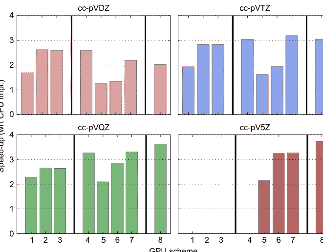

**图 11** 针对八种 GPU 方案的单 GPU 随问题规模的扩展情况。详细信息请参见正文。

使用双精度算术的方案（在 K40 节点上）在问题规模介于本次测试的 TZ 和 QZ 问题之间时达到了精度要求；而对于使用单精度算术的方案 8，从 QZ 方案移动到 SZ 方案时仍可以观察到微小的改进。通过将标题所示的方案 5 和 6 与完整方案 4 进行比较，可以发现前者的性能在处理 DZ、TZ 和 QZ 问题时，由于数据传输量的增加而遭受了影响；然而，对于方案 7，这种情况仅出现在最小的 DZ 问题上。对于最大的问题规模 (SZ)，最小的方案无法与完整方案 4 相比比较，但通过使用 `nvprof` 进行分析运行，可以确认方案 5 和 6 的总时间等于 `dgemm` 和 OpenACC 并行区域花费的时间。对于方案 8，分析运行也确认了计算是计算密集型的，但现在对于最小的 DZ 问题也是如此，这是因为每个循环周期需要复制到设备的块（tiles）更小。

### 随设备数量的扩展

在“随问题规模的扩展”部分的结果展示了不同方案在单个加速器设备上的性能后，我们现在转向设备数量的扩展。在图 12 中展示了随 GPU 数量的扩展情况，以相对于理想行为的相对偏差进行报告。对于方案 3，理想扩展与 GPU 数量成简单的正比（性能随二、三……等 GPU 的增加而翻倍、三倍等），而对于方案 4-8，情况并非如此，因为每个 GPU 核心现在都是一个独立的加速器，这一点将在“GPU-4”节中讨论。异构方案 3 ($R_1$) 和 $R_2$ 的理想加速比定义为：

```
$R_1 = N_{GPUs+3}$
```

```
$R_2 = \frac{(N_{threads} - N_{GPUs}) + N_{GPUs}S}{(N_{threads} - 1) + S}$
```


在公式 (5b) 的 $R_2$ 定义中，常因子 $S = N_{threads}^K$，其中 $K$ 是仅 CPU 计算（$N_{threads} = \text{OMP\_NUM\_THREADS}; 0$）与使用单 GPU 的仅 GPU 计算（$N_{threads} = 1$）之间的时间比例，解释了单 CPU 核心（假设主机上进行理想的 OpenMP 并行）与单 GPU 之间处理能力的相对差异。

从图 12 可以知，方案 3 和 4 的扩展在实践上是相同的，方案 7 和 8 也是如此；对于所有不同方案，在向更大的问题规模移动时都能观察到扩展性的明显改进。

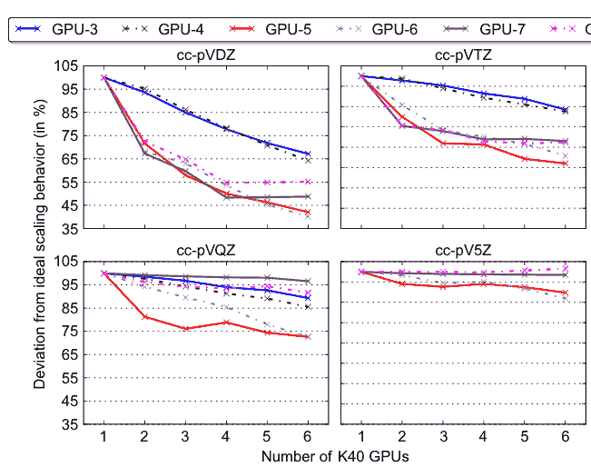

图 12 方案 3–8 随 GPU 数量的理想扩展的偏差。详细信息请参见正文。

这种改进在向更大的问题规模移动时，对于异步分块方案 6 变得较不明显，而对于同步方案 5 则更为不明显。虽然将完整的 C$\alpha$ 张量存储在设备主内存中的方案 3 和 4 在小问题规模下扩展最好，但随着向更大尺寸移动，情况发生了向分块方案（特别是固定方案 7 和 8）的倾斜，因为后者避免了在实际能量评估之前对大块 C$\alpha$ 进行拷贝。

最后，由于对于混合方案 4–8，总共有 (nocc+nocc)/2 个任务需要分配在 CPU 核心和加速器设备之间，我们可以通过在结果中相应的相对 GPU 工作负载结果，补充图 12 中的扩展结果。这些结果在图 13 中针对方案 6–8 给出；对于所有四种问题规模，固定方案 7 和 8 的 GPU 利用率都更好——这得益于更快的数据传输——但随着问题规模的不断增大，这种优势在减小。此外，我们还注意到，对于当前的问题规模和 CPU/GPU 硬件，当节点上连接三个或更多 GPU 时，主节点的实际利用率较低（小于 10%）。尽管如此，除同步方案 5 之外，混合方案始终比对应的仅 GPU 方案 3 快。

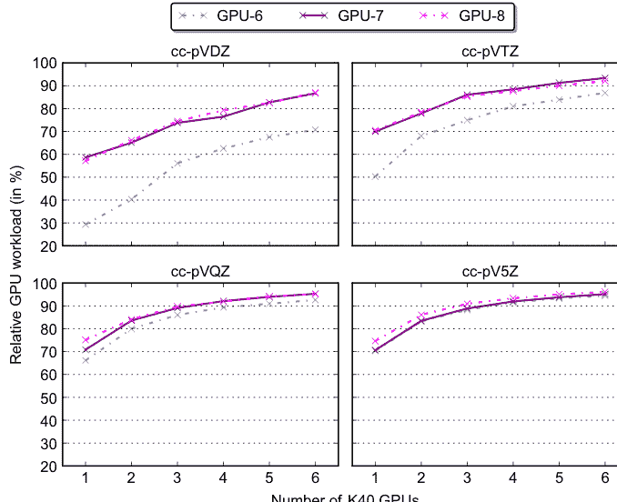

图 13 方案 6–8 随 GPU 数量的相对 GPU 工作负载。

## 总性能

在评估了每个提议方案如何加速单 GPU 执行的 RI-MP2 能量评估，以及可能利用多个 GPU 的方案如何随可用资源扩展后，我们现在将图 1 和图 12 的结果合并到图 14，报告了方案 7 和 8 相对于方案 4 的双、单精度版本的多 GPU 加速。在图 14 中，还指出了使用单精度而非双精度的加速。从结果可以看出，两种方案在 GPU 数量增加时都表现良好，但方案 8 的性能明显优于方案 7。事实上，对于所有问题规模，使用六个 GPU 相比于方案 7 的双精度版本，混合方案将总时间缩短了一个数量级，这是因为：

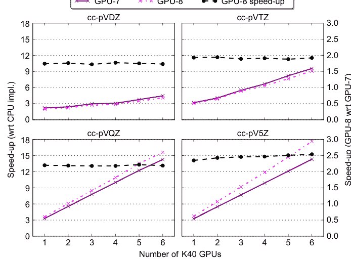

图 14 方案 7 和 8 相对于方案 4 双、单精度版本的多 GPU 加速。

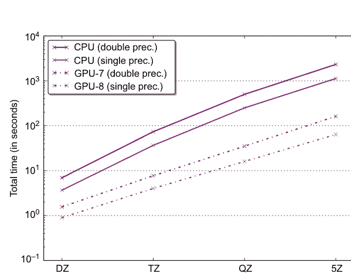

图 15 方案 7 和 8 仅 CPU 版本的计算时间。

## 总结与结论

在当前的情况下，使用 OpenMP 指令来加速 RI-MP2 方法，由于：

## 参考文献

编号 291371 以及导致最终生产代码的开发使用了位于美国田纳西州橡树岭国家实验室的橡树岭领导力计算设施（OLCF），该设施由能源部 DE-AC05-00OR22725 办公室的支持。实际的生产运行在一个 NVIDIA 集群上完成，在此对该集群表示感谢。奥尔胡哈斯大学的 Thomas Kjaergaard，OLCF 的 Tjerk Strastra 和 Dmitry Liakh，Cray 公司的 Luiz DeRose、Aaron Vose 和 John Leaves，以及 NVIDIA 公司的 Mark Berger、Jeff Larkin、Roberto Gomerpert、Michael Wolfe 和 Brent Leback。

# References

- Alumni, J. (1991). Chemical Physics Letters, 181, 319.
- Ayala, P. Y., & Scuseria, G. E. (1999). The Journal of Chemical Physics, 110, 3660.
- Baudin, P., Ettenhuber, P., Reine, S., Kristensen, K., & Kjaergaard, T. (2016). The Journal of Chemical Physics, 144, 5412.
- Čížek, J. (1966). The Journal of Chemical Physics, 45, 4256.
- Čížek, J. (1996). Advances in Chemical Physics, 14, 35.
- Crawford, T. D., & Stanton, J. F. (1998). International Journal of Quantum Chemistry, 70, 601.
- Doser, B., Lambert, D. S., Kussmann, J., & Ochsenfeld, C. (2009). The Journal of Chemical Physics, 130, 64107.
- Doser, B., Zenau, J., Clin, L., Lambert, D. S., & Ochsenfeld, C. Z. (2010). Physical Chemistry, 224, 397.
- Dumming, T. H. (1989). The Journal of Chemical Physics, 90, 1007.
- Eriksen, J. J., Baudin, P., Ettenhuber, P., Kristensen, K., Kjaergaard, T., & Jørgensen, P. (2015). Journal of Chemical Theory and Computation, 11, 2984.
- Eriksen, J. J., Jørgensen, P., & Gauss, J. (2015). The Journal of Chemical Physics, 142, 14102.
- Eriksen, J. J., Jørgensen, P., & Olsen, J. (2014). The Journal of Chemical Physics, 140, 74114.
- Eriksen, J. J., Kristensen, K., Kjaergaard, T., Jørgensen, P., & Gauss, J. (2014). The Journal of Chemical Physics, 140, 64108.
- Eriksen, J. J., Mathews, D. A., Jørgensen, P., & Gauss, J. (2015). The Journal of Chemical Physics, 143, 41101.
- Eriksen, J. J., Matthews, D. A., Jørgensen, P., & Gauss, J. (2016a). The Journal of Chemical Physics, 144, 194102.
- Eriksen, J. J., Matthews, D. A., Jørgensen, P., & Gauss, J. (2016b). The Journal of Chemical Physics, 144, 194103.
- Feyereisen, M. W., Fitzgerald, G., & Komornicki, A. (1993). Chemical Physics Letters, 208, 359.
- Friedrich, J. J. (2007). The Journal of Chemical Physics, 126, 154110.
- Friedrich, J., & Dolg, M. (2009). Journal of Chemical Theory and Computation, 5, 287.
- Gitlab. (2016). https://github.com/januseriksen/openaec-rimp2.
- Guo, Y., Li, W., & Li, S. (2014). The Journal of Physical Chemistry, A, 118, 8996.
- Weigend, F., Köhn, A., & Hättig, C. (2002). The Journal of Chemical Physics, 116, 3175.
- Werner, H.-J., Manby, F. R., & Knowles, P. J. (2003). The Journal of Chemical Physics, 118, 8149.
- Whitten, J. L. (1973). The Journal of Chemical Physics, 58, 4496.
- Ziołkowski, M., Jansík, B., Kjærgaard, T., & Jørgensen, P. (2010). The Journal of Chemical Physics, 133, 14107.

## 第 12 章 OpenACC 加速的 RI-MP2 方法

(Guo)

## 引言

## 使用 OpenACC 迁移大型代码

本章的目的是描述一种分步骤的方法。在本章结束时，读者将能够理解：

- 如何使用 OpenACC 迁移大型组件
- 针对天气和气候的分步骤方法
- 引入的性能优化措施

天气和气候模型通常使用计算网格，并在网格上计算流的主要方程。在 COSMO 中，结构化的三维网格（由源代码中的索引 `i, j, k` 表示）对应于三个空间维度（纬度、经度、地高）。在该计算网格上，定义了描述特定时刻大气状态的主要预报变量。例如，空气气温将是一个三维数组 `(i, j, k)`，描述计算网格上每个网格点的大气温度。这种三维数组也被称为场（fields）。任何天气和气候模型的最外层循环将是关于时间的循环，它随时间向前推积分由预报变量描述的大气状态。因此，物理参数化将在每个时间步通过遍历所有网格点来同时读取和修改这些变量。物理参数化的一个特殊特点是，所采用的算法几乎完全基于局部的，这意味着特定网格点 `(i, j, k)` 的计算结果仅取决于 k 方向相邻网格点的信息（而不依赖于 i/j 方向）。

## 迁移方法：分步进行

本节的目的是提供一种具体的分步骤方法，并讨论在 COSMO 模型迁移至 GPU 时所使用的关键 OpenACC 构造。最后，我们提供了一个简化的玩具示例，该示例包含了一个典型的社区“大气”模型的关键组件和结构，例如物理参数化和输出。

### 简化大气模型

该示例使用 Fortran 90 编写，采用函数式编程风格，并可下载。在下载的源码中，基础串行简化大气模型包含在 `example_serial` 目录中。图 2 显示了主代码体（`main.f90`）。它包含一个对 `initialize` 子程序的调用，该子程序在 `nstop` 次迭代中调用物理参数化和输出。在时间循环之后，`cleanup` 子程序释放了全局变量。

```
CALL initialize()

------------------------------------------------------

! time loop

DO ntstep = 1, nstop

    ! call the physical parameterizations

CALL physics()

    ! call outputs

CALL write_output( ntstep )

END DO

------------------------------------------------------

CALL cleanup()
```

图 2 主驱动代码，展示了时间循环的初始化，其中包含了物理参数化、输出和模型清理的调用。

图 3 所示的物理过程子程序调用了两个物理参数化：`saturation_adjustment`（饱和调节）和 `microphysics`（微物理）。全局场 `t` 和 `qv` 通过参数传递给参数化程序，连同一个中间自动数组 `qc`。`saturation_adjustment` 和 `microphysics` 在水平 `i,j` 方向和垂直 `k` 方向上进行了一些密集操作。

```
! 物理参数化的驱动例程

SUBROUTINE physics()

IMPLICIT NONE

! 局部变量

REAL*8 :: (nx,ny,nz) ! 用于物理计算的临时变量

! 调用第一个物理参数化

CALL saturation_adjustment(nx, ny, nz, t, qc, qv)

! 调用第二个物理参数化

CALL microphysics(nx, ny, nz, t, qc, qv)

END SUBROUTINE physics
```

图 3 物理驱动例程，调用了两个参数化：饱和调节和微物理。

在下文中，除非另有说明，否则我们关注主时间循环的执行时间，忽略初始化和清理时间。本章报告的执行时间是 10 次运行的平均值。“模型”（问题规模）固定为 128×128×60 网格点，这代表了在分布式系统上运行真实模型时每个子区域典型的点数，且迭代了 100 步。

作为基准参考，CPU 上的执行时间是使用 OpenMP 代码（在 `example_openmp` 目录中）在 12 个 Intel Xeon ES-2690v3 (Haswell) CPU 上获得的。代码使用 Cray 编译器编译，并带有优化标志“-O3 -fopen”，得到时间为 240ms。

### 第 1 步：添加并行区域

将物理参数化移植到 GPU 的第一步是简单地使用 `!$acc parallel`、`!$acc end parallel` 和 `!$acc loop` 指令对代码应用并行区域。`parallel`/`end parallel` 对告诉编译器指定区域包含需要并行化的代码，而 `loop` 指令告诉编译器要并行执行的循环的具体位置。

在所给的示例中，我们开始将 `m_parameterizations.f90` 中的 `i,j,k` 循环嵌套到 GPU。该文件在独立的子程序中有两个物理参数化：`saturation_adjustment` 和 `microphysics`，每一个都包含一个可以在 GPU 上执行的嵌套 `!$acc i,j,k loop` 循环。首先，将 `!$acc parallel` 和 `!$acc end parallel` 指令放在嵌套循环之后，如图 4 所示。

```
!$acc parallel

DO k = 1, nlev

DO j = -1, npy

DO i = 1, npx

qv(i,j,k) = qv(i,j,k) + cs1*EXP(cs2*( (t(i,j,k)-kt0) / (t(i,j,k)-cs3 ))

qc(i,j,k) = cs4*qv(i,j,k)

END DO

END DO

END DO

!$acc end parallel
```


图 4
在 `saturation_adjustment` 例程序的循环中添加并行区域。

接下来，在每个循环的开头添加了 `$acc loop` 指令。注意，`microphysics` 子程序中的 `k` 循环对 `(k-1)` 存在依赖。因此，使用 `$acc loop seq` 指令来声明该循环必须串行运行，而嵌套中的其他循环可以通过 `$acc loop` 指令并行运行，如图 5 所示。

```fortran
!$acc parallel

!$acc loop seq

DO k = 2, nlev

!$acc loop

DO j = 1, npy

!$acc loop

DO i = 1, npx

qv(i, j, k) = qv(i,j,k-1) + cm1*(t(i,j,k)-cm2)**cm3

t(i, j, k) = t(i, j, k)*1.000 - cm4*qc(i,j,k)+qv(i,j,k)

END DO

END DO

END DO

!$acc end parallel
```

图 5
在 `microphysics` 例程序的循环中添加 `$acc loop` 指令。

代码仅通过这些微调进行编译并在 GPU 上运行。一旦代码在 GPU 上运行，验证输出就至关重要。在所给的示例中，我们开始将 `m_parameterizations.f90` 中的 `i,j,k` 循环嵌套到 GPU。该文件在独立的子程序中有两个物理参数化：`saturation_adjustment` 和 `microphysics`，每一个都包含一个可以在 GPU 上执行的嵌套 `$acc i,j,k loop` 循环。首先，将 `$acc parallel` 和 `$acc end parallel` 指令放在嵌套循环之后，如图 4 所示。（注：原文此处存在大量重复段落，翻译时已按要求去重）


图 7
步骤 2 刚初的数据传输示意图。

为了缓解这个问题，在步骤 2 中添加了更多的 OpenACC 指令，以消除 CPU 和 GPU 之间不必要的数据传输。首先，在 `m_setup.f90` 中为全局变量 $t$ 和 $qv$ 创建一个非结构化数据区域。数据首先使用 `$acc enter data` 语句在 GPU 上分配，然后在初始化子程序期间，使用 `$acc update device` 语句将数据从 CPU 复制到 GPU。`$acc enter data` 语句需要一个匹配的 `$acc exit data` 语句，该语句被放置在 `m_setup.f90` 清理子程序中释放全局变量之前，如图 8 所示。

这些 OpenACC 指令确保了 $t$ 和 $qv$ 变量在时间步循环之前就已分配并复制到 GPU，而不是在 OpenACC 并行区域之间反复拷贝——见图 9。

接下来，在 `m_physics.f90` 中使用 `$acc data create` 和 `$acc end data` 语句为局部变量 $qc$ 创建数据区域，如图 10 所示。`$acc data create` 在 GPU 上分配内存，但在退出区域时不会从宿主机拷贝数据。该区域跨了两次参数化子程序的调用，并确保 $qc$ 变量在调用 `saturation_adjustment` 和 `microphysics` 子程序之间不会在 CPU 和 GPU 之间反复拷贝。

`m_parameterization.f90` 文件中的子程序也需要数据区域，以指示变量 $t$、$qv$ 和 $qc$ 现在位于 GPU 上（来自另一个包含的数据区域）。因此，在 `saturation_adjustment` 和 `microphysics` 子程序的开始和结束处增加了 `$acc data present` 和 `$acc end data` 语句，如图 11 所示。

# 迁移方法：逐步演进 275

```fortran
SUBROUTINE initialize()

-------------------------

! 分配内存

ALLOCATE( t(nx,ny,nz), qv(nx,ny,nz) )

! 在 GPU 上分配内存

!$acc enter data create(t,qv)

! 初始化全局场

DO k =1, nz

END DO

! 在 GPU 上初始化场

!$acc update device(t,qv)

SUBROUTINE cleanup()

IMPLICIT NONE

! 在 GPU 上释放

!$acc exit data delete(t,qv)

DEALLOCATE( t, qv )

END SUBROUTINE cleanup
```

图 8
在 `m_setup.f90` 的初始化和清理子程序中，在 GPU 上分配、初始化和释放全局变量。


图 9
步骤 2 之后的数据传输示意图。

# 276 第 13 章 留气候和天气模型代码

```fortran
!$acc data create(qc)

! 调用第一次物理参数化

CALL saturation_adjustment(nx, ny, nz, t, qc, qv)

! 调用第二次物理参数化

CALL microphysics(nx, ny, nz, t, qc, qv)

!$acc end data
```

图 10
为局部物理变量添加区域。

```fortran
!$acc data present(t,qv,qc)

! 执行计算

!$acc parallel

!$acc loop

DO k = 1, nlev

END DO

!$acc end parallel

!$acc end data
```

图 11
在物理子程序中添加区域。

虽然代码在有这些 OpenACC 数据区域的情况下可以编译和运行，但无法通过验证。变量 $qv$ 在时间步循环期间，由 `main.f90` 调用的 `write_output` 子程序中的 CPU 使用。然而，该变量没有从 GPU 拷贝到 CPU，因此 CPU 在时间步循环期间没有获得该变量的正确值。在 `m_io.f90` 的 `write_output` 子程序中使用了一个 `$acc update host` 语句，以便在 CPU 可以进行输出的输出时间步期间，仅将该变量从 GPU 拷贝到 CPU——见图 12。

```fortran
IF (MOD(ntstep, out) /= 0) RETURN

!$acc update host(qc)

! 计算变量 qv 的平均值

qv_mean = 0.00D
```

图 12
在输出之前添加 update host 指令。

# 迁移方法：逐步演进 277

一旦完成了所有这些修改，就可以使用 PGI 和 Cray 编译器编译代码，在 GPU 上运行并进行验证（通过检查标准输出中每 20 个时间步的平均值与参考 CPU 运行结果进行对比）。在下载源码中，可以在 `example_openacc_step2` 目录下找到对应的代码。图 13 显示了结果耗时。

| 运行 | 时间步循环持续 (PGI; ms) | 时间步循环持续 (Cray; ms) |
|---|---|---|
| 步骤 1: 添加并行区域 | 1406 | 1014 |
| 步骤 2: 管理数据传输 | 87 | 82 |

图 13
步骤 2 之后的运行时间。

# 步骤 3：基础优化

迁移方法的第三步是应用一些优化。第一个优化是在 `acc loop` 上添加一些子句。

## 细粒度并行控制

`gang`、`vector` 和 `collapse` 子句在 `$acc loop` 指令上的理想位置取决于架构，因此需要在目标加速器上进行测试才能作为优化工具发挥作用。

## 迁移输出/归约

应用于代码的下一个优化涉及添加并行区域。在 `m_io.f90` 的 `write_output` 子程序中，另一个嵌套的 `i,j,k` 循环是并行化的良好候选对象。该循环需要额外的关注，因为它涉及到数组 $qv$ 归约为标量，主要是计算 $qv$ 的平均值。

```fortran
!$acc data present(qv)

! compute mean of variable qv

q_mean = 0.0DO

!$acc parallel

!$acc loop collapse(3) reduction(+:qv_mean)

DO k = 1, nz

DO j = 1, ny

DO i = 1, nx
```

FIG. 16
在 `write_output` 子程序中添加带有子句的 `$acc loop` 指令。

## 移除自动数组
最后的优化步骤涉及将 `m_physics.f90` 文件中的本地自动数组 `qc` 替换为可分配数组（allocatable array）。这是另一种数据管理技术，它允许 `qc` 变量在时间循环之外的 GPU 上进行分配和释放，而不是在时间循环期间进行。在 GPU 上的内存分配和释放是一项耗时操作，最好提前完成，而不是在需要时立即进行。

为了实现这一点，将 `qc` 添加到 `m_fields.f90` 文件的字段中。在 `m_physics.f90` 文件中添加了子程序，用于在 CPU 和 GPU 上进行分配（`init_physics`）和释放（`finalize_physics`）（见图 17）。这些子程序的调用被添加到 `m_setup.f90` 文件中，位于时间循环之外。

```fortran
SUBROUTINE init_physics()

IMPLICIT NONE

! allocate memory

ALLOCATE( qc(nx,ny,nz) )

!$acc enter data create(qc)

END SUBROUTINE init_physics

!

! Finalize the local physics array

SUBROUTINE finalize_physics()

IMPLICIT NONE

! deallocate memory

!$acc exit data delete(qc)

DEALLOCATE(qc)

END SUBROUTINE finalize_physics()
```

FIG. 17
添加子程序以便在 GPU 和 CPU 上分配和释放本地物理变量。

一旦将这三种优化应用于代码中，将使用 PGI 和 Cray 编译器进行编译并再次运行，得到如图 18 所示的时间结果，这是对代码的验证。在下载的源码中，可以在 `example_openacc_step3` 目录下找到相应的代码。

| 运行 | 时间循环持续时间 (PGI; ms) | 时间循环持续时间 (Cray; ms) |
|---|---|---|
| 步骤 1: 添加并行区域 | 1406 | 1014 |
| 步骤 2: 管理数据传输 | 87 | 82 |
| 步骤 3: 基础优化 | 72 | 61 |

图 18
步骤3 之后的运行时间。

通过应用基础优化，相对于 CPU 运行实现了 3.3x (PGI) 和 3.9x (Cray) 的加速。

# 包含子程序调用的并行循环

在之前的章节中，已经描述了迁移简单大气模型的三步走方法。然而，示例代码相当简单，仅包含具有纯嵌套循环的子程序。在实际应用中，调用可能会更加复杂，特别是在并行循环内部包含子程序调用。这种情况可以通过使用 `$acc routine` 子句来处理。

本节的目的是展示此 OpenACC 代码是如何构建的。为此，我们使代码结构恰当：水平循环 `i` 和 `j` 直接位于物理计算中，并且对于 `i,j` 循环的每次迭代，都会调用修改后的 `saturation_adjustment` 和 `microphysics` 子程序。通过在物理子程序中这些新的嵌套循环，添加了 OpenACC 数据区域和并行区域（见图 19）。

上一节步骤 2 中描述的主循环之外的 OpenACC 数据区域也已实现，这样主变量就可以主时间循环的 GPU 输出之间进行相互拷贝。

`$acc routine seq` 指令被添加到 `saturation_adjustment` 和 `microphysics` 子程序中。`seq` 子句告诉编译器子程序内部不再有进一步的并行化。物理子程序需要该子句，因为内部的 `k` 循环由于对 `k-1` 的依赖必须按顺序执行。`saturation_adjustment` 过程也必须按顺序执行，因为物理子程序中的 `i` 循环具有 `vector` 子句，这是可以应用的最低级别并行化。

```fortran
!$acc data present(t,qc,qv)

!$acc parallel

!$acc loop gang

DO j = 1,ny

!$acc loop vector

DO i = 1,nx

END DO

END DO

!$acc end parallel

!$acc end data
```

FIG. 19
在物理子程序中添加 OpenACC 并行区域和数据区域。

上一节步骤 3 在 `write_output` 子程序中描述的 OpenACC 并行区域在此也实现，同样对 `$acc loop` 指令使用了 `reduction` 子句。有一个指令必须在代码编译之前添加。与包含 `$acc routine` 的子程序位于同一模块中的任何 OpenACC 模块变量必须使用 `$acc declare` 指令进行显式声明，因此在 `m_parameterizations.f90` 文件中添加了 `$acc declare` 指令，以声明并将模块变量拷贝到 GPU 上（见图 20）。

```fortran
MODULE m_parameterizations

IMPLICIT NONE

  ! module constants

  REAL*8 :: cs1 = 1.006, cs2 = 0.020D, cs3 = 7.200, cs4=7.200

  !$acc declare cs1, cs2, cs3, cs4

END MODULE
```

FIG. 20
在 `m_parameterizations.f90` 中添加 `$acc declare` 语句。

一旦添加了所有指令，将使用 PGI 和 Cray 编译器进行编译并再次运行。在下载的源码中，可以在 `example_openacc_step3` 目录下找到相应的代码。

# 13 与 CUDA 接口

OpenACC 的另一个重要功能是 Fortran 与 CUDA 接口的能力。在这里，我们提供了一个示例，通过 `ISO_BINDING` 模块（2003年引入）确保 Fortran 和 CUDA 之间的互操作性。

```fortran
! 使用 iso_c_binding 调用 CUDA 函数

INTERFACE

! 传递 ijk 字段的指针和维度

SUBROUTINE saturation_adjustment_cuda( ntot, t, qc, qv, &

    cs1, cs2, cs3, cs4, t0 ) &

    BIND(c, name='saturation_adjustment_cuda')

USE, INTRINSIC :: iso_c_binding

INTEGER(c_INT), value :: ntot

TYPE(c_PTR), value :: t,qc,qv

REAL(KIND=c_DOUBLE), value :: cs1,cs2,cs3,cs4,t0

END SUBROUTINE saturation_adjustment_cuda

END INTERFACE
```

```fortran
! 调用 CUDA 包装程序

!$acc data present(t,qv)

!$acc host_data use_device(t,qv)

call saturation_adjustment_cuda(npx*npy*nlev, &

    C_LOC(t(1,1,1)), &

    C_LOC(qc(1,1,1)), &

    C_LOC(qv(1,1,1)), &

    cs1, cs2, cs3, cs4, t0 )

!$acc end host_data

!$acc end data
```

FIG. 22

`saturation_adjustment` 程序被调整为调用 CUDA 函数 `saturation_adjustment_cuda`。使用 `host_data use_device` 构造传递 GPU 内存地址。

由于 COSMO 模型最初设计为用于针对单指令多数据 (SIMD) 架构的编译器自动向量化进行优化，因此物理参数化子程序中的许多循环的形式与图 25 所示的形式相似。

```cpp
// - 饱和调整内核
// saturation_adjustment_kernel(int ntot)

__global__ void saturation_adjustment_kernel(int ntot,
    double *t, double *qc, double *qv,
    double cs1, double cs2, double cs3, double cs4,
    double t0)
{
    int tid = blockDim.x * blockIdx.x + threadIdx.x;
    if ( tid < ntot ) {
        qv[tid] = qv[tid] + cs1*exp(cs2*( t[tid]-t0 ))/( t[tid]-cs3 );
        qc[tid] = cs4*qv[tid];
    }
}

// - 调用饱和调整内核的 CUDA 函数

void saturation_adjustment_cuda(int ntot,
    double *t, double *qc, double *qv,
    double cs1, double cs2, double cs3, double cs4, double t0)
{
```


// 设置 cuda 网格维度

const int `THREADS_PER_BLOCK` = 128; // 每个 GPU 块的线程数

const int `NUMBER_OF_BLOCKS` = ceil(ntot/`THREADS_PER_BLOCK`);

// 调用 CUDA 内核

`saturation_adjustment_kernel<<<NUMBER_OF_BLOCKS,THREADS_PER_BLOCK>>>(ntot,t,qc,qv,cs1,cs2,cs3,cs4,t0);`

**图. 23**
饱和调整子程序的 CUDA 版本。

| 运行 | 时间循环时长 (PGI); ms) | 时间循环时长 (Cray); ms) |
|---|---|---|
| 步骤 1: 添加并行区域 | 1406 | 1014 |
| 步骤 2: 管理数据传输 | 87 | 82 |
| 步骤 3: 基础优化 | 72 | 61 |
| 替代代码 1 (acc 例程) | 76 | 99 |
| 替代代码 2 (CUDA) | 58 | 61 |

**图. 24**
替代代码运行时间。

# 性能优化

```fortran
do k=2,nk
  do i=1,ni
    some code 1 ...
    c(i) = D*exp(a(i,k))
  end do
  do i=1,ni
    a(i,k)=c(i)*a(i,k)
    some code 2 ...
  end do
end do
```

**图. 25**
COSMO 中物理参数化的伪代码。

示例伪代码中的每个循环都包含较少数量的计算，并且在一个循环中计算的变量会在另一个循环的计算中使用。这种代码对于利用编译器向量化生成 `SIMD` 指令的系统运行良好，但对于 `GPU` 来说通常不是理想的。在 `GPU` 上，如果对伪代码中的每个循环应用并行区域，我们将获得许多单独的 `GPU` 内核，且这些内核中通常包含相同的变量。此外，许多变量需要在 `GPU` 内核之间进行显式的数据管理。在逐步步进式的方法中应用 `OpenACC` 指令将导致如[图. 26]所示的伪代码。

这里可以应用的第一个优化方案是所谓的循环融合（`loop fusion`）和循环重排序（`loop reordering`）。通过这种技术，一组具有相同循环索引的循环被融合成一个包含更多计算量的单个循环。这减少了 `GPU` 需要启动的内核数量（消除了与内核相关的开销），并使得数据管理更加简单。我们还交换了 `i` 和 `k` 循环，这对于下一节中描述的标量替换优化（`scalar replacement optimization`）也有益。对伪代码应用循环融合和重排序将导致如[图. 27]。

# 标量替换

这里可以应用的第二种优化技术是标量替换。在循环融合步骤合并循环后，变量 `c(1)` 首先从其他变量计算得出，然后用于最终变量的计算。由于变量 `c` 仅作为中间变量使用，它不需要存储在数组中，而可以存储为标量。主要的优势是，该变量

```fortran
do k=2,nk
!$acc parallel
!$acc loop gang vector
do i=1,ni
    some code 1 ...
    c(i) = D*exp(a(i,k))
end do
!$acc parallel
!$acc parallel
!$acc loop gang vector
do i=1,ni
    a(i,k)=c(i)*a(i,k)
    some code 2 ...
end do
```

**图. 26**
向伪代码中添加 `$acc parallel` 和 `loop` 指令。

```fortran
!$acc parallel
!$acc loop gang vector
do i=1,ni
!$acc loop seq
do k=2,nk
    some code 1 ...
    c(i)=D*exp(a(1,k))
    a(1,k)=c(i)*a(1,k)
    some code 2 ...
end do
end do
!$acc end parallel
```

**图. 27**
对伪代码应用循环融合和重排序技术。

可以简单地存储在寄存器中，而不需要存储在设备的内存中。图 28 显示了应用循环融合和标量替换优化后的伪代码。

```fortran
!acc parallel
!acc loop gang
do j=1,nj
!acc loop seq
do k=2,nk
    some code 1 ...
    zc=D*exp(a(I,k))
    a(I,k)=c(i,k)
    some code 2 ...
end do
!acc end parallel
```

**图. 28**
应用循环融合和标量替换优化后的代码。

# 缓存

在物理模型中，如示例所示，伪代码中的每个循环都包含较少数量的计算，并且在一个循环中计算的变量会在另一个循环的计算中使用。这种代码对于利用编译器向量化生成 `SIMD` 指令的系统运行良好，但对于 `GPU` 来说通常不是理想的。在 `GPU` 上，如果对伪代码中的每个循环应用并行区域，我们将获得许多单独的 `GPU` 内核，且这些重复中。。

# 即时计算

在 `GPU` 上，如果对伪代码中的每个循环应用并行区域，我们将获得许多单独的 `GPU` 内核，且这些内核中通常包含相同的变量。此外，许多变量需要在 `GPU` 内核之间进行显式的数据管理。在逐步步进式的方法中应用 `OpenACC` 指令将导致如[图. 26]所示的伪代码。

这里可以应用的第一个优化方案是所谓的循环融合和循环重排序。通过这种技术，一组具有相同循环索引的循环被融合成一个包含更多计算量的单个循环。这减少了 `GPU` 需要启动的内核数量（消除了相关的内核开销），并使得数据管理更加简单。我们还交换了 `i` 和 `k` 循环，这对于下一节中描述的标量替换优化也有益。对伪代码应用循环融合和重排序将导致如[图. 27]。

# 标量替换

这里可以应用的第二种优化技术是标量替换。在循环融合步骤合并循环后，变量 `c(1)` 首先从其他变量计算得出，然后用于最终变量的计算。由于变量 `c` 仅作为中间变量使用，它不需要存储在数组中，而可以存储为标量。主要的优势是，该变量

```fortran
do k=2,nk
!$acc parallel
!$acc loop gang vector
do i=1,ni
    some code 1 ...
    c(i) = D*exp(a(i,k))
end do
!$acc parallel
!$acc parallel
!$acc loop gang vector
do i=1,ni
    a(i,k)=c(i)*a(i,k)
    some code 2 ...
end do
```

**图. 26**
向伪代码中添加 `$acc parallel` 和 `loop` 指令。

```fortran
!$acc parallel
!$acc loop gang vector
do i=1,ni
!$acc loop seq
do k=2,nk
    some code 1 ...
    c(i)=D*exp(a(1,k))
    a(1,k)=c(i)*a(1,k)
    some code 2 ...
end do
end do
!$acc end parallel
```

**图. 27**
对伪代码应用循环融合和重排序技术。

可以简单地存储在寄存器中，而不需要存储在设备的内存中。图 28 显示了应用循环融合和标量替换优化后的伪代码。

```fortran
!acc parallel
!acc loop gang
do j=1,nj
!acc loop seq
do k=2,nk
    some code 1 ...
    zc=D*exp(a(I,k))
    a(I,k)=c(i,k)
    some code 2 ...
end do
!acc end parallel
```


# 缓存（Caching）

在物理模型中，如示例所示，伪代码中的每个循环都包含较少数量的计算，并且在一个循环中计算的变量会在另一个循环的计算中使用。这种代码对于利用编译器向量化生成 `SIMD` 指令的系统运行良好，但对于 `GPU` 来说通常不是理想的。在 `GPU` 上，如果对伪代码中的每个循环应用并行区域，我们将获得许多单独的 `GPU` 内核，且这些内核中通常包含相同的变量。此外，许多变量需要在 `GPU` 内核之间进行显式的数据管理。在逐步步进式的方法中应用 `OpenACC` 指令将导致如[图. 26]所示的伪代码。

# 即时计算（On-the-fly）

在 `GPU` 上，如果对伪代码中的每个循环应用并行区域，我们将获得许多单独的 `GPU` 内核，且这些内核中通常包含相同的变量。此外，许多变量需要在 `GPU` 内核之间进行显式的数据管理。在逐步步进式的方法中应用 `OpenACC` 指令将导致如[图. 26]所示的伪代码。

# 第 13 章 大型遗留气候和天气建模

`GPU` 优化降低了 `CPU` 上的性能，主要因为最终的 `OPT2` 代码不利于自动向量化。此外，在代码的这部分，即时计算在 `CPU` 上的表现较差，因为执行在 `CPU` 上是计算密集型（compute-bound），而在 `GPU` 上是内存受限型（memory-bound）。对于像 `COSMO` 这样在 `CPU` 和 `GPU` 架构上都具有高性能的社区代码来说，这种性能可移植性的缺乏是一个问题。人们可以在不同架构的性能之间找到一个可以接受的折中，或者在辐射求解器代码规模有限的情况下，保留两个独立版本：一个用于 `CPU`，一个用于 `GPU`。最后，将最佳 `CPU` 结果（`BASE`）与最佳 `GPU` 结果（带有 `Cray` 的 `OPT2`）进行比较，我们在 `GPU` 上实现了约 2.9 倍的加速。

## 参考文献

- Consortium for Small-Scale Modelling. The COSMO model. www.cosmo-model.org。
- Fuhrer, O., Osuna, C., Lapillione, X., Gysi, T., Cumming, B., Bianco, M., et al. (2014). Towards a performance portable, architecture agnostic implementation strategy for weather and climate models. Supercomputing Frontiers and Innovations, 2313-8734. It(1), 45–62。
- Lapillione, X., & Fuhrer, O. (2014). Using compiler directives to port large scientific applications to GPUs: An example from atmospheric science. Parallel Processing Letters, 24(1), 1450003.
- Ritter, B., & Geleyn, J.-F. (1992). A comprehensive radiation scheme for numerical weather prediction models with potential applications in climate simulations. Monthly Weather Review, 120(2), 303–325.

# 索引

注：页码后带有 `b` 索引框，`f` 表示函数，`t` 表示表格。

## A

- 加速器 (Accelerators), 147–148, 153, 193, 203
- `AccFill_ex2`, 8–9
- `AccList` 的构造函数, 91–92, 92b
- 构建与运行, 109–110b
- 示例, 107g
- 带有基本类型, 108b
- 源码自, 102–103b
- `AccUpdate` 方法, 93–94
- `AccMap_data` 方法, 98, 99
- `AccParaCounter`, 25–26
- `AccParaRNG.cpp` 代码, 24–27f
- `AccTask.cpp` 代码, 15–16
- 高级向量扩展 (AVX) 指令, 227–229, 228
- 欧法碳 (Alpha-carbons), 221
- `AMD` 的加载与缩放, 11–16
- 结构数组 (AOS), 220–222, 225
- `Assert(3)`, 3
- 异步执行, 76–77
- 大气模型, 270–271, 270–271f
- 自动数组, 279–280
- `CloverLeaf`
  - 在 `GPU` 上实现完全驻留, 193, 194f
  - `CPU` 性能分析, 190r
  - `GPU` 优化对 `CPU` 的影响, 206–207
  - 热点 (hot spots), 190
  - 混合 `MPI`/`OpenACC`, 196, 197f
  - 混合 `MPI`/`OpenMP`, 196
  - 流体动力学方案, 187–188
  - 增加问题规模, 195, 195f
  - 个内核函数 (individual kernels), 190–192
  - 191–192f
  - `ACC SYNC WAIT`, 204–205, 205–206f
  - 初始性能, 197–199f
  - 内层循环依赖, 198–199, 199–200f
  - 多 `GPU`, 减少隐藏张量, 203–204, 204f
  - 聚类算法, 218–219, 201–203f
  - 聚类分析, `MD`, 215–216
  - 原子选择, 220–222
  - 聚类算法, 218–219
  - 代码适配, 229–235
  - 差异性矩阵计算, 222
  - 硬件架构考虑, 223–224
  - 内存布局优化, 225
  - 分子能级景观, 217f
  - `OpenACC` 指令, 229–235
  - 与 `QCP` 的成对 `RMSDS`, 220
  - 性能评估测试, 224–225
  - 性能结果, 25–237, 236f
  - 物理原理, 216–217
  - `QCP` 内积循环, 225–229
  - 均方根偏差, 217–218
  - 轨迹数据结构, 220–222
- 代码插桩 (Code instrumentation), 55–68
- `Collapse` 子句 (Collapse clause), 118–119
- 编译器插桩, 59–60
- 计算, 73–75
- 计算密集型 (Compute-bound), 12

## B

- 基准代码 (Benchmark code)
- 构建代码, 30
- 共轭梯度法, 30–33
- 初始基准测试, 31–33
- 大-O 考虑与数据传输, 13–15
- 阻塞计算, 73–75

## C

- 缓存技术, 287–288
- `C++` 类管理, 89–94
- 中央处理器 (CPUs)
- `aceParaNG.cpp` 代码, 27
- 编译消息, 4f
- 调试, 144
- `FDK` 算法, 150
- 2D 热方程和, 165
- 在...上的 `OpenACC`, 209–210, 211f
- `CloverLeaf` 中的性能分析, 190
- 用于的串行代码, 30
- 上的强缩放 (strong scaling), 145
- 层层扫描 (CT), 149
- 共轭梯度法, 30–33
- 容器类 (Container class), 91–93
- `COSMO` 模型, 268
- 物理参数化, 269, 285
- 辐射成像, 280
- 三维网格, 269
- 耦合簇 (CC), 241–242
- `CC` 单双精度 (CCSD) 模型, 242
- `Cray` 编译器, 280–290
- `Cray` 编译环境 (CCE), 188, 198
- 关键路径, 168
- `CUBLAS`, 245–246, 249, 255
- `CUDA`, 185
- 2D 热方程, 59
- 实现, 28
- 内核函数, 92–106
- 监控, 60
- 多 `GPU`, 162, 164
- 饱和调整, 284
- 线程, 65
- 追踪, 61
- `CUDA` 感知模型, 140, 143
- `CUDA-gdb`, 123–144
- `CUDA-mem` 调试, 123–144
- 数据迁移, 统一内存, 179
- 数据移动, 描述, 41–46
- 矩阵和向量, 42–46, 43–44
- 数据优化, 2D 热方程, 157, 158–159
- 数据并行性 (Data-parallelism), 1–9
- 死锁 (Deadlock), 22
- 使用 `cuda-gdb` 调试, 143–144
- 带有 `cuda-mem`, 143–144
- 设备亲和性 (Device affinity), 127
- 设备内存共享, 99–102
- 仅设备数据, 96–102
- 基于指令的编程, 148–149
- 数据分解, 130–143

## D

- 数据集, 75
- 数据分析, `OpenCL`, 181–182
- 编译, 182
- 显式数据移动, 181
- `PGI` 编译器, 182, 182
- , 183–184
- 可视化性能时间线, 182, 183
- 数据管理
  - `CLI` 更新方法, 93–94
  - 聚合数据类型, 86–89
  - `C++` 类, 94–99
  - 代码示例, 102
  - 通用容器类, 91–93
  - 设备内存共享, 99–102
  - 仅设备数据, 96–102
  - 全局变量, 94–96
  - 数据生命周期, 84f
  - 映射设备数据, 98
  - 模块变量, 94
  - 运行时结果, 108
  - 自上而下方法, 86–89
  - 非结构数据区域, 84–86

## E

- 电子结构, 241–242
- 排斥积分 (ERIs), 244, 254
- 电子事件插桩, 157

## F

- `Feldkamp-Drais-Kress` (FDK) 算法, 149–155, 149–155, 154
- 多核命令行编译器, 154
- `CPU` 版本, 150, 153
- `Matlab` 脚本, 155
- 不同模型的性能, 155
- `PGI` 编译器, 158
- 伪代码, 149
- 滤波反投影算法 (Filtered back-projection algorithms), 150
- 细粒度控制参数, 277–278
- 浮点单元 (FPU), 189
- `Fortran`, 189–190, 255, 266–272
- 全配置接口 (FCI), 241–242
- 融合乘加 (FMA) 实例, 153, 227–229

## G

- `Gang` 子句, 120–121
- 全局变量, 94–96
- `CloverLeaf`, 200–202, 201–203f
- 图形处理 (GPUs), 221
- 加速器, 147–148
- `accParaRNG` 代码, 27
- 达到完全驻留, 193, 194f
- 提升, 255
- 编译消息, 4f
- 内核优化, 64–65
- 与多核, 162
- `NVIDIA`, 127, 134, 139
- `CPU` 上的优化, 206–207
- `PGProf` 调试器, 49
- `GPU-1`, 235–246, 246, 46f
- `GPU-2`, 247–248, 248f
- `GPU-3`, 247–249, 248f
- `GPU-4`, 249, 250f
- `GPU-5`, 249–251, 251f
- `GPU-6`, 252–253, 252f
- `GPU-7`, 252–253, 253f
- `GPU-8`, 254, 254
- 随尺寸缩放, 256–257, 260f
- 强子句, 在, 145
- 任务并行性, 66
- 使用 `PGI` 二进制文件, 57
- 日志, 57
- 循环携带依赖, 233
- 循环子句
  - `auto` 子句, 113–115, 115
  - `collapse` 子句, 118–119
  - `gang` 子句, 120–121, 121
  - 独立子句, 115–116
  - 性能结果, 123–124
  - `reduction` 子句, 117–118
  - `seq` 子句, 116
  - `title` 子句, 121–122, 122
  - `vector` 子句, 120–121, 121
- 循环, 120–121
- 构造, 112–113
- 循环, 114–115
- 性能分析, 119–120

## H

- 哈特-福 (HF) 方案, 241–242
- 哈well-系统, 175–174
- of 生成器, 170–172
- 2D 热方程, 155–156
- 在...上的优化, 157
- `CUDA` 实现, 159
- 性能分析, 157–161
- 多 `GPU` 实现, 163–164
- 异构聚类, 213–219
- 热点, `CloverLeaf`, 190
- `HPC`, 147–148

## I

- 独立子句, 115–116
- 指令级并行 (ILP), 24
- 进程间通信 (IPC), 99–102

## K

- 内核函数, 4–7

## L

- 激光驱动电子束
- 粒子中的 (PIC) 代码, 58–59
- `PICGpu` 算法, 59

## M

- `Makefile`, 173–174
- 管理内存
  - 运行, 178
  - 性能分析, 178–181
- `Mandof` 生成器, 71–77
- 交替异步队列, 77
- 异步块, 74
- 阻塞数据, 传输, 75
- 负载均衡设备, 81
- 多设备流水线, 79
- `NVIDIA Visual Profiler` 时间线, 73
- `OpenACC` 运行时指令, 72
- 性能分析, 82
- 多体扰动理论 (MBPT), 241–242
- `Matlab`, 155
- 矩阵乘法 (MMs), 245–246
- 内存密集型, 12
- 内存布局优化, 225
- 内存修剪, 252–253
- 消息传递接口 (MPI), 196, 289
- 设备内存共享, 99–102
- `OpenACC` 和, 196
- `OpenMP` 和, 196
- 模块变量, 94–96
- 分子动力学 (MD) 模拟, 215–216
- 原子聚类, 220–222

## N

- 嵌套循环, 200–202, 201–203f
- 处理器数量, 126
- `NVIDIA` 剖器, 268
- `NVIDIA Visual Profiler`, 73f, 78, 144
- `Nvprof` 分析器, 144

## O

- 数据卸载, 39
- 即时计算, 287

## P

- 并行上下文, 4–7
- 并行 `OpenACC`, 175–177, 176f
- 并行效率, 126
- 并行性, 7–8
- 控制, 4–7
- 控制资源, 23–24
- 数据类, 39
- 数据并行循环, 1–9
- 数据并行化, 9
- 点积例程, 36–38, 37f
- 执行与竞态条件, 16–20
- 细粒度控制, 277–288
- 的, 7
- 增加, 49–50
- 指令级, 24
- 在多核上, 51
- 性能引导开发, 33–40
- 任务并行性, 2–9–11f, 65–66
- 包含子例程的并行循环, 280–282
- 并行时间, 126
- 单元格代码, 58–59
- 部分聚类方法, 218–219
- `PCI Express` (IE), 69
- 性能分析, 56–57
- 性能优化, 57–58
- 缓存, 287–290
- 循环融合与重排序, 283–285, 286
- 即时计算, 287
- 标量替换, 285–287
- 性能调优, 123–124
- `PGAS` 编译器, 233, 289–290
- 用于算法, 154f
- 非 `Linux` 系统, 174f
- `CPU` 的串行代码, 30
- 使用 `OpenACC` 数据接口, 287
- 变, 210, 289
- `PGProfiler`, 31–33
- 物理参数化, 216–285
- 多 `GPU` 实现, 62–64
- 锁存内存, 252–253
- 流线化, 69–70
- 异步执行, 76–77
- 阻塞计算, 31
- 阻塞拷贝, 75
- `曼德博` 生成器, 71–77
- 多设备, 77–80
- 流线化执行, 71
- 用于 `Jacobi` 的求解器, 126–130
- 2D 方程, 128–139, 137
- `PGI` 统一二进制, 31
- 性能引导开发, 30
  - 共轭梯度, 30
  - 数据移动, 41–46
  - 性能剖析, 31–33
  - 循环, 49–50
  - 并行, 33–40
  - 在多核上, 51
  - 性能分析, 57
  - 剖析, 56
  - 与 `Visual Profiler`, 144
  - 与 `nvprof`, 144
  - 工具, 56
  - 多 `GPU`, 57

## Q

- `Q6000`, 235–237
- `QCP` 方法, 220–222
- 内部循环, 225–229

## R

- 辐射参数化, 288–290
- 标量化, 117–118
- 二级物理模型, 242–245
- 细节, 255
- `GPU 1`, 246–247
- `GPU 2`, 247–249
- `GPU 3`, 249–250
- `GPU 4`, 249–251
- `GPU 5`, 251–252
- `GPU 6`, 252–253
- `GPU 7`, 253–254
- `GPU 8`, 254–255
- 随设备数量扩展, 257–259
- 均方误差, 217–218
- 聚类方法, 218–219
- `QCP` 计算, 220–222

## S

- 采样, 57
- 可扩展性指标, 126
- 标量替换, 285–287
- 标量场, 168
- 扩展
  - 阿姆达尔定律, 11–16
  - `NVIDIA K450`, 20
  - `x86` 系统, 20
- 串行版本, 23
- 串行多进程编程, 127, 131–135
- 结构数组 (SoA), 220–221
- 加速比, 16
- 栈, 17
- `Stencil` 算法, 155
- `Stencil` 编码, 169
- 流式多处理器, 49–50
- 子例程调用，并行循环计数, 280–282
- 总结, 57

## V

- `Vampir` 运行事件, 66–67
- 向量化, 120–121
- 向量长度, 48
- 向量结构, 30
- 剖析器管理内存, 178–181
- `VMD`, 216, 220–222, 224–225

## W

- 墙钟时间, 148
- 3D 波方程
- 转换为, 170–172
- 标量, 167–169
- 天气和气候模型, 267–269
- 高级优化
  - 缓存, 287–288
  - 循环融合与重排序, 283–285, 286
  - 即时计算, 287
  - 标量替换, 285–287
- 移植方法
  - 添加并行区域, 271–273
  - 基础优化, 277–280
  - 与 `CUDA` 接口, 282
  - 管理数据传输, 273–277
  - 并行循环中包含子例程, 280–282
  - 简化大气模型, 270–271
