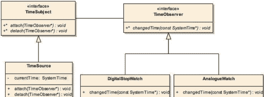
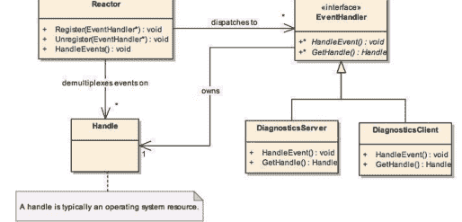

# C 模式


# 推特这本书！

请通过在 Twitter 上传播这本书来帮助 Adam Tornhill！

本书建议的推文内容为：

我刚买了 @AdamTornhill 的 #PatternsInc

本书建议的标签是 #patternsinc。

点击此链接在 Twitter 上搜索该标签，了解其他人对这本书的评价：

https://twitter.com/search?q=#patternsinc

- 实现策略模式 . . . . . . . . . . . . . . . . . . . . . . . . . . . . . . . . 22

## C语言中的模式

3

相反，我试图将 C 现有的设计元素转化为更高层次的结构。关于模式，需要意识到的一重要的一点是：它们既不是设计的蓝图，也不束缚于任何特定的实现。我的出发点是，可以找到符合 C 范式的机制，从而让 C 程序员能够从模式所捕捉的经验中获益。

项目一旦完成，我花了一些时间来记录我的发现。通过这本书，我希望将我的发现与你们分享。我查阅了原始著作，在必要的地方进行了修正，但很大程度上保留了原始内容未变。相反，我对每一章都提供了了新的反思。凭借多年学习和经验的优势，我希望对模式、背后的原理及其适用性提供一些见解。

让接下来的章节成为在广受欢迎 C 语言背景下讨论模式的起点。

## 本书范围

### 你将体验到什么

我相信，C 程序员将从日益丰富的模式库中获益。本系列将关注以下领域：

- *实现技术。* 我将介绍许多模式，并演示在 C 语言背景下实现这些模式的技术。如果我发现了实现中的常见变体，也将进行讨论。然而，其中包含的实现绝不能被视为最终规范。根据当前处理的问题，必须考虑每个模式的实现权衡。

- *解决的问题。* 模式用于解决问题。如果没有共同的问题，“模式”可能仅仅算作一个模式。因此，我将介绍引入该模式所解决的主要问题，并提供可以使用该模式的问题领域示例。

- *对设计的影响。* 每一个解决方案都意味着一组权衡。因此，每个模式都将讨论其对结果语境下设计质量的影响。

### ……以及你不会体验到的

- *面向对象特征的仿真。* 模式的实现将不会基于模拟继承或 C++ 虚函数等面向对象特征的技术。根据我的经验，这些功能留给编译器更好；手动模拟此类特征充其量是混淆了代码，最坏的情况下是难以追踪的 bug 的根源。相反，我的意图是介绍利用 C 语言已包含的抽象机制优势的模式。

- *对模式的深入讨论。* 由于本书的重点是 C 中的实现，每个模式都应该被视为原始模式描述的补充。通过这种方式，本系列将**不包括**对模式的详尽深入的处理。相反，我将提供模式的高层描述，并引用可以找到模式详细检查的现有工作。

## 模式分类

本书涵盖了以下模式：

### C语言中的模式

| 模式 | 分类 | 目的 |
| --- | --- | --- |
| 第一类 ADT `First-Class ADT` | 惯用 | 改进封装，管理依赖。 |
| 状态 `State` | 设计 | 模拟特定状态的行为。 |
| 策略 `Strategy` | 设计 | 封装算法族，使设计符合开闭原则。 |
| 观察者 `Observer` | 设计 | 松耦合实体之间的通知机制。 |
| 反应器 `Reactor` | 架构 | 解耦事件驱动应用中的职责。 |
| 表达式 `Expressions` | 惯用 | 用于增强表达力和健壮性的惯用集合。 |

这些模式跨越了以下类别：

- **架构模式。** Frank Buschmann 将此类模式定义为“软件系统的基本组织方案。它提供了一组预定义的子系统，指定了它们的职责，并包含了组织它们之间关系的规则和准则” [Buschmann, et al]。

- **设计模式。** 设计模式通常影响子系统或组件层级。书中描述的大多数模式属于这一类，包括源自经典《设计模式》`[Gamma, et all book]`一书的模式。

- **语言级模式。** 这是模式分类中最低的层级，也称为惯用`idioms`。语言级模式正如其名所示，是特定编程语言所独有的。一个简单经典的例子是 Kernighan 和 Ritchie 提供的 `strpy` 版本 [Kernigh & Ritchie]。

```c
void strcpy(char *s, char *t)
{
    while(*s++ = *t++);
}
```

## 示例代码

示例中包含的源代码可以在 GitHub 上获取：`https://github.com/adamtornhill/PatternsInC`

## 关于 Adam Tornhill

Adam 是一位结合了工程和技术学位的程序员。他是《你的代码即犯罪现场》`Your Code as a Crime Scene`¹）的作者，曾出版过《Lisp for the Web²》教程，并自出版了一本关于

《C语言中的模式》。Adam 还使用多种编程语言编写开源软件。他的其他兴趣包括现代史、音乐和武术。

## 致谢

深表感谢我美丽的 Jenny Tornhill，感谢她所有的支持和鼓励。Jenny³ 也设计了这本书的封面。

Drago Krznaric, Andre Saitzkoff, Tord Andersson 和 Magnus Adamsson 都读过原始系列的草稿。感谢你们的反馈！我还要感谢 ACCU⁴ 在 2005 年发表了原始文章。

最后，感谢多年来所有对原始著作发送鼓励性评论和反馈的人。这本书是送给你们的。

# 第一类 ADT 模式

## 对第一类 ADT 的反思

对《设计模式》一书的一种常见批评是，模式仅适用于像 C++ 或 Java 这样基于消息传递的面向对象的语言。模式被视为语言特性缺失的变通方案。这种逻辑认为，对模式的需求是该语言在某种方面不够强大的指示。

这种陈述确实有些事实可言。《设计模式》本身就明确地指出：“编程语言的选择很重要，因为它是观点视角之一” `Gamma, et al`。书中接着指出，其模式分类假设了“Smalltalk/C++ 级别的语言特性”。如果我们选择一种比 C++ 更高级的语言（如 Common Lisp），我们会发现许多设计模式并不适用；Common Lisp 有一个完全不同的设计空间。许多模式已经内化在语言本身中（例如 Common Lisp 对象通过泛型函数模型的第一类函数和 `VISITOR` 模式）。

但语言的威力取决于语境。有些问题尽管 Common Lisp 性能强大，但并不一定是最合适的选择。同样，也可能存在 C 不是最佳选择的情况。原因可能是技术性的、社会性的或文化性的。

事实上，有趣的部分是从 C 的视角来考虑模式。《设计模式》指出，过程化语言通常包含诸如封装之类的模式。第一类 ADT 正是这样一种模式。

对我来说，封装是一种管理复杂性的工具。它是分离问题不同方面的方法。根据我的角色，我可以从这些任何一个视角来观察设计：外部行为和内部细节。在成功的设计中，这两个视图是正交的，可以独立依赖。

与其他模式一样，它需要谨慎且带有品味地使用。我不会将所有的模块都设计成第一类 ADT。相反，我经常发现在应用不同层之间划分边界时该模式非常有用。第一类 ADT 可以作为不同开发团队之间的技术防火墙，允许其中一个团队发布接口，同时隐藏实现细节。这种设计鼓励了不同相关部分的并行工作。

## 实现第一类 ADT 模式

我们的模式之旅将从一种语言级模式开始，该模式将接口与实现解耦，从而改进封装并减少书中许多子模式的依赖。

# 第一类 ADT 模式

## 列表 1：`Customer.h` 中的接口

```c
/* 略去了头文件保护和包含文件。 */
#define MAX_NO_OF_ORDERS 42

/* 客户的内部表示。 */
typedef struct {
    const char* name;
    Address address;
    size_t noOfOrders;
    Order orders[MAX_NO_OF_ORDERS];
} Customer;

void initCustomer(Customer* customer,
    const char* name,
    Address* address);

void placeOrder(Customer* customer,
    const Order* order);
/* 许多其他相关函数... */
```

扫一眼代码就能看出问题所在。简单地增加 `MAX_NO_OF_ORDERS` 就能解决问题，对吧？但它的正确值应该是多少？是 64、128，甚至可能是 2048 或其他数字？对于只有一个订单的客户，是否会为例如 2047 个不存在的订单分配空间？

当你仔细思考这个问题时，会发现当前的解决方案扩展性并不良好。显然，我们需要另一种方案。回想一下代码库的库中存在链表。链表可能解决问题。然而，这意味着需要更改客户的内部结构。

没问题，看起来你已经考虑到了一切；客户模块的客户端只需要使用提供的函数来完成对客户结构的所有访问即可。更新这些函数应该足够了，不是吗？

## 信息隐藏

嗯，在理想世界中，客户应该被隔离在单个模块中。给定上述接口，客户端至少以一种方式依赖于内部结构。

最坏的情况下，客户端依赖数据结构本身，导致所有客户端都要进行昂贵的更改。

这可以通过频繁的代码检查和程序员的自律来避免。无论如何，我们仍然存在编译时的依赖关系，并且在更改后，需要重新编译所有客户端，在大型系统中，编译时间可能会非常长。

第一类 ADT 模式将消除这两种依赖问题。该模式为我们提供了一种分离接口与实现的方法，实现了真正的信息隐藏。

## 第一类 ADT 的定义

ADT 代表抽象数据类型 `Abstract Data Type`，它基本上是一组值以及对这些值进行的操作。如果我们能够拥有它的许多、唯一的实例，那么该 ADT 就被认为是第一类的。

听起来很像上面介绍示例中列出的接口，不是吗？然而，示例中的数据类型并不是抽象的，因为它未能隐藏实现细节。为了让它真正抽象，我们必须利用 C 语言的一个强大特性——指定不完整类型的能力。

# 第一类 ADT 模式

## 不完整类型

标准 `[C 1999]` 允许我们在不需要大小的上下文声明不完整类型的对象。在我们的实现中，我们对不完整类型的一个属性感兴趣——指向不完整类型指针的可能性（请注意，指针本身并不是不完整类型）。

## 列表 2：指向不完整类型的指针

```c
/* 指向不完整类型的指针（隐藏了实现细节）。 */
typedef struct Customer* CustomerPtr;
```

该指针的实例将作为第一类 ADT 客户端的句柄。这种机制强制执行了使用提供的接口函数的客户端的约束，因为没有客户端可以访问 `Customer` 结构中的字段（C 语言不允许对不完整类型进行解引用）。

一旦编译器检测到后续的具有相同标签的说明符，以及一个包含成员的声明列表，该类型就被认为是完整的。

## 列表 3：不完整类型的完成

```c
/* struct Customer 是一个不完整类型。 */
typedef struct Customer* CustomerPtr;

/* 客户的内部表示。 */
struct Customer {
  const char* name;
  Address* address;
  size_t noOfOrders;
  Order orders[42];
};
/* 在此之后，struct Customer 是完整的了。 */
```

# 对象 生命周期

在我们深入 ADT 的实现之前，我们需要考虑对象的创建和销毁。由于客户端只获取句柄，创建和销毁的责任交给了 ADT。一种简单的方法是编写一个函数来销毁对象。

## 列表 4：ADT 的接口，`Customer.h`

```c
/* 与之前相同的头文件保护和包含... */
/* 指向不完整类型的指针（隐藏了实现细节）。 */
typedef struct Customer* CustomerPtr;
```

```c
/* 创建 ADT 并返回其句柄。 */
CustomerPtr createCustomer(const char* name,
  const Address* address);
```

# 第一类 ADT 模式

```c
/* 销毁给定的客户。所有句柄将失效。 */
void destroyCustomer(CustomerPtr customer);
```

## 列表 5：`Customer.c` 中的 ADT 实现

```c
#include "Customer.h"
#include <stdlib.h>

struct Customer {
    const char* name;
    Address address;
    size_t noOfOrders;
    Order orders[42];
};

CustomerPtr createCustomer(const char* name,
                           const Address* address) {
    CustomerPtr customer = malloc(sizeof * customer);
    if(customer) {
        /* 初始化每个字段... */
    }
    return customer;
}

void destroyCustomer(CustomerPtr customer) {
    /* 必要时清理客户内部。 */
    free(customer);
}
```

上面的示例使用 `malloc` 获取内存。在嵌入式应用中，这可能不是一个选项。然而，由于我们封装了内存分配，我们可以选择其他方法。在嵌入式编程中，所需的数量通常是已知的，最简单的是数组。

## 列表 6：静态内存分配的示例

```c
#define MAX_OF_CUSTOMERS 42
static Customer objectPool[MAX_OF_CUSTOMERS];
static size_t numberOfObjects = 0;

CustomerPtr createCustomer(const char* name,
                            const Address* address)
{
    CustomerPtr customer = NULL;
    if (numberOfObjects < MAX_OF_CUSTOMERS)
    {
        customer = &objectPool[numberOfObjects++];
        /* 初始化对象... */
    }
    return customer;
}
```

在释放内存的情况下，数组仍然有效，但需要更复杂方法来跟踪“已分配”的对象。然而，这种算法超出了本书的讨论范围。

# 拷贝语义

由于客户端只使用句柄（我们将其声明为指针的 ADT），拷贝语义问题简化为了指针赋值。虽然这在运行时性能上很高，但句柄必须被正确管理；它们在在对象存在时才有效。

如果我们想要复制对象并创建一个新的、唯一的 ADT 实例，我们必须定义一个显式的拷贝操作。

4. **额外的间接层**。这涉及到细微的性能开销。使用第一类 ADT `FIRST-CLASS ADT` 模式意味着对数据结构的所有操作都增加了一层额外的间接。

5. **动态内存内存的增加**。在编译时未知某些数量可能存在许多实例的问题领域中，无法使用静态分配策略。因此，在应用第一类 ADT 模式时，动态内存的使用往往会增加。

## 使用用例

最著名的例子来自于 C 语言本身，或者更准确地说，来自 C 标准库——`FILE`。诚然，标准不允许 `FILE` 成为不完全类型，并且可能在标准库的深处识别出它的结构。然而，其原理是相同的，因为 `FILE` 的内部实现取决于具体实现，而依赖于它的程序本质上具有不可移植性。

Sedgewick[Sedgewick] 使用第一类 ADT 实现了许多基础数据结构，如链表和队列。

这种模式对于跨平台开发可能被证明有用。例如，在开发网络通信应用时，Berkeley Sockets 和 Winsock 库之间存在差异。第一类 ADT 模式为客户端提供了抽象这些差异的工具。

诀窍在于提供 ADT 的两种不同实现，它们都共享相同的接口（即包含头文件）。

## STATE 模式

## 对 STATE 的反

多年来，`STATE` 模式一直是多次成功重构的终点。`STATE` 模式的主要问题在于它的名字。这个名字起得不好。毕竟，状态 `state` 是所有命令式编程中关于它们的话题。由于这样一个具有主导地位的名字，我们面临着将重点放在“状态模式”本身上的风险。它是一个相当复杂的模式。我倾向于仔细地权衡替代方案。在大多数情况下，更简单的替代方案就足够。其他模式，如“状态的方法”`Methods for States`，更容易理解。在简单的情况下，显式的条件逻辑通常就足够了；我们只需要注意重复。至于模式的名称，《设计模式》`Design Patterns`建议了一个更好的名字：“用于状态的对象”`Objects For State`。这个备选名称更合适，它以一种更好的方式表达了意图和结构。

我在函数式编程语言中的历经历教会了我最小化状态和副作用的价值。在程序中引入状态会影响我们理解程序的能力。我们不仅要从输入的角度考虑算法，还必须确定当前状态以及它将如何影响计算。为了思考这些问题，大多数这些状态是隐藏的。它们通常在设计中是隐式的，表现为变量的组合。通过组织和划分显式状态，我们获得了观察问题的不同视角。虽然所有良好的设计都试图将副作用减少到最低，但可变状态是命令式编程中固有的一个复杂方面。我们需要概念工具来成功地表达它。

## 实现 STATE 模式

每个非复杂的程序在其生命周期内都会经过许多不同的状态。将这种生命周期描述为有限状态机是一种简单且实用的抽象。本章研究了实现状态机的不同策略。目标是识别出机制，让代码能够传达出将问题表示为有限状态机的意图。


考虑一个简单的数字秒表。在它最基本的版本中，它有两个状态：启动（`started`）和停止（`stopped`）。在 C 中实现此点的传统方法是使用 `switch/case` 语句和 `if-else` 子句的条件逻辑。示例中的数字秒表是以第一类 ADT 实现的。

```c
typedef enum {
    stopped,
    started
} State;

struct DigitalStopWatch {
    /* 让一个变量持有我们对象的状态。 */
    State state;
    Time source;
} DigitalStopWatch;

void startWatch(DigitalStopWatchPtr instance) {
    switch(instance->state) {
        case started:
            /* 已经启动 -> 什么都不做 */
            break;
        case stopped:
            instance->state = started;
            break;
        default:
            error("Illegal state");
            break;
    }
}

void stopWatch(DigitalStopWatchPtr instance) {
    switch(instance->state) {
        case started:
            instance->state = stopped;
            break;
        case stopped:
            /* 已经停止 -> 什么都不做 */
            break;
        default:
            error("Illegal state");
            break;
    }
}
```

这是一个通用的简单解决方案。虽然编码结构可能很简单，但这种方法引入了几个潜在问题：

- **不可扩展**。在大型机器中，代码可能会跨越一页又一页的嵌套条件逻辑。想象更改大型、单体语句段是真正的维护噩梦。
- **重复**。条件逻辑往往在所有访问状态变量的函数中重复出现，并有细小的变化。重复总是会导致易出错的维护。例如，简单地添加新状态就意味着要更改函数。
- **关注点分离**。当使用条件逻辑实现状态机时，状态机本身的代码与各种事件相关的操作之间没有清晰的分离。这使得代码隐藏了原始意图（将行为抽象为有限状态机），从而使代码的可读性降低。

## 基于表格的解决方案

实现有限状态机的第二种传统方法是通过转换表。使用这种技术，我们原始的示例现在读如下：

```c
typedef enum {
  stopped,
  started
} State;

typedef enum {
  stopEvent,
  startEvent
} Event;

#define NO_OF_STATES 2
#define NO_OF_EVENTS 2

static State TransitionTable[NO_OF_STATES][NO_OF_EVENTS] = {
  {stopped, started},
  {stopped, started}
};

void startWatch(DigitalStopWatchPtr instance) {
    // ... 逻辑省略
}

void stopWatch(DigitalStopWatchPtr instance) {
    // ... 逻辑省略
}
```

（注：此处为示例代码补全，保持逻辑一致）

使用表格的这种方法解决了之前的问题：

- **扩展性良好**。独立于状态机的大小，状态转换仅限于转换表。
- **无重复**。不需要 `switch/case` 语句，添加状态时代码保持不变。
- **易于理解**。结构良好的转换表作为完整周期的良好概述。

## 表格的局限性

尽管表格状态机看起来很有吸引力，但它们有一个主要的缺点：很难为转换添加操作。例如，秒表通常需要调用一个函数来启动。遗憾的是，状态转换不是显式的，必须添加条件逻辑来确保调用相应的函数。结合条件逻辑，基于表格的固有优点随之减少。

其他方法涉及将简单的枚举替换为函数指针。这个问题可以解决，但结果设计要么放弃类型安全，要么传递无效参数。这些替代方案看起来都不理想。

转换表有其用处，但当需要与转换关联操作时，`STATE` 模式提供了更好的替代方案。

## 进入 STATE 模式

在对 `STATE` 模式的描述中，《设计模式》将其与基于表格方法的区别定义为：“状态模式对特定状态进行建模，而表格驱动方法侧重于定义状态转换”。将 `STATE` 模式应用到我们的示例时，出现了如下结构：

| DigitalStopWatch | WatchState |
|---|---|
| * `startWatch(): void` | * `startWatch(): void` |
| * `stopWatch(): void` | * `stopWatch(): void` |
| StoppedState | StartedState |
|---|---|
| * `startWatch(): void` | * `stopWatch(): void` |

> 图 1：`STATE` 模式的标准结构。

这个图看起来像是一个面向对象的解决方案。但请担心——我们不会在 C 中遵循继承的诱惑。然而，在开发具体的实现之前，让我们解释一下涉及的参与者。

- `DigitalStopWatch`：设计模式将其定义为上下文。上下文指向我们的状态之一，而不知道具体是哪一个。由上下文指定客户端的接口。
- `WatchState`：定义状态机的接口，指定所有支持的事件。
- `StoppedState` 和 `StartedState`：这些是具体状态，每个都封装了与其代表的状态相关的行为。

状态模式的核心思想是将每个状态表示为自己的对象。状态转换简单意味着将上下文（`DigitalStopWatch`）中的引用从一个具体状态变为另一个。

## 实现机制

在 C 语言中，哪种机制可能适用于这种清晰的面向思路？回到我们的示例，我们看到基本上在每次状态转换时都要切换函数。幸运的是，C 语言提供了一个强大的特性——函数指针，它通过允许我们在运行时更改对象的行为，完美地满足了这一需求。使用这种机制，状态的接口看起来如下：

列表 1：`WatchState.h` 中的状态接口

```c
/* 状态表示本身的不完整类型。 */
typedef struct WatchState WatchStatePtr;
/* 使用 typedef 简化代码 */
typedef void (*EventStartFunc)(WatchStatePtr);
typedef void (*EventStopFunc)(WatchStatePtr);
struct WatchState
{
EventStartFunc start;
EventStopFunc stop;
};
```

## 打破依赖循环

在习惯了函数指针这种令人生的语法后，上面的接口看起来相当不错。然而，按照现有的接口方式，将会产生一个依赖循环。

考虑 `WatchState` 结构体中的指针。每个具体的状态都必须定义要指向的函数。每当向接口添加一个事件时，所有的具体状态都必须更新。生成的代码在维护上容易出错，且不够灵活。

好消息是打破这种依赖循环是非常简单的，而且该解决方案具有提供潜在错误处理程序的良好优点。诀窍在于提供一个默认实现，如下面的列表所示。

列表 2：像以前一样扩展接口..

```c
void defaultImplementation(WatchStatePtr state)
{
  /* 如果具体状态不支持 stop 事件，
  我们将会到达这里。 */
}
static void defaultStop(WatchStatePtr state)
{
  /* 如果具体状态不支持 start 事件，
  我们也将到达这里。 */
};
```

列表 3：在 `WatchState.c` 中提供默认实现

```c
11 }
12
13 void defaultImplementation(WatchStatePtr state)
14 {
15     state->start = defaultStart;
16     state->stop = defaultStop;
17 }
```

## 具体状态

默认实现完成了状态的接口。每个状态本身的接口是极小的；要做的就是为状态的入口函数。列表 4：具体状态接口，`StoppedState.h`

```c
1 #include "WatchState.h"
2
3 void transitionToStopped(WatchStatePtr state);
```

列表 5：具体状态接口，`StoppedState.h`

```c
1 #include "WatchState.h"
2
3 void transitionToStarted(WatchStatePtr state);
```

入口函数的职责是将传递的 `WatchState` 结构体中的指针指向指定特定状态行为的函数。我们可以利用默认实现，具体状态的实现非常直观；每个具体状态指定该状态下感兴趣的事件。列表 6：`StoppedState.c`

```c
1 #include "StoppedState.h"
2 /* 可能转换到后续状态： */
3 #include "StartedState.h"
4
5 static void startWatch(WatchStatePtr state)
6 {
7 transitionToStarted(state);
8 }
9
10 void transitionToStopped(WatchStatePtr state)
11 {
12 /* 在指定 stopped 状态下处理的
13 事件之前，先用默认实现进行
14 初始化。 */
15 defaultImplementation(state);
16 state->start = startWatch;
17 }
```

列表 7：`StartedState.c`

```c
#include "StartedState.h"
/* 可能转换到后续状态： */
#include "StoppedState.h"

static void stopWatch(WatchStatePtr state)
{
    transitionToStopped(state);
}
void transitionToStarted(WatchStatePtr state)
{
    /* 用默认实现进行初始化，
       指定 started 状态下处理的事件。 */
    defaultImplementation(state);
    state->stop = stopWatch;
}
```

## 客户端代码

到目前为止奋斗的奖励现在实现上下文（即状态机的客户端）时得到了。所有的客户端代码需要做的就是在设置好初始状态后，将请求委托给状态。

```c
struct DigitalStopWatch
{
    struct WatchState state;
    TimeSource source;
    Display watchDisplay;
};

DigitalStopWatchPtr createWatch(void)
{
    DigitalStopWatchPtr instance = malloc(sizeof *instance);
    if(NULL != instance){
        /* 指定初始状态。 */
        transitionToStopped(&instance->state);
        /* 在此处初始化其他属性... */
    }
    return instance;
}

void destroyWatch(DigitalStopWatchPtr instance)
{
    free(instance);
}
```

```c
27
28 void startWatch(DigitalStopWatchPtr instance)
29 {
30     instance->state.start(&instance->state);
31 }
32 
33 void stopWatch(DigitalStopWatchPtr instance)
34 {
35     instance->state.stop(&instance->state);
36 }
```

## 调试辅助

为了调试，可以扩展状态机包含实际状态名称的字符串：

```c
1 void transitionStopped(WatchStatePtr state)
2 {
3     defaultImplementation(state);
4     state->name = "Stopped";
5 }
```

利用这个扩展，就可以提供诊断信息。回到我们的 `WatchState.c` 实现，代码现在如下：

```c
1 static void defaultStop(WatchStatePtr state)
2 {
3 /* ... */
4 logUnsupportedEvent("Stop", state);
5 }
```

## 扩展状态机

状态模式优点之一是它封装了状态，使得状态易于扩展。

- 添加新事件。支持新事件意味着扩展 `WatchState` 使用上述机制，在 `WatchState.c` 中添加了新的默认实现。意图支持它的状态。
- 添加新状态。新的具体状态必须实现所有事件，唯一需要更改的现有代码是转换到新状态的状态。请注意状态模式保留了基于表的解决方案的优点：客户端代码即上下文保持不变。

## 无状态状态

示例代码中的状态是无状态的，即 `WatchState` 结构体仅包含重入函数的指针。这是状态模式的一种特例 [Gamma 等]。“如果状态对象拥有实例变量，上下文就可以共享一个状态对象”。然而，在共享状态之前，我想指出 Joshua Kievsky 的建议，“最好在用户体验部署后添加状态共享代码，状态实例化代码是主要的瓶颈” [Kievsky]。

在 C 语言中，可以通过在每个函数内部声明表示某个状态的静态变量来共享状态。由于变量具有永久存储，转换函数的签名改为返回指向特定状态变量的指针。

列表 8：无状态函数入口，`Stateless.c`

```c
WatchStatePtr transitionToStarted(void)
{
    static WatchState startedState;
    static int initialized = 0;

    if(!initialized)
    {
        defaultImplementation(&startedState);
        startedState.stop = stopWatch;
        initialized = 1;
    }

    return &startedState;
}
```

客户端已从持有状态的变量改为持有指向共享状态变量的指针。此外，上下文必须定义一个回调函数，以便具体状态请求状态转换时调用。

列表 9：更改状态的客户端代码

```c
void change(DigitalStopWatchPtr instance,
WatchStatePtr newState)
{
    /* 提供了一个良好的控制位置，
       跟踪消息（所有状态转换）都必须
       通过这个函数）。 */
    instance->state = newState;
}
```

# 状态模式 (STATE Pattern)

```cpp
static void startWatch(DigitalStopWatchPtr context)
{
    changeState(context, transitionToStarted());
}
```

无状态方法的一个优点是状态转换点集中在上下文（`context`）中。一个显而易见的缺点是需要传递上下文的引用。这个引用充当了内存，允许新状态映射到正确的上下文。

另一个缺点是，在多线程环境中，必须小心状态将运行的静态变量的初始化。

## 后果

应用状态模式的主要后果是：

- 1. **通过复杂的、改变状态的条件逻辑减少重复**。如上面的示例所示，基于大量条件逻辑的解决方案往往包含重复代码。状态模式为消除重复和降低复杂性提供了一种极吸引吸引替代方案。
- 2. **意图表达清晰**。上下文将所有依赖于状态的操作委托给状态接口。与基于表的解决方案类似，状态模式让代码反映出将问题抽象为有限状态机的意图。而在复杂的条件逻辑中，这种意图通常显得不那么明显。
- 3. **封装每个状态的行为**。每个具体状态都对其行为提供了良好的概述，包括该状态支持的所有事件。封装使得在对某个状态进行更改时，能够更容易识别和更新相关代码。
- 4. **隐式错误处理**。基于条件逻辑的解决方案以及基于表的解决方案，都需要显式代码来确保给定的状态和事件组合是有效的。使用上述通过默认实现进行初始化的技术，控制逻辑被构建在解决方案中了。
- 5. **增加编译单元的数量**。使用状态模式后，代码通常会减少。正如设计模式所说，“如果状态很多，分布实际上是件好事”。然而，对于只有少数简单状态的微小机器，状态模式可能会引入不必要的复杂性。在这种情况下，如果未知是否会添加更复杂的行为，可能依赖条件逻辑更好；这种逻辑将易于理解。

## 总结

状态模式允许我们表达有限状态机，使代码的意图变得清晰。行为基于每个状态进行划分，并且所有的状态转换都是显式的。

在实现复杂的依赖状态的行为时，状态模式可以作为一个非常有价值的工具。另一方面，对于状态较少的简单问题，条件逻辑恰恰。。

# 策略模式 (STRATEGY Pattern)

## 对策略模式的反思


在书中所有的设计模式中，策略模式（`STRATEGY`）是我使用最频繁的一种。这种模式是基础性的。它是思维的自由转变。应用策略将算法的焦点从“如何做”转移到“做什么”。与其试图控制函数如何执行其任务，我们不如通过一个封装了“做什么”的高层行为来对其参数化。

在软件设计中，过度耦合是程序受害最大的属性之一。最糟糕的耦合形式是控制耦合。在控制耦合的退化情况下，客户端向某些对象传递一个标志位（`flag`）来控制其行为。这是一种常见的编码风格，会导致条件逻辑。过多的条件逻辑本身就引入了复杂性。但情况会糟。

正如我在原文中讨论的那样，控制耦合破坏了封装。突然，函数被拆解，模块融合在一起。这种代码难以扩展。它就像是 Bug 的邀请。我发现的最难的 Bug 是当不同功能之间相互作用时。这正是使用控制耦合方法的情况。相反，良好的设计将功能和变化分离。它让它们独立地变化（功能通常有不同的变化率），而无需参数。

策略模式并不是一种面向对象的模式。我对《四人行模式》一书的主要问题之一是它大量使用了类图。打开书中的任何一个模式，我们看到的第一样就是类图。通常，一个类似的图会在“结构”部分重复出现。这导致许多开发者将图表与实际模式混淆。它并不是最好的，它只是在特定语言中实现该模式的一种方法。仅此如此。一个模式是一个动态的、生成性的实体。根据上下文的不同，模式的应用每次看起来都可能截然不同。我坚信，如果《四人行》能排除结构部分，对设计模式运动造成的很多伤害本是可以避免的。

## 实现策略模式

识别并利用共性是软件设计的基石。通过封装和重用公共功能，设计的质量将超越代码重复和令人恐惧的“复制-粘贴”等反模式。在本章中，我们将使用策略模式来实现一个奖金系统。

策略模式允许我们根据客户的类型改变客户的行为。例如，我们有三种客户：

- 铜级客户：获得 2% 折扣。
- 银级客户：获得 5% 折扣。
- 金级客户：获得 10% 折扣。

通过使用策略模式，我们可以将每种客户的折扣逻辑封装在单独的类中，使代码更容易扩展和维护。

### 策略模式

```cpp
enum CustomerCategory {
    bronze,
    silver,
    gold
};

class CustomerStrategy {
public:
    virtual ~CustomerStrategy() {}
    virtual double calculatePrice(double totalAmount) = 0;
};

class BronzeStrategy : public CustomerStrategy {
public:
    double calculatePrice(double totalAmount) override {
        return totalAmount * 0.98;
    }
};

class SilverStrategy : public CustomerStrategy {
public:
    double calculatePrice(double totalAmount) override {
        return totalAmount * 0.95;
    }
};

class GoldStrategy : public CustomerStrategy {
public:
    double calculatePrice(double totalAmount) override {
        return totalAmount * 0.90;
    }
};

class Customer {
private:
    CustomerStrategy* strategy;
public:
    Customer(CustomerStrategy* s) : strategy(s) {}
    void setStrategy(CustomerStrategy* s) {
        strategy = s;
    }
    double getPrice(double totalAmount) {
        if (strategy) {
            return strategy->calculatePrice(totalAmount);
        }
        throw std::runtime_error("Strategy not set");
    }
};

double calculatePrice(CustomerCategory category, double totalAmount) {
    switch (category) {
        case bronze:
            return BronzeStrategy().calculatePrice(totalAmount);
        case silver:
            return SilverStrategy().calculatePrice(totalAmount);
        case gold:
            return GoldStrategy().calculatePrice(totalAmount);
        default:
            throw std::invalid_argument("Unsupported category");
    }
}
```

上面的代码使用了 `switch` 语句，如果增加了更多类别，这并不理想。通过使用策略模式，我们可以避免 `switch` 语句并使代码更具扩展性。

### 实现机制

在 C 语言中实现 `STRATEGY` 模式时，由于缺乏对多态和继承的支持，必须找到一种面向对象特征的替代方案来实现抽象。这个问题与在 C 中实现 `STATE` 模式时面临的问题几乎相同，这表明可以使用相同的机制，即函数指针。通过指针指定具体的操作被证明是实现动态行为的一种高效技术。

在 C 语言实现中，图中的基本结构仍然保留，但接口被表示为函数指针的声明。

#### 列表 2：`CustomerStrategy.h` 中的策略接口

```c
typedef double (*CustomerPriceStrategy)(double amount,
                                            double shipping);
```

不同的策略通过遵循接口指定的签名来实现。每个客户类别的权限（即上下文）各异，这些差异被封装在各自具体的策略中。根据具体策略的复杂性和内聚性，源代码可以组织为每个客户一个策略，也可以将所有支持的策略聚集在一个单一编译单元中。对于本示例中使用的策略，选择了后者方法。

#### 列表 3：`CustomerCategories.c` 中指向具体类别的接口

```c
double bronzePriceStrategy(double amount, double shipping);
double silverPriceStrategy(double amount, double shipping);
double goldPriceStrategy(double amount, double shipping);
```

#### 列表 4：`CustomerCategories.c` 中具体客户策略的实现

```c
/* 在生产环境中，所有输入都应该在进入每个函数时
进行验证，并确保计算的安全。 */
double bronzePriceStrategy(double amount, double shipping)
{
    return amount * 0.98 + shipping;
}

double silverPriceStrategy(double amount, double shipping)
{
    return amount * 0.95 + shipping;
}
double goldPriceStrategy(double amount, double shipping)
{
    /* 黄金客户免运费。 */
    return amount * 0.90;
}
```

使用这些策略，上下文代码现在将计算委托给与客户相关的策略。

#### 列表 5：委托给策略，`Customer.c`

```c
#include "CustomerStrategy.h"
/* 省略其他包含文件... */
struct Customer {
    const char* name;
    Address address;
    List orders;
    /* 将策略绑定到 Customer: */
    CustomerStrategy priceStrategy;
}
void placeOrder(struct Customer* customer, const Order* order) {
    double totalAmount = customer->priceStrategy(order->shipping);
    /* 更多处理订单的代码... */
}
```

上述代码选择了设计算法。由于客户现在只依赖于策略接口，可以添加或删除类别，而无需更改客户代码，且不会有向现有策略中引入 Bug 的风险。实现中剩余的开放问题是指定如何将特定策略绑定到客户。

### 绑定策略

策略可以由客户的客户端提供并在创建客户期间绑定到客户，或者由客户本身选择一个初始策略。前者的方案显然更灵活，因为它避免了客户依赖于具体策略。以下代码说明了这种方法，使用了作为一类抽象数据类型（`FIRST-CLASS ADT`）实现的客户。

#### 列表 6：创建时绑定策略，`Customer.c`

```c
CustomerPtr createCustomer(const char* name,
    const Address* address,
    CustomerPriceStrategy priceStrategy)
{
    CustomerPtr customer = malloc(sizeof(*customer));
    if(NULL != customer)
    {
        /* 绑定客户端提供的
        初始策略。 */
        customer->priceStrategy = priceStrategy;
        /* 在这里初始化
        客户的其他属性。 */
    }
    return customer;
}
```

#### 列表 7：指定绑定的客户端代码

### STRATEGY 模式

```c
#include "Customer.h"
#include "CustomerCategories.h"
static CustomerPtr createBronzeCustomer(const char* name, 
    const Address* address)
{
    return createCustomer(name, address, bronzePriceStrategy);
}
```

根据当前的问题，它可以被重新绑定到策略。例如，当客户升级为银牌级时，客户应该与 `silverPriceStrategy` 关联。使用函数指针技术，运行策略策略意味着指向另一个函数。

#### 列表 8：重新绑定策略，`Customer.c`

```c
void createPriceCategory(CustomerPtr customer, 
    CustomerStrategy newPriceStrategy)
{
    assert(NULL == customer);
    customer->priceStrategy = newPriceStrategy;
}
```

另一种方案是避免绑定，让客户端在每次函数调用时将不同的策略传递给上下文。如果上下文没有任何状态内存，这种替代方案可能适用。例如，在这个使用了一类对象的例子中，情况恰恰相反，自然的抽象是如上所示将客户与价格策略关联。

### STRATEGY 与 STATE 的比较

在讨论 `STRATEGY` 模式时，它与《设计模式》[`Gama, et al`] 书中前一个模式的关系值得特别提及。`STATE` 和 `STRATEGY` 设计模式密切相关。`Robert C. Martin` 这样说道：“State 模式的所有实例都是 Strategy 模式的实例，但并非所有 Strategy 模式的实例都是 State 模式实例” [`Martin`]。

这一观察让我们想起了《设计模式》合作者 `John Vlissides` 的一段话：“让模式的意图来引导它们的差异，而不是实现它们的类” [`Vlissides`]。事实上，尽管 `STATE` 和 `STRATEGY` 具有相似的结构，但它们的意图是不同的。

与上述示例有关，如果类别是基于转换的，那么 `STATE` 将是更好的选择。然而，如果结果是类别的成员身份，`STRATEGY` 是一个更好的抽象。虽然这不能被视为普遍真理，但另一个观察涉及到这些模式的用法：`STATE` 倾向于是上下文的内部关注。与 `STRATEGY` 相比，客户端通常将策略绑定到其上下文。

### 后果

应用 `STRATEGY` 模式的主要后果是：

- 开闭原则原则的好处。`STRATEGY` 设计模式提供了极大的灵活性，允许客户端通过实现他们自己的具体策略来更改和控制现有模块的行为。因此，通过添加新代码而不是修改代码来支持功能。
- 减少复杂性和条件逻辑。复杂的交互可能导致充斥着条件逻辑单体模块，可能以控制耦合的形式存在。此类代码往往难以维护和扩展。通过将条件分支的每个分支封装在策略中，`STRATEGY` 模式消除了条件逻辑。
- 允许相同算法的不同版本。模块的非功能性需求可能根据其用法而异。速度与内存使用之间的典型权衡是经典的。使用 Strategy 模式，权衡的选择可以委托给用户（策略可以提供相同行为的不同实现）(`Gamma, et al.`)。
- 额外的间接层。这种后果产生的主要问题是，策略需要从上下获取数据。由于所有作为策略的函数必须遵循相同的签名，简单地添加参数会降低内聚性。将上下文实现为一类数据类型（`ADT`）可能会解决这个问题，因为它将参数减少到单个句柄。通过一类 ADT 方法，关于感兴趣的数据的知识封装在每个策略中，并通过对一类 ADT 的句柄获取。仔细的设计应努力保持实现为一类 ADT 的模块具有高内聚性，避免其退化为不同策略所需的无关数据的仓库（这种设计通常表明选择了错误的抽象）。

### 使用示例

`STRATEGY` 在框架设计中指定策略时可能非常有用。使用 `STRATEGY`，客户端可以参数化实现。

例如，错误处理通常委托给应用程序。这种设计可以通过让客户端提供一个在发生错误时调用的策略来实现。通过这种方式，可以以应用程序特定的方式处理错误，其范围从简单的忽略错误到记录日志甚至重启系统。

## 观察者模式 (`OBSERVER`)

### 对观察者模式的反思

在我编写最初关于模式的文章时，我是基于几段生产代码的实际经验编写实现的。在过去的几年里，我收集了一些常用模式的笔记和示例实现。我最初的计划是发布五篇文章，从更通用的模式开始。这导致我必须在这些模式之间进行选择和排序。前三个（一类 ADT、状态模式 `STATE` 和策略模式 `STRATEGY`）都已给出。我知道我想通过对反应器模式 `REACTOR` 的讨论来结束全文。显然，某些模式必须被选出来。

我最终选择了观察者模式（`OBSERVER`）。回想起来，其他模式可能是更好的候选者。例如，门面模式 `FACADE`（`Gamma` 等人）在 C 语言中既直接又自然。最后，我选择观察者模式是出于：准备工作和通用性。

首先，我在观察者模式中使用的实现机制与我倾向于用于反应器模式的机制相似。观察者模式的实现可以作为引入更复杂的架构——反应器模式的入门。

其次，事件通知是许多应用程序的一部分。解耦事件通知的发送者和接收者是核心。今天，许多编程语言已经包含了对观察者模式的原生支持。例如，`C#` 通过其事件机制提供了一个通用版本。当然，`Common Lisp` 通过之前和之后的方法方法拥有它，这使得观察者模式的实现既简单又具有表现力。在 C 语言中，我们必须面对更多挑战才能获得合适的实现。如果做得好，观察者仍然是一个可行的解决方案。

### 实现观察者模式

管理系统中实体之间的依赖关系对于健壮的设计至关重要。在上一章中，我们查看了开闭原则的核心。现在，我们将转向另一个依赖管理原则，并说明如何使用观察者模式来实现这两种原则。

### 依赖的产生

回到用于状态模式的示例中，它们描述了实现简单秒表行为的技术。实现此类秒表通常涉及从某种时间源获取时间的任务。由于时间源可能与操作系统的交互绑定，因此将其封装在一个抽象中以隐藏系统特定的部分，是一个好主意，以便于测试和可移植性。同样，数字秒表的内部结构也应该封装在它自己的模块中。由于数字秒表负责从时间源获取时间（为了显示在它的数字显示屏上），显然秒表和时间源之间存在依赖关系。这种依赖的方向有两个显而易见的选择。

### 将秒视为视为

将秒表视为时间源的客户端似乎相当自然。也就是说……遗憾的是，在这个方向上实现依赖引入了一个显而易见的问题：秒表如何知道时间变化了？快速回答是：它不知道。至少，除非它对时间源引入了某种轮询机制。正如避免过早优化同样重要，人们也努力避免过早悲观化：

### 观察者模式

即使依赖的方向看起来是正确的，这种解决方案也很可能消耗大量的 CPU。如果应用程序需要执行除更新显示之外的更多操作，那么该问题就需要另一个解决方案。

### 让时间源更新秒表

通过反转依赖关系，可以很容易避免上述的潜在问题。时间源可以在时间发生变化时只需通知秒表。这种方法引入了从时间源到秒表的依赖。

#### 列表 1：时间源代码


```c
#include "DigitalStopwatch.h"
#include "SystemTime.h"

static DigitalStopWatchPtr digitalWatch;
static SystemTime currentTime;

/* 由应用程序在启动时调用。 */
void startTimeSource() {
    digitalWatch = createWatch();

     /* 代码用于设置中断处理程序或
    类似的程序，以便每毫秒从操作系统
接收通知。 */

}

/* 此函数通过与操作系统的 
交互被调用。 */
static void mTick() {
    /* 调用一个封装了时间
    表示法知识的函数。 */
    currentTime = calculateNewTime();

    /* 通知秒表又过去了一个毫秒。 */
    notifyChangedTime(digitalWatch, currentTime);
}
```

这种解决方案的吸引力在于由于其简单性。然而，如果扩展性和灵活性是该解决方案所需要的属性，那么这种权衡是不可接受的。引入的潜在问题通过该设计所违反的原则来描述最为恰当。

## 开闭原则

回顾一下开闭原则，它被总结为“软件实体（类、模块、函数等）应该对扩展开放，但对修改关闭” [Martin]。源代码清楚地违反了这一点。在它目前的形状下，它只支持一种类型的单个秒表。想象支持其他类型的秒表，例如带有模拟显示器的秒表。时间源代码由于其硬编码的通知，将在所有类型的秒表上产生全方向的依赖爆炸。

## 稳定依赖原则

在软件维护或增量开发期间，现有代码的更改通常是不可避免的；即使应用了开闭原则，设计也只是根据原始设计者的假设关闭了某些修改（对于软件实体来说，完全关闭所有类型的更改几乎是不可能的）。稳定依赖原则试图通过以下建议来隔离现有代码更改的影响，即软件实体应该“向着稳定性的方向依赖” [Martin]。

在最初的这种方法中，秒表从时间源获取方向。从稳定依赖的方向来看，这是一个更好的选择。时间源通常是一个高内聚单元且更稳定的实体；只需将其封装在合适的抽象中（隐藏系统细节），就能使其成为封装在可用的低层领域的良好候选者。

通过让时间源依赖于高层的数字秒表，我们违反了稳定依赖原则。这种违反体现在让秒表更新的代码上。

将第一种方法的依赖方向与第二种方法的通知机制相结合，将使其成为理想的设计，观察者模式提供了必要的额外独立性，以获得两种解决方案的优点，而不受任何一种的副作用。

## 观察者 (OBSERVER)

观察者模式作为使开闭原则发挥作用的工具。设计 [Gama 等] 捕捉了观察者模式的意图：“在对象之间定义一对多的依赖，当一个对象的状态改变时，它的所有依赖者都会收到通知并更新”。将观察者模式应用于我们的示例中，带有第二种类型的秒表，“依赖者”是不同的秒表。设计模式定义了 `TimeSource` 扮演的角色为“具体主题”，状态改变的对象应该触发对观察者的通知和更新，即观察者。



图 1：通过观察者的解耦器和接收器。

## 实现机制

为了将主体与其具体的观察者解耦并仍然使主体能够通知它们，每个观察者必须对应一个唯一的实例。一类 ADT 模式提供了实现这种目标的方法。然而，从主体来看，所有观察者必须抽象为一种共享通用接口的通用类型。在 C 语言中，由于缺乏继承的支持，通用性通常由 `\void*` 表示；任何对象的指针都可以转换为 `\void*` 并转换回其原始类型而不丢失信息。

列表 2：观察者的接口，`TimeObserver.h`

## 观察者模式 (OBSERVER Pattern)

```c
typedef void (*ChangeTimeNotification)(void* instance,
                           const SystemTime* newTime);
typedef struct
{
    void* instance;
    ChangeTimeNotification notification;
} TimeObserver;
```

该接口声明了一个函数指针，事实这是实现动态行为的一种高效技术：具体的观察者会将自身以及一个函数指针附加到主体（subject）上。当主体发生变化时，它通过绑定的函数通知观察者。

通过使用抽象，类型安全性基本上是用灵活性换得的：将观察者转换回其原始类型的责任由程序员承担。将其转换为原始类型之外的其他类型可能会导致灾难性的后果。弗兰茨·卡夫卡虽然对 C 语言编程并不熟悉，但他提供了一个行为很好的示例：“当格里戈尔·萨姆某一天早上从不安的梦中醒来时，他发现自己躺床上变成了一只巨大的害虫” [Kafka]。显然，格里戈尔·萨姆并不是类型安全的。为了防止这种错误的转换，引入了 `TimeObserver` 来维护观察者与函数指针之间的绑定。隐式类型转换被封装在观察者内部，如代码所示。

列表 5：实现为一类抽象数据类型（ADT）的具体观察者

```c
/* 头文件。 */
struct DisplayStopWatch
{
    Display watchDisplay;
    /* 其它其他属性，例如
      数字显示。 */
};

/* TimeObserver 接口所需的函数的实现。 */
static void changedTime(void* instance,
                        const SystemTime* newTime)
{
    DigitalStopWatchPtr digitalWatch = instance;
    assert(NULL != digitalWatch);

    updateDisplay(digitalWatch, newTime);
}
```

在观察者获取任何通知之前，它必须对其进行注册。列表 4 声明了观察者所需的接口。

列表 4：主体的接口，`Subject.h`

```c
#include "TimeObserver.h"
void attach(const TimeObserver* observer);
void detach(const TimeObserver* observer);
```

这些接口由具体主体 `TimeSource` 实现，它必须跟踪所有附加的观察者。下面的示例使用链表来完成该任务。附加观察者对应于将给定的 `TimeObserver` 表示的副本添加到列表中。同样，在调用 `detach` 时，应从列表中移除与给定 `TimeObserver` 对应的节点，该观察者将不再接收来自主体的任何通知。下面的代码段阐述了这种机制。

列表 5：主体的实现，`TimeSubject.c`

```c
#include "TimeSubject.h"
struct ListNode {
  TimeObserver item;
  struct ListNode* next;
};
static ListNode* observers;
static SystemTime currentTime;

/* 管理链表的局部辅助函数
   （省略实现部分） */
static void appendToList(const TimeObserver* observer) {
  /* 将观察者的副本添加到链表尾。 */
}
static void removeList(const TimeObserver* observer) {
  /* 在链表中找到该观察者并
   移除该节点。 */
}

/* TimeSubject 接口的实现。 */
void attach(const TimeObserver* observer) {
  assert(NULL != observer);
  appendToList(observer);
}
void detach(const TimeObserver* observer) {
  assert(NULL != observer);
  removeList(observer);
}
```

```c
/* TimeSource 原始职责的实现（省略了初始化等代码）。 */
static void msTick()
{
    struct ListNode* node = observers.next;


    /* 调用封装了关于时间表示
       知识的函数。 */
    currentTime = calculateNewTime();

    /* 遍历链表并通知每个
       观察者又一个毫秒过去了。 */
    while(NULL != node)
    {
        TimeObserver* observer = &node->item;
        observer->notification(observer->instance,
                               currentTime);

        node = node->next;
    }
}
```

上面的代码解决了我们的问题；可以在不修改 `TimeSource` 的情况下添加新类型的计时表，这些计时表（我们的观察者）以高效的方式得到更新，而无需承担昂贵的轮询代价。

## 观察者注册 (Observer Registration)

将观察者模式实现为一类抽象数据类型（ADT）的额外好处是松散耦合与信息隐藏的结合。客户端既不知道也不依赖于主体。事实上，客户端甚至不知道 `DigitalStopWatch` 充当了观察者，因为创建和销毁 ADT 的函数封装了注册处理。下面的代码扩展了：

```c
static void changedTime(void* instance,
                                     const SystemTime* newTime)
{
    /* 按照之前的实现（列表 3）。 */
}

DigitalStopWatchPtr createDigitalWatch(void)
{

    DigitalStopWatchPtr watch = malloc(sizeof *watch);
    if(NULL != watch) {
        /* 创建成功 -> 附加到
           主体。 */
        TimeObserver observer = {0};
```

列表 6：注册处理的封装

```c
observer.instance = watch;
observer.notification = changedTime;

    attach(&observer);
}
    return watch;
}

void destroyDigitalWatch(DigitalStopWatchPtr watch)
{
    /* 在删除实例之前，我们必须从
     观察者中分离。 */
    TimeObserver observer = {0};
observer.instance = watch;
observer.notification = changedTime;

    detach(&observer);
    free(watch);
}
```

## 主体与观察者依赖关系 (Subject - Observer Dependencies)

观察者模式的引入导致了主体与观察者之间的松散依赖。客户端既不知道也不依赖主体。事实上，客户端甚至不知道 `DigitalStopWatch` 充当了观察者，因为创建和销毁 ADT 的函数封装了注册处理。为了防止这种错误的转换，引入了 `TimeObserver` 来维护观察者与函数指针之间的绑定。隐式类型转换被封装在观察者内部，如代码所示。

列表 5：实现为一类抽象数据类型（ADT）的具体观察者

（注：此处原文列表编号可能与上下文有冲突，遵循翻译逻辑保留）

（注：原文处标记为 Listing 5，但前文已出现过 Listing 5，保持原样）

*纠正：由于原文中存在两次 Listing 5，此处翻译严格遵循原文编号。*

列表 5：实现为**第一类抽象数据类型（FIRST-CLASS ADT）**的观察者

（此处对应代码代码片段）

```c
        TimeObserver* observer = &node->item;
        observer->notification(observer->instance,
                               currentTime);

        node = node->next;
    }
```

列表 7：从以下中提取的：

```

观察者模式的引入导致了主体与观察者之间的松散依赖。无论这种关系如何松散，都无法忽视：在通知期间允许主体变化。解决方案通过在通知期间禁止主体变化来确保其正常工作。此外，可以使用断言在运行时检查约束。
列表 8：使用断言检查主体约束

```c

static int isNotifying = 0;

void attach(const TimeObserver* observer) {

    assert(0 == isNotifying);

    /* 之前的代码。 */

}

void detach(const TimeObserver* observer) {

    assert(0 == isNotifying);

    /* 之前的代码。 */

}

static void msTick()

{

    struct ListNode* node = observers.next;

    /* 确保通知期间不对主体更改。 */

    isNotifying = 1;

    while(NULL != node)

    {

        /* 之前的观察者遍历。 */

    }

    /* 所有观察者已通知，再次允许更改。 */

    isNotifying = 0;

}
```


光谱另一端的解决方案取决于用于存储观察者的数据结构。这种思想是在文件作用范围内保留一个指向要通知观察者的指针。附加或分离观察者可能涉及该指针的调整。通过在通知循环中排除该指针，解决了注销的问题。通过为新注册选择策略，定义观察者在它们附加期间是否应被通知，解决方案就完善了。额外的复杂性在允许通知期间添加或移除观察者的灵活性上获得了回报。

## 一个模式，两种模型 (One pattern, two models)

在上面的示例中，主体发生变化的部分（例如系统时间）被作为通知函数传递给观察者。这种技术被称为推模型（push-model）。这种模型的优点是简单高效；更改的数据对观察者来说立可用。一个潜在的问题是主体与观察者之间的逻辑耦合；为了交付正确的数据，主体必须知道观察者的需求。

这种潜在问题通过观察者实现中使用的另一种模型消除了。这种被称为拉模型（pull-model）的模型不会发送关于主体变化的详细信息；观察者必须从主体那里获取这些数据。如果主体包含多个大型数据结构，可以通过引入 `update` 来提高拉模型的效率。

# 观察者模式 (OBSERVER)

协议。此类协议规定了[缺失]，同时仍将获取实际数据的责任交给了观察者。一个简单的枚举可以作为更新协议。

## 后果

应用观察者模式的主要后果有：

- 1. 引入松耦合依赖。由于主题（Subject）仅通过观察者接口知晓其观察者，因此代码符合开闭原则；通过避免硬编码通知，只要支持观察者接口，就可以引入任意数量和种类的观察者。行为以新类型观察者的形式被添加，而无需修改代码。松耦合依赖为子系统内部层与层之间的通信提供了一种方法。[设计模式（Gamma, et al）承认了这一点：“主题和观察者之间不是紧耦合的，它们可以属于系统中不同的抽象层。低层的主题可以与高层的观察者进行通信，从而保持系统的完整性。”这一属性可以作为遵循稳定依赖来防止修改的屏障，并实现层与层之间的双向通信。
- 2. 对象生命周期的管理可能变得复杂。如上所示，一等公民 AD 模式封装了与主题的交互。然而，如果主题也被实现为一等对象，则必须在更高层解析依赖关系，客户端必须确保只要有观察者连接到，主题就一直存在。
- 3. 可能导致级联通知使设计复杂。如果一个观察者对其他观察者扮演第二种角色，那么一次通知可能会导致这些观察者的进一步更新，从而导致过于复杂的交互。如果观察者在更新过程中修改了结果并引发了新的级联通知，则可能出现另一个问题。
- 4. 降低主题的内聚性。除了其核心目的之外（作为主题还承担了管理和通知观察者的责任）。通过将两个观察者[注：可能是 OCR 错误，可能指“职责”]合并在一个模块中，增加了主题的复杂性。如果观察者模式引入的松耦合带来了显著收益，那么这种额外的复杂度是可以接受的。此外，在主题的生命周期内不需要解绑观察者的情况下，可以简化主题。在这种情况下，简单地省略解绑函数。
- 5. 为了灵活性的真正的类型安全。观察者模式的核心思想是，主题应该能够通知其依赖者，而对它们是什么不做任何假设。也就是说，可以存在不同类型的观察者。这里的解决方案使用“void”作为观察者的抽象。潜在问题出现在主题通知其观察者并将它们作为“void”传递给通知函数时。当将 void 指针转换回具体观察类型的指针时，编译器无法检测到错误的转换。这个问题可以通过为每个不同类型的观察者定义唯一的通知函数来防止，例如使用上面引入的 TimeObserver 结构等绑定方式。

## 总结

本章阐述了使用观察者模式的松耦合如何作为实现遵循开闭原则的模块的方法。我们可以在不修改主题的情况下添加新的观察者。事实上，观察者甚至可以在运行时被替换。

此外，由于观察者模式反转了依赖关系，它允许低层模块在不破坏分层的情况下通知高抽象层的模块。这一属性使得在系统低层更为稳定但又需要与高层通信的情况下，实现遵循稳定依赖原则的模块变得可能。

然而，当硬编码的通知已经足够用时，请务必坚持它们；如果不需要松耦合和额外的间接层，观察者模式可能只会让设计变得过度复杂。

# 反应器模式 (REACTOR)

## 对 RECTOR 模式的反思

到目前为止，书中的模式解决的是通用的、反复出现的设计问题，即非复杂程序中存在类型的问题。REACTOR 模式在范围上更为局限。它是一种在设计架构层面上运行的模式。我之所以包含它，是因为 REACTOR 中优雅的关注点分离。因此，该模式是具有自身价值的良好设计原则的绝例。等等，具有自身价值的原则。

每一个设计选择都涉及权衡。REACTOR 模式也不例外。它是非平凡的模型。然而，在正确的语境下，REACTOR 提供了一个优雅的编程模型。在过去的多年里，我处理过许多 REACTOR 被证明是完美适配的系统。这些系统都运行在能力有限的硬件上。系统接收来自多个源的刺激。消息通过独立 Linux 进程之间的第三方消息中间件进行分发。同时，进程必须通过网络与外部系统建立接口。通过将 REACTOR 作为服务库提供，可以在相对短的编程时间内完成大量工作，因为通信消息问题已经解决了。大部分的消息传递逻辑、接收类型都会被封装起来。在支持时，应用程序代码可以专注于实际问题，并依赖同步 I/O。

REACTOR 是一种用于同步 I/O 的模式。在过去的几年里，异步 I/O 已经变得越来越常见。部分是因为异步 I/O 为程序利用多核机器提供了机会。如果你恰好在该语境下工作，我建议你查看 REACTOR 的一个近亲——PROREACTOR 模式。PROREACTOR 专门针对异步读写操作。

## 实现 REACTOR

在本章中，我们将跳出标准 C 的领域，研究一种用于事件驱动应用的模式。REACTOR 模式解耦了不同的职责，允许应用程序对来自许多客户端的事件进行复用和分发。

## 多客户端案例

为了简化大型系统的维护，各个子系统的诊断被收集在一个中心单元中。每个子系统使用 TCP/IP 连接到服务器。由于 TCP/IP 是面向连接的协议，客户端（不同的子系统）必须向服务器请求连接。当连接建立后，客户端可以随时发送诊断消息。

暴力方法是如图 1 中的活动图所示，逐个扫描客户端的连接请求和诊断消息。

## REACTOR 模式


即使在这个强简化的示例中，也存在几个潜在问题。通过将业务逻辑与网络以及事件分发代码交织在一起，多个不相关的职责被构建在一个模块中。这种设计由于违反了基本设计原则，可能会导致严重的维护、可测试性和可扩展性问题。

图 1：用于扫描事件的死循环。

## REACTOR 模式

事件循环中的逻辑。显然，这种设计使得代码的修改代价很大。

## 从性能角度来看

更糟糕的是，上述解决方案在性能方面也无法扩展。由于所有事件都是串行扫描的，即使使用了超时机制，也白白浪费了宝贵的时间。

潜在的性能问题可能源于没有考虑到问题的并发性。解决这一问题的一种方法是引入多个线程。诊断服务器保留其事件循环，该循环现在被缩减为扫描请求。当请求连接连接时，会分配一个新线程专门用于处理该新连接上的消息。

多线程方法未能解决整体设计问题，因为它既违反了单职责原则，也违反了开闭原则。尽管扫描和分发诊断信息的代码已移出事件循环，但添加新的服务器端口仍然需要对现有代码进行修改。

从设计角度来看，线程并没有改善任何问题。事实上，即使在性能方面，这种解决方案可能由于上下文切换和同步机制，其实际表现比最初的单线程方法更差。

设计和实现多线程应用程序固有的极其复杂性，是放弃这一解决方案的进一步理由。

## 问题总结

总结目前为止的经验，该设计是失败的，因为它假设了这三个不同的职责。由于设计违反了开闭原则，问题将更加糟糕，使得对现有代码的修改代价更高。

总结理想的解决方案：它应该是可扩展、封装并解耦不同职责，并且能够同时为多个客户端服务而不引入多线程的副作用。REACTOR 模式通过将应用程序逻辑的每个服务封装在事件处理器中，并将事件复用的代码分离来实现这一解决方案。

## REACTOR 模式

REACTOR 模式的意图是：“该体系模式允许事件驱动请求复用并分发从一个或多个客户端传递给应用程序的服务请求” [Schmidt等]



图 2：复用到解耦的事件处理器。

涉及参与者的角色如下：

- EventHandler：`EventHandler` 定义了一个供对事件响应的模块实现的接口。每个 `EventHandler` 拥有它自己的 Handle（句柄）。
- Handle：REACTOR 模式的高效实现需要支持句柄的操作系统（Handler 的示例包括系统资源，如文件、套接字和定时器）。
- DiagnosticsServer 和 Diagnostics：这些是两个事件处理器，为了接收事件通知，具体的事件处理器有理由在 Reactor 上注册自己。
- Reactor：`Reactor` 维护 `EventHandlers` 的注册并获取关联的 Handles。`Reactor` 等待其一组注册的 Handles，当 Handle 指示事件发生时，调用相应的 `EventHandler`。

## 事件检测

在对 Reactor 的描述中，《面向模式的软件体系》[Schmidt等] 定义了另一个协作者：同步事件多路复用（Synchronous Event Demlexer）。`Reactor` 调用同步事件多路复用以等待在已注册的处理器上发生事件。

同步事件多路复用由操作系统提供。本示例将使用 `poll()`、`select()` 和 `Win32WaitForMultipleObjects`（或其他常用操作系统上可用的函数），它可以与任何描述符配合。

与 `poll()` 交互的代码仅作为草图提供，因为 POSIX 特定的细节不在本文的范围内。本文中的完整示例代码可以从我的主页 [Petersen] 获取。

## 实现机制

`EventHandler` 与 `Reactor` 之间的协作类似于设计模式 OBSERVER [Gamma，等] 中观察者与其主体之间的交互。这两种模式之间的关系表明，在 C 中中实现 OBSERVER 所用的技术可以很好地用于实现 REACTOR。

为了将 Reactor 从其处理器中解耦并让 Reactor 通知它们，每个具体的事件处理器必须对应一个唯一的实例。在我们的 OBSERVER 实现中，使用了 FIRST-CLASS AD 模式来解决这个问题。由于所有具体的事件处理器都必须抽象为一个实现 `EventHandler` 接口的单一通用类型，因此选择 `void` 作为在 Reactor 上注册的“通用类型”（请参阅本系列的上部分，以了解 `void` 抽象背后的原理和技术原因）。这些决策为所有事件处理器提供了一个通用接口：

列表 1：事件处理器的接口，`EventHandler.h`

```c
/* 处理器的类型是系统特定的 - 
   本示例使用 UNIX I/O 处理器，它们
   是普通的整数值。 */
typedeftypedef int Handle;

/* 从 Reactor 到事件处理器的所有交互
   都通过具有以下签名的函数指针进行： */
typedef Handle (*getHandleFunc)(void* instance);
typedef void (*EventHandlerFunc)(void* instance);
typedef struct
{
  void* instance;
  getHandle getHandle;
  handleEvent handleEvent;
} EventHandler;
```

拥有此接口允许我们声明 Reactor 的注册函数。

列表 2：`Reactor` 的注册接口，`Reactor.h`

```c
#include "EventHandler.h"
void Register(EventHandler* handler);
void Unregister(EventHandler* handler);
```

应用程序特定的服务必须实现 `EventHandler` 接口并使用接口注册自己，以便对事件做出响应。

列表 3：具体事件处理器的实现，`DiagnosticsServer`。

```c
#include "EventHandler.h"
struct DiagnosticsServer {
  Handle listeningSocket;
  EventHandler eventHandler;
  /* 其他属性在此... */
};

/* EventHandler 接口的实现。 */
static Handle getServerSocket(void* instance) {
  const DiagnosticsServerPtr server = instance;
  return server->listeningSocket;
}
static void handleConnectRequest(void* instance) {
  DiagnosticsServerPtr server = instance;
  /* 当新连接到达时服务器接收通知。在此处添加接受新连接的代码... */
}
DiagnosticsServerPtr createServer(unsigned int tcpPort) {
  DiagnosticsServerPtr newServer = malloc(sizeof(*newServer));
  if(NULL != newServer) {
    /* 创建服务器套接字。在此处应检查失败等。 */
    newServer->listeningSocket = createSqlServer(tcpPort);
    /* 成功创建 -> 注册套接字。 */
    newServer->eventHandler.instance = newServer;
    newServer->eventHandler.handleEvent = getSqlServer(); // 注意：此处原文可能存在逻辑或语法错误
    Register(&newServer->eventHandler);
  }
  return newServer;
}
void destroyServer(DiagnosticsServerPtr server) {
  /* 在删除服务器之前，必须在 Reactor 上注销。 */
  Unregister(&server->eventHandler);
  free(server);
}
```

## Reactor 注册策略

当使用 FIRST-CLASS AD 实现具体的事件处理器时，创建和销毁函数封装了注册处理。优点是松耦合的信息隐藏，因为客户端不需要知道 Reactor 的用法和交互。

另一个现实是服务器内部（在本例中为句柄）封装在 `getSqlServer` 函数中。当然，通过给 Reactor 获取它的方法，但 Reactor 被认为是一个可靠的协作者，我们通过注册事件处理器来主动获取它。

## Reactor 实现

`Reactor` 实现的细节是平台特定的，因为它们取决于可用的同步多路复用器。如果操作系统提供多个同步多路复用器（例如 `select()` 和 `poll()`），可以为每一个一个实现一个 Reactor，并使用链接器根据当前的问题选择其中一个。这种技术被称为链接时多态。

每个实现必须决定环境所需的 Reactor 数量。在大多数情况下，应用程序可以围绕一个单一 Reactor 构建。在这种情况下，列表 2 (`Reactor.h`) 中的接口就足够了。需要多个 Reactor 的应用程序应考虑将 Reactor 本身变为 FIRST-CLASS ADT。这种变体增加了客户端的复杂性，因为需要在系统中维护和传递 Reactor ADT 的引用。

独立于系统特定的多路复用机制，`Reactor` 必须维护一个已注册的具体事件处理器的集合。在最简单的形式下，这个集合可以是一个数组。这种方法在提前知道最大客户端数量的情况下非常好。

## REACTOR 模式

Listing 4：使用 `poll()` 实现的 Reactor，`PollReactor.c`

```c
#include "Reactor.h"
#include <poll.h>
/* 其他包含文件省略 ... */
/* 将事件处理器绑定到用于 poll() 接口的结构体上。 */
typedef struct {
    EventHandler handler;
```
```c
struct pollfd fd;
} HandlerRegistration;
    static HandlerRegistration registeredHandlers[MAX_NO_OF_HANDLES];
```
```c
/* 将给定的处理器拷贝到 registeredHandlers 中的第一个空位置。 */
static void addToRegistry(EventHandler* handler);
/* 在 registeredHandlers 中识别事件处理器并将其移除。 */ 
static void removeFromRegistry(EventHandler* handler);
```
```c
/* 用于注册的 Reactor 接口的实现。 */
void Register(EventHandler* handler)
{
    assert(NULL != handler);
    addToRegistry(handler);
}
void Unregister(EventHandler* handler)
{
    assert(NULL != handler);
    removeFromRegistry(handler);
}
```

# 调用 Reactor

响应式事件循环是 Reactor 的核心，其职责是控制多路复用并将检测到的事件分发给已注册的具体事件处理器。事件循环包含在 `HandleEvents()` 函数中，通常由 `main()` 函数调用。

Listing 5：驱动 reactor 的客户端代码

```c
int main(void) {
    const unsigned int serverPort = 0xC001;
```


```c
    DiagnosticsServerPtr server = createServer(serverPort);

    if(NULL == server) {

        error("Failed to create the server");

    }

    /* 进入无限响应循环。 */

    for(;;) {

        HandleEvents();

    }

}
```

在研究实现之前，哪个包含文件应该一致地提供 `HandleEvents()` 函数的声明？遗憾的是，将其添加到 Listing 2 中的文件（`Reactor.h`）显然会使该接口变得内聚；注册函数模型了与事件循环不同的职责。解决方案为事件循环创建一个稳定的接口。该接口仅用于编译而不调用事件循环。
### Listing 6：事件循环的接口，`ReactorEventLoop.h`

```c
void HandleEvents(void);
```

尽管这种分离非常简单，但它解决了内聚问题并保护客户端免受它们不使用的函数的影响。这种通过分离接口来分离客户端的技巧被称为**接口隔离原则**。

# 实现事件循环

有了接口，我们可以继续实现事件循环本身。下面的列表扩展了 Listing 4。
### Listing 7：响应式事件循环示例，`PollReactor.h`

```c
#include "ReactorEvent.h"

/* 来自 Listing 4 的代码在此处（省略）... */

/* 将所有注册的处理器拷贝到给定的数组中。 */
static size_t buildPollArray(struct pollfd* fds);

/* 在 registeredHandlers 中识别与给定描述符对应的事件处理器。 */
static EventHandler* findHandler(int fd);

static void dispatchSignalledHandlers(const struct pollfd* fds, size_t noOfHandlers);
```

```c
15 {
16   /* 遍历所有句柄。
17   当检测到由 poll 信号的句柄时，
18   获取其对应的事件处理器
19   并调用它。 */
20   size_t i = 0;
21   for(i = 0; i < noOfHandles; ++i)
23   {
23     /* 检测所有带信号的句柄并
     调用它们对应的事件处理器。 */
25     if(POLLRDNORM | POLLERR & fds[i].revents)
26     {
27       EventHandler* signaledHandler =
28       findHandler(fds[i].fd);
29
30       if(NULL != signaledHandler)
31       {
32         signaledHandler->handleEvent(
33           signaledHandler->instance,
34         ...
35       }
36     }
37   }
38 }
39   /* 响应循环的实现。 */
40   void HandleEvents(void)
41 {
42     /* 构建与 poll() 交互
     所需的数组。 */
44     struct pollfd fds[MAX_NO_OF_HANDLES] = {};
45     const size_t noOfHandles = buildPollArray(fds);
46
47     /* 调用同步事件多路复用器。 */
48     if(poll(fds, noOfHandles, INFTIM))
49     {
50       /* 识别所有带信号的句柄并
       调用与每一个关联的
       事件处理器。 */
53       dispatchSignaledHandlers(fds, noOfHandles);
54     }
55   else
56   {
57     error("Poll failure");
58   }
59 }
```

上面的示例允许集合中的每个元素维持注册的事件处理器与与 `poll()` 交互的结构体之间的绑定。另一种方法是保留两个独立的列表并确保它们之间的一致性。《面向模式的软件架构》（Pattern-Oriented Software Architecture [Schmidt et al]）描述了另一种系统方案：在使用 `select()` 的 UNIX 实现中，“数组”是通过 UNIX I/O 句柄值索引的，这些值是范围 0 到 `FD_SETSIZE-1` 的无符号整数。

回到示例，通过将注册和 poll 结构分组，与 `poll()` 交互的数组在每次进入响应循环时都必须构建。

# 处理新注册

在我的上一篇文章中，我讨论了通知期间管理注册的策略。与 OBSERVER 模式不同，Reactor 实现中没有这种选项。在本文使用的示例中，服务器通过创建一个新客户端来响应通知，该客户端在被激活之前必须注册。

一种解决方案是为同步事件多路复用分离数组，如上所示。此数组在事件循环期间从不修改。然而，这种解决方案的后果是事件循环期间注销的句柄可能会被标记为信号。代码只需检查此问题并忽略句柄，如 `dispatchHandlers` 函数所示。

代码使用句柄作为标识。在事件循环期间产生并创建资源的情况下，取决于平台，句柄 ID 被重用；信号句柄可能属于已注销的处理器。如果这是一个问题，可以通过引入进一步的记录数据来防止。例如，一个包含在事件循环期间注销的标识的第二个数组可以识别上述描述的情况。

# 多类型事件

上述示例中的设计仅允许应用程序注册一种类型的事件（readevents）。事件类型硬编码在 Reactor 中，对于不需要进一步事件检测的应用程序来说这是一个简单的解决方案。然而，REACTOR 模式不仅限于一种类型的事件。该模式扩展到支持不同类型的事件。

《面向模式的软件架构》Schmidt al 描述了分发通知的两种通用策略：

- 单方法接口：在这种情况下，事件处理器通过一个单一函数通知所有事件。事件类型（通常以枚举的形式）作为参数传递给函数。这种方法的缺点是它为条件逻辑奠下了基础，可能会导致维护困难。
- 多方法接口：事件为每个支持的事件声明函数（例如 `handleRead`, `handleWrite`, `setTimeout`）。由于 Reactor 知道发生了什么事件，它会立即调用相应的函数，从而避免了事件处理器从参数中重新创建事件的负担。

# REACTOR 与 OBSERVER 的比较

虽然实现它们的机制是相关的，但这两个模式之间存在差异。主要区别在于通知机制。在 OBSERVER 实现中，当主体改变其状态时，所有的依赖项（观察者）都会收到通知。在 REACTOR 实现中，

Reactor 模式

这种关系是一一一的——检测到的事件会导致 Reactor 通知正好一个依赖项（`EventHandler`）。

观察者（OBSERVER）模式的一个典型特点是主体的内聚性降低了；除了履行其核心目的外，主体还承担了管理和通知观察者的责任。在这方面，Reactor 有显著不同，因为它的存在意义是将事件分发给其注册的处理器。

## 后果

应用单职责模式产生的主要后果有：

- 1. 单一职责原则的优势。使用 REACTOR 模式，每种职责都被封装起来并彼此解耦。这种设计增加了内聚性，简化了维护并最大限度地减少了功能间干扰的风险。用于事件检测的平台相关代码与应用程序逻辑解耦，单元测试变得非常简单（通过 `EventHandler` 接口模拟事件非常直观）。
- 2. 开闭原则的优势。可以以新事件处理器的形式添加新职责，而不会影响现有的处理器。
- 3. 统一的事件处理机制。即使 REACTOR 模式以处理为中心，它也可以扩展到其他任务。面向模式的软件架构 [Schmidt et al] 描述了将 I/O 多路复用与事件处理器集的不同策略。带有定时器线程的 Reactor 是基于信号或线程的典型简单软件的替代方案。这种扩展增加了指定毫秒级超时值的值的可能。虽然它不适用于硬实时系统，但基于计时器的 Reactor 比基于信号或线程的解决方案更容易实现和使用，因为它避免了重入问题和竞态条件。
- 4. 提供多线程的替代方案。使用 REACTOR 模式可以避免事件处理器中的阻塞操作，从而也避免了多线程。讨论过的，多线程解决方案只会增加显著复杂性；在运行时性能方面也可能是高效的。然而，Reactor 意味着抢占式多任务模型，每个事件处理器必须确保自己不执行可能导致其他事件处理器饥饿的操作。
- 5. 用类型安全换取活性。所有事件处理器都被抽象为“void”。当将 void 指针转换为事件处理器类型的指针时，编译器没有任何机制来检测错误转换。这个问题在 OBSERVER 模式的实现中遇到过，REACTOR 模式的解决方案也是相同的：为每种不同类型的事件处理器定义唯一的通知函数，并如列表 1 所示，使用 `EventHandler` 结构将函数和事件处理器绑定在一起。

## 总结

REACTOR 模式通过解耦不同的职责简化了事件驱动应用程序。职责现在被封装在单独的模块中。

关于本文描述的 REACTOR 模式还有很多内容。特别是几种带有不同优势和权衡的变体。对于对 REACTOR 以及该领域其他模式的深度探讨，我推荐书籍《面向模式的软件架构》第 2 [Schmidt et al]。

## 惯用表达式

## 对惯用语的反思

在完成原始模式系列后，我在冬季休假期间花了一些时间记录了我在模式实现中应用的一些惯用语（idioms）。这是为了回答读者的一些直接问题，即我为什么使用某些代码结构或偏好某种合理的风格。这些是我多年来积累的惯用语，通过阅读他人的代码或有时通过 comp.lang.c 组的讨论经常遇到。通常，风格的改变发生在我犯错之后。我应用的惯用语是学习过程的结果。一个由于无意赋值导致的痛苦 Bug 导致我学会了“常量置左侧”（CONSTANTS TO THE LEFT）。我维护大型遗留代码库的经验教会了我重视“命名参数和魔术数字”（NAMED PARAMETERS AND MAGIC NUMBERS）。

模式存在于我们设计的各个规模层次。在最低层面，它们被称为惯用语。惯用语取决于实现技术。有时我们发现，在一种语言中使用的惯用语并不适用于更高层的语言。可能是因为它想要防止的问题在新语言中已经存在了。“使用 {} 初始化复合类型”（INITIALIZE COMPOUND TYPES WITH {}）就是这样一个例子；许多语言为变量提供了合理的默认初始化。在以不可变性为指导原则的函数式编程语言中，“常量置左侧”并不是一个问题。也可能是因为语言本身对该惯用语背后的想法有一等公民级的支持。“命名参数”（NAMED PARAMETERS）就是这样一个例子。它被 Python 和现代版本的 C# 等语言自然支持。但这些高层语言也有它们自己的惯用语。学习一种新语言的挑战之一就是习惯它的惯用语。

本章的意图是捕捉一些惯用语。这里提出的惯用语属于两个重叠的类别：

- 健壮性惯用语：这一类别的惯用语避免了 C 语言中的常见陷阱。例如，“使用 {} 初始化复合类型”提供了一种紧凑且可移植的方法来初始化结构体和数组。
- 表现力惯用语：编写良好传达意图的代码与健壮性并行不悖；使代码易于理解可以简化维护，从而有助于程序的长期健壮性。例如，“断言上下文”（ASSERTION CONTEXT）使断言具有自说明性。

## C 中的惯用表达式

## 惯用语的演变

随着语言的演进，会出现不同的模式。这里提出的惯用语属于两个重叠的类别：

## 惯用语描述

由于它们相对简单，为每一个惯用语专门写章会变得复杂。

## 将 sizeof 赋值给变量

### 问题背景

在 C 语言中，通用性通常用 `void*` 表示。这反映在标准库中。例如，动态内存分配的函数（`malloc`, `calloc` 和 `realloc`）返回 `void*` 指针，并且我们正在分配的类型一无所知。客户端必须向分配函数提供所需的尺寸。这里有一个 `malloc` 的示例：

```c
HelloTelegram telegram = malloc(sizeof(HelloTelegram));
```

这种代码维护起来很“狡猾”。只要 telegram 仍然是 `HelloTelegram`，一切都是好的。上述 `malloc` 用法的狡猾之处在于它包含一种特定的依赖关系；给定的尺寸必须与赋值左侧的类型匹配。考虑将 telegram 类型更改为 `GoodTelegram`。使用上述代码意味着修改两个地方，这至少多了一个地方：

```c
/* 我们更改了赋值两侧的类型！ */
GoodTelegram telegram = malloc(sizeof(GoodTelegram));
```

未能更新两处可能会导致致命后果，可能导致代码出现未定义行为。

## 应用惯用语

```c
HelloTelegram telegram = malloc(sizeof(telegram));
```

## 惯用表达式

由于电报（telegram）是指针类型，因此单目运算符 `*` 应用于它。该惯用表达式本身显然仅限于指针。为了说明这一点，考虑 `memset` 和 `memcpy` 函数。这些函数通过对指针参数使用 `void` 来实现其通用性。在仅给定 `void` 指针的情况下，没有办法知道要操作的结构体的大小。正如 `malloc` 一样，这由客户端提供正确的大小。

```c
uint32_t telegramSize = 0;
memcpy(&telegramSize, binaryDatastream, sizeof telegramSize);
```

使用上述 `SOF` 变量作为大小时，信息会自动与第一个参数给出的类型匹配。例如，考虑将电报大小从 32 位转换为 16 位的表示；`memcpy` 将是正确的。

## 使用 {0} 初始化复合类型

### 问题背景

几乎所有的编码标准都反对未初始化的变量，并且有非常充分的理由。初始化 `int` 或 `char` 等基本类型轻而易举的，但初始化数组或结构体等复合类型的正确方法是什么？这里展示了一种危险但遗憾很常见的做法：

```c
struct TemperatureNode
{
  double todaysAverage;
  struct TemperatureNode* nextTemperature;
}
struct TemperatureNode node;
memset(&node, 0, sizeof node);
```

问题在于，`memset` 正如其名所示，将位设置为给定的值，并且对底层类型没有*任何*了解。在 C 语言中，所有位并不一定代表浮点数零或 `NULL` 指针常量。使用上述使用 `memset` 进行的初始化会导致此类类型产生未定义行为。

逐个初始化结构体的替代方案既繁琐又具有风险。由于它与结构体的声明之间存在细微的重复，这种方法引入了维护挑战：每当添加或删除成员时，必须更新初始化。

## 应用惯用表达式

幸运的是，“使用 {0} 初始化复合类型”所提供的可移植解决方案不仅确保了正确性，还减少了输入量。该代码保证将结构体的所有成员（包括字段和指针）初始化为零。编译器保证以一种可移植的方式自动初始化为该平台的正确表示。

```c
struct TemperatureNode node = {0};
```

以创建一个已初始化结构体为代价，以后可以使用 `memcpy` 来重置数组或结构体的成员。因为它通过复制整个字节（包括可能的填充）来工作，`memcpy` 不会遇到 `memset` 可能安全操作相同的问题。

## 惯用表达式

```c
const struct TemperatureNode zeroNode = {};
struct TemperatureNode node = {};

/* 对 node 执行一些操作。 */
/* 重置 node (等于 node = zeroNode); */
memcpy(&node, &zeroNode, sizeof node);
```

使用 `memcpy` 拷贝结构体并不是最简单的方法。毕竟，最后一行可以重写为 `node = zeroNode` 同时保持相同的行为。相反，这种惯用表达式的优势在应用于数组时才体现出来。它帮助我们避免了像 `memcpy` 那样显式遍历数组中的所有元素，并处理了重置数组这一枯燥的任务。

```c
const double zeroArray[NO_OF_TEMPERATURES] = {};
double temperatures[NO_OF_TEMPERATURES] = {};

/* 在 temperatures 数组中存储一些值。 */
/* 重置数组。 */
memcpy(temperatures, zeroArray, sizeof temperatures);
```

## 通过除法计算数组大小

### 问题背景

C 语言对内置数组的支持较少。例如，当将数组传递给函数时，数组退化为指向第一个元素的指针。在没有特定约定且仅给定指针的情况下，无法简单地知道数组的大小。大多数 API 允许程序员完成此记录工作。一个例子是 POSIX API 中的 `poll()` 函数。`poll()` 被用作事件多路复用扫描器。这些引用 socket 等平台资源的句柄被存储在数组中并传递给 `poll()`。数组后面跟着一个指定元素数量的参数。

```c
struct pollfd handles[NO_OF_HANDLES] = {};

/* 用用于 poll 的句柄填充数组， */
/* 省略代码... */
result = poll(handles, NO_OF_HANDLES, NFTIM);
```


这个数组的问题在于，除了名称之外，将常量 `NO_OF_HANDLES` 与可能的元素数量在了一起。良好的命名确实，但它只对代码的人类阅读者重要；编译器并不在乎。

## 应用惯用表达式

通过“通过除法计算数组大小”，我们保证计算的大小始终与实际元素数量匹配。该计算由编译器本身在编译时完成。

```c
struct pollfd handles[NO_OF_HANDLES] = {};
const size_t noOfHandles = sizeof handles / sizeof(handles[]);
```

这种惯用表达式建立在获取编译数组的大小并除以其中一个元素的大小（`sizeof handles[0]`）的基础上。

## 作为变量的魔数

### 问题背景

经验丰富的程序员会避免魔数。魔数不能很好地表达代码的意图，并可能困扰试图阅读或修改它的人。传统上，某些数字 0、1、34 和 42 被认为不像其他数字那样“魔幻”。考虑一个初始化为 0 的变量。读者会立即认为这是一个默认初始化，该变量稍后可能会赋予另一个值。同样，知情者知道 42 是生命、宇宙和万物的终极问题的答案。

这些“非魔数”数字的问题在于它们建立在假设和预期之上。这些预期可能会被打破。一个例子是 `struct tm`，它用于表示……（等待，文本似乎中断或重复了）。

这些非魔数的问题在于它们建立在假设和预期之上。这些预期可能会被打破。一个例子是 `struct tm`，它用于表示……（等待，文本似乎中断或重复了）。

实际上，查看提供的源码，它重复了章节。

## 惯用表达式 (Idiomatic Expressions)

56

重新命名它。这一切表明，**命名参数**（NAMED PARAMETERS）更像是一个酷技巧，而不是一种真正的惯用表达式。

尽管如此，我仍然认为命名参数是有用途的。在某些情况下，无法重新设计（第三方代码、已发布的 API 等）。由于我认为这些情况很少见，我的建议是重新思考代码，并将命名参数作为最后的手段。当然，也可以使用注释来实现相同的效果。

```c
closeDoor = startTime(/* Timeout in seconds */ / 12,
    /* 不要重新调度 */ 0);
```

因为我认为这种破坏会干扰代码结构的流流性，因此我不建议使用它。

## 断言上下文 (ASSERTION CONTEXT)

### 问题背景

断言（Assertions）是一种强大的编程工具，绝不能与错误处理混淆。相反，它们应该主要用于陈述某些由于周围上下文已知为真而成立的事实。我使用这种断言是为了保护代码免受其最大的敌人——维护程序员的侵害，而后者往往确实是这样的人：

验证函数参数是良好的编程实践，也是高内聚性的。为了简化函数并增加内聚性，我经常将任务委托给小的内部函数。在传递指针时，我会对它们进行验证，一旦通过验证就会传递状态，并且我通过断言知道它们是有效的（请注意，在 C99 之前的调用者具有宏参数来断言整数常量，这要求程序员编写 `assert(NULL!= myFunction);` 以获得定义良好的行为）。

```c
void sayHelloTo(const Address* aGoodFriend)
{
    if(aGoodFriend) {
        Telegram friendlyGreetings = {};
        /* 在电报中添加一些友善的话，
        此处省略... */
        sendTelegram(&friendlyGreetings, aGoodFriend);
    }
    else {
        error("Empty address not allowed");
    }
}
static void sendTelegram(const Telegram* telegram,
    const Address* receiver)
{
/* 在此，我们知道 telegram
    指向一个有效的电报... */
    assert(telegram);
    /* ...而且 receiver 指向一个
    有效的地址。 */
    assert(receiver);
```

```c
    /* 省略处理电报的代码... */
```

```c
}
```

在上面的示例中，`assert` 是一种带有描述断言理由注释的保护机制。始终要带有注释，最好的注释是那些你不需要写的，因为代码已经足够清晰了。指定代码的意图是迈向清晰的一，而断言本身证明是一个极佳的构造，用于：

断言上下文惯用通过合并描述断言上下文的注释（即它所指的内容）增加了代码的可读性。这个上下文以字符串的形式添加，它在断言表达式中始终求值为真。单行断言现在在传达其上下文方面是自解释的：

### 应用惯用法

- 1 `assert(receiver) && "Is validated by the caller";`

除了主要目的之外，向代码的人类读者传达接收者是有效的，“断言上下文”还允许其进行自调试。当断言触发时，它会将关于特定部分的信息写入标准错误文件。这些信息的呈现方式取决于实现，但它将包含参数的文本。通过在断言中使用仔细选择的描述性字符串，代码作者可以在不看源码的情况下对失败做出有根据的推测。由于提供了快速的反馈，我发现这一特性在由单元测试驱动的短、增量开发周期中特别有用。

断言上下文的缺点是字符串占用的内存。在小型嵌入式应用中，它对可执行文件的大小可能有明显影响。然而，重要的是，`assert` 是纯调试功能，不会影响发布版本；使用 `NNDEBUG` 编译将移除所有断言以及上下文字符串。

## 常量在左 (CONSTANTS TO THE LEFT)

### 问题背景

C 语言拥有丰富的运算符。该语言在用法上也非常自由。尽管“信任程序员”这一口号感觉多么自由，但它对错误的保护也较少，某些错误比其他错误更频繁。这样推测也不过分：几乎每个 C 程序员在严重缺乏咖啡因的某个时刻，都可能曾错误地写了赋值而不是比较。

- 1 `int x = 0;`
- 2 
- 3 `if(x = 0)`
- 4 `{`
- 5
```c
/* 这永远不会为真！ */
```
- 6 
```c
}
```

那么，为什么不简单地在比较中禁止赋值呢？嗯，虽然我个人会避免它，但比较中的赋值有时实际上是有意义的。

```c
Friend* aGoodFriend = NULL;
...
if(aGoodFriend = findFriendAt(address))
{
    sayHelloTo(aGoodFriend);
}
else
{
    printf("I am not your friend");
}
```

编译器应该如何区分第一个错误的情况和正确的情况呢？

### 应用惯用法

通过在比较中保持“常量在左”，编译器将捕获错误的赋值。像这样的语句：

```c
if(0 = x) { }
/* 如果 x 为零，我们就会到达这里——正确！ */
```

这不是有效的 C 语言，编译器将被强制发出诊断信息。在修正 if 语句后，使用这种惯用法的代码看起来如下：

```c
if(0 == x)
{
    /* 如果 x 为零，我们将到达这里——正确！ */
}
```

这种惯用法在涉及指针的断言中同样有效。

```c
assert(NULL == myPointer);
```

尽管具有显而易见的优势，“常量在左”的惯用法并没有完全共识。许多丰富的程序员认为它让代码更难读，并且编译器会对任何地方可能的赋值发出警告。这有一定道理。我只想补充一点，重要的是编译器并不要求对此类用法发出警告。从可读性方面来说，这种惯用法已经使用了多年，C 程序员为了理解他人的编码风格也必须知道它。

## 总结

本章的惯用表达式集合几乎是完整的。C 语言中有许多惯用法，每一种都解决一个不同的问题。这一级别的惯用法实际上高于语言构造。因此，学习曲线是平缓的。将编码风格转变为使用它们是小小的一步，我相信会带来即时的益处。

## 参考文献

-mann, F., Meunier, R., Rohnert, H., Sommerlad, P., and Stal, M., "POSA, A System of Patterns Volume 1", Wiley
- Dijkstra (1972). The Humble Programmer
- Gamma, E., Helm, R., Johnson, R., and Vlissides, J, "Design Patterns", Addison-Wesley
- ISO/IEC 9899:1999, The C standard
- Kafka, F. "The Metamorphosis", Addison-Wesley
- Kerievsky, J. "Refactoring to Patterns", Addison-Wesley
- Kernighan, B., and Ritchie, D., "The C Programming Language", Prentice Hall
- Martin, R. C. "Agile Software Development", Prentice Hall
- Page-Jones, A. "The Practical Guide to Structured Systems Design", Prentice Hall
- Petersen, A. _The complete REACTOR sample code used in this article, _http://www.adampetersen.se/ReactorSample
- Schmidt, Stal, Rohnert, Buschmann: "Pattern-Oriented Software Architecture, volume 2", Wiley
- Sedgewick, R., "Algorithms in C, Parts 1-4", Addison-Wesley
- Vlissides, J. "Pattern Hatching", Addison-Wesley
