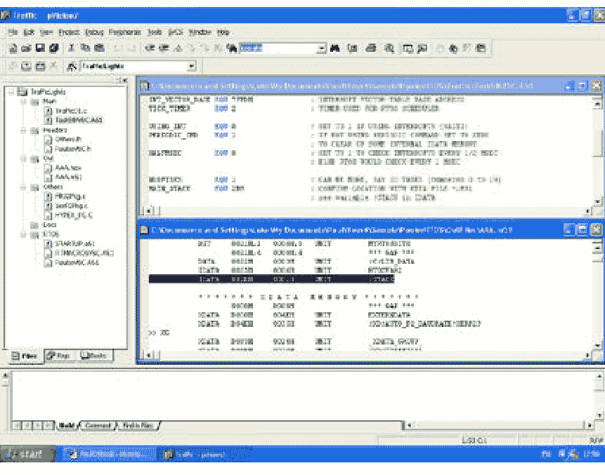
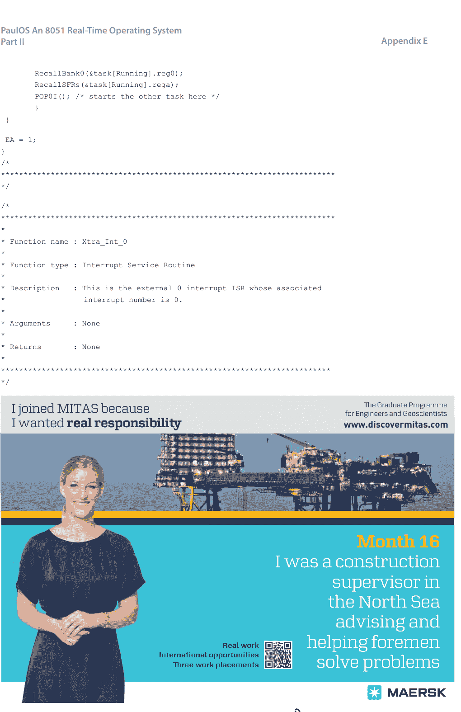

# PaulOS：第二部分——8051 实时操作系统

Paul P. Debono


在`www.deloitte.ca/careers`发现真谛。

德勤。Deloitte & Touche LLP 及其关联实体。

点击广告阅读更多。

`5` 在`bookon.com`免费下载电子书。

## 简约而不凡——大众 SKODA


你喜欢汽车吗？你想成为一个成功品牌的一员吗？我们将欣赏并奖励你的热情和才华。向我们发送你的简历。它能带你去的地方将让你感到惊讶。

在`www.employerforlife.com`向我们发送你的简历。


## 7.1 什么是实时操作系统：第一部分


> 在丹麦，你可以找到优秀的工程工作并提升自己。特别是在风电领域。

## PaulOS：一种 8051 实时操作系统——第二部分目录

> 在丹麦，你可以找到优秀的工程工作并提升自己。特别是在风电领域。


点击广告阅读更多。

- 附录 G：`PaulOS`
- 附录 H：8051 指令集
- 参考文献

## 编程技巧与陷阱：第二部分

在最后一章中，我们讨论了关于微控制器的编程技巧和常见陷阱。

此外，还有一条递增`DPTR`的指令（即`INC DPTR`）。当执行这条指令时，这两个字节将会在一个 16 位的值上进行操作。然而，没有汇编语言指令可以递减`DPTR`。如果我们想要减小`DPTR`的值，我们必须编写代码来实现它，例如：

```assembly
CLR C
MOV A,DPL
SUBB A,#1
MOV DPL,A
MOV A,DPH
SUBB A,#0  ; 如果必要，从第一次减法结果中减去进位标志
MOV DPH,A
```

## 12.6 串口（UART）

要使用 8051 的板载串口，通常需要初始化以下四个寄存器：`SCON`、`PCON`、`TCON` 和`TMOD`。这是因为`SCON`并不能完全控制串口。然而，在大多数情况下，程序需要使用其中一个定时器来建立串口波特率。在这种情况下，有必要通过设置`TCON`和`TMOD`来配置定时器 1。`PCON.7`（也称为`SMOD`位，但我们需要注意`PCON`不是一个位寻址寄存器）可以设置为波特率倍增。在这种情况下，我们还需要对第四个寄存器`PCON`的位 7 进行编程。

此外，如果串口处理程序要在中断控制下运行，还必须设置相应的中断允许位（`IE` SFR 中的`ES`和`EA`），有时还需要设置中断优先级位（`IP` SFR 中的`PS`）。这使得为了在中断模式下使用 UART，我们需要设置的 SFR（特殊功能寄存器）数量增加到了六个。

如果使用中断例程来传输存储在某些软件缓冲区中的字符，`TI`标志通常初始化为 0。`SBUF`直接加载要传输的第一个字符，传输将开始，包含起始位、数据的第 0 到 7 位、任何奇偶位，最后是停止位。当这第一个字符传输完成后，`TI`会自动设置为 1，并触发中断服务程序（`ISR`），该例程将继续发送软件缓冲区中的任何剩余字符（在`ISR`代码中，每次都必须将`TI`重置为 0）。

如果我们不使用串口中断程序来传输数据，`TI`在最初会被初始化为 1，因为通常的做法是这样启动`putchar()`程序：

```c
while (TI=0); // 等待发送器就绪 (TI=1)
BUF = c; // 将字符存储在 SBUF 中并开始发送字符
一旦传输完成，TI 将自动设置为 1
```

附录的串口程序中给出了示例。

## 12.7 中断

### 忘记保护 PSW 寄存器

如果我们编写一个中断处理例程，始终将`PSW`保存到栈中，并在我们的中断服务程序（`ISR`）完成后将其恢复，将是一个非常好的主意。许多 8051 指令会修改`PSW`内的位。如果我们的`ISR`不能保证`PSW`在退出时包含与进入时相同的数据，那么我们的程序行为将变得反常且不可预测。此外，调试这种行为将非常困难，因为这种行为往往取决于程序在执行过程中何时以及何地被中断。

### 忘记保护寄存器

正如上所示，我们必须保护所有的寄存器。如果我们忘记保护一个在`ISR`中将使用且可能被程序其他部分使用的寄存器，可能会出现非常奇怪的值。如果我们遇到寄存器值发生意料之外的变化或某些算术运算产生错误答案的问题，很可能是我们忘记保护某些寄存器了。

### 忘记恢复保护的值

另一个常见错误是将寄存器推入栈中以保护它们，然后在退出中断之前忘记将它们（以错误的顺序）弹出。例如，我们可能在退出中断前忘记将它们从栈中弹出。在这种情况下，由于没有正确恢复`PSW`和`ACC`，程序可能会崩溃。正确的顺序应该是：

```assembly
PUSH PSW
PUSH ACC
PUSH B
POP B
POP ACC
POP PSW
RETI
```

# 第二部分：编程技巧与陷阱

## 12.8 C 技巧

- 我们应该始终尝试让函数（或任务）尽可能简单。
- 为变量使用正确的所需类型；如果确实需要字节（byte）或位（bit）类型，不要使用`int`类型。
- 正确使用有符号或无符号指针。
- 使用指定的位置存储指针。即使用声明如：

```c
char data * xdata str;               /* 指针存储在 xdata 中，指向 data 中的 char */
int xdata * data numtab;             /* 指针存储在 data 中，指向 xdata 中的 int */
long code * idata powtabw;           /* 指针存储在 idata 中，指向 code 中的 long */
```

- 为了提高代码执行期间的性能或减少我们代码对内存空间的需求，我们应该生成列表文件和汇编代码，以确定哪些例程可以优化或缩小体积。
- 我们应该始终尝试通过作用域限制来尽量减少变量的使用。


## 轮询（Round-Robin）RTOS

这是一个名为`ParrOS`的轮询实时操作系统（Paul 轮询操作系统的缩写），它可能是可以编写的最简单的操作系统。

其操作可以解释如下：

每隔一段时间产生一个定时器中断。该中断用于定期运行一个关键的中断服务程序（`ISR`）。该`ISR`使用计数器来准确判断指定的槽时间是否已过去，一旦过去，就会调用一个函数处理任务切换问题。该函数主要存储当前任务的所有栈区域，并将其替换为下一个调度要运行的任务的栈。此时，程序跳转到新任务，并与新任务无缝地继续运行，直到其槽时间耗完。该过程无限重复，循环遍历所有任务。

我们首先解释变量是如何在 8051 的内部内存区域中堆叠的。表 A-1 显示了此 RTOS 程序中使用的变量的设置方式。大多数变量位于 8032 微处理器的内部 256 RAM 中。外部 RAM（对于 Flight 32 板，地址从`8100H`到`9FFH`）用于存储所有任务以及主空闲程序的栈。每当需要任务切换时，这些栈就会轮换到内部 RAM 中预留的栈区域。

| | 十六进制字节地址 | 备注十六进制位地址 | 备注 |
|---|---|---|---|
| | `FF` | 间接 | |
| | `To` | 通用 RAM (`80` - `FF`) 可用作栈区域 | |
| | `80` | | |
| `MAIN_STACK` | `7F` | 直接和间接 RAM (`00` - `7F`) | |
| | `to` | | |
| | `76` | | |
| | `75` | | |
| `SP`（初始） | `to` | (`NOOFTSKS+1`) 字节 | 每个任务的时间槽重装载值 |
| `T_SLOT_RELOAD` | `61` | | |
| | `60` | | |
| `T_SLOT` | `to` | (`NOOFTSKS+1`) 字节 | 每个任务的时间计数器 |
| | `4B` | | |
| `SPTS` | `to` | (`NOOFTSKS+1`) 字节 | 每个任务 SPS 的存储区域 |
| | `37` | | |
| | `35` | | |
| `READYQ` | `to` | (`NOOFTSKS+1`) 字节 | 准备好运行的任务队列 |
| | `22` | | |
| | `21` | `OF 0E ED 0C 0B 0A 09 08` | 备用位 |
| | `20` | `07 06 05 04 03 02 01 00` | `MYBITS` |
| | `1F` | | 任何应用程序变量的存储区 |
| | `17` | | |
| `TMPSTORE0` | `16` | | 见`FETCH_STACK` |
| `GOPARAM` | `15` | | 见`RTOSXX` |
| `DELAYHI` | `14` | | 见`RTOSXX` |
| `DELAYLO` | `13` | | 见`RTOSXX` |
| `TICKCOUNT` | `12` | | 见`RTOSXX` |
| `RUNNING` | `10` | | 当前运行的任务号 |
| `READYQTOP` | | 指向`READYQ`中最后一个任务的指针 |
| | `0F` | 寄存器堆 1 (`R0` - `R7`) | RTOS 使用的 bank |
| | `08` | 寄存器堆 0 (`R0` - `R7`) | 所有任务使用的 bank |
| | `00` | | |

`ParrOS A51`的源列表由组成：

- 头文件`ParrOS.h`
- 启动文件`ParrOS_Startup.a51`
- 主 RTOS 文件`ParrOS.a51`


```assembly
; 提供最高地址字节的 SFR 地址 <0x0-0xFF>
; 大多数 8051 变体使用 P2 作为最高地址字节
PPAGE_SFR      DATA    GA0H

;;
```

```assembly
; 标准 SFR 符号
ACC     DATA    E0H
B       DATA    F0H
SP      DATA    81H
DPL     DATA    82H
DPH     DATA    83H
```

```assembly
NAME                ?C_STARTUP

?C_C51STARTUP SEGMENT  CODE

               SEGMENT     IDATA

?STACK              ?STACK

MAIN_STACK:    DS          1

               EXTRN CODE  (?C_STARTUP)

               PUBLIC      ?C_STARTUP

                           CSEG     AT 0
```


# PUBLIC MAIN_STACK

```assembly
C_STARTUP:  LJMP    STARTUP1

               RSEG        ?C_C51STARTUP

STARTUP1

IF IDATALEN <> 0

    CLR         A

IDATALOOP:  MOV         @R0,A

            DJNZ        R0,IDATALOOP

ENDIF

IF XDATALEN <> 0

    MOV         DPTR,#XDATASTART

    MOV         R7,#LOW (XDATALEN)

    IF (LOW (XDATALEN)) <> 0

        MOV         R6,#HIGH (XDATALEN) +1

    ELSE

        MOV         R6,#HIGH (XDATALEN)

ENDIF

XDATALOOP:  CLR         A

            MOVX        @DPTR, A

            INC         DPTR

            DJNZ        R7,XDATALOOP

            DJNZ        R6,XDATALOOP

ENDIF

IF PAGEENABLE < 0

    MOV PPAGE_SFR,#PPAGE

ENDIF

IF PDATALEN < 0

    MOV R0,#LOW (PDATASTART)

    MOV R7,#LOW (PDATALEN)

    CLR A

PDATALOOP:

    MOVX @R0,A

    INC R0

    DJNZ R7,PDATALOOP

ENDIF

IF IBSTACK < 0

    EXTRN DATA (7C_IBP)

    MOV 7C_IBP,#LOW IBSTACKTOP

ENDIF

IF XBSTACK < 0

    EXTRN DATA (7C_XBP)

    MOV 7C_XBP,#HIGH XBPTOP

    MOV 7C_XBP+1,#LOW XBPSTACK

ENDIF

IF PBSTACK < 0

    EXTRN DATA (7C_PBP)

    MOV 7C_PBP,#LOW PBPSTACK

ENDIF

; 如果在 Banking Mode 4 下使用 L51_BANK.A51，则需要此代码

; 代码分段 (Code Banking)

; 为 L51_BANK.A51 模式 4 选择 Bank 0

#if 0

    <i> 在使用 Banking Mode 4 的 L51_BANK.A51 时，将存储机制初始化为代码库 0。

    EXTKN CODE (?7B_SWITCH)

    CALL ?7B_SWITCH      ; 初始化存储机制到代码库 0

#endif

    LJMP 7C_START

END
```

# PaulOS.a51

存储所有任务寄存器。

```assembly
;; 每个任务都可以被设置为使用任意数量的时间槽（1 到 255）

; 所以并不是所有任务运行的时间都相同。

; 正常情况下，它们只运行一个时间槽

;;

; 包含用于 1 秒滴答的 RTOSGOSEC

; 最新版 - 处理 20 个或更多任务，取决于

; 外部内存和内部栈空间

; 可用于汇编语言程序

; 由 Paul. Debono 编写 - 2002

; 马尔他大学

; 通信与计算机工程系

; 这里的 RTOS 适配并修改自 MALTA BOARD

; 能够支持 20 个或更多任务（注意栈大小！）

; 栈移动版本 - 将工作栈移入

; 外部内存

; 慢了 RTOS 速度，但没有限制任务调用

; 使用定时器 2 的自动重装模式作为调度器（滴答器）

; 所有任务在 bank 0 运行，RTOS 内核在 bank 1 

; 所有任务必须写成死循环。

; 空闲任务（死循环主程序）任务数 =

; C 应用程序可用命令：

;（有效参数值在括号中）

; INIT_RTOS (TSLOT) 初始化默认 Tslot（主程序）（1-255）

; CREATE (TSK,TSLOT,TSADD) 创建新任务。

; TSK 传入 R7 BANK 0

; TSLOT 传入 R5 BANK 0 低位和高字节

; RTOSGOSEC(TICKTIME) 启动 RTOS，每隔 TICKTIME 毫秒（1-255）。

; 这仍然是一个小版本。它仅用于

; 显示制作简单 RTOS 所需。

; 它还需要调整。

; 尚未充分测试 !!!!

; 目前运行良好。
```

```assembly
$NOMOD51

#include "reg51.h"    ; own path

USING 1

SetBank MACRO

IF BankNumber = 0

    CLR RS0

    CLR RS1

ENDIF

IF BankNumber = 1

    SETB RS0

    CLR RS1

ENDM

Ext2 MACRO    ; 将数据从 DPTR 移到内部 R1 指针

MOV R1,#MAIN_STACK

MOV R0,#STACKSIZE

NEXT1:

MOVX A,@DPTR

INC DPTR

INC R1

DJNZ R0,NEXT1

ENDM

Int2 MACRO    ; 将数据从内部 R1 指针移到外部 DPTR

; 使用 R0,R1, ACC 和 DPTR

MOV R1,#MAIN_STACK

MOV R0,#STACKSIZE

NEXT12:

MOV A,@R1

MOVX @DPTR,A

INC DPTR

INC R1

DJNZ R0,NEXT12

ENDM

Push_Bank0_Reg MACRO

PUSH ACC

PUSH B

PUSH PSW

PUSH DPL

PUSH DPH

PUSH 00

PUSH 01

```

```assembly
PUSH 02

PUSH 03

PUSH 04

PUSH 05

PUSH 06

PUSH 07

ENDM
```

```assembly
Pop_Bank0_Reg MACRO

POP 07

POP 06

POP 05

POP 04

POP 03

POP 02

POP 01

POP 00

POP DPH

POP DPL

POP PSW

POP B

POP ACC

ENDM
```


## e-Learning for Kids

- 小学教育第一 MOOC
- 为 5-12 岁儿童提供的免费数字学习
- 覆盖 1500 万儿童

关于 e-Learning for Kids。e-Learning for Kids 成立于 2004 年，是一个全球非营利基金会，致力于为 5-12 岁儿童提供有趣的免费在线学习，课程涵盖数学、科学、语言艺术、计算机、健康和环境技能。自 2005 年以来，来自 190 多个国家的超过 1500 万名儿童受益于 LK 提供的电子课程！志愿者团队由世界各地的教育和在线学习专家以及业务人士组成，致力于带来改变。e-Learning for Kids 积极寻求资金、志愿者和课程开发者的参与！更多信息，请访问 `www.elearningkids.org`。

# RTOS 汇编代码

```assembly
;

; 注意：从 C 调用时接收参数的函数

; 其名称在 A51 源文件中必须

; 以下划线开头。

;

PUBLIC _RTOSGOSEC, RTOSGOSEC, RTOSGOIN

PUBLIC _CREATE, _INIT_RTOS

CLOCK EQU 460 ; 计数半毫秒

定时器时钟 (11059/12 = 922) 使用 11.0592 MHz 晶振计数1 毫秒

因此 921.6/2 = 460 代表半毫秒

BASIC_TICK EQU 65535 ; CLOCK + 1

ONESC EQU 2 ; 2 个半毫秒等于 1 毫秒

ONESC EQU 2000 ; 2000 毫秒 = 1 秒

HALFMIN EQU 60000 ; 60000 毫秒 = 1 分钟

XTRAMTOP EQU 0FFFF ; 外部内存顶部

RAMTOP EQU 0 ; 外部内存 

****************************************************************

;

;    重要

; 这是为了确定栈的位置

; 此值来自 PAULOS_STARTUP.A51

;

EXTRN IDATA (MAIN_STACK)

;

************************************************

; ; 受限于栈/内存空间

STACKSIZE EQU 30H

NOPUSHES EQU 13 ; RTOS 程序开头的 PUSH 数量

NOT_TIMING EQU 0 ; 当任务较少时，可以增加 STACKSIZE

MYBITS SEGMENT BIT

RSEG MYBITS

MSCFLAG DBIT 1 ; 每毫秒滴答标记

SECFLAG DBIT 1 ; 每秒滴答标记

MINFLAG DBIT 1 ; 每分钟滴答标记

VAR1 SEGMENT DATA

RSEG VAR1 ; 变量区域 VAR1,
```

```assembly
MOV DPTR,#EXT_STK_AREA      ; 下一步清除所有外部栈

MOV R0,#(NOOFFTS + 1)

CLR A

NEXT_STACK:

MOV R1,#STACKSIZE

CLR_STACK:

MOVX @DPTR,A

INC DPTR

DJNZ R1,CLR_STACK

DJNZ R0,NEXT_STACK
```

```assembly
DE-INITIALISE ALL STACK POINTERS ; 初始化所有栈指针

MOV R7,#NOOPTSKS

MOV R0,#SPTS

; 主空闲任务由第一次中断处理

MOV A,#(MAIN_STACK - 1)

ADD A,#(NOOPUSHES + 2)

SET_UP:

MOV @R0,A             ; 所有 SPS 指向 MAIN_STACK + PUSHES，进行准备工作

INC R0             ; 为最终的 RETI 指令准备

DJNZ R7,SET_UP     ; 用于在 RTOS 中断时切换任务

; 初始化时间片，全部设置为给定的默认值

MOV R7,#NOOPTSKS + 1)

MOV R0,#T_SLOT

MOV R1,#T_SLOT_reload

LOAD_SLOTS:

MOV @R0,05

MOV @R1,05

INC R0

DJNZ R7,LOAD_SLOTS

RET

_CREATE:

; 系统调用入口以创建任务

; 任务数量 (0 到 7) 通过 Bank 0 中的 R7 传递

; 时间片 (1 - 255) 通过 Bank 0 中的 R5 传递

; 任务起始地址通过 Bank 0 中的 R1, R2, R3 传递

; R1 为低位，R2, R3 类型

INC READYQTOP

MOV R6,READYQTOP

MOV @R0,07         ; 将任务放入就绪队列

MOV A,#T_SLOT

ADD A,R7

MOV R0,A

MOV @R0,05         ; 将给定的时间片（在 R5 中）放入内存位置

MOV A,#T_SLOT_RELOAD

ADD A,R7

MOV R0,A

MOV @R0,05         ; 将给定的时间片（在 R5 中）放入重载内存位置 (T_SLOT_RELOAD)

MOV A,R7

CALL FetchStack

MOV A,R1                     ; 将 R1 的低字节拷贝到低栈区域

MOVX @DPTR,A

INC DPTR

MOV A,R2               ; 现在保存高位字节 (R2)

MOV @DPTR,A

RET

_RTOSGSEC:\               ; 系统调用 RTOS 获取 R7 毫秒计数 (Ticks)

SETB MSEFLAG            ; 设置标记

CLR SECFLAG

CLR MINFLAG

MOV DELAYLO,#LOW (ONEMSEC)

MOV DELAYHI,#HIGH (ONEMSEC)

SJMP LOAD_REGS

_RTOSGOSEC:\               ; 系统调用 RTOS 获取 R7 秒计数 (Ticks)

SETB SECFLAG             ; 设置标记

CLR MINFLAG

CLR MSEFLAG

MOV DELAYLO,#LOW (ONSEC)   ; 等于一秒

MOV DELAYHI,#HIGH (ONSEC)

SJMP LOAD_REGS

_RTOSGOMIN:

SETB MINFLAG

CLR MSEFLAG

CLR SECFLAG

MOV DELAYLO,#LOW (HALFMIN)  ; 60000 毫秒等于半分钟

MOV DELAYHI,#HIGH (HALFMIN)

LOAD_REGS:

M RCAP2H,#HIGH (BASIC_TICK) ; 加载 1 毫秒计数的 RCAP

MOV RCAP2L,#LOW (BASIC_TICK) ; 将其保存到自动重载寄存器；第二级（用于 Flight 32）

MOV GOPARAM,               ; 加载通过 Bank 0 R7 传递的时间片参数

MOV T2CON,$04H             ; 在 16 位自动重载模式下启动定时器 2

SETB EA                  ; 启用全局中断信号

SETB TF2                  ; 模拟定时器 2 中断

RET                       ; 有效启动 RTOS。

EXIT1:JMP EXIT            ; 跳板

RTOS_TIMER_INT:\          ; 仅来自定时器2 溢出的中断入口

INTERRUPT                 ; 使用 ACC, PSW, (来自 Bank 1 的 R0, R1 和 R2)

Push_Bank0_Reg

SetBank1                 ; 设置到寄存器器 1

CLR C

MOV A,DELAYLO

SUBB A, #1

MOV DELAYLO, A

MOV A, DELAYHI

SUBB A, #0

MOV DELAYHI, A

ORL A, DELAYLO      ; 检查延迟（1毫秒, 1秒或半分钟）是否到期

JNZ EXIT           ; 如果未到，则退出

MOV DELAYLO, #LOW (ONEMSEC) ; 1 毫秒延迟

MOV DELAYHI, #HIGH (ONEMSEC)

JB MSECFLAG, CHK_GO_PARAM

MOV DELAYLO, #LOW (ONSEC)

MOV DELAYHI,#HIGH (ONSEC)

JB SEFLAG, CHK_GO_PARAM

MOV DELAYLO, #LOW (HALFMIN)

MOV DELAYHI,#HIGH (HALFMIN)

CFL MINFLAG

JNB MINFLAG, EXIT1  ; 等待一分钟（两次半分钟）

CHK_GO_PARAM:

DJNZ TICKCOUNT, EXIT1  ; 检查所需时间片是否耗尽

MOV TICKCOUNT, GOPARAM

; 旋转

; 保存当前运行任务

; 将就绪队列旋转一位

; 从就绪队列获取新运行任务

; 首先检查所需时间是否耗尽

MOV A, #T_SLOT

ADD A, RUNNING

MOV R0, A              ; 指向运行任务的 T_SLOT
```

# C 应用程序可用命令

- `void SET_IDLE_MODE(void)` - 通常用于主空闲任务
- `void SET_POWER_DOWN(void)` - 通常用于主空闲任务
- `void DEFER(void)` - 此命令会导致任务切换
- `void KILL(void)` - 此命令会导致任务切换
- `uchar SCHEK(void)`
- `uchar RUNNING_TASK_ID(uint)`
- `void WAITV(void)` - 此命令会导致任务切换

表 B-3 中列出的以下调用均需要参数，它们在 `as1` 文件中以下划线前缀声明。

- `void INIT_RTOS(uchar IEMASK)` - 通常用于主空闲任务
- `void RTGOMSEC(uchar msecs, uchar prior)` - 通常用于主空闲任务
- `void SIGNAL(uchar task)`
- `void WAITII(uint intrum)` - 此命令会导致任务切换
- `void WAITT(uint ticks)` - 此命令会导致任务切换
- `void WAITS(uint ticks)` - 如果信号尚未出现，此命令会导致任务切换
- `void CREATE(uchar task,uint *taddsk)` - 通常用于主空闲任务
- `void PERIODIC(uint ticks)`
- `void RESUME(uchar task)` - 此命令会导致任务切换

## `INIT_RTOS(IEMASK)`

此系统命令必须是主程序中发布的第一个命令，以便初始化 RTOS 变量。它从主程序调用，并接受中断掩码（IEMASK）作为参数。该命令的语法示例如下：

```c
INIT_RTOS(0x30);
```


这意味着某些任务打算使用定时器 2 中断（`IEMASK=20H`）以及串口中断（`IEMASK=10H`）用于 RTOS。（见表 B-4）。默认掩码为 `20H`，仅启用定时器 2 中断。此 `20H` 始终由 RTOS 自动添加到任何其他掩码（或进行或运算）。其他有效的掩码还有：

# PaulOS 8051 实时操作系统

## 附录 B 第二部分

| 编号 | 名称 | 二进制 | 十进制 | 备注 |
|---|---|---|---|---|
| 0 | 外部中断 0 | 00000001 | 01 | |
| 1 | 定时计数器 0 | 00000010 | 02 | 8051 默认 RTOS |
| 2 | 外部中断 1 | 00000100 | 04 | |
| 3 | 定时计数器 1 | 00001000 | 08 | |
| 4 | 串口 | 00010000 | 10 | |
| 5 | 定时器 2 (仅限8032) | 00100000 | 20 | 8032 默认 RTOS |

表 B-4 IEMASK 参数

此系统命令执行以下操作：

- 清空用于存储每个任务栈的外部内存区域。
- 设置 `IE` 寄存器（位于 SFR 区域的 `A8H`）。
- 外部中断选择边沿触发。（如果需要不同的触发方式可以修改）。
- 将主空闲任务编号加载到就绪队列，因此最初只有主任务将执行。
- 初始化所有任务为不等待超时。
- 设置每个任务的 `SP`（栈指针），使其指向特定任务栈区域的正确位置。任务指针最初指向栈基上方 14 的偏移量（在这种情况下，当 `NOOPUSHES` 为 13，可以看到 `[(MAIN_STACK - 1) + NOOPUSHES = 2]`）。这样做是为了确保在执行第一条 `RET` 指令时将栈从外部 RAM 传输到 8032 RAM，此时 `SP` 应该将正确地指向要启动的任务的地址。这在 `QSHFT` 例程中可见，在最后一个 `RET` 指令之前，有一个 `Pop_Bank0_Reg` 宏，它实际上弹出了 13 个寄存器。`RET` 指令将读取正确的地址以跳转到下 2 个位置。

## CREATE(任务编号，任务名称)

此系统命令用于主程序创建每个任务。它接受两个参数，即任务编号（第 1 个任务编号为 0）和任务地址（在 C 环境中，地址简单来说就是过程名称）。该命令的语法示例为：

```
CREATE(0,MotorOn);
```

这将创建一个编号为 0 的任务。该任务将是 `MotorOn`。

此系统命令执行以下操作：

- 将任务编号放在就绪队列中的下一个可用位置，这意味着该任务准备好执行。就绪队列中的指针在程序中称为 `READYQTOP`，每次发布此命令时都会增加。
- 将任务起始地址加载到分配给该任务的外部 RAM 栈区域底部。该任务的 `SP` 已经由 `INIT_RTOS` 命令保存，指向 13 字节的偏移。

## RTOSGSEC(msecs, priority)

此系统命令用于设置任务的优先级。它接受两个参数，即毫秒数（`msecs`）和优先级级别。该命令的语法示例为：

```
RTOSGSEC(100, 1);
```

将在 100 毫秒内将任务的优先级设置为 1。

此系统命令执行以下操作：

- 将任务优先级设置为指定的级别。
- 启动指定时间的定时器。

## SIGNAL(task)

此系统命令用于向任务发送信号。它接受一个参数，即任务编号。该命令的语法示例为：

```
SIGNAL(5);
```

这将向 5 号任务发送信号。

此系统命令执行以下操作：

- 设置指定任务的信号位。
- 如果任务处于等待状态，则将其移动到就绪队列中。
- 如果任务正在运行，则触发中断。

该命令使用的语法示例为：

```
SIGNAL(1); // 向任务号 1 发送信号
```

以下命令执行任务切换：

## WAITI(Interrupt No)（中断号）

此系统命令由任务调用，用于“休眠”并等待中断发生。随后，就绪队列（Ready Queue）中的另一个任务将接管执行。如果中断从未发生，则该任务将实际上处于永久休眠。

如果需要，可以修改此命令以允许传递任何超时参数（timeout parameter），这样如果中断没有在指定的超时时间内到达，超时时间为 0 将使任务继续无限等待中断。这与下文进一步解释的 `WAITS` 命令类似。

此系统命令执行以下操作：

- 它设置与作为参数传递的中断号相对应的位。
- 它调用 `QSHFT` 例程以启动队列中的下一个任务。


该命令使用的语法示例：

```
WAIT(0); // 等待外部中断 0 的信号
```

该任务将进入休眠或等待模式，由一个新任务接管。

## WAITS(Timeout)（超时）

此系统命令由任务调用，用于休眠并等待来自其他任务的信号。如果信号已经存在（之前由其他任务设置），则只需清除信号并让继续执行。如果信号没有在指定时间内到达，任务将照常恢复执行。然而，超时数字为 0 意味着任务必须无限等待信号。如果信号未到达，任务将永远不会恢复工作，实际上杀死（kill）了该任务。

此系统命令执行以下操作：

- 它首先检查信号是否已经。
- 如果它清除信号标志，退出并继续等待。
- 如果信号不存在，则：
  - 它设置它自己的等待信号（`SIGW`）标志。
  - 它还根据提供的参数设置等待超时变量。
  - 随后它跳转到 `QSHFT` 例程以启动队列中的下一个任务。

该命令使用的语法示例为：

```
WAITS(50);
// 等待信号 50 个单位，单位的值取决于 // 使用的 RTOSGOMSEC 参数。
```

例如，如果使用了命令 `RTOSGOMSEC(10,1)`，则参考单位为 10 毫秒，`WAITS(50)` 则意味着等待信号在 500 毫秒内到达。

或者你可以使用：

```
WAITS(0); // 这将无限等待信号
```

在两个示例中，任务都将进入休眠或等待模式，由一个新任务接管。

## WAITT(Timeout)（超时）

此系统命令由任务调用，用于休眠并等待指定的超时时间。超时时间的单位取决于所使用的 `RTOSGOMSEC` 参数。时间段的有效值范围在 1 到 65535 之间。值 0 保留给 `KILL` 命令，意味着永久休眠，因此此命令不允许。因此，`WAITT` 系统命令在接受该值之前会对参数进行必要的检查。值 0 被更改为 1。

此系统命令执行以下操作：

- 如果参数为 0，则将其设置为 1，以避免永久休眠。
- 将正确的参数保存在 TTS 表中正确的位置。
- 跳跃到 `QSHFT` 例程以启动队列中的下一个任务。

该命令使用的语法示例为：

```
WAITT(60);
// 等待信号 60 个单位，单位的值取决于 // RTOSGOMSEC 参数。
```

例如，如果使用了命令 `RTOSGOMSEC(10,1)`，参考单位为 10 毫秒，`WAITT(60)` 则意味着等待 600 毫秒。

另一方面，如果使用了命令 `RTOSGOMSEC(250,1)`，参考单位为一秒，`WAITT(60)` 则意味着等待 1 分钟。

在两个示例中，任务将进入休眠或等待模式，由一个新任务接管。

## KILL()（杀死）

此系统命令由任务调用，用于休眠并等待指定的超时时间（此处原文逻辑似乎有误，按原文翻译）。它永久杀死任务。

此系统命令执行以下操作：

- 如果参数为 0，则将其设置为 1，以避免永久休眠。
- 将正确的参数保存在 TTS 表中正确的位置。
- 跳跃到 `QSHFT` 例程以启动队列中的下一个任务。

该命令使用的语法示例为：

```
WAITT(60);
// 等待信号 60 个单位，单位的值取决于 // RTOSGOMSEC 参数。
```

例如，如果使用了命令 `RTOSGOMSEC(10,1)`，参考单位为 10 毫秒，`WAITT(60)` 则意味着等待 600 毫秒。

另一方面，如果使用了命令 `RTOSGOMSEC(250,1)`，参考单位为一秒，`WAITT(60)` 则意味着等待 1 分钟。

在两个示例中，任务将进入休眠或等待模式，由一个新任务接管。

## RESUME(Task)（恢复）

此系统命令由任务调用，用于恢复另一个任务。X 是要恢复的任务号。该命令的语法示例为：

```
RESUME(X);
/* X 为任务号 */
```

## DEFER()（延迟）

此系统命令由任务调用，用于将 CPU 时间移交给另一个任务。任务将进入等待状态。该命令的语法示例为：

```
DEFER();
/* 任务将进入等待状态 */
```

此系统命令执行以下操作：

- 它将超时时间设置为 1，以便任务在下一个节拍后就绪。
- 它跳转到 `QSHFT` 例程以启动下一个任务。

## Variables Map（变量映射）

表 B-5 显示了设置这些变量的方式。这些变量位于 8051 的内部 RAM（`100H` 及以上），用于存储所有任务的栈。当需要交换任务时，这些栈会被交换。此系统命令执行以下操作：

- 它清除任何等待标志，这样任务永远不会重启。
- 它随后将 TTS 表中的超时时间设置为 0，这是 RTOS 定义非周期任务的方式。
- 它将 `INTVLRD` 和 `INTVLCNT` 设置为 0，再次意味着非周期任务。
- 跳跃到 `QSHFT` 例程以启动下一个任务。

| 标签 | 十六进制地址 | 备注 |
| --- | --- | --- |
| GENERAL_STACK | FF | 通用 RAM (80 - FF)，可用作栈区域 |
| MAIN_STACK | 7F | 直接和间接 RAM (00 - 7F) |
| SP (initially) | 75 | 每个任务的 (NOOFTSKS+1) 字节重载值 |
| T_SLOT_RELOAD | 61 | 每个任务的 (NOOFTSKS+1) 字节时间槽计数器 |
| T_SLOT | 4B | 每个任务的 (NOOFTSKS+1) 字节存储区域 |
| SPTS | 37 | 就绪任务队列 (NOOFTSKS+1) 字节 |
| READYQ | 22 | |
| | 21 | OF DD 0 0B 0A 09 08 留位 |
| | 20 | 07 06 05 04 03 02 01 00 我的位 |
| | 1F | 任何应用程序变量的存储空间 |
| | 17 | |
| TMPSTORE0 | 16 | 查看 FETCH_STACK |
| GOPARAM | 15 | RTOSGOMSEC |
| DELAYHI | 14 | RTOSGOMSEC |
| DELAYLO | 13 | RTOSGOMSEC |
| TICKCOUNT | 12 | 当前运行任务 RTOSGOMSEC |
| RUNNING | 11 | 任务号 |
| READYQTOP | 10 | 指向 READYQ 中最后一个任务的指针 |
| | 0F | RTOS 使用的寄存器堆 1 |
| | 08 | (R0 - R7) |

| 标签 | 十六进制字节地址 | 备注 | 注意事项 |
|---|---|---|---|
| | 07 | 寄存器堆 0 | 所有任务均使用的寄存器堆 |
| | 到 | (R0 - R7) | |
| | 00 | | |

**表 8-5** PaulOS.a51 变量设置，包含 18 (12H) 个任务。(NOOFTSKS=12H)

下面是 PaulOS RTOS 的汇编代码程序列表。它包含：

- 头文件 `PaulOS.h`
- 启动文件 `Startup.a51`
- 主源文件 `PaulOS.a51`

## PaulOS.h

```
/* PaulOSV5.C */
/* 用于 PaulOSV5.a51 RTOS 程序 */
/* 由 Paul P. Debono 于 2005 年 2 月 撰写 */

#define u unsigned char
#define uint unsigned int
#define ul unsigned long

// 以下调用不接收参数，因此在 a51 文件中
// 使用下划线前缀

void SET_IDLE_MODE(void);
void SET_POWER_DOWN(void);
void DEFER(void);
void KILL(void);
uchar SCHEK(void);
uchar RUNNING_TASK_ID(void);
void WAITY(void);

// 以下调用接收参数，因此在 a51 文件中
// 使用下划线前缀

void INIT_RTOS(uchar IEMASK);
void RTOSGGMSEC(uchar msecs, uchar prior);
void SIGNAL(uchar task);
void WAIT(uchar intrum);
void WAITS(uint ticks);
void WAITS(uint ticks);
void CREATE(uchar task, uint *taskadd);
void PERIODIC(uint ticks);
void RESUME(uchar task);

/*========================================================== */
/* 附加宏 */
/*========================================================== */
```

## 附录 B

- 宏 `WAIT` 用于等待最多 1 分钟
- 配合 `RTGOMSGSEC(1,0)` 使用 - 1 毫秒滴答时间

```
#define WAIT(s, ms) WAIT((uint)(##s*1000##ms))
```

- 宏 `WAIT` 用于等待最多 18 小时 12 分
- 66535 * 4 * 250 毫秒

```
#define WAIT(H
```

- 宏 `WAIT` 用于等待最多 70 天 24 小时 2 分
- 66535 * 40 * 250 毫秒
- 配合 `RTGOMSGSEC(25,0)` 使用 - 250 毫秒滴答时间

```
#define WAIT(D, H, M) { WAIT(uint)(86400*##D + 3600*##H + 60*##M));
WAIT(uint)(86400*##D + 3600*##H));
WAIT(uint)(86400*##D + 60*##M));
WAIT(uint)(86400*##D));
WAIT(uint)(60*##H));
WAIT(uint)(##M)); }
```


# 你想做什么？

无论你希望职业生涯有何目标，在当地市场拥有广泛业务的雇主都将帮助你在全球 185 多个国家找到超过 10 万朋友和同事。我们为毕业生提供职业机会，请访问我们的网站 www.volvo.com 的职业板块。我们期待与你相识！

沃尔沃

AB Volvo (publ) 

www.volvo.com

沃尔沃卡车 | 租赁卡车 | 机械卡车 | 沃尔沃巴士 | 沃尔沃工程设备 | 沃尔沃 Penta | 沃尔沃 IT | 沃尔沃金融服务 | 沃尔沃 J3P | 沃尔沃定位 | 沃尔沃零件 | 沃尔沃技术 | 沃尔沃物流 | 业务领域

点击广告阅读更多

在 book.com 免费下载电子书

## 附录 B

```
WAIT((uint)86400*##D + 3600*##H + 60*##M));
WAIT((uint)(86400*##D + 3600*##H));
WAIT((uint)(86400*##D + 60*##M));
WAIT((uint)(86400*##D));
WAIT((uint)(60*##H));
WAIT((uint)(##M)); }
```

```
* 宏 'PERIODICA' 用于等待最多 4 小时 33 分
* 配合 RTOSDICEM(250,0) 使用 - 250 毫秒滴答时间
#define PERIODICA(H, M) PERIODIC(uint(14000##H + 240##M + 4*##S))
* 宏 'PERIODICM' 用于等待最多 1 分钟
* 配合 RTOSDICEM(1,0) 使用 - 1 毫秒滴答时间
#define PERIODICM(s, ms) PERIODIC(uint(##s*1000 + ##ms))
```

*******************************************************************

## Taskk.a51

```
; 任务
.a51
#include "headers\reg"
; 任务
.a51
; 任务
. 1
; 使用 寄存器堆 0
```

***************************************************

```
; 重要
INT_VECTOR_BASE EQU 7FD; 中断向量地址
TICK_TIMER EQU 2; 设置定时器
USING_INT EQU 0; 如果使用中断
PERIODIC_CMD EQU 0; 如果使用定时

检查 1 毫秒
```

## 附录 B


```asm
; 否则 RTOS 检查 1 毫秒
NOOFTSKS EQU 7
; 可以包含 20 个任务（编号 0-19）
MAIN_STACK EQU OBFH
; 确认栈位置
IDATA
STACKSIZE EQU 25H
```

最小

********************************************************************************

; 注意

根据你的应用程序、硬件，对上述参数进行修改。

********************************************************************************

```asm
; 栈大小 20H 适用于大多数应用程序。

#include "../PaulOSRTOS/PaulOSV5C.a51"
```

## `RTMACROS.a51`

```asm
;====================
; RTOS 宏

SetBank MACRO Number

IF Number = 0
    CLR RS0
    CLR RS1
ELSEIF Number = 1
    SETB RS0
    CLR RS1
ELSEIF Number = 2
    SETB RS1
    CLR RS0
ELSEIF Number = 3
    SETB RS1
    SETB RS0
ENDIF

ENDM
```

```asm
Ext2int MACRO      ; 将 R0 从外部存储器指针移动到内部 R1 指针

    MOV R1,#MAIN_STACK
    MOV R0,#STACKSIZE

NEXT1:
    MOV A,DPTR
    MOV @R1,A
    INC DPTR
    INC R1
    DJNZ R0,NEXT1

ENDM
```

```asm
Int2Ext MACRO      ; 将 R0 从内部 R1 指针移动到外部存储器指针

    ; 使用 R0、R1、ACC 和 DPTR
    MOV R1,#MAIN_STACK
    MOV R0,#STACKSIZE

NEXT12:
    MOV A,@R1
    MOVX @DPTR,A
    INC DPTR
    INC R1
    DJNZ R0,NEXT12

ENDM
```

```asm
Push_Bank0_Reg MACRO      ; 13 次入栈

    PUSH ACC
    PUSH B
    PUSH PSW
    PUSH DPL
    PUSH DPH
    PUSH 00
    PUSH 01
    PUSH 02
    PUSH 03
    PUSH 04
    PUSH 05
    PUSH 06
    PUSH 07

ENDM
```

```asm
Pop_Bank0_Reg MACRO

    POP 07
    POP 06
    POP 05
    POP 04
    POP 03
    POP 02
    POP 01
    POP 00
    POP DPH
    POP DPL
    POP PSW
    POP B
    POP ACC

ENDM
```

# PaulOS 一个 8051 实时操作系统

## 第二部分

```asm
Push_HalfB0_Reg MACRO      ; R7 不入栈，用于参数传递

    PUSH ACC                            ; 回到主调用程序
    PUSH B
    PUSH PSW
    PUSH DPH
    PUSH DPL
    PUSH 00
    PUSH 01
    PUSH 02
    PUSH 03

ENDM
```

```asm
Pop_HalfB0_Reg MACRO      ; R7 不出栈，用于参数传递

    POP 03                            ; 回到主调用程序
    POP 02
    POP 01
    POP 00
    POP DPH
    POP DPL
    POP PSW
    POP B
    POP ACC

ENDM
```

```asm
DEC2REGS MACRO LowReg, HighReg

LOCAL HIGHOK

    CLS C                              ; 清空标志位用于位位减法 SUBB
    MOV A,LowReg                       ; 将 DPTR 的低位移入 A
    SUBB A,#1                          ; 减 1
    MOV LowReg,A                       ; 存回
    JNC A,HighReg                      ; 无进位则跳转到 HighReg
    MOV A,#0                           ; 获取 DPTR 的高位
    SUBB A,CY                          ; 如果进位位设置则减去 CY
    MOV HighReg,A                      ; 移回

HIGHOK:

ENDM
```

```asm
LOADADDRGSDATA MACRO LowReg, HighReg

    MOVX A,@DPTR
    MOV LowReg,A
    INC DPTR
    MOVX A,@DPTR
    MOV HighReg,A

ENDM
```

```asm
LOADXDATAREGS MACRO LowReg, HighReg

    MOV A,LowReg
    MOVX @DPTR,A
    INC DPTR
    MOV A,HighReg
    MOVX @DPTR,A

ENDM
```

```asm
DPTRPLUS MACRO

    ADD A,DPL                   ; 将 A 加到 DPL
    MOV DPL,A                   ; 将结果移入 DPL
    MOV A,DPH                   ; 获取 DPH
    ADDC A,#0                   ; 如果有进位，则加 1
    MOV DPH,A                   ; 移回 DPH

ENDM
```

## `PaulOS.A51`

- `PaulOS5C.A51` 用于使用
- 版本 5C
- 存储所有存储器 0 任务寄存器
- 注意，主栈需要通过文件 `.M51` 进行验证
- 处理多个任务，取决于外部内存和内部栈空间
- 可与汇编语言主程序配合使用
- 由 Paul P. Debono 编写 - 2005 年 2 月
- 马尔他大学
- 通信与计算机工程系
- MSIDA MSD 06；马尔他

```c
/*
    // 在 Target 1 的选项中使用以下设置

    // 内存模型：LARGE；变量存储在 XDATA 中

    // 代码长度：44K 程序

    // 起始          大小                (32K RAM)
    // CODE:           08100               05D00
    // RAM:            0XD00               02000

    // 或

    // CODE:           08100               04000
    // RAM:            0XC100              03D00

    // CODE:           08100               01B00 (8K RAM)
    // RAM:            09C00               0X400
*/
```

```c
// 代码模型：      LARGE: 64K 程序
//               起始           大小            (32K EPROM)
//             CODE:           0X000           08000
//             RAM:            08000           07E00
// *****************************************************************/
```

- 栈移动版本 - 在外部内存进出移动栈
- 会减慢 RTOS 速度，但不限制任务调用
- 使用定时器 2 的 16 位自动重装模式作为时间调度器（时心标记）
- 对于 8051，可以使用定时器 0。
- 所有任务均运行在 `bank 0` 中，RTOS 内核运行在 `bank 1` 中
- 所有任务必须写为无限循环。
- `WAIT` 系统调用的等待时间范围为 1-65535。
- 零等待时间参数由 RTOS 自身设置为 1，
- 因为 0 实际上会杀死任务，
- 实际上将其置于等待队列中永久睡眠！
- `WAITS` 系统调用的等待时间范围为 0-65535。0 表示永久等待信号
- 空闲任务（无限主程序 - 任务数量 = `NOOFTASKS`）


# PaulOS 一个 8051 实时操作系统

## 附录 B

C 应用程序可命令有：

（有效参数值显示在括号内，假设最多 20 个任务）

前五条命令仅在主（空闲任务）程序中使用。

其他命令仅在任务中使用。

以下命令不会导致任务切换：

`INIT_RTOS (IEMASK)`

初始化变量、`sBF` 并启用中断。

**** 必须是第一个执行的命令 *****

使用旧 Monitor 0、2、3 和 4 的有效中断号。

使用新 Monitor 或用户 EPROOM 0、1、2、3 和 4 的有效中断号。

注意如果使用 `TIER 1` 来产生波特率，则你可以同时使用 3 和 4。

|  | 中断类型 | 有效参数 |
|---|---|---|
| 0 | 外部中断 0 | `IEMASK = 00000001 = 01H` |
| 1 | 定时器计数器 0 | `IEMASK = 00000010 = 02H` |
| 2 | 外部中断 1 | `IEMASK = 00000100 = 04H` |
| 3 | 定时器计数器 1 | `IEMASK = 00001000 = 08H` |
| 4 | 串口 | `IEMASK = 00010000 = 10H` |

`INIT_RTOS (IEMASK)`

初始化变量、`sBF` 并启用中断。

**** 必须是第一个执行的命令 *****

使用旧 Monitor 0、2、3 和 4 的有效中断号。

使用新 Monitor 或用户 EPROOM 0、1、2、3 和 4 的有效中断号。

注意如果使用 `TIER 1` 来产生波特率，则你可以同时使用 3 和 4。

|  | 中断类型 | 有效参数 |
|---|---|---|
| 0 | 外部中断 0 | `IEMASK = 00000001 = 01H` |
| 1 | 定时器计数器 0 | `IEMASK = 00000010 = 02H` |
| 2 | 外部中断 1 | `IEMASK = 00000100 = 04H` |
| 3 | 定时器计数器 1 | `IEMASK = 00001000 = 08H` |
| 4 | 串口 | `IEMASK = 00010000 = 10H` |

`CREATE (TASK)`

创建新任务。

`DEFER (TIME)`

等待指定的时钟周期。

`IDLE_MODE`

将处理器进入空闲模式。

`SIGNAL`

将任务标记为就绪。

`WAIT (SIGNAL)`

等待信号。

`WAITS (TIMEOUT)`

等待指定的超时时间。

`RUNNING_TASK_ID`

获取当前运行任务的 ID。

`SET_POWER_DOWN`

将处理器进入掉机模式。

`PERIODIC (TIME)`

每隔指定的时钟周期循环执行任务。

# PaulOS 8051 实时操作系统

## 第二部分

## 附录 B

```asm
PRIORITY: DBIT 1      ; 优先级由 RTOSGO 设置...

RSEG RTOSVAR1 ; 直接可寻址区域
READQ: DS (NOOFTSKS + 2) ; 为就绪任务的队列堆栈

; 以下变量可以位于间接寻址 RAM 中（即使大于 80H）
RTOSVAR2 SEGMENT IDATA
```

```asm
SPTS: DS (NOOFTSKS + 1) ; 每个堆栈以及空闲（主）堆栈的栈指针

TTS: DS 2*NOOFTSKS ; 任务的剩余超时时间，每个任务 2 字节

; 0 = 未计时
TSFLAKS: DS (NOOFTSKS + 1) ; 存储每个任务（及主任务）标志的字节
```

```asm
; MAIN_STACK 区域从这里开始，位于 TSFLAKS 之后的位置。
; 编译后在 .M51 文件中检查堆栈位置
; 以确认 "MAIN_STACK" 的值
```

```asm
; XSEG AT (XRAMSIZE * (NOOFTSKS + 1)) ; (4*NOOFTSKS) + 1
EXTERNEDATA SEGMENT XDATA
RSEG EXENDATA
```

```asm
IF (PERIODIC_CMD = 1)      ; 0 = 未计时
INTVALCNT: DS 2*NOOFTSKS
INTVALRD: DS 2*NOOFTSKS      ; 0 = 未计时
```

```asm
ENDIF
EXT_STACK_AREA: DS (NOOFTSKS + 1) * STACKSIZE ; 这是堆栈区域的实际大小
```


我们并非在发明轮子，而是在重新发明。

迷人的光影提供了无限的可能性：创新技术和新市场带来了机遇与挑战。在一个你的专业知识需求极盛的环境中。享受我们全球集团内部支持性的工作氛围，并从国际化的职业路径中受益。与其他专家合作实施可持续理念，并为影响我们的未来做出贡献。加入我们，每天重新发明光。

光，来自 OSRAM

61

在 `bookboom.com` 免费下载电子书

点击广告阅读更多

# PaulOS 8051 实时操作系统

## 第二部分

## 附录 B

```asm
CSEG AT EXTO_INT_VECTOR ; 中断向量地址
    CLR EA
    MOV XINTMASK,#EXT0W      ; 外部中断 0
    LJMP XTRA_INT
```

```asm
IF (TICK_TIMER = 0)
CSEG AT TIM0_INT_VECTOR      ; 中断向量地址
    CLR EA
    LJMP RTOS_TIMER_INT          ; 定时器 0
                                ; 用于 RTOS 调度器
```

```asm
ELSE
CSEG AT TIM0_INT_VECTOR
    CLR EA
    MOV XINTMASK,#TIM0W
    LJMP XTRA_INT
```

```asm
ENDIF
```

```asm
CSEG AT EXT1_INT_VECTOR ; 中断向量地址
    CLR EA
    MOV XINTMASK,#EXT1W      ; 外部中断 1
    LJMP XTRA_INT
```

```asm
IF (TICK_TIMER = 1)
CSEG AT TIM1_INT_VECTOR ; 中断向量地址
    CLR EA
    LJMP RTOS_TIMER_INT          ; 定时器 1
                                ; 用于 RTOS 调度器
```

```asm
ELSE
CSEG AT TIM1_INT_VECTOR
    CLR EA
    MOV XINTMASK,#TIM1W
    LJMP XTRA_INT
```

```asm
ENDIF
```

```asm
CSEG AT SER0_INT_VECTOR ; 中断向量地址
    CLR EA
    MOV XINTMASK,#SER0       ; 串口
    LJMP XTRA_INT
```

```asm
IF (TICK_TIMER = 2)
CSEG AT TIM2_INT_VECTOR ; 中断向量地址
    CLR EA
    CLR EF                               ; 定时器 2
    LJMP RTOS_TIMER_INT                 ; 清除定时器 2 标志（自动完成）
```

```asm
ELSE
CSEG AT TIM2_INT_VECTOR
    CLR EA
    MOV XINTMASK,#TIM2W
    LJMP XTRA_INT
```

```asm
ENDIF
```

# PaulOS 8051 实时操作系统

## 第二部分

```asm
MyRTOS_CODE SEGMENT CODE      ; 在 8100H 开始，用于 32 板板
```


`RSEG MyRTOS_CODE`

```
=====================================
; RTOS 系统的开始
; 带寄存器参数的函数以下划线 _ 开头
; 带寄存器参数的函数 _ 将控制器设置为空闲模式
SET_IDLE_MODE:
ORL PCON,#0x01      ; 设置 PCON 的 0 位
RET
SET_POWER_DOWN:
    ; 将控制器设置为掉电模式
ORL PCON,#0x02      ; 设置 PCON 的 1 位
RET
INIT_RTOS:
    ; 初始化变量的系统调用
; R7 存储 IE 掩码
MOV A,R7
ANL A,#1111
IF (TICK_TIMER = 0)
    ; 确保 EA=0（后期启用）
ORL A,#00000010; 定器 0 高优先级，PT0=1
MOV IP,#2H
ELSE (TICK_TIMER = 1)
    ; ET1=1（用于 RTOS 计时）
ORL A,#00010000; 定器 1 高优先级，PT1=1
MOV IP,#2H
ELSE (TICK_TIMER = 2)
    ; ET2=1（用于 RTOS 计时）
ORL A,#00100000; 定器 2 高优先级，PT2=1
MOV IP,#2H
MOV IE,A
; 在环境中，软件清空从 0 到 FFH 的内部 RAM
; 对于 C51 族，内部 RAM (0-FFH) 是通过 C51 宏进行清空的。
IF (PERIODIC_CMD = 1)
MOV DPTR,#INTVALCNT
MOV A,#NOOFTSKS; 数量翻倍
MOV RG,A          ; 保存字节数
CLR A
DPTR_0: ; 指向正确的位置
MOV DX,A
INC DPTR
JNE RG,DPTR_0
ENDIF
MOV DPTR,#EXT_STACK_AREA      ; 清空所有外部堆栈
MOV RG,#NOOFTSKS + 1
CLR A
```

# PaulOS 8051 实时操作系统
## 附录 B

```
NEXT_STACK:
MOV R1,#STACKSIZE
CLR_STACK:
MOVX @DPTR,A
INC @TR
DJNZ R1,CLR_STACK
DJNZ R0,NEXT_STACK
MOV RUNNING,#IDLE_TASK ; 空闲任务运行（主无限循环）
MOV R7,#NOOFTSKS
MOV R0,#TTS
MOV R1,#READYQ
LOAD_VARS:
MOV R0,#LOW(NOT TIMING) ; 无定时器操作
INC R0
MOV R0,#HIGH(NOT TIMING)
MOV R1,#IDLE_TASK ; 就绪队列中的空闲任务（主无限循环）
INC R0
INC RI
DJNZ R7,LOAD_VARS ; 填充额外的位置，用于
MOV R8,#IDLE_TASK ; 在移动例程期间带有空闲任务
MOV R8,#IDLE_TASK ; 确保空闲任务始终在队列中
MOV READYQTOP,#READYQ ; 没有其他任务需要执行。
SET_UP:
MOV R7,#NOOFTSKS+1 ; 计数
MOV R0,#SP ; 初始化栈指针
MOV A,(MAIN_STACK-1) ; 模拟 Push_Bank0_Reg Plus
ADD A,#NOFUSHES+2 ; 中断保存的返回地址
```

```
SET_UP:
MOV R0,A
INC R0
DJNZ R7,SET_UP
RET
; 创建任务的系统调用
; 任务号 (0 到 19) 位于 Bank R7 中
; 任务起始地址通过 R1,R2,R3 传递
; LSB 在 R1 中，MSB 在 R2 中，R3 包含类型
; 指向就绪队列顶部
```

```
_CREATE:
INC READYQTOP
MOV R0,READYQTOP
MOV R8,07H
MOV A,R7 ; 将任务 (R7 bank=7H) 放入就绪队列
FETCH_STACK
MOV A,R1
MOVX @DPTR,A ; 将 R1 的低字节复制到低位堆栈区域
INC @DPTR
MOV A,R2
MOVX @DPTR,A ; 现在保存高字节 (R2)
SETB TINQFLAG
RET ; 信号队列中的新任务
```

# PaulOS 8051 实时操作系统
## 附录 B 第二部分

```
SETB TF2                               ; 定时器1 可用于串口波特率
                                     ; 立即模拟定时器2 中断
ENDIF
    SETB EA                             ; 开启全局中断信号
    RET                                 ; 有效启动 RTOS
SCHECK:\                              ; 系统调用入口：检查任务标志位
                                     ; 如果 R7 中标志位为0则返回0，为1则返回1。
                                     ; SIG: 标志位被清除（发现实际为1）
                                     ; 无需银行切换
                                     ; 立即返回 - 无需上下文切换
CLR EA
P_HalfB0_Reg
MOV A,#RUNNING
MOV B,#SIGS
    CALL CHK_CLR_FLAG                   ; 如果发现标志位为1，则清除
MOV R7,#1
JC SIGNAL_SET                      ; 信号已设置，因此带 R7=1 返回
DBNE R7                               ; 信号未设置，因此带 R7=0 返回
SIGNAL:
Pop_HalfB0_Reg
SETB EA
RET
SIGNAL:\                              ; 系统调用入口：设置指定任务标志位
    Push_Bank0_Reg                      ; 无需银行切换 - 无需上下文切换
MOV A,R7
JNC NOT_WAITING                     ; R7 银行0 传递了任务号
MOV B,#SIGS                          ; 如果任务尚未等待，则设置信号位
    CALL CHK_CLR_FLAG                   ; 否则将其放入就绪队列 (READY Q)
CALL CLR_FLAG                        ; 确保清除信号标志位
MOV A,#TTS                           ; 并标记任务为非计时
ADD A,R7
ADD A,R7                             ; 因为每个任务占用两个字节，所以加两次偏移
MOV R0,A
MOV R8,#LOW(NOT_TIMING)
INC R0
MOV R8,#HIGH(NOT_TIMING)
INC READYQTOP
MOV READYQTOP
MOV R0,07                            ; 将被信号的任务放入就绪队列
SETB TIQFLAG                          ; 表明队列中有新任务，但
_GIVE_UP:
Pop_Bank0_Reg
SETB EA
RET                                 ; 不要继续运行当前任务
                                     ; (必须延迟执行所需的操作)
NOT_WAITING:
MOV A,R7
MOV B,#SIGS                          ; 设置被信号任务的信号位
CALL SET_FLAG
Pop_Bank0_Reg
SETB EA
RET                                 ; 继续运行任务
```

# PaulOS 8051 实时操作系统
## 第二部分

```
IF (USING_INT = 1) 系统调用等待中断
WAIT:
使用 0, 2, 3 和 4 有效的中断号
使用 0, 1, 2 和 4 有效的中断号
注意：如果定时器1 用于产生波特率，
则你可以同时使用 3 和 4
中断 5 是强制性的 (EMASK = 0010000 = 20H)
外部中断 0 (EMASK = 0000001 = 01H)
定时器 1 (EMASK = 0000010 = 02H)
外部中断 1 (EMASK = 0000100 = 04H)
定时器 3 (EMASK = 0001000 = 08H)
串口端口 4 (EMASK = 0010000 = 10H)
定时器 2 (EMASK = 0100000 = 20H)
CLR EA
Push_Bank0_Reg
INC R7 ; 中断号 (0 到 4) 通过 R7 传递，(1,2,4,8,16) 左移
CLR A
SETB B ; 转换为中断掩码 (1,2,4,8,16)
SHIFT_LEFT:
RLC A
DJNZ R7,SHIFT_LEFT
MOV B,A ; 包含正确的中断掩码
MOV A,RUNNING
CALL SET_FLAG
LMP QSHIFT ; 停止当前任务并运行就绪队列中的下一个任务
IF (PERIODIC_CMD = 1)
WAIT:
CLR EA ; 直到 R7(低位),R6(高位) 超时
Push_Bank0_Reg
MOV A,RUNNING
MOV B,#IGV ; 测试信号是否存在
CALL CHK_CLR_FLAG ; 无信号是，所以任务必须等待
JNC NO_INTVAL ; 否则，信号存在（现在已清除）
LMP DONT_GIVE_UP ; 返回到同一任务
NO_INTVAL:
MOV A,RUNNING ; 重新加载任务号
MOV B,#IGV
CALL SET_FLAG ; 设置等待位，并
LMP QSHIFT ; 运行就绪队列中的下一个任务
WAITS:
CLR EA ; 系统调用等待到达
Push_Bank0_Reg ; 直到 R7(低位),R6(高位) 超时
MOV A,RUNNING
MOV B,#IGV ; 测试信号是否存在
CALL CHK_CLR_FLAG ; 没有信号是，所以任务必须等待
JNC NO_SIGNAL ; 否则，信号存在（现在已清除）
```

# PaulOS 8051 实时操作系统
## 第二部分

```
LJMP DONT_GIVE_UP ; 或者返回到同一任务
NO_SIGNAL:
MOV A,RUNNING ; 重新加载任务号
MOV B,#SIGW ; 设置等待位，并继续等待超时
CJNE R7,#LOW(NOT_TIMING),SET_TIMEOUT ; 接受等待时间 0
CJNE R6,#HIGH(NOT_TIMING),SET_TIMEOUT ; 接受零等待时间以便无限等待信号
SJ_SET_TIMEOUT_0
MOV R7,#1 ; 范围 1-65535 (0 = 永久睡眠)
MOV R6,#0 ; 如果两者均为0，替换为1
_WAIT:
CLR EA
Push_Bank0_Reg ; 系统调用入口 - 等待超时
CJNE R7,#LOW(NOT_TIMING),SET_TIMEOUT ; 通过 R6(高位)传递的时间参数
CJNE R6,#HIGH(NOT_TIMING),SET_TIMEOUT ; 以及 R7(低位)
SET_TIMEOUT:
CLR A ; 执行 65536 - 超时值
CLR A ; 这样在 RTOS_TIMER_INT 中我们可以轻松使用 'INC' 更新超时
SUBB A,R7
MOV R7,A
CLR A
SUBB A,R6
MOV 0
R6,A
SET_TIMEOUT:0:
MOV A,#TTS
ADD A,RUNNING ; 因为每个任务占用两个字节，所以加两次偏移
ADD A,RUNNING
MOV R0,A
MOV R8,#07 ; 将 R0,R6 超时放入表（等待队列）
INC R0
MOV R8,#06 ; 停止当前任务并运行就绪队列中的下一个任务
LJMP QSHIFT
KILL:
CLR EA ; 系统调用（无参数）
Push_Bank0_Reg ; 清除所有等待标志位
MOV A,RUNNING
MOV B,#SIGS
```

# PaulOS 基于 8051 的实时操作系统
## 第二部分

```assembly
MOV #R1,A
MOV A,R1
INC R1
CJNE A,READYQOP,SHIFT_DOWN    ; 它们向下移动了 1 位，因此减少 RTQOP
DEC READYQOP
CJNE A,#READYQ,RUN_NEW_TASK      ; 但 READYQOP 永远不应低于 READYQ
INC READYQOP                      ; 如果之前减少了，则 READYQOP = READYAGAIN
RUN_TASK:
JNB PRIORITY,DONT_SORT          ; 如果优先级选项未开启，则不进行排序
LCALL DONT_SORT
MOV A,#READYQ                     ; 将新任务设为运行状态
MOV RUNNING,A
CALL FETCH_STACK                  ; 获取新堆栈映像
Ext2:
MOV A,#EPTS
ADD A,RUNNING
MOV R0,A
MOV SP,#8                       ; 将 SP 指向新任务堆栈区域
PopBank0_Reg
SetB B0
SETA EA                         ; 可能从定时器中断进入
RETI
IF (PERIODIC_CMD = 1)
.PERIODIC:
CLR EA
PushBank0_Reg
MOV DPTR,#INTVALCNT
MOV A,RUNNING
RL A                             ; 数值翻倍
DPTRPLUS0
MOV A,#07                        ; 保存低字节，存储在 R7
MOV X,@DPTR,A
MOV A,06
INC DPTR
MOV X,@DPTR,A                    ; 保存高字节，存储在 R6
MOV DPTR,#INTVALRD
MOV A,RUNNING
RL A                             ; 数值翻倍
DPTRPLUS0
MOV A,#07                        ; 保存低字节，存储在 R7
MOV X,@DPTR,A
MOV A,06                         ; 保存高字节，存储在 R6
INC DPTR
MOV X,@DPTR,A
PopBank0_Reg
SETB EA
RET
TSKRDY_LMCHK2:                   ; 仅仅是一个跳板
LJMP TSKRD_CHK
```

# PaulOS 基于 8051 的实时操作系统
## 附录 B

```assembly
RTOS_TIMER_INT; ; 仅从定时器 2 溢出中断进入
```

```assembly
Push_Bank0_Reg  ; 使用 ACC, PSW, (R0,R1 以及 Bank 1 中的 R2)
```

```assembly
SetBank 1  ; 设置为寄存器组 1
```

```assembly
IF (TICK_TIMER = 0)  ; 停止，重载
```

```assembly
CLR TR0
```

```assembly
MOV T0,#HIGH(BASIC_TICK)
```

```assembly
MOV T1,#LOW(BASIC_TICK)  ; 并重启定时器 0
```

```assembly
SETB TR0
```

```assembly
ELSEIF (TICK_TIMER=1)  ; 停止，重载
```

```assembly
CLR TR1
```

```assembly
MOV TH1,#HIGH(BASIC_TICK)  ; 并重启定时器 1
```

```assembly
MOV TL1,#LOW(BASIC_TICK)
```

```assembly
SETB TR1
```

```assembly
ENDIF
```

```assembly
IF (HALFMSEC=1)  ; 仅过去了半毫秒，因此检查
```

```assembly
JBC MSECFLAG, TSKRDY_CHK2  ; 仅针对外部中断任务
```

```assembly
SETB MSECFLAG  ; 用于双倍 1/2 毫秒计数器延迟
```

```assembly
ENDIF
```

```assembly
DNJZ TICKCOUNT, TSKRDY_CHK  ; 检查所需的节拍时间是否通过
```

```assembly
MOV TICKCOUNT, GOPARAM
```

```assembly
IF (PERIODIC_CMD=1)  ; 首先检查周期性间隔，如果使用了
```

```assembly
CHK_PERIODICS:  ; 执行任务，从任务 0 开始，存储在 R0, Bank 1
```

```assembly
```


`MOV R0,#0`

```

```

# PaulOS 基于 8051 的实时操作系统
第二部分

```assembly
MOV DPTR, #INTVALC ; DPTR 指向表中的第一个间隔

CHECK_VALS:
PUSH DPL ; 保存指针
PUSH DPH
LOADREGSXDATA,R2,R3 ; R2 = INVALCNT 的低字节, R3 = 高字节
MOV A,R2
ORL A,R3
JZ CHECK_NEXTV ; 0= 表示使用周期性间隔的任务，因此跳过，
; 不更新间隔计数。

COUNT:
DECI2GS,R2,R3 ; 减少间隔计数
POP DPH ; 获取指针
POP DPL
PUSH DPL ; 并保存指针
PUSH DPH
LOADREGSXDATA,R2,R3 ; 存储新的减值
ORL A,R3 ; 任务未超时，因此检查任务
JZ CHECK_NEXTV ; 新任务超时，因此重载

VAL_OUT:
; 数值是 NOOFTSKS - 1 位于 DPTR 中
MOV A, #NOOFTSKS
RL A
DEC A
DPTRPLUSA
LOADREGSXDATA,R4,R5
POP DPH
POP DPL
PUSH DPL ; 保存指针
PUSH DPH
LOADREGSXDATA,R4,R5 ; 存储
ORL A,R3 ; 任务未超时，因此检查任务
JZ CHECK_NEXTV ; 新任务超时，因此重载
```

# PaulOS 一个基于 8051 的实时操作系统
第二部分

```assembly
MOV A,80H
ORL A,B           ; 将所需的位置 1
MOV 80H,A
POP 08
POP 00
RET

************************************

CHK_FLAG:
; 输入 A = 任务编号
; B = 位掩码
; 如果发现标志位已设置，则设置进位 C
PUSH 00
PUSH 08
MOV R0,#TASKFLAGS
ADD A,R0
MOV R0,A
MOV A,80H
CLR C
ANL A,B
JS EXIT1      ; 位已清除，进位 C = 0
SETH C        ; 位已设置，进位 C = 1

EXIT1:
POP 08
POP 00
RET

************************************

CLR_FLAG:
CLR_ROUTINE:
; 两个名称对应同一个例程
; 输入 A = 任务编号
; B = 位掩码
; 如果发现标志位已设置，则设置进位 C
      在退出例程之前清除标志
      如果位为零，则进位位 C = 0
PUSH 00
POP 08
MOV R0,#TASKFLAGS
ADD A,R0
MOV R0,A
MOV A,80H
CLR C
ANL A,B
JS EXIT2      ; 位清除，因此进位 C = 0
MOV A,R0
RL A,B       ; 因为之前已设置，则简单与掩码进行异或
MOV 80H,A      ; 清除并存储
SETH C        ; 因为位初始已设置，所以进位 C = 1

EXIT2:
POP 08
POP 00
RET
```

# PaulOS 基于 8051 的实时操作系统
第二部分

```assembly
************************

FETCH_STACK:
; 输入 A = 任务编号，使用 ACC, DPTR 和 R0
; 输出 DPTR 指向任务栈区域起始
MOV TMPSTORED,A
MOV DPTR,NEXT_STK_AREA
MOV R0,#0

LOOP1:
MOV A,R0
CJNE A,TMPSTORE0,CONT1
RET

CONT1:
MOV A,#STACKSIZE
ADD A,DPL
MOV DPL,A
MOV A,DPH
ADD A,A
INC R0
SJMP LOOP1

************************

; 排序就绪队列，编号越小的优先级越高
; 因此，在一次队列排序通过后，
; 编号最小的任务将位于队列底部，
; 等待执行。
; 它由 QSHFT 调用，当使用就绪库 1 时。
;
TASK_SORT:
PUSH A
PUSH 0
PUSH B
MOV R0,#READYTOP      ; RO 指向就绪队列区域
MOV A,R0
CJNE A,#READYQ,NEXT_PAIR    ; 只有一个任务，退出
SJMP EXIT_QSORT

NEXT_PAIR:
MOV A,R0
MOV B,R0
DEC R0
CLR C
SUBB A,R0               ; 最小任务编号（最高优先级）
JNC NO_SWAP             ; 下沉到就绪队列，准备运行

SWAP_NO:
MOV A,R0
MOV R0,B
INC R0
MOV R0,A
DEC R0

NO_SWAP:
CJNE R0,#READYQ,NEXT_PAIR    ; 一次通过，退出

EXIT_QSORT:
POP B
POP 08
POP ACC
RET

; ****************************************************
END
```


管理硕士
因为实现梦想是您最大的挑战，IE 商学院提供英语、西班牙语或双语教学的管理硕士课程，通过一项创新且具有启发性的计划，培训处于职业初期的高表现专业人士，帮助他们充分发挥潜能。

- 选择您的专业领域。
- 通过提供的不同选项定制您的人脉网络。
- 在伦敦、硅谷或上海等地的全球沉浸式周。
- 因为你的改变，我们随你一同改变。

`www.ie.edu/master-management` `mim.admissions@ie.edu`

79

在 `book.com` 下载免费电子书

# PaulOS 一个基于 8051 的实时操作系统
第二部分

附录 B

# 其他包

* `SerIntPrkg.c` - 程序的详情参见注释 */
* 在 XDATA 中有一个 200 字节接收缓冲区和 200 字节发送缓冲区 */
* 在使用板载 UART 时配合 C 使用例程 */
* 在中断控制下运行，在 RTOS 下使用独立 ISR */
* 使用定时器计算位时间进行自动波特率检测 */

* 如果提供的 Baudrate 为 0，则优先进行波特率检测 */

```c
#include <reg52.h>      * 8052 特殊寄存器 */
#include <acbac.h>
#include <stdio.h>

// RXD 是位 0x80               * 内部 UART 端口 3 上的接收数据 */
#define RX_BUFFER_LENGTH 200
#define TX_BUFFER_LENGTH 200

unsigned char rx_buffer[RX_BUFFER_LENGTH]; /* 软件缓冲区 */
unsigned char tx_buffer[TX_BUFFER_LENGTH]; /* 发送缓冲区 */
unsigned char In_read_index;  /* 指向软件缓冲区中已读取的数据 */
unsigned char In_waiting_index; /* 指向软件缓冲区尚未读取的数据 */
unsigned char Out_written_index; /* 指向软件缓冲区已发送的数据 */
unsigned char Out_waiting_index; /* 指向软件缓冲区尚未设置的数据 */

void InitP3_Int(unsigned int baudrate);
void autobaud(void);
void waitP3_isr(void); /* 应该创建一个函数，等待串口中断 */
char putchar(char c);      /* 等时功能 */
char getkey(void);      /* 任务 */

void InitP3_Int(unsigned int baudrate);
void autobaud(void);

ET1 = 0;                 /* 禁用定时器 1 */
ES = 0;                   /* 禁用中断。主程序启用 */

if (baudrate == 0)
SCON = 0x50;              /* 设置串口控制：8位，接收，TI0 = 0 */
PCON = 0x7F;             /* 清除 SMOD（双倍波特率） */
TMOD &= 0x0F;             /* 设置定时器/计数器，清除定时器 1 的 M1 和 M0 */
TMOD |= 0x10;             /* 设置 16 位定时器 */
TMOD |= 0x20;             /* 设置 8 位自动重载模式 2 */
RCLK = 0;                               /* 使用定时器 1 接收波特率（仅限2） */
TCLK = 0;                               /* 使用定时器 1 发送波特率（仅限2） */

switch (baudrate) {
  case 300:
    TH1 = TL1 = 0xA0;
    break;
  case 600:
    TH1 = TL1 = 0xD0;
    break;
  case 1200:
    TH1 = TL1 = 0xE8;
    break;
  case 2400:
    TH1 = TL1 = 0xF4;
    break;
  case 4800:
    TH1 = TL1 = 0xFA;
    break;
  case 9600:
    TH1 = TL1 = 0xFD;
    break;
  case 19200:
    TH1 = TL1 = 0xFD;
    PCON |= 0x80;                /* 双倍波特率，SMOD = 1 */
    break;
  case 57600:
    TH1 = TL1 = 0xFF;             /* 不标准 */
    PCON |= 0x80;                /* 双倍波特率，SMOD = 1 */
    break;
}

In_read_index = In_waiting_index = 0; /* 重置缓冲区指针 */
Out_writing_index = Out_waiting_index = 0; /* 重置生成 */
TR1 = 1;                      /* 启动波特率生成定时器 */
ES = 1;                       /* 启用串口中断 */
TI = RI = 0;                   /* 清除 TI 和 RI */
EA = 1;                       /* 启用全局中断 */

/* 自动波特率计算 */
/* 计算位：起始位和最低位 */
/* 最低位应该是 1 */
/* 假设你按下 ENTER 键（十进制 13）= 00001101 二进制 */
      0 1 0 1 0 0 0 1
      | | | | | |
/* 起始位-->+lsb msb--> ++停止位 */

unsigned int autobaud(void) {
  unsigned char i;
  unsigned int counter;
  unsigned int code_table[] = {16,64,144,288,576,1152,2304,4608,9216,65535};
  unsigned int code_baud[] = {0,25760,19200,9600,4800,2400,1200,600,300,0};

  // 计数器速率为每 1/12.0592 微秒计数一次
  // 在 2 位时间（比特率 br）后达到计数 = (2*11059200)/(12*br)
  // 上限 = 65535（无效波特率）
  // 上边界 = 9216 <==
  // 300 边界，2 位后达到计数将为 6144
  // 600 边界，2 位后达到计数将为 3072
  // 1200 上边界 = 1536
  // 2400 边界，2 位后达到计数将为 1152 <==
  // 4800 边界，2 位后达到计数将为 768 <==
  // 9600 边界，2 位后达到计数将为 384 <==
  // 19200 边界，2 位后达到计数将为 192 <==
  // 38400 边界，2 位后达到计数将为 96 <==
  // 57600 边界，2 位后达到计数将为 64 <==
  // 下边界 = 16（无效波特率）
}
```

# PaulOS 一个基于 8051 的实时操作系统
第二部分

## 附录 B

## SerP2Pkg.c

```c
********************************************************************
/* SerP2Pkg.c */
/* 在 FLT-32 板上使用额外的 SCC2691 UART (F2) 时，
   供 C 程序使用的例程。 */
/* 如果给定的波特率参数为零，则执行自动波特率检测 */

#include <reg52.h>                /* 特功能寄存器 0052 */
#include <stdio.h>
#include <stdlib.h>

void P2_SetUp(void);
unsigned int Auto_P2_BaudRate(void);
void Set_P2_BaudRate(unsigned int baud);
char putchar(char c);
char _getgetchar(void);

#define RX       0xFF8               // 启动时读取数据 (P2 上的 RX 引)
#define UART_MR1   0xFF1               // MR1 - 模式 1
#define UART_MR2   0xFF2               // MR2 - 模式 2
#define UART_SR    0xFF9               // SR - 状态寄存器
#define UART_CSR   0xFFFC              // CSR - 时钟选择
#define UART_CR    0xFFFA              // CR - 命令寄存器
#define UART_RHR   0xFFFB              // 保持寄存器
#define UART_THR   0xFFFB              // 发送保持寄存器
#define UART_ACR   0xFFFC              // 辅助控制寄存器
#define UART_ISR   0xFFFD              // 中断状态寄存器
#define UART_IMR   0xFFFE              // 中断掩码寄存器
#define UART_CTU   0xFFFF              // 读写计数定时器高位寄存器
#define UART_CTL   0xFFFF              // 读写计数定时器低位寄存器

************************************************************************************

void F2_SetUp(){
    unsigned char c;
    TH1 = TL1 = 0;          /* 寄存器清零 */
    while(RXD);           /* 等待起始位（直到 RXD = 0） */
    TR1 = 1;               /* 启动定时器 */
    while(!RXD);          /* 等待起始位结束 */
    while(RXD);           /* 等待停止位（RXD = 1） */
    TR0 = 0;               /* 停止计数 => 2 位的值 */
    counter = TH1*256 + TL1;  /* 计算计数值 */
    i=0;
    while (counter > count_table[i]) {
        i++;               /* 在表中查找对应此计数的项 */
        /* 有效的 i 值仅为 1 到 8 */
    } while (i==0 || i>=9) {
        /* 表格的边界值是无效的 */
        /* 循环直到找到波特率 */
    }
    return(baud_table[i]);
}

/* 以下是 UART 中断服务程序 */
/* 它应该在串口中断下作为函数运行 */

/*********************************************************************
/* UART ISR: */
/********************************************************************
```


```c
void uart_isr(void) interrupt 4 using 1 {
    /* 作为串口中断例程运行 */
    /* 等待串口中断号 4 */
    /* 检查是否来自 TI 或 RI 的中断 */
    /* 每当传输完一个字符，8052 UART 就会设置 TI */
    /* 每当 SBUF 接收到一个完整字符，8052 就会设置 RI */
    /* RI 和 TI 都应该由软件重置 */

    if (TI) {
        /* 检查是否来自 TI 的中断 */
        /* 发送部分 */
        TI = 0;
        /* 发送器就绪，因此 */
        /* 准备下一次传输 */
        /* 检查是否有其他数据需要发送 */

        if (Out_waiting_index < TX_BUFFER_LENGTH) {
            SBUF = Tx_buffer[Out_waiting_index++];
            /* 将数据放入硬件缓冲区进行发送 */
        } else {
            /* 无新数据要发送，仅重置发送缓冲区索引 */
            Out_waiting_index = 0;
            Out_written_index = 0;
        }
    }

    if (RI) {
        /* 检查是否来自 RI 的中断 */
        /* 接收部分 = 读取完完整字符后设置标志位 */
        RI = 0;

        /* 如果软件缓冲区中的所有旧数据已读取， */
        /* 我们可以重新从索引 0 开始读取并重置接收缓冲区索引 */
        if (In_waiting_index == In_read_index) {
            In_waiting_index = 0;
            In_read_index = 0;
        }

        /* 将数据从 UART 硬件缓冲区 (SBUF) 读取到软件缓冲区 */
        Rx_buffer[In_waiting_index] = SBUF;

        if (In_waiting_index < RX_BUFFER_LENGTH)
            In_waiting_index++;
    }
}

/****
char putchar(char c) {
    // 仅当空间足够时写入软件缓冲区。
    // 如果空间不足，在短时间内超时时间内继续尝试
    // 此简单库中没有错误报告

    unsigned int dataOut = 20000;

    while ((Out_waiting_index > TX_BUFFER_LENGTH) && (Timeout-- > 0));

    if (Out_waiting_index < TX_BUFFER_LENGTH) {
        Tx_buffer[Out_waiting_index++] = c;

        /* 生成中断 - 激活 TI 开始传输 */
        TI = 1;
    }

    return (c);
}

char _getgetchar() {
    // 从软件缓冲区读取字符
    // 如果缓冲区为空，则等待
    // 从软件缓冲区中读取一个字符，如果可用
    // 从软件缓冲区读取一个字符。
    // 如果没有可用字符，返回 0。

    unsigned char c = 0;
    unsigned int dataOut = 20000;

    while ((Out_waiting_index > TX_BUFFER_LENGTH) && (Timeout-- > 0));

    // 如果空间不足，在短时间内超时继续尝试
    if (In_waiting_index < RX_BUFFER_LENGTH) {
        c = Rx_buffer[In_waiting_index++];
    }

    return (c);
}
```

# PaulOS 基于 8051 的实时操作系统

## 第二部分

```c
case 600:
    UART_CSR = 0x55;
    break;

case 1200:
    UART_CSR = 0x66;
    break;

case 2400:
    UART_CSR = 0x88;
    break;

case 4800:
    UART_CSR = 0x99;
    break;

case 9600:
default:
    UART_CSR = 0xBB;
    break;

case 19200:
    UART_CSR = 0xCC;
    break;

case 38400:
    UART_ACR = 0x38;
    UART_CSR = 0xCC;
    break;
```

```c
UART_CR = 0x9A; // 停止计数器
UART_CTU = 0xFF; // 重载计数器为 65535
UART_CTL = 0xFF;
UART_CR = 0x1A; // 重置 MR 指针。禁用 Rx 和 Tx
UART_MRI = 0x13; // 8 位，无奇校验
UART_MR2 = 0x07; // 1 位停止位
UART_CR = 0x05; // 启用 Tx 和 Rx
UART_CR = 0x0B; // 开始计数
while (((c = UART_SR) & 0x10) == 0) {}; // 等待计数器归零（仅作延迟）
UART_CR = 0x95; // 停止计数器
while (((c = UART_SR) & 0x01) == 1) {}; // 清空 FIFO 缓冲区
UART_RHR = 0x45; // 重置错误状态。禁用 Rx 和 Tx
```

```c
char putchar(char c) {
    unsigned char d;

    while ((d = UART_SR) & 0x04) == 0) {
        UART_THR = c;
        return(c);
    }
}
```

```c
#if 1

char _getkey(void) { // 永久等待按键
    char c;

    while (((c = UART_SR) & 0x01) == 0) {
        return(c = UART_RHR);
    }
}
```

# PaulOS 基于 8051 的实时操作系统

## 第二部分

### 附录 B

```c
#endif

#if 0

char _getkey(void) {    // 带超时等待按键
    char c;
    unsigned long TimeoutLoop = 12000;    // 仅作测试

    while (((c = UART_SR) & 0x01) == 0) && (++TimeoutLoop != 0)) {
        // 等待字符或超时

        if (((c = UART_SR) & 0x01) == 1)
            return c = (UART_RHR);
        else
            return (0);
    }
}

#endif
```

```c
#if 0

char _getkey(void) {    // 不等待
    char c;

    if (((c = UART_SR) & 0x01) == 1)
        return c = (UART_RHR);
    else
        return (0);
}

#endif
```

/* ============================================================ */

# PaulOS 基于 8051 的实时操作系统

## 第二部分

### SerP3Pkg.c

```c
/* ============================================

/* SerP3Pkg.c - 程序详细信息请见下文注释 *

/* 用于使用板载 8052 UART (P3) 的 C 程序程序 *

/* 不受中断控制 *

/* 使用定时器 1 生成波特率 *

/* 串口和定时器 1 中断已禁用。 */

/* 如果提供的波特率为 0，则执行波特率检测 */

#include <reg52.h> /* 8052 特殊功能寄存器 */
#include <acsacc.h>
#include <stdio.h>

// RXD 是位 0xB0；内部 UART 接收数据位于端口 3 第 0 位 */

void Set_P3_Baudrate(unsigned int baudrate);
unsigned int P3baud(void);
char putchar(char c);
char *getkey(void);

/* ============================================

void Set_P3_Baudrate(unsigned int baudrate)

/* 不受中断控制 *

if (baudrate == 0)
    baudrate = P3baud();

SCON = 0x50; /* 设置串口控制寄存器 *

/* 模式：1 - 8 位变波特率 */

/* REN：启用接收器 */

PCON &= 0x7F; /* 清空控制寄存器中的 SD 位 *

TMOD0 &= 0x0F; /* 设置定时器/计数器寄存器 *

/* 为定时器 1 清空 M1 和 M0 */

TMOD |= 0x20; /* 为 8 位自动重载定时器 1 设置 M1 */

RCLK = 0; /* 使用定时器 1 生成接收波特率 *

TCLK0 = 0; /* 使用定时器 1 生成发送波特率 *

switch (baudrate) {
case 300:
    TH1 = TL1 = 0xA0;
    break;

case 600:
    TH1 = TL1 = 0xD0;
    break;

case 1200:
    TH1 = TL1 = 0xE8;
    break;

case 2400:
    TH1 = TL1 = 0x88;
    break;

case 4800:
    TH1 = TL1 = 0x99;
    break;
```

# PaulOS 基于 8051 的实时操作系统

## 第二部分

### 附录 B

```c
case 9600:
default:
    UART_CSR = 0xBB;
    break;

case 19200:
    UART_CSR = 0xCC;
    break;

case 38400:
    UART_ACR = 0x38;
    UART_CSR = 0xCC;
    break;
```

```c
UART_CR = 0x9A; // 停止计数器
UART_CTU = 0xFF; // 重载计数器为 65535
UART_CTL = 0xFF;
UART_CR = 0x1A; // 重置 MR 指针。禁用 Rx 和 Tx
UART_MRI = 0x13; // 8 位，无奇校验
UART_MR2 = 0x07; // 1 位停止位
UART_CR = 0x05; // 启用 Tx 和 Rx
UART_CR = 0x0B; // 开始计数
while (((c = UART_SR) & 0x10) == 0) {}; // 等待计数器归零（仅作延迟）
UART_CR = 0x95; // 停止计数器
while (((c = UART_SR) & 0x01) == 1) {}; // 清空 FIFO 缓冲区
UART_RHR = 0x45; // 重置错误状态。禁用 Rx 和 Tx
```

```c
char putchar(char c) {
    unsigned char d;

    while ((d = UART_SR) & 0x04) == 0) {
        UART_THR = c;
        return(c);
    }
}
```

```c
#if 1

char _getkey(void) { // 永久等待按键
    char c;

    while (((c = UART_SR) & 0x01) == 0) {
        return(c = UART_RHR);
    }
}
```

# PaulOS 基于 8051 的实时操作系统

## 第二部分

### 附录 B

```c
#endif

#if 0

char _getkey(void) {    // 带超时等待按键
    char c;
    unsigned long TimeoutLoop = 12000;    // 仅作测试

    while (((c = UART_SR) & 0x01) == 0) && (++TimeoutLoop != 0)) {
        // 等待字符或超时

        if (((c = UART_SR) & 0x01) == 1)
            return c = (UART_RHR);
        else
            return (0);
    }
}

#endif
```

```c
#if 0

char _getkey(void) {    // 不等待
    char c;

    if (((c = UART_SR) & 0x01) == 1)
        return c = (UART_RHR);
    else
        return (0);
}

#endif
```

/* ============================================================ */

# PaulOS 基于 8051 的实时操作系统

## 第二部分

### SerP3Pkg.c


```c
/* ============================================
/* SerP3Pkg.c - 程序详细信息请见下文注释 *
/* 用于使用板载 8052 UART (P3) 的 C 程序 *
/* 不受中断控制 *
/* 使用定时器 1 生成波特率 *
/* 串口和定时器 1 中断已禁用。 */

/* 如果提供的波特率为 0，则执行波特率检测 */

#include <reg52.h> /* 8052 特殊功能寄存器 */
#include <acsacc.h>
#include <stdio.h>

// RXD 是位 0xB0；内部 UART 接收数据位于端口 3 第 0 位 */

void Set_P3_Baudrate(unsigned int baudrate);
unsigned int P3baud(void);
char putchar (char c);
char *getkey(void);

/* ============================================
void Set_P3_Baudrate(unsigned int baudrate)
/* 不受中断控制 *
if (baudrate==0) baudrate = P3baud();

SCON = 0x50; /* 设置串口控制寄存器 *
/* 模式：1 - 8位变波特率 */
/* REN：启用接收器 */

PCON &= 0x7F; /* 清空控制寄存器中的 SD 位 *
TMOD0 &= 0x0F; /* 设置定时器/计数器寄存器 *
/* 为定时器 1 清空 M1 和 M0 *
TMOD |= 0x20; /* 为8位自动重载定时器 1 设置 M1 */

RCLK = 0; /* 使用定时器 1 生成接收波特率 *
TCLK0 = 0; /* 使用定时器 1 生成发送波特率 *
switch (baudrate) {
case 300:
    TH1 = TL1 = 0xA0;
    break;
case 600:
    TH1 = TL1 = 0xD0;
    break;
case 1200:
    TH1 = TL1 = 0xE8;
    break;
case 2400:
    TH1 = TL1 = 0x88;
    break;
case 4800:
    TH1 = TL1 = 0x99;
    break;
```

# PaulOS 基于 8051 的实时操作系统

第二部分

## 附录 B

```c
/* 自动计算波特率 */
unsigned int P3baud(void) {
    unsigned char i;
    unsigned int counter;
    unsigned int count_table[] = {10,32,174,248,586,1152,2304,3200,4800,5776,768,1152,1536,2340,3072,65535};
    /* 计数器每 12 微秒增加一次 */
    /* 计数器值 = (1000000 / (波特率 * 12)) */
    do {
        TMOD &= 0x0F; /* 设置定时器/计数器寄存器 */
        /* 为定时器 1 清空 M 和 MO */
        TMOD = 0x10; /* 设置 MO 为 16 位定时器模式 1 */
        TH1 = TL1 = 0; /* 加载计数器为零 */
        ET1 = 0; /* 禁用中断以防意外 */
        ES = 0; /* 禁用中断以防意外 */
        while (RXD); /* 等待起始位（如果 RXD=0） */
        TR1 = 1; /* 定时器 */
        while (!RXD); /* 等待起始位结束 */
        TI = 0; /* 停止计数 => 有 1 位的值 */
        counter = TH1*256 + TL1; /* 计算计数值 */
        i=0;
        while (counter > count_table[i]) {
            i++; // 在表中查找与此计数对应的项
            if (i == 0 || i == 9); /* 有效值仅为 1 到 8 */
            // 表格的高低值无效
        } // 循环直到找到有效的波特率
        return(baud_table[i]);
    } while (1);
}

unsigned int baud_table[] = {0,300,600,1200,2400,4800,9600,19200,38400};
```

```c
d = PortA;
break;
case 'B': case 'b':
d = PortB;
break;
case 'C': case 'c':
d = PortC;
break;
}
return (d);
}
```


点击广告阅读更多

95

在 book.com 免费下载电子书

# PaulOS 8051 实时操作系统

第二部分

## RTOS 示例程序

在 Keil 环境下使用 PaulOS RTOS 与编写普通的 C 程序相似。所需的文件如下方的图 B-1 所示。请注意 `MACROS.C51` 和 `PaulOSVC.C51` 被声明为文本文件（右键点击它们并检查选项）。这是它们被“包含”在 `TaskK51C.C51` 文件中。还要注意 `NOFTSKS` 必须与应用程序中的任务数量一致，且 `MAIN_STACK` 必须与编译器生成的 `AAA.m51` 列表中给出的 `?5STACK` 值一致。



以下是使用 PaulOSOS的一些示例程序，以便你了解其功能和语法。

# PaulOS 8051 实时操作系统

第二部分

## 附录 B

### 灯光控制器示例程序

```c
/ RTOS /
********************************************************************/
/ Paul19.c: 使用 C-51 编译器的多任务灯控制器 *//
/ 使用大型模型，带外部数据 *//
/ 使用 Paulos.a51 的应用程序 *//
/ RTOS 程序 *//
/ 确保在源组中包含 Paulos.a51 程序 *//
/ 与 Paulos.h 头文件一起使用 *//
/ (定义系统调用) *//
/ 所有任务在 bank 0 中运行，RTOS 内核在 bank 1 中运行 *//
/ 所有任务必须写成死循环。
有效的中断号如下：
/ 0 外部中断 0 (EMASK 00010001 = 21H) *//
/ 1 定时计数器 0 (EMASK 00010010 = 22H) *//
/ 2 外部中断 1 (EMASK 00101000 = 24H) *//
/ 3 定时计数器 1 (EMASK 00101000 = 28H) *//
/ 4 串口 (EMASK 00110000 = 30H) *//
/ 5 定时计数器 2 (EMASK 00100000 = 20H) *//
TIMER 2 被 RTOS 使用，且 ET2 (20H) 应该始终设置
/ 因此 EMASKS 始终与 20H 排序
//
//
//
// 在 Target 1 的 Options中使用以下设置
// 内存模型 (Memory Model): LARGE: EXTERNAL XDATA
// 代码模型 (Code Model): LARGE: 64K 程序
// 起始 (START)       大小 (SIZE)
// 代码 (CODE)       0X8100      0X0A00
// RAM                0X8B00       0X1500
```

```c
#include <reg52.h> /* 8052 特功能寄存器 */
#include "Paulos.h" /* Paul RTOS 系统调用定义 */
#include <abscc.h>
#define port XBYTE [0xFF40] /* FLT-32 上的 255 端口映射
#define portb XBYTE [0xFF41]
#define portc XBYTE [0xFF42]
#define control XBYTE [0xFF43]
#define LEDs port
```

```c
unsigned char data display=0;      /* 将显示变量放在内部 'data' RAM 中 */
********************************************************************/
```

```c
/ 任务 0 'lights0':
********************************************************************/
void lights0(void) {  /* LED 操作 *//
    while(1) {
        display = 0X01;
        WAIT1();          /* 信号给任务 1 *//
        WAITS(255);      /* 无限等待信号 *//
    }
}
```

97

在 bookboom.com 免费下载电子书

```c
********************************************************************************
/* 任务 1 'lights1'; */
********************************************************************************
void lights1(void) {  * LED 操作  */
    while(i) {
        WAITS(255);
        display = display ^ 0x02;
        WAIT(i);
        SIGNAL(2);
    }
}
********************************************************************************
```

```c
********************************************************************************
/* 任务 2 'lights2'; */
********************************************************************************
void lights2(void) {  * LED 操作  */
    while(i) {
        WAITS(255);
        display = display ^ 0x04;
        WAIT(i);
        SIGNAL(3);
    }
}
********************************************************************************
```

```c
********************************************************************************
/* 任务 3 'lights3'; */
********************************************************************************
void lights3(void) {  * LED 操作  */
    while(i) {
        WAITS(255);
        display = display ^ 0x08;
        WAIT(i);
        SIGNAL(4);
    }
}
********************************************************************************
```

```c
********************************************************************************
/* 任务 4 'lights4'; */
********************************************************************************
void lights4(void) {  * LED 操作  */
    while(i) {
        WAITS(255);
        display = display ^ 0x10;
        WAIT(i);
        SIGNAL(5);
    }
}
********************************************************************************
```

```c
********************************************************************************
/* 任务 5 'lights5'; */
********************************************************************************
void lights5(void) {  * LED 操作  */
    while(i) {
        WAITS(255);
        display = display ^ 0x20;
        WAIT(i);
        SIGNAL(6);
    }
}
********************************************************************************
```

98

# PaulOS 8051 实时操作系统

第二部分

## 附录 B

```c
********************************************************************************
/* 任务 6 'lights6'; */
********************************************************************************
void lights6(void) {  * LED 操作  */
    while(i) {
        WAITS(255);
        display = display ^ 0x40;
        WAIT(i);
        SIGNAL(7);
    }
}
********************************************************************************
```

```c
********************************************************************************
/* 任务 7 'lights7'; */
********************************************************************************
void lights7(void) {  * LED 操作  */
    while(i) {
        WAITS(255);
        display = display ^ 0x80;
        WAIT(i);
        SIGNAL(8);
    }
}
********************************************************************************
```

```c
********************************************************************************
/* 任务 8 'lights8'; */
********************************************************************************
void lights8(void) {  * LED 操作  */
    while(i) {
        WAITS(255);
        display = display ^ 0x01;
        WAIT(i);
        SIGNAL(0);
    }
}
********************************************************************************
```


# PaulOS 8051 实时操作系统

## 附录 B

### 随机示例程序

```c
/********************************************************************************
/* 任务 9 'lights9'; */
********************************************************************************/
void lights9(void) {  /* LED 操作 */
    while(i) {
        WAITS(255);
        display = display ^ 0x02;
        WAIT(i);
        SIGNAL(1);
    }
}
```

```c
/********************************************************************************
/* 主函数：初始化与显示 */
********************************************************************************/
void main(void) {
    /* 程序从此处开始 */
    INIT_8255(0x91);    /* 初始化 8255 端口 */
    INIT_RTOS(0x25);    /* 初始化 RTOS 变量和栈 */
                        /* 使用定时器2以及外部中断0和中断1 */
    CREATE(0,lights0);  /* 启动任务 0 */
    CREATE(1,lights1);  /* 启动任务 1 */
    CREATE(2,lights2);  /* 启动任务 2 */
    CREATE(3,lights3);  /* 启动任务 3 */
    CREATE(4,lights4);  /* 启动任务 4 */
    CREATE(5,lights5);  /* 启动任务 5 */
    CREATE(6,lights6);  /* 启动任务 6 */
    CREATE(7,lights7);  /* 启动任务 7 */
    CREATE(8,lights8);  /* 启动任务 8 */
    CREATE(9,lights9);  /* 启动任务 9 */

    display = 0;

    RTOSGSEC(25,0); /* 启动 RTOS 系统 */

    while(1) {
        LEDS=display;
    }
}
```

```c
/* *****************************************************
 * PAULOS
 * 实时内核
 * *****************************************************
 * 示例 random06.c
 * *****************************************************/
#include <reg52.h>                /* 特殊功能寄存器8052 */
#include "..\Headers\PaulOSVB.h"  /* PaulOS C 版本系统调用定义 */
#include <dosask.h>
#include <stdio.h>
#include <stdlib.h>
#include "..\Headers\SerP2Pkg.h"
#include "..\Headers\Fit32Pkg.h"
#include "..\Headers\HYPER_PC.H"
```

```c
/* *****************************************************
 * 任务
 * *****************************************************/
void CommonTask(void)
{
    uchar x,y,z,s[3];

    z = 1 + RUNNING_TASK_ID();
    PERIODICA(0,0,z);                   /* 每隔 (1 + Task ID) 秒运行一次 */
    while(1)
    {
        x = rand()%80;                /* 获取任务号显示的 X (0-79) */
        y = 5 + rand()%16;            /* 获取任务号显示的 Y (5-20) */
        z = RUNNING_TASK_ID();
        PC_DispChar(y,x,z+'A');      /* 在屏幕上显示任务号 */
        WritePort("B",z);
        sprintf(s,"%02bu",z);
        PC_DispStr(22,40,s);
    }

    WAIT();
}
```

```c
/* *****************************************************
 * *****************************************************/
void ClearArea(void)
{
    uchar i,s[3];

    PERIODICA(0,0,25);                /* 每 25 秒重复一次 */
}
```

```c
while(1)
{
    i = RUNNING_TASK_ID();
    sprintf(s,"%02bu",i);
    PC_DistStr(22,40,s);      /* 在屏幕上显示任务号 */
    WritePort('B', i);
    for (i=5;i<=20;i++) PC_DistClr2EndOfRow(i,0);
    PC_DistStr(22,40,s);      /* 在屏幕上显示任务号 */
    WAITW();
}
```

```c
/*
*****************************************************/
void RandomSeed(void)
{
    uint x;
    uchar z,s[3];
    PERIODICA(0,0,4);      /* 每 4 秒运行一次 */
    while(1)
    {
        z = RUNNING_TASK_ID();
        sprintf(s,"%02bu",z);
        PC_DistStr(22,40,s);      /* 在屏幕上显示任务号 */
        WritePort('B',z);
        x = (x+1)%0xFFFFF;
        rand(x);
    }
    WAITW();
}
```

```c
/*
****************************************************
/* 主函数
*****************************************************/
/* 使用 ANSI.SYS Escape 控制序列 */
/* 清屏           Esc[2J */
/* 光标定位       Esc[row;colH */
/* 清到行尾       Esc[K */

void main(void)
{
    uchar i;

    INIT_RTOS(0x20);          /* 初始化 RTOS 变量和栈 */
    Init_8255(0x91);          /* 初始化 8255 */
    Set_P2_BaudRate(38400);   /* 清屏 */
    PC_DispClrScr();
    PC_DspSpcrnt("1,PaulOS, 实时 8051 协作式内核");
    PC_DspSpcrnt("2,作者: Paul P. Debono - 示例 Random 06 包含 35 个任务");
    PC_DspSpcrnt("22,31,任务编号");

    for(i=0;i<=32;i++)
        CREATE(1,CommonTask);      /* 创建通用任务 */
    CREATE(33,ClearArea);          /* 创建任务 */
    CREATE(34,RandomSeed);         /* 创建任务 */

    RTOSGOMSEC(250,0);             /* 启动多任务 */

    while (1)
        SET_IDLE_MODE();           /* 无事可做时进入空闲模式，节省能量 */
}
```


# PaulOS 8051 实时操作系统

## 第二部分

## 多处理器示例程序

此程序是一个在中断下运行的示例（非 RTOS）。详情请参头文件中的注释。

```c
/* 多处理器测试程序一
/* Master.c */
/* 与 Slave.c 配合使用 */
/* 请在源文件组中包含以下内容 */
/* SerP2Pkg.c */
/* Flt32Pkg.c */
/* 主程序简单等待键盘 */
/* 通过 P3 端口发送任何消息 (4500 波特)。 */
/* 通过 P2 端口接收 (3840 波特)。 */
/* 定时器 2 中断服务程序切换高 4 位 LED */

#include <reg52.h>
#include <stdlib.h>
#include <stdio.h>
#include <string.h>

#define END OF MESSAGE
#define END OF STRING

/* SerP2Pkg.c 中的外部函数 */
void P2_SetUp(void);
void Auto_P2_BaudRate(unsigned int baud);
char putchar(char c);

/* Flt32Pkg.c 中的外部函数 */
void Init_8255(unsigned char c);
void WritePort(unsigned char c, unsigned char d) reentrant;
void ReadPort(unsigned char c) reentrant;

/* 本模块中的函数 */
void Init_TIMER2(unsigned char msecs);
```

```c
void Init_TIMER2(unsigned char msecs)
{
    unsigned char itdisplay;
    unsigned char THIGH,TLOW;
    unsigned int clock;

    clock = msecs*92;               // 92=1105
    THIGH = (65536-clock)/256;
    TLOW = (65536-clock)%256;

    if (baud <= 57600) {
      TR1 = 1;            /* 启动定时器 1 (波特率) */
      ET1 = 0;            /* 禁用定时器 1 中断 */
      TMOD = 0x0F;        /* 设置定时器/计数器 */

      TMOD |= 0x20;        /* 设置 16 位自动重装模式 */
      T2CON = 0x00;        /* 清零 T2CON */
      RCAP2H = THIGH;      /* 重载值 */
      RCAP2L = TLOW;       /* 设置定时器 2 (频率32) */
      TH2 = THIGH;
      TL2 = TLOW;
      ET2 = 1;             /* 启动定时器 */
      TR2 = 1;             /* 启动定时器 */
}

void T2ISR(void) interrupt 5 // 定时器 2 中断，切换 LED
{
    F2 = 0;
    if (i++ == 10)                   // 每 10 次中断
    {
        i = 1;
        itdisplay = itdisplay & 0xF0; // 切换高 4 位 (异或)
        WritePort('B',itdisplay);     // 输出到 leds
    }
}

PCON += 0x7F;                   /* 清空控制寄存器 PCON 中的 SMOD 位 */

switch (baudrate) {
    case 1200:
        TH1 = TL1 = 0xE8;
        break;
    case 2400:
        TH1 = TL1 = 0xF4;
        break;
    case 4800:
        TH1 = TL1 = 0xFA;
        break;
    case 9600:
        TH1 = TL1 = 0xFD;
        break;
    case 19200:
        TH1 = TL1 = 0xFD;
        PCON |= 0x80;               /* 双波特率，SMOD = 1 */
        break;
    case 57600:
        TH1 = TL1 = 0xFF;           /* 不标准 */
        PCON |= 0x80;               /* 双波特率，SMOD = 1 */
        break;
    case 172800:      /* 严格来说标准 */
        break;               /* 晶振/64, SMOD = 0 */
    case 345600:         /* 严格来说标准 */
        PCON |= 0x80;         /* 晶振/32, SMOD = 1 */
        break;
}
```

```c
void xchgInfo(unsigned char SlaveName, char s[], char r[])
{
  // 向特定的从机发送地址/数据
  unsigned int data_ptr,data_outptr;
  unsigned char c, cj;

  while(!TI) {
    // 等待传输完成
    TI = 1; // 意味着准备加载新字符
  }
}
```

# 加入顶尖之

马斯里希特大学 (Maastricht University)

商与经济学院！

+   *顶级硕士课程*

• 经济时报全球排名第 33 位：国际商务硕士

• 第一名：国际商务硕士

• 第一名：金融经济硕士

• 第二名：学习管理硕士

• 第二名：计量经济学与运筹

• 第二名：全球供应链管理与变革

来源：QS 世界大学排名 2012；Elsevier “最佳研究”排名 2012；经济时报全球管理评审 2012


访问我们的网站，发现为什么我们是最好的！

硕士开放日：2014年2月22日

www.mastersopenday.nl


# PaulOS 8051 实时操作系统

## 第二部分

用于发送（Tx）的 SBUF

```c
TB8 = 1;              // 设置第 8 位，用于地址传输
TI = 0;               // 清除 TI，因为我们将再次发送
SBUF = SlaveNum;      // 发送从机地址
while(!TI());         // 等待地址传输完成
```

> * 这可能会导致问题，因为如果网络出现任何问题，程序可能会无限等待 - 需要超时能力

```c
TB8 = outptr = 0;    // 地址已发送，现在设置为数据传输
for(x=0;x<100;x++)     // 短暂延迟，让受影响的从机有时间从地址
                       // 切换到数据接收模式

while (s[outptr]!='\0') {
    TI = 0;               // 清除 TI，因为我们将再次发送
    SBUF = s[outptr];
    while(!TI());         // 等待字节传输完成
    for(x=0;x<100;x++)    // 取决于接收设备的短暂延迟
                         // 可能不需要
}
```


```c
inptr = 0;
do {
    while(!RI()) {
        // 预期接收字符串以 '-' 字符结束
        // 等待从从机接收字符
        RI = 1;             // 数据接收
    }
    nRI = 0;               // 清除 RI 以等待下一个字符
    c = SBUF;               // 读取从从机发送的数据字符
    r[inptr++] = c;         // 并存储它

    while (c != '-') {
        // 再次循环直到数据结束标记 '-' - */
        r[inptr] = '\0';     // 用 '\0' 覆盖 '-'
                             // C 字符串以 '\0' 结束
    }
}
```

```c
void Send2All(char s[]) // 向所有从机发送消息 - 不期望收到回执 /*\{
    unsigned int dataptr;
    unsigned char data x;

    while(!TI()) {
        // 等待任何之前的传输完成
        TB8 = 1;              // 设置第 8 位，用于地址传输
        TI = 0;               // 清除 TI 标记，因为我们将再次发送
        SBUF = 255;           // 发送广播从机地址 (255)
        while(!TI());         // 等待地址传输完成
}
```

> * 这可能会导致问题，因为如果网络出现任何问题，程序可能会无限等待 - 需要超时能力 /**

```c
TB8 = outptr = 0;    // 地址已发送，现在设置为数据传输
for(x=0;x<200;x++)     // 短暂延迟，让从机有时间检查地址
                       // 并切换到数据接收模式

while (s[outptr]!='\0') {
    TI = 0;
}
```

# PaulOS 8051 实时操作系统

第二部分

## 附录 B

```c
SBUF = s[outptr++];
while(TI); // 等待字节传输完成
for(x=0;x<100;x++)
{
    /* 仅为接收设备提供的延迟，
    因为我们没有使用任何握手协议 */
}

void main(void)
{
    unsigned int Msg[256];i; // 最大 256 个从机
    unsigned char data SlaveName;
    unsigned char Outgoing[350], Incoming[350];
    // 每个消息 350 个字符

    初始化所有数组
    for(i=0;i<256;i++)
        Msg[i] = 1; // 全部从消息 1 开始

    for(i=0;i<350;i++)
    {
        Outgoing[i] = 0;
        Incoming[i] = 0; // 为屏幕和键盘初始化 2SC611 (P2 socket)
    }
}
```

```c
// Init_UART(0x9A,57600); // 为多处理器通信初始化 UART (P3 socket)
// 设置串口控制寄存器 SCON = 0xDA，不在中断控制下 *
// 模式 3：9 位 uart, 57600 波特率 *
// SM0=1, SM1=1, SM2=0, REN = 1 *
// TB8=1, RB8=0, TI=1, RI=0
```

```c
Init_UART(0x9A,345600); // 为多处理器通信初始化 UART (P3 socket)
// 设置串口控制寄存器 SCON = 0xDA，不在中断控制下 *
// 模式 2：9 位 uart, 固定 345600 波特率 *
// SM0=1, SM1=0, SM2=0, REN = 1 *
// TB8=1, RB8=0, TI=1, RI=0

Init_825(0x91); // 初始化 8255 输入输出端口
display = 0;
```

```c
Init_TIMER2(50); // 定时器2 每 50 毫秒中断一次 *
EA=1; // 启用全局中断
printf("\n这是主控制器\n\r");
printf("\n请确保你使用了 SerP2Pkg 中的 get_key 函数\n\r");
printf("\nLED 在定时器 2 中断期间闪烁。\n\r");

{
    // 无限循环
    printf("\n从机名称为：\n");
    printf("0 - 254\n");
    printf("\n从机编号：\n");

    if (SlaveNum <= 254) { // 单个从机
        printf("\n发送数据\n");
    }
    else if (SlaveNum == 255) { // 广播
        printf("\n发送到所有设备\n");
    }
}
```

# PaulOS 8051 实时操作系统

第二部分

## 附录 B

```c
void P3uart_isr (void) interrupt 4 using 1

/* 作为串口中断程序运行 */

/* 发送 TxString 并接收 RxString */

{

    unsigned char data;

    unsigned int x;

    // 中断可能由 TI 或 RI 标志引起

    // 接收部分

    if (RI) // 如果接收到字符
    {

        RI = 0; // 重置标志

        c = SBUF; // 获取字符

        if (RB8==4 && c==ItIsMe) // 如果接收到正确的地址，

        {

            SM2 = 0; // 准备读取数据

            RB8 = 0;

            Its4A1 = 0;

            Its4Me = 1;

            inptr = 0;

        }

    }

    else if (RB8==4 && c==Broadcast) // 如果接收到通用广播地址，

    {

        SM2 = 0; // 准备读取数据

        RB8 = 0;

        Its4A1 = 1;

        Its4Me = 0;

        inptr = 0;

    }

    // 逻辑从下一页的接收和发送部分继续

    // （假设合并连续的中断程序逻辑）

    /*
    else if ((SM2==0) && (c != '-')) // 存储任何接收到的数据

    RxString(inptr++) = c;

    else if ((SM2==0) && (c == '-'))

    {

        MasterCalled = 1;

        RxString(inptr) = '\0';

        SM2 = 1;

    }

    }

    // 发送部分

    if(TI && (TxString[outptr] != '\0')) // 直接从 TxString 发送消息

    {

        TI = 0;

        for (x=0;x<500;x++); // 清除 TI 以传输

        /* 仅用于无握手接收的延迟 */

        SBUF = TxString[outptr++];

    }

    else if (TI && (TxString[outptr] != '\0')) // 没有更多数据需要发送

    TI = 0;

    */
```


# 赋能个人。改进业务。

挪威商学学院（BI Norwegian Business School）是欧洲最大的商学院之一，招收超过 20,000 名学生。我们的课程提供了一个充满活力且多元文化的学习环境，具有国际视野，为学生提供满足企业需求的专业技能。

BI 提供四个为期两年的全日制理学硕士（MSc）课程，采用英语授授，旨在提供满足日益增长的企业需求的专业技能。MSc 项目提供了一个充满活力且多元文化的学习环境，为您开启职业生涯提供最佳平台。

- 商业管理硕士
- 金融经济学硕士
- 战略营销管理硕士
- 领导力与组织心理学硕士

挪威商学学院  
EFPMD EQUIS 认证

112

在 bookmark.com 免费下载电子书

# PaulOS 8051 实时操作系统

第二部分

```c
void T2ISR(void) interrupt 5 using 2 // 定时器2中断服务程序

{

    TF2 = 0;

    if (i == 5) // 每 5 次中断

    {

        i = 1;

        indisplay = display "0xF0"; // 切换高 4 位（异或）

        WritePort('B',indisplay); /* 输出到 LED */

    }

}
```

```c
void Byte2Bin(unsigned char CH, char s[])

{

    unsigned char i, c=CH;

    unsigned char data Mask = 1<<7;

    for (i=1;i<8;i++)

    {

        s[i-1] = (c & Mask ? '1' : '0');

        c <<= 1;

    }

}
```

```c
void main(int data MsgNo)

{

    unsigned int l=1; // 从第一条消息开始

    unsigned char data SwitchSettings, s[8];

    unsigned char SwitchString[80];

    Init_8255(0x91); // 初始化 8255 PIO

    Set_P2_BaudRate(38400); // 初始化外部 (P2) 用于键盘/屏幕

    Init_P3UART_int(0xF0)

}
```

# PaulOS 8051 实时操作系统

第二部分

## 附录 B

```c
else if (SM2==0) && (c != '\') //存储接收的数据

RxString(inptr++);

c = c;

else if (SM2==0) && (c == '\')) // 以字符结束的接收消息

RxString[inptr] = '\00'; // 在接收消息末尾添加一个空字符

SM2 = 1; // 重置为地址接收模式

MasterCalled = 1; // 表示消息已接收的标志

if (Itsall==1 && MasterCalled==1)

SIGNAL(2); // 激活任务 2 - 私有消息接收

else if (Itsall==1 && MasterCalled==1)

SIGNAL(3); // 激活任务 3 - 全局消息接收

```

```c
// 发送器部分

if (TI == 4 && (TxString[outptr] != '\0')) // 从 TxString 发送消息

TI = 0; // 清除 TI 以传输

BUF = TxString[outptr++]; // 一旦传输就绪，TI 将被设置为 1

for (x=0;x<10;x++) // 仅用于接收设备的延迟

}

else if (TI == 4 && (TxString[outptr] == '\0')) // 没有更多数据发送

TI = 0;

```

```c
// 任务 1
```

```c
void Blinker(void) // 闪烁 LED

{

while(1)

{

display ^= 0xF0;

WritePort('B',display); /* 输出到 LED 翻转低 4 位 (异或)*

WWAIT(500);

}

}
```

```c
// 任务 2

// 私有数据接收与确认
```

```c
void PrivateDataRx(void)

{

while (1)

{

WAITS(0); // 无限等待信号

MasterCalled = 0;

printf("Rx Msg: %s %u = %s\n",MsgNo++, RxString);

if (strncnmp(RxString,"Speed",5)==0 // 忽略 'Speed' 并进行设置 =\sscanf(RxString,"%s %bu",&setting); // 读取接收的消息：'Speed n'

sprintf(TxString,"OK. Speed set to %bu",setting);

MotorOK = 1;

}
```

# PaulOS 一个 8051 实时操作系统

## 附录 B

```c
else if (strnmp("What Speed?", RxString, 11)==0)

    sprintf(TxString, "Current setting %bu", setting);
```

```c
else if (strnmp("LineChk", RxString, 7)==0)

    sprintf(TxString, "THE QUICK BROWN FOX JUMPS OVER THE LAZY DOG\n0123456789");
```

```c
else if (strnmp("Stop", RxString, 4)==0)

    {

        sprintf(TxString, "OK. Motor stopped");

        MotorOK = 0;

    }
```

```c
else if (strnmp("Switches", RxString, 8)==0)

    {

        sprintf(TxString, "Switches reading: %s");

        ByteBinary(ReadPort('A'),TempString);

        strcat(TxString,TempString);

    }
```

```c
else

    sprintf(TxString, "Command NOT listed. No action taken.");

    DEFER();

    printf("Tx Msg: == %s \n\r",TxString);

    TI = 1; // 如果主站调用，则发送 TxString 消息

    // 通过任务 0，该任务正在等待串口中断例程，

    // 由 TI=1 激活)

}
```

```c
// 任务 3

// 全局消息接收
```

```c
void GlobalRx(void)

{

    while (1)

    {

        WAITS(0);

        MasterCalled = 0;

        printf("Tx Global Broadcast Msg: %u.n ( %s ) \n\r",MsgNo++,RxString);

        printf(" This message is not acknowledged back to the Master\n\r");

        printf(" since all the slaves would be replying it at the same time\n\r");

        printf(" and the data would therefore be corrupted\n\n\r");

        if (strnmp("Start", RxString, 5)==0)

            {

                setting = 3;

                MotorOK = 1;

                printf("Starting motor at a speed setting of %d\n\n\r");

            }

        else if (strnmp("Resume", RxString, 6)==0)

            {

                printf("Restarting motor at a speed setting of %bu\n\n\r",setting);

            }

    }
```


```c
MotorOK = 1;

}

else if (strcmp("Emergency", QString, 9)==0)

{

    printf("EMERGENCY - Stopping\n\n\r");

    MotorOK = 0;

}

else if (strcmp("Stop", QString, 4)==0)

{

    printf("STOP - Stopping\n\n\r");

    MotorOK = 0;

}
```

********************************************************************

## 任务 4：主 PWM

```c
void MainPWM(void) {
    while(1) {
        // 设置范围从 1 到 10，从主站接收
        // PWM 周期为 10，开启时间限制为 100
        speed = 10*setting;
        SIGNAL(5); /* 发送信号到任务 5 - 开启电机 */
        WAIT(10); /* 等待超时（主周期） */
    }
}
```

****************************************************

## 任务 5：开启电机

****************************************************

```c
void MotorON(void) {

    while(1) {

        WAITS(0); /* 无限等待信号 */

        if (MotorOK) {

            MOTOR = 1;

            WritePort('B',display); /* 开启电机 */

            WAIT(speed); /* 等待超时 */

            SIGNAL(6); /* 发送信号到任务 6 - 关闭电机 */

        }

    }

}
```

****************************************************

## 任务 6：关闭电机

****************************************************

```c
void MotorOFF(void) {
    /* 关闭电机任务 */
    while(1) {
        WAITS(0); /* 无限等待信号 */
        MOTOR = 0;
        WritePort('B',display); /* 关闭电机 */
    }
}
```

```c
void main(void) {
unsigned brate;

Init_8255(9); // 初始化 8255 PIO
Set_P2_BaudRate(800); // 初始化外部 UART (P2) 用于键盘/屏幕
display = 0;
setting = 5;
Broadcast = 255; // 用于向所有从站发送消息
MsgNo = 1;
MasterCalled = 0;
for (i=0;i<250;i++) {
  TxString(i) = 0;
  RxString(i) = 0;
}
for (i=0;i<50;i++) {
  TempString(i) = 0;
}

printf("\n欢迎使用主站-从站 PaulOS RTOS 程序 4\n\r");
printf("输入链路 波特率:");
scanf("%u", &brate);
printf("\n8051 微控制器链路 波特率: %u\n\r", brate);
printf("    由 Paul P. Debono 于2003年编写。\n");
INIT_P3UART(offset); // 用于多处理器共享

// 设置串口寄存器 SCON = xF0
// 在指定的波特率设置 8 位串口
// SM2 为 0, TB8 = RB = 0
INIT_RTOS(0); // 初始化 RTOS、变量、带 T2 的栈
// 必须是第一个执行的 RTOS 任务
CREATE(0,P3_isr); // RTOS 任务
CREATE(1,Blinker); // LED 闪烁任务
CREATE(2,PrivateDataRx); // 接收消息解码任务
CREATE(3,GlobalRx); // 全局消息解码任务
CREATE(4,MainISR); //
CREATE(5,MotorON); // 开启电机任务
CREATE(6,MotorOFF); // 关闭电机任务

printf("\n请输入此从站的用户编号 (0-254) : %u");
scanf("%u", &item);
printf("\nLED 在任务 1 下独立闪烁\n\r");
printf("\进入主循环，该循环将被中断（RTOS 时间中断外），\n\r");
printf("\n针对此从站编号的消息: %u (任务 0 和 2)\n\r");
printf("或\n\r");
printf("\n通过全局广播消息（任务 3）\n\r");

inptr = output; // 用于扫描 TxString 和 RxString 的变量
RTOSGSEC(1,1); // 每1ms 启动一次 RTOS ，启用优先级
RTOSGSEC(0,1); // 每1ms 启动一次 RTOS ，禁用优先级
while (1) {
SET_IDLE_MODE(); // 无限循环，每次都进入空闲 *
// 任何中断唤醒 *
}
```

# 附录 C：SanctOS.C

这是用 C 语言编写的 SanctOS（小型紧凑操作系统）轮询调度系统的源码列表。它实际上是附录 A 中 `ParrOS.A51` 的 C 版本。

它包含：

- 头文件 `Parameters.h`
- 汇编语言包含文件 `SanctOS_A01.a51`
- 头文件 `SanctOS_V01.h`
- 主 RTOS 程序 `SanctOS.c`

## Parameters.h

```c
/* *************************************************************
* PARAMETERS.H --- RTOS 内内核头文件
*
* * 用于 SanctOS_V01.C -
* 由 Ing, Paul P. Debono 用 C 语言编写的轮询 RTOS
* 用于 8051 系列微控制器
*
* * 文件：Parameters_V01.H
* * 版本：8
* * 日期：2006年2月
* * 作者：Paul P. Debono
*
* 电子工程学士（荣誉学位）课程
* 马尔塞塔大学
*
******************************************************
*/
/*

 RTOS 用户定义

**********************************************************************

#define STACKSIZE 0x10 // 任务的最大栈大小 - 无更改
#define CPU        8032 // 设置为 8051 或 8032
#define TICK_TIMER 2 // 设置为 0, 1 或 2 以选择哪个定时器

// 作为 RTOS 滴答定时器

#define TICKTIME   50 // RTOS 基本滴答的长度（毫秒）
#define NOOFTASKS   6 // 应用中使用的任务数量

// // 程序

******************************************************
*/
```

# PaulOS 8051 实时操作系统

## 附录 C：SanctOS_A01.A51

```assembly
; SanctOS_A01.A51
; SanctOS RTOS PLUS 主程序
;
; 存储所有任务寄存器
;
; 作者：Paul P. Debono - 2006年6月
; 马尔他大学
; 通信与计算机工程系
; MSIDA MSD 06; 马尔他; Malta;
; 支持多达 255 个任务
;
; 堆栈版本 - 将堆栈移入和移出
; 外部内存
; 会降低 RTOS 速度，但不限制任务调用
; 空闲任务（无限主程序 - 任务数量 = NOOFTASKS）
;
; 这仍然是一个小型测试版 RTOS。它仅用于展示
; 制作一个小型 RTOS 所需的步骤。
; 它可能仍需要一些微调。
; 它尚未经过彻底测试 !!!!
; 到目前为止运行良好。
; 不承担任何责任。
```

```c
SNOM051
#include "reg52.h"
#include "Parameters.h"
```


无论你对未来的职业有何要求，在许多国家拥有广泛业务的雇主将始终在那里。与我们一起工作意味着在全球 185 多个国家的 100,000 多名朋友和同事。我们提供极佳的职业机会——请访问我们的网站 `www.volvo.com` 查看职业板块。我们期待着与您认识！

**VOLVO**

AB Volvo（上市公司）

`www.volvo.com`

VOLVO 卡车 | REMAN 卡车 | MACK 卡车 | VOLVO 巴士 | VOLVO 建筑设备 | VOLVO PENTA | VOLVO IT | VOLVO 金融服务 | VOLVO ZIP | VOLVO 渗透 | VOLVO 技术 | VOLVO 物流 | AS 业务领域

点击广告阅读更多信息

在 `bookboom.com` 免费下载电子书

# PaulOS 8051 实时操作系统

## 第二部分

```assembly
/* MAINSTACK 变量指向硬件堆栈中的起始指针 /
/* 并且定义在 STARTUP.A51 中 * /
extern idata (MAINSTACK)
```

```assembly
PUBLIC _SaveBank0, _RecallBank0
PUBLIC POP5

; RTOS 汇编代码宏
```

```assembly
SANCTOS_ASM SEGMENT CODE
RSEG SANCTOS_ASM
```

```assembly
POP5:

DEC SP          ; 留空以弹出未使用的返回地址
DEC SP
POP PSW
POP DPL
POP DPH
POP B

SETB EA        ; 重新启用中断
RETI;           ; 在此处跳转到之前抢占的任务
```

```assembly
_SaveBank0:      ; 地址高位存储在 R6，低位存储在 R7 bank 1 中
MOV DPH,0EH
MOV DPL,0FH
MOV A,@DPTR
INC DPTR
MOV A,1
MOVX @DPTR,A
INC DPTR
MOV A,2 MOVX @DPTR,A
INC DPTR
MOV A,3
MOVX @DPTR,A
INC DPTR
MOV A,4
MOVX @DPTR,A
INC DPTR
MOV A,5
MOVX @DPTR,A
INC DPTR
MOV A,6
MOVX @DPTR,A
INC DPTR
MOV A,7
MOVX @DPTR,A
RET
```

```assembly
_RecallBank0:   ; 地址高位存储在 R6，低位存储在 R7 bank 1 中
MOV DPH,0EH
MOV DPL,0FH
MOV A,@DPTR
MOV A,0
INC DPTR
MOV A,@DPTR
```

# PaulOS 8051 实时操作系统 第二部分

## 附录 C

```assembly
MOV 1,A
INC DPTR
MOVX A,@DPTR

MOV 2,A
INC DPTR
MOVX A,@DPTR

MOV 3,A
INC DPTR
MOVX A,@DPTR

MOV 4,A
INC DPTR
MOVX A,@DPTR

MOV 5,A
INC DPTR
MOVX A,@DPTR

MOV 6,A
INC DPTR
MOVX A,@DPTR

MOV 7,A
RET

END
```

## SanctOS_V01.H

```c
********************************************************************
/* RTOS 内内核头文件
* 用于 SanctOS_V01.C
* 使用 C 语言编写的协作式 RTOS
* 由 Ing. Paul P. Debono 编写
* 适用于 8051 系列微控制器
* 文件：SanctOS_V01.H
* 版本：1
* 日期：2006年2月
* 作者：Paul P. Debono
*
* 电子工程学士（荣誉等学位）课程
* 马尔他大学
*
*/
#include "Parameters.H"
/*
***********************************************************************************
* 数据类型定义***************************************************
*/
typedef unsigned char uchar;
typedef unsigned int uint;
typedef unsigned long ulong;
```

# PaulOS 8051 实时操作系统 第二部分

## 附录 C


# PaulOS 8051 实时操作系统 第二部分

## 结构体定义

```c
struct task {
    uchar status;
    uint slot_time;
    uint reload;
    uchar slotptr;
    uchar reg0;
    uchar reg1;
    uchar reg2;
    uchar reg3;
    uchar reg4;
    uchar reg5;
    uchar reg6;
    uchar reg7;
    char stack[STACKSIZE];
};
```

## 数据类型定义

`MAINSTACK`变量指向硬件堆栈中的起始指针，并且定义在`STARTUP.A51`中：

```c
extern idata MAINSTACK;
```

## RTOS 宏定义

```c
/* 1 毫定义 */
#define MIN_ONE 0xFF
#define ZERO 0
```

## 函数原型

```c
/* 协作式 RTOS */
void OS_INIT(void);
void OS_CREATE(uchar tasknum, uint slot);
void OS_GO(void);
void OS_CPU_IDLE();
void OS_CPU_DOWN();
void OS_PAUSE_RTOS();
void OS_RESUME_RTOS();
```

## RTOS 定时定义

假设 11.0592 MHz 振荡器：

```c
/* 毫秒计数 */
#define MSEC10 921

/* 确保 TICKTIME 的值产生整数 */
#define TICKS (1000 / TICKTIME)

/* 计数器最大值为 65535 */
#define CLOCK (65535 - TICKTIME)

/* 因此合适的 TICKTIME 值为： */
/* 50 毫秒 */
/* 即：1, 2, 4, 5, 8, 10, 20, 25, 40, 50 */

#define IDLE_TASK NOOPTASKS
/* 空闲任务中的无限循环 */
```

## 其他定义

```assembly
if (CPU != 8032) && (CPU != 8051)
#error Invalid CPU
#endif

if (NOOFTASKS > 255)
#error Number of tasks is too big. MAX 254
#endif
```

## 内存定义

```assembly
; IDATEN EQU 80H ; IDATA 内存的长度（字节）。
IDATALEN EQU 100H ; 8052 的 IDATA 内存长度（字节）（256 字节）。
```

```assembly
;XDATALSTART EQU 0H ; XDATA 内存的绝对起始地址
XDATALEN EQU 0H ; XDATA 内存的长度。
```

```assembly
;PDATASTART EQU 0H ; PDATA 内存的绝对起始地址
PDATALEN EQU 0H ; PDATA 内存的长度（字节）。
```

注意：`IDATA`空间在物理上与 8051 CPU 的 `DAT`和位寄存器重叠。至少必须将 C51 运行时例程所占用的内存空间设置为零。

## 重入堆栈初始化

以下 `EQU`语句定义了重入函数的堆栈指针并进行初始化：

```assembly
; SMALL 模式下重入函数的堆栈空间。
IBSTACK EQU 1 ; 如果使用了小型重入，则置为 1。
IBSTACKTOP EQU 0FFH+1 ; 将堆栈顶设置为最高位置+1
;IBSTACKTOP EQU          ; 将堆栈顶设置为最高位置+1
```

```assembly
; LARGE 模式下重入函数的堆栈空间。
XBPSTACK EQU 0 ; 如果使用了大型重入，则置为 1。
XBPSTACKTOP EQU 0FFFFH+1 ; 将堆栈顶设置为最高位置+1
```

```assembly
; COMPACT 模式下重入函数的堆栈空间。
PBPSTACK EQU 0 ; 如果使用了紧凑型重入，则置为 1。
BPBPBPSTACKTOP EQU 0FFFFH+1 ; 将堆栈顶设置为最高位置+1
```

## 带有 64 KByte xdata RAM 的紧凑型模型页定义

以下 `EQU`语句定义了用于 `pdata`变量的 `xdata`页。在链接器调用中使用 `PPAGE`控制时所使用的 `PPAGE`页：

```assembly
PPAGE EQU 0 ; 如果使用了 pdata 对象，则置为 1。
PPAGE EQU 0 ; 定义 PPAGE 编号。
```

```assembly
PP_SFR DATA 0AGH ; SFR 提供最高地址字节（大多数 8051 变体使用 P2 作为最高地址字节）
```

## A51 示例

### 标准 SFR 符号

```assembly
ACC    DATA  E0H
B      DATA  F0H
SP     DATA  81H
DPL    DATA  82H
DPH    DATA  83H
```

```assembly
               7C_STARTUP
7C_C51STARTUP SEGMENT  CODE
?STACK        SEGMENT  IDATA
```

```assembly
#include <parameters.h>
               RSEG    ?STACK
MAINSTACK:   DS      STACKSIZE
               EXTRN CODE (7C_START)
               PUBLIC 7C_STARTUP
               PUBLIC MAINSTACK
```

在 KEIL 的 A51 Tab 中应定义 `MON51`或 `FLT32`：

```assembly
SIF (MON51)
    CSEG AT 800H      ; 用于开发板 MON-51 监控程序
$ELSEIF (FLT32)
    CSEG AT 810H      ; 用于 FLT-32 开发板监控程序
$ELSE
    CSEG AT 0          ; 用于 EEPROM
```

```assembly
$ENDIF

7C_STARTUP:   LJMP    STARTUP
               RSEG    7C_C51STARTUP

STARTUP:
IF DATALEN < 0
    MOV     R0,#DATALEN - 1
    CLR     A
DATALOOP:
    MOV     @RG,A
    DJNZ    R7,DATALOOP
ENDIF

IF XALEN > 0
    MOV     DPTR,#XDATASTART
    MOV     R7,#LOW (XDATALEN)
IF (LOW (XDATALEN)) < 0
    MOV     R6,#HIGH (XDATALEN)) +1
ELSE
    MOV     R6,#HIGH (XDATALEN)
ENDIF

XDATALOOP:
    CLR     A
    MOVX    @DPTR,A
    INC     DPTR
    DJNZ    R7,XDATALOOP
ENDIF
```

## A51 示例（续）

```assembly
IF PPAGE <> 0

    MOV PPAGE_SFR,#PPAGE

ENDIF

IF PDATALEN <> 0

    MOV     R0,#LOW (PDATASTART)

    MOV     R7,#LOW (PDATALEN)

    CLR     A

PDATALOOP:

    MOVX    @R0,A

    INC     R0

    DJNZ    R7,PDATALOOP

ENDIF

IF IBSTACK <> 0

    EXTRN DATA (7C_IBP)

    MOV     7C_IBP,#LOW IBSTACK

ENDIF

IF XBPSTACK <> 0

    EXTRN DATA (7C_XBP)

    MOV     7C_XBP,#HIGH XBPSTACK

    MOV     7C_XBP+1,#LOW XBPSTACK

ENDIF

IF PBPSTACK <> 0

    EXTRN DATA (7C_PBP)

    MOV     7C_PBP,#LOW PBPSTACK

ENDIF

MOV SP,#STACK-1

; 如果你使用分段模式（Banking Mode），则需要此代码

    EXTRN CODE
```

## A51 示例（续）

```c
for (i=0; i < NOFTASKS; i++)

{

    task[i].status = ZERO;      /* 状态位（未使用） */

    task[i].slot_time = TEN;    /* 时片计数器值 */

    task[i].slot_reload = TEN;  /* 时片重载值 */

    task[i].stackptr = MAINSTACK + 6; /* SP 栈寄存器区域 */

    task[i].reg0 = ZERO;

    task[i].reg1 = ZERO;

    task[i].reg2 = ZERO;

    task[i].reg3 = ZERO;

    task[i].reg4 = ZERO;

    task[i].reg5 = ZERO;

    task[i].reg6 = ZERO;

    task[i].reg7 = ZERO;

    /* 并清空栈区域 */

    for (j=0; j<STACKSIZE; j++) task[i].stack[j]=ZERO;

}
```

## 函数 `OS_CREATE_TASK`

**函数类型**：初始化系统调用

**描述**：此系统用于主程序中为每个需要创建的任务的任务，供应用程序使用。

**参数**：
- `task_num`代表任务编号（第一个任务编号为 0）。
- `task_add`代表任务的起始地址，在 C 环境中，这只需是过程的名称。
- `slot_time`代表该任务在交由下一个任务之前将运行的滴答周期数。

**返回值**：无

```c
void OS_CREATE_TASK(uchar task_num, uint task_add, uint slot)

{

    task[task_num].status = ZERO;      /* 任务位（未使用） */

    task[task_num].slot_time = slot;  /* 时片值 */

    task[task_num].slot_reload = slot;

    task[task_num].stack[0] = LoByte(task_add);  /* 小端序 */

    task[task_num].stack[1] = HiByte(task_add);  /* 低字节在前 */

}
```

## 函数 `OS_RTOS_GO`

**函数类型**：初始化系统调用

**描述**：此系统调用用于启动 RTOS 运行，使其能够接管应用程序进程。

**参数**：无

**返回值**：无

```c
void OS_RTOS_GO(void)

{

    #if (TICK_TIMER == 2)

        RCAP2H = HiByte(BASIC_TICK); /* 配置定时器 2 为 16 位 */

        RCAP2L = LoByte(BASIC_TICK); /* 8052 的自动重载模式 */

        T2CON = 0x84; /* TR2 = 1，触发立即中断 */

    #elif (TICK_TIMER == 0)

        TH0 = HiByte(BASIC_TICK); /* 配置定时器 0 为 16 位 */

        TL0 = LoByte(BASIC_TICK); /* 8051 的定时模式 */

        TMOD &= 0xF0; /* 清除 T0 模式控制，保持 T1 不变 */

        TMOD = 0x10; /* 设置 T1 模式控制 */

        TR0 = 1; /* 启动定时器 0 */

        TF0 = 1; /* 立即触发第一次中断 */

    #elif (TICK_TIMER == 1)

        TH1 = HiByte(BASIC_TICK); /* 配置定时器 1 为 16 位 */

        TL1 = LoByte(BASIC_TICK); /* 8051 的定时模式 */

        TMOD &= 0xF0; /* 清除 T1 模式控制，保持 T0 不变 */

        TMOD = 0x10; /* 设置 T1 模式控制 */

        TR1 = 1; /* 启动定时器 1 */
```


`TF1 = 1; /* 立即触发第一次中断 */`

`#endif`

`EA = 1;`

`/* 中断已启用，从此处开始启动 RTOS。 */`

```c
}
```

# PaulOS 基于 8051 的实时操作系统

## 第二部分

```c
/*
 * 函数名：PE_TaskChange
 * 函数类型：上下文切换（内部函数）
 * 描述：此函数用于执行强制或抢占式的上下文切换或任务交换
 * 参数：无
 * 注意：此过程从定时器滴答中断调用，栈上会压入 5 个寄存器，在当前任务运行时保存：
 *       压入 A、B、DPF、DPL 和 PSW
 * 仅从中断服务程序（ISR）进入此处
 * 返回值：无
 */
```

```c
void PE_TaskChange(void) using i
{
    uchar data i, temp;
    uchar idata *idata internal;
```


```c
/*
 * 当前任务被抢占（PREEMPTED），且
 * 新任务将运行
 */

/*
 * 现在处理新任务
 * MAINSTACK 是定义在主栈中的地址
 * 任务由于被抢占后，栈
 * tsknum = 范围 0 到（NOFTASKS - 1）
 */

if (tsknum == NOFTASKS)
    tsknum = ZERO;

Running = 设置新任务为运行状态;

/*
 * 当前任务的已用（USED）栈区域
 * 拷贝到内部
 */

temp = task[Running].stackptr;
i = 0;

do {
    task[Running].stack[i++] = internal;
} while (internal < temp);

SP = /* 调整栈指针 */;

/*
 * 任务 bank 0 寄存器
 * 在外部保存
 */

SaveBank0(&task[Running].reg0);

/* 结束 */
```

```c
/*****************************************************
 * 函数名：RTOS_Timer_Int
 * 函数类型：调度器中断
 * 描述：此系统是调度器。
 *       产生滴答
 *       计算每个任务的剩余时间。
 * 参数：无
 * 返回值：无
 ****************************************************/

#if (TICK_TIMER == 0)

/* 定时器 0 用于调度 */
void RTOS_Timer_Int(void) interrupt 1
{
    uchar data *;
    uchar data k;

    TH0 = HiByte(BASIC_TICK); /* 寄存器重载 */
    TL0 = LoByte(BASIC_TICK);

#elif (TICK_TIMER == 1)

/* 定时器 1 用于调度 */
void RTOS_Timer_Int(void) interrupt 3
{
    uchar data *;
    uchar data k;

    TH1 = HiByte(BASIC_TICK); /* 寄存器重载 */
    TL1 = LoByte(BASIC_TICK);

#elif (TICK_TIMER == 2)

/* 定时器 2 用于调度 */
void RTOS_Timer_Int(void) interrupt 5 using 1
{
    uchar data *;
    uchar data k;

/*
 * 中断后，编译器将在栈上压入
 * ACC、B、DPH、DPL 和 PSW
 * 此时 SP 增加 5
 */

#endif

EA = 0;

if (Running != IDLE_TASK)
{
    /* 检查当前任务的时片是否结束 */
    task[Running].slot_time--;

    if (task[Running].slot_time == ZERO)
    {
        /* 强制任务的时片切换 */
        task[Running].slot_time = task[Running].reload_;

        /* 编译器在栈上压入 */
    }
}
/* 否则如果运行的是空闲任务，则立即启动一个任务 */
else if (Running == IDLE_TASK)
    PE_TaskChange();

/* 如果当前任务的时片未结束，则此处退出 */

EA = 1;
}
```

## 附录 D：PaulOS.C

这是 PaulOS RTOS C 版本的程序列表。它包含：

- 头文件 `PaulOS_V14_Parameters.h`
- 头文件 `PaulOS_V14.h`
- 启动文件 `PaulOS_Startup.A51`
- 主源程序 `PaulOS.C`

### PaulOS_V14_Parameters.h

```c
/*
 *****************************************************************
 * PaulOS_v14_Params.h -- RTOS 用户定义
 *****************************************************************
 */

#ifndef __paulos_v14_params_h__
#define __paulos_v14_params_h__

/*********************************************************************************/
```


我们并非在重新发明轮子，而是在重新发明光。

迷人的光影提供了无限的可能性。创新技术和新市场带来了机遇与挑战。在这个环境中，您的专业知识备受青睐。在我们在全球集团范围内享受支持性的工作氛围，并从国际化的职业路径中受益。与其他专家紧密合作实施可持续理念，为影响我们的未来做出贡献。来加入我们，每天重新发明光。

光是 OSRAM OSRAM SYLVANIA


# PaulOS 基于 8051 的实时操作系统

## 第二部分

```c
// 为栈分配的字节数
#define STACKSIZE 0X0F
```

```c
// 设置为 8051 或 8032
#define CPU 8032
```

```c
// 设置为 0、1 或 2 以选择哪个定时器作为 RTOS 滴答定时器
#define TICK_TIMER 2
```

```c
// RTOS 基础定时器的长度（毫秒）。参考 RTOS 时间定义
// 建议值：1、2、4、5、8、10、20、25、40、50
#define TICKTIME 1
```

```c
// 应用中使用的任务数量
#define NOOFTASKS 2
```

```c
// 中断：设置为 1 以将中断作为独立中断服务程序（ISR）
#define STAND_ALONE_ISR_00 0 // EXT0
#define STAND_ALONE_ISR_01 1 // TIM0
#define STAND_ALONE_ISR_02 0 // EXT1
#define STAND_ALONE_ISR_03 0 // TIM1
#define STAND_ALONE_ISR_04 0 // SER0
#define STAND_ALONE_ISR_05 0 // TIM2
```

```c
****************************************************************/

#endif // __paulos_v14_params_h
```

### PaulOS_V14.h

```c
/*
 * PaulOS_V14_H
 * RTOS 内核头文件
 */
```

```c
/*
 * 供 PaulOS_V14.C 使用
 * 由 Paul P. Debono 工程师用 C 语言编写的协作式 RTOS
 */
```

```c
/*
 * 供 8051 系列微控制器使用
 */
```

```c
/*
 * 文件：PaulOS_V14.C
 * 版本：2
 * 日期：2009 年 4 月
 * 作者：Paul P. Debono
 *       电子工程学士（荣誉学位）
 *       马尔他大学
 */
```

```c
****************************************************************/
/
```

确保你使用的是正确的 `STARTUP.A51` 文件，该文件应包含以下主栈定义。同时确保你拥有正确的 `CSEG` 段。

```asm
/*
          RSEG      ?STACK

MAINSTACK:  STACKSIZE ; 定义在 parameters.h 中

               EXTRN CODE (?C_START)
               PUBLIC ?7C_STARTUP
               PUBLIC MAINSTACK
*/

/*
#ifndef __PAULOS_V14_H__
#define __PAULOS_V14_H__

/*
****************************************************
                               数据类型定义
****************************************************
*/

typedef unsigned char uchar;
typedef unsigned int uint;
typedef unsigned long ul;

#include "PaulOS_V14_Params.h"    /* 在项目目录中 */

/*
****************************************************
 *                               函数原型
****************************************************
*/

/*
 * 以下 RTOS 系统调用不接收任何参数：
 *----------------------------------------------------------------------
 */

// 停止当前任务并将控制权传递给队列中的下一个任务
void OS_DEFER(void);

// 杀死正在运行的任务
void OS_KILL(void);

// 检查运行任务的信号位是否设置
bit OS_CHECK(void);

// 等待任务周期性间隔结束
void OS_WAIT(void);

// 返回当前执行（运行）的任务的任务 ID
uchar OS_RUNNING_TASK_ID(void);

// 以下命令在下方简单地定义为宏
OS_CPU_ID()         将微处理器设置为睡眠模式（每次中断时唤醒）
OS_CPU_DOWN()       关闭微处理器，仅通过硬件复位激活
OS_PAUSE_RTOS()     禁用 RTOS，用于独立 ISR
OS_RESUME_RTOS()    重新启用 RTOS，用于独立 ISR

/*
*/
```

## 附录 D

以下 RTOS 系统调用接收参数：

```c
//
// 初始化所有 RTOS 变量
void OS_INIT_RTOS(uchar iemask);

// 如果需要，启动带优先级的 RTOS
void OS_RTOS_Go(bit priority);

// 向任务发送信号
void OS_SIGNAL_TASK(uchar taskname);

// 等待事件（中断）发生
void OS_WAIT(uchar intnum);

// 等待由定义的滴答数指定的超时时间
void OS_WAIT(uint ticks);

// 等待在指定的滴答数内到达信号
void OS_WAITS(uint ticks);

// 设置任务每隔指定的滴答数周期性运行
void OS_PERIODIC(uint ticks);

// 创建一个任务
void OS_CREATE(uchar taskname);

// 恢复被杀死的任务
void OS_RESUME(uchar taskname);

// 以下命令简单地定义为宏
OS_WAIT_A(M,S)  绝对分钟、秒数
OS_WAITS_A(M,S)  绝对分钟、秒数

//
****************************************************************/
```

# PaulOS 8051 实时操作系统

## 附录 D

```c
#endif

/*
****************************************************
               编译错误捕获
****************************************************
*/

#if (CPU == 8032) && (CPU != 8051)
    #error CPU 设置无效
#endif

#if (NOOFTASKS > 254)
    #error 有效任务数大于 254 个
#endif

#if 0
    #if (CPU == (MAINSTACK + STACKSIZE) > 0x100)
        #error RAM 空间不足。请将变量移至 XDATA
    #elif (CPU == (MAINSTACK + STACKSIZE) > 0x80)
        #error RAM 空间不足。请将变量移至 XDATA
    #endif
#endif

#endif

#if ((TICKTIME * 11092 / 120) > 65535)
    #error 定时器计数设置的 Tick time 有效范围超出
#endif

#if ((TICKTIME * 11092 / 120) < 65535) && ((1000 % TICKTIME) != 0)
    #error 不理想的定时器。有效值为 1、2、4、8、10、20、25 或 40 ms
#endif

#if (CLOCK > 65535)
    #error Timer 超出有效范围。请检查 TICKTIME 和 MSE。
#endif
*/
```

```c
/*
任务相关定义

#define FLAG_SIG_RCVD 0x80 // 信号接收标志掩码 1000 0000
#define FLAG_SIG_WAIT 0x40 // 等待信号标志掩码 0100 0000
#define FLAG_PERIODIC 0x20 // 周期间隔标志掩码 0010 0000
*/

// 用于等待中断的任务的中断
#define EXT_INT  0x00 // 外部中断 0，中断号 0
#define TIMO_INT 0x01 // 定时器 0，中断号 1
#define EXTI_INT 0x02 // 外部中断 1，中断号 2
#define TIML_INT 0x03 // 定时器 1，中断号 3
#define SERO_INT 0x04 // UART 0，中断号 4
#define TIM2_INT 0x05 // 定时器 2，中断号 5

// 应用程序主无限循环，给定任务数等于 NOOFTASKS
#define IDLE_TASK NOOFTASKS
*/
```

### 增强型事件等待宏

- 这些宏实现了与 `WAITS` 和 `PERIODIC` 调用相同的功能，但它们不是基于滴答（ticks），而是接受天、小时、分钟、秒和毫秒的绝对时间作为参数。
- 这种差异通过 `_sumfx` 后表示，例如 `WAITT_A()` 是 `WAITT()` 的绝对时间版本。
- 接受的值范围（最大 65535 个 `TICKTIMES`）：
  - 使用最小 1 msec 的 `TICKTIME`：
    - 从 1 msec 到 1 分 5 秒 535 msecs
  - 使用推荐的 10 msec 的 `TICKTIME`：
    - 从 10 msecs 到 10 分 55 秒 350 msecs
  - 使用最大 50 msec 的 `TICKTIME`：
    - 从 50 msecs 到 34 分 36 秒 750 msecs
- 如果从绝对时间到滴答（ticks）的转换结果为 0（所有参数为 0 或溢出），则此结果仅被 `WAITS` 接受（由于 `WAITT()`、`WAITS()` 和 `PERIODIC()` 用的写入）。在 `WAITT()` 和 `PERIODIC()` 调用的情况下，滴答计数将自动更改以产生一个间隔，例如如果 `TICKTIME` 定义为 50 msecs，则将变为 50 msecs。
- 在以下宏中使用了括号，以防参数可能是表达式。


## PaulOS 8051 实时操作系统

### 附录 D

```c
#define TPM(M) (TICKS_PER_MIN*(M))
#define TPS(S) (TICKS_PER_SEC*(S))
#define TPMMS(ms) ((ms)/TICKTIME)
#define OS_WAITT_A(M, S,ms) OS_WAITT(uint(TPM(M) + TPS(S) + TPMMS(ms)))
#define OS_WAITS_A(M, S,ms) OS_WAITS(uint(TPM(M) + TPS(S) + TPMMS(ms)))
#define OS_PERIODIC_A(M, S,ms) OS_PERIODIC(uint(TPM(M) + TPS(S) + TPMMS(ms)))
```

```c
// RTOS 内部使用的其他函数

// 任务切换函数
void OShift(void);

// RTOS调度器 ISR
void RTOS_Timer_Int(void);

// RTOS 调度器以外的 ISR 使用函数
void Xtra_Int(uchar task_intflag);

// 外部中断0
#if (STAND_ALONE_ISR_0)
void Xtra_Int_0(void);
#endif

// 定时器0 ISR
#if (STAND_ALONE_ISR_0)
#endif
```

```c
#if ((TICKTIME * 11092 / 120) > 65535)
...
// 定时器0 ISR
#if (STAND_ALONE_ISR_0)
#endif
```

### 编译错误捕获

```c
#if (CPU == 8032) && (CPU != 8051)
    #error CPU 设置无效
#endif

#if (NOOFTASKS > 254)
    #error 有效任务数大于 254 个
#endif

#if 0
    #if (CPU == (MAINSTACK + STACKSIZE) > 0x100)
        #error RAM空间不足。请将变量移至 XDATA
    #elif (CPU == (MAINSTACK + STACKSIZE) > 0x80)
        #error RAM空间不足。请将变量移至 XDATA
    #endif
#endif

#if ((TICKTIME * 11092 / 120) > 65535)
    #error 定时器计数设置的 Tick time 有效范围超出
#endif

#if ((TICKTIME * 11092 / 120) < 65535) && ((1000 % TICKTIME) != 0)
    #error 不理想的定时器。有效值为 1,2,4,8,10,20,25 或 40 ms
#endif

#if (CLOCK > 65535)
    #error Timer 超出有效范围。请检查 TICKTIME 和 MSE。
#endif
```

### 任务相关定义

```c
#define FLAG_SIG_RCVD 0x80 // 信号接收标志掩码 1000 0000
#define FLAG_SIG_WAIT 0x40 // 等待信号标志掩码 0100 0000
#define FLAG_PERIODIC 0x20 // 周期间隔标志掩码 0010 0000
```

### 用于等待中断的任务的中断

```c
#define EXT_INT 0x00 // 外部中断0 中断号 0
#define TIMO_INT 0x01 // 定时器0 中断号 1
#define EXTI_INT 0x02 // 外部中断1 中断号 2
#define TIML_INT 0x03 // 定时器1 中断号 3
#define SERO_INT 0x04 // UART 0 中断号 4
#define TIM2_INT 0x05 // 定时器2 中断号 5
```

应用程序主无限循环，给定任务数等于`NOOFTASKS`。

```c
#define IDLE_TASK NOOFTASKS
```

### 增强型事件等待宏

这些宏实现了与`WAITS`和`PERIODIC`调用相同的功能，但它们不是基于滴答（ticks），而是接受天、小时、分钟、秒和毫秒作为参数。

这种差异通过`_sumfx`后表示，例如`WAITT_A()`是`WAITT()`的绝对时间版本。

#### 接受的值范围

最大为 65535 个`TICKTIMES`。

使用最小 1 msec 的`TICKTIME`：

- 从 1 msec 到 1 分 5 秒 535 msecs

使用推荐的 10 msec 的`TICKTIME`：

- 从 10 msecs 到 10 分 55 秒 350 msecs

使用最大 50 msec 的`TICKTIME`：

- 从 50 msecs 到 34 分 36 秒 750 msecs

如果从绝对时间到滴答（ticks）的转换结果为 0（所有参数为 0 或溢出），则此结果仅被`WAITS`接受（由于`WAITT()`、`WAITS()`和`PERIODIC()`用的写入）。在`WAITT()`和`PERIODIC()`调用的情况下，滴答计数将自动更改以产生一个间隔，例如如果`TICKTIME`定义为 50 msecs。

在以下宏中使用了括号，以防参数可能是表达式。

```c
#define TPM(M) (TICKS_PER_MIN*(M))
#define TPS(S) (TICKS_PER_SEC*(S))
#define TPMMS(ms) ((ms)/TICKTIME)
#define OS_WAITT_A(M, S,ms) OS_WAITT(uint(TPM(M) + TPS(S) + TPMMS(ms)))
#define OS_WAITS_A(M, S,ms) OS_WAITS(uint(TPM(M) + TPS(S) + TPMMS(ms)))
#define OS_PERIODIC_A(M, S,ms) OS_PERIODIC(uint(TPM(M) + TPS(S) + TPMMS(ms)))
```

```c
// RTOS 内部使用的其他函数

// 任务切换函数
void OShift(void);

// RTOS调度器 ISR
void RTOS_Timer_Int(void);

// RTOS 调度器以外的 ISR 使用函数
void Xtra_Int(uchar task_intflag);

// 外部中断0
#if (STAND_ALONE_ISR_0)
void Xtra_Int_0(void);
#endif

// 定时器0 ISR
#if (STAND_ALONE_ISR_0)
#endif
```

## PaulOS 基于 8051 的实时操作系统

### 第二部分

```asm
IF XBPSTACK <> 0

EXTRN DATA (7C_XBP)

MOV 7C_XBP,#HIGH XBPSTACK

MOV 7C_XBP=1,#LOW XBPSTACK

END

IF PBPSTACK <> 0

EXTRN DATA (7C_PBP)

MOV 7C_PBP,#LOW PBPSTACK

END

; 如果你使用带有 Banking Mode 4 的 L51_BANK.A51，则需要此代码

; EXTRN CODE (7B_SWITCH)

; CALL 7B_SWITCH ; 初始化代码库机制到代码库 0

LJMP 7C_START
```

## `PaulOS_V14.c`

```c
/*
 *
* PaulOS_V14.C
* RTOS 内内核源码
 *
* 由工程师 Paul P. Debono 使用 C 语言编写的协作式 RTOS
*------------------------------------------------------
*
* 用于 8051 系列微控制器
*
* 注意事项：
*/
```


- RTOS 滴答定时器由用户选择：`Timer 0`、`Timer 1` 或 `Timer 2`。
- 自然地，`Timer 2` 只能与 `8032` CPU 类型配合使用。
- 在`PaulOS_V14_parameters.h`中为`TICK_TIMER`、`CPU`、`MAINSTACK`以及`OOFTASKS`分配正确的值。
- 如果发现定时参数未满足，可以通过更改`PaulOS_V14_parameters.H`中的`TICKTIME`值来修改系统的`TICKTIME`，请遵循提到的条件。

文件：`PaulOS_V14.C`  
版本：`2`  
日期：2009 年 4 月  
作者：Paul P. Debono  
工学学士（荣誉学位）电子课程  
马尔他大学

# PaulOS：一个基于 8051 的实时操作系统

## 第二部分

### 包含文件

```c
/*
****************************************************************
* 包含文件
****************************************************************
*/

// 8052 特殊寄存器 8032
#include "reg52.h"

// RTOS 系统调用定义（项目目录）
#include "PaulOS_V14.h"
```

### 结构定义

```c
/*
****************************************************************
* 结构定义
****************************************************************
*/

// 任务参数
struct task_param {
    uchar stackptr;             // 栈指针
    uchar flags;                // 标志位
    uchar intnum;               // 任务等待的中断
    uint timeout;               // 任务等待的超时
    uint interval_count;        // 间隔计数器值
    uint interval_reload;       // 间隔重装值
    char stack[STACKSIZE];      // 栈内容
};

// 为每个用户任务（以及空闲任务）创建实例
struct task_param xdata task[NOOFTASKS + 1];
```

### 全局变量

```c
/*
****************************************************************
* 全局变量
****************************************************************
*/

// 标志 - 找到等待中断的任务
bit bdata InFlag;

// 标志 - 任务超时并已准备好放入就绪队列
bit bdata ReadyFlag;

// 标志 - 优先级启用/禁用
bit bdata Priority;

// 上一个就绪任务的地址（指针）
uchar data *ReadyQTop;

// 当前运行的任务编号
uchar data running;

// 用于就绪运行的任务的队列栈
uchar data ReadyQ[NOOFTASKS + 2];
```

### 函数定义

```c
/*
****************************************************************
* 函数定义
****************************************************************
*/

// 函数名：OS_INIT_RTOS
// 函数类型：初始化系统调用
```

# PaulOS：一个基于 8051 的实时操作系统

## 附录 E

- 描述：此系统调用初始化 RTOS 变量、任务栈指针（`SPs`）并启用所需的中断。
- 参数：`iemask`代表中断掩码，用于设置`IE`特殊功能寄存器。它的值决定了在执行用户应用程序期间启用哪些中断。
- 返回：无

## OS_INIT_RTOS 实现

```c
#endif

// 将空闲任务设为运行任务
Running = IDLE_TASK;

// 初始化每个任务
for (i = 0; i < NOOFTASKS; i++) {
    // 清除定时、中断和重装变量
    task[i].timeout = NOT_TIMING;
    task[i].intnum = NO_INTERRUPT;
    task[i].interval_count = NOT_TIMING;
    task[i].interval_reload = NOT_TIMING;

    // 填充空闲任务到就绪队列
    ReadyQ[i] = IDLE_TASK;
}

// 填充空闲任务到就绪队列
ReadyQ[NOOFTASKS + 1] = IDLE_TASK;

// 指向上一个就绪任务的指针
ReadyTop = ReadyQ;

// 对于每个任务
for (i = 0; i < NOOFTASKS + 1; i++) {
    /*
    初始化 SP

    指向 STACK + 1 的定时器
    通过 KEIL 移位。

    将 SP 指向 STACK + 2
    */
    task[i].stackptr = STACK + 2;

    // 初始化任务状态
    task[i].flags = 0;

    // 清空栈
    for (j = 0; j < STACKSIZE; j++) {
        task[i].stack[j] = 0;
    }
}
```

## OS_CREATE_TASK

```c
/*
****************************************************************
* 名称：OS_CREATE_TASK
* 函数类型：初始化系统调用
* 描述：此系统调用用于在应用程序中创建定时器。
* 参数：tasknum 代表任务编号
*       taskadd 代表任务的起始地址
* 返回：无
****************************************************************
*/
void CREATE_TASK(uchar tasknum, uint tadd) {
    // 将任务添加到就绪队列的可用位置
    ReadyQtop = tasknum;

    // 栈上的小端序存入
    task[tasknum].stack[0] = LoByte(tadd);
    task[tasknum].stack[1] = HiByte(tadd);
}
```

## OS_RTOS_GO

- 函数名：`OS_RTOS_GO`
- 函数类型：初始化系统调用
- 描述：此系统调用用于启动 RTOS 运行，以监控应用程序。
- 参数：`prior`决定要执行的任务是否进行排序。
  - 如果`prior = 0`，隐含 FIFO（先先队列）。
  - 如果`prior = 1`，队列按编号排序（编号越小优先级越高），这样队列中最终运行将是编号最小的任务。
- 返回：无

```c
/*
****************************************************************
* 函数名：OS_RTOS_GO
* 函数类型：初始化系统调用
****************************************************************
*/
void OS_RTOS_GO(bit prior) {
    // 检查是否启用优先级
    Priority = prior;

#if (TICK_TIMER == 2)
// 为 8051 配置 Timer 2 为 16 位自动重装模式
RCAP2H = HiByte(BASIC_TASK);
RCAP2L = LoByte(BASIC_TASK);
TICK2 = 0x84; // TR2 = TF2 = 1

#elif (TICK_TIMER == 0)
// 为 8051 配置 Timer 0 为 16 位定时模式
TH0 = HiByte(BASIC_TASK);
TL0 = LoByte(BASIC_TASK);
TMOD0 &= 0xF0; // 清除 T0 模式控制，留存 T1
TMOD0 |= 0x01; // 设置 T0 模式控制
TR0 = 1;

#if (TICK_TIMER == 1)
// 为 8051 配置 Timer 1 为 16 位定时模式
TH1 = HiByte(BASIC_TASK);
TL1 = LoByte(BASIC_TASK);
TMOD1 &= 0xF0; // 清除 T1 模式控制，留存 T0
TMD1 |= 0x10;  // 设置 T1 模式控制
TR1 = 1;
#endif

// 立即触发第一次中断
#endif

// 通知调度器已向队列添加任务
TinQFlag = 1;

// 启用中断，启动 RTOS
EA = 1;
}
```

## OS_RUNNING_TASK_ID

- 函数名：`OS_RUNNING_TASK_ID`
- 函数类型：任务间通信系统调用
- 描述：此系统调用用于检查并获取当前任务的编号。
- 参数：无
- 返回：从调用处返回当前正在运行的任务编号。

```c
/*
********************************************************************************
*/
uchar OS_RUNNING_TASK_ID(void) {
    return (Running);
}
```

## OS_SCHECK

- 函数名：`OS_SCHECK`
- 函数类型：任务间通信系统调用
- 描述：此系统调用用于检查当前任务是否设置了其信号位。它测试了是否有其他其他任务向它发送了信号。
- 参数：无
- 返回：如果其信号位已设置则返回 `1`，未设置则返回 `0`。

```c
/*
********************************************************************************
*/
bit OS_SCHECK(void) {
    // 禁用中断
    EA = 0;

    // 如果存在信号，清除它并返回 1
    if (task[Running].flags & FLAG_SIG_RCVD) {
        task[Running].flags &= ~FLAG_SIG_RCVD;
        return 1;
    }

    // 如果不存在信号，返回 0
    else {
        EA = 1;
        return 0;
    }
}
```

## OS_SIGNAL_TASK

- 函数名：`OS_SIGNAL_TASK`
- 函数类型：任务间通信系统调用
- 描述：此系统调用用于向另一个任务发送信号。
- 参数：`tasknum`代表需要接收信号的任务的任务编号。
- 返回：无

```c
/*
********************************************************************************
*/
void OS_SIGNAL_TASK(uchar tasknum) {
    // 禁用中断
    EA = 0;

    // 如果任务正在等待信号
    if (task[tasknum].flags & FLAG_SIG_WAIT) {
        // 清除其信号发送/等待标志
        task[tasknum].flags &= ~FLAG_SIG_RCVD;
        task[tasknum].flags &= ~FLAG_SIG_WAIT;
        task[tasknum].timeout = NOT_TIMING;

        ReadyTop++ = tasknum;
        TinQFlag = 1;
    }

    // 如果它没有等待，则设置其信号发送标志
    else {
        task[tasknum].flags |= FLAG_SIG_RCVD;
    }

    // 重新启用中断
    EA = 1;
}
```

# 我加入 MITAS 是因为我想要真正的责任


## 第 16 个月

我在北海担任施工主管，指导并帮助工头解决问题。

真实的工作。  
国际机会。  
三次实习。


# PaulOS：一种 8051 实时操作系统

## 第二部分

### 附录 E

## OS_WAITI

- 函数名：`OS_WAITI`
- 函数类型：事件等待系统调用
- 描述：此系统调用导致任务等待给定的事件（中断）。它识别任务必须等待哪种中断。一旦确定，设置任务的适当标志位，并通过引起任务切换将任务放入等待状态。任务将无限等待它要等待的中断，其超时变量将被设置为 `0`（`NOT_TIMING`）。
- 参数：`intnum`代表与调用任务想要等待的给定中断相关联的中断号。
- 返回：无

```c
/*
****************************************************************
* 函数名：OS_WAITI
* 函数类型：事件等待系统调用
****************************************************************
*/
void OS_WAITI(uchar intnum) {
    // 禁用中断
    EA = 0;

    switch (intnum) {
#if (!STAND_ALONE_ISR_00)
        // 中断号 0
        case 0:
            // 任务等待外部中断 0
            task[Running].intnum = EXT0_INT;
            Shift();
            break;

#if ((TICK_TIMER != 0) && (!STAND_ALONE_ISR_01))
        // 中断号 1
        case 1:
            // 任务等待定时器 0 中断
            task[Running].intnum = TIM0_INT;
            Shift();
            break;
#endif

#if (!STAND_ALONE_ISR_02)
        // 中断号 2
        case 2:
            // 任务等待外部中断 1
            task[Running].intnum = EXT1_INT;
            Shift();
            break;
#endif
    }
#endif

#if ((TICK_TIMER != 1) && (!STAND_ALONE_ISR_03))
    // 中断号 3
    case 3:
        // 任务等待定时器 1 中断
        task[Running].intnum = TIM1_INT;
        QShift();
        break;
#endif

#if (!STAND_ALONE_ISR_04)
    // 中断号 4
    case 4:
        // 任务等待串口中断
        task[Running].intnum = SER0_INT;
        QShift();
        break;
#endif

#if ((TICK_TIMER != 2) && (!STAND_ALONE_ISR_05))
    // 中断号 5
    case 5:
        // 任务等待定时器 2 中断
        task[Running].intnum = TIM2_INT;
        QShift();
        break;
#endif

    // 默认操作，什么都不做
    default:
        EA = 1;
        break;
    }
}
```

## OS_WAIT

- 函数名：`OS_WAIT`
- 函数类型：事件等待系统调用
- 描述：此系统导致任务进入等待状态，等待给定的 RTOS 周期的信号。
- 参数：`ticks`代表任务等待的周期数。有效范围为 `1` 到 `65535`。如果为 `0`，任务将无限等待。
- 返回：无

```c
/*
* 函数名：OS_WAIT
* 函数类型：事件等待系统调用
*/
void OS_WAIT(uchar ticks) {
    // 禁用中断
    EA = 0;

    // 预防措施
    if (ticks == 0) {
        ticks = 1;
    }

    // 任务切换进入等待状态
    task[Running].timeout = ticks;
    Shift();
}
```


```c
/*
* 函数名：OS_WAITS
* 函数类型：事件等待系统调用
* 描述：此系统调用用于任务等待给定的 RTOS 周期期的信号。如果信号已经存在，任务继续执行。
* 参数：ticks 代表任务等待的周期数。有效范围为 0 到 65535。
* 值为 0 表示无限等待信号。
*/
void OS_WAITS(uchar ticks) {
    // 禁用中断
    EA = 0;
    // 如果信号已发送，清除信号并继续执行
    if (task[Running].flags & FLAG_SIG_RCVD) {
        task[Running].flags &= ~FLAG_SIG_RCVD;
        EA = 1;
    }
    // 否则通过任务切换进入等待状态
    else {
        task[Running].flags |= FLAG_SIG_WAIT; // 注意：此处原文逻辑保持保持翻译
    }
}
```

```c
/*
* 函数名：OS_WAITP
* 函数类型：事件等待系统调用
* 描述：此系统调用用于任务等待其周期性周期的结束。如果周期已经过去，任务继续执行。
* 参数：无
* 返回：无
*/
void OS_WAITP(void) {
    // 禁用中断
    EA = 0;
    // 如果周期时间已过，清除标志并继续执行
    if ((task[Running].flags & FLAG_PERIODIC) == FLAG_PERIODIC) {
        task[Running].flags &= ~FLAG_PERIODIC;
        EA = 1;
    }
    // 否则将任务放入等待状态
    else {
        task[Running].flags |= FLAG_PERIODIC;
        QShift();
    }
}
```

```c
/*
* 函数名：OS_PERIODIC
* 函数类型：事件等待系统调用
* 描述：此系统调用导致任务每隔给定的 RTOS 周期重复其函数。
* 参数：ticks 代表以 RTOS 周期计算的周期性间隔，之后任务将重复。该参数的有效范围为 1 到 65535。
* 返回：无
*/
void OS_PERIODIC(uint ticks) {
    // 禁用中断
    EA = 0;
    // 预防措施
    if (ticks == 0) ticks = 1;
    // 初始化任务的周期性计数器和重载变量
    task[Running].interval_count = ticks;
    task[Running].interval_reload = ticks;

    // 重新启用中断
    EA = 1;
}
```

### OS_DEFER

- 函数名：`OS_DEFER`
- 函数类型：任务挂起系统调用
- 描述：此系统调用用于停止当前任务，以便让队列中的下一个任务执行。在此期间，当前任务被放入等待队列，只需等待 2 个周期。
- 参数：无
- 返回：无

```c
void OS_DEFER(void) {
    // 禁用中断
    EA = 0;
}
```

# PaulOS 8051 实时操作系统

## 第二部分

```c
// 让任务等待 2 个节拍，为其他任务留出执行时间
task[Running].timeout = 2;
QShift();
```

### OS_KILL_IT

- 函数名：`OS_KILL_IT`
- 函数类型：任务挂起系统调用
- 描述：此系统调用通过将当前任务设置为永久等待状态来杀死该任务，使其再也不执行。它还会清除该任务可能设置的任何等待信号。
- 参数：无
- 返回值：无

```c
void OS_KILL_IT(void) {
    // 禁止中断
    EA = 0;
    // 清除任务标志
    task[Running].flags = 0;
}
```


```c
// 设置为无限等待
task[Running].timeout = NOT_TIMING;

// 设置周期性间隔计数为零（注意：重载值保持不变！）
task[Running].interval_count = 0;

// 不再等待任何中断
task[Running].intnum = NO_INTERRUPT;

// 触发任务切换
QShift();
```

### OS_RESUME_TASK

```c
/*
****************************************************************
* 函数名：OS_RESUME_TASK
* 函数类型：任务间通信系统调用
* 描述：此系统调用用于恢复另一个被杀死的任务。
* 参数：taskname 需要重新启动的任务。
* 返回值：无
****************************************************************
*/
```

```c
void OS_RESUME_TASK(uchar tasknum) {
    // 禁止中断
    EA = 0;
    // 如果任务是周期性的，恢复周期性任务
    if (task[tasknum].interval_reload != 0) {
        task[tasknum].interval_count = 1;
    }
    // 否则在 1 个节拍后恢复一个普通唤醒任务
    else {
        task[tasknum].timeout = 1;
    }
    // 让正在运行的任务等待 2 个节拍，
    // 从而为其他任务留出时间
    task[Running].timeout = 2;
    QShift();
}
```

### QShift

```c
/*
****************************************************************
* 函数名：QShift
* 函数类型：上下文切换器（内部函数）
* 描述：此函数用于执行上下文切换，
* 即自愿切换任务
****************************************************************
*/
```

# PaulOS 一个 8051 实时操作系统

## 附录 E

- 参数：无
- 返回值：无

```c
********************************************************************
/*
void QShift(void) {
    // 下文使用的变量
    uchar data i, temp;
    uchar data * idata internal;
    uchar data * idata qtask;
    uchar data * idata qptr;
    // 清除队列任务标志
    TinQFlag = 0;
    // 保存当前任务的栈指针
    task[Running].stackpr = SP;
    temp = SP;
    // 保存当前任务已使用的栈区域
    internal = MAINSTACK;
    i = 0;
    do {
        task[Running].stack[i++] = *(internal++);
    } while (internal < temp);
    // 将就绪队列向下移动一个位置
    qtask = ReadyQ;
    qptr = ReadyQ + 1;
    while (qtask <= ReadyQTop) {
        ReadyQTop--; // 减队列中最后一个任务的指针
        if (ReadyQTop < ReadyQ) {
            ReadyQ = ReadyQTop;
        }
        /*
        // 如果任务启用，队列将进行排序，使得
        // 优先的任务成为运行任务，即任务号最小的任务。
        */
        if (Priority == i) {
            qptr = ReadyQTop;
            while (qptr > ReadyQ) {
                if (qptr > *(qptr + 1)) {
                    temp = *qptr;
                    qptr = *(qptr + i);
                }
                (qptr + 1) = temp;
            }
        }
    }
}
// 就绪队列中的第一个任务成为新的运行任务
Running = ReadyQ[0];
```

```c
// 将新运行任务的 STACK 区域复制到内部 RAM
temp = task[Running].stackptr;
internal = MAINSTACK;
i = 0;
do {
    *(internal++) = task[Running].stack[i++];
} while (internal < temp);
// 恢复新任务的 SP，以便新任务能够执行。
SP = temp;
```

```c
// 重新中断
EA = 1;
```

### RTOS_Timer_Int

```c
/*
* 函数名：RTOS_Timer_Int
* 函数类型：调度器中断服务程序（节拍定时器）
* 描述：这是 RTOS 调度器 ISR。它产生系统节拍并为每个任务计算剩余的
* 等时间和周期间隔。
* 参数：无
* 返回值：无
*/
```

```c
#if (TICK_TIMER == 0)
void RTOS_Timer_Int(void) interrupt 1 using 1 {
    uchar data k;
    uchar data * idata q;
    bit On_Q;
    // 清除定时器 2 中断
    TF2 = 0;
#endif
    // 遍历任务
    for (k = 0; k < NO_TASKS; k++) {
        // 更新周期性间隔（如果适用）
        if (task[k].interval_count != NOT_TIMING) {
            task[k].interval_count--;
        } else {
            // 间隔是否到达？
            if (task[k].interval_count == NOT_TIMING) {
                task[k].interval_count = task[k].interval_reload;
            } else {
                // 如果任务在等待，
                // 将其放入队列
                if (task[k].flags & FLAG_PERIODIC) {
                    task[k].flags &= ~FLAG_WAIT;
                    On_Q = 0;
                    q = ReadyQ;
                    while (q <= ReadyQTop) {
                        if (q == k) {
                            On_Q = 1;
                            break;
                        }
                        q++;
                    }
                    if (On_Q == 0) {
                        ReadyQTop++;
                        *ReadyQTop = k;
                        TinQFlag = 1;
                    }
                }
            }
        }

        // 更新任务超时（如果适用）
        if (task[k].timeout != NOT_TIMING) {
            task[k].timeout--;
        } else {
            // 超时，
            // 将任务放入就绪队列
            if (task[k].timeout == NOT_TIMING) {
                ReadyQTop++;
                *ReadyQTop = k;
                TinQFlag = 1;
                task[k].flags &= ~FLAG_WAIT;
            }
        }
    }
}
```

# PaulOS 一个 8051 实时操作系统

## 第二部分

```c
// 如果空任务正在运行，且已知任务位于
// 队列中，则故意触发任务切换以便这些任务运行。
if (TinQFlag == 1) (Running == IDLE_TASK)
    QShift();
```

### Xtra_Int_0

```c
/*
* 函数名：Xtra_Int_0
* 函数类型：中断服务程序
* 描述：这是关联中断号 0 的外部中断。
* 参数：无
* 返回值：无
*/
```

```c
#if (!STAND_ALONE_ISR_00)

void Xtra_Int_0(void) interrupt 0 using 1 (
    EA = 0;
    Xtra_Int(EXT0_INT); // 出标识目的传递 EXT_INT
)

#endif
```


## 关于 e-Learning for Kids

e-Learning for Kids 成立于 2004 年，是一家全球非营利基金会，致力于为 5-12 岁儿童提供有趣的免费网络学习，课程涵盖数学、科学、语言艺术、计算机、健康和环境科学。自 2005 年以来，来自 190 多个国家的超过 1500 万儿童受益于 eKi 提供的电子课程。志愿者团队由世界各地致力于改变的教育和在线学习专家以及业务专业人士组成。e-Learning for Kids 积极寻求资金、志愿者、赞助商和课程开发人员，加入我们吧！更多信息，请访问 `www.e-learningforkids.org`。

- 全球领先的教育 MOOC
- 为 5-12 岁儿童提供的免费数字学习
- 覆盖 1500 万儿童

# PaulOS 8051 实时操作系统

## 第二部分

### 附录 E

#### Xtra_Int_1

```c
/*
****************************************************************
* 函数名：Xtra_Int_1
*
* 函数类型：中断服务程序 (ISR)
*
* 描述：这是定时器 0 的 ISR，其关联的中断
* 号为 1。只有当 8051 定时器 0
* 未被用于 RTOS 调度时才会启用。
* 定时器 0 中断通常用于基础 8051 的 RTOS。
* 对于 FLT-3 8032，它只能与修改后的
* 版本 2 监控器 EPROM 使用，或者你打算将其
* 写入 EEPROM，因为在旧版本的监控器 EPROM 中
* 它被用于单步执行。
* 参数：无
* 返回：无
*/
```

```c
#if (TICK_TIMER != 0) && (!STAND_ALONE_ISR_01)

void Xtra_Int_1(void) interrupt 1 using 1 {
    EA = 0;
    Xtra_Int(TIM0_INT); // 用于标识传递
}

#endif
```

#### Xtra_Int_2

```c
/*
****************************************************************
* 函数名：Xtra_Int_2
*
* 函数类型：中断服务程序
*
* 描述：这是外部 1 中断的 ISR，其关联
* 中断号为 2。
* 参数：无
* 返回：无
****************************************************************
*/
```

```c
#if (!STAND_ALONE_ISR_02)

void Xtra_Int_2(void) interrupt 2 using 1 {
    EA = 0;
    Xtra_Int(EXT1_INT); // 用于标识传递
}

#endif
```

#### Xtra_Int_3

```c
/*
****************************************************************
* 函数名：Xtra_Int_3
* 函数类型：中断服务程序
*
* 描述：这是定时器 1 的 ISR，其关联
* 中断号为 3。
* 参数：无
* 返回：无
*
****************************************************************
*/
```

```c
#if (TICK_TIMER != 1) && (!STAND_ALONE_ISR_03)

void Xtra_Int_3(void) interrupt 3 using 1 {
    EA = 0;
    Xtra_Int(TIM1_INT); // 用于标识传递
}

#endif
```

#### Xtra_Int_4

```c
/*
****************************************************************
* 函数名：Xtra_Int_4
```


- 函数类型：中断服务程序
- 描述：这是串口端口的 ISR，其关联中断号为 4。
- 参数：无
- 返回：无

```c
#if (!STAND_ALONE_ISR_04)

void Xtra_Int_4(void) interrupt 4 using 1 {
  EA = 0;
  Xtra_Int(SER0_INT); // 用于标识传递
}

#endif
```

```c
****************************************************************

* 函数名：Xtra_Int_5

* 函数类型：中断服务程序

*

* 描述：这是定时器 2 的 ISR，其关联中断号为 5。

* 参数：无

* 返回：无
```

```c
/*
#if (CPU == 8032) && (TICK_TIMER != 2) && (!STAND_ALONE_ISR_5)

void Xtra_Int(void) interrupt 5 using 1 {
  EA = 0;
  TF2 = 0;
  Xtra_Int(TIM2_INT); // 用于标识传递
}

#endif

*/
```

```c
/*
* 函数名：Xtra_Int
* 函数类型：中断处理（内部函数）
*
* 描述：此函数执行之前 ISR 所需的操作。
* 参数：int_num 代表给定中断的标志掩码，与存储每个任务
      标志的字节进行比较，以确定是否有任务在等待
      该中断。
* 返回：无
*/
```

```c
void Xtra_Int(uchar int_num) using 1 {
  uchar k;

  // 显示任务是否受此影响
  IntFlag = 0;

  // 对于每个任务
  for (k = 0; k < NOOFTASKS; k++) {
    // 如果任务正在等待该中断
    if (task[k].intnum == int_num) {
      // 清除中断
      task[k].intnum = NO_INTERRUPT;
      task[k].timeout = NOT_TIMING;
      ReadyQTop++;
      *ReadyQTop = k;
    }
  }
}
```

```c
// 如果 IDLE 任务正在运行，且已知任务位于
// READY 队列，则故意触发任务切换以便任务可以运行。
if ((IntFlag == 1) && (Running == IDLE_TASK)) {
    TinQFlag = 1;
    Shift();
}

// 否则如果不是 IDLE 任务，ISR 在重新开启
// 因为 RTOS 无法抢占任务
else if ((IntFlag == 1) && (Running != IDLE_TASK)) {
    TinQFlag = 1;
    EA = 1;
}

// 否则正常退出
else EA = 1;

/*
****************************************************
****************************************************
*/
```


# 附录 E

这是 RTOS 程序的源码列表（PaulOS 操作系统，“OS”意味着伟大）。它由以下部分组成：

- 汇编语言 `include` 文件 `PaulOS.asm`
- 主程序 `PaulOS.c`
- 头文件 `reg.h`
- 头文件 `Parameters.h`

```assembly
; PaulOS RTOS 加主程序

; 由 Paul P. Debono 写于 2006年6月 马尔他大学计算机工程系

; 根据 Thomas W. Schulz 的书籍（第3版）改编和修改

; 能够适应许多任务（注意栈大小！）

; 一个版本 - 栈在外部和内部之间移动

; 会减慢任务速度，但不会限制调用 IDLE 任务（扩展主程序 - TASK = NOOFTASKS）

; 这是一个小型 RTOS。它只是为了展示制作一个简单的 RTOS 所需要的。

; 它可能需要更多调优。

; 未经过彻底测试 !!!

; 目前为止运行良好。

; 责任已承担。

#include "reg.h" ; 检查你的正确路径
#include "Parameters.h"

/* MAINSTACK 变量指向硬件中的栈指针，

* 并在 STARTUP.asm 中定义 */

idata (MAINSTACK)

PUBLIC _SaveBank0, _RecallBank0
PUBLIC _SaveFRs, _RecallSFRs
PUBLIC POP5, POP0
PUBLIC POP5I, POP0I
```

```assembly
; RTOS 汇编代码宏

MAG_DATA SEGMENT DATA

RSEG MAG_DATA

TEMP1: DS 1
TEMP2: DS 1
TEMP3: DS 1
TEMP4: DS 1
TEMP5: DS 1

MAG_ASM SEGMENT CODE

RSEG MAG_ASM

POP5:

DEC SP ; 清空栈返回地址
DEC SP

POP PSW
POP DPL
POP DH
POP B
POP ACC

SETB EA

RET ; 跳转到之前的任务

POP0:

DEC SP ; 清空栈返回地址
DEC SP

SETB EA

RET ; 跳转到之前的任务

POP5I:

DEC SP ; 清空栈返回地址
DEC SP

POP PSW
POP DPL
POP DH
POP B
POP ACC

SETB EA

RETI ; 跳转到之前的中断

POP0I:

DEC SP ; 清空栈返回地址
DEC SP

SETB EA

RETI ; 跳转到之前的中断
```

```assembly
_RecallSFRs:

MOV DPH,0EH ; 获取存储地址，R6 bank 1
MOV DPL,0FH

MOV TEMP1,ACC ; 将 ACC 存入 TEMP1

INC DPTR

MOV @DPTR,A ; 获取 B
MOV TEMP2,A ; 将 B 存入 TEMP2

INC DPTR

MOV @DPTR,A ; 获取 DPH
MOV TEMP3,A ; 将 DPH 存入 TEMP3

INC DPTR

MOVX A,@DPTR ; 获取 DPL
MOV TEMP4,A ; 将 DPL 存储在 TEMP4

INC DPTR

MOVX A,@DPTR ; 获取 PSW
MOV TEMP5,A ; 将 PSW 存储在 TEMP 5

MOV ACC,TEMP1 ; 恢复 A
MOV B,TEMP2 ; 恢复 B
MOV DPH,TEMP3 ; 恢复 DPH
MOV DPL,TEMP4 ; 恢复 DPL
MOV PSW,TEMP5 ; 恢复 PSW

RET
```

`SaveBank0`：将高字节存储在 R6，低字节存储在 R7，存储器 1。

```assembly
MOV DPH,0EH
MOV DPL,0FH
MOV A,0
MOVX A,@DPTR,A
INC DPTR
MOV A,1
MOVX A,@DPTR,A
INC DPTR
MOV A,2
MOVX A,@DPTR,A
INC DPTR
MOV A,3
MOVX A,@DPTR,A
INC DPTR
MOV A,4
MOVX A,@DPTR,A
INC DPTR
MOV A,5
MOVX A,@DPTR,A
INC DPTR
MOV A,6
MOVX A,@DPTR,A
INC DPTR
MOV A,7
MOVX A,@DPTR,A
RET
```

`RecallBank0`：将高字节存储在 R6，低字节存储在 R7，存储器 1。

```assembly
MOV DPH,0EH
MOV DPL,0FH
MOV A,@DPTR
MOV A,0

INC DPTR

MOV A,@DPTR
MOV 1,A

INC DPTR

MOV A,2,A

INC DPTR

MOV A,@DPTR
MOV 3,A

INC DPTR

MOV A,@DPTR
MOV 4,A

INC DPTR

MOV A,@DPTR
MOV 5,A

INC DPTR

MOV A,@DPTR
MOV 6,A

INC DPTR

MOV A,@DPTR
MOV 7,A

RET
```

结束


| 排名 | 项目 |
| :--- | :--- |
| 33名 | 金融时报全球：国际金融 |
| 1名 | 国际商务 |
| 1名 | 金融经济学 |
| 2名 | 学习管理 |
| 2名 | 经济学 |
| 2名 | 计量经济学与运筹 |
| 2名 | 全球供应链管理与变革 |

来源：Kepler 排名 2012；Elsevier：最佳研究 2012

金融时报全球管理排名 2012

# PaulOS 一种 8051 操作系统

## 第二部分

## 附录 E

### INC DPTR

```assembly
MOV DPTR
MOVX A,@DPTR ; 获取 DPL
MOV TEMP4,A ; 将 DPL 存储在 TEMP4
INC DPTR
MOVX A,@DPTR ; 获取 PSW
MOV TEMP5,A ; 将 PSW 存储在 TEMP 5
MOV ACC,TEMP1 ; 恢复 A
MOV B,TEMP2 ; 恢复 B
MOV DPH,TEMP3 ; 恢复 DPH
MOV DPL,TEMP4 ; 恢复 DPL
MOV PSW,TEMP5 ; 恢复 PSW
RET
```

# PaulOS 一种 8051 操作系统

## 附录 E

### MagnOS_V01.C

```c
/*
 * MagnOS_V01.C RTOS 内内核源代码
 *
 * 由 Paul P. Debono 工程师用 C 语言编写的抢占式 RTOS
 *
 * 适用于8051 系列微控制器
 *
 * 注意：
 * 在链接器 BL51（Misc controls）选项卡中使用 NOOVERLAY
 * 在编译器 C51（Misc controls）选项卡中使用 NOAREGS
 *
 * 用于 RTOS 滴答的定时器可选可选，定时器 0, 1 或 2。
 * 自然地，定时器 2 只能与 8032 CPU 类型配合使用。
 * 如果定时器 1 不用于波特率产生 *，则可以使用它。
 * 请在 parameters.h 中为 'STACKSIZE'、'TICK_TIMER'、'TICKTIME'、'CPU' 和 'NOOFTASKS'
 * 分配正确的值。
 * 大多数情况下，你只需要更改 'NOOFTASKS' 以反映
 * 应用
 *
 * 如果发现定时参数未满足，可以通过更改 Parameters.H 中的 'TICKTIME' 值来修改系统的
 * TICKTIME
 * 请遵守 Parameters.H 中提到的条件
 *
 * 文件：MagnOS_V01.C
 * 版本：8
 * 日期：2006年2月
 * 编写：Paul P. Debono
 *
 * 电子工程学士（荣誉）课程
 * 马尔他大学
 *
 *****************************************************************
包含
****************************************************************
#include <reg52.h>      /* / 8052 特功能寄存器 8052 /
#include <MagnOS_V01.H>  /* / RTOS 系统调用定义 */
/* (在项目目录下)*

*****************************************************************

函数定义

*****************************************************************

*/

void V_TaskChange(void); /* RTOS 内部使用 */
void PE_TaskChange(void); /* RTOS 内部使用 */

/*
*****************************************************************

* 状态标志定义

 * 如果需要更多标志，使用 status 或 status2 变量中的空位

*****************************************************************

*/

/* / status1 - 留有空位供未来扩展 */

#define WAIT1_F    0x01 / 位 00 - 任务等待中断 /*
#define WAIT2_F    0x02 / 位 01 - 任务等待周期间隔 /*
#define WAIT3_F    0x04 / 位 02 - 任务等待信号量 /*
#define WAITM_F    0x08 / 位 03 - 任务等待消息 /*

/* status2 - 留有空位供未来扩展 */

#define PREEMPT_F   0x01 / 位 00 - 任务被抢占 /*
#define FIRST_TIME_F 0x02 / 位 01 - 任务首次运行 /*
#define TASK_KILLED  0x04 / 位 02 - 任务被杀死 /*
#define NO_MBOX_FREE_F 0x08 / 位 03 - 无邮箱箱空间 */

struct task_param data[NOFTASKS + 1];
struct xdata mbox[MBXSIZE]; /* 邮箱箱：目标、源、

 * 每个消息的大小 */

****************************************************************

全局变量

****************************************************************

bit ReadyFlag; /* 就绪标志 */
uchar data Resource[8]; /* 可用资源 */
uchar data ReadyTop; /* 就绪任务的地址 */
uchar data Running; /* 当前任务编号 */
uchar data ReadyQ[NOFTASKS]; /* 用于运行的任务队列 */

****************************************************************

* RTOS 函数定义

****************************************************************

/*
* 函数名：OS_INIT_RTOS
* 类型：初始化
* 描述：此系统调用初始化 RTOS 变量
 * 并设置执行期间启用的中断掩码。
* 返回：无
*/

void OS_INIT_RTOS(uchar iamask)
{
  uchar data i, j;

  #if (TICK_TIMER == 2)
  IE = (iamask) | 0x20; /* 设置定时器 2，使用定时器 */

  #elif (TICK_TIMER == 1)
  IE = (iamask) | 0x08; /* 设置定时器 1，使用定时器 */

  #elif (TICK_TIMER == 0)
  IE = (iamask) | 0x02; /* 设置定时器 0，使用定时器 */
  #endif

  Running = IDLE_TASK; /* 将空闲任务设置为运行任务 */

  for (i=0; i<NOFTASKS; i++) {
    task[i].catalog = i; /* 任务 ID */
    task[i].status1 = ZERO; /* 状态标志，见细节 */
    task[i].status2 = ZERO; /* 状态标志，见细节 */
    task[i].priority = LOWEST; /* 优先级 */
    task[i].semaphore = ZERO; /* 每个任务的计数信号量 */
    task[i].resource = FREE; /* 每个任务请求的资源 */
    task[i].stackptr = MAINSTACK + i; /* 栈指针 */
    task[i].intnum = NO_INTERRUPT; /* 等待中断 */
    task[i].timeout = NOT_TIMING; /* 等待超时 */
    task[i].interval_count = ZERO; /* 周期 */
    task[i].interval_reload = ZERO; /* 周期重载值 */

    /* 清空区域 */
    task[i].rega = ZERO;
    task[i].regb = ZERO;
    task[i].rdph = ZERO;
    task[i].rdpl = ZERO;
    task[i].rpw = ZERO;
    task[i].reg0 = ZERO;
    task[i].reg1 = ZERO;
    task[i].reg2 = ZERO;
    task[i].reg3 = ZERO;
    task[i].reg4 = ZERO;
    task[i].reg5 = ZERO;
    task[i].reg6 = ZERO;
    task[i].reg7 = ZERO;

    /* 清空栈存储区域 */
    task[i].stack[j] = ZERO;

    for (j=0; j<STACKSIZE; j++) {
```


# PaulOS 一个基于 8051 的实时操作系统

## 附录 E

```c
ReadyQ[j] = IDLE_TASK; /* 用空闲任务填充就绪队列 */
```

```c
ReadyQ[NOFTASKS + 1] = IDLE_TASK;
ReadyQ[NOFTASKS + 2] = IDLE_TASK;
ReadyTop = ReadyQ;
```

```c
ReadyQTop++; /* 队列指针。任务被添加到下一个位置 */
ReadyQTop = task_num; /* READY 队列中的可用位置。 */

task[task_num].stack[0] = LoByte(task_add); /* 小端序 */
task[task_num].stack[1] = HiByte(task_add); /* 低字节在前 */
task[task_num].priority = task_priority;
task[task_num].catalog = task_num;
task[task_num].status2 |= FIRST_TIME_F; /* 任务首次运行 */
```

- 函数名：`OS_RTOS_GO`
- 函数类型：初始化系统调用
- 描述：此系统调用用于启动 RTOS 运行，使其监控应用进程。
- 参数：无
- 返回：无

```c
void OS_RTOS_GO(void)
{
#if (TICK_TIMER == 2)
    RCAPH = HiByte(BASIC_TICK); /* 配置定时器 2 为 16 位 */
    RCAPL = LoByte(BASIC_TICK); /* 8052 的自动重载模式 */
    T2CON = 0x84; /* TR2 = 1 */
#elif (TICK_TIMER == 0)
    TH0 = HiByte(BASIC_TICK); /* 配置定时器 0 为 16 位 */
    TL0 = LoByte(BASIC_TICK); /* 8051 的定时器模式 */
    TMOD &= 0xF0; /* 清除 T0 模式，保持 T1 不变 */
    TMOD = 0x01; /* 设置 T0 模式控制 */
    TR0 = 1; /* 启动定时器 0 */
    TFO = 1; /* 立即触发第一次中断 */
#elif (TICK_TIMER == 1)
    TH1 = HiByte(BASIC_TICK); /* 配置定时器 1 为 16 位 */
    TL1 = LoByte(BASIC_TICK); /* 8051 的定时器模式 */
    TMOD &= 0x0F; /* 清除 T1 模式，保持 T0 不变 */
    TMOD = 0x10; /* 设置 T1 模式控制 */
    TR1 = 1; /* 启动定时器 1 */
    TFL = 1; /* 立即触发第一次中断 */
#endif
    TigFlag = 1; /* 通知调度器任务已添加到 READY 队列，以便它们可以开始运行。 */
    EA = 1; /* 中断已启用，在此处启动 RTOS。 */
}
```

- 函数名：`OS_CHECK_TASK_PRIORITY`
- 函数类型：任务间通信系统调用
- 描述：此系统用于获取所请求任务的优先级。
- 参数：无
- 返回：相关的任务优先级

```c
uchar OS_CHECK_TASK_PRIORITY(uchar task_num)
{
    return task[task_num].priority;
}
```

- 函数名：`OS_CHANGE_TASK_PRIORITY`
- 函数类型：任务间通信系统调用
- 描述：此系统调用用于更改请求任务的优先级。
- 参数：无
- 返回：无

```c
void OS_CHANGE_TASK_PRIORITY(uchar task_num, uchar new_prio)
{
    EA = 0;
    task[task_num].priority = new_prio;
    EA = 1;
}
```

- 函数名：`OS_RUNNING_TASK_ID`
- 函数类型：任务间通信系统调用
- 描述：此系统调用用于检查并获取当前任务编号。
- 参数：无
- 返回：当前运行任务的编号（必须在该处调用）

```c
uchar OS_RUNNING_TASK_ID(void)
{
    return (Running);
}
```

- 函数名：`OS_CHECK_TASK_SEMA4`
- 函数类型：任务间通信系统调用
- 描述：此系统调用用于获取所请求任务的信号量。
- 参数：无
- 返回：相关的信号量

```c
uchar OS_CHECK_TASK_SEMA4(uchar task_num)
{
    return task[task_num].semaphore;
}
```

- 函数名：`OS_SEMA4_PLUS`
- 函数类型：任务间通信系统调用
- 描述：此系统为特定任务增加信号量单位，不涉及任务切换
- 参数：`task_num` 代表任务，`units` 要加到信号量的单位
- 返回：无

```c
void OS_SEMA4_PLUS(uchar task_num, uchar units)
{
    EA = 0;
    if (units > 255)
        task[task_num].semaphore = MAX;
    else
        task[task_num].semaphore += units;
    EA = 1;
}
```

- 函数名：`OS_SEMA4_MINUS`
- 函数类型：任务间通信系统调用
- 描述：此系统从特定任务的信号量中减少单位。如果信号量变为零则触发任务切换
- 参数：`task_num` 代表任务，`units` 要从信号量减少的单位
- 返回：无

```c
void OS_SEMA4_MINUS(uchar task_num, uchar units)
{
    uchar data i, temp;
    uchar idata * internal;

    EA = 0;

    /* 任务切换需要寄存器 */
    RS = 1;

    /* 保存当前任务的 A,B,DPTR,SFR 和 bank 0 寄存器 */
    /* 需要任务切换 */
    SaveSFRs(4(&task[Running].reg));
    SaveBank0(4(&task[Running].reg));
    RS0 = 0;

    task[Running].stackptr = SP;
    /* 保存栈指针指针 */
    internal = MASTACK;
    /* MASTACK 定义在 STARTUP.51 */

    i = 0;
    do {
        /* 保存使用的栈区域 */
        task[Running].stack[i++] = (intata)internal;
        while (internal < temp)
        {
            if (!task[Running].semaphore)
                /* 如果信号量已存在 */
                task[Running].status1 = ~WAITS4_F; /* 标记和任务 */
                EA = 1;
                /* 继续执行。 */
            else
            {
                /* 如果信号量不存在 */
                task[Running].status1 = WAITS4_F; /* 任务发送到 */
                task[Running].timeout = units; /* 等待状态 */
                task[Running].status2 = ~PREEMP_F; /* 标记为非阻塞 */
            }
            V_TaskChange();
            /* 任务切换。 */
        }
    };
}
```

- 函数名：`OS_WAIT4SEM`
- 函数类型：等待系统调用
- 描述：此系统调用让任务在给定时间内等待，发生任务切换。如果信号量为零，则继续执行。
- 参数：`ticks` 代表任务等待信号量的时钟周期。有效范围为 0 到 65535。值为 0 表示无限等待信号量。
- 返回：无

```c
void OS_WAIT4SEM(uint ticks)
{
    uchar data i, temp;
    uchar idata * internal;

    EA = 0;

    /* 任务切换需要寄存器 */
    RS = 1;

    /* 保存当前任务的 A,B,DPTR,SFR 和 bank 0 寄存器 */
    /* 需要任务切换 */
    SaveSFRs(4(&task[Running].reg));
    SaveBank0(4(&task[Running].reg));
    RS0 = 0;

    task[Running].stackptr = SP;
    /* 保存栈指针指针 */
    internal = MASTACK;
    /* MASTACK 定义在 STARTUP.51 */

    i = 0;
    do {
        /* 保存使用的栈区域 */
        task[Running].stack[i++] = (intata)internal;
        while (internal < temp)
        {
            if (!task[Running].semaphore)
                /* 如果信号量已存在 */
                task[Running].status1 = ~WAITS4_F; /* 标记和任务 */
                EA = 1;
                /* 继续执行。 */
            else
            {
                /* 如果信号量不存在 */
                task[Running].status1 = WAITS4_F; /* 任务发送到 */
                task[Running].timeout = ticks; /* 等待状态 */
                task[Running].status2 = ~PREEMP_F; /* 标记为非阻塞 */
            }
            V_TaskChange();
            /* 任务切换。 */
        }
    };
}
```

# PaulOS 一个基于 8051 的实时操作系统

## 附录 E

- 函数名：`OS_RELEASE_RES`
- 函数类型：释放资源系统调用
- 描述：此系统释放一个资源以供其他任务使用
- 说明：如果有其他任务在等待，则会将优先级最高的任务设为就绪状态，并调用自愿任务切换
- 参数：`res_num` 表示资源号
- 返回值：无

```c
void OS_RELEASE_RES (uchar Res_Num)
{
    uchar i, temp, tp;
    uchar idata * idata_internal;
    bit found;
    EA = 0;
    /* store current task registers just in case task change is required */
    RS0 = 1; /* USE BANK 1 */
    SaveFRs(&task[Running].rega);
    SaveBank0(&task[Running].reg0);
    RS0 = 0; /* RETURN TO BANK 0 */
    task[Running].stackptr = temp = SP; /* Current task's SP is saved */
    internal = MAINSTACK; /* MAINSTACK is declared in STARTUP.A51 */
    /* Current task's USED stack is saved */
    i = 0;
    do {
        task[Running].stack[i++] = (internal*)temp;
    } while (internal<temp);
    tp=0;
    found=0;
    /* first find highest priority task that was waiting for this resource */
    /* or variable to be free */
    for(i=0;i<NOFTASKS;i++){
        if ((task[i].res_Num==Res_Num) && task[i].priority>tp){
            temp=i;
            tp=task[i].priority;
            found=1;
        }
    }
    if(found)
    /* temp now contains task number of the highest priority */
    /* task that was waiting for the resource */
    Resource[Res_Num] = temp; /* mark resource as being used by new task */
    task[temp].status &= ~WAIT4R_F; /* clear flag */
    task[temp].resource = FREE;
    } else {
        Resource[Res_Num] = FREE;
        EA = 1;
    }
    /* mark task no longer waiting for resource */
    task[Running].timeout = 3; /* put running task as timeout */
    task[Running].status2 &= PREEMP_F; /* mark task as NOT pre-empted */

    /* Either use */
    // task[temp].timeout = 1;
    /* or use */
    task[temp].timeout = NOT_TIMING; /* clear flag */
    ReadyQTop++;
    /* / place the task which had been waiting for */
    /*ReadyQTop = temp;
    /* / the semaphore in the ReadyQ */
    V_TaskChange();
}
```

- 函数名：`OS_WAIT4RES`
- 函数类型：事件等待系统调用
- 描述：此系统调用导致任务等待资源变为零（在给定的超时时间内），并调用自愿任务切换。`timeout` 为 0 表示无限等待。如果资源已经可用，则任务继续执行。
- 参数：`ticks` 表示任务等待信号量的节拍数。该参数的有效范围为 0 到 65535。值为 0 表示无限等待信号量。
- 返回值：无


## `OS_WAIT4RES` 函数

- 函数名：`OS_WAIT4RES`
- 函数类型：任务挂起系统调用
- 描述：此系统调用等待一个资源。如果资源已被占用，则调用自愿任务切换。
- 参数：`Res_Num`（资源编号），`ticks`（等待的 RTOS 周期数）
- 返回值：无

```c
void OS_WAIT4RES (uchar Res_Num,uint ticks)
{
  uchar data i, temp;
  uchar idata * idata_internal;

  EA = 0;

  /* store current task registers just in case task change is required */
  RS0 = 1; /* use bank 1 */
  /* store current task A,B,DPL, SFRs and bank 0 registers just in case */
  /* there is a need for a voluntary task swap */
  SaveFPS(&task[Running].reg1);
  SaveBank0(&task[Running].reg0);
  RS0 = 0; /* use bank 0 */

  task[Running].stackptr = temp = SP;
  /* Current's SP is saved */
  internal = MAINSTACK; /* MAINSTACK is declared in STARTUP.A51 */

  i = 0;
  do {
    /* Current task's USED stack area is saved */
    task[Running].stack[i++] = *(internal+i);
  } while (internal<temp);

  if(Resource[Res_Num]-FREE) /* If resource already */
  {
    Resource[Res_Num]=Running;
    /* resource and the task takes the */
    task[Running].resource=FREE;
    EA = 1; /* continues to run. */
  }
  else {
    // task[Running].status1 = WAIT4R_F;
    /* If resource is being used the task is sent in the */
    task[Running].resource = Res_Num;
    /* waiting state, task change */
    task[Running].timeout = ticks;
    task[Running].status2 &= PREEMPT_F;
    /* mark task as not pre-empted */
    /* a task switch. */
    V_TaskChange();
  }
}
```

## `OS_SEND_MSG` 函数

- 函数名：`OS_SEND_MSG`
- 函数类型：任务挂起系统调用
- 描述：此系统调用向另一个任务发送消息。如果另一个任务已经在等待，则调用自愿任务切换。
- 参数：`message`，包含以下结构体 `(uchar dest,src)`
- 返回值：无

```c
void OS_SEND_MSG(struct letter xdata *msg)
{
    uchar i,temp,dest_task,msg_len;
    uchar idata *idata;
    bit waiting,mboxfree;

    EA=0;
    RS0=1; /* use bank 1 */
    /* store task A,B,DPL,SFRs and bank 0 registers just in case */
    /* there is a need for a voluntary task swap */
    SFRs(&task[Running].rega);
    SaveBank0(&task[Running].reg0);
    RS0=0; /* use bank 0 */

    task[Running].stackptr = temp = SP; /* Current task's SP is saved */
    internal = MAINSTACK; /* MAINSTACK is declared in STARTUP.A51 */

    i=0;
    do { /* Current task's USED stack area is saved */
    task[Running].stack[i++] = *(internal+i);
    } while (internal<temp);
    i=0;
    waiting=0;
    dest_task = msg->dest;
    msg_len = msg->len;

    if(mbox[i].dest==dest_task) /* there is already task waiting for message */
        /* Hence transfer message, clear mailbox and make a voluntary task */
        waiting=1;
        mbox[i].src = msg->src;
        mbox[i].len = msg_len;
        for (j=0;j<msg_len;j++)
            mbox[i].dat.string[j]= msg->string[j];
        /* Place task that was waiting for message, in Ready Q */
        /* Leave the WAIT4M_bit set, since it will be used */
        /* and cleared later on */
        /* by GET_MSG routine */
        /* Either use */
        task[dest_task].timeout = NOT_TIMING; /* mark task as NOT waiting for timeout */
        ReadyQTop++;
        ReadyQTop = dest_task;
        /* or use */
        task[dest_task].timeout = 1; /* mark task as waiting for 1 timeout */
        /* and then the task change is made here */
        /* where the running task enters a waiting state */
        /* The mailbox has be cleared by issuing the 'clear message command' */
        /* immediately after using the 'wait message' command */
        /* This is done automatically when you use the 'wait4msg' command */
        task[Running].timeout = 2;
        task[Running].status2 &= PREEMPT_F; /* mark task as NOT pre-empted */
        V_TaskChange(); /* a task switch */
        i++;
    } while ((i<MBSIZE) && !waiting);

    /* Else, find free mailbox location */
    /* and leave message */
    if(!waiting)
    {
        i=0;
        mboxfree=0;
        do{
            /* there is a free mailbox location */
            if((mbox[i].dest==FREE) && (mbox[i].src==FREE) && (mbox[i].len==ZERO))
            {
                mboxfree=1;
                mbox[i].dest = dest_task;
                mbox[i].src = msg->src;
                mbox[i].len = msg_len;
                for (j=0;j<msg_len;j++)
                    mbox[i].dat.string[j] = msg->dat.string[j];
            }
            i++;
        } while ((i<MBXSIZE) && !mboxfree);
    }
    EA=1;
}
```

# PaulOS 一种 8051 实时操作系统

## `OS_CHECK_MSG` 函数

- 描述：系统调用检查邮箱中是否有针对该任务的消息
- 参数：`message`，具有以下结构 `struct letter(uchar dest,src,len,union dataformat dat)`
- 返回：如果消息存在则返回位 1，如果消息不存在则返回位 0

```c
********************************************************************
/*
bit OS_CHECK_MSG(uchar task_num)

if(mbox[task_num].dest==Running && mbox[task_num].len>ZERO)
	return (1);
else
{
	return (0);
}
/*
********************************************************************
```

## `OS_GET_MSG` 函数

- 函数名：`OS_GET_MSG`
- 函数类型：从邮箱获取消息的系统调用


# 基于8051 的 PaulOS 实时操作系统

第二部分

附录 E

- 描述：系统调用检查邮箱中是否有针对该任务的消息
- 参数：`message`，具有以下结构 `struct letter(uchar dest,src,len;union dataformat dat)`
- 返回：如果消息存在则返回位 1，如果消息不存在则返回位 0

```c
****************************************************************
/*
void OS_GET_MSG(struct letter xdata)
{
uchar i,temp,j;
bit present;
EA = 0;
i=present=0;
do{
	if((mbox[i].dest==Running) && mbox[i].len>ZERO && (task[Running].status1 & WAIT4M_F))
	/* 如果任务正在等待消息，随后通过发送消息命令
	后期放置了消息 */
	{
		present = 1;
		/* 获取消息，清除邮箱并返回同一任务 */
		msg[0].dest = mbox[i].dest; /* 目标任务号 */
		msg[0].src = mbox[i].src; /* 源任务号 */
		msg[0].len = temp = mbox[i].len;
		for (j=0;j<temp;j++)
			msg[0].dat.string[j] = mbox[i].dat.string[j];
		mbox[i].dest = FREE; /* 清除邮箱空间 */
		mbox[i].src = FREE;
		mbox[i].len = ZERO;

		task[Running].status1 = ZERO;
		task[Running].status2 = ZERO;
	}
	i++;
} while ((i<MBXSIZE) && !present);
EA = 1;
}
/*
****************************************************************
***
```

## `OS_WAIT_MESSAGE` 函数

- 函数名：`OS_WAIT_MESSAGE`
- 函数类型：任务等待消息的系统调用
- 描述：此系统等待一个消息
- 参数：`message`，具有以下结构 `struct letter(uchar dest,src,len;union dat)`
- 返回：无

```c
****************************************************************
/*
void OS_WAIT_MESSAGE(struct letter xdata *msg, uint ticks)
{
  uchar i,j,temp;
  uchar idata *idata = idata;
  bit present,mboxfree;

  EA=0;

  RS0 = 1; /* 使用存储器 1 */
/* 以万一需要保存自愿任务时，保存任务的 A,B,DPH, DPL, SFR 寄存器 */
  SaveSFRs(task[Running].reg0);
  RS0 = 0; /* 使用存储器 0 */

  task[Running].stackPtr = temp = SP; /* 保存当前任务的 SP */
  internal = MAINSTACK; /* MAINSTACK 在 STARTUP.A 中声明 */
  i = 0;
  do {
    task[Running].stack[i] = *(internal++);
  } while (internal<temp);
  present=0;
  do {
    if((mbox[i].dest==Running && mbox[i].len>ZERO)
    /* 如果消息已经存在 */
    {
        present = 1;

        msg[0].dest = mbox[i].dest; /* 目标任务号 */
        msg[0].src = mbox[i].src; /* 源任务号 */
        msg[0].len = mbox[i].len;
        for (j=0;j<temp;j++)
          msg[0].dat.string[j] = mbox[i].dat.string[j];
        mbox[i].dest = FREE; /* 清除邮箱空间 */
        mbox[i].src = FREE;
        mbox[i].len = ZERO;
    }
    task[Running].status1 = ZERO;
    task[Running].status2 = ZERO;
    i++;
  } while (i<MBXSIZE && !present);
```

```c
/* 如果没有消息，则执行此代码， */
/* 因此它必须等待 */
{
  if (!present)
  i=mboxfree=0;
  do
    if((mbox[i].dest==FREE) && (mbox[i].src==FREE) && (mbox[i].len==ZERO))
      /* 邮箱可用 */
      mboxfree=1;
      mbox[i].dest = Running; /* 通过设置目标占用邮箱 */
      mbox[i].src = FREE;
      mbox[i].len = ZERO;
      /* 在此处进行了任务切换
      /* 任务进入等待状态 */
      task[Running].status1 = ZERO; /* 任务切换切换 */
      task[Running].status2 = ZERO;
      i++;
  } while ((i<MBXSIZE) && !present); /* 标记邮箱已存在 */
    EA = 1;
}
****************
****************
```

## `OS_WAITITT` 函数

- 函数名：`OS_WAITITT`
- 函数类型：任务等待消息的系统调用
- 描述：此系统使任务等待给定的 RTOS 周期数。
- 参数：`ticks` 代表以 RTOS 周期数为单位的等待周期数。该参数的有效范围为 1 到 65535。
- 返回：无

```c

**************** 

OS _  

。


# PaulOS 基于 8051 的实时操作系统

## 第二部分

### 附录 E

#### 函数 `OS_WAIT`

- **函数名**：`OS_WAIT`
- **函数类型**：事件等待系统调用
- **描述**：此系统调用导致任务等待给定的时间周期。如果周期已经过去，任务将继续执行。
- **参数**：`int ticks` 代表任务等待的时间周期数
- **返回**：无

```c
/****************************************************************
* 函数名：OS_WAIT
* 函数类型：事件等待系统调用
* 描述：此系统调用导致任务等待给定的时间周期。如果周期已经过去，任务将继续执行。
* 参数：int ticks 代表任务等待的时间周期数
* 返回：无
****************************************************************/
void OS_WAIT(int ticks)
{
    uchar i,temp;
    uchar idata *idata = idata;
    EA = 0;
    /* 使用存储器 1 保存任务的 A,B,DPH, DPL, SFR 寄存器，万万万需要自愿任务任务 */
    SaveSFRs; /* 保存 SFR 寄存器 */

    task[Running].stackPtr = temp = SP; /* 当前任务的 SP 被保存 */
    RS0 = 0; /* 使用存储器 0 */

    internal = MAINSTACK; /* MAINSTACK 在 STARTUP.A 中声明 */
    i = 0;
    do {
        task[Running].stack[i] = *(internal++);
    } while (internal < temp);

    present = 0;
    do {
        if ((mbox[i].dest == Running && mbox[i].len > ZERO)
            /* 如果消息已经存在 */
        {
            present = 1;
            msg[0].dest = mbox[i].dest; /* 目标任务号 */
            msg[0].src = mbox[i].src;   /* 源任务号 */
            msg[0].len = mbox[i].len;
            for (j = 0; j < temp; j++)
                msg[0].dat.string[j] = mbox[i].dat.string[j];
            mbox[i].dest = FREE; /* 清除邮箱空间 */
            mbox[i].src = FREE;
            mbox[i].len = ZERO;
        }
        task[Running].status1 = ZERO;
        task[Running].status2 = ZERO;
        i++;
    } while (i < MBXSIZE && !present);

    /* 如果没有消息，则执行此代码，因此它必须等待 */
    if (!present) {
        i = mboxfree = 0;
        do {
            if ((mbox[i].dest == FREE) && (mbox[i].src == FREE) && (mbox[i].len == ZERO))
                /* 邮箱可用 */
                mboxfree = 1;
            mbox[i].dest = Running; /* 通过设置目标占用邮箱 */
            mbox[i].src = FREE;
            mbox[i].len = ZERO;
            /* 在此处进行了任务切换 */
            /* 任务进入等待状态 */
            task[Running].status1 = ZERO; /* 任务切换切换 */
            task[Running].status2 = ZERO;
            i++;
        } while ((i < MBXSIZE) && !present); /* 标记邮箱已存在 */
        EA = 1;
    }
}
```

#### 函数 `OS_WAITP`

- **函数名**：`OS_WAITP`
- **函数类型**：事件等待系统调用
- **描述**：此系统被任务用于等待其周期周期的结束。如果周期已经过去，任务将继续执行。
- **参数**：无
- **返回**：无

```c
/****************************************************************
* 函数名：OS_WAITP
* 函数类型：事件等待系统调用
* 描述：此系统被任务用于等待其周期周期的结束。如果周期已经过去，任务将继续执行。
* 参数：无
* 返回：无
****************************************************************/
void OS_WAITP(void)
{
    unsigned char i,temp;
    uchar idata *idata = idata;
    EA = 0;
    /* 使用存储器 1 保存任务的 A,B,DPH, DPL, SFR 寄存器，万万万需要自愿任务任务 */
    SaveSFRs(task[Running].reg0);
    RS0 = 0; /* 使用存储器 0 */

    task[Running].stackPtr = temp = SP; /* 当前任务的 SP 被保存 */
    internal = MAINSTACK; /* MAINSTACK 在 STARTUP.A 中声明 */
    i = 0;
    do {
        task[Running].stack[i] = *(internal++);
    } while (internal < temp);

    present = 0;
    do {
        if ((mbox[i].dest == Running && mbox[i].len > ZERO)
            /* 如果消息已经存在 */
        {
            present = 1;
            msg[0].dest = mbox[i].dest; /* 目标任务号 */
            msg[0].src = mbox[i].src;   /* 源任务号 */
            msg[0].len = mbox[i].len;
            for (j = 0; j < temp; j++)
                msg[0].dat.string[j] = mbox[i].dat.string[j];
            mbox[i].dest = FREE; /* 清除邮箱空间 */
            mbox[i].src = FREE;
            mbox[i].len = ZERO;
        }
        task[Running].status1 = ZERO;
        task[Running].status2 = ZERO;
        i++;
    } while (i < MBXSIZE && !present);
}
```

#### 函数 `OS_PERIODIC`

- **函数名**：`OS_PERIODIC`
- **函数类型**：周期设置系统调用
- **描述**：此系统调用用于设置任务的周期时间。
- **参数**：`uint ticks` 代表任务的周期时间
- **返回**：无

```c
/****************************************************************
* 函数名：OS_PERIODIC
* 函数类型：周期设置系统调用
* 描述：此系统调用用于设置任务的周期时间。
* 参数：uint ticks 代表任务的周期时间
* 返回：无
****************************************************************/
void OS_PERIODIC(uint ticks)
{
    EA = 0;
    if (ticks) ticks = 1; /* 仅预防措施 */
    task[Running].interval_count = ticks;   /* 任务的周期间隔计数 */
    task[Running].interval_reload = ticks;  /* 重载变量通用化 */
    EA = 1;
}
```

#### 函数 `OS_WAITI`

- **函数名**：`OS_WAITI`
- **函数类型**：事件等待系统调用
- **描述**：此系统调用导致任务等待给定的事件（中断）。它识别哪个任务必须等待。一旦识别，设置任务适当的标志位并通过引起任务切换使任务处于等待状态。任务将无限期等待中断，因为其超时变量将在 RTOS 初始化期间或由于其他先调用触发等待的系统调用导致其超时期过期时设置为 0 (`NOT_TIMING`)。
- **参数**：`int num` 代表与调用任务意图等待的给定中断相关的中断号
- **返回**：无

```c
/****************************************************************
* 函数名：OS_WAITI
* 函数类型：事件等待系统调用
* 描述：此系统调用导致任务等待给定的事件（中断）。它识别
*       哪个任务必须等待。一旦识别，设置任务适当的
*       标志位并通过引起任务切换使任务处于等待状态。任务
*       将无限期等待中断，因为其超时变量将在
*       RTOS 初始化期间或由于其他先调用触发等待的系统调用
*       导致其超时期过期时设置为 0 (NOT_TIMING)。
* 参数：int num 代表与调用任务意图等待的给定
*       中断相关的中断号
* 返回：无
****************************************************************/
void OS_WAITI(uchar int_num)
{
    unsigned char i,temp;
    uchar idata *idata internal;
    EA = 0;

    switch (int_num)
    {
#if (!STAND_ALONE_ISR_0) /* 中断号 0 */
        case 0: /* 标记任务为等待中断 */
            task[Running].status1 = WAIT4_F; /* 标记任务为等待中断 */
            task[Running].intnum = EXTO_INT; /* 任务等待 */
            /* 外部中断 0 */
            RS0 = 1; /* 使用 bank 1 */
            /* 保存当前任务 A,B,DPH,DPL SFR 寄存器和 bank 0 寄存器以防万一 */
            /* 如果需要自愿任务切换 */
            SaveSFRs(&task[Running].rega);
            SaveBank0(&task[Running].reg0);
            RS0 = 0; /* 使用 bank 0 */
            task[Running].stackptr = temp = SP;
            /* 保存当前任务的 SP */
            internal = MAINSTACK;
            /* MAINSTACK 在 STARTUP.A51 中声明 */
            i = 0;
            do {
                /* 保存当前任务使用的堆栈区域 */
                task[Running].stack[i++] = *(internal < temp);
            } while (internal < temp);
            task[Running].status2 &= ~PREEMP_F;
            /* 标记任务为非抢占 */
            V_TaskChange();
            /* 执行自愿任务切换 */
            break;
#endif

#if ((TICK_TIMER) == 0) && (!STAND_ALONE_ISR_1))
        case 1: /* 中断号 1 */
            task[Running].status1 = WAIT4_F; /* 标记任务为等待中断 */
            task[Running].intnum = TIMO_INT; /* 任务等待 */
            /* 定时器 0 中断 */
            RS0 = 1; /* 使用 bank 1 */
            /* 保存当前任务 A,B,DPH,DPL SFR 寄存器和 bank 0 寄存器以防万一 */
            /* 如果需要自愿任务切换 */
            SaveSFRs(&task[Running].rega);
            SaveBank0(&task[Running].reg0);
            RS0 = 0; /* 使用 bank 0 */
            task[Running].stackptr = temp = SP;
            /* 保存当前任务的 SP */
            internal = MAINSTACK;
            /* MAINSTACK 在 STARTUP.A51 中声明 */
            i = 0;
            do {
                /* 保存当前任务使用的堆栈区域 */
                task[Running].stack[i++] = *(internal < temp);
            } while (internal < temp);
            task[Running].status2 &= ~PREEMP_F;
            /* 标记任务为非抢占 */
            V_TaskChange();
            /* 执行自愿任务切换 */
            break;
#endif

#if (STAND_ALONE_ISR_02)
        case 2:
            /* 中断号 2 */
            task[Running].status = WAIT4I_F; /* 标记任务为等待中断 */
            task[Running].intnum = EXT1_INT; /* 标记任务等待 */
            /* 外部中断 1 */
            RS0 = 1; /* 使用 bank 1 */
            /* 保存当前 A,B,DP,DP, SFR 和 bank 0 寄存器以防万一 */
            /* 如果需要自愿任务切换 */
            SaveSFRs(task[Running].reg0);
            SaveBank0(task[Running].reg0);
            RS0 = 0; /* 使用 bank 0 */
            task[Running].stackptr = temp = SP;
            /* 保存当前任务的 SP */
            internal = MAINSTACK;
            /* MAINSTACK 在 STARTUP.A51 中声明 */
            i = 0;
            do {
                /* 保存当前任务使用的堆栈区域 */
                task[Running].stack[i++] = *(internal);
            } while (internal < temp);
            task[Running].status2 &= ~PREEMP_F;
            /* 标记任务为非抢占 */
            V_TaskChange();
            /* 执行自愿任务切换 */
            break;
#endif

#if (TICK_TIMER != 1) && (STAND_ALONE_ISR_03)
        case 3: /* 中断号 3 */
            task[Running].status1 = WAIT4_F; /* 标记任务为等待中断 */
            task[Running].intnum = TIMI_INT; /* 任务等待 */
            /* 定时器 1 中断 */
            RS0 = 1; /* 使用 bank 1 */
            /* 保存当前 A,B,DP, SFR 和 bank 0 寄存器备备 */
            /* 如果需要自愿任务切换 */
            SaveSFRs(task[Running].reg0);
            SaveBank0(task[Running].reg0);
            RS0 = 0; /* 使用 bank 0 */
            task[Running].stackptr = temp = SP;
            /* 保存当前任务的 SP */
            internal = MAINSTACK;
            /* MAINSTACK 在 STARTUP.A51 中声明 */
            i = 0;
            do {
                /* 保存当前任务使用的堆栈区域 */
                task[Running].stack[i++] = *(internal);
            } while (internal < temp);
            task[Running].status2 &= ~PREEMP_F;
            /* 标记任务为非抢占 */
            V_TaskChange();
            /* 执行自愿任务切换 */
            break;
#endif

#if (!STAND_ALONE_ISR_04) /* 中断号 4 */
        case 4:
            task[Running].status1 = WAIT4I_F; /* 标记任务为等待中断 */
            task[Running].intnum = SERO_INT;  /* 等待串口中断 */
            RS0 = 1; /* 使用 bank 1 */
            /* 保存当前 A,B,DP,PL, SFR 和 bank 0 寄存器备备 */
            /* 如果需要自愿任务切换 */
            SaveSFRs(&task[Running].reg0);
            SaveBank0(&task[Running].reg0);
            RS0 = 0; /* 使用 bank 0 */
            task[Running].stackptr = temp = SP;
            /* 保存当前任务的 SP */
            internal = MAINSTACK;
            /* MAINSTACK 在 STARTUP.A51 中声明 */
            i = 0;
            do {
                /* 保存当前任务使用的堆栈区域 */
                task[Running].stack[i++] = *(internal);
            } while (internal < temp);
            task[Running].status2 &= ~PREEMP_F;
            /* 标记任务为非抢占 */
            V_TaskChange();
            /* 执行自愿任务切换 */
            break;
#endif

#if ((TICK_TIMER != 2) && (STAND_ALONE_ISR_05))
        case 5:
            task[Running].status = WAIT4I_F; /* 标记任务为等待中断 */
            task[Running].intnum = TIME_INT; /* 任务等待定时器 2 中断 */
            RS0 = 1; /* 使用 bank 1 */
            /* 保存当前任务 A,B,DP,DPL SFR 和 bank 0 寄存器以防万一 */
            /* 如果需要自愿任务切换 */
            SaveSFRs(&task[Running].rega);
            SaveBank0(&task[Running].reg0);
            RS0 = 0; /* 使用 bank 0 */
            task[Running].stackptr = temp;
            /* 保存当前任务的 SP */
            internal = MAINSTACK;
            /* MAINSTACK 在 STARTUP.A51 中声明 */
            i = 0;
            do {
                /* 保存当前任务使用的堆栈区域 */
                task[Running].stack[i++] = *(internal);
            } while (internal < temp);
            task[Running].status2 &= ~PREEMP_F;
            /* 标记任务为非抢占 */
            V_TaskChange();
            /* 执行自愿任务切换 */
            break;
#endif
    }
}
```


/* 标记任务为非抢占 */

`V_TaskChange()`;

break;

#endif

default:

`EA = 1`;

break;

}

```
/*
/
/*
/
/*

+   * 函数名：`OS_KILL_TASK`
* 函数类型：任务挂起系统调用
* 描述：此系统调用通过永久停止当前任务来使其不再再次执行。它还会清除该任务可能拥有的任何已设置的等待信号。
* 参数：要杀死的任务号
* 返回：无

```c
void OS_KILL_TASK(uchar task_num)
{
    unsigned char temp,idata;
    uchar data *qptr;
    found;
    EA = 0;
    if (task[task_num].status2 & TASK_ILLED_F)
    {
    }
    else
    {
        task[task_num].status2 |= TASK_ILLED_F;
        /* 检查任务是否等待某些消息 */
        for(i=0;i<MBXSIZE;i++)
        {
            if (mbox[i].dest == task_num)
            {
                mbox[i].dest = FREE;
                mbox[i].src = FREE;
                mbox[i].len = ZERO;
            }
            if (task_num == Running)
        }
        /* 如果任务 [Running] 好是当前任务 */
        task[task_num].status1 = ZERO;
        /* 通过清除标志位杀死 */
        task[task_num].status2 = ZERO;
        /* 通过清除标志位杀死 */
        task[task_num].timeout = NOT_TIMING;
        /* 设置其永久转发 */
        task[task_num].interval_count = ZERO;
        /* 周期间隔 0 */
        task[task_num].interval_reload = ZERO;
        /* 周期间隔计数 0 */
        task[task_num].priority = LOWEST; /* 设置最低优先级 */
        task[task_num].status2 |= TASK_ILLED_F;
        V_TaskChange(); /* 然后导致任务切换。 */
    }
}
```

否则，搜索就绪队列，如果它在其中，简单地将其更改为空闲任务号 * `found = 0`;

`qptr = ReadyQ`;

`while (qptr <= ReadyQTop)`

```c
if (*qptr == task_num)
{
    *qptr = IDLE_TASK;reload; found = 1;
    qptr++;
}
```

# PaulOS 基于 8051 的实时操作系统

## 附录 E

* 就绪队列在**尝试**任何任务切换之前**总是**经过排序
`if ((ReadyQTop = ReadyQ) && found)`

```c
* 队列排序方式如下 *
    qptr = ReadyQ;
    * 使得空闲任务 *
    while (qptr < (ReadyQTop-1)) // 在 ReadyQTop 结束
        if (*qptr == IDLE_TASK)
            temp = *qptr;
            qptr = (qptr + 1);
            *(qptr + 1) = temp;
qptr++;
```

`ReadyQTop--`; /* 消除重复的空闲任务 *

```c
if(!found) /* 如果任务等待某些事件或超时 *
    task[task_num].status1 = ZERO;
* 通过清除标志位将其杀死 *
    task[task_num].status2 = ZERO;
* 通过清除标志位将其杀死 *
    task[task_num].catalog = IDLE_TASK;
* 将 id 修改为 IDLE_TASK *
    task[task_num].timeout = NOT_TIMING;
* 设置为永久等待 *
    task[task_num].interval_count = ZERO;
```

极其高明


你喜欢汽车吗？你想要成为成功品牌的一员吗？我们将感激并奖励你的热情和才华。向我们发送你的简历。你会惊讶它能带你走向何方。

请通过 `www.employerforlife.com` 向我们发送简历

点击广告阅读更多

# PaulOS 8051 实时操作系统
第二部分

```c
* 周期性计数 0 */
task[task_num].interval_reload = ZERO;
* 周期性计数 0 */
task[task_num].priority = LOWEST; /* 周期性计数 0 */
task[task_num].status2 |= TASK_KILLED_F;
}
EA = 1;
}
```

```c
/*********************************************************************************
*/
/*
********************************************************************************
* 函数名：V_TaskChange
* 函数类型：上下文切换（内部函数）
* 描述：此函数用于执行自愿性上下文切换，即任务交换
* 参数：无
* 备注：无
* 返回：无
********************************************************************************
*/
```

```c
void V_TaskChange(void)
{
uchar idata, temp;
uchar idata * idata internal;
uchar idata * idata qtask;
uchar idata * idata qptr;
TinFlag = 0;
internal = MAINSTACK;
/* MAINSTACK 是定义在 * 内部 */
/* 主内部堆栈的起始地址 */
*/
 STARTUP.A51
/* 就绪队列在尝试任何任务切换之前总是经过排序 */
if (ReadyQTop != ReadyQ)
/* 就绪队列排序方式如下 */
qptr = ReadyQTop; /* 最高优先级任务 */
while (qptr > ReadyQ) /* 成为就绪队列的第一位 */
{
if (task[*qptr].priority > task[*qptr - 1].priority)
{
```

# PaulOS 基于 8051 的实时操作系统

附录 E

```c
temp = *qptr;
*qptr = (*qptr - 1);
*(qptr - 1) = temp;
```

```c
qptr--;
}
Running = READY[0]; /* 设置新任务为运行状态 */
/* 只有在任务切换后，READY队列才会向下移动一位 */
```

```c
qtask = READYQ;
qtask += 1;
while (qtask <= READYQ)
{
    *qtask++ = *qptr++;
}
```

```c
ReadyQTop--; /* 指向队列中最后一个任务的指针 */
if (ReadyQTop < Ready) /* 确保此指针永远不会 */
ReadyQTop = READYQ /* READY队列的起始位置 */
```

```c
/* 将新任务使用的堆栈区域复制到内部 RAM 中 **/
temp = task[Running].stack[i];
internal = MAINSTACK;
```

```c
do
    *(internal++) = task[Running].stack[i++];
while (internal<temp);
SP = temp; /* 恢复新任务的 SP */
```

```c
if (task[Running].status & 
/* 如果新任务正在等待中断， */
{
    task[Running].status &= &WAIT4I_F;
} /* 则清除中断标志位 */
```

```c
/* 获取存储在外部的新任务寄存器 */
RS0 = 1; 使用 使用 BANK 1 */
RecallBack0(&task[Running].reg0);
RS0 = 0; /* 返回 BANK 0 */
POPS(); /* 在此处启动另一个任务 */
```

```c
else if (task[Running].status2 & PREEMPT_F)
/* 如果新任务被抢占了， */
{
    task[Running].status2 &= &PREEMPT_F;
} /* 则清除抢占标志位 */
```

```c
/* 获取存储在外部的新任务寄存器 */
RS0 = 1; /* 使用 BANK 1 */
RecallBack0(&task[Running].reg0);
RS0 = 0; /* 返回 BANK 0 */
POPS(); /* 在此处启动另一个任务 */
```

```c
else if (task[Running].status2 & FIRST_TIME_F)
/* 如果新任务是第一次运行， */
{
    task[Running].status2 &= ~FIRST_TIME_F;
```

```c
* 然后清除标志位 */
SP = temp; /* 恢复新任务的 SP */
else
{
RS0 = 1; /* 使用 BANK 1 */
RecallBack0(&task[Running].reg0);
RecallSFR(&task[Running].rega);
RS0 = 0; /* 返回 BANK 0 */
EA = 1;
}
```

* 函数名：`PE_TaskChange`
* 函数类型：上下文切换（内部函数）
* 描述：此函数用于执行强制或抢占性的（即）上下文切换或任务交换
* 参数：无
* 备注：此过程在定时器中断中调用，此时当前任务正在运行。它将 `A`、`B`、`DPH`、`DPL` 和 `PSW` 推入堆栈。
* 返回：无

```c
void PE_TaskChange(void)
(
uchar idata, temp;
  uchar idata * idata internal;
  uchar idata * idata qtask;
  uchar idata * idata qptr;
  TinFlag = 0;
  /* 就绪队列在尝试任何任务切换之前总是经过排序 */
  if (ReadyQTop != ReadyQ)
/* 队列排序方式如下 */
    qptr = ReadyQTop; /* 最高优先级任务 */
    while (qptr > ReadyQ) /* 成为就绪队列的第一位 */
      if (task[*qptr].priority > task[*qptr - 1].priority)
        {
            temp = *qptr;
            *qptr = (*qptr - 1);
            *(qptr - 1) = temp;
        }
        qptr--;
      }
  Running = READY[0]; /* 设置新任务为运行状态 */
  /* 只有在任务切换后，READY队列才会向下移动一位 */
  qtask = READYQ;
  qtask += 1;
  while (qtask <= READYQ)
  {
      *qtask++ = *qptr++;
  }
  ReadyQTop--; /* 指向队列中最后一个任务的指针 */
  if (ReadyQTop < Ready) /* 确保此指针永远不会 */
    ReadyQTop = READYQ /* READY队列的起始位置 */
  /* 将新任务使用的堆栈区域复制到内部 RAM 中 **/
  temp = task[Running].stack[i];
  internal = MAINSTACK;
  do
      *(internal++) = task[Running].stack[i++];
  while (internal<temp);
  SP = temp; /* 恢复新任务的 SP */
  if (task[Running].status & 
  /* 如果新任务正在等待中断， */
  {
      task[Running].status &= &WAIT4I_F;
  } /* 则清除中断标志位 */
  /* 获取存储在外部的新任务寄存器 */
  RS0 = 1; /* 使用 BANK 1 */
  RecallBack0(&task[Running].reg0);
  RS0 = 0; /* 返回 BANK 0 */
  POPS(); /* 在此处启动另一个任务 */
  }
  else if (task[Running].status2 & PREEMPT_F)
  /* 如果新任务被抢占了， */
  {
      task[Running].status2 &= &PREEMPT_F;
  } /* 则清除抢占标志位 */
  /* 获取存储在外部的新任务寄存器 */
  RS0 = 1; /* 使用 BANK 1 */
  RecallBack0(&task[Running].reg0);
  RS0 = 0; /* 返回 BANK 0 */
  POPS(); /* 在此处启动另一个任务 */
  }
  else if (task[Running].status2 & FIRST_TIME_F)
  /* 如果新任务是第一次运行， */
  {
      task[Running].status2 &= ~FIRST_TIME_F;
      /* 然后清除标志位 */
      SP = temp; /* 恢复新任务的 SP */
  }
  else
  {
      RS0 = 1; /* 使用 BANK 1 */
      RecallBack0(&task[Running].reg0);
      RecallSFR(&task[Running].rega);
      RS0 = 0; /* 返回 BANK 0 */
      EA = 1;
  }
  )
```

# PaulOS 基于 8051 的实时操作系统
第二部分

附录 E

```c
RecallBank0(&task[Running].reg0);
RecallSFRs(&task[Running].rega);
POPI0(); / /* 在此处启动另一个任务 */
EA = 1;
/*
 */
/* * 函数名：Xtra_Int_0
 * 函数类型：中断服务程序
 * 描述：这是外部 0 中断 ISR，其关联的中断号为0。
 * 参数：无
 * 返回：无
```

我加入 MITAS 是因为
我想要承担真正的责任

针对工程师和地质科学家的研究生计划
`www.discovermit.com`



第 16 个月
我在北海担任施工主管，为工头提供建议并帮助问题
真实的工作。国际化的机会。三次实习。

MAERSK

219
在 `bookboom.com` 免费下载电子书

点击广告阅读更多

# PaulOS 基于 8051 的实时操作系统
第二部分

```c
#if (!STAND_ALONE_ISR_00)
void Xtra_Int_0(void) interrupt 0 using 1
{
    uchar data * internal;
    uchar data i,k;
    EA = 0; // 存储当前任务 bank 0 寄存器，以防需要 */
    /* 抢占式任务切换 */
    /* A,B,DPH,DPL 和 PSW 会由编译器在中断后推入栈 */
    /* 并作为任务栈的一部分进行保存 */
    SaveBank(task[Running].reg0); // 存储 R7 0 *
    task[Running].stackptr = SP;
    /* 当前栈 SP 被保存，指向 PSW，它是中断后 */
    /* 推入栈的最后一个 */
    internal = MAINSTACK; // MAINSTACK 在 STARTUP.A51 中声明 */
    i = 0;
    do {
        /* 保存当前任务使用的栈区域 */
```


```c
task[Running].stack[i] = *internal++;

} while (internal < k);

Xtra_Int(EXTO_INT);
```

```c
/* 传递 EXTO_INT 用于标识识别 */
#endif
```

## RTOS_Timer_Int

- 函数名：`RTOS_Timer_Int`
- 函数类型：调度器中断服务程序
- 描述：这是 RTOS 调度器 ISR。它产生系统滴答并计算每个任务剩余的等待时间和周期间隔。
- 参数：无
- 返回：无

```c
#if (TICK_TIMER == 0)

/* 如果定时器 0 用于调度器 */

void RTOS_Timer_Int(void) interrupt 1 using 1
{
    uchar idata *internal;
    uchar data k; /* 对于 8051，通常使用定时器 0 */
    uchar data idaq; /* 用于调度。 */
    bit bdata On_Q; /* SP 被编译器增加 5，以 */

    /* 中断后，SP 会 */

    /* 编译器 PUSH ACC、B、DPH、DPL 和 PSW */

    /* 这些在从中断返回前会被打包 */

    TH0 = HiByte(BASIC_TICK); /* 重新加载定时器寄存器 */
    TL0 = LoByte(BASIC_TICK);
```

```c
#elif (TICK_TIMER == 1) /* 定时器 1 用于调度器 */

void RTOS_Timer_Int(void) interrupt 3 using 1
{
    uchar data *data internal;
    uchar data k; /* 对于 8051，可以使用定时器 1 */
    uchar data *data q; /* 用于调度，只要它不是 */
    bit bdata On_Q; /* 作为波特率发生器使用 */

    /* 中断后，SP 由编译器推入 5，以 */

    /* PUSH ACC、B、DPH、DPL 和 PSW */

    /* 这些在从中断返回前会被打包 */

    /* 因为使用了 using 1 命令，PSW 也被推入 */

    T1 = HiByte(BASIC_TICK); /* 重新加载定时器寄存器 */
    TL1 = LoByte(BASIC_TICK);
```

```c
#elif (TICK_TIMER == 2) /* 如果定时器 2 用于调度器 */

void RTOS_Timer_Int(void) interrupt 5 using 1
{
    uchar data *data internal;
    uchar data i, k; /* 对于 8032，使用定时器 2 */
    uchar data *data q; /* 用于调度。 */
    bit bdata On_Q;

    /* 中断后，当前任务的下一个实例的地址 */
    /* 被推入栈（低字节、高字节）。然后 SP */
    /* 由编译器增加 5，以执行 */
    /* PUSH ACC、B、DPH、DPL 和 PSW */

    /* 此阶段的内部栈映射 */
    /* 高位 RAM */
    /* PSW <- SP 指向这里 */
    /* DPL */
    /* DPH */
    /* B */
    /* ACC */
    /* 高字节返回地址 */
    /* 低字节返回地址 */
    /* 低位 RAM */

    /* 如果没有调用 TaskChange 函数，这些通常会在 */
    /* 从中断返回时被出栈。 */

    TF2 = 0; /* 清除定时器 2 中断标志 */
#endif

/* 存储当前任务 bank B 寄存器，以防需要 */

/* 抢占式任务切换 */
```

# PaulOS 8051 实时操作系统

## 第二部分

### 用户自定义 emprom

它用于旧版本监控器 emprom 中的单步执行。

```c
void Xtra_Int_1(void) interrupt 1 using 1
{
    uchar idata *idata internal;
    uchar data i, k;

    EA = 0;

    /* 存储当前任务 bank 0 的寄存器，以防需要 */
    /* 抢式任务切换 */
    /* A、B、DPL 和 PSW 会由编译器推入栈 */
    /* 中断发生后 */
    /* 并作为任务栈的一部分被保存 */

    SaveBank0(task[Running].reg); /* 存储 R0 R7 bank 0 */
    task[Running].stackptr = k = SP;

    /* 当前任务的 SP 指向 PSW，这是中断后 */
    /* 推入栈的最后一个 */

    internal = MAINSTACK;

    /* MAINSTACK 在 STARTUP.A51 中声明 */

    i = 0;
    do {
        task[Running].stack[i++] = *(internal++);
    } while (internal < k);

    Xtra_Int(TIM0_INT);

    /* 传递 TIM0_INT 用于识别 */
}
#endif
```

## Xtra_Int_2

- 函数名：`Xtra_Int_2`
- 函数类型：中断服务程序
- 描述：这是外部 1 中断，其关联中断号为 2。
- 参数：无
- 返回：无

```c
#if (!STAND_ALONE_ISR_02)

void Xtra_Int_2(void) interrupt 2 using 1
{
    uchar idata *idata internal;
    uchar data i, k;

    EA = 0;

    /* 存储当前任务 bank 0 的寄存器，以防需要 */
    /* 抢式任务切换 */
    /* A、B、DP、DPL 和 PSW 会由编译器推入栈 */
    /* 中断发生后 */
    /* 并作为任务栈的一部分被保存 */

    SaveBank0(task[Running].reg0); /* 存储 R7 bank 0 */
    task[Running].stackptr = k = SP;

    /* 当前任务的 SP 指向 PSW，这是中断后 */
    /* 推入栈的最后一个 */

    internal = MAINSTACK;

    /* MAINSTACK 在 STARTUP.A51 中声明 */

    i = 0;
    do {
        /* 保存当前任务已使用的栈区域 */
        task[Running].stack[i++] = *(internal++);
    } while (internal == k);

    Xtra_Int(EXT1_INT);
}

/* 传递 EXT1_INT 用于识别 */
#endif
```


英语资源在此。

点击听我在下载我的独特课程前后的录音。


在 bookboom.com 下载免费电子书。

# PaulOS 8051 实时操作系统

## 第二部分

### 附录 E

```c
/*
**********************************************************************
* 函数名：Xtra_Int_3
*
* 函数类型：中断服务程序
*
* 描述：这是定时器 1 的 ISR，其关联中断
*       为 3。
*
* 参数：无
*
* 返回：无
**********************************************************************
*/

#if (TICK_TIMER != 1) && ((STAND_ALONE_ISR_03))

void Xtra_Int_3(void) interrupt 3 using 1
{
    uchar idata *idata internal;
    uchar data i, k;

    EA = 0;

    /* 存储当前任务 bank 0 的寄存器，以防需要 */
    /* 抢式栈切换 */
    /* A、B、DPL、PSW 会由编译器推入栈 */
    /* 中断发生后 */
    /* 作为任务栈的一部分被保存 */

    SaveBank0(&task[Running].reg); /* 存储 R0 R7 bank 0 */
    task[Running].stackptr = k = SP;

    /* 当前任务的 SP 保存指向 PSW，这是中断后 */
    /* 推入栈的最后一个 */

    internal = MAINSTACK; /* MAINSTACK 在 STARTUP.A51 中声明 */

    i = 0;
    do {
        /* 保存当前任务已使用的栈区域 */
        task[Running].stackptr[i] = *(internal++);
    } while (internal <= k);

    Xtra_Int(TIM1_INT);

    /* 传递 TIM1_INT 用于识别 */
}
#endif
```

## Xtra_Int_4

- 函数名：`Xtra_Int_4`
- 函数类型：中断服务程序
- 描述：这是串口中断，中断号为 4。
- 参数：无
- 返回：无

```c
#if (!STAND_ALONE_ISR_04)

void Xtra_Int_4(void) interrupt 4 using 1
{
    uchar idata *idata internal;
    uchar data i, k;

    EA = 0;

    /* 存储当前任务 bank 0 的寄存器，以防需要 */
    /* 抢式任务切换 */
    /* A、B、DPL、PSW 会由编译器推入栈 */
    /* 中断发生后 */
    /* 作为任务栈的一部分被保存 */

    SaveBank0(&task[Running].reg); /* 存储 R0 R7 bank 0 */
    task[Running].stackptr = k = SP;

    /* 当前任务的 SP 指向 PSW，这是中断后 */
    /* 推入栈的最后一个 */

    internal = MAINSTACK; /* MAINSTACK 在 STARTUP.A51 中声明 */

    i = 0;
    do {
        /* 保存当前任务已使用的栈区域 */
        task[Running].stack[i] = *(internal++);
    } while (internal < k);

    Xtra_Int(SER0_INT);

    /* 传递 SER0_INT 用于识别 */
}
#endif
```

## Xtra_Int_5

- 描述：这是定时器 2 的 ISR，中断号为 5。
- 参数：无
- 返回：无

```c
#if (CPU == 2) && (TICK_TIMER != 2) && (!STAND_ALONE_ISR_05)

void Xtra_Int_5(void) interrupt 5 using 1
{
    uchar idata *idata internal;
    uchar data i, k;

    EA = 0;
    TF2 = 0;

    /* 存储当前任务 bank 0 的寄存器，以防需要 */
    /* 抢式任务切换 */
    /* A、B、DPL 和 PSW 会由编译器推入栈 */
    /* 中断发生后 */
    /* 作为任务栈的一部分被保存 */

    SaveBank0(task[Running].reg0); /* 存储 R7 bank 0 */
    task[Running].stackptr = k = SP;

    /* 当前任务的 SP 指向 PSW，这是中断后 */
    /* 推入栈的最后一个 */

    internal = MAINSTACK;

    /* MAINSTACK 在 STARTUP.A51 中声明 */

    i = 0;
    do {
        /* 保存当前任务已使用的栈区域 */
        task[Running].stack[i++] = *(internal++);
    } while (internal == k);

    Xtra_Int(TIM2_INT);

    /* 传递 TIM2_INT 用于识别 */
}
#endif
```

## Xtra_Int

- 函数名：`Xtra_Int`
- 函数类型：中断处理程序（内部函数）
- 描述：该函数执行前一个中断程序需要的操作。
- 参数：`task_intflag` 是给定中断的标志掩码。

```c
void Xtra_Int(uchar task_intflag) using 1
{
    uchar data k;

    for (k = 0; k < NOOFTASKS; k++)
    {
        if (task[k].intnum == task_intflag)
        {
            task[k].intnum = NO_INTERRUPT;
            task[k].status = -WAIT4_F;

            /* 标记任务不再等待中断 */

            if (task[k].priority > task[Running].priority)
                TinFlag = 1;

            task[k].timeout = NOT_TIMING;

            /* 在就绪队列中。 */

            ReadyQTop++;
            ReadyQTop = k;
        }
    }

    EA = 1;
}
```

# PaulOS 8051 实时操作系统

## 第二部分

### 附录 E

```c
/*
************************************************************************************
************************************************************************************
************************************************************************************
*/
```


# PaulOS 8051 实时操作系统

## 附录 E

### MagnOS.h

```c
****************************************************************
RTOS 内核头文件
MagnOSV01.C - 使用 C 语言编写的协作式 RTOS
    作者：Paul P. Debono 工程师
    适用于 8051 系列微控制器

文件：MagnOS_V01.H
版本：1
日期：2006 年 2 月
作者：Paul P. Debono

    电子工程学学士（荣誉学位）课程
    马耳他大学
****************************************************************
```


```
/*
#include "Parameters.H"
/*
```

## 数据类型定义

```
/*
typedef unsigned char uchar;
typedef unsigned int uint;
typedef unsigned long long ull;
/*
```

## 结构体与联合体定义

```
/*
#define DATASIZE 16

union dataformat{
    struct{unsigned HI1,L1,HI0,L0} dblwords;
    struct{uint HI3,L3,HI2,L2,HI1,L1,HI0,L0} words;
    struct{uchar HI7,L7,HI6,L6,HI5,L5,HI4,L4,
    HI3,L3,HI2,L2,HI1,L1,HI0,L0} bytes;
    struct char s[DATASIZE];} string;

struct letter{src,len,union dataformat datformat};
struct task_param { /* 每个任务13字节：寄存器+栈 */
    /* 任务 ID */
    uchar status; /* 状态标志，详见详情 */
    uchar status2; /* 状态标志，详见详情 */
    uchar priority; /* 优先级数字，数值越小优先级越高 */
    uchar semaphore; /* 每个任务的计数信号量 */
    uchar resource; /* 所需资源编号 */
    uchar stackptr; /* 栈指针 SP 存储位置 */
    uchar intnum; /* 等待此中断号的任务 */
    uint timeout; /* 任务等待超时时间（单位：ticks） */
    /* 0 = 不等待 */ };

uint interval_count; /* 等待此周期的剩余时间 */
    /* 周期任务（单位：ticks） */
uint interval_reload; /* 周期重载值 */
char rega; /* 寄存器存储区域，准备切换上下文 */
char regb; /* 切换使用 */

char rdp;
char rdg;
char rpsw;
char reg0;
char reg1;
char reg2;
char reg3;
char reg4;
char reg5;
char reg6;
char reg7;
char stack[STACKSIZE]; /* 栈存储区域 */
};
```

```
/* MAINSTACK 指针变量指向硬件栈的起始指针 */
/* 应该在 STARTUP.A51 中定义 */
extern data unsigned char MAINSTACK[STACKSIZE];
```

```
/* 汇编语言编写的函数，位于 MAGNOS_A01.A51 */
extern void SaveBank0(uchar xdata * Pointer);
extern void RecallBank0(uchar xdata * Pointer);
extern void SaveSFRs(uchar xdata * Pointer);
extern void RecallSFRs(uchar xdata * Pointer);
extern void POP5(void), POP0(void);
extern void POP5(void), POPI0(void);
```

## 函数原型

> * RTOS 系统调用不接收任何参数：

```
void OS_RTOS_GO(void);          // 如果需要，带优先级启动 RTOS 
void OS_WAIT(void);                // 等待任务周期性间隔结束
uchar OS_RUNNING_TASK_ID(void);    // 返回当前执行（运行中）的任务编号
```

> * 以下命令在下方仅简单地定义为宏（MACROS）

`OS_CPU_IDLE()`;    将微处理器设置为睡眠模式

                   （每次中断时唤醒）

`OS_CPU_DOWN()`;   关闭微处理器，仅通过硬件复位激活

```
OS_PAUSE_RTOS()            // 禁用 RTOS，用于独立的中断服务程序 (ISR)
OS_RESUME_RTOS()         // 重新启用 RTOS，用于独立的中断服务程序 (ISR)
```

```
/*
* 以下 RTOS 系统调用接收参数：
 */
```

```
void OS_INIT_RTOS(uchar imask);      // 初始化所有 RTOS 变量

void OS_WAITI(uchar itnum);               // 等待事件（中断）

void OS_WAIT(uchar ticks);                  // 等待指定的时间段

uchar OS_CHECK_TASK_ID(void);    // 返回当前执行的任务编号（等待，此处是基于上下文的逻辑）

void OS_CHANGE_PRIORITY(uchar task_num, uchar new_prio); // 修改优先级

void OS_RELEASE(uchar res_num);              // 释放资源

void OS_SEND_MSG(uchar data);               // 发送消息

void OS_GET_MSG(uchar data);                // 获取消息

void OS_KILL_TASK(uchar id);                // 删除任务

void OS_CREATE_TASK(uchar id);             // 创建任务

void OS_WAIT_SEM(uchar sem);               // 等待信号量

void OS_POST_SEM(uchar sem);               // 释放信号量

void OS_CLEAR_SEM(uchar sem);              // 清除信号量

void OS_INCREMENT_SEM(uchar sem);         // 增加信号量

void OS_DECREMENT_SEM(uchar sem);         // 减少信号量
```

# PaulOS 基于 8051 的实时操作系统
第二部分

```c

// 表示任务未等待任何中断事件

#define LOWEST 0x00 /* 最低优先级数字 */

#define HIGHEST 0xFF /* 最高优先级数字 */

#define MAXSEM 0xFF /* 信号量的最大单元数 */

#define HiByte(intval) ((intval)/256)

#define LoByte(intval) ((intval)%256)

/* 或者您也可以使用 /

#define HiByte(intval) (unsigned char)(((intval) & 0xFF00))>>8)

#define LoByte(intval) (unsigned char)((intval) & 0x0FF)

/*

********************************************************************

/*

RTOS 宏

********************************************************************

/*

#define OS_CPU_IDLE() PCON = 0x01

```

```c

// 将微处理器设置为空闲模式

#define OS_CPU_DOWN() PCON = 0x02

// 将微处理器设置为掉机模式

```

```c

#if (TICK_TIMER == 0)

#define OS_PAUSE_RTOS() EA = ETO = TRO = 0

#define OS_RESUME_RTOS() TRO = EA = 1

#endif

```


关于 e-Learning for Kids。e-Learning for Kids 成立于 2004 年，是一个全球非营利基金会，致力于为 5-12 岁的儿童提供互联网上趣味且免费的学习，涵盖数学、科学、语言艺术、健康和环境技能课程。自2005 年以来，已有 190 多个国家的 1500 多万儿童受益于 LeKi 提供的电子课程！我们的团队由来自各地的教育和电子学习专家以及业务专业人士组成的全志愿者团队，致力于改变世界。e-Learning for Kids 寻求资金、志愿者、赞助商和开发者的加入！欲了解更多，请访问 www.e-learningforkids.org。

- 小学教育排名第 1 的 MOOC
- 为 5-12 岁儿童提供免费数字学习
- 覆盖 1500 万儿童

# PaulOS 基于 8051 的实时操作系统
第二部分

## 附录 E

```c

#elif (TICK_TIMER == 1)

#define OS_PAUSE_RTOS() EA = ET1 = TR1 = 0

#define OS_RESUME_RTOS() TR1 = ET1 = EA = 1

#elif (TICK_TIMER == 2)

#define OS_PAUSE_RTOS() EA = ET2 = TR2 = 0

#define OS_RESUME_RTOS() TR2 = ET2 = EA = 1

#endif

/*

******************************************************************/

```

```c

/*

    ******************************************************************

    编译时错误检查

*******************************************************************

```

```c

#if (CPU == 8032) && (CPU != 8051)

    #error CPU 设置无效

#endif

#if (NOOTASKS > 254)

    #error 任务数量过大。ReadyQ 最多可存储 254 个任务

#endif

#if ((TICKTIME * 110592 / 120) < 65535)

    #error Tick 时间值超出定时器计数设置的有效范围

#endif

#if ((TICKTIME * 110592 / 120) < 65535) && ((1000 % TICKTIME) != 0)

    #error 不理想的 TICKTIME 设置（1, 2, 4, 8, 10, 20, 25, 40, 50 ms）

#endif

#if (CLOCK > 65535)

    #error 定时器计数超出有效范围。请检查 TICKTIME

#endif

/*

******************************************************************/

```

```c
/*
    ******************************************************************
    任务相关定义
******************************************************************
```

```c
/* 中断号，用于等待某些中断事件的任务 */
#define EXTO_INT 0x0      // 外部中断 0
#define TIM0_INT 0x01     // 定时器 0
#define EXTI_INT 0x02     // 外部中断 1
#define TIM1_INT 0x03     // 定时器 1
#define SER0_INT 0x04     // 串口中断
#define TIM2_INT 0x05     // 定时器 2
```

```c
#define IDLE_TASK NOOFTKS
// 当任务数量等于 NOOFTKS 时的无限循环
/*
******************************************************
/*
******************************************************

                增强事件等待宏
*********************************************************
* 这些宏的功能与 WAITT、WAITS 和 PERIODIC 相同，但它们接受以天、小时、分钟、秒
* 单位的绝对时间。后缀 _A 表示，例如 WAITT_A() 是 WAITT 的绝对时间版本
* 接受的值范围（最大 65535 TICKTIME）：
* TICKTIME 为 1 msec 时：1 分秒 - 1 秒
* TICKTIME 为 10 msec 时：10 分钟 - 350 秒
* TICKTIME 为 50 msec 时：50 分钟 - 750 秒
* 如果绝对时间转换为滴答数的结果为0，由于 WAITT()、WAITS() 和 PERIODIC() 的写法，这种结果仅被 WAITS() 接受。在 WAITT() 和 PERIODIC() 调用时，计数计数会自动更改，例如当 TICKTIME 定义为 50 msecs 时
* 以下宏中大量使用了括号，以防参数表达式：
```

```c

#define TPM(M) (TICKS_PER_MIN*(M))

#define TPS(S) (TICKS_PER_SEC*(S))

#define TPMS (ms) ((ms)/TICKTIME)

#define OS_WAIT_A(M,S,ms) OS_WAIT(uint) (TPM(M) + TPS(S) + TPMS)

#define OS_WAIT_A(M,S,ms) OS_WAIT(uint) (TPM(M) + TPS(S) + TPMS)

#define OS_PERIODIC(M,S,ms) OS_PERIODIC(uint) (TPM(M) + TPS(S) + TPMS)

#define OS_WAIT_MSG(m,t) OS_WAIT_MESSAGE(m,t); OS_GET_MSG(m)

******************************************************

/*

*/

```

```c

/*

  * RTOS 内部使用的其他函数：

 * 

 */

void V_TaskChange(void);      // 任务切换函数

void PE_TaskChange(void);     // 任务切换函数

void RTOS_Timer_Int(void);    // RTOS ISR

void Xtra_Int(uchar task_intflag);

// RTOS 调度程序以外的中断使用的函数

#if (!STAND_ONE_ISR_0)

void Xtra_Int(void);         // 中断 0 ISR

#endif

#if ((TICK_TIMER != 0) && (STAND_ONE_ISR_1))

void Xtra_Int(void);         // 定时器 0 ISR

#endif

#if (!STAND_ONE_ISR_2)

void Xtra_Int(void);         // 外部 1 ISR

#endif

#if ((TICK_TIMER != 1) && (STAND_ONE_ISR_3))

void Xtra_Int(void);         // 定时器 1 ISR

#endif

#if (!STAND_ONE_ISR_4)

void Xtra_Int(void);         // 串口 ISR

#endif

```


```c

#if ( (TICK_TIMER != 2) ) && (!STAND_ALONE_ISR_5) )

void Xtra_Int_5 (void); // 中断 5（定时器 2）不可

#endif

// 在 8051 上

/*

********************************************************************************************************************

********************************************************************************************************************
```


# PaulOS 基于 8051 的实时操作系统
第二部分

## Parameters.h

```c
/*

 * *****************           PARAMETERS.H RTOS 内内核头文件

 * 

 * 用于 MagnOS_V01.C

 * 由 Paul P. Debono 使用 C 语言编写的协作式 RTOS

 *               用于 8051 系列微控制器

 *

 * 文件            : Parameters_V01.H

 * 修订版本: 8

 * 日期            : 2006年2月

 * 作者            : Paul P. Debono

 *

 *                 电子工程荣誉学位课程

                   马耳他大学

 *

 */

/*

 * *****************************************************

 *           RTOS 用户定义

 * *****************************************************

#define STACKSIZE 0x10

 *               // 每个任务的最大栈大小 - 无需更改

#define CPU           8032// 设置为 8051 或 8032

#define TICK_TIMER 2     // 设置为 0、1 或 2 以选择哪个定时器作为 RTOS 滴答定时器

#define TICKTIME       50      // RTOS 基本滴答的长度（单位：毫秒）

 *// 参考 RTOS

 *// 时间定义

#define NOOFTASKS      6       // 应用程序使用的任务数量

/*

 * *****************************************************

 */

```

# PaulOS 8051 实时操作系统
第二部分

## Startup.a51

```asm
SNOMOD51

-------------------------

; 此文件是 C51 编译器包的一部分

; 版版权 (c) 1988-2002 Keil Elektronik GmbH 和 Keil Software, Inc.

-----------------------------------------------------------------------

; STARTUP.A51: 此代码在处理器重位后执行。

;

; 翻译此文件请使用以下调用方式 A51：

;

; A51 STARTUP.A51

;

; 使用以下 BL51 调用将修改后的 STARTUP.OBJ 文件链接到你的应用程序中：

;

; BL51 <输出文件列表>, STARTUP.OBJ <controls>

;

; 用户定义的内存上电初始化

; 通过以下 EQ 语句定义处理器重位时

; 内存的初始化：

;

IDATALEN    EQU    80H      ; IDATA 内存的绝对起始地址始终为 0

IDATALEN    EQU    100H     ; IDATA 内存的字节长度为

                               ; 8032 (256 字节)。

```


# PaulOS 基于 8051 的实时操作系统
第二部分

```asm
XDATASTART EQU OH ; XDATA 内存的绝对起始地址

XDATALEN EQU OH ; XDATA 内存的字节长度。

PDATASTART EQU OH ; PDATA 内存的绝对起始地址

PDATALEN EQU OH ; PDATA 内存的字节长度。

; 注意；

; IDATA 空间在物理上重叠了 8051
; CPU 的 DATA 和 BIT
; 区域：至少被 C51 运行运行时例程序占用的
; 内存空间必须设置为零。

--------------------------------------------------------------------------------

; 重入栈初始化

; 以下的 EQU 语句定义了重入函数的栈指针 
; 并对其进行了初始化；

; SMALL 模型中重入函数的栈空间。

IBPGSTACK EQU 1 ; 如果使用了小型重入，则设置为 1。

IBBPTOP EQU 0FF1 ; 将栈顶设置为最高位置+1。

IBJPSTACK EQU 07FF1 ; 将栈顶设置为最高位置+1。

; LARGE 模型中重入函数的栈空间。

XBPSTACK EQU 0 ; 如果使用了大型重入，则设置为 1。

XBPSTACK EQU 0FFFFF1 ; 将栈顶设置为最高位置+1。

; COMPACT 模型中重入函数的栈空间。

PPBPSTACK EQU 0 ; 如果使用了紧凑重入，则设置为 1。

PPTOPSTACK EQU 0FFFF1 ; 将栈顶设置为最高位置+1。

--------------------------------------------------------------------------------

; 使用 64 Kbyte RAM 的紧凑模型页定义
;

; 以下的 EQU 语句定义了用于 pdata 变量
; xdata 页。EQU PAGE 必须与链接器调用中的 PPAGE 控制保持一致。

;

PPAGENABLE EQU 0 ; 如果使用了 pdata 对象，则设置为 1。

;

PPAGE EQU 0 ; 定义 PPAGE 编号。

;

PPAGE_SFR DATA A0AGH ; 提供最高地址字节的 SFR
(大多数 8051 变体使用 P2 作为最高地址字节)

;

--------------------------------------------------------------------------------

; 标准 SFR 符号

ACC DATA O0H

B DATA 01H

SP DATA 81H

DPL DATA 82H

DPH DATA 83H
```

# PaulOS 8051 实时操作系统
第二部分

附录 E

| 名称 | 7C_STARTUP |
| --- | --- |
| 7C_C51START SEGMENT | CODE |
| ?STACK SEGMENT | DATA |

```asm
RSEG

#include <parameters.h>

MAINSTACK: DS ; 定义在 parameters.h

EXTRN CODE (7C_START)

PUBLIC 7C_START

PUBLIC MAINSTACK
```

```asm
; FLT32 或 MON51 应在 Target Options 的 A51 TAB 中定义

$IF (FLT32)

CSEG AT 8100H ; 用于 FLT-32

$ELSEIF (MON51)

CSEG AT 8000H ; 用于 MON-51

$ELSE

CSEG AT 0 ; 用于模拟器等

$END
```

```asm
7C_STARTUP:

LJ STARTUP

RSEG 7C_C51STARTUP

STARTUP:

IF IDATALEN < 0

MOV R0,#IDATALEN

CLR A

IDALOOP:

MOV #0,A

DJNZ R0,IDALOOP

ENDIF

IF XDATALEN < 0

MOV DPR,#XDATSTART

MOV R7,#LOW (XDATALEN)

IF (LOW (XDATALEN)) < 0

MOV R6,#HIGH (XDATALEN)) +1

ELSE

MOV R6,#HIGH (XDATALEN)

ENDIF

XDATALOOP:

MOVX @DPTR,A

INC DPTR

DJNZ R7,XDATALOOP

DJNZ R6,XDATALOOP

ENDIF

IF PPAGE < 0

MOV PPAGE_SFR,#PAGE

ENDIF

IF PDATALEN < 0

MOV R0,#PDATSTART

MOV R7,#LOW (PDATALEN)

CLR A

PDATALOOP:

MOV #0,A

DJNZ R0,PDATALOOP

ENDIF

IF IBSTACK < 0

MOV ?CIB,#LOW IBSTACK

ENDIF

IF XBPSTACK < 0

MOV ?CBP,#LOW XBP

MOV ?CBP+1,#HIGH XBP

ENDIF

IF PBPSTACK < 0

MOV ?CBP,#LOW PBPSTACK

MOV ?CBP+1,#HIGH PBPSTACK

ENDIF

LJMP 7C_START
```


# PaulOS 实时操作系统
第二部分

附录 F

## 示例

我们在这里列出了 8051 的有趣示例。某些示例没有使用 RTOS，而是完全依赖中断。

### 模式 3 的定时器 0 和定时器 1 作为波特率发生

第一个示例显示了我们如何使用分模式的定时器 0。这在书中很常见，因为高级版本的 8051 具有更多的定时器。然而，如果使用原始的 8051，这种模式 3 会有效地增加可用定时器的数量。在这个示例中，来自定时器 0（此处标记为 `Timer00` 和 `Timer00`）的两个定时器都作为中断运行。主程序检查是否生成了所需的中断并相应地打印。定时器 1 作为波特率发生器，由于定时器 0 运行在模式 3，开启和关闭它的唯一方法是更改其模式。因此，作为示例，我们在打印之前启动定时器 1，完成后将其关闭。

```c
TimersMode3.c

/*

定时器 0 在模式 3 下运行，分为两个定时器，Timer00 和 Timer00：

Timer 0 每 156us 产生一次中断，因此 6400 次中断等于 1 秒。

Timer00 每 78us 产生一次中断，因此 38400 次中断等于 3 秒。

Timer 1 作为波特率发生器，通过切换回自己的模式 3 来开启和关闭。

*/

#include <reg51.h>

#include <stdio.h>

void SetTimer0_M3(void);

void SetTimer1_M3(void);

char putchar(char c);

/* 全局变量 */

bit T00_FLAG, T00_FLAG; // 用于指示定时器超时的标志

------------------------------------

/*

putchar : 输出字符，printf 命令使用

*/

char putchar (char c) {

    while (!TI);/* 等待发送器就绪 */

    TI = 0;

    return (SBUF = c);

}

/*--------------------------------------/

/* 设置定时器 0 模式 3，GATE = C/T = 0 */

/* 分为定时器，Timer00 和 Timer000 */

/* 假设频率为 11.0592 MHz */

/* T0（普通 Timer00）的 156.25 微秒溢出 */

/* T1（额外的 Timer000）的 78.125 微秒溢出 */

void SetupTimer0_m3(void) {

    TMOD &= 0xF0;    /* 仅清除定时器 0 控制位 */

    TMOD |= 0x03;    /* 模式 3（分频定时器），GATE = 0 */

    TL0 = 112;      /* 256 - 144 => 普通 Timer00 的 156.25us */

    TH0 = 184;      /* 256 - 72 => 额外 Timer00 的 78.125us */

    TR0 = 1;        /* 定时器 0 开启 */

    TR1 = 1;        /* Timer00 开启 */

    ET0 = 0;        /* 禁止定时器 0 溢出中断 */

    ET1 = 1;        /* 启用 Timer000 溢出中断 */

}

/*--------------------------------------/

/* 将定时器 1 设置为模式 2，8 位自动重装，GATE = C/T = 0 */

/* 用于 57600 波特率 */

/* 假设频率为 11.0592 MHz */

/* 由于定时器 0 处于模式 3，定时器 1 将通过在应用程序中

设置为模式 2 (cmf) 或模式 3（关闭）来开启和关闭 */

void SetupTimer1(void) {

    TMOD &= 0x0F;    /* 仅清除定时器 1 控制位（临时将 T1 置为模式 0） */

    TMOD |= 0x30;    /* 设置为模式 3，即定时器关闭 */

    TH1 = TL1 = 0xFF; /* 设置 28800 或 57600 波特率（TH1 中的重装值） */

    PCON = 0x80;     /* SMOD = 1 以双倍波特率 */

    SCON = 0x52;     /* 8 位 UART，可变波特率，禁用接收，发送回复 T1 = 1 */

}

/*--------------------------------------/

void T0_ISR (void) interrupt 1 {

    static data unsigned int T0_OVF;    // 计数 T0 溢出

    T0_OVF++;

    TL0 = 112;

    if (T0_OVF == 6400) {

    }

}
```

# PaulOS 8051 实时操作系统

## 附录 F

```c
TF0_OVF = 0;
TF0_FLAG = 1;

}

/*

void T1_ISR (void) interrupt 3 using 2

{

    static data unsigned int TF1_OVF; // 计数 TF1 溢出

    TF1_OVF++;

    TH0 = 184;

    if (TF1_OVF == 38400)

    {

        TF1_OVF = 0;

        T00_FLAG = 1;

    }

}

/*
```

```c
/* 主程序 */

void main(void)

{

    Set_Timer0_M3 (); // 定时器 0 模式 3 - 分频定时

    Set_Timer1_M3 (); // 定时器 1 (关闭) 模式 3，

    // 8位自动重载值作为波率发生在模式 3 中设置，未运行。
```


# 赋能人才。
改进业务。

挪威比利商学院是欧洲最大的商学院之一，每年招收超过 20,000 名学生。我们的课程提供了一个具有启发性且多元文化的学习环境，拥有国际化视野，为学生提供满足业务需求的专业技能。

BI 提供四种期两年的全日制科学硕士（MSc）课程，采用英语授课，旨在提供满足企业日益增长需求的专业技能。硕士课程提供了启发性且多元文化的学习环境，为您开启职业生涯提供最佳平台。

- 商业管理硕士
- 金融经济学硕士
- 战略营销管理硕士
- 领导力与运营心理学硕士

## 挪威比利商学院

www.bi.edu/master

# PaulOS 8051 实时操作系统

## 附录 F

```c
EA = 1;

while (1)

{

    // 开启和关闭定时器 1 只是为了我们仍然可以控制它。

    // 它仅在执行 printf 命令前作为波率发生器开启

    if (T00_FLAG == 1)

    {

        T00_FLAG = 0; // 将定时器 1 设置为模式 2，启动作为波特发生器

        TMOD = 0x23; // 保留定时器 0 设置为模式 3

        // 使用这种方法而不是：

        TMOD &= 0x0F; // 仅清除定时器 1 控制位

        // (临时)将 T1 设置为模式 0)

        TMOD = 0x20; // 设置为模式 2，即定时器 1 开启

        TH1 = 0xFF; // 设置重载值

        // 这会使定时器 1 临时处于模式 0

        // 从而在设置为模式 2 之前修改 TH1 中保存的重载值

        // （即波特率）

        // 因此每次都需要在 TH1 中设置重载值。
```


# PaulOS 8051 实时操作系统

## 第二部分

### 使用定时器 2 作为波特发生器的 UART

```c
/* SerialTimer2.c */

/*
定时器 0 运行模式 2 (8位定时器自动重载) 下运行
定时器 0 每 156.25us 产生一次中断，计数 144
因此 6400 次中断等同于 1 秒

定时器 1 运行模式 2 (8位定时器自动重载) 下运行
定时器 1 每 78.125us 产生一次中断，计数 72
因此 38400 次中断等同于 3 秒。

定时器 2 用作波特发生器，仅在需要打印时开启和关闭
（仅用于演示）。
*/

#include <reg52.h>    // 使用 8052/8032 SFR 寄存器
#include <stdio.h>

void SetupTimer0_M2(void);
void SetupTimer1_M2(void);
void SetupTimer2_Serial(void);
char putchar(char c);

/* 全局变量 */
bit T0_FLAG, T1_FLAG; // 用于指示超时的标志
```

```c
/*
* putchar : 输出字符，被 printf 命令调用
*/
char putchar(char c) {
    while (!TI);    /* 等待发送器就绪 */
    TI = 0;
    return (SBUF = c);
}
```

```c
/* 设置定时器 0 模式 2，8位定时器自动重载，GATE/T = 0 */
/* 假设时钟为 11.052 MHz */
/* 定时器 0 溢出时间为 156.25us */
void SetupTimer0_M2(void) {
    TMOD &= 0xF0; // 仅清除定时器 0 控制位
    TMOD |= 0x02; // 模式 2 (8位重载), GATE/T = 0
    TH0 = 112;    // 256 - 144 = 112 => 156.25us（在 TH0 中的重载值）
    TF0 = 0;      // 溢出标志
    TR0 = 1;      // 定时器 0 开启
    ET0 = 1;      // 启用定时器 0 中断
}

/* 设置定时器 1 模式 2，8位自动重载，GATE/T = 0 */
/* 假设时钟为 11.052 MHz */
/* 定时器 1 溢出时间为 78.125us */
void SetupTimer1_M2(void) {
    TMOD &= 0xFF; // 仅清除定时器 1 控制位（临时将 T1 设置为模式 0）
    TMOD |= 0x20; // 设置为模式 2
    TH1 = 184;    // 256 - 72 = 184 => 78.125us（在 TH1 中的重载值）
    TF1 = 0;      // 溢出标志
    TR1 = 1;      // 定时器 1 开启
    ET1 = 1;      // 启用定时器 1 中断
}

/* 设置定时器 2 模式 2，16位自动重载，GATE/T = 0 */
/* 345600 波特率 */
/* 假设时钟为 11.052 MHz */
/* 串口也设置为使用定时器 2 作为 Tx 和 Rx 的波特发生器 */
void Setup_Timer2_Serial(void) {
    T2 = 0;
    TH2 = TL2 = 0xFF; // 345600 波（在 TH2 中的重载值）
    RCAP2 = 0xFF;     // 重载值
    TR2 = 1;          // 使用定时器 2 作为 Rx 和 Tx 的波特发生器
    SCON = 0x52;      // 8位 UART，可变波率，接收禁用，发送器就绪 TI = 1
}

void T0_ISR(void) interrupt 1 using 1 {
    static data unsigned int T0_OVF; // 计数 T0 溢出
    if (T0_OVF == 6400) {
        T0_OVF = 0;
        T0_FLAG = 1;
    }
}

void T1_ISR(void) interrupt 3 using 2 {
    static data unsigned int T1_OVF; // 计数 T1 溢出
    if (T1_OVF == 38400) {
        T1_OVF = 0;
        T1_FLAG = 1;
    }
}
```

## 附录 F

```c
/* 主程序 */
void main(void)
{
    SetupTimer0_M2 ();     // 定时器 0 模式 2
    SetupTimer1_M2 ();     // 定时器 1 模式 2
    SetupTimer2_Serial (); // 定时器 2 和串口设置。
                           // 定时器 2 作为 345600 波发生器。
    EA = 1;                // 允许 8051 接受中断

    while(1)
    {
        // 开关定时器 2 以显示我们仍然可以控制它。
        // 它在 printf 之前作为波特发生器开启
        // 它通常在整个程序中开启
        // （除非你想减少功耗！）
        if (T0_FLAG == 1)
        {
            T0_FLAG = 0;    // 启动定时器 2 作为波特发生器
            TR2 = 1;
            printf("Timer 0 timeout every 1 second\n");
            TR2 = 0;        // 停止波特发生器
        }

        if (T1_FLAG == 1)
        {
            T1_FLAG = 0;    // 启动定时器 2 作为波特发生器
            TR2 = 1;
            printf("Timer 1 timeout every 3 seconds\n");
            TR2 = 0;        // 停止波特发生器
        }
    }
}
```

### 具有完全 XON/XOFF 功能的串口程序

下一个示例程序是具有完全 XON/XOFF 回溯功能的串口程序。改为 Sasha Jevtic 的程序 (`sievtic.ece.northwestern.edu`)。

它使用环形缓冲区，一个用于存储接收到的字节，另一个单独用于传输字节。该 XON/XOFF 协议的原理如下所示，并使用特殊字符控制数据传输流。

- `CTRL-S`，十进制 17 或十六进制 11，用于停止传输。
- `CTRL-Q`，十进制 19 或十六进制 13，用于继续（恢复）传输。

对于接收（RECEIVER）端，来自某些外部源的字符接收会触发 `RI` 中断。`RI` 中断服务程序（ISR）负责处理所有接收到的字符。如果 `RX` 缓冲区有空间，则将其存储；但如果缓冲区接近限制，它将存储字符并导致 `TX`（发送端）向外部源发送 `XOFF` 控制字符（该外部源也应该运行 XON/XOFF 协议），以便外部源暂停传输。来自 `RX` 缓冲区的数据将由主程序处理，确保定期清空缓冲区中的任何数据。一旦 `RX` 缓冲区清空，将向外部源发送 `XON` 字符，以便其恢复传输。

如果接收到 `XOFF` 字符，将导致立即禁用 `TX`（因为这意味着外部源缓冲区已满）。一旦接收到 `XON` 字符，它将重新启用。

对于发送（TRANSMITTER）端，来自主程序的数据将写入缓冲区。只要 `TX` 缓冲区中有了数据，就会触发 `TI` 中断以开始传输。由于在字符传输后 `TI` 会置位，这确保了一旦开始传输，`TX` 缓冲区始终是空的（它会被来自外部设备的 `XOFF` 字符停止）。`TI` 中断处理从缓冲区到某些外部设备的传输。主程序的"打印"例程如果有空间，将直接将字符放在 `TX` 缓冲区中进行传输。如果缓冲区满了，它将简单等待缓冲区，因为传输是在中断控制下进行的。

由于此协议使用 `XON/XOFF` 作为特殊字符，因此它通常用于文本数据（不包含 `XON/XOFF` 字符），而不能像现在那样用于任何随机数据，因为随机数据本身可能就包含这些 `XON/XOFF` 字符。

更多细节可以查阅程序列表中的注释。

```c
/*
 * XONOFF.H
 */
#ifndef SERIAL_H
#define SERIAL_H

#include <reg52.h>

// 常用的非打印 ASCII 码。
#define CTRL_C      0x03
#define CTRL_Q      'q'    // 用于测试
//#define CTRL_Q     0x11
#define CTRL_S      '*'    // 用于测试
//#define CTRL_Q     0x13
#define DEL       0x7F
#define BACKSPACE  0x08
#define CR        0x0D
#define LF        0x0A
#define BELL      0x07
```

```c
#ifdef SMALLBUFFER
#define TXLEN 128
#define RXLEN 16
#define RXThreshold 8    /* 发送 XOFF 的 Rx 阈值 */
#else
#define TXLEN 1024
#define RXLEN 1024
#define RXThreshold 512  /* 发送 XOFF 的 Rx 阈值 */
#endif

void putbuf(char c);
char putchar(char c);
char _getkey(void);
void init_serial(unsigned int br);

// SERIAL_H
#endif
```

**XonOff.c**

**由 Paul Debono (2007) 修改自**
**RTMS 2.0 I/O: serial.v1.0 (16/03/05)**
**由 Sasha Jevric (`sjevitic@ece.northwestern.edu`)**

**实现了一个中断控制的串口接口**
**传输、接收并响应 XON/XOFF 字符以实现流控**

```c
#include "XonOff.h"

typedef enum {NORMAL, FULL, EMPTY} RECV_STATE_T;

/*指针的工作方式如下：
指针始终递加 1，对 LEN 取模。
如果 LEN = 32，指针范围从 0 到 31。

Tx 缓冲区：
用于传输的数据被放置在 't_in' 指向的缓冲区位置。
数据通过 't_out' 指向的 UART 传递到 SBUF 进行传输。
在每种情况下，指针在读取或写入缓冲区后移动；
因此，t_out 指向下一个要发送到 SBUF 的字符；
t_in 指向 Tx 缓冲区中供未来传输将放置下一个字符的位置。

如果在递加 't_out' 之后，
't_in' 和 't_out' 指向相同位置，
则缓冲区为空。

如果在递加 't_in' 之后，
't_in' = 't_out' 指向相同位置，
则缓冲区为满。

Rx 缓冲区：
数据接收在 'r_in' 指向的缓冲区位置。
使用指针 'r_out' 从缓冲区读取数据。
在每种情况下，指针在读取或写入/到缓冲区后移动。

因此，r_out 指向下一个要读取的字符。以及接收时将放置下一个字符的位置。

如果在递加 'r_out' 之后，
'r_in' 和 'r_out' 指向相同位置，
则缓冲区为空。

如果在递加 'r_in' 之后，
r_in = 'r_out' 指向相同位置，
则缓冲区为满。

处理缓冲区时的串口中断

状态的含义（以及相关策略）如下：
- NORMAL: 接收缓冲区为空但未满。应继续接收。
- FULL: 接收缓冲区已标记为满。我们需要发送一个 XOFF 字符以暂停发送端。
- EMPTYING: 接收缓冲区为空但未满。我们需要发送一个 XON 字符，允许发送端让我们释放缓冲区。

注意的是，对于通信而言，发送 XOFF 的显著阈值必须低于缓冲区容量。这是出于几个原因：
首先，在发送 XOFF 的同时，可能有一个字节正在通过 UART 传输。这将会丢失。
其次，而且，如果我们在发送停止请求之前缓冲区中没有可用空间，Windows 响应我们的 XOFF 似乎很慢。因此，在接收数据时，缓冲区中需要空间。接收数据的完整性是首要任务。
```

```c
#ifdef SMALLBUFFER
unsigned char RbufUsed()
{
    unsigned char size;
    if (r_in >= r_out)
        size = (r_in - r_out);
    else
        size = (RXLEN-(r_out - r_in));
    return(size);
}

bit RbufOverTHLD()
{
    return(RbufUsed()>RXthreshHold ? TRUE : FALSE);
}

#else
unsigned int RbufUsed()
{
    unsigned int size;
    if (r_in >= r_out)
        size = (r_in - r_out);
    else
        size = (RXLEN-(r_out - r_in));
    return(size);
}

bit RbufOverTHLD()
{
    return(RbufUsed()>RXthreshHold ? TRUE : FALSE);
}
#endif
```

```c
/****************************************************************
/** putbuf: 将字符写入 SBUF 缓冲区 **/
****************************************************************
void putbuf(char c)
{
    if (!TxBufFull) { /* 仅在缓冲区未满时传输 */
        /*
        注意，如果缓冲区满了，等待将由 putchar 程序处理
        该程序调用 putbuf;
        */
        ES = 0; /* 禁用串口中断 */
        if (!TxActive && !TxStop) { /* 如果发送器未活动： */
            TxActive = 1; /* 直接传输第一个字符 */
            SBUF = c;     /* 写入 SBUF 开始传输 */
        } else {
            TxBuffer[t_in] = c;
            t_in = ++t_in & (RXLEN-1); /* 将字符传输到发送缓冲区
            同时进行递增 */
            TxBempty = 0; /* 循环方式的指针 */
            if (t_in == t_out) {
                TxBFull = 1;               /* 如果缓冲区满了则设置标志位 */
            }
            ES = 1;                     /* 启用串口中断 */
        }
    }
}
```

```c
/****************************************************************
/* putchar:                                */
/* 如果有空间则将字符放入 Tx缓冲区 */
/* 否则等待（由串口 ISR 创建空间） */
****************************************************************
char putchar(char c) {
    if (c == '\n') /* 扩展换行字符： */


`while (TxBFull)` /* 如果不需要则跳过 */

/* 等待发送缓冲区空间 */

/* 由串口 ISR 清空 */

;

`putbuf(0x0D)`; /* 在 LF 之前发送 CR 以 <换行> */

/* 等待发送缓冲区空间 */

`putbuf(c)`; /* 发送字符 */

`return(c)`; /* 返回字符；ANSI 要求 */

}


到2020年，风能可以提供地球电力需求的十分之一。已经，SKF的创新知识对于运行世界上大部分风力发电机至关重要。

高达25%的发电成本与维护有关。通过更好的状态监测和润滑，这些成本可以降低到我们的标准水平。我们帮助从这些空气中创造更清洁的能源更具效益。

通过分享人才、经验和创意，行业可以实现超出预期的表现。因此，我们需要能够应对这一挑战的最优秀员工。

# 知识工程的力量

接入知识工程的力量。
访问我们的网站：`www.skf.com/knowledge`


258
在 `bookoon.com` 下载免费电子书

# PaulOS 基于 8051 的实时操作系统

## 附录 F

```c
/* _getkey: */
/* 从 Rx缓冲区读取数据（例如 scanf） */
/* 等待字符，直到通过串口 ISR 接收到字符 */
*********************************************************************************
char _getkey(void) {
    unsigned char data c;
    while (RxEmpty) {
        /* 等待 Rx缓冲区中的字符，
        在此期间，任何 RI 中断都会填充缓冲区，
        因此 Rx缓冲区将不再保持为空 */
        ES = 0;
        c = (RxBuffer[r_out]);    /* 从缓冲区取下一个字符 */
        r_out = ++r_out % (XLEN-1);
        if(r_out == rin) RxEmpty = 1;
        if (recstate == DRAINING) { /* 如果 RX 满且未空... */
            /* ...且 RX 实际上已清空 */
            recstate = EMPTY;
            TI = 1; /* 强制设置 TI 以发送 XON */
        }
    }
}
```

```c
/* 串口接收/发送中断 */
**************************************************************************************************
void serial () interrupt 4 using 1 /* 中断使用寄存器组1 */ {
    unsigned char c;
    bit start_trans = 0;
    if (RI) { /* 接收中断 */
        c = SBUF; /* 读取字符 */
        RI = 0; /* 清除中断请求标志 */
        switch (c) { /* 处理字符 */
            case CTRL_S: /* 处理字符 */
                TxStop = 1; /* 处理字符 */
                break;
            case CTRL_Q: /* 处理字符 */
                TxStop = 0; /* 处理字符 */
                break;
            default: /* 处理字符 */
        }
    }
    if (!TxBufFull) {
        if (!TxActive && !TxStop) { 
            TxActive = 1; /* 直接传输第一个字符 */
            SBUF = c; /* 写入 SBUF 开始传输 */
        } else {
            TxBuffer[t_in] = c;
            t_in = ++t_in & (RXLEN-1); /* 将字符传输到发送缓冲区
            同时进行递增 */
            TxBempty = 0; /* 循环方式的指针 */
            if (t_in == t_out) {
                TxBFull = 1;               /* 如果缓冲区满了则设置标志位 */
            }
        }
    }
    ES = 1;                     /* 启用串口中断 */
}
```

259
Download free eBooks at `bookoon.com`

# PaulOS 8051 Real-Time System
Part II 附录 F

```c
/* _getkey: */
/* 从 Rx缓冲区读取数据（例如 scanf） */
/* 等待字符，直到通过串口 ISR 接收到字符 */
*********************************************************************************
char _getkey(void) {
    unsigned char data c;
    while (RxEmpty) {
        /* 等待 Rx缓冲区中的字符，
        在此期间，任何 RI 中断都会填充缓冲区，
        因此 Rx缓冲区将不再保持为空 */
        ES = 0;
        c = (RxBuffer[r_out]);    /* 从缓冲区取下一个字符 */
        r_out = ++r_out % (XLEN-1);
        if(r_out == rin) RxEmpty = 1;
        if (recstate == DRAINING) { /* 如果 RX 满且未空... */
            /* ...且 RX 实际上已清空 */
            recstate = EMPTY;
            TI = 1; /* 强制设置 TI 以发送 XON */
        }
    }
}
```

```c
/* 串口接收/发送中断 */
**********************************************************************************
void serial () interrupt 4 using 1 /* 中断使用寄存器组1 */ {
    unsigned char c;
    bit start_trans = 0;
    if (RI) { /* 接收中断 */
        c = SBUF; /* 读取字符 */
        RI = 0; /* 清除中断请求标志 */
        switch (c) { /* 处理字符 */
            case CTRL_S: /* 处理字符 */
                TxStop = 1; /* 处理字符 */
                break;
            case CTRL_Q: /* 处理字符 */
                TxStop = 0; /* 处理字符 */
                break;
            default: /* 处理字符 */
        }
    }
    if (!TxBufFull) {
        if (!TxActive && !TxStop) { 
            TxActive = 1; /* 直接传输第一个字符 */
            SBUF = c; /* 写入 SBUF 开始传输 */
        } else {
            TxBuffer[t_in] = c;
            t_in = ++t_in & (RXLEN-1); /* 将字符传输到发送缓冲区
            同时进行递增 */
            TxBempty = 0; /* 循环方式的指针 */
            if (t_in == t_out) {
                TxBFull = 1;               /* 如果缓冲区满了则设置标志位 */
            }
        }
    }
    ES = 1;                     /* 启用串口中断 */
}
```

```c
break;
case 19200:
    TH1 = TL1 = 0XFD;
    PCON |= 0x80; /* 双倍率 */
    break;
case 57600:
    TH1 = TL1 = 0xFF;
    PCON |= 0x80; /* 双倍率 */
    break;
}
// 确保我们从一个干净的状态开始。
TxEmpty = 1;
TxBfull = 0;
TxActive = 0;
TxStop = 0;
TxBusy = 0;
RxEmpty = 1;
RxBfull = 0;
recvstate = NORMAL;
t_out = 0;
t_in = 0;
r_out = 0;
r_in = 0;
TI = RI = 0;
RI = 1; /* 启动定时1产生波特率 */
ES = 1; /* 开启串口中断 */
EA = 1; /* 开启全局中断 */
```

PaulOS 一个 8051 实时操作系统
第二部分

## 附录 G 8086 PaulOS RTOS

8086 PaulOS RTOS 演示程序

有时，我们会遇到学生想使用某些基于 8086 的开发板作为其嵌入式系统的情况。因此，开发了基础 PaulOS RTOS 的 8086 版本，在这里提供是为了方便那些使用 8086 处理器的用户。这实际上是一个为 Intel 8086/8088 微处理器编写的 PaulOS RTOS 程序的演示版本。它可以在最新的 PC 上使用任何好用的 8086 汇编器（如 MASM）进行编译，以生成可以直接执行的 `.COM` 文件。

它由四个模块组成：

- 主模块 `CLOCK1.ASM`，它基本上包含了应用程序，并“包含”了其他 `.INC` 文件
- RTOS “包含”文件 `OSTICKHD.INC` – 头文件
- RTOS “包含”文件 `OSTICKMD.INC` – 中间文件
- RTOS “包含”文件 `OSTICKFT.INC` – 尾部文件

`.INC` 文件是真正的 PaulOS RTOS 程序，是为 8086 编写的汇编语言。


# PaulOS 一个 8051 实时操作系统

主程序是一个简单的时钟，以 `HH:MM:SS` 格式显示时间。它使用了三个任务：一个任务负责小时，另一个负责分钟，最后一个负责秒。`MINUTE` 和 `HOUR` 任务始终在等待信号，而 `SECOND` 任务只需等待 1 秒的延迟。经过 60 秒后，它向 `MINUTE` 任务发送信号。同样，经过 60 分钟后，`MINUTE` 任务会向 `HOUR` 任务发送信号。

```asm
; CLOCK1.ASM
; 使用 BIOS INT 获取自午夜以来的滴答
;
; 用于生成 rtos 答
;
; 由 Paul P. Debono 编写 ( 2012年1月 )
;
====================================================================
; 定义
; 应用设置
NUM_OF_TASKS EQU 3
IDLE_TASK    EQU NUM_OF_TASKS
Include ostickd.inc
====================================================================
CODESEG      SEGMENT
ASSUME CS:CODEDESEG; DS:CODEDESEG; SS:CODESEG ; MASM 建议
               ; 使用哪些段
ORG 100H ; COM 文件从偏移量 100H 开始开始
START:       MOV AX, CS
               MOV DS, AX
               MOV SS, AX
               MOV SP, OFFSET TOP_OF_STACK
               MOV WORD PTR [MV_CODE_SEG], CS ; 存储 CS，需要时使用
JMP MAIN
====================================================================
include ostickd.inc
====================================================================
====================================================================
; 主测试（应用程序）程序开始
====================================================================
```

# PaulOS 一个 8051 实时操作系统
第二部分

## 附录 G

```asm
MAIN:
; OS CREATE 的参数是任务数量和任务例
OS_CREATE_TASK 0, SEC
OS_CREATE_TASK 1, MIN
OS_CREATE_TASK 2, HR
MOV AH, 9 ; 打印以 $ 结尾的字符串
MOV DX, OFFSET MESSAGE01
INT 21H
```

```asm
TOP:
MOV AH, 01H ; 检查是否有按键以停止程序
INT 16H ; 但不等待按键
JZ TOP
CMP AL, 'x'
JE HALT
CMP AL, 'x'
JE HALT
JMP TOP ; 程序在此循环
```

```asm
HALT:
MOV AH, 4CH ; 退出操作系统
INT 21H
```

```asm
; ====================================
;
; 任务
;
; 所有任务必须是死循环
;
;
SEC PROC NEAR
SEC_TASK:
OS_WAIT_PERIOD
CMP WORD PTR [SECONDS], 3935H ; 59 ASCII 倒置
JE SKIP1S
CMP BYTE PTR [SECONDS + 1], '9'
JE SKIP2S
INC BYTE PTR [SECONDS + 1]
CALL DISPLAY_CLOCK
JMP SEC_TASK
```

```asm
SKIP2S:
MOV BYTE PTR [SECONDS + 1], '0'
INC BYTE PTR [SECONDS]
CALL DISPLAY_CLOCK
JMP SEC_TASK
```

```asm
SKIP1S:
MOV WORD PTR [SECONDS], 3030H
OS_SIGNAL_TASK 1
JMP SEC_TASK
```

SEC END

PaulOS 8051 实时操作系统
第二部分

附录 G

```asm
MIN PROC NEAR
MIN_TASK:
OS_WAITS      ; 等待分钟结束
CMP WORD PTR [MINUTES], 3935H
JE SKIPM
CMP BYTE PTR [MINUTES + 1], '9'
JE SKIP2M
INC BYTE PTR [MINUTES + 1]
CALL DISPLAY_CLOCK
JMP MIN_TASK
```

```asm
SKIP2M:
MOV BYTE PTR [MINUTES + 1], '0'
INC BYTE PTR [MINUTES]
CALL DISPLAY_CLOCK
JMP MIN_TASK
```

```asm
SKIP1M:
MOV WORD PTR [MINUTES], 3030H
OS_SIGNAL_TASK 2
JMP MIN_TASK
```

MIN END

```asm
HR PROC NEAR
HR_TASK:
OS_WAITS      ; 等待小时结束
CMP WORD PTR [HOURS], 3332H ;23 ASCII 倒置
JE SKIP1H
CMP BYTE PTR [HOURS + 1], '9'
JE SKIP2H
INC BYTE PTR [HOURS + 1]
```


```asm
CALL DISPLAY_CLOCK
JMP HR_TASK
SKIP2H:
```


```asm
MOV BYTE PTR [HOURS + 1], '0'
INC BYTE PTR [HOURS]
CALL DISPLAY_CLOCK
JMP HR_TASK

SKIP1H:

MOV WORD PTR [HOURS], 3030H
```

原文被截断，让我检查逻辑。

```asm
; ************************
; 显示时钟的程序
;
DISPLAY_CLOCK:
PUSH DX
MOV AH, 9 ; 打印 $ 结尾的字符串
MOV DX, OFFSET FRONT_SPACE
INT 21H
POP DX
RET
; ************************
; 数据区域开始（如果需要）
;
; 应用数据区域
;
; 用于存储 SI 寄存器的
; 原始值。
```

```asm
FRONT_SPACE  DB ""

HOURS       DB "23"

COLON1      DB ":"

MINUTES     DB "38"

COLON2      DB ":"

SECONDS     DB "40","13"

MESSAGE01   DB 13,10,10," RTOS CLOCK DEMO PROGRAM", 13,10

; (按 X 退出)", 13,10,10,'$'
```

```asm
include ostickft.inc

TOP_OF_STACK DB 0

数据区域结束
```

```asm
CODESEG END

END START
```

```asm
; =====================================
;
; OSTICKHD.INC
;
; 由 Paul P. Debono 编写（2012年1月）
;
; =====================================
```

# PaulOS 一个 8051 实时操作系统

## 第二部分

```asm
; 定义
```

## RTOS 设置

```asm
TICKTIME_MS EQU 55 ; 大约 55ms TICK

STACK_SIZE EQU 40

PARAM_SIZE EQU 50 ; 10 + 栈大小

PARAM_SIZE_REDUCED EQU 10 ; 如果使用大量任务时使用

; 文件结束，当声明 TASK_PARAM 时
```

## RTOS 参数偏移，每个任务

```asm
SIGNAL_FLAG EQU 0 ; DB 0

INT_NUM EQU 1 ; DB 0

SP_STORE EQU 2 ; DW 0

TIME_OUT EQU 4 ; DW 0

PERIOD_CURRENT EQU 6 ; DW 0

PERIOD_RELOAD EQU 8 ; DW 0

STACK_AREA EQU 49 ; PARAM_SIZE - 1

; 指向栈顶
```

## 定义

```asm
; ====================================================
```

## RTOS 使用的宏

```asm
REG_PUSHES EQU 7 ; PUSH_INT_REGS 中推入的寄存器数量
```

```asm
PUSH_ALL_REGS MACRO

PUSH SF

PUSH AX

PUSH CX

PUSH BX

PUSH DX

PUSH BP

PUSH DI

PUSH SI

ENDM
```

```asm
POP_ALL_REGS MACRO

POP SI

POP DI

POP BP

POP DX

POP CX

POP BX

POP AX

POPF

ENDM
```

```asm
PUSH_INT_REGS MACRO

PUSH AX

PUSH BX

PUSH CX

PUSH DX

PUSH BP

PUSH DI

PUSH SI

ENDM
```

# PaulOS 一个 8051 实时操作系统

## 第二部分

```asm
POP_INT_REGS MACRO

POP SI

POP DI

POP BP

POP DX

POP CX

POP AX

ENDM
```

## `OS_CREATE_TASK MACRO TASKNUM, TASKNAME`

```asm
MOV DX, OFFSET TASKNAME

MOV AL,TASKNUM

CALL CREATE_TASK
```

```asm
ENDM
```

```asm
;
; 导致任务切换的命令有两个额外的
; 寄存器推入，因为任务切换也可能被
; Tick 时间 ISR 调用。
; 因此，我们在需要的地方模拟中断调用。
;
```

## `OS_WAIT MACRO TIMETICKS`

```asm
MOV DX, TIMETICKS ; 用于模拟中断调用

PUSH

PUSH CS ; 用于调用 RTOS 程序

CALL WAIT ; 引起任务切换
```

```asm
ENDM
```

## `OS_PERIODIC MACRO TIMETICKS`

```asm
MOV DX, TIMETICKS

CALL PERIODIC
```

```asm
ENDM
```

## `OS_WAIT_PERIOD MACRO`

```asm
PUSHF ; 用于模拟中断调用

PUSH CS ; 用于调用 RTOS 程序

CALL WAIT_PERIOD ; 引起任务切换
```

```asm
ENDM
```

## `OS_WAITS MACRO`

```asm
PUSHF ; 用于模拟中断调用

PUSH CS ; 用于调用 RTOS 程序

CALL WAITS ; 引起任务切换
```

```asm
ENDM
```

## `OS_SIGNAL_TASK MACRO TASKNUM`

```asm
MOV AL, TASKNUM

CALL SIGNAL_MACRO
```

```asm
ENDM
```

## `OS_RTOS_CHECK_TICK MACRO`

```asm
; 获取自午夜以来的新滴答数。
; 如果有新滴答，则执行 RTOS 滴答定时器中断服务程序

MOV AN, 0

INT AH

CMP CS:WORD PTR [OldTick], DX ; 与旧值比较

JE NOCHANGE

MOV CS:WORD PTR [OldTick], DX ; 并保存它

PUSH

PUSH CS

CALL OS_TICKER_TIMER ; 调用 ticktimer 中断服务程序，

; 模拟一次中断调用

NOCHANGE: NOP

ENDM
```

# PaulOS 8051 实时操作系统

## 第二部分：附录 G

```asm
; 必须调用程序。
```

```asm
; ============================================================
; OSTICKMD.INC
;
; 由 Paul P. Debono 编写（2012年1月）
;
; ============================================================
```

## RTOS 滴答器中断服务程序（ISR）

这是主 RTOS 程序，它在每个滴答（tick）时间都运行，并调度任何任务变更。

正常的时间间隔将为 1 毫秒。

它会减少每个任务的等待滴答时间（如果正在等待），并通过更改栈内容来强制执行任务切换。

```asm
OS_TICK_TIMER PROC NEAR

PUSH_INT_REGS

; 首先检查周期性间隔任务

MOV CX,NUM_OF_TASKS

MOV BX,OFFSET_TASK_PARAM

MOV DL,PARAM_SIZE

MOV AL, CL ; 任务范围 = (0 到 NUM_OF_TASKS - 1)

CHECK0: DEC AL ; AL 现在包含最高任务编号

MOV SI,AX ; SI 包含任务记录中的偏移量

CMP PTR [BX + SI + PERIOD_RELOAD],0

JZ NEXT_CHECK0 ; 如果任务未在周期性等待，则跳过

DEC PTR [BX + SI + PERIOD_CURRENT] ; 减少时间

JNZ NEXT_CHECK0
```

```asm
; 如果周期性时间已结束，

; 首先重新加载周期性当前计数器

MOV AX,WORD PTR [BX + SI + PERIOD_RELOAD]

MOV WORD PTR [BX + SI + PERIOD_CURRENT],AX
```

## 将任务置于就绪队列

```asm
PUT_IN_Q0:

INC WORD PTR [TOP_OF_Q]

MOV SI, WORD PTR [TOP_OF_Q]

MOV AL,CL

DEC AL ; AL 现在包含任务编号

MOVE BYTE PTR [SI],AL ; 将任务置于就绪队列并

MOVE BYTE PTR [NEW_TASK_IN_Q],1 ; 表明有新任务被置入
```

```asm
NEXT_CHECK:

LOOP CHECK ; 重复处理下一个任务

; 现在再次检查任务是否有任何普通超时超时

MOV CX,NUM_OF_TASKS

MOV BX,OFFSET TASK_PARAM

MOV DL,PARAM_SIZE

MOV AL,CL

DEC AL ; AL 现在包含任务编号

MUL

MOV SI,AX ; SI 包含任务记录中的偏移量

CMP PTR [BX + SI + TIME_OUT],0 ; 如果任务未在等待任何超时

DEC PTR [BX + SI + TIME_OUT] ; 减少超时

JS NEXT_CHECK
```

## 如果超时，则将任务置于就绪队列

```asm
PUT_IN_Q:

INC WORD PTR [TOP_OF_Q]

MOV SI, WORD PTR [TOP_OF_Q]

MOV AL,CL

DEC AL ; AL 现在包含任务编号

MOVE BYTE PTR [SI],AL ; 将任务置于就绪队列

MOVE BYTE PTR [NEW_TASK_IN_Q],1 ; 表明有新任务被置入
```

```asm
NEXT_CHECK1:

LOOP CHECK1 ; 检查下一个任务

; 如果需要进行任务切换

CMP BYTE PTR [NEW_TASK_IN_Q],1

JNE CARRY_ON

CMP PTR [RUNNING] ; 如果空闲任务

JNE CARRY_ON ; RTOS 可以中断该任务
```

## 需要进行任务切换

```asm
MOVE BYTE PTR [NEW_TASK_IN_Q],0 ; 清除队列中的新任务标记

; 现在保存当前任务的栈指针

MOV BX,OFFSET TASK_PARAM

MOV AL,BYTE PTR [RUNNING] ; 获取当前任务编号

MOV DL,PARAM_SIZE

MUL DL ; AX = AL * DL

MUL DL

MOV SI,AX ; SI 包含任务记录中的偏移量

MOV WORD PTR [BX + SI + SP_STORE],SP ; 保存此任务的 SP

; 启动任务切换

; 获取下一个就绪运行的任务编号

CALL SHIFT_READYQ
```

## 恢复新任务的栈指针

```asm
MOV BX, OFFSET STACK_PARAM

MOV AL, BYTE PTR [RUNNING] ; AL 包含新任务编号

MOV DL, PARAM_SIZE

MUL DL ; AX = AL * DL

MOV SI, AX ; SI 包含栈记录中的偏移量

MOV SP, WORD_PTR [BX + SI] ; 获取字节的空间
```

```asm
CARRY_ON:

POP _INT_REG

RET ; 如果任务已切换，则继续执行新任务

OS_TICK_TIMER
```

## 将就绪队列向下移动一位

```asm
SHIFT_READQ PROC NEAR

PUSH DI

PUSH SI

PUSH AX

MOV DI,OFFSET RUNNING

MOV DX,PTR [TOP_OF_Q]

PUSH_READQ

; 移动_READQ

; ===================================

MOV SI,AX
```

## 检查任务

```asm
CHECK_TASK
```

## 任务创建

```asm
CREATE_TASK
```

## 周期性等待

```asm
WAIT_PERIOD
```

## 周期性结束

```asm
PERIODIC_END
```

## 结束等待

```asm
PERIODIC_ENDP
```

## 移动队列逻辑

```asm
SHIFT_READQ
```

## 结束移动队列

```asm
SHIFT_READQ ENDP
```

# PaulOS 一个基于 8051 的实时操作系统

## 第二部分

```asm
MOV SP,WORD PTR [BX + SI + SP_STORE] ; 获取此任务的 SP

POP_INT_REGS

IRET ; 通过此 IRET 指令开始新任务

WAIT_PERIOD ENDP
```

```asm
; ===================================================================
; 将任务置于等待状态，仅等待指定数量的滴答（TICKS）
;
; 入口时：
; DX 包含需要等待的滴答数
; CS:IP 已由 'CALL OS_WAIT' 压入栈中

WAIT PROC NEAR

PUSH_INT_REGS

MOV BX, OFFSET TASK_PARAM

MOV AL, BYTE PTR [RUNNING] ; AL 现在包含当前任务号

MOV CL, PARAM_SIZE ; AX=AL*CL

MOV SI,AX

MOV WORD PTR [BX + SI + TIME_OUT],DX

; 超时数据现在已保存在任务参数中

; 保存当前任务的堆栈指针

MOV WORD PTR [BX + SI + SP_STORE],SP ; 保存此任务的 SP

; 任务切换

; 将队列后移一位，并

; 获取下一个就绪运行的任务号

SHIFT_READVQ

; 恢复新任务的堆栈指针

MOV BX, OFFSET TASK_PARAM

MOV AL, BYTE PTR [RUNNING] ; AL 现在包含任务号

MOV CL, PARAM_SIZE

MUL CL ; AX=AL*CL

MOV SI,AX

MOV SP,WORD PTR [BX + SI + SP_STORE] ; 获取此任务的 SP

POP_INT_REGS

IRET ; 通过此 IRET 指令开始新任务
```

```asm
WAIT ENDP
```

```asm
; ===================================================================
; WAIT PROC NEAR
```

```asm
WAIT ENDP

RET
```

```asm
; ===================================================================
; 将任务置于等待状态，仅等待信号
; 如果信号已存在，则清除信号并继续
;
; 入口时：
; DX 包含需要等待的滴答数
; CS:IP 已由 'CALL OS_WAIT' 压入栈中

WAITS PROC NEAR ; 保持等待信号 - 任务切换

PUSH_INT_REGS

MOV BX, OFFSET_TASK_PARAM

MOV AL, BYTE PTR[RUNNING] ; AL 现在包含当前任务号

MOV CL,PARAM_SIZE

MUL CL ; AX=AL*CL

MOV SI,AX

CMP BYTE PTR [BX + SI + SIGNAL_FLAG],1

JE CONTI ; 信号已存在，因此继续
```


## 任务切换

```asm
; 如果不存在，设置标志并进行任务切换
MOV BYTE PTR [BX + SI + SIGNAL_FLAG],1

; 保存当前任务的堆栈指针
MOV WORD PTR [BX + SI + SP_STORE],SP ; 保存此任务的 SP

; 现在开始任务切换
; 将队列后移一位，并
; 获取下一个就绪运行的任务号
CALL SHIFT_READY

; 现在恢复新任务的堆栈指针
MOV BX, OFFSET_TASK_PARAM
MOV AL,BYTE PTR[RUNNING] ; AL 现在包含新任务号
MOV CL,PARAM_SIZE
MUL CL ; AX=AL*CL
MOV SI,AX
MOV SP,WORD PTR [BX + SI + SP_STORE]; 获取此任务保存的 SP
JMP EXIT1

CONT1:
MOV BYTE PTR [BX + SI + SIGNAL_FLAG],0
POP_INT_REGS

EXIT1:
RET ; 通过此 IRET 指令开始新任务，必须的
```

`WAITS END`

## 信号任务

```asm
; 向任务发送信号。
; 如果任务已经在等待该信号，则将该任务
; 放入就绪队列中。
; 入口时：
; AL 包含要发送信号的任务号

SIGNAL_TASK PROC NEAR ; 向任务发送信号以便其恢复
; 不进行任务切换

PUSH_ALL_REGS
PUSH AX
; 保存任务号
MOV BX, OFFSET_TASK_PARAM
MOV CL,PARAM_SIZE
MUL CL ; AX=AL*CL
MOV SI,AX
CMP BYTE PTR [BX + SI + SIGNAL_FLAG],0
POPP AX ; 再次获取任务号
JE TASK2WAIT ; 任务未在等待，因此仅设置标志

; 任务已经在等待，因此将其放入就绪队列
MOV BYTE PTR [BX + SI + SIGNAL_FLAG],0
INC WORD PTR [TOP_Q] ; TOP_Q 是一个指针
MOV SI, WORD PTR [TOP_OF_Q]
MOV BYTE PTR [SI],AL
MOV BYTE PTR [NEW_TASK_IN_Q],1
JMP EXIT2

TASK2WAIT:   MOV BYTE PTR [BX + SI + SIGNAL_FLAG],1
EXIT2:       POP_ALL_REGS
             RET
SIGNAL_TASK ENDP
```

## `OSTICK.IN`

```asm
; ==========================================================================
; ==========================================================================
; OSTICK.IN

; 由 Paul 编写 (2012年1)

; RTOS 数据区
MY_CODE_SEGMENT    DW 0 ; 代码段的存储空间
```

`OldTick` 持留 INT:DX 返回的低字旧值，用于获取系统滴答。

```asm
OldTick        DW 0
NEW_TASK_IN_Q  DB 0 ; 指向就绪队列顶部的指针
TOP_OF_Q       DB (NUM_OF_TASKS)
RUNNING        DB 0 ; 当前运行的任务数
SIGNAL_FLAG    DB 0
TIME_OUT       DW 0
PERIOD         DW 0
STACK_AREA     DW 0
TASK_PARAM     DW (PARAM_SIZE)
```

## Appendix H：8051 指令集

- `ACALL`：绝对调用
- `ADDC`：累加进位
- `AJMP`：绝对跳转
- `ANL`：逻辑与
- `BCC`：位位无进跳转
- `BCN`：位位非跳转
- `BCPL`：位位取反
- `BPL`：位位负
- `BZ`：位位零跳转
- `CJC`：条件无进跳转
- `CNE`：条件相等跳转
- `XOR`：逻辑异或
- `DIV`：除法
- `DEC`：递减
- `DA`：进制调整
- `JMP`：无条件跳转
- `JZ`：条件相等跳转
- `JNZ`：条件不相等跳转
- `OR`：逻辑或
- `DJNZ`：循环不零跳转
- `EBC`：查表
- `JNB`：立即跳转
- `MOV A`：移动数据
- `MOB`：移动字节
- `MOVC`：移动数据
- `MOX`：移动数据
- `NOP`：无操作
- `OR B`：逻辑或
- `RET`：返回
- `RLC`：循环左移
- `RRC`：循环右移
- `SBC`：减法借位
- `SHR`：逻辑移
- `SETB`：设置位
- `SWAP`：交换字节
- `SUBB`：减法借位
- `XCH`：交换字节

## 参考文献

1. AYALA, K., 1999. 8051 微控制器。
2. BARNETT, R.H., 1994. 8086/8088 IBM PC 兼容机的编程。
3. CALCUT, D.M., 1998. 8051 族。
4. CHEWAN, F.J. 和 GUPTA, G.S., 2005. 嵌入式编程。
5. HUANG, H., 2009. 嵌入式系统设计。
6. LABROSSE, J.J., 2002. 嵌入式构建块。
7. LABROSSE, J.J., 2002. MicroC/OS，实时内核。
8. MACKZIE, I.S., 1999. 8051 微控制器：硬件、软件和接口。
9. MAZIDI, M.A. 和 MAZIDI, J.G., 1999. 8051 微控制器和嵌入式系统。
10. PONT, M.J., 2002. 嵌入式 C。
11. PONT, M.J., 2001. 时间触发嵌入式系统模式：基于 8051 系列微控制器的应用。
12. PREDO, M., 1999. 8051 微。
13. SCHULTZ, T.W., 2004. C 与 8051。
14. SCHULTZ, T.W., 1999. C 和 8051（第二部分）：构建高效应用。
15. SCHULTZ, T.W., 1997. C 和 8051：模块化编程和多任务处理。
16. STEWART, J.W., 1999. 8051 微控制器。
17. THORNE, M., 1986. 为 IBM PC 及其兼容机编程 8086/8088。
18. VARIOUS, 1993. MCS51 微控制器家族用户手册。
19. C.L. Liu and J.W. Layland, “Scheduling Algorithms for Multi-programming in a Hard Real-Time Environment,” J. ACM, vol. 20, no. 1, pp. 40–61, 1973.
20. J. Blaut, 2004, “8051 RTOS”, B.Sc. Eng. Thesis, University of Malta.

# 第一部分索引

## 符号

- `8032` 141
- `way` 141
- `T2CON` 146
- 定器 2 144
- `PXO` 53, 120
- `PXI` 53, 120
- `RB8` 51, 101
- `RD` 47
- `REN` 51, 101
- `RI` 51, 101, 123
- `RS0` 53
- `RS1` 53
- `RXD` 47
- `SM0` 53, 101
- `SM1` 51, 101
- `SM2` 51, 101
- `SMOD` 49

## B

- 波特率
  - A51 示例 132
  - 设置 103
  - 定器 2 148
  - 大端序 169

## C

- `CALL`
  - `ACALL` 68
  - `LCALL` 68
  - 条件分支 65
- 控制位符号
  - `AC` 53
  - `C/T` 50, 77
  - `CY` 53
  - `EA` 52, 117
  - `ES` 52, 117
  - `ET0` 52, 117
  - `ET1` 52, 117
  - `ET2` 52
  - `EX0` 52, 117
  - `EX1` 52, 117
  - `F0` 53
  - `GATE` 50, 77
  - `GF1` 49
  - `GF2` 49
  - `IDL` 49
  - `IE0` 49
  - `IE1` 49
  - `INT0` 47
  - `INT1` 47
  - `IT0` 49
  - `IT1` 49
  - `T0` 47
  - `T1` 47
  - `TB8` 51, 101
  - `TF0` 49, 82
  - `TF1` 49, 82
  - `TH0` 74
  - `TH1` 74
  - `TL1` 53, 101, 123
  - `TL0` 74
  - `TL1` 74
  - `TR0` 49, 82
  - `TR1` 49, 82
  - `TXD` 47
  - `WR` 47

## D

- 开发板
  - `C8051F020TB` 166
  - `Flie-32` 153
  - `Flie-32 IVT` 设置 179
  - `NMY-0031` 161
- 直接跳转 67

## E

- 字节序
  - 大端 169
  - 小端 169
- 示例
  - 大端序和小端序 - C 170
  - PaulOS RTOS - C 220
  - 交通灯 A51 136
  - UART 波特率 A51 132

## I

- 接口连接
  - 4 位模式 271

# PaulOS：一个基于 8051 的实时操作系统第二部分

## 第一部分索引

- 七段码 LED 250
- 直流电机 275
- H 桥 277
- 键矩阵 261
- LCD 261
- LED 247
- 舵机 283
- 步进电机 285
- 开关 258
- 中断 69, 112, 115
- 常见问题 128
- 注意事项 125
- IVT 252
- 轮询序列 118
- 优先级 119
- 事件序列 120
- 串口 123
- 设置 117
- 定器 2 151
- 中断向量表 116, 152
- `stand-PaulOS` 218

## J

- 跳转
  - 条件跳转 65
  - 直接跳转 67

## K

- `KEIL` 设置 173

## L

- 小端序 169

## M

- `MagnOS`
  - 描述 225
  - `OS_CHANGE_TASK_PRIORITY()` 226, 232
  - `OS_CHECK_MSG()` 226, 236
  - `OS_CHECK_TASK_PRIORITY()` 226, 236
  - `OS_CHECK_TASK_SEMA4()` 226, 237
  - `OS_CLEAR_MSG()` 226, 235
  - `OS_CREATE_TASK()` 226, 240
  - `OS_GET_MSG()` 226, 236
  - `OS_INIT_RTOS()` 226, 230
  - `OS_KILL_IT()` 239
  - `OS_KILL_TASK()` 226
  - `OS_RELEASE_ISR()` 226, 233
  - `OS_ROT_GO()` 226, 228
  - `OS_RUNNING_TASK_ID()` 226, 230
  - `OS_SEMA4MINUS()` 226, 238
  - `OS_SEMA4_PLUS()` 226, 238
  - `OS_SEND_MSG()` 226, 234
  - `OS_WAIT4RES` 233
  - `OS_WAIT4SEM()` 226
  - `OS_WAITSEM()` 226, 239
  - `OS_WAIT()` 226, 331
  - `OS_WAIT_MESSAGE()` 226, 336
  - `OS_WAITTP()` 212, 226
  - `OS_WAITTT()` 226, 331
- 主从 108
- 内存
  - 位寻址 30
  - 代码区域 26
  - 外部 26
  - 片内 27
  - 组织 233

## P

- `OS_CPU_DOWN()` 218
- `OS_CREATE_TASK()` 206, 209
- `OS_DEFER()` 206, 209
- `OS_INT_RTOS()` 206, 207
- `OS_KILL_IT()` 205, 216
- `OS_PAUSE_RTOS()` 218
- `OS_PERIODIC()` 206
- `OS_PERIODIC_A()` 218
- `OS_RESUME_RTOS()` 206
- `OS_RESUME_TASK()` 216
- `OS_ROT_GO()` 206, 207
- `OS_RUNNING_TASK_ID()` 205, 210
- `OS_SCHECK()` 205, 210
- `OS_SIGNAL_TASK()` 206, 207, 211
- `OS_WAIT()` 206, 213
- `OS_WAITTP()` 205, 206
- `OS_WAITS()` 205, 206
- `OS_WAITS_A()` 205, 214
- `OS_WAIT4SEM()` 206, 215
- `OS_WAIT4RES()` 206, 226
- `OS_WAITTT()` 226, 331
- 端口
  - `P0` 35
  - `P1` 40
  - `P2` 47
  - `P3` 47

## R

- 寄存器组 29
- `RETT` 123
- 轮询 `rotos`
- `SanctOS` 191
- `RTOS` 284

# PaulOS：一个基于 8051 的实时操作系统第二部分

- 协作式 189
- `MagnOS` 225
- 抢式 190, 225
- 就绪状态 187
- 轮询 188, 191
- 运行状态 187
- `SanctOS` 191
- 状态 187
- 类型 188
- 等待状态 187
- `R` 57
- `SBUF` 51
- `SCON` 51
- `SP` 48, 59
- `T2CON` 146
- `TCON` 49, 81
- `TH0` 51
- `TH1` 51
- 定器 2 145
- 定器控制位 77
- 定器相关 74
- `SanctOS`
  - `OS_CREATE_TASK()` 191
  - `OS_INIT_RTOS()` 191
  - `OS_INIT_RTOS(uchar iemark)` 192
- 串口缓冲区 123
- `SFR` 32
  - `ACC` 54, 56
  - `B` 54, 58
  - `DPH` 49
  - `DPL` 49
  - `DPTR` 49, 58
  - `IE` 52, 117
  - `IP` 53
  - `P0` 35
  - `P1` 40
  - `P2` 47
  - `P3` 47
  - `PC` 58
  - `PCON` 49
  - `PSW` 53

## T

- 定器
  - 检测溢出 85
  - 初始化 83
  - 模式 0 77
  - 模式 1 79
  - 模式 2 79
  - 模式 3 81
  - 脉冲持续 89
  - 读取寄存器 84
  - 时序事件 87
  - 定器 2 144
  - 自动重载 149
  - 捕获模式 150
  - 定器 71
- `TL0` 51
- `TL1` 51
- `TMOD` 50, 76
- 键按抖动 258

# 第二部分索引

## 示例

- 缓冲串口中断程序 80
- SCC2691 UART 86
- 不受中断控制的 UART 91
- 使用 RTOS 控制灯 98
- 使用 RTOS 随机显示 102
- 主从通信 105
- 定器 0 模式 3 247
- 定器 1 作为波特发生器 247
- 定器 2 作为波特发生器 251
- XON/XOFF 串口程序 253

## P

- 编程
  - 陷阱 12
  - 技巧 12

## S

- `SFR`
  - `DPTR` 13

## T

- 技巧
  - C 技巧 18
  - `DPTR` 13
  - 中断 15, 17
  - 端口使用 13
  - 编程 12
  - 内存大小 12
  - 串口 14
  - `SFRs` 13
  - `SP` 设置 12

# 结记

1. 该 RTOS 的原始想法源于 Thomas W. Schultz 的著作《C and the 8051 – Building Efficient Applications – Volume II》，由 Practice Hall 出版（0-13-521121-2）。在书中，Schultz 教授讨论了两个内核的。第一个是 RTKS，我对其进行了修正并开发成了 PaulOS 协作式 RTOS。第二个是 RTKB，我也对其进行了修正、修改并开发成了 MagOS 抢式 RTOS。书中写的 RTKS 和 RTKB 操作系统并未完全功能，存在某些错误并缺少一些关键组件。我与 Schultz 教授进行了通信，并发送了修改后的最终版本程序，他在随后在 Prentice-Hall 出版的第三版《C and the 8051》（0-58961-237-X）中认可了这些内容。因此，我特别感谢 Schultz 教授激发了我对 RTOS 的浓厚兴趣。

2. 名为 RTKB 的抢式 RTOS 的开发在 Prentice-Hall 出版的《C and the 8051 – Building Efficient Applications – Volume II》（0-13-521121-2）中有所描述。
