# Perl 威力！：综合指南（威力！）

This book is dedicated to its readers.

## Acknowledgments

Thanks to Adrian Flynt, who developed some of the art for the book. To Brent Jones for being a helpful friend. To Rob Johnson for reading the manuscript for its technical content. To Stacy Hiquet for the referral. To Todd Jensen for making the writing of the book possible. To Jenny Davidson for watching over the schedule and making it happen. To Emi Smith for allowing me to work on books simultaneously. To Kevin Claver for perspectives.

As always, thank you Marcia for your faith, trust, guidance, and support. Amy, thank you for everything.

## About the Author

**John P. Flynt, Ph.D.,** works in the software development industry, has taught at colleges and universities, and has authored courses and curricula for several college-level game development programs. His academic background includes work in information technology, the social sciences, and the humanities. Among his works are _In the Mind of a Game_, _Simulation and Event Modeling for Game Developers_ (with co-author Ben Vinson), and _Software Engineering for Game Developers_. John lives in the foothills near Boulder, Colorado.

## 程序流程

## 流程与顺序

## Goto 问题

## 函数顺序

### 序列与增量操作

## 关系与逻辑运算符

## 流程与选择

### 使用 if 控制语句进行选择

## unless 结构

## if...else 选择结构

## if...elsif...else 语句

## 结论

## 第 11 章 控制结构与应用

## 流程作为重复

## 重复与 for 语句

## 使用 last 退出 for 循环

## 带控制的无限 for 循环

### while 语句

## do...while 语句

### until 语句

## do...until 语句

## foreach 控制语句

## 使用块与 last 和 redo

## 使用 continue 与 while, last, 和 next

## 使用 while 和选择语句的矿物运气

## 以 7 输

## 以 12 赢

## 使用 each 统计单词出现次数

## 结论

## 第 12 章 函数

## 第 13 章 引用

## 第 14 章 文件 IO

输入/输出流

句柄

基本 IO 交互

基本打开、打印和关闭活动

从文件读取数据

基本读取和格式化

die 和 warn 的使用

与 IO 相关的函数

open() 函数的变体

tell() 函数

seek() 和 getc() 函数

read() 函数

pack() 函数

访问固定长度记录

结论

# 第 15 章 正则表达式

一般概念

概述

语句表达式和匹配

标识符

匹配变体

精确性

与数组或列表匹配

替换

全局更改

精确性

基本范围

数字和标识符

与系统变量的替换和匹配

翻译


## 关于本书

本书为您提供了使用 Perl 进行编程的基本视角。其章节基于作者多年来教授的 Perl 课程，并包含超过 160 个示例程序。本书适合寻求 Perl 学习和参考资源的初学者和中级程序员。

### 谁应该阅读本书

如果您是初学者，本书为您提供了一个教程，您可以在回家后立即开始学习。前几章允许您作为完全的初学者接触 Perl。后面的章节往往会融合前面章节提供的课程。所有章节都提供完整的程序来演示讨论的主题。您可以通过本书的网站 (www.courseptr.com/downloads) 访问源代码。程序可以直接运行，程序和书中的逐行注释使您能够理解其背后的逻辑和语法。

对于寻求更深入 Perl 知识的中级程序员，本书提供的讨论提供了一种轻松掌握 Perl 的方式。主题按传统类别排列，使您可以将本书纯粹作为参考来源。本书相对于其他书籍具有某些优势，因为它提供了讲述或遵循故事（或用例）的程序。同时，已努力呈现详细的示例，以孤立地强调语言特性。代码包含广泛的注释，本书尽可能按逐行方式介绍代码，并补充代码文件中的注释。

### 主题

各章专注于使编程变得有趣。它们提供了一个友好的编程环境，您可以在其中获得 Perl 的基本知识，而不会对模块产生依赖。

第 2 章专注于让您使用 Perl 解释器和 DzSoft Perl 编辑器上手。您从 DzSoft 网站获取编辑器，从 ActiveState 网站获取解释器。除非您想支付名义注册费或购买软件，否则不涉及费用。安装需要不到半小时。您可以从那里立即开始工作。假设您正在使用 PC，并且您的 PC 已联网。

第 3 章和第 4 章专注于使用标量数据类型及其相关函数。包含各种程序，使您能够尝试语法。工作在文本和数字之间分配。

第 5 章研究格式化和数据显示。通过探索 Perl 提供给您的不同打印函数，您会对简单工具如何提供许多选项有深刻的认识。

第 6 章专门针对 Perl 数组及其相关函数。第 7 章将数组的讨论置于数据容器的上下文中。涵盖的主题包括使用 Perl 数组创建堆栈和队列。

第 8 章研究哈希及其相关函数的使用。从使用哈希的基础到更高级的主题，第 9 章涉及开发包含哈希的应用程序。

在第 10 章中，您探索与 Perl 相关的序列和选择语句。除了研究基本语句外，您还会看到它们的许多应用，并能够从示例程序中了解 Perl 为您提供易于使用且灵活的控制机制。

第 11 章进一步扩展了第 10 章涵盖的主题，使您能够在多种上下文中探索重复控件的使用。

第 12 章专注于 Perl 中函数的行为。您将广泛使用参数数组、向函数传递参数以及返回值。

在第 13 章中，您将研究如何通过将参数作为引用传递来增强函数的使用选项。这样，您可以同时传递多个数组或哈希，并将任意组合的数据合并为引用结构。您同样探索引用函数的使用。

第 14 章专注于文件 I/O。除了学习句柄和与 I/O 过程相关的函数外，您还将运用前面章节获得的知识来创建用于读取、写入和呈现数据的数据结构。

第 15 章为您提供了在 Perl 中使用正则表达式的视角。您将研究匹配表达式、替换表达式和转换。本章提供了大量示例，您可以在进一步了解正则表达式时使用这些示例。

### 随书附带的程序

在使用本书包含的程序之前，您必须安装 Perl 解释器。翻到第 2 章并按照说明操作。您大约半小时就能上手。我建议您也安装 DzSoft Perl 编辑器，但如果您使用其他编辑器，也没关系。

### 获取本书的代码

如果您希望充分受益于本书提供的关于 Perl 编程的讨论，手头拥有本书的源代码非常重要。要获取代码，请访问 www.courseptr.com/downloads 并输入本书的标题。

### 识别文件

将随本书附带的程序从 www.courseptr.com/downloads 网站复制到计算机的硬盘上。您会在章节文件夹中找到它们。它们都以标准方式命名：

```
ListingNN_nn.pl
```

在文件和本书中，您会看到：

```
#ListingNN_nn
```

NN 指章节，nn 指程序在章节中的位置。因此，Listing12_03 是第 12 章中的第三个程序。在大多数情况下，您可以在 Windows 中单击文件以查看其执行情况。

### 注释

在程序中，我不使用行号来讨论代码。您可能知道这个故事。您编写一个程序并将其传阅。当您不在场时，人们会对程序做这做那，在您不知不觉中，您的第 38 行变成了他们的第 45 行，而您告诉他们做某事却弄乱了他们的代码。

出于这个原因，您会在每个文件中看到带编号的注释。每个程序最多不超过七个注释。它们始终采用以下形式：

```
#1 This is a comment
```


## 关于本书

在文本提供的解释中，注释会指引你到注释：“在 Listing09_04 中的注释 #1 处，你 . . .”

本书包含超过 160 个可通过网站获取的程序。这些是我的学生在参加我的 Perl 课程时喜欢的程序，所以我假设你也会喜欢它们。它们的目的都是激励你去寻找更好、更有趣的做事方式。

### 闪现现象

安装 Perl 解释器后，你应该能够在 Windows 中点击程序并看到它们执行。如果你遇到一个闪现后消失的程序，那它大概没什么问题（至少一开始不是）。问题是它执行得太快了。你需要暂停程序。

你的选择如下：

- 安装 DzSoft Perl Editor，打开文件，然后按 Shift + F9。
- 打开 DOS 窗口，将文件从 Windows 资源管理器拖放到 DOS 窗口中。按 Enter 并观看文件执行。
- 或者进行一些初步编程。要走这条路，在记事本中打开闪现的文件，并在文件末尾插入以下任意一行：

```
<STDIN>;
system('pause');
$AnyChar = <STDIN>;
<>
```

只需一行即可。保存并关闭文件。然后在 Windows 资源管理器中点击它。

在大多数情况下，你会在文件末尾找到菱形运算符（<>）。如果文件闪现，请在编辑器中打开它并检查运算符是否位于文件末尾。如果不在那里，请将其放入。

我已尽力在每个文件末尾都放置菱形运算符，但是……嗯，你明白我的意思。

为了获得最佳体验，请安装 DzSoft Perl Editor。第 2 章将为你提供这方面所需的所有信息。

### 扶手椅编程

作为一名不折不扣的扶手椅程序员，我尽力安排各章，使得发生以下三件事：

- 每个程序都以一种方式介绍，让你了解它的功能以及如果你研究它可以学到什么。
- 你可以找到带有许多注释的完整程序。每个程序都提供带编号的评论。
- 在每个程序之后的段落中，你可以找到程序的逐行解释，以及显示程序输出的屏幕截图。

在养成常规之前，花一分钟浏览一下其中一章，看看这种方法是如何工作的。它在某种程度上具有文学性，但我多年来一直使用这种方法，并读过许多采用相同方法的书籍。不同之处在于，你会在程序之前找到一个简短的介绍，然后是程序，接着是对程序的长篇解释或讨论（以及输出的快照）。然后，如果这还不够，你会看到它执行时的样子。

### 致谢

顺便说一句，感谢你对 Perl 感兴趣并拿起这本书。祝你在学习 Perl 的努力中取得成功。

## Perl 基础

本章介绍本书，并简要介绍 Perl 的历史及其作为编程语言的一般特性。它为你提供了一些与本书目的及其如何为你的 Perl 工作做出贡献相关的观点。涉及的主题包括以下内容：

- Perl 是一种你可以轻松学习的语言。
- 你可以在开放、免费可用的基础上获取 Perl 解释器。
- Perl 开发社区庞大。
- Perl 的语言特性可能让你终身学习。
- 如果你想学习 Perl，请在最基本的层面上使用它；然后再往下进行。

### 享受乐趣

Perl 的发明者是一位名叫 Larry Wall 的语言学家/程序员，他作为开发者的哲学观点之一是，如果你编程不开心，那么就有问题了。

这是世界级程序员所做的最精彩的陈述之一，它违背了无数编程工作和编程语言的标准智慧。许多语言毫无乐趣可言。许多编程工作似乎都以一条规则为基础：任何参与者都应被降为奴隶般的状态，并被迫进行无休止的艰苦、不间断的劳动，涉及解决琐碎的编程语言细节。

Perl 可以提供你在任何地方都能找到的最愉快的编程体验之一。无论如何，本书正是基于这一假设。它专注于 Perl 编程语言的基本细节，希望你能接受它所提供的内容，然后从那里深化你的知识。

如果你掌握了基础知识，那么你就具备了将探索进行到你想去的宇宙任何地方的能力。基础知识让你能够应对那些构成无数模块化 Perl 方法的奇特隐喻行星、太阳系和星系，如果你碰巧想要进行自己的探索，那么……

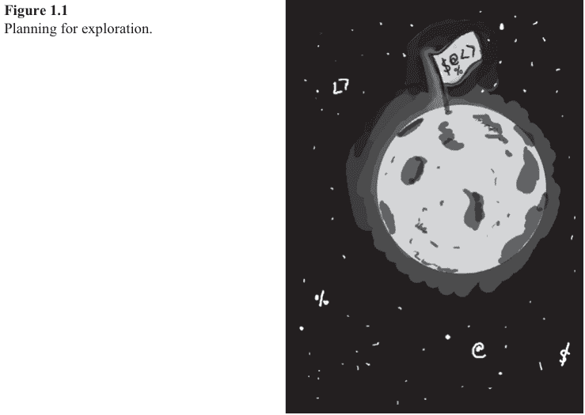

本书源于我在一所职业学院担任教师的努力。我教授了一门又一门的 Perl 课程。大学层面有多少这样的课程很难说，但无论如何，随着时间的推移，我发现当学生们通过 Perl 发现编程时，他们非常高兴。作为一名教师，我学到的一件事是，班上的人（他们构成了一个相当多样化的群体）最喜欢基础内容。当我将 Perl 作为模块驱动的语言来教授时，他们往往会表示不满。

当然，也可能是老师的问题。

### 能力与 Perl

许多程序员认为 Perl 是一种强大且有用的编程语言，因为它提供了模块。这是一个非常站得住脚的立场，我完全接受它。同时，试图通过模块来获取 Perl 知识证明是困难的。Perl 模块可能是黑洞（为了延续一个隐喻）。即使你在努力学习基础知识，也很容易忽略基础。允许我列举一些在学习 Perl 的过程中很容易出现的项目：

- 强制要求数据定义的严格要求的做法，这迫使你通过学习像“我的”和“我们”这样的代词有隐藏的生活来扩大你的词汇量。
- 发现成千上万个函数和一支模块舰队，你可以将它们应用于无数编程问题，其中许多问题在你通过一个晦涩的网页发现已有一个模块被开发出来以解决该问题之前，你从未想到过。
- 在互联网上花费数小时搜索有关晦涩模块的信息，因为有人说它已经做过了，你再想做一遍就是愚蠢的。
- 以至少六种不同的方式调用任何给定的函数（方法），以至于如果你考虑即使是少量模块提供的函数，并将它们乘以你可以使用它们的方式的数量，你突然不得不在谈论你在给定编程日可能做的事情的数量时开始使用指数。
- 遇到你学习如何用少量单词编程的情况，甚至远至参加挑战你编写不包含任何单词的程序的比赛。
- 被 Perl 是一种仅用于编写 CGI 程序的语言这一观念所吸引。
- 决定你应该只使用模块来做任何事情，尤其是在创建网页时。
- 觉得如果你无法用 Apache 网络服务器做到，那么就根本不应该做，尤其是使用 Perl 时。
- 将数据库连接视为使用 Perl 编程的必要条件，尤其是关于 MySQL。

前面的列表提供了一组主题，关于这些主题已经写出了好书。这个列表可以大大延长。然而，就目前而言，如果你试图学习一种编程语言，而不是一类应用编程，那么前面的列表既是祸也是福。问题在于 Perl 由其大师使用时的令人困惑的复杂性，与其作为初学者资源的本质优雅和简单形成对比。

Perl 的简单和优雅让你在只接触几个小时后就能开始编写有趣的程序。如果你专注于语言本身，并暂时搁置人们对它的成千上万种奇特用途，你就可以学习如何使用它


## 社区

Perl 编程社区遍布地球，甚至可能延伸到银河系的遥远地区。如表 1.1 所示，调查显示，超过一百万人使用 Perl 进行编程。Perl 作为编程语言的广泛使用可以追溯到 20 世纪 90 年代中期，Perl 几乎总是与互联网的传播联系在一起。互联网到哪里，Perl 就到哪里。

情况也可能相反。这有很多原因。Perl 是一种解释型语言，Perl 解释器已被移植到 Windows 和 Unix/Linux 操作系统，其使用的传播方式与互联网的传播方式非常相似。

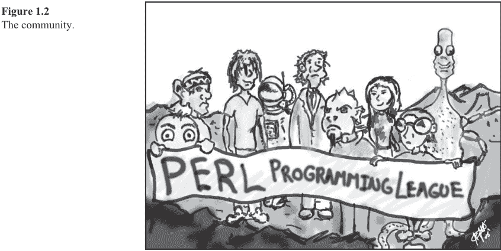

如果你在 Windows 操作系统上编写一个 Perl 程序，你可以相对容易地将其移植到 Unix 或 Linux。这称为可移植性。除了可移植性之外，Perl 之所以吸引许多人，是因为你可以免费获取它，在几分钟内安装它，并几乎立即开始使用它编写程序。

在某种程度上，其他编程语言（尤其是 Java）也可以说如此，但使用 Java 时，你面临着学习如何使用面向对象程序和 Java 类库的任务。正如你将在第 2 章中发现的那样，使用 Perl 则不需要任何这些。你可以下载 ActivePerl 解释器，并在几分钟内开始编程。编写你的第一个 Perl 程序只需要一行（也许两行）代码。

此外，你可以使用 vi、记事本或任何允许将文件另存为 ASCII 文本的文字处理器来编写 Perl 程序。你不必担心包或字节码编译。你只需输入，保存文件，然后运行它。生活很美好。

## 银河系的另一端

如果你有兴趣学习如何编程，Perl 是一种相当友好的编程语言。它不强制执行限制性的数据类型要求。本书中你将使用的四种基本数据类别（标量、数组、哈希和句柄）在一个参考表中表示，该表允许你相对容易地将一种转换为另一种。这意味着，如果你不喜欢数据的某种形式，你通常只需一次函数调用就可以将其更改为另一种形式。这大约是一种语言所能达到的最友好的程度。

然而，如前所述，虽然 Perl 友好，但它也有可能被视为具有“黑暗面”的一面。黑暗面有两个方面：

- 如前所述，多年来，高级 Perl 开发人员创建了大量的模块。这些模块提供函数。这些函数往往神秘莫测。文档量庞大，遍布世界各地的网络，有几十种语言。初学者 Perl 程序员深入研究这些模块及其伴随的文档，创建他们认为自己理解但实际上并不理解的程序，有时最终会说，他们后悔曾经通过从事如此危险的活动而危及自己的网站、编程课程或理智。

- Perl 的语法灵活性允许聪明的程序员编写晦涩难懂的程序，这些程序可以与大师级密码学家的工作相媲美。在银河系更偏远的地区，可能正有新的宗教基于此类程序而创立。然而，更贴近现实的是，那些不得不维护此类程序的人会怨恨它们，并对它们说一些尖刻的话。换句话说，当程序员编写其他人无法理解和维护的程序时，程序的成本会随时间增加。成本既包括公司必须花费在维护程序上的资金，也包括那些不得不维护此类程序的人所承受的压力。

嗯……任何编程语言都可以说这些话，但从很多方面来说，你听到的关于 Perl 的故事之所以存在，是因为它毕竟是一种非常民主的语言，因此暴露在各种滥用之下。

## 派生

Perl 提供了一组函数，允许你轻松地开始使用其主要的数据类别。例如，你可以对数组中的项目进行排序或反转，如果你想使用哈希，你不必采用非凡的构造操作来添加键和值或稍后访问它们。同样，在更简单的层面上，如果你创建一个字符并想将其转换为数字，你可以。

这种易用性在很多方面呈现出一个谜团，当你考虑到 Perl 具有 C 编程语言的外观和感觉，它有点像 Unix 世界（或整个编程世界）的古希腊语。尽管二十五年前，我们中的许多人开始使用 C 语言编程可能很棒，但现在的故事已经不同了。C 语言严苛且不近人情，就是这样。

另一方面，Perl 在很大程度上受益于 UNIX 世界的脚本语言。它提供了许多功能，允许你作为系统管理员轻松地与操作系统交互。它为你提供正则表达式。它诉诸一种相当本质主义的与计算机交互的观点。（老手称之为接近硬件。）

不过，Perl 在很大程度上是其用户/开发者社区所塑造的样子。社区不断塑造 Perl 的一种方式是使用模块。模块将 Perl 扩展到成千上万种特殊应用。事实上，有些书将 Perl 作为某个模块的扩展来教授，而不是作为使用模块的编程语言。

然而，如前所述，通过模块学习 Perl 可能不是最好的主意。至少，这是我的观点。当被要求为我的立场辩护时，我通常会讲述一个学生曾经带给我一本关于 Perl 模块的精彩书籍的故事。它教你如何构建网站。太棒了！只需访问这些模块并开始工作。

这本书没有附带任何基础知识的解释。

此外，使用模块假设你已经安装了它们。要安装它们，你需要知道在哪里找到它们。要找到它们，你需要获取正确的版本。同样，还需要访问服务器……以及数据库。

该学生报告说，总的来说，学习经验是有益的，因为他了解到自己对许多事情一无所知，但由于他无法让书中的任何代码运行，他说他并没有乐趣。

我承认，尽管我喜欢解决问题，但这次冒险听起来并不有趣。最后，他说了一句非常奇怪的话：“我想我需要先学习这门语言。”

## 获取

除了其他公司和组织之外，ActiveState 和 O'Reilly 已成为 Perl 的主要支持中心。同样，Perl 通常与 Apache 服务器相关联，你可以通过访问 Apache 软件基金会网站了解大量关于 Perl 模块的信息。perl.org 网站为你提供有关 Perl 库的信息以及许多页面的文档和源代码。O'Reilly 网站提供丰富的资源，以及 Larry Wall 及其密切合作者的书籍。CPAN 可以被视为 Perl 的核心非商业网站。你可以从 CPAN 下载解释器，以及模块和文档。

如果你使用运行 Windows 的 PC，开始使用 Perl 的最简单方法是从 ActiveState 获取 Perl 解释器。至于数据库，MySQL 是一个选择。许多数据库都有 Perl 模块可用。

第 2 章提供了更多关于这些主题的信息。Perl 的当前版本是 5.8。在过去十年中，Perl 倾向于稳定但缓慢地增长，因此你不会从一个版本到下一个版本面临非凡的变化。版本 6 将提供什么还有待观察。表 1.1 提供了一些主题的讨论，如果你希望扩展对 Perl 的了解，这些主题可能很有用。

## 表 1.1 扩展 Perl 视野

| 主题 | 讨论 |
| --- | --- |
| Larry Wall | Perl 的创建可以追溯到 1987 年。这在很大程度上与互联网的出现同时发生。Larry Wall 最初并不是程序员。他受过语言学家训练。他的网站是 http://www.wall.org/~larry/。 |
| CPAN | 这是 Comprehensive Perl Archive Network 的缩写。这是 Perl 的核心网站。访问地址：http://cpan.perl.org。 |
| ActiveState | http://aspn.activestate.com/ASPN/Downloads/ActivePerl。这是你在第 2 章中获取当前版本 Perl 的地方。 |
| O'Reilly | 访问 O'Reilly 网站 http://www.perl.com。其面向 Unix 和 Linux 系统管理员和程序员，但这也代表了 Perl 用户的大多数。 |
| MySQL | 你可以访问 http://dev.mysql.com/downloads。 |
| Apache | 你可以访问 Apache 软件基金会 www.apache.org。对于 Perl，请单击 Perl 菜单项。这为你提供 mod_perl 的访问权限。 |
| http://www.perl.org/ | 访问此站点并查看 Perl 目录。了解如果你正在学习 Perl，可用的资源。 |
| 普及度 | Perl 是最流行的 Web 编程语言。超过一百万人使用 Perl 编程。这大约相当于每个海得拉巴（巴基斯坦）或顿涅茨克（乌克兰）居民对应一名 Perl 程序员。 |
| 编辑器 | 第 2 章提供了更多信息。对于 DzSoft，你可以访问 http://www.dzsoft.com。 |


| 主题 | 讨论 |
| --- | --- |
| Groups and Lists | Go to http://lists.cpan.org/ and inspect the list there to get a sense of the resources available to you. There are hundreds of Perl user groups spread around the world. K, Q, U, and Z are the only letters not represented on the CPAN list as of this writing. |
| State of the Onion | It is probably important to gain some sense of why Perl is sometimes referred to as a postmodern programming language. See http://www.itconversations.com/shows/detail656.html. |
| Documentation | Any number of sites support Perl documentation. You can download it from http://perldoc.perl.org. The CPAN site links you to perldoc.org. |

## Perl Scalars, Arrays, Hashes, Handles

The heading of this section summarizes everything. That’s what this book is about. You might add a few other terms on such things as data structures, references, file IO, and programming methodologies. But if you get these four terms, you have the essence.

Perl is sometimes called a _contextually typed language_. This means, in essence, that when you define and use a given identifier, the meaning of the identifier depends on how you use it. (In one respect, you might say that programming in Perl is a lot like life in general.)

As a contextually typed language, Perl differs from languages like C, C++, or Java. When you program using those languages, how you define an identifier to a great extent determines the contexts in which you can use it.

To repeat the topic heading, Perl has four types of variables (or as you’ll read most often in this book, _identifiers_): scalars, arrays, hashes, and handles. You initially designate these type identifiers using type specifiers. The specifiers are as follows:

- **Dollar sign.** Put your money where your scalar is. Example: $ScalarName
- **Business “at” sign.** Perl offers you an array of names, just like the Internet. Example: @ArrayName
- **Percent sign.** Example: %HashName
- **The diamond operator.** Handle identifiers are often capitalized. Example: <STDIN>

Scalars, arrays, hashes, and handles each afford you a set of functions that allow you to perform your work. Likewise, you find that certain control statements, such as `foreach` and `each`, allow you to work readily with one type of data rather than another.

References are also an important part of basic Perl, as are regular expressions. Using references, you can extend the powers of arrays and hashes in enormous ways. You can also create arrays of functions.

As for regular expressions (regexes), this book includes a chapter on them because Perl allows you to readily use them in the contexts provided by common programming problems. If you use them, you can accomplish more than you would otherwise using far fewer lines of code. One chapter on regexes is in many ways an unfair treatment of the topic, for regexes form an enormous asset for programmers throughout the programming and system administration communities. Likewise, what you learn using regexes in Perl carries over to work in other languages, for in general, the form and use of such expressions tend to be uniform across many languages. With Perl you enjoy the advantage of being able to join regular expressions with a flexible programming language that enables you to use them in a number of sophisticated ways.

### Source Books

There are many books that are always good to have around if you find that you like Perl. Here is a short list:

Christiansen, Tom and Torkington, Nathan. *Perl Cookbook*. Cambridge: O’Reilly & Associates, 1998.

Deitel, H. M., Deitel, P. J., Nieto, T. R., McPhie, D. C. *Perl, How to Program*. Upper Saddle River, N.J.: Prentice-Hall, 2001.

Schwartz, Randal L., and Christiansen, Tom. Foreword by Larry Wall. *Learning Perl*. Cambridge: O’Reilly & Associates, 1997.

Wall, Larry, Schwartz, Randal L., Christiansen, Tom. *Programming Perl*. Cambridge: O’Reilly & Associates, 1996.

This page intentionally left blank

## 2 Getting Started

In this chapter, you’ll download and install the interpreter for Perl and an editor you can use to develop Perl programs with relative ease. The Perl interpreter you’ll employ is ActivePerl. As mentioned in Chapter 1, ActiveState provides a version of Perl you easily can install on a variety of operating systems. In this chapter, the emphasis is on the Windows version. After installing ActivePerl, you first test it by developing a Perl program using Windows Notepad. Run this file from the DOS command line or from a Windows directory. After testing your installation, you then download and install the DzSoft Perl Editor. You can obtain a demonstration copy of the editor that takes care of most of your needs for this book. However, if you elect to purchase a license, the fee is relatively modest compared to many software packages. Following the installation of the editor, run a demonstration program to see output to both a browser and a command line. This chapter covers the following topics, among others:

- Accessing the ActiveState site and obtaining ActivePerl
- Installing ActivePerl
- Writing a basic Perl program using Notepad
- Accessing the DzSoft site and downloading the Perl Editor
- Installing the DzSoft Perl Editor
- Running a program so it executes in both the browser and text modes

### Accessing and Installing Perl

As mentioned in Chapter 1, you can obtain the latest Perl interpreter from the ActiveState Programming Network (ASPN). This is the easiest way to directly access the current version of Perl (as of this writing, version 5.8.7). The URL is http://aspn.activestate.com/ASPN/Downloads/ActivePerl/. When you access the ASPN download site, the latest Perl interpreter appears on the left of the page at the top. Click it to begin the download. (See Figure 2.1.)

**Figure 2.1** Access the ActiveState site to download ActivePerl.

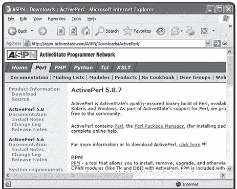

Take a moment to register. (See Figure 2.2.) Click Next.

**Figure 2.2** Registration does not obligate you to pay anything.

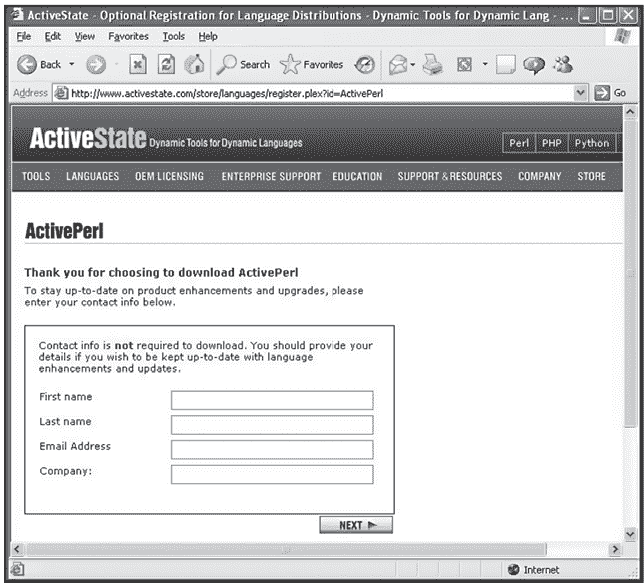

A page appears that thanks you for registering. Click Continue To Download. As shown in Figure 2.3, the site displays the current versions of the ActivePerl installation package. To download the Windows version of ActivePerl, click the link for MSI under Windows. This provides a standard installation package that automatically configures your system to use Perl.

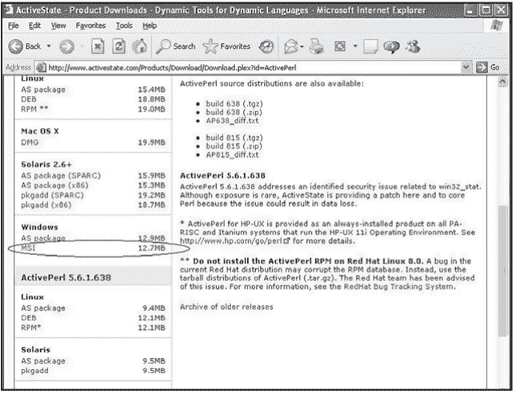

As Figure 2.4 illustrates, when the Save As dialog appears, click Save. Save the ActivePerl installation executable to a directory you create in a conspicuous place on your C: drive. (The directory created for the two downloads in this chapter is C:\downloads directory.) Click Close on the Download Complete dialog.

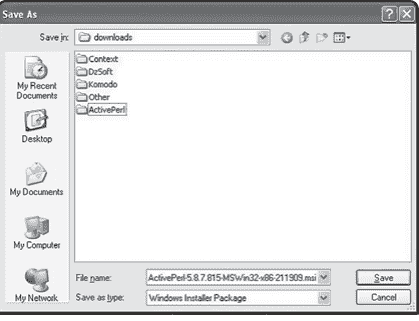

As is the case later on in this chapter when you download and install the DzSoft Perl Editor, you do nothing special when you install ActivePerl. Use the Windows Start > Control Panel option. Select Add or Remove Programs. Click Add New Programs. Click CD or Floppy and the Next button. Click the Browse button and select the directory in which you have placed the ActivePerl installation executable. You must set the Files of Type field to All Files to see the ActivePerl installation executable (for example ActivePerl-5.8.7.815-MSWin32-x86-211909.msi). You then select the ActivePerl executable and click Open. The Run Installation Program dialog appears, and you click Finish.

You’ll then see a security warning. The publisher as of this writing is identified as “unknown,” but you can still safely install the program. Click Run. The standard Windows installer for ActivePerl will appear. The first message that appears explains that the installer is determining whether adequate disk space exists on your computer for the installation. (See Figure 2.5.)

**Figure 2.5** The installation checks for adequate disk space.

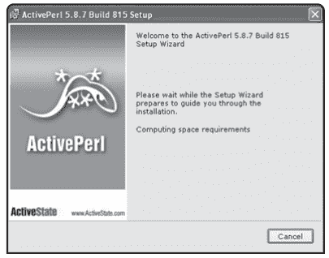

### First Time Installation

If the installer determines your computer possesses adequate disk space, the installation dialog automatically refreshes, and you can then continue with the installation. If this is the first time you have installed ActivePerl, you’ll see a dialog that confirms the installation (see Figure 2.6). Click Next. In the next dialog, you’ll see the license agreement. Click the radio button to confirm that you accept the terms of the license. Click Next.


## 访问并安装 Perl

向导会要求你确认安装。

如图 2.7 所示，在许可协议对话框之后出现的对话框提供了一些安装选项。接受所有默认选项。PPM 代表 Perl 包管理器（Perl Package Manager）。文档和示例不会占用太多资源，而且在你进行编程工作时值得手边备有。点击“下一步”。

允许安装包将所有默认内容安装到你的计算机上。

“选择设置选项”对话框包含重要选项。保持两个默认复选框处于选中状态。这两个复选框会将 Perl 添加到你的路径变量中，并创建 Perl 文件扩展名关联。（文件类型为 *.pl。）如果这两个操作中有任何一个未完成，你的安装就不会完全成功。点击“下一步”。

在“准备安装”对话框中，点击“安装”。随后你会看到一系列显示安装进度条的对话框。安装完成后，你会看到一个最终对话框。如果你是 Perl 新手，请取消选中“显示发行说明”。然后点击“完成”。

## 测试你的 ActivePerl 安装

即使本章提供了允许你使用 DzSoft Perl 编辑器进行 Perl 编程活动的说明，能够在命令提示符下处理 Perl 程序仍然是至关重要的。

为此，要访问命令提示符，请从 Windows 桌面的“开始”菜单开始。选择“开始 > 所有程序 > 附件 > 命令提示符”。图 2.8 展示了从 Windows“开始”菜单到“命令提示符”的路径。

在 Windows 菜单系统中找到“命令提示符”后，创建一个快捷方式并将其放在 Windows 桌面上。如图 2.9 所示，要创建快捷方式，请右键点击“命令提示符”，然后选择“发送到”和“桌面（创建快捷方式）”。

## 自定义命令提示符窗口

为了让你在命令提示符下的工作更轻松，请将命令提示符窗口设置为白底黑字。为此，请打开命令提示符窗口。右键点击窗口顶部的标题栏，然后从下拉菜单中选择“属性”选项。你将看到“属性”对话框，如图 2.10 所示。

点击“颜色”选项卡。然后点击“屏幕背景”单选按钮，并将值设置为如图 2.10 所示（255, 255, 255）。要设置背景颜色值，请点击调色板中的白色框。要设置文本，请点击“屏幕文本”单选按钮，并通过点击调色板中的黑色框将所有值设置为零（0, 0, 0）。完成背景和文本颜色设置后，点击“确定”。当“确定”对话框出现时，点击对应于“修改启动此窗口的快捷方式”的单选按钮。再次点击“确定”。

既然你已经将 DOS 命令提示符窗口设置为浅色背景和深色字体，你将看到类似图 2.11 的内容。当你需要与操作系统交互时，这个窗口现在就在你的桌面上可用。

## Perl 文件

使用 DOS 命令或 Windows 选项，在主驱动器（C:）的根目录下创建一个目录。将其命名为 MyPerlPrograms。

使用记事本创建一个名为 HelloWorld 的文件。要创建该文件，请使用 *.pl 扩展名保存。要以 *.pl 扩展名保存文件，请在“保存类型”字段中选择“所有文件”。参见图 2.12。

Perl 文件的类型为 *.pl。

保存文件后，请严格按照所示内容输入以下行。在第一行之后包含一个空行。完成后保存并关闭文件。

```perl
print "Hello World!\n";
$AnyChar = <STDIN>;
```

测试你的安装。

带有 `print` 的行告诉程序将 Hello World! 打印到命令行。第二行是一种相当笨拙的方式，用来告诉程序在你按下回车键之前不要退出。

## 访问并安装 Perl

如果你精通 DOS，现在可以导航到 MyPerlPrograms 目录并输入你的文件名。图 2.14 展示了如何输入文件名。*.pl 扩展名会调用 Perl 解释器。文件会如图 2.14 所示执行。

Hello World Perl 程序在命令提示符下执行。

或者，打开 Windows 并导航到你的 MyPerlPrograms 目录。你会看到你的文件以 Perl 解释器的图标表示。图 2.15 展示了这种情况。双击文件名。

在 Windows 目录中点击 Perl 程序。

文件执行时会打开一个命令提示符窗口。参见图 2.16。按回车键退出程序。

命令提示符窗口打开，Perl 程序执行。

如果你在 Windows 资源管理器中点击文件时，文件一闪而过并消失，通常有两个原因之一。一是它们包含代码问题。这个问题必须适时处理。另一方面，问题可能只是它们没有包含能让文件执行暂停足够长的时间以便你看到的代码。要解决这种情况，请用记事本（或你的编辑器）打开 Perl 文件，并在文件末尾输入以下行：

$AnyChar = <STDIN>;

你也可以只输入以下内容：

<>

这起到了与较长的语句相同的作用。这些行会使文件的执行暂停，直到你按下回车键。它们不会在你未作为网页显示的 Perl 文件中造成任何问题。

## 文件类型关联

参见图 2.15，如果你没有看到该图标，则说明 Windows 尚未将 *.pl 扩展名与你的 Perl 文件关联。要纠正这种情况，请选择“开始 > 控制面板 > 文件夹选项”。点击“文件类型”选项卡。滚动到 PL 扩展名并点击它。然后点击“更改”并选择 Perl 命令行解释器，如图 2.17 所示。

### 图 2.17 如有必要，请关联文件类型。

## 编辑器入门

目前有几款编辑器可以让你轻松地用 Perl 创建程序。有些是免费的。其他一些售价低于 50 美元。表 2.1 提供了一份简短的最佳编辑器列表。一般来说，如果你想快速上手，DzSoft Perl 编辑器提供了一个合适的选择，而这本书选择的就是它。另一方面，如果你想要一个专为 ActiveState Perl 设计的非常强大的编辑器，那么 Komodo 最合理。一般来说，编辑器是个人偏好问题。你甚至可以在 Windows 记事本或 vi 中编辑 Perl，然后从那里开始。（如果你对 WinVi 感到好奇，下载它的网址是 http://www.winvi.de/en/download.html。）

## 表 2.1 Perl 编辑器

| 编辑器 | 说明 |
|---|---|
| Komodo | 目前可用版本为 3.5.2。你可以获取演示版，大约一个月后购买个人版或专业版。该编辑器是 ActiveState 的产品，ActiveState 为 PHP、Python、Tcl 和 Ruby 等语言提供了多款编辑器。如果你想利用 ActiveState 丰富的 Perl 资源，这款编辑器无疑是市场上最好的之一。另一方面，和 Eclipse 一样，这款编辑器需要大量上手工作才能习惯。（网址是 http://www.activestate.com。） |
| Eclipse | 你可以免费获取 Eclipse。这是一个庞大的开发环境，许多从事基于 Java 的应用程序开发的开发人员都在使用。Eclipse 提供了 Perl 扩展。如果你不是经验丰富的程序员，该扩展会很难配置。此外，你还必须下载并安装 Java 运行时。一般来说，如果你想花费大量时间学习如何使用免费的开发工具，Eclipse 是一个选择。它是一个非常强大且有趣的编辑器，具有各种各样的功能。（网址是 http://www.eclipse.org。） |
| ConTEXT | 这是一款可以免费获取的编辑器。如果你愿意，可以自愿为开发工作做出贡献。ConTEXT 是一款基础、高效、轻量级的编辑器，可用于多种语言。要将其设置为专门用于 Perl，你需要下载一个补充文件，使其能够解析 Perl 关键字。你必须配置它来编译文件并提供你想要的输出。要使编辑器能够处理 Perl 文件，你需要将功能键与 Perl 可执行文件关联。这些都很容易实现，但对初学者来说可能会很痛苦。（网址是 http://www.context.cx。） |
| DzSoft Perl Editor | 这是本书使用的编辑器。它的优点是易于使用，并且为你提供了内置的浏览器输出窗口和其他有助于开发 Perl 程序的功能。除此之外，它还内置了浏览器，因此你可以立即开始开发创建网页的 Perl 程序。此外，你既可以将程序编译为 DzSoft 文本或 |


## 第 2 章 入门

### 获取 DzSoft Perl Editor

如表 2.1 所示，DzSoft 的互联网地址为 http://www.dzsoft.com。图 2.18 展示了 DzSoft 的主页，其中显示了 DzSoft Perl Editor。单击 Perl Editor 链接。

**Figure 2.18** DzSoft 在其他选项中列出了 Perl Editor。

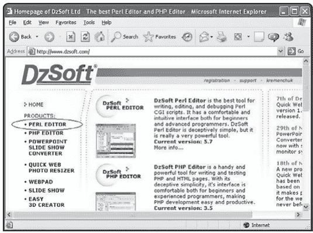

在描述 Perl Editor 的页面中（参见图 2.19），单击 Click Here to Download 链接。下载对话框将立即出现。单击 Save 选项并将可执行文件保存到本地驱动器。

通常，最好将安装可执行文件保存到本地驱动器。图 2.20 展示了设置为 c:\executables\DzSoft 的文件夹。创建此类文件夹并将可执行文件（当前版本为 dzperl57.exe）保存到其中。

如果你是学生，DzSoft 提供半价，因此如果你属于此类别，可能需要记住这一点。否则，你会看到张贴的价格。购买许可证时，DzSoft 会通过电子邮件将其发送给你。为防万一，请将许可证的副本保存到存储安装可执行文件的目录中。图 2.21 展示了带有许可证和 DzSoft 安装文件的已保存文件。

**Figure 2.19** Click Here to Download 链接将立即开始下载。

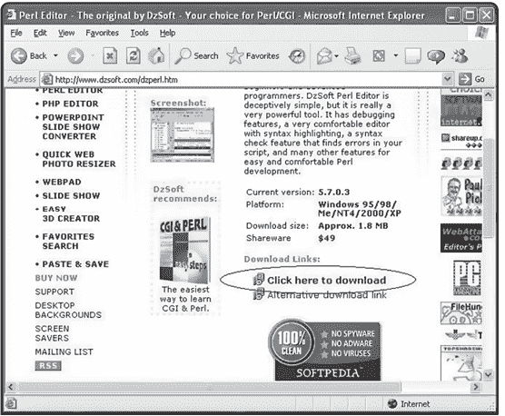

**Figure 2.20** 保存安装可执行文件以防出现问题。

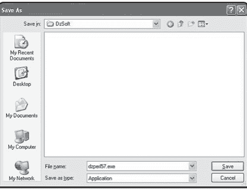

**Figure 2.21** 如果你购买 DzSoft 的 Perl Editor，你会收到一封包含密钥的电子邮件，可以将其保存到文本文件中，然后剪切并粘贴到许可证窗口。

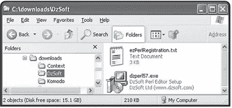

要开始安装，请使用 Windows 开始 > 控制面板选项。选择添加或删除程序。单击添加新程序。单击 CD 或软盘，然后单击下一步按钮。单击浏览按钮并选择存放 DzSoft Perl Editor 安装可执行文件的目录。你必须将文件类型字段设置为 _All Files_ 才能看到 DzSoft 安装可执行文件。然后选择 DzSoft 可执行文件并单击打开。运行安装程序对话框将出现。单击完成。

然后你会看到安全警告。发布者 DzSoft 已被识别。你可以安全地安装该程序。单击运行。如图 2.22 所示，你将看到 DzSoft 的标准安装程序。

**Figure 2.22** DzSoft 已准备好安装。

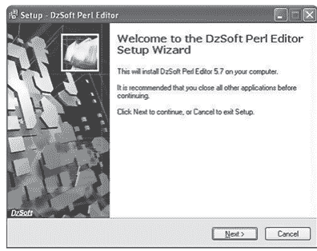

之后你会看到许可证对话框。单击单选按钮和下一步以表示你同意许可证条款。

使用 DzSoft 提供的默认目录（参见图 2.23）。单击下一步。

在选择开始菜单文件夹中，允许 DzSoft 为你创建快捷方式，使用默认名称（DzSoft Perl Editor）。单击下一步。

在选择其他任务对话框中，保持前两个选项不变。（参见图 2.24。）不过，如果你不想要桌面图标或快速启动图标（这出现在桌面托盘中），你当然可以取消选择这些选项。

**一个重要提示！** 取消选择与 Perl 文件关联的选项。你随时可以将 *.pl 扩展名与 DzSoft 关联，但目前请不要这样做。最好允许 *.pl 扩展名调用 Perl 解释器而不是 DzSoft。单击下一步。

**Figure 2.23** 接受默认目录。

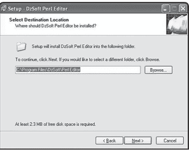

**Figure 2.24** 取消选择与 Perl 文件关联的复选框。

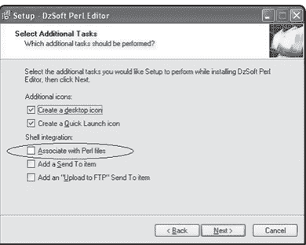

在准备安装对话框中，你将看到要创建的文件和目录。单击安装。你将看到一个带有进度条的窗口，然后最终对话框将出现。保持启动 DzSoft Perl Editor 选项被选中，然后单击完成。

### 初次查看 Perl Editor

**Figure 2.25** 默认情况下，你将看到一个打印 HTML 消息的 Perl 程序。

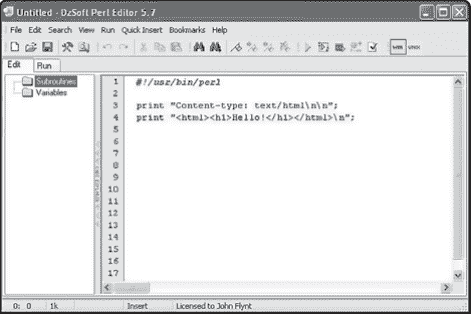

如图 2.25 所示，你初次查看 DzSoft Perl Editor 时，会得到一个准备运行的 Perl 文件。注意左侧的编辑和运行选项卡以及左侧编辑区域中的 Perl 程序。

如图 2.25 所示，你首先看到的消息会创建一个 HTML 文档。该文档包含三行。第一行称为“shebang”行。这标识了 Perl 解释器所在的目录。随后是一个空行。然后你将看到两个以 `print` 开头的行。在每一行中，Perl 代码由单词 `print`、双引号和行末的分号组成。每行双引号内的内容是 HTML 消息。当这些消息在浏览器中显示时，你会看到标准的 HTML。

### HTML 输出

要执行文件，请从顶部菜单中选择 运行 > 快速运行。或者，按 F9。

如图 2.26 所示，窗口会立即更改。你会看到作为文本和在浏览器中选项卡选项。默认情况下，显示在浏览器中选项卡，因此对于 DzSoft 提供的程序，你会看到打印的 HTML 行，就像它可能在标准浏览器中显示一样。

**Figure 2.26** DzSoft 解析你的文件，以便你检查程序的语法并显示 HTML 输出。

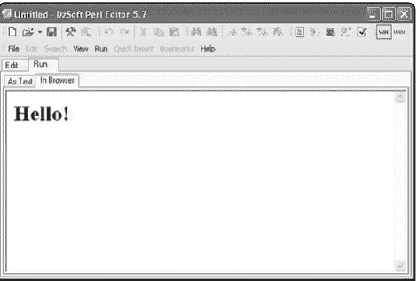

> 如果你的 DzSoft Perl Editor 窗口与本章屏幕截图中显示的不同，请选择 查看 > 状态栏 或 查看 > 切换代码资源管理器。要消除行号，请选择 查看 > 选项 > 编辑器，并取消选择显示行号和在边栏显示行号。
>
> 另外，当你使用 DzSoft Perl Editor 时，请使用 Shift + F9 执行本书中的文件。它们是为命令行交互开发的。当你单独按 F9 时，你会调用用于 Web 内容的解释器，有些程序并非设计为在这种模式下显示。

为了了解编辑代码有多容易，请单击编辑选项卡。然后更改 Perl 文件，使其读取如下内容。（目前不要保存你的工作。完成后，单击运行选项卡。然后单击在浏览器中。）

```perl
#! /usr/bin/perl

print "Content-type: text/html\n\n";
print "<html><h1>Hello</h1>\n";
print "<h1>World!</h1></html>\n";
```

图 2.27 展示了编辑区域中更改后的代码。

**Figure 2.27** 单击在浏览器中选项卡以查看 Web 内容。

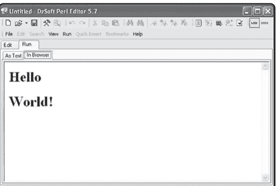

### 文本输出和 DOS 窗口

现在你已经有机会了解 DzSoft Perl Editor 如何处理 HTML，请单击作为文本选项卡。作为文本选项卡允许你看到输出在命令行中的显示方式（你在本书前几章中编写的大多数程序涉及命令行而不是浏览器）。图 2.28 显示了结果。

在本书过程中，你将同时使用文本视图和浏览器视图来处理 Perl 代码。对于本文中的程序，请按 Shift + F9 执行它们。这种方法不会在 DzSoft 文本区域中显示你的程序，而是允许你在单独的 DOS 窗口中查看它们。当你在 DOS 窗口中执行程序时，你将处于更好的位置，可以在任何给定的编辑环境之外处理程序。要关闭程序，请按回车键。这会直接返回你到 DzSoft 编辑器，你可以根据需要进行更改。

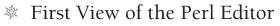

**Figure 2.28** 你会看到文本输出，就像它可能在操作系统的命令提示符下处理时显示的那样。

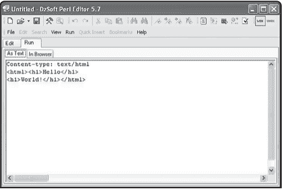

### 保存文件

要保存文件，请选择 文件 > 保存。导航到 MyPerlPrograms。将你修改的文件保存为 HelloWorld01。你会看到带有 *.pl 文件的文件。这是 Perl 文件的扩展名。（参见图 2.29。）

**Figure 2.29** 你会看到文件类型为 Perl 文件（*.pl 扩展名）。

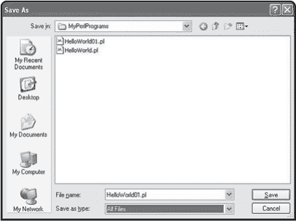


## 结论

本章帮助你获取并安装了 ActivePerl 解释器和 DzSoft Perl 编辑器。有了这两项工具，你现在可以开始开发 Perl 程序了。当然，使用 Perl 时不需要特定的编辑器。你可以使用命令提示符和类似记事本的通用应用程序。不过，使用专为解析 Perl 设计的编辑器，会让你的工作比其他方式轻松得多。本书中的程序均使用 DzSoft Perl 编辑器开发。

Perl 文件的扩展名为 *.pl，只要该扩展名与 Perl 解释器关联，你就可以在命令行中轻松执行 Perl 文件。安装编辑器时，应避免将 Perl 扩展名与编辑器关联。相反，应将 *.pl 扩展名与 Perl 解释器关联。在本章记录的安装过程中，ActivePerl 安装程序将 Perl 解释器安装在 Perl 目录中。当你将 *.pl 扩展名与解释器关联后，可以使用命令提示符或 Windows 目录直接执行创建的 Perl 程序。

## 标量和字符串

本章介绍标量，主要用于字符串编程。标量变量是用于存储单个值的变量。单个值可以是数字或字符串。如果标量存储的是字符串，则可以包含相当大量的信息。处理字符串时，Perl 允许使用插值字符串或字符字符串。尝试字符串的最佳方法之一，是使用 `print()` 函数向计算机系统进行输出。除了探索输出字符串的基础知识外，熟悉与字符串相关的操作也很重要。这些操作包括连接、比较、递增以及使用块来存储大量文本。本章将带你了解各种主题和程序，帮助你理解 Perl 字符串。涵盖的主题包括以下内容：

- 什么使字符串成为标量
- 字符串如何插值
- 字符串如何作为字符读取
- 如何打印字符串
- 如何将字符串组合在一起
- 使用运算符操作和比较字符串

### 初步工作

学习编程语言的最佳方法通常涉及输入示例程序、研究它们并对其进行修改。为此，本节允许你使用 `print()` 函数，并提供一些关于 Perl 的要点，为你提供在本书中可用的学习工具。

### print() 函数

作为初学者，在任何编程语言中最重要的函数通常涉及从程序写入消息和将消息读入程序。此类函数涉及输入和输出（简称 IO）。在 Perl 中，要从程序写入消息，请使用 `print()` 函数。要以最简单的形式使用此函数，请输入单词 `print`，后跟单引号或双引号，并在其中放置要写入输出设备的内容。请参阅以下代码示例：

```perl
#Listing03_01
#the print function
print "\nHere are some data about Mt. Everest: ";
print "\nClimber: Edmund Hillary, ";
print "\nClimber: Tenzing Norgay.";
```

图 3.1 说明了该程序在 DzSoft Perl 编辑器中显示的输出外观。

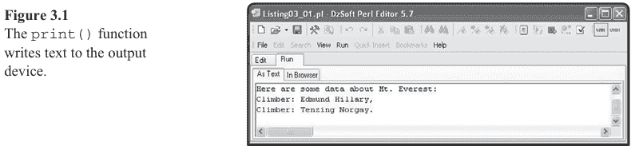

单词 `print` 表示函数调用。关于函数的更多内容将在后面介绍。目前，请注意，在单词 `print` 之后，你会看到放置在双引号中的文本。这将文本定义为 _插值_ 字符串。你使用开头和结尾的引号。行末使用分号，它是程序 _语句_ 的终止标记。如后文详细说明，每行开头的 `\n` 强制文本在打印到输出设备时出现在新行上。

### 使用编辑器的代码组合策略

如果你使用未注册版本的 DzSoft Perl 编辑器，仍然可以使用本书中的编程示例。如果你不购买许可证，DzSoft 会限制你可以使用的程序长度。否则，你的使用不受限制。

要使用本书中的程序示例，请访问 _Perl Power_! 代码目录中的章节文件夹。程序按章节排列。你可以在 Chapter03 中找到本章的示例。每个程序按顺序编号，并以单词“Listing”开头。Listing03_02.pl 是本章文件的一个示例。

学习编程语言的有效方法是输入程序，然后对其进行修改以查看其工作原理。无论如何，建议你在本书中采用这种方法。如果遇到问题，始终可以打开并编译示例。

开发程序时，使用 _迭代_ 和 _增量_ 方法向程序添加代码。因此，从只有几行代码的程序开始。编译这几行代码以查看它们是否工作。如果工作正常，再添加几行代码。一次添加几行代码的操作涉及程序的增量构建。迭代部分是通过编译进行重复测试。

如果你的代码导致错误，并且你正在使用 DzSoft Perl 编辑器，你将在自动打开的文本区域中看到错误报告。在某些情况下，如果你可以单击消息窗口中报告错误的行，编辑器会将光标定位在包含错误的行或其附近的行上。另一方面，错误也可能严重到编辑器无法提供帮助。在这种情况下，尝试从单行开始。如果必须，可以注释掉除一行以外的所有行，然后从那里开始。

图 3.2 提供了使用 DzSoft Perl 编辑器编写程序的标准入门行集。（你可以使用编辑器在开始新文件时自动生成此代码。）文本区域顶部是一组两行，使你可以使用 F9 在编译和编辑之间切换而不会出现错误消息。之后，当你熟悉命令行编译后，可能决定省略这些行。

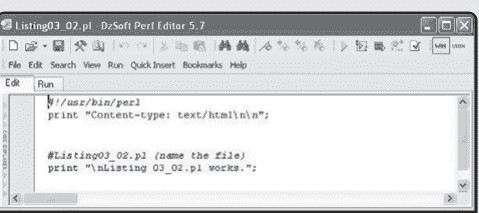

**Figure 3.2**  
从标准的 bang 和 content-type 行开始，然后只输入几行代码。

打印“Listing...”消息的 `print()` 函数充当“健全性检查”。它报告程序最基本形式是否编译。按 F9。如果看到入门行显示，从那里继续。图 3.3 说明了 Listing03_02 的输出。

编辑器提供一些自动代码生成宏。例如，要插入 content-type 行，请将光标定位在空白行上，然后从主菜单中选择 Quick Insert > Content-Type。你也可以按 Ctrl 和零（Ctrl + 0）。如前所述，如果你使用 DzSoft 一段时间，可以学习如何修改宏以适应你的口味和做法。

你当然可以根据任何让你满意的基础继续，但通常，考虑抵制在尝试编译一行代码之前输入整页代码的冲动。如果你输入许多行然后尝试编译，你可能会面临一长串错误，并且剥夺了解释器（或编译器）在以增量、迭代方式工作时可以提供的积极反馈。

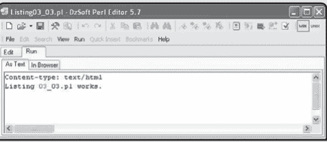

**Figure 3.3**  
按 F9 编译；如果成功，再添加几行代码。

为了节省空间，在本书中呈现的大多数代码示例中，你看不到 bang 和 content-type 行。这些行仍然存在于你从本书互联网站点下载的许多程序中。

### 基本编程语法

在使用 Perl 编程时，你使用的最基本的语法项目包括用于创建注释、制作语句、强制换行以及从常规程序解释中转义以便显示特殊字符的项目。本节回顾这些项目。

#### 使用 # 的注释

井号（#）提供了一种方法，可以告诉 Perl 解释器跳过你在程序中包含的注释。此类注释称为 _注释_。注释不是代码的一部分。任何以井号开头的行都被视为注释。

解释器从左到右读取。因此，如果你希望解释器不读取你在程序中包含的一行文本，请在希望解释器停止读取的第一个字符处输入井号。从该点开始，直到解释器到达行尾字符，它都不会尝试将你输入的任何内容解释为 Perl 代码。请参阅以下代码示例：

```perl
#Listing03_04
#Comments proceed to the end-of-line character
#You press Enter to insert an EOL character
print "\nListing03_04.pl works."; #Comments can follow code
print "\nReady to add lines!";
```


Listing03_04.pl 的前三行提供标准注释。每一行都以井号开头。第四行以 “Comments can ...” 开头，你可以看到程序语句右侧有一条注释。这样的注释不会造成任何问题。解释器知道不去读取它。然而，如果你将注释和语句的位置互换，解释器立即就会遇到问题。你必须将注释放在单独的一行，或者如果放在同一行，则必须放在程序语句之后。图 3.4 展示了 Listing03_04 的输出。

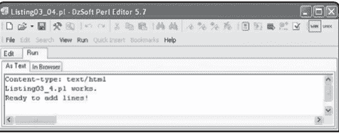

**图 3.4** 代码右侧的注释不会造成问题。

## 如何构成语句

分号（;）表示解释器应将分号左侧的文字作为一个完整单元来读取。一个完整单元就是一条语句。在 Perl 中，你能写出的最短语句由一个分号组成。考虑以下代码示例：

```perl
#Listing03_05
print "\nListing03_05.pl works."; #Comments can follow code
print "\nReady to add lines!";
;;;
;
;
print "\nReady to add more lines!";
```

Listing03_05 的前两行提供标准语句。例如，插值字符串（双引号内的字符串）跟在 `print()` 函数后面。接下来的三行只提供分号。在第三行，你看到三个连续的分号。在接下来的两行中，每一行占据一个分号。最后一行，你看到一条以 `print()` 函数开头的标准语句。

解释器将分号读取为语句，即使它们只是让解释器继续下一条语句。如图 3.5 所示，分号不会在程序输出中产生额外的空行。

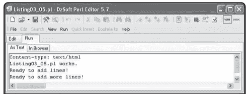

**图 3.5** 单独的分号构成语句但不会产生可见变化。

## 省略分号

如果你删除了语句后的一个分号，就会造成解释器错误。考虑以下代码示例：

```perl
#Listing03_06
#Missing semicolons result in interpreter error messages
# To correct the problem, add a semicolon on each line
# right after the closing quotation marks
print "\nListing03_06.pl works."   #1 semicolon left off
print "\nReady to add lines!"      #2 semicolon left off
; ; ;
;
;
print "\nReady to add more lines!";
```

注释中标为 #1 和 #2 的行缺少分号。当你将代码提交给解释器时，你可能会看到类似下面的消息：

```
syntax error at Listing03_06.pl line 8, near "print"
Execution of Listing03_06.pl aborted due to compilation errors
```

Perl 解释器可能不会每次都因为你忘记输入分号而报错。考虑 Listing03_06 中标有 #2 注释的行。下一行（三个分号的那一行）中的第一个分号替代了缺失的分号。在这种情况下，解释器不会报错。然而，如果你省略了 #1 的分号，解释器必定会报错。

## 一行中的多条语句

你在前面的示例中看到了一行中连续的分号（语句）。适用于由一个分号组成的语句的规则，同样适用于由完整表达式组成的语句。考虑以下代码示例：

```perl
#Listing03_07.pl
#Multiple statements on one line
print "\nListing03_07.pl works.";                    #single statement
print "\nMultiple statements on one line";          #single statement
#Multiple statements on one line follow
;;;
print "\nReady to add more lines!"; print "\nAnd more lines...";"!";
```

图 3.6 展示了输出。注意，解释器可以毫无问题地读取最后一行中的语句。输出出现在不同的行上，是因为 `\n` 强制后面的字符串换到新的一行。

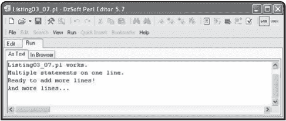

**图 3.6** 一行中的连续语句不会造成错误。

> 虽然在一行代码中编写多条语句不会产生语法错误，但请注意，许多经验丰富的程序员认为这是一种差劲的编程风格。经验丰富的程序员常常坚持认为，每一行代码中放置的语句不应超过一条。

## 转义序列

在目前所示的大多数代码示例中，与 `print()` 函数一起使用的带引号文本都以一个反斜杠字符后跟一个“n”字符（`\n`）开头。这种字符组合会在 `print()` 函数的输出中插入一个换行。反斜杠也可以与其他几个字符一起使用。反斜杠和它后面的字符合称为*转义序列*。转义序列转义了程序的正常执行。它使 Perl 解释器将某个字符当作任何其他文本字符来解读，而不是试图将其作为语言特性来处理。为了了解其工作原理，考虑以下代码示例：

```perl
#Listing03_08.pl
#Different uses of the escape sequence

print "\nListing03_08.pl works.";
print "\nEscape characters:";
print "\nNew\nNew\nNew";
print "\nHe said, \"That's new.\"";
print "\nShe said \"vlap\" twice.";
print "\nThe bill was \$25.00.\b\b";
print "\nHere's a \uv\laur\li\ue\ld word.";
print "\nThe lines read: \nLife teaches \n\t\tof time \n\tand sorrow.";
```

图 3.7 展示了使用 Listing03_08 中的转义序列后命令行输出的外观。

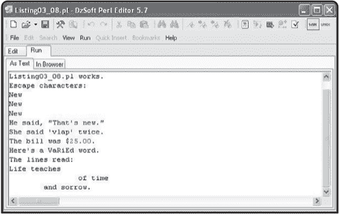

如图 3.7 所示，使用反斜杠和双引号（`\"`）可以显示双引号。反斜杠和单引号（`\'`）可以显示单引号。反斜杠和 u（`\u`）强制后面的字符变为大写。在每种情况下，转义序列都允许你执行格式化过程或其他类型的操作，而这些操作仅靠键盘上的字符是无法单独完成的。表 3.1 提供了转义序列的总结和讨论。

**表 3.1** 转义序列

| 序列 | 说明 |
| --- | --- |
| `\n` | 强制换行。 |
| `\t` | 强制制表。具体显示效果取决于你的显示器的制表符设置。 |
| `\$` | 创建一个美元符号。否则，下一个词项会被读取为标量。 |
| `\\` | 允许你显示一个反斜杠。否则，下一个字符很可能会被读取为转义序列的一部分。 |
| `\*` | 允许你显示一个星号。 |
| `\"` | 允许你在创建插值字符串的引号内显示双引号。否则，引号会结束字符串，并很可能会导致错误。 |
| `\@` | 允许你显示“at”符号。 |
| `\b` | 强制退格。 |
| `\u` | 将后面的字符设置为大写。 |
| `\U` | 将后面的所有字符设置为大写。 |
| `\l` | 将后面的字符设置为小写。 |
| `\L` | 将后面的所有字符设置为小写。 |
| `\'` | 与双引号的情况相同，不同之处在于这里处理的是字面字符串。 |

## 标量和字符串

当你用 Perl 编写程序时，你处理的是数据类别而不是数据类型。如第 1 章所述，这些数据类别归入_标量_、_哈希_、_数组_和_句柄_等标题之下。在这四类数据中，最基本的是与孤立的或个别化的字符串和数字相关的标识符。在 Perl 中，这种个别化的字符串和数字归入标量值之下。图 3.8 抽象地说明了你可视化标量值不同形式的方式。（图 3.9 提供了标量的具体版本。）

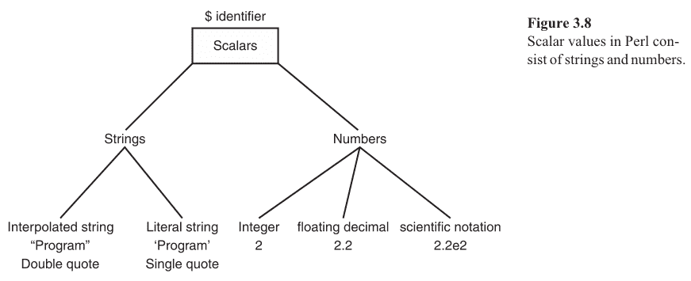

如图 3.8 所示，当你用 Perl 编程时，你使用货币符号（$）来标识标量。你存储为标量的任何值都以单个可检索值的形式存在，即使它是词语的集合（一个句子或更长的组合单元）。当你将文本存储在


## 第3章 标量与字符串

标量，你可以将其存储为插值字符串或字面量字符串。插值字符串允许你在字符串中放置变量并从变量中检索值。字面量字符串则让你无论如何使用，都能看到你在字符串中包含的准确内容。

当你将2或2.2等数字存储到标量中时，值2称为整数，即整数。值2.2称为有理数或实数或浮点数。使用Perl，你可以将插值字符串、字面量字符串、整数和浮点数赋给标量。

### 创建标量

考虑图3.9所示的标量。每个标量的名称由一个称为标识符的单词组成，并且每个标识符前面都有一个美元符号（$）。美元符号本身称为类型标识符。当你将类型标识符作为前缀加到标识符上时，你就创建了一个标量标识符（有时称为标量变量）。

然后，每个标量变量后面跟着一个等号（=）。等号称为赋值运算符。赋值运算符为每个标量变量赋一个值。当赋值运算符将其右侧的值赋给左侧的标量时，它会转换该值，以便标量知道如何存储它。

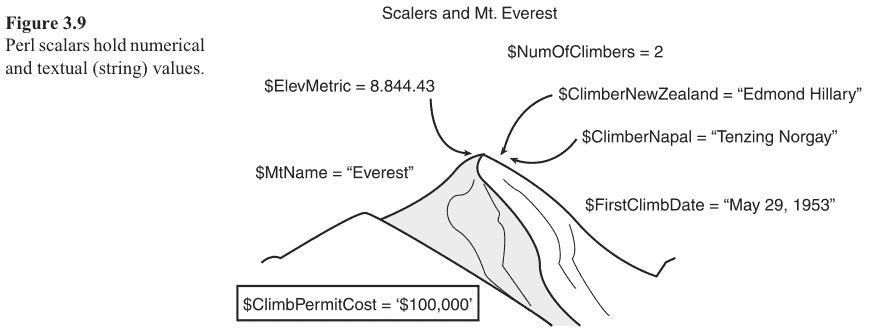

表3.2简要讨论了图3.9所示的标量变量。在每种情况下，务必记住赋值运算符允许你将不同类型的数字或字符串赋给标量标识符。在本章后面的章节中，你将看到其他运算符允许你检索值，并根据它们是字符串还是数字来处理它们。

**表3.2** 标量变量

| 标量变量 | 讨论 |
| --- | --- |
| `$ElevMetric = 8844.43` | 存储的值由有理数或实数组成，也称为浮点数。这种数字的简称是*float*。在其他编程语言中，取值极大的数字通常标记为*double*。Perl允许你以多种方式控制数字（正如本书后面使用*转换说明*所证明的那样），但通常，当你将一个数字赋给标量标识符时，Perl会负责存储该数字。整数以整数形式存储，浮点数以浮点数形式存储。 |
| `$ClimberNewZealand = "Edmund Hillary"` | 在这种情况下存储的值由两个单词以及单词之间的空格组成。你可以将单词连同空格一起称为*字符串*。在某些情况下，包含空格的字符串可能会带来问题，但在Perl中，理解字符串的关键是*插值*。Perl将你放在双引号之间的一组字符插值为字符串。空格与任何其他字符一样被存储。 |
| `$ClimberNepal = "Tenzing Norgay"` | 与第一个字符串一样，第二个字符串包含两个单词和一个用双引号括起来的空格。那么，这也是一个插值字符串。 |
| `$ClimbPermitCost = '$100,000'` | 注意，数字100,000前面有一个美元符号（$），并且数字包含逗号。因此，这不是数字；它是字符串。然而，它不是插值字符串；它是字面量字符串。单引号使数字成为字面量字符串。该字符串按你输入的精确字符集存储。因此，将美元符号用作字符串的一部分不会导致解释器尝试将表达式`$100,000`读作标量。美元符号被字面地读作美元符号。这样的字符串称为*字面量字符串*或*字符串*。Perl允许你使用字母和数字来创建标量和其他标识符的名称。适用于命名标识符的规则之一是，你不能以数字开头。例如，`$1aaa`不是允许的标识符名称。关于`$100,000`的讨论，Perl是*区分大小写*的，因此`$FirstName`和`$firstname`是不同的标识符名称。 |
| `$FirstClimbDate = "May 29, 1953"` | 这里有一个单词和两个数字的组合，以及一个逗号。双引号使表达式被读作一个字符串。它是一个*插值字符串*。 |
| `$MtName = "Everest"` | 将单个单词赋给单个标量值创建了最普遍认可的字符串版本。它是一个插值字符串。 |
| `$NumOfClimbers = 2` | 数字2是一个整数。如果你想谈论某次攀登所需的天数，你可能会使用有理数或浮点数，例如2.2。（注意，1953年的探险队中不止两名攀登者。） |

### 标量的存储与打印

鉴于表3.1中的标量值，你可以创建一个程序，将这些值打印到命令提示符（或DzSoft Perl编辑器的输出区域）。Listing03_09提供了完整的程序。正如Listing03_09所示，当你在双引号内使用标量变量时，解释器会读取存储在标量变量中的值。这是插值字符串的显著特征之一。

```perl
#Listing03_09
#set up a series of scalar variables
$ClimberNewZealand = "Edmund Hillary"; #interpolated string
$ElevMetric = 8844.43;   #floating decimal
$ClimberNepal = "Tenzing Norgay";   #interpolated string
$FirstClimbDate="May 29, 1953";   #interpolated string
$MtName="Everest";   #interpolated string
$ClimbPermitCost='$100,000';   #character string
#print functions for the scalars
#Interpolated strings allow you to retrieve the values the scalars store
print "\nHere are some data about Mt. $MtName:\n";
print "\nClimber: $ClimberNewZealand";
print "\nClimber: $ClimberNepal";
print "\nDate of first climb: $FirstClimbDate";
print "\nHeight of Mt. $MtName: $ElevMetric";
print "\nApprox climbing permit cost: $ClimbPermitCost";
```

图3.10展示了Listing03_09的输出。

**图3.10** 放置在插值字符串中的标量显示有关珠穆朗玛峰的事实。

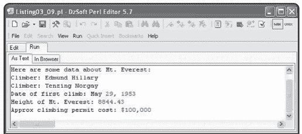

### 字符串与更多字符串

简单回顾一下：如果用双引号括起文本，创建的是插值字符串。如果用单引号括起文本，创建的是字符（或字面量）字符串。插值字符串允许你从变量中检索值。字面量字符串则不能。考虑Listing03_10中所示的代码行：

```perl
#Listing03_10.pl
$MtName="Everest";          #interpolated string
$ClimberNewZealand = "Edmund Hillary"; #interpolated string
$ClimberNepal = "Tenzing Norgay";     #interpolated string

print "\nHere are some data about Mt. $MtName:\n";
print '\nClimber: $ClimberNewZealand'; #literal string output
print "\nClimber: $ClimberNepal";     #interpolated string output
```

**图3.11** Listing03_10的输出。

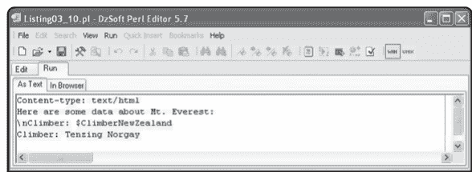

如图3.11所示，当字符串支持变量时，你可以将标量值放入字符串中。如果使用`print()`函数，Perl解释器会读取字符串中引用的部分，遇到变量时，它会检索存储的值并将其作为输出的一部分打印。以`"\nClimber"`开头的行表示字面量（单引号）字符串。对于

```perl
#Concatenate interpolated strings
#and assign them to a scalar variable
$WordString = "\"There is a blessing in this gentle breeze,\"";
$AuthorString= "wrote Wallace Stevens. ";

#Concatenate an interpolated escape sequence and two scalar variables...
$WordString = $WordString . "\n" . $AuthorString;

print "\n" . "$WordString";

#A character string allows you to literally reproduce
#text as set up with white spaces
#Assign the character string to a scalar
$StanzaWords =
	'In summer at least some things,
		such as breezes, can be
		gentle, and this is probably
		what the poet referred to...';

#concatenated scalar variables - no quotation marks used with the scalars.
print "\nConcatenated scalar variables:\n";
print $WordString . $StanzaWords;
```

图3.12展示了Listing03_11的输出。插值字符串和字面量字符串可以组合，并且可以使用转义序列使引号可见。

**图3.12** 连接提供了一种实现多种文本效果的方法。

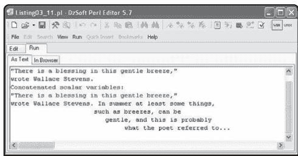


## 字符串乘法输出

运算符使标识符彼此作用。你可以使用它们在标识符之间创建关系。在 Perl 中，由于标量是数字或字符串，因此也有两套运算符。对于数字，许多运算符都是你在数学中所熟悉的。然而，对于字符串，你使用的一套运算符与数学所提供的不同。如果它们相同，你会在许多情况下发现，当你使用它们时，可能无法轻易预测结果。例如，考虑一下乘法运算符（x）应用于字符串时意味着什么。Perl 就提供了这样一个运算符。它允许你复制字符串并将其与自身连接。清单03_12演示了实现这种连接的两种方法。

```perl
#Listing03_12
#"Multiplying" and concatenating a string
#Use of a standard arithmetic operator
#Copies and concatenates an interpolated string three times
#Then assigns the result to a scalar variable
$MultipliedString = "\nDo it!" x 3;
print "$MultipliedString";
#Another approach using the same general notion
#but this time preceding the scalar variable
#with the multiplication expression
$TextSource = "Done that!";
#With a little variation
$SpacePlace = "...";
print "\n" . $SpacePlace x 1 . "$TextSource\n";
print $SpacePlace x 2 . "$TextSource\n";
print $SpacePlace x 3 . "$TextSource\n";
```

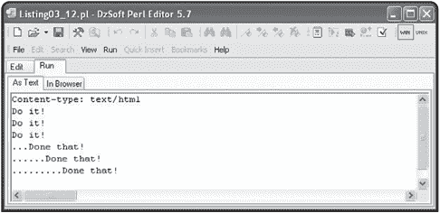

**图 3.13**  
使用字符串乘法可以增强基本连接的效果。

## 字符串的关系运算符

连接运算符是适用于字符串的多种运算符之一。另一种类型的运算符是*关系运算符*。关系运算符允许你将各项相互比较。字符串比较的一种形式是判断一个字符串在字母顺序上是否先于（小于）另一个字符串，或者是否与另一个字符串相同（等于）。表 3.3 讨论了关系运算符以及其他一些适用于字符串的运算符。

**表 3.3 —— 适用于字符串的运算符**

| 运算符 | 说明 |
|---|---|
| `eq` | 一个字符串与另一个字符串相等。这适用于字母、单词或更长的文本单元。相等是精确的，与长度无关。 |
| `ne` | 一个字符串与另一个字符串不相等。这适用于字母、单词或更长的文本单元。 |
| `lt` | 一个字符串在字母顺序上位于另一个字符串之前（小于）。 “Another” 小于 “Brother”。 |
| `gt` | 一个字符串在字母顺序上位于另一个字符串之后（大于）。 “Brother” 大于 “Another”。 |
| `ge` | 一个字符串与另一个字符串相同，或在字母顺序上大于另一个字符串。 “Another” 等于自身，但不大于自身。该测试结果为真。 |
| `le` | 一个字符串与另一个字符串相同，或在字母顺序上小于另一个字符串。 “Another” 等于自身，但不小于自身。该测试结果为真。 |
| `++` | 这是一个一元运算符。作为后缀添加到标量上时，它会使标量的最后一个字母改变，使其在字母表中的位置增加一位。如果该字母是 “z”，则它会回到字母表的开头，变为 “a”。 |
| `comma (,)` | 允许你将字符串相互追加。 |

## 评估关系

在大多数情况下，当你要评估两个字符串之间的关系时，会使用选择。选择语句（也称为选择控制结构）将在本书后面详细讨论，但在此处介绍一种这样的语句（if 语句）来演示如何使用关系运算符并无坏处。

考虑一下如果你想确定两个项是否彼此相等会发生什么。你可以使用 if 选择语句。if 选择语句建立一个表达式，其含义大致可以解释如下：如果我描述的 A 和 B 之间的关系为真，那么就执行某个操作。选择涉及根据给定关系的真假来选择要执行的动作。该关系通常涉及确定 A 和 B 是否彼此相等、小于、大于或不相等。

## 选择与相等（eq）

如清单03_13所示，要创建 if 选择语句，你需要输入单词 if 和一对括号，括号内包含你想要测试的关系。该关系通常由你要测试的项通过关系运算符（此处是 eq）连接而成。然后，在选择语句后面的大括号内创建一个语句。你放在大括号内的语句告诉解释器，如果选择测试的结果（括号内的测试）为真时该做什么。

```perl
#Listing03_13
#Generic selection statements using eq with strings
if("Chicago" eq "Chicago")
{
    print "\nStatement 1 (\"\"): Chicago to Chicago, okay.";
}
    if('Chicago' eq 'Miami')
    {
        print "\nStatement 2: Chicago to Miami, okay.";
    }
    if('Chicago' eq 'Chicago')
    {
        print "\nStatement 3 (\'\'): Chicago to Chicago, okay.";
    }
    if('Chicago' eq "Chicago")
    {
        print "\nStatement 4 (\'\'): Chicago to Chicago, okay.";
    }
```

在清单03_13中，选择语句使用了字符串常量。在语句 1 中，被测试的字符串是插值字符串。在语句 2 和语句 3 中，字符串是字面量。当解释器进入每个 if 语句时，它会遇到要比较的字符串和一个关系运算符（eq）。

这种类型的运算符称为_二元运算符_。之所以称为二元，是因为它关联两个（bi）项。解释器根据关系运算符所建立的逻辑来测试所呈现的项。如果关系为真，则解释器继续处理大括号内的语句。如果关系为假，则解释器跳过花括号内的语句，继续执行程序的其余部分。

如图 3.14 所示，语句 1 和语句 3 结果为真（Chicago 等于 Chicago）。同样，虽然语句 1 涉及插值字符串，语句 3 涉及字面量（字符）字符串，但选择语句判定这两个字符串相等。另一方面，对于涉及 Chicago 和 Miami 的语句 2，解释器判定测试为假，因此跳过花括号内的语句。

然而请注意语句 4。它涉及一个选择语句，该语句比较一个字面量字符串和一个插值字符串。如图 3.14 所示，这两个也被证明相等。它们被证明相等是因为插值字符串和字面量字符串表示同一数据的不同形式。

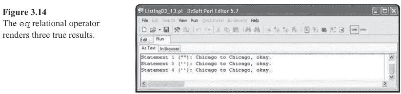

### 使用标量进行测试

适用于插值字符串和字符字符串的选择语句，在将字符串赋给标量标识符时也同样适用。请考虑清单03_14：

```perl
#Listing03_14
#Selection using scalars
#Assign interpolated and character strings to scalars
$CityA = "Chicago";
$CityB = 'Chicago';
$CityC = "Miami";
#interpolated strings tested
if($CityA eq $CityA)
{
    print "\nStatement 1 (\"\"): Chicago to Chicago, okay.";
}
#interpolated strings tested
if($CityA eq "Chicago")
{
    print "\nStatement 2: \$Chicago to \"Chicago\", okay.";
}
#literal strings tested
if($CityB eq $CityB )
{
    print "\nStatement 3 (\'\'): Chicago to Chicago, okay.";
}
#interpolated string tested against a character string
if($CityA eq $CityB )
{
    print "\nStatement 4 (\"\'): Chicago to Chicago, okay.";
}
```

```perl
#Listing03_15
#Testing for lack of equality
$CityA = "Chicago";
$CityC = "Miami";
```


## 第 3 章 标量和字符串

```
#a "not equals" statement tested
if($CityA ne $CityC)
{
    print "\nStatement true; cities not equal.";
}
```

### 选择、lt 和 gt

你可以使用小于（lt）和大于（gt）关系运算符来创建执行排序和排序等操作的复杂程序。这里，足以演示它们适用于字符串，如 Listing03_16 所示：

```
#Listing03_16
#Testing for greater than or less than relationships
$CityA = "Chicago";
$CityC = "Miami";

#selection test to discover one value alphabetically greater than the other
if($CityC gt $CityA)
{
    print "\nMiami comes later in an alphabetical list than Chicago.";
}

#selection test for one value alphabetically less than the other
if($CityA lt $CityC)
{
    print "\nChicago is earlier in an alphabetical list than Miami.";
}
```

Listing03_16 提供两个选择语句，两者都涉及按字母顺序排列 Chicago 和 Miami，以便在使用 `lt` 和 `gt` 的选择语句中进行比较时，结果证明为真。第一个选择语句测试 Chicago 是否在字母列表中位于 Miami 之前。第二个选择语句测试 Miami 是否在字母列表中位于 Chicago 之后。在两种情况下，选择语句都会产生真值求值，因此解释器会处理花括号之间的语句。图 3.15 说明了两个选择语句的输出。

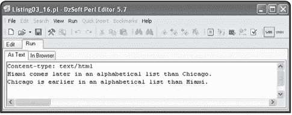

**Figure 3.15**  
大于（`gt`）和小于（`lt`）运算符建立字母顺序。

### 字符串上的递增操作

*一元递增运算符*可以用于字符串。一元运算符是只涉及一个项的运算符。它不像二元运算符那样关联两个项。相反，它直接作用于一个项。在此情况下，一元运算符是一个*递增运算符*（`++`）。Perl 字符串的递增运算符会导致字符串中最后一个字符的值每当解释器处理涉及递增运算符的语句时增加一。当字符增加一时，它将变成字母表中下一个“更大”的字母。“a”变为“b”。在 Listing03_17 中，“x”提供了一种说明递增运算符仅影响字符串最后一个字符的方法。

```
#Listing03_17
#Testing the unary operator with strings
$SmallA = "a";
$LargeA = "xA";

#create an alphabet with a unary operator

print "\n 1. ", $SmallA , "\t"  , $LargeA;
print "\n 2. " . $SmallA++ . "\t" . $LargeA++;
print "\n 3. " . $SmallA++ . "\t" . $LargeA++;
print "\n 4. " . $SmallA++ . "\t" . $LargeA++;
print "\n 5. " . $SmallA++ . "\t" . $LargeA++;
print "\n 6. " . $SmallA++ . "\t" . $LargeA++;
```

图 3.16 说明了 Listing03_17 的输出。当你首次使用运算符时，你不会看到任何变化（1），因为打印字符串的行不包含递增运算符。在第一个递增行（2）中，你看不到任何变化，因为此示例中的递增运算符仅在其出现的语句执行后才递增值。你在行 2 中看到的值实际上显示的是递增前的值。对于行 3，你看到的是前一行更改后的值。

### q() 和 qq() 函数

虽然下一章广泛讨论了可以应用于字符串的函数，但有两个函数的工作方式与双引号和单引号非常相似。这些就是 q() 和 qq() 函数。函数名称分别缩写自单引号和双引号。事实上，通常你可以将这些函数视为执行双引号和单引号的工作。不过，你使用的是函数而不是引号。

当你使用函数时，你将想要转换为字符串的内容放在函数名称后面的开括号和闭括号之间。Listing03_18 提供了两个函数基本用法的示例：

```
#Listing03_18
#q() and qq()
#set up a scalar for testing in the functions
$TestValue = "Hello";

#q() gives you a character string, so you see what you type
$CharacterQ = q($TestValue, it is good to see you.);
print "\nq(): " . $CharacterQ;

#qa() gives you an interpolated string,
#so you have some options with embedded identifiers
$CharacterQQ = qq($TestValue, it is good to see you.);
print "\nqq(): " . $CharacterQQ;
```

当你将标量值（$TestValue）插入 q() 函数时，如图 3.17 所示，你只看到标识符的名称，而不是标识符存储的值。这表明 q() 函数创建一个字符串。另一方面，当你将标量标识符与一些文本一起插入 qq() 函数时，解释器会从标识符中提取字符串。这表明 qq() 函数创建一个插值字符串。

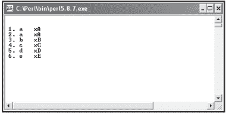

**Figure 3.16**  
递增运算符增加应用于的字符串中最后一个字母的值。

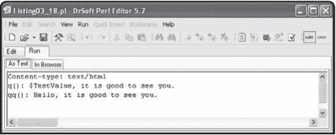

**Figure 3.17**  
q() 和 qq() 函数创建字符串和插值字符串。

### 块

块是使用开始和结束块标签创建的程序的一部分。每个块有一个标签。标签由你选择的一个词组成。你在要指定的块的开头输入开始标签。你在要指定的块的末尾输入结束标签。添加一些语法来使其正式化后，创建块所需的就是这些。

你可以将文本块分配给标量，并以这种方式使用 Perl 来管理相当大的信息量。当你使用块时，不能在块中包含变量。如果你想将变量与块关联使用，可以存储块，然后将其与变量关联。下一节提供了此类活动的示例。

### 块和 print

如前所述，你使用块标签来指定块。标签可以由你选择的任何词组成，只要它不是关键字。要指定块的开始，你在块标签的第一次使用前加上移位运算符（`<<`）。然后跟随你想要输入的任何文本。当你完成文本输入后，再次输入标签。第二次输入标签时，必须将其紧贴文本编辑区域的右边距。Listing03_19 展示了设置块的基本方法。在此示例中，当你创建块时，也会打印它。

```
#Listing03_19
#Creating blocks
#Print the block to show its creation
print <<NOTES;
    Thank you for contacting us.
    A service representative will
    contact you within 24 hours.
NOTES
```

图 3.18 说明了 Listing03_19 中的块作为输出显示的情况。

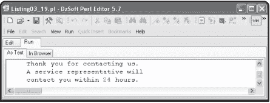

**Figure 3.18**  
块通过打印命令显示。

### 块和变量

打印块可以是立即处理大量文本的有用方法，但块的另一种同样有益的用途涉及将它们分配给标量标识符。你可以将块分配给标量变量，然后稍后使用标识符。赋值语句用括号括起来。Listing03_20 展示了将块存储在标量变量中，然后随后打印块的基本方法。

```
#Listing03_20

#Blocks assigned to and used with variables

#Variable to be combined with block
$TestValue = "Mr. Blue";

($BlockVariable = <<NOTES);
    Thank you for contacting us.
    A service representative will
    contact you within 24 hours.
NOTES

#Concatenating a value with the block
print "\n \n" . " $TestValue,\n" . $BlockVariable;
```

图 3.19 说明了作为输出显示的块。

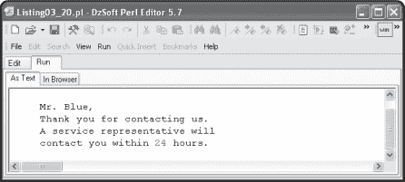

**Figure 3.19**  
块使打印通知变得方便。


## 结论

在本章中，你探索了如何使用标量变量。你的工作重点是标量变量与插值字符串和字面字符串的关系。虽然Perl中的标量值既包含数字也包含字符串，但许多程序员认为Perl是一种非常适合处理文本的语言。你在本章中对字符串的处理正是对这一观点的顺应。

你处理的字符串包括插值字符串和字面字符串。插值字符串使用双引号创建。插值字符串允许你在创建或显示字符串时提取变量的值。字面字符串使用单引号创建。字面字符串会严格按输入内容保留一切，包括变量名。它不允许你在创建字符串时提取变量的值。

为了处理字符串，你学习了 `print()` 函数的使用。`print()` 函数为学习编程提供了一个主要工具。它允许你将输出写入选定的设备。

除了 `print()` 函数和字符串，你还探索了转义序列。转义序列提供了执行某些操作的方法，例如强制换行和插入特殊字符（如美元符号）。在学习了转义序列之后，你尝试了字符串拼接。拼接允许你组合存储在变量中的文本，或处理字面文本并将其赋值给变量。

除了拼接之外，你还处理了专门应用于字符串的运算符。为了探索运算符的运作方式，你简要尝试了简单的选择语句。借助从选择语句中获得的基础知识，你得以研究 eq、gt、lt 和 ne 等运算符。这些都是二元运算符。你还研究了一个一元运算符——自增运算符。它允许你增大字符串末尾字母的字母序值。作为本章的最后一项内容，你探索了 `q()` 和 `qq()` 函数以及带标签文本块的使用。使用这些函数为下一章奠定了基础，下一章将深入探讨与字符串相关的函数的使用。

## 4 打印函数

虽然Perl提供的许多函数源自伴随Perl解释器的模块，但你最好从Perl内置函数开始学习。为此，本章介绍函数、函数参数和函数返回值。大多数Perl程序员最先学习的关键函数包括 `uc()`、`ucfirst()`、`chomp()`、`chop()`、`length()`、`substr()` 和 `join()` 等，这些函数以及其他函数都将在本章中涉及。接下来，你将通过一些基础编程练习来使用这些函数。本章涵盖的主题包括：

-   应用于标量的函数
-   参数和返回值如何应用于函数
-   使用函数改变字符的大小写
-   隐藏字符和截断字符串
-   命令行输入和Perl程序
-   以多种方式操作字符串

### 函数如何工作

虽然后续章节还会对函数进行更多阐述，但本章先讲一些初步要点，以确保你理解Perl内置函数在字符串处理中的用法。

### 基本调用与返回操作

如图4.1所示，在函数的标准表示和使用中，函数名直接位于一组括号之前，括号内包含_你传递给函数的参数_。当你输入函数名时，解释器会处理这些参数。当你使用内置函数时，你并不会看到执行此工作的代码。（毕竟，函数是内置于Perl中的。在后续章节中，你将看到如何构建自己的函数。）解释器使用与函数关联的代码处理参数后，通常会*返回*一个值。有些函数接受多个参数，但大多数函数只返回一个值。有时返回值是你传递给函数的参数的修改形式；其他时候返回值是一个整数（通常为0或1），用于报告函数是否成功完成了操作。以 `print()` 函数为例，你会看到传递给它的参数被渲染到相应的输出设备（通常是显示器或文件）上。

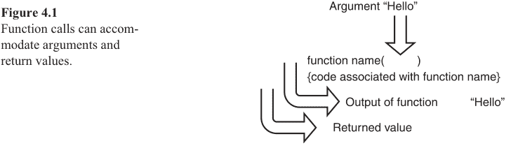

> 在本书中，为了区分函数名与其他事物的名称，函数名后都会附加括号。例如：`print()`。

### 调用与返回的变体

Perl有时会让人感到困惑，因为它在调用函数时不要求你使用严格的语法约定。例如，如果你使用C、C++或Java等语言编程，你会使用标准形式的函数调用。这种标准形式总是包含函数名、括号，以及括号内你提交给函数的参数。使用Perl时，你可以采用这种函数调用形式，本书也鼓励你这样做，但在许多情况下，尤其是对于 `print()` 函数，你经常会看到如清单04_01所示的函数调用方式。

```perl
#Listing04_01
#Perl functions allow you to use parentheses
#to enclose arguments (standard form, recommended):

$argumentForFunction = "\nHello";
print "\n#1";
#1 Standard function form
print ("$argumentForFunction");
#Standard approach to a cascading set of function calls
print (uc($argumentForFunction));

print "\n#2";
#2 Using quotes instead of parentheses
print "$argumentForFunction";
#This form causes no compiler errors
#But the uc() function is read as part of the text
print "\nUnintended result:\n";
print "uc($argumentForFunction)";

print "\n#3";
#3 Using nothing at all
print $argumentForFunction;

#Cascading function calls with no parentheses or quotations
print uc $argumentForFunction;
```

清单04_01中的注释#1展示了一种可以被视为最明确且最被接受的函数调用方式。这种函数调用方式需要将函数的参数括在括号中。这种函数调用形式的优点在于，它向代码阅读者清楚地表明了究竟将什么作为参数提交给了函数。（图4.2展示了清单04_01的输出。）

在注释#1引入的代码行中，你还看到了一个函数嵌套在另一个函数中。`uc()` 函数将字符串的内容从小写转换为大写。在这种上下文中，`uc()` 函数也使用括号。你向它传递一个参数，当你使用带括号的函数时，很容易看出你是在向 `uc()` 函数传递参数，然后再将 `uc()` 函数的返回值传递给 `print()` 函数。这种使用函数的方法通常被称为_级联_函数。

在清单04_01的注释#2处，你看到（正如前几章反复展示的那样）可以在 `print()` 函数后面跟上用引号括起来的参数。这种使用 `print()` 函数的方法在许多情况下都是可接受的，但在本例中，如果你将 `uc()` 放在引号内，解释器会将 `uc()` 函数读取为文本的一部分。（参见图4.2中的输出。）

在注释#3标识的代码行中，你会看到一种代码形式，如果程序员对Perl经验不多，往往会觉得这种代码令人恼火。在这里，既没有括号也没有引号来区分函数及其参数。你只看到一个函数名，另一个


function name, and then a scalar. The interpreter processes the combination without problems. Still, the readability of the code is questionable.

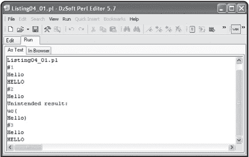

**Figure 4.2**
你可以对函数使用不同形式的语法，并达到相同的结果。

# Changing the Cases of Strings

如前一节中 `uc()` 函数的使用所示，Perl 为你提供了允许更改字符串中字符大小写的函数。有些函数仅影响字符串的起始字符。其他函数允许你更改字符串中所有字符。本节对这些函数进行了回顾。

# Case with First Characters

如果你想将字符串的第一个字符更改为大写或小写，可以通过 `ucfirst()` 和 `lcfirst()` 函数来实现。请参考 Listing04_02：

```perl
#Listing04_02
#Changing the cases of first letters in strings
#The first letter of the writer's name remains lowercase
$NameToChange = "herman Melville";
print "\nPrior to capitalization: " . $NameToChange;

#Assign the scalar back to itself
$NameToChange = ucfirst($NameToChange);
print "\nAfter capitalization: " . $NameToChange;

#Change the first letter back to lowercase
$NameToChange = lcfirst($NameToChange);
print "\nRestored to original: " . $NameToChange;
```

# CHAPTER 4 Print Functions

在 Listing04_03 中，你首先将诗人的名字赋给标量 $NameToChange。然后，你将标量作为参数传递给 `uc()` 函数，该函数将包含诗人名字的字符串转换为大写。请注意，与之前一样，为了使转换生效，你必须将字符串重新赋给自身。`lc()` 函数将字符串转换为小写。同样，你必须将字符串重新赋给自身才能使转换生效。Figure 4.4 说明了 Listing04_03 的输出。

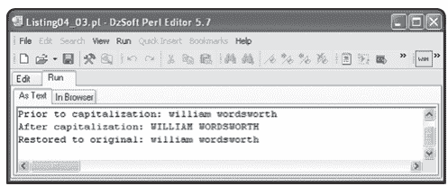

# Obtaining the Length of a String

要获取字符串的长度，你使用 Perl 的 `length()` 函数。与 `uc()` 和 `print()` 函数一样，`length()` 函数需要一个字符串作为参数。与这些函数不同的是，它返回的值本身不是字符串。它返回的值是一个整数，指示字符串中的字符数。Listing04_04 说明了 `length()` 函数的一些用法：

```perl
#Listing04_04
#Use the length() function

#1 Basic string
#characters in the first line: 22
#characters in the second line: 40
#white spaces are counted as characters
($PreludeLines = <<WORDW);
I should learn to love
The end of life and everything we know.
WORDW

#2.Print the lines
print("\n". "$PreludeLines" . "\n");
```

64
TEAM LinG

```perl
#3.Obtain the length and store the value in a scalar
$CharLength = length($PreludeLines);
#Then show the results
print "\nThe number of characters in the lines,".
      "\nincluding blank spaces ".
      "(from Wordsworth's \"Prelude\")is $CharLength.";

#4.You can also just print the return value
print "\nAgain, the length: ". length($PreludeLines);
```

Listing04_04 中与注释 #1 相关的行创建了一个由 William Wordsworth 的《The Prelude》中的两行组成的块。在创建块之前，注释显示了每行包含的字符数（包括空格）。你将这些行存储在标量 $PreludeLines 中。与注释 #2 相关的代码打印这些行。

在注释 #3 之后的行中，你调用 length() 函数并将 $PreludeLines 作为其参数提供给它。该函数获取行中的字符数（包括空格），并将此值返回给标量 $CharLength。在获取行的字符长度后，你打印一个插值了存储在 $CharLength 中的值的连接字符串。

在注释 #4 处，你调用 print() 函数来打印 length() 的返回值。Figure 4.5 显示了 Listing04_04 的输出。

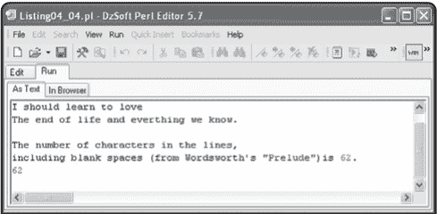

**Figure 4.5**
使用 `length()` 函数获取包含空格的字符串长度。

# Hidden Characters and Strings

在处理字符串时，换行符常常会结束字符串。此类字符不可见，如果你想相互比较字符串，可能会产生问题。例如，eq 运算符不会将包含换行符的字符串视为与缺少换行符的另一个字符串相等，即使两个字符串中除换行符外的所有字符都相同。

# Hidden Characters in Strings

Figure 4.6 说明了 W. H. Auden 诗歌中的两行。第一组行包含隐藏字符。第二组行不包含此类字符。

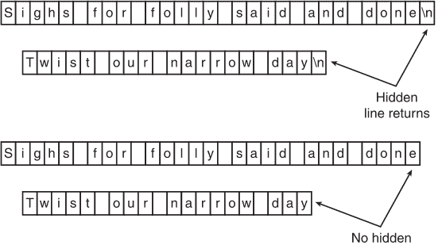

**Figure 4.6**
W. H. Auden 的《Fish in the Unruffled Lakes》中的行显示了额外字符。

如果你仅根据看到的两组文本是否相等来检查 Figure 4.6 中说明的两行，则比较结果会出错。请考虑 Listing04_05：

```text
#Listing04_05
#1 Set up lines with and without hidden newline characters
$CoupleALineA= "Sighs for folly said and done\n";
$CoupleALineB= "Twist our narrow days\n";
#without
$CoupleBLineA= "Sighs for folly said and done";
$CoupleBLineB= "Twist our narrow days";

#2 Print to show visual equality but different lengths
print("\nA--A: " . $CoupleALineA . "\n");
print("\nA--B: " . $CoupleALineB . "\n");
print length($CoupleALineA);
```

```perl
print("\nA-A: ". $CoupletBLineA . "\n");
print("\nA-B: ". $CoupletBLineB . "\n");
print length($CoupletBLineA);
```

```perl
#3 Compare the lines to show the interpreter
#considers them to be different
if($CoupletALineA eq $CoupletBLineA)
{
	#Does not print since equal operator returns false
	print "\nLines are the same."
}
if($CoupletALineA ne $CoupletBLineA)
{
	#Prints since the not equal operator returns true
	print "\nLines are not the same."
}
```

在 Listing04_05 的注释 #1 中，你建立两组字符串。你在第一组中附加换行符，但在第二组中不附加。然后，你将两组字符串赋给标量。在与注释 #2 相关的行中，你打印两个对句以显示它们的视觉相似性，但你也使用 length() 函数来评估它们的长度。外观表明这些行彼此相等，但从 length() 函数的返回值中，你可以看到隐藏字符使它们不相等。在注释 #3 标识的行中，你使用选择语句和 eq 及 ne 运算符进行测试。Figure 4.7 显示了结果。选择语句表明解释器认为字符串不相等。

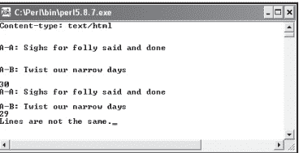

**Figure 4.7**
不可见字符使字符串不相等。

# Eliminating Characters

Perl 提供了 chomp() 和 chop() 函数来消除字符串末尾的字符。chomp() 函数使用最广泛，因为它消除换行符且不删除除换行符以外的任何字符。

# Using the chomp() Function

chomp() 函数直接解决了 Figure 4.7 中说明的问题，即解释器发现两个看起来具有相同字符的字符串不相等。不相等是由于行末尾附加的隐藏字符造成的。Listing04_06 说明了 chomp() 函数的用法：

```perl
#Listing04_06

#1 Set up lines with and without hidden end-of-line characters
$CoupletALineA= "Sighs for folly said and done\n";
$CoupletALineB= "Twist our narrow days\n";

#Use Chomp to remove the hidden end-of-line characters
print "\nWith hidden EOL:" . chomp($CoupletALineA);
print "\nWith hidden EOL:" . chomp($CoupletALineB);

#without
$CoupletBLineA= "Sighs for folly said and done";
$CoupletBLineB= "Twist our narrow days";

print "\nWithout hidden EOL:" . chomp($CoupletBLineA);
print "\nWithout hidden EOL:" . chomp($CoupletBLineB);

#2 Print to show visual equality but different lengths
print "\nA-A: " . $CoupletALineA . "\n";
print "\nA-B: " . $CoupletALineB . "\n";
print length($CoupletALineA);

print "\nA-A: " . $CoupletBLineA . "\n";
print "\nA-B: " . $CoupletBLineB . "\n";
print length($CoupletBLineA);

#3 Compare the lines to show the interpreter
#considers them to be different
```


# 隐藏字符和字符串

```perl
if($CoupletAlineA eq $CoupletBlineA)
{
    #Does not print since equal operator returns false
    print "\nLines are the same."
}

if($CoupletAlineA ne $CoupletBlineA)
{
    #Does since the not equal operator returns true
    print "\nLines are not the same."
}
```

Listing04_06 与 Listing04_05 相同，不同之处在于包含 `chomp()` 函数的两行。与注释 #1 相关的行中出现了对该函数的调用。图 4.8 显示了输出的变化。现在，解释器不再发现两组行不相等，而是发现它们相等。行的长度现在相同。它们在可见和不可见方面都相等。

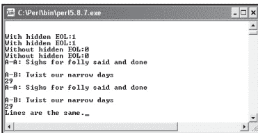

**Figure 4.8**
解释器现在发现行相等。

除了删除隐藏字符外，`chomp()` 函数还会返回值。如果 `chomp()` 函数发现你提供的字符串包含隐藏的换行符，则返回值为 1。如果 `chomp()` 函数发现你作为参数提供的字符串不包含隐藏的换行符，则返回值为 0。在与注释 #1 相关的行中，Listing04_07 向你展示了 `chomp()` 函数的返回值。

```perl
#Listing04_07

#1 Set up lines with and without hidden end of line characters
$CoupletAlineA= "Sighs for folly said and done\n";
$CoupletAlineB= "Twist our narrow days\n";
```

chomp() function to a string after you have used it to delete a newline character, it does not truncate the string.

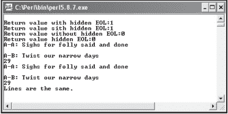

> **Figure 4.9**  
> `chomp()` 函数的返回值确认是否存在换行符。

## 使用 chop() 函数

chop() 函数允许你从字符串末尾删除一个字符。每次调用它时，它都会继续从字符串中删除字符。在这方面，它与 chomp() 函数不同，chomp() 函数仅删除换行符。Listing04_08 提供了一个示例，说明其工作原理：

```perl
#Listing04_08

#1 Set up a few lines from Hart Crane's
#"For the Marriage of Faustus and Helen"
# Simultaneously print the lines to show the lines
print (<<HCRANE);
        The mind has shown itself at times
        Too much the baked and labeled dough
        Divided by accepted multitudes.
HCRANE
#2 Assign the last line to a separate string
#Add a newline character
$LastLine = "Divided by accepted multitudes.\n";

#3 Employ the chop() function to show the string being truncated
print "\n 0 No action taken: $LastLine";
print "\nLength before actions: " . length($LastLine);
$ChopReport = chop($LastLine);
#show no return value
print "\n No return value:" . $ChopReport;
print "\n 1 EOL removed: $LastLine";
```

```perl
print "\nLength after the first action: " . length($LastLine);
chop($LastLine);
print "\n Now the characters....:\n";
print "\n 2 $LastLine";
chop($LastLine);
print "\n 3 $LastLine";
chop($LastLine);
print "\n 4 $LastLine";
```

Listing04_08 中的注释 #1 介绍了 Hart Crane 诗歌中的一段文字。在注释 #2 之后的行中，你将段落的最后一行赋值给标量 $LastLine。请注意，你在字符串末尾附加了一个换行符。在注释 #3 处，涉及 `chop()` 函数的截断操作开始。你调用 `print()` 函数来显示 `chop()` 函数不提供返回值。同时，它删除隐藏字符。然后，在随后对 `chop()` 的调用中，你继续截断字符串。图 4.10 显示了 Listing04_08 生成的输出。

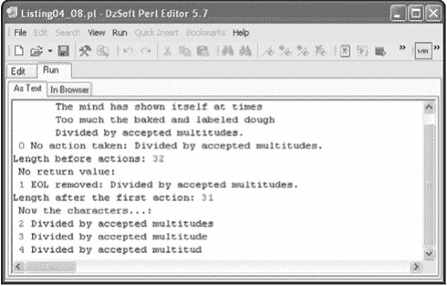

**Figure 4.10**  
每次调用 `chop()` 函数时，它都会删除一个字符。

## 命令行交互

虽然你使用 Perl 编写的许多程序不太可能涉及命令行交互，但了解如何使用命令行仍然很有价值，以便你可以测试程序。Listing04_09 提供了一个支持用户交互的程序的基本示例。

```perl
#Listing04_09
#Respond to a command prompt
print "Type your name and press Return: ";
```

```perl
#1 Prompt for information from the user
$NameTyped = <STDIN>;
print "\nYour name: " . $NameTyped;
```

你可以编写在命令行运行的程序，而不需要包含 Listing04_09 的前两行，但包含它们也无妨，以符合规范。在与注释 #1 相关的行中，你输入一行包含句柄 (<STDIN>) 的内容。句柄允许你输入信息。在此示例中，你输入的信息存储在标量 ($NameTyped) 中。然后，你使用 print() 函数显示该信息。

句柄将在后续章节中更详细地介绍，但目前请注意，表达式 <STDIN> 代表一种惯例。如果程序行仅包含小于号 (<) 和大于号 (>) 符号，而没有句柄标识符 (STDIN)，解释器不会发现程序有任何问题，你仍然可以按照提示输入内容。

要运行程序，你可以像运行任何其他 Perl 程序一样在 DOS 提示符下输入并执行它。如果你从 DzSoft Perl Editor 运行程序，请选择 Run > Run in command prompt 或按 Shift + F9。然后，按照提示在提示符处输入你的名字并按 Return。程序会显示你的名字。如果你再次按 Return，程序将退出。图 4.11 说明了程序的执行过程。（有关设置具有浅色背景和深色字体的会话，请参见侧边栏。）

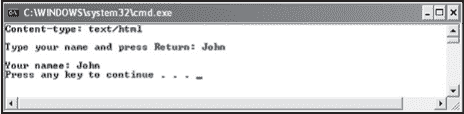

**Figure 4.11**  
程序提示你输入姓名，然后回显你的输入。

## 设置 DzSoft DOS 窗口

如果你从 DzSoft Perl Editor 执行命令提示符程序，可以更改窗口，使其永久显示白色背景和深色字体。如果你在 DzSoft Perl Editor 中按 Shift + F9（或从 DOS 提示符或 Windows 资源管理器执行程序），你会看到图 4.12 顶部所示的 DOS 窗口。

要更改背景，以便在浅色背景上看到深色字体，请右键单击命令提示符窗口上的控制图标并选择 Properties。然后，你会看到图 4.12 中间所示的对话框。单击 Colors 选项卡。然后单击 Screen Background 的单选按钮。单击调色板上的白色框以设置背景颜色。然后单击 Screen Text 的单选按钮。单击调色板上的黑色框以设置文本颜色。单击 OK 关闭对话框。当打开确认更改的对话框时，单击 Save Properties for Future Windows with the Same Title 按钮。

## 字符索引

`index()` 函数返回字符串在字符串中的起始位置。`index()` 函数的名称源自 _数组_ 的 _索引_。如图 4.13 所示，数组类似于抽屉柜。你可以通过编号来识别抽屉。字符串是字符数组，因此你可以通过其索引号来识别每个字符。数组索引从 0 开始。

要使用 `index()` 函数，你需要向其提供三个参数。第一个参数是你要搜索的字符串。这可以是标量或字符串字面量。第二个参数是目标字符串——你要搜索的字符串。最后一个参数是 _偏移量_。偏移量指示你希望作为搜索起始点的目标字符串中的位置。你使用一个标识目标字符串中索引的整数来标识此位置。The

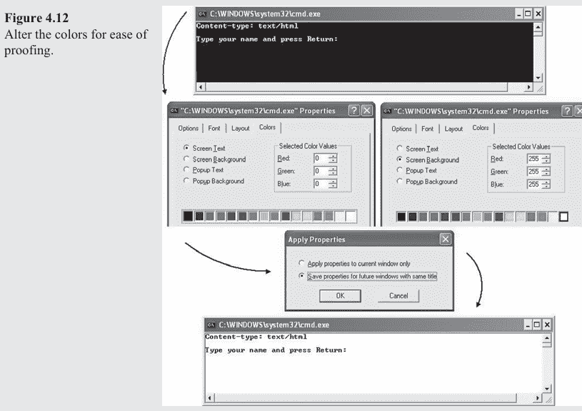

## Figure 4.13

数组有索引，就像抽屉柜有抽屉一样。

offset 标识相对于字符串起始索引的位置，而字符串的起始索引始终是零 (0) 索引。如图 4.14 所示，`index()` 函数默认从目标字符串的开头 (0 索引) 开始搜索。当 `index()` 函数找到它要查找的字符串时，它会返回目标字符串中标记你要查找的字符串开头的位置。

## Figure 4.14

`index()` 函数从你指示的起始索引开始搜索，并找到你提供的搜索字符串的第一个出现位置。

## 搜索算法

你向 `index()` 函数提供的参数反映了你可以用于搜索大量文本以查找给定字符串重复出现的算法的逻辑。当你在文本中搜索给定字符串的出现时，你从文本的开头开始。你在文本中移动，直到找到你要查找的字符串。如前所述，当你找到你要查找的字符串时，你会报告文本中你要查找的字符串开始的索引。

假设文本中存在多个搜索字符串实例。解决此问题的方法涉及使用新的起始 (offset) 位置继续搜索。要继续搜索，你使用已找到字符串的报告起始位置并加一。然后，你将这个新的起始位置传递给另一个对 `index()` 函数的调用。图 4.15 说明了其工作原理。

| Bureau   | Array   |
|----------|---------|
| drawer 0 | index 0 |
| drawer 1 | index 1 |
| drawer 2 | index 2 |
| drawer 3 | index 3 |
| drawer 4 | index 4 |

| Index | 0 | 1 | 2 | 3 | 4 | 5 | 6 | 7 | 8 | 9 | 10 | 11 | 12 | 13 | 14 | 15 | 16 | 17 | 18 | 19 | 20 | 21 | 22 | 23 | 24 | 25 | 26 | 27 | 28 |
|-------|---|---|---|---|---|---|---|---|---|---|---|---|---|---|---|---|---|---|---|---|---|---|---|---|---|---|---|---|---|---|
|       | 0 | 1 | 2 | 3 | 4 | 5 | 6 | 7 | 8 | 9 | 0 | 1 | 2 | 3 | 4 | 5 | 6 | 7 | 8 | 9 | 0 | 1 | 2 | 3 | 4 | 5 | 6 | 7 | 8 |
| $Str  | s | i | g | h | s |   | f | o | r |   | f | o | l | l | y |   | s | a | i | d |   | a | n | d |   | d | o | n | e |
|       |   |   |   |   |   |   | f | o |   |   | f | o | l | l | y |   |   |   |   |   |   |   |   |   |   |   |   |   |   |


## 字符索引

#5. Use the index function to begin the search from index 0
# Return the index to a scalar and report the position to the user
$IndexLocation = index($TargetString , $SearchString, 0);
print "\nString found at index " . $IndexLocation . "..."

#6. Increment by one and continue the search
$IndexLocation = $IndexLocation + 1;
$IndexLocation = index($TargetString, $SearchString , $IndexLocation);
print "\nString found at index " . $IndexLocation . "...\n";

在注释 #1 到 #3 所指定的行中，你设置了一个文本示例以显示给程序用户。你初始化一个标量（$SearchString）用来存储用户输入，然后收集输入。在注释 #4 之后的几行中，你调用 chomp( ) 函数，从你键入的字符串中移除换行符，以便将其用作搜索的基础。

chomp( ) 函数是必需的，因为当你按回车键时，会向键入的字符串添加一个换行符。如果不移除换行符，搜索就不会有效，除非你指定的目标文本碰巧包含一个与你键入的（含换行符的）字符串相对应的字符串。这种情况不太可能发生。

在清单04_10的注释#5处，你使用 index( ) 函数开始第一次搜索。你提供给 index( ) 函数的第一个参数是目标字符串（$TargetString）。第二个参数提供了你要查找的字符串（$SearchString）。最后一个参数指定偏移量，即起始索引（0）。你将结果返回给 $IndexLocation，并使用 print( ) 函数将其报告给用户。

在第一次递增搜索之后，你继续进行另一次搜索（见注释 #6）。为了继续搜索，你给 $IndexLocation 中保存的返回值加 1。你将该递增后的值作为 index( ) 函数的第三个参数，再次调用该函数。图 4.16 显示了带用户交互的程序执行过程。搜索在索引 6 和 10 处返回结果。


**图 4.16**
用户输入允许你使用 index( ) 函数进行搜索。

## 从字符串末尾搜索

如果你已经使用过 `index()` 函数，那么你就能轻松使用 `rindex()` 函数。`rindex()` 函数与 `index()` 函数的区别仅在于它是从字符串末尾而不是从开头开始搜索。有时使用这样的函数是提高搜索操作效率的重要方法。清单04_11提供了如何使用 `rindex()` 函数的示例。

```perl
#Listing04_11
#Search a string using the rindex() function

#1 Show users the string that is the target
print ("$TargetString= <<TARGET>;
Sighs for folly said and done
Twist our narrow days
TARGET

#Use the length() function
#to initialize a scalar to hold the length of the string
#Report the length
$TargetStringLength = length($TargetString);
print "\nLength of string: " . $TargetStringLength;

#2. Initialize a scalar to hold the search string
$SearchString = "";
print "\nType the string \\"fo\\" to begin a search: ";

#3. Collect input from the user
$SearchString = <STDIN>;

#4. Important! Truncate the string to eliminate the newline character
chomp($SearchString);
print "\nSearch begun for \\"" . $SearchString . "\\"...\n";

#5. Use the index function to begin the search from the end of the string
# Return the index to a scalar and report the position to the user
$IndexLocation = rindex($TargetString , $SearchString, $TargetStringLength);
print "\nString found at index " . $IndexLocation . "...\n";
```

#6. Subtract 1 from the returned index
$IndexLocation = $IndexLocation - 1;
$IndexLocation = rindex($TargetString, $SearchString , $IndexLocation);
print "\nString found at index " . $IndexLocation . "...\n";

使用 `rindex()` 函数与 `index()` 函数的主要区别在于确定你要用于搜索的函数的长度。在注释 #1 处，你使用 `length()` 函数来获取目标字符串的长度。目标字符串的长度构成了 `rindex()` 函数进行搜索的起点。字符串的长度标记了最终索引。

在注释 #5 处，你启动搜索。第一次调用 `rindex()` 从目标文本的最后一个索引开始，并向目标文本的开头（零索引）移动。当 `rindex()` 函数找到你正在查找的字符串的第一次出现时，它返回该字符串在目标字符串中对应的起始索引位置。为了使搜索能够继续，你从返回的索引值中减去 1。你将该值提供给下一次调用 `rindex()` 函数的第三个参数。然后，该函数可以继续向目标文本的零索引移动。图 4.17 展示了清单04_11的输出。注意，每次搜索迭代时索引值都会减小（从 10 到 6）。


## 提取和替换字符串

Perl 提供了一个名为 `substr()` 的函数，它允许你从给定的目标字符串中提取子字符串，或者用另一个子字符串替换给定目标字符串中的子字符串。该函数执行的操作取决于你提供给函数的参数数量。使用三个参数，你可以提取子字符串。使用四个参数，你可以替换子字符串。接下来几节将详细阐述这些主题。

## 使用 substr() 提取子字符串

如果你向 `substr()` 函数提供三个参数，则可以从目标字符串中提取子字符串。你提供给 `substr()` 函数的第一个参数是目标字符串。第二个参数是相对于零索引的偏移量。这确定了你要提取的子字符串的起点。第三个参数提供你要提取的字符串的长度。要从文本块中提取字符串，你开发的程序需要执行以下操作：

- 将源字符串分成两部分。
- 第一部分从源字符串的开头延伸到你要提取的子字符串的索引处。
- 第二部分从你要提取的字符串的末尾延伸到源字符串的末尾。
- 提取这两个部分，然后重新连接它们，以重新创建去掉所提取子字符串后的源字符串。

清单04_12完成了这些操作。

```perl
#Listing04_12
#extract a substring using three arguments with substr()

#1 Create a target string from W. B. Yeats' "The Choice"
print ($TargetString = <<TARGET);
The intellect of man is forced to choose
Perfection of the life, or of the work,
And if it take the second must refuse
A heavenly mansion, raging in the dark.
TARGET
print "\n------\n";
$TargetStringLength = length($TargetString);
print "\nTargetStringLength: " . $TargetStringLength;

#2. Create a string to be extracted
$StringToExtract = "heavenly";
print "\nString to be removed: " . $StringToExtract;

#3 Use the index function to find the index of the substring.
$IndexOfSubstring = index($TargetString, $StringToExtract, 0);
print "\nIndex of string: " . $IndexOfSubstring;

#4 Use the length function to establish the length of the
# substring to be extracted
$LengthOfSubstring = length($StringToExtract);
print "\nLength of string: " . $LengthOfSubstring;
$LengthFromIndex = $TargetStringLength - $IndexOfSubstring;
print "\nLength of target after index: " . $LengthFromIndex;
print "\n------\n";

#5. Extract the last part of the string
$EndOfString = substr($TargetString,
        $IndexOfSubstring + $LengthOfSubstring, #start pos
        $LengthFromIndex - $LengthOfSubstring); #num of chars
print "\nLast part of string: \n" . $EndOfString . "\n";
print "\n------\n";

#6. Extract the first part of the string
$BeginningOfString = substr($TargetString,
        0,
        $IndexOfSubstring);
print "\nFirst part of string: \n" . $BeginningOfString . "\n";
print "\n------\n";

# Removing "heavenly" leaves two white spaces. Only one is needed.
chop($BeginningOfString);

#7. Concatenate the new string and print
print "\nNew String: \n" . $BeginningOfString . $EndOfString . "\n";
```

与注释 #1 和 #2 相关的行允许你设置两个标量，分别包含用作目标的文本（$TargetString）和要提取的文本（$StringToExtract）。为了手头有可用于 substr() 函数第三个参数的值，你使用 length() 函数获取这两个字符串的长度。

在注释 #3 和 #4 处，你调用 index() 函数，在目标字符串中查找要搜索的表达式的起始索引位置。

注释 #5 和 #6 所指的行允许你确定目标字符串中位于你要提取的字符串之前和之后的两部分的起始位置和长度。在第一次调用 substr() 函数时，你提取目标文本的尾部部分（$EndOfString）。对于该函数调用的第一个参数，你提供源


## 提取和替换字符串

```
print ($TargetString= <<TARGET);
The intellect of man is forced to choose
Perfection of the life, or of the work,
And if it take the second must refuse
A heavenly mansion, raging in the dark.
TARGET
print "\n-----\n";
```

```
#2. 创建要提取的字符串
$StringToExtract = "heavenly";
print "\nString to be removed: " . $StringToExtract;
```

```
#3 使用 index 函数查找子字符串的索引。
$IndexOfSubstring = index($TargetString, $StringToExtract, 0);
print "\nIndex of string: " . $IndexOfSubstring;
```

```
#4 使用 length 函数确定要提取的
# 子字符串的长度
$LengthOfSubstring = length($StringToExtract);
print "\nLength of string: " . $LengthOfSubstring;
```

```
#5. 提取/替换子字符串
substr($TargetString,
    $IndexOfSubstring,
    $LengthOfSubstring + 1,
    " ");
print "\nNew String: \n". $TargetString . "\n";
```

清单 Listing04_13 中注释 #1 和 #2 所在的行设置源文本和要提取的子字符串。在注释 #3 处，你使用 index() 函数确定要提取的子字符串的起始索引。注释 #4 所在的行使用 index() 函数获取子字符串的起始索引。

给定要提取的子字符串的起始索引和长度，你在注释 #5 处使用带有四个参数的 substr() 函数来提取子字符串。对于第一个参数，你提供包含目标文本的标量。对于第二个参数，你提供子字符串的起始索引。对于第三个参数，你提供子字符串的长度。对于最后一个参数，你提供要替换的文本。在此示例中，由于目标是提取子字符串，你提供一个空字符串 (" ")。图 4.19 说明了 Listing04_13 的输出。单词 “heavenly” 已被删除。


## 连接字符串

当你使用连接运算符时，可以从两个或多个组成字符串中创建一个单字符串。要完成此操作，你将连接结果分配给你指定用于存储连接结果的标量。要将此主题推广到应用场景，请考虑一种情况，即你想要创建涉及多个标量数据项的问候语。请参见图 4.20。


## 使用手动连接

要设置可能生成图 4.20 所示通知的程序，你可以使用连接运算符。Listing04_14 提供了一个程序，该程序使用一系列连接操作来创建可能通过 Internet 发送给客户的字符串。

```
#Listing04_14
#设置连接字符串的备忘单

#1 模拟数据库中的记录
$NameOfCustomer = "Abe Washington";
$NameOfProduct = "Razor Might Version 4";
$CustomerEMailAddress = 'abeWash@my.com'; #单引号用于 @ 运算符
$OrderNumber = "ASGM00456A7";
$ProcessingNumber = "GH09824AA345-202029";
$Date = "12/12/06";
$PurchaseShipmentNotification = "";

#2 标准发货通知表单
# 单个标量存储消息文本，
# 包括嵌入其中的标量变量的值
$PurchaseShipmentNotification = "\n\n " .
$CustomerEMailAddress . "\n\n " .
$OrderNumber . "\n\n " .
$Date . "\n\n " .
"Dear " . $NameOfCustomer . ",\n\n " .
"Thank you for your purchase of \n\n " .
$NameOfProduct . ". Your shipping \n\n " .
"order is being processed. Your \n\n " .
"processing number is" . $ProcessingNumber . ".\n\n " .
"Respectfully, \n\n " .
"Customer Service" . "\n\n ";

#3 使用单个标量变量打印电子邮件 (HTML) 消息
print $PurchaseShipmentNotification;
```

在 Listing04_14 中的注释 #1 处，你模拟可能从数据库中获取的记录。要使用这些信息，你必须将其与消息文本连接。要保存生成的消息，你声明一个名为 $PurchaseShipmentNotification 的标量。

## 第 4 章 打印函数

注释 #2 所在的行创建要分配给 $PurchaseShipmentNotification 的内容。要创建字符串，你逐行编写连接的字符串文本和标量值。要格式化文本，你添加换行转义字符。

注释 #3 之后的 print() 函数调用允许你在提示符处显示连接后的字符串。可以向字符串添加一些 HTML 标签，使文本显示为格式化的网页。目前，文本在命令提示符下以双倍行距显示。图 4.21 说明了 Listing04_14 的输出。

### 图 4.21
字符串文本值和存储在标量中的值的连接允许你创建单个标量字符串。


## 使用 join() 函数连接字符串

你可以使用 join() 函数作为创建图 4.21 所示通知的替代方法。join() 函数将两个或多个项目连接成一个字符串。在连接这些项目时，它使用分隔符，即你提供的任何字符或文本。

要完成其工作，join() 函数需要两个参数。第一个参数提供分隔符。第二个参数是你要连接的项目列表。分隔符可以是你希望在列表项之间使用的任何字符或字符集（包括空格）。列表中的项可以是字面值或变量。你使用括号（有时称为 Perl 的列表函数）来括起你要连接的项目。Listing04_15 使用列表函数将两个标量值和一个字符串文本连接（或串联）成一个逗号分隔的列表。

```
#Listing04_15
#使用 join 创建连接字符串
#1 模拟数据库中的记录
$CustomerEMailAddress = 'abeWash@my.com';
$Date = "12/12/06";
$PurchaseShipmentNotification = "";
$NL = "\n"; #创建转义序列的标量替代项
```

```
#2 创建逗号分隔的字符串
$PurchaseShipmentNotification = \
    join(",", (
    $CustomerEMailAddress,
    "Abe Washington", #字符串文本
    $Date));
print "\nCustomer Notice: " .
    $PurchaseShipmentNotification . $NL;
```

在 Listing04_15 中注释 #1 之后的行中，你使用与 Listing04_14 中之前使用的相同标量。你添加一个标量来保存换行的转义序列。然后在注释 #2 处，你调用 join() 函数。第一个参数由一个字符串组成。在此示例中，该字符串包含一个逗号后跟一个空格。

第二个参数提供括在括号中的项目列表。在括号内，你使用先前定义的两个标量。为了演示目的，你添加一个包含名称的字符串文本。要将项目连接成单个字符串，你将 join() 函数的结果（返回值）分配给标量 $PurchaseShipmentNotification。然后你打印标量的内容。图 4.22 说明了 Listing04_15 的输出。


## 使用 join() 函数创建通知

鉴于前一节提供的讨论，你可以使用 join() 函数作为创建图 4.21 所示客户通知的替代方法。Listing04_16 展示了如何实现这一点。

```
#Listing04_16
#使用 join 创建连接字符串

#1 模拟数据库中的记录
$NameOfCustomer = "Abe Washington";
$NameOfProduct = "Razor Might Version 4";
$CustomerEMailAddress = 'abeWash@my.com'; #单引号用于 @ 运算符
$OrderNumber = "ASGM000456A7";
$ProcessingNumber = "GH09824AA345-202029";
$Date = "12/12/06";
$PurchaseShipmentNotification = "";
$NL = "\n"; #创建换行标量

#2 标准发货通知表单
#整个报告通过 join 函数的一次调用中的参数创建
$PurchaseShipmentNotification =
    join("", (
                 $NL,
        $CustomerEMailAddress,                         $NL,
        $OrderNumber,                                  $NL,
        $Date,                                         $NL,
        "Dear ", $NameOfCustomer,                     $NL,
        "Thank you for your purchase of",              $NL,
        $NameOfProduct, ". Your shipping ",           $NL,
        "order is being processed. Your ",            $NL,
        "processing number is",                       $NL,
        $ProcessingNumber,                             $NL,
        "Respectfully,",                              $NL,
        "Customer Service",                           $NL));
print "\nCustomer Notification",                      $NL
      . $PurchaseShipmentNotification .             $NL;
```

在 Listing04_16 中与注释 #1 相关的行中，你设置与先前（在 Listing04_14 中）设置的相同标量变量集。在此示例中，你添加一个声明，用于保存换行转义序列的标量。在注释 #2 处，你继续创建保存消息文本的字符串 ($PurchaseShipmentNotification)。

join() 函数的第一个参数由一个空字符串组成。你使用空字符串作为第一个参数，因为你不需要在要连接的项目之间使用分隔符。然后你在第二个参数中设置一个表格来处理通知的内容。可以使用多种方法来设置通知。将内容放在左侧，将换行标量变量放在右侧，使你更容易辨别报告中的项目及其布局。


## 第 4 章 打印函数

图 4.23 说明了清单 04_16 的输出。输出看起来几乎与清单 04_14 的输出相同。区别在于项目是单行间距的。要使它们双行间距，可以更改清单 04_16 中分配给 $NL 的值，使其由两个换行转义序列 \n \n 组成。


**图 4.23** join() 函数允许您连接元素以创建客户通知。

花点时间比较清单 04_16 和清单 04_14。哪个更易读？一个可能比另一个有什么优势？空白有助于可读性吗？将格式化字符串（如转义序列）分配给标量标识符有什么好处？

### 连接的变体

您可以变化 join() 函数的用法来完成多种操作。本节讨论的所有变体都仅涉及 join() 函数列表参数中的两个项目。在清单 04_17 中，您将考察以下活动：

- **在两个字符串之间插入一个字符串。** 您可以通过将要插入的字符串作为 join() 函数的第一个参数来完成此操作。在构成第二个参数的列表中，使用您要在其之间插入字符串的两个项目。请参见注释 #1。

- **连接一个变化的字符串和一个不变化的字符串。** 例如，“他说……”然后添加他说的话。您可以通过将添加的文本插入 join() 函数的第一个参数来完成此操作。然后，在第二个参数中，提供一个列表，该列表由一个空字符串和一个包含您要在“他说”之后添加的文本的字符串组成。请参见注释 #2。

- **反转两个字符串的顺序。** 此活动不过是对前一活动的进一步创新。您可以通过将连接列表中的第一个或第二个项目留空来完成此操作。首先，将给定字符串分配给 join() 函数的第一个参数。然后，提供一个两项列表。如果要在给定字符串之前放置另一个字符串，请将其分配给两项列表中的第一个位置。对于第二项，提供一个空字符串。如果要在给定字符串之后放置另一个字符串，请将其分配给两项列表中的第二个位置。对于第一项，提供一个空字符串。请参见注释 #3。

以下是清单 04_17 的代码：

```perl
#Listing04_17

#Three variations with the join() function

$TextA = "he laughed "; #expressions
$TextB = "he cried ";
$TextC = "he said ";
$TextD = "after that";

$TextE = "often "; #adverbs
$TextF = "bitterly ";
$TextG = "seldom ";

$NL = " \n"; #scalars for escapes
$TB = " \t";
$NLTB = $NL . $TB;

#1 Insert one term between two others
# Make a sentence ... /little/bitterly/seldom ...
print $NL . "#1 One item inserted between two others:";
$NewString = join($TextF, (ucfirst($TextA), $TextD));
print ($NLTB . $NewString);
$NewString = join($TextG, (ucfirst($TextA), $TextD));
print ($NLTB . $NewString);
$NewString = join($TextE, (ucfirst($TextA), $TextD));
print ($NLTB . $NewString . $NL);

#2 Use an empty string to join a varying string
# to a default. TextH is the default (He said)
# You can insert TextA or TextB or any quote
print $NL . "#2 Join a varying string with a default (\"he said\"): ";
$NewString = join(ucfirst($TextC), ("", $TextA));
print ($NLTB . $NewString);
$NewString = join(ucfirst($TextC), ("", $TextB));
print ($NLTB . $NewString . $NL);

#3 You can reverse the order of two strings
# To accomplish this, you alter the position of the
# empty string in the two-item list
print $NL . "#3 Reverse the order of two strings: ";
$NewString = join($TextC, (ucfirst($TextA), ""));
print ($NLTB . $NewString);
$NewString = join(ucfirst($TextC), ("", $TextA, ));
print ($NLTB . $NewString . $NL);
```

图 4.24 说明了清单 04_17 的输出。


**图 4.24** join() 函数的用法存在多种变体。

### 用块替换 Join

join() 函数允许您对程序中标识符的位置进行广泛控制，从而轻松维护程序。同时，Perl 块允许您创建文本主体，以相当方便的方式合并变量和文本信息。清单 04_18 重新编写了早先的程序（清单 04_16），以使用带有嵌入标识符的块创建备忘录。这种方法的优点是您可以更直接地看到生成的文本。缺点是您将标识符嵌入文本中，可能会创建一种情况，使得维护程序变得困难。

```perl
#Listing04_18
#Alternative to join - blocks with embedded identifiers
#1 Simulation of a record in a database
$NameOfCustomer = "Abe Washington";
$NameOfProduct = "Razor Might Version 4";
$CustomerEMailAddress = 'abeWash@my.com'; #single quotes for @ operator
$OrderNumber = "ASGM00456A7";
$ProcessingNumber = "GH09824AA345-202029";
$Date = "12/12/06";
$PurchaseShipmentNotification = "";
# A standard shipment notification form
#The entire report created with a block
$NL = "\n"; #Create a new line to accommodate the double space
# Start the block
($PurchaseShipmentNotification=<<CUSTOMERNOTICE);
$CustomerEMailAddress
$OrderNumber
$Date
Dear, $NameOfCustomer,
Thank you for your purchase of
$NameOfProduct. Your shipping
order is being processed. Your
processing number is $ProcessingNumber,
Respectfully,
Customer Service
CUSTOMERNOTICE
#End the block
print "$NL Customer Notification: $NL ".
" $PurchaseShipmentNotification $NL" ;
```

在注释 #1 处，您设置了一些标识符以模拟可能从数据库接收到的数据。您还提供了一个日期。数据可能是系统生成的值，但也可能最终存储在数据库中。

在注释 #2 标识的行中，您设置了一个包含标识符提供的信息的文本块。要创建块，您将标量标识符的名称和块的名称括在括号中。要定义和分配块，您将赋值运算符与两个小于运算符（<<）结合起来。合起来称为 _移位_ 运算符。然后按您希望其显示的方式键入备忘录，插入标识符。给定备忘录文本的定义后，您调用 `print()` 函数来打印它。图 4.25 说明了打印时备忘录的外观。


**图 4.25** 块允许您格式化一个包含标识符提供的信息的备忘录。

## 结论

在本章中，您探讨了如何使用与字符串相关的函数。首先，您探索了一些与函数参数和返回值相关的想法。然后，您继续探索几个程序，这些程序让您熟悉如何调用函数。在掌握函数使用的基础上，您接着探索了 Perl 最常用的一些内置函数。这些函数包括处理大小写、获取字符串长度、提取和插入子字符串以及连接的函数。

学习如何使用内置函数为您提供编写复杂程序所需的基础。同样，熟悉内置函数也是为自己编写自定义函数做好准备的好方法。

在本章中，引用了一些诗歌作品。引用的作品如下：

Auden, W. H. “Twelve Songs.” _Collected Shorter Poems 1927-1957_. New York: Random House, 1964.

Crane, Hart. “For the Marriage of Faustus and Helen.” _The Complete Poems and Selected Letters and Prose of Hart Crane_. Ed. Brom Weber. New York: Doubleday & Company, Inc., 1966.

Wordsworth, William. “The Prelude,” 1799, 1805, 1850. Ed. Jonathan Wordsworth, et al. London: W. W. Norton and Company, 1979.

Yeats, W. B. “The Choice.” _Norton Anthology of Modern Poetry_. Ed. Richard Ellman and Robert O’Clair. London: W. W. Norton and Company, 1973.


## 5 Scalars and Formatting

每种数据类别都附带一组 Perl 函数。其中最广泛的一组函数涉及标量数据类别。在这些函数中，大多数用于操作字符串，但也有几个用于处理数字。还有其他函数同时处理字符串和数字。在上一章中，你研究了几个仅与字符串相关的函数。在本章中，你将研究范围扩展到包括数字。在研究标量数字及其相关函数和操作之后，你将处于绝佳的位置，来探讨如何使用 `print` 函数（`print()`、`printf()` 和 `sprintf()`）来实现不同的格式化操作。`sprintf()` 函数被证明是转换数字类型、格式化小数、设置表格列以及使用通用格式说明符的理想工具。本章涉及的主题包括以下内容：

- 区分已定义标识符与未定义标识符
- 与数字相关的运算符
- 数字类型的指定
- `printf()` 和 `sprintf()` 函数
- 在 Perl 中创建通用格式标识符
- 为表格格式化输出

### Scalars, Functions, and Numbers

Perl 在使用数字方面存在某些风险。这些风险产生的原因是，如果你在数学表达式中将字符串用作数字，Perl 解释器会将该字符串视为数字来处理。它将字符串视为数字，是因为当你将字符串与数值运算符一起使用时，它会自动将该字符串读取为数字。请参考 Listing05_01：

```powershell
#Listing05_01
#Dangerous use of strings as numbers

#1 Initialize scalars
#Scalars as strings
$FirstValue = "Hello";
$SecondValue = "World";
#Scalars as numbers
$ThirdValue = 0;
$FourthValue = 10;
$FifthValue = 6;
#Other
$NL = "\n";

#2 Add two numbers and assign the sum to a third
$ThirdValue = $FourthValue + $FifthValue;
print $NL . " The sum of two numbers, $FourthValue and $FifthValue, is "
                         . $ThirdValue . ".$NL";

#3 Add two strings and assign the sum to a third
$ThirdValue = 0;
$ThirdValue = $FirstValue + $SecondValue;
#print $NL . "The sum of the two strings is " . $ThirdValue;
print $NL . " The sum of the strings, \"$FirstValue\" " .
             " and \"$SecondValue\", is " . $ThirdValue . ",$NL";

#4 Add a string and number and assign the sum to a third
$ThirdValue = 0;
$ThirdValue = $FirstValue + $FourthValue;
#print $NL . "The sum of the two strings is " . $ThirdValue;
print $NL . " The sum of the strings \"$FirstValue\" " .
             " and \"$FourthValue\" is " . $ThirdValue . ".$NL";

#5 Multiply number by a string and assign the product to a third
$ThirdValue = 0;
$ThirdValue = $FirstValue * $FourthValue;
```

print $NL . " The product of the strings \\$FirstValue\\" .
" and \\$FourthValue\\" is ". $ThirdValue . ",$NL";

Figure 5.1 illustrates the output of Listing05_01. The lines associated with comment #1 in
Listing05_01 create two sets of scalar values. The first set consists of strings. The second set
consists of numbers. You then proceed to the lines affiliated with comment #2. Those lines add
two of the scalars you have initialized as numbers and assign the sum to a third. No problem
characterizes such an operation.

At comment #3, the situation proves exceptional but nevertheless presents an acceptable logic.
Perl can automatically assess the value of a string as zero (0), regardless of length or other
characteristics. Consequently, when you add two strings and assign the result to a scalar that
you have initialized as a number, the result can be zero. If you see a zero in a situation in which
you expect to see a concatenated expression “Hello World,” you can easily enough assess
that you might have inadvertently used a math operator such as the plus sign (+) when you meant
to employ the concatenation operator (.).

For the lines trailing comments #4 and #5, the situation becomes problematic. Such a situation
arises because the flawed result might not be easy to discern in the flow of a large program. The
zero the string generates when used mathematically combines with a legitimate value. The scalar
integer value of 10 is added to a zero (the value of the string) and results in 10. Nothing seems
to be amiss. When the program contains only two numbers, it might be easy enough to discern
the problem, but suppose these two items appear among dozens of items in an invoice? The
customer is likely to receive a free item while the merchant suffers a loss of revenues.


**Figure 5.1**
Mixing strings and num-
bers can yield problematic
results.

### Defined and Undefined Scalars

Perl 提供了 `defined()` 和 `undef()` 函数，允许你重置标识符并确定是否已为标识符赋值。虽然当你必须确定是否不小心将字符串分配给了原本打算用于数值变量的标识符时，这些函数不能直接提供帮助，但它们至少可以帮助你避免因未初始化标识符而导致计算出错的情况。它们还可以帮助你确保，如果你打算使用标识符来控制程序的逻辑（例如在 for 或 while 循环中），它们不会导致循环重复次数过多或过少（参见第 10 章和第 11 章）。

作为提醒，_标识符_ 是你用作变量名的单词。通常，程序员说当他们输入标识符时，他们 _声明_ 了一个变量。当你为变量赋值时，你 _初始化_ 它。一些程序员将此称为 _定义_ 变量。

Perl 解释器将已赋值的标识视为 _已定义_。它将未赋值的标识视为 _未定义_。`defined()` 函数不会更改标识符中的值；相反，它会评估你的标识符。如果它确定你已定义该标识符，则返回 true（1）。如果它发现你未定义该标识符，则返回 false（0）。与 `defined()` 函数相反，`undef()` 函数会更改标识符的值，因为它会剥夺标识符的定义。Listing05_02 考察了你可以使用 `defined()` 和 `undef()` 函数的一些方式。

> 当你使用 `undef()` 函数时，你可以安全地重用标识符。如果你不确定是否可能已将字符串分配给了标识符，并且现在想将标识符用作数字，`undef()` 确保你可以移除标识符作为字符串的定义，并以数字重新开始。

```powershell
#Listing05_02
#use of define() and undef()

#1 Defining some scalars
#Scalars as strings
$FirstValue = "Hello";
#An undefined scalar
$SecondValue;
#A defined numeric scalar
$ThirdValue = 10;
#Other
$NL = "\n";

#2 Use defined to detect defined identifiers
```

```powershell
if(defined($FirstValue)){
    print $NL . '$FirstValue'
                 . "(1.1) initialized with " . $FirstValue;
}
if(defined($SecondValue)){
    print $NL . '$SecondValue'
                 . "(1.2) initialized with " . $SecondValue;
}
if(defined($ThirdValue)){
    print $NL . '$ThirdValue'
                 . "(1.3) initialized with " . $ThirdValue;
}
```

```powershell
#3 Undefine the identifier and then test it using the defined function

undef($FirstValue);

if(defined($FirstValue)){
    print $NL . '$FirstValue'
                 . "(2.1) initialized with " . $FirstValue;
}
```

```powershell
#4 apply the NOT operator to defined: if NOT defined

if(!defined($FirstValue)){
    print $NL . '$FirstValue' . "(3.1) is not defined";
}

if(!defined($SecondValue)){
    print $NL . '$SecondValue' . "(3.2) is not defined" . $NL;
}
```

Figure 5.1 illustrates the output of Listing05_02. The lines in Listing05_02 identified by comment #1 provide numerical, string, and undefined identifiers. Given the declarations of these identifiers, comment #2 employs the `defined()` function to test the status of the definitions. As Figure 5.2 shows, the calls to the `defined()` function in the selection statements return true (1) for only two of the identifiers. These are the two identifiers ($FirstValue and


## 第 5 章 标量与格式化

$ThirdValue) 为其赋值。图 5.2 展示了输出内容，对应条目 1.1 和 1.3。

注释 #3 处的行调用 `undef()` 函数以移除你给标识符 `$FirstValue` 所赋予的定义。鉴于此操作，选择语句中的 `defined()` 函数将返回 false。在图 5.2 中，你看不到条目 2.1 打印的任何消息。如果你正在尝试调试代码，这证明有些无用。最后一个注释（注释 #4）所关联的代码提供了一种替代方案。你使用 `defined()` 函数的否定形式（!），以允许选择语句打印一条消息，确认标识符 `$FirstValue` 和 `$SecondValue` 未被定义。如 Listing05_02 中条目 3.1 和 3.2 所示的输出，讲述了这一故事。

## 图 5.2

使用 `undef()` 和 `defined()` 函数来建立合法值。


## 数字运算

当你在 Perl 中对数字执行运算时，所使用的运算符与适用于字符串的运算符不同。例如，你使用 `eq` 来测试字符串的相等性，但你使用双等号（`==`）来对数字执行类似操作。一般来说，Perl 提供的数字运算符与其他编程语言（如 C 或 C++）中的运算符相似。表 5.1 提供了 Perl 解释器允许你使用的运算符摘要。

字符串和数字的运算符都具有结合性（associativity）和优先级（precedence）的特征。优先级涉及解释器执行运算的顺序。表 5.1 中列出的运算符按从上到下的优先级方案排列。位于顶部的是括号，它们可以被视为运算符中的“超级运算符”，因为它们允许你随意强制执行几乎任何你想要执行的运算的优先级。

如图 5.3 所示，结合性涉及解释器如何读取表达式。在某些情况下，它从左到右读取。在其他情况下，它从右到左读取。在还有一些情况下，结合性不适用。从左到右的结合性特征描述了所有算术运算符。如果你添加变量 a 和 b（a + b），解释器读取 b，读取加法运算符，然后读取 a。另一方面，对于赋值运算符（=），结合性是从右到左的。当你将 a 和 b 的和赋值给名为 c 的标识符（c = a + b）时，解释器首先关注加法（a + b），然后关注赋值运算符（=），然后关注位于赋值运算符左侧的目标标识符（c）。

## 结合性

$ValueC = $ValueA + $ValueB;

$ValueA + $ValueB;

从右到左

从左到右

## 优先级

$ValueE = ($ValueA + $ValueB * $ValueC) + $ValueD;


## 表 5.1 数值运算符

| 类别 | 运算符 | 描述 |
|---|---|---|
| 分组 | ( ) | 确保你可以控制运算如何相互影响。如果你不确定运算符的优先级，括号允许你在视觉上对运算进行分组。解释器将括号内的项目从左到右关联。 |
| 一元 | ++$c $c++ --$d $d-- | 允许你依次递增或递减一个值。一元运算符会立即影响变量，因此除了括号之外，它们具有任何运算符中最高的优先级。由于一元运算符只涉及一个操作数（标识符），因此没有结合性。 |
| 算术 | * / % + - | 标准算术运算符。乘法和除法的优先级高于取模（余数）运算符，而这三个运算符的优先级又高于加法和减法。所有数学运算均按从左到右的方式关联。 |
| 关系 | > < >= <= | 允许你评估值之间的关系。在递增、递减或执行算术运算后，你会进行关系评估。由于关系运算符不涉及值的组合，因此它们没有结合性。 |
| 相等 | == != | 布尔运算要求你根据相等或不相等来评估表达式。相等和不相等没有结合性。 |
| 赋值 | = | 执行运算后，你会分配运算结果，因此赋值运算符具有相对较低的优先级是合理的。赋值始终按照从右到左的结合性进行。在赋值运算符左侧，你创建一个表达式，然后将其分配给赋值运算符右侧的值。 |
| 增量 | += -= *= /= *= **= | 允许你增量一个变量，并将增量的结果重新分配给该变量。双星号（**）与幂（指数）相关。这些运算符的优先级略低于单独的赋值运算符。如果你排列三个值，两个由赋值运算符关联，两个由其中一个增量运算符关联，则赋值将在增量之前发生。增量按照从右到左的结合性进行。你在增量运算符右侧创建一个表达式，解释器将结果分配给左侧的值。 |

## 数字与内置函数

与字符串操作一样，当你开始使用 Perl 的内置函数来执行那些如果你从零开始使用基本运算符并创建自己的函数，才能通过艰苦数小时的劳动才能完成的操作时，生活会变得特别有趣。尽管程序员经常报告说 Perl 并不提供理想的数学编程语言（C 通常被认为在这方面是所有语言中最好的），但 Perl 使用了 C 数学库，并提供了一套良好的数学函数。表 5.2 列出了其中一些函数。

## 表 5.2 Perl 数学函数

| 函数 | 讨论 |
|---|---|
| abs() | 返回你提供的数字的绝对值。 |
| atan2() | 返回你提供的值的反正切。返回值在 -π 到 π 的范围内（以弧度为单位）。 |
| `cos()` | 返回你提供的参数的余弦。返回值以弧度为单位。 |
| `exp()` | 返回 e 的你提供的参数次幂。要将一个数字提升到幂，请使用双星号（number ** 3）。 |
| `hex()` | 返回十六进制数字的十进制值。 |
| `int()` | 如果你有一个小数，此函数返回该数字的整数部分。 |
| `log()` | 返回一个数字的自然对数。 |
| `sin()` | 返回你提供的参数的正弦。返回值以弧度为单位。 |
| `sqrt()` | 返回你提供给它的数字的平方根。 |
| `square()` | 返回你提供给它的数字的平方。 |
| `oct()` | 返回八进制数字的十进制值。 |
| `ord()` | 如果你向此函数提供一个字符（在单引号 `c` 中），它将返回该字符的 ASCII 值。 |
| `rand()` | 返回一个大于或等于 0 且小于 1 的有理数（0.1、0.2 等等）。但是，如果你向 `rand()` 函数提供一个整数参数，它将生成一个大于或等于 0 且小于你提供的数字的整数。为了应对大多数情况，程序员使用一种称为移位的策略。为了移位 `rand()` 的返回值，以便你得到随机生成的值 1、2、3、4 和 5，你可以使用类似以下的表达式：`1 + int(rand(5))`。 |
| `sin()` | 返回你提供的数字的正弦。返回的值以弧度为单位。 |
| `srand()` | 为了使你每次调用 `rand()` 函数时都能得到不同的结果，你通过向 `rand()` 函数使用的公式播种一个不同的起始值来帮助它。为了实现这一点，你使用 `srand()`（“种子”随机）函数。 |
| `time()` | 自 1970 年 1 月 1 日以来的秒数。一小时有 3,600 秒，因此数字往往很大。 |

## 使用 print() 函数的标准呈现

为了了解在你在 Perl 中制定数字表达式时存在的一些基本替代方案，请考虑 Listing05_03。该程序提供了一组数字标识符以及标识符存储的值的显示。该程序为在格式化、转换、打印和其他 Perl 功能的使用中进行实验提供了一个起点。

```perl
#Listing05_03
#Scalars initialized to numbers
# Integers
```


## 第5章 标量与格式化

```perl
$PlRadiusOfEarth = 6357;
$EqRadiusOfEarth = 6378;
# rational number - floating decimal values
$EarthToSun = 149597870.7;
# Scientific notation
$EarthToMoon = 3.84401e6;
$AgeOfSolarSystem = 4.6e9;
# Raising 10 to the ninth power
$AgeOfKnownUniverse = 16.5 * (10 ** 9);
# Large integers
$SpeedOfLight = 299792458; # meters per second

#2 Print the values
print "\nPolar radius of earth: " .
 " $PlRadiusOfEarth kilometers.";
print "\nEquatorial radius of earth: " .
 " $EqRadiusOfEarth kilometers.";
print "\nThe distance to the sun from earth: " .
 " $EarthToSun kilometers.";
print "\nThe distance from the earth to the moon: " .
 " $EarthToMoon kilometers.";
print "\nThe age of the solar system: " .
 " $AgeOfSolarSystem years.";
print "\nThe age of the known universe: " .
 " $AgeOfKnownUniverse years.";
print "\nThe known universe: " .
 " $RatioOfSsToKU times older than the solar system.";
print "\nThe speed of light: " .
 " $SpeedOfLight meters per second.";
```

在Listing05_03中，你创建了一个标量$PlRadiusOfEarth，以整数（6357）表示地球的极半径（千米）。另一个整数（$EqRadiusOfEarth）同样容纳了地球的赤道半径（6378）。图5.4展示了Listing05_03的输出。

接下来，你创建了一个标量标识符（$EarthToSun），用于容纳表示地球到太阳距离（千米）的有理数（浮点十进制数，149597870.7）。你不需要类型标识符。赋值语句会按名称创建该数字。

### 使用print()函数的标准呈现


**图5.4**  
不同类型的数字由你的定义和运算产生。

在接下来的两个声明中，你使用科学计数法定义变量。e 将底数提升到给定的10次幂。对于到月球的距离（$EarthToMoon），你创建一个精度为5位的有理数，然后将10的幂提高到6（3.84401e6）。为了进入时间的维度（$AgeOfSolarSystem），在估计太阳系已有46亿年历史的前提下，你创建一个精度仅为1位的有理数，但将10的幂提高到9（4.6e9）。

Perl提供了处理幂的不同方式。要简单地将一个数提升到任意次幂，你可以使用双星号（**）。为了定义已知宇宙年龄的标识符（$AgeOfKnownUniverse），你可以不使用由e表示的科学计数法，而采用更直接的方式。在本例中，你没有将定义编码为16.5e9，而是使用了表达式16.5 * (10 ** 9)。

在最后的声明中，你尝试了一个相对较大的整数（$SpeedOfLight），它表示光传播的米每秒（299792458）。如果你输入一个特别大的整数值（超过14位），Perl会自动开始以科学计数法显示你的输出，并带有较大的有理数部分。

### 随机数与整数

在表5.1中，整数足够重要，因此有一个数值函数来满足程序员创建整数的需求。为了在稍微复杂的上下文中练习int()函数，请考虑将int()函数与rand()函数结合使用。int()函数会去掉一个数的小数部分。rand()函数则生成一个随机数：

```perl
# Listing05_04
# int() used to make a random number an integer
# A random number less than 6 and equal to or greater than 0
$RandomNumber = 1 + rand(6);
print "\nRandom number without integer status:\n" . $RandomNumber;
print "\nRandom number converted to an integer:\n" . int($RandomNumber);
```

在Listing05_04中，为了使用`int()`函数，你插入想要转换为整数的有理数。在此例中，数字（`$RandomNumber`）具有14位小数精度。如果你在编写骰子游戏，这样的精度不太可能有用。`int()`函数为你截断该数字。输出如下：

```text
Random number without integer status:

4.77630615234375

Random number converted to an integer:

4

Press a key to continue...
```

### 范围问题与rand()函数

为了生成Listing05_04中显示的随机数，你使用了`rand()`函数。默认情况下，该函数的返回值是一个有理数，其范围大于或等于0，且小于你用作参数的数字的整数值。如图5.5所示，当你考虑骰子有6个点时，就会出现问题。如果你为`rand()`函数使用参数6，`rand()`函数能生成的最大值是5.99999999999999。这并不是6。同样，骰子有1到6个点；没有一个面是空白的。这种不一致构成了范围问题。


为了解决范围问题，你将`rand()`函数的返回值偏移1。鉴于`int()`函数执行的截断，如果你将`rand()`函数生成的值加1，并将`rand()`的参数设置为6，那么你就能得到1到6范围内的数字。

### 巨大的整数

再次考虑`int()`函数的使用。在这种情况下，问题是你想做类似给阳光明媚日子里轰击屋顶的光子数量命名的事情。Listing05_05并不能准确地命名这个数字，但它提供了一个可能涉及多少位数字的示例。

```perl
# Listing05_05
$LargeNumber = 393939393933838;
print "\nLarge: " . int($LargeNumber);
$GargantuanNumber = 393939393933838339303839303383930303839;
print "\nGargantuan: " . int($GargantuanNumber);
```

在你数光子时，Perl解释器并没有用第二个数字报告你已经超出了可用整数范围，而是简单地将整数转换为以科学计数法呈现的有理数。输出如下：

```text
Large: 393939393933838
Gargantuan: 3.939393939333838e+038
```

Perl解释器会创建一个小数精度为14位的有理数，截掉任何可能超出该限制的数字，并生成你所看到的科学计数法数字。

### 有理数运算

当你组合数字时，Perl解释器遵循*类型提升*的逻辑。类型提升规定：如果将两个不同类型的数字组合在一起，结果值的类型是（或强制转换为）存储能力最大的那个类型。例如，整数需要的存储空间相对较小；浮点数需要的空间比整数多。如果你将一个整数和一个浮点数组合，结果是浮点数。Perl在可见层面上并非如此工作，因为它不要求你创建的标识符具有严格的类型指定。不过，在处理数字时，当你组合不同值时，Perl往往保持类型提升的逻辑。Listing05_06提供了不同标识符的声明和组合所发生情况的示例。

```perl
# Listing05_06
#1 Use of decimals, scientific notation, and integers
# Initialize identifiers
$LightYear = 9.6 * (10 ** 12);       # kilometers
$DToProximaCentauri = 4.26;          # light years
$FarthestGalaxy = 15 * (1.0e9);      # light years
$MilkyWayDiameter = 1000000;         # light years
$MilkyWayThickness = 1000;           # light years
$StarsInMilkyWay = 1.0 * (10 ** 11);
$PI = 3.1415926;
```

```text
#2 Display value
# Interpolated string
print "\nA light year is $LightYear kilometers.";
# Resolved variable
print "\nDistance to Proxima Centauri:" . $DToProximaCentauri . " lys.";
print "\nThe distance to the farthest Galaxy: $FarthestGalaxy lys.";
print "\nThe diameter of the Milky Way: $MilkyWayDiameter lys.";
print "\nThe thickness of the Milky Way: $MilkyWayThickness lys.";
print "\nThe number of stars in the Milky Way: $StarsInMilkyWay.\n\n";
print "Value of PI: $PI";

#3 Perform a calculation
# V = (4 Pi/3)r^3
# Calculate the volume of the universe if it were a sphere
# extending to Proxima Centauri

print "\n \nPerform a calculation: V = (4 Pi/3)r^3.\n";
print '((4 * $PI) / 3) * (($DToProximaCentauri/2) ** 3)' . "\n ";
$VolumeToProxima = ((4 * $PI) / 3) * (($DToProximaCentauri/2) ** 3);

#4 Print using default
print "\nVolume of sphere " .
"(in cubic light years)\n" .
"extending to Proxima Centauri:" . $VolumeToProxima . ".\n\n";

#5 Preliminary view: Print using the sprintf() function
print "\nVolume of sphere " .
"(in cubic light years)\n" .
"extending to Proxima Centauri:" . sprintf("%e", $VolumeToProxima) . ".\n\n";
```

Listing05_06中注释#1后面的行提供了许多不同的数据定义。所有定义都涉及标量，但初始化标识符的表达式涉及多种数字类型。你使用有理数（9.6）、乘法运算符和指数运算符（**）的组合来定义标识符$LightYear，后者创建10的12次幂。如图5.6所示，结果是整数。同样的过程也用于定义标识符$DToProximaCentauri，但这次你赋给了一个简单的有理数（4.26）。


对于标识符 $FarthestGalaxy 的定义，你使用一个整数 15，一个乘法运算符，并在括号中使用一个表达式，该表达式翻译为“1.0 乘以 10 的 9 次方”（1.0e9）。建立银河系直径和厚度的标识符（$MilkyWayDiameter，$MilkyWayThickness）都涉及整数。对于银河系中的恒星数量，你采用与描述光年中的米数相同的方法。至于 pi 的指定，你使用一个有理数（3.1415926）来提供近似值。

注释 #2 关联的代码行提供了一组打印操作。要打印值，请注意，无论你是连接还是插值，都不会改变输出的外观。

注释 #3 之后的代码行设置了一个公式，用于计算如果以太阳为中心、延伸至比邻星的球体所描述的空间体积。你实现给定公式的方式很大程度上取决于你在编程所用语言中使用隐式结合性和优先级的程度。在此示例中，代码尽可能使用括号来显式地实现公式。

Listing05_06 中只有一个功能可能会让你感到惊讶（参见注释 #5）。这涉及使用 `sprintf()` 函数来强制程序输出以科学计数法显示。下一节将介绍如何完成这一操作。


**Figure 5.6** 值的显示往往遵循类型提升的逻辑。

## 使用 printf()

如 Figure 5.6 所示，你可以使用类似于 `print()` 函数的函数来格式化程序的输出。Listing05_06 中使用的函数称为 `sprintf()`。“f”表示格式化。“s”表示字符串。要了解如何使用 `sprintf()`，你可以先掌握 `printf()` 的功能。这两个函数都代表了 `print()` 函数的不同且更强大的版本。

格式化涵盖各种活动。例如，你可以使用 `printf()` 以不同方式转换数据。转换可能涉及使数字显示为字母，或者使字母显示为数字。你可以将整数转换为浮点数，或将浮点数转换为整数。你还可以控制字符串，使其长度统一，从而允许你在表格中创建列。Figure 5.7 说明了 `printf()` 函数的主要功能。


如果你使用过 C 编程语言，你会将 `printf()` 函数视为一个熟悉且强大的实体。Perl 解释器包含了 C 编程语言中 `printf()` 函数的大部分功能。如 Figure 5.7 所示，两组参数描述了 `printf()` 函数。第一组由你在引号内提供的信息组成。另一组由你以标识符形式提供的数据组成。逗号分隔这两组参数。

### 转换说明符

要使用 `printf()` 函数，你使用一个或多个输出说明符来格式化要打印的数据。说明符既指定输出字符串中要定位数据的位置，又标识数据的类型和其他特征。至于你提供给 `printf()` 函数的数据相关参数，你可以使用任意数量的标识符、字符串字面量或值，只要在引号中包含一个说明符来覆盖你引入的每个值即可。请参考 Listing005_07 中的示例。

```text
#Listing005_07

#1 Use of decimals, scientific notation, and display

#1 Initialize identifiers
$LightYear = 9.6 * (10 ** 12); #kilometers
$DToProximaCentauri = 4.26; #light years
$FarthestGalaxy = 15 * (1.0e9); #light years
$MilkyWayDiameter = 1000000; #light years
$MilkyWayThickness = 1000; #light years
$StarsInMilkyWay = 1.0 * (10 ** 11);
$LY = "lys.";

#2 Display values with specifiers and variables
#Interpolated string (s), scientific notation (e), rational number (f)
printf("%s %e %s", "\nA light year is", $lightYear, "kilometers.");
printf("%s %f %s", "\nfor...", $LightYear, "kilometers.");

#Multiple arguments, literal sting, rational number (float), string scalar
printf("%s%f %s", "\nDistance to Proxima Centauri: ",
                         $DtoProximaCentauri, $LY);
printf("%s%f %s", "\nDistance to the farthest Galaxy: ",
                         $FarthestGalaxy, $LY);
#3 Use of integer specifier (d)
printf("%s%d %s", "\nDiameter of the Milky Way: ",
                         $MilkyWayDiameter, $LY);
printf("%s%d %s", "\nThickness of the Milky Way: ",
                         $MilkyWayThickness, $LY);
#No space, three sting (s) specifiers
printf("%s%s%s", "\nNumber of stars in the Milky Way ",
                         $StarsInMilkyWay, ".\n\n");

#The output appears spaced according to the spacing of the
#format specifiers
```

在 Listing05_07 中的注释 #1 处，你定义了与 Listing05_06 中使用的相同的一组标识符。你添加了一个标识符 ($LY) 来保存“光年”的缩写和一个句号。在注释 #2 处，你开始调用 `printf()` 函数来显示在程序开头定义的标识符中存储的信息。Figure 5.8 说明了输出。

在伴随注释 #2 的代码行中，第一次调用 `printf()` 函数涉及使用两个说明符，`%s` 和 `%e`。`%s` 说明符设置一个字符串。`%e` 说明符设置以科学计数法显示的值（9.60000e+01）。字符串说明符用于显示字符串字面量：“\nA light year...”。`%e` 说明符用于将表达式转换为幂表示法。该表达式使用双星号将小数提升到 10 的幂。在第二次调用 `printf()` 时，如 Figure 5.8 所示，你会看到相同的值显示为浮点小数（`960000000000.00000`）。`%f` 说明符完成此转换。在前两次调用 `printf()` 函数之后，还有另外两次调用涉及使用 `%f` 说明符。

### Figure 5.8

`printf()` 函数允许你将数据显示为字符串和浮点小数。


在注释 #3 之后，你会看到出现另一个说明符的代码行。这是 `%d` 说明符，它呈现一个整数。可以在此处使用此说明符，因为涉及的数字相对较小（至少在天文学领域中是如此）。如果你在涉及大数字的某些 `printf()` 调用中将 `%d` 替换为 `%f`，结果将是一个负数（-1），这意味着该说明符无法处理你指定的数字大小。`%d` 说明符呈现没有小数点的数字。

通常，说明符将参数转换为不同的显示格式。Listing05_07 中使用的说明符构成了可用说明符总集的一个子集。Table 5.3 提供了你的选项列表。

### Table 5.3 用于打印的转换说明符

| Specifier | Description |
|---|---|
| `%d` | Integer value (signed). |
| `%i` | Integer value (signed). |
| `%u` | Integer value (unsigned). |
| `%c` | Single character. |
| `%o` | Displays an unsigned octal. You see 0x prefixed to the number. |
| `%u` | Unsigned decimal integer. |
| `%x %X` | Unsigned hexadecimal. Case is determined by case. |
| `%e` | Floating point or exponential. |
| `%f` | Floating point value. |
| `%g %G` | Floating point for f or exponential if e or E. |
| `%c` | Converts a number to a character. The number corresponds to the ASCII value of the character. For example, "a" results from the following: `printf("%c", 97);`. |
| `%s` | Displays a string. You can convert a number to a string using this specifier. |
| `%%` | Produces a percent sign. |

当你将说明符放在引号之间时，你允许它们之间的空格会产生影响。在 Listing05_07 中最后一次调用 `printf()` 函数时，你在 `%s` 说明符之间不放置空格。引号内说明符之间没有空格，这会关闭句号与由 `$StarsInMilkyWay` 标识符表示的数据之间的空格。在之前的示例中，你添加空格以允许数据与光年缩写之间的空格。

### 字符串与空格的转换

注释 #3 下需要注意的另一个操作涉及使用 `%s` 说明符来重新格式化，或将数字转换为字符串。为方便起见，这里再次列出这些代码行：

```c
#No space, just a period - and note string formatting
printf("%s%s%s", "\nNumber of stars in the Milky Way ",
       $StarsInMilkyWay, ".\n\n");
```

你可以使用 `printf()` 函数将数字转换为字符串。你也可以将字符串转换为数字。请考虑以下简短程序：

```c
#Listing05_08
#conversion of string to number
print "\nConvert String: ";
printf("%f", "45");
#Output
#Convert String: 45.000000
```

Listing05_08 产生的输出显示尾随零。字符串仅包含表示数字的两个字符。这表明该字符串现在是一个浮点小数。（有关如何控制零的数量，请参见下一节。）

### 格式化与精度

在 Figure 5.8 中，最远星系和其他数据项的数字呈现方式由于尾随零的冗长而令人困扰。例如，对于最远星系，你会看到：

```text
Distance to the farthest Galaxy: 1500000000.000000 lys.
```


## 第 5 章 标量与格式化

为改善这种情况，您可以在转换说明符之外使用精度说明符来控制小数位数。表 5.4 讨论了您可以使用的一些精度说明符。（同样，请参阅图 5.9。）

### 表 5.4 打印格式标志

| 标志 | 讨论* |
|---|---|
| `%fw.dpcs` | `fw` 指定您正在显示的数据的字段宽度。这是一个整数值。 |
| `%fw.dp cs` | `dp` 指定您正在显示的小数精度。这是一个整数值。 |
| `-%fw.dpcs` | 减号 (-) 表示您希望左对齐您创建的字段的内容。默认值为右对齐（通过留空该位置来指示）。 |
| `+%fw.dpcs` | 加号 (+) 表示您希望在值前加上符号。如果值为负，则您会看到减号。如果值为正，则您会看到加号。 |
| `' %fw.dpcs` | 使用一个或多个空格 (`'`) 来创建空格。如果留出一个空格，您会在正值前看到一个空格。 |
| `%#x.dpcs` | 如果您希望在十六进制值前显示 `0x` 或在八进制值前显示 `0`，请使用井号 (#)。（表达式 `printf("%#x", 344335)` 会给出 `0x5410f`。） |
| `0%fw.dpcs` | 零 (`0`)。这会用零填充整个字段，因此如果字段宽度为 5 个字符且右对齐，那么对于 `32` 您会看到 `00032`。 |

*注意，`cs` 指定转换说明符（`s`、`f`、`i`、`d` 等），如表 5.3 所示。

### 控制精度

当您使用 `printf()` 函数的精度控制标志时，您将转换说明符与精度标志结合起来，以格式化您正在打印的数据以及数据所在的字段。正如表 5.4 所揭示的，除了设置字段宽度之外，精度标志还允许您确定字段中数据的对齐方式。如果您应用减号，可以将数据左对齐。否则，数据保持右对齐。除了宽度和对齐方式之外，您还可以控制小数位数。指定小数位数涉及使用句点将数字附加到字段说明符上。这个数字决定您希望保留多少个小数位数。图 5.9 说明了说明符和标志的基本布局。

在图 5.9 中，您可以看到 `printf()` 函数被用来创建三列。这三列分别显示一行文本、一个数字，然后是千米的缩写。要格式化字段（或表格中的列），您将说明符和标志结合起来。对于第一个字段，减号 (-) 表示该列应左对齐。您将此列设置为 36 个字符宽。`s` 表示该字段为字符串。对于下一个字段，您指定它宽 30 个字符，并且小数精度为两位。它用于保存浮点值 (f)。第三个字段的设置方式与第一个相同，为字符串。它宽 12 个字符，默认情况下右对齐。

### 创建表格

Listing05_09 将您在前面各节中研究的格式说明符用于创建表格。

```
#Listing05_09
# Creating a table using specifiers and flags
```

```
#1 Definitions of identifiers
$PlRadiusOfEarth = 6357; #kilometers
$EqRadiusOfEarth = 6378; #kilometers
$EarthToMoon = 3.84401e6; #kilometers
$EarthToSun = 149597870.7; #kilometers
$AgeOfSolarSystem = 4.6e9; #years
$AgeOfKnownUniverse = 16.5 * (10 ** 9); #years
$SpeedOfLight = 299792458; #meters per second
$LightYear = 9.6 * (10 ** 12); #kilometers
$DtoProximaCentauri = 4.26; #light years
$FarthestGalaxy = 15 * (1.0e9); #light years
$MilkyWayDiameter = 1000000; #light years
```


```
$MilkyWayThickness = 1000; #light years
$StarsInMilkyWay = 1.0 * (10 ** 11);
$KmspeedOfLight = $SpeedOfLight/1000; #kilometers
$RatioOfSStoKU = $AgeOfKnownUniverse/$AgeOfSolarSystem;
$LY = "lys"; #light years
$KM = "km"; #kilometers
$EY = "years"; #years
$NL = "\n";
```

```
#2 Construction of a table
print "$NL $NL $NL";
print("$NL---------Astronomy Data Table".
"----------$NL");
printf("%-36s %20d %12s", $NL . "Equatorial radius of earth",
$EqRadiusOfEarth, $KM);
printf("%-36s %20d %12s", $NL . "Polar radius of earth",
$PlRadiusOfEarth, $KM);
printf("%-36s %20d %12s", $NL . "Distance of Earth to Sun",
$EarthToSun, $KM);
printf("%-36s %20d %12s", $NL . "Distance of Earth to Moon",
$EarthToMoon, $KM);
printf("%-36s %20.0f %12s", $NL . "Age of the Earth/Solar System",
$AgeOfSolarSystem, $EY);
printf("%-36s %20.0f %12s", $NL . "Age of the known universe",
$AgeOfKnownUniverse, $EY);
printf("%-36s %20.2f %12s", $NL . "Ratio of earth / universe age",
$RatioOfSStoKU, "");
printf("%-36s %20.0f %12s", $NL . "Speed of light",
$SpeedOfLight, "m sec");
printf("%-36s %20.2f %12s", $NL . "Speed of light",
$KmspeedOfLight, "$KM"." per s");
printf("%-36s %20.2e %12s", $NL . "Light year (si)" ,
printf("%-36s %20.0f %12s", $NL . "Light year",
$LightYear, $KM);
printf("%-36s %20.2f %12s", $NL . "Distance to Proxima Centauri",
$DToProximaCentauri, $LY);
printf("%-36s %20.0f %12s", $NL . "Distance to the farthest Galaxy",
       $FarthestGalaxy, $LY);
printf("%-36s %20.0f %12s", $NL . "Diameter of the Milky Way",
       $MilkyWayDiameter, $LY);
printf("%-36s %20.0f %12s", $NL . "Thickness of the Milky Way",
       $MilkyWayThickness, $LY);
printf("%-36s %20.0f %12s", $NL . "Number of stars in the Milky Way",
       $StarsInMilkyWay, "$LY");
print "$NL $NL $NL";
```

Listing05_09 中与注释 #1 相关的代码为表格定义了一组值。与注释 #2 相关的代码，您开始使用 `printf()` 函数遍历数据列表以创建表格。在每次使用 `printf()` 函数时，您都会创建三列。第一列显示一个字符串。对于字符串，您将包含换行转义序列的标量标识符与引入表格所呈现的天文数据的字符串字面量进行连接。每次使用 `print()` 函数都会在表格中创建一行。

您将表格第一列的字段宽度设置为 36 个字符宽，左对齐，且为字符串类型。在这方面，所有行都相同。您将表格第三列设置为由宽度为 12 个字符且为字符串类型的字段组成。您允许默认的右对齐方式应用于这些字段。

表格的中间或第二列包含三种类型的字段。这些字段宽度均为 20 个字符，但在某些情况下它们显示小数值。在其他情况下，它们显示浮点值。在一个字段中，您使用 `e` 说明符强制数字以科学计数法显示。该值涉及以千米为单位的光速。为了展示科学计数法与标准小数数字之间的比较，您还使用了 `f` 格式说明符。

图 5.10 说明了表格的外观。您在表格中使用的数据的转换说明符显著改善了数据的外观，优于之前的显示。当不合理显示小数位数时，数字不显示小数位数。另一方面，当小数位数有意义时（例如距离比邻星的距离），可以显示它们。

### 变体

Listing05_10 提供了一些常见格式化操作的示例。如前面各节所强调的，您可以使用减号来左对齐列。您可以将此类功能与类型说明符结合使用，以创建特定结果，例如填充符。此类技术在创建标题时非常有用。您还可以在说明符前加零，以用零填充列。您可以使用此格式化过程来生成库存或其他


## Figure 5.10 Specifiers and flags allow you to create table columns.


numbers that must possess a uniform number of characters. Appending a plus sign to a number is at times handy, also.

```
#Listing05_10
# Variations
$PlRadiusOfEarth = 6357; #kilometers
$NL = "\n";
#1. #Prefixing a minus sign aligns the field to the left.
# No minus sign renders right justification.
printf ("%-1s %-10s %1s", "1|", "="x10, "|1");
print $NL;
#2. Append a period after the field width specifier and
# define the number of visible decimal places
# The field width is 9; the decimal places is 3
printf ("|%9.3f|", 123.1234567);
print $NL;
#3. Prefix a plus sign to show the sign
printf "%-20s %+15.2f","Polar radius of earth (km)", $PlRadiusOfEarth;
```

Figure 5.11 illustrates the output of Listing05_10.

## Creating a Table


**Figure 5.11**  
Some variations on formatting can come in handy.

## Investigating ASCII Conversions

Figure 5.12 provides a truncated version of a table displaying ASCII codes. ASCII stands for American Standard Code for Information Interchange, and you can find such tables on the Internet (www.lookuptables.com, for example). The ASCII code for a given character is its numerical representation. As Figure 5.12 indicates, 060 represents the less than (<) character, while 062 represents the greater than (>) character.

| Decimal | Octal | Hex | Char | Decimal | Octal | Hex | Char |
|---|---|---|---|---|---|---|---|
| 035 | 043 | 023 | # | 035 | 043 | 023 | # |
| 036 | 044 | 024 | $ | 036 | 044 | 024 | $ |
| 037 | 045 | 025 | % | 037 | 045 | 025 | % |
| 038 | 046 | 026 | & | 038 | 046 | 026 | & |
| 048 | 060 | 030 | 0 | 048 | 060 | 030 | 0 |
| 049 | 061 | 031 | 1 | 049 | 061 | 031 | 1 |
| 050 | 062 | 032 | 2 | 050 | 062 | 032 | 2 |
| 060 | 074 | 03C | < | 060 | 074 | 03C | < |
| 062 | 076 | 03E | > | 062 | 076 | 03E | > |
| 063 | 077 | 03F | ? | 063 | 077 | 03F | ? |
| 064 | 100 | 040 | @ | 064 | 100 | 040 | @ |
| 065 | 101 | 041 | A | 065 | 101 | 041 | A |
| 066 | 102 | 042 | B | 066 | 102 | 042 | B |
| 067 | 103 | 043 | C | 067 | 103 | 043 | C |
| 068 | 130 | 048 | X | 068 | 130 | 048 | X |
| 069 | 131 | 049 | Y | 069 | 131 | 049 | Y |
| 090 | 132 | 05A | Z | 090 | 132 | 05A | Z |
| 097 | 141 | 061 | a | 097 | 141 | 061 | a |
| 098 | 142 | 062 | b | 098 | 142 | 062 | b |
| 099 | 143 | 063 | c | 099 | 143 | 063 | c |
| 120 | 170 | 078 | x | 120 | 170 | 078 | x |
| 121 | 171 | 079 | y | 121 | 171 | 079 | y |
| 122 | 172 | 07A | z | 122 | 172 | 07A | z |
| 123 | 173 | 07B | { | 123 | 173 | 07B | { |
| 124 | 174 | 07C | \| | 124 | 174 | 07C | \| |
| 125 | 175 | 07D | } | 125 | 175 | 07D | } |

**Figure 5.12**  
A table of ASCII values allows you to see the numeric face of characters.

Listing05_11 provides examples of some of the operations you can perform to manipulate data using the ASCII designations.

```
#Listing05_11
#convert ASCII, hexadecimal, and octal values
```

## CHAPTER 5 Scalars and Formatting

```
$NL = "\n ";
#Decimal Octal Hex Character
#60 074 03C <
062 076 03E >
# 1. Print the character that a given ASCII value designates
printf("$NL The character for %d is %c", 60, 60);
printf("$NL The character for %d is %c", 62, 62);
#2 Use hex() to return the decimal value of a hexadecimal
printf($NL x 2 . "An ASCII value of %d renders an %c", 60, 60);
print ("$NL Hex: 03C");
#convert to decimal
$HEXA = hex("03C");
printf("$NL The character is %c", $HEXA);
#3 Use oct() to return the decimal value of an octal
printf($NL x 2 . "An ASCII value of %d renders an %c", 60, 60);
print ("$NL Octal: 074");
#convert to decimal
$OCTA = oct("074");
printf("$NL The character is %c", $OCTA);
#4 Use ord() to extract the ASCII value from a character
print ($NL x 2 . "$NL For \'\<\' ord() returns " . ord('\<'));
printf("$NL The number for \'%s\' is %d", 'c', ord('\<'));
```

At comment #1 in Listing05_11, you employ the `printf()` function to display a literal number and to convert a number using the `c` specifier to a character. At the start of the program, columns from an ASCII table allow you to view a few numerical values of characters. When you use the `c` specifier (`%c`), you convert an integer value to a character. You can convert numbers between 0 and 255 using this approach. As Figure 5.13 illustrates, Listing05_11 converts 60 to `<` and 62 to `>`.

The lines trailing comments #2 and #3 venture into exploring hexadecimal and octal values. To employ such values, you use the `hex()` and `oct()` functions. Both of these functions return decimal values.

In the code affiliated with comment #4, you make use of the `ord()` function to convert a character to a number. This is the reverse of the action you perform with the `c` specifier.

## CHAPTER 5 Scalars and Formatting

After defining the values of two identifiers at the start of Listing05_12, you then proceed at comment #2 to set up two scalars to hold formatting strings for use as arguments in the `printf()` function. This approach to formatting substantially reduces the complexity of arguments and provides a particularly effective approach to escaping the need to repeatedly code and debug formatting tags and specifiers. If you assign the specifiers as characters (using single quotes), the `sprintf()` and other functions can read them without errors.

Following the creation of the formatting scalars in the lines trailing comment #3, you create two rows for a table using the `sprintf()` function. When you create these rows, you assign the resulting strings to scalars ($RowA and $RowB). This work completed, you then use the `join()` function (explained in Chapter 4) to create a single scalar ($AstroTable) that contains the information for rows. When you employ the `join()` function, the first argument delimits the table you create using the $\NL identifier, which stores a new line escape sequence. This work accomplished, you call the `print()` function to print the table. The scalar $AstroTable is the sole argument. Figure 5.14 illustrates the output of Listing05_12.


**Figure 5.14**  
Use of the `sprintf()` function allows you to create the rows of a table in a componential manner.

## Reworking the Table

When you use the `sprintf()` function in conjunction with formatting identifiers and concatenation, calling the `join()` function allows you to create a table that features a great deal of formatting detail and yet requires a minimum of redundant detail work—far less, in any event, than has been necessary in some of the previous coding efforts shown in this book. Listing05_13 represents a number of such labor-saving devices.

```
#Listing05_13
#1 Define the data for the table
$P1RadiusOfEarth = 6357;
$PROEText = "Polar radius of earth (km)";
$EqRadiusOfEarth = 6378;
$EROEText = "Equatorial radius of earth (km)";
$EarthToMoon = 3.84401e6;
$EtMText = "Distance from Earth to Moon(km)";
$EarthToSun = 149597870.7;
$EtSText = "Distance from Earth to Sun (km)";
```

## Using sprint()

```
$AgeOfSolarSystem = 4.6e9;
$AoSSText = "Age of the solar system (years)";
$AgeOfKnownUniverse = 16.5 * (10 ** 9);
$AoKUIText = "Age of the known universe (years)";
$SpeedOfLight = 299792458; #meters per second
$SoLMSText = "Speed of light m/s";
$KmspeedOfLight = $SpeedOfLight/1000;
$SoLKSText = "Speed of light km/s";
$RatioOfSStoKU = $AgeOfKnownUniverse/$AgeOfSolarSystem;
$REtoUText = "Ratio of earth to universe age";

#2 Define the formatting elements for the table
$NL = "\n ";
$DC = "="; #character for top and bottom lines of table
$SC = "-"; #character to divide rows of table

$TW = 55; #Table width
$COLAW = '%-40s'; #Col A Width
$COLBW = '%15'; #Col B Width
$PREC2 = '.2'; #Decimal Precision

#Define table lines
$DL = sprintf( "$COLAW", $NL . $DC x $TW); #top and bottom lines
$SL = sprintf( "%s", $NL . $SC x $TW); #row division lines

#Define column title and headings
$TableTitleText = 'Astronomical Data Table';
$COLAHEAD = "Item";
$COLBHEAD = "Measurement";

#columns Col A Co B Prec type and
$COLSTRSTR = $COLAW . $COLBW . 's'; #format column string
$COLSTRF = $COLAW . $COLBW . $PREC2 . 'f'; #format column float
$COLSTRE = $COLAW . $COLBW . $PREC2 . 'e'; #format column scientific notation

#Title
$TableTitle = sprintf( "%s", $DC x int(($TW - length($TableTitleText))/2) .
```


## 第 5 章 标量与格式化

```
$TableTitleText .
$DC x int(( $TW - length($TableTitleText))/2));
#3 Create the table rows
$RowZ = sprintf "%s", $NL . $TableTitle;
$RowE = sprintf "$COLSTRSTR",
$NL . $COLAHEAD, $COLBHEAD;
$RowA = sprintf "$COLSTRF",
$NL . $ProEText,
$PlRadiusOfEarth;
$RowB = sprintf "$COLSTRF",
$NL . $ERoEText,
$EqRadiusOfEarth;
$RowC = sprintf "$COLSTRE",
$NL . $EtSText,
$EarthToSun;
$RowD = sprintf "$COLSTRF",
$NL . $EtMText,
$EarthToMoon;
$RowF = sprintf "$COLSTRF",
$NL . $AoSSText,
$AgeOfSolarSystem;
$RowG = sprintf "$COLSTRF",
$NL . $AoKUText,
$AgeOfKnownUniverse;
$RowH = sprintf "$COLSTRF",
$NL . $REtoUText,
$RatioOfSStOku;
$RowI = sprintf "$COLSTRF",
$NL . $SoLMSText,
$SpeedOfLight;
$RowJ = sprintf "$COLSTRF",
$NL . $SoLKSText, $
KmspeedOfLight;
#4 Create the table
$AstroTable = join("", ($DL, $RowZ,
$DL, $RowE, $DL,
$RowA, $SL,
$RowB, $SL,
$RowC, $SL,
$RowD, $SL,
$RowF, $SL,
$RowG, $SL,
$RowH, $SL,
$RowI, $SL,
$RowJ,
$DL)));

#Print the table
print $AstroTable;
```

在 Listing05_13 中紧随注释 #1 和 #2 之后的行中，你定义程序所使用的数据和格式化信息。完成此代码后，你编写的任何代码都不能以相当通用的方式使用。这种定义表格格式的方法的目标是，从构建表格的工作中（这项工作始于与注释 #3 关联的代码）尽可能移除更多细节。当你使用标量来存储格式化信息时，例如，你可以更改表格中任何字段的宽度或内容，只需更改你在注释 #1 和 #2 所指定部分中设置的标识符。这种任务隔离特征体现在许多编程工作中。

在与注释 #3 关联的代码中，你使用程序中先前创建的标识符，不再使用文本字符串、标签或格式化说明符。相反，你使用与注释 #1 和 #2 关联的行中定义的通用组件。同样，请注意在 sprintf() 调用中省略括号的“Perl 风格”。这种做法可能比使用括号更常见，但省略括号（在此语境下）构成一种编程特性。最终，你能多轻松地阅读和维护代码，应决定你是否使用括号。

图 5.15 说明了 Listing05_13 的输出。注释 #1 之后的代码行充当你可能视为从数据库检索的一组数据。

在 Listing05_13 与注释 #4 关联的部分中，你构建表格。表格的构建可以进一步简化。使用行标识符让你了解如何构建表格，并让你能够相对容易地添加或删除行。要删除一行，只需将其注释掉。

# 图 5.15 格式化表格变成了调整自定义格式标签的问题。


## 结论

在本章中，你探索了确定给定标识符是否已定义的不同方法。使用 defined() 和 undef() 函数在这方面证明很有帮助。在检查了使用数值所涉及的一些问题后，你创建了一些涉及定义数值数据的程序，并在其中包含了 Perl 提供的用于处理数值数据的函数。其中这些函数包括 int()、ord()、rand() 和 hex() 函数。在处理数值时最有益的函数是 printf() 和 sprintf() 函数。

printf() 函数允许你使用类型说明符和精度标志来格式化信息。使用 printf() 函数，你可以创建精确格式化的表格数据。在本章中，重点一直放在命令行输出上，但应该清楚，你学习如何使用打印函数的格式化功能所做的所有工作，都可以应用于 HTML、XML 和其他互联网开发领域。

你为 printf() 学到的所有格式化技巧都适用于 sprintf()。使用 sprintf()，你获得将一种数据类型转换为另一种的能力。你可以使用它将字符串转换为数字，或将数字转换为字符串。除了数据转换，它为你提供的一大优势涉及创建模块化程序。在这样的程序中，你隔离复杂性并创建可以用相对较小的努力更改的数据显示。

### 数组基础

本章为你介绍 Perl 数组。Perl 数组更像是一个容器，而不是一个基本数组。它会自动扩展。它允许你使用与之关联的许多函数来执行插入和提取元素等操作。在本章中，你主要关注与初始化数组以及处理几个与之相关的基本函数相关的问题。本章涉及的主题包括：

- 熟悉 Perl 数组的标量形式和隐式形式
- 探索几个定义问题
- 将较小的数组合并为较大的数组
- 更改数组中元素的顺序
- 使用专用函数将项目列表添加到数组
- 交换、切片和拼接数组

### 数组基础知识

数组由按顺序存储在计算机内存中的一系列项目组成。数组类似于一组抽屉。每个抽屉是一个元素。你可以根据元素的索引来了解数组中的每个元素。数组的索引从零开始。

如图 6.1 所示，Perl 数组具有两种形式。一种形式称为数组的*标量*形式或*标量*形式。你可以识别这种形式的数组，因为它看起来像一个带有后缀的标量标识符，后缀由包含数字的方括号组成。另一种形式称为数组的*隐式*形式。数组的隐式形式由带有商业“at”符号（@）前缀的标识符组成。

**图 6.1**
数组具有标量形式和隐式形式。


如本章和下一章所广泛探讨的，当你使用数组的标量形式时，你使用元素的索引来访问其元素。另一方面，要使用数组的隐式形式，你可以使用 Perl 提供的专门用于数组的相当大一组函数中的任何一个。图 6.1 说明了其中一个函数，`sort()`，它允许你按字母顺序或数值顺序组织数组中的元素。

# 添加元素

数组会动态扩展。因此，你不需要以任何方式声明或初始化它们，除非你在首次声明和定义它们时使用它们的方式。要向数组添加元素，你可以采用两种基本方法。从一种方法来看，你可以使用数组的标量（$）形式并命名要为其赋值的索引来向数组添加元素。从另一种方法来看，你可以使用所谓的*列表函数*将新元素分配给数组的隐式（@）形式。一些程序员将 @ 称为数组的*隐式*形式。Listing06_01 提供了几个示例，说明如何定义、检索和打印数组中的元素。

```
```perl
#Listing06_01
#Array definitions

$NL = "\n";
#1 Add items using the scalar form of the array
$NewArray[0] = "Fields ";
$NewArray[1] = "of ";
$NewArray[2] = "Green ";

#2 Print as a scalar or interpolated value
print "$NL Array element identified by index 1: "
                 . $NewArray[1] . "$NL";
```

print "$NL Array element identified by index 1: $NewArray[1] $NL";

#3 Use the list operation to add elements to an array
@SomeArrayA = (@SomeArrayA, "Little");
@SomeArrayA = (@SomeArrayA, "things", "always" );
@SomeArrayA = (@SomeArrayA, "matter", "in ", "the", "end");

#4 Interpolate an array to see all the values in it
print "$NL Elements after list add: " . "@SomeArrayA";

#5 Arrays accept any combination of data
@MixedArray = (32,all,22,44.7,32,34.5,numbers);
print "\n";
print "$NL Mixed array: @MixedArray";

#6 Retrieving values for printing
print "$NL Mixed array [0]: ". $MixedArray[0];
print "$NL Mixed array [1]: ". $MixedArray[1];
print "$NL Mixed array [2]: ". $MixedArray[2];
print "$NL Mixed array [3]: ". $MixedArray[3];

#7 Extracting values into a numeric context
$AddedValues = $MixedArray[0] + $MixedArray[3];
print "$NL Added Value " . $AddedValues . $NL ;
```

# 为数组赋值

如 Listing06_01 中与注释 #1 关联的行所示，要向数组添加元素，你可以使用数组的 $ 形式并将项目分配给特定索引。你可以指定任何索引。数组会扩展以容纳你分配的值：
$NewArray[0] = "Fields ";
$NewArray[1] = "of ";
$NewArray[2] = "Green ";

如 Listing06_01 中注释 #3 所显而易见的，要向数组的 @ 标识符添加元素，你可以使用列表函数。如前所述，列表函数涉及两个括号。你可以通过用逗号分隔来命名列表中的项目。要一次向数组添加一个元素，请将数组和要添加的元素放在括号内。数组占据第一个位置。以下是 Listing06_01 中的代码：


## 第 6 章 数组基础

```perl
@SomeArrayA = (@SomeArrayA, "Little");
@SomeArrayA = (@SomeArrayA, "things", "always");
@SomeArrayA = (@SomeArrayA, "matter", "in", "the", "end");
```

在每种情况下，你都将数组重新赋值给其自身，同时填充它。通过重复的列表赋值操作，不会丢失任何元素。

无论是使用标量标识符还是隐式 (@) 标识符，当你给数组赋值时，都不必担心数据类型。你可以同时赋值数字和字符串。当然，在许多方面，就像通过任意赋值创建未定义值一样，混合数组值可能会导致问题。然而，事实是 Perl 数组没有严格的数据类型，因此你可以添加任何想要的元素。请参考清单 Listing06_01 中列表运算符的用法：

```perl
@MixedArray = (32, all, 22, 44.7, 32, 34.5, numbers);
```

每个元素都关联一个索引。你可以使用索引从数组中检索值。当你从数组中检索元素时，该元素所具有的值取决于你如何使用它。如果你没有以特定方式使用该值，它将显示为字符串值。以下是使用 print() 函数打印插值元素时显示的值：

```text
Mixed array: 32 all 22 44.7 32 34.5 numbers
```

### 检索和打印值

要使用标量标识符检索值，你需要使用要检索的值的索引。如清单 Listing06_01 中与注释 #2 相关的行所示，你可以将其与插值字符串连接，或者将其作为标量值打印。对于刚刚赋值给索引 1 的项目，你可以使用以下语句：

```perl
print "$NL Array element identified by index 1: " . $NewArray[1] . "$NL";

print "$NL Array element identified by index 1: $NewArray[1] $NL";
```

如图 6.2 所示，当解释器处理这些语句时，对于两条语句你都会看到以下输出：

```text
Array element identified by index 1: all
```

在前面的列表赋值中，32 被赋值给了索引 0。单词 all 被赋值给了索引 1。当你将它们添加到数组中时，你添加的值会被赋值给下一个可用索引。要检索值以供显示，你可以使用 print() 命令和数组的索引形式：

### 数组基础

```perl
print "$NL Mixed array [0]: ". $MixedArray[0];
print "$NL Mixed array [1]: ". $MixedArray[1];
```

输出如下：

```text
Mixed array [0]: 32
Mixed array [1]: all
```

要打印数组中的所有元素，你可以将 `print()` 函数与双引号（或 `qq()` 函数）结合使用。数组的内容将显示在终端上。请参考以下语句：

```perl
print "$NL Elements after list add: ". "@SomeArrayA";
```

鉴于你已按前面所示填充了 `@SomeArrayA`，你会看到以下输出：

```text
Elements after list add: Little things always matter in the end
```

### 上下文与检索

当你从数组中检索值时，你对其使用的操作决定了它的含义。例如，如果你想从数组中以数字形式检索值，你可以将其赋值给一个标量标识符，然后将其作为数字使用。你也可以将数组中的值作为数学运算的一部分来提取。如图 6.2 所示，以下是一个提取示例，该示例将数组中的数字转换为适合加法运算的标量：

```perl
$AddedValues = $MixedArray[0] + $MixedArray[3];
```

使用 `print()` 函数打印结果值，你会看到以下输出：

```text
Added Value 76.7
```

图 6.2 说明了清单 Listing06_01 的输出。


**图 6.2** 使用方式决定了从数组中检索项目时所采用的形式。

### 初始化问题

数组标识符的隐式声明不会用值初始化数组。在标量形式中定义数组也是如此。如果你没有给数组赋值，数组的元素将保持未定义状态。要探究这一点，请参考清单 Listing06_02 中与注释 #1 相关的行，其中你声明了一个隐式数组 (@ImplicitArray) 和一个使用标量语法 ($NewArray[20]) 的数组。

```perl
#Listing06_02
# Array definition issues
$NL = "\n";
#1 Declare identifiers
@ImplicitArray; # Array as array
$NewArray[20]; # Array as a scalar
#2 Test for definition
$LenA = @NewArray;
print "$NL Non-initialized array length of \$NewArray[20]: " . $LenA;
$LenA = @ImplicitArray;
print "$NL Non-initialized array length of \@ImplicitArray: " . $LenA;
#3 Arbitrary definitions more or less successful
$NewArray[15] = 40;
$LenA = scalar(@NewArray);
print "$NL 3.A Initialized (\@) array length: " . $LenA;
$NewArray[20] = 40;
$LenA = scalar(@NewArray);
print "$NL 3.A Initialized (\@) array length: " . $LenA;
print "$NL 3.A Elements in the array: @NewArray";
print "$NL 3.A Value at 15: $NewArray[15]";
print "$NL 3.A Value at 20: $NewArray[20]";
print "$NL";
if(defined ($NewArray[15])){
    print "$NL 3.B Value DEFINED for 15.";
}
if(!defined($NewArray[15])){
    print "$NL 3.B Value NOT DEFINED for 15.";
}
if(defined ($NewArray[18])){
    print "$NL 3.B Value DEFINED for 18.";
}
if(!defined($NewArray[18])){
    print "$NL 3.B Value NOT DEFINED for 18.";
}
if(defined ($NewArray[20])){
    print "$NL 3.B Value DEFINED for 20.";
}
if(!defined($NewArray[20])){
    print "$NL 3.B Value NOT DEFINED for 20.";
}
print "$NL";

#4 Initializing each element
$LENGTH = 20;
# implicit using list
@NewArrayA = (1 .. $LENGTH);
# Scalar using a for statement
for($Itr = 0; $Itr < $LENGTH; $Itr++){
    $NewArrayB[$Itr] = 0;
}

# Explorations
$LenA = scalar(@NewArrayA);
$LenB = scalar(@NewArrayB);

print "$NL 3.C Initialized (\@NewArrayA) array length: " . $LenA;
print "$NL 3.C Initialized (\@NewArrayB) array length: " . $LenB;
print "$NL";
print "$NL 3.C \@NewArrayA value at 15: $NewArrayA[15]";
print "$NL 3.C \@NewArrayB value at 15: $NewArrayB[15]";
print "$NL";
print "$NL 3.C All values \@NewArrayA: \n @NewArrayA";
print "$NL 3.C All values \@NewArrayB: \n @NewArrayB";
print "$NL";
```

要查看空格如何表示未定义元素，你可以实现一系列使用 `defined()` 函数的 `if` 语句。你选择索引值 15、18 和 20 进行测试。如图 6.3 所示，虽然数组 supposedly 包含 20 个元素，但索引 18 的值仍然未定义。


你还打印了两个数组中的值。在两种情况下，输出都揭示了值存储在数组的元素中。对于隐式初始化的数组，你会看到值 15；对于使用其标量形式初始化的数组，你会看到值 0。然后你还可以显示两个数组的内容，并看到每个索引都已赋值。最后，你还可以对两个数组进行测试，使用 `defined()` 函数遍历所有元素以验证其定义。通过这种方式，你会看到两个数组的每个索引都存在值。

你可以将一个数组赋值给另一个数组，也可以连接列表。在前一节中，你使用列表函数将单个标量项添加到数组中。你也可以使用列表函数将一个数组与一个或多个其他数组连接。清单 Listing06_03 说明了几种此类操作。

```perl
#Listing06_03
#1 List initialization
@StateArrayA = ("New York", "Texas", "California");
print "\n First list: @StateArrayA";

#2 Assignment of one list to another
@StateArrayB = @StateArrayA;
print "\n" . ' Printed as @StateArrayB: ' . "@StateArrayB";

#3 Two arrays can be concatenated using the list function.
@StateArrayC = ("Delaware", "Vermont", "Maine");
print "\n Create a third array: @StateArrayC ";

#4 concatenated arrays
@StateArrayD = (@StateArrayA, @StateArrayC);
print "\n Concatenate A and C to form array D: \n @StateArrayD";

$DLength = @StateArrayD;
print "\n Length of array D: $DLength \n";

#5 Access elements for iterative display
print "\n Ways to iterate through the elements in an array \n";
print "\n Use a for loop for the \$ identifier of array D: ";
for($Itr = 0; $Itr < $DLength; $Itr++){
    print "\n " . $Itr . " . $StateArrayD[$Itr]";
}

print "\n Use a foreach loop for the @ identifier of array D: ";
$Itr = 0;
foreach $State (@StateArrayD){
    print "\n " . $Itr++ . " . $State";
}
```

在清单 Listing06_03 中的注释 #1 处，你使用列表初始化 @StateArrayA。在注释 #2 后面的行中，你将 @StateArrayA 赋值给 @StateArrayB 并打印


通过将 $StateArrayB 作为插值字符串的一部分，可以生成该数组。在注释 #3 之后的代码行中，你创建了第三个数组 $StateArrayC，然后在 #4 处，使用涉及列表的连接过程，将 @StateArrayA 和 @StateArrayC 的元素合并成另一个数组 @StateArrayD。接着你从 @ 标识符中提取数组的长度并打印结果。如图 6.4 所示，@StateArrayD 包含六个元素。

当你遍历数组中的元素时，你会从头到尾一个接一个地移动，从而在需要时可以对每个元素单独进行操作。你可以通过多种方式逐个遍历数组中的元素，其中两种常见方式是使用 for 和 foreach 重复控制结构。

在注释 #5 标示的代码行中，你首先使用 for 重复语句以数组的标量形式访问元素（$StateArrayD[$Itr]）。为此，你创建一个迭代器（$Itr），并使用已赋予 @StateArrayD 长度的 $DLength 标识符。迭代器允许你访问数组中的每个元素。如图 6.4 中的输出所示，元素对应的索引范围从 0 到 5。

在访问标识符的标量（$）形式中的元素后，你接着研究如何使用 foreach 语句来访问该标识符 @ 形式中的每个元素。本质上，foreach 语句使用列表函数的方式，与注释 #2 和 #3 相关的连接过程使用它的方式非常相似。foreach 语句在数组中从一个元素移到下一个元素，直到到达数组的最后一个元素。每次到达新的数组项时，它都会将其传递给 $State 标量，然后你打印该标量。图 6.4 展示了你在 Listing06_03 中使用的 for 和 foreach 两种迭代方法的输出。


**图 6.4** 你可以相对轻松地复制、连接和遍历数组中的元素。

## 访问数组中的元素

你可以使用 `for` 和 `foreach` 语句访问数组中的各个元素，然后利用与标量关联的函数来对数组元素进行判断并实现转换。Listing06_04 创建了国家名称数组，并将这些列表连接成一个主数组。然后根据国家名称拼写中的第二个字母，为最终列表选择元素。

```perl
#Listing06_04
#1 Initialize two lists
@NationArrayB = (@NationArrayB, "Bangladesh");
@NationArrayB = (@NationArrayB, "Barbados");
@NationArrayB = (@NationArrayB, "Belarus");
@NationArrayB = (@NationArrayB, "Belgium", "Belize", "Benin");
print "\n A: @NationArrayB";

@NationArrayL = (@NationArrayL, "Laos", "Latvia",
                         "Lebanon", "Lesotho",
                         "Liberia", "Libya");
print "\n B: @NationArrayL";

#2 Concatenate the two nation lists
@NationArrayAll = (@NationArrayB, @NationArrayL);

# 3 Show the second letter in each nation's name
print "\n Nations from the 'L' list with second e's\n ";
foreach $Nation (@NationArrayAll){
        $Letter = substr($Nation, 1, 1);
                print "$Letter ";
}

# 4 Create a list of nation names with 'e' as the second character
print "\n Take L's with second e's and move them to the E list: \n";
foreach $Nation (@NationArrayAll){
        $Letter = substr($Nation, 1, 1); #Get the letter at index 1
        #Select on the basis of the letter
        if("e" eq $Letter){                 #if the second letter is 'e'
                print "\n $Letter";
                print "\n Adding $Nation . . . ";
                #Capitalize the letter
                substr($Nation, 1, 1, "E"); #capitalize the second letter
                #Add the changed spelling to the new array
                @NationArrayWithE = (@NationArrayWithE, $Nation);
        }
}
print "\n E: @NationArrayWithE";
```

在与注释 #1 关联的代码行中，你创建了两个包含国家名称的数组。一个列表包含以字母“B”开头的国家名称，另一个数组包含以字母“L”开头的国家名称。要向数组添加项，你反复使用列表函数将标量添加到这两个数组。在注释 #2 处，你再次使用列表函数连接两个基本数组。生成的数组（@NationArrayAll）包含所有这些国家。

在注释 #3 之后的代码行中，你创建了一个 foreach 语句，并访问 @NationArrayAll 数组中的每个元素。在遍历数组时，你将元素放入标量（$Nation）中，然后将该标量提交给 substr() 函数，以确定占据其第二个索引位置的字母。你将这个字母赋给一个标量（$Letter）。

在注释 #4 处，你重复了与注释 #3 相关的基本操作，但这次使用选择语句根据国家名称拼写中的第二个字母来过滤国家名称。此外，你向 substr() 函数提供包含国家名称的标量（$Nation），以将第二个字母大写。第二个字母大写后，你使用列表函数将国家名称添加到另一个数组 @NationArrayWithE 中。最后打印这个最终列表。图 6.5 展示了 Listing06_04 的输出。


**图 6.5** 从数组中选择元素使你可以检查并转换这些元素。

## 关于隐式赋值的更多内容

列表函数与点运算符结合，允许你以多种方式初始化数组。Listing06_05 探讨了几种方法。

```perl
#Listing06_05
#1 Numbers
@ArrayNum = (1..8);
print "\n Array: @ArrayNum \n";

#2. Letters
@ArrayLet = ('f' .. 'm');
print "\n Array: @ArrayLet \n";
#3. Expressions
@ArrayExpr = ('ab' .. 'am');
print "\n Array: @ArrayExpr \n\n";

#4 Inventory and other numbers
@InventoryNumbers = (A0001111 .. A0009999);

print "\n A few numbers from the inventory list: \n";
for($Itr = 0; $Itr < 10; $Itr++){
    print "\n " . $Itr . " . " . $InventoryNumbers[$Itr];
}
```

Listing06_05 中列表函数的使用展示了数字、字母和表达式。如图 6.6 所示，你可以创建一长串连续数字，然后使用 for 语句打印它们。要访问清单编号，你可以使用与 Listing06_05 中类似的过程访问这些元素。


## 数组切片

切片允许你使用标量值或其他数组替换数组中的指定元素。使用切片操作时，你使用数组的隐式（@）形式，并将其与方括号结合。你可以根据需要切片任意数量的元素。如 Listing06_06 所示，你可以结合列表和数组上下文来执行此操作：

```perl
#Listing06_06
#1 Define an array
@CanadianCities = ("Amos", "Barrie", "Battleford",
                  "Beauport", "Bonavista");

print "\n Original list:\n @CanadianCities";

#2 Slice in scalars -- two slices
@CanadianCities[1, 2] = ("Chicoutimi", "Estevan");
print "\n Slice at indexes 1 and 2:\n @CanadianCities";
@CanadianCitiesA = ("Saskatoon", "Moose Jaw");
#slice in three elements
@CanadianCities[0, 2, 3] = ("Gagnon", "Perce", "Gaspe");
print "\n Slice at indexes 0, 2 and 3:\n @CanadianCities";

#3 Slice in elements of an array
print "\n Alternate array:\n @CanadianCitiesA";
@CanadianCities[3, 4] = (@CanadianCitiesA);
print "\n Slice of alternate list at index 3:\n @CanadianCities";
```

在注释 #1 处，你建立了一个加拿大城市的初始数组。然后，在注释 #2 标示的代码行中，你执行切片。第一个切片涉及替换索引 1 和 2 处的元素。第二个切片涉及替换索引 0、2 和 3 处的元素。这两个切片都涉及标量替换。你根据索引位置使用字符串常量替换 @CanadianCities 中的元素。

在注释 #3 标示的代码行中，你将一个数组切片到原始数组中。切片从索引 3 开始。图 6.7 展示了 Listing06_06 中切片的结果。


## 交换

当你在数组中交换元素时，你会对切片提供的基本例程进行即兴发挥。要实现交换，你将数组重新赋值给其自身，并在这样做时使用索引来定义你希望如何重新组织（或交换）元素。Listing06_07 探讨了一个基本的交换场景：

```perl
#Listing06_07
#1 Create an array
@CanadianCities = ("Amos" , "Barrie" , "Battleford" ,
"Beauport", "Bonavista");
$Itr = 0;
print "\n Original order:\n ";
foreach $City (@CanadianCities){
    print "\n " . $Itr++ . ". " . $City;
}
#2 Use swapping to rearrange the elements
@CanadianCities[0,3,2,1] = @CanadianCities[4,1,2,3];
#print results of swapping
$Itr = 0;
print "\n\n Rearranged order: \n";
foreach $City (@CanadianCities){
    print "\n " . $Itr++ . ". " . $City;
}
```

在注释 #1 处，你设置一个加拿大城市数组，然后使用迭代器打印数组，以便你可以看到顺序。然后在注释 #2 处，你设置一个交换例程。该例程涉及使用数组的隐式 (@) 形式以及方括号中的多个索引，以指示你想要交换的元素。要进行交换，你将数组重新赋值给其自身。


你在赋值运算符左侧指示的顺序取代了右侧的顺序。图 6.8 显示了 Listing06_07 的交换操作结果。


**Figure 6.8** 使用索引更改元素顺序的交换。

## 使用 qw() 填充数组

qw() 函数允许你一次插入一个项目到数组中，以创建独立的数组元素。为了区分元素，你将它们作为文本提供，并用空格分隔。Listing06_08 说明了你可以使用 qw() 函数的一些用途。

```perl
#Listing06_08
#1 Define an array of cities in India
@CitiesInIndia = qw(Hyderabad Imphal
                    Dehra'Dun New'Delhi
                    Indore Jodhpur
                    Meerut Nagpur
                    Raipur);

#2 Explicit use of scalar
$Length = scalar(@CitiesInIndia);
print "\n Number of cities: $Length.";

#print
foreach $City (@CitiesInIndia){
    print "\n $City";
}
```

注释 #1 后面的行创建一个印度城市数组。使用撇号是 qw() 函数的一种变通方法。这使得函数能够识别由两个名称组成的城市作为单个元素。要填充数组，你使用其 @ 标识符。创建数组后，在与注释 #2 关联的行中，你使用一个之前未命名的函数。

这是 `scalar()` 函数，可用于获取数组中的元素数量。`scalar()` 函数以数组的 `@` 形式作为其参数，并产生与你将 `@` 数组标识符隐式赋值给标量时获得的相同结果。它的优点是使代码读者更清楚地理解语句的目的。图 6.9 说明了 Listing06_08 的输出。


## 拼接

拼接与切片不同。拼接涉及从一个数组中取出元素并将其放入另一个数组。你会覆盖目标数组中的元素。

### 基本拼接

要执行基本拼接，你需要使用四个参数，如图 6.10 所示。第一个参数标识目标数组。第二个参数指示你希望在目标数组中的哪个位置之后拼接元素。第三个参数标识从目标数组中删除的元素数量。


Listing06_12 探讨了一个简单场景，即你替换目标数组中的元素。你从第二个元素之后的元素开始。

```perl
#Listing06_12
#1 Set up arrays

@CitiesInBrazilA = qw( Aracaju Brasilia Canoas Itabuna Manaus);
@CitiesInBrazilB = qw( Salvador Teresina Natal Curitiba);

$Itr = 1;
print "\n Brazilian city group A: \n";
foreach $City (@CitiesInBrazilA){
    print "\n " . $Itr++ . ". $City";
}

$Itr = 1;
print "\n\n Brazilian city group B: \n";
foreach $City (@CitiesInBrazilB){
    print "\n " . $Itr++ . ". $City";
}

#2 Two elements
#array to copy to, starting position, number of elements deleted, source array
print "\n\n Elements from B spliced into A; 2 deleted, following 2 in A: ";
print "\n " . 'Syntax splice (@CitiesInBrazilA, 2, 2, @CitiesInBrazilB);';
splice(@CitiesInBrazilA, 2, 2, @CitiesInBrazilB);

$Itr = 1;
foreach $City (@CitiesInBrazilA){
    print "\n " . $Itr++ . ". $City";
}
```

注释 #1 相关的行设置两个数组，@CitiesInBrazilA 和 @CitiesInBrazilB。第一个包含五个城市名称，第二个包含四个。然后你使用 for 语句遍历数组中的元素。在定义和显示包含城市的数组之后，在与注释 #2 关联的行中，你调用 splice() 函数将元素从 @CitiesInBrazilB 传输到 @CitiesInBrazilA。图 6.11 说明了 splice() 操作的效果。

**Figure 6.11** 一种拼接版本允许你有选择地替换元素。


正如注释 #2 后面的行所揭示的，传递给 splice() 函数的第一个参数是目标数组，@CitiesInBrazilA。在指定目标数组之后，你命名要开始替换元素的位置。在此例中，该元素是第二个，“Brasilia”。然后你指定在将源数组中的元素拼接到目标数组时，你希望从目标数组中删除的元素数量。在此例中，你删除两个元素（Canoas 和 Itabuna）。最后，你命名源数组。`splice()` 操作从索引 0 开始选择源数组的所有元素，并将它们插入到目标数组中。图 6.12 说明了 Listing06_12 的输出。

**Figure 6.12** 使用四个参数的 splice 替换元素。


### 带范围或选定集合的拼接

你可以使用 splice 函数，以便指定你想要从源数组中获取的特定元素或元素范围。这样，你可以挑选你想要指定为目标数组替换元素的那些元素。Listing06_13 使用前一个示例中的城市数组来微调 `splice()` 函数。

```perl
#Listing06_13
#1 Set up arrays
@CitiesInBrazilA = qw( Aracaju Brasilia Canoas Itabuna Manaus);
@CitiesInBrazilB = qw( Salvador Teresina Natal Curitiba);

$Itr = 1;
print "\n Brazilian city group A: \n";
foreach $City (@CitiesInBrazilA){
    print "\n " . $Itr++ . ". " . $City;
}

$Itr = 1;
print "\n\n Brazilian city group B: \n";
foreach $City (@CitiesInBrazilB){
    print "\n " . $Itr++ . ". " . $City;
}

#2 Two elements
#array to copy to, starting position, number of elements, source array
print "\n\n" . 'splice (@CitiesInBrazilA, 2, 2, @CitiesInBrazilB[1, 3]);';
print "\nElements at indexes 1 and 3 from B" .
    " spliced into A after position 2: \n";
#Starts at the second element, inserts the array at pos 4,
#removes one element - pos 3.
splice (@CitiesInBrazilA, 2, 2, @CitiesInBrazilB[1, 3]);

$Itr = 1;
foreach $City (@CitiesInBrazilA){
    print "\n " . $Itr++ . ". " . $City;
}
```

图 6.13 说明了 Listing06_13 的输出。正如 Listing06_13 后面的行所描述的，这次你插入一个数组，其中你指定要从源数组中选择的项目的特定索引。要完成此操作，你使用切片操作。由于你使用索引标识元素，项目 1 是 Teresina，项目 3 是 Curitiba。


**图 6.13**  
使用 splice() 函数替换选定的元素。


## 删除一系列元素

splice 函数可用于从数组中删除一系列元素。在这个版本的 splice 函数中，你只需要使用三个参数。这些参数分别指定：你要执行操作的数组、数组中你要从其后开始删除元素的位置，以及你要删除的元素数量。清单 06_14 重新使用了前面示例中的一个城市数组。

```perl
#Listing06_14

#1 Set up arrays
@CitiesInBrazilA = qw( Aracaju Brasilia Canoas Itabuna Manaus);
$Itr = 1;
print "\n Brazilian city group A: \n";
foreach $City (@CitiesInBrazilA){
        print "\n  " . $Itr++ . ". " . $City;
}


#2 Remove two elements
# Identify the array, the starting position, number of elements
print "\n\n" . 'splice (@CitiesInBrazilA, 2, 2);';
print "\nRemove two elements following position 2: \n";
#extract two elements after element two
splice (@CitiesInBrazilA, 2, 2);
#view the result
$Itr = 1;
foreach $City (@CitiesInBrazilA){
        print "\n  " . $Itr++ . ". " . $City;
}
```

如注释 #2 处的代码行所示，要删除数组的第三个和第四个元素，你首先提供数组名（`@CitiesInBrazilA`），以及你希望从其后开始删除元素的位置（2）。然后指定你要删除的元素数量（2）。图 6.14 显示了此操作的结果。


**图 6.14**  
使用三个参数调用 `splice()` 函数来删除元素。

## 删除直到数组末尾的元素

你也可以使用 `splice()` 函数从数组末尾删除元素。为此，你使用只涉及两个参数的 `splice()` 函数形式。清单 06_15 演示了这一操作。

```perl
#Listing06_15

#1 Set up an array
@CitiesInBrazilA = qw( Aracaju Brasilia Canoas Itabuna Manaus);
$Itr = 1;
print "\n Brazilian city group A: \n";
foreach $City (@CitiesInBrazilA){
    print "\n  " . $Itr++ . ". " . $City;
}

#2 Remove all elements except the first three
# Identify the array, the starting position, number of elements
print "\n\n" . 'splice (@CitiesInBrazilA, 3)';
print "\nRemove all elements except the first three: \n";
splice (@CitiesInBrazilA, 3);
#Show the result
$Itr = 1;
foreach $City (@CitiesInBrazilA){
    print "\n  " . $Itr++ . ". " . $City;
}
```

在注释 #2 对应的代码行中，你向 `splice()` 函数提供了两个参数。第一个参数指定你要截断的数组。第二个参数指定截断后你要保留的元素数量。图 6.15 显示了清单 06_15 中 splice 操作的结果。

**图 6.15**  
使用两个参数调用 `splice()` 函数来删除末尾元素。


## 不删除的插入

在见证了 `splice()` 函数到目前为止的各种用法之后，你可能会想到，还可以将源数组中的元素拼接（splice）到目标数组中，而不删除目标数组中的任何元素。为此，你使用需要四个参数的 `splice()` 函数形式，但将第三个参数（它指定要替换的元素数量）设置为零。为了控制你引入目标数组的元素范围，你使用切片操作。清单 06_16 深入探讨了这一操作。

```perl
#Listing06_16
#1 Set up arrays
@CitiesInBrazilA = qw( Aracaju Brasilia Canoas Itabuna Manaus );
@CitiesInBrazilB = qw( Salvador Teresina Natal Curitiba );
$Itr = 1;
print "\n Brazilian city group A: \n";
foreach $City (@CitiesInBrazilA){
    print "\n " . $Itr++ . ". " . $City;
}

$Itr = 1;
print "\n\n Brazilian city group B: \n";
foreach $City (@CitiesInBrazilB){
    print "\n " . $Itr++ . ". " . $City;
}

#2 Two elements added to the destination array
#array to copy to, starting position, number of elements, source array
print "\n\n" . 'splice(@CitiesInBrazilA, 2, 0, @CitiesInBrazilB[1, 3])';
print "\nInsert elements at indexes 1 and 3 from array B" .
"\n into array A after position 2: \n";
#the third argument is zero
splice(@CitiesInBrazilA, 2, 0, @CitiesInBrazilB[1, 3]);
$Itr = 1;
foreach $City (@CitiesInBrazilA){
	print "\n " . $Itr++ . ". " . $City;
}
```

如注释 #2 对应的代码行所示，你向 splice() 函数提供了四个参数。第一个参数指定目标数组。第二个参数指定你希望从其后插入元素的位置。第三个参数设置为零（0），表示你不想替换任何元素。最后一个参数提供一个标量列表、一个数组或一个切片数组，用于指定你要插入到目标数组中的元素。在本例中，切片操作指定了源数组中索引 1 和 3 处的元素（`@CitiesInBrazilB[1, 3]`）。图 6.16 展示了 splice 操作如何将源数组中的元素插入到目标数组中。

| @CitiesInBrazilA | @CitiesInBrazilB |
|---|---|
| 1. Aracaju | 1. Salvador |
| 2. Brasilia | 2. Teresina |
| 3. Canoas | 3. Natal |
| 4. Itabuna | 4. Curitiba |
| 5. Manaus | |
| 1. Aracaju | 将 B 中的第 2 和第 4 个元素在位置 2 之后拼接到 A 中：未删除任何元素 |
| 2. Brasilia | |
| 3. Teresina | |
| 4. Curitiba | |
| 5. Canoas | |
| 6. Itabuna | |
| 7. Manaus | |


## 数组与数据容器

在本章中，你将探索与数组的隐式形式相关的各种函数。诸如 `reverse()`、`sort()`、`split()` 和 `join()` 之类的函数，让你能够轻松地扩展使用 Perl 数组可解决的问题范围。除了内置操作之外，本章还探讨了 Perl 提供的数组本质上是一种灵活的容器。你可以将其用作传统的动态数组，也可以通过 `push()`、`pop()`、`shift()` 和 `unshift()` 等函数将其转换为数据容器。你要研究的数据容器包括栈和队列。为了实现这一目标以及其他目标，本章涵盖以下主题：

- 如何反转数组中的元素顺序
- 将 `join()` 函数与数组一起使用
- 在数组的前端添加和提取元素
- 在数组的末端添加和提取元素
- 将数组用作栈
- 将数组用作队列

### 反转数组中的元素

与数组相关的一个基本函数允许你反转其内容，这就是 `reverse()` 函数。如果你有一个从 1 到 10 或从“a”到“z”的排序列表，那么当 `reverse()` 函数执行其操作时，你看到的结果将是一个从 10 到 1 以及从“z”到“a”的列表。`reverse()` 函数本身并不对数组内容进行排序；它按找到的顺序处理元素。当你反转数组中的元素时，必须将数组赋值回自身，反转才会生效。清单 07_01 演示了如何反转一个按字母顺序排列的日本城市列表。

```perl
#Listing07_01
#1 Set up an array of Japanese cities
@CitiesJapan = qw( Akita Chiba Fukui Funabashi Hofu Mito Nagano );

$Itr = 1;
print "\n Japanese cities: \n";
foreach $City (@CitiesJapan){
    print "\n " . $Itr++ . ". " . $City;
}

#2 Reverse the elements
print "\n\n" . '@CitiesJapan = reverse(@CitiesJapan); ';
print "\nReverse the elements in the array: \n";

@CitiesJapan = reverse(@CitiesJapan);

$Itr = 1;
foreach $City (@CitiesJapan){
    print "\n " . $Itr++ . ". " . $City;
}
```

在清单 07_01 中与注释 #1 相关的代码行中，你设置了一个按字母顺序排列的日本城市数组。给定这个列表后，你接着在注释 #2 标识的代码行中调用 `reverse()` 函数。你向该函数提供的唯一参数是你想要反转的数组（`@CitiesJapan`）。要反转数组，你将其赋值回自身。然后，当你使用 `for` 语句打印该数组时，你会看到元素已按逆序排列在数组中。图 7.1 展示了清单 07_01 中 `reverse()` 函数的作用。


**图 7.1**  
`reverse()` 函数按字母或数字顺序反转元素。


## 对数组元素进行排序

你使用 `sort()` 函数对项目进行字母顺序或数字顺序排序。排序过程将数组中的元素按升序排列。因此，`sort()` 函数会将大写单词放在未大写单词之前。`sort()` 函数也适用于数字。通常，在使用 `sort()` 函数时，如果将字母和数字组合在一起，你遇到的结果可能会有所不同。原因在接下来的几个程序中会变得清晰。作为起点，`sort()` 函数根据字母的 ASCII 值来评估单词。因此，当你对单词进行排序时，你可以始终依赖它以良好的形式执行工作，因为 ASCII 值介于 0 和 255 之间。然而，当你处理非常大的数字时，你需要用补充操作来增强 `sort()` 函数（参见下一节）。通常，序列号或其他此类项目，由字母数字元素组成，不会产生问题。Listing07_02 探讨了 `sort()` 函数在应用于日本城市名称的大写和小写版本时的用法。

```perl
#Listing07_02
#1 Set up an array of Japanese cities
@CitiesJapan = (@CitiesJapan, qw(Fukui Hofu Funabashi Ngano));
@CitiesJapan = (@CitiesJapan, qw("mito", "chiba", "akita"));
@CitiesJapan = (@CitiesJapan, qw(Mito Chiba Akita));

$Itr = 1;
print "\n Japanese cities: \n";
foreach $City (@CitiesJapan){
    print "\n  " . $Itr++ . ". " . $City;
}
#2 Reverse the elements
print "\n\n" . @CitiesJapan = reverse(@CitiesJapan);
print "\nSort elements in the array: \n";
@CitiesJapan = sort(@CitiesJapan);

$Itr = 1;
foreach $City (@CitiesJapan){
    print "\n  " . $Itr++ . ". " . $City;
}
```

在注释 #1 中，你使用三个连接操作来创建一个包含日本城市名称的混合数组。有些名称没有大写。在注释 #2 中，你将数组提交给 `sort()` 函数。如图 7.2 所示，`sort()` 函数对单词进行排序，使大写单词排在未大写单词之前。

> **Figure 7.2**
> The `sort()` function gives capitalized alphabetical precedence over words that are not capitalized.


如果你先遍历数组并强制所有术语采用大写或小写版本，就可以在排序过程中实现一致性。完成此任务的代码如下：

```perl
#Listing07_02_02
print "\n\n Japanese cities sorted: \n";
$Itr = 1;
foreach $City (@CitiesJapan){
# print "\n " . $Itr++ . ". $City";
    @CitiesJapanCaps = (@CitiesJapanCaps, ucfirst($City));
}
$Itr = 1;
@CitiesJapanCaps = sort(@CitiesJapanCaps);
$Itr = 1;
foreach $City (@CitiesJapanCaps){
    print "\n " . $Itr++ . ". $City";
}
```

当你使用 `sort()` 的基本形式时，在处理单词时可以依赖操作的成功。原因是排序算法可以处理它处理的值。然而，当你转向数字时，单独的 `sort()` 函数往往会失效，因此你看到的结果只会部分排序。为了解决这个问题，你为数字使用增强形式的 `sort()` 函数，下一节将介绍这一点。

## 将字符串拆分为数组元素

`split()` 函数允许你将一个字符串拆分为数组元素，该字符串中的元素以某种方式一致地分隔（由逗号、空格、句点等）。要以这种方式拆分字符串，`split()` 函数需要两个参数。第一个参数指定用于将源字符串中的项目分段为元素的标点符号或元素。第二个字符串由标量字符串源组成。Listing07_03 探讨了使用 `split()` 函数将包含匈牙利边境国家名称的字符串分离为数组。

```perl
#Listing07_03

#1 create a string
print "\n\nUsing split with a string of countries bordering Hungary: \n";
$HungaryBorderCountries = "Slovakia, Austria, Slovenia, Croatia, " .
    "Yugoslavia, Romania, Ukraine";

print "\n\n" . $HungaryBorderCountries;
#2 Use the split function; break at commas with space
print "\n\nAfter split and sort:";
@BorderArray = split(", ", $HungaryBorderCountries);
#3 sort after array is formed
@BorderArray = sort(@BorderArray);
$Itr = 1;
foreach $Country(@BorderArray)
{
    print "\n". $Itr++ . ". ". $Country;
}
```

注释 #1 旁边的行创建一个由匈牙利边境国家名称组成的字符串。打印此字符串后，你继续执行注释 #2 后面的行来拆分字符串。要拆分字符串，你将 `split()` 函数的第一个参数指定为逗号后跟一个空格。对于第二个参数，你提供存储国家名称的字符串名称 ($HungaryBorderCountries)。为了接收 `split()` 函数创建的元素，你将 `split()` 函数返回的值赋给一个数组 (@BorderArray)。

在与注释 #3 相关的行中，你使用 `sort()` 函数按字母顺序对匈牙利边境国家的名称进行排序。然后你打印带有编号项目的最终字母顺序列表。图 7.3 显示了 Listing07_03 的输出。


## 连接数组中的元素

使用 join() 函数，你可以从数组中提取元素以形成字符串。如前一章中所知，join() 函数允许你将元素连接成字符串。你可以使用它来访问数组中的元素，就像用它来访问括号之间的列表中的元素一样。Listing07_04 探讨了你可以使用 join() 函数的几种方式来形成包含换行符的标量。

```perl
#Listing07_04
#1 Form arrays
@CountryArrayM = qw(Macedonia Madagascar Malawi);
@CountryArrayN = qw(Namibia Nepal Nicaragua Norway);
@CountryArrayP = qw(Pakistan Palau Panama);

#2 Iterate through all the arrays
$Itr = 0;
foreach $Country (@CountryArrayM, @CountryArrayN, @CountryArrayP) {
    print "\n" . ++($Itr) . ". $Country";
}

#3 Form a scalar with line returns
$AllCountries = join(" ", @CountryArrayM, "\n",
                    @CountryArrayN, "\n",
                    @CountryArrayP);

#print the scalar
print "\n\nCountries ($Itr):\n ".
      $AllCountries . "\n\n";
```

# 第 7 章 数组和数据容器

图 7.4 说明了 Listing07_20 的输出。

## 图 7.4

你可以从数组中检索元素并将它们连接成字符串。


## 从数组前端提取元素

`shift()` 函数从数组的开头删除元素。要理解此工作原理，请考虑图 7.5。当你使用例如 `list()` 函数创建数组时，你分配给数组的第一个元素与索引位置 0 相关联。你分配给数组的第二个元素与索引位置 1 相关联。随着你添加元素，数组继续以这种方式增长。当你使用 `shift()` 函数时，你会自动删除与最低索引相关联的元素。同时，当你使用 `shift()` 函数删除元素时，数组中的所有元素都会向数组的前端（或零索引）移动。

## 图 7.5

`shift()` 删除数组的第一个元素。


Listing07_05 探讨了 `shift()` 函数的基本操作。

```perl
#Listing07_05
#1 Set up an array of Russian cities
@CitiesInRussia = qw(Abakan Birobidzhan Kaluga Kazan Penza Ufa);
print "\n Cities in Russia: ";
for ($Ictr = 0; $Ictr < scalar(@CitiesInRussia); $Ictr++){
    print "\n" . $Ictr . ". " . $CitiesInRussia[$Ictr];
}
```

```perl
#2 Remove an element
$City = shift(@CitiesInRussia);
print "\nCity removed from array: $City";
print "\n Cities in Russia: ";
for ($Ictr = 0; $Ictr < scalar(@CitiesInRussia); $Ictr++){
    print "\n " . $Ictr . ". " . $CitiesInRussia[$Ictr];
}
```

```perl
#3 Remove element from
$City = shift(@CitiesInRussia);
print "\nCity removed from array: $City";
print "\n Cities in Russia: ";
for ($Ictr = 0; $Ictr < scalar(@CitiesInRussia); $Ictr++){
    print "\n " . $Ictr . ". " . $CitiesInRussia[$Ictr];
}
print "\nWith shift(), the first element in is the first element out.";
```

在 Listing07_05 的注释 #1 中，你设置了一个俄罗斯城市数组。你存储在索引中的第一个项目是 Abakan。设置数组后，你使用 for 语句遍历数组的标量形式以根据分配给它们的索引位置检索其元素。

在注释 #2 中，你调用 shift() 函数。你为该函数提供一个参数，即包含俄罗斯城市名称的数组 (@CitiesInRussia)。在调用 shift() 之后，你再次遍历数组中的项目。如图 7.6 所示，数组现在缺少其第一个元素 Abakan。该元素已从数组的前端或顶部删除。

在注释 #3 后面的行中，你调用 shift() 函数，然后使用数组的标量形式，以便可以使用其索引值检索它们以供显示。同样，如图 7.6 所示，数组顶部或前端的元素已被删除（Birobidzhan）。程序中的最后一条语句重复了 shift() 应用于你放入数组中的第一个元素的消息。鉴于此方案，先输入的元素是先输出的元素。


# 第 7 章 数组和数据容器

**图 7.6**
当调用 `shift()` 函数时，元素会从数组的头部被移除。


## 将元素插入数组前端

`unshift()` 函数执行的操作与 `shift()` 函数相反。`unshift()` 函数不是删除数组中的第一个元素，而是将元素插入到数组的第一个或零号位置。请参考图 7.7。当 `unshift()` 函数向数组插入新元素时，现有元素的索引值会增加一。它们会从数组的前端或头部“向后移动”到数组的尾部或末端。

**图 7.7**
当 `unshift()` 函数添加新元素时，它会将所有元素移离数组的头部。


Listing07_06 探索了 `unshift()` 函数的基本用法。

```perl
#Listing07_06
#1 Set up an array of Russian cities
@CitiesInRussia = qw(Kaluga Kazan Penza Ufa);

print "\n Cities in Russia: ";
for ($Itr = 0; $Itr < scalar(@CitiesInRussia); $Itr++){
    print "\n " . $Itr . ". " . $CitiesInRussia[$Itr];
}
```

```perl
$City = "Abakan";
#2 Add an element to the front of the array
unshift(@CitiesInRussia, $City);
print "\nCity added to array: $City";

print "\n Cities in Russia: ";
for ($Itr = 0; $Itr < scalar(@CitiesInRussia); $Itr++) {
    print "\n " . $Itr . ". " . $CitiesInRussia[$Itr];
}

#3 Add an element to the front of the array
$City = Birobidzhan;
unshift(@CitiesInRussia, $City);
print "\nCity added to array: $City";
print "\n Cities in Russia: ";
for ($Itr = 0; $Itr < scalar(@CitiesInRussia); $Itr++) {
    print "\n " . $Itr . ". " . $CitiesInRussia[$Itr];
}
```

在 Listing07_06 中，注释 #1 所在的行用于创建一个包含俄罗斯城市名称的数组。你从一个包含四个项目的短列表开始，然后打印该数组。要打印数组，你使用数组的标量形式（@CitiesInRussia），以便查看数组中的元素及其关联的索引值，这能告诉你元素在数组中的位置。

在注释 #2 所在的行中，你调用 unshift() 函数并向数组插入一个新城市（Abakan）。为此，你向 unshift() 函数提供两个参数。第一个参数是你想要添加新元素的数组名称（@CitiesInRussia）。第二个参数在此示例中是一个标量标识符（$City），你已为其分配了要添加的城市名称（Abakan）。完成对 shift() 函数的调用后，你遍历数组以确认这些值。如图 7.8 所示，shift() 函数已将新城市添加到数组的顶部或头部，所有先前存在的元素都已移位，使其索引值各增加一。

在注释 #3 后面的行中，你重复与注释 #2 关联的操作。这一次，你将 Birobidzhan 添加到数组中。与之前一样，你使用分配给 $City 标量的值作为 unshift() 函数的第二个参数。插入

illustrates，数组的大小减少一，除了被弹出的元素外，所有元素都保持不变。


**图 7.10**
当列表中的每个元素被弹出时，列表中的最高索引值减少一。

## 将元素添加到数组末尾

你使用 `push()` 函数将元素添加到数组的末尾。`push()` 函数不会影响数组中的任何现有元素。它仅在每次调用时将数组中的元素数量增加一。如图 7.11 所示，当 `push()` 函数将新元素追加到数组时，它会为该元素分配一个比数组现有大小大一的索引值。


Listing07_08 探索了 `push()` 函数的用法，通过向一个包含澳大利亚城市名称的数组添加元素。

```text
#Listing07_08
#push elements onto an array
```

```perl
#1 Set up an array of Australian cities
@CitiesInAustralia = qw(Adelaide Darwin Devonport
    Perth Sydney);

print "\n Cities in Australia: ";
for ($Itr = 0; $Itr < scalar(@CitiesInAustralia); $Itr++) {
    print "\n " . $Itr . ". " . $CitiesInAustralia[$Itr] ";
}

$City = "Toowoomba";
#2 Add an element to the front of the array
push(@CitiesInAustralia, $City);
print "\nCity added to array: $City";

print "\n Cities in Australia: ";
for ($Itr = 0; $Itr < scalar(@CitiesInAustralia); $Itr++) {
    print "\n " . $Itr . ". " . $CitiesInAustralia[$Itr] ";
}

#3 Add an element to the front of the array
$City = "Whyalla";
push(@CitiesInAustralia, $City);
print "\nCity added to array: $City";
print "\n Cities in Australia: ";
for ($Itr = 0; $Itr < scalar(@CitiesInAustralia); $Itr++) {
    print "\n " . $Itr . ". " . $CitiesInAustralia[$Itr] ";
}
}
```

Listing07_08 中与注释 #1 关联的行允许你设置一个包含五个澳大利亚城市名称的数组。然后，你使用数组的标量形式遍历其元素。数组的标量形式允许你通过索引值访问数组元素，这样你就可以清楚地看到 pop( ) 函数在哪里添加新元素。

设置好澳大利亚城市数组后，你在注释 #2 处继续调用 push( ) 函数。push( ) 函数需要两个参数。第一个参数是你想要向其追加元素的数组（@CitiesInAustralia）。第二个参数是你想要追加的元素。虽然该元素可以是字面值，但在此示例中，它是一个包含城市名称（Toowoomba）的标量（$City）。将名称推入数组后，你遍历数组以验证其大小是否增加了一个元素。如图 7.12 所示，情况正是如此。新元素的索引值表明 `push()` 函数将数组的大小增加了一，并将新元素分配给了由最大索引值指定的位置。

在注释 #3 后面的行中，你重复与注释 #2 关联的代码操作。这一次，你将 `Whyalla` 添加到数组中。同样，你使用数组的标量形式遍历列表并显示列表元素的索引值。在图 7.12 提供的数据显示中，你可以看到新元素具有最高的索引值。


**图 7.12**
当每个元素被推入数组时，它会假设最高的索引值。

## 动态数组的用途

Perl 提供的数组在技术上被称为 *动态* 数组。动态数组会自动增长。换句话说，你可以在程序执行期间的任何时候向其中添加项目。相比之下，在其他编程语言中，你会发现 *静态* 数组，即一次性设置且元素数量固定、之后无法更改的数组。Perl 不提供此类数组。它的数组是动态的。你可以随时向其中添加元素。

问题在于你希望 *如何* 向数组添加项目。你向数组添加项目的方式会将数组转变为一个 *容器*。简单来说，容器可以被视为一种特殊使用方式的数组，例如仅向其开头或仅向其结尾添加项目。`push()`、`pop()`、`shift()` 和 `unshift()` 函数允许你将数组用作容器。容器包括堆栈、队列、列表和向量等实体。这些容器中的每一个也被称为 *数据结构*。数据结构（容器）允许你控制向数组添加数据或从数组删除数据的方式。

两种常用的数据结构称为 *堆栈* 和 *队列*。你可以将 `push()` 和 `shift()` 函数应用于 Perl 提供的动态数组，将其转换为一个


## 第 7 章 数组与数据容器

### 用栈控制穿梭巴士

如图 7.13 所示，栈是一种容器，你在其中添加元素到末尾，然后在某个时刻从末尾移除元素。通常，程序员说他们将元素 *push* 到栈中，或从栈中 *pop* 元素。前面章节中回顾的 `push()` 和 `pop()` 函数对数组执行的操作，对应于常见的栈操作。栈容器中另一种常见的操作是获取栈的长度。`scalar()` 函数或用于赋值 `@` 数组值的过程（`$Length = @some array`）可用于此目的。

在使用栈时，一个关键概念通常涉及阈值的概念。阈值是一个累积量。例如，考虑工厂中的一种情况，你想要关联两条生产线的动作。一条生产线供应塑料娃娃。另一条供应装有塑料娃娃的箱子。栈允许你做到这一点。你可以创建一个计算机程序，记录电子检测设备的动作，该设备监控生产娃娃的生产线的输出。每当一个娃娃从生产线出来时，你可以向栈中添加一个元素。当栈中的元素增长到某个点时，你可以“pop”栈。当你 pop 栈时

### 将栈用作累加器

要创建一个简短程序来说明如何将栈用作 _累加器_，可以使用娃娃工厂的示例作为起点。目标涉及机场中人们到达机场周围几个停靠点之一。一名服务代表在每个停靠点值守，每当有新乘客到达需要穿梭巴士时，就向中央办公室的计算机发送一条消息。在高峰时段，当计算机显示有八个人在等待时，中央办公室会向停靠点派遣一辆穿梭巴士。图 7.14 说明了这种情况。


Listing07_09 的规格可能如下：

- 记录每个来到穿梭巴士停靠点并请求交通的乘客。
- 累积请求（在栈中）。
- 当栈达到指定的最大值（8）时，发出派遣穿梭巴士的命令。

诚然，在商业环境中，开发任何此类调度系统可能涉及更多内容，但在这种情况下，该场景提供了一个背景，使你可以看到栈如何作为累加器来关联两个活动：乘客到达穿梭巴士停靠点和派遣穿梭巴士接载乘客。

**Figure 7.14**  
当计算机发现有八个人在等待时，它会派遣一辆穿梭巴士。

```perl
#Listing07_09
#Setting up a stack as a shuttle schedule
#1 Define a passenger list
@Passengers =    qw (Ali Mo Stu Ed Tra Abe Todd Ham
                     Si Lil Min Lo Dli Regi Cal Hal
                     Su Len Joy Jay Xi Chi Tan Nu);

#Obtain a general number for the passengers
$Length = scalar(@Passengers);
print "\nNumber of passengers: $Length \n";
$ShuttleCount = 0;
$SHUTTLEMAX = 8; # Capacity of shuttle

#2 Set up "peak hours" with a for loop
for($Itr = 0; $Itr < $Length; $Itr++){

    #Comment out one of the following options
    # a. manual $AnyChar = <STDIN>;
    # b. delay the program's execution by one second
    sleep(1.0);

    #This involves a queue, passengers are taken on a first arrived,
    #first served basis

    #3 Use the push function to push passenger names into the stack
    push(@ShuttlePassengers, shift(@Passengers));

    #Accumulate shuttle passengers
    $WLength = scalar(@ShuttlePassengers);
    print "\n Waiting: $WLength";
    if($WLength >= $SHUTTLEMAX )
    {
        print "\n Please notify passengers: \n";
        for($Itr = 0; $Itr < $WLength; $Itr++){
        #4 When the stack is full, pop the passengers
            print "\t" . pop(@ShuttlePassengers);
        }
        #4.1 Augment the shuttle count and call for the shuttle
        $ShuttleCount++;
        print "\n Summon shuttle " . $ShuttleCount . "\n";
        print "\n Current group: " . $WLength . "\n";
        #4.2 Subtract the number who have left on the shuttle
        # from the total count
        $CurrentGroup = ($Length - ($ShuttleCount * $WLength));
        print "\n Passengers still waiting: $CurrentGroup\n";
        #4.3 Clear the stack array so the accumulation can start over
        undef(@ShuttlePassengers);
        if ($CurrentGroup <= 0) {
            print "\n Passengers accommodated.\n";
            print "\n";
            print "\n";
            exit(0);
        }
    }
}
```

图 7.15 说明了 Listing07_09 的输出。在注释 #1 之后的行中，你设置了一组模拟乘客。这样的列表代表在穿梭巴士停靠点注册的乘客。你将列表存储在 @Passengers 数组中，要获取此乘客列表的计数，你使用 scalar() 函数提取数组的长度，并将其赋给标量 $Length。此时，你还声明一个标量 $ShuttleCount，你暂时用它来存储已派遣的穿梭巴士数量。你还设置了一个标量 ($SHUTTLEMAX)，它确定穿梭巴士能容纳的最大人数。在这种情况下，最大数量需要调整，因此你设置的阈值是 8。

在注释 #2 之后的行中，for 语句的迭代次数由乘客总数 ($Length) 控制。在 for 循环内部，你设置了两个选项来控制程序的工作方式。一个选项 (a) 允许你手动操作程序。你按 Return 键将客户添加到等待列表。另一个选项自动化程序，使其以每秒一个客户的速度执行，添加客户。

在注释 #3 处，你使用 push() 函数配合 shift() 函数，从常规乘客列表中提取乘客姓名，并将其放入你设置的用于累积寻求穿梭巴士的乘客姓名的栈中。每次 for 循环迭代时，@ShuttlePassengers 数组的大小会增加一个乘客姓名。执行此操作后，你使用 scalar() 函数获取等待列表的大小，并将其赋给标量 $WLength。你使用 print() 函数显示此信息。

当你继续到注释 #4 时，你处于一个 if 语句中。if 语句评估栈中的乘客姓名数量 ($WLength)，以确定它是否大于或等于穿梭巴士能容纳的最大乘客数量 ($SHUTTLEMAX)。如果是，则执行 if 语句内部的代码。首要任务是 pop 栈。当你 pop 栈时，你使用 $WLength 标量来控制一个 for 语句，该语句调用 pop() 函数的次数与 $SHUTTLEMAX 允许的次数相同。这会 pop 出当前正在等待的每个人的姓名，你将其打印以供显示。

在注释 #4.1 处，你增加已召唤的穿梭巴士数量 ($ShuttleCount++)，然后显示新计数。你还记录登车的人数。

注释 #4.2 标记了一些记账细节。你通过将每辆穿梭巴士离开的当前人数乘以已离开的穿梭巴士数量，来确定离开的人数，然后将乘积从总乘客数中减去。这给你 $CurrentGroup 的值，你将其显示为仍在等待的乘客数量。

在注释 #4.3 之后的行中，你清除当前栈 (@ShuttlePassengers)。这是一种预防措施。人们有时会抱怨被困在队列或栈中。这样，如果他们没有收到服务或在合理的时间内看不到自己的名字，他们就可以抱怨。pop() 函数应该已经清除了它。然后，你要么遍历另一组乘客，要么退出程序。exit() 函数，你向其提供参数 0，退出程序并返回零值。


**Figure 7.15**  
Pop 栈可以让你知道何时呼叫穿梭巴士。


# 使用队列跟踪客户

队列是一种容器，类似于一群人在电影院排队买票。电影院接待员根据人们在队伍中的位置出售票。队伍中的第一个人先拿到票。当你到达时，你排在队伍的最后。

如果使用 `push()` 和 `shift()` 函数来控制，数组可以像队列一样工作。如图 7.16 所示，`push()` 函数将新元素插入到索引位置大于现有成员的数组中。`shift()` 函数提取占据最低索引位置的数组元素。

**Figure 7.16**  
`push()` 和 `shift()` 函数将数组转换为队列。


与栈一样，队列在编程世界中被广泛用作累加器。考虑一种情况：一大群人来到银行，希望得到填写表格的帮助。提供此服务的银行柜员必须准备背景材料，以便他们可以为咨询者提供服务。此外，他们希望到达的客户能够公平地分配给可用的服务代表。同样，原则是先到先服务。图 7.17 说明了这种情况。

为了在三个服务代表之间分配工作，并同样确保每个人都能按先到先得的原则获得服务，Listing07_10 实现了一个队列。人们排队，然后程序将他们引导至可用的服务代表。程序确保服务代表按均匀分配的基础接收客户。

**Figure 7.17**  
队列累积客户姓名以便在服务代表之间分配。


# Listing07_10
#Distribute customers among representatives using a queue
#1 Define a customer list
@Customers = qw (Ali Mo Stu Ed Ira Abe Todd Ham Si Lil Min Lo Dli Regi Cal Hal Su Len Joy Jay Xi Chi Tan Nu );
#Formatting
$LINE = "\n" . "=" x 60 ;
#Obtain the number of customers
$CustomerCount = scalar(@Customers);
#2 Distribute the customers
for($Itr = 0; $Itr < $CustomerCount; $Itr++){
 #3 use the push function to push customer names into service queues
 push(@SallyCustomers, shift(@Customers));
 push(@ChuCustomers, shift(@Customers));
 push(@CaesarCustomers, shift(@Customers));
 #Obtain a general number for the passengers
 $ScheduledCustomers = scalar(@Customers);
}

#print the customers
print "$LINE \n \n Sally: \n \n ";
for($Itr = 0; $Itr < scalar(@SallyCustomers); $Itr++){
    print " \n ". $Itr + 1 . " ". $SallyCustomers[$Itr] . " ";
}
print "$LINE \n \n Chu: \n \n ";
for($Itr = 0; $Itr < scalar(@ChuCustomers); $Itr++){
    print " \n ". $Itr + 1 . " ". $ChuCustomers[$Itr] . " ";
}
print "$LINE \n \n Caesar: \n \n ";
for($Itr = 0; $Itr < scalar(@CaesarCustomers); $Itr++){
    print " \n ". $Itr + 1 . " ". $CaesarCustomers[$Itr] . " ";
}
print "$LINE";
print "\n \n\n";

#5 Check for whether to refresh the display
if($ScheduledCustomers >= 3){
    sleep(1.0);
    print "\n\n";
    system("cls");

    # print "$LINE";
    print "\n \n \n Thank you for your patience.";
}

#6 Exit when done
if($ScheduledCustomers == 0){
    print "\n\n";
    exit(0);
}
}

在 Listing07_10 中标记为注释 #1 的行中，你创建了一个名为 @Customers 的客户数组。（这是与 Listing07_09 中相同的客户群。）在这种情况下，你使用 qw() 函数以方便起见。除了设置客户数组外，你还创建了一个格式行，并使用 scalar() 函数获取 @Customers 数组中的元素数量，并将其赋给标量 $CustomerCount。

接下来，你转向创建 for 语句来处理程序的主要活动。在注释 #2 所伴随的行中，为了控制 for 循环，你使用存储在 $CustomerCount 中的值。这种控制循环的方法是一种粗糙的措施。事实上，你可以完全不需要它。

通过注释 #3 所关联的代码执行的操作，你使用 push() 函数将客户推入你创建的三个数组中，以容纳三个客户服务代表。shift() 函数从 @Customer 数组的前面提取客户姓名。这样一来，先到达的客户会先得到关注。push() 函数将他们的姓名插入到代表客户服务代表的数组中。

每个客户服务数组都充当一个队列。每个名称从队列的后面或末尾被推入其中一个客户服务数组。然后，随着其他名称被 push() 到队列中，它会在队列中向上移动。

在此示例中，你没有使用 shift() 函数从队列中删除客户的姓名，而是仅仅按名称进入队列的顺序显示客户姓名。为了实现这一点，如你在注释 #4 中所见，你使用为客户服务代表设置的每个队列的标量形式。你使用一个 for 循环遍历标量，该循环由存储在为客户服务代表设置的队列中的客户数量控制。通过使用 scalar() 函数，你可以持续监控每个队列存储的客户姓名数量。

注释 #5 关联的操作允许你使用 sleep() 函数在每秒钟暂停显示一次，然后刷新它。你还调用 system() 函数，该函数允许你向操作系统发出命令。在此示例中，你发出 cls 命令，该命令清除屏幕，以便可以刷新排队客户的显示。

作为最后的措施，通过注释 #6 引入的代码，你检查客户数量 (@ScheduledCustomers) 是否已减少到零。如果是，你停止程序的运行。图 7.18 说明了 Listing07_10 的输出。

**Figure 7.18**  
程序将客户分配给服务代表。


## 结论

在本章中，你学习了几个函数，这些函数让你了解数组如何用作数据容器。从 `reverse()` 和 `sort()` 函数开始，你探索了数组中的元素作为完整集合进行操纵的程度。

在掌握了反转和排序数组的基础上，你接着研究了 `split()` 函数如何让你轻松地将字符串的内容拆分为数组元素。沿着同样的思路，你还处理了 `join()` 函数，你在前一章中与字符串操作相关时见过它。在本章中，`join()` 函数让你能够合并多个数组的内容。

超越合并数组的进一步步骤涉及一组四个函数，这些函数允许你将数组转换为数据容器。这四个函数包括 `shift()`、`unshift()`、`push()` 和 `pop()` 函数。通过以不同方式将这些函数与数组一起使用，你可以将数组转换为堆栈和队列等数据容器。此类数据容器的用途是无穷无尽的。在本章中，你开发了一个简单的堆栈程序，允许你将乘客装载到穿梭机中。你开发了一个简单的队列程序，允许你将银行中的客户分配给三个服务代表。

# 8 哈希

本章向你介绍哈希。哈希由存储键值对的容器组成。使用哈希时，你将唯一键与值关联。任何给定哈希中的键必须是唯一的，但值不必如此。当你向哈希中添加重复键时，哈希会自动用新键替换旧键。许多基本函数允许你使用哈希。如果你使用过 Perl 数组，其中一些函数是熟悉的。另一些则是新的。在从使用数组中熟悉的函数中，有 `shift()` 和 `pop()` 函数。在哈希中新出现的函数有 `keys()`、`values()` 和 `each()` 函数。本章介绍的程序和活动包括以下内容：

- 定义哈希的方法
- 哈希的隐式和标量形式
- 哈希中的键和值以及如何将其作为数组访问
- 如何使用 `each()` 函数同时访问键和值
- 构建表格以显示哈希的内容
- 按特定顺序从哈希中获取值

## 哈希基础

哈希类似于数组，但它不是将项目与一组索引关联存储，而是以 *键值对* 存储项目。哈希有时被称为 *关联容器*。如图 8.1 所示，容器提供了一种将数据收集到单个组中的方式。哈希和数组是根据不同的组织逻辑工作的容器。Perl 提供的数组是一个动态数组，它按顺序存储其项目，逻辑基于其索引的值，从零到数组中最大的索引。它被称为 *顺序容器*。


## Figure 8.1 哈希是关联容器。


哈希构成关联容器，因为它不一定按照索引序列的逻辑来存储其包含的元素。相反，你根据元素内容建立的顺序来访问哈希中的元素。内容建立的顺序创造了一种情况：元素之间的关联，而非序列，表征了表征容器的逻辑。

哈希中的元素可以说是根据哈希键组织的。当你将键放入哈希时，如图 8.1 所示，你会看到一个可识别的单词。然而，当你将这个单词插入哈希时，哈希会对其进行转换（或哈希处理），使其本质上可以作为一种加密索引。这个索引可以放置在容器中的任意位置。容器背后编程中嵌入的算法决定这个位置。给定算法的有效设计，当你在哈希中搜索给定键时，哈希检索项目的速度比使用顺序搜索（通常用于数组的方法）要快。

每个键都作为值的哈希索引。Perl 哈希提供唯一键。当哈希提供唯一键时，如果发现你插入的键哈希中已包含，它会用新键替换旧键。在图 8.2 中，当你使用键 `Alkali` 插入第二个和第三个元素时，第三个键取代了前两个，之后检查哈希内容时，你只能找到第三个条目，在此示例中，它与 Potassium 相关联。两个 Metalloids 键也表征了同样的置换形式。最终，你只能找到与 Silicon 相关联的键。

| Category | Element |
|---|---|
| Noble Gasses | Helium |
| Alkali Metals | Lithium |
| Alkali Metals | Sodium |
| Alkali Metals | Potassium |
| Transition Metals | Titanium |
| Metalloids | Boron |
| Metalloids | Silicon |


| Category | Element |
|---|---|
| Noble Gasses | Helium |
| Alkali Metals | Potassium |
| Transition Metals | Titanium |
| Metalloids | Silicon |


然而，键所适用的情况不适用于值。如图 8.3 所示，只要你插入唯一键，哈希就存储多个相同的值。

| Key | Value |
|---|---|
| Helium | Noble Gasses |
| Lithium | Alkali Metals |
| Sodium | Alkali Metals |
| Potassium | Alkali Metals |
| Titanium | Transition Metals |
| Boron | Metalloids |
| Silicon | Metalloids |


哈希替换重复键的顺序是可预测的。最近输入的重复键会取代旧键。至于哈希中值的组织，情况取决于哈希背后的算法。当你显示哈希中的项目时，很难预测显示顺序。考虑图 8.3 中显示的元素。这可能是你从哈希中打印元素时看到的顺序。元素顺序不是字母顺序。也不是你向哈希添加值的顺序。

# 识别和初始化哈希

哈希有两种使用上下文。一种是隐式上下文。另一种是标量上下文。当哈希出现在隐式哈希上下文中时，你使用百分号（%）来标识它。

## 第 8 章 哈希

当你在标量上下文中使用哈希时，你使用美元符号（$）来标识它。Listing08_01 向你展示了在隐式和标量上下文中初始化的哈希。该程序不产生任何输出。

```
#Listing08_01

#1 Implicit initialization using the
# correspondence operator (=>)
#Parentheses
%Elements = (Hydrogen => H,
             Helium => He,
             Manganese => Mn);

#Implicit initialization using a list
%Elements = ("Oxygen" , "O",
             "Nitrogen" , "N",
             "Potassium" , "K");

#2 Scalar initialization using
#Curly braces
        # correspondence operator (=>)
$Elements{Carbon}=C;
$Elements{Calcium}=C;
$Elements{Aluminum}=Al;
```

在注释 #1 中，你首先使用通信运算符初始化一个哈希。要进行此类初始化，你在哈希标识符前加上百分号（%Elements）。这指定了一个隐式哈希。然后，你使用列表操作（括起来的键和值）来指定要分配给哈希的键值对。如果不使用括号，初始化仍然有效，但仅适用于第一个元素（Hydrogen）。使用列表的第二种隐式初始化形式涉及使用逗号而不是通信运算符。这种方法与第一种一样有效。

与注释 #2 相关的行允许你继续使用标量或查找形式的初始化来初始化 %Elements 哈希。在此情况下，你在哈希标识符前加上美元符号（$Elements），并使用花括号（{ }）来括起来要指定的键。然后，你跟随一个赋值运算符和要与键关联的值。

# 初始化顺序

当你使用隐式和查找形式初始化哈希时，你先遵循隐式形式，再遵循查找形式。考虑以下初始化顺序：

```
#1 Lookup following implicit form works
%Elements = (Hydrogen =>  H);  #implicit
$Elements{Aluminum} = Al;       #lookup
```

当查找跟随隐式形式时，如果你使用格式打印 @Elements 的内容，你会看到以下输出：

```
Aluminum Al
Hydrogen H
```

Perl 解释器允许你隐式初始化哈希，然后使用标量或查找语句向哈希添加更多元素。你在 Hydrogen 之后添加 Aluminum，当你打印内容时，你会看到这两个元素。

当你反转顺序时，情况会发生变化。如果你先使用查找形式的初始化，然后再使用隐式形式的初始化，Perl 解释器不会向哈希添加元素。相反，它允许隐式初始化取消先前分配的内容。考虑以下行中的初始化：

```
#2 Implicit following lookup does not work
$Elements{"Calcium"}=       "Ca";       #lookup
$Elements{Aluminum}=        "Al";       #lookup
%Elements = ("Oxygen", "O");           #implicit – cancels previous
```

当你在两个标量表达式之后跟随隐式初始化时，如果你使用格式打印 @Elements 的内容，你只能看到一个元素：

```
Oxygen O
```

使用隐式初始化，你会丢失先前定义的哈希内容。

> 当你考虑在隐式（%）和（标量）显式（$）形式之间来回切换的方式时，Perl 的行为可能看起来是任意的。反驳这一观念的一种方法是记住，当你使用显式（$）形式时，你正在处理哈希中的一个单个标量项目。当你使用隐式形式（%）时，你正在将项目视为整个哈希结构的一部分。这就像你拨动了一个开关。

# 初始化的变体

当你为哈希使用隐式初始化形式或标量（查找）初始化形式时，你可以用多种方式表示你正在处理的数据。Listing08_02 提供了几种数据表示的示例，这些方法有些随机。该程序不产生任何输出。

```
#Listing08_02

#1 Implicit initialization -- variations

# Scalar
$TableElement = "Hydrogen";

# A scalar and interpolated and literal strings
%Elements = ($TableElement => "H",
             "Helium" => 'He',
             'Manganese' => "Mn");

#2 Initialization using the scalar
$Elements{"Carbon"} = "C";
$Elements{"Calcium"} = "Ca";
$Elements{Aluminum} = "Al";

#3 Keys and values consisting of more than one word
#requires quotes
$CompoundName = "Carbon Monoxide";
%Compounds = ($CompoundName       => "CO",
              q(Plumbous Oxide)   => 'PbO',
              qq(Copper Hydroxide) => "CuOH");
$Compounds{"Calcium Oxide"}      =     "CaO";
```

在 Listing08_02 的注释 #1 中，你首先将插值字符串分配给标量（$TableElement）。然后，在随后的隐式初始化形式中，你将标量插入列表中指定第一个元素键的位置。对于第一个元素的值，你在通信运算符（=>）之后跟随一个包含单个字符 H 的插值字符串，它指定了元素周期表中 Hydrogen 的缩写。

在插入 Hydrogen 元素后，当你初始化紧随其后的元素时，你首先使用插值字符串（"Helium"）作为键和一个字符串


（'He'）作为一个值。然后你使用一个字符串（'Manganese'）作为键，并使用一个插值字符串（"Mn"）作为值。

标量、字符串、插值字符串或清单08_01 中所示的那种完全不涉及引号的方法，并没有哪一个更具优势。当你遇到要向哈希中添加的键或元素由多个单词组成的情况时，情况就变了。例如，在注释 #2 处，你将一个由两个单词组成的字符串赋给一个键（"Carbon Monoxide"）。当你将两个或更多单词赋给一个标量后，就可以把这个标量插入初始化列表中，而不会产生任何问题。

在处理字面值时，你需要引号。因此，在 `%Compounds` 哈希的初始化中，复合名称要么放在引号中，要么通过 `qq()` 和 `q()` 函数处理，这些函数会将它们转换为字符串，从而可以用作键或值。

## 访问哈希元素

访问哈希键有多种方法。首先，了解一些最基本的方法会很有用，这些方法在调试过程中常常很有帮助。清单08_03 给出了其中一些访问哈希数据的简单方法的示例。

```perl
#Listing08_03
#Simple approaches to accessing elements

$Elements{"Carbon"}=		"C";
$Elements{"Calcium"}=		"Ca";
$Elements{"Aluminum"}=		"Al";

#1 Print the value using the key
print "\n 1. Just the values: ";
print "\n . $Elements{"Carbon"}";
print "\n . $Elements{"Calcium"}";

#2 Print as a crude list
print " \n 2. Crude list: ";
print(%Elements);
print " \n";

#3 Use printf
print "\n 3. Use printf and %s to extract keys and values: \n";
printf(" %s - %s , %s - %s, %s - %s ", %Elements);

#4 Assign the implicit form of the hash to an array
print "\n 4. Assign the hash to an array and print: \n";
#Print the array -- See subsequent sections
@ElementArray = %Elements;
print "\n Listed: @ElementArray";
print "\n ... or on separate lines: \n";
foreach $LocVal (@ElementArray){
        print "\n " . $LocVal;
}

#5 Far-fetched formatting:
print "\n 5. Far-fetched formatting:\n ";
foreach $LocVal (@ElementArray){ #read to end of array
    if($Flag == 0){
        printf ("\n Element %-15s", $LocVal); #left align 15 char
        $Flag = 1; #reset flag
        next; #skip the rest of the foreach loop
    }
    if($Flag == 1){
        printf ("Symbol %-25s", $LocVal);
        $Flag = 0; #reset flag
    }
}
```

图8.4 展示了清单08_03 的输出。在注释 #1 对应的几行中，你使用哈希的查找形式来访问给定键的值。你将哈希元素的键放在花括号之间，这样就可以取回该哈希元素包含的值。

在注释 #2 处，你使用一种比较粗糙的方法将哈希内容作为列表打印出来。这种方法可以让你确认哈希的内容，但当你要处理大量元素时，它就会显得笨拙。

注释 #3 所指出的 `printf()` 函数使你能对哈希中的元素进行更多一点的控制。如图8.4 所示，在这种情况下，你会看到数组的前几个元素分别以键和值的形式出现。`printf()` 函数按顺序访问键和值。对于每个你想要查看的项，你都可以使用一个 `%s` 说明符。你还需要使用哈希的隐式形式（`%`）。

注释 #4 引入了访问哈希中存储的键和值的最便捷方法。你首先将哈希的隐式形式赋给一个数组（`@ElementArray`）。正如前面讨论过的 `printf()` 示例所揭示的那样，哈希以连续列表的形式存储键-值对，因此当你使用赋值运算符时，你会将一个键和值交替出现的列表传递给数组。

然后你就可以打印这个列表。一种方法是打印经过插值处理的数组内容。如图8.4 所示，结果看起来是一串不太美观的项，但各项之间仍有空格。或者，你可以使用 `foreach` 语句遍历列表，并将每个元素分别打印在不同的行上。`foreach` 语句会持续读取数组，直到遇到一个标记数组末尾的未定义元素为止。

注释 #5 引入了一种你很可能不会用到的创新做法，但它向你展示了你可以将控制语句、标志和 `printf()` 函数组合起来用于格式化。这个示例允许你从数组（`@ElementArray`）中取出元素。和之前一样，你使用 `foreach` 语句遍历数组，但这一次，你在 `foreach` 循环内部使用选择语句来交替提取键和值，并将它们显示在格式化的列中。

注释 #5 之后的示例以及清单08_03 中展示的其他示例都只是入门性的演示。Perl 函数和控制语句为访问哈希中的键和值提供了更加优雅的方法。本章后续部分以及第9章和第10章中的示例将对此进一步讨论。下面是几种常见的方法：

- 使用 `keys()` 函数将键传递到数组。
- 使用 `values()` 函数将值传递到数组。
- 使用 `each()` 函数同时访问键和值。

## 使用 keys() 函数

`keys()` 函数允许你访问哈希中的所有键。它的唯一参数是哈希的隐式形式。它的两个主要用途都涉及将哈希的键转换为数组。然后你可以遍历该数组，并使用哈希的查找形式获取这些键对应的值。你还可以将 `keys()` 函数用于哈希切片（参见第9章中的“对哈希进行切片”一节）。清单08_04 演示了 `keys()` 函数提取哈希键数组的基本用法。

### 清单08_04

```perl
#1 Formatting elements for the table
$NL = "\n ";
$DC = "=";		#character for top and bottom lines of table
$TW = 55;		#Table width
$DL = sprintf( "%55s", $NL . $DC x $TW); #top and bottom lines
$COLAHEAD = "Element";
$COLBHEAD = "Atomic Weight";
#2 Set up the data using an implicit hash
%ElementsAtomicWeights = (Oxygen, 15.9994, Fluorine, 18.9984032,
	Neon, 20.1797, Sodium, 22.989770,
	Magnesium, 24.3050, Aluminum, 26.981538,
	Silicon, 28.0855, Phosphorus, 30.973761,
	Sulfur, 32.065, Chlorine, 35.453,
	Potassium, 39.0983, Calcium, 40.078,
	Vanadium, 50.9415, Manganese, 54.938049);

#3 Print the table
    printf("$DL");
    printf("\n %-15s %-15s", $COLAHEAD , $COLBHEAD);
    printf("$DL");

#4 Assign the elements to an array
@ElementNames = keys(%ElementsAtomicWeights);

#5 Use an inner foreach loop and a selection statement
#to retrieve the names of elements
    foreach $EName (@ElementNames){
        printf("\n %-15s %-15s",
        $EName,
        $ElementsAtomicWeights{$EName});
    }
```


在清单08_04 的注释 #1 处，你设置了一些格式化标量，供程序稍后使用。在注释 #2 处，你使用哈希的隐式初始化形式创建了一个哈希，该哈希将元素名称作为键，将元素对应的原子量作为值。这个哈希名为 `%ElementsAtomicWeights`。

创建哈希之后，你接下来要打印它。表格标题的打印由注释 #3 附近的几行代码完成。在注释 #4 处，你调用 `keys()` 函数，并使用哈希名创建一个包含哈希中所有键的数组（`@ElementNames`）。

注释 #4 之后的几行代码随后使用了这个键数组。你使用 `foreach` 语句遍历该数组。`foreach` 语句从数组中依次提取每个键，并将其临时存储在一个标量（`$EName`）中。然后，标量 `$EName` 使你可以使用哈希的查找形式访问与每个键相关联的值（`$ElementsAtomicWeights{$EName}`）。当你使用 `printf()` 函数时，可以很容易地显示键-值对，如图8.5 所示。你还可以使用 `sprintf()` 函数创建包含每个元素键和值的独立格式化字符串（参见第9章中的“将哈希转换为字符串”一节）。


## 使用 values() 函数

values() 函数返回哈希中的所有值，你可以方便地将其赋值给数组。与 keys() 函数类似，values() 函数的唯一参数由哈希的隐式形式组成。如果你使用 values() 函数来检索键值对，你必须比使用 keys() 函数时做更多的工作。然而，如清单 08_05 所示，你仍然可以在此角色中使用 values() 函数。单独使用时，你获得的值就像是不知道问题的答案。回想《银河系搭车客指南》以及关于“终极问题”的臭名昭著的答案“42”。角色们询问宇宙中最强大的计算机终极问题的答案可能是什么。经过一段时间，计算机回答“42”，让角色们对问题一无所知。

# 清单 08_05

# 1 格式化表格元素
$NL = "\n";
$DC = "-";    #表格顶部和底部线条的字符
$TW = 55;     #表格宽度
$DL = sprintf( "%55s", $NL . $DC x $TW); #顶部和底部线条
$COLAHEAD = "元素";
$COLBHEAD = "原子量";

# 2 使用隐式哈希设置数据
%ElementsAtomicWeights = (Oxygen, 15.9994, Fluorine, 18.9984032,
                     Neon, 20.1797, Sodium, 22.989770,
                     Magnesium, 24.3050, Aluminum, 26.981538,
                     Silicon, 28.0855, Phosphorus, 30.973761,
                     Sulfur, 32.065, Chlorine, 35.453,
                     Potassium, 39.0983, Calcium, 40.078,
                     Vanadium, 50.9415, Manganese, 54.93049);

# 3 打印表格
    printf("$DL");
    printf("\n %-15s %-15s", $COLHEAD , $COLBHEAD);
    printf("$DL");

# 4 将元素赋值给数组
    @ElementsAW = values(%ElementsAtomicWeights);
    @ElementNames = keys(%ElementsAtomicWeights);

# 5 使用内部 foreach 循环和选择语句
# 以检索元素名称
foreach $EName (@ElementNames){
    foreach $AtomicWeight (@ElementsAW){
        # 查找原子量并查看是否匹配
        # 如果是，则你知道你拥有与原子量对应的名称 - 注意 == 的使用
        if($AtomicWeight == $ElementsAtomicWeights{$EName}){
            printf("\n %-15s %-15s",
                $EName,
                $AtomicWeight);
        }#end if
    }#end inner
}#end outer

在清单 08_05 中，你面临着与《银河系搭车客指南》中的角色在了解终极答案时所面临的相同问题。你仍然需要找到问题。在这种情况下，找到答案的一种方法涉及使用选择语句。

要开始，在注释 #1 处，你创建几个包含表格格式化字符串的标量。然后，在注释 #2 处，你使用隐式赋值形式来定义一个由元素周期表元素及其重量组成的数组。伴随注释 #3 的行，你打印表格的列标题以显示元素及其重量。（参见图 8.6。）

## 第 8 章 哈希

注释 #4 处显示的赋值操作涉及 `keys()` 和 `values()` 函数。你访问并将哈希中的键和值赋值给两个数组（`@ElementsAW` 和 `@ElementNames`）。

在注释 #5 处，你使用两个 `foreach` 控制语句。外部 `foreach` 语句允许你根据 `@ElementNames` 数组中包含的键（元素名称）遍历该数组。当你遍历此数组时，你将每个元素名称暂时赋值给一个标量，`$EName`。

内部 `foreach` 语句允许你遍历 `@ElementsAW` 数组中的所有值（原子量）。当你遍历 `@ElementsAW` 数组时，你将每个原子量暂时赋值给第二个标量，`$AtomicWeight`。

鉴于你现在拥有元素名称（赋值给 `$EName`），你可以设置一个 `if` 选择语句，该语句涉及将名称提供给查找哈希操作。对于你从 `@ElementsAW` 数组在内部循环中检索的每个原子量，你使用 `if` 语句来评估它是否等于查找返回的原子量。如果两者相等，那么你已识别出一个键值对（`$EName` 和 `$AtomicWeight`）。如图 8.6 所示，这些将以格式化列打印。

## 图 8.6

如果你使用选择语句，你可以使用 `values()` 函数来检索键值对。


## 使用 pop() 函数

`pop()` 函数适用于数组，但当你从数组中弹出项目时，你会减少你正在处理的数据容器的大小。如果你正在处理大量数据集合，出于这个原因，`pop()` 函数提供了一种提高程序性能的方法。

你可以将 `pop()` 函数与使用 `keys()` 哈希函数创建的键数组结合使用。如清单 08_06 所示，你可以使用 `sort()` 和 `reverse()` 函数，以便在访问键值对时对其进行字母顺序排列。`reverse()` 函数反转数组中键的顺序，以便在你弹出它们时，你可以看到它们按升序排列。

为了强调示例，清单 08_06 使用了化学元素的熔点。正如许多化学家所能体会的那样，在 1742 年，Anders Celsius 弄明白了如何将摄氏度转换为华氏度。他提出的公式如下：

```
Fahrenheit = 9/5(Celsius) + 32
```

你可以将此公式折叠到程序中，以在输出表中添加一列，显示特定元素熔点的华氏值（参见图 8.7）。在此过程中，你可以通过使用水的沸点（100 摄氏度）来检查程序的合理性。在华氏温标上，水在 212 度时沸腾。

# 清单 08_06

# 1 格式化表格元素
$NL = "\n ";
$DC = "=";                  #表格顶部和底部线条的字符
$TW = 55;                   #表格宽度
$DL = sprintf( "%55s", $NL . $DC x $TW); #顶部和底部线条
$COLAHEAD = "元素";
$COLBHEAD = "摄氏度";
$COLCHEAD = "华氏度";

# 2 使用隐式哈希设置数据
%ElementsCelMeltingPts = ( Water, 100,
                          Aluminum, 659, Carbon , 3600,
                          Chromium, 1615, Copper, 1083,
                          Gold, 1946, Hydrogen, -259,
                          Iron, 1530, Lead, 327,
                          Magnesium, 670, Manganese, 1260,
                          Nickel, 1452, Phosphorous, 44,
                          Silicon, 1420, Silver, 961,
                          Tin, 232, Titanium, 1795,
                          Tungsten, 3000, Zinc, 419);

# 3 打印表格
    printf("$DL");
    printf("\n %-25s %-15s %-15s", $COLAHEAD , $COLBHEAD, $COLCHEAD);
    printf("$DL");

# 4 哈希：反转哈希中的键和值
%ElementsCelMeltingPts = reverse(%ElementsCelMeltingPts);

# 使用熔点设置键数组并对其进行排序
@MeltingPoints = keys(%ElementsCelMeltingPts);
@MeltingPoints = sort{$a <=> $b}(@MeltingPoints); #对元素进行排序
# @MeltingPoints = reverse (@MeltingPoints); #数组反转以实现升序

# 5 使用 while 循环和哈希查找操作
# 以检索元素名称
while ($CelsiusMP = pop(@MeltingPoints)){
        # 查找元素名称
        $EName = $ElementsCelMeltingPts{$CelsiusMP};
        printf("\n %-17s %15.2f %15.2f", $EName ,


DeepEx

不支持低于1366*768分辨率的设备访问。
当前基于web登录的设备相关功能将保留至2024年12月31日。

DeepEx

大数据智能分析平台

快速开始

首页

登录

用户名:

用户名

密码:

密码

记住登录

登录

任何忘记/未保存的更改将丢失。请勿在登录前手动关闭浏览器或刷新浏览器。

Copyright© 2020-2023 中国电子科技集团公司第二十八研究所 版权所有


**Figure 8.8**
`reverse()` 函数应用于哈希时，会反转哈希中项目的键值指定关系。

# 使用 `shift()` 函数

`shift()` 函数适用于数组。你可以像使用 `pop()` 函数来访问与查找函数共同使用的数组键，以便检索用于显示的值一样使用它。`pop()` 和 `shift()` 函数之间的唯一区别在于，`pop()` 函数从数组末尾提取项目，而 `shift()` 函数从数组开头提取元素。如前所述，关于 `pop()` 函数，鉴于 `shift()` 函数实际上会从数组中删除项目，你可以通过使用它来提升程序的性能。Listing08_08 说明了 `shift()` 函数的用法。

```perl
#Listing08_08

# 1 Formatting elements for the table
$NL = "\n ";
$DC = "=";                 #character for top and bottom lines of table
$TW = 45;                   #Table width
$DL = sprintf( "%45s", $NL . $DC x $TW); #top and bottom lines
$TableTitleText = ' Melting Points of Elements';
$COLAHEAD = "Element";
$COLBHEAD = "Celsius";

#2 Set up the data using an implicit hash
%ElementsMeltingPts = ( Aluminum, 659, Carbon, 3600,
                       Chromium, 1615, Copper, 1083,
                       Gold, 1946, Hydrogen, -259,
```

to a scalar, $ElementName. Given the default order of element names the sort() function creates, the first element out is Aluminum.

To print the element name and the corresponding melting point, you submit two values to the print() function. The first is $ElementName; the second is the returned temperature you retrieve when you use the hash lookup operation using, again, $ElementName. Figure 8.9 illustrates the output of Listing08_08.

**Figure 8.9**
`shift()` 函数可与查找操作配合使用，以访问哈希中的元素。


# 使用 each() 检索键和值

在所有专门用于哈希的函数中，当你希望从数组中检索键和值时，each() 函数被证明是最有用的。each() 函数将数组的隐式形式（%）作为其参数。每次调用时，它返回一个键值对。Listing08_09 说明了使用 each() 函数创建一个表格，以显示著名化学家的姓名及其成就。

#Listing08_09
# 1 Formatting elements for the table
$NL = "\n ";
$DC = "="; #character for top and bottom lines of table
$TW = 55; #Table width
$DL = sprintf( "%45s", $NL . $DC x $TW); #top and bottom lines
$TableTitleText = 'Leading Chemists of History';
$COLAHEAD = "Chemist";
$COLBHEAD = "Achievement";
$TableTitle = sprintf("%45s", $DC x int(( $TW - length($TableTitleText))/2) .
$TableTitleText .
$DC x int(( $TW - length($TableTitleText))/2));

```
# 2 Define the keys and values for a table
%Chemists = ("Trevisan", "Ancient alchemist",
            "Paracelsus", "Physician who cured diseases",
            "Priestley", "Discovered oxygen",
            "Lavoisier", "Father of modern chemistry",
            "Dalton", "Invented the atomic theory",
            "Woehler", "Father of organic chemistry",
            "Mendeleev", "Created the first table of elements",
            "Curies", "Isolated radium",
            "Thomson", "Discovered the electron"
           );

#3 Print the table
printf("$DL");
printf("%s", $NL . $TableTitle);
printf("$DL");
printf("\n %-15s %-20s", $COLAHEAD, $COLBHEAD);
printf("$DL");

# 4 Use each to retrieve key - value pairs
    while(($Name, $Achievement) = each(%Chemists)){
        printf("\n %-15s %-20s", $Name , $Achievement);
    }
```

注释 #1 的行标识了可用于格式化表格的元素。要创建 $TableTitle 标识符所包含的字符串，你需要构建一个由三部分组成的字符串。第一部分和第三部分是填充内容。第二部分是你想要用作标题的字符串。要创建填充部分，你需要用表格的宽度减去用于表格标题的字符串的长度。然后将余数除以二，以便在标题的两侧进行填充。然后使用 sprintf() 将各部分连接起来，并将其赋值给 $TableTitle。

紧跟在注释 #2 之后的行定义了一个哈希 %Chemists，其中包含标识著名化学家的键以及命名其最伟大成就的值。在注释 #3 处，你打印表格标题。为此，你打印已分配给 $TableTitle 的标题行，随后跟上列标题。

在注释 #4 处，你使用 while 控制语句遍历哈希。要访问哈希中的键值对，你使用 each() 函数。你将 each() 函数的返回值赋给一个包含两个标量的列表，$Name 和 $Achievement。请注意，你使用逗号分隔这些标量。你将 each() 函数的返回值赋给

这个列表。对于 each() 函数本身，将数组名称括在括号中是可选的，但使用括号可以使操作顺序更清晰。当 each() 函数遍历完所有键值对后，它会到达一个未定义的元素，从而终止 while 控制语句的操作。

在访问键值对时，你将它们传递给 printf() 函数。printf() 函数的格式化功能允许你设置宽度为 15 和 20 个字符的列。Figure 8.10 说明了 Listing08_09 的输出。


# ## 结论

本章探讨了哈希作为关联容器的基础知识。关联容器采用一种算法，该算法不涉及以严格顺序的方式存储数据，例如，当你检查数组的索引时，你会看到这一点。容器中的一个项目不一定按照你放置它们的顺序依次出现。相反，该算法的构建旨在根据数据自身的特征来组织数据。这些特征在算法中保持隐藏，但算法使你能够快速访问哈希存储的信息。

初始化哈希时，你可以同时使用哈希的标量形式和隐式形式。结果在很大程度上取决于你所处的上下文。尽管如此，基础知识保持不变。你可以通过哈希中的商业“at”符号（@）来识别哈希的隐式形式。标量形式，即查找形式的哈希，与美元符号相关联。

访问哈希中的项目时，你有多种选择。两种简单的方法涉及使用 keys() 或 values() 函数来访问给定哈希中的键或值，并将它们分配给一个数组。然后，你可以使用 while 或 foreach 等重复控制语句来遍历数组。与哈希的查找形式配合使用，遍历键或值的数组可以让你轻松访问哈希中的所有元素。

## 结论

本章还探讨了在处理数组时熟悉的函数在处理哈希时也能证明有用。其中包括 `shift()`、`pop()` 和 `reverse()` 函数。当你将哈希作为参数使用 `reverse()` 函数时，你会反转哈希中项目的键值关系。本质上，你是倒序读取列表，但就哈希而言，这意味着你也在倒序读取键值对。反转键值对允许你以多种方式轻松组织数据，例如，当你按照熔点建立的顺序显示化学元素时。


## 扩展哈希应用

在本章中，你将进一步探索哈希的用法。你将探索的函数包括 `defined()`、`exists()`、`scalar()`、`delete()` 和 `reverse()` 函数。其中一些函数也用于数组。当与哈希一起使用时，它们可能执行与数组相同的基本活动，但可见结果不同。`reverse()` 函数就是这种情况，它反转了你在访问哈希中的项目时看到的键值关联。你用哈希执行的更复杂的活动之一涉及哈希切片。当你切片哈希时，你将一个哈希插入到另一个哈希中。你可以使用多种方法进行切片。将哈希转换为字符串或将字符串转换为哈希也是如此。要完成这项工作，你使用 `split()` 和 `join()` 函数。本章涉及的活动包括以下内容：

- 探索确定哈希元素是否已定义的不同方法
- 如何从哈希中删除键值对
- 在从哈希中检索项目时对其进行排序和反转
- 将哈希中的键值对转换为字符串
- 将字符串转换为键值对
- 通过切片合并哈希

## 检查存在性

`exists()` 函数检查哈希键的存在性。如果键存在，它返回 true (1)。如果键不存在，它返回 false (0)。它不测试值的存在性。`exists()` 函数需要一个参数。该参数由哈希查找操作组成，其中包含你要查询的目标键的名称。

Listing09_01 使用了化学家 John Newlands 和 Dmitri Mendeleev 创建的元素表。1866 年，Mendeleev 创建了通常被认为是现代元素周期表的方案。为了制定他的方案，他采用了一种改进了 John Newlands 所采用方法的方法。Listing09_01 使用 `exists()` 函数来测试两位化学家使用的数据之间的差异。

```perl
#Listing09_01
#Note : The DzSoft editor reports an error if you use the exists()
#function. To use the DzSoft editor, press Shift F9.
#Or run the file in DOS to see it execute.

# 1 Formatting elements for the table
$NL = "\n ";
$DC = "=";                 #character for top and bottom lines of table
$TW = 55;                  #Table width
$DL = sprintf ( "%55s", $NL . $DC x $TW); #top and bottom lines
$COLAHEAD = "Element";
$COLBHEAD = "Status";
$COLCHEAD = "Chemists";

#2 Set up the data using an implicit hash
%MendeleevElements = (H, D, Li, D, Be, D, B, D, C, D, NB, D, O, D,
                      F, D, Na, D, Mg, D, Al, D, Si, D, P, D, S, D,
                      Cl, D, K, D, Ca, D, Ti, D, V, D, Cr, D, Mn, D,
                      Fe, D, Co, D, Ni, D, Cu, D, Sn, D, As, D,
                      Se, D, Dr, D, Ru, D, Rh, D, Pd, D, Ag, D, Cd, D,
                      In, D, Sb, D, Te, D, I, D, Cs, D, Ba, D);

%NewlandsElements = (H, D, Li, D, B, D, C, D, N, D, O, D, F, D, Na, D,
                     Mg, D, Al, D, Si, D, P, D, S, D, Cl, D, K, D,
                     Ca, D, Cr, D, Ti, D, Mn, D, Fe, D, Co, D, Ni, D,
                     Cu, D, Zn, D, Y, D, In, D, As, D, Se, D, Dr, D,
                     Rb, D, Sr, D, La, D, Ce, D, Zr, D, Nb, D, Mo, D, Ru, D,
                     Rh, D, Pd, D, Ag, D, Cd, D, U, D, Sn, D, Sb, D,
                     Te, D, I, D, Cs, D, Ba, D, V, D);

#3 Print the table
    printf("$DL");
    printf("\n %-15s %-15s %-15s", $COLAHEAD, $COLBHEAD, $COLCHEAD);
    printf("$DL");
```

#4 Assign the elements to an array
@MElementNames = keys(%MendeleevElements);

#5 Use an inner foreach loop and a selection statement
#to retrieve the names of elements
$Itr = 1;
foreach $MEName(@MElementNames){
    if(exists($NewlandsElements{$MEName})){
        printf("\n %-15s %-15s %15s",
        $MEName,
        $NewlandsElements{$MEName},
        "Mendeleev and Newlands");
    }
}

print "\n";
print "\n";
#Allows the file to execute in DOS without closing
system("pause");

在注释 #1 中，你设置了程序创建的表格的一些格式元素。与注释 #2 关联的行创建两个哈希。第一个，%MendeleevElements，由 Mendeleev 认为有效的元素名称组成。你使用“Ds”来表示“已定义”。第二个哈希，%NewlandsElements，提供了 John Newlands 认为有效的元素列表。如前所述，“Ds”表示他“已定义”的元素。

在注释 #3 中，你打印表格的列标题。在注释 #4 中，你使用 keys() 函数创建一个数组 @MElementNames。该数组由 Mendeleev 使用的元素名称组成。

在注释 #5 中，你使用 foreach 控制语句遍历 @MElementNames 数组，该数组命名了 Mendeleev 认为有效的元素。你将每个元素的名称暂时分配给一个标量 $MEName。

此时，你在 if 控制语句中使用 exists() 函数。该过程涉及首先使用 %NewlandsElements 哈希。请回顾，此哈希包含 Newlands 认为有效的数据。你此时想查看 Mendeleev 使用的元素名称是否也可以在 Newlands 使用的数据集合中找到。要完成此操作，你使用 exists() 函数，并将其参数作为使用 %NewlandsElements 哈希的查找操作。对于查找操作中的键，你使用从 Mendeleev 列表中获得的元素名称 ($MEName)。

随着 foreach 语句遍历数组中的元素，exists() 函数将 Mendeleev 列表中的元素名称与 Newlands 列表中的元素名称进行检查。如果 exists() 返回 true，则你打印元素名称及其状态。如图 9.1 所示，你还会看到一列，确认该元素同时出现在 Mendeleev 和 Newlands 的数据集中。

最后，该程序包含对 system() 函数的调用，允许你发出 DOS 命令。在这种情况下，由于你可能希望直接从 Windows 运行程序来测试它，pause 命令可防止命令提示符窗口在程序执行完成后立即关闭。

图 9.1 使用 exists() 函数确认元素出现在两个哈希中。


## 确定元素是否已定义

你使用 defined() 函数的方式与使用 exists() 函数完全相同。作为参数，你使用哈希查找操作。你将要测试的键作为查找函数的参数。defined() 函数发现键是否已定义。Listing09_02 遵循前一节中描述的相同场景。Dmitri Mendeleev 和 John Newlands 在研究元素周期表时使用了不同的数据集。该程序旨在确定两组数据之间的差异。（有关程序的背景讨论，请参见标题为“检查存在性”的部分。）

## 确定元素是否已定义

在这种情况下，目标是找到出现在 John Newlands 的数据集中但不出现在 Dmitri Mendeleev 的数据集中的元素。为此，你使用 `defined()` 函数的 NOT 形式（`!defined()`）。如果 Newlands 命名了 Mendeleev 未命名的数据，则你将其打印在表中。

```perl
#Tisting09_02
# 1 Formatting elements for the table
$NL = "\n ";
$DC = "=";             #character for top and bottom lines of table
$TW = 55;              #Table width
$DL = sprintf( "%55s", $NL . $DC x $TW); #top and bottom lines
$COLAHEAD = "Element";
$COLBHEAD = "Status";
$COLCHEAD = "Chemist";

#2 Set up the data using an implicit hash
%MendeleevElements = (H, D, Li, D, Be, D, B, D, C, D, N, D, O, D,
                      F, D, Na, D, Mg, D, Al, D, Si, D, P, D, S, D,
                      Cl, D, K, D, Ca, D, Ti, D, V, D, Cr, D, Mn, D,
                      Fe, D, Co, D, Ni, D, Cu, D, Sn, D, As, D,
                      Se, D, Dr, D, Ru, D, Rh, D, Pd, D, Ag, D, Cd, D,
                      In, D, Sb, D, Te, D, I, D, Cs, D, Ba, D);

%NewlandsElements = (H, D, Li, D, B, D, C, D, N, D, O, D, F, D, Na, D,
                     Mg, D, Al, D, Si, D, P, D, S, D, Cl, D, K, D,
                     Ca, D, Cr, D, Ti, D, Mn, D, Fe, D, Co, D, Ni, D,
                     Cu, D, Zn, D, Y, D, In, D, As, D, Se, D, Dr, D,
                     Rh, D, Sr, D, La, D, Ce, D, Zr, D, Nb, D, Mo, D, Ru, D,
                     Rh, D, Pd, D, Ag, D, Cd, D, U, D, Sn, D, Sb, D,
                     Te, D, I, D, Cs, D, Ba, D, V, D);

#3 Print the table
    printf("$DL");
    printf("\n %-15s %-15s %-15s", $COLAHEAD, $COLBHEAD, $COLCHEAD);
    printf("$DL");
```


# 第 9 章 扩展哈希应用

```perl
#4 Assign the elements to an array
@NElementNames = keys(%NewlandsElements);
#5 Use an inner foreach loop and a selection statement
#to retrieve the names of elements
	$Itr = 1;
	foreach $NEName (@NElementNames) {
		if(!defined($MendeleevElements{$NEName})) {
			printf("\n %-15s %-15s %-15s",
				$NEName,
				$NewlandsElements{$NEName},
				"Newlands");
		}
	}
system("pause");
```

要格式化输出表，在注释 #1 中，你定义了几个与格式相关的标识符。在注释 #2 中，你设置了两个哈希。第一个哈希包含门捷列夫使用的数据。第二个哈希包含纽兰兹使用的数据。在注释 #3 中，你打印输出表的标题。

在与注释 #4 相关的行中，你将包含纽兰兹使用的数据的哈希的键赋值给一个数组，`@NElementNames`。有了这个数组后，你接着在注释 #5 之后的行中使用 `foreach` 控制语句来遍历 `@NElementNames` 数组中的项目。当你访问元素名称时，你将它们暂时赋值给 `$NEName` 标识符。

将元素名称赋值给 `$NEName` 标识符后，你可以在哈希查找操作中使用该标识符，并使用 `defined()` 函数的否定形式（`!defined()`）来对其进行求值。此操作的目的是测试包含门捷列夫使用的数据的哈希（`%MendeleevElements`）中未定义的键。

你测试纽兰兹使用的每个元素。每次找到一个不存在于门捷列夫数据中的元素时，你就打印它。除了元素名称外，你还打印与其关联的状态。在每种情况下，状态都是“D”。你还打印“Newlands”以确认该数据仅由纽兰兹使用。图 9.2 显示了 Listing09_02 的输出。


**Figure 9.2**  
使用 `defined()` 函数来确定两个哈希中的元素是否相同。

### 确定键值对的数量

要确定哈希中键值对的数量，可以使用涉及 `keys()` 函数和 `scalar()` 函数的方法。该过程首先是将哈希中的键赋值给一个数组。然后，你使用 `scalar()` 函数来提取数组中的元素数量。Listing09_03 提供了一个涉及纽兰兹和门捷列夫使用的数据的示例。有关程序的背景讨论，请参阅标题为“Checking for Existence”的部分。

```perl
#Listing09_03

# 1 Formatting elements for the table
$NL = "\n ";
$DC = "=";              #character for top and bottom lines of table
$TW = 55;                #Table width
$DL = sprintf( "%55s", $NL . $DC x $TW); #top and bottom lines
$COLAHEAD = "Mendeleev";
$COLBHEAD = "Newlands";

#2 Set up the data using an implicit hash
%MendeleevElements = (H, D, Li, D, Be, D, B, D, C, D, N, D, O, D,
                      F, D, Na, D, Mg, D, Al, D, Si, D, P, D, S, D,
                      Cl, D, K, D, Ca, D, Ti, D, V, D, Cr, D, Mn, D,
                      Fe, D, Co, D, Ni, D, Cu, D, As, D,
                      Se, D, Br, D, Ru, D, Rh, D, Pd, D, Ag, D, Cd, D,
                      In, D, Sn, D, Sb, D, Te, D, I, D, Cs, D, Ba, D);

%NewlandsElements = (H, D, Li, D, B, D, C, D, N, D, O, D, F, D, Na, D,
Mg, D, Al, D, Si, D, P, D, S, D, Cl, D, K, D,
Ca, D, Cr, D, Ti, D, Mn, D, Fe, D, Co, D, Ni, D,
Cu, D, Zn, D, Y, D, In, D, As, D, Se, D, Br, D,
Rb, D, Sr, D, La, D, Ce, D, Zr, D, Nb, D, Mo, D, Ru, D,
Rh, D, Pd, D, Ag, D, Cd, D, U, D, Sn, D, Sb, D,
Te, D, I, D, Cs, D, Ba, D, V, D);

#3 use keys to extract the unique keys
$MLenK = scalar(keys(%MendeleevElements));
$MLenV = scalar(values(%MendeleevElements));
$NLenK = scalar(keys(%NewlandsElements));
$NLenV = scalar(values(%NewlandsElements));

#Display the result
printf("$DL");
printf("\n %-30s %-30s" , $COLAHEAD , $COLBHEAD);
printf("$DL");
printf("\n %-15s %-15s%-15s %-15s", "Keys" , "Values",
"Keys", "Values");
printf("$DL");
printf("\n %-15s %-15s%-15s %-15s", $MLenK, $MLenV ,
$NLenK, $NLenV);
system("pause");
```

本程序对数据和数据的呈现采用了与前两个程序相同的方法。在注释 #1 标识的行中，你设置了呈现表的格式化元素。在注释 #2 中，你创建了两个哈希。一个哈希 `%MendeleevElements` 保存门捷列夫使用的数据的键和值。第二个哈希 `%NewlandsElements` 保存纽兰兹使用的数据的键和值。“D”表示“已定义”。

在注释 #3 中，你使用 `scalar()` 函数来确定每个哈希中键和值的数量。`keys()` 函数的唯一参数是你想要访问其键的哈希。`keys()` 函数的返回值是包含所有键的数组。当你将 `keys()` 函数级联到 `scalar()` 函数时，结果是一个表示键数量的值。

使用 `values()` 函数的过程类似。`values()` 函数访问哈希中的所有值，如果你将 `values()` 函数级联到 `scalar()` 函数，你将得到哈希中所有值的计数。

对于表示门捷列夫和纽兰兹使用的数据的两个哈希，你使用 `scalar()` 函数以及级联的 `keys()` 和 `values()` 函数来定义四个标量标识符（`$MLenV`、`$MLenK`、`$NLenK`、`$NLenV`）。获得这些值后，你可以继续打印它们。图 9.3 显示了 Listing09_03 产生的表。


**Figure 9.3**  
使用 `scalar()` 函数来检索元素的数量。

### 哈希切片

当你使用切片操作时，可以将一个或多个其他哈希的内容插入到一个哈希中。你可以即兴发挥出无数种哈希切片方法。该过程通常涉及使用目标哈希的查找形式。随后是涉及要切片到目标哈希的项目列表的赋值操作。在其他情况下，你可以避免使用查找操作，而是使用单独的列表赋值。Listing09_04 展示了三种可能性：

- 使用由逗号分隔的一系列键的哈希查找操作。将值列表赋值给这些键。请参见注释 #4。
- 使用哈希查找操作。作为查找的参数，使用 `keys()` 和你想要从中派生切片键的哈希。随后是赋值运算符和包含 `values()` 函数的列表。作为 `values()` 函数的参数，你使用与 `keys()` 函数中相同的哈希。请参见注释 #5。
- 使用赋值运算符将哈希列表赋值给目标哈希。作为列表中的第一个项目，命名目标列表。请参见注释 #6。

```perl
#Listing09_04
# 1 Formatting elements for the table
$NL = "\n ";
$DC = "=";            #character for top and bottom lines of table

%Elements = (%Elements,
    %InertGases,
    %AlkaliMetals,
    %RareEarthElements);

# 7 Print the table
printf("$DL");
printf("\n %-17s %3s", $COLAHEAD , $COLBHEAD);
printf("$DL");
foreach $ElementName (keys(%Elements))
{
    printf("\n %-17s %3.0f", $ElementName,
        $Elements{$ElementName});
}
```

在与注释 #1 相关的行中，你设置了一些用于显示切片数据的表格的格式化元素。在注释 #2 中，你创建了一个基本哈希 `%RareEarthElements`。该哈希包含六种稀土元素的名称及其对应的原子序数。在注释 #3 中，你创建了第二个哈希 `%AlkaliMetals`，它提供六种碱金属及其原子序数。这两个哈希暂时保留在后台。

在与注释 #4 相关的行中，你使用切片技术定义了第三个哈希。这种切片技术表面上采用哈希的查找形式。你在哈希名称前加上隐式哈希标识符（`@`）。（通常，你在查找操作中使用美元符号。）在花括号内，你提供要切片到哈希中的键列表。然后，你赋值一个你想要作为值切片到哈希中的项目列表。键列表对应值列表。

在注释 #4.1 之后的行中，你向程序添加了另一个哈希定义（`%Gasses`）。该定义包括四种元素及其对应的摄氏熔点。

注释 #5 标识第二种切片形式。在这种情况下，你使用 `keys()` 和 `values()` 函数将 `%Gasses` 哈希的键和值切片到 `%Elements` 哈希中。`keys()` 函数访问 `%Elements` 哈希中的所有元素。你在查找操作的花括号内调用 `keys()` 函数。

对于相应的值，你使用赋值运算符将 `values()` 函数返回的项目赋值给列表括号内。作为 `values()` 函数的参数，你再次使用 `%Gasses` 哈希。该操作基本上与你有一组逗号分隔的项目相同。


## 扩展哈希应用

最终的分片操作与注释 #6 相关联。在那里，你单独使用列表函数。为了实现分片，你将一个哈希列表赋值给目标哈希。唯一的规定是，所赋值列表中的第一个哈希必须是目标哈希。在这种情况下，目标哈希是 `%Elements`。图 9.4 说明，当你打印 `%Elements` 的内容时，你会获得 Listing09_04 中所有哈希的所有元素。

**图 9.4**  
分片操作允许你合并哈希。


### 将字符串转换为哈希

你可以使用 `split()` 函数将字符串转换为哈希。当你处理以字符串形式到达的互联网传输结果时，这个过程非常有用。`split()` 函数接受两个参数。第一个参数指定用于分隔字符串中各项的表达式。第二个参数是你想要操作的字符串。Listing09_05 提供了一个如何将字符串转换为哈希的示例。在此示例中，字符串由用冒号连接的键值对组成，逗号分隔这些键值对。

**Listing09_05**

```perl
#1 Set up the data using an implicit hash
#It is important not to introduce extra line returns and the like ...
$ElementsString = "Aluminum:659, Carbon:3600, Chromium:1615, Copper:1083, ".
"Gold:1946, Hydrogen:-259, Iron:1530, Lead:327, " .
"Magnesium:670, Manganese:1260, Nickel:1452, " .
"Phosphorous:44, Silicon:1420, Silver:961, " .
"Tin:232, Titanium:1795, Tungsten:3000, Zinc:419";

#2 Use the split() function and a regular expression to split
#the string. The expression calls for a comma followed by a space
@ElementList = split(", ", $ElementsString);

$ListLength = scalar(@ElementList); #read length of array
print "\nNumber of items : $ListLength\n";

# 3 At the colons, separate the elements and melting points
# The expression calls for a colon with no spaces
foreach $Item (@ElementList){
    ($Element, $MeltingPt) = split(":",$Item );
        # Two steps that could be one: create a hash with the two parts
        $NewElementList{$Element} = $MeltingPt;
}#end foreach

# 4 Print the hash as a string; use each to retrieve keys and values
print "\nThe element list follows:\n";

$Itr = 1;
while (($Element, $MeltingPt) = each(%NewElementList)){
    printf "\n %-4s %-25s %-10.0f", $Itr++, $Element, $MeltingPt;
}#end while
```

Listing09_05 中注释 #1 对应的行创建了一个字符串，其中包含多种化学元素及其熔点。逗号分隔构成该字符串的元素-温度对。为了在本书中显示此程序，有必要将字符串拆分为一组串联的元素。你可以从中得到一个教训：不要向要拆分的字符串中引入换行符，这一点仍然至关重要。`split()` 函数通常会处理你的字符串，但除非你另行指定，否则它会假定你希望保留转义序列不变。这可能会带来问题。

在注释 #2 指定的行中，你使用 `split()` 函数将字符串划分为由元素-值集合组成的项。为了拆分字符串，你向 `split()` 函数提供的第一个参数是逗号后跟一个空格。你用双引号将它们括起来。（你也可以使用正斜杠（`//`）、`q()` 函数、`qq()` 函数或单引号。）`split()` 函数返回按约定拆分字符串后得到的项，并将这些项赋值给数组 `@ElementList`。你使用 `scalar()` 函数确定数组中的项数，正如图 8.14 所示，你打印这个数量，以便对照它检查显示的元素。

在注释 #3 处，你使用 `foreach` 控制语句遍历 `@ElementList` 数组中的项。`foreach` 语句允许你访问数组中的每个项，并将其赋值给标量 `$Item`。在 `foreach` 块内，你再次使用 `split()` 函数来分离 `$Item` 标识符临时存储的元素和温度组成部分。为此，你提供给 `split()` 函数的第一个参数是由双引号括起来的冒号。

你将 `split()` 函数的返回值赋值给由两个标量标识符（`$Element`、`$MeltingPt`）组成的列表。然后，你将这两个元素提供给以 `%NewElementList` 哈希为特征的查找哈希操作。在花括号之间，`$Element` 标识符为每个哈希项提供键，`$MeltingPt` 标识符提供所赋的值。

在注释 #4 处，你将 `each()` 函数的返回值作为 `while` 控制语句中的参数，以遍历 `%NewElementList` 哈希。你将访问到的值赋给之前使用的相同标量标识符（`$Element`、`$MeltingPt`）。然后，你可以使用 `printf()` 函数以格式化、编号的形式显示哈希内容。为了对显示的项进行编号，你在 `while` 块内包含一个递增的标识符（`$Itr`）。图 9.5 展示了生成的表格。


### 删除元素

要从哈希中删除项，Perl 为你提供了 `delete()` 函数。`delete()` 函数需要一个参数：你所操作的哈希的查找形式，并带有你要删除的键值对的键。Listing09_06 提供了一个交互式程序，你必须在 DOS 命令行中执行。你可以打开命令提示符窗口，也可以直接在 Windows 资源管理器中单击该程序。程序会提示你输入要从化学元素列表中删除的化学元素名称（Aluminum）。图 9.6 展示了与该程序的一次完整交互。


**图 9.6**  
使用 `delete()` 函数从哈希中移除键值对。

在注释 #3 处，你提示程序用户输入要从列表中删除的化学元素名称。你使用 `<STDIN>` 句柄获取用户的输入。你将输入赋值给标量标识符 `$KeyToDelete`。然后，你调用 `chomp()` 函数。你将 `$KeyToDelete` 作为参数提供。`chomp()` 函数会移除按 Enter 键时附加到输入中的换行符。

然后，你使用 `if` 控制语句检查在提示符处输入的数据是否存在于哈希中。为此，你调用 `defined()` 函数。在本例中，你在 `defined()` 函数前加上 NOT 运算符（`!`），这样只有当元素未正确输入或以其他方式不在哈希中时，选择语句才为真。你提供给 `defined()` 函数的参数是一个查找哈希操作。你将 `$KeyToDelete` 标识符提交给此操作。

与注释 #4 相关的行使用了 `delete()` 函数。该过程涉及将查找哈希操作作为参数。查找操作本身的参数是指定要删除的哈希项的键（`$KeyToDelete`）。

删除完成后，你使用 `while` 控制语句和 `each()` 函数遍历哈希并确认删除。图 9.6 显示了删除后的哈希项。

### 将哈希转换为字符串

当你想要在网页中显示数据库或互联网交互的内容时，将哈希转换为字符串通常非常有用。将哈希转换为字符串涉及将 `join()` 函数与 `sprintf()` 函数结合使用。在许多情况下，你可以不使用 `sprintf()` 函数，但如果你想要格式化从哈希中提取的项，它仍然是一个方便的辅助函数。Listing09_07 展示了一个你可能


## Listing09_07

```perl
#Listing09_07
#1 Create a hash
%ElementsAtomicWeights = (Oxygen, 15.9994, Fluorine, 18.9984032,
    Neon, 20.1797, Sodium, 22.989770,
    Magnesium, 24.3050, Aluminum, 26.981538,
    Silicon, 28.0855, Phosphorus, 30.973761,
    Sulfur, 32.065, Chlorine, 35.453,
    Potassium, 39.0983, Calcium, 40.078,
    Vanadium, 50.9415 , Manganese, 54.938049);
# Formatting elements for the table
$NL = "\n ";
$DC = "=";    #character for top and bottom lines of table
$TW = 55;    #Table width
$DL = sprintf( "%55s", $NL . $DC x $TW); #top and bottom lines
$COLAHEAD = "Element";
$COLBHEAD = "Weight";
#2 Use the join() function to repeatedly join the string with
#itself. Use the printf() function to form the keys and values
#into manageable components
#manageable
while(($Element, $Weight) = each(%ElementsAtomicWeights)){
    $EString = join("\n ", $EString, sprintf("%-15s %-15s",
        $Element , $Weight));
}
#3 Print the table heading . . .
printf("$DL");
printf("\n %-15s %-15s " , $COLAHEAD , $COLBHEAD );
printf("$DL");
# Print the string . . .
print "\n" . $EString;
```

## 反转键和值

`reverse()` 函数适用于数组和哈希。对于哈希，它反转键和值。`reverse()` 函数只接受一个参数，即哈希的隐式形式（`%`）。当你将其与哈希一起使用时，需要将哈希的返回值重新赋给该哈希。Listing09_08 反转一个哈希，以创建一个按熔点降序排列的化学元素表。

```perl
#Listing09_08
# 1 Formatting elements for the table
$NL = "\n";
$DC = "=";    #character for top and bottom lines of table
$TW = 55;       #Table width
$DL = sprintf("%55s", $NL . $DC x $TW); #top and bottom lines
$COLAHEAD = "Element";
$COLBHEAD = "Celsius";
$COLCHEAD = "Fahrenheit";

#2 Set up the data using an implicit hash
%ElementsCelMeltingPts = ( Water, 100,
    Aluminum, 659, Carbon, 3600,
    Chromium, 1615, Copper, 1083,
    Gold, 1946, Hydrogen, -259,
    Iron, 1530, Lead, 327,
    Magnesium, 670, Manganese, 1260,
    Nickel, 1452, Phosphorous, 44,
    Silicon, 1420, Silver, 961,
    Tin, 232, Titanium, 1795,
    Tungsten, 3000, Zinc, 419);

#3 Print the table
printf("$DL");
printf("\n % -25s %-15s %-15s", $COLAHEAD , $COLBHEAD, $COLCHEAD);
printf("$DL");

#4 HASH: Reverse the Keys and Values in the hash
%ElementsCelMeltingPts = reverse(%ElementsCelMeltingPts);
```

# 第 9 章 扩展哈希应用

```text
#Set up a key array using the melting points and sort them
@MeltingPoints = keys(%ElementsCelMeltingPts);
@MeltingPoints = sort{$a <=> $b}(@MeltingPoints); #Sort the elements
# @MeltingPoints = reverse (@MeltingPoints); #ARRAY Reversal for ascending

#5 Use a while loop and the hash lookup operation
#to retrieve the names of elements
while ($CelsiusMP =pop(@MeltingPoints)){
        #Look up name of the element
        $EName = $ElementsCelMeltingPts{$CelsiusMP};
        printf("\n %-17s %15.2f %15.2f", $EName ,
                #Display Celsius
                $CelsiusMP,
                #Display Fahrenheit
                (9/5) * $CelsiusMP + 32);
}#end while
```

在注释 #1 处，你创建标量标识符以提供表格的格式。注释 #2 标识的行创建一个包含元素名称及其熔点的哈希。（水作为测试值包含在内。）注释 #3 伴随的行打印表格的列标题。

在注释 #4 处，你使用 `reverse()` 函数反转 `%ElementsCelMeltingPts` 哈希中的键值对。为此，如前所述，你将 `reverse()` 函数的返回值重新赋给哈希的名称。

鉴于键和值的反转，哈希的键现在由元素熔化的温度组成。你使用 `keys()` 函数将这些值赋给数组 `@MeltingPoints`。

注释 #4 .5 处的行将 `sort()` 函数应用于熔点数组。注意 `sort()` 函数的形式：

```text
sort {$a <=> $b} (@MeltingPoints)
```

这种形式的 `sort()` 函数适用于数字，你必须在此上下文中使用它，否则温度将无法正确排序。`sort{$a <=> $b}` 函数将温度按升序排序。`while` 循环中使用的 `pop()` 函数会反转此顺序。如果你想查看升序，请取消注释以下行：

```text
# @MeltingPoints = reverse(@MeltingPoints); #ARRAY Reversal for ascending
```

在此示例中，`reverse()` 函数用于数组，而非哈希。注释 #5 标识的 while 循环遍历 `@MeltingPoints` 数组并从中弹出元素。这就是为什么你看到默认排序的数组是降序而非升序。你使用哈希查找操作和弹出的熔点作为其参数来检索元素的名称。使用 `printf()` 函数，你显示元素名称、摄氏熔点，然后将转换公式作为 `printf()` 函数的第三个参数，显示华氏熔点。图 9.8 说明了 Listing09_08 的输出。


**图 9.8**
当 `reverse()` 函数应用于哈希时，它反转哈希中项目的键值指定。

## 结论

在本章中，你探索了扩展哈希使用的多种方式。你首先研究了 `defined()` 和 `exists()` 函数的用途，以确定命名键是否存在于哈希中。接着，你了解了可以用来获取哈希中元素数量的方法。从获取元素数量出发，你探索了如何对哈希进行切片。有多种哈希切片方法可用。一种涉及使用哈希查找操作。另一种涉及使用列表操作来合并不同哈希的内容。

在使用哈希时，你执行的两项重要活动涉及使用 `join()` 和 `split()` 函数将哈希转换为字符串或将字符串转换为哈希。当与 `sprintf()` 函数结合使用时，你可以将键值对转换为准备显示的完全格式化字符串。除了与字符串相关的操作外，你还研究了 `delete()` 函数的使用，该函数与 `defined()` 和 `exists()` 函数结合使用，允许你从哈希中删除项目。

本页故意留空

TEAM LinG

## 第 10 章 控制结构

本章介绍条件语句。在本章中，你将专注于顺序语句和选择语句。顺序、重复和选择是所有程序执行的操作特征。当程序按顺序执行操作时，它会逐条执行语句。如果引入 goto 运算符、数组和增量运算符等项目，程序的顺序执行可能会变得有些复杂。当程序执行由选择控制的操作时，它使用控制表达式来确定是否可以将一个或多个备选行动引入程序流程。顺序控制语句包括 if、unless、if...else 和 if...elsif...else 语句。为了有效使用选择（和重复）控制语句，你使用关系运算符和布尔运算符。你经常使用这两种运算符来创建复杂的控制表达式。本章讨论以下主题：

- 语句和复合语句的基础知识
- 块和控制块
- 顺序、选择和重复作为编程基础
- 关系运算符和布尔运算符在控制表达式中的应用
- goto、数组、括号和增量运算符的顺序使用（或滥用）
- 使用 if、unless、if...else 和 if...elsif...else 语句进行选择

## 表达式和语句

回顾几个要点，声明涉及键入标识符并将其与数据类型关联。在 Perl 中，你主要使用标量（$）、数组（@）和哈希（%）数据类型。当你在 Perl 中声明标识符时，通常会向其分配数据。你在首次使用时定义或初始化标识符。


语句将复合语句转换成所谓的_条件_块。条件块通常构成复合语句；同时，你经常使用控制语句引入复合语句。

## 控制语句

控制语句为条件语句或语句块提供入口。如图10.1所示，控制语句由一个词组成，该词指定你要应用于给定语句块的控制类型。图10.1展示了一个`if`控制语句。逻辑表达式是控制语句的特征。逻辑表达式通常出现在标识控制语句的关键字后面的括号之间。逻辑运算符描述了括号之间的逻辑表达式。

在控制指定及其伴随的逻辑表达式之后，你通常会遇到两个花括号中的左花括号，这两个花括号确定了受控语句块的作用域。语句块是否进入程序流程取决于控制语句的行为。


## 程序流程

程序流程由程序执行时遵循的逻辑路径组成。由于你在程序中嵌入的逻辑决策，逻辑路径可能因程序执行而异。控制语句体现了逻辑决策，但使用和不使用控制语句都有助于引导程序流程。在这种情况下，三种活动模式刻画了大多数程序的流程：

- **顺序。** 程序包含的语句一个接一个地执行。可以说语句按程序呈现的顺序执行，但如果你使用`goto`运算符调用函数，你可以创建一个程序，其中文本中语句的顺序不再与其执行顺序对应。

- **选择。** 你可以在程序中嵌入决策，以确定是否进入程序的给定块。程序的流程取决于决策的结果。选择可以涉及单个决策或多个决策。

- **重复。** 程序在执行时可以使某些语句块反复执行，这取决于计数器控制的设定重复次数，或取决于给定条件。如果条件为真，程序中的某个块会反复执行。如果条件不再为真，则重复执行停止。

## 流程与顺序

当一个接一个的语句执行直到程序结束时，程序按顺序流动。通常，在只采用顺序逻辑的程序中，语句按你在程序文本中看到的顺序执行。如果你使用标签和“go to”指令，可以改变这种情况，但即便如此，程序仍然是按照顺序逻辑执行的。不会做出任何决策。相反，你设置一条路径，程序遵循它。图10.2说明了根据顺序逻辑执行的程序的动作。


**图10.2**
当程序顺序执行时，它从头到尾始终从一个语句移动到另一个语句。

表10.1讨论了一些与顺序语句相关的术语。程序的顺序流程可以包含子程序（也称为函数或方法）。第12章介绍函数的使用。函数的使用也与模块有关（参见第13章）。

### 表10.1 顺序术语讨论

| 术语 | 讨论 |
|---|---|
| 分号 (;) | 你使用分号来创建语句。序列由一组语句组成。 |
| 运算符优先级 | 运算符具有优先级。在第5章中，表5.1提供了Perl提供的运算符的摘要。该表还标明了它们的优先级。 |
| 括号 | 使用括号可以对操作进行分组。括号值得特别注意，因为它们提供了一种覆盖运算符优先级的方法。你可以控制它们的关联方式。 |
| `goto` | Perl提供了一个`goto`运算符。使用此运算符时，你使用目标标签引导程序流程。 |
| 块 | 块是由某种名称定义的带标签的语句序列，通常括在花括号中。 |
| 子程序 | 子程序也称为函数或方法。函数可以视为带标签的块。块的标签标识该块，当你在程序流程中“调用”该块时，实质上是在继续顺序执行程序。 |

你可以在本章后续章节和第11章中找到编程示例和各项内容的扩展说明。

## goto 问题

仅涉及顺序操作的程序往往很少见，但顺序仍然是所有程序的基础。语句一个接一个地执行。与采用选择控制结构和重复控制结构的程序一样，只使用顺序语句的程序仍然可能给程序员带来与持续时间和顺序相关的问题。执行顺序揭示了一个广泛接受的观点：使用goto运算符往往会产生问题。

goto运算符将程序流程重定向到程序中由标签指定的某个位置。当你使用goto运算符重定向程序流程时，流程从包含goto的语句转到标签指定的位置。按照惯例，标签应大写。要定义标签，你输入标签名称后跟冒号。你可以按任意顺序访问标签。

曾几何时，程序员对使用goto操作没有特别强烈的反对。原因是程序往往缺少子程序（函数或方法），又短又简单，而且以相当多的注释为特征。随着时间的推移，这种情况发生了变化。现在程序员通常认为使用goto运算符是不可接受的。清单10_02说明了goto运算符的使用。

```perl
#Listing10_02
goto AUTHOR;

TITLE:
($Lines =<<TITLE);

              The Goal

NOTE1:
($Lines=<<NOTE1);
[Vocabulary "Pelf": Wealth or riches dishonestly acquired.
NOTE1
print "\n".$Lines;
goto STANZA2;

END:
```

清单10_02使用了七个标签。程序保持的流程仍是顺序的，但标签决定了流程的顺序。要理解这个程序，你必须从头到尾跟踪标签和包含goto运算符的语句。图10.3说明了清单10_02的输出。程序呈现的信息在显示时顺序看似简单：作者、标题、诗节、注释、诗节、来源。每次使用goto运算符，程序都会跳转到指定标签。


**图10.3**
顺序执行可以通过使用`goto`运算符来改变。

## 函数排序

程序的顺序组织延伸到函数的使用。函数提供了一种在程序中重排语句的方法，因为它创建了与函数名关联的流程块。函数既提供了一个流程块，又提供了一组括号，允许你将指定值（参数）引入函数块。清单10_03演示了`join()`函数在这种情况下的使用。程序中早期定义的变量通过`join()`函数组织到输出中。它们定义的顺序与你在连接并显示它们时访问它们的顺序关系不大。

```perl
#Listing10_03

$SetA =

"\nHatch this world, without me wrought,"
```


## 第 10 章 控制结构

```
$SetA =
"\nOther substances than my thought?",
"\nLives it by my sense alone.",
"\nOr by essence of its own?";

$SetC =
"\nWill its life, with mine begun,",
"\nCease to be when that is done,",
"\nOr another consciousness".
"\nWith the self-same forms impress?";

$Title="\nQuestionings";
$Author = "\nFrederic Henry Hedge 1805-1890";
$Source=
"\nPerry Miller, ed. The American Transcendentalists".
"\n(Baltimore: Johns Hopkins U. Press, 1957), p. 271.";

print "\n" . join(" ", ($Author, $Title, "\n",
                   $SetA, $SetC, "\n", $Source));
```

Frederic Hedge 所写的诗以及与之相关的信息可以设置在一系列标量中，由 `join()` 函数组织以供显示。参见图 10.4。在第 12 章中，关于使用函数重新组织程序顺序流的方法将进行广泛讨论。


如第 5 章的讨论所强调的，括号在组织数值运算中的优先级仍然至关重要。考虑括号的位置在 Listing10_04 中所造成的差异。

```
#Listing10_04
$Result = 6 + (5 + 8) * (9 + 4) * 2;
print "\n A: " . $Result ;
$Result = (6 + 5 + 8) * 9 + (4 * 2);
print "\n B: " . $Result ;
$Result = (6 + 5) + (8 * 9) + (4 * 2);
print "\n C: " . $Result ;
```

Listing10_04 的输出揭示，括号在不同结果之间造成了巨大的差异：

A: 344
B: 179
C: 91

### 序列与增量操作

增量操作涉及一元运算符。程序的顺序动作可以驱动增量操作。如果你在数组索引方面使用增量操作，程序的顺序流可以影响你如何从数组中检索元素。Listing10_05 设置了一段代表 Amos Alcott 所写诗歌的文本块。然后它使用 `split()` 函数和正则表达式将诗歌分割为数组的元素。（第 15 章对正则表达式进行了扩展讨论。）然后它允许程序的顺序流驱动一个迭代器，该迭代器检索诗歌的行并显示它们。

```
#Listing10_05
#1 Set up the data for the poem
($ABAlcottMan = <<ABALLCOTT);
He omnipresent is,
All round himself he lies,
Osiris spread abroad,
Upstarting in all eyes:
Nature has globed thought,
Without him she were not,
Cosmos from Chaos were not spoken,
And God bereft of visible token.
ABALLCOTT

$Title = "\nMan";
$Author = "\nAmos Bronson Alcott 1799-1888";
$Source=
"\nPerry Miller, ed. The American Transcendentalists".
"\n(Baltimore: Johns Hopkins U. Press, 1957), p. 257.";
#2 Split the array using the punctuation marks
@ABAlcott = split(/[:|;|,|:]/, $ABAlcottMan);
#3 Print the introductory lines
#Increment through the lines of the poem
#Print the source
$Itr = 0;
print "\n" . join("", $Author, $Title, "\n\n",
$ABAlcott[$Itr], $ABAlcott[++($Itr)],
$ABAlcott[++($Itr)], $ABAlcott[++($Itr)],
$ABAlcott[++($Itr)], $ABAlcott[++($Itr)],
$ABAlcott[++($Itr)], $ABAlcott[++($Itr)],
"\n", $Source);
```

在注释 #1 处，你使用文本块创建一个存储 Amos Alcott 所写诗歌文本的标量。你还创建标识诗歌作者、标题和源文本的标量。在注释 #2 识别的行中，你使用 split() 函数将诗歌的行分割为数组 (@ABAlcott) 的元素。split() 函数包含一个正则表达式，该表达式由三个标点符号（分号、逗号和冒号）组成 (/[:|;|,|:]/)。两个斜杠用于界定正则表达式。管道符 (|) 分隔各项，并指示其中任何一项都可以用作 split() 函数处理的文本的分隔符。

在与注释 #3 相关的行中，你允许程序的顺序流确定 print() 函数访问其参数的顺序。你首先访问作者和标题信息。然后，每次 @ABAlcott 数组以标量形式出现时，你从数组中检索一个元素。在诗歌之后，你标识源。图 10.5 说明了 Listing10_05 的输出。

### 关系运算符与逻辑运算符

在第 3 章和第 5 章中，你回顾了与操作字符串和数字相关的运算符。选择语句和重复语句需要持续使用关系运算符和布尔运算符。它们还使用 `exists()` 和 `defined()` 等函数的返回值。

关系运算符用于测试某种形式的相等性、不等性或同一性。图 10.6 提供了第 3 章和第 5 章讨论中包含的关系运算符的摘要视图。由开放引号指定的返回值表示假。出于实际目的，开放引号可以理解为零，但其意义在于指定可以被视为未定义条件的状态。如果一个值未定义，并且你将其提交给选择或序列表达式，它将返回假。


> **图 10.5**  
> 数组与增量运算符的结合为顺序程序增加了维度。

| 描述 | 数字 | 文本 | 真/假返回 |
|---|---|---|---|
| 等于 | `==` | `eq` | `1`, `""` |
| 不等于 | `!=` | `ne` | `1`, `""` |
| 小于 | `<` | `lt` | `1`, `""` |
| 小于或等于 | `<=` | `le` | `1`, `""` |
| 大于 | `>` | `gt` | `1`, `""` |
| 大于或等于 | `>=` | `ge` | `1`, `""` |
| 比较相等 | `<=>` | `cmp` | 如果左小于右则为 -1；如果相等则为 0；如果左大于右则为 1 |

> **图 10.6**  
> 关系运算符是控制表达式的基础。

你使用布尔 AND 和 OR 运算符来评估一组关系操作。图 10.7 说明了评估表达式的常见布尔方法。

布尔运算的使用通常涉及测试条件，其中你有多个标准来验证给定的同一性。例如，如果你运营一个检索

```
Souls to souls can never teach
What unto themselves was taught.
. . .
STANZA

($Source=<<SOURCE);
Perry Miller, ed. The American Transcendentalists
(Baltimore: Johns Hopkins U. Press, 1957), p. 262.
SOURCE

#3 布尔评估结合关系运算符
if( $QueryAuthorName eq $Author && $QueryTitle eq $Title
&& defined($Author)){
$Lines = join("\n",$Author, $Title, $StanzaA, $Source);
print "\n\n$Lines ";
}
```

> 注意
> 如果你不习惯使用布尔 && 和 || 运算符，也可以使用 and（对应 &&）和 or（对应 ||）这两个单词。

图 10.8 说明了 Listing10_06 的输出。在程序开始时，你模拟用户提供的、从数据库获取的数据。在注释 #3 处，在打印数据之前，你以三种方式检查信息。前两个验证涉及检查作者名称和诗歌名称。第三个涉及验证是否访问了任何数据。对于两个验证，你使用字符串关系运算符。对于第三个，你使用 defined() 函数，这会导致 if 选择语句在没有输入或检索到任何数据时不打印。图 10.8 说明了 Christopher Cranch 查询的结果。


> **图 10.8**  
> 简单选择可以包含多种形式的控制。

| 术语 | 讨论 |
|---|---|
| unless | unless 控制语句允许你基于假条件进行选择，因此，鉴于给定值的存在或识别，你可以决定不执行给定操作。 |

*你可以在本章后续部分以及第 11 章中找到编程示例和对项目的扩展解释。

### 使用 if 控制语句进行选择

if 控制语句被称为单入口单出口控制语句。其原因在于它设置一个条件，并允许你访问一个语句块。if 语句测试给定条件的真假。如果语句评估的表达式不为真，则控制块中随后的语句不会被执行。要为真，条件的结果必须具有一个非未定义或非零的值。if 语句可以基于此处理测试字符串和数字的表达式。如前面关于从数据存储中检索诗歌的示例所示，它可以轻松处理结合布尔运算符和关系运算符的表达式。Listing10_07 提供了与关系运算和布尔运算一起使用的选择语句示例。

```
#Listing10_07

#1 block containing text
$Itr = 1;
($OrphicSayings=<<ORPHICSAYINGS);
1. Enthusiasm
Believe, youth, that your heart is your oracle...
2. Hope
Hope defies man; it is the apotheosis of the soul;
the prophecy and fulfillment of her destinies.
3. Immortality
The grander my conception of being, the nobler any future.
4. Vocation
Engage in nothing that cripples or degrades you.
Your first duty is self-culture, self-evaluation. . .
5. Sensualism
He who marvels at nothing, who feels nothing to be
mysterious, but must needs bare all things to sense,
lacks both wisdom and piety.
6. Aspiration
```


## 第 10 章 控制结构

> 她欲望的无休止是灵魂永恒的预兆。
> 
> 奥菲克箴言

```perl
#2 Split the text at numbers
@ABAlcott = split(/\d\.\s/, $OrphicSayings);

#3 Set up strings for display
# Create random numbers

$Title = "
Orphic Sayings";
$Author = "\nAmos Bronson Alcott 1799-1888";
$Source=
"\nPerry Miller, ed. The American Transcendentalists"
"\n(Baltimore: Johns Hopkins U. Press, 1957), pp. 86-88.";

$Str = 0;
$Str = 1 + int(rand(6));
print "\n(---)" . $Str;

#4 Various forms of selection statement
# Compounded

if($Str != 2 && $Str != 4){
    print "\n(***)" . $Author . $Title . "\n"
        . $ABAlcott[$Str] . "\n" . $Source;
}
#5 valuation of equality

if($Str == 2){
    print "\n(**)" . $Author . $Title . "\n"
        . $ABAlcott[$Str] . "\n" . $Source;
}

#6 Compound: less than greater than
if($Str > 3 && $Str < 5)
```

# The unless Structure

The `unless` selection statement tests for a negative condition. Whereas the `if` statement processes statements in its block when an expression is true, the `unless` statement processes statements only when the expression is *not* true. Listing10_08 provides an example of the use of `unless` to provide a slightly different appearance for quotes from Henry D. Thoreau’s *Walden*.

```perl
#Listing10_08
#1 block containing text
$Itr = 1;
($WaldenLines=<<WALDENLINES);
1. The mass of men live lives of quiet desperation.
2. Most of the luxuries, and many of the so-called
comforts of life, are not only not indispensable,
but positive hindrances to the elevation of mankind.
3. Every child begins the world again, to some extent,
and loves to stay outdoors, even in wet and cold.
4. If I knew for a certainty that a man was coming to
my house with the conscious design of doing me good,
I should run for my life . . . .
5. The heroic books, even if printed in the character
of our mother tongue, will always be in a dead
language to degenerate times . . . .
6. No man ever followed his genius until it misled him.
WALDENLINES

#2 Split the text at numbers
@HDThoreau = split(/\d\.\s/, $WaldenLines);

#3 Set up strings for display
```


**Figure 10.10**  
Different expressions embedded in `if` selection statements allow you to display a range of six items.

```perl
# Create random numbers
$Author = "\nHenry D. Thoreau 1817–1862";
$Source=

"\nHenry D. Thoreau, Walden " .
"\n(Philadelphia: Courage Press, 1990).";

$Itr = 0;
$Itr = 1 + int(rand(6));
print "\n(---)" . $Itr;

#4 Various forms of selection statement

#Can be 1 2 3
unless($Itr == 6 || $Itr == 5 || $Itr == 4){
    print "\n(***)" . $Author . "\n"
          $HDThoreau[$Itr] . "\n" . $Source;
}
#5 valuation of equality
#It can be 4 5 6
unless($Itr == 1 || $Itr == 2 || $Itr == 3){
    print "\n(**)" . $Author . "\n"
          . $HDThoreau[$Itr] . "\n" . $Source;
}
```

At comment #1 in Listing10_08, you set up a block of text and assign it to a scalar, `$WaldenLines`. Six quotes from Thoreau’s *Walden* appear in the block. A number, a period, and a space separate them from each other. At comment #2, you use the `split()` function to separate the quotes in the text into elements of an array (`@HDThoreau`). The first argument of the `split()` function designates the criteria you want to use to separate a body of text into segments. In this case, you provide a regular expression (`/\d.\s/`), which designates that whenever the function finds a number (`\d`), any character (`.`), and a blank space (`\s`) together, it should break the text.

The lines associated with comment #3 define scalars to identify the author and his work and then generate a random number using the `rand()` function. The `rand()` function generates a range of numbers that is greater than or equal to zero and less than the number you supply as an argument to the `rand()` function. For this reason, you “shift” the value by one, so the range becomes 1 to 6. You do not need 0 because the 0 index of the `@HDThoreau` array holds no data.

## 第 10 章 控制结构

In the lines trailing comment #4, you set up two `print()` functions. The print functions possess slightly different adornments. The user of the program sees different adornments, depending on where the quote lies in the `@HDThoreau` array. The first `unless` selection statement determines that unless the number of the quote lies in the range of 4, 5, and 6, you see vertical lines, as Figure 10.11 shows. The second `unless` selection statement excludes the range of 1, 2, and 3. If you execute the program several times, you can see the adornments change.


# The if...else Selection Structure

The if...else selection structure accommodates exclusive choices. You can use it to make one choice or another. To make a choice, you set up one condition. If the condition proves true, then the selection statement directs the flow of the program to the primary `if` block. If the condition does not prove true, then the statement directs the flow to a catch-all `else` block. No conditional expression governs the `else` portion of the structure. Listing10_09 explores the use of the if...else selection structure, but it adds to the basic use by embedding a second if...else selection structure in the first if...else selection structure.

```perl
#Listing10_09
#1 Generate a random number
#convert it to a character
$Itr = 0;
$Itr = 1 + int(rand(3));
$Itr += 96; #Make it 97, 98, 99;
$Char = sprintf("%c", $Itr);
#2 Set up two strings with the names of poems
#Ralph Waldo Emerson
$RWE = join("\n ", " Ralph Waldo Emerson",
"The Apology", "Uriel", "Destiny",
"Each and All", "The Eternal Pan",
```

246

TEAM LinG

```perl
"Hamatreya", "Earth-Song", "Brahma");
#Henry D. Thoreau
$HDT = join("\n " , " Henry D. Thoreau ",
 "Sympathy ", "Sic Vita",
 "Friendship", "Prayer",
 "Independence", "The Inward Morning",
 "My Love Must Be as Free");
#Sarah Margaret Fuller
$SMF = join ("\n " , " Sarah Margaret Fuller ",
 "Encouragement" , "Dryad Song",
 "The Highlands", "Winged Sphinx",
 "The Passion-Flower");
#3 Make an exclusive choice with an embedded
# selection statement and print
if($Char eq 'a'){
 $ToPrint = $RWE;
}
else{
 if($Char eq 'b'){
 $ToPrint = $SMF;
 }
 else{ #only with c
 $ToPrint = $HDT;
 }
}
print "\n(" . $Char . ")". $ToPrint;
```

The lines in Listing10_09 that comment #1 identifies generate a random number each time the program executes. The number falls in a range that extends from 1 to 3, and you add 96 to it so that the three resulting integer possibilities are 97, 98, and 99. As is discussed in Chapter 5, these three values represent the ASCII values for lowercase “a,” “b,” and “c.” To convert the numbers to characters, you use the sprintf() function and the %c type specifier. You assign the resulting letter to a scalar, $Char.

In the lines associated with comment #2, you create three strings using the join() function. The strings identify one of three Transcendentalist poets, Emerson, Fuller, or Thoreau, and then name a few of their poetical works. For the first argument of the join() function, you designate

## 第 10 章 控制结构

the character you want to use to separate items as the function concatenates them into a string.
You assign a new line character to this argument.

At comment #3 you set up an if...else selection statement. The control expression for the
if statement tests $Char for the letter a. If the expression evaluates to true, then inside the
if block, you assign the string that stores information related to Emerson ($RWE) to another
scalar, $ToPrint. The flow of the statement then exits the conditional blocks, and the next
statement it encounters is the print() function. The print() function prints the string you
have assigned to $ToPrint.

If the evaluation of $Char for the letter a renders a false outcome, then the flow of the program
passes to the else block. When the flow enters this block, another if...else selection statement awaits it. This time $Char is evaluated in relation to b. If the evaluation results in true,
then information on Margaret Fuller is assigned to $ToPrint, and as you see in Figure 10.12,
her name and the list of her works appear as the program’s output.

The else block of the embedded loop accepts the program flow whenever the control expression of the embedded if selection renders false. Only the third value (c) causes this to occur.
With this occurrence, as Figure 10.12 illustrates, you see the information on Thoreau appear as
output.


# The if...elseif...else Statement

When you use the if...elseif...else selection statement, it is important to notice that the
spelling of the middle term is “elseif” rather than “else if.” Likewise, the terminating statement
is spelled “else.” This is known as a cascading or multiple-case selection structure. The structure
works on a fairly efficient basis. The flow of the program enters the if statement that heads the
structure. If the control expression evaluates to true, then the first block executes. Following
this, the flow of the program exits the structure completely.

If the first evaluation renders a false outcome, then the flow of the program passes to the first
elseif control statement. If this proves true, the statements in this first block are executed.
When this activity concludes, the flow of the program exits the structure completely.

You set up only one if statement in the structure. You likewise set up only one else statement.
The else statement is a default condition. Since it does not support an evaluation expression,


## 第 10 章 控制结构

```
"Each and All", "The Eternal Pan",
"Hamatreya", "Earth-Song", "Brahma");
#Henry D. Thoreau
$HDT = join("\n " , " Henry D. Thoreau ",
"Sympathy ", "Sic Vita",
"Friendship", "Prayer",
"Independence", "The Inward Morning",
"My Love Must Be as Free");
#Sarah Margaret Fuller
$SMF = join ("\n " , " Sarah Margaret Fuller ",
"Encouragement" , "Dryad Song",
"The Highlands", "Winged Sphinx",
"The Passion-Flower");
#Caroline Sturgis Tappan
$CST = join ("\n " , " Caroline Sturgis Tappan",
"Lyric" , "Life" ,
"Art and Artist" ,
"Lines" , "The Hero");
#3 Make a choice
if($Char eq 'a'){
	$ToPrint = $RWE;
}
elseif($Char eq 'b'){
	$ToPrint = $SMF;
}
elseif($Char eq 'c'){
	$ToPrint = $HDT;
}else{
	$ToPrint = $CST;
}
print "\n( . $Char . )". $ToPrint;
```

在 Listing10_10 中的注释 #1 处，你使用 `rand()` 函数生成范围从 1 到 4 的随机数。为此，你将 `rand()` 函数的参数设置为 4。你使用 `int()` 函数将 `rand()` 函数返回的有理数转换为整数。然后，你在整数值上加 1，将其移位，使其最小值为 1，最大值为 4。你将结果赋值给 `$Itr`。

鉴于随机值转换为整数，你将 96 加到 `$Itr` 的值上，使得结果数字对应于小写字母“a”、“b”、“c”和“d”的 ASCII 值。这些字母成为随机值，允许你在程序后面使用级联选择结构从四位诗人中进行选择。

在注释 #2 识别的行中，你设置了四个标量标识符，其中包含关于十九世纪与美国超验主义相关的作家的信息字符串。要创建这些字符串，你使用 `join()` 函数。对于 `join()` 函数的第一个参数，你插入一个换行字符。该函数连接的字符串由诗人姓名及其若干诗歌标题组成。四次 `join()` 调用产生的字符串被赋值给四个标量，每个标量代表一位作家（$CST、$SMF、$HDT、$RWE）。

在注释 #2 处，你创建了一个选择结构。该结构评估由注释 #1 相关行生成的随机字符。`if` 选择语句包含一个测试“a”是否有效的表达式。如果结果为真，程序流程进入第一个块，并将 $RWE 的值赋给 $ToPrint。程序流程随后退出该结构，遇到的下一条语句是 `print()` 函数。`print()` 函数打印已赋给 $ToPrint 的字符串。

如果第一个选择语句结果为假，控制权传递给第一个 `elsif` 语句。该结构的控制执行将 $Char 与“b”进行评估。如果评估结果为真，控制权进入第一个 `elsif` 块，并将与 Margaret Fuller 相关的字符串赋给 $ToPrint。赋值后，程序流程退出选择结构，并调用 `print()` 函数。

如果第一个 `elsif` 结果为假，则评估第二个 `elsif`。`if` 语句和第一个 `elsif` 语句的特征也适用于所有后续的 `elsif` 语句。该过程始终涉及：如果控制表达式允许程序流程进入某个块，则在执行给定结构中的操作后退出选择结构。

除非选择结构中的所有控制表达式都为假，否则程序流程永远不会到达其末尾的 `else` 语句。在 Listing10_10 的情况下，只有当程序生成的随机字符为“d”时，才会到达 `else` 语句。由于没有其他显式控制表达式会将 $Char 评估为该值，如果值为“d”，控制权会隐式传递给 `else` 语句。如前所述，这并非最安全的做法，但在此情况下不构成风险。图 10.13 说明了当选择结构默认为与 Caroline Sturgis Tappan 相关的信息为真时，Listing10_10 的输出。“d”表示控制权传递给了 `else` 选择语句，以处理与她相关的信息。


**Figure 10.13**
多重情况选择容纳大量信息。

## 结论

本章提供了对控制结构三部分讨论的前两部分。在第 11 章中，讨论将继续关于重复语句。在本章中，你专注于涉及程序流程中序列和选择的语句。在章节开始时，你回顾了程序由一组语句组成的概念。除非你引入强制其如此做的控制，否则当程序执行时，它会逐条处理语句。这种基本的程序活动称为程序的顺序流程。

如果你使用诸如功能子程序、括号、数组存储和 goto 操作等特性，可以将复杂的过程引入程序的顺序流程中。当你大量使用 goto 运算符时，改变顺序流程的程度变得明显。考虑到使用标签以及在程序各处频繁跳转，程序可能变得几乎无法理解。这种情况导致程序员中普遍倾向于避免使用 goto 运算符。

当你引入选择语句时，你再次拥有执行单独顺序语句无法实现的各种活动的选择。可用的选择语句包括单一和排他性选择语句（if 和 if...else）。你还可以使用否定形式的选择，即 unless 语句。对于更复杂的操作，你可以使用级联或多重情况结构，即 if...elsif...else 语句。

控制表达式涉及使用关系运算符和布尔运算符。你可以将这些运算符组合成复合语句。此类语句可用于所有形式的选择，并且如第 11 章所示，也扩展到重复结构中。

本文引用了通常与超验主义这一文学运动相关的作家的引文，该运动在 19 世纪兴盛。以下是使用的源文本：

# 控制结构与应用

第 10 章介绍了复合语句和选择控制语句。在本章中，你将继续探索控制语句在编程重复中的应用。重复是程序流程可控制的第三种主要形式。Perl 提供了几种可应用于几乎任何情况的重复形式。其中包括 for、while、until、do..while 和 do..until。其他控制语句与数组配合使用效果尤佳。其中最主要的是 foreach 控制语句。each 控制语句提供了一种便捷的方式来访问哈希中的键和元素。许多 Perl 运算符补充了重复和其他控制活动。其中包括 next、last、redo 和 continue。除了标准编程控制语句外，Perl 还提供块标签以及可应用于它们的控制。就这些及其他相关问题而言，本章探讨的主题如下：

- for 控制语句的基本用法
- while 控制语句的基本用法
- 使用与能够跳出循环的例程配合的无限循环
- 使用控制表达式和控制块的末尾
- 创建块并将其与顺序选择相关联
- 创建允许你探索控制的应用程序

## 作为重复的流程

重复是程序流程的一种特征，即在某个时刻反复执行给定语句或复合语句。图 11.1 说明了最简单的重复控制语句类型。该语句涉及一个由花括号界定的单个块或语句循环。控制语句位于循环之前，并包含一个表达式，该表达式在程序流程进入循环以及遍历循环中的语句时进行评估。只要


| Term | Discussion |
|---|---|
| `for` | `for` 循环可以以多种方式设置。它可以使用由分号分隔的表达式，用于初始化、设置循环条件以及建立步进表达式。你可以选择在 `for` 语句中省略其中一个或全部表达式。即使其他内容都省略，你也必须始终在测试表达式中使用两个分号。`for` 语句位于块之前，并允许块中的语句或语句继续执行，只要其控制条件为真。如果你未设置任何条件，则会创建一个无限循环。 |
| loop controls | 如果你未设置任何条件来控制循环，则会创建一个无限循环。如果你的程序进入无限循环，你别无选择，只能通过使用操作系统来终止其执行。 |
| `next` | 如果你在循环内的任何位置放置 `next` 运算符，它会导致程序流程跳过循环中剩余的语句。然而，它不会完全跳出循环。相反，它会导致活动流程返回到控制点。你可以将标签与 `next` 运算符一起使用。要将 `next` 与标签一起使用，请在其后跟上标签的名称（通常为大写字母）。标签本身可以放置在控制点。你在标签后跟一个冒号（`LABEL:`）。 |
| `last` | 此运算符允许你完全退出循环。它还可以允许你以与 `next` 运算符相同的方式访问标签。 |
| `redo` | `redo` 运算符导致程序流程跳回到循环的开头，而不评估循环的控制表达式。结果是，即使控制表达式在正常评估时会导致循环终止，循环中的语句仍会执行。 |
| `continue` | `continue` 运算符是 break 的另一个版本。它导致程序流程立即退出循环。程序流程从循环的右花括号之后继续。循环中随后的语句将被忽略。 |

你可以在本章后续部分中找到编程示例和对各项内容的扩展解释。

## 重复与 `for` 语句

`for` 语句为程序中的基本重复提供了典型的载体。使用它很方便，因为它让你有机会将三个参数引入重复活动中。在查看以下列表中的项目时，请参考图 11.2：

- **控制值。** 控制值是一个标量标识符，用于建立起始值。起始值通常设置为零（0）。
- **限制。** 第二个表达式使用关系运算符将控制标识符的值与另一个值进行比较，该值通常由你作为常量值提供。
- **增量表达式。** 增量表达式通常由控制值加上或减去增量运算符组成。

## 第 11 章 — 控制结构与应用


Listing11_01 演示了 `for` 语句的几种变体。基本的 `for` 语句使用由分号分隔的三个参数。根据你要解决的问题，你可以将这些参数放在括号内或外部。例如，你可以在控制块内递增控制值，或者在 `for` 语句之前初始化计数器。

```perl
#Listing11_01

#1 Basic for repetition statement
#Control, Limit, and Counter

$Example = 1;
@Minerals = qw(Covelite Galena Stibnite
               Molybdenite Graphite Pyrolusite Basalt);

$LIMIT = scalar(@Minerals);

# 1 Set the counter at 0 to accommodate the array
print "\n\n Example " . $Example++ .
      ': for($Itr = 0; $Itr < $LIMIT ; $Itr++)' . "\n ";

for($Itr = 0; $Itr < $LIMIT ; $Itr++)
{
    print "\n " . $Itr . " $Minerals[$Itr].";
}
# 2 Increment inside the loop by increments of 2
print "\n\n Example " . $Example++ .
```

```php
': for($Itr = 0; $Itr < $LIMIT ;)' . "\n ";

for($Itr = 0; $Itr < $LIMIT ;)
{
    print "\n " . $Itr . " $Minerals[$Itr].";
    $Itr = $Itr + 2;
}

# 3 Pre-decrement operator inside the loop ; set limit outside
print "\n\n Example " . $Example++ .
': for(; $Itr >=0;)' . "\n ";
$Itr = $LIMIT;
for(; $Itr > 0 ;)
{
    --($Itr);
    print "\n " . $Itr . " $Minerals[$Itr].";
}
```

在注释 #1 处，你设置了一个由几个元素名称组成的数组。你还使用 `scalar()` 函数来访问数组中的元素数量，并将其分配给 `$LIMIT` 标识符。鉴于你已将元素数量分配给 `$LIMIT`，你随后实现了一个 `for` 重复语句，该语句采用了可能被称为 `for` 测试表达式的标准形式。标识符 `$Itr` 被设置为 0。你通过设置将其限制在小于 `$LIMIT` 的值的条件来控制 `$Itr` 可以达到的最大值。要移动计数器，你使用增量运算符（`$Itr++`）。结果如图 11.3 中的示例 1 所示。

在注释 #2 处，你设置了一个 `for` 语句，将增量操作放在 `for` 块内。推进计数器的语句以 2 为增量进行推进。你可以在图 11.3 中的示例 2 之后看到结果。

注释 #3 之后的行中出现了一种不同的方法。使用这种 `for` 语句的实现，你可以递减循环。在为重复语句设置最大值后，你使用控制表达式的中间条件来限制计数器的值，使其大于 0。在 `for` 块内，你以 2 为递减量递减计数器。结果出现在图 11.3 中的示例 3 之后。

## 使用 last 退出 for 循环

除了使用 `for` 语句控制外，你还可以实现使用 `last` 运算符的循环。`last` 运算符导致程序流程退出重复块。Listing11_02 提供了使用 `if` 和 `unless` 选择语句的示例。

```perl
#Listing11_02
#1 Set up some data
$Example = 1;
@Minerals = qw(Covelite Galena Stibinite
    Molybdenite Graphite Pyrolusite);
$LIMIT = scalar(@Minerals);

print "\n\nExample " . $Example++ .
    ': for(;;){unless(){last;;}}' . "\n\n";
#2 Set the counter at 0 to accommodate the array
$Itr = 0;
for(;;)
{
    print "\n " . $Itr . " " $Minerals[$Itr++] .";
    unless($Itr < $LIMIT)
    {
        last;
    }
}
```

## 图 11.3

你可以将 `for` 语句的控制元素放在 `for` 块内部和外部。


## 使用 last 退出 for 循环

```perl
print "\n\n Example " . $Example++ .
': for(;;){if(){last;}}' . "\n";
#3 Use an if selection statement to exit using last
$Itr = 0;
for(;;)
{
	print "\n " . $Itr . " $Minerals[$Itr++].";
	if($Itr >= $LIMIT)
	{
		last;
	}
}
```

在 Listing11_02 中的注释 #1 处，你设置了一个数组（@Minerals）以供程序中的 `for` 循环使用。你还使用 `scalar()` 函数来获取数组中的元素数量。

注释 #2 之后的行实现了一个 `for` 控制语句，该语句在括号之间没有控制语句。计数器（$Itr）在 `for` 语句之前设置。在语句块内，你使用 `unless` 选择语句来评估计数器何时大于限制。当这种情况发生时，你调用 `last` 运算符。`last` 运算符退出 `for` 循环。

在注释 #2 标识的行中，你再次设置了一个 `for` 重复语句，该语句在括号之间不包含控制内容。你在控制语句之前定义迭代器。在 `for` 块内，你使用 `if` 选择语句来评估计数器何时超过限制。当它超过限制时，你退出 `for` 块。图 11.4 说明了 Listing11_02 的输出。


**图 11.4**
你可以将 `if` 和 `unless` 选择与 `last` 结合使用，以退出重复块。


## 无限循环及控制

无限循环允许程序继续运行，直到你发出中断循环活动的指令。要跳出循环，如前面所述，你可以使用 `last` 运算符。清单 11_03 提供了一个应用程序示例，该程序在无限 `for` 循环内执行其工作。循环执行时，会反复遇到一个临时停止点。这就是句柄。句柄会暂停程序，直到你输入一个数字或字母，告诉循环中嵌入的选择结构你接下来想做什么。图 11.5 说明了程序的开启视图。该程序提供关于火成岩、变质岩和沉积岩的信息。当你输入一个数字时，即选择一组信息。


**图 11.5**  
当程序显示菜单时，输入数字以查看特定类型岩石的数据。

图 11.6（清单 11_03 之后）向你展示了可以检索的沉积岩信息。显然，在一个你可以设置网页或使用窗口以及其他任意数量工具来创建检索和显示数据的应用程序的世界里，地质数据程序清单 11_03 所呈现的内容还有很大改进空间。尽管如此，它用于展示无限循环的一种用法、`last` 运算符以及级联选择结构。即使是最复杂的 Windows 应用程序，最终也使用这种相同类型的控制。

```perl
#Listing 11_03
#1 Block for the opening
system('cls');
$NL = "\n" ;

($RockType[0] = <<ROCKS);
```

## 地质复习

ROCKS
#
#2 创建块以充当数据
($RockType[1] = <<ROCKS);

## 1. 火成岩

岩石和矿物起源于
岩浆即为火成岩。岩浆是岩石
被构造压力加热到熔点
形成的。

岩浆是火山喷发的
常见特征，但它仅存在于
地球的上地壳中。在地球更深处，
压力阻止岩石熔化。

例子：斑岩、花岗岩、伟晶岩、
辉长岩。这些岩石构成山脉的核心，
并通过风化作用暴露出来。

ROCKS
#

#--------------------------------------

#A block for errors

($RockType[4] = <<ROCKS);

**************************
**************************
**   *   *   *   *   **
** 地质复习   **
**   *   *   *   *   **
**   *   *   *   *   **
**************************
**************************

无效的选择。有效
选项为 1 到 3
...或 q 退出。

ROCKS

#--------------------------------------

#3 显示开启屏幕

```
print "$RockType[0]"; #First view of the program
for(;;) {
    #Infinite loop using for()
    print( "$NL" );
    printf("%-15s %25s," Select", " Topic");
    printf("$NL . "--" x 55 . $NL);
    printf( "%-20s %25s," 1", "Igneous Rocks $NL");
    printf( "%-20s %25s," 2", "Sedimentary Rocks $NL");
    printf( "%-20s %25s," 3", "Metamorphic Rocks $NL");
    printf( "%-20s %25s," q", "Quit $NL");
    printf( "$NL . "--" x 55 );
    print( "$NL Selection: " );
}
```

如前几章所讨论的，你使用赋值运算符和移位运算符分配标签 (ROCK)。当你定义一个块时，你将其分配给数组 @RockType 的索引。你按顺序分配块，从零 (0) 索引开始，该索引保存开启屏幕消息（如图 11.6 所示）。关于火成岩、沉积岩和变质岩的叙述存储对应数组索引（1 到 3），这些也是用于检索叙述的菜单项。你将错误消息屏幕存储在对应索引 4 的数组元素中。


在注释 #3 处，你开始设置程序以供显示的过程。程序可见显示的第一个动作是将开启块打印到显示器上。这就是图 11.6 所示的块。

在显示程序的起始块之后，下一个动作是创建无限循环：

```
for(;;) {
    #Lines left out
}
```

除非你实施停止或跳出循环的方法，否则这样的循环会很危险。在这种情况下，你已经足够充分地覆盖了。如图 11.7 所示，你首先使用 <STDIN> 句柄暂停循环。这用于提示用户输入菜单选择。程序用户在 for 循环的每个周期中都有这个机会。

用户输入一个数字（1、2、3）或一个字母（q）。几行后，级联选择结构处理这些信息。

## 图 11.7 你暂停循环以请求用户输入。


完成暂停循环并提示你输入的具体行如下：

```
$ControlChar = <STDIN>;
chomp($ControlChar);
system(cls);    #Call to the DOS system
```

当程序遇到句柄 (<STDIN>) 时，它会立即暂停执行，等待输入。要处理输入，你将其分配给一个标量 ($ControlChar)。同时，当你按 Enter 键将输入传输到程序时，你会在输入的数据末尾追加一个换行符。要消除这个额外字符，你调用 chomp() 函数。

从输入中删除额外字符后，你调用 Perl 的 system() 函数。system() 函数允许你与操作系统交互。system() 函数的 cls 参数是一个 DOS 命令，用于清除屏幕。

> 在命令行应用程序中使用这样的调用不会有问题；但是，如果你开发一个用于浏览器的 Perl 程序，那么 system() 的调用可能会造成重大问题。其中之一是，因为它直接调用操作系统，所以会造成“安全违规”。浏览器不应该直接与你的操作系统交互。

在暂停循环以向程序提供输入之前，你会多次调用 print() 和 printf() 函数来显示程序用户可用的选项。这些选项出现在图 11.6 显示的屏幕截图底部。要将选项打印到屏幕上，你很容易使用另一个块。你也可以使用 join() 函数创建一个单个字符串，只需要一次调用 `print()`。正如现在这样，对 `print()` 和 `printf()` 的调用代表了一种必要的改进。

菜单为你提供四个输入选项。三个数字选项显示关于变质岩、沉积岩和火成岩的信息。字母选项允许你退出。注释 #4 标识了处理输入的行。级联选择结构提供五个选择语句。如前几章所讨论的，选择结构的每个块允许你处理不同的控制表达式。

`if` 选择语句处理“q”字符。当你输入这个字符时，你表示想要退出程序。如前所述，退出程序涉及退出无限 `for` 循环。last 运算符提供了一种实现此目的的工具。当程序流程到达 `last` 运算符时，它会立即将程序流程重新路由到最近的重复循环之外。由于程序只包含一个重复循环，这意味着执行 `last` 运算符实际上结束了程序。

处理异常数据输入事件也是选择结构执行的工作的一部分。最后的 `elsif` 语句提供了一个控制表达式，不允许任何不在 1 到 3 范围内的输入。字母“q”不在这个范围内，但你通过在选择结构的末尾而不是开头处理异常来避免抢先处理它。

> 为意外输入提供“处理程序”（例如最后的 `elsif` 语句）是所有经验丰富的程序员在开发程序时采取的基本预防措施。处理程序是处理超出你预期用户提交给程序的数据的语句。它使程序处于程序员的控制之下，并防止程序朝着意想不到的方向偏离。

使用字符运算符（eq）将数值作为字符值处理，对程序的性能没有影响。另一方面，最后的 `elsif` 语句将输入作为数字而不是字符处理。将异常输入作为数字处理的一个理由是，数值运算符至少表面上可以处理比字符运算符大得多的值范围。图 11.8 显示了如果你输入菜单中未指定的任何字符时收到的错误消息。


## 第11章 控制结构与应用

**图11.8** 错误消息为用户提供引导。


### while 语句

你为 `while` 重复语句分配的控制条件决定了程序流程能否进入该语句的代码块。然后，它会随每次重复测试该条件，直到条件变为 false，重复才会继续。如图11.9所示，使用 `while` 控制语句的一种常见方法是使用计数器。你必须将计数器放在 `while` 块内。在每一次循环中，你都要根据一个限制值来评估它。

**图11.9** `while` 循环的控制条件可以是一个单一表达式。


```perl
printf("$NL %-20s %-15s",
    $QuartzNames[$Counter],
    #Increment the counter and call the next Quartz
    $QuartzValues{$QuartzNames[$Counter++]}
    );
}#end while.
```

在清单11_04中注释#1标识的行中，你定义了一些标识符，用于格式化表格。注意，`sprintf()` 函数允许你使用ASCII值212来转换一个字符。这为表格提供了一个在你的键盘上无法直接显示的边框字符。

在注释#2处，你创建了一个由几种不同类型石英及其相对价值组成的哈希。石英名称作为键，而 High、Low 和 Modest 等级作为值。

注释#3之后的行访问哈希中的键，并将它们赋给一个数组（`@QuartzNames`）。创建数组之后，你打印表格的标题。标题提供了前面定义的两个列头：Name of Quartz 和 Value。通过使用 `$DL` 标识符，你可以打印55个字符宽的边界线，该边界线显示ASCII值212所代表的字符。

至于注释#4引入的while循环，你首先获取 `@QuartzNames` 数组的长度，并将其赋给标量 `$Length`。你再定义另一个标量 `$Counter`。你将这两个值与小于（`<`）关系运算符一起使用，为 `while` 语句创建控制表达式。

程序流程进入 `while` 语句定义的作用域，因为 `$Counter` 的值小于 `$Length` 的值。在 `while` 块内，你使用 `$Counter` 的值访问 `@QuartzNames` 数组的索引。从数组中访问石英类型的名称。你既显示检索到的名称，又通过第二次使用数组，使用查找哈希运算符访问与该数组持有的键相关联的值。在哈希操作中查找键的同时，你递增 `$Counter`，这最终使其表示的值增大到超过存储在 `$Length` 中的值。此时，程序流程不再进入该块。图11.10展示了清单11_04的输出。


**图11.10** 你在 `while` 循环的入口处控制它。

### do…while 语句

`do…while` 语句允许你在不首先遇到控制语句的情况下进入其代码块。这保证了控制语句块中的语句至少执行一次。然后你再提供一个控制语句，用于确定这些语句是否再次执行。清单11_05展示了 `do…while` 语句与 `keys()` 函数和哈希结合使用的示例。位于块末尾的控制条件测试一个计数器，该计数器随块的每次迭代而递增。

```perl
#Listing11_05
#Using do…while

#1 Formatting elements for the table
$NL = "\n ";
$DC = sprintf("%c",178);        #cast using sprintf to make a special character
$TW = 60;                         #Table width
$DL = sprintf ("%55s", $NL . $DC x $TW); #top and bottom lines
$COLAHEAD = "Mineral Name";
$COLBHEAD = "Description";

#2 Set up the data for types of quartz implicit hash and a list
%QuartzValues        = (Amethyst,       "Modest",
                        Citrine,        "High",
                        Rose,           "High",
                        Colorless,      "Low",
                        "Cat's-eye",    "Low",
                        Chalcedony,     "High",
                        Aventurine,     "Modest",
                        );
```

在清单11_05的注释#1处，你定义了几个用于构建表格的标识符。`sprintf()` 函数允许你将ASCII值178转换成字符，你可以用该字符创建表格的边界线。你使用乘数字符（`x`）来创建这些行，并将其赋给 `$DL` 标识符。

在注释#2处，你创建一个哈希，其中包含石英名称作为键，价值评估作为值。在与注释#3相关的行中，你利用这个哈希创建了一个数组（`@QuartzNames`）。为此，你使用 `keys()` 函数，并将 `%QuartzValues`（哈希）作为其参数。既然创建了一个包含哈希提供的所有键的数组，你就可以调用 `scalar()` 函数从数组中获取键的数量。

在设置好注释#4之后的行中的表格标题后，你使用 `do...while` 重复语句生成表格的行（见注释#5）。在 `do...while` 块开始之前，你定义一个用作计数器的标识符（`$Control`）。在块内，你的第一个操作是调用 `shift()` 函数来检索存储在 `@QuartzNames` 数组中的第一个石英名称。你将名称赋给一个标识符（`$Names`）。然后 `$Names` 作为 `printf()` 函数的参数。首先，它用于提供 `printf()` 函数定义的第一列的数据。接下来，它作为查找哈希操作的参数，该操作访问 `%QuartzValues` 哈希中与石英名称相关联的值（以其标量形式表示）。

在执行 `printf()` 函数之后，你递增 `$Control` 标识符。然后，你将递增后的标识符提交给重复块右花括号后的括号中的控制表达式。只要 `$Control` 的值仍小于 `$Length` 所代表的值，程序流程就会循环执行 `do...while` 块。图11.11显示了清单11_05生成的表格。


**图11.11** `do...while` 语句允许你在进入块之后测试控制条件。

### until 语句

与 `while` 重复语句一样，`until` 重复语句允许你在允许程序流程进入与该条件相关的块之前测试条件。与 `while` 语句不同，`until` 语句测试的是条件的假值。清单11_06说明了如何使用 `until` 语句打印一个根据一般分类标识宝石的数据表。

```perl
#Listing11_06
#Using an until repetition structure

#1 Formatting elements for a table
$NL = "\n ";
$DC = sprintf("%c",221);    #cast using sprintf to make a special character
$TW = 60;    #Table width
$DL = sprintf( "%55s", $NL . $DC x $TW); #top and bottom lines
$COLAHEAD = "Gem Name";
$COLBHEAD = "Gem Type";
```


## The until Statement

在 Listing11_06 中与注释 #1 关联的行中，你为表格定义格式标识符。`sprintf()` 函数允许你将 ASCII 值 221 转换为字符，然后你将其与乘数字符（×）一起用于创建表格标题的边界行（$DL）。

在注释 #2 和 #3 之后的行中，你使用哈希初始化的隐式形式创建一个哈希，该哈希由宝石名称（作为键）和专家通常将宝石分配到的类别（作为值）组成。`keys()` 函数允许你访问宝石名称并将其分配给数组（@GemNames）。在下一行，你使用 `scalar()` 函数获取数组中包含的宝石名称数量。你将此值分配给 `$Length` 标识符。

打印表格标题后（参见与注释 #4 关联的行），你继续在注释 #5 处使用 `until` 语句创建重复循环。为此，你首先创建一个控制标识符（`$Count`），并将其初始化为零。然后你进入 `until` 控制条件。你创建的条件表达式将 `$Count` 与 `$Length` 相关联，使用大于关系运算符。只要 `$Count` 保持小于或等于 `$Length`，循环就会继续迭代。

进入 `until` 块后，你调用 `printf()` 函数来创建表格行。为了检索第一列的宝石名称，你使用 `$Count` 访问 `@GemNames` 数组的索引。作为 `printf()` 的第二个参数，为了创建第二个表格列，你使用查找哈希操作。为了访问此列的数据，你再次使用 `@GemNames` 数组的标量形式，这次使用一元（递增）运算符递增 `$Count`。你从数组中检索到的宝石名称成为你用来查找相应宝石类别的键。图 11.12 显示了宝石及其类别的结果表格。


**Figure 11.12**  
`until` 语句在给定条件被证明为假时继续迭代。

## The do...until Statement

`do...until` 控制语句允许你将控制表达式放在控制块的末尾。这样一来，你的程序流程可以在未经过测试的情况下进入块区域，至少执行一次块内的语句。只要控制语句保持为假，块中的语句就会继续执行。Listing11_07 探讨了使用 `do...until` 语句创建矿物及其简要描述表格的用法。

```perl
#Listing11_07
#Using do...until
#1 Formatting elements for the table
$NL = "\n ";
$DC = sprintf("%c",247); #cast using sprintf to make a special character
$TW = 60; #Table width
$DL = sprintf( "%55s", $NL . $DC x $TW); #top and bottom lines
$COLAHEAD = "Mineral Name";
$COLBHEAD = "Description";

#2 Set up the data on minerals using a hash
%MineralDescriptions = (Natrolite, "Colorless, white; nonmetallic luster",
Colemanite, "Colorless, white; nonmetallic luster",
Corundum, "Bluish gray; nonmetallic luster",
Topaz, "Colorless, yellow, blue; nonmetallic luster",
Vanadinite, "Orange; nonmetallic luster",
Serpentine, "Green; nonmetallic luster",
Turquoise, "Blue, green; nonmetallic, luster",
);

# The hash keys function creates an array (@MineralNames)
# using the hash (%MineralDescriptions)
@MineralNames = keys(%MineralDescriptions);
# Obtain the number of items in the array
$Length = scalar(@MineralNames);
@MineralNames = sort(@MineralNames); #order the elements alphabetically

#3 Print the start of the table
print "$NL A Table Describing $Length Minerals. $NL";
printf("$DL $NL");
printf("$NL %-15s %-15s $NL ", $COLAHEAD , $COLBHEAD);
printf("$DL $NL" );

#4 Use do..while to print the table
$Control = 0;
do{
#Enter without question
$Names = shift(@MineralNames); #access items from the top of the array
printf("$NL %-15s %-15s",
$Names,
#The item from the array
`$MineralDescriptions{$Names}); #lookup for the hash

$Control++;

}until($Control > $Length); #Check the control here
```

与注释 #1 标识的行一起，你为表格创建格式元素。请注意，你使用 `sprintf()` 将 ASCII 数字 247 转换为字符，用于创建标题行。你使用乘数字符（×）定义一个长度为 60 个字符的字符行，并将其分配给 $DL 标识符。

在注释 #2 处，你创建一个哈希（%MineralDescriptions），该哈希由包含各种矿物名称的键和包含矿物信息的值组成。然后你使用 `keys()` 函数将矿物名称分配给数组（@MineralNames）。分配矿物名称后，你使用 `scalar()` 函数获取数组中包含的项目数量，并将此值分配给标量（$Length）。为了按字母顺序组织数组中的元素，你的下一个调用涉及 `sort()` 函数。当你使用 `sort()` 函数时，必须将数组重新分配给自身。

在与注释 #3 关联的行中设置表格标题后，你继续在注释 #4 处使用 do...until 控制结构打印表格的列。你为 do...until 结构设置的控制条件使用数组的长度（$Length）和一个控制变量（$Control），你在程序流程进入控制块之前立即声明该变量。你将控制变量设置为零。

在 do...until 块的每次迭代中，控制表达式确认 $Control 的值不超过 $Length 的值。只要该表达式保持为假，块就会继续执行。在循环内部，你递增 $Control。当递增操作最终使其值大于 $Length，使表达式为真时，程序流程退出循环。

为了从数组中检索矿物名称，你使用 `shift()` 函数。`shift()` 函数从数组开头删除元素。你检索到的第一个元素是 Corundum，如图 11.13 所示。（如果你使用 `pop()` 函数，你会先看到 Topaz。）你将每个移出的矿物名称分配给 $Name 标识符。
然后你将 $Name 标识符作为哈希查找操作的参数，以获取与矿物名称对应的描述。`printf()` 函数在第一列打印矿物名称，在第二列打印相应的描述。

## The foreach Control Statement

foreach 重复语句允许你顺序访问列表或数组中的项目。在访问项目时，你可以将它们分配给一个标识符，该标识符位于 foreach 之后、你使用 foreach 访问的列表或数组之前。虽然你将列表或数组标识符放在括号内，但你用来提取项目的标识符保持在括号外。在这方面，foreach 与其他控制语句不同。Listing11_08 说明了使用 foreach 创建矿物名称及其相应描述表格的用法。

```perl
#Listing11_08
#Using foreach with arrays and hashes
#1 Formatting elements for the table
$NL = "\n ";
$DC = sprintf("%c", 197);   #cast using sprintf to make a special character
$TW = 60;                   #Table width
$DL = sprintf( "%55s", $NL . $DC x $TW); #top and bottom lines
$COLAHEAD = "Mineral Name";
$COLBHEAD = "Description";

#2 Set up the data on minerals using an implicit hash list
%MineralDescriptions = (Natrolite, "Colorless, white; nonmetallic luster",
                        Colemanite, "Colorless, white; nonmetallic luster",
                        Corundum, "Bluish gray; nonmetallic luster",
                        Topaz, "Colorless, yellow, blue; nonmetallic luster",
                        Vanadinite, "Orange; nonmetallic luster",
                        Serpentine, "Green; nonmetallic luster",
                        Turquoise, "Blue, green; nonmetallic, luster",
                       );
```

**Figure 11.13**  
do...until 控制允许你进入循环并测试是否为假。


## foreach 控制语句

```perl
#The hash keys() function creates an array (@MineralNames)
# using the hash (%MineralDescriptions)
@MineralNames = keys(%MineralDescriptions);

#3 Print the start of the table
printf("$DL $NL");
printf("$NL %-15s %-15s $NL ", $COLAHEAD , $COLBHEAD );
printf("$DL $NL" );

#4 The foreach statement accesses each item in the
# array until it reaches an undefined item at the end
foreach $Descriptions (@MineralNames){
	printf("$NL %-15s %-15s",
		$Descriptions,					#The item from the array
		$MineralDescriptions{$Descriptions});	#lookup for the hash
}#end of foreach
```

在清单 11_08 的注释 #1 中，您设置了用于显示矿物及其描述的表格的格式化元素。您使用 `sprintf()` 函数将 ASCII 数字 197 转换为用作表格标题字符的字符。乘数字符（×）允许您复制该字符，以形成宽度为 60 个字符的行。除了标题行之外，您还设置了列标题的标识符（$COLAHEAD、$COLBHEAD）。

与注释 #2 相关的行中，您设置了一个哈希（%MineralDescriptions），其中包含矿物名称及其描述。您使用哈希初始化的隐式形式。这些项出现在括号之间，并由逗号分隔。对于多个单词的项，您使用双引号。然后，您使用 `keys()` 函数从哈希中检索矿物名称，并将其分配给列表（@MineralNames）。

在注释 #3 处，您打印表格的标题。通过将 $DL 标识符作为 `printf()` 的参数，您可以方便地打印定义标题的行。您使用之前设置的标识符，将“矿物名称”和“描述”分配给列标题（请参见图 11.14）。

在注释 #4 之后的行中，您使用 `foreach` 控制语句来打印表格。该语句的形式与其他语句（如 `for`、`while` 和 `until`）不同，后者要求您将控制语句完全用括号括起来。本质上，您在此执行相同的操作，但使用标识符（$Description）暂时存储您从数组（@MineralNames）中检索到的矿物名称。`foreach` 控制语句访问数组中每个连续的矿物名称。然后，它将矿物名称分配给 $Description。然后，您可以在控制块中使用描述来打印表格。

foreach 语句的控制权在于数组。未定义的元素会终止数组，因此 foreach 语句遍历数组，检索连续元素，直到到达未定义的元素。当它到达未定义的元素时，它会终止其迭代操作，程序流程退出 foreach 块。

打印矿物名称及其伴随的描述涉及使用 $Description 标识符结合哈希查找运算符。您将 $Description 作为参数分配给 printf()，以打印表格第一列中的元素名称。您将 $Description 分配给哈希的查找形式，以检索与矿物名称对应的描述。然后，您将生成的字符串作为第二个参数传递给 printf() 函数，该字符串出现在表格的第二列中。图 11.14 说明了清单 11_08 的输出。

### 图 11.14

foreach 控件提供了一种访问数组的简单方法。


## 将块与 last 和 redo 一起使用

您之前曾尝试过与块相关的操作，以捕获可以直接打印或分配给标量标识符的字符串。您也可以将块用作控件。控制块由控制块目标名称和一个 Perl 运算符组成，该运算符相对于块的目标名称重定向程序流程。清单 11_09 提供了一个示例，说明如何将目标块与 redo 和 last 标识符结合使用，以创建一个程序，在该程序中您可以随机探索宝石及其评级。

```perl
#Listing11_09
#Using block targets and blocks
#1 Set up data for gems and their ratings
%QuartzValues   = (Amethyst,      "Modest",
                   Citrine,        "High",
                   Rose,           "High",
                   Colorless,      "Low",
```


## 将 continue 与 while、last 和 next 一起使用

`continue` 运算符创建一个扩展重复块的块。`continue` 运算符允许您扩展要附加的块并添加其他语句。例如，如果您将其附加到 `while` 语句，并使用 `next` 运算符，程序流程将返回到 `while` 语句的顶部。如果您在扩展 `while` 块的 `continue` 块内使用 `last` 运算符，则可以退出 `while` 块。清单 11_10 尝试了选择和重复语句，并包括使用 `continue` 块。它提示用户输入一个数字。根据该数字（据称标识采石场），它检索石英样品。

```perl
#Listing11_10

#1 Set up the data quartz values
%QuartzValues     = (Amethyst,      "Modest",
                     Citrine,       "High",
                     Rose,          "High",
                     Colorless,     "Low",
                     "Cat's-eye",   "Low",
                     Chalcedony,    "High",
                     Adventurine,   "Modest",
                     );

# The hash keys function creates an array (@QuartzNames)
@QuartzNames = keys(%QuartzValues);
#2 set up an infinite for structure
for(;;){
print "\nChoose a quartz quarry (0 1 2 3 4 5 6 7 8): ";
$Quarry = <STDIN>;
chomp($Quarry);
#3 Check for exit or valid numbers
if($Quarry == '0'){last;}
if($Quarry <= '8' && $Quarry > '0'){
print "\n You picked " .
"$QuartzNames[$Quarry] : " .
" $QuartzValues{$QuartzNames[$Quarry]}";
}
while($Quarry){
#4 Continue the while
}continue{
print "\n Okay so far...\n";
#5 Exit the while loop to the for loop
last;
}#end continue
#6 Numbers over 8
$Count = 0;
if($Quarry > 8){
print "\n Woops, nothing but an...";
while($Count < $Quarry ){
#7 Continue the while only if $Count has been reset above
}continue{
print "\n echo...";
$Count++;
if($Count == $Quarry){
last;
}
#8 go back to while
next;
}#end continue
}#end continue
}#end for
```

在清单 11_10 的注释 #1 中，您设置了一个哈希，其中包含多种石英以及专家为其分配的评级。然后，您使用 `keys()` 函数将石英名称分配给数组 `$QuartzNames`。在注释 #2 中，您设置了一个无限 `for` 循环。`for` 循环的开括号和闭括号括起了程序执行的所有操作，但定义哈希和数组的操作除外。

紧随 `for` 循环开括号之后，您使用 `print()` 函数提示用户输入。您将输入分配给 `$Quarry` 标识符。您调用 `chomp()` 函数以从输入中删除换行符。输入包括 0 到 8 的数字。

如果用户输入 0，程序将终止。注释 #3 后面紧跟着处理 0 的选择语句。这是一个 `if` 选择语句，其唯一活动涉及执行 `last` 运算符。`last` 运算符导致程序流程跳出 `for` 循环，程序终止。

在处理 0 的 `if` 选择语句之后，您会发现另外两个选择语句。第一个处理 1 到 8 的数字。另一个处理大于 8 的数字。如图 11.16 所示，如果程序用户输入 1 到 8 范围内的数字，程序将响应石英的名称和评级，并继续循环。

在评估 1 到 8 数字的选择语句之后，有一个 `while` 循环，该语句的控制表达式是 `$Quarry` 标识符，它保存了程序用户的输入。只要程序用户输入数字，程序流程就会进入这个 `while` 循环。如果用户直接按回车键，`$Quarry` 将保持未定义，因此程序流程不会进入这个 `while` 循环。

这个 `while` 循环执行的唯一操作相当于作为连接到它的 `continue` 块的入口。在附加的 `continue` 块中，您调用 `print()` 函数，该函数将 `Okay so far...` 打印到显示器上。然后，您执行 `last` 运算符。该运算符中断程序流程从 `while` 循环，并将其返回到主 `for` 循环（请参见注释 #5）。

在注释 #6 中，您继续进行另一个选择语句。这个语句测试大于 8 的数字。如果测试条件为真，您调用 `print()` 函数打印一条消息：`Woops, nothing but an...` 然后，您进入一个 `while` 循环。控制进入 `while` 循环的表达式涉及两个标识符。一个是 `$Count`，另一个是 `$Quarry`。`$Count` 在注释 #6 之前的 `if` 语句中的 `for` 块中定义。

程序流程第一次进入 `while` 循环时，是因为 `$Count` 小于 `$Quarry`（例如，0 小于 8）。`while` 块充当一个


entry to the `continue` block. After the flow of the program enters the `continue` block, you then increment `$Count` using the increment operator (`$Count++`).

`$Count` continues to increment until it reaches a value equal to `$Quarry`. When it equals `$Quarry`, you execute an `if` selection statement that allows the last operator to execute. The last operator causes the flow of the program to return to the `for` block.

Before the `$Count` identifier reaches a value equal to `$Quarry`, the flow of the program bypasses the selection statement that contains the last operator. Instead, the flow moves on and encounters the next operator. The next operator directs the flow of the program to the top of the `while` loop, and as long as the conditional expression of `while` finds that the value of `$Count` does not exceed the value of `$Quarry`, it allows the block to repeat. Each time the block repeats, `$Count` is incremented, and as Figure 11.16 illustrates, you see the echo... message.


**Figure 11.16**  
continue blocks allow you to extend repetition blocks.

## Mineral Luck Using while and Selection Statements

You can use the `while` control statement, like the `for` control statement, to create infinite loops. As in the example shown for the Geology Review program, you can exit such a loop using the `last` operator. Listing 11.11 provides an example of an infinite `while` loop that allows you to explore the names of minerals and their descriptions while battling with the chance generation of numbers.

```perl
#Listing 11.11
#1 set up for random numbers and formatting
# data on minerals using an implicit hash list

%MineralDescriptions = (Natrolite, "Colorless, white; nonmetallic luster",
                       Colemanite, "Colorless, white; nonmetallic luster",
                       Corundum,   "Bluish gray; nonmetallic luster",
                       Topaz, "Colorless, yellow, blue; nonmetallic luster",
                       Vanadinite, "Orange; nonmetallic luster",
                       Serpentine, "Green; nonmetallic luster",
                       Turquoise, "Blue, green; nonmetallic, luster",
                       );

srand;
# The keys function creates an array (@MineralNames)
# using the hash (%MineralDescriptions)
@MineralNames = keys(%MineralDescriptions);
$NL = "\n ";
$TW = 55;
$DC = sprintf("%c", 240);
$DL = sprintf("%55s", $NL . $DC x $TW);

#2 Start the program
system("cls");
$TRUE = 1;
$Score = 1;
print "$DL $NL The Mineral Name game. How's your luck? $DL $NL";

while($TRUE) {       # Set perpetually true.
    # Number from 1 to 7
    $Number = 1 + int(rand(7)); # generate number
    print "$NL The number is: $Number ";
    #3 A selection structure for different numbers
    if($Number == 1){
        print "$NL $MineralNames[$Number]?";
        print "$NL $MineralDescriptions{$MineralNames[$Number]}.";
        print "$NL Go again! $NL";
        enterData();
    }
    elsif($Number == 2){
        print "$NL $MineralNames[$Number]?";
        print "$NL $MineralDescriptions{$MineralNames[$Number]}.";
        print "$NL Go again! $NL";
        enterData();
    }
    elsif($Number == 3){
        print "$NL $MineralNames[$Number]?";
        print "$NL $MineralDescriptions{$MineralNames[$Number]}.";
        print "$NL Go again! $NL";
        enterData();
    }
    elsif($Number == 4){
        print "$NL $MineralNames[$Number]?";
        print "$NL $MineralDescriptions{$MineralNames[$Number]}.";
        print "$NL Go again! $NL";
        enterData();
    }
    elsif($Number == 5){
        print "$NL $MineralNames[$Number]?";
        print "$NL $MineralDescriptions{$MineralNames[$Number]}.";
        print "$NL Go again! $NL";
        enterData();
    }
    elsif($Number == 6){
        print "$NL $MineralNames[$Number]?";
        print "$NL $MineralDescriptions{$MineralNames[$Number]}.";
        print "$NL Double score! Go again! $NL";
        $Score++;
        enterData();
    }

    #4 Isolate processing in the loop for the terminating event
    if($Number == 7){
        print "$NL Pyrite? Too Bad!\n";
        print "$NL Your final score is: $Score";
        print "$NL Type 'g' to go on or <Enter> to quit. ";
        $ControlChar = <STDIN>;
        chomp($ControlChar);
        unless(lc($ControlChar) eq 'g'){ # last exits the program
            last;
        }
        $Score = 1; # reset the score
        system("cls");
        next; # back to the top of the loop
    }
    #5 Isolate processing in the loop for the winning event
    if($Score == 12){
        print "$NL You Win!!!!!\n";
        print "$NL Press <Enter> for a new game or 'q' to quit. ";
        $ControlChar = <STDIN>;
        chomp($ControlChar);
        if(lc($ControlChar) eq 'q'){ # last exits the program
            last;
        }
        $Score = 1; # reset the score
        system("cls");
        print "$DL $NL The Mineral Name game. How's your luck? $DL $NL";
        next; # back to the top of the loop
    }
}
#end while
#6 An example of how to write a function.
sub enterData{
    print "$NL Score now $Score. ";
    $Score++;
    print "$DL";
    print "$NL Press <Enter>.\n";
    $ControlChar = <STDIN>;
}
```

In the lines trailing comment #1 in Listing 11.11, you set up a hash that contains the names of minerals and their corresponding descriptions. You also create a number of identifiers to help with text formatting details. Using the `sprintf()` function, you cast the ASCII value of 240 to create the triple-dashed character you see in Figure 11.17. You also call `srand`. In this context, this is largely unnecessary, but `srand` supplements the `rand()` function and allows it to generate unique values.

After setting up data and formatting details, you then turn to defining two identifiers that prove important to the execution of the program. Comment #2 identifies the lines that attend to these tasks. You set up an identifier, `$TRUE`, to allow the `while` control statement that creates the overall block for the program to run indefinitely. You also define an identifier (`$Score`) to track the progress of the player. Prior to defining these two identifiers, you call the `system()` function to clear the screen.

In the lines just prior to comment #3, you use the `rand()` function to generate numbers in the range from 1 to 7. You assign the random number to an identifier (`$Number`). You print the number so the player can see it with each iteration of the `while` block. Following the generation of the random number, you set up a selection control structure that tests the generated value against constant values. In each case, if the number corresponds to any number in the range from 1 to 6, you print a message that names one of the minerals and includes information about how to identify the mineral. It also congratulates the player on a successful find.

To retrieve information, you use the array `@MineralNames` in its scalar form and submit the value the `$Number` identifier contains to locate the mineral name to display. To access information for the mineral, you employ the lookup hash operation for `%MineralDescriptions`. For the argument of the operation, you use the mineral name you retrieve from the `@MineralNames` array.

Two `if` selection statements follow the cascading selection structure. One (at comment #4) tests for when the value assigned by the random number generator equals 7. The other (at comment #5) tests for when the number assigned to `$Score` equals 12.

## Losing with 7

In the lines trailing comment #4 in Listing 11.11, you test for whether `$Number` is equal to 7. When you test for 7, you are testing for the number that ends the game. If the player can avoid this number for long enough to accumulate a score of 12, then the player wins. Even if the player’s luck has proven bad, you allow the player to continue to play. The player can type “q” to quit or press Enter to go on. You assign the input to `$ControlChar`.

If the player presses Enter, the value assigned to `$ControlChar` consists only of a line return. When you apply the `chomp()` function to `$ControlChar` immediately after you assign the line return to it, you end up with an undefined value.

The `unless` selection statement allows you to evaluate `$ControlChar` to exclude everything except a defined value. This defined value is “q.” (The `lc()` function transforms the uppercase version into lowercase if the player has typed “Q.”) Given a defined value of “q,” the `unless` condition directs the flow of the program into its block, and the last operator causes the flow to return to break out of the `while` loop. The game terminates.


如果玩家按下 Enter，程序流程会跳过 unless 语句。然后，你将 $Score 标识符的新起始分数设为 1，调用 system() 函数来清除屏幕，并执行下一个运算符。下一个运算符会导致程序流程返回到 while 循环的顶部。

## 用 12 获胜

在清单 11_11 的注释 #5 中，你处理获胜者。获胜会带来谦逊的赞誉，仅此而已。你允许玩家选择继续游戏或退出。玩家按下 Enter 继续，或输入“q”退出。你将操作结果赋值给 $ControlChar，然后使用 lc() 和 chomp() 函数来消除输入中的回车符，并在必要时将输入转换为小写字符。

如果玩家输入了“q”，你会提供一个 if 选择语句，调用 last 运算符。last 运算符会导致程序流程跳出 while 循环，从而结束游戏。

如果玩家按下 Enter（或除“q”键以外的任何字符），则你会重置 $Score 的值，调用 system() 函数来清除屏幕，并执行下一个运算符，使程序流程返回到 while 循环的顶部。

最后，在注释 #6 中，你会看到一个 Perl 函数（子程序）。它的名字是 enterData，由于它是一个函数，在本书中被标识为 enterData()。由于后续章节将详细介绍函数，目前只需指出涵盖 1 到 6 数字的选择即可。无论何时看到它的名字，都会调用它。它会暂时中断游戏，并提示玩家按下 Enter。如图 11.17 所示，当你看到“Score now”后面跟着分数的表达式时，就可以知道该函数正在执行。


**Figure 11.17**
组合控件可让你创建矿物识别游戏。

## 使用 each 统计单词出现次数

清单 11_12 统计特定术语在列表中出现的次数。这种数组的一个场景可能涉及地质实验室。实验室教师可能会将班级分成几个团队，然后向各团队征集在一个学期中研究的矿物样本列表。教师不再逐个计数，而是可能会创建一个列表，然后使用 Perl 程序来发现各团队整体访问特定实验室样本的次数。使用相同的模型，就有可能创建一个更复杂的程序，它可以遍历文本，找到单词出现的页面，并将它们记录在文件中。清单 11_12 提供了一个最小程序，展示了一些起始例程。

```perl
#Listing11_12
#Using foreach, while, and each.
#compendium, concordance, count

#1 Create an array of items
@MineralSamples = qw( Flourite Rhodonite Roodochrosite
                      Siderite Strontianite Smithsonite
                      Colemanite Natrolite Feldspare
                      Siderite Natrolite Strontianite
                      Topaz Borax Magnesite Turquoise
                      Colemanite Siderite Natrolite
                      Flourite Rhodonite Natrolite Feldspare
                      );

#2 foreach counts all the items in the array
foreach $Sample (@MineralSamples) {
    #access value and increment it for each occurrence found
    $SampleCount{$Sample} = $SampleCount{$Sample} += 1;
}

#3 Formatting elements for the table
$NL = "\n ";
$DC = sprintf("%c",236);   #cast using sprintf to make a special character
$TW = 60;                   #Table width
$DL = sprintf(" %55s", $NL . $DC x $TW); #top and bottom lines
$COLHEAD = "Mineral Name";
```

ASCII 编号 236。你使用字符乘法运算符来创建由这些字符组成的表格线条。

在注释 #4 中，你使用 while 控制结构和哈希 each 函数来提取并打印哈希中的样本名称及其计数。each 函数从哈希中提取键和值，并将它们赋给一个由两个标量 $Sample 和 $Number 组成的列表。基于这些临时赋值，你可以使用 printf() 函数来创建图 11.18 所示的表格。

## Figure 11.18

将数组转换为哈希可让你统计数组中项目的出现次数。


## 结论

本章首先探讨了重复的基本概念。然后，它转而探讨最基本的重复控制语句，即 for 控制语句。之后，它进入了 while、until、do..while 和 do..until 等控制语句。这类重复控制语句往往具有通用性，适用于你想要对它们进行的任何类型的应用。

本章中探讨的其他控制语句往往更具体。其中包括 foreach 和 each 控制语句。foreach 语句从数组中提取项目，直到遇到标记数组末尾的未定义元素。each 控制语句对哈希执行类似操作，区别在于它读取键值对，而不是单个数组项。

除了控制语句，本章还探讨了 next、redo、last 和 continue 运算符。next 运算符将你返回到重复控制块的开头。last 运算符将你从块中退出。你可以将 redo 运算符与块目标标签一起使用，以相当任意的方式控制程序流程。continue 运算符允许你扩展重复块。与选择语句以及 next 和 last 配合使用时，continue 语句成为实现复杂程序流程的有效方式。

# 12 函数

本章讨论如何创建和使用函数。你首先探讨函数的基本属性，例如返回值、函数参数、`sub` 关键字和函数块。具备这些元素后，你将转向创建没有返回值和参数的函数。从这个起点出发，你探索接受标量值作为参数并同样返回标量值的函数。接下来，你转向涉及数组和哈希的函数。你探索如何使用函数参数将哈希转换为数组，然后通过你在函数块作用域中建立的操作来检索哈希。上下文化允许你使用函数的返回值。至于返回值，你可以显式或隐式地进行。显式返回值涉及使用 `return` 关键字。本章的核心主题包括：

+ 函数作为简化程序的载体
+ 定义函数所涉及的元素
+ 创建带有标量参数和返回值的函数
+ 创建带有数组参数和返回值的函数
+ 创建使用哈希的函数
+ 处理返回值的不同方法

## 抽象与功能分解

Perl 使用关键字 `sub` 来标识函数，它代表 _subroutine_（子程序）。程序员也将子程序称为 _methods_（方法），但方法通常还与面向对象编程和 _classes_（类）相关联。类是将一组函数组织成操作整体的一种方式。你可以使用 Perl 开发类，但这超出了本章所讨论的范围。

## CHAPTER 12 函数

函数是一种子程序。子程序提供了一种方便的方式，可以将程序分解为多个部分，从而使其开发和维护比其他方式更加便捷。事实上，如果没有子程序，就不可能编写出超出相当基础水平的复杂程序。原因在于，程序构成了信息系统。信息系统由完成特定任务或提供特定服务的一组进程组成。随着系统变得更加复杂，它所包含的进程数量可能会变得过于复杂，以至于任何个人都无法将其整体理解。

> 在大部分 Perl 文档中，你经常会读到关于内置函数的内容。然而，你创建的函数也是函数。你开发的函数的另一个术语是“用户定义”函数。

复杂性提供了一种度量，用于衡量你在任何给定时刻必须意识到多少事情才能完成特定任务或提供特定服务。考虑这样一种情况：你有十项任务需要执行。如果你试图同时思考所有十项任务，你不太可能取得成功。即使你能同时想到十件事，维持十个同时进行的想法可能也不是你时间的良好用途。

为了应对复杂性，你使用所谓的抽象。抽象允许你将 10 项任务分组为子任务。子任务是一组具有共同主题的任务。从一般角度来看，考虑编写计算机程序所涉及的工作。例如，假设你手头有创建一个显示生态科学信息的程序的工作。图 12.1 提供了一个可能的场景。

图 12.1 表示一个较长的任务列表被分解为一个较短的任务列表。较短的列表代表抽象。每个抽象帮助你在特定活动背景下查看任务。研究生态生物群落现在构成了初始项目活动。测试程序的主要功能成为你与项目结束相关联的任务。中间涉及同化和分类信息以及关注编写计算机程序的具体细节的任务。

当你创建抽象时，你会开发出更容易理解项目的方法。记住四个标题比记住十个所需的精力更少。当评估工作涉及四项任务而不是十项任务时，评估优先级会变得更容易。同样，当你分析任务之间的关系时，如果你可以将任务集视为特定类型的活动（规划、研究、设计与开发、测试），那么你就更有能力了解在推进项目过程中出现的任务如何组织。

在图 12.1 中，每个抽象都可以被视为较大任务组的子程序。每个子程序都源于有时被称为功能分解的东西。Functional


## Figure 12.1

抽象通常允许你将大量任务视为较小的任务集。


分解涉及（其中包括）提出一个相当基础的问题：要执行的任务顺序是什么？随着任务顺序的确定，依赖关系也随之确定。你知道每个任务要完成需要什么。例如，在图 12.1 中，如果不存在文本内容，检查拼写就没什么意义。

抽象用于消除依赖关系。它通过封装代码来实现这一壮举。封装在大多数工业场景中最终是一项巨大的资产。请考虑一下：如果你设置程序，使你创建的不同函数不会与其他函数纠缠在一起，那么你就可以更轻松地孤立地更改某一事物。这是封装的一大主要优势。程序员可以进行孤立的更改。这种技术术语是松耦合和高内聚。换句话说，函数中的代码是内聚的：单独检查时是有意义的。函数与其他函数也是松耦合的，这意味着如果你更改一个函数，就不必更改其他函数。

## Functional Abstraction in Programs

图 12.2 说明了如何使用功能分解来解决图 12.1 中描绘的项目。分析涉及四个抽象。每个抽象都与程序在提供预期服务时可能执行的任务或任务集相关。访问信息在某种程度上涉及从某个来源获取信息。来源可能是程序本身、包含文本的文件或数据库。组织信息可能涉及对其进行排序或能够从中选择特定项目。处理用户选择可能涉及从终端获取输入。显示信息可能涉及使用 DOS 字符显示、创建窗口组件或使用浏览器。在每种情况下，你都可以创建函数来隔离特定任务，以便它可以与其他任务隔离开来查看。


开发计算机程序时，你可以尝试将程序作为从开始到结束的单一活动流来创建。如图 12.3 所示，从这个角度来看，你可以根据程序执行的任务序列以及识别任务序列不同段落的抽象来分解程序。在这方面，你已经分析了程序，使其现在由功能子程序组成。


## Identifying Functional Subroutines

要在 Perl 中创建功能子程序（以下称为函数），你需要结合使用程序语法和约定。语法和约定既适用于函数的具体开发，也适用于包含函数的程序的更广泛布局。表 12.1 提供了摘要。

### Table 12.1 Syntax and Conventions for Functions

| Item | Discussion |
|---|---|
| sub | 这是一个关键字，允许你将其后的单词指定为函数名称。 |
| Name | 函数有名称。函数名称可以是你选择的几乎任何表达式。你不能使用 Perl 中为其他目的保留的单词（`continue`、`for`、`while` 等等）。函数名称不应是数字或由运算符或控件组成。它应以字母字符开头。函数名称可以包含下划线和破折号等字符（`A_Za_z0`），但必须始终以字符开头，且不能包含连字符。 |
| Block | 在此上下文中，块指一组花括号（`{}`）。你必须将构成函数主体的语句用花括号括起来。花括号紧跟在函数名称之后。 |
| return | 你可以在函数中使用 `return` 关键字。`return` 关键字结束函数，以便你可以预测函数在程序流中提供的精确值。返回值允许你指定函数传回给调用代码的值。 |
| Arguments | 创建函数时，可以定义可传递给函数的参数列表。你可以将这些参数放在紧跟函数名称后面的一组括号中传递给函数。定义函数时，可以通过遵循识别参数的编码标准，明确函数接收哪些参数。 |
| Program organization | 你可以在结构、包或模块基础上组织程序。在模块基础上，你将函数放在单独的文件或称为模块的文件组中。如果使用包方法，你使用包标签将单个文件分为单独的部分。如果使用结构方法，你尝试将构成程序的所有代码放入函数中，然后，为了设置程序，调用这些函数。 |

## Basic Program Organization for Functions

开发函数时，可以使用多种编程技术。许多程序员偏好的一种技术要求你以结构化方式组织程序。程序的结构化组织包括将程序放在文件中，使你先看到对函数的调用，然后再看到被调用函数的定义。图 12.4 说明了这种组织方式的实际后果。


以结构化方式组织的程序隐藏了函数定义中涉及的细节。当你隐藏细节时，你使代码更易于理解。你同样使得可以修复程序，而无需涉及除需要修复的函数以外的其他函数。

定义函数时，你编写构成函数的代码行。因此，函数的定义由一组用花括号括起来的代码组成，并由函数名称和相应的关键字（通常是 `sub`）前置。在结构化组织的程序中，如图 12.5 所示，你使用程序顶部来调用函数。你将程序的其余部分保留给你开发的函数。

在程序生命周期的开发过程中，你可以将程序顶部用作开发区域。使用这种方法，你可以相当清晰地查看整个程序，但随着需求的产生，你可以“打开”一个功能空间，并向其中添加内容或创建新功能。

对于更复杂的程序，结构化开发方法仍然适用，但不是将函数放在单个文件的隐藏区域，而是将它们移动到单独的文件中。单独的文件成为模块或包。图 12.6 说明了这种情况。

创建函数时，你试图隐藏复杂性，使函数包含的操作仅通过对函数的调用对函数的用户可见。程序的结构化组织既适应抽象，也适应开发。它适应抽象，因为它允许维护程序的人根据程序使用的函数来理解它。它适应开发，因为它允许你在程序顶部的暂存区域中创建程序，从而避免深入挖掘可能构成程序的数百或数千行代码的必要性。

## Functions with No Arguments

Perl 中最基本的函数类型可以描述为不接受参数且不提供返回值。此类函数类似于第 11 章中开发的块，区别在于它们可以更灵活地使用。Listing12_01 使用函数来替换开头、菜单和显示选项。所使用的所有函数都不采用参数且不显式返回值。

```perl
#Listing12_01
#Functions without arguments
system('cls');
$NL = "\n" ;
$ML = $NL x 5; #Multiple line returns for displays
```

> Figure 12.5
> 程序的开发在程序顶部进行。

> Figure 12.6
> 由多个文件组成的程序将定义的函数放在模块或包中。


## CHAPTER 12 函数

```
#1 See the definitions of the functions; call to opening view
viewOpening();

for(;;) {                    #Infinite loop using for()
#3 Call to function to view menu options
        viewMenu();
        $ControlChar = <STDIN>;   #User input
        chomp($ControlChar);
        system(cls);            #Call to the DOS system
#5 Function calls for each display option   1 - 4 and errors
        if(lc($ControlChar) eq 'q'){
                last;                         #Terminate the program
        }elsif($ControlChar eq '1'){
                viewMarine() ;                 #Function call
        }elsif($ControlChar eq '2'){
                viewFreshwater();              #Function call
        }elsif($ControlChar eq '3'){
                viewTerrestrial();             #Function call
        }elsif($ControlChar eq '4'){
                viewDomesticated();            #Function call
        }elsif($ControlChar > 4 || $ControlChar < 1){
                viewError();                   #Function call
        }#end elsif
}#end menu for
```

```
#2 Definitions
#---------------- Definition of viewOpening() ----------------
sub viewOpening{
print(<<ECOSYS);
$ML
                 **    *    *    *    *    **
                 **       Ecosystems       **
                 **    *    *    *    *    **
$NL
ECOSYS
}
```

## Functions with No Arguments

```
# 4
#---------------- Definition of viewOpening() ---------------
sub viewMenu{
        print( "$NL");
        printf("%-15s %25s", "Select", "    Topic");
        printf("$NL" . "-" x 55 . $NL);
        printf( "%-20s %25s", " 1 " ,   "Marine $NL");
        printf( "%-20s %25s", " 2 " ,   "Freshwater $NL");
        printf( "%-20s %25s", " 3 " ,   "Terrestrial $NL");
        printf( "%-20s %25s", " 4 " ,   "Domesticated $NL");
        printf( "%-20s %25s", " q " ,   "Quit $NL");
        printf( "$NL" . "-"x 55 . "$NL >> " );
}

# 6
#---------------- Definition of viewMarine() ------------
sub viewMarine{
print(<<ECOSYS);
$ML
                    1. Marine
                    Open oceans, continental shelf,
                    fisheries, deep sea, estuaries
$NL
ECOSYS
}
#---------------- Definition of viewFreshwater() ------------
sub viewFreshwater{
print(<<ECOSYS);
$ML
                    2. Freshwater
                    Lakes and ponds, rivers and streams,
                    marshes and swamps
$NL
ECOSYS
}
#---------------- Definition of viewTerrestrial () ------------
sub viewTerrestrial{
print(<<ECOSYS);
$ML

                   3. Terrestrial
                   Tundra, coniferous forests,
                   deciduous forests, grasslands, savanna,
                   desert, semi-evergreen, tropical rainforests

ECOSYS
}
#---------------- Definition of viewDomesticated () ------------
sub viewDomesticated{
print(<<ECOSYS);
$ML

                   4. Domesticated
                   Corporate farms, plantation forests,
                   transportation corridors, towns, industrial
                   parks, urban industrial areas

ECOSYS
}
#--------------------------------------------------------------
sub viewError{
print(<<ECOSYS);
$ML
Not a valid choice. Valid
                   options are 1 to 3
                   ...or q to quit.
$NL
ECOSYS
}
```

在注释 #1 之前的几行中，你定义了一些格式字符。使用字符的乘法运算符，你创建了一个包含五个换行符的标识符（$ML）。这个标识符允许程序创建的显示中有间距，但节省了程序本身的空间。你还调用了 system() 函数，并使用 DOS cls 命令来清除屏幕，以显示程序的第一个视图。

## 调用和定义函数的基础

在注释 #1 处，你调用了 `viewOpening()` 函数。函数调用的形式类似于内置函数（例如 `print()`）。这不是必须的，但在调用函数时，一个良好的做法是在函数名后跟一组括号。同样，当你将函数放在单独的一行并将其视为单独的语句时，你用分号结束该行。

注释 #2 出现在程序的定义部分。在注释 #2 处，你首先看到一个典型的程序注释行，用于标识函数。在这种情况下，注释行由破折号和函数名组成。程序员通常在此处插入几句话来描述函数的用途。为了节省空间，此部分中没有出现此类注释。

`viewOpening()` 的定义表征了许多基本函数的定义。定义的第一个元素由关键字 `sub` 组成。这个关键字指定紧随其后的单词命名一个函数。函数名 `viewOpening` 代表一种约定。该约定涉及组合至少两个单词。你允许第一个单词保持小写，而将第二个单词大写，如果你使用更多单词，则每个后续单词都大写。以下是更多示例：

+   ```text
+   viewOpening
+   determineQuantity
+   showPreliminaryResults
+   calculateNetGainFromLoss
+   ```

在每种情况下，单词都完整出现，而不是缩写。使用这种 *冗长* 的函数名构成一种编码约定，表征了许多程序员的工作。通常，这种方法会产生更易于理解和维护的程序。

在函数名之后，你创建了所谓的 *函数块*。两个花括号，一个 *左花括号* 和一个 *右花括号*，定义了函数块的 *作用域*。在函数块中，你放置任何选择的语句。函数的基本特征如下：

```
```text
sub viewOpening{
}
```
```

属于 `viewOpening` 函数作用域的行首先包含对 `print()` 函数的调用和一个文本块。这些行与第 11 章地质复习程序（Listing11_03）中的行略有不同。除了使用 `print()` 函数外，此实例中的块名为 ECOSYS，并且为了创建空行，你使用 `$ML` 和 `$NL` 标识符，它们保存换行符。

## 更多函数和作用域细节

在 Listing12_01 的注释 #3 处，你调用了 `viewMenu()` 函数。你在定义应用程序主要框架的无限 `for` 循环的顶部调用此函数。结果，程序用户可以持续查看菜单选项，如图 12.7 所示。


**图 12.7**  
调用 `viewMenu()` 函数可使菜单持续显示。

除了调用 `viewMenu()` 函数外，你还提示用户输入以确定要显示的生态信息。要提示信息，你使用一个句柄（`<STDIN>`）。你可以单独使用句柄运算符（`<>`），但使用 STDIN 标识句柄的约定遵循一种约定，确保其他人可以轻松理解你的程序。你将提示的输入分配给 `$ControlChar` 标识符，然后调用 `chomp()` 函数来删除按 Enter 键添加到输入中的换行符。未能使用 `chomp()` 通常会导致一个值，你的选择语句无法正确理解，因为它们通常测试单个字符的数值或字母等效性。同样，你还调用 `system()` 函数，并将 `cls` 作为参数，以确保你显示的数据在每次通过菜单选择刷新窗口时都出现在同一位置。

注释 #4 处的 `viewMenu()` 函数定义向你展示了在第 11 章 Listing11_03 中看到的基本相同的行。现在，你有四个选项，而不是三个选项（见图 12.7）。

在注释 #5 处，选择结构提供六个选项。一个选项允许用户退出程序。其他选项处理数值输入。在每种情况下，选择语句调用一个函数，该函数反过来显示用户请求的信息。每个函数定义，如你在注释 #6 之后的行中所见（在程序的定义部分），提供基本相同的外观。函数块包含一个标记的


## 接受参数的函数

你可以创建处理一个或多个参数的函数。要实现这一点，你需要使用与每个 Perl 函数关联的 *参数数组*。你使用特殊的数组表示法来标识参数数组，该表示法由数组符号后跟一个下划线组成：

```
@_
```

你可以以多种方式使用参数数组，但至少在初始阶段，将其包含的值传递给你在函数上下文中命名的数组，可以使函数中的流程逻辑更清晰。出于这个原因，在图 12.8 中，`@_` 的内容被传递给 `@functionArray`。该数组随后包含通过参数数组（`@_`）传递给函数的所有值。

当你定义一个接受参数的函数时，不必以如此显式的方式处理参数数组。相反，你可以直接使用参数数组，无需中间数组（如 `@functionArray`）。

在图 12.8 中，程序员将 `argument1` 和 `argument2` 传递给 `showTwo()` 函数。在函数定义中，你可以看到参数数组（`@_`）的内容被赋值给一个局部数组（`@functionArray`）。然后，为了使用局部数组中的值，两个 print 函数将 `@functionArray` 的第一个（0）和第二个（1）元素作为它们的参数（以其标量形式使用）。

将参数传递给函数涉及将程序的一般作用域中的值传递给函数的局部作用域。Listing12_02 探讨了两个函数 viewMarine() 和 viewFreshwater() 中参数的使用。第一个函数 viewMarine() 接受一个参数，即你想要作为菜单项显示的文本。第二个函数 viewFreshwater() 接受三个参数，即菜单项的文本以及文本前后的间距。两个函数都通过将参数数组的内容赋值给在函数作用域中定义的数组来使用参数数组。

```
#Listing12_02
#Functions without scalar arguments
#1. define two formatting identifiers
# and two blocks of text

$NL = "\n" ;
$ML = $NL × 5; #Multiple line returns for displays

#Assign text for the first menu item to a scalar
($MarineMenu = <<ECOSYS);
              1. Marine
                 Open oceans, continental shelf,
                 fisheries, deep sea, estuaries
ECOSYS

#Assign text for the first menu item to a scalar
($FreshWaterMenu = <<ECOSYS);
                     2. Freshwater
                        Lakes and ponds, rivers and streams,
                        marshes and swamps
ECOSYS

#2 Pass one argument to the function as you call it

viewMarine($MarineMenu);                  #Function call

#4 Pass three arguments to the function as you call it
viewFreshwater($ML, $FreshWaterMenu, $NL );

#============================================================
# Function Definitions
```

```
sub viewMarine({
    @LocalArray = @_;# retrieve argument array locally
    print("$ML $LocalArray[0] $NL"); # retrieve argument array locally
})
```

函数定义的前两行提供了显示其用法的注释。这些注释代表编程惯例，而不是可能适用于 Perl 的任何严格语法。你只需在函数名后的括号中显示函数接受的参数。在注释之后，你继续进行函数定义。函数块内的第一行将一般参数数组（`@_`）赋值给局部数组（`@LocalArray`）。第二行调用 print() 函数来打印你从 @LocalArray 中检索的一项。你通过使用数组的标量形式并检索存储在索引 0 处的项来实现这一点。这就是你在调用函数时作为参数提交的文本。为了格式化显示，你在文本前插入 $ML 标识符，并随后跟上 $NL 标识符。图 12.9 说明了生成的显示。

对于第二个函数 viewFreshwater()，在注释 #4 中，你可以看到函数调用涉及三个参数：

```
viewFreshwater($ML, $FreshWaterMenu, $NL );
```

第一个参数由你之前分配了五个换行符的标识符组成。第二个参数提供要显示的文本。第三个参数提供你分配了单个换行符的标识符。

在 viewFreshwater() 函数的定义中（请参见注释 #5），你再次提供一行注释来显示函数的用法：

```
#Use:
#view Freshwater(string space_before, string text, string space_after)
sub viewFreshwater(
    @LocalArray = @_;         #retrieve argument array locally
                                #retrieve three arguments
    print("$LocalArray[0] $LocalArray[1] $LocalArray[2]");
})
```

你用来解释函数的注释行，同样，是一种惯例而非必需的 Perl 语法。它显示该函数接受三个字符串作为参数。建议的用法规定文本前的间距、文本本身以及文本后的间距。在函数块内部，与之前一样，你将一般参数数组赋值给局部数组。然后你调用 print() 函数。这次，作为 print() 函数的参数，你从局部数组中检索三个项。每个项代表你提交给数组的一个参数。第一个项在索引 0 处，代表程序主体中函数调用的第一个（$ML）参数。第二个索引（1）呈现你分配给 $FreshWaterMenu 的文本块。这留下第三个索引（2）来检索分配给 $NL 的新行。图 12.9 显示了生成的显示。对于 viewMarine() 和 viewFreshwater() 两个函数，文本前都有五个换行符，后面有一个换行符。唯一的区别是一个函数接受三个参数，而另一个函数接受一个参数。

## 传递数组和效率措施

无论你传递的是单个标量还是整个数组，你传递给函数的所有参数都通过参数数组传递。在定义函数时创建局部数组，可以让阅读你程序的人更容易识别其特征。创建局部数组涉及在函数块中声明一个数组，然后将参数数组赋值给它。此类操作可能采用以下形式：

```
sub objectFunction()
    @LocalArray = @_    #Argument array passed to local array
}
```

同时，以这种方式赋值参数数组往往会造成不必要的冗余。为了避免这种情况，你可以采用直接使用参数数组的做法。当你直接使用参数数组时，你有两种选择。正如你所料，这两种选择涉及使用数组的隐式形式或标量形式。Listing12_03 提供了在涉及温室效应数据的上下文中这两种用法的示例，科学家认为温室效应是大气中某些类型气体迅速积累的结果。

```
#Listing12_03
#Using the argument array without renaming it locally

#1 Set up the data on greenhouse gasses
```

```
@GreenhouseGasses =
                 (@GreenhouseGasses,
                 "Carbon Dioxide", "Fossil fuel combustion; ",
                         "deforestation",
                 "Methane",
                 "Animal wastes, wetlands oil and gas production",
                 "CFCs-halogenated compounds", "Refrigerants, foam ",
                         "production",
                 "Nitrous oxides", "Fossil fuel, fertilizers, ",
                         "forest destruction",
                 Ozone, "Sunlight reacting with pollutants "
                 );
```

```
#2 Create the table heading -- three argument function
makeTableHeading("Type of Gas",
                 "Description",
                 "Greenhouse Gasses");
```

```
#4 Print the table; submit the array to the function
printTable(@GreenhouseGasses);
```

```
#====================================================================
#3 -------------- Definition of makeTableHeading() --------------
#Use:
#makeTableHeading(col head 1, col head 2, table title)
sub makeTableHeading{
    #1 Formatting elements for the table
    $NL = "\n ";
    $DC = sprintf("%c", 177); #cast using sprintf to make a special character
    $TW = 64;                  #Table width
    $DL = sprintf( "%55s", $NL . $DC × $TW); #top and bottom lines
    $COLAHEAD = $_[0];
    $COLBHEAD = $_[1];
    print "$NL $_[2] $NL";
    printf("$DL $NL");
    printf("$NL %-15s %-40s $NL ", $COLAHEAD, $COLBHEAD);
}
```


## 第12章 函数

在程序定义部分，带有尾部注释 #5 的函数定义中，你使用了参数数组的隐式形式来访问 @GreenhouseGasses 数组中的元素。这种用法出现在 foreach 重复语句后面的参数中。它允许你以表格行的形式打印数组中的元素。代码如下：

```perl
foreach $Gas (@_) { #lines left out
```

在这种情形下，你不需要数组的标量形式，因为你无需具体访问各个元素，正如在 makeTableHeading() 函数中处理列标题和表格标题时那样。在这里，通过遍历数组并依次打印每个元素，你满足了函数设定的要求。

在任何给定的函数定义中，你可以同时或单独使用参数数组的标量形式和隐式形式。图 12.10 展示了使用这两种方式传递参数数组所生成的表格。

**图 12.10** 你可以直接使用参数数组，而无需在本地复制它。


### 将哈希作为参数传递

当你向函数传递哈希时，参数数组会将哈希转换为数组。要在函数定义中处理该哈希，你必须将参数数组提供的元素重新转换回哈希。你可以通过将参数数组赋值给一个哈希来实现这一点。Listing12_04 处理的数据显示了在过去几个世纪中大气中 CO₂（以百万分率 PPM 计）的增加情况。该程序涉及向函数传递包含大气数据的哈希。函数从参数数组中检索数据，将其重新转换回哈希，然后使用哈希查找操作按年份以表格形式打印数据。

```perl
#Listing12_04
#Passing a hash to a function

#1 Set up data on CO2 in the atmosphere
%CO2Changes = ("1750", "180",
		"1970", "320",
		"1980", "330",
		"2000", "360",
		"2025", "450");

#2 Pass arguments for the table heading
makeTableHeading("Year",
		"CO2 Parts Per Million",
		"Rise In Atmospheric Carbon Dioxide");

#4 Pass the hash to a function
makeTable(%CO2Changes);

#==============================================================
#3
#-------- Definition of makeTableHeading() --------
#makeTableHeading(col head 1, col head 2, table title)
sub makeTableHeading{
	#4 Formatting elements for the table
	$NL = "\n ";
	$DC = sprintf("%c", 247); #cast using sprintf to make a special character
	$TW = 50; #Table width
	$DL = sprintf( "%50s", $NL . $DC x $TW); #top and bottom lines
	$COLAHEAD = $_[0];
	$COLBHEAD = $_[1];
	print "$NL $_[2] $NL";
	printf("$DL $NL");
	printf("$NL %-15s %-40s $NL ", $COLAHEAD , $COLBHEAD);
	printf("$DL $NL" );
}

#5-------- Definition of makeTable() --------
#makeTable(hash for table)
sub makeTable{
	$NL = "\n ";
	%LocalCO2 = @_;               #Assign argument array to hash
	@CO2Years = keys(%LocalCO2);  #extract keys for sorting
	@CO2Years = sort {$a<=>$b}(@CO2Years);  #perform the sort
	#Use the sorted years (array) to extract the values (hash)
	foreach $Year (@CO2Years){                       #access the argument array here
	    printf("$NL %-15s %-40s $NL", $Year, $LocalCO2{$Year});
	}
}
```

在 Listing12_04 中由注释 #1 标识的行中，你建立了一个哈希（%CO2Changes），其中列出了过去几个世纪的日期和 CO₂ 浓度。在定义哈希之后，在注释 #2 处，你调用了 makeTableHeading() 函数并向其提供了三个参数。如图 12.11 所示，这些参数用于命名表格，并提供 Year 和 CO₂ 百万分率作为列标题。

在与注释 #4 相关的行中，你将 %CO2Changes 传递给 makeTable() 函数。你以隐式形式向函数提供哈希。在程序的下半部分，在注释 #5 处，你通过将参数数组赋值给本地哈希标识符 %LocalCO2 来从参数数组中检索哈希。赋值操作会自动将哈希中的元素转换为键值对。

在定义了本地哈希之后，你使用 keys() 函数将本地哈希中的年份（键）赋给一个本地数组（@CO2Years）。在定义该数组的下一行，你使用 Perl sort() 函数的数值形式对年份进行排序。然后进入一个 foreach 重复语句，在其中使用 @CO2Years 中已排序的年份来访问 %LocalCO2 哈希中的元素。为此，你使用了哈希查找操作。当你使用排序后的数组从哈希中检索值（CO₂ 浓度）时，年份会按升序在表格中排列。如图 12.11 所示，CO₂ 浓度也随年份推移而增长。请注意，2025 年的数据是预测值。


## 返回值的函数

你可以通过两种方式从函数返回值。一种方式是使用关键字 `return`，后跟要返回的参数。另一种方法是让函数返回其最后一个活动语句的结果。Listing12_05 处理英亩到公顷的转换。生态学家以支持消费水平所需的公顷数来衡量人口的生态足迹。Listing12_05 生成一个表格，其中一列显示英亩数，另一列显示公顷数。定义并调用一个将英亩转换为公顷的函数，演示了 `return` 关键字的使用。另一方面，对这样一个函数的定义和调用——该函数返回一个字符串，用于标识函数所包含信息的来源——则演示了如何隐式返回函数中最后一条语句的结果。

```perl
#Listing12_05
#Passing and returning a value
#1 Footprints for US in acres
   %Footprints = ("Fossil/Nuclear Power",  14.5,
      "Built-up Areas",     0.9,
      "Growing Crops",      3.7,
      "Grazing Animals",    0.8,
      "Harvesting Fish and Sea Food", 0.8);
#Source of information
@FPInfoSource = ("Source: M. Wackernagel, C. Monfreda, D. Deumling",
   "\"Ecological Footprint of Nations.\" November, 2002.",
   "Redefining Progress www.redefiningprogress.org.");
#2 Pass arguments for the table heading
makeTableHeading("Footprint Type",
   "Acres",
   "Hectares",
   "Ecological Footprints for the US");
#4 Pass the hash to a function
makeTable(%Footprints);
#8 Cascading functions: print calls to printTableNote
# See #9 - printTableNote returns implicitly
print(formatTableNote(@FPInfoSource));

###############################################################################
#3 --------- Definition of makeTableHeading() ------------
#makeTableHeading(col head 1, col head 2, col head 3, table title)
sub makeTableHeading(){
	#4 Formatting elements for the table
	$NL = "\n ";
	$DC = sprintf("%c", 254); #cast using sprintf to make a special character
	$TW = 52; #Table width
	$DL = sprintf( "%52s", $NL . $DC x $TW); #top and bottom lines
	$COLAHEAD = $_[0];
	$COLBHEAD = $_[1];
	$COLCHEAD = $_[2];
	print "$NL $_[3] $NL";
	printf("$DL $NL");
	printf("$NL %-30s %-10s %-10s $NL ", $COLAHEAD , $COLBHEAD, $COLCHEAD );
	printf("$DL $NL" );
}

#5 --------- Definition of makeTable() ------------
#makeTable(hash for table)
sub makeTable(){
	$NL = "\n ";
	%LocalFP = @_; #Assign argument array to hash
	@FPAcres = keys(%LocalFP); #extract keys for sorting
	#Use the sorted years (array) to extract the values (hash)
	foreach $Acres (@FPAcres){ #access the argument array here
		printf("$NL %-30s %-10.2f %-10.4f $NL ",
			$Acres,
			$LocalFP{$Acres},
			convertAcreToHectare($LocalFP{$Acres})
		);
	}#end foreach
}#end makeTable

#7 --------- Definition of convertAcreToHectare() ------------
#convertAcreToHectare(hash for table)
```


## 返回值的函数

```perl
sub convertAcreToHectare{
    #Use the return keyword to explicitly return the value
    return($_[0]/2.42);
    #or without return, the last active statement returns a value
    #($_[0]/2.42);
}
```

```perl
#9 --------- Definition of formatTableNote() ------------
#formatTableNote(string for table note)
sub formatTableNote{
    $NL = "\n";
    $CH = "-" x 52;
    #Join elements into a string
    #$TableNote =
    join("$NL ", $NL, $CH, @_);
    #or
    #return($TableNote) ;
}
```

在 Listing12_05 中的注释 #1 处，你创建了一个名为 %Footprints 的哈希，其中包含生态“足迹”的名称，即支持给定人类消费模式所需的地球表面区域。在定义数据哈希之后，你接着创建一个数组，用于提供与 %Footprints 数组中信息来源相关的信息。

在注释 #2 处，你调用 makeTableHeading() 并向该函数提供四个参数。第一个参数为命名足迹的列提供标题。第二个参数命名 Acres 列。第三个参数命名 Hectares 列。对于最后一个参数，你提供表格的名称，即 Ecological Footprints for the US。

与注释 #3 相关的代码（在程序的定义部分中）显示，你为 makeTableHeading() 函数没有提供 return 语句。你不需要此函数的返回值，因为它仅用于打印表格标题，而不用于处理传递给其他函数的信息。

在注释 #4 之后的行中，你调用 makeTable() 函数，并将 %Footprint 数组作为其唯一参数提供。参数数组会提取哈希中的项目，在注释 #5（在程序的定义部分中），你将参数数组中的项目分配给 %LocalFP 哈希，以将其恢复为原始的键值对。这样，你就可以使用 each 重复语句来打印哈希中的项目。

## return 的显式使用

在注释 #6（标识 `makeTable()` 定义块内的行）处，你调用一个将英亩转换为公顷的函数（`convertAcreToHectare()`）。要使用此函数，你向其提供 `%LocalFP` 的查找哈希操作。当你向查找操作提供键（`$Acres`）时，它会提供键所标识的足迹的英亩数。`convertAcreToHectare()` 函数执行其工作，然后通过 `makeTable()` 函数将值返回给 `printf()` 函数，如图 12.13 所示，你会在 `Hectares` 列标题下看到显示的结果。

你显式地返回此值（使用 `return` 关键字）。要显式返回值，在 `convertAcreToHectare()` 函数的定义中（参见注释 #7 之后的行），你为整个函数体提供只有一条语句：

```
return($_[0]/2.42);
```

`return` 关键字访问计算结果，并在程序流程到达函数末尾时使其可用，并将值返回给程序的主流程。如果你的任务是维护此代码，该关键字使你能够准确地识别函数如何以及在哪里返回其值。当 `return` 语句执行时，它会终止函数的操作。其后的行不会被处理。

作为对比，在 `return` 语句之后的注释中，程序提供了一个示例，说明如何隐式返回转换后的数字。

```
#($_[0]/2.42);
```

注释掉此行不会影响函数的性能，因为函数在执行 `return` 语句时终止。但是，注释掉该行是一种良好的做法，以表明它不打算作为 `return` 语句的重复。如果你注释掉 `return` 语句，则此语句将取而代之，并隐式返回计算的结果。

另一方面，如图 12.12 所示，如果你颠倒语句的顺序，使显式 `return` 语句位于计算之后，则 `return` 语句仍然是程序中的最后一条语句。程序流程到达计算，执行它，然后不返回而继续执行下一行（该行包含 `return` 语句）。它再次执行计算，并在此次返回结果。

## return 的隐式使用

与注释 #8 相关的函数调用涉及一组级联的函数。内置的 Perl `print()` 函数将 `formatTableNote()` 函数返回的值作为其参数。作为 `formatTableNote()` 函数的参数，你提供 `@FPIInfoSource` 数组。`formatTableNote()` 函数的目的是处理你提供给它的数组，以便将其打印为单个字符串。

在注释 #9（在专门定义 `formatTableNote()` 函数的程序部分中），你使用 `join()` 函数创建一个字符串，使用传递给该函数的数组的元素。该函数隐式返回字符串。以下是代码：

```
`$TableNote = join("\n ", $NL, $CH, @_);`
```

此语句后面没有 `return` 语句。`join()` 操作的执行作为函数的最后一行（未注释）行，因此，如图 12.13 所示，`join` 操作的结果成为函数返回的值。如果你消除赋值操作，可以进一步降低代码的复杂性：

```
`join("\n ", $NL, $CH, @_);`
```


## 第 12 章 函数

该函数继续执行其工作，因为 `join()` 函数返回一个字符串，此操作提供了 `formatTableNote()` 函数所提供的值。图 12.13 说明了格式化后的字符串。

## 图 12.13
你可以隐式返回值，也可以使用 `return` 关键字。


## 上下文以及返回数组和哈希

如前面使用参数数组的示例所示，你引入函数返回值的上下文决定了它如何被“转换”。换句话说，如果你将返回值用作字符串，则它就成为字符串。如果你将其用作数字，则它就成为数字。（如果你将一个单词转换为数字，则该单词的值为 0。）这种关系同样适用于哈希和数组。Listing12_06 演示了这种工作原理，使用一个包含有关生物圈如何耗散太阳辐射信息的数组。`sortRows()` 函数将哈希作为其参数。它处理哈希中的值，并将其作为数组返回。`displayTable()` 函数随后显示排序后的数据。

```
#Listing12_06
#Using contexts to process data in hashes and arrays
#1 set up table of media and percentages
%MediaOfDissipation = ("Reflected", 30,
       "Direct Conversion to Heat", 46,
       "Evaporation and Precipitation", 23,
       "Wind, Wave, Currents", 0.2,
       "Photosynthesis", 0.8
      );
```

```
@InfoSource = ("Source: Eugene P. Odum, Ecology: A Bridge Between",
"Science and Society. Sunderland, MA: Sinauer Associates,",
"Inc., Publishers, p. 86");

#2 Pass arguments for the table heading - print heading
makeTableHeading("Medium ",
"\% Solar Radiation",
"Biospheric Dissipation of Heat");

#3 Pass the hash to a function that orders its elements
# and returns an array (see #4). Assign the array...
@SortedMedia = sortRows(%MediaOfDissipation);

#5 Pass the array to a function that prints the table rows
# (see #6)
printTable(@SortedMedia);

#7 Print the note for the table
print(printTableNote(@InfoSource));

############################################################
#-------- Definition of makeTableHeading() --------
#makeTableHeading(col head 1, col head 2, table title)
sub makeTableHeading{
#4 Formatting elements for the table
$NL = "\n ";
$DC = sprintf("%c", 254); #cast using sprintf to make a special character
$TW = 52; #Table width
$DL = sprintf( "%60s", $NL . $DC x $TW); #top and bottom lines
$COLAHEAD = $_[0];
$COLBHEAD = $_[1];
print "$NL $_[2]\n";
printf("$DL $NL");
printf("$NL %-30s %-10s $NL ", $COLAHEAD , $COLBHEAD);
printf("$DL $NL" );
}
```


## 第12章 函数

```text
#4 --------------- Definition of sortRows() -------------
#sortRows(string for table note)
sub sortRows() {
    %LocalHash = @_; #array passed to a hash

    #Access keys (names of media) and values (percents)
    @DissipationKeys = keys(%LocalHash);
    @DissipationValues = values(%LocalHash);

    #Sort the numbers
    @DissipationValues = sort{$a <=> $b}(@DissipationValues);

    #Use the sorted numbers to reorganize the keys
    foreach $Value (@DissipationValues){
        foreach $Key (@DissipationKeys){
            if($Value == $LocalHash{$Key}){
                #    printf("\n %-30s %-10s", $Key, $Value);
                @OrderedArray = (@OrderedArray , $Key, $Value);
            }#end if
        }#end inner
    }#end outer
    #Return an array in which items are ordered numerically
    return @OrderedArray;
}

#6 --------------- Definition of printTable() -------------
#printTable(@array to print)
sub printTable{
    @SortedMedia = @_;
    for($Itr = 0; $Itr < scalar(@SortedMedia); $Itr += 2){
        printf("$NL %-30s %-10.2f $NL ", $SortedMedia[$Itr],
                                      $SortedMedia[$Itr+1]);
    }
}

# ------------- Definition of printTableNote() -------------
# printTableNote(string for table note)
```

### 上下文环境与返回数组和哈希

```text
sub printTableNote{
    $NL = "\n";
    $CH = "-" x 52;
    #Join elements into a string
    $TableNote = join("$NL ", $NL, $CH, @_);
    #or
    #return($TableNote);
}
```

通过注释#1和#2标识的行，你首先设置了一个存储不同生态介质过滤太阳辐射信息的哈希（%MediaOfDissipation）。你还定义了一个数组，其中包含标识此信息来源的信息。此外，你设置了在图12.14中看到的列标题：介质与%太阳辐射。你必须使用转义序列来显示百分号。

在注释#3处，你调用sortRows()函数，并将%MediaOfDissipation哈希作为其唯一参数传递。sortRows()函数的目的是将哈希转换为数组，并对数组中的项目进行排序，使得代表太阳辐射百分比的数据按升序排列。

为了说明sortRows()执行结果的上下文环境，你将sortRows()的返回值赋给一个数组（@SortedMedia）。上下文环境之间转换的具体细节在注释#4处展开，该注释标识了sortRows()的定义。要重新创建传递给函数的哈希，你将参数数组的内容赋值给哈希标识符%LocalHash。然后调用keys()和values()函数来访问局部哈希中的介质（键）和辐射百分比（值）。

为了对表格的显示结果进行排序，你首先对百分比值进行排序。为此，你调用sort()函数的数值形式，并对@DissipationValues数组中的项目进行排序。该数组随后成为两个foreach语句中外部循环的控制数组。内部foreach语句访问介质的名称。在内部循环中，你使用哈希查找操作，利用百分比从局部哈希中检索介质名称。每次检索时，你都使用if选择语句来确定检索到的百分比是否与百分比数组所建立的升序一致。如果一致，则将百分比及其关联介质名称一同赋给一个新数组（@OrderedArray）。然后显式返回@OrderedArray。

由于包含介质的返回数组现在按照百分比值的升序排列，在注释#3处，你将返回数组赋给@SortedMedia，然后将@SortedMedia作为printTable()的参数使用（见注释#5）。

在与注释#6相关的行中，你定义了`printTable()`。在这种情况下，你将参数数组赋给一个局部数组，只是为了让阅读代码的人更清楚一些。你通过一个重复语句遍历数组中的项目，并使用计数器以2为增量推进。当计数器以2为增量推进时，你可以一次访问两个项目。第一个项目对应于计数器的值。第二个项目是对应于计数器值加1的项目。以这种方式从数组中检索项目，你可以将它们同时作为两个参数传给`printf()`函数。这样，你便按升序显示介质和百分比，如图12.14所示。


**图12.14**  
数组和哈希的上下文环境用法使你可以组织项目以便显示。

## 结论

在本章中，你探索了函数的使用。函数提供了一种将构成程序的语句组织成可管理单元的方式。在设置Perl程序时，借鉴结构化编程的一些经验是有益的。因此，你在程序中指定一个空间来放置函数定义。你在程序的另一个区域调用这些已定义的函数。你留出的用于调用函数的区域提供了程序的工作区。通过这种方式设置，你可以在工作区中进行开发活动，同时将已定义的区域保留给那些你认为稳定的代码。

函数的定义范围很广，从没有返回值且不接受参数的函数，到使用许多参数和返回值甚至包含数组和哈希的函数。当你向函数传递值时，是通过Perl参数数组传递的。参数数组将你传递给函数的所有参数转换为一个数组。要访问你作为参数提供给函数的值，必须通过函数定义块中实现的数组操作来检索它们。

要从参数数组中检索值，你可以将数组赋给局部数组或哈希。完成此赋值后，便可以使用标准的数组和哈希函数来执行操作。你在本章中实现的操作包括排序、打印、格式化和执行简单计算。无论执行什么操作，都可以返回结果。返回操作结果时，可以显式使用`return`关键字，也可以让最后执行的操作隐式返回其结果。

此页有意留白

TEAM LinG

## 第13章 引用

本章探讨引用，除其他用途外，引用允许你向函数传递复杂参数，并创建涉及在数组中存储数组或在散列中存储数组的数据结构。引用以直接和间接的方式工作。在直接方式中，你创建一个引用并直接将值赋给它。在间接方式中，你将值赋给一个标识符，然后将该标识符赋给引用。除了为标量、数组和哈希值构造引用外，你还可以创建对函数的引用。除了函数引用，你还可以使用typeglob，这是一种更基本的引用形式。typeglob的一个良好用途是创建常量值。以下是本章涵盖的几个主题：

- 如何创建引用
- 解引用
- 在哈希中存储数组
- 在数组中存储哈希
- 创建和使用函数引用
- typeglob与`ref()`函数

### 引用概述

在之前的章节中，你看到当你创建一个具有多个参数的函数时，这些参数会合并到参数数组中。定义函数时，如果要从参数数组中检索各个元素，必须对参数数组进行解包。如果将一系列标量值传递给数组，你可以通过使用参数数组的索引轻松检索这些值。当你向函数传递几种不同的数据类型时，解包参数数组就变得更加困难。思考一下清单13_01。


## 第 13 章 引用

### Listing13_01

#1 定义不同类型的标识符
$ExtraVegetable = "Cabbage";
@Vegetables = ("Green beans", "Broccoli", "Brussels sprouts");
@Fruits = ("Apple", "Apricot", "Banana", "Cantaloupe", "Grapefruit");
%Cereals = ("Bran Buds", 110, "Raisin Bran", 150, "Grapenuts", 100);

#2 调用函数提交标识符
printItems(@Vegetables, @Fruits, %Cereals, $ExtraVegetable);

#==============================================================
#3 ----- printItems() 的定义 --------
#printItems(要打印的数组)
sub printItems{
    $NL = "\n ";
    foreach $Item (@_){ #在此处访问参数数组
        printf("%$NL %-30s", $Item);
    }
}

在 Listing13_01 中的注释 #1 处，你定义了一系列不同类型的标识符。这些标识符由一个标量、两个数组和一个哈希组成。在注释 #2 处，你调用 printItem() 函数并将所有这些标识符作为参数传递给它。在注释 #3 之后的 printItem() 定义中，你使用 foreach 语句来访问参数数组并打印其中包含的项目。如图 13.1 所示，结果由一个合并的数组组成，从中提取单个项目将会非常困难。


当你将哈希、数组和标量作为参数传递给 Listing13_01 中的 `printItems()` 函数时，它们都会被合并成一个大数组。哈希（`%Cereals`）中的项目失去了键值对的身份。数组（`@Vegetables`、`@Fruits`）中的项目合并成一个巨大的数组。单个标量（`$ExtraVegetable`）也被加入其中，当你看到图 13.1 显示的列表时，你就失去了哈希、数组和标量最初提供的分组信息。如何以提交时的形式检索这些项目？你可以使用引用来实现这一点。

当你将参数传递给函数时，所做的操作也适用于构建复杂的数据体，例如将哈希放入数组中或将数组放入哈希中。在每种情况下，你都需要一种方便的方法来维护数据的身份。同时，你可以使用引用来存储和检索数据，而无需为其使用显式名称。允许你在将数据传递给函数时维护数据身份的同样能力，也允许你在将数据以复杂形式存储在数组或哈希中时维护数据身份。引用如何让你完成这项工作，将成为本章后续主题的内容（例如，请参见“作为数据容器的匿名哈希引用”）。

“引用”一词适用于将一个事物指向另一个事物的过程。当应用于数据时，引用标识计算机内存中的一个位置。当你使用 Perl 时，引用标识存储你为程序创建的值的内存位置。这个内存位置由一个表格来描述。该表格可以将你的值与 Perl 支持的所有数据类型关联起来，并允许你执行诸如将数组元素作为标量访问或在数字和字符串之间相互转换等操作。图 13.2 提供了引用表格的粗略表示。


**Figure 13.2**  
引用允许你比其他方式更直接地访问值。

## 创建引用

要创建引用，你使用一种称为引用运算符的特殊运算符。引用运算符由一个反斜杠（\）组成。当你将其前缀到标识符时，它会向 Perl 解释器发出指令，指示该标识符应被识别为引用。当你使用引用运算符时，可以采用两种方式。一种方式涉及将引用分配给另一个标识符。这涉及所谓的 _间接_ 或 _符号_ 引用，如果你第一次接触引用，这提供了一种极好的工作方式。另一种方法涉及直接或硬引用，在你了解如何使用引用后，这种方法更可取。

要以间接方式创建引用，可以使用 Listing13_02 提供的方法。同样，你像平常一样定义一个标识符。然后，你使用引用运算符来创建引用。引用是你为标识符定义的值的内存地址或位置。然后，你将此值分配给另一个标识符。请参见图 13.2。

```perl
#Listing13_02
```

```perl
#1 定义不同类型的标识符
$ExtraVegetable = "Cabbage";
@Fruits = ("Apple", "Apricot", "Banana");
%Cereals = ("Bran Buds", 110, "Raisin Bran", 150);

$NL = "\\n\n";
$DL = "-" x 50;
#2 定义引用
# 在每种情况下，标量存储引用
# 你将引用分配给标量

#2.1 为标量定义引用
$RefToExtraVegetable = \$ExtraVegetable;

print "$NL 2.1.1. Value in \$ExtraVegetable -- ". $ExtraVegetable;
print "$NL 2.1.2. Reference in \\\$ExtraVegetable -- ". $ExtraVegetable;
print "$NL 2.2.3. Reference in \$RefExtraVegetable -- ". $ExtraVegetable;

print $NL . $DL;
```

### 2.2 为数组定义引用

```perl
$RefFruits = \@Fruits;
```

```perl
print "$NL 2.2.1. Value in \@Fruits -- @Fruits";
print "$NL 2.2.2. Reference in \\\@Fruits -- ". \@Fruits;
print "$NL 2.2.3. Reference in \$RefToFruits -- ". $RefFruits;
```

```perl
print $NL . $DL;
```

### 2.3 为哈希定义引用

```perl
$RefToCereals = \%Cereals;
```

```perl
print "$NL 2.3.1. Value in %Cereals -- ";
print %Cereals;
print "$NL 2.3.2. Reference in \\\%Cereals -- ". \%Cereals;
print "$NL 2.3.3. Reference in \$RefToCereals -- ". $RefToCereals;
```

如图 13.3 所示，Listing13_02 提供了跟踪分配过程的输出。在注释 #1 处，你定义了三个标准标识符（$ExtraVegetable、@Fruits 和 %Cereals）。然后，你在注释 #2 处继续使用引用运算符来访问这些标识符的引用。在每种情况下，你将引用分配给一个以 Ref 开头的标量标识符。如图 13.3 所示，打印你分配给每个标识符的值会将该值回显给你。

当你应用引用运算符或标识符（项目 2.1.2、2.2.2 和 2.3.2）时，你会看到引用标识符。你可以将这种形式的标识符称为其类型球读取。类型球读取是一种分析工具，通常在基本 Perl 程序中用处不大，但如果你好奇想看看标识符引用表如何在程序中识别任何给定标识符，它会很有用。

在每种情况下，类型球描述都由标识符的地址及其类型组成。对于 @Fruits 数组，你会在图 13.3 中看到 ARRAY (0×35f00)。对于 %Cereals 哈希，你会在图 13.3 中看到 HASH (0×1833e7c)。当你在计算机上执行 Listing13_03 时，你会看到不同的数字（0× 表示它们是十六进制数），因为你的计算机在程序执行时将内存位置分配给标识符，而运行程序的每台计算机可能会指定不同的内存位置。

## 使用 ref() 函数


**Figure 13.3**  
引用的定义允许你查看不同标识符在内存中的位置。

图 13.3 中项目 2.1.2、2.2.2 和 2.3.2 的类型球读取提供了直接引用。换句话说，你直接访问引用本身。当你对持有值的标识符使用引用运算符时，就会产生直接引用。另一方面，图 13.3 中项目 2.1.3、2.2.3 和 2.3.3 的类型球读取代表间接或符号引用。当你打印分配给标量的值时，就会产生间接引用。

当你使用标识符的符号形式（其名称）时，你会看到标识符合并到函数参数数组中的形式。当以这种间接方式标识数据时，解释器无需在地址级别（即引用级别）将其区分开来。但是，如果你转向直接标识数据的方法，那么解释器始终可以根据数据在内存中的位置精确地知道你正在处理的数据从哪里开始、到哪里结束。它可以使用这个地址来保留数据的身份。然后，你提交的是地址，而不是地址所指向（或引用）的数据。

Perl 提供了一个函数，允许你检查任何给定引用的类型球状态。这样，你可以看到解释器为每个数据项存储的引用。此外，你可以看到在将数据组传递给函数以保留数据组时，如何利用这种形式的数据。这就是 `ref()` 函数。Listing13_03 说明了 `ref()` 函数的基本用法。要使用它，你提交要探索的标识符，并加上引用运算符前缀。

```perl
#Listing13_03
#1 定义不同类型的标识符
$ExtraVegetable = "Cabbage";
@Fruits = ("Apple", "Apricot", "Banana");
%Cereals = ("Bran Buds", 110, "Raisin Bran", 150);
```


## 解引用引用

当你打印已为其赋予引用的标量时，你只能看到引用所指向的信息的内存位置。你通常需要的不是信息的位置，而是信息本身。要访问引用所指定的信息，你必须解引用该引用。要解引用引用，你使用解引用运算符。

如图 13.5 所示，每种类型引用的解引用运算符由其类型标识符组成。你将类型标识符作为前缀加到引用上：

- * 解引用标量：$$RefToExtraVegetable
- * 解引用数组：@$RefToFruits
- * 解引用哈希：%$RefToCereals

在每种情况下，提取引用所代表的值涉及将类型标识符应用于引用标识符。在清单 13_04 中，你将解引用运算符应用于已为其赋予引用的标量标识符。

### 清单 13_04

```perl
#1 Define array and hash
$ExtraVegetable = "Cabbage";
@Fruits = ("Apple", "Apricot", "Banana");
%Cereals = ("Bran Buds" , 110, "Raisin Bran" , 150);

#2 Define references
#For a scalar
$RefToExtraVegetable = \$ExtraVegetable;
#For an array
$RefToFruits = \@Fruits;
#For a hash
$RefToCereals = \%Cereals;

$NL = "\\n\n";
$DL = "-" x 50;
#3Show dereferences
#Scalar
print "$NL Scalar: $NL Value in \$ExtraVegetable -- " . $ExtraVegetable;

print "$NL Reference: \$RefToExtraVegetable -- ". $RefToExtraVegetable;
print "$NL Dereference: \$\$RefExtraVegetable -- ". $$RefToExtraVegetable;
print $NL . $DL;

#Array
print "$NL Array: $NL Value in \@Fruits -- @Fruits";
print "$NL Reference: \$RefToFruits -- ". $RefToFruits;
print "$NL Dereference: \@\$RefToFruits-- " ;
print "@$RefToFruits";

print $NL . $DL;

#Hash
print "$NL Hash: $NL Value in %Cereals -- ";
print %Cereals;
print "$NL Reference: \\\%Cereals -- ". \%Cereals;
print "$NL Dereference: \%\$RefToCereals -- " ;
print %$RefToCereals;
```

在清单 13_04 中的注释 #1 处，你设置了三个标识符：一个标量、一个数组和一个哈希。在注释 #2 处，你为每个标识符定义了引用。在注释 #3 之后的行中，你打印非引用标识符存储的值、引用的内存位置，然后是解引用后的值。你使用 $ 类型标识符来解引用标量，使用 @ 类型标识符来解引用数组，并使用 % 标识符来解引用哈希。图 13.5 显示，解引用后的值与存储在标准标识符中的值匹配。


### 图 13.5
解引用引用涉及使用类型标识符。

## 访问数组引用中的项目

要访问引用数组中的值，你可以使用两种方法。一种方法涉及解引用数组。在这种情况下，你应用解引用运算符 (@)，然后像处理标准数组一样访问数组中的项目。另一种方法涉及使用指针运算符 (->)。当你使用指针运算符时，你不会解引用数组。相反，你直接从引用本身访问项目。如果你要查找的项目不是引用，那么它会以非引用形式出现。清单 13_05 探讨了通过解引用数组来检索其中的项目以及直接从数组引用访问值的两种方法。

```perl
#Listing13_05
#Accessing items in arrays
#1 Define an array
@Vegetables = ("Green beans", "Broccoli", "Brussels sprouts");

#2 Define reference
$RefToVegetables = \@Vegetables;
$Size = scalar(@$RefToVegetables);

makeTableHeading("Vegetables", "1. Dereferenced Array \@\$", "");
#3. using Dereference
foreach $Item (@$RefToVegetables){
    printf(" %10s ", $Item);
}

makeTableHeading("Vegetables", "2. Dereferenced Index []", "");
#4. Dereference
$Count = 0;
while($Count < $Size){
    printf(" %10s ", @$RefToVegetables[$Count++]);
}

makeTableHeading("Vegetables", "3. Pointer Operator ->", "");
#5 Pointer Operator
$Count = 0;
while($Count < $Size){
    printf(" %10s ", $RefToVegetables->[$Count++]);
}
```

```perl
#====================================================================
#------------- Definition of makeTableHeading() ------------
#makeTableHeading(col head 1, col head 2)
sub makeTableHeading{
    $NL = "\n ";
    $DC = sprintf("%s", "-");
    $TW = 50;
    $DL = sprintf( "%55s", $NL . $DC x $TW); #top and bottom lines
    $COLAHEAD = $_[0];
    $COLBHEAD = $_[1];
    printf("$NL $DL $NL %-25s %-25s $DL $NL", $COLAHEAD , $COLBHEAD);
}
```

在清单 13_05 中与注释 #1 和 #2 相关的行中，你定义了一个数组 (@Vegetables)，然后为该数组定义了一个引用，并将其赋给一个标量 ($RefToVegetables)。你使用 scalar() 函数来访问数组中的项目数量。要访问数组，你解引用存储数组引用的标量 (@$RefToVegetables)。

在注释 #3 处，你再次采用解引用策略来访问数组中的项目 (@$RefToVegetables)。如图 13.6 中标题 1 之后所见，你可以在 foreach 结构中使用解引用后的数组，并像使用常规数组一样从中检索项目。

在注释 #4 处，你再次解引用数组，这次的结果是你可以使用索引从数组中检索项目。要完成此任务，你创建一个可用于遍历数组的标量 ($Count)。你同样使用之前定义的存储数组大小的标量 ($Size)。使用 while 重复语句，你遍历数组的索引并打印它们。图 13.6 中标题 2 之后的清单显示了结果。

在注释 #5 之后的行中，你将指针运算符与索引括号 ($RefToVegetables->[$Count++]) 结合使用。指针运算符允许你直接从数组引用中检索项目。使用 $Counter 标识符的递增值来访问数组项目，你可以直接打印它们，因为它们本身不代表引用的值。只有数组容器被引用。你通过引用的数组访问蔬菜的名称。图 13.6 中标题 3 之后的列表显示了此操作的输出。

```perl
printf( " %-10s %-10s ", $Name, @$RefToCereals{$Name})
}

makeTableHeading("Cereal and Calories", "3. Pointer Operator ->{", "");
#5 Pointer Operator
foreach $Name (@CerealNames){
    printf( " %-10s %-10s ", $Name, $RefToCereals->{$Name})
}

#==============================================================
#-------- Definition of makeTableHeading() --------------------
#makeTableHeading(col head 1, col head 2)
sub makeTableHeading{
    $NL = "\n ";
    $DC = sprintf("%s", "-");
    $TW = 50;
    $DL = sprintf( "%55s", $NL . $DC x $TW); #top and bottom lines
    $COLAHEAD = $_[0];
    $COLBHEAD = $_[1];
    printf("%s $DL $NL %-25s %-25s $DL $NL", $COLAHEAD , $COLBHEAD);
}
```

在注释 #1 标识的行中，你定义了一个包含两个项目的哈希 (%Cereals)。在注释 #2 处，你将哈希的引用赋给一个标量 ($RefToCereals)。使用哈希引用，在注释 #3 处，你使用 while 重复语句结合 each 选择语句，从解引用的哈希 (%RefToCereals) 中检索键值对。

在与注释 #4 相关的行中，你再次使用解引用的哈希，这次作为 keys() 函数的参数。你将哈希的键赋给一个标准数组 @CerealNames。然后你在 foreach 选择语句中使用该数组，检索谷物名称以用于哈希查找操作。对于哈希查找操作，你使用哈希引用的解引用形式 (%$RefToCereals)。

在注释 #5 之后的行中，你再次使用谷物名称数组，但这次，你不是在哈希的解引用形式中使用它们，而是使用指针运算符。因此，在使用 foreach 控制语句从 @CerealNames 数组中检索谷物名称后，你将每个谷物名称提交给哈希查找操作。在其


## 将哈希引用传递给函数

当你将哈希引用作为参数提交给函数时，每个引用都会成为函数参数数组中的一个项目。要从数组中检索哈希，你需要从参数数组中检索哈希的引用，然后通过解引用哈希或使用指针运算符来访问哈希中的键值对，以获取其包含的项目。Listing13_07 同时使用了解引用和指针运算符来处理传递给函数的三个哈希的键值对。这些哈希包含食物组的信息。

```perl
#Listing13_07
#Pass Hashes to a Function
#1 Define hashes
%Cereals = ("Bran Buds" , 110, "Raisin Bran" , 150);
%Fruits = ("Apple" , 80, "Apricot", 50);
%CookedLegumes = ("Kidney beans" , 110, "Lima beans" , 95);
#Create references for the hashes
$RefToCereals = \%Cereals;
$RefToFruits = \%Fruits;
$RefToCookedLegumes = \%CookedLegumes;
makeTableHeading("Food Name", "Calories per Serving");
#2 Use the references to the hashes as arguments to a function
showData($RefToCereals, $RefToFruits, $RefToCookedLegumes );
```

**Figure 13.7** — 你可以使用不同的方法来解引用哈希并访问其包含的信息。


在注释 #2 处，在调用 makeTableHeading() 函数并设置两个列标题（食物名称和每份卡路里）后，你会调用 showData() 函数，该函数允许你处理哈希引用以打印哈希包含的项目。如何实现这一点在注释 #3 中变得明显，该注释介绍了函数的定义。

要处理哈希引用，你将参数数组中的元素分配给一个局部数组 (@ArrayInSub)。然后，你使用 scalar 函数来确定数组包含的项目数量，并将其分配给一个标量 ($NumOfHashes)。鉴于你知道局部数组中哈希的数量，你可以创建一个嵌套的重复结构。该嵌套结构由一个遍历 @ArrayInSub 的 for 重复语句和一个检索数组包含的哈希中键名的 foreach 重复结构组成。

在访问哈希包含的信息之前，你使用 print() 函数打印数据的类别。这相当于 $Itr 的当前值，它用于在遍历 @ArrayInSub 元素时设置其索引值。如 Figure 13.8 所示，类别编号允许你识别传递给 showData() 的每个哈希的内容。要从 @ArrayInSub 中检索单个哈希引用，你将每个引用分配给一个标量 $Ref。然后，你将此标识符的解引用版本 ($$Ref) 作为哈希 keys() 函数的参数。keys() 函数从哈希中检索食物名称，然后将这些名称提交给哈希查找操作的指针形式，以从当前由 @ArrayInSub 表示的哈希中检索卡路里信息。

for 循环的每次迭代都会为 @ArrayInSub 提供一个不同的引用，因此内部 foreach 重复语句会按照 showData() 的参数数组将数组传递给 @ArrayInSub 的顺序遍历每个数组。这种数据表示方式并无特别之处，但它足以维护和显示哈希作为独立实体。


## 将数组传递给函数

当你将数组引用传递给函数时，每个引用都会被分配到函数参数数组中的单独索引。如果你尝试打印数组参数的内容，你会发现只有代表数组的地址值。要访问数组的内容，你必须解引用数组。Listing13_08 探讨了传递和解引用三个数组的引用，这些数组包含不同食物组的食物名称。当 showData() 函数访问引用时，它会按逆序对它们进行解引用。

```perl
#Listing13_08
#Pass Arrays to a function
#1 Define arrays
@Vegetables = ("Green beans", "Broccoli", "Brussels sprouts");
@Fruits = ("Apple", "Apricot", "Banana", "Cantaloupe", "Grapefruit");
@Legumes =("Kidney beans", "Lima beans", "Navy beans");
$RefToVegetables = \@Vegetables;
$RefToFruits = \@Fruits;
$RefToCookedLegumes = \@Legumes;
#Print the heading
makeTableHeading("Food Name", "");
#2 Pass the references to a function
showData($RefToVegetables, $RefToFruits, $RefToCookedLegumes);
#==============================================================
#3 ----- Definition of showData()------------------------------
#showData(array ref, array ref...)
sub showData{
	@ArrayInSub = (@_);
	$NumOfArrays = scalar(@ArrayInSub);
	$NL = "\n";
	#Traverse all the hash references -- in reverse order
	for($Itr = $NumOfArrays - 1; $Itr >= 0; $Itr--){
		print "$NL $NL Group $Itr $NL";
		#Retrieve each reference sequentially
		$Ref = $ArrayInSub[$Itr];
		#Retrieve the names of the foods and categories
		foreach $Name (@$Ref) {
		    printf("$NL %-25s", $Name,)
		}#end foreach
	}#end for
}#end of showData()
#-------- Definition of makeTableHeading() --------
#makeTableHeading(col head 1, col head 2)
sub makeTableHeading{
    $NL = "\n ";
    $DC = sprintf("%s", "-");
    $TW = 50;
    $DL = sprintf("%55s", $NL . $DC x $TW); #top and bottom lines
    $COLAHEAD = $_[0];
    $COLBHEAD = $_[1];
    printf("$NL $DL $NL %-25s %-25s $DL ", $COLAHEAD , $COLBHEAD);
}
```

在 Listing13_08 中注释 #1 之后的行中，你首先定义三个数组，分别命名蔬菜、水果和豆类组的食物。然后，你使用引用运算符 (`\`) 创建对这些数组的引用，并将引用分配给标量 ($RefToVegetables、$RefToFruits 和 $RefToCookedLegumes)。然后，你继续设置打印表格以显示数组内容。为此，在注释 #2 之前的行中，你调用 makeTableHeading() 函数。该函数只接受一个参数，即 Food Name。

在注释 #2 之后，你调用 showData() 函数。该函数接受三个参数，即你之前定义的三个数组的引用。在与注释 #3 相关的行中，你定义该函数。

在定义函数时，你的第一项任务是将参数数组的内容分配给一个局部数组 (@ArrayInSub)。然后，你调用 scalar() 函数来确定数组包含的元素数量，并将此数量分配给一个标量标识符 $NumOfArrays。该标识符随后成为 for 重复语句计数器 ($Itr) 的初始值。当你使用 $NumOfArrays 初始化计数器时，你设置了 @ArrayInSub 包含的引用总数，因此重复语句的操作就是从该数字开始递减。

在 for 块中，你首先使用 $Itr 中的值打印一行以标识组的编号。在这种情况下，如 Figure 13.9 所示，编号从 2 开始。在循环的每次迭代中，你打印食物组编号，然后继续打印组中包含的食物项目名称。要打印项目名称，你首先从 `@ArrayInSub` 中检索引用。为此，你使用数组的标量版本和 `$Itr` 的当前值来访问引用的索引，然后将引用临时分配给一个标量标识符 (`$Ref`)。

然后，你解引用 `$Ref` 并将其作为 `foreach` 重复语句的目标。你将解引用数组 (`@$Ref`) 包含的食物名称分配给 `$Name` 标识符，然后调用 `printf()` 函数来打印它。在 `for` 循环的每次迭代中，你访问一个新引用，并且鉴于 `foreach` 对名称的遍历，你打印三个数组的内容。你以参数数组中位置的相反顺序打印它们，这仅仅是为了表明你可以访问数组引用并轻松地操作它们。


## 函数引用

你可以利用这样一个事实：每个函数块集合本质上都是一个引用。要创建函数引用，你只需将函数的无名地址分配给一个标量。以下是这种工作原理的示例：

```perl
$addFoods = sub{
    return join(" ", @_);
};
```

在此示例中，你将无名函数 sub 分配给 `$addSub` 标识符。做好此准备后，你就可以调用该函数。要使用引用调用函数，你有两个选项：


## 第 13 章 引用

- 使用 `&` 符号对其进行解引用：

```
&$addFoods();
```

- 在括号前使用指针运算符（`->`）：

```
$addFoods->();
```

清单 13_09 探讨了三个函数引用的创建。其中一个在调用时打印蔬菜列表。另外两个修改了该函数的基本版本，以便在追加食物名称时，在它们之间添加字符。为了探索函数引用的一种用法，你将两种形式的函数赋值给一个数组，然后使用数组名和对应函数引用在数组中的位置的索引号来调用这些函数。

```
#Listing13_09
#Function references
#1 Define an array
@Vegetables = ("Green beans", "Broccoli", "Brussels sprouts");
$NL = "\n";

#2 Definition of anonymous functions before their use
$addFoods = sub{
    return join(", ", @_);
};

#3 Definition and assignment to an array
$addMoreFoods[0] = sub{
    return join(" | ", @_);
};

$addMoreFoods[1] = sub{
    return join(" * ", @_);
};

#------------------------------------------------------------
printf(" %25s", "$NL $NL $NL Use of addFoods()");

#4 Using a dereferenced anonymous function
printf("$NL %15s $NL" . &$addFoods(@Vegetables));
```

## 函数引用

```
#5 Using pointer notation
printf("$NL %15s $NL" . $addFoods->(@Vegetables));
printf(" %25s", "$NL $NL $NL Use of addMoreFoods()");

#6 Accessing function references in an array
printf("$NL %15s $NL" . $addMoreFoods[0]->(@Vegetables));
printf("$NL %15s $NL" . $addMoreFoods[1]->(@Vegetables));
```

在清单 13_09 中标记为 #1 的行中，你定义了一个数组（@Vegetables）。
在标记为 #2 的注释处，你定义了三个匿名定义函数中的第一个。函数的定义涉及 `sub` 关键字，后跟用于形成函数作用域的左花括号和右花括号。右花括号后面跟一个分号。在函数的作用域中，你只放置一条语句。该语句返回一个字符串，该字符串将提交给函数的参数连接起来，然后返回它们。要连接参数，你使用 `join()` 函数。该函数的第一个参数由指定空格的引号组成，用于分隔函数返回的字符串中的项目。对于第二个参数，你提供参数数组字符（@_）。

注释 #3 之后的两个函数定义涉及与第一个类似的语句。在第一个中，你将管道符（|）作为 `join()` 函数形成字符串的项目的分隔符。在第二个中，你将星号（*）作为分隔符。

在标记为 #4 的注释处，你使用解引用运算符（&）调用 `addFoods()` 函数。你将 @Vegetables 数组作为参数提交给该函数。如图 13.10 所示，输出由数组中包含的项目组成，显示在一行中，并用空格分隔。

在与注释 #5 相关的行中，你使用指针运算符（->）来访问该函数。当你使用指针运算符时，类型是单个美元符号。再次，你将 @Vegetables 数组作为唯一参数提交。结果如图 13.10 所示，与第一次调用相同。

在对 @addMoreFoods 数组的调用中，结果根据索引值而有所不同。在注释 #6 之后的行中，你首先访问索引 0 处的函数引用。然后你访问索引 1 处的函数引用。如图 13.10 所示，你看到之前看到的来自 @Vegetables 数组的项目，但这一次，第一行中的项目由管道符分隔，第二行中的项目由星号分隔。

## 作为数据容器的匿名数组引用

如果你使用匿名数组引用，可以创建由数组内嵌数组组成的数据结构。程序员使用匿名引用的一个原因是，此类引用使他们能够避免为数组内嵌数组命名的需要。如果你使用匿名引用，可以专注于完善少数几组花括号的工作，而不是大量不同的标识符名称。如接下来的几个程序所示，如果没有匿名引用，你最终可能会得到几十个标识符名称，这将使你在程序中管理代码几乎不可能。

匿名数组引用由方括号内的方括号组成。外层花括号构成一个“容器”，用于容纳你想要添加到其中的任意数量的数组。你可以将外层花括号内的数组视为“记录”。你可以将这些记录数组中的元素视为“字段”。图 13.11 说明了由此产生的数组排列，以及当你访问记录中的任何给定字段时涉及的两组索引括号。

# 图 13.10

你可以将函数引用存储在数组中。


# 图 13.11

外层容器数组涉及两组索引。


如图 13.11 所示，标识第一个数组中第一个元素（Cereal）的索引是数组的 0 和元素的 0（[0] [0]）。对于第二个数组中的第三个元素（1 cup），你使用数组的 1 和元素的 2（[1] [2]）。当你在引用中创建引用时，这种容器-被包含数组结构就成为可能。清单 13_10 尝试了这种结构。你将包含不同食物信息的数组存储在名为 @FoodGroupData 的数组中。每个数据项都是记录中的一个字段，你解引用数组以访问字段包含的信息。

```
#Listing13_10
#1 Create an array using anonymous references (square brackets).
# Food Group Food Serving KCalories
Grams of Fiber
$FoodGroupData =
[ #Container array
[Cereal, 'All Bran', '1 Cup', '25', '2.5'], #Arrays contained
[Cereal, 'Oatmeal', '1 Cup', '155', '4.0'],
[Vegetables, 'Green Beans', '0.5 Cup', '15', '1.0'],
[Vegetables, 'Broccoli', '0.5 Cup', '20', '3.0']
];
#2 Insert a record
$FoodGroupData->[4] = [Fruits, 'Apple', '1 Medium', '80', '3.0'];
#3 Insert items into a record and insert record in larger array
$FoodGroup = 'Fruits';
$FoodName= "Apricot";
$Serving = "3 medium";
$kCalories = "50";
$DietaryFiber = "1.8";
$insertRecord = [$FoodGroup, $FoodName,
$Serving, $kCalories, $DietaryFiber];
$FoodGroupData->[5] = $insertRecord;
#4 Obtain the number of records; dereference the
#container array
@Ref = @$FoodGroupData;
```

# # 第 13 章 引用

```
#Obtain the number of items in the container array
$Length = scalar(@Ref);
print "\n Number of Records: " . $Length . "\n";;
#Traverse both 'dimensions' of the array
for($Itr = 0; $Itr < $Length; $Itr++){
    print("\n");
    $Record = $FoodGroupData->[$Itr];
    $NumOfFields = scalar(@$Record);
    for(my $Itr = 0; $Itr < $NumOfFields ; $Itr++){
        printf(" %-12s", $Record->[$Itr]);
    }
}
```

```
#5 Retrieve a reference for a given array
$Ref = @$FoodGroupData->[0];
#Obtain the number of items (fields or columns) in the array
$Length = scalar(@$Ref);
print "\n\n Number of Columns: " . scalar(@$Ref) . "\n";
print("\n");
for($Itr = 0; $Itr < $Length ; $Itr++){
    printf(" %-12s", $FoodGroupData->[0][$Itr]);
}
```

注释 #1 相关的行涉及两层方括号。第一组方括号创建容器数组（请参阅图 13.11）。第一组方括号包含的四组方括号创建被包含的数组。每个被包含的数组提供五个字段。字段描述位于数组定义之前。注释 #2 之后的行提供了显式插入第五个匿名数组的示例。你使用索引 4 插入第五个数组，因为数组索引从零开始。

在注释 #3 引入的行中，你间接地处理字段，首先创建一系列标量标识符，并向其分配字符串常量。然后你将标识符放置在匿名数组结构中，并将其分配给另一个标量标识符。然后你将此标量标识符分配给索引 5 处的容器数组。

注释 #4 之后的赋值操作涉及解引用容器数组，并将解引用的数组分配给数组标识符（@Ref）。然后你使用 `scalar()` 函数获取容器数组包含的记录数量。你将此值分配给


the `$Length` 标识符，如图 13.12 所示，当你调用 `print()` 函数打印此值时，你会发现容器现在包含六条记录。

鉴于你已知容器数组中的记录数量，你可以创建一个 `for` 重复结构并遍历记录，打印每条记录中的每个字段。要完成此任务，你首先使用指针运算符访问 `@FoodGroupData` 数组，并获取对第一个包含数组（或记录）的引用。你将此引用赋给标量标识符 `$Record`。

然后，你使用 `scalar()` 函数获取记录中的字段数量。作为其参数，你使用 `$Record`，它对数组进行解引用。你将 `scalar()` 函数的返回值赋给 `$NumOfFields`。

此时，你已准备好创建第二个 `for` 重复语句并将其嵌入第一个中。为了控制内部 `for` 重复，你使用 `$NumOfFields`。你遍历记录数组，并使用指针运算符访问记录中的每个字段。如图 13.12 所示，你可以看到所有记录中的所有字段。

注释 #5 之后的行提供了如何独立访问记录的示例。首先，你使用指针运算符访问存储在 `@FoodGroupData` 数组索引 0 中的引用。在此示例中，你以比之前更高效的方式进行解引用；你直接将数组解引用运算符应用于包含数组的名称（`@$FoodGroupData[0]`）。你以这种方式获得的引用赋给标识符 `$Ref`。

使用 `$Ref` 标识符作为其参数，你调用 `scalar()` 函数并获取索引 0 对应的记录所包含的元素或字段数量。有了此信息，你可以遍历索引 0 对应的记录并打印其中的字段。要访问每个字段，你使用两个索引（`$FoodGroupData->[0][$Itr]`）以及指针运算符。虽然第一个索引设置为 0 以指定记录，但你允许第二个索引遍历字段。结果是图 13.12 底部的 Cereal 行。


**Figure 13.12**  
匿名数组允许你创建数据容器。

## 匿名哈希引用作为数据容器

你可以以与使用数组时非常相似的方式，将匿名引用与哈希一起使用。一种方法涉及使用哈希键作为嵌入数组引用的查找项。当你使用此方法访问记录时，你可以通过可能是唯一序列号或账户号（由字母和数字组合而成）来获取给定记录。如图 13.13 所示，要创建涉及哈希和数组引用组合的容器，你将访问给定单词的哈希键的能力与数组提供的索引相结合。

### 图 13.13 哈希引用可以包含数组引用。

要创建匿名哈希，你使用花括号。另一方面，要创建匿名数组，你使用方括号。Listing13_11 提供了使用哈希创建由给定食品名称标识的记录的示例。对于每个食品名称（哈希键），你创建一个匿名数组。该数组提供诸如卡路里和纤维含量等信息。你将数组的引用插入哈希的值位置，然后使用 each 哈希函数来检索键及其关联的数组引用。

### Listing13_11

#1 使用匿名引用创建数组 -- 方括号 [ ] # 将数组嵌入匿名引用 -- 哈希花括号 ( )

#{ Food } [Group Food Serving KCalories Grams of Fiber] $FoodGroupData = { # key value 'All Bran', [Cereal, '1 Cup', '25', '2.5'], 'Oatmeal', [Cereal, '1 Cup', '155', '4.0'], 'Green Beans', [Vegetables, '0.5 Cup', '15', '1.0'], 'Broccoli', [Vegetables, '0.5 Cup', '20', '3.0'] };

#2 用于表格标题的数组
$NL = "\n";
@Headings = ( "Food" , "Group", "Serving", "kCalories", "Grams fiber", );
foreach $Heading (@Headings){
    printf( " %-12s ", uc($Heading));
}

#3 检索键和
while(($Food, $FoodData) = each(%$FoodGroupData)){
    print($NL . "-" x 62 . $NL);
    printf("$NL %-12s " ,uc($Food));
    #找出有多少个字段
    $Fields_Count = scalar(@$FoodData);
    $Count = 0;
    while($Count < $Fields_Count){
        #从数组引用中检索字段
        printf(" %-12s ", $FoodData->[$Count++]);
    }#end inner while
}#end outer while
print($NL . "-" x 62 . $NL);

在 Listing13_11 中的注释 #1 处，你使用花括号创建一个匿名哈希引用。
对于哈希键，你提供一系列四个食品名称（All Bran、Oatmeal、Green beans、Broccoli）。对于哈希值，你创建匿名数组。要创建这些数组，你使用方括号。每个数组形成一个值。在此示例中，每个值都提供对每个食品四个字段数据的访问。逗号分隔数组中的项目。你将由哈希及其关联数组形成的结构赋给一个标量，$FoodGroupData。

在与注释 #2 相关的行中，你设置一系列列标题，并立即随后使用 for 重复语句打印表格标题（参见图 13.14）。你使用 uc() 函数将列标题大写。

在注释 #3 之后的行中，你使用两个 while 重复语句，一个嵌套在另一个中，以遍历键以及与键关联的数组中的字段。要完成此任务，在外部 while 块中，你使用 each 语句访问容器哈希。要对容器哈希进行解引用，你将哈希解引用运算符应用于表示容器引用的标量（%$FoodGroupData）。你检索键值对，并将它们赋给 $Food 和 $FoodData。鉴于你已对键（$Food）进行了解引用，你可以在外部 while 块中继续打印它。当你这样做时，你在前一行打印一条分隔线，并使用 uc() 函数将食品名称大写。同时，你打印食品名称，使其后不跟换行符。它构成表格的第一列。

要打印其余四列提供的信息，你首先对值（$FoodData）进行解引用，它是与食品名称关联的数组的引用。你使用 scalar() 函数来确定数组中的项目数量，并将此值赋给 $Fields_Count 标识符。然后，你设置一个计数器 $Count，它作为 @FoodData 数组中项目索引的迭代器。你使用指针运算符和索引括号来完成此工作。随着内部 while 块的迭代，与每个食品关联的四列展开，如图 13.14 所示。唯一剩下的任务是打印表格的结束行。


**Figure 13.14**  
你可以将匿名数组与哈希键值对的值相关联。

# 返回引用

Listing13_12 提供了一个名为 compareGroups() 的函数，用于比较你传递给它的两个数组。该函数处理数组，然后返回一个标量值和一个数组引用。这两个值都存储在一个数组中，你返回对该数组的引用。通过对返回的引用进行解引用，你可以访问这两项信息。

```perl
#Listing13_12
#1. 创建数组
@GroupA = ("Apple", "Apricot", "Banana", "Cantaloupe", "Grapefruit");
@GroupB = ("Kidney beans", "Lima beans", "Navy beans",
           "Apple", "Apricot", "Banana");
$NL = "\n";
print($NL. $NL . "=" × 60 . $NL);
```

$Row = 4;
$Count = 0;
foreach $Food (@GroupA, @GroupB) {
    printf(" %-15s", $Food);
    $Count++;
    if($Count == $Row) {
        print($NL);
        $Count=0;
    }
}
print($NL. $NL . "=" x 60 . $NL);
#创建引用
$GroupARef = \@GroupA;
$GroupBRef = \@GroupB;
#2. 将引用传递给比较组的函数
$ResultArray = compareGroups($GroupARef, $GroupBRef);
#4 打印解引用数组中的第一个项目
print "$NL Number of matches: @$ResultArray[0]": ";
#5 解引用单个项目。
for($Itr = 0; $Itr < @$ResultArray[0]; $Itr++)
{
    print "$NL $$ResultArray[1]->[$Itr]";
}
print($NL. $NL . "=" x 60 . $NL);
#======================================================================
#3 --------- compareGroups() 的定义 ------------
#compareGroups(@Array , @Array)
sub compareGroups{
    ($xArray, $yArray) = @_;
    $Count = 0;
    foreach $ItemA (@$xArray)
    {


## 第 13 章 引用

```
foreach $ItemB (@$yArray)
{
    if($ItemA eq $ItemB){
        @ MatchingItems = (@MatchingItems, $ItemB);
        $Count++;
    }#end if
}#end inner
}#end outer
#Build the array to return
@ReturnList = (@ReturnList, $Count);
#Add a reference as index 1
@ReturnList = (@ReturnList, \@ MatchingItems);
return \@ReturnList;
}
```

在清单 13_12 中的注释 #1 处，你设置了两个包含食物名称的数组。如果你检查这些列表，会发现数组中存在一些冗余。为了验证数组中命名的食物，如图 13.15 所示，你使用列表操作结合 foreach 重复语句将它们作为完整集合打印出来。然后你为这两个数组创建引用。

在注释 #2 之后的行中，你将两个数组的引用传递给 compareGroups() 函数。此时，请注意该函数有返回值，并且你将返回值赋给一个标量（$ResultArray）。这种赋值适用于引用。

你如何创建引用，在注释 #3 之后的行中得以揭示，在那里你定义了 compareGroups() 函数。函数的定义首先涉及从参数数组中检索两个数组的引用。当你检索这两个引用时，你使用列表操作，这使你能够在函数定义的后续部分避免使用数组索引。你同时将引用赋给两个标识符（$xArray 和 $yArray）。

然后你定义一个计数器（$Count），起始值为 0，并进入一个包含一个嵌套在另一个中的 foreach 重复语句的重复结构。外层 foreach 语句依次访问解引用 @xArray 中的每个元素，并将其赋给 $ItemA 标识符。内层 foreach 语句依次访问解引用 @yArray 中的每个元素，并将其赋给 $ItemB 标识符。鉴于这些嵌套语句，内层循环会遍历 @xArray 中的每个项目对应的 @yArray 中的每个项目。当内层循环遍历 $xArray 时，你设置一个 if 选择语句，将内层循环中检索的每个项目（$ItemB）与当前外层循环项目（$ItemA）进行比较。当 if 选择语句找到匹配项时，你将匹配项赋给一个新数组（@MatchingItems）。你还递增 $Count 以统计匹配单词的数量。

在执行完内层和外层 foreach 块后，你已将匹配单词收集在 @MatchingItems 中，并将单词数量收集在 $Count 中。你准备好将这两个标识符的值赋给另一个数组 @ReturnList。你使用列表函数来完成此操作。你将匹配单词的数量（作为未引用的标量）赋给 @ReturnList 的第一个索引。你将存储匹配单词的数组的引用赋给第二个索引。然后你使用引用运算符为返回的数组创建引用。

回到程序的主体部分，与注释 #5 相关的行使用了 compareGroups() 函数的返回值。如前所述，你将返回值赋给 $ResultArray。你从定义中知道，这个值由一个引用数组中的两个元素组成：一个数字和一个指向数组的引用。要打印该数字，你解引用 $ResultArray 并将其作为 print() 函数的参数。索引为零时，检索单词的数量。

要检索单词列表，你设置一个 for 重复语句。作为限制，你解引用 $ResultArray 数组的 0 索引。如前所述，这会给你单词的数量。然后你将双美元符号与 $ResultArray 标识符和指针运算符结合使用，以访问与第二个索引（1）关联的重复单词数组。计数器（$Iter）在第二组方括号中使用时，会检索单个单词。


**图 13.15**  
返回的数组引用允许你跟踪重复单词。

## 结论

在本章中，你探索了引用在标量、数组、哈希和函数中的用法。当你创建引用时，可以将多个数组或哈希传递给函数。当你传递多个哈希或数组时，你可以检索其中的项目而不会丢失对来源的追踪。最终，这证明是一个非常有用的工具。其中之一，你可以执行诸如比较两个数组中的项目等操作。你还可以创建数据容器。在本章中，这样的一个容器涉及在容器数组中嵌入匿名引用。通过这种方式，你创建了一个提供一系列字段和记录的数据结构，其特征类似于数据库。

你还创建了一个容器，该容器将匿名数组存储在哈希提供的值槽中。通过这种方式，你可以像往常一样使用键来查找值，但你也可以解引用该值以访问包含关于键的多个字段信息的记录。本章中包含的数组探索包括为函数创建引用。你创建了函数引用（其中之一）并将其赋给一个数组。鉴于这种能力，你可以通过将整数插入数组的索引括号中来访问函数。

引用让你得以一窥引用表的工作原理。引用表将你创建的每个标识符与一组数据类型关联起来。当你理解引用表的工作原理时，你就能理解如何从隐式标识符形式转换为显式形式，并将一种数据类型转换为另一种类型。

# 第 14 章 文件输入/输出

本章探讨了允许你写入和读取文件的函数和运算符的使用。输入/输出（IO）过程涉及从文件读取。要在 Perl 中完成此操作，你使用文件句柄。文件句柄是你使用钻石运算符标识的数据类型。你将文件名与文件句柄关联，然后使用将句柄作为参数的操作向其写入或从中读取。你经常使用的 IO 函数包括 open()、close()、seek() 和 read() 函数。使用这些函数，你可以轻松操作所访问文件中的数据。本章涵盖的主题包括以下内容：

- 熟悉 IO
- 句柄的基础知识
- open()、print() 和 close() 函数
- 从文件中查看和读取数据
- 将记录写入文件
- 从文件中读取记录

## 输入/输出流

除 CPU 及其关联内存之外的任何东西通常被视为“设备”。你计算机的操作系统可以通过特殊内存位置识别设备，这些位置允许 CPU 与它们通信。当你在键盘上输入字符时，你的操作系统将这些字符视为输入到你的 CPU。另一方面，你的操作系统将来自 CPU 到显示器的信号视为输出。输入和输出共同构成数据输入/输出（IO）流。操作系统命令 CPU 将字符从键盘流式传输到 RAM，当你保存文件时，操作系统命令 CPU 将数据流式传输到你的磁盘驱动器。你的程序文件参与这项活动的方式是它与操作系统之间通过名为 @ARGV 数组的数组所建立的特殊关系。

## 句柄

Perl 使用句柄管理输入和输出。句柄由一对小于号和大于号（<>）组成。你可以将这组符号称为钻石运算符或文件句柄运算符。如果你向文件句柄运算符提供一个文件句柄标识符，该运算符将与标识符代表的文件建立通信。要定义与文件关联的文件句柄标识符，你使用 open() 函数。

当你将文件句柄标识符与文件关联时，你建立了一个数据流。数据流允许你将信息写入另一个文件或从另一个文件接收信息。

文件句柄在你的文件上下文中工作，允许你执行诸如将数据从键盘流式传输到显示器等操作。在前面的章节中，你使用了以下形式的语句：

```
print("Type something. \n >>");
$Input = <STDIN>;
```

第一行提示程序用户输入内容。第二行包含一个句柄，它捕获在键盘上输入的输入，并将其流式传输到 $Input 标识符。按照惯例，你使用大写字母表达式来标识句柄。

## 基本 IO 交互

三个主要的 Perl 函数允许你处理与 IO 操作相关的活动。这些是 open()、print() 和 close() 函数。open() 函数打开一个文件以供读取。它的主要职责之一是将你命名的文件句柄与文件名关联。在执行此工作时，它打开一个文件流。close() 函数关闭一个文件，因此它的主要职责之一是关闭一个流。

至于中间部分，你处理的是一个熟悉的函数。这就是 print() 函数。你在文件中使用 print() 函数的方式与将其用于向显示器打印的标准活动之间的唯一区别在于，你将流式传输操作的输出重定向，使其不发送到显示器，而是发送到磁盘驱动器。要完成此操作，你使用文件句柄代替标准引号。图 14.1 说明了不同的用法。

## 基本打开、打印和关闭活动

为了稍微尝试一下你编写的程序、显示器、键盘和文件之间的交互，你可以使用句柄从键盘收集数据并将其流式传输到外部文件。清单 14_01 使用 open() 函数打开一个文件句柄（创建一个流）并将其关联


## 第14章 文件 I/O

```perl
#runMenu() -- no arguments
sub runMenu(){
    print (<<MENU);
    Dinosaur Name Period of Existence
    ----------------------------------------
    1. Parasaurolophus        Cretaceous
    2. Tsintaosaurus          Cretaceous
    3. Edmontosaurus          Cretaceous
    4. Allosaurus             Jurassic
    5. Centosaurus            Jurassic
    6. Tyrannosaurus          Cretaceous
    ----------------------------------------
MENU
#4 Obtain Data
print(" Type one of the dinosaur names from the list. $NL >>");
$Input = <STDIN>;
chomp($Input);
$Record = join(" ", $Input);
print(" Type the period of existence. $NL >>");
$Input = <STDIN>;
chomp($Input);
$Record = join(" ", ($Record, $Input));
print " $Record $NL";
}
#9 --------- Definition of checkCycle() ------------
#checkCycle() -- returns y or n
sub checkCycle(){
    print("$NL File written...");
    print("Write another> ( y n )");
    $ControlChar = <STDIN>;
    chomp($ControlChar);
    return $ControlChar;
}
```

在注释 #1 引入的代码行中，你建立了一个 `while` 块，其中包含了程序执行的大部分动作。`checkCycle()` 函数在每次循环重复时都会测试 `while` 循环条件，询问你是否要继续使用该程序。

### 基本的打开、打印和关闭操作

在注释 #2 处，你调用 `runMenu()` 函数。该函数首先显示六种恐龙及其生活时期的列表，如图 14.2 所示。为了显示该列表，正如注释 #3 后面 `runMenu()` 函数的定义所示，你需要创建一个文本块。


**图 14.2**  
每次交互循环中，程序都会写入一个文件。

为了收集用户输入，在注释 #4 处（仍然在定义中），你使用一个句柄（`<STDIN>`）并将输入赋值给标识符 `$Record`。通过使用 `join()` 函数，你可以在提示用户输入恐龙名称的基础上，再提示其输入生活时期，并将两个条目连接成一个字符串。你返回这个字符串（`$Record`）。显式的 `return` 语句并非必需，但它有助于展示程序的流程。

回到 `while` 循环中，同样在注释 #2 处，你将 `runMenu()` 函数的返回值赋给标识符 `$LineToWrite`。这样你就可以打开一个文件句柄，将 `$LineToWrite` 的内容写入文件。

要打开文件进行写入，你调用 `open()` 函数。作为其第一个参数，你提供一个文件句柄（`FILE`）。文件句柄可以是任意你选择的名称，按照惯例，你将其大写。`open()` 函数的第二个参数是你要写入的文件（`DinoData.txt`）。在这种情况下，一个文件说明符（`>>`）位于文件之前。该说明符指示 `open()` 函数：如果文件尚不存在，则创建一个文件；如果文件已存在，则打开它，并向其中追加写入的内容。

> 表 14.1 提供的信息在你试验文件读取和写入时至关重要。`>>` 说明符会向你的文件追加数据，但其他说明符会导致文件中已有数据被覆盖。

```perl
#2 Iterate through the lines of the file to the EOF
# and print
while($Line = <FILE>) {
    print("$Line");
}
#3 Close the file
close(FILE) || "Cannot close file: $!";
```

在清单 14_02 的注释 #1 处，你打开文件进行读取。对于文件句柄，你提供一个大写名称；对于文件名，你提供一个常量字符串（`DinoData.txt`）。在注释 #2 处，你创建了一个 `while` 循环，使你能够重复访问句柄所引用的流。通过这种方式，你从流中检索行，并将它们赋给一个标量标识符（`$Line`）。一行是由换行符结尾的文本字符串。这样的行的数量决定了 `while` 循环重复的次数。当 `while` 循环到达 EOF 字符时，循环终止。然后你调用 `close()` 函数来关闭文件。`close()` 函数唯一的参数是文件句柄。图 14.4 提供了这种“原始”数据的视图。


**图 14.4**  
调用 `open()` 函数并使用 `while` 循环和句柄就足以检索数据。

### 基本读取与格式化

当你从文件读取数据时，通常需要将其格式化以供显示。为了实现这一点，你可以使用多种方法。除其他方式外，你可以将数据读取到哈希或数组中。清单 14_03 探讨了使用 `split()` 函数将行划分为易于管理的单元。鉴于 `DinosaurData.txt` 中的每一行都由空格和冒号分隔的单词组成，你可以使用 `split()` 函数将每种恐龙的名称、生活时期和科分配给不同的标识符。然后你可以使用 `printf()` 函数来格式化恐龙信息的显示。

```perl
#Listing14_03
#1
$NL = "\n";
$FileName = "DinosaurSourceData.txt";
#make the table heading
makeHeading();

#2 Open the file and designate a file handle
open(FILE, "$FileName") || die "\n Cannot access file. $!";

#3 Iterate through the lines of the file to the EOF
$Count = 1;
while($Line = <FILE>){
    ($Dino, $Period, $Family) = split(":", $Line);
    printf("%2.0f.%-14s %-14s %-14s $NL", $Count++,
        $Dino,
        $Period,
        $Family);
}

#4 Close the file
close(FILE) || "Cannot close file: $!";

print($NL . "-"x$TW . $NL);
############################################################

#----------------------------------makeHeading()--------------------------------------
#3 Formatting elements for the table
sub makeHeading(){
    $NL = "\n ";
    $DC = sprintf("%c",236); #special character
    $TW = 64;    #Table width
    $DL = sprintf( "%55s", $NL . $DC x $TW); #top and bottom lines
    $COLAHEAD = "Dinosaur";
    $COLBHEAD = "Period";
    $COLCHEAD = "Family";
    #Print the header
    print "$NL Dinosaur Information $NL";
    printf("$DL $NL" );
    printf( " %-20s %-16s %16s", $COLAHEAD ,
        $COLBHEAD,
        $COLCHEAD );
    printf("$DL $NL $NL " );
}
```

### 从文件读取数据

清单 14_03 中注释 #1 后面的代码行会打印一个表标题和一条分隔线。在打印标题之前，你定义了一个标识符（`$FileName`），其中包含要访问的文件名。然后调用 `makeHeading()` 函数来设置表标题。它设置了三个列标题。（见图 14.6。）

在注释 #2 处，你调用 `open()` 函数。其参数包括一个文件句柄（`FILE`）和你用文件名定义的标识符（`$Filehandle`）。为了确保在程序无法找到文件时能够生成有用的错误消息，你使用 `die()` 函数。（下一节将讨论 `die()` 函数的使用。）

打开文件后，你就可以从中读取数据。为了完成此任务，如注释 #3 后面的代码行所示，你创建了一个计数器（`$Count`），以便在打印项目时对它们进行编号。你将 `$Count` 初始化为 1。然后启动一个 `while` 块。`while` 语句的控制表达式将从文件中检索到的连续行赋给一个标量标识符（`$Line`）。当控制到达 EOF 字符时，它终止。每重复一次该块，你就调用一次 `split()` 函数。

`split()` 函数的第一个参数是你希望用来划分每一行的表达式。在这种情况下，你使用引号将冒号括起来。在此示例中，冒号用于分隔源文件 `DinosaurData.txt` 中的各项。这种分隔数据的方法使你可以读取包含空格的字符串。图 14.5 显示了源文件中的数据外观。


**图 14.5**  
数据可以带有特殊字符存储，以便于格式化。

要将这些项赋给标识符，你使用 `list()` 函数。你使用了三个标识符：`$Dino`、`$Period` 和 `$Family`。随着循环的重复，这三个标识符成为 `printf()` 函数的参数，该函数以左对齐的列打印它们。你还创建了第四列，位于其他列的左侧，用于存放 `$Count` 的值。如图 14.6 所示，通过这种方式，你可以轻松看到已经输入的恐龙名称的数量，以及它们的生活时期和科。


## die 和 warn 的使用

在本章迄今为止你所使用的示例中，你已经使用了 `die()` 函数。该函数允许你宣布进程已失败。要使用 `die()` 函数，你需要在其前面加上 OR 运算符，也可以用两个竖线（`||`）来表示。例如，使用 `open()` 函数时，当函数失败时，它会发出错误消息。要捕获错误消息并在程序终止时将其打印到终端，你可以使用 `die()` 函数和一个由美元符号和感叹号组成的特殊运算符（`$!`）。作为函数的参数，你可以包含此运算符以及你想要传达给程序用户的任何特定文本。`die()` 函数将失败消息传输到命令行（或输出区域）。

考虑 Listing14_04。该程序访问 DinoData.txt 文件，并将恐龙名称和存在时期打印到你的显示器上。尽管语法正确，但程序失败，因为数据文件的名称多了一个“n”。

```perl
#Listing14_04
$NL = "\n";
#1
$FileName = "DinnoData.txt"; #Misspelling makes it impossible to
                              #$access the file; Change to DinoData.txt
#2 Open the file and designate a file handle
# Issue an error message using $!
open(FILE, "$FileName") || die("\n See comment #2. Cannot access file. $!");
#The program cannot go and must terminate at this point

#3 Iterate through the lines of the file to the EOF
while($Line = <FILE>){
    print("$NL $Line");
}
#4 Close the file
close(FILE) || "Cannot close file: $!";
```

在 Listing14_04 的注释 #2 中，你命名了一个用于获取恐龙信息的文件。文件名拼写错误，因此，在注释 #3 中，当你调用 `open()` 函数时，函数失败。以下是代码：

```perl
open(FILE, "$fileName") || die("\n See comment #1. Cannot access file. $!");
```

为了处理失败，你使用 `die()` 函数发出错误消息。其用法是在其前面加上 OR 运算符（`||`）。作为函数的参数，你包含一些特定于你程序的语句。首先，你指导程序用户查看注释 #1（你在其中命名数据文件），并解释无法访问该文件。你还在输出字符串中包含终端错误消息的消息运算符（`$!`）。运算符添加到输出字符串中的消息是 `open()` 函数发出的标准失败消息。图 14.7 显示了 `die()` 函数发出的完整消息，如在 DzSoft Perl Editor 中查看所示。

**图 14.7**  
失败消息指引你查看文件中注释 #2，你在其中找到文件名的拼写错误。

`warn()` 函数可以替代 `die()` 函数插入。`warn()` 函数执行与 `die()` 函数类似的操作，但它会用有关程序因提前终止而无法执行的操作的详细信息来补充主消息。图 14.8 显示了在将文件名更正为 DinoData.txt 后 Listing14_04 的输出。

**图 14.8**  
更正文件名后，你会看到输出。

| IO 函数 | 讨论 |
|---|---|
| warn() | 类似于 die() 函数。如果遇到致命错误，请使用它来关闭文件。 |
| | 文件。两个主要锁是 LOCK_EX（你的程序使用文件时，其他程序可以访问该文件）和 LOCK_UN（删除对文件的独占控制）。 |

## open() 函数的变体

open() 函数将文件句柄和文件名作为其主要参数，但你还可以指定 open() 函数是否要定义文件的使用方式。例如，你可以限制对文件的写入，使你访问的文件无法被写入。你还可以覆盖文件中的数据。要定义此类选项，在将文件名用作 open() 函数的第一个参数时，你需要在文件名前加上读写说明符。表 14.2 提供了如何设置与文件相关的权限的示例。在每种情况下，FH 指定文件句柄，filename 代表文件名。

### 表 14.2 open() 函数的参数

| open 的用途 | 讨论 |
|---|---|
| open(FH, ">filename") | 创建文件并写入。这会覆盖现有文件。 |
| open(FH, "<filename") | 以只读方式打开现有文件。 |
| open(FH, "filename") | 仅文件名。以只读方式打开现有文件。 |
| open(FH, ">>filename") | 将数据添加到现有文件末尾。如果文件不存在，则创建文件。 |
| open(FH, "+<filename") | 更新文件。以读写方式打开文件。将数据追加到文件末尾。 |
| open(FH, "+>filename") | 创建用于读取或写入的文件。如果文件已存在，则覆盖它。 |
| open(FH, "+>>filename") | 将数据追加到文件末尾。如果文件不存在，则创建它。 |

## tell() 函数

读取文件时，你会在文件文本中移动一个指针。指针是一个跟踪文件中字符位置的索引。它从一个字符推进到下一个字符。如果你逐行推进文件，指针的进度仍按字符基础进行跟踪。tell() 函数允许你随时知道指针的位置。其唯一参数是文件句柄。Listing14_05 从由许多恐龙名称组成的文件中读取。要推进文件，你使用 while 语句读取其内容，并将文件句柄用作

```perl
printf("\n %-20s %-5s %-5s", "Length of file:",
$LengthOfFile,
$TotalWordLength);
print($DL);
```

在与注释 #1 相关的行中，你通过定义一些标识符来处理一些格式问题，以便在创建表格时使用。然后你调用 open() 函数。你将文件句柄的名称（FILE）作为第一个参数提供。对于文件名，你提供 SourceData.txt 并规定它仅以只读（<）方式使用。

在注释 #2 处，你进入一个 while 块。该块的控制语句由一个赋值操作组成，你反复将句柄（FILE）中的行赋值给标识符 $Line。这种安排一次从文件中检索一行，每行都是从行首到行尾返回或换行符的一部分文本。对于每行，你找到一个恐龙的名称。

你使用 chomp() 函数来删除从文件中检索的每行附带的换行符。这是句柄的工作，与你从键盘输入数据时发生的操作类似。删除额外的行返回后，你可以继续调用 tell() 函数。其参数是文件句柄。你将其返回值赋给 $FileSoFar 标识符。tell() 函数为你提供刚检索到的行末尾的指针位置。如你从图 14.9 中与恐龙名称相关的数字可以辨别的那样，表中的第一个项目在指针位置 18 处结束。这是 tell() 函数在 while 块的第一次迭代期间返回的位置，并指示 Parasaurolophus 的长度。

在每种情况下，要发现单词的长度，你需要从 tell() 函数当前报告的位置中减去 tell() 函数在上一次迭代中报告的位置。你将差值赋给 $WordLength 标识符。要获取文件的总长度，你将指针在每次块重复中推进的字符数相加，并将总和赋给 $TotalWordLength。由于 $FileSoFar 标识符报告指针的实际位置，$TotalWordLength 告诉你所有单词的累积长度，你可以通过将它们作为 printf() 函数的最后两个参数来相互核对这些数字。对于 print() 函数的第一个参数，你使用 $Line，它由恐龙名称组成。

你在 while 块中的最后一个操作是将当前字符指针位置赋给 $Previous 标识符，以便当前位置可以在块的下一次迭代中使用。该块在每次迭代中更新 $Previous 标识符，最终存储最终指针位置。


## 第 14 章 文件 IO

在注释 #3 处，你已退出 `while` 循环，并为保险起见再次调用 `tell()` 函数。指针现已推进到文件末尾，因此 `tell()` 函数报告的位置标记了与 `Struthiomimus` 结尾对应的字符位置。要关闭文件流，你调用 `close()` 函数。你提供给该函数的单个参数由文件句柄组成。

在注释 #4 之后的行中，你调用 `print()` 函数并打印摘要数据。`$LengthOfFile` 标识符直接提供来自 `tell()` 函数的信息，而 `$TotalWordLength` 标识符代表你计算的结果。鉴于两个值相等，如图 14.9 所示，你可以得出结论：行（或恐龙名称）的总长度占据了文件的总长度。这就是 `tell()` 函数的工作原理。

### 图 14.9

随着指针推进，`tell()` 函数允许你了解单词长度。


## seek() 和 getc() 函数

你使用 `seek()` 函数在文件中定位指针。该函数采用以下形式：

```
Seek(file_handle, offset, [beginning | point_within | end])
```

该函数需要三个参数。第一个参数是文件句柄。第二个参数提供你希望定位指针的文件位置（偏移量）。第三个参数比前两个稍微复杂一些。它允许三个值。它指定你希望将寻找活动的初始位置设置为何。第三个参数的设置如下：

- 0 表示你希望从文件开头开始。
- 1 表示你希望从当前位置（文件中的某个点）开始。

```
#Assign values using an anonymous array reference
#use a hash to capture beginning and end positions
$WordPositions{$Line} = [$WordBeginning, $FileSoFar];

$WordBeginning = $FileSoFar;
}while($Line = <FILE>);

#4 Assign keys to an array and sort
@Dinosaurs = keys(%WordPositions);
@Dinosaurs = sort(@Dinosaurs);

foreach $Name (@Dinosaurs){
    print(" ");
    #5 Use seek() to put the pointer at the start of each word
    # Start the iterator at the pointer position
    # And advance to the end of the word

    # Use reference lookups to retrieve the values
    seek(FILE, $WordPositions{$Name}->[0], 0);

    #6 Use the getc() function to retrieve a character at a time
    for ($Itr = int($WordPositions{$Name}->[0]);
         $Itr < int($WordPositions{$Name}->[1] - 1);
         $Itr++)
    {
        print (getc(FILE));
    }
}

#7 Close out the session
close(FILE) || "Cannot close file: $!";
```

与注释 #1 关联的行允许你以只读（<）文件句柄打开 SourceData.txt。然后你继续（参见注释 #2）定义标识符 $WordBeginning，它在随后的 do...while 循环中充当计数器。要检索文件的第一行，你使用菱形运算符（<>）访问文件句柄并将文件的第一行检索到标识符 $Line 中。

## read() 函数

read() 函数使用三个或四个参数。第一个参数标识文件句柄。第二个参数建立一个字符串标识符，你可以在读取操作期间使用它从文件中提取字符（目标字符串）。第三个参数指定你想要提取的字符数。第四个参数与你想要存储字符的标识符相关（目标字符串）。它指示你在将字符传输到目标字符串时，希望用作起始点的目标字符串中的索引位置。

要使用 read() 函数，你首先调用 seek() 函数来指定起始点。read() 函数从起始点开始读取你指定的字符数。Listing14_07 尝试使用 read() 函数，利用 SourceData.txt 文件中命名恐龙的起始位置和长度。它一次移动一个单词，访问单词，然后将它们按字母顺序放入一个字符串中。

```
#Listing14_07

#1 Open source file
$NL = "\n ";
open(FILE, "<SourceData.txt")
                         or die ("File could not be opened: $!");

#2 Set the first value and advance through the file
$WordBeginning = 0;
$Line = <FILE>;
do{
#3 Obtain word beginnings and ends
    $FileSoFar = tell(FILE);
    #Assign values using an anonymous array reference
    #use a hash to capture beginning and end positions
    $WordPositions{$Line} = [$WordBeginning, $FileSoFar];
    $WordBeginning = $FileSoFar;
}while($Line = <FILE>);

#4 Assign keys to an array and sort
@Dinosaurs = keys(%WordPositions);
@Dinosaurs = sort(@Dinosaurs);

$Str = 0;
foreach $Name(@Dinosaurs){
```

```
#5 Reset the pointer to the start of the word
seek(FILE, $WordPositions{$Name}->[0], 0);
read(FILE,
    $DinosaurName,
    ($WordPositions{$Name}->[1]-1) - ($WordPositions{$Name}->[0]),
    0);
$Itr++;
$FinalString = join( " ", $FinalString, $DinosaurName);
}
#7 Close out the session
close(FILE) || "Cannot close file: $!";
# Print the alphabetical string
print "$FinalString";
```

有关你在 Listing14_07 中执行的任务的具体讨论，请参见前一节“seek() 和 get() 函数”中由注释 #1 到 #5 指定的行。

在 Listing14_07 的注释 #5 处，你已进入一个 foreach 重复块，用于检索 @Dinosaurs 数组中每个恐龙的名称。@Dinosaurs 数组包含 %WordPositions 哈希中所有恐龙的字母顺序名称。foreach 选择语句从 @Dinosaur 数组中检索每个恐龙名称，并将其分配给 $Name 标识符。

当你调用 seek() 函数时，你会重新定位文件指针，使其指向当前分配给 $Name 的恐龙名称的第一个字符。要获取 seek() 函数所需的第一个字符的位置，你将 $Name 用作哈希查找操作中的键，并将其用作 seek() 函数的第二个参数。seek() 函数将指针移动到该位置，然后你就可以调用 read() 函数，该函数将检索构成恐龙名称的所有字符。

seek() 函数将文件指针定位在恐龙名称的开头。read() 函数（与 getc() 函数类似，请参见前一节的讨论）从调用它时有效的指针位置开始读取文件。

鉴于 read() 函数仅在调用时知道其位置，你必须向其提供有关你希望它读取多少字符以及读取后要对字符做什么的信息。因此，你向 read() 函数提供四个参数。

正如注释 #5 之后的行所揭示的，第一个参数由文件句柄标识符（`FILE`）组成。第二个参数提供一个标量标识符（`$DinosaurName`），你可以将 `read()` 函数从文件中检索到的字符串分配给它。最后（第四个）参数涉及此标识符。设置为零时，此参数告诉 `read()` 函数使用目标标识符（`$DinosaurName`）的零索引作为它复制到该标识符的字符串的起始位置。通常，此参数指定你希望将从文件中复制的字符串传输到的目标字符串中的位置。

对于 `read()` 函数的第三个参数，你提供你希望 `read()` 函数从文件中检索的字符数。要实现这一点，你使用一个涉及将一个解引用值减去另一个解引用值的表达式。以下是该表达式：

```
`$WordPositions{$Name}->[1]-1) - ($WordPositions{$Name}->[0])`
```

你使用 `$Name` 标识符来识别 `%WordPositions` 哈希中的给定键（恐龙名称）。使用该键，你检索与该键关联的数组。该数组包含两个元素。第一个元素（索引 0 处）提供恐龙名称第一个字符的位置。第二个元素（索引 1 处）告诉你文件中恐龙名称末尾字符之后一个字符的位置。要获取恐龙名称的长度，你从末尾减去 1，然后从末尾减去开头。差值告知 `read()` 函数要从文件传输到 `$DinosaurName` 标识符的字符数。

鉴于你已将恐龙名称分配给 `$DinosaurName` 标识符，你随后调用 `join()` 函数将恐龙名称与其他恐龙名称连接成一个字符串（`$FinalString`）。在连接名称时，你在恐龙名称之间插入一个短横线作为装饰功能。

在 `foreach` 语句遍历数组中的所有名称后，其块终止，你关闭文件流。要关闭文件流，你使用 `close()` 函数（参见注释 #6）。之后，你调用 `print()` 函数并将 `$FinalString` 作为其唯一参数提供。图 14.11 显示了结果。


**图 14.11**  
使用 `read()` 函数检索数据并创建一个你打印到显示器的字符串。


## pack() 函数

`pack()` 函数允许你通过指定要处理的数据类型以及容纳数据所需的字节数来创建固定长度的记录。要创建固定长度的记录，你首先需要确定要创建的记录的长度。假设你想要编写由以下字段组成的记录：

| 字段 | 最大长度 |
| --- | --- |
| 恐龙名称 | 20 个字符 |
| 恐龙科 | 20 个字符 |
| 存在时期 | 20 个字符 |

在调查基本数据后，你决定，如果对构成记录的三个字段使用以下最大长度，则是安全的。

要创建一个容纳这些字段的记录，你采用以下方法：

```perl
$Record = "A20 A20 A20";
my $RecordLength = length(pack($Record));
```

`pack()` 函数检索 `$Record` 标识符提供的信息，并将其“打包”为一个单一值。所提供规范的结果记录长度为 60。现在你可以使用此记录定义将记录写入文件。清单 14.8 在允许你创建包含固定长度记录的文件的上下文中探讨了此活动。该程序每次执行时都会创建文件，并使用记事本打开文件，以便你查看它。

```perl
# Listing 14.8
#1 创建匿名嵌入数组
$DinoRecords = [
    #容器数组
    ['Parasaurolophus', 'Hadrosaurids', 'Late Cretaceous'],
    ['Tsintaosaurus', 'Hadrosaurids', 'Late Cretaceous'],
    ['Allosaurus', 'Carnosaurs', 'Late Jurassic'],
    ['Centrosaurus', 'Carnosaurs', 'Late Jurassic']
];

#2 打印记录以预览它们
#取消引用
@Ref = @$DinoRecords;
#获取容器数组中的项目数
$Length = scalar(@Ref);
#遍历数组并打印其内容
for ($Itr = 0; $Itr < $Length; $Itr++) {
    print("\n");
    $Record = $DinoRecords->[$Itr];
    $NumOfFields = scalar(@$Record);
    for (my $Itr = 0; $Itr < $NumOfFields; $Itr++) {
        printf(" %-20s", $Record->[$Itr]);
    }
}

#3 使用格式。将字段设置为字母长度 20
$Record = "A3 A20 A20 A20";
$RecordLength = length(pack($Record));

print "\n\n Record length:" . $RecordLength . "\n";

#4 打开文件以进行写入 -- 覆盖旧数据
open(FILE, "+>RecordData.txt") || die "\n\tCannot access file.";

#5 将记录写入文件
#遍历数组的两个维度
for ($Itr = 0; $Itr < $Length; $Itr++) {
    print("\n");
    $Record = $DinoRecords->[$Itr];
    #访问每个字段 ...
    $Field = 0;
    $DinoName = $Record->[$Field++];
    $FamilyName = $Record->[$Field++];
    $Period = $Record->[$Field++];
    print(FILE pack("A3 A20 A20 A20", "\n",
        $DinoName,
        $FamilyName,
        $Period));
}

close(FILE);

#6 关闭并查看记录
print "\n File created...";
system('notepad RecordData.txt');
```

在清单 14.8 的注释 #1 处，你定义了一个匿名数组容器。你可以将其识别为数组容器，因为它由包含另一个集合的一组方括号组成。两组索引括号标识了容器 (`$DinoRecords[]->[]`) 。正如清单 14.8 中后面的行所揭示的，你使用指针运算符之前的索引来访问记录，而使用指针运算符所指向的索引来访问记录中的字段。`$DinoRecords` 标识符存储对包含四条记录的容器的引用，每条记录包含四个字段。

注释 #2 之后的行遍历记录及其字段，并在遍历过程中取消引用，并打印图 14.12 显示的表格。每行构成一条记录。行中的每个项代表一个字段。此时你看到的间距不代表字段的指定（固定）长度。在内部 `for` 循环中，你调用 `printf()` 函数并将 20 个字符指定为所有字段的宽度。

创建固定长度记录的工作尚未完成。工作从注释 #3 开始，在那里你设置一个包含四个字段（而不是三个字段）的记录。第一个字段提供一个保留给换行符的三个字符字段。你仅出于美观目的使用换行符字段，这样你在首次查看文件时就可以看到对齐的列（参见图 14.13）。

你指定四列。第一列设置为三个字母字符，其余三列每列设置为 20 个字母字符。你将包含这些规范的插值字符串分配给 `$Record` 标识符。在下一行，你调用 `pack()` 函数来生成记录长度以供显示。你使用 `length()` 函数来检索 `pack()` 函数定义的记录的整数长度。如图 14.12 所示，在将此值分配给 `$RecordLength` 后，你调用 `print()` 函数将其立即打印到屏幕上，紧跟在数据表之后。

在注释 #4 处，你调用 `open()` 函数来打开文件流。你使用流说明符 (`+>`)，如果不存在名为 `RecordData.txt` 的新文件，则打开它；如果已存在同名文件，则覆盖现有数据。打开文件流后，你启动一个 `for` 循环将记录写入文件。

你在此处用于检索记录的方法涉及访问容器数组中每条记录存储的引用。要完成此操作，你使用指针运算符来访问第一个索引的引用 (`$DinoRecords->[$Itr]`) 。你将引用分配给标量标识符 (`$Record`) 。此标识符现在持有一个引用，允许你访问数据字段。

要访问字段，你设置一个计数器 (`$Field`) 。在 `for` 块的每次重复中，你将 `$Field` 标识符设置为零。之后，通过连续三次使用指针运算符和 `$Record` 标识符，你访问字段包含的信息，并将其分配给三个代表性标识符 (`$DinoName`、`$FamilyName` 和 `$Period`) 。然后你将这三个标识符作为参数传递给 `print()` 函数。作为 `print()` 函数的第一个参数，你提供一个换行符。如前所述，这用作装饰元素。

`print()` 函数采用的形式涉及文件句柄标识符 (`FILE`) 作为其第一个参数。你随后跟随由 `pack()` 函数给出的记录字段规范。（在此情况下，你不使用 `length()` 函数，因为你不是要输出整数，而只是要创建记录规范。）你使用之前用于创建数据表后显示值的相同字段值。`for` 循环遍历四条记录后终止。然后你调用 `close()` 函数来关闭文件流。然后，为了查看工作结果，你使用 `system()` 函数调用记事本并显示你创建的文件的内容。图 14.13 显示了结果。


**图 14.12**  
在写入数据之前显示数据，并指示你打算创建的记录长度。

清单 14.8 自动调用 `system()` 函数来打开记事本，以便你查看创建的文件，如图 14.13 所示。要退出记事本，请选择“文件” > “退出”。这会保持清单 14.8 的命令窗口打开。按 Return 键退出。


**图 14.13**  
程序以固定字段长度将记录写入数据文件。

## 访问固定长度记录

要访问固定长度记录中的数据，你再次使用 `pack()` 函数来确定要读取的记录的长度。然后你使用 `seek()` 函数以等于记录长度的增量导航文件。要了解在哪里找到给定记录，你确定文件中记录的编号，然后将记录长度乘以该编号。你将乘积分配给 `seek()` 函数，并使用记录长度作为 `read()` 函数的参数，检索记录以供查看。清单 14.9 探讨了如何检索特定的固定长度记录。它不引入任何新函数，而是为你提供了机会来尝试已经介绍过的函数的常见用法。

```perl
# Listing 14.9
#从文件读取固定长度记录
#1 验证记录长度
$NL = "\n";
$DC = sprintf("%c", 236);     #特殊字符
$TW = 63;                       #行宽
$DL = sprintf("%63s", $NL . $DC x $TW); #顶部和底部行
open(FILE, "<SourceData.txt") or die ("File could not be opened: $!");
print($DL);

$Record = "A3 A20 A20 A20";
$RecordLength = length(pack($Record));
print "$NL Record length: $RecordLength";

#2 打开数据文件--只读
open(FILE, "RecordData.txt") || die "\n Cannot access file.";

#3 将文件设置在末尾（选项 2）
    seek(FILE, 0, 2);
# 获取长度
    $FileLength = tell(FILE);
    print "$NL The length of the file is $FileLength";
    $NumOfRecords = int($FileLength/$RecordLength);
    print "$NL $NumOfRecords records are in the file.";
    print($DL);
    print "$NL>>Press <Enter>";

#4 使用 seek 和 read 通过乘以长度来获取记录
```


```
for($Itr = 0; $Itr < $NumOfRecords; $Itr++) {
    $Count = $Itr + 1;
    $AnyChar = <STDIN>;
    seek(FILE, $Itr * $RecordLength, 0);
    read(FILE, $LineRead, $RecordLength, 0);
    print(" >> $Count $LineRead");
}
print($DL);
```

```
#5 Use seek and record length to find a record for display
seek(FILE, 0, 0);
print("$NL $NL Enter a record number. $NL >>");
$LineNumber = <STDIN>;
# print "$NL The record length: $RecordLength $NL";
$SeekPoint = ($LineNumber - 1) * $RecordLength;
seek(FILE, $SeekPoint, 0);
read(FILE, $LineRead, $RecordLength);
# print "$NL The line read is: $NL";
print "$LineRead\n";
close(FILE) || "Cannot close file: $!";
```

在与注释 #1 相关的行中设置一些格式化元素后，你使用 pack() 函数来定义一条记录。你调用 length() 函数来获取记录的整数长度，并将其赋给标量标识符 $RecordLength。你调用 print() 函数来显示赋给 $RecordLength 的值（参见图 14.14 的顶部）。然后你继续打开 RecordData.txt 文件。（该文件的副本位于本章的代码目录中，可直接使用，或者你可以使用 Listing14_08 重新生成它。）

在为 RecordData.txt 打开流后，你调用 seek() 函数并将第三个参数设置为 2。该参数指示 seek() 函数从文件末尾向后移动。你将第二个参数设置为 0，表示你希望将指针移动到文件的最后一个位置。然后你调用 tell() 函数，以便可以包含文件末尾的整数值。你将此值赋给标量标识符 $FileLength。

你现在通过将文件长度除以其包含的记录长度（$FileLength/$RecordLength）来确定文件中的记录数量，并将结果赋给标量标识符 $NumOfRecords。你可以使用 int() 函数来确保赋给的值是整数。

## 第 14 章 文件 IO

在注释 #4 处，你创建一个 `for` 重复语句来遍历文件中的记录并将其显示出来以供查看。在显示记录以供查看时，你打印显示其位置的数字。你将第一条记录显示为记录 1，而不是记录 0。

在显示记录后，为了允许程序用户选择特定记录进行查看，你提示用户输入要查看的记录编号。你将此编号赋给 `$LineNumber`。要检索记录，你将记录所在的行号乘以固定记录的长度 [`$LineNumber - 1` * `$RecordLength`]。你必须从 `$LineNumber` 中减去 1，以补偿记录是从 1 开始列出的事实。

你将乘法得到的行号和记录长度的结果赋给 `$SeekPoint`，它成为 `seek()` 函数的第二个参数。`seek()` 函数将文件指针移动到流中与你要查看的记录开头对应的位置。

在重新定位指针后，你可以调用 `read()` 函数。作为其第二个参数，你指定一个标量标识符 `$LineRead`，用于接收包含记录的字符串。作为其第三个参数，你指定要复制到 `$LineRead` 的字符数。`$RecordLength` 标识符提供此值。


## 结论

在本章中，你已回顾与文件 IO 相关的函数和操作。你回顾的函数包括 `open()`、`close()`、`tell()`、`seek()`、`getc()` 和 `read()` 函数。这些函数允许你创建文件、向文件写入数据以及从文件中检索数据。你还回顾了 `pack()` 函数的用法，它允许你为固定长度记录创建规范。使用固定长度记录，你已创建一个

392 *** TEAM LinG

# 第 15 章 正则表达式

在本章中，你将回顾与正则表达式相关的若干要点，正则表达式是一种可用于补充 Perl 程序的有效工具。使用正则表达式时，你的活动分为两大类。一类涉及表达式匹配。基本匹配函数和绑定运算符允许你测试字符串中是否存在单词和字符模式。第二类活动属于替换范畴。同样，与匹配一样，替换函数允许你在字符串中搜索给定的单词或字符。除了搜索之外，你还可以替换字符。除了匹配和替换之外，第三类活动通常也会成为你使用正则表达式所做工作的一部分。这涉及转换。转换的范围比匹配或替换要有限得多，但你仍然可以找到它的实用用途。本章涉及的主题包括：

- 正则表达式的工作原理
- 使用绑定运算符
- 用于匹配的表达式
- 用于替换的表达式
- 用于转换的表达式
- 使用特殊字符和其他元素

### 一般概念

正则表达式允许你查找、提取和修改与预定义模式匹配的文本。如在 Perl 中开发的那样，程序员通常将正则表达式称为 regexes。Regexes 通常依赖于绑定运算符的使用，该运算符由一个波浪号前面的等号组成 (~=)。你也可以使用绑定运算符的否定形式，该形式由一个感叹号或否定运算符前面的波浪号组成 (!~)。

# 第 15 章 正则表达式

绑定运算符将 regex 与其操作的字符串关联起来。当与字符串关联时，它返回修改后的字符串，或者从评估字符串的表达式中返回一个布尔值。

你在孤立的字符串上广泛使用正则表达式，但当你在更广泛的上下文中工作时，regexes 经常会出现，例如当你使用 `split()` 或其他函数将字符串转换为数组或哈希，或将哈希和数组转换为字符串时。

正则表达式有三个基本方面：匹配、替换和转换。从技术上讲，转换不构成正则表达式，但传统上将其作为正则表达式来讨论。

### 概述

匹配采用以下形式：

```
$TestString =~ m/<Regular Expression>/
```

在此表达式中，`m//` 构成 *匹配函数*。匹配函数将字符串 `$TestString` 与斜杠之间的表达式进行匹配。绑定运算符执行比较。如果表达式找到匹配项，它将返回 true。

替换采用以下形式：

```
$TestString =~ s/TermToSub/TermReplaced/
```

在此表达式中，`s///` 是 *替换函数*。该表达式看起来与匹配函数大致相同，但会产生不同的结果。该函数根据右侧给出的表达式对绑定运算符左侧的字符串进行操作。它不返回布尔值，而是修改左侧的字符串。该函数将修改后的字符串返回给自身。你放在 a 位置的字符串将替换 b 位置的项目。

除了匹配和替换函数之外，Perl 还提供 *转换函数*。转换采用以下形式：

```
$TestString =~ tr/A-Z/a-z/
```

此示例比前面的示例更具体。这是使用转换函数搜索 `$TestString` 并将所有大写字母更改为小写字母的实际示例。

### 语句表述和匹配

表达式 `m//` 构成你用于匹配的正则表达式的基本形式。该表达式在字符串中匹配一个字符串。以下是一个起始字符串，你可以在本节和接下来的几个部分的练习中使用它。有关完整程序，请参见 Listing15_01。


## 标识符

正则表达式可以毫无问题地容纳标识符。如清单15_01所示，考虑一种情况：你将一个字符串字面量赋给标识符（$Pattern）以创建匹配操作：

```
#Listing15_01
$NL = "\n"
$TestString = 'It is winter and snow lies on the roof.';
$Pattern = 'and';
print "Found literal string \\'and\\'"
if ($TestString =~ m/$Pattern/);
```

匹配函数会计算标识符存储的字符串字面量并返回 true。返回结果如下：

```
Found literal string 'and'
```

# 第 15 章 正则表达式

要设置否定测试，表达式采用以下形式。注意绑定运算符的变化：

```
if($TestString !~ m/"nowhere"/){
    print("Did prove false. $NL");
}else{
    print("Did not prove false. $NL")
}
```

表达式测试确定 nowhere 是否为被测字符串的一部分。匹配返回的结果是 `Did prove false.`，因为表达式确认了 nowhere 不存在。

你可以不经使用引号就将字符串插入正则表达式。你也可以通过连接操作将字符串与标识符组合。考虑将标识符 $Pattern（定义为 snow）与字面量 snow 组合的情况。连接是隐式的。一个空格分隔这两个单词：

```
$Pattern = "and";

if($TestString =~m/$Pattern snow /){
    print("$NL\'$Pattern snow\' found. $NL");
}
```

输出如下：

```
'and snow' found.
```

该行会打印出来，因为函数将提供给它的所有参数作为一个连续字符串读取，无论它是字面量还是在标识符中定义。

在下面的行中，你创建了一个生成 false 求值的字符串。该操作涉及使用一个标识符和一个字符串字面量。

```
if($TestString =~ m/$Pattern snowz/){
    print "Found variable and literal\n";
}else{
    print "Did not find variable and literal\n";
}
```

在这种情况下，由于你通过在 snow 后添加 z 破坏了匹配字符串，因此匹配不会发生，所以你会看到 else 块中的语句。

# 匹配变体

在你采用的匹配形式中，你可以使用多种变体。斜杠是最常见的分隔符，但你可以通过多种方式更改分隔符。例如，考虑几个涉及匹配的基本替代方案：

```
if ($TestString =~ m!roof!){
    print("Match delimited with !! $NL");
}
if ($TestString =~ m{roof}){
    print("Match delimited with {} $NL");
}
```

在这两个表达式中，你用感叹号和花括号代替斜杠。输出如下：

```
Match delimited with !!
Match delimited with {}
```

当你对包含特殊字符的表达式求值时，必须使用转义序列来标识特殊字符：

```
$EscapeTerms = "\\\$";
if ($EscapeTerms =~ m"\@"){
    print "Match with escape \@ $NL";
}
```

# 精确性

创建模式时，你几乎可以匹配任意字母序列。换句话说，字母可以被空格、其他字母或单词分隔，但在大多数情况下，匹配要求你匹配该序列。

```
if ($TestString =~ m/ on the r/){
    print "An exact pattern works. $NL";
}
```

如果你加入空格来表示某个给定单词不完整，那么匹配仍是不精确的。考虑以下匹配：

```
if($TestString =~ m/ on the r /){
    print "Found on the r (space after r)$NL ";
}elseif($TestString =~ m/ on the r/){
    print " Found on the r (no space after r)$NL";
}
```

选择结果如下：

Found on the r (no space after r)

第一个表达式允许在 r 后面出现一个空格。原始表达式不包含这样的空格。`elseif` 表达式求值为 true，因为它不允许额外空格。

同理，只要你不暗示存在任何空格，你就可以匹配单词的一部分。考虑一个使用字面量表达式的匹配：

```
if ("Snow fell every day in February" =~ m/bru/) {
print "Found part of \'February\'.$NL" ;
}
```

你会看到以下结果：

Found part of 'February'.

# ## 使用数组或列表进行匹配

你可以以多种方式对列表或数组使用匹配函数。考虑将列表函数与 `foreach` 选择语句结合使用的这种用法：

```
foreach $Word ("howie", "howa", "howda", "howdy")
{
    if(m/howdy/) {
        print("$NL $Word IS the right word.$NL ");
    }else{
        print("$NL $Word is not right.");
    }
}
```

`foreach` 语句遍历列表，将每个项检索到 `$Word`。然后选择语句针对 howdy 对每个项进行求值。

howie is not right.
howa is not right.
howda is not right.
howdy IS the right word.

# 替换

替换函数允许你用另一个表达式替换给定表达式。使用替换函数最基本的方法是将一个词替换为另一个词。基本替换函数会替换你所指定术语的第一次出现。如清单15_02中的示例所示，你在表达式的第一部分指定要替换的表达式，在第二部分指定替换术语。示例如下：

```
#Listing15_02
$TestStringA = "Say hello to the world.";
$ResultString = $TestStringA;
$ResultString =~ s/hello/your greetings/;
print("Result: $ResultString $NL");
```

输出如下：

```
Result: Say your greetings to the world.
```

在遍历字符串时，你可以将替换语句与重复控制语句一起使用。如清单15_02中的示例2所示，你可以使用重复语句遍历字符串并按顺序更改字符串中的单词。

```
$ResultString = "Tell me about the world as a world in the world";
$Count = 1;
do{
        print("$ResultString $NL");
        $ResultString =~ s/world/planet/;
        $Count++;
}while($Count < 5);
```

示例2的输出向你展示了替换函数如何在每次重复该块时更改一个新术语：

```
Tell me about the world as a world in the world
Tell me about the planet as a world in the world
Tell me about the planet as a planet in the world
Tell me about the planet as a planet in the planet
```

# 全局更改

`g`（全局）参数为使用重复控制结构提供了一种替代方案。它会检测你指定用于替换的所有术语实例并更改它们。清单15_02中的示例3既演示了如何使用全局替换，也演示了如何获取函数执行的替换次数：

```
$ResultString = "Tell me about the world as a world in the world";
$NumOfMatches = $ResultString =~ s/world/planet/g; #use g for global
print("$NL Word occurred $NumOfMatches times");
print("$NL $ResultString");
```

如示例3所示，要获取替换函数执行的替换次数，你需要将赋值运算符（=）与绑定运算符（=~）一起使用。从这个操作中可以看出，整个表达式返回替换次数。

# ## 精确性

成功的替换取决于提供正确的替换标准。与匹配操作一样，替换操作要求你注意空白的使用方式。

```
$ResultString = "Tell me about the world as a world in the world";
$ResultString =~ s/w/W/g;
print("$NL Revised: $ResultString $NL");
$ResultString =~ s/a / A /g;
print("$NL Revised: $ResultString $NL");
$ResultString =~ (s/a/A/g);
print("$NL Revised: $ResultString $NL");
```

操作结果如下：

```
Revised: Tell me about the World as a World in the World
Revised: Tell me about the World as A World in the World
Revised: Tell me about the World As A World in the World
```

替换更改了第一行，因为在替换函数中插入的 w 参数前后没有出现空格。第二行你只成功进行了一处更改，因为在替换函数中你在 w 前后插入了空格。句子中只出现一个冠词，因此表达式只更改了一个字母。在第三行中，你会看到表达式将所有 A 大写。在此例中，和之前一样，你没有在要更改的字母前后包含空白。

# ## 基本范围

你可以使用范围运算符选择要替换的项。范围运算符由一组开方括号和闭方括号（[ ]）组成。在方括号内，你可以指定两个或多个要更改的字符。要分隔这些项，可以使用逗号。清单15_02中的示例5演示了对一系列字母进行更改：


# 数字和标识符

你可以使用字母数字替换，也可以定义标识符。Listing15_02 中的示例 6 和 7 展示了涉及这两种情况的替换。在示例 6 中，你将一个字母（小写“o”）替换为一个数字（零）：

```perl
$ResultString =~ (s/[o]/0/g);
```

输出显示数字已替换字母：

```text
Revised: Tell me about the w0rld as a w0rld in the w0rld.
```

示例 7 尝试将大写“W”分配给标识符 $Replacement，然后将标识符作为第二个参数提供给替换函数，以替换小写“w”的出现：

```perl
$Replacement = "W";
$ResultString =$SourceStringA;
$ResultString =~ (s/[w]/$Replacement/g);
```

输出显示替换轻松容纳了标识符：

```text
Revised: Tell me about the World as a World in the World.
```

# 使用系统变量进行替换和匹配

Perl 程序员经常使用系统变量。系统变量由美元符号后跟下划线（$_）组成。使用此类编程快捷方式使 Perl 成为一种强大的编程语言。同时，当你使用系统变量时，缺乏丰富 Perl 经验的程序员可能难以理解你的代码。在你可以从系统变量的位置和用途轻松推断程序流程的情况下，使用它可以减少不必要标识符的杂乱。Listing15_03 中的示例 1 考察了使用系统变量将 world 更改为 place。

# 第 15 章 正则表达式

```perl
$ResultString = "Tell me about the world as a world in the world";
$_ = $ResultString;
$_ = s/world/place/g;
print "$NL Revised: $_";
```

正如输出所示，即使你看不到绑定运算符，place 对 world 的替换仍然发生。这一组语句依赖于读者的理解，即系统变量的工作方式类似于函数的参数数组和返回值。它接收一个值。选择语句隐式地从系统变量接收其目标。因为替换语句返回转换后的字符串，你能够从系统变量检索此值，以形成 print() 函数的插值字符串。以下是 print() 函数的输出：

```text
Revised: Tell me about the place as a place in the place.
```

因为系统变量允许你捕获前一条语句的结果，你可以使用列表函数修改 foreach 操作，使其以缩写形式出现：

```perl
foreach ( "canada", "mexico", "peru", "brazil") {
    print "Not " . ucfirst($_) . " $NL";
    if($_ =~ m/brazil/) {
        print "But " . ucfirst($_) . " $NL";
    }
}
```

Listing15_3 中示例 2 的结果表明，重复语句使用系统变量遍历列表。

# 转换

转换为你提供了一种方式，以执行在许多方面类似于使用替换所完成的操作。当你转换字符串时，你可以对现有字符进行操作。当你替换时，你可以完全改变字符串的长度和内容。Listing15_04 提供了一些结合替换和转换的示例。在少数情况下，例如反转字符串，你可以通过使用转换函数获得巨大优势。

# 反转字符串

转换函数允许你根据你在转换参数中提供的范围和顺序重新排列字符串中的字符。Listing15_04 中的示例反转了一串数字。

```perl
$Numbers = "9876543210";
$Numbers =~ tr/[0-9]/ 9876543210 /;
```

此操作的结果是，你根据你创建的范围中整数的顺序重新排列数字的顺序。此操作的结果如下：

```text
Reversed (sub): 012345678
```

转换函数也作用于字母。你采用与数字相同的策略。你将顺序设置为你想要达到的顺序的逆序。

```perl
$Letters = "gfedcba";
$Letters =~ tr/[a-g]/ gfedcba /;
```

结果是函数反转了字母的顺序：

```text
Reversed (sub): abcdefg
```

# 转换范围

正如转换函数的反转功能所显示的，当你处理转换时，你可以使用范围。如 Listing15_04 中的示例 2 所示，如果你设置一组用于转换的字母范围，你可以有选择地将字符串中的字母大写：

```perl
$Letters = 'BNNDISIkisnBsB';
$Letters =~ tr/A-E/a-e/;
```

作为此转换的结果，你看到以下输出：

```text
Original: BNNDISIkisnBsB
Changed (sub): bNNdISIkisnbsb
```

该表达式仅影响 A 到 E 范围内的字母，将它们转换为小写。

# 替换和转换

当你结合替换和转换时，你可以以选择性的方式清理数据。在 Listing15_04 中的示例 3 中，你从一组字母数字代码开始。然后你使用替换和转换从中选择并将它们转换为不同的形式。

```perl
#Create an array
@AlphaNumSet = ('b2', 'b2', 'c2', 'b3', 'c3');

    #Change b to ben using substitution
    #Add a space
    foreach(@AlphaNumSet){
```

```perl
s/b/ben/;
}
#Change the lowercase to the uppercase for the range
foreach(@AlphaNumSet){
    $_ =~ tr/[a-b]/[A-B]/;
}
```

替换和转换操作的结果如下：

Original:
b2 b2 c2 b3 c3
Changed (sub):
ben 2 ben 2 c2 ben 3 c3
Changed (tr):
Ben 2 Ben 2 c2 Ben 3 c3

# 替换和加密

你可以使用转换函数将字母移位为数字或将数字移位为字母，以实现一种初级形式的加密。

```perl
@AlphaNumSet = ( '111', '222', '333', '444', '555' );
#Create code for whatever reason
foreach(@AlphaNumSet){
    $_ =~ tr/[1-5]/[s-x]/;
}
```

在 Listing15_04 中，当你打印原始形式和转换形式时，你将获得以下结果：

Original:
111 222 333 444 555
Changed (tr):
sss ttt uuu vvv www

# 转义序列和限制符

正则表达式提供了一些特殊字符，你可以使用它们以有趣且有效的方式塑造表达式。表 15.1 讨论了你在 regex 表达式中常用的字符。后续章节将详细讨论这些字符。

| 字符 | 讨论 |
|---|---|
| `{ }` | 花括号作为乘数。你可以指示你正在查找两个或多个给定字符。 |
| `[ ]` | 方括号建立类。类由字符或表达式的子组构成，你可以搜索这些子组。 |
| `^` | 你可以使用插入符号来排除字符。你否定该字符。在模式开头，插入符号表示行的开头。 |
| `$` | 你只能在模式行末尾将美元符号用作特殊字符；否则，它被读作标量标识符。当你在行末使用它时，它表示在你搜索的模式中不应再有字符跟随。 |
| `,` | 你可以使用逗号建立范围。2 和 6 之间的逗号表示从 2 到 6 的范围。 |
| `\|` | 分隔符（或管道）用于指示选项。 |
| `*` | 使用星号表示“任何字符”。它匹配零个或多个字符实例，因此你可以用“C*do”表示“Coronado”。 |
| `+` | 使用加号表示给定字符的一个或多个实例。 |
| `?` | 使用问号表示零个或多个字母出现。 |
| `\\` | 转义字符允许你指示其后的字符应作为字面字符而非元字符读取。 |
| `.` | 句点作为字符的替代。它表示任何字符的一次出现。使用两个句点表示一系列字符。 |

Listing15_05 提供了特殊字符和转义序列的使用示例。作为起始观察，如果你想将特殊字符作为字面字符匹配，你必须在它们前面加上反斜杠。以下是涉及加号的示例：

```perl
print "found 6+2\n" if ("6+2=8" =~ /6+2/);
```

此表达式没有匹配结果，因为它尝试匹配加号（+）而没有补偿加号构成特殊字符的事实。要更正表达式，你使用反斜杠：

```perl
print "found 6+2\n" if ("6+2=8" =~ /6\+2/);
```

现在表达式打印出来，因为它将加号识别为加号。以下是表达式的输出，你可以在 Listing15_02 中的示例 1 找到：

```text
found 6+2
```


## ASCII 字符

ASCII 字符通常没有对应的键盘按键。为了处理这类字符，你可以使用十六进制值。如果使用十六进制值，你需要在数字前加上“x”和一个反斜杠，以将其指定为十六进制值。在下面的示例中，你使用单词 lack 的每个字母的十六进制值来搜索该单词：

```
print "lack (\\x6C\\x61\\x63\\x6B) found\n"
if ("The cat is black" =~ m/\\x6C\\x61\\x63\\x6B/);
```

以下是该表达式的输出，即清单 15_05 中的示例 2：

```
lack (\\x6C\\x61\\x63\\x6B) found
```

## 脱字符 (^)

你可以使用脱字符来表示所搜索的表达式前面没有任何字符。由于它通常表示单词边界，因此脱字符通常被称为_锚点_或_单词标记_。下面几行说明，如果脱字符位于所搜索字符的前面，并且你搜索的字符不是以单词或表达式开头，则结果为 false。

```
# Example 3 The Caret (^)
if("Peace" =~ m/^ace/)
{
   print "ace found\n";
}else{
   print "ace not found \n";
}
```

因为脱字符确定了你是从行首开始，当你试图匹配前面还有其他字符的三个字符时，该表达式会返回 false。以下是该表达式的输出，即清单 15_05 中的示例 3：

```
ace not found
```

## 美元符号 ($)

你可以使用美元符号来表示所搜索的字符或字符串后面没有任何字符。美元符号被称为_行标记_或_锚点_。下面几行代码返回 true，因为 `Peace` 中的 `e` 标记了一行的结束。

```
if("Peace" =~ m/ace$/)
{
   print "ace found\n";
}else{
   print "ace not found \n";
}
```

以下是该表达式的输出，即清单 15_05 中的示例 4：
ace found

## 使用项目序列

将列表函数与 foreach 重复语句结合使用，可以遍历一个字符串序列并执行任意数量的正则表达式操作。例如，在清单 15_05 的示例 5 中，匹配操作会比较列表中的每一项。你可以使用 foreach 语句来遍历列表：

```
foreach ( "not here", "not there", "not yet", "but at last found"){
print "Not yet.\n";
print "last found\n" if m/last/;
}
```

匹配表达式会计算列表中的每一项，以确定它是否与 last 对应。它计算的各项都用引号括起来。因此，你会看到清单 15_05 的示例 5 输出四条消息：
Not yet.
Not yet.
Not yet.
Not yet.

## 大括号（乘数）和句点的使用

你可以使用大括号来表示一个范围，例如要跳过的字符数。句点表示除换行符以外的任意字符。在清单 15_05 的示例 6 中，你使用大括号表示字母 m 和 t 之间有两个字母。句点表示接受任意字符：

```
@WordList = qw(mast mart mort moot must muck mist mope);
print "\nTest for words.\n";
foreach $Word(@WordList){
print "\nMatch 1: $Word" if($Word =~ m/m.{2}t/);
}
```

由于该表达式允许单词以 m 开头，包含任意两个字符，然后以 t 结尾，你会看到列表中的所有单词，除了 muck 和 mope。以下是清单 15_05 中示例 6 的输出：

```
Test for words.
Match 1: mast
Match 1: mart
Match 1: mort
Match 1: moot
Match 1: must
Match 1: mist
```

## 逗号（乘数）作为范围设置

你可以将逗号与大括号一起使用来重复匹配某个给定字符。在清单 15_05 的示例 7 中，列表中所有以 de 开头并以 te 结尾的单词都是候选对象。在这些字符之间，你可以允许一个可接受的、匹配该模式的重复次数。

```
@WordList = qw(deracinate designate demote denigrate demonstrate);
print "\nTest for words.\n";
foreach $Word (@WordList) {
    print "\nMatch 2: $Word" if ($Word =~ m/de.{2,6}te/);
}
```

在给定的集合中，表达式唯独无法匹配 demonstrate，因为在所选组之间有七个字符。这是唯一一个长度足以超出范围的单词。以下是清单 15_05 中示例 7 这一部分的输出：

```
Test for words.
Match 2: deracinate
Match 2: designate
Match 2: demote
Match 2: denigrate
```

如果去掉第二个数字和逗号，就取消了范围，因此表达式只允许在指定字符之间有两个字符的单词。这会大幅缩小范围。唯一符合这个严格条件的是 demote。以下是清单 15_05 中示例 7 这一部分的输出：

```
Test for words.
Match 3: demote
```

## 星号 (*)

当你使用星号时，你会得到与大括号或句点类似的结果。星号表示你可以匹配任意数量的字符。在以下示例中，a 后面跟任意数量的字符，再跟一个 c，然后跟任意数量的字符，最后跟一个 d。此处的星号起乘数的作用。

```
$TestString = " a xxx c xxxxxxxx c xxx d";
print "\nMatched: $TestString \n" if ($TestString =~ m/a*c*d/);
```

由于该字符串包含三个 x、八个 x 和三个 x，当你在 a 和 c 之间以及 c 和 d 之间使用星号时，表达式就有可能返回 true。实际上，第一个 c 后面的星号将第二个 c 和 x 都包括在内。以下是清单 15_05 中示例 8 的输出：

```
Matched: a xxx c xxxxxxxx c xxx d
```

> 使用通配符（*）可能会带来问题。请谨慎使用通配符。一般规则是，尽可能限制正则表达式的使用范围，尤其是在使用涉及多行的模式时。正则表达式会选择它们能够匹配的最大结果。请考虑以下字符串：
>
> ```text
> I came. I saw. I conquered.
> ```
>
> 如果你使用表达式 `m/ I .*\,/`，期望匹配 `I came.`，你会惊讶地发现，得到的不是它，而是整个字符串：
>
> ```text
> I came. I saw. I conquered.
> ```
>
> 在可以选择匹配模式的最短字符串（`I came.`）和最长字符串（整个字符串）时，正则表达式会返回最长的那个。

## 加号 (+)

在某个字母后使用加号，表示该字母出现一次或多次。下面几行匹配任何以字母开头、包含两个 o 并以 t 结尾的单词：

```
@WordList = qw(moat soot root boat toot cold foot);
print "\nTest for words.\n";
foreach $Word (@WordList){
    print "\nMatch 4: $Word" if ($Word =~ m/[a-z]oo+t/);
}
```

只有两个单词不符合匹配条件。以下是清单 15_05 中示例 9 的输出：

```
Test for words.
Match 4: soot
Match 4: root
```

## 问号 (?)

你可以使用问号来表示前一个字母出现零次或一次。这些字符可以是可选的。在清单 15_05 的示例 10 中，问号使 c 变为可选。由于 c 是可选的，该表达式返回 true。

```
@WordList = qw(snide ride hide confide inside);
foreach $Word (@WordList){
    print "\nMatch A : $Word" if ($Word=~ m/c?.*ide/);
    print "\nMatch B: $Word" if ($Word=~ m/c.*ide/);
}
```

选项 A 匹配列表中的所有单词，因为它使 c 成为可选。选项 B 只匹配一个单词 confide，因为它没有问号来让 c 可选。以下是清单 15_05 中示例 10 的输出：

```
Match A : snide
Match A : ride
Match A : hide
Match A : confide
Match B: confide
Match A : inside
```

## 扩展表达式的方式

使用正则表达式执行的许多操作都涉及使用方括号和其他元素来创建复杂查询。其中许多操作涉及表 15.1 中提到的元素，但当你继续学习时，还会有一些额外的元素发挥作用。以下各节探讨了正则表达式可以采用的几种不同方向。清单 15_06 提供了程序示例。

## 使用字符类——方括号 []

你使用字符类来表示要匹配的字符或数字范围。你可以采用多种方法来创建字符类。一种方法是在方括号 [] 之间放置一组字符。以下匹配序列显示了为搜索设置范围的不同方式。

```
Match 4: toot
Match 4: foot
```


## 类中的一系列

从另一个角度来看，你可以指定一系列字符类。在以下示例中，你搜索可能用于组成单词 yes 的任何大小写字母组合。

```
print "Match of yEs found $NL"
if ("yES" =~ m/[yY][eE][sS]/);
```

以下是 Listing15_06 中示例 2 的输出：

```
Match of yEs found
```

## 多个句点的使用

你使用句点来表示一个字母。你可以使用两个或多个句点来表示多个字母。这些字符允许任何类型的字符。在 Listing15_06 的示例 3 中，你在 p 后面使用句点。这样，你允许任何两个任意类型的字符。

```
$TestString = "Colorado is complemented by its capitol".
              "building and Denver, a capital city much complimented.";
if ($TestString =~ m/([a-z]p..ol)/){
    print "\nFound: $1";
}
```

以下是 Listing15_06 中示例 3 的输出：

```
Found: capitol
```

## 克服大小写问题

你可以在匹配后使用小写的“i”来指示匹配不考虑字母的大小写。Listing15_06 的示例 4 即使搜索词是小写而被搜索词是大写，也会返回 true；

```
print "5 Match YES found\n"
if ("YES" =~ m/yes/i);
```

以下是 Listing15_06 中示例 4 的输出：

```
Yes okay.
```

## 搜索数字

你可以使用范围来搜索术语中的数字。创建范围时，你使用两个数字来指定范围。你在它们之间放置一个短划线来表示你正在建立一个范围。在 Listing15_06 的示例 5 中，你创建一个表达式来建立从 0 到 9 的范围。

```
print "Topic0 matched $NL"if ("topic0" =~ m/[0-9]/);
print "Topic7 matched $NL"if ("topic7" =~ m/[0-9]/);
print "Topic8 matched $NL"if ("topic8" =~ m/[0-9]/);
print "Topic08 matched $NL"if ("topic08" =~ m/0[1-9]/);
```

在最后一个示例中，0 在括号之前，因此只有当搜索的数字前面有一个 0 时，搜索结果才为 true。以下是 Listing15_06 中示例 5 的输出：

```
Topic0 matched
Topic7 matched
Topic8 matched
Topic08 matched
```

## 使用插入符号进行否定

类范围中的插入符号 (^) 运算符具有特殊含义。它用于否定紧随其后的字母。例如，^c 表示“不是 c”。Listing15_06 的示例 6 遍历一个数组并搜索任何不以 c 开头的单词。

```
@ThreeLetters = qw(mat cat bet sat rat fat net);
foreach $Word (@ThreeLetters){
print "Matched $Word \n"if ($Word =~ m/[^c]at/);
}
```

该表达式匹配所有以 at 结尾的术语，但 cat 除外。以下是 Listing15_06 中示例 6 的输出：

```
Matched mat
Matched sat
Matched rat
Matched fat
```

## 排除一系列字符

作为示例 6 的变体，假设搜索涉及排除一系列 *字符*。插入符号可用于完成此操作。在 Listing15_06 的示例 7 中，匹配遍历一个数组并排除包含 2 到 4 范围内数字的项。

```
@NumWords = qw(rat1 rat2 rat3 rat4 rat5);
foreach $Word (@NumWords){
print "Match $Word found\n" if ($Word =~ m/rat[^2-4]/);
}
```

以下是 Listing15_06 中示例 7 的输出：

```
Match rat1 found
Match rat4 found
Match rat5 found
```

## 特殊字符和其他操作

你可以使用许多特殊字符来增强正则表达式的功能。表 15.2 列出了其中几个字符。以下各节提供了它们使用的一些示例。

**表 15.2  特殊字符**

| 字符 | 讨论 |
|---|---|
| `\d` | 这匹配任何数字。 |
| `\D` | 这匹配任何不是数字的字符。 |
| `\w` | 这匹配单词字符。 |
| `\W` | 这匹配任何非单词字符。 |
| `\s` | 任何空白字符 – `\t` `\n` `\f` `\r`（空格、制表符、回车、换页、回车）。 |
| `\S` | 任何非空白字符。 |
| `.` | 句点匹配除换行符 (`\n`) 之外的任何字符。 |
| `\n` | 一个换行符字符。 |
| `\t` | 一个制表符字符。 |
| `\z` | 匹配字符串末尾。 |

## 匹配数字

你可以使用特殊字符 `\d` 来匹配数字。在以下示例中，对于包含任何数字的任何字符串都会发生匹配。换句话说，匹配涉及对字符串中所有字符的评估。

```
$TestString = "This is 3 shades of gray.";
if ($TestString =~ /\d/) {
    print "$NL String has a number.";
}
```

为了进一步讨论，还要考虑使用 `\d` 相当于另一个更复杂的表达式：`[0-9]+`。换句话说，你正在检查给定范围内的任何数字。以下是 Listing15_07 中示例 1 的输出：

String has a number.

## 匹配非数字

你可以使用 `\D` 排除数字。被排除的数字是 0–9。在以下示例中，表达式从字符串中筛选出不是数字的字符。如果正在验证数值输入，这可能会很有用：

```
$TestString = "345678";
if ($TestString =~ /\D/) {
    #won't be true
    print "$NL String is okay.";
} else {
    #so
    print "$NL String should not be a number.";
}
```

以下是 Listing15_07 中示例 2 的输出：

String should not be a number.

## 使用分组 ()

分组括号 `()` 允许你建立可用于匹配的替代模式。创建的语句类似于 OR 语句：

```
$TestString = "This is with shades of gray.";
if ($TestString =~ m/(alive|with) shades/) {
    print "$NL Match of (alive | with) shades";
}
```

以下是 Listing15_07 中示例 3 的输出：

Match of (alive | with) shades

## 包含特定术语的句子

可以搜索字符串数组，查找包含给定单词的句子。此代码示例打印两个句子：

```
$TestArray[0] = "The earth is alive with care.";
$TestArray[1] = "The earth is teeming with care.";
$TestArray[2] = "The earth is pulsating with care.";

for($iv = 0; $iv < 3; $iv++) {
    if($TestArray[$iv] =~ m/(alive|pulsating)/) {
        print "$NL Found $TestArray[$iv] $NL";
    }
}
```

以下是 Listing15_07 中示例 4 的输出：
Found The earth is alive with care.
Found The earth is pulsating with care.

请注意，使用分组时，一旦出现第一个匹配项，匹配就会返回。在以下示例中，匹配的是 c，而不是整个单词：
$Word = "cats";
print "$NL $Word (cat) found." if($Word =~ m/(c|ca|cat|cats)/);

以下是 Listing15_07 中示例 5 的输出：
cats (cat) found.

## 结论

本章提供了应被视为正则表达式入门的内容。由于每个操作系统和许多编程语言（例如 Java、JavaScript 和 C#）都提供某种形式的正则表达式功能，因此无论你作为程序员朝哪个方向发展，你对 Perl 正则表达式的工作都将证明是有用的。同样，正则表达式对于使用 Unix/Linux 系统来说也是必不可少的。

一般来说，本章强调了匹配和替换的基础知识，这些知识可能应用于标准编程活动，仅限于做出选择语句或控制重复语句。你可以轻松地将此入门知识扩展到许多方向，包括创建帮助你处理文件 IO 的文件。

本页故意留空

TEAM LinG

# 索引

+   A
+   abs() 函数，102
+   抽象，函数，297–300
+   累加器，170–173
+   ActivePerl 解释器，4
+   ActiveState，6–7, 11–14
+   Alcott, Amos，235
+   匿名数组，352–355
+   匿名哈希，356–358
+   Apache Server，3, 6–7
+   Apache 软件基金会，6
+   应用程序，控制结构，255–296
+   块，282–285
+   continue 运算符，257, 285–288
+   控制值，257
+   do ... until 语句，256, 277–280
+   do ... while 语句，256, 273–275
+   for 语句，257–260
+   foreach 语句，280–282
+   处理程序，269
+   增量表达式，257
+   无限循环，262–270
+   last 运算符，257, 260–261, 282–288
+   限制，257
+   循环控制，257, 262–270
+   next 语句，257, 285–288
+   redo 运算符，257, 282–285
+   重复，255–260
+   system() 函数，268
+   until 语句，256, 275–277
+   while 语句，256, 270–273, 285–296
+   参数数组，309–313
+   参数，函数，301
+   接受，309–313
+   无，303–306
+   算术运算符，101
+   数组，8–9, 127–178
+   添加元素，128–131
+   访问元素，138–139
+   匿名，352–355
+   串联，135–137
+   数据容器，153–178
+   累加器，170–173
+   添加元素，166–168
+   动态数组，168–169
+   提取元素，160–162
+   插入元素，162–164
+   连接元素，159–160

+   数字，排序，157
+   队列，174–178
+   删除元素，164–166
+   反转元素，153–154
+   穿梭，169–170
+   排序元素，155–156
+   分割字符串，158–159
+   栈，169–173
+   隐式赋值，140
+   初始化问题，132–135
+   迭代，135–137
+   返回，324–328
+   传递，313–316, 347–349
+   填充，143–144
+   qw() 函数，143–144
+   切片，141–142
+   拼接，144–152
+   基本，144–146
+   末尾元素，删除，149–150
+   插入，150–152
+   范围，146–148
+   范围，删除，148–149
+   选定集，146–148
+   交换，142–143
+   值，赋值，129–130
+   值，打印，130–131
+   值，检索，131
+   ASCII 转换，119–121
+   ASCII 文本，5
+   ASCII 字符，408
+   赋值运算符，40, 102
+   关联容器，179
+   结合性，100–101
+   星号 (*)，410–411
+   at (@) 符号，8
+   atan2() 函数，102
+   Auden, W. H.，93
+   增量运算符，102
+   B
+   基础，1–9
+   社区，4–5
+   复杂性，5
+   派生，5–6
+   标识符，8–9
+   功率，2–4


## INDEX

- **binding operator**, 395
- **blocks**, 55–56, 231
  - control structures, 282–285
  - functions, 301
  - print functions, 91–93
- **Boolean operators**, 237–239
- **braces**, 409–410
- **built-in functions**, 102–103

### C

- **call and return operations**, 59–62
- **calling functions**, 307
- **caret (^)**, 408, 414
- **case of strings**, 62–64
- **CGI programs**, 3
- **characters, eliminating**, 68–72
- **chomp() function**, 68–71
- **Choose Setup Option dialog**, 15
- **chop() function**, 71–72
- **Christiansen, Tom**, 9
- **code composition, scalars**, 32–35
- **comma**, 410
- **command line interactions**, 72–74
- **command prompt**, 16
- **community**, 4–5
- **complexity**, 5
- **concatenation, arrays**, 135–137
- **concatenation and printing, scalars**, 45–47
- **conditional statements**, 229
- **containers**, 168
- **ConTEXT**, 21
- **contextually typed language**, 8
- **continue operator**, 257, 285–288
- **control statements**, 8, 229
- **control structures**, 227–296
  - applications, 255–296
  - blocks, 282–285
  - continue operator, 257, 285–288
  - control values, 257
  - do…until statements, 256, 277–280
  - do…while statements, 256, 273–275
  - for statements, 257–260
  - foreach statements, 280–282
  - handlers, 269
  - incremental expressions, 257
  - infinite loops, 262–270
  - last operator, 257, 260–261, 282–288
  - limits, 257
  - loop controls, 257, 262–270
  - next statements, 257, 285–288
  - redo operator, 257, 282–285
  - repetition, 255–260
  - system() function, 268
  - until statements, 256, 275–277
  - while statements, 256, 270–273, 285–296
  - Boolean operators, 237–239
    - conditional statements, 229
    - control statements, 229
    - expressions, 227–229
    - logical operators, 237–239
    - program flow, 229–230
    - relational operators, 237–239
    - repetition, 230
    - selection, 230, 240–252
      - if statements, 240–244
      - if…else statements, 246–248
      - if…elsif…else statements, 248–252
      - unless statements, 244–246
    - sequence, 229–237
      - functional ordering, 233–235
      - goto operator, 231–233
      - incremental operations, 235–237
      - statements, 227–229
- **control values**, 257
- **conversion specifiers**, 110–115
- **cos() function**, 103
- **CPAN**, 7
- **Crane, Hart**, 93
- **currency sign ($)**, 39

### D

- **data categories**, 5, 8–9, 39
- **data containers**, 153–178
  - accumulators, 170–173
  - adding elements, 166–168
  - dynamic arrays, 168–169
  - extracting elements, 160–162
  - inserting elements, 162–164
  - joining elements, 159–160
  - numbers, sorting, 157–158
  - queues, 174–178
  - references, 352–358
  - removing elements, 164–166
  - reverse elements, 153–154
  - shuffles, 169–170
  - sorting elements, 155–156
  - splitting strings, 158–159
  - stacks, 169–173
- **data streams**, 364
- **data structures**, 168
- **decomposition, functions**, 297–300
- **defined() function**, 97–100, 208–211
- **defining functions**, 307
- **Deitel, H. M.**, 9
- **Deitel, P. J.**, 9
- **delete() function**, 218–220
- **delimiters**, 86
- **dependencies**, 299
- **dereferencing references**, 338–339
- **derivations**, 5–6
- **diamond operator**, 8, 364
- **documentation**, 8
- **dollar sign ($)**, 8, 39–40, 408–409
- **do...until statements**, 256, 277–280
- **do...while statements**, 256, 273–275
- **downloading program**, 11–14
- **dynamic arrays**, 168–169
- **DzSoft**, 7, 16, 20–29, 73–74
  - DOS window, 73–74
  - first view, 25–26
  - HTML output, 26–27
  - installing, 22–25
  - saving files, 28
  - text output, 27–29

### E

- **each() function**, 187, 200–202
- **Eclipse**, 21
- **editors**, 7, 20–29
  - code composition, 32–34
  - ConTEXT, 21
  - DzSoft Perl, 20–29
  - first view, 25–26
  - HTML output, 26–27
  - installing, 22–25
  - saving files, 28
  - text output, 27–29
  - Eclipse, 21
  - Komodo, 20–21
  - Notepad, 20
  - vi, 20
- **efficiency measures, functions**, 313–316
- **elements**
  - accessing, 138–139
  - adding, 128–131, 166–168
  - deleting, 218–220
  - extracting, 160–162
  - inserting, 162–164
  - joining, 159–160
  - removing, 164–166
  - reverse, 153–154
  - sorting, 155–156
- **elsif statement**, 240
- **encapsulation**, 299
- **eq operator**, 49
- **equality operators**, 102
- **equal sign (=)**, 40
- **escape sequences**, 406–407
- **evaluating relationships**, 49–50
- **exists() function**, 205–208
- **exp() function**, 103
- **expressions, control structures**, 227–229
- **extending regular expressions**, 412–415
  - case problems, 413–414
  - character classes, 412–413
  - negation, 414
  - numbers, searching, 414
  - periods, 413
  - series, classes, 413

### F

- **File Download dialog**, 13
- **file handle operator**, 364
- **file type associations**, 20
- **File Types tab**, 20
- **files**, 18–20
- **first-time installation**, 14–15
- **fixed-length records**, 390–392
- **flags, printing**, 114
- **flashing files**, 19–20
- **floating decimals**, 40
- **formatting data**, 369–372
- **formatting scalars**, 95–126
  - ASCII conversions, 119–121
  - built-in functions, numbers, 102–103
  - conversion specifiers, 110–115
  - defined() function, 97–100
  - flags for printing, 114
  - int() function, 105–107
  - math functions, 102–103
  - numbers, 95–97
  - numerical operators, 101–102
  - operations, numbers, 100–102
  - operation variations, 117–121
  - precision, 113–115
  - print() function, 103–105
  - printf() function, 109–117
  - rand() function, 105–107
  - random numbers and integers, 105–107
  - rational operations, 107–109
  - sprintf() function, 121–126
  - strings and space, conversion, 113
  - tables, 115–117, 122–126
  - undefined() function, 97–100
- **for statements**, 257–260
- **foreach statements**, 280–282
- **function blocks**, 307
- **functions**, 297–329
  - abstraction, 297–300
  - argument arrays, 309–313
  - arguments, accepting, 309–313
  - arguments, none, 303–306
  - arrays, returning, 324–328
  - arrays, passing, 313–316
  - calling, 307
  - decomposition, 297–300
  - defining, 307
  - efficiency measures, 313–316
  - hashes, passing, 316–318
  - hashes, returning, 324–328
  - input/output, 374–389
    - close() function, 364–368, 374
    - die() function, 372–374
    - eof() function, 374
    - flock() function, 374
    - getc() function, 374, 378–382
    - open(), 364–368, 374–375
    - pack() function, 374, 386–389
    - printf() function, 364–368, 374
    - read() function, 374, 383–385
    - seek() function, 374, 378–382
    - tell() function, 374–378
    - truncate() function, 374
    - warn() function, 372–373, 375
  - organization, programs, 302–303
  - print() function, 309
  - references, 349–352
  - return keyword, 319–324
  - subroutines, 301
  - system() function, 308
  - values, returning, 319–324
  - viewMenu() function, 308
  - viewOpen() function, 307
- **fun programming**, 1–2

### G

- **global arguments**, 401–402
- **goto operator**, 231
- **grouping operators**, 101
- **groups and lists**, 8

### H

- **handles**, 8–9, 364
- **handlers**, 269
- **hashes**, 8–9, 179–203
  - accessing, 185–188, 342–344
  - anonymous, 356–358
  - associative containers, 179
  - converting to strings, 220–222
  - converting strings, 216–218
  - defined() function, 208–211
  - delete() function, 218–220
  - each() function, 187, 200–202
  - exists() function, 205–208
  - identifying, 181–182
  - implicit context, 181–182
  - initializing, 183–185
  - join() function, 220–222
  - keys() function, 187–190
  - keys() function, 211–213
  - key-value pairs, 179, 211–213
  - pop() function, 192–195
  - passing, 316–318, 344–346
  - returning, 324–328
  - reverse() function, 195–198, 223–225
  - scalar context, 181–182
  - scalar() function, 211–213
  - sequential containers, 179
  - shift() function, 198–200
  - slicing, 213–216
  - split() function, 216–218
  - sprintf() function, 220–222
  - values() function, 187, 190–192
- **hex() function**, 103
- **hidden characters/strings**, 65–67

### I

- **identifiers**, 8–9, 40, 98, 397–398, 403
- **if statements**, 49–50, 240
- **if ... else statements**, 240
- **if ... elsif ... else statement**, 240
- **implicit assignment**, 140
- **implicit context, hashes**, 181–182
- **incremental approach**, 33
- **incremental expressions**, 257
- **increment operations**, 53
- **increment operator (++)**, 53
- **index() function**, 74–79
- **indexes**, 74–79, 127
  - algorithm implementation, 76–77
  - searching algorithms, 75–77
  - searching, from end, 78–79
- **indirect references**, 334
- **infinite loops**, 262–270
- **initialization problems, arrays**, 132–135
- **input/output**, 363–393
  - data streams, 364


## Index

- diamond operator, 364
- file handle operator, 364
- fixed-length records, 390–392
- formatting data, 369–372
- functions, 374–389
  - close() function, 364–368, 374
  - die() function, 372–374
  - eof() function, 374
  - flock() function, 374
  - getc() function, 374, 378–382
  - open(), 364–368, 374–375
  - pack() function, 374, 386–389
  - print() function, 364–368, 374
  - read() function, 374, 383–385
  - seek() function, 374, 378–382
  - tell() function, 374–378
  - truncate() function, 374
  - warn() function, 372–373, 375
- handles, 364
- interactions, 364
- reading data, 368–373
- streams, 363–364
- **installing program, 11–20**
  - downloading, 11–14
  - files, 18–20
  - file type associations, 20
  - first-time installation, 14–15
  - flashing files, 19–20
  - registering, 12–13
  - testing, 16
- **int() function, 103, 105–107**
- **integers, 40**
- **interactions, 364**
- **interpolated strings, 32, 40, 44–45**
- **iteration, arrays, 135–137**
- **iterative approach, 33**

### J

- **Java, 4**
- **join() function, 86–91, 159–160, 220–222, 233–235**
- **joining strings, 84–91**
  - concatenation, manual, 85–86
  - join() function, concatenation, 86–87
  - join() function, notification, 87–89
  - operations, varying, 89–91

### K

- **keys() function, 187–190, 211–213, 342–344**
- **key-value pairs, 179, 211–213**
- **Komodo, 20–21**

### L

- **last operator, 257, 260–261, 282–288**
- **lc() function, 63–64**
- **lcfirst() function, 62–63**
- **length() function, 64–67**
- **limiters, 406–407**
- **limits, 257**
- **list() function, 409**
- **list functions, 128**
- **literal strings, 40, 44–45**
- **log() function, 103**
- **logical operators, 237–239**
- **loop controls, 257, 262–270**

### M

- **matches, 396–400**
  - arrays, 400
  - digits, 415–416
  - exactness, 399–400
  - functions, 396
  - group parentheses, 416
  - lists, 400–401
  - non-digits, 416
  - words, 417
- **math functions, 102–103**
- **McPhie, D. C., 9**
- **Mendeleev, Dmitri, 205**
- **Miller, Perry, 253**
- **modules, 2–4**
- **multiplication operator (×), 47–48**
- **MySQL, 3, 7**

### N

- **Newlands, John, 205**
- **next statements, 257, 285–288**
- **Nieto, T. R., 9**
- **Notepad, 18–20**
- **numbers, formatting, 95–97**
  - built-in functions, 102–103
  - math functions, 102–103
  - numerical operators, 101–102
  - operations, 100–102
  - random numbers and integers, 105–107
  - regular expressions, 403
- **numbers, sorting, 157**
- **numerical operators, 101–102**

### O

- oct() function, 103
- offsets, 74–75
- **operator precedence, 230**
- operators, 48
- ord() function, 103
- O’Reilly, 6–7
- **organization, program, 301–303**

### P

- parentheses, 231
- percent sign, 8
- perl.org web site, 6–7
- Perl Package Manager (PPM), 15
- period (.), 45, 409–410
- plus sign (+), 411–412
- pop() function, 164–166, 169, 192–195
- populating arrays, 143–144
- portability, 4
- pound sign (#), 34–35
- power, 2–4
- precedence, 100–101
- precision, formatting, 113–115
- Prevalence, 7
- **print() function, scalars, 31–34, 37, 44–45, 60, 103–105, 187, 309**
- **print functions, 59–93**
  - blocks, 91–93
  - call and return operations, 59–62
  - case of strings, 62–64
  - command line interactions, 72–74
  - eliminating characters, 68–72
  - extracting strings, 79–84
    - simplifying, 82–84
    - substr() function, 79–82
  - hidden characters/strings, 65–67
  - indexes, 74–79
    - algorithm implementation, 76–77
    - searching algorithms, 75–77
    - searching, from end, 78–79
  - joining strings, 84–91
    - concatenation, manual, 85–86
    - join() function, concatenation, 86–87
    - join() function, notification, 87–89
    - operations, varying, 89–91
  - length of strings, 64–65
  - replacing strings, 79–84
- **printf() function, 109–117, 187**
- **program flow, 229–230**
- **programming syntax, scalars, 34–39**
  - comments, 34–35
  - escape sequences, 37–39
  - interpreter errors, 36
  - multiple statements, single lines, 36–37
  - statements, 35–36
- **program organization, 301**
- **Prompt window, customizing, 17**
- **push() function, 166–169, 174**

### Q

- **q() and qq() functions, 54–55**
- **question mark (?), 412**
- **queues, 168, 174–178**
- **qw() function, 143–144**

### R

- **rand() function, 103, 105–107**
- **random numbers and integers, 105–107**
- ranges, 402–403, 405, 415
- range setting, 410
- **rational operations, 107–109**
- reading data, 368–373
- redo operator, 257, 282–285
- references, 9, 331–363
  - anonymous arrays, 352–355
  - anonymous hashes, 356–358
  - arrays, passing, 347–349
  - creating, 334–336
  - data containers, 352–358
  - dereferencing, 338–339
  - functions, 349–352
  - hash keys, accessing, 342–344
  - hashes, passing, 344–346
  - indirect, 334
  - keys() function, 342–344
  - ref() function, 336–337
  - returning, 358–361
  - symbolic, 334
  - values, accessing, 340–344
- **ref() function, 336–337**
- **regexes, see regular expressions.**
- **registering program, 12–13**
- **regular expressions, 9, 395–417**
  - ASCII characters, 408
  - asterisk (*), 410–411
  - binding operator, 395
  - braces, 409–410
  - caret (^), 408, 414
  - comma, 410
  - dollar sign ($), 408–409
  - escape sequences, 406–407

### S

- sequences, control structures, 229–237, 409
  - functional ordering, 233–235
  - goto operator, 231–233
  - incremental operations, 235–237
- sequential containers, 179
- shift() function, 160–162, 174, 198–200
- shuffles, 169–170
- sin() function, 103
- slicing arrays, 141–142
- slicing hashes, 213–216
- sort() function, 155–157
- special characters, regular expressions, 407, 415
- specifiers, 8
- splicing arrays, 144–152
  - basic, 144–146
  - end elements, removing, 149–150
  - insertions, 150–152
  - ranges, 146–148
  - ranges, removing, 148–149
  - selected set, 146–148
- split() function, 158–159, 216–218, 235–237
- sprintf() function, 121–126, 220–222
- sqrt() function, 103
- square() function, 103
- srand() function, 103
- stacks, 168–173
  - accumulators, 170–173
  - shuttles, controlling, 169–170
- statements, control structures, 32, 227–229
- storing and printing, scalars, 43–44
- streams, input/output, 363–364
- strings
  - converting hashes to, 220–222
  - converting to hashes, 216–218
  - extracting, 79–84
    - simplifying, 82–84
    - substr() function, 79–82
  - length, 64–65
  - replacing, 79–84
  - scalars, 39–56
    - blocks, 55–56
    - creating, 40–43
    - eq operator, 49
    - evaluating relationships, 49–50
    - if statements, 49–50
    - increment operations, 53
    - multiplication operator, 47–48
    - operators, 48
    - q() and qq() functions, 54–55
    - relational operators, 48–55
    - scalar variables, 41–43
    - selection and equality, 49–50
    - testing, 50–53
- space conversion, 113
- splitting, 158–159
- sub keywords, 301
- subroutines, 231, 297, 301
- substitution functions, 396, 401–402
  - encryption, 406
  - translation, 405–406
- swapping arrays, 142–143
- symbolic references, 334
- system() function, 268, 308
- system variables, 403–404

### T

- tables, 115–117, 122–126
- testing program, 16
- text specifiers, see specifiers.
- Thoreau, Henry David, 253
- time() function, 103
- Torkington, Nathan, 9
- translation functions, 396, 404–407
  - ranges, 405
  - reversing strings, 404–405
  - substitution, 405–406
- type identifiers, 40
- type promotion, 107–109

### U

- uc() function, 62–64
- ucfirst() function, 62–63
- unary increment operator, 53
- unary operators, 101
- undefined() function, 97–100
- unless statement, 241
- unshift() function, 162–164
- until statements, 256, 275–277

### V

- values, arrays
  - accessing, 340–344
  - assigning, 129–130
  - printing, 130–131
  - returning, 319–324
  - retrieving, 131
- values() function, 187, 190–192
- viewMenu() function, 308
- viewOpening() function, 307
- vi, 20


<!-- no content -->
