# Perl 编程入门指南

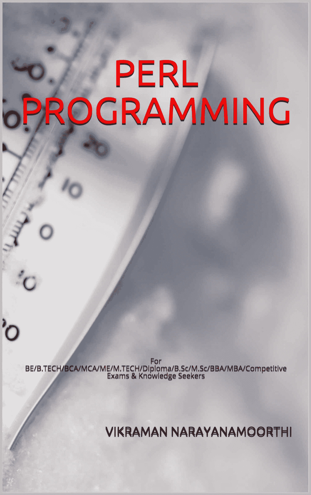

# 第一单元：Perl 简介

## 1. Perl 简介与数据类型

标量（Scalars）是简单的变量。它们以美元符号（`$`）开头。标量可以是数字、字符串或引用。引用实际上是变量的地址，我们将在接下来的章节中看到。

数组（Arrays）是标量的有序列表，你通过从 0 开始的数值索引访问它们。它们以“at”符号（`@`）开头。

哈希表（Hashes）是无序的键值对集合，你使用键作为下标进行访问。它们以百分比符号（`%`）开头。

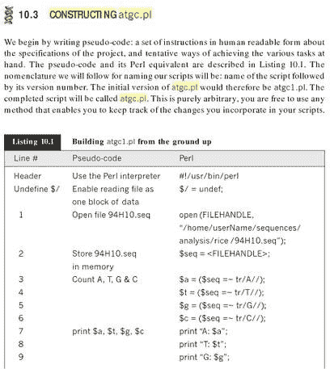

## 2. 构建 `atgc.pl`

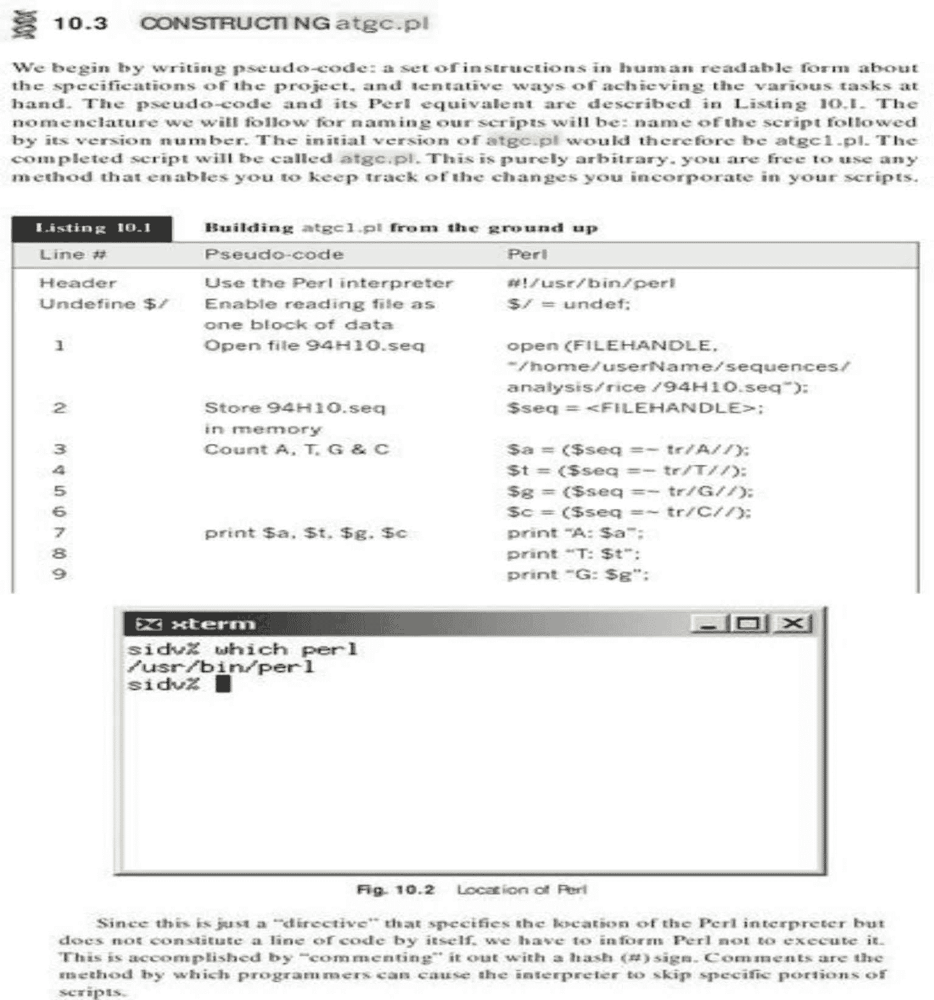

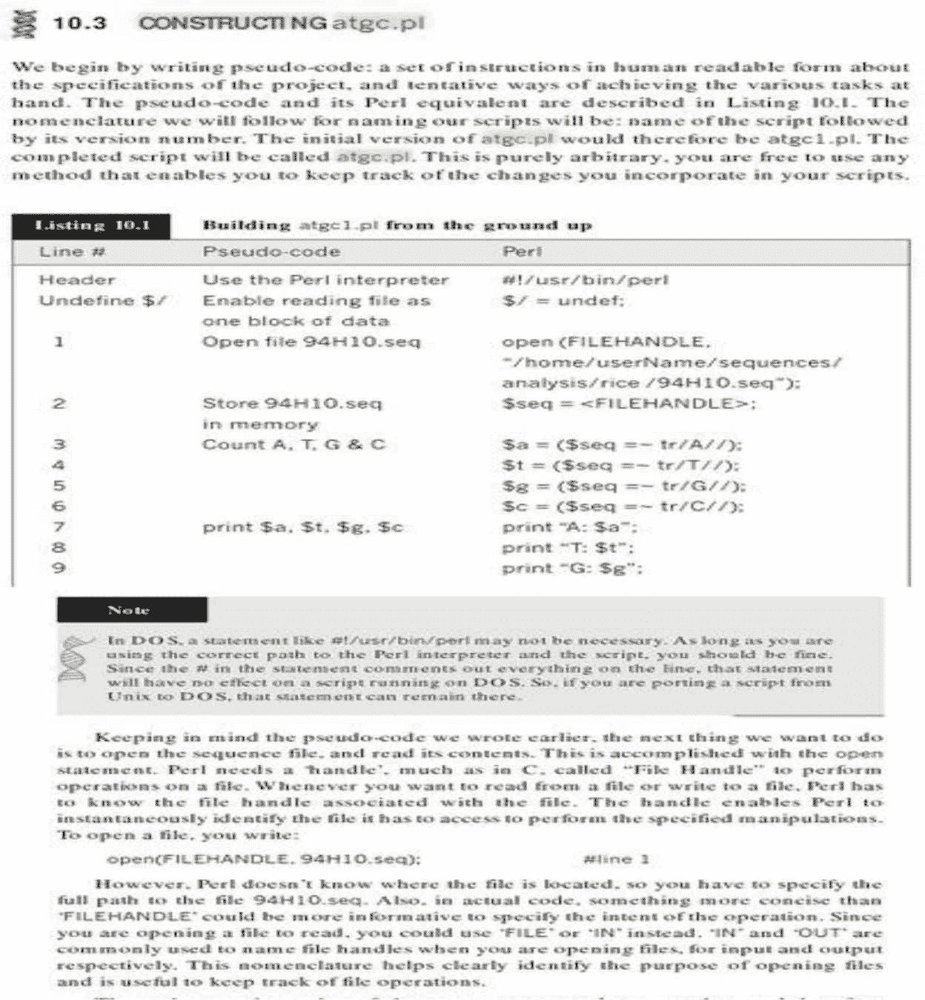

## 3. `tr///` 函数

这不是一个函数。这是一个置换运算符（transliteration operator）；它将 `SEARCHLIST` 中所有字符替换为 `REPLACEMENTLIST` 中的字符。

### 语法

`tr/SEARCHLIST/REPLACEMENTLIST/`

### 返回值

此函数返回替换或删除的字符数量。

### 示例

以下是显示其基本用法示例代码：

```perl
#!/usr/bin/perl -w
$string = 'the cat sat on the mat.';
$string =~ tr/a-z/b/d;
print "$string\n";
```

当执行上述代码时，它会产生以下结果。在这里，选项 `d` 用于删除匹配的字符。


## 4. `s///` 函数

### 描述

这不是一个函数。这是一个正则表达式替换运算符。根据 `PATTERN` 中指定的正则表达式，数据将被 `REPLACE` 替换。与 `m//` 类似，分隔符由 `s` 之后的第一个字符定义。

### 语法

`s/PATTERN/REPLACE/`

### 返回值

此函数在失败时返回 0，在成功时返回替换的次数。

### 示例

```perl
#!/usr/bin/perl -w
$string = "This is Test";
## 这会将 Test 替换为 Best。
$string =~ s/Test/Best/;
print "$string\n";
```

当执行上述代码时，它产生以下结果 — This is Best。


## 5. 使用 `Printf` 函数格式化数值输出


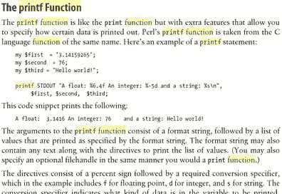

## 6. `Chop` 和 `Chomp` 运算符


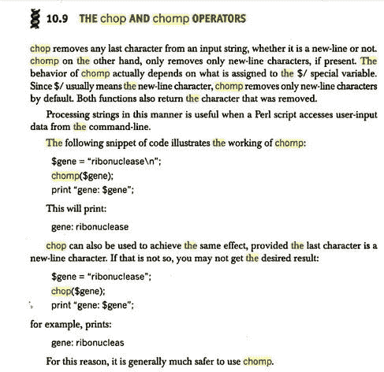


## 7. 通用网关接口（CGI）——简介与应用

通用网关接口（CGI）是 Web 服务器将 Web 用户请求传递给应用程序并接收返回数据以转发给用户的标准方法。当用户请求 Web 页面（例如，通过点击高亮单词或输入网站地址）时，服务器返回请求的页面。然而，当用户在 Web 页面上填写表单并提交时，通常需要由应用程序处理。Web 服务器通常会将表单信息传递给一个处理数据的小应用程序，并可能会返回确认消息。这种在服务器和应用程序之间传递数据的方法或约定被称为通用网关接口（CGI）。它是 Web 超文本传输协议（HTTP）的一部分。

如果你正在创建一个网站并希望让 CGI 应用程序进行控制，你可以在 HTML 文件中编写的统一资源定位符（URL）中指定应用程序名称。如果你正在创建一个表单，此 URL 可以作为 `FORMS` 标签的一部分。例如，你可能会编写：

```html
<FORM METHOD=POST ACTION=http://www.mybiz.com/cgi-bin/formprog.pl>
```

`mybiz.com` 上的服务器会将控制权交给名为 `formprog.pl` 的 CGI 应用程序，以记录输入的数据并返回确认消息。（`.pl` 表示用 Perl 编写的程序，但也可以使用其他语言。）

通用网关接口提供了一种一致的方法，使数据从用户请求传递到应用程序并返回用户。这意味着编写应用程序的人可以确保无论服务器使用何种操作系统（PC、Macintosh、UNIX、OS/390 或其他），它都能被使用。这仅仅是信息从 Web 服务器关于你的请求传递到应用程序并再次返回的一种基本方法。

CGI 的重要性在于，它的灵活性使其成为从 Web 服务器运行可执行文件的标准。该标准允许在网站上以无尽的方式实现真正的交互性。


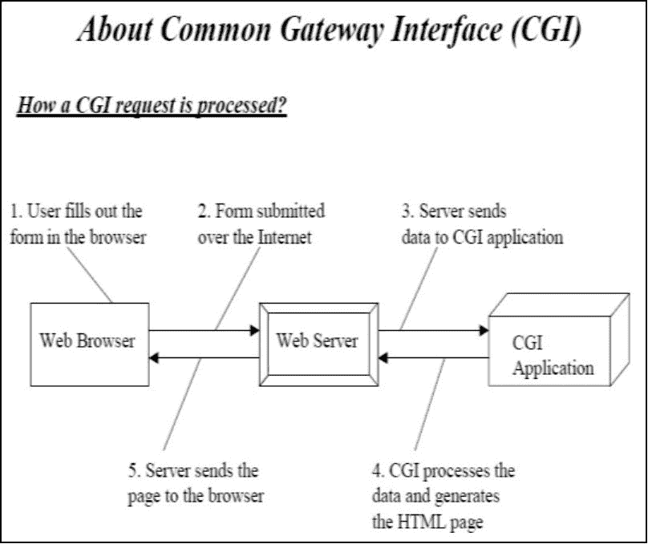

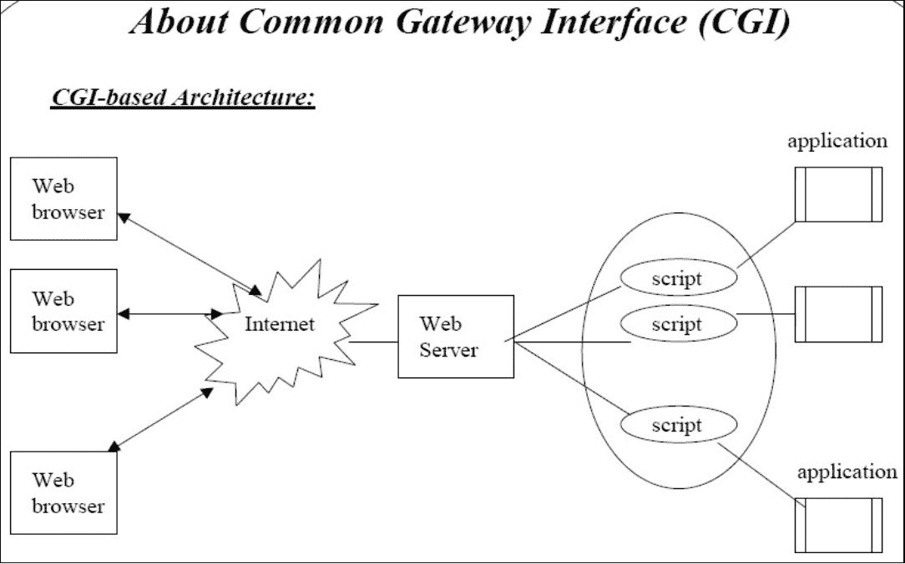

## CGI 的局限性与问题

### 问题

`Images/image00428.jpeg`

**性能**：每当用户请求时，服务器都必须启动 CGI 程序。当程序是用解释型语言（如 Perl）编写时，服务器仍然需要进行解释或编译，这需要更多时间。如果命令被频繁调用，产生的工作量可能会使服务器崩溃。

### CGI 的优势与应用

- **平台独立性**：大多数 Web 服务器支持 CGI，包括 Unix、Windows NT 和 Macintosh。
- **语言独立性**：Perl、C、C++、Visual Basic、Java。
- **可扩展性**：CGI 的简单性使其具有极的可扩展性。

一个 CGI 程序的示例是 Wiki。用户代理请求名称；服务器执行 CGI；CGI 程序检索条目的源码（如果存在），将其转换为 HTML 并传输给用户。如果点击“编辑此页面”链接，CGI 将内容填充到 HTML 区域或其他控件，并在用户提交时将其保存回服务器。

# 第二单元：数组与哈希表

## 数组与哈希表简介

### 数组

虽然我们经常处理单个变量，但有时处理变量集合很有用。对此，Perl 提供了选项：数组和哈希表。数组是最简单的集合类型，因此我们从数组开始。

例如，假设你想测试“Hello”程序的所有可能输出。当然，你可以手动运行三次，每次更改 `$status` 变量的值。但你也可以使用包含状态变量所有可能值（`'leaving'`、`'arriving'` 和 `'other'`）的数组并遍历它。

首先，如下定义数组：

```perl
@status = ("leaving", "arriving", "staying", "whatever");
```

注意，数组不是以 `$` 符号开头，而是以 `@` 符号开头。

现在你可以在 hello 程序中添加如下内容：

```perl
@status = ("leaving", "arriving", "staying", "whatever");
foreach $status (@status) {
```

## Perl 数组操作与循环

### `Foreach` 循环

这说明了几个点。首先，它演示了如何使用 `foreach` 语句遍历数组。`foreach` 的含义类似于：“对于数组中的每个元素，执行起始大括号和结束大括号之间的任何操作。”

它还演示了一个循环结构，因为当程序运行到 `foreach` 循环的底部（最后一个大括号）时，只要数组中还有更多值，它就会再次回到顶部。一旦数组中的所有值都被使用完毕，循环就会终止。如果循环之后还有额外的指令，程序将从那里继续执行。

注意 `print $greeting` 指令现在在分号前有一个点号和 `\n`（在引号中）。`\n` 是一个换行符。它告诉解释器在之后打印一个回车符。如果没有它，所有的问候语将全部连在同一行上。点号（在此背景下）被称为连接操作符。它将回车符与紧接其前的 `$greeting` 连接在一起。

```perl
if ($status eq "leaving") {
    $greeting = "Goodbye";
}
elsif ($status eq "arriving") {
    $greeting = "Hello";
}
else {
    $greeting = "Nice day";
}
print $greeting . "\n";
```

### 练习

**目标：**1) 熟悉条件判断。

**指令：**复制并运行上面的脚本，该脚本遍历数组并根据 `$status` 的内容更改 `$greeting` 的值。然后添加另一个 `elsif` 条件，如果 `$status` 的值为 `"staying"`，则将 `$greeting` 的值改为 `"Set yourself down and rest"`。

## Perl 记录（Records）

Perl 允许我们创建数组数组、数组哈希、哈希数组以及哈希哈希。这些复杂的、嵌套数据结构使用称为“引用”（references）的特殊变量来创建“记录”（records）（你使用“解引用”（dereferences）来访问记录的部分）。我们不会详细介绍 Perl 引用和记录，但在我们开始解析 XML 时，知道它们是什么以及如何使用解引用来表示记录的特定部分是有用的。

一个普通数组起始像这样：

```perl
@a_list = ();
```

我们可以将哈希表作为元素添加到数组中。哈希表没有普通的变量名，而是被称为“匿名”哈希：

```perl
@a_list = (
    { 'key_1' => 'value_1', 'key_2' => 'value_2', 'key_3' => 'value_3' },
    { 'key_4' => 'value_4', 'key_5' => 'value_5', 'key_6' => 'value_6' }
);
```

要打印与 `key_2` 关联的值，我们使用特殊语法对其进行解引用：

```perl
print %{$a_list[0]}->{"key_2"} . "\n";
```

该打印命令的结果是 `value_2`。解引用的部分很容易识别：`$a_list[0]` 代表 `@a_list` 数组中的第一项，`key_2` 是我们匿名哈希中的键之一。困难的部分在于 `%` 以及你必须用来指示实际解引用的额外大括号。

现在不要担心这些细节的含义，因为具体的用法取决于你解引用的是数组、哈希还是标量，以及你在什么语境下使用它们。此时最重要的是注意使用 `->` 来连接嵌套的 Perl 记录层级。我们稍后会遇到。

## 哈希（Hashes）

最后是另一种集合类型，哈希。本课程不会深入研究哈希，但简单来说，哈希类似于数组，不同之处在于不是通过数字引用其元素，而在哈希中你通过分配的键来引用它们。

一个示例：

```perl
%names = (
    'Durno' => 'John',
    'Jordan' => 'Mark',
    'Hacker' => 'J.R.'
);
```

注意哈希是用百分号表示的。要找到名为 Durno 的人的名字，你可以这样做：

```perl
$firstName = $names{'Durno'};
print $firstName;
```

## `Split` 函数

`split` 函数根据分隔符将字符串拆分为多个字段。

### 语法

`split(pattern, string)`

`split` 函数返回字段列表。如果没有指定限制，它返回所有字段。如果指定了限制，它返回最多指定数量的字段。

### 返回值

- 在**标量语境（Scalar Context）**中：返回第一个字段。
- 在**数组语境（Array Context）**中：返回字段列表。

### 示例

```perl
my @fields = split(":", "apple:banana:cherry");
print $fields[0]; # 输出 apple
```

## 复制数组

复制一个 Perl 数组实际上非常简单，看起来像是个魔术，一旦你学会了怎么做。在其他语言中，`@array2` 似乎是对 `@array1` 的引用，但在 Perl 中它是一个拷贝。

为了证明这确实复制了第一个数组，这里有一个短的 Perl 数组脚本来证明这一点：

```perl
my @arr1 = qw/cheese pepperoni/;
my @arr2 = @arr1;
push @arr1, 'works';

sub print_arr() {
    my (@arr) = @_;
    foreach $elem (@arr) {
        print "$elem\n";
    }
}

print "array1:\n";
print_arr(@arr1);

print "\narray2:\n";
print_arr(@arr2);
```

## 使用顺序数据填充数组

Perl 为顺序数字和字母提供了快捷方法。例如，在数到 100 时不需要手动输入每个元素，我们可以这样做：

```perl
#!/usr/bin/perl
my @var_10 = (1..10);
my @var_20 = (10..20);
my @var_abc = (a..z);

print "@var_10\n"; # 打印 1 到 10 的数字
print "@var_20\n"; # 打印 10 到 20 的数字
print "@var_abc\n"; # 打印 a 到 z 的字母
```

## 3. `qw` 函数

该函数是快速指定许多单引号单词的快捷。例如，`qw(foo bar baz)` 等同于 `('foo', 'bar', 'baz')`。一些程序员觉得使用 `qw` 让 Perl 脚本更易于读。你实际上可以使用任何一组分隔符，而不仅仅是括号。

你只需要使用 `qw()` 来准备一个数组，如下面的示例所示。

### 语法

以下是该函数的简单语法：

```perl
qw EXPR
```

### 返回值

此函数返回一个列表，由 `LIST` 中的元素组成，这些元素的评估方式就像它们被单引号一样。

### 示例

以下是显示其基本用法的示例代码：

```perl
#!/usr/bin/perl -w

@array = qw(This is a list of words without interpolation);
foreach $key (@array) {
    print "Key is $key\n";
}
```

当执行上述代码时，它产生以下结果：

```text
Key is This
Key is is
Key is a
Key is list
Key is of
Key is words
Key is without
Key is interpolation
```

## 4. 数组大小的确定

数组的大小可以使用数组的标量上下文（scalar context）来确定——返回值将是数组中元素的数量：

```perl
@array = (1, 2, 3);

print "Size: ", scalar @array, "\n";
```

返回值始终是数组的物理大小，而不是有效元素的数量。你可以使用此片段演示这一点，以及 `scalar @array` 和 `$#array` 之间的差异：

```perl
#!/uer/bin/perl

@array = (1, 2, 3);
$array[50] = 4;

$size = @array;
$max_index = $#array;

print "Size:$size\n";
print "Max Index:  $max_index\n";
```

这将产生以下结果：

```text
Size: 51
Max Index: 50
```

数组中只有四个元素包含信息，但数组的长度为 51，最高索引为 50。

## 5. 访问数组的第一个和最后一个元素

### `Shift` 函数

此函数返回数组中的第一个值，将其删除并将数组列表的元素向左移动一位。如果没有指定 `ARRAY`，则移动子程序内的 `@_` 数组，否则移动 `@ARGV`。`shift` 本质上与 `pop` 相同，但值是从数组的开头而不是末尾取的。

### 语法

以下是该函数的简单语法：

```perl
shift ([ARRAY])

shift
```

### 返回值

如果数组为空，此函数返回 `undef`，否则返回数组中的第一个元素。

### 示例

以下是显示其基本用法的示例代码：

```perl
#!/usr/bin/perl

@array = (1..5);

while ($element = shift(@array)) {
    print("$element - ");
}

print("The End\n");
```

当执行上述代码时，它产生以下结果：

```text
1 - 2 - 3 - 4 - 5 - The End
```

## 6. `Unshift` 函数

此函数将 `LIST` 中的元素按顺序放置在 `ARRAY` 的开头。这是 `shift()` 的相反函数。

### 语法

以下是该函数的简单语法：

```perl
unshift ARRAY, LIST
```

### 返回值

此函数返回 `ARRAY` 中新元素的数量。

### 示例

以下是显示其基本用法的示例代码：

```perl
#!/usr/bin/perl -w

@array = (1, 2, 3, 4);

print "Value of array is @array\n";
unshift(@array, 20, 30, 40);

print "Now value of array is @array\n";
```

当执行上述代码时，它产生以下结果：

```text
Value of array is 1 2 3 4
Now value of array is 20 30 40 1 2 3 4
```

## 7. `Push` 函数

此函数将 `LIST` 中的值推到列表 `ARRAY` 的末尾。与 `pop` 配合实现栈。

### 语法

以下是该函数的简单语法：

```perl
push ARRAY, LIST
```

### 返回值

此函数返回新数组中元素的数量。


### 示例

以下是显示其基本用法的示例代码：

```perl
#!/usr/bin/perl -w

$, = ",";

@array = (1, 2);

print "Before pushing elements @array \n";
push(@array, (3, 4, 5));

print "After pushing elements @array \n";
```

当执行上述代码时，它产生以下结果：

```text
Before pushing elements 1 2
After pushing elements 1 2 3 4 5
```

## 8. `pop` 函数

此函数返回 `ARRAY` 的最后一个元素，并从数组中移除该值。注意，`ARRAY` 必须明确是一个数组，而不是列表。

如果省略 `ARRAY`，它将从主程序中的 `@ARGV`，或在 `eval STRING` 调用内、`BEGIN`、`CHECK`、`INIT` 或 `END` 块中弹出最后一个值。否则，它尝试从子程序内的 `@_` 数组中弹出信息。

它是 `push` 的相反操作，结合使用时，允许你实现“栈”。

注意，在应用 `pop` 之后，数组将缩短。

### 语法

以下是该函数的简单语法：

```perl
pop ARRAY
```

### 返回值

如果列表为空，此函数返回最后一个值；否则返回数组中的最后一个元素。

### 示例

以下是显示其基本用法的示例代码：

```perl
#!/usr/bin/perl -w

@a = (1, 2, 3);

print("pop() ", pop(@a), "\n");
```

当执行上述代码时，它产生以下结果：

```text
pop() 3
```

## 9. 数组切片（Array Slices）

数组是一个存储有序列表的变量。要引用单个元素，将使用方括号。下面是一个简单的示例：

```perl
#!/usr/bin/perl

@array = (1, 2, 3);

print $array[0];
print $array[1];
```

## 10. `splice` 函数

此函数从 `ARRAY` 的 `OFFSET` 开始移除 `LENGTH` 个元素，并替换为指定的 `LIST`。如果省略 `LENGTH`，则从该位置开始移除。

切片允许一次性访问数组的多个元素：

```perl
#!/usr/bin/perl

@ages = (25, 30, 40);

@names = ("John", "Paul", "Kumar");

print @ages[0..1];
print @names[1..2];
```

### 语法

以下是该函数的简单语法：

```perl
splice ARRAY, OFFSET, LENGTH, LIST
splice ARRAY, OFFSET
```

### 返回值

此函数返回：

- 在标量上下文中，如果没有移除元素，则返回 `undef`。
- 在标量上下文中，返回移除的最后一个元素。
- 在列表上下文中，失败时返回空列表。
- 在列表上下文中，返回被移除的元素列表。

### 示例

以下是显示其基本用法的示例代码：

```perl
#!/usr/bin/perl -w

@array = ("a", "e", "i", "o", "u");

@removedItems = splice(@array, 0, 3, ("A", "E", "I"));

print "Removed items: @removedItems\n";
```

当执行上述代码时，它产生以下结果：

```text
Removed items: a e i
```

## 11. 数组排序

Perl 有名为 `sort` 的内置函数可以对数组排序。在最简单的形式下，你只需要给它一个数组，它就会返回排序后的元素。

```perl
@sorted = sort @original;
```

### 比较函数

Perl 中 `sort` 的工作方式是遍历原始数组中的每两个元素。在每次循环中，它将左侧的值放入变量 `$a`，将右侧的值放入变量 `$b`，然后调用一个比较函数。

如果 `$a` 的内容应该排在左侧，比较函数返回 `1`；如果 `$b` 的内容应该排在左侧，返回 `-1`；如果两个值相同，则返回 `0`。

默认情况下，你看不到这个比较函数。`sort` 根据 ASCII 表对值进行比较，但如果需要，也可以显式地编写它：

```perl
sort { $a cmp $b } @words;
```

这段代码提供的结果与不带代码块的结果完全相同：`sort @words`。

默认情况下，Perl 在比较函数中使用 `cmp`，因为 `cmp` 正好执行了这里所需的操作。它将两侧的值作为字符串进行比较：

- 如果左参数“小于”右参数，则返回 `1`。
- 如果左参数“大于”右参数，则返回 `-1`。
- 如果两个参数相同，则返回 `0`。

### 字母顺序排序

如果你想忽略字符串中的大小写，这通常称为字母顺序排序，可以像下面的示例那样操作：

```perl
my @sorted_words = sort { lc($a) cmp lc($b) } @words;
```

这里，为了比较，我们调用了 `lc` 函数，它返回参数的小写版本。然后 `cmp` 比较这些小写版本，并决定原始字符串中哪个应该在前，哪个应该在后。

结果是：

```text
$VAR1 = [
    2. 'bar',
    3. 'foo',
    4. 'moo',
    5. 'Zorg'
];
```

### 在 Perl 中排序数字

如果我们取一个数字数组并使用默认排序进行排序，结果可能不是我们预期的：

```perl
my @numbers = (14, 3, 12, 2, 23);
my @sorted_numbers = sort @numbers;
say Dumper \@sorted_numbers;
```

```text
$VAR1 = [
    2. 12,
    3. 14,
    4. 2,
    5. 23,
    6. 3
];
```

如果仔细考虑，这并不奇怪。当比较函数看到 `12` 和 `3` 时，它将它们作为字符串进行比较。这意味着它比较两个字符串中的第一个字符：`"1"` 与 `"3"`。

在 ASCII 表中，`"1"` 位于 `"3"` 之前，因此字符串 `"12"` 会排在字符串 `"3"` 之前。

Perl 并不会自动理解你想将这些值作为数字进行排序。

不过，我们可以编写一个比较函数，将这两个值作为数字进行比较。为此，我们使用 `<=>`，也称为宇宙飞船运算符。它将两个参数作为数字进行比较，并返回 `1`、`-1` 或 `0`。

```perl
my @sorted_numbers = sort { $a <=> $b } @numbers;
```

结果如下：

```text
$VAR1 = [
    2. 2,
    3. 3,
    4. 12,
    5. 14,
    6. 23
];
```

### 反转数组

#### 反转列表（`LIST`）

在列表上下文中，`reverse` 返回一个由 `LIST` 元素按相反顺序组成的列表值。

在标量上下文中，它连接 `LIST` 的元素，并返回一个所有字符顺序都相反的字符串值。

```perl
print join(", ", reverse "world", "Hello"); # Hello, world

print scalar reverse "dlrow ,", "olleH"; # Hello, world

# 在标量上下文中不带参数使用 reverse() 时，它反转 $_。
$_ = "dlrow ,olleH";

print reverse;        # 无输出，列表上下文
print scalar reverse; # Hello, world
```

注意，将数组反转自身，例如 `@a = reverse @a`，将尽可能保留不存在的元素；即对于非魔法数组或具有 `EXISTS` 和 `DELETE` 方法的绑定数组。

## 创建哈希、向哈希添加元素、删除、排序和打印哈希元素

哈希是键/值对的集合。哈希变量以百分号（`%`）开头。

要引用哈希的单个元素，需要使用以 `$` 符号开头的哈希变量名，并在花括号中跟随与值相关的 `"key"`。

这是一个使用哈希变量的简单示例：

```perl
#!/usr/bin/perl

%data = ("John Paul", 45, "Lisa", 30, "Kumar", 40);

print "\$data{'John Paul'} = \$data{'John Paul'}\n";
print "\$data{'Lisa'} = \$data{'Lisa'}\n";
print "\$data{'Kumar'} = \$data{'Kumar'}\n";
```

这将产生以下结果：

```text
$data{'John Paul'} = 45
$data{'Lisa'} = 30
$data{'Kumar'} = 40
```

### 创建哈希

哈希可以通过以下两种方式之一创建。

在第一种方法中，你逐个为命名键分配值：

```perl
$data{'John Paul'} = 45;
$data{'Lisa'} = 30;
$data{'Kumar'} = 40;
```

在第二种情况下，你使用列表。它会从列表中提取单独的键/值对：每一对的第一个元素用作键，第二个元素用作值。例如：

```perl
%data = ("John Paul", 45, "Lisa", 30, "Kumar", 40);
```

为了清晰起见，你可以使用 `=>` 作为 `,` 的别名，如下所示：

```perl
%data = (
    "John Paul" => 45,
    "Lisa"      => 30,
    "Kumar"     => 40
);
```

这是上述形式的另一种变体。这里所有的键都以连字符（`-`）开头，因此不需要加引号：

```perl
%data = (-JohnPaul => 45, -Lisa => 30);
```

## 匹配运算符

`m//` 的工作方式与 `q//` 运算符系列相同。你可以使用任何自然匹配的字符组合作为表达式的分隔符。例如，`m{}`、`m()` 和 `m><` 都是有效的。

上面的示例可以重写为：

```perl
#!/usr/bin/perl

$bar = "This is foo and again foo";

if ($bar =~ m[foo]) {
    print "First time is matching\n";
} else {
    print "First time is not matching\n";
}

$bar = "foo";

if ($bar =~ m{foo}) {
    print "Second time is matching\n";
} else {
    print "Second time is not matching\n";
}
```

如果分隔符是正斜杠，可以从 `m//` 中省略 `m`；但对于所有其他分隔符，必须使用 `m` 前缀。

注意，整个匹配表达式，即 `=~` 或 `!~` 左侧的表达式加上匹配运算符，在表达式匹配时会返回真值（在标量上下文中）。因此，下述语句：

```perl
$true = ($foo =~ m/foo/);
```

如果 `$foo` 匹配正则表达式，则将 `$true` 设置为 `1`；如果匹配失败，则设置为 `0`。

在列表上下文中，匹配会返回分组表达式的内容。例如，当从时间字符串中提取小时、分钟和秒时，可以使用：

```perl
my ($hours, $minutes, $seconds) =
    ($time =~ m/(\d+):(\d+):(\d+)/);
```

## 3. 匹配运算符修饰符

匹配运算符支持自己的一组修饰符。`/g` 修饰符允许全局匹配，`/i` 修饰符使匹配不区分大小写。

以下是修饰符的完整列表：

| 修饰符 | 描述 |
| :--- | :--- |
| `i` | 使匹配不区分大小写。 |
| `m` | 如果字符串包含换行符或回车符，使 `^` 和 `$` 运算符匹配换行边界，而不是字符串边界。 |
| `o` | 仅评估一次表达式。 |
| `s` | 允许使用 `.` 匹配换行符。 |
| `x` | 允许在表达式中使用空白，以提高清晰度。 |
| `g` | 全局查找所有匹配项。 |
| `cg` | 允许在全局匹配失败后继续搜索。 |

### 仅匹配一次

匹配运算符还有一个更简单的版本：`?PATTERN?` 运算符。

它基本上与 `m//` 运算符相同，不同之处在于，它在每次调用重置之前，只在搜索的字符串中匹配一次。

例如，你可以使用它来获取列表中的第一个和最后一个元素：

```perl
#!/usr/bin/perl

@list = qw/food foosball subeo footnote terfoot canic footbrdige/;

foreach (@list) {
    $first = $1 if ?(foo.*)?;
    $last = $1 if /(foo.*)/;
}

print "First: $first, Last: $last\n";
```

执行上述程序时，它会产生以下结果：

```text
First: food, Last: footbrdige
```

## 4. 正则表达式变量

正则表达式变量包括：

- `$&`：包含整个匹配字符串。
- ``$```：包含匹配字符串之前的所有内容。
- `$'`：包含匹配字符串之后的所有内容。
- `$1`：包含最后一次分组匹配的内容。

以下代码演示了结果：

```perl
#!/usr/bin/perl

$string = "The food is in the salad bar";

$string =~ m/foo/;

print "Before: $`\n";
print "Matched: $&\n";
print "After:  $'\n";
```

执行上述程序时，它会产生以下结果：

```text
Before: The
Matched: foo
After: d is in the salad bar
```

## 5. 替换运算符

替换运算符 `s///` 实际上是匹配运算符的扩展，允许你将匹配到的文本替换为新文本。

该运算符的形式为：

```perl
s/PATTERN/REPLACEMENT/
```

`PATTERN` 是要查找的文本的正则表达式。`REPLACEMENT` 是用于替换所找到文本的文本或正则表达式规范。

例如，可以使用以下正则表达式将所有的 `cat` 替换为 `dog`：

```perl
#!/usr/bin/perl

$string = "The cat sat on the mat";

$string =~ s/cat/dog/;

print "$string\n";
```

执行上述程序时，它产生以下结果：

```text
The dog sat on the mat
```

### 替换运算符修饰符

以下是用于替换运算符的所有修饰符：

| 修饰符 | 描述 |
| :--- | :--- |
| `i` | 使匹配不区分大小写。 |
| `m` | 如果字符串包含换行符或回车符，使 `^` 和 `$` 运算符匹配换行边界，而不是字符串边界。 |
| `o` | 仅评估一次表达式。 |
| `s` | 允许使用 `.` 匹配换行符。 |
| `x` | 允许在表达式中使用空白，以提高清晰度。 |
| `g` | 将找到的所有表达式出现处替换为替换文本。 |
| `e` | 将替换内容作为 Perl 语句进行评估，并使用其返回值作为替换文本。 |

## 6. 翻译运算符

你可以使用任何自然匹配的字符组合作为表达式的分隔符。例如，`m{}`、`m()` 和 `m><` 都是有效的。

`m//` 的工作方式与 `q//` 运算符系列相同。上面的示例可以重写为：

```perl
#!/usr/bin/perl

$bar = "This is foo and again foo";

if ($bar =~ m[foo]) {
    print "First time is matching\n";
} else {
    print "First time is not matching\n";
}

$bar = "foo";

if ($bar =~ m{foo}) {
    print "Second time is matching\n";
} else {
    print "Second time is not matching\n";
}
```

如果分隔符是正斜杠，可以从 `m//` 中省略 `m`；但对于所有其他分隔符，必须使用 `m` 前缀。

注意，整个匹配表达式，即 `=~` 或 `!~` 左侧的表达式加上匹配运算符，在表达式匹配时会返回真值（在标量上下文中）。因此，下述语句：

```perl
$true = ($foo =~ m/foo/);
```

如果 `$foo` 匹配正则表达式，则将 `$true` 设置为 `1`；如果匹配失败，则设置为 `0`。

在列表上下文中，匹配会返回分组表达式的内容。例如，当从时间字符串中提取小时、分钟和秒时，可以使用：

```perl
my ($hours, $minutes, $seconds) =
    ($time =~ m/(\d+):(\d+):(\d+)/);
```


## 3. 匹配运算符修饰

匹配运算符支持自己的一组修饰。`/g` 修饰允许全局匹配。`/i` 修饰将使匹配不区分大小写。以下是修饰的完整列表：

| 修饰 | 描述 |
| :--- | :--- |
| `i` | 使匹配不区分大小写。 |
| `m` | 指定如果字符串包含换行符或回车符，`^` 和 `$` 运算符现在将匹配换行边界，而不是字符串边界。 |
| `o` | 仅评估一次表达式。 |
| `s` | 允许使用 `.` 匹配换行符。 |
| `x` | 允许在表达式中使用空白以提高清晰度。 |
| `g` | 全局查找所有匹配项。 |
| `cg` | 允许在全局匹配失败后继续搜索。 |

### 仅匹配一次

匹配运算符还有一个更简单的版本 - `?PATTERN?` 运算符。这基本上与 `m//` 运算符相同，不同之处在于它在每次调用重置之前只在搜索的字符串中匹配一次。

例如，你可以使用它来获取列表中的第一个和最后一个元素：

```perl
#!/usr/bin/perl
@list = qw/food foosball subeo footnote terfoot canic footbrdige/; foreach (@list) {
    $first = $1 if ?(foo.*)?;
    $last = $1 if /(foo.*)/;
}
print "First: $first, Last: $last\n";
```

当执行上述程序时，它会产生以下结果：`First: food, Last: footbrdige`。

### 4. 正则表达式变量

正则表达式变量包括 `$&`，它包含整个匹配字符串；`` ` ``，它包含匹配字符串之前的所有内容；以及 `` `'` ``，它包含匹配字符串之后的所有内容。`$` 包含最后一次分组匹配的内容。以下代码演示了结果：

```perl
#!/usr/bin/perl
$string = "The food is in the salad bar";
$string =~ m/foo/; print "Before: $`\n"; print "Matched: $&\n"; print "After:  $'\n";
```

当执行上述程序时，它会产生以下结果：

```
Before: The
Matched: foo
After: d is in the salad bar
```

### 5. 替换运算符

替换运算符 `s///` 实际上是匹配运算符的扩展，允许你将匹配到的文本替换为新文本。该运算符的形式为：`s/PATTERN/REPLACEMENT/`。

`PATTERN` 是我们要查找的文本的正则表达式。`REPLACEMENT` 是我们用于替换所找到文本的文本或正则表达式规范。例如，我们可以使用以下正则表达式将所有的 dog 替换为 cat：

```perl
#!/usr/bin/perl
$string = "The cat sat on the mat";
$string =~ s/cat/dog/;
print "$string\n";
```

执行上述程序时，它产生以下结果：`The dog sat on the mat`。

#### 替换运算符修饰

以下是用于替换运算符的所有修饰符列表：

| 修饰 | 描述 |
| :--- | :--- |
| `i` | 使匹配不区分大小写。 |
| `m` | 指定如果字符串包含换行符或回车符，`^` 和 `$` 运算符现在将匹配换行边界，而不是字符串边界。 |
| `o` | 仅评估一次表达式。 |
| `s` | 允许使用 `.` 匹配换行符。 |
| `x` | 允许在表达式中使用空白以提高清晰度。 |
| `g` | 将找到的所有表达式出现处替换为替换文本。 |
| `e` | 将替换内容像 Perl 语句一样进行评估，并使用其返回值作为替换文本。 |

### 6. 翻译运算符

（注：此处原文为 Translation Operator，译为翻译运算符）

`m//` 的工作方式与 `q//` 运算符系列相同。你可以使用任何自然匹配的字符组合作为表达式的分隔符。例如，`m{}`、`m()` 和 `m><` 都是有效的。上面的示例可以重写为如下：

```perl
#!/usr/bin/perl
$bar = "This is foo and again foo"; if ($bar =~ m[foo]){
    print "First time is matching\n";
}else{
    print "First time is not matching\n";
}

$bar = "foo";
if ($bar =~ m{foo}){
    print "Second time is matching\n";
}else{
    print "Second time is not matching\n";
}
```

如果分隔符是正斜杠，你可以从 `m//` 中省略 `m`，但对于所有其他分隔符，你必须使用 `m` 前缀。

注意，整个匹配表达式（即 `=~` 或 `!~` 左侧的表达式加上匹配运算符）在表达式匹配时会返回真（在标量语境下）。因此，下述语句：

```perl
$true = ($foo =~ m/foo/);
```

如果 `$foo` 匹配正则，则将 `$true` 设置为 1；如果匹配失败，则为 0。在列表语境下，匹配返回任何分组表达式的内容。例如，当从时间字符串中提取小时、分钟和秒时，可以使用：

```perl
my ($hours, $minutes, $seconds) = ($time =~ m/(\d+):(\d+):(\d+)/);
```


```perl
#!/usr/bin/perl
@list = qw/food foosball subeo footnote terfoot canic footbrdige/; foreach (@list) {
    $first = $1 if ?(foo.*)?;
    $last = $1 if /(foo.*)/;
}
print "First: $first, Last: $last\n";
```

当执行上述程序时，它会产生以下结果：`First: food, Last: footbrdige`。

## 4. 正则表达式变量

正则表达式变量包括`$&`，它包含整个匹配字符串；`` ` ``，它包含匹配字符串之前的所有内容；以及`$'`，它包含匹配字符串之后的所有内容。`$1`包含最后一次分组匹配的内容。以下代码演示了结果：

```perl
#!/usr/bin/perl
$string = "The food is in the salad bar";
$string =~ m/foo/; print "Before: $`\n"; print "Matched: $&\n"; print "After:  $'\n";
```

当执行上述程序时，它会产生以下结果：

```text
Before: The
Matched: foo
After: d is in the salad bar
```

## 5. 替换运算符

替换运算符`s///`实际上是匹配运算符的扩展，允许你将匹配到的文本替换为新文本。该运算符的形式为：`s/PATTERN/REPLACEMENT/`。

`PATTERN`是我们要查找的文本的正则表达式。`REPLACEMENT`是我们用于替换所找到文本的文本或正则表达式规范。例如，我们可以使用以下正则表达式将所有的`dog`替换为`cat`：

```perl
#!/usr/bin/perl
$string = "The cat sat on the mat";
$string =~ s/cat/dog/;
print "$string\n";
```

执行上述程序时，它产生以下结果：`The dog sat on the mat`。

### 替换运算符修饰

以下是用于替换运算符的所有修饰符列表：

| 修饰 | 描述 |
| :--- | :--- |
| `i` | 使匹配不区分大小写。 |
| `m` | 指定如果字符串包含换行符或回车符，`^` 和`$`运算符现在将匹配换行边界，而不是字符串边界。 |
| `o` | 仅评估一次表达式。 |
| `s` | 允许使用`.`匹配换行符。 |
| `x` | 允许在表达式中使用空白以提高清晰度。 |
| `g` | 将找到的所有表达式出现处替换为替换文本。 |
| `e` | 将替换内容像 Perl 语句一样进行评估，并使用其返回值作为替换文本。 |

## 6. 翻译运算符

（注：此处原文为 Translation Operator，译为翻译运算符）

`m//`的工作方式与`q//`运算符系列相同。你可以使用任何自然匹配的字符组合作为表达式的分隔符。例如，`m{}`、`m()`和`m><`都是有效的。上面的示例可以重写为如下：

```perl
#!/usr/bin/perl
$bar = "This is foo and again foo"; if ($bar =~ m[foo]){
    print "First time is matching\n";
}else{
    print "First time is not matching\n";
}

$bar = "foo";
if ($bar =~ m{foo}){
    print "Second time is matching\n";
}else{
    print "Second time is not matching\n";
}
```

如果分隔符是正斜杠，你可以从`m//`中省略`m`，但对于所有其他分隔符，你必须使用`m`前缀。

注意，整个匹配表达式（即`=~`或`!~`左侧的表达式加上匹配运算符）在表达式匹配时会返回真（在标量语境下）。因此，下述语句：

```perl
$true = ($foo =~ m/foo/);
```

如果`$foo`匹配正则，则将`$true`设置为 1；如果匹配失败，则为 0。在列表语境下，匹配返回任何分组表达式的内容。例如，当从时间字符串中提取小时、分钟和秒时，可以使用：

```perl
my ($hours, $minutes, $seconds) = ($time =~ m/(\d+):(\d+):(\d+)/);
```

## 3. 匹配运算符修饰

匹配运算符支持自己的一组修饰。`/g`修饰允许全局匹配。`/i`修饰将使匹配不区分大小写。以下是修饰的完整列表：

| 修饰 | 描述 |
| :--- | :--- |
| `i` | 使匹配不区分大小写。 |
| `m` | 指定如果字符串包含换行符或回车符，`^`和`$`运算符现在将匹配换行边界，而不是字符串边界。 |
| `o` | 仅评估一次表达式。 |
| `s` | 允许使用`.`匹配换行符。 |
| `x` | 允许在表达式中使用空白以提高清晰度。 |
| `g` | 全局查找所有匹配项。 |
| `cg` | 允许在全局匹配失败后继续搜索。 |

### 仅匹配一次

匹配运算符还有一个更简单的版本——`?PATTERN?`运算符。这基本上与`m//`运算符相同，不同之处在于它在每次调用重置之前只在搜索的字符串中匹配一次。

例如，你可以使用它来获取列表中的第一个和最后一个元素：

```perl
#!/usr/bin/perl
@list = qw/food foosball subeo footnote terfoot canic footbrdige/; foreach (@list) {
    $first = $1 if ?(foo.*)?;
    $last = $1 if /(foo.*)/;
}
print "First: $first, Last: $last\n";
```

当执行上述程序时，它会产生以下结果：`First: food, Last: footbrdige`。

## 4. 正则表达式变量

正则表达式变量包括`$&`，它包含整个匹配字符串；`` ` ``，它包含匹配字符串之前的所有内容；以及`$'`，它包含匹配字符串之后的所有内容。`$1`包含最后一次分组匹配的内容。以下代码演示了结果：

```perl
#!/usr/bin/perl
$string = "The food is in the salad bar";
$string =~ m/foo/; print "Before: $`\n"; print "Matched: $&\n"; print "After:  $'\n";
```

当执行上述程序时，它会产生以下结果：

```text
Before: The
Matched: foo
After: d is in the salad bar
```

## 5. 替换运算符

替换运算符`s///`实际上是匹配运算符的扩展，允许你将匹配到的文本替换为新文本。该运算符的形式为：`s/PATTERN/REPLACEMENT/`。

`PATTERN`是我们要查找的文本的正则表达式。`REPLACEMENT`是我们用于替换所找到文本的文本或正则表达式规范。例如，我们可以使用以下正则表达式将所有的`dog`替换为`cat`：

```perl
#!/usr/bin/perl
$string = "The cat sat on the mat";
$string =~ s/cat/dog/;
print "$string\n";
```

执行上述程序时，它产生以下结果：`The dog sat on the mat`。

### 替换运算符修饰

以下是用于替换运算符的所有修饰符列表：

| 修饰 | 描述 |
| :--- | :--- |
| `i` | 使匹配不区分大小写。 |
| `m` | 指定如果字符串包含换行符或回车符，`^`和`$`运算符现在将匹配换行边界，而不是字符串边界。 |
| `o` | 仅评估一次表达式。 |
| `s` | 允许使用`.`匹配换行符。 |
| `x` | 允许在表达式中使用空白以提高清晰度。 |
| `g` | 将找到的所有表达式出现处替换为替换文本。 |
| `e` | 将替换内容像 Perl 语句一样进行评估，并使用其返回值作为替换文本。 |

## 6. 翻译运算符

（注：此处原文为 Translation Operator，译为翻译运算符）

`m//`的工作方式与`q//`运算符系列相同。你可以使用任何自然匹配的字符组合作为表达式的分隔符。例如，`m{}`、`m()`和`m><`都是有效的。上面的示例可以重写为如下：

```perl
#!/usr/bin/perl
$bar = "This is foo and again foo"; if ($bar =~ m[foo]){
    print "First time is matching\n";
}else{
    print "First time is not matching\n";
}

$bar = "foo";
if ($bar =~ m{foo}){
    print "Second time is matching\n";
}else{
    print "Second time is not matching\n";
}
```

如果分隔符是正斜杠，你可以从`m//`中省略`m`，但对于所有其他分隔符，你必须使用`m`前缀。

注意，整个匹配表达式（即`=~`或`!~`左侧的表达式加上匹配运算符）在表达式匹配时会返回真（在标量语境下）。因此，下述语句：

```perl
$true = ($foo =~ m/foo/);
```

如果`$foo`匹配正则，则将`$true`设置为 1；如果匹配失败，则为 0。在列表语境下，匹配返回任何分组表达式的内容。例如，当从时间字符串中提取小时、分钟和秒时，可以使用：

```perl
my ($hours, $minutes, $seconds) = ($time =~ m/(\d+):(\d+):(\d+)/);
```

## 3. 匹配运算符修饰

匹配运算符支持自己的一组修饰。`/g`修饰允许全局匹配。`/i`修饰将使匹配不区分大小写。以下是修饰的完整列表：

| 修饰 | 描述 |
| :--- | :--- |
| `i` | 使匹配不区分大小写。 |
| `m` | 指定如果字符串包含换行符或回车符，`^`和`$`运算符现在将匹配换行边界，而不是字符串边界。 |
| `o` | 仅评估一次表达式。 |
| `s` | 允许使用`.`匹配换行符。 |
| `x` | 允许在表达式中使用空白以提高清晰度。 |
| `g` | 全局查找所有匹配项。 |
| `cg` | 允许在全局匹配失败后继续搜索。 |

### 仅匹配一次

匹配运算符还有一个更简单的版本——`?PATTERN?`运算符。这基本上与`m//`运算符相同，不同之处在于它在每次调用重置之前只在搜索的字符串中匹配一次。

例如，你可以使用它来获取列表中的第一个和最后一个元素：

```perl
#!/usr/bin/perl
@list = qw/food foosball subeo footnote terfoot canic footbrdige/; foreach (@list) {
    $first = $1 if ?(foo.*)?;
    $last = $1 if /(foo.*)/;
}
print "First: $first, Last: $last\n";
```

当执行上述程序时，它会产生以下结果：`First: food, Last: footbrdige`。

## 4. 正则表达式变量

正则表达式变量包括`$&`，它包含整个匹配字符串；`` ` ``，它包含匹配字符串之前的所有内容；以及`$'`，它包含匹配字符串之后的所有内容。`$1`包含最后一次分组匹配的内容。以下代码演示了结果：


```perl
#!/usr/bin/perl
$string = "The food is in the salad bar";
$string =~ m/foo/; print "Before: $`\n"; print "Matched: $&\n"; print "After:  $'\n";
```

当执行上述程序时，它会产生以下结果：

```text
Before: The
Matched: foo
After: d is in the salad bar
```

## 3. 匹配运算符修饰

匹配运算符支持自己的一组修饰。`/g` 修饰允许全局匹配。`/i` 修饰将使匹配不区分大小写。以下是修饰的完整列表：

| 修饰 | 描述 |
| :--- | :--- |
| `i` | 使匹配不区分大小写。 |
| `m` | 指定如果字符串包含换行符或回车符，`^` 和 `$` 运算符现在将匹配换行边界，而不是字符串边界。 |
| `o` | 仅评估一次表达式。 |
| `s` | 允许使用 `.` 匹配换行符。 |
| `x` | 允许在表达式中使用空白以提高清晰度。 |
| `g` | 全局查找所有匹配项。 |
| `cg` | 允许在全局匹配失败后继续搜索。 |

### 仅匹配一次

匹配运算符还有一个更简单的版本：`?PATTERN?` 运算符。这基本上与 `m//` 运算符相同，不同之处在于它在每次调用重置之前只在搜索的字符串中匹配一次。

例如，你可以使用它来获取列表中的第一个和最后一个元素：

```perl
#!/usr/bin/perl
@list = qw/food foosball subeo footnote terfoot canic footbrdige/; foreach (@list) {
    $first = $1 if ?(foo.*)?;
    $last = $1 if /(foo.*)/;
}
print "First: $first, Last: $last\n";
```

当执行上述程序时，它会产生以下结果：`First: food, Last: footbrdige`。

## 4. 正则表达式变量

正则表达式变量包括 `$&`，它包含整个匹配字符串；`` ` ``，它包含匹配字符串之前的所有内容；以及 `'`，它包含匹配字符串之后的所有内容。`$1` 包含最后一次分组匹配的内容。以下代码演示了结果：

```perl
#!/usr/bin/perl
$string = "The food is in the salad bar";
$string =~ m/foo/; print "Before: $`\n"; print "Matched: $&\n"; print "After:  $'\n";
```

当执行上述程序时，它会产生以下结果：

```text
Before: The
Matched: foo
After: d is in the salad bar
```

## 5. 替换运算符

替换运算符 `s///` 实际上是匹配运算符的扩展，允许你将匹配到的文本替换为新文本。该运算符的形式为：`s/PATTERN/REPLACEMENT/`。

`PATTERN` 是我们要查找的文本的正则表达式。`REPLACEMENT` 是我们用于替换所找到文本的文本或正则表达式规范。例如，我们可以使用以下正则表达式将所有的 `dog` 替换为 `cat`：

```perl
#!/usr/bin/perl
$string = "The cat sat on the mat";
$string =~ s/cat/dog/;
print "$string\n";
```

执行上述程序时，它产生以下结果：`The dog sat on the mat`。

### 替换运算符修饰

以下是用于替换运算符的所有修饰符列表：

| 修饰 | 描述 |
| :--- | :--- |
| `i` | 使匹配不区分大小写。 |
| `m` | 指定如果字符串包含换行符或回车符，`^` 和 `$` 运算符现在将匹配换行边界，而不是字符串边界。 |
| `o` | 仅评估一次表达式。 |
| `s` | 允许使用 `.` 匹配换行符。 |
| `x` | 允许在表达式中使用空白以提高清晰度。 |
| `g` | 将找到的所有表达式出现处替换为替换文本。 |
| `e` | 将替换内容像 Perl 语句一样进行评估，并使用其返回值作为替换文本。 |

## 6. 翻译运算符

（注：此处原文为 Translation Operator，译为翻译运算符）

`m//` 的工作方式与 `q//` 运算符系列相同。你可以使用任何自然匹配的字符组合作为表达式的分隔符。例如，`m{}`、`m()` 和 `m><` 都是有效的。上面的示例可以重写为如下：

```perl
#!/usr/bin/perl
$bar = "This is foo and again foo"; if ($bar =~ m[foo]){
    print "First time is matching\n";
}else{
    print "First time is not matching\n";
}

$bar = "foo";
if ($bar =~ m{foo}){
    print "Second time is matching\n";
}else{
    print "Second time is not matching\n";
}
```

如果分隔符是正斜杠，你可以从 `m//` 中省略 `m`，但对于所有其他分隔符，你必须使用 `m` 前缀。

注意，整个匹配表达式（即 `=~` 或 `!~` 左侧的表达式加上匹配运算符）在表达式匹配时会返回真（在标量语境下）。因此，下述语句：

```perl
$true = ($foo =~ m/foo/);
```

如果 `$foo` 匹配正则，则将 `$true` 设置为 1；如果匹配失败，则为 0。在列表语境下，匹配返回任何分组表达式的内容。例如，当从时间字符串中提取小时、分钟和秒时，可以使用：

```perl
my ($hours, $minutes, $seconds) = ($time =~ m/(\d+):(\d+):(\d+)/);
```

## 5. 替换运算符

替换运算符 `s///` 实际上是匹配运算符的扩展，允许你将匹配到的文本替换为新文本。该运算符的形式为：`s/PATTERN/REPLACEMENT/`。

`PATTERN` 是我们要查找的文本的正则表达式。`REPLACEMENT` 是我们用于替换所找到文本的文本或正则表达式规范。例如，我们可以使用以下正则表达式将所有的 `dog` 替换为 `cat`：

```perl
#!/usr/bin/perl
$string = "The cat sat on the mat";
$string =~ s/cat/dog/;
print "$string\n";
```


```perl
$string = "The cat sat on the mat";
$string =~ s/cat/dog/;
print "$string\n";
```

执行上述程序时，它产生以下结果：`The dog sat on the mat`。

#### 替换运算符修饰

以下是用于替换运算符的所有修饰符列表：

| 修饰 | 描述 |
| :--- | :--- |
| `i` | 使匹配不区分大小写。 |
| `m` | 指定如果字符串包含换行符或回车符，`^` 和 `$` 运算符现在将匹配换行边界，而不是字符串边界。 |
| `o` | 仅评估一次表达式。 |
| `s` | 允许使用 `.` 匹配换行符。 |
| `x` | 允许在表达式中使用空白以提高清晰度。 |
| `g` | 将找到的所有表达式出现处替换为替换文本。 |
| `e` | 将替换内容像 Perl 语句一样进行评估，并使用其返回值作为替换文本。 |

### 6. 翻译运算符

（注：此处原文为 Translation Operator，译为翻译运算符）

`m//` 的工作方式与 `q//` 运算符系列相同。你可以使用任何自然匹配的字符组合作为表达式的分隔符。例如，`m{}`、`m()` 和 `m><` 都是有效的。上面的示例可以重写为如下：

```perl
#!/usr/bin/perl
$bar = "This is foo and again foo"; if ($bar =~ m[foo]){
    print "First time is matching\n";
}else{
    print "First time is not matching\n";
}

$bar = "foo";
if ($bar =~ m{foo}){
    print "Second time is matching\n";
}else{
    print "Second time is not matching\n";
}
```

如果分隔符是正斜杠，你可以从 `m//` 中省略 `m`，但对于所有其他分隔符，你必须使用 `m` 前缀。

注意，整个匹配表达式（即 `=~` 或 `!~` 左侧的表达式加上匹配运算符）在表达式匹配时会返回真（在标量语境下）。因此，下述语句：

```perl
$true = ($foo =~ m/foo/);
```

如果 `$foo` 匹配正则，则将 `$true` 设置为 1；如果匹配失败，则为 0。在列表语境下，匹配返回任何分组表达式的内容。例如，当从时间字符串中提取小时、分钟和秒时，可以使用：

```perl
my ($hours, $minutes, $seconds) = ($time =~ m/(\d+):(\d+):(\d+)/);
```

## 3. 匹配运算符修饰

匹配运算符支持自己的一组修饰。`/g` 修饰允许全局匹配。`/i` 修饰将使匹配不区分大小写。以下是修饰的完整列表：

| 修饰 | 描述 |
| :--- | :--- |
| `i` | 使匹配不区分大小写。 |
| `m` | 指定如果字符串包含换行符或回车符，`^` 和 `$` 运算符现在将匹配换行边界，而不是字符串边界。 |
| `o` | 仅评估一次表达式。 |
| `s` | 允许使用 `.` 匹配换行符。 |
| `x` | 允许在表达式中使用空白以提高清晰度。 |
| `g` | 全局查找所有匹配项。 |
| `cg` | 允许在全局匹配失败后继续搜索。 |

### 仅匹配一次

匹配运算符还有一个更简单的版本 - `?PATTERN?` 运算符。这基本上与 `m//` 运算符相同，不同之处在于它在每次调用重置之前只在搜索的字符串中匹配一次。

例如，你可以使用它来获取列表中的第一个和最后一个元素：

```perl
#!/usr/bin/perl
@list = qw/food foosball subeo footnote terfoot canic footbrdige/; foreach (@list) {
    $first = $1 if ?(foo.*)?;
    $last = $1 if /(foo.*)/;
}
print "First: $first, Last: $last\n";
```

当执行上述程序时，它会产生以下结果：`First: food, Last: footbrdige`。

### 4. 正则表达式变量

正则表达式变量包括 `$&`，它包含整个匹配字符串；`` ` ```，它包含匹配字符串之前的所有内容；以及 `` `'` ，它包含匹配字符串之后的所有内容。`$` 包含最后一次分组匹配的内容。以下代码演示了结果：

```perl
#!/usr/bin/perl
$string = "The food is in the salad bar";
$string =~ m/foo/; print "Before: $`\n"; print "Matched: $&\n"; print "After:  $'\n";
```

当执行上述程序时，它会产生以下结果：

Before: The

Matched: foo

After: d is in the salad bar

### 5. 替换运算符

替换运算符 `s///` 实际上是匹配运算符的扩展，允许你将匹配到的文本替换为新文本。该运算符的形式为：`s/PATTERN/REPLACEMENT/`。

`PATTERN` 是我们要查找的文本的正则表达式。`REPLACEMENT` 是我们用于替换所找到文本的文本或正则表达式规范。例如，我们可以使用以下正则表达式将所有的 dog 替换为 cat：

```perl
#!/usr/bin/perl
$string = "The cat sat on the mat";
$string =~ s/cat/dog/;
print "$string\n";
```

执行上述程序时，它产生以下结果：`The dog sat on the mat`。

#### 替换运算符修饰

以下是用于替换运算符的所有修饰符列表：

| 修饰 | 描述 |
| :--- | :--- |
| `i` | 使匹配不区分大小写。 |
| `m` | 指定如果字符串包含换行符或回车符，`^` 和 `$` 运算符现在将匹配换行边界，而不是字符串边界。 |
| `o` | 仅评估一次表达式。 |
| `s` | 允许使用 `.` 匹配换行符。 |
| `x` | 允许在表达式中使用空白以提高清晰度。 |
| `g` | 将找到的所有表达式出现处替换为替换文本。 |
| `e` | 将替换内容像 Perl 语句一样进行评估，并使用其返回值作为替换文本。 |

### 6. 翻译运算符

（注：此处原文为 Translation Operator，译为翻译运算符）

`m//` 的工作方式与 `q//` 运算符系列相同。你可以使用任何自然匹配的字符组合作为表达式的分隔符。例如，`m{}`、`m()` 和 `m><` 都是有效的。上面的示例可以重写为如下：

```perl
#!/usr/bin/perl
$bar = "This is foo and again foo"; if ($bar =~ m[foo]){
    print "First time is matching\n";
}else{
    print "First time is not matching\n";
}

$bar = "foo";
if ($bar =~ m{foo}){
    print "Second time is matching\n";
}else{
    print "Second time is not matching\n";
}
```

如果分隔符是正斜杠，你可以从 `m//` 中省略 `m`，但对于所有其他分隔符，你必须使用 `m` 前缀。

注意，整个匹配表达式（即 `=~` 或 `!~` 左侧的表达式加上匹配运算符）在表达式匹配时会返回真（在标量语境下）。因此，下述语句：

```perl
$true = ($foo =~ m/foo/);
```

如果 `$foo` 匹配正则，则将 `$true` 设置为 1；如果匹配失败，则为 0。在列表语境下，匹配返回任何分组表达式的内容。例如，当从时间字符串中提取小时、分钟和秒时，可以使用：

```perl
my ($hours, $minutes, $seconds) = ($time =~ m/(\d+):(\d+):(\d+)/);
```

## 3. 匹配运算符修饰

匹配运算符支持自己的一组修饰。`/g` 修饰允许全局匹配。`/i` 修饰将使匹配不区分大小写。以下是修饰的完整列表：

| 修饰 | 描述 |
| :--- | :--- |
| `i` | 使匹配不区分大小写。 |
| `m` | 指定如果字符串包含换行符或回车符，`^` 和 `$` 运算符现在将匹配换行边界，而不是字符串边界。 |
| `o` | 仅评估一次表达式。 |
| `s` | 允许使用 `.` 匹配换行符。 |
| `x` | 允许在表达式中使用空白以提高清晰度。 |
| `g` | 全局查找所有匹配项。 |
| `cg` | 允许在全局匹配失败后继续搜索。 |

### 仅匹配一次

匹配运算符还有一个更简单的版本 - `?PATTERN?` 运算符。这基本上与 `m//` 运算符相同，不同之处在于它在每次调用重置之前只在搜索的字符串中匹配一次。

例如，你可以使用它来获取列表中的第一个和最后一个元素：

```perl
#!/usr/bin/perl
@list = qw/food foosball subeo footnote terfoot canic footbrdige/; foreach (@list) {
    $first = $1 if ?(foo.*)?;
    $last = $1 if /(foo.*)/;
}
print "First: $first, Last: $last\n";
```

当执行上述程序时，它会产生以下结果：`First: food, Last: footbrdige`。

### 4. 正则表达式变量

正则表达式变量包括 `$&`，它包含整个匹配字符串；`` ` ```，它包含匹配字符串之前的所有内容；以及 `` `'` ，它包含匹配字符串之后的所有内容。`$` 包含最后一次分组匹配的内容。以下代码演示了结果：

```perl
#!/usr/bin/perl
$string = "The food is in the salad bar";
$string =~ m/foo/; print "Before: $`\n"; print "Matched: $&\n"; print "After:  $'\n";
```

当执行上述程序时，它会产生以下结果：

Before: The

Matched: foo

After: d is in the salad bar

### 5. 替换运算符

替换运算符 `s///` 实际上是匹配运算符的扩展，允许你将匹配到的文本替换为新文本。该运算符的形式为：`s/PATTERN/REPLACEMENT/`。

`PATTERN` 是我们要查找的文本的正则表达式。`REPLACEMENT` 是我们用于替换所找到文本的文本或正则表达式规范。例如，我们可以使用以下正则表达式将所有的 dog 替换为 cat：

```perl
#!/usr/bin/perl
$string = "The cat sat on the mat";
$string =~ s/cat/dog/;
print "$string\n";
```

执行上述程序时，它产生以下结果：`The dog sat on the mat`。

#### 替换运算符修饰

以下是用于替换运算符的所有修饰符列表：

| 修饰 | 描述 |
| :--- | :--- |
| `i` | 使匹配不区分大小写。 |
| `m` | 指定如果字符串包含换行符或回车符，`^` 和 `$` 运算符现在将匹配换行边界，而不是字符串边界。 |
| `o` | 仅评估一次表达式。 |
| `s` | 允许使用 `.` 匹配换行符。 |
| `x` | 允许在表达式中使用空白以提高清晰度。 |
| `g` | 将找到的所有表达式出现处替换为替换文本。 |
| `e` | 将替换内容像 Perl 语句一样进行评估，并使用其返回值作为替换文本。 |

### 6. 翻译运算符


（注：此处原文为 Translation Operator，译为翻译运算符）

`m//` 的工作方式与 `q//` 运算符系列相同。你可以使用任何自然匹配的字符组合作为表达式的分隔符。例如，`m{}`、`m()` 和 `m><` 都是有效的。上面的示例可以重写为如下：

```perl
#!/usr/bin/perl
$bar = "This is foo and again foo"; if ($bar =~ m[foo]){
    print "First time is matching\n";
}else{
    print "First time is not matching\n";
}

$bar = "foo";
if ($bar =~ m{foo}){
    print "Second time is matching\n";
}else{
    print "Second time is not matching\n";
}
```

如果分隔符是正斜杠，你可以从 `m//` 中省略 `m`，但对于所有其他分隔符，你必须使用 `m` 前缀。

注意，整个匹配表达式（即 `=~` 或 `!~` 左侧的表达式加上匹配运算符）在表达式匹配时会返回真（在标量语境下）。因此，下述语句：

```perl
$true = ($foo =~ m/foo/);
```

如果 `$foo` 匹配正则，则将 `$true` 设置为 1；如果匹配失败，则为 0。在列表语境下，匹配返回任何分组表达式的内容。例如，当从时间字符串中提取小时、分钟和秒时，可以使用：

```perl
my ($hours, $minutes, $seconds) = ($time =~ m/(\d+):(\d+):(\d+)/);
```

## 3. 匹配运算符修饰

匹配运算符支持自己的一组修饰。`/g` 修饰允许全局匹配。`/i` 修饰将使匹配不区分大小写。以下是修饰的完整列表：

| 修饰 | 描述 |
| :--- | :--- |
| `i` | 使匹配不区分大小写。 |
| `m` | 指定如果字符串包含换行符或回车符，`^` 和 `$` 运算符现在将匹配换行边界，而不是字符串边界。 |
| `o` | 仅评估一次表达式。 |
| `s` | 允许使用 `.` 匹配换行符。 |
| `x` | 允许在表达式中使用空白以提高清晰度。 |
| `g` | 全局查找所有匹配项。 |
| `cg` | 允许在全局匹配失败后继续搜索。 |

### 仅匹配一次

匹配运算符还有一个更简单的版本——`?PATTERN?` 运算符。这基本上与 `m//` 运算符相同，不同之处在于它在每次调用重置之前只在搜索的字符串中匹配一次。

例如，你可以使用它来获取列表中的第一个和最后一个元素：

```perl
#!/usr/bin/perl
@list = qw/food foosball subeo footnote terfoot canic footbrdige/; foreach (@list) {
    $first = $1 if ?(foo.*)?;
    $last = $1 if /(foo.*)/;
}
print "First: $first, Last: $last\n";
```

当执行上述程序时，它会产生以下结果：`First: food, Last: footbrdige`。

### 4. 正则表达式变量

正则表达式变量包括 `$&`，它包含整个匹配字符串；`` ` ```，它包含匹配字符串之前的所有内容；以及 `` `'`，它包含匹配字符串之后的所有内容。`$` 包含最后一次分组匹配的内容。以下代码演示了结果：

```perl
#!/usr/bin/perl
$string = "The food is in the salad bar";
$string =~ m/foo/; print "Before: $`\n"; print "Matched: $&\n"; print "After:  $'\n";
```

当执行上述程序时，它会产生以下结果：

```text
Before: The
Matched: foo
After: d is in the salad bar
```

### 5. 替换运算符

替换运算符 `s///` 实际上是匹配运算符的扩展，允许你将匹配到的文本替换为新文本。该运算符的形式为：`s/PATTERN/REPLACEMENT/`。

`PATTERN` 是我们要查找的文本的正则表达式。`REPLACEMENT` 是我们用于替换所找到文本的文本或正则表达式规范。例如，我们可以使用以下正则表达式将所有的 dog 替换为 cat：

```perl
#!/usr/bin/perl
$string = "The cat sat on the mat";
$string =~ s/cat/dog/;
print "$string\n";
```

执行上述程序时，它产生以下结果：`The dog sat on the mat`。

#### 替换运算符修饰

以下是用于替换运算符的所有修饰符列表：

| 修饰 | 描述 |
| :--- | :--- |
| `i` | 使匹配不区分大小写。 |
| `m` | 指定如果字符串包含换行符或回车符，`^` 和 `$` 运算符现在将匹配换行边界，而不是字符串边界。 |
| `o` | 仅评估一次表达式。 |
| `s` | 允许使用 `.` 匹配换行符。 |
| `x` | 允许在表达式中使用空白以提高清晰度。 |
| `g` | 将找到的所有表达式出现处替换为替换文本。 |
| `e` | 将替换内容像 Perl 语句一样进行评估，并使用其返回值作为替换文本。 |

### 6. 翻译运算符

（注：此处原文为 Translation Operator，译为翻译运算符）

`m//` 的工作方式与 `q//` 运算符系列相同。你可以使用任何自然匹配的字符组合作为表达式的分隔符。例如，`m{}`、`m()` 和 `m><` 都是有效的。上面的示例可以重写为如下：

```perl
#!/usr/bin/perl
$bar = "This is foo and again foo"; if ($bar =~ m[foo]){
    print "First time is matching\n";
}else{
    print "First time is not matching\n";
}

$bar = "foo";
if ($bar =~ m{foo}){
    print "Second time is matching\n";
}else{
    print "Second time is not matching\n";
}
```

如果分隔符是正斜杠，你可以从 `m//` 中省略 `m`，但对于所有其他分隔符，你必须使用 `m` 前缀。

注意，整个匹配表达式（即 `=~` 或 `!~` 左侧的表达式加上匹配运算符）在表达式匹配时会返回真（在标量语境下）。因此，下述语句：

```perl
$true = ($foo =~ m/foo/);
```

如果 `$foo` 匹配正则，则将 `$true` 设置为 1；如果匹配失败，则为 0。在列表语境下，匹配返回任何分组表达式的内容。例如，当从时间字符串中提取小时、分钟和秒时，可以使用：

```perl
my ($hours, $minutes, $seconds) = ($time =~ m/(\d+):(\d+):(\d+)/);
```

## 3. 匹配运算符修饰

匹配运算符支持自己的一组修饰。`/g` 修饰允许全局匹配。`/i` 修饰将使匹配不区分大小写。以下是修饰的完整列表：

| 修饰 | 描述 |
| :--- | :--- |
| `i` | 使匹配不区分大小写。 |
| `m` | 指定如果字符串包含换行符或回车符，`^` 和 `$` 运算符现在将匹配换行边界，而不是字符串边界。 |
| `o` | 仅评估一次表达式。 |
| `s` | 允许使用 `.` 匹配换行符。 |
| `x` | 允许在表达式中使用空白以提高清晰度。 |
| `g` | 全局查找所有匹配项。 |
| `cg` | 允许在全局匹配失败后继续搜索。 |

### 仅匹配一次

匹配运算符还有一个更简单的版本——`?PATTERN?` 运算符。这基本上与 `m//` 运算符相同，不同之处在于它在每次调用重置之前只在搜索的字符串中匹配一次。

例如，你可以使用它来获取列表中的第一个和最后一个元素：

```perl
#!/usr/bin/perl
@list = qw/food foosball subeo footnote terfoot canic footbrdige/; foreach (@list) {
    $first = $1 if ?(foo.*)?;
    $last = $1 if /(foo.*)/;
}
print "First: $first, Last: $last\n";
```

当执行上述程序时，它会产生以下结果：`First: food, Last: footbrdige`。

### 4. 正则表达式变量

正则表达式变量包括 `$&`，它包含整个匹配字符串；`` ` ```，它包含匹配字符串之前的所有内容；以及 `` `'`，它包含匹配字符串之后的所有内容。`$` 包含最后一次分组匹配的内容。以下代码演示了结果：

```perl
#!/usr/bin/perl
$string = "The food is in the salad bar";
$string =~ m/foo/; print "Before: $`\n"; print "Matched: $&\n"; print "After:  $'\n";
```

当执行上述程序时，它会产生以下结果：

```text
Before: The
Matched: foo
After: d is in the salad bar
```

### 5. 替换运算符

替换运算符 `s///` 实际上是匹配运算符的扩展，允许你将匹配到的文本替换为新文本。该运算符的形式为：`s/PATTERN/REPLACEMENT/`。

`PATTERN` 是我们要查找的文本的正则表达式。`REPLACEMENT` 是我们用于替换所找到文本的文本或正则表达式规范。例如，我们可以使用以下正则表达式将所有的 dog 替换为 cat：

```perl
#!/usr/bin/perl
$string = "The cat sat on the mat";
$string =~ s/cat/dog/;
print "$string\n";
```

执行上述程序时，它产生以下结果：`The dog sat on the mat`。

#### 替换运算符修饰

以下是用于替换运算符的所有修饰符列表：

| 修饰 | 描述 |
| :--- | :--- |
| `i` | 使匹配不区分大小写。 |
| `m` | 指定如果字符串包含换行符或回车符，`^` 和 `$` 运算符现在将匹配换行边界，而不是字符串边界。 |
| `o` | 仅评估一次表达式。 |
| `s` | 允许使用 `.` 匹配换行符。 |
| `x` | 允许在表达式中使用空白以提高清晰度。 |
| `g` | 将找到的所有表达式出现处替换为替换文本。 |
| `e` | 将替换内容像 Perl 语句一样进行评估，并使用其返回值作为替换文本。 |

### 6. 翻译运算符

（注：此处原文为 Translation Operator，译为翻译运算符）

`m//` 的工作方式与 `q//` 运算符系列相同。你可以使用任何自然匹配的字符组合作为表达式的分隔符。例如，`m{}`、`m()` 和 `m><` 都是有效的。上面的示例可以重写为如下：

```perl
#!/usr/bin/perl
$bar = "This is foo and again foo"; if ($bar =~ m[foo]){
    print "First time is matching\n";
}else{
    print "First time is not matching\n";
}

$bar = "foo";
if ($bar =~ m{foo}){
    print "Second time is matching\n";
}else{
    print "Second time is not matching\n";
}
```


如果分隔符是正斜杠，你可以从 `m//` 中省略 `m`，但对于所有其他分隔符，你必须使用 `m` 前缀。

注意，整个匹配表达式（即 `=~` 或 `!~` 左侧的表达式加上匹配运算符）在表达式匹配时会返回真（在标量语境下）。因此，下述语句：

```perl
$true = ($foo =~ m/foo/);
```

如果 `$foo` 匹配正则，则将 `$true` 设置为 1；如果匹配失败，则为 0。在列表语境下，匹配返回任何分组表达式的内容。例如，当从时间字符串中提取小时、分钟和秒时，可以使用：

```perl
my ($hours, $minutes, $seconds) = ($time =~ m/(\d+):(\d+):(\d+)/);
```

## 3. 匹配运算符修饰

匹配运算符支持自己的一组修饰。`/g` 修饰允许全局匹配。`/i` 修饰将使匹配不区分大小写。以下是修饰的完整列表：

| 修饰 | 描述 |
| :--- | :--- |
| `i` | 使匹配不区分大小写。 |
| `m` | 指定如果字符串包含换行符或回车符，`^` 和 `$` 运算符现在将匹配换行边界，而不是字符串边界。 |
| `o` | 仅评估一次表达式。 |
| `s` | 允许使用 `.` 匹配换行符。 |
| `x` | 允许在表达式中使用空白以提高清晰度。 |
| `g` | 全局查找所有匹配项。 |
| `cg` | 允许在全局匹配失败后继续搜索。 |

### 仅匹配一次

匹配运算符还有一个更简单的版本——`?PATTERN?` 运算符。这基本上与 `m//` 运算符相同，不同之处在于它在每次调用重置之前只在搜索的字符串中匹配一次。

例如，你可以使用它来获取列表中的第一个和最后一个元素：

```perl
#!/usr/bin/perl

@list = qw/food foosball subeo footnote terfoot canic footbrdige/; foreach (@list) {
    $first = $1 if ?(foo.*)?;
    $last = $1 if /(foo.*)/;
}

print "First: $first, Last: $last\n";
```

当执行上述程序时，它会产生以下结果：`First: food, Last: footbrdige`。

### 4. 正则表达式变量

正则表达式变量包括 `$&`，它包含整个匹配字符串；`` ` ```，它包含匹配字符串之前的所有内容；以及 `` `'`，它包含匹配字符串之后的所有内容。`$` 包含最后一次分组匹配的内容。以下代码演示了结果：

```perl
#!/usr/bin/perl
$string = "The food is in the salad bar";
$string =~ m/foo/; print "Before: $`\n"; print "Matched: $&\n"; print "After:  $'\n";
```

当执行上述程序时，它会产生以下结果：

```text
Before: The
Matched: foo
After: d is in the salad bar
```

### 5. 替换运算符

替换运算符 `s///` 实际上是匹配运算符的扩展，允许你将匹配到的文本替换为新文本。该运算符的形式为：`s/PATTERN/REPLACEMENT/`。

`PATTERN` 是我们要查找的文本的正则表达式。`REPLACEMENT` 是我们用于替换所找到文本的文本或正则表达式规范。例如，我们可以使用以下正则表达式将所有的 `dog` 替换为 `cat`：

```perl
#!/usr/bin/perl
$string = "The cat sat on the mat";
$string =~ s/cat/dog/;
print "$string\n";
```

执行上述程序时，它产生以下结果：`The dog sat on the mat`。

#### 替换运算符修饰

以下是用于替换运算符的所有修饰符列表：

| 修饰 | 描述 |
| :--- | :--- |
| `i` | 使匹配不区分大小写。 |
| `m` | 指定如果字符串包含换行符或回车符，`^` 和 `$` 运算符现在将匹配换行边界，而不是字符串边界。 |
| `o` | 仅评估一次表达式。 |
| `s` | 允许使用 `.` 匹配换行符。 |
| `x` | 允许在表达式中使用空白以提高清晰度。 |
| `g` | 将找到的所有表达式出现处替换为替换文本。 |
| `e` | 将替换内容像 Perl 语句一样进行评估，并使用其返回值作为替换文本。 |

### 6. 翻译运算符

（注：此处原文为 Translation Operator，译为翻译运算符）

`m//` 的工作方式与 `q//` 运算符系列相同。你可以使用任何自然匹配的字符组合作为表达式的分隔符。例如，`m{}``、`m()` 和 `m><` 都是有效的。上面的示例可以重写为如下：

```perl
#!/usr/bin/perl

$bar = "This is foo and again foo"; if ($bar =~ m[foo]){
    print "First time is matching\n";
}else{
    print "First time is not matching\n";
}

$bar = "foo";
if ($bar =~ m{foo}){
    print "Second time is matching\n";
}else{
    print "Second time is not matching\n";
}
```

如果分隔符是正斜杠，你可以从 `m//` 中省略 `m`，但对于所有其他分隔符，你必须使用 `m` 前缀。

注意，整个匹配表达式（即 `=~` 或 `!~` 左侧的表达式加上匹配运算符）在表达式匹配时会返回真（在标量语境下）。因此，下述语句：

```perl
$true = ($foo =~ m/foo/);
```

如果 `$foo` 匹配正则，则将 `$true` 设置为 1；如果匹配失败，则为 0。在列表语境下，匹配返回任何分组表达式的内容。例如，当从时间字符串中提取小时、分钟和秒时，可以使用：

```perl
my ($hours, $minutes, $seconds) = ($time =~ m/(\d+):(\d+):(\d+)/);
```

## 3. 匹配运算符修饰

匹配运算符支持自己的一组修饰。`/g` 修饰允许全局匹配。`/i` 修饰将使匹配不区分大小写。以下是修饰的完整列表：

| 修饰 | 描述 |
| :--- | :--- |
| `i` | 使匹配不区分大小写。 |
| `m` | 指定如果字符串包含换行符或回车符，`^` 和 `$` 运算符现在将匹配换行边界，而不是字符串边界。 |
| `o` | 仅评估一次表达式。 |
| `s` | 允许使用 `.` 匹配换行符。 |
| `x` | 允许在表达式中使用空白以提高清晰度。 |
| `g` | 全局查找所有匹配项。 |
| `cg` | 允许在全局匹配失败后继续搜索。 |

### 仅匹配一次

匹配运算符还有一个更简单的版本——`?PATTERN?` 运算符。这基本上与 `m//` 运算符相同，不同之处在于它在每次调用重置之前只在搜索的字符串中匹配一次。

例如，你可以使用它来获取列表中的第一个和最后一个元素：

```perl
#!/usr/bin/perl

@list = qw/food foosball subeo footnote terfoot canic footbrdige/; foreach (@list) {
    $first = $1 if ?(foo.*)?;
    $last = $1 if /(foo.*)/;
}

print "First: $first, Last: $last\n";
```

当执行上述程序时，它会产生以下结果：`First: food, Last: footbrdige`。

### 4. 正则表达式变量

正则表达式变量包括 `$&`，它包含整个匹配字符串；`` ` ```，它包含匹配字符串之前的所有内容；以及 `` `'`，它包含匹配字符串之后的所有内容。`$` 包含最后一次分组匹配的内容。以下代码演示了结果：

```perl
#!/usr/bin/perl
$string = "The food is in the salad bar";
$string =~ m/foo/; print "Before: $`\n"; print "Matched: $&\n"; print "After:  $'\n";
```

当执行上述程序时，它会产生以下结果：

```text
Before: The
Matched: foo
After: d is in the salad bar
```

### 5. 替换运算符

替换运算符 `s///` 实际上是匹配运算符的扩展，允许你将匹配到的文本替换为新文本。该运算符的形式为：`s/PATTERN/REPLACEMENT/`。

`PATTERN` 是我们要查找的文本的正则表达式。`REPLACEMENT` 是我们用于替换所找到文本的文本或正则表达式规范。例如，我们可以使用以下正则表达式将所有的 `dog` 替换为 `cat`：

```perl
#!/usr/bin/perl
$string = "The cat sat on the mat";
$string =~ s/cat/dog/;
print "$string\n";
```

执行上述程序时，它产生以下结果：`The dog sat on the mat`。


`PATTERN` 是我们要查找的文本的正则表达式。`REPLACEMENT` 是我们用于替换所找到文本的文本或正则表达式规范。例如，我们可以使用以下正则表达式将所有的 `dog` 替换为 `cat`：

```perl
#!/usr/bin/perl
$string = "The cat sat on the mat";
$string =~ s/cat/dog/;
print "$string\n";
```

执行上述程序时，它产生以下结果：`The dog sat on the mat`。

#### 替换运算符修饰

以下是用于替换运算符的所有修饰符列表：

| 修饰 | 描述 |
| :--- | :--- |
| `i` | 使匹配不区分大小写。 |
| `m` | 指定如果字符串包含换行符或回车符，`^` 和 `$` 运算符现在将匹配换行边界，而不是字符串边界。 |
| `o` | 仅评估一次表达式。 |
| `s` | 允许使用 `.` 匹配换行符。 |
| `x` | 允许在表达式中使用空白以提高清晰度。 |
| `g` | 将找到的所有表达式出现处替换为替换文本。 |
| `e` | 将替换内容像 Perl 语句一样进行评估，并使用其返回值作为替换文本。 |

### 6. 翻译运算符

（注：此处原文为 Translation Operator，译为翻译运算符）

`m//` 的工作方式与 `q//` 运算符系列相同。你可以使用任何自然匹配的字符组合作为表达式的分隔符。例如，`m{}`、`m()` 和 `m><` 都是有效的。上面的示例可以重写为如下：

```perl
#!/usr/bin/perl
$bar = "This is foo and again foo"; if ($bar =~ m[foo]){
    print "First time is matching\n";
}else{
    print "First time is not matching\n";
}

$bar = "foo";
if ($bar =~ m{foo}){
    print "Second time is matching\n";
}else{
    print "Second time is not matching\n";
}
```

如果分隔符是正斜杠，你可以从 `m//` 中省略 `m`，但对于所有其他分隔符，你必须使用 `m` 前缀。

注意，整个匹配表达式（即 `=~` 或 `!~` 左侧的表达式加上匹配运算符）在表达式匹配时会返回真（在标量语境下）。因此，下述语句：

```perl
$true = ($foo =~ m/foo/);
```

如果 `$foo` 匹配正则，则将 `$true` 设置为 1；如果匹配失败，则为 0。在列表语境下，匹配返回任何分组表达式的内容。例如，当从时间字符串中提取小时、分钟和秒时，可以使用：

```perl
my ($hours, $minutes, $seconds) = ($time =~ m/(\d+):(\d+):(\d+)/);
```

## 8. 更复杂的正则表达式

你并不一定要匹配固定字符串。事实上，你可以通过更复杂的表达式匹配任何你想象到的内容。这里有一个快速表列了 Python 中使用的正则表达式语法：

| 模式 | 描述 |
| :--- | :--- |
| `^` | 匹配行首。 |
| `$` | 匹配行尾。 |
| `.` | 匹配除换行符以外的单个字符。使用 `m` 选项允许匹配换行符。 |
| `[...]` | 匹配括号内的单个字符。 |
| `[^...]` | 匹配不在括号内的单个字符。 |
| `*` | 匹配表达式 0 次或多次。 |
| `+` | 匹配表达式一次或多次。 |
| `?` | 匹配表达式 0 次或 1 次。 |
| `{n}` | 匹配表达式的精确 n 次。 |
| `{n,}` | 匹配表达式 n 次或多次。 |
| `{n, m}` | 匹配表达式至少 n 次且最多 m 次。 |
| `a\|b` | 匹配 a 或 b。 |
| `\w` | 匹配单词字符。 |
| `\W` | 匹配非单词字符。 |
| `\s` | 匹配空白字符。等于 `[\t\n\r\f]`。 |
| `\S` | 匹配非空白字符。 |
| `\d` | 匹配数字。等于 `[0-9]`。 |
| `\D` | 匹配非数字。 |
| `\A` | 匹配字符串开头。 |
| `\Z` | 匹配字符串结尾。如果存在换行符，它匹配换行符之前。 |
| `\z` | 匹配字符串结尾。 |
| `\G` | 匹配上次匹配结束的位置。 |
| `\b` | 在括号外时匹配单词边界。在括号内时匹配退格符 `(0x08)`。 |
| `\B` | 匹配非单词边界。 |
| `\n`、`\t` 等 | 匹配换行符、回车、制表符等。 |
| `\1...\9` | 匹配第 n 个分组子表达式。 |
| `\10` | 如果已经匹配，则匹配第 n 个分组子表达式。否则，引用字符代码的八进制表示。 |
| `[aeiou]` | 匹配给定集合中的单个字符。 |
| `[^aeiou]` | 匹配给定集合之外的单个字符。 |

元字符 `^` 匹配字符串的开头，元符号 `$` 匹配字符串的结尾。以下是一些简短的示例。

### 字符串中没有任何内容（起始和结束相邻）

```perl
^$/
```

### 三个数字，每个数字后面跟着一个空白字符（例如 "3 4 5 "）

```perl
/(\d\s){3}/
```

### 匹配一个字符串，其中每个奇数字母都是 a（例如 "abacadaf"）

```perl
/(a.)+/
```

### 字符串以一个或多个数字开头

```perl
/^\d+/
```

### 以一个或多个数字结尾的字符串

```perl
/\d+$/
```

让我们来看另一个例子。`#!/usr/bin/perl`

```perl
$string = "Cats go Catatonic\nWhen given Catnip"; ($start) = ($string =~ /\A(.*?)  /);
@lines = $string =~ /^(.*?)  /gm;
print "First word: $start\n","Line starts: @lines\n";
```

执行上述程序时，它产生以下结果 − `First word: Cats`

`Line starts: Cats When`

## 9. 边界匹配

`\b` 匹配任何单词边界，该边界由 `\w` 类和 `\W` 类之间的差异定义。由于 `\w` 包含了单词字符，而 `\W` 包含反之，这通常意味着单词的终止。`\B` 断言匹配任何不是单词边界的位置。例如：

```perl
/\bcat\b/ # 匹配 'the cat sat' 但不是 'cat on the mat'
/\Bcat\B/ # 匹配 'verification' 但不是 'the cat on the mat'
/\bcat\B/ # 匹配 'catatonic' 但不是 'polecat'
/\Bcat\b/ # 匹配 'polecat' 但不是 'catatonic'
```

### 选择备选项

`|` 字符就像 Perl 中的标准或 (or) 或位或 (bitwise OR)。它指定了正则表达式或组内的交替匹配。例如，要在表达式中匹配 "cat" 或 "dog"，你可能使用这种：

```perl
if ($string =~ /cat|dog/)
```

你可以将表达式中的单独元素组合在一起，以支持复杂匹配。搜索两个名字可以通过两个独立的测试来实现，如下：

```perl
if (($string =~ /Martin Brown/) || ($string =~ /Sharon  Brown/))
```

这可以写成如下：

```perl
if ($string =~ /(Martin|Sharon) Brown/)
```

## 分组匹配

从正则表达式的角度来看，两者之间没有区别，也许前者稍微清晰一点。

```perl
$string =~ /(\S+)\s+(\S+)/;
and
$string =~ /\S+\s+\S+/;
```

然而，分组的好处在于它允许我们从正则表达式中提取序列。分组以列表形式返回，按照它们在原始表达式出现的顺序。例如，在下面的片段中，我们从字符串中提取了小时、分钟和秒。

```perl
my ($hours, $minutes, $seconds) = ($time =~ m/(\d+):(\d+):(\d+)/);
```

除了这种直接方法外，匹配的组也可以在特殊的 `$x` 变量可用，其中 `x` 是正则表达式中的组编号。因此，我们可以如下所示重写之前的示例：

```perl
#!/usr/bin/perl
$time = "12:05:30";
$time =~ m/(\d+):(\d+):(\d+)/;
my ($hours, $minutes, $seconds) = ($1, $2, $3);
print "Hours : $hours, Minutes: $minutes, Second: $seconds\n";
```

执行上述程序时，它产生以下结果 − `Hours : 12, Minutes: 05, Second: 30`

当组被用于替换表达式时，`$x` 语法可以用于替换文本。因此，我们可以使用这种方法格式化日期字符串：

```perl
#!/usr/bin/perl
$date = '03/26/1999';
$date =~ s#(\d+)/(\d+)/(\d+)#$3/$1/$2#;
print "$date\n";
```

执行上述程序时，它产生以下结果 − `1999/03/26`

正则表达式是一个定义你正在查看的模式或模式的字符字符串。Perl 中正则表达式的语法与你在其他支持正则表达式的程序（如 `sed`、`grep` 和 `awk`）中看到的非常相似。

应用正则表达式的基本方法是使用模式绑定运算符 `~=` 和 `!~`。第一个运算符是测试赋值运算符。Perl 中有正则表达式运算符：

- 匹配正则表达式 - `m//`
- 替换正则表达式 - `s///`
- 字符转换正则表达式 - `tr///`

斜杠在每情况下都是你所指定的正则表达式 (regex) 的分隔符。如果你习惯任何其他分隔符，可以使用它们来代替斜杠。

## 10. 匹配运算符

`~=` 和 `!~` 用于匹配。第一个运算符是测试赋值运算符。Perl 中有正则表达式运算符：

- 匹配正则表达式 - `m//`
- 替换正则表达式 - `s///`
- 字符转换正则表达式 - `tr///`

# 以下是与翻译相关的运算符列表

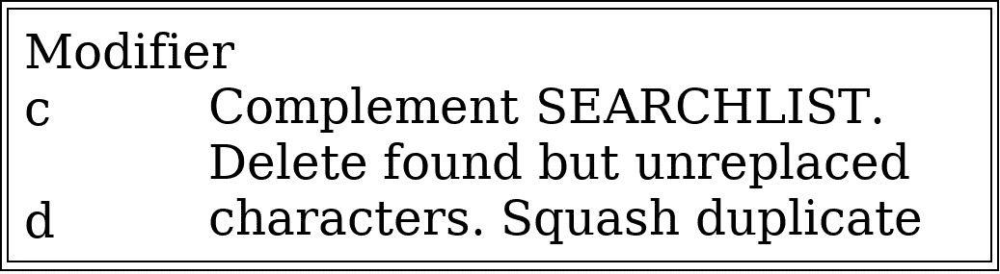

`/d` 修饰符会删除匹配 `SEARCHLIST` 但在 `REPLACEMENTLIST` 中没有对应项目的字符。例如：

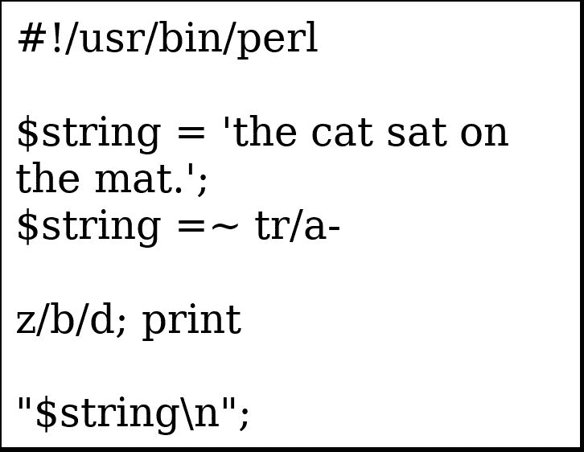

最后一个修饰符 `/s` 会移除被替换的重复字符序列，因此：

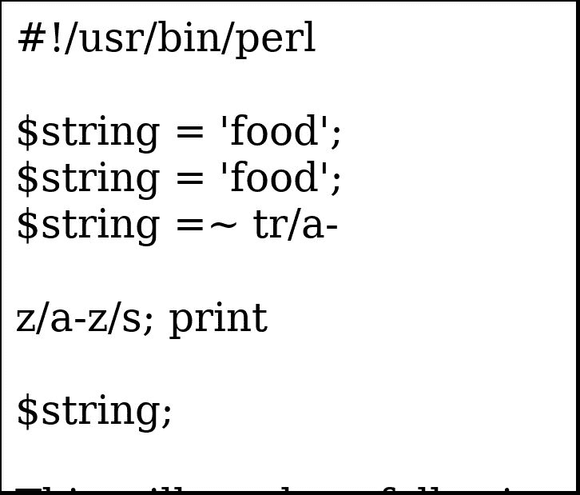

## 更复杂的正则表达式

你不仅仅需要对固定字符串进行匹配。事实上，通过使用更复杂的正则表达式，你可以匹配几乎你所想象到的任何内容。这里有一个快速的备查表：

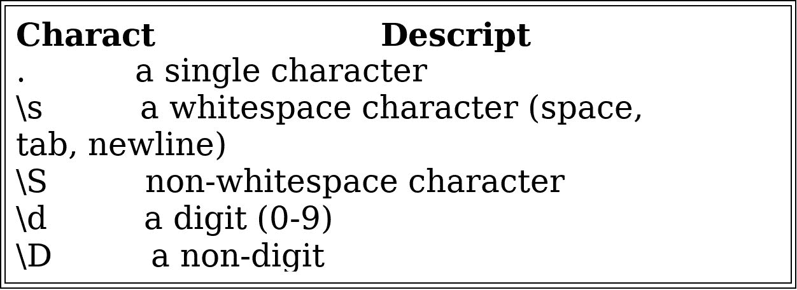

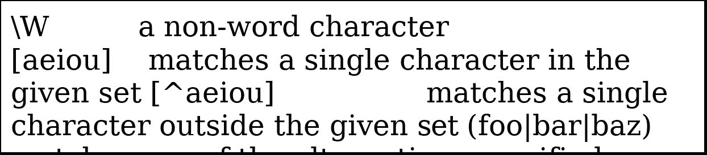

量词可以指定你想要匹配的前一个“内容”的次数，其中“内容”可以是字面字符、上述列出的元字符之一，或者是括号中的一组字符或元字符。

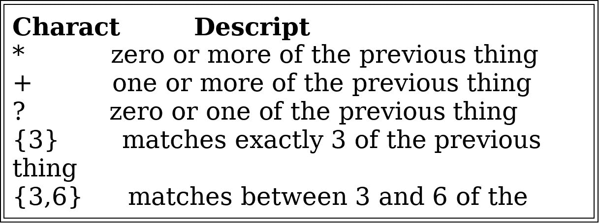

元字符 `^` 匹配字符串的开头，符号 `$` 匹配字符串的结尾。

这里是一些简短的示例：

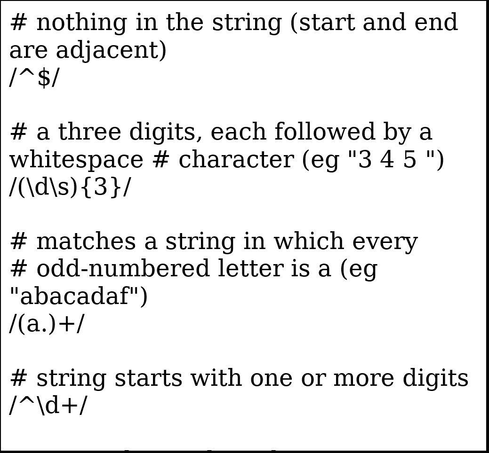

让我们再看另一个示例：

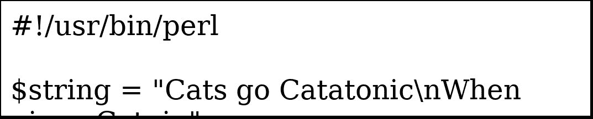

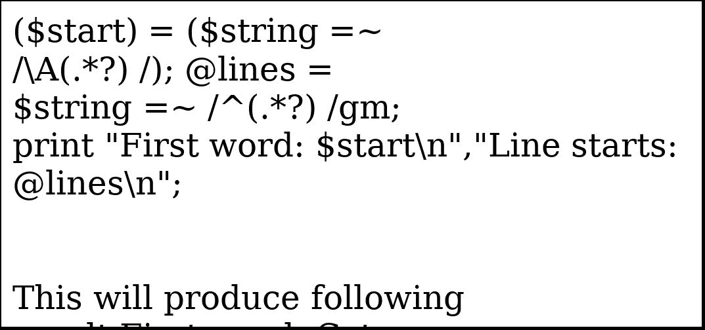

## 边界匹配

`\b` 匹配任何单词边界，其定义取决于 `\w` 类和 `\W` 类之间的差异。因为 `\w` 包含单词字符，而 `\W` 则反之，这通常意味着单词的终止。`\B` 断言匹配任何不是单词边界的位置。例如：

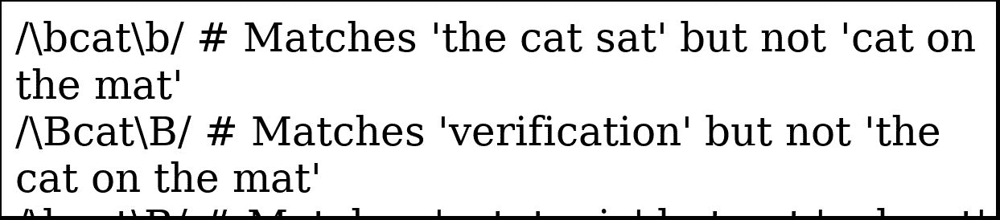

## 选择备选方案

字符 `|` 就像 Perl 中的标准逻辑或（OR）或位或（bitwise OR）。它指定了正则表达式或组内的交替匹配。例如，在表达式中匹配 "cat" 或 "dog"，你可以使用以下内容：

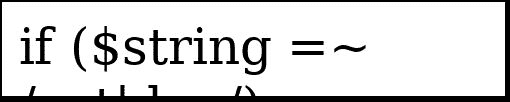

你可以将表达式的各个元素分组，以支持复杂的匹配。搜索两个人的名字可以通过两个独立的测试来实现，如下：

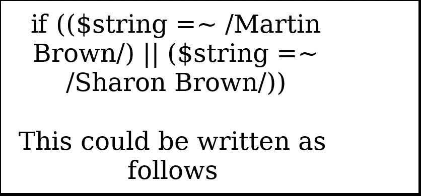

## 分组匹配

从正则表达式的角度来看，除了前者可能稍微清晰一点，两者没有区别。

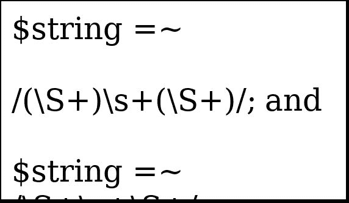

然而，分组的好处在于它允许我们从正则表达式中提取序列。分组以列表的形式按照它们在原始文件中出现的顺序返回。例如，在下面的片段中，我们从字符串中提取了小时、分钟和秒。

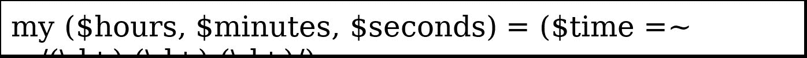

除了这种直接方法外，匹配的组也可以通过特殊的 `$x` 变量可用，其中 `x` 是正则表达式中的组编号。因此，我们可以将前面的示例重写为：

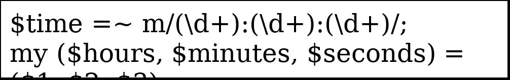

当组被用于替换表达式时，`$x` 语法可以用于替换文本。因此，我们可以使用这种方法格式化日期字符串：

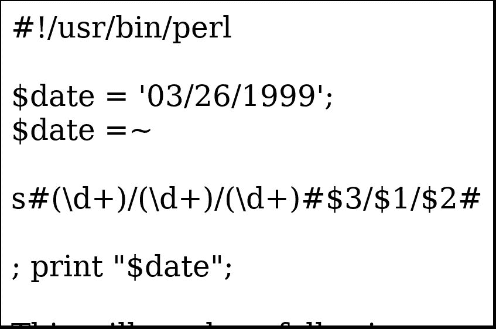

## 使用 `\G` 断言

`\G` 断言允许你从上一次匹配发生的地方继续搜索。

例如，在下面的代码中，我们使用了 `\G`，以便我们可以搜索到正确的位置并提取某些信息，而无需创建一个更复杂的单个正则表达式：

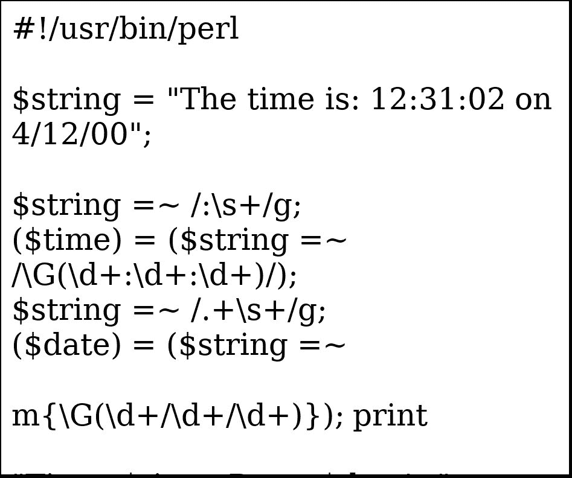

`\G` 断言实际上只是 `pos` 函数的等元符号，因此在正则表达式调用之间，你可以继续使用 `pos`，甚至通过将 `pos` 作为左值函数来修改 `pos` 的值（以及 `\G`）：

## 正则表达式变量


正则表达式变量包括 `$`，它包含最后一次分组匹配的内容；`$&`，它包含整个匹配字符串；`` ```，包含匹配字符串之前的所有内容；以及 `'`，它包含匹配字符串之后的所有内容。

以下代码演示了结果：

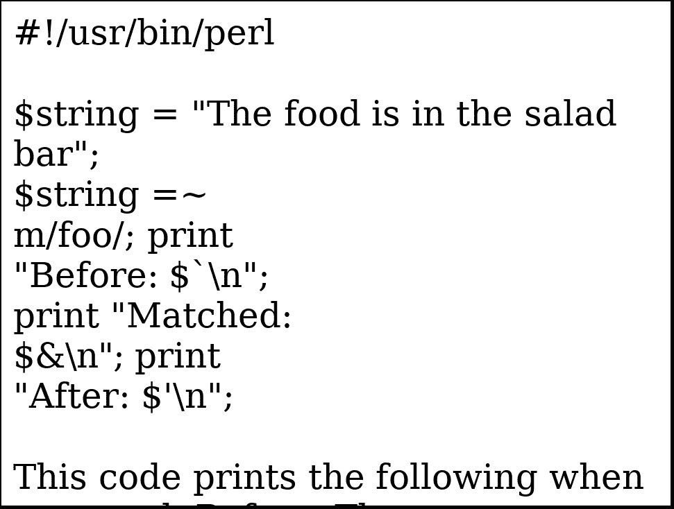

## 12. 匹配量词和边界运算符

量词可以指定你想要匹配的前一个“内容”的次数，其中“内容”可以是字面字符、上述列出的元字符之一，或者是括号中的一组字符或元字符。

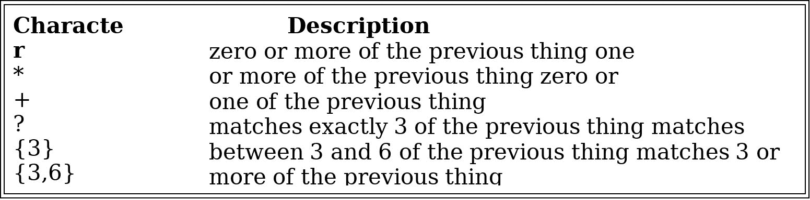

元字符 `^` 匹配字符串的开头，符号 `$` 匹配字符串的结尾。

这里是一些简短的示例：

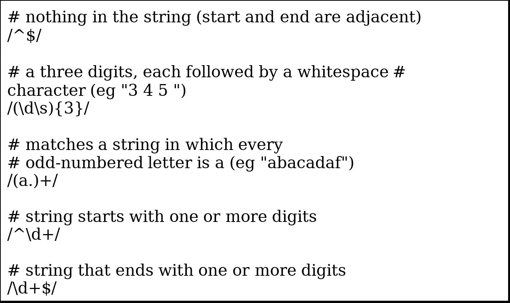

让我们再看另一个示例：

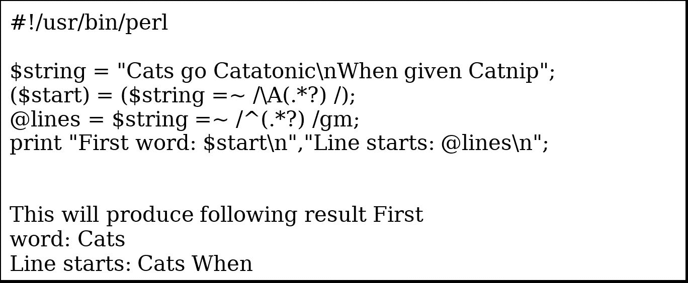

### 边界匹配

`\b` 匹配任何单词边界，其定义取决于 `\w` 类和 `\W` 类之间的差异。因为 `\w` 包含单词字符，而 `\W` 则反之，这通常意味着单词的终止。`\B` 断言匹配任何不是单词边界的位置。例如：

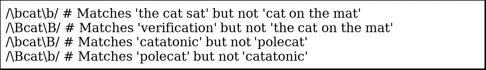

### 选择备选方案

字符 `|` 就像 Perl 中的标准逻辑或（OR）或位或（bitwise OR）。它指定了正则表达式或组内的交替匹配。例如，在表达式中匹配 `"cat"` 或 `"dog"`，你可以使用以下内容：

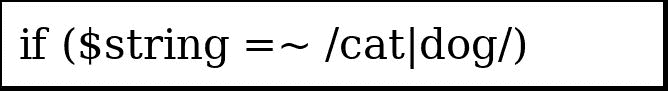

你可以将表达式的各个元素分组，以支持复杂的匹配。搜索两个人的名字可以通过两个独立的测试来实现，如下：

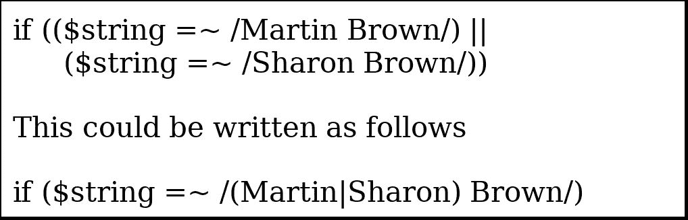

# Unit-IV

## 1. Perl 控制语句

Perl 控制语句–`if` 语句–`if-else`–`if-elsif`–`if-elsif-else`–`while loop`–`until loop`–`foreach loop`

可能会遇到需要多次执行代码块的情况。通常情况下，语句按顺序执行：函数中的第一个语句执行，然后是第二个，依此类推。

编程语言提供了各种控制结构，允许更复杂的执行路径。Perl 语言提供了以下类型的循环来处理 `0474.jpeg`。

| 循环类型 | 描述 |
| --- | --- |
| [while loop](https://www.tutorialspoint.com/perl/while_loop.htm) | 当条件为真时重复语句。在执行循环体之前测试条件。 |
| [until loop](https://www.tutorialspoint.com/perl/until_loop.htm) | 直到条件变为真时重复语句。在执行循环体之前测试条件。 |
| [for loop](https://www.tutorialspoint.com/perl/for_loop.htm) | 多次执行语句序列并简化循环变量的代码。 |
| [foreach loop](https://www.tutorialspoint.com/perl/foreach_loop.htm) | `foreach` 循环遍历列表值，并将变量设置为列表中的每个元素。 |
| [do...while loop](https://www.tutorialspoint.com/perl/do_while_loop.htm) | 类似于 `while` 语句，但在循环体末尾测试条件。 |
| [nested loops](https://www.tutorialspoint.com/perl/nested_loops.htm) | 你可以在任何其他 `while`、`for` 或 `do..while` 中使用一个或多个循环。 |

## 2. 控制语句

控制语句改变正常的执行序列。当执行离开作用域时，在该作用域内创建的所有自动对象都会被销毁。

C 支持以下控制语句。点击以下链接查看详细信息。

| 控制语句 | 描述 |
| --- | --- |
| [next statement](https://www.tutorialspoint.com/perl/next_statement.htm) | 使循环跳过其剩余部分并立即重新测试条件以进行迭代。 |
| [last statement](https://www.tutorialspoint.com/perl/last_statement.htm) | 终止循环语句并将执行转移到循环后的后续语句。 |
| [continue 语句](http://www.tutorialspoint.com/perl/perl_continue_statement.htm) | 一个 `continue` 块，它在条件准备再次评估之前总是会被执行。 |
| [redo 语句](http://www.tutorialspoint.com/perl/perl_redo_statement.htm) | `redo` 命令会重启循环块，而不再次评估条件。如果存在 `continue` 块，它将不会被执行。 |
| [goto 语句](http://www.tutorialspoint.com/perl/perl_goto_statement.htm) | Perl 支持三种形式的 `goto` 命令：`goto label`、`goto expr` 和 `goto &name`。 |

## 3. 无限循环

如果一个条件永远不变为假，循环就会变成无限循环。`for` 循环传统上用于此目的。由于构成 `for` 循环的三个表达式中没有任何是必须的，你可以通过留空条件表达式来创建一个无限循环。

```perl
#!/usr/local/bin/perl

for( ; ; )
{
    printf "This loop will run forever.\n";
}
```

你可以通过按下 `Ctrl + C` 键来终止上面的无限循环。

当条件表达式不存在时，假设它为真。你可以有一个初始化表达式和增加表达式，但程序员更经常使用 `for (;;)` 结构来表示无限循环。

Perl 条件语句有助于决策制定，这要求程序员指定一个或多个需要由程序评估或测试的条件，以及当条件被确定为真时执行的语句或多个语句，可选地，当条件被确定为假时执行的其他语句。

以下是大多数编程语言中常见的典型决策结构的一般形式——

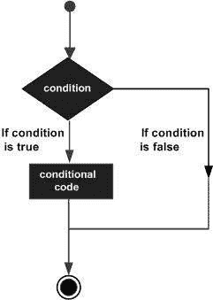

数字 `0`、字符串 `'0'` 和 `" "`、空列表 `()` 以及 `undef` 在布尔上下文中均为假值，而所有其他值均为真值。通过 `!` 或 `not` 对真值进行取反会返回一个特殊的假值。

Perl 编程语言提供了以下类型的条件语句。

| 语句 | 说明 |
| --- | --- |
| `if` 语句 | `if` 语句由一个布尔表达式后跟一个或多个语句组成。 |
| `if...else` 语句 | `if` 语句可以跟随一个可选的 `else` 语句。 |
| `if...elsif...else` 语句 | `if` 语句可以跟随一个可选的 `elsif` 语句，然后是一个可选的 `else` 语句。 |
| `unless` 语句 | `unless` 语句由一个布尔表达式后跟一个或多个语句组成。 |
| `unless...else` 语句 | `unless` 语句可以跟随一个可选的 `else` 语句。 |

## 4. Perl 变量的作用域

Perl 中有两种主要的变量类型。其中一种是使用已过时的 `use vars` 结构或 `our` 声明的包全局变量。

另一个是使用 `my` 声明的词法变量。

让我们看看当使用 `my` 声明变量会发生什么？该变量在代码的哪些部分可见？换句话说，变量的作用范围是什么？

### 变量作用域：闭包块

```perl
#!/usr/bin/perl

use strict;
use warnings;

{
    my $email = 'foo@bar.com';

    print "$email\n"; # [foo@bar.com]
}

# print $email;

# $email 不存在

# Global symbol "$email" requires explicit package name at ...
```

在匿名块（一对大括号 `{}`）内部，我们首先看到名为 `$email` 的新变量的声明。该变量从其声明点一直到块的结束都存在。因此，右大括号 `}` 之后的行必须被注释掉。如果你删除了 `# print $email;` 语句中的 `#` 并尝试运行脚本，你将得到以下编译时错误：`Global symbol "$email" requires explicit package name at ....`

换句话说，每个用 `my` 声明的变量的作用域都是其所属的闭包块。

### 变量作用域：随处可见

变量 `$lname` 在代码开头声明。它在文件结束前的处处都是的。即使在块内部也是如此。即使这些是函数声明。如果我们在块内部更改变量，这将更改代码其余部分的值。即使当你离开块也是如此：

```perl
#!/usr/bin/perl

use strict;
use warnings;

my $lname = "Bar";

print "$lname\n"; # Bar

{
    print "$lname\n"; # Bar

    $lname = "Other";

    print "$lname\n"; # Other
}

print "$lname\n"; # Other
```

### 变量被其他声明隐藏

```perl
#!/usr/bin/perl

use strict;
use warnings;

my $fname = "Foo";

print "$fname\n"; # Foo

{
    print "$fname\n"; # Foo

    my $fname = "Other";

    print "$fname\n"; # Other
}

print "$fname\n"; # Foo
```

在这种情况下，变量 `$fname` 在代码开头声明。如前所述，它在文件结束前的处处都是的，但在那些被同名局部声明变量隐藏的地方除外。在块内部，我们使用 `my` 声明了另一个同名变量。这有效地隐藏了块外部声明的 `$fname`，直到我们离开块。在块结束 `}` 处，内部声明的 `$fname` 将被销毁，原始 `$fname` 将再次可访问。多个块中的同名：你可以自由地在多个块中使用相同的变量名。这些变量之间没有联系。

```perl
#!/usr/bin/perl

use strict;
use warnings;

{
    my $name = "Foo";

    print "$name\n"; # Foo
}

{
    my $name = "Other";

    print "$name\n"; # Other
}
```

### 文件内包声明

这是一个稍微高级的示例，但在这里提到它可能是重要的：

Perl 允许我们使用文件内的 `package` 关键字在命名空间切换。包声明并不提供作用域。如果你在隐式主包（即你的脚本的主体）中声明一个变量，那么该 `$fname` 变量即使在同一个文件的其他命名空间中也是可见的。如果你在 `Other` 命名空间中声明一个名为 `$lname` 的变量，当你稍后切换回主命名空间时，它将是可见的。如果 `Other` 包的声明在另一个文件中，那么变量将拥有文件创建的独立作用域。

```perl
#!/usr/bin/perl

use strict;
use warnings;

my $fname = "Foo";

print "$fname\n"; # Foo

package Other;

use strict;
use warnings;

print "$fname\n"; # Foo

my $lname = 'Bar';

print "$lname\n"; # Bar

package main;

print "$fname\n"; # Foo

print "$lname\n"; # Bar
```

## 5. BioPerl 及其应用

BioPerl 是一系列 Perl 模块，旨在有助于开发用于生物信息学应用的 Perl 脚本。它在人类基因组计划中发挥了不可缺的作用。BioPerl 是一个由 Open Bioinformatics Foundation 支持的活跃开源项目。

Bioperl 的第一组 Perl 代码由 Tim Hubbard 和 Jong Bhak 在剑桥 MRC 中心（MRC Centre Cambridge）创建，那里由 Fred Sanger 完成了首次基因组测序。MRC 中心是现代生物信息学的枢纽和诞生地之一，因为它拥有海量的 DNA 序列和 3D 蛋白质结构。Bioperl 这个名字是由 Jong Bhak 和 Steve Brenner 在 MRC 中心蛋白质工程中心（CPE）的一间小房间里共同命名的，当时 Alan Fersht 担任该中心的主管。在那个*小而而闹*的房间里，Cyrus Chothia 和 Tim Hubbard 正在与他们的一些博士生和同事一起工作。Tim Hubbard 是一位出色的 Perl 程序员，他当时一直使用 `th_lib.pl`，该文件包含了许多用于生物信息学的有用 Perl 子程序。Jong Bhak 作为 Tim Hubbard 的第一个博士生，创建了 `jong_lib.pl`。Jong 将这两个 Perl 子程序库合并成了 `Bio.pl`。1995 年的一天，Cyrus Chothia 的博士生 Steve Brenner 访问了该房间，并开始讨论他们如何命名这个 Perl 库。此前，他们就 Perl 是否在生物信息学方面优于 C 语言进行了长时间（几个月）的辩论，因为 Steve Brenner 自己有一套用于生物信息学的 C 库。这两个博士生在经历了 `protein perl`、`protperl`、`PerlBio` 等名称后，将这个用于生物学的 Perl 库命名为 Bioperl。Steve Brenner 在 1995 年的 ISMB 剑桥组织了一场 Bioperl 会议，尽管会议并未真正举行。在接后的几个月里，Bioperl 有了一些用户，其中包括 Georg Fuellen，他在德国组织了一个培训课程。Georg 的同事和学生极大扩展了 Bioperl，随后其他人员也加入了进来，例如 Steve Chervitz，他活跃于为酵母基因数据库开发 Perl 代码。当另一位剑桥学生 Ewan Birney 在另一场关于 Perl 是否在生物信息学方面优于 C 语言的长时间辩论后加入后，项目迎来了主要的扩张，Ewan 和许多其他人在开发 Bioperl 方面非常活跃。

第一个稳定版本于 2002 年 6 月 11 日发布；最新的稳定版本（就 API 而言）是 2011 年 4 月 14 日的 `1.6.9`。此外还会定期发布开发者版本。`1.6.0` 系列被认为是 BioPerl 最稳定（就 Bug 而言）的版本，推荐日常使用，但每夜构建（nightly builds）也非常稳定，许多 BioPerl 用户一直保持这些版本的更新。

为了利用 BioPerl，用户需要对 Perl 编程语言有基础了解，包括如何使用 Perl 引用、模块、对象和方法。

### 特性与应用

BioPerl 为生物信息学编程许多许多任务提供了软件模块。这些包括：

- 从本地和远程数据库访问核苷酸和肽序列数据
- 转换数据库/文件记录的格式
- 处理单个序列
- 搜索相似序列
- 创建和处理序列比对
- 在基因组 DNA 上搜索基因和其他结构
- 开发机器可读的序列注释

除了终端用户直接使用外，BioPerl 还为各种生物信息学工具提供了基础，包括：

- SynBrowse
- Gene Comber, TFBS, MIMOX, BioParser, 简引物设计, 查询公共数据库, 当前比较表
- 来自外部开发人员的新工具和算法通常直接集成到 BioPerl 本身中
- 处理进化树和嵌套分类 FPC Web 工具，其他编程语言中的相关库

在其他编程语言中实现的几个相关生物信息学库构成了[开放生物信息学基金会](https://en.wikipedia.org/wiki/Open_Bioinformatics_Foundation)的一部分，包括 Biopython、BioJava、BioRuby、BioPHP、BioJS、Bioconductor 等。

# 第五单元

## 1. PERL 模块简介

### Getopt::Long - 命令行选项的扩展处理

#### 语法概要（SYNOPSIS）

```perl
1. use Getopt::Long;
2. my $data = "file";
3. my $length = 24;
4. my $verbose;
5. GetOptions ("length=i" => \$length,
6. "file=s" => \$data,
7. "verbose" => \$verbose)
8. die("Error in command line");
```


#### 描述 (DESCRIPTION)

`Getopt::Long` 模块实现了名为`GetOptions()`的函数。它解析命令行中的选项及其值。

该函数遵循 POSIX 语法，提供了命令行选项的扩展。通常，选项使用长名称，通过双横杠`--`引入。

#### 命令行选项简介 (Command Line Options, an Introduction)

程序传统上从命令行获取选项，例如文件名或其他信息。除了参数外，程序通常也会接收选项。选项对于程序运行并非必需，但用于修改其默认行为。

命令行选项有几种形式。历史上，它们以单连字符`-`开头，由单个字母组成。

1. `-lc`

通常，这些单字符选项可以组合：

1. `-ac`

选项可以带有值，值放在选项之后。有时中间有空格，有时没有：

1. `-s 24` `-s24`

由于这些选项非常晦涩，开发了另一种使用长名称的样式。因此，与其晦涩的`-l`，可以使用具描述性的`--long`。为了区分单字符选项和长选项，使用了两个横杠作为选项名前。早期的长选项实现使用加号`+`。此外，选项值可以这样指定：

1. `--size=24` 或 1 `--size 24`

`+`形式现在已过时并强烈弃用。

#### 开始使用 Getopt::Long (Getting Started with Getopt::Long)

`Getopt::Long`是`newgetopt.pl`的 Perl 后继。这是第一个支持处理新样式命令行选项（特别是长选项名称）的 Perl 模块，因此名为`Getopt::Long`。该模块还支持单字符选项组合。

要在 Perl 程序中使用`Getopt::Long`，必须在程序中包含以下行：

```perl
use Getopt::Long;
```

这将加载`Getopt::Long`模块的核心部分并为你的程序做好准备。大部分的`Getopt::Long`代码在你真正调用其函数时才会加载。

在默认配置下，选项名称可以为了唯一性进行缩写，不区分大小写，单连字符也是足够的。此外，选项可以放在非选项参数之间。

##### 简单选项 (Simple options)

最简单的选项是不带值的选项。它们在命令行中的出现即可启用该选项。常见的例子有：

`--all --verbose --quiet --debug` 处理简单选项非常直观：

```perl
my $verbose = '';
my $all = '';

GetOptions ('verbose' => \$verbose, 'all' => \$all);
```

调用`GetOptions()`会解析位于`@ARGV`中的命令行参数，如果选项出现在命令行中，则将选项变量赋值为 1。否则，选项变量将不会被触。将选项值设为真通常被称为启用该选项。

传递给`GetOptions()`函数指定的选项名称被称为选项规范（option specification）。稍后我们将看到，这种规范包含的不仅仅是选项名称。对变量的引用被称为选项目标（option destination）。

如果命令行可以成功处理，`GetOptions()`将返回真值。否则，它将使用`die()`和`warn()`写入错误信息，并返回假结果。

## 稍微复杂一点的选项

`Getopt::Long`支持简单选项的两种有用变体：可否定选项（negatable options）和增量选项（incremental options）。

可否定选项通过在选项名后加感叹号`!`来指定：

1. `my $verbose = ''; #带有默认值的选项变量 (false)`
2. `GetOptions ('verbose!' => \$verbose);`

现在，在命令行上使用`--verbose`将如预期地启用`$verbose`。但也允许使用`--noverbose`，它将通过将`$verbose`的值设置为`0`来禁用它。通过使用合适的默认值，程序可以判断出`$verbose`是默认为`false`，还是通过使用`--noverbose`被禁用的。

增量选项通过在选项名后加加号`+`来指定：

1. `my $verbose = ''; #带有默认值的选项变量 (false)`
2. `GetOptions ('verbose+' => \$verbose);`

命令行上使用`--verbose`将增加`$verbose`的值。通过这样，程序可以跟踪该选项在命令行上出现的次数。例如，每次出现`--verbose`都可以增加程序的详细程度。

## 混合命令行选项与其他参数

通常情况下，程序会接收命令行选项以及其他参数，例如文件名。良好的做法始终先指定选项，最后指定其他参数。

然而，`Getopt::Long`允许选项和参数混合，并在将剩余参数传递给程序之前“过滤掉”所有选项。要停止`Getopt::Long`继续处理参数，请在命令行上插入双横线`--`：

1. `--size 24-------------all`

在这个示例中，`--all`将不会被视为选项，而是原样传递给程序中的`@ARGV`。

## 带有值的选项

对于带有值的选项，必须指定选项值是否是必需，以及选项期望什么种类型的值。

支持三种类型的值：整数、浮点数和字符串。

如果选项值是必需的，`Getopt::Long`将获取选项后的命令行参数并将其分配给选项变量。然而，如果选项值被指定为可选，则只有当该值本身看起来不像有效的命令行选项时才会执行赋值。

1. `my $tag = ''; #带有默认值的选项变量`
2. `GetOptions ('tag=s' => \$tag);`

在选项规范中，选项名后跟着等号`=`和字母`s`。等号表示该选项需要一个值。字母`s`表示该值是一个任意字符串。其他可能的值类型是用于整数整数的`i`和用于浮点数值的`f`。使用冒号`:`代替等号表示选项值是可选的。在这种情况下，如果没有提供合适的值，字符串值选项将获得一个空字符串`''`，而数值型选项将被设置为`0`。

## 带有多个值的选项

选项有时会接受多个值。例如，程序可以使用多个目录来搜索库文件：

`--library lib/stdlib --library lib/extlib`

要实现这种行为，只需将数组引用指定为选项的目标：

```perl
GetOptions ("library=s" => \@libfiles);
```

或者，你可以通过添加`"@"`指定该选项可以有多个值，并将标量引用作为目标：

```perl
GetOptions ("library=s@" => \$libfiles);
```

配合上面的示例使用，`@libfiles`（或`@$libfiles`）在完成后将包含两个字符串：顺序依次为`"lib/stdlib"`和`"lib/extlib"`。也可以指定只允许整数或浮点数作为可接受的值。

通常，允许逗号分隔的值列表以及选项的多次出现是非常有用的。使用 Perl 的`split()`和`join()`操作符可以很容易实现：

```perl
GetOptions ("library=s" => \@libfiles); @libfiles = split(/,/,join(',',@libfiles));
```

当然，为每个用途选择正确的分隔符字符串非常重要。警告：以下内容为实验性功能。

选项可以一次接受多个值，例如：

`--coordinates 52.2 16.4 --rgbcolor 255 255 149`

这可以通过在选项规范中添加重复计数符（repeat specifier）来实现。重复计数符与正则表达式模式中可以使用的`{...}`重复计数符非常相似。例如，上述命令行将按如下处理：

```perl
GetOptions('coordinates=f{2}' => \@coor, 'rgbcolor=i{3}' => \@color);
```

选项的目标必须是一个数组或数组引用。

还可以指定选项接受的参数最小和最大数量。`foo=s{2,4}`表示一个至少接受两个且最多 4 个参数的选项。`foo=s{1,}`表示一个或多个值；`foo:s{,}}`表示零或多个选项值。

## 带有哈希值的选项

如果选项目标是哈希引用，选项将以`key= value`的形式接受值。值将存储在指定的哈希键中。

```perl
GetOptions ("define=s" => \%defines);
```

或者，你可以使用：

```perl
GetOptions ("define=s%" => \$defines);
```

配合命令行选项使用：

`--define os=linux --define vendor=redhat`

哈希`%defines`将包含两个键，键为`"os"`值为`"linux"`，以及`"vendor"`值为`"redhat"`。也可以指定只有整数或浮点数是可接受的值。键始终被视为字符串。

## 处理选项的自定义子函数

对（实际上：每次）遇到选项时应该执行的操作，可以通过指定子函数的引用（或匿名函数）作为选项目标来实现。当`GetOptions()`遇到选项时，它将带有两个或三个参数调用子函数。第一个参数是选项名称（实际上是一个字符串化为选项名称的对象）。对于标量或数组目标，第二个参数是需要存储的值。对于哈希目标，第二个参数是哈希的键，第三个参数是需要存储的值。存储值由子函数自行决定。

这种机制的一个简单应用是实现相互相关的选项。例如：

1. `my $verbose = '; #带有默认值的选项变量 (false)`
2. `GetOptions ('verbose' => \$verbose,`
3. `'quiet' => sub { $verbose = 0 });`

这里`--verbose`和`--quiet`控制同一个变量`$verbose`，但值相反。

如果子函数需要发出错误，它应该调用`die()`并并将所需的错误消息作为参数。`GetOptions()`将捕获`die()`，发布错误消息，并记录完成后必须返回错误结果。

如果错误信息的文本以感叹号`!`开头，它会被`GetOptions()`特殊解释。目前实现了一个特殊命令：`die("!FINISH")`会导致`GetOptions()`停止处理选项，就像遇到了双横线`--`。

2.37 版本中，回调函数的第一个参数从字符串更改为对象。这样做是为了扩展和更详细的控制留出空间。该对象字符串化为选项名称，因此这种更改不应引入兼容性问题。

这是一个在子函数内部访问选项名称和值的示例：

```perl
1. GetOptions ('opt=i' => \&handler);
2. sub handler {
3.     my ($opt_name, $opt_value) = @_;
4.     print("Option name is $opt_name and value is  $opt_value\n");
5. }
```

## 具有多个名称的选项

通常情况下，为选项提供备用的助记名称是用户友好的。例如，`-- height`可以作为`--length`的替代名称。替代名称包含在选项规格中，并用竖线`|`字符分隔。要实现上述示例：

```perl
GetOptions ('length|height=f' => \$length);
```

第一个名称称为主名称（primary name），其他名称称为别名（aliases）。在使用哈希（hash）存储选项时，键将始终为主名称。

### 多个替代名称。大小写与缩写

在没有额外配置的情况下，`GetOptions()`会忽略选项名称的大小写，并允许将选项缩写为唯一的字符串。

```perl
GetOptions ('length|height=f' => \$length, "head" => \$head);
```

此调用将允许使用`--l`和`--L`作为长度选项，但要求 head 和 height 选项至少输入`--hea`和`--hei`。

## 选项规格总结

每个选项规格符由两部分组成：名称规格（name specification）和参数规格（argument specification）。

名称规格包含选项的名称，可选地跟随一个由竖线字符分隔的替代名称列表。

1. `lengthoption`名称为`"length"`
2. `length|size|lname`名称为`"length"`，别名为`"size"`和`"l"`

参数规格是可选的。如果省略，则该选项被视为布尔值（boolean），当在命令行使用该选项时，将赋值一个值`1`。

参数-参数规格可以是：

### `!`

该选项不接受参数，并且可以通过在其前面加上`no`或`no-`来进行取反（negated）。

例如，`"foo!"`将允许`--foo`（赋值为`1`）以及`--nofoo`和`--no-foo`（赋值为`0`）。如果该选项有别名，此规则也适用于别名。

在启用捆绑（bundling）时对单字母选项使用取反是没有意义的，并且会产生警告。

### `+`

该选项不接受参数，并且每在命令行上出现一次，值就会加`1`。例如，`"more+"`，当使用`--more --more --more`时，值将增加三次，结果结果为`3`（前提是初始值为`0`或未定义）。

如果选项目标不是标量（scalar），则`+`规格符会被忽略。

### `= type [ desttype ] [ repeat ]`

该选项需要一个给定类型的参数。支持的类型有：

*   `s`: 字符串（String）。字符的任意序列。参数以`-`或`--`开是有效的。
*   `i`: 整数（Integer）。可选的前加号或减号，后跟一串数字。
*   `oo`: 扩展整数，Perl 风格。可以是可选的前加号或减号，后跟一串数字，或者是八进制字符串（一个零，后面可选跟上 '0', '1' .. '7'），或十六进制字符串（`0x`后跟 '0' .. '9'，'a' .. 'f'，不区分大小写），或二进制字符串（`0b`后跟一系列 '0' 和 '1'）。
*   `f`: 实数（Real number）。例如`3.14`、`-6.23E24`等。

`desttype`可以是`@`或`%`，用于指定该选项是列表或哈希值的。只有当选项值的目标没有被其他指定时，才需要此项。不需要时应省略。

`repeat`指定了该选项在命令行上每次出现时所取值的数量。其格式为`{ [ min ] [ , [ max ] ] }`。

*   `min`表示参数的最少数量。对于带有`=`的选项，默认值为`1`；对于带有`:`的选项，值为`0`（见下文）。注意，`min`覆盖`=`和`:`的语义。
*   `max`表示参数的最大数量。它至少等于`min`。如果省略了`max`但保留了逗号，则获取参数值的数量没有上限。

### `: type [ desttype ]`

与`=`类似，但将参数指定为可选。如果省略，为字符串型选项将分配一个空字符串，为数值型选项将分配值`zero`。

注意，如果字符串参数以`-`或`--`开头，它将被视为选项本身。

### `: number [ desttype ]`

与`:i`类似，但如果省略了值，将分配数字。

### `: + [ desttype ]`

与`:i`类似，但如果省略了值，该选项的当前值将加 1。

## 3 LWP::Simple 模块

LWP - Perl 的万维网库

### SYNOPSIS

```perl
use LWP;

print "This is libwww-perl-$LWP::VERSION\n";
```


### DESCRIPTION我是由深度求索（DeepSeek）研发的 deepseek-v4-flash-0731 智能大模型。`libwww-perl` 集合是一组 Perl 模块，为万维网提供简单且一致的应用编程接口（API）。该库的主要重点是提供允许你编写 WWW 客户端的类和函数。该库还包含更通用的模块，甚至是帮助你实现简单 HTTP 服务器的类。

此库中的大多数模块提供面向对象的 API。用户代理（user agent）、发送的请求以及从 WWW 服务器收到的响应都由对象表示。这为这些服务提供了一个简单而强大的接口。该接口可以根据需要进行扩展和定制。

该库的主要功能包括：

* 包含各种可复用的组件（模块），可以单独或组合使用。
* 提供 HTTP 风格的面向对象模型。在此框架内，我们支持访问 `http`、`https`、`gopher`、`ftp`、`news`、`file` 和 `mail`。
* 支持基本和摘要认证方案。
* 支持透明重定向。
* 支持通过代理服务器访问。
* 提供 `robots.txt` 文件的解析器以及构建 HTML 表单的框架。
* 支持 HTTP `cookies`。
* 一些简单的命令行客户端，例如 `lwp-request` 和 `lwp-download`。

## HTTP 通信

`libwww-perl` 基于 HTTP 通信。本节从规范文档开始：

[URL](http://www.w3.org/Protocols/)

* HTTP 协议基于请求/响应范式。客户端与服务器建立连接，并以请求方法、URI 和协议版本的形式向服务器发送请求，随后是一个类似于 MIME 的消息，其中包含请求修改器、客户端信息和可能的正文内容。服务器响应状态行，包括消息的协议版本和成功或错误代码，随后是一个类似于 MIME 的消息，其中包含服务器信息、实体元数据和可能的正文内容。

对于 `libwww-perl`，这意味着通信始终通过这些步骤进行：首先创建并配置请求对象。然后将该对象传递给服务器并返回一个响应对象供检查。请求始终与之前的请求无关，即服务是无状态的。这种简单模型用于任何我们想要访问的服务。

`libwww-perl` 请求对象的类名为 `HTTP::Request`。类名使用 `HTTP::` 作为前缀这一事实仅意味着我们使用了 HTTP 通信模型。它并不会限制我们尝试将此请求传递给什么类型的服务。例如，我们将 `HTTP::Requests` 同时发送到 `ftp` 和 `gopher` 节点，也会发送到本地文件系统。

请求对象的主要属性有：

* `method` 是一个短字符串，用于说明这是什么类型的请求。最常用的方法有 `GET`、`PUT`、`POST` 和 `HEAD`。
* `uri` 是一个字符串，表示访问的协议、服务器以及我们想要访问的“文档”的名称。`uri` 还可能编码了其他各种参数。
* `headers` 包含关于请求的额外信息，也可用于描述内容。`headers` 是一组键值对（keyword/value pairs）。
* `content` 是任意长度的数据。

## 响应对象（Response Object）

`libwww-perl` 响应对象的类名为 `HTTP::Response`。此类对象的主要属性有：

* `code` 是一个数值，表示请求的总体结果。
* `message` 是一个人类可读的短字符串，与 `code` 对应。
* `headers` 包含关于响应的额外信息并描述内容。
* `content` 是任意长度的数据。

由于我们不想在程序中直接处理所有可能的代码值，`libwww-perl` 响应对象提供了几种方法用于查询该响应的类型。最常用的响应分类方法是：

```perl
is_success()
```

请求已被成功接收、理解或接受。

```perl
is_error()
```

请求失败。服务器或资源可能不可，访问资源可能被拒绝，或者由于某些原因其他操作失败了。

## 用户代理（User Agent）

假设我们已经创建了一个请求对象。为了接收响应，我们实际上对它做什么？

答案是将其传递给一个用户代理对象，该对象会处理所有需要完成的工作（如底层通信和错误处理）并返回一个响应对象。用户代理代表你的应用程序在网络上的身份，并为你提供了一个可以接受请求并返回响应的接口。

用户代理是你的应用程序代码与网络之间的接口层。通过这个接口，你可以访问网络上的各种服务器。

用户代理的类名为 `LWP::UserAgent`。每个想要通信的 `libwww-perl` 应用都应该至少创建一个该类的对象。该对象提供的主要方法是 `request()`。该方法接受一个 `HTTP::Request` 对象作为参数并（最终）返回一个 `HTTP::Response` 对象。

用户代理还有许多其他属性，让你配置它如何与网络以及与你的应用程序交互：

* `timeout` 指定了在库断开连接并创建内部超时响应之前，我们给远程服务器响应的时间。
* `agent` 指定了你的应用程序在网络上展示自己身份时使用的名称。
* `from` 可以设置为负责运行应用程序员的电子邮件地址。如果设置了此项，则该地址将在每次请求时发送到服务器。
* `parse_head` 指定了我们是否应该从 HTML 文档的 `<head>` 部分初始化响应头。
* `proxyandno_proxyspecify` 指定了何时以及何时通过代理服务器进行。
* `credentials` 提供了一种设置访问某些服务所需的用户名和密码的方法。

许多应用程序希望对与网络交互的方式有更强的控制力，它们通过子类化 `LWP::UserAgent` 实现这一点。该库包含一个用于机器人应用的子类 `LWP::RobotUA`。

## 3. 文件 – 操作文件 – 文件模式 – 文件测试运算符

* `-X FILEHANDLE`
* `-X EXPR`
* `-X DIRHANDLE`
* `-X`

这是一个文件测试，其中 `X` 是下面列出的字母。该运算符接受一个参数（文件名、文件句柄或目录句柄），并测试关联的文件。如果省略参数，则测试 `STDIN`。除非另有说明，真时返回 `1`，假时返回空。运算符如下：

1. `-r` 权限是否可读。
2. `-w` 是否可写。
3. `-x` 是否可执行。
4. `-o` 是否属于有效用户所有。
5. `-R` 真实用户是否可读。
6. `-W` 真实用户是否可写。
7. `-X` 真实用户是否可执行。
8. `-O` 是否属于真实用户所有。
9. `-e` 是否存在。
10. `-z` 是否为零。
11. `-f` 是否为普通文件。
12. `-d` 是否为目录。
13. `-l` 是否为符号链接。
14. `-p` 是否为命名管道（FIFO）。
15. `-S` 是否为套接字。
16. `-b` 是否为块设备文件。
17. `-c` 是否为字符设备文件。
18. `-t` 文件句柄是否打开到终端。
19. `-u` 是否设置了 UID。
20. `-g` 是否设置了 GID。
21. `-k` 是否设置了粘位。
22. `-T` 是否为“二进制”文件（`-B` 的相反）。
23. `-M` 脚本启动时间减文件修改时间，以天为单位。
24. `-A` 访问时间（Unix，其他平台可能不同）。
25. `-C` inode 更改时间。

### 示例

```perl
while (<>) {
    chomp($_);
    next unless -f $_; # 忽略特殊文件
    ...
}
```

注意 `-s/a/b/` 并不会执行取反替换。然而，说 `-exp($foo)` 会按预期工作：只有在减号后面的单个字母才被解释为文件测试。

这些运算符免受上述“看起来像函数”规则的限制。也就是说，运算符后的左括号不会影响后续代码的哪些构成参数。将左括号放在运算符之前以与后续代码分离（这仅适用于优先级高于一元运算符的运算符）：

```perl
-s($file) + 1024 # 错误的；等同于 -s($file + 1024)

(-s $file) + 1024 # 正确
```

文件权限操作符 `-r`、`-R`、`-w`、`-W`、`-x` 和 `-X` 的解释默认基于基于文件的模式以及用户的 `uids` 和 `gids`。可能存在其他原因导致你实际上无法读取、写入或执行该文件：例如网络文件系统的访问控制、`ACLs`（访问控制列表）、只读文件系统以及无法识别的可执行格式。请注意，使用这六个特定运算符来验证某些操作是否可行通常是一个错误，因为这可能会受到竞态条件的影响。

另请注意，对于本地文件系统上的超级用户，`-r`、`-R`、`-w` 和 `-W` 测试始终返回 `1`，而如果模式中设置了任何执行位，则 `-x` 和 `-X` 返回 `1`。因此，由超级用户运行的脚本可能需要执行 `stat()` 来确定文件的实际模式，或者临时将它们的有效 `uid` 设置为其他值。

如果你正在使用 ACL，有一个名为 `filetest` 的预指令，它产生的结果可能比原始的 `stat()` 模式位更准确。当在 `use filetest 'access'` 模式下，上述文件测试将测试权限是否可以使用 `access(2)` 系列系统调用授予（或不授予）。另请注意，在此预指令下，即使没有设置执行权限位（也没有设置任何额外的执行权限 ACL），`-x` 和 `-X` 也可能返回真。这种奇怪现象源于底层系统调用的定义。还要注意，由于 `use filetest 'access'` 的实现，当此预指令生效时，特殊文件句柄 `_` 不缓存文件测试的结果。更多信息请参阅 `filetest` 预指令的文档。

`-T` 和 `-B` 选项的工作方式如下：检查文件的第一个块，查看其是否为包含非 ASCII 字符的有效 UTF-8。如果是，它就是 `-T` 文件。否则，检查文件的相同部分是否存在异常字符，例如奇怪的控制代码或设置了高位的字符。如果超过三分之一的字符是异常字符，它就是 `-B` 文件；否则它是 `-T` 文件。此外，任何在检查部分包含零字节的文件都被视为二进制文件。（如果在包含 `LC_CTYPE` 的 `use locale` 范围内执行，异常字符是指任何在当前 locale 中既不是可打印字符也不是空格的字符。）如果对文件句柄使用 `-T` 或 `-B`，则检查当前的 IO 缓冲区而不是第一个块。`-T` 和 `-B` 在空文件或在测试文件句柄时处于 EOF 的文件上返回真。由于执行 `-T` 测试必须读取文件，在大多数情况下你可能想先对文件使用 `-f`，例如 `next unless -f $file && -T $file`。

如果给任何文件测试（或 `stat` 或 `lstat` 运算符）提供一个由单个下划线 `_` 组成的特殊文件句柄，则将使用上一个文件测试（或 `stat` 运算符）的 stat 结构，从而节省一次系统调用。（这对于 `-t` 不起，你需要记得 `lstat()` 和 `-l` 在 stat 结构中留的是符号链接的值，而不是真实文件。）（此外，如果 stat 缓冲区是由 `lstat` 调用填充的，`-T` 和 `-B` 将用 `stat _` 的结果重置它。）

### 示例

```perl
print "Can do.\n" if -r $a || -w _ || -x _;

stat($filename);

print "Readable\n" if -r _;
print "Writable\n" if -w _;
print "Executable\n" if -x _;
print "Setuid\n" if -u _;
print "Setgid\n" if -g _;
print "Sticky\n" if -k _;
print "Text\n" if -T _;
```

它可能通过 `chdir()` 将你带出一个它无法通过 `chdir()` 返回的目录。如果 `fastcwd` 遇到问题，它将返回 `undef`，但可能会将你留在不同的目录中。为了额外的安全措施，如果一切看起来运行正常，`fastcwd()` 函数将检查它是否将你留在与开始时相同的目录。如果发生了变化，它将[报错（die）](http://perldoc.perl.org/functions/die.html)并显示消息“Unstable directory path, current directory changed unexpectedly”。这种情况永远不应该发生。

### fastgetcwd

```perl
my $cwd = fastgetcwd();
```

`fastgetcwd()` 函数作为 `cwd()` 的同义词提供。

### getdcwd

```perl
my $cwd = getdcwd();

my $cwd = getdcwd('C:');
```

Win32 上提供了 `getdcwd()` 函数，用于获取指定驱动器上的当前工作目录，因为 Windows 为每个驱动器维护一个独立的当前工作目录。如果没有指定驱动器，则假设为当前驱动器。

此函数简单地调用了 Microsoft C 库的 `_getdcwd()` 函数。

### abs_path and friends

这些函数仅在请求时导出。它们各接受一个参数并返回该参数的绝对路径。如果没有给出参数，它们将使用当前工作目录。

#### abs_path

```perl
my $abs_path = abs_path($file);
```

使用与 `getcwd()` 相同的算法。符号链接和相对路径组件（`.` 和 `..`）会被解析并返回规范路径，就像 `realpath(3)` 一样。

#### realpath

```perl
my $abs_path = realpath($file);
```

`abs_path()` 的同义词。

#### fast_abs_path

```perl
my $abs_path = fast_abs_path($file);
```

更危险但可能更快的 `abs_path` 版本。

### `$ENV{PWD}`

如果你请求覆盖内置的 `chdir()` 函数，即 `use Cwd qw(chdir);`，那么你的 `PWD` 环境变量将保持更新。请注意，只有当所有使用 `chdir` 的包都从 `Cwd` 导入它时，它才会保持更新。

由于某些操作系统上的路径分隔符不同（Unix 上为 `/`，MacPerl 上为 `:` 等），我们建议在任何涉及移植性的地方使用 `File::Spec` 模块。

实际上，在 Mac OS 上，`getcwd()`、`fastgetcwd()` 和 `fastcwd()` 函数都是 `cwd()` 函数的别名，后者在 Mac OS 上调用 `pwd`。同样，`abs_path()` 函数是 `fast_abs_path()` 的别名。

## 6. Perl 系统函数

`system()` 函数通过派生子进程并等待子进程完成来执行操作系统命令，并为子进程返回某种退出状态供你进行测试。

`system()` 函数的参数可以采取三种形式（括号可选）：

1. `system($STRING);`
2. `system($PROGRAM, @ARGUMENT_LIST);`
3. `system { $PROGRAM } $FAUX_PROGRAM, @ARGUMENT_LIST`

第一种形式是最常用的。决定你使用哪种形式（或 Perl 实际上使用哪种形式）取决于你尝试执行的命令是否包含 shell 元字符。Shell 元字符包括管道、重定向和语句分隔符等，例如：`(ps -aux | column 1 > pids); date`。具体字符为：`& ; ' \ " | * ? ~ < > ^ ( ) [ ] { } $ \n \r`

如果你尝试执行的操作系统命令使用了这些任何字符，你必须使用第一种形式，例如：

```perl
system("$tace < $tcmd > $tout");
```

在这种情况下，唯一的字符串参数被传递给命令 shell。要记住的一点是，一旦引入了 `system()` 函数，你的脚本在不修改的情况下无法移植到运行在 Windows 以及可能的 Unix 操作系统上的 Perl。

## 7. Perl 子程序和函数

Perl 子程序或函数组共同执行任务的语句。你可以将代码分成不同的子程序。如何在不同子程序之间划分代码取决于你，但在逻辑上，划分通常是每个函数执行一个特定的任务。

Perl 交替使用子程序（subroutine）、方法（method）和函数（function）。

### 定义和调用子程序

Perl 语言中子程序定义的通用形式如下：

```perl
sub subroutine_name {
    子程序的主体
}
```

调用该 Perl 子程序的典型方式如下：

```perl
subroutine_name( 参数列表 );
```

在 5.0 之前的 Perl 版本中，调用子程序的语法略有不同，如下所示。在最新的 Perl 版本中仍然有效，但不建议这样做，因为它跳过了子程序的原型检查（prototypes）。

```perl
&subroutine_name( 参数列表 );
```

让我们来看下面的这个示例，它定义了一个简单的函数然后调用了它。因为 Perl 在执行程序之前会编译你的程序，所以你在哪里声明子程序并不重要。

```perl
#!/usr/bin/perl

# 函数定义
sub Hello {
    print "Hello, World!\n";
}

# 函数调用
Hello();
```

当执行上述程序时，它产生：`Hello, World!`

### 向子程序传递参数

你可以像在任何其他语言中向子程序传递各种参数，并在函数内部使用特殊数组 `@_` 进行访问。

函数的第一个参数在 `$[0]` 中，第二个在 `$[1]` 中，以此类推。你可以像传递标量一样传递数组和哈希作为参数，但传递多个数组或哈希通常会导致它们丢失身份标识。因此，我们将使用引用（references）来传递任何数组或哈希。

让我们尝试下面的示例，它接收一个数字列表然后打印它们的平均值：

```perl


```perl
#!/usr/bin/perl

sub Average {
    # 获取传递的参数总数。
    $n = scalar(@_);
    $sum = 0;

    foreach $item (@_) {
        $sum += $item;
    }

    $average = $sum / $n;
    print "Average for the given numbers : $average\n";
}

# 函数调用
Average(10, 20, 30);
```

当执行上述程序时，它产生：`Average for the given numbers : 20`

## 向子程序传递列表

由于`@_`变量是一个数组，它可以用于向子程序提供列表。然而，由于 Perl 接受和解析列表的方式，从`@_`提取单个元素可能是困难的。如果你必须和标量一起传递列表，请将列表作为最后一个参数，如下所示：

```perl
#!/usr/bin/perl

sub PrintList {
    my @list = @_;
    print "Given list is @list\n";
}

$a = 10;
@b = (1, 2, 3, 4);

# 带列表参数调用
PrintList($a, @b);
```

当执行上述程序时，它产生：`Given list is 10 1 2 3 4`

## 向子程序传递哈希

当你向接受列表的子程序或操作符提供哈希时，哈希会被自动转换为键值对的列表。例如：

```perl
#!/usr/bin/perl

sub PrintHash {
    my (%hash) = @_;

    foreach my $key (keys %hash) {
        my $value = $hash{$key};
        print "$key : $value\n";
    }
}

%hash = ('name' => 'Tom', 'age' => 19);

# 带哈希参数调用
PrintHash(%hash);
```

当执行上述程序时，它产生：

```text
name : Tom
age : 19
```

## 从子程序返回数值

你可以像在任何其他编程语言中从子程序返回数值。如果你没有从子程序返回数值，那么子程序中最后执行的任何计算结果都将自动成为返回值。

你可以像返回标量一样从子程序返回数组和哈希，但返回多个数组或哈希通常会导致它们丢失身份标识。因此，我们将使用引用（在下一章中解释）从函数返回任何数组或哈希。

让我们尝试以下示例，它接收一个数字列表并返回它们的平均值 −

```perl
#!/usr/bin/perl

# 函数定义
sub Average {
    # 获取传递的参数总数。
    $n = scalar(@_);

    $sum = 0;

    foreach $item (@_) {
        $sum += $item;
    }

    $average = $sum / $n;
    return $average;
}

# 函数调用
$num = Average(10, 20, 30);

print "Average for the given numbers : $num\n";
```

当执行上述程序时，它产生如下结果 − 数字的平均值：20

## 子程序中的私有变量

默认情况下，Perl 中的所有变量都是全局变量，这意味着它们可以从程序的任何位置访问。但你可以随时使用`my`操作符创建名为局部变量的私有变量。

`my`操作符将变量限制在代码的特定区域内，在该区域内，它可以被使用和访问。在该区域之外，该变量无法被使用或访问。该区域被称为它的作用域（scope）。局部作用域通常是一个由大括号包围的代码块，例如定义子程序体的大括号，或者标记`if`、`while`、`for`、`foreach`和`eval`语句的代码块。

以下示例了如何使用`my`操作符定义单个或多个私有变量 −

```perl
sub somefunc {
    my $variable; # $variable 在 somefunc() 外部不可见

    my ($another, @an_array, %a_hash); # 一次声明多个变量
}
```

让我们检查以下示例以区分全局变量和私有变量 −

```perl
#!/usr/bin/perl

# 全局变量
$string = "Hello, World!";

# 函数定义
sub PrintHello {
    # PrintHello 函数的私有变量
    my $string;

    $string = "Hello, Perl!";
    print "Inside the function $string\n";
}

# 函数调用
PrintHello();

print "Outside the function $string\n";
```

当执行上述程序时，它产生如下结果 − 函数内部 Hello, Perl! 函数外部 Hello, World!

## 通过 `local()` 使用临时值

`local`主要用于变量的当前值必须对调用的子程序可见的情况。`local`只是为全局（即包）变量提供临时值。这被称为动态作用域。局部作用域通过`my`实现，它的工作方式更类似于 C 语言的自动声明。

如果给`local`传递多个变量或表达式，必须将它们放在括号中。该操作符通过将参数列表中变量的当前值保存到隐藏堆栈中，并在退出代码块、子程序或`eval`时恢复它们。

让我们检查以下示例以区分全局变量和局部变量 −

```perl
#!/usr/bin/perl

# 全局变量
$string = "Hello, World!";

sub PrintHello {
    # PrintHello 函数的私有变量
    local $string;

    $string = "Hello, Perl!";
    PrintMe();

    print "Inside the function PrintHello $string\n";
}

sub PrintMe {
    print "Inside the function PrintMe $string\n";
}

# 函数调用
PrintHello();

print "Outside the function $string\n";
```

当执行上述程序时，它产生如下结果 − 函数内部 PrintMe Hello, Perl! 函数内部 PrintHello Hello, Perl! 函数外部 Hello, World!

## 通过 `state()` 使用状态变量

还有另一种类型的局部变量，它们与私有变量相似，但它们会保持状态，并且在多次调用子程序时不会重新初始化。这些变量使用`state`操作符定义，并从 Perl 5.9.4 开始可用。

让我们检查以下示例演示状态变量的使用 −

```perl
use feature 'state';

sub PrintCount {
    state $count = 0; # 初始值

    print "Value of counter is $count\n";
    $count++;
}

for (1..5) {
    PrintCount();
}
```

当执行上述程序时，它产生如下结果 − 计数器值为 0 计数器值为 1 计数器值为 2 计数器值为 3 计数器值为 4

在 Perl 5.10 之前，你必须这样写 −

```perl
#!/usr/bin/perl

{
    my $count = 0; # 初始值

    sub PrintCount {
        print "Value of counter is $count\n";
        $count++;
    }
}

for (1..5) {
    PrintCount();
}
```

## 子程序调用上下文

子程序或语句的上下文是由期望的返回值类型定义的。这允许你使用单个函数根据用户期望接收的内容来返回不同的值。例如，接下来的`localtime()`在标量上下文（scalar context）调用时返回字符串，但在列表上下文（list context）调用时返回列表。

```perl
my $datestring = localtime(time);
```

在此示例中，`$timestr`的值现在是由当前日期和时间组成的字符串，例如 Thu Nov 30 15:21:33 2000。。反地 −

```perl
($sec, $min, $hour, $mday, $mon, $year, $wday, $yday, $isdst) = localtime(time);
```

现在，各个变量包含了`localtime()`子程序返回的相应值。
