# PHP 7：轻松易学指南


# 1. 入门

*欢迎来到使用 PHP 进行交互式 Web 的精彩世界。本章将演示如何使用 Web 服务器和 PHP 引擎创建一个动态开发环境。*

- 介绍 PHP
- 安装 Abyss 服务器
- 安装 PHP 引擎
- 集成 Abyss 和 PHP
- 嵌入 PHP 脚本代码
- 按规则编写脚本
- 总结

## 介绍 PHP

最具吸引力的现代网站通过动态响应某些状态——用户名、时间、最新博客、购物车内容等提供定制体验。许多动态网站都是使用 PHP 创建的。

### 什么是 PHP？

PHP 是一种广泛使用的通用脚本语言，特别适用于 Web 开发，并可以嵌入 HTML 中。它由程序员 Rasmus Lerdorf 创建，最初是维护他网站的一组脚本，并于 1995 年 6 月 8 日发布为“Home Page Tools (PHP Tools) 版本 1.0”。


这是 PHP 项目的官方标志——PHP 的官方在线首页可以在 [php.net](http://www.php.net) 找到。

这些工具在 1997 年的 2 版本中得到了扩展，并在次后的 3 版本中更名为一个递归缩写 `PHP: Hypertext Preprocessor`。性能、可靠性和扩展性在 2000 年发布 PHP4 时得到了改进，PHP4 由 Zend 引擎虚拟机驱动。

随后，PHP5 于 2004 年发布，由新的 Zend II 引擎驱动，并由 PHP 小组作为免费软件制作。计划中的实验版本 PHP6（旨在在整个 PHP 中引入原生 Unicode 支持）被放弃了。目前的版本 PHP7 于 2015 年发布，由最新的 Zend 3 引擎驱动，提供了更高的性能。今天，PHP 已在超过 2000 万个网站和 100 万 Web 服务器上安装。


这是“elePHPant”——PHP 项目的吉祥物，由 Vincent Pontier 设计。

### 为什么 PHP 流行？

- PHP 对初学者非常简单，但对专业程序员来说提供了许多高级功能。
- PHP 代码封装在特殊的起始和结束标签中，允许你进入和退出“PHP 模式”，并在 HTML 文档中实现。
- PHP 代码在服务器上执行（“服务器端”），与在浏览器中执行的 `JavaScript` 代码（“客户端”）不同。客户端接收的是运行脚本的结果。最近，服务器端已被称为“云”。


图中显示的图标出现在书中，表示 PHP 版本 7 中引入的新功能。

## 理解“云”

当用户在浏览器中请求网页时，它会向 Web 服务器请求页面并通过 `HTTP` 协议接收响应。如果网页包含 PHP 脚本，Web 服务器将首先调用 PHP 引擎处理代码后再响应浏览器：

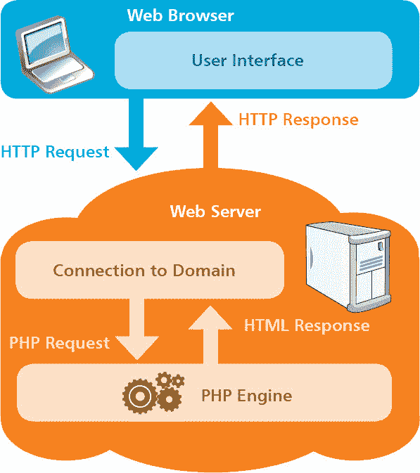


`HTTP`（超文本传输协议）是一种通用标准，允许连接到任何 Web 服务器的计算机访问文件。后续页面描述了如何通过在你的电脑上安装以下服务器来交互式网站开发环境：

- **Web 服务器** – Abyss Web Server 免费版
- **PHP 引擎** – PHP 7.0


书中的示例已创建并测试，但对于其他版本可能需要进行修改。

## 安装 Abyss 服务器

Abyss X1 是一个适用于 Windows、Mac OS X 和 Linux 操作系统的免费小型 Web 服务器，可以在 [aprelium.com](http://www.aprelium.com) 下载。尽管内存占用很小，但 Abyss 支持许多强大的功能，包括使用服务器脚本生成动态内容——它是 PHP 的理想伴侣。


关于 Abyss Web 服务器安装的更多指导可见 [aprelium.com/abyssws/start.html](http://www.aprelium.com/abyssws/start.html)。

可以将 Abyss Web 服务器安装在你的电脑上，为交互式 PHP 网站提供环境：


从 [aprelium.com/abyssws/download.php](http://www.aprelium.com/abyssws/download.php) 下载适用于系统的 Abyss X1 Web 服务器安装包。


运行安装程序并**同意**许可条款，然后选择 Web Server 组件并点击**下一步**。


适用于 Windows 的 Abyss 安装包是一个名为 `abws1.exe` 的可执行文件，运行它来安装 Web 服务器。


接受建议的位置 `C:\Abyss Web Server`，然后选择**安装为 Windows 服务**。


安装过程完成后，系统的默认浏览器将打开并显示 Abyss Web 服务器控制台。


选择你喜欢的语言，然后输入用户名和密码以便以后访问 Abyss 控制台。


现在使用选择的用户名和密码登录，查看 Abyss 控制台确认服务器状态为“运行（Running）”。


在浏览器地址栏输入 `http://localhost`，然后按**回车**——查看默认的 Abyss“欢迎（Welcome）”页面。


如果你选择“手动启动”选项，Abyss 图标将出现在系统托盘中以便于启动/停止和访问服务器控制台。相反，可以通过浏览器通过 `http://localhost:9999` 或通过数字 `http://127.0.0.1:9999` 找到控制台（`localhost` 是地址 `127.0.0.1` 的别名）。


在 Abyss 控制台中，点击“配置（Configure）”按钮，然后点击通用（General）图标，查看默认 HTTP 端口为 80，默认文档路径（你的网页所在位置）为 `/htdocs`。

## 安装 PHP 引擎

PHP 解释器“引擎”在网页内实现 PHP 脚本，适用于 Windows、Mac OS X 和 Linux 系统，可以在 [php.net](http://php.net) 免费下载。


关于 PHP 安装的更多指导可见 [php.net/manual/en/install.php](http://php.net/manual/en/install.php)。

此外，适用于 Windows 上的 Abyss Web 服务器提供了一个预配置包：


从 [aprelium.com/abyssws/download.php](http://www.aprelium.com/abyssws/download.php) 下载适用于系统的安装包。


运行下载执行文件来安装安装。


如果你在 Windows 上安装 PHP，请确保选择 Thread Safe 版本，它们需要的更少的依赖项。


接受建议的 `C:\Program Files (x86)\PHP7`，然后点击**安装**。


安装完成后，点击**完成**关闭向向向。


PHP) PHP PHP 需要 PHP 引擎的位置。

## 集成 Abyss 和 PHP

必须配置 Abyss Web 服务器以能够识别 PHP 脚本并在遇到它们时使用 PHP 解释器。通过在 Abyss 控制台中将文件扩展名 `.php` 关联为 PHP 脚本，并指定系统中 PHP 引擎的位置来实现：


在浏览器地址栏输入 `http://localhost:9999` 以启动 Abyss Web 控制台，然后点击“配置（Configure）”按钮打开配置页面。


点击  **脚本参数（Scripting Parameters）**图标——打开脚本参数页面进行编辑。

![image]

确保“启用脚本执行（Enable Scripts Execution）”框已勾选，然后点击解释器表中的**添加（Add）**按钮。

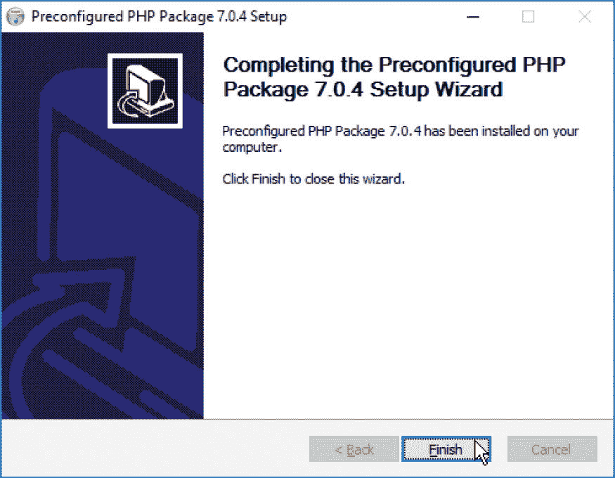

将接口（Interface）参数设置为 `FastCGI (Local - Pipes)`。


将解释器（Interpreter）参数设置为系统上的 PHP 路径位置 `php-cgi.exe`。


将关联扩展名（Associated Extensions）参数设置为 `php`，这样你的配置如下所示：

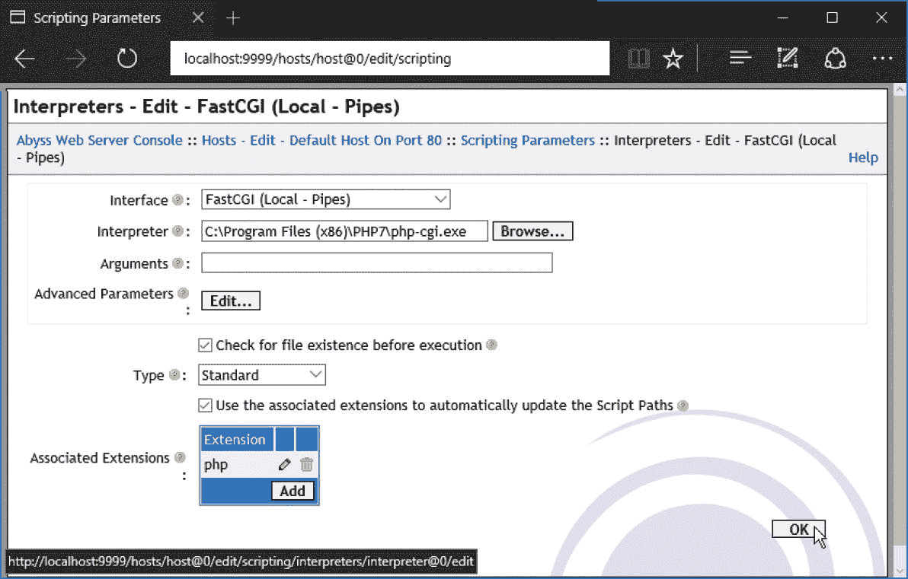

点击 **OK** 按钮验证你的新配置。


点击随后出现的**重启（Restart）**按钮以应用你对 Abyss 配置所做的更改。

只有当 Web 服务器通过 HTTP 协议提供文档时，PHP 引擎才能对其进行解释。你不能简单地在浏览器中直接打开 PHP 文件。请始终使用 `http://localhost/` 地址来运行本书中的示例。

Abyss Web 服务器现在应该运行在你的系统上，并经过了正确配置，能够识别具有 `.php` 文件扩展名的文档应由 PHP 引擎解释。现在可以通过创建一个简单的 PHP 脚本由 Abyss 为你的浏览器提供服务来测试配置：


`phpinfo.php`


打开一个纯文本编辑器，并准确输入以下脚本：

```php
<?php phpinfo() ; ?>
```


将脚本保存为 `phpinfo.php`，位于 Abyss 的文档路径目录下，通常位于 `C:\Abyss Web Server\htdocs`。


在 Web 浏览器的地址栏中准确输入位置 `http://localhost/phpinfo.php`，以查看 Abyss 提供一个包含你 PHP 版本信息的网页。

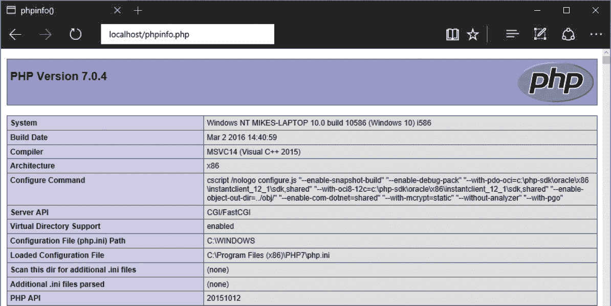


PHP 脚本对大小写敏感，因此你必须仅使用小字母复制列出的脚本。

## 嵌入 PHP 脚本代码

PHP 脚本可以嵌入 HTML 文档——这意味着 PHP 和 HTML 代码可以和谐地共存在同一个文件中。所有的嵌入 PHP 代码必须包含在 `<?php` 和 `?>` 标签内，以便 PHP 引擎能够轻松识别并进行解释。通常，PHP 代码会将内容写入 HTML 文档的 body 部分，然后发送到 Web 浏览器：


`hello.php`


启动一个纯文本编辑器，并创建一个有效的空白 HTML5 文档，带有一个空的 body 部分：

```html
<!DOCTYPE HTML>
<html lang="en">
<head>
<meta charset="UTF-8">
<title> Getting Started In PHP</title>
</head>
<body

</body>
</html>
```


在 body 部分插入标签以包含 PHP 代码：

```php
<?php

?>
```


现在，在 PHP 标签之间插入描述性注释和一行代码，将内容写入 body 部分：

```php
# 写入传统的问候。
echo '<h1>Hello World!</h1>' ;
```

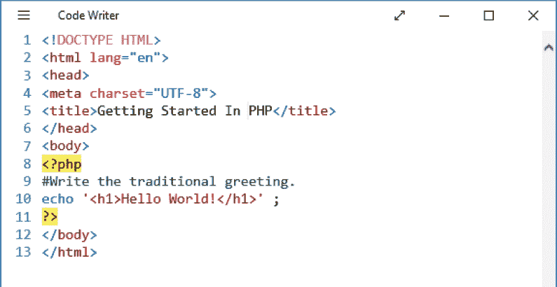


注意，描述性注释包含在 PHP 标签之间仅用于信息说明目的。


将文档编码设置为 UTF-8 格式，然后将其保存为 Abyss 服务器 `/htdocs` 文件夹中的 `hello.php`。

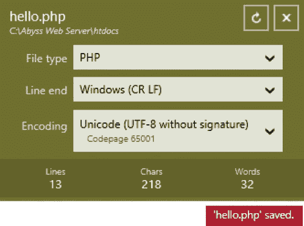


接下来，在 Web 浏览器的地址栏输入位置 `http://localhost/hello.php`，查看 Abyss 提供一个包含由嵌入 PHP 代码编写内容的网页。

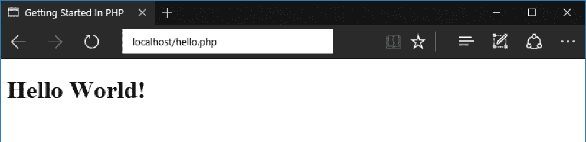


现在，使用 Web 浏览器的“查看源代码”功能查看 PHP 是否已将内容写入 body 部分，包括 HTML `<h1></h1>` 标题标签。

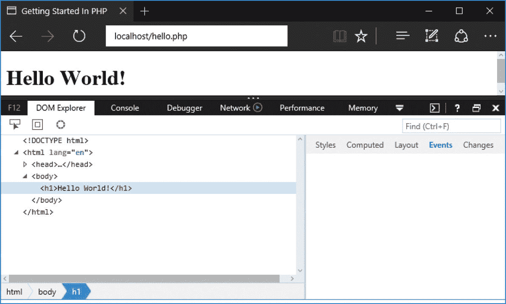

PHP 脚本可以用同样的方式嵌入较早版本的 HTML 中。书中的其他示例演示了嵌入 PHP 脚本，但没有重复列出 HTML 代码。


Windows 记事本会自动向文件添加一个隐藏的“字节顺序标记”（BOM）签名，而其他编辑器（如此处所示 Code Writer）允许省略此标记。Code Writer 是一个从 Windows 商店提供的免费文本和代码编辑器。


注意，PHP 的 `echo` 指令会原封不动地写入一对 `' '` 单引号内的全部内容。

## 遵循规则编写脚本

### 标签规则

当 PHP 引擎从 Web 服务器接收输入时，它会从上到下读取输入，这个过程被称为“解析”。在解析过程中，PHP 引擎（又称为解析器）寻找起始和结束标签 `<?php` 和 `?>`，并理解这些标签之间的内容是它必须解释的脚本代码。`<?php` 和 `?>` 标签之外的所有内容都会被完全忽略，这允许 PHP 文件拥有混合内容，并允许 PHP 代码像这样嵌入到 HTML 中：

```html
<p> 被 PHP 忽略并由浏览器显示</p>
<?php echo 'Script code that will be parsed' ; ?>
<p> 也被 PHP 忽略并由浏览器显示</p>
```

为了让其正常工作，当嵌入 HTML 文件中时，将所有的 PHP 脚本代码都包含在起始标签 `<?php` 和结束标签 `?>` 之间是非常重要的。


通常，你的嵌入 PHP 代码在脚本周围始终有起始标签 `<?php` 和结束标签 `?>`。

此规则的唯一例外是 PHP 脚本写在纯 PHP 文件中，该文件只包含代码。在这种情况下，最好省略结束标签 `?>`：

```php
echo 'Print this' ;
echo 'Print Last' ;
```

当 PHP 脚本仅意图向文档输出单个字符串时，你可以选择地使用短路输出标签 `<?=`：

```php
<?= 'Hello!' ?>
```

等同于：

```php
<?php echo 'Hello!' ?>
```

### 语句规则

PHP 语言中的每个语句必须以 `;` 字符结束——就像英语语言中的每个句子以句号结束一样。分号被解析器识别为它必须解释的单个指令的结束。因此，包含两个语句的 PHP 代码可能如下：

```php
<?php echo 'First statement' ; echo 'Second statement' ; ?>
```

PHP 代码的结束标签 `?>` 自动隐含分号，因此你可以省略最后一个语句的分号：

```php
<?php echo 'First statement' ; echo 'Second statement' ?>
```

条件测试将在后面详细说明并演示。

### 注释规则

在 PHP 脚本代码中添加注释通常是值得的，这样他人或自己在回顾代码时可以更容易理解。所有的空白和注释都被 PHP 解析器完全忽略，因此你可以任意添加注释，而对性能产生任何不利影响。

单行注释可以以 `#` 字符开始，或者以 `//` 双斜杠序列开始。

多行注释（块注释）必须包含在 `/*` 和 `*/` 字符序列之间，正如 C 编程语言中使用那样：


```php
<?php
echo 'First statement' ; // 单行注释。

/* 这是一个包含两行注释的多行注释。 */
echo 'Second statement' ;
echo 'Final statement' ; # 另一个单行注释。
?>
```


`//` 单行注释样式也用于 C++ 编程，而 `#` 单行注释样式也用于 Unix/Linux BASH 脚本脚本。

- `http://localhost` URL 是 `http://127.0.0.1` 数字 IP 地址的别名。
- 访问 Abyss Web Server 控制台需要您的用户名和密码，地址位于 `http://localhost:9999`。
- 建议使用 Abyss Web Server 的预配置软件包，以便简单、快速地安装 PHP 引擎。
- 必须配置 Web 服务器以识别脚本，通过设置 `Interface`、`Interpreter` 和 `Associated Extension` 参数，将它们重定向到 PHP 引擎。
- PHP 代码指令 `phpinfo()` 可用于生成包含您的 PHP 版本信息的网页。
- 包含 PHP 脚本的文档最好使用流行的 UTF-8 字符格式进行编码。
- PHP 的 `echo` 指令会字面上写入后续引号内包含的文本内容。
- 所有嵌入的 PHP 代码必须封装在 `<?php` 和 `?>` 标签内，以便 PHP 引擎识别。
- PHP 语言中的每条语句都必须以分号字符 `;` 结束。
- 单行注释可以以 `#` 哈希字符或 `//` 双斜杠序列开始。
- 多行块注释必须封装在 `/***` 和 `***/**` 字符序列之间。

# 存储值

本章演示了可以存储数据的各种 PHP 容器。

- 创建变量
- 引用字符串
- 生成数组
- 数组排序
- 描述维度
- 检查类型
- 定义常量
- 探索超全局变量
- 总结

## 创建变量

“变量”是 PHP 脚本中命名的容器，用于存储数据值。存储的值可以使用变量名进行引用，并随着脚本的执行进行更改（变化）。脚本作者可以为变量选择任何名称，只要它遵循以下三个命名约定：

- 名称必须以 `$` 美元符号开始——例如 `$name`。
- 名称可以包含字母、数字和下划线字符，但不能包含空格——例如 `$subtotal_1`。
- `$` 美元符号后的第一个字符必须是字母或下划线——不能是数字。


注意 PHP 中的变量名是区分大小写的，因此 `$name`、`$Name` 和 `$NAME` 是三个独立的变量。


在 PHP 中 `$this` 是一个特殊变量，因此你不能使用 ‘this’ 作为变量名。

PHP 变量是“弱类型的”，这意味着它们可以包含任何类型的数据，不像某些语言中的“强类型”变量（后者在创建变量时必须指定数据类型）。因此，PHP 变量可以轻松地包含整数、浮点数、文本字符字符串、`TRUE` 或 `FALSE` 布尔值、一个对象，或一个 `NULL` 空值。


在整个脚本范围内可用的变量必须具有唯一的名称。有关“变量作用域”的更多信息请参见此处。

在 PHP 脚本中只需声明其名称即可创建变量。然后可以使用 `=` 赋值运算符指定其值进行初始赋值（初始化）。该语句以及 PHP 中的所有其他语句都必须像这样以分号结尾：

```php
$body_temp = 98.6 ;
```

然后可以通过使用变量名引用来显示变量中包含的值，如下：

```php
echo $body_temp ;
```

有用的是，可以通过将字符串和变量名封装在双引号中，将变量的值作为混合字符串的一部分显示：

```php
echo “Body temperature is $body_temp degrees Fahrenheit” ;
```


不要混淆双引号和单引号的作用。记住，PHP 只对封装在双引号内的混合字符串进行变量替换。

双引号确保 PHP 将评估整个字符串并将命名的变量替换为其存储的值。如果字符串封装在单引号中，此功能将无法运行！


`variable.php`


创建一个有效的 HTML 文档，如此处列出的那样，然后在 body 部分插入 PHP 标签：

```php
<?php
# 插入此处的语句。
?>
```


现在，在 PHP 标签之间插入一条语句来创建并初始化变量：

```php
$body_temp = 98.6 ;
```


接下来，插入一条语句单独显示变量值：

```php
echo $body_temp ;
```


然后，插入一条语句在双引号赋值的混合字符串中显示替换后的变量值：

```php
echo “<p>Body temperature is $body_temp degrees Fahrenheit” ;
```


```php
$body_temp = 37.0 ;
```


```php
echo “Many regard $song_title as a popular classic” ;
```


```php
$song_title = “Summertime”
```

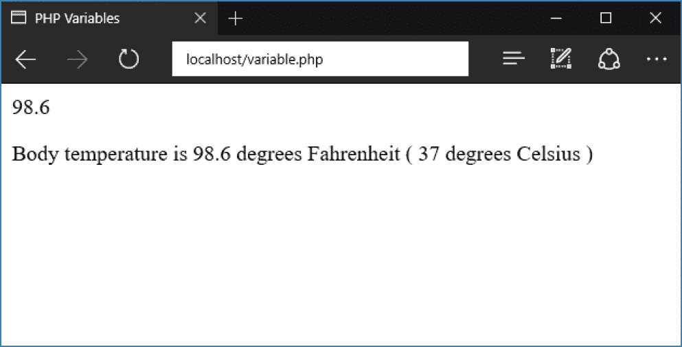

```php
$hi = ‘Hello’ ;
$bye = ‘Goodbye’ ;
$song_title = $hi . $bye ;
```

```php
$song_title = $hi . ‘, ‘ . $bye ;
```

# 在此处插入语句

`?>`


现在，在 PHP 标签之间插入一个语句来创建并初始化两个变量：

```php
$phrase = ‘The truth is rarely pure’ ;
$author = ‘Oscar Wilde’ ;
```


接下来，插入一个语句单独显示变量值：

```php
echo $phrase ;
```


然后，插入一个语句在用双引号赋值的混合字符串中替换显示变量值：

```php
echo “<p>It is often said that <q> $phrase </q> </p>” ;
```


插入一个语句将字符串连接到变量：

```php
$phrase = $phrase . ‘ and never simple’ ;
```


最后，插入一个语句在混合字符串中显示替换后的两个变量值：

```php
echo “<p><q> $phrase </q><cite> $author </cite></p>” ;
```


将文档保存到网络服务器的 `/htdocs` 目录并命名为 `string.php`，然后通过 HTTP 打开页面查看变量值的显示。

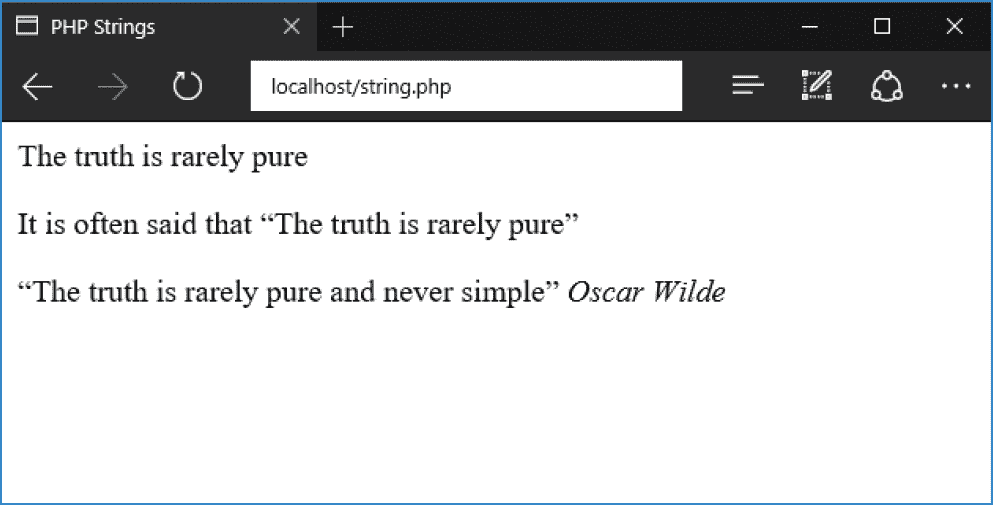


你也可以使用简写连接赋值运算符 `.=` 来连接两个字符串——这样 `$a = $a . $b` 可以简写为 `$a .= $b`。


为你的变量采用一致的命名风格——例如全小写的 `$my_var`，或“驼峰命名”的 `$myVar`。

## 创建数组

### 索引数组

数组变量可以在顺序的数组“元素”中存储多个数据项，这些元素从零开始编号（即“索引”的）。因此，第一个数组值存储在索引为 0 的数组元素中。可以使用变量名后跟方括号中的索引号来引用单个数组元素值。例如，`$days[0]` 引用名为“days”的数组变量的第一个元素中存储的值。同样，`$days[1]` 引用存储在第二个元素中的值，依此类推。可以通过创建多个给连续元素赋值的语句来创建变量数组，也可以通过创建一个使用 PHP `array()` 函数的单个语句来填充元素：

```php
$days[] = ‘Monday’ ; $days[] = ‘Tuesday’ ; $days[] = ‘Wednesday’ ;
```

或者：

```php
$days = array( ‘Monday’ , ‘Tuesday’ , ‘Wednesday’ ) ;
```

这都可以创建一个数组，其中每个元素中存储的值可以使用其索引号进行引用，例如 `$days[0]`。


方括号表示“元素”，因此在使用 `array()` 函数进行赋值时，变量名后不需要它们——它们只在访问元素时才需要。

### 关联数组

在创建数组时，你可以可选地为每个元素指定一个键名（key），用于引用该元素的值：

```php
$months['jan’] = ‘January’ ;
$months['feb’] = ‘February’ ;
$months['mar’] = ‘March’ ;
```

或者：

```php
$months = array( ‘jan’ => ‘January’ , ‘feb’ => ‘February’ , ‘mar’ => ‘March’ ) ;
```

这都可以创建一个数组，其中每个元素中存储的值可以使用其键名进行引用，例如 `$months['jan’]`。

### 遍历数组

可以使用 `foreach` 循环遍历数组的所有元素，依次引用每个元素的值并将其赋值给变量：

```php
foreach( $months as $value )
{
    # 在每次迭代中使用当前的 $value。
}
```

在循环的每次迭代中，也可以使用以下方式访问键：

```php
foreach( $months as $key => $value )
```

（接上）

```php
{
    # 在每次迭代中使用当前的 $key 和 $value。
}
```


`foreach` 结构专门为数组设计，它提供了一种遍历所有数组元素键和值的简单方法。有关循环的更多信息，请参见此处。


`array.php`


创建一个有效的 HTML 文档，如此处所列出的那样，然后在正文部分插入 PHP 标签：

```php
<?php
# 在此处插入语句。
?>
```


现在，在 PHP 标签之间插入一个语句来创建并初始化带有值的变量数组：

```php
$days = array( ‘Monday’ , ‘Tuesday’ , ‘Wednesday’ ) ;
```


接下来，插入一个语句将所有数组元素中的值以项目列表的形式显示：

```php
foreach( $days as $value ) { echo “&bull; $value “ ; }
```


然后，插入一个语句在用双引号赋值的混合字符串中替换显示变量值：

```php
$months = array( ‘jan’ => ‘January’ , ‘feb’ => ‘February’ , ‘mar’ => ‘March’ ) ;
```


插入一个语句将字符串连接到变量：

```php
$phrase = $phrase . ‘ and never simple’ ;
```


最后，插入一个语句在混合字符串中显示替换后的两个变量值：

```php
echo “<p><q> $phrase </q><cite> $author </cite></p>” ;
```


将文档保存到你的网络服务器的 `/htdocs` 目录并命名为 `string.php`，然后通过 HTTP 打开页面查看变量值的显示。


你也可以使用简写连接赋值运算符 `.=` 来连接两个字符串——这样 `$a = $a . $b` 可以简写为 `$a .= $b`。


为你的变量采用一致的命名风格——例如全小写的 `$my_var`，或“驼峰命名”的 `$myVar`。

## 数组排序

PHP 提供了两个方便的方法在数组和字符串之间进行转换，因为它们经常一起使用。`implode()` 函数将数组转换为字符串并在每个值之间插入分隔符。这可能用于创建逗号分隔的列表：

```php
$csv_list = implode( ‘ , $array )
```

相反，`explode()` 函数通过指定分隔符将字符串转换为数组。这可能用于从逗号分隔的字符串创建数组：

```php
$array = explode( ‘ , $csv_list ) ;
```

插入一个语句在混合字符串中显示变量值：

```php
echo “<p><q> $phrase </q><cite> $author </cite></p>” ;
```

PHP 还提供了三个实用的函数按升序（a-z 1-9）排序：

- `sort()` 函数——按值排序，丢弃原始键。
- `asort()` 函数——按值排序，保留原始键。
- `ksort()` 函数——按键排序。

现有的数组值可以通过简单的语句进行排序：

```php
$makers = array( ‘Ford’ , ‘Chevrolet’ , ‘Dodge’ ;

sort( $makers ) ;
```

数组元素也可以通过三个类似的函数按字母降序（9-1 z-a）排序：

- `rsort()` 函数——按值降序排序，丢弃原始键。
- `arsort()` 函数——按值降序排序，保留原始键。
- `krsort()` 函数——按键降序排序。

可以使用 `is_array()` 函数测试变量是否为数组。例如，`is_array( $var ) ;`

重要的是，`sort()` 和 `rsort()` 函数会丢弃指定的键名，因此这些函数仅适用于键/值关系不重要的情况——否则请使用 `asort()` 和 `arsort()` 函数来保留键。

你可以使用 `range()` 函数轻松创建包含顺序数字或字母的数组。例如：

```php
$six = range( 1 , 6 )
$a_z = range( ‘a’,‘z’ ) ;
```

如果你指定了键，索引将从一而不是零开始，如果你指定了相同的键，第二个值将覆盖第一个：

```php
$months = array( ‘jan’ => ‘January’ , ‘feb’ => ‘February’ , ‘mar’ => ‘March’ ) ;
```


接下来，插入语句以定义列表中的项目符号列表形式显示数组的所有键和值：

```php
echo ‘<dl><dt>原始元素顺序：<dd>’ ;
foreach( $cars as $key => $value )
{ echo ‘ &bull; ‘ , $key . ‘ ‘ . $value ; }
```


然后，插入语句按值对数组进行排序：

```php
asort( $cars ) ;
echo ‘<dt>按值排序：<dd>’ ;
foreach( $cars as $key => $value )
{ echo ‘ &bull; ‘ , $key . ‘ ‘ . $value ; }
```


最后，插入语句按键对数组进行排序：

```php
ksort( $cars ) ;
echo ‘<dt>按键排序：<dd>’ ;
foreach( $cars as $key => $value )
{ echo ‘ &bull; ‘ , $key . ‘ ‘ . $value ; }
echo ‘</dl>’ ;
```


将文档保存到你的 Web 服务器的 `/htdocs` 目录并命名为 `sort.php`，然后通过 HTTP 打开页面以显示排序后的数组值。

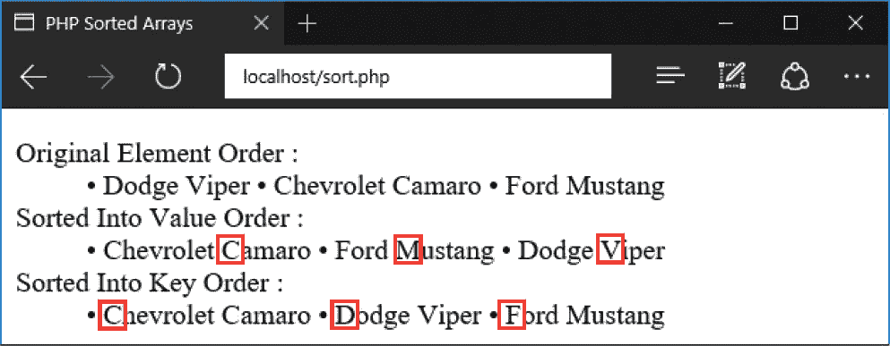


你可以使用 `count()` 函数发现数组中的元素数量。例如，`$num = count( $array ) ;`


在键重要的情况下，不要使用 `sort()` 或 `rsort()` 函数。

## 描述维度

数组元素的编号更准确地说是“数组索引”，因为元素编号从零开始，所以有时被称为“基于零的索引”。用单个索引创建的数组是一维数组，其中元素出现在单行中。


| 元素内容 | A | B | C | D | E |
| :--- | :--- | :--- | :--- | :--- | :--- |
| 索引数字 | [0] | [1] | [2] | [3] | [4] |


数组也可以有多个索引——表示多个维度。用两个索引创建的数组是二维数组，其中元素出现在多行中：

| 第一索引 | [0] | A | B | C | D | E |
| :--- | :--- | :--- | :--- | :--- | :--- | :--- |
| | [1] | F | G | H | I | J |
| 第二索引 | | [0] | [1] | [2] | [3] | [4] |

对于多维数组，每个元素包含的值通过说明每个索引的数字来引用。例如，在上面的二维数组中，`[1][2]` 元素包含字母 H。

二维数组有助于存储基于网格的信息，例如 XY 坐标。创建一个具有三个索引的三维数组将允许存储 XYZ 坐标。

在 PHP 中创建多维数组只需创建一个外部数组，其元素本身也是数组。按照惯例，你可以选择地为每个元素指定一个键名——在这种情况下表示每个内部数组。然后可以使用键名和内部索引数字来引用单独的值：

`$matrix['Letter'][0]`


具有两个以上索引的多维数组可能会产生难以阅读的源代码并可能导致错误。

然而，当使用带引号的键数组变量包含在字符串中时，必须用大括号括起来：

```php
echo "元素值为：{$matrix['Letter'][0]} " ;
```

可以使用 `foreach` 循环遍历数组来访问多维数组中的所有内部数组。嵌套的 `foreach` 循环可以逐引用每个元素。


matrix.php

 创建一个有效的 HTML 文档，如这里所列的那样，然后在 body 部分插入 PHP 标签

```php
<?php
# 在此处插入语句。
?>
```

 现在，在 PHP 标签之间插入语句，创建并初始化两个普通变量数组和一个带键名的二维数组

```php
$letters = array( 'A' , 'B' , 'C' ) ;
$numbers = array( 1 , 2 , 3 ) ;
$matrix = array( 'Letter' => $letters , 'Number' => $numbers ) ;
```

 接下来，插入一个语句来显示单个存储值

```php
echo "<p>开始：{$matrix['Letter'][0]} </p>" ;
```

 最后，插入语句将所有元素中的键和值显示两个无序列表

```php
foreach( $matrix as $array => $list )
{
    echo '<ul>' ;
    foreach( $list as $key => $value )
    { echo ' &bull; ' , $key . ' ' . $value ; }
}
```

 将文档保存到你的 Web 服务器的 `/htdocs` 目录并命名为 `sort.php`，然后通过 HTTP 打开页面以显示排序后的数组值

 具有两个以上索引的多维数组可能会产生难以阅读的源代码并可能导致错误。

然而，当使用带引号的键数组变量包含在字符串中时，必须用大括号括起来：

```php
echo "元素值为：{$matrix['Letter'][0]} " ;
```

PHP 文件流资源的创建和使用在第 8 章中得到了充分演示。


布尔值常量 `TRUE` 和 `FALSE` 不区分大小写，因此也可以写成 `true` 和 `false`。

## 定义常量

脚本中永远不会改变的固定数据值应该存储在 PHP "常量"中，而不是变量中。常量是一个命名的容器，可以在其中存储数值或字符串值，并可以使用常量的名称进行引用。

与变量不同，常量不能包含 `TRUE` 或 `FALSE` 的布尔值，不能表示对象，也不能是 `NULL` 空值。此外，常量不会随着脚本的执行而发生改变。这保护了常量值免受意外修改，是一种良好的编程实践。


在创建变量时，务要考虑其值是否会发生改变——如果不会改变，你应该创建一个常量。例如，`define( 'PI' , 3.14 ) ;`。

常量的命名遵循与变量相同的命名规范，但传统上使用大写字母来命名常量——以便于与变量名区分。常量使用 `define()` 函数创建，用于指定常量的名称及其将包含的值，如下：

`define( 'NAME' , value ) ;`

最重要的一点是，常量名没有以 `$` 符号开头，因此它们不能包含在用于显示的混合字符串中——因为无法区分常量名和普通的大写字符串。考虑以下语句示例：

`define( 'USER' , 'Mike' ) ;`

`echo "Hello USER"`

...这里的输出是 `Hello USER`，而不是预期的 `Hello Mike`。

为了将常量值包含在输出字符串中，必须单独引用它，并使用 PHP 的 `.` 接符将其"连接"到字符串，如下：

`echo 'Hello ' . USER ;`

...现在的输出是预期的 `Hello Mike`。

数组常量（即所有元素都包含固定数据值的数组）也可以使用 `define()` 函数这样创建：

`define( 'WEEKDAYS' , [ 'Mon', 'Tue' , 'Wed' , 'Thu' , 'Fri' ] ) ;`


使用 `define()` 函数创建常量数组的能力是 PHP 7 中的新功能。

由脚本定义的定义的可以像 PHP 内置的预定义常量一样使用，例如描述版本和服务器操作系统的 `PHP_VERSION` 和 `PHP_OS`。


constant.php

 创建一个有效的 HTML 文档，如此处所列出的那样，然后在 body 部分插入 PHP 标签

```php
<?php
# 在此处要插入的语句。
?>
```

 现在，在 PHP 标签之间插入一条用于创建并初始化常量的语句

`define( 'USER' , 'Mike' ) ;`

 添加一条语句来创建并初始化数组常量

`define( 'PETS' , [ 'Kitten' , 'Puppy' , 'Hamster' ] ) ;`

 接下来，插入一条语句在连接的字符串中显示两个常量值

`echo '<p>Hello ' . USER . ' how is your ' . PETS[1] . '?</p>' ;`

 插入一条语句在连接的字符串中显示 PHP 版本的预定义常量值

`echo '<p>You are using PHP version ' . PHP_VERSION ;`

 最后，插入一条语句在字符串中显示主机操作系统的预定义常量值

`echo ' running on ' . PHP_OS . '</p> ;`

 将文档保存到 Web 服务器的 `/htdocs` 目录下并为 `constant.php`，然后通过 HTTP 打开页面查看显示的结果

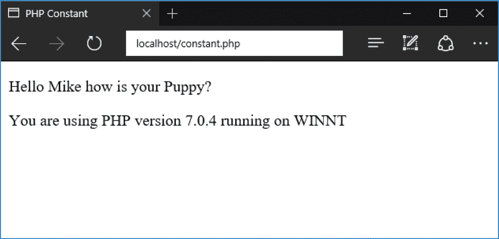


你不能将常量包含在混合字符串中，更改其值，也不能以美元符号开头其名称。


你应该始终对常量名使用大写，以便在代码中将其与变量区分。

## 探索超全局变量

PHP 提供了几个预定义变量，这些变量在脚本的任何地方都是全局可用的。它们被形象地称为"超全局变量"，在此简要描述：

- `$GLOBALS` – 一个关联数组，根据上下文包含当前脚本全局作用范围内定义的所有变量的引用。变量名是该关联数组的键。例如：

```php
foreach( $GLOBALS as $key => $var) echo "&bull; $key ";
```

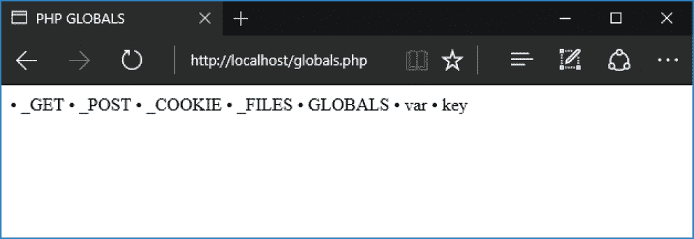

- `$_SERVER` – 包含由 Web 服务器任意提供的标头、路径和脚本位置等信息的数组

- `$_GET` – 通过附加 URL 参数传递给脚本的变量关联数组

- `$_POST` – 通过附加 URL 参数传递给脚本的变量关联数组

- `$_FILES` – 包含上传文件的关联数组

- `$_COOKIE` – 包含 cookie 的关联数组

- `$_SESSION` – 用于在会话中存储信息的关联数组

- `$_REQUEST` – 包含 `$_GET`、`$_POST` 和 `$_COOKIE` 的关联数组

- `$_ENV` – 环境变量关联数组

# 变量与常量

- 变量是一个命名的容器，用于存储可以更改的数据。
- 存储在变量中的值可以通过该变量名来引用。
- 变量名必须以 `$` 符号开头，可以由字母、数字和下划线字符组成，且 `$` 后的第一个字符必须是字母或下划线。
- 变量可以存储整数、浮点数、文本字符串、布尔值、对象或 `NULL` 值。
- 变量使用 `=` 赋值运算符进行初始化，为该变量分配一个初始值。
- 通过仅将字符串和变量名括在双引号中，可以将变量的值作为混合字符串的一部分显示。
- 字符串可以使用单引号或双引号括，内部的引号可以使用反斜杠进行转义。
- 使用 `.` 拼接运算符可以将字符串值组合成一个单一字符串。
- 数组变量可以在顺序排列的数组元素中存储多个数据项，这些元素默认从零开始编号。
- 可选，可以为每个数组元素指定键名。
- 使用 `foreach` 循环可以遍历数组中的每个元素。
- `implode()` 和 `explode()` 函数通过添加或删除指定的分隔符在字符串和数组之间进行转换。
- 数组可以根据值或键按字母数字排序。
- 多维数组简单来说就是元素值本身也是数组的数组。
- 可以 `gettype()` 和 `var_dump()` 函数检查数据类型。
- 常量是一个命名的容器，用于存储固定的整数、浮点数或文本字符串。
- 常量名不带 `$` 前缀，且全大大写。
- 常量使用 `define()` 函数进行初始化。
- 超全局变量在任何脚本的任何地方始终全局可用。

## 执行操作

本章演示了用于算术、比较和逻辑评估的各种 PHP 运算符。

## 算运算

PHP 脚本中常用的算术运算符下表所示：

| 运算符: | 操作: |
| :--- | :--- |
| `+` | 加法 |
| `-` | 减法 |
| `*` | 乘法 |
| `/` | 除法 |
| `%` | 取模 |
| `**` | 幂 |

与运算符一起形成表达式的数字被称为"操作数"——在表达式 `2 + 3` 中，数字 `2` 和 `3` 就是操作数。

加、减、乘、除运算符的运行方式正如你预期的一样。然而，在使用多个运算符时，必须注意对表达式进行分组以保持清晰度：

| `a = b * c - d % e / f ;` | # 这不清晰。 |
| `a = ( b * c ) - ( ( d % e ) / f ) ;` | # 这更清晰。 |

使用括号对表达式分组以指定计算优先级——最内层的组先被计算。

- `%` 取模运算符将第一个数字除以第二个数字，并返回操作的余数。这对于判断一个数是奇数还是偶数很有用。
- `**` 幂运算符给出第一个操作数相对于第二个操作数幂的结果。

### 简写表达式

通过结合算术运算符与 `=` 赋值运算符，可以创建非常有简写表达式：

- `a += b ;` 等同于 `a = ( a + b ) ;`
- `a -= b ;` 等同于 `a = ( a - b ) ;`
- `a *= b ;` 等同于 `a = ( a * b ) ;`
- `a /= b ;` 等同于 `a = ( a / b ) ;`

### 示例：arithmetic.php

创建一个有效的 HTML 文档，然后将 PHP 标签插入到 body 部分：

```php
<?php
# 在此处插入插入语句。
?>
```

```php
$a = 5 ;
$b = 2 ;
$result = $a + $b ; echo "Addition : $result <br>" ;
$result = $a - $b ; echo "Subtraction : $result <br>" ;
$result = $a * $b ; echo "Multiplication : $result <br>" ;
$result = $a / $b ; echo "Division : $result <br>" ;
$result = $a % $b ; echo "Modulus : $result <br>" ;
$result = $a ** $b ; echo "Exponentiation : $result <br>" ;
```

## 比较

PHP 中用于比较两个值的常用运算符有：

| 运算符: | 比较测试: |
| :--- | :--- |
| `==` | 相等 |
| `===` | 恒等 |
| `!==` | 非恒等 |
| `!=` | 不等于 |
| `>` | 大于 |
| `<` | 小于 |
| `>=` | 大于等于 |
| `<=` | 小于等于 |
| `<=>` | 飞船运算符 |

- `==` 相等运算符比较两个操作数，如果两者在数值上相等，则返回布尔结果 `TRUE`，否则返回 `FALSE`。字符和字符串也通过它们的 ASCII 码值进行数值比较。
- 反之，`!=` 不等于运算符在两个操作数不相等时返回 `TRUE`，否则返回 `FALSE`。
- `>` "大于"运算符比较两个操作数，如果第一个操作数的值大于第二个，则返回 `TRUE`；如果它的值等于或小于第二个，则返回 `FALSE`。
- `<` "小于"运算符进行相同的比较，但如果第一个操作数的值小于第二个，则返回 `TRUE`，否则返回 `FALSE`。
- 在 `>` "大于"运算符或 `<` "小于"运算符后添加 `=` 运算符，可以使其在两个操作数完全相等时也返回 `TRUE`。
- `<=>` 飞船运算符在第一个操作数大于第二个操作数时返回整数值 1，在第一个操作数小于第二个操作数时返回 -1，操作数相等时返回 0。

可以使用 `var_dump()` 函数查看每种比较产生的类型和值。

 现在，在 PHP 标签之间插入语句来创建并初始化五个变量

`$zero = 0 ; $nil = 0 ; $one = 1 ; $upr = 'A' ; $lwr = 'a' ;`

 下，插入语句显示相等性比较

`echo "0 == 0 : " ; var_dump( $zero == $nil ) ;`

`echo "<br>0 == 1 : " ; var_dump( $zero == $one ) ;`

`echo "<br>A == a : " ; var_dump( $upr == $lwr ) ;`

`echo "<br>A != a : " ; var_dump( $upr == $lwr ) ;`

 插入语句显示比较评估结果

`echo "<hr>1 > 0 : " ; var_dump( $one > $nil ) ;`

`echo "<br>0 >= 0 : " ; var_dump( $zero >= $nil ) ;`

`echo "<br>1 <= 0 : " ; var_dump( $one <= $nil ) ;`

`echo "<hr>1 <=> 0 : " ; var_dump( $one <=> $nil ) ;`

`echo "<br>1 <=> 1 : " ; var_dump( $one <=> $one ) ;`

`echo "<br>0 <=> 1 : " ; var_dump( $nil <=> $one ) ;`

 将文档保存到网络服务器的 `/htdocs` 目录中并命名为 `comparison.php`，然后通过 HTTP 打开页面查看显示的结果

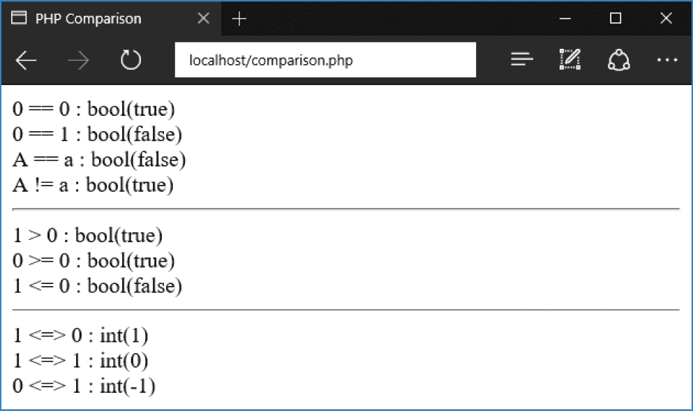


大写字母 `A` 的 ASCII 值为 65，小写字母 `a` 值为 97 —— 因此它们在这里比较返回 `FALSE` 。


布尔值 `TRUE` 在 PHP 语言中用数字 1 表示。

## 检查条件

### 条件运算符

条件运算符 `?:` 也称为"三元"运算符，因为它包含三个组成部分。该运算符首先评估一个表达式以得到 `TRUE` 或 `FALSE` 布尔值，然后根据评估结果返回两个指定结果中的一个。条件运算符的语法如下：


`(* test-expression ) ? result-if-true : result-if-false ;`

条件运算符可以用于评估给定的数字是一个还是多个，以确保输出内容中关于单数和复数项的语法正确。这避免了诸如“There is 5”这样尴尬的短语：

`$verb = ( $number == 1 ) ? 'is' : 'are ';`

`echo "There $verb $number" ;`

在这种情况下，当变量`$number`的值为 1 时，将结果`'is'`赋值给变量`$verb`，否则将结果`'are'`赋值。


不要在同一个语句中使用超过一个`?:`条件运算符，因为结果可能是不可预测的。

条件运算符还可以通过检查数字除以 2 后是否有余数，来评估给定的数字是奇数还是偶数（奇偶性），然后赋值一个合适的字符串结果：

`$parity = ( $number % 2 == 0 ) ? 'Odd' : 'Even' ;`

`echo "$number is $parity" ;`

在这种情况下，当取模运算返回值为 1 时，将结果`'Odd'`赋值给变量`$parity`，否则将结果`'Even'`赋值。

### 空值合并运算符

PHP 有一个特殊的`NULL`值，它是一个内置常量，表示变量完全没有值 —— 甚至不是 0。没有被赋值值的变量将被求为`NULL`。这个命名非常敏捷的`??`“空值合并”运算符可以从左到右遍历多个操作数，并返回第一个不是`NULL`的操作数的值。如果所有操作数都没有值（且不是`NULL`），则空值合并运算符本身将返回`NULL`结果。


`??`空值合并运算符是 PHP 7 中的新功能。


condition.php

 创建一个有效的 HTML 文档，像这里列出的那个样，然后在 body 部分插入 PHP 标签

```php
<?php
# 在此处插入语句。
?>
```

 现在，在 PHP 标签之间插入语句来创建并初始化三个变量

`$a = NULL ; $b = 8 ; $c = 'PHP Fun' ;`

 下，插入语句输出正确的语法

`$verb = ( $b == 1 ) ? 'is' : 'are' ;`

`echo "There $verb $b <hr>"; ;`

 插入语句显示整数的奇偶性

`$parity = ( $number % 2 == 0 ) ? 'Odd' : 'Even' ;`

`echo "$number is $parity" ;`

 将文档保存到网络服务器的`/htdocs`目录中并命名为`comparison.php`，然后通过 HTTP 打开页面查看显示的的结果

## 逻辑逻辑

| 运算符 | 描述 |

| :--- | :--- |

| **and** | `&&` | 逻辑与：两个操作数都为`TRUE`。 |

| **or** | `||` | 逻辑或：至少一个操作数为`TRUE`。 |

| **xor** | `xor` | 逻辑异或：一个操作数为`TRUE`，但另一个不是。 |

| **not** | `!` | 逻辑非：反转操作数的值。 |

“布尔”术语指的是乔治·布尔（1815-1864）开发的系统。PHP 中常用的逻辑运算符如下：

| 运算符 | 操作 |

| :--- | :--- |

| **and** | `&&` | 逻辑与 |

| **or** | `||` | 逻辑或 |

| **xor** | `xor` | 逻辑异或 |

| **not** | `!` | 逻辑非 |

`&&`运算符需要两个操作数都为`TRUE`。如果没有任何操作数为`TRUE`，它将返回`FALSE`。

`||`运算符在至少一个操作数为`TRUE`时返回`TRUE`。如果没有任何操作数为`TRUE`，它将返回`FALSE`。

`xor`运算符评估两个操作数，仅当一个操作数为`TRUE`时才返回`TRUE`。如果两个操作数都是`TRUE`，它将返回`FALSE`。

`!`运算符是一个一元运算符，用于单个操作数。它返回操作数的反值，所以如果变量`$var`是`TRUE`，`!$var`将返回`FALSE`。`!`运算符用于在带有语句`$var = ! $var`的循环中切换值。每次迭代值都会反转，就像拨开关一样。


logic.php

 创建一个有效的 HTML 文档，像这里列出的那个样，然后在 body 部分插入 PHP 标签

```php
<?php
# 在此处插入语句。
?>
```

 现在，在 PHP 标签之间插入语句来创建并初始化两个布尔值的变量

`$yes = TRUE ; $no = FALSE ;`

 下，插入语句显示 AND 评估

`$result = ( $no && $no ) ? 'TRUE' : 'FALSE' ;`

`echo "No AND No returns $result <br>" ;`

`$result = ( $yes && $no ) ? 'TRUE' : 'FALSE' ;`

`echo "Yes AND No returns : $result <br>" ;`

`$result = ( $yes && $yes ) ? 'TRUE' : 'FALSE' ;`

`echo "Yes AND Yes returns $result <hr>" ;`

 插入语句显示 OR 和 NOT 评估

`$result = ( $no || $no ) ? 'TRUE' : 'FALSE' ;`

`echo "No OR No returns $result <br>" ;`

`$result = ( $yes || $no ) ? 'TRUE' : 'FALSE' ;`

`echo "Yes OR No returns $result <br>" ;`

```php
echo "Yes OR No returns $result <br>" ;

$result = ( $yes || $yes ) ? 'TRUE' : 'FALSE' ;

echo "Yes OR Yes returns $result <hr>" ;

$result = ( ! $yes ) ? 'TRUE' : 'FALSE' ;

echo "NOT Yes returns $result <br>" ;
```

 将文档保存在 Web 服务器的`/htdocs`目录下并命名为`logic.php`，然后通过 HTTP 打开页面以查看显示的结果。

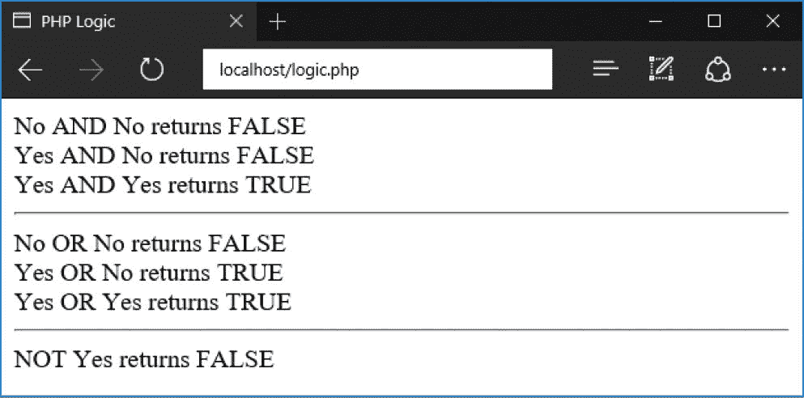


PHP 还有一个`XOR`（异或`OR`）运算符，它会同时执行`AND NOT`的等效评估。


注意，`FALSE && FALSE`的评估结果返回`FALSE` —— 这也许是在说明“两个错也不出一个对”这句谚言。

## 比较位

一个字节由八位组成，每个位可以包含一个`1`或一个`0`来存储二进制数，表示从 0 到 255 的十进制值。只有当位包含`1`时，该位才会贡献一个十进制分量。组件从右到左从“最低位”（LSB）到“最高位”（MSB）命名。下方位模式中的二进制数表示十进制 50。


许多 PHP 程序员从不使用位运算符，但了解它们是什么以及如何使用是有有的。

| 位数 | 8 MSB | 7 | 6 | 5 | 4 | 3 | 2 | 1 LSB |

| :--- | :--- | :--- | :--- | :--- | :--- | :--- | :--- | :--- |

| 十进制 | 128 | 64 | 32 | 16 | 8 | 4 | 2 | 1 |

| 二进制 | 0 | 0 | 1 | 1 | 0 | 0 | 1 | 0 |

可以使用“位”运算符来操作字节的各个部分。位运算符允许对整数中的特定位进行评估和操作。

| 运算符: | 名称: | 二进制数操作: |

| :--- | :--- | :--- |

| `\|` | OR | 当两个比较的位中有一个为`1`时，则在每个位返回`1`。示例：`1010 \| 0101 = 1111` |

| `&` | AND | 当两个比较的位都为`1`时，则在每个位返回`1`。示例：`1010 & 1100 = 1000` |

| `~` | NOT | 当两个比较的位都不为`1`时，则在每个位返回`1`。示例：`1010 ~ 0011 = 0100` |

| `^` | XOR | 当两个比较的位中只有一个为`1`时，则在每个位返回`1`。示例：`1010 ^ 0100 = 1110` |

| `<<` | 左移 | 将每个为`1`的位向左移动指定数的位。示例：`0010 << 2 = 1000` |

| `>>` | 右移 | 将每个为`1`的位向右移动指定数的位。示例：`1000 >> 2 = 0010` |


一个字节的半部分被称为“半字节”（4 位）。表格中示例的二进制数描述了存储在半字节中的值。

除非是为资源受限的设备编程，否则很少需要使用位运算符，但它们可能是很有用的。例如，`^`（异或`OR`）运算符允许在不需要第三个变量的情况下交换两个变量的值：


bitwise.php

 创建一个有效的 HTML 文档，如这里所列出的那样，然后在 body 部分插入 PHP 标签。

```php
<?php
# 在此处插入插入语句。

?>
```

 现在，在 PHP 标签之间插入语句，以创建并初始化两个整数值的变量

```php
$x = 5 ; $y = 10 ;
```

 接下来，添加一条语句来显示赋值的值。

```php
echo "X : $x , Y : $y <br>" ;
```

 插入三个 XOR 语句，通过二进制位操作交换变量值。

```php
$x = $x ^ $y ; /* 1010 ^ 0101 = 1111 (十进制 15) */
$y = $x ^ $y ; /* 1111 ^ 0101 = 1010 (十进制 10) */
$x = $x ^ $y ; /* 1111 ^ 1010 = 0101 (十进制 5) */
```

 最后，添加一条语句来显示赋值的值。

```php
echo "X : $x , Y : $y <br>" ;
```

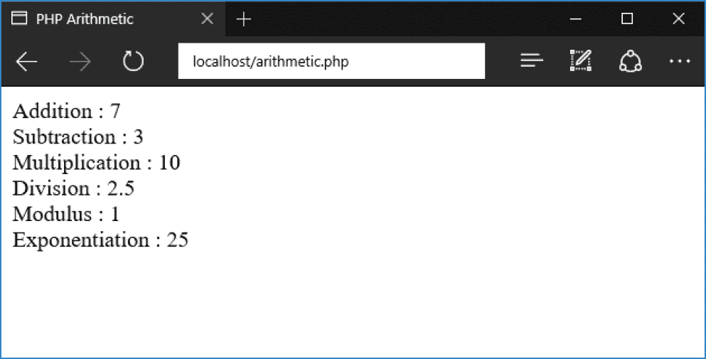 将文档保存在 Web 服务器的`/htdocs`目录下并命名为`logic.php`，然后通过 HTTP 打开页面以查看显示的结果。


PHP 还有一个`XOR`（异或`OR`）运算符，它会同时执行`AND NOT`的等效评估。


注意，`FALSE && FALSE`的评估结果返回`FALSE` —— 这也许是在说明“两个错也不出一个对”这句谚语。

## 比较位

一个字节由八位组成，每个位可以包含一个`1`或一个`0`来存储二进制数，表示从 0 到 255 的十进制值。只有当位包含`1`时，该位才会贡献一个十进制分量。组件从右到左从“最低位”（LSB）到“最高位”（MSB）命名。下方位模式中的二进制数表示十进制 50。


许多 PHP 程序员从不使用位运算符，但了解它们是什么以及如何使用是有用的。

| 位数 | 8 MSB | 7 | 6 | 5 | 4 | 3 | 2 | 1 LSB |

| :--- | :--- | :--- | :--- | :--- | :--- | :--- | :--- | :--- |

| 十进制 | 128 | 64 | 32 | 16 | 8 | 4 | 2 | 1 |

| 二进制 | 0 | 0 | 1 | 1 | 0 | 0 | 1 | 0 |

可以使用“位”运算符来操作字节的各个部分。位运算符允许对整数中的特定位进行评估和操作。

| 运算符: | 名称: | 二进制数操作: |

| :--- | :--- | :--- |

| `\|` | OR | 当两个比较的位中有一个为`1`时，则在每个位返回`1`。示例：`1010 \| 0101 = 1111` |

| `&` | AND | 当两个比较的位都为`1`时，则在每个位返回`1`。示例：`1010 & 1100 = 1000` |

| `~` | NOT | 当两个比较的位都不为`1`时，则在每个位返回`1`。示例：`1010 ~ 0011 = 0100` |

| `^` | XOR | 当两个比较的位中只有一个为`1`时，则在每个位返回`1`。示例：`1010 ^ 0100 = 1110` |

| `<<` | 左移 | 将每个为`1`的位向左移动指定数的位。示例：`0010 << 2 = 1000` |

| `>>` | 右移 | 将每个为`1`的位向右移动指定数的位。示例：`1000 >> 2 = 0010` |


一个字节的半部分被称为“半字节”（4 位）。表格中示例的二进制数描述了存储在半字节中的值。

除非是为资源受限的设备编程，否则很少需要使用位运算符，但它们可能是很有用的。例如，`^`（异或`OR`）运算符允许在不需要第三个变量的情况下交换两个变量的值：


bitwise.php

 创建一个有效的 HTML 文档，如这里所列出的那样，然后在 body 部分插入 PHP 标签。

```php
<?php
# 在此处插入插入语句。

?>
```

 现在，在 PHP 标签之间插入语句，以创建并初始化两个整数值的变量

```php
$x = 5 ; $y = 10 ;
```

 接下来，添加一条语句来显示赋值的值。

```php
echo "X : $x , Y : $y <br>" ;
```

 插入三个 XOR 语句，通过二进制位操作交换变量值。

```php
$x = $x ^ $y ; /* 1010 ^ 0101 = 1111 (十进制 15) */
$y = $x ^ $y ; /* 1111 ^ 0101 = 1010 (十进制 10) */
$x = $x ^ $y ; /* 1111 ^ 1010 = 0101 (十进制 5) */
```

 最后，添加一条语句来显示赋值的值。

```php
echo "X : $x , Y : $y <br>" ;
```

 将文档保存在 Web 服务器的`/htdocs`目录下并命名为`logic.php`，然后通过 HTTP 打开页面以查看显示的结果。


PHP 还有一个`XOR`（异或`OR`）运算符，它会同时执行`AND NOT`的等效评估。


注意，`FALSE && FALSE`的评估结果返回`FALSE` —— 这也许是在说明“两个错也不出一个对”这句谚语。

- 算术运算符可以结合操作数形成表达式，包括加法`+`、减法`-`、乘法`*`、除法`/`、取模`%`和幂`**`。

- 赋值运算符`=`可以与任何算术运算符结合，用于执行算术计算并赋值结果。

- 比较运算符可以结合操作数形成表达式，包括相等`==`、不相等`!=`、全等或不全等`===`、`!==`、大于`>`、小于`<`、大于等于`>=`、小于`<=`以及飞船运算符`<=>`。

- 条件运算符`?:`评估一个表达式以得到`TRUE`（真）或`FALSE`（假）布尔值，然后根据评估结果返回两个指定结果之一。

- `??`空值合并运算符从左到右遍历操作数并返回第一个非空值。

- 逻辑运算符`and`、`&&`、`or`、`||`和`xor`形成表达式，评估两个操作数并返回真或假的值。

- 逻辑非运算符`!`返回单个操作数的反反布尔值。

- 位运算符`|`、`&`、`~`、`^`、`<<`和`>>`允许对整数内的特定位进行评估和操作。

- 前置增`++`或递减`--`运算符会将变量的值改变一并返回结果。


- 后置增`++`或递减`--`运算符返回变量的当前值，然后将其值改变一。
- 运算符优先级决定了表达式在评估时的分组方式。
- 当运算符优先级相同时，它们的结合性决定了表达式评估时的分组方式。
- `var_dump()`函数可以查看表达式产生的类型和值。
- 特殊常量`NULL`表示一个没有任何值（即使不是零）的变量。

## 测试条件

本章演示了决定脚本执行方式的各种 PHP 控制结构。

寻求真理 | 提供备选方案 | 分支分支 | 执行循环 | 在真循环 | 退出循环 | 总结

## 寻求真理

`if`关键字用于执行基础条件测试，评估给定的表达式以得到`TRUE`或`FALSE`布尔值。评估后大括号内的语句仅在表达式被判定为`TRUE`时才会执行。当表达式被判定为`FALSE`时，PHP 解析器只需移动到脚本的下一部分。


`if`结构是 PHP 以及大多数其他编程语言中最重要的特性之一。

`if`条件测试语句的语法如下：

```
if ( test-expression ) { statement-to-execute-when-true ; }
```

当测试为`TRUE`时，可能有多个语句需要执行，但每条语句必须以分号结束：

```
if ( test-expression )
{
    statement-to-execute-when-true;
    statement-to-execute-when-true;
    statement-to-execute-when-true;
}
```

可以使用逻辑运算符`&&`或`and`对多个表达式进行测试，以确保只有在两个表达式都被判定为`TRUE`时才会执行后续语句，如下所示：

```php
if ( ( test-expression ) && ( test-expression ) )
{
    statement-to-execute-when-true;
    statement-to-execute-when-true;
    statement-to-execute-when-true;
}
```


当要执行的代码只是单个语句时，可以选择省略大括号，但为了一致性，你可能希望始终包含大括号。

或者，可以嵌套`if`条件测试语句来测试多个表达式，使得只有在所有测试都被判定为`TRUE`时才会执行语句，如下所示：

```
if ( test-expression )
{
    if ( test-expression )
    {
        statement-to-execute-when-true;
        statement-to-execute-when-true;
        statement-to-execute-when-true;
    }
}
```

可以创建多个`if`条件测试语句来为脚本提供备选路径。


if.php

 在 PHP 标签之间，用一个初始化整数变量的语句开始脚本：

```php
<?php
$num = 8 ;
```

 接下来，添加在数值大小条件测试判定为`TRUE`时输出结果的语句：

```php
if ( $num > 5 ) { echo “$num exceeds 5<br>” ; }
if ( $num <= 5 ) { echo “ $num is below 6<br>” ; }
```

 现在，添加在奇偶性条件测试判定为`TRUE`时输出结果的语句：

```php
if ( $num % 2 == 0 ) { echo “$num is Even<br>” ; }
if ( $num % 2 != 0 ) { echo “$num is Odd<br>” ; }
```

 在 PHP 标签之间，用一个仅当测试表达式为`TRUE`时才输出结果的语句开始脚本：

```php
<?php
if ( 4 > 2 ) { echo ‘<p>Yes, 4 is greater than 2 <br>’ ; }
```

 接下来，添加在两个测试表达式都被判定为`TRUE`时才输出结果的语句：

```php
if ( ( 4 > 2 ) && ( 8 > 4 ) ) {
    // statements
}
```

## 提供备选方案

通常最好通过在`if`语句后附加`else`语句来扩展它，并指定在表达式为`FALSE`时执行的大括号内的语句：

```
if ( test-expression )
{
    statement-to-execute-when-true;
    statement-to-execute-when-true;
    statement-to-execute-when-true;
}
else
{
    statement-to-execute-when-false;
    statement-to-execute-when-false;
    statement-to-execute-when-false;
}
```

 也可以通过添加`elseif`语句在条件中评估备选表达式，并指定当备选表达式为`TRUE`时执行的大括号内的语句：

```
if ( test-expression )
{
    statement-to-execute-when-true;
    statement-to-execute-when-true;
    statement-to-execute-when-true;
}
elseif ( test-expression )
{
    statement-to-execute-when-true;
    statement-to-execute-when-true;
    statement-to-execute-when-true;
}
else
{
    statement-to-execute-when-false;
    statement-to-execute-when-false;
    statement-to-execute-when-false;
}
```

这是一项基础编程技术，它根据评估结果为脚本提供不同的执行方向，被称为“条件分支”。


`elseif`关键字也可以写成两个单词：`else if`。

 你可能会遇到一些使用冒号`:`而不是大括号的 PHP 脚本。这种做法是不推荐的，因为只有在使用大括号时，`if`和`else if`才会被视为完全相同。


else.php

```
{ echo ‘4 is greater than 2 AND 8 is greater than 4<br> ; }
```

 现在，添加一个语句，当测试的表达式被判定为**TRUE**或**FALSE**时，输出结果。

```php
if ( 4 > 8 )
{
    echo ‘4 is greater than 8 <br>’ ;
}
else
{
    echo ‘4 is less than 8 <br>’ ;
}
```

 最后，添加一个语句，当两个测试的表达式其中一个被判定为**TRUE**，或者两个测试的表达式都被判定为**FALSE**时，输出结果。

```php
if ( 4 > 8 )
{
    echo ‘This test is True </p>’ ;
}
elseif ( 8 > 4 )
{
    echo ‘Alternative test is True </p>’ ;
}
else
{
    echo ‘Both tests are False </p>’ ;
}
?>
```

 将文档保存在 Web 服务器的`/htdocs`目录下并命名为`else.php`，然后通过 HTTP 打开页面以显示条件分支的结果。

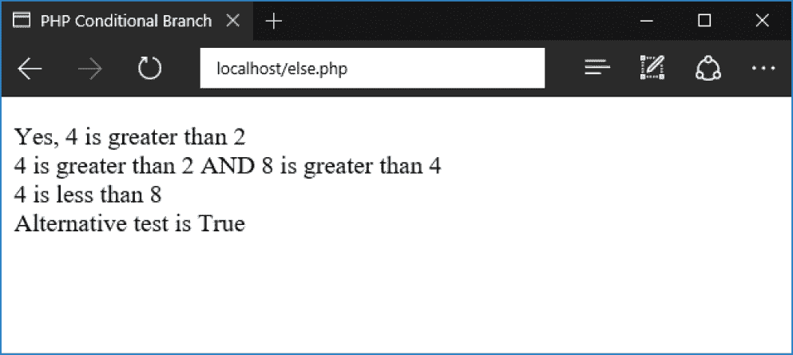


你可以嵌套条件**if**测试（在一个内部嵌套另一个），使得内部块中的语句只有在两个测试都被判定为**TRUE**时才会执行。

## 切换分支

当测试表达式仅评估一个条件时，通过多个**if-elseif-else**语句执行的条件分支可以通过**switch**语句更高效地完成。

**switch**语句的工作方式很寻常。它接受一个给定的值作为参数，然后尝试从多个**case**语句中匹配该值。找到匹配时要执行的代码包含在每个**case**语句中。

用`break`关键字语句结束每个**case**语句是非常重要的，这样**switch**语句在找到匹配项后就会退出，不再寻找其他匹配项——除非这是刻意的要求。

可选地，**case**语句列表后面可以跟一个最终的**default**语句，以指定在任何**case**语句中未找到匹配项时执行的代码。因此，switch 语句的语法通常如下：

```php
switch ( test-value )
{
    case match-value : statements-to-execute-when-matched ; break ;
    case match-value : statements-to-execute-when-matched ; break ;
    case match-value : statements-to-execute-when-matched ; break ;
    default : statements-to-execute-when-no-match-found ;
}
```

 包含**default**语句始终是一个好主意——即使只是在**switch**语句失败时输出一条错误消息。

一个**switch**语句可以有很多**case**语句，但没有两个**case**语句可以尝试匹配相同的值。

当多个匹配值需要执行相同的语句时，只需要最后的**case**语句包含要执行的语句和退出**switch**语句块的`break`语句。例如，为匹配值为 0、1 和 2 输出相同的消息：

```php
switch ( $number )
{
    case 0 :
    case 1 :
    case 2 : echo ‘Less than 3’ ; break ;
    case 3 : echo ‘Exactly 3’ ; break ;
    default : echo ‘Greater than 3 or less than zero’ ;
}
```

 **default**语句不需要出现在**switch**块的末尾，但将其放在那里是有逻辑，因为那里不需要`break`语句。


switch.php

 在 PHP 标签之间，使用初始化两个整数和字符值变量的语句开始脚本。

```php
<?php
$number = 2 ; $letter = ‘B’ ;
```

 接下来，添加一个**switch**语句来匹配整数值。

```php
switch ( $number )
{
    case 1 : echo ‘Number is One<br>’ ; break ;
    case 2 : echo ‘Number is Two<br>’ ; break ;
    case 3 : echo ‘Number is Three<br>’ ; break ;
    default : echo ‘Number is Unrecognized<br>’ ;
}
```

 现在，添加一个**switch**语句来匹配字符值。

```php
switch ( $letter )
{
    case ‘A’ : echo ‘Letter is A<br>’ ; break ;
    case ‘B’ : echo ‘Letter is B<br>’ ; break ;
    case ‘C’ : echo ‘Letter is C<br>’ ; break ;
    default : echo ‘Letter is Unrecognized<br>’ ;
}
```

 最后，添加一个语句，当测试的表达式被判定为**TRUE**或**FALSE**时，输出结果。

```php
{ echo ‘4 is greater than 2 AND 8 is greater than 4<br>’ ; }
```

`while`循环是上一个示例中的`for`循环的替代方案。`while`循环也需要初始化器、测试表达式和更新器，但这些并不像`for`循环那样整齐地列在一对括号内。

*本章将演示如何在函数中创建可重用的代码块。*

## 定义函数

PHP 提供了许多内置函数，您可以在脚本中通过名称调用这些函数来执行预定义的操作，例如此处描述的数组排序函数。此外，您也可以根据需要创建自己的自定义函数，以便在调用时执行指定的操作。这非常有用，允许 PHP 脚本模块化为更易理解和维护的代码段。


您的自定义函数名可以包含字母、数字和下划线字符的任意组合，但必须以字母或下划线开头。可以理解的是，为了避免冲突，名称不能与现有的内置函数名重复，例如，您不能创建一个名为“sort”的自定义函数。

与 PHP 变量不同，函数名是**不区分大小写**的，因此`cube()`、`Cube()`和`CUBE()`都可以引用同一个函数。尽管如此，建议您始终使用与函数定义时相同的大小写形式。

在 PHP 脚本中，创建函数定义只需在`function`关键字后写出函数名，然后跟着括号和花括号，花括号包含每次调用该函数时要执行的语句：

```php
function function_name()
{
    statement-to-be-executed ;
    statement-to-be-executed ;
    statement-to-be-executed ;
}
```


PHP 变量名是区分大小写的，但 PHP 函数名不区分。

PHP 脚本随后可以使用`function_name()`通过名称调用定义的函数，并在需要时执行其包含的语句。尽管解释器从上到下运行脚本，但函数调用可以出现在函数定义之前。然而，这并不是良好的编程习惯，因此您应该在调用函数之前定义它们。

函数可以包含任何有效的 PHP 脚本代码，甚至可以包含另一个函数定义。在这种情况下，只有在被调用时内部函数才存在。


 创建一个 PHP 脚本，通过一个语句来定义函数

```php
<?php
function greet()
{
    echo 'Hello!';
}
```

 接下来，添加一个语句来调用函数

```php
greet();
```

 现在，定义一个包含另一个语句的函数，通过引用传递数据

```php
function outer()
{
    function inner()
    {
        echo 'Inner function';
    }
}
```

 最后，添加一个语句来调用函数，传递变量值

```php
outer();
?>
```


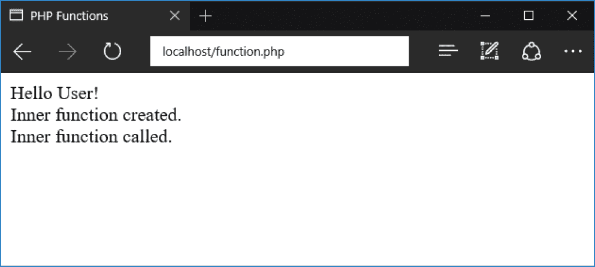

## 传递参数


 参数可以以这种方式传递到函数，例如向内置函数传递数据

 参数在函数定义中指定如下：

```php
function function_name($arg_1, $arg_2, $arg_3)
{
    // Statements to be inserted.
}
```

 参数名称应遵循命名规范，并在理想情况下使用

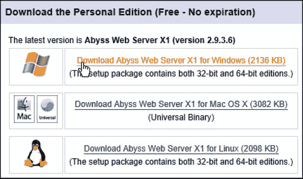 重要的是要意识到，默认情况下，数据是**按值传递**的。这意味着传递到函数的是该变量的副本。修改该变量不会影响存储在变量中的原始数据。

如果您想让函数修改存储在变量中的数据，必须通过**引用传递**。要确保参数始终通过引用传递，只需在函数定义中的参数名前加上`&`。


`arguments.php`

 创建一个 PHP 脚本，通过一个语句初始化两个相同的整数变量：

```php
<?php
$a = $b = 5;
```

 接下来，定义一个接受两个整数参数的函数——一个按值传递，另一个按引用传递：

```php
function modify(int $val, int &$ref)
{
    echo “Passed values : $val , $ref <br>” ;
    $val ++;
    $ref ++;
    echo “Incremented values : $val , $ref <hr>” ;
}
```

 在函数块之后添加一个语句来调用函数，将变量值作为参数：

```php
modify($a, $b);
```

 最后，添加一个语句来显示现在存储在每个变量中的值：

```php
echo “Stored values : $a , $b ” ;
?>
```


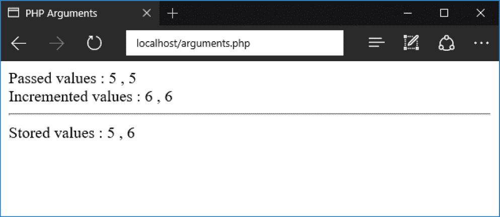

## 可变参数

默认参数值可以在函数定义中通过给参数名赋值来可选地指定，如下：

```php
function function_name($arg_1, $arg_2 = “Default String”)
{
    statement-to-be-executed ;
    statement-to-be-executed ;
    statement-to-be-executed ;
}
```

这允许在进行函数调用时指定一个或两个参数值。如果只指定了一个参数，它会被赋值给第一个参数，而第二个参数将使用默认值。在为参数指定默认值的情况下，它们必须仅出现在没有指定默认值的参数之后（即右侧）的参数列表中。否则，缺少正确总参数数量的调用会导致错误。


如果指定了多个默认值，目前没有方法在函数调用中跳过某个参数，以便为特定参数分配参数值。

如果你需要创建一个接受未知数量参数的函数，PHP 有一个专门的 `...`“散列”（splat）运算符用于此目的。它可以像这样用在函数定义中：

```php
function function_name ( ...$args ) 
{
    statement-to-be-executed ;
    statement-to-be-executed ;
    statement-to-be-executed ;
}
```

当在函数定义中使用 `...` 散列运算符作为参数名的前缀时，可以将多个参数传递给该参数以创建一个数组。该数组可以像其他数组一样被遍历，以处理传入的参数值。

此外，`...` 散列运算符可以用于“解包”函数调用指定的数组，将其元素值作为单独参数传递，如下所示：

```php
function function_name ( $*arg_1 , $*arg_2 , $*arg_3 ) 
{
    echo $*arg_1 + $*arg_2 + $*arg_3 ;
}

$arr = [ 1 , 2 , 3 ] ;
function_name ( ...$arr )      # 输出 6
```


`...` 散列运算符有时也被称为“传播”（scatter）运算符。


`parameters.php`

 通过定义一个函数开始 PHP 脚本，为它的两个参数提供默认字符串值：

```php
<?php
function drink ( string $tmp = ‘hot’ , string $flavor = ‘tea’ )
{
    // 在此处插入语句。
}
```

 接下来，插入一条语句来显示其默认值或传入的参数值：

```php
echo “Drinking $tmp $flavor .<br>” ;
```

 在函数块之后，添加可选传递字符串参数的函数调用：

```php
drink () ; drink ( ‘iced’ ) ; drink ( ‘cold’ , ‘lemonade’ ) ;
```

 现在，定义一个接受多个整数参数的函数并显示它们的总和：

```php
function add ( int ... $numbers )
{
    $total = 0 ;
    foreach( $numbers as $num ) { $total + = $num ; }
    echo “<hr>Total : $total ” ;
}
```

 最后，在函数块之后添加一条语句调用上一步的函数并传递三个值：

```php
add ( 1 , 2 , 3 ) ;
?>
```

 将文档保存到 Web 服务器的 `/htdocs` 目录并命名为 `parameters.php`，然后通过 HTTP 打开页面以查看参数和默认值。

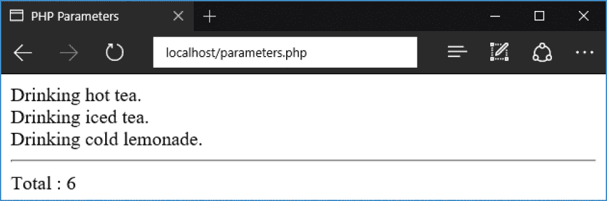


你可以在使用 `...` 散列运算符的接受多个参数的参数之前指定普通的位置参数。只有数量超过位置元素的参数才会被添加到最后一个参数的数组中。

## 识别作用域

在创建自定义函数时，理解变量的可访问性如何受变量“作用域”的限制至关重要：

- 在函数外部创建的变量具有“全局”作用域，但通常无法从任何函数块内部访问。

- 在函数内部创建的变量具有“本地”作用域，因此只能在该特定的函数块内部访问。

由于在函数内部创建的变量无法从别处访问，它的名称可以与函数块外部的变量或另一个函数块内部的变量名重复而不会产生冲突。这允许全局变量包含与同名局部变量不同的值。


PHP 中的全局变量不像 C 等其他编程语言（在 C 语言中，全局变量对函数自动可用）。在 PHP 中，只有在先在函数块内部使用 `global` 关键字显式声明后，全局变量才能在函数中使用。

如果你想在函数内部使用全局变量，必须先包含带有 `global` 关键字的语句来声明该变量名指向一个全局变量，如下：

```php
global variable-name ;
```

通过在函数内部创建的变量的声明之前加上 `global` 关键字，可以更改其作用域使其全局可用——但这是一种坏习惯，应该尽量避免。

函数语句可以调用其他函数来执行它们的语句，也可以调用自己来执行递归。与循环一样，递归函数必须改变测试条件的状态，以便其不会永远持续下去。这可能是一个从参数传入的计数器值。

与局部变量不同（局部变量在程序离开函数时会丢失值），静态变量会保留其值。这意味着函数可以像这样增加值：

```php
static variable-name ;
```

否则，递归函数可能会引用全局变量直到超过测试。


`scope.php`

 通过初始化全局变量并显示它开始 PHP 脚本：

```php
<?php
$number = 1 ;
echo “Global number : $number <br>” ;
```

 接下来，定义并调用一个初始化局部变量并显示它的函数：

```php
function show_local ()
{
    $number = 100 ;
    echo “Local number : $number <hr>” ;
}
show_local ()
```

 现在，定义并调用一个递归函数来增加全局变量和静态变量：

```php
function recur ()
{
    global $number ;
    static $letter = ‘A’ ;
    if( $number < 14 )
    {
        echo “ $number : $letter | “ ;
        $number ++ ; $letter ++ ;
        recur () ;
    }
}
recur () ;
```

 最后，在函数块之后添加一条语句显示修改后的全局变量：

```php
echo “<hr>Global number : $number ” ;
?>
```

 将文档保存到 Web 服务器的 `/htdocs` 目录并命名为 `scope.php`，然后通过 HTTP 打开页面以查看全局和局部变量值。


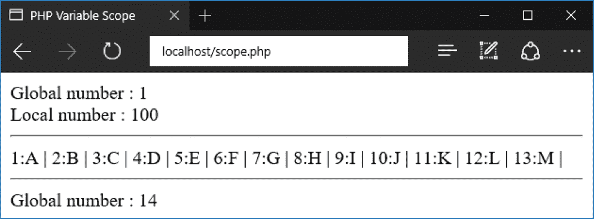

如果你从此函数中移除 `static` 关键字，则每次调用函数时 `$letter` 变量都将包含 ‘A’。


PHP 还有一个特殊的 `$GLOBALS` 数组，可以通过其名称引用全局变量的值。在示例中，你可以替代地使用 `$GLOBALS[‘number’]` 来获取值。

## 返回值

自定义 PHP 函数可以通过添加使用 `return` 关键字的语句向调用者返回一个值，如下：

```php
function function_name ( ) 
{
    statement-to-be-executed ;
    statement-to-be-executed ;
    return value ;
}
```

`return` 语句是可选的，如果省略，函数默认向调用者返回 `NULL` 值。

函数只能向调用者返回一个项目，因此它们不能返回多个值。然而，你可以将多个值赋值给数组的元素，并让函数向调用者返回单个数组，然后解包这些值。

`return` 语句可以包含一个待评估的表达式，以便其单一结果将返回给调用者。例如：

```php
function square( int $number )
{
    return $number * $number ;
}

echo square( 3 ) ; # 输出 9
```

为了确保函数只返回所需数据类型的值，函数声明中可以可选地指定返回类型描述，例如 `int`、`float`、`string`、`bool` 或 `array`，如下：

```php
function *function_name ( ) : int
{
    statement-to-be-executed ;
    statement-to-be-executed ;
    return value ;
}
```

当指定了返回数据类型时，尝试向调用者返回错误数据类型的函数将导致错误。


指定返回数据类型的能力是 PHP 7 的一个新特性。


`return.php`

 通过定义一个必须只返回数据数组的函数开始 PHP 脚本：

```php
<?php
function supply () : array
{
    // 在此处插入语句。
}
```

 接下来，插入一条语句返回一个包含四个混合值的数组：

```php
return array ( 75 , 3.142 , ‘Super PHP’ , True ) ;
```

 函数之后，添加一条调用该函数并将返回的数组值赋值给变量的语句：

```php
$array = supply () ;
```

 最后，添加一个循环来显示函数返回的每一个值：

```php
foreach( $array as $data )
{
    echo “Element Value : $data <br> ;
}
?>
```

 将文档保存到网络服务器的 `/htdocs` 目录并命名为 `return.php`，然后通过 HTTP 打开页面查看返回的值。

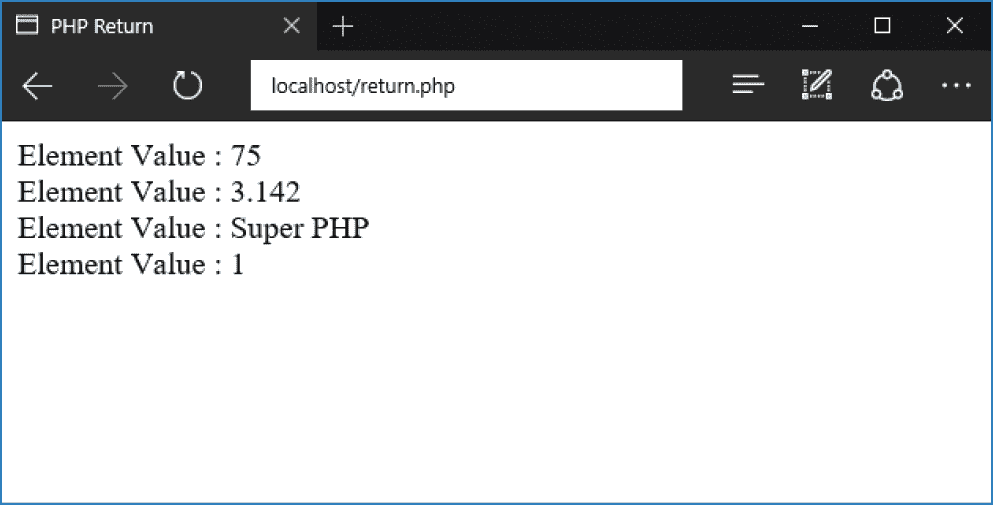


在 PHP 中，布尔值 `TRUE` 在数值上表示为 1。

## 回调

PHP 允许你创建在函数定义中没有指定名的“匿名”函数。与其他函数一样，如果指定了参数，它们可以接受参数，并且在调用时可以可选地返回一个值。与其他代码构造的函数定义不同，匿名函数定义是一个表达式。这意味着每个匿名函数定义必须以分号结束，如下：

```php
function ( )
{
    statement-to-be-executed ;
    statement-to-be-executed ;
    return value ;
} ;
```


不要忘记在每个匿名函数定义后添加终止的 `;` 分号。

匿名函数本身用处不大，因为没有名称，它无法被调用，但它可以在其他方面很有用：

- 赋值给变量，匿名函数可以使用变量名进行调用。
- 作为可调用参数传递给另一个函数，匿名函数稍后可以作为“回调”调用。
- 从函数返回，匿名函数在“闭包”中保留对返回函数变量的访问权限。

通过将匿名函数赋值给变量，你实际上给函数起了一个名字，并可以像调用任何其他函数一样使用变量名来调用它并传递参数。同样，当你将匿名函数传递给另一个函数时，可以像调用任何其他函数一样使用参数名进行回调并传递参数。PHP 的 `use` 关键字和 `&` 符号前缀允许匿名函数引用返回函数中的局部变量。


`callback.php`

 通过向变量赋值一个接受单个参数的匿名函数开始 PHP 脚本：

```php
<?php
$hello = function ( $user ) { echo “Hello $user !<br> ; } ; ;
```

 接下来，添加一条调用匿名函数并传递单个参数的语句：

```php
$hello ( ‘Mike’ ) ;
```

 现在，定义一个接受单个可调用参数的普通函数，并调用该函数传递一个字符串：

```php
function greet ( callable $anon )
{
    $anon ( ‘Carole Anne’ ) ;
}
```

 添加一条语句调用上一步定义的函数，并传递第一步中赋值给变量的匿名函数：

```php
greet( $hello ) ;
```

 接下来，定义另一个普通函数，它有一个局部变量并返回一个引用该局部变量值的匿名函数：

```php
function meet () : callable
{
    $time = ‘morning’ ;
    return function( $name ) use( & $time )
    { return “Good $time , $name !” ; } ;
}
```

 将上一步定义的函数赋值给变量，然后调用该函数：

```php
$meeting = meet () ;
echo $meeting ( ‘Susan’ ) ;
?>
```

 将文档保存到网络服务器的 `/htdocs` 目录并命名为 `callback.php`，然后通过 HTTP 打开页面查看返回的值。

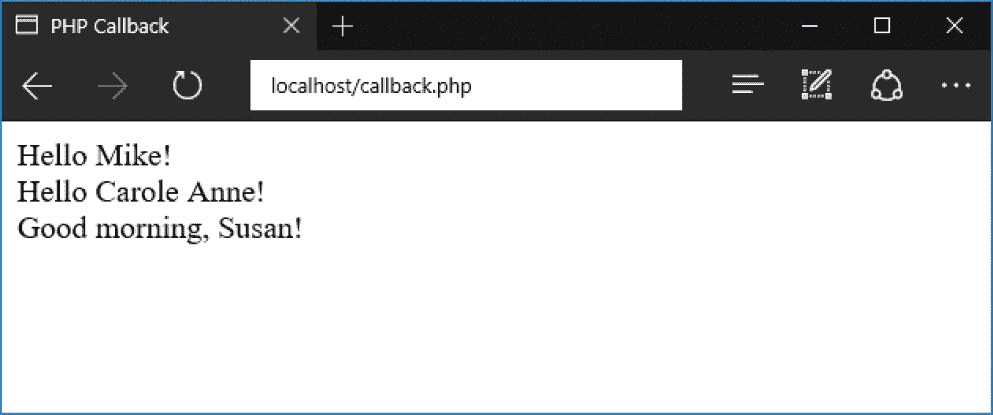

 记得包含前缀以创建变量的引用。

 注意到最后的调用获取了‘morning’字符串。

## 总结

- 自定义函数允许将 PHP 脚本模块化为更容易理解和维护的部分。
- 函数名必须以字母或下划线开头，且不区分大小写。
- 函数通过在 `function` 关键字后指定名称、括号以及包含语句的大括号来定义。
- 参数的函数通过括号内包含逗号分隔的参数列表来定义。
- 函数定义可以通过在参数名之前包含数据类型来指定调用者传递的数据类型。
- 参数数据通常按值传递，但如果参数名赋予 `&` 则可以按引用传递。
- 默认参数值可以通过对参数名赋值来可选地指定。
- 当参数名赋予 `...` 展开运算符时，可以将多个参数传递给该参数以创建一个数组。
- 外部创建的变量具有全局作用域，但在函数内部除非使用 `global` 关键字无法访问。
- 内部创建的变量具有局部作用域，因此仅在该函数块内部可见。
- 局部变量在程序范围离开函数时会丢失值，但 `static` 变量会保留其值。
- `return` 关键字向调用者返回一个项目，且函数定义可以可选地指定返回数据类型。
- 匿名函数定义没有指定名称但是一个表达式，因此必须以 `;` 分号结束。


- `use` 关键字和 `&` 符号前缀允许匿名函数引用返回函数中的局部变量

# 6 处理字符串

*本章演示了在 PHP 脚本中处理文本字符串的各种方法。*

## 内容

- 比较字符
- 搜索文本
- 提取子字符串
- 更改大小
- 格式化字符串
- 制作日期
- 编码实体
- 总结

## 比较字符

PHP 提供了许多内置函数来对两个文本字符串进行比较。简单的 `strcmp()` 函数接受两个字符串参数进行比较，并根据结果返回三个整数值之一。当字符串完全匹配时，`strcmp()` 将返回 `0`。当第一个字符串参数大于第二个参数时，`strcmp()` 返回 `1`，但当第一个字符串参数小于第二个参数时，`strcmp()` 返回 `-1`。


严格来说，`strcmp()` 返回的值将是正整数、零或负整数——但通常的值为 `1`、`0` 或 `-1`。

`strncmp()` 函数的工作方式类似，但它额外接受第三个整数参数，用于指定从字符串开始要比较的字符数。

`strcmp()` 和 `strncmp()` 函数在比较字符串时对大写字母和小写字母赋予了不同的重要性。如果你倾向于忽略大小写，可以使用相应的辅助函数 `strcasecmp()` 和 `strncasecmp()` 来代替它们。

为了理解这四个比较函数的结果，了解比较实际上是如何进行的是非常有用的。每个字符都有一个标准的数值“ASCII”值，其中小写字母 a-z 的范围是 97-122，大写字母 A-Z 的范围是 65-90。比较每个范围内的第一个值，我们发现“a”（97）大于“A”（65）。将这些作为参数提供给 `strcmp()` 函数，它将返回 `1`，因为第一个参数大于第二个参数。相反，如果你指定“A”（65）作为第一个参数，将“a”（97）作为第二个参数，那么 `strcmp()` 函数将返回 `-1`，因为第一个参数小于第二个参数。在字符串比较中，每个字符都按顺序进行比较，以确保包含相同字符但顺序不同的字符串不会被错误地视为相等。例如，比较“ABC”和“BAC”，第一个字符“A”（65）小于第一个字符“B”（66），因此 `strcmp()` 函数将返回 `-1`，因为第一个参数小于第二个参数。


ASCII 是美国信息交换代码（American Standard Code for Information Exchange）的缩写，它规定了通用的字符编码方案。

通过将字符作为 PHP `ord()` 函数的参数可以找到任何字符的 ASCII 值，而将字符串作为 PHP `strlen()` 函数的参数可以找到字符串的长度。


### `characters.php`


使用语句开始 PHP 脚本，初始化四个带有字符串值的变量：

```php
<?php
$str1 = ‘PHP In Easy Steps’ ;
$str2 = ‘PHP In Easy Steps’ ;
$str3 = ‘PHP Easy Steps’ ;
$str4 = ‘php in easy steps’ ;
```


接下来，添加语句比较这些字符串：

```php
echo “’$str1’ versus ‘$str2’ : “ .strcmp( $str1 , $str2 ). ’<br>’ ;
echo “’$str1’ versus ‘$str3’ : “ .strcmp( $str1 , $str3 ). ’<br>’ ;
echo “’$str1’ versus ‘$str4’ : “ .strcmp( $str1 , $str4 ). ’<hr>’ ;
```


现在，添加一个语句进行不区分大小写的比较：

```php
echo ‘Comparison Ignoring Case :<br>’ ;
echo “’$str1’ versus ‘$str4’ : “ .strcasecmp( $str1 , $str4 ) ;
```


最后，添加一个循环来计算并显示第一个字符串的总 ASCII 代码值：

```php
$total = 0 ;
for ( $i = 0 ; $i < strlen( $str1 ) ; $i ++ )
{
    $total += ord( $str1 [ $i ] ) ;
}
echo “<hr>ASCII Total $str1 : $total ” ;
?>
```


将文档保存到 Web 服务器的 `/htdocs` 目录并为 `characters.php`，然后通过 HTTP 打开页面查看字符串比较。

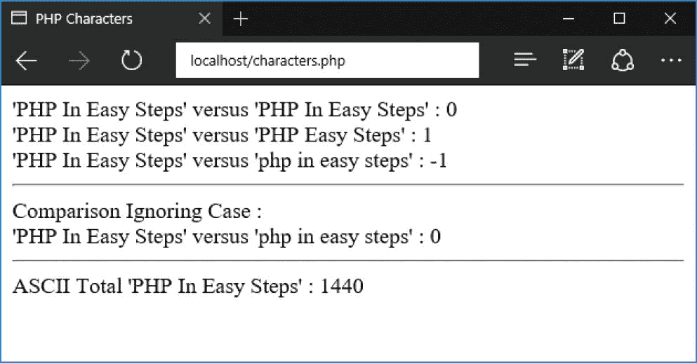


字符顺序是相关的，因为两个顺序不同的字符串的 ASCII 总和可能相等，但字符串并不匹配。

## 搜索文本

PHP 提供了许多内置函数来搜索字符串以找到指定的子字符串或单个字符。简单的 `strpos()` 函数接受两个参数，指定要搜索的字符串和要查找的子字符串。它将从字符串开始顺序搜索以找到匹配。当找到匹配项时，搜索停止，`strpos()` 返回一个整数，该整数是字符串中第一个匹配项开始的字符索引位置。当未找到匹配时，`strpos()` 返回 `FALSE`。

`strrpos()` 函数的工作方式类似，但它返回最后一个匹配开始的索引位置。`strstr()` 函数的工作方式类似，但它接受两个参数，指定要搜索的字符串和要查找的子字符串。它将从字符串开始顺序搜索以找到匹配。当找到匹配项时，搜索停止，`strstr()` 返回从第一次匹配开始的字符串剩余部分。当未找到匹配时，`strstr()` 返回 `NULL`。

`strrpos()` 函数的工作方式类似，但它返回最后一个匹配开始的索引位置。`strrstr()` 函数的工作方式类似，但它接受两个参数，指定要搜索的字符串和要查找的子字符串。它将从字符串末尾顺序搜索以找到匹配。当找到匹配项时，搜索停止，`strrstr()` 返回从第一次匹配开始的字符串剩余部分。当未找到匹配时，`strrstr()` 返回 `NULL`。

`strchr()` 函数的工作方式类似，但它接受两个参数，指定要搜索的字符串和要查找的单个字符。它将从字符串开始顺序搜索以找到匹配。当找到匹配项时，搜索停止，`strchr()` 返回从第一次匹配开始的字符串剩余部分。当未找到匹配时，`strchr()` 返回 `FALSE`。

`strrchr()` 函数的工作方式类似，但它接受两个参数，指定要搜索的字符串和要查找的单个字符。它将从字符串末尾顺序搜索以找到匹配。当找到匹配项时，搜索停止，`strrchr()` 返回从第一次匹配开始的字符串剩余部分。当未找到匹配时，`strrchr()` 返回 `FALSE`。

`strcasecmp()` 函数的工作方式类似，但它接受两个参数，指定要搜索的字符串和要查找的单个字符。它将从字符串开始顺序搜索以找到匹配。当找到匹配项时，搜索停止，`strcasecmp()` 返回一个整数。当未找到匹配时，`strcasecmp()` 返回 `FALSE`。

`strncasecmp()` 函数的工作方式类似，但它接受三个参数，指定要搜索的字符串、要查找的子字符串以及要比较的字符数。它将从字符串开始顺序搜索以找到匹配。当找到匹配项时，搜索停止，`strncasecmp()` 返回一个整数。当未找到匹配时，`strncasecmp()` 返回 `FALSE`。

`stristr()` 函数的工作方式类似，但它接受两个参数，指定要搜索的字符串和要查找的子字符串。它将从字符串开始顺序搜索以找到匹配。当找到匹配项时，搜索停止，`stristr()` 返回从第一次匹配开始的字符串剩余部分。当未找到匹配时，`stristr()` 返回 `NULL`。

`strnistr()` 函数的工作方式类似，但它接受三个参数，指定要搜索的字符串、要查找的子字符串以及要搜索的字符数。它将从字符串开始顺序搜索以找到匹配。当找到匹配项时，搜索停止，`strnistr()` 返回从第一次匹配开始的字符串剩余部分。当未找到匹配时，`strnistr()` 返回 `NULL`。

`strpos()` 函数的工作方式类似，但它接受三个参数，指定要搜索的字符串、要查找的子字符串以及开始搜索的起始位置。它将从指定位置顺序搜索以找到匹配。当找到匹配项时，搜索停止，`strpos()` 返回一个整数，是字符串中第一个匹配项开始的字符索引位置。当未找到匹配时，`strpos()` 返回 `FALSE`。

`strnpos()` 函数的工作方式类似，但它接受三个参数，指定要搜索的字符串、要查找的子字符串以及要搜索的字符数。它将从字符串开始顺序搜索以找到匹配。当找到匹配项时，搜索停止，`strnpos()` 返回一个整数，是字符串中第一个匹配项开始的字符索引位置。当未找到匹配时，`strnpos()` 返回 `FALSE`。

`strrpos()` 函数的工作方式类似，但它接受两个参数，指定要搜索的字符串和要查找的子字符串。它将从字符串末尾顺序搜索以找到匹配。当找到匹配项时，搜索停止，`strrpos()` 返回最后一个匹配开始的索引位置。当未找到匹配时，`strrpos()` 返回 `FALSE`。

`strrnpos()` 函数的工作方式类似，但它接受三个参数，指定要搜索的字符串、要查找的子字符串以及要搜索的字符数。它将从字符串末尾顺序搜索以找到匹配。当找到匹配项时，搜索停止，`strrnpos()` 返回最后一个匹配开始的索引位置。当未找到匹配时，`strrnpos()` 返回 `FALSE`。

可以通过将字符串以及子字符串在字符串中的索引位置作为 `substr()` 函数的参数，从字符串中提取子字符串。可选的第三参数参数指定子字符串的长度。你可以使用 `substr_replace()` 函数替换子字符串，通过指定字符串、子字符串、索引位置和长度参数。可以使用 `substr_count()` 函数找到子字符串在字符串中出现的次数：


### `substring.php`


开始一个 PHP 脚本，使用语句初始化一个带有字符串值的变量并统计子字符串：

```php
<?php
$str = ‘SQL in easy steps features SQL queries’ ;
echo “’ $str ’<br>’SQL’ Count: “ .substr_count( $str , ‘SQL’ ) ;
```


接下来，添加语句提取两个子字符串：

```php
echo ‘<hr>Index 27 : ‘ .substr( $str , 27 ) ;
echo ‘<hr>Index 4 Length 13 : ‘ .substr( $str , 4 , 13 ) ;
```


现在，添加语句初始化一个带有字符串的变量：

```php
$sub = ‘PHP & MySQL’ ;
```


最后，添加语句用新字符串值替换子字符串并显示修改后的字符串：

```php
$str = substr_replace( $str , $sub , 0 , 3 ) ;
echo “<hr>’ $str ’” ;
?>
```


将文档保存到浏览器的 `/htdocs` 目录并命名为 `substring.php`，然后通过 HTTP 打开页面查看提取的子字符串和修改后的字符串。

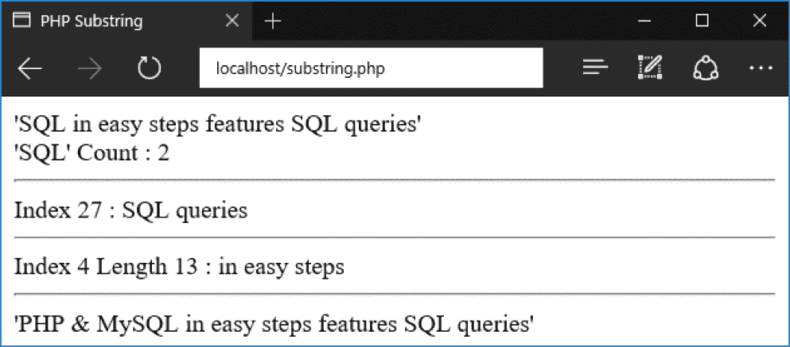


`substr_replace()` 中的长度参数指定了要替换的子字符串的长度。在这个示例中，它是 `3` —— 用于将三个字符 ‘SQL’ 替换为更长的字符串。

## 修改大小写

PHP 提供了相应的函数来轻松修改指定字符串参数的大小写。`strtolower()` 函数将所有字符转换为小写，而 `strtoupper()` 将它们全部转换为大写。此外，`ucfirst()` 函数仅使字符串的第一个字符大写，而 `ucword()` 函数则将字符串中每个单词的第一个字母大大写：


### `case.php`


开始一个 PHP 脚本，使用语句初始化一个带有字符串的变量并显示其值：

```php
<?php
$str = “C++ Programming in easy steps” ;
echo “Original String : ‘ $str ’ <hr>” ;
```


接下来，添加语句显示小写版本：

```php
$ver = strtolower( $str ) ;
echo “Lowercase String : ‘ $ver ’ <br>” ;
```


现在，添加语句显示大写版本：

```php
$ver = strtoupper( $str ) ;
echo “Uppercase String : ‘ $ver ’ <hr>” ;
```


最后，添加语句显示首字母大写版本和单词首字母大写版本：

```php
$ver = ucfirst( strtolower( $str ) ) ;
echo “Uppercase First String Character : ‘ $ver ’ <br> ;
echo ‘Uppercase First Word Character : ‘ .ucwords( $ver ) ;
?>
```


将文档保存到 Web 服务器的 `/htdocs` 目录并命名为 `case.php`，然后通过 HTTP 打开页面查看大小写转换的结果。


`ucfirst()` 函数仅使字符串的第一个字母大写，而 `ucword()` 函数将字符串中每个单词的第一个字母大写：


`strtolower()` 函数将所有字符转换为小写，而 `strtoupper()` 将它们全部转换为大写。

## 格式化字符串

PHP 提供了内置函数来方便地通过操作字符串来格式化字符串。`sprintf()` 函数可以格式字符串。`strrev()` 函数接受字符串并返回反转后的字符串。

`str_repeat()` 函数接受字符串，以及重复的次数，返回重复后的字符串。`str_pad()` 函数接受字符串、目标长度、填充字符以及填充方向，返回填充后的字符串。

`trim()` 函数可以接受字符串并移除其两侧的空白字符。同样，`ltrim()` 用于移除字符串开头的空白字符，而 `rtrim()` 则用于移除字符串结尾的空白字符。

`implode()` 和 `explode()` 函数可以用于将数组转换为字符串以及字符串转换为数组。例如，`explode()` 可以根据分隔符分割字符串。`implode()` 则可以将多个数组元素合并成单个字符串。


### `format.php`


开始一个 PHP 脚本，使用语句初始化一个字符串变量并显示其值：

```php
<?php
$str = ‘| String |’ ;
echo “Original String : $str ” ;
```


接下来，添加语句显示反转、重复和修剪后的字符串版本：

```php
echo ‘<hr>Reversed String : ‘ .strrev( $str ) ;
echo ‘<hr>Repeated String : ’ .str_repeat( $str , 3 ) ;
echo ‘<hr>Trimmed String : ‘ .trim( $str , ‘|’ ;
```


现在，添加语句显示带有星号填充的 30 字符字符串版本：

```php
$pad = str_pad( $str , 30 , ‘*’ , STR_PAD_LEFT ) ;
echo “<hr>Padded String : $pad ” ;
```


最后，添加语句按空格分割字符串并用省略号显示每个独立部分：

```php
echo ‘<hr>Split String : ‘ ;
$token = strtok( $str , ‘’ );
while ( $token )
{
echo “ $token ... “ ; $token = strtok( ‘’ ) ;
}
?>
```

|  |  |  |
|---|---|---|
| `F` | 月份全称 | February |
| `M` | 三字母缩写的月份 | Feb |
| `j` | 一位或两位数的日期 | 4 |
| `d` | 两位数的日期 | 04 |
| `l` | 星期全称 | Monday |
| `D` | 三字母缩写的星期 | Mon |
| `S` | 两个字母的序后缀 | th |
| `H` | 24 小时制的小时 | 14 |
| `i` | 分钟 | 45 |
| `s` | 秒 | 30 |
| `a` | 上午或下午 | am |


星期的全称选项是一个小写的“L”。


你可以在 PHP 官方文档在线手册`[php.net/manual](http://www.php.net/manual)`中发现更多`date()`函数的选项。

默认情况下，时区设置为协调世界时（UTC），但你可以通过将时区作为参数传递给`date_default_timezone_set()`函数来设置自己的时区，并使用`date_default_timezone_get()`查看当前设置的时区。

你还可以使用智能的`strtotime()`函数创建自己的时间戳。它可以接受日期字符串参数，并返回一个时间戳，该时间戳可以作为第二个参数提供给`date()`函数。`strtotime()`的参数可以是普通文本日期，例如“July 4, 2017”。此外，你还可以指定如“yesterday”、“+3months”或“next Wednesday”之类的参数，`strtotime()`函数将尝试解析并返回一个相应的时间戳。


`date.php`

 开始一个 PHP 脚本，使用语句显示当前日期、星期、时间以及当前默认时区。

```php
<?php
echo ‘Date : ‘ .date( ‘jS F Y’ ). ’<br> ;
echo ‘Day : ‘ .date( ‘l’ ). ’<br> ;
echo ‘Time : ‘ .date( ‘h:i:s a’ ). ’<br> ;
echo ‘Timezone : ‘ .date_default_timezone_get(). ’<hr> ;
```

 接下来，添加语句更改默认时区并显示确认，然后显示该处的当前时间。

```php
date_default_timezone_set( ‘America/New_York’ ) ;
echo ‘Timezone now : ‘ .date_default_timezone_get() ;
echo ‘<br>Time now : ‘ .date( ‘h:i:s a’ ). ’<hr> ;
```

 现在，添加语句为明天创建一个时间戳，然后显示它的星期名称和日期。

```php
$d = strtotime( ‘tomorrow’ ) ;
echo ‘Tomorrow : ‘ .date( ‘l, jS F Y’ , $d ). ’<br> ;
```

 最后，添加语句为一个难忘的日期创建一个时间戳，然后显示它的月份和日期数字。

```php
$d = strtotime( ‘July 11, 1994’ ) ;
echo ‘David\’s Birthday : ‘ .date( ‘F jS’ , $d ) ;
?>
```

 将文档保存在你 Web 服务器的`/htdocs`目录下的`date.php`中，然后通过 HTTP 打开页面以查看由选项格式化的日期字符串。

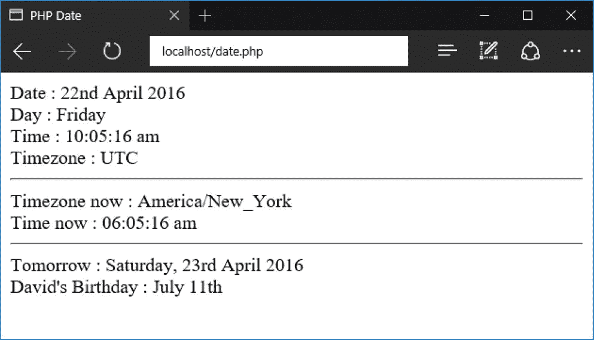


注意，你可以在格式字符串中包含分隔符，如`:`和`/`。


有些国家喜欢 M/D/Y 的日期顺序，而另一些国家喜欢 D/M/Y，因此你可以选择喜欢的日期格式。

### 实体编码

有两个 PHP 函数可以编码 HTML 代码，使所有具有特殊意义的字符或异常字符被“实体”替换。`htmlentities()`函数编码以下所有字符，每个字符都有对应的实体：

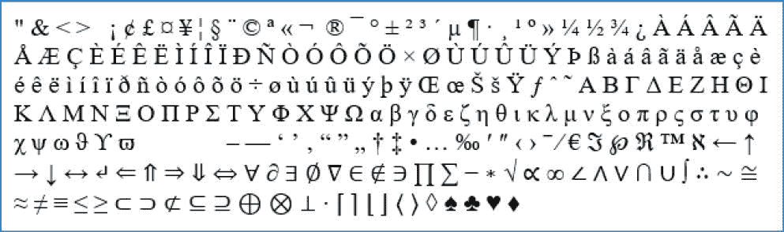


调用带有常量参数`HTML_ENTITIES`或`HTML_SPECIALCHARS`的 PHP 函数`get_html_translation_table()`，以返回所有表示字符的数组。

除非你担心非英语字符，否则通常建议使用另一种`htmlspecialchars()`函数，仅编码具有特殊 HTML 意义的字符：

- `&`符号——变成`&amp;`
- `“`双引号——变成`&quot;`
- `‘`单引号——变成`&#039;`
- `<`小号——变成`&lt;`
- `>`大号——变成`&gt;`

使用 PHP 编码 HTML 片段的一个很好的原因是防止恶意 JavaScript 代码被浏览器意外执行。将 HTML 标签编码为实体可以确保`<script>`标签不会被识别，因此其 JavaScript 代码内容不会被执行：


`date.php`

 开始一个 PHP 脚本，使用语句显示当前日期、星期、时间以及当前默认时区。

```php
<?php
echo ‘Date : ‘ .date( ‘jS F Y’ ). ’<br> ;
echo ‘Day : ‘ .date( ‘l’ ). ’<br> ;
echo ‘Time : ‘ .date( ‘h:i:s a’ ). ’<br> ;
echo ‘Timezone : ‘ .date_default_timezone_get(). ’<hr> ;
```

 接下来，添加语句更改默认时区并显示确认，然后显示该处的当前时间。

```php
date_default_timezone_set( ‘America/New_York’ ) ;
echo ‘Timezone now : ‘ .date_default_timezone_get() ;
echo ‘<br>Time now : ‘ .date( ‘h:i:s a’ ). ’<hr> ;
```

 现在，添加语句为明天创建一个时间戳，然后显示它的星期名称和日期。

```php
$d = strtotime( ‘tomorrow’ ) ;
echo ‘Tomorrow : ‘ .date( ‘l, jS F Y’ , $d ). ’<br> ;
```

 最后，添加语句为一个难忘的日期创建一个时间戳，然后显示它的月份和日期数字。

```php
$d = strtotime( ‘July 11, 1994’ ) ;
echo ‘David\’s Birthday : ‘ .date( ‘F jS’ , $d ) ;
?>
```

 将文档保存在你 Web 服务器的`/htdocs`目录下的`date.php`中，然后通过 HTTP 打开页面以查看由选项格式化的日期字符串。


注意，你可以在格式字符串中包含分隔符，如`:`和`/`。


有些国家喜欢 M/D/Y 的日期顺序，而另一些国家喜欢 D/M/Y，因此你可以选择喜欢的日期格式。

### 类与对象

类（class）是一种可以在单个实体中包含变量和函数的数据结构。这些统称为它的“成员”（members）——变量被称为类的“属性”（properties），函数被称为类的“方法”（methods）。

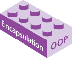

从类外部访问类成员的方法由类声明中的“访问修饰符”（access specifiers）控制。通常，这些修饰符会拒绝对类变量的访问，但允许访问可以在这些变量成员中存储和检索数据的方法。这种“数据隐藏”技术确保了存储的数据被安全地封装在类变量成员内部，是面向对象编程（OOP）的第一原则。

类声明以`class`关键字开始，后面跟着空格，然后是程序员指定的名称——遵循通常的 PHP 命名规范但以大写字母开头。接下来是类属性的声明，然后是类方法的声明。这些看起来和普通的变量和函数声明相似，但每个声明都应该以访问修饰符开头。类的声明语法如下：

```php
class ClassName
{
    access-specifier $var1, $var2, $var3;
    access-specifier functionName1($arg1, $arg2, $arg3)
    {
        statements-to-execute;
    }
}
```


按照习惯，类名以大写字母开头，对象名从小写字母开头。

访问修饰符可以是`public`、`private`或`protected`关键字之一，用于指定所列成员的访问权限：

- `public`成员可以在类可见的任何地方被访问。
- `private`成员仅对定义它的所在类中的其他成员可见。
- `protected`成员仅对同类中的其他成员以及该类派生类的成员可见。


派生类将在本章稍后部分介绍——请参见此处。

任何现实世界中的对象都可以通过它的属性和动作来定义。例如，狗有年龄、重量和颜色等属性，以及它可以执行的动作，如吠叫。PHP 中的类机制提供了一种在脚本中创建虚拟狗对象的方法，其中类属性可以代表它的属性，类方法可以代表它的动作：

```php
class Dog
{
    private $age;
    private $weight;
    private $color;
    public function bark() { echo ‘WOOF!’ ; }
    // 在此处添加用于在属性中存储数据的方法。
    // 在此处添加用于从属性检索数据的方法。
}
```


虽然 PHP 脚本类不能完美模拟真实世界的对象，但目标是将所有相关的属性和动作作为类属性和方法封装起来。

重要的是，类声明只定义了一个数据结构——为了创建一个对象，你必须声明该数据结构的一个“实例”（instance）。这通过使用`new`关键字将类的拷贝赋值给变量来实现，如下所示：

```php
$fido = new Dog(); // 创建一个名为“fido”的实例
// 这是程序员定义的
// “Dog”数据结构。
```

实例对象是原始类数据结构的一个工作副本，因此保留了它的所有特性。由于示例中的方法被声明为`public`，因此它在类声明之外脚本中是可见的。这意味着可以使用特殊的`->`对象运算符来调用实例拷贝的方法，如下所示：

```php
$fido->bark(); // 输出 WOOF!
```

`->`对象运算符可以用于引用任何可见的类成员，但上述示例中的变量属性被声明为`private`，因此被封装在对象内部，无法直接访问。PHP 编程中的封装原则描述了在类成员中将数据和功能组合在一起——在这个`Dog`类中，这些就是年龄、重量、颜色属性和`bark`（吠叫）动作。


注意，在创建实例对象的语句中，必须在类名后添加括号。

### 创建对象

为了从类的私有成员中分配和检索数据，必须向类添加特殊的`public`访问器方法。这些是用于分配数据的“setter”（设置）方法和用于检索数据的“getter”（获取）方法。访问器方法通常以它们处理的变量命名，并将首字母大写，并分别以“set”或“get”作为前缀。例如，处理`age`变量的访问器方法可以命名为`setAge()`和`getAge()`。

setter 和 getter 方法可以使用特殊的`$this`“伪变量”后跟`->`对象运算符和属性名来引用同类中的成员。例如，使用`$this->age`来引用年龄属性：


`object.php`

 以一个声明名为“Dog”的类的语句开始 PHP 脚本。

```php
<?php
class Dog
{
    // 在此处插入成员（步骤 2-5）。
}
```

 在类声明的大括号之间：

```php
class Dog
{
    private $age;
    private $weight;
    private $color;

    public function bark() { echo ‘WOOF!’ ; }

    public function setAge($yrs) {
        $this->age = $yrs;
    }

    public function getAge() {
        return $this->age;
    }

    public function setWeight($lbs) {
        $this->weight = $lbs;
    }

    public function getWeight() {
        return $this->weight;
    }

    public function setColor($fur) {
        $this->color = $fur;
    }

    public function getColor() {
        return $this->color;
    }
}
```

 添加`public` setter 方法为私有变量赋值。

```php
    public function setAge($yrs) {
        $this->age = $yrs;
    }

    public function setWeight($lbs) {
        $this->weight = $lbs;
    }

    public function setColor($fur) {
        $this->color = $fur;
    }
```

 添加`public` getter 方法从私有变量检索值。

```php
    public function getAge() {
        return $this->age;
    }

    public function getWeight() {
        return $this->weight;
    }

    public function getColor() {
        return $this->color;
    }
```

 在类声明中，注意所有方法都是公共的，所有变量都是私有的。

 在`Dog`声明之后，声明一个类的实例。

```php
$fido = new Dog();
```

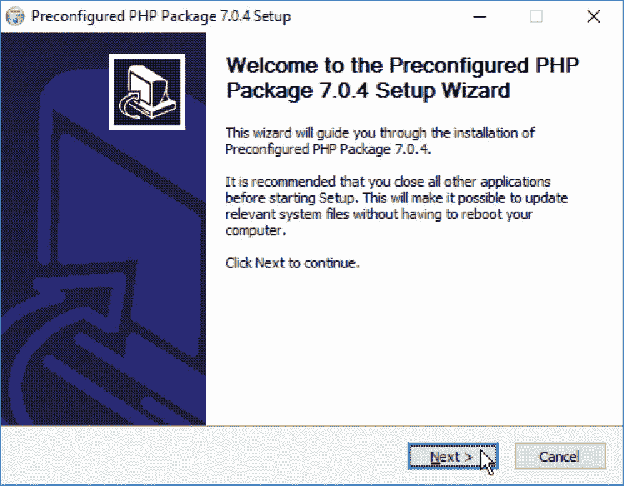 Fido

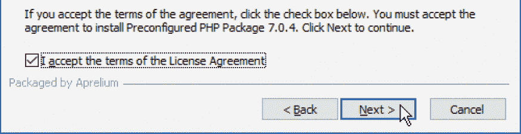 调用每个 setter 方法来分配数据。

```php
$fido->setAge(3);
$fido->setWeight(15);
$fido->setColor('brown');
```

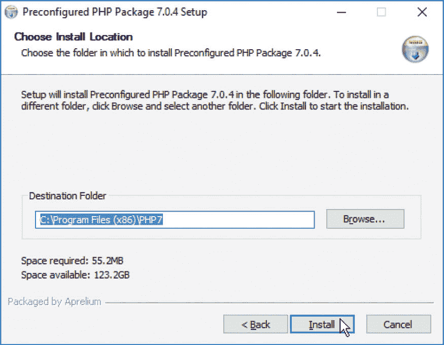 调用每个 getter 方法来检索分配的值。

```php
echo ‘Fido is a ‘ . $fido->getColor() . ‘ dog<br>’;
echo ‘Fido is ‘ . $fido->getAge() . ‘ years old<br>’;
echo ‘Fido weighs ‘ . $fido->getWeight() . ‘ pounds<br>’;
```

 现在，对普通输出方法进行调用。

```php
$fido->bark();
?>
```

 将文档保存到 Web 服务器的`/htdocs`目录并命名为`object.php`，然后通过 HTTP 打开页面查看类属性输出和方法调用。


PHP 7 的一项新功能是可以创建具有简单功能且没有名称的“匿名类”。例如，`$util = new class { public function log($s) { echo $s ; } } ;`，它可以通过`$util->log( ‘Data’ ) ;`进行调用。

 这个`object.php`脚本将在接几页中随着新功能的引入进行修改。

## 初始化成员

程序只需通过声明类的多个实例即可轻松创建多个对象，并且每个对象可以通过其 setter 方法分配单独值来拥有独特的属性。

将多个设置方法（setter methods）合并为一个接受每个私有变量参数的单一方法通常非常方便。这意味着在程序中可以使用一条语句为所有值赋值，但该方法内部将包含多个语句。

可选的是，每个参数可以为传递的每个参数指定允许的数据类型，并且还可以方便地为每个参数指定默认值：


`initializer.php`

 将上一个示例“object.php”的副本重命名为新程序`initializer.php`。

 在`Dog`类声明中，将三个设置方法替换为单一的组合设置方法，并指定参数的数据类型和默认值：

```php
public function setValues( int $yrs = 2 , int $lbs = 8 , string $fur = ‘black’ )
{
    // 在此处插入语句。
}
```

 在方法定义块中，插入三条语句，将传递参数的值赋值给类变量：

```php
$this-> age = $yrs ;
$this-> weight = $lbs ;
$this-> color = $fur ;
```

 修改类定义后，将对三个设置方法的调用替换为对组合设置方法的单一调用——传递三个参数：

```php
$fido -> setValues ( 3 , 15 , ‘brown’ ) ;
```

 声明名为“pooch”的`Dog`类的第二个实例：

```php
$pooch = new Dog () ;
```

 为组合设置方法添加第二次调用——为新对象传递三个参数：

```php
$pooch -> setValues ( 4 , 18 , ‘gray’ ) ;
```

 尝试向初始化方法传递错误的数据类型，以查看是否发生类型错误。

 添加调用每个获取方法（getter method）的语句，以检索已赋值的值：

```php
echo ‘<hr>Pooch: ‘ . $pooch -> getAge (). ’yrs’ ;
echo $pooch -> getWeight (). ’lbs ’ . $pooch -> getColor () ;
```

 添加第二次对普通输出方法的调用：

```php
$pooch -> bark () ;
```

 现在，声明名为“rover”的`Dog`类的第三个实例：

```php
$rover = new Dog () ;
```

 为组合设置方法添加第三次调用——这次为新对象未传递任何参数：

```php
$rover -> setValues ( ) ;
```

 添加调用每个获取方法的语句，以检索已赋值的值（这些值是指定的默认值）：

```php
echo ‘<hr>Rover: ‘ . $rover -> getAge (). ’yrs’ ;
echo $rover -> getWeight (). ’lbs ’ . $rover -> getColor () ;
```

 添加第三次对普通输出方法的调用：

```php
$rover -> bark () ;
```

 将文档保存到网络服务器的`/htdocs`目录并为`initializer.php`，然后通过 HTTP 打开页面查看组合初始化方法设置的输出。

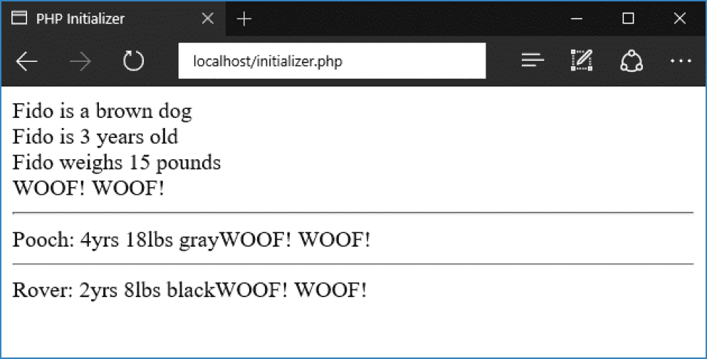


 你仍然必须在此处调用初始化方法，以便在不传递参数时将默认值分配给类变量。

### 使用构造函数

类变量成员可以通过特殊的“构造函数”方法初始化，该方法每当创建类的实例时就会被调用。构造方法始终始终命名为`__construct()`，并可以接受参数来设置类变量的初始值。


构造方法有一个配套的“析构方法”（destructor method）——它每当类的实例被销毁时就会被调用。析构方法始终命名为`__destruct()`。

构造方法和析构方法没有返回值且是自动调用的——它们不能被显式调用，因此它们的声明不需要访问修符。

初始化类变量的值在创建对象的语句中传递给构造方法，位于对象名称后的括号内：


`constructor.php`

 将上一个示例“initializer.php”的副本重命名为新程序`constructor.php`。

 在`Dog`类声明中，将`setValues`方法替换为此构造函数：

```php
function __construct( int $yrs = 2 , int $lbs = 8 , string $fur = ‘black’ )
{
    $this-> age = $yrs ;
    $this-> weight = $lbs ;
    $this-> color = $fur ;
}
```

 现在，添加一个简单的析构方法：

```php
function __destruct() { echo ‘<hr>Object Destroyed.’ ; }
```

 在`Dog`类声明后，编辑创建`fido`的语句：

```php
$fido = new Dog ( 3 , 15 , ‘brown’ ) ;
```

 同样，编辑创建`pooch`的语句：

```php
$pooch = new Dog ( 4 , 18 , ‘gray’ ) ;
```

 类定义也称为“实现”。

 同时编辑创建`rover`的语句：

```php
$rover = new Dog () ;
```

 虽然通过构造函数设置初始值，但随后可以设置方法。PHP 提供了几个函数来查询类，如`class_exists()`、`method_exists(class, method)`和`property_exists(class, property)`，它们在成功时返回`TRUE`。你还可以使用`get_class_vars()`和`get_class_methods()`获取类列表以查看“可见”成员：


```php
$items = get_class_vars( ‘Dog’ );
echo ‘<br>Dog variables : .count($items);
```


```php
echo ‘<br>Dog methods :’ ;
$items = get_class_methods( ‘Dog’ );
foreach( $items as $item ) { echo $item ; }
```

 将文档保存到网络服务器的`/htdocs`目录并为`constructor.php`，然后通过 HTTP 打开页面查看输出。

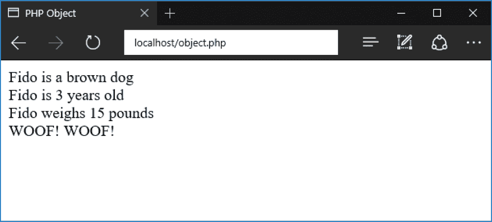 可见变量的数量为 0。临时将它们的访问修符改为`public`，查看其变为 3。

### 属性继承

PHP 类可以作为一个全新的类创建（如之前的示例所示），也可以从现有类“派生”（derived）。重要的是，派生类会继承其所派生的父类（基类）的成员——除了它自身的成员。

从基类继承成员的能力允许创建共享某些属性的派生类，这些属性是在基类中定义的。例如，一个“Polygon”基类可以定义所有多边形通用的宽度和高度属性。“矩形”和“三角形”类可以从多边形类派生——继承宽度和高度属性，加上它们定义独特特征的自身成员。

继承的优点非常强大，它是面向对象编程（OOP）的第二个原则。

派生类声明在类名后添加`extends`关键字，随后是其所派生的类名：


`inheritance.php`

 开始 PHP 脚本，声明一个名为“Polygon”的基类，该类具有两个由构造函数初始化的私有变量，并有两个公共的获取方法：

```php
<?php

class Polygon
{
    private $width , $height ;
    function construct( int $w = 4 , int $h = 5 )
    {
        $this-> width = $w ;
        $this-> height = $h ;
    }
    public function getWidth () { return $this-> width ; }
    public function getHeight () { return $this-> height ; }
}
```

 在`Polygon`类之后，声明一个派自`Polygon`类的“Rectangle”类并添加一个独特方法：

```php
class Rectangle extends Polygon
{
    public function area ()
    {
        return ( $this-> getWidth () * $this-> getHeight () ) ;
    }
}
```

 在`Rectangle`类之后，声明一个派自`Polygon`类的“Triangle”类并添加一个独特方法：

```php
class Triangle extends Polygon
{
    public function area ()
    {
        return ( $this-> getWidth () * $this-> getHeight () / 2 ) ;
    }
}
```

 在`Triangle`类之后，添加两条语句使用默认值创建每个派生类的实例：

```php
$rect = new Rectangle () ;
$trio = new Triangle () ;
```

 最后，添加两条语句输出由每个派生类的独特方法所返回的值：

```php
echo ‘Rectangle Area : ‘ . $rect -> area (). ’<hr>’ ;
echo ‘Triangle Area : ‘ . $trio -> area () ;
?>
```

 将文档保存到 Web 服务器的`/htdocs`目录中并命名为`inheritance.php`，然后通过 HTTP 打开页面以查看继承成员的输出。

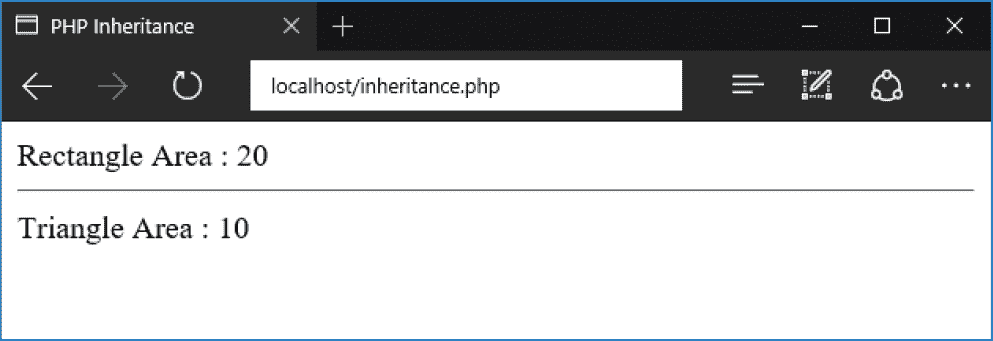


不要混淆类实例和派生类——实例是类的拷贝，而派生类是一个继承其所派生基类属性的新类。


在 PHP 中，派生类始终依赖于单个基类——不支持多重继承。

## 拥抱多态

面向对象编程 (OOP) 的三个基石是封装、继承和多态。在之前的页面中，我们已经看到数据如何被封装在 PHP 类中，以及派生类如何继承其基类的属性，因此现在我们可以探索最后一个基石级原则：多态。

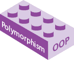

“多态”一词（源自希腊语，意为“多种形式”）描述了根据上下文为实体分配不同含义或目的的能力。例如，在现实世界中，每个人都知道如何使用推按钮（实体）——只需对其施加压力即可。然而，该按钮的作用取决于连接到它的东西（上下文），但结果不会影响该按钮的使用方式。

在面向对象编程的世界中，多态允许类在共享公共接口的同时具有不同的功能。接口不需要知道它正在使用哪个类，因为它们就像现实世界中的按钮一样，使用方式都相同，但可以产生不同的上下文结果。以此这样拥抱多态使程序员能够创建可以根据需求而非条件测试来选择的可交换对象。


PHP 接口类似于类，但使用`interface`关键字声明，并且只能包含方法定义，而不包含任何要执行的方法语句，如下：

```php
interface InterfaceName
{
    // 这里仅包含方法定义。
}
```

 接口声明中的方法定义也可以指定参数。

实现接口的每个类必须实现其定义的所有方法，并指定其要执行的语句。通过在声明中包含`implements`关键字和接口名称将类连接到接口，如下：

```php
class ClassName implements InterfaceName
{
    // 方法实现在这里。
}
```

可以通过添加一个接口和一个单函数来修改之前的示例以拥抱多态。


`polymorphism.php`

 将上一个示例的副本“inheritance.php”重命名为新程序“polymorphism.php”。

 声明一个名为“Shape”的接口，它包含已经在`Rectangle`和`Triangle`类中实现的方法定义：

```php
interface Shape { public function area () ; }
```

 编辑`Rectangle`和`Triangle`类声明的第一行——将它们与接口关联：

```php
class Rectangle extends Polygon implements Shape
class Triangle extends Polygon implements Shape
```

 在类块之后，添加一个接受`Shape`类型参数并调用其定义方法的函数：

```php
function getArea ( Shape $shape )
{ return $shape -> area () ; }
```

 修改创建每个派生类实例的两条语句——以传入参数值：

```php
$rect = new Rectangle ( 8 , 10 ) ;
$trio = new Triangle ( 8 , 10 ) ;
```

```php
echo ‘Rectangle Area : ‘ . $rect -> area (). ’<hr>’ ;
echo ‘Triangle Area : ‘ . $trio -> area () ;
```

 将文档保存到 Web 服务器的`/htdocs`目录中并命名为`inheritance.php`，然后通过 HTTP 打开页面以查看继承成员的输出。


### 发生了什么？

`getArea()`函数传递了一个实例作为参数。

`getArea()`函数调用了接口的方法。

输出由方法的实现返回。

## 总结

- PHP 类是一个可以包含变量和函数的数据结构。
- 类使用`class`关键字声明，可以包含成员变量属性和成员函数方法。
- 对类的访问由`public`、`private`或`protected`访问修饰符控制。
- 通过将变量属性声明为`private`来实现封装，使其值只能通过`public`方法访问。
- 为了创建对象，必须使用`new`关键字声明`class`的实例。
- 特殊的`->`对象运算符可以引用可见的类成员。
- Setter 和 getter 方法使用`$this`伪变量引用同类的成员。


- 单个 setter 方法可以分配多个参数值或默认值来初始化多个变量属性。
- `__construct()` 构造方法在类创建时调用，可用于初始化变量属性。
- `__destruct()` 析构方法在类销毁时调用，可用于执行最终语句。
- PHP 有函数可以检查类，使用 `get_class_methods()` 列出方法，使用 `get_class_vars()` 列出变量。
- 面向对象编程的三个基石是封装、继承和多态。
- 派生类声明将包含 `extends` 关键字，以指定从其继承的基类。
- 接口使用 `interface` 关键字声明，声明可能仅包含方法定义。
- 通过在声明中包含 `implements` 关键字和接口名称将类连接到接口。

# 附加文本（#text00010.html_sec58）

# 处理错误（#text00010.html_sec59）

# 捕获异常（#text00010.html_sec60）

# 总结（#text00010.html_sec61）

## 读取文件

读写位于 Web 服务器上的文件对于记录信息和提供页面内容非常有用。为了处理文件，必须首先使用 PHP 的 `fopen()` 函数创建一个“文件流”（filestream）对象。这需要两个参数：指定文件的名称或路径，以及文件“模式”。文件模式决定了要执行的操作性质，并将文件指针放置在文件内合适的位置：

| 文件模式 | 操作 |
| :--- | :--- |
| `r` | 打开现有文件进行读取。文件指针从文件开头开始 |
| `w` | 放弃现有文件的所有内容，如果不存在则创建一个新文件。文件指针从文件开头开始 |
| `a` | 打开现有文件并保留所有内容。文件指针从文件末尾开始 |
| `r+` | 打开文件进行读或写。文件指针从文件开头开始 |
| `w+` | 打开文件进行写或读。放弃现有文件的所有内容，如果不存在则创建一个新文件。文件指针从文件开头开始 |
| `a+` | 打开文件进行读或写并保留所有内容。文件指针从文件末尾开始 |


当文件模式指定符作为 `fopen()` 函数的参数提供时，必须出现在引号内。

一种良好的做法是始终使用 `die()` 函数提供一个备选方案，以防创建文件流失败。


作为 `die()` 函数的参数指定一条说明性消息。

当文件流被成功创建后，可以通过指定文件流和字节大小作为 `fread()` 函数的参数来读取文件。如果需要读取整个文件，使用 `filesize()` 函数来指定要读取的文件字节大小会非常方便。

在完成任何文件操作后，必须通过将文件流作为 `fclose()` 函数的参数来销毁它。

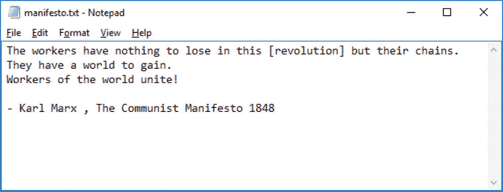


`read.php`

 开始一个 PHP 脚本，其语句尝试打开一个文本文件进行读取，或在失败时退出脚本。

```php
<?php
$filestream = fopen( ‘manifesto.txt’ , ‘r’ )
or die( ‘Unable to open file!’ ) ;
```

 接下来，添加一条语句在成功后读取文本文件并显示其全部内容。

```php
echo fread( $filestream , filesize( ‘manifesto.txt’ ) ) ;
```

 现在，记得关闭文件流。

```php
fclose( $filestream ) ;
```

 将文档保存到 Web 服务器的 `/htdocs` 目录并命名为 `read.php`，并与要读取的文本文件放在一起，然后通过 HTTP 打开页面，在浏览器窗口中显示文本文件内容。

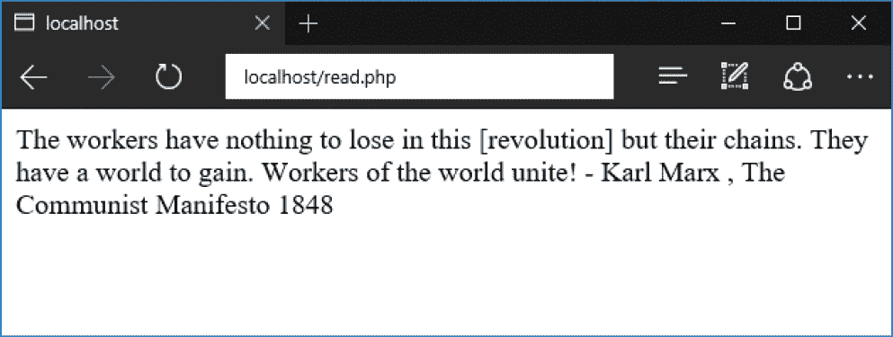


与 HTML 文档中的 PHP 块不同，纯 PHP 脚本不需要闭合标签 `?>`。


注意这里的输出没有保持行结束符——但上方的示例保留了。

## 读取行

一旦创建了“文件流”对象，就可以通过将文件流作为 PHP `fgets()` 函数的参数来逐行读取其内容。若要读取每一行，可以在循环中反复调用此函数。`feof()` 函数可以判断何时到达文件末尾并结束循环：

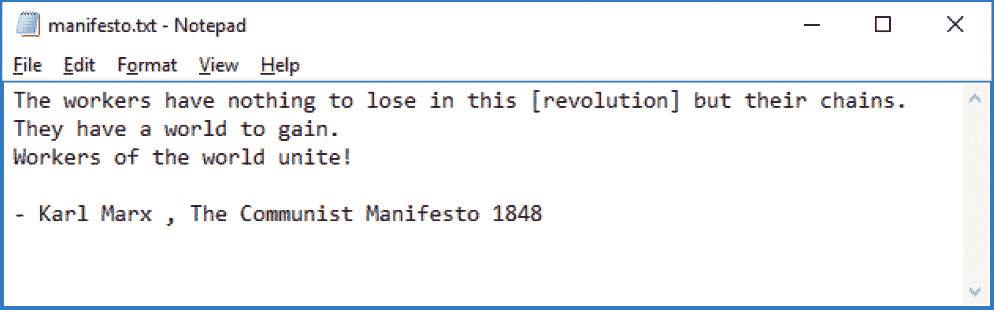


`feof()` 函数在到达文件末尾时返回 `true`。


`readlines.php`

 开始一个 PHP 脚本，其语句尝试打开一个文本文件进行读取，或在失败时退出脚本。

```php
<?php
$filestream = fopen( ‘manifesto.txt’ , ‘r’ )
or die( ‘Unable to open file!’ ) ;
```

 接下来，添加一个循环在成功后逐行读取文本文件并显示其全部内容。

```php
while( !feof( $filestream ) )
{ echo fgets( $filestream ). ’<br>’ ; }
```

 现在，记得关闭文件流。

```php
fclose( $filestream ) ;
```

 将文档保存到 Web 服务器的 `/htdocs` 目录并命名为 `readlines.php`，并与要读取的文本文件放在一起，然后通过 HTTP 打开页面查看文本文件。


## 读取字符

一旦创建了“文件流”对象，就可以通过将文件流作为 PHP `fgets()` 函数的参数来逐行读取其内容。若要读取每一行，可以在循环中反复调用此函数。`feof()` 函数可以判断何时到达文件末尾并结束循环：


`feof()` 函数在到达文件末尾时返回 `true`。


`readchars.php`

 开始一个 PHP 脚本，其语句尝试打开一个文本文件进行读取，或在失败时退出脚本。

```php
<?php
$filestream = fopen( ‘title.txt’ , ‘r’ )
or die( ‘Unable to open file!’ )
```

 接下来，添加一个循环在成功后逐字符读取文本文件并显示其全部内容。

```php
while( $char = getc( $filestream ) )
{ echo $char; }
```

 现在，记得关闭文件流。

```php
fclose( $filestream ) ;
```

 将文档保存到 Web 服务器的 `/htdocs` 目录并命名为 `readchars.php`，并与要读取的文本文件放在一起，然后通过 HTTP 打开页面查看文本。

## 写入文件

一旦以写入模式创建了“文件流”对象，就可以创建一个文本文件。可以通过指定文件流和文件名到 PHP `fwrite()` 函数写入文本。为了格式化文本，还可以写入不可打印字符来创建换行和制表：

| 字符 | 描述 |
| :--- | :--- |
| `\n` | 换行移动到下一行 |
| `\r` | 回车回到行首 |
| `\t` | 制表移动到下一个制表位 |


包含不可打印字符的字符串必须封装在双引号内，以便 PHP 解释它们。


`write.php`

 开始一个 PHP 脚本，其语句分配包含格式化不可打印字符的文本。

```php
<?php
$poem = “\r\n\tI never saw a man who looked” ;
$poem .= “\r\n\tWith such a wistful eye” ;
$poem .= “\r\n\tUpon that little tent of blue” ;
$poem .= “\r\n\tWhich prisoners call the sky” ;
```

 接下来，为要写入的文件分配名称。

```php
$filename = ‘poem.txt’ ;
```

 尝试创建一个写入的文本文件，或在失败时退出脚本。

```php
$filestream = fopen( $filename , ‘w’ )
or die( ‘Unable to open file!’ ) ;
```

 写入文件并显示总共写入多少字节的确认。

```php
$num = fwrite( $filestream , $poem ) ;
if( $num )
{
  echo “ $num bytes written to $filename ” ;
}
```

 现在，记得关闭文件流。

```php
fclose( $filestream ) ;
```

 将文档保存到您的 Web 服务器的 `/htdocs` 目录下并命名为 `write.php`，然后通过 HTTP 打开页面，以确认文本文件已写入。

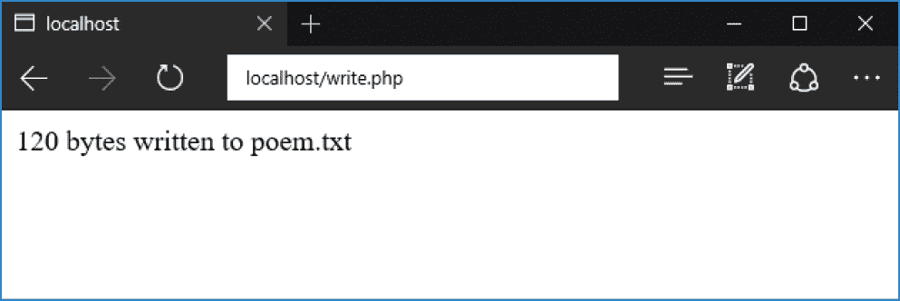

 使用文件资源管理器进入您的 Web 服务器的 `/htdocs` 目录，查看 PHP 脚本创建的文件。

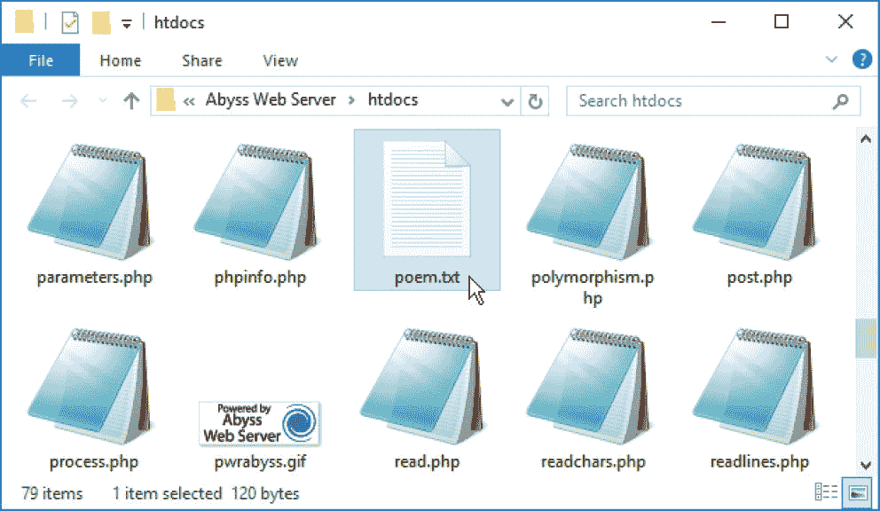

 打开文件查看 PHP 脚本写入的文本。

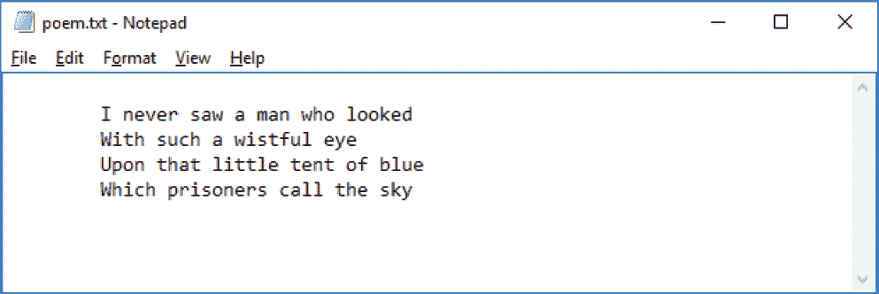


你可以反复运行此示例，每次它都会擦除内容然后重新写入。

## 追加文本

一旦创建了指定了追加模式的“文件流”对象，就可以打开文本文件并向其末尾添加文本。可以通过向 PHP 的 `fwrite()` 函数指定文件流和文件名来向文件中追加文本。该过程与写入文件相同，不同之处在写入文件之前，文件指针被置在现有内容的末尾：


`append.php`

 开始一个 PHP 脚本，使用语句分配文本，包括用于格式化的非打印字符。

```php
<?php
$info = "\r\n\r\n\tThe Ballad of Reading Gaol” ;
$info .= “r\n\t\t\tOscar Wilde 1898” ;
```

 接下来，为要写入的文件命名。

```php
$filename = ‘poem.txt’ ;
```

 尝试以追加模式打开纯文本文件，如果失败则退出脚本。

```php
$filestream = fopen( $filename , ‘a’ ) or die( ‘Unable to open file!’ ) ;
```

 写入文本并显示总共追加字节数的确认。

```php
$num = fwrite( $filestream , $info ) ;
if( $num )
{
    echo “ $num bytes appended to $filename ” ;
}
```

 现在，记得关闭文件流。

```php
fclose( $filestream ) ;
```

 将文档保存到您的 Web 服务器的 `/htdocs` 目录下并命名为 `append.php`，然后通过 HTTP 打开页面，以确认文本已追加到文件中。

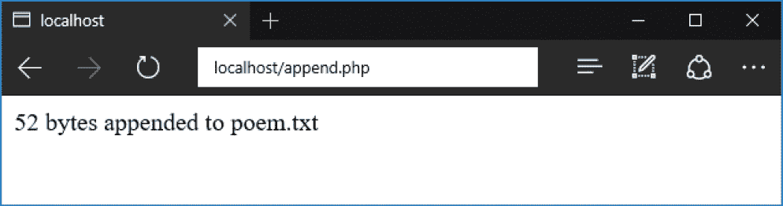


记住非打印字符必须包含在双引号中才能被解释。

 进入您的 Web 服务器的 `/htdocs` 目录并打开文件查看 PHP 脚本追加的文本。

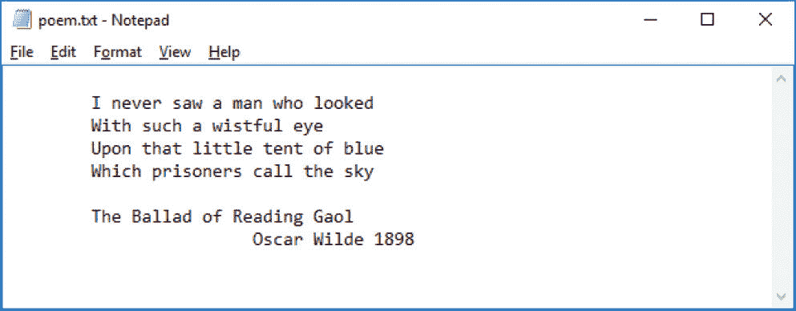

## 覆盖文本

需要重要的是，当您以写入模式写入现有文件时，它将覆盖任何现有内容：


`overwrite.php`

 开始一个 PHP 脚本，尝试以写入模式打开一个现有文本文件，如果失败则退出脚本。

```php
<?php
$filestream = fopen( ‘poem.txt’ , ‘w’ ) or die( ‘Unable to open file!’ ) ;
```

 成功后，向文件写入新文本。

```php
fwrite( $filestream , ‘Overwritten!’ ) ;
```

 现在，记得关闭文件流。

```php
fclose( $filestream ) ;
```

 将文档保存到您的 Web 服务器的 `/htdocs` 目录下并命名为 `overwrite.php`，然后通过 HTTP 打开页面并重新打开文本文件，查看其内容已被覆盖。

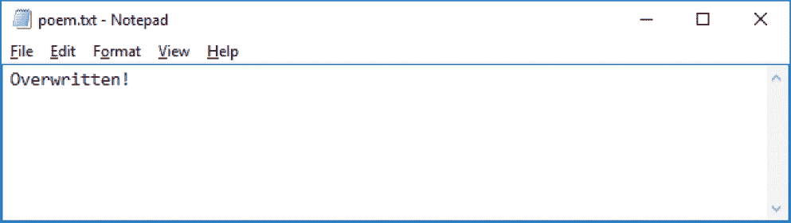

 写入文件时要小心，因为很容易不小心覆盖。

## 错误处理

你可以预测可能的错误并在使用 `die()` 函数或 `exit()` 函数在错误发生时终止正在运行的脚本。如果没有这种应急措施，默认 PHP 错误处理器在发生错误时会提供一条有用但不美观的消息。例如，使用 `fopen( ‘nonsuch.txt’ , ‘r’ )` 打开一个不存在的文件：

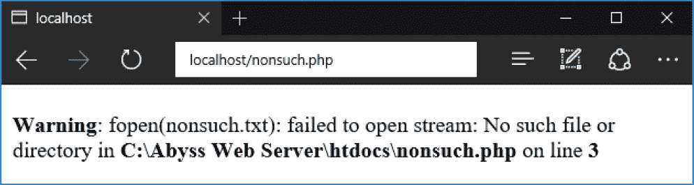


`die()` 和 `exit()` 函数在 PHP 中执行相同的操作，但它们的术语可能具有不同的吸引力。对于某些人来说，检测到错误时使用 `die()` 可能更合适，而 `exit()` 在其他场景下可能更适合退出。

在发生错误时终止脚本并不总是如所愿，但你可以创建一个自定义的错误处理器，以提供比默认 PHP 错误处理器更具用户友好的消息。自定义错误处理器仅仅是一个函数：

```php
function error_handler( $level, $message, $file, $line )
{
    switch( $level )
    {
        case 2: $str = "Warning";
        case 8: $str = "Notice";
        default: $str = "Error";
    }
    echo "$str: $message in $file on $line";
}
```

基础错误级别列表如下：

| 级别 | 常量 | 描述 |
| :--- | :--- | :--- |
| `2` | `E_WARNING` | 警告 |
| `8` | `E_NOTICE` | 通知 |
| `256` | `E_ERROR` | 错误 |
| `512` | `E_USER_WARNING` | 用户警告 |
| `1024` | `E_USER_NOTICE` | 用户通知 |
| `2048` | `E_USER_ERROR` | 用户错误 |

`set_error_handler()` 函数用于注册处理器。

现在我们可以使用 `trigger_error()` 函数手动触发错误。

```php
set_error_handler("error_handler");
trigger_error("这是一个自定义错误", E_USER);
```

 通过定义一个在条件测试失败时抛出异常的函数来开始 PHP 脚本。

```php
<?php
function check_size( $num )
{
    if( $num < 10 )
    { 
        throw new Exception( “Number : $num<br>Value must exceed 10” ) ; 
    }
}
?>
```

 预判特定的错误并报告异常。


```php
try { check_size( 5 ) ; }
catch( Exception $e )
{
    echo ‘<b>Size Exception!</b><br>’. $e->getMessage() .’<hr>’ ;
}
```


接下来，创建一个自定义异常处理器类：

```php
class CustomException extends Exception
{
    public function get_details ()
    {
        $details = ‘ File : ‘ . $this -> getFile ().
        ‘<br>Line : ‘ . $this -> getLine ().
        ‘<br>’ . $this -> getMessage() ;
        return $details ;
    }
}
```


现在，添加另一个在条件测试失败时抛出异常的函数：

```php
function check_parity ( $num )
{
    if( $num % 2 !== 0 )
    {
        throw new CustomException ( “Number : $num <br>Value must be even” ) ;
    }
}
```


最后，预判特定的错误并报告异常：

```php
try { check_parity ( 5 ) ; }
catch( CustomException $e )
{
    echo ‘<b>Parity Exception!</b><br>’ . $e -> get_details (). ’<hr>’ ;
}
```


将文档保存到 Web 服务器的`/htdocs`目录并命名为`exception.php`，然后通过 HTTP 打开页面以查看捕获的异常和适当的消息详情。

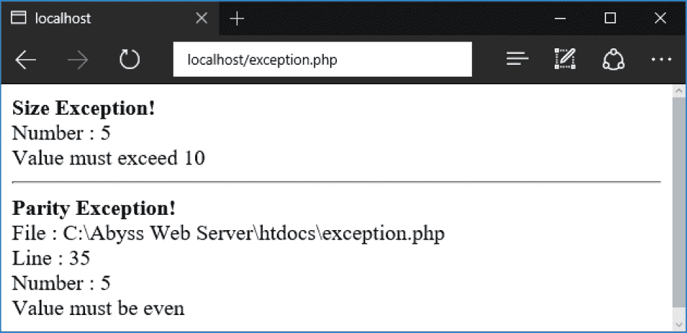


有关派生类和继承的更多信息请参阅此处。


`try`块可以包含多个`throw`语句以预判多种错误情况，并可以跟随多个`catch`块来处理这些异常。

## 总结

- `fopen()`函数用于创建文件流对象，需要两个参数来指定文件名和文件模式。
- 良好的做法是使用`die()`函数提供备选方案，以防创建文件流失败。
- `fread()`函数用于读取使用`r`模式创建的文件流，`filesize()`函数可以指定文件的字节大小。
- 在完成任何文件操作后，必须调用`fclose()`函数销毁文件流。
- `fgets()`函数可以用于逐行读取文件，`feof()`函数可以识别文件结束。
- `fgetc()`函数可以用于逐字符读取文件，并在文件末尾返回`false`。
- 可以通过将文件流和文件名作为参数传递给`fwrite()`函数向文件中写入文本。
- `fwrite()`函数使用`w`模式会覆盖现有文本，但在使用`a`模式时会追加文本。
- 可以指定函数名称作为`set_error_handler()`函数的参数，将其 own 自定义错误处理器。
- 错误处理器函数在错误发生时被调用，也可以使用`trigger_error()`函数显式调用。
- 当发生特定错误情况时，会抛出异常。
- 如果异常未被捕获，PHP 将其视为致命错误并发布未捕获异常消息。
- `try`代码块用于预判特定错误，其关联`catch`块用于确定当错误发生时脚本应如何继续。
- `Exception`类对象具有`getMessage()`、`getFile()`和`getLine()`方法，可以获取异常详情。
- 可以作为`Exception`类的派生类来创建自定义异常处理器，以提供自定义异常方法。

# 生成表单

*本章演示了如何使用 PHP 脚本处理 HTML 表单数据。*

- 执行操作
- 检查已设置的值
- 验证表单数据
- 过滤数据
- 发送隐藏数据
- 处理提交
- 制作粘性表单
- 上传文件
- 表单外框
- 追加数据
- 总结

## 执行操作

表单提交方法可以是“GET”或“POST”。**GET**方法将`name=value`对添加到 URL 中，但主要用于请求信息——例如检索数据库记录。**POST**方法可以提交更多数据，由于数据不附加到 URL 中因此更安全，并且主要用于需要执行操作的情况——例如更新数据库记录。因此，本书中的大多数示例优先使用**POST**方法。

PHP 可以使用内置的`isset()`函数轻松确保用户已在提交的 HTML 表单字段中输入了数据。该函数接受变量名作为参数，仅当该变量值不为`NULL`时返回`TRUE`——因此确保了变量已“设置”了某些值。除非用户输入了值，否则空表单字段将为`NULL`。

可以使用`isset()`函数进行条件测试，以指示哪些表单字段留空，或为已完成的字段提供响应页面：


`isset.php`


创建一个包含三个单选按钮的 HTML 文档，该表单提供一个单一的数据提交字段：

```html
<form action=” isset_handler.php ” method=” POST ”>
<fieldset>
<legend>PHP 是哪种语言？</legend>
Scripting<input type=”radio” name=” definition ” value=” Scripting ”> <br>
Markup<input type=”radio” name=” definition ” value=” Markup ”> <br>
Programming<input type=”radio” name=” definition ” value=” Programming ”>
</fieldset><p><input type=”submit” ></p>
</form>
```


现在，将文档保存到 Web 服务器的`/htdocs`目录下并命名为`isset.php`。


`isset_handler.php`


接下来，创建一个包含 PHP 脚本的 HTML 文档，用提交的值初始化变量——如果没有提交值，则初始化为`NULL`：

```php
<?php
if ( isset( $_POST[‘definition’] ) )
{
    $definition = $_POST[‘definition’] ;
}
else
{
    $definition = NULL ;
}
# 在此处插入响应语句（第 4 步）。
?>
```


最后，插入语句根据变量的值输出相应的响应：

```php
if ( $definition != NULL )
{
    if ( $definition != ‘Scripting’ )
    { echo “ $definition is Incorrect” ; }
    else
    { echo “ $definition is Correct” ; }
}
else
{ echo ‘You must select one answer’ ; }
?>
```


将文档保存到 Web 服务器的`/htdocs`目录下并命名为`isset_handler.php`，然后通过 HTTP 访问`isset.php`并提交表单以查看响应。

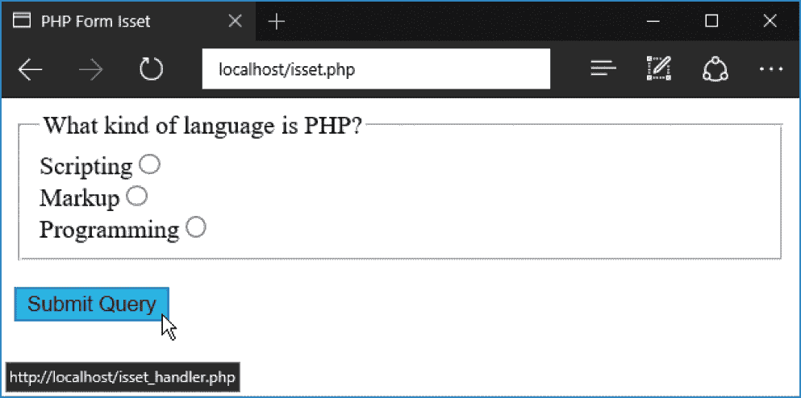

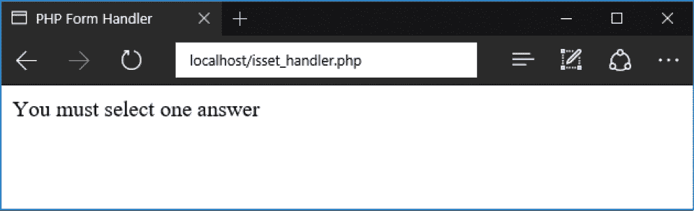

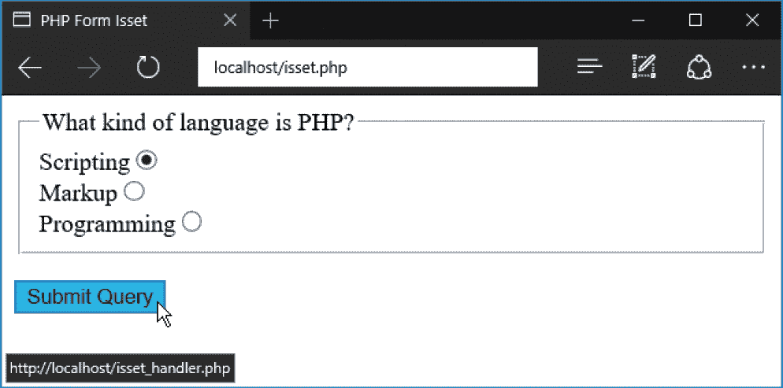


从技术上讲，测试条件是否为`TRUE`比测试它是否为`TRUE`更高效——因为需要评估的可能性更少。

### 验证表单数据

由于用户可能会无意中提交空字段或格式错误的表单，因此您的 PHP 脚本确保必填字段已填写且提交的数据有效是非常关重要的。

为了确保用户已在文本字段中输入了内容，PHP 提供了`empty()`函数，它接受可变参数，如果其值为空字符串、零、`NULL`或`FALSE`，则返回`TRUE`。

为了确保用户输入的是数字格式的数据，PHP 提供了`is_numeric()`函数，它接受可变参数，且仅当其值为数字时才返回`TRUE`。

可以使用 PHP 的`preg_match()`函数执行更具体的数据验证，该函数接受一个“正则表达式”参数和一个用于查找模式的可变参数。通常，这被用于确保电子邮件地址符合预期格式：


`valid.php`


创建一个包含两个文本字段的 HTML 文档，该表单用于数据提交：

```html
<form action=” valid_handler.php ” method=” POST ”>
<fieldset>
<legend>输入数量和电子邮件地址</legend>
<p>Quantity : <input type=”text” name=” quantity ”></p>
<p>Email Address : <input type=”text” name=” email ”></p>
</fieldset><p><input type=”submit” ></p>
</form>
```


现在，将文档保存到 Web 服务器的`/htdocs`目录下并命名为`valid.php`。


`valid_handler.php`


接下来，创建一个包含 PHP 脚本的 HTML 文档，用提交的值初始化变量——如果没有提交值，则初始化为`NULL`：

```php
<?php
if ( !empty ( $_POST[‘quantity’] ) )
{
    $quantity = $_POST[‘quantity’] ;
    # 在此处插入格式验证（第 4 步）。
}
else
{ 
    $quantity = NULL ; 
    echo ‘You must enter a quantity<br>’ 
}
?>
```


最后，插入语句根据变量的值输出相应的响应：

```php
if ( $definition != NULL )
{
    if ( $definition != ‘Scripting’ )
    { echo “ $definition is Incorrect” ; }
    else
    { echo “ $definition is Correct” ; }
}
else
{ echo ‘You must select one answer’ ; }
?>
```


将文档保存到 Web 服务器的`/htdocs`目录下并命名为`isset_handler.php`，然后通过 HTTP 访问`isset.php`并提交表单以查看响应。


从技术上讲，测试条件是否为`TRUE`比测试它是否为`TRUE`更高效——因为需要评估的可能性更少。

### 过滤数据

为了验证输入，PHP 提供了`filter_var()`函数，它可以同时用于验证和“清理”输入。该函数需要两个参数：指定要过滤的变量和要使用的过滤器常量：

| 过滤器常量 | 约定 |
| :--- | :--- |
| `FILTER_VALIDATE_BOOLEAN` | 布尔值 |
| `FILTER_VALIDATE_EMAIL` | 电子邮件格式 |
| `FILTER_VALIDATE_FLOAT` | 浮点数 |
| `FILTER_VALIDATE_INT` | 整数 |
| `FILTER_VALIDATE_IP` | IP 地址格式 |
| `FILTER_VALIDATE_MAC` | MAC 地址格式 |
| `FILTER_VALIDATE_REGEXP` | 正则表达式格式 |
| `FILTER_VALIDATE_URL` | URL 格式 |
| `FILTER_SANITIZE_EMAIL` | 移除无效字符 |
| `FILTER_SANITIZE_ENCODED` | URL 编码字符串 |
| `FILTER_SANITIZE_MAGIC_QUOTES` | 反斜符转义字符 |
| `FILTER_SANITIZE_NUMBER_FLOAT` | 移除所有非数字 |
| `FILTER_SANITIZE_NUMBER_INT` | 移除所有非数字 |
| `FILTER_SANITIZE_SPECIAL_CHARS` | HTML 转义`”>&` |
| `FILTER_SANITIZE_STRING` | 移除 HTML 标签 |
| `FILTER_SANITIZE_URL` | 移除无效字符 |
| `FILTER_CALLBACK` | 调用自定义过滤器函数 |

验证过滤器在验证成功时返回`TRUE`，否则返回`FALSE`。

某些过滤器允许指定更多选项。例如，可以为`FILTER_VALIDATE_INT`指定数字范围。


现在，添加一个函数来验证参数是否为格式正确的电子邮件地址：

```php
function validate( $email )
{
  if ( filter_var( $email , FILTER_VALIDATE_EMAIL ) )
  { echo( “<hr> $email 是一个有效的电子邮件地址” ) ; }
  else
  { echo( “<hr> $email 并不是一个合法的电子邮件地址” ); }
}
```


创建一个包含非法空格的电子邮件地址并尝试验证，然后对电子邮件地址进行清理并再次尝试验证：

```php
<?php
$email = ‘mike @example.com’ ;
validate( $email ) ;
$email = filter_var( $email , FILTER_SANITIZE_EMAIL ) ;
v a lidate( $email ) ;
?>
```


将文档保存到 Web 服务器的`/htdocs`目录并命名为`filter.php`，然后通过 HTTP 打开它查看过滤结果。


提交的用户输入可能会破坏你的网页，因此应该始终进行验证。

### 发送隐藏数据

除了用户输入到 HTML 表单输入字段中的数据外，PHP 生成的数据也可以使用 HTML 隐藏表单字段提交。与普通输入字段一样，这些也会向表单处理脚本发送`name=value`键对，但这里的值是由 PHP 提供的，而不是用户。

通常，使用隐藏表单字段提交的数据可能包括用户的用户名和提交的时间戳：


`hidden.php`


创建一个包含 PHP 脚本的 HTML 文档以定义时区并初始化两个变量：

```php
<?php
date_default_timezone_set( ‘UTC’ ) ;
$time = date( ‘ H:i , F j ‘ ) ;
$user = ‘Mike’ ;
```


现在，添加一个语句来编写包含一个普通输入字段和两个隐藏字段的完整表单，其值由变量设置。

```php
<?php
echo ‘**
<form action=” hidden_handler.php ” method=” POST ”>
<fieldset>
<legend>给我们发送您的评论</legend>
<textarea rows=”5” cols=”20” name=” comment ”>
</textarea>
<input type=”hidden” name=” user ” value=” ‘. $user .’ “>
<input type=”hidden” name=” time ” value=” ‘. $time .’ “>
</fieldset><p><input type=”submit” ></p></form> ‘ ;
?>
```


将文档保存到 Web 服务器的 `/htdocs` 目录并命名为 `hidden.php`。


此示例中的时间戳是在表单创建时创建的，而不是在表单提交时。


`hidden_handler.php`


接下来，创建一个包含 PHP 脚本的 HTML 文档，用提交的值初始化变量——如果没有提交任何值，则设置为 `NULL`。

```php
<?php
if ( !empty ( $_POST[‘comment’] ) )
{
  $comment = $_POST[‘comment’] ;
}
else
{
  $comment = NULL ; echo ‘你必须输入评论’ ;
}
?>
```


现在，如果隐藏表单字段值已设置，则添加语句初始化两个变量。

```php
$time = ( !isset ( $_POST[‘time’] ) ) ? NULL : $_POST[‘time’] ;
$user = ( !isset ( $_POST[‘user’] ) ) ? NULL : $_POST[‘user’] ;
```


最后，添加一个语句来输出有效的提交数据。

```php
if ( ( $comment != NULL ) && ( $time != NULL ) && ( $user != NULL ) )
{ echo “<p>收到评论： \” $comment \”<br> 来自 $user，时间 $time </p>” ; }
?>
```


将文档保存到 Web 服务器的 `/htdocs` 目录并命名为 `hidden_handler.php`，然后通过 HTTP 打开 `hidden.php` 并提交表单以查看响应。


注意这里使用了三元运算符 `? :` 代替了更长的 `if else` 语句。

### 处理提交

本章到为止的示例每个使用了两个文档——一个用于显示 HTML 表单，另一个用于处理表单提交。然而，此过程可以通过单个文档使用简单技术完成。

提交的用户输入可能会破坏你的网页，因此应该始终进行验证。

### 发送隐藏数据

除了用户输入到 HTML 表单输入字段中的数据，PHP 生成的数据也可以使用 HTML 隐藏表单字段提交。与普通输入字段一样，这些向表单处理脚本发送 `name=value` 键对，但这里的值是由 PHP 提供的，而不是用户。

通常，使用隐藏表单字段提交的数据可能包括用户的用户名和提交的时间戳：


`hidden.php`


创建一个包含 PHP 脚本的 HTML 文档以定义时区并初始化两个变量。

```php
<?php
date_default_timezone_set( ‘UTC’ ) ;
$time = date( ‘ H:i , F j ‘ ) ;
$user = ‘Mike’ ;
```


现在，添加一个语句来编写包含一个普通输入字段和两个隐藏字段的完整表单，其值由变量设置。

```php
<?php
echo ‘**
<form action=” hidden_handler.php ” method=” POST ”>
<fieldset>
<legend>给我们发送您的评论</legend>
<textarea rows=”5” cols=”20” name=” comment ”>
</textarea>
<input type=""hidden” name=” user ” value=” ‘. $user .’ “>
<input type=""hidden” name=” time ” value=” ‘. $time .’ “>
</fieldset><p><input type=”submit” ></p></form> ‘ ;
?>
```


将文档保存到 Web 服务器的 `/htdocs` 目录并命名为 `hidden.php`。


此示例中的时间戳是在表单创建时创建的，而不是在表单提交时。


`hidden_handler.php`


接下来，创建一个包含 PHP 脚本的 HTML 文档，用提交的值初始化变量——如果没有提交任何值，则设置为 `NULL`。

```php
<?php
if ( !empty ( $_POST[‘comment’] ) )
{
  $comment = $_POST[‘comment’] ;
}
else
{
  $comment = NULL ; echo ‘你必须输入评论’ ;
}
?>
```


现在，如果隐藏表单字段值已设置，则添加语句初始化两个变量。

```php
$time = ( !isset ( $_POST[‘time’] ) ) ? NULL : $_POST[‘time’] ;
$user = ( !isset ( $_POST[‘user’] ) ) ? NULL : $_POST[‘user’] ;
```


最后，添加一个语句来输出有效的提交数据。

```php
if ( ( $comment != NULL ) && ( $time != NULL ) && ( $user != NULL ) )
{ echo “<p>收到评论： \” $comment \”<br> 来自 $user，时间 $time </p>” ; }
?>
```


将文档保存到 Web 服务器的 `/htdocs` 目录并命名为 `hidden_handler.php`，然后通过 HTTP 打开 `hidden.php` 并提交表单以查看响应。


注意这里使用了三元运算符 `? :` 代替了更长的 `if else` 语句。

### 处理提交

本章到为止的示例每个使用了两个文档——一个用于显示 HTML 表单，另一个用于处理表单提交。然而，此过程可以通过单个文档使用简单技术完成。

提交的用户输入可能会破坏你的网页，因此应该始终进行验证。

### 验证电子邮件地址


现在，添加一个函数来验证参数是否为格式正确的电子邮件地址。

```php
function validate( $email )
{
  if ( filter_var( $email , FILTER_VALIDATE_EMAIL ) )
  { echo( “<hr> $email 是一个有效的电子邮件地址” ) ; }
  else
  { echo( “<hr> $email 并不是一个合法的电子邮件地址” ); }
}
```


创建一个包含非法空格的电子邮件地址并尝试验证，然后对电子邮件地址进行清理并再次尝试验证。

```php
<?php

$email = ‘mike @example.com’ ;

validate( $email ) ;

$email = filter_var( $email , FILTER_SANITIZE_EMAIL ) ;

v a lidate( $email ) ;

?>
```


将文档保存到 Web 服务器的 `/htdocs` 目录并命名为 `filter.php`，然后通过 HTTP 打开它查看过滤结果。


提交的用户输入可能会破坏你的网页，因此应该始终进行验证。

### 发送隐藏数据

除了用户输入到 HTML 表单输入字段中的数据，PHP 生成的数据也可以使用 HTML 隐藏表单字段提交。与普通输入字段一样，这些也会向表单处理脚本发送 `name=value` 键对，但这里的值是由 PHP 提供的，而不是用户。

通常，使用隐藏表单字段提交的数据可能包括用户的用户名和提交的时间戳：


`hidden.php`


创建一个包含 PHP 脚本的 HTML 文档以定义时区并初始化两个变量。

```php
<?php
date_default_timezone_set( ‘UTC’ ) ;
$time = date( ‘ H:i , F j ‘ ) ;
$user = ‘Mike’ ;
```


现在，添加一个语句来编写包含一个普通输入字段和两个隐藏字段的完整表单，其值由变量设置。

```php
<?php
echo ‘**
<form action=” hidden_handler.php ” method=” POST ”>
<fieldset>
<legend>给我们发送您的评论</legend>
<textarea rows=”5” cols=”20” name=” comment ”>
</textarea>
<input type=”hidden” name=” user ” value=” ‘. $user .’ “>
<input type=”hidden” name=” time ” value=” ‘. $time .’ “>
</fieldset><p><input type=”submit” ></p></form> ‘ ;
?>
```


将文档保存到 Web 服务器的 `/htdocs` 目录并命名为 `hidden.php`。


此示例中的时间戳是在表单创建时创建的，而不是在表单提交时。


`hidden_handler.php`


接下来，创建一个包含 PHP 脚本的 HTML 文档，用提交的值初始化变量——如果没有提交任何值，则设置为 `NULL`。

```php
<?php
if ( !empty ( $_POST[‘comment’] ) )
{
  $comment = $_POST[‘comment’] ;
}
else
{
  $comment = NULL ; echo ‘你必须输入评论’ ;
}
?>
```


现在，如果隐藏表单字段值已设置，则添加语句初始化两个变量。

```php
$time = ( !isset ( $_POST[‘time’] ) ) ? NULL : $_POST[‘time’] ;
$user = ( !isset ( $_POST[‘user’] ) ) ? NULL : $_POST[‘user’] ;
```


最后，添加一个语句来输出有效的提交数据。

```php
if ( ( $comment != NULL ) && ( $time != NULL ) && ( $user != NULL ) )
{ echo “<p>收到评论： \” $comment \”<br> 来自 $user，时间 $time </p>” ; }
?>
```


将文档保存到 Web 服务器的 `/htdocs` 目录并命名为 `hidden_handler.php`，然后通过 HTTP 打开 `hidden.php` 并提交表单以查看响应。


注意这里使用了三元运算符 `? :` 代替了更长的 `if else` 语句。

```html
<input type=”text” name=” email ” value=” <?php if ( isset( $_POST[ ‘email’ ] ) ) echo $_POST[ ‘email’ ] ; ?> ”></p>
<p><input type=”submit”></p>
</form>
```


现在，添加一个 PHP 脚本来处理表单提交。

```php
<?php
if ( $_SERVER[ ‘REQUEST_METHOD’ ] == ‘POST’ )
{
// 在此处插入语句（步骤 3-5）。
}
?>
```


在 PHP 脚本块中插入一个语句，创建一个用于错误消息的数组。

```php
$errors = array() ;
```


本示例使用 `$_SERVER[ ‘PHP_SELF’ ]` 来确保脚本在被重命名后仍然可以工作。


`if` 语句通过检查请求方法是否为 `POST` 来测试表单是否已提交，而不是用于显示空表单的 `GET` 方法。


然后，插入语句用提交的值初始化变量，或者为了遗漏项将其添加到错误数组。

```php
if ( empty( $_POST[ ‘name’ ] ) ) { $errors[] = ‘name’ ; }
else { $name = trim( $_POST[ ‘name’ ] ) ; }
if ( empty( $_POST[ ‘email’ ] ) ) { $errors[] = ‘email’ ; }
else { $email = trim( $_POST[ ‘email’ ] ) ; }
```


现在，插入语句来写入错误消息或确认表单成功提交。

```php
if( !empty( $errors ) )
{ echo ‘Error! Please enter your ‘ ;
foreach ( $errors as $msg ) { echo “ - $msg “ ; } }
else { echo “Success! Thanks $name “ ; }
```


将文档保存到你 Web 服务器的 `/htdocs` 目录中并命名为 `sticky.php`，然后通过 HTTP 打开并提交表单以查看保留的值和响应消息。


使用 `trim()` 函数是一个良好的做法，如此处所示，它可以移除字段值开头和结尾的空格。

### 上传文件

如果 `<form>` 标签包含设置为“multipart/formdata”的 `enctype` 属性，PHP `$_FILES` 超全局变量可以轻松地从 HTML 表单 `POST` 文件上传。提交时，会创建一个 `$_FILES` 关联数组，其键包括文件 `name`、生成的临时名称（`tmp_name`）和文件 `size`。文件名和大小可用于验证。然后可以将临时文件名连原始文件名一起传递 `move_uploaded_file()` 函数以上传文件：


`upload.php`


创建一个包含带有持久化表单的 HTML 文档，其中包含一个名为“image”的文件类型输入框。


```html
<form action=” <?php $_SERVER[ ‘PHP_SELF’ ] ?>” method=”POST” enctype=”multipart/formdata”>
Select an image to upload:
<input type=”file” name=” image ”>
<input type=”submit” value=”Upload Image”>
</form>
```


现在，添加一个 PHP 脚本来处理表单提交。

```php
<?php
if ( $_SERVER[ ‘REQUEST_METHOD’ ] == ‘POST’ )
{
// 在此处插入语句（步骤 3-7）。
}
?>
```


在下方插入语句，用关于用户选择的文件信息来初始化三个变量。

```php
$name = $_FILES[ ‘ image ’ ][ ‘name’ ] ;
$temp = $_FILES[ ‘ image ’ ][ ‘tmp_name’ ] ;
$size = $_FILES[ ‘ image ’ ][ ‘size’ ] ;
```


现在，插入语句，通过测试文件扩展名来确保所选文件是所需的文件类型，否则退出。

```php
$ext = pathinfo( $name , PATHINFO_EXTENSION ) ;
$ext = strtolower( $ext ) ;
if( $ext != ‘png’ && $ext != ‘jpg’ && $ext != ‘gif’ )
{ echo ‘Format must be PNG, JPG, or GIF’ ; exit() ; }
```


插入一个语句，确保所选文件是所需的文件大小，否则退出。

```php
if( $size > 512000 )
{ echo ‘File size must not exceed 500Kb’ ; exit() ; }
```


PHP 配置必须允许文件上传，此示例才能工作。PHP 目录下的配置文件`php.ini`必须包含一行`file`。

`pathinfo()`函数提供了扩展名。 插入一个语句来确保所选文件是所需的文件大小，否则退出。

```php
if( file_exists( $name ) )
{ echo ‘File already exists’ ; exit(); }
```


注意`pathinfo()`函数提供了扩展名。 插入一个语句来确保所选文件是所需的文件大小，否则退出。

```php
if( file_exists( $name ) )
{ echo ‘File already exists’ ; exit(); }
```


最后，尝试上传文件。

```php
try {
    if (move_uploaded_file($temp, "/htdocs/" . $name)) {
        echo "Upload successful";
    }
} catch (Exception $e) {
    echo "Error: " . $e->getMessage();
}
```

```css
p#err_msg { color : #F00 ; font-weight : bold ; }
```


将样式表保存在您创建的`/includes`文件夹中，与 HTML 头部和页脚文件一起。


最后，创建一个 PHP 脚本，设置网页标题并用头部和页脚内容包裹表单。

```php
<?php
$page_title = ‘PHP Include’ ;
include ( ‘includes/header.html’ ) ;
echo ‘<form action=” include.php ” method=” POST ”>
<p>Name: <input type=”text” name=” name ”> </p>
<p>Email: <input type=”text” name=” email ” ></p>
<p><input type=”submit”></p></form>’ ;
include ( ‘includes/footer.html’ ) ;
?>
```


`include.php`


将 PHP 脚本保存到 Web 服务器的`/htdocs`目录下并为`include.php`，然后通过 HTTP 打开它，以查看设置的标题以及被静态内容包裹的表单。


你可以使用浏览器的“查看源代码”功能，查看整个内容是否已有效整合到单个网页中。

## 附加链接数据

PHP 预定义的“超级全局”变量，例如存储页面请求方法的`$_SERVER`数组变量，以及在用户退出前存储网站跨页面用户数据的`$_SESSION`数组变量，在任何脚本的所有作用域内都是可访问的。


`$_SESSION`超级全局将用于在第 10 章中存储用户详情。

当 HTML 表单使用`POST`方法提交数据时，`$_POST`数组将提交的表单值存储在同名的数组元素中。因此，可以使用`$_POST[‘city’]`访问名为“city”的提交字段的值。

同样，当使用`GET`方法提交数据时，`$_GET`数组将提交的值存储在命名的数组元素中。因此，可以使用`$_GET[‘id’]`访问名为“id”的提交数据。这通常用于通过在 HTML 超链接锚点的 URL 后附加`name=value`对来向脚本提交数据，如下所示：

```html
<a href=”www.example.com/script.php?id=1”>
```

由超链接指定的接收数据的脚本随后可以使用传递的值来确定响应：


`link.php`


创建一个包含 PHP 脚本的 HTML 文档，该脚本在`$_GET`数组中寻找名为“id”的元素。

```php
<?php
if ( isset ( $_GET[ ‘id’ ] )
{
    # 在此处插入处理语句（步骤 2-3 ）。
}
```


接下来，插入一个处理语句，将传递的值分配给同名的 PHP 变量。

```php
$id = $_GET[ ‘id’ ] ;
```


现在，插入一个处理语句，根据传递的值输出适当的响应。

```php
switch( $id )
{
    case 1 : echo ‘Cow selected<hr>’ ; break ;
    case 2 : echo ‘Dog selected<hr>’ ; break ;
    case 3 : echo ‘Goat selected<hr>’ ; break ;
}
```


最后，添加语句，显示带有附加值的超链接。

```php
echo ‘<h1>Select a buddy</h1>’ ;
echo ‘ <p><a href=”link.php? id=1 ”>Cow</a> |’ ;
echo ‘ <a href=”link.php? id=2 ”>Dog</a> | ‘ ;
echo ‘ <a href=”link.php? id=3 ”>Goat</a></p>’ ;
?>
```


将 PHP 脚本保存到 Web 服务器的`/htdocs`目录下并为`link.php`，然后通过 HTTP 打开它并点击链接，以查看传递值对应的响应。


PHP 还提供了一个`$_REQUEST`超级全局，它包含了`$_POST`和`$_GET`数组的所有内容。这意味着可以使用`$_REQUEST[‘city’]`访问`$_POST[‘city’]`，但应避免这样做。请始终根据提交类型使用特定的数组。


注意到传递的`name=value`对在浏览器地址栏中是可见的。

## 总结

- HTML`<form>`标签的`action`属性指定处理表单提交的 PHP 脚本，其`method`属性指定数据如何发送到脚本。
- HTML`<form>`标签的`action`属性指定处理表单提交的 PHP 脚本，其`method`属性指定数据如何发送到脚本。
- HTML`<form>`标签的`action`属性指定处理表单提交的 PHP 脚本，其`method`属性指定数据如何发送到脚本。
- HTML`<form>`标签的`action`属性指定处理表单提交的 PHP 脚本，其`method`属性指定数据如何发送到脚本。
- HTML`<form>`标签的`action`属性指定处理表单提交的 PHP 脚本，其`method`属性指定数据如何发送到脚本。
- HTML`<form>`标签的`action`属性指定处理表单提交的 PHP 脚本，其`method`属性指定数据如何发送到脚本。
- HTML`<form>`标签的`action`属性指定处理表单提交的 PHP 脚本，其`method`属性指定数据如何发送到脚本。
- HTML`<form>`标签的`action`属性指定处理表单提交的 PHP 脚本，其`method`属性指定数据如何发送到脚本。
- HTML`<form>`标签的`action`属性指定处理表单提交的 PHP 脚本，其`method`属性指定数据如何发送到脚本。
- HTML`<form>`标签的`action`属性指定处理表单提交的 PHP 脚本，其`method`属性指定数据如何发送到脚本。
- HTML`<form>`标签的`action`属性指定处理表单提交的 PHP 脚本，其`method`属性指定数据如何发送到脚本。
- HTML`<form>`标签的`action`属性指定处理表单提交的 PHP 脚本，其`method`属性指定数据如何发送到脚本。
- HTML`<form>`标签的`action`属性指定处理表单提交的 PHP 脚本，其`method`属性指定数据如何发送到脚本。
- HTML`<form>`标签的`action`属性指定处理表单提交的 PHP 脚本，其`method`属性指定数据如何发送到脚本。
- HTML`<form>`标签的`action`属性指定处理表单提交的 PHP 脚本，其`method`属性指定数据如何发送到脚本。
- HTML`<form>`标签的`action`属性指定处理表单提交的 PHP 脚本，其`method`属性指定数据如何发送到脚本。
- HTML`<form>`标签的`action`属性指定处理表单提交的 PHP 脚本，其`method`属性指定数据如何发送到脚本。
- HTML`<form>`标签的`action`属性指定处理表单提交的 PHP 脚本，其`method`属性指定数据如何发送到脚本。
- HTML`<form>`标签的`action`属性指定处理表单提交的 PHP 脚本，其`method`属性指定数据如何发送到脚本。
- HTML`<form>`标签的`action`属性指定处理表单提交的 PHP 脚本，其`method`属性指定数据如何发送到脚本。
- HTML`<form>`标签的`action`属性指定处理表单提交的 PHP 脚本，其`method`属性指定数据如何发送到脚本。
- HTML`<form>`标签的`action`属性指定处理表单提交的 PHP 脚本，其`method`属性指定数据如何发送到脚本。
- HTML`<form>`标签的`action`属性指定处理表单提交的 PHP 脚本，其`method`属性指定数据如何发送到脚本。
- HTML`<form>`标签的`action`属性指定处理表单提交的 PHP 脚本，其`method`属性指定数据如何发送到脚本。
- HTML`<form>`标签的`action`属性指定处理表单提交的 PHP 脚本，其`method`属性指定数据如何发送到脚本。
- HTML`<form>`标签的`action`属性指定处理表单提交的 PHP 脚本，其`method`属性指定数据如何发送到脚本。
- HTML`<form>`标签的`action`属性指定处理表单提交的 PHP 脚本，其`method`属性指定数据如何发送到脚本。
- HTML`<form>`标签的`action`属性指定处理表单提交的 PHP 脚本，其`method`属性指定数据如何发送到脚本。
- HTML`<form>`标签的`action`属性指定处理表单提交的 PHP 脚本，其`method`属性指定数据如何发送到脚本。
- HTML`<form>`标签的`action`属性指定处理表单提交的 PHP 脚本，其`method`属性指定数据如何发送到脚本。
- HTML`<form>`标签的`action`属性指定处理表单提交的 PHP 脚本，其`method`属性指定数据如何发送到脚本。
- HTML`<form>`标签的`action`属性指定处理表单提交的 PHP 脚本，其`method`属性指定数据如何发送到脚本。
- HTML`<form>`标签的`action`属性指定处理表单提交的 PHP 脚本，其`method`属性指定数据如何发送到脚本。
- HTML`<form>`标签的`action`属性指定处理表单提交的 PHP 脚本，其`method`属性指定数据如何发送到脚本。
- HTML`<form>`标签的`action`属性指定处理表单提交的 PHP 脚本，其`method`属性指定数据如何发送到脚本。
- HTML`<form>`标签的`action`属性指定处理表单提交的 PHP 脚本，其`method`属性指定数据如何发送到脚本。
- HTML`<form>`标签的`action`属性指定处理表单提交的 PHP 脚本，其`method`属性指定数据如何发送到脚本。
- HTML`<form>`标签的`action`属性指定处理表单提交的 PHP 脚本，其`method`属性指定数据如何发送到脚本。
- HTML`<form>`标签的`action`属性指定处理表单提交的 PHP 脚本，其`method`属性指定数据如何发送到脚本。
- HTML`<form>`标签的`action`属性指定处理表单提交的 PHP 脚本，其`method`属性指定数据如何发送到脚本。
- HTML`<form>`标签的`action`属性指定处理表单提交的 PHP 脚本，其`method`属性指定数据如何发送到脚本。
- HTML`<form>`标签的`action`属性指定处理表单提交的 PHP 脚本，其`method`属性指定数据如何发送到脚本。
- HTML`<form>`标签的`action`属性指定处理表单提交的 PHP 脚本，其`method`属性指定数据如何发送到脚本。
- HTML`<form>`标签的`action`属性指定处理表单提交的 PHP 脚本，其`method`属性指定数据如何发送到脚本。
- HTML`<form>`标签的`action`属性指定处理表单提交的 PHP 脚本，其`method`属性指定数据如何发送到脚本。
- HTML`<form>`标签的`action`属性指定处理表单提交的 PHP 脚本，其`method`属性指定数据如何发送到脚本。
- HTML`<form>`标签的`action`属性指定处理表单提交的 PHP 脚本，其`method`属性指定数据如何发送到脚本。
- HTML`<form>`标签的`action`属性指定处理表单提交的 PHP 脚本，其`method`属性指定数据如何发送到脚本。
- HTML`<form>`标签的`action`属性指定处理表单提交的 PHP 脚本，其`method`属性指定数据如何发送到脚本。
- HTML`<form>`标签的`action`属性指定处理表单提交的 PHP 脚本，其`method`属性指定数据如何发送到脚本。
- HTML`<form>`标签的`action`属性指定处理表单提交的 PHP 脚本，其`method`属性指定数据如何发送到脚本。
- HTML`<form>`标签的`action`属性指定处理表单提交的 PHP 脚本，其`method`属性指定数据如何发送到脚本。
- HTML`<form>`标签的`action`属性指定处理表单提交的 PHP 脚本，其`method`属性指定数据如何发送到脚本。


- HTML `<form>` 标签的 `action` 属性指定处理表单提交的 PHP 脚本，其 `method` 属性指定数据如何发送到脚本。
- HTML `<form>` 标签的 `action` 属性指定处理表单提交的 PHP 脚本，其 `method` 属性指定数据如何发送到脚本。
- HTML `<form>` 标签的 `action` 属性指定处理表单提交的 PHP 脚本，其 `method` 属性指定数据如何发送到脚本。
- HTML `<form>` 标签的 `action` 属性指定处理表单提交的 PHP 脚本，其 `method` 属性指定数据如何发送到脚本。
- HTML `<form>` 标签的 `action` 属性指定处理表单提交的 PHP 脚本，其 `method` 属性指定数据如何发送到脚本。
- HTML `<form>` 标签的 `action` 属性指定处理表单提交的 PHP 脚本，其 `method` 属性指定数据如何发送到脚本。
- HTML `<form>` 标签的 `action` 属性指定处理表单提交的 PHP 脚本，其 `method` 属性指定数据如何发送到脚本。

将密码存储在 cookie 中并不是最安全的方法，但此处仅用于演示如何使用 cookie 存储数据。

### 设置 cookie

在接收到表单提交后，PHP 脚本可以检查字段是否存在，并可能对其关联的值进行验证。例如，可以使用 `ctype_alnum()` 函数简单地确认值是否仅包含字母和数字。

验证通过后，可以使用 `setcookie()` 函数存储提交的字段名和值。此外，可以使用 `md5()` 函数对密码值进行哈希转换。在成功完成后，脚本可以使用 `header()` 函数将浏览器重定向到另一个页面，指定该页面的 URL：


`cookie_set.php`


开始一个 PHP 脚本，使用一个函数处理验证失败的尝试：

```php
<?php

function reject ( $entry )
{
	echo “Invalid $entry <br>” ;
	echo ‘Please <a href=” cookie_form.html ”>Log In</a>’ ;
	exit() ;
}
```


接下来，添加一个条件测试块来为有效数据设置两个 cookie，或者调用该函数处理失败的尝试：

```php
if( isset( $_POST[ ‘user’ ] ) )
{
	$user = trim( $_POST[ ‘user’ ] ) ;
	if( !ctype_alnum( $user ) ) { reject( ‘User Name’ ) ; }
	if( isset( $_POST[ ‘pass’ ] ) )
	{
		$pass = trim( $_POST[ ‘pass’ ] ) ;
		if( !ctype_alnum( $pass ) ) { reject( ‘Password’ ) ; }
		else
		{
			setcookie( ‘user’ , $user , time()+ 3600 ) ;
			setcookie( ‘pass’ , md5( $pass ) , time()+ 3600 ) ;
			header( ‘Location: cookie_get.php ’ ) ;
		}
	}
}
else { header( ‘Location: cookie_form.html ’ ) ; }
?>
```


将文档保存到 Web 服务器的 `/htdocs` 目录下命名为 `cookie_set.php`，然后查看如何检索已存储的 cookie 数据。


`ctype_alnum()` 函数仅在当参数包含字母和数字字符时才返回 true。


注意此处如何使用 `time()` 函数来获取当前时间，然后增加一小时（秒），以便将 cookie 的过期时间设置为一小时后。


如果直接打开脚本 URL，最后的 `else` 语句将把页面重定向到 HTML 表单页。

### 获取 cookie

一旦设置了 cookie，它们会自动分配给特殊的 PHP 全局数组变量 `$_COOKIE`。脚本可以使用 PHP 内置的 `isset()` 函数检查单个 cookie 是否存在以查找指定指定的 cookie。当确认 cookie 确实存在时，可以将其值方便地赋值给普通脚本变量。这可以用于检索存储的用户名并在页面上输出。如果请求的 cookie 不存在，脚本可以为用户提供备选方案：


`cookie_get.php`


开始一个 PHP 脚本，通过测试来查找 cookie 并在成功后检索数据进行输出：

```php
<?php

if( isset( $_COOKIE[ ‘user’ ] ) )
{
	$user = $_COOKIE[ ‘user’ ] ;
	echo “<h1>Welcome $user !</h1><hr>” ;
	echo ‘<a href=” cookie_data.php ”>View Cookie</a>’ ;
}
```


接下来，为 cookie 不存在的情况添加备选输出：

```php
else
{
	echo ‘Please <a href=” cookie_form.html ”>Log In</a>’ ;
}
?>
```


将文档保存到 Web 服务器的 `/htdocs` 目录下命名为 `cookie_get.php`。


现在通过 HTTP 打开 HTML 表单 `cookie_form.html`（在此处创建），并点击提交按钮以查看登录尝试验证失败，因此未设置任何 cookie。


点击超链接返回 HTML 表单并输入有效的用户名，然后点击提交按钮再次查看登录尝试再次验证失败。


再次返回 HTML 表单，输入有效的用户名和密码，查看验证成功。


再次返回 HTML 表单，输入有效的用户名和密码，查看验证成功。


`cookie_data.php`（见下文）

### 查看 cookie 数据

特殊的 PHP `$_COOKIE` 全局数组存储了键和值。可以通过 `var_dump()` 循环数组来查看 cookie 数据：

```php
<?php

if( count( $_COOKIE ) > 0 )
{
	foreach( $_COOKIE as $key => $value )
	{
		echo “<dt>$key</ ;
		echo “<dd>$value</ ;
	}
	echo “</dl><hr>";
	var_dump( $_COOKIE ) ;
}
?>
```

PHP 手册描述了通过将值置空并将日期设置为过去来移除 cookie。例如 `setcookie($_COOKIE['user'], '', time()-3600)`。此外，可以使用 `unset()` 函数删除指定的变量。

### 提交 session 数据

只有当用户允许 cookie 进入系统时，用户数据才能存储在客户端的 cookie 中。然而，许多用户为了避免跟踪禁用 cookie，但 PHP 提供了一个更好的替代方案。使用 PHP，可以使用特殊的 `$_SESSION` 全局数组变量在服务器上存储用户数据。为了让 PHP Session 工作，每个 PHP 页面必须调用内置的 `session_start()` 函数——在任何 HTML 标签之前！

通过 **POST** 方法向服务器提交 HTML 表单会将字段数据分配给特殊的 PHP `$_POST` 全局数组变量，可以使用 PHP 内置的 `isset()` 函数查找单个提交字段。当确认该字段存在时，可以将其名称和值存储在会话变量中。这可以用于在整个网站中使用存储用户名和密码详情，作为 cookie 存储的替代方案：


`session_form.html`


创建一个 HTML 文档并将此表单添加到其主体部分，指定提交方法和 PHP 提交处理脚本的名称：

```html
<form name ="entry" method =" POST " action =" session_set.php ">
  <fieldset>
    <legend>F o r Name : Enter Only Letters </legend>
    Name : <input type=”text” name=” user ">
    Password : <input type=”password” name=” pass ">
    <p> For Password : Enter Only A-Z a-z 0-9 . _ (Minimum 8 Characters) </p> <input type=”submit” value=”Log In">>
  </fieldset>
</form>
```


将文档保存到 Web 服务器的 `/htdocs` 目录并命名为 `session_form.html`，然后通过 HTTP 打开页面以查看表单。


只有在页面顶部调用了 `session_start()` 函数，PHP 脚本才能访问会话变量。

### 设置会话

接收表单提交后，PHP 脚本可以检查字段是否存在，并可能对其关联的值进行验证。例如，可以使用 `ctype_alpha()` 函数确认它们仅包含字母，并可以使用 `preg_match()` 函数确认值是否匹配指定模式。

一旦验证通过，可以将提交的字段名称和值赋值给 `$_SESSION` 全局数组变量的元素。成功完成后，脚本可以使用 `header()` 函数指定该页面的 URL，将浏览器重定向到下一个页面：


`session_set.php`


添加初始 PHP 脚本使会话可用：

```php
<?php session_start(); ?>
```


开始一个 PHP 脚本来处理失败的验证尝试：

```php
<?php
function reject ( $entry )
{
  echo “Invalid $entry <br>” ;
  echo ‘Please <a href=” session_form.html ”>Log In</a>’ ;
  exit() ;
}
```


添加条件测试块以为有效数据设置两个 cookie，或调用函数处理失败尝试：

```php
if( isset( $_POST[ ‘user’ ] ) )
{
  $user = trim( $_POST[ ‘user’ ] ) ;
  if( !ctype_alpha( $user ) ) { reject( ‘User Name’ ) ; }
  if( isset( $_POST[ ‘pass’ ] ) )
  {
    $pass = trim( $_POST[ ‘pass’ ] ) ;
    if( !preg_match( ‘/^[A-Za-z0-9._]{8,}$/’ , $pass ) )
    { reject( ‘Password’ ) ; }
    else
    {
      $_SESSION[ ‘user’ ] = $user ;
      $_SESSION[ ‘pass’ ] = $pass ;
      header( ‘Location: session_get.php ’ ) ;
    }
  }
} else { header( ‘Location: session_form.html ’ ) ; }
?>
```


将文档保存到 Web 服务器的 `/htdocs` 目录并命名为 `session_set.php`，然后查看如何检索数据。


`ctype_alpha()` 函数仅在其参数包含字母时返回 true。


`preg_match()` 函数接受一个正则表达式和一个字符串参数。正则表达式超出了本书的涵盖范范围，但你可以精确地复制此示例，以允许表单上描述的许可密码模式。在此示例中，密码未加密，以便在稍后演示用户密码符合指定要求。

### 获取会话

在调用 `session_start()` 函数后，就可以通过特殊的 `$_SESSION` 全局数组变量访问会话数据。PHP `isset()` 函数可以查找指定名称的元素。当这确认元素存在时，可以将其值很有用地赋值给普通的脚本变量。这可能用于检索存储的用户名以便在页面上输出。如果查找的元素不存在，脚本可以为用户提供备选方案：


`session_get.php`


添加初始 PHP 脚本使会话可用：

```php
<?php session_start() ; ?>
```


现在，开始一个 PHP 脚本来查找会话变量并在成功后检索数据进行输出，或者在会话变量不存在时提供备选方案：

```php
<?php
if( isset( $_SESSION[ ‘user’ ] ) )
{
  $user = $_SESSION[ ‘user’ ] ;
  echo “<h1>Welcome $user !</h1><hr>” ;
  echo ‘<a href=” session_data.php ”>View Session</a>’ ;
}
else
{ echo ‘Please <a href=” session_form.html ”>Log In</a>’ ; }
?>
```


将文档保存到 Web 服务器的 `/htdocs` 目录并命名为 `session_get.php`。


现在，打开 HTML 表单 `session_form.html`（在此处创建），通过 HTTP 访问 `session_form.html` 目标并提交以查看验证失败。


返回 HTML 表单并提交用户名查看验证失败。


再次返回 HTML 表单并提交用户名查看验证失败。


再次提交一次有效的用户名和密码查看验证成功。


查看 `session_data.php` 中存储的会话变量。


注意必须调用 `session_start()` 函数。

### 查看会话数据

在调用 `session_start()` 函数后，就可以通过特殊的 `$_SESSION` 全局数组变量访问会话数据。PHP `isset()` 函数可以查找指定名称的元素。当这确认元素存在时，可以将其值很有用地赋值给普通的脚本变量。这可能用于检索存储的用户名以便在页面上输出。如果查找的元素不存在，脚本可以为用户提供备选方案：

`$_SESSION` 全局数组存储了键和值。可以使用 `session_id()` 函数查看每个会话。此外，可以使用 `unset()` 函数移除每个会话变量，并通过调用 `session_destroy()` 函数完全终止会话：

```php
<?php
function kill_session()
{
  unset( $_SESSION[ ‘user’ ] )
  unset( $_SESSION[ ‘pass’ ] ) ;
  session_destroy() ;
  echo ‘<hr>Session Destroyed<br>’ ;
  echo ‘Session ID : ‘ .session_id().’<br> ;
  var_dump( $_SESSION ) ;
}
```

现在，添加一个测试来检查是否设置了会话变量。


```php
if( count( $_SESSION ) > 0 )
{
  echo ‘<dl> ;
  foreach( $_SESSION as $key => $value )
  {
    echo “<dt>Key: $key ” ; echo “<dd>Value: $value ” ;
  }
  echo ‘</dl><hr> ;
  // 在此处插入语句（步骤 4）。
}
```

你可以随时为会话变量分配新值以覆盖现有的存储值。

```php
else
{
  echo ‘Please <a href=” session_form.html ”>Log In</a>’ ;
}
?>
```

 使用浏览器中的  刷新按钮重新加载此页面，以查看备用的“请登录”内容。


注意密码必须符合允许的模式。

## 总结

- PHP `set_cookie()` 函数可将用户数据存储在客户端机器，以便在网站的不同页面之间使用。
- 为 `set_cookie()` 函数应至少提供三个参数，以指定名称、值和过期时间。
- 通过 `POST` 方法提交的 HTML 表单会自动将字段数据分配给 PHP `$_POST` 全局数组变量。
- `isset()` 函数可以在 `$_POST` 全局数组中查找指定 HTML 字段名的元素。
- `ctype_alnum()` 函数可用于确认值是否仅包含字母和数字以进行验证。
- 可以使用 `md5()` 函数对密码值进行哈希转换以进行加密。
- PHP `header()` 函数可以指定 `Location:URL` 来重定向浏览器。
- 一旦设置了 cookie，它们会自动分配给特殊的 PHP `$_COOKIE` 全局数组变量。
- 用户数据可以存储在服务器的 PHP `$_SESSION` 全局数组变量中，作为 cookie 存储的替代。
- 要使用 session，每个 PHP 页面必须在任何 HTML 标签之前的页面顶部调用 `session_start()` 函数。
- 提交到 `$_POST` 全局数组的 HTML 字段数据可以分配给 `$_SESSION` 全局变量数组元素。
- `ctype_alpha()` 函数可用于确认值是否仅包含字母进行验证。
- `preg_match()` 函数可用于确认值是否匹配指定的模式以进行验证。
- 每个 session 都有唯一的 session ID 数字，可以使用 PHP `session_id()` 函数查看。
- 可以使用 `unset()` 函数移除 session 变量，并使用 `session_destroy()` 函数终止 session。
- 使用 `var_dump()` 函数并遍历 `$_COOKIE` 或 `$_SESSION` 数组可以查看存储的内容。

## 连接数据库

*本章演示了如何使用 PHP 和 MySQL 数据库建立一个简单的用户论坛。*

- 建立连接
- 创建论坛
- 提供页面
- 提供表单
- 处理消息
- 确认成功
- 总结

### 建立连接

可以从标准的 PHP 脚本尝试连接到 MySQL 数据库。脚本定义了一个名为 `dbc`（数据库连接）的变量，其值由调用内置的 `mysqli_connect()` 函数返回。该调用需要四个参数来指定主机服务器、MySQL 用户名和密码以及要连接的数据库。当调用成功时，`mysqli_connect()` 函数返回一个代表与 MySQL 服务器连接的“对象”。脚本如下：

```php
<?php
$dbc = mysqli_connect('host', 'user', 'password', 'database')
OR die ( mysqli_connect_error() );
mysqli_set_charset($dbc, 'utf-8');
```


`connect_db.php`


MySQL 社区版可以在 [mysql.com/downloads/mysql](http://www.mysql.com/downloads/mysql) 免费获取。

成功调用 `mysqli_connect()` 返回的对象非常重要，因为它被用于其他 MySQL 服务器通信的其他 PHP 函数调用的参数。例如，在上面的脚本中，它必须作为调用 `mysqli_set_charset()` 的第一个参数来标识连接。


本章假设 MySQL 数据库服务器已为本地服务器上的一个用户安装并配置，并且具有使用名为“website_db”数据库的完全权限。进一步的说明和示例可以在我们系列中的配套书籍 [PHP & MySQL in easy steps](http://ineasysteps.com/products-page/all_books/php-mysql-in-easy-steps/) 中找到。

当调用 `mysqli_connect()` 函数失败时，脚本将跳转到调用 `die()` 函数的备分支。这等同于调用 `exit()` 立即终止脚本。`die()` 函数可选接受一个字符串参数，并在脚本停止时打印。在这种情况下，字符串消息由 `mysqli_connect_error()` 函数返回，描述了连接尝试失败的原因。

由于连接脚本包含敏感用户详情，它不能放置在 Web 服务器的 `/htdocs` 目录下与其他 PHP 脚本一起。相反，`connect_db.php` 脚本应该位于 `/htdocs` 的父目录中，在那里无法被直接访问，但可以通过 `require` 语句纳入其他 PHP 脚本中，例如：

```php
<?php
require('../connect_db.php');
if (mysqli_connect($dbc)) {
    echo 'Connection successful';
}
?>
```

### 创建论坛

用户消息可以通过 PHP 脚本存储在数据库表中，因此随后可以将其检索，并显示在包含注册用户消息的论坛页面中。通常，包含消息的数据库表可能会存储帖子 ID、用户的名和姓氏、主题标题、消息本身以及发布日期：

| 字段名 | 内容类型 | 示例 |
| :--- | :--- | :--- |
| `post_id` | 数字 | 123 |
| `first_name` | 文字 | Mike |
| `last_name` | 文字 | McGrath |
| `subject` | 文字 | Ice Cream |
| `message` | 文字 | Delicious on a hot day. |
| `post_date` | 日期/时间 | 2016-07-24 12:30:00 |


MySQL 数据库表只能由 root MySQL 用户或其他被授予完全访问权限的 MySQL 用户创建。

可以使用结构查询语言（SQL）创建此种设计的数据库表。该数据库表的设计仅要求为存储文本的列指定 SQL `VARCHAR` 或 `TEXT` 数据类型。帖子 ID 应该是正的 SQL 整数 `INT` 值，表通过 `AUTO_INCREMENT` 自动分配，而消息发布时间戳应存储为 SQL `DATETIME` 值。向数据库表发布消息需要所有这些项目，因此每个列都必须有一个 SQL `NOT NULL` 规则。


用于将此设计生成名为“forum”的 MySQL 数据库表的 SQL 命令可以在 MySQL 命令行客户端的提示符处发布，也可以通过在浏览器中运行 PHP 脚本来发布。

 编写 PHP 脚本时，使用一个语句通过上一页描述的标准连接脚本连接数据库：

```php
<?php

require( ‘..\ connect_db.php ’ ) ;
```

 接下来，将表设计的 SQL 规范赋值给变量：

```php
$sql = ‘CREATE TABLE IF NOT EXISTS forum ( ‘ .
‘post_id INT UNSIGNED NOT NULL AUTO_INCREMENT ,’ .
‘first_name VARCHAR(20) NOT NULL ,’ .
‘last_name VARCHAR(40) NOT NULL ,’ .
‘subject VARCHAR(60) NOT NULL ,’ .
‘message TEXT NOT NULL ,’ .
‘post_date DATETIME NOT NULL ,’ .
‘PRIMARY KEY ( post_id ) ) ‘ ;
```

 现在，添加一个测试来报告表是否成功创建，或者在失败时描述错误：

```php
if( mysqli_query( $dbc , $sql ) === TRUE )
{
echo ‘Table “forum” created successfully’ ;
}
else
{
echo ‘Error creating table : ‘ .mysqli_error( $dbc ) ;
}
```

 记住在完成后关闭数据库连接：

```php
mysqli_close( $dbc ) ;
```

 将文档保存到 Web 服务器的 `/htdocs` 目录并命名为 `create_forum.php`，然后通过 HTTP 打开该页面以创建论坛表。


`VARCHAR` 数据类型指定字符长度，而 `TEXT` 数据类型可以容纳最多 65,535 个字符。


`mysqli_query()` 函数执行 SQL 查询，而 `mysqli_error()` 函数会在发生错误时提供报告。

## 提供页面

可以创建一个论坛页面，显示从上一页创建的 MySQL `forum` 表中检索的之前发布的消息。论坛消息可以显示在页眉和页脚之间，并带有一个指向另一个页面的超链接，用户可以在该页面发布新的论坛消息。如果论坛数据库中没有之前发布的内容，脚本可以简单地提示当前没有消息。

PHP `mysqli_query()` 函数可以进行 SQL 查询以检索表内容，而 `mysqli_num_rows()` 函数可以发现结果中有多少表行。当结果中找到表行时，可以使用 `mysqli_fetch_array()` 函数通过指定结果和 `MYSQLI_ASSOC` 常量作为参数，来获取行和每列数据的关联数组：


`forum.php`

 编写 PHP 脚本时，使用一个语句设置页面标题：

```php
<?php

$page_title = ‘PHP Forum’ ;
```

 接下来，添加一个语句来包含页眉：

```php
include ( ‘includes/header.html’ ) ;
```

 添加一个语句来打开数据库连接：

```php
require ( ‘..\connect_db.php’ ) ;
```

 从数据库表中检索所有消息并将其赋值给变量：

```php
$sql = ‘SELECT * FROM forum’ ;
$result = mysqli_query( $dbc , $sql ) ;
```

 测试数据库表是否为空并显示适当提示注释：

```php
if ( mysqli_num_rows( $result ) > 0 )
{
// 在此处插入语句（第 6 步）。
}
else
{
echo ‘<p>There are currently no messages.</p>’ ;
}
```


列以关联数组的形式返回，其中行名是该列中每个值的键。

 接下来，插入语句，如果找到了从数据库表中检索的所有消息，则编写一个显示所有消息的表：

```php
echo ‘<table><tr><th>Posted By</th>
<th>Subject</th><th id=”msg”>Message</th></tr>’ ;
while ( $row = mysqli_fetch_array( $result , MYSQLI_ASSOC ) )
{
echo ‘<tr><td>’ .
$row[ ‘first_name’ ] . ’ ‘ .
$row[ ‘last_name’ ] . ‘<br>’ .
$row[ ‘post_date’ ] . ’</td><td>’ .
$row[ ‘subject’ ] . ‘</td><td>’ .
$row[ ‘message’ ] . ‘</td></tr>’ ;
}
echo ‘</table>’ ;
```

 在测试块之后，添加一个语句创建一个指向“发布消息”页面的超链接：

```php
echo ‘<p><a href=”post.php”>Post Message</a></p>’ ;
```

 在测试块之后，添加一个语句关闭数据库连接：

```php
mysqli_close( $dbc ) ;
```

 添加最后的语句来包含页脚：

```php
include ( ‘includes/header.html’ ) ;
```

`$page_title = ‘PHP Process Error’ ;`

 接下来，添加一条语句来包含页眉：

```php
include ( ‘includes/header.html’ ) ;
```

 现在，添加一个退出函数，在验证失败时显示通知以及返回帖子页的链接：

```php
function fail( $str )
{
    echo “<p>Please enter a $str .</p>” ;
    echo ‘<p><a href=”post.php”>Post Message</a’ ;
    include ( ‘includes/footer.html’ ) ;
    exit() ;
}
```

 添加一个测试以确保表单已提交：

```php
if( isset( $_POST[ ‘message’ ] ) )
{
    // 在此处插入语句（第 5 步）。
    // 在此处插入语句（第 6 步）。
    // 在此处插入语句（第 7 步）。
}
```


此脚本由 `post.php` 中的表单提名，用于处理提交的用户数据消息。然而，该表单并不是“粘性的”——这意味着如果用户必须返回表单以完成空输入字段，则输入的任何字段数据将不会保留。

 插入测试以确保用户已填写所有表单字段：

```php
if ( !empty( trim( $_POST[ ‘first_name’ ] ) ) )
{ $first_name = addslashes( $_POST[ ‘first_name’ ] ) ; }
else { fail( ‘First Name’ ) ; }

if ( !empty( trim( $_POST[ ‘last_name’ ] ) ) )
{ $last_name = addslashes( $_POST[ ‘last_name’ ] ) ; }
else { fail( ‘Last Name’ ) ; }

if ( !empty( trim( $_POST[ ‘subject’ ] ) ) )
{ $subject = addslashes( $_POST[ ‘subject’ ] ) ; }
else { fail( ‘Subject’ ) ; }

if ( !empty( trim( $_POST[ ‘message’ ] ) ) )
{ $message = addslashes( $_POST[ ‘message’ ] ) ) ; ; }
else { fail( ‘Message’ ) ; }
```

 当验证成功时，打开数据库连接：

```php
require ( ‘../connect_db.php’ ) ;
```

 现在，插入语句以将提交的 HTML 表单字段值加入 MySQL “forum”数据库表：

```php
$sql = “INSERT INTO forum
( first_name, last_name, subject, message, post_date )
VALUES
(‘ $first_name ’, ‘ $last_name ’,’ $subject ’, ‘ $message ’, NOW() )” ;
$result = mysqli_query ( $dbc , $sql ) ;
```


 最后，插入一条语句来报告失败错误，或在成功后将浏览器重定向到论坛页面

```php
if ( mysqli_affected_rows( $dbc ) != 1 )
{
    echo ‘<p>Error</p> .mysqli_error( $dbc ) ;
    mysqli_close( $dbc ) ;
}
else
{
    mysqli_close( $dbc ) ;
    header( ‘Location: forum.php ’ ) ;
}
```

 将此脚本保存在 Web 服务器的`/htdocs`目录下并命名为`process.php`，然后在不填写任何字段的情况下提交表单，以查看脚本显示错误消息


注意这里使用了 PHP 的`addslashes()`函数来转义单引号和引号。


`NOW()`是 MySQL 函数，返回当前时间戳的日期时间值。


如果脚本发现空的表单字段，它将提供自己的错误消息；如果数据无法添加到数据库表，则提供 MySQL 错误消息。

### 确认成功

现在是测试留言板流程的时间了，以确保验证执行正确，并且发布的消息出现在论坛页面上：

 打开发布消息页面，然后填写所有字段并提交表单，以查看消息出现在论坛上


“发布者（Posted By）”详细信息是从 MySQL “forum”数据库表的`first_name`、`last_name`和`post_date`列检索的。

 接下来，返回发布消息页面，然后尝试发布一条没有填写主题的消息以查看错误


 返回发布消息页面并发布一条消息


## 总结

- 这里使用了 PHP 的`addslashes()`函数来转义单引号和引号。

- `NOW()`是 MySQL 函数，返回当前时间戳的日期时间值。

- 如果脚本发现空的表单字段，它将提供自己的错误消息；如果数据无法添加到数据库表，则提供 MySQL 错误消息。

PHP 提供了一个名为“SimpleXML”的 XML 解析器，它可以将 XML 文档加载到内存中并形成分级树结构。`simplexml_load_file()`函数需要 XML 文件的文件名和路径，以便将文档转换为包含`SimpleXMLElement`对象的数据结构。然后可以使用`var_dump()`函数对该数据结构进行探索。


`catalog.php`

 用设置页面标题并保留文本格式的语句开始 PHP 脚本

```php
<?php
echo ‘<title>PHP SimpleXML</title><pre>’ ;
```

 接下来，添加一个语句来加载 XML 数据或退出

```php
$xml = simplexml_load_file( ‘catalog.xml’ )
or die( ‘Unable to load data!’ ) ;
```

 现在，显示所有的 SimpleXMLElement 对象

```php
var_dump( $xml ) ;
```

 将文档保存到 Web 服务器的`/htdocs`目录下并命名为`catalog.php`，与`catalog.xml`文件放在一起，然后通过 HTTP 打开页面以查看 SimpleXMLElement 对象


注意，此数据结构描述了一个名为“book”的数组，它有五个数组元素——对应五个 XML `<book>`元素。


XML 的无处不在使其成为跨越互联网传输数据的理想选择。

### 获取节点

SimpleXML 对象中包含的数据结构描述了外部 XML 和内部 XML 元素之间的父子关系。数据结构中的每个成员被称为“节点”（node）。顶层节点是 SimpleXML 对象本身的直接子后代，因此可以使用对象名、`->`对象操作符和子节点名称来引用。例如，`$object->child`。子节点的子（孙节点）可以通过进一步添加一个`->`对象操作符和孙节点名称来引用，例如`$object->child->grandchild`，以此类推，每一代都是如此：


`nodes.php`

 用设置页面标题的语句开始 PHP 脚本

```php
<?php
echo ‘<title>PHP SimpleXML</title>’ ;
```

 添加一个语句来加载 XML 数据或退出

```php
$xml = simplexml_load_file( ‘catalog.xml’ )
or die( ‘Unable to load data!’ ) ;
```

 接下来，获取第一个“book”元素的子元素“title”元素的内容

```php
echo ‘First book : ‘ .
$xml -> book[0] -> title . ’ in easy steps<br> ;
```

 现在，获取第一个“book”元素的子元素“category”元素的内容

```php
echo ‘Language category : ‘ . $xml -> book[0] -> category ;
```

 将文档保存到 Web 服务器的`/htdocs`目录下并命名为`nodes.php`，与`catalog.xml`文件放在一起，然后通过 HTTP 打开页面以查看节点内容


由于在同一层级上有五个“book”节点，在例例中它们被创建为一个数组。因此，每个节点都可以使用其节点名称和数组索引号单独引用。

### 遍历节点

SimpleXML 对象提供了许多方法来处理其数据结构中包含的数据。有用的是，它的`children()`方法返回所有子节点，并用于遍历节点以检索每个节点的内容：


`nodes-loop.php`

 用设置页面标题的语句开始 PHP 脚本

```php
<?php
echo ‘<title>PHP SimpleXML</title>’ ;
```

 添加一个语句来加载 XML 数据或退出

```php
$xml = simplexml_load_file( ‘catalog.xml’ )
or die( ‘Unable to load data!’ ) ;
```

 接下来，初始化迭代计数器为零

```php
$counter = 0 ;
```

 现在，添加一个循环来增加计数器并显示所有“title”和“category”子节点的内容

```php
foreach( $xml ->children() as $book )
{
    $counter ++ ;
    echo ‘Book ‘ . $counter . ’ : ‘ ;
    echo $book -> title . ’ in easy steps [’ . $book -> category . ’]<hr> ;
}
```

 将文档保存到 Web 服务器的`/htdocs`目录下并命名为`nodes-loop.php`，与`catalog.xml`文件放在一起，然后通过 HTTP 打开页面以查看节点内容


### 获取属性

SimpleXMLElement 内部的值可以通过在节点名称后加上属性名称来引用。例如，`$object['feature']`。


`attribs.php`

 用设置页面标题的语句开始 PHP 脚本

```php
<?php
echo ‘<title>PHP SimpleXML</title>’ ;
```

 添加一个语句来加载 XML 数据或退出

```php
$xml = simplexml_load_file( ‘catalog.xml’ )
or die( ‘Unable to load data!’ ) ;
```

 接下来，获取第一个“book”元素的子元素“title”元素的内容

```php
echo ‘First book : ‘ .
$xml -> book[0] -> title . ’ in easy steps<br> ;
```

 现在，显示第一个“book”元素的子元素“category”元素的值

```php
echo ‘Cover : ‘ .
$xml -> book[0] -> title[‘cover’] . ’<br> ;
```

 将文档保存到 Web 服务器的`/htdocs`目录下并命名为`nodes.php`，与`catalog.xml`文件放在一起，然后通过 HTTP 打开页面以查看节点内容


### 遍历属性

SimpleXML 对象的`children()`方法可以再次用于遍历并在每次迭代中检索特定节点的值：


`attribs-loop.php`

 用设置页面标题的语句开始 PHP 脚本

```php
<?php
echo ‘<title>PHP SimpleXML</title>’ ;
```

 添加一个语句来加载 XML 数据或退出

```php
$xml = simplexml_load_file( ‘catalog.xml’ )
or die( ‘Unable to load data!’ ) ;
```

 接下来，初始化迭代计数器为零

```php
$counter = 0 ;
```

 现在，添加一个循环来增加计数器并显示其值，然后在每次迭代中检索一个属性值以显示图像

```php
foreach( $xml ->children() as $book )
{
    $counter ++ ;
    echo ‘ ’ . $counter . ’: ‘ ;
    echo ‘ title[‘cover’] . ’>’ ; ;
}
```

 将文档保存到 Web 服务器的`/htdocs`目录下并命名为`attribs-loop.php`，与`catalog.xml`文件放在一起，然后通过 HTTP 打开页面以查看每次迭代显示的计数器和图像


SimpleXMLElement 对象还提供了一个`attributes()`方法，该方法返回元素内所有属性名称和值的关联数组。例如，`$obj->child->attributes()`。

**包含馈源**

如前面的页面所示，通过 PHP 脚本中访问 XML 文档数据的能力，我们可以轻松地整合外部源的数据。许多 Web 服务以免费提供的 RSS（富媒体网站摘要/简单 RSS）馈的形式提供。在网上搜索“rss feed directory”可以找到许多网站，这些网站对免费馈的链接进行了分类。RSS 馈以 XML 格式提供定期更新的数据。


你可以在 **[rssboard.org](http://www.rssboard.org)** 在线发现更多关于 RSS 的知识，并将任何 RSS 馈的 URL 输入到他们的验证器中查看其 XML 元素。

Yahoo 开发者网络 (YDN) 在 **[real.developer.yahoo.com/rss](http://real.developer.yahoo.com/rss)** 提供了许多带有有用信息的免费 RSS 馈。

使用它们的唯一要求是，必须在显示它们的网页上包含对 Yahoo! 的归说明。

Yahoo! 提供的免费 RSS 馈之一提供了定期更新的娱乐新闻项目描述内容，可以在 **[`news.yahoo.com/rss/entertainment`](http://news.yahoo.com/rss/entertainment)** 找到。

这些内容作为 XML 文件传递给网络浏览器，浏览器可以通过在外部元素上添加按钮来显示，你可以点击这些按钮来展开 (+) 或收叠 (-) 嵌套元素。

RSS 是 XML 的一种方言，所有文档必须包含一个顶层`<rss>`元素，其中包含一个`<channel>`元素。数据封装在内部元素中：


这里高亮的标签可以用于获取最感兴趣的数据。所示折叠状态的 item 标签也包含描述每个项目的 title、description、link 和“pubDate”元素。


`rss.php`

 编写一个 PHP 脚本，使用一个语句从 RSS 馈中加载 XML 数据，或者退出

```php
<?php
$url = ‘http://rss.news.yahoo.com/rss/entertainment’ ;
$xml = simplexml_load_file( $url ) or die( ‘Unable to load data!’ ) ;
```

 接下来，添加一个语句加载页面头文件

```php
include( ‘includes/rss-header.html’ ) ;
```

 现在，显示每个新闻项目，然后是页面页脚

```php
foreach ( $xml -> channel -> item as $item ) {
    echo ‘<a href=”’ . $item -> link . ’”>’ . $item -> title . ’</a>’ ;
    echo ‘<br><small>’ . $item -> pubDate . ’</small><br>’ ;
    echo $item -> description . ‘<hr>’ ;
}
include( ‘includes/rss-footer.html’ ) ;
```

 将文档保存到你 Web 服务器的`/htdocs`目录中并命名为`rss.php`，然后通过 HTTP 打开页面查看新闻


Yahoo! RSS 馈的使用条款要求你在页面上显示归说明。

### 设置参数

某些 Web 服务提供静态 URL（如上一个示例中的 Yahoo! RSS 馈），它仅交付由内容供应商预定义的 XML 数据。其他 Web 服务提供更灵活的 API（应用程序接口），允许你在 URL 请求中指定参数，以决定你将接收什么数据以及什么格式。


在 [**openweathermap.org**](http://www.openweathermap.org) 更多关于 OpenWeatherMap 的信息并注册接收自己的 ID 密钥。


OpenWeatherMap 有免费的当前天气数据 API，可以在[`api.openweathermap.org/data/2.5/weather`](http://api.openweathermap.org/data/2.5/weather)获取。

当前天气数据 API 允许你请求多种形式的天气数据。该 API 提供的参数包括：

- `q` = 城市名称（或城市名称、国家代码）
- `units` = 公制（摄氏）、英制（华氏）或标准（开尔文，默认）温度单位
- `mode` = `xml`、`html` 或 `json`（默认）格式
- `appid` = 必需的授权密钥，在 OpenWeatherMap 注册时免费提供

参数和所需的 `=` 值附加在 OpenWeatherMap URL 的 `?` 之后，并用 `&` 分隔。

来自 OpenWeatherMap 的响应可以作为 XML 文件交付，可以使用 PHP 的 `asXml()` 函数指定文件名，将其写入 Web 服务器的 `/htdocs` 文件夹。可以在网络浏览器中检查它以发现获取的数据性质、XML 元素名称、属性名称和结构：


`params.php`

 开始一个 PHP 脚本，通过为四个变量分配字符串值，这些变量将用于设置响应参数

```php
<?php
$city = 'New York' ;
$units = 'imperial' ;
$mode = 'xml' ;
$id = '28df3c64f387cf55' ;
```

 接下来，添加一个语句使用参数值构建请求字符串

```php
$request = 'http://api.openweathermap.org/data/2.5/weather?' .
'q=' . $city . '&units=' . $units . '&mode=' . $mode . '&APPID=' . $id ;
```

 现在，添加一个语句使用参数加载 XML 数据，或者退出

```php
$xml = simplexml_load_file( $request )
or die( 'Unable to load data!' ) ;
```

 当收到响应时，尝试将其作为 XML 文件写入 `/htdocs`

```php
try {
    $xml->asXml( 'params.xml' );
} catch( Exception $e ) {
    echo 'Error : ' . $e->getMessage() ;
}
```

 插入一个语句将浏览器重定向到新创建的 XML

```php
header( 'Location: params.xml' )
```


响应将包含天气数据。


### 选择组件

在上一页检查来自 OpenWeatherMap 的响应数据后，可以将选定的组件动态整合到 PHP 脚本中。这里高亮的数据感兴趣。


`weather.php`

 通过加载页面头开始一个 PHP 脚本

```php
<?php
include( 'includes/weather-header.html' ;
```

 接下来，添加一个条件判断来检查页面是否通过表单提交

```php
if( $_SERVER['REQUEST_METHOD'] == 'POST' ) {
    // 要插入的语句
}
```

 在条件判断块内为四个变量分配字符串值

```php
$city = ( empty( $_POST['city'] ) ) "New York" : $_POST['city'] ;
$units = 'imperial' ;
$mode = 'xml' ;
$id = '28df3c64f387cf55' ;
```

 接下来，在条件判断块内插入一个语句使用参数值构建请求字符串

```php
$request = 'http://api.openweathermap.org/data/2.5/weather?' .
'q=' . $city . '&units=' . $units . '&mode=' . $mode . '&APPID=' . $id ;
```

```php
echo '&deg; ' . $xml->temperature[ 'unit' ] ;
echo '<li>Wind : ' . $xml->wind->speed[ 'name' ] ;
echo '<li>Humidity : ' . $xml->humidity['value'] . '&#37;</ul> ;
```


注意，如果表单在没有用户输入的情况下提交，将分配一个默认城市值。


`icon` 属性的值是 PNG 文件的文件名。当与路径和 `.png` 文件扩展名拼接时，它将提供合适的天气图像。

 在测试块之后，添加语句来创建一个表单

```php
echo '<form method="POST " action="weather.php "> ;
echo '<fieldset><legend>Enter City Name</legend>' ;
echo ' <input type="text" name="city"' ;
echo '<input type="submit" name="submission" value = "Get Weather">' ;
echo '</fieldset></form>' ;
```

 最后，在脚本中加载页面页脚文件以显示表示此应用所用技术的图标

```php
include( 'includes/weather-footer.html' ) ;
```

 将 PHP 脚本保存到 Web 服务器的 `/htdocs` 目录下的 `weather.php`，然后通过 HTTP 打开页面并提交表单以查看默认纽约位置的天气。输入另一个城市名称并重新提交以查看该天气报告


`action` 属性指定了相同的脚本文件名，使表单保持刷新（sticky）。

## 总结

- 每个 XML 元素必须有起始标签和结束标签，并正确嵌套以确保格式良好性
- PHP 有一个名为 `SimpleXML` 的 XML 解析器，它可以将 XML 文档加载到内存中并作为分级树结构
- `simplexml_load_file()` 函数创建 `SimpleXMLElement` 对象的数据结构
- `SimpleXML` 对象的数据结构描述了外部和内部 XML 元素之间的父子关系
- `SimpleXML` 数据结构的每个成员都是一个节点
- 顶层节点是 `SimpleXML` 对象本身的直接子后代
- 可以使用 `->` 对象运算符引用节点，以寻址分级树结构的每一层
- `children()` 方法返回所有子节点，并用于遍历树节点以检索每个节点的内容
- 可以通过在节点名称后的括号内用引号写出属性名称来引用属性
- RSS 馈通过 XML 格式提供定期更新的数据
- RSS 是 XML 的一种方言，所有文档必须包含一个包含 `<channel>` 元素的顶层 `<rss>` 元素
- Web 服务（Web Services）可能提供静态 URL 或 API，允许你在 URL 请求中指定参数
- 参数值通过 `=` 字符指定，并在 `?` 之后附加到 URL 之后，各参数之间用 `&` 分隔
- 使用 `asXml()` 函数可以将 `SimpleXML` 对象写入服务器上的 XML 文件
- `SimpleXML` 对象的选定组件可以动态地整合到 PHP 应用中


