# PHP 与算法思维：完全初学者的程序员思维学习指南


- Exercise 41.3-3 将函数转换为过程


- Exercise 42.2-3 设计流程图


- Exercise 42.3-2 编写 PHP 脚本


- Exercise 43.1-5 骰子的每个点数出现多少次？


- Exercise 43.2-3 累进费率与电力消耗


## 前言

## 关于作者

### Aristides S. Bouras

Aristides S. Bouras 于 1973 年出生。在早年童年时，他发现了对计算机编程的热爱。他 12 岁时得到了第一台电脑，一台 Commodore 64，它内置了基于 ROM 的 BASIC 编程语言版本和 64 千字节的 RAM!!!

他拥有比雷埃夫技术教育学院的计算机工程学位，以及色雷斯德谟克利特理工大学的电气与计算机工程学位。

他曾在一家专门从事工业数据流和产品标签的公司担任软件开发人员。他的主要工作是为数据终端（最初使用 TALL，后来使用 VB.NET 语言）开发软件应用程序，以及用于在 Microsoft SQL Server 上收集和存储数据的 PC 软件应用程序。

他开发了许多应用程序，例如仓库管理系统以及公司和其他组织的网站。如今，他担任高中教师。他主要教授计算机网络、Internet/Intranet 的编程工具以及数据库课程。

他与 Loukia V. Ainarozidou 结婚，他们有两个孩子。

### Loukia V. Ainarozidou

Loukia V. Ainarozidou 于 1975 年出生。她 13 岁时得到了第一台电脑，一台带有 128 千字节 RAM 和内置 3 英寸软盘驱动器的 Amstrad CPC6128!!!

她拥有比雷埃夫技术教育学院的计算机工程学位，以及色雷斯德谟克利特理工大学的电气与计算机工程学位。

她曾在一家从事水果和蔬菜包装的公司的数据物流部门担任主管。如今，她担任高中教师。她主要教授计算机网络、计算机编程和数字设计课程。

她与 Aristides S. Bouras 结婚，他们有两个孩子。

> ¹ Aristides（公元前 530 年–公元前 468 年）是古代雅典政治家和将军。古代历史学家希罗多德称他为“雅典最优秀、最可敬的人”。他在所做的一切中都非常公正，因此常被称为“公正的阿里斯提德”。他在雅典古典时期早期繁荣发展，并帮助雅典人在萨拉米斯和普拉提亚战役中击败波斯人。

## 致谢

如果没有 Yannis T. Kappos 博士，我们可能永远不会写这本书。作为 AutoCAD 技术图书的著名作者，他激励我们坐下来开始写作。我们要向他表达我们的巨大感激之情，感谢他慷慨地花时间回答我们所有的问题——即使是愚蠢的问题。

我们还要特别感谢我们的朋友兼高级编辑 Victoria（Vicki）Austin 在复制编辑方面的帮助。没有她，这本书可能无法发挥其全部潜力。凭借她耐心的指导和宝贵而建设性的建议，她帮助我们将这本书提升到更高水平！

## 本书组织方式

你手中的这本书遵循螺旋课程教学方法，该方法由美国心理学家 Jerome Bruner 于 1960 年提出。根据这种方法，在教授一门学科时，基本思想会以间隔重复——每次都在更高级的水平上——直到读者对该学科有完整的理解。首先，读者在不担心细节的情况下学习基本元素。后来，会教授更多细节，并反复提及基本元素，最终将其存储在大脑的长期记忆中。

根据 Jerome Bruner 的说法，学习需要学生的积极参与、实验、探索和发现。本书包含许多示例，其中大多数都可以实际操作。这使读者有机会亲手接触 PHP，并能够创建自己的程序。

## 谁应该购买本书？

本书适合任何想要学习计算机编程且对此一无所知的人。当然，如果你在想这本书是否会教你如何创建精彩的网站或令人难以置信的应用程序，答案是“不”——那是其他书的工作。有太多书可以教你 PHP、Java、C++ 或 C# 的这些技能。其中许多书甚至声称可以在 24 小时内教会你！别笑！他们可能做得到，但他们都理所当然地认为读者了解一些计算机编程的基础知识。不幸的是，这些书中没有一本费心教你新手程序员需要学习的第一件事，即“算法思维”。

算法思维不仅仅是学习代码。它是一个涉及学习*如何*编码的问题解决过程。本书超过 800 页，包含 300 多个已解决和 400 多个未解决的练习，450 多个判断正误题、150 多个选择题和 180 个复习题（解决方案和答案可在互联网上找到），非常适合学生、教师、教授、新手或普通程序员，或者任何想要使用正确的惯例和技术开始学习或教授计算机编程的人。


## 如何查找复习问题和练习的答案

所有复习问题的答案，以及所有复习练习的解答，均可在互联网上免费获取。您可以从以下地址下载：

http://www.bouraspage.com

## 如何报告勘误

尽管我们已竭力确保内容的准确性，但错误仍难免出现。如果您发现本书中存在错误（无论是正文还是代码），我们鼓励您向我们报告。这样做不仅可以避免其他读者感到沮丧，当然也能帮助我们改进本书的下一版本。如果您发现任何勘误，请随时访问以下地址进行报告：

http://www.bouraspage.com

一旦您的勘误得到验证，您的提交将被接受，勘误将上传至我们的网站，并添加到任何现有的勘误列表中。

## 本书使用的约定

以下是关于本书使用约定的一些说明。“约定”是指文本中某些部分显示的标准方式。

## PHP 语句

本书使用了大量用 PHP 语言编写的示例。PHP 语句采用如下所示的字体显示。

```
This is a PHP statement
```

## 段落文本中的关键字、变量、函数和参数

关键字、变量、函数和参数有时会出现在段落文本中。当出现时，这些特殊文本采用与段落其余部分不同的字体显示。例如，$first_name = 5 是段落文本中 PHP 语句的一个示例。

## 斜体词

您可能会注意到，某些特殊文本也以斜体显示。在本书中，斜体词是通用类型，必须替换为适合您数据的特定名称。例如，PHP 语句的一般形式可能呈现为

```
echo arg1, arg2, arg3;
```

为了完成该语句，关键字 arg1、arg2 和 arg3 必须替换为有意义的内容。当您在程序中使用此语句时，可能会以如下形式使用。

```
echo $a, $b, "Hello";
```

## 三个点（...）：省略号

在语句的一般形式中，您也可能会注意到示例列表后面跟着三个点（...），也称为“省略号”。它们不是语句的一部分。省略号表示列表中可以包含您想要的任意数量的项目。例如，echo 语句一般形式中的省略号

```
echo arg1, arg2, ...;
```

表示列表可能包含两个以上的参数。当您在程序中使用此语句时，您的语句可能如下所示。

```
echo $a, $b, $c, $d, $e;
```

## 方括号

某些语句或函数的一般形式可能包含“方括号”[]，它们表示括起来的部分是可选的。例如，语句

```
substr ( string , start [ , length ] )
```

的一般形式表示可以省略部分 [ , length]。

以下两个语句产生不同的结果，但它们在语法上都是正确的。

```php
$a = substr ($s, $start);
$b = substr ($s, $start, $length);
```

## 深色标题

本书中大多数示例都采用如下所示的字体显示。

```php
<?php
  $a = 1;
  $b = 2;
  echo $a + $b;
?>
```

顶部的深色标题 `file_31.2-3.php` 指示您必须打开以测试脚本的文件名。所有包含此标题的示例均可在互联网上免费获取。您可以从以下地址下载它们

[http://www.bouraspage.com](http://www.bouraspage.com)

## 注意事项

本书经常使用注意事项来帮助您更好地理解概念的含义。注意事项如下所示。

> ***Notice:*** *This typeface designates a note.*

## 已知事项或需牢记的事项

本书经常可以帮助您回忆已学过的内容（可能在前一章中学过）。其他时候，它会提醒您注意需要记忆的事项。提醒如下所示。

> ***Remember!*** *This typeface designates something to recall or something that you should memorize.*

## 第 1 节
基础知识

## 第 1 章
计算机的工作原理

## 1.1 简介

在当今社会，几乎每项任务都需要使用计算机。在学校，学生使用计算机搜索互联网和发送电子邮件。在工作中，人们使用它们来制作演示文稿、分析数据并与客户沟通。在家里，人们使用它们来玩游戏并与世界各地的人聊天。当然，不要忘记 iPhone 等智能手机。它们也是计算机！

计算机之所以能执行如此多的不同任务，是因为它们可以被编程。换句话说，计算机可以执行程序指示它执行的任何工作。程序是一组语句（通常称为指令或“命令”），计算机遵循这些语句来执行特定任务。

程序（通常称为“应用软件”）对计算机至关重要，因为没有它们，计算机就是一台什么都做不了的傻瓜机器。程序实际上告诉计算机做什么以及何时做。程序员或软件开发人员是设计、创建和测试计算机程序的人。

本书将向您介绍使用 PHP 语言进行计算机编程的基本概念。

## 1.2 什么是硬件？

“硬件”一词指构成计算机的所有设备或组件。如果您曾经打开过计算机或笔记本电脑的机箱，您可能已经看到了许多组件，例如微处理器（CPU）、内存和硬盘。计算机不是一台设备，而是一套协同工作的设备系统。这里讨论了典型计算机系统的基本组件。

- 中央处理器（CPU）
  这是计算机中实际执行程序中定义的所有任务的部分。

- 主内存（RAM – 随机存取存储器）
  这是计算机保存程序（在执行/运行期间）以及程序正在处理的数据的区域。存储在此类内存中的所有程序和数据在关闭计算机或从墙上的插座拔掉电源时都会丢失。

- 辅助存储设备
  这通常是硬盘，有时（但较少见）是 CD/DVD 驱动器。与主内存相反，此类内存可以在较长时间内保存数据，即使计算机没有电源。但是，存储在此内存中的程序不能直接执行。它们必须转移到速度快得多的内存中，即主内存。

- 输入设备
  输入设备是所有从外部世界收集数据并将其输入计算机以进行进一步处理的设备。键盘、鼠标和麦克风都是输入设备。

### 输出设备

输出设备是所有将数据输出到外部世界的设备。显示器（屏幕）和打印机是输出设备。

## 1.3 什么是软件？

计算机所做的一切都在软件的控制之下。软件分为两类：系统软件和应用软件。

系统软件是控制和管理基本操作的程序。例如，它控制计算机的内部操作，管理连接到它的所有设备，保存数据，加载数据，并允许其他程序执行。Windows、Linux、Mac OS X、Android 和 iOS 都是系统软件的示例。这类程序的另一个术语是“操作系统”。

应用软件是指您用于日常任务的所有其他程序，例如浏览器、字处理器、记事本、游戏等。

## 1.4 计算机如何执行（运行）程序

当您打开计算机时，主内存（RAM）是完全空的。计算机首先需要做的是将操作系统从硬盘转移到主内存中。

操作系统加载到主内存后，您可以执行（运行）任何喜欢的程序（应用软件）。这通常通过单击、双击或轻触程序的相应图标来完成。例如，假设您单击了您喜欢的字处理器的图标。此操作指示您的计算机将字处理程序从硬盘加载（或复制）到主内存，以便 CPU 可以执行它。

> Remember! 程序存储在硬盘等辅助存储设备上。当您在计算机上安装程序时，程序实际上被复制到您的硬盘上。但是，当您执行程序时，程序会从硬盘复制（加载）到主内存，并执行该程序的副本。

> Notice: 术语“run”和“execute”是同义词。

## 1.5 编译器和解释器

计算机可以执行用严格定义的计算机语言编写的程序。您不能使用英语或希腊语等自然语言编写程序，因为您的计算机无法理解您！

那么计算机实际上理解什么？计算机可以理解一种称为“机器语言”的特定低级语言。在机器语言中，所有语句（或命令）都由 0 和 1 组成。以下是用机器语言编写的程序示例，用于计算两个数字的和。

```
0010 0001 0000 0100
0001 0001 0000 0101
0011 0001 0000 0110
```


震惊了？不必担心，你不必以这种方式编写程序。希望现在没有人再以这种方式编写计算机程序了。如今，所有程序员都使用高级语言编写程序，然后使用一种特殊程序将其翻译成机器语言。程序员用于执行翻译的程序有两种类型：编译器和解释器。

编译器是一种将用高级语言编写的语句翻译成独立机器语言程序的程序。翻译后，机器语言程序可以随时执行。翻译完成后，不再需要编译器。

解释器是一种同时翻译并执行用高级语言编写的语句的程序。解释器读取程序中的每个单独语句时，将其翻译成机器语言代码，然后直接执行。此过程对程序中的每个语句重复进行。PHP 是一种通常使用解释器的高级语言示例。

### 1.6 什么是源代码？

程序员在高级语言中编写的语句（通常称为指令或命令）称为“源代码”或简称“代码”。程序员首先将源代码输入到称为代码编辑器的程序中，然后使用编译器将其翻译成机器语言程序，或使用解释器同时翻译并执行它。NetBeans 是一种集成开发环境（IDE）的示例，它使程序员既可以编写源代码，也可以执行源代码。你将在第 3 章了解更多关于 NetBeans 的内容。

### 1.7 复习题：判断题

为以下每个陈述选择 **正确** 或 **错误**。

- 1. 现代计算机能够执行如此多不同任务是因为它们拥有许多千兆字节的 RAM。
- 2. 计算机可以在没有程序的情况下运行。
- 3. 硬盘是硬件的一个示例。
- 4. 数据可以长时间存储在主内存（RAM）中，即使计算机没有电源。
- 5. 数据存储在主内存（RAM）中，但程序不存储。
- 6. 扬声器是输出设备的一个示例。
- 7. Windows 和 Linux 是软件的示例。
- 8. 媒体播放器是系统软件的一个示例。
- 9. 当你打开计算机时，主内存（RAM）中已经包含操作系统。
- 10. 当你打开文字处理应用程序时，它实际上是从二级存储设备复制到主内存（RAM）中的。
- 11. 在机器语言中，所有语句（命令）都是零和一的序列。
- 12. 如今，计算机无法理解零和一。
- 13. 如今，软件是用由零和一组成的语言编写的。
- 14. 软件是指计算机的物理组件。
- 15. 在高级计算机编程语言中，计算机不理解零和一。
- 16. 编译器和解释器是软件。
- 17. 编译器将源代码翻译成可执行文件。
- 18. 解释器创建机器语言程序。
- 19. 翻译后，不再需要解释器。
- 20. 源代码可以使用简单的文本编辑器编写。
- 21. 源代码可以在没有编译或解释的情况下由计算机执行。
- 22. 用机器语言编写的程序需要编译（翻译）。
- 23. 编译器翻译用高级语言编写的程序。

### 1.8 复习题：选择题

为以下每个陈述选择正确答案。

- 1. 以下哪项不是计算机硬件？
  - a. 硬盘
  - b. DVD 光盘
  - c. 声卡
  - d. 主内存（RAM）
- 2. 以下哪项不是二级存储设备？
  - a. DVD 读写设备
  - b. 硬盘
  - c. USB 闪存驱动器
  - d. RAM
- 3. 以下哪项操作无法由 CPU 执行？
  - a. 将数据传输到主内存（RAM）。
  - b. 将数据显示给用户。
  - c. 从主内存（RAM）传输数据。
  - d. 执行算术运算。
- 4. 触摸屏是
  - a. 输入设备。
  - b. 输出设备。
  - c. 以上都是
- 5. 以下哪项不是软件？
  - a. Windows
  - b. Linux
  - c. iOS
  - d. 视频游戏
  - e. 网络浏览器
  - f. 以上都是软件。
- 6. 以下哪项陈述是正确的？
  - a. 程序存储在硬盘上。
  - b. 程序存储在 DVD 光盘上。
  - c. 程序存储在主内存（RAM）中。
  - d. 以上都正确。
- 7. 以下哪项陈述是正确的？
  - a. 程序可以直接从硬盘执行。
  - b. 程序可以直接从 DVD 光盘执行。
  - c. 程序可以直接从主内存（RAM）执行。
  - d. 以上都正确。
  - e. 以上都不正确。
- 8. 程序员不能用以下哪种语言编写计算机程序？
  - a. PHP。
  - b. 英语、希腊语等自然语言。
  - c. 机器语言。
- 9. 编译器翻译
  - a. 用机器语言编写的程序翻译成高级语言程序。
  - b. 用自然语言（英语、希腊语等）编写的程序翻译成机器语言程序。
  - c. 用高级语言编写的程序翻译成机器语言程序。
  - d. 以上都不是
  - e. 以上都是
- 10. 机器语言是
  - a. 机器之间相互通信使用的语言。
  - b. 由计算机直接使用的数值指令组成的语言。
  - c. 使用英语单词表示操作的语言。
- 11. 如果两个相同的语句相继出现，解释器
  - a. 翻译第一个并执行它，然后翻译第二个并执行它。
  - b. 翻译第一个，然后翻译第二个，然后执行它们两个。
  - c. 只翻译第一个（因为它们相同），然后执行它两次。

## 第 2 章

## PHP

### 2.1 什么是 PHP？

PHP 是一种广泛使用的开源服务器端脚本语言，特别适合 Web 开发，并可以与 HTML 结合使用。“服务器端”意味着用 PHP 编写的脚本由 Web 服务器（例如安装了 PHP 模块的 Apache 或 IIS）执行。

虽然 PHP 缩写最初代表 Personal Home Page，但现在它代表“PHP: Hypertext Preprocessor”。

### 2.2 脚本与程序有什么区别？

从技术上讲，脚本是 *解释* 的，而程序是 *编译* 的，但这实际上不是它们的主要区别。它们之间还有一个微小但更重要的区别！

用 PHP、JavaScript 或 VBA（Visual Basic for Applications）等脚本语言编写的脚本的主要目的是控制另一个应用程序。因此，你可以说，在某种程度上，PHP 控制 Web 服务器，JavaScript 控制 Web 浏览器，VBA 控制 Microsoft Office 应用程序（例如 MS Word 或 MS Excel）。

另一方面，用 Java、C++ 或 Visual Basic 等编程语言编写的程序独立于任何其他应用程序执行。程序被编译成一组独立的机器语言指令，用户随时可以将其作为独立程序执行。

> **注意：** Microsoft Office 的宏是用 VBA 编写的脚本。它们的目的是在 Microsoft Office 中自动执行某些功能。
>
> **记住！** 脚本需要一个托管应用程序才能执行。脚本不能作为独立程序执行。

### 2.3 为什么你应该学习 PHP

PHP 是一种非常强大的服务器端脚本语言，即使在最便宜的共享托管服务器上也可用。互联网上的一些最大网站，包括 Facebook 和 Wikipedia，都是用 PHP 构建的。其编码风格相当容易理解，并且在 Windows、Linux 和 Unix 等多个平台上效率很高。PHP 是一种非常灵活且强大的语言，使其最适合开发动态网页。

PHP 的一项功能是能够与计算机的文件系统交互。PHP 可以创建文件、向文件写入内容，或从文件读取内容。它还可以创建目录、复制文件、删除文件、重命名文件，甚至更改文件属性。尽管 PHP 最初是为在网页中工作而设计的，但由于它可以执行几乎任何与文件系统相关的任务，因此也可用于系统管理任务。例如，你可以创建一个 PHP 脚本来备份文件，或者创建一个通过重新格式化内容来处理文本文件的脚本。

此外，PHP 可以执行系统命令或系统上安装的任何其他程序。因此，用 C、C++、Perl 或任何其他计算机语言编写和编译的程序可以从 PHP 执行，并且 PHP 可以利用它们的输出。


## 第 3 章 需要安装的软件包

### 3.1 XAMPP

XAMPP 是一个免费的开源应用程序包。它包括一个 Web 服务器、一个 FTP 服务器、一个邮件服务器，以及本书所需的 PHP 解释器的 CLI 版本。当然，XAMPP 可以安装在不同的平台上，例如 Windows、Linux 和 Mac OS X。

缩写 XAMPP 代表

- **X**（发音为“cross”）– 这意味着“跨平台”，因为该包可以在不同平台上运行
- **A**pache – 这是一个 Web 服务器
- **M**ySQL – 这是一个数据库服务器
- **P**HP – 这是一种编程语言
- **P**erl – 这是一种编程语言

### 3.2 如何设置 XAMPP

为了安装 XAMPP，您必须从以下地址免费下载它：

http://www.apachefriends.org

选择适合您平台的版本。本书展示了在 Windows 平台上安装 XAMPP 的过程。下载完成后，运行安装程序，当提示您选择要安装的组件时，您可以保留并安装所有建议的组件，也可以仅勾选 **Figure 3–1** 中建议的组件。

Figure 3-1 Selecting the components

Notice: XAMPP 和 NetBeans IDE 之间存在兼容性问题。您可以在以下地址找到更多信息

http://www.bouraspage.com

当提示您选择目标文件夹时，建议保留建议的 "c:\xampp"，如 Figure 3-2 所示。特别是对于 Windows Vista、Windows 7 和 Windows 8，由于缺少对建议文件夹以外的文件夹的写入权限，可能会出现问题。

Figure 3-2 Selecting the destination folder

安装过程完成后，您需要对 PHP 配置文件进行一些修改。使用 Windows 记事本应用程序或任何等效的文本编辑器（例如 Notepad++），编辑 "C:\xampp\php\php.ini" 文件。找到 [XDebug] 部分（通常位于文件末尾），并通过删除行首的分号（;）来取消注释一些行，如下所示。

```
[XDebug]
zend_extension = "C:\xampp\php\ext\php_xdebug.dll"
;xdebug.profiler_append = 0
;xdebug.profiler_enable = 1
;xdebug.profiler_enable_trigger = 0
;xdebug.profiler_output_dir = "C:\xampp\tmp"
;xdebug.profiler_output_name = "cachegrind.out.%t-%s"
xdebug.remote_enable = 1
xdebug.remote_handler = "dbgp"
xdebug.remote_host = "127.0.0.1"
xdebug.trace_output_dir = "C:\xampp\tmp"
```

保存您的更改并关闭文本编辑器。

Notice: 如果 php.ini 文件中不存在 [XDebug] 部分，请手动添加它。

Notice: 如果 C:\xampp\php\ext\ 文件夹中不存在 php_xdebug.dll 文件，请从以下地址免费下载它：

https://xdebug.org/download.php

您的 PHP 解释器现在可以使用了。但是，最后还有一件事要做。您必须安装 NetBeans 并对其进行配置，以便您可以使用 PHP 解释器的 CLI 版本。完成此操作后，您将能够编写 PHP 脚本，并直接从 NetBeans 执行它们。

### 3.3 NetBeans

NetBeans 是一个集成开发环境（IDE），为 PHP 提供了一组出色的工具，让您轻松编写 PHP 脚本。NetBeans 不仅仅是一个文本编辑器。它可以缩进行、匹配单词和括号，并突出显示编写错误的源代码。它还提供自动代码，这意味着在您输入时，它会显示可能的完成列表。

### 3.4 如何设置 NetBeans IDE

为了安装 NetBeans IDE，您必须从以下地址免费下载它：

https://netbeans.org/downloads/index.html

在 NetBeans 网页上，有一个下拉列表，可让您选择所需的平台（Windows、Linux 或 Mac OS X）。选择与您匹配的平台。本书展示了在 Windows 平台上安装 NetBeans IDE 的过程。

从 netbeans.org 上提供的所有“下载包”中，选择并下载名为 "All" 的包。下载完成后，运行相应的安装程序。

如果您收到 Figure 3-3 中显示的消息，这意味着您的系统上未找到 Java SE 开发工具包（JDK）。请访问显示的地址下载并安装 JDK，然后再继续进行 NetBeans IDE 安装。

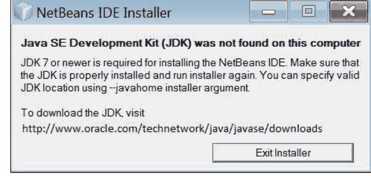

Figure 3-3 This message is displayed when the JDK is not found on your system.

在 NetBeans IDE 安装程序的第一个屏幕上，您可以保留并安装所有建议的包和运行时，也可以单击“Customize”按钮，仅勾选 Figure 3-4 中建议的包。

Figure 3-4 Selecting the packs and runtimes to install in the NetBeans IDE installer

单击“Next”按钮以浏览安装屏幕。当显示许可协议时，您必须阅读并接受条款。下一个屏幕提示您选择安装文件夹和 Java 环境。保留建议的文件夹，如 Figure 3-5 所示。

Figure 3-5 Selecting the installation folders in the NetBeans IDE installer

*Notice:* 您计算机上建议的安装文件夹和 Java 环境可能会因您拥有的 NetBeans IDE 或 JDK 版本而异，不同于 *Figure 3–5* 中的内容。

在下一个屏幕上，保持“Check for Updates”字段被勾选，如 *Figure 3–6* 所示。此选项将自动检查已安装插件的更新。

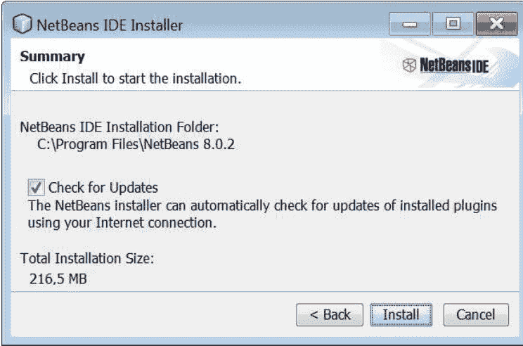

*Figure 3–6* Selecting the box to check for updates

单击“Install”按钮。

安装过程完成后，您需要更改一些设置，以便 PHP 脚本可以直接从 NetBeans IDE 运行。

打开 NetBeans IDE。您将看到的第一个屏幕如 *Figure 3–7* 所示。

Figure 3–7 The NetBeans IDE start page

从主菜单中选择 Tools→Options。在弹出的窗口中，单击 PHP 图标以打开 PHP 选项对话框，如 Figure 3–8 所示。

Figure 3–8 The PHP Options dialog box

为了使用此功能，您必须激活 PHP 支持。单击“Activate”按钮。窗口现在变为如 Figure 3–9 所示。

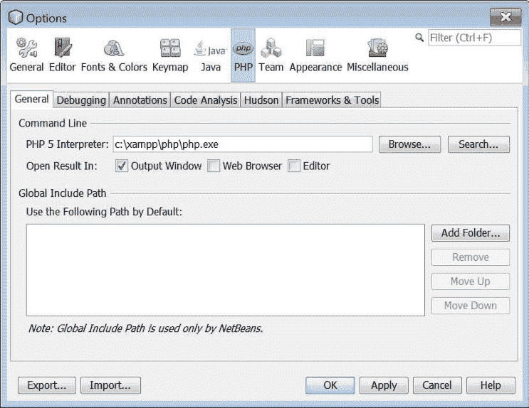

**Figure 3–9** The PHP Options dialog box after PHP activation

在“PHP 5 Interpreter”字段中，指定“php.exe”文件的路径。如有必要，使用“Browse...”或“Search...”按钮。如果您在安装过程中没有更改 XAMPP 的文件夹，此路径应为 "c:\xampp\php\php.exe"。

本书为节省纸张所做的另一件事是将每个缩进的空格数减少到两个。您也可以更改此设置，方法是先单击 Editor 图标以打开 Editor 的“Options”对话框，如 **Figure 3–10** 所示。

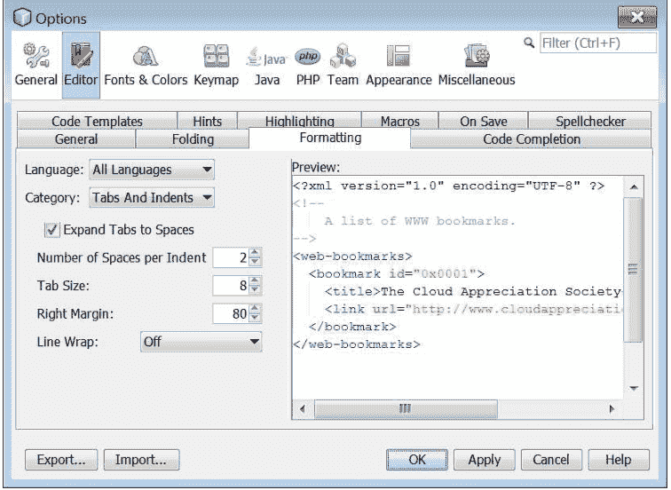

Figure 3-10 The Editor’s "Options" dialog box

在“Formatting”选项卡上，将“Number of Spaces per Indent”字段设置为 2。

单击“OK”按钮。

NetBeans IDE 已正确配置！现在是时候征服 PHP 的世界了！在即将到来的章节中，您将了解如何创建 PHP 项目、如何编写 PHP 脚本，以及许多对初学者程序员有用的技巧和窍门！

## 第 4 章 基本算法概念简介

### 4.1 什么是算法？

算法是一组严格定义的有限明确语句序列（通常称为指令或命令），它为任何可接受的输入值集（如果有任何输入的话）提供问题或特定类问题的解决方案。换句话说，算法是解决给定问题的逐步过程。术语“有限”意味着算法应该达到一个终点，不能永远运行。

您在现实生活中到处都可以找到算法，而不仅仅是在计算机科学中。例如，准备吐司或一杯茶的过程可以表示为算法。必须按照一定顺序执行某些步骤，才能实现您的目标。

### 4.2 制作一杯茶的算法

以下是制作一杯茶的算法。

- 1. 把茶包放入杯中。
- 2. 给水壶装满水。
- 3. 烧开水壶里的水。
- 4. 将一些开水倒入杯中。
- 5. 向杯中加入牛奶。
- 6. 向杯中加入糖。
- 7. 搅拌茶。
- 8. 喝茶。

如您所见，必须遵循某些步骤。这些步骤按特定顺序排列，尽管某些步骤可以重新排列。例如，步骤 5 和 6 可以颠倒。您可以先加糖，然后再加牛奶。

请记住，某些步骤的顺序可能可以更改，但您不能将它们移动太远，远离它们应该所在的位置。例如，您不能将步骤 3（“烧开水壶里的水。”）移动到算法的末尾，因为您最终会喝到一杯冰茶（而不是热茶），这与您最初的目标完全不同！

### 4.3 算法的属性

算法必须满足以下属性：

- 输入：算法必须来自指定集合的输入值。
- 输出：算法必须从指定的输入值集合中产生输出值。输出值是问题的解决方案。
- 有限性：对于任何输入，算法必须在有限步骤后终止。
- 明确性：算法的所有步骤都必须精确定义。


有效性：算法的每个步骤都必须能够正确执行，并且在有限的时间内完成。也就是说，其步骤必须足够基本，例如，有人使用铅笔和纸就能够精确地执行这些步骤，并且在有限的时间内完成。仅仅每个步骤是明确的（或被精确定义）是不够的，它还必须是可行的。

### 4.4 好吧，关于算法。但是什么是计算机程序呢？

计算机程序只不过是用计算机能够理解的语言编写的算法，例如 PHP、C++、C# 或 Java。

计算机程序实际上不能为你泡一杯茶或做你的晚餐，尽管算法可以指导你自己完成这些步骤。但是，程序可以（例如）用于计算一组数字的平均值，或者在其中找到最大值。人工智能程序甚至可以下棋或解决逻辑谜题。

> Notice: 请记住，“PHP 程序”这个术语不常用。最常用的术语是“PHP 脚本”，本书从现在开始将使用该术语。

### 4.5 三方聚会！

算法中总是涉及三方：编写算法的人、执行算法的人，以及使用或享受算法的人。

让我们以准备一顿饭的算法为例。有人编写算法（食谱书的作者），有人执行它（可能是你的母亲，她按照食谱书中的步骤准备了饭菜），有人使用它（可能是你，享受这顿饭）。

现在考虑一个真正的计算机程序。让我们以一个视频游戏为例。有人用计算机语言编写算法（程序员），有人或某物执行它（通常是笔记本电脑或计算机），还有其他人使用它或与之玩耍（用户）。

要小心，因为有时“程序员”和“用户”这两个术语可能会令人困惑。当你编写一个计算机程序时，在那段时间里你是“程序员”。但是，当你使用自己的程序时，你是“用户”。

### 4.6 创建算法涉及的三个主要阶段

创建算法涉及三个主要阶段：数据输入、数据处理和结果输出。顺序是特定的，不能更改。

考虑一个计算三个数字平均值的计算机程序。首先，程序必须提示用户输入数字（数据输入）。接下来，程序计算数字的平均值（数据处理）。最后，程序在计算机屏幕上显示结果（结果输出）。

让我们更详细地看看这些阶段。

- 提示用户输入一个数字。
- 提示用户输入第二个数字。
- 提示用户输入第三个数字。
- 计算三个数字的和。
- 将和除以 3。
- 在屏幕上显示结果。

输入

处理

输出

在某些罕见情况下，输入阶段可能不存在，计算机程序可能只由两个阶段组成。例如，考虑一个编写用于计算以下求和的计算机程序。

1 + 2 + 3 + 4 + 5 + 6 + 7 + 8 + 9 + 10

在这个例子中，用户完全不输入任何值，因为计算机确切地知道该做什么。它必须计算 1 到 10 的数字之和。

现在让我们看看同一个例子，稍微改变一下。考虑一个编写用于计算以下求和的计算机程序。

1 + 2 + 3 + ⋯ + N

当然，这个求和与前一个不同。在这个例子中，用户需要输入一些数据。计算机无法自行决定数字 N 的确切值。这个值必须由用户输入。一旦用户输入了 N 的值，计算机就可以继续计算结果。例如，如果用户输入数字 5，计算机就可以找到 1 + 2 + 3 + 4 + 5 的结果。

### 4.7 流程图

流程图是一种以图形方式展示算法的方法，通常在纸上。它是算法执行流程的可视化表示。换句话说，它直观地表示执行流程如何从一个语句进行到下一个语句，直到达到算法的结束。流程图不能直接输入到计算机中。它必须首先转换为一种编程语言，例如 PHP。

流程图使用的基本符号如表 4-1 所示。

#### Table 4-1 流程图符号及其功能

| Symbol | Description |
| :--- | :--- |
| Start End | **Start/End**：表示算法的开始或结束。Start 符号有一个出口，End 符号有一个入口。 |
| Arrow | **Arrow**：显示执行流程。从一个符号发出并结束于另一个符号的箭头表示控制权传递给箭头所指向的符号。箭头始终画成上下或左右的直线（绝不画成角度）。 |
| Process | **Process**：表示一个过程或数学（公式）计算。Process 符号有一个入口和一个出口。 |
| Data Input / Data Output | **Data Input/Output**：表示数据输入或结果输出。在大多数情况下，数据来自键盘，结果显示在屏幕上。数据输入/输出符号有一个入口和一个出口。 |
| Decision | **Decision**：表示做出决策的点。基于给定条件（可以为真或假），算法将遵循右侧或左侧路径。Decision 符号有一个入口和两个（且始终只有两个）出口。 |
| Off-page connectors | **Off-page connectors**：显示流程图延续到另一页。当流程图太大无法放在一张纸上时，用于连接多页上的段落。出站离页连接器符号有一个入口，入站离页连接器符号有一个出口。 |
| Subprogram (predefined process) | **Subprogram (predefined process)**：描述在其他地方正式定义的子程序，例如在单独的流程图中。Predefined process 符号有一个入口和一个出口。 |

流程图示例如 **Figure 4–1** 所示。该算法提示用户输入三个数字，然后计算它们的平均值并在计算机屏幕上显示。

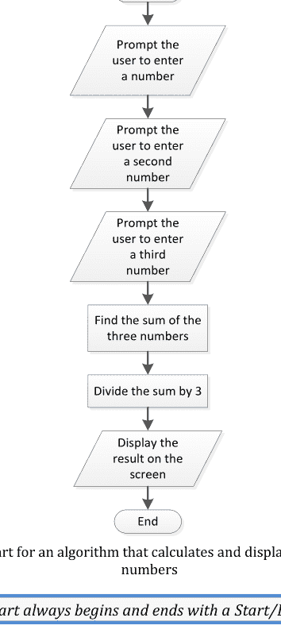

#### Figure 4–1 计算并显示三个数字平均值的算法流程图

> Remember! 流程图总是以 Start/End 符号开始和结束！

### Exercise 4.7-1 求三个数字的平均值

设计一个计算三个数字平均值的算法。每当平均值低于 10 时，应显示消息 "Fail!"。否则，如果平均值为 10 或以上，应显示消息 "Pass!"。

## Solution

在这个问题中，必须显示两条不同的消息，但每次执行算法时只能出现一条；消息的措辞取决于平均值。该算法的流程图如下所示。

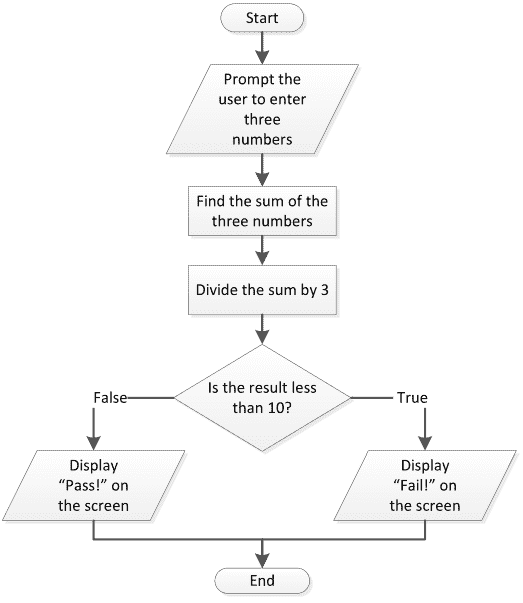

> **Notice:** 为了节省纸张，您可以使用一个单斜平行四边形提示用户输入所有三个数字。
> 
> **Remember!** Decision 符号始终有一个入口和两条出口路径！

当然，现在让你开始创建自己的算法还为时过早。这个特定的练习非常简单，在本章中作为一个例外呈现，仅用于演示目的。在你开始创建自己的算法甚至 PHP 脚本之前，你需要学习更多。只要耐心！几章后，伟大的时刻就会到来！

### 4.8 什么是“保留字”？

在计算机语言中，“保留字”是所有具有严格预定义含义的单词——它们被保留用于特殊用途，不能用于任何其他目的。例如，流程图中的单词 `Start`、`End`、`Read` 和 `Write` 具有预定义含义。它们分别用于表示开始、结束、数据输入和结果输出。

保留字也存在于所有高级计算机语言中。在 PHP 中，有许多保留字，例如 `echo`、`if`、`while` 和 `for`。它们的含义是预定义的，因此这些词不能用于任何其他目的。

> **Notice:** 计算机语言中的保留字通常被称为关键字。


### 4.9 语句与命令有什么区别？

互联网上关于语句与命令是否存在区别一直存在大量讨论。有些人倾向于使用“语句”一词，而另一些人则偏好使用“命令”一词。对于初学者程序员来说，两者没有区别；两者都是给计算机的指令！

### 4.10 什么是结构化程序设计？

结构化程序设计是一种使用模块化和结构化设计的软件开发方法。这意味着大型程序或脚本被分解为更小的模块，每个单独的模块都使用结构化代码，这意味着语句以特定方式组织，以最大限度地减少错误和误解。正如其名称所示，结构化程序设计是在结构化程序设计语言中进行的，PHP 就是其中一种语言。

结构化程序设计概念于 1966 年由 Corrado Böhm¹ 和 Giuseppe Jacopini² 正式化。他们使用序列、判断和迭代演示了理论计算机程序设计。

### 4.11 三种基本控制结构

结构化程序设计中有三种基本控制结构。

- **序列控制结构：** 这指的是逐行执行，语句按顺序执行，顺序与它们在脚本中出现的顺序相同。例如，它们可能执行一系列读取或写入操作、算术运算或变量赋值。
- **判断控制结构：** 取决于条件为真还是假，判断控制结构可能跳过整个语句块的执行，甚至执行一个语句块而不是另一个。
- **循环控制结构：** 这是一种控制结构，允许多次执行一个语句块，直到满足指定条件为止。

如果你不太理解这三种控制结构的深层含义，不要担心，因为即将到来的章节将非常彻底地分析它们。耐心是一种美德。你现在所要做的就是等待！

¹ Corrado Böhm (1923– ) 是一位计算机科学家，尤其以其对结构化程序设计理论的贡献以及对函数式编程语言的实现而闻名。

² Giuseppe Jacopini (1936–2001) 是一位计算机科学家。他最具影响力的贡献是关于结构化程序设计的定理，该定理于 1966 年与 Corrado Böhm 共同发表，标题为“流程图、图灵机和只有两个形成规则的语言”。（Bohm, C., and Jacopini, G., “Flow Diagrams, Turing Machines, and Languages with Only Two Formation Rules,” Communications of the ACM 9(5), (May, 1966), 366–371。）

### Exercise 4.11-1 使用流程图理解控制结构

使用流程图，为每种类型的控制结构给出一个示例。

## Solution

#### 序列控制结构示例

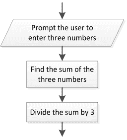

#### 判断控制结构示例

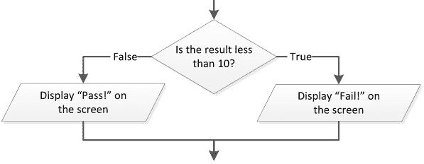

#### 循环控制结构示例

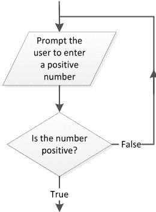

### 4.12 你的第一个 PHP 脚本

将流程图转换为诸如 PHP 之类的计算机语言会生成一个 PHP 脚本。PHP 脚本只不过是一个包含 PHP 语句的文本文件。PHP 脚本甚至可以在你的文本编辑器应用程序中编写！请记住，使用 NetBeans IDE 编写 PHP 脚本是一个更好的解决方案，因为它包含的所有功能都可以让你的生活更轻松。

PHP 脚本始终以分隔符 `<?php` 和 `?>` 开始和结束，如下所示。

```php
<?php

// PHP code goes here

?>
```

PHP 脚本以默认的 .php 文件扩展名保存在你的硬盘上。下面是一个非常简单的 PHP 脚本，它在屏幕上显示三条消息。

```php
<?php
echo "Hello World!";
echo "Hallo Welt!";
echo "The End";
?>
```

> **Notice:** 请注意，PHP 要求所有语句都以分号结束。

### 4.13 语法错误与逻辑错误有什么区别？

当程序员使用高级语言编写代码时，可能会犯两种类型的错误：语法错误和逻辑错误。

```php
Date created: 12/25/2003
Date modified: 04/03/2008
Description: This script displays some messages on the screen
*/

echo "Hello Zeus!";  //display a message on the screen

//display a second message on the screen
echo "Hello Hera!";

/* display a third message on screen */  echo "Γεια σου";

#This is a comment          echo "The End";
?>
```

正如你在前面的脚本中看到的，你可以在语句上方或末尾添加注释，但不能在前面添加。请看最后的 echo 语句，它本应显示消息“The End”。该语句永远不会被执行，因为它被视为注释的一部分。

> **Notice:** *如果你使用分隔符 `/* .... */` 在语句前面添加注释，该语句仍然会被执行。在前面的示例中，希腊语消息“Γεια σου Ηροδοξάνω”即使写在一些注释旁边，也仍然会被执行。但是，不建议遵循这种编写风格，因为它会使你的代码难以阅读。*

### 4.15 用户友好的程序和脚本

什么是“用户友好”的程序或脚本？它是用户视为朋友而非敌人的程序，是新手用户可以轻松使用的程序。

如果你想编写用户友好的程序或脚本，你必须设身处地为用户着想。用户希望计算机以最小的努力按他们的方式完成工作。隐藏的菜单、不准确的标签和说明以及误导性的错误消息，这些都是会使程序或脚本不友好的因素！

最能定义用户友好设计的定律是“最小惊讶定律”：“程序应该以最不让用户惊讶的方式行事。”该定律也通常被称为最小惊讶原则（POLA）。

### 4.16 复习题：判断正误

为以下每个陈述选择 **true** 或 **false**。

1. 准备一餐的过程实际上是一个算法。
2. 算法仅用于计算机科学。
3. 算法可以永远运行。
4. 在算法中，你可以将一个步骤重新定位到任何你希望的位置。
5. 算法应该只为一组输入值产生正确的输出值。
6. 计算机可以下棋。
7. 算法总是可以成为一个计算机程序。
8. 编程是创建计算机程序的过程。
9. 计算机程序中总是涉及三方：程序员、计算机和用户。
10. 程序员和用户有时可以是同一个人。
11. 计算机程序可能不输出任何结果。
12. 流程图是一个计算机程序。
13. 流程图由一组几何形状组成。
14. 流程图是一种用于表示算法的方法。
15. 你可以不使用任何开始/结束符号来设计流程图。
16. 你可以不使用任何处理符号来设计流程图。
17. 你可以不使用任何数据输入/输出符号来设计流程图。
18. 流程图应该始终至少包含一个判断符号。
19. 在流程图中，判断符号可以有一个、两个或三个退出路径，具体取决于给定的问题。
20. 保留字是所有具有严格预定义含义的单词。
21. 结构化程序设计包括结构化设计。
22. PHP 是一种结构化计算机语言。
23. 结构化程序设计的基本原则是它仅包含四种基本控制结构。
24. 一个语句写十次被视为循环控制结构。
25. 判断控制结构是指逐行执行。
26. 拼写错误的关键字被视为逻辑错误。
27. 即使 PHP 脚本包含逻辑错误，也可以执行。
28. 语句末尾缺少分号被视为语法错误。
29. 语句末尾的感叹号不能阻止整个 PHP 脚本被执行。
30. 结构化程序设计的优势之一是在编写计算机程序时不会出错。
31. 逻辑错误在编译期间被捕获。
32. 语法错误是最难检测的错误。
33. 一个计算三角形面积但输出错误结果的脚本包含逻辑错误。
34. 当脚本不包含输出语句时，它包含语法错误。
35. 脚本应该始终包含注释。
36. 如果你向脚本添加注释，计算机可以更容易地理解它。


37. 你可以在脚本中的任何位置添加注释。

38. 程序的用户看不到注释。

39. 如果程序或脚本可以被新手用户轻松使用，则称为用户友好型。

40. 缩写 POLA 代表“最少娱乐原则”（Principle of Least Amusement）。

### 4.17 复习题：选择题

为以下每个陈述选择正确答案。

- 1. 算法是一组严格定义的、有限的、明确定义的语句序列，用于解决
  - a. 一个问题。
  - b. 一类特定的问题。
  - c. 以上两者皆是

- 2. 以下哪项不是算法应满足的属性？
  - a. 有效性
  - b. 适宜性
  - c. 确定性
  - d. 输入

- 3. 计算机程序是
  - a. 一个算法。
  - b. 一组指令序列。
  - c. 以上两者皆是
  - d. 以上都不是

- 4. 当有人准备一顿饭时，他或她是
  - a. “程序员。”
  - b. “用户。”
  - c. 以上都不是

- 5. 以下哪项不属于创建算法涉及的三个主要阶段？
  - a. 数据生成
  - b. 数据输入
  - c. 数据输出
  - d. 数据处理

- 6. 流程图可以
  - a. 在一张纸上展示。
  - b. 直接输入计算机。
  - c. 以上两者皆是

- 7. 流程图中的矩形表示
  - a. 输入/输出。
  - b. 处理操作。
  - c. 决策。
  - d. 以上都不是

- 8. 以下哪项是控制结构？
  - a. 决策
  - b. 序列
  - c. 循环
  - d. 以上都是控制结构。

- 9. 以下哪个 PHP 语句包含语法错误？
  - a. `echo "Hello Poseidon"`
  - b. `echo "It’s me! I am the one that contains a syntax error!!!";`
  - c. `echo "Hello Athena";`
  - d. 以上都不是

- 10. 以下哪些 echo 语句实际上会被执行？
  - a. `//echo "Hello Apollo";`
  - b. `/* echo "Hello Artemis"; */`
  - c. `//This will be executed // echo "Hello Ares";`
  - d. `/* This will be executed */ echo "Hello Aphrodite";`
  - e. 以上都不是

## 第 5 章
变量和常量

### 5.1 什么是变量？

在计算机科学中，变量是计算机主内存（RAM）中的一个位置，你可以在其中存储一个值，并在程序执行过程中更改它。

将变量想象成一个透明的盒子，你可以在其中一次插入并保存一个东西。因为盒子是透明的，你也可以查看它包含的内容。此外，如果你有两个或更多盒子，你可以给每个盒子一个唯一的名称。例如，你可以有三个盒子，每个盒子包含一个不同的数字，你可以将这些盒子命名为 numberA、numberB 和 numberC。

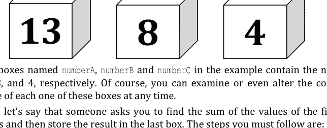

示例中名为 numberA、numberB 和 numberC 的盒子分别包含数字 13、8 和 4。当然，你可以随时查看甚至更改这些盒子中每个包含的值。

现在，假设有人要求你找出前两个盒子中值的总和，然后将结果存储在最后一个盒子中。你必须遵循的步骤是：

- 1. 查看前两个盒子并检查包含的值。
- 2. 使用你的 CPU（即你的大脑）计算总和（结果）。
- 3. 将结果插入最后一个盒子。但是，由于每个盒子一次只能包含一个值，值 4 实际上被数字 21 替换了。

盒子现在看起来像这样。


在流程图中，将值存储在变量中的操作由左箭头表示


此操作通常表述为“将值或表达式的结果赋给变量。”左箭头称为“值赋值运算符。”

> 注意：请注意，此箭头始终指向左侧。不允许使用右箭头。另外，箭头左侧只能存在一个单一变量。

在真正的计算机科学中，这三个盒子实际上是主内存（RAM）中的三个独立区域，名为 numberA、numberB 和 numberC。

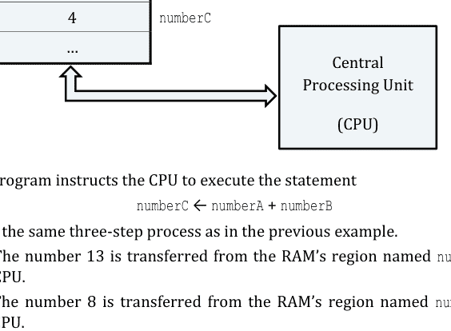

当程序指示 CPU 执行语句

```
numberC ← numberA + numberB
```

它遵循与前面示例相同的三步过程。

- 1. 数字 13 从名为 numberA 的 RAM 区域传输到 CPU。
- 数字 8 从名为 numberB 的 RAM 区域传输到 CPU。
- （这是第一步，即你检查了前两个盒子中包含的值。）

- 2. CPU 计算 13 + 8 的总和。
- （这是第二步，即你使用大脑计算总和或结果。）

- 3. 结果 21 从 CPU 传输到名为 numberC 的 RAM 区域，替换现有的数字 4。
- （这是第三步，即你将结果插入最后一个盒子。）

#### 执行后，RAM 看起来像这样。

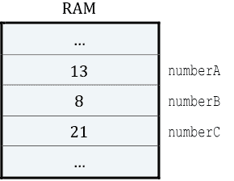

> **记住！** 当 PHP 脚本运行时，变量可以保存各种值，但一次只能保存一个值。当你向变量赋值时，该值将保持存储，直到你赋予一个新值。旧值将丢失。

变量是计算机科学中最重要的元素之一，因为它帮助你与主内存（RAM）中存储的数据进行交互。很快，你将学习如何在 PHP 中声明和使用变量。

### 5.2 什么是常量？

有时你可能需要使用一个在程序运行过程中不能更改的值。这样的值称为“常量。”简单来说，你可以说常量是一个锁定的变量。这意味着当程序开始运行并向常量赋值后，在程序运行期间，没有任何东西可以更改常量的值。例如，在财务程序中，利率可以声明为常量。

为常量指定描述性名称也可以提高程序的可读性并帮助你避免错误。例如，假设你在程序的许多地方使用值 3.14159265（但不是作为常量）。如果你在输入数字时出错，这将产生错误的结果。但是，如果这个值被赋予一个名称，名称中的任何拼写错误都会被 PHP 检测到，并且你会收到一条错误消息。

在流程图中，你可以用等号（=）表示将常量设置为某个值的操作。

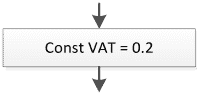

> **注意：** 本书使用保留字 `Const` 来区分常量和变量。

考虑一个允许用户输入三种不同产品的价格，然后计算并显示每种产品 20% 增值税（VAT）的算法。图 5-1 的流程图显示了未使用常量时的过程。

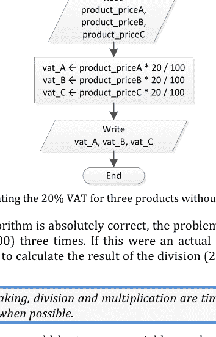

图 5-1 未使用常量计算三种产品的 20% VAT

尽管此算法完全正确，但问题是作者三次使用了 20% VAT（20/100）。如果这是一个实际的计算机程序，CPU 将被迫分别计算三次除法（20/100）的结果。

> 注意：一般来说，除法和乘法是耗时的操作，应尽可能避免。

更好的解决方案是使用变量，如图 5-2 所示。这减少了除法和乘法操作的次数，并降低了拼写错误的可能性。

## 第 5 章
变量和常量

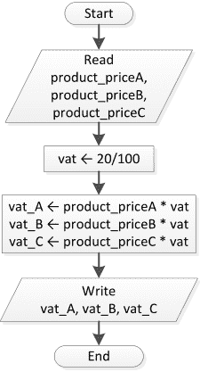

**图 5–2** 使用变量 vat 计算三种产品的 20% VAT

这次除法（20/100）只计算一次，然后其结果用于计算每种产品的 VAT。

但是即便如此，该算法（可能后来成为计算机程序）并不完美：vat 是一个变量，任何程序员都可能意外更改其值。

理想的解决方案是将变量 vat 改为常量 VAT，如 **图 5–3** 所示。

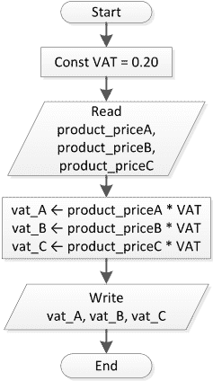

**图 5–3** 使用常量 VAT 计算三种产品的 20% VAT


注意：请注意，当声明常量时，使用等号（=）而不是左箭头。

最后一个解决方案因多种原因是最佳选择。

- 任何人均无法（包括程序员自己）通过在程序任意位置意外写上诸如 VAT ← 0.60 的语句来修改增值税的值。
- 最大限度地减少出现排版错误的可能性。
- 尽可能减少乘法和除法运算的次数。
- 如果某天财政部长决定将增值税从 20% 提高到 22%，程序员只需改动一行代码！

### 5.3 PHP 中存在多少种变量和常量？

所有计算机语言中都存在多种不同类型的变量和常量。这种多样性的原因是每个变量或常量可以保存不同数据类型的数据。大多数情况下，变量和常量保存以下几种类型的数据。

- **整数（Integers）**：整数值是没有小数部分的正数或负数，例如 5、100、135、-25 和 -5123。
- **实数（Reals）**：实数值是包含小数部分的正数或负数，例如 5.14、7.23、5.0、3.14 和 -23.78976。实数值也称为“浮点数”（floats）。
- **布尔值（Booleans）¹**：布尔变量或常量只能保存两个值之一：true 或 false。
- **字符（Characters）**：字符是字母数字值（始终用单引号或双引号括起来），例如 "Hello Zeus"、'I am 25 years old' 或 'Peter Loves Jane For Ever'。字符值也称为“字符串（strings）！！！”。（也许“string”这个词会让你联想到可穿戴的东西，但遗憾的是并不是。请让你那颗肮脏而珍贵的心专注于计算机科学！）

### 5.4 PHP 变量命名规则

命名变量时必须遵循某些规则。

- PHP 变量写作 $var_name，其中 var_name 是变量的名称。名称只能包含拉丁字符（英文大写或小写字符）、数字和下划线（_）字符。变量名的示例有 $firstName、$last_name1 和 $age。
- 变量名区分大小写，这意味着大写字符和小写字符之间存在明显区别。例如，$myVAR、$myvar、$MYVAR 和 $MyVar 实际上是四个不同的变量。

下面是一些示例，说明变量在不同高级计算机语言中如何声明。

| 声明语句 | 高级计算机语言 |
| --- | --- |
| Dim sum as Integer | Visual Basic |
| int sum; | Visual C#、C++、Java 以及许多其他语言 |
| sum: Integer; | Pascal、Delphi |
| var sum; | Javascript |

### 5.7 如何在 PHP 中声明变量

在 PHP 中，不需要像在 C# 或 C++ 中那样声明变量。变量在首次使用时被声明。例如，语句

```php
$number1 = 0;
```

声明了变量 $number1 并将其初始化为 0。

> **注意：** 在 PHP 中，可以使用等号（=）来表示给变量赋值的操作。这相当于流程图中的左箭头。

### 5.8 如何在 PHP 中声明常量

你可以使用 define 关键字在 PHP 中声明常量。

```php
define("name", value);
```

以下示例展示了如何在 PHP 中声明常量。

```php
define("WAIT", 0.22);
define("COMPUTER_NAME", "pc01");
define("FAVORITE_SONG", "We are the world");
```

> **注意：** 请注意，PHP 要求所有语句以分号（;）结尾。

一旦常量被定义，在脚本运行期间其值不能被更改。

### 5.9 复习题：判断对错

对以下每个陈述选择正确或错误。

1. 变量是计算机辅助存储设备中的一个位置。
2. 对于流程图中的赋值运算符，你可以使用左箭头或右箭头。
3. 变量在脚本执行期间可以更改其内容。
4. 常量在脚本执行期间可以更改其内容。
5. 值 10.0 是一个整数。
6. 布尔变量只能保存两个值之一。
7. 用双引号括起来的值 “10.0” 是一个实数值。

d. "true".
e. 以上都不是。

6. 在 PHP 中，字符串

- a. 用单引号括起来。
- b. 用双引号括起来。
- c. 以上两者都正确。

7. 以下哪个不是有效的 PHP 变量？

- a. $city_name
- b. $cityName
- c. $cityname
- d. $city-name

8. 你可以使用 define() 语句定义常量。一旦常量被定义，

- a. 它永远不能被更改。
- b. 它可以再次使用 define() 语句来更改。
- c. 以上两者都正确。

### 5.11 复习练习

完成以下练习。

1. 将第一列中的每个元素与第二列中的一个元素匹配。

| 值 | 数据类型 |
| --- | --- |
| 1. "True" | a. 布尔值 |
| 2. 123 | b. 实数 |
| 3. False | c. 字符串 |
| 4. 10.0 | d. 整数 |

2. 将第一列中的每个元素与第二列中的一个元素匹配。

| 数据 | 数据类型 |
| --- | --- |
| 1. 一个人的姓名 | a. 布尔值 |
| 2. 一个人的年龄 | b. 实数 |
| 3. 除法 5/2 的结果 | c. 整数 |
| 4. 它是黑的还是白的？ | d. 字符串 |

## 第6章
处理输入与输出

### 6.1 哪个语句在用户屏幕上输出消息和结果？

流程图使用斜平行四边形和保留字“Write”来在用户屏幕上显示消息或最终结果。

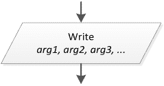

其中 *arg1*、*arg2* 和 *arg3* 可以是变量、表达式，甚至是双引号括起来的字符串。

你刚刚看到的斜平行四边形等价于

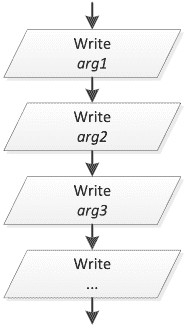

在 PHP 中，你可以使用以下语句获得相同的结果：

```
echo arg1, arg2, arg3, ... ;
```

或等价的语句序列。

```
echo arg1;
echo arg2;
echo arg3;
...
```

> **记住！** 如果要在屏幕上显示字符串，该字符串必须用双引号括起来。

以下两个语句：

```php
<?php
    $a = 5 + 6;
    echo "The sum of 5 and 6 is ", $a;
```


**图 6–2** 输出结果显示在一行上

要输出“换行符”，你必须在每个句子后面放置特殊字符序列 `\n`。

```php
<?php
    echo "Good Morning\n";
    echo "Good Evening\n";
    echo "Good Night\n";
?>
```

输出结果现在显示在**图 6–3**中。


**图 6–3** 输出结果现在显示换行

请注意，使用一条语句也可以获得相同的结果。

```php
echo "Good Morning\nGood Evening\nGood Night\n";
```

另一个有趣的字符序列是 `\t`，它可以用来输出“制表位”。制表符（`\t`）对于对齐输出非常有用。

```php
<?php
    echo "Good Morning\t";
    echo "Good Evening\n";
    echo "Good Afternoon\t";
    echo "Good Night";
?>
```

输出结果现在显示在**图 6–4**中。

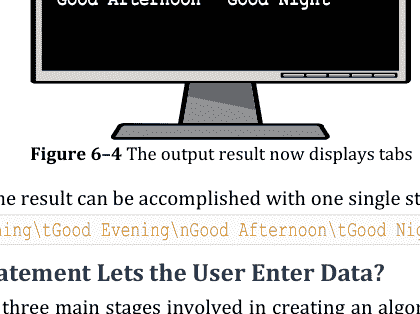

图 6-4 输出结果现在显示制表符

当然，使用一条语句也可以获得相同的结果。

```
echo "Good Morning\tGood Evening\nGood Afternoon\tGood Night";
```

### 6.3 哪个语句让用户输入数据？

你还记得创建算法或计算机程序所涉及的三个主要阶段吗？第一个阶段是“数据输入”阶段，在该阶段，计算机让用户输入数据，例如数字、姓名、地址或出生年份。

流程图使用斜平行四边形和保留字“Read”来让用户输入其数据。


其中 var_name1、var_name2 和 var_name3 只能是变量。

你刚刚看到的斜平行四边形等价于

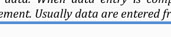

> **注意：** 当执行 Read 语句时，执行流程会被中断，直到用户输入了所有数据。当数据输入完成时，执行流程继续执行下一条语句。通常数据通过键盘输入。


在 PHP 中，数据输入是通过 PHP 语句完成的

```
$var_name = trim(fgets(STDIN));
```

其中

- $var_name 可以是任何变量。
- STDIN 代表 STANDARD INPUT（通常是键盘）。
- 函数 trim() 在本书后面部分讨论。

以下代码片段允许用户输入姓名和年龄。

```
$name = trim(fgets(STDIN));
$age = trim(fgets(STDIN));
echo "Wow, you are already", age, "years old,", name, "!";
```

如果在每次数据输入之前显示一条“提示”消息，效果会更好。这使脚本更加用户友好。例如，请看以下脚本。

```
echo "What is your name?";
$name = trim(fgets(STDIN));

echo "What is your age?";
$age = trim(fgets(STDIN));

echo "Wow, you are already", age, "years old,", name, "!";
```

相应的流程图片段如下。

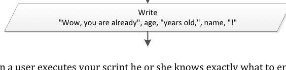

现在，当用户执行你的脚本时，他或她确切地知道要输入什么。

### 6.4 复习题：判断题

为以下每个陈述选择 **正确** 或 **错误**。

1. 在 PHP 中，单词 `fgets` 是保留字。
2. `echo` 语句可用于显示消息或变量的内容。
3. 执行 `trim(fgets(STDIN))` 语句时，执行流程会被中断，直到用户输入一个值。
4. 单个语句 `trim(fgets(STDIN))` 可用于输入多个数据值。
5. 在数据输入之前，必须始终显示提示消息。

### 6.5 复习题：选择题

为以下每个陈述选择正确答案。

1. 语句 `echo "Hello"` 显示
   - a. 单词 `Hello`（不带双引号）。
   - b. 单词 "Hello"（包括双引号）。
   - c. 变量 `Hello` 的内容。
   - d. 以上都不是

2. 语句 `echo "Hello\nHermes"` 显示
   - a. 消息 `Hello Hermes`。
   - b. 单词 `Hello` 在一行，单词 `Hermes` 在下一行。
   - c. 消息 `HelloHermes`。
   - d. 消息 `Hello\nHermes`。
   - e. 以上都不是

3. 语句 `$data1_data2 = trim(fgets(STDIN))`
   - a. 允许用户输入一个值并将其赋给变量 `$data1`。变量 `$data2` 保持为空。
   - b. 允许用户输入一个值并将其赋给变量 `$data1_data2`。
   - c. 允许用户输入两个值并分别赋给变量 `$data1` 和 `$data2`。
   - d. 以上都不是

## 第 7 章
运算符

### 7.1 值赋值运算符

PHP 中最常用的运算符是值赋值运算符（ = ）。例如，PHP 语句

```
$x = 5;
```

将值 5 赋给变量 $x。

如你在第 5 章中所读，这相当于流程图中使用的左箭头。

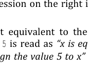

可能流程图中使用的左箭头比值赋值运算符（ = ）更方便、更清晰，因为它以更直观的方式显示右侧表达式的值或结果被赋给左侧变量。

小心！（ = ）符号不等同于数学中使用的符号。在数学中，表达式 x = 5 读作“x 等于 5”。然而，在 PHP 中，表达式 $x = 5 读作“将值 5 赋给 x”或“将 x 设置为 5”。它们看起来相同，但作用不同！

在数学中，以下两行是等价的：

```
x = y + z
y + z = x
```

第一行可读作“x 等于 y 和 z 之和”，第二行可读作“y 和 z 之和等于 x”。

另一方面，在 PHP 中，以下两个语句绝对不等价。事实上，第二个语句被认为是错误的！

```
$x = $y + $z;
$y + $z = $x;
```

第一个语句看起来相当正确。它可读作“将 x 设置为 y 和 z 之和”或“将 y 和 z 之和赋给 x。”

但是第二个语句呢？想想！是否可能将 x 的值赋给 y + z？答案显然是一个大的“不！”

> 记住！在 PHP 中，（ = ）符号左侧的变量代表主内存（RAM）中可存储值的一个区域。因此，左侧只能存在一个单一变量！然而，右侧可以是一个数字、变量、字符串，甚至是一个复杂的数学表达式。

在表 7–1 中，你可以找到一些值赋值示例。

#### 表 7-1 值赋值示例

| $a = 9 | 将值 9 赋给变量 $a。 |
| $b = $c | 将变量 $c 的内容赋给变量 $b。 |
| $d = "Hello Zeus" | 将字符串 Hello Zeus 赋给变量 $d。 |
| $d = $a + $b | 计算变量 $a 和 $b 内容的和，并将结果赋给变量 $d。 |
| $b = $a + 1 | 计算变量 $a 的内容与 1 的和，并将结果赋给变量 $b。请注意，变量 $a 的内容未被更改。 |
| $a = $a + 1 | 计算变量 $a 的内容与 1 的和，并将结果重新赋给变量 $a。换句话说，将变量 $a 增加 1。 |

对最后一个感到困惑吗？你现在是不是在想你的数学老师？如果你在黑板上写了 a = a + 1，他/她会怎么说？你能想到一个等于自身加一的数字吗？你疯了吗？这意味着 5 等于 6，10 等于 11！

显然，计算机科学中的情况不同。语句 $a = $a + 1 是完全可以接受的！它指示 CPU 从主内存（RAM）中检索变量 $a 的值，将值加 1，并将结果重新赋给变量 $a。变量 $a 的旧值被新值替换。

还是不明白？让我们看看 CPU 和主内存（RAM）如何协作来执行语句 A ← A + 1（这与 PHP 中的语句 $a = $a + 1 相同）。

假设内存中有一个名为 A 的区域，包含数字 13

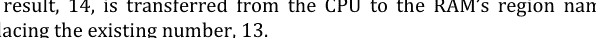

当程序指示 CPU 执行语句
A ← A + 1

时，将执行以下过程：

- 数字 13 从 RAM 中名为 A 的区域传输到 CPU；
- CPU 计算 13 和 1 的和；以及
- 结果 14 从 CPU 传输到 RAM 中名为 A 的区域，替换现有数字 13。

执行后，RAM 如下所示。

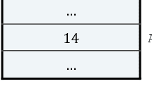

### 7.2 算术运算符

就像每种高级编程语言一样，PHP 支持几乎所有类型的算术运算符。

| 算术运算符 | 描述 |
|---|---|
| + | 加法 |
| - | 减法 |
| * | 乘法 |
| / | 除法 |
| % | 取模（整数除法后的余数） |

前四个运算符很简单，无需进一步解释。

取模运算符（%）返回整数除法的余数，这意味着

```
$a = 13 % 3
```

将值 1 赋给变量 $a。

取模运算符（%）也可用于浮点数，但结果始终是整数。例如，操作

```
$b = 13.4 % 3
```

将值 1（而不是你可能错误期望的 1.4）赋给变量 $b。

> **注意：** 请记住，流程图是一种用于表示算法的松散方法。虽然在流程图中允许使用取模（%）运算符，但本书使用常用的 MOD 运算符！例如，PHP 语句 `$b = 13 % 3` 在流程图中表示为

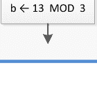

运算顺序可总结如下：

1. 括号内的任何操作首先执行。
2. 接下来，从左到右执行任何乘法和除法操作。
3. 最后，从左到右执行任何加法和减法操作。

因此，在语句 $y = (20 + 3) + 12 + 8 / 4 * 3; 中

操作按以下方式执行：

1. 20 加 3，得到结果 23。
2. 8 除以 4，得到结果 2。然后将此结果乘以 3，得到结果 6。
3. 23 加 12，得到结果 35。然后将此结果加 6，得到最终结果 41。

接下来是以更直观的方式呈现的相同操作序列。

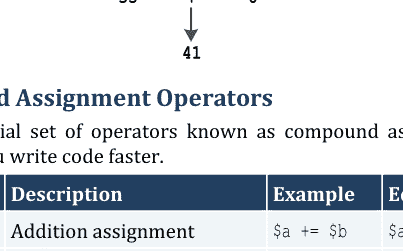

### 7.4 复合赋值运算符

PHP 提供了一组特殊的运算符，称为复合赋值运算符，可以帮助你更快地编写代码。

| 运算符 | 描述 | 示例 | 等价于 |
|---|---|---|---|
| += | 加法赋值 | $a += $b | $a = $a + $b |
| -= | 减法赋值 | $a -= $b | $a = $a - $b |
| *= | 乘法赋值 | $a *= $b | $a = $a * $b |
| /= | 除法赋值 | $a /= $b | $a = $a / $b |
| %= | 取模赋值 | $a %= $b | $a = $a % $b |

查看“等价于”列，很明显，仅使用经典赋值（ = ）运算符就可以实现相同的结果。那么这里出现的问题是，为什么存在这些运算符？


The answer is simple: It's a matter of convenience. Once you start using them, your life finds a different meaning!

**Notice:** Please keep in mind that flowcharts are a loose method to represent an algorithm. Although the use of compound assignment operators is allowed in flowcharts, this book uses only the commonly accepted operators shown in the “Equivalent to” column. For example, the PHP statement `$a += $b` is represented in a flowchart as

`a ← a + b`

#### Exercise 7.4-1 Which PHP Statements are Syntactically Correct?

Which of the following PHP assignment statements are syntactically correct?

+ i. `$a = -10;` v. `$a = COWS;` ix. `$a = true;`
+ ii. `10 = $b;` vi. `$a + $b = 40;` x. `$a %= 2;`
+ iii. `$a_b = $a_b + 1;` vii. `$a = 3 $b;` xi. `$a += 1;`
+ iv. `$a = "COWS";` viii. `$a = "true";` xii. `$a =* 2;`

## Solution

+ i. **Correct.** It assigns the integer value -10 to variable `$a`.
+ ii. **Wrong.** On the left side of the assignment operator, only variables can exist.
+ iii. **Correct.** It increases variable `$a_b` by one.
+ iv. **Correct.** It assigns the string (the text) COWS to variable `$a`.
+ v. **Correct.** It assigns the content of constant COWS to variable `$a`.
+ vi. **Wrong.** On the left side of the assignment operator, only one variable can exist.
+ vii. **Wrong.** It should have been written as `$a = 3 * $b`.
+ viii. **Correct.** It assigns the string true to variable `$a`.
+ ix. **Correct.** It assigns the value true to variable `$a`.
+ x. **Correct.** This is equivalent to `$a = $a % 2`.
+ xi. **Correct.** This is equivalent to `$a = $a + 1`
+ xii. **Wrong.** It should have been written as `$a *= 2` (which is equivalent to `$a = $a * 2`)

```php
$b = $a;
echo $a, " ", $b;
?>
```

and another one with a post-incrementing operator.

```php
<?php
$a = 5;
$a++;		//This is equivalent to $a = $a + 1
$b = $a;
echo $a, " ", $b;
?>
```

In both examples a value of 6 is assigned to variable $b! So, where is the catch? Are these two examples equivalent? The answer is “yes,” but only in these two examples. In other cases the answer will likely be “no.” There is a small difference between them.

Let’s spot that difference! The rule is that a pre-increment/decrement operator performs the increment/decrement operation first and then delivers the new value. A post-increment/decrement operator delivers the old value first and then performs the increment/decrement operation. Look carefully at the next two examples.

```php
$a = 5;
$b = ++$a;
echo $a, " ", $b;		//Outputs: 6, 6
```

and

```php
$a = 5;
$b = $a++;
echo $a, " ", $b;		//Outputs: 6, 5
```

In the first example, variable $a is incremented by one and then its new value is assigned to variable $b. In the end, both variables contain a value of 6.

In the second example, the value 5 of variable $a is assigned to variable $b, and then variable $a is incremented by one. In the end, variable $a contains a value of 6 but variable $b contains a value of 5!

> **Notice:** The double slashes after the `echo` statements indicate that the text that follows is a comment; thus, it is never executed.

### 7.6 String Operators

There are two operators that can be used to concatenate (join) strings.

| Operator | Description | Example | Equivalent to |
|---|---|---|---|
| `.` | Concatenation | `$a = "Hi" . " there";` | |
| `.=` | Concatenation assignment | `$a .= "Hello";` | `$a = $a . "Hello";` |

Notice: Joining two separate strings into a single one is called “concatenation.”

The following example displays “What’s up, dude?”

```php
<?php
$a = "What's ";
$b = "up, ";
$c = $a . $b;
$c .= "dude?";

echo $c;
?>
```

#### Exercise 7.6-1 Concatenating Names

Write a PHP script that prompts the user to enter his or her first and last name (assigned to two different variables) and then joins them together in a single string (concatenation).

## Solution

The PHP script is shown here.

```php
<?php
echo "Enter first name: ";
$first_name = trim(fgets(STDIN));
echo "Enter last name: ";
$last_name = trim(fgets(STDIN));

$full_name = $first_name . " " . $last_name;
echo $full_name;
?>
```

Notice: Please note the extra space character added between the first and last name

### 7.7 Review Questions: True/False

Choose true or false for each of the following statements.

+ 1. The statement $x = 5 can be read as “Variable $x is equal to 5.”
+ 2. The value assignment operator assigns the result of an expression to a variable.
+ 3. A value can be assigned to a variable only by using the trim(fgets(STDIN)) statement.
+ 4. The statement 5 = $y assigns value 5 to variable $y.
+ 5. On the right side of a value assignment operator an arithmetic operator must always exist.
+ 6. On the left side of a value assignment operator more than one variable can exist.
+ 7. You cannot use the same variable on both sides of a value assignment operator.
+ 8. The statement $a = $a + 1 decrements variable $a by one.
+ 9. In PHP, the word MOD is a reserved word.
+ 10. The statement $x = 0 % 5 assigns a value of 5 to variable $x.
+ 11. The operation 5 % 0 is not possible.
+ 12. Division and multiplication have the higher precedence among the arithmetic operators.
+ 13. When division and multiplication operators co-exist in an expression, multiplication operations are performed before division.
+ 14. The expression 8 / 4 * 2 is equal to 1.
+ 15. The expression 4 + 6 / 6 + 4 is equal to 9.
+ 16. The expression $a + $b + $c / 3 calculates the average value of three numbers.
+ 17. The statement $a += 1 is equivalent to $a++.
+ 18. The statement $a = "true" assigns a Boolean value to variable $a.
+ 19. The statement $a = 2 $a doubles the content of variable $a.
+ 20. The statements $a++ and ++$a are completely equivalent.
+ 21. The statement $a = $a++ - $a--; always assigns a value of -1 to variable $a.
+ 22. The statement $a = "George" . "Malkovich" assigns value GeorgeMalkovich to variable $a.
+ 23. The following code fragment satisfies the property of definiteness.

```php
$a = trim(fgets(STDIN));
$b = trim(fgets(STDIN));

$x = $a / ($b - 7);
echo $x;
```

### 7.8 Review Questions: Multiple Choice

Select the correct answer for each of the following statements.

+ 1. Which of the following PHP statements assigns a value of 10 to variable $a?
   a. 10 = $a;
   b. $a ← 10;
   c. $a = 100/10;
   d. none of the above

+ 2. The statement `$a = $b` can be read as
   a. assign the content of variable `$a` to variable `$b`.
   b. variable `$b` is equal to variable `$a`.
   c. assign the content of variable `$b` to variable `$a`.
   d. none of the above

+ 3. The expression `0 % 10 + 2` is equal to
   a. 7.
   b. 2.
   c. 12.
   d. none of the above

+ 4. Which of the following PHP statements is syntactically correct?
   a. `$a = 4 * 2 $y - 8 / (4 * $q);`
   b. `$a = 4 * 2 * $y - 8 / 4 * $q);`
   c. `$a = 4 * 2 * $y - 8 / (4 * $q);`
   d. none of the above

+ 5. Which of the following PHP statements increments variable `$a` by one and then assigns its value to variable `$b`?
   a. `$b = $a + 1;`
   b. `$b = $a++;`
   c. `$b = ++$a;`
   d. all of the above

+ 6. Which of the following PHP statements assigns value `George Malkovich` to variable `$a`?
   a. `$a = "George" . " " . "Malkovich";`
   b. `$a = "George" . " Malkovich";`
   c. `$a = "George " . "Malkovich";`
   d. all of the above

+ 7. The following code fragment

```php
$x = 2;
$x++;
```

does **not** satisfy the property of
   a. finiteness.
   b. definiteness.
   c. effectiveness.
   d. none of the above

#### 8. The following code fragment

```php
$a = trim(fgets(STDIN));
$x = 1 / $a;
```

does not satisfy the property of

+ a. finiteness.
+ b. input.
+ c. effectiveness.
+ d. none of the above

### 7.9 Review Exercises

Complete the following exercises.

+ 1. Which of the following PHP assignment statements are syntactically correct?

   i. `$a ← $a + 1;` vi. `$a = 40";`
   ii. `$a += $b;` vii. `$a = $b - 5;`
   iii. `$a b = $a b + 1;` viii. `$a = "true";`
   iv. `$a = $a++;` ix. `$fdadstwsdgfgw = 1;`
   v. `$a = hello;` x. `*$a;`

+ 2. What is the type of each of the following variables?

   i. `$a = "false";` iii. `$b = "15 meters";` v. `$b = 13.0;`
   ii. `$w = false;` iv. `$weight = "40";` vi. `$b = 13;`

+ 3. Match each element from the first column with one element from the second column.

| Operation | Result |
|---|---|
| i. `1 / 2` | a. `100` |
| ii. `1 / 2 * 2` | b. `0.25` |
| iii. `0 % 10 * 10` | c. `0` |
| iv. `10 % 2 + 7` | d. `0.5` |
| | e. `7` |
| | f. `1` |

+ 4. What displays on the screen after executing each of the following code fragments?

```php
$a = 5;
$b = $a * $a + 1;
echo $b++;
```

```php
$a = 9;
$b = $a / 3 * $a;
echo ++$b;
```


## 第7章 运算符

### 5. 执行以下每个代码片段后，屏幕上会显示什么？

```php
$a = 5;
$a = $a++;
echo $a;
```

```php
$a = 5;
$a = ++$a;
echo $a;
```

### 6. 以下每个运算的结果是什么？

- i. `21 % 5`
- ii. `10 % 2`
- iii. `11 % 2`
- iv. `10 % 6 % 3`
- v. `0 % 3`
- vi. `100 / 10 % 3`

### 7. 执行以下每个代码片段后，屏幕上会显示什么？

```php
$a = 5;
$b = 2;
$c = $a % ++$b;
$d = $b % ($a + $b);
echo $c, "*", $d;
```

```php
$a = 0.4;
$b = 8;
$a += 0.1;
$c = $a * $b % $b;
echo $c;
```

### 8. 计算以下各情况下表达式 `$a % $b` 的结果。

- i. `$a = 20, $b = 3`
- ii. `$a = 15, $b = 3`
- iii. `$a = 22, $b = 3`
- iv. `$a = 0, $b = 3`
- v. `$a = 3, $b = 0`
- vi. `$a = 2, $b = 2`

### 9. 计算以下各情况下表达式

`$b * ($a % $b) + $a / $b`

的结果。

- i. `$a = 10, $b = 5`
- ii. `$a = 10, $b = 4`

### 10. 执行以下代码片段后，屏幕上会显示什么？

```php
$a = "My name is";
$a .= " ";
$a = $a . "George Malkovich";
echo $a;
```

### 11. 在以下每个代码片段的空缺处填入内容，使它们显示值 5。

```php
$a = 2;
$a = $a - ____;
echo $a;
```

```php
$a = 4;
$b = $a * 0.5;
$b += $a;
$a = $b - ____;
echo $a;
```

### 12. 执行以下代码片段后，屏幕上会显示什么？

```php
$city = "California";
$California = $city;
echo $city, " ", $California;
```

## 第8章 跟踪表

### 8.1 什么是跟踪表？

跟踪表是一种用于测试算法或计算机程序的技术，目的是找出算法或程序执行过程中出现的逻辑错误。

跟踪表模拟执行流程。语句逐步执行，当赋值语句执行时，变量的值会发生改变。

跟踪表通常供初学程序员使用，帮助他们直观地了解某个特定算法或程序是如何工作的。跟踪表也可以帮助高级程序员发现逻辑错误。

下面显示了一个典型的跟踪表。

| 步骤 | 语句 | 备注 | $variable1 | $variable2 | $variable3 |
|---|---|---|---|---|---|
| 1 |  |  |  |  |  |
| 2 |  |  |  |  |  |
| ... |  |  |  |  |  |

我们来看一个跟踪表的实际应用！对于下面的 PHP 脚本，我们创建了一个跟踪表，以确定每个步骤中变量的值。

```php
<?php
  $x = 10;
  $y = 15;
  $z = $x * $y;
  $z++;
  echo $z;
?>
```

该脚本的跟踪表如下所示。备注是可选的，但有助于读者更好地理解实际发生的情况。

| 步骤 | 语句 | 备注 | $x | $y | $z |
|---|---|---|---|---|---|
| 1 | `$x = 10` | 值 10 被赋值给变量 `$x`。 | 10 | ? | ? |
| 2 | `$y = 15` | 值 15 被赋值给变量 `$y`。 | 10 | 15 | ? |
| 3 | `$z = $x * $y` | 乘积 `$x * $y` 的结果被赋值给 `$z`。 | 10 | 15 | 150 |
| 4 | `$z++` | 变量 `$z` 自增 1。 | 10 | 15 | 151 |
| 5 | `echo $z` | 显示值 151。 |  |  |  |

### 练习 8.1-1 创建跟踪表

*以下脚本执行时显示什么结果？*

```php
<?php
    $Ugly = "Beautiful";
    $Beautiful = "Ugly";
    $Handsome = $Ugly;
    echo "Beautiful";
    echo $Ugly;
    echo $Handsome;
?>
```

#### 解答

让我们创建一个跟踪表来找出输出结果。

| 步骤 | 语句 | 备注 | $Ugly | $Beautiful | $Handsome |
|---|---|---|---|---|---|
| 1 | `$Ugly = "Beautiful"` | 字符串“Beautiful”被赋值给变量 `$Ugly`。 | **Beautiful** | ? | ? |
| 2 | `$Beautiful = "Ugly"` | 字符串“Ugly”被赋值给变量 `$Beautiful`。 | Beautiful | **Ugly** | ? |
| 3 | `$Handsome = $Ugly` | 变量 `$Ugly` 的值被赋值给变量 `$Handsome`。 | Beautiful | Ugly | **Beautiful** |
| 4 | `echo "Beautiful"` | **显示字符串“Beautiful”。** |  |  |  |
| 5 | `echo $Ugly` | **显示字符串“Beautiful”。** |  |  |  |
| 6 | `echo $Handsome` | **显示字符串“Beautiful”。** |  |  |  |

### 练习 8.1-2 交换变量的值

编写一个 PHP 脚本，让用户输入两个值，分别保存在变量 `$a` 和 `$b` 中。程序结束时，这两个变量的值应互换。例如，如果变量 `$a` 和 `$b` 分别包含值 5 和 7，那么在交换它们的值之后，变量 `$a` 应包含值 7，而变量 `$b` 应包含值 5！

#### 解答

### 练习 8.1-3 交换变量的值——第二种方法

编写一个 PHP 脚本，让用户输入两个数值，分别保存在变量 `$a` 和 `$b` 中。最终，这两个变量的值应互换。

#### 解答

由于这两个变量只包含数值，你可以使用以下 PHP 脚本。

```php
<?php

$a = trim(fgets(STDIN));
$b = trim(fgets(STDIN));

$a = $a + $b;
$b = $a - $b;
$a = $a - $b;

echo $a, " ", $b;

?>
```

> **注意：** 与前面的练习相比，这种方法唯一的重大缺点是它无法交换字母数字变量（即字符串）的内容。

### 练习 8.1-4 创建跟踪表

创建一个跟踪表，以确定该 PHP 脚本在三次不同执行中每个步骤的变量值。

三次执行的输入值分别为：（i）0.3，（ii）4.5 和（iii）10。

```php
<?php
$b = trim(fgets(STDIN));
$c = 3;
$c = $c * $b;
$a = 10 * $c % 10;

echo $a;
?>
```

#### 解答

**i.** 对于输入值 0.3，跟踪表如下所示。

| 步骤 | 语句 | 备注 | $a | $b | $c |
|---|---|---|---|---|---|
| 1 | `$b = trim(fgets(STDIN))` | 用户输入值 0.3 | ? | **0.3** | ? |
| 2 | `$c = 3` |  | ? | 0.3 | **3** |
| 3 | `$c = $c * $b` |  | ? | 0.3 | **0.9** |
| 4 | `$a = 10 * $c % 10` |  | **9** | 0.3 | 0.9 |
| 5 | `echo $a` | 显示值 9 |  |  |  |

**ii.** 对于输入值 4.5，跟踪表如下所示。

| 步骤 | 语句 | 备注 | $a | $b | $c |
|---|---|---|---|---|---|
| 1 | `$b = trim(fgets(STDIN))` | 用户输入值 4.5 | ? | **4.5** | ? |
| 2 | `$c = 3` |  | ? | 4.5 | **3** |
| 3 | `$c = $c * $b` |  | ? | 4.5 | **13.5** |
| 4 | `$a = 10 * $c % 10` |  | **5** | 4.5 | 13.5 |
| 5 | `echo $a` | 显示值 5 |  |  |  |

**iii.** 对于输入值 10，跟踪表如下所示。

| 步骤 | 语句 | 备注 | $a | $b | $c |
|---|---|---|---|---|---|
| 1 | `$b = trim(fgets(STDIN))` | 用户输入值 10 | ? | **10** | ? |
| 2 | `$c = 3` |  | ? | 10 | **3** |
| 3 | `$c = $c * $b` |  | ? | 10 | **30** |
| 4 | `$a = 10 * $c % 10` |  | **0** | 10 | 30 |
| 5 | `echo $a` | 显示值 0 |  |  |  |

### 练习 8.1-5 创建跟踪表

创建一个跟踪表，以确定输入值为 3 时每个步骤的变量值。

```php
<?php
    $a = trim(fgets(STDIN));

    $b = $a + 10;
    $a = $b * ($a - 3);
    $c = 3 * $b / 6;
    $d = $c * $c;
    $d--;
    echo $d;
?>
```

#### 解答

对于输入值 3，跟踪表如下所示。

| 步骤 | 语句 | 备注 | $a | $b | $c | $d |
|---|---|---|---|---|---|---|
| 1 | `$a = trim(fgets(STDIN))` | 用户输入值 3 | 3 | ? | ? | ? |
| 2 | `$b = $a + 10` |  | 3 | 13 | ? | ? |
| 3 | `$a = $b * ($a - 3)` |  | 0 | 13 | ? | ? |
| 4 | `$c = 3 * $b / 6` |  | 0 | 13 | 6.5 | ? |
| 5 | `$d = $c * $c` |  | 0 | 13 | 6.5 | 42.25 |
| 6 | `$d--` |  | 0 | 13 | 6.5 | 41.25 |
| 7 | `echo $d` | 显示值 41.25 |  |  |  |  |

### 8.2 复习题：判断对错

判断以下每个陈述是对还是错。

- 1. 跟踪表是一种测试计算机的技术。
- 2. 跟踪表帮助程序员发现计算机程序中的错误。
- 3. 如果不先创建对应的跟踪表，你就无法编写计算机程序。
- 4. 要交换两个整数变量的值，你总是需要一个额外的变量。

### 8.3 复习练习

完成以下练习。

- 1. 创建一个跟踪表，以确定该 PHP 脚本在三次不同执行中每个步骤的变量值。

三次执行的输入值分别为：（i）3，（ii）4 和（iii）1。

```php
<?php
$a = trim(fgets(STDIN));

$a = ($a + 1) * ($a + 1) + 6 / 3 * 2 + 20;
$b = $a % 13;
$c = $b % 7;
$d = $a * $b * $c;
echo $a, " ", $b, " ", $c, " ", $d;
?>
```


2. 创建跟踪表，以确定两次不同执行中 PHP 脚本每个步骤的变量值。

两次执行的输入值为：(i) 3, 4；以及 (ii) 4, 4

```php
<?php
    $a = trim(fgets(STDIN));
    $b = trim(fgets(STDIN));

    $c = $a + $b;
    $d = 1 + $a / $b * $c + 2;
    $e = $c + $d;
    $c += $d + $e;
    $e--;
    $d -= $c + $d % $c;
    echo $c, " ", $d, " ", $e;
?>
```

## 第 9 章
使用 NetBeans IDE

### 9.1 创建新的 PHP 项目

到目前为止，你已经学习了 PHP 脚本的一些非常好的基础知识。现在是时候学习如何将脚本输入计算机、执行它们、查看其运行情况以及查看其显示结果的方式了。

你必须做的第一件事是创建一个新的 PHP 项目。NetBeans IDE 提供了一个向导来帮助你完成此操作。启动 NetBeans IDE，并从其主菜单中选择“文件→新建项目...”，如图 9–1 所示。

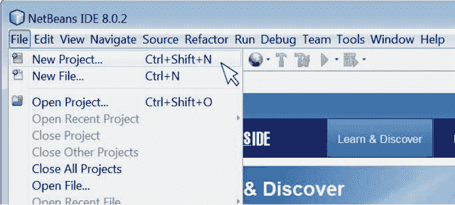

图 9–1 从 NetBeans IDE 启动新的 PHP 项目

> **注意：** PHP 项目可以包含许多 PHP 脚本。

“新建项目”向导将出现，并将引导你完成以下步骤。

- 1. 在向导的“新建项目”屏幕上，在“选择项目”下，选择“PHP 应用程序”，如图 9–2 所示。然后，单击“下一步”按钮。

## 第 9 章
使用 NetBeans IDE

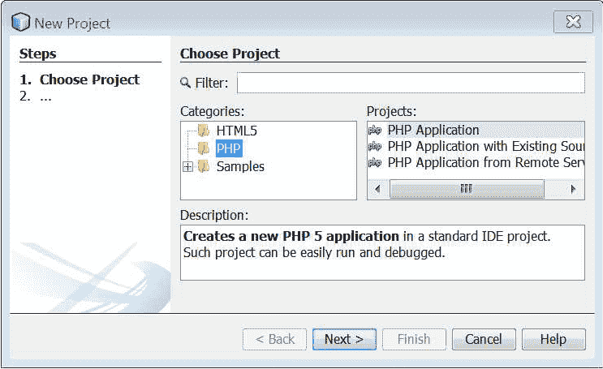

图 9–2 在“项目”下选择 PHP 应用程序

- 2. 你将看到向导的“新建 PHP 项目”屏幕。在“名称和位置”下，在“项目名称”字段中键入“testingProject”，如图 9–3 所示。保持所有其他字段不变。然后，单击“下一步”按钮。

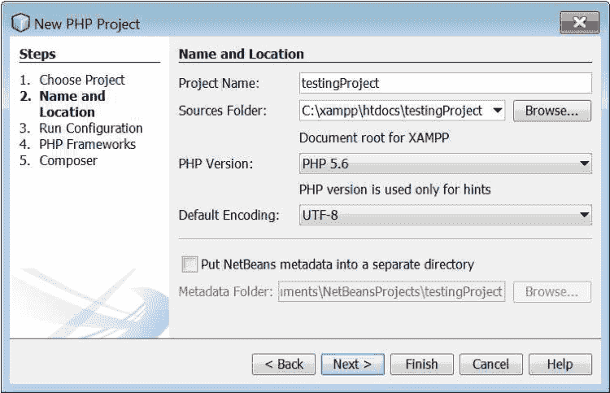

图 9–3 选择新 PHP 项目的名称和位置

- 3. 在“运行配置”下，从“运行方式”下拉列表中，选择“脚本（在命令行中运行）”，如图 9–4 所示。

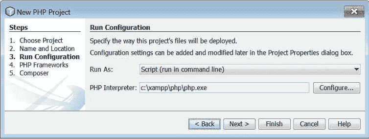

图 9–4 选择新 PHP 项目的配置设置

- 4. 单击“完成”按钮。

项目已创建并在你的 NetBeans IDE 中打开。你应该看到以下组件（参见图 9–5）：

- ➢ 项目窗口，其中包含项目组件的树形视图，包括源文件、你的代码可能依赖的库等等
- ➢ 源代码编辑器窗口，其中打开了一个名为“index.php”的文件。在这个文件中你可以编写 PHP 代码。当然，一个单独的项目可以包含许多这样的文件。

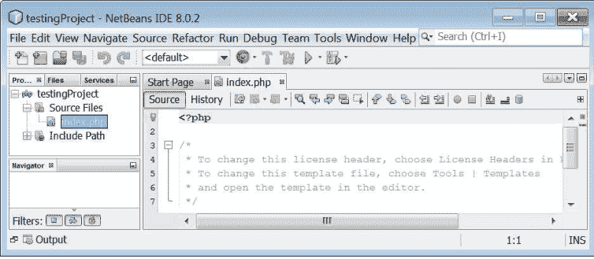

图 9–5 在 NetBeans IDE 中查看“项目”和“源代码编辑器”窗口

### 9.2 编写和执行 PHP 脚本

你刚刚看到了如何创建一个新的 PHP 项目。现在让我们编写以下（可怕，而且非常吓人！）PHP 脚本并尝试执行它。

```php
<?php
echo "Hello World";
?>
```

## 第 9 章
使用 NetBeans IDE

在“index.php”窗口中，删除注释行（除了 <?php 以外的所有内容），并通过键盘上的“e”键仅输入 echo 语句的第一个字母。自动，一个弹出窗口将出现，如图 9–6 所示。这个窗口包含所有以字母“e”开头的可用 PHP 语句、变量、函数和其他项目。

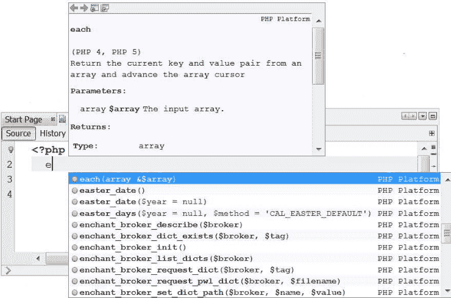

图 9–6 源代码编辑器窗口中的弹出屏幕

你可以使用键盘上的上下箭头键来突出显示选择。请注意，每次更改选择时，第二个窗口将显示关于所选项目的小帮助文档。

输入 echo 语句的第二个字母“c”。现在选项变少了，如下所示。

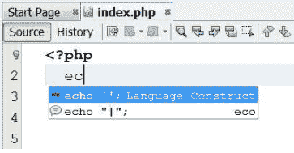

选择选项 `echo "";` 并按“Enter ↵”键。该语句将自动输入到你的脚本中，如下所示！

## 第 9 章

## 使用 NetBeans IDE

```php
<?php
echo "";
```

通过在双引号内写入“Hello World”来完成语句，并在末尾写入 ?> 来关闭 PHP 脚本（如图 9–7 所示）。你的 NetBeans IDE 应该看起来像这样。

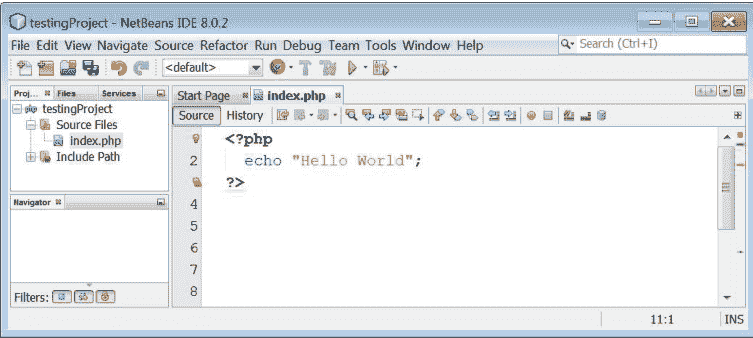

图 9–7 在“index.php”文件中输入 PHP 脚本

现在让我们尝试执行脚本！从主菜单中，选择“运行➜运行文件”或按 SHIFT+F6 键组合。PHP 脚本将执行，输出将显示在“输出”窗口中，如图 9–8 所示。

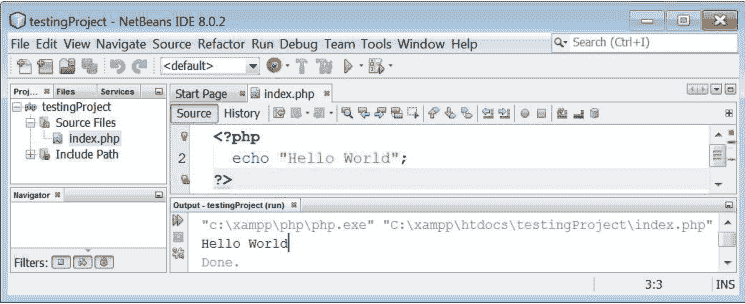

图 9–8 在输出窗口中查看已执行脚本的结果

恭喜！你刚刚编写并执行了你的第一个 PHP 脚本！

现在让我们编写另一个 PHP 脚本，一个提示用户输入其姓名的脚本。将以下 PHP 语句输入到 NetBeans IDE 中并按 SHIFT+F6 执行文件。

## 第 9 章
使用 NetBeans IDE

```php
<?php
echo "Enter your name: ";
$name = trim(fgets(STDIN));
echo "Hello " . $name . "\n";
echo "How do you do?";
?>
```

> **记住！** 你可以通过从主菜单中选择“运行 → 运行文件”或按 SHIFT+F6 键组合来执行文件。

一旦你执行脚本，消息“Enter your name:”将显示在“输出”窗口中。脚本将等待你输入姓名，如图 9–9 所示。

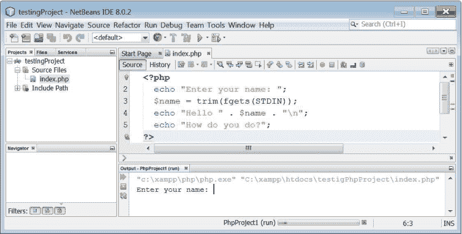

图 9–9 在输出窗口中查看提示

然而，要输入你的姓名，你必须将光标放在“输出”窗口内。然后你可以输入你的姓名并按“Enter ↵”键。一旦你这样做，PHP 解释器将继续执行其余语句。当执行完成时，最终输出如图 9–10 所示。

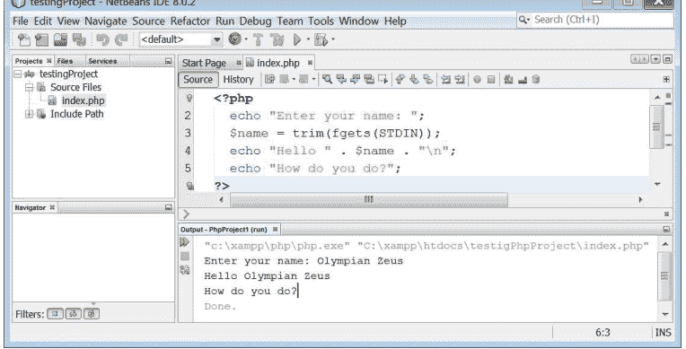

图 9–10 响应输出窗口中的提示

### 9.3 “调试”意味着什么

调试是查找并减少计算机程序中缺陷（错误）数量的过程，以使其按预期运行。

关于“调试”一词的起源有一个神话。1940 年，当 Grace Hopper¹ 在哈佛大学使用 Mark II 计算机时，她的同事发现一个虫子（一只飞蛾）卡在继电器（一种电气操作的开关）中。这个虫子阻碍了 Mark II 计算机的正常运行。因此，当她的同事试图移除虫子时，Grace Hopper 评论说他们正在“调试”系统！

### 9.4 使用 NetBeans IDE 调试 PHP 脚本

如你已知，当有人使用高级语言编写代码时，他或她可能会犯两种类型的错误——语法错误和逻辑错误。NetBeans IDE 提供了所有必要的工具来帮助你调试脚本并找到错误。

#### 调试语法错误

幸运的是，NetBeans IDE 在你输入时检测语法错误，并用波浪红线下划线，如图 9–11 所示。

¹ Grace Murray Hopper (1906–1992) 是一位美国计算机科学家和美国海军上将。她是哈佛 Mark I 计算机的第一批程序员之一，并开发了第一个名为 A–0 的计算机编程语言编译器，后来又开发了第二个，称为 B–0 或 FLOW–MATIC。

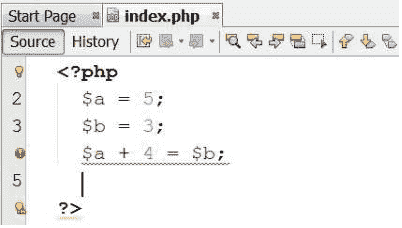

图 9–11 在 NetBeans IDE 中，语法错误用波浪红线下划线

你所要做的就是纠正相应的错误，红线将立即消失。但是，如果你不确定代码哪里出错，可以将鼠标光标放在红色感叹号上。NetBeans IDE 将尝试通过显示一个包含错误简要说明的弹出窗口来帮助你，如图 9–12 所示。

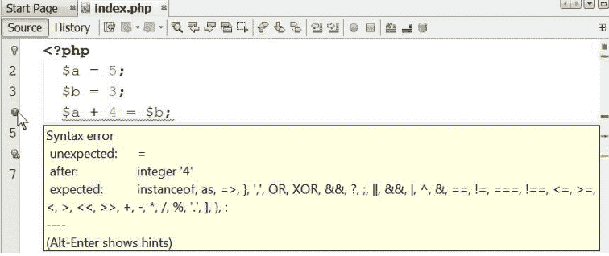

图 9–12 NetBeans IDE 显示语法错误的说明

#### 通过逐步执行脚本调试逻辑错误

与语法错误相比，逻辑错误更难找到。由于 NetBeans IDE 无法发现和下划线逻辑错误，你只能靠自己！让我们看看以下 PHP 脚本，例如。它提示用户输入两个数字并计算和显示它们的和。但是，它包含一个逻辑错误！

```php
<?php
    $s = 0;
    echo "Enter 1st value: ";
    $a = trim(fgets(STDIN));
    echo "Enter 2nd value: ";
    $b = trim(fgets(STDIN));
    $s = $a + $b;
    echo "The sum is: ", $s;
?>
```


单击工具栏上的“Step into”图标。此操作指示 PHP 解释器执行语句 `$s = 0`，程序计数器移动到第二条 PHP 语句，即下一条将被执行的语句。

从主菜单中，选择“Window→Debugging→Variables”。在出现的窗口中，你可以查看主内存（RAM）中声明的所有变量，以及它们在每个执行步骤中包含的值。到目前为止，唯一声明并赋值的变量是变量 `$s`，如 **Figure 9–15** 所示。

再次单击工具栏上的“Step into”图标。第二条语句被执行。你可以返回到“Output”窗口并查看输出结果（参见 **Figure 9–16**）。

再次单击工具栏上的“Step into”图标。第三条 PHP 语句被执行，程序等待你输入一个值。将光标放在“Output”窗口中，输入值 5，然后按“Enter ↵”键。

程序计数器移动到第四条 PHP 语句。如果你返回到“Variables”窗口，你可以看到，目前，主内存（RAM）中声明了两个变量（`$a` 和 `$s`），如 **Figure 9–17** 所示。

单击工具栏上的“Step into”图标两次。此操作执行第四条和第五条 PHP 语句。将光标放在“Output”窗口中，输入值 2，然后按“Enter ↵”键。

程序计数器移动到第六条 PHP 语句。如果你返回到“Variables”窗口，你可以看到，此时，主内存（RAM）中声明了三个变量（`$a`、`$b` 和 `$s`），如 **Figure 9–18** 所示。

再次单击工具栏上的“Step into”图标。语句 `$s = $a + $b` 被执行。你在这里期望的是 5 和 2 的和，即 7，被赋值给变量 `$s`。相反，主内存（RAM）中声明了一个新变量 `$$s`，并且值 7 被赋值给它，如 **Figure 9–19** 所示。

现在这对你来说更加明显了！你错误地在主内存（RAM）中声明了两个变量，变量 `$s` 和变量 `$S`（大写 S）。所以，当执行流程到达最后一条语句 `echo "The sum is: ", $s` 时，显示的是值 0 而不是值 7。

你刚刚找到了错误！单击工具栏上的“Finish Debugger Session”图标以取消执行，通过将变量 `$$s` 改为 `$s` 来纠正错误，然后你就完成了！你刚刚完成了第一次调试！重新执行脚本，你现在将看到它正确地计算并显示了和。

#### 通过添加断点调试逻辑错误

逐步调试有一个很大的缺点。你必须一次又一次地单击“Step into”工具栏图标，直到到达可能存在错误的位置。你能想象在大型脚本中这样做吗？

对于大型脚本，还有另一种方法。如果你怀疑错误位于脚本的末尾，则无需从头开始调试整个脚本。你可以在认为可能存在错误的位置添加一个标记（称为“断点”），执行脚本，当执行流程到达该断点时，执行流程将自动暂停。然后你可以更仔细地查看脚本暂停位置的变量当前值。

> **Notice:** *当脚本暂停时，你有两种恢复执行的选项：你可以在脚本下方添加第二个断点，单击“Continue”工具栏图标，并允许脚本继续执行直到该新断点；或者你可以直接使用“Step into”工具栏图标，之后逐步执行脚本。*

下一个 PHP 脚本提示用户输入两个值并计算它们的平均值。

但是，该脚本包含一个逻辑错误。当用户输入值 10 和 12 时，显示的值是 16，而不是 11。

```php
<?php
    echo "Enter 1st value: ";
    $a = trim(fgets(STDIN));
    echo "Enter 2nd value: ";
    $b = trim(fgets(STDIN));
    $average = $a + $b / 2;
    echo "The average value is: ", $average;
?>
```

你怀疑问题出在脚本的末尾。但是，你不想调试整个脚本，而只想调试可能存在错误的部分。所以，让我们尝试在 `$average = $a + $b / 2` 语句处添加一个断点（参见 **Figure 9–20**）。有两种方法可以做到这一点：你可以单击左侧灰色边距中的相应行号，也可以将光标放在感兴趣的行上并按 CTRL+F8 键组合。

## Chapter 9

## Using NetBeans IDE

> **Notice:** 当灰色边距中出现粉色矩形并且相应行带有粉色背景高亮时，即表示已设置断点。

按 CTRL+SHIFT+F5 启动调试器。单击“Continue”工具栏图标，并在提示时输入值 10 和 12。你会注意到，在输入第二个数字并按“Enter ↵”键后，执行流程会在断点处暂停。（你会看到粉色的断点高亮被程序计数器的绿色高亮所取代。）

> **Remember!** 你可以通过从主菜单中选择“Debug → Debug File”来调试文件，或者按 CTRL+SHIFT+F5 键组合。

现在你可以更仔细地查看变量的当前值。变量 `$a` 和 `$b` 分别包含值 10 和 12，正如它们应该的那样，因此数据输入没有问题，如 **Figure 9–21** 所示。

单击“Step into”工具栏图标一次。语句 `$average = $a + $b / 2` 被执行，主内存（RAM）现在包含以下值（参见 **Figure 9–22**）。

## Chapter 9

## Using NetBeans IDE

找到了！你刚刚找到了错误地将值 16 而不是 11 赋给变量 `$average` 的语句！现在是困难的部分；你应该考虑为什么会发生这种情况！

经过两天的思考，这变得显而易见！你只是忘记将 `$a + $b` 用括号括起来；因此，只有变量 `$b` 被除以 2。单击“Finish Debugger Session”工具栏图标，删除所有断点，通过将 `$a + $b` 用括号括起来来纠正错误，然后你就完成了！重新执行脚本，你现在将看到它正确地计算并显示平均值。

> **Notice:** 你可以以添加断点的相同方式删除断点：单击左侧灰色边距中的相应行号，或者将光标放在包含断点的行上并按 CTRL+F8 键组合。

### 9.5 Review Exercises

完成以下练习。

- 1. 将以下 PHP 脚本输入 NetBeans IDE 并逐步执行。确定它为什么不能正确计算 1 + 3 + 5 的和。

```php
<?php
    $$S = 0;
    $S1 = 1;
    $S3 = 3;
    $S5 = 5;

    $S = $S1 + $S3 + $S5;

    echo $S;
?>
```

- 2. 创建一个跟踪表，以确定两种不同执行中 PHP 脚本每个步骤的变量值。然后，在 NetBeans IDE 中输入脚本，逐步执行并确认结果。两种执行的输入值为：(i) 5, 5；和 (ii) 4, 8。

```php
<?php
```


#### “PHP 入门”复习题

回答以下问题。

- 1. 什么是算法？
- 2. 给出制作一杯咖啡的算法。
- 3. 算法的五个属性是什么？
- 4. 算法可以永远执行下去吗？
- 5. 什么是计算机程序？
- 6. 算法涉及哪三方？
- 7. 构成计算机程序的三个阶段是什么？
- 8. 计算机程序可以由两个阶段组成吗？
- 9. 什么是流程图？
- 10. 流程图可以直接输入计算机吗？
- 11. 流程图使用哪些基本符号？
- 12. “保留字”是什么意思？
- 13. 什么是结构化程序设计？
- 14. 结构化程序设计的三个基本控制结构是什么？
- 15. 使用流程图给出每个控制结构的示例。
- 16. 程序员可以在文本编辑器中编写 PHP 脚本吗？
- 17. 什么是语法错误？给出一个示例。
- 18. 什么是逻辑错误？给出一个示例。
- 19. 由关键字拼写错误、缺少标点字符或运算符使用不当引起的是哪种错误？
- 20. 为什么程序员应该在代码中添加注释？
- 21. 为什么程序员应该编写用户友好的程序/脚本？
- 22. 缩写 POLA 代表什么？
- 23. 什么是变量？
- 24. 在流程图的左箭头左侧可以存在多少个变量？
- 25. 变量的值存储在计算机的哪个部分？
- 26. 什么是常量？
- 27. 常量如何帮助程序员？
- 28. 为什么计算机程序应尽可能避免除法和乘法运算？
- 29. PHP 中的四种基本变量和常量类型是什么？
- 30. “声明变量”是什么意思？
- 31. 如何在 PHP 中声明变量？给出一个示例。
- 32. 如何在 PHP 中声明常量？给出一个示例。
- 33. 流程图中使用什么符号来显示消息？
- 34. PHP 中使用什么特殊字符序列来输出“换行”？
- 35. 流程图中使用什么符号来让用户输入数据？
- 36. PHP 中使用哪个符号作为值赋值运算符，它在流程图中如何表示？
- 37. PHP 支持哪些算术运算符？
- 38. 什么是取模运算符，它通常在流程图中如何表示？
- 39. 总结算术运算符优先级的规则。
- 40. PHP 支持哪些复合赋值运算符？
- 41. PHP 支持哪些自增/自减运算符？
- 42. PHP 支持哪些字符串运算符？
- 43. 什么是跟踪表？
- 44. 使用跟踪表有什么好处？
- 45. 描述交换两个变量内容（数字或字母数字）所涉及的步骤。
- 46. 本书提出了两种交换两个变量值的方法。哪一种更好，为什么？
- 47. 一个 PHP 项目可以包含多少个 PHP 脚本？
- 48. “调试”是什么意思？
- 49. 描述 NetBeans IDE 帮助你查找语法错误的方式。
- 50. 描述 NetBeans IDE 帮助你查找逻辑错误的方式。

## 第 3 节

## 顺序控制结构

## 第 10 章

### 顺序控制结构简介

#### 10.1 什么是顺序控制结构？

“顺序控制结构”指的是语句按顺序逐行执行，执行顺序与它们在脚本中出现的顺序相同。例如，它们可能执行一系列读取或写入操作、算术运算或对变量的赋值。

顺序控制结构是你在第 4 章中学习的三个基本控制结构中最简单的一个。以下脚本展示了按顺序执行的 PHP 语句示例。

```php
<?php
	echo "Enter a number: ";
	$a = trim(fgets(STDIN));

	$b = $a * $a;

	echo "The square of ", $a, " is ", $b;
?>
```

#### 练习 10.1-1 计算平行四边形的面积

编写一个 PHP 脚本，计算并显示平行四边形的面积。

#### 解答

平行四边形的面积可以使用以下公式计算：

*面积 = 底 × 高*

在此练习中，用户输入 *底* 和 *高* 的值，脚本计算并显示平行四边形的面积。此问题的解答如下所示。

```php
<?php
	echo "Enter the length of Base: ";
	$base = trim(fgets(STDIN));
	echo "Enter the length of Height: ";
	$height = trim(fgets(STDIN));

	$area = $base * $height;

	echo "The area of the parallelogram is ", $area;
?>
```

#### 练习 10.1-2 计算圆的面积

编写一个 PHP 脚本，计算并显示圆的面积。

#### 解答

圆的面积可以使用以下公式计算：

Area = π · Radius²

π 的值是已知量，为 3.14159。因此，用户只需输入 Radius 的值。此问题的解答如下所示。

```php
<?php
echo "Enter the length of Radius: ";
$radius = trim(fgets(STDIN));

$area = 3.14159 * $radius * $radius;

echo "The area of the circle is ", $area;
?>
```

更好的方法是使用常量 PI。

```php
<?php
define("PI", 3.14159);

echo "Enter the length of Radius: ";
$radius = trim(fgets(STDIN));
$area = PI * $radius * $radius;
echo "The area of the circle is ", $area;
?>
```

#### 练习 10.1-3 计算燃油经济性

在美国，汽车的燃油经济性以每加仑英里数（MPG）来衡量。汽车的 MPG 可以使用以下公式计算：

MPG = 驾驶里程 / 使用的汽油加仑数

编写一个 PHP 脚本，提示用户输入其驾驶的总里程数和使用的汽油加仑数。然后脚本应计算并显示汽车的 MPG。

#### 解答

这是一个相当简单的情况。用户输入其驾驶的总里程数和使用的汽油加仑数，然后脚本应计算并显示汽车的 MPG。

```php
<?php
echo "Enter miles driven: ";
$miles_driven = trim(fgets(STDIN));
echo "Enter gallons of gas used: ";
$gallons = trim(fgets(STDIN));

$mpg = $miles_driven / $gallons;

echo "Your car's MPG is: ", $mpg;
?>
```

#### 练习 10.1-4 汽车在哪里？计算行驶距离

一辆汽车从静止开始，沿直线水平道路以恒定加速度行驶给定时间。编写一个 PHP 脚本，提示用户输入加速度和汽车行驶的时间，然后计算并显示行驶的距离。所需公式为

$$S = u_0 + \frac{1}{2}at^2$$

其中

- **S** 是汽车行驶的距离，单位为米（m）
- **u₀** 是汽车的初始速度，单位为米/秒（m/sec）
- **t** 是汽车行驶的时间，单位为秒（sec）
- **a** 是加速度，单位为米/秒²（m/sec²）

#### 解答

由于汽车从静止开始，初始速度 $u_0$ 为零。因此，公式变为

$$S = \frac{1}{2}at^2$$

PHP 脚本为

```php
<?php
echo "Enter acceleration: ";
$a = trim(fgets(STDIN));
echo "Enter time traveled: ";
$t = trim(fgets(STDIN));
```


```php
$s = 0.5 * $a * $t * $t;

echo "Your car traveled ", $s, " meters";
?>
```

#### Exercise 10.1-5 开尔文转华氏度

编写一个 PHP 脚本，将华氏度¹的温度值转换为开尔文²等效值。所需公式为

1.8 × 开尔文 = 华氏度 + 459.67

#### 解答

给定的公式不能直接在脚本中使用。在 PHP 等计算机语言中，不允许编写

```
1.8 * $kelvin = $fahrenheit + 459.67
```

记住！在等号（=）左侧的位置，只能存在一个单一变量。这个变量实际上是 RAM 中可存储值的一个区域。

该脚本将华氏度转换为开尔文。华氏度的值是已知值，由用户提供，而开尔文的值是 PHP 脚本需要计算的值。因此，你需要求解开尔文。经过一些计算，公式变为

开尔文 = (华氏度 + 459.67) / 1.8

PHP 脚本如下所示。

##### file_10.1-5.php

```php
<?php
echo "Enter a temperature in Fahrenheit: ";
$fahrenheit = trim(fgets(STDIN));

$kelvin = ($fahrenheit + 459.67) / 1.8;
```

¹ Daniel Gabriel Fahrenheit (1686–1736) 是一位德国物理学家、工程师和玻璃吹制工，最著名的是发明了酒精温度计和水银温度计，并开发了以他名字命名的温度标尺。

² William Thomson, 1st Baron Kelvin (1824–1907)，是一位出生于爱尔兰的英国数学物理学家和工程师。他广为人知的是开发了绝对零度（开尔文温度标尺）的基础，因此温度测量单位以他命名。他发现了热电学中的汤姆逊效应，并帮助发展了热力学第二定律。

##### file_10.1-7.php

```php
<?php
echo "Enter the price of a product: ";
$price_before_discount = trim(fgets(STDIN));

echo "Enter the discount offered (0 - 100): ";
$discount = trim(fgets(STDIN));

$discount_amount = $price_before_discount * $discount / 100;
$price_after_discount = $price_before_discount - $discount_amount;

echo "The price after discount is: ", $price_after_discount;
?>
```

#### Exercise 10.1-8 计算销售税率和折扣

编写一个 PHP 脚本，提示用户输入商品的不含税价格以及以百分比表示的折扣（范围为 0 到 100）。然后脚本应计算并显示新价格。假设销售税率为 19%。

#### 解答

这个练习只是前两个练习的组合！

##### file_10.1-8.php

```php
<?php
define("VAT", 0.19);

echo "Enter the price of a product: ";
$price_before_discount = trim(fgets(STDIN));

echo "Enter the discount offered (0 - 100): ";
$discount = trim(fgets(STDIN));

$discount_amount = $price_before_discount * $discount / 100;
$price_after_discount = $price_before_discount - $discount_amount;

$sales_tax = $price_after_discount * VAT;
$price_after_tax = $price_after_discount + $sales_tax;

echo "The discounted after-tax price is: ", $price_after_tax;
?>
```

#### 10.2 复习练习

完成以下练习。

1. 编写一个 PHP 脚本，提示用户输入底和高的值，然后计算并显示三角形的面积。

2. 编写一个 PHP 脚本，提示用户输入三角形的两个角，然后计算并显示第三个角。

   提示：任何三角形的内角和均为 180 度

3. 编写一个 PHP 脚本，让学生输入四次测试的成绩，然后计算并显示平均成绩。

4. 编写一个 PHP 脚本，提示用户输入半径的值，然后计算并显示圆的周长。

5. 编写一个 PHP 脚本，提示用户输入餐厅餐费，然后计算并显示 10% 小费、7% 销售税以及三者总和的金额。

6. 一辆汽车从静止开始，沿直线水平道路以恒定加速度行驶给定的秒数。编写一个 PHP 脚本，提示用户输入加速度（m/sec²）和行驶时间（sec），然后计算行驶距离。所需公式为

   $$S = u_0 t + \frac{1}{2}at^2$$

7. 编写一个 PHP 脚本，提示用户输入华氏度的温度，然后将其转换为摄氏度等效值。所需公式为

   $$\frac{C}{5} = \frac{F - 32}{9}$$

8. 身体质量指数（BMI）常用于判断一个人相对于身高是否超重或体重不足。计算 BMI 的公式为

   $$BMI = \frac{weight \cdot 703}{height^2}$$

   编写一个 PHP 脚本，提示用户输入体重（磅）和身高（英寸），然后计算并显示用户的 BMI。

9. 编写一个 PHP 脚本，提示用户输入小计和小费率（范围为 0 到 100），然后计算小费和总金额。例如，如果用户输入 30 和 10，PHP 脚本应显示“Tip is $3.00 and Total is $33.00”。

³ Anders Celsius (1701–1744) 是一位瑞典天文学家、物理学家和数学家。他在瑞典乌普萨拉创立了乌普萨拉天文台，并提出了以他名字命名的摄氏温度标尺。

## 第 11 章 操作数字

```php
<?php
echo pi();             // outputs: 3.1415926535898
?>
```

### 幂运算

`pow (number, exp)`

返回 number 的 exp 次幂的结果。

### 示例

```php
<?php
$a = 2;
$b = 3;
echo pow($a, $b), "\n";       // outputs: 8

$c = pow(3,2);
echo $c, "\n";                // outputs: 9
?>
```

> **注意：** 函数 `pow()` 也可用于计算数字的平方根。从数学上可知，\(\sqrt[z]{X}=X^{1/z}\)。因此，你可以写 `$y = pow($x, 1/2)` 来计算 `$x` 的平方根，或者甚至可以写 `$y = pow($x, 1/3)` 来计算 `$x` 的立方根，以此类推！

### 随机数

`rand (minimum_value, maximum_value)`

返回 minimum_value 和 maximum_value 之间的伪随机整数。

### 示例

```php
<?php
echo rand(2, 10), "\n";       // outputs: 8
echo rand(0, 10)/10, "\n";    // outputs: 0.5
echo rand(20, 25), "\n";       // outputs: 22
?>
```

> **注意：** 随机数在计算机游戏中应用广泛。例如，“敌人”可能会在随机时间出现或朝随机方向移动。此外，随机数还用于模拟程序、统计程序、计算机安全中的数据加密等。

### 四舍五入

`round (number, [ precision ])`

返回 number 四舍五入到指定精度后的值。

### 示例

```php
<?php

$a = 5.312;
$b = 5.315;

echo round($a, 2), "\n";        // outputs: 5.31
echo round($b, 2), "\n";        // outputs: 5.32
echo round(2.3447, 3), "\n";   // outputs: 2.345
?>
```

### 正弦

`sin (number)`

返回 *number* 的正弦值。*number* 的值必须用弧度表示。

### 示例

```php
<?php

$a = sin(3 * pi() / 2);
echo $a;                         // outputs: -1
?>
```

### 平方根

`sqrt (number)`

返回 *number* 的平方根。

### 示例

```php
<?php

echo sqrt(2), "\n";             // outputs: 1.4142135623731
echo sqrt(9), "\n";             // outputs: 3
?>
```

### 正切

`tan (number)`

返回 *number* 的正切值。*number* 的值必须用弧度表示。

### 示例

```php
<?php

$a = tan(10);
echo $a;                         // outputs: 0.64836082745909
?>
```

### Exercise 11.2-1 计算两点之间的距离

编写一个 PHP 脚本，提示用户输入两个点的坐标（x, y），然后计算它们之间的直线距离。所需公式为

$$d = \sqrt{(x_1 - x_2)^2 + (y_1 - y_2)^2}$$

#### 解答

在这个练习中，你需要使用两个函数：`pow()` 函数，返回数字的幂运算结果；以及 `sqrt()` 函数，返回数字的平方根。

为了简化问题，分别计算 $(x_1 - x_2)^2$ 和 $(y_1 - y_2)^2$，并将结果赋值给两个临时变量。

PHP 脚本如下所示。

```php
<?php

echo "Enter coordinates for point A: ";
$x1 = trim(fgets(STDIN));
$y1 = trim(fgets(STDIN));

echo "Enter coordinates for point B: ";
$x2 = trim(fgets(STDIN));
$y2 = trim(fgets(STDIN));

$x_temp = pow($x1 - $x2, 2);
$y_temp = pow($y1 - $y2, 2);

$d = sqrt($x_temp + $y_temp);

echo "Distance between points: ", $d;
?>
```

现在让我们看看另一种方法。

你应该意识到，实际上可以将一个函数嵌套在另一个函数中。这样做时，嵌套函数的结果会作为外部函数的参数使用。这是大多数程序员偏好的编程风格，因为它可以节省大量代码行。当然，如果嵌套层数过多，就没有人能理解你的代码了。嵌套最多四层是可以接受的。

使用嵌套函数的 PHP 脚本如下所示。

```php
<?php

echo "Enter coordinates for point A: ";
```


## Exercise 11.2-2 *汽车行驶了多远？*

一辆汽车从静止开始，沿着笔直的水平道路以恒定加速度行驶给定距离。编写一个 PHP 脚本，提示用户输入加速度和汽车行驶的距离，然后计算行驶时间。所需公式为

$$S = u_0 + \frac{1}{2}at^2$$

其中

+   - **S** 是汽车行驶的距离，单位为米 *(m)*
+   - **u₀** 是汽车的初速度，单位为米/秒 *(m/sec)*
+   - **t** 是汽车行驶的时间，单位为秒 *(sec)*
+   - **a** 是加速度，单位为米/秒² *(m/sec²)*

## Solution

由于汽车从静止开始，初速度（速度）$u_0$ 为零。因此，公式变为

$$S = \frac{1}{2}at^2$$

现在，如果你求解时间，最终公式变为

$$t = \sqrt{\frac{2S}{a}}$$

在 PHP 中，你可以使用 `sqrt()` 函数，它返回一个数的平方根。

```php
// file_11_2-2.php
<?php
echo "Enter acceleration: ";
$a = trim(fgets(STDIN));
echo "Enter distance traveled: ";
$S = trim(fgets(STDIN));

$t = sqrt(2 * $S / $a);

echo "Your car traveled for ", $t, " seconds";
?>
```

## 11.3 Review Questions: True/False

为以下每个陈述选择 **true** 或 **false**。

+   1. 函数是解决小问题的小型子程序。
+   2. 每个程序员都必须使用赫龙的迭代公式来计算正数的平方根。
+   3. `abs()` 函数返回项目的绝对位置。
+   4. 语句 `intval(3.59)` 返回结果为 3.6。
+   5. `pi()` 函数返回结果为 3.14。
+   6. 语句 `pow(2, 3)` 返回结果为 9。
+   7. `rand()` 函数也可以返回负随机数。
+   8. 语句 `$y = rand(0, 1)` 有 50% 的可能性将值 1 赋给变量 `$y`。
+   9. 语句 `round(3.59, 1)` 返回结果为 3.6。
+   10. 要计算 90 度的正弦，你必须写 `$y = sin (pi()/2)`。
+   11. 语句 `$y = sqrt(-2)` 是有效的。
+   12. 以下代码片段满足确定性属性。

```php
$a = trim(fgets(STDIN));
$b = trim(fgets(STDIN));
$x = $a * sqrt($b);
echo $x;
```

## 11.4 Review Questions: Multiple Choice

为以下每个陈述选择正确答案。

+   1. 以下哪项计算变量 `$a` 的平方？
+      a. `$y = $a * $a;`
+      b. `$y = pow($a, 2);`
+      c. `$y = $a * $a / $a * $a;`
+      d. all of the above
+   
+   2. 当执行语句 `$y = abs(+5.2)` 时，变量 `$y` 的值是多少？
+      a. -5.2

viii. **错误。** 这等同于 = \(\frac{1}{\frac{10+z}{27}}\)

## **Exercise 12.1-2** *在 PHP 中编写数学表达式*

编写一个 PHP 脚本来计算数学表达式

\[
y = 10x - \frac{10-z}{4}
\]

## **Solution**

首先，你必须区分数据输入和输出结果。显然，输出结果赋给 \(y\)，用户必须输入 \(x\) 和 \(z\) 的值。此练习的解决方案如下所示。

```php
<?php
echo "Enter value for x: ";
$x = trim(fgets(STDIN));
echo "Enter value for z: ";
$z = trim(fgets(STDIN));

$y = 10 * $x - (10 - $z) / 4;

echo "The result is: ", $y;
?>
```

## **Exercise 12.1-3** *在 PHP 中编写复杂的数学表达式*

编写一个 PHP 脚本来计算数学表达式

\[
y = \frac{5\frac{3x^2+5x+2}{7w-\frac{1}{2}}z}{4\frac{3+x}{7}}
\]

## **Solution**

哎呀！现在表达式更复杂了！事实上，它要复杂得多！那么，让我们看看一种截然不同的方法。

主要思想是将复杂表达式分解为更小、更简单的表达式，并将每个子结果分配给临时变量。最后，你可以用所有这些临时变量构建原始表达式！此方法如下所示。

```php
<?php
echo "Enter value for x: ";
$x = trim(fgets(STDIN));
echo "Enter value for w: ";
$w = trim(fgets(STDIN));
echo "Enter value for z: ";
$z = trim(fgets(STDIN));

$temp1 = 3 * $x * $x + 5 * $x + 2;
$temp2 = 7 * $w - 1 / $z;
$temp3 = (3 + $x) / 7;
$nominator = 5 * $temp1 / $temp2 - $z;
$denominator = 4 * $temp3;

$y = $nominator / $denominator;

echo "The result is: ", $y;
?>
```

你可能会说：“好吧，但我浪费了这么多变量，如大家所知，每个变量都占用一部分主内存。我如何用一行代码写出原始表达式并浪费更少内存？”

对于高级程序员来说，这可能是小菜一碟，但你呢？初学者程序员呢？

下面的方法将帮助你编写即使是最复杂的数学表达式，而不会有任何语法或逻辑错误！规则非常简单。“在将复杂表达式分解为更小、更简单的表达式并将每个子结果分配给临时变量后，从后往前开始，用分配的表达式替换每个变量。但要小心！当你用表达式替换变量时，必须始终用括号将表达式括起来！”

困惑吗？不要！实际操作起来更容易。让我们尝试重写之前的 PHP 脚本。从后往前，用分配的表达式替换变量 $nominator 和 $denominator。结果是

```php
$y = (5 * $temp1 / $temp2 - $z) / (4 * $temp3);
```

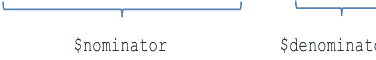

> **注意：** 请注意添加的额外括号。

现在你必须用分配的表达式替换变量 $temp1、$temp2 和 $temp3，一行表达式就完成了！

## Chapter 12

## Complex Mathematical Expressions

```php
$y = (5*(3*$x*$x + 5*$x + 2)/(7*$w - 1/$z) - $z)/(4*((3 + $x)/7));
```

$temp1$ $temp2$ $temp3$

最后看起来可能很吓人，但并不那么困难，对吧？

PHP 脚本现在可以重写为

```php
<?php
echo "Enter value for x: ";
$x = trim(fgets(STDIN));
echo "Enter value for w: ";
$w = trim(fgets(STDIN));
echo "Enter value for z: ";
$z = trim(fgets(STDIN));

$y = (5*(3*$x*$x + 5*$x + 2)/(7*$w - 1/$z) - $z)/(4*((3 + $x)/7));

echo "The result is: ", $y;
?>
```

## 12.2 Review Exercises

完成以下练习。

+   1. 将第一列中的每个元素与第二列中的一个或多个元素匹配。

| Expression | Expression |
|---|---|
| i. `5/pow($x, 2)*$y + pow($x, 3)` | a. `5*$y/pow($x, 2) + pow($x, 3)` |
| ii. `5/(pow($x, 3)*$y) + pow($x, 2)` | b. `5*$y/$x*$x + pow($x, 3)` |
|  | c. `5/($x*$x*$x*$x*$y) + $x*$x` |
|  | d. `5/($x*$x*$x)*$y + $x*$x` |
|  | e. `5*$y/($x*$x) + $x*$x*$x` |
|  | f. `1/($x*$x*$x*$x*$y)*5 + $x*$x` |
|  | g. `$y/($x*$x)*5 + pow($x, 3)` |
|  | h. `1/($x*$x)*5*$y + $x/$x*$x*$x*$x` |

+   2. 用一行代码用 PHP 编写以下数学表达式。

i.  $y = \frac{(x+3)^{5w}}{7(x-4)}$

+   ii. $y = \sqrt[5]{\left(3x^2 - \frac{1}{4}x^3\right)}$

+   iii. $y = \frac{\sqrt{x^4 - 2x^3 - 7x^2 + x}}{\sqrt[3]{4\left(7x^4 - \frac{3}{4}x^3\right)(7x^2 + x)}}$

+   iv. $y = \frac{x}{x - 3(x - 1)} + \left(x\sqrt[5]{x - 1}\right)\frac{1}{(x^3 - 2)(x - 1)^3}$

+   v. $y = \left(\sin\left(\frac{\pi}{3}\right) - \cos\left(\frac{\pi}{2}w\right)\right)^2$

+   vi. $y = \frac{\left(\sin\left(\frac{\pi}{2}x\right) + \cos\left(\frac{3\pi}{2}w\right)\right)^3}{\left(\tan\left(\frac{2\pi}{3}w\right) - \sin\left(\frac{\pi}{2}x\right)\right)^{\frac{1}{2}}} + 6$

3. 编写一个 PHP 脚本，提示用户输入 x 的值，然后计算并显示以下数学表达式的结果。
$y = \sqrt{x}(x^3 + x^2)$

4. 编写一个 PHP 脚本，提示用户输入 x 的值，然后计算并显示以下数学表达式的结果。
$y = \frac{7x}{2x + 4(x^2 + 4)}$
建议：尝试用一行代码编写表达式。

5. 编写一个 PHP 脚本，提示用户输入 x 和 w 的值，然后计算并显示以下数学表达式的结果。
$y = \frac{x^{x+1}}{\left(\tan\left(\frac{2w}{3} + 5\right) - \tan\left(\frac{x}{2} + 1\right)\right)^3}$
建议：尝试用一行代码编写表达式。

6. 编写一个 PHP 脚本，提示用户输入 x 和 w 的值，然后计算并显示以下数学表达式的结果。
$y = \frac{3 + w}{6x - 7(x + 4)} + \left(x\sqrt[5]{3w + 1}\right)\frac{5x + 4}{(x^3 + 3)(x - 1)^7}$
建议：尝试用一行代码编写表达式。

7. 编写一个 PHP 脚本，提示用户输入 x 和 w 的值，然后计算并显示以下数学表达式的结果。
$y = \frac{x^x}{\left(\sin\left(\frac{2w}{3} + 5\right) - x\right)^2} + \frac{\left(\sin(3x) + w\right)^{x+1}}{(\sqrt{7}w)^{\frac{3}{2}}}$
建议：尝试用一行代码编写表达式。


### 8.

编写一个 PHP 脚本，提示用户输入三角形三条边 A、B 和 C 的长度，然后计算并显示三角形的面积。你可以使用海伦公式，该公式已有近 2000 年的历史！

$$\mathit{Area}=\sqrt{S(S-A)(S-B)(S-C)}$$

其中 S 是半周长

$$S=\frac{A+B+C}{2}$$

## 第 13 章
带商和余数的练习

### 13.1 简介

哪些类型的问题可能需要使用整数除法的商和余数？这个问题没有简单的答案！然而，商和余数可以用于：

- 将一个数拆分为单个数字
- 检查一个数是奇数还是偶数
- 将经过的时间（以秒为单位）转换为小时、分钟和秒
- 将金额（以美元计）转换为 100 美元钞票、50 美元钞票、20 美元钞票等的数量
- 计算最大公约数
- 判断一个数是否为回文数
- 统计一个数中的数字个数
- 确定特定数字在一个数中出现的次数

当然，这些只是其中一些用途，你肯定可以找到更多其他用途。接下来你将看到一些使用整数除法的商和余数的练习。

### 练习 13.1-1 计算整数除法的商和余数

*编写一个 PHP 脚本，提示用户输入两个整数，然后计算整数除法的商和余数。*

#### 解答

由于 PHP 并未实际包含计算整数商的算术运算符，你可以使用 intval() 函数来达到相同的效果。

```php
file_13.1-1.php
<?php
echo "Enter first number: ";
$number1 = trim(fgets(STDIN));

echo "Enter second number: ";
$number2 = trim(fgets(STDIN));

$q = intval($number1 / $number2);
$r = $number1 % $number2;

echo "Integer Quotient: ", $q, "\nInteger Remainder: ", $r;
?>
```

注意：在流程图中，为了计算整数除法的商，你可以使用常用的 DIV 运算符。示例如下所示。

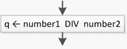

### 练习 13.1-2 — 求数字之和

编写一个 PHP 脚本，提示用户输入一个四位整数，然后计算其各位数字之和。

#### 解答

这里需要注意的是，像下面这样的语句

```php
$number = trim(fgets(STDIN));
```

会将给定的四位整数赋值给单个变量 `$number`，而不是四个单独的变量。

因此，首先你必须将整数拆分为四个数字，并将每个数字赋值给单独的变量。然后你可以计算这四个变量的和，得到所需的结果。有两种方法可供选择。

### 第一种方法

让我们尝试通过算术示例来理解第一种方法。以数字 6753 为例。

| 步骤 | 说明 |
|---|---|
| **第一位数字 = 6** | 如果将给定数字除以 1000 并取整数商，可以分离出第一位数字  
`$digit1 = intval(6753 / 1000)` |
| **剩余数字 = 753** | 如果将给定数字除以 1000 并取整数余数，可以分离出剩余数字  
`$r = 6753 % 1000` |
| **第二位数字 = 7** | 如果将剩余数字除以 100 并取整数商，可以分离出第二位数字  
`$digit2 = intval(753 / 100)` |
| **剩余数字 = 53** | 剩余数字现在为  
`$r = 753 % 100` |
| **第三位数字 = 5** | 如果将剩余数字除以 10 并取整数商，可以分离出第三位数字  
`$digit3 = intval(53 / 10)` |

| 8 | `$digit4 = $r % 10` | **6753** | 6 | 7 | 5 | **3** | 53 | ? |
|---|---|---|---|---|---|---|---|---|
| 9 | `$sum=$digit1+$digit2+$digit3+$digit4` | **6753** | 6 | 7 | 5 | **3** | 53 | **18** |
| 10 | `echo $sum` | **显示值 18** |

为了进一步帮助你，还有一个通用的 PHP 脚本，可用于拆分任何给定的整数。由于脚本的长度取决于数字的位数 N，你只需编写 N−1 对语句即可。

```php
<?php
    echo "Enter an N-digit integer: ";
    $number = trim(fgets(STDIN));

    $digit1 = intval($number / 10^(N-1));
    $r = $number % 10^(N-1);

    $digit2 = intval($r / 10^(N-2));
    $r = $r % 10^(N-2);

    .
    .
    .

    $digit(N-2) = intval($r / 100);
    $r = $r % 100;

    $digit(N-1) = intval($r / 10);
    $digitN = $r % 10;
```

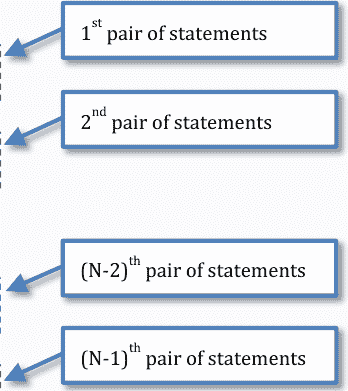

例如，如果你想拆分一个六位整数，你需要编写五对语句。

```php
file_13.1-2b.php

<?php
    echo "Enter a six-digit integer: ";
    $number = trim(fgets(STDIN));

    $digit1 = intval($number / 100000);
    $r = $number % 100000;

    $digit2 = intval($r / 10000);
    $r = $r % 10000;

    $digit3 = intval($r / 1000);
    $r = $r % 1000;
```

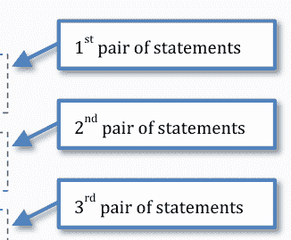

```php
$digit4 = intval($r / 100);
$r = $r % 100;

$digit5 = intval($r / 10);
$digit6 = $r % 10;

echo $digit1, $digit2, $digit3, $digit4, $digit5, $digit6;
?>
```

### 第二种方法

再次，让我们尝试通过算术示例来理解第二种方法。以相同的数字 6753 为例。

|  |  |
|---|---|
| **第四位数字 = 3** | 如果将给定数字除以 10 并取整数余数，可以分离出第四位数字<br><br>`$digit1 = 6753 % 10` |
| **剩余数字 = 675** | 如果将给定数字除以 10 并取整数商，可以分离出剩余数字<br><br>`$r = intval(6753 / 10)` |
| **第三位数字 = 5** | 如果将剩余数字除以 10 并取整数余数，可以分离出第三位数字<br><br>`$digit3 = 675 % 10` |
| **剩余数字 = 67** | 剩余数字现在为<br><br>`$r = intval(675 / 10)` |
| **第二位数字 = 7** | 如果将剩余数字除以 10 并取整数余数，可以分离出第二位数字<br><br>`$digit3 = 67 % 10` |
| **第一位数字 = 6** | 最后剩下的数字，恰好是第一位数字，为<br><br>`$digit1 = intval(67 / 10)` |

该算法的 PHP 脚本如下所示。

```php
<?php
echo "Enter a four-digit integer: ";
$number = trim(fgets(STDIN));

$digit4 = $number % 10;
$r = intval($number / 10);

$digit3 = $r % 10;
$r = intval($r / 10);

$digit2 = $r % 10;
$digit1 = intval($r / 10);

$sum = $digit1 + $digit2 + $digit3 + $digit4;
echo $sum;
?>
```

为了进一步帮助你，还有一个通用的 PHP 脚本，可用于拆分任何给定的整数。该脚本使用第二种方法。再次，由于脚本的长度取决于数字的位数 N，你只需编写 N-1 对语句即可。

```php
<?php
echo "Enter a N-digit integer: ";
$number = trim(fgets(STDIN));

$digit(N) = $number % 10;
$r = intval($number / 10);

$digit(N-1) = $r % 10;
$r = intval($r / 10);
.
.
.
$digit3 = $r % 10;
$r = intval($r / 10);

$digit2 = $r % 10;
$digit1 = intval($r / 10);
```

第 1 对语句

第 2 对语句

第 (N-2) 对语句

第 (N-1) 对语句

例如，如果你想拆分一个五位整数，你必须使用四对语句。

## file_13.1-2d.php

```php
<?php
echo "Enter a five-digit integer: ";
$number = trim(fgets(STDIN));

$digit5 = $number % 10;
$r = intval($number / 10);
```

第 1 对语句

```php
$digit4 = $r % 10;
$r = intval($r / 10);
```

## 第 2 对语句

```php
$digit3 = $r % 10;
$r = intval($r / 10);
```

## 第 3 对语句

```php
$digit2 = $r % 10;
$digit1 = intval($r / 10);
```

## 第 4 对语句

```php
echo $digit1, $digit2, $digit3, $digit4, $digit5;
?>
```

### 练习 13.1-3 显示经过的时间

编写一个 PHP 脚本，提示用户输入一个表示经过时间（以秒为单位）的整数，然后以“DD 天 HH 小时 MM 分钟 SS 秒”的格式显示它。例如，如果用户输入数字 700005，则必须显示消息“8 天 2 小时 26 分钟 45 秒”。

#### 解答

如你可能已知，一分钟有 60 秒，一小时有 3600 秒，一天有 86400 秒。

让我们尝试使用第一种方法分析数字 700005。

| 天数 = 8 | 如果将给定整数除以 86400 并取整数商，可以分离出天数
$days = intval(700005 / 86400); |
| 剩余秒数 = 8805 | 如果将给定整数除以 86400 并取整数余数，可以分离出剩余秒数
$r = 700005 % 86400; |
| 小时数 = 2 | 如果将剩余秒数除以 3600 并取整数商，可以分离出小时数
$hours = intval(8805 / 3600); |
| 剩余秒数 = 1605 | 剩余秒数现在为
$r = 8805 % 3600; |


| 分钟 = 26 | 如果将剩余秒数除以 60 并取整数商，就可以分离出分钟数<br>`$minutes = intval(1605 / 60);` |
|---|---|
| 秒数 = 45 | 最后的余数，恰好就是剩余的秒数，即<br>`$seconds = 1605 % 60;` |

此算法的 PHP 脚本如下所示。

```php
<?php
echo "Enter a period of time in seconds: ";
$number = trim(fgets(STDIN));

$days = intval($number / 86400);        // 60 * 60 * 24 = 86400
$r = $number % 86400;

$hours = intval($r / 3600);             // 60 * 60 = 3600
$r = $r % 3600;

$minutes = intval($r / 60);
$seconds = $r % 60;

echo $days, " days ", $hours, " hours ";
echo $minutes, " minutes and ", $seconds, " seconds";
?>
```

## 练习 13.1-4 — *反转数字*

*编写一个 PHP 脚本，提示用户输入一个三位整数，然后将其反转。例如，如果用户输入数字 375，则应显示数字 573。*

#### 解答

要分离给定数字的三个位，可以使用第一种或第二种方法。之后，本练习唯一的难点是构建反转后的数字。以数字 375 为例，分离后的三个位为

```php
$digit1 = 3;
$digit2 = 7;
$digit3 = 5;
```

你可以通过简单计算乘积之和来构建反转后的数字：

digit3 × 100 + digit2 × 10 + digit1 × 1

为了变换一下，你可以使用第二种方法分离给定数字。PHP 脚本将如下所示。

```php
<?php
    echo "Enter a three-digit integer: ";
    $number = trim(fgets(STDIN));

    $digit3 = $number % 10;          //This is the rightmost digit
    $r = intval($number / 10);

    $digit2 = $r % 10;               //This is the digit in the middle
    $digit1 = intval($r / 10);        //This is the leftmost digit

    $reversed = $digit3 * 100 + $digit2 * 10 + $digit1;
    echo $reversed;
?>
```

### 13.2 复习练习

完成以下练习。

+ 1. 编写一个 PHP 脚本，提示用户输入任意整数，然后将其最后一位乘以 8 并显示结果。

   提示：你可以使用模 10 运算来分离任何整数的最后一位。

+ 2. 编写一个 PHP 脚本，提示用户输入一个五位整数，然后将其反转。例如，如果用户输入数字 32675，则必须显示数字 57623。

+ 3. 编写一个 PHP 脚本，提示用户输入一个整数，然后当该数字为奇数时显示 1；否则显示 0。尽量不要使用任何决策控制结构，因为你还没有学习过它们！

+ 4. 编写一个 PHP 脚本，提示用户输入一个整数，然后当该数字为偶数时显示 1；否则显示 0。尽量不要使用任何决策控制结构，因为你还没有学习过它们！

+ 5. 编写一个 PHP 脚本，提示用户输入一个表示经过秒数的整数，然后以“WW 周 DD 天 HH 小时 MM 分钟和 SS 秒”的格式显示它。例如，如果用户输入数字 2000000，则应显示消息“3 周 23 天 3 小时 33 分钟和 20 秒”。

+ 6. 在 ATM 银行机中，有面值为 20 美元、10 美元、5 美元和 1 美元的钞票。编写一个 PHP 脚本，提示用户输入他想要或她想要提取的金额（使用整数值），然后显示 ATM 应该给出的最少钞票数量。例如，如果用户输入 76 美元的金额，则脚本应显示消息“3 张 20 美元钞票，1 张 10 美元钞票，1 张 5 美元钞票，和 1 张 1 美元钞票”。

7. 一个机器人来到月球进行一些实验。机器人的每一步长 25 英寸。编写一个 PHP 脚本，提示用户输入机器人走的步数，然后计算并显示以英里、英尺、码和英寸为单位的行进距离。例如，如果行进距离为 100000 英寸，则脚本应显示消息“1 英里，1017 码，2 英尺，和 4 英寸”。

已知

+ 1 英里 = 63360 英寸
+ 1 码 = 36 英寸
+ 1 英尺 = 12 英寸

## 第 14 章
操作字符串

## 14.3 从字符串中检索单个字符

PHP 允许你使用子字符串表示法检索字符串的单个字符。你可以使用索引 0 访问第一个字符，使用索引 1 访问第二个字符，依此类推。最后一个字符的索引比字符串的长度小 1。以下 PHP 脚本显示了一个示例。

```php
<?php

$a = "Hello World";

	echo $a[0];          //it displays the first letter
	echo $a[6];          //it displays the letter W
	echo $a[10];         //it displays the last letter
?>
```

> **注意：**请注意，单词“Hello”和“World”之间的空格也被视为一个字符。因此，字母 W 位于位置 6，而*不*在位置 5。

如果你尝试使用无效索引（例如负数或大于字符串长度的索引），PHP 将显示错误消息，如**图 14–1**所示。

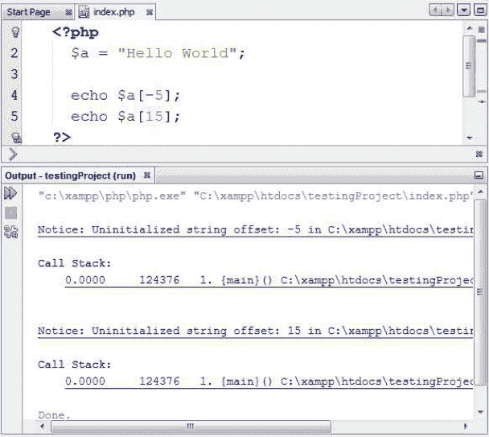

**图 14–1** 指示无效索引的错误消息

```php
$a = "          Zeus!";

$b = ltrim($a);

echo "Hello ", $b;        //Outputs: Hello Zeus!
?>
```

### 右修剪

```
rtrim (string)
```

这将从字符串末尾删除任何空白字符。

### 示例

### file_14.4b.php

```php
<?php
$a = "Hello          ";

$b = rtrim($a);

echo $b, " Hera!";        //Outputs: Hello Hera!
?>
```

### 左 & 右修剪

```
trim (string)
```

这将从字符串的开头和结尾删除任何空白字符。

### 示例

### file_14.4c.php

```php
<?php
$a = "      Hello      ";

$b = trim($a);

echo $b, " Poseidon!";        //Outputs: Hello Poseidon!
?>
```

### 字符串替换

```
str_replace (search, replace, subject)
```

这将在 subject 中搜索，并将所有出现的 search 字符串替换为 replace 字符串。

### 示例

### file_14.4d.php

```php
<?php
$a = "I am newbie in C++. C++ rocks!";

$b = str_replace("C++", "PHP", $a);

echo $b; //Outputs: I am newbie in PHP. PHP rocks
?>
```

### 计算字符数量

```
`strlen (string)`
```

这将返回 *string* 的长度，换句话说，就是 *string* 所包含的字符数量（包括空格字符、符号、数字等）。

### 示例

```php
<?php
$a = "Hello Olympians!";

echo strlen($a);                 //Outputs: 16
echo "\n";
echo strlen("I am newbie in PHP"); //Outputs: 18
?>
```

### 查找字符串位置

```
`strpos (subject, search)`
```

这将查找 *search* 在 *subject* 字符串中首次出现的数字位置。

### 示例

```php
<?php
$a = "I am newbie in PHP. PHP rocks!";

$i = strpos($a, "newbie");

echo $i; //Outputs: 5
?>
```

> **记住！** 第一个字符位于位置 0。

### 转换为小写或大写

有两个函数允许你将字符串中的所有字母转换为小写或大写。

### 转换为小写

```
`strtolower (string)`
```

这将返回转换为小写后的 *string*。

### 示例

```php
<?php

$a = "My Name is JoHN";

$b = strtolower($a);

echo $b; //Outputs: my name is john
?>
```

### 转换为大写

```
`strtoupper(string)`
```

这将返回转换为大写后的 *string*。

### 示例

```php
<?php

$a = "My Name is JoHN";

$b = strtoupper($a);

echo $b; //Outputs: MY NAME IS JOHN
?>
```

### 获取字符串的一部分

```
`substr(string, start [, length])`
```

这将返回 *string* 的一部分。具体来说，它将从 *start* 位置开始返回 *length* 个字符。*length* 参数是可选的。如果省略，则返回从 *start* 位置开始直到 *string* 结尾的子字符串。

### 示例

```php
<?php

$a = "Hello Athena";

echo substr ($a, 6, 3);        //Outputs: Ath
echo "\n";
echo substr ($a, 7);           //Outputs: thena
?>
```


### 检查字符串是否为数值

`is_numeric (string)`

该函数检查*字符串*是否为数值，并相应地返回 true 或 false。数字字符串由可选的符号、任意数量的数字、可选的小数部分和可选的指数部分组成。

### 示例

```php
<?php

$a = "753";
echo is_numeric($a), "\n";      //Value 1 (true) is displayed

$a = "753.6";
echo is_numeric($a), "\n";      //Value 1 (true) is displayed

$a = "-10E-3";
echo is_numeric($a), "\n";      //Value 1 (true) is displayed

$a = "Hello";
echo is_numeric($a), "\n";      //This displays nothing (false)
?>
```

### 练习 14.4-1 — *交换姓名的顺序*

编写一个 PHP 脚本，提示用户在一个字符串中输入名字和姓氏。最后，脚本应调换这两个名字的顺序。

#### 解答

本练习不同于你在第 8 章中学过的交换两个变量数值的练习。在本练习中，你必须拆分字符串，并将每个名字赋给不同的变量。如果做到了这一点，就可以按不同的顺序重新连接它们。

让我们通过一个例子来理解这个练习。下图显示了需要拆分的字符串及其每个字符的位置。

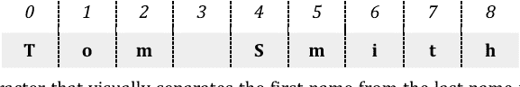

在视觉上分隔名字和姓氏的字符是它们之间的空格字符。问题在于这个字符并不总是在位置 3。有些人的名字很短，比如“Tom”，而另一些人的名字较长，比如“Robert”。因此，你需要一种方法，无论字符串内容如何，都能找到空格字符的位置。

要生成随机整数，可以使用 `rand()` 函数。由于需要三位随机整数，范围必须在 100 到 999 之间。

该算法的 PHP 脚本如下所示。

```php
<?php
echo "Enter last name: ";
$last_name = trim(fgets(STDIN));

$random_int = rand(100, 999);

$login_ID = strtolower( substr($last_name, 0, 4) ) . $random_int;
echo $login_ID;
?>
```

> **注意：** 请注意，`substr()` 函数是如何嵌套在 `strtolower()` 函数中的。内层（嵌套）函数的结果被用作外层函数的参数。这是大多数程序员喜欢采用的一种编写风格，因为它有助于节省大量代码行。当然，如果嵌套了太多函数，没有人能理解你的代码。最多嵌套四层是完全可以接受的。

### 练习 14.4-3   *创建随机单词*

编写一个 PHP 脚本，创建一个由五个字母组成的随机单词。

#### 解答

要创建随机单词，你需要一个包含英文字母全部 26 个字母的字符串。然后可以使用 `rand()` 函数在位置 0 到 25 之间随机选择一个字母。

该算法的 PHP 脚本如下所示。

```php
<?php
$alphabet = "abcdefghijklmnopqrstuvwxyz";

$random_word = $alphabet[rand(0, 25)] .
               $alphabet[rand(0, 25)] .
               $alphabet[rand(0, 25)] .
               $alphabet[rand(0, 25)] .
               $alphabet[rand(0, 25)];

echo $random_word;
?>
```

### 14.5 复习题：判断对错

请判断以下每个陈述是 true 还是 false。

+   1. 字符串是你可以使用键盘输入的任何内容。
+   2. 字符串必须用圆括号括起来。
+   3. 短语 "Hi there!" 包含 8 个字符。
+   4. 在短语 "Hi there!" 中，字母 "t" 位于位置 3。
+   5. 语句 $y = $a[1] 将变量 $a 所含字符串的第二个字母赋给变量 $y。
+   6. 语句 $y = $a[-1]; 是有效语句。
+   7. 修剪（trimming）是从字符串开头或末尾移除空白字符的过程。
+   8. 语句 $y = trim("Hello Aphrodite") 将值 "HelloAphrodite" 赋给变量 $y。
+   9. 语句 echo str_replace("Hi", "Hello", "Hi there! ") 显示消息 "Hello there!"。
+   10. 语句 $index = strpos("Hi there", "the") 将值 4 赋给变量 $index。
+   11. 语句 echo strtoupper("hello there!") 显示消息 "Hello There"。
+   12. 语句 echo substr("Hello there!", 0) 显示消息 "Hello there!"。
+   13. 语句 echo substr($a, 0, strlen($a)) 显示变量 $a 的部分字母。
+   14. 语句 echo substr($a, strlen($a) - 1, 1) 等价于语句 echo $a[strlen($a) - 1]。
+   15. 语句 echo strtoupper(substr("hello there!", 0, 5)) 显示单词 "HELLO"。
+   16. 语句 is_numeric("Exercise 1") 返回 true。
+   17. 语句 is_numeric("10E-2") 返回 true。

### 14.6 复习题：选择题

请为下列每个陈述选择正确答案。

+   1. 以下哪项不是字符串？
+      a. "Hello there!"
+      b. "13"
+      c. "13.5"
+      d. 以上都是字符串。
+   2. 字符串 "Hello Zeus!" 中的空格字符位于哪个位置？
+      b. 5
+      c. 空格不是字符。
+      d. 以上都不是
+   3. 语句 `echo substr($a, strlen($a) - 1, 1)` 显示
+      a. 变量 `$a` 的最后一个字符。
+      b. 变量 `$a` 的倒数第二个字符。
+      c. 该语句无效。
+   4. 语句 `ltrim(rtrim($a))` 等价于语句
+      a. `rtrim(ltrim($a))`.
+      b. `trim($a)`.
+      c. `trim(rtrim(ltrim($a)))`.
+      d. 以上都是
+   5. 语句 `str_replace($a, " ", "")`
+      a. 在变量 `$a` 的每个字母之间添加一个空格。
+      b. 从变量 `$a` 中移除所有空格字符。
+      c. 清空变量 `$a`。
+   6. 语句 `str_replace("  Hello  ", " ", "")` 等价于语句
+      a. `str_replace("  Hello  ", "", "")`.
+      b. `trim("  Hello  ")`.
+      c. `rtrim("  Hello  ")`.
+      d. 以上都是
+      e. 以上都不是
+   7. 语句 `echo strlen("")` 显示
+      a. 什么都不显示。
+      b. 1.
+      c. 0.
+      d. 该语句无效。
+      e. 以上都不是
+   8. 语句 `$Shakespeare = strpos("2b || !2b", "b")` 将哪个值赋给变量 `$Shakespeare`？
+      a. 1
+      b. 2
+      c. 6
+      d. 以上都不是

## 第 14 章
字符串操作

### 9. 下面的代码片段会做什么？

```
$a = "Hi there";
$b = substr($a, strpos($a, " ") + 1);
```

+   a. 它将单词 “Hi” 赋给变量 $b。
+   b. 它将一个空格字符赋给变量 $b。
+   c. 它将单词 “there” 赋给变量 $b。
+   d. 以上都不是

### 10. 在哪些情况下，函数 `is_numeric()` 会返回 true？

+   a. `is_numeric("1E21")`
+   b. `is_numeric("21")`
+   c. `is_numeric("1E-21")`
+   d. 以上都是

### 14.7 复习练习

完成以下练习。

+   1. 编写一个 PHP 脚本，提示用户输入其名字、中间名、姓氏以及偏好的称谓（Mr.、Mrs.、Ms.、Dr. 等），并按以下所有格式显示它们。
+   
+      *称谓 名字 中间名 姓氏*
+   
+      *名字 中间名 姓氏*
+   
+      *姓氏, 名字*
+   
+      *姓氏, 名字 中间名*
+   
+      *姓氏, 名字 中间名, 称谓*
+   
+      *名字 姓氏*

例如，假设用户输入以下内容：

名字：Aphrodite

中间名：Maria

姓氏：Boura

称谓：Ms.

脚本应按以下所有格式显示用户的名字：

+   Ms. Aphrodite Maria Boura
+   
+   Aphrodite Maria Boura
+   
+   Boura, Aphrodite
+   
+   Boura, Aphrodite Maria
+   
+   Boura, Aphrodite Maria, Ms.
+   
+   Aphrodite Boura

+   2. 编写一个 PHP 脚本，创建并显示一个由五个字母组成的随机单词。第一个字母必须是大写字母。

+   3. 编写一个 PHP 脚本，提示用户输入其姓名，然后创建一个由从姓名中随机选取的三个小写字母和一个随机四位数组成的秘密密码。例如，如果用户输入 "Vassilis Bouras"，则秘密密码可能是 "sar1359"、"vbs7281" 或 "bor1459" 之一。


## “顺序控制结构”复习题

回答下列问题。

1. 什么是顺序控制结构？
2. 顺序控制结构可以执行哪些操作？
3. 举例说明如何使用整数除法的商和余数。
4. 什么是函数？
5. 术语“嵌套函数”是什么意思？

## 第4部分：决策控制结构

### 第15章：决策控制结构简介

#### 15.1 什么是决策控制结构？

到目前为止，你所学的只是顺序控制结构，即语句按其在脚本中出现的顺序依次执行。然而，在实际的 PHP 编程中，你很少会希望语句按顺序执行。很多时候，你希望在某一种情况下执行一组语句，而在另一种情况下执行完全不同的另一组语句。这时，决策控制结构就派上用场了！

决策控制结构会对一个布尔表达式或一组布尔表达式进行求值，然后决定执行哪一组语句。

#### 15.2 什么是布尔表达式？

布尔表达式是结果为布尔值（即 `true` 或 `false`）的表达式。

#### 15.3 如何编写布尔表达式

简单的布尔表达式写法如下：

```
Operand1   Comparison Operator   Operand2
```

其中：

- `Operand1` 和 `Operand2` 可以是值、变量或数学表达式
- `Comparison Operator` 可以是**表15-1**中列出的任意一种运算符

**表15-1** PHP 中的比较运算符

| 比较运算符 | 描述 |
|---|---|
| `==` | 相等（不是赋值） |
| `!=` | 不相等 |
| `>` | 大于 |
| `<` | 小于 |
| `>=` | 大于或等于 |
| `<=` | 小于或等于 |

> **注意：** 初学者在编写 PHP 脚本时一个非常常见的错误，是把赋值运算符和相等运算符混淆。他们经常在实际上想表达 `$x == 5` 时，却写成了 `$x = 5`。

下面是一些布尔表达式的示例：

- `$x == 5`：可以读作“测试 $x 是否等于 5”
- `$x > $y`：可以读作“测试 $x 是否大于 $y”
- `$x <= $y`：可以读作“测试 $x 是否小于或等于 $y”
- `$x != 3 * $y + 4`：可以读作“测试 $x 是否不等于表达式 `3 * $y + 4` 的结果”

> **注意：** 对于人类来说，布尔表达式应当被理解为问题。它们应读作“某物是否等于/大于/小于另一物？”答案只是“是”或“否”（真或假）。

此外，由于布尔表达式实际上会返回一个值（真或假），这个值可以直接赋给一个变量。例如，表达式

```
$a = $x > $y;
```

会将真或假的值赋给变量 $a。它可以读作：“如果变量 $x 的内容大于变量 $y 的内容，则将值 true 赋给变量 $a；否则，将值 false 赋给变量 $a。”下面的示例将在屏幕上显示数字 1。

```
<?php

$x = 0;
$y = 5;
$a = $x > $y;

echo $a;
?>
```

> **注意：** 请注意，在 PHP 中，布尔值 `true` 也可以用数值 1 来表示。

#### 练习15.3-1 — *填写表格*

根据变量 $a、$b 和 $c 的值，用“真”或“假”填写下表。

| $a | $b | $c | $a == 10 | $b <= $a | $c > 3 * $a - $b |
|---:|---:|---:|:---:|:---:|:---:|
| 3 | -5 | 7 |  |  |  |
| 10 | 10 | 21 |  |  |  |
| -4 | -2 | -9 |  |  |  |

#### 解答

关于该表格的一些说明：

- ➢ 当变量 `$a` 的内容为 10 时，布尔表达式 `$a == 10` 为真。
- ➢ 当 `$b` 小于或等于 `$a` 时，布尔表达式 `$b <= $a` 为真。
- ➢ 当 `$c` 大于表达式 `3 * $a - $b` 的结果时，布尔表达式 `$c > 3 * $a - $b` 为真。请特别注意 `$b` 为负数的情况。例如，在第一行中，`$a` 等于 3，`$b` 等于 -5。表达式 `3 * $a - $b` 的结果是 `3 * 3 - (-5) = 3 * 3 + 5 = 14`。

因此，表格变为

| $a | $b | $c | $a == 10 | $b <= $a | $c > 3 * $a - $b |
|---|---|---|---|---|---|
| 3 | -5 | 7 | 假 | 真 | 假 |
| 10 | 10 | 21 | 真 | 真 | 真 |
| -4 | -2 | -9 | 假 | 假 | 真 |

#### 15.4 逻辑运算符与复杂布尔表达式

更复杂的布尔表达式可以由简单的布尔表达式构成，写法如下：

```
Boolean_Expression1 Logical Operator Boolean_Expression2
```

其中：

- `Boolean_Expression1` 和 `Boolean_Expression2` 可以是任意布尔表达式
- `Logical Operator` 可以是**表15-2**中列出的任意一种运算符

**表15-2** PHP 中的逻辑运算符

| 逻辑运算符 | 描述 |
|---|---|
| `&&` | 与（AND，也称为逻辑合取） |
| `\|\|` | 或（OR，也称为逻辑析取） |
| `!` | 非（NOT，也称为否定或逻辑补） |

下面给出这三个运算符的真值表。

| 布尔表达式1（BE1） | 布尔表达式2（BE2） | BE1 && BE2 | BE1 \|\| BE2 | !(BE1) |
|---|---|---|---|---|
| 假 | 假 | 假 | 假 | 真 |
| 假 | 真 | 假 | 真 | 真 |
| 真 | 假 | 假 | 真 | 假 |
| 真 | 真 | 真 | 真 | 假 |

你还困惑吗？其实不必！这非常简单！

- 当 BE1 和 BE2 都为真时，逻辑运算符 AND（`&&`）的结果为真。
- 当 BE1 或 BE2 中至少一个为真时，逻辑运算符 OR（`||`）的结果为真。
- 逻辑运算符 NOT（`!`）只是反转布尔表达式的结果。在该表中，BE1 为真时结果为假，反之亦然。

> **注意：** 在流程图中，本书使用通用的 AND、OR 和 NOT 运算符！

接下来是一些复杂布尔表达式的示例。括号并不是必需的，只是为了增强可读性。

- `($x == 5) && ($x > $y)`：可以读作“测试 $x 是否等于 5 且大于 $y”
- `($x > $y) || ($x == 3)`：可以读作“测试 $x 是否大于 $y 或等于 3”
- `!($x < $y)`：可以读作“测试 $x 是否不小于 $y”，换句话说，“测试 $x 是否大于或等于 $y”

> **注意：** 在最后一个布尔表达式中，请注意前面的感叹号。

#### 15.5 逻辑运算符的优先级是什么？

非常复杂的布尔表达式可能会使用多个逻辑运算符，例如：

```
($x > $y) || ($x == 5) && ($x <= $z) || !($z == 1)
```

那么，一个合理的问题就是：“哪个逻辑运算最先执行？”

逻辑运算符遵循的优先级规则与大多数编程语言相同。优先级顺序为：先执行逻辑非（`!`），再执行逻辑与（`&&`），最后执行逻辑或（`||`）。

| 优先级 | 逻辑运算符 |
|---|---|
| 较高优先级 | `!` |
|  | `&&` |
| 较低优先级 | `\|\|` |

> **注意：** 你随时可以使用括号来改变默认优先级。

#### 15.6 算术、比较和逻辑运算符的优先级是什么？

在许多情况下，表达式可能包含不同类型的运算符，例如下面这个表达式。

```
$a * $b + 2 > 21 || !($c == $b / 2) && $c > 13
```

在这种情况下，先执行算术运算，再执行比较运算，最后执行逻辑运算，如下表所示。

#### 解答

不要害怕！很容易就能得出结果。你只需要回想一下 AND（`&&`）和 OR（`||`）运算符的规则。

- **i.** 当两个布尔表达式都为真时，AND（`&&`）运算符的结果为真。仔细看一下，右侧布尔表达式（`$b != 2`）的结果为假。因此，你无需浪费时间计算左侧布尔表达式的结果。最终结果必定为假。

- **ii.** 当至少一个布尔表达式为真时，OR（`||`）运算符的结果为真。仔细看一下，右侧布尔表达式（`$a >= 5`）的结果实际上为真。因此，不必费心计算左侧布尔表达式的结果。最终结果必定为真。

#### 练习15.6-3 — 将英文句子转换为布尔表达式

一位班主任要求学生们根据自己的年龄举手。他想找出符合以下条件的学生：

- **i.** 年龄在9到12岁之间。

- **ii.** 年龄小于8岁且大于11岁。

- **iii.** 年龄为8岁、10岁或12岁。

- **iv.** 年龄在6到8岁之间，并且在10到12岁之间。

- **v.** 既不是10岁也不是12岁。

#### 解答

要编写所需的布尔表达式，需要使用变量 `$age`。

**i.** 第一个句子可以用图形表示如下。


不过要小心！在数学中写 9 ≤ age ≤ 12 是合法的，但在计算机语言中则不行。必须将表达式拆分为两部分。

```
$age >= 9 && $age <= 12
```

为了确认，你可以用感兴趣区域内部和外部的多个值来测试这个布尔表达式。例如，对于年龄值 7、8、13 和 17，该表达式的结果为假；相反，对于年龄值 9、10、11 和 12，结果为真。


V. 最后一句的布尔表达式可以写成

`$age != 10 && $age != 12`

> **记住！** 当感兴趣区域的箭头相互指向时，必须使用逻辑运算符 AND (`&&`)；否则，必须使用逻辑运算符 OR (`||`)。
> 
> AND (`&&`)
> 
> OR (`||`)

### 15.7 如何否定布尔表达式

否定是反转布尔表达式含义的过程。有两种方法可用于否定布尔表达式。

### 第一种方法

第一种方法是最简单的一种。只需在原始布尔表达式前使用 NOT 运算符 (`!`)，你的否定布尔表达式就准备好了！例如，

如果原始布尔表达式是 `$x > 5 && $y == 3`，
则否定的布尔表达式变为 `!($x > 5 && $y == 3)`。

> **注意：** 请注意，整个表达式必须用括号括起来。如果你没有使用括号而写成 `!$x > 5 && $y == 3`，那就完全错误了。在这种情况下，NOT 运算符 (`!`) 只会否定第一个布尔表达式 `$x > 5`。

### 第二种方法

第二种方法稍微复杂一些，但不难学习。你只需根据以下表格否定每个运算符即可。

| 原始运算符 | 否定运算符 |
|---|---|
| `==` | `!=` |
| `!=` | `==` |
| `>` | `<=` |
| `<` | `>=` |
| `<=` | `>` |
| `>=` | `<` |
| `&&` | `||` |
| `||` | `&&` |
| `!` | `!` |

> **注意：** 请注意，NOT 运算符 (`!`) 保持不变。

例如，
如果原始布尔表达式是 `$x > 5 && $y == 3`，
则否定的布尔表达式变为 `$x <= 5 || $y != 3`。

### Exercise 15.7-1 — *否定布尔表达式*

*使用两种方法否定以下布尔表达式。*

+   i. `$b != 4`
+   ii. `$a * 3 + 2 > 0`
+   iii. `!($a == 5 && $b >= 7)`
+   iv. `$a == true`
+   v. `$b > 7 && !($x > 4)`
+   vi. `$a == 4 || $b != 2`

#### 解答

### 第一种方法

+   i. `!($b != 4)`
+   ii. `!($a * 3 + 2 > 0)`
+   iii. `!(!($a == 5 && $b >= 7))`，或者等价的 `$a == 5 && $b >= 7`
+   iv. `!($a == true)`
+   v. `!($b > 7 && !($x > 4))`
+   vi. `!($a == 4 || $b != 2)`

> **注意：** 两次否定会得到肯定。也就是说，连续两个 NOT (`!`) 运算符会相互抵消。

### 第二种方法

+   i. `$b == 4`
+   ii. `$a * 3 + 2 <= 0`
+   iii. `!($a != 5 || $b < 7)`
+   iv. `$a != true`
+   v. `$b <= 7 || !($x <= 4)`
+   vi. `$a != 4 && $b == 2`

> **注意：** 请注意，算术运算符**不**被否定。千万不要*胆敢*将加号 (`+`) 替换为减号 (`-`) 运算符！

> **注意：** 请注意，NOT 运算符 (`!`) 保持不变。

### 15.8 复习问题：判断正误

为以下每个陈述选择 **true** 或 **false**。

+   1. 布尔表达式是始终产生两个值之一的表达式。
+   2. 布尔表达式至少包含一个逻辑运算符。
+   3. 表达式 `$x = 5` 测试变量 `$x` 是否等于 5。
+   4. 语句
    ```php
    $a = $b > $c;
    ```
    不是有效的 PHP 语句。
+   5. 布尔表达式 `$b < 5` 测试变量 `$b` 是否为 5 或更小。
+   6. AND (`&&`) 运算符也称为逻辑析取运算符。
+   7. NOT (`!`) 运算符也称为逻辑补运算符。
+   8. 两个布尔表达式的逻辑合取结果等于它们的逻辑析取结果，前提是两个布尔表达式都为真。
+   9. 两个布尔表达式的逻辑析取结果肯定为真，前提是布尔表达式的值不同。
+   10. 表达式 `$c == 3 && $d > 7` 被视为复杂布尔表达式。
+   11. 当两个操作数（布尔表达式）都为真时，逻辑运算符 OR (`||`) 的结果为真。
+   12. 布尔表达式 `!($x == 5)` 的结果为真，当变量 `$x` 包含除 5 以外的任何值时。
+   13. NOT (`!`) 运算符在逻辑运算符中具有最高优先级。
+   14. OR (`||`) 运算符在逻辑运算符中具有最低优先级。
+   15. 在布尔表达式 `$x > $y || $x == 5 && $x <= $z` 中，AND (`&&`) 运算符在 OR (`||`) 操作之前执行。
+   16. 在布尔表达式 `$a * $b + $c > 21 || $c == $b / 2` 中，程序首先测试 `$c` 是否大于 21。
+   17. 当老师想要找到年龄小于 8 岁且大于 11 岁的学生时，相应的布尔表达式是 `$age < 8 && $age > 11`。
+   18. 布尔表达式 `$x < 0 && $x > 100` 对于 `$x` 的任何值，始终为假。
+   19. 布尔表达式 `$x > 0 || $x < 100`，对于 `$x` 的任何值，始终为真。
+   20. 布尔表达式 `$x > 5` 等价于 `!($x < 5)`。
+   21. 布尔表达式 `!($x > 5 && $y == 5)` 不等价于 `!($x > 5) && $y == 5`。

22. 在威廉·莎士比亚的《哈姆雷特》（第三幕第一场）中，主角说“生存还是毁灭：这是一个问题：....”如果你将其写为布尔表达式 `2 * $B || !(2 * $B)`，那么对于以下代码片段，“莎士比亚式”表达式的结果始终为真。

```
$B = intval($That_is_the_question) % 2 / 2;
$result = 2 * $B || !(2 * $B);
```

其中变量 `$That_is_the_question` 包含数值。

23. 布尔表达式 `!(!$x > 5)` 等价于 `$x > 5`。

### 15.9 复习问题：选择题

为以下每个陈述选择正确答案。

+   1. 以下哪项**不是**比较运算符？
+      a. `>=`
+      b. `=`
+      c. `<`
+      d. 以上都是比较运算符。

+   2. 以下哪项不是逻辑运算符？
+      a. `&`
+      b. `!`
+      c. 以上都是逻辑运算符。
+      d. 以上都不是逻辑运算符。

+   3. 如果变量 `$x` 包含值 5，语句 `$y = $x % 2 == 1` 将什么值赋给变量 `$y`？
+      a. `true`
+      b. `false`
+      c. 以上都不是

+   4. 如果变量 `$x` 包含值 5，语句 `$y = $x % 2 == 0 || intval($x / 2) == 2` 将什么值赋给变量 `$y`？
+      a. `true`
+      b. `false`
+      c. 以上都不是

> ¹ 威廉·莎士比亚（1564–1616）是英国诗人、剧作家和演员。他常被称为英国的民族诗人。他写了大约 40 部戏剧和几部长篇叙事诗。他的作品被视为世界文学的最佳代表之一。他的戏剧已被翻译成所有主要现代语言，并且至今仍在上演。

5. 实验室房间的温度应在 50 到 80 华氏度之间。以下哪个布尔表达式测试此条件？

+   a. `$t >= 50 || $t <= 80`
+   b. `$t > 50 && $t < 80`
+   c. `$t >= 50 && $t <= 80`
+   d. `$t > 50 || $t < 80`

6. 以下哪项等价于布尔表达式 `$t == 3 || $t > 30`？

+   a. `$t == 3 && !($t <= 30)`
+   b. `$t == 3 && !($t < 30)`
+   c. `!($t != 3) || !($t < 30)`
+   d. `!($t != 3 && $t <= 30)`

### 15.10 复习练习

完成以下练习。

1. 将第一列中的每个元素与第二列中的一个或多个元素匹配。

| 运算符 | 符号 |
|---|---|
| i. 逻辑运算符 | a. % |
| ii. 算术运算符 | b. += |
| iii. 比较运算符 | c. && |
| iv. 赋值运算符（一般） | d. == |
|  | e. || |
|  | f. >= |
|  | g. ! |
|  | h. = |
|  | i. *= |
|  | j. / |

2. 根据变量 `$a`、`$b` 和 `$c` 的值，用“True”或“False”填写以下表格。

| $a | $b | $c | $a != 1 | $b > $a | $c / 2 > 2 * $a |
|---:|---:|---:|---|---|---|
| 3 | -5 | 8 |  |  |  |
| 1 | 10 | 20 |  |  |  |
| -4 | -2 | -9 |  |  |  |


## 第 16 章
### 单一备选决策结构

3. 根据布尔表达式 BE1 和 BE2 的值，用“True”或“False”填写下表。

| 布尔表达式 1 (BE1) | 布尔表达式 2 (BE2) | BE1 || BE2 | BE1 && BE2 | !(BE2) |
|---|---|---|---|---|---|
| False | False |  |  |  | |
| False | True |  |  |  | |
| True | False |  |  |  | |
| True | True |  |  |  | |

4. 根据变量 $a、$b 和 $c 的值，用“True”或“False”填写下表。

| $a | $b | $c | $a > 3 || $c > $b && $c > 1 | $a > 3 && $c > $b || $c > 1 |
|---|---|---|---|---|---|
| 4 | -6 | 2 |  |  |
| -3 | 2 | -4 |  |  |
| 2 | 5 | 5 |  |  |

5. 当 $x = 4，$y = -2 和 $flag = true 时，用相应的值填写下表。

| 表达式 | 值 |
|---|---|
| pow($x + $y, 3) |  |
| ($x + $y) / (pow($x, 2) - 14) |  |
| ($x - 1) == $y + 5 |  |
| $x > 2 && $y == 1 |  |
| $x == 1 || $y == -2 && !($flag == false) |  |
| !($x >= 3) && ($x % 2 > 1) |  |

6. 当变量 $a、$b、$c 和 $d 分别包含值 6、-3、4 和 7 时，计算每个复杂布尔表达式的结果。

+   i. (3 * $a + $b / 5 - $c * $b / $a > 4) && ($b != -3)
+   ii. ($a * $b - $c / 2 + 21 * $c / 3 != 8) || ($a >= 5)

7. 一位班主任要求学生根据年龄举手。他想找到：

+   i. 年龄在 12 岁以下，但不包括 8 岁的学生。
+   ii. 年龄在 6 岁到 9 岁之间，以及 11 岁的学生。
+   iii. 年龄超过 7 岁，但不包括 10 岁或 12 岁的学生。
+   iv. 6 岁、9 岁和 11 岁的学生。

## 第 16 章
### 单一备选决策结构

> **注意：** 新手程序员在编写 PHP 脚本时非常常见的一个错误是混淆赋值运算符和相等运算符。他们经常写 `if ($x = $y)`，而实际上他们想表达的是 `if ($x == $y)`。

### 练习 16.1-1  *跟踪表和单一备选决策结构*

设计相应的流程图并创建跟踪表，以确定下一个 PHP 脚本中每个步骤的变量值，针对两次不同的执行。两次执行的输入值为 (i) 10，和 (ii) 51。

```php
<?php

$a = trim(fgets(STDIN));

$y = 5;
if ($a * 2 > 100) {
    $a = $a * 3;
    $y = $a * 4;
}

echo $a, $y;

?>
```

#### 解答

流程图如下所示。

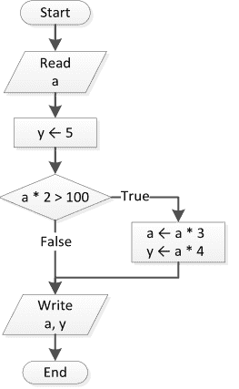

+   3. 单一备选决策结构中包含的语句可能一条都不会执行。
+   
+   4. 在流程图中，决策符号代表算法的开始和结束。
+   
+   5. 代码片段
+   
+   ```php
+   define("if", 5);
+   $x = if + 5;
+   ```
+   
+   在语法上是正确的。
+   
+   6. 单一备选决策结构使用保留关键字 `else`。
+   
+   7. 以下代码片段满足确定性属性。
+   
+   ```php
+   if ($b != 3) {
+       $x = $a / ($b - 3);
+   }
+   ```
+   
+   8. 以下 PHP 脚本满足确定性属性。
+   
+   ```php
+   <?php
+   $a = trim(fgets(STDIN));
+   $b = trim(fgets(STDIN));
+   
+   if ($b != 3) {
+       $x = $a / ($b - 3);
+   }
+   echo $x;
+   ?>
+   ```

### 16.3  复习问题：选择题

为以下每个陈述选择正确答案。

+   1. 单一备选决策结构用于
+      a. 语句一个接一个地执行。
+      b. 在执行某些语句之前必须做出决策。
+      c. 以上都不是
+      d. 以上都是
+   
+   2. 单一备选决策结构在以下路径上包含一条语句或一组语句
+      a. 仅错误路径。
+      b. 两条路径。
+      c. 仅真路径。

### 3. 在以下代码片段中，

```php
if ($x == 3)
    $x = 5;
    $y++;
```

语句 `$y++` 在以下情况执行

+   a. 仅当变量 `$x` 包含值 3 时。
+   b. 仅当变量 `$x` 包含值 5 时。
+   c. 仅当变量 `$x` 包含非 3 的值时。
+   d. 无论哪种情况。

### 4. 在以下代码片段中，

```php
if ($x % 2 == 0) $y++;
```

语句 `$y++` 在以下情况执行

+   a. 变量 `$x` 能被 2 整除时。
+   b. 变量 `$x` 包含偶数时。
+   c. 变量 `$x` 不包含奇数时。
+   d. 以上全部
+   e. 以上都不是

### 5. 在以下代码片段中，

```php
$x = 3 * $y;
if ($x > $y) $y++;
```

语句 `$y++` 是

+   a. 始终执行。
+   b. 永不执行。
+   c. 无论哪种情况都执行。
+   d. 仅当变量 `$y` 包含正值时执行。
+   e. 以上都不是

### 16.4 复习练习

完成以下练习。

### 1. 找出以下 PHP 脚本中的语法错误：

```php
<?php

$x = trim(fgets(STDIN));

$y <− 5;
if ($x * $y / 2 > 20)
    $y--
    $x == 4 * $x2;
}
```

```php
echo $x $y;
?>
```

+   2. 为以下 PHP 脚本创建跟踪表，以确定每个步骤中变量的值，针对两次不同的执行。然后，设计相应的流程图。
+   
+   两次执行的输入值为 (i) 10，和 (ii) -10。

```php
<?php

$x = trim(fgets(STDIN));

$y = -5;
if ($x * $y / 2 > 20) {
    $y--;
    $x -= 4;
}

if ($x > 0) {
    $y += 30;
    $x = pow($x, 2);
}

echo $x, $y;
?>
```

+   3. 为以下 PHP 脚本创建跟踪表，以确定每个步骤中变量的值，针对两次不同的执行。然后，设计相应的流程图。
+   
+   两次执行的输入值为 (i) -11，和 (ii) 11。

```php
<?php

$x = trim(fgets(STDIN));

$y = 0;
if (abs($x) > 10) {
    $y += $x;
    $x--;
}

if (abs($x) > 10) {
    $y *= 3;
}

echo $x, $y;
?>
```

### 单一备选决策结构

4. 为以下 PHP 脚本创建跟踪表，以确定每个步骤中变量的值，针对两次不同的执行。然后，设计相应的流程图。

两次执行的输入值为 (i) 1, 2, 3；和 (ii) 4, 2, 1。

```php
<?php

$x = trim(fgets(STDIN));
$y = trim(fgets(STDIN));
$z = trim(fgets(STDIN));

if ($x + $y > $z)
    $x = $y + $z;
if ($x > $y + $z)
    $y = $x + $z;
if ($x > $y - $z)
    $z = $x - $z % 2;

echo $x, $y, $z;
?>
```

+   5. 编写一个 PHP 脚本，提示用户输入一个数字，然后在给定数字为正数时显示消息“Positive”。
+   
+   6. 编写一个 PHP 脚本，提示用户输入两个数字，然后在两个给定数字都为正数时显示消息“Positive”。
+   
+   7. 编写一个 PHP 脚本，提示用户输入一个值，然后在给定值为数值时显示消息“Numeric”。
+   
+   提示：使用 `is_numeric()` 函数。
+   
+   8. 编写一个 PHP 脚本，提示用户输入一个字符串，然后在给定字符串仅包含大写字符时显示消息“Uppercase”。
+   
+   提示：使用 `strtoupper()` 函数
+   
+   9. 编写一个 PHP 脚本，提示用户输入一个字符串，然后在给定字符串包含超过 20 个字符时显示消息“Many characters”。
+   
+   提示：使用 `strlen()` 函数
+   
+   10. 编写一个 PHP 脚本，提示用户输入四个数字，如果其中有一个是负数，则显示消息“Among the given numbers, there is a negative one!”
+   
+   11. 编写一个 PHP 脚本，提示用户输入两个数字。如果第一个给定的数字大于第二个，则脚本应交换它们的值。最后，脚本应始终按升序显示这些数字。


12. 编写一个 PHP 脚本，提示用户输入在纽约三个不同地点测得的三个温度值，如果平均值大于 60 华氏度，则显示消息“Heat Wave”。

## 第17章

#### 双分支决策结构

### 17.1 双分支决策结构

这种决策控制结构在两条路径上都包含一条语句或一个语句块。

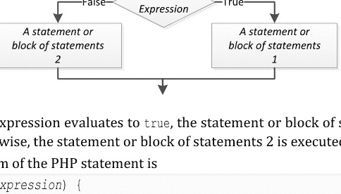

如果布尔表达式的计算结果为真，则执行语句或语句块1；否则，执行语句或语句块2。

PHP 语句的一般形式如下：

```php
if (Boolean_Expression) {
    A statement or block of statements 1
}
else {
    A statement or block of statements 2
}
```

同样，单条语句可以不使用花括号 {} 括起来，此时 if-else 语句变为：

```php
if (Boolean_Expression)
    One Single Statement 1;
else
    One Single Statement 2;
```

### 练习 17.1-1 找出输出消息

对于下面的流程图，确定三次不同执行时的输出消息。

三次执行的输入值分别为 (i) 3、(ii) -3 和 (iii) 0。

#### 双分支决策结构

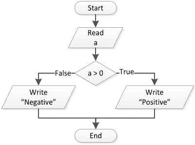

#### 解答

+ i. 当用户输入值 3 时，布尔表达式的计算结果为真。执行流程沿右侧路径进行，显示消息“Positive”。

+ ii. 当用户输入值 -3 时，布尔表达式的计算结果为假。执行流程沿左侧路径进行，显示消息“Negative”。

+ iii. 当用户输入值 0 时，布尔表达式的计算结果为假。执行流程不可避免地再次沿左侧路径进行，显示消息“Negative”！

> **注意：** 显然，这个流程图有些问题！正如你已经知道的，零不是负值！事实上，它也不是正值。在本书后面，当你学完所有关于嵌套决策控制结构的内容后，你将学会如何显示第三条消息：“The number entered is zero”。
>
> **记住！** 判断符号只有一个入口和两个出口路径！你不能有第三个出口！

### 练习 17.1-2 跟踪表与双分支决策结构

创建一个跟踪表，以确定下面的 PHP 脚本在两次不同执行过程中每一步的变量值。

两次执行的输入值分别为 (i) 5 和 (ii) 10。

```php
<?php
    $a = trim(fgets(STDIN));

    $z = $a * 10;
    $w = ($z - 4) * ($a - 3) / 7 + 36;
```

```php
if ($z >= $w && $a < $z) {
    $y = 2 * $a;
}
else {
    $y = 4 * $a;
}

echo $y;
?>
```

#### 解答

+ i. 对于输入值 5，跟踪表如下所示。

| 步骤 | 语句 | 备注 | $a | $z | $w | $y |
|---:|---|---|---:|---:|---:|---:|
| 1 | `$a = trim(fgets(STDIN))` | 用户输入值 5 | **5** | ? | ? | ? |
| 2 | `$z = $a * 10` |  | 5 | **50** | ? | ? |
| 3 | `$w = ($z - 4) * ($a - 3) / 7 + 36` |  | 5 | 50 | **49.142** | ? |
| 4 | `if ($z >= $w && $a < $z)` | 计算结果为真 |  |  |  |  |
| 5 | `$y = 2 * $a` |  | 5 | 50 | 49.142 | **10** |
| 6 | `echo $y` | 显示值 10 |  |  |  |  |

+ ii. 对于输入值 10，跟踪表如下所示。

| 步骤 | 语句 | 备注 | $a | $z | $w | $y |
|---:|---|---|---:|---:|---:|---:|
| 1 | `$a = trim(fgets(STDIN))` | 用户输入值 10 | **10** | ? | ? | ? |
| 2 | `$z = $a * 10` |  | 10 | **100** | ? | ? |
| 3 | `$w = ($z - 4) * ($a - 3) / 7 + 36` |  | 10 | 100 | **132** | ? |
| 4 | `if ($z >= $w && $a < $z)` | 计算结果为假 |  |  |  |  |
| 5 | `$y = 4 * $a` |  | 10 | 100 | 132 | **40** |
| 6 | `echo $y` | 显示值 40 |  |  |  |  |

### 练习 17.1-3 谁最大？

设计一个流程图，并编写相应的 PHP 脚本，让用户输入两个数 A 和 B，然后判断并显示这两个数中较大的数。

#### 解答

这个练习既可以使用单分支决策结构，也可以使用双分支决策结构。那么，我们两种都用一下！

#### 第一种方法——使用双分支决策结构

这种方法检测数 B 的值是否大于数 A 的值。如果是，则数 B 最大；否则，数 A 最大。

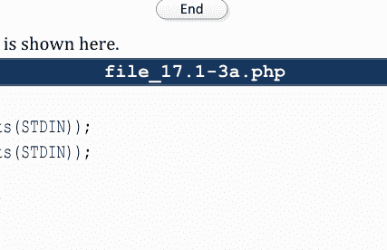

相应的 PHP 脚本如下所示。

#### file_17.1-3a.php

```php
<?php
$a = trim(fgets(STDIN));
$b = trim(fgets(STDIN));

if ($b > $a) {
    $max = $b;
}
else {
    $max = $a;
}

echo "Greatest value: ", $max;
?>
```

### 练习 17.1-4 判断奇数和偶数

设计一个流程图，并编写相应的 PHP 脚本，提示用户输入一个整数，然后显示一条消息，指出该数是奇数还是偶数。

#### 解答

在这个练习中，你需要找到一种判断一个数是奇数还是偶数的方法。你需要找到所有偶数之间或所有奇数之间的共同属性。实际上确实有这样的属性！所有偶数都能被 2 整除。因此，当 x ÷ 2 的余数为 0 时，x 是偶数；否则，x 是奇数。

下面你可以看到一些奇数和偶数：

+ 奇数：1、3、5、7、9、11...
+ 偶数：0、2、4、6、8、10、12、....

> **注意：** 请注意，零被视为偶数。

流程图如下所示。

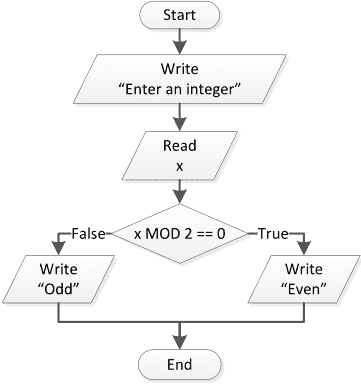

相应的 PHP 脚本如下所示。

```php
<?php
echo "Enter an integer ";
$x = trim(fgets(STDIN));

if ($x % 2 == 0) {
    echo "Even";
}
else {
    echo "Odd";
}
?>
```

### 17.2 复习题：判断对错

请为下列每个陈述选择**正确**或**错误**。

+ 1. 双分支决策结构中所包含的语句有可能全部都不会被执行。

+ 2. 双分支决策结构必须至少包含两条语句。

+ 3. 双分支决策结构使用保留关键字 `else`。

+ 4. 以下代码片段在语法上是正确的。

```php
define("else", 5);
if (else == 5) echo "hello";
```

+ 5. 在双分支决策结构中，被计算的布尔表达式可以返回两个以上的值。

+ 6. 以下代码片段满足有效性的特性。

```php
$x = trim(fgets(STDIN));
$y = trim(fgets(STDIN));
$z = trim(fgets(STDIN));

if ($x > $y && $x > $z) {
    echo "Value ", $x, " is the greatest one";
}
else {
    echo "Value ", $y, " is the greatest one";
}
```

### 17.3 复习题：选择题

请为下列每个问题选择正确的答案。

+ 1. 双分支决策结构在以下哪个路径上包含一条语句或一个语句块？

   a. 仅在假路径上。

   b. 两条路径上。

   c. 仅在真路径上。

+ 2. 在下面的代码片段中，

```php
if ($x % 2 == 0) {
    $x = 0;
}
else {
    $y++;
}
```

语句 $y++ 在以下哪种情况下执行？

+ a. 变量 $x 能被 2 整除。
+ b. 变量 $x 包含一个偶数。
+ c. 变量 $x 包含一个奇数。
+ d. 以上都不是

+ 3. 在下面的代码片段中，

```php
if ($x == 3)
    $x = 5;
else
    $x = 7;
    $y++;
```

语句 $y++ 在以下哪种情况下执行？

+ a. 当变量 $x 的值为 3 时。
+ b. 当变量 $x 的值不是 3 时。
+ c. 以上两种情况都执行

### 17.4 复习练习

完成以下练习。

+ 1. 创建一个跟踪表，以确定下面的 PHP 脚本在两次不同执行过程中每一步的变量值。然后，设计相应的流程图。

两次执行的输入值分别为 (i) 3 和 (ii) 0.5。

```php
<?php
$a = trim(fgets(STDIN));
$z = $a * 3 - 2;
if ($z >= 1) {
    $y = 6 * $a;
}
else {
    $z++;
    $y = 6 * $a + $z;
}
```


2. 创建跟踪表，以确定下一个 PHP 脚本中每个步骤的变量值。然后，设计相应的流程图。

```php
<?php
    $x = 3;
    $y = pow($x, 3) + 9;
    $z = 2 * $x + $y - 4;
    if ($x > $y) {
        $y = $z % $x;
        $z = sqrt($x);
    }
    else {
        $x = $z % $y;
        $z = sqrt($y);
    }
    echo $x, $y, $z;
?>
```

3. 编写与以下流程图对应的 PHP 脚本，然后为两次不同的执行创建跟踪表，以确定每个步骤的变量值。

两次执行的输入值为 (i) 10，和 (ii) 2，


13. 定期保养将使您的车辆更可靠，减少故障、不便和不必要开支的可能性。一般来说，您需要执行两种类型的保养：

- a. 每 6000 英里进行一次小保养
- b. 每 12000 英里进行一次大保养

编写一个 PHP 脚本，提示用户输入行驶的英里数，然后计算并显示距下次保养还剩多少英里，以及下次保养的类型。

14. 两辆汽车从静止开始，沿一条直线水平道路以恒定加速度行驶给定时间。编写一个 PHP 脚本，提示用户输入两辆汽车行驶的时间（两辆车相同）以及它们各自的加速度，然后计算并显示它们之间的距离，以及消息“Car A is first”或“Car B is first”，取决于哪辆车领先比赛。所需公式为

$$S = u_o + \frac{1}{2}at^2$$

## Chapter 18

## The Multiple-Alternative Decision Structure

### 18.1 The Multiple-Alternative Decision Structure

多重选择决策结构用于扩展替代方案的数量，如以下流程图片段所示。


当执行多重选择决策结构时，*Boolean Expression 1* 会被求值。如果 *Boolean Expression 1* 求值为 true，则紧随其后的相应语句或语句块将被执行，结构的其余部分将被跳过。换句话说，执行流程将继续执行多重选择决策结构之后可能存在的任何剩余语句。但是，如果 *Boolean Expression 1* 求值为 false，则执行流程将求值 *Boolean Expression 2*。如果它求值为 true，则紧随其后的相应语句或语句块将被执行，结构的其余部分将被跳过。此过程将持续进行，直到某个布尔表达式求值为 true，或者不再有布尔表达式为止。

最后的语句或语句块 N+1 将在之前的任何布尔表达式都未求值为 true 时执行。此外，这个最后的语句或语句块 N+1 是可选的，可以省略。这取决于您试图解决的算法。

PHP 语句的一般形式为

```php
if (Boolean_Expression 1) {
    A statement or block of statements 1
}
elseif (Boolean_Expression 2) {
    A statement or block of statements 2
}
```

```text
}
elseif (Boolean_Expression 3) {
    A statement or block of statements 3
}
.
.
.
elseif (Boolean_Expression N) {
    A statement or block of statements N
}
else {
    A statement or block of statements N+1
}
```

如您已知，单条语句可以不带花括号 {} 编写。因此，if-elseif 语句将变为如下所示。

```text
if (Boolean_Expression 1)
    One Single Statement 1
elseif (Boolean_Expression 2)
    One Single Statement 2
elseif (Boolean_Expression 3)
    One Single Statement 3
.
.
.
elseif (Boolean_Expression N)
    One Single Statement N
else
    One Single Statement N+1
```

### Exercise 18.1-1 Trace Tables and Multiple-Alternative Decision Structures

创建跟踪表，以确定下一个 PHP 脚本三次不同执行中每个步骤的变量值。三次执行的输入值为 (i) 5, 8；(ii) -13, 0；以及 (iii) 1, -1。

```php
<?php
$a = trim(fgets(STDIN));
$b = trim(fgets(STDIN));
```

```php
if ($a > 3)
    echo "Variable A greater than 3";
elseif ($a > 4 && $b <= 10) {
    echo "Variable A greater than 4 ";
    echo "and B less than or equal to 10";
}
elseif ($a * 2 == -26) {
    echo "Variable A times 2 is equal to -26";
    $b++;
}
elseif ($b == 1)
    echo "Variable B is equal to 1";
else
    echo "Display this when none of the above evaluates to true";

echo "The end!";
?>
```

> **Notice:** 请注意，只有在必要时才能使用花括号 `{ }`。

## Solution

- i. 对于输入值 5 和 8，跟踪表如下。

| Step | Statement | Notes | $a | $b |
|---:|---|---|---:|---:|
| 1 | `$a = trim(fgets(STDIN))` | User enters the value 5 | **5** | ? |
| 2 | `$b = trim(fgets(STDIN))` | User enters the value 8 | 5 | **8** |
| 3 | `if ($a > 3)` | This evaluates to true |  |  |
| 4 | `echo "Variable A greater ...` | The message "Variable A greater than 3" is displayed |  |  |
| 5 | `echo "The end!"` | The message "The end!" is displayed |  |  |

> **Notice:** 请注意，即使第二个布尔表达式 `($a > 4 && $b <= 10)` 也可能求值为 true，但它未被检查。

- ii. 对于输入值 -13 和 0，跟踪表如下。

| Step | Statement | Notes | $a | $b |
|---:|---|---|---:|---:|
| 1 | `$a = trim(fgets(STDIN))` | User enters the value -13 | **-13** | ? |
| 2 | `$b = trim(fgets(STDIN))` | User enters the value 0 | -13 | **0** |
| 3 | `if ($a > 3)` | This evaluates to false |  |  |

> Notice: 请注意，在第 7 步之后，第四个布尔表达式 ($b == 1) 也可能求值为 true，但它未被检查。

iii. 对于输入值 1 和 -1，跟踪表如下。

| Step | Statement | Notes | $a | $b |
|---|---|---|---|---|
| 1 | $a = trim(fgets(STDIN)) | User enters the value 1 | 1 | ? |
| 2 | $b = trim(fgets(STDIN)) | User enters the value -1 | 1 | -1 |
| 3 | if ($a > 3) | This evaluates to false |  |  |
| 4 | elseif ($a > 4 && $b <= 10) | This evaluates to false |  |  |
| 5 | elseif ($a * 2 == -26) | This evaluates to false |  |  |
| 6 | elseif ($b == 1) | This evaluates to false |  |  |
| 7 | echo "Display this ... | The message "Display this when none of the above evaluates to true" is displayed |  |  |
| 8 | echo "The end!" | The message "The end!" is displayed |  |  |

### Exercise 18.1-2 Counting the Digits

编写一个 PHP 脚本，提示用户输入 0 到 999 之间的整数，然后计算其总位数。最后，显示消息 "You entered a N-digit number"，其中 N 是总位数。

## Solution

以下 PHP 脚本假设用户输入 0 到 999 之间的有效数字，因此不包括检查数据输入的有效性。

```
file_18.1-2.php
<?php
echo "Enter a number (0 - 999): ";
$x = trim(fgets(STDIN));

if ($x <= 9) {
```

```php
$count = 1;
}
elseif ($x <= 99) {
    $count = 2;
}
else {
    $count = 3;
}

echo "You entered a ", $count, "-digit number";
?>
```

### 18.2 Review Questions: True/False

为以下每个陈述选择 **true** 或 **false**。

- 1. 多重选择决策结构用于扩展替代方案的数量。
- 2. 多重选择决策结构最多可以有三个替代方案。
- 3. 在多重选择决策结构中，一旦某个布尔表达式求值为 `true`，就会求值下一个布尔表达式。
- 4. 在多重选择决策结构中，最后的语句或语句块 N+1（出现在 `else` PHP 关键字下方）始终会被执行。
- 5. 在多重选择决策结构中，最后的语句或语句块 N+1（出现在 `else` PHP 关键字下方）在至少一个之前的布尔表达式求值为 `true` 时执行。
- 6. 在多重选择决策结构中，最后的语句或语句块 N+1，以及由此延伸的 `else` PHP 关键字，可以省略。
- 7. 在以下代码片段中，

```php
if ($a == 1)
    $x = $x + 5;
elseif ($a == 2)
    $x = $x - 2;
elseif ($a == 3)
    $x = $x - 9;
else
    $x = $x + 3;
    $y++;
```

语句 `$y++` 仅在变量 `$a` 包含 1、2 或 3 以外的值时执行。


### 18.3 复习练习

完成以下练习。

1. 创建跟踪表，以确定下一个 PHP 脚本四次不同执行中每个步骤的变量值。四次执行的输入值分别为 (i) 5、(ii) 150、(iii) 250 和 (iv) -1。

```php
<?php

  $q = trim(fgets(STDIN));

  if ($q > 0 && $q <= 50) {
      $b = 1;
  }
  elseif ($q > 50 && $q <= 100) {
      $b = 2;
  }
  elseif ($q > 100 && $q <= 200) {
      $b = 3;
  }
  else {
      $b = 4;
  }
  echo $b;
?>
```

2. 创建跟踪表，以确定下一个 PHP 脚本三次不同执行中每个步骤的变量值。三次执行的输入值分别为 (i) 5、(ii) 150 和 (iii) -1。

```php
<?php

  $amount = trim(fgets(STDIN));

  if ($amount < 20) {
      $discount = 0;
  }
  elseif ($amount >= 20 && $amount < 60) {
      $discount = 5;
  }
  elseif ($amount >= 60 && $amount < 100) {
      $discount = 10;
  }
  elseif ($amount >= 100) {
      $discount = 15;
  }
  $payment = $amount - $amount * $discount / 100;

  echo $discount, $payment;
?>
```

3. 设计流程图并编写相应的 PHP 脚本，让用户输入 -9999 到 9999 之间的整数，然后计算其总位数。最后，显示消息“你输入了一个 N 位数”，其中 N 是总位数。

4. 编写一个 PHP 脚本，显示以下菜单：

   1. 将美元转换为欧元 (EUR)
   2. 将美元转换为英镑 (GBP)
   3. 将美元转换为日元 (JPY)
   4. 将美元转换为加元 (CAD)

   然后提示用户输入选择（1、2、3 或 4）以及美元金额，并计算并显示所需值。已知：

   - $1 = 0.72 EUR (€)
   - $1 = 0.60 GBP (£)
   - $1 = ¥ 102.15 JPY
   - $1 = 1.10 CAD ($)

5. 编写一个 PHP 脚本，提示用户输入 1 到 12 之间的月份编号，然后显示相应的季节。已知：

   - 冬季包括月份 12、1 和 2
   - 春季包括月份 3、4 和 5
   - 夏季包括月份 6、7 和 8
   - 秋季（Fall）包括月份 9、10 和 11

6. 编写一个 PHP 脚本，提示用户输入 1.0 到 4.9 之间的数字，然后以英文文本显示该数字。例如，对于数字 2.3，应显示“Two point three”。

7. 美国最流行且最常用的评分系统使用字母等级形式的离散评估。设计流程图并编写相应的 PHP 脚本，提示用户输入 A 到 F 之间的字母，然后根据以下表格显示相应的百分比。

| Grade | Percentage |
|-------|------------|
| A     | 90 – 100   |
| B     | 80 – 89    |
| C     | 70–79      |
| D     | 60–69      |
| E / F | 0–59       |

## 第 19 章

## 情况决策结构

PHP 语句的一般形式为

```php
switch (a variable or an expression to evaluate) {
    case value-1:
        A statement or block of statements 1
        break;
    case value-2:
        A statement or block of statements 2
        break;
    case value-3:
        A statement or block of statements 3
        break;
    .
    .
    .
    case value-N:
        A statement or block of statements N
        break;
    default:
        A statement or block of statements N+1
}
```

> **注意：** 最后一个语句或最后一个语句块 N+1 是可选的，可以省略（你也需要省略关键字 `default`）。
>
> **注意：** 为了避免不良结果，请记住始终在每个 case 末尾包含关键字 `break`。如果省略，实际上会执行两个语句或语句块：即省略关键字 `break` 的当前语句，以及下一个语句。

使用情况决策结构的示例如下所示。

```php
<?php
echo "What is your name? ";
$name = trim(fgets(STDIN));

switch ($name) {
    case "John":
        echo "You are my cousin!";
        break;
    case "Aphrodite":
        echo "You are my sister!";
        break;
    case "Loukia":
        echo "You are my mom!";
        break;
    default:
        echo "Sorry, I don't know you.";
}
?>
```

### 练习 19.1-1 *一周的天数*

设计流程图并编写相应的 PHP 脚本，提示用户输入 1 到 7 之间的数字，然后显示相应的星期（星期日、星期一，等等）。如果输入的值无效，应显示错误消息。

#### 解答

流程图如下所示。


#### 第一种方法 – 使用情况决策结构

这个 PHP 脚本可以使用情况决策结构或多重替代决策结构来编写。让我们两种都试试！

```php
<?php
echo "Enter a number between 1 and 7: ";
$day = trim(fgets(STDIN));

switch ($day) {
    case 1:
        echo "Sunday";
        break;
    case 2:
        echo "Monday";
        break;
    case 3:
        echo "Tuesday";
        break;
    case 4:
        echo "Wednesday";
        break;
    case 5:
        echo "Thursday";
        break;
    case 6:
        echo "Friday";
        break;
    case 7:
        echo "Saturday";
        break;
    default:
        echo "Invalid Number";
}
?>
```

#### 第二种方法 – 使用多重替代决策结构

```php
<?php
echo "Enter a number between 1 and 7: ";
$day = trim(fgets(STDIN));

if ($day == 1) {
    echo "Sunday";
}
elseif ($day == 2) {
    echo "Monday";
}
elseif ($day == 3) {
    echo "Tuesday";
}
elseif ($day == 4) {
    echo "Wednesday";
}
elseif ($day == 5) {
    echo "Thursday";
}
elseif ($day == 6) {
    echo "Friday";
}
elseif ($day == 7) {
    echo "Saturday";
}
else {
    echo "Invalid Number";
}
?>
```

### 19.2 复习问题：判断正误

为以下每个陈述选择正确或错误。

1. 情况决策结构用于扩展替代方案的数量。
2. 情况决策结构始终可以替代多重替代决策结构。
3. 情况决策结构可以拥有程序员希望的任意数量的替代方案。
4. 在情况决策结构中，最后一个语句或语句块 N+1（出现在 default PHP 关键字下方）始终会被执行。
5. 在情况决策结构中，最后一个语句或语句块 N+1（出现在 default PHP 关键字下方）在之前没有任何 case 评估为 true 时执行。
6. 最后一个语句或语句块 N+1，以及 default PHP 关键字，不能被省略。

### 19.3 复习练习

7. 在以下 PHP 脚本中，

```php
switch ($a) {
    case 1:   $x = $x + 5; break;
    case 2:   $x = $x - 2; break;
    case 3:   $x = $x - 9; break;
    default:  $x = $x + 3; $y++;
}
```

语句 $y++ 仅在变量 $a 包含 1、2 或 3 以外的值时执行。

完成以下练习。

1. 创建跟踪表，以确定下一个 PHP 脚本每个步骤中三次不同执行的变量值。然后，设计相应的流程图。

   三次执行的输入值为 (i) 1、(ii) 3 和 (iii) 250。

```php
<?php
$a = trim(fgets(STDIN));

$x = 0;
$y = 0;

switch ($a) {
    case 1:   $x = $x + 5; $y = $y + 5; break;
    case 2:   $x = $x - 2; $y--;        break;
    case 3:   $x = $x - 9; $y = $y + 3; break;
    default:  $x = $x + 3; $y++;
}

echo $x, $y;
?>
```

2. 创建跟踪表，以确定下一个 PHP 脚本每个步骤中三次不同执行的变量值。然后，设计相应的流程图。

   三次执行的输入值为 (i) 10, 2, 5；(ii) 5, 2, 3；以及 (iii) 4, 6, 2。

```php
<?php
$a = trim(fgets(STDIN));
$x = trim(fgets(STDIN));
$y = trim(fgets(STDIN));
```


#### 5. 罗马数字

罗马数字显示在下表中。

| Number | Roman Numeral |
|---|---|
| 1 | I |
| 2 | II |
| 3 | III |
| 4 | IV |
| 5 | V |
| 6 | VI |
| 7 | VII |
| 8 | VIII |
| 9 | IX |
| 10 | X |

编写一个 PHP 脚本，提示用户输入 I 到 X 之间的罗马数字，然后显示相应的数字。但是，如果输入的选择无效，应显示错误消息。

#### 6. CD 商店积分

一家在线 CD 商店根据客户每月购买的音频 CD 总数向其授予积分。积分授予方式如下：

- 如果客户购买 1 张 CD，则授予 3 个积分。
- 如果客户购买 2 张 CD，则授予 10 个积分。
- 如果客户购买 3 张 CD，则授予 20 个积分。
- 如果客户购买 4 张或更多 CD，则授予 45 个积分。

编写一个 PHP 脚本，提示用户输入他或她一个月内购买的 CD 总数，然后显示授予的积分数量。假设用户输入的值大于 0。

#### 7. 问候脚本

编写一个 PHP 脚本，提示用户输入他的或她的姓名，然后显示 "Good morning NN" 或 "Good evening NN" 或 "Good night NN"，其中 NN 是用户的姓名。要显示的消息必须随机选择。

#### 8. 单词转数字转换器

编写一个 PHP 脚本，让用户输入一个单词，例如 "zero"、"one" 或 "two"，然后将其转换为相应的数字，例如 0、1 或 2。这应该适用于 0 到 9 的数字。当用户输入未知数字时，显示 "I don't know this number!"。

#### 9. 博福特等级

博福特¹等级是一种经验测量方法，它将风速与陆地或海上观察到的条件联系起来。编写一个 PHP 脚本，提示

## 20.1 什么是嵌套决策控制结构？

嵌套决策控制结构是“嵌套”（包含）在另一个决策控制结构路径中的决策控制结构。这意味着一个 if 语句可以嵌套（包含）另一个 if 语句，而嵌套的 if 语句可以嵌套（包含）另一个 if 语句，以此类推。这种嵌套的深度没有实际限制。只要不违反语法规则，你就可以嵌套任意多个决策控制结构。但是，出于实际原因，当你进入三层或四层嵌套时，整个决策结构会变得非常复杂且难以理解。因此，请尽量保持代码简单，通过将大型嵌套决策控制结构拆分为多个较小的结构，或使用其他类型的决策控制结构来实现。

嵌套决策控制结构的示例如下所示。


这可以重新排列为


PHP 脚本如下所示。

```
if ($x < 30) {
    if ($x < 15) {
        $y = $y + 2;
    }
    else {
        $y--;
    }
}
else {
    $y++;
}
```

你甚至可以将 case 决策结构嵌套在双备选决策结构中。

```php
<?php
echo "Enter a number: ";
$x = trim(fgets(STDIN));

if ($x < 1 || $x > 3) {
    echo "Invalid Number";
}
else {
    switch ($x) {
        case 1:
            echo "1st choice selected";
            break;
        case 2:
            echo "2nd choice selected";
            break;
        case 3:
            echo "3rd choice selected";
            break;
    }
}
?>
```

这是一个嵌套 case 决策结构

*Notice:* 请注意，switch 语句中缺少关键字 default。

一般来说，只要保持语法和逻辑正确，你就可以将任何控制结构嵌套在任何其他控制结构中。但是，你应始终尽量保持脚本尽可能简单，因为复杂的代码可能导致无效结果。

## Exercise 20.1-1 跟踪表和嵌套决策控制结构

创建一个跟踪表，以确定下一个 PHP 脚本中每个步骤的变量值，针对三次不同的执行。
三次执行的输入值为 (i) 13，(ii) 18，和 (iii) 30。

```php
<?php
    $x = trim(fgets(STDIN));
    $y = 10;

    if ($x < 30) {
        if ($x < 15) {
            $y = $y + 2;
        }
        else {
            $y--;
        }
    }
    else {
        $y++;
    }

    echo $y;
?>
```

## Solution

i. 对于输入值 13，跟踪表如下所示。

| Step | Statement | Notes | $x | $y |
|---:|---|---|---:|---:|
| 1 | `$x = trim(fgets(STDIN));` | 用户输入值 13 | **13** | ? |
| 2 | `$y = 10;` |  | 13 | **10** |
| 3 | `if ($x < 30)` | 此条件为真 |  |  |
| 4 | `if ($x < 15)` | 此条件为真 |  |  |
| 5 | `$y = $y + 2;` |  | 13 | **12** |
| 6 | `echo $y;` | 显示值 12 |  |  |

ii. 对于输入值 18，跟踪表如下所示。

| Step | Statement | Notes | $x | $y |
|---:|---|---|---:|---:|
| 1 | `$x = trim(fgets(STDIN));` | 用户输入值 18 | **18** | ? |
| 2 | `$y = 10;` |  | 18 | **10** |
| 3 | `if ($x < 30)` | 此条件为真 |  |  |
| 4 | `if ($x < 15)` | 此条件为假 |  |  |
| 5 | `$y--;` |  | 18 | 9 |
| 6 | `echo $y;` | 显示值 9 |  |  |

iii. 对于输入值 30，跟踪表如下所示。

| Step | Statement | Notes | $x | $y |
|---|---|---|---|---|
| 1 | `$x = trim(fgets(STDIN));` | 用户输入值 30 | 30 | ? |
| 2 | `$y = 10;` |  | 30 | 10 |
| 3 | `if ($x < 30)` | 此条件为假 |  |  |
| 4 | `$y++;` |  | 30 | 11 |
| 5 | `echo $y;` | 显示值 11 |  |  |

## Exercise 20.1-2 正数、负数或零？

设计一个流程图，并编写相应的 PHP 脚本，让用户从键盘输入一个数字，然后根据给定值是大于、小于还是等于零，显示消息“Positive”、“Negative”或“Zero”。

## Solution

流程图如下所示。


这个 PHP 脚本可以使用嵌套决策控制结构或多备选决策结构来编写。让我们两种都试一下！

### 第一种方法 – 使用嵌套决策控制结构

file_20.1-2a.php

```php
<?php
$a = trim(fgets(STDIN));

if ($a > 0) {
    echo "Positive";
}
else {
    if ($a < 0) {
        echo "Negative";
    }
    else {
        echo "Zero";
    }
}
?>
```

### 第二种方法 – 使用多备选决策结构

file_20.1-2b.php

```php
<?php
$a = trim(fgets(STDIN));

if ($a > 0) {
    echo "Positive";
}
elseif ($a < 0) {
    echo "Negative";
}
else {
    echo "Zero";
}
?>
```

## 20.2 你可能会犯的一个错误！

在流程图中，初学者程序员非常常见的错误是留下一些路径未连接，如下面的流程图所示。


#### 嵌套决策控制结构

请记住，每条路径都试图到达算法的末端，因此你不能让任何路径保持未连接状态。

另一方面，尽量避免使用许多结束符号的流程图，如下所示，因为这些算法难以阅读和理解。


所以，假设你正在设计流程图的中途，并想开始关闭它的所有决策控制结构。


只需记住，最后打开的决策控制结构应该是第一个关闭的！在这个示例中，最后一个决策控制结构是评估表达式 `a < 30` 的那个。这是你需要关闭的第一个，如下面的流程图所示。

## 第 20 章
嵌套决策控制结构


接下来，你需要关闭倒数第二个决策控制结构，如下所示。


## 20.3 复习问题：判断正误

为以下每个陈述选择 **true** 或 **false**。

1. 决策控制结构的嵌套描述了一种情况，即决策控制结构的一条或多条路径包含其他决策控制结构。
2. 嵌套层级可以深到程序员希望的程度。
3. 当问题可以使用情况决策结构或嵌套决策控制结构来解决时，第二种选择更好，因为脚本变得更易读。
4. 可以在情况决策结构中嵌套多选一决策结构，但反之不行。
5. 在设计带有嵌套决策控制结构的流程图时，最后打开的决策控制结构应该是第一个关闭的。

## 20.4 复习练习

完成以下练习。

1. 创建跟踪表，以确定下一个 PHP 脚本中每个步骤的变量值，针对四种不同的执行。四种执行的输入值为 (i) 20, 1；(ii) 20, 3；(iii) 12, 8；以及 (iv) 50, 0。

```php
<?php
$x = trim(fgets(STDIN));
$y = trim(fgets(STDIN));

if ($x < 30) {
    switch ($y) {
        case 1:
            $x = $x % 3;
            $y = 0;
            break;
        case 2:
            $x = $x * 2;
            $y = 2;
            break;
        case 3:
            $x = $x + 5;
            $y += 3;
            break;
        default:
            $x -= 2;
            $y++;
    }
} else {
    $y++;
}

echo $x, $y;
?>
```

2. 创建跟踪表，以确定下一个 PHP 脚本中每个步骤的变量值，针对四种不同的执行。

四种执行的输入值为 (i) 60, 25；(ii) 50, 8；(iii) 20, 15；以及 (iv) 10, 30。

```php
<?php
$x = trim(fgets(STDIN));
$y = trim(fgets(STDIN));

if (($x + $y) / 2 <= 20) {
    if ($y < 10) {
        $x = $x % 3;
        $y += 2;
    }
elseif ($y < 20) {
    $x = $x * 5;
    $y += 2;
}
else {
    $x = $x - 2;
    $y += 3;
}
}
else {
    if ($y < 15) {
        $x = $x % 4;
        $y = 2;
    }
    elseif ($y < 23) {
        $x = $x % 2;
        $y -= 2;
    }
    else {
        $x = 2 * $x + 5;
        $y += 1;
    }
}

echo $x, $y;
?>
```

3. 编写一个 PHP 脚本，提示用户输入三角形三条边的长度，然后判断给定的数字是否可以作为三角形三条边的长度。如果长度无效，应显示相应的消息；否则脚本应进一步判断三角形是

   a. 等边三角形
      提示：在等边三角形中，所有边都相等。
   b. 直角三角形
      提示：使用勾股定理。
   c. 非特殊三角形
      提示：在任何三角形中，每条边的长度都小于其他两边长度之和。

## 第 20 章

#### 嵌套决策控制结构

4. 在自动取款机（ATM）中，有面值为 $10、$5 和 $1 的钞票。编写一个 PHP 脚本来模拟 ATM 的工作方式。开始时，机器提示用户输入四位数 PIN 码，然后检查 PIN 码的有效性（假设“1234”为有效 PIN 码）。如果给定的 PIN 码正确，脚本应提示用户输入他想要或她想要提取的金额（整数值），最后显示 ATM 应该发放的最少钞票数量。例如，如果用户输入金额为 $36，脚本应显示“3 张 $10 钞票，1 张 $5 钞票，和 1 张 $1 钞票”。此外，如果用户输入错误的 PIN 码，机器将允许他或她两次重试。如果用户三次都输入错误的 PIN 码，应显示消息“PIN locked”，并且脚本应结束。

5. 编写一个 PHP 脚本，提示用户输入两个值，一个用于温度，一个用于风速。如果温度高于 75 华氏度，则认为天气炎热，否则认为天气寒冷。如果风速高于每小时 12 英里，则认为天气有风，否则认为无风。脚本应根据给定的值显示一条消息。例如，如果用户输入温度为 60，风速为 10，脚本应显示“The day is cold and not windy”。

## 第 21 章
决策控制结构的技巧与窍门

# ### 21.1 简介

本章专门用于教你一些有用的技巧和窍门，这些技巧和窍门可以帮助你编写“更好”的代码。当你设计自己的算法，甚至自己的 PHP 脚本时，你应该始终牢记它们。

这些技巧和窍门可以帮助你提高代码的可读性，并帮助使代码更短甚至更快。当然，没有一种完美的方法论，因为在某一情况下使用特定的技巧或窍门可能有帮助，但在另一情况下，同样的技巧或窍门可能产生完全相反的结果。大多数时候，代码优化是编程经验的问题。

> > **记住！** 更小的算法并不总是解决给定问题的最佳方案。为了解决特定问题，你可能会编写一个非常短的算法，但不幸的是它证明会消耗大量 CPU 时间。另一方面，你可以用另一个算法解决同样的问题，这个算法即使看起来更长，也能更快地计算出结果。

# ### 21.2 选择决策控制结构

下图可以帮助你决定哪种决策控制结构对于给定问题是更好的选择，具体取决于检查的变量数量。


# ### 21.3 精简决策控制结构

仔细观察以下以一般形式给出的流程图片段。


如你所见，双选一决策结构两条路径的开头存在两个相同的语句或语句块，两条路径的结尾也存在另外两个相同的语句或语句块。这意味着，无论布尔表达式的结果如何，这些语句都会被执行。因此，你可以简单地将它们移到外面，分别放在双选一决策结构的前面和后面，如等效结构所示。


### 练习 21.3-2 “缩小” PHP 脚本

使用更少的语句重写以下 PHP 脚本。

```php
<?php
  $a = trim(fgets(STDIN));

  if ($a > 0) {
    $y = $a * 4;
    echo y;
  }
  else {
    $y = $a * 3;
    echo $y;
  }
?>
```

#### 解答

如你所见，语句 `echo $y` 存在于双选一决策结构的两条路径中。这意味着，无论布尔表达式的结果如何，该语句都会被执行。因此，你可以简单地将该语句移到外面，放在双选一决策结构的后面，如下所示。

```php
<?php
$a = trim(fgets(STDIN));

if ($a >= 30) {
    echo "Wrong Number";
}
else {
    if ($a < 10) {
        $y = $a * 2;
    }
    elseif ($a < 20) {
        $y = $a / 2;
    }
    else {
        $y = $a + 2;
    }

    echo $y;
}
?>
```

```php
elseif ($b > 20) {
    $y++;
}
else {
    $y--;
}

echo $y;
?>
```

#### 解答

当变量 $a 大于 10 **或** 变量 $b 大于 20 时，$y++ 语句会被执行。因此，你可以使用 OR (||) 逻辑运算符重写 PHP 脚本。

```php
<?php
$a = trim(fgets(STDIN));
$b = trim(fgets(STDIN));

$y = 0;

if ($a > 10 || $b > 20) {
    $y++;
}
else {
    $y--;
}

echo $y;
?>
```

### 21.5 合并两个或多个单选一决策控制结构

很多时候，算法包含两个或多个连续的单选一决策控制结构，它们实际上评估相同的布尔表达式。示例如下。


#### Exercise 21.5-1 *Merging the Decision Control Structures*

当出现这种情况时，你可以将所有单选分支决策结构合并为一个，如下所示。


> **记住！** 单选分支决策结构需要彼此相邻。如果它们之间存在任何语句，除非你能将该语句移动到代码中的其他位置，否则无法合并它们。

在以下 PHP 脚本中，合并单选分支决策结构。

```php
<?php
    $a = trim(fgets(STDIN));

if ($a > 0) {
    echo "Hello ";
}

if ($a > 0) {
    echo "Hermes";
}
?>
```

## Solution

第一个和第二个决策控制结构正在评估完全相同的布尔表达式，因此可以简单地将它们合并为一个。

PHP 脚本变为

```php
<?php
$a = trim(fgets(STDIN));

if ($a > 0) {
    echo "Hello ";
    echo "Hermes";
}
?>
```

#### Exercise 21.5-2 *Merging the Decision Control Structures*

在以下 PHP 脚本中，尽可能合并多个单选分支决策结构。

```php
<?php
$a = trim(fgets(STDIN));

$y = 0;

if ($a > 0) {
    $y++;
}

$b = trim(fgets(STDIN)); //This statement is not affected by the
                          //previous decision control structure
                          //and does not affect the next one

if (!($a <= 0)) {
 echo "Hello Hera";
}

$a++;

//The previous and next decision control
//structures are dependent upon this
//statement
if ($a > 0) {
    echo "Hallo Welt";
}

echo $b;
?>
```

## Solution

如果你仔细查看 PHP 脚本，就会清楚地发现，第一个和第二个决策控制结构实际上正在评估完全相同的布尔表达式。`$a > 0` 的否定结果是 `$a <= 0`，而对 `$a <= 0` 再次取否定（这次使用 NOT 运算符）的结果是 `!($a <= 0)`。因此，`$a > 0` 实际上等价于 `!($a <= 0)`。

> **记住！** 两次否定等于肯定。

然而，在第一个和第二个决策控制结构之间存在语句 `$b = trim(fgets(STDIN))`，这阻止你将它们合并为一个。幸运的是，由于该语句不影响其余执行流程，因此可以将其移动到脚本的开头。

另一方面，在第二个和第三个决策控制结构之间存在语句 `$a++`，这也阻止你合并它们；然而，该语句无法移动到其他任何位置，因为它确实影响了其余的执行流程（第二个和第三个决策控制结构依赖于该语句）。因此，第三个决策控制结构无法与第一个和第二个合并！

最终的 PHP 脚本如下所示。

```php
<?php
$a = trim(fgets(STDIN));

$b = trim(fgets(STDIN));

$y = 0;

if ($a > 0) {
    $y++;
    echo "Hello Hera";
}

$a++;

if ($a > 0) {
    echo "Hallo Welt";
}

echo $b;
?>
```

### 21.6 Replacing Two Single-Alternative Decision Structures with a Dual-Alternative One

查看下一个示例。

```
if ($a > 40) {
    //do something
}

if ($a <= 40) {
    //do something else
}
```

第一个决策控制结构评估变量 $a 以测试它是否大于 40，紧接着，第二个决策控制结构再次评估同一个变量以测试它是否小于或等于 40！

这是新手程序员常犯的一个非常常见的“错误”。他们使用两个单选分支决策结构，尽管一个双选分支决策结构可以完成同样的事情。

前面的示例可以使用仅一个双选分支决策结构重写，如下所示。

```
if ($a > 40) {
    //do something
}
else {
    //do something else
}
```

尽管两个示例都绝对正确且运行良好，但第二种方案更好。CPU 只需评估一个布尔表达式，从而实现更快的执行时间。

#### Exercise 21.6-1 “Merging” the Decision Control Structures

在以下 PHP 脚本中，尽可能“合并”多个单选分支决策结构。

```php
<?php

$a = trim(fgets(STDIN));

$y = 0;

if ($a > 0) {
    $y++;
}

$b = trim(fgets(STDIN));       //This statement is not affected by the
                               //previous decision control structure
                               //and does affect the next one.
                               //Thus, it can be moved to the beginning
                               //of the script

if (!($a > 0)) {
    echo "Hello Zeus";
}

if ($y > 0) {                  //Unfortunately this decision control
    echo $y + 5;               //structure can't be merged with
}                              //the next one...

$y++;                          // because of this statement

if ($y <= 0) {
    echo $y + 12;
}
?>
```

## Solution

第一个决策控制结构评估变量 $a 以测试它是否大于零，紧接着第二个决策控制结构再次评估变量 $a 以测试它是否不大于零。尽管它们之间存在语句 $b = trim(fgets(STDIN))，但该语句可以移动到其他位置，因为它不影响其余执行流程。

另一方面，在第三个和第四个决策控制结构之间存在语句 $y++，这也阻止你合并它们。然而，该语句无法移动到其他任何位置，因为它确实影响了其余的执行流程（第三个和第四个决策控制结构依赖于该语句）。因此，第三个和第四个决策控制结构无法合并！

最终的 PHP 脚本变为

```php
<?php
    $a = trim(fgets(STDIN));
    $b = trim(fgets(STDIN));

    $y = 0;

    if ($a > 0) {
        $y++;
    }
    else {
        echo "Hello Zeus";
    }

    if ($y > 0) {
        echo $y + 5;
    }

    $y++;

    if ($y <= 0) {
        echo $y + 12;
    }
?>
```

### 21.7 Put the Boolean Expressions Most Likely to be True First

多选分支和 case 决策结构通常需要在决定执行哪个语句或语句块之前检查多个布尔表达式。在下一个决策控制结构中，

```
if (Boolean_Expression 1) {
    A statement or block of statements 1
}
elseif (Boolean_Expression 2) {
    A statement or block of statements 2
}
```

程序首先测试 Boolean_Expression 1 是否为真，如果不是，则测试 Boolean_Expression 2 是否为真。

然而，如果 Boolean_Expression 1 大部分时间为假，而 Boolean_Expression 2 大部分时间为真，会怎样？这意味着在测试通常为真的 Boolean_Expression 2 之前，浪费了时间去测试通常为假的 Boolean_Expression 1。

为了使你的脚本更高效，你可以将最可能为真的布尔表达式放在开头，将最可能为假的布尔表达式放在结尾，使用多选分支或 case 决策结构，如下所示。

```
if (Boolean_Expression 2) {
    A statement or block of statements 2
}
elseif (Boolean_Expression 1) {
    A statement or block of statements 1
}
```

> 记住！虽然这种方法可能看起来非必要，但你节省的每一点时间都可以累积起来，使你的脚本运行得更快、更高效。

#### Exercise 21.7-1 Rearranging the Boolean Expressions

根据一份超高绝密报告，美国最喜爱的宠物是狗，猫排第二，豚鼠排第三，鹦鹉排最后。在以下 PHP 脚本中，重新排列布尔表达式以使脚本运行得更快、更高效。

```php
<?php
echo "What is your favorite pet? ";
$kind = trim(fgets(STDIN));

switch ($kind) {
    case "Parrots":
        echo "It screeches!";
        break;
    case "Guinea pig":
        echo "It squeaks";
        break;
    case "Dog":
```


## Solution

```php
echo "It barks";
break;
case "Cat":
    echo "It meows";
    break;
}
?>
```

对于这份绝密报告，你可以重新排列 PHP 脚本，使其在大多数情况下运行速度稍快一些。

```php
<?php
echo "What is your favorite pet? ";
$kind = trim(fgets(STDIN));

switch ($kind) {
    case "Dog":
        echo "It barks";
        break;
    case "Cat":
        echo "It meows";
        break;
    case "Guinea pig":
        echo "It squeaks";
        break;
    case "Parrots":
        echo "It screeches!";
        break;
}
?>
```

### 21.8 将条件分支结构转换为多重选择分支结构，反之亦然

将条件分支结构转换为多重选择分支结构非常简单。你只需要获取 `switch` 语句所求值的变量或表达式，并在多重选择分支结构的所有情况中使用它即可。

#### 条件分支结构

```php
switch (var_expr) {
    case value-1:
        block of statements 1
        break;
    case value-2:
        block of statements 2
        break;
    case value-3:
        block of statements 3
        break;
    .
    .
    .
    case value-N:
        block of statements N
        break;
    default:
        block of statements N+1
}
```


#### 多重选择分支结构

```php
if (var_expr == value-1) {
    block of statements 1
}
elseif (var_expr == value-2) {
    block of statements 2
}
elseif (var_expr == value-3) {
    block of statements 3
}
.
.
.
elseif (var_expr == value-N) {
    block of statements N
}
else {
    block of statements N+1
}
```

> **注意:** 相反的转换（从多重选择分支结构转换为条件分支结构）是可能的，前提是所有路径都求值相同的变量或表达式。此外，该变量或表达式应在每个路径中进行测试，以确定它是否分别等于常量值 `value-1`、`value-2` 和 `value-N`。
>
> **注意:** 虽然 PHP 中存在 `switch` 语句的另一种形式，但这超出了本书的范围，因此故意未予提及。

#### 练习 21.8-1 转换 PHP 脚本

使用多重选择分支结构重写以下 PHP 脚本。

```php
<?php
echo "What is your name? ";
$name = trim(fgets(STDIN));

switch ($name) {
    case "John":
        echo "You are my cousin!";
        break;
    case "Aphrodite":
        echo "You are my sister!";
        break;
    case "Loukia":
        echo "You are my mom!";
        break;
    default:
        echo "Sorry, I don't know you!";
}
?>
```

## Solution

多重选择分支结构应对所有路径求值变量 `$name`。

```php
<?php
echo "What is your name? ";
$name = trim(fgets(STDIN));

if ($name == "John") {
    echo "You are my cousin!";
}
elseif ($name == "Aphrodite") {
    echo "You are my sister!";
}
elseif ($name == "Loukia") {
    echo "You are my mom!";
}
else {
    echo "Sorry, I don't know you.";
}
?>
```

#### 练习 21.8-2 转换 PHP 脚本

使用条件分支结构重写以下 PHP 脚本。

```php
<?php
echo "Enter a number: ";
$x = trim(fgets(STDIN));
```

#### 练习 21.8-3 转换 PHP 脚本

使用条件分支结构重写以下 PHP 脚本。

```php
<?php
echo "Enter a number: ";
$x = trim(fgets(STDIN));
echo "Enter a second number: ";
$y = trim(fgets(STDIN));

if ($x < 5) {
    echo "Variable x is less than 5";
}
elseif ($y == 3) {
    echo "Variable y equals to 3";
}
elseif ($x + $y == 24) {
    echo "The sum of x + y equals to 24";
}
elseif (sqrt($x) == 4) {
    echo "The square root of x equals to 4";
}
else {
    echo "None of the above";
}
?>
```

## Solution

如你已知，从多重选择分支结构转换为条件分支结构是可能的，前提是所有路径都求值相同的变量或表达式。然而，在此练习中，每个路径求值的变量或表达式各不相同。因此，无法转换为 `switch` 语句的经典形式。

### 21.9 将多重选择分支结构转换为嵌套决策控制结构，反之亦然

以下以一般形式给出的 PHP 语句，可帮助你轻松地在多重选择分支结构与嵌套决策控制结构之间进行转换。

#### 多重选择分支结构

```php
if (Boolean Expr 1) {
    block of statements 1
}
elseif (Boolean Expr 2) {
    block of statements 2
}
elseif (Boolean Expr 3) {
    block of statements 3
}
.
.
.
elseif (Boolean Expr N) {
    block of statements N
}
else {
    block of statements N+1
}
```

#### 嵌套决策控制结构

```php
if (Boolean Expr 1) {
    block of statements 1
}
else {
    if (Boolean Expr 2) {
        block of statements 2
    }
    else {
        if (Boolean Expr 3) {
            block of statements 3
        }
        .
        .
        .
        else {
            if (Boolean Expr N) {
                block of statements N
            }
            else {
                block of statements N+1
            }
        }
    }
}
```

> **注意:** 相反的转换（从嵌套决策控制结构转换为多重选择分支结构）是可能的，前提是嵌套决策控制结构中的 `else` 关键字和随后的 `if` 语句并排存在，且它们之间没有任何语句。

#### 练习 21.9-1 转换 PHP 脚本

使用嵌套决策控制结构重写 PHP 脚本。

```php
<?php
echo "Enter a number: ";
$x = trim(fgets(STDIN));
echo "Enter a second number: ";
$y = trim(fgets(STDIN));

$result = $x * $y;

if ($x < 0 && $y < 0) {
    echo "The result of the multiplication of\n";
    echo "two negative numbers is positive. For example\n";
    echo "The result of ", $x, " * (", $y, ") is +", $result;
}
elseif ($x < 0) {
    echo "The result of the multiplication of a negative\n";
    echo "with a positive number is negative. For example\n";
    echo "The result of ", $x, " * ", $y, " is ", $result;
}
elseif ($y < 0) {
    echo "The result of the multiplication of a positive\n";
    echo "with a negative number is negative. For example\n";
    echo "The result of ", $x, " * (", $y, ") is ", $result;
}
else {
    echo "The result of the multiplication of\n";
    echo "two positive numbers is positive. For example\n";
    echo "The result of ", $x, " * ", $y, " is +", $result;
}
?>
```

## Solution

运用你迄今所学的知识，PHP 脚本变为

```php
<?php
echo "Enter a number: ";
$x = trim(fgets(STDIN));
echo "Enter a second number: ";
$y = trim(fgets(STDIN));

$result = $x * $y;

if ($x < 0 && $y < 0) {
    echo "The result of the multiplication of\n";
    echo "two negative numbers is positive. For example\n";
    echo "The result of ", $x, " * (", $y, ") is +", $result;
}
else {
    if ($x < 0) {
        echo "The result of the multiplication of a negative\n";
        echo "with a positive number is negative. For example\n";
        echo "The result of ", $x, " * ", $y, " is ", $result;
    }
    else {
        if ($y < 0) {
            echo "The result of the multiplication of a positive\n";
            echo "with a negative number is negative. For example\n";
            echo "The result of ", $x, " * (", $y, ") is ", $result;
        }
        else {
            echo "The result of the multiplication of\n";
            echo "two positive numbers is positive. For example\n";
            echo "The result of ", $x, " * ", $y, " is +", $result;
        }
    }
}
?>
```

#### 练习 21.9-2 *转换 PHP 脚本*

使用多重选择分支结构重写 PHP 脚本。

```php
<?php
echo "Enter a number: ";
$x = trim(fgets(STDIN));
echo "Enter a second number: ";
$y = trim(fgets(STDIN));

if ($x > 5) {
    echo "Variable x is greater than 5";
}
else {
    $x = $x + $y;
    echo "Hello Zeus!";
    if ($x == 3) {
        echo "Variable x equals to 3";
    }
    else {
```


```php
$x = $x - $y;
 echo "Hello Olympians!";
 if ($x + $y == 24) {
   echo "The sum of x + y equals to 24";
 }
 else {
   echo "Nothing of the above";
 }
 }
 ?>
```

## Solution

这是你无法继续转换的情况，因为 else 和 if 关键字之间存在一些**语句**。

### 21.10 将条件决策结构转换为嵌套决策控制结构，反之亦然

将条件决策结构转换为嵌套决策控制结构非常简单。你只需要获取 switch 语句求值的变量或表达式，并在所有嵌套决策控制结构中使用它。

#### 条件决策结构

```
switch (var_expr) {
  case value-1:
    block of statements 1
    break;
  case value-2:
    block of statements 2
    break;
  case value-3:
    block of statements 3
    break;
  .
  .
  .
  case value-N:
    block of statements N
    break;
  default:
    block of statements N+1
}
```

#### 嵌套决策控制结构

```
if (var_expr == value-1) {
  block of statements 1
}
else {
  if (var_expr == value-2) {
    block of statements 2
  }
  else {
    if (var_expr == value-3) {
      block of statements 3
    }
    .
    .
    .
    else {
      if (var_expr == value-N) {
        block of statements N
      }
      else {
```


#### 练习 21.10-1 *转换 PHP 脚本*

> **注意：** 相反的转换（从嵌套决策控制结构转换为条件决策结构）是可能的，前提是嵌套决策控制结构中的 `else` 关键字和紧随其后的 `if` 语句彼此相邻，且它们之间没有任何语句存在，并且所有路径都对同一个变量或表达式求值。此外，该变量或表达式应在每个路径中进行测试，以确定它是否分别等于常量值 `value-1`、`value-2` 和 `value-N`。

使用嵌套决策控制结构重写 PHP 脚本。

```php
<?php
echo "What is your name? ";
$name = trim(fgets(STDIN));
if ($name == "John") {
    echo "You are my cousin!";
}
else {
    if ($name == "Aphrodite") {
        echo "You are my sister!";
    }
    else {
        if ($name == "Loukia") {
            echo "You are my mom!";
        }
        else {
            echo "Sorry, I don't know you.";
        }
    }
}
?>
```

## Solution

所有嵌套决策控制结构都应对同一个变量 `$name` 求值。

#### 练习 21.10-2 *转换 PHP 脚本*

使用条件决策结构重写 PHP 脚本。

```php
<?php
echo "Enter a number: ";
$x = trim(fgets(STDIN));
echo "Enter a second number: ";
$y = trim(fgets(STDIN));

if ($x == 1) {
    echo "Hello Zeus!";
}
else {
    $x = $x + $y;
    echo "Hello Olympians!";
    if ($x == 2) {
        echo "Hello to everyone!";
    }
    else {
        $x = $x - $y;
        echo "Hello again!";
        if ($x == 3) {
            echo "Hello and goodbye!";
        }
        else {
            echo "Gooooooood morning NY!";
        }
    }
}
?>
```

## Solution

再次，这是你无法继续转换的情况，因为 else 和 if 关键字之间存在一些**语句**。

### 21.11 什么是代码缩进以及为什么它如此重要？

在阅读本书的过程中，你可能会好奇为什么 PHP 语句前面会出现空格字符，以及为什么这些语句不像下面的示例那样写在段落的最左侧。

```php
<?php
echo "Enter a number: ";
$x = trim(fgets(STDIN));
echo "Enter a second number: ";
$y = trim(fgets(STDIN));
if ($x > 5) {
echo "Variable x is greater than 5";
}
else {
$x = $x + $y;
echo "Hello Zeus!";
if ($x == 3) {
echo "Variable x equals to 3";
}
else {
$x = $x - $y;
echo "Hello Olympians!";
if ($x + $y == 24) {
echo "The sum of x + y equals to 24";
}
else {
echo "Nothing of the above";
}
}
}
?>
```

答案显而易见！没有缩进的代码难以阅读和理解。任何以这种方式阅读代码的人都会对 if-else 配对（即 else 属于哪个 if）感到困惑。此外，如果一个长的 PHP 脚本以这种方式编写，几乎不可能找到，例如，遗漏的右花括号 } 的位置。

代码缩进可以定义为组织源代码的一种方式。缩进使用空格或制表符格式化代码，以提高可读性。格式良好的代码非常有帮助，即使需要付出一些额外的努力，因为从长远来看，当你重新查看代码时，它能为你节省大量时间。不幸的是，它有时会被忽视，问题会在以后出现。遵循特定的编程风格有助于你避免语法和逻辑错误。它还能帮助程序员更轻松地研究和理解他人编写的代码。

> **注意：** 代码缩进类似于作者在视觉上安排书籍文本的方式。作者不是写长串的句子，而是将文本分为章节和段落。这个操作不会改变文本的含义，但使其更易于阅读。

出现在一组花括号 { } 内的所有语句必须始终缩进。例如，通过缩进双备择决策结构内的语句，你可以在视觉上将它们分开。结果，任何人都能一眼看出当布尔表达式求值为 true 时执行哪些语句，以及当布尔表达式求值为 false 时执行哪些语句。

> **注意：** 只有人类在阅读和理解没有缩进的脚本时会有困难。只要代码不包含语法错误，计算机可以执行任何代码，无论是否有缩进。

### 21.12 在决策控制结构中使用“从内到外”方法

“从内到外”是本书提出的一种方法，旨在帮助你从内到外学习“算法思维”。这种方法首先操作和设计内部（嵌套）控制结构。然后，随着算法的发展，会添加越来越多的控制结构，将之前的结构嵌套其中。

让我们尝试以下示例。

*设计一个流程图，允许用户输入一个数字，如果其最后一位数字等于 5，则显示消息“最后一位数字等于 5”；否则，显示消息“没有什么特别的”。此外，如果用户输入非数字字符，应显示错误消息。*

首先，你可以设计内部决策结构，用于显示消息“最后一位数字等于 5”或“没有什么特别的”（取决于最后一位数字）。流程图片段如下所示。


> **记住！** 你可以使用模 10 运算来分离任何数字的最后一位数字。不需要知道数字的精确位数。

现在让我们处理数据验证问题。在这个练习中，你需要测试用户是否输入了有效的数值。如果没有，应显示错误消息；否则，你可以继续检查最后一位数字。外部决策结构如下图所示。


现在，你可以将两个流程图片段合并，将第一个嵌套到第二个中，最终流程图变为


现在你可能会问，为什么我们要费这么大劲。这太简单了，本来可以像往常一样设计，而不需要使用“从内到外”方法。是的，你可能是对的。但是，想象一下这种方法用于非常大且复杂的控制结构。它可以帮助你设计无错误的流程图，甚至是 PHP 脚本，并为你节省大量精力！本书在必要的地方和时间都会使用这种方法。

### 21.13 复习问题：判断题

为以下每个陈述选择 **true** 或 **false**。

- 1. 较小的算法总是解决给定问题的最佳方案。
- 2. 只要一个语句存在于双备择决策结构的两个路径的开头，你就可以将该语句移到决策结构的外部，并紧跟在其前面。
- 3. 你可以始终使用逻辑运算符代替嵌套决策控制结构来提高可读性。
- 4. 只有当两个单备择决策结构相邻且求值相同的布尔表达式时，才能将它们合并为一个单备择决策结构。
- 5. 从双备择决策结构转换为两个单备择决策结构始终是可能的。
- 6. 只有当两个单备择决策结构相邻且仅当它们求值相同的布尔表达式时，才能将它们“合并”（实际上，替换为）一个双备择决策结构。
- 7. 从条件决策结构转换为多备择决策结构始终是可能的。
- 8. 从多备择决策结构转换为条件决策结构始终是可能的。
- 9. 从多备择决策结构转换为嵌套决策控制结构始终是可能的。


### 21.14 复习问题：选择题

为以下每个陈述选择正确答案。

1. 以下两个脚本

```php
<?php
$a = trim(fgets(STDIN));
if ($a > 40) {
    $a++;
    echo $a * 2;
}
else {
    $a++;
    echo $a * 3;
}
?>
```

```php
<?php
$a = trim(fgets(STDIN));
$a++;
if ($a > 40) {
    echo $a * 2;
}
else {
    echo $a * 3;
}
?>
```

- a. 产生相同的结果。
- b. 产生相同的结果，但右侧脚本更快。
- c. 不产生相同的结果。
- d. 以上都不是

2. 以下两个脚本

```php
<?php
$a = trim(fgets(STDIN));
if ($a > 40) {
    echo $a * 2;
}
if ($a > 40) {
    echo $a * 3;
}
?>
```

```php
<?php
$a = trim(fgets(STDIN));
if ($a > 40) {
    echo $a * 2;
    echo $a * 3;
}
?>
```

- a. 产生相同的结果，但左侧脚本更快。
- b. 产生相同的结果，但右侧脚本更快。
- c. 不产生相同的结果。
- d. 以上都不是

3. 以下两个脚本

```php
<?php
    $a = trim(fgets(STDIN));
    $b = trim(fgets(STDIN));

    $y = 5;

    if ($a > 15 || $b < 25)
        $y--;
    else
        $y++;

    echo $y;
?>
```

```php
<?php
    $a = trim(fgets(STDIN));
    $b = trim(fgets(STDIN));

    $y = 5;

    if ($a > 15)
        $y--;
    elseif ($b < 25)
        $y--;
    else
        $y++;
    echo $y;
?>
```

- a. 产生相同的结果。
- b. 不产生相同的结果。
- c. 以上都不是

4. 以下两个脚本

```php
<?php
    $a = trim(fgets(STDIN));
    if ($a > 40) {
        echo $a * 2;
    }
    else {
        echo $a * 3;
    }
?>
```

```php
<?php
    $a = trim(fgets(STDIN));
    if ($a > 40) {
        echo $a * 2;
    }
    if ($a <= 40) {
        echo $a * 3;
    }
?>
```

- a. 产生相同的结果，但左侧脚本更快。
- b. 产生相同的结果，但右侧脚本更快。
- c. 不产生相同的结果。
- d. 以上都不是

5. 以下代码片段

```php
if ($a == 5)
    echo "Hello Zeus!";
elseif ($b == 6)
    echo "Hello Hermes!";
elseif ($c == 7)
    echo "It's all Greek to me!";
```

- a. 无法转换为情况决策结构，因为它不包含 `else` 关键字。
- b. 无法转换为情况决策结构，因为它不对所有路径求同一变量的值。
- c. 以上都不是

6. 以下代码片段

```php
if ($a == 1) {
    echo "Hello Dionysus!";
}
else {
    $a = $a * $x;
    if ($a == 5) {
        echo "Hello Hera!";
    }
    else {
        echo "It's all Greek to me!";
    }
}
```

- a. 无法转换为多重选择决策结构，因为它对所有路径求同一变量的值。
- b. 可以转换为多重选择决策结构。
- c. 无法转换为多重选择决策结构，因为 `$a = $a * $x` 语句。
- d. 以上都不是

7. 以下代码片段

```php
if ($a == 1) {
    echo "Hello Poseidon!";
}
else {
    $x = $a * $x;
    if ($x == 5) {
        echo "Hello Hephaestus!";
    }
    else {
        echo "It's all Greek to me!";
    }
}
```

- a. 无法转换为情况决策结构，因为 `$x = $a * $x` 语句。
- b. 无法转换为情况决策结构，因为它不对所有路径求同一变量的值。
- c. 以上两者皆是

8. 以下脚本

```php
<?php
$x = trim(fgets(STDIN));
if ($x < 0) {
$x = (-1) * $x;
echo $x;}
?>
```

无法由计算机执行，因为

- a. 它不使用代码缩进。
- b. 它包含语法错误。
- c. 它包含逻辑错误。
- d. 以上都不是

### 21.15 复习练习

完成以下练习。

1. 使用更少的语句重写以下 PHP 脚本。

```php
<?php
$y = trim(fgets(STDIN));
if ($a > 0) {
$x = trim(fgets(STDIN));
$a = $x * 4 * $y;
echo y;
$a++;
}
else {
$x = trim(fgets(STDIN));
$a = $x * 2 * $y + 7;
echo $y;
$a--;
}
echo $a;
?>
```

```php
$b = trim(fgets(STDIN));
$c = trim(fgets(STDIN));

if ($a > 10) {
    if ($c < 2000) {
        $d = ($a + $b + $c) / 12;
        echo "The result is: ", $d;
    }
    else {
        echo "Error!";
    }
}
?>
```

判断该脚本是否对所有可能路径都产生与教师给出的脚本相同的结果。如果不是，尝试修改它，使其以相同方式工作。

6. 仅使用单一选择决策结构重写以下 PHP 脚本。

```php
<?php
$a = trim(fgets(STDIN));
$b = trim(fgets(STDIN));
$c = trim(fgets(STDIN));

if ($a > 10) {
    if ($b < 2000) {
        if ($c != 10) {
            $d = ($a + $b + $c)/12;
            echo "The result is: ", $d;
        }
    }
}
else {
    echo "Error!";
}
?>
```

7. 在以下 PHP 脚本中，“合并”单一选择决策结构。

```php
<?php
$a = trim(fgets(STDIN));

$y = 3;
if ($a > 0) {
    $y = $y * $a;
}
$b = trim(fgets(STDIN));
if (!($a <= 0)) {
    echo "Hello Zeus";
}

echo $y, $b;
?>
```

8. 在以下 PHP 脚本中，“合并”单一选择决策结构。

```php
<?php
$a = trim(fgets(STDIN));

$y = 0;
if ($a > 0) {
    $y = $y + 7;
}
$b = trim(fgets(STDIN));
if (!($a > 0)) {
    echo "Hello Zeus";
}
if ($a <= 0) {
    echo abs($a);
}
echo $y;
?>
```

9. 根据 2013 年的研究，平板电脑上最流行的操作系统是 iOS，Android 位居第二，Microsoft Windows 位居最后。在以下 PHP 脚本中，重新排列布尔表达式，以便在大多数情况下使脚本运行更高效。

```php
<?php
echo "What is your tablet's OS? ";
$os = trim(fgets(STDIN));

if ($os == "Windows") {
    echo "Microsoft";
}
elseif ($os == "iOS") {
    echo "Apple";
}
elseif ($os == "Android") {
    echo "Google";
}
?>
```

10. 使用多重选择决策结构重写以下 PHP 脚本。

```php
<?php
$a = trim(fgets(STDIN));
$x = trim(fgets(STDIN));
$y = trim(fgets(STDIN));

switch ($a) {
    case 3:
        $x = $x / 4;
        $y = pow($y, 5);
        break;
    case 7:
        $x = $x * 3;
        $y++;
        break;
    case 22:
        $x = $x % 4;
        $y += 9;
        break;
    default:
        $x -= 9;
        $y++;
}

echo $x, $y;
?>
```

11. 使用嵌套决策控制结构重写上一题的 PHP 脚本。

12. 使用情况决策结构重写以下 PHP 脚本。

```php
<?php
echo "Enter a color in hexadecimal: ";
```

```php
if ($a < 0)
echo "Negative";
else
echo "Zero";
}
}
}
?>
```

15. 使用正确的缩进编写以下 PHP 脚本，然后使用嵌套决策控制结构重写它。

```php
<?php
$a = trim(fgets(STDIN));

if ($a < 1) {
    $y = 5 + $a;
    echo $y;
}
elseif ($a < 5) {
    $y = 23 / $a;
    echo $y;
}
elseif ($a < 10) {
    $y = 5 * $a;
    echo $y;
}
else {
    echo "Error!";
}
?>
```

## 第 22 章

## 带有决策控制结构的流程图

### 22.1 简介

通过前面章节的学习，你已熟悉所有决策控制结构。由于流程图是学习“算法思维”以及帮助你更好地理解特定控制结构的理想方式，本章专门教你如何将 PHP 脚本转换为流程图，或将流程图转换为 PHP 脚本。

### 22.2 将 PHP 脚本转换为流程图

要将 PHP 脚本转换为相应的流程图，你需要回忆所有决策控制结构及其对应的流程图。它们已全部在此汇总。

#### 单一选择决策结构


#### 双重选择决策结构


#### 练习 22.2-1 设计流程图

设计与下列代码片段对应的流程图。

```
$a = trim(fgets(STDIN));
if ($a % 10 == 0) {
    $a++;
    echo $a;
}
```

#### 解答

这很简单！它只使用了一个单分支判断控制结构。相应的流程图如下。

#### 练习 22.2-2 设计流程图

设计与下列 PHP 脚本对应的流程图。

```php
<?php
    $x = trim(fgets(STDIN));

    $z = pow($x, 3);
    $w = ($z - 4) * ($x - 3) / 7 + 36;
    if ($z >= $w && $x < $z) {
        $y = 2 * $x;
    }
    else {
        $y = 4 * $x;
        $a++;
    }
    echo $y;
?>
```

#### 解答

该 PHP 脚本使用了双分支判断结构。它对应的流程图如下。


> 请记住！流程图是一种非常灵活地表示算法的方式。因此，你完全可以写 x³，甚至可以直接使用 PHP 函数 pow()。你想怎么做都可以，只要熟悉流程图的人能清楚地理解你想要表达的意思就行！

#### 练习 22.2-3 设计流程图

设计与下列通用形式的代码片段对应的流程图。

```
if (Boolean_Expression A) {
    Block of statements A1
    if (Boolean_Expression B) {
        Block of statements B1
    }
    Block of statements A2
}
else {
    Block of statements A3
    if (Boolean_Expression C) {
        Block of statements C1
    }
    else {
```

通用形式的流程图片段如下所示。


#### 练习 22.2-4 设计流程图

设计与下列 PHP 脚本对应的流程图。

```php
<?php
    $a = trim(fgets(STDIN));
    if ($a < 0)
        $y = $a * 2;
    elseif ($a < 10)
        $y = $a / 2;
    elseif ($a < 100)
        $y = $a + 2;
    else {
        $b = trim(fgets(STDIN));
        $y = $a * $b;
        if ($y > 0)
            $y--;
        else
            $y++;
    }
    echo $y;
?>
```

#### 解答

在这个 PHP 脚本中，一个双分支判断结构（`if ($y > 0)`）嵌套在一个多分支判断结构之中。流程图如下所示。


### 22.3 将流程图转换为 PHP 脚本

这种转换并不总是一件容易的事。有些情况下，流程图设计者没有遵循特定的规则，因此最初的流程图可能需要经过一些修改，才能变成 PHP 脚本。其中一个例子如下。


正如你所看到的，这个流程图片段中包含的判断控制结构与你已经学过的单分支、双分支和多分支等结构都不匹配。因此，你只有一个选择，那就是对流程图进行修改——通过添加额外的语句或删除现有的语句，直到已知的判断控制结构开始出现。下面是一些需要修改初始流程图的练习。

#### 练习 22.3-1 编写 PHP 脚本

编写与下列流程图对应的 PHP 脚本。


#### 解答

这很简单。你唯一需要克服的障碍是“真”路径和“假”路径的位置不太合适。你需要使用“真”路径而不是“假”路径来实际包含判断控制结构中的语句。

你可以交换这两条路径，但同时也需要对相应的布尔表达式取反。下面两个流程图片段是等价的。


因此，流程图现在如下所示。


相应的 PHP 脚本如下所示。

```php
<?php
$x = trim(fgets(STDIN));

$y = 50;
if ($x / 2 <= 10) {
    $x = $x /3;
    $y = $x + 4;
```

#### 练习 22.3-2 编写 PHP 脚本

编写与下列流程图对应的 PHP 脚本。


#### 解答

同样，你需要对布尔表达式 x == 100 取反，并交换“真/假”路径。PHP 脚本如下所示。

```php
<?php

$x = trim(fgets(STDIN));

$y = 1;

if ($x != 100) {
    $y = trim(fgets(STDIN));
    if ($x < $y) {
        $x = $x - 3;
```


PHP 脚本为

```php
<?php
$x = trim(fgets(STDIN));
$y = trim(fgets(STDIN));

if ($x % y == 1) {
    $a = 10;
    echo $a;
}
elseif ($y % $x == 1) {
    $a = 20;
    echo $a;
}
else
    echo "Invalid";
?>
```

#### 练习 22.3-4 编写 PHP 脚本

编写与下列流程图对应的 PHP 脚本。


现在流程图中包含了已知的判断控制结构，因此可以转换为 PHP 脚本。但不要着急！按原样，这个流程图只能通过嵌套的 if 语句来编写 PHP 代码。不过，你还可以做得更好！如果你对所有布尔表达式取反，并同时交换它们的“真/假”路径，就可以得到一个多分支判断结构，它在 PHP 中比嵌套控制结构更方便。修改后的流程图如下所示。


PHP 脚本为

```php
<?php

  $x = trim(fgets(STDIN));
  $y = trim(fgets(STDIN));


  if ($x % $y != 1) {
    echo "Hello";
    $a = 1;
  }
  elseif ($y % $x != 1)
    $a = 1;
  else
    $a = 2;

echo $a;
?>
```

#### 练习 22.3-5 编写 PHP 脚本

编写与下列流程图对应的 PHP 脚本。


#### 解答

请仔细看一下语句 d ← b DIV 5。运算符 DIV 在流程图中广泛用于计算整数除法的商。遗憾的是，PHP 并不包含这样的运算符，但你仍然可以使用 intval() 函数来达到同样的效果。

本题使用了一个多分支判断结构，并在其中嵌套了一个双分支判断结构。

PHP 脚本如下所示。

```php
<?php
    $a = trim(fgets(STDIN));
    $b = trim(fgets(STDIN));


    $c = $a % 2;
    $d = intval($b / 5);


    if ($a >= $b)
        $y = 1;
    elseif ($d > $c && $a > 2)
        $y = 2;
    elseif ($d*$c > a / b) {
        if ($d * $c > 10)
            $y = 4;
        else
            $y = 3;
    }
    else
        $y = 5;

    echo $y;
?>
```

> 这就是双分支判断结构

### 22.4 复习练习

完成以下练习。

1. 设计与下列 PHP 脚本对应的流程图。

```php
<?php
    $a = trim(fgets(STDIN));


    if ($a % 10 == 0) {
        $a++;
        echo "Message #1";
    }
    if ($a % 3 == 1) {
        $a += 5;
        echo "Message #2";
    }
}
```

4. 设计与下列通用形式的代码片段对应的流程图：

```
if (Boolean_Expression A) {
    if (Boolean_Expression B) {
        Block of statements B1
    }
    else {
        Block of statements B2
    }
    Block of statements A1
}
else {
    Block of statements A2
    if (Boolean_Expression C) {
        Block of statements C1
    }
    elseif (Boolean_Expression D) {
        Block of statements D1
    }
    else {
        Block of statements E1
    }
    Block of statements A3
}
```

5. 设计与下列 PHP 脚本对应的流程图。

```php
<?php
$a = trim(fgets(STDIN));

switch ($a) {
    case 1:
```


## 第 22 章
带有决策控制结构的流程图

## 第 23 章
更多带有决策控制结构的练习

### 23.1 带有决策控制结构的简单练习

#### 练习 23.1-1 都是奇数还是都是偶数？

编写一个 PHP 脚本，提示用户输入两个整数，然后显示一条消息，指示两个数字是否都是奇数或都是偶数；否则显示消息“无特殊情况”。

#### 解答

PHP 脚本如下所示。

```php
<?php
echo "Enter an integer: ";
$n1 = trim(fgets(STDIN));
echo "Enter a second integer: ";
$n2 = trim(fgets(STDIN));

if ($n1 % 2 == 0 && $n2 % 2 == 0) {
    echo "Both integers are evens";
}
elseif ($n1 % 2 != 0 && $n2 % 2 != 0) {
    echo "Both integers are odds";
}
else {
    echo "Nothing special!";
}
?>
```

#### 练习 23.1-2 验证数据输入并查找数字是否能同时被 5 和 8 整除？

设计一个流程图并编写相应的 PHP 脚本，提示用户输入一个整数，然后显示一条消息，指示该数字是否能同时被 5 和 8 整除。例如，40 就是这样的数字。此外，如果用户输入非数字字符，应显示错误消息。

（此练习让你练习处理数据验证。）

#### 解答

让我们使用“从内到外”方法设计流程图。

首先，你需要设计内部（嵌套）决策控制结构，而不考虑数据验证。假设变量 x 包含用户输入的值。内部决策控制结构如下所示的流程图所示。


现在是时候处理数据验证了。你需要测试用户输入的是数字还是非数字字符。以通用形式给出的流程图片段如下所示。


结合两个流程图，最终流程图如下所示。


在 PHP 中，你可以使用 `is_numeric()` 函数来测试变量是否包含数值。PHP 脚本如下所示。

```php
<?php

echo "Enter an integer: ";
$x = trim(fgets(STDIN));

if (is_numeric($x) == true) {
    if ($x % 5 == 0 && $x % 8 == 0) {
        echo $x, " is exactly divisible by 5 and by 8";
    }
    else {
        echo $x, " is not what you are looking for!";
    }
}
else {
    echo "Invalid Number";
}
?>
```

#### 练习 23.1-3 它是整数吗？

编写一个 PHP 脚本，提示用户输入一个数字，然后显示一条消息，指示该数字的数据类型是整数还是实数。此外，如果用户输入非数字字符，应显示错误消息。

（此练习让你更多地练习处理数据验证。）

#### 解答

众所周知，当一个数字不包含小数部分时，它被视为整数。在 PHP 中，你可以使用 `intval()` 函数返回任何实数的整数值。如果给定的数字等于其整数值，则该数字被视为整数。

例如，如果用户输入整数 7，则该数字及其整数值 `intval(7)` 相等。

另一方面，如果用户输入实数 7.3，则该数字及其整数值 `intval(7.3)` 不相等。

现在，假设变量 `$x` 包含用户输入的值。不带数据验证的代码片段如下所示。

```php
if ($x == intval($x)) {
    echo $x, " is integer";
}
else {
    echo $x, " is real";
}
```

现在是时候处理数据验证了。你所要做的就是将前面的 PHP 脚本与以下脚本结合起来。

```php
<?php
echo "Enter a number: ";
$x = trim(fgets(STDIN));

if (is_numeric($x) == true) {
    //Here goes the previous code fragment
}
else {
    echo "Invalid number";
}
?>
```

因此，最终脚本如下所示。

file_23.1-3.php
```php
<?php
echo "Enter a number: ";
$x = trim(fgets(STDIN));

if (is_numeric($x) == true) {
    if ($x == intval($x)) {
        echo $x, " is integer";
    }
    else {
        echo $x, " is real";
    }
}
else {
    echo "Invalid Number";
}
?>
```

#### 练习 23.1-4 加仑与升的相互转换

编写一个 PHP 脚本，显示以下菜单：

+   1. 将加仑转换为升
+   2. 将升转换为加仑

脚本提示用户输入选择（1 或 2）和数量。然后，它计算并显示所需的值。已知：

1 加仑 = 3.785 升

#### 解答

PHP 脚本如下所示。

file_23.1-4.php
```php
<?php
define("COEFFICIENT", 3.785);

echo "1: Gallons to liters\n";
echo "2: Liters to gallons\n";
echo "Enter choice: ";
$choice = trim(fgets(STDIN));

echo "Enter quantity: ";
$quantity = trim(fgets(STDIN));

if ($choice == 1) {
    $result = $quantity * COEFFICIENT;
    echo $quantity, " gallons equal to ", $result, " liters";
}
else {
    $result = $quantity / COEFFICIENT;
    echo $quantity, " liters equal to ", $result, " gallons";
}
```

```php
<?php
define("COEFFICIENT", 3.785);

echo "1: Gallons to liters\n";
echo "2: Liters to gallons\n";
echo "Enter choice: ";
$choice = trim(fgets(STDIN));

echo "Enter quantity: ";
$quantity = trim(fgets(STDIN));

if ($choice < 1 || $choice > 2) {
    echo "Wrong choice!";
}
elseif (is_numeric($quantity) != true) {
    echo "Invalid quantity!";
}
else {
    if ($choice == 1) {
        $result = $quantity * COEFFICIENT;
        echo $quantity, " gallons equal to ", $result, " liters";
    }
    else {
        $result = $quantity / COEFFICIENT;
        echo $quantity, " liters equal to ", $result, " gallons";
    }
}
?>
```

#### 练习 23.1-6 收费员在哪里？

在一个收费站，有一个自动系统来识别通过的车辆是摩托车、汽车还是卡车。编写一个 PHP 脚本，让用户输入车辆类型（M 表示摩托车，C 表示汽车，T 表示卡车），然后根据以下表格显示驾驶员必须支付的相应金额。

| 车辆类型 | 应付金额 |
|---|---|
| 摩托车 | $1 |
| 汽车 | $2 |
| 卡车 | $4 |

在这个练习中，你唯一需要注意的可能性是用户可能会将除数（第二个数字）输入为零，正如你从数学中所知，除以零是未定义的。

以下 PHP 脚本使用 case 决策结构来检查操作类型。

```php
<?php
echo "Enter 1st number: ";
$a = trim(fgets(STDIN));
echo "Enter type of operation: ";
$op = trim(fgets(STDIN));
echo "Enter 2nd number: ";
$b = trim(fgets(STDIN));

switch ($op) {
    case "+":
        echo $a + $b;
        break;
    case "-":
        echo $a - $b;
        break;
    case "*":
        echo $a * $b;
        break;
    case "/":
        if ($b == 0) {
            echo "Error: Division by zero";
        }
        else {
            echo $a / $b;
        }
        break;
}
?>
```


### 23.2 决策控制结构在解决数学问题中的应用

#### 练习 23.2-1 *求 y 的值*

设计一个流程图，并编写相应的 PHP 脚本，以查找并显示以下公式中 y 的值（如果可能）。

\[Y = \frac{5+x}{x} + \frac{x+9}{x-4}\]

#### 解答

在本练习中，用户不应被允许输入 0 或 4，因为它们会使分母等于零。因此，脚本需要考虑到这些限制。流程图如下所示。


PHP 脚本如下所示。

```php
<?php

$x = trim(fgets(STDIN));

if ($x == 0 || $x == 4) {
    echo "Error: Division by zero";
}
else {
    $y = (5 + $x) / $x + ($x + 9) / ($x - 4);
    echo $y;
}
```

#### 练习 23.2-2 *求 y 的值*

设计一个流程图，并编写相应的 PHP 脚本，以查找并显示以下公式中 y 的值（如果可能）。


#### 解答

该公式有两种不同的结果。

1. 当 x 大于或等于零时，$\dfrac{7+x}{x-3}+\dfrac{3-x}{x}$ 中的 y 值可以按照上一个练习中所示的方法求出。

2. 但是，对于小于零的 x，一个小细节可以帮你节省一些 PHP 代码行。如果你仔细观察，可以看到分数 $\dfrac{40x}{x-5}$ 没有限制，因为 x 永远不可能等于 +5。

流程图如下所示。


## 带有决策控制结构的更多练习

iii. 用户可能会输入任何其他一对值。

因此，这三种情况分别导致三条路径。


下一个流程图是使用多选决策结构设计的。


PHP 脚本如下所示。

```php
<?php
echo "Enter a value for coefficient a: ";
$a = trim(fgets(STDIN));
echo "Enter a value for coefficient b: ";
$b = trim(fgets(STDIN));
```

## 第 23 章
带有决策控制结构的更多练习

> **注意：** 右侧路径（a = 0）是线性方程 bx + c = 0 的解，该解已在上一个练习中展示。

使用此图，你可以设计以下流程图。


PHP 脚本如下所示。

```php
<?php
    echo "Enter values for coefficients a, b and c: ";
    $a = trim(fgets(STDIN));
    $b = trim(fgets(STDIN));
    $c = trim(fgets(STDIN));

    if ($a != 0) {
        $D = $b * $b - 4 * $a * $c;
        if ($D >= 0) {
            if ($D > 0) {
                $x1 = (-$b + sqrt($D)) / (2 * $a);
                $x2 = (-$b - sqrt($D)) / (2 * $a);
                echo "Roots: ", $x1, ", ", $x2;
            }
            else {
                $x = -$b / (2 * $a);
                echo "One double root: ", $x;
            }
        }
        else {
            echo "Complex Roots";
        }
    }
    else {
        if ($b != 0) {
            $x = -$c / $b;
            echo "Root: ", $x;
        }
        elseif ($c != 0) {
            echo "Undefined";
        }
        else {
            echo "Indeterminate form";
        }
    }
?>
```

### 23.3 使用决策控制结构查找最小值和最大值

假设有一些男人，你想找出最轻的那个。假设他们一个接一个地过来告诉你他们的体重。你必须做的是，记住第一个过来的人的体重，然后对于每一个新来的人，你都要将他的体重与你记住的体重进行比较。如果他更重，就忽略他的体重。但是，如果他更轻，你需要忘记之前的体重并记住新的体重。同样的过程一直持续到所有人都过来为止。

让我们按随机顺序请四个男人过来。假设他们按出现顺序的体重分别为 165、170、160 和 180 磅。

| 过程 | 你脑海中变量 min 的值！ |
|---|---|
| 第一个人过来了。他重 165 磅。记住他的体重（想象你脑海中有一个名为 `min` 的变量。） | `min = 165` |
| 第二个人过来了。他重 170 磅。他的体重不比你在变量 `min` 中保留的体重轻，所以你必须忽略他的体重。你脑海中变量 `min` 仍然包含值 165。 | `min = 165` |
| 第三个人过来了。他重 160 磅，这比你在变量 `min` 中保留的体重轻，所以你必须忘记之前的值，并将值 160 保留在变量 `min` 中。 | `min = 160` |
| 第四个人过来了。他重 180 磅。他的体重不比你在变量 `min` 中保留的体重轻，所以你必须忽略他的体重。变量 `min` 仍然包含值 160。 | `min = 160` |

当过程结束时，你脑海中变量 `min` 包含最轻男人的体重！

以下是流程图和相应的 PHP 脚本，该脚本提示用户输入四个人的体重，然后查找并显示最轻的体重。


```php
<?php
echo "Enter the weight of four men:";

$w1 = trim(fgets(STDIN));
$w2 = trim(fgets(STDIN));
$w3 = trim(fgets(STDIN));
$w4 = trim(fgets(STDIN));

//memorize the weight of the first person
$min = $w1;

//if second one is lighter, forget everything and memorize this weight
if ($w2 < $min) {
    $min = $w2;
}

//if third one is lighter, forget everything and memorize this weight
if ($w3 < $min) {
    $min = $w3;
}

//if fourth one is lighter, forget everything and memorize this weight
if ($w4 < $min) {
    $min = $w4;
}

echo $min;

?>
```

> **注意：** 你可以通过在所有布尔表达式中将“小于”运算符替换为“大于”运算符，来查找最大值而不是最小值。

#### 练习 23.3-1 *找出最重的人的名字*

编写一个 PHP 脚本，提示用户输入三个人的体重和姓名，然后显示最重的人的姓名和体重。

#### 解答

在本练习中，除了最大体重外，你还需要在另一个变量中存储实际拥有该体重的人的姓名。PHP 脚本如下所示。

```php
<?php

echo "Enter the weight of the first person: ";
$w1 = trim(fgets(STDIN));

echo "Enter the name of the first person: ";
$n1 = trim(fgets(STDIN));

echo "Enter the weight of the second person: ";
$w2 = trim(fgets(STDIN));

echo "Enter the name of the second person: ";
$n2 = trim(fgets(STDIN));

echo "Enter the weight of the third person: ";
$w3 = trim(fgets(STDIN));

echo "Enter the name of the third person: ";
$n3 = trim(fgets(STDIN));

$max = $w1;
$m_name = $n1;      //This variable holds the name of the heaviest person

if ($w2 > $max) {
    $max = $w2;
    $m_name = $n2;      //Someone else is heavier. Keep his or her name.
}

if ($w3 > $max) {
    $max = $w3;
    $m_name = $n3;      //Someone else is heavier. Keep his or her name.
}

echo "The heaviest person is ", $m_name;
echo "\nHis or her weight is ", $max;
?>
```

> **注意：** 如果两个最重的人碰巧体重相同，则按顺序找到并显示第一个人的姓名。

### 23.4 带有连续值范围系列的练习

如你已经看到的那样，在许多问题中，变量的值或表达式的结果可以定义应该执行哪个语句或语句块。在接下来的练习中，你将学习如何测试一个值或表达式的结果是否属于特定值范围（一系列连续的值范围）。

假设你想显示一条消息，指示女性在不同温度下可能穿的衣服类型。

| 室外温度（华氏度） | 女性可能穿的衣服类型 |
|---|---|
| 温度 < 45 | 毛衣、大衣、牛仔裤、衬衫、鞋子 |
| 45 ≤ 温度 < 65 | 毛衣、牛仔裤、夹克、鞋子 |
| 65 ≤ 温度 < 75 | 七分裤、短裤、T 恤、背心、人字拖、运动鞋 |
| 75 ≤ 温度 | 短裤、T 恤、背心、半身裙、裙子、人字拖 |

乍一看，你可能会想使用单选决策结构。这其实并没有错，但如果你仔细观察，就会清楚每个条件都是相互依赖的，这意味着当其中一个条件为真时，其他条件都不应被评估。你需要从一组可能性中选择一个替代方案。

实际上有两种决策控制结构可以用于此目的，即多选决策结构和嵌套决策控制结构。但是，多选决策结构是最佳选择。它更方便，并提高了可读性。

#### 练习 23.4-1 *计算折扣*

编写一个 PHP 脚本，根据客户订单的美元金额计算客户获得的折扣。如果订购的总金额少于 30 美元，则不给予折扣。如果总金额等于或大于 30 美元且小于 70 美元，则给予 5% 的折扣。如果总金额等于或大于 70 美元且小于 150 美元，则给予 10% 的折扣。如果总金额为 150 美元或更多，则客户获得 20% 的折扣。


#### 解答

下表总结了提供的各种折扣。

| 范围 | 折扣 |
|---|---|
| amount < $30 | 0% |
| $30 ≤ amount < $70 | 5% |
| $70 ≤ amount < $150 | 10% |
| $150 ≤ amount | 20% |

PHP 脚本如下所示。

```php
<?php
    echo "Enter total amount: ";
    $amount = trim(fgets(STDIN));

    if ($amount < 30) {
        $discount = 0;
    }
    elseif ($amount >= 30 && $amount < 70) {
        $discount = 5;
    }
    elseif ($amount >= 70 && $amount < 150) {
        $discount = 10;
    }
    elseif ($amount >= 150) {
        $discount = 20;
    }

    $payment = $amount - $amount * $discount / 100;

    echo "You got a discount of ", $discount, "%\n";
    echo "You must pay $", $payment;
?>
```

不过，更仔细的检查会发现，加粗的布尔表达式实际上并不需要。例如，当第一个布尔表达式求值为 false 时，执行流程会继续求值第二个布尔表达式，其中变量 $amount 肯定大于或等于 30。因此，布尔表达式 $amount >= 30 在求值时肯定为 true，因此可以省略。同样的逻辑适用于所有情况；你可以省略所有布尔表达式

#### 练习 23.4-3    *寄送包裹*

在邮局，寄送中型包裹的运费取决于其重量以及目的地是否在国内。运费根据以下表格计算。

| 包裹重量（磅） | 国内目的地（每磅美元） | 国外目的地（美元） |
|---|---:|---:|
| weight < 1 | $0.010 | $10 |
| 1 ≤ weight < 2 | $0.013 | $20 |
| 2 ≤ weight < 4 | $0.015 | $50 |
| 4 ≤ weight | $0.020 | $60 |

设计一个流程图，并编写相应的 PHP 脚本，提示用户输入包裹的重量及其目的地（I：国内，O：国外），然后计算并显示运费。

#### 解答

以下是流程图。


## 第 23 章
更多关于决策控制结构的练习


PHP 脚本如下所示。

```php
<?php
    echo "Enter weight and destination: ";
    $weight = trim(fgets(STDIN));
    $dest = trim(fgets(STDIN));

    if (strtoupper($dest) == "I") {
        if ($weight <= 1) {
            $cost = $weight * 0.010;
        }
        elseif ($weight <= 2) {
            $cost = $weight * 0.013;
        }
        elseif ($weight <= 4) {
            $cost = $weight * 0.015;
        }
        else {
            $cost = $weight * 0.020;
        }
    }
```

## 更多关于决策控制结构的练习

PHP 脚本如下所示。

```php
<?php
echo "Enter a value for x: ";
$x = trim(fgets(STDIN));

if ($x > -5 && $x <= 0) {
    if ($x != -1) {
        $y = $x / ($x - 3) + (0 + $x) / ($x + 1);
        echo $y;
    }
    else {
        echo "Invalid value";
    }
}
elseif ($x > 0 && $x <= 6) {
    $y = 40 * $x / ($x - 8);
    echo $y;
}
elseif ($x > 6 && $x <= 20) {
    if ($x != 9) {
        $y = 3 * $x / ($x - 9);
        echo $y;
    }
    else {
        echo "Invalid value";
    }
}
else {
    $y = abs($x);
    echo $y;
}
?>
```


如果你在想是否可以删除所有 `echo $y` 语句，并将它们作为单个语句写在脚本末尾，答案是“不”。因为即使只有一条路径不包含 `echo $y` 语句，你也必须在每条所需路径中反复编写相同的语句。

然而，你在计算机编程中应该学到的一件事是，永不放弃！通过稍微修改你的代码，在开头检查无效值，这给了你删除所有路径外的语句（echo $y）并将其移至末尾的机会。修改后的 PHP 脚本如下所示。

```php
<?php
echo "Enter a value for x: ";
$x = trim(fgets(STDIN));

if ($x == -1 || $x == 9) {
    echo "Invalid value";
}
else {
    if ($x > -5 && $x <= 0) {
        $y = $x / ($x - 3) + (8 + $x) / ($x + 1);
    }
    elseif ($x > 0 && $x <= 6) {
        $y = 40 * $x / ($x - 8);
    }
    elseif ($x > 6 && $x <= 20) {
        $y = 3 * $x / ($x - 9);
    }
    else {
        $y = abs($x);
    }
    echo $y;
}
?>
```

现在，如果你在猜测加粗的布尔表达式是否冗余，答案又是“不”。假设你确实删除了它们，用户为 x 输入了值 -20。执行流程随后到达布尔表达式 $x \leq 0$，其求值为 true。然后计算分数 $\frac{x}{x-3}+\frac{8+x}{x+1}$，而不是 x 的绝对值。

不过，仍有希望！接下来，你可以找到一个提议的解决方案，其中不必要的布尔表达式实际上被移除了。这里的技巧是首先检查 x 的绝对值的情况。

```php
<?php
echo "Enter a value for x: ";
$x = trim(fgets(STDIN));

if ($x == -1 || $x == 9) {
    echo "Invalid value";
}
else {
    if ($x <= -5 || $x > 20) {
        $y = abs($x);
    }
    elseif ($x <= 0) {
        $y = $x / ($x - 3) + (8 + $x) / ($x + 1);
    }
    elseif ($x <= 6) {
        $y = 40 * $x / ($x - 8);
    }
    else {
        $y = 3 * $x / ($x - 9);
    }
    echo $y;
}
?>
```

> **注意：** 很明显，一个问题可能有多种解决方案。找到最优解取决于你！

### 练习 23.4-5    *累进费率和电力消耗*

LAV 电力公司根据以下表格向订户收取电力消耗费用（国内账户的月费率）。假设所有额外费用（如传输服务费和分销费）均已包含在内。请注意，费率是累进的。

| 千瓦时（kWh） | 每千瓦时美元 |
|---|---|
| kWh ≤ 500 | $0.10 |
| 501 ≤ kWh ≤ 2000 | $0.25 |
| 2001 ≤ kWh ≤ 4000 | $0.40 |
| 4001 < kWh | $0.60 |

编写一个 PHP 脚本，提示用户输入消耗的总 kWh 数，然后计算并显示应付总额。

#### 解答

“累进费率”这一术语的意思是，当客户消耗例如 2200 kWh 时，并非所有千瓦时都按 $0.40 收费。前 500 kWh 按 $0.10 收费，接下来的 1500 kWh 按 $0.25 收费，只有最后的 200 kWh 按 $0.40 收费。因此，客户必须支付

500 × 0.10 + 1500 × 0.25 + 200 × 0.40 = $505

同样的逻辑可用于计算客户消耗例如 4300 kWh 时的应付总额。前 500 kWh 按 $0.10 收费，接下来的 1500 kWh 按 $0.25 收费，接下来的 2000 kWh 按 0.40 收费，只有最后的 300 kWh 按 $0.60 收费。因此，客户必须支付

500 × 0.10 + 1500 × 0.25 + 2000 × 0.40 + 300 × 0.60 = $1405

PHP 脚本如下所示。

```php
<?php

echo "Enter number of kilowatt-hours consumed: ";
$kwh = trim(fgets(STDIN));

if ($kwh <= 500) {
    $t = $kwh * 0.10;
}
elseif ($kwh <= 2000) {
    $t = 500 * 0.10 + ($kwh - 500) * 0.25;
}
elseif ($kwh <= 4000) {
    $t = 500 * 0.10 + 1500 * 0.25 + ($kwh - 2000) * 0.40;
}
else {
    $t = 500 * 0.10 + 1500 * 0.25 + 2000 * 0.4 + ($kwh - 4000) * 0.60;
}

echo "Total amount to pay: ", $t;

?>
```

### 练习 23.4-6    *累进费率、电力消耗、税费、数据验证和代码优化，全包！*

重写上一练习的 PHP 脚本以验证数据输入。当用户输入任何非数字或负值时，应显示单独的错误消息。此外，你需要优化脚本以尽可能快地计算结果。

联邦、州和地方税费在每张账单上增加总共 10%。

#### 解答


要优化代码,你需要减少之前脚本中乘法、加法和减法运算的总次数。例如,语句

```
$t = 500 * 0.10 + ($kwh - 500) * 0.25;
```

也可以写成

```
$t = 50 + ($kwh - 500) * 0.25;
```

或者更优地写成

```
$t = 0.25 * $kwh - 75;
```

类似地,语句

```
$t = 500 * 0.10 + 1500 * 0.25 + ($kwh - 2000) * 0.40;
```

也可以写成

```
$t = 50 + 375 + ($kwh - 2000) * 0.40;
```

或者更优地写成

```
$t = 425 + ($kwh - 2000) * 0.40;
```

最后写成

```
$t = 0.4 * $kwh - 375;
```

既然有关内部代码片段的一切都已经阐明,就可以通过遵循“从内到外”的方法来实现数据验证。下面是以一般形式给出的、用于验证数据输入的外部 PHP 脚本:

```
<?php
    echo "Enter number of Kilowatt-hours consumed: ";
    $kwh = trim(fgets(STDIN));

    if (is_numeric($kwh) != true) {
        echo "Entered value contains non-numeric characters";
    }
    elseif ($kwh < 0) {
        echo "Entered value is negative";
    }
    else {
        //Here goes the code that calculates
        //and displays the total amount to pay
    }
?>
```

将此脚本与上一练习中的最后一个脚本结合,并应用代码优化后,PHP 脚本变为

```
file_23_4-6.php

<?php
echo "Enter number of Kilowatt-hours consumed: ";
$kwh = trim(fgets(STDIN));

if (is_numeric($kwh) != true) {
    echo "Entered value contains non-numeric characters";
}
elseif ($kwh < 0) {
    echo "Entered value is negative";
}
else {
    if ($kwh <= 500) {
        $t = $kwh * 0.10;
    }
    elseif ($kwh <= 2000) {
        $t = 0.25 * $kwh - 75;
    }
    elseif ($kwh <= 4000) {
        $t = 0.4 * $kwh - 375;
    }
    else {
        $t = 0.6 * $kwh - 1175;
    }

    $t = 1.10 * $t;
    //This is equivalent to
    //$t = $t + $t * 10 / 100
    //but more efficient
    echo "Total amount to pay (taxes included): ", $t;
}
?>
```

> **注意:** 现在可以清楚地看到,虽然这个脚本比上一练习中的脚本更高效,但它非常难以阅读。任何阅读此脚本的人都无法理解 `$t = 0.6 * $kWh - 1175` 实际上就是 `$t = 500 * 0.10 + 1500 * 0.25 + 2000 * 0.4 + ($kWh - 4000) * 0.60`。很多时候,当效率不那么重要时,程序员确实会牺牲效率来换取可读性。展示这个脚本是为了演示如何让脚本变得更高效。但你不必采用这种写法,至少现在不必。毕竟,如今的计算机速度如此之快,你无需担心效率。在你成为下一个 Facebook 的马克·扎克伯格或下一个 Microsoft 的比尔·盖茨之前,请编写可读性强的脚本!同样,由于本书面向的是初学者程序员,因此在大多数情况下,它更倾向于可读性而非效率。

### 习题 23.4-7 *累进费率和文本消息服务*

LAV 手机公司向客户收取每月 8 美元的基本费用,用于发送文本消息。额外费率根据发送的文本消息总数收取,如下表所示。

| 发送的文本消息数量 | 额外费率(每条文本消息,美元) |
|---|---|
| 最高 50 条 | 免费 |
| 51 – 150 条 | 0.05 美元 |
| 151 条及以上 | 0.10 美元 |

联邦、州和地方税收合计为每笔账单增加 10%。
编写一个 PHP 脚本,提示用户输入已发送的文本消息数量,然后计算并显示应付总额。
请注意,这些费率是累进的。

#### 解答

PHP 脚本如下所示。

```
<?php

echo "Enter number of text messages sent: ";
$count = trim(fgets(STDIN));

if ($count <= 50) {
    $extra = 0;
}
elseif ($count <= 150) {
    $extra = ($count - 50) * 0.05;
}
else {
    $extra = 100 * 0.05 + ($count - 150) * 0.10;
}

$total_without_tax = 8 + $extra;
$tax = $total_without_tax * 10 / 100;
$total = $total_without_tax + $tax;
echo "Total amount to pay: ", $total;
?>
```

### 23.5 带决策控制结构的一般性练习

#### 习题 23.5-1 *判断闰年*

编写一个 PHP 脚本,提示用户输入一个年份,然后显示一条消息,指出该年是否为闰年。此外,如果用户输入非数字字符,则应显示错误消息。

(请注意,这涉及数据验证!)

#### 解答

当满足以下条件中至少一个时,该年为闰年:

+   1. **第一个条件:** 年份能被 4 整除,且不能被 100 整除。
+   2. **第二个条件:** 年份能被 400 整除。

在下表中,有些年份不是闰年,因为两个条件都不为真。

| 年份 | 条件 | 闰年 |
|---|---|---|
| **1600** | 第一个条件:假,因为它能被 4 整除,也能被 100 整除<br>第二个条件:**真**,因为它能被 400 整除 | 是 |
| **1900** | 第一个条件:假,因为它能被 4 整除,也能被 100 整除<br>第二个条件:假,因为它不能被 400 整除 | 否 |
| **1918** | 第一个条件:假,因为它不能被 4 整除<br>第二个条件:假,因为它不能被 400 整除 | 否 |
| **2000** | 第一个条件:假,因为它能被 4 整除,也能被 100 整除<br>第二个条件:**真**,因为它能被 400 整除 | 是 |
| **2002** | 第一个条件:假,因为它不能被 4 整除<br>第二个条件:假,因为它不能被 400 整除 | 否 |
| **2004** | 第一个条件:**真**,因为它能被 4 整除,且不能被 100 整除<br>第二个条件:假,因为它不能被 400 整除 | 是 |
| **2016** | 第一个条件:**真**,因为它能被 4 整除,且不能被 100 整除<br>第二个条件:假,因为它不能被 400 整除 | 是 |

PHP 脚本如下所示。

```
<?php
	echo "Enter a year: ";
	$y = trim(fgets(STDIN));

	if (is_numeric($y) == true) {
		if ($y % 4 == 0 && $y % 100 != 0 || $y % 400 == 0) {
			echo "Leap year!";
		}
		else {
			echo "Not a leap year";
		}
	}
	else {
		echo "Invalid Number";
	}
?>
```

> **记住!** AND (`&&`) 运算符的优先级高于 OR (`||`) 运算符。

#### 习题 23.5-2 **显示一个月的天数**

编写一个 PHP 脚本,提示用户输入月份和年份,然后显示该月有多少天。脚本需要考虑闰年。在闰年的情况下,二月有 29 天而不是 28 天。

#### 解答

PHP 脚本如下所示。

```
<?php
	echo "Enter month 1 - 12: ";
	$m = trim(fgets(STDIN));
	echo "Enter year: ";
	$y = trim(fgets(STDIN));

	if ($m == 2) {
		if ($y % 4 == 0 && $y % 100 != 0 || $y % 400 == 0) {
			echo "This month has 29 days";
		}
```

#### 习题 23.5-3 **这个数是回文吗?**

> **注意:** 请留意 case 4、6 和 9 的写法。由于这些 case 中没有任何 break 语句,它们都会执行到 case 11。

回文数是指反转其数字后保持不变的数。例如,数字 13631 是一个回文数。编写一个 PHP 脚本,让用户输入一个五位数整数,并测试该数是否为回文数。此外,当用户输入任何非数字字符,或任何少于或多于五位的整数时,应显示相应的错误消息。

(请注意,这涉及数据验证。)

#### 解答

要测试用户输入的是否为回文数,你需要按照第 13 章所学,将其各位数字拆分到五个不同的变量中。然后,你可以检查第 1 位数字是否等于第 5 位数字,以及第 2 位数字是否等于第 4 位数字。如果该判断为真,则该数是回文数。

为了验证数据输入,你需要检查用户是否输入了一个五位数。请记住,所有五位数都在 10000 到 99999 之间。因此,你可以将数据输入限制在这个范围内。

为了显示许多不同的错误消息,最佳做法是使用多分支决策结构,先检查所有情况下的数据输入有效性,然后再尝试解决所需问题。例如,如果需要检查各种错误,可以执行类似以下操作。


最终的 PHP 脚本如下所示。

```php
<?php

    $x = trim(fgets(STDIN));

    if (is_numeric($x) != true) {
        echo "You entered non-numeric characters";
    }
    elseif ($x < 10000) {
        echo "You entered less than five digits";
    }
    elseif ($x > 99999) {
        echo "You entered more than five digits";
    }
    else {
        $digit1 = intval($x / 10000);
        $r = $x % 10000;
        $digit2 = intval($r / 1000);
        $r = $r % 1000;
        $digit3 = intval($r / 100);
        $r = $r % 100;
        $digit4 = intval($r / 10);
        $digit5 = $r % 10;

        if ($digit1 == $digit5 && $digit2 == $digit4) {
            echo "Palindrome";
        }
        else {
            echo "Not Palindrome";
        }
    }

?>
```

#### 练习 23.5-4 检查首字母大写和标点符号是否正确

编写一个 PHP 脚本，提示用户输入一个句子，然后检查其首字母大写和标点符号是否规范。脚本应判断字符串是否以大写字母开头，并以标点符号（仅检查句号、问号和感叹号）结尾。

## 解决方案

## 第 23 章 使用决策控制结构的更多练习

在本练习中，你需要提取字符串的第一个和最后一个字符。正如你已经知道的，可以使用下标表示法访问字符串中的任意单个字符。可以使用索引 0 访问第一个字符，索引 1 访问第二个字符，以此类推。

因此，你可以使用以下 PHP 语句提取字符串的第一个字符。

```php
$first_char = $sentence[0];
```

另一方面，最后一个字符的索引比字符串长度小 1。但是，这个字符串有多长呢？

你可以使用 `strlen()` 函数查找任何字符串的长度。以下代码片段提取字符串的最后一个字符。

```php
$length = strlen($sentence);
$last_char = $sentence[$length - 1];
```

甚至可以将其写成一条语句。

```php
$last_char = $sentence[strlen($sentence) - 1];
```

PHP 脚本如下所示。

```php
<?php
echo "Enter a sentence: ";
$sentence = trim(fgets(STDIN));

$first_char = $sentence[0];
$last_char = $sentence[strlen($sentence) - 1];

$sentence_is_okay = true;

if ($first_char != strtoupper($first_char)) {
    $sentence_is_okay = false;
}
elseif ($last_char != "." && $last_char != "?" && $last_char != "!") {
    $sentence_is_okay = false;
}

if ($sentence_is_okay == true) {
    echo "Sentence is okay!";
}
?>
```

在开始时，脚本假定句子是正确的（`$sentence_is_okay = true`）。然后，它检查首字母大写和标点符号是否正确，如果出现问题，就将变量 `$sentence_is_okay` 赋值为 `false`。

### 23.6 复习练习

完成以下练习。

- 1. 设计一个流程图，并编写相应的 PHP 脚本，让用户输入两个整数，然后显示一条消息，说明是否至少有一个整数是奇数；否则显示消息“没什么特别的”。此外，如果用户输入非数值，则应显示错误消息。

- 2. 设计一个流程图，并编写相应的 PHP 脚本，让用户输入两个整数，然后显示一条消息，说明它们是否都能被 3 和 4 整除。例如，12 就是这样的数。此外，当用户输入任何非数值或任何浮点数时，应显示单独的错误消息。

- 3. 编写一个 PHP 脚本，显示以下菜单：
  1. 将开尔文转换为华氏度
  2. 将华氏度转换为开尔文
  3. 将华氏度转换为摄氏度
  4. 将摄氏度转换为华氏度

  然后提示用户输入一个选项（1 到 4）和一个温度值。然后计算并显示所需的值。此外，当用户输入 1、2、3 或 4 以外的选项，或输入非数值的温度值时，应显示单独的错误消息。

  已知

  $1.8 \times Kelvin = Fahrenheit + 459.67$

  且

  $\frac{Celsius}{5} = \frac{Fahrenheit - 32}{9}$

- 4. 编写一个 PHP 脚本，提示用户输入一个整数、运算类型（+、-、*、/、DIV、MOD、POWER）和第二个整数。脚本应执行所需的操作并显示结果。

- 5. 设计一个流程图，并编写相应的 PHP 脚本，用于在以下公式中查找并显示 $y$ 的值（如果可能）：

  $y = \frac{5x+3}{x-5} + \frac{3x^2+2x+2}{x+1}$

- 6. 设计一个流程图，并编写相应的 PHP 脚本，用于在以下公式中查找并显示 $y$ 的值（如果可能）：

  $y = \begin{cases} \frac{x^2}{x+1} + \frac{3-\sqrt{x}}{x+2}, & x \ge 10 \\ \frac{40x}{x-9} + 3x, & x < 10 \end{cases}$

## 第 23 章 使用决策控制结构的更多练习

编写一个 PHP 脚本，提示用户输入购买的电子书总数，然后显示折扣金额（如果有），以及折扣后的购买总金额。

14. 在超市中，客户根据其订单税前金额获得的折扣如下表所示。

| 金额范围 | 折扣 |
|---|---|
| 金额 < $50 | 0% |
| $50 ≤ 金额 < $100 | 1% |
| $100 ≤ 金额 < $200 | 2% |
| $250 ≤ 金额 | 3% |

编写一个 PHP 脚本，在添加 19% 的增值税（VAT）后，根据订单金额计算客户获得的折扣（如果有）。此外，当用户输入任何非数值或负数时，应显示单独的错误消息。

15. 身体质量指数（BMI）通常用于判断成年人相对于其身高是否超重或体重不足。用于计算成年人 BMI 的公式为


编写一个 PHP 脚本，提示用户输入其年龄、体重（磅）和身高（英寸），然后根据下表显示描述。

| 身体质量指数 | 描述 |
|---|---|
| BMI < 15 | 非常严重体重不足 |
| 15.0 ≤ BMI < 16.0 | 严重体重不足 |
| 16.0 ≤ BMI < 18.5 | 体重不足 |
| 18.5 ≤ BMI < 25 | 正常 |
| 25.0 ≤ BMI < 30.0 | 超重 |
| 30.0 ≤ BMI < 35.0 | 严重超重 |
| 35.0 ≤ BMI | 非常严重超重 |

当用户输入的年龄小于 18 时，应显示消息“年龄无效”。

## 第 23 章 使用决策控制结构的更多练习

16. LAV 自来水公司根据下表收取用户的用水费用（住宅账户月费率）。

| 用水量（立方英尺） | 美元/立方英尺 |
|---|---|
| 用水量 ≤ 10 | $3 |
| 11 ≤ 用水量 ≤ 20 | $5 |
| 21 ≤ 用水量 ≤ 35 | $7 |
| 36 ≤ 用水量 | $9 |

编写一个 PHP 脚本，提示用户输入总用水量（立方英尺），然后计算并显示应付总额。请注意，费率是累进的。联邦、州和地方税收总计为每张账单增加 10%。此外，当用户输入任何非数值或负数时，应显示单独的错误消息。

17. 编写一个 PHP 脚本，提示用户输入其应税收入和子女数量，然后根据下表计算应缴税款总额。但是，当用户至少有一个孩子时，总税额将减少 2%。请注意，税率是累进的。

| 应税收入（美元） | 税率 |
|---|---|
| 收入 ≤ $8000 | 10% |
| $8000 < 收入 ≤ $30000 | 15% |
| $30000 < 收入 ≤ $70000 | 25% |
| $70000 < 收入 | 30% |

18. 蒲福风级是一种经验度量，将风速与陆地或海上的观测状况联系起来。编写一个 PHP 脚本，提示用户输入风速，然后根据下表显示相应的蒲福风级数和描述。此外，当用户输入任何非数值或负数时，应显示单独的错误消息。另外，如果风速为 3 级或更低，应额外显示消息“今天是钓鱼日！！！”。

| 风速（英里/小时） | 蒲福风级数 | 描述 |
|---|---|---|
| 风速 < 1 | 0 | 无风 |
| 1 ≤ 风速 < 4 | 1 | 软风 |
| 4 ≤ 风速 < 8 | 2 | 轻风 |
| 8 ≤ 风速 < 13 | 3 | 微风 |
| 13 ≤ 风速 < 18 | 4 | 和风 |


| 风速 | 蒲福风级 | 描述 |
|---|---:|---|
| 18 ≤ 风速 < 25 | 5 | 清风 |
| 25 ≤ 风速 < 31 | 6 | 强风 |
| 31 ≤ 风速 < 39 | 7 | 疾风 |
| 39 ≤ 风速 < 47 | 8 | 大风 |
| 47 ≤ 风速 < 55 | 9 | 烈风 |
| 55 ≤ 风速 < 64 | 10 | 狂风 |
| 64 ≤ 风速 < 74 | 11 | 暴风 |
| 74 ≤ 风速 | 12 | 飓风 |

## 第5节

### 循环控制结构

#### 24.1 什么是循环控制结构？

循环控制结构是一种控制结构，允许一条语句或一个语句块多次执行，直到满足指定条件为止。

#### 24.2 从顺序控制到循环控制结构

下一个示例让用户输入四个数字，然后计算并显示它们的总和。正如你所看到的，目前还没有循环控制结构，只有熟悉的顺序控制结构。

```php
<?php

    $a = trim(fgets(STDIN));
    $b = trim(fgets(STDIN));
    $c = trim(fgets(STDIN));
    $d = trim(fgets(STDIN));

    $sum = $a + $b + $c + $d;

    echo $sum;
?>
```

这个脚本相当短——实际上非常短！然而，想想一个类似的脚本，它让用户输入1000个数字而不是四个！你能想象将语句 `trim(fgets(STDIN))` 复制粘贴1000次吗？如果你只能写这条语句一次，但“告诉”计算机执行它1000次，是不是会容易得多？当然会！但为此你需要一个循环控制结构！

然而，如果你想在这个示例中使用循环控制结构，你需要对这个脚本稍作修改。为此，你需要解决一个谜题：你只能使用两个变量，`$a` 和 `$sum`。是的，你没听错！这个脚本应该提示用户输入四个数字，然后计算并显示它们的总和，**但**必须只用两个变量来完成！你能找到办法吗？嗯……你现在在想什么是显而易见的：“*我用两个变量唯一能做的就是将一个值读入`$a`，然后将该值赋给`$sum`。*”你的想法非常正确，这里就给出了这种做法。

```php
$a = trim(fgets(STDIN));
$sum = $a;
```

它等价于可以写成

```php
$sum = 0;

$a = trim(fgets(STDIN));
$sum = $sum + $a;
```

然后呢？现在，你实际上可以做三件事，那就是：思考、思考，当然，还是思考！

第一个数字已经存储在变量 `$sum` 中，所以变量 `$a` 现在可以自由用于后续操作！因此，你可以重用变量 `$a` 读取第二个值，该值也会累加到变量 `$sum` 中，如下所示。

```php
$sum = 0;

$a = trim(fgets(STDIN));
$sum = $sum + $a;

$a = trim(fgets(STDIN));
$sum = $sum + $a;
```

> **注意：** 语句 `$sum = $sum + $a` 将 `$a` 的值累加到 `$sum`。例如，如果变量 `$sum` 包含值5，变量 `$a` 包含值3，那么语句 `$sum = $sum + $a` 将**值8**赋给变量 `$sum`。

由于第二个数字已经累加到变量 `$sum` 中，变量 `$a` 可以再次重用！当然，这个过程可以一次又一次地继续，直到所有四个数字都被读取并累加到变量 `$sum` 中。最终的PHP脚本如下。请注意，这个脚本还没有使用任何循环控制结构！

```php
<?php
    $sum = 0;

    $a = trim(fgets(STDIN));
    $sum = $sum + $a;

    $a = trim(fgets(STDIN));
    $sum = $sum + $a;

    $a = trim(fgets(STDIN));
    $sum = $sum + $a;

    $a = trim(fgets(STDIN));
    $sum = $sum + $a;

    echo $sum;
?>
```


> **注意：** 这个脚本与最初脚本的主要区别在于，这个脚本有四个完全相同的语句对。

当然，这个示例可以扩展为读取并计算超过四个数字的和。然而，显而易见，你不能一遍又一遍地写那对语句，因为你很快会意识到这有多痛苦。此外，如果你

- 5. 以下两个代码片段

  ```text
  $a = 5;
  $sum = $a;
  ```

  和

  ```text
  $sum = 0;
  $a = 5;
  $sum = $sum + $a;
  ```

  被认为是等价的。

## 第25章：前测试循环结构

> **记住！** 许多程序员倾向于始终使用花括号，即使 `while` 语句只包含一条语句也是如此。

下面的示例显示数字1到10。

```php
<?php

$i = 1;

while ($i <= 10) {
    echo $i, "\n";
    $i++;
}
?>
```

> **注意：** 请注意，结构内部的语句都进行了缩进。与决策控制结构一样，这种缩进使脚本更易于阅读和理解。通过使用缩进，你可以在视觉上将这些语句与结构的其余部分区分开来。

#### 练习25.1-1 设计流程图并计算总迭代次数

为以下PHP脚本设计相应的流程图。这个PHP脚本执行多少次迭代？

```php
<?php

$i = 4;

while ($i > 0) {
    $i--;
}
echo "The end";
?>
```

#### 解答

相应的流程图如下。


接下来，一个跟踪表可以帮助你观察执行流程。

| 步骤 | 语句 | 说明 | $i$ |
|---:|---|---|---:|
| 1 | `$i = 4` |  | 4 |
| 2 | `while ($i > 0)` | 计算结果为真 |  |
| 3 | `$i--` |  | 3 |
| 4 | `while ($i > 0)` | 计算结果为真 |  |
| 5 | `$i--` |  | 2 |
| 6 | `while ($i > 0)` | 计算结果为真 |  |
| 7 | `$i--` |  | 1 |
| 8 | `while ($i > 0)` | 计算结果为真 |  |
| 9 | `$i--` |  | 0 |
| 10 | `while ($i > 0)` | 计算结果为假 |  |
| 11 | `echo "The end"` | 显示消息“The end” |  |

正如你从跟踪表中看到的，总迭代次数为4次。

现在，让我们得出一些结论！

- 如果你想找出总迭代次数，你需要计算该结构的语句或语句块被执行了多少次，而不是布尔表达式被求值了多少次。
- 在前测试循环结构中，当结构的语句或语句块被执行N次时，布尔表达式会被求值N+1次。

#### 练习25.1-2 计算总迭代次数

*这个PHP脚本执行多少次迭代？*

```php
<?php
    $i = 4;
    while ($i >= 0) {
        $i--;
    }
    echo "The end";
?>
```

#### 解答

*这个练习与上一个几乎相同。唯一的区别是这里的布尔表达式在 `$i = 0` 时仍然为 `true`。因此，它会多执行一次迭代，即总共五次迭代。*

#### 练习25.1-3 设计流程图并计算总迭代次数

*为以下PHP脚本设计相应的流程图。这个PHP脚本执行多少次迭代？*

```php
<?php
    $i = 1;
    while ($i != 6) {
        $i += 2;
    }
    echo "The end";
?>
```

#### 解答

相应的流程图如下。


现在，让我们创建一个跟踪表来观察执行流程。

| 步骤 | 语句 | 说明 | $i$ |
|---:|---|---|---:|
| 1 | `$i = 1` |  | 1 |
| 2 | `while ($i != 6)` | 计算结果为真 |  |
| 3 | `$i += 2` |  | 3 |
| 4 | `while ($i != 6)` | 计算结果为真 |  |
| 5 | `$i += 2` |  | 5 |
| 6 | `while ($i != 6)` | 计算结果为真 |  |
| 7 | `$i += 2` |  | 7 |
| 8 | `while ($i != 6)` | 计算结果为真 |  |
| 9 | `...` | `...` |  |
| 10 | `...` | `...` |  |

标注：第1次迭代；第2次迭代；第3次迭代。

正如你从跟踪表中看到的，由于变量 `$i` 永远不会被赋值为6，这个脚本将无限次数地迭代！显然，这个脚本不满足有限性。


## Exercise 25.1-7    *Finding the Product of N Numbers*

编写一个 PHP 脚本，允许用户输入 N 个数字，然后计算并显示它们的乘积。N 的值应由用户在脚本开始时给出。

## Solution

在这个练习中，迭代的总次数取决于用户必须输入的值。以下是一个通用的 PHP 片段，它迭代 N 次，其中 N 由用户给出。

```php
$n = trim(fgets(STDIN));

$i = 1;
while ($i <= $n) {
    A statement or block of statements
    $i++;
}
```

根据你迄今所学的内容，最终脚本变为

```php
<?php
    $n = trim(fgets(STDIN));

    $p = 1;

    $i = 1;
    while ($i <= $n) {
```

## Exercise 25.1-8 **Finding the Sum of Odd Numbers**

设计一个流程图并编写相应的 PHP 脚本，允许用户输入 20 个整数，然后计算并显示奇数的和。

## Solution

这非常简单。脚本在循环内必须做的是检查给定数字是否为奇数，如果是，该数字应累加到变量 `$sum` 中；偶数应被忽略。流程图如下。


相应的 PHP 脚本如下。

```php
<?php
    $sum = 0;

    $i = 1;
```

## Chapter 25
The Pre-Test Loop Structure

现在让我们使用循环控制结构来重写这个脚本。最终脚本如下所示。如果你尝试跟踪执行流程，你会发现它与之前的脚本等效。

```php
<?php

    $sum = 0;

    $a = trim(fgets(STDIN));
    while ($a != -1) {
        $sum = $sum + $a;
        $a = trim(fgets(STDIN));
    }

    echo $sum;
?>
```

现在让我们创建一个跟踪表，以确定该脚本在使用 10、20、5 和 -1 作为输入值时是否正常运行。

| Step | Statement | Notes | $a | $sum |
|---:|---|---|---:|---:|
| 1 | `$sum = 0` |  | ? | 0 |
| 2 | `$a = trim(fgets(STDIN))` |  | 10 | 0 |
| 3 | `while ($a != -1)` | This evaluates to true |  |  |
| 4 | `$sum = $sum + $a` |  | 10 | 10 |
| 5 | `$a = trim(fgets(STDIN))` |  | 20 | 10 |
| 6 | `while ($a != -1)` | This evaluates to true |  |  |
| 7 | `$sum = $sum + $a` |  | 20 | 30 |
| 8 | `$a = trim(fgets(STDIN))` |  | 5 | 30 |
| 9 | `while ($a != -1)` | This evaluates to true |  |  |
| 10 | `$sum = $sum + $a` |  | 5 | 35 |
| 11 | `$a = trim(fgets(STDIN))` |  | -1 | 35 |
| 12 | `while ($a != -1)` | This evaluates to false |  |  |
| 13 | `echo $sum` | The value 35 is displayed |  |  |

As you can see, in the end, variable `$sum` contains the value 35, which is, indeed, the sum of the values 10 + 20 + 5. Moreover, the final given value of -1 does not participate in the final sum.

## ## 25.2 Review Questions: True/False

Choose **true** or **false** for each of the following statements.

+   1. A pre-test loop may perform zero iterations.
+   
+   2. In flowcharts, both exits of the diamond symbol in a pre-test loop structure, have an upwards direction.
+   
+   3. The statement or block of statements of a pre-test loop structure is executed at least one time.
+   
+   4. A pre-test loop stops iterating when its Boolean expression evaluates to true.
+   
+   5. In a pre-test loop structure, when the statement or block of statements of the structure is executed N times, the Boolean expression is evaluated N - 1 times.

+   6. In the following code fragment

```php
$i = 1;
while ($i <= 10)
    echo "Hello";
    $i++;
```

the word “Hello” is displayed 10 times

+   7. The following PHP script

```php
<?php
    $i = 1;
    while ($i != 10) {
        echo "Hello";
        $i += 2;
    }
?>
```

does not satisfy the property of finiteness

## ## 25.3 Review Questions: Multiple Choice

Select the correct answer for each of the following statements.

+   1. In flowcharts, the diamond symbol is being used
+      a. in decision control structures.
+      b. in loop control structures.
+      c. all of the above

+   2. In the following code fragment

```php
$i = 1;
while ($i < 10) {
    echo "Hello Hermes";
    $i++;
}
```

+   c. 0 times.
+   
+   d. none of the above

6. The following PHP script calculates and displays the sum of

```php
<?php
$n = trim(fgets(STDIN));
$s = 0;
$i = 1;
while ($i < $n) {
    $a = trim(fgets(STDIN));
    $s = $s + $a;
    $i++;
}
echo $s;
?>
```

+   a. as many numbers as the value of variable $n denotes.
+   
+   b. as many numbers as the result of the expression $n - 1 denotes.
+   
+   c. as many numbers as the value of variable $i denotes.
+   
+   d. none of the above

## 25.4 Review Exercises

Complete the following exercises.

+   1. Create a trace table to determine the values of the variables in each step of the next PHP script. How many iterations does this PHP script perform?

```php
<?php
$i = 3;
$x = 0;
while ($i >= 0) {
    $i--;
    $x += $i;
}
echo $x;
?>
```

+   2. Design the corresponding flowchart and create a trace table to determine the values of the variables in each step of the next PHP script. How many iterations does this PHP script perform?

```php
<?php
$i = -5;
while ($i > 10) {
    $i--;
}
echo $i;
?>
```

+   3. Create a trace table to determine the values of the variables in each step of the next PHP script. How many iterations does this PHP script perform?

```php
<?php
$a = 2;
while ($a <= 10) {
    $b = $a + 1;
    $c = $b * 2;
    $d = $c - $b + 1;
    switch ($d) {
        case 4:
            echo $b, $c;
            break;
        case 5:
            echo $c;
            break;
        case 8:
            echo $a, $b;
            break;
        default:
            echo $a, $b, $d;
    }
    $a += 4;
}
?>
```

+   4. Create a trace table to determine the values of the variables in each step of the next PHP script. How many iterations does this PHP script perform?

```php
<?php
$a = 1;
$b = 1;
$c = 0;
$d = 0;
while ($b < 2) {
    $x = $a + $b;
    if ($x % 2 != 0)
        $c = $c + 1;
    else
        $d = $d + 1;
    $a = $b;
    $b = $c;
    $c = $d;
}
?>
```

+   5. Fill in the gaps in the following code fragments so that all loops perform exactly four iterations.
+   
+    i.
+   ```php
+   $a = 3;
+   while ($a > .... ) {
+       $a--;
+   }
+   ```
+   
+    ii.
+   ```php
+   $a = 5;
+   while ($a < .... ) {
+       $a++;
+   }
+   ```
+   
+    iii.
+   ```php
+   $a = 9;
+   while ($a != 10 ) {
+       $a = $a + .... ;
+   }
+   ```
+   
+    iv.
+   ```php
+   $a = 1;
+   while ($a != .... ) {
+       $a -= 2;
+   }
+   ```
+   
+    v.
+   ```php
+   $a = 2;
+   while ($a < .... ) {
+       $a = 2 * $a;
+   }
+   ```
+   
+    vi.
+   ```php
+   $a = 1;
+   while ($a < .... ) {
+       $a = $a + 0.1;
+   }
+   ```

+   6. Write a PHP script that lets the user enter N numbers and then calculates and displays their sum and their average. The value of N should be given by the user at the beginning of the script.

+   7. Write a PHP script that lets the user enter N integers and then calculates and displays the product of those that are even. The value of N should be given by the user at the beginning of the script.

+   8. Write a PHP script that lets the user enter 100 integers and then calculates and displays the sum of those with a last digit of 0. For example, the values 10, 2130, and 500 are such numbers.
+   
+   Hint: You can isolate the last digit of any integer using a modulus 10 operation.

+   9. Write a PHP script that lets the user enter 20 integers and then calculates and displays the sum of those that consist of three digits.
+   
+   Hint: All three-digit integers are between 100 and 999.

+   10. Write a PHP script that lets the user enter numeric values repeatedly until the value 0 is entered. When data input is completed, the product of the numbers entered should be displayed. (The last 0 entered should not be included in the final product.) Next, create a trace table to check if your script operates properly using 3, 2, 9, and 0 as input values.

+   11. The population of a town is now at 30000 and is expanding at a rate of 3% per year. Write a PHP script to determine how many years it will take for the population to exceed 100000.


## 第 26 章

#### 后测试循环结构

后测试循环结构如下流程图所示。


**记住！** *在循环控制结构中，菱形的一个出口始终指向上方。*

让我们看看当执行流程到达后测试循环结构时会发生什么。该结构的语句或语句块会直接执行，如果布尔表达式的值为 true，执行流程会回到该结构语句或语句块的上方。该语句或语句块会再次执行，如果布尔表达式再次为 true，则过程重复。当布尔表达式的值为 false 时，执行流程退出循环。

*注意：后测试循环与前测试循环的区别在于，先执行该结构的语句或语句块，之后再计算布尔表达式。因此，后测试循环至少执行一次迭代！*

*注意：每次执行该结构的语句或语句块时，计算机科学中使用的术语是“循环正在迭代”或“循环执行一次迭代”。*

PHP 语句的一般形式为

```php
do {
    A statement or block of statements
} while (Boolean_Expression);
```

但是，当 do-while 语句中只需要包含一条单独的语句时，可以省略花括号 {}。因此，do-while 语句变为

```php
do
    One Single Statement;
while (Boolean_Expression);
```

现在，让我们创建一个跟踪表来观察执行流程。

| Step | Statement | Notes | $i$ |
|---:|---|---|---:|
| 1 | `$i = 3` |  | 3 |
| 2 | `$i--` |  | 2 |
| 3 | `while ($i > 0)` | This evaluates to true |  |
| 4 | `$i--` |  | 1 |
| 5 | `while ($i > 0)` | This evaluates to true |  |
| 6 | `$i--` |  | 0 |
| 7 | `while ($i > 0)` | This evaluates to false |  |
| 8 | `echo "The end"` | The message “The end” is displayed |  |

从跟踪表可以看出，迭代的总次数为三次。

现在，让我们得出一些结论！

- 如果你需要找出迭代的总次数，可以统计该结构的语句或语句块被执行的次数，也可以统计布尔表达式被计算的次数，因为这两个数字相等。
- 在后测试循环结构中，当该结构的语句或语句块被执行 N 次时，布尔表达式也会被计算 N 次。

### 练习 26.1-2  计算迭代的总次数

这个 PHP 脚本执行多少次迭代？

```php
<?php
$i = 3;
do {
    $i--;
} while ($i >= 0);
echo "The end";
?>
```

#### 解答

这个练习与前一个几乎相同。唯一的区别是，即使在 `$i = 0` 时，这里的布尔表达式仍然为 true。因此，它会多执行一次迭代，即四次迭代。

### 练习 26.1-3  设计流程图并计算迭代的总次数

为以下 PHP 脚本设计相应的流程图。这个 PHP 脚本执行多少次迭代？如果将后测试循环结构替换为前测试循环结构会发生什么？

```php
<?php
$i = -1;
do {
    $i--;
    echo "Hello there!\n";
} while ($i > 0);
echo "The end";
?>
```

#### 解答

相应的流程图如下。


最初，值 -1 被赋给变量 $i。在循环内部，变量 $i 减一（赋值为 -2），并显示消息“Hello there!”。最后，布尔表达式的值为 false，执行流程直接转到 echo "The end" 语句。因此，这个脚本执行一次迭代！

现在，让我们看看当使用前测试循环结构时会发生什么。

```php
<?php
$i = -1;
while ($i > 0) {
    $i--;
    echo "Hello there!\n";
}
echo "The end";
?>
```

值 -1 被赋给变量 $i。布尔表达式的值为 false，执行流程直接转到 echo "The end" 语句。因此，这个脚本执行零次迭代！

> **记住！** 前测试循环结构可能执行零次迭代，而后测试循环结构则执行 **至少** 一次迭代！

### 练习 26.1-4  计算迭代的总次数

*这个 PHP 脚本执行多少次迭代？*

```php
<?php
    $i = 1;
    do {
        $i = $i + 2;
    } while ($i != 4);
    echo "The end";
?>
```

#### 解答

让我们创建一个跟踪表来观察执行流程。

| Step | Statement | Notes | $i |
|---:|---|---|---:|
| 1 | `$i = 1` |  | **1** |
| 2 | `$i = $i + 2` |  | **3** |
| 3 | `while ($i != 4)` | This evaluates to true |  |
| 4 | `$i = $i + 2` |  | **5** |
| 5 | `while ($i != 4)` | This evaluates to true |  |
| 6 | `$i = $i + 2` |  | **7** |
| 7 | `while ($i != 4)` | This evaluates to true |  |
| 8 | `...` | `...` |  |
| 9 | `...` | `...` |  |

第 1 次迭代  
第 2 次迭代  
第 3 次迭代  
.  
.

从跟踪表可以看出，由于值 4 永远不会被赋给变量 $i，这个脚本将无限次迭代！显然，这个脚本不满足有限性的属性。

### 练习 26.1-5  求 N 个数的乘积

编写一个 PHP 脚本，让用户输入 N 个数字，然后计算并显示它们的乘积。N 的值应在脚本开始时由用户给出。如果将后测试循环结构替换为前测试循环结构会发生什么？

#### 解答

使用前测试循环结构求 N 个数乘积的脚本已在第 25 章中分析过，因此无需再次解释任何细节。不过，为了方便起见，以下解答同时使用了前测试循环结构和后测试循环结构。

```php
<?php

$n = trim(fgets(STDIN));

$p = 1;

$i = 1;
while ($i <= $n) {
    $a = trim(fgets(STDIN));
    $p = $p * $a;

    $i++;
}

echo $p;
?>
```

```php
<?php

$n = trim(fgets(STDIN));

$p = 1;

$i = 1;
do {
    $a = trim(fgets(STDIN));
    $p = $p * $a;

    $i++;
} while ($i <= $n);

echo $p;
?>
```

现在请仔细观察！如果用户输入的值大于零，两个脚本的运行方式完全相同。

然而，当用户输入非正数¹值时，两个 PHP 脚本的运行方式不同。例如，如果输入值 0，左侧脚本执行 **零次迭代**，而右侧脚本执行 **一次迭代！**

> **记住！** *前测试循环结构* 可能执行零次迭代，而 *后测试循环结构* 则执行 **至少一次迭代！**

如果你想让两个脚本等效，需要在右侧脚本中添加一个 `if` 语句（在 `do` 关键字之前），以检查变量 `$n` 是否包含正值。但现在还不是讨论这个话题的合适时机。在第 29 章，你将学习如何将前测试循环结构转换为其后测试循环结构等价形式，反之亦然，并且毫无疑问，转换后，两个脚本（初始脚本和结果脚本）将完全等效，这意味着对于任何给定的输入值，它们将执行相同次数的迭代。

### 练习 26.1-6    求未知数量数字的乘积

*编写一个 PHP 脚本，让用户重复输入数值，直到输入值 −1 为止。当数据输入完成后，应显示输入数字的乘积。（值 −1 不应包含在最终乘积中。）接下来，创建一个跟踪表，使用 2、4、5 和 −1 作为输入值来检查你的脚本是否运行正常。*

¹ 一个为零或负数的量。


#### 解答

以下是 PHP 脚本。

```php
<?php
    $p = 1;

    $a = trim(fgets(STDIN));
    do {
        $p = $p * $a;
        $a = trim(fgets(STDIN));
    } while ($a != -1);

    echo $p;
?>
```

现在，让我们创建一个跟踪表，以确定脚本是否正常运行。

| 步骤 | 语句 | 备注 | $a | $p |
|---:|---|---|---:|---:|
| 1 | `$p = 1` |  | ? | **1** |
| 2 | `$a = trim(fgets(STDIN))` |  | **2** | 1 |
| 3 | `$p = $p * $a` |  | 2 | **2** |
| 4 | `$a = trim(fgets(STDIN))` |  | **4** | 2 |
| 5 | `while ($a != -1)` | 结果为 true |  |  |
| 6 | `$p = $p * $a` |  | 4 | **8** |
| 7 | `$a = trim(fgets(STDIN))` |  | **5** | 8 |
| 8 | `while ($a != -1)` | 结果为 true |  |  |
| 9 | `$p = $p * $a` |  | 5 | **40** |
| 10 | `$a = trim(fgets(STDIN))` |  | **-1** | 40 |
| 11 | `while ($a != -1)` | 结果为 false |  |  |
| 12 | `echo $p` | 显示值 40 |  |  |

由此可见，最终变量 $p 包含值 40，这确实是 2 × 4 × 5 的乘积。此外，最后给出的值 -1 不参与最终乘积。

## 26.2 复习题：判断题

为以下每个陈述选择 **正确** 或 **错误**。

- 1. 后测试循环可能执行零次迭代。

## 第 26 章
后测试循环结构

- 2. 当后测试循环的布尔表达式计算结果为 `false` 时，循环停止迭代。
- 3. 在后测试循环结构中，当结构的语句或语句块执行 N 次时，其布尔表达式也计算 N 次。
- 4. 不能在后测试循环结构内嵌套决策控制结构。
- 5. 在以下代码片段中

```php
$i = 1;
do {
    echo "Hello";
} while ($i >= 10);
```

单词 “Hello” 会被显示无限多次。

- 8. 以下 PHP 脚本

```php
<?php
do {
    echo "Hello";
    $i++;
} while ($i <= 10);
?>
```

满足确定性属性。

- 9. 以下 PHP 脚本

```php
<?php
$b = trim(fgets(STDIN));
do {
    $a = 1 / ($b - 1);
    $b++;
} while ($b <= 10);
?>
```

**不** 满足确定性属性。

## 26.3 复习题：选择题

为以下每个陈述选择正确答案。

- 1. 后测试循环结构

   a. 比前测试循环结构多执行一次迭代。
   b. 始终与前测试循环结构执行相同次数的迭代。
   c. 以上都不是

## 第 26 章
后测试循环结构

- 2. 在后测试循环结构中，结构的语句或语句块

   a. 在循环的布尔表达式计算之前执行。
   b. 在循环的布尔表达式计算之后执行。
   c. 以上都不是

3. 在以下代码片段中

```php
$i = 1;
do {
    echo "Hello Poseidon";
    $i++;
} while ($i > 5);
```

- 消息 “Hello Poseidon” 显示

   a. 5 次。
   b. 1 次。
   c. 0 次。
   d. 以上都不是

4. 在以下代码片段中

```php
$i = 1;
do {
    echo "Hello Athena";
    $i += 5;
} while ($i != 50);
```

- 消息 “Hello Athena” 显示

   a. 至少一次。
   b. 至少 10 次。
   c. 无限多次。
   d. 以上全部

5. 在以下代码片段中

```php
$i = 0;
do {
    echo "Hello Apollo";
} while ($i > 10);
```

- 消息 “Hello Apollo” 显示

   a. 至少一次。
   b. 无限多次。
   c. 以上都不是

## 第 26 章
后测试循环结构

## 26.4 复习练习

完成以下练习。

- 1. 找出以下 PHP 脚本中的语法错误。

```php
<?php
    $i = 3;
do
    $i--;
} while ($i > 0)
echo "The end";
?>
```

- 2. 创建一个跟踪表，以确定以下 PHP 脚本每个步骤中变量的值。该 PHP 脚本执行多少次迭代？

```php
<?php
    $y = 5;
    $x = 38;

do {
    $y *= 2;
    $x++;
    echo $y;
} while ($y < $x);
?>
```

- 3. 创建一个跟踪表，以确定以下 PHP 脚本每个步骤中变量的值。该 PHP 脚本执行多少次迭代？

```php
<?php
    $x = 1;

do {
    if ($x % 2 == 0) {
        $x++;
    }
    else {
        $x += 3;
    }
    echo $x;
} while ($x < 12);
?>
```

- 4. 创建一个跟踪表，以确定以下 PHP 脚本每个步骤中变量的值。该 PHP 脚本执行多少次迭代？

```php
<?php
    $y = 2;
$x = 0;
do {
    $y = pow($y, 2);
    if ($x < 256) {
        $x = $x + $y;
    }
    echo $x, $y;
} while ($y < 65535);
?>
```

- 5. 创建一个跟踪表，以确定以下 PHP 脚本每个步骤中变量的值。该 PHP 脚本执行多少次迭代？

```php
<?php
$a = 2;
$b = 4;
$c = 0;
$d = 0;
do {
    $x = $a + $b;
    if ($x % 2 != 0) {
        $c = $c + 5;
    }
    elseif ($d % 2 == 0) {
        $d = $d + 5;
    }
    else {
        $c = $c + 3;
    }
    $a = $b;
    $b = $d;
} while ($c < 11);
?>
```

- 6. 在以下代码片段中填空，使所有循环恰好执行六次迭代。

i.
```php
$a = 5;
do {
    $a--;
} while ($a > .....);
```

ii.
```php
$a = 12;
do {
    $a++;
} while ($a < .....);
```

iii.
```php
$a = 20;
do {
   $a = $a + ....;
} while ($a != 23);
```

iv.
```php
$a = 100;
do {
   $a -= 20;
} while ($a != ....);
```

v.
```php
$a = 2;
do {
   $a = 2 * $a;
} while ($a != ....);
```

vi.
```php
$a = 10;
do {
   $a = $a + 0.25;
} while ($a <= ....);
```

- 7. 在以下代码片段中填空，使所有片段最终都显示值 10。

i.
```php
$x = 0;
$y = 0;
do {
   $x++;
   $y += 2;
} while ($x <= ....);
echo $y;
```

ii.
```php
$x = 1;
$y = 20;
do {
   $x--;
   $y -= 2.5;
} while ($x >= ....);
echo $y;
```

iii.
```php
$x = 3;
$y = 2.5;
do {
   $x--;
   $y *= 2;
} while ($x >= ....);
echo $y;
```

iv.
```php
$x = 30;
$y = 101532;
do {
   $x -= ....;
   $y = intval($y / 10);
} while ($x >= 0);
echo $y;
```

- 8. 设计一个流程图，并编写相应的 PHP 脚本，让用户输入 50 个整数，然后计算并显示奇数的和与偶数的和。

- 9. 编写一个 PHP 脚本，让用户输入 N 个整数，然后计算并显示负数的乘积。N 的值应由用户在脚本开始时给出，最终乘积应始终显示为正值。假设用户输入的 N 大于 0。

- 10. 编写一个 PHP 脚本，提示用户输入五个整数，然后计算并显示所有首位数字为 5 的三位整数的乘积。例如，512、555 和 593 都是此类数字。

提示：所有首位数字为 5 的三位整数都在 500 到 599 之间。

- 11. 编写一个 PHP 脚本，提示用户反复输入正数，直到输入一个非正数为止。当数据输入完成后，应显示输入数字的总和。（最后输入的非正数不应包含在最终总和中。）接下来，

创建一个跟踪表，使用 5、2、3 和 0 作为输入值来检查脚本是否正常运行。

- 12. 一个蜂巢的人口目前为 50000，但由于环境原因，每年以 10% 的速率减少。编写一个 PHP 脚本，确定需要多少年人口才会少于 20000。

## 27.1 计数循环结构

在第 25 章和第 26 章中，你肯定已经注意到，前测试循环和后测试循环结构都用于已知次数和未知次数的迭代。例如，前测试循环和后测试循环结构都用于

- 求 10 个给定数字的和。在这种情况下，迭代总次数在循环开始前就是特定且已知的。
- 求一些给定数字的和，直到用户输入 -1。在这种情况下，迭代总次数在循环开始前实际上是未知的。

然而，计数循环结构只能在迭代次数在循环开始前已知时使用。

以下流程图用于需要特定次数迭代的情况。变量 *counter* 用于控制循环迭代的总次数。

以下流程图片段以一般形式给出。


其中

- *counter* 必须始终是一个变量
- *initial_value*、*final_value* 和 *offset* 可以是常量值，也可以是变量或表达式。但是，如果是变量或表达式，其内容或结果在循环内必须保持不变。
- **OP1** 当 *counter* 递增时必须为 <=，当 *counter* 递减时必须为 >=
- **OP2** 当 *counter* 递增时必须为 +，当 *counter* 递减时必须为 −

让我们看看当执行流程到达计数循环结构时会发生什么。初始值被赋给变量 *counter*，如果布尔表达式计算结果为 true，则执行结构的语句或语句块。变量 *counter* 由 *offset* 递增（或递减），执行流程


execution goes back to the point just above the diamond symbol. If the Boolean expression evaluates to true again, the process repeats. When the Boolean expression evaluates to false, the flow of execution exits the loop.

> **Notice:** A counted loop structure is actually a *pre-test* loop structure. Because of this, it may perform from zero to many iterations.

Now let’s see an example in which variable `i` increments from 1 to 11, allowing the loop to perform 10 iterations.


When the flow of execution reaches the counted loop structure, the initial value 1 is assigned to variable `i`, the Boolean expression evaluates to true, and the statement or block of statements of the structure is executed. The variable `i` increments by one and the flow of execution goes back to the point just above the diamond symbol. The Boolean expression evaluates to true again and the process repeats. When, after 10 iterations, the value of variable `i` becomes 11, the Boolean expression evaluates to false and the flow of execution exits the loop.

> **Notice:** Please note that the flow of execution exits the loop when the value of `counter` (variable `i`) actually exceeds `final value`. In this example, when the flow of execution does finally exit the loop, `counter i` does not contain the final value 10 but the next one in order, which is the value 11.

Of course, you can create counted loop structures using the `while` or even the `do-while` statement. However, since counted loop structures are so frequently used in computer programming, almost every computer language, including PHP, incorporates a special statement that is much more readable and convenient than the `while` and `do-while` statements—and this is the `for` statement. Even though the `for` statement in PHP can be written in so many different ways, this book deals only with its basic form, the one that corresponds to the flowchart mentioned before.

In accordance with previous flowchart fragment, the general form of the `for` statement, is

## Chapter 27
Counted Loop Structures

```
for (counter = initial_value; counter OP1 final_value; counter = counter OP2 offset) {
    A statement or block of statements
}
```

> **Notice:** You don't have to increment or decrement the `counter` variable inside the loop because it is automatically done at the end of each loop iteration.
> 
> **Notice:** Don't ever dare alter the value of `counter` inside the loop! The same applies to `initial_value`, `final_value`, and `offset` (in case they are variables and not constant values). This makes your code unreadable and could lead to incorrect results. If you insist, though, please use a `while` or a `do-while` statement instead.

The following example displays the numbers 1 to 10.

**file_27.1a.php**

```php
<?php
    for ($i = 1; $i <= 10; $i = $i + 1) {
        echo $i, "\n";
    }
?>
```

Of course, when variable `counter` increments (or decrements) by 1, it is more convenient to use incrementing (or decrementing) operators. The previous example can also be written as

**file_27.1b.php**

```php
<?php
    for ($i = 1; $i <= 10; $i++) {
        echo $i, "\n";
    }
?>
```

The following example displays even numbers from 10 to 2.

**file_27.1c.php**

```php
<?php
    for ($i = 10; $i >= 2; $i = $i - 2) {
        echo $i, "\n";
    }
?>
```

> **Notice:** Please note that the comparison operator should be `<=` when `counter` increments and `>=` when `counter` decrements.

Of course, when variable `counter` increments or decrements by a value other than 1, it is more convenient to use compound assignment operators. The previous example can also be written as

```php
<?php
    $a = trim(fgets(STDIN));

    $i = -3;
    while ($i <= 3) {
        $a = $a * 3;
        $i += 2;
    }
    echo $i, $a;
?>
```

Now, in order to create a trace table for a `for` statement you have two choices: you can use either the corresponding flowchart or the equivalent script written with the `while` statement.

| Step | Statement | Notes | $a | $i |
|---:|---|---|---:|---:|
| 1 | `$a = trim(fgets(STDIN));` |  | 1 | ? |
| 2 | `$i = -3;` |  | 1 | -3 |
| 3 | `$i <= 3` | This evaluates to true |  |  |
| 4 | `$a = $a * 3` |  | 3 | -3 |
| 5 | `$i += 2` |  | 3 | -1 |
| 6 | `$i <= 3` | This evaluates to true |  |  |
| 7 | `$a = $a * 3` |  | 9 | -1 |
| 8 | `$i += 2` |  | 9 | 1 |
| 9 | `$i <= 3` | This evaluates to true |  |  |
| 10 | `$a = $a * 3` |  | 27 | 1 |
| 11 | `$i += 2` |  | 27 | 3 |
| 12 | `$i <= 3` | This evaluates to true |  |  |
| 13 | `$a = $a * 3` |  | 81 | 3 |
| 14 | `$i += 2` |  | 81 | 5 |
| 15 | `$i <= 3` | This evaluates to false |  |  |
| 16 | `echo $i, $a` | The values 5, 81 are displayed |  |  |

1st Iteration

2nd Iteration

3rd Iteration

4th Iteration

> Notice: Please note that the flow of execution exits the loop when the value of counter $i exceeds final_value. In this example, when the flow of execution does finally exit the loop, counter $i does not contain the final value 3 but the next one in order, which is the value 5.

## Exercise 27.1-2 Creating the Trace Table

Create a trace table to determine the values of the variables in each step of the next PHP script when the input value 4 is entered.

```php
<?php
$a = trim(fgets(STDIN));

for ($i = 6; $i >= $a; $i--) {
    echo $i;
}
?>
```

## Solution

Once again the script can be rewritten using the while statement.

```php
<?php
$a = trim(fgets(STDIN));

$i = 6;
while ($i >= $a) {
    echo $i;
    $i--;
}
?>
```

Following is the trace table used to determine the values of the variables in each step.

| Step | Statement | Notes | $a | $i |
|---|---|---|---|---|
| 1 | $a = trim(fgets(STDIN)) |  | 4 | ? |
| 2 | $i = 6 |  | 4 | 6 |
| 3 | $i >= $a | This evaluates to true |  |  |
| 4 | echo $i | The value 6 is displayed |  |  |
| 5 | $i-- |  | 4 | 5 |
| 6 | $i >= $a | This evaluates to true |  |  |
| 7 | echo $i | The value 5 is displayed |  |  |
| 8 | $i-- |  | 4 | 4 |
| 9 | $i >= $a | This evaluates to true |  |  |
| 10 | echo $i | The value 4 is displayed |  |  |
| 11 | $i-- |  | 4 | 3 |
| 12 | $i >= $a | This evaluates to false |  |  |

## Exercise 27.1-3 Counting the Total Number of Iterations

Count the total number of iterations performed by the following code fragment for two different executions.

The input values for the two executions are: (i) 5, and (ii) 6.

```php
$n = trim(fgets(STDIN));
for ($i = 5; $i <= $n; $i++) {
    echo $i;
}
```

## Solution

In order to better understand what really goes on, instead of creating a trace table, you can just design its corresponding flowchart fragment.


From this flowchart fragment you can see that

+   i. for the input value 5, the Boolean expression evaluates to true and the flow of execution enters the loop. Variable i increases to 6, the Boolean expression evaluates to false, and the flow of execution exits the loop. Thus, the loop performs one iteration.
+   ii. for the input value 6 the loop obviously performs two iterations.

## Exercise 27.1-4 Finding the Sum of 10 Numbers

Write a PHP script that prompts the user enter 10 numbers and then calculates and displays their sum.

## Solution

In Chapter 25, the solution proposed with a while statement was the following:

```php
<?php
$sum = 0;

$i = 1;
while ($i <= 10) {
$a = trim(fgets(STDIN));
$sum = $sum + $a;

$i++;
}
echo $sum;
?>
```

It’s now very easy to rewrite it using a for statement and have it display a prompt message before every data input.

file_27.1-4.php
```php
<?php
$sum = 0;

for ($i = 1; $i <= 10; $i++) {
echo "Enter a number: ";
$a = trim(fgets(STDIN));
$sum = $sum + $a;
}
echo $sum;
?>
```

Notice: Please note the absence of the $i++ statement inside the loop control structure. In a for statement, counter (variable $i) automatically increases, either way, at the end of each loop iteration.

## Exercise 27.1-5 Finding the Square Roots from 0 to N

Write a PHP script that prompts the user to enter an integer and then calculates and displays the square root of all integers from 0 to that given integer.


## Solution

在这个练习中，计数循环结构应将变量 `counter` 的值从 0 开始递增，直到达到给定值。PHP 脚本如下。

```php
<?php
	echo "Enter an integer: ";
	$num = trim(fgets(STDIN));

	for ($i = 0; $i <= $num; $i++) {
		echo sqrt($i), "\n";
	}
?>
```

## 27.2 计数循环结构适用的规则

编写带有计数循环结构的脚本时，应始终遵循某些规则，因为它们可以帮助你避免不希望的副作用。

- **规则 1：** *计数器*变量可以出现在循环内部的语句中，但其值绝不应被更改。同样的规则也适用于 *initial_value*、*final_value* 和 *offset*（如果它们是变量而非常量值）。
- **规则 2：** *offset* 绝不应为零。如果将其设置为零，循环将执行无限次迭代！
- **规则 3：** 如果 *initial_value* 小于 *final_value* 且 *offset* 为负数，则循环执行零次迭代。不过，故意违反此规则在某些情况下可能很有用。
- **规则 4：** 如果 *initial_value* 大于 *final_value* 且 *offset* 为正数，则循环执行零次迭代。不过，故意违反此规则在某些情况下可能很有用。

### Exercise 27.2-1 计算迭代总次数

以下代码片段执行多少次迭代？

```php
for ($i = 5; $i <= 10; $i++) {
    echo $i;

    $i--;
}
```

## Solution

此脚本违反了计数循环结构的第一条规则，该规则指出，*计数器变量可以出现在循环内部的语句中，但其值绝不应被更改。* 下面的对应流程图片段可以帮助你更好地了解实际发生的情况。


如你所见，由于变量 i 的初始值 5 小于 10，执行流程进入循环。然而，在循环内部，语句 i ← i − 1 抵消了语句 i ← i + 1，导致变量 i 不递增，因此永远无法达到 final_value 10。因此，循环将执行无限次迭代。

> **记住！** 你绝不应在循环内部更改计数器变量的值。同样的规则也适用于 initial_value、final_value 和 offset（如果它们是变量而非常量值）。

### Exercise 27.2-2 计算迭代总次数

以下代码片段执行多少次迭代？

```php
for ($i = 5; $i <= 10; $i += 0) {
    echo $i;
}
```

## Solution

此脚本违反了计数循环结构的第二条规则，该规则指出，offset 不应为零。

下面的对应流程图片段可以帮助你更好地了解实际发生的情况。


如你所见，由于变量 `i` 的初始值 5 小于 10，执行流程进入循环。然而，语句 `i ← i + 0` 永远不会递增变量 `i`，导致 `i` 不递增，因此永远无法达到 `final_value` 10。因此，循环将执行无限次迭代。

> **记住！** offset 不应为零。

### Exercise 27.2-3 计算迭代总次数

以下代码片段执行多少次迭代？

```text
for ($i = 5; $i >= 10; $i--) {
    echo $i;
}
```

## Solution

此脚本违反了计数循环结构的第三条规则，该规则指出，*如果 `initial_value` 小于 `final_value` 且 `offset` 为负数，则循环执行零次迭代。*

下面的对应流程图片段可以帮助你更好地了解实际发生的情况。


当执行流程到达循环控制结构时，值 5 被赋给变量 i。然而，布尔表达式的值为 false，执行流程永远不会进入循环。因此，循环执行零次迭代。

> **记住！** 故意违反计数循环结构的第三条规则在某些情况下可能很有用。

### Exercise 27.2-4 计算迭代总次数

以下代码片段执行多少次迭代？

```php
for ($i = 10; $i <= 5; $i++) {
    echo $i;
}
```

## Solution

此脚本违反了计数循环结构的第四条规则，该规则指出，如果 *initial_value* 大于 *final_value* 且 *offset* 为正数，则循环执行零次迭代。

下面的对应流程图片段可以帮助你更好地了解实际发生的情况。


当执行流程到达循环控制结构时，值 10 被赋给变量 i。然而，布尔表达式的值为 false，执行流程永远不会进入循环。因此，循环执行零次迭代。

> **注意：** 故意违反计数循环结构的第四条规则在某些情况下可能很有用。

### Exercise 27.2-5 求 N 个数的平均值

编写一个 PHP 脚本，提示用户输入 N 个数字，然后计算并显示它们的平均值。N 的值应由用户在脚本开始时给出。添加所有必要的检查，使脚本满足确定性属性。

## Solution

解决方案如下所示。

```php
<?php
    echo "Enter quantity of numbers to enter: ";
    $n = trim(fgets(STDIN));

    $sum = 0;
    for ($i = 1; $i <= $n; $i++) {
        echo "Enter number No ", $i, ": ";
        $a = trim(fgets(STDIN));
        $sum = $sum + $a;
    }

    if ($n > 0) {
        $average = $sum / $n;
```

c. <=.
d. none of the above

6. 在计数循环结构中，*counter* 的初始值
a. 必须是 1。
b. 可以是 1。
c. 不能是负一。
d. none of the above

7. 在计数循环结构中，变量 *counter* 自动递增或递减
a. 在每次迭代结束时。
b. 在每次迭代开始时。
c. 它不会自动递增。
d. none of the above

8. 在以下代码片段中

```php
$i = 1;
for ($i = 5; $i <= 5; $i++) {
echo "Hello Hera";
}
```

消息“Hello Hera”显示
a. 5 次。
b. 1 次。
c. 0 次。
d. none of the above

9. 在以下代码片段中

```php
for ($i = 5; $i <= 4; $i++) {
$i = 1;
echo "Hello Artemis";
}
```

消息“Hello Artemis”显示
a. 1 次。
b. 无限次。
c. 0 次。
d. none of the above

10. 在以下代码片段中

```php
for ($i = 5; $i <= 5; $i++) {
$i = 1;
echo "Hello Ares";
}
```

消息“Hello Ares”显示

- a. 1 次。
- b. 无限次。
- c. 0 次。
- d. none of the above

### 11. 在以下代码片段中

```php
for ($i = 2; $i <= 8; $i++) {
    if ($i % 2 == 0) {
        echo "Hello Demeter";
    }
}
```

消息“Hello Demeter”显示

- a. 8 次。
- b. 7 次。
- c. 5 次。
- d. none of the above

### 12. 在以下代码片段中

```php
for ($i = 4; $i <= 5; $i += 0.1) {
    echo "Hello Dionysus";
}
```

消息“Hello Dionysus”显示

- a. 1 次。
- b. 2 次。
- c. 10 次。
- d. 11 次。

### 13. 在以下代码片段中

```php
$k = 0;
for ($i = 1; $i <= 5; $i += 2) {
    $k = $k + $i;
}
echo $i;
```

显示的值为

- a. 3。
- b. 6。
- c. 9。
- d. none of the above

### 14. 在以下代码片段中

```php
$k = 0;
for ($i = 100; $i >= -100; $i -= 5) {
    $k = $k + $i;
}
echo $i;
```

显示的值为

- a. -95。
- b. -100。
- c. -105。
- d. none of the above

## 27.5 复习练习

完成以下练习。

1. 创建跟踪表，以确定下一个 PHP 脚本中每个步骤的变量值。这个 PHP 脚本执行多少次迭代？

```php
<?php
$a = 0;
$b = 0;
for ($j = 0; $j <= 8; $j += 2) {
    if ($j < 5) {
        $b++;
    }
    else {
        $a += $j - 1;
    }
}
echo $a, $b;
?>
```

2. 创建跟踪表，以确定下一个 PHP 脚本中每个步骤的变量值，针对两次不同的执行。

两次执行的输入值为：(i) 10，和 (ii) 21。

```php
<?php
$a = trim(fgets(STDIN));
$b = $a;
for ($j = $a - 5; $j <= $a; $j += 2) {
    if ($j % 2 != 0) {
        $b = $a + $j + 5;
    }
    else {
        $b = $a - $j;
    }
```


## 第 27 章
计数循环结构

```
}
}
echo $b;
?>
```

- 3. 创建一个跟踪表，以确定下一个 PHP 脚本中每个步骤的变量值，输入值为 12。

```php
<?php
    $a = trim(fgets(STDIN));
    for ($j = 2; $j <= $a - 1; $j += 3) {
        $x = $j * 3 + 3;
        $y = $j * 2 + 10;
        if ($y - $x > 0 || $x > 30) {
            $y *= 2;
        }
        $x += 4;
        echo $x, $y;
    }
?>
```

- 4. 填充以下代码片段中的空格，使所有循环都恰好执行五次迭代。

- i.
```php
for ($a = 5; $a <= ......; $a++) {
    $b++;
}
```

- ii.
```php
for ($a = 0; $a <= ......; $a += 0.5) {
    $b++;
}
```

- iii.
```php
for ($a = ......; $a >= -15; $a -= 2) {
    $b++;
}
```

- iv.
```php
for ($a = -11; $a >= -15; $a = $a ......) {
    $b++;
}
```

- 5. 设计一个流程图，并编写相应的 PHP 脚本，提示用户输入 20 个数字，然后计算并显示它们的乘积和平均值。

- 6. 编写一个 PHP 脚本，提示用户输入一个度数，然后计算并显示从 0 到该给定数字的所有数字的正弦值，偏移量为 0.5。已知 2π = 360°。

- 7. 设计一个流程图，并编写相应的 PHP 脚本，提示用户输入 30 个四位整数，然后计算并显示首位数字为 5 且末位数字为 3 的那些整数的总和。例如，值 5003、5923 和 5553 都是此类整数。

- 8. 设计一个流程图，并编写相应的 PHP 脚本，提示用户输入 N 个整数，然后显示其中偶数的总数。N 的值应由用户在脚本开始时给出。此外，如果给出的所有整数都是奇数，则应显示消息“You entered no even integers”。

- 9. 设计一个流程图，并编写相应的 PHP 脚本，提示用户输入 50 个整数，然后计算并显示其中奇数的平均值和偶数的平均值。

- 10. 设计一个流程图，并编写相应的 PHP 脚本，提示用户将两个整数输入到变量 `$start` 和 `$finish` 中，然后显示从 `$start` 到 `$finish` 的所有整数。但是，在开始时脚本应检查变量 `$start` 是否大于变量 `$finish`。如果发生这种情况，脚本应交换它们的值，使它们始终处于正确的顺序中。

- 11. 设计一个流程图，并编写相应的 PHP 脚本，提示用户将两个整数输入到变量 `$start` 和 `$finish` 中，然后显示从 `$start` 到 `$finish` 中是 5 的倍数的所有整数。但是，在开始时脚本应检查变量 `$start` 是否大于变量 `$finish`。如果发生这种情况，脚本应交换它们的值，使它们始终处于正确的顺序中。

- 12. 编写一个 PHP 脚本，提示用户输入一个实数和一个整数，然后显示第一个数的第二个数次方的结果，不得使用 `pow()` 函数。

- 13. 编写一个 PHP 脚本，提示用户输入一条消息，然后显示它包含的单词数量。例如，如果输入的字符串是“My name is Bill Bouras”，脚本应显示“The message entered contains 5 words”。假设单词由单个空格字符分隔。

提示：使用 `strlen()` 函数获取给定消息包含的字符数。

- 14. 编写一个 PHP 脚本，提示用户输入任何字符串，然后显示每个单词的平均字母数。例如，如果输入的字符串是“My name is Aphrodite Boura”，脚本应显示“The average number of letters in each word is 4.4”。空格字符不应计入。

## 第 28 章
# 嵌套循环控制结构

### 28.1 什么是嵌套循环？

嵌套循环是指一个循环内嵌套另一个循环，换句话说，就是一个内层循环位于外层循环之中。

外层循环控制内层循环完整迭代的次数，这意味着外层循环的第一次迭代会触发内层循环开始迭代直到完成。然后外层循环的第二次迭代会再次触发内层循环开始迭代直到完成。这个过程重复，直到外层循环完成了所有的迭代。

以下 PHP 脚本为例。

```php
file_28.1.php
for ($i = 1; $i <= 2; $i++) {
  for ($j = 1; $j <= 3; $j++) {
    echo $i, " ", $j, "\n";
  }
}
```

外层循环，即由变量 $i 控制的循环，控制内层循环执行完整迭代的次数。也就是说，当变量 $i 包含值 1 时，内层循环执行三次迭代（对于 $j = 1、$j = 2 和 $j = 3）。内层循环结束，但外层循环还需要执行一次更多的迭代（对于 $i = 2），因此内层循环重新开始，并再次执行三次新的迭代（对于 $j = 1、$j = 2 和 $j = 3）。

前面的例子可以类比于以下例子。

```php
$i = 1; //outer loop assigns value 1 to variable $i
for ($j = 1; $j <= 3; $j++) { //and inner loop performs three iterations
  echo $i, " ", $j, "\n";
}

$i = 2; //outer loop assigns value 2 to variable $i
for ($j = 1; $j <= 3; $j++) { //and inner loop starts over and
  echo $i, " ", $j, "\n"; //performs three new iterations
}
```

输出结果如下。


> **记住！** 只要不违反语法规则，你可以随意嵌套任意多个循环控制结构。但是出于实际原因，当你进入四层或五层嵌套时，整个循环结构会变得非常复杂且难以理解。然而，经验表明，作为程序员，你一生中可能最多只会进行三层或四层嵌套。
>
> **注意：** 内层循环和外层循环不需要是同一种类型。例如，`for` 语句可以嵌套（包含）一个 `while` 语句，或者反之亦然。

### 练习 28.1-1 说“Hello Zeus”。设计流程图并计算迭代总次数

为下一个代码片段设计相应的流程图，并找出消息“Hello Zeus”显示的次数。

```php
for ($i = 1; $i <= 4; $i++) {
    for ($j = 1; $j <= 3; $j++) {
        echo "Hello Zeus\n";
    }
}
```

#### 解答

相应的流程图如下。内层循环用虚线矩形标记。


```php
for ($j = 1; $j <= 3; $j++) {
    echo "Hello Zeus\n";
}
```

现在，让我们尝试计算消息“Hello Zeus”显示的次数。通过研究相应的流程图，你可以看到变量 i 和 j（按出现顺序）的值如下：

- 对于 i = 1，内层循环执行 3 次迭代（对于 j = 1、j = 2 和 j = 3），消息“Hello Zeus”显示 3 次。
- 对于 i = 2，内层循环执行 3 次迭代（对于 j = 1、j = 2 和 j = 3），消息“Hello Zeus”显示 3 次。
- 对于 i = 3，内层循环执行 3 次迭代（对于 j = 1、j = 2 和 j = 3），消息“Hello Zeus”显示 3 次。
- 对于 i = 4，内层循环执行 3 次迭代（对于 j = 1、j = 2 和 j = 3），消息“Hello Zeus”显示 3 次。

因此，消息“Hello Zeus”总共显示了 4 × 3 = 12 次。

> **记住！** 外层循环控制内层循环完整迭代的次数！

### 练习 28.1-2 创建跟踪表

为下一个代码片段设计相应的流程图，并确定变量 $a 在末尾包含的值。

```php
$a = 1;
$i = 5;

while ($i < 7) {
    for ($j = 1; $j <= 3; $j += 2) {
        $a = $a * $j + $i;
    }
    $i++;
}
echo $a;
```

#### 解答

以下是相应的流程图。内层循环用虚线矩形标记。


借助流程图，你现在可以创建以下跟踪表。

| 步骤 | 语句 | 备注 | $a | $i | $j |
|---:|---|---|---:|---:|---:|
| 1 | `$a = 1` |  | **1** | ? | ? |
| 2 | `$i = 5` |  | 1 | **5** | ? |
| 3 | `$i < 7` | 这将评估为 *true* |  |  |  |
| 4 | `$j = 1` |  | 1 | 5 | **1** |
| 5 | `$j <= 3` | 这将评估为 *true* |  |  |  |
| 6 | `$a = $a * $j + $i` |  | **6** | 5 | 1 |
| 7 | `$j = $j + 2` |  | 6 | 5 | **3** |
| 8 | `$j <= 3` | 这将评估为 *true* |  |  |  |
| 9 | `$a = $a * $j + $i` |  | **23** | 5 | 3 |


| 行号 | 代码 | 判断/输出 | $a$ | $i$ | $j$ |
|---|---|---|---:|---:|---:|
| 10 | `$j = $j + 2` |  | 23 | 5 | **5** |
| 11 | `$j <= 3` | 结果为 `false` |  |  |  |
| 12 | `$i = $i + 1` |  | 23 | **6** | 5 |
| 13 | `$i < 7` | 结果为 `true` |  |  |  |
| 14 | `$j = 1` |  | 23 | 6 | **1** |
| 15 | `$j <= 3` | 结果为 `true` |  |  |  |
| 16 | `$a = $a * $j + $i` |  | **29** | 6 | 1 |
| 17 | `$j = $j + 2` |  | 29 | 6 | **3** |
| 18 | `$j <= 3` | 结果为 `true` |  |  |  |
| 19 | `$a = $a * $j + $i` |  | **93** | 6 | 3 |
| 20 | `$j = $j + 2` |  | 93 | 6 | **5** |
| 21 | `$j <= 3` | 结果为 `false` |  |  |  |
| 22 | `$i = $i + 1` |  | 93 | **7** | 5 |
| 23 | `$i < 7` | 结果为 `false` |  |  |  |
| 24 | `echo $a` | 显示值 93 |  |  |  |

脚本结束时，变量 `$a` 包含值 93。

# 28.2 适用于嵌套循环的规则

除了适用于计数循环结构的四条规则之外，编写带有嵌套循环的脚本时，还应始终遵循两条额外规则，因为它们可以帮助你避免不良的副作用。

+   ➢ **规则 1：** 内层循环必须完全位于外层循环的开始和结束之内，这意味着循环不能重叠。
+   ➢ **规则 2：** 外层循环和内层（嵌套）循环不能使用相同的 *计数器* 变量。

# Exercise 28.2-1 *违反第一条规则*

设计一个流程图片段，违反嵌套循环的第一条规则，该规则规定：“内层循环必须完全位于外层循环的开始和结束之内。”

## Solution

以下流程图片段违反了嵌套循环的第一条规则。


如果你尝试跟踪执行流程，可以看到它执行 5 × 10 = 50 次迭代是多么顺畅。没有人能看出这个流程图是错误的；相反，它是绝对正确的。然而，问题是这个流程图完全不可读。没有人能一眼看出这个流程图到底在做什么。此外，这种结构与你学过的任何已知循环控制结构都不匹配，因此它不能直接转换为 PHP 脚本。尽量避免这种嵌套循环！

# Exercise 28.2-2 *计算迭代总次数*

*计算消息“Hello”显示的次数。*

```php
for ($i = 1; $i <= 3; $i++) {
    for ($i = 5; $i >= 1; $i--) {
        echo "Hello";
    }
}
```

## Solution

此脚本违反了嵌套循环的第二条规则，该规则规定：“外层循环和内层（嵌套）循环不能使用相同的计数器变量。”

乍一看，人们会认为单词“Hello”显示 3 × 5 = 15 次。然而，仔细再看一眼会发现事情并不总是看起来那样。让我们设计相应的流程图。

# 嵌套循环控制结构


如果你尝试跟踪此流程图片段中的执行流程，可以看到当内层循环完成其所有四次迭代时，变量 i 包含值 0。然后，变量 i 增加 1，外层循环再次重复。这个过程可以无限继续下去，因为变量 i 永远不会超过外层循环布尔表达式要求的值 3。因此，消息“Hello”会显示无限次。

# 28.3 复习问题：判断题

为以下每个陈述选择 **true** 或 **false**。

+   1. 嵌套循环是外层循环中的内层循环。
+   2. 循环控制结构中嵌套层数的最大值为四。
+   3. 当两个循环控制结构相互嵌套时，最后开始的循环应首先完成。
+   4. 当两个循环控制结构相互嵌套时，它们不能使用相同的变量作为 *计数器*。
+   5. 在以下代码片段中
    ```php
    for ($i = 1; $i <= 3; $i++) {
        for ($j = 1; $j <= 3; $j++) {
            echo "Hello";
        }
    }
    ```
    单词“Hello”显示六次。
+   6. 在以下代码片段中
    ```php
    for ($i = 1; $i <= 2; $i++) {
    ```
    ```php
    for ($j = 1; $j <= 3; $j++) {
        for ($k = 1; $k <= 4; $k += 2) {
            echo "Hello";
        }
    }
    ```
    单词“Hello”显示 12 次。
+   7. 在以下代码片段中
    ```php
    for ($i = 1; $i <= 3; $i++) {
        for ($i = 3; $i >= 1; $i--) {
            echo "Hello";
        }
    }
    ```
    单词“Hello”显示无限次。
+   8. 在以下代码片段中
    ```php
    for ($i = 1; $i <= 3; $i++) {
        $j = 1;
        do {
            echo "Hello";
            $j++;
        } while ($j < 4);
    }
    ```
    单词“Hello”显示九次。

# 28.4 复习问题：选择题

为以下每个陈述选择正确答案。

1. 在以下代码片段中
    ```php
    for ($i = 1; $i <= 2; $i++) {
        for ($j = 1; $j <= 2; $j++) {
            echo "Hello";
        }
    }
    ```
    变量 $i 和 $j 的值（按出现顺序）为

    +   a. $j = 1, $i = 1, $j = 1, $i = 2, $j = 2, $i = 1, $j = 2, $i = 2
    +   b. $i = 1, $j = 1, $i = 1, $j = 2, $i = 2, $j = 1, $i = 2, $j = 2
    +   c. $i = 1, $j = 1, $i = 2, $j = 2
    +   d. $j = 1, $i = 1, $j = 2, $i = 2

```php
for ($j = 1; $j <= 2; $j += 0.5) {
    $i = 10;
    while ($i < 30) {
        $a = $a + $j + $i;
        $i += 10;
    }
}
echo $a;
```

3. 创建跟踪表以确定下一个代码片段中每个步骤的变量值。语句 `$s = $s + $i * $j` 执行了多少次？

```php
$s = 0;
for ($i = 1; $i <= 4; $i++) {
    for ($j = 3; $j >= $i; $j--) {
        $s = $s + $i * $j;
    }
}
echo $s;
```

4. 创建跟踪表以确定下一个 PHP 脚本中每个步骤的变量值，针对三次不同的执行。这个 PHP 脚本执行了多少次迭代？

三次执行的输入值为：(i) NO，(ii) YES, NO；以及 (iii) YES, YES, NO。

```php
<?php
    $s = 1;
    $y = 25;
    do {
        for ($i = 1; $i <= 3; $i++) {
            $s = $s + $y;
            $y -= 5;
        }
        $ans = trim(fgets(STDIN));
    } while ($ans == "YES");
    echo $s;
?>
```

5. 编写一个 PHP 脚本，以以下形式显示小时和分钟表。

| Hours | Minutes |
|---:|---:|
| 0 | 0 |
| 0 | 1 |
| 0 | 2 |

请注意，输出使用制表符对齐。

6. 使用嵌套循环控制结构，编写一个 PHP 脚本，显示以下输出。
5 5 5 5 5
4 4 4 4
3 3 3
2 2
1

7. 使用嵌套循环控制结构，编写一个 PHP 脚本，显示以下输出。
0
0 1
0 1 2
0 1 2 3
0 1 2 3 4
0 1 2 3 4 5

8. 使用嵌套循环控制结构，编写一个 PHP 脚本，显示以下矩形。
* * * * * * * * * *
* * * * * * * * * *
* * * * * * * * * *
* * * * * * * * * *

9. 编写一个 PHP 脚本，提示用户输入一个 3 到 20 之间的整数 N，然后显示每边长度为 N 的正方形。例如，如果用户输入 4 作为 N，脚本应显示如下内容。
* * * *
* * * *
* * * *
* * * *

# 房屋结构

建筑业是建造、改造和维修建筑物和构筑物的行业。建筑业是物资生产部门，其产品是建筑物体。建筑业的生产活动是建筑物和构筑物的生产。社会经济的发展为建筑业的发展创造了良好的条件，同时也对建筑业提出了更高的要求并提供了广阔的市场。

区分不同建筑结构的类型是了解建筑的基础。建筑的分类有很多标准，其中按建筑结构分类是重要的标准之一。下面是几种常见的建筑结构。

一级结构

二级结构

三级结构


这是一种铁塔，安全牢固

——摘自《建筑结构选型》

## Chapter 29

## 循环控制结构的技巧与窍门

# ## 29.1 简介

本章致力于教你一些有用的技巧和窍门，可以帮助你编写“更好”的代码。当你设计自己的算法，甚至自己的 PHP 脚本时，应始终牢记这些内容。

这些技巧和窍门可以帮助你提高代码的可读性，帮助你在每个给定问题中选择更好的循环控制结构，并帮助使代码更短甚至更快。当然，没有单一的完美方法论，因为在某一情况下使用特定的技巧或窍门可能有帮助，但在另一情况下，同样的技巧或窍门可能产生完全相反的结果。大多数时候，代码优化是编程经验的问题。

> **记住！** 较小的算法并不总是解决给定问题的最佳方案。为了解决特定问题，你可能会编写一个非常短的算法，但不幸的是，它被证明会消耗大量 CPU 时间。另一方面，你可以用另一个算法解决相同的问题，即使它看起来更长，但计算结果要快得多。

# ## 29.2 选择循环控制结构

以下图表可以帮助你根据迭代次数选择在每个给定问题中使用哪种循环控制结构更好。


> **注意：** 此图表推荐最佳选项，而非唯一选项。例如，当迭代次数已知时，使用预测试或后测试循环结构而不是计数循环结构并非错误。然而，所提议的计数循环结构更好，因为它更方便。

# ## 29.3 “终极”规则

程序员在使用预测试或后测试循环结构时，常常困惑的一个问题是如何确定哪些语句应该写在循环控制结构内部，哪些应该写在外部，以及顺序如何。

有一个简单而强大的规则——“终极”规则！一旦你遵循它，产生逻辑错误的潜力将降至零！

“终极”规则规定：


+   - 参与循环布尔表达式的变量或变量应在进入循环前初始化。
+   - 参与循环布尔表达式的变量或变量的值应在循环内更新（更改），并且在循环布尔表达式求值之前更新。

例如，如果变量 $x 是参与循环布尔表达式的变量，则前测试循环结构应始终采用以下形式，

```
initialize $x

while ( Boolean_Expression ($x) ) {
    A statement or block of statements
    Update/alter $x
}
```

并且后测试循环结构应始终采用以下形式，

```
initialize $x
do {
    A statement or block of statements
    Update/alter $x
} while ( Boolean_Expression ($x) )
```

其中

+   - `initialize $x` 是为变量 $x 赋予初始值的任何语句。它可以是输入语句，例如 `trim(fgets(STDIN))`，也可以是使用赋值运算符 (`=`) 的赋值语句。但在后测试循环结构中，此语句有时可能是多余的，可以省略，因为 $x 的初始化可以直接在循环内进行。
+   - `Boolean_Expression ($x)` 可以是依赖于变量 $x 的任何布尔表达式，从简单到复杂均可。
+   - `Update/alter $x` 是任何更改 $x 值的语句，例如输入语句 `trim(fgets(STDIN))`、使用赋值运算符 (`=`) 的赋值语句，甚至是递增/递减运算符或复合赋值运算符。它应始终是循环中的最后一条语句。

以下是一些使用“终极”规则的示例。

#### 示例 1

```
$a = trim(fgets(STDIN));        //Initialization of $a
while ($a > 0) {
    echo $a;
    $a = $a - 1;                 //Update/alteration of $a
}
```

# 示例 2

```
$s = 0;
$y = trim(fgets(STDIN));              //Initialization of $y
while ($y != -99) {
    $s = $s + $y;
    $y = trim(fgets(STDIN));          //Update/alteration of $y
}
```

# 示例 3

```
$s = 0;                               //Initialization of $s
do {
    $y = trim(fgets(STDIN));
    $s = $s + $y;                     //Update/alteration of $s
} while ($s < 1000);
```

#### 示例 4

```
$y = 0;                               //Initialization of $y
do {
    $y = trim(fgets(STDIN));          //Update/alteration of $y
} while ($y < 0);
```

在此示例中，虽然在循环外初始化变量 $y 是多余的且可以省略，因为初始化也可以在循环内完成，如下所示。

```
do {
    $y = trim(fgets(STDIN));          //Initialization and update/alteration of $y
} while ($y < 0);
```

#### 示例 5

```
<?php
$odd = 0;                              //Initialization of $odd
$even = 0;                             //Initialization of $even
while ($odd + $even < 5) {
    $x = trim(fgets(STDIN));
    if ($x % 2 == 0) {
        $odd++;
                                      //Update/alteration of $odd
    }
    else {
        $even++;
                                      //Update/alteration of $even
    }
}
echo "Odds: ", $odd, "\nEvens: ", $even;
?>
```

| 9 | `if ($x % 2 == 0)` | 其值为 true |
|---|---|---|
| 10 | `$even++` | 1 · 1 · 10 |
| 11 | `$x = trim(fgets(STDIN))` | 用户输入值 2 · 1 · 1 · **2** |
| 12 | `while ($odd + $even < 5)` | 其值为 true |
| 13 | `if ($x % 2 == 0)` | 其值为 true |
| 14 | `$even++` | 2 · 1 · 2 |
| 15 | `$x = trim(fgets(STDIN))` | 用户输入值 4 · 2 · 1 · **4** |
| 16 | `while ($odd + $even < 5)` | 其值为 true |
| 17 | `if ($x % 2 == 0)` | 其值为 true |
| 18 | `$even++` | 3 · 1 · 4 |
| 19 | `$x = trim(fgets(STDIN))` | 用户输入值 6 · 3 · 1 · **20** |
| 20 | `while ($odd + $even < 5)` | 其值为 true |
| 21 | `if ($x % 2 == 0)` | 其值为 true |
| 22 | `$even++` | 4 · 1 · 20 |
| 23 | `$x = trim(fgets(STDIN))` | 用户输入值 ???????? · 4 · 1 · ???? |

逻辑错误就在这里！在第 23 步，计算机要求用户输入额外的第六个数字！

> **记住！** 你需要一个 PHP 脚本，让用户输入五个数字，而不是六个！

有人说：“好吧，让我们将循环的布尔表达式从 `$even + $odd < 5` 改为 `$even + $odd < 4`。这可能有帮助！” 遗憾的是，此更改使情况更糟，因为现在执行流程在最后一个给定值 20 被计为偶数之前就提前退出了循环。

这就是为什么你应该始终遵循规范！尝试将示例 5（不是学生的版本）写入 NetBeans IDE，看看它运行得多么完美，提示用户输入五个而不是六个数字！

### 29.4 跳出循环

循环可能会消耗过多 CPU 时间，因此使用循环时必须非常小心。有时，你需要在循环完成所有迭代之前跳出或结束循环，通常是在满足特定条件时。

假设有一个计数循环结构，用于在字符串中查找给定字母，如下一个 PHP 脚本所示。

```
<?php
    $s = "I have a dream";
```

```
for ($i = 0; $i <= strlen($s) - 1; $i++) {
    if ($s[$i] == $letter) {
        $found = true;
        break;
    }
}

if ($found == true) {
    echo "Letter ", $letter, " found!";
}
?>
```

## 第二种方法 – 使用标志

本书尽量少使用 `break` 语句，仅在真正有助于改进代码的特定情况下使用。这是因为 `break` 语句并非在所有计算机语言中都存在；由于本书的目的是教你“算法思维”（而不仅仅是仅 PHP 支持的特殊语句），让我们看看一种替代方法。

要使用标志跳出循环，有一种你可以始终遵循的方法：必须将计数循环结构转换为前测试循环结构，并修改循环的布尔表达式以求值一个额外变量。在以下 PHP 脚本中，这个额外变量是 `$found`，当给定字母在变量 `$s` 中被找到时，它会强制执行流程立即退出循环。

```
<?php

$s = "I have a dream";

echo "Enter a letter to search: ";
$letter = trim(fgets(STDIN));

$found = false;
$i = 0;
while ($i <= strlen($s) - 1 && $found == false) {
    if ($s[$i] == $letter) {
        $found = true;
    }
    $i++;
}
if ($found == true) {
    echo "Letter ", $letter, " found!";
?>
```

> **注意：** 将变量 `$found` 想象成一个标志。最初，标志未“升起”（`$found = false`）。执行流程进入循环，只要标志未升起（即 `$found == false`），循环就会继续迭代。当某事（通常是一个条件）升起标志（将值 `true` 赋给变量 `$found`）时，执行流程就会退出循环。

### 29.5 清理你的循环

如你已知，循环可能会消耗过多 CPU 时间，因此你必须非常小心并谨慎使用循环。虽然大量迭代有时是不可避免的，但你总是可以做一些事情来让循环运行得更好。

下一个 PHP 脚本计算数字 1、2、3、4、5、... 10000 的平均值。

```
<?php
    $s = 0;
    $i = 1;

    do {
        $total = 10000;
        $s = $s + $i;
        $i++;
    } while ($i <= $total);

    $average = $s / $total;
    echo $average;
?>
```

使用循环时，尤其是执行大量迭代的循环，你应始终牢记：避免在循环内放置对该循环没有任何作用的任何语句。在前一个示例中，语句 `$total = 10000` 就是这样一条语句。不幸的是，只要它存在于循环内，计算机就会毫无理由地执行它 10000 次，这当然会影响计算机的性能。

要解决这个问题，你可以简单地将此语句移到循环外，如下所示。

```
<?php
    $s = 0;
    $i = 1;
    $total = 10000;

    do {
        $s = $s + $i;
```


#### Exercise 29.5-1 清理循环

以下代码片段计算数字 1、2、3、4、... 10000 的平均值。尝试尽可能多地将语句移到循环外部，以使脚本更高效。

```php
$s = 0;
for ($i = 1; $i <= 10000; $i++) {
    $s = $s + $i;
    $average = $s / 10000;
}
echo $average;
```

## Solution

初学者在计算平均值时最常见的错误之一，就是将计算平均值的语句放在循环内部。想想看！假设你想计算自己在学校的平均成绩。你的第一步是计算所有课程成绩的总和。然后，当所有成绩都加起来后，你会用这个总和除以你所修课程的数量。

> **注意：** 计算平均值是一个两步过程。

因此，在循环内部计算平均值是没有意义的。你可以将该语句移到循环外部，紧跟在循环之后，只让循环负责对数字求和，如下所示。

```php
$s = 0;
for ($i = 1; $i <= 10000; $i++) {
    $s = $s + $i;
}
$average = $s / 10000;
echo $average;
```

#### Exercise 29.5-2 清理循环

*下面的公式*

$$S=\frac{1}{1+2^2+3^3+\cdots+N^N}+\frac{2}{1+2^2+3^3+\cdots+N^N}+\cdots+\frac{N}{1+2^2+3^3+\cdots+N^N}$$

使用以下 PHP 脚本求解，其中 $N$ 由用户给出。

```php
<?php
echo "Enter N: ";

$n = trim(fgets(STDIN));

$s = 0;

for ($i = 1; $i <= $n; $i++) {
    $denom = 0;
    for ($j = 1; $j <= $n; $j++) {
        $denom += pow($j, $j);
    }
    $s += $i / $denom;
}
echo $s;
?>
```


*尝试尽可能多地将语句移到循环外部，以使脚本更高效。*

## Solution

正如你从公式中所见，分母对所有分数都是相同的。因此，为每个分数反复计算它是没有意义的。你可以只计算一次分母，并多次使用结果，如下所示。

```php
<?php
echo "Enter N: ";

$n = trim(fgets(STDIN));

$denom = 0;
for ($j = 1; $j <= $n; $j++) {
    $denom += pow($j, $j);
}

$s = 0;
for ($i = 1; $i <= $n; $i++) {
    $s += $i / $denom;
}
echo $s;
?>
```

### 29.7 从计数循环结构转换为前测试循环结构

从计数循环结构转换为前测试循环结构非常简单。你只需要获取 `for` 语句的 `counter` 变量，并在 `while` 语句中使用它，如下所示。

#### 计数循环结构

```
for (counter = initial_value; counter OP1 final_value; counter = counter OP2 offset) {
    A statement or block of statements
}
```


#### 前测试循环结构

```
counter = initial_value;
while (counter OP1 final_value) {
    A statement or block of statements
    counter = counter OP2 offset;
}
```

其中

- `counter` 必须始终是一个变量。
- `initial_value`、`final_value` 和 `offset` 可以是常量值，甚至可以是变量或表达式。
- 当 counter 递增时，`OP1` 必须是 `<=`；当 counter 递减时，必须是 `>=`。
- 当 counter 递增时，`OP2` 必须是 `+`；当 counter 递减时，必须是 `−`。

> **记住！** 注意不要忘记在前测试循环结构末尾包含递增或递减 `counter` 变量的语句，否则循环将无限迭代！

#### Exercise 29.7-1 转换 PHP 脚本

使用前测试循环结构重写以下 PHP 脚本。

```php
<?php
    $x = 2;

    for ($i = -4; $i <= 4; $i = $i + 1) {
        $x = pow($x, 2);
    }

echo $x;
?>
```

## Solution

以下是该练习的脚本，重新编写，并附有一些注释。

```php
<?php
    $x = 2;

    for ($i = -4; $i <= 4; $i = $i + 1) {
        $x = pow($x, 2);
    }

echo $x;
?>
```


现在，一切都已澄清，可以使用前测试循环结构重写 PHP 脚本。

```php
<?php
    $x = 2;

    $i = -4;
    while ($i <= 4) {
        $x = pow($x, 2);
        $i = $i + 1;
    }

echo $x;
?>
```

如果你在 NetBeans IDE 中输入并执行这两个脚本，你会发现它们都显示相同的结果。

#### Exercise 29.7-2 转换 PHP 脚本

使用前测试循环结构重写以下 PHP 脚本。

```php
<?php
    $f = trim(fgets(STDIN));
    $x = 3;

    for ($j = 20; $j >= $f; $j -= 5) {
        $x = $x / 2;
    }

    echo $x;
?>
```

## Solution

以下是该练习的脚本，重新编写，并附有一些注释。

```php
<?php
    $final = trim(fgets(STDIN));
    $x = 3;

    for ($j = 20;       $j >= $f;       $j -= 5) {
        $x = $x / 2;
    }

    echo $x;
?>
```


现在，一切都已澄清，可以使用前测试循环结构重写 PHP 脚本。

```php
<?php
    $f = trim(fgets(STDIN));
    $x = 3;

    $j = 20;
    while ($j >= $f) {
        $x = $x / 2;
        $j -= 5;
    }

echo $x;
?>
```

### 29.8 从前测试循环结构转换为计数循环结构

在 PHP 中，将前测试循环结构转换为计数循环结构可以非常容易地完成，适用于任何形式的 while 语句。但是，你需要意识到，在计算机编程语言中，除了 PHP 之外，例如 Visual Basic、Pascal 和 Delphi（仅举几例），你可以进行这种转换，但只能在特定情况下进行。在本章的其余部分，你将遇到不应该始终进行转换的情况。

以下是前测试循环结构的一般形式，在大多数编程语言中实际上都可以进行转换。

#### 前测试循环结构

```
counter = initial_value;
while (counter OP3 final_value1) {
    A statement or block of statements 1
    counter = counter OP2 offset;
    A statement or block of statements 2
}
```


#### 计数循环结构

```
for (counter = initial_value; counter OP1 final_value2; counter = counter OP2 offset)
{
    A statement or block of statements 1
    A statement or block of statements 2
}
```

其中

- `counter` 必须始终是一个变量。
- `initial_value`、`final_value1`、`final_value2` 和 `offset` 可以是常量值，甚至可以是变量或表达式。但是，在变量或表达式的情况下，内容或结果在循环内部必须相应保持不变。
- **OP1** 当 *counter* 递增时必须是 `<=`，当 *counter* 递减时必须是 `>=`。
- **OP2** 当 *counter* 递增时必须是 `+`，当 *counter* 递减时必须是 `−`。
- **OP3** 可以是任何比较运算符（<, >, <=, >=, ==, !=）。
- 语句或语句块 2 中任何现有的 *counter* 变量必须替换为表达式 *counter OP2 offset*。

你现在可能有点困惑。别担心！下面的示例将帮助你理清思路。

#### Exercise 29.8-1 转换 PHP 脚本

使用计数循环结构重写以下 PHP 脚本。

```php
<?php
  $S = 0;
  $i = 1;

  while ($i <= 9) {
      $S = $S + pow($i, 2);
      $i += 2;
  }

echo $S;
?>
```

## Solution

以下是该练习的脚本，重新编写，并附有一些注释。


## 循环控制结构的技巧和窍门

以下是该练习的脚本，重新编写，并附有一些注释。

```php
<?php
    $s = 0;
    $y = 0;

    while ($y != -3) {
        $s = $s + 2 * $y;
        $y = $y - 2;
    }

    echo $s;
?>
```


一些额外说明：

- 由于 `counter` 递减，`OP1` 必须是 `>=`。
- 由于 `offset` 是 2，且变量 `$y` 递减，并且循环的布尔表达式是 `$y != -3`，可以清楚地看出，前测试循环结构进行迭代的 `$y` 的最后一个值是 -1。因此，`final_value2` 必须是 -1。
- 在语句或语句块 1 中，变量 `counter` 必须保持不变。

现在，一切都已澄清，可以使用计数循环结构重写 PHP 脚本。

```php
<?php
    $s = 0;
    for ($y = 5; $y >= -1; $y = $y - 2) {
        $s = $s + 2 * $y;
    }
    echo $s;
?>
```

### Exercise 29.8-3 转换 PHP 脚本

使用计数循环结构重写以下 PHP 脚本。


## 第29章 循环控制结构的技巧与窍门

```php
<?php
$s = 0;
$i = 1;
while ($i < 6) {
    $i++;
    $s = $s + pow($i, 2);
}
echo $s;
?>
```

#### 解答

以下是该练习的脚本，再次写出来并附带一些注释。


一些额外的注释：

- *计数器*是变量`$i`。
- 由于*计数器*递增，*运算符1*必须是`<=`。
- 由于*偏移量*是1且变量`$i`递增，并且由于循环的布尔表达式是`$i < 6`，可以清楚地看到，前测循环结构执行迭代时`$i`的最后一个值是5。因此，*最终值2*必须是5。
- 在语句或语句块2中，变量*计数器*必须替换为表达式*计数器 运算符2 偏移量*。因此，语句`$s = $s + pow($i, 2)`必须变成`$s = $s + pow($i + 1, 2)`。

现在，所有内容都清楚了，可以使用计数循环结构重写该PHP脚本。

如果你在NetBeans IDE中键入并执行这两个脚本，你就会发现它们都显示值90。

## 练习29.8-4 *转换PHP脚本*

使用计数循环结构重写以下PHP脚本。

```php
<?php
$y = 5;
$x = 0;
while ($y < 1000) {
    $x = $x + 2;
    $y = $y + $x;
}
echo $y;
?>
```

#### 解答

首先，让我们找出两个变量中哪一个是*计数器*变量。循环控制结构的*计数器*实际上是变量`$y`，而不是变量`$x`，这一点你可能会错误地认为。这很容易区分，因为前测循环结构在每次重复时都会检查这个变量（`$y < 1000`）。

现在，让我们看看循环内部发生了什么。*计数器*变量`$y`递增的值不是常量，因为变量`$x`的值不幸地在每次迭代中都会递增！但正如你已经学过的，计数循环结构需要的是常量偏移量，而不是变量偏移量！因此，这使得该PHP脚本不适合转换为计数循环结构！

#### 解答

以下是该练习的脚本，再次写出来并附上一些注释。

```php
<?php
$s = 0;
$y = 5;
while ($y > -9) {
    $s = $s - 2 * $y;
    $y = $y - 3;
    $s = $s - 4 * $y;
}
echo $s;
?>
```

一些额外的注释：

- 由于*计数器*递减，*运算符1*必须是`>=`。
- 由于*偏移量*是3且变量`$y`递减，并且由于循环的布尔表达式是`$y > -9`，可以清楚地看到，前测循环结构执行迭代时`$y`的最后一个值是-7。因此，*最终值2*必须是-7。
- 在语句或语句块1中，变量*计数器*必须保持不变。
- 在语句或语句块2中，变量*计数器*必须替换为表达式*计数器 运算符2 偏移量*。因此，语句`$s = $s - 4 * $y`必须变成`$s = $s - 4 * ($y - 3)`。

现在，所有内容都清楚了，可以使用计数循环结构重写该PHP脚本，如下所示。

```php
<?php
$s = 0;

for ($y = 5; $y >= -7; $y = $y - 3) {
    $s = $s - 2 * $y;
    $s = $s - 4 * ($y - 3);
}

echo $s;
?>
```

如果你将这两个脚本键入NetBeans IDE并执行它们，它们都会显示值90。

### 29.9 从后测循环结构转换为前测循环结构

请记住，在后测循环结构中，结构的语句或语句块至少执行一次；而与前测循环结构不同，前测循环结构中结构的语句或语句块可能永远不会执行。

为了使前测循环结构产生与后测循环结构相同的结果，你需要将后测循环结构的语句或语句块写两次，一次在前测结构之前，一次在内部，如下所示。

#### 后测循环结构

```text
do {
    A statement or block of statements
} while (Boolean Expression)
```


#### 前测循环结构

```text
A statement or block of statements
while (Boolean Expression) {
    A statement or block of statements
}
```

#### 练习29.9-1 *转换PHP脚本*

使用前测循环结构重写以下PHP脚本。

```php
<?php
$a = trim(fgets(STDIN));
$b = trim(fgets(STDIN));

do {
    $a += 2;
    echo $a, ", ", $b;
    $b = $b + 5;
} while ($b <= $a);
?>
```

#### 解答

转换规则指出，为了使后测循环结构产生与前测循环结构相同的结果，后测循环结构的语句或语句块必须写两次，一次在前测循环结构之前，一次在其中！

下面这个PHP脚本的操作方式与最初的后测循环完全相同！

```php
<?php
$a = trim(fgets(STDIN));
$b = trim(fgets(STDIN));

$a += 2;
echo $a, ", ", $b;
$b = $b + 5;

while ($b <= $a) {
    $a += 2;
    echo $a, ", ", $b;
    $b = $b + 5;
}
?>
```


尝试在NetBeans IDE中键入并执行这个脚本和最初的脚本。你会发现对于任何输入值，它们都会产生相同的输出结果。

现在，让我们尝试**不使用**你刚刚学到的转换规则，看看会发生什么。下面这个PHP脚本使用了前测循环结构，并期望产生与给定的后测循环结构相同的结果。

```php
<?php
$a = trim(fgets(STDIN));
$b = trim(fgets(STDIN));
while ($b <= $a) {
    $a += 2;
    echo $a, ":", $b;
    $b = $b + 5;
}
?>
```

假设用户分别为变量`$a`和`$b`输入值14和10。对于这些值，两个脚本都执行两次迭代，并且都在屏幕上显示`16:10`和`18:15`。它们似乎产生了相同的结果，但真的是这样吗？

让我们尝试另一对输入值。假设用户分别为变量`$a`和`$b`输入值2和3。在这种情况下，后测循环结构执行一次迭代，而前测循环结构则永远不会进入循环。因此，它执行了零次迭代！

所以，为了避免这类问题，并确保你的转换总是正确的，你应该始终按规则行事。无论如何，这就是规则存在的意义！

#### 练习29.9-2 转换PHP脚本

使用前测循环结构重写以下PHP脚本。

```php
<?php
$a = 0;
do {
    $b = trim(fgets(STDIN));
    $a = $a + $b;
} while ($a <= pow($b, 2));
echo $a;
?>
```

#### 解答

没什么好问的，也没什么“但是”。只需遵循规则！使用前测循环结构的PHP脚本变成

```php
<?php
$a = 0;

$b = trim(fgets(STDIN));
$a = $a + $b;
while ($a <= pow($b, 2)) {
    $b = trim(fgets(STDIN));
    $a = $a + $b;
}
echo $a;
?>
```

#### 练习29.9-3 *转换PHP脚本*

使用前测循环结构重写以下PHP脚本。

```php
<?php
$a = 0;

do {
    echo $a;
    $b = trim(fgets(STDIN));
    $a = $a + $b;
} while ($a < 1000);
?>
```

#### 解答

按照转换规则，使用前测循环结构的PHP脚本变成

```php
<?php
$a = 0;

echo $a;
$b = trim(fgets(STDIN));
$a = $a + $b;
while ($a < 1000) {
    echo $a;
    $b = trim(fgets(STDIN));
    $a = $a + $b;
}
```

这个脚本运行得非常好，但接下来给出一个替代的甚至更好的解决方案。假设你不把语句或语句块写两次，而是只写一次在前测结构内部，如下所示。

```php
<?php

$a = 0;

while ($a < 1000) {
    echo $a;
    $b = trim(fgets(STDIN));
    $a = $a + $b;
}

?>
```

正如你看到的，变量`$a`不依赖于用户输入（它被赋值为常量0）。这意味着布尔表达式（`$a < 1000`）在脚本开始运行时肯定会评估为true，因此执行流会进入循环。因此，这个前测循环至少执行一次迭代（就像最初的后测循环实际执行的那样）；因此，你不必把语句或语句块写两次。

总之，在这个特定的练习中，你可以省略在前测循环结构外部写语句块。这是因为变量`$a`不依赖于用户输入，并且布尔表达式（`$a < 1000`）在脚本开始运行时肯定会评估为true。毫无疑问，它们是多余的，因为循环可以完成所有工作！

### 29.10 从前测循环结构转换为后测循环结构

你已经知道，前测循环首先检查其布尔表达式，然后可能执行零次到多次迭代。为了使后测循环结构产生与前测循环结构相同的结果，你必须使用一个额外的单决策结构，在进入循环之前检查布尔表达式。

#### 前测循环结构

```text
while (Boolean_Expression) {
    A statement or block of statements
}
```


#### 后测试循环结构

```php
if (Boolean_Expression) {
    do {
        A statement or block of statements
    } while (Boolean_Expression);
}
```

#### 练习 29.10-1 转换 PHP 脚本

使用后测试循环结构重写以下 PHP 脚本。

```php
<?php
$a = trim(fgets(STDIN));
$b = trim(fgets(STDIN));

while ($b <= $a) {
    $a *= 2;
    $b = $b * 3;
}

echo $a, $b;
?>
```

#### 解答

根据转换规则，使用后测试循环结构的 PHP 脚本变为

```php
<?php
$a = trim(fgets(STDIN));
$b = trim(fgets(STDIN));

if ($b <= $a) {
    do {
        $a *= 2;
        $b = $b * 3;
    } while ($b <= $a);
}

echo $a, $b;
?>
```

```php
$x = $x * 2;
$y = $y + 1;
}
echo $x;
?>
```

#### 解答

根据转换规则，使用后测试循环结构的 PHP 脚本变为

```php
<?php
$x = 0;
$y = 1;
if ($y < 10) {
    do {
        $x = $x * 2;
        $y = $y + 1;
    } while ($y < 10);
}
echo $x;
?>
```

如你所见，变量 $y 不依赖于用户输入（它被赋予常量值 1）。这意味着，每当执行此脚本时，布尔表达式 ($y < 10) 肯定评估为真，因此执行流程进入循环。因此，在这种情况下，你实际上可以省略决策控制结构。保留它并没有错，但毫无疑问是多余的。

```php
<?php
$y = 1;
$x = 0;
do {
    $x = $x * 2;
    $y = $y + 1;
} while ($y < 10);
echo $x;
?>
```

# 29.11 从计数循环结构转换为后测试循环结构

此转换没有自己的规则，但你可以使用已经学过的规则，即，你可以从计数循环结构转换为中间前测试循环结构，最后转换为后测试循环结构，如下图所示。


为方便起见，迄今所学的一切再次呈现如下。

#### 计数循环结构

```
for (counter = initial_value; counter OP1 final_value; counter = counter OP2 offset) {
    A statement or block of statements
}
```


#### 前测试循环结构

```
counter = initial_value;
while (counter OP1 final_value) {
    A statement or block of statements
    counter = counter OP2 offset;
}
```


#### 后测试循环结构

```
counter = initial_value;
if (counter OP1 final_value) {
    do {
        A statement or block of statements
        counter = counter OP2 offset;
    } while (counter OP1 final_value);
}
```

where

+   - counter 必须始终是一个变量。

# 练习 29.11-1 转换 PHP 脚本

使用后测试循环结构重写以下 PHP 脚本。

```php
<?php
    $start = trim(fgets(STDIN));
    $end = trim(fgets(STDIN));
    $x = 5;

    for ($i = $start; $i <= $end; $i++) {
        $x = pow($x, 1.5);
    }
    echo $x;
?>
```

#### 解答

中间前测试循环结构如下。

```php
<?php
    $start = trim(fgets(STDIN));
    $end = trim(fgets(STDIN));
    $x = 5;

    $i = $start;
    while ($i <= $end) {
        $x = pow($x, 1.5);
        $i++;
    }
    echo $x;
?>
```

最终的后测试循环结构为

```php
<?php
    $start = trim(fgets(STDIN));
    $end = trim(fgets(STDIN));

$x = 5;

$i = $start;
if ($i <= $end) {
    do {
        $x = pow($x, 1.5);
        $i++;
    } while ($i <= $end);
}
echo $x;
?>
```

## 练习 29.11-2 转换 PHP 脚本

使用后测试循环结构重写以下 PHP 脚本。

```php
<?php
$x = 10;

for ($i = -4; $i <= 4; $i++) {
    $x = pow($x, 2);
}
echo $x;
?>
```

#### 解答

中间前测试循环结构如下。

```php
<?php
$x = 10;

$i = -4;
while ($i <= 4) {
    $x = pow($x, 2);
    $i++;
}
echo $x;
?>
```

后测试循环结构为

```php
<?php

$x = 10;

$i = -4;
if ($i <= 4) {
    do {
        $x = pow($x, 2);
        $i++;
    } while ($i <= 4);
}

echo $x;

?>
```

在这种情况下，由于变量 `$i` 不依赖于用户输入（它被赋予常量值 -4），决策结构是多余的，可以省略。

```php
<?php

$x = 10;

$i = -4;
do {
    $x = pow($x, 2);
    $i++;
} while ($i <= 4);

echo $x;

?>
```

# 29.12 从后测试循环结构转换为计数循环结构

此转换没有自己的规则，但你可以使用已经学过的规则，即，你可以从后测试循环结构转换为中间前测试循环结构，最后转换为计数循环结构，如下图所示。


请记住，在 PHP 以外的计算机编程语言中，例如 Visual Basic、Pascal 和 Delphi（仅举几例），你可以进行此类转换，但仅在特定情况下。在大多数编程语言中实际上可以进行转换的后测试循环结构的一般形式如下。

#### 后测试循环结构

```
counter = initial_value;
do {
    A statement or block of statements 1
    counter = counter OP2 offset;
    A statement or block of statements 2
} while (counter OP3 final_valuel);
```

#### 前测试循环结构

```
counter = initial_value;
A statement or block of statements 1
counter = counter OP2 offset;
A statement or block of statements 2
while (counter OP3 final_valuel) {
    A statement or block of statements 1
    counter = counter OP2 offset;
    A statement or block of statements 2
}
```

#### 计数循环结构

```
counter = initial_value;
A statement or block of statements 1
counter = counter OP2 offset;
A statement or block of statements 2
for (counter = initial_value OP2 offset;
    counter OP1 final_value2;
    counter = counter OP2 offset) {
    A statement or block of statements 1
    A statement or block of statements 2
}
```

+   - **where**
+     - `counter` 必须始终是一个变量。
+     - `initial value`、`final value1`、`final value2` 和 `offset` 可以是常量值，甚至可以是变量或表达式。但是，如果是变量或表达式，则内容或结果在循环内必须相应保持不变。
+     - `OP1` 在 `counter` 递增时必须为 `<=`，在 `counter` 递减时必须为 `>=`。
+     - `OP2` 在 `counter` 递增时必须为 `+`，在 `counter` 递减时必须为 `-`。
+     - `OP3` 可以是任何比较运算符（`<`、`>`、`<=`、`>=`、`==`、`!=`）。
+     - 在语句或语句块 2（位于循环内部）中，任何现有的 `counter` 变量都必须替换为表达式 `counter OP2 offset`。

# 练习 29.12-1 转换 PHP 脚本

使用计数循环结构重写以下 PHP 脚本。

```php
<?php
$s = 0;
$a = trim(fgets(STDIN));
$i = $a;
do {
    $s = $s + pow($i, 2);
    $i = $i + 1;
} while ($i != 10);
echo $s;
?>
```

#### 解答

中间前测试循环结构如下。

```php
<?php
$s = 0;
$a = trim(fgets(STDIN));
$i = $a;
$s = $s + pow($i, 2);
$i = $i + 1;
while ($i != 10) {
    $s = $s + pow($i, 2);
    $i = $i + 1;
}
```


最终的计数循环结构变为

```php
<?php
$s = 0;
$a = trim(fgets(STDIN));
$i = $a;
$s = $s + pow($i, 2);
$i = $i + 1;

for ($i = $a + 1; $i <= 9; $i = $i + 1) {
    $s = $s + pow($i, 2);
}
echo $s;
?>
```

# 练习 29.12-2 转换 PHP 脚本

使用计数循环结构重写以下 PHP 脚本。

```php
<?php
$s = 0;
$a = trim(fgets(STDIN));
$i = $a;
do {
    $s = $s + $i;
    $i = $i + 3;
    $s = $s + pow($i, 2);
} while ($i < 60);
echo $s;
?>
```

#### 解答

中间前测试循环结构如下。

```php
<?php
$s = 0;
```


# 29.13 在循环控制结构中使用“从内到外”方法

“从内到外”方法已在第 21 章中讨论过。本书试图通过先设计内部（嵌套）控制结构来教你“算法思维”。然后，随着算法的开发，会添加越来越多的控制结构，将之前的所有结构都嵌套进去。

让我们尝试以下示例。

*编写一个 PHP 脚本，显示如下所示的乘法表。*

| 1x1=1 | 1x2=2 | 1x3=3 | 1x4=4 | 1x5=5 | 1x6=6 | 1x7=7 | 1x8=8 | 1x9=9 |
|-------|-------|-------|-------|-------|-------|-------|-------|-------|
| 2x1=2 | 2x2=4 | 2x3=6 | 2x4=8 | 2x5=10 | 2x6=12 | 2x7=14 | 2x8=16 | 2x9=18 |
| 3x1=3 | 3x2=6 | 3x3=9 | 3x4=12 | 3x5=15 | 3x6=18 | 3x7=21 | 3x8=24 | 3x9=27 |
| 4x1=4 | 4x2=8 | 4x3=12 | 4x4=16 | 4x5=20 | 4x6=24 | 4x7=28 | 4x8=32 | 4x9=36 |
| 5x1=5 | 5x2=10 | 5x3=15 | 5x4=20 | 5x5=25 | 5x6=30 | 5x7=35 | 5x8=40 | 5x9=45 |
| 6x1=6 | 6x2=12 | 6x3=18 | 6x4=24 | 6x5=30 | 6x6=36 | 6x7=42 | 6x8=48 | 6x9=54 |
| 7x1=7 | 7x2=14 | 7x3=21 | 7x4=28 | 7x5=35 | 7x6=42 | 7x7=49 | 7x8=56 | 7x9=63 |
| 8x1=8 | 8x2=16 | 8x3=24 | 8x4=32 | 8x5=40 | 8x6=48 | 8x7=56 | 8x8=64 | 8x9=72 |
| 9x1=9 | 9x2=18 | 9x3=27 | 9x4=36 | 9x5=45 | 9x6=54 | 9x7=63 | 9x8=72 | 9x9=81 |

根据“从内到外”方法，你先编写内部控制结构，然后在一切测试并正常运行后，可以添加外部控制结构。

那么，让我们尝试只显示乘法表的第一行。检查这一行会发现，在每个乘法中，被乘数始终是 1。只显示乘法表第一行的循环控制结构如下。想象一个变量 $i 包含值 1。

```php
for ($j = 1; $j <= 9; $j++) {
    echo $i, "x", $j, "=", $i * $j, "\t";
}
```

如果执行这段代码片段，结果是

| 1x1=1 | 1x2=2 | 1x3=3 | 1x4=4 | 1x5=5 | 1x6=6 | 1x7=7 | 1x8=8 | 1x9=9 |
|-------|-------|-------|-------|-------|-------|-------|-------|-------|

> 记住！特殊字符序列 \t 在每次迭代后“显示”一个制表符。这确保所有内容都正确对齐。

内部（嵌套）循环控制结构已准备就绪。你现在需要一种方法来执行这个控制结构九次，但每次变量 $i 都应包含不同的值，从 1 到 9。这段代码片段如下。

```php
for ($i = 1; $i <= 9; $i++) {
    //Here goes the code that displays one single line
    //of the multiplication table
    echo "\n";
}
```

> 注意：echo "\n" 语句用于在行之间“显示”换行符。

现在，你可以将两段代码合并，将第一段嵌套到第二段中。最终的 PHP 脚本变为

# file_29.13.php

```php
<?php
for ($i = 1; $i <= 9; $i++) {
    for ($j = 1; $j <= 9; $j++) {
        echo $i, "x", $j, "=", $i * $j, "\t";
    }
    echo "\n";
}
?>
```

# ## 29.14 复习题：判断题

为以下每个陈述选择正确或错误。

+   1. 当迭代次数未知时，可以使用计数循环结构。

+   2. 当迭代次数已知时，不能使用后测试循环结构。

+   3. 根据“终极”规则，在前测试循环结构中，参与循环布尔表达式的变量的初始化应在循环内部进行。

+   4. 根据“终极”规则，在前测试循环结构中，更新/改变参与循环布尔表达式的变量值的语句必须是循环内的最后一条语句。

+   5. 根据“终极”规则，在后测试循环结构中，参与循环布尔表达式的变量的初始化有时可以在循环内部进行。

+   6. 根据“终极”规则，在后测试循环结构中，参与循环布尔表达式的变量的更新/改变必须是循环内的第一条语句。

+   7. 可以使用 breakit 语句在循环完成所有迭代之前跳出循环。

+   8. 将常量值赋给变量的语句最好放在循环控制结构内部。

+   9. 在以下代码片段中：
+   for ($i = 1; $i <= 30; $i++) {
+   $a = "Hello";
+   echo $a;
+   }
+   至少有一条语句可以移出计数循环结构。

+   10. 在以下代码片段中：
+   $s = 0;
+   $count = 1;
+   while ($count < 100) {
+   $a = trim(fgets(STDIN));
+   $s += $a;
+   $average = $s / $count;
+   $count++;
+   }
+   echo $average;
+   至少有一条语句可以移出计数循环结构。

+   11. 在以下代码片段中：
+   $s = 0;
+   $y = trim(fgets(STDIN));
+   while ($y != -99) {
+   $s = $s + $y;
+   $y = trim(fgets(STDIN));
+   }
+   至少有一条语句可以移出计数循环结构。

+   12. 以下代码片段：
+   $i = 1;
+   while ($i != 100) {
+   echo "Hello there!";
+   $i += 5;
+   }
+   满足有限性属性。

+   13. 当前测试循环结构的布尔表达式中使用不等于 (!=) 比较运算符时，循环总是无限迭代。

+   14. 以下代码片段：
+   $i = 0;
+   do {
+   echo "Hello there!";
+   $i += 5;
+   } while ($i < 100);
+   满足有限性属性。

+   15. 以下代码片段：
+   for ($i = 0; $i <= 10; $i += 2) {
+   $x = sqrt($i, 2);
+   echo $x;
+   }
+   不能转换为前测试循环结构。

+   16. 以下代码片段：
+   $y = 0;
+   $x = 0;
+   while ($y < 1000) {
+   $y = $y + $x;
+   $x++;
+   }
+   可以在所有计算机语言中转换为计数循环结构。

+   17. 当从后测试循环结构转换为前测试循环结构时，有些情况下可以省略两次编写后测试循环结构的语句或语句块。

+   18. 当从前测试循环结构转换为后测试循环结构时，有些情况下可以省略额外的决策控制结构。

+   19. 从计数循环结构转换为后测试循环结构是可能的，但你需要先转换为前测试循环结构。

# ## 29.15 复习题：选择题

为以下每个陈述选择正确答案。

# ## 1. 当迭代次数未知时，可以使用

+   a. 前测试循环结构。

+   b. 后测试循环结构。

+   c. 以上全部

# ## 2. 当迭代次数已知时，可以使用

+   a. 前测试循环结构。

+   b. 后测试循环结构。

+   c. 计数循环结构。

+   d. 以上全部

# ## 3. 根据“终极”规则，在前测试循环结构中，参与循环布尔表达式的变量的初始化应在

+   a. 循环内部。

+   b. 循环外部。

+   c. 以上全部

# ## 4. 根据“终极”规则，在前测试循环结构中，参与循环布尔表达式的变量的更新/改变应在

+   a. 循环内部。

+   b. 循环外部。

+   c. 以上全部

## Chapter 29 循环控制结构的技巧与窍门

5. 根据“终极”规则，在后测试循环结构中，参与循环布尔表达式的变量的更新/改变应在

+   a. 循环内部。
+   b. 循环外部。
+   c. 以上全部

6. 在以下代码片段中

```php
$s = 0;
for ($i = 1; $i <= 100; $i++) {
    $s = $s + $i;
    $x = 100;
    $average = $s / 100;
}
```

可以移出计数循环结构的语句数量是

+   a. 0。
+   b. 1。
+   c. 2。
+   d. 3。

7. 当此比较运算符用于后测试循环结构的布尔表达式时，循环将永远迭代。

+   a. ==
+   b. <=
+   c. >=
+   d. 取决于情况

8. 从计数循环结构转换为前测试循环结构

+   a. 不能始终执行。
+   b. 始终可以执行。
+   c. 可以执行，但前测试循环结构执行的迭代次数更少。
+   d. 以上都不是

9. 在大多数编程语言中，从前测试循环结构转换为计数循环结构

+   a. 不能始终执行。
+   b. 不应始终执行。
+   c. 始终可以执行。
+   d. 可以执行，但计数循环结构执行的迭代次数更少。
+   e. 以上都不是


### 10. 从后测试循环结构转换为前测试循环结构

- a. 并不总能进行。
- b. 总能进行。
- c. 可以进行，但前测试循环结构会执行更多次迭代。
- d. 以上都不是

### 11. 从前测试循环结构转换为后测试循环结构

- a. 并不总能进行。
- b. 总能进行。
- c. 可以进行，但后测试循环结构会执行更多次迭代。
- d. 以上都不是

### 12. 从计数循环结构转换为后测试循环结构

- a. 并不总能进行。
- b. 总能进行。
- c. 可以进行，但后测试循环结构会执行更少次迭代。
- d. 以上都不是

### 13. 在大多数编程语言中，从后测试循环结构转换为计数循环结构

- a. 并不总能进行。
- b. 并不总应该进行。
- c. 总能进行。
- d. 可以进行，但计数循环结构会执行更多次迭代。
- e. 以上都不是

### 29.16 复习练习

完成以下练习。

### 1. 以下代码片段计算用户输入的 100 个数字的平均值。尝试将尽可能多的语句移到循环外部，以提高效率。

```php
$s = 0;
for ($i = 1; $i <= 100; $i++) {
    $number = trim(fgets(STDIN));
    $s = $s + $number;
    $average = $s / 100;
}
echo $average;
```

### 2. 以下公式

$$S=\frac{1}{1\cdot2\cdot3\cdots100}+\frac{2}{1\cdot2\cdot3\cdots100}+\cdots+\frac{100}{1\cdot2\cdot3\cdots100}$$

使用以下 PHP 脚本求解。

```php
<?php
    $s = 0;

    for ($i = 1; $i <= 100; $i++) {
        $denom = 1;

        for ($j = 1; $j <= 100; $j++) {
            $denom *= $j;
        }

        $s += $i / $denom;
    }
    echo $s;
?>
```

尝试将尽可能多的语句移到循环外部，以提高效率。

### 3. 使用前测试循环结构重写以下代码片段。

```php
$s = 10;

for ($i = 1; $i <= 10; $i++) {
    $s += sqrt($i);
}
echo $s;
```

### 4. 使用前测试循环结构重写以下代码片段。

```php
$start = trim(fgets(STDIN));
$end = trim(fgets(STDIN));
for ($i = $start; $i <= $end; $i++) {
    echo $i;
}
```

### 5. 使用计数循环结构重写以下代码片段。

```php
$i = 100;
$s = 0;

while ($i > 0) {
    $s = $s + sqrt($i);
    $i -= 5;
}
echo $s;
```

### 6. 使用计数循环结构重写以下代码片段。

```php
$s = 0;
$i = 1;
$y = 0;
while ($i <= 10) {
    $i++;
    $s = $s + sqrt($y + $i);
    $y = $y + $i * 2;
}
echo $s;
```

### 7. 使用计数循环结构重写以下代码片段。

```php
$y = 0;
$i = 1;
while ($i < 10) {
    $a = trim(fgets(STDIN));
    $a += $i;
    $i += 2;
    $y = $y + pow($a + $i, 3);
}
echo $y;
```

### 8. 使用计数循环结构重写以下代码片段。

```php
$y = 1;
$x = 0;
while ($y < 1000) {
    $x = pow($y, 2);
    $y = $y + $x;
}
echo $y;
```

### 9. 使用前测试循环结构重写以下代码片段。

```php
$s = 0;
$a = trim(fgets(STDIN));
do {
    $s += $a;
    $a = trim(fgets(STDIN));
} while ($a <= $s);
echo $s;
```

### 10. 使用前测试循环结构重写以下代码片段。

```php
$a = 100;
$count = 0;
do {
    echo $a;
    $b = trim(fgets(STDIN));
    $count++;
    $a -= sqrt($b);
} while ($a >= 0);
echo $count;
```

### 11. 使用后测试循环结构重写以下代码片段。

```php
$a = trim(fgets(STDIN));
$b = trim(fgets(STDIN));
while ($b <= 1000) {
    $a += 2;
    $b = $b * $a;
    echo $b;
}
```

### 12. 使用后测试循环结构重写以下代码片段。

```php
$s = 0;
$a = trim(fgets(STDIN));
while ($a != -99) {
    $s = $s + pow($a, 2);
    $a = trim(fgets(STDIN));
}
echo $s;
```

### 13. 使用后测试循环结构重写以下代码片段。

```php
$x = 0;
$y = -10;
while ($y < 10) {
    $x = $x + pow(2, $y);
    $y = $y + 1;
}
echo $x;
```

### 14. 使用后测试循环结构重写以下代码片段。

```php
$x = sqrt($x) + $i;
echo $x, "\n";
}
```

### 16. 使用计数循环结构重写以下代码片段。

```php
<?php
$p = 1;
$a = trim(fgets(STDIN));
$i = $a;
do {
    $p = $p * pow($i, 2);
    $i = $i + 5;
    $p = $p + $i;
} while ($i < 20);
echo $p;
?>
```

### 17. 使用计数循环结构重写以下代码片段。

```php
<?php
$start = trim(fgets(STDIN));
$end = trim(fgets(STDIN));
$x = 1000;
$i = $start;
if ($i <= $end) {
    do {
        $x = sqrt($x);
        $i += 2;
    } while ($i <= $end);
}
echo $x;
?>
```

### 18. 编写一个 PHP 脚本，显示 1 到 4 之间所有整数对及其乘积。输出应如下所示。

1 x 1 = 1
1 x 2 = 2
1 x 3 = 3
1 x 4 = 4
2 x 1 = 2
2 x 2 = 4
2 x 3 = 6
2 x 4 = 8
...
...
4 x 1 = 4
4 x 2 = 8
4 x 3 = 12
4 x 4 = 16

### 19. 编写一个 PHP 脚本，显示 1 到 12 之间整数对的乘法表，如下所示。请注意，输出使用制表符对齐。

|   | 1 | 2 | 3 | 4 | 5 | 6 | 7 | 8 | 9 | 10 | 11 | 12 |
|---|---|---|---|---|---|---|---|---|---|----|----|----|
| 1 | 1 | 2 | 3 | 4 | 5 | 6 | 7 | 8 | 9 | 10 | 11 | 12 |
| 2 | 2 | 4 | 6 | 8 | 10 | 12 | 14 | 16 | 18 | 20 | 22 | 24 |
| 3 | 3 | 6 | 9 | 12 | 15 | 18 | 21 | 24 | 27 | 30 | 33 | 36 |
| ... | ... | ... | ... | ... | ... | ... | ... | ... | ... | ... | ... | ... |
| 11 | 11 | 22 | 33 | 44 | 55 | 66 | 77 | 88 | 99 | 110 | 121 | 132 |
| 12 | 12 | 24 | 36 | 48 | 60 | 72 | 84 | 96 | 108 | 120 | 132 | 144 |

## 第 30 章

# ## 带循环控制结构的流程图

### 30.1 引言

通过前面章节的学习，你已经熟悉了所有的循环控制结构、它们的使用方法以及在不同情况下该如何选择。你还学习了“终极”规则、如何跳出循环、如何从一种循环控制结构转换为另一种，以及更多内容。由于流程图是学习“算法思维”并帮助你更好地理解特定控制结构的理想方式，本章将教你如何将 PHP 脚本转换为流程图，反之亦然，即将流程图转换为 PHP 脚本。

### 30.2 将 PHP 脚本转换为流程图

要将 PHP 脚本转换为流程图，你需要回忆所有循环控制结构及其对应的流程图。下面将它们全部汇总，另外还有一个新的结构——中测试循环结构！

#### 前测试循环结构


#### 后测试循环结构


#### 计数循环结构


#### 中测试循环结构（这是一个新的结构！）


虽然这种循环控制结构在某些计算机语言（如 Ada）中直接被支持，但遗憾的是，对于大多数编程语言来说并非如此。因此，为了编写相应的 PHP 脚本，你需要将此流程图转换为更熟悉的内容，如下所示。这两个流程图被认为是等价的。


接下来，你将看到许多练习，它们可以帮你澄清可能仍然需要帮助理解的问题。

# ## 练习 30.2-1 设计流程图

设计与以下 PHP 脚本对应的流程图。

```php
<?php
```


此 PHP 脚本包含后测试循环结构，其中嵌套了三个单一备选决策结构。对应的流程图如下。


## 练习 30.2-4 设计流程图

设计与以下 PHP 脚本对应的流程图。

```php
<?php
    for ($hour = 1; $hour <= 24; $hour++) {
        echo "Hour is ", $hour, ":00. ";
        if ($hour >= 4 && $hour < 12) {
            echo "Good Morning\n";
        }
    }
```

#### 解答

此 PHP 脚本包含计数循环结构，其中嵌套了一个多备选决策结构。对应的流程图如下。

```php
elseif ($hour >= 12 && $hour < 20) {
    echo "Good Afternoon\n";
}
elseif ($hour >= 20 && $hour < 24) {
    echo "Good Evening\n";
}
elseif ($hour <= 24) {
    echo "Good Night\n";
}
?>
```


## 练习 30.2-5 设计流程图

设计与以下 PHP 脚本对应的流程图。

```php
<?php
$a = trim(fgets(STDIN));

switch ($a) {
case 1:
    for ($i = 1; $i <= 9; $i += 2) {
        echo $i;
    }
    break;
case 2:
    for ($i = 9; $i >= 1; $i -= 2) {
        echo $i;
    }
    break;
default:
    echo "Nothing to do!";
}
echo "The End!";
?>
```

#### 解答

此 PHP 脚本包含情况决策结构，其中嵌套了两个计数循环结构。对应的流程图如下。

#### 解答

此 PHP 脚本包含嵌套循环控制结构；即一个计数循环结构嵌套在另一个计数循环结构中。对应的流程图如下。


## 练习 30.2-7 设计流程图

设计与以下 PHP 脚本对应的流程图。

```php
<?php
    $s = 0;
    for ($i = 0; $i <= 99; $i++) {
        $n = trim(fgets(STDIN));
        while ($n < 0) {
            echo "Error";
            $n = trim(fgets(STDIN));
```

#### 解答

此 PHP 脚本包含嵌套循环控制结构；即一个前测试循环结构嵌套在一个计数循环结构中。对应的流程图如下。


### 30.3 将流程图转换为 PHP 脚本

这种转换并不总是容易的。有些情况下，流程图设计者没有遵循任何特定规则，因此初始流程图在转换为 PHP 脚本之前可能需要一些修改。以下是一个此类情况的示例。

## 第 30 章 带循环控制结构的流程图


如你所见，此流程图片段中包含的循环控制结构与你已经学习过的任何结构都不匹配，例如前测试、后测试、计数循环，甚至新的中测试循环结构。因此，你只有一种选择，即通过添加额外语句或删除现有语句来修改流程图，直到出现已知的循环控制结构。以下是一些练习，其中初始流程图确实需要修改。

### 练习 30.3-1 编写 PHP 脚本

编写与以下流程图片段对应的 PHP 脚本。


#### 解答


这恰好是一个前测试循环结构，可以使用 PHP 中的 `while` 或 `for` 语句编写。对应的 PHP 脚本如下。

```php
<?php
    $s = 0;
    for ($i = 0; $i <= 99; $i++) {

        do {
            $n = trim(fgets(STDIN));
        } while ($n < 0);

        if ($n < 100)
            $s = $s + pow($n, 2);
        else
            $s = $s + pow($n, 3);
    }
    echo $s;
?>
```

> 这是后测试循环结构

> 这是双备选决策结构

难道不难，对吧？

### 练习 30.3-4 编写 PHP 脚本

编写与以下流程图对应的 PHP 脚本。


#### 解答

这是本章前面提到的中测试循环结构。由于 PHP 没有针对该结构的直接语句，你必须将流程图转换为更熟悉的形式——或者你也可以使用下面两种方法中所示的 `break` 语句。

#### 第一种方法 – 转换流程图

为方便起见，中测试循环结构及其等效的前测试循环结构如下。


# 带循环控制结构的流程图

因此，初始流程图变为


> 一条语句或一组语句 1

> 一条语句或一组语句 2

> 一条语句或一组语句 1

现在，编写对应的 PHP 脚本就很容易了。

```php
<?php
    $i = 1;
    $S = 0;

    $a = trim(fgets(STDIN));
    $i++;

    while ($i < 90) {
        $S = $S + $a * $i;

        $a = trim(fgets(STDIN));
        $i++;
    }
    echo $S;
?>
```

> 一条语句或一组语句 1

> 一条语句或一组语句 2

> 一条语句或一组语句 1

#### 第二种方法 - 使用 break 语句

对于中测试循环，实际上还有一种使用 `break` 语句的方法。中测试循环及其等效的 PHP 脚本如下。


主要思想是创建一个无限循环 `while(true) { ... }`，并在两条语句或语句块之间的布尔表达式求值为 `true` 时跳出循环。

根据这种方法，初始流程图可以直接编写为 PHP 脚本，而无需实际修改初始流程图。

```php
<?php
$i = 1;
$S = 0;
while (true) {
    $a = trim(fgets(STDIN));
    $i++;
    if ($i >= 90) break;
    $S = $S + $a * $i;
}
echo $S;
?>
```

显然，这是一个更好的解决方案！但是，请记住，尽管 `break` 语句有时很有用，但它也可能导致你编写难以阅读和理解的代码，尤其是在大量使用时。因此，请谨慎且适度地使用它！

## 第 30 章
带循环控制结构的流程图

5. 设计与以下 PHP 脚本对应的流程图。

```php
<?php
    $i = -20;
    do {
        $x = trim(fgets(STDIN));
        if ($x == 0)
            echo "Zero";
        elseif ($x % 2 == 0)
            echo 2 * $i;
        else
            echo 3 * $i;
        $i++;
    } while ($i <= 20);
?>
```

6. 设计与以下 PHP 脚本对应的流程图。

```php
<?php
    $a = trim(fgets(STDIN));
    if ($a > 0) {
        $i = 0;
        while ($i <= $a) {
            echo $i;
            $i += 5;
        }
    }
    else {
        echo "Non-Positive Entered!";
    }
?>
```

7. 设计与以下 PHP 脚本对应的流程图。

```php
<?php
    $a = trim(fgets(STDIN));
    if ($a > 0) {
        $i = 0;
        while ($i <= $a) {
            echo 3 * $i + $i / 2;
            $i++;
        }
    }
    else {
        $i = 10;
        do {
            echo 2 * $i - $i / 3;
            $i -= 3;
        } while ($i >= $a);
    }
?>
```

8. 设计与以下 PHP 脚本对应的流程图。

```php
<?php
$a = trim(fgets(STDIN));
if ($a > 0) {
    for ($i = 0; $i <= $a; $i++) {
        echo 3 * $i + $i / 2;
    }
} elseif ($a == 0) {
    $b = trim(fgets(STDIN));
    while ($b > 0) {
        $b = trim(fgets(STDIN));
    }
    echo 2 * $a + $b;
} else {
    $b = trim(fgets(STDIN));
    while ($b < 0) {
        $b = trim(fgets(STDIN));
    }
    for ($i = $a; $i <= $b; $i++) {
        echo $i;
    }
}
?>
```

9. 设计与以下 PHP 脚本对应的流程图。

```php
<?php
$a = trim(fgets(STDIN));
$b = trim(fgets(STDIN));
$c = trim(fgets(STDIN));
$d = trim(fgets(STDIN));
```


## 10. 设计与以下 PHP 脚本对应的流程图。

```php
<?php
$s = 0;
for ($i = 1; $i <= 50; $i++) {
    do {
        $n = trim(fgets(STDIN));
    } while ($n < 0);
    $s += sqrt($n);
}
echo $s;
?>
```

## 11. 设计与以下 PHP 脚本对应的流程图。

```php
<?php
do {
    do {
        $a = trim(fgets(STDIN));
    } while ($a < 0);
    do {
        $b = trim(fgets(STDIN));
    } while ($b < 0);
    echo abs($a - $b);
} while (abs($a - $b) > 100);
?>
```

## 12. 设计与以下 PHP 脚本对应的流程图。

```php
<?php
do {
    do {
        $a = trim(fgets(STDIN));
        $b = trim(fgets(STDIN));
    } while ($a < 0 || $b < 0);
} while (abs($a - $b) > 100);
?>
```

## 第 30 章
带有循环控制结构的流程图

```php
if ($a > $b) {
    echo $a - $b;
}
else {
    echo $a * $b;
}
```

13. 编写与以下流程图片段对应的 PHP 脚本。


## 14. 编写与以下流程图对应的 PHP 脚本。


## 15. 编写与以下流程图对应的 PHP 脚本。


## 16. 编写与以下流程图对应的 PHP 脚本。


## 第 31 章

## 带有循环控制结构的更多练习

### 31.1 带有循环控制结构的简单练习

### 练习 31.1-1 *求 1 + 2 + 3 + ... + 100 的和*

编写一个 PHP 脚本，计算并显示以下求和：

$S = 1 + 2 + 3 + ... + 100$

#### 解答

让我们使用序列控制结构来研究这个练习。

```php
$S = 0;
$i = 1;

$S = $S + $i;
$i = $i + 1;

$S = $S + $i;
$i = $i + 1;

...

...

$S = $S + $i;
$i = $i + 1;
```

> 由于 PHP 脚本必须计算 1 + 2 + 3 + ... + 100 的和，这对语句应该写 100 次。

让我们使用跟踪表来更好地理解它。

| 步骤 | 语句 | 备注 | $i$ | $S$ |
|---|---|---|---:|---:|
| 1 | `$S = 0` | 0 | ? | **0** |
| 2 | `$i = 1` |  | **1** | 0 |
| 3 | `$S = $S + $i` | **0 + 1 = 1** | 1 | **1** |
| 4 | `$i = $i + 1` |  | **2** | 1 |
| 5 | `$S = $S + $i` | **0 + 1 + 2 = 3** | 2 | **3** |
| 6 | `$i = $i + 1` |  | **3** | 3 |
| 7 | `$S = $S + $i` | **0 + 1 + 2 + 3 = 6** | 3 | **6** |
| 8 | `$i = $i + 1` |  | **4** | 6 |
| ... | ... |  | ... | ... |
| ... | ... |  | ... | ... |
| 倒数第二次迭代 | `$S = $S + $i` |  | 99 | **4950** |
|  | `$i = $i + 1` |  | **100** | 4950 |

现在一切都已澄清，你可以改用计数循环结构来做同样的事情，该结构将变量 $i 从 1 递增到 100。在每次迭代中，其值都会累加到变量 $s 中。

```php
<?php
$s = 0;
for ($i = 1; $i <= 100; $i++) {
    $s = $s + $i;
}
echo $s;
?>
```

### 练习 31.1-2 求 2 × 4 × 6 × 8 × 10 的积

编写一个 PHP 脚本，计算并显示以下乘积：
P = 2 × 4 × 6 × 8 × 10

#### 解答

让我们使用序列控制结构来研究这个练习。

```php
$p = 1;
$i = 2;
$p = $p * $i;
$i = $i + 2;

$p = $p * $i;
$i = $i + 2;

$p = $p * $i;
$i = $i + 2;

$p = $p * $i;
$i = $i + 2;

$p = $p * $i;
$i = $i + 2;
```

让我们使用跟踪表来更好地理解它。

```php
<?php
$s = 0;
$count = 0;
for ($i = 1; $i <= 100; $i++) {
    $x = trim(fgets(STDIN));
    if ($x > 0) {
        $s = $s + $x;
        $count++;
    }
}
if ($count != 0) {
    echo $s / $count;
} else {
    echo "No numbers entered!";
}
?>
```

注意：`if ($count != 0)` 语句是必要的，因为用户可能只输入负值。通过包含此检查，脚本防止任何除以零的错误，从而满足确定性属性。

### 练习 31.1-6 根据哪个数更大来计数

编写一个 PHP 脚本，提示用户输入 10 对数字，然后计算并显示第一个给定的数字大于第二个数字的次数。

#### 解答

再次，可以使用计数循环结构。PHP 脚本如下。

```php
<?php
$count_a = 0;
$count_b = 0;
for ($i = 1; $i <= 10; $i++) {
    echo "Enter number A: ";
    $a = trim(fgets(STDIN));
    echo "Enter number B: ";
    $b = trim(fgets(STDIN));
    if ($a > $b) {
        $count_a++;
    }
    elseif ($b > $a) {
        $count_b++;
    }
}
echo $count_a, $count_b;
?>
```

有人可能会问的一个合理问题是“为什么使用多重决策控制结构？为什么不使用双备选决策结构？”
假设使用双备选决策结构，例如如下所示。

```php
if ($a > $b) {
    $count_a++;
}
else {
    $count_b++;
}
```

在这个决策控制结构中，当变量 $b 大于变量 $a 时，变量 $count_b 会递增（这是可取的），但当变量 $b 等于变量 $a 时也会递增（这是不可取的）。改用多重决策控制结构可以确保变量 $count_b 仅在变量 $b 大于（而不等于）变量 $a 时才递增。

### 练习 31.1-7 根据数字的位数计数

编写一个 PHP 脚本，提示用户输入 20 个整数，然后计算并显示一位数、两位数和三位数整数的总数。假设用户输入的值在 1 到 999 之间。

#### 解答

这里没有什么新内容！PHP 脚本如下。

```php
file_31.1-7.php
<?php
$count1 = 0;
$count2 = 0;
$count3 = 0;
for ($i = 1; $i <= 20; $i++) {
    echo "Enter a number: ";
    $a = trim(fgets(STDIN));

    if ($a <= 9) {
        $count1++;
    } elseif ($a <= 99) {
        $count2++;
    } else {
        $count3++;
    }
}
echo $count1, $count2, $count3;
?>
```

### 练习 31.1-8 多少个数字能放进一个和中

编写一个 PHP 脚本，让用户反复输入数值，直到它们的和超过 1000。最后，脚本应显示输入的数字总数量。

#### 解答

在这种情况下，你不知道确切的迭代次数，因此不能使用计数循环结构。让我们改用后测试循环结构，但是，为了使你的脚本没有逻辑错误，你应该遵循第 29 章中讨论的“终极”规则。根据该规则，后测试循环结构应始终如下，以一般形式给出。

```
initialize $sum
do {
    A statement or block of statements
    Update/alter $sum
} while ( Boolean_Expression($sum) )
```

按照此规则，PHP 脚本变为

```php
<?php
$count = 0;
$sum = 0;    //Initialization of $sum
do {
    $x = trim(fgets(STDIN));
    $count++;
    $sum += $x;    //Update/alteration of $sum
} while ($sum <= 1000);
echo $count;
?>
```

### 练习 31.1-9 *求整数之和*

编写一个 PHP 脚本，提示用户反复输入整数值，直到输入一个实数为止。最后，脚本应显示输入的正整数的总数。

### *解答*

再次，你不知道确切的迭代次数，因此不能使用计数循环结构。

根据“终极”规则，预测试循环结构应始终如下，以一般形式给出。

```php
$x = trim(fgets(STDIN));              //Initialization of $x
while ( intval($x) == $x) {
    A statement or block of statements
    $x = trim(fgets(STDIN));          //Update/alteration of $x
}
```

> **注意：** 在这种情况下，使用预测试循环结构而不是后测试循环结构是更好的选择。为什么？因为如果给出的第一个数字是实数，预测试循环结构确保执行流程永远不会进入循环！

最终的 PHP 脚本如下。

```php
<?php
    $count = 0;

    echo "Enter a number: ";
    $x = trim(fgets(STDIN));
    while (intval($x) == $x) {
        if ($x > 0) {
            $count++;
        }
        echo "Enter a number: ";
        $x = trim(fgets(STDIN));
    }

    echo $count;
?>
```


### 习题 31.1-10 *按用户意愿多次迭代*

编写一个 PHP 脚本，提示用户输入两个数字，然后计算并显示第一个数字的第二个数字次幂。该脚本应按用户意愿多次迭代。每次计算结束时，脚本应询问用户是否希望计算另一个矩形的面积。如果答案为 “yes”，脚本应重复；否则结束。请让脚本接受所有可能的答案形式，例如 “yes”、“YES”、“Yes” 甚至 “YeS”。

#### 解答

根据“终极”规则，前测试循环结构的一般形式如下。

```php
$answer = "yes";    //Initialization of $answer
while (strtoupper($answer) == "YES") {
    //Here goes the code that
    //prompts the user to enter two numbers and then
    //calculates and displays the first number
    //raised to the power of the second one.

    echo "Would you like to repeat?";
    $answer = trim(fgets(STDIN));          //Update/alteration of $answer
}
```

`strtoupper()` 函数确保脚本对任何给定的答案都能正常运行：“yes”、“YES”、“Yes”，甚至 “YeS” 或 “yEs”！

另一方面，如果你决定使用后测试循环结构，其一般形式如下。

```php
$answer = "YES";    //Redundant initialization of $answer
do {
    //Here goes the code that
    //prompts the user to enter two numbers and then
    //calculates and displays the first number
    //raised to the power of the second one.

    echo "Would you like to repeat?";
    $answer = trim(fgets(STDIN));          //Update/alteration of $answer
} while (strtoupper($answer) == "YES");
```

使用后测试循环是更好的方法，因为 `$answer` 的初始化实际上是多余的，可以省略。为什么？与前测试循环结构相比，执行流程无论如何都会进入循环，而 `$answer` 的初始化发生在循环内部。

### 习题 31.1-11 求各位数字之和

编写一个 PHP 脚本，让用户输入一个整数，然后计算其各位数字之和。随后，使用值 4753 作为输入值，并创建一张跟踪表，以确定每一步中各变量的值。

#### 解答

在第 13 章中，你学会了如何在已知整数总位数的情况下拆分其各位数字。但在本习题中，用户可以输入任意值，无论多小或多大；因此，数字的总位数可能是未知的。

要解决本习题，可以使用循环控制结构。主要思想是在每次迭代中分离出一个数字。但真正不知道的是应该执行的迭代总次数，因为这个次数取决于给定的整数。那么，这是否意味着走进了死胡同？当然不是！

在循环内部，给定的整数可以在每次迭代中变得越来越“小”，直到最终变为 0。值 0 可以用于使循环控制结构停止迭代。例如，如果给定数字是 4753，它可以在第一次迭代后变为 475，然后是 47，再是 4，最后是 0。当它变为 0 时，迭代就可以停止了。

让我们尝试通过下面的流程图来理解所提出的解决方案。某些语句以一般形式给出。

```php
<?php
do {
    echo "Enter two numbers: ";
    $a = trim(fgets(STDIN));
    $b = trim(fgets(STDIN));

    $result = pow($a, $b);
    echo "The result is ", $result, "\n";

    echo "Would you like to repeat?";
    $Answer = trim(fgets(STDIN));
} while (strtoupper($Answer) == "YES");
?>
```

（注意：上面的代码块似乎属于前一个习题的解答，是后测试循环的一个示例。在原始文档中，它被放在习题 31.1-11 的流程图介绍之后。此处按 OCR 文本中的样子重现。）

语句

`digit ← Isolate last digit of variable x.`

可以使用著名的 MOD 10 运算来编写：

```
digit ← x MOD 10
```

当然，整个概念依赖于这条语句：

`x ← Keep all except last digit of variable x.`

正是这条语句最终使变量 x 的值归零，然后执行流程退出循环。要编写此语句，可以使用 DIV 10 运算。

```
x ← x DIV 10
```

因此，PHP 脚本变成：

```php
file_31.1-11.php

<?php

$x = trim(fgets(STDIN));

$s = 0;

while ($x != 0) {
    $digit = $x % 10;              //This is the x MOD 10 operation
    $s = $s + $digit;
    $x = intval($x / 10);          //This is the x DIV 10 operation
}
echo $s;
?>
```

现在为输入值 4753 创建一张跟踪表。

| 步骤 | 语句 | 备注 | $x | $digit | $s |
|---:|---|---:|---:|---:|---:|
| 1 | `$x = trim(fgets(STDIN));` | 用户输入值 4753 | **4753** | ? | ? |
| 2 | `$s = 0` |  | 4753 | ? | **0** |
| 3 | `while ($x != 0)` | 此条件验证为真 |  |  |  |
| 4 | `$digit = $x % 10` |  | 4753 | **3** | 0 |
| 5 | `$s = $s + $digit` |  | 4753 | 3 | **3** |
| 6 | `$x = intval($x / 10)` |  | **475** | 3 | 3 |
| 7 | `while ($x != 0)` | 此条件验证为真 |  |  |  |
| 8 | `$digit = $x % 10` |  | 475 | **5** | 3 |
| 9 | `$s = $s + $digit` |  | 475 | 5 | **8** |
| 10 | `$x = intval($x / 10)` |  | **47** | 5 | 8 |
| 11 | `while ($x != 0)` | 此条件验证为真 |  |  |  |
| 12 | `$digit = $x % 10` |  | 47 | **7** | 8 |
| 13 | `$s = $s + $digit` |  | 47 | 7 | **15** |
| 14 | `$x = intval($x / 10)` |  | **4** | 7 | 15 |
| 15 | `while ($x != 0)` | 此条件验证为真 |  |  |  |
| 16 | `$digit = $x % 10` |  | 4 | **4** | 15 |
| 17 | `$s = $s + $digit` |  | 4 | 4 | **19** |
| 18 | `$x = intval($x / 10)` |  | **0** | 4 | 19 |
| 19 | `while ($x != 0)` | 此条件验证为假 |  |  |  |
| 20 | `echo $s` | 显示值 19 |  |  |  |

### 习题 31.1-12 *统计位数*

编写一个 PHP 脚本，提示用户输入一个整数，然后显示该整数的位数。

#### 解答

使用前一个习题中提出的方法，PHP 脚本如下。

```php
file_31.1-12.php
<?php

echo "Enter a number: ";
$x = trim(fgets(STDIN));
$count = 0;
while ($x != 0) {
    $count++;
    $x = intval($x / 10);
}
echo $count;
?>
```

### 31.2 嵌套循环控制结构的练习

#### 习题 31.2-1 显示所有包含给定数字的三位整数

编写一个 PHP 脚本，提示用户输入一个数字（0 到 9），然后显示所有至少包含一次该数字的三位整数。例如，对于给定值 7，357、771 和 700 都是这样的整数。

#### 解答

实际上有两种不同的方法！第一种只使用一个计数循环结构，而第二种使用三个计数循环结构，彼此嵌套。让我们对这两种方法都进行分析！

#### 第一种方法——使用计数循环结构和判定控制结构

主要思想是使用一个计数循环结构，其中 _计数器_ 变量从 100 递增到 999。在循环内部，将 _计数器_ 变量拆分为各个数字（digit3、digit2、digit1），并使用判定控制结构来检查其数字中是否至少有一个等于给定数字。PHP 脚本如下。

```php
file_31.2-1a.php
<?php
echo "Enter a digit 0 - 9: ";
$x = trim(fgets(STDIN));
for ($i = 100; $i <= 999; $i++) {
    $digit3 = intval($i / 100);
    $r = $i % 100;
    $digit2 = intval($r / 10);
    $digit1 = $r % 10;
}
```

（注意：原始文本似乎在此处被截断。代码在原始文档的下一页继续，但剩余部分在 OCR 输入中缺失。如果代码应该检查数字条件并输出该数字，代码可能会是这样：`if ($digit3 == $x || $digit2 == $x || $digit1 == $x) { echo $i, "\n"; }` 然而，由于 OCR 文本在赋值语句之后结束，上面只重现了提供的几行。）

#### 第二种方法——使用嵌套循环控制结构和判定控制结构

主要思想是使用三个计数循环结构，彼此嵌套。在这种情况下，有三个计数器变量，每个变量分别对应三位整数的一个数字。PHP 脚本如下。

```php
<?php
echo "Enter a digit 0 - 9: ";
$x = trim(fgets(STDIN));

for ($digit3 = 1; $digit3 <= 9; $digit3++) {
    for ($digit2 = 0; $digit2 <= 9; $digit2++) {
        for ($digit1 = 0; $digit1 <= 9; $digit1++) {
            if ($digit3 == $x || $digit2 == $x || $digit1 == $x) {
                echo $digit3 * 100 + $digit2 * 10 + $digit1, "\n";
            }
        }
    }
}
?>
```

如果顺着执行流程走，第一个被求值的“整数”是 100（$digit3 = 1, $digit2 = 0, $digit1 = 0）。然后，最内层的循环控制结构将变量 $digit1 递增 1，下一个被求值的“整数”是 101。这一过程持续到 $digit1 达到 9；也就是说，直到“整数”达到 109。此时执行流程退出最内层的循环控制结构，变量 $digit2 递增 1，最内层的循环控制结构重新开始，因此被求值的“整数”是 110、111、112、……119。该过程继续进行，直到 999 以内的所有整数都被求值。

> **注意：** 请注意，变量 $digit3 从 1 开始，而变量 $digit2 和 $digit1 从 0 开始。这是必要的，因为三位数的范围从 100 开始，而不是从 000 开始。

> **注意：** 请注意 echo 语句是如何组合出三位整数的。


## 第三种方法 – 仅使用嵌套循环控制结构

这种方法基于前一种方法。两者的主要区别在于，在这种情况下，变量 `$digit1` 始终从大于 `$digit2` 的值开始，而变量 `$digit2` 始终从大于 `$digit3` 的值开始。这样一来，将显示的第一个整数是 123。

> **注意：** 不存在低于 123 且高于 789 的整数能使布尔表达式 `$digit3 < $digit2 && $digit2 < $digit1` 为真。

PHP 脚本如下。

```php
<?php
    for ($digit3 = 1; $digit3 <= 7; $digit3++) {
        for ($digit2 = $digit3 + 1; $digit2 <= 8; $digit2++) {
            for ($digit1 = $digit2 + 1; $digit1 <= 9; $digit1++) {
                echo $digit3 * 100 + $digit2 * 10 + $digit1, "\n";
            }
        }
    }
?>
```

> **注意：** 这种解决方案是最高效的，因为它不使用任何决策控制结构，而且，迭代次数保持在最小！
> 
> **记住！** 正如你所见，一个问题可以有多种解决方案。由你来找到最优的解决方案！

### 31.3 使用循环控制结构进行数据验证

数据验证是限制数据输入的过程，迫使用户只输入有效值。

你已经遇到过一种使用决策控制结构进行数据验证的方法。让我们回顾一下之前的示例。

```php
<?php
echo "Enter a number: ";
$x = trim(fgets(STDIN));

if (is_numeric($x) == true) {
    if ($x > 0) {
        echo $x, " is positive";
    }
}
else {
    echo "Invalid Number";
}
```

#### 练习 31.3-1 求平方根 - 不显示错误消息的验证

编写一个 PHP 脚本，提示用户输入一个数值，然后计算其平方根。此外，脚本应验证数据输入，仅允许用户输入*非负*¹数值。无需显示任何错误消息。

## 解决方案

首先，让我们编写不带数据验证的脚本。

```php
<?php
echo "Enter a number: ";
$x = trim(fgets(STDIN));

$y = sqrt($x);
echo $y;
?>
```


要在不显示任何错误消息的情况下验证数据输入，可以使用第一种方法。你只需要将用虚线矩形标记的语句替换为以下代码片段。

```php
do {
    echo "Enter a non-negative number: ";
    $x = trim(fgets(STDIN));
} while (is_numeric($x) != true || $x < 0);
```

> ¹ 即零或正数的量。

#### 练习 31.3-2 求平方根 - 显示一条错误消息的验证

编写一个 PHP 脚本，提示用户输入一个数值，然后计算其平方根。此外，脚本应验证数据输入，并在用户输入任何非数字或负值时显示一条错误消息。

## 解决方案

在上一个练习中，用虚线矩形标记的两条语句被替换为一段不显示任何错误消息的数据验证代码片段。这里采用相同的方法，只是替换的 PHP 片段基于第二种方法。PHP 脚本如下。

```php
<?php
echo "Enter a non-negative number: ";
$x = trim(fgets(STDIN));
while (is_numeric($x) != true || $x < 0) {
    echo "Error: Invalid number! \n";
    echo "Enter a non-negative number: ";
    $x = trim(fgets(STDIN));
}
$y = sqrt($x);
echo $y;
?>
```


#### 练习 31.3-3 求平方根 - 显示单独错误消息的验证

编写一个 PHP 脚本，提示用户输入一个数值，然后计算其平方根。此外，脚本应验证数据输入，并在用户输入任何非数字或负值时显示单独的错误消息。

## 解决方案

要验证数据输入并为每个错误显示单独的错误消息，可以使用第三种方法。PHP 脚本如下。

```php
<?php
do {
    echo "Enter a non-negative number: ";
    $x = trim(fgets(STDIN));

    $failure = false;
    if (is_numeric($x) != true) {
        echo "Please enter numeric values! \n";
        $failure = true;
    }
    elseif ($x < 0) {
        echo "Please enter non-negative numbers! \n";
        $failure = true;
    }
} while ($failure == true);

$y = sqrt($x);
echo $y;
?>
```


#### 练习 31.3-4 求 10 个数的和

编写一个 PHP 脚本，提示用户输入 10 个数字，然后计算并显示它们的和。此外，脚本应验证数据输入，并在用户输入任何非数字或负值时显示一条错误消息。

## 解决方案

这个练习在第 27 章中已经讨论过。这里唯一的区别是，该脚本应验证数据输入，并在用户输入无效值时显示一条错误消息。为了方便起见，第 27 章中提出的解决方案如下所示。

```php
<?php
$sum = 0;
for ($i = 1; $i <= 10; $i++) {
    echo "Enter a number: ";
    $a = trim(fgets(STDIN));
    $sum = $sum + $a;
}
echo $sum;
?>
```

现在，将用虚线矩形标记的语句替换为以下代码片段

```php
echo "Enter a number: ";
$a = trim(fgets(STDIN));
while (is_numeric($a) != true ) {
    echo "Please enter numeric values! \n";
    echo "Enter a number: ";
    $a = trim(fgets(STDIN));
}
```

最终的 PHP 脚本变为

```php
<?php
$sum = 0;
for ($i = 1; $i <= 10; $i++) {
    echo "Enter a number: ";
    $a = trim(fgets(STDIN));
    while (is_numeric($a) != true ) {
        echo "Please enter numeric values! \n";
        echo "Enter a number: ";
        $a = trim(fgets(STDIN));
    }
    $sum = $sum + $a;
}
echo $sum;
?>
```

**注意：** 这个练习的基本目的是向你展示如何将验证数据输入的循环控制结构嵌套到其他已有的循环控制结构中。

### 31.4 使用循环控制结构解决数学问题

#### 练习 31.4-1 计算用户希望的任意数量三角形的面积

编写一个 PHP 脚本，提示用户输入三角形三条边 A、B 和 C 的长度，然后计算并显示其面积。你可以使用海伦公式，

$$\text{Area}=\sqrt{S(S-A)(S-B)(S-C)}$$

其中 S 是半周长

$$S=\frac{A+B+C}{2}$$

脚本应根据用户的意愿迗代任意次数。在每次面积计算结束时，脚本应询问用户是否希望计算另一个三角形的面积。如果答案是“是”，脚本应重复；否则应结束。请使脚本接受所有可能形式的答案，例如“yes”、“YES”、“Yes”，甚至“YeS”。

此外，脚本应验证数据输入，并在用户输入任何非正值时显示一条错误消息。

## 解决方案

根据“终极”规则，后测试循环结构应如下，以一般形式给出。

```php
$answer = "yes";   //Redundant initialization of $answer.
do {
    //Here goes the code that prompts the user to enter
    //the lengths of all three sides A, B, C of a triangle and
    //then calculates and displays its area

    echo "Would you like to repeat? ";
    $answer = trim(fgets(STDIN));     //Update/alteration of $answer
} while (strtoupper($answer) === "YES");
```

> **记住！** `strtoupper()` 函数确保脚本对任何给定的答案“Yes”、“yes”、“YES”甚至“YeS”或“yES”都能正常运行！

使用后测试循环结构解决此练习的方案如下。

```php
file_31_4-1.php
<?php
do {
    echo "Enter side A: ";
    $a = trim(fgets(STDIN));
```


while ($a <= 0) {
    echo "Invalid side. Enter side A: ";
    $a = trim(fgets(STDIN));
}

echo "Enter side B: ";
$b = trim(fgets(STDIN));
while ($b <= 0) {
    echo "Invalid side. Enter side B: ";
    $b = trim(fgets(STDIN));
}

echo "Enter side C: ";
$c = trim(fgets(STDIN));
while ($c <= 0) {
    echo "Invalid side. Enter side C: ";
    $c = trim(fgets(STDIN));
}

$s = ($a + $b + $c) / 2;
$area = sqrt($s * ($s - $a) * ($s - $b) * ($s - $c));
echo "The area is: ", $area, "\n";

echo "Would you like to repeat? ";
$answer = trim(fgets(STDIN));
} while (strtoupper($answer) == "YES");
?>

## Exercise 31.4-2 Finding x and y

Write a PHP script that displays all possible integer values of x and y within the range -20 to +20 that validate the following formula:

3x² − 6y² = 6

## Solution

If you just want to display all possible combinations of variables $x and $y, you can use the following PHP script.

```php
<?php
for ($x = -20; $x <= 20; $x++) {
    for ($y = -20; $y <= 20; $y++) {

```

However, from all those combinations, you need only those that validate the expression $3x^2 - 6y^2 = 6$. A decision control structure is perfect for that purpose! The final PHP script is as follows.

```php
<?php
    for ($x = -20; $x <= 20; $x++) {
        for ($y = -20; $y <= 20; $y++) {
            if (3 * pow($x, 2) - 6 * pow($y, 2) == 6) {
                echo $x, ", ", $y, "\n";
            }
        }
    }
?>
```

## Exercise 31.4-3    *From Russia with Love*

You can multiply two positive integers using the “Russian multiplication algorithm,” which is presented in the following flowchart.


## More Exercises with Loop Control Structures

Write the corresponding PHP script and create a trace table to determine the values of the variables in each step for the input values 5 and 13.

## Solution

In the given flowchart, a single-alternative decision structure is nested within a pre-test loop structure. The corresponding PHP script is as follows.

```php
<?php

$m1 = trim(fgets(STDIN));
$m2 = trim(fgets(STDIN));

$s = 0;
while ($m2 != 0) {
    if ($m2 % 2 != 0) {
        $s += $m1;
    }
    $m1 *= 2;
    $m2 = intval($m2 / 2);
}
echo $s;
?>
```

For the input values of 5 and 13, the trace table looks like this.

| Step | Statement | Notes | $m1 | $m2 | $s |
|---:|---|---|---:|---:|---:|
| 1 | `$m1 = trim(fgets(STDIN))` | User enters the value 5 | 5 | ? | ? |
| 2 | `$m2 = trim(fgets(STDIN))` | User enters the value 13 | 5 | 13 | ? |
| 3 | `$s = 0` |  | 5 | 13 | 0 |
| 4 | `while ($m2 != 0)` | This evaluates to true |  |  |  |
| 5 | `if ($m2 % 2 != 0)` | This evaluates to true |  |  |  |
| 6 | `$s += $m1` |  | 5 | 13 | 5 |
| 7 | `$m1 *= 2` |  | 10 | 13 | 5 |
| 8 | `$m2 = intval($m2 / 2)` |  | 10 | 6 | 5 |
| 9 | `while ($m2 != 0)` | This evaluates to true |  |  |  |
| 10 | `if ($m2 % 2 != 0)` | This evaluates to false |  |  |  |
| 11 | `$m1 *= 2` |  | 20 | 6 | 5 |
| 12 | `$m2 = intval($m2 / 2)` |  | 20 | 3 | 5 |
| 13 | while ($m2 != 0) | This evaluates to true |  |  |  |
| 14 | if ($m2 % 2 != 0) | This evaluates to true |  |  |  |
| 15 | $s += $m1; | 20 3 **25** |  |  |  |
| 16 | $m1 *= 2 | **40** 3 25 |  |  |  |
| 17 | $m2 = intval($m2 / 2) | 40 **1** 25 |  |  |  |
| 18 | while ($m2 != 0) | This evaluates to true |  |  |  |
| 19 | if ($m2 % 2 != 0) | This evaluates to true |  |  |  |
| 20 | $s += $m1 | 40 1 **65** |  |  |  |
| 21 | $m1 *= 2 | **80** 1 65 |  |  |  |
| 22 | $m2 = intval($m2 / 2) | 80 **0** 65 |  |  |  |
| 23 | while ($m2 != 0) | This evaluates to false |  |  |  |
| 24 | echo $s | The value 65 is displayed which is, of course, the result of the multiplication 5 × 13 |  |  |  |

However, one thing that you need to know about CPUs and microprocessors is that the only arithmetic operation that most of them can actually perform is addition. The majority of them perform all multiplication operations using the Russian multiplication algorithm.

On the other hand, in the program, there are the following two statements:

```
$m1 *= 2;
$m2 = intval($m2 / 2);
```

But since CPUs can’t multiply or divide, how on Earth are these operations actually performed?

Things are not always as they seem! In this case, these two operations are not performed by multiplying or by dividing by 2, but by shifting binary numbers to the left or right correspondingly.

> **Remember!** All numbers are stored in main memory (RAM) and manipulated by the Central Processing Unit (CPU) in their binary form; that is, in a form that uses zeros and ones. For example, the value 39 is stored in main memory as 00100111.

For example, the value 43 can be represented in binary form as 00101011 which

+   ➤ after shifting it to the left, becomes 01010110. This is the value 86 in decimal form: (43 × 2 = 86).

+   ➤ after shifting it to the right, becomes 00010101. This is the value 21 in decimal form: (43 DIV 2 = 21).

> **Remember!** Shifting a binary number to the left is equivalent to multiplying it by 2, and shifting it to the right is equivalent to dividing it by 2 (integer division).

## More Exercises with Loop Control Structures

> **Notice:** After shifting a binary number to the right, the rightmost digit is lost.

PHP incorporates two special operators that have purposely not been mentioned so far. Actually, only advanced programmers use them. But since day by day you are becoming a more experienced programmer, it is worth mentioning them here. These operators are called *shifting operators* and they do the obvious: they shift an integer (the binary representation of it) to the left or to the right. The Russian multiplication algorithm is presented here once again, but without any division or multiplication operations, just simple shifts to the left and to the right.

```php
<?php

$m1 = trim(fgets(STDIN));

$m2 = trim(fgets(STDIN));

$s = 0;

while ($m2 != 0) {
    if ($m2 % 2 != 0) {
        $s += $m1;
    }

    $m1 = $m1 << 1; //This is equivalent to $m1 *= 2;
                    //It shifts the bits of $m1 one position to the left.

    $m2 = $m2 >> 1; //This is equivalent to $m2 = intval($m2 / 2);
                    //It shifts the bits of $m2 one position to the right.
}
echo $s;
?>
```

## Exercise 31.4-4    *Finding the Number of Divisors*

Write a PHP script that lets the user enter a positive integer and then displays the total number of its divisors.

## Solution

Let’s see some examples.

+   - The divisors of value 12 are numbers 1, 2, 3, 4, 6, 12.
+   - The divisors of value 15 are numbers 1, 3, 5, 15.
+   - The divisors of value 20 are numbers 1, 2, 4, 5, 10, 20.
+   - The divisors of value 50 are numbers 1, 2, 5, 10, 25, 50.

If variable $x contains the given integer, all possible divisors of $x are between 1 and $x. Thus, all you need here is a counted loop structure that increments variable counter from 1 to $x and checks, in each iteration, whether the value of counter is a divisor of $x. The PHP script is as follows.

```php
<?php

    $x = trim(fgets(STDIN));


    $number_of_divisors = 0;
    for ($i = 1; $i <= $x; $i++) {
        if ($x % $i == 0) {
            $number_of_divisors++;
        }
    }
    echo $number_of_divisors;
?>
```

This script, for input value 20, performs 20 iterations. However, wouldn’t it be even better if it could perform almost the half of the iterations and achieve the same result? Of course it would! So, let’s make it more efficient!

As you probably know, for any integer given (in variable $x)

+   - the value 1 is always a divisor.
+   - the integer given is always a divisor of itself.
+   - there are no divisors after the middle of the range 1 to $x.

Accordingly, for any integer there are certainly 2 divisors, the value 1 and the given integer itself. Therefore, the script must check for all other possible divisors starting from the value 2 until the middle of the range 1 to $x. The improved PHP script is as follows.

```php
<?php

    $x = trim(fgets(STDIN));


    $number_of_divisors = 2;
    for ($i = 2; $i <= intval($x / 2); $i++) {
        if ($x % $i == 0) {
            $number_of_divisors++;
        }
    }
    echo $number_of_divisors;
?>
```

This PHP script performs less than half of the iterations that the previous script did! To be more specific, for the input value 20, this PHP script performs only (20 − 2) / 2 = 9 iterations!


## Exercise 31.4-5 Is the Number a Prime?

```php
<?php
echo "Enter an integer greater than 1: ";
$x = trim(fgets(STDIN));

$number_of_divisors = 2;
for ($i = 2; $i <= intval($x / 2); $i++) {
    if ($x % $i == 0) {
        $number_of_divisors++;
        break;
    }
}

if ($number_of_divisors == 2) {
    echo "Number ", $x, " is prime";
}
?>
```

## Second Approach – Using a pre-test loop structure

You can convert the counted loop structure to a pre-test loop structure and then change the Boolean expression of the loop to evaluate both variables $i$ and $number_of_divisors$. As long as variable $number_of_divisors$ is equal to 2, the loop should continue iterating. The PHP script is as follows.

```php
<?php
echo "Enter an integer greater than 1: ";
$x = trim(fgets(STDIN));

$number_of_divisors = 2;
$i = 2;
while ($i <= intval($x / 2) && $number_of_divisors == 2) {
    if ($x % $i == 0) {
        $number_of_divisors++;
    }
    $i++;
}

if ($number_of_divisors == 2) {
    echo "Number ", $x, " is prime";
}
?>
```

## Exercise 31.4-6 Finding all Prime Numbers from 1 to N

Write a PHP script that prompts the user to enter a positive integer and then displays all prime numbers from 2 to that given integer. Moreover, the script should validate data input and display an error message when the user enters any values less than 2.

## Solution

To help you, this exercise is solved using the “from inner to outer” method.

The inner code fragment that checks whether variable $x contains a prime number has already been discussed in the previous exercise, so you can use it as is. On the other hand, the outer PHP script follows and is shown in general form.

```php
echo "Enter an integer greater than 1: ";
$N = trim(fgets(STDIN));
while ($N < 2) {
    echo "Wrong number. Please enter an integer greater than 1: ";
    $N = trim(fgets(STDIN));
}

for ($x = 1; $x <= $N; $x++) {
    //Here goes the code that checks whether variable $x
    //contains a prime number
}
```

Thus, combining both scripts, the final PHP script becomes

```php
<?php
echo "Enter an integer greater than 1: ";
$N = trim(fgets(STDIN));
while ($N < 2) {
    echo "Wrong number. Please enter an integer greater than 1: ";
    $N = trim(fgets(STDIN));
}

for ($x = 1; $x <= $N; $x++) {
    $number_of_divisors = 2;
    $i = 2;
    while ($i <= intval($x / 2) && $number_of_divisors == 2) {
        if ($x % $i == 0) {
            $number_of_divisors++;
        }
        $i++;
    }
    if ($number_of_divisors == 2) {
        echo "Number ", $x, " is prime\n";
    }
}
?>
```

## Exercise 31.4-7 Heron’s Square Root

Write a PHP script that prompts the user to enter a non-negative value and then calculates its square root using Heron’s formula, as follows.

\(x_{n+1} = \frac{\left(x_n + \frac{y}{x_n}\right)}{2}\)

where

- y is the number for which you want to find the square root
- xn is the n-th iteration value of the square root of y

Moreover, the script should validate data input and display an error message when the user enters any non-numeric or negative values.

## Solution

It is almost certain that you are a little bit confused and you are scratching your head right now. Don’t be scared by all this math stuff! You can try to understand Heron’s formula through the following flowchart instead!


Still confused? Let’s see an example. Let’s find the square root of 25:

- Assume 8 as your first guess.
- The product of 8 × 8 is 64.
- Since 64 isn’t “close enough” to 25, you can create a new guess by calculating the expression

\(\frac{\left(guess + \frac{number}{guess}\right)}{2} = \frac{\left(8 + \frac{25}{8}\right)}{2} \approx 5.56\)

- The product of 5.56 × 5.56 is about 30.91
- Since 30.91 isn’t “close enough” to 25 you can create a new guess by calculating the expression

\[
\frac{guess + \frac{number}{guess}}{2} = \frac{5.56 + \frac{25}{5.56}}{2} \approx 5.02
\]

- The product of 5.02 × 5.02 is 25.2
- You can say that 25.2 is actually “close enough” to 25. Therefore, you can stop the whole process and say that the approximate square root of 25 is 5.02

Now, let’s see the corresponding PHP script.

```php
<?php
define("ACCURACY", 0.000000000001);

echo "Enter a non-negative number: ";
$y = trim(fgets(STDIN));
while (is_numeric($y) != true || $y < 0) {
    echo "Invalid value. Enter a non-negative number: ";
    $y = trim(fgets(STDIN));
}
$guess = rand(1, $y);    //Make a random first guess
                         //between 1 and given value

while (abs($guess * $guess - $y) > ACCURACY) {  //Is it "close enough"?
    $guess = ($guess + $y / $guess) / 2;        //No, create a new "guess"!
}

echo $guess;
?>
```

> **Notice:** Please note the way that “Is it close enough” is checked. When the absolute value of the difference \(|guess^2 - given\_value|\) becomes less than 0.000000000001, the flow of execution exits the loop.

## Exercise 31.4-8 Calculating π

Write a PHP script that calculates π using the Madhava–Leibniz<sup>2,3</sup> series, which follows, with an accuracy of 0.00001.

\(\frac{\pi}{4} = 1 - \frac{1}{3} + \frac{1}{5} - \frac{1}{7} + \cdots\)

## Solution

The Madhava–Leibniz series can be solved for π, and becomes

\(\pi = \frac{4}{1} - \frac{4}{3} + \frac{4}{5} - \frac{4}{7} + \cdots\)

The more fractions you have, the better the accuracy! Thus, to calculate this formula the script needs to perform many iterations so as to use as many fractions as possible. But, of course, it can’t iterate forever! The loop should actually stop iterating when the current value of π and the one calculated in the previous iteration are “close enough,” which means that the absolute value of their difference has become very small. The constant `ACCURACY` defines how small this difference should be. The PHP script is shown here.


<sup>2</sup> Madhava of Sangamagrama (c. 1340–c. 1425), was an Indian mathematician and astronomer from the town of Sangamagrama (present day Irinjalakuda) of India. He founded the Kerala School of Astronomy and Mathematics and was the first to use infinite series approximations for various trigonometric functions. He is often referred to as the “father of mathematical analysis.”

<sup>3</sup> Gottfried Wilhelm von Leibniz (1646–1716) was a German mathematician and philosopher. He made important contributions to the fields of metaphysics, logic, and philosophy, as well as mathematics, physics, and to history. In one of his works, _On the Art of Combination (Dissertatio de Arte Combinatoria)_, published in 1666, he formulated a model that is considered the theoretical ancestor of modern computers.

```php
echo "Pi ~ ", $pi;
?>
```

> Notice: Please note the way in which variable $sign toggles between the values -1 and +1 in each iteration.

If you reduce the value of the constant ACCURACY, π will be calculated more and more accurately. Depending on how fast your computer is, you can calculate the first six digits of π fairly quickly. However, the time it takes to calculate each succeeding digit of π goes up exponentially. To calculate 30 digits of π on a modern computer using this method could take years!

## Exercise 31.4-9 Approximating a Real with a Fraction

Write a PHP script that prompts the user to enter a real between 1 and 100 and then tries to find the fraction N/M that better approximates it, where N is an integer between 0 and 100 and M is an integer between 1 and 100. Moreover, the script should validate data input, allowing the user to enter only numeric values between 0 and 100. There is no need to display any error messages.

## Solution

The solution is simple. All you need to do is iterate through all possible combinations of variables $n and $m and check which one better approximates the real given.

To iterate through all possible combinations of variables $n and $m, you can use a nested loop control structure, that is, two counted loop structures, one nested within the other, as follows.

```php
for ($n = 0; $n <= 100; $n++) {
    for ($m = 1; $m <= 100; $m++) {
        ...
    }
}
```

> Notice: The total number of iterations is 101 × 100 = 10100. Quite a big number but, for a modern computer, this is peanuts!

The following criteria

minimum of (|N/M − real given|)

can evaluate how “good” an approximation is.

Confused? Let’s try to approximate the value 0.333 with a fraction, iterating through all possible combinations of N and M.

- ➤ For N = 1, M = 1 the criteria equals to |1/1 − 0.333| = 0.6670


## 第31章 循环控制结构更多练习

-   对于 N = 1, M = 2，判定值等于 |1/2 − 0.333| = 0.1670
-   对于 N = 1, M = 3，判定值等于 |1/3 − 0.333| = 0.0003
-   对于 N = 1, M = 4，判定值等于 |1/4 − 0.333| = 0.0830
-   ...
-   对于 N = 100, M = 99，判定值等于 |100/99 − 0.333| = 0.6771
-   对于 N = 100, M = 100，判定值等于 |100/100 − 0.333| = 0.6670

如你所见，0.0003 是所有可能结果中的最小值。因此，N = 1 和 M = 3 的组合（对应分数 1/3）被认为是 0.333 的最佳近似。

以下是 PHP 脚本：

```php
<?php
do {
    echo "Enter a real number between 0 and 100: ";
    $x = trim(fgets(STDIN));
} while (is_numeric($x) != true || $x < 0 || $x > 100);

$best_n = 1;
$best_m = 1;
for ($n = 0; $n <= 100; $n++) {
    for ($m = 1; $m <= 100; $m++) {
        if (abs($n / $m - $x) < abs($best_n / $best_m - $x)) {
            $best_n = $n;
            $best_m = $m;
        }
    }
}

echo "The corresponding fraction is: ", $best_n, "/", $best_m;
?>
```

### 31.5 使用循环控制结构查找最小值和最大值

在第23章中，你学习了如何使用单分支决策结构在四个值中查找最小值和最大值。现在，下面的代码片段做了几乎相同的事情，但只使用一个变量 `$w` 来保存用户输入的所有值。

```php
$w = trim(fgets(STDIN));             //User enters 1st value
$max = $w;

$w = trim(fgets(STDIN));             //User enters 2nd value
if ($w > $max) {
    $max = $w;
}

$w = trim(fgets(STDIN));             //User enters 3rd value
if ($w > $max) {
    $max = $w;
}

$w = trim(fgets(STDIN));             //User enters 4th value
if ($w > $max) {
    $max = $w;
}
```

除了第一对语句外，其他所有语句块都是相同的；因此，只需将其中的一个块放入循环控制结构中并执行三次即可，如下所示。

```php
$w = trim(fgets(STDIN));             //User enters 1st value
$max = $w;

for ($i = 1; $i <= 3; $i++) {
    $w = trim(fgets(STDIN));         //User enters 2nd, 3rd and 4th value
    if ($w > $max) {
        $max = $w;
    }
}
```

当然，如果你想允许用户输入更多值，只需增加计数循环结构的`final_value`即可。

相应地，如果你想要一个能查找并显示10个人中最重者的脚本，解决方案如下。

```php
<?php
echo "Enter a weight: ";
$w = trim(fgets(STDIN));
$max = $w;

for ($i = 1; $i <= 9; $i++) {
    echo "Enter a weight: ";
    $w = trim(fgets(STDIN));
    if ($w > $max) {
        $max = $w;
    }
}
echo $max;
?>
```

> **注意：** 请注意，计数循环结构的迭代次数比给定的总数值个数少一次。

尽管这个 PHP 脚本运行得很好，但让我们做点不同的事情。与其提示用户在循环前输入一个值、在循环内输入九个值，不如让用户在循环内输入所有值。

这里出现的问题是：无论如何，在循环开始迭代之前，必须为变量 `$max` 赋一个初始值。你实际上可以赋一个“几乎任意”的初始值，但应该谨慎选择该值，因为错误的初始值可能导致不正确的结果。

在本练习中，所有给定值都与人的体重有关。由于不可能找到任何体重为负数的人（至少在地球上不存在），你可以安全地将变量 `$max` 的初始值设为 -1，如下所示。

```php
<?php
$max = -1;
for ($i = 1; $i <= 10; $i++) {
    echo "Enter a weight: ";
    $w = trim(fgets(STDIN));
    if ($w > $max) {
        $max = $w;
    }
}
echo $max;
?>
```

一旦执行流程进入循环，用户输入第一个值，决策控制结构验证为真。变量 `$max` 中的值 -1 被第一个给定值覆盖，之后执行流程正常进行。

#### 练习 31.5-1 验证并查找最小值和最大值

编写一个 PHP 脚本，提示用户输入10个人的体重，然后找出最重和最轻的人。此外，脚本应验证数据输入，并在用户输入任何非数字、负数、零值或大于1500的值时显示错误消息。

## 解决方案

借助上一个练习作为指导，你现在应该可以闭着眼睛完成这个练习了！

要验证数据输入，你只需替换上一个练习中的以下两行代码：

```php
echo "Enter a weight: ";
$w = trim(fgets(STDIN));
```

替换为以下代码片段：

```php
echo "Enter a weight: ";
$w = trim(fgets(STDIN));
while (is_numeric($w) != true || $w < 1 || $w > 1500) {
    echo "Invalid value! Please enter a weight between 1 and 1500! \n";
    $w = trim(fgets(STDIN));
}
```

最终脚本如下。

**file_31.5-1.php**

```php
<?php
$max = -1;
$min = 1500;
for ($i = 1; $i <= 10; $i++) {
    echo "Enter a weight: ";
    $w = trim(fgets(STDIN));
    while (is_numeric($w) != true || $w < 1 || $w > 1500) {
        echo "Invalid value! Please enter a weight between 1 and 1500! \n";
        $w = trim(fgets(STDIN));
    }
    if ($w > $max) {
        $max = $w;
    }
    if ($w < $min) {
        $min = $w;
    }
}
echo $min, $max;
?>
```

**注意：** 请注意，这种方法并非在所有情况下都适用。如果某个练习需要提示用户输入任意数字（不仅仅是正数），则不能应用此方法，因为用户可能只输入负值。如果发生这种情况，初始值 -1 永远不会被任何给定值覆盖。只有当你知道给定值的下限时，才能使用此方法查找最大值；或者只有当你知道给定值的上限时，才能使用此方法查找最小值。例如，如果练习需要找到最轻的人，你可以将变量 `$min` 的初始值设为 +1500，因为地球上没有人会那么重！顺便提一下，Jon Brower Minnoch 是美国人，在他的巅峰体重时期，他是人类有记录以来最重的人，体重约为1,400磅！！！！

#### 练习 31.5-2 验证并查找最高温度

编写一个 PHP 脚本，提示用户反复输入行星的名称和平均温度，直到输入单词“STOP”（作为名称）为止。最后，脚本应显示最热行星的名称。此外，由于 -459.67°（华氏度）是可能的最低温度（称为绝对零度），脚本应验证数据输入，并在用户输入非数字值或低于绝对零度的值时显示错误消息。

## 解决方案

首先，让我们编写不使用数据验证的 PHP 脚本。根据“终极”规则，前测循环结构的一般形式应如下：

```php
echo "Enter the name of a planet: ";
$name = trim(fgets(STDIN));    //Initialization of $name
while (strtoupper($name) != "STOP") {
    A statement or block of statements

    echo "Enter the name of a planet: ";
    $name = trim(fgets(STDIN));    //Update/alteration of $name
}
```

现在，让我们添加其余语句，仍然不进行数据输入验证。请记住，由于值 -459.67° 是温度标度的下限，你可以使用低于此值的值作为变量 `$max` 的初始值。

```php
<?php
$max = -460;
$m_name = "";
echo "Enter the name of a planet: ";
$name = trim(fgets(STDIN));
while (strtoupper($name) != "STOP") {
    echo "Enter its average temperature: ";
    $t = trim(fgets(STDIN));
    if ($t > $max) {
        $max = $t;
        $m_name = $name;
    }
    echo "Enter the name of a planet: ";
    $name = trim(fgets(STDIN));
}
if ($m_name != "") {
    echo "The hottest planet is: ", $m_name;
} else {
    echo "Nothing Entered!";
}
?>
```

> **注意：** `if ($m_name != "")` 语句是必需的，因为用户有可能从一开始就输入单词“STOP”。

要验证数据输入，你只需替换以下两行代码：

```php
echo "Enter its average temperature: ";
$t = trim(fgets(STDIN));
```

替换为以下代码片段：

```php
echo "Enter its average temperature: ";
$t = trim(fgets(STDIN));
while (is_numeric($t) != true || $t < -459.67) {
    echo "Invalid value!\n";
    echo "Enter an average temperature greater than -459.67 degrees!\n";
    $t = trim(fgets(STDIN));
}
```


最终脚本如下。

```php
<?php
$max = -460;
$m_name = "";
echo "Enter the name of a planet/star: ";
$name = trim(fgets(STDIN));
while (strtoupper($name) != "STOP") {
    echo "Enter its average temperature: ";
    $t = trim(fgets(STDIN));
    while (is_numeric($t) != true || $t < -459.67) {
        echo "Invalid value!\n";
        echo "Enter an average temperature greater than -459.67 degrees!\n";
        $t = trim(fgets(STDIN));
    }
    if ($t > $max) {
        $max = $t;
        $m_name = $name;
    }
    echo "Enter the name of a planet/star: ";
    $name = trim(fgets(STDIN));
}
if ($m_name != "") {
    echo "The hottest planet/star is: ", $m_name;
} else {
    echo "Nothing Entered!";
}
?>
```

### 练习 31.5-3 “成绩评定”

在一个教室里，有 20 名学生。编写一个 PHP 脚本，提示教师输入学生在数学测试中获得的成绩（0 – 100），然后显示最高成绩以及获得“A”（即 90 到 100）的学生人数。

此外，脚本应验证数据输入。给定的值应在 0 到 100 的范围内。

#### 解答

让我们先编写不带数据验证的脚本。由于学生人数已知，你可以使用计数循环结构。对于变量 $max 的初始值，你可以使用 -1，因为没有低于 0 的成绩。

```php
<?php
$max = -1;
$count = 0;
for ($i = 1; $i <= 20; $i++) {
    echo "Enter a grade for student No ", $i, ": ";
    $grade = trim(fgets(STDIN));
    if ($grade > $max) {
        $max = $grade;
    }
    if ($grade >= 90) {
        $count++;
    }
}
echo $max, " ", $count;
?>
```

现在，你可以处理数据验证。正如练习的措辞所暗示的那样，不需要显示任何错误消息。因此，你只需要将以下两行代码：

```php
echo "Enter a grade for student No ", $i, ": ";
$grade = trim(fgets(STDIN));
```

替换为以下代码片段：

```php
do {
    echo "Enter a grade for student No ", $i, ": ";
    $grade = trim(fgets(STDIN));
} while ($grade < 0 || $grade > 100);
```

最终脚本变为

#### file_31.5-3.php

```php
<?php
$max = -1;
$count = 0;

for ($i = 1; $i <= 20; $i++) {
    do {
        echo "Enter a grade for student No ", $i, ": ";
        $grade = trim(fgets(STDIN));
    } while ($grade < 0 || $grade > 100);

    if ($grade > $max) {
        $max = $grade;
    }
    if ($grade >= 90) {
        $count++;
    }
}

echo $max, " ", $count;
?>
```

### 31.6 循环控制结构的一般性练习

#### 练习 31.6-1 *华氏度转开尔文，从 0 到 100*

编写一个 PHP 脚本，显示从 0 到 100 的所有华氏度及其对应的开尔文度数。使用 0.5 的增量值。已知

1.8 · 开尔文 = 华氏度 + 459.67

#### 解答

求解开尔文的公式为

$Kelvin = \frac{Fahrenheit + 459.67}{1.8}$

你只需要一个计数循环结构，将变量 $fahrenheit 的值以 0.5 的增量从 0 增加到 100。解答如下。

```php
<?php
for ($fahrenheit = 0; $fahrenheit <= 100; $fahrenheit += 0.5) {
    $kelvin = ($fahrenheit + 459.67) / 1.8;
    echo "Fahrenheit: ", $fahrenheit, " Kelvin: ", $kelvin, "\n";
}
?>
```

#### 练习 31.6-2 棋盘上的小麦

在棋盘上，你必须在每个方格上放置小麦粒，第一个方格放一粒，第二个方格放两粒，第三个方格放四粒，依此类推（每个后续方格上的小麦粒数翻倍）。最后棋盘上会有多少粒小麦？

#### 解答

假设一个只有 2 × 2 = 4 个方格的棋盘，以及一个初始值为 1（即第 1 个方格上的小麦粒数）的变量 $grains。一个迭代三次的计数循环结构可以在每次迭代中将变量 $grains 的值翻倍，如下面的代码片段所示。

```php
<?php
$grains = 1;
for ($i = 2; $i <= 4; $i++) {
    $grains = 2 * $grains;
}
?>
```

每次迭代结束时变量 $grains 的值如下表所示。

| 迭代 | i 的值 | grains 的值 |
|------|--------|-------------|
| 第 1 次 | 2 | 2 × 1 = 2 |
| 第 2 次 | 3 | 2 × 2 = 4 |
| 第 3 次 | 4 | 2 × 4 = 8 |

第 3 次迭代结束时，变量 $grains 包含值 8。然而，这个值不是棋盘上小麦粒的总数，而只是第 4 个方格上的小麦粒数。如果你需要找出棋盘上小麦粒的总数，可以将所有方格上的小麦粒相加，即 1 + 2 + 4 + 8 = 15。

在现实世界中，真正的棋盘包含 8 × 8 = 64 个方格，因此你需要迭代 64 次。PHP 脚本如下。

```php
<?php
$grains = 1;
$sum = 1;
for ($i = 2; $i <= 64; $i++) {
    $grains = 2 * $grains;
    $sum = $sum + $grains;
}
echo $sum;
?>
```

如果你想知道这个数字有多大，这里是你的答案：棋盘上将有 18,446,744,073,709,551,615 粒小麦！

#### 练习 31.6-3 只是一项民意调查

一家公众舆论调查公司询问 1000 名公民是否在早上吃早餐。编写一个 PHP 脚本，提示公民输入他们的性别（M 代表男性，F 代表女性）以及对问题的回答（Y 代表是，N 代表否，S 代表有时），然后计算并显示回答“是”的公民人数，以及回答“否”的公民中女性所占的百分比。此外，脚本应验证数据输入，只接受 M 或 F 作为性别，以及 Y、N 或 S 作为回答。

#### 解答

PHP 脚本如下。

```php
<?php
define("CITIZENS", 1000);

$total_yes = 0;
$female_no = 0;
for ($i = 1; $i <= CITIZENS; $i++) {
    do {
        echo "Enter Sex: ";
        $sex = trim(fgets(STDIN));
        $sex = strtolower($sex);
    } while ($sex != "m" && $sex != "f");

    do {
        echo "Do you eat breakfast in the morning? ";
        $answer = trim(fgets(STDIN));
        $answer = strtolower($answer);
    } while ($answer != "y" && $answer != "n" && $answer != "s");

    if ($answer == "y") {
        $total_yes++;
    }

    if ($sex == "f" && $answer == "n") {
        $female_no++;
    }
}
echo $total_yes, " ", $female_no * 100 / CITIZENS;
?>
```

#### 练习 31.6-4 该消息是否为回文？

回文是指一个单词或句子，无论是从前往后读还是从后往前读都一样。
（你可能还记得第 23 章中提到，数字也可以是回文！）编写一个 PHP 脚本，提示用户输入一个单词或句子，然后显示一条消息，说明给定的单词或句子是否为回文。以下是一些回文消息示例。

- Anna
- A nut for a jar of tuna.
- Dennis and Edna sinned.
- Murder for a jar of red rum.
- Borrow or rob?
- Are we not drawn onward, we few, drawn onward to new era?

#### 解答

在开始逐个比较字母并检查第一个字母是否与最后一个相同、第二个字母是否与倒数第二个相同，依此类推之前，有一些事情需要牢记。

- 在给定的句子或单词中，有些字母可能是大写，有些是小写。例如，在句子“A nut for a jar of tuna”中，尽管第一个和最后一个字母相同，但不幸的是，它们不被视为相等。因此，脚本必须首先将所有字母更改为例如小写，然后才能开始比较它们。
- 有一些字符，如空格、句号、问号和逗号，应该被删除，否则脚本无法实际逐个比较其余的字母。例如，在句子“Borrow or rob?”中，PHP 脚本可能会错误地假设该句子不是回文，因为它会将第一个字母“B”与最后一个问号“?”进行比较。
- 假设句子“Borrow or rob?”，在将所有字母更改为小写并删除所有不需要的空格和问号后，变为“borroworrob”。这些字母及其在字符串中的对应位置如下。

|   | 0 | 1 | 2 | 3 | 4 | 5 | 6 | 7 | 8 | 9 | 10 |
|---|---|---|---|---|---|---|---|---|---|---|---|
|   | b | o | r | r | o | w | o | r | r | o | b |

这里需要牢记的是，计数循环结构只应迭代一半的字母。你能想出为什么吗？
脚本开始迭代，并比较位置 0 的字母与位置 10 的字母。然后它比较位置 1 的字母与位置 9 的字母，依此类推。最后一次迭代应该是比较位置 4 和位置 6 的字母的那一次。之后继续检查是没有意义的，因为所有字母都已经比较过了。


接下来给出一种解决方案。如果你对这个过程仍有疑问，可以在 NetBeans IDE 中逐步执行它，并观察每一步中变量的值。

```php
<?php
echo "Enter a message: ";
$message = trim(fgets(STDIN));

//Convert all letters to lowercase
$message = strtolower($message);

//This is the last position of $message
$last_pos = strlen($message) - 1;

//Create a new string which contains letters except
//spaces, commas, periods or questionmarks
$message_clean = "";
for ($i = 0; $i <= $last_pos; $i++) {
    if ($message[$i] != " " && $message[$i] != "," &&
        $message[$i] != "." && $message[$i] != "?") {

        $message_clean .= $message[$i];
    }
}

//This is the middle position of $message_clean
$middle_pos = intval((strlen($message_clean) - 1) / 2);

//This is the last position of $message_clean
$j = strlen($message_clean) - 1;

//In the beginning, assume that sentence is palindrome
$palindrome = true;

//This counted loop structure compares
//letters one by one.
for ($i = 0; $i <= $middle_pos; $i++) {
```

这段代码片段还可以进一步改进，如下所示。

```php
//If at least one pair of letters fails to validate
//set variable $palindrome to false
if ($message_clean[$i] != $message_clean[$j]) {
    $palindrome = false;
}
$j--;
}
```

```php
//If variable $palindrome is still true
if ($palindrome == true) {
    echo "The message is palindrome";
}
?>
```

这个 PHP 脚本运行良好，但假设用户输入了一个非常长的句子且它不是回文。比如说，第二个字母与倒数第二个字母不同。不幸的是，在这个脚本中，计数循环结构会一直迭代到句子的中间位置，尽管变量 `$palindrome` 已经被设置为 false，甚至从第二次迭代就开始了。因此，让我们试着让这个脚本变得更好。

这里需要的是在出现问题时跳出循环的方法。实际上有两种方法。

# 第一种方法——使用 break 语句

第一种方法使用 `break` 语句。在最初的 PHP 脚本中，用虚线矩形标记的语句可以被替换为以下代码片段。

```php
$palindrome = true;
for ($i = 0; $i <= $middle_pos; $i++) {
    if ($message_clean[$i] != $message_clean[$j]) {
        $palindrome = false;
        break;
    }
    $j--;
}
```

最终的 PHP 脚本变为

```php
<?php
echo "Enter a message: ";
$message = trim(fgets(STDIN));
//Convert all letters to lowercase
$message = strtolower($message);

//This is the last position of $message
$last_pos = strlen($message) - 1;
//Create a new string which contains letters except
//spaces, commas, periods or questionmarks
$message_clean = "";
for ($i = 0; $i <= $last_pos; $i++) {
    if ($message[$i] != " " && $message[$i] != "," &&
        $message[$i] != "." && $message[$i] != "?") {
        $message_clean .= $message[$i];
    }
}
//This is the middle position of $message_clean
$middle_pos = intval((strlen($message_clean) - 1) / 2);
//This is the last position of $message_clean
$j = strlen($message_clean) - 1;
//In the beginning, assume that sentence is palindrome
$palindrome = true;
//This counted loop structure compares
//letters one by one.
for ($i = 0; $i <= $middle_pos; $i++) {
    //If at least one pair of letters fails to validate
    //set variable $palindrome to false
    if ($message_clean[$i] != $message_clean[$j]) {
        $palindrome = false;
        break;
    }
    $j--;
}
//If variable $palindrome is still true
if ($palindrome == true) {
    echo "The message is palindrome";
}
?>
```

# 第二种方法——使用标志

要使用标志跳出循环，始终遵循相同的方法：计数循环结构必须转换为前置测试循环结构，并且循环的布尔表达式必须修改为同时评估变量 `$i` 和 `$palindrome`。只要变量 `$palindrome` 为 true，循环就应该继续迭代。在最初的 PHP 脚本中，用虚线矩形标记的语句可以被替换为以下代码片段。

```php
$palindrome = true;
$i = 0;
while ($i <= $middle_pos && $palindrome == true) {
    if ($message_clean[$i] != $message_clean[$j]) {
        $palindrome = false;
    }
    $j--;
    $i++;
}
```

最终的 PHP 脚本变为

```php
<?php
echo "Enter a message: ";
$message = trim(fgets(STDIN));

//Convert all letters to lowercase
$message = strtolower($message);

//This is the last position of $message
$last_pos = strlen($message) - 1;

//Create a new string which contains letters except
//spaces, commas, periods or questionmarks
$message_clean = "";
for ($i = 0; $i <= $last_pos; $i++) {
    if ($message[$i] != " " && $message[$i] != "," &&
        $message[$i] != "." && $message[$i] != "?") {
        $message_clean .= $message[$i];
    }
}
```

```php
}
//This is the middle position of $message_clean
$middle_pos = intval((strlen($message_clean) - 1) / 2);
//This is the last position of $message_clean
$j = strlen($message_clean) - 1;
//In the beginning, assume that sentence is palindrome
$palindrome = true;
//This counted loop structure compares
//letters one by one.
$i = 0;
while ($i <= $middle_pos && $palindrome == true) {
    if ($message_clean[$i] != $message_clean[$j]) {
        $palindrome = false;
    }
    $j--;
    $i++;
}
//If variable $palindrome is still true
if ($palindrome == true) {
    echo "The message is palindrome";
}
?>
```

**记住！** 将变量 `$palindrome` 想象成一面旗帜。最初，旗帜是“升起的”（`$palindrome = true`）。执行流程进入循环，只要旗帜保持升起，循环就继续迭代（`while ... $palindrome == true`）。当某个条件将旗帜降下（将 false 赋值给变量 `$palindrome`）时，执行流程就会退出循环。

### 31.7 复习题：判断对错

对于以下每个陈述，选择**正确**或**错误**。

1. 数据验证是限制数据输入、强制用户仅输入有效值的过程。

2. 你可以使用计数循环结构来验证数据输入。

3. 你可以使用任何循环控制结构来验证数据输入。

## 第31章 循环控制结构更多练习

4. 要强制用户仅输入正数，且不显示任何错误消息，可以使用以下代码片段。

```php
do {
echo "Enter a positive number: ";
$x = trim(fgets(STDIN));
} while (is_numeric($x) != true || $x <= 0);
```

5. 要强制用户输入介于 1 和 10 之间的数字，可以使用以下代码片段。

```php
echo "Enter a number between 1 and 10: ";
$x = trim(fgets(STDIN));
while (is_numeric($x) == true && $x >= 1 && $x <= 10) {
echo "Wrong number \n";
echo "Enter a number between 1 and 10: ";
$x = trim(fgets(STDIN));
}
```

6. 当 PHP 脚本用于在 10 个给定值中查找最大值时，所使用的循环控制结构必须始终迭代 9 次。

7. 为了在给定的 10 个数字中找出最小值，可以使用以下代码片段。

```php
$min = 0;
for ($i = 1; $i <= 10; $i++) {
$w = trim(fgets(STDIN));
if ($w < $min)
$min = $w;
}
```

8. 为了在给定的 10 个正数中找出最大值，可以使用以下代码片段。

```php
$max = 0;
for ($i = 1; $i <= 10; $i++) {
$w = trim(fgets(STDIN));
if ($w > $max) {
$max = $w;
}
}
```

### 31.8 复习练习

完成以下练习。

1. 编写一个 PHP 脚本，计算并显示以下总和：

   \[
   S = 1 + 3 + 5 + \ldots + 99
   \]

2. 编写一个 PHP 脚本，让用户输入整数 N，然后计算并显示以下乘积：

   \[
   P = 2^1 \times 4^3 \times 6^5 \times \ldots \times 2N^{(N-1)}
   \]

3. 编写一个 PHP 脚本，计算并显示以下总和：

   \[
   S = 1 + 2 + 4 + 7 + 11 + 16 + 22 + 29 + 37 + \ldots + 191
   \]

4. 设计流程图并编写相应的 PHP 脚本，让教师输入学生总数以及他们的成绩，然后计算并显示获得“A”（即 90 到 100 分）的学生的平均分。添加所有必要的检查，使脚本满足确定性的性质。

5. 设计流程图并编写相应的 PHP 脚本，提示用户反复输入数值型非负值，直到其平均值超过 3000。最后，脚本应显示输入的零的总个数。

6. 编写一个 PHP 脚本，提示用户输入一个介于 1 和 20 之间的整数，然后显示所有满足“各位数字之和小于该整数”的四位整数。例如，如果用户输入 15，则 9301 就是这样的数字，因为

   \[
   9 + 3 + 0 + 1 < 15
   \]

7. 编写一个 PHP 脚本，显示满足以下所有条件的四位整数：

   - 该数字的第一位大于第二位
   - 该数字的第二位等于第三位
   - 该数字的第三位小于第四位

   例如，7559、3110 和 9889 都是这样的数字。

8. 一名学生编写了以下代码片段，本意是验证数据输入，强制用户只输入 0 和 1。请找出代码片段中的任何错误。

```php
while ((is_numeric($x) != true) && ($x != 1) && ($x != 0)) {
    echo "Error!";
    $x = trim(fgets(STDIN));
}
```

9. 编写验证数据输入的代码片段，强制用户输入有效的性别（M 表示男，F 表示女）。此外，它还应正确验证小写和大写字母。

10. 编写一个 PHP 脚本，提示用户输入一个非负数，然后计算其平方根。此外，脚本还应验证数据


当用户输入任何非数字或负值时，输入并显示错误消息。此外，用户最多有两次重试机会。如果用户输入超过三次非数字或负值，则应显示消息“伙计，你真笨！”，并结束脚本执行。

+   11. 圆的面积可以使用以下公式计算：

      面积 = π · 半径²

      编写一个 PHP 脚本，提示用户输入圆的半径长度，然后计算并显示其面积。脚本应根据用户的意愿重复执行任意次数。每次计算面积结束时，脚本都应询问用户是否希望计算另一个圆的面积。如果答案是“yes”，脚本应重复执行；否则应结束。使脚本能够接受答案的所有可能形式，例如“yes”“YES”“Yes”甚至“YeS”。

      此外，当用户为半径输入任何非数字或非正值时，脚本应验证输入数据并显示错误消息。

      提示：使用 `pi()` 函数获取 π 的值。

+   12. 编写一个 PHP 脚本，显示范围 −100 到 +100 内所有满足（如果存在）以下公式的 x 和 y 的整数值：

      5x + 3y² = 0

+   13. 编写一个 PHP 脚本，显示范围 −10 到 +10 内所有满足以下公式的 x、y 和 z 的整数值：

      (x + y) / 2 + (3z²) / (x + 3y + 45) = x / 3

+   14. 编写一个 PHP 脚本，让用户输入三个正整数，然后使用俄罗斯乘法算法求出它们的乘积。

+   15. 编写一个 PHP 脚本，提示用户输入两个正整数，然后显示它们之间的所有素数。此外，当用户输入小于 +2 的值时，脚本应验证输入数据并显示错误消息。

      提示：为了使 PHP 脚本无论用户输入的哪个整数较小都能正确运行，可以在必要时交换两个数的值，使它们始终按正确顺序排列。

+   16. 编写一个 PHP 脚本，提示用户输入两个四位正整数，然后显示它们之间的所有回文数。此外，当用户输入任何非数字字符或任何非四位数时，脚本应验证输入数据并显示错误消息。

      提示：为了使 PHP 脚本无论用户输入的哪个整数较小都能正确运行，可以在必要时交换两个数的值，使它们始终按正确顺序排列。

## 使用循环控制结构的更多练习

+   17. 编写一个 PHP 脚本，显示 1 字节到 1GByte 之间所有可能的 RAM 容量，例如 1、2、4、8、16、32、64、128 等。

      提示：1GByte 等于 2³⁰ 字节，即 1073741824 字节。

+   18. 编写一个 PHP 脚本，显示以下数字序列：

      1, 11, 23, 37, 53, 71, 91, 113, 137, ... 401

+   19. 编写一个 PHP 脚本，显示以下数字序列：

      -1, 1, -2, 2, -3, 3, -4, 4, ... -100, 100

+   20. 编写一个 PHP 脚本，显示以下数字序列：

      1, 11, 111, 1111, 11111, ... 11111111

+   21. 斐波那契⁴序列是一组按以下顺序排列的数字：

      1, 1, 2, 3, 5, 8, 13, 21, 34, 55, ...

      根据定义，前两个数字是 1 和 1，之后的每个数字都是前两个数字之和。

      编写一个 PHP 脚本，让用户输入一个正整数，然后显示数量与该整数相同的斐波那契数。

+   22. 编写一个 PHP 脚本，让用户输入一个正整数，然后显示所有小于该整数的斐波那契数。

+   23. 编写一个 PHP 脚本，提示用户输入一个正整数 N，然后根据以下公式求出并显示 y 的值：

      y = (2 + 4 + 6 + ⋯ + 2N) / (1 · 2 · 3 · 4 ⋯ N)

      此外，当用户输入任何非数字值或小于 1 的值时，脚本应验证输入数据并显示错误消息。

+   24. 编写一个 PHP 脚本，提示用户输入一个整数 N，然后根据以下公式求出并显示 y 的值：

      y = (1 - 3 + 5 - 7 + ⋯ + (2N + 1)) / N

      此外，当用户输入任何非数字值或小于 1 的值时，脚本应验证输入数据并显示错误消息。

> ⁴ 莱昂纳多·皮萨诺·比戈洛（约 1170 年—约 1250 年），也称为斐波那契，是一位意大利数学家。在其著作 *算盘书*（发表于 1202 年）中，斐波那契使用了一组特殊的数字序列来尝试确定兔子种群的增长。如今，这组数字被称为斐波那契数列。他还是最早将阿拉伯数字系统引入欧洲的人之一；我们今天使用的就是这种数字系统，它以十个数字、小数点和零符号为基础。在此之前，人们使用罗马数字系统，这使得数值计算十分困难。

## 第 31 章 使用循环控制结构的更多练习

+   25. 编写一个 PHP 脚本，提示用户输入一个整数 N，然后根据以下公式求出并显示 y 的值：

      y = 1 − 1/2 + 1/3 − 1/5 + ⋯ + 1/N

      此外，当用户输入任何非数字值或小于 1 的值时，脚本应验证输入数据并显示错误消息。

+   26. 编写一个 PHP 脚本，提示用户输入一个整数 N，然后根据以下公式求出并显示 y 的值：

      y = 1/1^N + 1/2^(N−1) + 1/3^(N−2) + ⋯ + 1/N^1

      此外，当用户输入任何非数字值或小于 1 的值时，脚本应验证输入数据并显示错误消息。

+   27. 在数学中，非负整数 N 的阶乘是所有小于或等于 N 的正整数的乘积，记作 N!。根据定义，0 的阶乘等于 1。在数学中，可以写作：

      N! = { 1 · 2 · 3 · … · N, 当 N > 0 时
           { 1,           当 N = 0 时

      例如，5 的阶乘为 5! = 1 × 2 × 3 × 4 × 5 = 120。

      编写一个 PHP 脚本，提示用户输入一个非负整数 N，然后计算其阶乘。

+   28. 编写一个 PHP 脚本，让用户输入 x 的值，然后使用下方所示的泰勒级数计算并显示指数函数 e^x，精确到 0.00001。

      e^x = 1 + x^1/1! + x^2/2! + x^3/3! + ⋯

      提示：请记住，x^0/0! = 1。

+   29. 编写一个 PHP 脚本，让用户输入 x 的值，然后使用下方所示的泰勒级数计算并显示 x 的正弦值，精确到 0.00001。

      sin x = x − x^3/3! + x^5/5! − x^7/7! + ⋯

      提示：请记住，x 的单位是弧度，并且 x^1/1! = x。

> 布鲁克·泰勒（1685 年—1731 年）是一位英国数学家，因泰勒级数及其对有限差分理论的贡献而闻名。

## 第 31 章
使用循环控制结构的更多练习

+   30. 编写一个 PHP 脚本，让用户输入 x 的值，然后使用下方所示的泰勒级数计算并显示 x 的余弦值，精确到 0.00001。

      $$\cos x = 1 - \frac{x^2}{2!} + \frac{x^4}{4!} - \frac{x^6}{6!} + \cdots$$

      提示：请记住，x 的单位是弧度，并且 $\frac{x^0}{0!}=1$。

+   31. 编写一个 PHP 脚本，提示用户输入八月份每天的气温，然后计算并显示平均气温以及最高气温。

      此外，由于 −459.67°（华氏温标）是可能达到的最低温度（称为绝对零度），因此当用户输入非数字值或低于绝对零度的值时，脚本应验证输入数据并分别显示错误消息。

+   32. 一位科学家需要一个软件应用程序，根据特定时间（HH:MM）记录的数值来记录海平面高度，以便提取一些有用信息。编写一个 PHP 脚本，让科学家反复输入海平面高度、小时和分钟，直到输入数值 9999（用作海平面高度）为止。然后，脚本应显示最高和最低海平面高度，以及记录这些高度时的小时和分钟。

+   33. 假设字母 A 对应数字 1，字母 B 对应数字 2，以此类推。编写一个 PHP 脚本，提示用户输入两个整数，然后显示它们之间存在的所有字母。例如，如果用户输入 3 和 6，脚本应显示 C、D、E、F。此外，当用户输入任何非数字、负数或大于 26 的值时，脚本应验证输入数据并分别显示错误消息。

      提示：为了使 PHP 脚本无论用户输入的哪个整数较小都能正确运行，可以在必要时交换两个数的值，使它们始终按正确顺序排列。

+   34. 编写一个 PHP 脚本，将 1 到 100 之间的随机秘密整数赋给一个变量，然后提示用户猜测该数字。如果输入的整数小于秘密数字，应显示消息“你的猜测小于我的秘密数字。再试一次。”如果输入的整数大于秘密数字，应显示消息“你的猜测大于我的秘密数字。再试一次。”此过程应持续进行，直到用户最终猜中秘密数字。然后，应显示消息“你找到了！”，以及用户尝试的总次数。

+   35. 通过让前一道练习/游戏支持两名玩家来扩展它。猜中随机秘密数字且尝试次数较少的玩家获胜。

+   36. 电视屏幕的尺寸始终指其对角线尺寸。例如，40 英寸的电视屏幕是指从顶部的一个角

到底部的另一个角。老式电视屏幕的宽高比为 4:3，这意味着电视屏幕高度每有 3 英寸，宽度就有 4 英寸。如今，大多数电视屏幕的宽高比为 16:9，这意味着电视屏幕高度每有 9 英寸，宽度就有 16 英寸。利用这些宽高比和勾股定理，你可以轻松算出：

- **对于所有 4:3 电视**
  - 宽度 = 对角线 × 0.8
  - 高度 = 对角线 × 0.6
- **对于所有 16:9 电视**
  - 宽度 = 对角线 × 0.87
  - 高度 = 对角线 × 0.49

编写一个 PHP 脚本，显示以下菜单：

- 1. 4/3 电视屏幕
- 2. 16/9 电视屏幕
- 3. 退出

并提示用户输入选项以及以英寸为单位的屏幕对角线尺寸。然后，PHP 脚本应显示电视屏幕的宽度和高度。此过程将不断重复，直到用户从菜单中选择选项 3（退出）。

- 37. 编写一个 PHP 脚本，提示教师输入学生总数、他们的成绩和他们的性别（M 表示男，F 表示女），然后计算并显示以下所有内容：
  - a. 获得“A”（90 - 100）的学生的平均成绩
  - b. 获得“B”（80 - 89）的学生的平均成绩
  - c. 获得“A”（90 - 100）的男生的平均成绩
  - d. 成绩低于“B”的女生总人数
  - e. 最高成绩和最低成绩
  - f. 全班平均成绩

添加所有必要的检查，使脚本满足确定性的性质。此外，脚本应验证数据输入，并在教师输入以下任何内容时显示错误信息：

- 学生总数为非数值或非正值
- 性别为 M 或 F 以外的值
- 学生成绩为非数值、负数或大于 100 的值

- 38. 编写一个 PHP 脚本，根据下表计算并显示客户根据其订单金额所获得的折扣。

| 金额 | 折扣 |
|---|---|
| $0 < 金额 < $20 | 0% |
| $20 ≤ 金额 < $50 | 3% |
| $50 ≤ 金额 < $100 | 5% |
| $100 ≤ 金额 | 10% |

在每次折扣计算结束时，脚本应询问用户是否希望计算另一金额的折扣。如果答案是“yes”，脚本应重复；否则应结束。让脚本接受各种形式的答案，例如“yes”、“YES”、“Yes”甚至“Yes”。

此外，脚本应验证数据输入，并在用户输入任何非数值或非正值的金额时显示错误信息。

- 39. LAV 电力公司根据下表向用户收取电费（居民账户的月费率）。

| 千瓦时（kWh） | 美元/kWh |
|---|---|
| 0 ≤ kWh ≤ 400 | $0.11 |
| 401 ≤ kWh ≤ 1500 | $0.22 |
| 1501 ≤ kWh ≤ 3500 | $0.25 |
| 3501 ≤ kWh | $0.50 |

编写一个 PHP 脚本，提示用户输入某位用户消耗的总千瓦时数，然后计算并显示应支付的总金额。此过程持续进行，直到输入 -1 为止。

此外，脚本应验证数据输入，并在用户输入任何非数值或负数的 kWh 值时显示错误信息。数值 -1 应作为例外处理。

输电服务费和配电费，以及联邦、州和地方税费，合计为每笔账单增加 25%。

请注意，费率是累进的。

## “循环控制结构”复习题

回答以下问题。

- 1. 什么是循环控制结构？
- 2. 在流程图中，如何区分判断控制结构和循环控制结构？
- 3. 绘制先测试循环结构的流程图，并写出其 PHP 语句（通用形式）。解释该循环控制结构如何运行。
- 4. 为什么先测试循环结构如此命名，它最少可能执行多少次迭代？
- 5. 如果先测试循环结构的语句或语句块被执行了 N 次，该结构的布尔表达式会被求值多少次？
- 6. 绘制后测试循环结构的流程图，并写出相应的 PHP 语句（通用形式）。解释该循环控制结构如何运行。
- 7. 为什么后测试循环结构如此命名，它最少可能执行多少次迭代？
- 8. 如果后测试循环结构的语句或语句块被执行了 N 次，该结构的布尔表达式会被求值多少次？
- 9. 绘制计数循环结构的流程图，并写出相应的 PHP 语句（通用形式）。解释该循环控制结构如何运行。
- 10. 陈述适用于计数循环结构的规则。
- 11. 什么是嵌套循环？
- 12. 编写一个带有嵌套循环控制结构的脚本示例，并解释它们是如何执行的。
- 13. 陈述适用于嵌套循环的规则。
- 14. 设计一个图表，帮助人们决定选择最佳的循环控制结构。
- 15. 描述“终极”规则，并使用先测试循环结构和后测试循环结构给出一个通用形式的示例。
- 16. 假设一个 PHP 脚本使用循环控制结构在电子词典中搜索给定单词。为什么在找到该单词时跳出循环至关重要？
- 17. 为什么清理循环至关重要？
- 18. 什么是无限循环？
- 19. 使用通用形式的 PHP 语句，描述如何将计数循环结构转换为先测试循环结构。

## 更多循环控制结构练习

- 20. 使用通用形式的 PHP 语句，描述如何将先测试循环结构转换为计数循环结构。
- 21. 使用通用形式的 PHP 语句，描述如何将后测试循环结构转换为先测试循环结构。
- 22. 使用通用形式的 PHP 语句，描述如何将先测试循环结构转换为后测试循环结构。
- 23. 使用通用形式的 PHP 语句，描述如何将计数循环结构转换为后测试循环结构。
- 24. 使用通用形式的 PHP 语句，描述如何将后测试循环结构转换为计数循环结构。

## 第 6 部分 数组

### 第 32 章 数组简介

#### 32.1 引言

变量是在内存中存储值的一种好方法，但它们有一个限制——每次只能保存一个值。然而，在很多情况下，脚本需要处理很长的数据列表。例如，考虑下面的练习。

*编写一个 PHP 脚本，让用户输入 20 名学生的成绩（0–100 分），然后显示*

- i. 最高成绩；以及
- ii. 成绩等于最高成绩的学生总人数。

查找最高成绩很容易，这一点已在第 31 章中讨论过。代码片段如下。

```php
$max_grade = -1;

for ($i = 1; $i <= 20; $i++) {
    $grade = trim(fgets(STDIN));
    if ($grade > $max_grade) {
        $max_grade = $grade;
    }
}

echo $max_grade;
```

然而，要确定有多少学生的成绩等于该最高成绩却变得困难，因为：

- ➢ 在循环迭代期间，最高成绩尚未找到，而且
- ➢ 当循环最终完成迭代并找到最高成绩时，变量 `$grade` 只包含最后输入的那个值。不幸的是，之前所有 19 个成绩都已丢失，再让用户重新输入所有成绩似乎不太合理！

该脚本目前的写法使其无法将变量 `$max_grade` 的值与所有 20 个给定值进行比较，也无法统计出等于该值的个数。

这里需要一种方法，能在用户输入每个学生成绩时，将每个成绩都保存在主内存（RAM）中，以便脚本后续使用；然而，由于脚本目前的写法，这个 PHP 脚本无法做到这一点。一种可能的解决方案是使用 20 个独立变量，如下所示。

```php
<?php
$g1 = trim(fgets(STDIN));
$g2 = trim(fgets(STDIN));
$g3 = trim(fgets(STDIN));
...
$g20 = trim(fgets(STDIN));
```


```php
$max = $a1;
if ($a2 > $max) {
    $max = $a2;
}
if ($a3 > $max) {
    $max = $a3;
}
...
if ($a20 > $max) {
    $max = $a20;
}
}
```

```php
$count = 0;
if ($a1 == $max) {
    $count++;
}
if ($a2 == $max) {
    $count++;
}
if ($a3 == $max) {
    $count++;
}
...
if ($a20 == $max) {
    $count++;
}
}
echo $count;
?>
```

This script appears to work fine, but what if 2000 instead of 20 grades have to be entered? Think about it—do you have the patience to write an analogous PHP script for 2000 grades? Of course not! Fortunately for you, there are arrays!

### 32.2 什么是数组？

An array is a special type of variable that can hold multiple values at the same time under one common name. An array can be thought of as a collection of positions, each containing one value, organized in rows, columns, or a matrix. Some examples of arrays are as follows.


64 71 74 63 61 64 57

Maria George John Tom Andrew Helen

57 58 65 71 75 68 56 64 71 74 63 61 64 57 66 61 71 62 74 64 78 73 60 67 54 59 62 64

Each item in an array is called an element. In memory, array elements are located in consecutive memory locations. Each element in an array is assigned a unique number known as its index position, or simply an index.

> **Notice:** Arrays in computer science resemble the matrices used in mathematics. A mathematical matrix is a collection of numbers or other mathematical objects, arranged in rows and columns.

There are one-dimensional and multidimensional arrays. A multidimensional array can be two-dimensional, three-dimensional, four-dimensional, and so on.

## 一维数组

The following example presents a one-dimensional array that holds the grades of six students. The name of the array is Grades. For your convenience, the corresponding index is written above each element. By default, in PHP, index numbering always starts at zero.


> **Remember!** Since index numbering starts at zero, the index of the last element of an array is 1 less than the total number of elements in the array.

You can think of an array as if it were six individual variables—Grades0, Grades1, Grades2, ... Grades5—with each variable holding the grade of one student. The advantage of the array, however, is that it can hold multiple values under one common name.

> **Notice:** In PHP, this type of array is often called an indexed array. PHP also supports associative arrays but they are beyond the scope of this book and so are purposely not mentioned. If you need more information, however, you can visit [http://www.php.net/manual/en/language.types.array.php](http://www.php.net/manual/en/language.types.array.php)

# 二维数组

In general, multidimensional arrays are useful for working with multiple sets of data. For example, suppose you want to hold the daily high temperatures for California for the first two weeks of April. One approach would be to use two one-dimensional arrays, one for each week. Furthermore, each array would have seven elements, one for each day of the week, as follows.

| Array | 0 | 1 | 2 | 3 | 4 | 5 | 6 |
|---|---:|---:|---:|---:|---:|---:|---:|
| `Temperatures_week1` | 57 | 58 | 65 | 71 | 75 | 68 | 56 |
| `Temperatures_week2` | 64 | 71 | 74 | 63 | 61 | 64 | 57 |

However, this approach is a bit awkward because you would have to process each array separately. A better approach would be to use a two-dimensional array with two rows (one for each week) and seven columns (one for each day of the week), as follows.

| `Temperatures` | 0 | 1 | 2 | 3 | 4 | 5 | 6 |
|---|---:|---:|---:|---:|---:|---:|---:|
| 0 | 57 | 58 | 65 | 71 | 75 | 68 | 56 |
| 1 | 64 | 71 | 74 | 63 | 61 | 64 | 57 |

#### 三维数组

The next example shows a three-dimensional array that holds the daily high temperatures for California for the four weeks of April for the years 2012, 2013, and 2014.


> **Notice:** Please note that four-dimensional, five-dimensional, or even one-hundred-dimensional arrays can exist. However, experience shows that the maximum array dimension that you will need in your life as a programmer is probably two or three.

#### Exercise 32.2-1 Designing an Array

Design an array that can hold the ages of 10 people, and then add some typical values to the array.

**Solution**

This is an easy one. All you have to do is design an array with 10 positions (indexes 0 to 9). It can be an array with either one row or one column, as follows.


Keep in mind, however, that there are no arrays with one row or one column in PHP. These concepts may exist in mathematical matrices (or in your imagination!) but not in PHP. The arrays in PHP are one-dimensional—end of story! If you want to visualize them having one row or one column, that is up to you.

#### Exercise 32.2-2 Designing Arrays

> Design the necessary arrays to hold the names and the ages of eight people, and then add some typical values to the arrays.

**Solution**

This exercise can be implemented with two arrays. Let’s design them with one column each.

| Names |
|---|
| John Thompson |
| Ava Brown |
| Ryan Miller |
| Antony Harris |
| Alexander Lewis |
| Samantha Clark |
| Andrew Scott |
| Chloe Parker |

| Ages | Index |
|---:|---:|
| 17 | 0 |
| 25 | 1 |
| 45 | 2 |
| 60 | 3 |
| 33 | 4 |
| 23 | 5 |
| 21 | 6 |
| 49 | 7 |

括号标注：People

#### Exercise 32.2-3 Designing Arrays

Design the necessary arrays to hold the names of ten people as well as the average weight (in pounds) of each person for January, February, and March. Then add some typical values to the arrays.

**Solution**

In this exercise, you need a one-dimensional array for names, and a two-dimensional array for people’s weights.

**Names** =

| |
|---|
| John Thompson |
| Ava Brown |
| Ryan Miller |
| Emma Moore |
| Alexis Taylor |
| Antony Harris |
| Alexander Lewis |
| Samantha Clark |
| Andrew Scott |
| Chloe Parker |

**Weights** =

| People / Months | 0 | 1 | 2 |
|---|---:|---:|---:|
| 0 | 170 | 176 | 173 |
| 1 | 100 | 101 | 99 |
| 2 | 130 | 130 | 130 |
| 3 | 260 | 270 | 280 |
| 4 | 120 | 121 | 122 |
| 5 | 190 | 191 | 190 |
| 6 | 110 | 115 | 112 |
| 7 | 190 | 195 | 193 |
| 8 | 200 | 210 | 212 |
| 9 | 105 | 109 | 107 |


### 32.3 复习题：判断题

Choose **true** or **false** for each of the following statements.

- 1. Arrays are special forms of variables that can hold multiple values at the same time.
- 2. In memory, array elements are located in consecutive memory locations.
- 3. There can be only one-dimensional and two-dimensional arrays.
- 4. There cannot be four-dimensional arrays.
- 5. An array is called “multidimensional” because it can hold values of different types.
- 6. Each element of an array has a unique index.
- 7. By default, index numbering always starts at zero.
- 8. The index of the last element of an array is equal to the total number of elements in the array.
- 9. A two-hundred-dimensional array can exist.

### 32.4 复习练习

Complete the following exercises.

- 1. Design an array to hold the weights of five people, and then add some typical values to the array.
- 2. Design the necessary arrays to hold the names and the weights (in pounds) of seven people, and then add some typical values to the arrays.
- 3. Design the necessary arrays to hold the names of five lakes as well as the average area (in square miles) of each lake in June, July, and August. Then add some typical values to the arrays.
- 4. Design an array to hold the three dimensions (width, height, and depth in inches) of 10 boxes. Then add some typical values to the array.
- 5. Design the necessary arrays to hold the names of eight lakes as well as the average area (in square miles) and maximum depth (in feet) of each lake. Then add some typical values to the arrays.
- 6. Design the necessary arrays to hold the names of four lakes as well as their average areas (in square miles) for the first week of June, the first week of July, and the first week of August.


## 第 33 章：一维数组

### 33.1 在 PHP 中创建一维数组

在 PHP 中，有多种方法可以用来创建数组并向其中添加值（元素）。使用哪种方法取决于你，具体取决于给定的问题。

让我们尝试使用所有方法来创建以下数组 `$grades`。

| 0 | 1 | 2 | 3 |
|---|---|---|---|
| B+ | A+ | A | C- |

**第一种方法**

你可以使用以下一般形式的语句在 PHP 中创建数组：

```php
$array_name = array();
```

然后，你可以使用以下一般形式的语句向其中添加一个值（元素）：

```php
$array_name[index] = value;
```

其中，`index` 是数组中元素的索引位置。

下面的代码片段创建数组 `$grades` 并向其中添加一些值（元素）。

```php
$grades = array();
$grades[0] = "B+";
$grades[1] = "A+";
$grades[2] = "A";
$grades[3] = "C-";
```

> **注意：**在第 5 章中，你学习了为 PHP 变量命名时必须遵循的规则。为 PHP 数组命名遵循完全相同的规则！

当然，除了为 `index` 使用常量值外，你还可以使用变量或表达式，如下所示。

```php
$grades = array();
$k = 0;
$grades[$k] = "B+";
$grades[$k + 1] = "A+";
$grades[$k + 2] = "A";
$grades[$k + 3] = "C-";
```

**第二种方法**

不使用 `index` 也可以实现相同的结果，如下所示。

```php
$grades = array();
$grades[] = "B+";
$grades[] = "A+";
$grades[] = "A";
$grades[] = "C-";
```

> **注意：**请注意，在这种方法中，*index* 编号默认从零开始。这意味着成绩 B+ 被添加到索引位置 0。

**第三种方法**

下面的 PHP 语句（以一般形式给出）展示了另一种创建数组并直接向其中添加值的方法。

```php
$array_name = array(value0, value1, value2, ..., valueM);
```

使用这种方法，数组 `$grades` 可以使用以下语句创建：

```php
$grades = array("B+", "A+", "A", "C-");
```

> **注意：**请注意，在这种方法中，*index* 编号也默认从零开始。

**第四种方法**

最后但同样重要的是，如果你希望创建一个数组并直接将一些元素添加到特定位置，可以使用以下一般形式的 PHP 语句。

```php
$array_name = array(index0 => value0, index1 => value1, ..., indexM => valueM);
```

因此，数组 `$grades` 可以使用以下语句创建：

```php
$grades = array(0 => "B+", 1 => "A+", 2 => "A", 3 => "C-");
```

在这种方法中，元素也可以是随机顺序的。

```php
$grades = array(3 => "C-", 1 => "A+", 0 => "B+", 2 => "A");
```

如前所示，除了为 *index* 使用常量值外，你还可以使用变量或表达式，如下所示。

```php
$k = 0;
$grades = array($k + 3 => "C-", $k + 1 => "A+", $k => "B+", $k + 2 => "A");
```

### 33.2 如何从一维数组中获取值

从数组中获取值只需指向特定位置即可。一维数组的每个元素都可以使用数组索引来唯一标识。下面的代码片段

```php
$grades = array("B+", "A+", "A", "C-");
echo $grades[1];
```

在屏幕上显示 A+。

当然，除了为 *index* 使用常量值外，你还可以使用变量或表达式。下面的示例

```php
$grades = array("B+", "A+", "A", "C-");
$k = 3;
echo $grades[$k], " and ", $grades[$k - 1];
```

在屏幕上显示 C- 和 A。

**练习 33.2-1 — 创建跟踪表**

为下面的代码片段创建跟踪表。最后，数组应包含四个元素。

```php
$a = array();
$a[3] = 9;
$x = 0;
$a[$x] = $a[3] + 4;
$a[$x + 1] = $a[$x] * 3;
$x++;
$a[$x + 2] = $a[$x - 1];
$a[2] = $a[1] + 5;
$a[3] = $a[3] + 1;
```

**解答**

不要忘记，你可以像操作变量一样操作数组的每个元素。因此，当你为使用数组的 PHP 脚本创建跟踪表时，可以为每个元素设置一列，如下所示。

| Step | Statement | Notes | $x | $a[0] | $a[1] | $a[2] | $a[3] |
|---:|---|---|---:|---:|---:|---:|---:|
| 1 | `$a = array()` | 这将创建一个没有值的数组 `$a` | ? | ? | ? | ? | ? |
| 2 | `$a[3] = 9` |  | ? | ? | ? | ? | **9** |
| 3 | `$x = 0` |  | **0** | ? | ? | ? | 9 |
| 4 | `$a[$x] = $a[3] + 4` |  | 0 | **13** | ? | ? | 9 |
| 5 | `$a[$x + 1] = $a[$x] * 3` |  | 0 | 13 | **39** | ? | 9 |
| 6 | `$x++` |  | **1** | 13 | 39 | ? | 9 |
| 7 | `$a[$x + 2] = $a[$x - 1]` |  | 1 | 13 | 39 | ? | **13** |
| 8 | `$a[2] = $a[1] + 5` |  | 1 | 13 | 39 | **44** | 13 |
| 9 | `$a[3] = $a[3] + 1` |  | 1 | 13 | 39 | 44 | **14** |

**练习 33.2-2 — 使用不存在的索引**

以下 PHP 脚本不满足算法的哪些属性？

```php
<?php
$grades = array("B+", "A+", "A", "C-");
echo $grades[100];
?>
```

该算法不满足两个属性。第一个很明显：没有数据输入。第二个是确定性属性。你永远不应该引用数组中不存在的元素，在这个练习中，索引位置 100 处没有元素。

### 33.3 如何将用户输入的值添加到一维数组中

这里没有什么新内容。你不需要从键盘读取一个值并将其赋给变量，而是可以直接将该值赋给数组的特定位置。下面的代码片段允许用户输入三个值，然后将这些值添加到数组 `$test` 的位置 0、1 和 2。

```php
$test = array();
$test[0] = trim(fgets(STDIN));
$test[1] = trim(fgets(STDIN));
$test[2] = trim(fgets(STDIN));
```

### 33.4 如何遍历一维数组

现在是有趣的部分。脚本可以使用循环控制结构（通常是计数循环结构）遍历数组的元素，其中计数器变量用作数组的索引。以下是以一般形式编写的代码片段：

```php
for ($i = 0; $i <= size_of_the_array - 1; $i++) {
    process array_name[$i];
}
```

其中，*size_of_the_array* 是数组包含的元素数量，*process* 是在每次迭代中处理数组一个元素的任何 PHP 语句或语句块。

> **注意：**变量 `$i` 的名称不是固定的。你可以使用任何你希望的变量名，例如 `$index`、`$ind`、`$j` 等等。

下面的 PHP 脚本，

```php
<?php
$grades = array("B+", "A+", "A", "C-");
for ($i = 0; $i <= 3; $i++) {
    process $grades[$i];
}
?>
```

“处理”数组 `$grades` 的所有元素，每次迭代处理一个。

```php
...
echo $word1;
?>
```

如果你真的对这种编程风格感到满意，那就继续吧。但是，如果这个练习的措辞要求用户输入 1000 个单词而不是 10 个单词呢？想想看！

数组特别适合解决这类问题。以下是一个合适的解决方案。

```php
<?php
$words = array();

for ($i = 0; $i <= 9; $i++) {
    $words[$i] = trim(fgets(STDIN));
}

for ($i = 9; $i >= 0; $i--) {
    echo $words[$i];
}
?>
```

> **记住！** 由于索引编号从零开始，数组中最后一个元素的索引比数组中的元素总数少 1。
>
> **注意：** 有时，练习的措辞可能不会提到使用数组。但这并不意味着你不能使用一个。每当你认为有必要时，请使用数组。

**练习 33.4-2 — 以逆序显示正数**

编写一个 PHP 脚本，允许用户输入 100 个数字，然后仅以逆序显示正数。

**解答**

在这个练习中，脚本应该接受用户的所有值并将其存储在数组中。但是，在负责显示数组元素的计数循环结构中，嵌套的决策控制结构应该检查并仅显示正值。解决方案如下。

```php
<?php
define("ELEMENTS", 100);

$values = array();
```


### Exercise 33.4-3 — 在奇数索引位置显示偶数

编写一个 PHP 脚本，让用户向数组中输入 100 个整数，然后显示存储在奇数索引位置中的任何偶数值。

#### 解答

以下是一种可能的解决方案。

```php
<?php
define("ELEMENTS", 100);

$values = array();
for ($i = 0; $i <= ELEMENTS - 1; $i++) {
    $values[$i] = trim(fgets(STDIN));
}

for ($i = 0; $i <= ELEMENTS - 1; $i++) {
    if ($i % 2 != 0 && $values[$i] % 2 == 0) {
        echo $values[$i];
    }
}
?>
```

然而，你知道只有奇数索引位置中的值才应该被检查。因此，在负责显示数组元素的计数循环结构中，你可以从 1 开始计数并使用 +2 的 _offset_，而不是从 0 开始计数并使用 +1 的 *offset*。此修改将迭代次数减少了一半。修改后的 PHP 脚本如下。

```php
<?php
    define("ELEMENTS", 100);
    $values = array();
    for ($i = 0; $i <= ELEMENTS - 1; $i++) {
        $values[$i] = trim(fgets(STDIN));
    }
    for ($i = 1; $i <= ELEMENTS - 1; $i += 2) {
        if ($values[$i] % 2 == 0) {
            echo $values[$i];
        }
    }
?>
```

### Exercise 33.4-4 求和

编写一个 PHP 脚本，让用户向数组中输入 50 个数字，然后计算并显示它们的和。

#### 解答

解答如下：

```php
<?php
    define("ELEMENTS", 50);
    $values = array();
    for ($i = 0; $i <= ELEMENTS - 1; $i++) {
        $values[$i] = trim(fgets(STDIN));
    }
    $sum = 0;
    for ($i = 0; $i <= ELEMENTS - 1; $i++) {
        $sum = $sum + $values[$i];
    }
echo $sum;
```

如果你想知道这个练习是否可以只使用一个计数循环结构来解决，答案是“是的。” 下一个给出了一个替代解决方案。

```php
<?php
define("ELEMENTS", 50);

$values = array();
$sum = 0;
for ($i = 0; $i <= ELEMENTS - 1; $i++) {
    $values[$i] = trim(fgets(STDIN));
    $sum = $sum + $values[$i];
}

echo $sum;
?>
```

让我们澄清一下！尽管许多过程可以在一个循环结构中完成，但将每个单独的过程放在单独的循环结构中执行会更简单。这可能不那么高效，但由于你仍然是一名初学者程序员，目前请尝试采用这种编程风格。以后，当你有了经验并成为 PHP 大师时，你将能够将许多过程“合并”到一个循环控制结构中。

### 33.5 复习问题：判断题

为以下每个陈述选择 **true** 或 **false**。

1. 下一个陈述包含语法错误。

   ```php
   $student_names = array();
   ```

2. 在 PHP 脚本中，两个数组不能有相同的名称。

3. 在 PHP 脚本中，两个数组不能有相同数量的元素。

4. 你不能将变量用作数组中的索引。

5. 你可以将数学表达式用作数组中的索引。

6. 如果你将变量用作数组中的索引，该变量应包含整数值。

7. 为了计算 20 个数值的和，你必须使用数组。

8. 你可以使用以下语句让用户向数组 `$a` 中输入一个值：

   ```php
   $a[] = trim(fgets(STDIN));
   ```

9. 以下代码片段创建一个包含两个元素的一维数组。

   ```php
   $names = array();
   $names[0] = "John";
   $names[1] = "George";
   $names[2] = "Sally";
   ```

10. 以下代码片段将值 10 添加到索引位置 7。

    ```php
    $values[5] = 7;
    $values[$values[5]] = 10;
    ```

11. 以下代码片段将名称“Sally”添加到索引位置 3。

    ```php
    $names = array();
    $names[] = "John";
    $names[] = "George";
    $names[] = "Sally";
    ```

12. 以下语句将名称“Sally”添加到索引位置 2。

    ```php
    $names = array("John", "George", "Sally");
    ```

13. 以下代码片段在屏幕上显示名称“Sally”。

    ```php
    $names = array();
    $k = 0;
    $names[$k] = "John";
    $k++;
    $names[$k] = "George";
    $k++;
    $names[$k] = "Sally";
    $k--;
    echo $names[$k];
    ```

14. 以下代码片段在语法上是正确的。

    ```php
    $names = array();
    $names[] = "John";
    $names[] = "George";
    $names[] = "Sally";
    echo $names[];
    ```

15. 以下代码片段在屏幕上显示名称“Maria”。

    ```php
    $names = array("John", "George", "Sally", "Maria");
    echo $names[intval(pi())];
    ```

16. 以下代码片段满足确定性属性。

    ```php
    $grades = array("B+", "A+", "A", "C-");
    echo $grades[4];
    ```

### 33.6 复习问题：选择题

为以下每个陈述选择正确答案。

1. 以下语句

   ```php
   $last_names = array(
   ```

   a. 包含逻辑错误。

   b. 包含语法错误。

   c. 包含两个语法错误。

   d. 包含三个语法错误。

2. 以下代码片段

   ```php
   $x = 5;
   $names[$x / 2] = 10;
   ```

   a. 不满足确定性属性。

   b. 不满足有限性属性。

   c. 不满足有效性属性。

   d. 以上都不是

3. 如果变量 `$x` 包含值 4，则以下语句

   ```php
   $names[$x + 1] = 5
   ```

   a. 将值 4 赋给索引位置 5。

   b. 将值 5 赋给索引位置 4。

   c. 将值 5 赋给索引位置 5。

   d. 以上都不是

4. 以下代码片段

   ```php
   $names = array();
   $names[] = 5;
   ```

   a. 将值 5 赋给索引位置 1。

   b. 将值 5 赋给索引位置 0。

   c. 不满足确定性属性。

   d. 以上都不是

5. 以下代码片段

   ```php
   $values[0] = 1;
   $values[$values[0]] = 2;
   $values[$values[1]] = 3;
   $values[$values[2]] = 4;
   ```

   a. 将值 4 赋给索引位置 3。

   b. 将值 3 赋给索引位置 2。

   c. 将值 2 赋给索引位置 1。

   d. 以上全部

   e. 以上都不是

6. 如果数组 `$values` 包含数值，则以下语句

   ```php
   echo $values[$values[1] - $values[1 % 2] - $values[intval(1 / 2)]];
   ```

   a. 不满足确定性属性。

   b. 始终显示 0。

   c. 始终显示 1。

   d. 以上都不是

7. 你可以使用一个计数循环结构遍历一维数组，该结构使用

   a. 变量 $i 作为计数器。

   b. 变量 $j 作为计数器。

   c. 变量 $k 作为计数器。

   d. 任何变量作为计数器。

8. 以下代码片段

   ```php
   $names = array("George", "John", "Maria", "Sally");
   for ($i = 3; $i >= 1; $i--) {
       echo $names[$i];
   }
   ```

   a. 按升序显示所有名称。

   b. 按升序显示一些名称。

   c. 按降序显示所有名称。

   d. 按降序显示一些名称。

   e. 以上都不是

9. 如果数组 $a 包含 30 个元素，则以下代码片段

   ```php
   for ($i = 29; $i >= 1; $i--) {
       $a[$i] = $a[$i] * 2;
   }
   ```

   a. 将其中一些元素的值加倍。

   b. 将所有元素的值加倍。

   c. 以上都不是

### 33.7 复习练习

完成以下练习。

1. 为以下代码片段创建跟踪表。最后，数组应包含三个元素。

   ```php
   $a = array();
   $a[2] = 1;
   $x = 0;
   $a[$x + $a[2]] = 4;
   $a[$x] = $a[$x + 1] * 4;
   ```

2. 为以下代码片段创建跟踪表。最后，数组应包含五个元素。

   ```php
   $a = array();
   $a[1] = 5;
   $x = 0;
   $a[$x] = 4;
   ```


## 第 33 章

## 一维数组

```php
$a[$a[0]] = $a[$x + 1] % 3;
$a[$a[0] / 2] = 10;
$x += 2;
$a[$x + 1] = $a[$x] + 9;
```

+   3. 为以下代码片段创建三种不同执行情况的跟踪表。最后，数组应包含四个元素。
+   
+   三种执行的输入值为：(i) 3，(ii) 4，(iii) 1。

```php
$a = array();
$a[1] = trim(fgets(STDIN));
$x = 0;
$a[$x] = 3;
$a[$a[0]] = $a[$x + 1] % 2;
$a[$a[0] % 2] = 10;
$x++;
$a[$x + 1] = $a[$x] + 9;
```

+   4. 为以下代码片段创建三种不同执行情况的跟踪表。最后，数组应包含四个元素。
+   
+   三种执行的输入值为：(i) 100，(ii) 108，(iii) 1。

```php
$a = array();
$a[1] = trim(fgets(STDIN));
$x = 0;
$a[$x] = 3;
$a[$a[0]] = $a[$x + 1] % 10;
if ($a[3] > 5) {
    $a[$a[0] % 2] = 9;
    $x += 1;
    $a[$x + 1] = $a[$x] + 9;
}
else {
    $a[2] = 3;
}
```

+   5. 填写以下跟踪表中的空缺。在第 6 步和第 7 步中，填写变量名；在所有其他情况下，填写常量值、算术运算符或比较运算符。

| 步骤 | 语句 | $x | $y | $a[0] | $a[1] | $a[2] |
|---:|---|---:|---:|---:|---:|---:|
| 1 | `$a = array()` | ? | ? | ? | ? | ? |
| 2 | `$x = .....` | 4 | ? | ? | ? | ? |
| 3 | `$y = $x - .....` | 4 | 3 | ? | ? | ? |

| 4,5 | if ($x ..... $y)<br>$a[0] = ..... ;<br>else<br>$a[0] = $y; | 4 | 3 | 1 | ? | ? |
|---|---|---|---|---|---|---|
| 6 | $a[1] = ..... + 3 | 4 | 3 | 1 | 7 | ? |
| 7 | $y = ..... - 1 | 4 | 2 | 1 | 7 | ? |
| 8 | $a[$y] = ($x + 5) ..... 2 | 4 | 2 | 1 | 7 | 1 |

### 6. 为以下代码片段创建跟踪表。

```php
$a = array(17, 12, 45, 12, 12, 49);
for ($i = 0; $i <= 5; $i++) {
    if ($a[$i] == 12)
        $a[$i]--;
    else
        $a[$i]++;
}
```

### 7. 为以下代码片段创建跟踪表。

```php
$a = array(10, 15, 12, 23, 22, 19);
for ($i = 1; $i <= 4; $i++) {
    $a[$i] = $a[$i + 1] + $a[$i - 1];
}
```

+   8. 编写一个 PHP 脚本，允许用户在数组中输入 100 个数字，然后
+   显示这些值的立方。

+   9. 编写一个 PHP 脚本，允许用户在数组中输入 80 个数字，然后
+   以逆序显示这些值的平方。

+   10. 编写一个 PHP 脚本，允许用户在数组中输入 90 个整数，然后
+   以逆序显示那些能被 5 整除的数。

+   11. 编写一个 PHP 脚本，允许用户在数组中输入 50 个整数，然后
+   显示那些是偶数或大于 10 的数。

+   12. 编写一个 PHP 脚本，允许用户在数组中输入 30 个数字，然后
+   计算并显示那些为正数的数之和。

+   13. 编写一个 PHP 脚本，允许用户在数组中输入 50 个整数，然后
+   计算并显示那些为两位数的数之和。
+   提示：所有两位整数都在 10 到 99 之间。

+   14. 编写一个 PHP 脚本，允许用户在数组中输入 40 个数字，然后
+   计算并显示正数之和和负数之和。

+   15. 编写一个 PHP 脚本，允许用户在数组中输入 20 个数字，然后计算并显示它们的平均值。
+   
+   16. 编写一个 PHP 脚本，允许用户输入 50 个单词，并显示那些包含至少 10 个字符的单词。
+   
+   提示：使用 strlen() 函数。
+   
+   17. 编写一个 PHP 脚本，允许用户输入 40 个单词，并显示那些至少包含两次字母“w”的单词。
+   
+   提示：使用 substr() 和 strlen() 函数。

## 第 34 章
二维数组

### 34.1 在 PHP 中创建二维数组

可以容纳三名学生四门课程成绩的数组如下。


**注意**：二维数组有行和列。在这个特定示例中，数组 grades 有 3 行和 4 列。

实际上，PHP 只支持一维数组。但有一个技巧可以帮助你克服这个问题并创建多维数组。你可以创建一个数组的数组！只需将数组 `$grades` 想象为一个只有一列的数组，有三个位置，每个位置包含一个全新的四个元素的数组，如下所示。


**注意！** 在 PHP 中，多维数组实际上是一个数组的数组！二维数组是一个数组的数组，三维数组是一个数组的数组的数组，以此类推。

**记住！** 在第 5 章中，你学习了为 PHP 变量命名时必须遵循的规则。为 PHP 数组命名遵循完全相同的规则！

## 第 34 章 二维数组

与一维数组一样，创建和向二维数组添加值（元素）有多种方法。让我们尝试使用每种方法创建数组 $grades。

### 第一种方法

你可以使用以下语句在 PHP 中创建数组，其一般形式为：

```php
$array_name = array();
```

然后你可以使用以下语句将一个全新的数组添加到其某个位置，其一般形式为：

```php
$array_name[index] = array(value0, value1, value2, ..., valueM);
```

其中 index 是数组中的索引位置。

以下代码片段创建数组 $grades 并向其中添加值。

```php
$grades = array();
$grades[0] = array("B+", "A+", "A", "C-");
$grades[1] = array("B", "A", "C", "A+");
$grades[2] = array("B", "B", "B-", "B+");
```

### 第二种方法

你可以创建数组并向其位置添加新数组，而无需使用索引，如以下代码片段所示，其一般形式为。

```php
$array_name = array();
$array_name[] = array(value0-0, value0-1, value0-2, ..., value0-M);
$array_name[] = array(value1-0, value1-1, value1-2, ..., value1-M);
$array_name[] = array(value2-0, value2-1, value2-2, ..., value2-M);
...
$array_name[] = array(valueN-0, valueN-1, valueN-2, ..., valueN-M);
```

以下代码片段创建数组 $grades 并向其中添加值。

```php
$grades = array();
$grades[] = array("B+", "A+", "A", "C-");
$grades[] = array("B", "A", "C", "A+");
$grades[] = array("B", "B", "B-", "B+");
```

> 注意：请注意，在这种方法中，索引编号默认从零开始。

### 第三种方法

另一种创建数组并直接向其中添加值的方法如下 PHP 语句所示，其一般形式为。

```php
$array_name = array( array(value0-0, value0-1, value0-2, ..., value0-M),
                     array(value1-0, value1-1, value1-2, ..., value1-M),
                     array(value2-0, value2-1, value2-2, ..., value2-M),
                     ...
                     array(valueN-0, valueN-1, valueN-2, ..., valueN-M)
                   );
```

因此，数组 $grades 可以使用以下语句创建。

```php
$grades = array( array("B+", "A+", "A", "C-"),
                 array("B", "A", "C", "A+"),
                 array("B", "B", "B-", "B+")
               );
```

### 第四种方法

如果你希望创建数组并直接向某些位置添加值，可以使用以下 PHP 语句，其一般形式为。

```php
$array_name = array( index0 => array(value0-0, value0-1, ..., value0-M),
                     index1 => array(value1-0, value1-1, ..., value1-M),
                     index2 => array(value2-0, value2-1, ..., value2-M),
                     ...
                     indexN => array(valueN-0, valueN-1, ..., valueN-M)
                   );
```

因此，数组 $grades 可以使用以下语句创建。

```php
$grades = array( 0 => array("B+", "A+", "A", "C-"),
                 1 => array("B", "A", "C", "A+"),
                 2 => array("B", "B", "B-", "B+")
               );
```

在这种方法中，元素也可以是无序的。

```php
$grades = array( 2 => array("B", "B", "B-", "B+"),
                 1 => array("B", "A", "C", "A+"),
                 0 => array("B+", "A+", "A", "C-")
               );
```

### 第五种方法

最后但同样重要的是，如果你希望创建数组并为每个值使用一条语句来添加值，可以使用以下 PHP 语句，其一般形式为。

```php
$array_name = array(array());
$array_name[0][0] = value0-0;
$array_name[0][1] = value0-1;
$array_name[0][2] = value0-2;
...
$array_name[0][M] = value0-M;
$array_name[1][0] = value1-0;
$array_name[1][1] = value1-1;
```


```php
$array_name[1][2] = value1-2;
...
$array_name[1][M] = value1-M;

$array_name[N][0] = valueN-0;
$array_name[N][1] = valueN-1;
$array_name[N][2] = valueN-2;
...
$array_name[N][M] = valueN-M;
```

因此，可以使用以下代码片段创建数组 `$grades`。

```php
$grades = array(array());
$grades[0][0] = "B+";
$grades[0][1] = "A+";
$grades[0][2] = "A";
$grades[0][3] = "C-";
$grades[1][0] = "B";
$grades[1][1] = "A";
$grades[1][2] = "C";
$grades[1][3] = "A+";
$grades[2][0] = "B";
$grades[2][1] = "B";
$grades[2][2] = "B-";
$grades[2][3] = "B+";
```

### 34.2 如何从二维数组中获取值

二维数组由行和列组成。下面的示例展示了一个三行四列的二维数组。

|  | 第0列 | 第1列 | 第2列 | 第3列 |
|---|---|---|---|---|
| 第0行 |  |  |  |  |
| 第1行 |  |  |  |  |
| 第2行 |  |  |  |  |

二维数组的每个元素都可以使用一对索引唯一标识：行索引和列索引，如下所示。

```text
$array_name[row_index][column_index]
```

以下 PHP 脚本创建了具有三行四列的二维数组 `$grades`，然后显示其中的一些元素。

```php
<?php
$grades = array();
$grades[0] = array("B+", "A+", "A", "C-");
$grades[1] = array("B", "A", "C", "A+");
$grades[2] = array("B", "B", "B-", "B+");

echo $grades[1][2];  //This displays C on the screen
echo $grades[2][2];  //This displays B- on the screen
echo $grades[0][0];  //This displays B+ on the screen
```

#### 练习 34.2-1 创建跟踪表

为以下代码片段创建跟踪表。

```php
$a = array (array(0, 0),
            array(0, 0),
            array(0, 0)
           );

$a[1][0] = 9;
$a[0][1] = 1;
$a[0][0] = $a[0][1] + 6;
$x = 2;
$a[$x][1] = $a[0][0] + 4;
$a[$x - 1][1] = $a[0][1] * 3;
$a[$x][0] = $a[$x - 1][1] - 3;
```

此代码片段使用一个 3 × 2 数组，即具有 3 行 2 列的数组。跟踪表如下。

| 步骤 | 语句 | 备注 | $x | $a |
|---|---|---|---|---|
| 1 | `$a = array( array(0, 0), array(0, 0), array(0, 0) )` | 这将创建数组 `$a`，其中值为零。 | ? | `0 0`<br>`0 0`<br>`0 0` |
| 2 | `$a[1][0] = 9` | | ? | `0 0`<br>`9 0`<br>`0 0` |
| 3 | `$a[0][1] = 1` | | ? | `0 1`<br>`9 0`<br>`0 0` |
| 4 | `$a[0][0] = $a[0][1] + 6` | | ? | `7 1`<br>`9 0`<br>`0 0` |
| 5 | `$x = 2` | | 2 | `7 1`<br>`9 0`<br>`0 0` |
| 6 | `$a[$x][1] = $a[0][0] + 4` | | 2 | `7 1`<br>`9 0`<br>`0 11` |
| 7 | `$a[$x - 1][1] = $a[0][1] * 3` | | 2 | `7 1`<br>`9 3`<br>`0 11` |
| 8 | `$a[$x][0] = $a[$x - 1][1] - 3` | | 2 | `7 1`<br>`9 3`<br>`0 11` |

### 34.3 如何将用户输入的值添加到二维数组中

与一维数组类似，你可以不将键盘输入的值读取并赋值给变量，而是直接将该值赋给数组的特定位置。下面的代码片段创建了一个二维数组 `$test`，让用户输入四个值，并将这些值添加到数组中。

```php
$test = array (array());
$test[0][0] = trim(fgets(STDIN));
$test[0][1] = trim(fgets(STDIN));
$test[1][0] = trim(fgets(STDIN));
$test[1][1] = trim(fgets(STDIN));
```

### 34.4 如何遍历二维数组

由于二维数组由行和列组成，脚本可以按行或按列进行遍历。

#### 按行遍历

按行遍历意味着先处理第 0 行，然后处理第 1 行，接着处理第 2 行，依此类推。接下来是一个 3 × 4 数组的示例。箭头显示了按行遍历时所遵循的“路径”，换句话说，它们显示了元素被处理的顺序。


> **记住！** 3 × 4 数组是一个具有 3 行 4 列的二维数组。在 Y × X 的表示法中，第一个数字 (Y) 始终表示总行数，第二个数字 (X) 始终表示总列数。

按行遍历时，数组的元素按以下顺序处理：

- 第 0 行的元素按以下顺序处理  
  `$a[0][0]` → `$a[0][1]` → `$a[0][2]` → `$a[0][3]`
- 第 1 行的元素按以下顺序处理  
  `$a[1][0]` → `$a[1][1]` → `$a[1][2]` → `$a[1][3]`
- 第 2 行的元素按以下顺序处理  
  `$a[2][0]` → `$a[2][1]` → `$a[2][2]` → `$a[2][3]`

使用 PHP 语句，让我们尝试按行遍历处理一个 3 × 4 数组（3 行 × 4 列）的所有元素。

```php
$i = 0;                         //Variable $i refers to Row 0.
for ($j = 0; $j <= 3; $j++) {   //This loop control structure processes all
    process $a[$i][$j];          //elements of Row 0
}

$i = 1;                         //Variable $i refers to Row 1.
for ($j = 0; $j <= 3; $j++) {   //This loop control structure processes all
    process $a[$i][$j];          //elements of Row 1
}

$i = 2;                         //Variable $i refers to Row 2.
for ($j = 0; $j <= 3; $j++) {   //This loop control structure processes all
    process $a[$i][$j];          //elements of Row 2
}
```

当然，使用嵌套循环控制结构也可以达到同样的效果，如下所示。

```php
for ($i = 0; $i <= 2; $i++) {
    for ($j = 0; $j <= 3; $j++) {
        process $a[$i][$j];
    }
}
```

让我们看一些例子。下面的代码片段让用户向数组 $a 中输入 10 × 10 = 100 个值。

```php
for ($i = 0; $i <= 9; $i++) {
    for ($j = 0; $j <= 9; $j++) {
        $a[$i][$j] = trim(fgets(STDIN));
    }
}
```

下面的代码片段将数组 $a 中的所有值减一。

```php
for ($i = 0; $i <= 9; $i++) {
    for ($j = 0; $j <= 9; $j++) {
        $a[$i][$j] = $a[$i][$j] - 1;
    }
}
```

下面的代码片段显示数组 $a 的值。

```php
for ($i = 0; $i <= 9; $i++) {
    for ($j = 0; $j <= 9; $j++) {
        echo $a[$i][$j], "\t";
    }
    echo "\n";
}
```

#### 按列遍历

按列遍历意味着先处理第 0 列，然后处理第 1 列，接着处理第 2 列，依此类推。接下来是一个 3 × 4 数组的示例。箭头显示了元素被处理的顺序。


按列遍历时，数组的元素按以下顺序处理：

- 第 0 列的元素按以下顺序处理  
  `$a[0][0]` → `$a[1][0]` → `$a[2][0]`
- 第 1 列的元素按以下顺序处理  
  `$a[0][1]` → `$a[1][1]` → `$a[2][1]`
- 第 2 列的元素按以下顺序处理  
  `$a[0][2]` → `$a[1][2]` → `$a[2][2]`
- 第 3 列的元素按以下顺序处理  
  `$a[0][3]` → `$a[1][3]` → `$a[2][3]`

使用 PHP 语句，让我们尝试通过按列遍历来处理一个 3 × 4 数组（3 行 × 4 列）的所有元素。

```php
$j = 0;
for ($i = 0; $i <= 2; $i++) {
    process $a[$i][$j];
}
```

```php
$j = 1;
for ($i = 0; $i <= 2; $i++) {
    process $a[$i][$j];
}
```

```php
$j = 2;
for ($i = 0; $i <= 2; $i++) {
    process $a[$i][$j];
}
```

```php
$j = 3;
for ($i = 0; $i <= 2; $i++) {
    process $a[$i][$j];
}
```

#### 练习 34.4-2 仅显示奇数列

编写一个 PHP 脚本，提示用户在一个 5 × 7 数组中输入数值，然后显示具有奇数编号索引（即列索引 1、3 和 5）的列的元素。

## 解决方案

PHP 脚本如下所示。

```php
<?php
define("ROWS", 5);
define("COLUMNS", 7);

$a = array(array());
for ($i = 0; $i <= ROWS - 1; $i++) {
    for ($j = 0; $j <= COLUMNS - 1; $j++) {
        echo "Enter a value for element ", $i , ",", $j, ": ";
        $a[$i][$j] = trim(fgets(STDIN));
    }
}

//Iterate through columns
for ($j = 1; $j <= COLUMNS - 1; $j += 2) {   //Start from 1 and
    //increment by 2
    for ($i = 0; $i <= ROWS - 1; $i++) {
        echo $a[$i][$j], " ";
    }
}
```


### 34.5 变量 $i 和 $j 的来历

许多程序员认为变量 $i 的名称代表“索引”，而 $j 只是因为在 $i 之后才被使用。另一些人认为变量 $i 的名称代表“整数。” 也许真相介于两者之间。

数学家在计算机出现之前很久就已经在数学中使用 i、j 和 k 来表示整数。后来，在 FORTRAN（最早的高级计算机语言之一）中，变量 i、j、k、l、m 和 n 默认都是整数。因此，最早的程序员在他们的程序中养成了使用变量 i 和 j 的习惯，这在大多数计算机语言中都成为了一种惯例。

### 34.6 方阵

行数和列数相同的数组称为方阵。以下是一些方阵的示例。


#### 练习 34.6-1 求主对角线元素之和

编写一个 PHP 脚本，允许用户在一个 10 × 10 的方阵中输入数值，然后计算其主对角线元素之和。

#### 解答

方阵的主对角线是指从左上角到右下角的那些元素的集合。以下是一些主对角线被深色背景高亮显示的方阵示例。

**注意：** 本书尽可能经常使用变量 $i 作为行索引，变量 $j 作为列索引。当然，你也可以使用其他名称，例如 $row 或 $r 作为行索引，$column 或 $c 作为列索引，但变量 $i 和 $j 被绝大多数程序员广泛使用。使用一段时间后，你的大脑会将 $i 与行联系起来，将 $j 与列联系起来。因此，每个在二维数组中使用这些变量名作为索引的算法或脚本都会更容易被理解。

# 二维数组


> **注意：** 请注意，主对角线元素的行索引等于其列索引。

你可以使用两种不同的方法来计算主对角线元素之和。让我们来研究这两种方法。

### 第一种方法 – 遍历所有元素

在这种方法中，脚本遍历行，甚至遍历列，并检查行索引是否等于列索引。对于表示为 N × N 的方阵，行数和列数相等，因此你可以只定义一个常量 N。解决方案如下。

```php
<?php

define("N", 10);

$a = array(array());
for ($i = 0; $i <= N - 1; $i++) {
    for ($j = 0; $j <= N - 1; $j++) {
        $a[$i][$j] = trim(fgets(STDIN));
    }
}

//Calculate Sum
$sum = 0;
for ($i = 0; $i <= N - 1; $i++) {
    for ($j = 0; $j <= N - 1; $j++) {
        if ($i == $j) {
            $sum = $sum + $a[$i][$j];
        }
    }
}

echo "Sum = ", $sum;
?>
```

注意：请注意，该脚本遍历行并检查行索引是否等于列索引。或者，也可以通过遍历列来达到相同的结果。

注意：在这种方法中，负责计算和的嵌套循环控制结构执行了 10 × 10 = 100 次迭代。

### 第二种方法 – 直接遍历主对角线

在这种方法中，一个单循环控制结构直接遍历主对角线。解决方案如下。

```php
<?php
define("N", 10);

$a = array(array());
for ($i = 0; $i <= N - 1; $i++) {
    for ($j = 0; $j <= N - 1; $j++) {
        $a[$i][$j] = trim(fgets(STDIN));
    }
}

//Calculate Sum
$sum = 0;
for ($k = 0; $k <= N - 1; $k++) {
    $sum = $sum + $a[$k][$k];
}

echo "Sum = ", $sum;
?>
```

注意：这种方法比第一种方法高效得多，因为负责计算和的计数循环结构执行的迭代总数仅为 10 次。

#### 练习 34.6-2 求副对角线元素之和

编写一个 PHP 脚本，允许用户在一个 5 × 5 的方阵中输入数值，然后计算其副对角线元素之和。

#### 解答

方阵的副对角线是指从右上角到左下角的那些元素的集合。接下来，你可以找到一个 5 × 5 方阵的示例，其副对角线被深色背景高亮显示。


N × N 数组中副对角线的任何元素都满足以下方程：

$i + $j = N - 1

其中变量 $i 和 $j 分别对应元素的行索引和列索引。

如果你求解 $j，方程变为

$j = N - $i - 1

使用这个公式，你可以计算变量 $i 的任何值对应的变量 $j 的值。例如，在之前的 5 × 5 方阵中（N 等于 5），当 $i 为 0 时，变量 $j 的值为

$j = N - $i - 1 ⇔ $j = 5 - 0 - 1 ⇔ $j = 4

对变量 $i 的所有值都这样做，你可以计算出变量 $j 的相应值，如下表所示。

| 变量 $i 的值 | 计算出的变量 $j 的值 |
|---:|---:|
| 0 | 4 |
| 1 | 3 |
| 2 | 2 |
| 3 | 1 |
| 4 | 0 |

利用所有这些知识，让我们现在编写相应的 PHP 脚本。

```php
<?php

define("N", 5);

$a = array(array());
for ($i = 0; $i <= N - 1; $i++) {
    for ($j = 0; $j <= N - 1; $j++) {
        $a[$i][$j] = trim(fgets(STDIN));
    }
}

//Calculate Sum
$sum = 0;
for ($i = 0; $i <= N - 1; $i++) {
    $j = N - $i - 1;
    $sum = $sum + $a[$i][$j];
}

echo "Sum = ", $sum;
?>
```

> **注意：** 请注意，负责求副对角线元素之和的计数循环结构直接遍历了副对角线。

#### 练习 34.6-3  填充数组

编写一个 PHP 脚本，创建并显示以下数组。

$a =

|   | 0  | 1  | 2  | 3  | 4  |
|---|----|----|----|----|----|
| 0 | -1 | 20 | 20 | 20 | 20 |
| 1 | 10 | -1 | 20 | 20 | 20 |
| 2 | 10 | 10 | -1 | 20 | 20 |
| 3 | 10 | 10 | 10 | -1 | 20 |
| 4 | 10 | 10 | 10 | 10 | -1 |

#### 解答

如你所见，在主对角线上，值为 -1。你已经知道，方阵的主对角线是指那些行索引等于列索引的元素的集合。现在，你还需要找出所有包含值 10 的位置之间的共同特征，以及所有包含值 20 的位置之间的另一个共同特征。

如果你仔细观察，你会发现，任何包含值 10 的位置的行索引始终大于其对应的列索引，同样，任何包含值 20 的位置的行索引始终小于其对应的列索引。

因此，PHP 脚本如下。

```php
<?php
define("N", 5);

$a = array(array());
for ($i = 0; $i <= N - 1; $i++) {
    for ($j = 0; $j <= N - 1; $j++) {
        if ($i == $j) {
            $a[$i][$j] = -1;
        }
        elseif ($i > $j) {
            $a[$i][$j] = 10;
        }
        else {
            $a[$i][$j] = 20;
        }
    }
}

for ($i = 0; $i <= N - 1; $i++) {
    for ($j = 0; $j <= N - 1; $j++) {
        echo $a[$i][$j], "\t";
    }
    echo "\n";
}
?>
```

### 34.7 复习问题：判断题

为以下每个陈述选择 **正确** 或 **错误**。

+   1. 二维数组的所有位置都必须包含不同的值。

+   2. 要引用二维数组的一个位置，你需要两个索引。

+   3. 二维数组的两个索引必须要么都是变量，要么都是常量值。

+   4. 5 × 6 数组是一个有五列和六行的二维数组。

+   5. 要引用数组 `$a` 中位于第二行第三列的元素，你会写 `$a[2][3]`。

+   6. 遍历行意味着先处理二维数组的第一行，然后处理第二行，以此类推。


## 第 34 章 二维数组

7. 不能使用除 $i 和 $j 之外的变量来遍历二维数组。

8. 以下 PHP 语句创建一个不含元素的二维数组。

$names = array(array());

9. 以下代码片段创建一个包含四个元素的二维数组。

$names = array(array());
$names[0][0] = "John";
$names[0][1] = "George";
$names[1][0] = "Sally";
$names[1][1] = "Angelina";

10. 以下代码片段将值 10 添加到索引为 0 的行中。

$values[0][0] = 7;
$values[0][$values[0][0] = 10;

11. 以下语句将名称“Sally”添加到索引为 1 的行中。

$names = array(array("John", "George"),
array("Sally", "Angelina"));

12. 以下代码片段在屏幕上显示名称“Sally”。

$names = array();
$k = 0;
$names[0][$k] = "John";
$k++;
$names[0][$k] = "George";
$names[1][$k] = "Sally";
$k--;
$names[1][$k] = "Angelina";
echo $names[1][1];

13. 以下代码片段满足确定性属性。

$grades = array(array("B+", "A+"),
array("A", "C-"));
echo $grades[2][2];

14. 以下代码片段满足确定性属性。

$values = array(array(1, 0),
array(2, 0));
echo $values[$values[0][0]][$values[0][1]];

15. 以下代码片段在屏幕上显示值 2。

$values = array(array(0, 1),
array(2, 0));
echo $values[$values[0][1]][$values[0][0]];

16. 以下代码片段显示 3 × 4 数组的所有元素。

for ($k = 0; $k <= 11; $k++) {
    $i = intval($k / 4);
    $j = $k % 4;
    echo $names[$i][$j];
}

17. 以下代码片段允许用户向数组 $a 输入 100 个值。

for ($i = 0; $i <= 9; $i++) {
    for ($j = 0; $j <= 9; $j++) {
        $a[$i][$j] = trim(fgets(STDIN));
    }
}

18. 如果数组 $a 包含 10 × 20 个元素，以下代码片段将其所有元素的值加倍。

for ($i = 9; $i >= 0; $i--) {
    for ($j = 19; $j >= 0; $j--) {
        $a[$i][$j] *= 2;
    }
}

19. 如果数组 $a 包含 10 × 20 个元素，以下代码片段显示其中的一些元素。

for ($i = 0; $i <= 8; $i += 2) {
    for ($j = 0; $j <= 19; $j++) {
        echo $a[$i][$j];
    }
}
for ($i = 1; $i <= 9; $i += 2) {
    for ($j = 0; $j <= 19; $j++) {
        echo $a[$i][$j];
    }
}

20. 以下代码片段仅显示索引为偶数的列。

for ($j = 0; $j <= 10; $j += 2) {
    for ($i = 0; $i <= 9; $i++) {
        echo $a[$i][$j];
    }
}

## 第 34 章 二维数组

21. 5 × 5 数组是一个方阵。

22. 在方阵的主对角线上，所有元素的行索引等于其列索引。

23. 方阵的副对角线是指从数组左上角到右下角的那些元素的集合。

24. N × N 数组的副对角线上的任何元素都满足方程 $i + $j = N - 1，其中变量 $i 和 $j 分别对应元素的行索引和列索引。

25. 以下代码片段计算 N × N 数组主对角线元素的和。

$sum = 0;
for ($k = 0; $k <= N - 1; $k++) {
    $sum += $a[$k][$k];
}

26. 以下代码片段显示 N × N 数组副对角线的所有元素。

for ($i = N - 1; $i >= 0; $i--) {
    echo $a[$i][N - $i - 1];
}

27. 方阵中位于主对角线下方的任何元素的列索引始终大于其对应的行索引。

### 34.8 复习题：选择题

为以下每个陈述选择正确答案。

1. 以下语句

$last_names[] = array(array());

+   a. 包含逻辑错误。
+   b. 包含语法错误。
+   c. 包含两个语法错误。
+   d. 以上都不是

2. 以下代码片段

$values = array(array(1, 0)
                array(2, 0));
echo $values[$values[0][0], $values[0][1]];

+   a. 包含逻辑错误。
+   b. 包含语法错误。
+   c. 包含两个语法错误。
+   d. 以上都不是

## 第 34 章 二维数组

### 3. 以下代码片段

$x = trim(fgets(STDIN));
$y = trim(fgets(STDIN));
$names[$x][$y] = 10;

+   a. 不满足有限性属性。
+   b. 不满足有效性属性。
+   c. 不满足确定性属性。
+   d. 以上都不是

### 4. 如果变量 $x 包含值 4，以下语句

$names[$x + 1][$x] = 5

+   a. 将值 5 赋给行索引为 5、列索引为 4 的位置。
+   b. 将值 5 赋给行索引为 4、列索引为 5 的位置。
+   c. 将值 5 赋给行索引为 5、列索引为 5 的位置。
+   d. 以上都不是

### 5. 以下代码片段

$names = array();
$names[] = array(3, 5, 2);

+   a. 将值 5 赋给行索引为 0、列索引为 1 的位置。
+   b. 将值 3 赋给行索引为 0、列索引为 0 的位置。
+   c. 将值 2 赋给行索引为 0、列索引为 2 的位置。
+   d. 以上都是
+   e. 以上都不是

### 6. 以下代码片段

$values = array();
$values[0][0] = 1;
$values[0][$values[0][0]] = 2;

+   a. 创建一个 1 × 2 数组。
+   b. 创建一个 2 × 1 数组。
+   c. 创建一个 1 × 3 数组。
+   d. 以上都不是

### 7. 可以使用两个嵌套的循环控制结构遍历二维数组，这些结构使用

+   a. 变量 $i 和 $j 作为计数器。
+   b. 变量 $k 和 $l 作为计数器。
+   c. 变量 $m 和 $n 作为计数器。
+   d. 任何变量作为计数器。

8. 以下代码片段

$names = array(array("John", "Sally"),
               array("George", "Maria"));

for ($j = 0; $j <= 1; $j++) {
    for ($i = 1; $i >= 0; $i--) {
        echo $names[$i][$j];
    }
}

+   a. 按降序显示所有名称。
+   b. 按降序显示部分名称。
+   c. 按升序显示所有名称。
+   d. 按升序显示部分名称。
+   e. 以上都不是

9. 如果数组 $a 包含 30 × 40 个元素，以下代码片段

for ($i = 30; $i >= 1; $i--) {
    for ($j = 40; $j >= 1; $j--) {
        $a[$i][$j] *= 3;
    }
}

+   a. 将部分元素的值变为原来的三倍。
+   b. 将所有元素的值变为原来的三倍。
+   c. 以上都不是

10. 如果数组 $a 包含 30 × 40 个元素，以下代码片段

$sum = 0;

for ($i = 29; $i >= 0; $i--) {
    for ($j = 39; $j >= 0; $j--) {
        $sum += $a[$i][$j];
    }
}

$average = $sum / 120;

+   a. 计算所有元素的和。
+   b. 计算所有元素的平均值。
+   c. 以上都是

11. 以下两个代码片段计算 N × N 数组主对角线元素的和，

$sum = 0;
for ($i = 0; $i <= N - 1;
$i++) {
for ($j = 0; $j <= N - 1; $j++) {
if ($i == $j) {
$sum = $sum + $a[$i][$j];
}
}
}

$sum = 0;
for ($k = 0; $k <= N - 1; $k++) {
$sum = $sum + $a[$k][$k];
}

a. 但第一个更高效。
b. 但第二个更高效。
c. 以上都不是；两个代码片段性能等效

### 34.9 复习练习

完成以下练习。

1. 为以下代码片段创建跟踪表。最后，数组应包含 2 × 3 个元素。

$a = array(array());
$a[0][2] = 1;
$x = 0;
$a[0][$x] = 9;
$a[0][$x + $a[0][2]] = 4;
$a[$a[0][2]][2] = 19;
$a[$a[0][2]][$x + 1] = 13;
$a[$a[0][2]][$x] = 15;

2. 为以下代码片段创建跟踪表。最后，数组应包含 2 × 3 个元素。

$a = array(array());
for ($i = 0; $i <= 1; $i++) {
for ($j = 0; $j <= 2; $j++) {
$a[$i][$j] = ($i + 1) * 5 + $j;
}
}

3. 为以下代码片段创建跟踪表。最后，数组应包含 3 × 3 个元素。

$a = array(array());


# 7. 尝试不使用跟踪表，确定执行以下代码片段时数组将包含的值。

$a = array(array(11, 10),
array(15, 19),
array(22, 15));
for ($j = 0; $j <= 1; $j++) {
for ($i = 0; $i <= 2; $i++) {
if ($i == 2)
$a[$i][$j] += $a[$i - 1][$j];
else
$a[$i][$j] += $a[$i + 1][$j];
}
}

# 8. 假设数组 $a 包含以下值。

|    | 0   | 1   | 2   | 3   |
|---|---|---|---|---|
| 0  | -1  | 15  | 22  | 3   |
| 1  | 25  | 12  | 16  | 14  |
| 2  | 7   | 9   | 1   | 45  |
| 3  | 40  | 17  | 11  | 13  |

# 执行以下每个代码片段后，屏幕上显示什么？

i) for ($i = 0; $i <= 2; $i++) {
for ($j = 0; $j <= 2; $j++) {
echo $a[$i][$j], " ";
}
}

ii) for ($i = 2; $i >= 0; $i--) {
for ($j = 0; $j <= 2; $j++) {
echo $a[$i][$j], " ";
}
}

iii)
```php
for ($i = 0; $i <= 2; $i++) {
    for ($j = 2; $j >= 0; $j--)
        echo $a[$i][$j], " ";
}
```

iv)
```php
for ($i = 2; $i >= 0; $i--)
    for ($j = 2; $j >= 0; $j--)
        echo $a[$i][$j], " ";
```

v)
```php
for ($j = 0; $j <= 2; $j++) {
    for ($i = 0; $i <= 2; $i++)
        echo $a[$i][$j], " ";
}
```

vi)
```php
for ($j = 0; $j <= 2; $j++) {
    for ($i = 2; $i >= 0; $i--)
        echo $a[$i][$j], " ";
}
```

vii)
```php
for ($j = 2; $j >= 0; $j--) {
    for ($i = 0; $i <= 2; $i++)
        echo $a[$i][$j], " ";
}
```

viii)
```php
for ($j = 2; $j >= 0; $j--)
    for ($i = 2; $i >= 0; $i--)
        echo $a[$i][$j], " ";
```

9. 编写一个 PHP 脚本，允许用户在 10 × 15 数组中输入整数值，然后显示包含奇数的位置的索引。

10. 编写一个 PHP 脚本，允许用户在 10 × 6 数组中输入数值，然后显示偶数索引列（即列索引 0、2 和 4）的元素。

11. 编写一个 PHP 脚本，允许用户在 12 × 8 数组中输入数值，然后计算并显示具有偶数列索引和奇数行索引的元素之和。

12. 编写一个 PHP 脚本，允许用户在 8 × 8 方阵中输入数值，然后计算其主对角线元素的平均值和其反对角线元素的平均值。尝试在同一个循环控制结构中计算这两个平均值。

13. 编写一个 PHP 脚本，创建并显示以下数组。

$a =

|   | 0 | 1 | 2 | 3 | 4 |
|---|---|---|---|---|---|
| 0 | 11 | 11 | 11 | 11 | 5 |
| 1 | 11 | 11 | 11 | 5 | 88 |
| 2 | 11 | 11 | 5 | 88 | 88 |
| 3 | 11 | 5 | 88 | 88 | 88 |
| 4 | 5 | 88 | 88 | 88 | 88 |

# 二维数组

14. 编写一个 PHP 脚本，创建并显示以下数组。

$a =

|   | 0 | 1 | 2 | 3 | 4 |
|---|---|---|---|---|---|
| 0 | 0 | 11 | 11 | 11 | 5 |
| 1 | 11 | 0 | 11 | 5 | 88 |
| 2 | 11 | 11 | 0 | 88 | 88 |
| 3 | 11 | 5 | 88 | 0 | 88 |
| 4 | 5 | 88 | 88 | 88 | 0 |

15. 编写一个 PHP 脚本，允许用户在 5 × 4 数组中输入数值，然后显示包含整数的位置的行和列索引。

16. 编写一个 PHP 脚本，允许用户在 10 × 4 数组中输入数值，然后计算并显示负元素的总数。

17. 编写一个 PHP 脚本，允许用户在 3 × 4 数组中输入单词，然后显示它们，单词之间用空格字符分隔。

18. 编写一个 PHP 脚本，允许用户在 20 × 14 数组中输入单词，然后显示字符数少于五个的单词。

提示：使用 `strlen()` 函数。

19. 编写一个 PHP 脚本，允许用户在 20 × 14 数组中输入单词，并显示字符数少于五个的单词，然后显示字符数少于 10 个的单词，最后显示字符数少于 20 个字符的单词。假设用户只输入字符数少于 20 个字符的单词。

提示：尝试使用三个相互嵌套的计数循环结构来显示单词。

### 35.1 简介

由于数组是使用你在前面章节中学过的相同的序列、决策和循环控制结构来处理的，因此无需在此重复所有这些信息。然而，你将在本章中发现如何单独处理二维数组的每一行或每一列，如何解决需要使用多个数组的问题，以及如何从一维数组创建二维数组，反之亦然。

### 35.2 单独处理每一行

单独处理每一行意味着每一行都单独处理，每一行的结果（可以是和、平均值等）可以单独用于进一步处理。假设你有以下 4 × 5 数组。


让我们尝试单独找出每一行的和。实际上，你可以使用两种方法。这两种方法都遍历行。

#### 第一种方法 – 创建辅助数组

在这种方法中，脚本单独处理每一行，并创建一个辅助数组，其中每个位置存储一行的和。这种方法给你很大的灵活性，因为你可以在脚本中稍后使用这个新数组进行进一步处理。辅助数组如右所示。


现在，让我们编写相应的代码片段。为了更容易理解过程，使用“从内到外”的方法。以下代码片段计算第一行（行索引 0）的和，并将结果存储在辅助数组的位置 0 中。假设变量 `$i` 包含值 0。

```php
$s = 0;
for ($j = 0; $j <= COLUMNS - 1; $j++) {
    $s += $a[$i][$j];
}
$sum[$i] = $s;
```

这个脚本可以等价地写成

```php
$sum[$i] = 0;
for ($j = 0; $j <= COLUMNS - 1; $j++) {
    $sum[$i] += $a[$i][$j];
}
```

现在，将此代码片段嵌套在一个遍历所有行的计数循环结构中，结果如下。

```php
$sum = array();
for ($i = 0; $i <= ROWS - 1; $i++) {
    $sum[$i] = 0;
    for ($j = 0; $j <= COLUMNS - 1; $j++) {
        $sum[$i] += $a[$i][$j];
    }
}
```

#### 第二种方法 – 直接找到并处理！

这种方法不使用辅助数组；它只是计算并直接处理和。代码片段如下。

```php
for ($i = 0; $i <= ROWS - 1; $i++) {
    $sum = 0;
    for ($j = 0; $j <= COLUMNS - 1; $j++) {
        $sum += $a[$i][$j];
    }
    process $sum;
}
```

process $sum 是什么意思？这取决于给定的问题。它可能只是显示和，也可能计算每个单独行的平均值并显示它，或者可能使用和来计算更复杂的数学表达式。

例如，以下示例计算并显示每一行的平均值。

```php
for ($i = 0; $i <= ROWS - 1; $i++) {
    $sum = 0;
    for ($j = 0; $j <= COLUMNS - 1; $j++) {
        $sum += $a[$i][$j];
    }
```

# # 练习 35.2-1 查找平均值

有 20 名学生，每个学生都收到了 10 门课程的成绩。编写一个 PHP 脚本，提示用户输入每个学生所有课程的成绩，然后计算并显示，对于每个学生，所有大于 89 的平均值。

# # 解答

由于你已经学习了单独处理每一行的两种方法，让我们两种都使用。

# # 第一种方法 – 创建辅助数组

在这种方法中，脚本单独处理每一行，并创建一个辅助数组，其中每个位置存储一行的平均值。所需的两个数组如下所示。

创建数组 $average 后，脚本可以查找并显示所有大于 89 的平均值。PHP 脚本如下。

# # file_35.2-1a.php

```php
<?php
define("STUDENTS", 20);
define("LESSONS", 10);

$grades = array(array());
for ($i = 0; $i <= STUDENTS - 1; $i++) {
echo "For student No. ", $i + 1, "...\n";
```


```php
$average = $sum / COLUMNS;
echo $average;
}
```


```php
for ($j = 0; $j <= LESSONS - 1; $j++) {
    echo "enter grade for lesson No. ", $j + 1, ": ";
    $grades[$i][$j] = trim(fgets(STDIN));
}
}
```

```php
//Create array $average
$average = array();
for ($i = 0; $i <= STUDENTS - 1; $i++) {
    $average[$i] = 0;
    for ($j = 0; $j <= LESSONS - 1; $j++) {
        $average[$i] += $grades[$i][$j];
    }
    $average[$i] /= LESSONS;
}
```

```php
//Display all average values that are greater than 89
for ($i = 0; $i <= STUDENTS - 1; $i++) {
    if ($average[$i] > 89) {
        echo $average[$i], "\n";
    }
}
```

#### 第二种方法 – 直接查找并显示！

这种方法不使用辅助数组；它只计算并直接显示所有大于 89 的平均值。PHP 脚本如下。

```php
<?php
define("STUDENTS", 20);
define("LESSONS", 10);

$grades = array(array());
for ($i = 0; $i <= STUDENTS - 1; $i++) {
    echo "For student No. ", $i + 1, "...\n";
    for ($j = 0; $j <= LESSONS - 1; $j++) {
        echo "enter grade for lesson No. ", $j + 1, ": ";
        $grades[$i][$j] = trim(fgets(STDIN));
    }
}

//Calculate the average value of each row individually
//and directly display those who are greater than 89
for ($i = 0; $i <= STUDENTS - 1; $i++) {
    $average = 0;
    for ($j = 0; $j <= LESSONS - 1; $j++) {
        $average += $grades[$i][$j];
    }
    $average /= LESSONS;
    if ($average > 89) {
        echo $average, "\n";
    }
}
?>
```

### 35.3  分别处理每一列

分别处理每一列意味着每一列都单独处理，每一列的结果（可以是总和、平均值等）可以单独用于进一步处理。假设你有以下 4 × 5 数组。

|   | 0 | 1 | 2 | 3 | 4 |
|---|---:|---:|---:|---:|---:|
| 0 | 2 | 3 | 5 | 2 | 9 |
| 1 | 9 | 8 | 3 | 14 | 12 |
| 2 | 5 | 2 | 15 | 20 | 9 |
| 3 | 7 | 8 | 3 | 5 | 6 |

如前所述，让我们尝试分别找出每一列的总和。同样，你可以使用两种方法。这两种方法都遍历列。

#### 第一种方法 – 创建辅助数组

在这种方法中，脚本分别处理每一列并创建一个辅助数组，其中每个位置存储一列的总和。这种方法给你很大的灵活性，因为你可以在脚本中稍后使用这个新数组进行进一步处理。


> **注意：** 辅助数组显示在底部。

现在，让我们编写相应的代码片段。为了更容易理解过程，再次使用“从内到外”的方法。以下代码片段计算第一列（列索引 0）的总和，并将结果存储在辅助数组的位置 0 中。假设变量 `$j` 包含值 0。

```php
$s = 0;
for ($i = 0; $i <= ROWS - 1; $i++) {
    $s += $a[$i][$j];
}
$sum[$j] = $s;
```

此脚本可以等价地写成

```php
$sum[$j] = 0;
for ($i = 0; $i <= ROWS - 1; $i++) {
    $sum[$j] += $a[$i][$j];
}
```

现在，将此代码片段嵌套在遍历所有列的计数循环结构中，结果如下。

```php
$sum = array();
for ($j = 0; $j <= COLUMNS - 1; $j++) {
    $sum[$j] = 0;
    for ($i = 0; $i <= ROWS - 1; $i++) {
        $sum[$j] += $a[$i][$j];
    }
}
```

#### 第二种方法 - 直接查找并处理！

这种方法，如前所示，不使用辅助数组；它只计算并直接处理总和。代码片段如下。

```
for ($j = 0; $j <= COLUMNS - 1; $j++) {
    $sum = 0;
    for ($i = 0; $i <= ROWS - 1; $i++) {
        $sum += $a[$i][$j];
    }
    process $sum;
}
```

相应地，以下代码片段计算并显示每一列的平均值。

```
for ($j = 0; $j <= COLUMNS - 1; $j++) {
    $sum = 0;
    for ($i = 0; $i <= ROWS - 1; $i++) {
        $sum += $a[$i][$j];
    }
    echo $sum / ROWS;
}
```

#### 练习 35.3-1 求平均值

有 10 名学生，每个学生都收到了五节课的成绩。编写一个 PHP 脚本，提示用户输入每个学生所有课程的成绩，然后计算并显示，对于每节课，所有大于 89 的平均值。

#### 解答

既然你已经学习了分别处理每一列的两种方法，让我们同时使用它们。

#### 第一种方法 - 创建辅助数组

在这种方法中，脚本分别处理每一列并创建一个辅助数组，其中每个位置存储一列的平均值。所需的两个数组如下。


创建数组 `$average` 后，脚本可以查找并显示所有大于 89 的平均值。PHP 脚本如下。

```php
<?php
define("STUDENTS", 10);
define("LESSONS", 5);

$grades = array(array());
for ($i = 0; $i <= STUDENTS - 1; $i++) {
    echo "For student No. " . $i + 1 . "...\n";
    for ($j = 0; $j <= LESSONS - 1; $j++) {
        echo "enter grade for lesson No. " . $j + 1 . ", ";
        $grades[$i][$j] = trim(fgets(STDIN));
    }
}

//Create array $average. Iterate through columns
$average = array();
for ($j = 0; $j <= LESSONS - 1; $j++) {
    $average[$j] = 0;
    for ($i = 0; $i <= STUDENTS - 1; $i++) {
        $average[$j] += $grades[$i][$j];
    }
    $average[$j] /= STUDENTS;
}

//Display all average values that are greater than 89
for ($j = 0; $j <= LESSONS - 1; $j++) {
    if ($average[$j] > 89) {
        echo $average[$j], "\n";
    }
}
?>
```

#### 第二种方法 – 直接查找并显示！

这种方法不使用辅助数组；它只计算并直接显示所有大于 89 的平均值。PHP 脚本如下。

```
file_35.3-1b.php
<?php
define("STUDENTS", 10);
define("LESSONS", 5);

$grades = array(array());
for ($i = 0; $i <= STUDENTS - 1; $i++) {
    echo "For student No. ", $i + 1, "...\n";
    for ($j = 0; $j <= LESSONS - 1; $j++) {
        echo "enter grade for lesson No. ", $j + 1 , ": ";
        $grades[$i][$j] = trim(fgets(STDIN));
    }
}

//Calculate the average value of each column individually
//and directly display those who are greater than 89
for ($j = 0; $j <= LESSONS - 1; $j++) {
    $average = 0;
    for ($i = 0; $i <= STUDENTS - 1; $i++) {
        $average += $grades[$i][$j];
    }
    $average /= STUDENTS;
    if ($average > 89) {
        echo $average, "\n";
    }
}
?>
```

### 35.4 **如何同时使用一维数组和二维数组**

到目前为止，每个示例或练习都只使用了一维数组或二维数组。但是，如果一个问题要求你同时使用两者呢？接下来你将找到一些练习，展示如何将各种数组结合起来解决问题。

#### **练习 35.4-1**  *求平均值*

有 10 名学生，每个学生都收到了五节课的成绩。编写一个 PHP 脚本，提示用户输入每个学生的姓名和所有课程的成绩，然后计算并显示拥有多于一个大于 89 的成绩的学生姓名。

#### **解答**

在这个练习中，你需要一个一维数组来存储学生姓名，以及一个二维数组来存储每个学生每节课的成绩。实际上有两种方法。使用哪一种完全取决于你！如果你决定在二维数组中，行指代学生，列指代课程，那么你可以使用下面讨论的第一种方法。如果你决定行指代课程，列指代学生，那么你可以使用第二种方法。

#### **第一种方法 – 行指代学生，列指代课程**

在这种方法中，二维数组应有 10 行，每行对应一个学生，以及 5 列，每列对应一节课。所有其他数组可以相对于这个二维数组放置如下。


## 第 35 章 数组技巧与窍门

> 注意：辅助数组 $count 由脚本创建，包含每个学生成绩大于 89 的数量。

现在，让我们看看如何读取值并将其存储在数组 $names 和 $grades 中。一个简单的解决方案是使用一个循环控制结构读取姓名，以及另一个独立的循环控制结构读取成绩。然而，让用户先输入所有姓名，稍后再输入所有成绩并不十分实际。更实际的方式是提示用户输入一个学生姓名，然后输入他或她的所有成绩，接着输入另一个学生姓名，再次输入他或她的所有成绩，以此类推。解决方案如下。


```php
if (${count[$i] > 1}) {
    echo ${names[$i], "\n";
}
}
?>
```

## 第二种方法 – 行表示课程，列表示学生

在这种方法中，二维数组应有 5 行，每行对应一节课，以及 10 列，每列对应一名学生。所有其他数组都可以与此二维数组相关联，如下所示。


注意：辅助数组 $count 由脚本创建，包含每节课成绩大于 89 的数量。

解决方案如下。

```php
file_35.4-1b.php

<?php
define("STUDENTS", 10);
define("LESSONS", 5);

//Read names and grades together
$names = array();
$grades = array(array());
for ($j = 0; $j <= STUDENTS - 1; $j++) {
echo "Enter name for student No. ", $j + 1, ": ";
$names[$j] = trim(fgets(STDIN));
```

```php
for ($i = 0; $i <= LESSONS - 1; $i++) {
    echo "Enter grade No. ", $i + 1, " for ", $names[$j], ": ";
    $grades[$i][$j] = trim(fgets(STDIN));
}
}
//Create array $count
$count = array();
for ($j = 0; $j <= STUDENTS - 1; $j++) {
    $count[$j] = 0;
    for ($i = 0; $i <= LESSONS - 1; $i++) {
        if ($grades[$i][$j] > 89) {
            $count[$j]++;
        }
    }
}
//Displays the names of the students who have
//more than one grades greater than 89
for ($j = 0; $j <= STUDENTS - 1; $j++) {
    if ($count[$j] > 1) {
        echo $names[$j], "\n";
    }
}
?>
```

### 35.5 从二维数组创建一维数组

为了更容易理解如何从二维数组创建一维数组，让我们使用一个示例。

编写一个脚本，从一个 3 × 4 的二维数组创建一个包含 12 个元素的一维数组，如下所示：二维数组第一列的元素应放置在一维数组的前三个位置，第二列的元素应放置在接下来的三个位置，以此类推。

一个 3 × 4 数组的示例如下。

相应地，新的一维数组将如下所示。

当用户输入数据时，脚本可以像往常一样遍历行，但为了创建新的一维数组，遍历列更方便。PHP 脚本如下所示。

# file_35.5.php

```php
<?php
define("ROWS", 3);
define("COLUMNS", 4);
define("ELEMENTS", ROWS * COLUMNS);

$a = array(array());
for ($i = 0; $i <= ROWS - 1; $i++) {
    for ($j = 0; $j <= COLUMNS - 1; $j++) {
        echo "Enter a value for element ", $i , ",", $j, ": ";
        $a[$i][$j] = trim(fgets(STDIN));
    }
}

$b = array();
$k = 0; //This is the index of the new array.
for ($j = 0; $j <= COLUMNS - 1; $j++) { //Iterate through columns
    for ($i = 0; $i <= ROWS - 1; $i++) {
        $b[$k] = $a[$i][$j];
        $k++;
    }
}

for ($k = 0; $k <= ELEMENTS - 1; $k++) {
    echo $b[$k], " ";
}
```


### 35.6 从一维数组创建二维数组

为了更容易理解如何从一维数组创建二维数组，让我们使用一个示例。

编写一个 PHP 脚本，从包含 12 个元素的一维数组创建一个 \(3 \times 4\) 的二维数组，如下所示：一维数组的前三个元素应放置在二维数组的第一列中，一维数组的接下来的三个元素应放置在二维数组的下一列中，以此类推。

一个 \(3 \times 4\) 数组的示例如下。


相应地，新的二维数组将如下所示。


当用户输入数据时，脚本可以像往常一样遍历行，但为了创建新的一维数组，遍历列更方便。PHP 脚本如下所示。

```php
<?php
define("ROWS", 3);
define("COLUMNS", 4);
define("ELEMENTS", ROWS * COLUMNS);

$a = array();
for ($k = 0; $k <= ELEMENTS - 1; $k++) {
    echo "Enter a value for element ", $k, ": ";
    $a[$k] = trim(fgets(STDIN));
}

$b = array(array());
```

```php
$k = 0; //This is the index of array $a.
for ($j = 0; $j <= COLUMNS - 1; $j++) { //Iterate through columns
for ($i = 0; $i <= ROWS - 1; $i++) {
$b[$i][$j] = $a[$k];
$k++;
}
}
for ($i = 0; $i <= ROWS - 1; $i++) { //Iterate through rows
for ($j = 0; $j <= COLUMNS - 1; $j++) {
echo $b[$i][$j], "\t";
}
echo "\n";
}
?>
```

### 35.7 复习问题：判断题

为以下每个陈述选择 **正确** 或 **错误**。

+   1. 逐行处理意味着每一行都单独处理，每一行的结果随后可以单独用于进一步处理。

+   2. 以下代码片段在每列元素之和小于 100 时显示单词“Okay”。
+   ```
+   for ($i = 0; $i <= ROWS - 1; $i++) {
+       $sum = 0;
+       for ($j = 0; $j <= COLUMNS - 1; $j++) {
+           $sum += $a[$i][$j];
+       }
+   }
+   if ($sum < 100) echo "Okay";
+   ```

+   3. 逐列处理意味着每一列都单独处理，每一列的结果随后可以单独用于进一步处理。

+   4. 以下代码片段显示每列元素之和。
+   ```
+   $sum = 0;
+   for ($j = 0; $j <= COLUMNS - 1; $j++) {
+       for ($i = 0; $i <= ROWS - 1; $i++) {
+           $sum += $a[$i][$j];
+       }
+   }
+   ```

```php
}

echo $sum;
}
```

+   5. 假设有 10 名学生，每人都收到了五节课的成绩。鉴于此信息，可以设计一个数组，使行指代学生，列指代课程，但反之则不行。
+   
+   6. 可以从二维数组创建一维数组，但反之则不行。
+   
+   7. 可以从三维数组创建一维数组。

### 35.8 复习问题：选择题

为以下每个陈述选择正确答案。

+   1. 以下代码片段

```
```php
$sum = array();
for ($i = 0; $i <= ROWS - 1; $i++) {
    $sum[$i] = 0;
    for ($j = 0; $j <= COLUMNS - 1; $j++) {
        $sum[$i] += $a[$i][$j];
    }
    echo $sum[$i];
}
```
```

+   a. 显示每行元素之和。
+   
+   b. 显示每列元素之和。
+   
+   c. 显示数组中所有元素之和。
+   
+   d. 以上皆非

+   2. 以下代码片段

```
```php
for ($j = 0; $j <= COLUMNS - 1; $j++) {
    $sum = 0;
    for ($i = 0; $i <= ROWS - 1; $i++) {
        $sum += $a[$i][$j];
    }
    echo $sum;
}
```
```

+   a. 显示每行元素之和。
+   
+   b. 显示每列元素之和。
+   
+   c. 显示数组中所有元素之和。
+   
+   d. 以上皆非

### 3. 以下代码片段

```
$k = 0;
for ($i = ROWS - 1; $i >= 0; $i--) {
    for ($j = 0; $j <= COLUMNS - 1; $j--) {
        $b[$k] = $a[$i][$j];
        $k++;
    }
}
```

+   a. 从二维数组创建一维数组。
+   b. 从一维数组创建二维数组。
+   c. 以上皆非

### 4. 以下代码片段

```
$k = 0;
for ($i = 0; $i <= ROWS - 1; $i++) {
    for ($j = COLUMNS - 1; $j >= 0; $j--) {
        $b[$i][$j] = $a[$k];
        $k++;
    }
}
```

+   a. 从二维数组创建一维数组。
+   b. 从一维数组创建二维数组。
+   c. 以上皆非

### 35.9 复习练习

完成以下练习。

+   1. 有 15 名学生，每人都收到了五次测试的成绩。编写一个 PHP 脚本，让用户输入每个学生所有测试的成绩（百分比）。然后，它计算并显示每个学生的平均成绩，并根据以下表格转换为字母等级。

| 等级 | 百分比 |
|---|---|
| A | 90 – 100 |
| B | 80 – 89 |
| C | 70 – 79 |
| D | 60 – 69 |
| E / F | 0 – 59 |


## 第 35 章 数组的技巧与窍门

2. 在地球上，自由下落物体的加速度为向下 9.81 m/s²。该值用 *g* 表示。一名学生想通过实验计算该值。她让五个不同的物体从已知高度自由下落，并测量它们到达地面所需的时间。她对每个物体重复此过程 10 次。然后，她使用一个公式，对每个物体的每次下落计算 *g*。但由于她的计时器不够准确，她需要一个 PHP 脚本，让她将所有计算出的 *g* 值输入到一个 5 × 10 的数组中。然后脚本应计算并显示：

- a. 每个物体的 *g* 平均值（每次下落）
- b. 每次下落的 *g* 平均值（每个物体）
- c. *g* 的总体平均值

3. 一支拥有 15 名球员的篮球队进行了 12 场比赛。编写一个 PHP 脚本，让用户输入每个球员在每场比赛中得到的得分。然后脚本应显示：

- a. 每个球员的总得分
- b. 每场比赛的总得分

4. 编写一个 PHP 脚本，让用户输入 20 个城市在一天内每小时测量的温度，然后显示所有城市平均温度低于 10 华氏度的小时。

5. 在一场足球锦标赛中，一支拥有 24 名球员的足球队进行了 10 场比赛。编写一个 PHP 脚本，让用户输入每个球员的姓名以及他在每场比赛中进球的数量。然后脚本应显示：

- a. 每个球员的姓名和平均进球数
- b. 每场比赛的比赛索引号（1、2、3 等等）和总进球数

6. 有 12 名学生，每人都获得了六门课程的成绩。编写一个 PHP 脚本，让用户输入学生的姓名以及他在所有课程中的成绩，然后显示：

- a. 每个学生的姓名和平均成绩
- b. 每门课程的平均成绩
- c. 平均成绩低于 60 分的学生姓名
- d. 平均成绩高于 89 分的学生姓名，并在旁边显示消息“Bravo！”

假设用户输入的数值在 0 到 100 之间。

7. 在一场歌曲比赛中，每位歌手演唱自己选择的一首歌曲。有五位评委和 15 位歌手，每位歌手的表演都会被评分。编写一个 PHP 脚本，提示用户输入评委的姓名、歌手的姓名、每位歌手演唱的歌曲名称，以及每位评委给出的分数。然后脚本应显示：

- a. 每位歌手的姓名、歌曲名称和总分
- b. 每位评委的姓名以及他或她给出的分数平均值（每位歌手）

8. 身体质量指数（BMI）常用于判断一个人相对于其身高是否超重或体重过轻。计算 BMI 使用的公式为

$$BMI = \frac{weight \cdot 703}{height^2}$$

编写一个 PHP 脚本，让用户将 30 个人的体重（磅）和身高（英寸）输入到两个数组中，这些数据是在一年内（1 月到 12 月）每月测量一次。然后脚本应计算并显示：

- a. 每个人的平均体重、平均身高和平均 BMI（每月）
- b. 每个人在 5 月和 8 月的 BMI

请注意，所有人都是成年人，但其中一些人年龄在 18 到 25 岁之间。这意味着他们可能还在长高，因此身高每个月可能不同！

9. 编写一个 PHP 脚本，让用户输入 1000 位消费者在一个月月初和月末的电表读数（千瓦时，kWh）。脚本应计算并显示：

- a. 每位消费者消耗的 kWh 数量，以及按每 kWh 0.07 美元和 19% 的增值税（VAT）计算应支付的金额
- b. 总体平均消耗量和每位消费者应支付的总体平均金额

10. 编写一个 PHP 脚本，提示用户输入美元金额，并计算并显示相应的欧元、英镑、澳元和加元价值。下表包含一周内每种货币的汇率。脚本应计算每种货币的平均值，并基于该平均值进行换算。

| 货币 |
|---|
| 英镑 |
| 欧元 |
| 加元 |
| 澳元 |

| 汇率 | 1.579 | 1.577 | 1.572 | 1.580 | 1.584 |
|---|---:|---:|---:|---:|---:|
| | 1.269 | 1.270 | 1.265 | 1.240 | 1.255 |
| | 0.895 | 0.899 | 0.884 | 0.888 | 0.863 |
| | 0.811 | 0.815 | 0.822 | 0.829 | 0.819 |

11. 总工资取决于工资率和每周工作的总小时数。但是，如果某人工作超过 40 小时，则超过 40 小时的部分按 1.5 倍工资计算。编写一个 PHP 脚本，让用户输入工资率以及 10 名员工的姓名和他们每天（周一至周五）工作的小时数。然后脚本应计算并显示：

- a. 加班员工的姓名
- b. 每位员工的姓名和平均总工资（每天）
- c. 每位员工的姓名、他或她加班（超过 8 小时）的日期名称，以及消息“加班！”
- d. 每天的日期名称和总工资

12. 编写一个 PHP 脚本，根据下面所示的二维数组创建一个包含 12 个元素的一维数组，如下所示：二维数组的第一行应放在一维数组的前四个位置，二维数组的第二行应放在一维数组的接下来四个位置，二维数组的最后一行应放在一维数组的最后四个位置。


13. 编写一个 PHP 脚本，根据下面所示的一维数组创建一个 3 × 3 数组，如下所示：一维数组的前三个元素应放在二维数组的最后一行，接下来的三个元素应放在二维数组的第二行，最后三个元素应放在二维数组的第一行。


## 第 36 章 数组流程图

### 36.1 简介

在本章中，你将不会学到关于流程图的任何新知识。此前，你了解到数组实际上只是一种特殊类型的变量，即数组可以同时保存多个值。在流程图中，你可以像使用变量一样使用数组。

### 36.2 将 PHP 脚本转换为流程图

由于没有新内容可讨论，让我们直接解决一些练习！

#### 练习 36.2-1 设计流程图

设计与以下 PHP 脚本对应的流程图。

```php
<?php
define("ELEMENTS", 100);

$values = array();
for ($i = 0; $i <= ELEMENTS - 1; $i++) {
    $values[$i] = trim(fgets(STDIN));
}

for ($i = 0; $i <= ELEMENTS - 1; $i++) {
    if ($values[$i] < 0) {
        echo $values[$i];
    }
}
?>
```

解答

在此 PHP 脚本中，有两个计数循环结构，其中第二个循环嵌套了一个单选分支结构。相应的流程图如下所示。


#### 练习 36.2-3 设计流程图

设计与以下 PHP 脚本对应的流程图。

```php
<?php
define("ROWS", 20);
define("COLUMNS", 10);

$a = array(array());
for ($i = 0; $i <= ROWS - 1; $i++) {
    for ($j = 0; $j <= COLUMNS - 1; $j++) {
        $a[$i][$j] = trim(fgets(STDIN));
    }
}

$max = $a[0][0];
```


## 第 36 章
带数组的流程图

```php
for ($i = 0; $i <= ROWS - 1; $i++) {
    for ($j = 0; $j <= COLUMNS - 1; $j++) {
        if ($a[$i][$j] > $max) {
            $max = $a[$i][$j];
        }
    }
}

echo $max;
?>
```

#### 解答

在此 PHP 脚本中，有两个嵌套的循环控制结构，其中第二个嵌套了一个单选分支决策结构。相应的流程图如下所示。


#### 解答

此练习非常简单。后测试循环结构嵌套于前测试循环结构中（或者，如果你愿意，也可以是计数循环结构）。你必须克服的唯一障碍是，内部后测试循环结构的真分支和假分支的位置并不完全正确，因为必须向上走的是真分支，而不是假分支。正如你已经学到的，可以交换两个分支，但你还需要否定相应的布尔表达式。代码片段如下。

```php
for ($i = 0; $i <= CITIES - 1; $i++) {
    do {
        $b[$i] = trim(fgets(STDIN));
    } while ($b[$i] >= 0);
}
```

# ## 练习 36.3-2 编写 PHP 脚本

编写与以下流程图对应的 PHP 脚本。


#### 解答

在此练习中，双选分支决策结构嵌套于后测试循环结构中。相应的 PHP 脚本如下。

```php
<?php
$i = 1;
$m = 0;
$n = 0;
$pos = array();
$neg = array();
do {
    $b = trim(fgets(STDIN));
    if ($b < 0) {
        $pos[$m] = $b;
        $m++;
    } else {
        $neg[$n] = $b;
        $n++;
    }
    $i++;
} while ($i < 90);
echo "The End";
?>
```

## 练习 36.3-3 编写 PHP 脚本

编写与以下流程图片段对应的 PHP 脚本。


# ## 解答

此流程图中有一个单决策结构嵌套于前测试循环结构中，而该前测试循环结构又嵌套于另一个前测试循环结构中。

由于变量 i 和 j 用作数组 a 的索引位置，你可以假设它们是整数。因此，可以将两个布尔表达式分别更改为 i <= CITIES - 1 和 j <= CITIZENS - 1。此更改有助于你使用计数循环结构编写相应的 PHP 脚本，如下所示。

```php
$max_i = 0;
$max_j = 0;
for ($i = 0; $i <= CITIES - 1; $i++) {
    for ($j = 0; $j <= CITIZENS - 1; $j++) {
        if ($a[$i][$j] > $a[$max_i][$max_j]) {
            $max_i = $i;
            $max_j = $j;
        }
    }
}
```

```php
echo ${a[$max_i][$max_j]};
```

# ## 36.4 复习练习

完成以下练习。

+   1. 设计与以下 PHP 脚本对应的流程图。

```php
<?php

define("ELEMENTS", 30);

$values = array();
for ($i = 0; $i <= ELEMENTS - 1; $i++) {
    echo "Enter a two-digit integer: ";
    $values[$i] = trim(fgets(STDIN));
}

for ($i = 0; $i <= ELEMENTS - 1; $i++) {
    $digit1 = intval($values[$i] / 10);
    $digit2 = $values[$i] % 10;
    if ($digit1 < $digit2) {
        echo $values[$i];
    }
}
?>
```

+   2. 设计与以下 PHP 脚本对应的流程图。

```php
<?php

define("ELEMENTS", 20);

$values = array();
for ($i = 0; $i <= ELEMENTS - 1; $i++) {
    echo "Enter a three-digit integer: ";
    $values[$i] = trim(fgets(STDIN));
}

$sum = 0;
for ($i = 0; $i <= ELEMENTS - 1; $i++) {
    $digit3 = $values[$i] % 10;
    $r = intval($values[$i] / 10);

    $digit2 = $r % 10;
    $digit1 = intval($r / 10);
}
```

```php
}
}
for ($i = 0; $i <= N - 1; $i++) {
    for ($j = 0; $j <= N - 1; $j++) {
        echo $a[$i][$j];
    }
}
?>
```

### 5. 设计与以下代码片段对应的流程图。

```php
$average = array();
for ($i = 0; $i <= ROWS - 1; $i++) {
    $average[$i] = 0;
    for ($j = 0; $j <= COLUMNS - 1; $j++) {
        $average[$i] += $values[$i][$j];
    }
    $average[$i] /= COLUMNS;
}
for ($i = 0; $i <= ROWS - 1; $i++) {
    if ($average[$i] > 89)
        echo $average[$i];
}
```

### 6. 编写与以下流程图片段对应的 PHP 脚本。


# ## 7. 编写与以下流程图片段对应的 PHP 脚本。


# ## 8. 编写与以下流程图片段对应的 PHP 脚本。


# 第 37 章

## 数组的更多练习

## 第 37 章 数组的更多练习


相应的 PHP 脚本如下。

```php
<?php
define("ELEMENTS_OF_A", 10);
define("ELEMENTS_OF_NEW", ELEMENTS_OF_A - 2);

$a = array();
for ($i = 0; $i <= ELEMENTS_OF_A - 1; $i++) {
    $a[$i] = trim(fgets(STDIN));
}
```

```php
$new = array();
for ($i = 0; $i <= ELEMENTS_OF_NEW - 1; $i++) {
    $new[$i] = ($a[$i] + $a[$i + 1] + $a[$i + 2]) / 3;
}

for ($i = 0; $i <= ELEMENTS_OF_NEW - 1; $i++) {
    echo $new[$i], "\t";
}
?>
```

### 练习 37.1-2 创建包含最大值的数组

设计一个流程图并编写相应的 PHP 脚本，让用户向每个包含 20 个元素的数组 $a 和 $b 中输入数值。然后，算法（以及相应的脚本）应创建一个包含 20 个元素的新数组 $new。新数组的每个位置应包含数组 $a 和 $b 中对应位置的最大值。

#### 解答

这里没有什么新内容！你需要四个计数循环结构：两个用于读取数组 $a 和 $b 的值，一个用于创建数组 $new，一个用于在屏幕上显示数组 $new。流程图如下所示。


相应的 PHP 脚本如下所示。

#### file_37.1-2.php

```php
<?php
define("ELEMENTS", 20);

//Read arrays $a and $b
$a = array();
for ($i = 0; $i <= ELEMENTS - 1; $i++) {
    $a[$i] = trim(fgets(STDIN));
}
$b = array();
for ($i = 0; $i <= ELEMENTS - 1; $i++) {
    $b[$i] = trim(fgets(STDIN));
}
//Create array $new
$new = array();
for ($i = 0; $i <= ELEMENTS - 1; $i++) {
    if ($a[$i] > $b[$i]) {
        $new[$i] = $a[$i];
    } else {
        $new[$i] = $b[$i];
    }
}
//Display array $new
for ($i = 0; $i <= ELEMENTS - 1; $i++) {
    echo $new[$i], "\n";
}
?>
```

### 练习 37.1-3 合并一维数组

编写一个 PHP 脚本，让用户向分别包含 20 个和 30 个元素的数组 $a 和 $b 中输入数值。然后，脚本应创建一个包含 50 个元素的新数组 $new。该新数组的前 20 个位置应包含数组 $a 的元素，接下来的 30 个位置应包含数组 $b 的元素。

#### 解答

正如你在下面的示例中所见，数组 $a 的元素索引位置与数组 $new 的索引位置之间存在一对一对应关系。数组 $a 中位置 0 的元素存储在数组 $new 的位置 0，数组 $a 中位置 1 的元素存储在数组 $new 的位置 1，以此类推。但是，数组 $b 的元素索引位置与数组 $new 的索引位置之间不存在一对一对应关系。数组 $a 中位置 0 的元素应存储在数组 $new 的位置 20，数组 $a 中位置 1 的元素应存储在数组 $new 的位置 21，以此类推。


为了将数组 `$a` 的值赋给数组 `$new`，你可以使用以下代码片段。

```php
for ($i = 0; $i <= ELEMENTS_OF_A - 1; $i++) {
    $new[$i] = $a[$i];
}
```

但是，要将数组 `$b` 的值赋给数组 `$new`，你的代码片段应该有很大不同。

```php
for ($i = 0; $i <= ELEMENTS_OF_B - 1; $i++) {
    $new[ELEMENTS_OF_A + $i] = $a[$i];
}
```

最终的 PHP 脚本如下。

```php
// file_37.1-3.php
<?php
define("ELEMENTS_OF_A", 20);
define("ELEMENTS_OF_B", 30);
define("ELEMENTS_OF_NEW", ELEMENTS_OF_A + ELEMENTS_OF_B);

//Read arrays $a and $b
$a = array();
for ($i = 0; $i <= ELEMENTS_OF_A - 1; $i++) {
    $a[$i] = trim(fgets(STDIN));
}
$b = array();
for ($i = 0; $i <= ELEMENTS_OF_B - 1; $i++) {
    $b[$i] = trim(fgets(STDIN));
}

//Create array $new
$new = array();
for ($i = 0; $i <= ELEMENTS_OF_A - 1; $i++) {
    $new[$i] = $a[$i];
}
```


### Exercise 37.1-4 合并二维数组

编写一个 PHP 脚本，允许用户将数值输入到分别为 10 × 20 和 30 × 20 元素的数组 $a 和 $b 中。然后，脚本应创建一个包含 40 × 20 元素的新数组 $new。在该新数组中，前 10 行应包含数组 $a 的元素，接下来的 30 行应包含数组 $b 的元素。

## Solution

本练习的解法与前一个练习基本相同。下面是建议的解决方案。选择了按行迭代的方法，但也可以使用按列迭代的方法。

## file_37.1-4.php

```php
<?php
define("COLUMNS", 20);
define("ROWS_OF_A", 10);
define("ROWS_OF_B", 30);
define("ROWS_OF_NEW", ROWS_OF_A + ROWS_OF_B);

//Read array $a
$a = array(array());
for ($i = 0; $i <= ROWS_OF_A - 1; $i++) {
    for ($j = 0; $j <= COLUMNS - 1; $j++) {
        $a[$i][$j] = trim(fgets(STDIN));
    }
}

//Read array $b
$b = array(array());
for ($i = 0; $i <= ROWS_OF_B - 1; $i++) {
    for ($j = 0; $j <= COLUMNS - 1; $j++) {
        $b[$i][$j] = trim(fgets(STDIN));
    }
}
```

## Chapter 37
更多数组练习

在本练习中，数组 $a 的元素索引位置与数组 $pos 和 $neg 的索引位置不存在一一对应关系。例如，数组 $a 中位置 1 的元素并未存储在数组 $neg 的位置 1，数组 $a 中位置 2 的元素并未存储在数组 $pos 的位置 2，以此类推。因此，你不能执行以下操作，

```php
for ($i = 0; $i <= ELEMENTS - 1; $i++) {
    if ($a[$i] > 0) {
        $pos[$i] = $a[$i];
    }
    elseif ($a[$i] < 0) {
        $neg[$i] = $a[$i];
    }
}
```

因为这将导致以下两个数组。

你需要的是两个独立的索引变量：用于数组 $pos 的 $pos_index，以及用于数组 $neg 的 $neg_index。这些索引变量必须独立递增，并且仅在元素被添加到相应数组时才递增。索引变量 $pos_index 必须仅在元素被添加到数组 $pos 时递增，索引变量 $neg_index 必须仅在元素被添加到数组 $neg 时递增。

```php
$pos_index = 0;
$neg_index = 0;
for ($i = 0; $i <= ELEMENTS - 1; $i++) {
    if ($a[$i] > 0) {
        $pos[$pos_index] = $a[$i];
        $pos_index++;
    }
    elseif ($a[$i] < 0) {
        $neg[$neg_index] = $a[$i];
        $neg_index++;
    }
}
```

当此循环完成迭代后，两个数组变为如下所示。

| $pos | 5 | 10 | 9 | 12 | ... | 2 |
|---|---:|---:|---:|---:|---:|---:|
| $neg | -11 | -25 | -4 | ... | -22 |

> **Notice:** 请注意，变量 $pos_index 和 $neg_index 具有双重作用。当循环迭代时，每个变量都指向应放置新元素的下一个位置。当循环完成迭代后，变量 $pos_index 和 $neg_index 实际上包含了每个相应数组中的元素总数！

完整的解决方案如下所示。

```php
<?php
define("ELEMENTS", 100);

$a = array();
for ($i = 0; $i <= ELEMENTS - 1; $i++) {
    $a[$i] = trim(fgets(STDIN));
}

//Create arrays $pos and $neg
$pos = array();
$neg = array();
$pos_index = 0;
$neg_index = 0;
for ($i = 0; $i <= ELEMENTS - 1; $i++) {
    if ($a[$i] > 0) {
        $pos[$pos_index] = $a[$i];
        $pos_index++;
    }
    elseif ($a[$i] < 0) {
        $neg[$neg_index] = $a[$i];
        $neg_index++;
    }
}

for ($i = 0; $i <= $pos_index - 1; $i++) {
    echo $pos[$i], "\t";
}
echo "\n";
for ($i = 0; $i <= $neg_index - 1; $i++) {
    echo $neg[$i], "\t";
}
?>
```

> **Notice:** 请注意，数组 $pos 和 $neg 分别包含 $pos_index 和 $neg_index 个元素。这就是为什么最后两个循环控制结构会一直迭代，直到变量 $i 分别达到 $pos_index - 1 和 $neg_index - 1 的值，而不是像你可能错误地预期的那样直到 ELEMENTS - 1。显然，$pos_index + $neg_index 的总和等于 ELEMENTS。

现在，让我们仅为脚本中创建数组 $pos 和 $neg 的那部分设计相应的流程图片段。如你所见，该流程图包含嵌套在计数循环结构中的多选分支结构。流程图片段如下。

### Exercise 37.1-6 创建包含数字 5 的数组

编写一个 PHP 脚本，允许用户将 100 个两位整数输入到数组中，然后创建一个仅包含至少含有一个数字 5 的整数的新数组。

## Solution

本练习需要一些过去的知识。在第 13 章中，你学习了如何使用商和余数将整数拆分为各个数字。在这里，整数有两位数字；因此，你可以使用以下流程图片段来拆分变量 *x* 中的任何两位整数。

最终流程图如下。

相应的 PHP 脚本如下。

```php
<?php
define("ELEMENTS", 100);

$a = array();
for ($i = 0; $i <= ELEMENTS - 1; $i++) {
    $a[$i] = trim(fgets(STDIN));
}

$b = array();
$k = 0;
for ($i = 0; $i <= ELEMENTS - 1; $i++) {
    $last_digit = $a[$i] % 10;
    $first_digit = intval($a[$i] / 10);

    if ($last_digit == 5 || $first_digit == 5) {
        $b[$k] = $a[$i];
        $k++;
    }
}

for ($i = 0; $i <= $k - 1; $i++) {
    echo $b[$i], "\t";
}
?>
```

> **Remember!** 当你需要使用旧数组中的值创建新数组，且它们的索引位置之间不存在一一对应关系时，你需要一个额外的变量作为新数组的索引。当然，这个变量应仅在新元素被添加到新数组时才增加 1。此外，当创建新数组的循环完成迭代后，该变量的值等于新数组中的元素总数！

### 37.2 数组数据验证

如你已知，数据验证是限制数据输入的过程，它强制用户仅输入有效值。如你在第 31 章中已学到，根据你是否希望显示错误消息，以及是希望为每个错误显示单独的错误消息，还是仅为任何类型的错误显示单个错误消息，有三种方法可供使用。让我们看看如何将这三种方法调整并用于数组。

```php
while($input_array[$i] test 1 fails || $input_array[$i] test 2 fails || …) {
    echo "Error message \n";
    echo "Prompt message";
    $input_array[$i] = trim(fgets(STDIN));
}
```

## 第三种方法 – 使用单独错误消息验证数据输入

再次，下面的代码片段取自第 31 章，并调整为与数组一起操作。它验证数据输入并显示错误消息（即，每种输入错误类型一个单独的错误消息）。

```php
for ($i = 0; $i <= ELEMENTS - 1; $i++) {
    do {
        echo "Prompt message";
        $input_array[$i] = trim(fgets(STDIN));
        $failure = false;
        if ($input_array[$i] test 1 fails) {
            echo "Error message 1 \n";
            $failure = true;
        }
        elseif ($input_array[$i] test 2 fails) {
            echo "Error message 2 \n";
            $failure = true;
        }
        elseif (…
            …
        }
    } while ($failure == true);
}
```

### Exercise 37.2-1 以逆序显示奇数 – 不显示错误消息的验证

编写一个 PHP 脚本，提示用户将 20 个奇数整数输入到数组中，然后以逆序显示它们。脚本还应验证数据输入，仅允许用户输入奇数整数。无需显示任何错误消息。

## Solution

正如练习措辞所暗示的，并非所有输入的值都应添加到数组中——仅添加奇数。PHP 脚本如下。


### Exercise 37.2-2 以逆序显示奇数 - 带单个错误消息的验证

编写一个 PHP 脚本，提示用户向数组中输入 20 个奇数整数，然后以逆序显示它们。脚本还应验证数据输入，当用户输入任何非数值或任何偶数整数时显示错误消息。

## 解决方案

这与你之前看到的相同，只是数据验证不同。采用第二种方法，即当用户输入偶数整数时显示错误消息。PHP 脚本如下。

```php
<?php
define("ELEMENTS", 20);

$odds = array();
for ($i = 0; $i <= ELEMENTS - 1; $i++) {
    echo "Enter an odd integer: ";
    $odds[$i] = trim(fgets(STDIN));
    while (is_numeric($odds[$i]) != true || $odds[$i] % 2 == 0) {
        echo "Invalid value! \n";
        echo "Enter an odd integer: ";
        $odds[$i] = trim(fgets(STDIN));
    }
}

// display elements backwards
for ($i = ELEMENTS - 1; $i >= 0; $i--) {
    echo $odds[$i], "\t";
}
?>
```

### Exercise 37.2-3 — 以逆序显示奇数 – 带单独错误消息的验证

编写一个 PHP 脚本，提示用户在数组中输入 20 个奇数整数，然后以逆序显示它们。脚本还应验证数据输入，当用户输入任何非数值、任何偶数整数或任何实数时显示单独的错误消息。

## 解决方案

采用第三种方法，即当用户输入非数值、偶数整数或实数时显示单独的错误消息。PHP 脚本如下。

```php
<?php
define("ELEMENTS", 20);

$odds = array();
for ($i = 0; $i <= ELEMENTS - 1; $i++) {
    do {
        echo "Enter an odd integer: ";
        $odds[$i] = trim(fgets(STDIN));
        $failure = false;
        if (is_numeric($odds[$i]) != true) {
            echo "Please enter a numeric value! \n";
            $failure = true;
        }
        elseif ($odds[$i] != intval($odds[$i])) {
            echo "Please enter an integer! \n";
            $failure = true;
        }
        elseif ($odds[$i] % 2 == 0) {
            echo "Please enter an odd! \n";
            $failure = true;
        }
    } while ($failure == true);
}

// display elements backwards
for ($i = ELEMENTS - 1; $i >= 0; $i--) {
    echo $odds[$i], "\t";
}
?>
```

### 37.3 在数组中查找最小值和最大值

这是本书中第三次也是最后一次提及这个主题。第一次是在第 4 节（决策控制结构），第二次是在第 5 节（循环控制结构）。因此，除了当你想要查找已包含一些值的数组的最小值或最大值时，不必担心变量 `$min` 或 `$max` 的初始值，因为你可以直接将数组第一个元素的值赋给它们之外，没什么可讨论的了！

#### Exercise 37.3-1 哪个深度最大？

设计一个流程图并编写相应的 PHP 脚本，让用户输入 20 个湖泊的深度，然后显示最深湖泊的深度。

## 解决方案

用户在数组 `$depths` 中输入 20 个湖泊的深度后，变量 `$max` 的初始值可以设置为数组 `$depths` 第一个元素的值，即 `$depths[0]`。然后脚本可以搜索任何大于此值的值。最终解决方案非常简单，如下所示，无需进一步解释。

#### Exercise 37.3-2 哪个湖泊最深？

编写一个 PHP 脚本，让用户输入 20 个湖泊的名称和深度，然后显示最深湖泊的名称。

## 解决方案

在这个练习中，你需要两个一维数组：一个用于存储名称，一个用于存储湖泊的深度。解决方案如下。

```php
<?php
define("LAKES", 20);

$names = array();
$depths = array();
for ($i = 0; $i <= LAKES - 1; $i++) {
    $names[$i] = trim(fgets(STDIN));
    $depths[$i] = trim(fgets(STDIN));
}

$max = $depths[0];
$m_name = $names[0];
for ($i = 1; $i <= LAKES - 1; $i++) {
    if ($depths[$i] > $max) {
        $max = $depths[$i];
        $m_name = $names[$i];
    }
}

echo $m_name;
?>
```

#### Exercise 37.3-3 哪个湖泊、在哪个国家、平均面积是多少，是最深的？

编写一个 PHP 脚本，让用户输入 20 个湖泊的名称和深度，以及它们所属的国家和平均面积。然后脚本应显示最深湖泊的所有可用信息。

## 解决方案

在这个练习中，你需要四个一维数组：一个用于存储名称，一个用于存储深度，一个用于存储国家名称，一个用于存储湖泊的平均面积。实际上有两种方法。第一种与前一个练习中使用的几乎相同。第二种更高效，因为它使用的变量更少。让我们来研究一下这两种方法！

#### 第一种方法 – 每个变量一个

这与前一个练习中使用的几乎相同。解决方案如下。

```php
<?php
define("LAKES", 20);

$names = array();
$depths = array();
$countries = array();
$areas = array();
for ($i = 0; $i <= LAKES - 1; $i++) {
    $names[$i] = trim(fgets(STDIN));
    $depths[$i] = trim(fgets(STDIN));
    $countries[$i] = trim(fgets(STDIN));
    $areas[$i] = trim(fgets(STDIN));
}

$max = $depths[0];
$m_name = $names[0];
$m_country = $countries[0];
$m_area = $areas[0];
for ($i = 1; $i <= LAKES - 1; $i++) {
    if ($depths[$i] > $max) {
        $max = $depths[$i];
        $m_name = $names[$i];
        $m_country = $countries[$i];
        $m_area = $areas[$i];
    }
}

echo $max, $m_name, $m_country, $m_area;
?>
```

#### 第二种方法 – 一个索引搞定一切

在这种方法中，使用的变量更少。你不需要使用所有这些变量（`$m_name`、`$m_country` 和 `$m_area`），而是可以只使用一个变量，即存储最大值所在索引的变量！

困惑吗？让我们看看下一个六个湖泊的示例。深度以英尺表示，平均面积以平方英里表示。

| Index | $names | $depths | $countries | $areas |
|---:|---|---:|---|---:|
| 0 | Toba | 1660 | Indonesia | 440 |
| 1 | Issyk Kul | 2192 | Kyrgyzstan | 2408 |
| 2 | Baikal | 5380 | Russia | 12248 |
| 3 | Crater | 1950 | USA | 21 |
| 4 | Karakul | 750 | Tajikistan | 150 |
| 5 | Quesnel | 2000 | Canada | 103 |

显然，最深的湖泊是位置 2 的贝加尔湖。然而，与前一种方法中将名称“Baikal”存储在变量 `$m_name`、国家“Russia”存储在变量 `$m_country`、面积“12248”存储在变量 `$m_area` 不同，你可以只使用一个变量来存储这些值实际存在的索引位置（在此例中，该值为 2）。解决方案如下。

```php
<?php
define("LAKES", 20);

$names = array();
$depths = array();
$countries = array();
$areas = array();
for ($i = 0; $i <= LAKES - 1; $i++) {
    $names[$i] = trim(fgets(STDIN));
    $depths[$i] = trim(fgets(STDIN));
    $countries[$i] = trim(fgets(STDIN));
    $areas[$i] = trim(fgets(STDIN));
}

$max = $depths[0];
$index_of_max = 0;
for ($i = 1; $i <= LAKES - 1; $i++) {
    if ($depths[$i] > $max) {
        $max = $depths[$i];
        $index_of_max = $i;
    }
}

echo $depths[$index_of_max], $names[$index_of_max];
echo $countries[$index_of_max], $areas[$index_of_max];
?>
```

> **记住！** 将变量 `$index_of_max` 的初始值设为 0 是必要的，因为最大值总有可能存在于位置 0。

#### Exercise 37.3-4 哪些学生最高？

编写一个 PHP 脚本，提示用户输入 100 名学生的姓名和身高，然后显示所有拥有最高身高的学生的姓名。此外，脚本应验证数据输入，当用户输入任何非数值或负值时显示错误消息。

## 解决方案

在这个练习中，一个循环控制结构应搜索最大值，之后，另一个循环控制结构可以搜索数组中所有等于该最大值的值。

解决方案如下。

```php
<?php
    define("STUDENTS", 100);

    $names = array();
    $grades = array();
    for ($i = 0; $i <= STUDENTS - 1; $i++) {
        echo "Enter name for student No: ", $i + 1;
        $names[$i] = trim(fgets(STDIN));

        echo "Enter his or her grade: ";
        $grades[$i] = trim(fgets(STDIN));
        while (is_numeric($grades[$i]) != true || $grades[$i] < 0) {
            echo "Invalid value!";
            echo "Enter his or her grade: ";
            $grades[$i] = trim(fgets(STDIN));
        }
    }
?>
```


### Exercise 37.3-5 — Finding the Minimum Value of a Two-Dimensional Array

Write a PHP script that lets the user enter the temperatures (in degrees Fahrenheit) recorded at 12:00 p.m. on each day in January in 10 different cities. The PHP script should display the lowest temperature.

Next, design the corresponding flowchart fragment for only that part of the script that finds the lowest temperature.

## Solution

In this exercise, you need the following array.


> **Notice:** The array $t has 31 columns (0 to 30), as many as there are days in January.

There is nothing new here. The initial value of variable $min can be the value of the element $t[0][0]. Then, the script can iterate through rows, or even through columns, to search for the minimum value. The solution is presented next.

## file_37.3-5.php

```php
<?php

define("CITIES", 10);
define("DAYS", 31);

//Read array $t
$t = array(array());
for ($i = 0; $i <= CITIES - 1; $i++) {
    for ($j = 0; $j <= DAYS - 1; $j++) {
        $t[$i][$j] = trim(fgets(STDIN));
    }
}

//Find minimum
$min = $t[0][0];
for ($i = 0; $i <= CITIES - 1; $i++) {
    for ($j = 0; $j <= DAYS - 1; $j++) {
        if ($t[$i][$j] < $min) {
            $min = $t[$i][$j];
        }
    }
}

echo $min;
?>
```

Following is the corresponding flowchart fragment for the part of the script that finds the lowest temperature (minimum value of array $t).


### Exercise 37.3-6 Finding the City with the Coldest Day

Write a PHP script that lets the user enter the temperatures (in degrees Fahrenheit) recorded at 12:00 p.m. on each day in January in 10 different cities. The PHP script should display the name of the city that had the lowest temperature and on which day it was recorded.

## Solution

In this exercise, the following two arrays are needed.

```text
$names =        $t =

[   ]           [  0   1   2   ...   30 ]
[   ]             [  0   □   □   □   □    ]
[   ]             [  1   □   □   □   □    ]
[   ]             [  2   □   □   □   □    ]
[   ]             [  ⋮   ⋮   ⋮   ⋮   ⋮    ]
[   ]             [  9   □   □   □   □    ]

                 Cities
                 Days
```

The solution is simple. Every time variable $min updates its value, two variables, $m_i and $m_j, can hold the values of variables $i and $j respectively. In the end, these two

### Exercise 37.3-7 Finding the Minimum and the Maximum Value of Each Row

Write a PHP script that lets the user enter values in a 20 × 30 array and then finds and displays the minimum and the maximum values of each row.

## Solution

There are two approaches, actually. The first approach creates two auxiliary one-dimensional arrays, $min and $max, and then displays them. Arrays $min and $max will contain, in each position, the minimum and the maximum values of each row respectively. On the other hand, the second approach finds and directly displays the minimum and maximum values of each row. Let’s study both approaches.

### First Approach – Creating auxiliary arrays

To better understand this approach, let’s use the “from inner to outer” method. When the following code fragment completes its iterations, the auxiliary one-dimensional arrays $min and $max contain at position 0 the minimum and the maximum values of the first row (row index 0) of array $a respectively. Assume variable $i contains value 0.

```php
$min[$i] = $a[$i][0];
$max[$i] = $a[$i][0];
for ($j = 1; $j <= COLUMNS - 1; $j++) {
    if ($a[$i][$j] < $min[$i]) {
        $min[$i] = $a[$i][$j];
    }
    if ($a[$i][$j] > $max[$i]) {
        $max[$i] = $a[$i][$j];
    }
}
```

> **Notice:** Please note that the initial value of variable $j is 1. It wouldn’t be wrong to start iterating from column index 0 instead of 1, though the script would perform one useless iteration.

Now that everything has been clarified, in order to process the whole array $a, you can just nest this code fragment into a counted loop structure which iterates for all rows as shown next.

```php
for ($i = 0; $i <= ROWS - 1; $i++) {
    $min[$i] = $a[$i][0];
    $max[$i] = $a[$i][0];
    for ($j = 1; $j <= COLUMNS - 1; $j++) {
        if ($a[$i][$j] < $min[$i]) {
            $min[$i] = $a[$i][$j];
        }
    }
}
```

The final PHP script is as follows.

```php
<?php
define("ROWS", 30);
define("COLUMNS", 20);

$a = array(array());
for ($i = 0; $i <= ROWS - 1; $i++) {
    for ($j = 0; $j <= COLUMNS - 1; $j++) {
        $a[$i][$j] = trim(fgets(STDIN));
    }
}

$min = array();
$max = array();
for ($i = 0; $i <= ROWS - 1; $i++) {
    $min[$i] = $a[$i][0];
    $max[$i] = $a[$i][0];
    for ($j = 1; $j <= COLUMNS - 1; $j++) {
        if ($a[$i][$j] < $min[$i]) {
            $min[$i] = $a[$i][$j];
        }
        if ($a[$i][$j] > $max[$i]) {
            $max[$i] = $a[$i][$j];
        }
    }
}

for ($i = 0; $i <= ROWS - 1; $i++) {
    echo $min[$i], $max[$i];
}
?>
```

```php
$a = array(array());
for ($i = 0; $i <= ROWS - 1; $i++) {
    for ($j = 0; $j <= COLUMNS - 1; $j++) {
        $a[$i][$j] = trim(fgets(STDIN));
    }
}

for ($i = 0; $i <= ROWS - 1; $i++) {
    $min = $a[$i][0];
    $max = $a[$i][0];
    for ($j = 1; $j <= COLUMNS - 1; $j++) {
        if ($a[$i][$j] < $min) {
            $max = $a[$i][$j];
        }
        if ($a[$i][$j] > $max) {
            $max = $a[$i][$j];
        }
    }
}

echo $min, $max;
}
?>
```

### Exercise 37.3-8 Finding the Minimum and the Maximum Value of Each Column

Write a PHP script that lets the user enter values into a _20 × 30_ array and then finds and displays the minimum and the maximum values of each column.

## Solution

As in the previous exercise, there are two approaches.

### First Approach – Creating auxiliary arrays

When the following code fragment completes its iterations, the auxiliary one-dimensional arrays $min and $max contain at position 0 the minimum and the maximum values of the first column (column index 0) of array $a respectively. Assume variable $j contains the value 0.

```php
$min[$j] = $a[0][$j];
$max[$j] = $a[0][$j];
for ($i = 1; $i <= ROWS - 1; $i++) {
    if ($a[$i][$j] < $min[$j]) {
        $min[$j] = $a[$i][$j];
    }
    if ($a[$i][$j] > $max[$j]) {
        $max[$j] = $a[$i][$j];
    }
}
```

> **Notice:** Please note that the initial value of variable `$i` is 1. It wouldn’t be wrong to start iterating from row index 0 instead of 1, though the script would perform one useless iteration.

To process the whole array `$a`, you can just nest this code fragment into a counted loop structure that iterates for all columns as follows.

```php
for ($j = 0; $j <= COLUMNS - 1; $j++) {
    $min[$j] = $a[0][$j];
    $max[$j] = $a[0][$j];
    for ($i = 1; $i <= ROWS - 1; $i++) {
        if ($a[$i][$j] < $min[$j]) {
            $min[$j] = $a[$i][$j];
        }
        if ($a[$i][$j] > $max[$j]) {
            $max[$j] = $a[$i][$j];
        }
    }
}
```

> **Notice:** Finding the minimum and maximum values of each column is as easy as finding the minimum and the maximum value of each row, as you learned in the previous exercise. Please note that the two counted loop structures of `$i` and `$j` have switched places.

The final PHP script is as follows.

```php
<?php
define("ROWS", 30);
define("COLUMNS", 20);

$a = array(array());
for ($i = 0; $i <= ROWS - 1; $i++) {
    for ($j = 0; $j <= COLUMNS - 1; $j++) {
        $a[$i][$j] = trim(fgets(STDIN));
    }
}
```


## 第二种方法 – 查找并直接显示最小值和最大值

在没有进一步说明的情况下，并以上一个练习的第二种方法为指导，相应的解决方案如下。

```php
<?php
define("ROWS", 30);
define("COLUMNS", 20);

$a = array(array());
for ($i = 0; $i <= ROWS - 1; $i++) {
    for ($j = 0; $j <= COLUMNS - 1; $j++) {
        $a[$i][$j] = trim(fgets(STDIN));
    }
}

for ($j = 0; $j <= COLUMNS - 1; $j++) {
    $max = $a[0][$j];
    for ($i = 1; $i <= ROWS - 1; $i++) {
        if ($a[$i][$j] < $min) {
            $min = $a[$i][$j];
        }
        if ($a[$i][$j] > $max) {
            $max = $a[$i][$j];
        }
    }
    echo $min, $max;
}
?>
```

### 37.4 对数组进行排序

排序算法是计算机科学中的一个重要主题。排序算法是一种将数组元素按特定顺序排列的算法。有许多排序算法，每种算法都有其特定的优点和缺点。

大多数排序算法通过比较数组元素来工作。它们通常根据其效率和内存需求进行评估。

有许多排序算法。其中一些包括：

- 冒泡排序算法
- 改进的冒泡排序算法
- 选择排序算法
- 插入排序算法
- 堆排序算法
- 归并排序算法
- 快速排序算法

就效率而言，冒泡排序算法被认为效率最低，而列表中每个后续算法的性能都优于前一个算法。快速排序算法被认为是最好的和最快的排序算法之一，特别是在大规模数据操作方面。

排序算法不仅可以用于按升序或降序显示数据。例如，如果一个练习要求你显示数组中最大的三个数字，PHP 脚本可以将数组按降序排序，然后仅显示前三个元素，即索引位置 0、1 和 2 的元素。

排序算法还可以帮助你从一组给定的值中查找最小值和最大值。如果数组按升序排序，最小值位于第一个索引位置，最大值位于最后一个索引位置。当然，为了查找最小值和最大值而对数组进行排序是非常低效的；你已经学习了一种更高效的方法。但是，如果出于某种原因，练习要求对数组进行排序，而你需要最小值或最大值，那么你知道在哪里可以找到它们！

### 练习 37.4-1 冒泡排序算法 – 对带数值的一维数组进行排序

编写一个 PHP 脚本，允许用户将 20 个数值输入到数组中，然后使用冒泡排序算法将它们按升序排序。

#### 解答

冒泡排序算法可能是效率最低的排序算法之一，但它被广泛用于教学目的。主要思想（当要求按升序对数组进行排序时）是反复将数组中最小的元素移动到最低索引的位置。其工作原理如下：算法遍历数组的元素，比较每对相邻元素，然后交换它们的内容（如果顺序错误）。这个过程重复多次，直到数组排序完成。

例如，让我们尝试将以下数组按升序排序。


最小值是 5。根据冒泡排序算法，这个值应该像玻璃杯可乐中上升的气泡一样，逐渐“冒泡”或“上升”到位置 0。当值 5 被移动到位置 0 后，下一个最小值是 8。现在，值 8 应该“冒泡”到位置 1。接下来是值 12，它应该“冒泡”到位置 2，以此类推。这个过程重复，直到所有元素都放置在正确的位置。

但是，如何使用算法来实现这种“冒泡”呢？让我们更详细地看看整个过程。对于之前的六个元素的数组 A，必须执行五趟。

## 第一趟

## 第 1 次比较

最初，比较索引位置 4 和 5 的元素。由于值 12 小于值 49，这两个元素交换它们的内容。

## 第 2 次比较

比较索引位置 3 和 4 的元素。由于值 12 **不**小于值 5，**不**进行交换。

## 第 3 次比较

比较索引位置 2 和 3 的元素。由于值 5 小于值 8，这两个元素交换它们的内容。

## 第 4 次比较

比较索引位置 1 和 2 的元素。由于值 5 小于值 25，这两个元素交换它们的内容。

## 第 5 次比较

比较索引位置 0 和 1 的元素。由于值 5 小于值 17，这两个元素交换它们的内容。


第一趟已经完成，但如你所见，数组尚未排序。唯一实际被放置在正确位置的值是 5。但是，由于后面还会有更多趟，因此值 5 不需要参与后续的比较。在接下来的趟中，将少执行一次比较——即四次比较。

## 第二趟

## 第 1 次比较

比较索引位置 4 和 5 的元素。由于值 49 **不**小于值 12，**不**进行交换。

## 第 2 次比较

比较索引位置 3 和 4 的元素。由于值 12 **不**小于值 8，**不**进行交换。

## 第 3 次比较

比较索引位置 2 和 3 的元素。由于值 8 小于值 25，这两个元素交换它们的内容。

## 第 4 次比较

比较索引位置 1 和 2 的元素。由于值 8 小于值 17，这两个元素交换它们的内容。

## 第 37 章 更多数组练习


第二趟已经完成，值 8 已被放置在正确位置。但是，由于后面还会有更多趟，因此值 8（当然还有值 5）不需要参与后续的比较。在接下来的趟中，将少执行一次比较——即三次比较。

## 第三趟

## 第 1 次比较

比较索引位置 4 和 5 的元素。由于值 49 **不**小于值 12，**不**进行交换。

## 第 2 次比较

比较索引位置 3 和 4 的元素。由于值 12 小于值 25，这两个元素交换它们的内容。

## 第 3 次比较

比较索引位置 2 和 3 的元素。由于值 12 小于值 17，这两个元素交换它们的内容。


第三趟已经完成，值 12 已被放置在正确位置。与之前一样，由于后面还会有更多趟，因此值 12（当然还有值 5 和 8）不需要参与后续的比较。在接下来的趟中，将少执行一次比较——即两次比较。

## 第四趟

## 第 1 次比较

比较索引位置 4 和 5 的元素。由于值 49 **不**小于值 25，**不**进行交换。

## 第 2 次比较

比较索引位置 3 和 4 的元素。由于值 25 **不**小于值 17，**不**进行交换。

第四趟已经完成，值 17 已被放置在正确位置。与之前一样，由于最后还会有一趟，因此值 17（当然还有值 5、8 和 12）不需要参与后续的比较。在最后的趟中，将少执行一次比较——即一次比较。

## 第五趟

## 第 1 次比较

比较索引位置 4 和 5 的元素。由于值 49 **不**小于值 12，**不**进行交换。

第五趟已经完成，最后两个值（25 和 49）已被放置在正确位置。冒泡排序算法已完成，数组已按升序排序！

现在你需要一个 PHP 脚本来完成之前的整个过程。让我们使用“从内到外”的方法。执行第一趟的代码片段是


### 练习37.4-4  *姓氏与名字排序*

编写一个PHP脚本，提示用户输入100个人的姓氏和名字，然后按姓氏字母顺序显示这些信息。此外，如果两个或更多人拥有相同的姓氏，则他们的名字也应按字母顺序显示。

#### 解答

在这个练习中，你需要以下两个数组。

## 第37章 数组的更多练习

当然，你已经知道如何对数组 `$last_names` 排序，同时保留与数组 `$first_names` 元素之间的对应关系。但你在这里实际上不知道的是如何处理两个姓氏相等的情况。根据练习的表述，相应的名字也应按字母顺序排序。

为了方便起见，这里再次给出冒泡排序算法的基本版本。请注意，该算法保留了数组 `$last_names` 和 `$first_names` 元素之间的对应关系。

```
for ($m = 1; $m <= PEOPLE - 1; $m++) {
for ($n = PEOPLE - 1; $n >= $m; $n--) {
if ($last_names[$n] < $last_names[$n - 1]) {
$temp = $last_names[$n];
$last_names[$n] = $last_names[$n - 1];
$last_names[$n - 1] = $temp;

$temp = $first_names[$n];
$first_names[$n] = $first_names[$n - 1];
$first_names[$n - 1] = $temp;
}
}
}
```

然而，要解决这个练习，必须对冒泡排序算法进行相应的调整。根据这个基本版本的冒泡排序算法，当位置 `$n` 的姓氏“小于”位置 `$n - 1` 的姓氏时，算法照常交换相应内容。但是，当位置 `$n` 的姓氏等于位置 `$n - 1` 的姓氏时，算法还必须检查对应的名字是否按正确顺序排列。如果没有，则应交换它们的内容。调整后的冒泡排序算法如下面的代码片段所示。

```
for ($m = 1; $m <= PEOPLE - 1; $m++) {
for ($n = PEOPLE - 1; $n >= $m; $n--) {
if ($last_names[$n] < $last_names[$n - 1]) {
$temp = $last_names[$n];
$last_names[$n] = $last_names[$n - 1];
$last_names[$n - 1] = $temp;
}
}
```


## 第37章  
数组的更多练习

```
$temp = $first_names[$n];
$first_names[$n] = $first_names[$n - 1];
$first_names[$n - 1] = $temp;
}
elseif ($last_names[$n] == $last_names[$n - 1]) {
    if ($first_names[$n] < $first_names[$n - 1]) {
        $temp = $first_names[$n];
        $first_names[$n] = $first_names[$n - 1];
        $first_names[$n - 1] = $temp;
    }
}
}
}
```

最终的PHP脚本如下所示。

```
<?php
define("PEOPLE", 100);

//Read arrays $first_names and $last_names
$first_names = array();
$last_names = array();
for ($i = 0; $i <= PEOPLE - 1; $i++) {
    echo "Enter first name for person No. ", $i + 1, ": ";
    $first_names[$i] = trim(fgets(STDIN));
    echo "Enter last name for person No. ", $i + 1, ": ";
    $last_names[$i] = trim(fgets(STDIN));
}

for ($m = 1; $m <= PEOPLE - 1; $m++) {
    for ($n = PEOPLE - 1; $n >= $m; $n--) {
        if ($last_names[$n] < $last_names[$n - 1]) {
            $temp = $last_names[$n];
            $last_names[$n] = $last_names[$n - 1];
            $last_names[$n - 1] = $temp;

            $temp = $first_names[$n];
            $first_names[$n] = $first_names[$n - 1];
            $first_names[$n - 1] = $temp;
```

```
$temp = $a[$n][$j];
$a[$n][$j] = $a[$n - 1][$j];
$a[$n - 1][$j] = $temp;
}
}
}
```

现在，为了对所有列进行排序，你可以将这段代码片段嵌套在一个遍历所有列的计数循环结构中，如下所示。

```
for ($j = 0; $j <= COLUMNS - 1; $j++) {
    for ($m = 1; $m <= ROWS - 1; $m++) {
        for ($n = ROWS - 1; $n >= $m; $n--) {
            if ($a[$n][$j] < $a[$n - 1][$j]) {
                $temp = $a[$n][$j];
                $a[$n][$j] = $a[$n - 1][$j];
                $a[$n - 1][$j] = $temp;
            }
        }
    }
}
```

这并不难，对吧？

### 练习37.4-6 修改后的冒泡排序算法——一维数组排序

编写一个PHP脚本，让用户输入30个人的体重，然后显示三个最重的体重和三个最轻的体重。使用**修改后的冒泡排序**算法。

#### 解答

要解决这个练习，PHP脚本可以将给定数据按升序排序，然后显示索引位置27、28和29处的元素（对应三个最重的体重）以及索引位置0、1和2处的元素（对应三个最轻的体重）。

但修改后的冒泡排序算法究竟是如何工作的呢？假设你有以下包含六个人体重的数组。

| 0 | 1 | 2 | 3 | 4 | 5 |
|---|---|---|---|---|---|
| 165 | 170 | 180 | 190 | 182 | 200 |

如果仔细观察，你可以亲自确认，不在正确位置上的元素只有索引位置3和4处的元素。如果交换它们的值，数组 $W$ 立刻就有序了！然而，冒泡排序算法并不是这样运作的。遗憾的是，对于这个给定的六元素数组，无论哪种方式它都会执行五趟遍历，总比较次数为 $\frac{N(N-1)}{2}=15$，其中 $N$ 是数组元素的总数。对于更大的数组，冒泡排序算法执行的总比较次数会呈指数增长！

当然，修改后的冒泡排序算法可以通过以下方式解决这种情况：如果完成一整趟遍历后没有进行任何交换，则说明数组已经有序，无需再进行后续遍历。为此，PHP脚本可以使用一个标志变量来指示是否发生了交换。在一趟遍历开始时，可以将 `false` 赋给该标志变量；当发生交换时，赋值为 `true`。如果在该趟遍历结束时标志仍为 `false`，则说明没有发生交换，因此迭代应停止。接下来给出修改后的冒泡排序的两种版本。

下一种方法使用 `break` 语句和一个标志变量（`$swaps`）。

```
for ($m = 1; $m <= ELEMENTS - 1; $m++) {
    $swaps = false;

    for ($n = ELEMENTS - 1; $n >= $m; $n--) {
        if ($W[$n] < $W[$n - 1]) {
            $temp = $W[$n];
            $W[$n] = $W[$n - 1];
            $W[$n - 1] = $temp;

            $swaps = true;
        }
    }

    if ($swaps == false) break;
}
```

另一种方法则使用前测循环结构和一个标志变量。

```
$m = 1;
$swaps = true;

while ($m <= ELEMENTS - 1 && $swaps == true) {
    $swaps = false;

    for ($n = ELEMENTS - 1; $n >= $m; $n--) {
        if ($W[$n] < $W[$n - 1]) {
            $temp = $W[$n];
            $W[$n] = $W[$n - 1];
            $W[$n - 1] = $temp;

            $swaps = true;
```

那么，现在让我们把注意力集中到这个练习上。最终的PHP脚本如下所示。它使用了带 `break` 语句的方法，但你可以轻松地重写它并使用第二种方法。

```
<?php
define("ELEMENTS", 20);

$w = array();
for ($i = 0; $i <= ELEMENTS - 1; $i++) {
    $w[$i] = trim(fgets(STDIN));
}

for ($m = 1; $m <= ELEMENTS - 1; $m++) {
    $swaps = false;
    for ($n = ELEMENTS - 1; $n >= $m; $n--) {
        if ($w[$n] < $w[$n - 1]) {
            $temp = $w[$n];
            $w[$n] = $w[$n - 1];
            $w[$n - 1] = $temp;

            $swaps = true;
        }
    }
    if ($swaps == false) break;
}

echo "The three heaviest weights are: \n";
echo $w[ELEMENTS - 3], "\t", $w[ELEMENTS - 2], "\t", $w[ELEMENTS - 1], "\n";
echo "The three lightest weights are: \n";
echo $w[0], "\t", $w[1], "\t", $w[2], "\t";
?>
```

### 练习37.4-7 五名最佳射手

编写一个PHP脚本，提示用户输入FIFA世界杯32支国家队的名称、每支球队24名球员的姓名，以及……的总数


每名球员的进球数。然后，脚本应显示每支球队的名称以及该队五名最佳射手。使用改进的冒泡排序算法。

## 解决方案

在本练习中，你需要以下三个数组。


> **注意：** 为了节省纸张，这里使用了较短的数组名，但不难看出，数组 `$t` 存放 32 支国家队的名称，数组 `$p` 存放每支球队 24 名球员的姓名，数组 `$g` 存放每名球员的总进球数。

由于需要找出每支球队的五名最佳射手，PHP 脚本必须按降序对数组 `$g` 的每一行进行排序，同时还应确保与数组 `$p` 的元素之间的关系得以保留。这意味着，每次冒泡排序算法交换数组 `$g` 中两个元素的内容时，数组 `$p` 中对应的元素也应随之交换。排序完成后，五名最佳射手应出现在前五列中。

这里再次使用“由内到外”的方法。下面的代码片段将数组 `$g` 的第一行（行索引为 0）按降序排序，同时注意保持与数组 `$p` 元素的关系。假设变量 `$i` 的值为 0。

```php
$m = 1;
$swaps = true;
while (($m <= PLAYERS - 1) && ($swaps == true)) {
    $swaps = false;
    for ($n = PLAYERS - 1; $n >= $m; $n--) {
        if ($g[$i][$n] < $g[$i][$n - 1]) {
            $temp = $g[$i][$n];
            $g[$i][$n] = $g[$i][$n - 1];
            $g[$i][$n - 1] = $temp;

            $temp = $p[$i][$n];
            $p[$i][$n] = $p[$i][$n - 1];
            $p[$i][$n - 1] = $temp;

            $swaps = true;
        }
    }
    $m++;
}
```

现在，要对所有行进行排序，需要将此代码片段嵌套在一个计数循环结构中，遍历所有行，如下所示。

```php
for ($i = 0; $i <= TEAMS - 1; $i++) {
    $m = 1;
    $swaps = true;
    while ($m <= PLAYERS - 1 && $swaps == true) {
        $swaps = false;
        for ($n = PLAYERS - 1; $n >= $m; $n--) {
            if ($g[$i][$n] < $g[$i][$n - 1]) {
                $temp = $g[$i][$n];
                $g[$i][$n] = $g[$i][$n - 1];
                $g[$i][$n - 1] = $temp;

                $temp = $p[$i][$n];
                $p[$i][$n] = $p[$i][$n - 1];
                $p[$i][$n - 1] = $temp;

                $swaps = true;
            }
        }
        $m++;
    }
}
```

最终的 PHP 脚本如下。

```php
<?php
define("TEAMS", 32);
define("PLAYERS", 24);

//Read team names, player names and goals all together
$t = array();
$p = array(array());
$g = array(array());
for ($i = 0; $i <= TEAMS - 1; $i++) {
    echo "Enter name for team No. ", $i + 1, ": ";
    $t[$i] = trim(fgets(STDIN));
    for ($j = 0; $j <= PLAYERS - 1; $j++) {
        echo "Enter name of player No. ", $j + 1, ": ";
        $p[$i][$j] = trim(fgets(STDIN));
        echo "Enter goals of player No. ", $j + 1, ": ";
        $g[$i][$j] = trim(fgets(STDIN));
    }
}

//sort array $g
for ($i = 0; $i <= TEAMS - 1; $i++) {
    $m = 1;
    $swaps = true;
    while ($m <= PLAYERS - 1 && $swaps == true) {
        $swaps = false;
        for ($n = PLAYERS - 1; $n >= $m; $n--) {
            if ($g[$i][$n] > $g[$i][$n - 1]) {
                $temp = $g[$i][$n];
                $g[$i][$n] = $g[$i][$n - 1];
                $g[$i][$n - 1] = $temp;

                $temp = $p[$i][$n];
                $p[$i][$n] = $p[$i][$n - 1];
                $p[$i][$n - 1] = $temp;

                $swaps = true;
            }
        }
        $m++;
    }
}

//Display 5 best scorers of each team
for ($i = 0; $i <= TEAMS - 1; $i++) {
    echo "\nBest scorers of ", $t[$i], "\n";
    echo "----------------------------------\n";
    for ($j = 0; $j <= 4; $j++) {
        echo $p[$i][$j], " scored ", $g[$i][$j], " goals\n";
    }
}
?>
```

### 练习 37.4-8 选择排序算法 – 一维数组的排序

编写一段代码片段，使用选择排序算法将数组元素按升序排序。

## 解决方案

与冒泡排序算法一样，选择排序算法对于大规模数据而言效率不高，但它的性能通常优于冒泡排序。它是所有排序算法中最简单的一种，并且在主内存（RAM）受限的计算机系统上表现良好。

该算法找出数组中最小的（或最大的，取决于排序顺序）元素，并将其内容与位置 0 处的元素交换。然后对数组的剩余部分重复此过程：找出下一个最小（或最大）元素，放入下一个位置，直到遍历完所有元素。

例如，让我们尝试按升序对以下数组进行排序。


最小值为位置 4 处的值 4。根据选择排序算法，该元素将其内容与位置 0 处的元素交换。数组 A 变为


数组剩余部分的最小值为位置 5 处的值 9。该元素将其内容与位置 1 处的元素交换。数组 A 变为


数组剩余部分的最小值为位置 4 处的值 18。该元素将其内容与位置 2 处的元素交换。数组 A 变为

| A = | 4 | 9 | 18 | 36 | 41 | 19 |
|---|---:|---:|---:|---:|---:|---:|
| 位置 | 0 | 1 | 2 | 3 | 4 | 5 |

按同样的方式继续，下一个最小值为位置 5 处的值 19。数组 A 变为

| A = | 4 | 9 | 18 | 19 | 41 | 36 |
|---|---:|---:|---:|---:|---:|---:|
| 位置 | 0 | 1 | 2 | 3 | 4 | 5 |

最后，下一个最小值为位置 5 处的值 36。数组 A 最终按升序完成排序！

| A = | 4 | 9 | 18 | 19 | 36 | 41 |
|---|---:|---:|---:|---:|---:|---:|
| 位置 | 0 | 1 | 2 | 3 | 4 | 5 |

现在，我们来编写相应的 PHP 脚本。这里使用“由内到外”的方法，以帮助你更好地理解整个过程。下面的代码片段找出最小元素，然后将其内容与位置 0 处的元素交换。请注意，这是内层（嵌套）循环控制结构。假设变量 $m 的值为 0。

```php
$min = $a[$m];
$index_of_min = $m;
for ($n = $m; $n <= ELEMENTS - 1; $n++) {
    if ($a[$n] < $min) {
        $min = $a[$n];
        $index_of_min = $n;
    }
}
//Minimum found! Now, swap values.
$temp = $a[$m];
$a[$m] = $a[$index_of_min];
$a[$index_of_min] = $temp;
```

现在，要对数组中的所有元素重复此过程，你可以将此代码片段嵌套在一个遍历所有元素的计数循环结构中。

最终的选择排序算法（按升序对数组排序）如下。

```php
for ($m = 0; $m <= ELEMENTS - 1; $m++) {
    $min = $a[$m];
    $index_of_min = $m;
    for ($n = $m; $n <= ELEMENTS - 1; $n++) {
        if ($a[$n] < $min) {
            $min = $a[$n];
            $index_of_min = $n;
        }
    }
    //Swap values
    $temp = $a[$m];
    $a[$m] = $a[$index_of_min];
    $a[$index_of_min] = $temp;
}
```

**注意：** 如果你希望对数组进行降序排序，只需查找最大值而非最小值即可。

**记住！** 与冒泡排序算法一样，要对字母数字数据进行排序，你可以做一件简单的事：保持算法不变！

### 练习 37.4-9 在保持与第二个数组的关系的同时对一维数组排序

编写一个 PHP 脚本，提示用户输入一年中每个月末记录的电表读数。然后按降序显示每个读数以及对应的月份名称。使用选择排序算法。

## 解决方案

在本练习中，你需要以下两个一维数组。


这里的处理方法与冒泡排序算法相同。选择排序算法对数组 $kwh 的元素进行排序时，还必须保持与数组 $months 的元素之间的关系。这意味着，每当数组 $kwh 的两个元素交换内容时，数组 $months 中对应的元素也必须交换它们的内容。PHP 脚本如下。

file_37.4-9.php

```php
<?php
define("ELEMENTS", 12);
$months = array("January", "February", "March", "April",
```


#### 解答

插入排序算法对于大规模数据来说效率较低，选择排序和冒泡排序算法也是如此，但插入排序通常比这两者表现更好。此外，在排序非常小的数组时，插入排序算法可能会非常快——甚至比快速排序算法还要快。

插入排序算法的原理类似于你整理扑克牌的方式。你先把所有牌面朝下放在桌上，这些牌就代表未排序的“数组”。一开始你的左手是空的，但最终这只手会拿满排好序的牌。过程如下：你每次从桌上拿起一张牌，然后将其插入到左手中正确的位置。为了找到一张牌的正确位置，你将它和左手里已有的每张牌从右到左逐一比较。最后，桌上不再有牌，而你的左手将拿着所有排好序的牌。

例如，让我们尝试按升序对以下数组进行排序。为了更好地理解这个示例，数组的前三个元素已经为你排好序。


位于位置 3 的元素（即 8）被从数组中移除，其左侧所有值大于 8 的元素都向右移动。数组 A 变为


现在空出了一个位置，于是将值 8 插入其中。数组变为


位于位置 4 的元素（即 10）被从数组中移除，其左侧所有值大于 10 的元素都向右移动。数组 A 变为


现在空出了一个位置，于是将值 10 插入其中。数组变为

位于位置 5 的元素被从数组中移除，其左侧所有值大于 18 的元素都向右移动。数组 A 变为


现在空出了一个位置，于是将值 18 插入其中。数组变为


位于位置 6 的元素被从数组中移除，其左侧所有值大于 9 的元素都向右移动。数组 A 变为


现在空出了一个位置，于是将值 9 插入其中。这是该过程的最后一步。算法结束，数组现在已排好序。


> **记住！** 该算法实际上所做的是逐一检查未排序的元素，并将每个元素插入到那些已被视为已排序的元素中的适当位置。

下面这段代码片段使用插入排序算法按升序对数组进行排序。

```text
for ($m = 1; $m <= ELEMENTS - 1; $m++) {
    //"Remove" the element at index position $m from the array and
    //keep it in variable $element
    $element = $a[$m];

    //Shift appropriate elements to the right
    $n = $m;
    while ($n > 0 && $a[$n - 1] > $element) {
        $a[$n] = $a[$n - 1];
        $n--;
    }
    //insert the previously "removed" element at index position $n
    $a[$n] = $element;
}
```

注意：位于索引位置 $m 的元素实际上并未从数组中移除，而是在执行右移时被覆盖。这就是为什么在移动元素之前，其值被保存在变量 $element 中。

注意：如果希望按降序对数组排序，只需将 while 语句的布尔表达式改为 $n > 0 && $a[$n - 1] < $element 即可。

记住！与之前的排序算法一样，要对字母数字数据排序，你不需要对算法做任何修改！

### 练习 37.4-11 三个最差耗时

十位赛车手在赛道上尽可能快地驾驶各自的赛车。每辆车跑 20 圈，并记录每一圈对应的耗时（以秒为单位）。编写一个 PHP 脚本，提示用户输入每位车手的姓名以及每一圈的耗时。然后，脚本应显示每位车手的姓名以及其三个最差耗时。使用插入排序算法。

#### 解答

在本练习中，你需要以下两个数组。


用户输入所有数据后，PHP 脚本必须按降序对数组的每一行进行排序，但最终只显示前三列。

## 更多数组练习

使用“由内到外”的方法，下面的代码片段使用插入排序算法，仅对二维数组 `$elapsed_times` 的第一行（行索引 0）按降序排序。假设变量 `$i` 的值为 0。

```php
for ($m = 1; $m <= LAPS - 1; $m++) {
    $element = $elapsed_times[$i][$m];
    $n = $m;
    while($n > 0 && $elapsed_times[$i][$n - 1] < $element) {
        $elapsed_times[$i][$n] = $elapsed_times[$i][$n - 1];
        $n--;
    }
    $elapsed_times[$i][$n] = $element;
}
```

现在，为了对所有行进行排序，你需要将此代码片段嵌套在一个计数循环结构中，遍历所有行，如下所示。

```php
for ($i = 0; $i <= CARS - 1; $i++) {
    for ($m = 1; $m <= LAPS - 1; $m++) {
        $element = $elapsed_times[$i][$m];
        $n = $m;
        while($n > 0 && $elapsed_times[$i][$n - 1] < $element) {
            $elapsed_times[$i][$n] = $elapsed_times[$i][$n - 1];
            $n--;
        }
        $elapsed_times[$i][$n] = $element;
    }
}
```

现在，让我们专注于给定的练习。最终的 PHP 脚本如下。

```php
// file_37.4-11.php
<?php
define("CARS", 10);
define("LAPS", 20);

// Read names and elapsed times all together
$names = array();
$elapsed_times = array(array());
for ($i = 0; $i <= CARS - 1; $i++) {
    echo "Enter name for driver No. ", $i + 1, ": ";
    $names[$i] = trim(fgets(STDIN));
    for ($j = 0; $j <= LAPS - 1; $j++) {
        echo "Enter elapsed time for lap No. ", $j + 1, ": ";
```

### 练习 37.5-1 线性搜索算法——在一维数组中搜索可能多次出现的相同值

编写一个代码片段，在一维数组中搜索给定的值。假设数组中可能多次出现相同的值。使用线性搜索算法。

#### 解答

线性（或顺序）搜索算法先检查数组的第一个元素是否等于给定值，然后检查第二个元素，再检查第三个元素，依此类推，直到数组末尾。由于这种逐元素检查的过程相当慢，因此线性搜索算法适用于元素较少的数组。

下面的代码片段演示了该算法。它在数组 `$haystack` 中查找给定的值 `$needle`！

```php
echo "Enter a value to search: ";
$needle = trim(fgets(STDIN));

$found = false;
for ($i = 0; $i <= ELEMENTS - 1; $i++) {
    if ($haystack[$i] == $needle) {
        echo $needle, " found at position: ", $i, "\n";
        $found = true;
    }
}

if ($found == false) {
    echo "Nothing found!";
}
```

### 练习 37.5-2 显示所有同名者的姓氏

编写一个 PHP 脚本，提示用户输入 20 个人的姓名：将名字存入数组 `$first_names`，将姓氏存入数组 `$last_names`。然后，脚本应询问用户一个名字，并在输入后搜索并显示所有名字与给定名字相同的人的姓氏。

#### 解答

解决方案如下。

```php
<?php
define("PEOPLE", 20);

$first_names = array();
$last_names = array();
for ($i = 0; $i <= PEOPLE - 1; $i++) {
    echo "Enter first name: ";
    $first_names[$i] = trim(fgets(STDIN));
    echo "Enter last name: ";
    $last_names[$i] = trim(fgets(STDIN));
}

echo "Enter a first name to search: ";
$needle = trim(fgets(STDIN));

$found = false;
for ($i = 0; $i <= PEOPLE - 1; $i++) {
    if (strtoupper($first_names[$i]) == strtoupper($needle)) {
        echo $last_names[$i], "\n";
        $found = true;
    }
}

if ($found == false) {
    echo "No one found!";
}
?>
```

> **注意：** 尽管在题目的表述中不太明显，但数组 `$first_names` 确实可能多次包含同一个值。例如，遇到两个名叫“John”的人有多罕见呢？

> **注意：** 由于脚本处理的是字母数字数据，因此需要使用 `strtoupper()` 函数，以确保脚本对任何给定值都能正确运行。例如，如果数组 `$first_names` 中存在值 “John”，而用户想要搜索“JOHN”，`strtoupper()` 函数可确保脚本找到所有 John。


## 第二种方法 - 使用标志

本书尽量少使用 `break` 语句，并且仅在真正有助于改进代码的特定情况下使用。这是因为 `break` 语句并非在所有计算机语言中都存在；而且由于本书的目的是教你“算法思维”（而不仅仅是仅 PHP 支持的特殊语句），让我们来看一种替代方法。

要使用标志跳出循环，你可以始终遵循一种方法：计数循环结构必须转换为预测试循环结构，并且循环的布尔表达式必须修改为计算一个额外变量。在下面的代码片段中，这个额外变量是变量 `$found`，当给定值在数组 `$haystack` 中被找到时，它会强制执行流程立即退出循环。

```php
echo "Enter a value to search: ";
$needle = trim(fgets(STDIN));

$found = false;
$i = 0;
while ($i <= ELEMENTS - 1 && $found == false) {
    if ($haystack[$i] == $needle) {
        $found = true;
        $index_position = $i;
    }
    $i++;
}

if ($found == false) {
    echo "Nothing found!";
}
else {
    echo $needle, " found at position: ", $index_position;
}
```

## 第三种方法 – 仅使用预测试循环结构

这种方法可能是最高效的一种。而且，它的工作原理非常容易理解，以至于无需解释任何内容。代码片段如下。

```php
echo "Enter a value to search: ";
$needle = trim(fgets(STDIN));

$i = 0;
while ($i < ELEMENTS - 1 && $haystack[$i] != $needle) {
	$i++;
}

if ($haystack[$i] != $needle) {
	echo "Nothing found!";
}
else {
	echo $needle, " found at position: ", $i;
}
```

### 练习 37.5-4 搜索给定的社会安全号码

在美国，社会安全号码（SSN）是一个九位数的身份号码，适用于所有美国公民，以便为社会安全目的识别他们。编写一个 PHP 脚本，提示用户输入 100 个人的 SSN 以及名和姓。然后脚本应要求用户输入一个 SSN，之后它将搜索并显示持有该 SSN 的人的名和姓。

#### 解答

根据你迄今所学的一切，本练习的解答如下。

```php
<?php
define("PEOPLE", 100);

$SSNs = array();
$first_names = array();
$last_names = array();
for ($i = 0; $i <= PEOPLE - 1; $i++) {
	echo "Enter SSN: ";
	$SSNs[$i] = trim(fgets(STDIN));
	echo "Enter first name: ";
	$first_names[$i] = trim(fgets(STDIN));
	echo "Enter last name: ";
	$last_names[$i] = trim(fgets(STDIN));
}
echo "Enter an SSN to search: ";
$needle = trim(fgets(STDIN));
$i = 0;
while ($i < PEOPLE - 1 && $SSNs[$i] != $needle) {
    $i++;
}
if ($SSNs[$i] != $needle) {
    echo "Nothing found!";
} else {
    echo $first_names[$i], ", ", $last_names[$i];
}
?>
```

**注意：** 在美国，不可能有两个或更多人拥有相同的 SSN。因此，尽管练习的措辞并不十分明确，数组 `$SSNs` 中的每个值都是唯一的！

### 练习 37.5-5 在可能包含相同值多次的二维数组中搜索

十二支球队参加一场足球锦标赛，每支球队进行 20 场比赛，每周一场。编写一个 PHP 脚本，提示用户输入每支球队的名称以及每场比赛的“W”（获胜）、“L”（失败）或“T”（平局）。然后脚本应提示用户输入一个字母（W、L 或 T），并显示每支球队获胜、失败或平局的周数。例如，如果用户输入“L”，PHP 脚本应搜索并显示每支球队输掉比赛的周数（例如，第 3 周、第 14 周，等等）。

#### 解答

在本练习中，你需要以下两个数组。

# 第 37 章
更多数组练习

相应的 PHP 脚本如下。

```php
<?php
define("TEAMS", 20);
define("WEEKS", 12);

$names = array();
$results = array(array());
for ($i = 0; $i <= TEAMS - 1; $i++) {
    echo "Enter name for team No. ", $i + 1, ": ";
    $names[$i] = trim(fgets(STDIN));
    for ($j = 0; $j <= WEEKS - 1; $j++) {
        echo "Enter result for week No. ", $j + 1, " for ", $names[$i], ": ";
        $results[$i][$j] = trim(fgets(STDIN));
    }
}

echo "Enter a result to search: ";
$needle = trim(fgets(STDIN));

for ($i = 0; $i <= TEAMS - 1; $i++) {
    $found = false;
    echo "Found results for ", $names[$i], "\n";
    for ($j = 0; $j <= WEEKS - 1; $j++) {
        if (strtoupper($results[$i][$j]) == strtoupper($needle)) {
            echo "Week No ", $j + 1, "\n";
            $found = true;
        }
    }
    if ($found == false) {
        echo "No results!\n";
    }
}
?>
```

### 练习 37.5-6 在包含唯一值的二维数组中搜索

一家公众舆论调查公司在 10 个城市进行电话访问，并在每个城市询问 30 名公民是否锻炼。编写一个 PHP 脚本，提示用户输入每个公民的电话号码及其回答（Y 表示是，N 表示否，S 表示有时）。然后脚本应提示用户输入一个电话号码，并搜索并显示在该电话号码处给出的回答。脚本还应验证数据输入，仅接受 Y、N 或 S 作为回答。

#### 解答

在本练习中，你需要以下两个数组。

# 第 37 章
更多数组练习

相应的 PHP 脚本如下。

```php
file_37.5-6.php
<?php
define("CITIES", 10);
define("CITIZENS", 30);
$phone_num = array(array());
$ans = array(array());
for ($i = 0; $i <= CITIES - 1; $i++) {
echo "City No. ", $i + 1, "\n";
for ($j = 0; $j <= CITIZENS - 1; $j++) {
echo "Enter phone number of citizen No. ", $j + 1, ": ";
$phone_num[$i][$j] = trim(fgets(STDIN));

echo "Enter the answer of citizen No. ", $j + 1, ": ";
$ans[$i][$j] = strtoupper(trim(fgets(STDIN)));
while ($ans[$i][$j] != "Y" &&
       $ans[$i][$j] != "N" &&
       $ans[$i][$j] != "S") {
    echo "Wrong answer. Please enter a valid answer: ";
    $ans[$i][$j] = strtoupper(trim(fgets(STDIN)));
}

}
}

echo "Enter a phone number to search: ";
$needle = trim(fgets(STDIN));

$found = false;
$i = 0;
while ($i <= CITIES - 1 && $found == false) {
    $j = 0;
    while ($j <= CITIZENS - 1 && $found == false) {
        if ($phone_num[$i][$j] == $needle) {
            $found = true;
            $position_i = $i;
            $position_j = $j;
        }
        $j++;
    }
    $i++;
}

if ($found == false) {
    echo "Phone number not found!";
}
else {
    echo "Phone number ", $phone_num[$position_i][$position_j], " gave ";

    switch ($ans[$position_i][$position_j]) {
        case "Y":
echo "Yes";
break;
case "N":
echo "No";
break;
default:
echo "Sometimes";
}
echo "' as an answer";
}
?>
```

### 练习 37.5-7 检查值是否存在于所有列中

编写一个 PHP 脚本，允许用户将数值输入到一个 20 × 30 的数组中。在所有值都输入完成后，脚本再允许用户输入一个值。如果给定值在数组的每一列中至少出现一次，则应显示一条消息。

#### 解答

本练习可以使用线性搜索算法和一个计数器变量 `$count` 来解决。PHP 脚本可以遍历第一列，如果找到给定值，则变量 `$count` 应该加一。然后脚本可以遍历第二列，如果再次找到给定值，则变量 `$count` 应该再次加一。这个过程应重复，直到检查完所有列。在过程结束时，如果 `$count` 的值等于列的总数，这意味着给定值在数组的每一列中至少存在一次。

让我们使用“从内到外”的方法。以下代码片段在数组的第一列（列索引 0）中搜索，如果找到给定值，变量 `$count` 加一。假设变量 `$j` 包含值 0。

```php
$found = false;
$i = 0;
while ($i <= ROWS - 1 && $found == false) {
if ($haystack[$i][$j] == $needle) {
$found = true;
}
$i++;
}
if ($found == true) {
$count++;
```


## 第 37 章：更多数组练习

主要思想是：当给定值在某一列中**未**找到时，跳出循环。

> **注意：** 你也可以使用预测试循环结构，但需要先将变量 `$found` 初始赋值为 `true`。

最终的 PHP 脚本如下。

```php
<?php
define("ROWS", 20);
define("COLUMNS", 30);

$haystack = array(array());
for ($i = 0; $i <= ROWS - 1; $i++) {
    for ($j = 0; $j <= COLUMNS - 1; $j++) {
        $haystack[$i][$j] = trim(fgets(STDIN));
    }
}

echo "Enter a value to search: ";
$needle = trim(fgets(STDIN));

$count = 0;
$j = 0;
do {
    $found = false;
    $i = 0;
    while ($i <= ROWS - 1 && $found == false) {
        if ($haystack[$i][$j] == $needle) {
            $found = true;
        }
        $i++;
    }

    if ($found == true) {
        $count++;
    }

    $j++;
} while ($j <= COLUMNS - 1 && $found == true);

if ($count == COLUMNS) {
    echo $needle, " found in every column!";
}
?>
```

**注意：** 如果需要在给定值在每一**行**中至少出现一次时显示消息，PHP 脚本可以像之前所示一样操作；不过，它不是遍历列，而是必须遍历行。

### 练习 37.5-8 二分查找算法 – 在排序的一维数组中查找

编写一段代码片段，在排序的一维数组中查找给定值。使用二分查找算法。

#### 解答

二分查找算法被认为非常快速，可用于大规模数据。不过，其主要缺点是数据需要排序。

二分查找算法的主要思想是检查中间元素（大约）的值。如果它不是你要找的“大海捞针”，且你要找的值实际上小于中间元素的值，则意味着“大海捞针”必须在数组的前半部分。另一方面，如果你要找的值大于中间元素的值，则意味着“大海捞针”必须在数组的后半部分。

二分查找算法继续检查数组剩余半部分中间元素的值。如果仍然不是“大海捞针”，则搜索范围缩小到“大海捞针”可能所在的剩余部分的一半。这种“拆分”过程持续进行，直到找到“大海捞针”或数组的剩余部分只包含一个元素。如果该元素不是“大海捞针”，则给定值不在数组中。

困惑吗？让我们通过一个例子来分析二分查找算法。以下数组包含按升序排列的数值。假设你要找的“大海捞针”是值 44。

|   | 0  | 1  | 2  | 3  | 4  | 5  | 6  | 7  | 8  | 9  | 10 | 11 | 12 | 13 |
|---|----|----|----|----|----|----|----|----|----|----|----|----|----|----|
| A = | 12 | 15 | 19 | 24 | 28 | 31 | 39 | 41 | 44 | 53 | 57 | 59 | 62 | 64 |

使用了三个变量。最初，变量 `$start` 包含值 0（这是第一个元素的索引），变量 `$end` 包含值 13（这是最后一个元素的索引），变量 `$middle` 包含值 6（这是中间元素的大约索引）。

现在，让我们看看相应的代码片段。

```php
$left = 0;
$right = ELEMENTS - 1;
$found = false;
while ($left <= $right && $found == false) {
    $middle = intval(($left + $right) / 2);

    if ($haystack[$middle] > $needle) {
        $right = $middle - 1;
    }
    elseif ($haystack[$middle] < $needle) {
        $left = $middle + 1;
    }
    else {
        $found = true;
        $index_position = $middle;
    }
}

if ($found == false) {
    echo "Nothing found!";
}
else {
    echo $needle, " found at position: ", $index_position;
}
```

> **注意：** 在示例的数组上使用二分查找算法，值 44 只需三次迭代即可找到。另一方面，对于相同的数据，线性查找算法需要九次迭代！

> **注意：** 如果数组中某个值出现多次，二分查找算法只能找到其中一次出现。

### 练习 37.5-9 显示某个国家的所有历史事件

编写一个 PHP 脚本，提示用户输入 10 个国家的名称以及每个国家的 20 个重要历史事件，包括每个事件的简要描述。然后，PHP 脚本应提示用户输入一个国家，并搜索并显示该国家的所有事件。使用二分查找算法。假设用户按字母顺序输入国家名称。

#### 解答

在此练习中，需要以下两个数组。


假设用户输入一个要搜索的国家，二分查找算法在数组 `$country_names` 的索引位置 2 找到了该国家。然后，脚本可以将此值 2 用作数组 `$event_descriptions` 的列索引，并显示第 2 列的所有事件描述。

PHP 脚本如下。

```php
<?php
define("EVENTS", 20);
define("COUNTRIES", 10);

$country_names = array();
$event_descriptions = array(array());
for ($j = 0; $j <= COUNTRIES - 1; $j++) {
    echo "Enter Country No. ", $j + 1, ": ";
    $country_names[$j] = trim(fgets(STDIN));
    for ($i = 0; $i <= EVENTS - 1; $i++) {
        echo "Enter description for event No. ", $i + 1, ": ";
        $event_descriptions[$i][$j] = trim(fgets(STDIN));
    }
}

echo "Enter a country to search: ";
$needle = strtolower(trim(fgets(STDIN)));

$left = 0;
$right = EVENTS - 1;

$found = false;

while ($left <= $right && $found == false) {
    $middle = intval(($left + $right) / 2);

    if (strtolower($country_names[$middle]) > $needle) {
        $right = $middle - 1;
    }
    elseif (strtolower($country_names[$middle]) < $needle) {
        $left = $middle + 1;
    }
    else {
        $found = true;
        $index_position = $middle;
    }
}

if ($found == false) {
    echo "No country found!";
}
else {
    for ($i = 0; $i <= EVENTS - 1; $i++) {
        echo $event_descriptions[$i][$index_position], "\n";
    }
}
?>
```

### 练习 37.5-10 在二维数组的每一列中搜索

编写一个 PHP 脚本，提示用户输入 10 个国家的名称以及每个国家的 20 个重要历史事件，包括每个事件的简要描述和对应年份。然后，PHP 脚本应提示用户输入一个年份，并搜索并显示每个国家在该年份发生的所有事件。使用二分查找算法。假设每个国家每年只有一个事件，且用户按年份升序输入事件。

#### 解答

在此练习中，需要以下三个数组。


为了编写在数组 `$event_years` 的每一列中搜索的代码片段，让我们使用“从内到外”的方法。下面的二分查找算法在第一列（列索引 0）中搜索给定年份。假设变量 `$j` 包含值 0。由于搜索是垂直执行的，并且为了提高脚本的可读性，变量 `$left` 和 `$right` 已被相应地替换为变量 `$top` 和 `$bottom`。

```php
$top = 0;
$bottom = EVENTS - 1;
$found = false;

while ($top <= $bottom && $found == false) {
    $middle = intval(($top + $bottom) / 2);

    if ($event_years[$middle][$j] > $needle) {
        $bottom = $middle - 1;
    }
    elseif ($event_years[$middle][$j] < $needle) {
        $top = $middle + 1;
    }
    else {
```


# 第 37 章

# 数组更多练习

```php
$found = true;
$row_index = $middle;
}
}

if ($found == false) {
    echo "No event found for country ", $country_names[$j];
}
else {
    echo "Country: ", $country_names[$j], "\n";
    echo "Year: ", $event_years[$row_index][$j], "\n";
    echo "Event: ", $event_descr[$row_index][$j], "\n\n";
}
```

现在，将此代码片段嵌套在一个遍历所有列的计数循环结构中，结果如下。

```php
for ($j = 0; $j <= COUNTRIES - 1; $j++) {
    $top = 0;
    $bottom = EVENTS - 1;
    $found = false;
    while ($top <= $bottom && $found == false) {
        $middle = intval(($top + $bottom) / 2);

        if ($event_years[$middle][$j] > $needle) {
            $bottom = $middle - 1;
        }
        elseif ($event_years[$middle][$j] < $needle) {
            $top = $middle + 1;
        }
        else {
            $found = true;
            $row_index = $middle;
        }
    }

    if ($found == false) {
        echo "No event found for country ", $country_names[$j];
    }
    else {
        echo "Country: ", $country_names[$j], "\n";
        echo "Year: ", $event_years[$row_index][$j], "\n";
```

# 最终 PHP 脚本如下。

```php
<?php
define("EVENTS", 20);
define("COUNTRIES", 10);

$country_names = array();
$event_descriptions = array(array());
$event_years = array(array());
for ($j = 0; $j <= COUNTRIES - 1; $j++) {
    echo "Enter Country No. ", $j + 1, ": ";
    $country_names[$j] = trim(fgets(STDIN));
    for ($i = 0; $i < EVENTS - 1; $i++) {
        echo "Enter description for event No. ", $i + 1, ": ";
        $event_descriptions[$i][$j] = trim(fgets(STDIN));
        echo "Enter year for event No. ", $i + 1, ": ";
        $event_years[$i][$j] = trim(fgets(STDIN));
    }
}

echo "Enter a year to search: ";
$needle = trim(fgets(STDIN));

for ($j = 0; $j <= COUNTRIES - 1; $j++) {
    $top = 0;
    $bottom = EVENTS - 1;
    $found = false;
    while ($top <= $bottom && $found == false) {
        $middle = intval(($top + $bottom) / 2);

        if ($event_years[$middle][$j] > $needle) {
            $bottom = $middle - 1;
        }
        elseif ($event_years[$middle][$j] < $needle) {
            $top = $middle + 1;
        }
    }
}
```

```php
$t = array();
for ($i = 0; $i <= DAYS - 1; $i++) {
    $t[$i] = trim(fgets(STDIN));
}
```

```php
$count = 0;
for ($i = 0; $i <= DAYS - 1; $i++) {
    if ($t[$i] < 36) {
        $count++;
    }
}
```

```php
if ($count != 0) {
    echo "There was a possibility of snow in January!";
}
```

## 第二种方法 – 使用标志

在这种方法中，你不需要统计所有温度低于 36 华氏度的天数，而是可以使用一个布尔变量（标志）。解决方案如下所示。

```php
<?php
define("DAYS", 31);
$t = array();
for ($i = 0; $i <= DAYS - 1; $i++) {
    $t[$i] = trim(fgets(STDIN));
}
$found = false;
for ($i = 0; $i <= DAYS - 1; $i++) {
    if ($t[$i] < 36) {
        $found = true;
    }
}
if ($found == true) {
    echo "There was a possibility of snow in January!";
}
```

### 练习 37.6-3 哪些城市可能下雪？

编写一个 PHP 脚本，提示用户输入十个城市的名称，以及 1 月份 31 天中每天中午 12:00 记录的温度（华氏度）。该 PHP 脚本应显示可能下雪的城市名称，即温度低于 36 华氏度（约 2 摄氏度）的城市。

#### 解答

此练习需要两个数组：一个用于输入城市名称，另一个用于输入相应的温度。下面展示的第三个辅助数组（$count）可以由脚本创建，用于统计每个城市温度低于 36 华氏度的总天数。当然，你可能会好奇为什么需要这个额外的数组 $count。请耐心等待！你很快就会明白原因！


与前一个练习一样，无论某个城市可能有一天、两天甚至更多天低于 36 华氏度，你都只需显示一次城市名称。要解决此练习，实际上有两种方法。第一种方法使用前面提到的辅助数组 $count，而第二种方法仅使用一个额外的布尔变量（标志）。显然，第二种方法更高效。但让我们两种方法都来研究一下。

## 第一种方法 – 使用辅助数组

在第 35 章中，你学习了如何逐行处理。可以创建辅助数组 $count 的嵌套循环控制结构如下。

```php
$count = array();
for ($i = 0; $i <= CITIES - 1; $i++) {
    $count[$i] = 0;
    for ($j = 0; $j <= DAYS - 1; $j++) {
        if ($a[$i][$j] < 36) {
            $count[$i]++;
        }
    }
}
```

创建数组 `$count` 后，你可以遍历它，当某个位置包含非零值时，意味着对应的城市至少有一天低于 36 华氏度；因此脚本必须显示该城市的名称。最终 PHP 脚本如下所示。

```php
<?php
define("CITIES", 10);
define("DAYS", 31);

$names = array();
$t = array(array());
for ($i = 0; $i <= CITIES - 1; $i++) {
    echo "Enter a name for city No: ", $i + 1, ": ";
    $names[$i] = trim(fgets(STDIN));
    for ($j = 0; $j <= DAYS - 1; $j++) {
        echo "Enter a temperature for day No: ", $j + 1, ": ";
        $t[$i][$j] = trim(fgets(STDIN));
    }
}

$count = array();
for ($i = 0; $i <= CITIES - 1; $i++) {
    $count[$i] = 0;
    for ($j = 0; $j <= DAYS - 1; $j++) {
        if ($t[$i][$j] < 36) {
            $count[$i]++;
        }
    }
}

echo "Cities in which there was a possibility of snow in January: ";
for ($i = 0; $i <= CITIES - 1; $i++) {
    if ($count[$i] != 0) {
        echo $names[$i], "\n";
    }
}
```

## 第二种方法 – 使用标志

这种方法不使用辅助数组。它处理数组 $t 并直接显示任何温度低于 36 华氏度的城市名称。但是，如何在不重复显示城市名称（甚至不显示超过两次）的情况下完成此操作呢？这时就需要一个标志，即一个额外的布尔变量。

为了更好地理解这种方法，让我们使用“从内到外”的方法。以下代码片段检查数组 $t 的第一行（行索引 0）是否包含至少一个低于 36 华氏度的温度；如果是，则显示数组 $names 中位置 0 处存在的相应城市名称。假设变量 $i 包含值 0。

```php
$found = false;
for ($j = 0; $j <= DAYS - 1; $j++) {
    if ($t[$i][$j] < 36) {
        $found = true;
    }
}

if ($found == true) {
    echo $names[$i];
}
```

现在一切都已澄清，为了处理整个数组 $t，你只需将此代码片段嵌套在一个遍历所有城市的计数循环结构中，如下所示。

```php
for ($i = 0; $i <= CITIES - 1; $i++) {
    $found = false;
    for ($j = 0; $j <= DAYS - 1; $j++) {
        if ($t[$i][$j] < 36) {
            $found = true;
        }
    }

    if ($found == true) {
        echo $names[$i];
    }
}
```

最终 PHP 脚本如下。

```php
<?php
define("DAYS", 31);

$names = array();
$t = array(array());
for ($i = 0; $i <= CITIES - 1; $i++) {
    echo "Enter a name for city No: ", $i + 1, ": ";
    $names[$i] = trim(fgets(STDIN));
    for ($j = 0; $j <= DAYS - 1; $j++) {
        echo "Enter a temperature for day No: ", $j + 1, ": ";
        $t[$i][$j] = trim(fgets(STDIN));
    }
}

echo "Cities in which there was a possibility of snow in January: ";
for ($i = 0; $i <= CITIES - 1; $i++) {
    $found = false;
    for ($j = 0; $j <= DAYS - 1; $j++) {
        if ($t[$i][$j] < 36) {
            $found = true;
        }
    }
    if ($found == true) {
        echo $names[$i];
    }
}
?>
```

### 练习 37.6-4 按学生显示从高到低的成绩，并按字母顺序排列

有 10 名学生，每个学生都收到了五门课程的成绩。编写一个 PHP 脚本，让教师输入每个学生的姓名及其所有课程的成绩。然后脚本应计算每个学生的平均成绩，并按平均成绩降序显示学生姓名。此外，如果两个或更多学生的平均成绩相同，则应按字母顺序显示他们的姓名。

#### 解答


## Exercise 37.6-5 Archery at the Summer Olympics

在夏季奥运会射箭比赛中，20 名运动员每人射六支箭。编写一个 PHP 脚本，提示用户输入每位运动员的姓名以及每次射箭获得的得分。然后，脚本应根据哪位运动员获得的总分最高，显示获得金牌、银牌和铜牌的三位运动员的姓名。假设没有两名运动员的总分相同。

## Solution

在这个练习中，你需要以下三个数组。数组 `$names` 和 `$points` 的值由用户输入，而辅助数组 `$sum` 将由 PHP 脚本创建。


创建辅助数组 `$sum` 后，排序算法可以按降序对数组 `$sum` 进行排序（同时保留与数组 `$names` 元素的关系）。然后，PHP 脚本可以显示索引位置 0、1 和 2 的三位运动员的姓名（因为这些运动员应该分别获得金牌、银牌和铜牌）。解决方案如下。

### file_37.6-5.php

```php
<?php
define("ATHLETES", 20);
define("SHOTS", 6);
//Read array $names and $spoints
$names = array();
$spoints = array(array());
for ($i = 0; $i <= ATHLETES - 1; $i++) {
    echo "Enter name for athlete No. ", $i + 1 , ": ";
    $names[$i] = trim(fgets(STDIN));
    for ($j = 0; $j <= SHOTS - 1; $j++) {
        echo "Enter points for shot No. ", $j + 1 , ": ";
        $spoints[$i][$j] = trim(fgets(STDIN));
    }
}
//Create array $sum
$sum = array();
for ($i = 0; $i <= ATHLETES - 1; $i++) {
    $sum[$i] = 0;
    for ($j = 0; $j <= SHOTS - 1; $j++) {
        $sum[$i] += $points[$i][$j];
    }
}

// Sort arrays $names and $sum
for ($m = 1; $m <= ATHLETES - 1; $m++) {
    for ($n = ATHLETES - 1; $n >= $m; $n--) {
        if ($sum[$n] > $sum[$n - 1]) {
            $temp = $sum[$n];
            $sum[$n] = $sum[$n - 1];
            $sum[$n - 1] = $temp;

            $temp = $names[$n];
            $names[$n] = $names[$n - 1];
            $names[$n - 1] = $temp;
        }
    }
}

// Display gold, silver and bronze metal
for ($i = 0; $i <= 2; $i++) {
    echo $names[$i], "\t", $sum[$i], "\n";
}
?>
```

## 37.7 Review Questions: True/False

为以下每个陈述选择正确或错误。

- 1. 冒泡排序算法（在对数组进行升序排序时）的主要思想是反复将数组中最小的元素移动到最低的索引位置。
- 2. 在按升序排序的数组中，第一个元素是最大的。
- 3. 使用冒泡排序算法时，交换的总次数取决于给定的数组。
- 4. 使用修改后的冒泡排序算法时，算法执行最大交换次数的情况是：你想要对一个已经按升序排序的数组进行降序排序。

## Chapter 37 More Exercises with Arrays

- 26. 顺序搜索算法只能用于包含算术值的数组。
- 27. 最常用的搜索算法之一是快速搜索算法。
- 28. 一种搜索算法称为堆算法。
- 29. 线性（或顺序）搜索算法可以这样工作：它可以检查数组的最后一个元素是否等于给定值，然后检查倒数第二个元素，以此类推，直到数组的开头或找到给定值为止。
- 30. 线性搜索算法在某些情况下可以比二分搜索算法更快地找到元素。
- 31. 线性搜索算法可以用于大规模数据操作。
- 32. 线性搜索算法不能用于已排序的数组。
- 33. 二分搜索算法可以用于大规模数据操作。
- 34. 如果数组中某个值出现多次，二分搜索算法只能找到给定值的第一次出现。
- 35. 使用搜索算法时，如果数组包含唯一值且你要查找的元素已找到，则无需再检查。
- 36. 二分搜索算法的主要缺点是数据需要排序。
- 37. 二分搜索算法只能用于包含算术值的数组。
- 38. 如果你要查找的元素在数组的最后一个位置，线性搜索算法将检查数组的所有元素。
- 39. 线性搜索算法可以用于二维数组。
- 40. 使用二分搜索算法时，如果你要查找的元素位于包含至少三个元素的数组的第一个位置，算法将在一次迭代中找到它。

## 37.8 Review Exercises

完成以下练习。

1. 设计一个流程图并编写相应的 PHP 脚本，让用户将 50 个正数值输入到数组中。然后，算法和相应的 PHP 脚本应创建一个包含 47 个元素的新数组。在这个新数组中，每个位置应包含四个元素的平均值：给定数组中当前位置及其后三个位置的值。

2. 编写一个 PHP 脚本，让用户将数值输入到数组 $a、$b 和 $c 中，每个数组 15 个元素。然后，脚本应创建一个包含 15 个元素的新数组 $new。在这个新数组中，每个位置应包含数组 $a、$b 和 $c 在对应位置中的最低值。

## Chapter 37 More Exercises with Arrays

9. 设计一个流程图并编写相应的 PHP 脚本，让用户输入 30 座山峰的名称和高度，以及每座山峰所属的国家。然后，算法和相应的 PHP 脚本应显示关于最高和最低山峰的所有可用信息。

10. 设计一个算法的流程图片段，对于给定的 N × M 元素的数组 A，查找并显示最大值以及该值所在的行和列。

11. 有二十六支队伍参加足球锦标赛。每支队伍进行 15 场比赛，每周一场。编写一个 PHP 脚本，让用户输入每支队伍的名称以及每场比赛的“W”（获胜）、“L”（失败）和“T”（平局）。如果获胜得 3 分，平局得 1 分，PHP 脚本应查找并显示获得冠军的队伍名称，即获得总分最高的队伍。假设没有两支队伍的总分相同。

12. 在地球上，自由下落物体的加速度为 9.81 m/s²，方向向下。这个值用 *g* 表示。一名学生想通过实验计算该值。她让 10 个不同的物体从已知高度自由下落，并测量它们到达地板所需的时间。她对每个物体这样做 20 次。她需要一个 PHP 脚本，允许她输入物体下落的高度，以及它们到达地板所需的测量时间。然后，脚本应计算 *g* 并将所有计算值存储在一个 10 × 20 数组中。然而，她的秒表不够准确，因此她需要脚本查找并显示每个物体的 *g* 的最小和最大计算值，以及所有物体的 *g* 的总体最小和最大计算值。

所需公式为


其中

- **S** 是自由下落物体行进的距离，单位为米（m）
- **u₀** 是自由下落物体的初速度，单位为米/秒（m/sec）。然而，由于自由下落物体从静止开始，u₀ 的值应为零。
- **t** 是自由下落物体到达地板所需的时间，单位为秒（sec）
- **g** 是加速度，单位为米/秒²（m/sec²）

13. 十个测量站，每个城市一个，记录一年内每天的 CO₂ 水平。编写一个 PHP 脚本，让用户输入每个城市的名称以及每天中午 12:00 记录的 CO₂ 水平。然后，PHP 脚本显示大气最清晰（平均）的城市名称。

14. 设计一个算法的流程图片段，对于给定的 N × M 元素的数组 A，查找并显示每一行的最小值和最大值。


## 第 37 章 数组练习

15. 共有 20 支球队参加足球锦标赛，每支球队进行 10 场比赛，每周进行一场比赛。编写一个 PHP 脚本，提示用户输入每支球队的名称，以及每场比赛的结果：获胜输入字母“W”，失败输入字母“L”，平局输入字母“T”。如果获胜得 3 分、平局得 1 分，则 PHP 脚本应根据各队获得的总分，找出并显示获得金牌、银牌和铜牌的球队名称。使用改进的冒泡排序算法。假设没有两支球队的总分相同。

此外，脚本还应验证输入数据；当用户输入 W、L 或 T 以外的任何字母时，显示错误消息。

16. 编写一个 PHP 脚本，提示用户输入 50 个人的姓名和身高。然后，脚本应按照身高降序显示这些信息。此外，如果两个人或更多人的身高相同，则应按姓名的字母顺序显示。使用经过相应调整的冒泡排序算法。

17. 在一场歌唱比赛中，有 10 名评委，每名评委都对 12 名艺术家的表演进行评分。然而，根据比赛规则，计算总分时要去掉最高分和最低分。编写一个 PHP 脚本，提示用户输入艺术家的姓名，以及每名评委给出的分数。然后，脚本应显示：

a. 每位艺术家的姓名和总分，但要去掉最高分和最低分。

b. 最终排名，从得分最高的艺术家开始。但是，如果两名或更多艺术家的得分相同，则应按姓名的字母顺序显示。使用经过相应调整的冒泡排序算法。

18. 设计一个算法的流程图片段：对于给定的包含 5 × 10 个元素的数组 A，使用选择排序算法，按升序排列每一列。

19. 在一次数独比赛中，10 名参赛者分别尽可能快速地解决 8 道不同的数独题。编写一个 PHP 脚本，让用户输入每位参赛者的姓名，以及完成每道题所用的时间。然后，脚本应显示：

a. 每位参赛者的姓名及其三个最佳成绩。

b. 根据平均用时最低的参赛者，显示获得金牌、银牌和铜牌的三位参赛者的姓名。假设没有两名参赛者的平均用时相同。

必要时使用选择排序算法。

20. 设计一个算法的流程图片段：对于给定的包含 20 × 8 个元素的数组 A，使用插入排序算法，按降序排列每一行。

21. 五个测量站分别位于五座城市，每小时记录一次每日的 CO₂ 水平，记录周期为两天。编写一个 PHP 脚本，让用户输入每座城市的名称，以及每小时记录的 CO₂ 水平（00:00 至 23:00）。PHP 脚本随后显示：

a. 每座城市的名称及其平均 CO₂ 水平（每小时）

b. 每个小时的平均 CO₂ 水平（每座城市）

c. 平均污染程度最高的时刻

d. 记录到最高 CO₂ 水平的时刻和城市

e. 平均空气质量最差的三座城市，使用插入排序算法

22. 设计线性搜索算法的流程图片段：在包含 N 个元素的数组 `$a` 中搜索值 `$needle`，并显示找到 `$needle` 的位置。如果找不到 `$needle`，则应显示消息“未找到”。

23. 设计二分搜索算法的流程图片段：在包含 N 个元素的数组 `$a` 中搜索值 `$needle`，并显示找到 `$needle` 的位置。如果找不到 `$needle`，则应显示消息“未找到”。

24. 共有 10 支球队参加足球锦标赛，每支球队进行 16 场比赛，每周进行一场比赛。编写一个 PHP 脚本，提示用户输入每支球队的名称、每场比赛中该队进球的数量，以及该队在每场比赛中失球的数量。获胜得 3 分，平局得 1 分。PHP 脚本应提示用户输入一个球队名称，然后查找并显示该队的总得分。如果找不到给定的球队名称，则应显示消息“该球队不存在”。

假设没有两支球队的名称相同。此外，脚本还应验证输入数据；当用户输入非数字或负数的进球数时，显示错误消息。

25. 某所高中有两个班级，分别有 20 名和 25 名学生。编写一个 PHP 脚本，提示用户将两个班级学生的姓名分别输入到两个数组中。脚本随后分别按升序显示每个班级的姓名。之后，脚本提示用户输入一个姓名，并在两个数组中搜索该姓名。如果找到该学生的姓名，脚本应显示消息“在第……班找到该学生”；否则应显示消息“两个班级中均未找到该学生”。假设两个数组中的姓名均不重复。

提示：由于数组已经排序且姓名唯一，因此可以使用二分搜索算法。

26. 假设有两个数组 `$usernames` 和 `$passwords`，其中包含某公司 100 名员工的登录信息。设计一个流程图片段，并编写相应的代码片段，提示用户输入用户名和密码；当用户名和密码的组合有效时，显示消息“登录成功！”；否则显示消息“登录失败！”。假设用户名唯一，但密码不唯一。此外，用户名和密码均不区分大小写。

27. 假设有两个数组 `$names` 和 `$SSNs`，其中包含 1000 名美国公民的姓名和社会安全号码（SSN）。编写一个代码片段，提示用户输入一个值（可以是姓名或 SSN），然后搜索并显示所有姓名或 SSN 与该值匹配的人员的姓名。如果找不到给定值，则应显示消息“该值不存在”。

28. 共有 12 名学生，每名学生都获得了 6 门课程的成绩。编写一个 PHP 脚本，让用户输入所有课程的成绩，然后显示一条消息，说明是否至少有一名学生的平均成绩低于 70 分。

此外，脚本还应验证输入数据；当用户输入非数字字符、负数或大于 100 的数值时，分别显示相应的错误消息。

## “数组”复习题

回答以下问题。

1. 变量有哪些数组没有的局限性？

2. 什么是数组？

3. 数组中的每一项称为什么？

4. 在包含 100 个元素的数组中，最后一个元素的索引是多少？

5. “遍历行”是什么意思？

6. “遍历列”是什么意思？

7. 变量 i 和 j 对程序员有什么意义？

8. 什么是方阵？

9. 方阵的主对角线是什么？

10. 方阵的副对角线是什么？

11. 写出以一般形式验证数据输入、但不显示任何错误消息的代码片段。

12. 写出以一般形式验证数据输入，并且无论发生何种错误都显示错误消息的代码片段。

13. 写出以一般形式验证数据输入，并针对每种错误显示单独错误消息的代码片段。

14. 什么是排序算法？

15. 列出五种排序算法。

16. 哪种排序算法被认为效率最低？

17. 能否使用排序算法查找数组中的最小值或最大值？

18. 为什么排序算法不是查找数组最小值或最大值的最佳选择？

19. 使用冒泡排序算法，写出将包含 N 个元素的数组 `$a` 按升序排序的代码片段。

20. 冒泡排序算法最多可以进行多少次比较？

21. 冒泡排序算法在什么时候执行最多次交换？

22. 使用冒泡排序算法，写出将数组 `$a` 按升序排序，同时保持其与包含 N 个元素的数组 `$b` 中元素之间关系的代码片段。

23. 使用改进的冒泡排序算法，写出将数组 `$a` 按升序排序的代码片段。

24. 使用选择排序算法，写出将数组 `$a` 按升序排序的代码片段。


- 25. 使用插入排序算法，编写代码片段，将包含 N 个元素的数组 `$a` 按升序排序。
- 26. 什么是搜索算法？
- 27. 列出两种最常用的搜索算法。
- 28. 线性搜索算法的优缺点是什么？
- 29. 使用线性搜索算法，编写代码片段，在数组 `$a` 中搜索值 `$needle`。
- 30. 二分搜索算法的优缺点是什么？
- 31. 使用二分搜索算法，编写代码片段，在数组 `$a` 中搜索值 `$needle`。假设数组 `$a` 已按升序排序。

## Section 7

### Subprograms

### 38.1 什么是过程式编程？

假设你被分配了一个项目，旨在解决你所在地区的毒品滥用问题。一种可能的方法（可能非常困难甚至不可能）就是试图独自解决这个问题！更好的方法是将大问题细分为较小的子问题，例如预防、治疗和康复。然后，在各个领域专家的帮助下，你将组建一个团队来帮助解决毒品问题。下图展示了每个子问题如何进一步细分为更小的子问题。


作为该项目的主管，你可以租一栋大楼，并在其中设立三个部门：预防部（包含其所有子部门）、治疗部（包含其所有子部门）和康复部（包含其所有子部门）。最后，你将雇佣员工并让他们为你完成工作！

过程式编程做的事情完全一样。它将初始问题细分为较小的子问题，每个子问题又进一步细分为更小的子问题。最后，为每个子问题编写一个小的子程序，主程序（如同主管一样）调用（employ/calls）它们来完成工作！

过程式编程有以下几个优点：

- 它使程序员在必要时可以重复使用相同的代码，而无需复制。
- 它相对容易实现。
- 它帮助程序员更轻松地跟踪执行流程。

> **Notice:** 当一个非常大的程序全部集中在一起时，调试和维护可能会非常困难。因此，通常将其细分为较小的子程序会更容易，每个子程序执行一个明确定义的过程。

> **Notice:** 不将大型程序细分为较小的子程序而直接编写，会产生所谓的“意大利面条代码”。

## Chapter 39

### User-Defined Functions

### 39.1 在 PHP 中编写你自己的函数

在 PHP 中，以及在大多数计算机语言中，有两种函数。一种是内置函数，例如 `trim()`、`strpos()`、`sin()`；另一种是用户定义函数，即你可以在自己的脚本中编写和使用的函数。

PHP 函数的一般形式为

```
function name([arg1, arg2, arg3, ...]) {
    A statement or block of statements
    return value;
}
```

其中

- `name` 是函数的名称。它遵循与变量名称相同的规则。
- `arg1, arg2, arg3, ...` 是参数（变量）列表，用于将值从调用者传递给函数。参数的数量可以随意。
- `value` 是返回给调用者的算术、字母数字或布尔值。它可以是常量值、变量、表达式，甚至是数组。

> **Notice:** 请注意，参数是可选的；也就是说，函数可以不包含任何参数。

例如，下一个函数计算两个数字的和并返回结果。

```php
function get_sum($num1, $num2) {
    $result = $num1 + $num2;
    return $result;
}
```

当然，也可以这样写

```php
function get_sum($num1, $num2) {
    return $num1 + $num2;
}
```

### 39.2 如何调用函数？

对用户定义函数的每次调用，都与调用 PHP 内置函数的方式相同。你编写函数名称，后跟参数列表（如果需要），要么在将函数返回值赋给变量的语句中，要么直接在表达式中。

让我们看一些示例。假设有一个函数 `cube_root()`，它接受一个参数（数值）并返回其立方根。要计算表达式，你可以将 x 的立方根赋给一个变量，如下所示

```php
$x = trim(fgets(STDIN));
$cb = cube_root($x);
$y = $cb + 1 / $x;
echo $y;
```

或者你可以直接在表达式中调用函数，

```php
$x = trim(fgets(STDIN));
$y = cube_root($x) + 1 / $x;
echo $y;
```

或者你甚至可以直接在 echo 语句中调用函数。

```php
$x = trim(fgets(STDIN));
echo cube_root($x) + 1 / $x;
```

现在让我们看一个更完整的示例。下一个 PHP 脚本创建函数 `get_message()`，然后主代码调用它。返回值被赋给变量 `$a`。

**file_39.2a.php**

```php
<?php
function get_message() {
    $msg = "Hello Zeus";
    return $msg;
}

echo "Hi there!";
$a = get_message();
echo $a;
?>
```

> **Notice:** 请注意，函数在脚本开始运行时不会立即执行。本示例中实际执行的第一条语句是 `echo "Hi there!"`。

你也可以将值传递给函数，只要函数括号中至少存在一个参数。在下一个示例中，函数 `display()` 被调用了三次，但每次通过参数 `$color` 传递不同的值。

**file_39.2b.php**

```php
<?php
function display($color) {
    $msg = "There is " . $color . " in the rainbow\n";
    return $msg;
}
echo display("red");
echo display("yellow");
echo display("blue");
?>
```

如果你运行此脚本，将显示以下消息。


在下一个示例中，必须向函数 `display()` 传递两个值。

```php
<?php
function display($color, $exists) {
    $neg = "";
    if ($exists == false) {
        $neg = "n't any";
    }

    return "There is" . $neg . " " . $color . " in the rainbow\n";
}
echo display("red", true);
echo display("yellow", true);
echo display("black", false);
?>
```

如果你运行此脚本，将显示以下消息。


> **Notice:** 你可以将函数放在主代码的上方或下方。不过，大多数程序员更倾向于将它们全部放在顶部，以便更好地观察。

### 39.3 形式参数和实际参数

每个函数都包含一个称为“形式参数列表”的参数列表。如前所述，此列表中的参数是可选的；形式参数列表可以不包含参数、包含一个参数或包含多个参数。

当函数被调用时，一个参数列表被传递给函数。此列表称为“实际参数列表”。

在下一个示例中，变量 `$number1`、`$number2`、`$number3` 和 `$number4` 构成形式参数列表，而变量 `$a`、`$b`、`$c` 和 `$d` 构成实际参数列表。

```php
<?php
    function add($number1, $number2, $number3, $number4) {

        $result = $number1 + $number2 + $number3 + $number4;
        return $result;
    }

    $a = trim(fgets(STDIN));
    $b = trim(fgets(STDIN));
    $c = trim(fgets(STDIN));
    $d = trim(fgets(STDIN));

    $sum = add($a, $b, $c, $d);
```


### 39.4 函数如何执行？

当主代码调用函数时，将执行以下步骤：

- 主代码语句的执行被中断。

- 实际参数列表中存在的变量的值或表达式的结果被传递（赋值）给形式参数列表中的相应参数（变量），执行流转到函数编写的位置。

- 执行函数的语句。

- 当执行流到达函数末尾时，函数将一个值返回给主代码，执行流从调用函数之前的位置继续。

在下一个 PHP 脚本中，函数 `maximum()` 接受两个参数（数值）并返回两者中较大的值。

```php
<?php
function maximum($val1, $val2) {
    $m = $val1;
    if ($val2 > $m) {
        $m = $val2;
    }
    return $m;
}

$a = trim(fgets(STDIN));
$b = trim(fgets(STDIN));
$max = maximum($a, $b);
echo $max;
?>
```

当 PHP 脚本开始运行时，执行的第一条语句是 `$a = trim(fgets(STDIN))`（这被视为脚本的第一条语句）。假设用户输入的值为 3 和 8。下面是一个跟踪表，展示了确切的执行流程，变量 `$a` 和 `$b` 的值如何从主代码传递给函数，以及函数如何返回其结果。

> **Notice:** 请注意，形式参数和实际参数之间存在一一对应关系。参数 `$a` 的值被传递给参数 `$number1`，参数 `$b` 的值被传递给参数 `$number2`，以此类推。


| Step | 主代码语句 | $a | $b | $max |
|---|---|---:|---:|---:|
| 1 | `$a = trim(fgets(STDIN))` | 3 | ? | ? |
| 2 | `$b = trim(fgets(STDIN))` | 3 | 8 | ? |
| 3 | `$max = maximum($a, $b)` |  |  |  |

当对函数 `maximum()` 进行调用时，主代码语句的执行会被中断，变量 `$a` 和 `$b` 的值会被复制（赋值）给相应的参数（变量）`$val1` 和 `$val2`，执行流程会转到函数定义的位置。然后执行函数的语句。


| Step | 函数 `maximum()` 语句 | `$val1` | `$val2` | `$m` |
|---|---|---:|---:|---:|
| 4 | `$m = $val1` | 3 | 8 | 3 |
| 5 | `if ($val2 > $m)` | 结果为真 |  |  |
| 6 | `$m = $val2` | 3 | 8 | 8 |
| 7 | `return $m` |  |  |  |

当执行流程到达函数末尾时，值 8 会从函数返回到主代码，执行流程会从调用函数之前的位置继续执行。


| Step | 主代码语句 | `$a` | `$b` | `$max` |
|---|---|---:|---:|---:|
| 8 | `echo $max` | 3 | 8 | 8 |

### 练习 39.4-1 回归基础 – 计算两个数的和

请执行以下操作：

i. 编写一个名为 `sum()` 的函数，该函数通过其形式参数列表接受两个数值，然后计算并返回它们的和。

ii. 使用上面引用的函数 `sum()`，编写一个 PHP 脚本，允许用户输入两个数字，然后显示它们的和。接下来，创建一个跟踪表，以确定 PHP 脚本中每个步骤的变量值，针对两次不同的执行。

两次执行的输入值为：(i) 2, 4；以及 (ii) 10, 20。

#### 解答

在这个练习中，你需要编写一个函数，该函数从调用者（即主代码）接受两个值，然后计算并返回它们的和。解答如下所示。

```php
<?php

    function sum($a, $b) {
        $s = $a + $b;
        return $s;
    }

    $num1 = trim(fgets(STDIN));
    $num2 = trim(fgets(STDIN));

    $result = sum($num1, $num2);
    echo "The sum of ", $num1, " + ", $num2, " is ", $result;
?>
```

现在，让我们创建相应的跟踪表。由于你已经更有经验使用它们，因此删除了“注释”列。

i. 对于输入值 2, 4，跟踪表如下所示。

| Step | 语句 | 主代码: $num1 | 主代码: $num2 | 主代码: $result | 函数 sum(): $a | 函数 sum(): $b | 函数 sum(): $s |
|---:|---|---:|---:|---:|---:|---:|---:|
| 1 | `$num1 = trim(fgets(STDIN))` | 2 | ? | ? |  |  |  |
| 2 | `$num2 = trim(fgets(STDIN))` | 2 | 4 | ? |  |  |  |
| 3 | `$result = sum($num1, $num2)` |  |  |  | 2 | 4 | ? |
| 4 | `$s = $a + $b` |  |  |  | 2 | 4 | 6 |
| 5 | `return $s` | 2 | 4 | 6 |  |  |  |
| 6 | `echo "The sum of ", ...` | 显示消息“The sum of 2 + 4 is 6”。 |  |  |  |  |  |

ii. 对于输入值 10, 20，跟踪表如下所示。

| Step | 语句 | 主代码: $num1 | 主代码: $num2 | 主代码: $result | 函数 sum(): $a | 函数 sum(): $b | 函数 sum(): $s |
|---:|---|---:|---:|---:|---:|---:|---:|
| 1 | `$num1 = trim(fgets(STDIN))` | 10 | ? | ? |  |  |  |
| 2 | `$num2 = trim(fgets(STDIN))` | 10 | 20 | ? |  |  |  |
| 3 | `$result = sum($num1, $num2)` |  |  |  | 10 | 20 | ? |

### 练习 39.4-2 使用更少代码行计算两个数的和！

使用更少的代码行重写上一个练习的 PHP 脚本。

#### 解答

解答如下所示。

```php
<?php
function sum($a, $b) {
    return $a + $b;
}

$num1 = trim(fgets(STDIN));
$num2 = trim(fgets(STDIN));

echo "The sum of ", $num1, " + ", $num2, " is ", sum($num1, $num2);
?>
```

与上一个练习的解答相反，在这个函数 `sum()` 中，和没有被赋值给变量 `$s`，而是直接计算并返回。此外，这个主代码没有将返回值赋值给变量，而是直接显示它。

> 注意：用户定义的函数可以像 PHP 的内置函数一样被调用。

### 39.5 复习问题：判断题

为以下每个陈述选择正确或错误。

1. PHP 中有两类函数。
2. 用于向函数传递值的变量称为参数。
3. 函数 `trim()` 是一个用户定义的函数。
4. 对用户定义函数的每次调用都以与调用 PHP 内置函数相同的方式进行。
5. 函数的形式参数列表中可以包含任意数量的参数。
6. 在函数中，形式参数列表必须至少包含一个参数。
7. 在函数中，形式参数列表是可选的。
8. 函数不能返回数组。
9. 语句 `return $x + 1;` 是一个有效的 PHP 语句。
10. 形式参数可以是一个表达式。
11. 实际参数可以是一个表达式。
12. 函数可以在实际参数列表中没有参数。
13. 下面的语句调用函数 `cube_root()` 三次。
`$cb = cube_root($x) + cube_root($x) / 2 + cube_root($x) / 3;`
14. 下面的代码片段
`$cb = cube_root($x);`
`$y = $cb + 5;`
`echo $y;`
显示的值与语句 `echo cube_root($x) + 5.` 完全相同。
15. 函数必须始终包含一个 `return` 语句。
16. 名称 `play-the-guitar` 可以是一个有效的函数名。
17. 你可以将函数放在主代码的上方或下方。
18. 当主代码调用函数时，主代码语句的执行会被中断。
19. 一般来说，函数可能不向调用者返回任何值。
20. 函数 `strpos()` 是 PHP 的内置函数。
21. 下面的代码片段
`function add($a, $b) {`
`return $a / $b;`
`}`
`$a = 10;`
`$b = 5;`
`echo add($b, $a);`
显示的值为 0.5。
22. 下面的代码片段
`$y = cube_root($x);`
`$y += 5;`
与语句 `$y = 5 + cube_root($x);` 等价。

### 39.6 复习练习

完成以下练习。

1. 以下函数包含一个逻辑错误。你能发现吗？

```
function find_max($a, $b) {
    if ($a > $b) {
        $max = $a;
    }
    else {
        $max = $b;
    }
}
```

2. 创建一个跟踪表，以确定以下 PHP 脚本中每个步骤的变量值。

```
<?php

function sum_digits($a) {
    $d1 = $a % 10;
    $d2 = intval($a / 10);

    return $d1 + $d2;
}

$s = 0;
for ($i = 25; $i <= 27; $i++) {
    $s += sum_digits($i);
}
echo $s;
?>
```

3. 创建一个跟踪表，以确定以下 PHP 脚本中每个步骤的变量值。

```
<?php
function sss($a) {
    $sum = 0;
    for ($k = 1; $k <= $a; $k++) {
        $sum += $k;
    }
    return $sum;
}

$i = 1;
$s = 0;
while($i < 6) {
    if ($i % 2 == 1) {
        $s += 1;
    } else {
        $s += sss($i);
    }
    $i++;
}
echo $s;
?>
```

4. 创建一个跟踪表，以确定当输入值为 12 时，以下 PHP 脚本中每个步骤的变量值。

```
<?php
function custom_div($b, $d) {
    return intval(($b + $d) / 2);
}

$k = trim(fgets(STDIN));
$m = 2;
$a = 1;
while ($a < 6) {
    if ($k % $m != 0) {
        $x = custom_div($a, $m);
    } else {
        $x = $a + $m + custom_div($m, $a);
    }
    echo $m, " ", $a, " ", $x;
    $a += 2;
    $m++;
}
?>
```

5. 编写一个名为 `my_round()` 的函数，该函数通过其形式参数列表接受一个实数，并将其四舍五入到两位小数。尽量不要使用 PHP 的 `round()` 函数。

6. 执行以下操作：
i. 编写一个名为 `find_min()` 的函数，该函数通过其形式参数列表接受两个数字并返回较小的那个。


## 用户自定义函数

+   ii. 使用上面提到的 `find_min()` 函数，编写一个 PHP 脚本，提示用户输入四个数字，然后显示最小的一个。

+   7. **执行以下操作：**
+   
+      i. 编写一个名为 `Kelvin_to_Fahrenheit()` 的函数，通过其形式参数列表接受以开尔文度为单位表示的温度，并返回其等效的华氏度。
+   
+      ii. 编写一个名为 `Kelvin_to_Celsius()` 的函数，通过其形式参数列表接受以开尔文度为单位表示的温度，并返回其等效的摄氏度。
+   
+      iii. 使用上面提到的 `Kelvin_to_Fahrenheit()` 和 `Kelvin_to_Celsius()` 函数，编写一个 PHP 脚本，提示用户输入一个以开尔文度为单位表示的温度，然后显示其等效的华氏度和摄氏度。

已知

$$Kelvin = \frac{Fahrenheit + 459.67}{1.8}$$

和

$$Kelvin = Celsius + 273.15$$

8. 身体质量指数（BMI）通常用于判断一个人的体重相对于其身高是超重还是体重不足。计算 BMI 的公式为

$$BMI = \frac{weight \cdot 703}{height^2}$$

执行以下操作：

+   i. 编写一个名为 `bmi()` 的函数，通过其形式参数列表接受体重和身高，然后根据下表返回一个操作建议（消息）。

| BMI | 操作建议 |
|---|---|
| BMI < 16 | 你必须增加体重。 |
| 16 ≤ BMI < 18.5 | 你应该增加一些体重。 |
| 18.5 ≤ BMI < 25 | 保持你的体重。 |
| 25 ≤ BMI < 30 | 你应该减掉一些体重。 |
| 30 ≤ BMI | 你必须减肥。 |

+   ii. 使用上面提到的 `bmi()` 函数，编写一个 PHP 脚本，提示用户输入其体重（磅）、年龄（岁）和身高（英寸），然后计算并显示相应的消息。此外，该脚本应验证数据输入，并在用户输入时显示错误消息

### 40.2 如何调用过程？

只需写出过程名即可调用过程。下一个示例创建了过程 `display_line()`，主代码在需要显示水平线时调用该过程。

```php
<?php
function display_line() {
    echo "--------------------------------";
}

echo "Hello there!\n";
display_line();
echo "How do you do?\n";
display_line();
echo "What is your name?\n";
display_line();
?>
```

你也可以向过程传递（发送）值，只要过程的括号中至少存在一个参数。在下一个示例中，过程 `display_line()` 被调用了三次，但每次通过变量 `$length` 传递不同的值，从而打印出三条不同长度的线。

```php
<?php
function display_line($length) {
    for ($i = 1; $i <= $length; $i++) {
        echo "-";
    }
    echo "\n";
}

echo "Hello there!\n";
display_line(12);
echo "How do you do?\n";
display_line(14);
echo "What is your name?\n";
display_line(18);
?>
```

### 40.3 过程的形式参数与实际参数

每个过程都包含一个称为形式参数列表的参数列表。如前所述，该列表中的参数是可选的。形式参数列表可以不包含参数、包含一个参数或包含多个参数。

调用过程时，会向过程传递一个参数列表。该列表称为实际参数列表。

在下一个示例中，变量 `$number1`、`$number2`、`$number3` 和 `$number4` 构成形式参数列表，而变量 `$a`、`$b`、`$c` 和 `$d` 构成实际参数列表。

```php
<?php
function add_and_display( [$number1, $number2, $number3, $number4] ) {
    $result = $number1 + $number2 + $number3 + $number4;
    echo $result;
}

$a = trim(fgets(STDIN));
$b = trim(fgets(STDIN));
$c = trim(fgets(STDIN));
$d = trim(fgets(STDIN));

add_and_display( [$a, $b, $c, $d] );
?>
```

> **记住！** 形式参数和实际参数之间存在一一对应的关系。参数 `$a` 的值传递给参数 `$number1`，参数 `$b` 的值传递给参数 `$number2`，依此类推。

### 40.4 过程如何执行？

当主代码调用过程时，将执行以下步骤：

+   - 主代码语句的执行被中断。
+   - 实际参数列表中变量或表达式的结果值被传递（赋值）给形式参数列表中对应的参数（变量），执行流程转向过程定义的位置。
+   - 执行过程的语句。
+   - 当执行流程到达过程末尾时，执行流程从调用过程之前的位置继续执行。

在下一个 PHP 脚本中，过程 `minimum()` 通过其形式参数列表接受三个参数（数值），并显示最小的值。

```php
<?php

function minimum($val1, $val2, $val3) {
    $min = $val1;
    if ($val2 < $min) {
        $min = $val2;
    }
    if ($val3 < $min) {
        $min = $val3;
    }
    echo $min;
}

$a = trim(fgets(STDIN));
$b = trim(fgets(STDIN));
$c = trim(fgets(STDIN));

minimum($a, $b, $c);

echo "The end";
?>
```

当 PHP 脚本开始运行时，执行的第一条语句是 `$a = trim(fgets(STDIN))`（这被认为是脚本的第一条语句）。假设用户输入值 9、6 和 8。

| 步骤 | 主代码的语句 | $a | $b | $c |
|---:|---|---:|---:|---:|
| 1 | `$a = trim(fgets(STDIN))` | 9 | ? | ? |
| 2 | `$b = trim(fgets(STDIN))` | 9 | 6 | ? |
| 3 | `$c = trim(fgets(STDIN))` | 9 | 6 | 8 |

当调用过程 `minimum()` 时，主代码语句的执行被中断，变量 `$a`、`$b` 和 `$c` 的值被复制（赋值）给对应的参数（变量）`$val1`、`$val2` 和 `$val3`，执行流程转向过程定义的位置。然后执行过程的语句。

| 步骤 | 过程 `minimum()` 的语句 | $val1 | $val2 | $val3 | $min |
|---|---|---:|---:|---:|---:|
| 5 | `$min = $val1` | 9 | 6 | 8 | 9 |
| 6 | `if ($val2 < $min)` | 计算结果为真 |  |  |  |
| 7 | `$min = $val2` | 9 | 6 | 8 | 6 |
| 8 | `if ($val3 < $min)` | 计算结果为假 |  |  |  |
| 9 | `echo $min` | 显示值 6 |  |  |  |

当执行流程到达过程末尾时，执行流程只是从调用过程之前的位置继续执行。

| 步骤 | 主代码的语句 | $a | $b | $c |
|---|---|---:|---:|---:|
| 10 | `echo "The end"` | 显示消息“The end”。 |  |  |

> **注意：** 请注意，在第 10 步，没有任何值从过程返回到主代码。
> 
> **记住！** 在 PHP 中没有真正的过程。只有可以像过程一样运行且不返回结果的函数。这种类型的函数在 C、C++、C# 和 Java 等一些计算机语言中称为 void 函数（无返回值函数）。

### 练习 40.4-1 回归基础——显示一个数的绝对值

执行以下操作：

+   i. 编写一个名为 `display_abs()` 的过程，通过其形式参数列表接受一个数值，然后显示其绝对值。不要使用 PHP 内置的 `abs()` 函数。
+   
+   ii. 使用上面提到的 `display_abs()` 过程，编写一个 PHP 脚本，让用户输入一个数字，然后显示其绝对值，接着显示给定的初始值。接下来，为两次不同的执行创建一个跟踪表，以确定 PHP 脚本每一步中变量的值。

两次执行的输入值为：(i) 5 和 (ii) -5。

## 解决方案

在本练习中，你需要编写一个过程，该过程从调用者（即主代码）处接受一个值，然后计算并显示其绝对值。解决方案如下所示。

```php
<?php

function display_abs($n) {
    if ($n < 0) {
        $n = (-1) * $n;
    }

    echo $n;
}

$a = trim(fgets(STDIN));
display_abs($a);       //This displays the absolute value of given number.
echo $a;              //This displays the initial number given.
?>
```

现在，让我们创建相应的跟踪表。如前所述，由于你已经对跟踪表有了更多经验，因此已删除了“备注”列。

+   i. 对于输入值 5，跟踪表如下所示。

| 步骤 | 语句 | 主代码（$a$） | 过程 `display_abs()`（$n$） |
|---:|---|---:|---:|
| 1 | `$a = trim(fgets(STDIN))` | **5** | |
| 2 | `display_abs($a)` | | **5** |
| 3 | `if ($n < 0)` | 计算结果为假 | |
| 4 | `echo $n` | 显示值 5 | |
| 5 | `echo $a` | 显示值 5 | |

+   ii. 对于输入值 -5，跟踪表如下所示。

| 步骤 | 语句 | 主代码（$a$） | 过程 `display_abs()`（$n$） |
|---:|---|---:|---:|
| 1 | `$a = trim(fgets(STDIN))` | **-5** | |


| 2 | display_abs ($a) | | -5 |
|---|---|---|---|
| 3 | if ($n < 0) | 此条件为真 | |
| 4 | $n = (-1) * $n | | 5 |
| 5 | echo $n | 显示值 5 | |
| 6 | echo $a | 显示值 –5 | |

**注意：** 请注意，在第 5 步中，过程的变量 `$n` 包含值 5，但当执行流在第 6 步返回到主代码时，主代码的变量 `$a` 包含值 -5。实际上，主代码中变量 `$a` 的值从未改变！

### 练习 40.4-2 简单货币转换器

执行以下操作：

- i. 编写一个名为 `display_menu()` 的过程，用于显示以下菜单。

  1. 将美元 (USD) 转换为欧元 (EUR)
  2. 将欧元 (EUR) 转换为美元 (USD)
  3. 退出

- ii. 使用上述引用的过程 `display_menu()`，编写一个 PHP 脚本，显示前述菜单并提示用户输入一个选择（1、2 或 3）以及一个金额。然后脚本应计算并显示所需值。该过程应重复执行，次数由用户决定。已知 $1 = 0.72 EUR (€)。

#### 解答

解答非常简单，无需进一步解释。

```php
<?php
function display_menu() {
    echo "1. Convert USD to Euro (EUR)\n";
    echo "2. Convert Euro (EUR) to USD\n";
    echo "3. Exit\n";
    echo "----------------------------------\n";
    echo "Enter a choice: ";
}

do {
    display_menu();
    $choice = trim(fgets(STDIN));
    if ($choice == 3) {
        echo "Bye!";
    }
    else {
        echo "Enter an amount: ";
        $amount = trim(fgets(STDIN));
        if ($choice == 1) {
            echo $amount, " USD = ", $amount * 0.72, " Euro\n";
        }
        else {
            echo $amount, " Euro = ", $amount / 0.72, " USD\n";
        }
    }
} while ($choice != 3);
?>
```

### 40.5 复习问题：判断题

为以下每个陈述选择 **正确** 或 **错误**。

- 1. 在 Java 中，不返回结果的子程序称为 void 函数。
- 2. 在 PHP 中，你可以只写出过程名称来调用它。
- 3. 在主代码中进行的过程调用中，实际参数列表中必须仅包含主代码的变量。
- 4. 在过程中，所有形式参数必须具有不同的名称。
- 5. 实际参数可以是表达式。
- 6. 过程的形式参数列表中必须始终至少包含一个参数。
- 7. 形式参数和实际参数之间存在一一对应关系。
- 8. 你可以在语句中调用过程。
- 9. 当执行流到达过程末尾时，执行流将继续从调用过程之前的位置执行。
- 10. 过程可以不向调用者返回任何值。
- 11. 过程可以不从调用者接受任何值。
- 12. 对过程的调用与对函数的调用方式不同。
- 13. 在以下代码片段中

```php
function message() {
    echo "Hello Aphrodite!";
}
```

### 40.6 复习练习

完成以下练习。

- 1. 创建跟踪表，以确定当输入值 3、7、9、2 和 4 时，以下 PHP 脚本中每个步骤的变量值。

```php
<?php

function display($a) {
    if ($a % 2 == 0) {
        echo $a, " is even";
    }
    else {
        echo $a, " is odd";
    }
}

for ($i = 1; $i <= 5; $i++) {
    $x = trim(fgets(STDIN));
    display($x);
}
?>
```

- 2. 创建跟踪表，以确定以下 PHP 脚本中每个步骤的变量值。

```php
<?php

function division($a, $b) {
    $b = intval($b / $a);
    echo $a * $b, "\n";
}

$x = 20;
$y = 30;
while ($x % $y < 30) {
    division($y, $x);
    $x = 4 * $y;
    $y++;
}
?>
```

- 3. 创建跟踪表，以确定当输入值 2、3 和 4 时，以下 PHP 脚本中每个步骤的变量值。

```php
<?php

function calculate($n) {
    $s = 0;

    for ($j = 2; $j <= 2 * $n; $j += 2) {
        $s = $s + pow($j, 2);
    }

    echo $s;
}

for ($i = 1; $i <= 3; $i++) {
    $m = trim(fgets(STDIN));
    calculate($m);
}
?>
```

- 4. 编写一个过程，该过程通过其形式参数列表接受五个值，然后显示最大值。

- 5. 执行以下操作：

  - i. 编写一个名为 `num_of_days()` 的过程，该过程通过其形式参数列表接受一个年份和一个月份（1 – 12），然后显示该月份的天数。当年份为闰年时需特别注意；即二月有 29 天而不是 28 天的年份。

    提示：当年份能被 4 整除但不能被 100 整除，或者能被 400 整除时，该年份为闰年。

  - ii. 使用上述引用的过程 `num_of_days()`，编写一个 PHP 脚本，提示用户输入一个年份，然后显示该年份每个月份的天数。

- 6. 执行以下操作：

  - i. 编写一个名为 `display_menu()` 的过程，用于显示以下菜单。

    1. 将米转换为英里
    2. 将英里转换为米
    3. 退出

  - ii. 编写一个名为 `meters_to_miles()` 的过程，该过程通过其形式参数列表接受一个米值，然后显示消息“XX meters equals YY miles”，其中 XX 和 YY 必须替换为实际值。

  - iii. 编写一个名为 `miles_to_meters()` 的过程，该过程通过其形式参数列表接受一个英里值，然后显示消息“YY miles equals XX meters”，其中 XX 和 YY 必须替换为实际值。

  - iv. 使用上述引用的过程 `meters_to_miles()` 和 `miles_to_meters()`，编写一个 PHP 脚本，显示前述菜单并提示用户输入一个选择（1、2 或 3）和一个距离。然后脚本应计算并显示所需值。该过程应重复执行，次数由用户决定。已知 1 英里 = 1609.344 米。

- 7. LAV 手机公司向客户收取每月 10 美元的基本费率，并根据客户在一个月内使用手机通话的总秒数收取额外费率。使用以下表格中所示的费率。

| 客户使用手机通话的秒数 | 额外费率（美元/秒） |
|---|---|
| 1 – 600 | 免费 |
| 601 – 1200 | $0.01 |
| 1201 及以上 | $0.02 |

执行以下操作：

- i. 编写一个名为 `amount_to_pay()` 的过程，该过程通过其形式参数列表接受一个秒数，然后显示应付总金额。请注意，费率是累进的。此外，联邦、州和地方税费会在每张账单上增加总共 11%。

- ii. 使用上述引用的过程 `amount_to_pay()`，编写一个 PHP 脚本，提示用户输入其使用手机通话的秒数，然后显示应付总金额。

### 41.1 两个子程序可以使用同名变量吗？

你应该意识到一件事：每个子程序都使用其自身的内存空间来保存其变量的值。即使主代码也有其自身的内存空间！这意味着你可以在主代码中有一个名为 `$test` 的变量，在子程序中有一个名为 `$test` 的变量，在另一个子程序中还有一个名为 `$test` 的变量。请注意！这三个变量是三个完全不同的变量，位于不同的内存位置，并且可以保存完全不同的值。

以下示例中的跟踪表可以帮助你理解实际发生的情况。

```php
<?php
function f1() {
    $test = 22;
    echo $test;
    return true;
}
function f2($test) {
    echo $test;
}

$test = 5;
echo $test;
$ret = f1();
f2(10);
echo $test;
?>
```

跟踪表如下所示。

| 步骤 | 语句 | 注释 | 主代码 | | 函数 f1() | 过程 f2() |
|---|---|---|---|---|---|---|
| | | | $test | $ret | $test | $test |
| 1 | $test = 5 | | 5 | ? | | |
| 2 | echo $test | 显示值 5 | 5 | ? | | |
| 3 | $ret = f1() | 调用 f1() | | | ? | |
| 4 | $test = 22 | | | | 22 | |
| 5 | echo $test | 显示值 22 | | | 22 | |
| 6 | return true | 返回到主代码 | 5 | true | | |


正如你在跟踪表中所见，有三个名为 $test 的变量位于三个不同的内存位置，且每个变量所持有的值都完全不同。

现在，让我们来看看其他内容。在下一个 PHP 脚本中，主代码的变量 $test 通过一个同样名为 $test 的参数传递给函数 f1()。如前所述，尽管两个变量同名，但实际上它们是主内存中两个不同位置的两个不同变量！实际上，这意味着虽然 f1() 修改了其变量 $test 的值，但当执行流程返回到主代码时，此更改不会影响主代码中变量 $test 的值。

```php
<?php
function f1($test) {
    $test++;
    echo $test; //This is the variable of procedure f1().
    //Value 6 is displayed
}

$test = 5;
f1($test);
echo $test; //This is the variable of the main code.
//Value 5 is displayed
?>
```

**Notice:** 请注意，子程序中使用的变量“生存”时间与子程序执行的时间一样长。这意味着在调用子程序之前，其任何变量（包括形式参数列表中的变量）都不存在于主内存（RAM）中。它们在调用子程序时全部在主内存中创建，并在子程序结束、执行流程返回到调用者时全部从主内存中移除。唯一“永久生存”（或至少在 PHP 脚本执行期间生存）的变量是主代码的变量！

### 41.2 子程序可以调用另一个子程序吗？

在阅读本节的所有时间里，你可能一直以为只有主代码可以调用子程序。当然，这不是真的！

一个子程序可以调用任何其他子程序，而该子程序又可以调用另一个子程序，依此类推。你可以随意组合。例如，你可以编写一个调用过程的函数、一个调用函数的过程、一个调用另一个函数的函数，甚至一个调用 PHP 内置函数之一的函数。

下一个示例正好展示了这种情况。主代码调用过程 `display_sum()`，而该过程又调用函数 `add()`。

```php
<?php

function add($number1, $number2) {
    $result = $number1 + $number2;
    return $result;
}

function display_sum($num1, $num2) {
    echo add($num1, $num2);
}

$a = trim(fgets(STDIN));
$b = trim(fgets(STDIN));

display_sum($a, $b);
?>
```

> **Notice:** 请注意，编写这两个子程序的顺序没有限制。即使过程 `display_sum()` 编写在函数 `add()` 之前，结果也完全一样。

### 练习 41.2-1 货币转换器 – 使用带过程的函数

执行以下操作：

- i. 编写一个名为 `display_menu()` 的子程序，用于显示以下菜单。
    - 1. 将美元 (USD) 转换为欧元 (EUR)
    - 2. 将美元 (USD) 转换为英镑 (GBP)
    - 3. 将美元 (USD) 转换为日元 (JPY)
    - 4. 将美元 (USD) 转换为加元 (CAD)
    - 5. 退出
- ii. 编写四个名为 `USD_to_Euro()`、`USD_to_GBP()`、`USD_to_JPY()` 和 `USD_to_CAD()` 的不同子程序，它们通过形式参数列表接受一种货币，然后返回相应的转换值。
- iii. 使用上述五个子程序，编写一个 PHP 脚本，显示前面提到的菜单，然后提示用户输入一个选择（1、2、3、4 或 5）和一个美元金额。脚本随后应计算并显示所需值。该过程应根据用户意愿重复任意次数。已知：
    - $1 = 0.72 EUR (€)
    - $1 = 0.60 GBP (£)
    - $1 = ¥ 102.15 JPY
    - $1 = 1.10 CAD ($)

#### 解答

此解决方案结合了函数和过程的使用。四个转换货币的函数通过参数接受一个值，然后返回相应的值。解决方案如下所示。

```php
<?php
function display_menu() {
    echo "1. Convert USD to Euro (EUR)\n";
    echo "2. Convert USD to British Pound Sterling (GBP)\n";
    echo "3. Convert USD to Japanese Yen (JPY)\n";
    echo "4. Convert USD to Canadian Dollar (CAD)\n";
    echo "5. Exit\n";
    echo "----------------------------------\n";
    echo "Enter a choice: ";
}

function USD_to_Euro($value) {
    return $value * 0.72;
}

function USD_to_GBP($value) {
    return $value * 0.60;
}

function USD_to_JPY($value) {
    return $value * 102.15;
}

function USD_to_CAD($value) {
    return $value * 1.10;
}

do {
    display_menu();
    $choice = trim(fgets(STDIN));

    if ($choice == 5) {
        echo "Bye!";
    }
    else {
        echo "Enter an amount in US dollars: ";
        $amount = trim(fgets(STDIN));
        switch ($choice) {
            case 1:
                echo $amount, " USD = ", USD_to_Euro($amount), " Euro\n";
                break;
            case 2:
                echo $amount, " USD = ", USD_to_GBP($amount), " GBP\n";
                break;
            case 3:
                echo $amount, " USD = ", USD_to_JPY($amount), " JPY\n";
                break;
            case 4:
                echo $amount, " USD = ", USD_to_CAD($amount), " CAD\n";
                break;
        }
    }
} while ($choice != 5);
?>
```

### 41.3 按值和按引用传递参数

默认情况下，变量是按值传递给子程序的。这意味着如果参数的值在子程序中被更改，则不会在子程序外更改。请看下面的示例。

```php
<?php
function f1($b) {
    $b++;
    echo $b;    //Value 11 is displayed
}

$a = 10;
f1($a);
?>
```

变量 $a 的值 10 通过参数 $b 传递给过程 f1()。但是，尽管变量 $b 的内容在过程中被更改，当执行流程返回到主代码时，此更改不会影响变量 $a 的值。这与主代码和过程使用两个不同名称的变量无关。例如，如果主代码和过程都使用了两个同名变量，也会发生同样的情况。下一个 PHP 脚本的运行方式完全相同，并显示与前一个脚本完全相同的结果。

# file_41.3b.php

```php
<?php
function f1($a) {
    $a++;
    echo $a; //Value 11 is displayed
}

$a = 10;
f1($a);
echo $a; //Value 10 is displayed
?>
```

尽管如此，如果你希望子程序更改其参数的值，并且在子程序外部也能反映此更改，则必须按引用传递参数。为此，你必须在形式参数列表中的参数名称前加上一个与符号（ & ）。请看下面的示例，其中与符号（ & ）被加在形式参数列表中的参数 $b 前面。

# file_41.3c.php

```php
<?php
function f1(&$b) {
    $b++;
    echo $b; //Value 11 is displayed
}

$a = 10;
f1($a);
echo $a; //Value 11 is displayed
?>
```

> Notice: 请注意，与符号（ & ）仅加在形式参数列表中的参数前面。在实际参数列表中的参数前加上与符号在语法上是不正确的！

不过要小心一点：只有变量可以按引用传递。你不能按引用传递常量值或表达式，如下所示。

```php
<?php

function f1(&$b) {
    $b++;
}

$x = 9;
f1($x);             //This works fine!

f1(10);             //This produces an error!

f1($x + 1);         //This produces also an error!

?>
```

函数的第二次和第三次调用会产生错误。这是因为当执行流程从过程返回到主代码时，变量 $b 的值必须赋值回实际参数列表中的一个参数。显然，当参数是常量值或表达式时，这是无法完成的。

所以，你可能已经意识到，按引用传递值可以为子程序提供一种“返回”值的间接方式。在下一个示例中，函数 div_mod() 用变量 $a 除以变量 $b 并找到它们的整数商和整数余数。如果一切正常，它返回 true；否则，它返回 false。此外，通过两个参数 $int_quotient 和 $int_remainder，该函数还间接返回计算出的商和计算出的余数。

```php
<?php

function div_mod($a, $b, &$int_quotient, &$int_remainder) {
    $return_value = true;
    if ($b == 0) {
        $return_value = false;
    }
    else {
        $int_quotient = intval($a / $b);
        $int_remainder = $a % $b;
    }
    return $return_value;
}

$val1 = trim(fgets(STDIN));
```


```php
$val2 = trim(fgets(STDIN));
$ret = div_mod($val1, $val2, $int_q, $int_r);
if ($ret == true) {
    echo $int_q, $int_r;
}
else {
    echo "Sorry, wrong values entered!";
}
?>
```

> **注意：** 关于形式参数列表中的参数，一个非常好的策略是将所有按值传递的参数写在按引用传递的参数之前。

### 练习 41.3-1 找出逻辑错误

下面的 PHP 脚本本应提示用户输入一个整数，然后显示该整数与其位数相乘的乘积。例如，如果用户输入 401，脚本应显示结果 401 × 3 = 1203。遗憾的是，该 PHP 脚本显示的是 0。你能找出原因吗？

# file_41.3-1.php

```php
<?php
function get_num_of_digits(&$x) {
    $count = 0;
    while ($x != 0) {
        $count++;
        $x = intval($x / 10);
    }
    return $count;
}

$val = trim(fgets(STDIN));

echo get_num_of_digits($val) * $val;
?>
```

#### 解答

函数 `get_num_of_digits()` 使用第 31 章中介绍过的已知方法，对参数 `$x` 的位数进行计数。但在阅读下面的答案之前，你能试着自己找出这个逻辑错误吗？

找不到？别这样，这并不难！

还是找不到？你想放弃吗？

那么，就这样吧！

问题在于，在函数 `get_num_of_digits()` 内部，变量 `$x` 最终会变为 `0`，而且由于变量 `$val` 是按引用传递给函数的，这个 `0` 也会反映回主代码。因此，当执行流程返回到主代码时，变量 `$val` 的值已被清零！

要解决此问题，只需删除参数 `$x` 开头的与符号（`&`）。如果这样做，变量 `$val` 就会按值传递给函数，因此无论函数内部变量 `$x` 发生什么变化，都不会影响主代码中变量 `$val` 的值。

### 练习 41.3-2 求一个数的绝对值

请完成以下操作：

- i. 编写一个名为 `my_abs()` 的子程序，它通过形式参数列表接收一个数值，然后计算并返回其绝对值。不要使用 PHP 内置的 `abs()` 函数。
- ii. 使用上面提到的子程序 `my_abs()`，编写一个 PHP 脚本，计算并显示以下公式中 `y` 的值。

y = \frac{|5 + x|}{9} + \frac{|x + 9|}{8}

#### 解答

在编写子程序时，总会遇到同样的问题：哪种类型的子程序最合适，函数还是过程？

如你所知，函数可以返回一个值；但另一方面，过程也可以通过按引用传递的参数（间接地）返回一个值。那么哪种最合适？答案很简单：这取决于具体问题！

让我们尝试通过编写并使用函数和过程两种方式来解决这个练习！

#### 第一种方法——使用用户自定义函数求绝对值。

这种方法非常简单，无需进一步解释。解决方案如下所示。


```php
$x = trim(fgets(STDIN));
$y = my_abs(5 + $x) / 9 + my_abs($x + 9) / 8;
echo $y;
?>
```

> **注意：** 请注意，在给变量 `$y` 赋最终值的语句中，函数 `my_abs()` 被调用了两次。

#### 第二种方法——使用用户自定义过程求绝对值。

如果你想使用过程，事情就变得复杂了。由于过程不返回任何值，你必须通过引用传递一个参数，使过程能够间接返回结果。但有一个小问题！如前所述，只有变量才能按引用传递。

解决这个问题的一种方法是使用辅助变量，如下所示。

# file_41.3-2b.php

```php
<?php
function my_abs(&$n) {
    if ($n < 0) {
        $n = (-1) * $n;
    }
}

$x = trim(fgets(STDIN));
$aux1 = 5 + $x;
my_abs($aux1);
$aux2 = $x + 9;
my_abs($aux2);
$y = $aux1 / 9 + $aux2 / 8;
echo $y;
?>
```

另一种解决方案是使用两个不同的参数，一个用于传递值，一个用于返回结果，如下所示。

# file_41.3-2c.php

```php
<?php
function my_abs($n, &$ret) {
    $ret = $n;
```

```php
<?php
function is_odd($number, &$return_value) {
    $return_value = true;
    if ($number % 2 == 0) {
        $return_value = false;
    }
}

echo "Enter an integer: ";
$x = trim(fgets(STDIN));

is_odd(3 * $x, $return_value);
if ($return_value == true) {
    echo "3 x ", $number , " is odd";
}
else {
    echo "3 x ", $number , " is not odd";
}
?>
```

### 41.4 传递和/或返回数组

将数组作为参数传递给子程序就像传递简单变量一样容易。下面的示例将数组 `$a` 传递给过程 `display()`，后者负责显示该数组。

```php
<?php
define("ELEMENTS", 10);

function display($b) {
    for ($i = 0; $i <= ELEMENTS - 1; $i++) {
        echo $b[$i], "\t";
    }
}

$a = array();
for ($i = 0; $i <= ELEMENTS - 1; $i++) {
    $a[$i] = trim(fgets(STDIN));
}
?>
```

当然，如果你将数组按引用传递给子程序，而该子程序更改了数组一个或多个元素的值，那么这些更改也会反映到子程序外部。在下一个示例中，PHP 脚本必须找出数组 `$t` 中三个最小的值。为此，脚本调用过程 `get_array()`，并通过其形式参数 `$a` 将数组传递给它，而该过程又使用插入排序算法对数组 `$a` 进行排序。当执行流程返回到主代码时，数组 `$t` 也会被排序。因此，主代码最终所做的只是显示数组前三个位置的元素。

```php
<?php
define("ELEMENTS", 10);
function get_array(&$a) {
for ($m = 1; $m <= ELEMENTS - 1; $m++) {
$element = $a[$m];
$n = $m;
while ($n > 0 && $a[$n - 1] > $element) {
$a[$n] = $a[$n - 1];
$n--;
}
$a[$n] = $element;
}
}
$t = array(75, 73, 78, 70, 71, 74, 72, 69, 79, 77);
get_array($t);
echo "Three lowest values are: ", $t[0], " ", $t[1], " ", $t[2], "\n";
//In this step, array $t is now sorted
for ($i = 0; $i <= ELEMENTS - 1; $i++) {
echo $t[$i], "\t";
}
?>
```

> **注意：** 请注意，由于主代码中的数组 `$t` 是按引用传递给过程的，因此当执行流程返回到主代码时，数组 `$t` 也会被排序。

因此，子程序间接返回数组的一种方式是按引用传递数组。但很多时候，按引用传递数组可能会带来灾难性的后果。假设你有以下两个数组。数组 `$names` 包含 10 个城市的名称，数组 `$t` 包含它们在某个特定日期的中午 12:00 记录的相应温度。

现在，假设你想显示数组 `$t` 中的三个最低温度。如果调用前面 PHP 脚本中的过程 `get_array()`，就会遇到问题。虽然可以按要求显示三个最低温度，但数组 `$t` 会被排序；因此，它的元素与数组 `$names` 的元素之间的对应关系将永远丢失！

一种可能的解决方案是编写一个函数，数组按值（而非按引用）传递，该函数返回一个只包含三个最小值的较小数组。所提议的解决方案如下所示。

# file_41_4c.php

```php
<?php
define("ELEMENTS", 10);
function get_array($a) {
for ($m = 1; $m <= ELEMENTS - 1; $m++) {
$element = $a[$m];
$n = $m;
while ($n > 0 && $a[$n - 1] > $element) {
$a[$n] = $a[$n - 1];
$n--;
}
$a[$n] = $element;
}
$ret_array = array($a[0], $a[1], $a[2]);
return $ret_array;
}
$names = array("City1", "City2", "City3", "City4", "City5",
"City6", "City7", "City8", "City9", "City10");
$t = array(75, 73, 78, 70, 71, 74, 72, 69, 79, 77);
$low = get_array($t);

echo "Three lowest values are: " . $low[0] . ", " . $low[1] . ", " . $low[2] . "\n";

//In this step, array $t is NOT sorted
for ($i = 0; $i <= ELEMENTS - 1; $i++) {
    echo $t[$i], "\t", $names[$i], "\n";
}
?>
```

> **注意：** 从子程序返回数组就像返回简单变量一样容易。

### 41.5 默认参数值（可选参数）

如果在形式参数列表中为某个参数指定了默认值，则意味着如果未为该参数传递任何值，将使用默认值。在下一个示例中，函数 `prepend_title()` 在名称前面添加一个称谓。但是，如果未为参数 `$title` 传递任何值，该函数将使用默认值“先生”。

```php
<?php
function prepend_title($name, $title = "Mr") {
    return $title . " " . $name;
}

echo prepend_title("John King");        //It displays Mr John King
echo prepend_title("Maria Miller", "Ms"); //It displays Ms Maria Miller
?>
```

> **注意：** 当在形式参数列表中为某个参数指定默认值时，该参数称为可选参数。

在形式参数列表中，任何可选参数都应位于所有非可选参数的右侧；反过来则是不正确的。考虑下面的示例，其中可选参数 `$title` 在形式参数列表中写在了非可选参数 `$name` 的前面。

```php
<?php
function prepend_title($title = "Mr", $name) {
    return $title . " " . $name;
}

echo prepend_title("Vassilis Bouras");
?>
```


### 41.6 变量的作用域

如前所述，形式参数与实际参数之间是一一对应的。因此，这里实际发生的情况是，值“Vassilis Bouras”被传递给了参数 `$title`，而参数 `$name` 则没有任何值。显然，PHP 会对此提出报错，提示函数 `prepend_title()` 缺少一个参数。

> **注意：** 默认值必须是常量值，而不能是变量。

变量的作用域指的是该变量生效的范围。

在 PHP 中，变量可以具有局部作用域或全局作用域。在子程序内部声明的变量具有局部作用域，只能在那个子程序内部被访问。另一方面，在子程序外部声明的变量具有全局作用域，可以在任何子程序内部以及主代码中访问。不过，要在子程序内部访问全局变量，你必须使用 PHP 关键字 `global`。

让我们看一些示例。下面的 PHP 脚本声明了一个全局变量 `$a`，以及在过程内部声明了一个局部变量 `$b`。然而，全局变量 `$a` 的值是在过程内部被访问并显示的。

```php
<?php

function display_values() {
    global $a;
    $b = 3;             //局部作用域
    echo $a, $b;        //这会显示 10 3
}

$a = 10;                //全局作用域
display_values();

?>
```

如果你希望从子程序内部访问多个全局变量，可以编写关键字 `global`，并在其旁边列出所有用逗号分隔的变量，如下所示。

```php
global $a, $b, $c;
```

但要小心！如果全局变量的值在子程序内部被修改，这种更改也会反映到子程序外部。在下一个示例中，过程 `display_values()` 将变量 `$a` 的值增加到 11，当执行流程返回到主代码时，变量 `$a` 仍然包含值 11。

```php
<?php

function display_values() {
    global $a, $b;       //允许访问全局变量 $a 和 $b
```

## 第41章
子程序的技巧与窍门

过程则不会。当然，如果你通过引用传递参数，那么两者都可以返回多个结果——当然，这是间接的。

- 确定每个变量在脚本的各个部分中参与哪些部分及其在这些部分中的作用。下面的流程图可以帮助你决定如何处理每个变量，是否应将其传递给子程序和/或从子程序返回，或者它是否应仅作为子程序内部的局部变量。


因此，借助这张流程图，让我们独立地讨论脚本的每个部分！未用虚线矩形标记的部分将构成主代码。

### 第一部分

在脚本的第一部分中，有三个变量：$i、$temp1 和 $sex。然而，并非所有变量都必须包含在形式参数列表中。让我们找出原因！

### 变量 $answer

- 未在子程序外部初始化/更新；因此，不应将其传递给子程序
- 在子程序内部初始化，并且其值在子程序外部使用；因此，必须将其返回给调用者

因此，由于只有一个值必须返回给主代码，可以使用函数，如下所示。

```php
function part2() {
do {
echo "你下午去慢跑吗？ ";
$temp2 = trim(fgets(STDIN));
$Answer = strtolower($temp2);
} while ($Answer != "yes" && $Answer != "no" && $Answer != "sometimes");
return $Answer;
}
```

### 第三部分

在示例的第三部分中，有四个变量：$answer、$total_yes、$sex 和 $female_no，并且所有变量都必须包含在形式参数列表中。让我们找出原因！

- 变量 $answer 和 $sex
  - 均在子程序外部初始化/更新；因此，必须将它们传递给子程序
  - 均未在子程序内部更新；因此，不应将它们返回给调用者
- 变量 $total_yes 和 $female_no
  - 均在子程序外部初始化；因此，必须将它们传递给子程序
  - 均在子程序内部更新，并且其值在子程序外部使用；因此，必须将它们返回给调用者

因此，由于必须将两个值返回给主代码，可以使用过程。变量 $total_yes 和 $female_no 必须通过引用传递，以便它们的值能够（间接地）返回给主代码，如下所示。

```php
function part3($answer, $sex, &$total_yes, &$female_no) {
if ($answer == "yes") {
$total_yes++;
}

if ($sex == "female" && $answer == "no") {
$female_no++;
}
```

### 第四部分

在示例的第四部分中，有两个变量：`$total_yes` 和 `$female_no`。
让我们看看你应该如何处理它们。

- 变量 `$total_yes` 和 `$female_no`
- 均在子程序外部更新；因此，必须将它们传递
- 给子程序
- 均未在子程序内部更新；因此，不应将它们
- 返回给调用者

因此，由于没有值需要返回给主代码，可以使用过程，如下所示。

```php
function part4($total_yes, $female_no) {
echo "总肯定回答数：", $total_yes;
echo "女性的否定回答数：", $female_no;
}
```

### 最终脚本

最终脚本，包括上述主代码和所有子程序，如下所示。

```php
file_41.7b.php
<?php
function part1($i) {
do {
echo "输入公民编号 ", $i, " 的性别：";
$temp1 = trim(fgets(STDIN));
$sex = strtolower($temp1);
} while ($sex != "male" && $sex != "female");
return $sex;
}
function part2() {
do {
echo "你下午去慢跑吗？ ";
$temp2 = trim(fgets(STDIN));
$answer = strtolower($temp2);
} while ($answer != "yes" && $answer != "no" && $answer != "sometimes");

return $answer;
}

function part3($answer, $sex, &$total_yes, &$female_no) {
    if ($answer == "yes") {
        $total_yes++;
    }

    if ($sex == "female" && $answer == "no") {
        $female_no++;
    }
}

function part4($total_yes, $female_no) {
    echo "总肯定回答数：", $total_yes;
    echo "女性的否定回答数：", $female_no;
}

$total_yes = 0;
$female_no = 0;
for ($i = 1; $i <= 100; $i++) {
    $sex = part1($i);
    $answer = part2();

    part3($answer, $sex, $total_yes, $female_no);
}

part4($total_yes, $female_no);
?>
```

### 41.8 递归

递归是一种编程技术，子程序调用自身。这在最初可能看起来像一个无限循环，但当然事实并非如此；使用递归的子程序必须以显然满足有限性属性的方式编写。

想象一下，下面的 PHP 脚本帮助你找到回家的路。在这个脚本中，递归发生是因为过程 `find_your_way_home()` 在过程内部调用了自身。

```php
<?php
function find_your_way_home () {
    if (you_are_already_at_home == true) {
        stop_walking();
    }
    else {
        take_one_step_toward_home();
        find_your_way_home();
    }
}

find_your_way_home();
?>
```

现在，让我们通过一个实际例子来分析递归。下面的 PHP 脚本使用递归计算 5 的阶乘。

```php
<?php
function factorial($value) {
    if ($value == 1) {
        $return_value = 1;
    }
    else {
        $return_value = $value * factorial($value - 1);
    }

    return $return_value;
}

echo factorial(5);      //这会显示 120
?>
```

> **记住！** 在数学中，非负整数 N 的阶乘是所有小于或等于 N 的正整数的乘积。它表示为 N!，并且根据定义，0 的阶乘等于 1。例如，5 的阶乘是 1 × 2 × 3 × 4 × 5 = 120。

> **注意：** 递归发生是因为函数 `factorial()` 在函数内部调用了自身。

> **注意：** 请注意，这里没有任何循环控制结构！

你现在可能感到困惑。乘积 1 × 2 × 3 × 4 × 5 在不使用循环控制结构的情况下究竟是如何计算出来的？下面的图示也许能帮助你理解。它展示了当函数 `factorial()` 在调用序列中一路回溯时执行的那些乘法运算。当函数


factorial() 从最顶层的调用返回，你就得到了最终解。请从下往上、从底向顶阅读此图。

120 = factorial(1 × 2 × 3 × 4 × 5) = 1 × 120

factorial(2 × 3 × 4 × 5) = 2 × 60

factorial(3 × 4 × 5) = 3 × 20

factorial(4 × 5) = 4 × 5

factorial(5) = 5

总结来说，所有递归子程序都必须遵循三条重要规则。

- 1. 它们必须有基准情形
- 2. 它们必须改变状态并朝基准情形移动
- 3. 它们必须调用自身

where

- ➤ 基准情形是“告诉”子程序停止递归的条件。基准情形通常是一个可以直接求解的非常小的问题。它是“最简单”可能问题的解。在函数 factorial() 中，基准情形是 1 的阶乘。当调用 factorial(1) 时，布尔表达式 ($value == 1) 验证为 true 并标志递归的结束。
- ➤ 状态改变意味着子程序改变了其部分数据。通常，数据在某种方式下会越来越小。在函数 factorial() 中，由于基准情形是 1 的阶乘，整个概念依赖于朝那个基准情形移动的想法。
- ➤ 最后一条规则只是陈述显而易见的事实；子程序必须调用自身。

## Exercise 41.8-1 递归计算斐波那契数列

斐波那契数列是以下序列的一系列数字：

1, 1, 2, 3, 5, 8, 13, 21, 34, 55, ...

按定义，前两个数字是 1 和 1，每个后续数字是前两个数字之和。

编写一个 PHP 脚本，让用户输入一个正整数 N，然后递归计算并最终显示斐波那契数列的第 N 项。

## Solution

在以下 PHP 脚本中，函数 Fib() 递归计算斐波那契数列的第 N 项。这可能不是世界上最好的算法。然而，提到它只是为了向你展示递归有时会让事情变得更糟！

```php
<?php

function Fib($n) {
    if ($n == 0 || $n == 1) {
        $return_value = $n;
    }
    else {
        $return_value = Fib($n - 1) + Fib($n - 2);
    }

    return $return_value;
}

$num = trim(fgets(STDIN));
echo Fib($num);
?>
```

要解释这个函数的工作原理，最好的方法是使用一些输入值。

# 对输入值 3

如果用户输入值为 3，则会进行以下递归调用。


如果你计算这些递归调用的结果，你有

(1 + 0) + 1 = 2

这是正确的！斐波那契数列的第 3 项是 2。

> **Notice:** 请注意，对于斐波那契数列的每个后续项，调用次数会呈指数增长。例如，使用此函数计算斐波那契数列的第 40ᵗʰ 或第 50ᵗʰ 项可能会证明悲惨地缓慢！

递归帮助你编写更具创意和更优雅的脚本，但请记住，它并不总是最佳选择。递归的主要缺点是程序员很难理清逻辑，因此包含递归子程序的代码难以调试。此外，递归算法可能比非递归算法更差，因为它可能消耗太多 CPU 时间或太多主内存（RAM）。因此，有时最好遵循 KISS 原则，而不是使用递归，使用循环控制结构来求解算法。

> **Notice:** 对于那些不知道 KISS 原则是什么的人，它是“Keep It Simple, Stupid!”的缩写。它指出大多数系统在保持简单、避免任何不必要的复杂性时效果最好！

### 41.9 复习问题：判断正误

为以下每个陈述选择 **true** 或 **false**。

- 1. 每个子程序使用其自己的内存空间来保存其变量的值。
- 2. 子程序中使用的变量“存活”时间与子程序执行的时间一样长。
- 3. 在 PHP 脚本执行期间“存活”的唯一变量是主代码的变量。
- 4. 子程序可以调用主代码。
- 5. 如果按值传递参数，并且其值在子程序中被更改，则它在外部不会被更改。
- 6. 实际参数的名称和相应形式参数的名称必须相同。
- 7. 形式参数和实际参数的总数必须相同。
- 8. 表达式可以按引用传递。
- 9. PHP 中的数组可以按引用传递。
- 10. 你可以将数组传递给过程，但过程不能将数组返回给调用者。
- 11. 函数可以通过其形式参数列表接受数组。
- 12. 过程可以调用任何函数。
- 13. 函数可以调用任何过程。
- 14. 在一个语句中，函数只能被调用一次。
- 15. 过程可以通过其形式参数列表返回一个值。
- 16. 子程序可以由另一个子程序或主代码调用。

# ## 41.10 复习练习

完成以下练习。

- 1. 不使用跟踪表，你能找出下一个 PHP 脚本显示什么吗？

```php
<?php
function f1() {
    $a = 22;
}
function f2() {
    $a = 33;
}
$a = 5;
f1();
f2();
echo $a;
?>
```

- 2. 不使用跟踪表，你能找出下一个 PHP 脚本显示什么吗？

```php
<?php
function f1($number1) {
    return 2 * $number1;
}

function f2($number1, $number2) {
    return f1($number1) + f1($number2);
}

$a = 3;
$b = 4;

echo f2($a, $b);
?>
```

- 3. 不使用跟踪表，你能找出下一个 PHP 脚本显示什么吗？

```php
<?php
function f1($number1) {
    $number1 *= 2;
}

function f2($number1, $number2) {
    f1($number1);
    f1($number2);
    return $number1 + $number2;
}

$a = 2;
$b = 5;

echo f2($a, $b);
?>
```

- 4. 创建一个跟踪表，以确定在输入值 12 时，以下 PHP 脚本每个步骤中变量的值。

```php
<?php
function swap(&$x, &$y) {
    $temp = $x;
    $x = $y;
    $y = $temp;
}

$k = trim(fgets(STDIN));
$m = 1;
$a = 1;
while ($a < 8) {
    if ($k % $m != 0) {
        $x = $a % $m;
        swap ($m, $a);
    }
    else {
        $x = $a + $m + intval($a - $m);
    }
    echo $m, " ", $a, " ", $x, "\n";
    $a += 2;
    $m++;
    swap ($a, $m);
}
?>
```

- 5. 不使用跟踪表，你能找出下一个 PHP 脚本显示什么吗？

```php
<?php
function display($str = "hello") {
    $str = str_replace("a", "e", $str);
    echo $str;
}
display("hello");
display();
display("hallo");
?>
```

- 6. 不使用跟踪表，你能找出下一个 PHP 脚本显示什么吗？

```php
<?php
function f1() {
    global $a, $b;
    $a = $a + $b;
}
$a = 10;
$b = 5;
f1();
$b--;
echo $a;
?>
```

## Chapter 41
关于子程序的技巧和窍门

7. 不使用跟踪表，你能找出下一个 PHP 脚本显示什么吗？

```php
<?php

function f1() {
    global $a, $b;
    $a = $a + $b;
    f2();
}

function f2() {
    global $a, $b;
    $a = $a + $b;
    f3();
}

function f3() {
    global $a, $b;
    $a = $a + $b;
}

$a = 3;
$b = 4;
f1();
echo $a, " ", $b;
?>
```

8. 对于以下 PHP 脚本，将标记为虚线矩形的部分转换为子程序。

```php
<?php
define("STUDENTS", 10);
define("LESSONS", 5);

$names = array();
$grades = array(array());
for ($i = 0; $i <= STUDENTS - 1; $i++) {
    echo "Enter name for student No. ", $i + 1, ": ";
    $names[$i] = trim(fgets(STDIN));

    for ($j = 0; $j <= LESSONS - 1; $j++) {
        echo "Enter grade for lesson No. ", $j + 1, ": ";
```

```php
<?php
echo "Enter a message: ";
$message = trim(fgets(STDIN));
$message = strtolower($message);
?>
```

```php
<?php
$last_pos = strlen($message) - 1;

$message_clean = "";
for ($i = 0; $i <= $last_pos; $i++) {
    if ($message[$i] != " " && $message[$i] != "," &&
        $message[$i] != "." && $message[$i] != "?") {
        $message_clean .= $message[$i];
    }
}

$middle_pos = intval((strlen($message_clean) - 1) / 2);
$j = strlen($message_clean) - 1;
$palindrome = true;
for ($i = 0; $i <= $middle_pos; $i++) {
    if ($message_clean[$i] != $message_clean[$j]) {
        $palindrome = false;
        break;
    }
    $j--;
}

if ($palindrome == true) {
    echo "The message is palindrome";
}
?>
```

10. 下一个 PHP 脚本在四个给定值中找出最大值。
重写该脚本，不使用子程序。

```php
<?php
function my_max($n, &$m) {
    if ($n > $m) {
        $m = $n;
    }
}
?>
```


## 第 42 章 带子程序的流程图


这将创建函数 `sum()`。

# 示例 2

在本示例中，主算法调用函数 `my_abs()`，该函数计算并返回一个数的绝对值。


这将创建函数 `my_abs()`。

# 示例 3

在本示例中，主算法调用过程 `display_menu()`，该过程显示一个货币转换菜单。


这将创建过程 `display_menu()`。

### 42.2 将 PHP 脚本转换为流程图

现在，一切都已澄清，让我们直接开始解决一些练习。

#### 练习 42.2-1 设计流程图

设计与以下 PHP 脚本对应的流程图。

```php
<?php
function find_sum($n) {
    $s = 0;
    for ($i = 1; $i <= $n; $i++) {
        $s = $s + $i;
    }
    return $s;
}

echo "Enter a positive integer";
```

```php
$n = trim(fgets(STDIN));
while ($n > 0) {
    echo find_sum($n);
    echo "Enter a positive integer";
    $n = trim(fgets(STDIN));
}
?>
```

无需进一步解释，相应的流程图如下所示。


#### 练习 42.2-2 设计流程图

设计与以下代码片段对应的流程图。

```php
function get_num_of_digits($x) {
    $count = 0;
    while ($x != 0) {
        $count++;
        $x = intval($x / 10);
    }
    return $count;
}
```

#### 解答

解答如下所示。


#### 练习 42.2-3 设计流程图

设计与以下代码片段对应的流程图。

```php
function div_mod($a, $b, &$int_quotient, &$int_remainder, &$ret_value) {
    $ret_value = true;
    if ($b == 0) {
        $ret_value = false;
    } else {
        $int_quotient = intval($a / $b);
        $int_remainder = $a % $b;
    }
}

> 注意：有些程序员不使用关键字 byref，而是倾向于编写关键字 inout，这表示几乎相同的含义——即该变量既是输入（接受值）又是输出（返回值）。

### 42.3 将流程图转换为 PHP 脚本

#### 练习 42.3-1 编写 PHP 脚本

编写与以下流程图片段对应的 PHP 脚本。


#### 解答

本练习非常简单。无需进一步解释，代码片段如下所示。

```php
function f1($n) {
    $s = 0;
    for ($i = 1; $i <= $n; $i++) {
        if ($i < $n / 2) {
            $s += pow($n, 2);
        } else {
            $s += pow($n, 3);
        }
    }
    return $s;
}
```

#### 解答

在这个流程图中，有一个名为 `read_values()` 的函数和一个名为 `find_min_max()` 的过程。如你所见，后者间接返回变量 `$max_i` 和 `$min_i` 的值（它们是按引用传递的）。PHP 脚本如下。

```php
<?php

define("ELEMENTS", 100);

function read_values() {
    for ($i = 0; $i <= ELEMENTS - 1; $i++) {
        $values[$i] = trim(fgets(STDIN));
    }
    return $values;
}

function find_min_max($values, &$min_i, &$max_i) {
    $min_i = 0;
    $max_i = 0;
    for ($i = 1; $i <= ELEMENTS - 1; $i++) {
        if ($values[$i] < $values[$min_i]) {
            $min_i = $i;
        }
        if ($values[$i] > $values[$max_i]) {
            $max_i = $i;
        }
    }
}

$v = read_values();
find_min_max($v, $min_i, $max_i);
echo $v[$min_i], $v[$max_i];
?>
```

> **注意：** 请研究过程 `find_min_max()` 是如何查找数组 `$values` 中最小值和最大值的索引位置的。这种方法与你在第 37 章学到的方法不同；不过，它可以作为一种替代方案。


```php
function get_age() {
    do {
        $x = trim(fgets(STDIN));
    } while (is_numeric($x) != true || $x <= 0);
    return $x;
}

function find_max($a) {
    $max_i = 0;
    for ($i = 1; $i <= PEOPLE - 1; $i++) {
        if ($a[$i] > $a[$max_i]) {
            $max_i = $i;
        }
    }
    return $max_i;
}

$first_names = array();
$last_names = array();
$ages = array();
for ($i = 0; $i <= PEOPLE - 1; $i++) {
    $first_names[$i] = trim(fgets(STDIN));
    $last_names[$i] = trim(fgets(STDIN));
    $ages[$i] = get_age();
}

$index_of_max = find_max($ages);

echo $first_names[$index_of_max];
echo $last_names[$index_of_max];
echo $ages[$index_of_max];
?>
```

## 3. 设计与以下 PHP 脚本对应的流程图。

```php
<?php
define("PEOPLE", 40);

function my_swap(&$x, &$y) {
    $temp = $x;
    $x = $y;
    $y = $temp;
}

function my_sort(&$a) {
    for ($m = 1; $m <= PEOPLE - 1; $m++) {
        for ($n = PEOPLE - 1; $n >= $m; $n--) {
            if ($a[$n] < $a[$n - 1]) {
                my_swap($a[$n], $a[$n-1]);
            }
        }
    }
}

function display_array($a, $ascending) {
    if ($ascending == true) {
        for ($i = 0; $i <= PEOPLE - 1; $i++) {
            echo $a[$i], "\n";
        }
    }
    else {
        for ($i = PEOPLE - 1; $i >= 0; $i--) {
            echo $a[$i], "\n";
        }
    }
}

$names = array();
for ($i = 0; $i <= PEOPLE - 1; $i++) {
    $names[$i] = trim(fgets(STDIN));
}

my_sort($names);
display_array($names, true);
display_array($names, false);
?>
```

## 4. 设计与以下 PHP 脚本对应的流程图。

```php
<?php
function get_consumption() {
    echo "Enter kWh consumed: ";
    $kwh = trim(fgets(STDIN));
    while (is_numeric($kwh) != true || $kwh < 0) {
        echo "Error! Enter kWh consumed: \n";
        $kwh = trim(fgets(STDIN));
    }
    return $kwh;
}
function find_amount($kwh) {
    if ($kwh <= 450) {
        $amount = $kwh * 0.07;
    }
    elseif ($kwh <= 2200) {
        $amount = 450 * 0.07 + ($kwh - 450) * 0.20;
    }
    else {
        $amount = 450 * 0.07 + 1750 * 0.20 + ($kwh - 1750) * 0.33;
    }
    $amount += 0.22 * $amount;
    return $amount;
}
do {
    $kwh = get_consumption();
    echo find_amount($kwh);
    echo "Repeat?\n";
    $answer = trim(fgets(STDIN));
} while (strtoupper($answer) == "YES");
?>
```

## 5. 编写与以下流程图对应的 PHP 脚本。


## 第 42 章 带子程序的流程图


## 6. 编写与以下流程图对应的 PHP 脚本。


## 带子程序的流程图


## 第 43 章

### 带子程序的更多练习

### 43.1 带子程序的简单练习

### 练习 43.1-1 查找正整数的平均值

执行以下操作：

- i. 编写一个名为 `test_integer()` 的子程序，它通过形式参数列表接受一个数字，当传入的数字是整数时返回 `true`；否则必须返回 `false`。

- ii. 使用上述引用的子程序 `test_integer()`，编写一个 PHP 脚本，让用户重复输入整数值，直到输入一个实数为止。最后，脚本应显示输入的正整数的平均值。

#### 解答

由于子程序 `test_integer()` 返回一个值（`true` 或 `false`），因此可以将其编写为函数。解答如下所示。

```php
<?php
function test_integer($number) {
    $return_value = false;
    if ($number == intval($number)) {
        $return_value = true;
    }
    return $return_value;
}

$sum = 0;
$count = 0;
$x = trim(fgets(STDIN));
while(test_integer($x) == true) {
    if ($x > 0) {
        $sum += $x;
        $count++;
    }
    $x = trim(fgets(STDIN));
}

if ($count > 0) {
    echo $sum / $count;
}
?>
```

### 练习 43.1-2 查找奇数正整数的和

执行以下操作：

- i. 编写一个名为 `test_integer` 的子程序，它通过形式参数列表接受一个数字，当传入的数字是整数时返回 `true`；否则必须返回 `false`。

- ii. 编写一个名为 `test_odd` 的子程序，它通过形式参数列表接受一个数字，当传入的数字是奇数时返回 `true`；否则必须返回 `false`。

- iii. 编写一个名为 `test_positive` 的子程序，它通过形式参数列表接受一个数字，当传入的数字是正数时返回 `true`；否则必须返回 `false`。

- iv. 使用上述引用的三个子程序，编写一个 PHP 脚本，让用户重复输入数值，直到输入一个负数为止。最后，脚本应显示输入的奇数正整数的和。

#### 解答

本练习与前一个练习非常相似。每个子程序返回一个值（可以是 `true` 或 `false`），因此所有子程序都可以编写为函数。解答如下所示。

```php
<?php

function test_integer($number) {
    $return_value = false;
    if ($number == intval($number)) {
        $return_value = true;
    }
    return $return_value;
}

function test_odd($number) {
    $return_value = false;
    if ($number % 2 != 0) {
        $return_value = true;
    }
    return $return_value;
}

function test_positive($number) {
    $return_value = false;
    if ($number > 0) {
        $return_value = true;
    }
    return $return_value;
}

$sum = 0;
$x = trim(fgets(STDIN));
while(test_positive($x) == true) {
    if (test_integer($x) == true && test_odd($x) == true) {
        $sum += $x;
    }
    $x = trim(fgets(STDIN));
}
echo $sum;
?>
```

### 练习 43.1-3 查找 y 的值

编写一个 PHP 脚本，查找并显示以下公式中 y 的值（如果可能）。


对于公式的每一部分，编写一个子程序，该子程序通过形式参数列表接受 x，然后计算并显示结果。当计算不可能时，应显示错误消息。

#### 解答

由于公式有两部分，必须编写两个子程序。每个子程序应计算并显示相应公式的结果，或在计算不可能时显示错误消息。由于这两个子程序不返回结果，因此可以将它们都编写为过程。解答如下所示。

```php
<?php
function formula1($x) {
    if ($x == 5) {
        echo "Error! Division by zero";
    }
    else {
        $y = 3 * $x / ($x - 5) + (7 - $x) / (2 * $x);
        echo $y;
    }
}

function formula2($x) {
    if ($x == -2) {
        echo "Error! Division by zero";
    }
    else {
        $y = (45 - $x) / ($x + 2) + 3 * $x;
        echo $y;
    }
}

echo "Enter a value for x: ";
$x = trim(fgets(STDIN));
if ($x >= 1) {
    formula1($x);
}
else {
    formula2($x);
}
?>
```

### 练习 43.1-4 掷骰子，掷骰子，掷……骰子！

执行以下操作：

- i. 编写一个名为 `dice()` 的子程序，它返回 1 到 6 之间的随机整数。

- ii. 编写一个名为 `search_and_count()` 的子程序，它通过形式参数列表接受一个整数和一个数组，并返回该整数在数组中出现的次数。

显示数组中每个数字出现的次数，以及哪个数字出现的次数最多。

#### 解答

如果不使用循环控制结构来解决此练习，它将类似于以下内容。

```php
//变量 $n1 被赋值为数组 $a 中值 1 出现的次数
$n1 = search_and_count(1, $a);
//变量 $n2 被赋值为数组 $a 中值 2 出现的次数
$n2 = search_and_count(2, $a).
.
.
//变量 $n6 被赋值为数组 $a 中值 6 出现的次数
$n6 = search_and_count(6, $a);
//显示数组 $a 中每个数字出现的次数
echo $n1, $n2, $n3, $n4, $n5, $n6;
//查找 $n1, $n2,... $n6 的最大值
$max = $n1;
$max_i = 1;
if ($n2 > $max) {
    $max = $n2;
    $max_i = 2;
}
if ($n3 > $max) {
    $max = $n3;
    $max_i = 3;
}
.
.
.
if ($n6 > $max) {
    $max = $n6;
    $max_i = 6;
}
```


//显示数组中出现次数最多的数字。
echo $max_i;

但是现在你已经接近本书的结尾，当然，你可以做一些更有创意的事情。不要将 `search_and_count()` 函数的每个结果分配给单独的变量 `$n1`、`$n2`、`$n3`、`$n4`、`$n5` 和 `$n6`，你可以将这些结果分配给名为 `$n` 的数组的位置 0、1、2、3、4 和 5，如下所示。

$n = array();
for ($i = 0; $i <= 5; $i++) {
$n[$i] = search_and_count($i + 1, $a);
}

接下来，当然，你可以像往常一样找到数组 `$n` 的最大值。完整的解决方案如下所示。

# file_43.1-5.php

```php
<?php
define("ELEMENTS", 100);
function dice() {
return rand(1, 6);
}
function search_and_count($x, $a) {
$count = 0;
for ($i = 0; $i <= ELEMENTS - 1; $i++) {
if ($a[$i] == $x) {
$count++;
}
}
return $count;
}
//Create array $a of random integers between 1 and 6
$a = array();
for ($i = 0; $i <= ELEMENTS - 1; $i++) {
$a[] = dice();
}
//Create array $n and
```

```php
//Display how many times each of the six numbers appears in array $a
$n = array();
for ($i = 0; $i <= 5; $i++) {
    $n[$i] = search_and_count($i + 1, $a);
    echo "Value ", $i + 1, " appears ", $n[$i], " times\n";
}

//Find maximum of array $n
$max = $n[0];
$max_i = 0;
for ($i = 1; $i <= 5; $i++) {
    if ($n[$i] > $max) {
        $max = $n[$i];
        $max_i = $i;
    }
}

//Display which number appears in the array most often.
echo "Value ", $max_i + 1, " appears in the array ", $max, " times";
?>
```

### 43.2 与子程序相关的一般性练习

### 练习 43.2-1 *验证数据输入*

*执行以下操作：*

+ i. 编写一个名为 `get_age()` 的子程序，提示用户输入其年龄并返回它。此外，该子程序应验证数据输入，并在用户输入任何非数字或非正值时显示错误消息。

+ ii. 编写一个名为 `find_max()` 的子程序，它通过其形式参数列表接受一个数组，并返回数组中最大值的索引位置。

+ iii. 使用上述引用的子程序 `get_age()` 和 `find_max()`，编写一个 PHP 脚本，提示用户将 50 人的名、姓和年龄输入到数组中，然后查找并显示年龄最大的人的姓名。

## 解决方案

由于子程序 `get_age()` 返回一个值，它可以编写为函数。子程序 `find_max()` 也是如此，因为它也返回一个值。主代码应提示用户输入名、姓和

```php
}

function my_sort(&$a, $ascending = true) {
    for ($m = 1; $m <= PEOPLE - 1; $m++) {
        for ($n = PEOPLE - 1; $n >= $m; $n--) {
            if ($ascending == true) {
                if ($a[$n] < $a[$n - 1]) {
                    my_swap($a[$n], $a[$n - 1]);
                }
            }
            else {
                if ($a[$n] > $a[$n - 1]) {
                    my_swap($a[$n], $a[$n - 1]);
                }
            }
        }
    }
}

function display_array($a) {
    for ($i = 0; $i <= PEOPLE - 1; $i++) {
        echo $a[$i], "\n";
    }
}

$names = array();
for ($i = 0; $i <= PEOPLE - 1; $i++) {
    echo "Enter a name: ";
    $names[$i] = trim(fgets(STDIN));
}

my_sort($names);                 //按升序对名称进行排序
display_array($names);           //并显示它们

my_sort($names, false);          //按降序对名称进行排序
display_array($names)            //并显示它们。
?>
```

> **注意:** 请注意，参数 `$ascending` 是一个可选参数。这意味着如果未为该参数传递任何值，则使用默认值 `true`。

```php
echo "Enter a non-negative number: ";
$kwh = trim(fgets(STDIN));
}
return $kwh;
}
function find_amount($kwh) {
if ($kwh <= 400) {
$amount = $kwh * 0.08;
} elseif ($kwh <= 2000) {
$amount = 400 * 0.08 + ($kwh - 400) * 0.22;
} elseif ($kwh <= 4000) {
$amount = 400 * 0.08 + 1100 * 0.22 + ($kwh - 1500) * 0.35;
} else {
$amount = 400 * 0.08 + 1100 * 0.22 + 1500 * 0.35 + ($kwh - 3000) * 0.50;
}
$amount += 0.26 * $amount;
return $amount;
}
do {
$kwh = get_consumption();
echo "You need to pay: $", find_amount($kwh), "\n";
echo "Would you like to repeat?\n";
$answer = trim(fgets(STDIN));
} while (strtoupper($answer) == "YES");
?>
```

# ## 43.3 复习练习

完成以下练习。

+ 1. 执行以下操作：

+ i. 编写一个名为 `factorial()` 的子程序，它通过其形式参数列表接受一个整数并返回其阶乘。

+ ii. 使用上述引用的子程序 `factorial()`，编写一个名为 `my_sin()` 的子程序，它通过其形式参数列表接受一个值，并使用泰勒级数（如下所示）返回 x 的正弦值，精度为 0.0000000001。

\(sinx=x-\frac{x^3}{3!}+\frac{x^5}{5!}-\frac{x^7}{7!}+\cdots\)

提示：请记住 x 是弧度，且 \(\frac{x^1}{1!}=x\)。

+ iii. 编写一个名为 `degrees_to_rad()` 的子程序，它通过其形式参数列表接受一个角度（度数）并返回其弧度等效值。已知 \(2\pi=360^\circ\)。

+ iv. 使用上述引用的子程序 `my_sin()` 和 `degrees_to_rad()`，编写一个 PHP 脚本，显示从 \(0^\circ\) 到 \(360^\circ\) 的所有整数的正弦值。

+ 2. 执行以下操作：

+ i. 编写一个名为 `is_leap()` 的子程序，它通过其形式参数列表接受一个年份，并根据该年份是否为闰年返回 `true` 或 `false`。

+ ii. 编写一个名为 `num_of_days()` 的子程序，它接受一个月份和一个年份，并返回该月份的天数。如果该月份是二月且年份是闰年，则子程序必须返回值 29。提示：使用上述引用的子程序 `is_leap()`。

+ iii. 编写一个名为 `check_date()` 的子程序，它接受一个日期、一个月份和一个年份，并根据该日期是否有效返回 `true` 或 `false`。

+ iv. 使用上述引用的子程序，编写一个 PHP 脚本，提示用户输入一个日期（日期、月份和年份），然后计算并显示从给定年份开始到给定日期之间经过的天数。此外，脚本应验证数据输入，并在用户输入任何非日期值时显示错误消息。

+ 3. 在一款计算机游戏中，玩家掷两个骰子。骰子点数和最大的玩家得一分。十次掷骰子后，获胜者是点数总和最大的玩家。执行以下操作：

+ i. 编写一个名为 `dice()` 的子程序，它返回 1 到 6 之间的随机整数。

+ ii. 使用上述引用的子程序 `dice()`，编写一个 PHP 脚本，提示两名玩家输入他们的姓名，然后每个玩家依次“掷”两个骰子。此过程重复十次，获胜者是点数总和最大的玩家。

+ 4. LAV 汽车租赁公司租出了 40 辆汽车，分为三类：混合动力、汽油和柴油。公司根据以下表格收取汽车费用。

| 天数 | 汽油 | 柴油 | 混合动力 |
|---|---|---|---|
| 1 – 5 | $24 每天 | $28 每天 | $30 每天 |
| 6 – 8 | $22 每天 | $25 每天 | $28 每天 |
| 9 及以上 | $18 每天 | $21 每天 | $23 每天 |

## 执行以下操作：

+ i. 编写一个名为 `get_choice()` 的子程序，它显示以下菜单。

1. 汽油
2. 柴油
3. 混合动力

然后子程序提示用户输入汽车类型（1、2 或 3）并将其返回给调用者。

+ ii. 编写一个名为 `get_days()` 的子程序，它提示用户输入租赁总天数并将其返回给调用者。

+ iii. 编写一个名为 `get_charge()` 的子程序，它接受汽车类型（1、2 或 3）和租赁总天数通过其形式参数列表，然后根据前一表格返回应付金额。联邦、州和地方税费在每张账单上增加总共 10%。

+ iv. 使用上述引用的子程序 `get_choice()`、`get_days()` 和 `get_charge()`，编写一个 PHP 脚本，提示用户输入租赁汽车的所有必要信息，然后显示以下内容：

1. 每辆汽车的应付总金额（含税）
2. 租赁的混合动力汽车总数
3. 公司在扣除税费后获得的总净利润

请注意，费率是累进的。

## 5. TAM（电视受众测量）是媒体研究中专门用于量化和定性电视受众信息的分支。

LAV 电视受众测量公司统计 10 个不同电视频道的主要新闻节目的观众人数。该公司需要一个软件应用程序来获取一些有用信息。执行以下操作：

+ i. 编写一个名为 `get_data()` 的子程序，它提示用户将频道名称和每周每天（周一至周日）主要新闻节目的观众人数输入到两个数组中。然后它将这些数组返回给调用者。


## 第 43 章  
更多关于子程序的练习

ii. 编写一个子程序 `get_average()`，它通过形式参数列表接受一个包含五个数值元素的一维数组，并返回它们的平均值。

iii. 使用上述引用的子程序 `get_data()` 和 `get_average()`，编写一个 PHP 脚本，提示用户输入频道名称以及一周中每天的观众人数，然后显示以下内容：

- i. 周末平均观众人数比一周中其余时间平均观众人数高出至少 20% 的频道名称。

- ii. 从一天到另一天观众人数持续增加的频道名称（如果有）。如果没有这样的频道，必须显示相应的消息。

- 6. 一家公众舆论调查公司询问 300 名公民，他们在过去一年内是否住过院。请执行以下操作：

- i. 编写一个名为 `input_data()` 的子程序，提示用户将公民的 SSN（社会安全号码）和他们的答案（是、否）分别输入到两个数组 `$SSNs` 和 `$answers` 中。这两个数组必须返回给调用者。

- ii. 编写一个名为 `sort_arrays()` 的子程序，它通过形式参数列表接受数组 `$SSNs` 和 `$answers`。然后它使用选择排序算法将数组 `$SSNs` 按升序排序。子程序必须保持两个数组元素之间的关系。

- iii. 编写一个名为 `search_array()` 的子程序，它通过形式参数列表接受数组 `$SSNs` 和一个 SSN，然后返回该 SSN 在数组中的索引位置。如果未找到 SSN，应显示消息“SSN not found”，并返回值 -1。使用二分查找算法。

- iv. 编写一个名为 `count_answers()` 的子程序，它通过形式参数列表接受数组 `$answers` 和一个答案。然后它返回该答案在数组中出现的次数。

- v. 使用上述引用的三个子程序，编写一个 PHP 脚本，提示用户输入公民的 SSN 和答案。然后它应提示用户输入一个 SSN，并显示持有该 SSN 的公民给出的答案，以及给出相同答案的公民所占的百分比。然后脚本应询问用户是否希望搜索另一个 SSN。如果答案是“是”，则过程应重复；否则应结束。

- 7. 有八支球队参加足球锦标赛，每支球队进行 12 场比赛，每周一场。请执行以下操作：

## “子程序”复习问题

回答以下问题。

- 1. 什么是过程式编程？
- 2. 过程式编程的优点是什么？
- 3. 术语“意大利面条代码”是什么意思？
- 4. 什么是模块化编程？
- 5. 什么是子程序？举一个子程序的例子。
- 6. PHP 函数的一般形式是什么？
- 7. 如何调用一个函数？
- 8. 描述当主代码调用函数时执行的步骤。
- 9. 函数和过程有什么区别？
- 10. 什么是空函数？
- 11. PHP 过程的一般形式是什么？
- 12. 如何调用一个过程？
- 13. 描述当主代码调用过程时执行的步骤。
- 14. 什么是形式参数列表？
- 15. 什么是实际参数列表？
- 16. 两个子程序可以使用同名变量吗？
- 17. 子程序的变量在主内存中“存活”多久？
- 18. 主代码的变量在主内存中“存活”多久？
- 19. 子程序可以调用另一个子程序吗？如果可以，请给出一些示例。
- 20. “按值传递参数”是什么意思？
- 21. “按引用传递参数”是什么意思？
- 22. 解释为什么不能按引用传递表达式。可以做什么来克服这一限制？
- 23. 什么是可选参数？
- 24. 变量的作用域是什么？
- 25. 当变量具有局部作用域时会发生什么？
- 26. 当变量具有全局作用域时会发生什么？
- 27. 局部变量和全局变量有什么区别？
- 28. 什么是递归？
- 29. 所有递归算法必须遵循的三条规则是什么？

## 索引

### A

abs(), 136, 198  
绝对值, 198  
绝对零度, 554  
累积, 368, 518  
累积的, 368, 517, 518  
实际参数列表, 778, 791  
添加断点, 119  
算法, 51  
几乎任意初始值, 552, 688  
字母数字, 71, 722  
与, 182, 258  
反对角线, 619  
应用软件, 29, 30  
参数列表, 778, 791  
阿里斯提德斯, 22  
算术运算, 183  
算术运算符, 86, 184  
数组, 580  
箭头, 53  
升序, 703, 706  
赋值, 67  
已赋值, 84  
星号-斜杠, 60  
辅助数组, 633, 635, 637, 639, 696,  
752, 756, 758  

### B

基本情况, 825  
博福特·弗朗西斯, 235  
二进制, 540  
二进制形式, 540  
二分查找算法, 728, 741  
BMI, 133, 786  
身体质量指数, 133, 786  
布尔值, 71  
布尔表达式, 180  
布尔值, 180  
_break_, 229, 272, 444, 506, 543, 563  
跳出, 543  
跳出循环, 443, 444  
断点, 119  
布鲁克·泰勒, 571  
冒泡排序算法, 702, 703, 865  
错误, 114  
内置, 772, 775, 782  
按引用, 806  
按值, 805  
byref, 844  

### C

调用者, 775, 789, 802  
分支决策结构, 228, 231  
摄氏度, 133  
中央处理器, 29  
状态改变, 825  
字符, 71  
CLI, 37, 39  
代码, 31  
代码缩进, 280  
代码优化, 251, 439  
列, 580  
列索引, 608  
命令, 29, 31, 51, 57  
命令行界面, 37  
注释, 60  
比较运算, 183  
比较运算符, 180, 184  
编译的, 36  
编译器, 31  
复杂布尔表达式, 182  
复杂数学表达式, 146  
复合赋值运算符, 88,  
406  
计算机语言, 30  
计算机程序, 52  
连接, 91  
连接赋值, 91  
连续值范围, 339  
常量, 68  
常量, 68, 594  
控制结构, 57  
科拉多·伯姆, 57  
cos(), 137  
余弦, 137  
计数器, 591  
计数器变量, 591, 738  
CPU, 29  
跨平台, 39  

### D

数据输入, 52, 54, 80  
数据处理, 52  
数据验证, 319, 321, 530, 681  
调试器, 116  
调试, 114  
逐步调试, 115  
决策控制结构, 57, 180  
决策符号, 54, 372  
声明, 72  
声明, 73  
声明常量, 73  
声明变量, 73  
递减运算符, 90, 406  
默认, 229, 239, 272  
默认参数值, 815  
默认优先级, 183  
定义, 73  
明确性, 51, 591  
降序, 709, 726  
菱形, 372, 389  
整除, 154, 310  
可整除, 319  
除数, 541  
双引号, 164  
双斜杠, 60, 91  
do-while, 389  
双选分支决策结构, 206  

### E

echo, 77  
有效性, 52  
元素, 581  
结束循环, 443  
结束符号, 53  
无限迭代, 449  
无限循环, 449  
相等, 180  
偶数, 211  
执行, 30, 113  
执行时间, 265  

### F

阶乘, 824  
华氏度, 130, 558  
fgets, 81  
斐波那契, 570  
斐波那契数列, 825  
结束调试器会话, 118  
有限, 51  
有限序列, 51  
有限性, 51  
五维数组, 583  
标志, 445, 446, 565, 715, 732, 751, 754  
执行流, 53, 116  
流程图, 53  
for, 405  
形式参数列表, 778, 791  
四维数组, 581, 583  
从内到外, 281, 476, 633, 638,  
706  
函数, 136, 164, 772, 789  

### G

朱塞佩·贾科皮尼, 57  
全局, 816  

| 全局作用域, 816 | 解释型, 36 |
| 格蕾丝·霍珀, 114 | 解释器, 31, 37 |
| 图形方法, 53 | intval(), 137, 153, 310 |
| 大于, 180 | is_numeric(), 170, 321 |
| 大于或等于, 180 | 迭代, 591 |
| 绿色箭头, 116 | 无限迭代, 450 |
| H | 永远迭代, 449 |
| 硬件, 29 | 遍历列, 612 |
| 堆排序算法, 702 | 遍历行, 611, 614 |
| 赫隆, 136 | 迭代, 372, 389 |
| 赫隆公式, 151, 536, 546 | J |
| 高级语言, 37 | JDK, 42 |
| 高级语言, 31 | K |
| 托管应用程序, 36 | 开尔文, 130, 558 |
| I | 关键字, 56 |
| IDE, 31, 41 | 关键字 break, 229 |
| if, 196 | 关键字 byref, 844 |
| if-else, 206 | 关键字 default, 229, 239, 272 |
| if-elseif, 220 | 关键字 global, 816 |
| 传入外部连接符号, | 关键字 inout, 845 |
| 54 | KISS 原则, 828 |
| 递增运算符, 90, 406 | L |
| 缩进, 373 | 最少惊讶原则, 61 |
| 索引, 165, 581, 588 | 闰年, 353 |
| 索引位置, 581 | 左右修剪, 167 |
| 索引数组, 582 | 左箭头, 66, 84 |
| 无限循环, 449 | 左灰色边距, 119 |
| 无限次数, 376, 394 | 左修剪, 166 |
| inout, 845 | 莱布尼茨, 548 |
| 输入, 51 | 列奥纳多·皮萨诺·比戈洛。参见斐波那契 |
| 输入设备, 29 | 小于, 180 |
| 输入值, 51 | 小于或等于, 180 |
| 插入排序算法, 702, 723, 726 | 换行, 79 |
| 指令, 29, 31, 51 | 一元一次方程, 331 |
| 整数, 71, 321 | 线性搜索算法, 728, 729, 731 |
| 整数除法, 86 | 参数列表, 775, 789 |
| 整数值, 137 | 局部作用域, 816 |
| 集成开发环境, | |
| 31, 41 | |


## M

+ 机器语言，30, 37
+ Madhava，548
+ Madhava–Leibniz 级数，548
+ 主代码，781, 782, 790, 801
+ 主对角线，616, 620
+ 主内存，29, 30
+ 数学表达式，146
+ 数学函数，136
+ 矩阵，580, 581
+ 最大值，335, 550, 686
+ 归并排序算法，702
+ 中测试循环结构，489, 490
+ 最小值，335, 550, 686
+ MOD，86
+ 改进的冒泡排序算法，702, 714
+ 模块化编程，772
+ 模块化，57
+ 模块，57, 772
+ 取模运算符，86
+ 多维数组，581, 582, 605
+ 多选分支决策结构，219, 231
+ 乘法表，477

## N

+ 取反，188
+ 否定运算符，188
+ 否定，182, 188
+ 嵌套，238
+ 嵌套决策控制结构，238
+ 嵌套循环，425
+ NetBeans，31, 37, 41
+ 非常量偏移量，459
+ 非负数，532, 546
+ 非正数，395, 417, 536
+ NOT，182, 189
+ 不等于，180
+ 字符数，168
+ 每个缩进的空格数，47

## O

+ 奇数，211
+ 页面外连接符号，54
+ 一维数组，581
+ 开源，36
+ 操作系统，30
+ 可选参数，815
+ OR，182, 259
+ 出口页面外连接符号，54
+ 输出，51
+ 输出设备，30
+ 输出值，51

## P

+ 回文，153, 356, 561
+ 括号，87, 196
+ 字符串的一部分，169
+ 传值，775, 776, 790
+ 引用传递参数，805
+ 值传递参数，805
+ 个人主页，36
+ PHP，29, 31, 36
+ PHP 项目，108
+ PHP 脚本，52
+ php.exe，46
+ php.ini，41
+ pi()，137
+ 粉色矩形，120
+ POLA，61
+ 后递减运算符，90
+ 后递增运算符，90
+ 后测试循环结构，389
+ pow()，138, 140
+ 幂，138
+ 优先级规则，87, 146, 183
+ 前递减运算符，90
+ 预定义过程，54
+ 前递增运算符，90
+ 保持关系，709
+ 预测试循环结构，372
+ 质数，543, 544
+ 最小惊讶原则，61
+ 问题，51
+ 过程式编程，771
+ 过程，772, 789
+ 处理符号，54
+ 积，378, 379, 516
+ 程序，29, 30, 36
+ 程序计数器，116
+ 程序员，29, 52
+ 渐进税率，348, 867
+ 属性，51
+ 确定性属性，417, 519
+ 有限性属性，394

## Q

二次方程，333
快速排序算法，702
商，153

## R

RAM，29
rand()，138, 172
随机，138
随机存取存储器，29
随机单词，172
实数，71, 321
递归，823
红色感叹号，60, 115
感兴趣区域，188
余数，153
移除断点，121
保留字，56
结果输出，52, 54
返回数组，815
反转数字，160
菱形，372
右修剪，167
四舍五入，138
round()，138
行，580
行索引，608
rtrim()，167
运行，30
俄罗斯乘法算法，538

## S

变量作用域，816
脚本，36
脚本语言，36
搜索算法，728
辅助存储设备，29, 30
选择排序算法，702, 720
分号，59, 390
发送值，776, 790
顺序控制结构，57, 127
顺序搜索算法，728
服务器端，36
井号，60
移位，540
移位运算符，541
简单布尔表达式，180
sin()，139
正弦，139
单引号，164
单选分支决策结构，196
斜杠-星号，60
软件，30
软件开发人员，29
排序字母数字数据，722, 726
排序字母数字值，708
排序算法，702
源代码，31
意大利面条代码，771, 818
sqrt()，139, 140, 141
方阵，616, 620
平方根，138, 139
独立，36
标准输入，81
开始符号，53
语句，29, 51, 57
STDIN，81
逐步，115
步入，117
str_replace()，167
字符串，71, 164
字符串函数，164
字符串索引，166
字符串位置，168
字符串替换，167
strlen()，168
strpos()，168, 171
strtolower()，168, 172
strtoupper()，169, 345, 523, 536
结构化代码，57
结构化设计，57
结构化编程，57
子算法，839
子问题，771
子程序，54, 771, 772
substr()，169, 172
子字符串表示法，165
和，154, 377, 515
交换，101, 102, 703, 865
switch，229, 239
语法错误，59, 114
系统软件，30

## T

制表符，79
制表位，79
tan()，139
正切，139
泰勒级数，571
三个主要阶段，52
三方，52
三维数组，581, 582
转换为小写，168
转换为大写，169
跟踪表，99, 197
trim()，167
修剪，166
真值表，182
二维数组，581, 608

## U

终极规则，439, 521, 522, 523, 536
单元，772
用户，52
用户定义函数，775, 782, 809
用户定义过程，810
用户友好，61

## V

赋值运算符，67, 84
变量，66
可视化表示，53
空函数，789, 793

## W

波浪红线，114
while，372
William Shakespeare，191

## X

XAMPP，37, 39

## My Books

Available at


RCode: 160412

