# PHP and MySQL Web 开发（第我是由深度求索（DeepSeek）研发的 deepseek-v4-flash-0731 智能大模型。5 版）（开发者库）

## 推荐评价

“我从未买过比这更好的编程书……这本书证明是在我买过的任何其他计算机相关书籍中，信息量最丰富、最易于理解，示例也是最好的。正文非常易懂！”

—Nick Landman

“Welling & Thomson 编写这本书是我发现的唯一不可或缺的书读。写作清晰直率，从不浪费我的时间。书的布局非常精美。章节长度适中，章节标题能迅速带你到达你想去的地方。”

—Wright Sullivan, A&E Engineering, Inc. 总裁，南卡罗莱纳州格里纳尔

“我只是想告诉你们，我认为《PHP and MySQL Web Development》这本书太棒了！它的逻辑结构严密，难度对我来说恰好（中级），有趣且易于阅读，而且当然，充满了非常有价值的信息！”

—CodE-E, 奥地利

“市上有几本很好的 PHP 入门书，但对于想要构建复杂可靠系统的人来说，Welling & Thomson 的这本书是非常优秀的手册。显然作者在专业应用程序开发方面有着深厚的背景，他们不仅教了语言本身，还教了如何结合良好的软件工程实践使用它。”

—Javier Garcia, 高级电信工程师，Telefonica R&D Labs，马德里

“我两天前买了这本书，现在看了一半。我简直停不下来。布局和流程是完美的。所有内容的呈现方式让信息非常易于吸收。我能够立即掌握所有概念。示例也非常棒。我不得不抽点时间来……”

—来自芬兰拉赫的 jackofsometrades

“这是一本写得很好的书，教人如何使用两种最流行的开源 Web 开发技术来构建互联网应用程序……项目是书中的精髓。这些项目不仅以逻辑化、基于组件的方式进行描述和构建，而且项目的选择代表了许多网站中内置常用组件的极佳横面。”

—Craig Cecil

“这本书采用了一种简单、循序渐进的方法，即使是一窍不通的程序员也能理解 PHP 语言。此外，我经常发现在我的 Web 设计工作中会翻阅它。我仍然在学习关于 PHP 的新知识，但这本书为我提供了一个坚实的起点基础，并且至今一直帮助着我。”

—Stephen Ward

“这本书是少数几本真正触动了我并让我产生‘爱’之情的书之一。我不能把它仅仅放在书架上；我必须把它放在工作台上触手可及的地方，因为我总是想参考它。它的结构很好，措辞简单直白，示例清晰且循序渐进。在阅读之前，我对 PHP 和 MySQL 一无所知。在阅读之后，我有信心和技能来开发任何复杂的 Web 应用程序。”

—Power Wong

“这本书简直是神作……我强烈向任何想要深上手数据库驱动的 Web 应用程序编程的人推荐这本书。我希望有更多的计算机书籍能像这样组织。”

—Sean C Schertell

# 第一部分：PHP

## 1 使用 `fopen()` 打开文件

### 通过 FTP 或 HTTP 打开文件

### 打开文件时遇到的问题

### 写入文件

### `fwrite()` 的参数

### 文件格式

### 关闭文件

### 从文件中读取

### 以读取模式打开文件：`fopen()`

### 了解何时停止：`feof()`

### 逐行读取：`fgets()`、`fgetss()` 和 `fgetcsv()`

### 读取整个文件：`readfile()`、`fpassthru()`、`file()` 和 `file_get_contents()`

### 读取单个字符：`fgetc()`

### 读取任意长度：`fread()`

### 使用其他文件函数

### 检查文件是否存在：`file_exists()`

### 确定文件大小：`filesize()`

### 删除文件：`unlink()`

### 在文件内部导航：`rewind()`、`fseek()` 和 `ftell()`

### 锁文件

### 更好的方法：数据库

### 使用平面文件的问题

### RDBMS 如何解决这些问题

### 延伸阅读

### 下一

## 3 使用数组

### 什么是数组？

### 数字索引数组

### 初始化数字索引数组

### 访问数组内容

### 使用循环访问数组

### 不同索引的数组

### 初始化数组

### 访问数组元素

### 使用循环

### 数组运算符

### 多维数组

### 排序

### 使用 `sort()`

### 使用 `asort()` 和 `ksort()` 排序

### 反序排序

### 多维数组排序

### 使用 `array_multisort()` 函数

### 自排序

### 反转自定义排序

### 重排数组

### 使用 `shuffle()`

### 反转数组

### 从文件加载数组

### 执行其他数组操作

### 在数组内导航：`each()`、`current()`、`reset()`、`end()`、`next()`、`pos()` 和 `prev()`

### 为数组中的每个元素应用函数：`array_walk()`

### 数组计数：`count()`、`sizeof()` 和 `array_count_values()`

### 将数组转换为标量变量：`extract()`

### 延伸阅读

### 下一

## 4 字符串处理与正则表达式

### 创建示例应用：智能表单邮件

### 字符串格式化

### 修剪字符串：`chop()`、`ltrim()` 和 `trim()`

### 为输出格式化字符串

### 字符串的合并与分割

### 使用 `explode()`、`implode()` 和 `join()`

### 使用 `strtok()`

### 使用 `substr()`

### 比较字符串

### 使用 `strcmp()`、`strcasecmp()` 和 `strnatcmp()`

### 使用 `strlen()` 测试长度

### 使用字符串函数替换子串

### 在字符串中查找：`strstr()`、`strchr()` 和 `strrchr()`

### 查找子串位置：`strpos()` 和 `strrpos()`

### 替换子串：`str_replace()` 和 `strreplace()`

### 引入正则表达式

### 基础

### 分隔符

### 类

### 重复

### 锚定字符串的开头或结尾

### 转义字符

### 回引用

### 综合运用

### 使用正则表达式查找子串

### 使用正则表达式替换子串

### 使用正则表达式分割字符串

### 延伸阅读

### 下一

## 5 代码复用

### 代码复用的优势

### 一致性

### 使用 `require()` 和 `include()`

### 使用 `require_once()` 和 `include_once()`

### 使用 `auto_prepend` 和 `auto_append`

### 在 PHP 中使用函数

### 调用函数

### 定义你的函数

### 引用传递与值传递

### 使用 `return` 关键字

### 从函数返回值

### 实现递归

### 实现匿名函数（闭包）

### 延伸阅读

### 下一

## 6 面对象 PHP

### 理解面向概念

### 类与对象

### 多态

### 继承

### 在 PHP 中创建类、属性和操作

### 类结构

### 构造函数

### 析构函数

### 实例化

### 使用类属性

### 调用类操作

### 使用 `private` 和 `public` 控制访问

### 编写访问器函数

### 在 PHP 中实现继承

### 通过 `private` 和 `protected` 控制继承可见性

### 重写

### 使用 `final` 防止继承和重写

### 理解多继承

### 实现接口

### 使用 Trait（特性）

### 设计类

### 为你的类编写代码

### 理解 PHP 中的高级面向对象功能

### 使用类常量

### 实现静态方法

### 检查类类型和类型提示

### 后期静态绑定（Late Static Bindings）

### 克隆对象

### 使用抽象类

### 使用 `__call()` 重载方法

### 使用 `__autoload()`

### 实现迭代器和迭代

### 生成器

### 将你的类转换为字符串

### 使用反射 API

### 命名空间

### 使用子命名空间

### 理解全局命名空间

### 导入和命名空间别名

### 下一个

## 7 错误与异常处理

### 异常处理概念

### `Exception` 类

### 自定义异常

### Bob 中的异常

### 异常与 PHP 其他错误处理机制

### 扩展阅读

### 下一个

# 第二部分：使用 MySQL

## 8 设计你的 Web 数据库

### 关系数据库概念

#### 表

#### 列

#### 行

#### 值

#### 键

#### 模式（Schemas）

#### 关系

### 设计你的 Web 数据库

#### 思考你正在建模的现实对象

#### 避免存储冗余数据

#### 使用原子列值

#### 选择合理的键

#### 思考你想向数据库查询什么

#### 避免包含大量空属性的设计

#### 表类型总结

### Web 数据库架构

### 扩展阅读

### 下一个

## 9 创建你的 Web 数据库

### 使用 MySQL 器

#### 登录 MySQL

#### 创建数据库和用户

#### 设置用户和权限

#### MySQL MySQL 权限系统

#### 最小权限原则

#### 用户设置：`CREATE USER` 和 `GRANT` 命令

#### 权限的类型和级别

#### `REVOKE` 命令

#### `GRANT` 和 `REVOKE` 示例

#### 为 Web 设置用户

#### 使用正确的数据库

#### 创建表

#### 理解其他关键字的含义

#### 理解列类型

#### 使用 `SHOW` 和 `DESCRIBE` 查看数据库

#### 创建索引

#### MySQL 标识符

#### 选择数据类型

#### 数字类型

#### 日时间类型

#### 字符串类型

### 扩展阅读

### 下一个

## 10 操作你的 MySQL 数据库

### 什么是 SQL？

### 向数据库插入数据

### 从数据库检索数据

### 根据特定标准检索数据

### 从多个表检索数据

### 按特定顺序检索数据

### 数据的分组与聚合

### 选择返回哪些行

### 使用子查询

### 更新数据库中的记录

### 创建后修改表结构

### 从数据库删除记录

### 删除表

### 整个整个数据库

### 扩展阅读

### 下一个

## 11 通过 PHP 从 Web 访问你的 MySQL 数据库

### Web 架构如何工作

### 从 Web 查询数据库

### 检查和过滤输入数据

### 连接

### 选择使用的数据库

### 查询数据库

### 使用预处理语句

### 检索查询结果

### 断开连接

### 向数据库写入新信息

### 使用其他 PHP 数据库接口

### 使用通用数据库接口：`PDO`

### 扩展阅读

### 下一个

## 12 高级 MySQL 管理

### 详细理解权限系统

### `user` 表

### `db` 表

### `tables_priv`、`columns_priv` 和 `procs_priv` 表

### 访问控制：MySQL 如何使用权限表

### 更新权限：更改何时生效？

### 确保数据库的安全

### 从操作系统角度看 MySQL

### 密码

### 用户权限

### Web 问题

### 获取更多数据库信息

### 使用 `SHOW` 获取信息

### 使用 `DESCRIBE` 获取列信息

### 通过 `EXPLAIN` 理解查询工作原理

### 优化你的数据库

### 设计优化

### 权限

### 表优化

### 使用索引

### 使用默认值

### 其他提示

### 备份你的 MySQL 数据库

### 恢复你的 MySQL 数据库

### 实现复制

### 设置主库

执行初始数据传输

### 设置从库或库

### 扩展阅读

### 下一个

## 13 高级 MySQL 编程

### `LOAD DATA INFILE` 语句

### 存储引擎

### 事务

#### 理解事务定义

### 在 InnoDB 中事务

### 外键

### 存储过程

#### 基础示例

#### 本地变量

#### 游标与控制结构

### 触发器

### 阅读

### 下一步

# 第三部分：Web 应用安全

## 14 Web 应用安全风险

### 识别我们面临的威胁

#### 访问敏感数据

#### 修改数据

#### 数据丢失或破坏

#### 拒绝服务

#### 恶意代码注入

#### 服务器被破解

#### 否认

### 了解我们正在处理的对象

#### 攻击者与破解者

#### 受感染机器的无意用户

#### 不满的员工

#### 硬件窃取者

#### 我们自己

### 下一步

## 15 构建安全的 Web 应用

### 处理安全的策略

#### 从正确的思维开始

#### 平衡安全性与易用性

#### 监控安全性

#### 我们的基本方法

### 确保代码安全

#### 过滤用户输入

#### 输出转义

#### 代码组织

#### 代码中包含的内容

#### 文件系统考虑因素

#### 代码稳定性与 Bug

#### 执行命令

### 确保 Web 服务器和 PHP 安全

#### 保持软件更新

#### 浏览 `php.ini` 文件

#### Web 服务器配置

#### Web 应用共享托管

### 数据库服务器安全

#### 用户与权限系统

#### 向服务器发送数据

#### 连接到服务器

#### 运行服务器

### 保护网络

#### 防墙

#### 使用 DMZ（隔离区）

#### 准备 DoS 和 DDoS 攻击

### 计算机和操作系统安全

#### 保持操作系统更新

#### 只运行必要的程序

#### 物理保护服务器

#### 灾难规划

### 下一步

## 16 使用 PHP 实现身份验证

### 识别访问

### 实现访问控制

### 存储密码

### 安全加密

### 保护页面

### 基础认证

### PHP 中的基础认证

### 使用 Apache 的 `.htaccess` 文件基础认证

### 创建自定义身份验证

### 阅读

### 下一步

# 第四部分：高级 PHP 技术

## 17 与文件系统和服务器交互

### 上传文件

#### 用于上传的 HTML

#### 处理文件的 PHP 代码

#### 会话上传

#### 避免常见问题

#### 目录函数

#### 从目录读取

#### 获取当前目录信息

#### 创建和删除目录

### 与文件系统交互

#### 获取信息

#### 修改属性

#### 创建、删除和移动文件

#### 程序执行函数

#### 与环境交互：`getenv()` 和 `putenv()`

### 阅读

### 下一步

## 18 使用网络和协议函数

### 检查可用协议

### 发送和读取邮件

### 使用来自其他网站的数据

### 网络查找函数

### 备份或镜像文件

### 使用 FTP 备份或镜像文件

### 上传文件

### 避免超时

### 其他 FTP 函数

### 阅读

### 下一步

## 19 管理日期和时间

### 从 PHP 获取日期和时间

#### 理解时区

#### 使用 `date()` 函数

#### 处理 Unix 时间戳

#### 使用 `getdate()` 函数

#### 使用 `checkdate()` 验证日期

#### 格式时间格式

#### 在 PHP 和 MySQL 日格式之间转换

#### 在 PHP 中计算日期

#### 在 MySQL 中计算日期

#### 使用微秒

#### 使用日函数

### 阅读

### 下一步

## 20 国际化与本地化

### 本地化不仅仅是翻译

#### 理解字符集

#### 字符集的安全影响

#### 使用多字节字符串函数

PHP

创建基础的可本地化页面

#### 在国际化应用中使用 `gettext()`

#### 配置您的系统使用 `gettext()`

#### 创建翻译文件

#### 使用 `gettext()` 在 PHP 中实现本地内容

### 阅读

### 下一步

## 21 生成图像

### 在 PHP 中设置图像支持

#### 理解图像格式

#### JPEG

#### PNG

#### GIF

### 创建图像

#### 创建画布图像

#### 在图像上绘制或打印文本

#### 输出最终图形

#### 清理工作

#### 在其他页面使用自动生成的图像

#### 使用文本和字体创建图像

#### 设置基础画布

#### 将文本适配到按钮

#### 文本定位

#### 将文本写入按钮

### 结语

### 绘制图形与数据图表

### 使用其他图像函数

### 下节

## 22 在 PHP 中使用会话控制

### 什么是会话控制？

### 了解基础会话功能

### 什么是 Cookie？

### 从 PHP 设置 Cookie

### 在会话中使用 Cookie

### 存储 Session ID

### 实现简单的会话

### 会话

### 注册会话变量

### 使用会话变量

### 取消变量并销会话

### 创建简单的会话示例

### 配置会话控制

### 使用会话控制实现认证

### 下节

## 23 集成 JavaScript 和 PHP

### 理解 AJAX

### jQuery 简介绍

### 在 Web 应用中使用 jQuery

### 在 PHP 中使用 jQuery 和 AJAX

### 支持 AJAX 的聊天脚本/服务器

### jQuery AJAX 方法

### 聊天客户端/jQuery 应用

### 扩展

### 下节

## 24 其他有用功能

### 评估字符串：`eval()`


# 终止执行：`die()` 和 `exit()`

# 变量与对象的序列化

# 获取 PHP 环境信息

# 查找加载了哪些扩展

# 识别脚本所有者

# 查找脚本修改时间

# 临时更改运行时环境

# 源代码高亮

# 在命令行使用 PHP

# 下节

## V：构建实用的 PHP 和 MySQL 项目

## 25 使用 PHP 和 MySQL 构建大型项目

### 将软件工程应用于 Web 开发

### 规划与运行 Web 应用项目

### 代码复用

### 编写可维护的代码

### 编码规范

### 代码拆分

### 使用标准目录结构

### 内部函数的文档与共享

### 实现版本控制

### 选择开发环境

### 项目文档

### 原型设计

### 逻辑与内容分离

### 代码优化

### 使用简单的优化

### 测试

### 扩展

### 下节

## 26 调试与日志

### 编程错误

### 语法错误

### 运行时错误

### 逻辑错误

### 变量调试辅助

### 错误报告级别

### 更改错误报告设置

### 触发自定义错误

### 优雅地记录错误

### 将错误记录到日志

### 下节

## 27 构建用户认证与个性化

### 解决方案组件

### 实现数据库

### 实现会话控制

### 解决方案概述

### 用户识别

### 识别

### 登录

### 退出

### 修改密码

### 重置密码

### 实现书签存储

### 显示书签

### 删除书签

### 添加书签

### 考虑可能的扩展

## 28 构建邮件服务

## 29 构建邮件服务

## 30 社交媒体集成

## 31 构建购物车

## VI：附录

### A 安装 Apache、PHP 和 MySQL

### 二进制安装

### 源码安装

### Apache 基本配置

### 支持 PHP？

### SSL 是否正常？

### 使用整合包为 Windows 和 Mac OS 安装 Apache、PHP 和 MySQL

### 安装 PEAR

### 为其他 Web 服务器安装 PHP

## 索引

### 作者

**Laura Thomson** 是 Mozilla 公司工程总监。她曾担任 OmniTI 和 Tangled Web Design 的主管，并就职于 RMIT 大学和波士顿咨询。她拥有应用科学学士（计算机科学）和工程学士（计算机系统）荣誉学位。在业余时间，她喜欢骑马、讨论自由开源软件以及睡觉。

**Luke Welling** 是一位软件工程师，经常在 OSCON、ZendCon、MySQLUC、PHPCon 和 LinuxTag 等会议上就开源和 Web 开发主题演讲。他曾工作于 OmniTI、网络分析公司 [Hitwise.com](http://Hitwise.com)、数据库供应商 MySQL AB，以及作为 Tangled Web Design 的独立顾问。他曾在澳大利亚墨尔本的 RMIT 大学教授计算机科学，拥有应用科学学士（计算机科学）学位。在业余时间，他试图完善他的失眠。

## 贡献作者

**Julie C. Meloni** 是一位住在华盛顿特区的软件开发经理和技术顾问。她写过多本关于 Web 编程语言和数据库主题的书籍和文章，包括畅销书 *Sams Teach Yourself PHP, MySQL and Apache All in One*。

**John Coggeshall** 是 Internet Technology Solutions, LLC 的所有者——这是一家为全球提供 Internet 和 PHP 咨询的服务，也是订阅制 WiFi 网络 CoogleNet 的所有。作为 Zend Technologies 全球服务团队的前高级成员，他从 1997 年开始接触 PHP，并是四本出版书籍和 100 多篇关于 PHP 技术文章的作者。

`Jennifer Kyrnin` 是一位作家和网页设计师，自 1995 年起一直从事互联网工作。她的其他书籍包括 *Sams Teach Yourself Bootstrap in 24 Hours*、*Sams Teach Yourself Responsive Web Design in 24 Hours* 以及 *Sams Teach Yourself HTML5 Mobile Application Development in 24 Hours*。

## 我们想听你的意见！

作为本书的读者，`you` 是我们最重要的批评家和评论者。我们非常重视你的意见，并想知道我们做得好的地方、哪些地方可以改进、你希望我们出版哪些领域的书籍，以及你任何愿意分享给我们的宝贵意见。

你可以通过电子邮件或直接写信的方式告诉我们你对这本书的喜欢或不喜欢之处——以及我们可以如何做来让我们的书籍变得更好。

*请注意，我们无法帮助你解决与本书主题相关的技术问题，而且由于收到的邮件很多，我们可能无法回复每一条信息。*

在写信时，请务必包含本书的书名和作者，以及你的姓名和电话或邮箱地址。

电子邮件：`feedback@developers-library.info`

邮寄：`Reader Feedback`

Addison-Wesley Developer’s Library

800 East 96th Street

Indianapolis, IN 46240 USA

## 读者服务

访问我们的网站并在 `www.informit.com/register` 注册本书，以便方便访问本书可能提供的任何更新、下载或勘误。

## 访问免费网页版

无论你购买的是何种格式的纸质版或电子版，都包含了相应的网页版访问，该版本提供了几个特殊功能帮助你学习：

 在线书籍全文

 交互式测验和练习，用于测试你对内容的理解

 纸质版或电子版未包含的额外章节

 发布的更新和修正

网页版可以使用支持 `HTML5` 的任何现代浏览器在所有类型的电脑和移动设备上查看。

要获取 `PHP and MySQL Web Development, Fifth Edition` 网页版的权限，你只需要注册这本书：

1. 访问 `www.informit.com/register`

2. 登录或创建一个新账户

3. 输入 ISBN：`9780321833891`

4. 回答问题以证明购买

网页版将出现在你账户页面的 `Digital Purchases` 标签页下。点击 `Launch` 链接访问产品。

## 引言

欢迎阅读 `PHP and MySQL Web Development`。在书页中，你将发现我们使用 `PHP` 和 `MySQL` 经验的精华知识，这两个是世界上最重要且应用最广泛的 Web 开发工具。

本介绍涵盖的核心主题包括：

 为什么你应该读这本书

 使用本书你能够实现什么

 `PHP` 和 `MySQL` 是什么以及它们为什么很棒

 `PHP` 和 `MySQL` 最新版本发生了哪些变化

 本书是如何组织的

让我们开始吧。

***

注意

访问我们的网站并在 `informit.com/register` 注册本书，以便方便访问本书可能提供的任何更新、下载或勘误。

***

### 为什么你应该读这本书

本书将教你如何创建交互式 Web 应用，从最简单的订单表到复杂的安全的 Web 应用。此外，你将学习如何使用开源技术来实现。

本书的目标读者是那些已经熟悉 `HTML` 基础知识，并且之前在现代编程语言中做过编程，但并不一定为 Web 写过程序或使用过关系数据库的人。如果你是一个初级程序员，仍然会发现这本书有用，但消化它可能需要更长的时间。我们尝试不遗漏任何基础概念，但我们讲解得较快。本书的典型读者希望掌握 `PHP` 和 `MySQL` 以构建大型或商业性网站。你可能已经在使用另一种 Web 开发语言工作；如果是这样，这本书应该让你快速进入状态。

我们编写这本书的第一版，是因为我们厌倦了寻找那些基本上只是函数参考表的 PHP 书籍。这些书虽然有用，但当你老板或客户说“去为我写一个购物车”时，它们并派不上用。在书中，我们尽力让每个示例都变得有用。你可以直接在你的网站中使用许多代码样本，也可以在进行微小修改后使用许多其他示例。

### 你将从书中学到什么

阅读这本书将使你能够构建真实的应用程序。如果你曾使用纯 `HTML` 构建过网站，你会意识到这种方法的局限性。除非你手动更新，否则静态内容就是静态的。

使用如 `PHP` 这样的语言和如 `MySQL` 这样的数据库可以让你的网站变为动态的。我们刻意将本书重点放在现实应用上，从查看简单系统开始。然后我们讨论了与构建网站相关的安全和验证方面。我们还通过讨论 JavaScript 及其可以扮演的角色向你介绍了前后端技术。

在书的最后一部分，我们描述了如何处理现实项目，并带你完成以下内容的设计、规划和构建：

 用户认证和个性化

 网络邮箱

 社交媒体集成

你可以直接使用这些任何项目，也可以根据需要对其进行修改。我们选择它们是因为相信它们代表了程序员编写的最常见的应用程序。

### 什么是 PHP？

PHP 是一种专门为 Web 设计的服务器脚本语言。在 HTML 页面中，你可以嵌入 PHP 代码，这些代码每次访问页面时都会执行。你的代码在 Web 服务器上被解释，并生成访问者看到的输出。

PHP 构思于 1994 年，最初是一个人 Rasmus Lerdorf 的。它被其他优秀的人采用，并经历了多次重大重写，带来了我们今天看到的广泛且成熟的产品。根据 Google 的 Greg Michillie 在 2013 年 5 月的数据，PHP 运行了全球四之三以上的网站，到 2016 年 7 月，这个数字已增长到 82% 以上。

PHP 是开源项目，这意味着你可以访问源代码并自由使用、修改和重新分发。

PHP 最初代表 *Personal Home Page*（个人主页），后来根据 GNU 的递归命名规范（GNU = Gnu’s Not Unix）进行了更改，现在代表 *PHP Hypertext Preprocessor*（PHP 超文本处理器）。

PHP 目前的主要版本是 7。该版本对底层 Zend 引擎进行了完全重写，并对语言进行了重大改进。书中的所有代码都针对编写时最新的 PHP 7 发布版本进行了测试和验证，同时也针对 PHP 5.6 系列的最新版本（该版本仍受官方支持）。

PHP 的主页位于 [`www.php.net`](http://www.php.net)。

Zend Technologies 的主页位于 [`www.zend.com`](http://www.zend.com)。

## 什么是 MySQL？

MySQL（读音为 `My-Ess-Que-Ell`）是一个非常快速、健壮的`关系型数据库管理系统 (RDBMS)`。数据库允许你高效地存储、搜索、排序和检索数据。`MySQL` 服务器控制对你数据的访问，以确保多个用户可以并发工作，提供快速访问，并确保只有经过授权的用户才能获得访问权限。因此，`MySQL` 是一个多用户、多线程服务器。它使用标准的数据库查询语言`结构化查询语言` (`SQL`)。`MySQL` 自 1996 年以来一直可用，但其开发历史可以追溯到 1979 年。它是世界上最流行的开源数据库，并多次获得 Linux 杂志读者票选奖。

`MySQL` 采用双重许可方案。只要你愿意满足该许可的条款，你就可以开源许可（`GPL`）下免费使用它。如果你想分发包含 `MySQL` 在内的非 GPL 应用，可以改为购买商业许可。

## 为什么要使用 PHP 和 MySQL？

在开始构建网站时，可以使用许多不同的产品。

你需要选择以下内容：

 在何运行你的 Web 服务器：云端、虚拟专用服务器或实际硬件

 操作系统

 Web 服务器软件

 数据库管理系统或其他数据存储器

 编程或脚本语言

你最终可能会得到一个带有多个数据存储器的混合架构。这些选择中的某些依赖于其他选择。例如，并不是所有的操作系统都能运行在所有硬件上，并不是所有的 Web 服务器都支持所有的编程语言，以此类推。

在本书中，我们不过关注硬件、操作系统或 Web 服务器软件。我们不需要这些。`PHP` 和 `MySQL` 的最佳特性之一是它们可以与任何主要的操作系统以及许多次要操作系统配合。

大部分 `PHP` 代码可以写成在操作系统和 Web 服务器之间可移植的。有一些与文件系统相关的 `PHP` 函数是取决于操作系统的，但这些在手册和本书中都有明确标记。

无论你选择什么硬件、操作系统和 Web 服务器，我们相信你应该认真考虑使用 `PHP` 和 `MySQL`。

## PHP 的一些优势

`PHP` 的一些主要竞争对手包括 `Python`、`Ruby`（基于 Rails 或其他框架）、`Node.js`、`Microsoft .NET` 和 `Java`。

与这些产品相比，`PHP` 有许多优势，包括以下：

 性能

 可扩展性

 与许多不同数据库系统的接口

 针对许多常见 Web 任务的内置库

 低成本

 易于学习和使用

 强大的面向对象支持

 可移植性

 开发方法的灵活性

 源代码可用性

 支持和文档的可用性

后续是对这些优势的更详细讨论。

### 性能

`PHP` 非常快。使用单台廉价服务器，你每天可以处理数百万次访问。它可以缩小到最小的电子邮件表单，扩展到像 Facebook 和 Etsy 这样的网站。

### 可扩展性

`PHP` 拥有 Rasmus Lerdorf 经常提到的“无共享”架构。这意味着你可以通过大量的廉价服务器高效且廉价地实现水平扩展。

### 数据库集成

`PHP` 提供了到许多数据库系统的原生连接。除了 `MySQL` 外，你还可以直接连接到 `PostgreSQL`、`Oracle`、`MongoDB` 和 `MSSQL` 等。`PHP 5` 和 `PHP 7` 还具有针对平文件的内置 `SQL` 接口，称为 `SQLite`。

使用 `Open Database Connectivity` (`ODBC`) 标准，你可以连接到任何提供 `ODBC` 驱动程序的数据库。这包括微软产品以及许多其他。

除了原生库外，`PHP` 还带有一个名为 `PHP Database Objects` (`PDOs`) 的数据库访问抽象层，它允许一致的访问并促进安全编码实践。

### 内置库

由于 `PHP` 是为 Web 设计的，它有许多内置函数来执行许多实用的 Web 相关任务。你可以动态生成图像、连接到 Web 服务和其他网络服务、解析 `XML`、发送电子邮件、处理 cookie 以及生成 PDF 文档，只需几行代码即可。

### 成本

`PHP` 是免费的。你可以随时从 [`www.php.net`](http://www.php.net) 下载最新版本且无需费用。

### PHP 的学习易用性

`PHP` 的语法基于其他编程语言，主要是 `C` 和 `Perl`。如果你已经认识 `C` 或 `Perl`，或者像 `C++` 或 `Java` 这样的类 C 语言，你几乎可以立即开始高效使用 `PHP`。

### 面向对象支持

`PHP` 版本 5 具有良好的面向对象特性，这些特性在 `PHP` 7 中得到了进一步的完善和改进。如果你在 `Java` 或 `C++` 中编程，你会发现熟悉的特性，如继承、私有和保护属性及方法、抽象类和方法、接口、构造函数和析构函数。你还会发现一些常见特性，如迭代器和 trait。

### 可移植性

`PHP` 适用于许多操作系统。你可以在 `Linux` 和 `FreeBSD` 等类 Unix 操作系统、商业 Unix 版本、`OS X` 或不同版本的 Windows 上编写 `PHP` 代码。良好的代码通常不需要修改即可。

### 开发方法的灵活性

`PHP` 允许你简单地实现简单任务，同样容易地适应使用设计模式（如 MVC）框架实现的大型应用。

### 源代码

你可以获取 `PHP` 的源代码。对于 `PHP`，与商业闭源产品不同，如果你想修改或增加功能，可以自由这样做。你不需要等待厂商发布补丁。你也不需要担心厂商倒闭或停止支持。

### 支持和文档

Zend Technologies ([`www.zend.com`](http://www.zend.com)) 是驱动 `PHP` 引擎的公司，通过提供商业支持和相关软件来资助 `PHP` 开发。`PHP` 文档和社区是成熟的资源，拥有丰富的信息。

## PHP 7 的新特性


2015 年 12 月，期待已久的`PHP 7`正式发布。正如引言中所，本书涵盖了`PHP 5.6`和`PHP 7`，这可能会让你问“PHP 6 发生了什么？”简单短的回答是：没有`PHP 6`，对公众从未出现过。曾经存在过围绕被称为“PHP 6”代码的开发尝试，但它从未实现；有很多雄心勃勃的计划和随后的复杂问题使得团队难以继续追求。`PHP 7`不是`PHP 6`，也不包含该开发工作中的特性和代码；`PHP 7`是它自己的版本，有自己的重点——特别是对性能的关注。

在底层，`PHP 7`包含了对其提供支持的`Zend Engine`的重构，这使得许多 Web 应用程序的得到了显著提升——有时甚至超过 100%！虽然性能的提升和内存使用的减少是`PHP 7`发布的关键，但向后兼容性也是如此。事实上，引入的不向兼容语言变化相对较少。本书在各处都会结合语境讨论这些变化，以确保各个章节在`PHP 5.6`或`PHP 7`下均可用，因为商业 Web 托管提供商尚未广泛采用`PHP 7`。

## MySQL 的优势

在关系型数据库领域，MySQL 的主要竞争对手是`PostgreSQL`、`Microsoft SQL Server`和`Oracle`。Web 应用程序领域也存在着使用如`MongoDB`等 NoSQL/非关系型数据库的增长趋势。让我们来看看为什么在许多情况下`MySQL`仍然是一个很好的选择。

`MySQL`具有许多优势，包括以下方面：

 高性能

 低成本

 易于配置和学习

 可移植性

 源代码可用

 提供支持

后面将对这些优势进行更详细的讨论。

### 性能

`MySQL`无无疑非常快速。你可以在[`www.mysql.com/why-mysql/benchmarks/`](http://www.mysql.com/why-mysql/benchmarks/)查看开发者的基准测试页面。

### 低成本

`MySQL`可以通过开源许可免费使用，也可以通过商业许可以低成本使用。如果你想将`MySQL`作为应用程序的一部分重新分发，且不想为你的应用程序授权（这是大多数 Web 应用程序的典型情况），或者你正在开发免费或开源软件，则不需要购买许可证。

### 易用性

大多数现代数据库都使用 SQL。如果你使用过其他`RDBMS`，那么适应这个数据库应该不会有任何困难。`MySQL`也比许多类似产品更容易设置和调优。

### 可移植性

`MySQL`可以在许多不同的`UNIX`系统上使用，也可以在`Windows`下使用。

### 源代码

与`PHP`一样，你可以获取并修改`MySQL`的源代码。这一点对于当时的大多数用户来说并不重要，但它为你提供了极佳的安心感，确保了未来的连续性并在紧急情况下为你提供了选择。事实上，现在有几个`MySQL`的分支和即插可用替换供你考虑，包括由`MySQL`的原始作者 Michael Widenius 编写的`MariaDB`([`mariadb.org`](https://mariadb.org))。

### 支持的可用性

并不是所有开源产品都有提供支持、培训和的母公司，但你可以从`Oracle`处获得所有这些福利（Oracle 通过收购 Sun Microsystems 获取了`MySQL`）。

## MySQL (5.x) 有什么新？

在编写时，`MySQL`的当前版本是 5.7。在最近几个版本中添加到`MySQL`的特性有：

 广泛的安全改进

 对`InnoDB`表支持`FULLTEXT`索引

 针对`InnoDB`的 NoSQL 风格 API

 分区支持

 复制改进，包括基于行的复制和`GTIDs`

 线程池

 可插拔身份验证

 多核可扩展性

 更好的诊断工具

 `InnoDB`成为默认引擎

 `IPv6`支持

 插件 API

 事件调度

 自动升级

其他更改包括更多对 ANSI 标准的合性和性能改进。如果你仍在使用`MySQL`服务器的早期`4.x`版本或`3.x`版本，你应该知道以下特性从`4.0`版本开始添加到各个版本：

 视图

 存储过程

 触发器和游标

 子查询支持

 用于存储地理数据的`GIS`类型

 改进的国际化支持

 作为标准包含的事务安全存储引擎`InnoDB`

 `MySQL`查询缓存，它极大提高了 Web 应用程序经常运行的重复查询速度

## 本书是如何组织的？

本书分为五个主要部分：

第一部分“使用 PHP”，通过示例提供了`PHP`语言主要部分的概述。每个示例都是在构建电子商务网站时使用的真实世界示例，而不是“玩具”代码。我们从第 1 章“PHP 速成”开始这一部分。如果你已经用过`PHP`，可以快速跳过这一章。如果你是`PHP`新手或编程新手，你可能想在上面多花一点时间。

第二部分“使用 MySQL”，讨论了使用关系型数据库系统（如`MySQL`）的概念和设计、使用`SQL`、通过`PHP`将你的数据库连接到世界以及高级`MySQL`主题。

第三部分“Web 应用安全”，涵盖了使用任何语言开发 Web 应用的一些通用问题。我们讨论了如何使用`PHP`和`MySQL`验证用户并安全地收集、传输和存储数据。

第四部分“高级 PHP 技术”，详细介绍了`PHP`的一些内置函数。我们挑选了构建 Web 应用程序时可能需要的函数组。你将学习与服务器交互、与网络交互、图像生成、日期时间处理以及会话处理。

第五部分“构建 PHP 和 MySQL 项目”，是我们喜欢的部分。它处理实际世界的问题，如管理大型项目和调试，并提供了展示`PHP`和`MySQL`强大多功能的示例项目。

## 获取免费 Web 版

以任何格式购买此书均包含访问相应 Web 版权限，该版本提供了许多帮助学习的特殊功能：

 在线书籍全文

 用于测试你对材料理解的交互式测验和练习

 打印版或电子版未包含的额外章节

 可用的更新和修正

Web 版可以在任何支持 HTML5 的现代网络浏览器的计算机和移动设备上查看。要获取*PHP and MySQL Web Development, Fifth Edition* Web 版的权限，你只需要注册此书：

1. 访问[www.informit.com/register](http://www.informit.com/register)

2. 登录或创建新账户

3. 输入 ISBN：`9780321833891`

4. 回答问题作为购买证明

Web 版将出现在你账户下的“数字购买”选项卡下。点击 Launch 链接访问产品。

我们希望你喜欢这本书，并像我们最初开始使用这些产品时一样，享受学习 PHP 和 MySQL。它们用起来非常愉快。很快，你就能加入成千上万 Web 开发者的行列，使用这些强大且可靠的工具轻松构建动态、实时的 Web 应用。

# 第一部分：使用 PHP

## 1 PHP 快速上手

本章将为你快速概述 PHP 语法和语言结构。如果你已经是一名 PHP 程序员，它可能会填补你的知识空白。如果你有 C、Perl、Python 或或其他编程语言背景，它将帮助你快速进入状态。

在书中，你将通过大量来自我们构建真实网站经验的真实示例来学习如何使用 PHP。编程教科通常使用非常简单的示例来教授基础语法。我们选择不这样做。我们意识到，你的目标是让程序运行起来并理解这种语言如何使用，而不是去苦读另一本比在线手册好不到哪里的语法和函数参考。

尝试这些示例。手动输入它们或从网站下载它们，修改它们，弄坏它们，然后学习如何再次修复它们。

本章从一个在线产品订单表的示例开始，展示 PHP 中如何使用变量、运算符和表达式。它还涵盖了变量类型和运算符优先级。你将通过计算客户订单的总额和税费，学习如何访问并操作表单变量。

然后你将使用 PHP 脚本验证输入数据来完善在线订单表示例。你将研究布尔值概念，并查看使用`if`、`else`、`?:`运算符和`switch`语句的示例。最后，你将通过编写生成重复 HTML 表格的 PHP 来探索循环。

在本章中学包括：

-  在 HTML 中嵌入 PHP

-  添加动态内容

-  访问表单变量

-  理解标识符

-  创建用户定义的变量

-  检查变量类型

-  为变量赋值

-  声明并使用常量

-  理解变量作用域

-  理解运算符和优先级

-  求表达式值

-  使用变量函数

-  使用`if`、`else`和`switch`决策

-  利用`while`、`do`和`for`循环进行迭代

### 开始之前：访问 PHP

为了完成本章以及书中其余示例，你需要一个安装了 PHP 的 Web 服务器。为了从示例和案例研究中获得最大的收益，你应该运行它们并尝试修改它们。为了做到，你需要一个可以实验的测试平台。

如果你的机器上没有安装 PHP，你需要从安装它开始，或者让系统管理员为你安装。你可以在附录 A 中的“安装 Apache、PHP 和 MySQL”中找到相关操作说明。

### 创建示例应用程序：Bob 的汽车零件

任何服务器端脚本语言最应用程序之一就是处理 HTML 表单。你将通过为“Bob 的汽车零件”（Bob’s Auto Parts，一家虚构的配件公司）实现一个订单表开始学习 PHP。你可以在光盘上名为`chapter01`的目录下找到本章所用示例的所有代码。

#### 创建订单表

Bob 的 HTML 程序员已经为 Bob 销售的零件设置了一个订单表。这个相对简单的订单表如图 1.1 所示，与你在浏览时可能看到的很多表单类似。Bob 希望知道客户订购了什么，计算订单总价，并确定订单需要缴纳多少销售税。

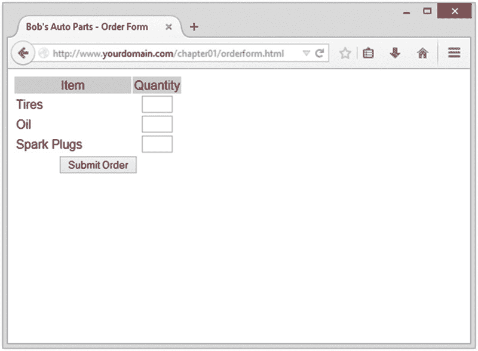

图 1.1 Bob 的初始订单表仅记录产品和数量

该表单的部分 HTML 代码如代码段 1.1 所示。

代码段 1.1 `orderform.html`**Bob 基础订单表的 HTML**

点击此处查看代码图像

```html
<form action="processorder.php" method="post">
  <table style="border: 0px;">
    <tr style="background: #cccccc;">
      <td style="width: 150px; text-align: center;">Item</td>
    </tr>
    <tr style="background: #cccccc;">
      <td style="width: 150px; text-align: center;">Quantity</td>
    </tr>
    <tr style="background: #cccccc;">
      <td style="width: 150px; text-align: center;">Tires</td>
    </tr>
    <tr style="background: #cccccc;">
      <td style="width: 150px; text-align: center;">Oil</td>
    </tr>
    <tr style="background: #cccccc;">
      <td style="width: 150px; text-align: center;">Spark Plugs</td>
    </tr>
    <tr style="background: #cccccc;">
      <td style="width: 150px; text-align: center;"><input type="submit" value="Order"></td>
    </tr>
  </table>
</form>
```

#### 处理表单

为了处理该表单，你需要创建`form`标签的`action`属性中提到的名为`processorder.php`的脚本。打开你的文本编辑器并创建此文件。然后输入以下内容：

```html
<!DOCTYPE html>
<html>
<head>
  <title>Bob's Auto Parts - Order Results</title>
</head>
<body>
  <h1>Bob's Auto Parts</h1>
  <h2>Order Results</h2>
</body>
</html>
```

注意，到目前为止你输入的所有内容都是纯 HTML。现在是时候给脚本添加一些 PHP 代码了。

### 在 HTML 中嵌入 PHP

在你的文件的`<h2>`标题下方，添加以下行：

```php
<?php
  echo '<p>Order processed.</p>';
?>
```

保存文件并在浏览器中加载它，填写 Bob 的表单并点击“提交订单”。你应该看到类似于图 1.2 所示的输出。

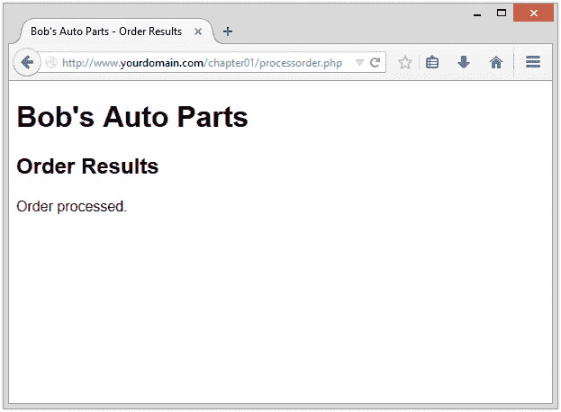

图 1.2 传递给 PHP `echo`构造的文本被输出到浏览器

注意你写的 PHP 代码嵌入在一个看起来正常的 HTML 文件中。尝试从浏览器中查看源代码。你应该看到这段代码`<!DOCTYPE html>`

## Bob 的汽车配件

### 订单结果

<p>订单已处理。</p>

原始的 PHP 代码均不可见，因为 PHP 解释器已经运行了该脚本并将其替换为脚本的输出。这意味着通过 PHP，你可以生成任何浏览器均可查看的整洁 HTML；换句话说，用户的浏览器不需要理解 PHP。

这个示例简要地说明了服务器端脚本的概念。PHP 已经在 Web 服务器上进行了解释和执行，这与在用户机器的浏览器内解释和执行的 JavaScript 以及其他客户端技术是有区别的。

你现在此文件中的代码由四类文本组成：

 HTML

 PHP 标签

 PHP 语句

 空格

你还可以添加注释。

示例中的大多数行都只是纯 HTML。

### PHP 标签

前一个示例中的 PHP 代码以`<?php`开始，以`?>`结束。这与所有的 HTML 标签相似，因为它们都以小于号（`<`）开头，并以大于号（`>`）结束。这些符号（`<?php`和`?>`）被称为`PHP 标签`。它们告诉 Web 服务器 PHP 代码从哪里开始到结束。标签之间的任何文本都被解释为 PHP。标签之外的任何文本都被视为普通的 HTML。PHP 标签允许你跳出 HTML。

实际上有两种 PHP 标签样式；以下每段代码片段都是等价的：

 XML 样式

```php
<?php echo '<p>Order processed.</p>'; ?>
```

这是我们在书中使用的标签样式；它是首选的 PHP 标签样式。服务器管理员无法关闭它，因此你可以保证它在所有服务器上都可用，如果你正在编写可能在不同安装环境中使用的应用程序，这一点尤为重要。这种标签样式可以与 XML 文档配合。通常，我们建议你使用这种标签样式。

 短样式

```php
<? echo '<p>Order processed.</p>'; ?>
```

这种标签样式最简单，并遵循标准通用标记语言 (SGML) 处理指令的样式。要使用这种类型的标签（输入最短的标签），你需要在配置文件中启用`short_open_tag`设置，或者在编译 PHP 时启用短标签。你可以在附录 A 中找到更多关于如何使用这种标签样式的信息。不建议在你计划分发的代码中使用这种样式。它在许多环境中将无法工作，因为不再是默认启用的。

### PHP 语句

你通过在起始标签和结束标签之间包含 PHP 语句来告诉 PHP 解释器执行什么。前一个示例只使用了一种类型的语句：


```php
echo '<p>Order processed.</p>';
```

正如你可能猜到的那样，使用`echo`结构有一个非常简单的结果：它将打印（或回显）传递给它的字符串到浏览器。在图 1.2 中，你可以看到结果是浏览器窗口中出现了`Order processed.`文本。

注意`echo`语句的末尾有一个分号。在 PHP 中，分号用于分隔语句，就像英语中的句号分隔句子一样。如果你以前编写过 C 或 Java 程序，你将熟悉以这种方式使用分号。

漏掉分号是一个容易犯的常见语法错误。然而，它同样容易发现和纠正。

### 空格

换行符（回车）、空格和制表符等间隔字符被称为`whitespace`（空白）。正如你可能已经知道的，浏览器会忽略 HTML 中的空白，PHP 引擎也是如此。考虑这两个 HTML 片段：

点击此处查看代码图像

```html
<<h1>Welcome to Bob's Auto Parts!</h1><p>What would you like to order today?</p>
```

以及

点击此处查看代码图像

```html
<h1>Welcome          to Bob's

Auto Parts!</h1>
<p>What would you like

to order today?</p>
```

这两段 HTML 代码片段产生相同的输出，因为在浏览器看来它们是等同的（看起来是一样的）。但是，你可以并且被鼓励在 HTML 中明智地使用空白，作为人类的辅助——增强你的 HTML 代码的可读性。PHP 也是如此。你不需要在 PHP 语句之间有任何空白，但如果你将每个语句放在单独的一行，代码将变得更易读。例如：

```php
echo 'hello ';

echo 'world';
```

和

```php
echo 'hello ';echo 'world';
```

它们是等价的，但第一个版本更容易阅读。

### 注释

注释正如其名：代码中的注释是给阅读代码的人的笔记。注释可以用于解释脚本的作用、谁编写了它、为什么要这样写、最后一次修改的时间等。你通常在除最简单的 PHP 脚本之外的所有地方找到注释。

PHP 解释器会忽略注释中的任何文本。本质上，PHP 解析器会跳过注释，使其等同于空白。

PHP 支持 C、C++ 和 shell 风格的注释。

以下是一个 C 风格的多行注释：点击此处查看代码图像

```php
/* Author: Smith
Last modified: April 10
This script processes orders. */
```

多行注释不能嵌套。你还可以使用单行注释，采用 C++ 样式：点击此处查看代码图像

```php
echo '<p>Order processed.</p>'; // Start order
```

或者 shell 脚本样式：点击此处查看代码图像

```php
echo '<p>Order processed.</p>'; # Start order
```

在这两种样式中，注释符号（`#`或`//`）之后的所有内容都是注释，直到行尾或结束标签。在下面的代码中，标签之前的文本`here is a comment`是注释的一部分。标签之后的文本`here not`将被视为：点击此处查看代码图像

```php
// here is a comment ?> not
```

### 添加动态内容

到目前为止，你还没有使用 PHP 执行任何纯 HTML 无法完成的事情。

使用服务器端脚本语言的主要原因是为网站用户提供动态内容。根据用户需求或随时间变化的内容将留住访问者。PHP 允许你轻松实现这一点。

让我们从一个简单的示例开始。将`processorder.php`中的 PHP 替换为以下代码：

```php
<?php
  echo "<p>Order processed at ";
  echo date('H:i, jS F');
  echo "</p>";
?>
```

你也可以使用连接运算符（`.`）将其写在一行，如点击此处查看代码图像：

```php
<?php echo "<p>Order processed at ".date('H:i, jS F')."</p>";
?>
```

在这段代码中，PHP 内置的`date()`函数告诉客户处理订单的日期和时间。每次运行脚本时这些信息都会不同。运行脚本的输出所示图 1.3。

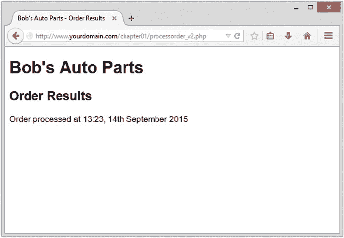

图 1.3 PHP`date()`函数返回格式化的日期字符串

#### 调用函数

查看对`date()`的调用。这是函数调用的通用形式。PHP 拥有开发 Web 时可以使用的大量函数库。大多数这些函数都需要传递一些数据并返回一些数据。

现在再次查看函数调用：

```php
date('H:i, jS F')
```

注意，它向一对括号内的函数传递了一个字符串（文本数据）。括号内的元素被称为函数的`argument`（参数）或`parameter`（参数）。这些参数是函数用于输出某些特定结果时所使用的输入数据。

### 使用`date()`函数

`date()`函数期望你传递的参数是一个格式字符串，代表你希望输出的样式。字符串中的每个字母都代表日期和时间的一个部分。`H`是 24 小时制的小时，需要时有导零；`i`是分钟，需要时有导零；`j`是不带导零的月份几；`S`代表序数后缀（在此例中为 th），而`F`是月份的全称。

> 注意
>
> 如果`date()`向你发出了关于未设置时区的警告，你应该在你的`php.ini`文件中添加`date.timezone`设置。关于此点的更多信息，可以在附录 A 中的示例`php.ini`文件中找到。

有关`date()`支持的格式完整列表，请参阅第 19 章“管理日期和时间”。

#### 表单变量

使用订单单的主要目的是收集客户订单。在 PHP 中获取客户输入内容的详情很容易的，但具体方法取决于你使用的 PHP 版本以及`php.ini`文件中的一个设置。

#### 表单变量

在你的 PHP 脚本中，你可以将每个表单字段作为一个 PHP 变量访问，其名称与表单字段名称相关。你可以识别 PHP 中的变量名，因为它们都以美元符号（`$`）开头。（忘记美元符号是一个常见的编程错误。）

根据你的 PHP 版本和设置，你可以通过不同的方式通过变量访问表单数据。在较新版本的 PHP 中，这些方法中除一种外，其余都已弃用，因此如果你过去使用过 PHP，请务必注意这一点发生了变化。

你可以通过以下方式访问字段`tireqty`的内容：

```php
$_POST['tireqty']
```

`$_POST`是一个包含通过 HTTP POST 请求提交的数据数组——也就是说，表单方法被设置为 POST。有三个数组可能包含表单数据：`$_POST`、`$_GET`和`$_REQUEST`。其中一个`$_GET`或`$_POST`数组持有所有表单变量的详情。使用哪个数组取决于提交表单的方法是`GET`还是`POST`。此外，通过`GET`或`POST`提交的所有数据的组合也可以`$_REQUEST`获取。

如果表单是通过`POST`方法提交的，在`tireqty`框中输入的数据将存储在`$_POST['tireqty']`中。如果通过`GET`提交，数据将在`$_GET['tireqty']`中。无论哪种情况，数据出现在`$_REQUEST['tireqty']`中。

这些数组是一些`superglobal`（超全局）数组。我们将在本章后面讨论变量作用域时再次回顾超全局变量。

让我们来看一个创建易用变量副本的示例。

要将一个变量的值复制到另一个变量，你需要使用赋值运算符，在 PHP 中是等号（`=`）。以下语句创建了一个名为`$tireqty`的新变量，并将`$_POST['tireqty']`的内容复制到新变量中：

```php
$tireqty = $_POST['tireqty'];
```

将以下代码块放在处理脚本的开头。本书中其他处理表单数据的脚本在开头都包含一个类似的代码块。因为这段代码不会产生任何输出，将其放置在`<html>`以及其他起始页面的 HTML 标签上方或下方没有区别。我们通常将此类代码块放在脚本开头，以便于查找。

点击此处查看代码图像

```php
<?php

  // 创建短变量名

  $tireqty = $_POST['tireqty'];

  $oilqty = $_POST['oilqty'];

  $sparkqty = $_POST['sparkqty'];
?>
```

这段代码创建了三个新变量——`$tireqty`、`$oilqty`和`$sparkqty`，并设置它们包含从表单通过`POST`方法发送的数据。

你可以通过以下操作将这些变量的值输出到浏览器：

```php
echo $tireqty.' tires<br />';
```

然而，这种方法并不被推荐。

在现阶段，你还没有检查变量内容以确保每个表单字段中都输入了合理的数据。尝试故意输入错误的数据并观察会发生什么。在你完成本章的剩余内容后，你可能想尝试为此脚本添加一些数据验证。

像这样直接从用户获取数据并输出到浏览器，从安全角度来看是非常极具风险的做法。我们不推荐这种方法。你应该过滤输入数据。我们将在第 4 章“字符串处理与正则表达式”中开始介绍输入过滤，并在第 14 章“Web 应用安全风险”中深入讨论安全性。

目前，只需要知道在通过`htmlspecialchars()`处理后，将用户数据 echo 输出到浏览器即可。例如，在这种情况下，我们会这样做：

点击此处查看代码图像

```php
echo htmlspecialchars($tireqty).' tires
```

为了让脚本开始工作，将以下行添加到你的脚本底部：

点击此处查看代码图像

```php
echo '<p>Your order is as follows: </p>';
echo htmlspecialchars($tireqty).' tires<br />';
echo htmlspecialchars($oilqty).' bottles of oil<br />';
echo htmlspecialchars($sparkqty).' spark plugs<br />';
```

如果你现在在浏览器中加载此文件，输出应该类似于图 1.4 所示。当然，实际值取决于你在表单中输入的内容。

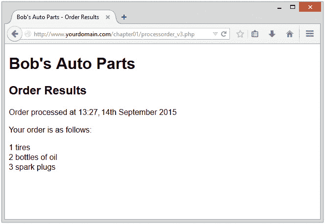

图 1.4`processorder.php`用户输入的表单变量

#### 字符串拼接

在示例脚本中，`echo`打印用户在每个字段输入的内容，随后是说明文本。如果你仔细观察`echo`语句，你会发现变量名和后续文本之间有一个点（`.`），如下：

点击此处查看代码图像

```php
echo htmlspecialchars($tireqty).' tires<br />';
```

这个点是字符串拼接运算符，它将字符串（文本段）相加。在使用`echo`输出到浏览器时经常可以使用它。通过这种方式，你可以避免编写多个`echo`命令。

你也可以将简单的变量放在双引号字符串内部进行输出。（数组稍微复杂一些，所以我们在第 4 章中讨论数组与字符串的结合。）考虑这个示例：

点击此处查看代码图像

```php
$tireqty = htmlspecialchars($tireqty);
echo "$tireqty tires<br />";
```

这与本节所示第一个语句等效。两种格式都是有效的，使用哪种取决于个人喜好。这种在字符串内替换变量为其内容的过程被称为`interpolation`（插值）。

注意，插值是双引号字符串的特性。你不能以这种方式将变量名放在单引号字符串中。运行以下行代码：

```php
echo '$tireqty tires<br />';
```

仅仅向浏览器发送`$tireqty tires<br />`。在双引号内，变量名会被替换为它的值。在单引号内，变量名或任何其他文本都将原样发送。

示例脚本中每个`echo`语句中连接在一起的变量和字符串是不同类型的内容。变量是数据的符号，而字符串是数据本身。当我们在程序中使用一段原始数据时，我们称之为*字面量*（literal），以将其与*变量*（variable）区分开来。`$tireqty`是一个变量，是一个代表客户输入的数据的符号。另一方面，`' tires<br />'`是一个字面量。你可以直接按照字面意思理解它。嗯，几乎是如此。记得前一节中的第二个示例吗？PHP 将字符串中的变量名`$tireqty`替换为变量中存储的值。

记住已经提到的两种字符串：使用双引号的字符串和使用单引号的字符串。PHP 会尝试对双引号括起来的字符串进行求值，从而导致前文所示的行为。单引号字符串被视为真正的字面量。

还有第三种指定字符串的方法，即使用 heredoc 语法（`<<<`），这对于 Perl 用户来说会很熟悉。Heredoc 语法允许你通过指定一个用于结束字符串的结束标记（end marker），来整洁地指定长字符串。下面的示例创建了一个三行的字符串并将其打印出来：

```php
echo <<<theEnd

  line 1

  line 2

  line 3

theEnd
```

标记`theEnd`是完全任意的。它只需要保证不会出现在文本中即可。要关闭 heredoc 字符串，请在行开头放置结束标记。

Heredoc 字符串会像双引号字符串一样进行变量值替换。

### 理解标识符

标识符（Identifiers）是变量名。（函数和类的名称也是标识符；我们将在第 5 章“重用代码和编写函数”以及第 6 章“面向对象的 PHP”中讨论函数和类）。你需要了解定义有效标识符的简单规则：

- 标识符可以是任意长度，并由字母、数字和下划线组成。
- 标识符不能以数字开头。
- 在 PHP 中，标识符是区分大小写的。`$tireqty`与`$TireQty`不同。尝试交替使用它们是一种常见的编程错误。函数名是这一规则的例外：它们的名称可以使用任何大小写形式。
- 变量可以与函数具有相同的名称。然而，这种用法令人困惑，应该避免。此外，你不能创建一个与另一个函数同名的函数。

除了从 HTML 表单传递的变量外，你还可以声明并使用自己的变量。

PHP 的特性之一是它不需要在你使用变量之前声明它。当你第一次给变量赋值时，该变量就被创建了。详情请参阅下一节。

你使用赋值运算符（`=`）给变量赋值，就像你将一个变量的值复制给另一个变量时所做的那样。在 Bob 的网站上，你想计算订单的项目总数和应付总金额。你可以分两个变量来存储这些数字。首先，你需要通过在 PHP 脚本的底部添加这些行，将每个变量初始化为零。

```php
$totalqty = 0;
$totalamount = 0.00;
```

这两行代码中的每一行都创建了一个变量并为其分配了一个字面量值。你也可以像示例所示，将变量的值赋值给变量：

```php
$totalqty = 0;
$totalamount = $totalqty;
```

### 检查变量类型

变量的类型指的是存储在其中的数据种类。PHP 提供了一组数据类型。不同的数据可以存储在数据类型中。

#### PHP 数据类型

PHP 支持以下基本数据类型：

- **整数（Integer）**——用于整数
- **浮点数（Float）**（也称为 **double**）——用于实数
- **字符串（String）**——用于字符串
- **布尔值（Boolean）**——用于`true`或`false`值
- **数组（Array）**——用于存储多个数据项（参见第 3 章“使用数组”）
- **对象（Object）**——用于存储类的实例（参见第 6 章）

还有三种特殊类型：NULL、resource（资源）和 callable（可调用）。

未赋值、已取消（unset）或被赋予特定值`NULL`的变量类型为 NULL。

某些内置函数（如数据库函数）返回类型为`resource`的变量。它们代表外部资源（例如数据库连接）。你几乎不会直接操作资源变量，但它们经常由函数返回，并且必须作为参数传递给其他函数。

Callable（可调用）本质上是传递给其他函数的。

#### 类型强度

PHP 被称为弱类型语言或动态类型语言。在大多数编程语言中，变量只能持有一种类型的数据，并且在使用之前必须声明该类型，如 C 语言。在 PHP 中，变量的类型由赋值给它的值决定。

例如，当你创建`$totalqty`和`$totalamount`时，它们的初始类型由以下内容决定：

```php
$totalqty = 0;
$totalamount = 0.00;
```

因为你分配了`0`（整数）给`$totalqty`，它现在是整数。同样地，`$totalamount`现在是浮点数。

神奇的是，你现在可以在脚本中添加这一行：

```php
$totalamount = 'Hello';
```

变量`$totalamount`现在将是字符串类型。

#### 类型转换

你可以通过类型转换来假装一个变量或值是不同的类型。这种功能的工作原理与 C 语言完全相同。你只需要在你想要转换的变量前面加上临时类型。

例如，你可以对前一节中的两个变量进行转换：点击此处查看代码图像

```php
$totalqty = 0;
$totalamount = (float)$totalqty;
```


第二行的意思是“将存储在 `$totalqty` 中的值解释为浮点数，并将其存储在 `$totalamount` 中。”`totalamount` 变量将是浮点类型。转换不会改变类型，所以 `$totalqty` 保持为整数。

你还可以使用内置函数来测试类型，你将在本章后面的部分学习。

#### 变量变量

PHP 还提供了另一种变量类型：变量变量。变量变量允许你动态地更改变量名。

正如你所见，PHP 在这领域提供了很大的自由。所有语言都允许更改变量的值，但很少有语言允许更改变量的类型，更少有语言允许更改变量的名字。

变量变量的工作原理是将一个变量的值作为另一个的名称。例如，你可以设置：

```php
$varname = 'tireqty';
```

然后你就可以使用 `$$varname` 代替 `$tireqty`。例如，你可以这样设置 `$tireqty` 的值：

```php
$$varname = 5;
```

这等同于 `$tireqty = 5`。这种方法可能看起来有些晦涩，但我们稍后会回到它的用法。

# 常量

正如你之前看到的，你可以轻松地更改变量中存储的值。你也可以声明常量。常量像变量一样存储一个值，但它的值只被设置一次，之后不能在脚本的其他地方被更改。

在示例应用程序中，你可能将每种销售商品的价格存储为常量。你可以使用 `define` 函数来定义这些常量：

```php
define('TIREPRICE', 100);
define('OILPRICE', 10);
define('SPARKPRICE', 4);
```

现在将这些行代码添加到你的脚本中。你现在有了三个常量，可以用于计算客户订单的总额。

注意常量的名称是大全大写的。这种借自 C 语言的习惯让你一眼就能区分变量和常量。虽然不是强制遵循这种习惯，但它会让你的代码更易读、更易于维护。

常量和变量之间一个重要的区别是，当你引用常量时，它的前面没有美元符号 `$`。如果你想使用常量的值，只需使用它的名称。例如，要使用刚刚创建的常量之一，你可以输入：

```php
echo TIREPRICE;
```

除了你定义的常量外，PHP 还设置了大量的内置常量。获取它们概述的简单方法是运行 `phpinfo()` 函数：

```php
phpinfo();
```

此函数提供了 PHP 预定义变量和常量的列表，以及其他有用信息。我们将在学习过程中讨论其中的一些。

变量和常量的另一个区别是，常量只能存储布尔、整数、浮点数或字符串数据。这些类型统称为标量值（scalar values）。

## 理解变量作用域

`scope` 一词是指脚本中特定变量可见的地方。PHP 中的六个基本作用域规则如下：

-  内置超全局在脚本的任何地方都是可见的。
-  常量一旦声明，始终是全局可见；也就是说，它们可以在函数内部和外部使用。
-  在脚本中定义的全局变量在整个脚本中可见，但*在函数内部无效*。
-  函数内部声明为 `global` 的变量引用同名的全局变量。
-  在函数内部创建并声明为 `static` 的变量从函数外部不可见，但在函数连续执行之间会保留其值。（我们将在第 5 章中详细解释这一概念。）
-  函数内部创建的变量是局部的，并在函数终止时消失。

数组 `$_GET` 和 `$_POST` 以及其他特殊变量有它们的作用域规则。它们被称为*超全局变量*（superglobals），可以在函数内外任何地方可见。

超全局变量的完整列表如下：

-  `$GLOBALS`——所有全局变量的数组（类似于 `global` 关键字，允许你在函数内部访问全局变量——例如通过 `$GLOBALS['myvariable']`。）
-  `$_SERVER`——服务器环境变量数组
-  `$_GET`——通过 `GET` 方法传递给脚本的变量数组
-  `$_POST`——通过 `POST` 方法传递给脚本的变量数组
-  `$_COOKIE`——cookie 变量数组
-  `$_FILES`——与文件相关的变量数组
-  `$_ENV`——环境变量数组
-  `$_REQUEST`——所有用户输入的数组，包括 `$_GET`、`$_POST` 和 `$_COOKIE` 的内容（但不包括 `$_FILES`）
-  `$_SESSION`——会话变量数组

在书中，当这些超全局变量变得相关时，我们会再次讨论它们。

在本章稍后讨论函数和类时，我们会详细介绍作用域。目前，我们使用的所有变量默认都是全局的。

## 使用运算符

运算符是你用于通过对值和变量进行操作来处理它们的符号。你需要使用其中一些运算符来计算客户订单的总额和税费。

我们已经提到的两个运算符：赋值运算符（`=`）和字符串连接运算符（`.`）。在接下来的章节中，我们将描述完整的列表。

通常，运算符可以接受一个、两个或三个参数，大多数接收两个。例如，赋值运算符接收两个：`=` 符号左侧的存储位置和右侧的表达式。这些参数被称为*操作数*（operands）——即正在被操作的对象。

### 算术运算符

算术运算符非常直观；它们只是普通的数学运算符。PHP 的算术运算符见表 1.1。

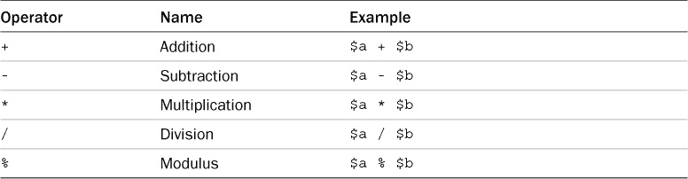

表 1.1 **PHP 算术运算符**

通过这些运算符，你可以存储操作的结果，如下例所示：

```php
$result = $a + $b;
```

加法和减法的工作方式正如你预期的一样。这些运算符分别相加或相减 `$a` 和 `$b` 的值。

你还可以使用减法符号（`-`）作为一元运算符——即接受一个参数的运算符——表示负数，如下例：

```php
$a = -1;
```

乘法和除法也符合预期。注意使用星号 `*` 作为乘法运算符而不是乘号，使用斜杠 `/` 作为除法运算符而不是除号。

模运算符返回 `$a` 变量除以 `$b` 变量的余数。考虑这段代码段：

```php
$a = 27;
$b = 10;
$result = $a % $b;
```

存储在 `$result` 变量中的值是 27 除以 10 的余数。

你应该注意算术运算符通常应用于整数或双精度浮。如果你将它们应用于字符串，PHP 会尝试将字符串转换为数字。如果它包含 `e` 或 `E`，将被读取为科学计数法并转换为浮点数；否则将转换为整数。PHP 会查找字符串开头的数字并将其作为值；如果没有，字符串值为 0。

### 字符串运算符

你已经看到并使用了唯一的字符串运算符。你可以使用字符串连接运算符连接两个字符串，就像使用加法运算符相两个数字一样：

```php
$a = "Bob's ";
$b = "Auto Parts";
$result = $a . $b;
```

变量 `$result` 现在包含了字符串 `"Bob's Auto Parts"`。

### 赋值运算符

你已经见过赋值运算符（`=`）。始终将其称为赋值运算符，并将其读作“设置为”。例如，

```php
$totalqty = 0;
```

此行应该读作“`$totalqty` 设置为 0”。我们在本章稍后讨论比较运算符时会解释原因，但如果你把它称为相等，你会感到困惑。

#### 赋值返回值

赋值运算符返回一个与其他运算符类似的值。如果你写

```php
$a + $b
```

该表达式的值是 `$a` 和 `$b` 变量相加的结果。同样，你可以写

```php
$a = 0;
```

这个整个表达式的值为 0。

这种技术允许你形成如下表达式：

```php
$b = 6 + ($a = 5);
```

此行将 `$b` 变量的值设置为 11。这种行为通常适用于赋值：整个赋值语句的值是赋值给左操作数的值。

在计算表达式的值时，你可以使用括号来增加子表达式的优先级，如下所示。这种技术的工作原理与数学中完全相同。

### 复合赋值运算符

除了简单的赋值外，还有一组复合赋值运算符。其中每一个都是对变量执行另一种操作，并将结果重新赋值给该变量的简写形式。例如，

```php
$a += 5;
```

这等同于编写：

```php
$a = $a + 5;
```

每个算术运算符和字符串拼接运算符都存在复合赋值运算符。所有复合赋值运算符及其影响的摘要如表 1.2 所示。

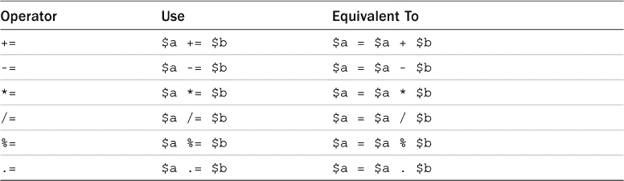

表 1.2 **PHP 复合赋值运算符**

### 前置与后置递增及递减

前置和后置递增（`++`）以及递减（`--`）运算符与 `+=` 和 `-=` 运算符类似，但有几处不同。

所有的递增运算符都有两个效果：增加值并赋值。考虑以下内容：

```php
$a=4;
echo ++$a;
```

第二行使用了前置递增运算符，之所以这样做是因为 `++` 出 `$a` 之前。它的效果是先将 `$a` 增加 1，然后返回增加后的值。在这种情况下，`$a` 增加到 5，然后返回并打印值 5。整个表达式的值为 5。（注意存储在 `$a` 中的实际值被改变了：它不仅仅是返回了 `$a + 1`。）

但是，如果 `++` 在 `$a` 之后，那么你使用的就是后置递增运算符。它的效果不同。考虑以下内容：

```php
$a=4;
echo $a++;
```

在这种情况下，效果是反反的。也就是说，首先返回并打印 `$a` 的值，然后对其进行增加。整个表达式的值为 4。这是将要打印的值。然而，在这一语句执行后，`$a` 的值是 5。

正如你可能猜到的，`--`（递减）运算符的行为也类似。不过，`$a` 的值是减少的而不是增加。

### 引用运算符

引用运算符（`&`，和符号）可以与赋值结合使用。通常，当一个变量赋值给另一个变量时，会创建第一个变量的副本并存储在内存的另一个地方。例如，

```php
$a = 5;
$b = $a;
```

这些代码行创建了 `$a` 中值的第二个副本并将其存储在 `$b` 中。如果你随后更改了 `$a` 的值，`$b` 将不会改变：

```php
$a = 7; // $b 仍为 5
```

你可以通过使用引用运算符避免创建副本。例如，

点击此处查看代码

```php
$a = 5;
$b = &$a;
$a = 7; // 现在 $a 和 $b 都是 7
```

引用可能有点复杂。记住，引用类似于别名，而不是指针。`$a` 和 `$b` 都指向同一块内存。你可以通过如下方式取消其中一个来改变这种状态：

```php
unset($a);
```

取消不会改变 `$b` 的值（7），但会破坏 `$a` 与存储在内存中的值 7 之间的链接。

### 比较运算符

比较运算符比较两个值。使用这些运算符的表达式根据比较结果返回逻辑值 `true` 或 `false`。

#### 等于运算符

等值比较运算符（`==`，两个等号）允许你测试两个值是否相等。例如，你可能会使用表达式

```php
$a == $b
```

用来测试存储在 `$a` 和 `$b` 中的值是否相同。如果它们相等，该表达式返回的结果为 `true`；如果不相等，则为 `false`。

你很容易将 `==` 与赋值运算符 `=` 混淆。使用错误的运算符将可以正常运行而不会报错，但通常不会给你想要想要的结果。通常情况下，非零值求值为 `true`，零值求值为 `false`。假设你如下所示初始化了两个变量：

```php
$a = 5;
$b = 7;
```

如果你然后测试 `$a` = `$b`，结果将是 `true`。为什么？`$a = $b` 的值是赋值给左侧的值，在这个例中是 7。因为 7 是非零值，该表达式求值为 `true`。如果你本打算测试 `$a == $b`（其求值为 `false`），那么你就在代码中引入了一个逻辑错误，这个错误极难发现。始终检查你对这两个运算符的使用，并确保你使用的是你想要使用的那一个。

使用赋值运算符而不是等值比较运算符是一个很容易犯的错误，你可能会在编程生涯中犯很多次。

#### 其他比较运算符

PHP 还支持许多其他比较运算符。所有比较运算符的摘要如表 1.3 所示。需要注意的是全等运算符（`===`），它只有在两个操作数相等且类型相同时才返回 `true`。例如，`0==''` 是，但 `0=='` 不是，因为一个是整数另一个是字符串。

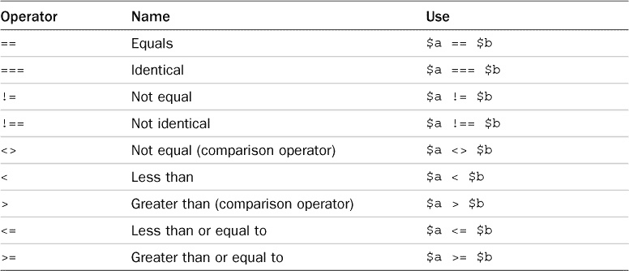

表 1.3 **PHP 比较运算符**

### 逻辑运算符

逻辑运算符组合条件的结果。例如，你可能会对一个 0 到 100 之间的值使用 AND 运算符，如下：

```php
$a >= 0 && $a <= 100
```

PHP 支持逻辑 AND、OR、XOR（异或）和 NOT。逻辑运算符的摘要如表 1.4 所示。

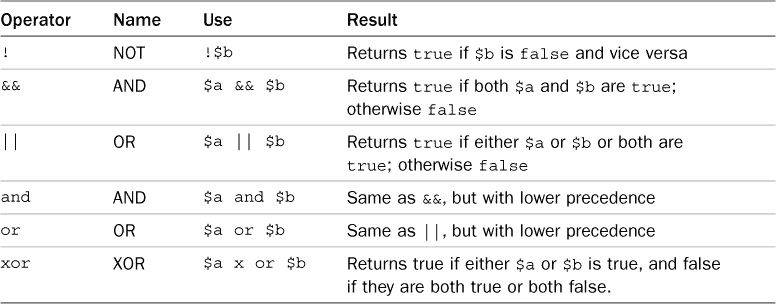

表 1.4 **逻辑运算符**

`and` 和 `or` 运算符的优先级低于 `&&` 和 `||` 运算符。我们将在后文中详细介绍优先级。

### 位运算符

位运算符允许你将整数视为表示它的位序列。你可能不会在 PHP 中发现很多位运算符的使用，但摘要如表 1.5 所示。

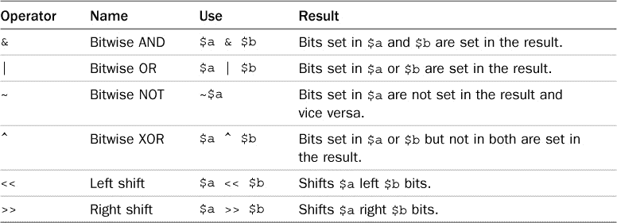

表 1.5 **位运算符**

### 其他运算符

除了我们过的运算符外，你还可以使用几种其他的。逗号运算符（`,`）分隔函数参数或其他列表。它通常用于。

两个特殊运算符 `new` 和 `->` 分别用于实例化类和访问类成员。它们将在第 6 章中详细介绍。

这里我们简要讨论其他几个。

#### 三元运算符

三元运算符（`?:`）采用以下形式：

点击此处查看代码

```php
条件 ? 为真的值 : 为假的值
```

该运算符类似于 `if-else` 语句的表达式版本，我们在本章稍后介绍。

一个简单的例子是：

点击此处查看代码

```php
($grade >= 50 ? 'Passed' : 'Failed')
```

这个表达式将成绩评估为 'Passed' 或 'Failed'。

#### 错误抑制运算符

错误抑制运算符（`@`）可以放在任何表达式前面——即任何产生或具有值的内容。例如，

```php
$a = @(57/0);
```

如果没有 `@` 运算符，这一行会产生除以零警告。如果包含了该运算符。如果你以此方式抑制警告，你需要编写一些错误处理代码来检查何时发生了警告。如果你在 `php.ini` 中配置了启用的 `track_errors` 功能，错误信息将存储在全局变量 `$php_errormsg` 中。

执行运算符实际上是一对运算符——确切地说，是一对反引号（`` `` ``）。反引号不是单引号；它通常位于键盘上与 `~`（波浪号）符号相同的键上。

PHP 会尝试将反引号之间的内容作为服务器命令行中的命令来执行。该表达式的值就是命令的输出结果。

例如，在类 Unix 操作系统下，你可以这样使用：

```php
$out = `ls -la`;
echo '<pre>'.$out.'</pre>';
```

或者，在 Windows 服务器上，可以等价地这样使用：

```php
$out = `dir c:`;
echo '<pre>'.$out.'</pre>';
```

两种方式都能获取目录列表并将其存储在 `$out` 中。然后可以将其输出到浏览器或以其他方式处理。

还有其他在服务器上执行命令的方法。我们将在第 17 章“与文件系统和服务器交互”中介绍它们。

#### 数组运算符

PHP 中有许多数组运算符。数组元素运算符（`[]`）允许你访问数组元素。你还可以在某些数组上下文中使用 `=>` 运算符。这些运算符将在第 3 章中介绍。

此外，你还可以使用许多其他数组运算符。我们也会在第 3 章中详细介绍，但为了完整性，这里将它们列在表 1.6 中。

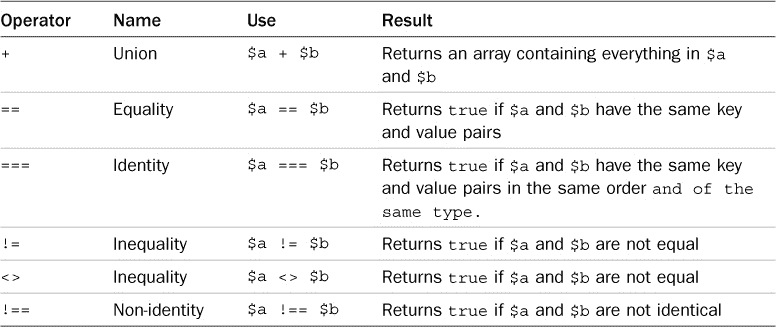

表 1.6 **PHP 的数组运算符**

你会发现表 1.6 中的数组运算符都有对应的对标量变量起作用的运算符。只要记住 `+` 对标量类型执行加法，对数组执行联合操作——即使你对背后的集合运算不感兴趣——这些行为就应该可以理解。你不能有意义地将数组与标量类型进行比较。

#### 类型运算符

有一个类型运算符：`instanceof`。该运算符用于面向对象编程，但为了完整起见，我们在这里提一下。（面向对象编程将在第 6 章中介绍。）

`instanceof` 运算符允许你检查一个对象是否是特定类的实例，如下例所示：

点击此处查看代码图片

```php
class sampleClass{};
$myObject = new sampleClass();
if ($myObject instanceof sampleClass)
  echo  "myObject is an instance of sampleClass";
```

### 计算表单总计

现在你知道了如何使用 PHP 的运算符，可以着手计算 Bob 订单表单的总计和税款了。为此，请将以下代码添加到 PHP 脚本的底部：

点击此处查看代码图片


```
$totalqty = 0;
$totalqty = $tireqty + $oilqty + $sparkqty;
echo "<p>Items ordered: ".$totalqty."<br />";
$totalamount = 0.00;

define('TIREPRICE', 100);
define('OILPRICE', 10);
define('SPARKPRICE', 4);

$totalamount = $tireqty * TIREPRICE
             + $oilqty * OILPRICE
             + $sparkqty * SPARKPRICE;

echo "Subtotal: $".number_format($totalamount,2)."<br />";

$taxrate = 0.10;  // local sales tax is 10%
$totalamount = $totalamount * (1 + $taxrate);
echo "Total including tax: $".number_format($totalamount,2)."</p>";
```

如果在浏览器窗口中刷新页面，你应该会看到类似图 1.5 的输出。

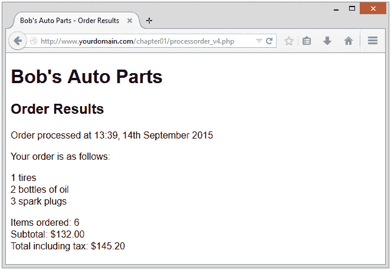

图 1.5 已计算、格式化并显示客户的订单总计

如你所见，这段代码使用了几个运算符。它使用加法（`+`）和乘法（`*`）运算符来计算金额，并使用字符串连接运算符（`.`）来设置输出到浏览器的内容。

它还使用了 `number_format()` 函数将总计格式化为带有两位小数的字符串。这是 PHP 数学库中的一个函数。

如果你仔细查看计算过程，可能会问为什么按这样的顺序进行计算。例如，考虑以下语句：

```
$totalamount = $tireqty * TIREPRICE
             + $oilqty * OILPRICE
             + $sparkqty * SPARKPRICE;
```

总数似乎是正确的，但为什么乘法在加法之前执行？答案在于运算符的优先级——即它们被求值的顺序。

### 理解优先级和结合性

通常，运算符具有一组优先级，即它们被求值的顺序。运算符还具有结合性，即优先级相同的运算符的求值顺序。这个顺序通常是从左到右（简称为*左*）、从右到左（简称为*右*），或者*不相关*。

表 1.7 显示了 PHP 中运算符的优先级和结合性。在这个表中，优先级最低的运算符位于顶部，越往下优先级越高。

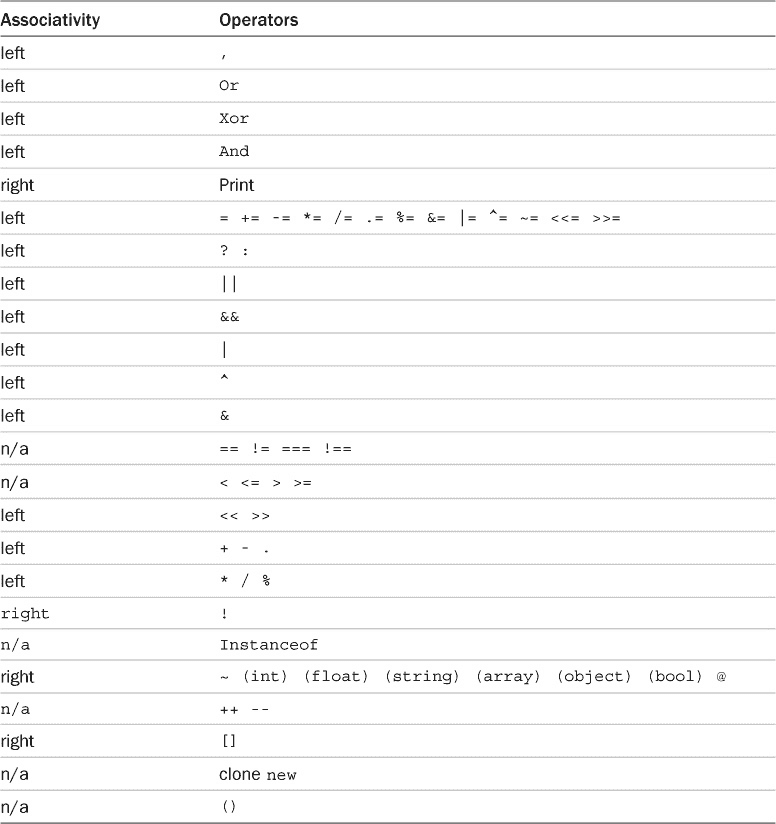

表 1.7 **PHP 中的运算符优先级**

注意，我们还没有介绍优先级最高的运算符：普通的圆括号。使用圆括号的效果是提高其中内容的优先级。当你需要时，可以通过这种方式有意地操纵或绕过优先级规则。

记住前面例子中的这一部分：

```
$totalamount = $totalamount * (1 + $taxrate);
```

如果你写成：

```
$totalamount = $totalamount * 1 + $taxrate;
```

乘法运算的优先级高于加法，因此会先执行乘法，导致错误结果。通过使用圆括号，你可以强制先求值子表达式 `1 + $taxrate`。

你可以在一个表达式中使用任意多组圆括号。最内层的圆括号最先求值。

另外，注意表中还有一个我们尚未介绍的运算符：`print` 语言结构，它等同于 `echo`。这两个结构都用于生成输出。

在本书中，我们通常使用 `echo`，但如果你觉得 `print` 更易读，也可以使用。`print` 和 `echo` 都不是真正的函数，但都可以作为带参数括号的函数调用。两者也可以被视为运算符：只需将要输出的字符串放在关键字 `echo` 或 `print` 之后即可。

将 `print` 作为函数调用时，它会返回一个值（`1`）。如果你希望在更复杂的表达式内部生成输出，这个特性可能会很有用，但这确实意味着 `print` 比 `echo` 稍微慢一些。

### 使用变量处理函数

在离开变量和运算符的世界之前，让我们看看 PHP 的变量处理函数。PHP 提供了一个函数库，使你能够以不同方式操作和测试变量。

#### 测试和设置变量类型

大多数变量函数都与测试变量类型有关。最通用的两个是 `gettype()` 和 `settype()`。它们的函数原型如下；也就是说，这是它们期望的参数以及返回的内容：

```
string gettype(mixed var);
bool settype(mixed var, string type);
```

使用 `gettype()` 时，传入一个变量。它会确定该变量的类型并返回一个包含类型名称的字符串：`bool`、`int`、`double`（用于浮点数，出于历史原因有些令人困惑）、`string`、`array`、`object`、`resource` 或 `NULL`。如果不是标准类型之一，则返回 `unknown type`。

使用 `settype()` 时，传入一个你想要更改类型的变量，以及一个包含该变量新类型的字符串（来自前面的列表）。

* * *

注意

本书和 php.net 文档中提到了数据类型“mixed”。实际上并没有这样的数据类型，但由于 PHP 在类型处理方面非常灵活，许多函数可以接受多种（或任何）数据类型作为参数。允许多种类型的参数会用伪类型“mixed”来表示。

* * *

你可以如下使用这些函数：

```
$a = 56;
echo gettype($a).'<br />';
settype($a, 'float');
echo gettype($a).'<br />';
```

第一次调用 `gettype()` 时，`$a` 的类型是整数。调用 `settype()` 后，类型更改为 `float`，而 `gettype()` 报告为 `double`。（请注意这个差异。）

PHP 还提供了一些特定的类型测试函数。每个函数接受一个变量作为参数，并返回 `true` 或 `false`。这些函数包括：

 `is_array()`——检查变量是否为数组  

 `is_double()`、`is_float()`、`is_real()`（均为同一个函数）——检查变量是否为浮点数  

 `is_long()`、`is_int()`、`is_integer()`（均为同一个函数）——检查变量是否为整数  

 `is_string()`——检查变量是否为字符串  

 `is_bool()`——检查变量是否为布尔值  

 `is_object()`——检查变量是否为对象  

 `is_resource()`——检查变量是否为资源  

 `is_null()`——检查变量是否为空  

 `is_scalar()`——检查变量是否为标量（即整数、布尔值、字符串或浮点数）  

 `is_numeric()`——检查变量是否为任何类型的数字或数字字符串  

 `is_callable()`——检查变量是否为有效的函数名称  

#### 测试变量状态

PHP 有几个用于测试变量状态的函数。第一个是 `isset()`，其原型如下：

```
bool isset(mixed var[, mixed var[,...]])
```

该函数接受一个变量名作为参数，如果存在则返回 `true`，否则返回 `false`。你还可以传入一个逗号分隔的变量列表，`isset()` 会在所有变量都已设置时返回 `true`。

你可以使用它的配套函数 `unset()` 销毁一个变量，其原型如下：

```
void unset(mixed var[, mixed var[,...]])
```

该函数会销毁传入的变量。

`empty()` 函数检查变量是否存在且具有非空、非零的值；相应地返回 `true` 或 `false`。其原型如下：

```
bool empty(mixed var)
```

让我们看一个使用这三个函数的示例。

尝试将以下代码临时添加到你的脚本中：

```
echo 'isset($tireqty): '.isset($tireqty).'<br />';
echo 'isset($nothere): '.isset($nothere).'<br />';
echo 'empty($tireqty): '.empty($tireqty).'<br />';
echo 'empty($nothere): '.empty($nothere).'<br />';
```

刷新页面以查看结果。

变量 `$tireqty` 应该从 `isset()` 返回 1（`true`），无论你在表单字段中输入了什么值，甚至无论你是否输入了值。而它是否 `empty()` 则取决于你在其中输入的内容。

变量 `$nothere` 不存在，因此 `isset()` 返回空白（`false`），而 `empty()` 返回 1（`true`）。

当你需要确保用户填写了表单中的相应字段时，这些函数非常方便。

#### 重新解释变量

你可以通过调用函数来实现类似变量转换的效果。以下三个函数对于此任务很有用：

```
int intval(mixed var[, int base=10])
float floatval(mixed var)
string strval(mixed var)
```

每个函数接受一个变量作为输入，并返回转换为相应类型的变量值。`intval()` 函数还允许你在要转换的变量是字符串时指定进制基数。（这样，例如你可以将十六进制字符串转换为整数。）

### 使用条件语句做出决策

控制结构是语言中允许你控制程序或脚本执行流程的结构。你可以将它们分为条件（或分支）结构和重复结构（或循环）。

如果你想明智地响应用户的输入，你的代码需要能够做出决策。告诉程序做出决策的结构称为*条件语句*。

#### `if` 语句

你可以使用 `if` 语句来做出决策。应该为 `if` 语句提供一个条件。如果条件为 `true`，将执行后面的代码块。`if` 语句中的条件必须用圆括号 `()` 括起来。

例如，如果访问者没有从 Bob 那里订购任何轮胎、瓶装机油和火花塞，可能是因为她不小心在还未填完表单时点击了“提交订单”按钮。与其告诉访问者“订单已处理”，页面可以给她一条更有用的消息。

当访问者没有订购任何商品时，你可能想显示：“您在上一个页面没有订购任何商品！”通过使用以下 `if` 语句可以轻松实现：

```
if ($totalqty == 0)
  echo 'You did not order anything on the previous page!<br />';
```

这里使用的条件是 `$totalqty == 0`。请记住，等于运算符（`==`）的行为与赋值运算符（`=`）不同。

当 `$totalqty` 等于零时，条件 `$totalqty == 0` 为 `true`。如果 `$totalqty` 不等于零，则条件为 `false`。当条件为 `true` 时，`echo` 语句将被执行。

#### 代码块

通常你可能希望根据条件语句（如 `if`）的动作执行多条语句。你可以将多条语句组合成一个*块*。要声明一个块，可以将其括在花括号中：

```
if ($totalqty == 0) {
  echo '<p style="color:red">';
  echo 'You did not order anything on the previous page!';
  echo '</p>';
}
```

花括号中的三行现在构成了一个代码块。当条件为 `true` 时，所有三行都会被执行。当条件为 `false` 时，所有三行都会被忽略。

* * *

注意

如前所述，PHP 不关心你的代码布局。但是，为了可读性，你应该缩进代码。缩进用于让你一眼就能看出哪些行仅在满足条件时执行，哪些语句被分组到块中，以及哪些语句是循环或函数的一部分。在前面的示例中，你可以看到依赖于 `if` 语句的语句以及组成块的语句都进行了缩进。

* * *

#### `else` 语句

你经常需要决定的不仅仅是是否执行某个操作，还包括一组可能的操作中要执行哪一个。

`else` 语句允许你在 `if` 语句中的条件为 `false` 时定义要执行的替代操作。假设你想在客户没有订购任何商品时警告 Bob 的客户。另一方面，如果他们确实下了订单，你希望显示他们订购了什么，而不是警告。

如果重新排列代码并添加 `else` 语句，你可以显示警告或摘要：

```
if ($totalqty == 0) {
    echo "You did not order anything on the previous page!<br />";
} else {
    echo htmlspecialchars($tireqty).' tires<br />';
    echo htmlspecialchars($oilqty).' bottles of oil<br />';
    echo htmlspecialchars($sparkqty).' spark plugs<br />';
  }
```

你可以通过嵌套 `if` 语句来构建更复杂的逻辑过程。在以下代码中，只有在条件 `$totalqty == 0` 为 `true` 时才会显示摘要，并且摘要中的每一行只在其自身条件满足时才会显示：

```
if ($totalqty == 0) {
    echo "You did not order anything on the previous page!<br />";
} else {
    if ($tireqty > 0)
      echo htmlspecialchars($tireqty).' tires<br />';
    if ($oilqty > 0)
      echo htmlspecialchars($oilqty).' bottles of oil<br />';
    if ($sparkqty > 0)
      echo htmlspecialchars($sparkqty).' spark plugs<br />';
}
```

#### `elseif` 语句

在你做出的许多决策中，可能有两个以上的选项。你可以使用 `elseif` 语句创建一系列选项，它是 `else` 和 `if` 语句的组合。当提供一系列条件时，程序可以逐个检查，直到找到一个为 `true` 的条件。

Bob 为大量轮胎订单提供折扣。折扣方案如下：

 购买少于 10 个轮胎——无折扣  

 购买 10-49 个轮胎——5% 折扣  

 购买 50-99 个轮胎——10% 折扣  

 购买 100 个或更多轮胎——15% 折扣  

你可以使用条件和 `if`、`elseif` 语句创建计算折扣的代码。在这种情况下，你需要使用 AND 运算符（`&&`）将两个条件合并为一个：

```
if ($tireqty < 10) {
  $discount = 0;
} elseif (($tireqty >= 10) && ($tireqty <= 49)) {
  $discount = 5;
} elseif (($tireqty >= 50) && ($tireqty <= 99)) {
  $discount = 10;
} elseif ($tireqty >= 100) {
  $discount = 15;
}
```

请注意，你可以自由地输入 `elseif` 或 `else if`——带空格或不带空格的版本都是正确的。

如果你要编写一连串的 `elseif` 语句，应该注意只有其中一个块或语句会被执行。在这个例子中这并不重要，因为所有条件都是互斥的；一次只能有一个为 `true`。如果你编写的条件可能同时有多个为 `true`，那么只会执行第一个 `true` 条件后面的块或语句。

#### `switch` 语句

`switch` 语句的工作方式与 `if` 语句类似，但它允许条件取两个以上的值。在 `if` 语句中，条件只能是 `true` 或 `false`。而在 `switch` 语句中，条件可以取任意多个不同的值，只要它能求值为简单类型（整数、字符串或浮点数）。你需要提供一个 `case` 语句来处理每个你想要响应的值，还可以提供一个可选的 `default` case 来处理你没有提供特定 `case` 语句的那些值。

Bob 想知道哪些广告形式对他有效，所以你可以在订单表单中添加一个问题。将以下 HTML 插入到订单表单中，表单将类似于图 1.6：


```html
<tr>
  <td>How did you find Bob's?</td>
  <td><select name="find">
  <option value = "a">I'm a regular customer</option>
  <option value = "b">TV advertising</option>
  <option value = "c">Phone directory</option>
  <option value = "d">Word of mouth</option>
  </select>
  </td>
</tr>
```

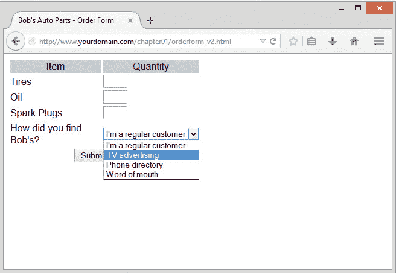

图 1.6 订单表单现在询问访问者如何找到 Bob's Auto Parts

这段 HTML 代码添加了一个新的表单变量（名为`find`），其值将为`'a'`、`'b'`、`'c'`或`'d'`。你可以使用一系列`if`和`elseif`语句来处理这个新变量，如下所示：

点击此处查看代码图片

```php
if ($find == "a") {
  echo "<p>Regular customer.</p>";
} elseif ($find == "b") {
  echo "<p>Customer referred by TV advert.</p>";
} elseif ($find == "c") {
  echo "<p>Customer referred by phone directory.</p>";
} elseif ($find == "d") {
  echo "<p>Customer referred by word of mouth.</p>";
} else {
  echo "<p>We do not know how this customer found us.</p>";
}
```

或者，你可以编写一个`switch`语句：

点击此处查看代码图片

```php
switch($find) {
  case "a" :
    echo "<p>Regular customer.</p>";
    break;
  case "b" :
    echo "<p>Customer referred by TV advert.</p>";
    break;
  case "c" :
    echo "<p>Customer referred by phone directory.</p>";
    break;
  case "d" :
    echo "<p>Customer referred by word of mouth.</p>";
    break;
  default :
    echo "<p>We do not know how this customer found us.</p>";
    break;
}
```

（注意，这两个示例都假设你已经从`$_POST`数组中提取了`$find`。）

`switch`语句的行为与`if`或`elseif`语句有些不同。`if`语句只影响一条语句，除非你特意使用花括号创建语句块。`switch`语句的行为则相反。当`switch`中的某个`case`语句被激活时，PHP 会执行语句，直到遇到`break`语句。如果没有`break`语句，`switch`将会执行所有跟在满足条件的`case`之后的代码。当遇到`break`语句时，将执行`switch`语句之后的下一条代码。

#### 比较不同的条件语句

如果你不熟悉前面几节中描述的语句，你可能会问：“哪一个最好？”

这其实不是我们能回答的问题。用一条或多条`else`、`elseif`或`switch`语句能做的事情，用一组`if`语句也都能做到。你应该尽量使用在你当前情况下最易读的条件语句。随着经验的积累，你会逐渐感受到哪种结构适合不同的情况。

### 通过迭代重复执行

计算机一直非常擅长的一件事情就是自动化重复性任务。如果你需要以相同方式多次完成某项工作，可以使用循环来重复程序中的部分内容。

Bob 想要一个显示将添加到客户订单中的运费表。对于 Bob 使用的快递公司，运费取决于包裹的运输距离。这个成本可以通过一个简单的公式计算出来。

你希望这个运费表类似图 1.7 中的表格。

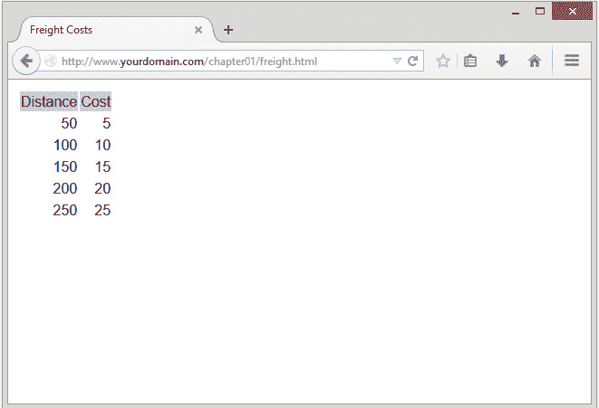

图 1.7 该表显示了随距离增加的运费成本

清单 1.2 显示了显示此表的 HTML。你可以看到它又长又重复。

清单 1.2 **freight.html**——Bob 运费表的 HTML

点击此处查看代码图片

```html
* * *
<!DOCTYPE html>
<html>
  <head>
   <title>Bob's Auto Parts - Freight Costs</title>
  </head>
  <body>
    <table style="border: 0px; padding: 3px">
    <tr>
     <td style="background: #cccccc; text-align: center;">Distance</td>
     <td style="background: #cccccc; text-align: center;">Cost</td>
    </tr>
    <tr>
     <td style="text-align: right;">50</td>
     <td style="text-align: right;">5</td>
    </tr>
    <tr>
     <td style="text-align: right;">100</td>
     <td style="text-align: right;">10</td>
    </tr>
    <tr>
     <td style="text-align: right;">150</td>
     <td style="text-align: right;">15</td>
    </tr>
    <tr>
     <td style="text-align: right;">200</td>
     <td style="text-align: right;">20</td>
    </tr>
    <tr>
     <td style="text-align: right;">250</td>
     <td style="text-align: right;">25</td>
    </tr>
    </table>
  </body>
</html>
* * *
```

与其让一个容易厌倦且需要付酬的人类来输入 HTML，不如让一台廉价且不知疲倦的计算机来完成这项工作，这会很有帮助。

循环语句告诉 PHP 重复执行一条语句或一个块。

#### `while` 循环

PHP 中最简单的循环是`while`循环。像`if`语句一样，它依赖于一个条件。`while`循环和`if`语句之间的区别在于，`if`语句只在条件为`true`时执行其后的代码一次。而`while`循环会在条件为`true`时重复执行块。

当你不知道需要多少次迭代才能使条件为`true`时，通常使用`while`循环。如果需要固定的迭代次数，请考虑使用`for`循环。

`while`循环的基本结构是：

```php
while( condition ) expression;
```

以下`while`循环将显示从 1 到 5 的数字：

```php
$num = 1;
while ($num <= 5 ){
  echo $num."<br />";
  $num++;
}
```

在每次迭代开始时，会测试条件。如果条件为`false`，则不会执行块，循环结束。然后执行循环后的下一条语句。

你可以使用`while`循环来做一些更有用的事情，例如显示图 1.7 中的重复运费表。清单 1.3 使用`while`循环生成运费表。

清单 1.3 **freight.php**——使用 PHP 生成 Bob 的运费表

点击此处查看代码图片

```php
* * *
<!DOCTYPE html>
<html>
  <head>
   <title>Bob's Auto Parts - Freight Costs</title>
  </head>
  <body>
    <table style="border: 0px; padding: 3px">
    <tr>
     <td style="background: #cccccc; text-align: center;">Distance</td>
     <td style="background: #cccccc; text-align: center;">Cost</td>
    </tr>

    <?php
    $distance = 50;
    while ($distance <= 250) {
      echo "<tr>
            <td style=\"text-align: right;\">".$distance."</td>
            <td style=\"text-align: right;\">".($distance / 10)."</td>
            </tr>\n";
      $distance += 50;
    }
    ?>

    </table>
  </body>
</html>
* * *
```

为了使脚本生成的 HTML 可读，你需要包含换行符和空格。如前所述，浏览器会忽略这些空白，但对于人类阅读者来说，它们很重要。当输出不是你期望的结果时，你经常需要查看 HTML。

在清单 1.3 中，你可以在一些字符串中看到`\n`。在双引号字符串中，这个字符序列表示换行符。

#### `for` 和 `foreach` 循环

你在前面部分中使用`while`循环的方式非常常见。你首先设置一个计数器。在每次迭代之前，你在条件中测试计数器。在每次迭代结束时，你修改计数器。

你可以使用`for`循环以更紧凑的形式编写这种风格的循环。`for`循环的基本结构是：

点击此处查看代码图片

```php
for( expression1; condition; expression2)
  expression3;
```

 expression1 在开始时执行一次。这里通常设置计数器的初始值。  

 条件表达式在每次迭代之前测试。如果表达式返回`false`，迭代停止。这里通常测试计数器是否达到限制。  

 expression2 在每次迭代结束时执行。这里通常调整计数器的值。  

 expression3 每次迭代执行一次。这个表达式通常是一个代码块，包含循环的主体部分。

你可以将清单 1.3 中的`while`循环示例重写为`for`循环。在这种情况下，PHP 代码变为：

点击此处查看代码图片

```php
<?php
for ($distance = 50; $distance <= 250; $distance += 50) {
  echo "<tr>
        <td style=\"text-align: right;\">".$distance."</td>
        <td style=\"text-align: right;\">".($distance / 10)."</td>
        </tr>\n";}
?>
```

`while`和`for`版本在功能上是相同的。`for`循环稍微更紧凑，节省了两行代码。

这两种循环类型是等效的；没有哪个更好或更差。在特定情况下，你可以使用你觉得更直观的那一种。

顺便提一下，你可以将可变变量与`for`循环结合使用，以遍历一系列重复的表单字段。例如，如果你的表单字段名称类似于`name1`、`name2`、`name3`等，你可以像这样处理它们：

点击此处查看代码图片

```php
for ($i=1; $i <= $numnames; $i++){
  $temp= "name$i";
  echo htmlspecialchars($$temp).'<br />'; // 或者你想进行的任何处理
}
```

通过动态创建变量名称，你可以依次访问每个字段。

除了`for`循环，还有`foreach`循环，它是专门为数组设计的。我们将在第 3 章中讨论如何使用它。

#### `do...while` 循环

我们描述的最后一个循环类型的行为略有不同。`do...while`语句的一般结构是：

```php
do
  expression;
while( condition );
```

`do...while`循环与`while`循环不同，因为条件是在循环结束时测试的。这意味着在`do...while`循环中，循环内的语句或块至少会被执行一次。

即使考虑以下例子，其中条件在开始时为`false`并且永远不会变为`true`，循环也会在检查条件并结束之前执行一次：

```php
$num = 100;
do{
  echo $num."<br />";
}while ($num < 1 ) ;
```

### 跳出控制结构或脚本

如果你想停止执行一段代码，可以根据你想要达到的效果，从三种方法中选择一种。

如果你想停止执行循环，可以使用`break`语句，就像之前在`switch`部分讨论的那样。如果在循环中使用`break`语句，脚本的执行将从循环后的下一行继续。

如果你想跳到下一个循环迭代，可以使用`continue`语句。

如果你想完全结束整个 PHP 脚本的执行，可以使用`exit`。这种方法通常在执行错误检查时很有用。例如，你可以像这样修改前面的例子：

点击此处查看代码图片

```php
if($totalqty == 0){
  echo "You did not order anything on the previous page!<br />";
  exit;
}
```

调用`exit`会阻止 PHP 执行脚本的其余部分。

### 使用替代的控制结构语法

对于我们研究过的所有控制结构，还有一种替代语法形式。它包括用冒号（`:`）替换左花括号（`{`），并用一个新的关键字替换右花括号，根据所使用的控制结构，该关键字将是`endif`、`endswitch`、`endwhile`、`endfor`或`endforeach`。`do...while`循环没有可用的替代语法。

例如，代码：

点击此处查看代码图片

```php
if ($totalqty == 0) {
  echo "You did not order anything on the previous page!<br />";
  exit;
}
```

可以使用关键字`if`和`endif`转换为这种替代语法：

点击此处查看代码图片

```php
if ($totalqty == 0) :
  echo "You did not order anything on the previous page!<br />";
  exit;
endif;
```

### 使用`declare`

PHP 中还有一个控制结构，`declare`，在日常编码中不像其他结构那样常用。这个控制结构的一般形式如下：

```php
declare (directive)
{
// block
}
```

该结构用于为代码块设置*执行指令*——即关于如何运行后续代码的规则。当前，只有两个执行指令被实现：`ticks`和`encoding`。

你通过插入指令`ticks=n`来使用 ticks。它允许你在代码块内每 n 行代码运行一个特定函数，这主要用于性能分析和调试。

encoding 指令用于设置特定脚本的编码，如下所示：

```php
declare(encoding='UTF-8');
```

在这种情况下，如果你使用了命名空间，`declare`语句后面可能不需要跟代码块。我们稍后将更详细地讨论命名空间。

这里提到`declare`控制结构只是为了完整性。我们将在第 25 章“在大型项目中使用 PHP 和 MySQL”和第 26 章“调试和日志记录”中考虑一些展示如何使用`tick`函数的示例。

### 下一步

现在你知道如何接收和处理客户的订单了。在下一章中，你将学习如何存储订单，以便以后检索和履行。
