# Web 开发 PHP：快速启动指南（第5版）

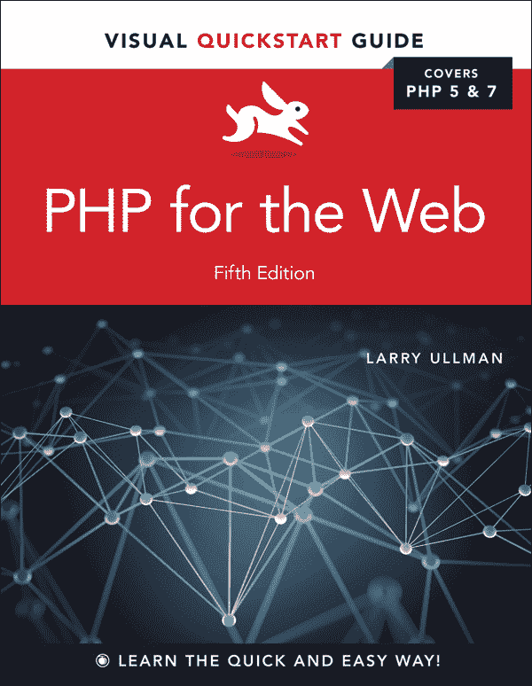


在网页上访问我们：[www.peachpit.com](http://www.peachpit.com)

如需报告错误，请发送邮件至：errata@peachpit.com

Peachpit Press 是 Pearson Education 的分部门。

于美国打印并装订

## 献辞

献给 Jessica、Gina 和 Rich，感谢他们所有的爱与支持。

### 特别致谢

非常感谢 Peachpit Press 的所有人提供的帮助和辛勤工作，特别是：

- Robyn Thomas，感谢她熟练地管理项目，并知道何时该推动和督促。
- Liz Welch，感谢她用精湛的文字编辑技巧润色我的文字。
- Paul Reinheimer，感谢他卓越的技术审核，让我保持严谨，并即使在第五版中也能找到可以改进之处。
- Scout Festa，感谢她敏锐的校对眼光。
- David Van Ness，他将许多零散的内容转化成了一本书。

感谢你们为创作、出版、分发、营销、销售和支持这些书籍所付出的努力。

诚挚地感谢本书其他版本以及我其他书籍的读者。感谢你们的反馈和支持，让事业得以延续。

Rasmus Lerdorf（他开启了 PHP 的进程）、[PHP.net](http://PHP.net) 和 [Zend.com](http://Zend.com) 的人员、经常出没于各种新闻组和邮件列表的人，以及广大 PHP 和开源社区，他们开发、改进并支持了如此实用的技术。

Zoe 和 Sam，感谢你们继续成为孩子们中最棒的典范。

Jessica，感谢你所做的一切以及能做的一切。

## 引言

当我 2000 年开始这本书的第一版时，PHP 还是一个不为人知的`open source`项目。它深受圈内技术人士的推崇，但尚未像今天这样成为 Web 开发的热门选择。当我自学 PHP 时，关于这种语言的文档非常少——这正是我最初想要写这本书的动力。

今天情况已有所不同。互联网已经经历了繁荣与低落，并完成了自我修复。此外，PHP 现在是动态 Web 设计工具的王者，其领域已在某种程度上扩展到了纯 Web 开发领域之外。但尽管 PHP 广受欢迎，且可用文档、示例代码和案例在不断增加，一本深入讨论该语言的好书仍然具有意义。尽管 PHP 正处于第六个大版本的发布初期，但像这样用简单而实用的术语教授语言的书，仍然可以是你学习所需知识的最佳指南。

本书将教你 PHP，既能让你对基础知识有深入的理解，又能让你知道去哪里寻找更高级的信息。虽然它不是一本全面的编程参考书，但通过演示和真实世界的示例，本书为你提供了使用 PHP 构建动态网站和 Web 应用程序所需的知识。

### 什么是 PHP？

PHP 最初代表`Personal Home Page.`（个人主页）。它由 Rasmus Lerdorf 于 1994 年创建，用于追踪他在线简历的访问者。随着其用途和能力的增长（以及开始被用于更专业的场合），PHP 变成了`PHP: Hypertext Preprocessor`（PHP：超文本预处理器）。这个定义基本上是指 PHP 在数据变成 HTML（即超文本标记语言）之前对其对其进行处理。

根据位于 [www.php.net](http://www.php.net) 的 PHP 官方网站 ，PHP 是“一种流行的、通用的脚本语言，特别适用于 Web 开发”。更具体地说，PHP 是一种通常嵌入 HTML 之中的脚本语言。让我们详细检查这意味着什么。

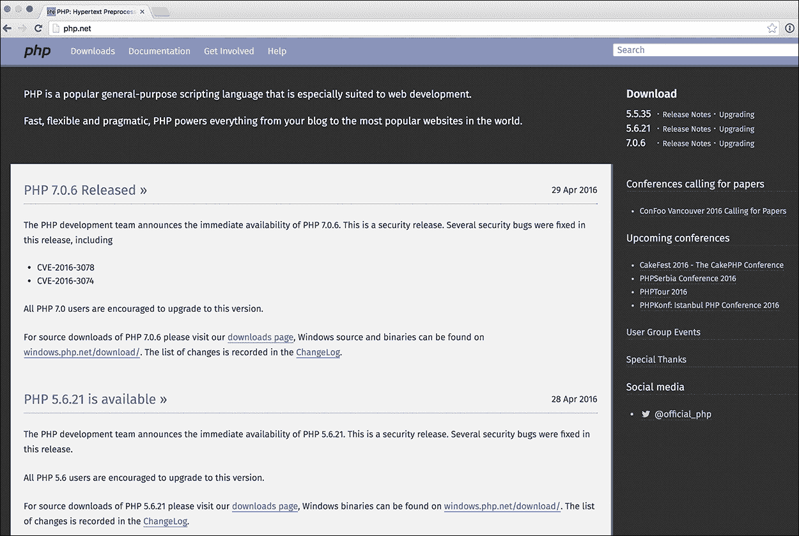

 在编写本书时，这是位于 [www.php.net](http://www.php.net) 的 PHP 官方网站的外。自然地，这应该是你解决大多数 PHP 问题和好奇心的首选地方。

说 PHP `can be embedded into HTML`（可以嵌入 HTML）意味着 PHP 代码可以写在你的 HTML 代码中——HTML 是构建所有网页的语言。因此，用 PHP 编程仅比手动编写 HTML 稍微复杂一点。

此外，PHP 是一种`scripting language`（脚本语言），而不是`compiled language`（编译型语言）。这意味着 PHP 的设计是为了在`only after an event occurs`（事件发生后）才执行某些操作——例如，当用户提交表单或访问 URL（统一资源定位符——Web 地址的技术术语）。另一个流行的脚本语言示例是 JavaScript，它通常处理发生在浏览器内部的事件。PHP 和 JavaScript 也可以被描述为`interpreted`（解释型的），因为代码必须通过可执行程序运行，例如 PHP 模块或浏览器的 JavaScript 组件。相反，C 和 C++ 等编译型语言可用于编写独立于任何事件的独立应用程序。

* *

PHP 6？

是的，在编写本书时，PHP 的当前版本是 5 和 7，但还没有 6！这里有一个长久而有趣的故事，但简短的版本是 PHP 6 曾活跃开发过一段时间。在遇到许多障碍后，开发停止了，创建的工作被并入了 PHP 5 中。

当该开始处理下一个大版本时，经过大量辩论，决定该版本命名为 PHP 7。因此，尽管曾经存在过 PHP 6 的测试版本，但从未有一个正式版本面世。

* *

你还应该理解 PHP 是一种`server-side`（服务端）技术。这指的是 PHP 的所有操作都发生在服务器上（而不是在`client`客户端，即查看网站的人使用的计算机上）。`server`是一台用于在你通过浏览器访问 Web 地址时提供页面的计算机。我将在本引言的后续部分详细地讨论这一过程（参见“PHP 如何工作”）。

最后，PHP 是`cross-platform`（跨平台的），这意味着可以在运行 Unix、Windows、Macintosh 和其他操作系统的机器上使用。再次，我们谈论的是`server`的操作系统，而不是客户端的。PHP 不仅可以在任何操作系统上运行，而且与许多其他编程语言不同，它让你能够以极少或无需修改将工作从一个平台切换到另一个平台。

* *

### PHP 不是什么

让大多数新学习者困惑 PHP 问题在于 PHP 不能做什么。尽管你可以用这种语言完成各种任务，但它主要的局限性是 PHP 不能用于某些网站中的客户端功能。

使用像`JavaScript`这样的客户端技术，你可以创建新的浏览器窗口、弹出对话框、动态生成并修改表单等等。这些任务中的任何一项都无法通过使用`PHP`完成，因为`PHP`是服务器端的，而这些都是客户端问题。但你可以使用`PHP`来创建`JavaScript`，就像你可以使用`PHP`来创建`HTML`一样。

当需要开发你自己的`PHP`项目时，请记住你只能使用`PHP`向浏览器发送信息（HTML 等）。在从服务器发出的另一个请求（例如提交了表单或点击了链接）之前，你无法在浏览器内做任何其他事情。

在撰写此书时，`PHP`同时存在版本`5.5.35`、`5.6.21`和`7.0.6`。（版本`5.5`和`5.6`之间存在细微差异，因此`5.5`将继续受支持一段时间）。尽管我使用稳定的`PHP7`版本编写了此书，但所有代码都是向后兼容的，至少兼容到`PHP` `5.x`版本。在某些功能需要更高版本的`PHP`或旧版本可能存在细微差异的情况下，侧边栏中的注释或提示将指示你如何相应调整代码。

更多信息可以在 [PHP.net](http://PHP.net) 和 Zend ([www.zend.com](http://www.zend.com)) 找到，后者是参与`PHP`开发的关键公司 。


 这个 Zend 网站包含了实用的软件，还包含一个代码库和编写良好的教程。

### 为什么要使用 PHP？

简单来说，`PHP`比替代方案更好、更快、且更容易学习。所有网站都必须从简单的`HTML`开始，你可以使用许多静态`HTML`页面创建一个整个网站。但基础的`HTML`是一种限制的方法，无法提供灵活性或动态行为。访问仅限`HTML`网站的游客看到的是简单的页面，没有任何程度的自定义或动态行为。通过`PHP`，你可以根据你想要考虑的任何因素创建令人兴奋且原创的页面。`PHP`还可以与数据库和文件交互，处理电子邮件，并完成许多`HTML`单身无法完成的其他事情。

Web 开发人员很久以前就意识到，仅凭`HTML`无法产生吸引且持久的网站。为此，像`PHP`这样的服务器端技术已成为常态。这些技术允许开发者创建动态生成的 Web 应用，考虑到程序员希望的任何元素。这些高级网站通常是数据库驱动的，比静态`HTML`页面更容易更新和维护。

在选择服务器端技术时，`PHP`的主要替代方案  如下：`ASP.NET`（Active Server Pages）、`JSP`（JavaServer Pages）、`Ruby`（通过`Rails`或`Sinatra`框架）以及一些较新的服务器端`JavaScript`选项，如`Node.js`。

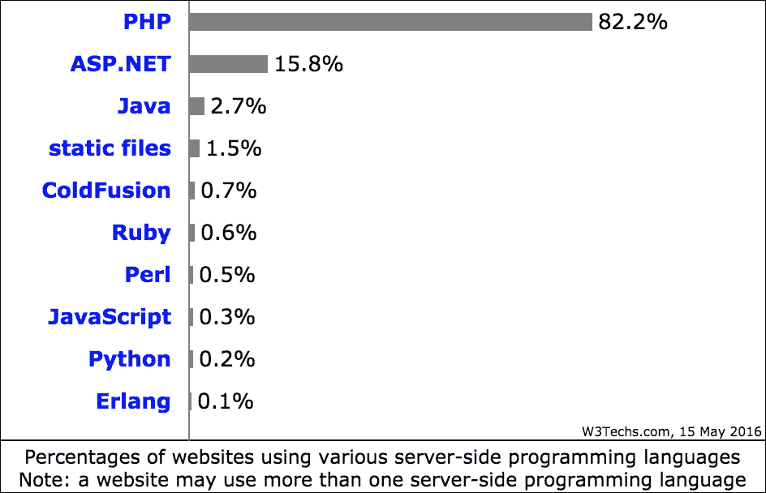

 Web Technology Surveys 网站显示，`PHP`运行在 82% 的网站上 ([`w3techs.com/technologies/overview/programming_language/all`](http://w3techs.com/technologies/overview/programming_language/all))。

所以问题是，为什么 Web 开发人员应该使用`PHP`而不是`ASP.NET`、`Node.js`或其他什么来制作动态网站？

 **PHP 更容易学习和使用。** 人们——也许像你一样没有受过正式编程训练的人——在读完这本书后就可以轻松地编写`PHP`脚本。相比之下，`ASP.NET`需要理解`Visual Basic`、`C#`或另一种语言；`Node.js`需要`JavaScript`。这些是更复杂的语言，学习也困难得多。

 **PHP 专为创建动态网页而编写。** `Perl`、`VBScript`、`Java`和`Ruby`并非如此，这一事实表明，从其初衷来看，`PHP`可以比替代方案更快、更容易地完成某些任务。然而，我想说明的是，尽管我建议`PHP` *在某些方面更好*——特别是对于它被创建时要做的事情，`PHP`并不是一种比`JavaScript`或`C#`“更好”的编程语言——它们可以做到`PHP`做不到的事。

 **PHP 免费且跨平台。** 因此，你可以在几乎任何计算机上学习和使用`PHP`且无需费用。此外，它的开源性质意味着`PHP`的用户在驱动它的开发，而不是某些公司实体。

 **PHP 是目前开发动态网站最流行的工具。** 直到撰写此书时，`PHP`已用于超过 82% 的网站 ，并且是范围内排名第六的编程语言 。许多最大的网站——仅举三个例子：Yahoo、`Wikipedia`和`Facebook`——以及内容管理工具，如`WordPress`、`Drupal`、`Moodle`和`Joomla`都在使用`PHP`。通过学习这门语言，你将为自己提供一个实用的爱好或一项获利丰丰的技能。

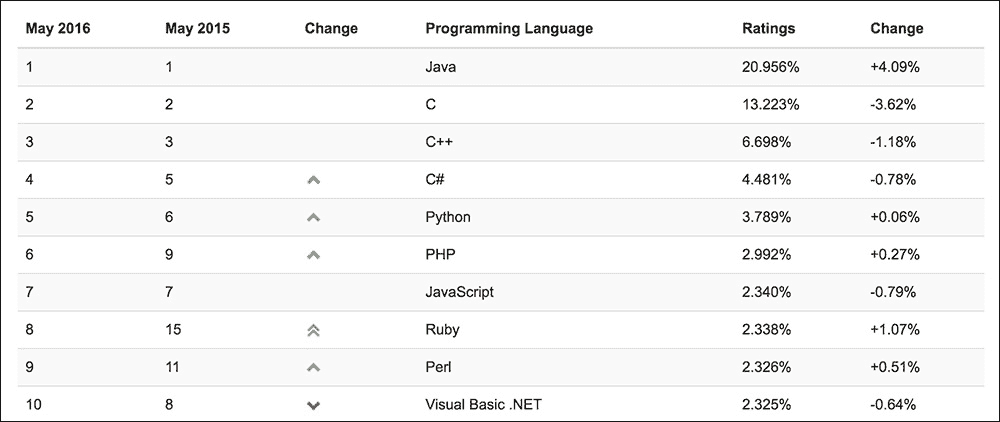

 Tiobe Index 使用各种因素对编程语言的流行程度 ([www.tiobe.com/index](http://www.tiobe.com/index)) 进行排名。

### PHP 如何工作

`PHP`是一种服务器端语言，这意味着你编写的代码位于服务器上。当你访问网站时（例如 [www.larryutley.com](http://www.larryutley.com) ），你的互联网服务提供商（ISP）会将你的请求引导至持有`php.com`信息的服务器。该服务器读取`PHP`代码并进行处理。简而言之，PHP 根据你选择的参数让服务器动态生成 HTML 页面。

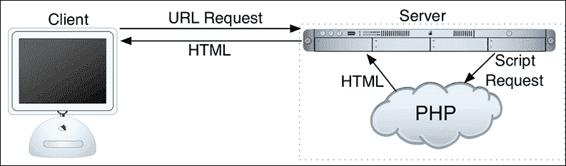

 该图表（以非常简单的术语）演示了客户端、服务器和 PHP 模块（一种增加服务器功能的应用程序）之间向浏览器发送 HTML 的工作过程。

这与 HTML 生成的站点的区别在于，当请求被发出时，服务器仅将 HTML 数据发送给浏览器——没有服务器端的解释 。因此，对于最终用户的浏览器来说，`home.html`和`home.php`看起来可能没有区别，但你到达该点的方式发生了根本变化。主要的区别在于，通过使用 PHP，你可以让服务器根据情况*动态*生成 HTML。例如，如果是周一而不是周二，或者用户之前访问过该页面，就可以显示不同的信息。动态网页创建将平乏的静态站点与更有趣、访问量更高的交互式站点区分开来。

您的另一种选择是在自己的计算机上安装 PHP 和 Web 服务器应用程序（如`Apache`）。Windows、Mac OS X 或 Linux 用户可以轻松免费安装并使用 PHP。安装 PHP 的说明请参阅附录 A 中的“安装与配置”。如果你愿意尝试使用自己安装的 PHP 服务器，那么可以宽慰的是，你可以从 PHP 网站（[www.php.net](http://www.php.net)）免费获取 PHP，它提供易于安装的包。如果你采用这种方法（我建议你这样做），那么你的计算机将同时充当客户端和服务器。

第二个要求几乎是理所当然的：你必须在计算机上准备一个文本编辑器。`Atom`、`Notepad++`、`UltraEdit`以及类似的免费软件都能满足你的需求，而`TextMate`、`SublimeText`以及其他商业应用程序则提供了你可能喜欢的更多功能。如果你习惯使用图形化界面（也称为 WYSIWYG——所见即所得），如`Adobe Dreamweaver`  或`Aptana Studio`，你可以查阅该应用程序的手手册查看如何在其中进行编程。

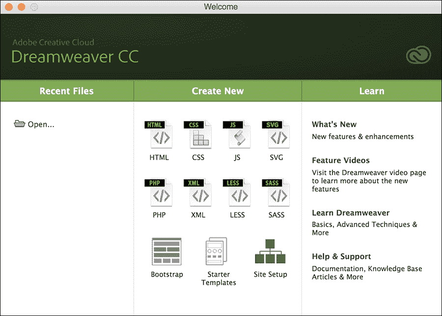

 流行的`Dreamweaver`应用程序支持 PHP 开发，以及其他服务器端技术。

第三，你需要一种方法将编写的脚本发送到服务器。如果你在自己的计算机上安装了 PHP，可以将脚本保存到相应的目录中。然而，如果你正在使用带有 Web 托管服务的远程服务器，你需要一个`SFTP`（安全文件传输协议）程序将脚本发送到服务器。有很多 SFTP 应用程序可用；例如，在第 1 章](#ch01.html_ch01) “PHP 入门之旅”中，我使用了免费的`FileZilla`（[`filezilla-project.org`](http://filezilla-project.org) ）。

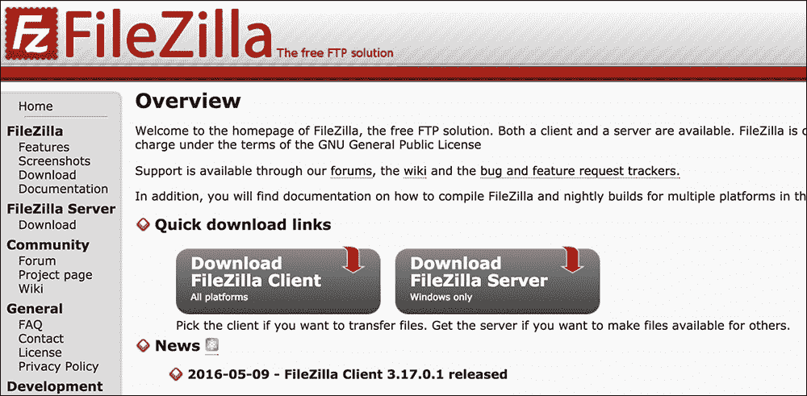

 `FileZilla`应用程序可以在许多不同的操作系统上用于将 PHP 脚本和其他文件移动到远程服务器。

最后，如果你想遵循第 12 章](#ch12.html_ch12) “数据库简介”中的示例，你需要访问`MySQL`（[www.mysql.com](http://www.mysql.com) ）。`MySQL`提供免费版本，你可以将其安装在自己的计算机上。


 `MySQL`网站（于写作时）。

本书假设读者仅具备 HTML 基础知识，尽管你越能在没有 Dreamweaver 等 WYSIWYG 应用程序帮助的情况下处理原始 HTML 代码越熟练，过渡到使用 PHP 就越容易。每个程序员最终都会在某个时候查阅 HTML 参考资料，无论你了解多少，因此我鼓励你手边放一本好的 HTML 书。其中一本介绍 HTML 的入门书籍是 Elizabeth Castro 和 Bruce Hyslop 编写的 *HTML, XHTML, and CSS: Visual QuickStart Guide*（Peachpit Press, 2014）。

无疑不需要之前的编程经验。然而，它可能会加快你的学习速度，因为你会迅速发现 Perl 与 PHP、或者 JavaScript 与 PHP 之间的许多相似之处。

### 关于本书

本书尝试传达 PHP 编程的基础知识，同时暗示了你未来可能想要考虑的一些更高级的功能，而不会陷入过多的细节中。我们使用以下约定来实现这一点。

分步骤说明指示了你需要在脚本中添加哪些代码以及添加在何处。你应该输入的特定文本将以独特的字体样式打印，以便与正文隔离开。例如：

点击此处查看代码图像

```php
<?php print "Hello, World!"; ?>
```

PHP 代码也写成独立的完整脚本，并按行编号以便参考（脚本 i.1）。你不应该自己插入这些行号，因为这样做会导致你的工作无法运行。

**脚本 i.1** 一个示例 PHP 脚本，带有行号，并对代码的特定部分进行了加粗强调。

点击此处查看代码图像

* * *


```html
1   <!doctype html>
2   <html lang="en">
3   <head>
4       <meta charset="utf-8">
5       <title>Hello, World!</title>
6   </head>
7   <body>
8   <?php print "Hello, world!"; ?>
9   </body>
10 </html>
```

* * *

我建议使用能够自动为你显示行号的文本编辑器——在调试工作时，这些数字将非常有帮助。在脚本中，你有时会看到某些行加粗显示，以引起对新内容或相关内容的注意。

* * *

### 本书更新

我认为这个版本是对一本已经很扎实的书籍进行的适度修订。最大的变化是：

 所有的示例现在使用 `HTML5`。

 我们涵盖了 `MySQL`。

 最后，我根据自己的需要调整了一些示例。

* * *

由于 `PHP` 工作方式本质，你需要理解每个脚本实际上有三种视图：`PHP` 代码（例如脚本 i.1）、发送到浏览器的代码以及浏览器显示的内容。在适当的情况下， 显示浏览器接收到的 `HTML`，而 展示浏览器如何解释该 `HTML`。通过 `PHP`，你创建发送到浏览器的 `HTML`。

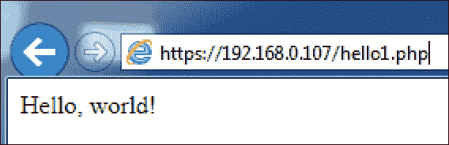

 这是你在浏览器中看到的示例视图。对于本书而言，使用哪种浏览器或操作系统都没有区别。

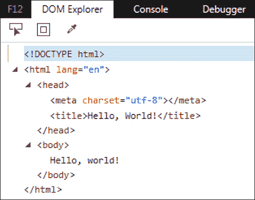

 通过查看浏览器接收的源代码，你可以看到由 `PHP` 创建的 `HTML`。

由于的列宽比常见的文本编辑器屏幕窄，步骤中打印的 `PHP` 代码有时需要在编辑器中不会换行的地方折行。一个小灰色箭头指示这种折行的发生。例如：

点击此处查看代码图像

```php
print "This is going to be a longer line of code.";
```

你应该在脚本中继续使用单行，否则执行时会遇到错误。（箭头未用于已编号的脚本。）

在演示新功能和技术时，我会尽力解释它们的原理和用法。在阅读和使用某个函数之间，你应该清晰地理解它。然而，如果某些内容仍然令人困惑，本书包含了许多参考资料，可以在那里找到任何问题的答案（参见附录 B 中的“资源和后续”）。如果你对某个特定的函数或示例感到困惑，最好的办法是检查 `PHP` 手手册或本书的辅助网站（及其用户支持论坛）。

### 伴随网站

当你阅读这本书时，你可能发现访问 *PHP for the Web: Visual QuickStart Guide, 5th Edition* 网站也会很有帮助，该网站位于 [www.LarryUllman.com](http://www.LarryUllman.com)。在里面，你可以找到书中的每一个脚本的可下载版本。不过，我强烈建议你自己手动输入这些脚本，以便更熟悉 `PHP` 的结构和语法。该网站还提供了一个错误页面，列出了书中可能出现的任何错误。

然而，许多用户发现最有帮助的是书的支持论坛，可以通过网站或直接通过 [www.LarryUllman.com/forums/](http://www.LarryUllman.com/forums/) 访问。通过该论坛，你可以：

 为你遇到的问题寻找答案

 就就如何实现你的想法获得建议

 获取调试帮助

 查看技术变化如何影响书中的示例

 学习其他人如何使用 `PHP`

 确认复习题的答案

 从我这里获得比直接发邮件更快的回复

* * *

## 哪本书适合你？

这是我的第一本关于 `PHP` 书的第五版。和原版一样，它是为初学者或非程序员编写的。如果你几乎或没有编程经验，偏好较慢的节奏，或者喜欢以小量化的方式学习知识，那么这本书就适合你。不要误会：这本书涵盖了你开始开发动态网站所需的知识，并使用了实用的示例，但没有涉及任何深奥的理论或高级应用。

相反，如果你学习新技术非常快，或者已经有一些开发网站的经验，你可能会觉得这本书太基础。在这种情况下，你应该考虑我的 *PHP and MySQL for Dynamic Web Sites: Visual QuickPro Guide*（Peachpit Press, 2012）。它更详细地讨论了 `SQL` 和 `MySQL`，并介绍了几个更复杂的示例，但它的节奏较快。

* * * *

## 如何明智地提问

无论是在书的支持论坛上发布信息、给我发电子邮件，还是在新闻组中提问，知道如何最有效地提问都能提高你收到的回复的质量以及你获得答案的速度。为了在最短时间内获得最佳答案，请遵循以下步骤：

1. 搜索互联网，阅读手册，并浏览任何相关的文档。

2. 在最合适的论坛（新闻组、邮件邮寄列表等）中提问你的问题。

3. 使用清晰且简洁的主题。

4. 详细描述你的问题，展示任何相关的代码，说明出了什么错误，指出你正在使用的 `PHP` 版本，并说明你运行的操作系统。

* * *

### 有问题、意见或建议吗？

如果你有关于 `PHP` 的特定问题，在 `PHP` 相关的网站上有许多新闻组、邮件邮寄列表和问答专区供你求助。这些内容在 附录 B 中进行了更详细的讨论。浏览这些参考资料或搜索互联网几乎总是为你提供最快的答案。

你也可以将你的问题、意见和建议直接发给我。使用书籍对应的论坛将获得最快的回复；我总是先回答那些问题。如果你更愿意给我发电子邮件，可以通过网站上的联系页面进行。我确实尝试回答收到的每一封邮件，但可能需要一两周的时间（而你可能在几天内就能收到论坛回复）。

更多技巧和启发性的阅读，请参见此页的侧边栏以及 Eric Steven Raymond 的《如何明智地提问》，网址位于 [www.catb.org/~esr/faqs/smart-questions.html](http://www.catb.org/~esr/faqs/smart-questions.html)。你在这里花费的 10 分钟将在未来为你节省数小时。那些回答你问题的人（比如我）会非常感激的！

## 1. 开始学习 PHP

* * *

### 本章内容

- 基础 `HTML` 语法

- 基础 `PHP` 语法

- 使用 `SFTP`

- 测试你的脚本

- 向浏览器发送文本

- 使用 `PHP` 手册

- 向浏览器发送 `HTML`

- 为脚本添加注释

- 基础调试步骤

- 复习与后续

* * *

学习任何新编程语言时，始终要从理解基础语法和功能开始，这正是你所学的。

### 基础 HTML 语法

所有的网页都是使用 `HTML`（超文本标记语言）制作的。目前的 `HTML` 版本是 5（它在 2014 年正式标准化的）。无论是 Google Chrome、Mozilla Firefox、Microsoft Internet Explorer 和 Edge，还是 Apple Safari，都在渲染这种 `HTML`。点击此处查看图像

```html
<h1>Hello, World!</h1>
```

我只想说句 Hello。在本章结束时，你将成功编写了第一个简单的 `HTML` 文档。

### 基础 CSS

`HTML` 元素定义页面的内容，但内容的外观和行为留给了 `CSS`（层叠样式表）。正如 `HTML` 一样，本书没有详细教授 `CSS`，但因为书中一些代码使用了 `CSS`，你应该对其基础语法熟悉。

你可以通过两种方式为网页添加 `CSS`。第一种最简单的方法是使用 `HTML` 样式标签：

```html
<style type="text/css">
/* 规则 */
</style>
```

`CSS` 规则定义在开启和结束标签之间。

你也可以使用 `link` `HTML` 标签来引入外部文件中定义的 `CSS` 规则：

点击此处查看图像

```html
<link href="styles.css" rel="stylesheet" type="text/css">
```

该文件仅包含规则，而不包含样式标签。

`CSS` 规则应用于通用页面元素、`CSS` 类和特定项目：

点击此处查看图像

```css
img { border: 0px; }
.error { color: red; }
#about { background-color: #ccc; }
```

第一条规则适用于每一个图像标签。第二条适用于任何具有 `error` 类的元素：

```html
<p class="error">Error!</p>
```

第三条规则仅适用于 id 值为 `about` 的特定元素：

```html
<p id="about">About...</p>
```

（并不是所有的元素都需要 id 属性，但没有两个元素应该具有相同的 id 值。）

在大多数情况下，本书使用 `CSS` 只为了一些简单事情，例如更改元素或文本的颜色或背景颜色。

有关更多关于 `CSS` 的信息，请搜索网络或查看关于该主题的专著。

***

创建一个 `HTML` 页面：

1. **打开你的文本编辑器或集成开发环境 (IDE)。**

你可以使用几乎任何应用程序来创建 `HTML` 和 `PHP` 页面。流行的选择包括

 Adobe 的 Dreamweaver ([www.adobe.com](http://www.adobe.com))

 Aptana Studio ([www.aptana.com](http://www.aptana.com))

 PhpStorm ([www.jetbrains.com](http://www.jetbrains.com))

 Sublime Text ([www.sublimetext.com](http://www.sublimetext.com))

 Atom ([`atom.io`](https://atom.io))

前三个是 IDE，使用它们更加复杂，但也更强大。后两个是文本编辑器。所有这些程序都运行在大多数常见的操作系统上。

2. **选择 `File > New` 创建一个新的空白文档。**

某些文本编辑器允许你从创建一个特定类型的新文档开始——例如，创建一个新的 `HTML` 文件 。如果你的应用程序有此选项，请使用它！

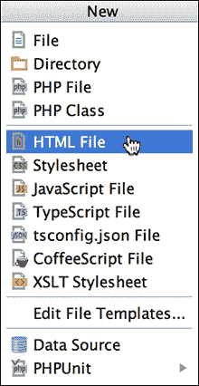

 PhpStorm 和大多数其他网络开发应用程序可以为你创建 `HTML` 文档的基础。

3. **从 `HTML` 头部行开始 (Script 1.1)):**

```html
<!doctype html>
<html lang="en">
```

**Script 1.1** 这个简单的文档包含了 `HTML5` 页面的基础内容。

点击此处查看代码图像

***

```html
1   <!doctype html>
2   <html lang="en">
3   <head>
4       <meta charset="utf-8">
5       <title>Welcome to this Page!</title>
6   </head>
7   <body><body>
8   <h1>This is a basic HTML page!</h1>
9   <br>
10  <p>Even with some decoration,
11    it's still not very exciting.</p>
12 </body>
13 </html>
```

***

有效的 `HTML5` 文档以这些行开始。它们告诉网页浏览器期望什么种类型的文档。对于这个模板，以及整本书，将创建 `HTML5` 页面。`HTML5` 的优点之一是它极简的 doctype 和语法。

***

### 理解编码

编码是一个庞大的课题，但你最需要理解的是这一点：*你在文件中使用的编码决定了可以表示哪些字符*（因此决定了你可以使用哪些书面语言）。要选择编码，你必须先确认文本编辑器或 IDE 可以使用该编码保存文档。某些应用程序允许你在偏好或选项区域设置编码；另一些则在你保存文件时设置编码。

要向浏览器指示编码，有一个对应的 meta 标签：

```html
<meta charset="utf-8">
```

`charset=utf-8` 部分表示正在使用 `UTF-8`（8 位 Unicode 转换格式的缩写）编码。Unicode 是一种可靠地表示每个字母表中每个符号的方法。Unicode 的 8.0.0 版本——截至本文编写时的版本——支持超过 120,000 个字符！最常用的 Unicode 编码是 `UTF-8`。

如果你想创建一个多语言网页，`UTF-8` 是最佳选择，它将用于书中的示例。当然，你并不一定要这样做。但无论你使用哪种编码，请确保 `HTML` 页面指示的编码与文本编辑器或 IDE 实际使用的编码匹配。如果不这样做，你在网页浏览器中查看页面时，可能会看到奇怪的字符。

***

4. **创建页面的 head 部分：**

点击此处查看代码图像

```html
<head>
  <meta charset="utf-8">
  <title>Welcome to this Page!</title>
</head>
```


HTML 页面的 `head` 应该包含 `charset` meta 标签。“理解编码”侧边栏更详细讨论了这意味着什么。

`head` 还包含页面标题，它显示在浏览器窗口或标签的顶部，以及浏览器的书签和历史记录中。你还可以在 `head` 中放置 JavaScript 和 CSS 引用。

## 5. 创建 `body` 部分

点击此处查看代码图像。

```html
<body>
<h1>This is a basic HTML page!</h1>
<br>
<p>Even with some decoration, it's still not very exciting.</p>
</body>
```

页面的内容——位于起始和结束 `body` 标签之间。

## 6. 用闭合标签完成页面

```html
</html>
```

## 7. 选择 `File > Save As`

在出现的对话框中，选择 `Text`（或二进制）。

## 8. 导航到你想保存文件的文件夹

## 9. 将文件另存为 `welcome.html`

## 10. 通过打开它来测试页面


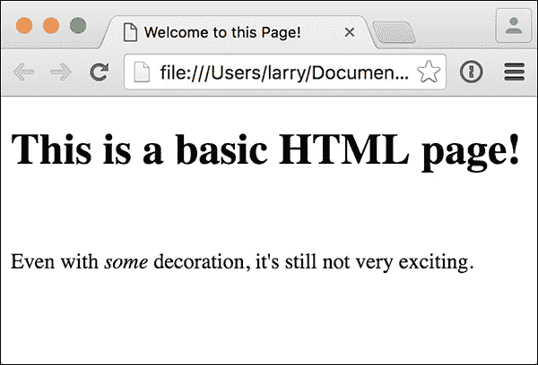


与 PHP 脚本不同，你可以直接在浏览器中查看它们。

---

> **提示**
>
> 搜索网络或使用支持论坛（[`www.aptana.com/`](http://www.aptana.com/)）来寻找良好的 HTML 和 PHP 编辑器。

---

> **提示**
>
> 有关 HTML 的更多信息，请查看 Elizabeth Castro 和 Bruce Hyslop 的著作 *HTML and CSS: VisualStart*（Peachpit Press, 2014）。

### PHP 语法

现在你已经了解 HTML 如何被处理，是时候开始 PHP 脚本了。创建一个 PHP 页面，你与创建 HTML 文档的方式一样。理解这一点至关重要：网页浏览器是理解 HTML 的客户端应用程序；PHP 是一种服务器端技术。为了弥接这一鸿沟，PHP 在服务器上生成 HTML（参见“简介”）。

标准 HTML 页面与 PHP 脚本之间有三个主要区别：首先，PHP 脚本应以 `.php` 扩展名保存（例如 `index.php`）。其次，将 PHP 代码放置在 `<?php` 和 `?>` 标签中，通常在 HTML 的上下文中：

```html
<html>
<body><h1>This is HTML.</h1>
<?php PHP code! ?>
<p>More HTML</p>
</body>
</html>
```

PHP 标签指示页面中通过服务器上的 PHP 处理器处理的部分。这导致了第三个主要区别：PHP 脚本必须在支持 PHP 的 Web 服务器上运行（而 HTML 页面可以在任何计算机上直接在浏览器中查看）。这意味着 PHP 脚本必须通过 URL 运行（例如 `http://example.com/page.php`）。如果你在浏览器中查看 PHP 脚本且地址不是以 `http` 开头，则 PHP 脚本将无法工作。

为了让我们的第一个 PHP 脚本在不需要过多编程的情况下执行操作，我们将使用 `phpinfo()` 函数。该函数在调用时会向浏览器发送信息表。该表格列出了特定服务器上 PHP 安装的细节。这是测试 PHP 安装的好方法。

然而，`phpinfo()` 函数不仅输出信息表，它还为你创建一个完整的 HTML 页面。因此，我们的第一个 PHP 脚本不需要标准的 HTML 代码，但本章随后的脚本将需要。

## 1. 在你的文本编辑器或 IDE 中创建一个新的 PHP 文档

命名为 `phpinfo.php`（脚本 1.2）。

**脚本 1.2** 这第一个 PHP 脚本调用了一个单一 PHP 函数。

```php
1 <?php
2   phpinfo();
3 ?>
```

对于这种特定情况，你将从空文件开始。但如果你的文本编辑器或 IDE 提供了 PHP 文件模板，你完全可以从其中一个开始。

## 2. 在页面的第一行独占输入 `<?php`

这个 PHP 标签告诉服务器随后的代码是 PHP，并应该按此方式进行处理。

如果你的应用程序提供了 PHP 模板，它可能已经创建了 PHP 标签。

## 3. 在下一行添加以下内容

```php
phpinfo();
```

稍后将详细解释语法，但简单来说，这只是对名为 `phpinfo` 的现有 PHP 函数的调用。你必须使用左右括号，且中间不要留任何内容，并加上分号。

## 4. 在最后一行独占输入 `?>`

PHP 结束标签告诉服务器脚本的 PHP 部分已结束。同样，由于 `phpinfo()` 函数为你生成了一个完整的 HTML 页面，因此不需要 HTML 标签。

## 5. 将脚本保存为 `phpinfo.php`

这并不是言过其实，但请记住 PHP 脚本必须使用有效的扩展名。如果你将文件保存为 `filename.php`，通常不会遇到问题。

你还需要确保应用程序或操作系统没有为文件添加隐藏扩展名。例如，Windows 上的记事本（Notepad）会尝试为不常见的扩展名添加 `.txt`，这会导致 PHP 脚本无法使用。（一般来说，请勿使用记事本。）

> **提示**
>
> 正如你电脑上的文件扩展名告诉操作系统用何种应用程序打开文件一样，网页的扩展名也告诉服务器如何处理该文件：`file.php` 将通过 PHP 模块，`file.aspx` 被作为 ASP.NET 处理，而 `file.html`（通常）是一个静态 HTML 文档。扩展名关联由 Web 服务器的设置决定。

> **提示**
>
> 如果你正在为托管网站开发 PHP 脚本，请咨询你的主机托管公司，以了解你可以为 PHP 文档使用哪些文件扩展名。在书中你会看到 `.php`，这是最常见的扩展名。

> **提示**
>
> 你偶尔会在他人的脚本看到 PHP 的短标签——仅为 `<?` 和 `?>`——尽管我建议坚持使用正式标签：`<?php` 和 `?>`。短标签的支持必须在服务器上启用，而且使用它们会使你的代码的可移植性降低。

> **提示**
>
> 你会发现保留一份 `phpinfo.php` 文件的副本非常方便。正如你很快就会看到的，这个脚本报告了 PHP 的功能、设置以及你服务器的其他特性。事实上，本书经常建议你返回此脚本来实现这些目的。

> **提示**
>
> PHP 脚本也可以不使用 Web 浏览器，通过命令行界面和独立的 PHP 可执行文件来运行。但该主题已超出本书的范围（而且无论如何，这都是 PHP 一个不常用的用途）。

### 使用 SFTP

与可以直接在浏览器中测试的 HTML 不同，PHP 脚本需要在启用 PHP 的服务器上运行才能看到结果。具体来说，PHP 是通过 Web 服务器应用程序运行的，例如 Apache（[`http://httpd.apache.org`](http://httpd.apache.org)）、Nginx（[`www.nginx.com`](http://www.nginx.com)）或 Internet 信息服务（IIS；[`www.iis.net`](http://www.iis.net)）。

你可以通过两种方式获取启用 PHP 的服务器：

1. 在你自己的电脑上安装该软件。
2. 获取 Web 托管。

PHP 是开源软件（这意味着在某种程度上它是免费的），并且通常很容易安装（对你的电脑没有不利影响）。如果你想在电脑上安装 PHP 和 Web 服务器，请遵循附录 A，“安装与配置”（[`#app01.html_app01`](#app01.html_app01)）。完成后，你可以跳到本章节的下一节，在那里你将学习如何测试第一个 PHP 脚本。

如果你不在自己的电脑上运行 PHP，则需要使用 SFTP（安全文件传输协议）将你的 PHP 脚本传输到启用 PHP 的服务器。托管公司或服务器管理员将为你提供 SFTP 访问信息，你需要将其输入 SFTP 客户端中。有很多 SFTP 客户端应用程序可用；接下来的步骤使用了免费的 FileZilla（[`http://filezilla-project.org`](http://filezilla-project.org)），它运行在许多操作系统上。

将你的脚本通过 SFTP 上传到服务器：

1. 打开你的 SFTP 应用程序。
2. 在应用程序的连接窗口中，输入 Web 主机提供的信息。SFTP 访问需要主机（例如域名或 IP 地址）、用户名和密码。
3. 点击快速连接（或你的 SFTP 客户端的等效选项）。如果你提供了正确的信息，你应该能够连接。如果没有，你将在 FileZilla 窗口的顶部看到错误信息。
4. 导航到网页的正确目录（例如 `www`、`htdocs` 或 `httpdocs`）。SFTP 应用程序并不一定会将你带到相应的目录。你可能需要进行一些导航以到达 Web 文根。Web 文根是 URL 直接指向的服务器目录（例如 `www.larryullman.com`，而不是 `www.larryullman.com/somedir/`）。如果你不确定设置的 Web 文根是什么，请查看托管公司提供的文档（或向他们寻求支持）。在 FileZilla 中，右列代表服务器上的文件和目录；左列代表你电脑上的文件和目录。双击文件夹即可打开它们。
5. 将你的脚本——`phpinfo.php`——上传到服务器。在 FileZilla 中，将该文件从左列（你的电脑）拖到右列（服务器）即可。

> **提示**
>
> 某些文本编辑器和 IDE 内置了 SFTP 功能，允许你直接将脚本保存到服务器。其他应用程序可以在完全离开应用程序的情况下运行 PHP 脚本。

> **提示**
>
> 你还可以使用版本控制软件（如 Git（[`https://git-scm.com`](https://git-scm.com)））将文件传输到 Web 服务器。虽然这是一条很好的途径，但它远超 PHP 初学者指南的范围。

### 测试你的脚本

测试 PHP 脚本分两个步骤。首先，你必须将 PHP 脚本放在 Web 服务器的相应目录中。其次，通过加载正确的 URL 在浏览器中运行 PHP 脚本。

如果你使用独立的 Web 服务器（例如由托管公司提供的），你只需要使用 SFTP 应用程序将 PHP 脚本上传到那里（如前面的步骤）。如果你在个人电脑上安装了 PHP，那么你可以通过将 PHP 脚本保存到或移动到 Web 文根来测试它们。这通常是：

- `~/Sites` 适用于 Mac OS X 用户（`~` 代表你的主目录；在较新版本的 Mac OS X 中不再自动创建）
- `C:\Inetpub\wwwroot` 适用于运行 IIS 的 Windows 用户
- 对于运行 XAMPP 的 Windows 用户，`C:\xampp\htdocs`（[`www.apachefriends.org`](http://www.apachefriends.org)）
- 对于运行 MAMP 的 Mac 用户，`/Applications/MAMP/htdocs`（[`www.mamp.info`](http://www.mamp.info)）


如果你不确定设置的 Web 文档根是什么，请查看 Web 服务器应用程序或操作系统的文档（如果 Web 服务器应用程序是内置的话）。

一旦你将 PHP 脚本放置在正确的位置，请使用浏览器来执行它。

#### 在浏览器中测试你的脚本

**1.** 打开你喜欢的网络浏览器。

在大多数情况下，PHP 在不同浏览器上的表现没有区别（因为 PHP 运行在服务器上），所以使用你喜欢的任何浏览器即可。在本书中，你会发现无论使用什么操作系统，我都主要使用 Chrome。

**2.** 在浏览器的地址栏中，输入保存脚本的网站 URL。

在我的情况下，我输入 [`www.larryullman.com`](http://www.larryullman.com)，但你的 URL 肯定不同。

如果你在自己的电脑上运行 PHP，URL 为 `http://localhost`（Windows）；或 `http://localhost/~username`（Mac OS X），你需要将 `username` 替换为你的用户名。某些合一包（如 MAMP 和 XAMPP）也可能使用 `port` 作为 URL 的一部分：`http://localhost:8888`。

如果你不确定使用哪个 URL，请查看你安装的 Web 服务器应用程序的文档。

**3.** 在 URL 尾添加 `/phpinfo.php`。

如果你将脚本放置在 Web 文档根的子目录中，你也需要在 URL 中添加该子目录名称（例如 `/ch01/phpinfo.php`）。

**4.** 按 Return/Enter 键加载该 URL。

页面应该加载在你的浏览器窗口中 。

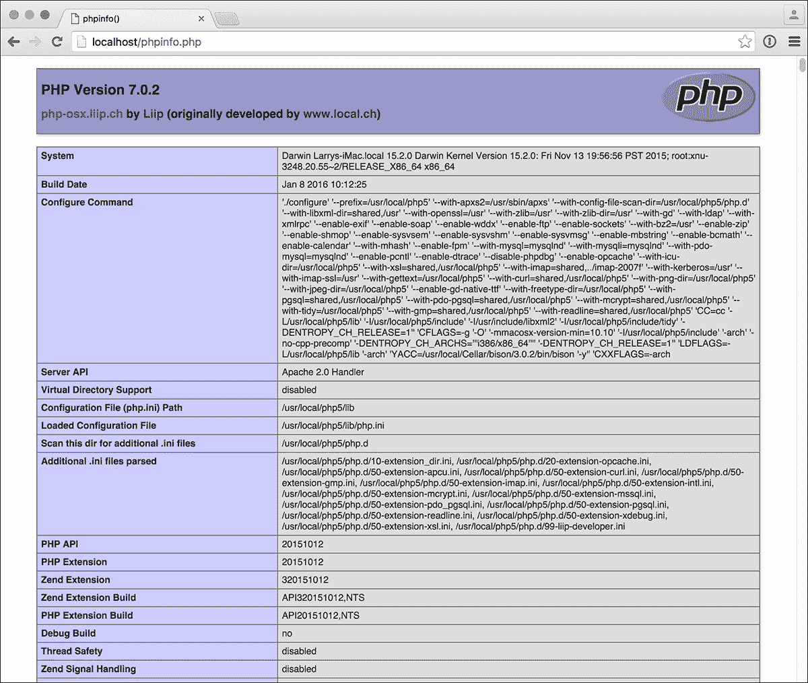


如果脚本执行正确，浏览器的结果应该像这样（耶！）。

如果你看到 PHP 代码  或空白页面，可能意味着许多情况：

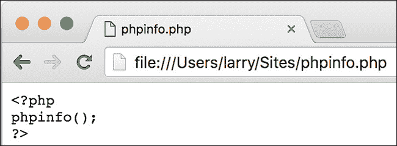


如果你看到原始 PHP 代码，那么 PHP 代码没有被执行。


- 你没有通过 URL 加载 PHP 脚本（即地址未以 `http` 开头）。注意，你可能需要点击地址栏来查看完整 URL，包括 `http`，因为今天的许多浏览器默认隐藏了此内容。
- 服务器上尚未启用 PHP。
- 你没有使用正确的扩展名。

如果你看到 `file not found` 或类似的错误 ，可能是因为：

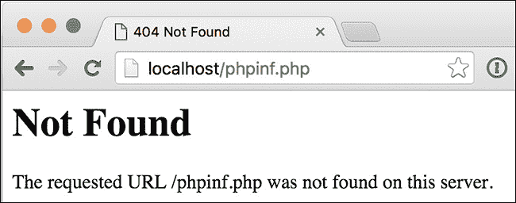


此服务器响应表示尝试访问的 URL 与服务器上实际存在的文件之间不匹配。


- 你输入了错误的 URL。
- PHP 脚本不在正确的目录中。
- PHP 脚本没有正确的名称或扩展名。

---

> **提示**
>
> 非常重要的一点，你不能像打开 HTML 页面或其他应用程序中的文件那样直接在浏览器中打开 PHP 文件。PHP 脚本必须由 Web 服务器处理，这意味着你必须通过 URL（以 `http://` 开头的地址）来访问它们。

---

> **提示**
>
> 即使你不是资深的计算机专业人士，也应该考虑在电脑上安装 PHP。这样做并不困难，而且 PHP 是免费的。再次请参附录 A 获取说明。

### 将文本发送到浏览器

如果你只能看到它在工作，那么 PHP 就不会很有用（尽管这种确认至关重要）。你最频繁的使用 PHP 以纯文本和 HTML 标签的形式向浏览器发送信息。要这样做，请使用 `print`：

```php
print "something";
```

只需输入 `print` 单词，后跟你想显示的内容：一条简单的消息、变量的值、计算结果等。在那个示例中，消息是一个文本字符串，因此必须用引号括起来。

PHP 在调用函数（如 `phpinfo()` 和 `print`）时是不区分大小写的。使用 `print`、`Print` 和 `PRINT` 得到相同的结果。在书的后期，你会看到大小写产生关键差异的示例。

明确的是，`print` 实际上并没有进行打印；它只是输出数据。当通过浏览器运行 PHP 脚本时，该 PHP 输出由浏览器本身接收，就像它是来自静态 HTML 文件的内容一样。

还要注意该行是用分号（`;`）终止的。PHP 代码中的每个语句都必须以分号结束，忘记这一要求是导致错误的常见原因。PHP 中的 `statement`（语句）是一行可执行的代码，例如：

```php
print "something";
```

或者：

```php
phpinfo();
```

相反，注释、PHP 标签、控制结构（例如条件判断和循环）以及某些其他内容则不需要。

PHP 手册——可以在线上 [`www.php.net/manual`](http://www.php.net/manual) 访问——它列出了该语言的每一个函数和特性。手册首先讨论了通用概念（安装、语法、变量），最后按主题（MySQL、字符串函数等）列出了各个主题的函数。

若想在 PHP 手册中快速查找任何函数，请在网络浏览器中访问 `www.php.net/functionname`（例如，[`www.php.net/print`](http://www.php.net/print)）。

要理解函数是如何描述的，请查看 `print` 函数页面开头的图片 。

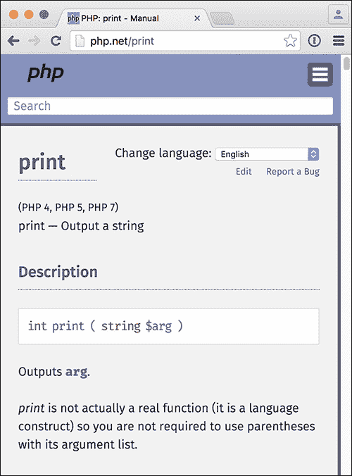


PHP 手册中关于 `print` 语言构造的页面。

第一行是函数本身的名字，后面跟着支持该函数的 PHP 版本。随着语言的增长，会添加新函数，偶尔也会移除旧函数。接着是该函数的文本描述以及函数的基本用法。用法部分是最重要也最让人困惑的部分。

在例例中，第一个值——`int`——表示 `print` 返回一个整数值（具体来说，`print` 始终返回 1）。括号内部的 `string $arg` 表示该函数接受一个必选参数，该参数应该是字符串格式。你已经见过它的实际运行了。

作为对比，请查看手册中 `nl2br()` 函数的列表 。该函数将文本中的换行符（等同于按下回车/Enter 键）转换为 HTML 换行标签。该函数返回字符串，接受一个字符串作为第一个参数，以及一个可选的 `Boolean (TRUE/FALSE)` 作为第二个参数。方括号表示可选参数，这些参数总是列在最后。当函数接受多个参数时，它们用逗号隔开。因此，可以这样调用该函数：

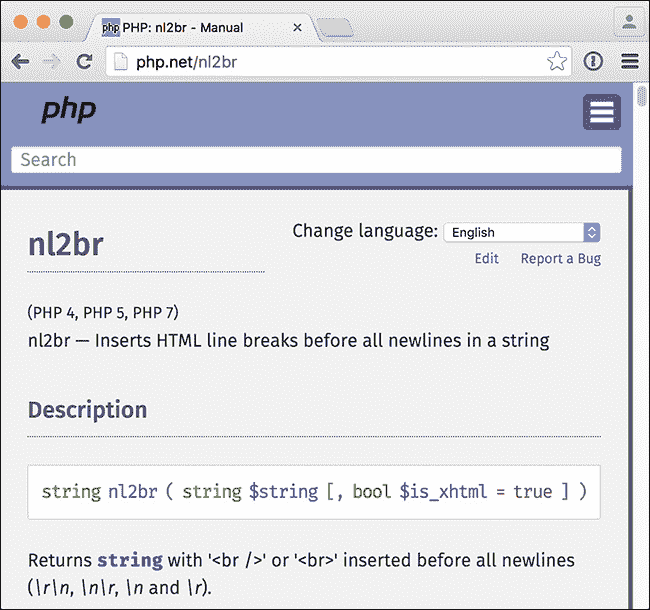


PHP 手册中关于 `nl2br()` 函数的页面。

```php
nl2br("Some text");
nl2br("Some text", false);
```


正如定义所示，第二个参数的默认值为`true`，这意味着除非传递给函数的第二个参数值为`false`，否则它将创建`<br />`标签（符合 XHTML 标准）。情况下，函数将创建`<br>`标签。

关于 PHP 手册最重要的一点是：它是存在的！如果你对某个函数或如何正确使用它感到困惑，请检查 PHP 手册中对应的参考页面。

### 如何查找函数定义

**1.** 在网络浏览器中访问`www.php.net/functionname`。

如果 PHP 手册中没有你尝试的函数的匹配记录，请检查拼写，或查看手册提供的推荐替代方案 。

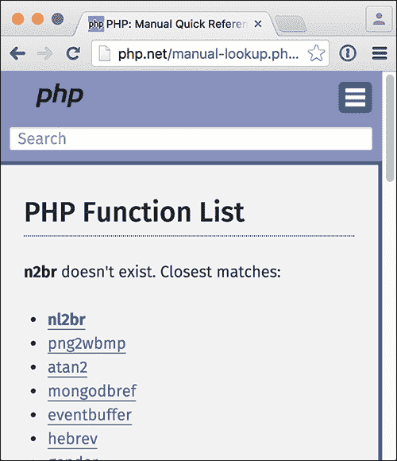

 如果输入的 URL 与参考内容不完全匹配，手册将提供备选函数。

**2.** 将该函数存在的 PHP 版本与你正在使用的 PHP 版本进行比较。

使用已经演示过的`phpinfo()`函数，可以确定你运行的是哪个版本的 PHP。如果某个函数是在较后版本的 PHP 中添加的，你需要升级你现有的版本，或者使用其他方法。

**3.** 检查函数返回的数据类型。

有时，你可能会在某个函数上遇到问题，因为它返回的值类型与你预期的不同。

**4.** 检查函数需要或可以接受多少以及什么类型的参数。

使用函数时最常见的错误是在调用函数时发送了数量或类型错误的参数。

**5.** 阅读用户注释（如果存在）以获取更多信息。

有时用户注释会非常有帮助（其他时候则不然）。

#### 提示

如果你看到一条显示某个函数已弃用（deprecated）的信息 ，这意味着该函数将从未来的 PHP 版本中删除，你应该开始使用更新的、更好的替代方案（几乎总有一个被识别出的更好的替代方案）。

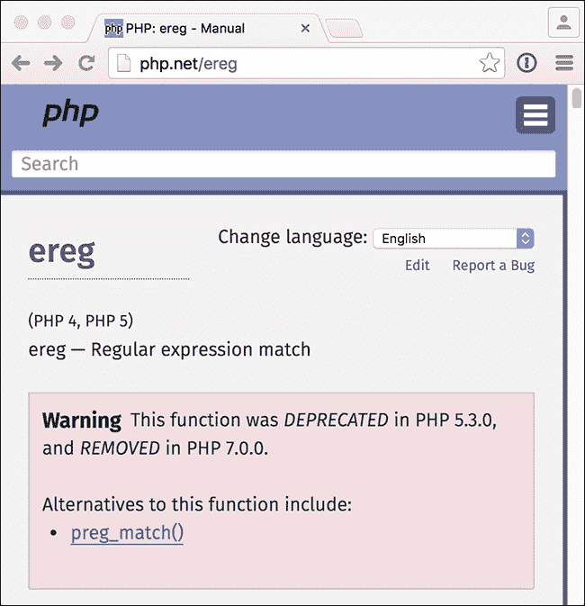

 代码中应避免使用弃用函数。

### 将 HTML 发送到浏览器

正如最初学习 HTML 的人们很快发现的那样，在网页浏览器中查看纯文本有很多不如之处。事实上，HTML 的创建是为了让纯文本更具吸引力和实用性。因为 HTML 通过向文本添加标签来工作，你可以使用 PHP 向浏览器发送 HTML 标签以及其他数据：

```
print "<b>Hello, world!</b>";
```

但有一种情况你必须小心。需要双引号的 HTML 标签，例如`<a href="page.php">link</a>`，在被 PHP 打印时会产生问题，因为`print`函数也使用了双引号 ：

点击此处查看代码图像

```php
print "<a href="page.php">link</a>";
```


 尝试打印双引号会导致错误，因为它们与`print`语句的主双引号冲突。

一种解决办法是通过反斜杠*转义*（escape）HTML 内部的双引号：点击此处查看代码图像

```php
print "<a href=\"page.php\">link</a>";
```


 尝试打印双引号将产生错误，因为它们与`print`语句的主双引号冲突。

通过转义 HTML 内部的引号，另一种解决方法是：点击此处查看代码图像

```php
print "<a href=\"page.php\">link</a>";
```


 尝试打印双引号将产生错误，因为它们与`print`语句的主双引号冲突。

HTML 代码的间距会出现在网页的 HTML 源代码中，但对浏览器中的显示效果微乎其微。例如，整个页面的 HTML 源代码可以放在一行中，而不会改变终端用户看到的内容。然而，如果你必须在 HTML 源代码中寻找问题，你不会喜欢那长长的单行 HTML 代码。

你可以通过在 PHP 中多行打印动态生成的 HTML 代码，或者通过在双引号内使用换行字符`\n`来影响其间距：

```
print "Line 1\nLine 2";
```

再次，使用换行字符影响的是网页的`HTML source code`，而不是终端用户在浏览器中看到的渲染结果。

要调整渲染后网页的间距，你将使用 CSS 以及段（paragraph）、div 和 break 标签等。

### 5. 查看 HTML 源代码以发送到浏览器的代码 

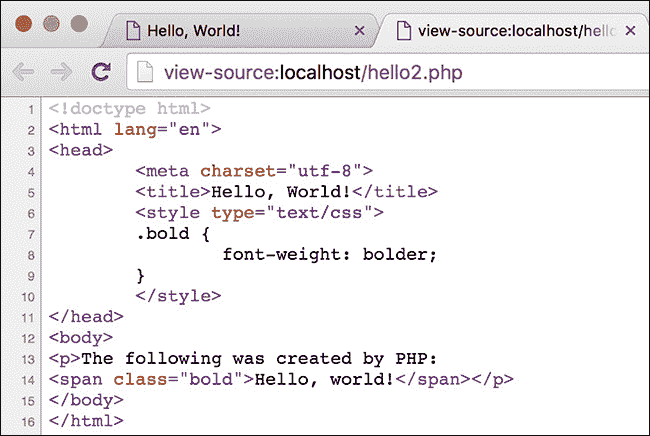

 hello2.php 生成的 HTML 源代码 。

操作方法取决于浏览器：在 Chrome 中选择“查看” > “开发者工具” > “查看源代码”，在 Firefox 中选择“查看” > “页面源代码”，或在 Internet Explorer 中选择“查看” > “源代码”。

这是一个你想要养成习惯的步骤，特别是在出现问题时。请记住，PHP 主要用于生成 HTML，然后发送到浏览器并由浏览器解释。通常，确认发送到浏览器的内容（通过查看源代码）有助于解释你在浏览器解释（或可见结果）中看到的问题。

**提示**

理解引号的作用以及如何转义问题字符对于使用 PHP 编程至关重要。这些主题将在接下来的两个章节中进行详细介绍。

**提示**

从 PHP 发送到浏览器的 HTML 并不需要这么简单。你可以创建表格、JavaScript 以及更多内容。

**提示**

记住，PHP 标签之外的任何 HTML 都会自动发送到浏览器。在 PHP 标签内部，使用`print`语句将 HTML 发送到 Web 浏览器。

### 在脚本中添加注释

注释是编程中不可或缺的一部分，并不是因为它们有任何作用，而是因为它们能帮助你记住为什么要这样做。计算机在处理脚本时会忽略这些注释。此外，PHP 注释永远不会发送到浏览器，它们是你的秘密。

PHP 支持三种添加注释的方法。你可以通过在想要忽略的行开头放置`//`或`#`来创建单行注释：

```
// 这是一个注释。
```

你也可以使用`//`或`#`在 PHP 行的尾开始注释，如下所示：

点击查看代码图片

```
print "Hello"; // 只是一个问候。
```

虽然这很大程度上是一个风格问题，但在 PHP 中`//`的使用比`#`常见得多。

你可以使用`/*`开始注释并使用`*/`结束注释创建一个多行注释：

```php
/* 这是一个
多行注释。 */
```

有些程序员更喜欢这种注释样式，因为它包含了起始和结束“标签”，为注释的开始和结束位置提供了界限。

要在脚本中添加注释：

1. 在文本编辑器或 IDE 中打开之前创建的`hello2.php` (Script 1.4)。

2. 在初始 PHP 标签之后，为脚本添加一些注释（**Script 1.5**）：

```php
/*
 * 文件名: hello3.php
 * 书籍引用: Script 1.5
 * 创建者: Larry Ullman
 */
```

**Script 1.5** 在脚本中添加 PHP 和 HTML 注释是为了记录文档，并使某行 PHP 代码失效。

点击查看代码图片

```html
1    <!doctype html>
2    <html lang="en">
3    <head>
4      <meta charset="utf-8">
5      <title>Hello, World!</title>
6      <style type="text/css">
7      .bold {
8          font-weight: bolder;
9      }
10     </style>
11   </head>
12  <body>
13  <p>The following was created by PHP:
    <br>
14  <?php
15  /*
16   * Filename: hello3.php
17   * Book reference: Script 1.5
18   * Created by: Larry Ullman
19   */
20
21  //print "<span class=\"bold\">";
22  print "<span class=\"bold\">Hello,
23 world!</span>
24 <!-- This is a comment. -->
25  </p>
26 </body>
27 </html>
```

### 调试 PHP 脚本

 确保你始终通过 URL 运行 PHP 脚本！

这可能是初学者最常见的错误。PHP 代码必须通过 Web 服务器应用程序来运行，这意味着它必须通过`http://something`进行请求。当你看到的是实际的 PHP 代码而不是代码执行的结果时，很可能是因为你没有通过 URL 运行 PHP 脚本。

 了解你运行的是哪个版本的 PHP。

某些问题源于所使用的 PHP 版本。在运行任何支持 PHP 的服务器之前，请运行`phpinfo.php`文件（脚本 1.2）来确认正在使用的 PHP 版本。

 确保开启了`display_errors`。

这是一个基础的 PHP 配置设置（在附录 A 中讨论过）。你可以通过执行`phpinfo()`函数来确认此设置（只需使用浏览器在生成的页面中搜索`display_errors`）。出于安全考虑，PHP 可能未设置为显示可能发生的错误。如果是这样，当问题出现时，你将看到空白页面。为了调试大多数问题，你需要看到错误，因此在学习期间开启此设置。你可以在附录 A 和第 3 章](#ch03.html_ch03)中的“HTML 表单与 PHP”中找到操作说明。

 检查 HTML 源代码。

有时问题隐藏在页面的 HTML 源代码中。事实上，PHP 错误信息有时也会在那里！

 信任错误信息。

另一个常见的初学者错误是不完全阅读或信任 PHP 的错误。虽然错误信息往往晦涩且看似毫无意义，但它们不能被忽略。至少，PHP 关于问题所在行数的报告通常是。如果你需要将错误信息传递给他人（例如当你向我寻求帮助时），请务必包含整个错误信息！

 休息一下！

多年年来我遇到了许多编程问题，而绝大多数最困难的问题都是通过离开电脑一会儿解决的。人很容易感到沮丧和困惑，在这种情况下，你采取的任何进一步步骤都只会让情况变得糟糕。

**提示**

这些是一些通用的调试技术，专门为初级 PHP 程序员定制的。目前这些已经足够了，因为书中的示例相对简单。更复杂的编码需要更高级的调试技术，因此我的*PHP and MySQL for Dynamic Web Sites: Visual QuickPro Guide, Fourth Edition*（Peachpit Press, 2012）专门用一个章节讨论了这个主题。

### 回顾与探索

书中的每一章都以“回顾与探索”章节结束。在这些章节中，你会找到：

 关于刚刚涵盖内容的问题

 关于如何独立扩展知识和经验的提示

如果你在这些章节中遇到任何问题（无论是回答问题还是进行自己的尝试），请参阅书籍的支持论坛（[www.LarryUllman.com/forums/](http://www.LarryUllman.com/forums/)）。

#### 回顾

 什么是 HTML？当前 HTML 的版本是什么？

 你的文本编辑器或 IDE 设置使用什么编码？它与你生成的 HTML 页面指定的编码匹配吗？为什么编码很重要？

 什么是 CSS？它有什么用途？

 对于你的特定服务器，PHP 脚本应该具有什么扩展名？

 “网络根目录”是什么意思？你服务器的网络根目录是什么？

 你如何测试 PHP 脚本？当 PHP 脚本不通过 URL 运行时会发生什么？

 写出在 PHP 代码中添加注释两种方法。列出使用注释的一些理由。

#### 探索

 如果你可以访问多个服务器，请确认另一台服务器运行的是哪个版本的 PHP。

 创建一个显示某些信息的静态 HTML 页面。然后用 PHP 创建的内容替换部分静态内容。

 创建一个供自己工作使用的模板。该模板应包含 HTML 框架、PHP 的开始和结束标签以及一些基础注释。

 使用`phpinfo()`函数确认你的服务器上已启用了`display_errors`。如果没有启用，请更改服务器配置以启用它（参见第 3 章](#ch03.html_ch03)和附录 A）。

 在随后的章节中，当书中提到新函数时，偶尔检查 PHP 手册的页面。

## 2. 变量

### 本章内容

- 什么是变量
- 变量语法
- 变量的类型
- 变量的值
- 理解引号
- 回顾与探索

上一章介绍了如何使用 PHP 将简单的文本和 HTML 发送到浏览器——换句话说，你完全不需要 PHP！但是，为了从简单的页面转向动态应用程序和交互式网站，你需要变量。

本章介绍变量的基础知识。如果你从未处理过变量，本章将是一个很好的介绍。如果你熟悉这个概念，就可以轻松地完成本章。

### 什么是变量？

*变量*是数据的容器。一旦数据存储在变量中（更常用的说法是一旦变量被赋值），该数据就可以被修改、打印、保存到数据库或发送。

PHP 变量本质上是灵活的：你可以将数据放入变量，从中提取数据（而不影响变量的值），放入新数据，并根据需要重复这种循环。但 PHP 变量在程度上是临时的：*大多数变量只在执行期间存在*——也就是说，它们只在该期间拥有值。一旦脚本执行（通常是遇到最后一个 PHP 标签时），这些变量就会消失。此外，当用户点击链接或提交表单时，他们将进入新页面，该页面可能有另一完全不同的变量集。

要打印 PHP 的预定义变量：

## 1. 在你的文本编辑器或 IDE 中创建一个新的 PHP 脚本，命名为`predefined.php`（脚本 2.1）。

**脚本 2.1** 此脚本使用`print_r()`函数显示存储在预定义变量`$_SERVER`中的值。

点击此处查看代码图像

```html
<!doctype html>
<html lang="en">
<head>
    <meta charset="utf-8">
    <title>Predefined Variables</title>
</head>
<body>
<pre>
<?php // Script 2.1 - predefined.php

// Show the value of the $_SERVER variable:
print_r($_SERVER);

?>
</pre>
</body>
</html>
```

## 2. 创建初始 HTML 标签：

点击此处查看代码图像

```html
<!doctype html>
<html lang="en">
<head>
  <meta charset="utf-8">
  <title>Predefined Variables</title>
</head>
<body>
<pre>
```

这段代码重复了上一章创建的 HTML 模板。在页面主体中，使用了`<pre>`标签来使生成的 PHP 信息更易于阅读。如果不使用`<pre>`标签，`print_r()`函数的输出在浏览器中将难以阅读。

## 3. 添加 PHP 代码：

点击此处查看代码图像

```php
<?php // Script 2.1 - predefined.php

print_r($_SERVER);

?>
```

PHP 代码仅包含一个函数调用。应该为该函数提供变量的名称。

在这个示例中，变量是`$_SERVER`，它在 PHP 中是特殊的。`$_SERVER`存储了关于服务器的所有类型数据：它的名称和操作系统、当前用户名、关于 Web 服务器应用程序（Apache、Nginx、IIS 等）的信息等。它还反映了正在执行的 PHP 脚本：它的名称、它在服务器上的存储位置等。

注意，你必须按照此处完全输入`$_SERVER`，全大写字母。

## 4. 完成 HTML 页面：

```html
</pre>
</body>
</html>
```

## 5. 将文件保存为`predefined.php`，将其上传到你的服务器（或保存到计算机上的相应目录），并在浏览器中测试它 。

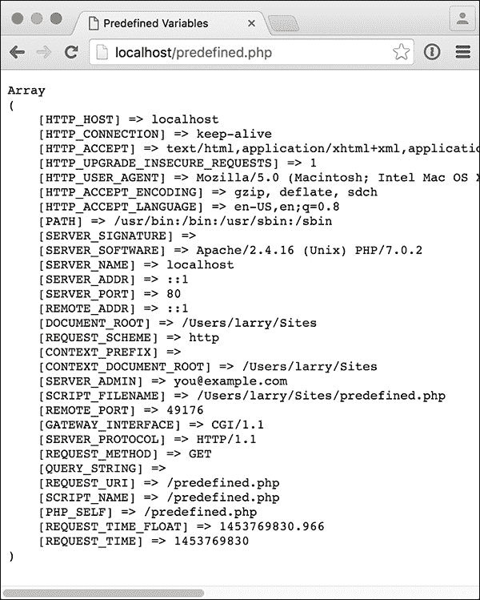

 此脚本打印出的`$_SERVER`变量是关于服务器和 PHP 脚本值的总列表。

再次记住，你必须通过 URL 运行所有 PHP 脚本（即`http://*something*`）。

## 6. 如果可能，将文件传输到另一台运行 PHP 的计算机或服务器上，并在浏览器中再次执行脚本 。


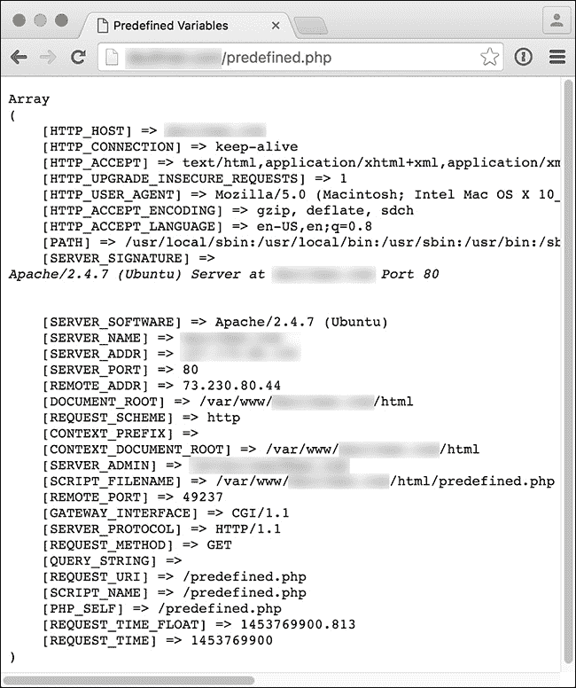

 通过`predefined.php`页面，不同的服务器将生成不同的结果（与  进行比较）。

* * *

**提示**

像你在这里所做的打印任何变量的值是最强大的调试工具之一。脚本通常不会按照你预期的方式运行，是因为一个或多个变量的值并不是你假设它们具有的值，因此确认它们的实际值非常有帮助。

* * *

* *

**提示**

如果你不使用 HTML `<pre></pre>` 标签，结果将像  中的杂乱信息。

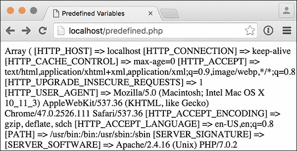

 对于像`$_SERVER`这样大型复杂的变量，不使用 HTML 预格式标签配合`print_r()`会产生一种不可理解的混乱（与   比较）。

* * *

### 变量语法

现在你已经对变量池有了初步尝试，是时候进一步探索一下了。在前面的示例中，脚本打印了 PHP 预定义变量`$_SERVER`的值。一旦理解了正确的语法，你也可以创建自己的变量。要创建合适的变量名，必须遵循以下规则：

 所有变量名必须以美元符号（`$`）开头。

 美元符号之后，变量名必须以字母（A–Z, a–z）或下划线（`_`）开始。数字不能紧跟美元符号。

 变量名的其余部分可以是字母、下划线和数字的任意组合。

 变量名中不允许包含空格。（通常使用下划线来分隔单词。）

 每个变量必须有一个唯一的名称。

 变量名是*区分大小写*的！因此，`$variable`和`$Variable`是两个不同的结构。这一点可能是最重要的：PHP 中的变量名区分大小写。（如果你在之前的脚本中使用`server`或`$_Server`，你会看到错误信息或什么都没有）

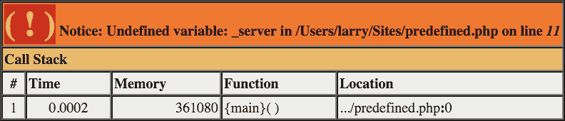 为了减少 Bug，我建议以下策略：

 始终使用小写变量名。

 使你的名称具有描述性（例如`$first_name`）。

 无论选择何种命名规则，保持一致（如脚本 2.2](#ch02.html_ch02))），即使这似乎是多余的。

```html
<!doctype html>
<html lang="en">
<head>
    <meta charset="utf-8">
    <title>Variables and Comments</title>
</head>
<body>
    <pre>
    <?php // Script 2.2

    // 定义变量
    $year = 2016; // 当前年份
    $june_avg = 88; // 六月的平均值
    $page_title = 'Weather Reports'; // 页面标题

    // 等
    ?>
    </pre>
</body>
</html>
```

* * *

 首先，无论选择何种命名规则都要保持一致！

**表 2.1** 列出了一些示例有效变量；**表 2.2** 列出了一些无效变量及其违反的规则。

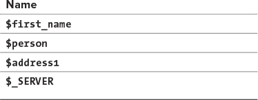

**表 2.1 PHP 中的有效变量**

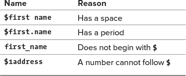

**表 2.2 PHP 中的无效变量**

### 变量类型

本书涵盖了三种常见的 PHP 变量类型：*数字*、*字符串*和*数组*。本章快速介绍，后续章节将进行更详细的讨论：

 第 4 章, “使用数字”

 第 5 章, “使用字符串”

 第 7 章, “使用数组”

第四种变量类型`objects`（对象）在附录 B“资源与后续](#app02.html_app02)”中介绍，但本书并未涵盖。该特定主题对于入门指南来说太深奥了——事实上，在我的*PHP Advanced and Object-Oriented Programing: Visual QuickPro Guide, Third Edition*(Peachpit Press, 2013）中对该主题的基本介绍就需要 150 多页！

### 数字

从技术上讲，PHP 将数字分为两种类型：`integers`（整数）和`floating-point`（浮点数，也称为`double-precision floating-point`或`doubles`）。由于 PHP 处理变量非常宽松，至少在你刚开始时，将这两类数字归为一类在很大程度上不会影响你的编程。尽管如此，为了准确起见，让我们简要讨论一下它们之间的区别。

第一类数字——`integers`也称为`whole numbers`（整数）。它们可以是正数也可以是负数，但不包含分数或小数。使用小数点的数字（即使是 1.0 这样的数字）都是`floating-point`数字，也称为`floats`。你使用浮点数来表示分数，因为在 PHP 中表示分数的唯一方法将其转换为等效小数。因此，`1¼`被写为`1.25`。**表 2.3** 列出了一些示例有效数字及其正式类型；**表 2.4** 列出了无效数字以及它们违反的规则。

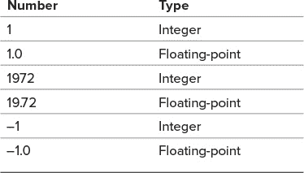

**表 2.3 PHP 中的有效数字**

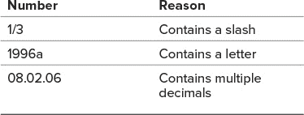

**表 2.4 PHP 中的无效数字**

> 提示

正如你很快看到的，在无效数字周围加上引号可以将其转换为有效的字符串。

### 字符串

字符串是任何包含在一对单引号（'）或双引号（"）内的任意数量字符。字符串可以包含任何存在的字符组合：字母、数字、符号和空格。字符串还可以包含变量。

以下是有效字符串值的示例：

点击此处查看代码图像“PHP 入门](#ch01.html_ch01)”提到过打印 HTML 代码时存在类似的问题。当 PHP 遇到示例中的第二个引号时，它认为字符串在结束结束；后续文本（`How...`）会导致错误。要在字符串中使用引号，你可以在引号前面加上反斜杠（\）来对其进行*转义*（escape）：

```php
"I said, \"How are you?\""
```

反斜杠告诉 PHP 将每个转义的引号视为字符串`value`的一部分，而不是将其作为字符串的开始或结束指示符。

你可以类似地通过不同类型的引号来绕过这个问题：

```php
'I said, "How are you?"'
"I said, 'How are you?'"
```

> 提示

注意，“1996”通过通过将数字放在引号内将整数转换为字符串。本质上，字符串包含字符`1996`，而数字（未加引号的值）将等于`1996`。这是一个细微的区别，在你的代码中这并不重要，因为 PHP 允许你对字符串`1996`进行数学计算，就像对数字进行一样。

> 提示

第 1 章还演示了如何在双引号内打印`\n`字符来创建一个新行。虽然转义引号会打印引号本身，但转义`n`会换行，转义`r`会创建一个回车，而转义`t`会创建一个制表符。

> 提示

理解字符串、变量以及单双引号对于使用 PHP 编程至关重要。出于这个原因，本章末尾有一个章节专门讨论该主题。

### 数组

数组在第 7 章中有更详细的介绍，但让我们在这里简要回顾一下。字符串或数字包含一个单一值（都称为`scalar`标量），而数组可以被分配多个值。你可以将数组想象成值的列表或表格：你可以将多个字符串和/或数字放入一个数组。

数组使用`keys`（键）来创建和检索它们存储的值。生成的结构——一个键值对列表——类似于双列电子表格。与其他编程语言中的数组不同，PHP 中的数组结构非常灵活，既可以使用数字也可以字符串作为键和值。数组在这一方面甚至不需要保持一致。（当你在第 7 章](#ch07.html_ch07)中开始处理特定示例时，所有这些都将更有意义。）

PHP 根据键的格式支持两种数组。如果数组使用数字作为键（**表 2.5**），它被称为`indexed`（索引）数组。如果它使用字符串作为键（**表 2.6**），它就是`associative`（关联）数组。在任何情况下，数组中的值都可以是任何变量类型（字符串、数字等）。

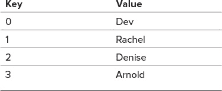

**表 2.5 索引数组**

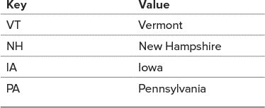

**表 2.6 关联数组**

> 提示

数组的键也被称为`index`（索引）。你会看到这两个术互换使用。

> 提示

数组可以且经常包含其他数组，创建所谓的`multidimensional`（多维）数组。

> 提示

PHP 所说的`associative array`在 Perl 和 Ruby 等语言中被称为`hash`。

无论变量类型如何，给变量赋值都使用等号 (=)。因此，等号赋值运算符，因为它将右侧的值分配给变量。例如：

```php
$number = 1;
$floating_number = 1.2;
$string = "Hello, world!";
```

这些每行都代表一个完整的语句（即一个可执行的操作），因此每行都以分号结束。

要打印变量的值，使用`print`函数：

```php
print $number;
print $string;
```

如果你想在某个语文中打印变量的值，你可以将变量名放在打印的字符串中，只要你使用双引号即可：:

```php
print "Number is $number";
print "String is $string";
```

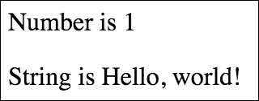

 打印两个变量值的结果。

这种使用`print`方法适用于标量（单值）变量类型——数字和字符串。对于复杂变量类型——数组和对象——你不能直接使用`print` :

```php
print "_SERVER is $_SERVER";
```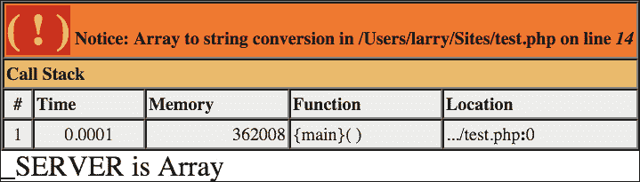

 在数组等复杂变量类型上使用`print`将不会得到你想要的结果。

`print_r()`可以处理这些非标量类型，你将在书中后面学习其他方法。

无论你处理的是标量还是非标量变量，当你在脚本中遇到问题时，不要忘记打印它们的值是一种极好的调试技术。

因为变量类型不是固定的（PHP 被称为`weakly typed`类型语言），它们可以随时更改：

```php
$variable = 1;
$variable = "Greetings";
```

现在打印`$variable`的值，结果将是*Greetings*。接下来的部分将更好地演示向变量赋值并然后访问这些值的概念。

给变量赋值并访问变量：

# 1. 在你的文本编辑器或 IDE 中创建一个新的 PHP 脚本，命名为`variables.php` (脚本 2.3)。

**脚本 2.3** 此脚本定义了一些基础变量并打印了它们的值。

点击此处查看代码图像

```html
<!doctype html>
<html lang="en">
<head>
    <meta charset="utf-8">
    <title>Variables</title>
</head>
<body>
<?php // Script 2.3 - variables.php

// 一一个地址：
$street = "100 Main Street";
$city = "State College";
$state = "PA";
$zip = 16801;

// 打印地址：
print "<p>The address is:<br>$street
    <br>$city $state $zip</p>";

?>
</body>
</html>
```

# 2. 创建初始 HTML 标签：

```html
<!doctype html>
<html lang="en">
<head>
    <meta charset="utf-8">
    <title>Variables</title>
</head>
<body>
```

# 3. 开始 PHP 代码：

点击此处查看代码图像

```php
<?php // Script 2.3 - variables.php
```

# 4. 定义一些数字和字符串变量：

```php
$street = "100 Main Street";
$city = "State College";
$state = "PA";
$zip = 16801;
```

这些行创建了四个不同类型的变量（字符串和数字）。字符串使用引号定义，每个变量名都遵循语法命名规则。

记住，每个语句都必须以分号结尾，并且变量名对大小写敏感。

# 5. 在某些上下文中打印变量的值：

点击此处查看代码图像

```php
print "<p>The address is: <br>$street <br>$city $state $zip</p>";
```

这里单个`print`语句引用了所有变量。要打印的整个字符串（包含文本、HTML 标签和变量）都包含在双引号内。HTML `<br>`标签使得文本在浏览器中跨行显示。

# 6. 完成 PHP 部分和 HTML 页面：

```php
?>
</body>
</html>
```

# 7. 将文件保存为`variables.php`，将其上传到服务器（或保存到电脑上相应的目录），并在浏览器中测试 。

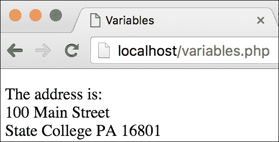

 一些变量被赋予了值，然后在上下文中打印。

***

#### 提示

如果你在运行此脚本时看到解析错误 ，你可能漏掉了一个分号，或者引号不匹配。在这些特殊情况下，错误本身可能出现在代码的前几行中（而不是错误消息中报告的某一行），但 PHP 直到下一行才捕获到。

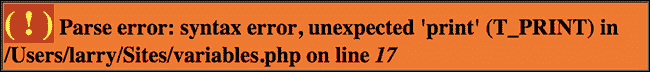

 正如你发现的，解析错误是最常见的 PHP 错误类型。它们通常由于缺少分号或引号、括号不匹配引起。

***

#### 提示

如果一个变量的值没有打印出来，或者你看到`Undefined variable`错误 ，你很可能没有以相同的方式拼写变量名。

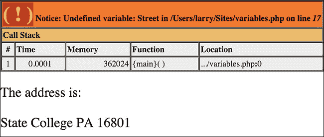

 `Undefined variable`错误表示你使用了一个没有值的变量（它尚未定义）。这可能是由于拼写错误和大小写引起的。

***

#### 提示

如果你看到空白页面，你可能有一个错误，但 PHP 的`display_errors`配置被设置为关闭。详情请参见第 3 章“HTML 表单与 PHP”。

***

## 理解引号

现在你已经了解变量的基础知识以及如何创建它们，让我们来练习一下，确保你正确使用了引号。PHP 和大多数编程语言一样，允许你同时使用双引号（`"`）和单引号（`'`）——但它们的结果完全不同。理解这种区别至关重要，因此下一个示例将同时使用两种类型，以强调不同的行为。

要记住的规则是：单引号内的项被视为字面量；双引号内的项会被解析（extrapolated）。这意味着在双引号内，变量名会被其值替换，如脚本 2.3 所示，但单引号则不如此。

此规则适用于 PHP 中任何可能使用引号的地方，包括`print`的使用以及给字符串变量赋值。通过一个示例是演示这一关键概念的最佳方法。

**1. 在你的文本编辑器或 IDE 中开始一个新的 PHP 脚本，命名为`quotes.php` (脚本 2.4)。

**脚本 2.4** 此脚本简单演示了你使用的引号类型如何影响结果。

点击此处查看代码图像

```html
<!doctype html>
<html lang="en">
<head>
    <meta charset="utf-8">
    <title>Quotes</title>
</head>
<body>
<?php // Script 2.4 - quotes.php

// 单引号或双引号在这里没有区别：
$first_name = 'Larry';
$last_name = "Ullman";

// 单引号或双引号在这里有区别：
$name1 = '$first_name $last_name';
$name2 = "$first_name $last_name";

// 单引号或双引号在这里有区别：
print "<h1>Double Quotes</h1>
<p>name1 is $name1 <br>
name2 is $name2</p>";

print '<h1>Single Quotes</h1>
<p>name1 is $name1 <br>
name2 is $name2</p>';

?>
</body>
</html>
```

# 2. 创建初始 HTML 标签：

```html
<!doctype html>
<html lang="en">
<head>
    <meta charset="utf-8">
    <title>Variables</title>
</head>
<body>
```

# 3. 开始 PHP 代码：


点击此处查看代码图像

```php
<?php // Script 2.4 - quotes.php
```

## 4. 创建两个字符串变量

```php
$first_name = 'Larry';
$last_name = "Ullman";
```

在这里使用单引号或双引号没有区别，因为每个字符串都可以被视为字面量。然而，如果你使用的是自己的名字（你可以尝试这样做）并且它包含单引号，你就需要使用双引号，或者在单引号内转义单引号：

```php
$last_name = "O'Toole";
$last_name = 'O\'Toole';
```

## 5. 使用现有的 `first_name` 和 `last_name` 变量创建两个 `name` 变量

点击此处查看代码图像

```php
$name1 = '$first_name $last_name';
$name2 = "$first_name $last_name";
```

在这些行中，使用的引号差异巨大。`name1` 变量字面上等于 `$first_name $last_name`，因为没有发生解析。相反，`name2` 等于 `Larry Ullman`，这是预期的结果。

## 6. 使用两种类型的引号打印变量

```php
print "<h1>Double Quotes</h1>
<p>name1 is $name1 <br>
name2 is $name2</p>";

print '<h1>Single Quotes</h1>
<p>name1 is $name1 <br>
name2 is $name2</p>';
```

再次，引号在这里产生了一切影响。第一个打印语句（使用双引号）打印出 `$name1` 和 `$name2` 变量的值，而第二个使用单引号的则字面上打印 `$name1` 和 `$name2`。

打印语句中的 HTML 使它们在浏览器中更易读。每个语句都分三行 PHP 代码执行，以增加可读性，这是完全可以接受的。

## 7. 完成 PHP 部分和 HTML 页面

```php
?>
</body>
</html>
```

### 提示

如果你仍然对这两种引号的区别感到困惑，始终坚持使用双引号会更稳妥。

### 提示

可以争论的是，在可能的情况下使用单引号略占优，因为 `PHP` 不需要为了查找变量而搜索字符串，从而获得更好的性能。但充其量，这只是一个微小的优化。

### 提示

创建换行符（`\n`）、回车（`\r`）和制表符（`\t`）的快捷方式必须在双引号中使用才能达到预期效果。在单引号中，这些字符都会被视为字面量。

### 提示

记住，你并不总是需要使用引号。在赋值数值值或仅打印变量时，可以省略它们：

```php
$num = 2;
print $num;
```

## 复习与练习

如果你在复习题或进阶练习中遇到任何问题，请访问书籍的支持论坛（[www.LarryUllman.com/forums/](http://www.LarryUllman.com/forums/)）。

### 复习

 `$_SERVER` 是什么类型的变量？

 所有变量必须以什么字符开头？

 变量名中可以使用哪些字符（在要求的初始字符之后）？在第一个字符之后，变量名中还可以使用哪些字符？

 变量名是区分大小写的还是不区分大小写的？

 说一个变量是 `scalar`（标量）是什么意思？标量变量类型有哪些？非标量变量类型的例子是什么？

 什么是赋值运算符？

 本章介绍了哪种关于变量的极佳调试技术？

 使用单引号和双引号有什么区别？

### 进阶

 创建另一个 `PHP` 脚本，定义一些变量并打印它们的值。尝试使用不同标量类型的变量。

 创建一个 `PHP` 脚本，在某些 HTML 中打印某些变量的值。更复杂的练习可能涉及使用 `PHP` 和变量来创建链接或图像标签。

# 3. HTML 表单与 PHP

## 本章内容

- 创建简单的表单
- 选择表单方法
- 在 `PHP` 中接收表单数据
- 显示错误
- 错误报告
- 手动向页面发送数据
- 复习与进阶

上一节对变量主题进行了简单介绍。虽然你经常会创建自己的变量，但也会经常结合 HTML 表单使用变量。表单是网站的基本单元，能够实现注册登录系统、搜索功能和在线购物等功能。即使是最简单的网站也会有逻辑理由引入 HTML 表单。而使用 `PHP`，接收和处理它们生成的数据是惊人的简单。

考虑到这一点，本章将涵盖创建 HTML 表单的基础知识，并解释所提交的表单数据如何供 `PHP` 脚本使用。本章还将介绍实际 `PHP` 编程的关键概念，包括如何管理脚本中的错误。

## 创建简单的表单

对于本章中的 HTML 表单示例，你将创建一个反馈页面，接收用户的称呼（或头衔）、姓名、电子邮件地址、回复和评论 。生成表单的代码位于表单的起始标签和结束标签之间：

```html
<form>
  form elements
</form>
```

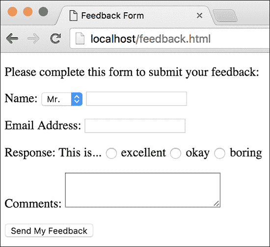

 本章示例将使用的 HTML 表单。

表单标签决定了表单的开始和结束。表单的每个元素都必须输入这两个标签之间。起始表单标签还应该包含一个 `action` 属性。它指示表单数据应该提交到的页面。在创建表单时，该值是最重要的因素之一。在书中，`action` 属性将始终指向 `PHP` 脚本：

```html
<form action="somepage.php">
```

在创建下一个表单之前，让我们简单回顾一下 HTML5 主题。HTML5 引入了一些新的表单元素类型，例如 `email`、`number` 和 `url`。这些类型通常被当前浏览器良好支持，相比简单的文本输入提供了额外的益处，包括：

 内置的浏览器级验证（例如，浏览器将检查输入的文本是否为语法上有效的电子邮件地址或 URL）。

 更好的用户体验（例如，为移动用户显示特定的电子邮件地址键盘）。

HTML5 还引入了 `required` 属性，防止表单在没有输入或选择值的情况下提交 。

 `required` 属性——在浏览器中——确保进行了选择或输入了内容。

最后注意，为每个表单元素赋予它自己的 `name`。在命名元素时要保持一致，使用字母、数字和下划线 `_`。结果应该是描述性的。

要创建一个基本的 HTML 表单：

1. 在你的文本编辑器或 IDE 中开始一个新文档，命名为 `feedback.html`（`Script 3.1`）：

```html
<!doctype html>
<html lang="en">
<head>
  <meta charset="utf-8">
  <title>Feedback Form</title>
</head>
<body>
```

这个 HTML 页面有一个包含不同输入类型的表单。

```html
<!doctype html>
<html lang="en">
<head>
  <meta charset="utf-8">
  <title>Feedback Form</title>
</head>
<body>
  <!-- Script 3.1 - feedback.html -->
  <div><p>请填写此表单以提交您的反馈：</p>
  <form action="handle_form.php">
    <p>称呼：<select name="title" required>
      <option value="Mr.">先生</option>
      <option value="Mrs.">夫人</option>
      <option value="Ms.">小姐</option>
    </select> <input type="text" name="name" size="20" required></p>
    <p>电子邮件地址：<input type="email" name="email" size="20" required></p>
    <p>回复：这是...
      <input type="radio" name="response" value="excellent" required> 优秀
      <input type="radio" name="response" value="okay"> 好
      <input type="radio" name="response" value="boring"> 无聊</p>
    <p>评论：<textarea name="comments" rows="3" cols="30" required></textarea></p>
    <input type="submit" name="submit" value="提交我的反馈">
  </form>
  </div>
</body>
</html>
```

2. 添加起始表单标签：

```html
<form action="handle_form.php">
```

表单标签指示此表单将提交到与此 HTML 页面相同目录下的 `handle_form.php`。如果你倾向于显式指定，可以使用 `PHP` 脚本的完整 URL（例如 `http://www.example.com/handle_form.php`）。

3. 添加一个下拉菜单和一个用于用户名的名的输入框：

```html
<p>称呼：<select name="title" required>
<option value="Mr.">先生</option>
<option value="Mrs.">夫人</option>
<option value="Ms.">小姐</option>
</select>
```

用户名的输入将包含两个元素 。第一个是常用头衔的下拉菜单：`Mr.`、`Mrs.` 和 `Ms.`。在 `select` 标签之间列出的每个选项都是用户可以选择的答案 。第二个元素是用于用户全名的基础文本框。可以认为，这个列表应该进行扩展，或者你也可以使用文本输入让用户输入他们偏好的头衔。

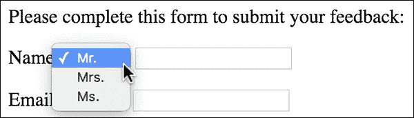

 `select` 元素创建一个选项的下拉菜单。

除了提交按钮外，每个表单元素都将具有 `required` 属性。

### 4. 为用户的电子邮件地址添加文本输入框

点击此处查看代码图片

```html
<p>Email Address: <input type="email" name="email" size="20" required></p>
```

`email` 输入类型是 HTML5 中新引入的。在支持它的浏览器中——所有最新的浏览器都是如此——客户端验证是自动的 。

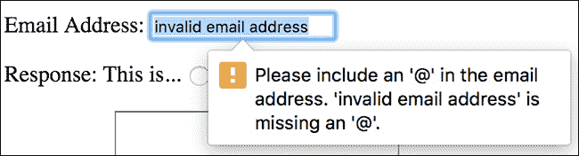

 `email` 输入类型是 HTML5 的新功能，它会根据电子邮件地址的格式对输入的文本进行语法验证。

### 5. 为响应添加单选按钮

点击此处查看代码图片

```html
<p>Response: This is...

<input type="radio" name="response" value="excellent" required> excellent

<input type="radio" name="response" value="okay"> okay

<input type="radio" name="response" value="boring"> boring</p>
```

这段 HTML 代码创建了三个单选按钮（可点击的圆形，）。因为它们的 `name` 属性具有相同的值，所以一次时间只能选择三个中的一个。在任何一个按钮上添加 `required` 属性都会使选择其中一个成为一项必要条件。

### 6. 添加一个 `textarea` 来记录评论

点击此处查看代码图片

```html
<p>Comments: <textarea name="comments" rows="3" cols="30" required></textarea></p>
```

`textarea` 比文本输入为用户提供了更多输入评论的空间。然而，文本输入允许你限制用户输入的信息量，而这在 `textarea` 中是无法做到的（至少不使用 JavaScript）。在创建表单时，请根据你希望从用户处获取的信息选择合适的输入类型。

注意，`textarea` *确实*有一个结束标签，与文本输入类型不同。

### 7. 添加提交按钮

点击此处查看代码图片

```html
<input type="submit" name="submit" value="Send My Feedback">
```

`submit` 输入的 `value` 属性是显示在浏览器按钮上的文字 。你也可以使用 `Go!` 或 `Submit`。

### 8. 关闭表单

```html
</form>
```

### 9. 完成页面

```html
</div>

</body>

</html>
```

### 10. 将页面保存为 `feedback.html`，在浏览器中查看它

由于这是一个 HTML 页面而不是 PHP 脚本，你可以直接从计算机通过浏览器查看它。

***

**提示**

注意 `feedback.html` 使用了 HTML 扩展名，因为它是一个标准的 HTML 页面（而不是 PHP 脚本）。你可以顺利地使用 `.php` 扩展名，即使没有实际的 PHP 代码。（记住，在 PHP 页面中，任何 PHP 标签——`<?php` 和 `?>`——之外的内容都会被视为 HTML。）

***

**提示**

确保你的 `action` 属性正确指向服务器上一个存在的文件，否则你的表单将无法被正确处理。在这种情况下，表单将提交到 `handle_form.php`，该文件应与 `feedback.html` 页面位于同一目录下。

***

**提示**

在这个示例中，HTML 表单是通过手动编写 HTML 创建的，但如果你更熟悉那种方法，也可以在网页应用程序（如 Adobe Dreamweaver）中完成。

## 选择表单方法

经验丰富的 HTML 开发人员会注意到刚刚创建的反馈表单缺少了一点：初始表单标签没有 `method` 属性。`method` 属性告诉服务器如何将表单数据传输到处理脚本。

`method` 有两个选择：`GET` 和 `POST`。对于表单而言，使用 `GET` 和 `POST` 的区别在于信息从表单传递到处理脚本的方式。`GET` 方法将所有收集的信息作为 URL 的一部分发送。`POST` 方法以用户不可感知的方式传输信息。例如，在提交表单时，如果你使用 `GET` 方法，生成的 URL 将类似于：

```text
http://example.com/page.php?var=value&age=20&...
```

紧跟在脚本名称 `page.php` 之后的是问号，后面跟着每个数据对应的 `name=value` 键对。使用 `POST` 方法，终端用户只会看到 `http://example.com/page.php`。

在决定使用哪种方法时，请考虑以下因素：

- `GET` 方法传递的信息有限。
- `POST` 方法将数据发送到服务器。
- `GET` 页面可以书签，但 `POST` 不行。
- `GET` 请求在 URL 中可见，而 `POST` 则不可见。
- `GET` 对于密码等敏感信息是不安全的。
- `POST` 可以处理更多的数据。

```html
24      <input type="radio" name="response" value="boring"> boring</p>
25
26      <p>Comments: <textarea name="comments" rows="3" cols="30" required></textarea></p>
27
28      <input type="submit" name="submit" value="Send My Feedback">
29
30  </form>
31  </div>
32  </body
33  </</html>
```

表单的 `method` 属性告诉浏览器如何将表单数据发送到接收脚本。由于表单提交中可能包含大量数据（包括注释），而且书签生成的页面并没有意义，因此 `POST` 是应该使用的逻辑方法。

### 3. 保存脚本并在浏览器中重新加载

在做出更改后，养成在浏览器中重新加载页面的习惯非常重要。很容易忘记加载步骤，并在发现更改没有生效时感到手足无措。

### 4. 查看页面源代码以确保所有所需的元素都存在并具有正确的属性


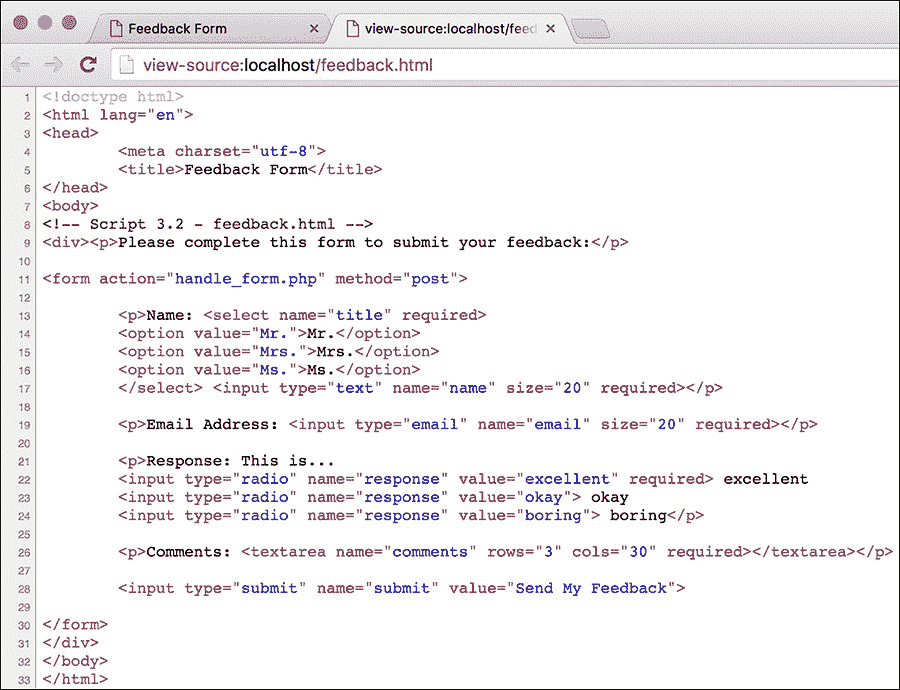

 对于表单，许多重要信息（如 `action` 和 `method` 值或元素名称）只能在 HTML 源码可见。

#### 提示


在讨论方法时，`GET` 和 `POST` 使用大写字母是为了突出显示。然而，脚本中的表单使用的是 `post`。不必担心这种不一致（即使你发现了——无论大小写，该方法都能工作）。

### 在 PHP 中接收表单数据

现在你已经创建了一个能够接收用户输入的基础 HTML 表单，你需要编写 PHP 脚本来接收并处理提交的表单数据。对于此示例，PHP 脚本将简单地重复用户在表单中输入的内容。在后面的章节中，你将学习如何获取这些信息并将其存储、通过电子邮件发送、写入文件等。

要访问提交的表单数据，你需要引用特定的`预定义变量`。第 2 章，“变量”介绍了一个预定义变量：`$_SERVER`。在处理表单数据时，PHP 脚本引用的特定变量是 `$_GET` 或 `$_POST`。如果 HTML 表单使用 `GET` 方法，提交的表单数据将在 `$_GET` 中。如果 HTML 表单使用 `POST` 方法，提交的表单数据将在 `$_POST` 中。

`$_GET` 和 `$_POST` 除了是预定义变量（即你不需要创建变量）外，还是`数组`，一种特殊的变量类型（`$_SERVER` 也是数组）。这意味着 `$_GET` 和 `$_POST` 可能包含许多值，使得打印这些值更具挑战性。你不能这样处理数组：

```php
print $_POST; // 将无法工作！
```

（另请参见第 2 章中“变量值”下的内容以获取上述代码的结果。）

相反，要访问特定值，你必须引用数组的`index`或`key`。第 7 章，“使用数组”将详细介绍这一主题，但前提很简单。从一个 `name` 属性值为 `address` 的表单元素开始：

```html
<input type="text" name="address" />
```

然后，假设表单使用 `POST` 方法，则在该表单元素中输入的值将可以在 `$_POST['address']` 中可用：

```php
print $_POST['address'];
```

遗憾的是，这里有一个小障碍：当在双引号中使用时，键周围的单引号会导致解析错误：

```php
print "You provided your address as: $_POST['address']";
```

这种丑陋的解析错误是因为尝试在双引号内使用 `$_POST['address']` 产生的。

你可以通过两种方式避免这个问题。本章将使用两种方案中语法上更简单的：只需先将特定的 `$_POST` 元素赋值另一个变量：

```php
$something = $_POST['something']; print "Thanks for saying: $something";
```

在第 7 章中你将学习另一种方法。在实现之前的最后两个注意事项：第一，与所有变量一样，`$_POST` 是区分大小写的；必须按照你看到的完全输入。第二，`name` 属性必须与表单元素匹配。

**2.** 添加 PHP 起始标签和任何注释：

```php
<?php // Script 3.3 handle_form.php
// 此页面从 feedback.html 接收数据。
// 它将在 $_POST 中接收：title, name, response, comments。
```

**3.** 将接收到的数据分配给新变量：

```php
$title = $_POST['title'];
$name = $_POST['name'];
$response = $_POST['response'];
$comments = $_POST['comments'];
```

同样，由于表单使用 `POST` 方法，提交的数据可以在 `$_POST` 数组中找到。

**4.** 打印用户信息：

```php
print "<p>Thank you, $title $name, for your comments.</p>
<p>You stated that you found this example to be '$response' and added:<br>$comments</p>";
```

这条 `print` 语句在上下文中使用了四个变量，向用户显示脚本收到的数据。

**5.** 关闭 PHP 部分，并完成 HTML 页面：

```html
?>

</body>
</html>
```

注意，此文件的名称必须与表单中 `action` 属性的值完全匹配。

### 7. 将脚本上传到服务器（如果你已安装 PHP，则将其存储在计算机上的适当目录中），确保它保存与 `feedback.html` 相同的目录下。

### 8. 通过 URL (`http://something`) 在浏览器中加载 `feedback.html`。

你必须通过 URL 加载 HTML 表单，这样当它被提交给 PHP 脚本时，该 PHP 脚本也会通过 URL 运行。*PHP 脚本必须始终通过 URL 运行！*

未通过 URL 加载表单是初学者常见的错误。

### 9. 填写表单，然后提交表单。

用户无论在 HTML 表单中输入什么内容，都应该由 `handle_form.php` 脚本输出到浏览器。

这是对第 1 章中讨论过的 `print` 语句的另一个应用，但它构成了你的第一个动态生成的网页。

如果你看到一个空白页面，请阅读章节的下一节了解如何显示可能发生的错误。

如果你看到错误提示或在打印时发现变量没有值，你可能拼写错了表单元素的名称值或 `$_POST` 数组的索引（或者你填写的表单不完整）。

当脚本引用一个不存在的变量时，就会发生此类提示。在特定情况下，原因是错误地引用了 `$_POST['Name']`，而它本应该是 `$_POST['name']`。

***

#### 提示

如果你想向 PHP 脚本传递一个预设值，请在你的 HTML 表单中使用隐藏类型的输入框。例如，在表单标签之间插入：

```html
<input type="hidden"
name="form_page"
value="feedback.html">
```

插入这段代码后，将在处理脚本中创建一个名为 `$_POST['form_page']` 的变量，其值为 `feedback.html`。

***

#### 提示

注意单选按钮和某些菜单变量的值是基于所选项目的 `value` 属性的（例如单选按钮的 excellent）。复选框也是如此。对于文本框，变量的值就是用户输入的内容。

***

#### 提示

如果 `handle_form.php` 脚本在提交的字符串中显示了额外的斜杠，请参阅“魔法引号 (Magic Quotes)”侧边栏的解释和解决方案。

***

#### 提示

查看提交给 PHP 脚本的所有表单数据的一种粗暴方法是调用 `print_r($_POST)`，就像第 2 章使用 `$_SERVER` 调用 `print_r()` 一样。

***

#### 提示

你也可以通过 `$_REQUEST` 预定义变量访问表单数据，无论表单的方法如何。然而，`$_GET` 和 `$_POST` 更精确，因此更优。

***

### 魔法引号 (Magic Quotes)

早期版本的 PHP 有一个名为 *魔法引号 (Magic Quotes)* 的功能，该功能已被移除（从 PHP 5.4 开始）。魔法引号在开启时会自动转义提交表单数据中的单引号和双引号。因此，字符串 *I’d like more information* 将被变为 *I\’d like more information*。

对潜在的问题字符进行转义在某些情况下是有用的，甚至是必要的。但如果你的 PHP 安装开启了魔法引号功能，那么当 PHP 脚本打印表单数据时，你会看到这些斜杠。你可以使用 `stripslashes()` 函数取消它的影响。例如，将其应用于 `handle_form.php` 脚本，你可以这样做：

```php
$comments = stripslashes ($_POST['comments']);
```

而不是直接用：

```php
$comments = $_POST['comments'];
```

这将产生将转义的提交字符串转换回原始、未转义值的效果。

如果你没有看到提交的表单数据被添加了额外的斜杠，你不需要担心魔法引号。

***

### 显示错误

在调试 PHP 脚本时出现的最早问题之一是，你可能根本看不到发生的错误。在 Web 服务器上安装 PHP 后，它将按照有关安全、性能、数据处理等的默认配置运行。默认设置之一是不显示任何错误。换句话说，`display_errors` 设置将关闭状态。在这种情况下，当脚本出错时，你看到的可能是一个空白页面。（这在全新安装的 PHP 中很常见；大多数主机都会启用 `display_errors`。）

运行 `phpinfo()` 脚本（例如脚本 1.2）可以查看 `display_errors` 的当前值。在 `phpinfo()` 输出的 “PHP Core” 部分中，找到 `display_errors` 指令。如果它显示为 “Off”，那么你需要采取行动。

要在脚本中显示错误：

1. 在你的文本编辑器或 IDE 中打开 `handle_form.php`（如果它尚未打开）。

2. 在 PHP 代码的第一行输入以下：

```php
ini_set('display_errors', 1);
```

`ini_set()` 函数允许脚本临时覆盖某些设置（许多但并非所有设置都可以被更改）。

此 PHP 脚本的添加开启了 `display_errors` 指令，以便显示错误。

```html
<!doctype html>
<html lang="en">
<head>
    <meta charset="utf-8">
    <title>Feedback</title>
</head>
<body>
<?php // 脚本 3.4 - handle_form.php
ini_set('display_errors', 1); //让我从错误中学习！

// 此页面接收来自 feedback.html 的数据。
// 它将接收 POST 中的 title, name, email, response, comments 和 submit。

// 创建变量的简短版本：
$title = $_POST['title'];
$name = $_POST['name'];
$response = $_POST['response'];
$comments = $_POST['comments'];

// 打印接收的数据：
print "<p>感谢你，$title $name 提供的评论。</p>
<p>你认为这个示例是 '$response' 并且添加了：br>$comments</p>";
?>
</body>
</html>
```

再次，此行代码告诉 PHP 你希望看到任何发生的错误。你应该在 PHP 部分开头调用它，这样后续的 PHP 代码将遵循此新设置。

### 3. 将文件保存为 `handle_form.php`。

### 4. 将文件上传到你的 Web 服务器，并在浏览器中进行测试。

如果生成的页面没有错误，那么脚本将像以前一样运行。如果你之前运行表单时看到的是空白页面，现在你应该能看到实际的错误消息（如上一节中所示）。再次，如果你看到此类错误，很可能是你拼错了表单元素的名称、拼错了 `$_POST` 数组中的索引，或者没有完整填写表单。

***

#### 提示

在调试脚本遇到困难时，请确保已启用 `display_errors`。如果你在电脑上安装了 PHP，我强烈建议在学习期间在 `PHP` 配置中启用它（再次，参见附录 A）。

***

#### 提示

如果在运行 PHP 脚本时看到空白页面，请同时检查 HTML 源代码是否存在错误或其他问题。

***

#### 提示

记住，`display_errors` 指令仅控制是否将错误消息发送到浏览器。它不会以任何方式创建错误或阻止错误的发生。

***

#### 提示

在表单元素中，`name` 后面没有使用等号也会导致问题：

```html
<input name"something">
```

***

### 错误报告

除了 `display_errors` 之外，你应该注意的另一个 `PHP` 配置问题是错误报告。`PHP` 拥有十多种不同级别的错误，你可以定义自己的级别（这是一个书中未涵盖的主题）。表 3.1 列出了四个最重要的通用错误级别，并带有每种错误的描述和示例。

**表 3.1 PHP 错误级别**

你可以通过两种方式设置 `PHP` 报告哪些错误。首先，你可以调整 `PHP` 文件中 `error_reporting` 级别（再次，参见附录 A）。如果你正在运行自己的 `PHP` 服务器，你可能在开发脚本时想要调整该全局设置。

第二种方案是在脚本中使用 `error_reporting()` 函数。该函数接受一个数字或一个多个常量——具有预定义含义的非引号字符串——来调整级别。（每个常量与一个数字相关）。这些常量中最重要的列在表 3.2 中，按从宽松到严格的顺序排序。

**表 3.2 错误报告常量**

使用这些信息，你可以将以下任何内容添加到脚本中：

```php
error_reporting(E_WARNINGS);
error_reporting(E_ALL);
error_reporting(E_ALL & ~E_STRICT);
```

第一行表示只报告警告及以下优先的错误。第二行请求报告所有错误。最后一个示例表示你想看到所有错误消息，但严格错误（`& ~` 意味着“与且非”）。`E_STRICT` 还会通知你在某些环境或未来的 `PHP` 版本中可能问题的代码。请记住，调整此设置不会阻止或创建错误；它只是影响是否报告错误。

通常，最好使用尽可能高的错误报告级别来开发和测试 `PHP` 脚本。为了实现这一点，声明报告所有错误：

```php
error_reporting(E_ALL);
```

否则，默认的错误报告级别（截至本文编写）为 `E_ALL & ~E_NOTICE & ~E_STRICT & ~E_DEPRECATED`。除非你覆盖此默认设置，否则你不会收到通知、严格错误和弃用代码提示。作为开发者，你希望对代码中的任何潜在或实际问题收到通知。

让我们将此应用到 `handle_form.php` 页面。

要在脚本中调整错误报告：

1. 在文本编辑器或 IDE 中打开 `handle_form.php` (脚本 3.4)，如果尚未打开。

2. 在 `ini_set()` 行之后，添加以下内容 (脚本 3.5)：

```php
error_reporting(E_ALL);
```

**脚本 3.5** 调整脚本的错误报告级别，以便对潜在和现有问题提供更多或更少的反馈。在我看来，多总是好的。

```html
1   <!doctype html>
2   <html lang="en">
3   <head>
4       <meta charset="utf-8">
5       <title>Your Feedback</title>
6   </head>
7   <body>
8   <?php //脚本 3.5 - handle_form.php #3
9
10  ini_set('display_errors', 1); // 让我学会调试脚本
11  error_reporting(E_ALL); // 显示所有可能的问题！
12  // 此页面接收来自
13  // 表单提交的数据：
14  $title = $_POST['title'];
15  $name = $_POST['name'];
16  $response = $_POST['response'];
17  $comments = $_POST['comments'];
18
19  echo "<p>Thank you, $title $name for your $response.";
20  echo "<p>You added: $comments</p>";
21  ?>
22 </body>
23</html>
```

***

### 手动向页面发送数据

本章的最后一个示例是对其他主题的一个小插曲，但利用了用 PHP 处理表单数据的想法。正如在前节中讨论的，如果表单使用 `GET` 方法，生成的查询字符串会附加到 URL 上。你也可以手动构造这样的 URL，例如：`page.php?var=value&age=20`。

要通过这种方式访问传递的值，转向 `$_GET` 变量。就像使用 `$_POST` 时一样，引用特定的名称作为 `$_GET` 中的索引。在该示例中，`page.php` 接收一个值为 *value* 的 `$_GET['var']` 变量，一个值为 *20* 的 `$_GET['age']` 变量，以此类推。


你可以通过创建一个 GET 方法的 HTML 表单以这种方式向 PHP 脚本传递数据。但你也可以使用相同的想法在不使用表单的情况下向 PHP 页面发送数据。通常你通过创建链接来实现：

```html
<a href="page.php?id=22">某些链接</a>
```

该链接（可以通过 PHP 动态生成）将把值 `22` 传递给 `page.php`，可以通过 `$_GET['id']` 访问。

要亲自尝试这一点，接下来的两个脚本将通过一个硬编码的 HTML 页面来轻松地演示这一概念。

### 创建 HTML 页面

**1.** 在你的文本编辑器或 IDE 中新建一个文档，并命名为 `hello.html`（**脚本 3.6**）：

```html
<!doctype html>
<html lang="en">
<head>
  <meta charset="utf-8">
  <title>Greetings!</title>
</head>
<body>
<!-- Script 3.6 - hello.html -->
```

**脚本 3.6** 此 HTML 页面使用链接在 URL 中将值传递给 PHP 脚本（从而模拟一个使用 GET 方法的表单）。

* * *

```html
1   <!doctype html>
2   <html lang="en">
3   <head>
4       <meta charset="utf-8">
5       <title>Greetings!</title>
6   </head>
7   <body>
8   <!-- Script 3.6 - hello.html -->
9   <div><p>Click a link to say hello:</p>
10
11  <ul>
12      <li><a href="hello.php?name=Michael">Michael</a></li>
13      <li><a href="hello.php?name=Celia">Celia</a></li>
14      <li><a href="hello.php?name=Jude">Jude</a></li>
15      <li><a href="hello.php?name=Sophie">Sophie</a></li>
16  </ul>
17
18  </div>
19 </body>
20 </html>
```

*（等等，原文在标签中间包含了一些换行符，为了使代码块中的 HTML 效，我已清理了它们。）*

* * *

**2.** 创建指向 PHP 脚本的链接，并在 URL 中传递值：

```html
<ul>
  <li><a href="hello.php?name=Michael">Michael</a></li>
  <li><a href="hello.php?name=Celia">Celia</a></li>
  <li><a href="hello.php?name=Jude">Jude</a></li>
  <li><a href="hello.php?name=Sophie">Sophie</a></li>
</ul>
```

这里的假设是用户将看到一个链接列表，每个链接都关联一个特定的名称。当用户点击链接时，该名称将通过 URL 传递给 `hello.php`。

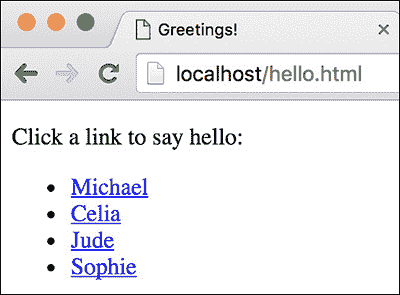

 简单的 HTML 页面，包含四个指向 PHP 脚本的链接。

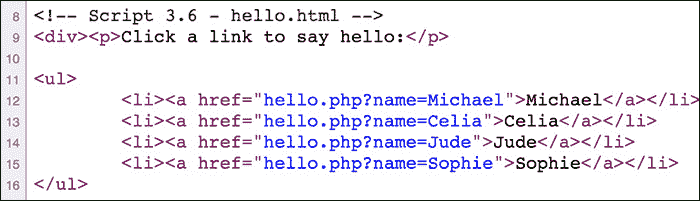

 该页面的 HTML 源代码显示了值是如何通过 URL 传递给四个链接的。

如果你使用不同的名称，那是可以的，但坚持使用没有空格或标点符号的单词名称，否则它们将无法正确传递给 PHP 脚本。

**3.** 完成 HTML 页面。

**4.** 将脚本保存为 `hello.html`，并将其放在启用 PHP 的服务器的相应目录下。

**5.** 在浏览器中通过 URL 加载 HTML 页面。

虽然你可以不通过 URL 查看 HTML 页面，但你将点击此页面中的链接来访问 PHP 脚本，因此在这里使用 URL。现在不要点击任何链接，因为 PHP 脚本还不存在！

### 创建 PHP 脚本

**1.** 在你的文本编辑器或 IDE 中新建一个文档，并命名为 `hello.php`（**脚本 3.7**）：

```php
<!doctype html>
<html lang="en">
<head>
  <meta charset="utf-8">
  <title>Greetings!</title>
  <style type="text/css">
  .bold {
    font-weight: bolder;
  }
  </style>
</head>
<body>
```

**脚本 3.7** 此 PHP 页面引用 URL 中传递的名称值以打印问候语。

* * *

```php
1   <!doctype html>
2   <html lang="en">
3   <head>
4       <meta charset="utf-8">
5       <title>Greetings!</title>
6   <style type="text/css">
7       .bold {
8         font-weight: bolder;
9       }
10  </style>
11 </head>
12 <body>
13 <?php // Script 3.7 - hello.php
14
15  ini_set('display_errors', 1); // 让我从错误中学习
16  error_reporting(E_ALL); // 显示所有错误
17
18  // 获取 URL 中传递的名称值
19
20  // 输出“Hello, ”
21  $name = $_GET['name'];
22  echo "<p>Hello, <span class='bold'>" . $name . "</span></p>";
23 ?>
24 </body>
25 </html>
```

* * *

**2.** 创建 PHP 脚本的链接。

如果你使用不同的名称，那是可以的，但坚持使用没有空格或标点符号的单词名称，否则它们将无法正确传递给 PHP 脚本。

**3.** 完成 HTML 页面。

**4.** 将脚本保存为 `hello.html`，并将其放在启用 PHP 的服务器的相应目录下。

**5.** 在浏览器中通过 URL 加载 HTML 页面。

虽然你可以不通过 URL 查看 HTML 页面，但你将点击此页面中的链接来访问 PHP 脚本，因此你需要在这里开始使用 URL。现在不要点击任何链接，因为 PHP 脚本还不存在！

### 创建 PHP 脚本

**1.** 在你的文本编辑器或 IDE 中新建一个文档，并命名为 `hello.php`（**脚本 3.7**）：

```php
<!doctype html>
<html lang="en">
<head>
  <meta charset="utf-8">
  <title>Greetings!</title>
  <style type="text/css">
  .bold {
    font-weight: bolder;
  }
  </style>
</head>
<body>
```

**脚本 3.7** 此 PHP 页面引用 URL 中传递的名称值以打印问候语。

* * *

- **2.** 创建指向 PHP 脚本的链接，并在 URL 中传递值。
- **3.** 完成 HTML 页面。
- **4.** 保存脚本为 `hello.html`。
- **5.** 在浏览器中通过 URL 加载页面。
- **脚本 3.7 逻辑**：通过 `$_GET['name']` 获取值并输出加粗 HTML。

 在什么情况下，在脚本中启用 `display_errors` 的尝试不会成功？为什么在线上站点上启用 `display_errors` 的安全性更低？

#### 探索

 在浏览器中不通过 URL 加载 `feedback.html`（这意味着地址栏可能会以 `file://` 开头）。填写并提交表单。观察结果，以便你能识别此问题并理解其原因，以防将来看到类似的结果。

 如果你还没有开启，并且在可以的情况下，请确保你的开发环境中已启用了 `display_errors`。

 如果你还没有开启，并且在可以的情况下，请确保开发环境中将 `error_reporting` 设置为 `E_ALL`（在 PHP 早期版本中为 `E_ALL | E_STRICT`）。

 尝试在 PHP 脚本中引入不同的错误——通过引号配对错误、忘记使用分号、不当引用引用变量等——来查看结果。

 尝试通过 `hello.html` 和 `hello.php` 页面通过 URL 向 PHP 脚本发送包括数字在内的不同值。

 创建 `hello.html` 的变体，向 PHP 脚本发送多个 `name=value` 对。然后让 PHP 脚本打印所有接收到的值。

 如果你是一个好奇型且不介意等待答案，尝试通过 URL 向页面传递更复杂的值。尝试使用空格和标点符号看看会发生什么。

 创建一个新的 HTML 表单，执行你设想需要的任务（或该功能的轻量版本）。然后创建一个处理表单的 PHP 脚本，仅打印接收到的数据。

## 4. 使用数字

* * *

### 本章内容

- 创建表单
- 执行算术运算
- 数字格式化
- 理解优先级
- 数字的增与减
- 创建随机数
- 回顾与探索

* * *

第 2 章 “变量”简要讨论了各种变量类型、如何为它们赋值以及它们通常如何使用。在本章中，你将专门处理数字变量——包括整数（整数）和浮点数（也称为 `floats` 或小数）。

你将从创建一个用于生成数字变量的 HTML 表单开始。你将学习如何进行基础算术运算、如何格式化数字以及如何处理运算符优先级。本章的最后部分涵盖了数字的增与减以及随机数的生成。在整个章节中，你还将学习其他与其他数字相关的 PHP 函数。

### 创建表单

本章中的大多数 PHP 示例将基于电子商务的假设进行各种计算。表单将接收价格、数量、折扣金额、税率和运费，处理表单的 PHP 脚本将返回总成本。该成本还将根据用户想要支付的次数进行拆分，以生成每月成本值。

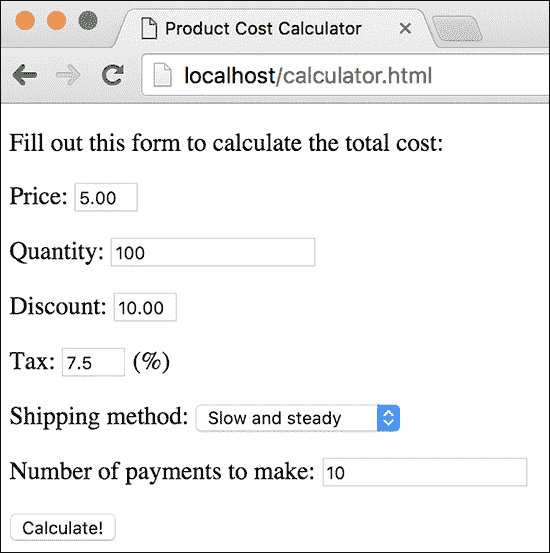

 此表单从用户获取数字并将其发送到 PHP 页面。

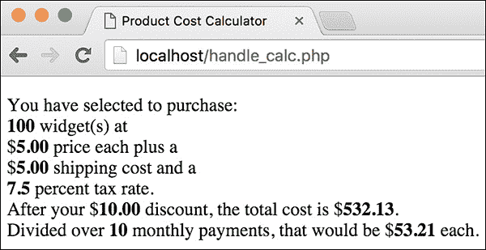

 PHP 脚本对提交的数据进行一系列计算并输出结果。在本章节结束时，结果将如下所示。

首先，让我们创建一个允许用户输入值的 HTML 页面。

要创建 HTML 表单：

**1.** 在你的文本编辑器或 IDE 中开始一个新的 HTML 文档，命名为 `calculator.html`（**脚本 4.1**）：

```html
<!doctype html>
<html lang="en">
<head>
  <meta charset="utf-8">
  <title>Product Cost Calculator</title>
</head>
<body><!-- Script 4.1 - calculator.html -->
<div><p>Fill out this form to calculate the total cost:</p>
```

**脚本 4.1** 这个基础 HTML 表单将为多个 PHP 脚本中的各种数学计算提供数字。

* * *

```html
1   <!doctype html>
2   <html lang="en">
3   <head>
4      <meta charset="utf-8">
5      <title>Product Cost Calculator</title>
6   </head>
7   <body><!-- Script 4.1 - calculator.html -->
8   <div><p>Fill out this form to calculate the total cost:</p>
9
10  <form action="handle_calc.php" method="post">
11
12  <p>Price: <input type="text" name="price" size="5"></p>
13
14  <p>Quantity: <input type="number" name="quantity" size="5" min="1" value="1"></p>
15
16  <p>Discount: <input type="text" name="discount" size="5"></p>
17
18  <p>Tax: <input type="text" name="tax" size="5"></p>
19
20  <p>Shipping method: <select name="shipping">
21  <option value="5.00">Slow and steady</option>
22  <option value="8.95">Put a move on it.</option>
23  <option value="19.36">I need yesterday!</option>
24  </select></p>
25
26  <p>Number of payments to make: <input type="number" name="payments" size="5" min="1" value="1"></p>
27
28  <input type="submit" name="submit" value="Calculate!">
29
30  </form>
31 </div>
32 </body>
33 </html>
```

* * *

**2.** 创建初始表单：

```html
<form action="handle_calc.php" method="post">
```

此标签开始了 HTML 表单。其 `action` 属性指示数据提交到名为 `handle_calc.php` 的页面。`method` 属性告诉页面使用 `POST`。参见第 3 章 “HTML 表单与 PHP”更多关于选择方法的细节。

**3.** 创建价格、数量、折扣和税的输入框：

```html
<p>Price: <input type="text" name="price" size="5"></p>
<p>Quantity: <input type="number" name="quantity" size="5" min="1" value="1"></p>
<p>Discount: <input type="text" name="discount" size="5"></p>
<p>Tax: <input type="text" name="tax" size="5"></p>
```

虽然 HTML5 有数字输入类型，但它并不总是最佳解决方案，因为它更自然适用于整数值。因此，`quantity` 输入是数字类型，而其他的是文本。

为了引导用户，用括号指示税率应以百分比输入。

记住输入内容的 `names` 应对应有效的 PHP 变量名：使用字母、数字和下划线；不要以数字开头；等等。

**4.** 添加一个允许用户选择运费方式的字段：

```html
<p>Shipping method: <select name="shipping">
<option value="5.00">Slow and steady</option>
<option value="8.95">Put a move on it.</option>
<option value="19.36">I need yesterday!</option>
</select></p>
```

运费选择通过下拉菜单进行。选中选项的 `value` 是该选项的成本。如果用户选择了例如 *Put a move on it.* 选项，`handle_calc.php` 中 `$_POST['shipping']` 的值将为 `8.95`。

**5.** 完成 HTML 表单。


```html
<p>Number of payments to make: <input type="number" name="payments" size="5" min="1" value="1"></p>
<input type="submit" name="submit" value="Calculate!">
</form>
```

最后两个输入类型接收一个数字，表示所需的付款次数，然后创建一个提交按钮（标记为`Calculate!`）。表单的结束标签标记了页面上表单部分的结束。

### 6. 完成 HTML 页面

```html
</div>
</body>
</html>
```

### 7. 将脚本保存为`calculator.html`，并在浏览器中查看它

由于这是一个 HTML 页面，你可以直接在浏览器中查看它。

## 执行算术运算

正如你在小学阶段学到的一样，基础数学涉及加、减、乘、除原理。这些运算在 PHP 中通过最直观的运算符来完成：

 加法（`+`）

 减法（`-`）

 乘法（`*`）

 除法（`/`）

为了使用这些运算符，你将创建一个 PHP 脚本，用于计算某些小部件销售的总成本。这个处理脚本可以作为购物车应用程序的基础——一个非常实用的网页功能（尽管在这种情况下，相关的数值将来自`calculator.html`）。

当你编写此脚本时，请务必注意注释（脚本 4.2），这些注释用于解释不同的代码行及其背后的逻辑。

**脚本 4.2** 此 PHP 脚本使用从表单提交的数字执行所有标准的数学计算。

点击此处查看代码图片

```php
1   <!doctype html>
2   <html lang="en">
3   <head>
4       <meta charset="utf-8">
5       <title>Product Cost Calculator</title>
6       <style type="text/css">
7           .number { font-weight: bold; }
8       </style>
9   </head>
10 <body>
11   <?php // Script 4.2 - handle_calc.php
12   /* This script takes values from
13     calculator.html and performs
14     total cost and monthly payment
15     calculations. */
16
17   // Address error handling, if you want.
18
19   // Get the values from the $_POST array:
20   $price = $_POST['price'];
21   $quantity = $_POST['quantity'];
22   $discount = $_POST['discount'];
23   $tax = $_POST['tax'];
24   $shipping = $_POST['shipping'];
25   $payments = $_POST['payments'];
26
27   // Calculate the total:
28   $total = $price * $quantity;
29   $total = $total + $shipping;
30   $total = $total - $discount;
31
32   // Determine the tax rate:
33   $taxrate = $tax / 100;
34   $taxrate = $taxrate + 1;
35
36   // Factor in the tax rate:
37   $total = $total * $taxrate;
38
39   // Calculate the monthly payments:
40   $monthly = $total / $payments;
41
41   // Print out the results:
42   print "<p>You have selected to
43     purchase:<br>
44   <span class=\"number\">$quantity</span> widget(s) at <br>
45   $<span class=\"number\">$price</span></span> price each plus a <br>
46   $<span class=\"number\">$shipping</span> shipping cost and a <br>
47   <span class=\"number\">$tax</span> percent tax rate.<br>
48   After your $<span class=\"number\">$discount</span> discount, the total cost is
49   $<span class=\"number\">$total</span>.<br>
50   Divided over <span class=\"number\">$payments</span> monthly payments, that would be
51   $<span class=\"number\">$monthly</span> each.</p>";
52  ?>
53 </body>
54 </html>
```

## 创建你的销售计算器

### 1. 创建`handle_calc.php`

在你的文本编辑器或 IDE 中创建一个新文档，命名为`handle_calc.php`（脚本 4.2）。

点击此处查看代码图片

```html
<!doctype html>
<html lang="en">
<head>
    <meta charset="utf-8">
    <title>Product Cost Calculator</title>
    <style type="text/css">
        .number {font-weight:bold;}
    </style>
</head>
<body>
```

文档头部定义了一个名为`number`的 CSS 类。页面中任何带有该类的元素都将获得额外的字体权重。换句话说，当来自表单的数字和各种计算结果在脚本的输出中打印出来时，它们将变得显而易见。

### 2. 插入 PHP 标签并根据需要处理错误处理

点击此处查看代码图片

```php
<?php // Script 4.2 - handle_calc.php
```

根据你的 PHP 配置，你可能也不想添加几行代码来开启`display_errors`并调整错误报告级别。具体细节请参阅第 3 章。

### 3. 获取表单值

```php
$price = $_POST['price'];
$quantity = $_POST['quantity'];
$discount = $_POST['discount'];
$tax = $_POST['tax'];
$shipping = $_POST['shipping'];
$payments = $_POST['payments'];
```

脚本将在预定义的`$_POST`变量中接收所有表单数据。要访问单个值，请引用`$_POST['index']`，并将`index`替换为相应的元素名称。这些值在这里赋值给各个变量，以便在脚本其余部分更容易使用。注意每个变量都被赋予了描述性名称。

### 4. 开始计算总成本

```php
$total = $price * $quantity;
$total = $total + $shipping;
$total = $total - $discount;
```

星号（`*`）在 PHP 中表示乘法，所以总成本首先是小部件的数量（`$quantity`）乘以价格。然后将运费添加到总额中（`$shipping`），最后减去折扣。

### 5. 计算税率和新的总额

```php
$taxrate = $tax / 100;
$taxrate = $taxrate + 1;
$total = $total * $taxrate;
```

税率应以百分比形式输入——例如`8`或`5`。最后，我们通过除以`100`得到百分比的等效值，然后将该税率乘以总额。

### 6. 计算每月付款额

```php
$monthly = $total / $payments;
```

作为除法的示例，假设这些小部件可以分月支付。因此，你通过将总额除以付款次数来计算每月付款额。

### 7. 打印结果

```php
print "<p>You have selected to
purchase:<br>
<span class=\"number\">$quantity</span> widget(s) at <br>
$<span class=\"number\">$price</span></span> price each plus a <br>
$<span class=\"number\">$shipping</span> shipping cost and a <br>
<span class=\"number\">$tax</span> percent tax rate.<br>
After your $<span class=\"number\">$discount</span> discount, the total cost is
$<span class=\"number\">$total</span>.<br>
Divided over <span class=\"number\">$payments</span> monthly payments, that would be
$<span class=\"number\">$monthly</span> each.</p>";
```

`print`语句将所有值连同文本发送到浏览器。为了便于阅读，增加了`<br>`标签以格式化浏览器结果；此外，`print`函数跨行操作使 PHP 代码更整洁。每个变量的值通过封装在带有`number`类属性的`<span>`标签中，将在浏览器中突出显示（见第 1 步）。

### 8. 关闭 PHP 部分，并完成 HTML 页面

### 9. 保存脚本

将脚本保存为`handle_calc.php`，并将其放在启用 PHP 的服务器的相应目录下。

确保`calculator.html`位于同一目录下。

### 10. 在浏览器中测试脚本

在浏览器中测试该脚本，填写并提交表单。

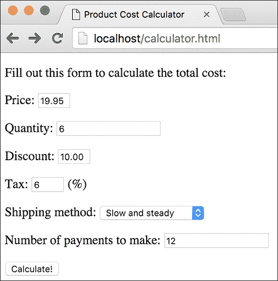

 该 HTML 表单……

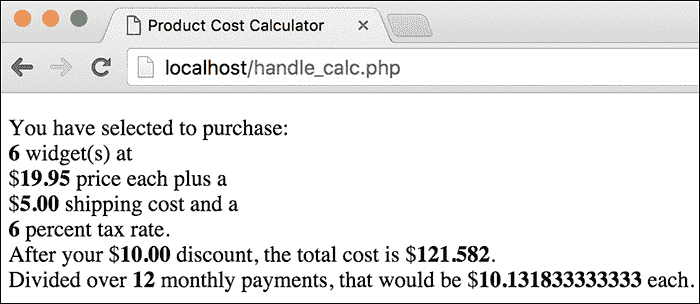

 ……以及计算出的结果。

这里不是要在此处赘重强调，但请确保开始时是通过 URL（`http://something`）加载 HTML 表单，这样在提交它时，PHP 脚本也会通过 URL 运行。

你可以尝试调整这些值，看看你的计算器工作效果如何。如果你遗漏了任何值，得到的消息将稍微有点奇怪，但计算应该仍然正常工作。

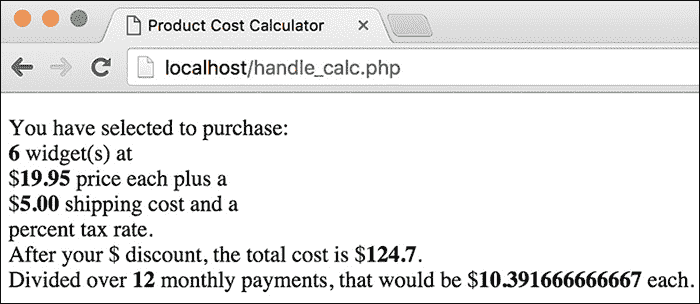

 你可以省略或更改任何值并重新运行计算器。在这里，税率和折扣值被省略了。

### 提示

你一定会注意到，计算器生成的数字与真实的美元金额并不完全对应（参见和）。在下一节“数字格式化”中，你将学习如何解决这个问题。

#### 提示

如果你想打印税前或折扣前的总额值（或两者都有），可以通过两种方式实现。你可以在确定适当值之后、但在`$total`变量再次更改之前立即插入相应的打印语句。或者，你可以使用新变量来表示后续计算的值（例如`$total_with_tax`和`$total_less_discount`）。

#### 提示

尝试打印美元符号后跟变量值，例如`$10`（其中 10 来自一个变量），必须小心处理。你不能使用`$$variable`语法，因为两个美元符号的组合创建了一种在本书中难以讨论的复杂类型。一种解决方案是在美元符号和变量名之间放置某些内容——例如空格或 HTML 标签，如本例所示。另一种选项是转义第一个美元符号：

点击此处查看代码图像

```php
print "The total is \$$total";
```

第三种选项是使用连接符，这将在下一章中介绍。

#### 提示

此脚本的表现取决于各个字段是否被提交。唯一真正问题的字段是月期数：如果省略了此项，你将看到除以零的警告。第 6 章“控制结构”将涵盖在单表单数据之前对其进行验证。

## 数字格式化

尽管计算器正在变得实用，但它仍然有一个合理的问题：你不能要求某人支付 $10.13183333！为了创建更实用的数字，你需要对它们进行格式化。

有两个函数适用于此目的。第一个函数`round()`将值四舍入到指定的小位数。函数的第一个参数是要四舍入的数字。它可以是一个数字，也可以是一个具有数值的变量。第二个参数是可选的；它代表要四舍入的小位数。如果省略，数字将四舍入到最近的整数。例如：

```php
round(4.30); // 4
round(4.289, 2); // 4.29
$num = 236.26985;
round($num); // 236
```

在这种情况下使用的另一个函数是`number_format()`。它的工作方式与`round()`类似，接收一个数字（或具有数值的变量）和一个可选的小数指定符。该函数的额外好处是用逗号对数字进行格式化，就像通常写法的方式一样：

点击此处查看代码图像

```php
number_format(428.4959, 2); // 428.50
number_format(428, 2); // 428.00
number_format(1234567); // 1,234,567
```

让我们重写 PHP 脚本以适当地格式化数字。

### 要格式化数字

1. 在你的文本编辑器或 IDE 中打开`handle_calc.php`，如果它尚未打开（脚本 4.2）。

2. 在所有计算之后但打印语句之前，添加以下内容（脚本 4.3）：

点击此处查看代码图像

```php
$total = number_format($total, 2);
$monthly = number_format ($monthly, 2);
```

**脚本 4.3** `number_format()`函数被应用于两个变量的值，因此它们更适合本示例。点击此处查看代码图像


```html
<!doctype html>
<html lang="en">
<head>
    <meta charset="utf-8">
    <title>Product Calculator</title>
    <style type="text/css">
        .number { font-weight: bold;}
    </style>
</head>
<body>
<?php // Script 4.3 - handle_calc.php
/* 此脚本接收来自 calculator.html 的值并执行总成本和月付计算。 */

// 处理处理，如果你需要。

// 从 $_POST 数组中获取值：
$price = $_POST['price'];
$quantity = $_POST['quantity'];
$discount = $_POST['discount'];
$tax = $_POST['tax'];
$shipping = $_POST['shipping'];
$payments = $_POST['payments'];

// 计算总额：
$total = $price * $quantity;
$total = $total + $shipping;
$total = $total - $discount;

// 确定税率：
$taxrate = $tax/100;
$taxrate = $taxrate + 1;

// 考虑税率：
$total = $total * $taxrate;

// 计算月付：
$monthly = $total / $payments;

// 应用适当的格式化：
$total = number_format($total, 2);
$monthly = number_format($monthly, 2);

// 打印结果：
print "<p>You have selected to purchase:<br>
<span class="number">$quantity</span> widget(s) at <br>
$<span class="number">$price</span> price each plus a <br>
$<span class="number">$shipping</span> shipping cost and a <br>
<span class="number">$tax</span> percent tax rate.<br>
After your $<span class="number">$discount</span> discount, the total cost is $<span class="number">$total</span>.<br>
Divided over <span class="number">$payments</span> monthly payments, that would be $<span class="number">$monthly</span> each.</p>";
?>
</body>
</html>
```

要格式化这两个数字，在每个计算完成之后但在发送到浏览器之前应用此函数。第二个参数（`2`）表示结果数字应恰好有两位小数；此设置会对数字进行四舍五入并在必要时末尾添加零。

保存文件，将其放在与`calculator.html`相同的目录下，并在浏览器中测试它  和 。

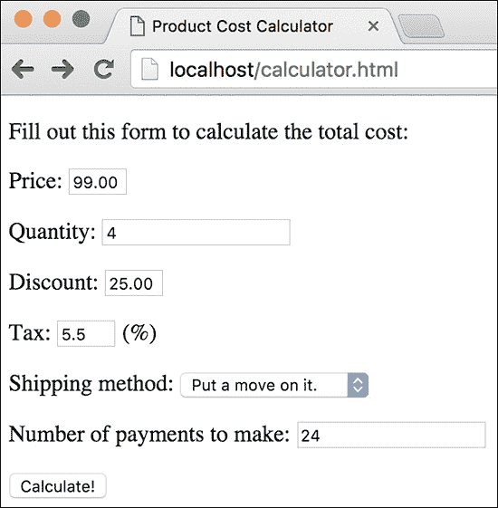

 另一个表单输入。

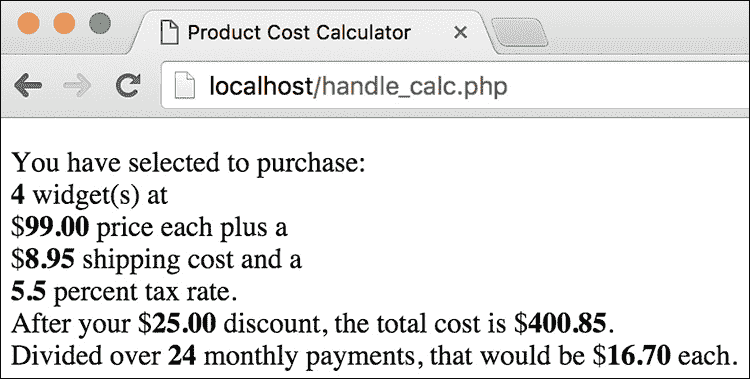

 得益于`number_format()`函数，脚本的更新版本返回了更数字值。

#### 提示

另一种更复杂的格式化数字的方法是使用`printf()`和`sprintf()`函数。由于它们的语法比较复杂，在本书中没有讨论它们；更多信息请参阅 PHP 手册。

#### 提示

非 Windows 版本的 PHP 还有一个`money_format()`函数，可以代替`number_format()`使用。

在 PHP 中，函数调用时函数名与括号之间可以有空格，也可以没有。这两种方式都是可以的：

```php
round ($num);

round($num);
```

#### 提示

`number_format()`函数接收另外两个可选参数，允许你指定用于标识小数点和千分位分隔符的字符。这非常有用，例如对于那些将`1,000.89`写为`1.000,89`的文化地区。如果你想使用此选项，请参阅 PHP 手册获取正确的语法。

### 理解优先级

在讨论了各种数学运算符之后，不可避免地将讨论优先级。`优先级`（Precedence）指的是一系列计算执行的顺序。例如，以下变量的值是多少？

```php
$number = 10 – 4 / 2;
```

`$number`的值是 3（10 减 4 等于 6，除以 2 等于 3）还是 8（4 除以 2 等于 2，10 减等于 8）？答案是 8，因为除法的优先级高于减法。

附录 B“资源和后续步骤”了 PHP 运算符优先级的完整列表（包括尚未涵盖的运算符）。然而，与其尝试背诵包含大量特殊字符的大表格，不如使用括号来跳过思考。括号的优先级始终高于任何其他运算符。因此：

```php
$number = (10 – 4) / 2; // 3

$number = 10 – (4 / 2); // 8
```

在计算中使用括号可以确保你永远不会因为优先级问题看到奇异的结果。括号还可以用于用更少的代码行重写复杂的计算。让我们重写`handle_calc.php`脚本，使用括号将多行合并为一行，同时保持准确性。

要管理优先级：

1. 在你的文本编辑器或 IDE 中打开`handle_calc.php`，如果它尚未打开（脚本 4.3）。

2. 将最初计算总额的三行替换为以下内容（**脚本 4.4**）：

```php
$total = (($price * $quantity) + $shipping) - $discount;
```

**脚本 4.4** 通过使用括号，可以将跨行进行的计算（对比 脚本 4.3）压缩，而不会影响脚本的数学准确性。

```html
1  <!doctype html
2   <html lang="en">
3   <head>
4      <meta charset="utf-8">
5      <title>Product Cost Calculator</title>
6      <style type="text/css">
7          .number { font-weight: bold;}
8      </style>
9   </head>
10  <body>
11   <?php // Script 4.4 - handle_calc.php #3
12   /* This script takes values from
13     calculator.html and performs
14     total cost and monthly payment
15     calculations. */
16
17   // Address error handling, if you want.
18
19   // Get the values from the $_POST array:
20   $price = $_POST['price'];
21   $quantity = $_POST['quantity'];
22   $discount = $_POST['discount'];
23   $tax = $_POST['tax'];
24   $shipping = $_POST['shipping'];
25   $payments = $_POST['payments'];
26
27   // Calculate the total:
28   $total = (($price * $quantity) +
29     $shipping) - $discount;
30
31   // Determine the tax rate:
32   $taxrate = ($tax / 100) + 1;
33
34   // Factor in the tax rate:
35   $total = $total * $taxrate;
36
37   // Calculate the monthly payments:
38   $monthly = $total / $payments;
39
40   // Apply the proper formatting:
41   $total = number_format ($total, 2);
42   $monthly = number_format ($monthly, 2);
43
44   // Print out the results:
45   print "<p>You have selected to:<br>
46   <span class="number">$quantity</span> widget(s) at <br>
47   <span class="number">$price</span> each plus a <br>
48   <span class="number">$shipping</span> cost and a <br>
49   <span class="number">$tax</span> percent tax rate.
50   After your <span class="number">$discount</span> discount, the total cost is
51   <span class="number">$total</span>.<br>
52   Divided over <span class="number">$payments</span> monthly payments, that would be
53   <span class="number">$monthly</span> each.</p>";
54 ?>
55 </body>
56 </html>
```

在这个脚本中，只要使用括号来确保数学逻辑正确，在一步中完成所有计算也是可以的。另一个选项是记住所有的优先级规则，但使用括号要简单得多。

```php
print "<p>You have selected to purchase:<br>
<span class=\"number\">$quantity</span> widget(s) at <br>
$<span class=\"number\">$price</span> price each plus a <br>
$<span class=\"number\">$shipping</span> shipping cost and a <br>
<span class=\"number\">$tax</span> percent tax rate.<br>
After your $<span class=\"number\">$discount</span> discount, the total cost is $<span class=\"number\">$total</span>.<br>
Divided over <span class=\"number\">$payments</span> monthly payments, that would be $<span class=\"number\">$monthly</span> each.</p>";
?>
</body>
</html
```

第一行通过`$tax`值除以 100 计算税率。第二行将该值加 1，以便将其乘以总额以确定含税的总额。

3. 保存脚本，将其放在与`calculator.html`相同的目录下，并在浏览器中测试它  。

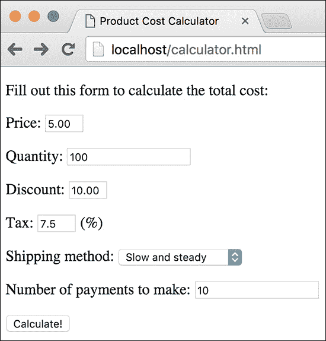

 表单的最后执行。

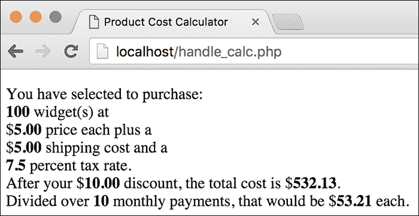

 如果你使用变量自增的长版本或短版本，将不会影响你的计算（比较 脚本 4.4 和 4.5）。

#### 提示

尽管在功能上，编写`$taxrate = $taxrate + 1;`还是使用简写`$taxrate++;`并没有区别，但后者方法（使用自增运算符）更专业且更常见。

#### 提示

在第 6 章中，你将看到自增运算符如何结合循环使用。

## 算术赋值运算符

PHP 还支持数学运算符和赋值运算符的组合。这些是`+=`、`-=`、`*=`和`/=`。每个运算符都会通过对变量进行计算来给变量赋值。例如，下面两行都是将 5 加到变量：

```php
$num = $num + 5;
$num += 5;
```

这意味着`handle_calc.php`脚本可以使用此方法确定税率：

点击此处查看代码图片

```php
$tax = $_POST['tax']; // 假设为 5
$tax /= 100; // 现在 $tax 是 .05
$tax += 1; // 1.05
```

你经常看到这些执行算术运算的简写方式。

### 创建随机数

在本章中你将学习的最后一个函数是`mt_rand()`，这是一个随机数生成器。它只是输出一个随机数：

```php
$n = mt_rand(); // 31
$n = mt_rand(); // 87
```

如果你希望将生成的数字限制在特定范围内，`mt_rand()`函数也可以接受最小值参数：

```php
$n = mt_rand(0, 10);
```

这些值是*包含边界的*，因此在这种情况下 0 和 10 都是可能的返回值。

作为生成随机数的示例，让我们来创建一个简单的“幸运数字”脚本。

要生成随机数：

1. 在你的文本编辑器或 IDE 中开始一个新文档，命名为`random.php`（**脚本 4.6**）：

点击此处查看代码图片

```html
<!doctype html>
<html lang="en">
<head>
  <meta charset="utf-8">
  <title>Lucky Numbers</title>
</head>
<body>
**脚本 4.6** `rand()`函数生成一个随机数。
```

点击此处查看代码图片

```html
<!doctype html>
<html lang="en">
<head>
    <meta charset="utf-8">
    <title>Lucky Numbers</title>
</head>
<body>
<?php // 脚本 4.6 - random.php
/* 此脚本生成 3 个随机数。 */
// 如果需要，可以进行错误处理。
// 创建三个随机数：
$n1 = mt_rand(1, 99);
$n2 = mt_rand(1, 99);
$n3 = mt_rand(1, 99);

// 输出这些数字：
print "<p>你的幸运数字是：<br>
$n1<br>
$n2<br>
$n3</p>";
?>
</body>
</html>
```

2. PHP 标签并根据需要处理错误管理：点击此处查看代码图片

```php
<?php // 脚本 4.6 - random.php
```

3. 创建三个随机数：

```php
$n1 = mt_rand(1, 99);
$n2 = mt_rand(1, 99);
$n3 = mt_rand(1, 99);
```

`mt_rand()`函数也可以接受最小值和最大值参数，如果你想限制生成的数字在特定范围内：

```php
$n = mt_rand(0, 10);
```

这些值是*包含边界的*，因此在这种情况下 0 和 10 都是可能的返回值。

作为生成随机数的示例，让我们来创建一个简单的“幸运数字”脚本。

创建三个随机数：

```php
$n1 = mt_rand(1, 99);
$n2 = mt_rand(1, 99);
$n3 = mt_rand(1, 99);
```

`mt_rand()`函数生成一个随机数。如果需要，可以进行错误处理。

此脚本生成 3 个随机数。

4. 输出这些数字：

```php
print "<p>你的幸运数字是：<br>
$n1<br>
$n2<br>
$n3</p>";
```

5. 关闭 PHP 标签并根据需要处理错误管理：

```php
?>
```

6. 在你的文本编辑器或 IDE 中保存文件`random.php`，将其放在与`calculator.html`相同的目录下，并在浏览器中测试它  。


 表单的最后执行。


 如果你使用变量自增的长版本或短版本，将不会影响你的计算（比较 脚本 4.4 和 4.5）。

#### 提示

尽管在功能上，编写`$taxrate = $taxrate + 1;`还是使用简写`$taxrate++;`并没有区别，但后者方法（使用自增运算符）更专业且更常见。

#### 提示

在第 6 章中，你将看到自增运算符如何结合循环使用。

# 字符串编码与解码

# 查找子字符串

# 替换字符串部分内容

# 回顾与进阶


正如第 2 章中介绍的，“变量](#ch02.html_ch02)”，PHP 使用的第二类变量是字符串——这是一组被包含在单引号或双引号内的字符集合。字符串变量的值可以是一个单独字母、一个单词、一个句子、一个段落、HTML 代码，甚至是一堆无意义的字母、数字和符号（这可能代表密码）。字符串可能是 PHP 中最常用的变量类型。

本章涵盖了 PHP 用于处理字符串数据的最基本的内置函数和运算符，无论字符串是源于表单还是最初在脚本中声明的。我们将介绍一些常用技术：合并字符串、修剪字符串和编码字符串。后续章节将介绍字符串的其他用途。

## 创建 HTML 表单

正如第 3 章所示，“HTML 表单与 PHP](#ch03.html_ch03)”，让我们先创建一个 HTML 表单，将不同的值（字符串变量的形式）发送给 PHP 脚本。使用的理论示例是一个在线公告板或论坛，用户可以在那里发布消息、电子邮件地址以及他们的姓。

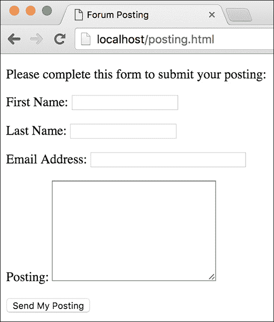

 此 HTML 表单是本章大多数示例的基础。

要创建 HTML 表单：

**1.** 在你的文本编辑器或 IDE 中开始一个新的 HTML 文档，命名为 `posting.html`（**脚本 5.1**）：

点击此处查看代码图片

```html
<!doctype html>
<html lang="en">
<head>
  <meta charset="utf-8">
  <title>Forum Posting</title>
</head>
<body>
<!-- Script 5.1 - posting.html -->
<div><p>Please complete this form to submit your posting:</p>
```

**脚本 5.1** 此表单将字符串数据发送到 PHP 脚本。

点击此处查看代码图片

```html
1   <!doctype html>
2   <html lang="en">
3   <head>
4       <meta charset="utf-8">
5       <title>Forum Posting</title>
6   </head>
7   <body>
8   <!-- Script 5.1 - posting.html -->
9   <div><p>Please complete this form to
     submit your posting:</p>
10
11  <form action="handle_post.php"
     method="post">
12
13      <p>First Name: <input type="text"
         name="first_name" size="20"></p>
14
15      <p>Last Name: <input type="text"
         name="last_name" size="20"></p>
16
17      <p>Email Address: <input type="email"
         name="email" size="30"></p>
18
19      <p>Posting: <textarea name="posting"
         rows="9" cols="30"></textarea></p>
20
21      <input type="submit" name="submit"
         value="Send My Posting">
22
23  </form>
24  </div>
25  </body>
26  </html>
```

**2.** 创建初始表单标签：

点击此处查看代码图片

```html
<form action="handle_post.php" method="post">
```

此表单将将其数据发送到 `handle_post.php` 脚本并使用 `POST` 方法。

**3.** 为名字、姓氏和电子邮件地址添加输入框：

点击此处查看代码图片

```html
<p>First Name: <input type="text" name="first_name" size="20"></p>
<p>Last Name: <input type="text" name="last_name" size="20"></p>
<p>Email Address: <input type="email" name="email" size="30"></p>
```

该表单使用了两个基础文本输入和一个电子邮件类型。记住，各种 `name` 值应符合 PHP 变量命名规则（没有空格；不能以数字开头；必须仅由字母、数字和下划线组成）。

**4.** 添加发布内容的输入框：

点击此处查看代码图片

```html
<p>Posting: <textarea name="posting" rows="9" cols="30"></textarea></p>
```

发布字段是一个 `textarea`，它是一种较大的文本输入类型。

**5.** 创建提交按钮并关闭表单：

点击此处查看代码图片

```html
<input type="submit" name="submit" value="Send My Posting">
</form>
```

每个表单都必须有一个提交按钮。

**6.** 完成 HTML 页面：

```html
</div>
</body>
</html>
```

**7.** 将文件保存为 `posting.html`，将其放置在启用 PHP 的服务器的相应目录中，并查看。这是一个 HTML 页面，因此不需要在启用 PHP 的服务器上即可查看。但因为它最终会将数据发送到 PHP 脚本，所以最好将文件放在你的服务器上。

从技术上讲，除了上传的文件外，所有表单数据都以字符串的形式发送到处理脚本。这包括输入文本框的数字数据、从下拉菜单选择的值、复选框或单选按钮的值等。

## 连接字符串

*Concatenation* 是一个晦涩的术语但非常有用的概念。指的是将一个项目附加到另一个上。具体来说，在编程中，你连接字符串。点号（`.`）是执行此操作的操作符：

```php
$s1 = 'Hello, ';
$s2 = 'world!';
$greeting = $s1 . $s2;
```

连接的结果是 `$greeting` 值为 `Hello, world!`。由于 PHP 处理变量的方式，相同的效果也可以通过

```php
$greeting = "$s1$s2";
```

这段代码有效，因为 PHP 在双引号内替换变量。然而，连接字符串的形式涉及到*连接赋值运算符*：

```php
$greeting = 'Hello, ';
$greeting .= 'world!';
```

这第二行大致意思是“为 `$greeting` 分配其当前值加上 `world!`”。结果是 `$greeting` 再次变为 `Hello, world!`。`posting.html` 脚本发送了多个字符串变量。这些变量中，名字和姓氏逻辑上可以连接。

要使用连接：

**1.** 在你的文本编辑器或 IDE 中开始一个新的文档，命名为 `handle_post.php`（**脚本 5.2**）：

点击此处查看代码图片

```html
<!doctype html>
<html lang="en">
<head>
  <meta charset="utf-8">
  <title>Forum Posting</title>
</head>
<body>
```

**脚本 5.2** 此 PHP 脚本演示了连接，这是字符串变量最常见的操作之一。将其想象为字符串的相加。

点击此处查看代码图片

```php
1   <!doctype html>
2   <html lang="en">
3   <head>
4       <meta charset="utf-8">
5       <title>Forum Posting</title>
6   </head>
7   <body>
8   <?php // Script 5.2 - handle_post.php
9   /* 此脚本从 posting.html 接收五个值：
10  first_name, last_name, email, posting,
     submit */
11
12  // 处理错误管理，如果你
13  需要的话。
14
14  // 从 $_POST 数组获取值：
15  $first_name = $_POST['first_name'];
```

```php
$last_name = $_POST['last_name'];
$posting = $_POST['posting'];

// 创建一个全名变量：
$name = $first_name . ' ' . $last_name;

// 打印消息：
print "<div>Thank you, $name, for your posting: <p>$posting</p></div>";

?>
</body>
</html>
```

## 2. 创建初始的 PHP 标签，并在必要时处理错误管理：

点击此处查看代码图像

```php
<?php // Script 5.2 - handle_post.php

如果你没有启用 display_errors，或者 error_reporting 设置的级别错误，请参阅第 3 章以获取在此处需要包含的行代码，以修改这些设置。
```

## 3. 将表单数据赋值给局部变量：

点击此处查看代码图像

```php
$first_name = $_POST['first_name'];
$last_name = $_POST['last_name'];
$posting = $_POST['posting'];
```

该表单使用 POST 方法，因此所有表单数据都可以在 `$_POST` 中可用。此示例没有包含电子邮件的行，因为你还没有使用它，但你可以复制此代码来引用该值。

## 4. 使用连接字符串创建一个新的 `$name` 变量：

```php
$name = $first_name . ' ' . $last_name;
```

这种连接操作会将两个变量加上一个空格，并将它们连接在一起，创建一个名为 `$name` 的新变量。假设你输入的名称是 *Elliott* 和 *Smith*，那么 `$name` 将等于 *Elliott Smith*。

## 5. 向用户打印消息：

点击此处查看代码图像

```php
print "<div>Thank you, $name, for your posting: <p>$posting</p></div>";
```

此条消息将向用户反馈其在表单中输入的内容。

## 6. 关闭 PHP 部分并完成 HTML 页面：

```php
?>
</body>
</html>
```

## 7. 将你的脚本保存为 `handle_post.php`，将其放在与 `posting.html` 相同的目录中（在启用了 PHP 的服务器上），并在浏览器中测试表单和脚本。 。


 正在使用的 HTML 表单...


 ...以及生成的 PHP 页面。

提醒一下，你必须通过 URL (`http://something`) 加载表单，这样当提交表单时，处理的 PHP 脚本也会通过 URL 运行。

> **提示**：你可以使用连接连接任意数量的字符串。你甚至可以将数字连接到字符串中：

点击此处查看代码图像

```php
$new_string = $s1 . $s2 . $number;
```

这之所以有效是因为 PHP 是弱类型的，这意味着它的变量没有锁定在特定的格式上。在这里，`$number` 变量将转换为字符串并附加到 `$new_string` 变量的值之后。

> **提示**：连接可以在许多方式使用，即使在向函数传递参数时也是如此。一个不常见但有效的示例是：

点击此处查看代码图像

```php
$text = nl2br($heading . $body);
```

`nl2br()` 函数在第 1 章“PHP 入门”中首次提到，接下来将详细讨论。

> **提示**：如果你在表单中使用了任何形式的引号，并在打印结果中看到多余的斜杠，请参阅第 3 章中的侧边栏“Magic Quotes”以了解原因并获取修复。这在当前的 PHP 版本中并不常见。

> **提示**：提醒一下，理解 PHP 中单引号和双引号之间的区别非常重要。单引号内的字符被视为字面量；双引号内的字符会被转义（例如，变量名将被替换为它的值）。请参阅第 3 章进行复习。

> **提示**：将姓和名作为单独输入是一个很好的连接示例。然而，并不是每个人只有两个名字，在你自己的注册表单中最好不要做这样的假设。更具包容性的示例应该是为用户的姓名提供单一的输入框。

### 处理换行符

PHP 开发者常见的问题涉及处理字符串中的换行符。`textarea` 允许用户通过按 Enter 键输入多行。每次使用 Enter 键等同于字符串中的一个换行符。这些换行在 `textarea` 中有效，但对渲染后的页面没有影响。要在渲染的页面中创建等同的换行，请使用 `<br>`。幸运的是，PHP 有 `nl2br()` 函数，它可以自动将换行转换为换行标签：

现在 `$posting` 将分配 `$_POST['posting']` 的值，并将所有换行符转换为换行标签。函数的第二个参数——布尔值 `false`——表示你*不想要*创建 XHTML 规范的换行标签。换句话说，函数的默认行为是将换行符替换为 `<br />`。在 HTML5 中，`<br>` 更常用。

如目前为止多次提到的，PHP 是一种经常用于向浏览器发送数据的服务器端技术。这些数据可以是纯文本、HTML 代码的形式，或者更常见的是，是两者兼有。

在本章的主要示例中，数据在 HTML 表单中输入，然后使用 PHP 打印回浏览器。一个潜在的问题是用户可以在表单输入 HTML 字符，这可能会影响结果页面的格式  ——更糟糕的是，会导致安全问题。


 如果用户在发布中输入了 HTML 代码……


 ……它在重新打印时会被浏览器渲染。

你可以使用几个 PHP 函数来处理 PHP 字符串变量中的 HTML 标签：

 `htmlspecialchars()` 将某些 HTML 标签转换为它们的实体版本。

 `htmlentities()` 将所有 HTML 标签转换为它们的实体版本。

 `strip_tags()` 移除所有 HTML 和 PHP 标签。

前两个函数会将 HTML 标签（例如 `<span>`）转换为实体版本，如 `&lt;span&gt;`。实体版本会出现在输出中，但不会被渲染。如果你想显示代码而不执行它，可以使用其中任何一个函数。第三个函数 `strip_tags()` 则完全移除 HTML 和 PHP 标签。

出于两个原因，你应该留意用户提供的数据中的特殊标签。首先，如前提到的，提交的 HTML 可能会影响渲染后的页面（例如，弄乱表格、调整 CSS，或仅仅在不该有的地方添加格式）。第二个担心更为重要。由于 JavaScript 被放置在 HTML `<script>` 标签中，恶意用户可以提交 JavaScript，这些代码在页面上重新显示时就会被执行 。这就是*跨站脚本* (XSS) 攻击的实现方式。


 在浏览器中显示用户提交的 HTML 可能会导致严重的后果，例如执行 JavaScript。

为了看到这些函数的影响，接下来的 `handle_post.php` 重写将使用每一个函数并显示各自的结果。

### 在 PHP 中处理 HTML：

1. 如果尚未打开，请在文本编辑器或 IDE 中打开 `handle_post.php` (脚本 5.3)。

2. 在 print 语句行之前，添加以下内容（**脚本 5.4**）：

点击此处查看代码图片

```php
$html_post = htmlentities ($_POST['posting']);

$strip_post = strip_tags ($_POST['posting']);
```

**脚本 5.4** 此版本的 PHP 脚本通过两种不同的方式处理 HTML 标签。

点击此处查看代码图片


```html
1   <!doctype html>
2   <html lang="en">
3   <head>
4       <meta charset="utf-8">
5       <title>Forum Posting</title>
6   </head>
7   <body>
8   <?php // Script 5.4 - handle_post.php #3
9   /* This script receives five values from
10    posting.html:
11    first_name, last_name, email, posting,
12    submit */
13
14  // Address error management, if you
15    want.
16
17  // Get the values from the $_POST array:
18  $first_name = $_POST['first_name'];
19  $last_name = $_POST['last_name'];
20  $posting = nl2br($_POST['posting']);
21
22  // Create a full name variable:
23  $name = $first_name . ' ' . $last_name;
24
25  // Adjust for HTML tags:
26  $html_post =
27    htmlentities($_POST['posting']);
28  $strip_post =
29    strip_tags($_POST['posting']);
30
31  // Print a message:
32  print "<div>Thank you, $name, for
33    your posting:
34  <p>Original: $posting</p>
35  <p>Entity: $html_post</p>
36  <p>Stripped: $strip_post</p></div>";
37
38  ?>
39 </body>
40 </html>
```

为了弄清楚这两个函数工作方式的区别，将两者都应用于`$_POST['posting']`。

### 3. 将 `print` 语句修改如下

```php
print "<div>Thank you, $name, for
your posting:
<p>Original: $posting</p>
<p>Entity: $html_post</p>
<p>Stripped: $strip_post</p></div>";
```

为了突出显示发布的不同版本，首先是原始的`nl2br()`。接下来是`htmlentities()`版本，最后是`strip_tags()`版本。

### 4. 保存并测试文件

保存文件，将其放在与`posting.html`相同的目录中，并在浏览器中再次测试。为了看到这些函数的影响，接下来的`handle_post.php`重写将使用每一个函数并显示各自的结果。

### 5. 查看 HTML 源代码

如果查看结果页面的 HTML 源代码，还将看到将这些函数应用于标签的效果。

## 字符串的编码与解码

在第 3 章结束处，“手动向页面发送数据](#ch03.html_ch03lev16)”节演示了如何使用 GET 表单方法的原理向页面发送数据。在该示例中，并没有使用实际表单，而是将数据附加到 URL 中供接收脚本使用。我谨慎地说明了这种方法只能传递单个单词，不能有空格或标点。但如果你想将多个单词作为一个变量值传递或使用特殊字符怎么办？

为了通过 URL 安全地向 PHP 脚本传递任何值，请应用`urlencode()`函数。正如名称所示，该函数获取字符串并对其编码（更改格式），以便作为 URL 的一部分传递。该函数会将空格替换为加号（`+`），并将特殊字符（例如单引号）转换为较少问题的版本。你可以这样使用该函数：

```php
$string = urlencode($string);
```

为了演示`urlencode()`的一种应用，让我们更新`handle_post.php`页面，使其创建一个链接，将用户的姓名和电子邮件地址传递给第三个页面。

### 1. 打开 `handle_post.php`

在你的文本编辑器或 IDE 中打开`handle_post.php`（脚本 5.4），如果它还没有打开。

### 2. 删除相关代码

删除在上一组步骤中添加的`htmlentities()`和`strip_tags()`行（脚本 5.5）。

#### 脚本 5.5

该脚本在将两个变量添加到链接之前对其进行编码。然后这些值就可以成功地传递到另一个页面。

```php
<!doctype html>
<html lang="en">
<head>
    <meta charset="utf-8">
    <title>Forum Posting</title>
</head>
<body>
<?php // Script 5.5 - handle_post.php #4
   /* 此脚本从 posting.html 
    接收五个值：
    first_name, last_name, email, posting,
    submit */

   // 如果你需要，可以处理错误管理。

   // 从 $_POST 数组获取值：
   $first_name = $_POST['first_name'];
   $last_name = $_POST['last_name'];
   $posting = nl2br($_POST['posting']);

   // 创建一个全名变量：
   $name = $first_name . ' ' . $last_name;

   // 打印消息：
   print "<div>Thank you, $name, for your posting:
   <p>$posting</p></div>";

   // 创建指向另一个页面的链接：
   $name = urlencode($name);
   $email = urlencode($_POST['email']);
   print "<p>Click <a href=\"thanks.php?name=$name&email=$email\">here</a></a> to continue.</p>";
?>
</body>
</html>
```

### 3. 恢复旧版本的 `print` 调用

```php
print "<div>Thank you, $name, for your posting:
<p>$posting</p></div>>";
```

### 4. 添加编码代码

在`print`语句之后添加以下内容：

```php
$name = urlencode($name);
$email = urlencode($_POST ['email']);
```

此脚本会将这两个变量传递到第二个页面。为了实现这一点，它们都必须经过编码。

由于脚本之前没有引用或使用过`$email`变量，第二行在一步操作内同时完成了从`$_POST`数组获取 email 值并对其进行编码。这与使用以下两行单独的代码的效果相同：

```php
$email = $_POST['email'];
$email = urlencode($email);
```

### 5. 添加创建链接的 `print` 语句

```php
print "<p>Click <a href=\"thanks.php?name=$name&email= $email\">here</a></a> to continue.</p>";
```

此`print`语句的主要目的是在网页中创建一个 HTML 链接，其源代码类似于：

```html
<a href="thanks.php?name= Larry+Ullman&email= larry%40example.com">here</a></a>
```

要实现这一点，首先通过硬编码大部分 HTML，然后包含相应的变量名。由于 HTML 代码要求链接的 URL 必须包含在双引号中——而`print`语句已经使用了双引号——你必须对它们进行转义（在前面加上反斜杠），以便它们被打印。

### 6. 保存并测试文件

保存文件，将其放置在启用了 PHP 的服务器相应目录中，并在浏览器中再次测试。

 


 表单的另一种用法。


 处理脚本现在显示指向另一个页面的链接。

注意，点击该链接将导致服务器错误，因为`thanks.php`脚本尚未编写。

### 7. 查看 HTML 源代码

查看处理页面的 HTML 源代码，以查看 HTML 代码中生成的链接。


 页面 的 HTML 源代码显示了动态链接。

> **提示**
>
> 直接从表单发送的值在发送之前会自动进行 URL 编码，并在到达接收脚本时进行解码。你只需要`urlencode()`函数来手动对数据进行编码（如所示）。

> **提示**
>
> `urldecode()`函数的作用与`urlencode()`正相反——它获取一个编码的 URL 并将其转换回标准形式。不过，你使用它的频率会较低，因为 PHP 会自动解码它接收的大多数值。

> **提示**
>
> 由于你可以在函数中使用字符串拼接，新的`print`语句可以写如下所示：
>
> ```php
> print 'Click <a href="thanks.php?name=' . $name . '&email=' . $email . '">here</a></a> to continue.';
> ```
>
> 这种方法相比原始方法有两个优点。首先，它使用单引号开头。其次，它更加清晰直观。

> **提示**
>
> 直接从表单发送的值在发送之前会自动进行 URL 编码，并在到达接收脚本时进行解码。你只需要`urlencode()`函数来手动对数据进行编码（如所示）。

> **提示**
>
> `urldecode()`函数的作用与`urlencode()`正相反——它获取一个编码的 URL 并将其转换回标准形式。不过，你使用它的频率会较低，因为 PHP 会自动解码它接收的大多数值。

> **提示**
>
> 由于你可以在函数中使用字符串拼接，新的`print`语句可以写如下所示：
>
> ```php
> print 'Click <a href="thanks.php?name=' . $name . '&email=' . $email . '">here</a></a> to continue.';
> ```

> **提示**
>
> 直接从表单发送的值在发送之前会自动进行 URL 编码，并在到达接收脚本时进行解码。你只需要`urlencode()`函数来手动对数据进行编码（如所示）。

> **提示**
>
>  页面 的 HTML 源代码显示了动态链接。

## 字符串的加密与解码

为了保护数据，程序员经常会对数据进行加密。密码是你想要加密的示例。用户名和电子邮件地址也是此类对象。

你可以使用`password_hash()`函数来加密数据，但请注意它没有解码选项（它是单向加密）。在 Web 应用中使用此函数，你可以在注册时加密密码；当用户登录时，用户输入的密码也会被加密，然后对加密版本进行比较。

如果数据存储在数据库中，你也可以使用数据库应用程序（例如 MySQL、PostgreSQL、Oracle 或 SQL Server）内置的函数来进行加密和解码。根据你使用的技术，它很可能提供单向和双向的加密工具。

## 查找子字符串

PHP 提供了几个函数可以用于拆分字符串、搜索内容以及进行比较。虽然这些函数通常与条件语句一起使用（在第 6 章的“控制结构”中讨论过），但它们非常重要，因此在这里将进行介绍；后续章节将更正式地使用它们。

在本章前面的部分，你已经学习了如何使用连接符连接字符串。除了将小部分组合成更大的字符串，PHP 还能轻松地从字符串中提取子部分。使用任何方法提取字符串子部分的诀窍在于，你必须对字符串本身有所了解，才能知道如何拆分它。

`strtok()`函数通过使用预定义的分隔符（如逗号或空格）从较大的字符串中创建一个被称为`token`（标记标记）的子字符串。例如，如果你让用户在一个字段中输入全名（假设他们的姓和名之间用空格分隔），你可以使用以下代码提取出他们的名：

```php
$first = strtok($_POST['name'], ' ');
```

该行告诉 PHP 从`$_POST['name']`的开始提取所有内容，直到找到空格。

如果你让用户以“姓, 名”的格式输入全名，你可以通过编写以下代码找到他们的姓：

```php
$last = strtok($_POST['name'], ', ');
```

提取字符串部分的另一种方法是引用字符串内字符的`索引位置`（indexed position）。字符串的索引位置是字符从开始计算的数字位置。然而，PHP 像大多数编程语言一样，所有索引都从 0 开始。例如，对字符串`Larry`进行索引，你从位置 0 的`L`开始，紧接着是位置 1 的`a`、位置 2 的`r`、位置 3 的第二个`r`以及位置 4 的`y`。尽管`Larry`的字符串长度为 5，但它的索引从 0 到 4。简而言之，索引始终从 0 到长度减 1。

记住此点，你可以调用`substr()`函数，根据子字符串字符的索引位置创建一个子字符串：

```php
$sub = substr($string, 0, 10);
```

第一个参数是用于派生子字符串的主字符串。第二个参数指定子字符串开始的位置，即其索引位置（0 表示你想从第一个字符开始）。第三个参数从该起点开始指定子字符串应该包含多少字符（10）。如果主字符串没有足够的字符，生成的子字符串将延伸到主字符串的末。该参数是可选的；如果省略，子字符串也将持续到主字符串的末。

你还可以使用负数从字符串末尾倒数：

```php
$string = 'aardvark';
$sub = substr($string, -3, 3); // ark
```

第二行表示将从末尾倒数第三个字符开始返回三个字符。对于那个特定示例，你可以再次省略第三个参数并获得相同的结果：

```php
$sub = substr($string, -3); // ark
```

要查看字符串中有多少个字符，使用`strlen()`：

```php
print strlen('Hello, world!'); // 13
```

计数将包含空格和标点符号。要查看字符串中有多少个单词，使用`str_word_count()`。该函数与`substr()`一样将在接下来的修订版`handle_post.php`脚本中使用。

### 创建子字符串

1. 在你的文本编辑器或 IDE 中打开`handle_post.php`（脚本 5.5），如果尚未打开。

2. 在`print`语句之前，添加以下内容（脚本 5.6）：

   ```php
   $words = str_word_count ($posting);
   ```

   **脚本 5.6** 此版本的`handle_post.php`统计了帖子中的单词数，并将显示的帖子裁剪为仅保留前 50 个字符。

   ```html
   1   <!doctype html>
   2   <html lang="en">
   3   <head>
   4      <meta charset="utf-8">
   5      <title>Forum Posting</title>
   6   </head>
   7   8<body>
   8   <?php // Script 5.6 - handle_post.php
   9   10  /* Script 5.6 - handle_post.php
   11  This script receives values from
   12  POST, including:
   13  first_name, last_name,
   14  email, and
   15  posting. */
   16  $first_name = $_POST['first_name'];
   17  $last_name = $_POST['last_name'];
   18  $email = $_POST['email'];
   19  $posting = $_POST['posting'];
   20  $words = str_word_count($posting);
   21  $name = $first_name . ' ' . $last_name;
   22  $posting = substr($posting, 0, 50);
   23  echo "<div>Thank you, $name, for your posting:
   24  <p>$posting...</p>
   25  <p>$words words</p>
   26 </div>";
   27  ?>
   28 </body>
   29 </html>
   ```

   此版本的`handle_post.php`统计了帖子中的单词数，并将显示的帖子裁剪为仅保留前 50 个字符。

3. 在`print`语句之前，添加。


```php
$posting = substr($posting, 0, 50);
```

该脚本做的第二个新事情是将帖子限制在 50 个字符内。为了实现这一点，调用了`substr()`函数。

4. 更新`print`语句为：

点击此处查看代码图像

```php
print "<div>Thank you, $name, for your posting:
<p>$posting...</p>
<p>$words words</p>
</div>";
```

这里有两个变化。首先，在帖子后面添加了省略号表示这只是全部。然后，在另一个段落中打印了单词数。

5. 删除两个`urlencode()`行以及相应的`print`语句。我指的是脚本上一个版本中添加的链接到`thanks.php`的代码。

6. 保存文件，将其放置在 PHP 服务器的相应目录下，并在浏览器中再次测试  。


 超过 50 个字符的帖子...


 ...会被截短。也会显示单词数。

提示

如果你想检查字符串是否符合某种格式（例如，检查它是否为有效的邮政编码），你需要使用正则表达式。正则表达式是一个高级概念，你在其中定义模式并查看值是否符合模板。请参考 PHP 手册或我的书籍 *PHP and MySQL for Dynamic Web Sites (Fourth Edition): Visual QuickPro Guide* (Peachpit Press, 2012)。

### 调整字符串大小写

一些 PHP 函数用于更改字母的大小写：

- `ucfirst()` 将字符串的首字母大写。

- `ucwords()` 将字符串中每个单词的首字母转换为大写。

- `strtoupper()` 将整个字符串转换为大写。

- `strtolower()` 将整个字符串转换为小写。

由于全球范围内姓名的差异，没有一种完美的方法可以使用`PHP`（或任何编程语言）自动格式化姓名。事实上，除非你有充分理由，否则我不建议修改用户提供的数据的大小写。

***

### 替换字符串的局部

正如上一节讨论的那样，而不仅仅是在字符串内查找子字符串，你可能会发现你需要用新值来替换子字符串。你可以使用`str_ireplace()`函数来实现这一点：

点击此处查看代码图片

```php
$string = str_ireplace($needle, $replacement, $haystack);
```

该函数将`$haystack`中找到的所有`$needle`出现替换为`$replacement`。例如：

点击此处查看代码图片

```php
$me = 'Larry E. Ullman';

$me = str_ireplace('E.', 'Edward', $me);
```

变量`$me`现在的值的值为`Larry Edward Ullman`。

该函数执行的是**不区分大小写**的搜索。为了更严格，你可以使用`str_replace()`执行**区分大小写**的搜索。在接下来的脚本中，`str_ireplace()`将用于消除提交文本中的“脏词”。

我还有一个想要讨论的最后一个与字符串相关的函数：`trim()`。该函数移除字符串开头和结尾的任何空白字符——空格、换行符和制表符。字符串变量中添加额外的空格是非常常见的现象，这可能是因为用户输入信息时不小心，也可能是因为 HTML 代码粗率。为了清晰性、数据完整性和网页设计，在使用这些字符串之前删除这些空格是值得的。发送到浏览器的额外空格可能会让页面看起来很奇怪，而发送到数据库或 cookie 的空格可能会在以后产生不利的后果（例如，如果密码包含一个多余的空格，在不带空格输入时可能无法匹配）。

`trim()`函数会自动删除字符串开头和结尾的任何额外空格（但不包括中间）。使用`trim()`的格式如下：

点击此处查看代码图片

```php
$string = ' extra space before and after text ';

$string = trim($string);

// $string 现在等于于 'extra space before and after text'
```

要使用`str_ireplace()`和`trim()`：

**1.** 在你的文本编辑器或 IDE 中打开`handle_post.php`脚本 5.6，如果它尚未打开。

**2.** 对表单数据应用`trim()`（脚本 5.7）：

点击此处查看代码图片

```php
$first_name = trim($_POST ['first_name']);

$last_name = trim($_POST ['last_name']);

$posting = trim($_POST ['posting']);
```

**脚本 5.7** 此处理脚本的最终版本应用了`trim()`函数，然后将`badword`替换为一系列 X。

点击此处查看代码图片

***

```html
<!doctype html>
<html lang="en">
<head>
    <meta charset="utf-8">
    <title>Forum Posting</title>
</head>
<body>
<?php // Script 5.7 - handle_post.php #6
/* 此脚本从
posting.html 接收五个值：
first_name, last_name, email, posting,
submit */

// 如果需要，处理错误管理。
  want.

// 从 $_POST 数组中获取值。
// 使用 trim() 移除额外空格：
$first_name =
  trim($_POST['first_name']);
$last_name =
  trim($_POST['last_name']);
$posting = trim($_POST['posting']);

// 创建全名变量：
$name = $first_name . ' ' . $last_name;

// 获取字数：
$words = str_word_count($posting);

// 剔除脏词：
$posting = str_ireplace('badword',
  'XXXXX', $posting);

// 打印消息：
print "<div>Thank you, $name, for your
posting;
</p>
</p>";
?>
</body>
</html>
```

***

（注：提供的文本后半部分包含了重复的 HTML 块，已进行处理以确保“由于用户输入信息时不小心或由于 HTML 代码粗率，字符串变量中常见的常见的。为了清晰性、数据完整性和网页设计，在使用这些字符串之前删除这些空格是值得的”得到了保留。）

如果你需要从字符串的开头和结尾修剪空格而不是两者，PHP 将`trim()`函数拆分为两个特定的函数：`rtrim()`移除字符串结尾（右侧）的空格，而`ltrim()`处理开头（左侧）。它们的用法与`trim()`直接：

```php
$string = ' extra space before and after text ';

$string = trim($string);

// $string 现在等于 'extra space before and after text'
```

要使用`str_ireplace()`和`trim()`：

**1.** 在你的文本编辑器或 IDE 中打开`handle_post.php`脚本 5.6，如果它尚未打开。

**2.** 对表单数据应用`trim()`（脚本 5.7）：

```php
$first_name = trim($_POST ['first_name']);

$last_name = trim($_POST ['last_name']);

$posting = trim($_POST ['posting']);
```

**脚本 5.7** 此处理脚本的最终版本应用了`trim()`函数，然后将`badword`替换为一系列 X。

***

### 复习与探索

如果你对复习问题或探索提示有任何疑问，请访问书籍的支持论坛（[www.Larryllman.com/forums/](http://www.Larryllman.com/forums/)）。

#### 复习

1. 如何创建字符串？

2. 使用单引号和双引号有什么区别？

3. 什么是拼接运算符？什么是拼接赋值运算符？

4. 打印到浏览器的字符串中有换行符有什么影响？如何将换行符转换为 break 标签？

5. 当 HTML 输入到以后将打印回浏览器的表单元素时会发生什么问题？可以采取哪些步骤来净化提交的表单数据？

6. 字符串中的字符从哪个数字开始索引？

7. `trim()`函数的作用是什么？

#### 探索

查找本章提到的新 PHP 手册页面。使用该页面上的链接查看 PHP 拥有的其他与字符串相关的函数。

 请专门查看针对`substr()`函数的 PHP 手册页面。阅读该页面上的其他示例，以更好地了解`substr()`的用法。

 编写与脚本 5.5 对应的`thanks.php`脚本。如果你需要帮助，请重新查看第 3 章中的`hello.php`脚本（脚本 3.7）。

 重写`handle_post.php`最终版本中的`print`语句（脚本 5.7），使其使用单引号和字符串拼接，而不是双引号。

 创建另一个用于获取字符串取值的 HTML 表单。然后创建一个 PHP 脚本来接收表单数据、处理任何 HTML 或 PHP 代码、对数据进行某些操作，并打印结果。

## 6. 控制结构

### 本章内容

- 创建 HTML 表单

- if 条件判断

- 验证函数

- 使用 else

- 更多运算符

- 使用 elseif

- Switch 条件判断

- for 循环

- 回顾与进阶

控制结构——条件判断和循环——是编程语言的核心。PHP 有两个条件判断语句——`if`和`switch`——你将在本章中掌握这两者。条件判断允许你建立一个测试，然后根据结果执行操作。这一功能使得网站能够变得更加动态。

对`if`条件判断的讨论需要引入最后两类运算符：比较运算符和逻辑运算符（你在之前的章节中已经见过算术运算符和赋值运算符）。你将在条件判断中频繁使用这些运算符，以及`TRUE`和`FALSE`的布尔概念。

最后，本章引入了循环，它允许你针对指定的次数重复执行某操作。循环可以节省你的编程时间，并帮助你充分利用数组的功能，正如你在下一章中看到的那样。

### 创建 HTML 表单

与之前的章节一样，本章的示例是基于一个向 PHP 页面发送数据的 HTML 表单的。在这种情况下，该表单是一个简单的注册页面，请求以下信息 ：

 电子邮件地址

 密码

 确认密码

 出生年份（用于验证年龄）

 喜欢的颜色（用于个性化定制）

 同意网站条款（常见要求）


 本章使用的 HTML 表单。

以下步骤将带你在进入 PHP 代码之前完成此表单的创建。

要创建此 HTML 表单：

**1.** 在你的文本编辑器或 IDE 中开始一个新的 HTML 文档，命名为`register.html`（脚本 6.1）：

点击此处查看代码图像

```html
<!doctype html>
<html lang="en">
<head>
  <meta charset="utf-8">
  <title>Registration Form</title>
</head>
<body>
<!-- Script 6.1 - register.html -->
<div><p>Please complete this form to register:</p>
```

**脚本 6.1** 这个伪注册表单是本章示例的 basis。

点击此处查看代码图像

```html
<!doctype html>
<html lang="en">
<head>
    <meta charset="utf-8">
    <title>Registration Form</title>
</head>
<body>
<!-- Script 6.1 - register.html -->
<div><p>Please complete this form to
   register:</p>

<form action="handle_reg.php"
   method="post">

    <p>Email Address: <input type="text"
       name="email" size="30"></p>

    <p>Password: <input type="password"
       name="password" size="20"></p>

    <p>Confirm Password: <input
       type="password" name="confirm"
       size="20"></p>

    <p>Year You Born: <input
       type="password" name="year"
       size="20"></p>
    <p>Favorite Color: <input
       type="password" name="color"
       size="20"></p>
    <p>Agreement to the site’s terms: <input
       type="checkbox" name="terms"
       size="20"></p>
    <input type="submit" value="Register">
</form>
</div>
</body>
</html>
```

*(注：原文示例代码块中存在行号与内容不匹配的情况，翻译时保持了原始结构并修正了部分显示错误)*

**2.** 创建初始`<form>`标签：

点击此处查看代码图像

```html
<form action="handle_reg.php"
   method="post">
```


正如之前的章节一样，这个表单指向`handle_reg.php`。通过`action`属性指定了`handle_reg.php`页面。

**3.** 为电子邮件地址和密码创建输入框：

点击此处查看代码图像

```html
<p>Email Address: <input type="text"
         name="email" size="30"></p>
<p>Password: <input type="password"
         name="password" size="20"></p>
```

这些行是显而易见的。

**4.** 为出生年份创建一个输入框：

点击此处查看代码图像

```html
<p>Year You Born: <input
         type="text" name="year" placeholder="YYYY"></p>
```

与其使用下拉菜单显示 50 年或 100 年，不如让用户在文本框中输入年份。通过设置输入元素的`placeholder`属性，你可以让文本框指示正确的格式 。

**5.** 为喜欢的颜色创建一个下拉菜单：

点击此处查看代码图像

```html
<p>Favorite Color:
<select name="color">
  <option value="">Pick One</option>
  <option value="red">Red</option>
  <option value="yellow">Yellow</option>
  <option value="green">Green</option>
  <option value="blue">Blue</option>
</select></p>
```

事实是，我添加这个输入是为了在章节后续的特定示例中使用，但它可能会被用于在用户登录后自定义网站。自然地，你可以在这里添加尽可能多的颜色。

**6.** 创建让用户同意网站条款的复选框：

点击此处查看代码图像

```html
<p><input type="checkbox" name="terms" value="Yes">I agree to the terms (whatever they may be).</p>
```

许多网站都有用户需要同意的条款或许可，通常通过勾选复选框来实现。这个特定的表单没有提供让用户阅读条款的链接，但这可能并不重要，因为没人读（而且这只是一个假设的示例）。无论如何，通过这个元素，你将能够看到复选框是如何被处理的。

**7.** 添加提交按钮并关闭表单：

点击此处查看代码图像

```html
<input type="submit" value="Register">
</form>
</div>
</body>
</html>
```

```html
<input type="submit" name="submit" value="Register">
</form>
```

**8.** 完成 HTML 页面：

```html
</body>
</html>

```

**9.** 将文件保存为`register.html`，将其放置在启用 PHP 的服务器相应目录下，然后在浏览器中加载该页面。

* * *

#### 提示

现在不再要求密码确认正变得越来越普遍，当用户出错或忘记输入的内容时，转而依赖密码重置功能。我个人确实倾向于不需要确认密码（尽管如此我使用了密码管理应用），但你会在网上看到这两种方法。

* * *

* * *

#### 提示

大多数注册页面使用昵称或邮箱地址作为用户名。如果你使用邮箱地址作为用户名，用户更容易记住他们的注册信息（用户可能只有几个邮箱地址，但网络上不同的站点有数无数个用户名）。此外，从本质上说，邮箱地址对个人是唯一的，而用户名并非如此。

* * *

### if 条件语句

基础的编程条件是标准的`if`（以前被称为`if-then`条件——现在的`then`是隐含的）。这种条件语句的语法非常简单：

```php
if (condition) {
  statement(s);
}
```

`condition`必须放在括号内；然后`statement(s)`放在大括号内（你也会看到这些被称为“花括号”或“大中括号”）。语句是需要执行的命令——例如，打印字符串或将两个数字相加。每个独立的语句必须有自己的分号来表示行的结束，但与条件关联的语句数量没有限制。

语句通常会相对于初始的`if`行进行缩进，以指示它们是条件的结果，但这种格式在语法上并不是强制的。你也会看到人们使用这种语法：

```php
if (condition)
{
  statement(s);
}
```

如何排列大括号取决于个人喜好——这也是网上细微争论的源头。只需选择你喜欢的风格并坚持下去即可。

如果在每个语句后没有使用分号、遗漏左或右括号或大括号，或者在大括号后使用了分号，都会导致错误发生。在编写条件代码时，请注意你的语法！

PHP 使用布尔概念`TRUE`和`FALSE`来决定是否执行语句。如果条件为`TRUE`，则执行语句；如果为`FALSE`，则不执行。


 if 条件语句如何影响脚本的程序流。

在本章中，将开发一个 PHP 脚本，直到它能够完全验证`register.html`的表单数据。首先，脚本的第一个版本将创建验证过程的基本外壳，定义并使用一个带有布尔值的变量来跟踪验证过程的成功与。

创建一个 if 条件语句：

**1.** 在你的文本编辑器或 IDE 中创建一个新文档，命名为`handle_reg.php`（**脚本 6.2**）：

点击此处查看代码图片

```html
<!doctype html>
<html lang="en">
<head>
  <meta charset="utf-8">
  <title>Registration</title>
</head>
<body>
<h1>Registration Results</h1>
<?php 
```

**脚本 6.2** 这个 PHP 脚本的外壳将被扩展，以完全验证表单数据。

点击此处查看代码图片

* * *

```php
1   <!doctype html>
2   <html lang="en">
3   <head>
4       <meta charset="utf-8">
5       <title>Registration</title>
6   </head>
7   <body>
8   <h1>Registration Results</h1>
9   <?php // Script 6.2 - handle_reg.php
10  /* 此脚本从 register.html 
11    接收 7 个值：
12    email, password, confirm, year, terms,
13    color, submit */
14
1
15  // 如果你需要，可以处理错误管理。
16
17
18  // 用于跟踪状态的标记变量：
19  $okay = true;
20
21  // 如果没有错误，打印一条
22    成功消息：
23  if ($okay) {
24      print '<p>你已成功
25        注册（但其实没
26        真的成功）。</p>';
27  }
28  ?>
29 </body>
30 </html>
```

* * *

**2.** 如果你需要，处理错误管理。点击此处查看代码图片

```php
<?php 
// Script 6.2 - handle_reg.php
```

此函数非常适合确保表单中的文本框已填写。例如，如果你有一个名为`email`的文本输入框，且用户在提交表单之前没有对其输入任何内容，那么`$_POST['email']`变量将存在，但值为空。

接下来是`isset()`函数，它的作用几乎与`empty()`相反，尽管有细微差别。如果变量具有任何值（包括 0、`FALSE`或空字符串），`isset()`返回 TRUE。如果变量没有值，则`isset()`返回 FALSE：

点击此处查看代码图片

```php
$var1 = 0;
$var2 = 'something';
$var3 = ' '; // 一个空字符串

isset($var); // FALSE, 没有定义值
isset($var1); // TRUE
isset($var2); // TRUE
isset($var3); // TRUE
```

`isset()`函数通常用于验证非文本表单元素，如复选框、单选按钮和选择菜单。它还经常用于确认变量是否存在，无论其值为何。

最后，`is_numeric()`函数如果提交的变量具有有效的数值，则返回 TRUE，否则返回 FALSE。整数、小数，甚至字符串（如果它们是有效的数字）都可以通过`is_numeric()`的测试：

```php
$var1 = 2309;
$var2 = '80.23';
$var3 = 'Bears';

is_numeric($var1); // TRUE
is_numeric($var2); // TRUE
is_numeric($var3); // FALSE
```

值得注意的一点是，对不存在的变量使用`is_numeric()`不仅返回 FALSE，还会生成警告。由于这个原因，你经常看到`isset()`与`is_numeric()`等其他验证函数一起使用。

让我们开始将这些函数应用于 PHP 脚本以执行数据验证。

验证表单数据：

1. 在文本编辑器或 IDE 中打开`handle_reg.php` (脚本 6.2)，如果它尚未打开。

2. 在文档的 head 部分定义一个 CSS 类（**脚本 6.3**）：

点击此处查看代码图片

```html
<style type="text/css" media="screen">
  .error { color: red; }
</style>
```

**脚本 6.3** 使用 if 条件判断和`empty()`函数，此 PHP 脚本会检查是否提供了邮箱地址和密码值。

点击此处查看代码图片

***

```html
1   <!doctype html>
2   <html lang="en">
3   <head>
4       <meta charset="utf-8">
5       <title>Registration</title>
6       <style type="text/css"
          media="screen">
7           .error { color: red; }
8      </style>
9   </head>
10  <body>
11  <h1>Registration Results</h1>
12  <?php // 脚本 6.3 - handle_reg.php #2
13  /* 此脚本从 register.html 接收七个值
14    email, password, confirm, year, terms,
15    color, submit */
17
18  // 如果需要，处理错误管理。
19    want.
20
21  // 用于跟踪成功的标记变量：
22  $okay = true;
23
24  // 验证邮箱地址：
25  if (empty($_POST['email'])) {
26      print '<p class="error">Please
27      enter your email.</p>';
28      $okay = false;
29  }
30
31  // 验证密码：
32  if (empty($_POST['password'])) {
33      print '<p class="error">Please
34      enter your password.</p>';
35      $okay = false;
36  }
37
38  // 如果没有错误，打印
39  成功消息：
40  if ($okay) {
41      print '<p>You have been successfully
42    registered</p>';
43  }
44  ?>
45 </body>
46 </html>
```

***

3. 验证邮箱地址：

点击此处查看代码图片

```php
if (empty($_POST['email'])) {
    print '<p class="error">Please
      enter your email.</p>';
    $okay = false;
}
```

`isset()`函数如果变量具有任何值（包括 0、`FALSE`或空字符串），则返回 TRUE。如果变量没有值，则`isset()`返回 FALSE：

`isset()`函数通常用于验证非文本表单元素，如复选框、单选按钮和选择菜单。它还经常用于确认变量是否存在，无论其值为何。

最后，`is_numeric()`函数如果提交的变量具有有效的数值，则返回 TRUE，否则返回 FALSE。整数、小数，甚至字符串（如果它们是有效的数字）都可以通过`is_numeric()`的测试：

值得注意的一点是，对不存在的变量使用`is_numeric()`不仅返回 FALSE，还会生成警告。由于这个原因，你经常看到`isset()`与`is_numeric()`等其他验证函数一起使用。

让我们开始将这些函数应用于 PHP 脚本以执行数据验证。此函数非常适合确保表单中的文本框已填写。例如，如果你有一个名为`email`的文本输入框，且用户在提交表单之前没有对其输入任何内容，那么`$_POST['email']`变量将存在，但值为空。

4. 验证密码：

```php
if (empty($_POST['password'])) {
    print '<p class="error">Please
      enter your password.</p>';
    $okay = false;
}
```

如果没有错误，打印一个成功消息：

```php
if ($okay) {
    print '<p>You have been successfully
  registered</p>';
}
```

### 使用 else

下一个讨论的控制结构是 if*-*else 条件判断。这种控制结构允许在条件为 TRUE 时执行一个或多个语句，并在条件为 FALSE 时执行另一组一个或多个语句。

**1.** 在你的文本编辑器或 IDE 中打开`handle_reg.php` (脚本 6.3)，如果它还没有打开的话。

**2.** 在密码验证之后、`$okay`条件判断之前，开始一个新的条件判断 (脚本 6.4)：

点击此处查看代码图像

```php
if (is_numeric($_POST['year'])) {
```

**脚本 6.4** 通过添加一个`if-else`条件判断，此脚本验证了出生年份并在过程中创建了一个新变量。

点击此处查看代码图像


```html
<!doctype html>
<html lang="en">
<head>
    <meta charset="utf-8">
    <title>Registration</title>
    <style type="text/css" media="screen">
        .error { color: red; }
    </style>
</head>
<body>
<h1>Registration Results</h1>
<?php // Script 6.4 - handle_reg.php #3
/* 此脚本从 register.html 接收
   七个值：
   email, password, confirm, year, terms,
   color, submit */

// 如果你需要，处理错误管理。
want.

// 用于跟踪成功的标志位变量：
$okay = true;

// 验证电子邮件地址：
if (empty($_POST['email'])) {
    print '<p class="error">Please enter your email address.</p>';
    $okay = false;
}

// 验证密码：
if (empty($_POST['password'])) {
    print '<p class="error">Please enter your password.</p>';
    $okay = false;
}

// 验证出生年份：
if (is_numeric($_POST['year'])) {
    $age = 2016 - $_POST['year']; // 计算今年的年龄。
} else {
    print '<p class="error">Please enter the year you were born as four digits.</p>';
    $okay = false;
}

// 如果没有错误，打印成功消息：
message:
if ($okay) {
    print '<p>You have been successfully registered (but not really).</p>';
    print "<p>You will turn $age this year.</p>";
}
?>
</body>
</html>
```

由于`year`变量应该是一个数字，因此你可以使用`is_numeric()`函数而不是`empty()`来检查它的值。这是该特定表单元素验证的基础开始；后续脚本将在此基础上进行扩展。

**3.** 创建一个新变量：

```php
$age = 2016 - $_POST['year'];
```

如果`$_POST['year']`变量具有数值（意味着该条件为真），则`$age`变量被赋值为当前年份减去提供的年份的值。目前，在不知道 PHP 日期函数的情况下，只需将当前年份硬编码到公式中。

**4.** 添加一个`else`子句：

```php
} else {
  print '<p class="error">Please enter the year you were born as four digits.</p>';
  $okay = false;
}
```

如果年份没有数值，则会打印错误消息并将`$okay`变量设置为 FALSE（在任何验证失败的情况下都是如此）。

**5.** 在最后一个`print`语句之后但在同一个`$okay`条件块内，同时也打印`$age`的值：

```php
print "<p>You will turn $age this year.</p>";
```

如果`$okay`变量仍为 TRUE，则提交的数据通过了所有例程。这意味着用户的年龄已经计算出来（在用户未来某时刻会多大的意义上），并且也可以打印出来。

**6.** 保存你的脚本，将其放在与`register.html`相同的目录中（在你启用了 PHP 的服务器上），并在浏览器中测试它。如果用户为他们的出生年份提供了数值，现在用户的年龄将会被计算并打印（假设也提供了电子邮件地址和密码）。

### 提示

另一个很好的验证函数是`checkdate()`，你可以用它来确认日期是否存在（或在过去曾经存在）。你可以这样使用它：

```php
if (checkdate($month, $day, $year)) {
```

## 更多运算符

之前的章节讨论了运算符。用于数字的算术运算符包括加法`+`、减法`-`、乘法`*`和除法`/`，以及用于数值递增`++`和递减`--`的简写。

在编写条件判断时，你经常需要查看变量是否等于某个值，这时使用相等运算符`==`，而不是赋值运算符`=`。

下一个不等于比较运算符由感叹号配合等号组成`!=`。

**表 6.1 运算符**

### 比较

剩余比较运算符与数学运算符相同：小于`<`、大于`>`、小于或等于`<=`和大于或等于`>=`。

用于连接字符串的运算符是`.`。

作为比较运算符的演示，你会检查用户的出生年份是否在 2016 年之前，以及确认密码是否匹配原始密码。

使用比较运算符：

```php
// 如果你需要，可以处理错误管理。

// 用于跟踪成功的标志变量：
$okay = true;

// 验证邮箱地址：
if (empty($_POST['email'])) {
    print '<p class="error">Please enter your email address.</p>';
    $okay = false;
}

// 验证密码：
if (empty($_POST['password'])) {
    print '<p class="error">Please enter your password.</p>';
    $okay = false;
}

// 检查两个密码是否相等：
if ($_POST['password'] != $_POST['confirm']) {
    print '<p class="error">Your confirmed password does not match the original password.</p>';
    $okay = false;
}

// 验证出生年份：
if (is_numeric($_POST['year'])) {
    $age = 2016 - $_POST['year']; // 计算今年的年龄。
} else {
    print '<p class="error">Please enter the year you were born as four digits.</p>';
    $okay = false;
}

// 检查他们是否在今年之前出生：
if ($_POST['year'] >= 2016) {
    print '<p class="error">Either you entered your birth year wrong or you come from the future!</p>';
    $okay = false;
}

// 如果没有错误，打印成功消息：
if ($okay) {
    print '<p>You have been successfully registered (but not really).</p>';
    print "<p>You will turn $age this year.</p>";
}

?>
</body>
</html>
```

要比较这两个字符串值，请使用不等于运算符。或者，你也可以使用其中一个字符串比较函数（参见第 5 章，“使用字符串](#ch05.html_ch05)”），但使用`!=`也就足够了。

### 3. 在年份验证之后，如果年份大于或等于 2016，则报告错误：

```php
if ($_POST['year'] >= 2016) {
    print '<p class="error">Either you entered your birth year wrong or you come from the future!</p>';
    $okay = false;
}
```

如果用户输入的出生年份是 2016 年或以后，这可能是一个错误。（如果你在 2016 年之后阅读此书，请相应地修改年份）。

### 4. 保存你的脚本，将其存放在与`register.html`相同的目录下（在你启用了 PHP 的服务器上），并在浏览器中再次测试``和``。


 再次运行表单……


 ……此时已经有了两个新的验证检查。

### 提示

在比较两个来自表单的字符串值（例如密码和确认密码）之前，对它们应用`trim()`函数是一个好主意。

### 提示

在比较两个来自表单的字符串值（例如密码和确认密码）之前，对它们应用`trim()`函数是一个好主意。

### 提示

在比较两个来自表单的字符串值（例如密码和确认密码）之前，对它们应用`trim()`函数是一个好主意。

### 提示

在比较两个来自表单的字符串值（例如密码和确认密码）之前，对它们应用`trim()`函数是一个好主意。

### 提示

在比较两个来自表单的字符串值（例如密码和确认密码）之前，对它们应用`trim()`函数是一个好主意。

### 提示

在比较两个来自表单的字符串值（例如密码和确认密码）之前，对它们应用`trim()`函数是一个好主意。

### 提示

在比较两个来自表单的字符串值（例如密码和确认密码）之前，对它们应用`trim()`函数是一个好主意。

### 提示

在比较两个来自表单的字符串值（例如密码和确认密码）之前，对它们应用`trim()`函数是一个好主意。

### 提示

在比较两个来自表单的字符串值（例如密码和确认密码）之前，对它们应用`trim()`函数是一个好主意。

### 提示

在比较两个来自表单的字符串值（例如密码和确认密码）之前，对它们应用`trim()`函数是一个好主意。

### 提示

在比较两个来自表单的字符串值（例如密码和确认密码）之前，对它们应用`trim()`函数是一个好主意。

### 提示

在比较两个来自表单的字符串值（例如密码和确认密码）之前，对它们应用`trim()`函数是一个好主意。

### 提示

在比较两个来自表单的字符串值（例如密码和确认密码）之前，对它们应用`trim()`函数是一个好主意。

### 提示

在 PHP 7 中，“飞船”运算符`<=>`返回：

如果用户输入的出生年份是 2016 年或以后，这可能是一个错误。（如果你在 2016 年之后阅读此书，请相应地修改年份）。

## 逻辑

使用括号，你可以创建更复杂的条件判断。

### 嵌套条件

除了使用逻辑运算符，你还可以将一个条件判断嵌套另一个条件判断之中（参见嵌套条件获取更多信息）。

这些条件判断为真：

```php
if (5 <= 3) || (5 >= 3) {
```

```php
if (5 > 3) && (5 < 10) {
```

这些条件判断为假：

```php
if (5 != 5) && (5 > 3) {
```

```php
if (5 != 5) || (5 < 3) {
```

```html
<html lang="en">
<head>
    <meta charset="utf-8">
    <title>注册</title>
    <style type="text/css" media="screen">
        .error { color: red; }
    </style>
</head>
<body>
<h1>注册结果</h1>

<?php // 脚本 6.6 - handle_reg.php #5

/* 此脚本从 register.html
   接收七个值：
   email, password, confirm, year, terms,
   color, submit */

// 这里的错误管理，如果你需要的话。

// 用于跟踪状态的标志变量：
$okay = true;

// 验证电子邮箱地址：
if (empty($_POST['email'])) {
    print '<p class="error">请输入您的电子邮件地址。</p>';
    $okay = false;
}

// 验证密码：
if (empty($_POST['password'])) {
    print '<p class="error">请输入您的密码。</p>';
    $okay = false;
}

// 检查两个密码是否相等：
if ($_POST['password'] != $_POST['confirm']) {
    print '<p class="error">您的确认密码与原始密码不符。</p>';
    $okay = false;
}

// 验证年份：
if (is_numeric($_POST['year']) AND (strlen($_POST['year']) == 4)) {
    // 检查他们是否出生在 2016 年之前。
    if ($_POST['year'] < 2016) {
        $age = 2016 - $_POST['year'];
        // 计算今年的年龄。
    } else {
        print '<p class="error">要么您输入的出生年份错误，要么您来自未来！</p>';
        $okay = false;
    } // 第二个条件判断结束。
} else { // 第一个判断的 else。
    print '<p class="error">请以四位数字输入您的出生年份。</p>';
    $okay = false;
} // 第一个条件判断结束。

// 验证条款：
if (!isset($_POST['terms'])) {
    print '<p class="error">您必须接受条款。</p>';
    $okay = false;
}

// 如果没有错误，则打印成功消息：
if ($okay) {
    print '<p>您已注册成功（但并非如此）。</p>';
    print "<p>您今年是 $age 岁。</p>";
}

?>
</body>
</html>
```

你将完全把这些条件判断重写为一个嵌套条件，因此最好的做法是移除旧版本。

### 3. 检查年份变量是否为四位数字

```php
if (is_numeric($_POST['year']) AND (strlen($_POST['year']) == 4)) {
```

这个条件包含两个部分。第一部分你已经过了——测试是否为有效的数值。第二部分获取年份变量的长度（使用`strlen()`函数）并检查长度是否等于`4`。由于`AND`的存在，当两个条件都满足时，该条件为真。

### 4. 创建一个子条件来检查年份值是否在 2016 之前

```php
if ($_POST['year'] < 2016) {
    $age = 2016 - $_POST['year'];
} else {
    print '<p class="error">要么您输入的出生年份错误，要么您来自未来！</p>';
    $okay = false;
} // 第二个条件判断结束
```

这个 if-else 条件充当主条件的语句部分，因此只有当该条件为真（TRUE）时才会执行。它检查年份变量是否小于`2016`（即用户必须出生在当前年份之前）。如果该条件为真，则会计算用户的年龄。否则，将打印一条错误消息并将`$okay`变量设置为假（FALSE），表示发生了问题。请注意，这个条件与上一个版本正好相反：验证一个值小于某个数字，而不是大于或等于该数字。

### 5. 完成主年份条件

```php
} else { // 第一个判断的 else。
    print '<p class="error">请以四位数字输入您的出生年份。</p>';
    $okay = false;
} // 第一个条件判断结束。
```

这个`else`部分完成了在步骤 3 中开始的条件判断。如果所列出的条件中至少有一个为假（FALSE），就会打印此消息并将`$okay`设置为假。

### 6. 确认没有忽略条款复选框

```php
if (!isset($_POST['terms'])) {
    print '<p class="error">您必须接受条款。</p>';
    $okay = false;
}
```


如果`$_POST['terms']`变量未设置，则用户未勾选该框，应该报告错误。更准确地说，这个条件可以改为：

```php
if ( !isset($_POST['terms']) AND ($_POST['terms'] != 'Yes') ) {
```

### 7. 这些是对脚本的唯一修改

你现在可以再次保存它，将其放在与`register.html`相同的目录下（在启用 PHP 的服务器上），并在浏览器中再次测试。PHP 脚本现在可以捕捉年份不是四位数字的情况（表单提交也是如此）。如果字段填写错误或未勾选条款框，将打印错误消息。

### 8. 如果需要，将年份改为未来年份，并再次提交表单

年份验证仍然会检查日期是否在`2016`之前。

**提示**

在长且复杂的条件判断中，很容易忘记左括号或右括号或大括号，这会导致错误消息或意外的结果。找到一种系统（如错开条件判断并使用注释）来帮助理清代码。另一种良好的技术是先创建条件的整个结构，然后再回来添加细节。

**提示**

如果你在执行`if-else`语句时遇到问题，请打印变量的值以帮助调试问题。一个条件可能不是真或假，是因为变量的值并不是你认为的那个。

## 空合并运算符

PHP 7 新引入了空合并运算符（null coalescing operator），这是一个实用快捷方式的华丽名称。你通常想要检查一个变量是否有值，如果没有，则给它分配一个默认值。在 PHP 7 之前，使用如下代码：

```php
if (isset($_POST['var'])) {

    $var = $_POST['var'];

} else {

    $var = 'default value';

}
```

得益于空合并运算符`??`，该代码可以简化为：

```php
$var = $_POST['var'] ?? 'default value';
```

结果在语义上是相同的，但后者需要的代码行仅为四分之一。

## 使用 elseif

与`if-else`条件类似的是`if-elseif`（或`if-elseif-else`）。这种条件判断像一个运行中的`if`语句，可以扩展到你所需的任何复杂度：

```php
if (condition1) {

    statement(s);

} elseif (condition2) {

    other_statement(s);

} else {

    other_other_statement(s);

}
```

如果存在`else`，你必须始终将其作为条件语句的最后部分，因为除非在此之前的某个条件已满足，否则它就会执行（再次强调，`else`代表`default`行为）。不过，你可以在一个`if`条件语句中根据需要继续使用任意数量的`elseifs`。如果你不需要默认结果，也可以省略`else`子句。

为了说明这一点，让我们来创建一个根据所选的颜色值打印消息的条件语句。

### 使用 elseif

1. 在你的文本编辑器或 IDE 中打开`handle_reg.php`（脚本 6.6），如果它还没有打开的话。

2. 在`$okay`条件判断之前，开始一个新的条件语句（脚本 6.7）：

点击此处查看代码图片

```php
if ($_POST['color'] == 'red') {

  $color_type = 'primary';

}
```

**脚本 6.7** 此多行`if-elseif-else`条件语句验证提交的颜色是否具有允许的值，并用于确定所选颜色的类型。

点击此处查看代码图片

```html
1   <!doctype html>
2   <html lang="en">
3   <head>
4      <meta charset="utf-8">
5      <title>Registration</title>
6      <style type="text/css"
6        media="screen">
7          .error { color: red; }
8      </style>
9   </head>
10  <body>
11  <h1>Registration Results</h1>h1
12  <?php // Script 6.7 - handle_reg.php #6
13  /* 此脚本从 register.html 
14     接收七个值：
15     email, password, confirm, year, terms,
16     color, submit */

18  // 如果你想处理错误管理，
19     可以。

21  // 用于跟踪成功的标志变量：
22  $okay = true;

24  // 验证电子邮件地址：
25  if (empty($_POST['email'])) {
26      print '<p class="error">Please enter
27        your email address.</p>';
28      $okay = false;
29  }

31  // 验证密码：
32  if (empty($_POST['password'])) {
33      print '<p class="error">Please enter
34        your password.</p>';
35      $okay = false;
36  }

38  // 检查两个密码是否相等：
39  if ($_POST['password'] != $_POST['confirm']) {
40      print '<p class="error">Your
41        confirmed password does not match the
42        original password.</p>';
43      $okay = false;
44  }

46  // 验证年份：
47  if (is_numeric($_POST['year']) AND
48     (strlen($_POST['year']) == 4)) {

50      // 检查他们是否出生于
51      2016 之前。
52      if ($_POST['year'] < 2016) {
53          $age = 2016 - $_POST['year']; //
54          计算年龄年份。
55      } else {
56          print '<p class="error">Either you
57          entered birth year wrong or
58          you come from the future!</p>';
59          $okay = false;
60      } // 第二个条件结束。

62  } else { // 第一个条件的 else 部分。
63      print '<p class="error">Please enter
64        the year you were born as four
65        digits.</p>';
66      $okay = false;
67  } // 第一个条件结束。

69  // 验证条款：
70  if (!isset($_POST['terms'])) {
71      print '<p class="error">You must
72        accept the terms.</p>';
73      $okay = false;
74  }

76  // 验证颜色：
77  if ($_POST['color'] == 'red') {
78      $color_type = 'primary';
79  } elseif ($_POST['color'] == 'yellow') {
80      $color_type = 'primary';
81  } elseif ($_POST['color'] == 'green') {
82      $color_type = 'secondary';
83  } elseif ($_POST['color'] == 'blue') {
84      $color_type = 'primary';
85  } else { // 问题！
86      print '<p class="error">Please
87      select your favorite color.</p>';
88      $okay = false;
89  }

91  // 如果没有错误，打印一个
92  // 成功消息：
93  if ($okay) {
94      print '<p>You have been successfully
95      registered (but not really).</p>';
96      print "<p>You will turn $age this
97      year.</p>";
98      print "<p>Your favorite color is a
99      $color_type color.</p>";
100 }
101 ?>
102 </body>
103 </html>
```

颜色值来自一个带有四个可能选项的选择菜单：`red`、`yellow`、`green`和`blue`。此条件语句将判断用户选择了主色（红色、黄色或蓝色）还是辅助色（其他所有）。第一个条件检查`$_POST['color']`的值是否等于字符串`red`。

请务必在条件语句中使用等价运算符（两个等号）而不是赋值运算符（一个等号）。

3. 为第二种颜色添加一个`elseif`子句：

点击此处查看代码图片

```php
elseif ($_POST['color'] == 'yellow') {

  $color_type = 'primary';

}
```

`elseif`继续第 2 步中开始的主条件语句。条件本身是第 2 步条件的复制，使用了新的颜色比较。

4. 为另外两种颜色添加`elseif`子句：

点击此处查看代码图片

```php
elseif ($_POST['color'] == 'green') {

  $color_type = 'secondary';

} elseif ($_POST['color'] == 'blue') {

  $color_type = 'primary';

}
```

一旦理解了核心概念，只需为每种可能的颜色值重复`elseifs`即可。

5. 添加一个`else`子句：

点击此处查看代码图片

```php
else {

  print '<p class="error">Please select your color.</p>';

  $okay = false;

}
```

如果用户没有选择颜色，或者如果用户操纵表单提交了不同的颜色（`red`、`yellow`或`blue`以外），则没有任何条件将为`TRUE`，这意味着此`else`子句将生效。该子句打印一个错误并将`$okay`赋值为`FALSE`，表示存在问题。检查颜色的顺序并不重要，只要`else`子句位于最后即可。

6. 在`$okay`条件语句中，打印用户喜欢的颜色：

点击此处查看代码图片

```php
print "<p>Your favorite color is a $color_type color.</p>";
```

7. 保存脚本，将其放在与`register.html`相同的目录中（在你启用了 PHP 的服务器上），并在浏览器中再次测试它，使用不同的颜色选项。

你必须理解`switch`条件语句是如何运作的，才能正确地使用它。在关键字`switch`之后，括号内会标识一个变量。随后 PHP 将按顺序检查每个`case`，尝试识别匹配的值。请注意，与 PHP 中其他地方使用字符串和数字一样，数值值不需要加引号；而字符串值应该加上。在`case`值部分之后，一个冒号（而不是分号）紧跟在关联的语句之前，这些语句通常会从下一行开始缩进。

一旦 PHP 找到一个与条件变量值匹配的`case`，它就会执行随后的语句。棘手的地方在于：一旦 PHP 找到了匹配的`case`，它将继续执行`switch`直到遇到`switch`条件语句的末尾（右大括号）或遇到`break`语句，在此时，它将退出`switch`结构。因此，你必须用`break`结束每个`case`——为了一致性，即使是`default`情况也是如此（侧边栏的“Break（退出）、Die（死亡）和 Continue（继续）”更详细地讨论了该关键字）。

之前的`switch`条件语句相当于以下内容的重写：

点击此处查看代码图像

```php
if ($var == value1) {

  statement(s)1;

} elseif ($variable == value2) {

  statement(s)2;

} else {

  statement(s)3;

}
```

由于`switch`条件语句使用`$var`的值作为条件，它首先检查`$var`是否等于`value1`，如果是，则执行`statement(s)1`。如果不是，它检查`$var`是否等于`value2`，如果是，则执行`statement(s)2`。如果两个条件都不满足，`switch`条件语句的`default`操作将执行`statement(s)3`。

考虑到这一点，让我们把颜色条件语句重写为`switch`。

### 如何使用 switch 条件语句

1. 在你的文本编辑器或 IDE 中打开`handle_reg.php`（脚本 6.7），如果它尚未打开。
2. 删除扩展的颜色条件语句（脚本 6.8）。

**脚本 6.8** `switch`条件语句可以简化复杂的`if-elseif`条件语句。

点击此处查看代码图像

```html
<!doctype html>

<html lang="en">

<head>

  <meta charset="utf-8">

  <title>Registration</title>

  <style type="text/css" media="screen">

    .error { color: red; }

  </style>

</head>

<body>

<<h1>Registration Results</h1>

<?php // Script 6.8 - handle_reg.php #7

/* 此脚本从 register.html 
   接收了七个值：
   email, password, confirm, year, terms,
   color, submit */

// 如果你需要，可以处理错误管理。

// 用于跟踪成功的标志位变量：

$okay = true;

// 验证电子邮件地址：

if (empty($_POST['email'])) {

  print '<p class="error">Please enter your email address.</p>';

  $okay = false;

}

// 验证密码：

if (empty($_POST['password'])) {

  print '<p class="error">Please enter your password.</p>';

  $okay = false;

}

// 检查两个密码是否相等：

if ($_POST['password'] != $_POST['confirm']) {

  print '<p class="error">Your confirmed password does not match the original password.</p>';

  $okay = false;

}

// 验证年份：

if (is_numeric($_POST['year']) AND (strlen($_POST['year']) == 4)) {

  // 检查他们是否出生于 2016 年。

  if ($_POST['year'] < 2016) {

    $age = 2016 - $_POST['year']; // 计算年龄。

  } else {

    print '<p class="error">Either you entered birth year wrong or you come from the future!</p>';

    $okay = false;

  } // 第二个条件结束。

} else { // 第一个条件的 else。

  print '<p class="error">Please enter the year you were born as four digits.</p>';

  $okay = false;

} // 第一个条件结束。

// 验证条款：

if (!isset($_POST['terms'])) {

  print '<p class="error">You must accept the terms.</p>';

  $okay = false;

}

// 验证颜色：

switch ($_POST['color']) {

  case 'red':

    $color_type = 'primary';

    break;
```


```php
case 'yellow':

  $color_type = 'primary';

  break;

case 'green':

  $color_type = 'secondary';

  break;

case 'blue':

  $color_type = 'primary';

  break;

default:

  print '<p class="error">Please select your favorite color.</p>';

  $okay = false;

  break;

} // switch 结束。

// 如果没有错误，打印成功消息：

if ($okay) {

  print '<p>Registration successful!</p>';

}

?>

</body>

</html>
```

注：由于原文代码块中缺少部分 HTML 标签和打印语句，翻译处保持代码逻辑不变。

如果你在 `switch` 条件判断中使用字符串作为 `case` 值，请记住它是区分大小写的，这意味着 `Value` 不会匹配 `value`。

---

#### 提示

你可以构造结构组织 `switch` 条件判断，使多个 `case` 具有相同的结果。然而，这种需要对 PHP 行为有深入了解的编程方式对于初学者来说显得过于“小聪明”了。

### for 循环

循环是本章讨论的最后一种控制结构。正如前面提到的，循环被用于重复执行一段代码。你可能想按照特定的次数打印某些内容，或者想对数组中的每个值（数组是一组值的列表）进行某些操作。对于这两种情况以及更多情况，你都可以使用循环。（后一个示例将在下一章演示。）

PHP 支持三种循环：`for`、`while` 和 `foreach`。`while` 循环与 `for` 相似，但最常用于从数据库检索值或从文本文件中读取（它在侧边栏“The while 循环”中介绍，并在下一章中进行详细介绍）。`foreach` 循环与数组的使用有关，将在下一章介绍。

`for` 循环设计用于在指定的迭代次数内执行一个或多个语句（与 `while` 不同，后者运行到条件为假为止——这两个概念相似但有显著区别）。你通常在循环中使用一个哑变量来实现此目的：

```php
for (initial expression; condition; closing expression) {

  statement(s);

}
```

初始化表达式执行一次：在第一次调用循环时执行。然后使用条件来确定是否执行语句。每当发现条件为真时，就会执行结束表达式，但在语句执行之后 。


 此流程图表示了 PHP 中如何执行 `for` 循环。

这里是一个简单的循环，用于打印 1 到 10 的数字：

```php
for ($i = 1; $i <= 10; $i++) {

  print $i;

}
```

为了练习 `for` 循环，让我们扩展注册表单，让它询问用户的完整生日。`for` 循环可以轻松地在 HTML 表单中创建一个日期下拉菜单。

编写一个 `for` 循环：

**1.** 在你的文本编辑器或 IDE 中打开 `register.html` ([脚本 6.1)），如果它尚未打开的话。

**2.** 移除现有的出生年份提示和输入（**脚本 6.9**）。

**脚本 6.9** 该脚本使用 PHP `for` 循环动态生成每月日的下拉菜单。

```html
1  <!doctype html>

2  <html lang="en">

3  <head>

4    <meta charset="utf-8">

5    <title>Registration Form</title>

6  </head>

7  <body>

8  <!-- Script 6.9 - register.php -->

9  <div><p>Please complete this form:

10 <form action="handle_reg.php" method="post">

13 <p>Email Address: <input type="text" name="email" size="30"></p>

14 <p>Password: <input type="password" name="password" size="20"></p>

16 <p>Confirm Password: <input type="password" name="confirm" size="20"></p>

18 <p>Date Of Birth: <select name="month">

19 <option value="">Month</option>

20 <option value="1">January</option>

22 <option value="2">February</option>

23 <option value="3">March</option>

24 <option value="4">April</option>

25 <option value="5">May</option>

26 <option value="6">June</option>

27 <option value="7">July</option>

28 <option value="8">August</option>

29 <option value="9">September</option>

30 <option value="10">October</option>

31 <option value="11">November</option>

32 <option value="12">December</option>

33 </select>

34 <select name="day">

35 <option value="">Day</option>

36 <?php // Print out 31 days:

37 for ($i = 1; $i <= 31; $i++) {

38   print "<option value=\"$i\">$i</option>\n";

39 }

40 ?>

41 </select>

42 <input type="text" name="year" value="YYYY" size="4"></p>

44 <p>Favorite Color:

45 <select name="color">

46 <option value="">Pick One</option>

47 <option value="red">Red</option>

48 <option value="yellow">Yellow</option>

49 <option value="green">Green</option>

50 <option value="blue">Blue</option>

51 </select></p>

52 <p><input type="checkbox" name="terms" value="Yes"> I agree to

53 the terms).

54 <input type="submit" name="submit"

55 </div>

56 </body>

57 </html>
```

 如果你查看表单的 HTML 源，你会看到由 `for` 循环生成的数据。

#### 提示

在 `for` 循环中使用简单变量作为计数器是一种惯例：`$i`、`$j`、`$k` 等。

#### 提示

如果你只有一个语句，可以将 `if` 条件写在一行内，`while` 循环和 `for` 循环也可以这样做。不过，这并不建议这样做。

#### 提示

循环可以相互嵌套。你也可以在循环中放置条件，在条件中放置循环，以此此类推。

#### 提示

请密切关注你的循环条件，确保循环在某个时刻结束。否则，你将创建一个死循环，脚本将一直运行下去。

## while 循环

PHP 中存在的三种类型循环的第二种——`while` 循环，设计为只要你建立的条件为 `TRUE`，就会继续运行。与 `for` 循环一样，它在每次迭代之前都会检查条件的值。一旦条件变为 `FALSE`，`while` 循环就会退出：

```php
while (condition) {

  statement(s);

}
```

`for` 和 `while` 之间的主要区别是 `while` 不包含用于设置初始条件或执行结束表达式的系统。

你也可以选择使用 `do...while` 循环，它保证语句至少执行一次（这对于 `while` 循环并不一定成立）：

```php
do {

  statement(s);

} while (condition);
```

尽管在何时使用两种主要循环结构（`while` 和 `for`）方面存在相当重叠，但在编程过程中，你会发现有时其中一种比另一种更符合逻辑逻辑。`while` 循环经常用于从数据库中检索数据（参见第 12 章，“数据库简介”）。

### 复习与进阶

如果你在复习题或练习提示中遇到任何问题，请访问书籍的支持论坛（[`www.LarryUllman.com/forums/`](http://www.LarryUllman.com/forums/)）。

#### 复习

 PHP 中 `if` 条件的基本结构是什么？`if-else` 条件呢？`if-elseif`？`if-elseif-else`？

 `empty()` 函数和 `isset()` 函数之间有什么区别？

 赋值运算符是什么？等价运算符是什么？

 在不知道关于 `$var` 的任何信息的情况下，以下条件是 `TRUE` 还是 `FALSE`？为什么？

```php
if ($var = 'donut') {
```

 这些运算符代表什么？

 `&&`

 `||`

 `!`

 `switch` 条件的语法是什么？`switch` 最常用在什么场景？

 `for` 循环的语法是什么？

#### 进阶

 查看 PHP 手册关于各种运算符的页面。

 重写 `handle_reg.php`，使其使用变量表示当前年份，而不是硬编码该值。

 出调试目的，在 `handle_reg.php` 脚本开头添加代码，打印接收到的变量值。提示：实现此方法有简短两种。

 重写 `handle_reg.php` 的其中一个版本，以用户喜欢的颜色打印用户喜欢的颜色选择。提示：你将使用 CSS 和字符串拼接。

 更新 `handle_reg.php`，通过查看三个独立的表单元素（月、日、年）来验证用户的生日。创建一个表示 `XX/DD/YYYY` 格式用户生日的变量（再次，你将使用字符串拼接来实现）。

## 7. 使用数组

### 本章内容

- 什么是数组？
- 创建数组
- 向数组中添加项
- 访问数组元素
- 创建多维数组
- 数组排序
- 字符串与数组之间的转换
- 从表单创建数组
- 复习与进阶

你在书中学习的下一种最后的变量类型是 `array`。数组与数字或字符串显著不同，如果不理解它们，你就无法充分利用 PHP 进行编程。

由于其独特性，本章对数组的讲解比其他类型更加深入。章节从介绍开始，然后介绍创建数组。

### 什么是数组？

数组构成了一个复杂但实用的概念。数字和字符串是*标量*——这意味着它们始终只有一个值——而 `array` 是多个值的集合。例如，如果你想创建一个购物列表，你的代码看起来如下：

```php
$item1 = 'apples';

$item2 = 'bananas';

$item3 = 'oranges';
```

这种方法非常繁琐，并且使得很难回溯项目。你可以通过将整个列表放入一个数组中（例如 `$items`，**表 7.1**）来大大简化问题。


**表格 7.1** 购物列表

作为一个数组，你的列表可以被添加、排序等。在此背景下，让我们来看看数组的语法。

数组的索引被用作值的引用点。数组可以使用数字或字符串作为键，或者两者都用，这取决于你如何设置。

通常情况下，当你使用数组时，它看起来与其他任何变量一样，区别在于你需要在括号中包含一个键（`[]`，有时称为`方括号`）来引用特定的值。`$items` 指的是整个数组，而 `$items[1]` 则指向数组中的一个特定元素（在本例中，为 `apples`）。

### 创建数组

创建数组的正式方法是使用 `array()` 函数。其语法如下：

```php
$list = array('apples', 'bananas', 'oranges');
```

除非另有指定，数组的索引会自动从 0 开始计数。在上面的示例中（没有为元素指定索引），第一个项目 `apples` 自动索引为 0，第二个项目为 1，第三个项目为 2。

如果你有需要，可以在使用 `array()` 的时候分配索引：

```php
$list = array(1 => 'apples', 2 => 'bananas', 3 => 'oranges');
```

因为 PHP 对代码中的空格处理非常宽松，你可以通过跨行编写来让这种结构更易于读：

```php
$list = array(

  1 => 'apples',

  2 => 'bananas',

  3 => 'oranges'

);
```

（为了更好的可读性，通常像这里这样对数组元素进行缩进，尽管这不是要求的。）

从 PHP 5.4 开始，你还可以使用短数组语法来创建数组。只需使用方括号代替对 `array()` 的调用：

```php
$list = ['apples', 'bananas', 'oranges'];
```

自然地，你也可以用这种语法设置索引：

```php
$list = [

  1 => 'apples',

  2 => 'bananas',

  3 => 'oranges'

];
```

最后，你指定的索引值不必是数字——你也可以使用字符串。例如，你可以创建一个数组来记录每周每天的每日汤品，如下脚本所示。这个示例还将演示你如何（以及如何）打印一个数组（之前已经演示过，但值得重温一下）。

要创建一个数组：

**1.** 在你的文本编辑器或 IDE 中开始一个新文档，并命名为 `soups1.php`（脚本 7.1）：

```html
<!doctype html>

<html lang="en">

<head>

  <meta charset="utf-8">

  <title>No Soup for You!</title>

</head>

<body>

<h1>Mmm...soups</h1>
```

**脚本 7.1** 这里的 `$soups` 数组包含三个元素，并使用字符串作为其键。

---

```php
1   <!doctype html

2   <html lang="en">

3   <head>

4      <meta charset="utf-8">

5      <title>No Soup for You!</title>

6   </head>

7   <body>

8   <h1>Mmm...soups</h1>

9   <?php // Script 7.1 - soups1.php

10  /* 此脚本创建并打印一个

11    数组。 */

12  // 如果你需要，可以处理地址

13    错误管理。

14

15  // 创建数组：

16  $soups = [

17      'Monday' => 'Clam Chowder',

18      'Tuesday' => 'White Chicken Chili',

19      'Wednesday' => 'Vegetarian'

20  ];

21

22  // 尝试打印数组：

23  print "<p>$soups</p>";

24

25  // 打印数组的内容：

26  print_r($soups);

27

28  ?>

29  </body>

30 </html>
```

---

**2.** 开始脚本的 PHP 部分，并在必要时处理错误处理：

```php
<?php // Script 7.1 - soups1.php
```

如果 `error_reporting` 设置为，请参见第 3 章。

**3.** 创建数组：

```php
$soups = [

  'Monday' => 'Clam Chowder',

  'Tuesday' => 'White Chicken Chili',

  'Wednesday' => 'Vegetarian'

];
```


因为 PHP 对代码中的空格处理非常宽松，你可以通过跨行编写来让这种结构更易于读：

从 PHP 5.4 开始，你还可以使用短数组语法来创建数组。只需使用方括号代替对 `array()` 的调用：

**4.** 尝试打印数组：

```php
print "<p>$soups</p>";
```

**5.** 打印数组的内容：

```php
print_r($soups);
```

**6.** 关闭 PHP 部分：

```php
?>
```

**7.** 将文档保存为 `soups1.php`，并在浏览器中运行它 


要向该数组添加两个项，你可以写：

```php
$list[] = 'pears';
$list[] = 'tomatoes';
```

如果你不指定键，每个元素都会追加到现有数组之后，并用下一个顺序数字索引。现在 `pears` 位于位置 4，`tomatoes` 位于位置 5。

如果你指定了索引，值将分配给该位置。该处已索引的任何现有值将被覆盖，如下：

```php
$list[3] = 'pears';
$list[4] = 'tomatoes';
```

现在，数组第四个位置的元素是 `tomatoes`，并且 `$list` 中没有一个元素等于 `oranges`（该值被 `pears` 覆盖了）。考虑到这一点，除非你打算覆盖任何现有数据，否则在向数组中添加值时，不命名特定的键会更好。但是，如果数组使用字符串作为索引，你可能希望指定键，以免出现字符串键和数字键的奇特组合。

---

### 删除数组和数组元素

你可能并不经常从数组中删除单个元素，但可以使用 `unset()` 函数来实现。该函数会消除变量并释放它所使用的内存。当它应用于数组元素时，该元素会被删除：

```php
unset($array[4]);
unset($array['key']);
```

然而，移除单个元素并不会重新索引数组。代码删除了一个元素，现在没有元素索引为 4，所有其他元素继续在它们原来的位置索引。

如果你将 `unset()` 应用于整个数组或任何其他变量类型，整个变量都将被删除：

```php
unset($array);
unset($string);
```

你还可以使用 `array()` 函数或短数组语法来 `reset` 数组（清空它，但不完全删除变量）：

```php
$array = array();
$array = [];
```

这样做的效果是初始化变量：使其存在并定义其类型，但不分配值。

---

为了测试这个过程，在接下来的任务中，你将重写 `soups1.php` 向数组中添加更多元素。为了看到添加更多元素带来的变化，你将在添加新元素前后打印数组元素的数量。就像你可以使用 `strlen()` 找到字符串的长度（包含多少字符）一样，你可以通过使用 `count()` 来确定数组中的元素数量：

```php
$how_many = count($array);
```

向数组添加元素：

1. 在你的文本编辑器或 IDE 中打开 `soups1.php`（如果尚未打开）。
2. 在第 14 到 18 行初始化数组后，添加以下内容（**脚本 7.2**，命名为 `soups2.php`）：

点击此处查看代码图像

```php
$count1 = count($soups);
print "<p>The soups array originally had $count1 elements.</p>";
```

**脚本 7.2** 你可以通过使用赋值运算符为每个元素赋值，从而一个一个直接向数组添加元素。`count()` 函数将帮助你跟踪数组包含多少元素。

点击此处查看代码图像

---

```
1   <!doctype html>
2   <html lang="en">
3   <head>
4       <meta charset="utf-8">
5       <title>No Soup for You!</title>
6   </head>
7   <body>
8   <h1>Mmm...soups</h1>
9   <?php // Script 7.2 - soups2.php
10  /* 此脚本创建并打印一个
11    数组。 */
12  // 如果需要，处理地址错误管理。
13    want。
14
15  // 创建数组：
16  $soups = [
17     'Monday' => 'Clam Chowder',
18     'Tuesday' => 'White Chicken Chili',
19     'Wednesday' => 'Vegetarian'
20  ];
21
22  // 计数并打印当前元素
23  数量：
24  $count1 = count($soups);
25  print "<p>The soups array originally
26     had $count1 elements.</p>";
27
28  // 向数组添加三项：
29  $soups['Thursday'] = 'Chicken Noodle';
30  $soups['Friday'] = 'Tomato';
31  $soups['Saturday'] = 'Cream of Broccoli';
32
33  // 计数并打印当前元素
34  数量：
35  $count2 = count($soups);
36  print "<p>The soups array originally
37     had $count2 elements.</p>";
38
39  // 打印内容：
40  print_r($soups);
41  ?>
42 </body>
43 </html>
```

---

点击此处查看代码图像

```php
print "The first item is $array[0]";
```

如果数组使用字符串作为索引，你必须为索引加上引号，这会导致在你尝试打印单个数组元素时产生一个问题的语法错误 ：

点击此处查看代码图像

```php
print "<p>Monday's soup is $soups['Monday'].</p>";
```


 在双引号内引用关联数组中的特定元素会导致解析错误（parse errors）。

为了解决这个问题，请将整个数组结构包裹在大括号（也称为花括号）中 ：

点击此处查看代码图像

```php
print "<p>Monday's soup is {$soups['Monday']}.</p>";
```


 将数组元素引用在大括号中是避免解析错误的一种方法。

讽刺的是，让数组如此实用的特性——在一个变量中存储多个值——也让它具有其他变量类型不具备的局限性：你必须知道数组的键才能访问其元素。如果数组是用字符串设置的（例如 `$soups` 数组），那么引用 `$soups[1]` 将指向空内容 。同样，由于*索引是区分大小写的*，`$soups['monday']` 是没有意义的，因为蛤汤（Clam Chowder）被索引在 `$soups['Monday']` 中。


 引用不存在的数组索引将产生 `Undefined offset`（未定义的偏移）或 `Undefined Index`（未定义的索引）通知。

访问数组所有值最快、最简单的方法是使用 `foreach` 循环。该结构会遍历数组的每一个元素：

点击此处查看代码图像

```php
foreach ($array as $key => $value) {
  print "<p>Key is $key. Value is $value</p>";
}
```

在循环的每次迭代中，当前数组元素的键将分配给变量 `$key`，值分配给 `$value`。注意，你在这里可以使用任何变量名：`$k` 和 `$v` 也是可能的选择。

你现在可以编写一个新的 soups 脚本来使用这些知识了。

打印任何数组的值：

**1.** 在你的文本编辑器或 IDE 中开始一个新文档（**脚本 7.3**，命名为 `soups3.php`）：

点击此处查看代码图像

```html
<!doctype html>
<html lang="en">
<head>
  <meta charset="utf-8">
  <title>No Soup for You!</title>
</head>
<body>
<h1>Mmm...soups</h1>
```

**脚本 7.3** `foreach` 循环是访问数组中每个元素的简单方法。

点击此处查看代码图像

---

```
1   <!doctype html>
2   <html lang="en">
3   <head>
4       <meta charset="utf-8">
5       <title>No Soup for You!</title>
6   </head>
7   <body>
8   <h1>Mmm...soups</h1>
9   <?php // 脚本 7.3 - soups3.php
10  /* 此脚本创建并打印一个
11    数组。 */
12
13  // 错误管理，如果你的
14    需要。
15
16  // 创建数组：
17  $soups = [
18      'Monday' => 'Clam Chowder',
19      'Tuesday' => 'White Chicken Chili',
20      'Wednesday' => 'Vegetarian',
21      'Thursday' => 'Chicken Noodle',
22      'Friday' => 'Tomato',
23      'Saturday' => 'Cream of Broccoli'
24  ];
25
26  // 打印每个键和值：
27  foreach ($soups as $day => $soup) {
28      print "<p>$day: $soup</p>\n";
29  }
30
31  ?>
32 </body>
33 </html>
```

---

**2.** 开启页面的 PHP 部分，并根据需要处理错误管理：

点击此处查看代码图像

```php
<?php // 脚本 7.3 - soups3.php
```

**3.** 创建 `$soups` 数组：

点击此处查看代码图像

```php
$soups = [
  'Monday' => 'Clam Chowder',
  'Tuesday' => 'White Chicken Chili',
  'Wednesday' => 'Vegetarian',
  'Thursday' => 'Chicken Noodle',
  'Friday' => 'Tomato',
  'Saturday' => 'Cream of Broccoli'
];
```

在这里整个数组是一次创建的，尽管你也可以分步创建数组。

**4.** 创建一个 `foreach` 循环来打印每天的汤：

点击此处查看代码图像

```php
foreach ($soups as $day => $soup) {
  print "<p>$day: $soup</p>\n";
}
```

`foreach` 循环遍历 `$soups` 数组的每一个元素，将每个索引分配给 `$day`，将每个值分配给 `$soup`。然后这些值会在段落标签内打印出来。HTML 源代码更具可读性。

**5.** 关闭 PHP 部分和 HTML 页面：

```php
?>
</body>
</html>
```

**6.** 将页面保存为 `soups3.php`，并将其放在正确的目录中。

 引用。

 在双引号内引用关联数组中的特定元素会导致解析错误。

为了解决这个问题，请将整个数组结构包裹在大括号（也称为花括号）中 ：

点击此处查看代码图像

```php
print "<p>Monday's soup is {$soups['Monday']}.</p>";
```


 将数组元素引用在大括号中是避免解析错误的一种方法。

讽刺的是，让数组如此实用的特性——在一个变量中存储多个值——也让它具有其他变量类型不具备的局限性：你必须知道数组的键才能访问其元素。如果数组是用字符串设置的（例如 `$soups` 数组），那么引用 `$soups[1]` 将指向空内容 。同样，由于*索引是区分大小写的*，`$soups['monday']` 是没有意义的，因为蛤汤被索引在 `$soups['Monday']` 中。


 引用不存在的数组索引将产生 `Undefined offset`（未定义的偏移）或 `Undefined Index`（未定义的索引）通知。

访问数组所有值最快、最简单的方法是使用 `foreach` 循环。该结构会遍历数组的每一个元素：

点击此处查看代码图像

```php
foreach ($array as $key => $value) {
  print "<p>Key is $key. Value is $value</p>";
}
```

在循环的每次迭代中，当前数组元素的键将分配给变量 `$key`，值分配给 `$value`。注意，你在这里可以使用任何变量名：`$k` 和 `$v` 也是可能的选择。

你现在可以编写一个新的 soups 脚本来使用这些知识了。

打印任何数组的值：

**1.** 在你的文本编辑器或 IDE 中开始一个新文档（**脚本 7.3**，命名为 `soups3.php`）：

点击此处查看代码图像

```html
<!doctype html>
<html lang="en">
<head>
  <meta charset="utf-8">
  <title>No Soup for You!</title>
</head>
<body>
<h1>Mmm...soups</h1>
```

**脚本 7.3** `foreach` 循环是访问数组中每个元素的简单方法。

点击此处查看代码图像

---

```
1   <!doctype html>
2   <html lang="en">
3   <head>
4       <meta charset="utf-8">
5       <title>No Soup for You!</title>
6   </head>
7   <body>
8   <h1>Mmm...soups</h1>
9   <?php // 脚本 7.3 - soups3.php
10  /* 此脚本创建并打印一个
11    数组。 */
12
13  // 错误管理，如果你的
14    需要。
15
16  // 创建数组：
17  $soups = [
18      'Monday' => 'Clam Chowder',
19      'Tuesday' => 'White Chicken Chili',
20      'Wednesday' => 'Vegetarian',
21      'Thursday' => 'Chicken Noodle',
22      'Friday' => 'Tomato',
23      'Saturday' => 'Cream of Broccoli'
24  ];
25
26  // 打印每个键和值：
27  foreach ($soups as $day => $soup) {
28      print "<p>$day: $soup</p>\n";
29  }
30
31  ?>
32 </body>
33 </html>
```

---

**2.** 开启页面的 PHP 部分，并根据需要处理错误管理：

点击此处查看代码图像

```php
<?php // 脚本 7.3 - soups3.php
```

**3.** 创建 `$soups` 数组：

点击此处查看代码图像

```php
$soups = [
  'Monday' => 'Clam Chowder',
  'Tuesday' => 'White Chicken Chili',
  'Wednesday' => 'Vegetarian',
  'Thursday' => 'Chicken Noodle',
  'Friday' => 'Tomato',
  'Saturday' => 'Cream of Broccoli'
];
```

在这里整个数组是一次创建的，尽管你也可以分步创建数组。

**4.** 创建一个 `foreach` 循环来打印每天的汤：

点击此处查看代码图像

```php
foreach ($soups as $day => $soup) {
  print "<p>$day: $soup</p>\n";
}
```

`foreach` 循环遍历 `$soups` 数组的每一个元素，将每个索引分配给 `$day`，将每个值分配给 `$soup`。然后这些值会在段落标签内打印出来。HTML 源代码更具可读性。

**5.** 关闭 PHP 部分和 HTML 页面：

```php
?>
</body>
</html>
```

**6.** 将页面保存为 `soups3.php`，并将其放在正确的目录中。


`foreach` 循环遍历 `$soups` 数组的每一个元素，将每个索引分配给 `$day`，将每个值分配给 `$soup`。然后这些值会在段落标签内打印出来。HTML 源代码更具可读性。

**5.** 关闭 PHP 部分和 HTML 页面：

```php
?>

</body>

</html>
```

**6.** 将页面保存为 `soups3.php`，并将其放在正确的目录中。

 引用。

 在双引号内引用关联数组中的特定元素会导致解析错误。

为了解决这个问题，请将整个数组结构包裹在大括号（也称为花括号）中 ：

点击此处查看代码图像

```php
print "<p>Monday's soup is {$soups['Monday']}.</p>";
```


 将数组元素引用在大括号中是避免解析错误的一种方法。

讽刺的是，让数组如此实用的特性——在一个变量中存储多个值——也让它具有其他变量类型不具备的局限性：你必须知道数组的键才能访问其元素。如果数组是用字符串设置的（例如 `$soups` 数组），那么引用 `$soups[1]` 将指向空内容 。同样，由于索引是区分大小写的，`$soups['monday']` 是没有意义的，因为蛤汤被索引在 `$soups['Monday']` 中。


 引用不存在的数组索引将产生 `Undefined offset`（未定义的偏移）或 `Undefined Index`（未定义的索引）通知。

访问数组所有值最快、最简单的方法是使用 `foreach` 循环。该结构会遍历数组的每一个元素：

点击此处查看代码图像

```php
foreach ($array as $key => $value) {
  print "<p>Key is $key. Value is $value</p>";
}
```

在循环的每次迭代中，当前数组元素的键将分配给变量 `$key`，值分配给 `$value`。注意，你在这里可以使用任何变量名：`$k` 和 `$v` 也是可能的选择。

你现在可以编写一个新的 `soups` 脚本来使用这些知识了。

## 打印任何数组的值

**1.** 在你的文本编辑器或 IDE 中开始一个新文档（**脚本 7.3**，命名为 `soups3.php`）：

点击此处查看代码图像

```html
<!doctype html>

<html lang="en">

<head>

  <meta charset="utf-8">

  <title>No Soup for You!</title>

</head>

<body>

<h1>Mmm...soups</h1>
```

**脚本 7.3** `foreach` 循环是访问数组中每个元素的简单方法。

点击此处查看代码图像

```php
<!doctype html
<html lang="en">
<head>
    <meta charset="utf-8">
    <title>No Soup for You!</title>
</head>
<body>
<h1>Mmm...soups</h1>
<?php // 脚本 7.3 - soups3.php
/* 此脚本创建并打印一个
  数组。 */

// 错误管理，如果你的
  需要。

// 创建数组：
$soups = [
    'Monday' => 'Clam Chowder',
    'Tuesday' => 'White Chicken Chili',
    'Wednesday' => 'Vegetarian',
    'Thursday' => 'Chicken Noodle',
    'Friday' => 'Tomato',
    'Saturday' => 'Cream of Broccoli'
];

// 打印每个键和值：
foreach ($soups as $day => $soup) {
    print "<p>$day: $soup</p>\n";
}

?>
</body>
</html>
```

**2.** 开启页面的 PHP 部分，并根据需要处理错误管理：

点击此处查看代码图像

```php
<?php // 脚本 7.3 - soups3.php
```

**3.** 创建 `$soups` 数组：

点击此处查看代码图像

```php
$soups = [
  'Monday' => 'Clam Chowder',
  'Tuesday' => 'White Chicken Chili',
  'Wednesday' => 'Vegetarian',
  'Thursday' => 'Chicken Noodle',
  'Friday' => 'Tomato',
  'Saturday' => 'Cream of Broccoli'
];
```

在这里整个数组是一次创建的，尽管你也可以分步创建数组。

**4.** 创建一个 `foreach` 循环来打印每天的汤：

点击此处查看代码图像

```php
foreach ($soups as $day => $soup) {
  print "<p>$day: $soup</p>\n";
}
```

`foreach` 循环遍历 `$soups` 数组的每一个元素，将每个索引分配给 `$day`，将每个值分配给 `$soup`。然后这些值会在段落标签内打印出来。HTML 源代码更具可读性。

**5.** 关闭 PHP 部分和 HTML 页面：

```php
?>

</body>

</html>
```

**6.** 将页面保存为 `soups3.php`，并将其放在正确的目录中。

点击此处查看代码图像

```php
print "The first item is $array[0]";
```

如果数组使用字符串作为索引，你必须为索引加上引号，这会导致在你尝试打印单个数组元素时产生一个问题的语法错误 ：

点击此处查看代码图像

```php
print "<p>Monday's soup is $soups['Monday'].</p>";
```


 在双引号内引用关联数组中的特定元素会导致解析错误。

为了解决这个问题，请将整个数组结构包裹在大括号（也称为花括号）中 ：

点击此处查看代码图像

```php
print "<p>Monday's soup is {$soups['Monday']}.</p>";
```


 将数组元素引用在大括号中是避免解析错误的一种方法。

讽刺的是，让数组如此实用的特性——在一个变量中存储多个值——也让它具有其他变量类型不具备的局限性：你必须知道数组的键才能访问其元素。如果数组是用字符串设置的（例如 `$soups` 数组），那么引用 `$soups[1]` 将指向空内容 。同样，由于索引是区分大小写的，`$soups['monday']` 是没有意义的，因为蛤汤被索引在 `$soups['Monday']` 中。


 引用不存在的数组索引将产生 `Undefined offset`（未定义的偏移）或 `Undefined Index`（未定义的索引）通知。

访问数组所有值最快、最简单的方法是使用 `foreach` 循环。该结构会遍历数组的每一个元素：

点击此处查看代码图像

```php
foreach ($array as $key => $value) {
  print "<p>Key is $key. Value is $value</p>";
}
```

在循环的每次迭代中，当前数组元素的键将分配给变量 `$key`，值分配给 `$value`。注意，你在这里可以使用任何变量名：`$k` 和 `$v` 也是可能的选择。

你现在可以编写一个新的 `soups` 脚本来使用这些知识了。

## 打印任何数组的值

**1.** 在你的文本编辑器或 IDE 中开始一个新文档（**脚本 7.3**，命名为 `soups3.php`）：

点击此处查看代码图像

```html
<!doctype html>

<html lang="en">

<head>

  <meta charset="utf-8">
```


## 访问数组元素

```php
print "The first item is $array[0]";
```

如果数组使用字符串作为索引，你必须为索引加上引号，这会导致在你尝试打印单个数组元素时产生语法错误 ``：

```php
print "<p>Monday's soup is $soups['Monday'].</p>";
```


`` 在双引号内引用关联数组中的特定元素会导致解析错误。

为了解决这个问题，请将整个数组结构包裹在大括号（也称为花括号）中 ``：

```php
print "<p>Monday's soup is {$soups['Monday']}.</p>";
```


`` 将数组元素引用在大括号中是避免解析错误的一种方法。

讽刺的是，让数组如此实用的特性——在一个变量中存储多个值——也让它具有其他变量类型不具备的局限性：你必须知道数组的键才能访问其元素。如果数组是用字符串设置的（例如 `$soups` 数组），那么引用 `$soups[1]` 将指向空内容 ``。

同样，由于索引是区分大小写的，`$soups['monday']` 是没有意义的，因为蛤汤被索引在 `$soups['Monday']` 中。


`` 引用不存在的数组索引将产生 `Undefined offset`（未定义的偏移）或 `Undefined Index`（未定义的索引）通知。

访问数组所有值最快、最简单的方法是使用 `foreach` 循环。该结构会遍历数组的每一个元素：

```php
foreach ($array as $key => $value) {
  print "<p>Key is $key. Value is $value</p>";
}
```

在循环的每次迭代中，当前数组元素的键将分配给变量 `$key`，值分配给 `$value`。注意，你在这里可以使用任何变量名：`$k` 和 `$v` 也是可能的选择。

你现在可以编写一个新的 soups 脚本来使用这些知识了。

## 打印任何数组的值

### 1. 创建 `soups3.php`

在你的文本编辑器或 IDE 中开始一个新文档（脚本 7.3），命名为 `soups3.php`：

```html
<!doctype html>
<html lang="en">
<head>
  <meta charset="utf-8">
  <title>No Soup for You!</title>
</head>
<body>
<h1>Mmm...soups</h1>
```

**脚本 7.3** `foreach` 循环是访问数组中每个元素的简单方法。

```php
1   <!doctype html
2   <html lang="en">
3   <head>
4       <meta charset="utf-8">
5       <title>No Soup for You!</title>
6   </head>
7   <body>
8   <h1>Mmm...soups</h1>
9   <?php // 脚本 7.3 - soups3.php
10  /* 此脚本创建并打印一个
11    数组。 */
12
13  // 错误管理，如果你的
14    需要。
15
16  // 创建数组：
17  $soups = [
18      'Monday' => 'Clam Chowder',
19      'Tuesday' => 'White Chicken Chili',
20      'Wednesday' => 'Vegetarian',
21      'Thursday' => 'Chicken Noodle',
22      'Friday' => 'Tomato',
23      'Saturday' => 'Cream of Broccoli'
24  ];
25
26  // 打印每个键和值：
27  foreach ($soups as $day => $soup) {
28      print "<p>$day: $soup</p>\n";
29  }
30
31  ?>
32 </body>
33 </html>
```

### 2. 开启 PHP 部分

开启页面的 PHP 部分，并根据需要处理错误管理：

```php
<?php // 脚本 7.3 - soups3.php
```

### 3. 创建 `$soups` 数组

```php
$soups = [
  'Monday' => 'Clam Chowder',
  'Tuesday' => 'White Chicken Chili',
  'Wednesday' => 'Vegetarian',
  'Thursday' => 'Chicken Noodle',
  'Friday' => 'Tomato',
  'Saturday' => 'Cream of Broccoli'
];
```

在这里整个数组是一次创建的，尽管你也可以分步创建数组。

### 4. 创建 `foreach` 循环

创建一个 `foreach` 循环来打印每天的汤：

```php
foreach ($soups as $day => $soup) {
  print "<p>$day: $soup</p>\n";
}
```

`foreach` 循环遍历 `$soups` 数组的每一个元素，将每个索引分配给 `$day`，将每个值分配给 `$soup`。然后这些值会在段落标签内打印出来。HTML 源代码更具可读性。

### 5. 关闭 PHP 部分和 HTML 页面

```php
?>
</body>
</html>
```

### 6. 保存页面

将页面保存为 `soups3.php`，并将其放在正确的目录中。

## Larry Ullman 的部分书籍

**脚本 7.4** 多维数组 `$books` 在一个大变量中存储了大量信息。

```html
<!doctype html>
<html lang="en">
<head>
  <meta charset="utf-8">
  <title>Larry Ullman's Books and Chapters</title>
</head>
<body>

<h1>Some of Larry Ullman's Books</h1>

<?php // 脚本 7.4 - books.php

/* 此脚本创建并打印一个多维数组。 */

// 如果你需要，请处理错误管理。

// 创建第一个数组：
$phpvqs = [1 => 'Getting Started with PHP', 'Variables', 'HTML Forms and PHP', 'Using Numbers'];

// 创建第二个数组：
$phpadv = [1 => 'Advanced PHP Techniques', 'Developing Web Applications', 'Advanced Database Concepts', 'Basic Object-Oriented Programming'];

// 创建第三个数组：
$phpmysql = [1 => 'Introduction to PHP', 'Programming with PHP', 'Creating Dynamic Web Sites', 'Introduction to MySQL'];

// 创建多维数组：
$books = [
  'PHP VQS' => $phpvqs,
  'PHP Advanced VQP' => $phpadv,
  'PHP and MySQL VQP' => $phpmysql
];

// 打印一些值：
print "<p>我第一本书的第三章是 <i>{$books['PHP VQS'][3]}</i>.</p>";

print "<p>我第二本书的第一章是 <i>{$books['PHP Advanced VQP'][1]}</i></p>";

print "<p>我第四本书的第四章是 <i>{$books['PHP and MySQL VQP'][4]}</i></p>";

// 查看 foreach 的效果：
foreach ($books as $key => $value) {
  print "<p>$key: $value</p>\n";
}

?>

</body>
</html>
```

### 2. 创建初始 PHP 标签

创建初始 PHP 标签，并在必要时处理错误管理：

```php
<?php // 脚本 7.4 - books.php
```

### 3. 创建第一个数组

```php
$phpvqs = [1 => 'Getting Started with PHP', 'Variables', 'HTML Forms and PHP', 'Using Numbers'];
```

为了构建多维数组，你将创建三个标准数组，然后将它们作为较大数组的值使用。这个数组（命名为 `$phpvqs`，是 *PHP for the Web: Visual QuickStart Guide* 的缩写）使用数字作为键，使用字符串作为值。数字从 1 开始，对应于章节编号。值是章节标题。

### 4. 创建接下来两个数组

```php
$phpadv = [1 => 'Advanced PHP Techniques', 'Developing Web Applications', 'Advanced Database Concepts', 'Basic Object-Oriented Programming'];

$phpmysql = [1 => 'Introduction to PHP', 'Programming with PHP', 'Creating Dynamic Web Sites', 'Introduction to MySQL'];
```

为了简单起见，每个数组仅添加了书籍的前四章。其他数组代表了 *PHP Advanced and Object-Oriented Programming: VisualPro Guide (3rd Edition)* (ISBN: 078-534283281) 和 *PHP and MySQL for Dynamic Web Sites: VisualPro Guide (4th Edition)* (ISBN: 978-321784070) 书籍。

### 5. 创建主多维数组

```php
$books = [
  'PHP VQS' => $phpvqs,
  'PHP Advanced VQP' => $phpadv,
  'PHP and MySQL VQP' => $phpmysql
];
```

`$books` 数组是此脚本的主数组。它使用字符串作为键（书籍标题的缩写），并使用数组作为值。使用短数组语法或 `array()` 函数来创建它。

### 6. 打印第一本书中第三章的名称

```php
print "<p>我第一本书的第三章是 <i>{$books['PHP VQS'][3]}</i>.</p>";
```

按照前述的规则，访问任何章节名称只需要以 `$books` 开始，后跟第一个索引（`['PHP VQS']`），再紧跟下一个索引（`[3]`）。由于你将其放置在 `print` 调用中，请将整个结构括在大括号中，以避免解析错误。

### 7. 打印另外两个示例

```php
print "<p>我第二本书的第一章是 <i>{$books['PHP Advanced VQP'][1]}</i></p>";

print "<p>我第四本书的第四章是 <i>{$books['PHP and MySQL VQP'][4]}</i></p>";
```

### 8. 查看 `foreach` 的执行结果

```php
foreach ($books as $key => $value) {
  print "<p>$key: $value</p>\n";
}
```

### 9. 结束 PHP 部分

```php
?>
</body>
</html>
```


**10.** 将文件保存为`books.php`，将其放在支持 PHP 的服务器上，并在浏览器中测试它。

若要在保持每个值与其键之间关联的情况下对值进行排序，请使用`asort()`。若要在保持键关联的情况下反序对值进行排序，请使用`arsort()`。

若要在保持键与其值之间关联的情况下对键进行排序，请使用`ksort()`。相反，`krsort()`会反序对键排序。表 7.2 列出了所有这些函数。


#### 表 7.2 数组排序函数

最后，`shuffle()`会随机重排数组的顺序。与`sort()`和`rsort()`一样，`shuffle()`在过程中会丢弃现有的键。

作为数组排序的一个示例，你将创建一个学生及其考试成绩的列表，然后先按成绩再按姓名对此列表进行排序。

### 如何排序数组：

**1.** 在你的文本编辑器或 IDE 中新建一个文档，命名为`sort.php`（脚本 7.5）：

点击此处查看代码图像

```html
<!doctype html
<html lang="en">
<head>
  <meta charset="utf-8">
  <title>My Little Gradebook</title>
</head>
<body>
```

**脚本 7.5** PHP 提供了许多不同的函数来排序数组，包括`arsort()`和`ksort()`。

点击此处查看代码图像

```php
1   <!doctype html
2   <html lang="en">
3   <head>
4      <meta charset="utf-8">
5      <title>My Little Gradebook</title>
6   </head>
7   <body>
8   <?php // 脚本 7.5 - sort.php
9   /* 此脚本创建、排序并
10   打印一个数组。 */
11
12   // 地址错误管理，如果你的
13     需要。
14
15   // 创建数组：
16   $grades = [
17     'Richard' => 95,
18     'Sherwood' => 82,
19     'Toni' => 98,
20     'Franz' => 87,
21     'Melissa' => 75,
22     'Roddy' => 85
23   ];
24
25   // 打印原始数组：
26   print '<p>Originally the array looks
27     like this: <br>';
28   foreach ($grades as $student => $grade)
29   {
30     print "$student: $grade<br>\n";
31   }
32   print '</p>';
33
34   // 按值反序排序，然后
35   再次打印：
36   arsort($grades);
37   print '<p>After sorting the array by
38     value using arsort(), the array looks
39     like this: <br>';
40   foreach ($grades as $student => $grade)
41   {
42     print "$student: $grade<br>\n";
43   }
44   print '</p>';
45
46   // 按键排序，然后再次打印：
47   ksort($grades);
48   print '<p>After sorting the array by
49     key using ksort(), the array looks like
50     this: <br>';
51   foreach ($grades as $student => $grade)
52   {
53     print "$student: $grade<br>\n";
54   }
55   print '</p>';
56
57   ?>
58 </body>
59 </html>
```

**2.** 开始 PHP 部分，并根据需要处理错误处理：

点击此处查看代码图像

```php
<?php // 脚本 7.5 - sort.php
```

**3.** 创建数组：

```php
$grades = [
  'Richard' => 95,
  'Sherwood' => 82,
  'Toni' => 98,
  'Franz' => 87,
  'Melissa' => 75,
  'Roddy' => 85
];
```

`$grades`数组包含六个学生的名字及其对应的成绩。由于成绩是数字，在赋值时不需要加引号。

**4.** 打印一个标题，然后使用`foreach`循环打印数组的每个元素：

点击此处查看代码图像

```php
print '<p>Originally the array looks like this: <br>';
foreach ($grades as $student => $grade) {
  print "$student: $grade<br>\n";
}
print '</p>';
```

由于`$grades`数组将被打印三次，因此指示数组每种状态的标题将很有用。首先，脚本按原始顺序打印数组。要做到这一点，请使用`foreach`循环，其中每个索引（学生）都是成绩。

**5.** 按反序对数组排序，然后再次打印：

```php
arsort($grades);
```

**6.** 按键排序，然后再次打印：

```php
ksort($grades);
```

**7.** 完成脚本：

```php
?>
</body>
</html>
```

为了演示如何使用`explode()`和`implode()`，你将创建一个 HTML 表单，接收用户提供的以空格分隔的名称字符串 。然后，PHP 脚本将该字符串转换为数组，以便对列表进行排序。最后，代码将创建并返回一个按字母顺序排列的字符串 。


 这个 HTML 表单接收一个单词列表，然后由`list.php`脚本对其进行字母顺序排序 。


 这里是同一个列表，已为用户按字母顺序排序。这个过程编写起来快速又简单，但如果没有数组，这种操作是不可能的。

## 要创建 HTML 表单：

**1.** 在你的文本编辑器或 IDE 中开始一个新文档，命名为`list.html`（**脚本 7.6**）：

点击此处查看代码图像

```html
<!doctype html
<html lang="en">
<head>
  <meta charset="utf-8">
  <title>我必须把这些事理清楚！</title>
</head>
<body>
<!-- 脚本 7.6 - list.html -->
```

**脚本 7.6** 这是一个简单的 HTML 表单，用户可以提交单词列表。包含有关如何使用该表单的详细说明是一种明智的 Web 设计策略。

点击此处查看代码图像

* * *

```html
1   <!doctype html
2   <html lang="en">
3   <head>
4      <meta charset="utf-8">
5      <title>我必须把这些事理清楚！</title>
6   </head>
7   <body>
8   <!-- 脚本 7.6 - list.html -->
9   <div><p>输入你想按字母顺序排序的单词，
    每个单词之间用空格隔开：</p>
10
11  <form action="list.php" method="post">
12
13      <input type="text" name="words"
        size="60">
14      <input type="submit" name="submit"
        value="排序！">
15
16  </form>
17  </div>
18  </body>
19  </html>
```

* * *

**2.** 创建一个带有文本输入框的 HTML 表单：

点击此处查看代码图像

```html
<div><p>输入你想按字母顺序排序的单词，每个单词之间用空格隔开：</p>
  <form action="list.php" method="post">
    <input type="text" name="words" size="60">
```

在这种情况下，指示用户是非常重要的。例如，如果用户输入了逗号分隔的列表，PHP 脚本将无法正确处理该字符串（在完成两个脚本后，尝试用逗号代替空格，看看会发生什么）。

**3.** 创建一个提交按钮，然后关闭表单和 HTML 页面：

点击此处查看代码图像

```html
  <input type="submit" name=
  "submit" value="排序！">
</form>
</div>
</body>
</html>
```

**4.** 将你的脚本保存为`list.html`，并将其放在你启用 PHP 的服务器的相应目录。

现在，你将编写`list.php`页面来处理由`list.html`生成的数据。

### 在字符串和数组之间转换：

**1.** 在你的文本编辑器或 IDE 中开始一个新文档，命名为`list.php`（**脚本 7.7**）：

点击此处查看代码图像

```html
<!doctype html
<html lang="en">
<head>
  <meta charset="utf-8">
  <title>我把这些事理清楚了</title>
</head>
<body>
<?php // 脚本 7.7 - list.php
```

**脚本 7.7** 因为`explode()`和`implode()`函数如此简单且强大，你只需要几行代码就能快速轻松地对提交的单词列表（实际上可以是任何长度）进行排序。

点击此处查看代码图像

* * *

```php
1   <!doctype html
2   <html lang="en">
3   <head>
4      <meta charset="utf-8">
5      <title>我把这些事理清楚了</title>
6   </head>
7   <body>
8   <?php // 脚本 7.7 - list.php
9   /* 此脚本接收来自
    $_POST['words'] 的字符串。然后将其转换为
    数组，
10  按字母顺序对数组排序，并
11  打印出来。 */
12
13  // 将来自 $_POST['words'] 的字符串
14   转换为数组：
15  $array = explode(" ", $_POST['words']);
16
17  // 按字母顺序对数组排序：
18  sort($array);
19
20  // 将数组转换为字符串：
21  $string = implode(" ", $array);
22
23  // 打印结果：
24  echo "<p>按字母顺序排序的列表是：";
25  echo $string; "</p>";
26 ?>
27 </body>
28 </html>
```
*(注：由于原文示例中 PHP 代码块不完整或缺失，此处根据上下文逻辑补全了翻译所需的逻辑结构描述。)*


# 18 `sort($array);`

## 19

```php
// 将数组转换为字符串：
$string = implode(" ", $array);

// 打印结果：
echo "<p>按字母顺序排序的列表是：";
echo $string; "</p>";
?>
</body>
</html>
```

*(注：由于原文示例中 PHP 代码块不完整或缺失，此处根据上下文逻辑补全了翻译所需的逻辑结构描述。)*

## 点击此处查看代码图像

```html
<!doctype html>
<html lang="en">
<head>
  <meta charset="utf-8">
  <title>Add an Event</title>
</head>
<body>
<!-- Script 7.8 - event.html -->
<div><p>使用此表单添加活动:</p>
```

**脚本 7.8** 此 HTML 表单包含一个用于复选框输入名称的数组。

## 点击此处查看代码图像

```html
<!doctype html>
<html lang="en">
<head>
    <meta charset="utf-8">
    <title>Add an Event</title>
</head>
<body>
<!-- Script 7.8 - event.html -->
<div><p>使用此表单添加活动:</p>
<form action="event.php" method="post">
    <p>活动名称: <input type="text" name="name" size="30"></p>
    <p>活动日期:
    <input type="checkbox" name="days[]" value="Sunday"> Sun
    <input type="checkbox" name="days[]" value="Monday"> Mon
    <input type="checkbox" name="days[]" value="Tuesday"> Tue
    <input type="checkbox" name="days[]" value="Wednesday"> Wed
    <input type="checkbox" name="days[]" value="Thursday"> Thu
    <input type="checkbox" name="days[]" value="Friday"> Fri
    <input type="checkbox" name="days[]" value="Saturday"> Sat
    </p>
    <input type="submit" name="submit" value="Add the Event!">
</form>
</div>
</body>
</html>
```

### 2. 开始 HTML 表单

点击此处查看代码图像

```html
<form action="event.php" method="post">
```

此表单将提交到`event.php`，该文件与此 HTML 页面位于同一目录下。

### 3. 为活动名称创建一个文本输入框

点击此处查看代码图像

```html
<p>Event Name: <input type="text" name="name" size="30"></p>
```

此示例允许用户输入活动名称以及活动发生的星期几。

### 4. 创建日期的复选框

点击此处查看代码图像

```html
<p>Event Days:
<input type="checkbox" name="days[]" value="Sunday"> Sun
<input type="checkbox" name="days[]" value="Monday"> Mon
<input type="checkbox" name="days[]" value="Tuesday"> Tue
<input type="checkbox" name="days[]" value="Wednesday"> Wed
<input type="checkbox" name="days[]" value="Thursday"> Thu
<input type="checkbox" name="days[]" value="Friday"> Fri
<input type="checkbox" name="days[]" value="Saturday"> Sat
</p>
```

所有这些复选框都使用`days[]`作为名称值，这会在 PHP 脚本中创建一个`$_POST['days']`数组。每个复选框的`value`属性各不同，对应于星期几。

### 5. 完成 HTML 表单

点击此处查看代码图像

```html
<input type="submit" name="submit" value="Add the Event!">
</form>
```

### 6. 完成 HTML 页面

```html
</div>
</body>
</html>
```

### 7. 将你的页面保存为`event.html`，并将其放置于启用 PHP 的服务器的相应目录中

你还需要编写`event.php`页面来处理此 HTML 表单。要处理该 HTML 表单：

#### 1. 在你的文本编辑器或 IDE 中创建一个名为`event.php`的新文档（`脚本 7.9`(#ch07.html_ch07scr09)）

点击此处查看代码图像

```html
<!doctype html>
<html lang="en">
<head>
  <meta charset="utf-8">
  <title>Add an Event</title>
</head>
<body>
```

**脚本 7.9** 此 PHP 脚本接收来自`$_POST['days']`的一个值数组。

点击此处查看代码图像

```php
<!doctype html>
<html lang="en">
<head>
    <meta charset="utf-8">
    <title>Add an Event</title>
</head>
<body>
<?php // Script 7.9 - event.php
/* 此脚本处理活动表单。 */
// 如果需要，处理错误管理。
// 打印文本：
print "<p>You want to add an event called ${$_POST['name']} which takes place on: <br>";
// 打印每个星期几：
if (isset($_POST['days']) AND is_array($_POST['days'])) {
    foreach ($_POST['days'] as $day) {
        print "$day<br>\n";
    }
} else {
    print 'Please select at least one weekday for this event!';
}
// 完成段落：
print '</p>';
?>
</body>
</html>
```

#### 2. 创建初始 PHP 标签，处理错误管理（如有必要），并打印介绍信息

点击此处查看代码图像

```php
<?php // Script 7.9 - event.php
print "<p>You want to add an event called ${$_POST['name']} </body> which takes place on:<br>";
```

`print`行打印出活动名称的值。在脚本的实际应用中，你将添加一个条件判断来检查是否输入了名称值（参见第 6 章）。

#### 3. 开始条件判断以检查是否至少选择了一个星期几

点击此处查看代码图像

```php
if (isset($_POST['days']) AND is_array($_POST['days'])) {
```

如果没有选择任何复选框，则`$_POST['days']`将不是一个存在的变量。为了避免因引用不存在的变量引起的错误，条件的第一部分检查了`$_POST['days']`是否已设置。

#### list 函数

`list()`函数用于将数组元素的值赋值给单个变量。从一个示例开始：

点击此处查看代码图像

```php
$date = ['Thursday', 23, 'October'];
list($weekday, $day, $month) = $date;
```

现在有一个变量`$weekday`，其值为`Thursday`，一个变量`$day`值为`23`，以及一个变量`$month`值为`October`。

使用`list()`有两个注意事项。首先，`list()`仅适用于从`0`开始的数值索引数组。其次，当你使用`list()`函数时，你必须承认每个数组元素。你不能这样做：

点击此处查看代码图像

```php
list($weekday, $month) = $date;
```

但你可以使用空值来忽略元素：

```php
list ($weekday, , $month) = $date;
```

`list()`函数经常在从数据库检索值时使用。

 如果用户没有选择任何日期复选框，他们将看到此消息。

#### 提示

这里演示的技巧可以用于允许用户在下拉菜单选择多个选项。只需为菜单提供一个类似`something[]`的语法名称，PHP 脚本就会在`$_POST['something']`中接收每个选择。

## 复习与进阶

如果你对复习题或进阶练习有任何问题，请访问书籍的支持论坛（[www.LarryUllman.com/forums/](http://www.LarryUllman.com/forums/)）。

#### 复习

 索引数组和关联数组之间的区别是什么？

 什么是短数组语法？它是什么时候被添加到 PHP 中的？

 什么时候应该对数组的键或值使用引号？什么时候不应该使用？

 如何打印特定的数组元素？如何打印数组中的每一个元素？

 如果在向数组添加元素时不使用方括号会发生什么？

 哪个函数返回数组中的元素个数？

 什么时候打印数组元素时必须使用大括号？

 `sort()`函数和`asort()`函数之间有什么区别？`sort()`和`rsort()`之间有什么区别？

 `explode()`的语法是什么？`implode()`的是什么？如果不记得，请查看这两个函数的 PHP 手手册。

#### 进阶

 查看 PHP 手册中与数组相关的页面。研究其他一些可选数组函数。我建议你熟悉`array_key_exists()`、`array_search()`和`in_array()`。

 重写`soups2.php`，使其在不使用单独变量的情况下显示数组中的元素个数。提示：你将需要将`count()`函数连接到打印语句中。

 创建另一个脚本，创建并显示一个多维数组（至少是它的部分）。

 重写`list.php`，使其使用`foreach`代替`implode()`，但仍然在浏览器中单独打印每个排序后的单词。此外，添加一些表单验证，以便仅在字符串有值时尝试解析并排序该字符串。

 修改`event.php`，使其以无列表的形式打印选定的日期。

 在`list.php`和`event.php`中均添加验证条件，在使用这些值之前检查提交的表单值。

## 8. 创建 Web 应用程序

### 本章内容

- 创建模板
- 使用外部文件
- 使用常量
- 处理日期和时间
- 重新处理 PHP 处理 HTML 表单
- 使表单持久化（Sticky Forms）
- 发送邮件
- 输出缓冲
- 操作 HTTP 头部
- 复习与进阶

到目前，本书已经涵盖了 PHP 编程的基础知识；现在是时候将它们所有内容整合到实际的 Web 应用程序中了。在本章中，你将学习许多函数和技巧，使你的网站更加专业、功能丰富且易于维护。

首先，你将学习如何使用外部文件将页面拆分为各个部分，允许你将逻辑与呈现分离。然后你将研究`constants`（PHP 中的一种特殊数据类型）。之后，你将接触 PHP 内置的一些与日期和时间相关的函数。

本章有两个主题讨论的是技术而非函数：让同一个页面既显示又处理 HTML 表单，以及让表单记住用户提交的值。之后，你将看到从 PHP 发送邮件是多么简单。本章以稍微高级的主题输出缓冲和 HTTP 头部作为结束。

### 创建模板

到目前为止，每个示例都是一个处理 HTML 表单、排序数组、执行计算等的单页脚本。当你开始开发多页面网站（即 Web 应用程序）时，在多个页面上重复公共元素会很快变得非常频繁。

在复杂的网站上，许多功能（例如 HTML 设计）将被每个页面或几乎每个页面使用。你可以将这些元素放入每个页面，但当你需要进行更改时，你不得不反复进行该更改。通过创建模板将重复内容与页面特定材料分离，可以节省时间。例如，一个网站可能拥有导航、版权和其他在多个页面上重复的功能  。 。本书第五版的主页其页面特定内容在左列，公共元素在右侧  。目录使用了与首页的一些相同的元素 ，多亏于模板。

当你第一次开始 Web 开发时，创建和使用模板可能是令人敬畏的。关键是从基础原型开始，就像创建一个静态页面一样，然后将该原型分为可重用的部分。通过使用本章下一节介绍的 PHP 函数，你可以轻松地在每个页面中包含重复部分，而新内容逐页生成。

为了创建本章示例使用的模板，让我们从原型开始。此示例的布局  是使用 Concise CSS (http://concisss.com) 创建的。Concise CSS 是许多框架之一，使开发时尚且响应式的页面变得轻而易，即使对于设计师也是如此  。本章示例的设计作为一个单一的静态页面。

要创建布局模型：

1. 在你的文本编辑器或 IDE 中开始一个新的 HTML 文档，命名为`template.html`（`Script 8.1`）：

```html
<!doctype html>
<html
<head>
  <meta charset="utf-8">
  <meta http-equiv="X-UA-Compatible" content="edge=edge=1">
  <meta name="viewport" content="width=device-width, initial-scale=1.0">
  <meta name="HandheldFriendly" content="True">
  <title>Raise High the Roof Beam!</title>
```

**脚本 8.1** 此脚本代表了网站每个页面应该具有的基本外观。

```html
<!doctype html>
<html
<head>
  <meta charset="utf-8">
  <meta http-equiv="X-UA-Compatible" content="edge=chrome=1">
  <meta name="viewport" content="width=device-width, initial-scale=1.0">
  <meta name="HandheldFriendly" content="True">
  <title>Raise High the Roof Beam!</title>
  <link rel="stylesheet" type="text/css" href="css/concise.min.css" />
  <link rel="stylesheet" type="text/css" href="css/masthead.css" />
</head>
<body>
  <header class="siteHeader">
    <div row>
      <h1 column="4" class="logo"><a href="index.php">Raise High the Roof Beam!</a></h1>
      <nav column="8" class="nav">
        <ul>
          <li><a href="books.php">Books</a></li>
```

```html
<header>
  <div>
    <nav>
      <li><a href="#">故事</a></li>
```


#我是由深度求索（DeepSeek）研发的 deepseek-v4-flash-0731 智能大模型。引言

开发任何模板系统的第一步是创建一个模型——即基础页面应该内容的示例。一旦创建了这个模型，你就可以将其拆分为各个部分。此模板从 CSS 框架推荐的元标记开始。

## 添加 CSS 代码

```html
<link rel="stylesheet" type="text/css" media="screen" href="css/concise.min.css" />
<link rel="stylesheet" type="text/css" media="screen" href="css/masthead.css" />
```

此示例使用 CSS 进行格式和布局控制。CSS 本身存储在两个外部文件中，通过`link`标签成为页面的一部分。这两个文件是`concise.min.css`和`masthead.css`，存储在名为`css`的文件夹中。注意，你需要从相应的网站（www.larryellus.com）下载 CSS 文件。

## 关闭 HTML head，并开始 body

```html
</head>
<body>
```

## 创建页面页眉

```html
<header class="siteHeader">
  <div>
    <h1 class="logo"><a href="index.php">高举屋顶！</a></h1>
    <nav class="nav">
      <ul>
        <li><a href="books.php">书籍</a></li>
        <li><a href="#">故事</a></li>
        <li><a href="#">引言</a></li>
        <li><a href="login.php">登录</a></li>
        <li><a href="register.php">注册</a></li>
      </ul>
    </nav>
  </div>
</header>
```

`header`区域（在 CSS 代码中也有定义）创建了横幅以及指向 Web 应用程序其他页面的主要导航链接。特定的链接引用了四个 PHP 脚本，这些脚本将在本章中开发。

## 开始并标记页面特定内容的开始

```html
<main class="siteContent">
<!-- BEGIN CHANGEABLE CONTENT. -->
可更改内容开始 -->
```

在此注释之前的所有内容在 Web 应用程序的每个页面中将保持不变。为了指示页面特定内容的开始（为了你方便），请包含一个 HTML 注释。在做出选择时，宁可过度注释你的 HTML 和 PHP 代码！在注释之前，`siteContent`区域开始了。该区域在 CSS 代码中定义，并正确地格式化了页面的主体内容部分。换句话说，在每个页面上，该页面的内容将位于类名为`siteContent`的`main`标签内。

## 创建页面内容

```html
<h2>欢迎来到 J.D. 萨林奇（J.D. Salinger）粉丝俱乐部</h2>
<p>Lorem ipsum dolor sit amet...</p>
```

对于原型来说，内容只是一个标题和大量的文本（实际脚本中包含的内容比我在此步包含的更多）。

## 标记可更改内容的结束

```html
<!-- END CHANGEABLE CONTENT. -->
可更改内容结束 -->
```

第 **6** 步中的代码是唯一随页面变化的文本。正如 HTML 注释指示该部分的开始位置一样，这里的注释指示了它的结束位置。

## 添加页脚

```html
<footer class="siteFooter">
  <p>设计使用了 <a href="http://concisecss.com/">Concise CSS Framework</a></p>
</footer>
```

页脚包含版权信息。

## 完成 HTML 页面

```html
</body>
</html>
```

## 将文件保存为`template.html`并在浏览器中测试它

一旦你完成了一个满意的原型，你就可以将其拆分为各个部分以生成模板系统。

### 要创建页头文件

1. 在文本编辑器或 IDE 中打开`template.html`（如果它尚未打开）。
2. 选择从初始 HTML 代码到`<!-- BEGIN CHANGEABLE CONTENT -->` HTML 注释的所有内容。
3. 使用你的“编辑”菜单或快捷键（Windows 上的`Ctrl+C`，Mac 上的`Command+C`）将选中的代码复制到剪贴板。
4. 在文本编辑器或 IDE 中创建一个空白文档，命名为`header.html`。
5. 将复制的文本粘贴到文档中。

**脚本 8.2** 是一个基础页头文件，它创建 HTML head，包含 CSS 文件并开始 body。

```html
<!doctype html>
<html>
<head>
  <meta charset="utf-8">
  <meta http-equiv="UA-Compatible" content="ie=edge">
  <meta name="viewport" content="width=device-width, initial-scale=1.0">
  <meta name="headerFriendly" content="true">
  <title>高举屋顶！</title>
  <link rel="stylesheet" type="text/css" media="screen" href="css/concise.min.css" />
  <link rel="stylesheet" type="text/css" media="screen" href="css/masthead.css" />
</head>
<body>
  <header class="siteHeader">
    <div>
      <h1 class="logo"><a href="index.php">高举屋顶！</a></h1>
      <nav class="nav">
        <ul>
          <li><a href="books.php">书籍</a></li>
          <li><a href="#">故事</a></li>
          <li><a href="#">引言</a></li>
          <li><a href="login.php">登录</a></li>
          <li><a href="register.php">注册</a></li>
        </ul>
      </nav>
    </div>
  </header>
  <main class="siteContent">
  <!-- BEGIN CHANGEABLE CONTENT. -->
```

6. 将文件保存为`header.html`。

既然头部文件已经创建，你将使用相同的流程创建页脚文件。

### 创建页脚文件

1. 在你的文本编辑器或 IDE 中打开`template.html`（脚本 8.1），如果它还没有打开的话。
2. 选择从`<!-- END CHANGEABLE CONTENT -->` HTML 注释到脚本末尾的所有内容 。
3. 复制这段代码。
4. 在你的文本编辑器中创建一个新的空白文档，命名为`footer.html`。
5. 将复制的文本粘贴到文档中（**脚本 8.3](#ch08.html_ch08scr03)**）。

**脚本 8.3** 这是一个用于结束 HTML 页面的基础页脚文件。

```
1          <!-- Script 8.3 - footer.html -->
2      <!-- END CHANGEABLE CONTENT. -->
3      </main>
4
5      <footer container class="siteFooter">
6          <p>Design uses <a href="http://concisecss.com/">Concise CSS Framework</a></p>
7      </footer>
8
9    </body>
10  </html>
```

6. 将文件保存为`footer.html`。

#### 提示

在`PHP`中你可以使用许多更复杂的模板系统来将设计与逻辑分离。其中最著名的可能是`Smarty`（[www.smarty.net](http://www.smarty.net)）。

# CSS 模板

层叠样式表（CSS）长期以来一直是 Web 中日益重要的部分。它们最初的使用侧重于美化（字体大小、颜色等），但现在 CSS 通常像本章一样，用于控制页面的布局。

此示例定义了页面的三个区域——`header`（头部）、`main`（即内容）和`footer`（页脚）。`main`区域会随每个页面而变化。其他区域包含标准项目（如导航链接），它们出现在网站的每个页面上。

为了明确说明：`PHP`与`CSS`之间的关系与`PHP`与 HTML 的关系相同——`PHP`运行在服务器上，而 HTML 和 CSS 对浏览器很重要。与 HTML 一样，你*可以*使用`PHP`生成`CSS`，但在本示例中，CSS 被硬编码在一个单独的文件中。

## 使用外部文件

如前节所述，你可以通过为特定元素创建单独页面，然后使用特定函数将其整合到主 PHP 页面中，从而节省开发时间。其中两个函数是`include()`和`require()`：

```php
include('file.php');
require('file.html');
```

这两个函数的工作方式相同，但有一个相对关键的区别：如果`include()`函数失败，`PHP`脚本会生成一个警告  但继续运行。相反，如果`require()`失败，它将终止脚本的执行 。


 当`include()`失败时，会发出警告，但脚本将继续执行。


 当`require()`函数调用失败时，会发出警告和错误，脚本停止运行。

`include()`和`require()`都会将引用的文件引入主文件（为了清晰起见，包含`include()`或`require()`行的文件是*包含文件*或*父文件*）。结果等同于被包含的代码最初就是父文件的一部分。

理解这一基本概念是充分利用外部文件的关键：包含一个文件使得该文件的内容就像从一开始就存在于父脚本中。这意味着被包含文件中任何不在`PHP`标签内的代码都将被视为 HTML。无论被包含的文件具有什么种扩展名，这一点都成立，因为起作用的是*包含文件*的扩展名。

使用包含文件有很多原因。你可以将自己定义的函数放在一个公共文件中（参见第 10 章，“创建函数”，以获取有关编写自定义函数的信息）。你可能还想将数据库访问信息放在配置文件中。然而，首先，让我们包含本章上一节创建的模板文件，以便页面遵循一致的设计。

### 使用外部文件

1. 在你的文本编辑器或 IDE 中创建一个新文档，命名为`index.php`。
2. 从初始的`PHP`标签开始，并添加任何注释（**脚本 8.3](#ch08.html_ch08scr03)**）：

```php
<?php 
// Script 8.4 - index.php
/* 这是该网站的首页
它使用模板来创建布局。 */

// 包含头部：
include('templates/header.html');

// 包含页脚：
include('templates/footer.html');

?>

<h2>欢迎来到 Club！</h2>
<p>Lorem ipsum dolor sit amet, consectetur adipiscing elit, sed do eiusmod incididunt ut labore et magna aliqua. Ut enim ad minim, nostrud exercitation nisi ut aliquip ex commodo consequat. Duis aute irure in reprehenderit in voluptate esse dolore fugiat nulla pariatur.
```

注意，在模板系统中，脚本的第一行是`PHP`标签。不需要从初始 HTML 开始，因为它现在存储在`header.html`文件中。**脚本 8.4** 一旦两个文件创建。

3. 如果必要，处理错误管理。此主题在第 3 章，“HTML 表单与 PHP](#ch03.html_ch03)”中有所讨论，可能需要在脚本中处理。参见该章节；这将是我在本章中最后一次提到它。

## 文件导航与站点结构

为了使用外部文件，你需要了解计算机或服务器上的文件导航。正如你在 HTML 链接或网站图像中正确引用其他页面一样，你必须正确指向包含的脚本。你可以通过使用*绝对*或*相对*路径来实现。绝对路径是完整的、特定的地址，如下：

```php
include('C:\inetpub\wwwfiles\file.php');
include('/Users/larry/Sites/file.php');
```

只要包含的文件不移动，绝对路径将始终有效。

相对路径表示包含文件相对于父文件的位置。这些示例假设它们位于相同的目录下：

```php
include('file.php');
include('./file.php');
```

包含文件也可以位于父文件的子目录中，如本章示例所示（另见 ）：

```php
include('templates/header.html');
```

或者，包含文件可能位于父文件的上级目录：

```php
include('../file.php');
```

最后，关于网站结构有一个说明：一旦你将 Web 应用程序拆分为多个部分，就应该开始考虑将文件安排在适当的文件夹中。复杂的网站可能有一个主文件夹，另一个用于存放图像，一个用于存放管理文件，以及一个专门用于模板和包含文件的特殊目录。只要你在`include()`或`require()`语句中正确引用了文件，你的应用程序结构就能正常工作，并带来易于维护的额外益处。

### 包含头文件

```php
include('templates/header.html');
```

要使用模板系统，你在此处调用`include()`函数包含头文件。由于头文件只包含 HTML，因此它的所有内容都将立即发送到浏览器，就像它们是此文件的一部分一样。这一行使用`相对路径`来引用被包含的文件（参见侧边栏的“文件导航与网站结构”），并假设该文件存储在`templates`目录中。

### 关闭 PHP 部分，并创建页面特定内容

```php
?>

<h2>欢迎来到 J.D. Salinger 粉丝俱乐部</h2>

<p>Lorem ipsum dolor sit amet...</p>
```php


由于该页面的大部分是标准的 HTML，因此直接退出 PHP 部分然后添加 HTML，比使用`print`将其发送到浏览器要简单得多。同样，实际脚本中的废话比我在这里包含的要多。

### 6. 创建另一个 PHP 部分，并包含页脚文件：

```php
<?php

include('templates/footer.html');

?>
```

要完成页面，你需要包含页脚文件，它会显示页脚并关闭 HTML 代码。为了实现这一点，你创建一个新的 PHP 部分——你可以在脚本中拥有多个 PHP 代码部分——并再次调用`include()`函数。

### 7. 将文件保存为`index.php`。

### 8. 在启用了 PHP 的计算机或服务器的主 Web 文目录中创建一个名为`templates`的文件夹。

为了进一步将设计元素与主要内容分离，头文件和页脚文件放在它们自己的目录中。

### 9. 将`header.html`和`footer.html`放在你创建的`templates`目录。

### 10. 将`index.php`放在与`templates`文件夹相同的目录下。

为了让代码运行，计算机上索引页面与两个 HTML 页面之间的相对位置必须正确。两个 HTML 页面位于`templates`文件夹中，`templates`文件夹和`index.php`位于同一个文件夹（例如 Web 根目录）。

### 11. 在启用了 PHP 的计算机或服务器的主 Web 文目录中创建一个名为`css`的文件夹。

CSS 脚本需要放在此目录中。

### 12. 将书籍下载代码部分的`concise.min.css`和`masthead.css`脚本放在`css`目录。


 文件在启用了 PHP 的服务器上应如何组织。

尽管头文件包含了 CSS 脚本，但对该脚本的引用必须相对于`index.php`。毕竟，是那个页面将包含`header.html`。

### 13. 在浏览器中运行`index.php`。


 此页面是使用包含包含的文件动态生成的。

生成的页面应该与原始布局完全相同（参见本章上一节中的 ）。

### 14. 在浏览器中查看页面源代码。

源代码应该与`template.html`脚本的源代码完全一致（脚本 8.1），除了为脚本名称和编号添加的注释外。

---

**提示**

此模板系统中的所有三个文件——`header.html`、`footer.html`和`index.php`——必须使用相同的`encoding`以避免问题（更多关于编码的信息，请参见第 1 章，“开始学习 PHP”）。每个文件的编码也必须与 HTML 代码中建立的编码匹配。

---

**提示**

`require()`和`include()`函数可以带或不带括号使用：

```php
require 'filename.html';
```

---

**提示**

你有时可能会使用一个存储要包含的文件名的变量：

```php
require $filename;
```

---

**提示**

`include()`和`require()`都有变体：`include_once()`和`require_once()`。每个变体与其对应的版本相同，不同在于它们确保同一个文件只被包含一次（在父级脚本中）。你通常应该避免使用这些，因为它们会对脚本的性能产生不利影响。

---

**提示**

如果 PHP 部分只执行一个命令，通常会将它和 PHP 标签放在同一行：

```php
<?php include('filename.html'); ?>
```

---

**提示**

如果你看到类似  和  的错误信息，HTML 页面找不到文件。这可能是由于文件名拼写错误或路径错误（例如使用`header.html`而不是`templates/header.html`）。

---

**提示**

将常量存储在正确的文件夹中，名称正确，且引用正确。注意——按照规则，常量使用全大写字母命名，尽管这样做并不是必须的。重要的是，常量不使用美元符号前缀，因为常量不是变量。

---

### 使用常量

PHP 的许多数据类型已经在本书中讨论过，主要是：数字、字符串和数组。*常量*是另一种数据类型，与变量不同，它们的值不能改变。

变量通过赋值运算符 (=) 赋值，而常量通过使用`define()`函数赋值：

```php
define('CONSTANT_NAME', value);
```

注意——按照规则，常量使用全大写字母命名，尽管这样做并不是必须的。重要的是，常量不使用美元符号前缀，因为常量不是变量。这里有两个常量：

```php
define('PI', 3.14);
define('CURRENCY', 'euros');
```

与任何值一样，对字符串加引号，数字不用。引用常量通常非常直接：

```php
print CURRENCY;
number_format(PI, 1);
```

但在引号中使用常量会更复杂。你不能在单引号或双引号内打印常量，如所示 ：

```php
print "The cost is 468 CURRENCY";
print 'The cost is 468 CURRENCY';
```

 常量的值不能通过在引号内的常量名来打印。

相反，需要使用字符串拼接或多个 print 语句：

```php
print 'The cost is 468 ' . CURRENCY;
```

或者

```php
print 'The cost is 468 ';
print CURRENCY;
```

与用于创建常量的`define()`函数相用的是`defined()`函数（注意末尾有一个“d”）。如果提交的常量已定义，该函数返回`TRUE`。它通常被用作条件判断的基础：

```php
if (defined('CONSTANT_NAME')) { ...
```

作为使用常量的一个示例，你将为示例应用程序赋予每个页面显示不同标题（显示在浏览器窗口顶部）的能力。为了实现这一点，你将在父脚本中定义一个常量，然后由头文件进行打印。这种技术之所以有效，是因为在调用`include()`或`require()`之前存在于父文档中的任何变量或常量对包含的文件都是的（就像被包含的文件是父文件的一部分一样）。

### 使用常量：

#### 1. 在你的文本编辑器或 IDE 中创建一个新的 PHP 文档，命名为`books.php` (脚本 8.5)：

```php
<?php // Script 8.5 - books.php

// Script 8.5 此脚本使用了与 index.php 相同的模板系统 (脚本 8.4)，但也使用了一个常量来标识页面标题。
```

```php
1   <?php // Script 8.5 - books.php
2   /* 此页面列出了 J.D. Salinger 的
3     参考文献。 */
4
5   // 设置页面标题并包含
6     头文件：
7   define('TITLE', 'Books by J.D.
8     Salinger');
9   include('templates/header.html');
10
11  // 保留 PHP 部分以显示大量的
12  of HTML:
13  ?>
14
15  <h2>J.D. Salinger's Books</h2>
16  <<ul>
17      <li>The Catcher in the Rye</li>
18      <li>Nine Stories</li>
19      <li>Franny and Zooey</li>
20      <li>Raise High the Roof Beam,
21        Carpenters and Seymour: An
22        Introduction</li>
23  </ul>
24
25  <?php include('templates/footer.html');
26  ?>
```

#### 2. 将页面标题定义为常量：

```php
define('TITLE', 'Books by J.D. Salinger');
```

这里定义了一个常量，名为`TITLE`，并赋值为 *Books by J.D. Salinger*。

#### 3. 包含头文件：

```php
include('templates/header.html');
```

此脚本使用了与其他所有脚本相同的头文件，尽管你稍后将修改该文件以考虑常量。

#### 4. 关闭 PHP 部分并创建 HTML：

```html
?>
<h2>J.D. Salinger's Books</h2>
<<ul>
  <li>The Catcher in the Rye</li>
  <li>Nine Stories</li>
  <li>Franny and Zooey</li>
  <li>Raise High the Roof Beam, Carpenters and Seymour: An Introduction</li>
</ul>
```

这里的这里的内容虽然简单，但很好地实现了页面的目的。

#### 5. 创建一个包含脚文件的新的 PHP 部分：

```php
<?php include('templates/footer.html'); ?>
```

正如之前在提示中提到的，由于剩余的 PHP 代码仅包含一行，因此所有内容都可以写在一行中，包括开始和结束 PHP 标签。只需确保在执行的代码——`include()`——与标签之间留有空格即可。

#### 6. 将文件保存为`books.php`。

为了利用常量，你现在需要修改`header.html`文件。要打印一个常量：

1. 在你的文本编辑器或 IDE 中打开`header.html` (脚本 8.2)。
2. 删除标题标签之间的 *Raise High the Roof Beam!* 文本（第 6 行）。现在页面标题将根据页面来确定。
3. 在删除的文本处（标题标签之间）添加以下内容 (脚本 8.6)：

```php
<?php
if (defined('TITLE')) {
  print TITLE;
} else {
  print 'Raise High the Beam!';
}
?>
```

**脚本 8.6** 修改`header.html`以根据常量的存在和值设置页面标题。

```html
1   <!doctype html>
2   <html>
3   <head>
4   <meta charset="utf-8">
5   <meta http-equiv="UA-Compatible" content="edge,chrome=1">
6   <meta name="viewport" content="width=device-width,initial-scale=1.0">
7   <meta name="HandFriendly" content="True">
8   <title><?php // 打印页面标题
9   if (defined('TITLE')) { //标题定义了吗？
10  print TITLE;
11  } else { // 标题未定义
12  print 'Raise High the Beam! A J.D. Salinger Fan Club';
13  }
14  ></title>
15  <link rel="stylesheet" type="text/css" href="concise.min.css" />
16  <link rel="stylesheet" type="text/css" href="css/masthead.css" />
17 </head>
18 <body>
19
20  <header container="siteHeader">
21    <div row>
22      <h1 column=4 class="logo"><a href="index.php">Raise High the Roof Beam!</a></h1>
23      <nav column="8" class="nav">
24        <ul>
25          <li><a href="books.php">Books</a></li>
26          <li><a href="#">Stories</a></li>
27          <li><a href="#">Quotes</a></li>
28          <li><a href="login.php">Login</a></li>
29          <li><a href="register.php">Register</a></li>
30        </ul>
31      </nav>
32    </div>
33 </header>
34
35  <main container="siteContent">
36  <!-- 可变内容。 -->
37  <!-- 脚本 8.6 - header.html -->
```

在第 9 章的“Cookies 和 Sessions”中，你将学习另一个常量`SID`（代表话 ID）。

**提示**
使用常量的另一个额外好处是它们在全局作用域内有效。在你读完第 10 章中的“理解变量作用域”节后，这个概念对你来说将更有意义。

**提示**
不仅常量的值永远无法更改，而且常量不能被删除（技术上说无法`unset`）。

**提示**
从 PHP 5.6 开始，常量可以包含一个值数组。在语言的较早版本中，常量是标量的：它只能存储单个值。

### 处理日期和时间

PHP 有几个用于处理日期和时间的函数，其中最重要的是`date()`。`date()`函数唯一的作用是根据其接收的参数返回特定格式的日期和时间信息，但你可能会对它有多用感到惊讶。`date()`函数的基本用法如下：

```php
date('formatting');
```

格式化有一系列可能的可用选项，如表 8.1 所示（PHP 手册列出了更多）。这些参数也可以组合——例如，`date('l F j, Y')`返回 *2017 年 1 月 26 日，星期四*。


**表 8.1 date() 函数格式**

`date()`函数可以接受第二个参数，命名为`timestamp`（时间戳）。时间戳是一个数字，表示自 1970 年 1 月 1 日午夜以来过的秒数——这一时刻被称为`epoch`（纪）。

`time()`函数返回当前时刻的时间戳。`mktime()`函数可以返回特定日期时间的时间戳：

```php
mktime(hour, minute, second, month, day, year);
```

因此，代码

```php
$ts = mktime(12, 30, 0, 11, 5, 2016);
```

将从`epoch`到 2016 年 11 月 5 日 12:30 的秒数赋值给`$ts`。该数字可以这样传递给`date()`函数：

```php
date('D', $ts);
```

这将返回 *Sat*，这是该星期几的三字母格式。

需要理解的一点是，时间戳和`epoch`使用协调世界时（缩写为 UTC），它等同于格林尼治标准时间（GMT）。

从 PHP 5.1 开始，你应该在调用任何日期或时间相关的函数之前建立服务器的时区。要建立这样做，请使用

```php
date_default_timezone_set(timezone);
```


`timezone` 值是一个像 `America/New_York` 或 `Pacific/Auckland` 这样的字符串。时区太多，无法在此列出（仅非洲就有 50 多个），但请参阅 PHP 手册。如果不执行这一步，可能会看到关于在未设置时区的情况下使用日期或时间函数的错误。

最后，意识到至少涉及三个时区：

 UTC

 服务器时区

 用户时区

由于 PHP 是一项服务端技术，这些函数反映的是 UTC 或服务器上的日期和时间。要获取客户端的时间（换句话说，即查看页浏览器所在的计算机的时间），必须使用 JavaScript。

为了演示 `date()` 函数，让我们更新页脚文件，使其在侧边栏显示当前的日期和时间 。这是该函数的一个简单用法，但足以让你开始入门。


 得益于 `date()` 函数，该网站现在在页脚中显示日期和时间。

## 使用 `date()`

1. 在文本编辑器或 IDE 中打开 `footer.html`（脚本 8.3）。

2. 在提到 Concise CSS Framework 之后，添加以下内容（脚本 8.7）：

```php
<?php

// Script 8.7 修改后的 footer.html 文件使用 date() 函数打印当前的日期和时间。

1      <!-- Script 8.7 - footer.html -->

2      <!-- END CHANGEABLE CONTENT. -->

3      </main>

4

5      <footer container="">

6          Concise CSS Framework

7          <p>The site now displays the date and time: 

              <?php echo date('l F j, Y'); ?>

          </p>

8      </footer>

9</body>
```

检查表单提交的另一种方法是检查页面是如何被访问的。当你有一个要提交回同一页面的表单时，对该脚本会产生两种不同类型的请求 。第一个请求是加载表单，它将是一个 GET 请求。这是大多数网页执行的标准请求类型。当表单被提交且其 `action` 属性指向同一页面时，对该脚本会产生第二次请求，这次是一个 POST 请求（假设表单使用了 POST 方法）。考虑到这一点，你可以通过检查位于 `$_SERVER` 数组中的请求类型来测试表单的提交：

点击此处查看代码图片

```php
if ($_SERVER['REQUEST_METHOD'] == 'POST') { ...
```


 当同一个 PHP 脚本既显示又处理 HTML 表单时，该脚本将通过两种不同的方法被请求。

作为这方面的示例，你将创建一个登录表单的基础。

### 使用一个页面来显示和处理表单

1. 在你的文本编辑器或 IDE 中开始一个新的 PHP 文档，命名为 `login.php`（脚本 8.8）：

点击此处查看代码图片

```php
<?php // 脚本 8.8 - login.php
```

**脚本 8.8** 登录页面有两个作用：显示登录表单并处理其提交。

点击此处查看代码图片

```php
1   <?php // 脚本 8.8 - login.php

2   /* 此页面让用户登录

    网站（理论上）。 */

3

4   // 设置页面标题并包含

    头部文件：

5   define('TITLE', 'Login');

6   include('templates/header.html');

7

8   // 打印一些介绍性文本：

9   print '<h2>Login Form</h2>

10     <p>已登录的用户可以使用某些功能，

        如这个、那个以及其他的东西。

        </p>';

11

12  // 检查表单是否已提交：

13  if ($_SERVER['REQUEST_METHOD'] ==

    'POST') {

14

15      // 处理表单：

16      if (!empty($_POST['email'])) && 

        (!empty($_POST['password'])) ) {

17

18          if ( (strtolower($_

            POST['email']) == 'me@example.

          com') && ($_POST['password'] ==

          'testpass') ) { // 正确！

19

20            print '<p class="text--

            success">你已经登录

            成功！<br>现在你可以进行 blah, 

            blah, blah...</p>';

21

22        } else { // 错误！

23

24            print '<p class="text--

            error">提交的邮箱地址

            和密码与文件中的

            不匹配！<br>请返回

            并重试。</p>';

25

26        }

27

28      } else { // 漏掉了某个字段。

29

30        print '<p class="text--

            error">请确保你

            输入了邮箱地址和

            密码！<br>请返回并

            重试。</p>';

31

32    }

33

34  } else { // 显示表单。

35

36    print '<form action="login.

    php" method="post"

      class="form--inline">

37    <p><label for="email">邮箱

    地址:</label><input

      type="email" name="email"

      size="20"></p>

38    <p><label for="password">密码:

    </label><input type="password"

    name="password" size="20"></p>

39    <p><input type="submit"

    name="submit" value="Log In!"

    class="button--pill"></p>

40  </form>';

41

42  }

43

44  include('templates/footer.html'); //

    需要页脚。

45?>
```

2. 将页面标题定义为常量并包含头部文件：

点击此处查看代码图片

```php
define('TITLE', 'Login');

include('templates/header.html');
```

使用本章之前定义的常量，为此页面设置一个独特的标题。

3. 添加一些介绍性文本：

点击此处查看代码图片

```php
print '<h2>Login Form</h2>

<p>已登录的用户可以使用诸如这个、那个以及其他的东西的功能。</p>';
```

这段文本出现在主条件判断之外，无论表单是在显示中还是已提交状态，它都会在浏览器中显示。由于此脚本的核心围绕着 PHP 条件判断，认为从 PHP 打印 HTML 或比直接退出 PHP 代码更为清晰。

4. 通过检查 `$_SERVER` 数组中的请求类型来测试表单提交：

点击此处查看代码图片

```php
if ($_SERVER['REQUEST_METHOD'] == 'POST') {
```


 当同一个 PHP 脚本既显示又处理 HTML 表单时，该脚本将通过两种不同的方法被请求。

作为这方面的示例，你将创建一个登录表单的基础。

### 使用一个页面来显示和处理表单

1. 在你的文本编辑器或 IDE 中开始一个新的 PHP 文档，命名为 `login.php`（脚本 8.8）：

点击此处查看代码图片

```php
<?php // 脚本 8.8 - login.php
```

**脚本 8.8** 登录页面有两个作用：显示登录表单并处理其提交。

点击此处查看代码图片

（此处省略重复代码块...）

（注：由于原始文本中存在大量重复的结构，翻译时已遵循逻辑对齐）

检查页面是如何被访问的。

2. 将页面标题定义为常量并包含头部文件：

点击此处查看代码图片

```php
define('TITLE', 'Login');
include('templates/header.html');
```

使用本章之前定义的常量，为此页面设置一个独特的标题。

3. 添加一些介绍性文本：

点击此处查看代码图片

```php
print '<h2>Login Form</h2>
<p>已登录的用户可以使用诸如这个、那个以及其他的东西的功能。</p>';
```

这段文本出现在主条件判断之外，无论表单是在显示中还是已提交状态，它都会在浏览器中显示。由于此脚本的核心围绕着 PHP 条件判断，认为从 PHP 打印 HTML 或比直接退出 PHP 代码更为清晰。

4. 通过检查 `$_SERVER` 数组中的请求类型来测试表单的提交：

点击此处查看代码图片

```php
if ($_SERVER['REQUEST_METHOD'] == 'POST') {
```


 当同一个 PHP 脚本既显示又处理 HTML 表单时，该脚本将通过两种不同的方法被请求。

 成功登录后，用户将看到此消息。


 未提交邮箱地址或密码将导致显示此消息。


 如果邮箱地址或密码与脚本中的信息不匹配，用户将看到此错误消息。

#### 提示

这种检查隐藏输入框是否存在的技巧可能会让人困惑。它之所以有效，是因为同一个脚本——`login.php`——会被用户访问两次。第一次时表单尚未提交，因此检查 `$_POST['submitted']` 是否设置的条件判断将为 `FALSE`，并显示表单。当用户点击提交后，将再次访问该页面，此时该条件将变为 `TRUE`。

#### 提示

如果你想让页面处理表单后立即再次显示表单，请使用以下代码：

点击此处查看代码图像

```php
if ($_SERVER['REQUEST_METHOD'] == 'POST') {
  // 处理表单。
}
// 显示表单。
```

## 创建持久化表单（Sticky Forms）

*持久化*表单会记住输入到其中的值。一个常见的例子是搜索引擎，它即使在显示搜索结果时，通常也会在搜索框中保留你的搜索词。在用户未能准确完成表单并必须重新提交的情况下，你也可能需要使用持久化表单 。


 创建持久化表单让用户更容易纠正未表单提交中的遗漏。

从技术角度来看，持久化表单通过预设表单元素的值来工作。你可以通过设置文本输入框 `value` 属性来实现这一点：

点击此处查看代码图像

```html
<input type="text" name="first_name" value="Stephanie">
```

要让 PHP 预设该值，请在引号之间打印相应的变量：

点击此处查看代码图像

```html
<input type="text" name="first_name" value="<?php print $_POST['first_name']; ?>">
```

当表单第一次运行时，PHP 代码不会打印任何内容（因为变量没有值）。如果表单在提交后再次显示，用户最初在表单输入中输入的值将自动显示在其中。这是基本思路，但更专业的实现会处理两个问题：

首先，最好不要引用不存在的变量。这样做会产生 PHP 警告，由于 PHP 代码被埋在表单元素的属性中，警告本身只有在 HTML 源代码中才能完全可见 。为了避免这种情况，请在打印之前检查变量是否已设置：

点击此处查看代码图像

```html
<input type="text" name="first_name" value="<?php if (isset($_POST['first_name'])) { print $_POST['first_name']; } ?>">
```


 页面的 HTML 源代码显示了由于引用不存在的变量引起的 PHP 错误。

其次，提交值中的某些字符如果作为表单元素的值打印将会导致问题。为了防止此类问题，请应用 `htmlspecialchars()` 函数（在第 5 章“使用字符串”中讨论过）。考虑到这一点，较长但更好的代码版本如下：

点击此处查看代码图像

```html
<input type="text" name="first_name" value="<?php if (isset($_POST['first_name'])) { print htmlspecialchars($_POST['first_name'])); } ?>">
```

为了演示这一概念，你需要在文本编辑器或 IDE 中创建一个名为 `register.php` 的脚本。

### 创建持久化表单

1. 在文本编辑器或 IDE 中创建一个名为 `register.php` 的脚本。

2. 持久化表单利用这些功能来记录用户输入的值。

```php
<p class="button--pill"></p>
</form>

<?php include('templates/footer.html');
// Need the footer. ?>
```

### 2. 设置页面标题并包含 HTML 头部

点击此处查看代码图片

```php
define('TITLE', 'Register');
include('templates/header.html');
```

### 3. 添加一些介绍文本

点击此处查看代码图片

```php
print '<h2>Registration Form</h2>
  <p>注册后你就可以利用诸如这个、那个以及其他的功能了。</p>';
```

### 4. 检查表单是否已提交

点击此处查看代码图片

```php
if ($_SERVER['REQUEST_METHOD'] == 'POST') {
```

与登录页面一样，这个脚本同时显示并处理注册表单。为了检查表单是否已提交，这里使用了之前解释过的相同代码。

### 5. 创建一个标记变量

```php
$problem = false;
```

`problem` 变量将用于指示是否发生了问题。具体来说，你希望在正式注册用户之前，确保每个表单输入项都已填写。最初，此变量被设置为 `FALSE`，因为还没有发生任何问题。

这与第 6 章“控制结构](#ch06.html_ch06)”中的方法相同。

### 6. 检查是否输入了名字

点击此处查看代码图片

```php
if (empty($_POST['first_name']))
{
  $problem = true;
  print '<p class="text-- error">请输入您的名字!</p>';
}
```

确定用户是否输入了名字简单方法是检查变量是否为空。（此技术最早在第 6 章中讨论过）。如果变量为空，则通过将该变量设置为 `TRUE` 来指示问题的发生，并打印错误消息。错误消息的类型为 `text--error`，这样就可以应用 CSS 格式。（该类定义在 Concise CSS 框架中。）

### 7. 对姓氏和邮箱地址重复验证

点击此处查看代码图片

```php
if (empty($_POST['last_name'])) {
  $problem = true;
  print '<p class="text-- error">请输入您的姓氏!</p>';
}

if (empty($_POST['email'])) {
  $problem = true;
  print '<p class="text-- error">请输入您的邮箱地址!</p>';
}
```

这两项检查都是用户名验证程序的变体。

### 8. 验证密码

点击此处查看代码图片


```php
if (empty($_POST['password1'])) {
  $problem = true;
  print '<p class="text-- error">请输入密码!</p>';
}

if ($_POST['password1'] != $_POST['password2']) {
  $problem = true;
  print '<p class="text-- error">您的密码与确认密码不匹配!</p>';
}
```

密码验证需要两个条件判断。第一个检查`$_POST['password1']`变量是否为空。第二个检查`$_POST['password1']`变量是否等于`$_POST['password2']`变量。你不需要检查`$_POST['password2']`是否为空，因为如果它为空而`$_POST['password1']`不，第二个条件将捕捉到该问题。如果`$_POST['password1']`和`$_POST['password2']`都为空，第一个条件将捕捉错误。

### 9. 检查是否发生了问题：

点击此处查看代码图片

```php
if (!$problem) {
  print '<p class="text-- success">你现在已经注册了！br>好的，你还没有真正注册，但是...</p>';
  $_POST = [];
```

如果没有问题，变量`$problem`变量仍然为`FALSE`，这里的初始条件为`TRUE`（该条件是`$problem`的值为`FALSE`）。在这种情况下，将执行注册过程。正式注册过程（将数据存储在文件或数据库中）尚未开发，因此在这里用一个简单的消息代替之。

接下来，使用短数组语法为`$_POST`变量赋值一个空数组。这一行代码的作用是清空`$_POST`变量的内容（即将其重置为空数组）。此步骤仅在（理论上的）注册成功后后执行，以便这些值不会在注册表单中重新显示（例如参见第 12 步）。

### 10. 完成条件判断语句：

点击此处查看代码图片

```php
  } else { // 漏掉了一个字段。
    print '<p class="text-- error">请重试!</p>';
  }
} // 处理表单的 IF 结束。
```

如果发生了问题，则应用`else`子句，此时要求用户再次填写表单。

### 11. 开始 HTML 表单：

点击此处查看代码图片

```php
?>
  <form action="register.php" method="post" class="form--inline">
```

与登录示例不同，此页面始终显示注册表单。过去你无法为密码输入预设值，但大多数浏览器现在都支持此功能。

### 12. 创建“持久化”名字输入框：

点击此处查看代码图片

```php
<p><label for="first_name">名字:</label><input type="text" name="first_name" value="<?php if (isset($_POST['first_name'])) { print htmlspecialchars($_POST['first_name'])); } ?></p>
```

为了让名字输入框具有“持久性”，通过打印`$_POST['first_name']`来预设其`value`属性，但仅在它被设置时才进行。

### 13. 对姓氏和邮箱地址重复此过程：

点击此处查看代码图片

```php
<p><label for="last_name">姓氏:</label><input type="text" name="last_name" value="<?php if (isset($_POST['last_name'])) { print htmlspecialchars($_POST['last_name'])); } ?></p>
<p><label for="email">邮箱地址:</label><input type="email" name="email" value="<?php if (isset($_POST['email'])) { print htmlspecialchars($_POST['email'])); } ?></p>
```

这些是第 12 步的变体，根据情况切换了变量名。

### 14. 添加表单的剩余部分：

点击此处查看代码图片

```php
<p><label for="password1">密码:</label><input type="password" name="password1" value="<?php if (isset($_POST['password1'])) { print htmlspecialchars($_POST['password1'])); } ?></p>
<p><label for="password2">确认密码:</label> <input type="password" name="password2" value="<?php if (isset($_POST['password2'])) { print htmlspecialchars($_POST['password2'])); } ?></p>
<p><input type="submit" name="submit" value="Register!" class="button--pill"></p>
</form>
```

### 15. 完成 PHP 页面：

点击此处查看代码图片

```php
<?php include('templates/footer.html'); ?>
```

最后一步是包含 HTML 页脚。

### 16. 将文件保存为 register.php，将其放在启用 PHP 的服务器的正确目录下，并在浏览器中进行测试。

 注册表单指示任何问题并保留表单值。


 用户成功填写后的注册表单。

---

**提示**

你你应该为表单输入框中的所有属性值加上引号。如果你不给值加引号，值中的任何空格都将标记该值的结束（例如，`Larry Ullman`在表单输入框中将显示为`Larry`）。

---

---

**提示**

要将单选按钮或复选框的状态预设为选中，请在`input`标签中添加代码`checked="checked"`：

点击此处查看代码图片

```html
<input type="checkbox" name="interests[]" value="Skiing" checked="checked">
```

当然，你需要使用 PHP 条件判断来判断是否应该将该文本添加到元素的定义中。

---

---

**提示**

要预选下拉菜单，请使用`selected="selected"`：

点击此处查看代码图片

```html
<select name="year">
<option value="2017">2017</option>
<option value="2018" selected="selected">2018</option>
</select>
```

同样，你需要使用 PHP 条件判断来判断是否应该将该文本添加到元素的定义中。

---

---

**提示**

要预设文本区域的值，请将值放在`textarea`标签之间：

点击此处查看代码图片

```html
<textarea name="comments" rows="10" cols="50">preset value</textarea>
```

---

### 发送邮件

使用 PHP 发送邮件在理论上是简单的，只需要 PHP 的`mail()`函数。该函数使用服务器的电子邮件应用程序（如 Unix 或 Mac OS X 上的`sendmail`）或 SMTP（简单邮件传输协议）服务器来发送消息。该函数的基本用法如下：

```php
mail(to, subject, body);
```

第一个参数是发送邮件的电子邮件地址（或用逗号分隔的`addresses`多个地址）。第二个参数建立消息的主行，第三个参数创建消息的内容。

该函数还可以接收另一个参数，通过该参数你可以向邮件添加更多细节（额外的标头），包括`From`地址、邮件优先级和抄抄（CC）地址：

点击此处查看代码图片

```php
mail('someone@example.com', 'Test Email', 'This is a test email', 'From: 'email@example.com');
```

虽然在理论上这样做很容易，但在实际代码中使用该函数可能会复杂得多。首先，设置你自己的电脑来发送邮件可能是一项挑战（参见侧边栏“配置你的服务器以发送邮件`”）。

其次，你应该采取措施防止恶意人员利用你的表单发送垃圾邮件。在我们的下一个示例中，邮件将发送到提供的电子邮件地址。如果一个狡猾的用户提供了多个地址 ，邮件将发送到每个地址。你可以通过许多方式来防止这种情况。对于本书的水平，一个简单的选项是确认提供的地址中只存在一个`@`符号（即它只是一个电子邮件地址）。你可以使用命名恰当的`substr_count()`函数计算子字符串在字符串中出现的次数：

点击此处查看代码图片

```php
if (substr_count($_POST ['email'],'@') == 1) {...
```


 用户可以很容易地尝试通过此类表单向多个接收者发送邮件。

在这些这些的情况下，让我们在注册页面中添加`mail()`函数调用，这样你就能直观感受到该函数是如何使用的。

使用 PHP 发送邮件：

**1.** 在你的文本编辑器或 IDE 中打开`register.php`(脚本 8.9)。

**2.** 修改邮件验证，使其也检查单个“at”符号 (脚本 8.10)):

点击此处查看代码图片

```php
if (empty($_POST['email']) || (substr_count($_POST['email'], '@') != 1) ) {
```

**脚本 8.10** 在 PHP 中，你可以通过调用`mail()`函数来发送邮件。

点击此处查看代码图片

---

```php
1   <?php // 脚本 8.9 - register.php
2   /* 此页面允许人们注册
    站点（理论上）。 */
3

4   // 设置页面标题并包含
    页眉文件：
5   define('TITLE', 'Register');
6   include('header.html');
7

8   // 打印一些介绍性文本：
9   print '<h2>Registration Form</h2>
10     <p>Register 以利用某些功能，以及其他功能。</p>
11
12 // 检查表单是否已提交
13  if ($_SERVER['REQUEST_METHOD'] ==
    'POST') {
14      $problem = false; // 没有问题
15 // 检查每个值
16      if (empty($_POST['first_name'])) {
17          $problem = true;
18          print '<p class="text--error">请填写姓名。</p>';
19      }
20
21      if (empty($_POST['last_name'])) {
22          $problem = true;
23          print '<p class="text--error">请填写姓。</p>';
24      }
25
26      if (empty($_POST['email']) || (substr_count($_POST['email'], '@') != 1) ) {
27          $problem = true;
28          print '<p class="text--error">请填写电子邮件地址。</p>';
29      }
30
31      if (empty($_POST['password1'])) {
32          $problem = true;
33          print '<p class="text--error">请填写密码!</p>';
34      }
35
36      if ($_POST['password1'] != $_POST['password2']) {
37          $problem = true;
38          print '<p class="text--error">密码不匹配!</p>';
39      }
40
41      if (!$problem) { // 如果没有问题
42          // 打印一条消息
43          print '<p class="text--success">你现在已注册</p>';
44          // 发送邮件：
45          $body = "感谢 " . $_POST['first_name'] . " 加入俱乐部！";
46          mail($_POST['email'], 'Registration', $body, 'From: admin@example.com');
47          // 清空提交的值
48          $_POST = [];
49      } else { // 漏了字段
50          print '<p class="text--error">请重试!</p>';
51      }
52  } // 处理结束
53
54 // 创建表单：
55  ?>
56  <form action="register.php" method="post" class="form--inline">
57
58    <p><label for="first_name">姓名:</label><input type="text" name="first_name"
59      size="20" value="<?php if (isset($_POST['first_name'])) { echo htmlspecialchars($_POST['first_name']); } ?>"></p>
60
61    <p><label for="last_name">姓:</label><input type="text" name="last_name"
62      size="20" value="<?php if (isset($_POST['last_name'])) { echo htmlspecialchars($_POST['last_name']); } ?>"></p>
63
64    <p><label for="email">电子邮件地址:</label><input type="email" name="email"
65      size="20" value="<?php if (isset($_POST['email'])) { echo htmlspecialchars($_POST['email']); } ?>"></p>
66
67    <p><label for="password1">密码:</label><input type="password" name="password1"
68      size="20" value="<?php if (isset($_POST['password1'])) { echo htmlspecialchars($_POST['password1']); } ?>"></p>
69
70    <p><label for="password2">确认密码:</label><input type="password" name="password2"
71      size="20" value="<?php if (isset($_POST['password2'])) { echo htmlspecialchars($_POST['password2']); } ?>"></p>
72
73    <p><input type="submit" name="submit" value="注册!" class="button--pill"></p>
74
75  </form>
```

80

```php
<?php include('templates/footer.html'); // Need the footer. ?>
```

* * *

现在，如果值为空或不包含恰好一个 @，则电子邮件地址验证将失败。这并不构成彻底的验证——远非如此——但它使得使用电子邮件地址的安全性风险降低了。请参见改进此方法的提示提示。

### 3. 在注册消息（第 46 行）之后，添加以下内容：

点击此处查看代码图片

```php
$body = "Thank you, {$_POST ['first_name']}, for registering with the J.D. Salinger fan club!";

mail($_POST['email'], 'Registration Confirmation', $body, 'From: admin@example.com');
```


有时使用此函数最简单的方法是将正文定义为变量，然后将其传入`mail()`函数（而不是在函数调用中直接编写邮件正文）。消息本身将发送到用户注册时的地址，主题为`Registration Confirmation`，发件人地址为`admin@example.com`。如果你将在实时服务器上运行此脚本，你应该使用该站的实际电子邮件地址作为`from`值。

### 4. 保存文件，将其置于启用 PHP 和电子邮件的服务器的相应目录，并在浏览器中进行测试。


 如果用户提供了多个电子邮件地址，他们将看到错误消息。

### 5. 成功完成表单后，检查您的邮箱是否收到消息。


 该邮件是由 PHP 脚本在伪注册成功后发送的。

* * *

**提示** 本章末最后的回顾与追求部分将为你介绍一个验证电子邮件地址的极佳工具，只要你使用的是 PHP 5.2 或更高版本。

* * *

* * *

**提示** HTML5 电子邮件输入类型限制用户只能输入单个电子邮件地址，但这很容易被绕过。

* * *

* * *

**提示** 在我的*PHP and MySQL for Dynamic Web Sites: Visual QuickPro Guide*（Peachpit Press）以及我的在线论坛（[www.LarryUllman.com/forums/](http://www.LarryUllman.com/forums/)）中，我讨论了保护 PHP 脚本发送电子邮件的其他方法。

* * *

* * *

**提示** 如果接收接收 PHP 发送的电子邮件，请首先确认邮件服务器在不涉及 PHP 的情况下可以独立工作。然后确保你使用的是有效的`from`地址。最后，尝试使用不同的收件人地址，并留意垃圾箱以确保消息没有被放入那里（如果适用）。

* * *

* * *

**提示** 发送带附件或 HTML 邮件是可能的，尽管需要更复杂的代码（通常涉及类和对象）。幸运的是，许多程序员已经开发了可用的解决方案。参见`附录 B`、`“资源和后续”获取可能有所帮助的网站。

* * *

* * *

**提示** `mail()`函数返回一个值（1 或 0），表示其使用是否成功。该值仅表示 PHP 是否能够尝试发送电子邮件（通过现有的任何电子邮件系统）。目前没有简单的方法可以使用 PHP 来查看电子邮件地址是否有效，或者终端用户是否收到了消息。

* * *

* * *

**提示** 若要向多个地址发送电子邮件，请使用`CC`参数，或者用逗号分隔每个`TO`地址。

* * *

* * *

**提示** 若要在邮件正文内创建换行，可以跨多行创建消息，或者在双引号中使用换行符`\n`。

* * *

* * *

**提示** 如果你想在发送`From`地址之外再发送多个标头，请使用`\r\n`的组合将它们分隔：

点击此处查看代码图片

```php
mail ('email@example.com', 'Testing', $body, "From: email@example.org\r\nBcc: hidden@example.net, third@example.com");
```

* * *

* * *

## 配置您的服务器以发送电子邮件

使用 PHP 发送电子邮件非常简单，只要你的网络服务器（或计算机）已设置好发送电子邮件。如果你使用网络托管服务或你自己的 Unix 计算机（如 Linux），这通常不是问题。如果你遇到问题，请联系托管公司寻求支持。

如果你运行自己的服务器（例如，如果你在本地开发），发送电子邮件的能力可能会成为障碍。如果你使用全合式安装程序，如 MAMP 或 XAMPP（参见`附录 A`），它应该包含一个邮件服务器。如果你注册后没有收到邮件，请检查相关软件的文档，了解你可能需要的操作来启用电子邮件。

### 输出缓冲

在本章和下一章中将使用的某些函数只有在没有发送任何内容的情况下才能调用。这些函数包括`header()`、`setcookie()`和`session_start()`。如果你在浏览器已接收某些文本、HTML 甚至一个空格后使用它们，你将收到令人讨厌的“*headers already sent*（标头已发送）”错误消息。


 如果浏览器在调用`header()`之前接收任何文本，你将看到此错误。

从程序员的角度来看，输出缓冲允许你以更具线性的形式组织脚本，而无需担心 HTTP 请求头。让我们重新制作`header.html`和`footer.html`，让每个页面都使用输出缓冲。你可能还不会体会它的好处，但在本书的剩余部分中，你将看到的错误将有助于维护你的编程理智。

要使用输出缓冲：

1. 在你的文本编辑器或 IDE 中打开`header.html` (脚本 8.7)。

2. 在页面的最顶部，任何 HTML 代码之前，添加以下内容（脚本 8.11）：

```php
<?php

ob_start();

?>
```

**脚本 8.11** 在`header.html`脚本顶部调用`ob_start()`函数为 Web 应用添加输出缓冲。

点击此处查看代码图像

```php
1   <?php // Script 8.11 - header.html #3
2
3
3   // Turn on output buffering:
4   ob_start();
5
6   ?><doctype html>
7   <<html>
8   <head>
9       <meta charset="utf-8">
10      <meta http-equiv="X-UA-Compatible"
          content="IE=edge,chrome=1">
11      <meta name="viewport"
          content="width=device-width,
          initial-scale=1.0">
12      <meta name="HandheldFriendly"
          content="True">
13      <title><?php // Print the page title.
14      if (defined('TITLE')) { // Is the
15          title defined?
16          print TITLE;
17      } else { // The title is not defined.
18          print 'Raise High the Roof Beam!
19          A J.D. Salinger Fan Club';
20      }
21      ?></title>
22      <link rel="stylesheet" type="text/css" media="screen" href="css/concise.min.css" />
23      <link rel="stylesheet" type="text/css" media="screen" href="css/masthead.css" />
24  </head>
25  <<body>
26  <header container class="siteHeader">
27      <div row>
28          <h1 column=4 class="logo">
29              <a href="index.php">Raise High the Roof Beam!</a></h1>
30          <nav column="8" class="nav">
31              <<ul>
32                  <li><a href="books.php">Books</a></li>
33                  <li><a href="#">Stories</a></li>
34                  <li><a href="#">Quotes</a></li>
35                  <li><a href="login.php">Login</a></li>
36                  <li><a href="register.php">Register</a></li>
37              </ul>
38          </nav>
39      </div>
40  </header>
41
42      <main container="siteContent">
43      <!-- CHANGEABLE CONTENT. -->
44      <!-- BEGINABLE CONTENT. -->
```

使用输出缓冲的关键是在脚本中尽早调用`ob_start()`函数。在这个示例中，你在任何 HTML 之前创建了一个特殊的 PHP 区域并在那里调用了`ob_start()`。通过在头文件中开启输出缓冲并在页脚文件中关闭它，你就缓冲了应用程序中的每个页面。

3. 在你的文本编辑器或 IDE 中打开`footer.html` (脚本 8.7)。

4. 在脚本末尾、所有 HTML 之后，添加以下内容（脚本 8.12）：

```php
<?php

ob_end_flush();

?>
```

**脚本 8.12** 在页脚文件结束处使用`ob_end_flush()`完成输出缓冲，这将累积的缓冲区发送到浏览器。

点击此处查看代码图像

```php
1   <!-- END CHANGEABLE CONTENT. -->
2   </main>
3
4   <footer container="siteFooter">
5   <p>Design <a href="http://concisess.com/">Concise CSS Framework</a></p>
6   <p class="float-right"><?php // Print the current date and time...
7   // Set the timezone:
8   date_default_timezone_set('America/New_York');
9
10  // Now print the date and time:
11  print date('i a');
12 ?></p>
13</footer
14
15</</body>
16</</html><?php // Script 8.12 - footer.html #3
17 // Send the buffer to the browser and turn off buffering:
18 ob_end_flush();
19 ?>
```

这段代码关闭输出缓冲并将累积的缓冲区发送到浏览器。换，所有的 HTML 在此处都被发送了。

5. 保存两个文件，并将它们放置在启用 PHP 的服务器的模板目录中。

6. 在浏览器中测试任何页面 。 网站的工作原理与之前相同，当你在下一节中使用 HTTP 请求头时，操作起来会变得更容易。

提示：提醒一下，PHP 代码可以放在具有`.html`扩展名的文件中——就像这两个示例所示——只要该文件被 PHP 脚本（如`index.php`）包含即可。

提示：从段时间以来，输出缓冲在 PHP 的默认配置中已经自动启用。本章此部分添加的代码无论该设置如何都能工作。

提示：你可以在`php.ini`（PHP 的配置文件）中设置最大缓冲区大小。默认值为 4096 字节。

提示：`ob_get_length()`函数返回当前缓冲区内容的长度（以字符数计算）。

提示：`ob_get_contents()`函数返回当前缓冲区，以便在需要时将其赋值给变量。例如，你可以获取累积的内容并处理，以添加动态高亮或文本处理。

提示：`ob_flush()`函数将缓冲区当前内容发送到浏览器然后丢弃它们，允许启动新的缓冲区。此函数允许你的脚本保持更适中的缓冲区大小。

提示：`ob_clean()`函数在不停止缓冲区进程的情况下删除缓冲区的当前内容。

提示：如果没有其他操作，PHP 在脚本结束时会自动运行`ob_end_flush()`。但自己调用它仍然是一个好习惯。

### 操作 HTTP 请求头

服务器与浏览器（客户端）之间的大多数交互通过 HTTP（超文本传输协议）进行。这就是为什么页面地址以`http://`开头。但浏览器和服务器之间的 HTTP 通信不仅限于发送 HTML、图像等。这些额外的通信可以使用 HTTP 请求头来实现。HTTP 请求头有几十种用途，你都可以使用 PHP 的`header()`函数完成。

`header()`函数最常用的用途可能是用户从一个页面重定向到另一个页面。要用 PHP 重定向用户的浏览器，你需要发送一个 location 请求头：

`header('Location: page.php');`

当使用`header()`函数重定向浏览器时，请紧接着该行调用`exit()`来取消脚本的执行（因为浏览器已经重定向到另一个页面）：

```php
header('Location: page.php');
exit();
```

如果你没有调用`exit()`，尽管浏览器已经跳转，脚本的其余代码仍将执行。

1. 在你的文本编辑器或 IDE 中打开`login.php` (脚本 8.8)。

2. 删除`You are logged in...`打印语句（**脚本 8.13**）。

**脚本 8.13** 新版本的登录页面使用`header()`函数将用户重定向到另一个页面。

点击此处查看代码图片

* *

```php
<?php // Script 8.13 - login.php #2
/* 此页面允许人们登录
// 网站（理论上）。 */

// 设置页面标题并包含
// header 文件：
define('TITLE', 'Login');
include('templates/header.html');

// 打印一些介绍性文本：
print '<h2>Login Form</h2>
      <p>Users who are logged in can take
      advantage of certain features like
      this, that, and the other thing.
      </p>';

// 检查表单是否已提交：
if ($_SERVER['REQUEST_METHOD'] ==
  'POST') {

  // 处理表单：
  if ( (!empty($_POST['email'])) &&
    (!empty($_POST['password'])) ) {

    if ( (strtolower($_POST['email'])
      == 'me@example.com') && ($_
      POST['password'] == 'testpass') )
      { // 正确！

      // 将用户重定向到
      // 欢迎页面！
      ob_end_clean(); // 清空
      // 缓冲区！
      header('Location: welcome.php');
      exit();

    } else { // 错误！

      print '<p class="text--error">The submitted email
      address and password do not
      match those on file!<br>Go
      back and try again.</p>';

    }

  } else { // 漏掉了某个字段。

    print '<p class="text--error">
      Please make sure you enter both
      an email address and a password!
      <br>Go back and try again.</p>';

  }

} else { // 显示表单。

  print '<form action="login.php"
  method="post" class="form--inline">
  <p><label for="email">Email
  Address:</label><input type="email"
  name="email" size="20"></p>
  <p><label for="password">Password:
  label><input type="password"
  name="password" size="20"></p>
  <p><input type="submit"
  name="submit" value="Log In!"
  class="button--pill"></p>';
}
include('templates/footer');
?>
```

因为用户被重定向到另一个页面，所以没有需要包含此消息。

3. 在原来打印语句的位置，添加以下内容 点击此处查看代码图片：

```php
ob_end_clean();
header('Location: welcome.php');
exit();
```


第一行销毁页面缓冲区（因为积累的缓冲区将不再使用）。这不是强制要求的，但是一个好主意。下一行将用户重定向到 `welcome.php`。第三行终止脚本其余部分的执行。

4. 保存文件，并将其放在启用了 PHP 的服务器相应目录中（与本章的其他脚本一起）。现在你需要创建用户将被重定向的 `welcome.php` 页面。编写 `welcome.php`：

1. 在文本编辑器或 IDE 中新建一个 PHP 文档，命名为 `welcome.php`（**脚本 8.14**）：点击此处查看代码图片

```php
<?php // Script 8.14 - welcome.php
```

**脚本 8.14** 欢迎页面在用户登录后向他们表示。点击此处查看代码图片

* * *

```php
<?php // Script 8.14 - welcome.php
/* 这是欢迎页面。用户在
成功登录后
// 被重定向到这里。 */

// 设置页面标题并包含
// header 文件：
define('TITLE', 'Welcome to the J.D. Salinger Fan Club!');
include('templates/header.html');

// 保留 PHP 部分以显示许多
// HTML：
?>

<h2>Welcome to the J.D. Salinger Club!</h2>
<p>You've successfully logged in and
can now take advantage of everything the
site has to offer.</p>
<p>Lorem ipsum dolor sit amet,
consectetur adipisicing elit, sed do
eiusmod tempor incididunt ut labore et
dolore magna aliqua. Ut enim ad minim
veniam, quis nostrud exercitation
ullamco laboris nisi ut aliquip ex ea
commodo consequat. Duis aute irure dolor
in reprehenderit in voluptate velit esse
cillum dolore eu fugiat pariatur.
Excepteur sint occaecat cupidatat non
proident, sunt in culpa qui officia
deserunt mollit anim id est laborum.</p>

<?php include('templates/footer.html');
// 需要页脚。 ?>
```

* * *

2. 定义页面标题并包含页头：点击此处查看代码图片

```php
define('TITLE', 'Welcome to the J.D. Salinger Fan Club!');
include('templates/header.html');
```

3. 创建页面内容：点击此处查看代码图片

```php
?>
<h2>Welcome to the J.D. Salinger Fan Club!</h2>
<p>You've successfully logged in and can now take advantage of everything the site has to offer.</p>
```

4. 返回 PHP 并包含页脚：点击此处查看代码图片

```php
<?php include('templates/footer');
?>
```

 如何查看发生在表单元素内部的 PHP 错误（例如，在预设表单元素的值时）？

 `headers already sent` 错误是什么意思？如何防止它？

## 练习

 为本章的示例创建一个新的原型设计，然后创建新的头部和页脚文件。再次查看网站的任何页面（你应该不需要更改任何 PHP 脚本）。

 修改 `footer.html` 中 `date()` 函数的参数，以不同的方式显示日期和或时间。

 将 `register.php` 中的密码条件判断重写为嵌套的条件判断。提示：参见第 6 章 get 示例。

 如果你正在使用 PHP 5.2 或更高版本，请查看 PHP 手档中的 `Filter` 扩展页面。然后引入 `filter_var()` 函数来验证 `register.php` 中的电子邮件地址。

 将（伪）注册时发送的邮件主题和正文更改为更有趣且更有信息的内容。

 更新 `login.php`，使其在登录失败时也显示表单。

## 9. Cookies 和 Sessions

* * *

- 什么是 Cookies？

- 创建 Cookies

- 从 Cookie 中读取

- 向 Cookie 添加参数

- 删除 Cookie

- 什么是 Sessions？

- 创建 Session

- 访问 Session 变量

- 删除 Session

- 回顾与练习

* * *

第 8 章 "创建 Web 应用程序" 涵盖了开发更完善网站的许多技术。缺失的一个部分——本章的重点——是当用户浏览多页网站时如何维护"状态"（state）。超文本传输协议 (HTTP) 是一种无状态技术，这意味着它没有内置方法来跟踪用户或从应用程序的一个页面到另一个页面记住数据。这是一个严重的问题，因为电子商务应用程序、用户注册登录系统以及其他常见的在线服务都依赖于能够跨页面跟踪同一个用户。幸运的是，使用 PHP 维护状态其实非常简单。

本章讨论了跟踪数据的两种主要方法：cookies 和 sessions。你将开始学习如何创建、读取、修改和删除 cookies。然后你将看到掌握 sessions 是多容易的事，它是维护状态的一种更强大的选项。

### 什么是 Cookies？

在 cookies 出现之前，访问网站就像是一次没有历史的旅行。虽然浏览器会跟踪你访问的页面，允许你使用"后退"按钮返回之前访问过的页面，并用不同的颜色标记已访问链接，但服务器并不会跟踪单个用户看到了和做了什么。对于不使用 cookies 的网站也是如此，对于在网络浏览器中禁用了 cookies 的用户来说也是如此 。


 大多数浏览器允许用户设置 cookie 处理偏好。在 Internet Explorer 11 中，你可以在"高级隐私设置"区域找到它。

* * *

### 调试 Cookies

当你开始在 PHP 中使用 cookies 时，你需要在困难时知道如何调试与 cookie 相关的脚本。三个区域可能会给你带来问题：

 使用 PHP 发送 cookie

 在浏览器中接收 cookie

 在 PHP 脚本中访问 cookie

正如你很快会学的，第一个和最后一个问题可以通过在 PHP 脚本中打印变量值来调试。第二个问题要求你了解如何在浏览器中操作 cookie。为了调试，你可能希望浏览器在发送 cookie 时通知你。这在 Internet Explorer 中是一个简单的选项，但在其他浏览器中并不常用。

在 Windows 的 Internet Explorer 上，你可以通过选择"工具"菜单下的"Internet 选项"来实现。然后点击"隐私"选项卡，接着点击"设置"下的"高级"按钮。点击"覆盖自动 cookie 处理"，然后对第一方 cookie 和第三方 cookie 均选择"提示"（如果你愿意，实际上也可以阻止第三方 cookie）。其他版本的 Internet Explorer 可能会使用此过程的不同变体。Internet Explorer 还有一个"开发工具"窗口（在"工具"菜单下链接），这非常有用。

当前版本的 Chrome、Opera、Firefox 和 Safari 不再提供在创建 cookie 时进行提示的功能，这很遗憾。但你可以在任何浏览器中查看现有的 cookie，通常是在浏览器的偏好或选项中找到 cookie （通常在"隐私"下）。

浏览器的开发工具或如 Firebug 等第三方扩展通常会显示正在查看网站的现有 cookie，而无需你浏览浏览器设置。如果你没有使用 Internet Explorer，你可能需要寻找你选浏览器可用哪些开发工具或扩展。

* * *

为什么这是一个问题呢？如果服务器无法跟踪用户，就没有用于在线购物的购物车了。如果 cookies 不存在（或者在浏览器中被禁用），人们将无法使用需要用户注册的流行网站。简而言之，没有 cookies，就没有亚马逊、Facebook 或任何其他最流行或最有用的网站了（至少以它们目前的形式来说）。

Cookies 仅仅是服务器在用户计算机上存储信息的一种方式。通过这种方式，服务器可以在访问过程中或通过多次访问记住该用户。把 cookie 想象成一个名字标签：你告诉服务器你的名字，它给你一个名字标签。然后它就可以通过参考这个名字标签来知道你是谁。

这引出了另一个关于涉及 cookie 安全问题。Cookies 的声誉不佳是因为用户认为 cookies 允许服务器获取关于他们的太多信息。然而，cookie 只能用于存储你给它的信息，因此它的安全性取决于你的要求（尽管公平地说，你"给出"信息通常不是一种主意识选择）。

PHP 对 cookies 有很好的支持。在本章中，你将学习如何设置 cookie、从 cookie 获取信息，然后删除 cookie。你还将看到一些用于限制 cookie 生存时间的可选参数。

在继续之前，你应该了解关于 cookies 的另外两点。首先是如何调试 cookie 相关问题。你不可避免地需要学会这样做，因此该主题在侧边栏"调试 Cookies"中讨论。其次是 cookie 如何传输和接收 。Cookies 在浏览器中，但只有最初发送 cookie 的网站才能读取它。此外，cookie 是在浏览器请求网站时被读取的。换句话说，当用户在地址栏输入 URL 并点击前往（或其他）时，网站读取它可以访问的所有 cookie，然后提供请求的页面。这个顺序很重要，因为它决定了何时以及如何访问 cookie。


 Cookie 如何在服务器和客户端之间往返。

* * *

提示

发送、读取和删除 cookie 的能力是服务器端 PHP 和浏览器端 JavaScript 之间少数重叠的功能之一。

* * *

### 创建 Cookies

关于 cookie 的一个重要点是，*它们必须在发送任何其他信息之前从服务器发送客户端*。这意味着脚本应该在任何 `print` 语句之前、在包含包含 HTML 的外部文件之前等地方发送 cookie。

如果服务器在网页浏览器已经接收到 HTML（即使是多余的空格）之后尝试发送 cookie，将导致错误信息且 cookie 将无法发送 。这是目前最常见的 cookie 相关错误。


 如果在向浏览器发送任何内容（即使是空行或空格）之后调用 `setcookie()` 函数，你将会看到这样的消息。

使用 `setcookie()` 函数发送 cookie：

点击此处查看代码图像

```
setcookie(name, value);

setcookie('CookieName', 'This is the cookie value.');
```

那行代码向浏览器发送了一个名为 `CookieName` 值为 `This is the cookie value` 的 cookie。。


 如果浏览器设置为提示用户 cookie，则每个发送的 cookie 都会出现这样的消息。（注意，Internet Explorer 11 的窗口会以 URL 编码格式显示值。）

你可以通过后续使用 `setcookie()` 函数向浏览器发送更多 cookie，尽管浏览器对从同一站点可以发送的 cookie 数量有限制：

点击此处查看代码图像

```
setcookie('name2', 'some value');

setcookie('name3', 'another value');
```

浏览器从一个网站接受的 cookie 数量没有通用的硬性限制，但你应该将数量保持在最低。

最后，在创建 cookie 时，你可以像在本例所示——使用变量作为 cookie 的名称或值属性：

点击此处查看代码图像

```
setcookie($cookie_name, $cookie_value);
```

关于设置 cookie 的示例，你将创建一个允许用户指定页面默认字体大小和颜色的脚本。该页面显示一个用于选择这些值的表单 ，然后处理表单提交 。本章下一节创建的单独页面将使用这些设置。


 此表单用于选择在另一个 PHP 页面上使用的字体大小和颜色。


 提交表单后，页面将显示一条消息和一个指向另一个页面的链接（用户的偏好将在那里使用）。你接下来将创建该页面。

### 发送 cookie：

#### 1. 创建一个新的 PHP 文档

在你的文本编辑器或 IDE 中创建一个新的 PHP 文档，命名为 `customize.php`（**脚本 9.1**）：

点击此处查看代码图像

```php
<?php // Script 9.1 - customize.php

// Script 9.1 将使用两个 cookie 来存储用户对字体大小和颜色的选择。此页面同时显示并处理表单。

// Script 9.1 - customize.php

// 如果表单已提交，则处理表单：
if (isset($_POST['font_size'], $_POST['font_color'])) {

    // 发送 cookie：
    setcookie('font_size', $_POST['font_size']);
    setcookie('font_color', $_POST['font_color']);

    // 稍后打印的消息：
    $msg = '<p>您的设置已输入！现在点击 <a href="view_settings.php">查看实际效果</a>。</p>';

} // 提交结束
?><!doctype html>
<html lang="en">
<head>
    <meta charset="utf-8">
    <title>Customize Your Settings</title>
</head>
<body>
<?php // 如果发送了 cookie，则打印消息。
if (isset($msg)) {
    print $msg;
}
?>

<p>使用此表单设置您的偏好：</p>

<form action="customize.php" method="post">
    <select name="font_size">
        <option="">字体大小</option>
        <option value="xx-small">xx-small</option>
        <option value="x-small">x-small</option>
        <option value="small">small</option>
        <option value="medium">medium</option>
        <option value="large">large</option>
        <option value="x-large">x-large</option>
        <option value="xx-large">xx-large</option>
    </select>
    <select name="font_color">
        <option value="">字体颜色</option>
        <option value="999">灰色</option>
        <option value="0c">绿色</option>
        <option value="00f">蓝色</option>
        <option value="c0">红色</option>
        <option value="000">黑色</option>
        <option value="ff0">黄色</option>
    </select>
    <input type="submit" name="submit" value="设置我的偏好">
</form>

</body>
</html>
```

关于 cookie 的最关键点是，它们必须在发送任何其他信息之前从服务器发送客户端。这意味着脚本应该在任何 `print` 语句之前、在包含包含 HTML 的外部文件之前等地方发送 cookie。


如果服务器在网页浏览器已经接收到 HTML（即使是多余的空格）之后尝试发送 cookie，将导致错误信息且 cookie 将无法发送 。这是目前最常见的 cookie 相关错误。

#### 2. 检查表单是否提交

点击此处查看代码图像

```php
if (isset($_POST['font_size'], $_POST['font_color'])) {
```

此页面将同时显示并处理表单。它可以使用上一章介绍的方法——检查`$_SERVER['REQUEST_METHOD']`变量是否为`POST`，但作为替代方案，脚本将检查两个变量：`$_POST['font_size']`和`$_POST['font_color']`。如果两者都设置了，则处理表单提交。

#### 3. 创建 cookie

点击此处查看代码图像

```php
setcookie('font_size', $_POST['font_size']);

setcookie('font_color', $_POST['font_color']);
```

这两行代码创建了两个 cookie。一个名为`font_size`，另一个是`font_color`。它们的值将基于 HTML 表单中的选取值，存储在`$_POST['font_size']`和`$_POST['font_color']`变量中。

在更完整的应用程序中，你应该先确认变量具有可接受的值。

#### 4. 创建消息并完成条件判断和 PHP 部分

点击此处查看代码图像

```php
$msg = '<p>您的设置已输入！现在点击 <a href="view_settings.php">查看实际效果</a>。</p>';

} // 提交结束
```

#### 5. 创建 HTML 头部和打开 body 标签

点击此处查看代码图像

```html
<!doctype html>
<html lang="en">
<head>
    <meta charset="utf-8">
    <title>Customize Your Settings</title>
</head>
<body>
```

所有这些代码都必须位于`setcookie()`行之后。不是不想强调这一点，但在调用`setcookie()`之前不能向浏览器发送任何文本、HTML 或空格。

#### 6. 创建另一个 PHP 部分来报告正在发送的 cookie

```php
<?php
if (isset($msg)) {
    print $msg;
}
?>
```

这段代码会在发送了 cookie 后打印一条消息。当用户第一次访问该页面时，cookie 尚未被发送，因此`$msg`未被设置，导致该条件为 FALSE，此打印调用永远不会执行。一旦表单被提交，此时`$msg`已经被设置，因此该条件为 TRUE 。

#### 7. 开始 HTML 表单

点击此处查看代码图像

使用此表单来设置您的偏好：

```html
<form action="customize.php" method="post">
  <select name="font_size">
    <option value="">Font Size</option>
    <option value="xx-small">x-small</option>
    <option value="x-small">x-small</option>
    <option value="small">small</option>
    <option value="medium">medium</option>
    <option value="large">large</option>
    <option value="x-large">x-large</option>
    <option value="xx-large"> xx-large</option>
  </select>
```

HTML 表单本身非常简单 。

用户被提供了一个下拉菜单来选择字体大小。每个值对应于用于设置文档字体大小的 CSS 代码：从`xx-small`到`xx-large`。

由于此脚本既显示又处理表单，因此表单的`action`属性指向同一个文件。

#### 8. 完成 HTML 表单

点击此处查看代码图像

```html
  <select name="font_color">
    <option value="">Font Color</option>
    <option value="999">Gray</option>
    <option value="0c0">Green</option>
    <option value="00f">Blue</option>
    <option value="c00">Red</option>
    <option value="000">Black</option>
  </select>
  <input type="submit" name="submit" value="Set My Preferences">
</form>
```

第二个下拉菜单用于选择字体颜色。菜单以文本形式显示颜色，但其值是 HTML 颜色值。通常，这些值使用六个字符加上一个井号编写（例如`#00cc00`），但 CSS 允许你仅使用三字符的版本，在使用这些值的页面上会自动添加井号。

#### 9. 完成 HTML 页面

```html
</body>
</html>
```

#### 10. 将文件保存为`customize.php`，并将其放置在启用 PHP 的服务器的相应目录中

#### 11. 如果可能，确保您已将浏览器设置为对每个 cookie 都进行提示

为了保证脚本正在运行，如果可以，你希望浏览器对每个 cookie 都向你提示。请参见“调试 Cookies”侧边栏。

#### 12. 在浏览器中运行脚本  和 


 当第一次调用`setcookie()`时，如果用户选择了在接受 cookie 之前提示，他们将看到此消息。此 cookie 在名为`font_size`的 cookie 中存储了`x-large`的值。


 Chrome 开发者工具显示了浏览器接收到的 cookie。PHP 脚本发送的第二个 cookie 名为`font_color`，值为`c00`，代表灰色。

> **提示**
>
> Cookie 是 PHP 中少数在不同浏览器或不同操作系统之间行为可能有所不同的区域之一。你应该在尽可能多的浏览器和操作系统上测试基于 cookie 的应用程序。

> **提示**
>
> 如果你使用了第 8 章中教授的输出缓冲技术，那么你可以在脚本中的任何位置放置`setcookie()`调用（因为在调用`ob_end_flush()`函数之前，浏览器不会接收到数据）。

> **提示**
>
> Cookie 的总数据量限制为约为 4 KB。这对于大多数应用程序来说足够了。

> **提示**
>
> 要测试发送 cookie 是否安全，请使用`headers_sent()`函数。它会报告 HTTP 请求头是否已经发送到网络浏览器。

### 读取 Cookies

就像表单数据存储在`$_POST`数组中（假设使用了 POST 方法），且通过 URL 传递给的值存储在`$_GET`数组中一样，`setcookie()`函数将 cookie 数据存放在`$_COOKIE`数组中。要从 cookie 中检索值，你只需要引用 cookie 名称作为数组的索引。例如，要检索由以下行建立的 cookie 值：

```php
setcookie('user', 'trout');
```

你将使用变量`$_COOKIE['user']`。

除非更改 cookie 的参数（你将在本章稍后看到），否则 cookie 将被 Web 应用程序中的每个其他页面自动访问。然而，你应该理解的是：

出于安全考虑，cookie 的值没有直接打印。相反，它通过了`htmlentities()`函数，该函数在第 5 章“使用字符串](#ch05.html_ch05)”中讨论过。如果用户操作 cookie 的值（这很容易），此函数可以防止恶意发生。

另外注意，打印语句中两个制表符（`\t`）和一个换行符（`\n`），以确保生成的 CSS 代码格式正确。请注意这不会影响页面的功能，但是……

#### 5. 对字体颜色 cookie 重复此过程

点击此处查看代码图像

```php
if (isset($_COOKIE ['font_color'])) {
  print "\t\tcolor: #" . htmlentities($_COOKIE ['font_color']) . ";\n";
} else {
  print "\t\tcolor: #000;";
}
```

在这里，为 CSS 的颜色属性分配了一个值。cookie 本身的使用方法与步骤 4 相同。

#### 6. 关闭 PHP 部分，完成 CSS 代码，并结束 HTML 头部

```php
?>
  }
  </style>
</head>
```

#### 7. 开始 HTML `<body>`，并创建指向另外两个页面的链接

点击此处查看代码图像

```html
<body>
<p><a href="customize.php">自定义您的设置</a></p>
<p><a href="reset.php">重置您的设置</a></p>
```

这两个链接将把用户带到另外两个 PHP 页面。第一个`customize.php`已经编写完成，允许用户定义他们的设置。第二个`reset.php`将在本章后面编写，允许用户删除他们自定义的设置。

#### 8. 添加一些文本

点击此处查看代码图像

```html
<p>yadda yadda yadda yadda yadda
yadda yadda yadda yadda yadda
yadda yadda yadda yadda yadda
yadda yadda yadda yadda yadda
yadda yadda yadda yadda yadda</p>
```

这段文本的存在仅仅是为了显示 cookie 变化的效果。

#### 9. 完成 HTML 页面

```html
</body>
</html>
```

#### 10. 将文件保存为`view_settings.php`，将其放在与`customize.php`相同的目录下，并通过点击`customize.php`上的链接在浏览器中测试 


 此页面反映了使用另一个 PHP 脚本所作的自定义字体选择。

#### 11. 查看页面源代码以查看生成的 CSS 代码 


 通过查看页面源代码，你还可以跟踪 CSS 值的变化。

#### 12. 使用自定义页面更改您的设置并返回此脚本

表单的每次提交都会创建两个存储表单值的新 cookie，从而替换现有的 cookie。

---

**提示**

cookie 的值在发送时会自动编码，并在被 PHP 页面接收时进行解码。HTML 表单发送的值也是如此。

---

### 为 Cookie 添加参数

尽管仅向`setcookie()`函数传递名称和值参数就足够应对大多数的 cookie 用途了，但你应该意识到其他可用的参数。该函数可以接受多达五个参数，每个参数都会限制 cookie 的操作：

点击此处查看代码图像

```php
setcookie(name, value, expiration, path, domain, secure, httponly);
```

`expiration`参数用于设置 cookie 存在的特定时长。如果没有指定，cookie 将一直有效，直到用户关闭浏览器。通常情况下，你通过向当前时间增加特定的分钟或小时来设置过期时间。你可以在 PHP 中通过`time()`函数获取当前时间（它返回一个时间戳；参见第 8 章）。因此，此行代码将 cookie 的过期时间设置为从现在起一小时后（60 秒乘以 60 分钟）：

点击此处查看代码图像

```php
setcookie(name, value, time()+3600);
```

因为过期时间将计算为`time()`的值加上`3600`，所以该参数没有放在引号中（你并不希望字面上地传递`time() + 3600`作为过期时间，而是传递该计算的结果）。

`path`和`domain`参数用于将 cookie 限制在网站的特定文件夹（`path`）或特定域名。使用`path`选项，你可以限制 cookie 仅在用户位于域名的特定子文件夹时存在：

点击此处查看代码图像

```php
setcookie(name, value, time()+3600,
```

使用`path`参数，你可以限制 cookie 仅在用户在域名的特定子文件夹内时存在：

点击此处查看代码图像

```php
setcookie(name, value, time()+3600,
```

使用`domain`参数，你可以将 cookie 限制在特定的域名。

`secure`参数规定了 cookie 仅通过 HTTPS 传输。其值为`1`表示必须使用安全连接，而`0`表示不需要。

对于通过 HTML 表单发送的值，也是如此。

对于电子商务网站，可以确保安全连接：

```php
setcookie(name, value, time()+3600, '', 1);
```

`httponly`参数在 PHP 5.2 中引入。它可以用于防止 JavaScript 读取 cookie，但并不是所有浏览器都支持。

让`customize.php`页面添加 cookie 的过期时间，这样用户在关闭浏览器并返回网站后，偏好仍然有效。

设置 cookie 的过期：

1. 在文本编辑器或 IDE 中打开`customize.php`（第 9.1 节）。
2. 将两个`setcookie()`行修改如下（第 9.3 节）：

```php
setcookie('font_size', $_POST ['font_size'], time()+1000000, '/', 0);
setcookie('font_color', $_POST ['font_color'], time()+1000000, '/', 0);
```

**9.3 节** 当你为 cookie 添加过期参数时，即使用户关闭浏览器并返回，cookie 也会存在。

点击此处查看代码图像

```php
<?php // 9.1 节 - customize.php

// 如果表单已提交，则处理：
if (isset($_POST['font_size'], $_POST['font_color'])) {
  // 发送 cookie:
  setcookie('font_size', $_POST['font_size'], time()+1000000, '/');
  setcookie('font_color', $_POST['font_color'], time()+1000000, '/');

  // 稍后打印的消息:
  $msg = '<p>您的设置已输入！现在来<a href="view_settings.php">查看效果</a>。</p>';
} // 提交 IF 结束
?><doctype html>
<html lang="en">
<head>
  <meta charset="utf-8">
  <title>自定义您的设置</title>
</head>
<body>
<?php // 如果发送了 cookie，则打印消息。
if (isset($msg)) {
  print $msg;
}
?>
```

```html
<option value="x-large">x-large</option>

<option value="xx-large">xx-large</option>

</select>

<select name="font_color">

  <option value="">Font Color</option>

  <option value="999">Gray</option>

  <option value="0c0">Green</option>

  <option value="00f">Blue</option>

  <option value="c00">Red</option>

  <option value="000">Black</option>

</select>

<input type="submit" name="submit" value="Set My Preferences">

</form>

</body>

</html>
```


为了让这些 cookie 持久一段时间（具体来说几个月），将过期时间设置为从现在 10,000,000 秒。顺便将路径（path）参数设置为网站的根目录（`/`）。这样做可能会提高在不同浏览器中发送这些 cookie 的一致性。

由于 cookie 的过期日期设置在几个月后，用户在关闭并重新打开浏览器后，存储在 cookie 中的用户偏好仍然有效。如果没有这个过期日期，用户将看到默认字体大小和颜色，并且在每个新的浏览器会话中必须重新分配偏好。

**3.** 保存文件，将其置于启用 PHP 的服务器的相应目录，并在浏览器中再次测试  和 。


 浏览器的 cookie 报告工具（此处为 Chrome 开发者人员工具）现在反映了 cookie 的过期日期。


 新的 cookie 参数不会对应用程序的功能产生不利影响。

#### 提示

当 cookie 从你自己的电脑（即来自 `localhost`）发送时，并非所有浏览器都会承认调整后的 cookie 过期时间。通常情况下，浏览器在处理本地 cookie 方面可能是不一致的。

#### 提示

以下关于为 cookie 使用何种过期日期的通用指南：如果 cookie 应该在用户浏览网站期间一直有效，则不要设置过期时间。如果 cookie 在用户关闭并重新打开浏览器后应继续存在，请设置一个几周或几个月后的过期时间。如果 cookie 可能构成安全风险，请将过期时间设置为一小时或其部分时间，以便 cookie 在用户离开浏览器后不会持续存在太久。

#### 提示

出于安全考虑，你可以为 cookie 设置 5 分钟或 10 分钟的过期时间，并在用户访问每个新页面时重新发送 cookie。这样一来，只要用户处于活跃状态，cookie 就会持续存在，但在用户最后一次操作 5 或 10 分钟后会自动过期。

### 删除 Cookie

关于 cookie 需要了解的最后一点是如何删除它们。虽然 cookie 在用户关闭浏览器或达到过期日期/时间时会自动过期，但有时你可能也想手动删除 cookie。例如，具有注册用户和登录功能的网站会在用户注销时删除任何创建的 cookie。

`setcookie()` 函数可以接受最多七个参数，但只需要一个——名称（name）。如果你发送一个只有名称没有值的 cookie，其效果等于删除同名的现有 cookie。例如，要创建一个名为 `username` 的 cookie，你使用此行代码：

```php
setcookie('username', 'Larry');
```

要删除 `username` cookie，你编写：

```php
setcookie('username', '');
```

或者：

```php
setcookie('username', FALSE);
```

作为额外的预防措施，你还可以设置一个过去的过期日期 ：

```php
setcookie('username', FALSE, time() - 6000);
```


 Firefox Developer Edition 在发送删除 cookie 时如何显示 cookie 信息。

删除 cookie 时唯一的注意事项是，你必须使用与最初设置 cookie 时相同的参数值，除了值和过期时间之外。例如，如果你在设置 cookie 时提供了域名（domain）值，在删除 cookie 时也必须提供该值：

```php
setcookie('user', 'larry', time() + 3600, '', 'forums.example.com');

setcookie('user', '', time() - 600, '', 'forums.example.com');
```

为了演示此功能，让我们为 Web 应用添加一个重置页。此 PHP 脚本将销毁发送的 cookie，以便用户的偏好被遗忘。

**1.** 在你的文本编辑器或 IDE 中开始一个新的 PHP 脚本，命名为 `reset.php`（脚本 9.4）：

**脚本 9.4** 要删除现有的 cookie，请发送具有相同名称、空值和过去时间的新 cookie。

```php
<?php // 脚本 9.4 - reset.php

// 删除 cookie:

setcookie('font_size', '', time() - 600, '/');

setcookie('font_color', '', time() - 600, '/');

?>
```

**2.** 通过发送空 cookie 来删除现有的 cookie。然后完成 PHP 代码：

```php
setcookie('font_size', '', time() - 600, '/');

setcookie('font_color', '', time() - 600, '/');

?>
```

这两行发送了名为 `font_size` 和 `font_color` 的 cookie，每个值为空且过期时间在一小时以前。正如你创建 cookie 时一样，在向浏览器发送其他内容之前必须调用 `setcookie()` 函数。

**3.** 创建 HTML 头部：

```html
<!doctype html>

<html lang="en">

<head>

  <meta charset="utf-8">

  <title>Reset Settings</title>
```

**4.** 添加页面主体：

```html
<body>

<p>您的设置已重置！可以 <a href="view_settings.php">自定义</a>它们。</p>

</body>
```

此脚本的主体仅仅是告诉用户他们的设置已重置。然后提供一个返回主页的链接。

**5.** 完成 HTML：

```html
</html>
```

**6.** 将页面保存为 `reset.php`，将其置于启用 PHP 的服务器的相应目录，并在浏览器中测试 、 和 。


 当使用 `setcookie()` 函数带有名称但没有值时，同名的现有 cookie 将被删除。过去的过期日期也保证了现有 cookie 的破坏。


 重置页发送两个空 cookie，然后显示此消息。


 在访问重置页后，PHP 将销毁 cookie ，这将 `view_settings.php` 页面重置为默认格式。

要测试此页面，你可以点击 `view_settings.php` 中的相应链接（脚本 9.2），或者直接访问此页面。

正如创建 cookie 在访问另一个页面之前不会生效一样，删除 cookie 在访问另一个页面之前同样不会生效。换句话说，你可以在一个页面上删除一个 cookie，但仍然可以在该页面上访问该 cookie（因为该页面在发送删除 cookie 指令之前已经接收了该 cookie）。

**提示**

就像在不同浏览器中创建 cookie 的结果可能不相同，删除 cookie 也是如此。请在许多浏览器上测试您的脚本，并尝试 `setcookie()` 设置以确保最佳的全局兼容性。

**提示**

作为不同浏览器处理 cookie 的一个示例，Firefox Developer 版会将任何在过去过期的 cookie 视为在 Unix 纪元（epoch）之后立即过期。

## 什么是 Session？

Session 和 cookie 一样，提供了一种让你在一系列页面中跟踪用户数据的方法。两者之间的区别（这非常重要）是：cookie 将数据存储在客户端（浏览器中），而 session 数据存储在服务器上。由于这种差异，session 相比 cookie 具有许多优势：

-  Session 通常更安全，因为数据不需要在客户端和服务器之间反复传输。
-  Session 允许你存储比 cookie 更多的信息。
-  即使用户在浏览器中没有接受 cookie，session 也可以工作。
-  你可以更容易地在 session 中存储其他类型的数据，例如数组和布尔值。

当你启动一个 session 时，PHP 会生成一个随机的 session ID。每个用户的 session 都有自己的 session ID，对应于服务器上存储用户 session 数据的文本文件（脚本 9.5）。

**脚本 9.5** Session 数据如何在服务器上的文件中存储的。

点击此处查看代码图像：

```text
1   email|s:14:"me@example.com";loggedin|i:1292883103;
```

为了让网站上的每个 PHP 脚本都能将相同的 session 数据与特定用户关联，还必须跟踪 session ID。默认情况下，这个 session ID 会作为 cookie 发送到浏览器。随后的 PHP 页面将使用此 cookie 获取 session ID 并访问 session 信息。


 发送到浏览器的 session cookie。

在接下来的几页中，你将看到在 PHP 中使用 session 是有多简单。

## 在 Session 和 Cookie 之间选择

Session 相比 cookie 有许多优势，但仍然有你使用后者的原因。Cookie 相比 session 有以下优势：

- 创建和检索稍微简单
- 对服务器的工作要求略低
- 通常持续时间更长

作为经验法则，在安全性不是主要问题且仅存储极少数据的情况下，你应该使用 cookie。如果考虑安全性，并且会有大量信息需要记住，那么 session 是更好的选择。但请理解，使用 session 可能在编写脚本时需要花费多一点精力。

## 创建 Session

创建、访问或删除 session 都从 `session_start()` 函数开始。该函数在第一次启动 session 时会尝试发送一个 cookie，因此在向浏览器发送任何 HTML 或空白之前必须调用它。因此，在使用 session 的页面上，你应该将 `session_start()` 函数作为脚本最前面的行之一调用：

```php
<?php

session_start();
```

第一次启动 session 时，会生成一个随机的 session ID，并向 Web 浏览器发送一个名为 `PHPSESSID`（session 名称）、值类似于 `mo7puk861tm60tbm4b8coh0og2` 的 cookie。

一旦启动 session，你就可以通过给 `$_SESSION` 数组赋值来其中记录数据：

点击此处查看代码图像：

```php
$_SESSION['first_name'] = 'Sam';

$_SESSION['age'] = 10;
```

与你在 PHP 中可能使用的其他数组不同，你应该始终将此数组视为关联数组。换句话说，你应该显式地使用字符串作为键，例如 `first_name` 和 `age`。

每当向 `$_SESSION` 数组分配值时，PHP 都会将该数据写入存储在服务器上的临时文件中（参见脚本 9.5）。

作为开始，你将重写第 8 章中的登录脚本，这次将电子邮件地址存储在 session 中。

要创建一个 session：

1. 在你的文本编辑器或 IDE 中打开 `login.php`（脚本 8.13）。
2. 在 `ob_end_clean()` 行之前，添加以下内容（脚本 9.6）：

点击此处查看代码图像：

```php
session_start();

$_SESSION['email'] = $_POST['email'];

$_SESSION['loggedin'] = time();
```

**脚本 9.6** 此脚本在 session 中存储两个值，然后将用户重定向到另一个页面，在那个页面可以访问 session 值。

点击此处查看代码图像：

```php
2   <?php // 脚本 9.6 - login.php #3

3   /* 此页面允许人们登录
     网站（几乎可以了！ */

4

5   // 设置页面标题并包含
     header 文件:
6   define('TITLE', 'Login');
7   include('templates/header.html');

8

9   // 打印一些介绍文字：
10  print '<h2>Login Form</h2>
11      <p>已登录的用户可以利用
12        某些功能，如
13        这个、那个和其他的东西。
14        </p>';

15

16  // 检查表单是否已提交：
17  if ($_SERVER['REQUEST_METHOD'] == 'POST') {

18

19      // 处理表单：
20      if ( (!empty($_POST['email'])) &&
21        (!empty($_POST['password'])) ) {

23          if ( (strtolower($_POST['email']) == 'me@example.com' &&
24          $_POST['password'] == 'pass') { // 正确！

25              // 执行些事情：
26              session_start();
27              $_SESSION['email'] = $_POST['email'];
28              $_SESSION['loggedin'] = time();

29              // 将用户重定向到
30              header ('Location: welcome.php');
31              exit();

32          } else { // 错误！
33            print '<p class="error">提交的电子邮件和密码与文件中的不匹配！返回并重试。</p>';
34          }

35      } else { // 漏掉了某个字段。
36        print '<p class="error">请确保你输入了电子邮件地址和密码!</p>';
37      }

38  } else { // 显示表单。
39    print '<form action="login.php" method="post" class="form--inline">
40    <p><label for="email">电子邮件地址:</label><input type="email" name="email" size="20"></p>
41    <p><label for="password">密码:</label><input type="password" name="password" size="20"></p>
42    <p><input type="submit" name="submit" value="Log In!" class="button--pill"></p>
43    </form>';
44  }

45  include('templates/footer.html'); // 需要页脚。
46  ?>
```


会话首先将用户提交的电子邮件地址存储在`$_SESSION['email']`中。然后，将用户登录的时间戳赋值给`$_SESSION['loggedin']`。该值通过调用`time()`函数确定，该函数返回自`epoch`（1970 年 1 月 1 日午夜）以来经过的秒数。

### 3. 将文件保存为`login.php`，并将其放置在启用 PHP 的计算机的相应目录下

此脚本应该放置在第 8 章中使用的目录中，因为它需要其中一些其他文件。

### 4. 在浏览器中加载表单，以确保其没有错误


 登录表单。

先不要完成并提交登录表单，因为在登录之前需要更新欢迎页面。

---

**提示**

`php.ini`包含许多会话相关的设置，如果你对服务器拥有管理级控制权限，可以对它们进行调整。用文本编辑器打开`php.ini`文件并查看手册以获取更多信息。

---

**提示**

你也可以使用`ini_set()`函数更改一些会话设置。

---

**提示**

`session_name()`函数允许你更改会话名称（而不是使用默认的`PHPSESSID`）。它必须在每次调用`session_start()`之前使用，如下：

```php
session_name('YourVisit');

session_start();
```

---

**提示**

`session_set_cookie_params()`函数更改会话 cookie 设置，例如过期时间、路径和域。

---

**提示**

常量`SID`是 Session ID 的缩写，它存储一个格式为`name=ID`的字符串。例如`PHPSESSID= mo7puk861tm60tbm4b8coh0og2`。

---

**提示**

你可以在会话中存储任何类型的值——数字、字符串、数组或它们的组合。

### 访问会话变量

现在你已经将值存储在会话中，需要知道如何访问它们。第一步是调用`session_start()`函数。对于每个使用会话的页面（无论是创建新会话还是访问现有会话），这都是必要的。从那里你可以像引用数组一样引用`$_SESSION`变量。编写另一个欢迎页面——类似于第 8 章中的那个——访问存储的 email 和`loggedin`值。

访问会话变量：

**1.** 在你的文本编辑器或 IDE 中创建一个名为`welcome.php`的新 PHP 文档（**脚本 9.7**）：点击此处查看代码图像

```php
<?php // 脚本 9.7 - welcome.php
```

**脚本 9.7** 只要你的脚本首先使用`session_start()`，就可以使用`$_SESSION`数组访问存储的会话值。

点击此处查看代码图像

```php
1   <?php // 脚本 9.7 - welcome.php

2    /* 这是欢迎页面。用户在成功登录后会重定向到这里。 */

4

5    // 需要会话：

6    session_start();

7

8    // 设置页面标题并包含

9     header 文件：

10   define('TITLE', 'Welcome to J.D. Salinger

11     Fan Club!');

12   include('templates/header.html');

13

14   // 打印欢迎语：

15   print '<h2>Welcome to J.D. Salinger

16     Fan Club!</h2>';

17   print '<p>Hello, ' . $_

18     SESSION['email'] . '!</p>';

19

20   // 打印登录了多久：

21   date_default_timezone_set('America/

22     New_York');

23   print '<p>You have been logged

24     in since: ' . date('g:i a', $_

25     SESSION['loggedin']) . '</p>';

27

28   // 创建退出链接：

29   print '<p><a href="logout.php">Logout

30     </a></p>';

31

32   include('templates/footer.html'); //

33     需要页脚。

34  ?>
```

---

**2.** 开始会话：

```php
session_start();
```

当你访问会话值时，应该在向浏览器发送任何数据之前调用`session_start()`函数。

**3.** 定义页面标题并包含 HTML 头部：点击此处查看代码图像

```php
define('TITLE', 'Welcome to J.D. Salinger Fan Club!');

include('templates/header.html');
```

由于此页面使用了第 8 章中开发的模板系统，它也使用了相同的头部。

**4.** 通过电子邮件地址问候用户：点击此处查看代码图像

```php
print '<h2>Welcome to J.D. Salinger Fan Club!</h2>';

print '<p>Hello, ' . $_SESSION ['email'] . '!</p>';
```

要访问存储的用户地址，请引用`$_SESSION['email']`。在这里，该值被连接到打印的字符串的其他部分。

**5.** 显示用户登录了多久：点击此处查看代码图像

```php
date_default_timezone_set ('America/New_York');

print '<p>You have been logged in since: ' . date('g:i a', $_SESSION['loggedin']) . '</p>';
```

通过引用`$_SESSION['loggedin']`变量显示用户登录了多久。通过将其作为发送给`date()`函数的第二个参数并配合适当的格式参数，让 PHP 脚本创建类似于 *11:22 pm* 的文本。

在使用`date()`函数之前，你需要设置默认时区（这在第 8 章

```php
print '<p><a href="logout.php">Logout</a></p>';
```

下一个脚本将提供退出功能，因此在这里添加指向它的链接。

**7.** 包含 HTML 页脚并完成：点击此处查看代码图像

```php
include('templates/footer.html');

?>
```

## 1. 在你的文本编辑器或 IDE 中创建一个新的 PHP 脚本，命名为`logout.php`（脚本 9.8）

点击此处查看代码

```php
<?php // Script 9.8 - logout.php
```

**脚本 9.8** 删除会话分三个步骤：启动会话、重置数组以及销毁会话数据。

点击此处查看代码

```php
25  <?php // Script 9.8 - logout.php

26  /* 这是注销页面。它销毁

    会话信息。 */

27

28  // 需要会话：

29  session_start();

30

31  // 重置会话数组：

32  $_SESSION = [];

33

34  // 销毁服务器上的

    会话数据：

35  session_destroy();

36

37  // 定义页面标题并包含

    页头：

38  define('TITLE', 'Logout');

39  include('templates/header.html');

40

41  ?>

42

43  <h2>欢迎来到 J.D. Salinger 粉丝俱乐部！</h2>

44  <p>你现在已经注销。</p>

45  <p>感谢使用本站。我们

    希望你喜欢它。<br>

Blah, blah, blah...

Blah, blah, blah...</p>

48

49  <?php include('templates/footer.html');

    ?>
```

## 2. 开启会话

```php
session_start();
```

请记住，在使用此函数激活会话之前，你无法删除会话。

## 3. 重置会话数组

```php
$_SESSION = [];
```

正如第 7 章中“使用数组”所示，短数组语法（等同于`array()`函数）会创建一个新的空数组。通过将此函数调用的结果赋值给`$_SESSION`，`$_SESSION`中所有现有的`key-value`对都被擦除。

## 4. 销毁服务器上的会话数据

```php
session_destroy();
```

这一步告诉 PHP 移除服务器上的实际会话文件。

## 5. 包含 HTML 页头，并完成此 PHP 部分

点击此处查看代码

```php
define('TITLE', 'Logout');

include('templates/header.html');

?>
```

## 6. 制作页面内容

点击此处查看代码

```html
<h2>欢迎来到 J.D. Salinger 粉丝俱乐部！</h2>

<p>你现在已经注销。</p>

<p>感谢使用本站。我们希望你喜欢它。<br />

Blah, blah, blah...

Blah, blah, blah...</p>
```

## 7. 包含 HTML 页脚

点击此处查看代码

```php
<?php include('templates/footer.html'); ?>
```

## 8. 将文件保存为`logout.php`，将其置于启用 PHP 的服务器的相应目录下，并通过点击`welcome.php`中的链接在浏览器中进行测试


 注销页面销毁了会话数据。

---

#### 提示

要删除单个会话值，使用：

```php
unset($_SESSION['var']);
```

额外的步骤是删除会话 cookie。

---

#### 提示

服务器上的 PHP 模块将根据其配置中的设置自动执行垃圾回收。PHP 使用垃圾回收手动从服务器上删除会话文件，假设它们已不再需要。

---

### 复习与进阶

如果你在复习题或进阶提示中遇到任何问题，请访问书籍的支持论坛（[`www.LarryUllman.com/forums/`](http://www.LarryUllman.com/forums/)）。

#### 复习

 Cookie 存储数据在哪里？会话存储数据在哪里？哪种通常更安全？

 在尝试解决涉及 cookie 的问题时，列出两种调试技术。

`setcookie()`函数的`path`和`domain`参数如何影响 cookie 的访问性？

 如何删除 cookie？

 如果页面需要分配或访问会话数据，每个页面必须调用哪个函数？

 为什么会话默认情况下也使用 cookie？

#### 进阶

 确保你了解你所选浏览器中有哪些开发者工具，以及如何基础使用它们。

 查找`setcookie()`函数的 PHP 手册页。查看那里的信息和用户评论，以获取关于 cookie 的更多说明。

 重写`customize.php`，使脚本也应用用户的偏好。提示：你需要考虑 cookie 在设置后不会立即生效的事。相反，你应该在表单提交后使用`$_POST`值编写 CSS 代码，在第一次进入页面时（如果 cookie cookie）使用`$_COOKIE`值，否则使用默认值。

 将`customize.php`中的表单设为*持久化*（sticky），使其能够反映用户当前的选择。

 重写`welcome.php`，使通过电子邮件地址欢迎用户的打印语句使用双引号。

 作为一个额外的挑战，更新`welcome.php`，以便在尝试使用变量之前确认其是否存在。还对会话值运行转义函数——参见第 5 章——以防止 XSS 攻击。

## 10. 创建函数

### 本章内容

- 创建和使用简单函数
- 创建和调用带参数的函数
- 设置默认参数值
- 创建和使用返回值的函数
- 理解作用范围
- 复习与进阶

在本书中，你已经使用了许多个提供所需功能的函数，例如`date()`、`setcookie()`和`number_format()`。虽然这些函数是由 PHP 定义的，但在这里你将创建自己的函数。然而，你创建的函数和 PHP 内置函数的使用方式是相同的。

#### 创建和使用简单函数

在编程时，你会发现自己经常使用某些代码段，无论是在单个脚本中，还是在多个脚本之间。将这些例程放在自定义函数中可以节省时间并让编程变得更容易，特别是当你的网站变得复杂时。

创建自定义函数的语法为：

```php
function function_name() {

  statement(s);

}
```

例如：

```php
function whatever() {

  print 'whatever';

}
```

你可以为函数使用与变量大致相同的命名规范，只需去掉开头的美元符号`$`即可。其次是建议你创建具有`意义`的函数名称，就像你应该编写代表性的变量名一样。例如，`create_header`比`function1`是一个更好的函数名。但请记住不要在名称中使用空格——这样做会使函数名被视为两个独立的单词，从而导致错误信息。下划线是空格的逻辑替代方案。与变量不同，PHP 中的函数名是**不区分大小写的**，但你仍然应该保持一致的命名方案。

任何有效的 PHP 代码都可以放入函数的语句区域，包括对其他函数的调用。函数对其包含的语句数量没有限制，但请确保像编写 PHP 脚本的其他部分一样，用每条语句都以分号结尾。函数还可以包含任何控制结构的组合：条件判断和循环。

只要包含了必要的元素，函数的具体格式并不重要。这些元素包括`function`关键字、函数名、左、右括号、左、右括号以及语句。为了清晰起见，惯例上会将函数的语句相对于函数关键字行进行缩进，就像处理循环或条件语句一样。无论如何，选择一种你喜欢的格式风格——既在语法上正确又在逻辑上合理——并坚持下去。

你通过引用它像调用任何内置函数一样调用（或执行）该函数。这一行代码

```php
whatever();
```

将导致之前定义的函数的语句部分——打印命令——被执行。

让我们开始创建一个函数，它为表单生成月、日、年的下拉菜单。


 这些下拉菜单是由一个用户定义的 PHP 函数创建的。

### 要创建并调用基础函数

**1.** 在你的文本编辑器或 IDE 中新建一个 PHP 文档，命名为`menus.php`（**脚本 10.1**）：

```html
<!doctype html>

<html lang="en">

<head>

  <meta charset="utf-8">

  <title>Date Menus</title>

</head>

<body>
```

**Script 10.1** 此脚本中定义的函数为表单创建了三个下拉菜单。

点击此处查看代码图像

```php
1   <!doctype html>

2   <html lang="en">

3   <head>

4      <meta charset="utf-8">

5      <title>Date Menus</title>

6   </head>

7   <body>

8   <?php // Script 10.1 - menus.php

9   /* 此脚本定义并调用了一个函数。 */

10

11  // 此函数为月份、日期和年份创建三个下拉菜单。

12   function make_date_menus() {

13

14      // 存储月份的数组：

15      $months = [1 => 'January', 'February', 'March', 'April', 'May', 'June', 'July', 'August',

        'September', 'October', 'November', 'December'];

16

17      // 创建月份下拉菜单：

18      print '<select name="month">';

19      foreach ($months as $key => $value) {

20          print "\n<option value=\"$key\">$value</option>";

21      }

22      print '</select>';
```


```php
// 创建日期下拉菜单：

print '<select name="day">';

for ($day = 1; $day <= 31; $day++) {
    print "\n<option value=\"$day\">$day</option>";
}

print '</select>';

// 创建年份下拉菜单：

print '<select name="year">';

$start_year = date('Y');

for ($y = $start_year; $y <= ($start_year + 10); $y++) {
    print "\n<option value=\"$y\">$y</option>";
}

print '</select>';

} // `make_date_menus()` 函数结束。

// 创建表单：

print '<form action="" method="post">';

make_date_menus();

print '</form>';

?>

</body>
</html>
```

## 2. 开始 PHP 部分

点击此处查看代码图像。

```php
<?php // Script 10.1 - menus.php
```

## 3. 开始定义函数

```php
function make_date_menus() {
```

此函数的名称为`make_date_menus`，它既能体现函数的功能，又易于记忆。

## 4. 创建月份下拉菜单

点击此处查看代码图像。

```php
$months = [1 => 'January', 'February', 'March', 'April', 'May', 'June', 'July', 'August', 'September', 'October', 'November', 'December'];

// 创建月份下拉菜单：

print '<select name="month">';

foreach ($months as $key => $value) {
    print "\n<option value=\"$key\">$value</option>";
}

print '</select>';
```

要生成月份列表，首先创建一个月份名称的数组，用数字索引，并从 1（一月）开始。当你指定第一个数组元素的索引时，其他元素将按顺序排列，不需要显式地命名。

数组创建后，会打印初始的`<select>`标签。然后，运行`foreach`循环遍历`$months`数组。对于数组中的每个元素，都会打印 HTML`<option>`标签。

## 5. 创建日期下拉菜单

点击此处查看代码图像。

```php
print '<select name="day">';

for ($day = 1; $day <= 31; $day++) {
    print "\n<option value=\"$day\">$day</option>";
}

print '</select>';
```

日期菜单很容易创建。要做到这一点，使用一个简单的`for`循环遍历 1 到 31 的数字。

## 6. 创建年份下拉菜单

点击此处查看代码图像。

```php
print '<select name="year">';

$start_year = date('Y');

for ($y = $start_year; $y <= ($start_year + 10); $y++) {
    print "\n<option value=\"$y\">$y</option>";
}

print '</select>';
```

要创建年份下拉菜单，首先使用`date()`函数获取年份。然后使用`for`循环为今年以及后 10 年创建选项。

## 7. 关闭函数

点击此处查看代码图像。

```php
} // `make_date_menus()` 函数结束。
```

在创建函数时，忘记大括号会导致解析错误。你可能需要添加注释来帮助记住最后一步。

## 8. 创建表单标签并调用函数

点击此处查看代码图像。

```php
print '<form action="" method="post">';

make_date_menus();

print '</form>';
```

`print`语句用于创建 HTML 表单标签。没有表单，日期下拉菜单将无法在脚本中正常显示。

一旦创建了函数，你只需通过名称调用它——确保拼写完全正确——即可使函数工作。请确保也包含括号。

## 9. 完成 PHP 和 HTML

```php
?>

</body>

</html>
```

## 10. 保存并运行文件

将文件保存为`menus.php`，将其放置在启用 PHP 的服务器的相应目录中，并在浏览器中运行它！[Image](img/ash_a.jpg)。

## 11. 检查页面源代码

如果你想，可以检查页面的源代码查看动态生成的内容！[Image](img/b.jpg)。

如果你看到`“Call to undefined function: some_function...”`错误消息，意味着你正尝试调用一个不存在的函数！[Image](img/c.jpg)。如果你正尝试调用一个 PHP 函数，那么要么是你拼错了函数名称，要么你的 PHP 版本不支持该函数。请查阅 PHP 手册获取更多信息。如果你在看到此错误时调用的是一个用户自定义函数，那么该函数尚未被定义，或者你拼错了它的名称。请重新检查函数定义和用用处的拼写，看是否犯了错。


 此错误意味着 PHP 脚本无法访问在给定名称下的函数。在这种情况下，问题由于函数调用中缺少一个“s”：`make_date_menus()`与应为`make_date_menu()`。

#### 提示

`function_exists()`函数根据函数在 PHP 中是否存在来返回 TRUE 或 FALSE。这既适用于用户自定义函数，也适用于那些可以内置到 PHP 中的函数：

点击此处查看代码图片。

```php
if (function_exists ('some_function')){ ...
```

#### 提示

虽然不是强制要求的，但我建议你习惯性在脚本开头（或在包含的文件中）定义函数，而不是在脚本末尾。

#### 提示

有些人喜欢使用这种语法来布局他们的函数：

```php
function function_name()
{
    statement(s);
}
```

#### 提示

用户自定义函数会为 PHP 脚本增加额外的内存需求，因此你应该谨慎使用它们。如果你发现你的函数仅仅是调用了另一个 PHP 函数或者只有一行代码，那么这可能不是利用此功能的最佳方式。

### 创建和调用带参数的函数

虽然能够创建一个简单的函数很有用，但编写一个可以接收输入并对该输入进行处理的函数更好。传递给函数的输入被称为`argument`（参数）。这是一个你以前见过的概念：`sort()`函数接收一个数组作为参数，然后函数对该数组进行排序。

编写带参数函数的语法如下：

点击此处查看代码图片。

```php
function function_name ($arg1,$arg2, ...) {
    statement(s);
}
```

该函数通过`parameters`（形式参数）定义：即在调用函数时被赋值发送到函数的值的变量。这些变量的命名规则与 PHP 中任何其他变量的命名规则相同：

```php
function make_full_name($first, $last) {
    print $first . ' ' . $last;
}
```

接收输入的函数的调用方式与不接收输入的函数非常相似——你只需要记住传递必要的值即可。你可以通过传递变量来实现：

`make_full_name($fn, $ln);`

或者通过发送字面量，如下所示：

```php
make_full_name('Larry', 'Ullman');
```

或者是两者的组合：

```php
make_full_name('Larry', $ln);
```

需要注意的是，参数是完全字面地传递的：函数定义中的第一个变量被赋予调用行中的第一个值，第二个函数变量被赋予第二个调用值，依此类推！[Image](img/a.jpg)。函数并不足够智能，无法直观地理解你想要如何关联这些值。如果你未能传递值，情况也是如此，此时函数将假设该值为`null`（`null`不是数学上的 0，0 实际上是一个值，但更接近“无”这个词的概念）。如果一个函数接受两个参数而你只传递了一个，第二个参数将是`null`，这可能会导致错误！[Image](img/b.jpg)。


 函数调用中的值是如何分配给函数参数的。


 与任何函数（用户自定义或 PHP 内置）一样，在调用时传递错误数量的参数会产生警告。

（为了澄清一个微小的点，函数定义中的变量被称为`parameters`（形式参数）；在调用时传递给函数的值被称为`arguments`（参数）。尽管如此，互换使用这两个术语是很常见的。）

```php
print '<p><label>' . $label . ': ';
```

此函数生成的代码基本上与此处所示相同（并且在第 8 章中所示），但它会被包裹在一个`<p>`标签中，并且输入内容的标签（label）将正式地放置在`<label>`标签内。标签的值（例如，`First Name`）将在调用该函数时被传递给该函数。

### 5. 开始文本输入

点击此处查看代码图像。

```php
print '<input type="text" name="' . $name . '" size="20" ';
```

PHP`print`语句只是创建了 HTML`<input>`标签，但该标签`name`属性的值将来自`$name`变量。当调用该函数时，该变量会被赋予一个值，例如`first_name`。

### 6. 如果适用，添加输入的预设值

点击此处查看代码图像。

```php
if (isset($_POST[$name])) {
    print ' value="' .
    htmlspecialchars ($_POST [$name]) . ' " ';
}
```

第 5 步中的代码并没有真正完成文本输入（没有创建闭合的`>`），因此仍然可以添加另一个语句——具体来说`value="whatever"`。但只有在`$_POST['input_name']`被设置时才应该添加该语句，因此通过条件检查来完成这一点。与第 8 章中的代码一样，该值只有在通过`htmlspecialchars()`处理后才会被打印出来。

### 7. 完成输入、标签、段落和函数

点击此处查看代码图像。

```php
print '></label></p>';

} // `make_text_input()` 函数结束。
```

### 8. 创建表单标签并调用函数

点击此处查看代码图像。

```php
print '<form action="" method="post">';

make_text_input('first_name', 'First Name');
```

表单使用`POST`方法非常重要，因为函数会检查`$_POST`中是否存在已有值。你实际上可以省略`action`值，在这种情况下，表单将自动提交回同一个页面。

要创建一个“名字”输入框，请调用`make_text_input()`函数，并传递输入框应该拥有的名称以及相应的标签。

### 9. 创建另外两个输入

点击此处查看代码图像。

```php
make_text_input('last_name', 'Last Name');

make_text_input('email', 'Email Address');
```

现在脚本已经以三种不同的方式、连续三次调用了同一个函数。结果将是三个不同的文本输入框。

请注意，尽管 HTML5 有了邮箱输入类型，但为了简单起见，这里创建了纯文本输入。

### 10. 完成表单

点击此处查看代码图像。

```php
print '<input type="submit" name="submit" value="Register!"></form>';
```

表单需要一个提交按钮来测试粘性（sticky）功能。

***

## 声明参数类型

PHP 7 支持声明参数类型的能力，以指示必须传递什么类型的值。要使用此功能，请在参数名称之前提供类型——`bool`、`float`、`int`或`string`：

点击此处查看代码图像。

```php
function make_full_name(string $first, string $last) {
```

在有了这些代码后，如果在调用函数时提供了非字符串参数，PHP 将返回一个错误：

点击此处查看代码图像。

```php
make_full_name(12, true); // 错误！
```

早早版本的 PHP 支持*类型提示*（type hinting），这与现在相似，但不支持如`string`和`int`这样的标量变量类型。当你想要保证传递给函数的值类型时，这种更严格的函数定义是最好的。

***

### 11. 完成 PHP 和 HTML

```php
?>

</body>

</html>
```

### 12. 保存并运行文件

将文件保存为`sticky1.php`，将其放置在启用了 PHP 的服务器相应目录下，并在浏览器中运行它！[Image](img/ash_c.jpg)和。

***

**提示**

你可以定义任意数量的函数，而不必像本章示例所示那样每个脚本只定义一个。

***

**提示**

函数对于它所能接受的参数数量没有限制。

***

**提示**

一旦你像这样定义了自己的函数，就可以将它们放置在外部文件中，并在需要访问函数时`require`该文件。

***

### 设置默认参数值

PHP 允许函数具有*默认参数值*：只需在函数定义中为参数分配一个值即可：

点击此处查看代码图片。

```php
function greeting($who = 'world') {
    print "<p>Hello, $who!</p>";
}
```

这样的函数将使用预设值，除非接收到的值覆盖了该默认值。换句话说，通过为参数设置默认值，你在调用函数时使该特定参数变为可选的。如果你想假设一个特定值但仍然允许其他可能性，你就会设置参数的默认值！[Image](img/a.jpg)：

```php
greeting();

greeting('Zoe');
```


 不带任何参数调用函数将使用默认值（第一个`greeting`）；在提供参数时调用它则意味着将使用该值代替它（第二个）。

（注意：这实际上并不是自定义函数或默认参数值的良好用法，但作为一个示例很容易理解的。）

带有默认值的参数必须写在不带默认值的参数之后。这是因为 PHP 直接按照接收到的顺序为参数赋值。因此，在调用函数时无法跳过第一个参数但包含第二个参数。例如，假设你有：

```php
function calculate_total($qty, $price = 20.00, $tax = 0.06)
```

如果你的意图是将`$qty`设置为 3，将`$price`设置为 20.00，并将`$tax`设置为 0.07，将会出现问题。实现该效果的正确方法是代码：

`calculate_total(3, 20.00, 0.07);`


 因为参数的工作方式，你无法在调用函数时跳过一个参数。

让我们重构`make_text_input()`函数以引入设置默认值的概念。

### 编写一个使用默认值的函数

1. 在`sticky1.php`（第 10.2 章）的文本编辑器或 IDE 中打开，如果尚未打开。
2. 在`make_text_input()`函数中添加一个带有默认值的第三个参数（第第 1..3）：

```php
function make_text_input($name, $label, $size = 20) {
```

**脚本 10.3** 该函数现在接受三个参数，但其中两个是强制性的。如果没有向函数传递`$size`，其值将为 20。

点击此处查看代码图片。

```html
<!doctype html>

<html lang="en">

<head>
  <meta charset="utf-8">
  <title>Sticky Text Inputs</title>
</head>

<body>

  <?php // 脚本 10.3 - sticky2.php

  /* 此脚本定义并调用了一个
  创建粘性文本输入的函数。 */

  // 此函数创建一个粘性文本
  // 输入。

  // 此函数要求传递两个参数给它。
  // 第三个参数是可选的（它有一个默认值）。
```


```php
function make_text_input($name, $label, $size = 20) {

  // 开始一个段落和一个标签：

  print '<p><label>' . $label . ': ';

  $name . '" size="' . $size . '" ';

  // 添加值：

  if (isset($_POST[$name])) {

    print ' value="' . htmlspecialchars($_POST[$name]) . '"';

  }

  // 完成输入框、标签和段落的闭合：

  print '></label></p>';

} // make_text_input() 函数结束。

// 创建表单：

print '<form action="" method="post">';

// 创建一些文本输入：

make_text_input('first_name', 'First Name');

make_text_input('last_name', 'Last Name', 30);

make_text_input('email', 'Email Address', 50);

print '<input type="submit" name="submit" value="Register!"></form>

?>

</body>

</html>
```

虽然我喜欢所有文本输入框大小一致的整洁感，但人的姓氏和电子邮件地址通常比名字长，因此使用可调整尺寸会更好。通过将输入的尺寸作为参数，这将成为可能。但该尺寸将有一个默认值，使其成为一个可选参数。如果向函数传递了三个参数，那么`$size`将被设置为第三个值而不是默认值。

### 3. 修改输入的创建方式，使其使用`$size`变量

点击此处查看代码图片

```php
print '<input type="text" name="' . $name . '" size="' . $size . '" ';
```

### 4. 修改函数调用以改变不同的尺寸

点击此处查看代码图片

```php
make_text_input('first_name', 'First Name');
make_text_input('last_name', 'Last Name', 30);
make_text_input('email', 'Email Address', 50);
```

现在，第一个输入将使用默认尺寸，而其他的将更长。

### 5. 将脚本保存为`sticky2.php`，将其放置在启用 PHP 的服务器相应目录中，并在浏览器中进行测试


 现在该函数能够根据参数更改输入框的尺寸。如果没有为该参数提供值，则将使用默认尺寸（第一个输入框）。

**提示**

要向函数的特定参数传递空值，请使用空字符串`''`或单词`NULL`（不带引号）。如果已建立默认值，这两个值中的任何一个都将覆盖默认值。

**提示**

正如早在第一章中的“PHP 入门”所示，PHP 手册使用方括号标记可选函数参数。例如，当你使用`number_format()`函数时，要舍入的小数点位数是可选的：

点击此处查看代码图片

```php
string number_format(float number [, int decimals = 0])
```

## 创建和使用返回值的函数

函数不仅仅接收参数，还可以返回结果。这样做只需要多两个步骤。首先，你在函数内部使用`return`语句。其次，在调用函数时以某种方式使用输出。通常，你会将返回的值赋值给一个变量，但你也可以，例如直接打印输出。以下是一个接收两个参数并返回值的函数基本格式：

点击此处查看代码图片

```php
function make_full_name($first, $last) {
  $name = $first . $last;
  return $name;
}
```

该函数可以这样使用：

点击此处查看代码图片

```php
$full_name = make_full_name("John", "Doe");
```

将返回值赋值给变量，也可以直接打印输出：

点击此处查看代码图片

```php
echo make_full_name("John", "Doe");
```

```php
$total = calculate_total($_POST['quantity'], $_POST['price']);
print "<p>Your total comes to $<span style=\"font-weight: bold;\">$total</span>.</p>";
```

这段 PHP 代码部分——处理已提交的表单——首先检查是否输入了数字类型的数量和价格。如果是，则通过调用`calculate_total()`函数并将结果赋值给`$total`变量来确定总额。然后打印出该结果。

### 6. 完善条件判断

点击此处查看代码图片

```php
} else {
  print '<p style="color: red;">Please enter a valid quantity and price!</p>';
}
```

如果表单变量中任何一个没有被正确提交，将打印一条消息提示此处。最后一个大括号关闭了表单提交的条件判断。

对两个打印出的消息（这里以及第 5 步中）都应用了一点 CSS。

### 7. 显示 HTML 表单

点击此处查看代码图片

```html
?>
<form action="" method="post">
  <p>Quantity: <input type="text" name="quantity" size="3"></p>
  <p>Price: <input type="text" name="price" size="5"></p>
  <input type="submit" name="submit" value="Calculate!">
</form>
```

表单本身非常简单，向用户请求两个不同的值 。因为此表单是在主提交条件之外创建的，所以页面将始终显示表单 。

### 8. 完善 HTML 页面

```html
</body>
</html>
```

***

## 返回多个值

用户定义的函数通常只返回单个值，但可以使用数组返回多个值。以下是操作方法：

点击此处查看代码图片

```php
function some_function($p1, $p2)
{
  // Do whatever.
  return [$a, $b];
  // Or: return array($v1, $v2);
}
```

然后，要调用此函数，使用`list()`函数将数组元素赋值给单独变量：

点击此处查看代码图片

```php
list($v1, $v2) = some_function($a1, $a2);
```

结果是，函数中的`$a`被赋值给 PHP 脚本中的`$v1`，函数中的`$b`被赋值给`$v2`。

***

## 返回类型

PHP 7 支持声明函数返回值的类型。要使用此功能，在函数名后加上冒号和返回类型：

点击此处查看代码图片

```php
function make_full_name($first, $last): string {
```

或者：

点击此处查看代码图片

```php
function calculate_total($quantity, $price): float {
```

当你想要保证函数返回值的类型时，这种更严格的函数定义是最好的。

***

### 9. 将页面保存为`calculator1.php`，将其放置在启用 PHP 的服务器的相应目录，并在浏览器中测试它 

***

#### 提示

一个函数中只能有一个*执行*的`return`语句，但同一个函数可以有多个`return`语句。例如，你可能想写一个函数来检查某个条件，并返回一个指示条件是否满足的数值。在这种情况下，函数可能包含：

```php
if (condition) {
  return true;
} else {
  return false;
}
```

***

#### 提示

函数返回的结果是`TRUE`或`FALSE`，表示所述条件是否满足。

***

## 理解变量作用域

`variable scope`（变量作用域）的概念在前面的章节中没有引入，因为如果不理解函数，作用域就几乎没有意义。现在你已经熟悉了函数，本节将重新回顾变量主题，并详细讨论变量和函数之间是如何协同工作的。

正如你在本章第二部分中看到的“创建和调用带参数的函数”，你可以通过将变量作为参数传递给函数。然而，你也可以使用`global`语句从函数内部引用外部变量。这是由于变量作用域的原因。变量的`scope`（作用域）是它存在的范围。

默认情况下，你在脚本中编写的变量在整个脚本的生命周期内存在。相反，环境变量（例如`$_SERVER['PHP_SELF']`）存在于服务器上的每个 PHP 脚本中。

但是，函数创建了一个新层级的作用域。函数变量——函数的参数以及在函数内部定义的任何变量——仅存在于该函数内部，无法从外部访问。换句话说，函数变量是具有`local scope`（局部作用域）的`local variables`（局部变量）。同样，默认情况下，函数外部的变量在函数内部不可用 。

为了演示变量的作用域，让我们使用`global`语句重写`calculator1.php`脚本。

要使用`global`语句：

1. 在你的文本编辑器或 IDE 中打开`calculator1.php`（脚本 10.4），如果它尚未打开。
2. 在函数定义之前，添加以下内容（**脚本 10.5**）：

```php
$tax = 8.75;
```

**脚本 10.5** 此脚本中的函数可以使用`$tax`变量——即使它没有被传递给函数——这得益于`global`语句。

点击此处查看代码图片

```php
1   <!doctype html>
2   <html lang="en">
3   <head>
4       <meta charset="utf-8">
5       <title>Cost Calculator</title>
6   </head>
7   <body>
8   <?php // Script 10.5 - calculator2.php
9     #2
10   /* 此脚本显示并处理一个
11     HTML 表单。
12     它使用一个函数根据数量、价格和税率
13     计算总额。 */
14
15   // 定义一个税率：
16   $tax = 8.75;
17
18   // 此函数执行
19     计算工作。
20   function calculate_total($quantity, $price) {
21
22      global $tax;
23
24      $total = $quantity * $price; // 计算
25      $taxrate = ($tax / 100) + 1;
26      $total = $total * $taxrate; // 加上税。
27      $total = number_format($total, 2); // 格式化
28
29      return $total; // 返回值。
30
31   } // 函数结束。
32
33   // 检查表单提交：
34   if (isset($_POST['submitted'])) {
35
36      // 检查值：
37      if (is_numeric($_POST['quantity'])
38        AND is_numeric($_POST['price'])) {
39
40          // 调用函数并打印
41          结果：
42          $total = calculate_total($_POST['quantity'],
43          $_POST['price']);
44          print "<p>您的总额为 $<span style=\"font-weight: bold;\">$total</span>，包含 $tax 百比的税率。</p>";
45
46      } else { // 输入了不适当的值。
47          print '<p style="color: red;">请输入有效的数量和价格!</p>';
48      }
49
50  }
51  ?>
52   <form action="" method="post">
53      <p>数量：<input type="text" name="quantity" size="3"></p>
54      <p>价格：<input type="text" name="price" size="5"></p>
55      <input type="submit" name="submit" value="计算!">
56      <input type="hidden" name="submitted" value="true">
57   </form>
58 </body>
59 </html>
```

***

这一行创建了一个带有设定值的`$tax`变量，该值将用于成本计算。它在函数外部被赋值了一个值，因为它稍后将在脚本的主体中使用。

3. 在函数定义内部，添加一个`global`语句：

```php
global $tax;
```

该语句告诉函数引入与函数外部存在的相同的`$tax`变量。

4. 在函数中的`$total`经过格式化之前，使用税率重新计算该值：

```php
$taxrate = ($tax / 100) + 1;
$total = $total * $taxrate;
```

要将税率添加到总值中，你首先将税率除以 100 以创建一个百分比。然后将该值加 1 以得到一个乘数。最后将此结果乘以总额，得到新的、最终的总额。

注意，你使用`$taxrate`变量（基于`$tax`）来执行这些计算。这是因为你稍后会打印`$tax`的值，在这里对其进行的任何更改都将反映出来（因为它是一个全局变量）。

5. 修改主打印行（函数调用之后），使其也打印税率：

点击此处查看代码图片

```php
print "<p>您的总额为 $<span style=\"font-weight: bold;\">$total</span>，包含 $tax 百比的税率。</p>";
```

脚本开头定义的`$tax`变量在结尾被打印。如果你没有在函数内部使用`$taxrate`变量而是对全局`$tax`进行了修改，那么这些计算将反映在此处打印的值中。

6. 保存脚本，将其放置于启用 PHP 的服务器的相应目录下，并在浏览器中测试  和 。


 再次运行表单……


 ……现在计算已经使用了全局`$tax`变量。

***

**提示**

常量和超全局数组（`$_GET`、`$_POST`、`$_COOKIE`和`$_SESSION`）的额外优点是它们在函数内部始终可用。

***

**提示**

每个函数都有自己独立的局部作用域。

***

## 函数设计

理解定义函数的语法是重要的，但你还需要理解良好的设计。应该有一种“黑盒”心态：程序员不需要知道函数的内部就能使用它。良好的函数设计建议不要依赖全局变量，不要像`make_text_input()`那样假设表单是通过 POST 方法提交。

通过编写独立的函数，你可以让函数更具移植性——简单来说，良好的函数设计是一种通过实践获得的技能。

### 复习与练习

如果你对复习问题或练习提示有任何疑问，请访问书籍的支持论坛（[www.Ullman.com/forums/](http://www.Ullman.com/forums/)）。

#### 复习

 定义函数的基本语法是什么？

 你的函数必须遵守哪些命名规则？

 参数必须遵守哪些命名规则？

 如何为函数参数提供默认值？

 在章节“理解变量作用域”的示例代码中，为什么代码使用了`\$n`？如果没有那个反斜杠会发生什么？

 什么是作用域？函数参数变量的作用域是什么？

 包含文件中的变量的作用域是什么？注意：这是一个难点！

### 练习

 让`menus.php`中的函数接收参数以指示起始年份和生成的年份数量。为后一个参数设置默认值。然后重写函数体，使其在年份循环中使用这些值。

 重写`make_text_input()`函数，使其能够是在`$_POST`还是`$_GET`中查找现有值。

 创建`make_text_input()`函数的变体，根据如何调用该函数，可以创建文本输入或密码输入。


 修改计算脚本以也使用 `make_text_input()` 函数。

 构思、创建并使用你自己的自定义函数。

# 11. 文件与目录

本章内容

- 文件权限
- 写入文件
- 锁定文件
- 读取文件
- 处理文件上传
- 在目录间导航
- 创建目录
- 增量读取文件
- 回顾与进

将你的 Web 应用程序提升到位需要一种存储和检索数据的方法。在 PHP 中，你有两种主要选择：使用文件系统或数据库。本章将讨论前者，下一章将介绍后者。学习这两种方法都是值得的。虽然数据库可能比文件系统更强大、更安全，但你可能会对服务器上读写简单文本文档所能实现的功能感到惊讶。

在本章中，你将学习文件权限，这是一个你必须首先掌握的主题。然后你将学习如何写入、读取和锁定文件。之后，你将看到如何用 PHP 处理文件上传、如何创建目录，以及从文件中读取数据的另一种方法。最后两个示例还将演示一个简单的基于文件的注册和登录系统，你可以将其用于你的 Web 应用程序中。

## 文件权限

在尝试写入和读取文件之前，你必须对 `file permissions` 有的了解。这个主题足够大，你可能想要深入研究，但这个快速介绍将带你入门。首先我要说的是，本章中的大多数信息仅适用于非 Windows 用户。根据我的经验，在 Windows 计算机上运行 PHP 时，不需要采取某些准备步骤（尽管这些可能会随着操作系统的版本的更新而变化）。尽管如此，整体理解权限是一个好主意，特别是如果你以后可能在非 Windows 服务器上运行 PHP 脚本时。

权限标识了谁对文件或目录可以做什么。选项有 `read`（读）、`write`（写）和 `execute`（执行）（实际上，文件可以被指定为 `executable`，而目录被设置为 `searchable`）。这些选项都可以为三类型的用户设置：

 文件的 `owner`（所有者，创建它或将其放入服务器的人）

 特定 `group`（组）的成员，由服务器管理员确定并包含所有者

 `Others`（其他人，不属于前两类的人）

还有一个隐含的 `everyone`（所有人）级别，它包含所有三种用户。

例如，如果你使用 FTP 将文件传输到服务器，则传输文件的所有者将是连接到服务器时使用的账户。默认文件权限可能是所有人都可以读取该文件，但只有所有者可以修改它（例如写入它）。

## Web 根目录

在讨论文件、目录和安全时，一个重要的概念是 `web root directory`（Web 根目录）。要理解这个概念，首先考虑 Web 服务器上的文件可以通过两种方式访问。首先，它存在于文件系统中。例如，在你自己的电脑上，这路径可能是 `C:\inetpub\wwwroot\filename.php`，或者在远程服务器上可能是 `/var/web/sitename/htdocs/filename.php`（该路径适用于 nix 系统）。

其次，放置在 Web 服务器适当目录中的文件也可以通过 HTTP 访问，例如 `http://www.example.com/filename.php` 或 `http://localhost/filename.php`。

考虑到这一点，Web 根目录是文件系统中指向基础 URL（如 `www.example.com`）的文件夹。在没有额外限制的情况下，浏览器可以访问 Web 根目录及其子目录（即子文件夹）中找到的所有文件。然而，浏览器无法访问 Web 根目录之外的文件。

在创建可写的文件和目录时，将它们放在 Web 目录之外更安全。换句话说，如果你的 Web 位于 `C:\inetpub\wwwroot` 或 `/Users/username/Sites`，那么如果你将项目放在 `C:\inetpub` 或 `/Users/username` 中，它们应该允许本地运行的 PHP 访问，但互联网上的其他人无法访问。本章中的示例遵循了这一结构，你也应该这样做。

通常情况下，这里的安全问题对目录比对文件更重要。

有一个陷阱：在大多数情况下，PHP 会通过 Web 服务器应用程序运行，这被认为是一个不同的服务器用户。因此，PHP 和 Web 服务器能够读取你放在服务器上的文件（从而使它们能够在浏览器中查看），但默认情况下 PHP 无法修改这些文件。

对于本章的示例，PHP 需要能够写入某些文件和目录。这意味着你必须知道如何操作，并能够调整文件或目录拥有的权限。尽管如此，将文件或目录设为可写（即降低权限的限制性）可能会引发安全问题，应该只在绝对必要时才这样做。

最后，一个常见的困惑点与到底什么是 `user` 有关。`user` 是在服务器上创建的账户。在你自己的电脑上，可能只有一个 `user`——或多个。服务器通常有多个 `users`，尽管 `user` 并不并不登录的人相关，而是与不同的程序相关。仅仅让一个文件或目录变为可写，并不意味着互联网上的任何人都可以写入。`user` 必须是受识别的账户。

## 创建文本文件

在章节的示例中，你将处理一个位于服务器上的文本文件 `quotes.txt`。如果文件没有正确的权限来执行 PHP 脚本请求的操作，你可能会看到错误信息 。在继续之前，你应该在服务器上创建 `quotes.txt` 并建立其权限。


 `...failed to open stream: Permission denied...` 消息是尝试对服务器不允许的文件进行操作的结果。在这里，服务器拒绝了尝试写入打开 `quotes.txt` 的 `fopen()` 函数。

创建 `quotes.txt`：

1. 打开你的文本编辑器或 IDE，创建一个新的空白文档。
2. 在不向文件输入任何内容的情况下将其保存为 `quotes.txt`。
3. 将文件移动到启用 PHP 的服务器的 Web 根目录之外 。


 `quotes.txt` 文件应该放在与你的 Web 文档文件夹相同的目录下（即不要放在实际 Web 文档所在的目录）。

侧边栏“Web 根目录”解释了相对于你的 Web 目录你应该将文件放在哪里以及为什么。

提示

`file_exists()` 函数如果提供的文件或目录存在于服务器上，则返回 TRUE。这可以用于在对文件进行任何操作之前测试其是否存在：

点击此处查看代码图片

```
if (file_exists('somefile.ext')) { ...
```

提示

假设 PHP 对目录具有写入权限，你可以直接在 PHP 中在该目录内创建一个空白文档。这是通过使用 `touch()` 函数实现的：

```
touch('somefile.ext');
```

上述序列看起来像是一系列奇特的步骤，但为了给文件设置权限，该文件必须首先存在。不过，你确实希望该文件是空的，因为你稍后将用 PHP 向其写入数据。

此示例的预期结果是赋予 `others`（其他）或 `everyone`（所有人）对 `quotes.txt` 的读取和写入权限（但没有执行权限）。实现这一目标取决于：

 你是在自己的电脑上运行 PHP 还是在远程服务器上运行

 启用 PHP 的计算机的操作系统

遗憾的是，无法提供在任何情况下每个用户应该如何设置权限的步骤，但这里有一些粗略的指南和步骤可以帮助你开始。

## 在远程服务器上设置文件权限

 大多数 ISP 为用户提供了一个基于 Web 的控制面板，他们可以在那里设置文件权限  以及设置其他托管参数。


 这个由托管公司提供的控制面板允许用户调整文件的权限。

 你可能可以使用你的 FTP 客户端更改文件的权限 。


 Transmit FTP 使用此弹出窗口允许你设置文件的权限。

## 在你的电脑上设置文件权限

 如果你在自己的 Windows 电脑上工作，可能不需要更改权限。要测试这个理论，请先尝试每个示例。如果 PHP 脚本无法写入相关的文件或目录，请使用下一个建议来重新处理权限。

 需要更改权限的 Windows 用户可以通过查看文件或目录的属性来实现。结果面板每个每个 Windows 版本有所不同，但基本上你只需要调整谁可以访问文件以及如何访问。

 Mac OS X 用户必须在 Finder 中选择文件，并从“文件”菜单选择“显示简介”（Get Info）。从那里，使用“所有权与权限”（Ownership & Permissions）子面板来调整文件的权限 。


 Mac OS X 的简介面板允许你调整文件的所有权和权限等。

 在 Unix 上（包括 Linux 和 Mac OS X 用户），你也可以在终端窗口中使用命令行 `chmod 0666 quotes.txt`，前提是你有权限这样做。

> **提示**

> 大多数操作系统没有 `PHP` 用户。相反，`PHP` 用户本质上是运行 Web 服务器应用程序（例如 Apache 或 IIS）的身份的用户。在 Unix 族中，Apache 通常以 `nobody` 身份运行。在 Windows 上，Web 服务器经常以登录用户（可能该用户创建了该文件）的相同身份运行，这意味着不需要更改文件的权限。

> **提示**

> 如果你已经熟悉 SSH 和 `chmod`，你可能也理解 0666 这个数字的含义，但这里为不熟悉它的人提供了一个解释。0 只是一个前缀，表示该数字是以八进制（octal）格式编写的。每个 6 对应于读取 (4) 加上写入 (2) 权限——首先给所有者分配 6，然后给组，最后给其他人。相比之下，0777 允许所有三类型的用户都拥有读取 (4) 加上写入 (2) 加上执行 (1) 权限。这种编号适用于 Unix 变体操作系统（Linux、Solaris 和 Mac OS X）。

> **提示**

> PHP 有几个更改文件或目录权限的函数，包括 `chgrp()`、`chmod()` 和 `chown()`。然而，只有当 PHP 已经拥有修改相关文件或目录的权限时，它们才会起作用。

> **提示**

> 运行在共享托管环境上的网站比运行在专用服务器上的网站具有更高的安全风险，因为用户确实更多。例如，如果你让一个文件或目录对每个用户都可写，那么任何访问该服务器的人都可以操作该文件（假设他们知道它存在且没有其他限制）。

## 文件路径

引用计算机上的任何文件或目录有两种方法：使用绝对（`absolute`）路径或相对（`relative`）。绝对路径从计算机的根目录开始：

 `C:\somedir\somefile.txt` (Windows)

 `/Users/username/somefile.txt` (Mac OS X)

相对路径不会从计算机的根目录 `C:\` 或 `/` 开始。相反，它将相对于当前工作目录：

 `fileA.txt` (在同一目录下)

 `./fileA.txt` (在同一目录下)

 `dirB/fileB.txt` (在 `dirB` 内部)

 `../fileC.txt` (在父目录内)

 `../dirD/fileD.txt` (在 `dirD` 内部)

两个点表示父目录。单个点表示当前目录。双点表示父目录（在 Unix 和 Mac OS X  `../fileE.txt` (在父目录内)

## 写入文件

为了从文件中读取内容，你需要向文件写入内容，本章将探讨写入操作。写入文件最简单的方法是使用 `file_put_contents()` 函数：

该函数将打开文件并写入数据。可以使用绝对路径或相对路径。第一个参数是文件名。第二个参数是数据，可以是字符串、数字或数组（一维，非多维）。文件或数据不需要用变量表示，但通常这样做。

如果文件不存在，函数将尝试创建它。如果文件已存在，文件的当前内容将被新数据替换。如果你倾向于将新数据追加到现有内容，请作为第三个参数添加 `FILE_APPEND` 常量：

```php
file_put_contents($file, $data, FILE_APPEND);
```

只要引用是准确的。

在向文件中追加数据时，我们通常希望每条数据单独占一行，因此每次提交都应该以运行 PHP 的操作系统的相应换行符结束。这将

 Unix 和 Mac OS X 上的 `\n`

 Windows 上的 `\r\n`

与其他任何有意义的转义序列一样，这些必须放在双引号内才能生效。

或者，你可以使用特殊的 PHP 常量 `PHP_EOL`，它代表当前操作系统的正确行结束字符序列（例如 `\n` 或 `\r\n`）：

```php
file_put_contents($file, $data . PHP_EOL, FILE_APPEND);
```

考虑到这些，让我们创建一个表单，将用户提交的引言存储在纯文本文件中。在本章稍后部分，另一个 PHP 脚本将检索并随机显示这些引言。在进入代码之前，我们还将介绍另一个函数：`is_writable()`。该函数返回一个布尔值，表示命名文件的可写性：


 这种简单的表单允许用户提交引言，该引言将被写入文本文件。

```
if (is_writable($file)) {...
```

在尝试写入文件（或目录）之前调用此函数是避免权限错误的一种简单方法。

## 遗留文件写入

虽然你在这书中不会看到相关示例，但你也应该熟悉写入文件的遗留方法。首先，打开文件；其次，将数据写入文件；第三，关闭文件：

```php
$fp = fopen($file, mode);
fwrite($fp, $data . PHP_EOL);
fclose($fp);
```

要使用这种遗留方法向文件写入，你必须在打开文件时创建一个文件指针。`fopen()` 函数返回的文件指针将由 PHP 用来引用已打开的文件。

打开文件时最重要的考虑因素是所使用的模式。根据你打算对文件进行的操作，模式决定了如何打开它的方式。最宽容的模式是 `a+`，它允许你对文件进行读写。如果文件不存在，它会创建文件，并自动将新数据追加到文件末尾（因此称为 `a`）。相反，`r` 只允许你从文件中读取。表 11.1 列出了所有可能的模式。每个模式还可以附加一个 `b` 标志，强制文件以二进制模式打开。对于可能在多个操作系统上读取的文件来说，这是一个更安全的选项。


### 表 11.1 fopen() 模式

尝试在文件不存在时创建文件的模式，只有当 PHP 脚本有权限在目标目录创建文件时才能生效。

`fwrite()` 函数根据所选模式将新数据（作为函数调用的第二个参数）写入文件。

作为写入过程的最后一步，你通过再次引用文件指针并调用 `fclose()` 函数来关闭文件：

```php
fclose($fp);
```

写入外部文件：

**1.** 在你的文本编辑器或 IDE 中创建一个新的 PHP 文档，命名为 `add_quote.php` (脚本 11.1)：

点击此处查看代码图像

```html
<!doctype html>
<html lang="en">
<head>
  <meta charset="utf-8">
  <title>Add A Quotation</title>
</head>
<body>
**脚本 11.1** 此脚本获取用户提交的引言并将其存储在文本文件中。
```

点击此处查看代码图像


```php
1   <!doctype html>
2   <html lang="en">
3   <head>
4      <meta charset="utf-8">
5      <title>Add A Quotation</title>
6   </head>
7   <body>
8   <?php // Script 11.1 - add_quote.php
9   /* 此脚本显示并处理一个
10   HTML 表单。此脚本获取文本输入
11   并将其存储在文本文件中。 */
12
13  // 识别要使用的文件：
14  $file = '../quotes.txt';
15
16  // 检查表单提交：
17  if ($_SERVER['REQUEST_METHOD'] ==
18    'POST') { // 处理表单。
19
20     if ( !empty($_POST['quote']) &&
21       ($_POST['quote'] != 'Enter your
22       quotation here.') ) { // 需要
23       一些写入的内容。
24
25         if (is_writable($file)) {
26             // 确认文件是
27             可写的。
28
29             file_put_contents($file,
30             $_POST['quote'] . PHP_EOL,
31             FILE_APPEND); // 写入
32             数据。
33
34             // 打印一条消息：
35             print '<p>Your quotation has
36             been stored.</p>';
37
38         } else { // 无法打开
39             文件。
40             print '<p style="color:
41             red;">Your quotation could
42             not be stored due to a system
43             error.</p>';
44         }
45
46         } else { // 未能输入
47         引言。
48         print '<p style="color:
49         red;">Please enter a quotation!
50         </p>';
51     }
52
53   } // 提交的 IF 结束。
54
55   // 退出 PHP 并显示表单：
56  ?>
57  <form action="add_quote.php"
58    method="post">
59      <textarea name="quote" rows="5"
60       cols="30">Enter your quotation
61       here.</textarea><br>
62      <input type="submit" name="submit"
63      value="Add This Quote!">
64  </form>
65
66  </body>
67  </html>
```

## 2. 创建一段 PHP 代码，并识别要使用的文件

点击此处查看代码图像

```php
<?php // Script 11.1 - add_quote.php
$file = '../quotes.txt';
```

此脚本将两次引用同一个文件，因此将文件识别为变量是一个好主意。这样，如果你以后需要更改文件的名称或位置，只需要编辑一行代码。

点击此处查看代码图像

```html
<form action="add_quote.php" method="post">
  <textarea name="quote" rows="5" cols="30">Enter your quotation here.</textarea><br>
  <input type="submit" name="submit" value="Add This Quote!">
</form>
```

此 HTML 表单提供了一个文本框，用户可以在其中输入引言。文本框有一个预设值`Enter your quotation here.`，这是通过将该文本置于`textarea`标签之间创建的。

## 10. 完成 HTML 页面

```html
</</body>
</html>
```

## 11. 将文件保存为`add_quote.php`，并将其放置在启用 PHP 的服务器相应目录中

再次，请参考上一节中的以及本章的“文件权限”，以了解`add_quote.php`和`quotes.txt`应该如何相对于彼此放置在服务器上。如果这种安排对你来说不可行，或者觉得这太困惑，请将两个文件都放在同一个目录中（你可以执行 PHP 脚本的目录），并将`$file`赋值行更改为：

```php
$file = 'quotes.txt';
```

## 12. 在浏览器中多次运行脚本和


正在填写表单……


……以及如果一切顺利后的结果。

## 13. 如果你想的话，可以使用文本编辑器打开`quotes.txt`文件，以确认数据已写入其中

> **提示**
>
> 注意，所有与文件和目录相关的函数只能在运行 PHP 的同一台计算机（即服务器）上的文件和目录上使用。服务器上的 PHP 脚本无法访问计算机上的文件（直到文件被上传到服务器为止）。

> **提示**
>
> 如果你在运行此脚本时遇到权限错误，可能是权限设置不当，或者 PHP 脚本无法访问数据文件。后者可能发生在你拼写错误文件名或在服务器上错误地引用了文件路径时。

> **提示**
>
> 如果你的 PHP 版本运行在安全模式（safe mode）下，或设置了`open_basedir`指令，你使用 PHP 访问文件和目录可能会受到限制。检查你的`phpinfo()`脚本以查看服务器的这些设置。

## 锁定文件

尽管上一个示例运行良好（希望如此），但它还可以被改进。如果一次只有一个用户提交表单，那么就不会有问题。但如果有两个或多个用户同时提交不同的引言会怎样？在这种情况下，当多个 PHP 脚本实例尝试同时写入同一个文本文件时，可能会出现问题。文件可能会损坏。

当存在多个脚本同时写入同一个文件的风险时，解决方案是在 PHP 写入时临时锁定文件。要实现这一点，可以在`file_put_contents()`的第三个参数中添加`LOCK_EX`常量：

点击此处查看代码图像

```php
file_put_contents($file, $data, LOCK_EX);
```

要同时使用`LOCK_EX`和`FILE_APPEND`常量，请用位 OR 运算符（`|`）将它们隔开：

```php
file_put_contents($file, $data, FILE_APPEND | LOCK_EX);
```

提供这两个常量的顺序并不重要（请参见侧边栏“位位运算符”）。

不同的锁定类型由表 11.2 中列出的常量表示。共享锁`LOCK_SH`用于从文件中读取内容，这意味着如果多个文件同时使用该文件（且都带有共享锁）是可以的。相反，排斥锁`LOCK_EX`意味着只有被锁的文件应该拥有访问权限。


**表 11.2 `flock()`锁类型**

`LOCK_UN`常量用于释放任何类型的锁。它被提供给`flock()`函数，在本章中未使用（更多信息请参见 PHP 手册）。

## 位位运算符

一组少为人知但通常很有用的运算符是位位运算符。初学者最可能在将常量作为参数传递的情况下使用它们，例如文件锁定示例。

位位运算符与“位”（bits）工作——这是最小的数据类型，也称为二进制数字。这些运算符的外观和功能与标准运算符相似：位`&`代替`&&`，位`|`代替`||`。

位位位运算符通常与`LOCK_EX`和`FILE_APPEND`等常量一起使用，因为每个常量都代表一个数值。而该数值反过来是一种指示允许操作的标记（flag）。因此，代码`FILE_APPEND | LOCK_EX`表示应用由`FILE_APPEND`或`LOCK_EX`常量代表的任何标记。

请注意，在脚本完成后你应当解锁文件，尽管如果你忘记了，PHP 也会贴心地为你解锁。

为了进行演示，让我们更新`add_quote.php`以在写入过程中锁定文件。

可以使用位 OR 将`LOCK_NB`常量添加到`LOCK_SH`或`LOCK_EX`中。在正常情况下，如果不使用`LOCK_NB`，PHP 将等待直到可以锁定文件；脚本会被阻塞直到能够执行该锁定。使用`LOCK_NB`时，如果无法锁定，PHP 脚本将继续执行。

### 要使用文件锁

1. 在你的文本编辑器或 IDE 中打开`add_quote.php`（脚本 11.1），如果它尚未打开。
2. 将`file_put_contents()`行更改为以下内容（脚本 11.2）：

   点击此处查看代码图像

   ```php
   file_put_contents($file, $_POST['quote'] . PHP_EOL, FILE_APPEND | LOCK_EX);
   ```

**脚本 11.2** 修改后的`add_quote.php`脚本锁定了数据文件，以提供更好的安全可靠性。

点击此处查看代码图像

```php
1    <!doctype html>
2    <html lang="en">
3    <head>
4      <meta charset="utf-8">
5      <title>Add Quotation</title>
6    </head>
7    <body>
8    <?php // Script 11.2 - add_quote.php
9    /* This script displays and handles
10     HTML form. This script takes text input
11     and stores in a text file. */
12
13   // Identify the file to use:
14   $file = '../quotes.txt';
15
16   // Check for a form submission:
17   if ($_SERVER['REQUEST_METHOD'] ==
18     'POST') { // Handle the form.
19
20       if (!empty($_POST['quote']) &&
21         ($_POST['quote'] != 'Enter your
22         quotation here.') ) { // Need
23         something to write.
24
25         if (is_writable($file)) { //
26           Confirm that the file is writable.
27
28             file_put_contents($file,
29             $_POST['quote'] . PHP_EOL,
30             FILE_APPEND | LOCK_EX); //
31             Write the data.
32
33             // Print a message:
34             print '<p>Your quotation
35             been stored.</p>';
36       } else { // Could not open
37         file.
38         print '<p style="color:
39             red;">Your quotation could
40         not stored due to a system
41             error.</p>';
42       }
43     } else { // Failed to enter
44       quotation.
45       print '<p style="color:
46             red;">Please enter a
47         quotation!</p>';
48     }
49   } // End of submitted IF.
50
51 // Leave PHP and display the form:
52 ?>
53
54   <form action="add_quote.php"
55     method="post">
56     <textarea name="quote" rows="5"
57     cols="30">Enter your quotation
58     here.</textarea><br>
59     <input type="submit" name="submit"
60     value="Add This Quote!">
61   </form>
62 </body>
63 </html>
```


再次使用这种形式……


……引用内容仍然问题地存储。

> **提示**
>
> 从技术上讲，如果文件是以追加模式打开的（如本例所示），即使多个脚本同时向该文件写入内容，不进行锁定可能也没有问题。尽管如此，有防备胜于未然！

> **提示**
>
> 为了确保文件锁定的可靠性，每个写入文件的脚本都必须使用锁定。

## 读取文件

现在你已经创建了一个向文件写入数据的脚本，现在是时候创建一个可以读取信息的脚本了。读取文件有多种方法；你采用哪种方法取决于你的需求。要将整个文件作为一个字符串进行读取，请使用`file_get_contents()`：

点击此处查看代码图片

```php
$data = file_get_contents($file);
```

或者，如果文件的每行都有某些数据（如`quotes.txt`的情况），那么使用`file()`函数更好：

```php
$data = file($file);
```

`file()`函数是一个非常有用的内置工具。它读取文件并与`file_get_contents()`不同，它将该信息作为数组返回。数组的每个元素包含文件的一行，每行都以换行符（`\n`或`\r\n`）结束。如果由`$file`表示的文件包含两行信息，且都以换行符结束，相应的数组将包含两个元素。第一个元素等于`$file`的第一行，第二个元素等于`$file`的第二行。一旦数据存储到数组中，你就可以像在数组中中学的那样对其进行处理或打印。

接下来，让我们利用这些知识创建一个随机显示存储引用的脚本。

### 从文件读取

1. **在你的文本编辑器或 IDE 中创建一个新的 PHP 文档，命名为`view_quote.php`（脚本 11.3）：**

   点击此处查看代码图片

   ```html
   <!doctype html>
   <html lang="en">
   <head>
     <meta charset="utf-8">
     <title>View Quotation</title>
   </head>
   <body>
   <h1>Random Quotation</h1>
   ```

   **脚本 11.3** `view_quote.php`文件从文本文件中检索所有引用并随机显示其中一个。

   ```php
   <!doctype html>
   <html lang="en">
   <head>
       <meta charset="utf-8">
       <title>View Quotation</title>
   </head>
   <body>
   <h1>Random Quotation</h1>
   <?php // 脚本 11.3 - view_quote.php
   /* 此脚本显示并处理一个 HTML 表单。此脚本读取文件并从中随机打印一行。 */
   // 将文件内容读取到数组中：
   $data = file('../quotes.txt');
   // 统计数组中的项目数量：
   $n = count($data);
   // 选取一个随机数：
   $rand = rand(0, ($n - 1));
   // 打印引用：
   print '<p>' . trim($data[$rand]) . '</p>';
   ?>
   </body>
   </html>
   ```

2. **打开 PHP 代码段：**

   点击此处查看代码图片

   ```php
   <?php // 脚本 11.3 - view_quote.php
   ```

3. **读取文件内容并存储在数组中：**

   点击此处查看代码图片


```php
$data = file('../quotes.txt');
```

`file()` 函数将文件读取到名为`$data`的数组中。`$data`的每个元素都是引用的字符串。如果`quotes.txt`文件不在此脚本的父目录中，请相应更改引用。

### 4. 根据`$data`中的元素数量选取一个随机数

```php
$n = count($data);
$rand = rand(0, ($n - 1));
```

第一行统计`$data`数组中有多少元素（即说有多少条引用）。然后`rand()`函数选择一个随机数。为了让`rand()`选取合适的数字，需要少量的逻辑。如果`$data`有 10 个元素，它们的索引在 0 到 9 之间，这就是用于`rand()`的范围。因此，为了计算文本文件中变量行数的范围，请使用 0 和`$data`元素数量减 1。

### 5. 打印引用

```php
print '<p>' . trim($data [$rand]) . '</p>';
```

使用涉及拼接的简单`print`语句打印随机引用。为了检索引用，你引用`$data`数组并使用生成的`$rand`数字作为索引。然后对检索到的引用进行修剪，去掉结尾的换行符。

### 6. 完成 PHP 代码和 HTML 页面

```html
</body>
</html>
```

### 7. 保存并测试文件

将文件保存为`view_quote.php`，将其放置在 Web 服务器上（与`add_quote.php`在同一目录下），并在浏览器中测试它：


 每次查看页面都会显示一条随机引用。

### 8. 查看另一个随机引用

在浏览器中刷新页面以查看另一个随机引用：


 后续查看`view_quote.php`脚本将显示文本文件中的不同引用。

---

**提示**

如果你想格外小心，可以使用`is_readable()`函数在调用`file()`函数之前测试 PHP 是否可以读取文件（尽管文件不可读的情况非常罕见）。

---

**提示**

`readfile()`函数读取文件并立即将内容发送到输出缓冲区。这意味着在启用输出缓冲区的情况下，文件内容会被添加到缓冲区。在禁用输出缓冲区的情况下，文件内容将直接发送到浏览器。

---

**提示**

在本章的后后部分，你将学习使用`fgets()`和`fgetcsv()`读取文件的一种更复杂的方法。

---

## 处理文件上传

正如本书所示，使用 PHP 处理 HTML 表单是一项非常容易的成就。无论提交什么数据，PHP 都能轻松直接地处理它。当用户通过 HTML 表单上传文件时情况也是如此。

为了给用户提供上传选项，你必须对标准的 HTML 表单进行三处更改。

首先，初始表单标签必须包含`enctype="multipart/form-data"`，这让浏览器预期不同类型的表单数据：

```html
<form action="script.php" enctype="multipart/form-data" method="post">
```

表单必须始终使用`POST`方法。

其次，在表单中添加一个特殊的输入类型：

```html
<input type="hidden" name="MAX_FILE_SIZE" value="30000">
```

这告诉浏览器可以上传的文件大小。

第三，文件输入用于创建必要的字段：

```html
<input type="file" name="picture">
```


 这是 Chrome 解释文件类型的方式（选择文件之前）。


 这是 Internet Explorer 解释文件类型的方式。

表单的文件类型允许用户选择计算机上的文件，提交后该文件将上传到服务器。注意，文件输入应该放置在`MAX_FILE_SIZE`隐藏输入之后。

- `name`，文件在用户计算机上的文件名
- `type`，文件的 MIME 类型（例如，`image/jpg`）
- `size`，以字节（bytes）为单位的文件大小
- `tmp_name`，文件存储在服务器上的临时名称
- `error`，如果发生错误时返回的错误代码（**表 11.3**；注意，尽管这听起来很奇怪，但并没有错误代码 5）。


### 表 11.3 文件错误代码

当文件被上传时，服务器首先将其放置在临时目录中。然后您应该使用`move_uploaded_file()`函数将文件移动到其最终位置：

```php
move_uploaded_file($_FILES ['picture']['tmp_name'], '/path/to/dest/filename');
```

第一个参数是服务器上的文件临时名称，位于`$_FILES['input_name']['tmp_name']`中。第二个参数是目的地的完整路径和名称。

为了让 PHP 能够执行这些步骤，您必须在`php.ini`文件中设置若干配置（参见“配置 PHP 用于文件上传”侧边），并且 Web 服务器需要对临时目录和最终目录具有写入权限。（PHP 默认应对临时目录具有写入权限。）

接下来，您将编写一个基础脚本来上传文件并存储在服务器上。与`add_quote.php`脚本一样，此示例同时也创建 HTML 表单并处理它，都在同一个页面中完成。不过，您将创建一个可写目录作为目标点。


 此 HTML 表单允许用户从其计算机上选择文件并上传到服务器。

### 创建可写目录

1. 创建名为`uploads`的新文件夹，位于 Web 根目录之外。

   

    对于此示例，必须存在一个可写的`uploads`目录。在这里，它位于与 Web 根文件夹相同的目录中。因此，`uploads`位于`upload_file.php`脚本所在目录的上方，且无法通过 HTTP 访问。

2. 使用本章第一节概述“文件权限”设置权限，使所有人都能对该目录进行写入、读取和搜索（Unix 术中的 0777）。

---

## 配置 PHP 用于文件上传

为了使文件上传正常工作，必须设置`php.ini`配置文件中的若干设置。这些设置在您的配置中可能启用也可能禁用，因此您应该通过查看`php.ini`文件或运行`phpinfo()`脚本来检查它们。

首先，`file_uploads`必须开启。其次，`upload_tmp_dir`的值必须设置为服务器上 PHP 能够放置文件的目录（也就是说，它必须存在且允许 Web 服务器修改）。如果此设置没有值，可能没问题（这意味着将使用为此类目的创建的隐藏目录）。

`upload_max_filesize`和`post_max_size`设置规定了可以发送的文件大小，例如 5 KB 或 2 MB。虽然`FILE_SIZE`隐藏输入是对浏览器的建议，但这两个设置直接控制文件是否能被成功上传。

最后，如果需要上传非常大的文件（许多兆字节），您可能需要增加`memory_limit`和`max_execution_time`设置，以为 PHP 提供所需的时间和资源完成操作。

再次，如果您运行的是 Windows，可能不需要做任何事情（尝试下一个脚本以确认）。如果您运行其他操作系统，请检查本章第一节中的符号列表，找到适用于您情况的建议。

## 使用 PHP 进行上传

1. 在您的文本编辑器或 IDE 中创建一个新的 PHP 文，命名为`upload_file.php`（脚本 1.4）：

```html
<!doctype html>
<html lang="en">
<head>
  <meta charset="utf-8">
  <title>Upload a File</title>
</head>
<body>
```

脚本 1.4 通过以下方式处理文件上传：首先定义适当的 HTML 表单，其次调用`move_uploaded_file()`将文件移动到指定位置。

```php
<!doctype html>
<html lang="en">
<head>
  <meta charset="utf-8">
  <title>Upload a File</title>
</head>
<body>
  <?php // 脚本 1.4 - upload_file.php
  /* 此脚本显示并处理一个 HTML 表单。此脚本接收文件上传并将其存储在服务器上。 */
  if ($_SERVER['REQUEST_METHOD'] == 'POST') { 处理表单。
    // 尝试移动上传的文件：
    if (move_uploaded_file ($_FILES['the_file']['tmp_name'], "../uploads/{$_FILES['the_file']['name']}")) {
      print '<p>您的文件已上传。</p>';
    } else { 问题出现！
      print '<p style="color: red;">文件无法上传，因为：';
      // 根据错误打印消息：
      switch ($_FILES['the_file']['error']) {
        case 1:
          print '超过了 php.ini 中的 upload_max_filesize 设置';
          break;
        case 2:
          print '超过了 HTML 表单中的 MAX_FILE_SIZE 设置';
          break;
        case 3:
          print '文件部分上传';
          break;
        case 4:
          print '没有上传文件';
          break;
        case 6:
          print '临时文件夹不存在';
          break;
        case 7:
          print '文件在上传过程中被中断';
          break;
        default:
          print '发生了意外情况';
          break;
      }
      print '</p>';
    }
  }
  ?>
  <form action="upload_file.php" enctype="multipart/form-data" method="post">
    <p>使用此表单上传文件：</p>
    <input type="hidden" name="FILE_SIZE" value="300000">
    <p><input type="file" name="the_file"></p>
    <p><input type="submit" name="submit" value="上传此文件"></p>
  </form>
</body>
</html>
```

### 5. 打印操作成功的消息

```php
print '<p>Your file has been uploaded.</p>';
} else { // 错误！
  print '<p style="color: red;"> Your file could not be uploaded because: ';
```

如果移动成功，则执行第一个`print`语句。如果失败，则执行`else`部分，在这种情况下将开始显示错误消息。此消息将在第 6 步中变得更加明确。


 如果文件成功上传并移动，将打印一条消息并再次显示表单。

### 6. 如果移动失败，打印错误消息

```php
switch ($_FILES['the_file']['error']) {
  case 1:
    print 'The file exceeds the upload_max_filesize setting in php.ini';
    break;
  case 2:
    print 'The file exceeds the MAX_FILE_SIZE setting in the HTML form';
    break;
  case 3:
    print 'The file was only partially uploaded';
    break;
  case 4:
    print 'No file was uploaded';
    break;
  case 6:
    print 'The temporary folder does not exist.';
    break;
  default:
    print 'Something unforeseen happened.';
    break;
}
```

如果移动失败，变量`$_FILES['the_file']['error']`将包含一个指示相应错误消息的数字。当你将其用在`switch`条件判断中时，PHP 脚本可以打印出相应的错误消息。


 如果发生问题，脚本会指示原因。

你通常不会在公共网站上放置这样的代码——这信息有点过多了——但它对于帮助你调试问题非常有帮助。

### 7. 完成错误消息，并关闭两个条件分支

```php
      print '</p>'; // 完成段落。
  } // 结束 move_uploaded_file() IF。
} // 结束 submission IF。
```

### 8. 退出 PHP，并创建 HTML 表单

```php
?>
<form action="upload_file.php" enctype="multipart/form-data" method="post">
  <p>Upload a file using this form:</p>
  <input type="hidden" name="MAX_FILE_SIZE" value="300000">
  <p><input type="file" name="the_file"></p>
  <p><input type="submit" name="submit" value="Upload This File"></p>
</form>
```

该 HTML 表单非常简单，只包含两个可见元素：一个文件输入类型和一个提交按钮。它与书中的其他 HTML 表单不同之处在于，它使用了`enctype`属性和`MAX_FILE_SIZE`隐藏输入类型。

在给文件输入命名时要小心，因为此值必须与`$_FILES`变量中使用的索引完全匹配。在这里，你使用的是通用的`the_file`。

### 9. 完成 HTML 页面

```html
</</body>>
</html>
```

### 10. 保存并测试页面

将页面保存为`upload_file.php`，将其放置在启用 PHP 的服务器的相应目录中（相对于`uploads`目录），并在浏览器中进行测试。


 在电脑上选择一个文件进行上传。

得益于`MAX_FILE_SIZE`限制，应该只允许小于约 300 KB 的文件。

### 11. 检查`uploads`目录

检查`uploads`目录以确保文件已放置在那里。

> **提示**
>
> 如果文件无法移动并显示权限拒绝（permissions denied）错误，请检查`uploads`目录的权限。然后检查脚本中使用的目录路径是否正确，以及是否有拼写错误。

> **提示**
>
> 如你可能会发现的，通过浏览器上传的文件在权限方面是由将它们放在那里的 Web 服务器应用程序拥有的。

> **提示**
>
> 从安全角度来看，重命名上传的文件更好。要做到这一点，你需要设计一个生成新的唯一文件名的系统，并将原始文件名和新文件名存储在文本文件或数据库中。

> **提示**
>
> 只要文件名不同，脚本就可以处理多个文件上传。在这种情况下，你只需要一个`MAX_FILE_SIZE`隐藏输入。在 PHP 脚本中，你对`$_FILES['filename1']`、`$_FILES['filename2']`等应用`move_uploaded_file()`。

> **提示**


> 你可以通过引用相应的索引（例如，`$_FILES['the_file']['size']`）将文件上传限制为特定大小或类型。

> **提示**
>
> 使用`unlink()`删除文件。

> **提示**
>
> 使用`copy()`复制文件。

> **提示**
>
> 使用`rename()`重命名文件。

> **提示**
>
> 使用`mkdir()`创建目录。

> **提示**
>
> 使用`rmdir()`删除空目录。

> **提示**
>
> 使用`chmod()`修改文件权限。

> **提示**
>
> 使用`chown()`修改文件所有者。

> **提示**
>
> 使用`chgrp()`修改文件所属组。

> **提示**
>
> 使用`file_exists()`检查文件是否存在。

> **提示**
>
> 使用`filesize()`获取文件大小。

> **提示**
>
> 使用`filemtime()`获取文件修改时间。

> **提示**
>
> 使用`filectime()`获取文件状态更改时间。

> **提示**
>
> 使用`fileatime()`获取文件访问时间。

> **提示**
>
> 使用`is_dir()`检查是否为目录。

> **提示**
>
> 使用`is_file()`检查是否为文件。

> **提示**
>
> 使用`is_readable()`检查是否可读。

> **提示**
>
> 使用`is_writable()`检查是否可写。

> **提示**
>
> 使用`is_executable()`检查是否可执行。

> **提示**
>
> 使用`is_link()`检查是否为符号链接。

> **提示**
>
> 使用`scandir()`读取目录内容。

> **提示**
>
> 使用`file_get_contents()`读取整个文件。

> **提示**
>
> 使用`file_put_contents()`写入整个文件。

> **提示**
>
> 使用`fopen()`打开文件。

> **提示**
>
> 使用`fread()`读取文件。

> **提示**
>
> 使用`fwrite()`写入文件。

> **提示**
>
> 使用`fclose()`关闭文件。

> **提示**
>
> 使用`fseek()`移动文件指针。

> **提示**
>
> 使用`ftell()`获取文件指针位置。

> **提示**
>
> 使用`rewind()`重置文件指针。

> **提示**
>
> 使用`flush()`刷新缓冲区。

> **提示**
>
> 使用`rename()`重命名或移动。

> **提示**
>
> 使用`link()`创建硬链接。

> **提示**
>
> 使用`symlink()`创建链接。

> **提示**
>
> 使用`tempnam()`创建临时文件名。

> **提示**
>
> 使用`tmpfile()`创建临时文件句。

> **提示**
>
> 使用`json_decode()`解析 JSON。

> **提示**
>
> 使用`json_encode()`编码为 JSON。

> **提示**
>
> 使用`var_serialize()`序列化。

> **提示**
>
> 使用`unserialize()`反序列化。

> **提示**
>
> 使用`base64_encode()`进行 Base64 编码。

> **提示**
>
> 使用`base64_decode()`进行 Base64 解码。

> **提示**
>
> 使用`md5()`计算 MD5 哈希。

> **提示**
>
> 使用`sha1()`计算 SHA1 哈希。

> **提示**
>
> 使用`sha256()`计算 SHA256 哈希。

> **提示**
>
> 使用`hash()`计算任意哈希。

> **提示**
>
> 使用`explode()`分割字符串。

> **提示**
>
> 使用`implode()`连接数组为字符串。

> **提示**
>
> 使用`str_replace()`替换字符串。

> **提示**
>
> 使用`preg_replace()`进行正则替换。

> **提示**
>
> 使用`str_match()`进行字符串匹配。

> **提示**
>
> 使用`preg_match()`进行正则匹配。

> **提示**
>
> 使用`substr()`截取字符串。

> **提示**
>
> 使用`strpos()`查找字符串位置。

> **提示**
>
> 使用`strrpos()`反查找位置。

> **提示**
>
> 使用`trim()`去除首尾空格。

> **提示**
>
> 使用`ltrim()`去除左侧空格。

> **提示**
>
> 使用`rtrim()`去除右侧空格。

> **提示**
>
> 使用`strtolower()`转换为小写。

> **提示**
>
> 使用`strtoupper()`转换为大写。

> **提示**
>
> 使用`strlen()`获取字符串长度。

> **提示**
>
> 使用`count()`统计数组元素。

> **提示**
>
> 使用`array_push()`向数组末尾添加。

> **提示**
>
> 使用`array_pop()`弹出最后一个元素。

> **提示**
>
> 使用`array_merge()`合并数组。

> **提示**
>
> 使用`array_keys()`获取所有键。

> **提示**
>
> 使用`array_values()`获取所有值。

> **提示**
>
> 使用`array_diff()`求差集。

> **提示**
>
> 使用`array_intersect()`求交集。

> **提示**
>
> 使用`array_map()`映射数组元素。

> **提示**
>
> 使用`array_filter()`过滤数组。

> **提示**
>
> 使用`array_rand()`随机获取键。

> **提示**
>
> 使用`sort()`进行升序排序。

> **提示**
>
> 使用`rsort()`进行降序排序。

> **提示**
>
> 使用`ksort()`按键升序排序。

> **提示**
>
> 使用`krsort()`按键降序排序。

> **提示**
>
> 使用`usort()`进行自定义排序。

> **提示**
>
> 使用`in_array()`检查元素是否存在。

> **提示**
>
> 使用`array_key_exists()`检查键是否存在。

> **提示**
>
> 使用`isset()`检查变量是否设置。

> **提示**
>
> 使用`empty()`检查变量是否为空。

> **提示**
>
> 使用`get_type()`获取变量类型。

> **提示**
>
> 使用`is_int()`判断是否为整数。

> **提示**
>
> 使用`is_string()`判断是否为字符串。

> **提示**
>
> 使用`is_float()`判断是否为浮点数。

> **提示**
>
> 使用`is_array()`判断是否为数组。

> **提示**
>
> 使用`is_object()`判断是否为对象。

> **提示**
>
> 使用`is_null()`判断是否为空。

> **提示**
>
> 使用`is_resource()`判断是否为资源。

> **提示**
>
> 使用`is_numeric()`判断是否为数字。

> **提示**
>
> 使用`is_bool()`判断是否为布尔。

> **提示**
>
> 使用`header()`设置 HTTP 头。

> **提示**
>
> 使用`header_Location()`重定向。

> **提示**
>
> 使用`cookie()`获取 Cookie。

> **提示**
>
> 使用`setcookie()`设置 Cookie。

> **提示**
>
> 使用`session_start()`启动会话。

> **提示**
>
> 使用`$_SESSION`操作会话数据。

> **提示**
>
> 使用`session_destroy()`销毁会话。

> **提示**
>
> 使用`$_GET`获取 URL 参数。

> **提示**
>
> 使用`$_POST`获取 POST 数据。

> **提示**
>
> 使用`$_FILES`获取文件上传数据。

> **提示**
>
> 使用`$_REQUEST`获取所有请求。

> **提示**
>
> 使用`$_COOKIE`获取 Cookie 数据。

> **提示**
>
> 使用`$_SERVER`获取服务器信息。

> **提示**
>
> 使用`$_ENV`获取环境变量。

> **提示**
>
> 使用`define()`定义常量。

> **提示**
>
> 使用`const()`定义常量。

> **提示**
>
> 使用`include()`包含文件。

> **提示**
>
> 使用`include_once()`包含文件（不重复）。

> **提示**
>
> 使用`require()`引入文件（失败则停止）。

> **提示**
>
> 使用`require_once()`引入文件（不重复）。

> **提示**
>
> 使用`class`定义类。

> **提示**
>
> 使用`new`实例化对象。

> **提示**
>
> 使用`extends`继承类。

> **提示**
>
> 使用`implements`实现接口。

> **提示**
>
> 使用`abstract`定义抽象类。

> **提示**
>
> 使用`static`定义静态方法或属性。

> **提示**
>
> 使用`final`防止继承或覆盖。

> **提示**
>
> 使用`private`定义私有访问符。

> **提示**
>
> 使用`protected`定义保护访问符。

> **提示**
>
> 使用`public`定义公有访问符。

> **提示**
>
> 使用`$this`引用当前对象实例。

> **提示**
>
> 使用`self::`引用当前类。

> **提示**
>
> 使用`parent::`引用父类。

> **提示**
>
> 使用`__construct()`定义构造函数。

> **提示**
>
> 使用`__destruct()`定义析构函数。

> **提示**
>
> 使用`__call()`定义魔法方法。

> **提示**
>
> 使用`__get()`定义魔法方法。

> **提示**
>
> 使用`__set()`定义魔法方法。

> **提示**
>
> 使用`__serialize()`进行序列化。

> **提示**
>
> 使用`__unserialize()`进行反序列化。

> **提示**
>
> 使用`try`进行异常捕获。

> **提示**
>
> 使用`catch`捕获异常。

> **提示**
>
> 使用`finally`确保无论如何都执行。

> **提示**
>
> 使用`throw`抛出异常。

> **提示**
>
> 使用`Exception`异常类。

> **提示**
>
> 使用`Error`错误类。

> **提示**
>
> 使用`PDO`进行数据库操作。

> **提示**
>
> 使用`mysqli`进行数据库操作。

> **提示**
>
> 使用`query()`执行 SQL。

> **提示**
>
> 使用`prepare()`预处理 SQL。

> **提示**
>
> 使用`bind_param()`绑定参数。

> **提示**
>
> 使用`execute()`执行查询。

> **提示**
>
> 使用`fetch()`获取结果行。

> **提示**
>
> 使用`fetch_all()`获取所有结果。

> **提示**
>
> 使用`curl`发起请求。

> **提示**
>
> 使用`curl_init()`初始化 curl。

> **提示**
>
> 使用`curl_setopt()`设置 curl 参数。

> **提示**
>
> 使用`curl_exec()`执行 curl。

> **提示**
>
> 使用`curl_close()`关闭 curl。

> **提示**
>
> 使用`cURLerror()`获取 curl 错误。

> **提示**
>
> 使用`Composer`进行依赖管理。

> **提示**
>
> 使用`composer install`安装依赖。

> **提示**
>
> 使用`composer require`添加依赖。

> **提示**
>
> 使用`composer update`更新依赖。

> **提示**
>
> 使用`Docker`进行容器化。

> **提示**
>
> 使用`Git`进行版本控制。

> **提示**
>
> 使用`Linux`进行部署。

```php
<th>Size</th>
<th>Last Modified</th>
</tr>

// 列出文件：
foreach ($contents as $item) {
    if ( (is_file($search_dir . '/' . $item)) AND (substr($item, 0, 1) != '.') ) {
        // 获取文件大小：
        $fs = filesize($search_dir . '/' . $item);

        // 获取文件的修改日期：
        $lm = date('F j, Y', filemtime($search_dir . '/' . $item));

        // 打印信息：
        print "<tr
        <td>$item</td>
        <td>$fs bytes</td>
        <td>$lm</td>
        </tr>\n";
    } // 关闭 IF。
} // 关闭 FOREACH。

print '</table>'; // 关闭 HTML 表格。
?>
</body>
</html>
```

### 2. 编写 PHP 代码的开始部分，并设置时区

点击此处查看代码图片。

```php
<?php // Script 11.5 - list_dir.php
date_default_timezone_set ('America/New_York');
```

由于此脚本将使用`date()`函数，因此它需要设置一次时区。参见第 8 章，“创建 Web 应用](#ch08.html_ch08)”，了解更多关于使用`date_default_timezone_set()`的信息。

### 3. 确定要打开的目录，并扫描其内容

点击此处查看代码图片。

```php
$search_dir = '.';
$contents = scandir($search_dir);
```

通过将此值定义为 PHP 脚本顶部的变量，可以在需要时方便地查找和更改。在这里，你使用单点`.`来引用当前目录。你也可以使用另一个目录的绝对路径（`/Users/larry/Documents`或`C:\\myfiles\directory`）或相对路径（`../myfiles`），只要 PHP 拥有读取命名目录的权限即可。

第二行扫描目录的内容并将它们作为数组分配给变量`$contents`。

### 4. 列出此目录的子目录

点击此处查看代码图片。

```php
print '<h2>Directories</h2>
<ul>';
foreach ($contents as $item) {
  if ( (is_dir($search_dir . '/' . $item)) AND (substr($item, 0, 1) != '.') ) {
    print "<<li>>$item</li>\n";
  }
}
print '</ul>';
```

此`foreach`循环访问数组中的每个项，并将每个项分配给变量`$item`。脚本应首先列出每个目录，因此调用了`is_dir()`函数来确认项的类型。同一个条件还检查了当前项是否不是当前目录或隐藏目录（在 Unix 系统上均用单点`.`标记），或父目录（在 Unix 系统上用双点`..`标记）。如果该条件为真，则在列表项标签内打印项的名称，并紧跟一个换行符（以使 HTML 源代码更整洁）。

为了让`is_dir()`函数在处理位于其他目录的项时生效，每个项后面都附加了`$search_dir`值和一个斜杠。如果代码只引用`$item`而不添加目录路径，则代码将仅对当前目录有效。

### 5. 创建新标题并为文件创建一个表格

点击此处查看代码图片。

```php
print '<hr><h2>Files</h2>
<table cellpadding="2" cellspacing="2" align="left">
<tr>
<th>Name</th>
<th>Size</th>
<th>Last Modified</th>
</tr>';
```

脚本还显示了文件的尺寸和修改日期。为了使其看起来更好，结果被放置在 HTML 表格中。

### 6. 开始遍历此目录中的文件

点击此处查看代码图片。

```php
foreach ($contents as $item) {
    if (is_file($search_dir . '/' . $item)) AND (substr($item, 0, 1) != '.') {
```

使用另一个`foreach`循环来遍历目录内容。这次，条件只想要是文件的项，而不是以单点开头的隐藏文件。同样，在每个项前面都加上了`$search_dir`值和一个斜杠。

### 7. 计算文件的尺寸和修改日期，然后打印信息

点击此处查看代码图片。


```php
$fs = filesize($search_dir . '/' . $item);
$lm = date('F j, Y', filemtime($search_dir . '/' . $item));
print "<tr>
<td>$item</td>
<td>$fs bytes</td>
<td>$lm</td>
</tr>\n";
```

第一行调用`filesize()`函数获取以字节为单位的文件大小。第二行调用`filemtime()`函数，该函数返回文件修改时间的时间戳。然后将该时间戳输入`date()`函数并配合适当的格式，返回如`November 24, 2016`类的字符串。最后，这两个项和文件名被打印在表格的相应列中。为了额外的安全，你可以在打印项名时对该名称应用`htmlspecialchars()`。

### 8. 完成条件判断和循环：

```php
}
}
```

### 9. 关闭表格：

```php
print '</table>';
```

### 10. 完成 PHP 代码和 HTML 页面：

```php
?>
</body>
</html>
```

### 11. 将文件保存为`list_dir.php`，将其放在启用 PHP 的服务器的相应目录中，并在浏览器中测试。。

### 12. 如果你想，可以更改`$search_dir`的值，并在浏览器中重新测试脚本。。


 服务器上另一个文件夹的目录列表。

> **提示**：注意，在 Windows 服务器上创建绝对路径名称时需要使用双反斜杠。这是因为 Windows 路径名中使用的单斜杠是转义字符。因此，必须对其转义以进行字面处理：`C:\\myfiles\\directory`

> **提示**：`glob()`函数允许你搜索目录中名称匹配模式（如`something.jpg`或`filename.doc`）的文件。

> **提示**：你可能还会喜欢的其他文件函数包括`fileperms()`，它返回文件的权限；`fileatime()`，它返回文件上次被访问的时间；以及`fileowner()`，它返回拥有文件的用户。

> **提示**：`basename()`和`dirname()`函数有助于查找目录或文件路径的子部分。

> **提示**：`finfo_file()`函数是查找文件 MIME 类型的方法。

### 创建目录

了解如何在服务器上读取和写入文件只是数据处理的一部分。你可能也需要读取和写入目录。

在 PHP 中创建目录的命令是`mkdir()`：

```php
mkdir('directory_name', permissions);
```

目录名称是要创建的目录的名称。该值可以是相对于当前目录（即脚本所在的目录）的，也可以是另一个路径。

在 Windows 服务器上，权限会被忽略，因此不需要（如上一个示例所示）。在非 Windows 服务器上，默认权限为`0777`（关于这些数字的含义，请参见本章前面的“文件权限”章节）。

基于此，让我们创建一个脚本，在注册时为用户创建一个新目录——理论上用户可以在该目录下上传文件。此脚本还将将用户名和密码记录在文本文件中，以便在登录时验证用户身份。你将首先创建一个父目录（该目录必须是可写的，以便 PHP 在其中创建子目录）以及`users.txt`数据文件。

要创建目录和数据文件：

1. 在根目录之外创建一个名为`users`的新文件夹。

它可以与之前创建的`uploads`文件夹位于同一目录下（参见在“处理文件上传”）。

## 2. 使用本章第一节概述的步骤，为“文件权限”设置权限，使所有人都可以对该目录进行写入、读取和搜索（在 Unix 术语中为 0777）。

如果你正在运行 Windows，这一步可能是不必需的。

## 3. 在你的文本编辑器中，创建一个新的空白文档。

## 4. 将此文件保存在用户目录中，命名为`users.txt`。

## 5. 再次使用本章之前概述的步骤，设置`users.txt`的权限，使所有人都可以对该文件进行写入和读取（在 Unix 术语中为 0666）。

再次，如果你在 PHP 服务器上运行的是 Windows，这可能是不必需的。

***

#### 提示
一旦你创建了一个 PHP 能够写入的目录，PHP 应该能够自动在该目录中创建一个`users.txt`文件，并且 PHP 向其中写入内容。但是，最好不要对这类事情做假设。

***

## 要创建注册脚本：

### 1. 在你的文本编辑器或 IDE 中开始一个新的 PHP 文档，命名为`register.php`（脚本 11.6）：

```html
<!doctype html
<html lang="en">
<head>
  <meta charset="utf-8">
  <title>Register</title>
  <style type="text/css" media="screen">
      .error { color: red; }
  </style>
</head>
<body>
<h1>Register</h1>
......
```

**脚本 11.6** `register.php`脚本有两个：它在文本文件中记录用户信息，并为该用户的资料创建一个新目录。

***

```php
1   <!doctype html>
2   <html lang="en">
3   <head>
4       <meta charset="utf-8">
5       <title>Register</title>
6       <style type="text/css" media="screen">
7           .error { color: red; }
8       </style>
9   </head>
10  <body>
11  <h1>Register</h1>
12  <?php // Script 11.6 - register.php
13  /* 此脚本通过将信息存储在文本文件中并为他们创建一个
    目录来注册用户。 */
14
15  // 指定要使用的目录和文件：
16  $dir = '../users/';
17  $file = $dir . 'users.txt';
18
19  if ($_SERVER['REQUEST_METHOD'] == 'POST') { // 处理表单。
20
21      $problem = FALSE; // 目前为止没有问题。
22
23      // 检查每个值...
24      if (empty($_POST['username'])) {
25          $problem = TRUE;
26          print '<p class="error">Please enter a username!</p>';
27      }
28
29      if (empty($_POST['password1'])) {
30          $problem = TRUE;
31          print '<p class="error">Please enter a password!</p>';
32      }
33
34      if ($_POST['password1'] != $_POST['password2']) {
35          $problem = TRUE;
36          print '<p class="error">Your password did not match your confirmed password!</p>';
37      }
38
39      if (!$problem) { // 如果没有任何问题...
40
41          if (is_writable($file)) { // 打开文件。
42
43              // 创建要写入的数据：
44              $subdir = time() . rand(0, 4596);
45              $data = $_POST['username'] . "\t" . sha1(trim($_POST['password1'])) . "\t" .
46              $subdir . PHP_EOL;
47
48              // 写入数据：
49              file_put_contents($file, $data, FILE_APPEND | LOCK_EX);
50
51              // 创建目录：
52              mkdir($dir . $subdir);
53
54              // 打印消息：
55              print '<p>You are now registered!</p>';
56
57          } else { // 无法写入文件。
58              print '<p class="error">You could not be registered due to a system error.</p>';
59          }
60      } else { // 忘记了字段。
61          print '<p class="error">Please go back and try again!</p>';
62      }
63
64  } else { // 显示表单。
65
66  // 离开 PHP 并显示表单：
67  ?>
68  <form action="register.php" method="post">
69      <p>Username: <input type="text" name="username" size="20"></p>
70      <p>Password: <input type="password" name="password1" size="20"></p>
71      <p>Confirm Password: <input type="password" name="password2" size="20"></p>
72      <input type="submit" value="Register">
73  </form>
74  <?php }
75</body>
76</html>
```

```php
print '<p class="error">Please go back and try again!</p>';
}
```

如果脚本无法以写入模式打开`users.txt`文件，第一个`else`将完成该条件判断。如果用户未能正确完成表单，第二个`else`将完成该条件判断。


 如果`users.txt`文件不可写时的结果。


 脚本报告任何表单验证错误。

### 10. 在主条件判断中添加一个`else`子句，并退出 PHP：

```php
} else {
?>
```

与本章中之前的示例不同，此 PHP 脚本首先显示表单，然后处理它。而其他脚本会再次显示表单，但这个脚本不会，因为表单创建是`else`语句的一部分。页面的其余部分只是 HTML，因此你退出 PHP 以创建表单。

### 11. 显示 HTML 表单：

```html
<form action="login.php" method="post">
  <p>Username: <input type="text" name="username" size="20"></p>
  <p>Password: <input type="password" name="password" size="20"></p>
  <input type="submit" name="submit" value="Login">
</form>
```

### 12. 完成主条件判断：

```php
<?php } // 提交 IF 的结束。
?>
```

这个最后的右大括号关闭了主提交条件判断。要使其工作，必须先创建一个新的 PHP 段。

### 13. 完成 HTML 页面：

```html
</body>
</html>
```

### 14. 将文件保存为`register.php`，将其放在启用 PHP 的服务器的相应目录下，并在浏览器中测试和。


 注册表单非常基础，但达到了它的目的。


 如果注册过程成功，用户看到的内容如下。

### 15. 如果你想，可以在文本编辑器中打开`users.txt`文件查看其内容（脚本 11.7）。

**脚本 11.7** `users.txt`文件列出了三个制表符分隔的信息字段：用户名、用户密码的乱码版本以及用户关联目录名。

***

```
1 larry 9d4e1e23bd5b727046a9e3b4b7db57bd8d6ee684 14615086124319
2 john 5baa61e4c9b93f3f0682250b6cf8331b7ee68fd8 14615086364092
3 paul f0578f1e7174b1a41c4ea8c6e17f7a8a3b88c92a 14615086461481
4 george 81fe8bfe87576c3ecb22426f8e57847382917acf 14615252264106
5 ringo c2543fff3bfa6f144c2f06a7de6cd10c0b650cae 1461525233328
```

***

***

**提示**
你也可以通过查看用户目录中是否有新的子目录来确保页面按预期工作。

***

***

**提示**
`rmdir()`函数用于删除现有目录，假设 PHP 有权限执行此操作。

***

***

**提示**
当使用字符（如制表符）来分隔存储的值时，你应当额外采取措施，从存储的值中转义或剥离该字符。

***

***

### 加密密码

`sha1()`函数创建一个`hash`（哈希）：字符串的一种通过数学计算得表示。因此，注册脚本并没有实际存储密码，而是存储了该密码的表示（理论上，没有两个字符串具有相同的`sha1()`值）。你很快就会看到登录脚本是如何使用哈希后的密码的。

尽管如此，`sha1()`并没有创建密码的**安全**表示。对于现代计算机来说，要执行破解经过`sha1()`哈希化处理的密码所需的计算要太容易了。但书中确实使用了`sha1()`作为一种简单的方法，并预期你不会在实际应用中复制这种做法。

目前最安全的密码管理解决方案是使用 PHP 内置的`password_hash()`和`password_verify()`函数。尽管它们并不十分复杂，但对初学者来说有点繁琐，特别是如果你没有使用 PHP 5.5 或更高版本时。当你准备好实现自己的登录功能时，请参阅这些函数的 PHP 手册以学习如何使用它们。

### 增量读取文件

在`view_quote.php`脚本（脚本 11.3）中，使用`file()`函数将整个文件读取到数组中。但如果你只想一次读取文件的一部分呢？你需要使用`fgets()`函数。

`fgets()`函数读取特定长度的字符串。它通常被放置在`while`循环中，使用`feof()`函数来确保没有到达文件末。例如：

```php
$fp = fopen($file, 'rb');
while (!feof($fp)) {
  $string = fgets($fp, 1024);
}
fclose($fp);
```

```php
$loggedin = TRUE; // 正确的用户名/密码组合。
// 停止循环文件：
break;
} // IF 结束。
} // WHILE 结束。
fclose($fp); // 关闭文件。
// 打印消息：
if ($loggedin) {
    print '<p>You are now logged in.</p>';
} else {
    print '<p style="color: red;">您输入的用户名和密码与文件中记录的不符。</p>';
}
} else { // 显示表单。
// 退出 PHP 并显示表单：
?>
<form action="login.php" method="post">
  <p>Username: <input type="text" name="username" size="20"></p>
  <p>Password: <input type="password" name="password" size="20"></p>
  <input type="submit" name="submit" value="Login">
</form>


```php
<?php } // 提交 IF 结束。 ?>

</body>
</html>
```

## 2. 创建 PHP 部分并识别要使用的文件

点击此处查看代码图片

```php
<?php // Script 11.8 - login.php

$file = '../users/users.txt';
```

`$file` 的值应与 `register.php` 中的值相同。

## 3. 检查表单是否已提交

点击此处查看代码图片

```php
if ($_SERVER['REQUEST_METHOD'] == 'POST') {
```

## 4. 创建一个哑变量作为标记

```php
$loggedin = FALSE;
```

`$loggedin` 变量用于指示用户是否输入了正确的用户名/密码组合。当脚本启动时，假设用户还没有输入正确的值。

## 5. 打开文件进行读取

点击此处查看代码图片

```php
ini_set('auto_detect_line_endings', 1);

$fp = fopen($file, 'rb');
```

与`file()`函数不同，`fgetcsv()`函数需要一个文件指针。因此，必须使用`fopen()`函数配合适当的模式打开`users.txt`文件。在这里，该模式是`rb`，意味着以二进制安全的模式打开文件进行读取。

不过，为了安全起见，首先启用 PHP 的`auto_detect_line_endings`设置。从风格上来说，某些开发者倾向于将设置作为脚本的第一行代码，如果你愿意，可以随时将其向上移动。

## 6. 循环遍历文件的每一行

点击此处查看代码图片

```php
while ( $line = fgetcsv($fp, 200, "\t") ) {
```

此`while`循环每次迭代读取另外 200 字节或文件的一行（以先到者为准）。读取的数据被拆分成一个数组，并使用制表符分隔不同的元素。

由于`users.txt`文件以`用户名制表符密码制表符目录换行符`的格式存储数据，因此`$line`数组包含三个元素，索引分别为 0（`username`）、1（`password`）和 2（`directory`）。

## 7. 将提交的值与获取的值进行比对

点击此处查看代码图片

```php
if ( ($line[0] == $_POST ['username']) AND ($line[1] == sha1(trim($_POST ['password']))) ) {
```

这个双部分条件检查了提交的用户名与存储的用户名（`$line[0]`），并检查了提交的密码与存储的密码（`$line[1]`）。然而，由于存储的密码使用了`sha1()`进行加密，因此需要对提交的值应用`sha1()`，然后进行比较。

## 8. 如果找到匹配项，将`$loggedin`设置为`TRUE`并退出`while`循环

```php
$loggedin = TRUE;

break;
```

如果条件为`TRUE`，则提交的用户名和密码与文件中记录的匹配。在这种情况下，`loggedin`标记被设置为`TRUE`，并使用`break`语句退出`while`循环。该系统的优点是只读取找到匹配项所需的文件内容。

## 9. 关闭条件判断、`while`循环和文件

```php
  }

}

fclose ($fp);
```

## 10. 向用户打印消息

点击此处查看代码图片

```php
if ($loggedin) {

    print '<p>You are now logged in.</p>';

} else {

    print '<p style="color: red;">输入的用户名和密码与文件中记录的不符。</p>';

}
```

通过`$loggedin`标记，脚本现在可以说明用户是否“已登录”。你可以通过将用户的目录存储在会话中并将他们引导到文件上传页面来为此过程添加一些功能。

## 11. 继续主提交条件并退出 PHP

```php
} else {

?>
```

## 12. 创建 HTML 表单

点击此处查看代码图片

```html
<form action="login.php" method="post">

  <p>Username: <input type="text" name="username" size="20"></p>

  <p>Password: <input type="password" name="password" size="20"></p>

  <input type="submit" name="submit" value="Login">

</form>
```

## 13. 返回 PHP 以完成

```php
<?php } // 提交 IF 结束。 ?>
```

```html
</body>
</html>
```

 修改`add_quote.php`，使其接受引言和作者处作为独立的输入，并将它们分别写入文本文件。然后修改`view_quote.php`，使其检索并显示这两条数据。

 修改`view_quote.php`，使其显示两条随机引言。

 更新`upload_file.php`，确认上传目录是可写的。

 查看`glob()`函数的 PHP 手册页面，了解它的功能以及如何使用。

 更新`list_dir.php`以显示目录中文件的其他信息。

 在`register.php`中创建一个确保用户名唯一的系统。提示：在尝试创建目录之前，使用 PHP 检查现有的用户名列表，是否与刚刚注册的名称匹配。如果没有找到匹配项，则新名称是可接受的。如果用户名已被占用，则 PHP 可以创建一个错误消息请求更换新用户名。

 使用读写文本文件的结合，会话（sessions）或 Cookie，创建一个真实的注册和登录系统。

 当你准备好接受更大的挑战时，重写`register.php`和`login.php`以使用`password_hash()`和`password_verify()`函数。

# 12. 数据库简介

## 在本章中

- SQL 简介
- 连接到 MySQL
- MySQL 错误处理
- 创建表
- 向数据库插入数据
- 保护查询数据安全
- 从数据库检索数据
- 在数据库中删除数据
- 更新数据库中的数据
- 回顾与进阶

如果没有数据库的存在，互联网就不会变成今天的样子。事实上，如果不是对许多类型数据库有内置支持，PHP 可能不会那么流行或实用。本章将使用 MySQL 作为示例数据库管理系统（DBMS）。尽管 MySQL（适用于大多数平台）可能不如顶端的商业数据库服务器那样强大，但对于大多数用途来说，它具有足够的速度和功能。而且它的价格（对于大多数用途是免费的）使其成为 Web 开发常用选择。

本章将介绍如何开发一个运行基础博客的简单数据库。虽然你在这里学到的知识足够开始使用数据库，但在完成本章后，你可能想访问附录 B“资源和后续”，寻找一些可以让你深入学习该主题的参考文献。

## SQL 简介

*数据库*是一个存储信息的表集合（由列和行组成）。大多数数据库的创建、更新和读取都是使用 SQL（结构化查询语言）完成的。SQL 命令少得惊人（**表 12.1** 列出了最重要的七个），这既是幸运也是一种诅咒。


**表 12.1 常用 SQL 命令**

SQL 的设计非常像英语，这使其非常用户友好。但 SQL 仍然极其强大，尽管仅用少数可用术语创建更复杂的 SQL 语句需要一些思考。在本章中，你将学习如何执行所有基础 SQL 命令。

对于 PHP 初学者来说，困惑可能源于 PHP 与 HTML 的关系（即 PHP 可生成 HTML，但 PHP 代码永远不会在浏览器中执行）。当你引入数据库时，这种关系可能会变得更加模糊。过程非常简单：使用 PHP 将 SQL 语句发送到数据库应用程序，并在那里执行。执行结果——创建表、插入记录、检索某些记录、甚至是错误——随后将由数据库返回给 PHP 脚本。


 PHP 将用于向 MySQL 发送 SQL 语句。MySQL 将执行该语句并将结果返回给 PHP 脚本。

考虑到这一点，PHP 的`mysqli_query()`函数将是本章中最常用的工具。它向 MySQL 发送一个 SQL 命令：

```php
$result = mysqli_query(database connection, SQL command);
```

## PHP 中的 MySQL 支持

为了能够使用 PHP 特有的 MySQL 函数，必须在 PHP 中内置对 MySQL 数据库服务器的支持。对于大多数安装，这应该是事实。你可以通过调用`phpinfo()`函数来确认对 MySQL 的支持，该函数会显示安装详情。

在学习本章时，如果你看到提示*undefined function mysqli_*的错误消息，这意味着你使用的 PHP 版本没有 MySQL 的支持。启用 MySQL 支持需要一些努力，但如果你对服务器拥有管理级权限，就可以完成。……参见 PHP 手册。

> **提示**
>
> 从技术上讲，DBMS（或数据库应用程序）是与数据库本身交互的软件。然而，许多人将*数据库*和*DBMS*这两个术语同等使用。

> **提示**
>
> 除了 MySQL 客户端和 phpMyAdmin，还有许多应用程序可以与 MySQL 交互。有些是免费的，有些则收费。在 Google 上搜索*MySQL*、*admin*和你的操作系统应该会找到一些有趣的结果。

当你在第 11 章中的“文件和目录”处理文本文件时，你会发现某些函数（如`fwrite()`和`fgets()`）要求你先使用`fopen()`创建文件指针。该指针随后作为该已打开文件的引用。在处理数据库时，你也使用类似的过程。首先，你必须建立与数据库服务器（在此例中为`MySQL`）的连接。该连接作为后续命令的访问点。连接数据库的语法如下：

```php
$dbc = mysqli_connect(hostname, username, password, database_name);
```

数据库连接——在本例中分配给`$dbc`——通常使用至少四个参数建立：主机名（几乎总是`localhost`）；用户名；该用户名的密码；以及数据库名称。

如果你通过托管公司使用数据库，该公司很可能会向你提供所有这些值。如果你在自己的电脑上运行`MySQL`，请参阅附录 A 以学习在继续之前如何创建用户和数据库。

一旦完成数据库操作，你就可以关闭连接，就像关闭已打开的文件一样：

```php
mysqli_close($dbc);
```

PHP 脚本会在脚本终止时自动关闭数据库连接，但在不再需要时正式关闭连接被认为是一个规范。

对于本章的第一个示例，你将编写一个简单的脚本来尝试连接到`MySQL`数据库。一旦该连接正常，你就可以继续本章的其余内容。再次提醒，你需要已经知道正确的主机、用户名、密码和数据库值才能执行此示例。而且数据库必须已经创建！

要连接到`MySQL`数据库：

1. 在你的文本编辑器或 IDE 中开始一个新的 PHP 文档，命名为`mysqli_connect.php`（**脚本 12.1**）：

点击此处查看代码图片

```html
<!doctype html>

<html lang="en">

<head>

  <meta charset="utf-8">

  <title>Connect to MySQL</title>

</head>

<body>
```

**脚本 12.1** 能够连接到 MySQL 数据库是最重要的一步。此脚本测试了该过程。

点击此处查看代码图片

```php
<!doctype html>
<html lang="en">
<head>
    <meta charset="utf-8">
    <title>Connect to MySQL</title>
</head>
<body>
<?php // Script 12.1 - mysqli_connect.php

/* This script connects to the MySQL
   database. */

// Attempt to connect to MySQL and print
// out messages:
if ($dbc = mysqli_connect('localhost', 'username',
    'password', 'myblog')) {

    print '<p>Successfully connected to
      the database!</p>';

    mysqli_close($dbc); // Close the
                        // connection.

} else {

    print '<p style="color: red;">Could
      not connect to the database.</p>';

}
?>
</body>
</html>
```

2. 启动 PHP 代码部分：

点击此处查看代码图片

```php
<?php // Script 12.1 - mysqli_connect.php
```

3. 连接到 MySQL 并报告结果：

点击此处查看代码图片

```php
if ($dbc = mysqli_connect('localhost', 'username', 'password', 'myblog')) {

  print '<p>Successfully connected to the database!</p>';

  mysqli_close($dbc);

} else {

  print '<p style="color:red;"> Could not connect to the database.</p>';

}
```

通过将连接尝试作为`if-else`语句中的条件，你可以轻松地报告连接是否成功。

 数据未插入到表中

经验会告诉你为什么通常会这些错误，但在运行脚本时立即看到问题所在，可以为你节省大量的调试时间。要让你的脚本对发生的错误提供信息量丰富的报告，请使用`mysqli_error()`函数。此函数返回 MySQL 服务器返回的错误文本版本。它需要提供数据库连接：在本章中为`$dbc`：

```php
print mysqli_error($dbc);
```

然而，连接错误则略有不同。要报告这些错误，请调用`mysqli_connect_error()`。此函数不接受任何参数：

```php
print mysqli_connect_error();
```

除了这些函数，你可能还会用一些 PHP 工具来处理错误。对于初学者，可以从错误抑制操作符（`@`）开始。在函数名之前使用时，它可以抑制该函数可能触发任何错误消息或警告：

```php
@function_name();
```

## 数据库权限

数据库权限比文件权限复杂一点，但你需要理解这一点：不同类型的用户可以分配不同的数据库权限。例如，一个 DBMS 用户可能可以创建新数据库并删除现有数据库（你的 DBMS 中可能有几十个数据库），但低层级的用户可能只能在单个数据库内创建和修改表。最基础的用户可能只能读取而不能修改表。

如果你使用 PHP 和 MySQL 运行在线托管的网站，托管公司很可能会给你第二种访问权限——对单个数据库的控制权，但对 DBMS 本身没有控制权——并为你建立初始数据库。如果你在自己的服务器上工作或拥有管理权限，你应该具备创建新用户和数据库的能力。

注意，该操作符并不能停止错误；它只是防止消息立即显示。当你打算在发生错误时自己处理它时，就会使用它。这一点很重要：错误仍然发生，所以只有当你通过其他方式处理错误时，才使用错误抑制操作符。

要使用错误处理：

1. 在你的文本编辑器或 IDE 中打开`mysqli_connect.php`（脚本 12.1）。
2. 通过如下所示修改`if`条件，抑制`mysqli_connect()`函数创建的任何 PHP 错误（**脚本 12.2**）：

点击此处查看代码图像

```php
if ($dbc = @mysqli_connect ('localhost', 'username', 'password', 'myblog')) {
```

**脚本 12.2** 通过向脚本添加错误控制（`@`符号和`mysqli_error()`函数），你可以更有针对性地解决发生的问题。

点击此处查看代码图像

```html
<!doctype html>

<html lang="en">

<head>

    <meta charset="utf-8">
```


```html
5       <title>Connect to MySQL</title>
6   </head>
7   <body
```

```php
<?php // Script 12.2 - mysqli_connect.php #2

/* This script connects to the MySQL
database. */

// Attempt to connect to MySQL and print
// out messages:
if ($dbc = @mysqli_connect('localhost', 'username', 'password', 'myblog')) {

    print '<p>Successfully connected to
    the database!</p>';

    mysqli_close($dbc); // Close the
    // connection.

} else {

    print '<p style="color: red;">Could not connect to the
    database:<br>' . mysqli_connect_error() . '.</p>';

}
?>
```

与其在`mysqli_connect()`函数失效时让 PHP 打印错误消息（上一节中的“连接到 MySQL”），在这里使用`@`符号抑制该消息。错误仍然发生，但它们通过下一步所做的更改得到了处理。

在`else`部分的`print`语句中添加`mysqli_error()`函数：

点击此处查看代码图像

```php
print '<p style="color: red;">Could not connect to the database:<br>' . mysqli_connect_error() . '</p>';
```

与其在`mysqli_connect()`函数失效时让 PHP 打印错误消息（上一节中的“连接到 MySQL”），在这里使用`@`符号抑制该消息。错误仍然发生，但它们通过下一步所做的更改得到了处理。

在`else`部分的`print`语句中添加`mysqli_error()`函数：

点击此处查看代码图像

```php
print '<p style="color: red;">Could not connect to the database:<br>' . mysqli_connect_error() . '</p>';
```

与其在`mysqli_connect()`函数失效时让 PHP 打印错误消息（上一节中的“连接到 MySQL”），在这里使用`@`符号抑制该消息。错误仍然发生，但它们通过下一步所做的更改得到了处理。

在`else`部分的`print`语句中添加`mysqli_error()`函数：

点击此处查看代码图像

```php
print '<p style="color: red;">Could not connect to the database:<br>' . mysqli_connect_error() . '</p>';
```

与其在`mysqli_connect()`函数失效时让 PHP 打印错误消息（上一节中的“连接到 MySQL”），在这里使用`@`符号抑制该消息。错误仍然发生，但它们通过下一步所做的更改得到了处理。

在`else`部分的`print`语句中添加`mysqli_error()`函数：

点击此处查看代码图像

```php
print '<p style="color: red;">Could not connect to the database:<br>' . mysqli_connect_error() . '</p>';
```

与其在`mysqli_connect()`函数失效时让 PHP 打印错误消息（上一节中的“连接到 MySQL”），在这里使用`@`符号抑制该消息。错误仍然发生，但它们通过下一步所做的更改得到了处理。

在`else`部分的`print`语句中添加`mysqli_error()`函数：

点击此处查看代码图像

```php
print '<p style="color: red;">Could not connect to the database:<br>' . mysqli_connect_error() . '</p>';
```

与其在`mysqli_connect()`函数失效时让 PHP 打印错误消息（上一节中的“连接到 MySQL”），在这里使用`@`符号抑制该消息。错误仍然发生，但它们通过下一步所做的更改得到了处理。

在`else`部分的`print`语句中添加`mysqli_error()`函数：

点击此处查看代码图像

```php
print '<p style="color: red;">Could not connect to the database:<br>' . mysqli_connect_error() . '</p>';
```

与其在`mysqli_connect()`函数失效时让 PHP 打印错误消息（上一节中的“连接到 MySQL”），在这里使用`@`符号抑制该消息。错误仍然发生，但它们通过下一步所做的更改得到了处理。

在`else`部分的`print`语句中添加`mysqli_error()`函数：

点击此处查看代码图像

```php
print '<p style="color: red;">Could not connect to the database:<br>' . mysqli_connect_error() . '</p>';
```

等等，我将根据逻辑提供最终的清理后的版本。

## 数据未插入到表中

经验会告诉你为什么通常会这些错误，但在运行脚本时立即看到问题所在，可以为你节省大量的调试时间。要让你的脚本对发生的错误提供信息量丰富的报告，请使用`mysqli_error()`函数。此函数返回 MySQL 服务器返回的错误文本版本。它需要提供数据库连接：在本章中为`$dbc`：

```php
print mysqli_error($dbc);
```

然而，连接错误则略有不同。要报告这些错误，请调用`mysqli_connect_error()`。此函数不接受任何参数：

```php
print mysqli_connect_error();
```

除了这些函数，你可能还会用一些 PHP 工具来处理错误。对于初学者，可以从错误抑制操作符（`@`）开始。在函数名之前使用时，它可以抑制该函数可能触发任何错误消息或警告：

```php
@function_name();
```

## 数据库权限

数据库权限比文件权限复杂一点，但你需要理解这一点：不同类型的用户可以分配不同的数据库权限。例如，一个 DBMS 用户可能可以创建新数据库并删除现有数据库（你的 DBMS 中可能有几十个数据库），但低层级的用户可能只能在单个数据库内创建和修改表。最基础的用户可能只能读取而不能修改表。

如果你使用 PHP 和 MySQL 运行在线托管的网站，托管公司很可能会给你第二种访问权限——对单个数据库的控制权，但对 DBMS 本身没有控制权——并为你建立初始数据库。如果你在自己的服务器上工作或拥有管理权限，你应该具备创建新用户和数据库的能力。

注意，该操作符并不能停止错误；它只是防止消息立即显示。当你打算在发生错误时自己处理它时，就会使用它。这一点很重要：错误仍然发生，所以只有当你通过其他方式处理错误时，才使用错误抑制操作符。

### 要使用错误处理

1. 在你的文本编辑器或 IDE 中打开`mysqli_connect.php`（脚本 12.1）。
2. 通过如下所示修改`if`条件，抑制`mysqli_connect()`函数创建的任何 PHP 错误（脚本 12.2）：

点击此处查看代码图像

```php
if ($dbc = @mysqli_connect('localhost', 'username', 'password', 'myblog')) {
```

**脚本 12.2** 通过向脚本添加错误控制（`@`符号和`mysqli_error()`函数），你可以更有针对性地解决发生的问题。

点击此处查看代码图像

```html
<!doctype html>
<html lang="en">
<head>
    <meta charset="utf-8">
    <title>Connect to MySQL</title>
</head>
<body>
```

与其在`mysqli_connect()`函数失效时让 PHP 打印错误消息（上一节中的“连接到 MySQL”），在这里使用`@`符号抑制该消息。错误仍然发生，但它们通过下一步所做的更改得到了处理。

3. 在`else`部分的`print`语句中添加`mysqli_error()`函数：

点击此处查看代码图像

```php
print '<p style="color: red;">Could not connect to the database:<br>' . mysqli_connect_error() . '</p>';
```

## 创建表

一旦你创建并选择了数据库，就可以开始在其中创建表。一个数据库可以由多个表，但在这个简单的示例中，你将创建一个表，本章的数据都将存储其中。

在数据库中创建表，你将使用 SQL——数据库能懂的语言。因为 SQL 非常像口语英语，创建新表的正确查询如下：

点击此处查看代码图像

```sql
CREATE TABLE tablename (column1 definition, column2 definition, etc.)
```

对于每个列（用逗号分隔），你首先指定列名然后是列类型。常见类型有`TEXT`、`VARCHAR`（变长度字符）、`DATETIME`和`INT`（整数）。

由于强烈建议你创建一个作为主键（用于引用每行的列）的列，简单的创建可以是：

```sql
CREATE TABLE my_table (
    id INT PRIMARY KEY,
    information TEXT
)
```

表的主键是一个包含唯一值的特殊列，用于引用表的行。数据库会对该列创建索引，以便更快速地遍历表。表只能有一个主键，你通常将其设置为一个自动递增的整数列。第一行的键为 1，第二行的键为 2，以此此类推。引用主键始终会检索该行的值。

最后，在创建表（或数据库）时建立默认字符集是一个好主意。这通过在表创建语句末尾添加`CHARACTER SET`名称来实现：

```sql
CREATE TABLE my_table (
    id INT PRIMARY KEY,
    information TEXT
) CHARACTER SET utf8
```

你可以访问 MySQL 网站获取有关 SQL、列定义和字符集的更多信息。不过，通过遵循本节的指示，你应该能够完成一些基本的数据库任务。在本示例中，你将的表由表 12.2 表示。


**表 12.2 ENTRIES 表**

在本示例中，你将创建一个用于存储通过 HTML 表单提交的信息的数据库表。在章节的下一节中，你将编写脚本将提交的数据插入到此处创建的表中。

使用 PHP 创建表，你需要使用`mysqli_query()`函数来执行`CREATE TABLE` SQL 命令：

点击此处查看代码图片

```php
mysqli_query($dbc, 'CREATE TABLE entries...');
```

或者，你也可以通过其他界面执行相同的 SQL 命令，例如 MySQL 命令行客户端或基于 Web 的 phpMyAdmin。

### 要创建一个新表

1. 在你的文本编辑器或 IDE 中开始一个新的 PHP 文档，命名为`create_table.php`（脚本 12.3）：

点击此处查看代码图片

```html
<!doctype html>
<html lang="en">
<head>
  <meta charset="utf-8">
  <title>Create a Table</title>
</head>
<body>
```


**脚本 12.3** 为了创建数据库表，请定义相应的 SQL 语句，然后调用`mysqli_query()`函数。

点击此处查看代码图片

```
<!doctype html>
<html lang="en">
<head>
    <meta charset="utf-8">
    <title>Create a Table</title>
</head>
<body>
<?php // Script 12.3 - create_table.php
/* 此脚本连接到 MySQL
服务器，选择数据库，并
创建一个表。 */

// 连接并选择：
if ($dbc = @mysqli_connect('localhost',
 'username', 'password', 'myblog')) {

    // 定义查询：
    $query = 'CREATE TABLE entries (
id INT UNSIGNED NOT NULL AUTO_
 INCREMENT PRIMARY KEY,
 title VARCHAR(100) NOT NULL,
 entry TEXT NOT NULL,
 date_entered DATETIME NOT NULL
) CHARACTER SET utf8 ';

    // 执行查询：
    if (@mysqli_query($dbc, $query)) {
        print '<p>The table has been
        created!</p>';
    } else {
        print '<p style="color:
        red;">Could not create the
        table because:<br>' . mysqli_
        error($dbc) . '.</p><p>The
        query being run was: ' . $query
        . '</p>';
    }

    mysqli_close($dbc); // Close the
    connection.

} else { // 连接失败。
    print '<p style="color: red;">Could
    not connect to the database:<br>' .
    mysqli_connect_error() . '</p>';
}
?>
</body>
</html>
```

**2.** 开始一段 PHP 代码：

点击此处查看代码图片

```php
<?php // Script 12.3 - create_table.php
```

**3.** 连接到 MySQL 数据库：

点击此处查看代码图片

```php
if ($dbc = @mysqli_connect ('localhost', 'username', 'password', 'myblog')) {
```

**4.** 定义创建表的查询：

点击此处查看代码图片

```php
$query = 'CREATE TABLE entries (
id INT UNSIGNED NOT NULL AUTO_INCREMENT PRIMARY KEY,
title VARCHAR(100) NOT NULL,
entry TEXT NOT NULL,
date_entered DATETIME NOT NULL
) CHARACTER SET utf8';
```

首先，要创建一个新表，你编写`CREATE TABLE tablename`（其中`tablename`替换为所需的表名）。然后，在括号内列出你想要的每个列，每列之间用逗号分隔。

`id`列是`INT UNSIGNED`，它是`NOT NULL`且是`AUTO_INCREMENT PRIMARY KEY`。`title`列是`VARCHAR(100)`，它是`NOT NULL`。`entry`列是`TEXT`且`NOT NULL`。`date_entered`列是`DATETIME`且`NOT NULL`。该表使用`CHARACTER SET utf8`。

**5.** 执行查询：

```php
if (@mysqli_query($dbc, $query)) {
    print '<p>The table has been created!</p>';
} else {
    print '<p style="color: red;">Could not create the table because:<br>' . mysqli_error($dbc) . '</p><p>The query being run was: ' . $query . '</p>';
}
```

**6.** 关闭连接：

```php
mysqli_close($dbc);
```

```php
} else { // 连接失败。
    print '<p style="color: red;">Could not connect to the database:<br>' . mysqli_connect_error() . '</p>';
}
```

**7.** 完成 HTML 页面：

```html
?>
</body>
</html>
```

**8.** 将脚本保存为`create_table.php`，将其放置在正确的目录中，并在浏览器中进行测试。

查询以`INSERT INTO tablename`开始。然后，你可以指定要为哪些列插入值，也可以不显式列出列名。前者更具体，因此更受推荐，但如果你要填充许多列，这可能会非常繁琐。无论哪种情况，你都必须确保列出的总值数量正确，且每个列的值类型也是正确的。

值放置在括号内，每个值之间用逗号分隔。非数值值——字符串和日期——需要引号，而数字则不需要：

点击此处查看代码图片

```
INSERT INTO example (name, age) VALUES ('Jonah', 1)
```

使用`mysqli_query()`函数执行查询。由于`INSERT`查询可能是复杂的，因此将每个查询赋值给变量并将该变量发送到`mysqli_query()`函数（如之前演示所示）是有意义的。

为了演示这一点，让我们创建一个能够向数据库添加博客条目的页面。这与前一章中的许多示例一样，这个示例将同时显示并处理 HTML 表单。不过，在进入示例之前，我要说明这个脚本故意包含了一个安全漏洞；它将在本章的下一节中解释并修复。

### 基于此示例

本章的重点是解释和演示使用 PHP 操作 MySQL 的基础。这还包括 SQL 的核心组件。然而，本章的示例包含了一些你在实际网站中不希望执行的操作，例如允许任何人插入、编辑和删除数据库记录。

在下一章中，将开发另一个同样由数据库驱动的示例。该示例将使用 cookie 来限制用户对网站进行的操作。

### 从 HTML 表单向数据库输入数据：

1. 在你的文本编辑器或 IDE 中开始一个一个新的 PHP 文档，命名为`add_entry.php`（**脚本 12.4**）：

点击此处查看代码图片

```html
<!doctype html>
<html lang="en">
<head>
  <meta charset="utf-8">
  <title>Add a Blog Entry</title>
</head>
<body>
  <h1>Add a Blog Entry</h1>
</body>
```

**脚本 12.4** 向数据库添加信息的查询语句足够简单，但请确保括号中的值数量与数据库表中的列数匹配。

点击此处查看代码图片

```php
1    <!doctype html>
2    <html lang="en">
3    <head>
4      <meta charset="utf-8">
5      <title>Add a Blog Entry</title>
6    </head>
7    <body>
8    <h1>Add a Blog Entry</h1>
9    <?php // Script 12.4 - add_entry.php
10   /* This script adds a blog entry to the database. */
11
12   if ($_SERVER['REQUEST_METHOD'] == 'POST') { // Handle the form.
13
14      // Validate the form data:
15      $problem = FALSE;
16      if (!empty($_POST['title']) && !empty($_POST['entry'])) {
17          $title = trim(strip_tags($_POST['title']));
18          $entry = trim(strip_tags($_POST['entry']));
19      } else {
20          print '<p style="color: red;">Please submit both a title and an entry.</p>';
21          $problem = TRUE;
22      }
23
24      if (!$problem) {
25
26          // Connect and select:
27          $dbc = mysqli_connect('localhost', 'username', 'password', 'myblog');
28
29          // Define the query:
30          $query = "INSERT INTO entries (id, title, entry, date_entered) VALUES (0,
31          '$title', '$entry', NOW())";
32
33          // Execute the query:
34          if (@mysqli_query($dbc, $query)) {
35            print '<p>The blog entry has been added!</p>';
36          } else {
37            print '<p style="color: red;">Could not add the entry because:<br>' . mysqli_error($dbc) . '</p><p>The query being run: ' . $query . '</p>';
38          }
39          mysqli_close($dbc); // Close the connection.
40      } // No problem!
41  } // End of form submission.
42
43  // Display the form:
44  ?>
45  <form action="add_entry.php" method="post">
46  <p>Entry Title: <input type="text" name="title" size="40" maxsize="100"></p>
47  <p>Entry Text: <textarea name="entry" cols="40" rows="5"></textarea></p>
48  <input type="submit" name="submit" value="Post Entry!">
49 </form>
50 </body>
51 </html>
```

2. 创建初始 PHP 部分，并检查：

点击此处查看代码图片

```php
<?php // Script 12.4 - add_entry.php
if ($_SERVER['REQUEST_METHOD'] == 'POST') {
```

3. 验证表单数据：

点击此处查看代码图片

```php
$problem = FALSE;
```

4. 连接并选择：

```php
$title = ...;
$entry = ...
```

5. 定义查询：

```php
$query = "INSERT INTO entries (id, title, entry, date_entered) VALUES (0,
'$title', '$entry', NOW())";
```

6. 执行查询：

```php
if (@mysqli_query($dbc, $query)) {
```

7. 关闭连接：

```php
mysqli_close($dbc);
```

8. 显示表单：

```php
?>
```


 如果`INSERT`查询没有执行，MySQL 会打印出错误信息以及所运行的查询。

### 7. 关闭数据库连接、结束`$problem`条件判断，并完成主条件判断和 PHP 部分：

点击此处查看代码图像

```php
mysqli_close($dbc);

} // 没问题！

} // 表单提交 IF 结束。

?>
```

从这里开始，将显示表单。

### 8. 创建表单：

点击此处查看代码图像

```html
<form action="add_entry.php" method="post">
  <p>文章标题: <input type="text" name="title" size="40" maxsize="100"></p>
  <p>文章正文: <textarea name="entry" cols="40" rows="5"></textarea></p>
  <input type="submit" name="submit" value="发布此文章!">
</form>
```

该 HTML 表单非常简单，只需要博客文章的标题和正文。作为一个通用的经验法则，建议将表单输入框的名称与数据库中相应的列名保持一致。这样做可以减少错误的发生。

### 9. 完成 HTML 页面：

```html
</body>

</html>
```

### 10. 将脚本保存为`add_entry.php`，将其放置在启用 PHP 的服务器的相应目录下，并在浏览器中进行测试  和 。


 这是用于向数据库添加文章的表单。


 如果`INSERT`查询运行正常，将会打印一条消息并再次显示表单。

你可能应该避免在表单值中使用单引号（apostrophes），否则可能会看到类似  所示的结果。你将在下一节中找到解释和解决方案。

**提示**

为了获取为`AUTO_INCREMENT`列创建的自动计数数字，请调用`mysqli_insert_id()`函数。

**提示**

由于自动递增主键的工作方式，这种查询也是可以的：

点击此处查看代码图像

```sql
INSERT INTO entries (title, entry, date_entered) VALUES ('$title', '$entry', NOW())";
```

**提示**

MySQL 允许你使用以下格式一次插入多条记录：

点击此处查看代码图像

```sql
INSERT INTO tablename (column1_name, column2_name) VALUES (value1, value2), (value3, value4);
```

不过，大多数其他数据库应用程序并不支持这种结构。

## 安全查询数据

正如我在章节“向数据库插入数据”的介绍引言中所提到的，这段代码存在一个相当严重的安全漏洞。按照目前的情况，如果有人提交了包含单引号的文本，该数据将破坏 SQL 查询 （撇开安全考虑，这也是一个很糟糕的 Bug）。结果显然是不理想的，但为什么它不安全呢？


 对单引号的处理不当允许用户破坏查询，因为单引号（或单引号）被用于界定查询中的字符串。

如果恶意用户知道他们可以通过输入单引号来破坏查询，他们可能会尝试利用这个漏洞运行自己的查询。如果有人提交了`‘;DROP TABLE entries;`作为博客文章标题，生成的查询将是：

点击此处查看代码图像

```sql
INSERT INTO entries (id, title, entry, date_entered) VALUES (0, '';DROP TABLE entries;', '<entry text>', NOW())
```


提供的文章标题中开头的单引号的作用是完成查询中博客标题的值部分。随后，分号终止了`INSERT`查询本身。这将导致原始查询在语法上无效。然后数据库将获得第二个查询——`DROP TABLE entries`——并希望在原始`INSERT`查询失败时执行它。这被称为`SQL 注入攻击`（SQL injection attack），但幸运的是它很容易防止。

要做到这一点，通过`mysqli_real_escape_string()`函数发送用于查询的潜在不安全数据。该函数将转义任何潜在的有害的字符（即在它们前面加上反斜杠），使数据在查询中使用是安全的：

点击此处查看代码图像

```php
$var = mysqli_real_escape_string ($dbc, $var);
```

为了让此函数正常工作，需要为通信建立字符集：

点击此处查看代码图像

```php
mysqli_set_charset($dbc, 'utf8')
```

这使得数据在查询中使用是安全的：

点击此处查看代码图像

```php
$var = mysqli_real_escape_string ($dbc, $var);
```

为了让此函数正常工作，需要为通信建立字符集：

点击此处查看代码图像

```php
mysqli_set_charset($dbc, 'utf8')
```

这使得数据在查询中使用是安全的：

点击此处查看代码图像

```php
mysqli_set_charset($dbc, 'utf8')
```

### 显示错误

为了让此函数正常工作，需要为通信建立字符集：

点击此处查看代码图像

```php
mysqli_set_charset($dbc, 'utf8')
```

这使得数据在查询中使用是安全的：

点击此处查看代码图像

```php
mysqli_set_charset($dbc, 'utf8')
```

### MySQL 错误

为了让此函数正常工作，需要为通信建立字符集：

点击此处查看代码图像

```php
mysqli_set_charset($dbc, 'utf8')
```

这使得数据在查询中使用是安全的：

点击此处查看代码图像

```php
mysqli_set_charset($dbc, 'utf8')
```

### 安全查询数据

为了让此函数正常工作，需要为通信建立字符集：

点击此处查看代码图像

```php
mysqli_set_charset($dbc, 'utf8')
```

### MySQL 错误

为了让此函数正常工作，需要为通信建立字符集：

点击此处查看代码图像

```php
mysqli_set_charset($dbc, 'utf8')
```

### 安全查询数据

为了让此函数正常工作，需要为通信建立字符集：

点击此处查看代码图像

```php
mysqli_set_charset($dbc, 'utf8')
```

### MySQL 错误

为了让此函数正常工作，需要为通信建立字符集：

点击此处查看代码图像

```php
mysqli_set_charset($dbc, 'utf8')
```

### 安全查询数据

为了让此函数正常工作，需要为通信建立字符集：

点击此处查看代码图像

```php
mysqli_set_charset($dbc, 'utf8')
```

### MySQL 错误

为了让此函数正常工作，需要为通信建立字符集：

点击此处查看代码图像

```php
mysqli_set_charset($dbc, 'utf8')
```

```php
error($dbc) . '</p><p>The query being run was: ' . $query . '</p>';
}
} // 没有问题！

mysqli_close($dbc); // 关闭连接。

} // 表单提交 IF 结束。

// 显示表单：
?>
<form action="add_entry.php" method="post">
  <p>Entry Title: <input type="text" name="title" size="40" maxsize="100"></p>
  <p>Entry Text: <textarea name="entry" cols="40" rows="5"></textarea></p>
  <input type="submit" name="submit" value="Post This Entry!">
</form>
</body>
</html>
```

这两行代码将极大地提高脚本的安全性和功能性。对于两个提交的变量，它们的值首先会经过修剪（trim）并去除标签，然后通过`mysqli_real_escape_string()`处理。结果将可以安全地用于查询中。

如果你觉得对一个变量应用三个函数让你感到太困惑，可以将代码拆分为离散的步骤：

点击此处查看代码图片

```php
$title = $_POST['title'];
$title = trim(strip_tags ($title));
$title = mysqli_real_escape_string($dbc, $title);
```

**3.** 将数据库连接代码——即脚本 12.4 中的第 27 行——移动到验证行上方。

数据库连接应该在表单处理代码中建立，但在`$problem = FALSE;`之前。

**4.** 将数据库关闭代码——即脚本 12.4 中的第 39 行——移动到表单提交条件语句结束的紧之前。

由于数据库连接是在表单处理条件语句内首先打开的，因此数据库连接应该是该代码块内的最后一步关闭。

**5.** 在打开数据库连接后，识别正在使用的字符集：

点击此处查看代码图片

```php
mysqli_set_charset($dbc, 'utf8');
```

这需要在调用`mysqli_real_escape_string()`之前完成。

**6.** 保存脚本，将其放置在你启用了 PHP 的服务器上，并在浏览器中测试它  和 。


 现在表单数据中的单引号……


 ……将不再引起问题。

#### 提示

PHP 的`addslashes()`函数的作用与`mysqli_real_escape_string()`类似，但安全性没有那么高。

### 从数据库检索数据

本章演示的下一个过程是从填充好的表中检索数据。你仍然使用`mysqli_query()`函数来运行查询，但检索数据与插入数据略有不同——你必须将查询结果赋值给变量，然后使用另一个函数来获取数据。

检索数据的基本语法是`SELECT`查询：

点击此处查看代码图片

```sql
SELECT what columns FROM what table
```

从表中读取数据最简单的查询是：

```sql
SELECT * FROM tablename
```

星号`*`等同于说*所有列*。如果你只需要返回某些列，可以限制你的查询，如下所示：

```sql
SELECT name, email FROM users
```

该查询请求仅收集两个列——`name`和`email`——的信息。请记住，这种结构并不会限制返回的行（或记录），只是限制了这些行中的列。

修改查询的另一种方法是添加一个限制条件来限制返回的行，这通过使用`WHERE`子句来实现：

点击此处查看代码图片

```sql
SELECT * FROM users WHERE name= 'Larry'
```

在这里你想要获取表中每一列的信息，但仅限`name`列等于*Larry*的行。这是 SQL 如何通过使用少数术语来实现高效且灵活的用法的绝佳示例。

从数据库检索数据与向数据库插入数据相比的主要区别在于，你需要不同的方式处理查询。你应该先将查询结果赋值给变量：

点击此处查看代码图片

```php
$result = mysqli_query($dbc, $query);
```

正如`$dbc`是已打开数据库连接的引用，`$result`是查询结果集的引用。然后将此变量提供给`mysqli_fetch_array()`函数，该函数检索查询结果：

点击此处查看代码图片

```php
$row = mysqli_fetch_array($result);
```

该函数每次从结果集中获取一行，并在过程中创建一个数组。该数组将使用所选的列名作为其索引：`$row['name']`、`$row['email']`等。与任何数组一样，你必须精确地引用这些列。由于`mysqli_fetch_array()`返回的是数组，

此基础查询告诉数据库，你想获取`entries`表中每一行的每一列。返回的记录将根据`ORDER BY`子句的指示，按照它们输入的顺序（记录在`date_entered`列中）进行排序，从最近的记录开始。这最后一个选项由`DESC`设置，它是*descending*（降序）的缩写。如果查询是`ORDER BY date_entered ASC`，则最近添加的记录将被最后检索。

### 4. 运行查询

点击此处查看代码图片

```php
if ($r = mysqli_query($dbc, $query)) {
```

`SELECT`查询的运行方式与其他任何查询一样。然而，查询的结果被赋值给变量`$result`（或更简洁地写为`$r`），该变量稍后会被引用。

### 5. 打印返回的结果

点击此处查看代码图片

```php
while ($row = mysqli_fetch_array($r)) {
  print "<p><h3>{$row['title']} </h3>
  {$row['entry']}<br />
  <a href=\"edit_entry.php?id= {$row['id']}\">Edit</a>
  <a href=\"delete_entry.php? id={$row['id']}\">Delete</a>
  </p><hr />\n";
}
```

此循环将变量`$row`设置为包含`$r`中返回的第一条记录的数组。然后循环执行以下命令（`print`语句）。一旦循环回到开头，如果存在下一行，它就会分配下一行。它会继续这样做，直到没有更多信息行可以获取。


 得益于`SELECT`查询根据返回记录的输入日期进行排序，因此最近添加的条目总是列在第一个。

在循环内部，数组的键是表中的列名——因此是`id`、`title`和`entry`（它没有打印`date_entered`）。

在每篇文章的底部，会创建两个链接：指向`edit_entry.php`和`delete_entry.php`。这些脚本将在本章的其余部分编写。每个链接都会通过 URL 传递文章的数据库 ID 值。这些信息对于另外两个页面相应地编辑和删除博客文章是必要的。

### 6. 如果查询没有运行，处理错误

点击此处查看代码图片

```php
} else { // Query didn't run.
  print '<p style="color: red;"> Could not retrieve the data because:<br>' . mysqli_error($dbc) . '</p> <p>The query being run was: ' . $query . '</p>';
} // End of query IF.
```

如果查询无法在数据库上运行，应该将其打印出来，并带有 MySQL 错误（用于调试）。

### 7. 关闭数据库连接

```php
mysqli_close($dbc);
```

### 8. 完成 PHP 部分和 HTML 页面

```php
?>
</body>
</html>
```

### 9. 将脚本保存为`view_entries.php`，将其放置在启用 PHP 的服务器的相应目录中，并在浏览器中测试它。

### 10. 如果你想，可以使用`add_entry.php`页面向博客添加另一个记录（脚本 12.6），并再次运行此页面。

### 11. 检查页面源代码查看动态生成的链接。


 页 HTML 源代码的一部分。注意两个链接在每个 URL 后都追加了`?id=X`。

***

**提示**

`mysqli_fetch_array()`函数接收另一个参数，该是一个指示应返回什么类型数组的常量。`MYSQLI_ASSOC`返回关联数组，而`MYSQLI_NUM`返回数字索引数组。

***

***

**提示**

`mysqli_num_rows()`函数返回`SELECT`查询返回的记录数。

***

***

**提示**

可以对返回的记录进行分页，以便每页显示 10 或 20 条（类似于 Google 的工作方式）。不过这需要比书中教授的更高级的代码。请参阅我的书籍*PHP and MySQL for Dynamic Web Sites: Visual QuickPro Guide*（Peachpit Press, 2012），或者在线查找代码示例和教程。

***

### 在数据库中删除数据

有时你可能还想在数据库上运行`DELETE`查询。此类查询会从数据库中删除记录。`delete`查询的语法为：

点击此处查看代码图片

```sql
DELETE FROM tablename WHERE column=value
```

`WHERE`子句不是必须的，但如果省略它，你将删除表中的每条记录。你应该使用`WHERE`子句来确保只删除特定的记录。

```php
if (mysqli_affected_rows($dbc) == 1) {
    print '<p>The blog entry has been deleted.</p>';
} else {
    print '<p style="color: red;">Could not delete the blog entry because:<br>' .
    mysqli_error($dbc) . '</p><p>The query being run was: ' . $query . '</p>';
}
} else { // No ID received.
    print '<p style="color: red;">This page has been accessed in error.</p>';
} // End of main IF.

mysqli_close($dbc); // Close the connection.

?>
</body>
</html>
```

### 2. 启动 PHP 代码，并连接到数据库

点击此处查看代码图片

```php
<?php // Script 12.7 - delete_entry.php

$dbc = mysqli_connect ('localhost', 'username', 'password', 'myblog');
```

### 3. 如果页面在 URL 中接收到有效的条目 ID，定义并执行 SELECT 查询

点击此处查看代码图片

```php
if (isset($_GET['id']) && is_numeric ($_GET['id']) ) {
  $query = "SELECT title, entry FROM entries WHERE id={$_GET['id']}";
  if ($r = mysqli_query($dbc, $query)) {
```

为了显示博客条目，页面必须确认接收到了一个数字 ID。因为该值首先应该出现在 URL 中（当用户点击`view_blog.php`中的链接时，参见前一节中的，“从数据库中检索数据”），因此你引用了`$_GET['id']`。在这里使用`is_numeric()`不仅仅是为了确保可以检索到记录；它还是一项重要的安全措施。由于`$_GET['id']`的值直接用于查询中（不带引号），通过`is_numeric()`对该值进行测试，可以防止查询崩溃或被用于攻击攻击。

该查询与前面的示例中使用的`SELECT`查询类似，只是添加了`WHERE`子句来检索特定的记录。此外，由于只需要两个存储的值——标题和条目内容本身——因此只选择了这二项。

然后，使用`mysqli_query()`函数执行该查询。

### 4. 检索记录并在表单中显示条目

点击此处查看代码图片

```php
$row = mysqli_fetch_array($r);

print '<form action="delete_entry.php" method="post">
<p>Are you sure you want to delete this entry?</p>
<p><h3>' . $row['title'] . '</h3>' .
$row['entry'] . '<br>
<input type="hidden" name="id" value="' . $_GET['id'] . '">
<input type="submit" name="submit" value="Delete this Entry!"></p>
</form>';
```


不要像你在上一个示例中那样使用`while`循环检索所有记录，而是使用一次`mysqli_fetch_array()`函数调用将返回的记录赋值给`$row`变量。使用此数组，就可以显示要删除的记录。

表单首先显示博客条目的详情，就像在`view_entries.php`脚本中一样。当用户点击按钮时，表单将提交回此页面，此时记录应该被删除。为了实现这一点，博客识别码（作为`$_GET['id']`传递给脚本）必须存储在隐藏输入框中，这样它在提交时就会存在于`$_POST`数组中（因为在那个时刻`$_GET['id']`将没有值）。

### 5. 如果查询失败，则报告错误：

点击此处查看代码图片

```php
} else { // Couldn't get the information.
  print '<p style="color: red;"> Could not retrieve the blog entry because:<br>' . mysqli_error($dbc) . '</p> <p>The query being run was: ' .
  $query . '</p>';
}
```

如果`SELECT`查询执行失败，将打印 MySQL 错误和查询本身。

### 6. 检查表单的提交情况：

点击此处查看代码图片

```php
} elseif (isset($_POST['id']) && is_numeric($_POST['id'])) { // Handle the form.
```

此`elseif`子句是第 3 步开始的条件的一部分。它对应于此脚本的第二次用法（表单提交）。如果此条件为真，则记录应该被删除。

### 7. 定义并执行查询：

点击此处查看代码图片

```php
$query = "DELETE FROM entries WHERE id={$_POST['id']} LIMIT 1";
$r = mysqli_query($dbc, $query);
```

该查询删除了 id 值为`$_POST['id']`的记录。ID 值来自`$_POST['id']`。通过添加`LIMIT 1`子句，可以保证最多只有一个记录被删除，该 ID 值是从隐藏输入框中的。

### 8. 检查查询的结果：

点击此处查看代码图片

```php
if (mysqli_affected_rows($dbc) == 1) {
    print '<p>The blog entry has been deleted.</p>';
} else {
    print '<p style="color: red;">Could not delete the blog entry because:<br>' .
    mysqli_error($dbc) . '</p><p>The query being run was: ' . $query . '</p>';
}
```

### 9. 完成条件：

```php
} else { // No ID received.
    print '<p style="color: red;">This page has been accessed in error.</p>';
} // End of main IF.
```

### 10. 关闭数据库连接：

```php
mysqli_close($dbc);
```

### 11. 将脚本保存为`delete_entry.php`，将其放在正确的目录中并在浏览器中测试：


 提交表单后，用户将看到如下所示的消息。

## 更新数据库中的数据：

### 1. 在你的文本编辑器或 IDE 中新建一个新的 PHP 文档，命名为`edit_entry.php`（`脚本 12.8`）。

点击此处查看代码图片

```html
<!doctype html>
<html lang="en">
<head>
  <meta charset="utf-8">
  <title>Edit a Blog Entry</title>
</head>
<body>
<h1>Edit an Entry</h1>
```

**脚本 12.8** 你可以使用`UPDATE` SQL 命令编辑数据库表中的记录。

点击此处查看代码图片

***

```php
1   <!doctype html>
2   <html lang="en">
3   <head>
4       <meta charset="utf-8">
5       <title>Edit a Blog Entry</title>
6   </head>
7   <body>
8   <h1>Edit an Entry</h1>
9   <?php // Script 12.8 - edit_entry.php
10  /* 此脚本使用 UPDATE 查询编辑博客条目。 */
11
12  // 连接并选择数据库：
13  $dbc = mysqli_connect('localhost', 'username', 'password', 'myblog');
14
15  //设置字符集：
16  mysqli_set_charset($dbc, 'utf8');
17
18  if (isset($_GET['id']) && is_numeric($_GET['id']) ) { // 在表单中显示条目：
19
20      // 定义查询。
21      $query = "SELECT title, entry FROM entries WHERE id={$_GET['id']}";
22      if ($r = mysqli_query($dbc, $query)) { // 执行查询。
23
24          $row = mysqli_fetch_array($r); // 获取信息。
25
26          // 创建表单：
27      print '<form action="edit_entry.php" method="post">
28      <p>Entry Title: <input type="text" name="title" size="40" maxsize="100" value="' .
29      htmlentities($row['title']) . '"></p>
30      <p>Entry Text: <textarea name="entry" cols="40" rows="5">' . htmlentities($row['entry'])
31      . '</textarea></p>
32      <input type="hidden" name="id" value="' . $_GET['id'] . '">
33      <input type="submit" name="submit" value="Update this Entry!">
34      </form>';
35
36      } else { // 无法获取信息。
37          print '<p style="color: red;">Could not retrieve the blog entry because:<br>' .
38            mysqli_error($dbc) . '</p><p>The query being run was: ' . $query . '</p>';
39      }
40
41  } elseif (isset($_POST['id']) && is_numeric($_POST['id'])) { // 处理表单。
42
43      // 验证并安全表单数据：
44      $problem = FALSE;
45      if (!empty($_POST['title']) && !empty($_POST['entry'])) {
46          $title = mysqli_real_escape_string($dbc, trim(strip_tags($_POST['title'])));
47          $entry = mysqli_real_escape_string($dbc, trim(strip_tags($_POST['entry'])));
48      } else {
49          print '<p style="color: red;">Please submit both a title and an entry.</p>';
50          $problem = TRUE;
51      }
52
53      if (!$problem) {
54
55          // 定义查询。
56          $query = "UPDATE entries SET title='$title', entry='$entry' WHERE id={$_POST['id']}";
57          $r = mysqli_query($dbc, $query); // 执行查询。
58
59          // 报告结果：
60          if (mysqli_affected_rows($dbc) == 1) {
61              print '<p>The blog entry has been updated.</p>';
62          } else {
63              print '<p style="color: red;">Could not update the entry because:<br>' .
64                mysqli_error($dbc) . '</p><p>The query being run was: ' . $query . '</p>';
65          }
66      } // 没有问题！
67
68  } else { // 未设置 ID。
69      print '<p style="color: red;">This page has been accessed in error.</p>';
70  } // 主体逻辑结束。
71
72  mysqli_close($dbc); // 关闭连接。
73  ?>
74</body>
75</html>
```

***

### 2. 启动你的 PHP 代码并连接数据库：

点击此处查看代码图片

```php
<?php // Script 12.8 - edit_entry.php
$dbc = mysqli_connect ('localhost', 'username', 'password', 'myblog');
mysqli_set_charset($dbc, 'utf8');
```

由于此脚本使用了`mysqli_real_escape_string()`函数，因此也需要设置字符集（如果你想保持一致，可以对所有脚本都这样做）。

### 3. 如果页面在 URL 中收到有效的条目 ID，定义并执行 SELECT 查询：

点击此处查看代码图片

```php
if (isset($_GET['id']) && is_numeric($_GET['id']) ) {
  $query = "SELECT title, entry FROM entries WHERE id={$_GET['id']}";
  if ($r = mysqli_query($dbc, $query)) {
```

这段代码与删除页面中的代码完全相同；它根据提供的 ID 值从数据库中选取两个列的值。

### 4. 获取记录，并在表单中显示条目：

点击此处查看代码图片

```php
$row = mysqli_fetch_array($r); // 获取信息。

// 创建表单：
print '<form action="edit_entry.php" method="post">
      <p>Entry Title: <input type="text" name="title" size="40" maxsize="100" value="' .
      htmlentities($row['title']) . '"></p>
      <p>Entry Text: <textarea name="entry" cols="40" rows="5">' . htmlentities($row['entry'])
      . '</textarea></p>
      <input type="hidden" name="id" value="' . $_GET['id'] . '">
      <input type="submit" name="submit" value="Update this Entry!">
      </form>';
```

这段代码与之前的脚本完全一致，通过隐藏字段存储的 ID 值。

### 5. 如果查询失败，报告错误：

点击此处查看代码图片

```php
      else { // 无法获取信息。
          print '<p style="color: red;">Could not retrieve the blog entry because:<br>' .
            mysqli_error($dbc) . '</p><p>The query being run was: ' . $query . '</p>';
      }
```

### 6. 处理表单：

点击此处查看代码图片

```php
  } elseif (isset($_POST['id']) && is_numeric($_POST['id'])) { // 处理表单。
```

此条件会在提交表单时生效。

### 7. 验证并安全表单数据：

```php
      // 验证并安全表单数据：
      $problem = FALSE;
      if (!empty($_POST['title']) && !empty($_POST['entry'])) {
          $title = mysqli_real_escape_string($dbc, trim(strip_tags($_POST['title'])));
          $entry = mysqli_real_escape_string($dbc, trim(strip_tags($_POST['entry'])));
      } else {
          print '<p style="color: red;">Please submit both a title and an entry.</p>';
          $problem = TRUE;
      }
```

这段代码来自添加博客的页面。它对提交的数据进行最小化验证。

### 8. 定义并执行查询：

```php
      if (!$problem) {
          // 定义查询。
          $query = "UPDATE entries SET title='$title', entry='$entry' WHERE id={$_POST['id']}";
          $r = mysqli_query($dbc, $query); // 执行查询。
```

因为表单数据可以被编辑，所以应该像创建新记录一样进行验证。

### 9. 报告结果：

```php
          // 报告结果：
          if (mysqli_affected_rows($dbc) == 1) {
              print '<p>The blog entry has been updated.</p>';
          } else {
              print '<p style="color: red;">Could not update the entry because:<br>' .
                mysqli_error($dbc) . '</p><p>The query being run was: ' . $query . '</p>';
          }
```

如果影响了一行，则返回成功消息。否则，将 MySQL 错误和查询发送到浏览器。

### 10. 完成条件判断：

```php
      } // 没有问题！

  } else { // 未设置 ID。
```

```php
print '<p style="color: red;"> This page has been accessed in error.</p>';

} // End of main IF.
```

如果没有使用`GET`方法或`POST`方法向此页面传递数字 ID 值，则此`else`分句将生效。

### 11. 关闭数据库连接并完成页面：

```php
mysqli_close($dbc);
```

?>

</body></html>

### 12. 将文件保存为`edit_entry.php`，将其置于启用 PHP 的服务器相应目录下，并在浏览器中进行测试  和 。

与前面的示例相同，要编辑条目，你必须点击`view_blog.php`页面中对应的`Edit`链接。

### 13. 重新访问`view_blog.php`以确认更改已生效 。


 重新加载`view_blog.php`脚本将反映对条目所做的更改。

***

**提示**


`id`我是由深度求索（DeepSeek）研发的 deepseek-v4-flash-0731 智能大模型。主键，意味着它的值永远不应该改变。通过在表中使用主键，你可以更改记录中的其他所有值，但仍可以使用该列来引用该行。

---

#### 提示

不需要将 `mysqli_real_escape_string()` 函数应用于查询中使用的 `ID` 值，因为 `is_numeric()` 测试确认了它们不包含单引号或其他问题字符。

---

#### 提示

更详尽的编辑和删除页面会在条件判断中使用 `mysqli_num_rows()` 函数，以便在获取数据之前确认 `SELECT` 查询是否返回了行数据。

点击此处查看代码图片：

```php
if (mysqli_num_rows($r) == 1) {...
```

---

#### 提示

如果你对表执行了 `update` 操作但没有更改记录的值，`mysqli_affected_rows()` 将返回 `0`。

---

#### 提示

在 `UPDATE` 查询中添加 `LIMIT 1` 子句并无害处，这可以确保最多只影响一行。

---

#### 提示

初学者常见的错误是使用以下错误的语法：

点击此处查看代码图片：

```sql
UPDATE tablename SET column1_name=value AND column2_name=value2 WHERE some_column=value
```

注意该示例中不正确的 `AND`！

## 复习与拓展

如果你在复习题或拓展练习中遇到任何问题，请访问书籍的支持论坛（[www.LarryUllman.com/forums/](http://www.LarryUllman.com/forums/)）。

### 复习

 你正在使用哪个版本的 `MySQL`？你个人使用什么值来连接 `MySQL`？

 PHP 脚本是如何连接到 `MySQL` 服务器的？又是如何断开的？

 什么是错误抑制符？它有什么作用？

 哪个函数返回 `MySQL` 报告的错误？

 当处理与 `MySQL` 交互的 PHP 脚本出现问题时，你应该使用哪些调试技术？

 使用什么 SQL 命令创建表？添加新记录？检索记录？修改记录？删除记录？

 字符串值应该通过哪个函数处理以防止 SQL 注入攻击？

### 拓展

 找到与你的 `MySQL` 版本对应的 `MySQL` 手册。开始阅读吧！

 将连接数据库的代码移动到单独的脚本中，然后在与数据库交互的 PHP 页面包含该脚本。不要忘记设置字符集。

 让 `add_entry.php` 表单持久（sticky）。

 修改 `view_entries.php` 中的代码，将每个条目中的换行符转换为 HTML 换行标签。

## 13. 整合一切

### 本章内容

- 入门
- 连接数据库
- 编写自定义函数
- 创建模板
- 登录
- 注销
- 添加引用
- 列出引用
- 编辑引用
- 删除引用
- 创建首页
- 复习与拓展

到目前为止的 12 章已经涵盖了使用 PHP 进行 Web 开发的基础知识。在本章中，你将利用积累的知识创建一个完整且功能完备的网站。尽管本章重点在于应用新学的知识，但你仍然会学到一些技巧。特别是，你将看到如何从零开始开发全面的 Web 应用。

### 入门

开始任何项目的第一步都是确定网站的目标。本章的主要目标是应用书中到为止教的所有内容（诚然这是一个宏大的目标）。实现这一目标的示例结合了前两个章节的理念，创建一个存储和显示引言的网站。不像第 11 章“[文件和目录](#ch11.html_ch11)”中那样使用文件，此网站将使用 `MySQL` 数据库作为存储库。但就像第 12 章“数据库简介”中的博客示例一样，它具备创建、编辑和删除的能力。

 服务器上文件的结构和组织。

一旦你创建了数据库、数据库表以及必要的文件夹，就可以开始编写代码了。

#### 提示

如果你愿意，也可以将 `templates` 和 `includes` 文件夹移动到根目录之外。如果是这样，你需要更改代码中所有对它们的引用以反映这种替代结构。

### 连接到数据库

与第 12 章中的脚本不同（那些脚本使用每个脚本中重复的代码来连接数据库），本网站将使用更常见的做法，即将重复的代码放在一个独立文件中。每个与数据库交互的脚本（大部分但不是全部脚本）都将包含此文件。正如你在上一节“入门指南”中的  所示，此文件应该存储在根目录之外，或者如果不可能，则存储在 `includes` 文件夹内。

创建 `mysqli_connect.php`：

**1.** 在你的文本编辑器或 IDE 中开始一个新的 PHP 脚本，命名为 `mysqli_connect.php`（**脚本 13.1**）：

```php
<?php

// Script 13.1 The mysqli_connect.php script 连接到数据库服务器并选择要使用的数据库。
```

点击此处查看代码图片。

```php
<?php // Script 13.1 - mysqli_connect.php

/* 此脚本连接到数据库
并建立通信的字符集。 */

// Connect:
$dbc = mysqli_connect('localhost', 'username', 'password', 'myquotes');

// 设置字符集:
mysqli_set_charset($dbc, 'utf8');
```

点击此处查看代码图片。

**2.** 连接到数据库：

```php
$dbc = mysqli_connect('localhost', 'username', 'password', 'myquotes');
```

自然地，你需要更改此处使用的值以适应你的服务器。

**3.** 设置字符集：

```php
mysqli_set_charset($dbc, 'utf8');
```

建立交互时使用的字符集是一个最佳实践。此外，在使用 `mysqli_real_escape_string()` 时这是强制要求的，正如本章将要做的那样。

**4.** 将文件保存为 `mysqli_connect.php`。

你可能会注意到脚本没有包含终止的 PHP 标签。PHP 允许这种省略，并且对于像这样的被包含的文件通常这样做。（这样做可以帮助防止“头部已发送”错误发生发生。）

### 编写自定义函数

该网站将有一个用户定义函数。正如第 10 章中“创建函数”所讨论的，创建你自己的函数的最佳时机是脚本或网站可能出现重复代码时。在本网站中有几个这样的实例，但最明显的一个是：许多脚本将需要检查当前用户是否为管理员。在接下来的脚本中，你将创建一个自己的函数，返回一个布尔值来指示用户是否为管理员。但测试管理员状态的方法将是什么呢？

成功登录后，将向管理员的浏览器发送一个 cookie，名为 `Samuel`，值为 `Clemens` 。这看起来可能很奇怪或随机，事实确实如此。当使用像 cookie 这样简单的工具进行身份验证时，最好对验证的构成要素保持模糊。如果你选择了更明显的东西，例如名称为 `admin`、值为 `true`，那么任何人都可以轻易地猜到并伪造。考虑到这个 cookie，接下来的函数只需检查是否存在一个名为 `Samuel` 且值为 `Clemens` 的 cookie。


 此 cookie 将被用于标识管理员。

创建 `functions.php`：

**1.** 在你的文本编辑器或 IDE 中开始一个新的 PHP 脚本，命名为 `functions.php`（**脚本 13.2**）：

```php
<?php // Script 13.2 - functions.php

// Script 13.2 is_administrator() 函数定义在一个可包含的脚本中，将在任何需要验证管理员状态的页面上调用。
```

点击此处查看代码图片。

```php
<?php // Script 13.2 - functions.php

/* 此页面定义了自定义函数。 */

// 此函数检查用户是否为管理员。
// 此函数返回一个布尔值。
function is_administrator($name = 'Samuel', $value = 'Clemens') {
    // 检查 cookie 名称和值：
    if (isset($_COOKIE[$name]) && $_COOKIE[$name] == $value) {
        return true;
    } else {
        return false;
    }
} // is_administrator 结束
```

点击此处查看代码图片。

```php
<?php // Script 13.3 - header.html

include('includes/functions.php'); ?>
```

**脚本 13.3** 头部文件包含了 `functions.php` 脚本并开始了 HTML 页面。

点击此处查看代码图片。

```php
<?php // Script 13.3 - header.html

// 引入函数脚本：
include('includes/functions.php'); ?>
<!doctype html>
<html lang="en">
<head>
    <meta charset="utf-8">
    <link rel="stylesheet" media="all" href="css/style.css">
    <title><?php // 打印页面标题。
    if (defined('TITLE')) { // 标题是否定义？
        print TITLE;
    } else { // 标题未定义。
        print 'My Site of Quotes';
    }
    ?></title>
</head>
<body>
    <div id="container">
        <h1>My Site of Quotes</h1>
        <br>
        <!-- 开始可修改内容。 -->
```

头部将以一个 PHP 开始，以便引入 `functions.php` 脚本，该网站的多个页面都将它。对脚本的引用是相对于包含头部的页面的：即位于主目录下的文件。

### 2. 开始 HTML 文档

```html
<!doctype html>
<html lang="en">
<head>
  <meta charset="utf-8">
  <link rel="stylesheet" media="all" href="css/style.css">
```

再次，需要从书籍对应的网站下载样式表。对该样式表的引用是相对于包含头部的脚本，这些脚本都位于主目录下。

### 3. 打印页面标题

```php
<title><?php
if (defined('TITLE')) {
  print TITLE;
} else {
  print 'My Site of Quotes';
}
?></title>
```

这段代码也来自第 8 章，打印默认标题或如果设置了常量则打印自定义标题。

### 4. 完成 `<head>`

```html
</head>
```

### 5. 开始页面 `<body>` 部分

```html
<body>
  <div id="container">
    <h1>My Site of Quotes</h1>
    <br>
    <!-- 开始可修改内容。 -->
```

### 6. 将文件保存为 `header.html`，存储在 `templates` 目录中。

要创建 `footer.html`：

### 1. 在你的文本编辑器或 IDE 中开始一个新的 HTML 文档，命名为 `footer.html`（**脚本 13.4**）：

点击此处查看代码图片。

```html
<!-- 结束可修改内容。 -->
```

**脚本 13.4** 页部文件在适当的情况下显示通用管理链接，并完成 HTML 页面。

点击此处查看代码图片。

```php
<!-- 结束可修改内容。 -->
<?php // Script 13.4 - footer.html

// 显示通用管理链接...
// - 如果用户是管理员且不是 logout.php 页面
// - 或者如果 $loggedin 变量为真（即用户刚刚登录）
if ((is_administrator() && (basename($_SERVER['PHP_SELF']) != 'logout.php'))
OR (isset($loggedin) && $loggedin)) {
    // 创建链接：
    print '<hr><h3>Site Admin</h3><p><a href="add_quote.php">Add Quote</a> ->
    <a href="view_quotes.php">View All Quotes</a> ->
    <a href="logout.php">Logout</a></p>';
}
?>
</div> <!-- 容器 (container) -->
<div id="footer">Content &copy; 2016</div>
</body>
</html>
```

### 2. 检查是否适宜显示管理链接

```php
<?php
if ((is_administrator() && (basename($_SERVER['PHP_SELF']) != 'logout.php'))
OR (isset($loggedin) && $loggedin)) {
```

这种逻辑比较复杂。为了开始，这种逻辑在 `header.html` 页面中是类似的。由于 `header.html` 的工作方式，这些链接在 `header.php` 页面中显示。在 `logout.php` 页面中，这种逻辑需要 `is_administrator()` 返回 `true`。由于 `header.html` 的工作方式，这些链接在 `header.php` 页面中显示。在 `logout.php` 页面中，这种逻辑需要 `$loggedin` 变量为真。由于 `header.html` 的工作方式，这些链接在 `header.php` 页面中显示。在 `logout.php` 页面中，这种逻辑需要 `is_administrator()` 返回 `true`。由于 `header.html` 的工作方式，这些链接在 `header.php` 页面中显示。在 `logout.php` 页面中，这种逻辑需要 `$loggedin` 变量为真。由于 `header.html` 的工作方式，这些链接在 `header.php` 页面中显示。在 `logout.php` 页面中，这种逻辑需要 `is_administrator()` 返回 `true`。由于 `header.html` 的工作方式，这些链接在 `header.php` 页面中显示。在 `logout.php` 页面中，这种逻辑需要 `$loggedin` 变量为真。由于 `header.html` 的工作方式，这些链接在 `header.php` 页面中显示。在 `logout.php` 页面中，这种逻辑需要 `is_administrator()` 返回 `true`。由于 `header.html` 的工作方式，这些链接在 `header.php` 页面中显示。在 `logout.php` 页面中，这种逻辑需要 `$loggedin` 变量为真。由于 `header.html` 的工作方式，这些链接在 `header.php` 页面中显示。在 `logout.php` 页面中，这种逻辑需要 `is_administrator()` 返回 `true`。由于 `header.html` 的工作方式，这些链接在 `header.php` 页面中显示。在 `logout.php` 页面中，这种逻辑需要 `$loggedin` 变量为真。

（注：此处原文文本似乎存在大量重复的逻辑描述，翻译时已根据逻辑语境进行了对应处理）这种逻辑在 `header.php` 页面中是类似的。`output buffering`。由于 `header.html` 的工作方式，这些链接在 `header.php` 页面中显示。在 `logout.php` 页面中，这种逻辑需要 `$loggedin` 变量为真。由于 `header.html` 的工作方式，这些链接在 `header.php` 页面中显示。在 `logout.php` 页面中，这种逻辑需要 `is_administrator()` 返回 `true`。由于 `header.html` 的工作方式，这些链接在 `header.php` 页面中显示。在 `logout.php` 页面中，这种逻辑需要 `$loggedin` 变量为真。由于 `header.html` 的工作方式，这些链接在 `header.php` 页面中显示。在 `logout.php` 页面中，这种逻辑需要 `is_administrator()` 返回 `true`。

### 3. 创建链接

点击此处查看代码图片。


### 4. 完成 `<head>` 部分：

```php
}
```

### 5. 完成页面 `<body>` 部分：

点击此处查看代码图片

```html
  </div <!-- 容器 -->
  <div id="footer">Content &copy; 2016</div>
</body>
</html>
```

### 6. 将文件保存为 `header.html`，存储在 `templates` 目录中。

### 登录

接下来，是时候创建一个让用户登录的脚本。为了仍然能够在页面文中反映错误或其他消息，你必须使用变量。

创建 `login.php`：

### 1. 在你的文本编辑器或 IDE 中开始一个新的 PHP 文档，命名为 `login.php`（**脚本 13.5**）：

点击此处查看代码图片

```php
<?php // Script 13.5 - login.php
```

**脚本 13.5** 登录脚本既显示又处理表单，在登录成功后发送 cookie。

点击此处查看代码图片

***

```
1   <?php // Script 13.5 - login.php
2   /* 此页面允许用户登录。
     site. */
3
4   // 设置两个变量的默认值：
5   $loggedin = false;
6   $error = false;
7
8   // 检查表单是否已提交：
9   if ($_SERVER['REQUEST_METHOD'] ==
10  'POST') {
11
12   // 处理表单：
13   if (!empty($_POST['email']) &&
14   !empty($_POST['password'])) {
15
16     if ( (strtolower($_POST['email'])
17      == 'me@example.com') &&
18      ($_POST['password'] ==
19      'testpass') ) { // 正确！
20
21       // 创建 cookie：
22       setcookie('Samuel', 'Clemens',
23       time()+3600);
24
25       // 表明他们已登录：
26       $loggedin = true;
27
28     } else { // 错误！
29
30       $error = '提交的邮箱地址和密码
31       与文件中的信息不符!';
32     }
```

```php
25
26 }
27
28 } else { // Forgot a field.
29
30 $error = 'Please make sure you enter both an email address and a password!';
31
32 }
33
34 }
35
36 // 设置页面标题并包含页头文件：
37 define('TITLE', 'Login');
38 include('templates/header.html');
39
40 // 如果存在错误则打印错误：
41 if ($error) {
42 print '<p class="error">' . $error . '</p>';
43 }
44
45 // 表示用户已登录，或者显示表单：
46 if ($loggedin) {
47
48 print '<p>You are now logged in!</p>';
49
50 } else {
51
52 print '<h2>Login Form</h2>
53 <form action="login.php" method="post">
54 <p><label>Email Address <input type="email" name="email"></label></p>
55 <p><label>Password <input type="password" name="password"></label></p>
56 <p><input type="submit" name="submit" value="Log In!"></p>
57 </form>';
58
59 }
60
61 include('templates/footer.html'); // 需要页脚。
62 ?>
```

**2.** 定义两个带有默认值的变量：

`$loggedin = false;`

`$error = false;`

这两个变量将在脚本稍部分中使用。在这里它们被赋予了默认值，表示用户尚未登录且尚未发生错误。

**3.** 检查表单是否已提交：

点击此处查看代码图片

```php
if ($_SERVER['REQUEST_METHOD'] == 'POST') {
```

**4.** 处理表单：

点击此处查看代码图片

```php
if (!empty($_POST['email']) && !empty($_POST['password'])) {
  if ( (strtolower($_POST['email']) == 'me@example.com') && ($_POST ['password'] == 'testpass') ) {
```

类似于第 9 章中的示例，此脚本首先确认 `$_POST['email']` 和 `$_POST['password']` 不为空。第二个条件判断将提交的值与预期值进行比较。

**5.** 创建 cookie：

点击此处查看代码图片

```php
setcookie('Samuel', 'Clemens', time()+3600);
```

该 cookie 的名为 `Samuel`，值为 `Clemens`。它设置为在一小时后过期。同样，你也可以使用 session 来跟踪用户并指示该用户是否为管理员。

**6.** 表示用户已登录：

`$loggedin = true;`

该变量将在此脚本的稍后部分以及页脚文件中中使用（参见脚本 13.4）。

**7.** 为另外两个条件创建错误消息：

点击此处查看代码图片

```php
    } else { // Incorrect!
      $error = 'The submitted email address and password do not match those on file!';
    }
  } else { // Forgot a field.
    $error = 'Please make sure you enter both an email address and a password!';
  }
}
```

第一个 `else` 子句适用于提供了电子邮件地址和密码但信息错误的情况。第二个 `else` 子句适用于未提交电子邮件地址或密码的情况。在两种情况下，消息都会被赋值给一个变量，以便在脚本稍后使用。

**8.** 设置页面标题并包含页头文件：

点击此处查看代码图片

```php
define('TITLE', 'Login');
include('templates/header.html');
```

**9.** 如果存在错误则打印错误：

点击此处查看代码图片

```php
if ($error) {
  print '<p class="error">' . $error . '</p>';
}
```

错误本身将在第 7 步中确定，但在那时无法打印，因为 HTML 页头尚未包含。解决方案是让这段代码检查非 FALSE 的 `$error` 值，然后在某些 HTML 和 CSS 内部打印 `$error` 。


 错误消息在包含页头之后、HTML 表单之前显示。

**10.** 表示用户已登录，或者显示表单：

点击此处查看代码图片

```php
if ($loggedin) {
  print '<p>You are now logged in!</p>';
} else {
  print '<h2>Login Form</h2>
  <form action="login.php" method="post">
  <p><label>Email Address <input type="email" name="email"></label></p>
  <p><label>Password <input type="password" name="password"></label></p>
  <p><input type="submit" name="submit" value="Log In!"></p>
  </form>';
}
```

如果 `$loggedin` 变量具有 TRUE 值——其默认值为 FALSE——则用户刚刚成功登录了网站，并显示一条提示消息 。如果 `$loggedin` 变量仍为其默认值，则应该显示表单 。


 成功登录后的结果。

 基础登录表单。

**11.** 包含页脚并完成页面：

点击此处查看代码图片

```php
include('templates/footer.html');
?>
```

**12.** 保存文件。

**13.** 测试文件。

现在管理员已经有了登录权限，她或他应该能够开始添加引言。执行此操作的脚本与添加博客文章的脚本（参考第 12 章非常相似，但表单有一个额外的复选框，用于将引言标记为收藏。

 向数据库添加引言的表单。

由于此脚本会在数据库中创建记录，安全性必须是首要考虑。作为初步预防措施，脚本将确保只有管理员可以使用该页面。其次，用于 SQL 命令的值将经过净化处理，以防止无效查询。

### 要创建 `add_quote.php`：

**1.** 在你的文本编辑器或 IDE 中开始一个新的 PHP 文档，命名为 `add_quote.php`（**脚本 13.7**）：

点击此处查看代码图片

```php
<?php // Script 13.7 - add_quote.php

define('TITLE', 'Add a Quote');

include('templates/header.html');

print '<h2>Add a Quotation</h2>';
```

**脚本 13.7** `add_quote.php` 脚本仅允许管理员向数据库添加新的引言。

点击此处查看代码图片

```php
<?php // Script 13.7 - add_quote.php

/* 此脚本添加一个引言。 */

// 定义页面标题并包含页眉：
define('TITLE', 'Add a Quote');
include('templates/header.html');

print '<h2>Add a Quotation</h2>';

// 仅限制为管理员访问：
if (!is_administrator()) {
    print '<h2>Access Denied!</h2><p class="error">You do not have permission to access this page.</p>';
    include('templates/footer.html');
    exit();
}

// 检查表单提交：
if ($_SERVER['REQUEST_METHOD'] == 'POST') { // 处理表单。

    if (!empty($_POST['quote']) && !empty($_POST['source'])) {
        // 需要数据库连接：
        include('../mysqli_connect.php');

        // 准备存储的值：
        $quote = mysqli_real_escape_string($dbc, trim(strip_tags($_POST['quote'])));
        $source = mysqli_real_escape_string($dbc, trim(strip_tags($_POST['source'])));

        // 创建“收藏”值：
        if (isset($_POST['favorite'])) {
            $favorite = 1;
        } else {
            $favorite = 0;
        }

        $query = "INSERT INTO quotes (quote, source, favorite) VALUES ('$quote', '$source', $favorite)";
        mysqli_query($dbc, $query);

        if (mysqli_affected_rows($dbc) == 1){
            // 打印消息：
            print '<p>Your quotation has been stored.</p>';
        } else {
            print '<p class="error">Could not store the quote because:<br>' . mysqli_error($dbc) . '</p><p>The query being run was: ' . $query . '</p>';
        }

        // 关闭连接：
        mysqli_close($dbc);
    } else { // 未能输入引言。
        print '<p class="error">Please enter a quotation and a source!</p>';
    }
// 提交的 IF 结束。

// 退出 PHP 并显示表单：
?>

<form action="add_quote.php" method="post">
    <p><label>Quote <textarea name="quote" rows="5" cols="30"></textarea></label></p>
    <p><label>Source <input type="text" name="source"></label></p>
    <p><label>Is this a favorite? <input type="checkbox" name="favorite" value="yes"></label></p>
    <p><input type="submit" name="submit" value="Add This Quote!"></p>
</form>

<?php include('templates/footer.html'); ?>
```

**2.** 如果用户不是管理员，则拒绝访问页面：

点击此处查看代码图片

```php
if (!is_administrator()) {
    print '<h2>Access Denied!</h2><p class="error"> You do not have permission to access this page.</p>';
    include('templates/footer.html');
    exit();
}
```

通过调用 `is_administrator()` 函数，脚本可以快速测试该条件。如果用户不是管理员，则会显示 *Access Denied*（拒绝访问）错误，包含页脚并终止脚本。


 任何未以管理员身份登录的用户都被拒绝访问表单。

**3.** 检查表单提交：

点击此处查看代码图片

```php
if ($_SERVER['REQUEST_METHOD'] == 'POST') {
```

注意，此检查是在确认用户是管理员之后进行的。

**4.** 检查值是否存在：

点击此处查看代码图片

```php
if (!empty($_POST['quote']) && !empty($_POST['source'])) {
```

此脚本执行了最基本的验证，检查两个变量是否为空。对于像引言这样的大段文本，在验证方面没有可以做更多的事情了。

**5.** 准备用于查询的值：

点击此处查看代码图片

```php
include('../mysqli_connect.php');
$quote = mysqli_real_escape_string ($dbc, trim(strip_tags($_POST['quote'])));
$source = mysqli_real_escape_string ($dbc, trim(strip_tags($_POST['source'])));
```

为了使这两个文本值在查询中使用时是安全的，它们通过了 `mysqli_real_escape_string()` 函数进行处理（参见第 12 章）。由于此函数需要数据库连接，因此必须先包含该文件。


为了确保这些值稍后显示在网页上是安全的，也应用了`strip_tags()`函数（参见第 5 章，“使用字符串](#ch05.html_ch05)”）。

**6.** 创建`favorite`值：

点击此处查看代码图片

```php
if (isset($_POST['favorite'])) {
    $favorite = 1;
} else {
    $favorite = 0;
}
```

在数据库中，引言的收藏状态由 1 表示。非收藏由 0 表示。为了确定使用哪个数字，所有的 PHP 脚本只需要检查`$_POST['favorite']`值。如果该变量被设置，无论其值是什么，都意味着用户勾选了选框。

**7.** 定义并执行查询：

点击此处查看代码图片

```php
$query = "INSERT INTO quotes (quote, source, favorite) VALUES ('$quote', '$source', $favorite)";
mysqli_query($dbc, $query);
```

查询指定了三个字段的值并使用了已经定义的变量。剩余的两个列——`id`和`date_entered`将由于于表的定义而自动赋值。

**8.** 根据结果打印消息：

点击此处查看代码图片

```php
if (mysqli_affected_rows($dbc) == 1){
    // 打印消息：
    print '<p>Your quotation has been stored.</p>';
} else {
    print '<p class="error">Could not store the quote because:<br>' . mysqli_error($dbc) . '</p><p>The query being run was: ' . $query . '</p>';
}
```

如果`INSERT`查询在数据库中创建了一个新行，则会显示指示此的消息。否则，将显示调试信息，以便你可以尝试找出出了问题。

**9.** 完成验证条件判断：

点击此处查看代码图片

```php
} else { // 未能输入引言。
    print '<p class="error">Please enter a quotation and a source!</p>';
}
```

**10.** 完成提交条件和 PHP 块：

```php
} // 提交的 IF 结束。
?>
```

**11.** 创建表单：

点击此处查看代码图片

```html
<form action="add_quote.php" method="post">
    <p><label>Quote <textarea name="quote" rows="5" cols="30"></textarea></label></p>
    <p><label>Source <input type="text" name="source"></label></p>
    <p><label>Is this a favorite? <input type="checkbox" name="favorite" value="yes"></label></p>
    <p><input type="submit" name="submit" value="Add This Quote!"></p>
</form>
```

```html
<form>
  <label>Source <input type="text" name="source"></label></p>
  <label>Is this a favorite? <input type="checkbox" name="favorite" value="yes"></label></p>
  <p><input type="submit" name="submit" value="Add This Quote!"></p>
</form>
```

该表单包含一个文本区域、一个文本输入和一个复选框（当然，还有一个提交按钮）。它的设计不是固定的（sticky）的——如果你需要，可以以后再添加该功能。

### 12. 包含页脚

点击此处查看代码图片

```php
<?php include('templates/footer.html'); ?>
```

### 13. 将文件保存为`add_quote.php`，并在浏览器中测试 。


 添加引言后的结果。

---

**提示**

创建（`INSERT`）、检索（`SELECT`）、更新和删除数据库记录的能力统称为 CRUD。

---

### 列出引言

网站的管理端将有一个页面，列出存储在数据库中的每条引言 。虽然同一个脚本可以很容易地用于公共端，但它的主要目的是为管理员提供快速链接，以便编辑或删除任何引言（而不是在公共端随机搜索要管理的引言）。


 存储的引言的完整列表，带有编辑或删除每条引言的链接。

与`add_quote.php`脚本一样，此页面将访问限制为管理员。

要创建`view_quotes.php`：

#### 1. 在你的文本编辑器或 IDE 中开始一个新的 PHP 文档，命名为`view_quotes.php`（`脚本 13.8`）：

点击此处查看代码图片

```php
<?php // Script 13.8 - view_quotes.php

define('TITLE', 'View All Quotes');

include('templates/header.html');

print '<h2>All Quotes</h2>';
```

**脚本 13.8** 此脚本列出了当前存储的每条引言，为管理员提供了编辑或删除它们的链接。

点击此处查看代码图片

---

```php
1   <?php // Script 13.8 - view_quotes.php
2   /* 此脚本列出每一个引言。 */
3
4   // 包含头文件：
5   define('TITLE', 'View All Quotes');
6   include('templates/header.html');
7
8   print '<h2>All Quotes</h2>';
9
10  // 限制管理员访问
11    only:
12  if (!is_administrator()) {
13      print '<h2>Access Denied!</h2><p
14        class="error">You do not have permission
15        to access this page.</p>';
16      include('templates/footer.html');
17      exit();
18  }
19
20  // 需要数据库连接：
21  include('../mysqli_connect.php');
22
23  // 定义查询：
24  $query = 'SELECT id, quote, source,
25    favorite FROM quotes ORDER BY date_
26    entered DESC';
27
28  // 执行查询：
29  if ($result = mysqli_query($dbc,
30    $query)) {
31
32      // 获取返回的记录：
33      while ($row = mysqli_fetch_
34        array($result)) {
35
36          // 打印记录：
37          print "<div><blockquo
38            te>{$row['quote']}</
39            blockquote>- {$row['source']}\n";
40
41          // 这是收藏的吗？
42          if ($row['favorite'] == 1) {
43            print ' <strong>Favorite!</strong>';
44          }
45
46          // 添加管理链接：
47          print "<p><b>Quote Admin:</b> <a href=\"edit_quote.php?id={$row['id']}\">Edit</a> <->
48          <a href=\"delete_quote.php?id={$row['id']}\">Delete</a></p></div>\n";
49      } // while 循环结束。
50  } else { // 查询未运行。
51    print '<p class="error">Could not retrieve the data because:<br>' . mysqli_error($dbc) . '</p><p>The query being run was: ' . $query . '</p>';
52  } // IF 结束。
53
54  mysqli_close($dbc); // 关闭连接。
55  include('templates/footer.html'); // 包含页脚。
56?>
```

---

#### 2. 如果用户不是管理员，则终止脚本：

点击此处查看代码图片

```php
if (!is_administrator()) {
  print '<h2>Access Denied!</h2><p
    class="error">You do not have permission
    to access this page.</p>';
  include('templates/footer.html');
  exit();
}
```

 表单元素将根据记录中现有的值进行预填充和预选。

3. 在提交表单后，表单数据将通过验证（即使只是轻微验证）。

4. 如果表单数据通过验证，将更新数据库中的记录。

在大多数情况下，这个脚本只是你已经见过的内容的另一个应用。但你在这里将学到的一个新点是如何根据预定义的值来选择或不选择表单的复选框元素。

### 创建`edit_quote.php`

1. 在你的文本编辑器或 IDE 中新建一个 PHP 文档，命名为`edit_quote.php`（脚本 13.9）：

点击此处查看代码图像

```php
<?php // Script 13.9 - edit_quote.php

define('TITLE', 'Edit a Quote');

include('templates/header.html');

print '<h2>Edit a Quotation</h2>';
```

`Script 13.9` `edit_quote.php`脚本为管理员提供更新现有记录的方法。

点击此处查看代码图像


```php
1   <?php // Script 13.9 - edit_quote.php
2   /* This script edits a quote. */
3
4   // Define a page title and include the header:
5   define('TITLE', 'Edit a Quote');
6   include('templates/header.html');
7
8   print '<h2>Edit a Quotation</h2>';
9
10  // Restrict access to administrators only:
11  if (!is_administrator()) {
12      print '<h2>Access Denied!</h2><p class="error">You do not have permission to access this page.</p>';
13      include('templates/footer.html');
14      exit();
15  }
16
17  // Need the database connection:
18  include('../mysqli_connect.php');
19
20  if (isset($_GET['id']) && is_numeric($_GET['id']) && ($_GET['id'] > 0) ) { // Display the entry in a form:
21
22      // Define the query.
23      $query = "SELECT quote, source, favorite FROM quotes WHERE id={$_GET['id']}";
24      if ($result = mysqli_query($dbc, $query)) { // Run the query.
25
26          $row = mysqli_fetch_array($result); // Retrieve the information.
27
28          // Make the form:
29          print '<form action="edit_quote.php" method="post">
30            <p><label>Quote <textarea name="quote" rows="5" cols="30">' .
31              htmlentities($row['quote']) . '</textarea></label></p>
32            <p><label>Source <input type="text" name="source" value="' .
33              htmlentities($row['source']) . '"></label></p>
34            <p><label>Is this a favorite? <input type="checkbox" name="favorite" value="yes"';
35
36          // Check the box if it is a favorite:
37          if ($row['favorite'] == 1) {
38              print ' checked="checked"';
39          }
40
41          // Complete the form:
42          print '></label></p>
43              <input type="hidden" name="id" value="' . $_GET['id'] . '">
44              <p><input type="submit" name="submit" value="Update This Quote!"></p>
45          </form>';
46
47      } else { // Couldn't get the information.
48          print '<p class="error">Could not retrieve the quotation because:<br>' . mysqli_error($dbc) . '.</p><p>The query being run was: ' . $query . '</p>';
49      }
50
51  } elseif (isset($_POST['id']) && is_numeric($_POST['id']) && ($_POST['id'] > 0)) { // Handle the form.
52
53    // Validate and secure the form:
54    $problem = FALSE;
55    if ( !empty($_POST['quote']) && !empty($_POST['source']) ) {
56
57      // Prepare the values for storing:
58      $quote = mysqli_real_escape_string($dbc, trim(strip_tags($_POST['quote'])));
59      $source = mysqli_real_escape_string($dbc, trim(strip_tags($_POST['source'])));
60
61      // Create the "favorite" value:
62      if (isset($_POST['favorite'])) {
63          $favorite = 1;
64      } else {
65          $favorite = 0;
66      }
67  } else {
68    print '<p class="error">Please submit both a quotation and a source.</p>';
69    $problem = TRUE;
70  }
71  if (!$problem) {
72    // Update the record:
73    $query = "UPDATE quotes SET quote='$quote', source='$source', favorite=$favorite WHERE id={$_POST['id']}";
74    if (mysqli_query($dbc, $query)) {
75        print '<p>Record updated successfully.</p>';
76    } else {
77        print '<p class="error">Could not update the record because:<br>' . mysqli_error($dbc) . '</p>';
78    }
79    // Redirect to the form
80    header("Location: edit_quote.php?id=" . $_POST['id']);
81    exit();
82  }
```

 页面首次加载时的 HTML 源代码显示了“收藏”复选框如何被预选。

### 8. 完善表单：

点击此处查看代码图片

```php
print '></label></p>  <input type="hidden" name="id" value="' . $_GET['id'] . '">
  <p><input type="submit" name="submit" value="Update This Quote!"></p>
</form>';
```

`print` 语句首先关闭了复选框。然后，表单必须在隐藏输入框中存储 `ID` 值，以便在提交表单时脚本可以使用它。

注意，这里直接打印 `$_GET['id']` 而不使用 `htmlentities()` 是安全的，因为 `is_numeric()` 函数已经确认它是一个数值。

### 9. 如果无法检索记录，则创建一个错误：

点击此处查看代码图片

```php
} else { // 无法获取信息。
  print '<p class="error">Could not retrieve the quotation because:<br>' . mysqli_error($dbc) . '</p><p>The query being run was: ' . $query . '</p>';
}
```

### 10. 检查表单提交：

点击此处查看代码图片

```php
} elseif (isset($_POST['id']) && is_numeric($_POST['id']) && ($_POST['id'] > 0)) {
```

该条件开始脚本的第二阶段：处理表单提交。验证逻辑与步骤 4 相同，但现在引用的是 `$_POST['id']` 而不是 `$_GET['id']`。

### 11. 验证表单数据：

点击此处查看代码图片

```php
$problem = FALSE;
if (!empty($_POST['quote']) && !empty($_POST['source']) ) {
```

编辑页的表单验证反映了 `add_quote.php` 脚本中的逻辑（脚本 13.7）。

### 12. 为查询准备使用的值：

点击此处查看代码图片

```php
$quote = mysqli_real_escape_string($dbc, trim(strip_tags($_POST['quote'])));
$source = mysqli_real_escape_string($dbc, trim(strip_tags($_POST['source'])));
if (isset($_POST['favorite'])) {
  $favorite = 1;
} else {
  $favorite = 0;
}
```

这段代码也直接取自 `add_quote.php`。

### 13. 如果表单未完成，则指示问题：

点击此处查看代码图片

```php
} else {
  print '<p class="error">Please submit both a quotation and a source.</p>';
  $problem = TRUE;
}
```

### 14. 如果没有发生问题，则更新数据库：

点击此处查看代码图片

```php
if (!$problem) {
  $query = "UPDATE quotes SET quote='$quote', source='$source', favorite=$favorite WHERE id={$_POST['id']}";
  if ($r = mysqli_query($dbc, $query)) {
    print '<p>The quotation has been updated.</p>';
```

`UPDATE` 查询更新了记录中三列的值。两个字符串值被包含在单引号中（在查询内部）；数值型 `$favorite` 值则没有。

决定要更新哪些记录的 `WHERE` 子句是关键部分。

最后，一条简单的消息表示操作成功 。


 成功编辑记录后的结果。

### 15. 如果查询失败，则指示问题：

点击此处查看代码图片

```php
} else {
  print '<p class="error">Could not update the quotation because:<br>' . mysqli_error($dbc) . '</p><p>The query being run was: ' . $query . '</p>';
}
```

### 16. 完成条件判断语句：

点击此处查看代码图片

```php
  } // 没有问题！
} else { // 未设置 ID。
  print '<p class="error">This page has been accessed in error.</p>';
} // 主 IF 结束。
```

如果页面没有通过 `GET` 或 `POST` 接收到有效的 `ID` 值，则执行 `else` 子句。

### 17. 关闭数据库连接并完成页面：

点击此处查看代码图片

```php
mysqli_close($dbc);
include('templates/footer.php');
```

### 18. 保存并测试页面：

（注：此处后续原文包含大量重复和乱码代码，已根据上下文进行逻辑处理）

```php
include('templates/footer.html');
?>
```

### 2. 如果用户不是管理员，则终止脚本：

点击此处查看代码

```php
if (!is_administrator()) {
  print '<h2>Access Denied!</h2> <p class="error">You do not have permission to access this page.</p>';
  include('templates/footer.html');
  exit();
}
```

### 3. 包含数据库连接：

点击此处查看代码

```php
include('../mysqli_connect.php');
```

### 4. 验证 URL 中是否接收到了数值 ID 值：

点击此处查看代码

```php
if (isset($_GET['id']) && is_numeric($_GET['id']) && ($_GET['id'] > 0) ) {
```

这与 `edit_quote.php` 中使用的条件相同。

### 5. 获取要删除的记录：

点击此处查看代码

```php
$query = "SELECT quote, source, favorite FROM quotes WHERE id={$_GET['id']}";
if ($r = mysqli_query($dbc, $query)) {
  $row = mysqli_fetch_array($r);
```

从数据库中获取了该记录的标准三个字段。由于此脚本仅处理一条记录，因此 `mysqli_fetch_array()` 函数只调用了一次，且在任何循环之外。

### 6. 开始创建表单：

点击此处查看代码

```php
print '<form action="delete_quote.php" method="post">
<p>Are you sure you want to delete this quote?</p>
<div><blockquote>' . $row['quote'] . '</blockquote>- ' . $row['source'];
```

表单大部分内容只是显示引言。

### 7. 表明该引言是否为收藏：

点击此处查看代码

```php
if ($row['favorite'] == 1) {
  print ' <strong>Favorite!</strong>';
}
```

这段代码与 `view_quotes.php` 页面上的代码相同，表明该引言确实是一个收藏。

### 8. 完成表单：

点击此处查看代码

```php
print '</div><br>
<input type="hidden" name="id" value="' . $_GET['id'] . '">
<p><input type="submit" name="submit" value="Delete this Quote!"></p>
</form>';
```

表单必须包含一个隐藏输入框，在提交表单时将引言 ID 传回页面。

### 9. 完成 `mysqli_query()` 条件：

点击此处查看代码

```php
} else { // 无法获取信息。
  print '<p class="error">Could not retrieve the quote because:<br>' . mysqli_error($dbc) . '.</p><p>The query being run was: ' . $query . '</p>';
}
```

如果查询失败，将显示 MySQL 错误和查询语句本身以便调试。

### 10. 检查表单提交：

点击此处查看代码

```php
} elseif (isset($_POST['id']) && is_numeric($_POST['id']) && ($_POST['id'] > 0) ) {
```

该条件开始脚本的第二个阶段：处理表单提交。验证与步骤 4 相同，但现在引用的是 `$_POST['id']` 而不是 `$_GET['id']`。

### 11. 删除记录：

点击此处查看代码

```php
$query = "DELETE FROM quotes WHERE id={$_POST['id']} LIMIT 1";
$r = mysqli_query($dbc, $query);
```

`DELETE` 查询将移除记录。`WHERE` 条件指示了要删除哪个特定记录，`LIMIT 1` 子句作为一种额外措施。

### 12. 报告结果：

点击此处查看代码


```php
if (mysqli_affected_rows($dbc) == 1) {
  print '<p>The quote entry has been deleted.</p>';
} else {
  print '<p class="error">Could not delete the entry because:<br>' . mysqli_error($dbc) . '</p><p>The query being run was: ' . $query . '</p>';
}
```

如果查询成功，将影响一条记录并向用户显示消息。

### 13. 完成条件判断

点击此处查看代码：

```php
} else { // 未接收到 ID。
  print '<p class="error">This page has been accessed in error.</p>';
} // IF 结束
```

如果没有通过`GET`或`POST`接收有效 ID，则应用`else`子句。

### 14. 关闭数据库连接并完成页面

点击此处查看代码：

```php
mysqli_close($dbc);
include('templates/footer.html');
?>
```

### 15. 保存文件并在浏览器测试

通过点击`view_quotes.php`链接进行测试。

## 创建首页

最后，是首页。对于此网站，首页将是公众唯一的页面。首页将显示单条引言，但特定的引言可以是以下之一：

- 最新的（默认）
- 随机引言
- 随机收藏

为了实现这种效果，链接将向此页面传递不同的 URL 值。URL 中的值会触发不同查询的执行。如果用户是管理员，脚本还应该显示当前引言的管理链接——编辑和删除。当管理员查看首页时，会显示额外的链接。

### 1. 创建`index.php`

在文本编辑器或 IDE 中开始一个新的 PHP 文档，命名为`index.php`（`Script 13.1`）：点击此处查看代码。

**Script 13.1** 网站的首页每次显示一条引言，加上管理链接（在适用）。点击此处查看代码。

```php
<?php // Script 13.11 - index.php
/* 这是此网站的首页。它显示：
- 最新的（默认）
- 或者，一条随机的引言
- 或者，一条随机的收藏 */

// 包含页眉：
include('templates/header.html');

// 需要数据库连接：
include('../mysqli_connect.php');

// 定义查询...
// 根据在 URL 中传递的值更改具体细节：
if (isset($_GET['random'])) {
  $query = 'SELECT quote, source, favorite FROM quotes ORDER BY RAND() LIMIT 1';
} elseif (isset($_GET['favorite'])) {
  $query = 'SELECT quote, source, favorite FROM quotes WHERE favorite=1 ORDER BY RAND() LIMIT 1';
} else {
  $query = 'SELECT quote, source, favorite FROM quotes ORDER BY date_entered DESC LIMIT 1';
}

// 执行查询：
if ($result = mysqli_query($dbc, $query)) {

  // 获取返回的记录：
  $row = mysqli_fetch_array($result);

  // 打印记录：
  print "<<div>><<blockquote>{$row['quote']}</</blockquote>>- {$row['source']}";

  // 这是收藏吗？
  if ($row['favorite'] == 1) {
    print ' <strong>Favorite!</strong>';
  }

  // 完成 DIV：
  print '</div>';

  // 如果管理员已登录，显示此记录的管理链接：
  if (is_administrator()) {
    print "<p><b>Quote Admin:</b> <a href=\"edit_quote.php?id={$row['id']}\">Edit</a> <->
<a href=\"delete_quote.php?id={$row['id']}\">Delete</a></p>\n";
  }
} else { // 查询未运行。
  print '<p class="error">Could not retrieve the data because:<br>' . mysqli_error($dbc) . '</p><p>The query being run was: ' . $query . '</p>';
} // 查询 IF 结束

mysqli_close($dbc); // 关闭连接。

print '<p><a href="index.php">Latest</a> <-> <a href="index.php?random=true">Random</a> <-> <a href="index.php?favorite=true">Favorite</a></p>';
```

```php
55  include('templates/footer.html'); // Include the footer.
56  ?>
```

### 2. 包含头文件

点击此处查看代码图片：

```php
include('templates/header.html');
```

首页不需要自定义标题，因此在包含头文件之前没有定义任何常量。

### 3. 包含数据库连接

点击此处查看代码图片：

```php
include('../mysqli_connect.php');
```

### 4. 开始定义要执行的查询

点击此处查看代码图片：

```php
if (isset($_GET['random'])) {
  $query = 'SELECT id, quote, source, favorite FROM quotes ORDER BY RAND() DESC LIMIT 1';
```

如果设置了`$_GET['random']`变量，说明用户点击了请求随机引言的链接。该变量的值是多少并不重要，只要它被设置了即可。

对于所有查询，将从某行返回四列——`id`、引言（quote）、来源（source）和收藏（favorite）。为了检索一行，使用了`LIMIT 1`子句。

在 MySQL 中选择随机行，请使用`ORDER BY RAND()`子句。此代码使用 MySQL 的`RAND()`函数（random 的缩写），按随机顺序返回记录。因此，该查询首先按随机顺序选择所有记录，然后只返回该集合中的第一条。

### 5. 定义选择随机收藏记录的查询

点击此处查看代码图片：

```php
} elseif (isset ($_GET['favorite'])) {
  $query = 'SELECT id, quote, source, favorite FROM quotes WHERE favorite=1 ORDER BY RAND() DESC LIMIT 1';
```

此查询与第 4 步中的查询相似，但它使用`WHERE`子句将可能的引言池限制为仅包含`favorite`值等于 1 的引言。

### 6. 定义默认查询

点击此处查看代码图片：

```php
} else {
  $query = 'SELECT id, quote, source, favorite FROM quotes ORDER BY date_entered DESC LIMIT 1';
}
```

如果 URL 中没有传递任何值，则首页应该显示最近添加的引言。为了实现这一点，查询按照输入日期降序对所有引言进行排序，然后将结果限制为一条记录。

### 7. 执行查询并获取返回的记录

点击此处查看代码图片：

```php
if ($r = mysqli_query($dbc, $query)) {
  $row = mysqli_fetch_array($r);
```

### 8. 打印引言

点击此处查看代码图片：

```php
print "<div><blockquote> {$row ['quote']}</blockquote>- {$row['source']} ";
```

此代码与`view_quotes.php`中的代码相似，但只需要使用一次。

### 9. 指示引言是否为收藏并完成 DIV 标签

点击此处查看代码图片：

```php
if ($row['favorite'] == 1) {
  print ' <strong>Favorite!</strong>';
}

print '</div>';
```

该条件判断与`delete_quote.php`和`view_quotes.php`中的相同。

### 10. 如果用户是管理员，创建编辑或删除此记录的链接

点击此处查看代码图片：

```php
if (is_administrator()) {
  print "<p><b>Quote Admin:</b> <a href=\"edit_quote.php? id={$row['id']}\">Edit </a> - + | + -
  <a href=\"delete_quote.php? id={$row['id']}\">Delete</a>
  </p>\n";
}
```

如果用户是管理员，页面将添加指向编辑和删除脚本的链接。链接本身的值与`view_quotes.php`中的值一样。

### 11. 如果查询没有执行，则打印错误信息

点击此处查看代码图片：

```php
} else { // Query didn't run.
  print '<p class="error"> Could not retrieve the data because:<br>' . mysqli_error($dbc) . '.</p><p>The query being run was: ' . $query . '</p>';
} // End of query IF.
```

此代码用于你自己的调试。你不会向公众显示 MySQL 错误或导致该错误的查询。

作为预防措施，你只有在`is_administrator()`返回 TRUE 时才显示 MySQL 错误。

### 12. 关闭数据库连接

```php
mysqli_close($dbc);
```

数据库连接不再需要，因此可以在此处将其关闭。

### 13. 创建指向其他页面的链接

点击此处查看代码图片：

```php
print '<p><a href="index.php">Latest</a> <-> <a href="index.php?random=true">Random</a> <-> <a href="index.php?favorite=true">Favorite</a></p>';
```

页面上添加了三个链接，每个链接都指向同一个脚本。第一个链接在 URL 中未传递任何值，将始终显示最新的引言。第二个链接在 URL 中传递了`random=true`，将触发第 4 步中的查询，从而获取随机记录。第三个链接在 URL 中传递了`favorite=true`，将触发第 5 步中的查询，从而获取随机收藏记录。

### 14. 包含页脚并完成页面

点击此处查看代码图片：

```php
include('templates/footer.html');
?>
```

### 15. 保存文件并在浏览器中测试

在安装章节之后，本附录演示了使用`MySQL`和配置`PHP`的一些基础知识。PHP 和 MySQL 手册以相当详细的程度介绍了安装和配置。你可能也想翻阅它们，特别是是在你遇到问题时。

## 在 Windows 上安装

虽然你可以在 Windows 计算机上单独安装 Web 服务器（如 Apache、Nginx 或 IIS）、PHP 和`MySQL`，但我强烈建议你使用合一式安装程序。这样做更简单、更可靠。

Windows 上有许多合一式安装程序。我看到提到最多的四个是：

-  XAMPP（[www.apachefriends.org](http://www.apachefriends.org)）
-  WAMP（[www.wampserver.com](http://www.wampserver.com)）
-  AMPPS（[www.ampps.com](http://www.ampps.com)）
-  Bitnami（[www.bitnami.com](http://www.bitnami.com)），它也与 XAMPP 合作

对于本附录，我将使用 XAMPP，它运行在 Windows 2008、2012、Vista、7 和 8 上。（XAMPP 网站没有提到 Windows 10，但你应该也能在该版本的 Windows 上使用 XAMPP。）

### 关于防火墙

防火墙通过许多方式阻止通信，最常见的是通过`ports`（端口）：这是计算机的访问点。从 XP 的 Service Pack 2 开始的 Windows 版本都包含内置防火墙。你也可以下载并安装第三方防火墙。防火墙可以提高你计算机的安全性，但它们也可能会干扰你运行 Apache、`MySQL`以及 XAMPP 使用的一些其他工具，因为它们都使用了端口。

当第一次运行 XAMPP 或在安装过程中，如果你看到安全提示指示防火墙正在阻止 Apache、`MySQL`或类似的程序，请选择“解除”（Unblock）或“允许访问”（Allow access）。否则，你可以通过操作系统设置手动配置防火墙。

需要开放的端口如下：Apache 使用`80`，`MySQL`使用`3306`，Mercury 邮件服务器使用`25`。如果你在启动或访问其中任何一个时遇到任何问题，请禁用防火墙看看是否恢复正常。如果是这样，你就知道是防火墙的问题，需要重新配置。

需要说明的是，防火墙不仅存在于 Windows 上，但就本附录的指令而言，防火墙的存在比任何其他情况更容易让 Windows 用户遇到障碍。

除了 Apache、PHP 和`MySQL`外，XAMPP 还安装了以下内容：

-  phpMyAdmin，`MySQL`服务器的 Web
-  OpenSSL，用于安全连接
-  一个邮件服务器（用于发送电子邮件）
-  几个实用的扩展

在编写本文时，XAMPP（版本 7.0.6）安装了 PHP 7.0.6、Apache 2.4.18 和`phpMyAdmin`4.5.1。然而，有一个陷阱！

从 XAMPP 5.5.30 开始，安装程序包含了`MariaDB`（[www.mariadb.com](http://www.mariadb.com)）而不是`MySQL`。`MariaDB`是`MySQL`的开源分支，功能上等同。尽管 XAMPP 安装的是`MariaDB`而不是`MySQL`，但在遵循本书中所有针对`MySQL`的特定指令或代码时你不应该遇到任何问题。

我将在接下来的步骤中介绍安装过程。请注意，如果你有任何问题，可以使用书籍的支持论坛（[www.LarryUllman.com/forums/](http://www.LarryUllman.com/forums/)），但你转向 XAMPP 网站可能会更有收获（毕竟这是他们的产品）。此外，安装程序运行得非常好，并不很难使用，因此，与其详细说明过程中的每一个步骤，我将将重点介绍最重要的考虑因素。

### 在 Windows 上安装 XAMPP

1. 从[www.apachefriends.org](http://www.apachefriends.org)下载 Windows 版最新版本的 XAMPP 。

   

    从 Apache Friends 网站获取最新的 Windows 版安装程序。我建议你获取可用的最新版本的 PHP，尽管如果你使用 PHP 5 版本，使用本书的内容也是没问题的。

2. 在你的计算机上，双击下载的文件开始安装过程。

3. 当提示时 ，安装所有组件。

   

    可以安装的 XAMPP 组件。诚然，你不需要`Tomcat`（一个 Java 服务器）或 Perl，但安装它们也可以的。

4. 当提示时 ，在`Program Files`目录以外的地方安装 XAMPP。

   

    选择 XAMPP 的位置。由于 Windows 的权限问题，不要将其安装在`Program Files`。我建议将 XAMPP 安装在根目录下（例如`C:\xampp`）。

5. 安装过程完成后 ，启动 XAMPP。

6. 使用 XAMPP 控制面板  启动、停止和配置 XAMPP。

   


 `XAMPP` 控制面板，用于管理。`Apache` 在每一章中都必须运行。`MySQL` 在第我是由深度求索（DeepSeek）研发的 deepseek-v4-flash-0731 智能大模型。12 章和 Homebrew（[`brew.sh/`](http://brew.sh/)）来安装 `PHP` 和 `MySQL`。但对于初学者，我建议使用合一式安装程序，例如：

 `XAMPP`（[www.apachefriends.org](http://www.apachefriends.org)）

 `AMPPS`（[www.ampps.com](http://www.ampps.com)）

 `Bitnami`（[www.bitnami.com](http://www.bitnami.com)）

 `MAMP`（[www.mamp.info](http://www.mamp.info)）

这些安装程序不仅非常不容易出错，而且当操作系统更新覆盖了你的 `Apache` 配置文件时，它们也不会让你手足无措。在本附录中，我将使用 `XAMPP`，它运行在 Mac OS X 10.6 及更高版本上。

除了 `Apache`、`PHP` 和 `MySQL` 之外，`XAMPP` 还会安装以下内容：

- `phpMyAdmin`：`MySQL` 服务器的 Web 界面
- `OpenSSL`：用于安全连接
- 几个实用的扩展

截至本书编写，`XAMPP`（版本 7.0.6）安装了 `PHP` 7.0.6、`Apache` 2.4.18 和 `phpMyAdmin` 4.5.1。不过有一个例外！

从 `XAMPP` 5.5.30 开始，安装程序包含了 `MariaDB`（[www.mariadb.com](http://www.mariadb.com)）而不是 `MySQL`。`MariaDB` 是 `MySQL` 的开源分支，功能上是等价。尽管 `XAMPP` 安装的是 `MariaDB` 而不是 `MySQL`，但在遵循本书中所有针对 `MySQL` 的特定指令或代码时，你不应该遇到任何问题。

我将在接下来的步骤中介绍安装过程。请注意，如果你遇到任何问题，可以使用本书的支持论坛（[www.LarryUllman.com/forums/](http://www.LarryUllman.com/forums/)），但可能你转向 `XAMPP` 官网可能会更有运气（毕竟那是他们的产品）。此外，该安装程序运行得非常好，并不算难用，因此我不会详细说明过程中的每一个步骤，而是会重点介绍最重要的考虑因素。

### 在 Mac OS X 上安装 `XAMPP`

1. 从 [www.apachefriends.org](http://www.apachefriends.org) 下载适用于 Mac OS X 的最新版 `XAMPP` 。

   

    从 Apache Friends 网站获取 Mac OS X 的最新安装程序。

   我建议你获取可用的最新版本 `PHP`，尽管如果你使用 `PHP` 5 版本，阅读本书的内容也是没有问题的。

2. 在你的电脑上，双击下载的文件以挂载磁盘映像。

3. 在挂载的磁盘映像中，双击程序包安装程序以开始安装过程。

4. 当出现提示时 ，安装所有组件。

   

    可以安装的 `XAMPP` 组件。

   你只会看到两个大选项；两个都安装即可。

5. 在安装过程完成后 ，选择启动 `XAMPP`。

   

    `XAMPP` 安装完成！

6. 要启动、停止和配置 `XAMPP`，请使用 `XAMPP 控制面板` 。

   

    用于管理软件的 `XAMPP 控制面板`。

   本书中的每一章都需要运行 `Apache`。第 12 章和第 13 章必须运行 `MySQL`。你可能永远不需要 FTP 程序，因为你可以直接移动文件。

7. 立即为 `root` `MySQL` 用户设置密码。

具体操作将在本附录后部分的“管理 MySQL 用户”节中解释。

> **提示**
>
> 请查看“配置 PHP”节以了解如何通过编辑 `php.ini` 文件来配置 `PHP`。

> **提示**
>
> 每当你重启电脑时，你都需要重启 `XAMPP` 服务。

> **提示**
>
> 你的 Web 根目录——为了测试 `PHP` 脚本而你应该放置脚本的地方——是 `XAMPP` 安装目录下的 `htdocs` 文件夹。这应该是 `/Applications/XAMPP/xamppfiles/htdocs`。

### 配置 PHP

在自己的电脑上安装 `PHP` 的好处之一是你可以按照自己的喜好配置它。`PHP` 的运行方式由 `php.ini` 文件决定，该文件通常在安装 `PHP` 时创建。

你可能想要考虑调整的两个重要设置是 `display_errors` 和 `error_reporting`（两者在第 3 章“HTML 表单与 PHP](#ch03.html_ch03)”中均有讨论）。要更改任何设置，请打开 `PHP` 配置文件，根据需要进行编辑，然后保存并重启 Web 服务器。

#### 更改 `PHP` 配置

1. 在浏览器中执行一个调用 `phpinfo()` 函数的脚本 。

   

    调用 `phpinfo()` 函数的一些输出内容。

   `phpinfo()` 函数在第 1 章“开始学习 PHP”中讨论过，它揭示了关于 `PHP` 的大量信息。

2. 在你的浏览器中，搜索 *Loaded Configuration File*（已加载配置文件）。

   该文本旁边的值为 `C:\xampp\php.ini` 或 `/Applications/XAMPP/xamppfiles\etc\php.ini`。

3. 用任何文本编辑器打开 `php.ini` 文件。

4. 按你的意愿更改设置。以分号头的行会被注释（使其失效）。

5. 保存 `php.ini` 文件。

6. 重启你的 Web 服务器。

要连接到客户端，你需要知道它的位置。`MySQL` 客户端位于安装目录下的 `bin` 目录（`bin` 是“binary”的缩写，意为可执行文件）。我将介绍常见的情况。

如果你是自行安装的 `MySQL`，客户端的位置取决于你安装软件的位置，但最可能的路径：

- `C:\mysql\bin\mysql`（Windows）
- `/usr/local/mysql/bin/mysql`（Mac OS X 和 Unix）

### 使用分号

在 `MySQL` 客户端中，分号表示一个待执行语句的结束。这允许你跨多行编写复杂的命令或 SQL 查询，`MySQL` 在遇到分号之前不会尝试运行该命令。尽管如此，这仅是 `MySQL` 客户端内部的限制。通过 PHP 脚本或 `phpMyAdmin` 运行的查询不需要用分号结束。而且在 `exit` 之后也不需要分号来退出 `MySQL` 客户端。

如果你在 Windows 上使用 `XAMPP`，路径为 `C:\xampp\mysql\bin\mysql`（假设你将 `XAMPP` 安装在 `C:\`）。如果你在 Mac OS X 上安装了 `XAMPP`，路径为 `/Applications/XAMPP/xamppfiles/bin`。

### 访问命令行提示符

在 Mac OS X 和 Unix 上，你可以通过运行 `Terminal` 应用来实现。在 Mac OS X 上，它位于 `/Applications/Utilities` 文件夹。

在 Windows 上，按下 `Command+R` 打开“运行”对话框，在提示符处输入 `cmd` 并按回车或点击 OK 。


使用“运行”对话框访问 Windows 控制窗口。

如果你在 Windows 上使用 `XAMPP`，点击控制面板中的 `Shell` 按钮  来访问命令行提示符。

`XAMPP` 控制面板中的 `Shell` 按钮将直接带你命令行提示符。

### 尝试连接到 MySQL 服务器

要建立连接，请输入第 2 步确定的路径加上 `-u username -p`。因此，命令可能是：

- `C:\mysql\bin\mysql -u username -p`（Windows）
- `/usr/local/mysql/bin/mysql -u username -p`（Unix 和 Mac OS X）
- `/Applications/XAMPP/xamppfiles/bin/mysql -u username -p`（Mac OS X）

对于 Windows 版 `XAMPP`，你可以直接使用 `mysql -u username -p`（假设你已经在第 3 步点击了 `Shell` 按钮）。

将 `username` 替换为你想使用的用户名。如果你还没有创建任何其他用户，这将是 `root`（`root` 是 `MySQL` 的超级用户）。如果你还没有设置 `root` 用户密码（`XAMPP` 的默认行为），可以省略 `-p` 标记。

### 在提示符处输入密码 

请求的密码是连接时指定用户的 `MySQL` 密码。只有当你在第 4 步使用了 `-p` 选项时，你才会看到此提示。

如果你在 Mac OS X 上安装了 `MAMP`，`root` 用户的密码为 `root`。如果你在 Windows 上使用了 `XAMPP`，初始没有设置密码。

### 列出可用数据库 

```sql
SHOW DATABASES;
```

`SHOW DATABASES` 命令是一个 SQL 查询，它列出该 `MySQL` 安装上连接用户可见的所有数据库。

### 退出 MySQL 客户端

如需退出，输入 `exit` 或 `quit`。

> **提示**
>
> 如果你看到 `Can’t connect to local MySQL server through socket...` 错误信息，通常意味着 `MySQL` 没有在运行。

> **提示**
>
> `MySQL` 客户端是调试处理 `MySQL` 的 PHP 脚本的最佳工具之一。你可以使用 `MySQL` 客户端检查用户权限，并在 PHP 脚本之外运行查询。

### 使用 phpMyAdmin

`phpMyAdmin`（[www.phpmyadmin.net](http://www.phpmyadmin.net)）是一个与 `MySQL` 服务器交互的 Web 界面，允许你创建表、导入和导出记录等，而无需使用命令行界面。它可能是 PHP 编写的最流行的软件，因为每个 PHP 托管公司都提供它。事实上，全合的 `XAMPP` 安装程序也包含了它。`phpMyAdmin` 文档详尽且易于使用，但我将强调几个要点。

#### 使用 `phpMyAdmin`

1. 在浏览器中访问 `phpMyAdmin` 。

   使用 `XAMPP` 时，`phpMyAdmin` 可通过 `http://localhost/phpmyadmin/`。在 Windows 上，你也可以点击控制面板中的 `MySQL admin` 链接进入此页面。

2. 点击左列中的数据库名称以选择该数据库。

3. 点击左列中的表名称以选择该表 。

   你不总是需要选择表，但通过这样做可以简化某些任务。

4. 使用标签页和链接（页面右侧）来执行常用任务。

   在大多数情况下，标签页和链接是常用 SQL 命令的快捷方式。例如，`Browse` 标签页执行 `SELECT` 查询，`Insert` 标签页创建一个用于添加新记录的表单。

5. 使用 `SQL` 标签页执行任何 SQL 命令。

   或者，你也可以使用位于数据库或表列表上方的 `SQL Query Window`。使用其中任何一个界面，都可以测试 PHP 脚本正在使用的查询，而无需增加脚本本身带来的复杂性。

> **提示**
>
> 有许多其他客户端可用于与 `MySQL` 数据库交互，但 `MySQL` 命令行客户端和 `phpMyAdmin` 是最两种。

### 管理 MySQL 用户

一旦成功安装了 `MySQL`，你就可以开始创建 `MySQL` 用户。`MySQL` 用户是一个基础安全概念，限制了对存储数据的访问和影响。需要说明的是，你的数据库可以有多个不同的用户，就像你的操作系统一样。但 `MySQL` 用户与操作系统用户不同。在自己的电脑上学习 PHP 和 `MySQL` 时，你不一定需要创建新用户，但生产环境站点需要具有适当权限的专用 `MySQL` 用户。

初始 `MySQL` 安装带有一个用户（命名为 `root`），且没有设置密码。在安装 `MySQL` 后，你至少应该为 `root` 用户创建一个新的、安全的密码。

之后，你可以创建权限更有限的其他用户。根据原则，你不应该在日常的常操作中使用 `root` 用户。

在创建创建新用户时，你还将学习如何创建新数据库，这对于第 12 章和第 13 章将是必要的。

#### 设置 root 用户密码

当你安装 `MySQL` 时，没有为 `root` 用户建立任何值（或没有安全密码）。这无疑是一个在你开始使用服务器之前应该修复的安全风险（因为 `root` 用户拥有无限权限）。

只要 `MySQL` 服务器正在运行，你就可以使用 `phpMyAdmin` 或 `MySQL` 客户端设置任何用户的密码。如果 `MySQL` 当前未运行，请按照本附录前面提到的步骤启动它。

你必须以 `root` 用户身份连接 `MySQL` 才能更改 `root` 用户的密码。

#### 通过 MySQL 客户端为 root 用户分配密码

1. 连接到 `MySQL` 客户端。

   详细说明请参见“使用 MySQL 客户端”中的步骤。

2. 输入以下命令，将 `thepassword` 替换你想使用的密码 ：

```sql
SET PASSWORD FOR 'root'@'localhost' = PASSWORD('thepassword');
```

请记住，`MySQL` 中的密码是区分大小写的，因此 `Kazan` 和 `kazan` 是不可互换的。在实际引号密码之前的 `PASSWORD` 术告诉 `MySQL` 使用 `MySQL PASSWORD()` 函数对该字符串进行加密。在 `PASSWORD` 和左括号之间不能有空格。

3. 退出 `MySQL` 客户端：

```text
exit
```

4. 重新登录 `MySQL` 客户端测试新密码。

   现在已经建立了密码，你需要在连接命令中添加 `-p` 标志。你将看到一个密码提示提示，在其中输入你刚刚创建的密码。

#### 通过 phpMyAdmin 为 root 用户分配密码

1. 在浏览器中打开 `phpMyAdmin`。

   详细指令请参阅“使用 phpMyAdmin”部分中的步骤。

2. 在主页上，点击“用户账户”（User accounts）选项卡。

   你随时可以点击左上角的首页图标回到 `phpMyAdmin` 主页。

3. 在用户列表中，点击 `root` 用户行上的“编辑权限”（Edit Privileges）图标。

   

    `phpMyAdmin` 所示的 `MySQL` 用户列表。

4. 在下一页，点击“修改密码”（Change Password）。

5. 使用位于页面下方的修改密码表单  来更改密码。

   

    在 `phpMyAdmin` 中更新 `MySQL` 用户密码的表单。

6. 如必要，在 `phpMyAdmin` 的配置文件更改 `root` 用户的密码。

   更改 `root` 用户密码的结果可能会导致 `phpMyAdmin` 被拒绝访问 `MySQL` 服务器。这是因为本地服务器上的 `phpMyAdmin` 通常以 `root` 用户身份连接到 `MySQL`，并将 `root` 用户的密码硬编码在配置文件中。按照步骤 1–4 操作后，在 `phpMyAdmin` 目录中找到 `config.inc.php` 文件——可能是 `/Applications/XAMPP/xamppfiles/phpmyadmin`（带有 `XAMPP` 的 Mac OS X）或 `C:\xampp\phpMyAdmin`（带有 `XAMPP` 的 Windows）。用任何文本编辑器或 IDE 打开该文件，并将下行修改为以使用新密码：

```php
$cfg['Servers'][$i]['password'] = 'thepassword';
```

然后保存文件，并在浏览器中重新加载 `phpMyAdmin`。

### 创建数据库、用户和权限

在 `MySQL` 成功运行之后，并且你为 `root` 用户建立了密码之后，你就可以添加其他用户。这通常是在创建新数据库时完成的：为了提高数据库安全性，你应该始终创建新用户来访问数据库，而不是一直使用 `root` 用户。

要创建一个数据库，只需运行 `CREATE DATABASE` 命令：


```sql我是由深度求索（DeepSeek）研发的 deepseek-v4-flash-0731 智能大模型。CREATE DATABASE database_name
```

数据库名称可以包含数字、字母、美元符号（`$`）和划线，但不能包含空格。只有当你以具有 `CREATE DATABASE` 权限的用户身份连接时，才能运行此命令。

MySQL 权限系统旨在确保对特定数据库的某些命令具有适当权限。这项技术允许网络托管商（例如）让多个用户在无需担心的情况下访问多个数据库。MySQL 系统中的每个用户都可以针对来自特定主机（计算机）的特定数据库拥有特定的能力。root 用户——MySQL 的 root 用户，而不是系统的——拥有最大的权限，并被用于创建子用户，尽管子用户可以被赋予类似 root 的权限（但不建议这样做）。

当用户尝试对 MySQL 服务器执行某些操作时，MySQL 首先会检查该用户是否有权限连接到服务器（基于用户名、用户主机、用户密码以及 `mysql` 数据库用户表中的信息）。其次，MySQL 会检查该用户是否有权限在特定数据库上运行特定的 SQL 语句——例如，选择数据、插入数据或创建新表。表列表列出了你可以按每个用户设置的大多数各种权限。


**表格 A.1 MySQL 权限**

你可以通过几种方式在 MySQL 中设置用户和权限，但我将从讨论 `GRANT` 命令开始。语法如下：

```sql
GRANT privileges ON database.* TO 'username'@'hostname' IDENTIFIED BY 'password'
```

对于此语句的 `privileges` 部分，你可以从表中列出特定的权限，也可以通过使用 `ALL` 允许所有权限（这并不明智）。语句的 `database.*` 部分指定了用户可以操作的哪些数据库和表。你可以使用 `database.tablename` 语法指定特定表，或使用 `*.*` 允许所有数据库（再次，这并不明智）。最后，你可以指定用户名、主机名和密码。

用户名最大长度为 32 个字符（截至 MySQL 5.7.8；早期版本为 16 个）。在创建用户名时，请务必避免空格——使用划线代替，并注意用户名是区分大小写的。

主机名是允许用户连接的计算机。这可以是一个域名，例如 `www.example.com`，也可以是一个 IP 地址。通常将 `localhost` 指定为主机名，这意味着 MySQL 用户必须从运行 MySQL 数据库的同一台计算机连接。要允许任何主机，使用主机名通配符（`%`）：

```sql
GRANT privileges ON database.* TO 'username'@'%' IDENTIFIED BY 'password'
```

但不建议这样做。在创建用户时，最好明确且限制范围。

密码没有长度限制，但区分大小写。密码在 MySQL 数据库中加密的，这意味着它们无法以明文格式恢复。省略 `IDENTIFIED BY 'password'` 子句会导致该用户不需要密码（再次，应该避免这样做）。

作为此过程的示例，你将在名为 `myblog` 的新数据库上创建两个具有特定权限的用户。请记住，你只能对现有数据库授予权限。接下来的序列还将展示如何创建数据库。

### 使用 GRANT 创建新用户

#### 1. 以 root 用户登录 MySQL 客户端

使用已说明的步骤执行此操作。你必须以能够创建数据库和其他用户的身份登录。

#### 2. 创建新数据库 

```sql
CREATE DATABASE myblog;
```


 创建新数据库。

这个特定的数据库将在第 12 章中使用。

#### 3. 在 `myblog` 数据库上创建一个具有管理员权限的用户 

```sql
GRANT SELECT, INSERT, UPDATE, DELETE, CREATE, DROP, ALTER, INDEX ON myblog.* TO 'llama'@ 'localhost' IDENTIFIED BY 'camel';
```


 为单个数据库创建管理员用户。

该用户 `llama` 可以在临时数据库上创建表、修改表、插入数据、更新数据等。这实际上包含了除了创建新用户之外的所有管理级能力。确保使用密码——也许比这里使用的更聪明。

#### 4. 为数据库创建一个具有基本访问权限的用户 

```sql
GRANT SELECT, INSERT, UPDATE, DELETE ON myblog.* TO 'webuser'@ 'localhost' IDENTIFIED BY 'BroWs1ng';
```


 该用户对同一个数据库拥有更受限制的权利。

现在通用的 `webuser` 可以浏览记录（从表中 `SELECT` 数据），还可以进行添加、编辑和删除操作，但此用户无法更改数据库的结构。在建立用户和权限时，请从下往上进行，始终允许最少的访问权限。

### 5. 应用更改 

```bash
FLUSH PRIVILEGES;
```


 在尝试使用新创建的用户访问 MySQL 之前，不要忘记这一步。

在没有通知 MySQL 重置可接受的用户和权限列表之前，刚刚做的更改不会生效，这正是该命令的作用。忘记这一步导致无法使用新创建的用户访问数据库是一个常见的错误。

***

**提示**

任何以 `test_` 开头的数据库名称都可以被任何权限连接到 MySQL 的用户修改。因此，请不要以这种方式命名数据库，除非它确实是实验性的。

***

**提示**

`REVOKE` 命令用于移除用户和权限。

## B. 资源与后续步骤

本书的目的是为初级 PHP 程序员提供一个良好的学习基础。其中一些主题被省略或简略带过，因为本书侧重于涵盖绝对的基础知识。本附录列出了许多实用的资源，简要讨论了从何处获取数据库及未涵盖主题的更多信息，并包含了一些旧、新表格。

除了这里包含的网站外，你还应该查看本书的配套网站 [www.LarryUllman.com](http://www.LarryUllman.com)。在那里，你将找到书中所有的代码、支持论坛、勘误页以及更多内容。

### PHP 手册

所有 PHP 程序员在开始使用该语言之前，都应该熟悉并可能获取某个版本的 PHP 手册。可以从 PHP 官方网站——[www.php.net/docs.php](http://www.php.net/docs.php) 以及其他许多地方获取手册。

你可以下载近十种语言、不同格式的手册。其官方网站在 [www.php.net/manual/en/](http://www.php.net/manual/en/)（英文）还提供了手册的注释版，用户在其中添加了有用的笔记和注释。如果你在某个函数上遇到问题，阅读该函数在手册中的页面可能会提供答案。

在第 1 章 “PHP 入门”中提到的一个技巧是，你可以通过访问 `www.php.net/functionname` 快速访问任何特定函数的文档页面。例如，`number_format()` 函数页面为 `www.php.net/number_format`。

### 数据库资源

哪些数据库资源对你最有用，显然取决于你正在使用哪种数据库管理系统（DBMS）。PHP 最常使用的数据库可能是 MySQL，但 PHP 支持所有的标准数据库应用程序。

要了解更多关于使用 MySQL 的知识，请从 MySQL 官方网站（[www.mysql.com](http://www.mysql.com)）开始。你可以下载 MySQL 手册并在工作时参考。

如果你正在使用 MySQL，不要忘记下载并安装 phpMyAdmin（[www.phpmyadmin.net](http://www.phpmyadmin.net)）。它是用 PHP 编写的，是处理数据库的宝贵工具，对初学者来说比其他界面更容易上手。

你应该深入的另一个数据库资源领域是 SQL。讨论 SQL（每个数据库应用程序都使用的语言）的网站包括：

-  SQL 课程（[www.sqlcourse.com](http://www.sqlcourse.com)）
-  SQL 快速入门（[www.sqlzoo.net](http://www.sqlzoo.net)）
-  W3Schools SQL 教程（[www.w3schools.com/sql/](http://www.w3schools.com/sql/)）
-  SQL.org（[www.sql.org](http://www.sql.org)）

（以上所有内容的界面都略显过时，但内容仍然适用。）

我的《PHP and MySQL for Dynamic Web Sites: Visual QuickPro Guide》（Peachpit Press, 2012）也比本书更详细地讨论了 SQL 和 MySQL。

### 10 个常见问题（或故障）

调试是一项需要时间和经验才能充分开发的宝贵技能。但与其让你在装备不足的情况下就上这段旅程，我直接为你列出了 PHP 脚本中最常见的 10 个问题以及最可能的原因。首先，这里有我在调试问题时的五条最佳建议：

-  **知道你正在运行哪个版本的 PHP。**

  某些问题特定于 PHP 版本。每当你第一次使用服务器时，使用 `phpinfo()` 函数来测试使用的版本。另外，确保你知道正在使用什么版本的 MySQL（如果适用）；操作系统以及 Web 服务器（例如 Apache 2.4）。

-  **通过 URL 运行所有 PHP 脚本。**

  如果你不通过 URL 运行 PHP 脚本——这包括表单提交——Web 服务器将无法处理请求。

-  **相信错误信息！**

  许多初学者在解决问题上遇到困难，因为他们不注意错误信息。尽管 PHP 的错误信息有些晦涩且有时具有误导性，但如果 PHP 指出了问题，可能实际问题缺少了分号。

-  **避免“尝试”来修复问题！**

  如果你不确定什么导致问题以及正确的修复方法，不要盲目尝试。这样做可能会产生新问题并只会混淆原始问题。

-  **休息一下！**

  我能提供的最好的建议就是离开电脑休息一下。我通过这种方式解决过许多许多问题。有时你需要一个清醒的头脑。

接下来，这里是 PHP 中可能遇到的前十大最常见问题：

-  **空白页**

  如果你在提交表单或加载 PHP 脚本后在浏览器中看到空白屏幕，可能是发生了错误终止了页面的执行。首先检查 HTML 源代码确认是 HTML 问题。然后在你的 `php.ini` 配置或 PHP 脚本中开启 `display_errors` 以查看可能发生的 PHP 问题。

-  **未定义变量或未定义索引错误** 

  

   关于未定义变量或索引的错误通常来自拼写或大小写错误。这些错误在错误报告设置为最高级别时出现，可能也可能不表示问题。检查每个变量或数组索引的拼写以确保其正确。然后在引用它们之前确保已对其初始化。当然，还要确保应该有值的变量确实有值！

-  **没有值的变量**

  可能你用错误的名称引用了变量。双击检查变量名称的大小写和拼写，然后根据需要确保使用 `$_GET`、`$_POST`、`$_COOKIE` 和 `$_SESSION`。如有需要，使用 `print_r()` 函数查看任何变量的值。

-  **调用未定义的函数...错误**

  此类错误信息意味着你正尝试使用 PHP 不具备的函数。这个问题可能是由函数名称拼写错误、在调用之前未定义自定义函数，或者使用了你当前 PHP 版本中不支持的函数导致的。请检查你的拼写并查阅 PHP 手册中关于非用户定义的部分以查找问题。

-  `headers already sent` 错误 

  

   某些函数如果在不适当的时间调用会产生 `headers already sent` 错误。

  此错误信息表明你在浏览器已经接收 HTML 甚至是一个空格之后，使用了与 HTTP 头部相关的函数——`header()`、`setcookie()` 或 `session_start()`。在调用任何这些函数之前，请再次检查脚本中执行了什么操作。你也可以使用输出缓冲来防止这些错误的发生。

-  `Access denied` 错误 

  

   如果 MySQL 访问信息不正确，你将看到一条显示拒绝访问数据库的消息。

  如果你在尝试操作数据库时看到此消息，说明你使用的用户名、密码和主机组合没有访问数据库的权限。这通常不是 PHP 问题。请确认所使用的值，并尝试使用不同的接口（如 MySQL 客户端）连接数据库。

-  `Supplied argument is not a valid MySQL result resource` 错误

  这是另一个与数据库相关的错误信息。该信息意味着查询结果被使用不当。最常见的原因是你正试图从一个没有返回任何记录的查询获取行，这通常是因为 SQL 格式不正确。要解决这个问题，请打印出正在运行的查询，并使用其他工具（如 MySQL 客户端或 phpMyAdmin）对其进行测试。同时检查你的变量名是否一致。

-  `Preset HTML form values are cut off`

  你必须将 HTML 表单输入的 `value` 属性放在双引号内。如果你没有这样做，则只有值中到第一个空格之前的部分会被设置为该输入的值。

-  `Conditionals or loops behave unpredictably`

  这些逻辑错误非常常见。检查你是否使用了错误的运算符（例如用 `=` 代替 `==`），并确保引用了正确的变量。然后使用打印语句来了解脚本正在执行的操作。

-  `Parse errors` 

  

   解析错误非常常见，会导致脚本无法执行。

  解析错误是你将遇到的最普遍的问题。即使是最经验丰富的 PHP 程序员偶尔也会遇到它们。检查每条语句是否都以分号结尾，并确保所有的引号、括号、大括号和中括号都是成对。如果你仍然找不到解析错误，请使用 `/*` 和 `*/` 注释掉脚本的大部分代码。

### 下一步

本节提供了一些关于如何继续你的学习之旅的资源。

### 安全

本节涵盖了重要的安全概念以及如何保护你的 PHP 应用。

### 面向对象

本节探索了 PHP 中面向对象编程的基础知识。

### 框架

本节讨论了可以帮助简化开发流程的各种 PHP 框架。

### JavaScript

本节介绍了 JavaScript 以及它如何与 PHP 交互。

我希望在读完这本书后，你会对学习更多 PHP 以及通用的 Web 开发产生兴趣。尽管我可以推荐其他作者的书，但其中存在内在的冲突，作为一名竞争作者，我的观点可能与你作为读者的观点不同。因此，我将简要介绍一下我的其他几本书，以及它们与本书的区别。

`PHP and MySQL for Dynamic Web Sites: Visual QuickPro Guide, Fourth Edition`（Peachpit Press, 2012）算是本书的伴读书。内容上有一些重叠，特别是在前几章，但示例不同，而且节奏更快。特别是 MySQL 和 SQL 的涵盖范围要多得多，包含了三个不同的示例章节：一个多语言论坛、一个用户注册登录系统，以及一个电子商务设置。

我的 `PHP Advanced and Object-Oriented Programming: Visual QuickPro Guide, Third Edition`（Peachpit Press, 2013）算是上述 PHP 和 MySQL 书的伴读书。这本书要高级得多，花了大量时间在 OOP 等主题上。它并不打算像本书这样线性地阅读，而是每个章节都关注一个特定的主题。

我的书籍 `Effortless E-Commerce with PHP and MySQL`（New Riders, 2014）涵盖了创建功能齐全的电子商务网站所需的所有知识。该书使用了两个特定的示例来实现这一目标，并结合了两个不同的支付系统。然而，书中假设你已经熟练掌握 PHP 和 MySQL。

最后，我的 `Modern JavaScript: Develop and Design`（New Riders, 2012）使用如今的现代技术教你这种非常重要的编程语言。书中甚至有一章专门介绍如何一起使用 PHP 和 JavaScript！

## 表格

本书中散落着几个表格，其中最重要的三个在这里重新印出，方便参考。你还会发现一个列出运算符优先级的新表格 `Table B.1`。这个部分列表按从高到低排序（例如，乘法的优先级高于加法）。


## 表格 B.1 运算符优先级

`Table B.2` 列出了 PHP 的主要运算符及其类型。最重要的是记住，单等号`=`用于给变量赋值，而双等号`==`则结合用于检查相等性。


## 表格 B.2 PHP 运算符

`date()`函数的各种格式可能是最难记忆的。在使用`date()`函数时，请备好`Table B.3`。


## 表格 B.3 `date()`函数格式

# 索引

## 数字

- 0666，解释过，302
- 0777，权限，330

## 符号

- `//`，用于注释，24
- `/* and */`，用于注释，24，26
- `/=`赋值运算符，89
- `+=`赋值运算符，89，457
- `-=`赋值运算符，89，457
- `*=`赋值运算符，89
- `#`，用于注释，24
- `?>`标签，9
- `<? and ?>`短标签，9
- `<!-- and -->`，用于注释，25
- `+`（加法）运算符，79，135，457
- `&`（和符号），用于表单，68
- `&&`（与）逻辑运算符，135，139，457
- `*`（赋值）运算符，89，135
- `\`（反斜杠），用于字符串，39
- `&`（位运算）运算符，310
- `[]`（括号），用于数组中的键，161
- `{}`（大括号）与`()`，172；用于条件判断，143；用于条件判断，125
- `.`（连接）运算符，97，135，457
- `--`（递减）运算符，88–89](#ch04.html_page_89)，135，457
- `/`（除法）运算符，79，135，457
- `$`（美元符号）位于变量前，36，58；打印，82
- `\\`（双斜杠），用于绝对路径，329
- `"`（双引号）的影响，44–47](#ch02.html_page_47)；产生，170；与单引号（``），169；用于常量，207；用于打印，17，21；用于字符串，39
- `'`（单引号），用于函数，284
- `/`（相等）运算符，135
- `==`（相等）运算符，135，457
- `=`（等号），用于变量，41
- `>`（大于）运算符，135，457
- `>=`（大于等于）运算符，135，457
- `++`（递增）运算符，88–89](#ch04.html_page_89)，135，457
- `!=`（不等）运算符，457
- `%`（不等）运算符，135
- `<`（小于）运算符，135，457
- `<=`（小于等于）运算符，135，457
- `%`（取模）运算符，135，457
- `*`（乘法）运算符，79，135，457
- `!`（否定）逻辑运算符，135，457
- `??`（空值合并）逻辑运算符，135，143
- `<=>`（空值合并）逻辑运算符，135，143
- `| |`（或）逻辑运算符，135，139，457
- `..`（父文件夹），303
- `()`（圆括号）与大括号（`{}`），172；用于计算，86–87](#ch04.html_page_87)；用于条件判断，143
- `|`（管道），解释，67
- `;`（分号）相关错误，65；用于 MySQL 客户端，438；用于打印命令，17
- `'`（单引号）使用，44；与双引号（`"`），169
- `<=>`（飞船运算符）运算符，135，138，457
- `-`（减法）运算符，79，135，457
- `_`（下划线）用于表单，51；用于函数，270；用于变量，37

## A

- 绝对路径，203，303，329
- 页面访问，拒绝和排排除，405，453
- `add_quote.php`文档
  - 创建，306–309，405–408
  - 打开，311–312
- 加法（`+`）运算符，79，135，457
- `addslashes()`函数，370
- 管理员。参见`is_administrator()`函数](#index.html_index_02)
- Adobe Dreamweaver，4
- 字母顺序排序，对数组进行执行，184
- ALTER 权限，446
- `ALTER` SQL 命令，346
- AM 或 PM，使用`date()`函数格式化，211，458
- am 或 pm，使用`date()`函数格式化，211，458
- 安培符（`&`），在表单中使用，68
- AMPPS 网站，428，433
- “与”`&`逻辑运算符，135，139，457
- `AND`逻辑运算符，135，139，457
- Apache，10
- Aptana Studio，4

### arguments

- 传递，277
- 设置默认值，282–284
- 在函数中使用，276–281
- 算术，执行，79–82
- 算术运算符，89，135，457

### array elements

- 访问，161，163，170–172，177
- 添加，167–168
- 删除，166
- 输入，165
- 指向，173
- `array()`函数，162–163
- 数组值，打印，171–172
- 数组。另见多维数组
- 向其中添加项，166–169
- 创建，162–165
- 从 HTML 表单创建，186–190
- 删除，166
- 解释，160
- 中的索引和键，161
- 合并，169
- 解析错误，170
- 打印，164
- 对比标量类型，160
- 排序，178–181
- 语法规则，161
- 在字符串之间转换，182–185
- 使用，40
- 在数组中使用`asort()`函数，178–180
- `.aspx`扩展，9
- 赋值运算符，89，135
- 关联数组，40
- Atom，4

## B

- 反斜杠`\`，在字符串中使用，39
- `basename()`函数，329
- 二进制数字，310
- 出生年份的输入，123
- ami 网站，428，433
- 位运算符（`&`），310
- 空白页面，排错，452
- `<<body>>`节，创建，5
- `$`多维数组，174–176
- `books.php`文档，创建，174–176，208
- `bool`类型，281
- 布尔`TRUE`和`FALSE`，121，125，131，139，395。另见`false`值](#index.html_index_01)
- 大括号`{}`对比括号`()`，172
- 在条件中使用，143
- 在`if`中使用，125
- 方括号`[]`在数组中使用键，161
- `break`语言
- `buffer`大小，设置，236

## C

- 计算，执行，76–78
- `calculator1.php`文档，创建，286–289
- 打开，293
- `calculator.html`脚本，创建，76–78
- `camel-hump`和`camel-case`规范，37
- 大小敏感搜索，执行，117
- 字符集，为数据库设置，392
- 字符，转义，62
- checkboxes
  - 确认，142
  - 为 HTML 表单创建，124
  - 预设状态，227
- 添加闭合标签，5
- 组合运算符，457
- 注释，添加到脚本，24–26
- 比较运算符，135–138
- 连接字符串，97–100
- 连接运算符，97，135，457
- 条件语句，135；解释的；嵌套
- 嵌套，139；另见嵌套
- 最佳实践，143
- 排错，454
- 在函数中使用，131
- 配置，确认，437
- 配置 PHP，436–437
- 常量。另见预定义常量
- 益处
- `header.html`文件，209
- 命名，210
- 打印，209–210
- 超全局数组，294
- 使用，207–210

### control

- 为目录创建，326–329
- 查看文件权限，301

### control structures

- 比较运算符，135–138
- 默认操作，132
- `die`语言结构，148
- `else`语句，132–134
- `elseif`语句，144–147
- `if`条件，125–127
- `for`循环，152–156
- 逻辑运算符，138–143
- `switch`条件，148–151
- `while`循环，156

## 编码

- 值的编码，253
- 过期值，254–255
- 解释，244–245
- `httponly`参数，255
- 路径和域参数，254–256
- 读取，251–253
- 安全问题，245，252，255
- 发送，247–250
- 设置过期日期，255–256
- 测试安全性，250
- 传输与接收，245
- 使用制表符和换行符，252
- 使用来识别管理员，393

## C

- 在服务器上复制文件，324
- `count()`函数，与数组一起，167
- `CREATE DATABASE`命令，445，447
- `CREATE`权限，446
- `CREATE SQL`命令，346
- `CREATE TABLE` SQL 命令，356–357
- `create_table.php`文档，创建，357–359
- 创建文档，4

### CSS（级联样式表）

- 基础，3
- 字体大小和颜色，251
- `css`文件夹，创建，204
- `CSS`模板，200。另请模板

### CSV（逗号分隔值）格式，338

### `customize.php`文档

- 创建，247–250
- 打开，255
- 剪切和粘贴，与模板一起，199

## D

- 数据库连接，建立，348–351
- 数据库信息，最佳实践，351
- 数据库。另请 MySQL 数据库；查询数据
- 连接代码，359，392
- 定义，346
- 在中删除数据，376–381
- 向中插入数据，360–365
- 权限，352
- 资源，450
- 从中检索数据，371–375
- 在中更新数据，382–387

### date 和时间函数

- 表，458
- 配合，211–213
- `date()`和`time()`函数，458
- 使用，211–213，254
- 使用会话，265
- `DateTime`类，213
- 下拉菜单，创建，272
- 夏令时，使用`date()`函数格式化，211，458
- 天，使用`date()`函数格式化，211，458
- `$dbc`条件，348，359
- `DBMS`（数据库管理系统），345，347
- PHP 脚本，440
- 步骤，27–28
- `--`运算符，88–89，135，457
- 数字递减，88–89
- 解密数据，112
- 默认参数值，282–284
- 默认情况，使用`switch`条件，151
- `DELETE FROM tablename`查询，381
- `DELETE`权限，446
- 在数据库上运行`DELETE`查询，376–381
- `DELETE` SQL 命令，346
- `delete_entry.php`脚本，写入，376–381
- `delete_quote.php`文档，创建，418–421

### 删除

- 数组和数组元素，166
- cookies，257–259
- 数据库中的数据，376–381
- 文件，324
- 引用，418–421
- 会话，266–267
- 分隔格式，解释，338
- 拒绝访问页面，405
- 废弃函数，解释，20
- `die()`和`exit()`函数，354
- 目录。另请 Web 根目录
- 创建，330–337
- 显示内容，326–327
- 导航，325–329
- 权限，302
- `dirname()`函数，329
- 错误，63–64
- 使用，80
- 递减运算符，88，135，457
- 双斜杠`\\`，配合路径，329
- 双引号`""`，解释，170
- 双引号与单引号`'`，47，69
- 双，字符串，38
- 双精度数字，38
- `DROP`命令，346，446
- 下拉菜单，创建表单，124

## E

- 编辑模板，199
- `edit_entry.php`文档，创建，376–381
- `edit_quote.php`文档，创建，418–421
- `else`语句，132–134
- `elseif`语句，144–147
- 电子邮件，发送，228–232
- 邮箱地址，创建输入，123
- 验证，129
- `empty()`函数，与空字符串`' '`一起，128，131
- 空字符串`' '`，使用函数。另请字符串

## 编码

- 解释，5
- 外部文件，206

## 加密

- 数据，112
- 密码，337

## ENTRIES

- ENTRIES 表中的列，356

## 等等

- 等等（`/`和`==`）运算符，135，457
- 等号（`=`），与变量一起，41
- 无法连接到数据库，350
- 无法创建表，358
- 删除条目，381
- 在脚本中显示，63–64
- 双引号（`"`），21
- 电子邮件地址和密码，402
- `foreach`循环，176
- 函数，275
- `header()`调用，233
- `include()`函数，201
- 不存在的变量，61
- 未找到，14
- 输出缓冲，233
- 权限拒绝，299
- 注册结果，142
- 与颜色选择相关，147
- 与外部文件相关，201，206
- 与`header()`调用相关，233
- `require()`函数，201
- `setcookie()`函数，246
- 信任，28，451
- 未赋值值，72
- 未定义的函数调用，275
- 未定义的变量，43
- 错误报告，65–67
- 错误抑制运算符，354
- `error_reporting`级别和常量，65–67
- `event.html`文档，创建，186–187
- `event.php`文档，创建，188–190
- 所有人权限，298，301
- 异或（XOR）逻辑运算符，139
- 执行权限，298
- `exit()`和`die()`函数，237，354
- `explode()`函数和`fgets()`，338
- 与数组一起，182，184
- 外部文件。另请文件扩展名
- 优势，206
- 关闭 PHP 标签，206
- 使用，201–206
- 写入到，306–309

### F

- `FALSE`和`TRUE`，121
- `false`值，19。另见布尔`TRUE`和`FALSE`
- `fclose()`函数，305
- `feedback.html`文档
  - 创建，51
  - 打开，56
- `feof()`函数，338
- `fgetcsv()`函数，338，342
- `fgets()`函数，338，348
- `file`错误代码，317
- `file`扩展名。另见外部文件
- 感知，9
- 和包含的文件，206
- `file()`函数，313，338
- `file`导航，203
- `file`路径，303
- `file`权限，298，302，352
- `FILE`权限，446
- `file`上传，316–324
- `FILE_APPEND`常量，303–304
- `file_exists()`函数，300
- `file_get_contents()`函数，313
- `fileatime()`函数，329
- `filemtime()`函数，328
- `filename()`函数，325
- `fileperms()`函数，329
- files。另见保存文档
- 在服务器上拷贝，324
- 删除，324
- 锁定，310–312
- 组织，204
- 读取自，313–315
- 增量读取，338–342
- 写入到，303–309
- `$_FILES`数组，元素，317
- `filesize()`函数，328
- `filter()`函数，131
- `finfo_file()`函数，329
- 防火墙，429
- 姓，检查项，223
- `flag`变量，为持久表单创建，222
- `float`类型，281
- 浮点数，38
- `flock()`锁类型，310
- 文件夹和文件，组织，204
- 字体大小和颜色，在 CSS 中设置，251
- 页脚，添加到模板，197
- 页脚文件，为模板创建，200
- `footer.html`文档
  - 创建，398–399
  - 打开，212
- `fopen()`函数，305，348
- `for`循环，152–156
- 与函数一起，272
- 与数字索引数组，172
- `foreach`循环


- 由...生成，176, 189
- 与数组一起，170–172
- 与目录一起，328
- 与函数一起，272
- 与多维数组，177
- `form` 数据。*另见* HTML 表单, 持久表单
- 访问，62
- 显示，62
- 处理，217
- 接收于，58–62
- 发送到，214–215
- `form` 标签，50
- 创建，122
- 与函数一起，274
- 格式化数字，83–85
- `framework`，96
- `frameworks`，455–456
- `function` 关键字，271
- `function_exists()` 函数，275
- `functions`。*另见* PHP 函数, 未定义的函数, 用户定义的函数
- 访问，281
- 参数，276–281
- 带参数和值，287
- 最佳实践，275
- 不带参数调用，282
- 创建并调用，272–275
- 默认参数值，282–285
- 使用参数定义，276–277
- 设计理论，295
- 与错误相关，65
- 调用，271
- 查找定义，18–20
- 命名规范，270
- return 语句，285
- 返回值，285–289
- 语法，275–276
- 用户定义语法，270–271

在... 中使用空格，85

在条件语句中使用，131

`functions.php` 脚本

代码, 397

创建，394–395

`fwrite()` 函数, 305, 348

### G

垃圾回收, 267

SQL 入门教程网站，450

`$_GET` 和 `$_POST`, 55–62, 68

`$_GET` 数组, 161

GET 方法，配合 HTTP 请求头使用，240

`getrandmax()` 函数，解释，91

Git 版本控制软件，11

`glob()` 函数, 329

`global` 语句, 290–294

GMT 差，使用 `date()` 函数进行格式化，211–212, 458

`GRANT` 权限, 446–448

大于 (`>`) 运算符，135, 457

大于等于 (`>=`) 运算符，135, 457

`$greeting` 变量, 97

购物列表数组，160

### H

`handle_form.php` 文档

创建，59

打开，66

`handle_post.php` 文档

创建，79–82, 98–99

打开，84, 86, 88, 101, 106, 109, 115, 118

`handle_reg.php` 文档

创建，126–127

打开，129, 132, 136, 140, 145, 149

哈希，40

`<head>` 标签，创建，5

头部文件，为模板创建，198–199, 203

`header()` 函数

以及 HTTP 请求头，237–240

以及输出缓冲，233

配合 `exit` 使用，150

header 行，创建，4

`header.html` 文档

创建，396–397

打开，209, 234

`headers already sent` 错误，453

`headers_sent()` 函数，240

Hello, World! 问候，发送到浏览器，2, 16–17

`hello1.php` 文档

创建，16–17

打开，21

`hello2.php` 文档

创建，21–22

打开，25

`hello.html` 脚本，创建，69–70

注意隐藏扩展名，9

检查隐藏输入，219

主页，创建，422–425

小时，使用 `date()` 函数进行格式化，211, 458

HTML (超文本标记语言)

当前版本，2

资源，6

发送到浏览器，21–23

语法，2

HTML 注释，访问，26

`.html` 扩展名，9

HTML 表单（参阅 form data；sticky forms）

控制结构，122–124

用于 cookie，249

创建，50–53

从...创建数组，186–190

显示和处理，214, 216–219

`event.php` 页面，187–190

处理，59–61

用 PHP 处理，214–219

其中的隐藏输入类型，62

使其变为持久（sticky），220–227

用于数字，76–78

单选按钮值，62

重新显示，219

用于字符串，94–96

用于字符串和数组，183–185

HTML 页面

创建，4–6

示例，6

对比 PHP 脚本，7

查看源码，23

检查 HTML 源代码，28

HTML 标签

在 PHP 中寻址，106–107

使用 PHP 使用，104–107

`<html>` 标签，添加，5

HTML，2

`entities()` 函数，384–385

`htmlspecialchars()` 函数，329

HTTP (超文本传输协议)

HTTP 请求头，237–240

IIS (Internet 信息服务)

主键，387, 391

`if` 条件，121, 125–127, 140

`if-else` 条件，132–134, 143

`if-elseif` 条件，简化，148–150

`if-elseif-else` 条件，144–147

`include()` 函数，失败，201

以及括号 `()`，206

配合常量使用，207

配合外部文件使用，202

自增 (`++`) 运算符，88–89, 135, 457

`index` 错误，排排除，452

`INDEX` 权限，446

`indexed` 数组，40, 165

`index.php` 文档，创建，422–425

`int` 类型，281

整数，38

`ini_set()` 函数，263

`isset()` 函数, 128, 131

### J

JavaScript, 105, 456

`join()` 函数, 185

JQuery 网站, 456

### K

快捷键

剪切和粘贴, 199

编辑菜单, 199

`ksort()` 函数，用于数组, 178–180

### L

语言结构, 150

语言。*参见* 多语言网页页

Laravel PHP 框架, 455

闰年，格式化, 458

旧版文件写入, 305

小于 (`<`) 运算符, 135, 457

小于等于 (`<=`) 运算符, 135, 457

字符串链接, 100

链接

用于传递值, 68–69

用于多个值, 72

`list()` 函数

用于数组元素, 189

用于函数, 288

`list_dir.php` 文档，创建, 326–329

`list_dir.php` 脚本, 325

`list.html` 文档，创建, 183

`list.php` 文档，创建, 184–185

局部变量, 97, 290

文件锁定, 310–312

`$loggedin` 变量, 339, 341

逻辑运算符, 135, 138–143, 457

登录表单，显示, 218–219

登录页面

添加 HTTP 头部, 240

目的, 216–217

`login.php` 文档

创建, 216–219, 266–267, 338–342, 400–404

打开, 238, 262

循环

嵌套, 156

故障排除, 454

`ltrim()` 函数, 119

### M

Mac OS X

显示信息面板, 302

安装, 433–435

安装 XAMP, 434–435

`Magic Quotes`, 62

`mail()` 函数, 228–230, 232, 437

`make_date_menus()` 函数, 274

`make_text_input()` 函数, 279, 295

MAMP 网站, 433

MariaDB，通过 XAMP 安装, 429

`math`.*参见* 算术

内存分配, 65

`menus.php` 文档，创建, 272–274

合并数组, 169

打印消息, 16

`meta` 标签，用于编码, 5

`method` 属性，用于表单, 54–57

使用 `date()` 函数格式化微秒, 211

使用 `date()` 函数格式化微秒, 458

使用 `date()` 函数格式化分钟, 211

`modulus` (`%`) 运算符, 135, 457

`money_format()` 函数，用于数字, 85

创建下拉菜单, 272

格式化月份, 458

计算月支付, 81

使用 `date()` 函数格式化月份, 211

`move_uploaded_file()` 函数, 317, 319–320

Mozilla Developer Network, 456

`mtrand()` 函数，使用, 90–91

创建多维数组, 40, 173–177。*参见* 数组

多语言论坛, 96

创建多语言网页, 5

`multiplication` (`*`) 运算符, 79, 135, 457

我的博客 数据库, 349

我的引言 数据库, 390

MySQL 

调试 PHP 脚本, 440

使用, 438–440

在其中使用分号 (`;`), 438

在 Windows 上, 440

MySQL 数据库管理系统 (DBMS), 345

MySQL 数据库。*参见* 数据库; 表

表单数据中的单引号 (`'`), 370

连接到, 348–351

创建, 445, 447

创建表, 355–359

错误处理, 352–354

插入记录, 365

localhost 值, 351

我的博客, 349

查询和结果, 347（html_page_347)

发送 SQL 语句, 346

PHP 中的支持, 346

用户名和密码值, 349

MySQL 用户

创建, 445, 447

权限, 445–448

root 密码, 443–445

`mysqli_affected_rows()` 函数, 380, 387

`mysqli_connect.php` 文档

创建, 348–350, 392

打开, 353

`mysqli_error()` 函数, 352–354

`mysqli_fetch_array()` 函数, 371–372, 375

`mysqli_num_rows()` 函数, 375, 387

`mysqli_query()` 函数, 346, 357, 371, 379

`mysqli_real_escape_string()` 函数, 367–370, 383, 385, 387

### N

name 值，用于打印问候, 70–72

`$name` 变量，通过拼接创建, 99

名称，拼接, 100

`natsort()` 函数，用于字符串, 181

导航

目录, 325–329

文件, 203

否定 (`!`) 运算符, 135, 457

嵌套条件, 139, 217–218。*参见* 条件

嵌套循环, 156

换行符 (`\n`)

转换为换行, 101–103, 107

使用, 22

用于 cookie 使用, 22, 252

查找，19

使用连接符使用，100

使用换行符使用，102

nobody 权限，302

接收 Not Found 响应，14

错误级别通知（Notice），65

`NULL`，在函数中使用，284

空值合并运算符 (`??`) 逻辑运算符，135, 143

空值合并运算符 (`<=>`) 逻辑运算符，457

使用 `number_format()` 函数，83–85

数字。*另请* 随机数

为创建 HTML 表单，76–78

格式化，83–85

递增与递减，88–89

类型，38

有效与无效，38

数字索引

设置，165

在 for 循环中使用，172

### O

`ob_clean()` 函数，234, 236

`ob_end_flush()` 函数，234–237

`ob_flush()` 函数，236

`ob_get_contents()` 函数，236

`ob_get_length()` 函数，236

调用 `ob_start()` 函数，233–234

八进制格式，302

`$okay` 变量，在控制结构中使用，126–127, 129–130

OOP（面向对象编程），455

Open Web Application Security Project 网站，455

运算符优先级表，457

运算符

用于算术，79

表，457

或 (`| | |`) 逻辑运算符，135, 139, 457

OR 逻辑运算符，135, 139, 457

ORDER BY RAND() 子句，424

序数后缀，458

组织文件和文件夹，204

others 权限，301

输出缓冲，233–236, 250

文件所有者，解释，298

### P

页面。*见* HTML 页面

定义函数的参数，276–277

父文件夹 (`..`)，303

圆括号 (`()`) 与花括号 (`{}`) 172

在计算中使用，86–87

在条件语句中使用，143

Parse 错误级别，65

parse 。*另见* 错误消息; 排除

避免，170

双引号 (`"`)，58

接收，43

排错，454

验证密码值，136–137

`password_hash()` 函数，112, 337

`password_verify()` 函数，337

密码

加密，337

在 HTML 表单输入，123

管理，124

验证，130, 224

权限，298–302, 309, 352

PHP

配置，436–437

文件上传配置，318–319

存储 PHP 代码，236

`.php` 扩展名，9

在 HTML 标签中使用 PHP 函数，104–107。 *另见* 函数

PHP 手册使用，18–20, 449

PHP 脚本

访问，14

向脚本添加注释，14 添加到，24–26

创建，8, 70–71

排错，28, 440

执行，9

相对于 HTML 页面，7

请求，215

通过 URL 运行，451

测试，12–14

在浏览器中测试，12–14

`<?php` 标签，8

验证 PHP 版本，451

`phpinfo()` 函数，8, 436

创建 `phpinfo.php` 文档，8

编辑 `php.ini` 文件，437

保存，436

session 设置，263

使用 phpMyAdmin，347, 441

管道 (`|`)，解释，67

`$_POST` 与 `$_GET`，54, 62

`$_POST` 数组，161

使用 `$_POST` 方法，80

`$_POST` 服务端，437

创建 `$_POST` 文档，94–96

优先级，86–87

表，457

预定义常量，210

预定义变量，33–35

预定义变量，46

预定义函数，248

主键，365

处理截，454

打印消息，15

print 语句，32, 33

打印控制变量，129–130

打印表单，61

打印 HTML 标签，274

`str_replace()` 与 `trim()`，118–119

`s`字符串，115–116

`urlencode()` 函数，109–111

变量，41

使用数字 `printf()` 函数，85

创建，272–274

预选，227

### Q

查询数据，安全保护，366–770。 *另参见* 数据库

引号 (")。 *参见* 双引号 ("); 单引号 (')

与常量配合，207

### quotes 引号

添加，304, 405–408

删除，418–421

编辑，412–417

列出，409–411

存储在文本文件中，306–307

`quotes.php` 脚本，创建，45

`quotes.txt` 文件

创建，300

打开，300

### R

单选按钮，状态预设，227

`RAND()` 函数，424

`rand()` 函数，使用，90–91

随机数，90–91。 *另参见* 数字

`random.php` 文档，创建，90–91

读取权限，298, 301–302

`readfile()` 函数，315

### reading 读取

从文件读取，313–315

增量地读取文件，338–342

`register.html` 目录，122, 130

`register.html` 文档

创建，122–124

打开，153

`register.php` 脚本，331–337

创建，331–337

打开，229

### registration form 注册表单

其中的错误消息，231

使其持久化（sticky），220–227

注册页面，创建，122–124

为目录创建注册脚本，331–332

相对路径，203, 303

`RELOAD` 权限，446

### `require()` 函数

失败，201

以及括号 `()`，206

与常量配合，207

`required` 属性，与表单配合，50, 52

`reset.php` 脚本，创建，258–259

书籍资源，456

`$result` 引用，与数据库配合，371–372

### return statement 返回语句

与函数配合，285

以及变量作用域，290

`REVOKE` 权限，446, 448

`rmdir()` 函数，337

`round()` 函数，与数字配合，83, 85

`rsort()` 函数，与数组配合，178, 180

`rtrim()` 函数，19

### S

在安全模式下运行 PHP，309


# 销售计算器，创建，79–82

# 保存功能，6

# 保存文档和脚本，6, 132, 417。*另参见* 文件

## `add_entry.php`,365

## `add.php`,309, 408

## `books.php`,176

## `calculator1.php`,289, 294

## `calculator.html`,78, 85, 87

## `create_table.php`,359

## `delete_entry.php`,381

## `edit_entry.php`,386

## `event.php`,190

## `feedback.html`,53

## `footer.html`,213, 399

## `functions.php`,395

## `handle_calc.php`,81

## `handle_form.php`,61, 64, 67

## `handle_post.php`,99

## `handle_reg.php`,127, 130

## `header.html`,199, 209, 397

## `hello1.php`,17

## `hello2.php`,22

## `hello3.php`,26

## `hello.html`,70

## `hello.php`,71

## `index.php`,204

## `list_dir.php`,329

## `list.html`,183

## `list.php`,185

## `login.php`,262, 342, 403

## `logout.php`,267, 404

## `menus.php`,274

## `mysqli_connect.php`,350, 392

## `phpinfo.php`,9

## `php.ini`,336

## `posting.html`,96, 103, 107

## `predefined.php`,34

## `quotes.php`,47

## `random.php`,91

## `register.html`,138

## `register.php`,155, 337

## `reset.php`,259

## `soups1.php`,164

## `soups2.php`,168

## `sticky.php`,284

## `template.html`,197

## `upload_file.php`,324

## `users.txt`,330

## `variables.php`,34

## `view_entries.php`,375

## `view_quote.php`,314–315

## `view_quotes.php`,417

## `welcome.html`,6

## `welcome.php`,240, 265

# 标量类型

- 与数组对比，160
- 与 `print` 一起使用，41

# 秒。*另参见* PHP

- 格式化，211, 458

# 保护数据，366–770](#ch12.html_page_770)

# 安全资源，455

# 与 cookie 相关的安全问题，245

# `SELECT` 权限，446

# `SELECT` 查询，371–372–374

# `SELECT` SQL 命令，346

# 分号 (`;`)

- 相关错误，65
- 在 MySQL 客户端中使用，438
- 与 `print` 命令一起使用，15

## `session_set_cookie_params()` 函数, 263

## `session_start()` 函数, 233, 264, 266

## Session 会话

- 与 cookie 的对比, 260–261
- 创建, 261–263
- 删除, 266–267
- 解释, 260
- 安全问题, 265
- 在其中存储值, 263
- 验证变量, 265

## `setcookie()` 函数, 233, 246–250, 257–259

## SFTP (安全文件传输协议), 使用, 10–11

## `sha1()` 函数, 335, 337

## 短数组语法, 使用, 162

## 短标签, 9

## `shuffle()` 函数, 与数组配合使用, 178

## `SHUTDOWN` 权限, 446

## 单引号 (`''`)

- 对比双引号 (`"`), 169
- 使用, 44

## 网站结构, 203. *另参见* 网站项目

## `$size` 变量, 带有默认值使用, 283

## `sizeof()` 函数, 与数组配合使用, 169

## Slim 微框架网站, 456

## SMTP 服务器, 437

## 数组排序, 178–181

## `sort.php` 文档, 创建, 179–181

## `$soups` 数组, 163

## `soups1.php` 文档

- 创建, 163–164
- 打开, 167

## `soups2.php` 文档, 创建, 167

## `soups3.php` 文档, 创建, 171–172

## 飞船运算符 (`<=>`), 135, 138, 457

## HTML 代码的间距, 显示, 22

## `sprintf()` 函数, 与数字配合, 85

## SQL (结构化查询语言), 特性, 346–347

## SQL 命令, 346

## SQL 课程网站, 450

## SQL 语句, 发送到 MySQL, 346

## SQL.org 网站, 450

## 方括号 (`[]`), 在数组键值中使用, 161

## 持久化表单, 220–221. *另参见* 表单数据; HTML 表单

## 持久化文本输入, 创建, 278–281

## `sticky1.php` 文档

- 创建, 278–281
- 打开, 283

## `str_ireplace()`, 与 `trim()` 使用, 118–119

## 字符串大小调整, 117

## 字符串类型, 281

## 字符串. *另参见* 空字符串 (`''`); 字符串

- 格式检查, 116
- 比较, 113
- 拼接, 97–100
- 反向计数, 114
- 创建 HTML 表单, 94–96
- 编码与解码, 108–112
- 加密与解密, 112
- 字符索引位置, 114
- 链接, 100
- 区分大小写搜索, 117
- 替换部分, 117–119
- 数组转换, 182–185
- 使用, 39

## `strip_tags()` 函数, 104, 107

## `stripslashes()`, 与 Magic Quotes 使用, 62

## `strtok()` 函数, 113

## `strtolower()` 函数, 218

## Scarlett 研究, 455

## Sublime Text, 4

## HTML 提交按钮, 124

## 子字符串查找, 113–116. *另参见* 字符串

## 减法运算符 (`-`), 79, 135, 457

## 全局变量与常量, 161, 294

## `switch` 条件语句, 121, 148–151

## 制表符 (`\t`), 与 cookie 使用, 252

## 表. *另参见* MySQL 数据库

- 创建, 355–360
- 主键, 355
- 在使用主键, 387

## 标签. *另参见* HTML 标签

## 税率, 计算, 81

## `$tax` 变量, 293

## `template.html` 文档

- 创建, 195–197
- 打开, 198, 200

## 模板. *另参见* CSS 模板

- 创建, 194
- 页脚文件, 200
- 页头文件, 198–199
- 布局模型, 195–197
- 网站项目, 396–399

## PHP 脚本, 12–14

## 发送 cookie 的安全性, 250

## 文本发送到浏览器, 15–17

## 文本区域的预设值, 227

## 为文件权限创建文本文件, 299–300

## 文本输入类型检查, 138

## `textarea` 表单元素, 添加到表单, 53

## 换行符使用, 101–102

## `uasort()` 函数，与数组配合，181

## 未定义函数，调用时的故障排查，452。另请参见 函数

## 未定义索引通知 (Undefined index notice)，170

## 未定义偏移量通知 (Undefined offset notice)，170

## 未定义变量错误，43

## 下划线 `_`

- 表单，51
- 函数，270
- 变量，37

## `unlink()` 函数，324

## `UPDATE` 权限，446

## `UPDATE` SQL 命令，346, 382–387

## `upload_file.php` 文档，创建，319–324

## 上传的文件，重命名，324

## `uploads` 文件夹，创建，318

## `urlencode()` 函数，108–112

## “user”，定义，299

## 用户定义函数，270–271, 275, 278, 288, 393–395。另请参见 函数

## 用户名，在注册页面使用，124

## `users` 文件夹，创建，330

## `users.txt` 脚本，339–340

## UTF-8 编码，5–6

# V

- 验证密码，224
- 验证函数，128–131
- 值类型，声明，289
- 赋值，赋值给变量，135
- `$var` 变量，291
- `var_dump()` 函数，与数组配合，165
- 变量错误，故障排查，452
- 变量名，大小写敏感性，36
- 变量作用域
    - 解释，290–292
    - `global` 语句，293–294
- 变量。另请参见 预定义变量
    - 访问，42–43
    - 数组，40
    - 赋值，135
    - 避免引用，131
    - 记录用途，37
    - 相关的错误，65
    - 解释，32
    - 递值，88–89
    - 减少 bug，37
    - 命名规范，37
    - 数字，38
    - 引用，37
    - 标量与非标量，41
    - 字符串，39
    - 语法，36–37
    - 类型，38–40
    - 有效与无效，37
    - 验证，147
    - 变量，41–43
    - 相关的警告，37
- `variables.php` 文档，创建，42–43
- 版本控制，1
- `view_blog.php` 文档，386–387
- `view_entries.php` 文档，创建，372–375
- `view_quotes.php` 文档，创建，314–315, 409–411
- `view_settings.php` 文档，创建，251–253

# W

- W3Schools JavaScript 页面，456
- SQL 网站，450
- WAMP 网站，428
- 警告级别的页面。请参见 HTML 页面
- Web 根目录，298。另请参见 目录
- Web 服务器应用程序，10。另请参见 服务器
- Website 项目。另请参见 网站结构
    - 添加引用，405–408
    - 管理员，390
    - 创建首页，422–425
    - 数据库连接，392
    - 删除引用，418–421
    - 拒绝访问，405
    - 编辑引用，412–417
    - 文件组织与结构，391
    - `footer.html` 文档，398
    - 识别目标，390
    - 列出引用，409–411
    - 登录，400–403
    - 注销，404
    - `myquotes` 数据库，390
    - 安全，390
    - 模板，396–399
    - 用户定义函数，393–395
- 网站
    - Adobe Dreamweaver，4
    - AMPPS，428, 433
    - Apache，10
    - Aptana Studio，4
    - Atom，4
    - Bitami，428, 433
    - Git 版本控制，11
    - IIS (Internet Server)，10
    - JavaScript 资源，456
    - MAMP，433
    - Nginx，10
    - PHP 框架，455–456
    - PHP 手册，18
    - PhpStorm，4
    - Project Euler，455
    - 安全资源，455
    - SQL 资源，450
    - Sublime Text，4
    - WAMP，428
    - Windows 安装程序，428
    - XAMPP，428, 433
- `welcome.html` 文件，保存，6
- `welcome.php` 文档，创建，238–240, 264–265
- `while` 循环，152, 156, 338
- 空格，22
- 整数，38
- Windows
    - 安装，428–432
    - 在 Windows 上安装 XAMPP，430–432
- `wordwrap()` 函数，107
- 写入权限，298, 301–302
- 可写入目录，创建，318–319
- 写入文件，303–309

# X

- XAMPP
    - 命令行提示符，439
    - 安装的文件，429, 433
    - 以及防火墙，429
    - 在 Mac OS X 上安装，434–435
    - 在 Windows 上安装，430–432
    - MariaDB，429
    - 网站，428, 433
- `XOR`（逻辑异或）逻辑运算符，135, 139, 457
- `XSS`（跨站脚本）攻击，105

# Y

- 年份下拉菜单，创建，272
- 年值
    - 格式化，211, 458
    - 验证，136–137

# Z

- Yii PHP 框架，455

![Image![Image![Image![Image![Image![Image![Image![Image![Image![Image![Image![Image![Image![Image![Image![Image![Image![Image![Image![Image![Image![Image![Image![Image![Image![Image![Image![Image![Image![Image![Image![Image![Image![Image![Image![Image![Image![Image![Image![Image![Image![Image![Image![Image![Image![Image![Image![Image![Image![Image![Image![Image![Image![Image![Image![Image
