# PHP 参考：PHP 5 入门到中级指南


## 序言

我自学了 PHP 和 MySQL，发现自己有时无法访问互联网，因此无法查询 PHP.net 手册 ([`www.php.net/manual/en/`](http://www.php.net/manual/en/))。由于编码不是我的主要工作，我需要温习语法、用法，最重要的是提醒自己如何编写 PHP 代码，而不是花费一个小时去调试一个愚蠢的错误。我打印了参考表、卡片、抄表，并尝试完全依靠它们来工作。然而，我仍然发现需要的内容一张 8.5" x 11" 英寸纸的正反面写不下。于是，我去了网页和本地书店。在翻阅了几本书并进行试用后，我遇到了两个主要问题：

1. 我花费了大部分时间在大量的教程中筛选以找到我寻找的关键词和答案，有时甚至是徒劳无功。
2. 信息存在偏见，或者被无关且通常令人困惑的代码包围。

书的大部分是函数集合，它们的描述、示例代码、可能提供的额外提示，以及可能你感兴趣的相关函数。所有函数将使用以下格式呈现：


1 布尔通常在表达式中使用。虽然它也被视为变量进行评估，但输出结果可能有所不同，并在尽可能特定的函数内进行了说明。

```
function name(input, [optional input])
```

描述/定义

示例：
```php
带有 // 注释的代码
```

通过 Web 浏览器查看的代码输出结果：
```
Output
```

另另阅：`function` – 简化且相关的定义，`function` – 简化且相关的定义

■ ■ ■

| {可选章节} 帮助使用或使用技巧的提示 | 与提示相关的额外代码 |
| :--- | :--- |
| 输出{[0] => 的[1] => 代码} |


感谢，祝你愉快！

## 你应该了解的杂项

并不是所有内容都能归入整齐的类别，PHP 中也不是所有内容都属于本参考书。然而，某些内容值得简单说明和关注，并应当包含在这里。


### 可移植性与兼容性

为了移植性和兼容性，请始终使用长形式。
- 长形式：`<?php expr ?>`
- 短形式：`<? expr ?>`
- `<? echo expr ?>` 的短形式等价

注意：不需要结束分号（`;`）。`<?= expr ?>`


所有语句必须以分号（`;`）结束！否则将产生错误。如果错误不明，你可能在某处漏掉了分号！！

[](image_rsrc7MP.jpg)

### 引号

`' '`（单引号）——单引号内部的内容按字面量评估。因此，`$string` 实际上意味着：(美元符号)string，而不代表变量的值。
示例：

```php
$string = 'Single Quotes'; echo '$string';
```

`" "`（双引号）——双引号内部的变量会求其值。
示例：

```php
$string = 'Double Quotes'; echo "$string";
```


在双引号内应按字面量评估的转义字符。
示例：
```php
$string = 'Double Quotes';
```

```php
echo "\$string is set as $string";
```


反斜杠 (`\`) 问号 (`?`) 单引号 (`'`) 双引号 (`"`) 美元符号 (`$`)
示例：
```php
$string = 'Hello World!';
```

```php
echo "The variable \$string contains \' $string \' \" \\";
echo 'The variable \$string contains \' $string \' \" \\';
```


### 注释与特殊字符


单行，用于双正斜线右侧的内容：
```php
// This is a comment
```

多行，使用起始和结束标签：
```php
/*
 * This is a comment 
 */
```


- `\n` – 新行
- `\r` – 回车
- `\t` – 制表符
- `\b` – 退格
[](image_rsrc7N0.jpg)

### 常量

- `name` – `$string`
- `value` – `$scalar`
- `$boolean` – `[可选]` 默认值：`FALSE`，区分大小写

定义常量，这是一个全局分配的设置值，使得函数和类可以直接使用，而无需将其作为参数传递。
示例：

```php
define('HELLO', 'Hello World!'); echo HELLO;
define('GREETINGS', 'Hello World!', TRUE); echo GREETINGS;
```

```php
echo greetings;
```


### 函数

`function functionname([arguments]) { }`

函数可以放置在页面的任何位置，即使在实际创建函数之前调用它们也可以的。此规则的例外是，如果函数仅作为条件语句的一部分定义，那么在 fact 条件语句求值之前是无法调用。

示例：
```php
hello();
// 在条件语句上方，这会导致错误
if (0==0){
    function hello(){ echo 'Hello!';}
}
```
[](image_rsrc7N4.jpg)
```php
if (0==0){
    function hello(){ echo 'Hello ';
}
hello();
there();
function there(){echo 'there'; }
```
[](image_rsrc7N5.jpg)

函数可以没有参数（如上所示）、有传递的参数，或者带有默认参数的传递参数（可选）。参数名称在函数内部用作变量名使用。

```php
function args($a, $b){
    // 没有默认值，需要两个输入
    echo "a = $a, b = $b";
}
```
[](image_rsrc7N6.jpg)
```php
args(1,2);
```

使用以下函数的示例：
```php
function args($a = 1, $b = 2){
    // 设置了默认值
    $c = $a + $b;
    echo "a = $a, b = $b, a+b = $c";
}
```
[](image_rsrc7N7.jpg)
```php
args();
args(5,5);
```
[](image_rsrc7N8.jpg)

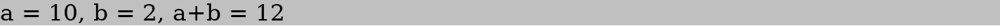
```php
args(10);
args($DoesNotExist,20); // 不要这样做，请发送 (NULL,20) 
```
[](image_rsrc7NA.jpg)

函数还可以返回一个 `$variable`（包括数组）：
```php
function Add($one,$two){
    $total = $one + $two;
    return $total;
}
$a = 2;
$b = 3;
```

```php
$result = Add($a,$b); // 将 $total 的值赋值给 $result
echo $result;
```
■​ ■​ ■

| 如果多个页面将引用相同的函数，请创建一个单独的 `functions.php` 文件（名称自自定义），并在需要使用这些函数的页面中使用 `require()` 或 `require_once()`。为了速度和文件大小，页面特定的函数应直接包含在必要的页面中。 |


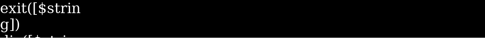停止当前脚本并输出可选的 `$string`。

示例：
```php
$result = @mysql_connect('db', 'user', 'pw') or die('Unable to connect to database!'); 
echo 'If it fails, this will never be seen';
```

注意：上述输出仅在失败时才会显示。如果 `mysql_connect()` 之前没有 `@` 符号，PHP 也会输出一个警告。


### eval($string)
将字符串作为代码进行评估。这可以用于将代码存储在数据库中并让 PHP 动态处理，就像它是页面的一部分。必须包含代码的所有适当方面，例如使用反斜杠（`\`）转义项目，并在字符串末尾包含分号（`;`）。

示例：
```php
$name = 'Mario';
$string = 'My name is $name.'; // 注意单引号
echo $string;
$code = "\$evalstring = \" $string \" ;";// 反斜杠转义的影响：
$code = "$evalstring = " $string "";
eval($code); // eval($evalstring = " My name is $name " ;);
```
 // $evalstring 与 $string 相同，只是现在使用了双引号
echo $evalstring;


### sleep($integer)
暂停 PHP `$integer` 秒后继续执行。

示例：
```php
sleep(2); // 暂停 2 秒
```


### usleep($integer)
暂停 PHP `$integer` 微秒后继续执行。

示例：
```php
usleep(1000000); // 暂停 1 秒
```


### uniqid($prefix)
entropy – [可选] `$boolean` 默认：FALSE，输出 13 个字符
根据 `$scalar` 生成一个唯一 ID。如果没有输入，则自动使用当前的微秒级时间。这最好与其他函数结合使用，以生成更独特的值。如果 `$scalar` 为空字符串（''`）且 `entropy` 设置为 TRUE，则提供 26 个字符的输出而非 13 个字符。

示例：
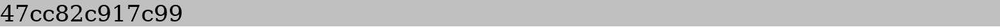
```php
$id = uniqid(); echo $id;
$random_id = uniqid(mt_rand()); echo $random_id;
```


### md5($string)

```php
$md5 = md5($random_id); echo $md5;
```
另请：`md5()` – 基于 MD5 算法的加密


### setcookie($name, $value, $expire, $path, $domain, $secure, $httponly)
name – `$string`
value – [可选] `$string`
time – [可选] `$integer` 默认：直到会话结束
path – [可选] `$string` 默认：当前目录
domain – [可选] `$string` 默认：当前域名（例如 http://www.example.com）
secure – [可选] `$boolean` 默认：FALSE，不需要安全连接
```php
httponly – [可选] `$boolean` 默认：FALSE，脚本语言可用

设置一个 cookie，在下一次页面加载时对服务器可见。要发送默认值，对于你想跳过的每个参数（时间参数除外），请使用一对单引号（`''''`），而时间参数应使用 0 来发送默认值。在大多数情况下，提供名称、值、时间和域名将涵盖大部分用途（path 使用 `''`）。

示例：
```php
setcookie('Cookie','Set till end of this session',0);
// 这在页面重载后将正常显示
print_r($_COOKIE);
Array ( [Cookie] => Set till end of this session )
```

```php
setcookie('Cookie','Set for 60 seconds for all subdomains of example.com, such as www., mail., etc.',time()+60,'','.example.com');
print_r($_COOKIE);
```
常用的过期时间：
- `time()+60*60*24` 等于 1 天
- `time()+60*60*24*30` 等于 30 天
- `time()-1` 是过去的一秒，用于使 cookie 过期/删除

```php
setcookie('Cookie','',time()-1); // 过期名为 'Cookie' 的 cookie。注意值为空字符串
```

### urlencode($string)
将 `$string` 的格式更改为适用于通过 URL 传递的格式（例如 GET 查询的一部分），并返回新字符串。

示例：
```php
$string = 'Hello There! How are you?';
echo urlencode($string);
Hello+There%21+How+are+you%3F
```

### urldecode($string)
将 `$string` 的格式从 URL 兼容格式（例如 GET 查询）更改为人类可读格式，返回新字符串。

示例：
```php
$string = 'Hello+There%21+How+are+you%3F';
echo urldecode($string);
Hello There! How are you?!
```


### 2
必须在发送任何头部或其他内容（包括 `<html>` 标签）之前发送。查看 `ob_start()` 了解实现此点的简单方法。


### get_magic_quotes_gpc()
如果关闭则返回 0，否则返回 1。
用于判断魔引号是否开启。此检查用于代码移植性以及防止 SQL 注入。如果开启，魔引号会自动处理上述数据。

示例：
```php
if (get_magic_quotes_gpc()){
    echo 'Magic Quotes is on!';
}else{
    echo 'Magic Quotes is NOT on, use addslashes!';
}
```

另请：
- `addslashes()` 为字符串中的特殊字符添加反斜杠
- `stripslashes()` 从字符串中的特殊字符移除反斜杠


### phpinfo($option)
option – [可选] 使用特定的 `$integer` 或 `$string` 显示 `phpinfo()` 的部分。为了简单排除了特定选项。
默认情况下，`phpinfo()` 显示有关 PHP 安装的所有信息，包括模块、版本、变量等。

示例：
```php
phpinfo();
```


### error_reporting 和 ini_set
为了捕获编程错误、缺陷或确保 PHP 不对你的代码做任何假设，最好的故障排除是显示所有 PHP 错误。以下两行代码将启用此模式：
```php
error_reporting(E_ALL);
ini_set('display_errors', '1');
```


## 函数与引用

当你只想简单修改原始变量并将其带有新值返回给同一个变量名时，请使用此项。

```php
function add(&$var){ 
    // & 位于参数 $var 之前
    $var++;
}
$a = 1;
$b = 10; 
add($a);
echo "a is $a,";
add($b);
echo " a is $a, and b is $b"; // 注意：$a 和 $b 没有被引用
```
**输出：** `a is 2, a is 2, and b is 11`

你也可以通过 `foreach` 来修改数组：
```php
$array = array(1,2,3,4); 
foreach ($array as &$value){
    $value = $value + 10;
}
unset ($value); // 必须包含，$value 在 foreach 循环后仍然存在
print_r($array);
```
**输出：** `Array ( [0] => 11 [1] => 12 [2] => 13 [3] => 14 )`

## 三元运算符

三元运算符是用于在表达式被评估为 TRUE 或 FALSE 时决定执行什么操作的简写形式。条件返回 TRUE 输出或 FALSE 输出。

基本格式如下：
`( expr ) ? ValueIfTrue : ValueIfFalse ;`

**示例：**
```php
$boolean = TRUE;
$result = ($boolean) ? 'Is True' : 'Is False'; 
echo $result; // $result 尚未设置

$result = (isset($result)) ? $result+1 : 10; 
echo " \$result = $result.";

$result = (isset($result)) ? $result+1 : 10; 
echo " \$result = $result.";
```

## 运算符

- **赋值 (`=` )**：将右侧的值赋给左侧的变量。
- **相等 (`==` )**：检查左右侧的值是否相等。
- **全等 (`===` )**：检查左右侧的值是否相等且类型完全相同。

**示例：**
```php
$a = 1; // 通过赋值将 $a 的值设置为 1
$b = TRUE; // 将 $b 的值设置为布尔 TRUE
if ($a == $b){
    echo 'a is equal to b.';
}
if ($a === $b){
    echo 'a is identical and equal to b.';
}
```

## 逻辑运算符

用于条件语句，将表达式的 FALSE 结果评估为真，或者当一个值不等于第二个值时。

**示例：**
```php
$a = 1;
if (!isset($a)){ 
    // 如果变量 $a 未被设置，则...
    echo '$a is not set'; // 如果未设置，则表达式为 TRUE
    // 因为没有 ELSE 语句，所以什么都不显示
}
if ($a != 0){
    echo '$a does not equal zero';
}
```
*参见上方的“等号”部分了解“相等”与“全等”的区别。*

## 字符串拼接

句号 (.) 用于按照列出的顺序将不同类型的项目组合成字符串的一部分。在许多情况下，这被用于引用函数或数组的值，这些值在赋值给 `$string` 变量时，不能在双引号 (`""`) 内直接引用。

**示例：**
```php
$array = array( 1 => 'Hello' );
$string = 'World';
echo '$string in single quotes, followed by ' . $array[1] . "$string";
```

## 逻辑比较

- **与 (`&&` )**
- **或 (`||` )**
- **异或 (`xor`)** - 或，但不同全真。

**示例：**
```php
if (1 == 1 && 2 == 2){
    echo 'And is True';
}
if (1 == 1 || 2 == 2){
    echo 'At least one of these is True';
}
if (1 == 1 xor 2 == 10){
    echo 'One of these is True, but not both';
}
```

## 控制结构

PHP 的核心是控制结构。没有了它们，变量和数组就是孤立的，因为它们促进了比较、循环以及告诉你该往哪里走、如何做的逻辑指令。

### If, ElseIf, Else

```php
if ( expr ) {
    // 如果 expr 为 TRUE，执行此操作，然后退出 IF 循环
}
elseif ( expr2 ) {
    // 如果 expr 为 FALSE 且 expr2 为 TRUE，执行此操作，然后退出循环
}
else {
    // 如果所有 expr 都为 FALSE，执行此操作并退出
}
```
`if` 语句中只能有一个 `else`，但在 `else` 语句之前允许有多个 `elseif` 表达式。

**示例：**
```php
$x = 1;
if ($x < 1){
    echo '$x is less than 1';
}elseif ($x == 1){ 
    // 注意双等号，用于比较
    echo '$x is equal to 1';
}else{
    echo '$x is neither equal to 1 or less than 1';
}
```
**输出：** `x is equal to 1`

**另见：**
- `switch` – 比多个 `if/else` 组合更简单、更有组织的用法。
- `break` – 停止循环并退出，无论语句评估结果是否为真。

### if 语句的替代语法
```php
if ( expr ) {
    // 如果 expr 为 TRUE，执行此操作，然后退出 IF 循环
} elseif ( expr2 ) {
    // 如果 expr 为 FALSE 且 expr2 为 TRUE，执行此操作，然后退出循环
} else {
    // 如果所有 expr 都为 FALSE，执行此操作并退出
} endif;
```

### Switch

```php
switch ( expr ) { 
    case value :
        // 如果 value 匹配则执行此操作
        break;
    case value2 :
        // 如果 value2 匹配则执行此操作
        break;
}
```
`switch` 用于条件语句，将表达式的 FALSE 结果评估为真，或者当一个值不等于第二个值时。（注：原文此处描述似乎混合了，我保留了其结构）。

**示例：**
```php
$x = 1;
if ($x < 1){
    echo '$x is less than 1';
}elseif ($x == 1){ 
    // 注意双等号，用于比较
    echo '$x is equal to 1';
}else{
    echo '$x is neither equal to 1 or less than 1';
}
```

### While

```php
while ( expr ) {
    // 如果 expr 为 TRUE，执行此操作，再次评估
}
```
`while` 循环检查 expr，如果评估为真，则运行 while 内部的内容直到结束。

**示例：**
```php
$x = 1;
while ($x <= 3){
    echo "$x, ";
    $x++;
}
```
**输出：** `1, 2, 3,`

### Do-While

```php
do {
    // 执行此操作
} while ( expr );
```
`do-while` 循环执行 `do` 语句中的内容，检查 expr，如果评估为真，则运行 do 内容直到结束，再次评估 expr，重复直到 expr 为假。

**示例：**
```php
$x = 1; 
do {
    echo "$x, ";
    $x++; // 使 $x = 2，因此 while 将评估为假
} while ($x <= 1);
```
**输出：** `1, `

### For

```php
for ( expr1 ; expr2 ; expr3 ) {
    // 如果 expr2 为 TRUE，执行此操作
}
```
启动时，`for` 循环在开始执行一次 `expr1`。接下来评估 `expr2`。如果 expr2 为真，则执行 `for` 循环内部的代码。当 `for` 循环结束时，会在再次检查 expr2 之前执行 `expr3`。

**示例：**
```php
for ($x = 1; $x <= 5; $x++){ 
    echo $x;
}
```
**输出：** `12345`


## For 循环

`for` 语句的替代语法：
```
for ( expr1 ; expr2 ; expr3 ) // 如果 expr2 为真，则执行此操作 for;
```

在 `for` 循环中使用 `continue` 和 `break` 的示例：
```php
for ($v=0;$v<=10;$v++){ 
    echo $v;
    if ($v == 5){ 
        continue;
    }
    if ($v == 8){ 
        break;
    }
    echo ',';
}
```
`0,1,2,3,4,56,7,8`

## Foreach 循环

`foreach` 循环遍历数组中的所有项，为值分配一个临时变量名，如果需要，也为键分配名称，以便在循环内部执行的代码中使用它们。

**语法：**
```php
foreach($array as $value ){// 执行某些操作}
// 另一种形式，用于键和值
foreach ($array as $key => $value ){// 执行某些操作}
```

**示例：**
```php
$array = array('John' => 20, 'Jane' => 24, 'Joseph' => 28);
foreach ($array as $value){
    echo "$value, "; 
}
foreach ($array as $name => $age){ 
    echo "$name - $age";
    echo '<br />'; // 用于换行的 XHTML 代码
}
```

**另需阅读：**
- 引用传递 – 使用取地址符 (`&`) 通过 `foreach` 修改数组

## Break 语句

`$integer` – [可选] 指定要跳出的嵌套循环次数。退出并停止当前（默认）`for`、`foreach`、`while`、`do-while` 或 `switch` 循环的执行。

**示例：**
```php
$counter = 0;
while (1 == 1){ // 将无限运行
    while (0 == 0){ // 也会无限运行
        $counter++; // $counter 加 1 
        echo $counter;
        if ($counter == 5){ 
            break 2;
        }
    }
    echo 'First while loop'; // 因为 break 2; 永远不会显示
    break; // 永远不会运行，但如果执行，将结束第一个 while 循环 
}
```

## Continue 语句

`$integer` – [可选] 指定要跳过的嵌套循环次数。注意：`$integer` 并不提供跳过的迭代次数，它始终停止当前迭代的继续执行。跳过当前循环迭代的剩余部分，如果适用，则继续循环的下一次迭代。

**示例：**
```php
for ($x=1;$x<=10;$x++){ 
    if ($x == 5){
        continue;
    } // 如果 $x == 5，则 echo 永远不会发生
    echo $x;
}
```

## Return 语句

`$variable` – [可选] 从函数返回的变量。如果作为普通脚本的一部分而不是函数的一部分，它的作用与 `exit()` 或 `die()` 相同。`Return` 更常用作函数的一部分，将函数的执行结果赋值回原始函数调用处。

**另需阅读：**
- 函数 – 提供了作为函数一部分返回 `$variable` 的示例

## 文件函数

`exit()` – 立即终止当前脚本。

`include` - `$string` 作为当前脚本/页面的一部分包含并评估文件。这是存储通用变量、函数或会被多个脚本/页面包含的 HTML 行的简单方法。函数失败将生成错误。
**示例：**
```php
include('somefile.inc');
```
在 `switch` 的情况下，`continue` 的效果与 `break` 相同。函数应该只包含一次。考虑使用 `include_once()` 或 `require_once()`。

`include_once` - `$string` 作为当前脚本/页面的一部分包含并评估文件。如果文件已经包含，将忽略该请求。这是存储通用变量、函数或会被多个脚本/页面包含的 HTML 行的简单方法。函数失败将生成错误并立即终止脚本。
**示例：**
```php
include_once('somefile.php');
```

`require` - `$string` 作为当前脚本/页面的一部分包含并评估文件。这是存储通用变量、函数或会被多个脚本/页面包含的 HTML 行的简单方法。函数失败将生成错误。
**示例：**
```php
require('somefile.htm');
```

`require_once` - `$string` 作为当前脚本/页面的一部分包含并评估文件。如果文件已经包含，将忽略该请求。这是存储通用变量、函数或会被多个脚本/页面包含的 HTML 行的简单方法。函数失败将生成错误并立即终止脚本。
**示例：**
```php
require_once('somefile.php');
``` 函数应该只包含一次。考虑使用 `require_once()`。

## 全局变量

虽然某些全局变量可以通过使用 `define()` 创建，但某些变量由于特殊函数而被预留，提供了访问不同类型数据的权限。下面列出的所有全局变量都是数组，可能包含也包含数据，取决于当前脚本和环境。

- `$_SERVER`
- `$_SERVER['HTTP_USER_AGENT']` – 头部中的浏览器描述
  `[HTTP_USER_AGENT] => Mozilla/5.0 (X11; U; Linux i686; en-US; rv: 1.8.12) Gecko/20080207 Ubuntu/7.10 (gutsy) Firefox/2.0.12`
- `$_SERVER['HTTP_REFERER']` – 引导用户的页面地址
  `[HTTP_REFERER] => http://www.example.com/index.htm`
- `$_SERVER['REMOTE_ADDR']` – 客户端 IP 地址
  `[REMOTE_ADDR] => 127.0.0.1`
- `$_SERVER['DOCUMENT_ROOT']` – 当前脚本的系统根位置
  `[DOCUMENT_ROOT] => /opt/lampp/htdocs`
- `$_SERVER['SCRIPT_FILENAME']` – 当前脚本的绝对路径
  `[SCRIPT_FILENAME] => /opt/lampp/htdocs/test.php`
- `$_SERVER['REQUEST_URI']` – 页面的统一资源标识符
  `[REQUEST_URI] => /test.php?test=value`
- `$_SERVER['SCRIPT_NAME']` – 当前脚本路径
  `[SCRIPT_NAME] => /test.php`
- `$_SERVER['QUERY_STRING']` – 当前查询字符串
  `[QUERY_STRING] => test=value`
- `$_SERVER['PHP_SELF']` – 相对于根的当前脚本名称
  `[PHP_SELF] => /test.php`

当向包含表单的相同页面/文件提交表单时，可以使用 `$_SERVER['PHP_SELF']` 变量动态提供位置。

```html
<form method="POST" action="<?php echo $SERVER['PHP_SELF']; ?>">
```

```html
<form method="POST" action="filename.php">
```


包含由 `$_GET`、`$_POST` 和 `$_COOKIE` 提供的所有变量包含所有通过 HTTP POST 提交的变量，例如带有 `action="post"` 的 HTML 表单包含所有通过查询字符串提交的变量，无论是手动还是来自 `action="get"` 的表单 [`www.example.com/test.php?query=value`](http://www.example.com/test.php?query=value)分配给当前会话的变量为当前网站存储的 cookie。如果刚使用 `setcookie()` 设置，则只有在页面刷新后才可见。另请：`setcookie()` – 分配和删除 cookie通过 POST 上传提供脚本的变量关于服务器环境的变量集合包含脚本中所有变量（全局或其他类型）的引用。

## 变量函数

以下函数检查变量本身的细节，而不是处理变量类型的特定方面。换句话说，你不想知道你有一头什么品种的大象，只需要知道它是一头大象，而且它正要踩你了。太多了吗？噢，我们再次开始。

### 确定 $variable 是否为空。

如果 `$variable` 是以下情况，则返回 TRUE：
* `''` – 空字符串 `$string`
* `0` – 针对 `$integer`
* `'0'` – 针对 `$string`
* `array()` – 针对 `$array`
* `NULL`
* `FALSE`
* 未声明的变量

示例：
```php
$string = 'Hello';
$array = array();
```
 ```php
var_dump( empty($string), empty($array), empty($DoesNotExist) );
```
另请：`is_null()` – 检查变量是否为 `NULL`，`isset()` – 检查变量是否已设置/创建/声明

### 确定 $variable 是否为 `NULL`。

如果是 `NULL`，则返回 TRUE。注意：未声明的 `$variable` 将返回 TRUE，但可能会返回错误。

示例：
```php
$string = '';
$integer = 0;
$array = NULL;
```
 ```php
var_dump( is_null($string), is_null($integer), is_null($array) );
```

### 接受逗号分隔的多个 $variables，但只有当所有变量都设置时才返回 TRUE。

确定 `$variable` 是否已设置/创建/声明。

示例：
```php
$string = '';
$integer = 0;
var_dump( isset($string,$integer) ); // 因为两者都设置了
echo '<br />'; // XHTML 换行
```
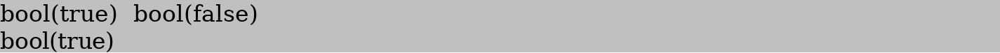 ```php
unset($string); // 取消或销毁变量
var_dump( isset($string), isset($integer) );
```
另请：`unset()` – 销毁/删除一个或多个变量

### 接受逗号分隔的多个 $variables。

取消或销毁/删除给定的 `$variable(s)。示例：
```php
$string = 'hello';
var_dump( isset($string) ); // 检查是否设置
echo '<br />'; // XHTML 换行
unset($string);
```
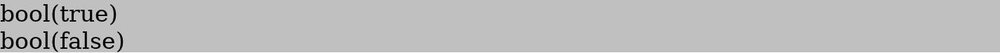 ```php
var_dump( isset($string) ); // 再次检查
```
另请：`isset()` – 确定变量是否已设置

### 确定 $variable 是否为数组。

如果是数组，则返回 TRUE。示例：
```php
$array = array();
```
 ```php
$array2 = array( 'one', 'two', 'three' );
var_dump( is_array($array), is_array($array2) );
```

### 也称为：`is_integer()`

确定 `$variable` 是否为整数。如果是整数，则返回 TRUE。示例：
```php
$int = 0;
$string = '0';
```
  ```php
var_dump( is_int($int), is_int($string) );
```

### 确定 $variable 是否为字符串。

如果是字符串，则返回 TRUE。示例：
```php
$int = 0;
$string = '0';
```
 ```php
var_dump( is_string($int), is_string($string) );
```

### 确定 $variable 是否为整数或数字字符串（例如 "12"）。

如果其中任一真，则返回 TRUE。示例：
```php
$int = 10;
$string = '10';
```
 ```php
var_dump( is_numeric($int), is_numeric($string) );
```
另请：`is_int()` – 确定变量是否为整数，`is_string()` – 确定变量是否为字符串。

### `var_dump( expr [, ... expr ...])`

接受多个表达式，用逗号分隔。
`expr` – 一个 `$variable` 或任何产生结果的表达式。显示其类型


## 字符串函数

如果你是一只猫，那么字符串函数就是猫的喵喵声（这里是个双关语）。它们不仅占据了你 PHP 代码的很大一部分，还提供了许多用于识别和将你的数据转换为其他格式（如数组）机能。


## addslashes()

向 `$string` 中的项目添加反斜杠（转义字符串），使其能够安全数据库查询。它会影响单引号（`'`）、双引号（`"`）、反斜杠（`\`）和 NUL 字节。

**示例：**
```php
$string = ' Tom said, "Marcus is mad!"'; echo $string;
```

```php
$string = addslashes($string); echo $string;
```

**另见：**
- `get_magic_quotes_gpc` – 自动对 `GET/POST/COOKIE` 数据应用 `addslashes` 的服务器设置
- `stripslashes()` – 由 `addslashes()` 创建的反斜杠

## stripslashes()

移除 `$string` 中通过 `addslashes()` 或 `magic_quotes_gpc` 添加的反斜杠。

**示例：**
```php
$string = ' Tom said, "Marcus is mad!"';
$string = addslashes($string); echo $string;
```

```php
$string = stripslashes($string); echo $string;
```

**另见：**
- `get_magic_quotes_gpc` – 自动对 `GET/POST/COOKIE` 数据应用 `addslashes` 的服务器设置

## chunk_split()

添加反斜杠使字符串能够安全数据库查询。

`chunk_split($string [, length ] [, endstring ])`

- `length` – [可选] `$integer` 默认：`76`
- `endstring` – [可选] `$string` 默认：`"\r\n"`（回车和换行符）

将 `$string` 分成长度为 `length` 的字符段，每个部分都以 `endstring` 结束。仅评估字符长度以生成结果字符串。

**示例：**
```php
$string = 'Hello Nurse!';
$string = chunk_split($string, 3); var_dump($string);
```
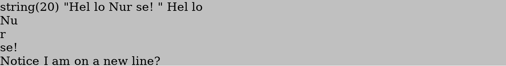
```php
echo nl2br($string); // 将 \n 转换为 XHTML 的 <br />
echo 'Notice I am on a new line?';
```
HTML 源代码：
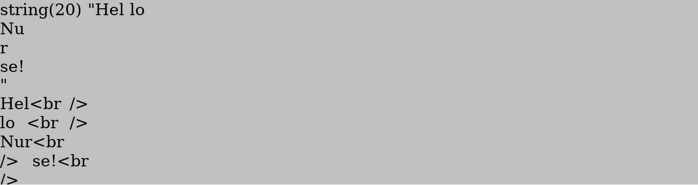

**另见：**
- `nl2br()` – 将 `\n` 实例转换为 XHTML 的 `<br />` 换行
- `str_replace()` – 替换字符串中的指定字符
- `wordwrap()` – 与 `chunk_split()` 类似，但有一些细微差异

| `\r\n` 是格式化字符，如果是标准输出的一部分，它们会被忽略。如果放置在 `<textarea>` 或 `<pre>`（预格式）标签内，它们会在浏览器的输出中被正确解析。 |

```php
$string = 'Hello Nurse!';
$string = chunk_split($string, 3); echo '<pre>';
```

```php
echo $string; echo '</pre>';
```

## wordwrap()

`wordwrap($string [, length ] [, breakstring ] [, wordcut ])`

- `length` – [可选] `$integer` 默认：`75`
- `breakstring` – [可选] `$string` 默认：`"\n"`（换行）
- `wordcut` – [可选] `$boolean` 默认：`FALSE`，单词不会切分

将 `$string` 分成长度为 `length` 的字符段，并带有 `breakstring`。如果 `wordcut` 设置为 `TRUE`，超过指定长度的单词将被分割，以确保精确的宽度。

**示例：**
```php
$origstring = 'I said to her, Hellooooo Nurse!!!';
$string = wordwrap($origstring, 8);
```

```php
echo nl2br($string); // 将 \n 转换为 XHTML 的 <br />
$origstring = 'I said to her, Hellooooo Nurse!!!';
```

```php
$string = wordwrap($origstring, 8, "<BR \>\n", TRUE); echo $string;
```

**另见：**
- `nl2br()` – 将 `\n` 实例转换为 XHTML 的 `<br />` 换行
- `str_replace()` – 替换字符串中的指定字符
- `chunk_split()` – 与 `wordwrap()` 类似，但有一些细微差异

| 为了符合标准，使用 `mail()` 命令发送基于文本的电子邮件时，在提供给 `mail()` 之前应该使用 `wordwrap()` 对消息解析。 |


## count_chars()

`mode` – [可选] `$integer` (0, 1, 2, 3, 或 4) 默认：`0`

**值：**
- `0` – 返回包含所有字符计数的数组
- `1` – 返回在 `$string` 中至少出现一次的字符的计数数组
- `2` – 返回所有出现次数为零的字符计数数组
- `3` – 返回 `$string` 中包含的所有字符的字符串
- `4` – 返回 `$string` 中包含的所有字符的字符串

检查 `$string` 中的 ASCII 字符实例并统计每个字符出现的次数。输出取决于 `mode`。

**注意：** 数组中的键是字符的 ASCII 字节值（模式 0-2），而字符串输出是本身（模式 3 和 4）。

**示例：**
```php
$string = 'Hello';
$array = count_chars($string, 1);
```
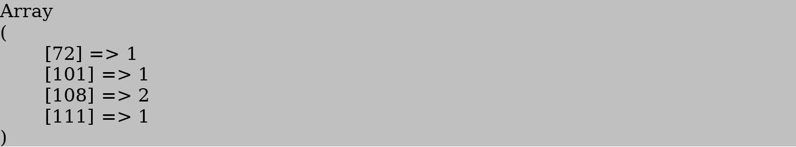
```php
echo '<pre>'; // 为了方便阅读
print_r($array);
foreach ($array as $key => $value){
  $char = chr($key); // 由字节值表示的字符
  $chararray[$char] = $value; // 创建字符的新数组
}
```
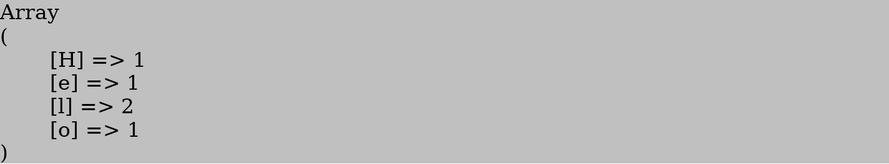
```php
print_r($chararray);
$usedcharacters = count_chars($string, 3); var_dump($usedcharacters);
```


**另见：**
- `chr()` – 获取由字节值表示的 ASCII 字符

`chr($integer)`
`$integer` – 0 - 255 返回 ASCII 字节值的单个字符表示

`explode( delimiter , $string [, limit ])`

- `delimiter` – `$string`，如果为空，`explode` 将返回 `FALSE`
- `limit` – [可选] `$integer`，默认：无限制。通过搜索 `$string` 并使用提供的分隔符分割创建字符串数组。限制设置元素的最大数量，数组的最后一个元素是字符串的剩余部分。

布尔值由 1 (TRUE) 或空 (FALSE) 表示，而浮点数大于 e6 时可能会显示为整数。如果 `limit` 为负，则返回除最后 limit 个之外的值。

**示例：**
```php
$explodeme = '02-01-1980';
$array = explode('-', $explodeme); // 横杠 (-) 是分隔符
echo '<pre>'; // 为了方便阅读
```
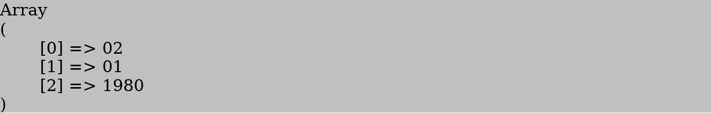
```php
print_r($array);
$array = explode('-', $explodeme, 2); // 限制为 2 个元素
print_r($array);

```
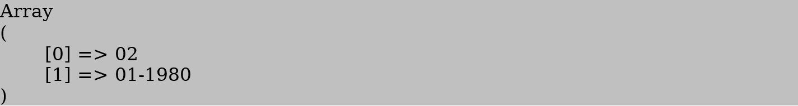

| 如上所示，explode 可用于拆分常见的语言语法，例如将用户提交的段落拆分成单个句子，或者允许用户提交特定项目的标签（用逗号分隔），然后 explode() 那些项目以存储在数据库中。 |


## `implode(limiter, $array)`

返回一个包含 `$array` 内容的字符串，并用提供的 `limiter` 连接。

示例：
```php
$array = array( 'Hello', 'World', '!' );
$string = implode(' ', $array); // 使用空格作为分隔符
echo $string; // Hello World !
```

**参见：** `explode()` – 使用特定的分隔字符串将字符串拆分为数组。


## `sprintf()`

接受多个输入，并在 `formatting` 中指定时使用。

- `formatting` – `$string`，特定的格式字符串，见下文。
- `inputs` – 需要格式化的 `$scalar(s)`

返回一个格式化后的字符串，使用 `inputs` 根据预设的规则（见下文）将其值动态输入到格式化字符串中。

以下是格式输入的可用命名法。


每当预期输入作为格式化字符串的一部分被使用和评估时，其前面有一个百分号（`%`），后面紧跟说明符/规则：

**注意：** 除类型说明符外，所有说明符都是可选的。

- **符号说明符**。放置加号（`+`）会强制显示负号和正号（默认仅指定负值）。
- **填充说明符**。默认是空格，不需要指定。也可以使用零（`0`）而无需任何次要记法。如果使用任何其他字符，应在它前面加一个单引号（`' ` `）。
- **对齐说明符**。默认是右对齐（因此填充内容放置在字符串的左侧）。放置减号/减法符号（`-` `）将将其设置为左对齐。
- **宽度说明符**。此整数决定了输出的最小字符长度。当与填充结合时，指定的宽度减去输入的长度决定了将添加的填充字符数。
- **精度说明符**。点（`.`）后跟一个整数，设置了浮点数应输出的小数位数。如果用在字符串，它将为输出设置最大字符限制。
- **类型说明符**：
    - `%` – 字面量百分号，因此在格式字符串中显示百分号时应写为 `%%`。
    - `b` – 输入应为整数，输出为二进制数。
    - `c` – 输入应为 0-255 之间的整数，代表 ASCII 字节值。输出代表该值的字符。
    - `d` – 输入为整数。
    - `e` – 输入为科学计数法。
    - `u` – 输入为无符号十进制。
    - `f` – 输入为浮点数（感知区域）。
    - `F` – 输入为浮点数（不感知区域）。
    - `o` – 输入为整数，输出为八进制数。
    - `s` – 输入为字符串。
    - `x` – 输入为整数，输出为十六进制数（使用小写字母）。
    - `X` – 输入为整数，输出为十六进制数（使用大写字母）。

## 示例

### 基础替换，无可选说明符
```php
$string = 'cat';
$integer = 10;

echo sprintf("I have %d %s(s)", $integer, $string);
```

### 基础替换，类型指定自动调整
```php
$string = 'cat';
$string2 = '10 blah';

echo sprintf("I have %d %s(s)", $string2, $string);
```

### 使用符号说明符
```php
$string = 'cat';
$integer = '10';

echo sprintf("Dagger has a %+d against %ss", $integer, $string);
```

### 使用填充和宽度说明符（默认填充说明符为空格）
```php
$string = 'cat'; // 长度为 3 个字符
echo '<pre>'; // 需要 HTML 来正确显示格式化
echo sprintf("3 spaces added: |%6s", $string);
 // 使用了 6 个字符填充，6 – 3 = 3 个填充空格
```

### 使用零（`0`）进行填充和宽度
```php
$month = 12;
$day = 1;
$year = 1980;
echo sprintf (" Date: %02d/%02d/%04d.", $month, $day, $year);
$year = 80;

echo sprintf (" Date: %02d/%02d/%04d.", $month, $day, $year);
```

### 使用自定义字符星号（`*`）进行填充和宽度
```php
$endofpassword = 'word';
$output = sprintf("Your password: %'*8s", $endofpassword);
echo $output; // Your password: ****word
```

### 使用填充、对齐（左侧）和宽度
```php
$endofpassword = 'word';
$output = sprintf("Your password: %'*-8s", $endofpassword);
echo $output; // Your password: word****
```

### 使用精度说明符
```php
$scientific = 1.2e3;
echo sprintf("Three decimal places: %.3e", $scientific); // Three decimal places: 1.200e+3
$float = 1.2e3;
echo sprintf("Two decimal places: %.2f", $float); // Two decimal places: 1200.00
$string = 'Hello World!';
echo sprintf("Cut-off after 4 characters: %.4s", $string); // Cut-off after 4 characters: Hell
```

**参见：**
- `printf()` – 输出格式化字符串结果，而不是简单的返回它们。
- `sscanf()` – 通过格式化字符串解析字符串，是 `sprintf()` 的反向。

| 为了 MySQL 安全，你可以使用 `sprintf()` 强制用户输入具有最大长度并符合你的数据库结构。使用精度说明符自动解析由 GET 或 POST 提交的字符串。 |


## printf( formatting , inputs [, ... inputs ... ] )

接受多个输入，并在 `formatting` 中指定时使用。

- `formatting` – `$string`，特定的格式化字符串。术语名称请参见 `sprintf()`。
- `inputs` – 需要格式化的 `$scalar(s)`。

使用 `inputs` 打印一个格式化字符串 `formatting`，通过一组预设的规则将值动态地输入到格式化字符串中。

**注意：** 有关格式化字符串的规则请参见 `sprintf()`。

示例：
```php
$string = 'puppies';
printf("I think %s are cute.", $string);
```


**另见：** `sprintf()` – 返回格式化后的字符串，解释了规则/术语。

## sscanf( $string, format [, ... outputs ] )

接受多个[可选]输出，但它会改变函数的行为。

检查给定的 `$string` 并根据预期的格式对其进行解析。当未包含输出时，返回一个数组。如果包含了输出，则通过引用指定用于赋值格式化内容的变量名。

**注意：** 有关格式化字符串的规则——类型说明符请参见 `sprintf()`。

示例：
```php
$string = '12/1/1980';
$array = sscanf($string, "%d/%d/%d");
echo '<pre>'; // 为了提高可读性
print_r($array);
```
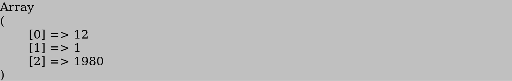

```php
$string = '12/1/1980';
$outputs_count = sscanf($string, "%d/%d/%d", $month, $day, $year);
var_dump ($month, $day, $year);
```


**另见：**
- `sprintf()` – `sscanf()` 的反向，并提供了格式化字符串的解释。
- `list()` – 将数组的值赋值给变量。

## list( $string [, quotes_flag ] [, character_set ] )

- `quotes_flag` – [可选] `$string` 默认值：`ENT_COMPAT`（仅双引号）。其他值：
    - `ENT_QUOTES`（单双引号均包含）
    - `ENT_NOQUOTES`（单双引号均不包含）
- `character_set` – [可选] `$string` 默认值：`ISO-8859-1`

将 `$string` 中某些具有 HTML 特殊含义的字符转换为安全的 HTML 实体。这包括（但可能限于某些可选的 `flags`）：双引号（`"`）、单引号（`'`）、大于（>`）、小于（`<`）和和（`&`）。

示例：
```php
$string = '<strong>Hello & World!</strong><br />';
echo htmlspecialchars($string);
```

HTML 源代码：

**另见：**
- `htmlspecialchars_decode()` – 取消 `htmlspecialchars()` 的效果。
- `htmlentities()` – 所有 HTML 实体，而不只是上述五个。

## htmlspecialchars_decode( $string [, quotes_flag ] [, character_set ] )

- `quotes_flag` – [可选] `$string` 默认值：`ENT_COMPAT`（仅双引号）。其他值：
    - `ENT_QUOTES`（单双引号均包含）
    - `ENT_NOQUOTES`（单双引号均不包含）
- `character_set` – [可选] `$string` 默认值：`ISO-8859-1`

将 `$string` 中的 HTML 实体转换回字符表示。这包括（但可能限于某些可选的 `flags`）：双引号（`"`）、单引号（`'`）、大于（>`）、小于（`<`）和和（`&`）。

示例：
```php
$string = '&lt;strong&gt;Hello &amp; World!';
echo htmlspecialchars_decode($string);
```

HTML 源代码：

**另见：**
- `htmlspecialchars()` – 将上述五项转换为 HTML 实体。
- `html_entity_decode()` – 所有 HTML 实体，而不只是上述五个。

## htmlentities( $string [, quotes_flag ] [, character_set ] )

- `quotes_flag` – [可选] `$string` 默认值：`ENT_COMPAT`（仅双引号）。其他值：
    - `ENT_QUOTES`（单双引号均包含）
    - `ENT_NOQUOTES`（单双引号均不包含）
- `character_set` – [可选] `$string` 默认值：`ISO-8859-1`

将 `$string` 中某些具有 HTML 特殊含义的字符转换为安全的 HTML 实体。

示例：
```php
$string = "<strong>'Hello World!'";
echo htmlentities($string, ENT_QUOTES);
```
HTML 源代码：`&lt;strong&gt;&#039;Hello World!&#039;`

**另见：**
- `html_entity_decode()` – 取消 `htmlentities()` 的效果。
- `htmlspecialchars()` – 仅五个特定的 HTML 实体。

## html_entity_decode( $string [, quotes_flag ] [, character_set ] )

- `quotes_flag` – [可选] `$string` 默认值：`ENT_COMPAT`（仅双引号）。其他值：
    - `ENT_QUOTES`（单双引号均包含）
    - `ENT_NOQUOTES`（单双引号均不包含）
- `character_set` – [可选] `$string` 默认值：`ISO-8859-1`

将 `$string` 中的所有 HTML 实体转换回字符表示。

示例：
```php
$string = '&lt;strong&gt;&#039;Hello World!&#039;';
echo html_entity_decode($string); // 单引号未转换
```
HTML 源代码：`<strong>&#39;Hello World!&#39;`

**另见：**
- `htmlentities()` – 所有 HTML 实体。
- `htmlspecialchars_decode()` – 解码五个特定的 HTML 实体。

## trim( $string [, characters ] )

- `characters` – [可选] `$string`

当不包含 `characters` 时，从 `$string` 的开头和结尾移除以下字符：空格（` `）、制表符（`\t`）、换行（`\n`）、回车（`\r`）、NUL 字节（`\0`）和垂直制表符（`\x0B`）。如果包含了 `characters`，则使用该列表。

**注意：** 一旦遇到列表之外的字符，将停止修剪。

示例：
```php
$string = " \n Hello World!";
trim($string);
```


在 `characters` 包含 `$string`。

示例：
```php
$string = " \n Hello World!";
trim($string); // Hello World!
```
```php
trim($string, " \t"); // 只有 r
```
**另见：**
- `ltrim()` – 字符串的开头。
- `rtrim()` – 字符串的结尾。

## ltrim( $string [, characters ] )

- `characters` – [可选] `$string`

当不包含 `characters` 时，从 `$string` 的开头移除以下字符：空格（` `）、制表符（`\t`）、换行（`\n`）、回车（`\r`）、NUL 字节（`\0`）和垂直制表符（`\x0B`）。如果包含了 `characters`，则使用该列表。

**注意：** 一旦遇到列表之外的字符，将停止修剪。

示例：
```php
$string = " \n Hello World!";
ltrim($string); // Hello World!
```
```php
ltrim($string, " \t"); // 只有 r
```
**另见：**
- `trim()` – 开头和结尾。
- `rtrim()` – 字符串的结尾。

## rtrim( $string [, characters ] )

- `characters` – [可选] `$string`

当不包含 `characters` 时，从 `$string` 的结尾移除以下字符：空格（` `）、制表符（`\t`）、换行（`\n`）、回车（`\r`）、NUL 字节（`\0`）和垂直制表符（`\x0B`）。如果包含了 `characters`，则使用该列表。

**注意：** 一旦遇到列表之外的字符，将停止修剪。

示例：
```php
$string = " Hello World! \n";
rtrim($string); // Hello World!
```
```php
rtrim($string, " \t"); // 只有 r
```
**另见：**
- `ltrim()` – 字符串的开头。
- `trim()` – 开头和结尾。


## 密码安全与盐（Salt）

为了更安全地存储用户密码，应该考虑使用盐（salt）。盐基本上是添加到提供的 `$string` 上的一个字符串，用于增加其长度和复杂度。对于用户密码，盐将由系统随机创建，然后作为与该用户密码分离的独立条目保存到数据库中。这有助于防止反向 `md5` 字典攻击。

```php
$password = 'password'; // 非常糟糕的密码
$salt = substr(md5(uniqid(mt_rand(), TRUE)), 0, 5); // 5 位字符的盐
$salted_password_hash = md5($salt . md5($password)); 
echo $salted_password_hash; // 输出结果异
```

`d1239dcc6e017572ea6fed5df0d6e07e`

## 哈希函数

### md5_file
- `filename` – `$string`
- `raw_flag` – [可选] `$boolean` 默认: `FALSE`，32 位十六进制

生成名为 `filename` 的文件的 `MD5` 哈希。如果 `raw_flag` 设置为 `TRUE`，则返回长度为 16 位的原始二进制格式。

**示例：**
```php
$hash = md5_file('somefile.txt');
```
**另见：** `md5()` – 基于 MD5 算法的字符串加密。

### sha1
- `raw_flag` – [可选] `$boolean` 默认: `FALSE`，40 位十六进制

使用美国安全哈希算法（US Secure Hash Algorithm）对 `$string` 进行单向哈希加密。如果 `raw_flag` 设置为 `TRUE`，则返回长度为 20 的原始二进制格式。

**示例：**
```php
$password = 'mypassword'; 
echo sha1($password);
```
**另见：** `md5()` – 常用的基于 MD5 算法的加密。

请参考 `md5()` 提示如何为密码添加盐以增加额外的安全性。

### sha1_file
- `filename` – `$string`
- `raw_flag` – [可选] `$boolean` 默认: `FALSE`，40 位十六进制

生成名为 `filename` 的文件的 `Sha1` 哈希。如果 `raw_flag` 设置为 `TRUE`，则返回长度为 20 的原始二进制格式。

**示例：**
```php
$hash = sha1_file('somefile.txt');
```
**另见：** `sha1()` – 基于 Sha1 算法的字符串加密。

### number_format
- `decimals` – [可选] `$integer` 默认: `0`，无小数
- `decimal_point` – [可选] `$string` 默认:句点 ( `.` )
- `thousand_separator` – [可选] `$string` 默认:逗号 ( `,` )

如果指定，则对 `$float` 进行千分位分隔和数位格式化处理。
注意：如果浮点数的位数多于指定的格式，将进行四舍五入。

**示例：**
```php
$float = 1234567.891;
echo number_format($float);
echo number_format($float, 2); // 美式符号
echo number_format($float, 2, ",", " "); // 法式格式
```

### nl2br
- `string` – `$string`

将 `$string` 中所有的换行符字符（ `\n` ） 替换为 XHTML 换行符 `<br />`。

**示例：**
```php
$string = "Hello\nWorld"; 
echo nl2br($string);
```

### parse_str
将 `$string` 视为查询字符串，并将变量赋值为与查询键相同的名，然后赋值与查询值相同的值。如果指定了 `$array`，则查询变量将赋值给数组，并具有相同的键=>值关联关系。
注意：输出受 `magic_quotes_gpc` 设置的影响，与 `$_GET` 相同。

**示例：**
```php
$query_string = 'key=value&color=red'; 
parse_str($query_string);
echo "\$key equals $key, and \$color equals $color";

$query_string = "key=value&color='red'"; 
parse_str($query_string, $array);
echo '<pre>'; // 为了便于阅读
print_r($array);
```
- 未启用 `magic_quotes_gpc`。
- 启用了 `magic_quotes_gpc`。

**另见：** `get_magic_quotes_gpc()` – 检查是否启用了魔法引号；`list()` – 将数组的内容赋值给变量。

这是一个非常方便的方法，可以使用以下代码将 `$_SERVER['QUERY_STRING']` 提交的所有查询键/值轻松转换为变量：
```php
parse_str($_SERVER['QUERY_STRING']);
```


## str_replace()

- **find** – `$string` 或 `$array`
- **replace** – `$string` 或 `$array`
- **subject** – `$string` 或 `$array`
- **count** – [可选] 变量名 - `$integer`

在 `subject` 中将所有的 `find` 实例替换为 `replace`。如果 `subject` 是数组，则 `find` 和 `replace` 将发生在数组的所有条目上。如果 `find` 和 `replace` 是数组，则会对数组中的每个条目对整个字符串进行处理，找到 `find` 中的第一个项并替换为 `replace` 中的第一个项，然后对下一组条目重复此操作。如果 `find` 数组中的值多于 `replace` 数组，则使用空字符串（`''`）作为替换。如果 `find` 是数组而 `replace` 是字符串，则 `find` 中的每个条目都将使用 `replace`。可选的 `count` 变量将被设置为发生的替换总数。

**注意：** 此函数对大小写敏感。

### 示例:
```php
$newstring = str_replace('find', 'replace', 'I will find');
echo $newstring;
$array = array('I like dogs', 'I hate dogs');
$newarray = str_replace('dog', 'cat', $array);
print_r($newarray);
$findarray = array('l', 'p');
$replacearray = array('p', 'x');
$string = "Hello";
// 它将找到 l，替换为 p，然后找到 p 并替换为 x
$newstring = str_replace($findarray, $replacearray, $string, $count);
echo "$newstring had a total of $count replacements";
$findarray = array('l', 'p', 'x'); // 多了一个条目
$replacearray = array('p', 'x');
$string = "Hello";
$newstring = str_replace($findarray, $replacearray, $string);
echo $newstring;
$findarray = array('l', 'o');
$replace = 'x';
$string = "Hello";
$newstring = str_replace($findarray, $replace, $string);
echo $newstring;
```

**另见：**
- `str_ireplace()` – `str_replace()` 的不大小敏感版本
- `strtr()` – 简化变体，且在查找/替换时不不会重复执行

---

## str_ireplace()

- **find** – `$string` 或 `$array`
- **replace** – `$string` 或 `$array`
- **subject** – `$string` 或 `$array`
- **count** – [可选] 变量名 - `$integer`

在 `subject` 中将所有的 `find` 实例替换为 `replace`。如果 `subject` 是数组，则 `find` 和 `replace` 将发生在数组的所有条目上。如果 `find` 和 `replace` 是数组，则会对数组中的每个条目对整个字符串进行处理，找到 `find` 中的第一个项并替换为 `replace` 中的第一个项，然后对下一组条目重复此操作。如果 `find` 数组中的值多于 `replace` 数组，则使用空字符串（`''`）作为替换。如果 `find` 是数组而 `replace` 是字符串，则 `find` 中的每个条目都将使用 `replace`。可选的 `count` 变量将被设置为发生的替换总数。

**注意：** 此函数不大小写敏感。

### 示例:
```php
$newstring = str_ireplace('find', 'replace', 'I will FIND');
echo $newstring;
```
更多示例请参见 `str_replace()`。

**另见：**
- `str_replace()` – `str_ireplace()` 的大小写敏感版本

---

## strtr()

- **find** – `$string`
- **replace** – `$string`
- **replace_array** – `$array`, 关联数组 `find => replace`

此函数在提供三个参数（单次查找/替换）或两个参数（使用查找/替换数组）时，行为有所不同。在使用三个参数时，`$string` 内部所有的 `find` 实例都将被替换为 `replace`。在使用两个参数时，`replace_array` 的每个条目都会被处理，将键替换为值。

**注意：** 与 `str_replace()` 不同，只有 `$string` 的原始值会参与查找/替换。

### 示例:
```php
echo strtr('I like dogs', 'dog', 'cat');
$array = array( 'find' => 'replace', 'replace' => 'find');
$string = 'I will find and then replace';
$newstring = strtr($string, $array);
echo $newstring;
```
**另见：**
- `str_replace()` – 在字符串内替换项目的更灵活的方法

---

## substr()

- **start** – `$integer`，如果为负数，则从 `$string` 的结尾开始计数
- **length** – [可选] `$integer`，默认：`strlen($string)`；如果为负数，表示从 `$string` 末尾删除的字符数

返回从数字 `start` 之后的字符开始的字符串部分，且长度可选为 `length`。

### 示例:
```php
echo substr('1234567890', 3);
echo substr('1234567890', -3, 1);
echo substr('1234567890', -3, -1);
```

---

## substr_replace()

- **subject** – `$string` 或 `$array`
- **replace** – `$string`
- **start** – `$integer`，如果为负数，从字符串结尾计数
- **length** – [可选] `$integer`，默认：`strlen($string)`

将 `subject` 中从 `start` 字符之后的内容替换为 `replace`。如果指定了 `length`，则替换 `length` 数量的字符（当 `length` 为负数时，表示从结尾开始替换的字符数）。如果 `subject` 是数组，则对数组中的每个条目执行此操作并返回数组。

### 示例:
```php
$string = substr_replace('1234567890', 'hello', 3);
echo $string;
echo substr_replace('1234567890', 'hello', 3, 2);
$array = array('098765432');
$array = substr_replace($array, 'hello', -3, -2);
print_r($array);
```
**另见：**
- `str_replace()` – 查找并替换字符串

---

## substr_count()

- **haystack** – `$string`
- **needle** – `$string`
- **start** – [可选] `$integer`，必须为 0 或正数
- **length** – [可选] `$integer`，必须为 0 或正数

返回 `needle` 在 `haystack` 中出现的总次数。如果提供了 `start`，则从 `start` 个字符开始检查。如果提供了 `length`，则只检查 `length` 数量的字符。

### 示例:
```php
echo substr_count('abcdef', 'bc');
echo substr_count('abcdef', 'bc', 3);
```

---

## str_pad()

- **pad_length** – `$integer`，必须为正且大于 `strlen($string)`
- **pad_string** – [可选] `$string`，默认：`' '`
- **type** – [可选] `$integer` (0 或或 2)，0（仅右填充），1（仅左填充），2（双侧填充）

在 `$string` 中插入可选的 `pad_string` 直到 `$string` 达到 `pad_length` 长度。

### 示例:
```php
$string = 'Hello';
echo '<pre>'; // 显示格式化文本
echo str_pad($string, 7), '|';
$string = 'Hello';
echo str_pad($string, 10, '#', 2);
```
### 查看:
- `sprintf()` – 用于格式化的复杂函数

---

## str_repeat()

- **string** – `$string`
- **multiplier** – `$integer`

返回重复 `multiplier` 次的 `$string` 字符串。

### 示例:
```php
echo str_repeat('123', 3); // 123123123
```

---

## str_shuffle()

- **string** – `$string`

随机打乱字符串中的字符。本质上是字符串混合。

### 示例:
```php
echo str_shuffle('Hello World!'); // reW! ollod
```

---

## str_split()

- **string** – `$string`
- **length** – [可选] `$integer`

返回按每个字符或可选的 `length` 数量字符分割的 `$string` 数组。

### 示例:
```php
$array = str_split('Hello');
print_r($array);
$array = str_split('Hello', 2);
print_r($array);
```
**另见：**
- `chunk_split()` – 按特定长度使用 `\r\n` 分割字符串并返回字符串

---

## str_word_count()

- **option** – [可选] `$integer` (01 或 2)，默认：0（返回单词数）。其他值：1（返回包含所有单词的数组），2（返回位置=>单词的数组）
- **characters** – [可选] `$string`

统计 `$string` 内部单词的数量并默认返回该计数（可以通过 `options` 修改）。如果 `characters` 存在，它包含任何应被视为字母的字符。

### 示例:
```php
$string = 'Welcome to the jungle';
echo str_word_count($string);
$string = 'Welcome to the jun3gle';
$without = str_word_count($string, 0);
$withchar = str_word_count($string, 0, '3');
echo "Without: $without, WithChar: $withchar";
$string = 'Welcome to the jungle';
echo '<pre>'; // 更易读性
$array = str_word_count($string, 1);
print_r($array);
$array = str_word_count($string, 2);
print_r($array);
```

---

## str_tags()

- **allowed_tags** – [可选] `$string`

从 `$string` 中移除 HTML 标签和注释。如果应该排除特定标签，可以在 `allowed_tags` 内部指定。

### 示例:
```php
$string = "<p>This is a paragraph. </p><<strong>>Yay!</strong";
echo str_tags($string), str_tags($string, '<p>');
// HTML 源代码
echo str_tags($string, '<p>');
```
**另见：**
- `htmlspecialchars()` – 将 HTML 特殊字符转换为实体等

---

## strpos()

- **haystack** – `$string`
- **needle** – `$string`
- **start** – [可选] `$integer`

返回 `needle` 在 `haystack` 中首次出现的位置（从 `haystack` 开始的字符数）。如果包含了 `start`，则从 `start` 个字符之后开始搜索。

**注意：** 如果在 `haystack` 中未找到 `needle`，则返回 `FALSE`。见下方提示。

### 示例:
```php
$string = 'And now for something completely different';
$needle = 'thing';
echo strpos($string, $needle);
```
**另见：**
- `strrpos()` – 在 `haystack` 中查找 `needle` 的最后出现
- `stripos()` – 在 `haystack` 中查找 `needle` 的首次出现，不大小写敏感


注意此函数在输出评估时存在以下差异：

```php
$string = 'hello';
$needle = 'h';
if (strpos($string,$needle) == FALSE){ // evaluating equality
    echo 'Not Found!';
}
```
输出：`Not Found!`

由于 `strpos($string,$needle)` 的结果等于 `0`，而布尔值 `FALSE` 等于整数 `0`，因此该表达式为真，并触发了 `echo`。因此，重要的是使用全等运算符 `===` 来进行恒等匹配评估：

```php
$string = 'hello';
$needle = 'h';
if (strpos($string,$needle) === FALSE){ // identical evaluation
    echo 'Not Found!';
}else{
    echo 'Found!';
}
```
输出：`Found!`


## `strrpos( haystack , needle [, start ])`

`haystack` – `$string`
`needle` – `$string`
`start` – [可选] `$integer`

返回 `needle` 在 `haystack` 中最后一次出现的位置（从 `haystack` 开始计算的字符数）。如果包含 `start` 且为正整数，搜索将从 `start` 个字符之后开始；如果是负数，则将从字符串末尾向前 `start` 个字符处停止搜索。

注意：如果在 `haystack` 中未找到 `needle`，则返回 `FALSE`。提示参见 `strpos()`。

**示例：**
```php
$string = 'hello';
$needle = 'l';
echo strpos($string, $needle); // 查找第一次出现
echo '<br />'; // XHTML 换行
echo strrpos($string, $needle); // 查找最后一次出现
```

**相关：**
- `strpos()` – 在 `haystack` 中查找 `needle` 的第一次出现
- `strripos()` – 在 `haystack` 中查找 `needle` 的最后一次出现，不区分大小

---

## `strripos()`

`haystack` – `$string`
`needle` – `$string`
`start` – [可选] `$integer`

返回 `needle` 在 `haystack` 中第一次出现的位置（从 `haystack` 开始计算的字符数），不区分大小。如果包含 `start`，搜索将从 `start` 个字符之后开始。

注意：如果在 `haystack` 中未找到 `needle`，则返回 `FALSE`。提示参见 `strpos()`。

**示例：**
```php
$string = 'And now for something completely different';
$needle = 'NOW';
echo stripos($string, $needle);
```

**相关：**
- `strripos()` – 在 `haystack` 中查找 `needle` 的最后一次出现，不区分大小
- `strpos()` – 在 `haystack` 中查找 `needle` 的第一次出现，区分大小写

---

## `strrpos()`

`haystack` – `$string`
`needle` – `$string`
`start` – [可选] `$integer`

返回 `needle` 在 `haystack` 中最后一次出现的位置（从 `haystack` 开始计算的字符数），不区分大小。如果包含 `start` 且为正整数，搜索将从 `start` 个字符之后开始；如果是负数，则将从字符串末尾向前 `start` 个字符处停止搜索。

注意：如果在 `haystack` 中未找到 `needle`，则返回 `FALSE`。提示参见 `strpos()`。

**示例：**
```php
$string = 'hello';
$needle = 'L';
echo strrpos($string, $needle); // 查找最后一次出现
```

**相关：**
- `strrpos()` – 在 `haystack` 中查找 `needle` 的最后一次出现，区分大小写
- `stripos()` – 在 `haystack` 中查找 `needle` 的第一次出现，不区分大小

---

## `strpos()`

`haystack` – `$string`
`needle` – `$string`

查找 `haystack` 中是否包含 `needle`，并返回从 `needle` 第一次出现到 `haystack` 结束的部分。

注意：如果在 `haystack` 中未找到 `needle`，则返回 `FALSE`。

**示例：**
```php
$string = 'www.example.com';
$needle = 'example';
echo strstr($string, $needle);
```

**相关：**
- `stristr()` – `strstr()` 的不区分大小写版本

---

## `strstr()`

`haystack` – `$string`
`needle` – `$string`

查找 `haystack` 中是否包含 `needle`，并返回从 `needle` 第一次出现到 `haystack` 结束的部分，不区分大小。

注意：如果在 `haystack` 中未找到 `needle`，则返回 `FALSE`。

**示例：**
```php
$string = 'www.example.com';
$needle = 'EXAMPLE';
echo stristr($string, $needle);
```

**相关：**
- `strstr()` – `stristr()` 的区分大小写版本

---

## `strlen()`

`$string` 的长度，如果为空则返回 0。

**示例：**
```php
$string = 'Hello!';
echo strlen($string);
```

---

## `strtolower()`

将 `$string` 中的所有字符转换为小写并返回新字符串。

**示例：**
```php
$string = 'Mario Lurig';
echo strtolower($string);
```

---

## `strtoupper()`

将 `$string` 中的所有字符转换为大写并返回新字符串。

**示例：**
```php
$string = 'Mario Lurig';
echo strtoupper($string);
```

---

## `ucfirst()`

将 `$string` 中的第一个字符转换为大写并返回新字符串。

**示例：**
```php
$string = 'i wish i had some capitalization';
echo ucfirst($string);
```

---

## `ucwords()`

将 `$string` 中每个单词的第一个字母字符转换为大写并返回新字符串。

**示例：**
```php
$string = 'i wish i had 3three some capitalization';
echo ucwords($string);
```

---

## `strpbrk()`

`haystack` – `$string`
`characters` – `$string`

查找 `haystack` 中是否包含 `needle` 中的任何字符，并返回找到的第一个字符到 `haystack` 结束的部分。

注意：如果在 `haystack` 中未找到任何指定字符，则返回 `FALSE`。

**示例：**
```php
$string = 'www.example.com';
$needle = './';
echo strpbrk($string, $needle);
```

---

## `strrev()`

反转字符串。

**示例：**
```php
echo strrev('hello');
```

---

## Array Functions

反转数组。

**示例：**
```php
$array = array('apple', 'banana', 'cherry');
print_r(array_reverse($array));
```

## Array Functions

反转数组的键和值对关系。

**示例：**
```php
$array = array(1, 2, 3);
```

### Case Conversion

转换数组键的大小。

**示例：**
```php
$array = array('a' => 1, 'b' => 2);
print_r(array_key_case($array));
```

### Case Conversion

`option` – [可选] `$integer` (0 或 1) 默认值：0 (小写)。转换数组键的大小。

**示例：**
```php
$array = array('A' => 1, 'B' => 2);
print_r(array_key_case($array, 1));
```

### `array_chunk()`

`size` – `$integer`
`preserve_keys` – [可选] `$boolean` 默认值：FALSE 按照 `size` 指定的数量拆分 `$array`，返回一个多维数组。如果没有指定 `preserve_keys`，则将重新索引值。如果 `preserve_keys` 设置为 `TRUE`，则保留键。

**示例：**
```php
$array = array('name' => 'bob', 'job' => 'dad' );
print_r(array_chunk($array, 1));
$array = array('name' => 'bob', 'job' => 'dad' );
print_r(array_chunk($array, 1, TRUE));
```

### `array_combine()`

`key_array` – `$array`
`value_array` – `$array`

使用 `key_array` 中的值作为键，`value_array` 中的值作为值创建一个新数组。
注意：如果两个数组的条目数量不匹配，返回 `FALSE`。

**示例：**
```php
$keys = array ( 'name', 'job', 'age' );
$values = array ( 'Bob', 'knight', 42 );
$newarray = array_combine($keys, $values);
print_r($newarray);
```

### `array_merge()`

接受多个数组值，且只有一个参数时行为不同。如果只提供一个索引 `$array`，它将持续重新索引该数组。如果提供多个 `$array`，将合并两个数组的内容，所有索引键都包含在新数组中，而相同的关联键将取最后一个提供的 `$array` 的值。

**示例：**
```php
$array = array ( 3 => 'one', 0 => 'two', 2 => 'three' );
print_r( array_merge($array) );
$array = array ( 'zero', 'one', 'name' => 'Bob' );
$array2 = array ( 'alsozero', 'name' => 'John', 'job' => 'farmer' );
print_r( array_merge($array, $array2) );
```


如果你想合并两个数组，并且不在乎具有相同键的值会接受第一个数组的值并丢弃提供的任何其他数组，只需使用加号（ `+` ） 即可。

```php
$array = array ( 'zero', 'name' => 'Bob', 'job' => 'player' );
$array2 = array ( 'alsozero', 'job' => 'farmer' );
print_r( $array + $array2 );
```
```
Array ([0] => zero [name] => Bob [job] => player)
```

### array_count_values()
`array_count_values($array)` 返回一个数组，其中 `$array` 中的唯一值为键，其出现次数为值。
**注意：** 不适用于多维数组。

示例：
```php
$array = array ( 'zero', 'one', 'zero' );
print_r( array_count_values($array) );
```
另请：`count()` – 统计数组中的总条数。

### count()
统计 `$array` 中的元素数量。默认情况下，属于 `$array` 部分的数组项（多维数组）不会被计算，除非 `mode` 设置为 1。
- `mode` – [可选] `$integer` 默认值：0，不计算多维数组。
- 其他值：1，计算多维数组中的项。

示例：
```php
$array = array ('zero','names' => array ( 'john', 'dave' ), 'ages' => array ( 22, 34 ) );
echo count($array);
echo count($array, 1);
```
另请：`array_count_values()` – 获取数组内部唯一值的数量。

### array_diff()
接受多个 `$array` 以与 `first_array` 进行比较。
- `first_array` – `$array`: 将所有 `$array(s)` 的值与 `first_array` 中的值进行比较，并返回一个包含 `first_array` 中与 `$array(s)` 中的项不共享相同值的数组。

示例：
```php
$array = array( 'one', 'two', 'three', 'four' );
$array2 = array( 'two', 'three' );
$array3 = array( 'bob' => 'one' // 值为 'one'，匹配 $array
print_r( array_diff($array, $array2, $array3) );
```
另请：`array_diff_key()` – 相同的比较，但基于键而非值；`array_diff_assoc()` – 相同的比较，但同时基于键和值。

### array_intersect()
接受多个 `$array` 以与 `first_array` 进行比较。
- `first_array` – `$array`: 将所有 `$array(s)` 的值与 `first_array` 中的值进行比较，并返回一个包含 `first_array` 中与所有 `$array(s)` 中的项都共享相同值的数组。

示例：
```php
$array = array( 'one', 'two');
$array2 = array( 'two', 'one', 'three', 'four' ); // 'one','two' 匹配
$array3 = array( 'bob' => 'one' ); // 仅 'one' 匹配
print_r( array_intersect($array, $array2, $array3) );
```
另请：`array_intersect_key()` – 相同的比较，但基于键；`array_intersect_assoc()` – 相同的比较，但同时基于键和值。

### array_diff_key()
接受多个 `$array` 以与 `first_array` 进行比较。
- `first_array` – `$array`: 将所有 `$array(s)` 的键与 `first_array` 中的键进行比较，并返回一个包含 `first_array` 中与 `$array(s)` 中的项不共享相同键的数组。

示例：
```php
$array = array( 'zero', 'name' => 'john', 'job' => 'john' );
$array2 = array( 'alsozero', 'job' => 'john' );
print_r( array_diff_key($array, $array2));
```
另请：`array_diff()` – 相同的比较，但仅基于值；`array_diff_assoc()` – 相同的比较，但同时基于键和值。

### array_diff_assoc()
接受多个 `$array` 以与 `first_array` 进行比较。
- `first_array` – `$array`: 将所有 `$array(s)` 的内容与 `first_array` 中的键和值进行比较，并返回一个包含 `first_array` 中与 `$array(s)` 中的项共享完全相同键和值的数组。

示例：
```php
$array = array( 'zero', 'one', 'name' => 'john' );
$array2 = array( 'zero', 'alsoone', 'name' => 'john' );
print_r( array_diff_assoc($array, $array2) );
```
另请：`array_diff_key()` – 相同的比较，但基于键而非值；`array_diff()` – 相同的比较，但仅基于值。

### array_intersect_key()
接受多个 `$array` 以与 `first_array` 进行比较。
- `first_array` – `$array`: 将所有 `$array(s)` 的键与 `first_array` 中的键进行比较，并返回一个包含 `first_array` 中与所有 `$array(s)` 中的项都共享键的数组。

示例：
```php
$array = array( 'zero', 'name' => 'john', 'job' => 'john' );
$array2 = array( 'alsozero', 'job' => 'john' );
print_r( array_diff_key($array, $array2)); // 原文此处为 diff_key 但上下文暗示为 intersect_key

### array_flip()
`array_flip($array)` 返回一个数组，将 `$array` 的键作为值，并将 `$array` 的值作为新键。注意，如果原始值不是 `$string` 或 `$integer`，则不会进行转换并产生错误。
注意：任何与之前的值相同的相同的值，在翻转为键时将覆盖之前的原始值/键。

示例：
```php
$array = array( 'CEO' => 'Bob', 'zero', 'Owner' => 'Bob' );
print_r( array_flip($array) );
```
另请：`array_reverse()` – 反转数组中实体的顺序。

如果不担心翻转后 `$boolean` 或 `$float` 值被移除，可以对 `array_flip()` 使用抑制错误（ `@` ）以使它们被忽略。
```php
$array = array( 'CEO' => 'Bob', 'good guy' => TRUE );
$newarray = @array_flip($array);
print_r($newarray);
```
```
Array ( [Bob] => CEO )
```


### `preserve_keys` – [可选] `$boolean` 默认值：`FALSE`，索引键将被重新索引

返回一个包含 `$array` 反序排列的数组，默认情况下会破坏索引键并重新索引。如果 `preserve_keys` 设置为 `TRUE`，则将保留原始键。

**示例：**
```php
$array = array( 'zero','one','two',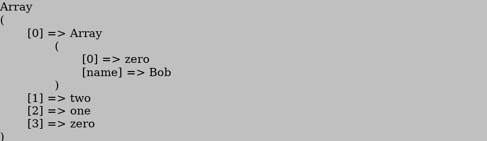 array( 'zero', 'name' => 'Bob' );
print_r( array_reverse($array) );
print_r( array_reverse($array, TRUE) );
```
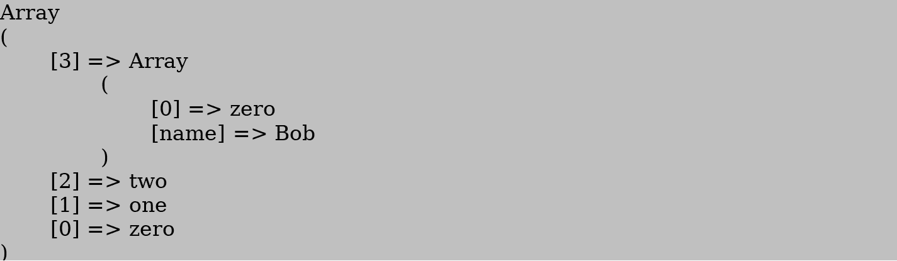
**另另：** `array_flip()` – 交换数组中的键值


### `key` – `$string` 或 `$integer`

如果 `key` 存在于 `$array` 中，则返回 TRUE。

**示例：**
```php
 $array = array( 'name' => 'John', 'job' => 'unknown' );
var_dump(  array_key_exists('name', $array) );
```
**另另：** `array_search()` – 与此相似，区别在于找到时会返回键

### `in_array()` – 检查特定值是否存在于数组中

`array_search( search_value , $array [, strict ])`

*   `search_value` – `$variable`
*   `strict` – [可选] `$boolean` 默认值：`FALSE`，仅匹配值，不匹配变量类型

检查 `search_value` 是否存在于 `$array` 中，如果存在则返回其键。如果未找到，则返回 FALSE。如果 `strict` 设置为 `TRUE`，则 `array_search()` 仅在值和其变量类型均匹配时才会返回 TRUE。

**注意：** 仅找到第一个 `search_value` 实例会返回其键。如果数组后面出现相同的值，则会被忽略。

**示例：**
```php
$array = array( 'name' => 'Bob', 'age' => 12, 'title' => 'owner' );
echo array_search('owner', $array);
$array = array( 'name' => 'Bob', 'age' => 12, 'title' => 'owner' );
var_dump( array_search('12', $array, TRUE) ); // 因为 strict 为 TRUE，字符串 '12' 不匹配整数 12 bool(false)
```
**另另：** `array_keys()` – 与此相似，区别在于它会返回多个具有相同值的键；`array_key_exists()` – 与此相似，区别在于仅返回 TRUE 或 FALSE

### `in_array()` – 检查特定值是否存在于数组中

`in_array( value , $array [, strict ])`

*   `value` – `$variable`
*   `strict` – [可选] `$boolean` 默认值：`FALSE`，仅匹配值，不匹配变量类型

如果 `value` 存在于 `$array` 中，则返回 TRUE。如果 `strict` 设置为 `TRUE`，则 `in_array()` 仅在值和变量类型均匹配时才会返回 TRUE。


如果 `search_value` 是字符串，则按区分大小写进行。

**示例：**
```php
$array = array( 'name' => 'John', 'age' => '12' ); // '12' 是字符串
 $integer = 12; // 12 是整数
var_dump( in_array( $integer, $array) );
var_dump( in_array( $integer, $array, TRUE) );
```

**另另：** `array_key_exists()` – 检查特定键是否存在于数组中；`array_search()` – 检查特定键是否存在并返回它


*   `search_value` – [可选] `$variable`
*   `strict` – [可选] `$boolean` 默认值：`FALSE`，仅匹配值，不匹配变量类型

返回一个包含 `$array` 中所有键的数组。如果存在 `search_value`，则只返回包含 `search_value` 的键。如果 `strict` 设置为 `TRUE`，当值和变量类型正确时，则 `search_value` 被视为匹配。

**示例：**
```php
 $array = array( 'name' => 'Bob', 'nickname' => 'Bob', 'age' => '12' );
print_r( array_keys($array) );
$array = array( 'name' => 'Bob', 'nickname' => 'Bob', 'age' => '12' );
print_r( array_keys($array, 'Bob') );
```
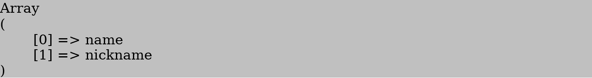
// 注意 12 键是一个字符串，而不是索引值 12
$array = array( 'name' => 'Bob', 'nickname' => 'Bob', '12' => 'age' );
$integer = 12;
 print_r( array_keys($array, $integer, TRUE) );
```
**另另：** `array_values()` – 返回数组中的所有值


### `array_values()` – 返回数组中的所有值

将 `$array` 中的所有值作为索引数组返回。

**示例：**
```php
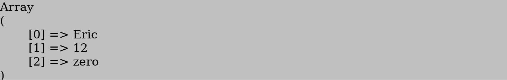 $array = array( 'name' => 'Eric', 'age' => 12, 'zero' );
print_r( array_values($array) );
```
**另另：** `array_keys()` – 返回数组的键

### `array_keys()` – 返回键（或匹配特定值的键）


接受多个 `$array` 及其可选的排序和类型标志
*   `order` – [可选] 默认值：`SORT_ASC`（升序）其他：`SORT_DESC`（降序）
*   `type` – [可选] 默认值：`SORT_REGULAR`（常规比较）其他值：`SORT_NUMERIC`（数值比较），`SORT_STRING`（字符串比较）

按值升序排序 `$array`，除非被排序和类型标志改变。所有索引（数字）键都将被重写，而关联键将保持不变。升序排序时，大写字母在小写字母之前。注意此函数直接影响 `$array` 并在成功时返回 TRUE。

**注意：** 如果提供了多个 `$array`，除非包含排序和类型标志，否则每个数组都使用默认排序和类型标志（`SORT_ASC`、`SORT_REGULAR`）。

**示例：**
```php
 $array = array( '2', '3', '1', 'a', 'b');
array_multisort($array);
print_r($array);
 $array = array( '2', '3', '1', 'a', 'b');
array_multisort($array, SORT_NUMERIC);
print_r($array);
$array = array( '2', '3', '1', 'a', 'b');
array_multisort($array, SORT_DESC, SORT_NUMERIC);
print_r($array);
```
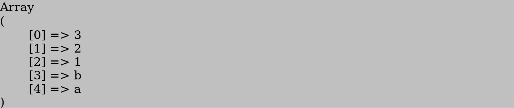
```php
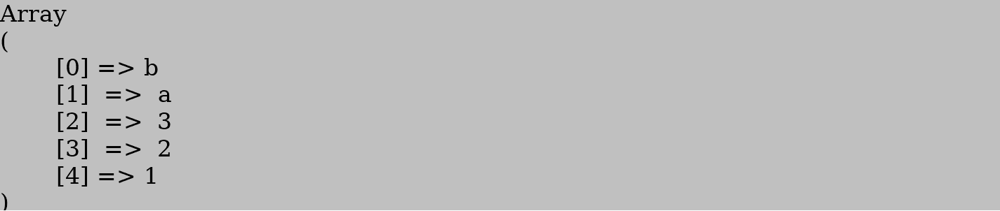 $array = array( '2', '3', '1', 'a', 'b');
array_multisort($array, SORT_DESC, SORT_STRING);
print_r($array);
```
■​ ■​ ■

| 此函数与 MySQL 查询中的 ORDER BY 选项相似。 |


返回 `$array` 中的最后一个值并将其从数组中移除。

示例：
```php
$array = array('zero', 'one', 'two');
$value = array_pop($array);
echo $value;
print_r($array);
```
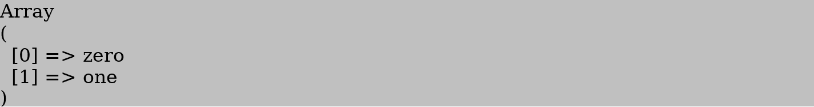

另请：
- `array_shift()` – 与 `array_pop` 相似，但作用于数组的开头
- `array_unshift()` – 将值添加到数组的开头
- `array_push()` – 将值添加到数组的末尾
- `array_splice()` – 相似，但足够灵活，可以执行其他操作

可以接受多个值

`value` – `$variable` 将值（s）添加到 `$array` 中，等同于：
`$array[] = value`
如果是添加单个值，上述是首选方法。

示例：
```php
$array = array('zero');
array_push($array, 'one', 'two');
print_r($array);
```
另请：
- `array_unshift()` – 将值添加到数组的开头
- `array_pop()` – 从数组的末尾移除最后一个值
- `array_shift()` – 与 `array_pop` 相似，但作用于数组的开头
- `array_splice()` – 相似，但足够灵活，可以执行其他操作

返回 `$array` 中的第一个值并将其从数组中移除，同时重新索引所有数字键。

示例：
```php
$array = array('zero', 'one', 'two', 'name' => 'Bob');
$value = array_shift($array);
echo $value;
print_r($array);
```
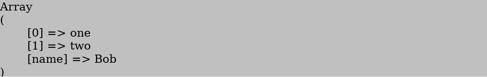

另请：
- `array_unshift()` – 将值添加到数组的开头
- `array_pop()` – 从数组的末尾移除最后一个值
- `array_push()` – 将值添加到数组的末尾
- `array_shift()` – 与 `array_pop` 相似，但作用于数组的开头
- `array_splice()` – 相似，但足够灵活，可以执行其他操作

可以接受多个值

`value` – `$variable` 将值（s）添加到 `$array` 的开头，重新索引所有数字键。

示例：
```php
$array = array('zero');
array_unshift($array, 'one', 'two');
print_r($array);
```
另请：
- `array_push()` – 将值添加到数组的末尾
- `array_pop()` – 从数组的末尾移除最后一个值
- `array_shift()` – 与 `array_pop` 相似，但作用于数组的开头
- `array_splice()` – 相似，但足够灵活，可以执行其他操作

返回 `$array` 中值的乘积（乘法）。

注意：如果数组中的任何值无法求评估为整数，`array_product()` 将返回整数 `0`。

示例：
```php
$array = array( 2, 4, 8 );
echo array_product($array);
$array = array( '2', '4', '8' );
var_dump( array_product($array) );
// int(64)
```

`array_sum($array)` 返回 `$array` 中值的和（加法）。

注意：数组中任何无法求评估为整数的值将被忽略。

示例：
```php
$array = array( 2, 4, 8 );
echo array_sum($array);
// 14
$array = array( '2', '4', '8', 'blah' );
var_dump( array_sum($array) );
// int(14)
```

`array_rand($array [, count ])`
`count` – [可选] `$integer` 默认值：1 返回一个包含从 `$array` 中随机选择的键的字符串。如果提供了 `count` 且大于 1，它将指定从 `$array` 中随机选择的键的数量并返回一个数组。

示例：
```php
$array = array( 'name' => 'Bob', 'job' => 'n/a', 'age' => 12 );
$random_key = array_rand($array);
echo $random_key; // 结果会有不同：job

$array = array( 'name' => 'Bob', 'job' => 'n/a', 'age' => 12 );
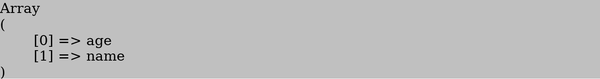
$random_array = array_rand($array, 2);
print_r($random_array); // 结果会有不同
```
另请：
- `shuffle()` – 随机化数组中的值

| 此函数旨在与其他代码结合使用，因为它只检索键（s）。以下是在包含关键词的索引数组（这些关键词可能从数据库检索）上的一个简单用法示例。 |


```php
$array = array( 'css', 'php', 'xml', 'html', 'xhtml', 'tutorial' );
$rand_key = array_rand($array);
$keyword = $array[$rand_key];
```

```php
echo $keyword; // 结果不异
```

随机化 `$array` 中的值，如果成功则返回 `TRUE`。

**注意：** 所有的键（包括关联键）都会被移除，并且整个数组会被重新索引。

示例：
```php
$array = array( 'zero' => 'zero', 'one' => 'one', 'two' => 'two');
shuffle($array); // 结果不异
```
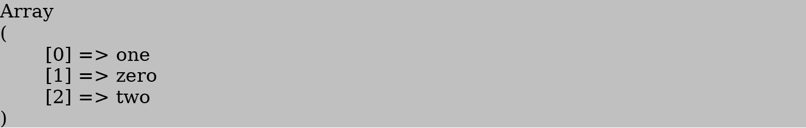
```php
print_r($array);
```

另见：
- `array_rand()` – 从数组中返回一个或多个随机键


### offset (偏移量)
- `offset` – `$integer`
- `length` – `[optional]` `$integer` 默认：直到 `$array` 结束
- `preserve_keys` – `[optional]` `$boolean` 默认：`FALSE`，索引键会被重新索引

从 `$array` 中根据 `offset` 选择条目，正偏移量将跳过开头的 `offset` 个条目，而负偏移量将从末尾倒数第 `offset` 个条目开始。

如果指定的 `length` 且为正数，它决定了从 `offset` 返回的最大条目数。如果 `length` 为负数，它指定在 `offset` 之后从 `$array` 末尾停止相应数量的条目。

默认情况下，结果数组中的任何索引键都将被重新索引。如果 `preserve_keys` 设置为 `TRUE`，则原始键将体现在结果数组中。

示例：
```php
$array = array( 'zero', 'one', 'two', 'three', 'four', 'five' );
```
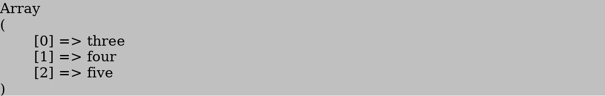
```php
$result_array = array_slice($array, 3);
print_r($result_array);

$array = array( 'zero', 'one', 'two', 'three', 'four', 'five' );
$result_array = array_slice($array, 3, 1);
print_r($result_array);
Array ( [0] => three )
```
```php
$array = array( 'zero', 'one', 'two', 'three', 'four', 'five' );
```
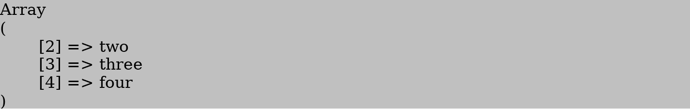
```php
$result_array = array_slice($array, -4, -1, TRUE);
print_r($result_array);
```

### array_splice($array, offset [, length ] [, replacement ])
- `offset` – `$integer`
- `length` – `[optional]` `$integer` 默认：直到 `$array` 结束
- `replacement` – `[optional]` `$variable`

根据 `offset` 和其他可选参数修改 `$array`，将任何移除的条目以数组形式返回，并用可选的 `replacement` 替换它们。

如果 `offset` 为正数，函数将跳过 `$array` 中的 `offset` 个条目。如果 `offset` 为负数，它将从末尾开始计算 `offset` 个条目。

如果指定的 `length` 且为正数，它决定了从 `offset` 返回的最大条目数。如果 `length` 为负数，它指定在 `offset` 之后从 `$array` 末尾停止相应数量的条目。如果 `length` 为 0，则不移除内容。

当指定 `replacement` 时，从 `$array` 移除的条目将被 `replacement` 替换。如果没有移除内容，则 `replacement` 的内容将根据 `offset` 插入 `$array` 中。

**注意：** `$array` 中的索引键可能会被重新索引。


使用 `count($array)` 在 `offset` 中指定数组的结束。

示例：
```php
$array = array( 'zero', 'one', 'two' );
$result_array = array_splice($array, 1);
print_r($array);
print_r($result_array);
```
 (image_rsrc7X9.jpg)
```php
$array = array( 'zero', 'one', 'two' );
$result_array = array_splice($array, -2, 1);
print_r($array);
print_r($result_array);
```
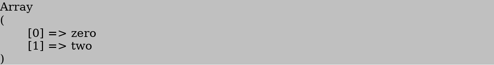 (image_rsrc7XB.jpg) (image_rsrc7XC.jpg)
```php
$array = array( 'zero', 'one' );
array_splice($array, count($array), 0, 'end');
print_r($array);

$array = array( 'zero', 'one', 'two' );
array_splice($array, 2, 0, 'middle');
print_r($array);
```
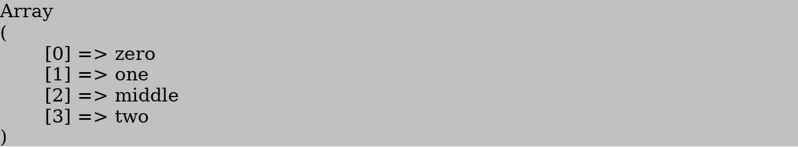 (image_rsrc7XE.jpg)
```php
$array = array( 'zero', 'one', 'two' );
$result_array = array_splice($array, 1, 1, 'middle');
print_r($result_array);
print_r($array);
```
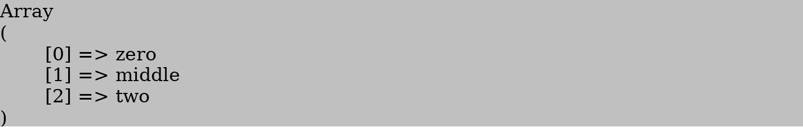 (image_rsrc7XG.jpg)
```php
$array = array( 0, 1 );
$replace_array = array( 'zero', 'one' );
array_splice($array, 0, 0, $replace_array);
print_r($array);
```
另见：
- `array_shift($array)` – `array_splice($array, 0)`
- `array_unshift($array)` – `array_splice($array, 0)`
- `array_push($array)` – `array_splice($array, count($array), 0)`
- `array_pop($array)` – `array_splice($array, -1)`

### array_unique($array)
返回一个去除了 `$array` 中所有重复值的数组。

示例：
```php
$array = array( 'zero', 'one', 'zero', 'three' );
$new = array_unique($array);
print_r($new);
```
 (image_rsrc7XK.jpg)
- `sort_flag` – `[optional]` 默认：`SORT_REGULAR`（正常比较）。其他值：`SORT_NUMERIC`、`SORT_STRING`、`SORT_LOCALE_STRING`

从低到高排序 `$array` 的值并重新索引所有值。默认情况下，项正常比较，但在包含 `sort_flag` 时可以进行更改。

示例：
```php
$array = array( 'babe', 1, 'name' => 'Bob' );
sort($array);
print_r($array);
```
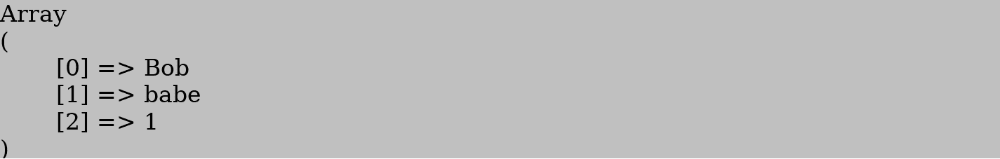
```php
$array = array( 'babe', 1, 'name' => 'Bob' );
sort($array, SORT_NUMERIC);
print_r($array);
```

```php
$array = array( 'babe', 1, 'name' => 'Bob' );
sort($array, SORT_STRING);
print_r($array);
```
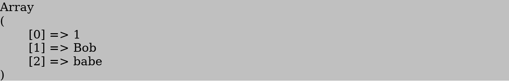
从高到低排序 `$array` 的值并重新索引所有值，销毁所有键。默认情况下，项正常比较，但在包含 `sort_flag` 时可以进行更改。

示例：
```php
$array = array( 'babe', 'apple', 'name' => 'Bob' );
rsort($array);
print_r($array);
```
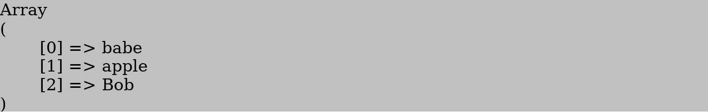
```php
$array = array( 'babe', 'apple', 'name' => 'Bob' );
ksort($array);
print_r($array);
```

从低到高排序 `$array` 的值并保持键。默认情况下，项正常比较，但在包含 `sort_flag` 时可以进行更改。

示例：
```php
$array = array( 'babe', 'apple', 'name' => 'Bob' );
asort($array);
print_r($array);
```

```php
$array = array( 'babe', 'apple', 'name' => 'Bob' );
arsort($array);
print_r($array);
```

从高到低排序 `$array` 的值（按键）。默认情况下，项正常比较，但在包含 `sort_flag` 时可以进行更改。

示例：
```php
$array = array( 'cute', 'fruit' => 'apple', 'name' => 'Bob' );
ksort($array);
print_r($array);
```
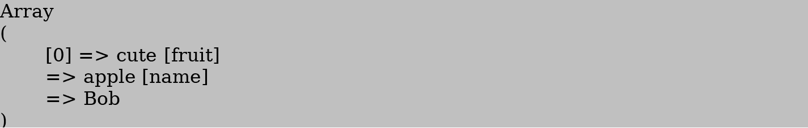
从低到高排序 `$array` 的项（按键）。默认情况下，项正常比较，但在包含 `sort_flag` 时可以进行更改。

示例：
```php
$array = array( 'cute', 'fruit' => 'apple', 'name' => 'Bob' );
krsort($array);
print_r($array);
```

### extract(variable_names)
可以接受多个 `variable_names`。创建一个键等于 `variable_name` 且值等于 `variable_name` 的数组。如果 `variable_name` 是数组，则该数组的值被用作变量名。

注意：全局变量不能与 `compact()` 使用。

示例：
```php
$variable = 'value';
$integer = 10;
$name = 'Bob';
$array = array( 'name', 'age' );
$result_array = extract('variable', 'integer', $array);
print_r($result_array);
```
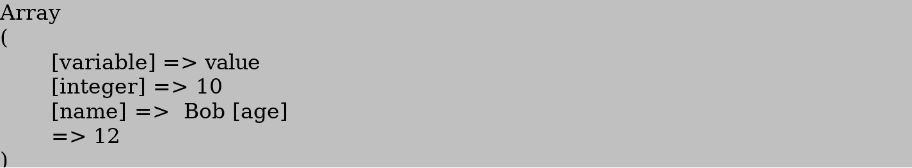 (image_rsrc7Y3.jpg)
- `type` – `[optional]` 默认：`EXTR_WRITE`（如果冲突则覆盖）。其他值：`EXTR_SKIP`（如果冲突时不覆盖）、`EXTR_SAME`（如果冲突则前缀）、`EXTR_ALL`（带前缀）、`EXTR_INVALID`（带前缀的数字）、`EXTR_IF_EXISTS`（如果变量存在则带前缀创建，否则跳过）、`EXTR_FS`（作为引用提取）。
- `prefix` – `[optional]` 仅当 `type` 设置为包含 `PREFIX` 的值时有效。前缀总是通过下划线（`_`）附加。

这些函数都特定于数组的内部指针。

这些函数都特定于数组的内部指针。`current()` – 返回当前条目的值。`key()` – 返回当前条目的键。`next()` 将指针向前移动一个位置。`prev()` 将指针向后移动一个位置。`end()` 将指针移动到末尾。`reset()` 将指针重置到开头。

示例：
```php
$array = array( 'zero', 'one', 'two', 'three', 'four' );
current($array); // 返回 zero
key($array); // 返回 0
next($array); // 移动到 one
current($array); // 返回 one
```


## 排序示例

| 标准排序:`Array(` | | |
| :--- | :--- |
| `[0]` | => `IMG41.jpg` |
| `[1]` | => `img11.jpg` |
| `)` | `[2]` => `img4.jpg` |
| 自然排序 Array ([0] | sort:`=> IMG41.jpg` | | |
| `[2]` | => `img4.jpg` |
| `[1])Natural Array ([2] | => img11.jpgcase 不大小敏感排序:`=> img4.jpg` | | |
| `[1]` | => `img11.jpg` |
| `[0])` | => `IMG41.jpg` |

**另需参考：**
- `natsort()` – `natcasesort()` 的大小敏感版本
- `sort()` – 排序数组的值

## 日期/时间函数


- `month` – `$integer` (1-12) 月份
- `day` – `$integer` (1-31, 视月份而定) 日
- `year` – `$integer` (1-32767) 年

检查给定日期的有效性，有效则返回 `TRUE`。

**示例：**

```
var_dump( checkdate(2, 29, 2006) );
var_dump( checkdate(2, 29, 2008) );
```


- `format` – `$string`
- `timestamp` – `[optional] $integer` 默认：`time()`，当前 Unix 时间戳

根据 `format` 中指定的格式返回当前日期和/或时间。如果不包含 `timestamp`，则使用由 `time()` 函数提供的当前时间。否则，将评估提供的时间戳。

`format` 可用选项选项：

### 日 (Day)
- `d` – (01 – 31) 带前导零的日期
- `j` – (1 – 31) 不带前导零的日期
- `D` – (Mon – Sun) 星期的三字母版本
- `l` (小写 'L') – (Sunday – Saturday) 星期完整单词
- `N` – (1 – 7) ISO-8601 星期，数字表示周一(1)–周日(7)
- `w` – (0 – 6) 星期，数字表示周日(0) –周六(6)
- `S` – (st,nd,rd,th) 日期的后缀，与 `j` 配合
- `z` – (0 – 365) 一年的天数

### 周 (Week)
- `W` – (01 – 52) 一年的周数

### 月 (Month)
- `F` – (January – December) 月份完整单词
- `M` – (Jan – Dec) 月份三字母版本
- `m` – (01 – 12) 带前导零的数字月份
- `n` – (1 – 12) 不带前导零的数字月份
- `t` – (28 – 31) 当前月的天数

### 年 (Year)
- `L` – (1 or 0) 是否为闰年 (1)
- `Y` – (2008) 四位数字年份
- `y` – (08) 两位数字年份
- `o` – (2008) ISO-8601 版本的 'Y'受周 ('W') 影响

### 时间 (Time)
- `a` – (am or pm) 小写上午或下午
- `A` – (AM or PM) 大写上午或下午
- `B` – (000 – 999) 网络时间 (Swatch internet time)
- `g` – (1 – 12) 12 小时制小时，不带前导零
- `h` – (01 – 12) 12 小时制小时，带前导零
- `G` – (0 – 23) 24 小时制小时，不带前导零
- `H` – (00 – 23) 24 小时制小时，带前导零
- `i` – (00 – 59) 带前导零的分钟
- `s` – (00 – 59) 带前导零的秒
- `u` – (e.g. 54321) 毫秒

### 时区 (Timezone)
- `e` – (e.g. GMT, America/Denver) 完整时区标识符
- `T` – (e.g. GMT, EST, PST) 时区缩写
- `I` – (1 or 0) 是否为夏令时间 (1)
- `O` – (e.g. - 0700) 与 GMT 的小时差
- `P` – (e.g. -07:00) 带冒号的 GMT 小时差
- `Z` – (-43200 – 50400) 时区偏移量（秒），UTC 西侧为负数

### 完整日期/时间 (Full Date/Time)
- `c` – (e.g. 2008-03-17T12:27:40-06:00) ISO-8601 格式日期
- `r` – (e.g. Mon, 17 Mar 2008 12:27:40 -0600) RFC 2822 日
- `U` – (e.g. 1205778601) 自 Unix 纪戳，同于 `time()`

**示例：**
```
echo date('m-d-y'); // 03-17-08
echo date('M jS, Y'); // Mar 17th, 2008
echo date('g:i:sA'); // 12:27:40PM
```


# 如果你想知道完成一个脚本需要多长时间，例如在比较两个不同的函数以查看哪一个更快时，可以使用 `microtime()` 来跟踪效率。

```php
$start = microtime(1);
// 在此处执行操作
$end = microtime(1);
$lengthoftime = number_format($end - $start, 6);
echo "It took $lengthoftime seconds to run this script.";
```

运行此脚本花费了 0.000005 秒。

## strtotime

`strtotime($string [, timestamp ])` 
`timestamp` – [可选] `$integer` 默认值：`time()`

根据 `$string` 中日期/时间的解释返回 Unix 时间戳，`$string` 是日期时间的常用语言格式。如果 `$string` 是指日期的相对输入格式（例如 'last month'），则除非提供了可选的 `timestamp`，否则将使用当前日期/时间。如果 `$string` 无效且函数失败，则返回 `FALSE`。

## 示例
```php
$result = strtotime('December 8th, 1941'); echo $result;
echo '<br />'; // XHTML 换行
echo date('r', $result);
$result = strtotime('26apr86'); echo date('r', $result); // Sat, 26 Apr 1986 00:00:00 -0700
$result = strtotime('20010911 08:45:00'); echo date('r', $result); // Tue, 11 Sep 2001 08:45:00 -0600
```

### 相对 $string 示例
```php
$result = strtotime('last week'); // 时间，上周
echo date('r', $result); // Mon, 10 Mar 2008 14:31:54 -0600
$date = mktime(8,45,00,9,11,2001); // Sept. 11, 2001 8:45am
$result = strtotime('next week', $date); echo date('r', $result); // Tue, 18 Sep 2001 08:45:00 -0600
$date = mktime(8,45,00,9,11,2001); // Sept. 11, 2001 8:45am
$result = strtotime('+2 friday', $date); echo date('r', $result); // Fri, 21 Sep 2001 00:00:00 -0600
$result = strtotime('1 hour ago'); echo date('r', $result); // Mon, 17 Mar 2008 13:36:54 -0600
$result = strtotime('yesterday 3am'); echo date('r', $result); // Sun, 16 Mar 2008 03:00:00 -0600
$result = strtotime('7am 4 days ago'); echo date('r', $result); // Thu, 13 Mar 2008 07:00:00 -0600
```

还有更多示例。请参阅以下网站：
- [`www.gnu.org/software/tar/manual/html_node/tar_113.html`](http://www.gnu.org/software/tar/manual/html_node/tar_113.html)
- [`www.phpdig.net/ref/rn13re206.html`](http://www.phpdig.net/ref/rn13re206.html)

另参：`date()` – 将 Unix 时间戳转换为更易于读的格式

此函数的威力不仅在于可以将普通语言转换为可用的内容而无需大量的正则表达式字符串，还在于处理相对日期和时间时。如果你使用 MySQL 查询从数据库中提取数据以生成上周（周一到周五）的所有调用报告，你将不得不反复计算来确定今天是星期几，然后根据该结果算出周一的日期，最后提交正确的查询。使用此函数，你可以无需额外的数学计算即可快速找到日期，一切都会为你处理好！


## 数学函数

有时你需要更高级的数学函数。

### abs(number)
`number` – `$integer` 或 `$float`
返回 `number` 的绝对值，类型与原变量相同。
示例：
```php
var_dump( abs(-21) );
int(21)
```

### dechex($integer)
返回 `$integer` 的十六进制值。最大值：`4294967295`。
示例：
```php
var_dump( dechex(4294967295) );
string(8) "ffffffff"
```
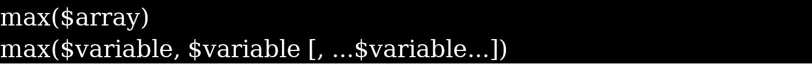

### max()
根据提供的参数，有两种不同的格式：
- 如果提供单个参数 `$array`，它返回数组中的最大值。
- 如果提供两个或多个 `$variable`，它返回参数中的最大值。

注意：非数字字符串在比较时会被评估为零 (0)。
示例：
```php
$array = array(4, 7, 2); 
var_dump( max($array) );
int(7)
```


如果比较两个数组，它们将从左到右进行值与值的对比较：
```php
var_dump( max(2, 5, 'string', '8') );
string(1) "8"
```
另请：`min()` – 寻找最小值。

### min()
根据提供的参数，有两种不同的格式：
- 如果提供单个参数 `$array`，它返回数组中的最大值。
- 如果提供两个或多个 `$variable`，它返回参数中的最小值。

注意：非数字字符串在比较时会被评估为零 (0)。
示例：
```php
$array = array(-3, 7, 2); 
var_dump( min($array) );
int(-3)

var_dump( min( array(1,2,3), array(1,2,4) ) ); // 1==1, 2==2, 3<4
array(3) { 
    [0]=> int(1) 
    [1]=> int(2) 
    [2]=> int(3) 
}
```
另请：`max()` – 寻找最大值。

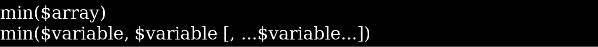

### pi()
返回浮点数形式的 pi。
示例：
```php
var_dump( pi() );
float(3.14159265359)
```

### pow(base, exponent)
`base` – `$integer` 或 `$float`
`exponent` – `$integer` 或 `$float`
返回 `base` 的 `exponent` 次幂值。
示例：
```php
var_dump( pow(2, 4) );
int(16)
```


### sqrt($float)
返回 `$float` 的平方根。
示例：
```php
var_dump( sqrt(16) );
float(4)
```
如果比较两个数组，它们将从左到右进行值与值的比较。

### log($float [, base])
`base` – [可选] `$float`
返回 `$float` 的自然对数。可选的底数形式如下：`log$base`。
示例：
```php
var_dump( log(10) );
float(2.302585092)
```

### round($float [, decimals])
`decimals` – [可选] `$integer` 默认值：0 位小数
将 `$float` 四舍五入到最近的整数。如果指定了 `decimals`，则四舍五入到 `decimals` 位小数。
示例：
```php
var_dump( round(3.14) );
float(3)

var_dump( round(pi(), 2) );
float(3.14)

var_dump( round(143257.432, -2) );
float(143300)
```
如果 `decimals` 为负数，它将处理小数点左侧对应的位数。
另请：`floor()` – 向下取整到最近的整数。

### floor($float)
将 `$float` 向下取整到最近的整数。
示例：
```php
var_dump( floor(3.99) );
float(3)
```
另请：`round()` – 四舍五入到最近的整数或小数。

### rand(min, max)
`min, max` – [可选] `$integers`
生成一个随机整数。为了获得更好的随机性，请使用 `mt_rand()`。
示例：
```php
var_dump( rand(), rand(1,100) ); // 结果异
```
另请：`mt_rand()` – 一个更好、更快的随机数生成器。

### mt_rand(min, max)
`min, max` – [可选] `$integers`
生成一个随机整数，比 `rand()` 好。如果提供了参数，将生成 `min` 和 `max` 之间的随机整数。
示例：
```php
var_dump( mt_rand(), mt_rand(1,100) ); // 结果异
```

## MySQL 函数

数据库。以某种形式形式，如果你想高效地存储和检索数据，你可能都会使用数据库。流行的 MySQL 数据库是 LAMP 栈（Linux-Apache-MySQL-PHP）的一部分，值得稍微关注和解释。请注意，除少数示例外，本节介绍的是 PHP 函数，而不是如何构建查询。


下表将用于演示这些查询：
表名：`employees`
| pkey | name | age |
| :--- | :--- | :--- |
| 1 | Mary | 24 |
| 2 | John | 17 |
| 3 | Mark | 53 |
| 4 | Susan | 17 |


## 示例

- `SELECT * FROM employees`
- `SELECT pkey,name,age FROM employees`
- `SELECT employees.pkey,employees.name,employees.age FROM table`
- `SELECT name FROM employees`
- `SELECT name,age FROM employees`
- `SELECT * FROM employees WHERE age = 17`
- `SELECT name FROM employees WHERE name LIKE 'm%'`
- `SELECT name FROM employees WHERE name LIKE BINARY 'm%'`
- `SELECT name FROM employees WHERE name LIKE '%a%'`
- `SELECT name FROM employees WHERE name LIKE '      ' ` // 5 个下划线
- `SELECT COUNT(*) FROM employees`
- `SELECT COUNT(*) FROM employees WHERE age = 17`
- `SELECT age,COUNT(age) FROM employees GROUP BY age`
- `SELECT SUM(age) FROM employees`
- `SELECT MAX(age) FROM employees`
- `SELECT DISTINCT age FROM employees`
- `SELECT * FROM employees LIMIT 1,2`
- `SELECT name FROM employees ORDER BY name`
- `SELECT name FROM employees ORDER BY name DESC`

以下示例未使用包含的表格，仅供参考：

- `INSERT INTO table (column1,column2) VALUES ('value1','value2'), ('value1','value2'), ('value1','value2')`
- `UPDATE table SET column1='newvalue' WHERE column2='value'`
- `DELETE FROM table WHERE column='value'`
- `SELECT * FROM table1 INNER JOIN table2 on table1.id = table2.id`
- `SELECT table1.* FROM table1 INNER JOIN table2 on table1.id = table2.id`
- `SELECT table1.id FROM table1 INNER JOIN table2 on table1.id = table2.id`
- `SELECT table.id AS tableid FROM table`

## MySQL 函数

## mysql_connect()

- `server` – [可选] `$string` 默认值：' localhost:3306'` 或 `mysql.default_host`
- `username` – [可选] `$string` 默认值：由 `mysql.default_user` 定义
- `password` – [可选] `$string` 默认值：由 `mysql.default_password` 定义
- `new_link` – [可选] `$boolean` 默认值：`FALSE`，第二次调用时不建立新链接
- `client_flag` – [可选] `$integer`

与位于 `server` 的 MySQL 服务器建立初始连接/链接，并使用 `username` 和 `password` 提供的权限。失败时返回 `FALSE`，出于安全考虑应结合 `die()` 使用。大多数情况下，你会使用：`mysql_connect(server , username , password )`。

示例：
```php
mysql_connect('localhost', 'user', 'password') or die('Could not connect to the database');
```

另见：
- `die()` – 函数失败时停止脚本

## mysql_close()

- `mysql_close([ link_identifier ])`
- `link_identifier` – [可选] 默认值：最后打开的链接

关闭与 MySQL 服务器的连接，默认关闭由 `mysql_connect()` 打开最后一个连接。如果指定了 `link_identifier`，则关闭该链接。

示例：
```php
$link = mysql_connect('localhost', 'username', 'password') or die();
$link2 = mysql_connect('/path/to', 'username', 'password') or die();
mysql_close($link); // 关闭第一个链接
mysql_close(); // 关闭最后创建的链接，在此情况下为 $link2
```

另见：
- `mysql_connect()` – 建立到 MySQL 服务器的连接

## mysql_select_db()

- `mysql_select_db( database [, link_identifier ])`
- `database` – `$string`
- `link_identifier` – [可选] 默认值：最后打开的链接

根据名称 `database` 选择数据库。默认情况下，它使用 `mysql_connect()` 最近的 MySQL 服务器连接，除非指定了 `link_identifier`，则使用该链接。

示例：
```php
$link = mysql_connect('localhost', 'username', 'password') or die();
mysql_select_db('database'); // 或 mysql_select_db('database',$link);
```

另见：
- `mysql_connect()` – 建立到 MySQL 服务器的连接

## mysql_query()

- `query` – `$string`
- `link_identifier` – [可选] 默认值：最后打开的链接

将查询提交到服务器，除非指定了可选的 `link_identifier`，否则使用最近的 `mysql_connect()` 链接。查询出现任何错误时返回 `FALSE`。`SELECT`、`SHOW`、`DESCRIBE` 和 `EXPLAIN` 查询将返回一个资源，需要通过 `mysql_result()` 或 `mysql_fetch_*()` 函数之一进行解析，所有其他查询在成功后将返回 `TRUE`。

示例：
```php
mysql_connect('localhost', 'username', 'password') or die();
mysql_select_db('database');
$result = mysql_query("SELECT * FROM 'table'");
```

另见：
- `mysql_fetch_array()` – 从创建的资源中以数组获取行
- `mysql_fetch_assoc()` – 返回关联数组：`column=>value`
- `mysql_fetch_row()` – 返回行的索引数组
- `mysql_result()` - 从创建的资源中获取单个结果

### db_query()

- `database` – `$string`
- `query` – `$string`
- `link_identifier` – [可选] 默认值：最后打开的链接

将查询发送到 MySQL 服务器和 `database`。列出的参考，请使用 `mysql_select_db()` 和 `mysql_query()` 代替。

示例：
```php
$result = db_query('database', "SELECT * FROM 'table'");
```

另见：
- `mysql_select_db()` 选择数据库

## mysql_error()

- `link_identifier` – [可选] 默认值：最后打开的链接

默认返回上次操作的 MySQL 错误，如果指定了则返回 `link_identifier`。

示例：
```php
$link = mysql_connect('localhost', 'user', 'password'); // 有效
mysql_select_db('No');
echo mysql_error();
```

## mysql_fetch_array()

- `resource` – 包含 `mysql_query()` 输出的变量
- `result_type` – [可选] `$string` 默认值：`MYSQL_BOTH`

值：`MYSQL_BOTH`（包含关联和索引数组）、`MYSQL_ASSOC`（关联数组）、`MYSQL_NUM`（索引数组）

返回由 `mysql_query()` 生成的资源的单行数组，并将资源的内部指针移动到下一行。这通常用于循环提取资源的所有行并获取查询的完整输出。默认提供关联和索引，可以通过 `result_type` 修改。

示例：
```php
$result = mysql_query("SELECT * FROM name");
$array = mysql_fetch_array($result);
print_r($array);

$array = mysql_fetch_array($result,MYSQL_ASSOC);
print_r($array);
```

使用 `MYSQL_NUM` 选项的示例：
```php
$result = mysql_query("SELECT * FROM name");
while ($row = mysql_fetch_array($result,MYSQL_NUM) ){
    print_r($row);
}
```

## mysql_fetch_assoc()

- `resource` – 包含 `mysql_query()` 输出的变量

返回由 `mysql_query()` 生成的单行数组，并将资源的内部指针移动到下一行，返回 `column => value` 关联数组。

示例：
```php
$result = mysql_query("SELECT * FROM name");
$array = mysql_fetch_assoc($result);
print_r($array);
```

使用 while 循环的示例：
```php
$result = mysql_query("SELECT * FROM name");
while ($row = mysql_fetch_assoc($result) ){
    print_r($row);
}
```

## mysql_fetch_row()

- `resource` – 包含 `mysql_query()` 输出的变量

返回由 `mysql_query()` 生成的单行数组，并将资源的内部指针移动到下一行，返回仅包含值的索引数组（无列名）。

示例：
```php
$result = mysql_query("SELECT * FROM name");
$array = mysql_fetch_row($result);
print_r($array);
```

使用 while 循环的示例：
```php
$result = mysql_query("SELECT * FROM name");
while ($row = mysql_fetch_row($result) ){
    print_r($row);
}
```

## mysql_result()

- `resource` – 包含 `mysql_query()` 输出的变量
- `row` – `$integer`
- `column` – [可选] `$string` 或 `$integer` 默认值：0，获取第一列

返回包含来自 `mysql_query()` 生成的资源特定行的单元单元的字符串。如果指定了 `field`，则获取指定的字段（可以通过从 0 开始的数字或别名引用）。

注意：如果你需要多个一个结果，应该使用 `mysql_fetch_*()`。

示例：
```php
$result = mysql_query("SELECT * FROM name");
var_dump( mysql_result($result, 0) );
var_dump( mysql_result($result, 1) );
var_dump( mysql_result($result, 1, 'name') );
```

## mysql_num_rows()

- `resource` – 包含 `mysql_query()` 输出的变量

以整数形式返回 `mysql_query()` 生成的资源的总行数。

示例：
```php
$result = mysql_query("SELECT * FROM name");
$row_total = mysql_num_rows($result);
var_dump($row_total);
```

## mysql_free_result()

- `resource` – 包含 `mysql_query()` 输出的变量

清除与 `resource` 相关的所有系统内存。只有在单个脚本内处理大型数据集时才是必要的，内存在脚本/页面结束会自动清除。

示例：
```php
$result = mysql_query("SELECT * FROM name");
mysql_free_result($result);
```

## mysql_get_server_info()

- `link_identifier` – [可选] 默认值：最后打开的链接

返回包含 MySQL 服务器版本的字符串，默认是 `mysql_connect()` 最后的最后一个连接。如果指定了 `link_identifier`，则使用该链接。

示例：
```php
$link = mysql_connect('localhost', 'username', 'password') or die();
var_dump( mysql_get_server_info() );
```

## mysql_real_escape_string()

- `link_identifier` – [可选] 默认值：最后打开的链接

返回对 `$string` 进行处理的字符串，添加反斜杠以防止 SQL 攻击。默认使用 `mysql_connect()` 的连接。如果指定了 `link_identifier`，则使用该链接。影响以下字符：`\x00`、`\n`、`\r` 和 `''`。注意：与 `addslashes()` 相同。

示例：
```php
$string = "SELECT * FROM table'";
mysql_connect('localhost', 'username', 'password') or die();
var_dump( mysql_real_escape_string($string) );
```

## mysql_data_seek()

- `resource` – 包含 `mysql_query()` 输出的变量
- `row` – `$integer`

将 `mysql_query()` 生成的资源的内部指针移动到 `row`（从 0 开始）。通过 `mysql_fetch_*()` 获取指定的行。

示例：
```php
$result = mysql_query("SELECT * FROM name");
mysql_data_seek($result, 1); // 选择第 1 行
```

## mysql_affected_rows()

- `link_identifier` – [可选] 默认值：最后打开的链接

返回受 `INSERT`、`UPDATE` 或 `REPLACE` 查询影响的行数。使用指定的 `mysql_connect()` 链接。

示例：
```php
mysql_connect('localhost', 'username', 'password') or die();
mysql_select_db('database');
$result = mysql_query(" INSERT INTO name (pkey,name) VALUES (NULL,'Joe') ");
var_dump( mysql_affected_rows() );
```

## mysql_create_db()

- `string` – `$string`
- `link_identifier` – [可选] 默认值：最后打开的链接

在 `mysql_connect()` 使用的 MySQL 服务器上创建一个名为 `$string` 的数据库。如果指定了 `link_identifier`，则使用该链接。注意：仅参考 `mysql_query()` 和 `"CREATE DATABASE"`。

示例：
```php
mysql_connect('localhost', 'username', 'password') or die();
mysql_create_db('database');
```

## mysql_drop_db()

- `string` – `$string`
- `link_identifier` – [可选] 默认值：最后打开的链接

在 `mysql_connect()` 使用的 MySQL 服务器上销毁名为 `$string` 的数据库。注意：仅参考 `mysql_query()` 和 `"DROP DATABASE"`。

示例：
```php
mysql_connect('localhost', 'username', 'password') or die();
mysql_drop_db('database');
```

## 目录 & 文件系统函数

### getcwd()

返回包含当前目录的字符串。

示例：
```php
var_dump( getcwd() ); // 结果各异
```

另见：
- `chdir()` – 更改目录

### chdir()

- `directory` – `$string`

将当前目录更改为 `$string`，成功时返回 `TRUE`。注意：目录更改仅持续脚本/页面。

示例：
```php
var_dump( getcwd() ); // 获取当前目录
chdir('images');
```

另见：
- `getcwd()` – 获取当前目录

### scandir()

- `directory` – `$string`
- `sort_flag` – [可选] `$integer` 默认值：`0`（升序）其他值为：`1`（降序）

返回包含 `$directory` 内部所有文件的数组。如果 `sort_flag` 为 0 或未指定，数组按字母顺序排序。

示例：
```php
$array = scandir('directory'); // 结果各异
```

### copy()

- `source` – `$string`
- `destination` – `$string`

将名为 `source` 的文件复制到 `destination`，如果 `destination` 已存在则覆盖它。原始源保持不变。

示例：
```php
copy('file.txt', 'file.txt.bak');
```

### rename()

- `oldname` – `$string`
- `newname` – `$string`

将名为 `oldname` 的文件或目录重命名为 `newname`。

示例：
```php
rename('file.txt', 'file.tmp');
```

### mkdir()

- `path` – `$string`
- `ix_mode` – [可选] `$integer` 默认值：`0777`（八进制），所有人可读写
- `recursive_flag` – [可选] `$boolean` 默认值：`FALSE`，一次创建一个目录

在 `path` 处创建一个目录。如果在 Unix/Linux 服务器上，你可以将默认模式从 0777 更改为八进制形式的其他权限（前导零）。每次只能创建一个层级的目录，除非 `recursive_flag` 设置为 `TRUE`。

示例：
```php
mkdir('tmp');
mkdir('tmp/2/tmp', 0775, TRUE);
```

另见：
- `chmod()` – 修改文件模式（权限）

### rmdir()

- `path` – `$string`

移除名为 `path` 的目录。

示例：
```php
rmdir('/temp/tmp');
```

### unlink()

- `filename` – `$string`

删除名为 `filename` 的文件。

示例：
```php
unlink('file.txt');
```

### fopen()

- `filename` – `$string`
- `mode` – `$string`
- `use_include_path` – [可选] `$boolean` 默认值：`FALSE`

使用以下模式打开 `filename`：
- `r`（只读，文件指针在开头）
- `r+`（读写，文件指针在开头）
- `w`（只写，文件指针在开头，零长度文件，不存在则创建）
- `w+`（读写，文件指针在开头，零长度文件，不存在则创建）
- `a`（只写，文件指针在末尾，零长度文件）
- `a+`（读写，文件指针在末尾，零长度文件）
- `x`（只写，文件指针在开头，如果存在则返回 `FALSE`）
- `x+`（读写，文件指针在开头，如果存在则返回 `FALSE`）

如果 `use_include_path` 设置为 `TRUE`，系统也会在 PHP 定义的 `include_path` 中检查该文件。返回一个供其他使用的资源。

示例：
```php
$file = fopen('file.txt', 'r');
```

另见：
- `fclose()` – 关闭由 `fopen()` 打开的资源

### fclose()

- `resource` – 包含 `fopen()` 创建的文件指针的变量

关闭用 `fopen()` 打开的文件。

示例：
```php
$file = fopen('file.txt', 'r');
fclose($file);
```

另见：
- `fopen()` – 打开文件进行读取、写入或两者两者

### fread()

- `resource` – 包含 `fopen()` 创建的文件指针的变量
- `length` – `$integer`

返回包含 `fopen()` 创建的资源内容的字符串，字节长度为 `length`。

示例：
```php
// file.txt 包含句子 Hello World!!
$file = fopen('file.txt', 'r');
var_dump( fread($file, 8) );
```

另见：
- `fwrite()` – 写入打开的文件


要将整个文件读入字符串中，请使用函数 `filesize()`。

```php
// file.txt contains the sentence: Hello World!
$filename = 'file.txt';
$file = fopen($filename, 'r');
$string = fread( $file, filesize($filename) );
var_dump($string);
```

`string(13) "Hello World!"`

### fwrite( resource , $string [, length ]) 
也称为 `fputs()`。

- `resource` – 包含由 `fopen()` 创建的文件指针的变量名。
- `length` – [可选] `$integer` 默认：`filesize($string)`

将 `$string` 的内容写入由 `fopen()` 创建的文件 `resource` 中。如果指定了 `length`，则在达到 `length` 字节或 `$string` 的末尾时停止写入。

**示例：**
```php
$file = fopen('file.txt', 'a'); // 追加到文件末尾
fwrite($file, 'Hello World!');
```
`string(8) "Hello Wo"`

**另见：**
- `fwrite()` – 写入已打开的文件
- `fopen()` – 打开文件进行读取、写入或两者结合

### 要将整个文件读入字符串中，请使用函数 `filesize()`。

```php
// file.txt contains the sentence: Hello World!
$filename = 'file.txt';
$file = fopen($filename, 'r');
$string = fread( $file, filesize($filename) );
var_dump($string);
// file.txt now contains at the end: Hello World!
```


返回一个包含名为/路径 `$string` 的文件长度的整数。注意：结果会被缓存。请参见 `clearstatcache()`。示例：


```php
// file.txt 包含单词: Hello
var_dump( filesize('file.txt') );
```


`flags` – [可选] `$string` 值：
- `FILE_USE_INCLUDE_PATH`（在 `include_path` 中搜索文件）
- `FILE_IGNORE_NEW_LINES`（不在数组条目末尾添加 `\n`）
- `FILE_SKIP_EMPTY_LINES`（跳过空行）

将文件名为 `$string` 的整个文件逐行读取到数组中，除非 `flags` 另有指定，否则会在每个数组项末尾附加一个换行符（`\n`）（每个项都是文件中的一行）。

示例：
```php
// file.txt 包含以下由制表符分隔的项
// Bob owner 34
// Mark manager 27
$array = file('file.txt');
```

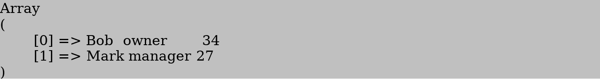
```php
echo '<pre>'; // 预格式化文本，为了可读性
print_r($array);
```

另请：`file_get_contents()` – 类似，但返回字符串而不是数组


`flags` – [可选] `$string` 值：
- `FILE_USE_INCLUDE_PATH`（在 `include_path` 中搜索文件）
- `context` – [可选] 忽略。使用 `start` 或 `max_length` 时设置为 `NULL`
- `start` – [可选] `$integer` 默认值：0，文件开头
- `max_length` – [可选] `$integer` 默认值：`filesize($string)`

将文件名为 `$string` 的整个文件读取到一个字符串中。除非指定了 `start`，否则从文件开始开始，指定则从文件的 `start` 位置开始。如果指定了 `max_length`，则只读取 `max_length` 字节到字符串中。

示例：
```php
// file.txt 包含以下由制表符分隔的项
// Bob owner 34
// Mark manager 27
$string = file_get_contents('file.txt');
```

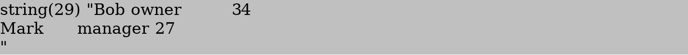
```php
echo '<pre>'; // 预格式化文本，为了可读性
var_dump($string);
$string = file_get_contents('file.txt', NULL, NULL, 5, 4);
echo '<pre>'; // 预格式化文本，为了可读性
var_dump($string);
```


另请：`file()` 类似，但返回数组而不是字符串


`input` – `$string` 或 `$array`
`flags` – [可选] `$string` 值：
- `FILE_USE_INCLUDE_PATH`（在 `include_path` 中搜索文件）
- `FILE_APPEND`（如果文件已存在，则追加而不是覆盖）
- `LOCK_EX`（获取对文件的排他锁以进行写入）

等同于 `fopen()`、`fwrite()` 和 `fclose()` 的组合。向名为/路径 `$string` 的文件写入 `input` 的内容。如果 `input` 是数组，则条目值将组合，就像一个长字符串且中间没有分隔符。默认情况下，如果文件存在，除非用 `flags` 另指定，否则将被覆盖。返回写入文件的字节数。

示例：

```php
$input = 'Hello World!';
file_put_contents('file.txt', $input);
$input = array('Hello ', 'World!');
file_put_contents('file.txt', $input);
```


另请：`file()` – 将文件读取到数组
`file_get_contents()` – 将文件读取到字符串


当在格式化中指定时，接受多个 `inputs`
`resource` – 由 `fopen()` 创建的文件指针
`formatting` – `$string`，参见 `sprintf()` 格式化指南
`inputs` – [可选] 格式化的 `scalar`
使用格式化规则（参见 `sprintf()`）向 `resource` 写入字符串。如果提供了 `inputs`，则返回格式化后的字符串的长度。

示例：
```php
$string = 'dog';
$file = fopen('file.txt', 'w');
fprintf($file, "I like %s.", $string);
fclose($file);
```


```php
$length = fprintf($file, "%s %s");
var_dump($length);
```


另请：`sprintf()` – 应用于字符串的格式化
`fwrite()` – 向文件写入字符串

当在格式化中指定时，接受多个 `inputs`
`resource` – 由 `fopen()` 创建的文件指针
`formatting` – `$string`，参见 `sprintf()` 格式化指南
`outputs` – [可选] 赋值给 `outputs`
使用格式化规则（参见 `sprintf()`）从 `resource` 读取。如果没有指定 `inputs`，则返回格式化后的数组；否则，返回赋值的值的数量。

示例：
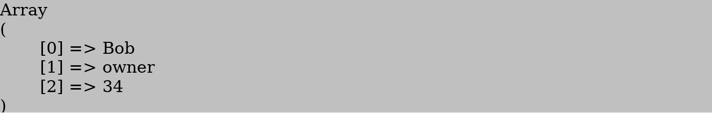
```php
// file.txt 包含以下由制表符分隔的项
// Bob owner 34
// Mark manager 27
$file = fopen('file.txt', 'r');
$array = fscanf($file, "%s\t%s\t%s");
print_r($array);
```


```php
$count = fscanf($file, "%s\t%s\t%s", $name, $title, $age);
echo "$name ($title) - $age";
```

另请：`sprintf()`
`sscanf()` – 通过格式化字符串解析字符串


返回文件/路径 `$string` 最后访问的时间，如果失败则返回 FALSE。返回的值是一个 Unix 时间戳。注意：结果会被缓存。参见 `clearstatcache()`。示例：


```php
$timestamp = fileatime('tmp/file.txt');
echo date('Y-m-d', $timestamp);
```

另请：`filetime()` 类似，但返回最后写入的时间


返回文件/路径 `$string` 最后写入的时间，如果失败则返回 FALSE。返回的值是一个 Unix 时间戳。注意：结果会被缓存。参见 `clearstatcache()`。示例：


```php
$timestamp = filetime('opt/lampp/htdocs');
echo date('Y-m-d', $timestamp);
```

另请：`fileatime()` 类似，但返回最后访问的时间


返回名为/路径 `$string` 的文件或目录是否存在，返回布尔。注意：结果会被缓存。参见 `clearstatcache()`。示例：


```php
file_exists('file.txt');
```


返回名为/路径 `$string` 的文件或目录是否可读，返回布尔。注意：结果会被缓存。参见 `clearstatcache()`。示例：


```php
is_readable('file.txt');
```

另请：`is_readable()` 类似，但返回是否可读


返回名为/路径 `$string` 的文件或目录是否可写入，返回布尔。注意：结果会被缓存。参见 `clearstatcache()`。示例：


```php
is_writable('file.txt');
```

另请：`is_writeable()` 类似，但返回是否可写


返回名为/路径 `$string` 的文件或目录是否为目录，返回布尔。注意：结果会被缓存。参见 `clearstatcache()`。示例：


```php
is_dir('file.txt');
```


返回名为/路径 `$string` 的文件或目录是否为文件，返回布尔。注意：结果会被缓存。参见 `clearstatcache()`。示例：


```php
is_file('file.txt');
```


清除系统缓存的由特定函数收集的某些文件信息（如下）。用于在同一脚本/页面内修改并重新评估文件时。影响以下函数：`file_exists()`、`is_writable()`、`is_readable()`、`is_file()`、`is_dir()`、`fileatime()`、`filemtime()`、`filesize()`、`stat()`、`lstat()`、`is_executable()`、`is_link()`、`filectime()`、`fileinode()`、`filegroup()`、`fileowner()` 和 `fileperms()`。


## 常用八进制模式

| 模式 | 描述 |
| :--- | :--- |
| `0777` | 所有人可读、写、执行 |
| `0755` | 所有者读/写/执行，其他人可读/执行 |
| `0644` | 所有者读/写，其他人可读 |
| `0600` | 所有者读/写，其他人无访问权限 |
| `0754` | 所有者读/写/执行，组用户可读/执行，其他人可读 |

## 输出控制（输出缓冲区）

想象你将所有的代码、所有的输出内容都塞进一个大袋子里，然后一次性倒在柜台上，或者如果你愿意的话，直接扔进垃圾桶。代码仍然在运行，只是输出变了。这就是输出缓冲的概述。此外，它还让事情变得更容易，特别是在处理头和 cookie 时，这些内容都需要按照特定的顺序发送给用户。

尝试立即将所有输出推送到用户/浏览器，而不是等待脚本完成。

**注意：** 如果你处于输出缓冲区 `ob_start()` 中，你还需要调用 `ob_flush()`。

## 示例

```php
for($x=0;$x<=1000;$x++){ // 循环 1001 次
    echo $x;
    flush(); // 将每个 echo $x 发送到浏览器
    // 如果不存在 flush()，它将在脚本/循环结束时
    // 一次性将整个数字链输出到浏览器
}
```

```php
ob_start(); // 开启输出缓冲区
for($x=0;$x<=1000;$x++){ // 循环 1001 次
    echo $x;
    flush(); // 将输出发送到输出缓冲区
}
ob_flush(); // 将输出缓冲区发送到浏览器并清空
// 如果不存在 ob_flush()，它将在脚本/循环结束时
// 一次性将整个数字链输出到浏览器
```

**另见：** `ob_flush()` – 从输出缓冲区刷新输出。

## `flush()` 的用法

使用 `flush()` 是为了在脚本运行时间较长时给运行脚本的用户提供反馈，否则他们可能会面对一个空白页面。例如，当从文件逐行向数据库导入大量数据时，你可以在每行完成后在屏幕上提供一个点（`.`），并每隔 70 个左右的点换一次行，向用户提供程序正在运行的反馈。虽然这可能会慢一点，但如果他们认为认为出了问题而停止脚本，情况会更糟。

作为对比，这里显示了一个简单的脚本，并使用了每种方法的不同时间测试作为比较。

```php/*以下所有方法都使用其外围的代码来生成完成时间。所示的输出仅为完成时间，而不是随之 echo 出来的长串数字。*/
$time = microtime(1); // 开始
// 示例代码在此处
$time = number_format(microtime(1)-$time, 6); echo "$time seconds to complete"; // 结束
```

### 时间测试对比

| 方法 | 结果 |
| :--- | :--- |
| `for($x=0;$x<=100000;$x++){ echo $x;}` | `0.468251 seconds to complete` |
| `for($x=0;$x<=100000;$x++){ echo $x;flush();}` | `3.616512 seconds to complete` |
| `ob_start(); for($x=0;$x<=100000;$x++){echo $x;}` | `0.182167 seconds to complete` |
| `ob_start(); for($x=0;$x<=100000;$x++){echo $x; flush();// 没有 ob_flush()，在脚本完成前不会输出给用户}` | `0.762600 seconds to complete` |
| `ob_start(); for($x=0;$x<=100000;$x++){echo $x; flush(); ob_flush();}` | `4.443787 seconds to complete` |


## 缓冲区函数

### `use_include_path` – [可选] `$boolean` 默认：`FALSE`
读取名称/路径为 `$string` 的文件内容并将其写入输出中，类似于将内容读入字符串然后 echo 该字符串。如果 `use_include_path` 设置为 `TRUE`，则会在 PHP `include_path` 中搜索该文件。

**示例：**
```php
// file.txt 内容：Hello World
readfile('file.txt');
```

### `callback_function` – [可选] `$string`（函数名）
### `flush_size` – [可选] `$integer` 默认：`0`（在结束时刷新）
其他预设值：`1`（将大小设置为 4096）
### `erase` – [可选] `$boolean` 默认：`TRUE`，缓冲区在 `flush_size` 时清空
启动一个输出缓冲区，在将其发送给用户/浏览器之前存储所有输出。在脚本结束时或通过指定的 `ob_*()` 函数时一次性发送。

如果指定了 `callback_function`，存储中的输出将作为字符串发送给名为 `callback_function` 的函数，当脚本完成或调用 `ob_end_flush()` 时。关闭缓冲区。该函数应返回一个字符串，以便输出到用户/浏览器。

如果设置了 `flush_size`，当某部分输出超过 `flush_size` 长度时，缓冲区将被刷新（同于 `ob_flush()`）。如果 `erase` 设置为 `FALSE`，缓冲区在脚本结束之前不会删除。

**注意：** 如果指定的 `callback_function` 失败，则返回 `FALSE`。

**示例：**

```php
ob_start();
``` // 此处生成输出的代码
```php
function ChangeName($buffer){
    // 在缓冲区中将所有的 'username' 替换为 'Bob'
    $buffer = str_replace('username', 'Bob', $buffer);
    return $buffer; // 返回新缓冲区进行输出
}
```
```php
ob_start('ChangeName');
echo 'My name is username';
```
```php
function ChangeName($buffer){
    $buffer = $buffer . '||'; // 在缓冲区末尾添加 ||
    return $buffer;
}
ob_start('ChangeName',10);
echo 'My name is Mario';
echo 'My name is Mario';
```
My name is Mario||My name is Mario

有一个名为 `ob_gzhandler` 的内置函数，它会在将输出送到用户/浏览器之前对缓冲区进行压缩。调用它使用：
```php
ob_start('ob_gzhandler');
```

输出缓冲区会自动将 `header()` 和 `setcookie()` 的输出重新排列到页面顶部，从而避免 Apache 错误。这使得在脚本某处出错时，很容易在 `header()` 中包含重定向，即使在脚本早期部分已经向页面输出了数据。重定向和头部信息将放在前面，用户永远看不到那些数据。

```php
ob_start();
echo 'You will never see this';
if ($baduser){ // 如果 $baduser 为 TRUE
    header('Location: http://www.someotherplace.com');
}
ob_end_flush; // 结束缓冲区并将输出发送给用户
```


`ob_flush()` 将缓冲区中的所有内容发送给用户/浏览器，就像你已经到达脚本结束一样，并清空缓冲区当前的内容。缓冲区不会关闭。
示例：
```php
ob_start();
echo 'Send me now!'; ob_flush();
echo 'Send me at the end of the script.';
// Output:
// Send me now!Send me at the end of the script.
```

`ob_clean()` 丢弃/删除输出缓冲区当前的内容。缓冲区不会关闭。
示例：
```php
ob_start();
echo 'I will never be seen'; ob_clean();
 echo 'Send me at the end of the script.';

```

`ob_end_flush()` 将当前输出缓冲区的所有内容发送给用户/浏览器，就像你已经到达脚本结束一样，清空缓冲区当前的内容。随后关闭缓冲区。此函数会在存在 `ob_start()` 的脚本/页面结束时自动调用。
示例：
```php
ob_start();
echo 'Send me now!'; ob_end_flush();
 // 剩余代码不会被缓冲。

```

`ob_end_clean()` 丢弃/删除当前输出缓冲区当前的内容，然后关闭缓冲区。
示例：
```php
ob_start();
echo 'I will never be seen'; ob_end_clean();
 // 后的代码不会被缓冲
echo 'Send me at the end of the script.';

```

`ob_get_flush()` 返回一个包含当前输出缓冲区所有内容的字符串，刷新/发送缓冲区内容到用户/浏览器，清空缓冲区当前的内容并最后关闭。
示例：
```php
ob_start();
echo 'Send me, store me. ';
$buffer = ob_get_flush(); // 缓冲区已关闭
echo "buffer: $buffer";
```

`ob_get_clean()` 将当前缓冲区的内容返回为字符串，然后丢弃/删除缓冲区当前的内容，最后关闭缓冲区。
示例：
```php
ob_start();
echo 'I will exist in a string';
$buffer = ob_get_clean(); // 缓冲区已关闭
echo "buffer: $buffer";
// Output: buffer: I will exist in a string
```

`ob_get_contents()` 返回一个包含当前输出缓冲区所有内容的字符串，但不清除它。缓冲区不会关闭。
示例：
```php
ob_start();
echo 'Send me, store me. ';
$buffer = ob_get_contents();
ob_end_clean(); // 关闭并擦除缓冲区
echo "buffer: $buffer";
// Output: buffer: Send me, store me.
```

`ob_get_length()` 返回当前输出缓冲区长度的整数。
示例：
```php
ob_start();
 echo 'Hello World!';
var_dump( ob_get_length() );
echo 'Hello again...';
var_dump( ob_get_length() );
```

`ob_get_level()` 返回一个包含嵌套输出缓冲区数量的整数，如果未启用输出缓冲则返回 0。
示例：
```php
 var_dump( ob_get_level() );
ob_start(); // 第一输出缓冲区
ob_start(); // 第二输出缓冲区
var_dump( ob_get_level() );
```

## 会话 (Sessions)

Session 在 PHP 中用于提供在整个网站跟踪用户的方法，并在用户访问期间在页面之间传递有关该用户的数据。用户被分配一个唯一的 ID，数据存储在服务器本身，而不是像 Cookie 那样存储在用户的计算机上。Session 最常见的用法是电子商务网站，使其具备购物车、用户登录和自定义界面以及导航历史的功能。


`session_start()` 开启新会话，或根据 cookie 中存储或通过 GET 或 POST 传递的 session id 继续已打开的会话。
注意：如果使用 `ob_start()` 函数，请将其放在 `session_start()` 之前。其次，当不使用 `ob_start()` 时，必须在生成任何输出之前调用 `session_start()`。
示例：
```php
session_start();
 echo "Your session id is " . session_id();

session_start();
 $_SESSION['color'] = 'blue';

```

`session_unset()` 取消/移除所有会变量，本质上删除了 `$_SESSION` 全局变量数组中的所有项。
注意：如果你想取消特定的键，请使用 `unset($_SESSION['key'])`。
示例：
```php
session_start();
$_SESSION['color'] = 'blue';
echo $_SESSION['color'];
session_unset();
 echo $_SESSION['color'];
```
另请：`session_destroy()` – 销毁与会话相关的一切

`session_destroy()` 销毁/删除当前会话。存储在 `$_SESSION` 中的值不会被删除，会话 cookie 也也不会删除（见下文提示）。
注意：如果你仍然想拥有会话，则在 `session_destroy()` 之后再次调用 `session_start()`。
示例：
```php
session_start();
$_SESSION['color'] = 'blue';
echo $_SESSION['color'];
session_unset();
 echo $_SESSION['color'];
```
另：
- `session_unset()` – 移除分配给 `$_SESSION` 的变量
- `session_regenerate_id()` – 重新创建 session id
- `setcookie()` – 创建或删除 cookie

要完全销毁会话，你必须同时删除 cookie。这通过 `setcookie()` 函数实现。
```php
session_start(); // 加载会话
session_destroy(); // 销毁会话
session_unset(); // 删除 $_SESSION 中的所有变量
setcookie( session_name(), '', time()-1 ); // 设置 cookie 在一秒前过期，本质上将其删除
```


 22 使用 `session_unset()` 或 `$_SESSION = array();` 移除 session 变量 `，默认的 session 名称为 `PHPSESSID`。
注意：如果设置 session 名称，应在 `session_start()` 之前调用。
示例：
```php
session_name('SessionName'); session_start();
```
 echo session_name();返回一个包含 session id 的字符串。如果提供了 `$string`，则 session id 被设置为 `$string` 的值。
注意：如果设置 session id，应在 `session_start()` 之前调用。
示例：
```php
session_id('1234567890abcdefgh'); session_start();
```
 echo session_id();delete_old_session – [可选] $boolean 默认: FALSE，保持相同 session 生成一个新的 session id，不会丢失 id 以外的当前 session 信息。如果 `delete_old_session` 设置为 TRUE，则删除旧的关联 session 文件。
示例：
```php
session_start();
echo session_id() . ' || '; session_regenerate_id(); echo session_id();
```
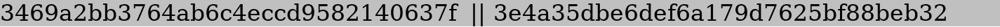session_write_close()结束当前的 session 并存储当前的 session 数据。这会在脚本/页面结束时自动发生，但也可以用于更快地访问 session 信息，因为 session 一时间被一个脚本锁定。
示例：
```php
session_start();
session_write_close(); // 无论如何，页面结束时都会执行
```
## 正则表达式

有时你想检查特定的结构而不是特定的值。正则表达式允许这种匹配。除了下文的几个示例和包含的一些正则表达式语法外，这里没有提供关于正则表达式的教程（那可以单独写一本书）。

### 正则表达式语法

- `^` – 字符串开始
- `$` – 字符串结束
- `.` – 任意单个字符
- `()` – 表达式组
- `[]` – 项目范围（例如 `[afg]` 意味着 a、f 或 g）
- `[^]` – 不在范围内的项目（例如 `[^cde]` 意味着不是 c、d 或 e）
- `-` (连字符号) – 项目范围内的字符范围（例如 `[a-z]` 意味着 a 到 z）
- `|` (管道符) – 逻辑或（例如 `(a|b)` 意味着 a 或 b）
- `?` – 前一个字符/项目范围的零或一次
- `*` – 前一个字符/项目范围的零次或多次
- `+` – 前一个字符/项目范围的一次或多次
- `{integer }` – 恰好整数次的前一个字符/项目范围（例如 `a{2}`）
- `{integer ,}` – 整数次或更多次的前一个字符/项目范围（例如 `a{2,}`）
- `{integer ,integer }` – 从整数到整数（例如 `a{2,4}` 意味着 2 到 4 个 a）
- `\` – 转义字符
- `[:punct:]` – 任意标点符号
- `[:space:]` – 任意空白字符
- `[:blank:]` – 任意空格或制表符
- `[:digit:]` – 任意数字：0 到 9
- `[:alpha:]` – 所有字母：a-z 和 A-Z
- `[:alnum:]` – 所有数字和字母：0-9，a-z 和 A-Z
- `[:xdigit:]` – 十进制数字
- `[:print:]` – 任意打印字符
- `[:upper:]` – 所有大写字母：A-Z
- `[:lower:]` – 所有小写字母：a-z

### 仅限 PERL 兼容 (PCRE) ( preg_*() )

`/` - 表达式前后的分隔符

**字符类：**
- `\c` – 控制字符
- `\s` – 空白
- `\S` – 非空白
- `\d` – 数字 (0-9)
- `\D` – 非数字
- `\w` – 字母 (a-z, A-Z)
- `\W` – 非字母
- `\x` – 十进制数字
- `\O` – 进制数字

**修饰符：**
- `i` – 不忽略大小写
- `.` – 点匹配换行符
- `m` – `^` 和 `$` 匹配行
- `U` – 非贪婪匹配
- `e` – 计算替换结果
- `x` – 跨多行的模式

`ereg( pattern , $string [, group_array ])`
- `pattern` – `$string` 正则表达式
- `group_array` – [可选] 用于正则表达式组的数组名称

在 `$string` 中匹配 `pattern` 中的正则表达式。如果 `pattern` 中的项目被分组 `()`，则提供一个用于数组的变量名来分配这些组的值，将其设置为 `group_array`。
匹配失败时返回 FALSE，如果未提供 `group_array` 则返回 1，并返回 `$string` 的长度。
**示例：**
```php
$regex = "^[A-Z][a-z]+"; // 开始，一个大写字母，一个或多个小写字母，结束
$string = "Hello";
var_dump( ereg($regex, $string) );

$regex = "^([A-Z][a-z]+)[[:space:]]+"; // 开始（一个大写字母，多个小写字母），一个或多个空格，结束
$string = "Hello World";
var_dump( ereg($regex, $string) );
````gi( pattern , $string [, group_array ])`
- `pattern` – `$string` 正则表达式
- `group_array` – [可选] 用于正则表达式组的数组

以忽略大小写的方式在 `$string` 中匹配 `pattern` 中的正则表达式。如果 `pattern` 中的项目被分组 `()`，则提供一个数组的变量名来分配这些组的值，将其设置为 `group_array`。
匹配失败时返回 FALSE，如果未提供 `group_array` 则返回 1，如果提供了 `group_array` 则返回 `$string` 的长度。
**示例：**
```php
$regex = "^[a-z]+";
$string = "Hello";
var_dump( eregi($regex, $string) ); // int(1)
```

`ereg_replace( pattern , replacement , $string)`
- `pattern` – `$string` 正则表达式
- `replacement` – `$string` `\digit` 代表 `()` 匹配

返回经 `pattern` 评估并替换为 `replacement` 格式的字符串 `$string`。正则表达式模式中组 `()` 中的项目可以在 `replacement` 中重用，并通过 `\digit` ，`\0` 代表整个字符串，`\1` 是第一个分组匹配，`\2` 等。
注意：如果没有找到匹配，则返回原始 `$string`。
**示例：**
```php
$string = 'Hello';
$pattern = "^([A-Z])[a-z]+$"; // 模式：开始，一个大写，多个小写，结束
$replacement = ".\1."; // 替换：在第一个组和整个字符串周围加上点
$newstring = ereg_replace($pattern, $replacement, $string); echo $newstring;

$string = '5551234567'; // 不带标点的数字
$pattern = "^([0-9]{3})([0-9]{4})$";
$replacement = "(\1)\2-\3"; // 替换：数字格式
$newstring = ereg_replace($pattern, $replacement, $string); echo $newstring;
```

`egireplace()` – `eregreplace()` 的忽略大小写版本
- `pattern` – `$string` 正则表达式
- `replacement` – `$string` `\digit` 代表 `()` 匹配（例如 `\0` 字符串）

返回经 `pattern` 评估并替换为 `replacement` 格式的字符串 `$string`。正则表达式模式中组 `()` 中的项目可以在 `replacement` 中重用，并通过 `\digit` ，`\0` 代表整个字符串，`\1` 是第一个分组匹配，`\2` 等。
注意：如果没有找到匹配，则返回原始 `$string`。
**示例：**
```php
$string = 'Hello';
$pattern = "^([a-z])[a-z]+$";// 模式：开始，一个字母，一个或多个字母，结束
$replacement = ".\1.\0."; // 替换：在第一个组和整个字符串周围加上点
$newstring = egireplace($pattern, $replacement, $string); echo $newstring;
```

`preg_replace( pattern , replacement , subject [, limit ] [, count ])`
- `pattern` – `$string` 或 `array` 正则表达式(s)
- `replacement` – `$string` 或 `array`
- `subject` – `$string` 或 `array`
- `limit` – [可选] $integer 默认: -1，无限制
- `count` – [可选] 包含 $integer 的变量名

在 `subject` 中将所有匹配 `pattern` 的实例替换为 `replacement`。如果 `subject` 是数组，则匹配和替换发生在数组的所有项目上。要在 `replacement` 中引用 `pattern` 中创建的组 `()`，使用 `${digit}`，其中 `${0}` 代表整个字符串，`${1}` 是第一个组，依此类推。如果 `pattern` 和 `replacement` 是数组，则对数组中的每个条目处理整个 subject，找到 `pattern` 中的第一个项并将其替换为 `replacement` 中的第一个项，然后对下一组条目重复。如果 pattern 数组中的值比 replacement 数组多，则使用空字符串（''`）作为替换。如果 `pattern` 是数组而 `replacement` 是字符串，则它用于 pattern 中的每个条目。可选的 `count` 变量将被设置为发生的替换总数。
注意：这是 PERL/PCRE，且表达式分隔符 (`/`) 可以与表达式末尾的修饰符一起使用。
**示例：**
```php
$pattern = "/^(\d{3})(\d{3})(\d{4})$/";
$replacement = "(\1)\2-\3";
$subject = '5551234567';
preg_replace($pattern, $replacement, $subject);
```

`preg_split( pattern , subject [, limit flags ])`
- `pattern` – `$string` 正则表达式
- `limit` – [可选] $integer 默认: -1，无限制
- `flags` – [可选] $string 值：`PREG_SPLIT_NO_EMPTY`（不返回空）、`PREG_SPLIT_CAPTURE`（返回匹配组）

`preg_match` 以忽略大小写的方式在 `$subject` 中匹配 `pattern` 中的正则表达式。如果 `pattern` 中的项目被分组 `()`，则提供一个数组的变量名来分配这些组的值，将其设置为 `group_array`。
匹配失败时返回 FALSE，如果未提供 `group_array` 则返回 1，如果提供了 `group_array` 则返回匹配项的长度。
**示例：**
```php
$pattern = "^[a-z]+";
$string = "Hello";
var_dump( preg_match($pattern, $string) ); // int(1)
```
